# Linux A 到 Z


PURDUE
UNIVERSITY
Pc
CALUMET
Hammond, Indiana
46323-2590
图书馆。


由 Internet Archive 数字化
2024 年


QA
76.26
963
C675


## Figures

1.1 The main file types form a tree structured hierarchy. 6
1.2 The main Linux directory tree structure. 8
2.1 Three filesystems joined to form one hierarchy. 16
2.2 Single files can have multiple names. 17
3.1 The three main vi operating modes. 37
4.1 The shell waits for a command to finish. 56
4.2 Executing a background job. 57
7.1 Partitioning a 320 Mb hard disk. 127
7.2 Partitioning a 720 Mb hard disk. 128
9.1 A character grid and its encoding, for the letter A. 164
12.1 Passing e-mail from machine to machine. 203
13.1 DOSEMU needs to emulate this PC AT memory map. 216
15.1 The three base positions for lseek() offsets. 239
15.2 Sessions, process groups and processes. 246
16.1 The parts of programs and processes. 262
16.2 The action of the fork() system call. 263
16.3 Parent and child share open file descriptions. 264
16.4 The life cycle of a child process. 270
17.1 Effect of executing the system call dup(2). 278
20.1 Use of line[], avline[] and cmdlin[] arrays. 327

24.1 User programs access hardware via device drivers. 370
28.1 Simplified state transition diagram for CPU scheduler. 413
29.1 Stack layout in main() just before calling twice(). 422
29.2 Stack layout in twice() just before return. 423
29.3 Thread stack layout just before context switch. 426
29.4 Data structures set up in new_thread. 429
29.5 Structure links created during rendezvous. 432
30.1 Calculation of a linear address. 439
30.2 How paging translates linear to physical addresses. 441
30.3 Paging allows easy memory segment growth. 442
31.1 System V disk partition layout. 448
31.2 The initial data block free list. 449
31.3 Data block free list after block allocations. 450
31.4 Allocation and release of free inodes. 451
31.5 Data block pointers in an inode. 453
31.6 minix filesystem layout on a disk partition. 455
31.7 ext2 filesystem layout on a disk partition. 456
31.8 Layout of an ext2 block group. 457


## 前言

Linux 是一个符合 POSIX 标准的作业系统内核，已存在数年，可在任何 386 或更高版本的 IBM PC 或兼容机上运行。内核最初完全由一人 Linus Torvalds 在赫尔辛基的努力创建。此后许多系统编程专家加入了这一努力，如今 Linux 已成为功能完备的 UNIX 和 POSIX 兼容的作业系统内核。Linux 源代码在自由软件基金会的通用公共许可证下授权。其实际意义在于 Linux 内核及其全部源代码可供任何人自由获取、使用和传播。

这种免费的可用性激发了全球计算爱好者社区的想象力，并通过互联网，软件的使用如野火般蔓延。再加上存在与所有主要 UNIX 功能类似的工具和实用程序，并且这些也同样在自由软件基金会的通用公共许可证下提供，你可以看到可以组装出一款完整的 UNIX 外观和感觉产品，供任何拥有网络连接的人免费使用。

这就是 Linux 处于起步阶段时的状况。此后，Linux 的消息已从互联网社区传播到整个计算世界。其证据是，可通过除互联网以外的其他方式获取的 Linux 发行版现在已广泛可用。其中包括公告板发行版、出售的软盘套装以及许多 CD-ROM 版本。

《Linux A-Z》主要 intended 用于本科课程或课程序列。它也可以用于研究生课程（也许在加入文本中建议的一些主要来源）。它基于作者在斯塔福德郡大学操作系统课程中多年开发和使用的讲义和实践案例研究。其全面的覆盖使其成为 Linux/操作系统学生和希望拓展自身子领域的专业人士的主要参考书。

唯一的先决条件是对大一水平的计算机科学基本概念有所熟悉。特别是，我假设你对 PC 有一个合理的了解，可能来自其硬件和磁盘分区的配置，以及 DOS 和/或 Windows 等系统软件的安装。对于本书的后半部分，如果要从这些章节的材料中获得最大收益，你还需要具备 C 语言的实际知识。

本书的编写目的是在多个层面上为 Linux 操作系统及其许多相关工具和实用程序提供入口点。其理念是向你介绍概念，然后鼓励你通过实验来体验和巩固材料。

本书本身分为五部分，旨在带你游览 Linux，从基本用户级访问，到系统安装和 administration，再到使用 Linux 系统调用（其 API）编程，了解其与硬件的接口，并检查其最深层的内部秘密。

我个人认为计算是一种实用的手工艺技能，因此，没有什么可以替代对材料的亲身实践。为此，本书还包含五个完整的实践案例研究，旨在供你自行实验。

本书的五部分构成如下：

- 1. BASICS – 这里由第 1 章到第 6 章覆盖。这里的想法是让具有一定计算经验但不熟悉 UNIX 或 Linux 的读者，以普通用户身份了解 Linux 系统。这从登录开始，参观典型的文件存储布局和一些简单命令，然后逐步介绍 vi 编辑器的使用、标准的 bash shell、有用的工具和实用程序，最后介绍为 shell 执行编写批处理程序脚本。
- 2. ADMINISTRATION – 当初学者掌握了基础知识或，如果更有经验的用户已具备这一水平的知识，那么就可以继续学习如何执行管理员功能。第 7 章到第 14 章将处理 Linux 的这些方面。游览从介绍如何将一台可能装有 MS-DOS 的 PC 重新配置，以便 Linux 能与用户的现有应用程序共存开始。Linux 系统安装后，需要根据管理员的具体要求进行配置。这首先介绍如何配置和重建操作系统内核。之后，需要设置用户账户并配置所有资源以供使用。这些包括：打印机、调制解调器和鼠标、X-windows 客户端和服务器、串行、并行和网络通信、互联网和 DOS 模拟器。
- 3. SYSTEM PROGRAMMING – 这是深入 Linux 内部的第一个步骤。由第 15 章到第 23 章覆盖。从本质上讲，这些章节涵盖了从应用程序角度来看的 Linux 系统调用接口的重要方面。因此所涵盖的主题有：文件和终端 I/O、进程控制、各种进程间通信机制（IPCs）包括 intra- 和 inter- 机器类型、称为信号的高级软件中断以及独立的守护进程。第 3 部分还包括三个完整的案例研究，提供了一个简单的套接字 IPC 库、一个小型示例 shell 以及提供简单文件传输服务的守护进程的源代码和评论。
- 4. DEVICE DRIVERS – 在查看了 Linux 与其应用程序的接口之后，下一个部分（第 24 章到第 27 章）查看另一个主要的操作系统接口，即内核与硬件之间的接口。该接口由设备驱动程序提供，设备驱动程序有两种类型（字符和块），两者都涵盖在内，同时还涵盖 Linux 内核为驱动程序内部使用提供的一些支持函数。该部分还包括一个简单的设备驱动程序案例研究，以巩固本部分所介绍的想法。
- 5. INTERNALS – 最后部分涵盖第 28 章到第 32 章，查看 Linux 内部的选定主题，以了解其如何协同工作。所涵盖的主题有：进程调度、Linux 内存管理的操作、允许 Linux 访问许多不同文件系统类型的虚拟文件系统切换（VFS），最后再次查看系统调用接口，但这次是从内核内部查看。该部分还以案例研究的形式介绍了一个非常简单的用户线程库。

五个案例研究的源代码在斯塔福德郡大学计算学院 ftp 服务器上可通过匿名 ftp 以 GNU 通用公共许可证免费获得：

```
ftp.soc.staffs.ac.uk
```

在目录下：

```
users/phil_cornes/linuxa2z
```

无论你目前的技能和专业水平如何，要从本书中受益，你唯一的真正要求是对该主题的热情和渴望了解更多。

## 第一部分

### 基础

### Linux 基础

*《Linux A-Z》* 的这一部分假设你对 Linux 或任何其他类 UNIX 操作系统几乎没有或没有经验。它将带你了解 Linux 的基础知识，通过一个刚拜访系统管理员并获得 Linux 机器上账户的登录名和密码的新用户的视角。

这是一个理想的情况。然而，我意识到会有许多读者不仅是新用户，同时还必须充当系统管理员。在这种情况下的诀窍是将第 1 部分的材料与第 2 部分的早期章节交错进行，以便在学习基础知识的同时执行最必要的安装和系统管理功能。事实上，这并不是一个令人望而生畏的任务，因为现在可用的许多 Linux 发行版对大多数事物都有默认配置，使其开箱即用即可完全使用。然而，你仍然需要保持警惕，因为完整 Linux 系统的安装和配置的某些部分仍然有点棘手。

### 1.1 登录

首先，你的 Linux 系统应该向你呈现登录邀请，以登录提示的形式：

```
login:
```

在这里你输入你的用户名并按 Enter 或 Return。如果你的账户设置了密码，系统将响应：

```
Password:
```

作为提示你输入密码的提示，同样随后按 Enter 或 Return。你为密码输入的字符在屏幕上不可见。如果你的登录名和密码正确输入，系统将返回一个

提示您输入命令。如果您犯了错误，系统会以以下消息作出响应：

```
Login incorrect
```

并发出新的登录提示供您再次尝试。这里有一个警告——如果您既是机器的系统管理员又是新用户，则应避免使用 root 登录账户，除非您需要执行绝对需要使用它的管理任务。其原因在于 root 是一个特权登录，具有覆盖 Linux 系统正常安全性和完整性检查的巨大权力。即使对于经验丰富的管理员来说，意外犯下耗时和/或代价高昂的错误也很容易。

这里还有一点需要注意，Linux（与大多数类 UNIX 系统一样）是区分大小写的，因此小写字母及其大写等价物被视为不同的字符。在大多数情况下，Linux 要求您输入小写单词和命令，在这些情况下，大写版本根本不起作用。

对于普通用户账户，登录成功后，系统会执行一个名为 shell 的程序。任何在系统内执行的程序都称为进程。正是您的 shell 进程负责为您提供命令行提示符。默认情况下，非特权用户的提示符是美元符号（$），而系统特权用户（root）的提示符是井号（#）符号。Shell 还负责接收您在键盘上输入的任何命令并安排其执行。

事实上，出于历史原因，有几种不同的 shell 可用，它们都提供大致相同的功能。然而，在本书中，我将集中介绍自由软件基金会（GNU）的 shell，称为 bash，它也是大多数 Linux 发行版默认使用的 shell。

一旦您有了 shell 提示符，您就可以输入命令的名称以及命令所需的任何参数，shell 将执行它们。如果某个命令运行时间很长或向屏幕生成大量输出，您可能希望在它完成之前中断并停止它。您可以通过按 Ctrl-c（即在按住 ‘Ctrl’ 键的同时按下 ‘c’ 键）从键盘向大多数命令发送中断信号。当您完成登录会话后，您可以通过在 shell 提示符下输入命令 logout 来注销。还有其他注销方式，最常见的是在提示符处向 shell 发送文件结束符（EOF）。这可以通过键盘按 Ctrl-d 来完成。这里的问题是 shell 可以被设置为忽略 EOF，并且在某些 Linux 发行版中默认就是这样做的。稍后，当我们更详细地查看 shell 时，您将看到如何自定义 shell 的一些响应方式。

### 1.2 文件层次结构

登录系统后，下一步任务是熟悉基本的文件系统布局。Linux 文件系统包含属于三个基本类别的文件：

- **普通文件。** 这些只是系统不对其实施加特定结构的字节集合。它们用于文本文档（包括程序源代码）、程序使用的数据文件，甚至是二进制可执行程序文件本身。
- **目录文件。** 目录是允许将一组文件组合在一起的机制。从概念上讲，目录形成一个容器，可以将其他文件和目录放置其中，不过实际上，目录本身仅包含其他文件的名称以及在磁盘上如何找到它们的简单信息。由于目录本身可以包含子目录的名称，因此文件系统形成了一个层次结构。
- **特殊文件。** 若干种不同的文件类型属于此类，随着您阅读本书的进展，您会看到它们全部。但主要来说，特殊文件与运行进程之间的通信相关联，也允许进程与连接到机器的各种硬件设备通信，例如终端、CD-ROM、调制解调器等。

所有这些文件类型都排列成一个大型树状层次结构（见图 1.1）。该树在顶部有一个单一目录，称为根目录（不要与 root 登录名混淆），其符号名为 '/'。根目录内部有几个其他标准目录和文件，用于各种目的。这些更高层目录和文件的布局仅按惯例标准化，而不是出于必要性，尽管一旦您了解了惯例，发现目录层次结构不是按标准方式布局会非常令人困惑。

图 1.1 显示了一个根目录（/），其中包含子目录 dev、bin 和 home。目录 home 又包含目录 mike 和 lynne，等等。在最低层，目录包含普通文件和特殊文件（如 a 和 b）。鉴于这些文件关系，您会说‘home 是 mike 的父目录，而 a 是 proj1 的子目录’。只要它们包含在不同的父目录中，两个或多个文件或目录具有相同名称是完全可能的。因此显然必须有一种方法来明确地引用特定文件。这是通过指定路径名来完成的。路径名只是一串由斜杠（/）字符分隔的名称。如果该名称列表也以斜杠字符开头，则称为绝对路径名，这意味着它从根目录向下工作。例如，目录 proj1 的绝对路径名为：

```
/home/lynne/proj1
```

而特殊文件 b 的路径名为：

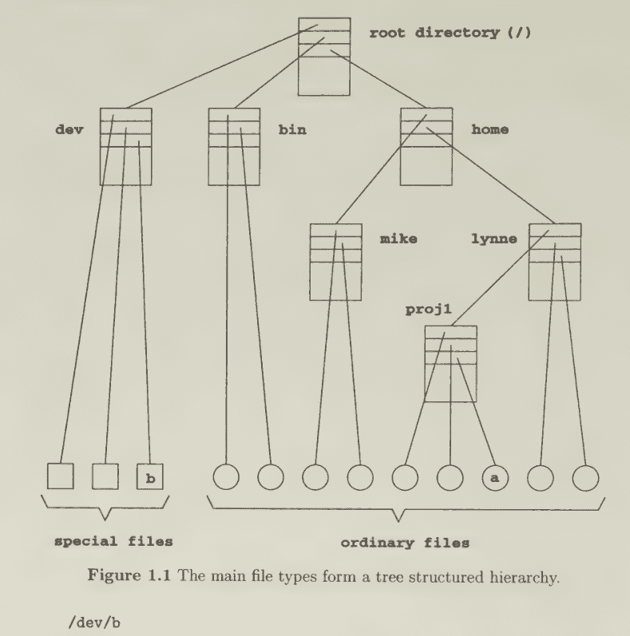

图 1.1 主要文件类型形成树状层次结构。

```
/dev/b
```

如您所见，绝对路径名从根目录开始并从那里向下工作。也可以指定从其他目录开始的路径名。以这种方式给出的路径名称为相对路径名。例如，从目录 lynne（或更准确地说，/home/lynne）到普通文件 a 的相对路径名为：

```
proj1/a
```

这表明从目录 /home/lynne 到达 a 的方式是通过包含在其中的目录 proj1。当您更改目录时，新目录成为您当前的工作目录。当前工作目录的概念非常重要。每次在 Linux 中执行程序时，结果进程都会在其内部状态的一部分中设置当前工作目录。这是它在访问具有相对路径名的任何文件时用作起点的目录。除非进程做出特定安排为自己设置特定的当前工作目录（大多数不会），默认情况下将是用户启动程序时所在的目录。

那么尝试从目录 /home/mike 指定文件 a 的相对路径名呢？这里的问题是 /home/mike 和 a 位于目录树的不同的分支中。为了解决这个问题，您需要了解在每个 Linux 目录中自动包含的两个额外名称。它们称为 .（读作点）和 ..（读作点点）。名称点是当前目录的别名，而点点是当前目录父目录的别名，允许您在指定相对路径名时向上回溯树。给定点点表示法，之前问题的答案涉及从 /home/mike 回溯树到 /home，然后沿正确的分支返回到文件 a。这将给出相对路径名为：

```
../lynne/proj1/a
```

顺便说一下，即使根目录没有父目录，它仍然包含名称点点，该名称被设置为指向根目录本身。因此，实际上，根目录被特殊对待，因为它是它自己的父目录。这也意味着指定包含太多点点的相对路径名不是错误。

### 1.3 探索文件层次结构

当您登录时，会有一个与您的登录名关联的特殊目录，称为您的主目录。您的主目录实际上是您初始的当前工作目录。它充当属于您的整体目录树部分的起点（如果您愿意，可以说是根）。您在系统上所做工作的任何部分中创建的所有文件和目录通常都位于您的主目录下。

了解您的主目录在目录层次结构中的位置最简单的方法就是在登录后立即使用 pwd 命令。pwd 命令会告诉您当前的工作目录。这是您当前“所在”的目录，在您首次登录时将是您的主目录。从主目录使用 pwd 命令将给出如下输出：

```
$ pwd
/home/you
```

其中 /home/you 将被替换为您主目录的绝对路径名。为了将您当前的工作目录从主目录移动到目录层次结构中的其他位置，您使用 cd（更改目录）命令。因此，要将目录更改为目录层次结构的根目录，您将使用命令：

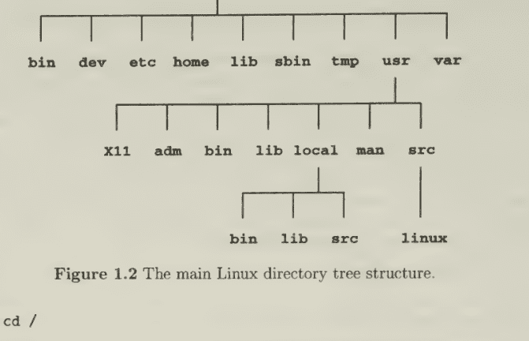

图 1.2 Linux 主目录树结构。

```
$ cd /
```

因此将所需目标目录的路径名作为参数给出。为了获取当前目录中包含的文件和目录名称列表，您使用 ls 命令。使用 ls 命令查看典型 Linux 系统的根目录时，输出如下：

```
$ ls
bin dev home mnt sbin var
boot dos lib proc tmp vmlinuz
cdrom etc lost+found root usr
```

Linux 目录层次结构中最重要的分支如图 1.2 所示。您应使用 pwd、cd 和 ls 命令自行探索您机器上的此目录层次结构。如果在任何时候您想返回主目录，您显然可以使用 cd 命令并将适当的路径名作为命令行参数给出。但是，如果您仅输入 cd 命令而不指定目标目录，这是一个快捷方式，也会直接带您返回主目录。如图 1.2 所示，Linux 目录层次结构的主要分支包含具有表 1.1 中给出的一般功能的文件。

### 表 1.1 主要目录列表

| 路径 | 描述 |
|---|---|
| /bin | 二进制可执行命令 |
| /dev | 设备特殊文件 |
| /etc | 系统管理及配置文件 |
| /home | 用户主目录的基础 |
| /lib | 标准编程库 |
| /sbin | 系统管理命令 |
| /tmp | 临时文件的通用存储 |
| /usr/X11 | X 窗口系统文件 |
| /usr/adm | 系统管理数据文件 |
| /usr/bin | 更多可执行命令 |
| /usr/lib | 库和软件包配置文件 |
| /usr/local/bin | 本地添加的命令 |
| /usr/local/lib | 本地添加的库 |
| /usr/local/src | 本地命令源文件 |
| /usr/man | 系统在线手册页 |
| /usr/src/linux | Linux 内核源文件 |
| /var | 部分大文件的溢出存储 |

### 1.4 密码文件

在 Linux 下，密码文件是系统中的核心数据文件之一。它将您迄今为止看到的大量内容联系在一起。密码文件包含所有具有登录名的用户列表；它指定所有用户的主目录位置以及他们登录时将使用的 shell 程序。密码文件还负责保存用户密码，为每个用户分配系统标识号，并在用户需要合作进行联合项目工作时将用户集放入组中。

密码文件本身只是一个普通文本文件，任何用户都可以读取。它存储在：

```
/etc/passwd
```

可以最简单地通过输入以下命令行来列出此文件的内容：

```
$ cat /etc/passwd
```

cat 命令在这里只是用来列出文件内容。其完整用法将在下一章（第 2.3 节）中介绍。

密码文件中的每一行都是关于单个用户登录名的信息记录。文件中的每条记录分为七个字段，字段之间用冒号（:）分隔。记录的格式为：

```
name:password:uid:gid:comment:home:shell
```

从左到右，七个字段的用途如下：

**name** 此字段包含用户的登录名。它与用户登录时必须输入的完全相同。

**password** 这是用户的密码。如果您不认识自己的密码，请不要感到惊讶。这完全正确，因为密码是加密的。当您在登录时输入密码时，它会以相同的方式加密并与此字段进行比较以允许或拒绝系统访问。如果此字段为空，则该用户无需密码。

**uid** 登录后，系统通过 *用户标识号*（uid）而不是登录名来引用用户。这里分配 uid。

**gid** 有时，一组用户希望能够在单个项目上作为一个组共同工作。为此，允许他们对特定目录和文件具有共同访问权限是有用的。这是通过在此字段中为团队的所有成员分配相同的 gid（*组标识号*）来实现的。

**comment** 这只是一个注释字段。通常用于保存用户的真实姓名和其他个人详细信息。

**home** 此字段指定用户主目录的绝对路径名，系统在登录时获取该路径。

**shell** 这是当在此用户名上成功登录时将被执行的命令的绝对路径名。这可以是任何命令，但对于普通用户账户，它将是 shell 的路径名。如果未给出路径名，则默认为 /bin/sh。

由于密码加密算法被认为非常安全，密码文件（/etc/passwd）被设为公开可读。然而，如果您选择一个简单的词作为密码，例如可以在字典中找到的词，那么加密字典中的所有单词以查看是否匹配就变得很简单。

有两种方法可以克服这个问题。一种是使加密密码保持私有，并且 Linux 上有可用的软件包来实现这一点。在这些软件包中，加密密码被移除并存储在单独的文件中（通常为 /etc/shadow），该文件禁止公开读取。拥有额外的文件也允许向用户记录添加更多字段，以指定诸如用户必须多久更改一次密码之类的内容。克服问题的另一种方法要简单得多，也同样有效——一开始就选择一个好的密码。好的密码至少为六个字符长，并包含大小写字母、数字和/或标点字符的混合。如果这听起来难以记住，请使用一个简单的词，但将其中一些字符更改为外观相似的其他字符（例如 shelter 和 5he!tER）。这种技术会产生更安全的密码，尽管更复杂的密码破解程序可能仍然能够找到它。

为了最大程度的安全，定期更改密码也是明智的。在 Linux 下更改密码很容易——您只需输入命令：

```
$ passwd
```

系统会提示您输入旧密码（如果有），然后两次提示您输入新密码。您必须两次输入新密码，因为系统不会回显您输入的密码，因此您在屏幕上看不到它们。这可以确保您正确输入了新密码，因为如果两次尝试不匹配，系统不会更改您的密码。

## 练习

- 1. 如何查找您主目录的绝对路径名，以及它在您系统上的路径是什么？
- 2. 如何查找系统中是否有任何用户未设置密码？
- 3. 您需要给出哪些命令才能将当前工作目录从 /usr/bin 更改为 /usr/local/bin，首先使用绝对路径名，然后使用相对路径名？
- 4. 探索您系统上的目录层次结构并找到 ls 和 pwd 命令的绝对路径名。

## 答案

- 1. 这里有几种可能性。第一种可以是使用以下命令查看密码文件：

```
$ cat /etc/passwd
```
然后从您的密码行第六个字段中提取您的主目录。另一种方法是用以下命令序列：

```
$ cd
$ pwd
```
这将从目录层次结构中的任何位置将当前工作目录更改回您的主目录，然后显示当前工作目录。当我尝试时，它给出的主目录为：

```
/home/pc
```
- 2. 所有密码都以加密形式存储在文件 /etc/passwd 中。您需要做的就是逐行检查此文件的内容，查找任何字段 2 为空的条目，以找到未为其设置密码的用户。
- 3. 您执行以仅使用绝对路径名将当前工作目录从 /usr/bin 更改为 /usr/local/bin 的命令是：

```
$ cd /usr/local/bin
```


而要仅使用相对路径名实现相同结果，则是：

```
$ cd ../local/bin
```

4. 根据表 1.1，大多数可执行的用户命令存储在两个目录 /bin 和 /usr/bin 中。使用 ls 命令在这两个目录中搜索可知，所需的两个命令的路径名为：

/bin/ls
/bin/pwd

实际上，大多数系统都提供了一个命令，可以帮助你找到当前可执行的任何命令的完整路径名。它叫做 which。因此，相同的结果也可以通过以下命令获得：

```
$ which ls pwd
/bin/ls
/bin/pwd
```

## Linux 命令

现在你已经登录并有机会探索目录层次结构的布局，是时候来看一下数百个可用命令中的少量选择了。在如此篇幅的书中，不可能详细涵盖所有可用命令。然而，正如你很快就会看到的，Linux 提供了大量在线系统文档供你探索，而且文档还在不断增加。

通常，你会发现 UNIX（因此也是 Linux）命令在执行时非常安静。也就是说，它们不会产生不必要的输出，因此命令成功执行的通常指示就是下一个命令的提示符。

### 2.1 目录层次结构

如果执行以下命令：

```
$ cd /
$ ls
```

你将把当前工作目录更改为根目录（/），然后从 ls 命令获得输出，类似如下：

```
bin      dev      home     mnt      sbin     var
boot     dos      lib      proc     tmp      vmlinuz
cdrom    etc      lost+found root     usr
```

然而，在上一章中，我说过每个目录都包含名称 dot 和 dot-dot，那么为什么它们没有出现在 ls 列表中呢？事实上，由于这两个名称始终存在，列出它们似乎意义不大。为了确保它们不会被列出，ls 有一个内置规则，规定默认情况下以句点（或全点‘.’）开头的名称应被忽略。该规则不仅适用于名称 dot 和 dot-dot，也适用于任何以句点开头的名称。

这提供了一种方便的机制，可以让文件包含在目录中，但在查看目录内容时不被列出。不要以为这提供了一种创建秘密文件的方法，因为它没有。让 ls 列出所有文件，包括以句点开头的文件，非常容易。

在输入命令时，有很多情况，你希望命令执行超出其默认功能的额外操作，或者希望抑制命令正常操作的一部分。在这些情况下，你需要将命令行开关传递给命令以打开（或关闭）所需的功能。为了提供一致性，将开关值传递给命令的常规方法是使用连字符（-）作为开关本身的前缀，以表示这是一个开关，而不是普通命令参数（例如文件名）。

对于 ls 命令，使其列出所有文件的开关是 -a。通常会得到：

```
$ cd /
$ ls -a
.       cdrom   etc     mnt     tmp
..      dev     home    proc    usr
bin     dos     lib     root    var
boot    etc     lost+found sbin    vmlinuz
```

在任何命令行开关之后，ls 还可以指定目录的名称，在这种情况下，它将列出指定目录的内容而不是当前目录的内容：

```
$ ls -a /tmp
.       .X11-unix       elm.rc.OLD      ls      tagfile
..      NEAT            elv_61.1        modes
.X0-lock        clocks          hosts.OLD       nets.OLD
```

请记住，如果你在自己的机器上执行此命令，应预期会得到不同的结果，因为 /tmp 是一个供任何用户存储其临时文件的公共目录。

当你开始在 Linux 系统上工作、编写程序和运行软件包时，你会开始生成自己的文件。一般来说，你应该将所有文件挂在你的主目录下。然而，如果你只是把所有文件都放在主目录中，很快就会难以找到东西（看看 /usr/bin）。为了解决这个问题，你需要在文件空间上施加某种秩序和布局。你可以通过在主目录下创建自己的迷你目录层次结构并施加一些简单的自律来实现这一点，以确保每当存储新文件时它都放在正确的位置。

为了创建新目录，你使用 mkdir 命令并将新目录的名称作为参数传递给它：

```
$ cd
$ mkdir bin text
```

请记住，单独使用 cd 会带你回到主目录。mkdir 命令随后在你的主目录中创建两个新目录，分别名为 bin 和 text。一次 mkdir 命令可以创建任意数量的目录。这显然意味着 mkdir 可以处理可变数量的参数值。事实上，作为一条通用规则，任何有意义的命令（例如，不是 cd）都可以接受可变列表的名称作为参数进行操作，并在整个集合上正常工作。

创建目录后，下一步任务是将一些文件复制到其中。Linux 中的复制命令是 cp：

```
$ cp /etc/passwd text/mypass
```

假设你在输入此命令时仍在主目录中，它将复制系统密码文件（/etc/passwd）并将其存储在你的 text 目录下，名称为 mypass。

在此形式中，cp 只是将两个普通文件的路径名作为参数，并将第一个复制到第二个。cp 命令还有第二种形式，其中最后一个参数不是普通文件名，而是目录名。在这种形式中，可以指定可变长度的普通文件名列表来代替第一个参数，所有指定的文件都将被复制到给定目录中：

```
$ cp /etc/passwd /etc/motd text
$ ls text
motd  mypass  passwd
```

请注意，从上述序列可以看出，使用 cp 的第二种形式没有机会更改被复制文件的名称。

顺便说一下，文件 /etc/motd 包含系统的每日消息。默认情况下，登录时文件的内容会列给用户。这意味着如果系统管理员需要向用户传达消息，将消息输入此文件是最简单的方法。

正如文件和目录可以被创建，它们也可以被删除。为了删除目录，你使用 rmdir 命令：

```
$ rmdir bin
$ rmdir text
rmdir: text: Directory not empty
```

作为一项额外安全功能，rmdir 命令仅在目录为空时才有效（dot 和 dot-dot 条目除外）。因此，这里 bin 目录已被删除，但 text 目录未被删除。为了删除 text 目录，你需要先删除其中包含的三个普通文件。普通文件可以用 rm 命令删除：

```
$ rm text/mypass
```

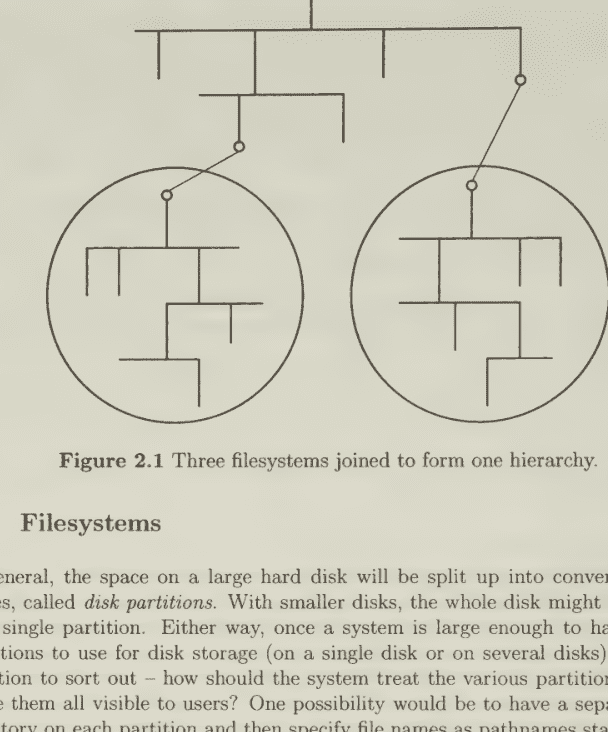

图 2.1 三个文件系统连接形成一个层次结构。

### 2.2 文件系统

通常，大型硬盘上的空间会被分割成方便大小的块，称为磁盘分区。对于较小的磁盘，整个磁盘可能被视为单个分区。无论哪种情况，一旦系统大到足以拥有多个分区用于磁盘存储（单个磁盘或多个磁盘），就需要解决一个问题——系统应如何处理各个分区以使它们对用户都可见？一种可能性是在每个分区上都有一个单独的根目录，然后将文件名指定为从特定分区根目录开始的路径名。但从你迄今为止所见，似乎只有一个目录层次结构，而不是每个磁盘分区一个。

在 Linux 中，每个分区都会在其上印有文件系统，具有自己的分区顶层目录和下面的目录层次结构。然后 Linux 通过将一个文件系统的顶层目录挂载到另一个文件系统的叶目录上并使连接看起来无缝，使这些单独的文件系统看起来像一个目录层次结构（参见图 2.1）。

存储在磁盘分区中的任何类型的文件都会被分配一个数字（称为其 inode 编号），它实际上是存储在磁盘上的数组中条目的索引号。数组的每个元素都是一个 inode，它存储单个文件的管理信息（例如，它何时创建、谁拥有它以及该文件的数据块存储在磁盘分区的何处）。文件在目录中与其名称一起存储的就是其 inode 编号。因此，

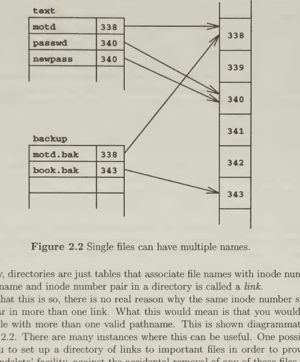

### 图 2.2 单个文件可以有多个名称。

本质上，目录只是将文件名与 inode 编号关联起来的表。目录中每个文件名和 inode 编号的配对称为一个链接。

鉴于如此，同一个 inode 编号出现在多个链接中并没有真正的原因。这意味着你将拥有一个具有多个有效路径名的单个文件。这在图 2.2 中以图表形式显示。有很多实例这可以很有用。一种可能性是设置一个指向重要文件的链接目录，以便提供一种‘取消删除’功能，以防这些文件中的任何一个被意外删除。这之所以有效，是因为当你对一个文件发出删除（rm）命令并且 inode 有多个链接时，只有你的链接会被删除。inode 本身以及任何其他链接都将保持完整。直到你 rm 一个只有一个链接存在的文件，inode 本身才会连同文件数据块和目录链接一起被释放。

要为现有文件创建新链接，你使用 ln 命令并指定作为参数的现有文件的路径名，后跟新链接的路径名：

```
$ ln text/passwd text/newpass
$ mkdir backup
$ ln text/motd backup/motd.bak
```

为了查看 inode 编号以检查链接是否都符合预期，你使用 -i 开关来使用 ls 命令，如下所示：

```
$ ls -i backup text
backup:
    338 motd.bak
text:
    338 motd      340 newpass      340 passwd
```

如果你在示例中更改 text/motd 的内容，那么文件 backup/motd.bak 的内容也会被更改，因为它完全是同一个文件。

所有这些的唯一问题是每个文件系统（磁盘分区）都有自己的 inode 数组，因此 inode 编号仅在单个文件系统内唯一。这意味着你不能使用 ln 在例如你的主目录下的 text/motd 和另一个文件系统中的另一个路径名之间设置这种类型的链接。这是因为，在另一个文件系统中，inode 编号 338（text/motd 在你主目录文件系统中的 inode 编号）将是完全不同的文件。

如果你需要在不同文件系统之间设置路径名之间的链接，可以做到，但不能使用上述共享 inode 技术。在这种情况下你所做的是使用 ln -s 来在两者之间设置符号链接。符号链接是 Linux 特殊文件类型之一，实际上它只是一个文本文件，其中包含它提供链接的另一个文件的路径名。另一个文件是包含所有数据的真实文件。所有读取或写入文件内容的命令，当它们应用于符号链接时，将会跟随链接并访问真实文件而不是符号链接。显然，为此额外步骤付出一些非常小的时延，但它太小而不会产生任何实际差异。

当你想在两个文件之间创建链接并且想要确保所做的事情可以移植到其他系统时，你应该使用符号链接。这是因为它们既可以在单个文件系统内使用，也可以在单独的文件系统之间使用，而 inode 链接只能在这些情况中的第一种中使用：

```
$ ln -s text/motd backup/motd2.bak
$ ls -i backup text
backup:
    338 motd.bak    328 motd2.bak
text:
    338 motd        340 newpass      340 passwd
```

另一个通过操作 inode 链接来工作的命令是 mv。该命令用于在同一文件系统内将目录链接从一个位置移动到另一个位置。实际上，它执行与 ln 链接 inode 相同的功能，但随后删除对文件的旧链接：

```
$ mv text/newpass backup/passwd.bak
$ ls -i backup text
backup:
    338 motd.bak    328 motd2.bak    340 passwd.bak
```

```
text:
    338 motd    340 passwd
```

mv 命令的一个副作用，实际上比它在目录之间移动文件的能力更常用的是，如果新文件与旧文件在同一目录中，则它执行与重命名命令相同的功能。事实上 Linux 中没有特定的重命名命令；你只需使用 mv：

```
$ mv backup/motd2.bak backup/motd.sym.link
$ ls -i backup
    338 motd.bak    328 motd.sym.link 340 passwd.bak
```

就像 cp 命令一样，mv 的第二个参数可以指定为目录而不是文件，第一参数可以是文件列表，所有这些文件都将被移动到指定的目录，同时保持之前相同的名称。

### 2.3 操作文件

非常经常，你会想要检查文本文件的内容。你已经看到了一种这样做的方法——使用 cat 命令。单词 cat 是 concatenate 的缩写，意思是连接在一起。cat 命令实现这种连接的方式是允许你指定文件名的列表作为参数，它将一个接一个地列出它们而没有中断：

```
$ cat /etc/passwd /etc/motd
```

问题在于，如果你列出到屏幕上的文件内容超过一个屏幕，那么整个内容就会滚动得太快而无法阅读，你最终只会在列表结束时看到最后一个屏幕。你需要的是一个像 cat 一样列出文件的命令，但会在每个屏幕末尾插入暂停。通常用来执行此操作的命令称为 more：

```
$ more /etc/passwd /etc/motd
```

当 more 在页面末尾暂停时，有几个字符你可以输入来告诉它接下来做什么：
- Space 显示下一页；
- Enter 显示下一行；
- q 退出列表；
- :n 列出下一个文件。

另一个像 more 一样工作的命令，但提供了比 more 可用的更多的一系列设施，有趣的是称为 less。

在你有一个文件定期在末尾写入新文本的情况下，你可能希望能够只查看文件的最新添加内容，而不必从头开始分页，特别是如果它变得很大。用来执行此操作的命令称为 tail，因为它只是打印文件的尾部。默认情况下，tail 打印文件的最后十行，尽管这可以通过 -n 命令行开关来更改：

```
$ tail -n 4 /etc/passwd
user:off:100:50::/home/user:/bin/sh
ftp:*:404:1::/home/ftp:/bin/false
pc:fjKppCzEvouc:500:500::/usr1/pc:/bin/bash
carey:Yt1a4ffkG2r02:501:500::/usr1/carey:/bin/bash
```

事实上，`-n 4` 可以缩写为仅 `-4`，它仍然会执行相同的功能。

另一个有用的功能是能够计算文件中的行数、单词数和字符数。这可以用 word count（wc）命令完成：

```
$ wc /etc/passwd
      21      42     775 /etc/passwd
```

三个值 21、42 和 775 分别是文件 /etc/passwd 中的行数、单词数和字符数。在这种情况下，21 行表明在这台机器上设置了 21 个账户登录名。你可能期望密码文件中会有超过 42 个单独的单词，但这只是因为 wc 对单词使用的相当简单的定义。它与在字典中查找单词无关，而只是被认为是任何由空格、制表符、换行符等分隔的字符序列。

打印全部三个数字是 wc 执行的默认操作。你可以通过使用命令行开关 -l、-w 或 -c 中的一个来仅获取行、单词或字符计数：

```
$ wc -l /etc/passwd
      21 /etc/passwd
$ wc -w /etc/passwd
      42 /etc/passwd
$ wc -c /etc/passwd
     775 /etc/passwd
```

也可以在不给出文件名的情况下使用 wc 命令。在这种情况下，wc 命令将计算直接在键盘上输入的任何文本中的行数、单词数和字符数。在键盘上输入文本的唯一问题是当你希望向 wc 发信号表明你已完成输入并且现在想要查看计数时。方法是单独在一行开头输入 end-of-file（EOF）字符（Ctrl-d，记住）。当你按下 Ctrl-d 时，wc 命令将获得与它从文件读取信息并到达文件末尾时完全相同的 end-of-file 指示。


### 2.4 在线帮助

一般来说，每个命令可用的命令行开关比你迄今为止看到的要多得多，当然也比我能在这里列出的要多得多。如果你需要查找本书中涵盖的任何内容或任何其他系统设施的使用和格式的额外详细信息，那么在线手册中提供了大量的信息。Linux 有一套可用的手册页，分为几个部分。各部分页面的用途如下：

-   **第 1 节** 手册的这一部分详细说明了你在 shell 提示符下在键盘上输入的命令（例如 `cat` 和 `ls`）。
-   **第 2 节** 当你在 Linux 下编写程序（也许是用 C）时，你通常希望调用操作系统内核为你的程序提供的设施。这些设施通过一组 *系统调用* 来访问，而本手册节详细说明的就是这些调用。
-   **第 3 节** 除了操作系统提供的系统调用之外，还有大量收集在库中并随编译器提供的编程语言函数调用。库函数调用在手册第 3 节中描述。
-   **第 4 节** 在 Linux 下，所有的输入和输出都看起来像是去往或来自文件。这意味着当你编写程序从键盘读取字符或向屏幕或打印机写入字符时，你实际上打开的是这些设备之一的文件并对其进行读写。代表机器硬件设备的文件是特殊文件，按惯例存储在 `/dev` 中。关于通过这些文件驱动硬件的任何特殊细节都包含在本手册节中。
-   **第 5 节** 本节描述各种系统数据和管理员配置文件（例如密码文件）的结构和布局。
-   **第 6 节** 这是描述系统中可用游戏的手册节。
-   **第 7 节** 这是一个用于不适合其他地方的杂项内容的章节。
-   **第 8 节** 这是另一组在键盘上输入的命令，但它们仅用于系统管理，通常只有系统特权用户（称为 *root*，不要与同名的目录混淆）可以使用。
-   **第 9 节** 本节用于描述 Linux 内核本身的一些内部工作原理。

可以访问所有这些手册页的命令称为 man。用法如下：

```
$ man ls
```

这将列出 `ls` 命令的手册页。因为大多数手册页的长度超过一屏，`man` 命令会使用 `more` 命令（或 `less`）将输出分成屏幕。

每个手册页分为几个部分。通常包括：

**名称** 在此标题下，给出手册页条目的名称（例如 `ls`），以及对其功能的一行描述（例如列出目录的内容）。

**用法概要** 这显示了如何使用该条目，以及所有可用选项开关的简要列表和任何必需或可选参数的列表（例如 `ls [-adgilCFR] [name...]`）。这些列表中方括号内的任何内容都是可选的，后跟省略号 (...) 的任何内容都可重复。所以这个例子说明 `ls` 可以选择性地接受 `adgilCFR` 中的任意或全部命令行开关，然后可选地跟随一个或多个名称。这与你已知的 `ls` 命令相匹配，并添加了几个你尚未见过的命令行开关。事实上，真正的 `ls` 版本添加的命令行开关甚至比这更多。

**描述** 这一部分比 名称 部分中的一行描述更全面地说明了该项目的功能。

**选项** 现在详细描述每个开关的功能。

**返回值** 对于描述某种函数调用的手册节，本节详细说明将返回的值类型。这可能还包括发生任何错误时返回的具体值。

**文件** 这里列出任何相关的配置文件或数据文件。

**另请参阅** 这一部分列出了你可能想要查看的其他相关手册页条目。

**缺陷** 这里列出了任何已知的不足或限制（甚至已知的错误）。

通常，当你要求查看特定手册条目时，手册会从第 1 节开始按顺序搜索，并显示所需项目的第一次出现。有时，特定项目可能出现在多个手册节中。你已经遇到过的一个例子是项目 `passwd`。它不仅出现在手册第 1 节中作为用于更改密码的 `passwd` 命令，还出现在第 5 节中，在那里讨论了 `/etc` 中 `passwd` 文件的格式。如果你只是输入命令：

```
$ man passwd
```

你将始终获得第 1 节条目（如果存在）。为了查看特定手册节中的手册条目，你需要将其作为可选参数提供给 `man` 命令。以下示例将列出第 5 节的 `passwd` 条目：

```
$ man 5 passwd
```

使用 -a 开关也可以列出手册所有节中的任何相关条目：

```
$ man -a passwd
```

### 2.5 安全

Linux 是一个多用户操作系统。这意味着可以有多个用户同时登录并工作。你已经看到系统通过要求用户登录并提供密码来强制执行某种安全安排。这允许系统（通过用户的 uid）单独识别每个用户在登录会话期间所做的事情。特别是，这种识别扩展到将用户在登录会话期间创建的所有文件标记为由用户拥有。当你是任何文件的拥有者时，系统会授予你对其进行控制的权限，以便你可以指定其他用户对其的访问权限。

对于文件和目录，每个都有与其关联的一组权限标志，可以通过使用 ls 命令的 -l 开关来查看：

```
$ cd
$ ls -l text
total 2
-rw-r--r-- 2 pc book 22 Apr 20 20:37 motd
-rw-r--r-- 2 pc book 796 Apr 20 20:37 passwd
```

这个开关告诉 ls 对给定目录中的文件进行长列表显示，包括大量额外信息。输出中的第一条信息给出目录中所有文件占用的磁盘数据块总数（这里是两个，通常每个一千字节）。其余的输出列表每行一个文件。每一行的第一个字符说明文件的类型。在示例中，短划线 (-) 用于表示这些是普通文件。此位置也可能有其他字符，最常见的是字母 d，表示该行描述的是一个目录。每一行第一个字符块的其余部分是文件的权限标志（我稍后会回到这些）。权限标志之后是一个数字，表示与关联 inode 的目录链接数。下一个字段给出文件所有者的登录名。接下来是共享对该文件进行组访问的用户集的名称（有时是 gid）。接下来是一个数字，给出文件以字节为单位的大小。之后是文件内容最后修改的日期和时间（如果是很久以前，则是日期和年份）。最后是文件本身的名称。

顺便说一下，如果你想查找目录本身的额外详细信息而不是目录中包含的文件，可以使用 -d 开关对 ls 如下操作：

```
$ ls -ld text
drwxr-x--x 2 pc book 1024 Apr 20 20:35 text
```

普通文件的访问权限安排基于读取文件内容、向文件写入新数据以及将文件作为命令执行的能力。对于目录，等效权限是读取目录中包含的文件名、向目录写入信息以添加或删除 inode 链接以及能够搜索目录（即在路径名中使用目录以便访问其包含的文件或子目录）。对于每个文件（和目录），有四个不同的用户类别，每个类别都有自己的读取、写入或执行（搜索）文件的访问权限。这四个用户类别是：

-   **root** 这是系统特权用户的类别。他们都拥有 root 登录账户。
-   **owner** 这是实际拥有该文件的用户。
-   **group** 这是（或 gid）将共享对该文件进行组访问的用户类别的名称。
-   **world** 这是所有不属于其他三个类别的用户的集合。

对于 root 用户，他们自动对所有文件和目录具有完整的读取、写入和搜索权限，因此无需为他们显式指定任何权限。其他三个用户类别可以在单个文件和目录的基础上授予或撤销各种权限。因此，对于整个目录层次结构中的每个文件和目录，其 inode 都关联着一组九个权限位，为所有者、组和世界用户类别提供读取、写入和执行（搜索）权限。几个例子应该能使这一点更清楚：

```
-rw-r--r-- 2 pc book 796 Apr 20 20:37 passwd
```

这行取自前面的示例，显示文件 passwd 由用户 pc 拥有并属于用户组 book。行上的第一个字符 (-) 表示这是一个普通文件。接下来的三个字符显示所有者的读取、写入和执行 (rwx) 权限。在示例中，字符 (rw-) 显示用户 pc 已被授予读取和写入权限，但未授予执行权限。接下来的三个字符是文件的组权限 (r--)。在这里，组可以读取文件但不能写入或执行它。块中最后三个字符 (r--) 是针对世界用户类别 (r--)，他们也可以读取文件但不能写入或执行它。

```
drwxr-x--x 2 pc book 1024 Apr 20 20:35 text
```

这个第二个示例显示了目录 text 的权限标志。行上的第一个字符 (d) 表示它是一个目录。接下来的三个字符 (rwx)

说明文件所有者具有读、写和搜索权限。文件的组权限（r-x）允许组读取和搜索访问，但不会允许组成员在目录中添加或删除文件。其他用户权限位仅允许对目录进行搜索访问，不允许读取或写入访问。这阻止了其他用户类使用 ls 查看目录中的内容（无读取权限），但允许他们访问已知存在于目录中的文件。以下示例显示，其他用户类成员可以在没有目录读取权限的情况下查看目录中可读文件的内容：

```
$ cd /home/pc
$ ls -l text
ls: text: Permission denied
$ cat text/motd
motd contents in here.
```

无论文件权限位如何显示，文件所有者被授予的一项额外特权是能够将权限位更改为另一个值。这是通过 chmod 命令完成的。chmod 的一般格式为：

```
chmod mode files...
```

其中 mode 指定新的权限位，files 是权限将被更改的文件列表。mode 参数可以用两种不同的方式指定——符号表示或作为八进制数字给出的位模式。八进制位模式可能最简单易懂，因为它只需要写三个八进制数字。每个八进制数字只是一个三位位模式，用于指定三个用户类别之一（所有者、组或其他用户）的 rwx 权限。

假设你想将 text 目录的权限从前一个示例中的值更改为新值 rwxrwxr-x，以便所有者和组可以读取、写入和搜索目录，而其他用户可以读取和搜索目录，但不能写入。第一步是将所需的权限字符串（rwxrwxr-x）转换为二进制位模式。这是通过在授予权限时写一位 1，未授予时写一位 0 来完成的。这在本例中给出九位二进制字符串 111111101。现在剩下的就是将此位模式拆分为三位一组，然后可以直接转换为八进制数字。这给出 111 111 101，换算成八进制为 775。

因此执行更改所需的命令为：

```
$ chmod 775 text
$ ls -l
drwxr-x--x  2 pc      book      1024 Apr 20 20:35 backup
drwxrwxr-x  2 pc      book      1024 Apr 20 20:35 text
```

请注意，text 目录的权限已按要求更新，而 backup 保持不变。

### 2.6 进程

当你运行一个程序时，其可执行二进制映像存储在磁盘上的文件（可能在 /bin 或 /usr/bin 中），可执行机器代码连同一些初始化数据一起从文件中复制到内存中。在这里它与 Linux 提供的环境结合以使其运行。存储在磁盘上的代码和数据称为程序。一旦程序进入内存并与运行时环境结合，它就成为一个进程。实际上，程序是存储在磁盘上的静态事物，而进程是动态的——正在执行的程序。

系统中的每个进程都由一个唯一的整数值标识，称为其进程标识号（PID）

在 Linux 中，只有当现有进程分裂为两个时，才能创建新进程。新进程称为现有进程的子进程，而现有进程成为父进程。单个父进程可以生成许多子进程，这些子进程反过来可以生成自己的子进程。这意味着在 Linux 机器上运行的所有进程的集合形成一个树状层次结构，从子进程到父进程再到祖父进程，依此类推。这个进程树状层次结构的根是一个共同祖先，称为 init 进程，其 PID 值为 1，是系统启动时运行的第一个真实进程。

有几个可用的命令可以提供有关进程的各种重要统计信息。首先要查看的是名为 ps 的命令。只需单独输入 ps 命令即可告诉你为你运行的进程，通常会生成如下输出：

```
$ ps
PID TTY STAT TIME COMMAND
325 v01 S 0:00 -bash
359 v01 R 0:00 ps
```

这显示用户正在运行两个进程。第一个，PID 为 325，是用户的登录 shell（bash）。第二个，PID 为 359，是产生输出的 ps 命令。bash 命令前面的连字符表示这是一个作为用户登录 shell 运行的程序，而不是在键盘上作为用户命令运行。ps 进程是由 shell 根据你的命令创建的。输出中的另外三列：TTY、STAT 和 TIME 分别显示进程的控制终端、系统状态和 CPU 使用时间。

可以通过合适的命令行开关从 ps 中获得大量更多信息。不幸的是，其中大部分对新手用户来说毫无意义。然而有一些值得关注的内容。-j 开关将在 PPID 列下显示进程父进程的 PID：

```
$ ps -j
PPID PID PGID SID TTY TPGID STAT UID TIME COMMAND
1 325 325 325 v01 393 S 500 0:00 -bash
325  393  393  325 v01  393 R    500  0:00 ps -j
```

请注意，用户 shell 的父进程是 init 进程，因为它的 PPID 为 1。还请注意，shell 是 ps 进程的父进程，并且 ps 进程的 PID 与前一个示例不同，这表明即使是同一个程序在运行，它也是一个不同的进程。

ps 输出可能变得相当冗长，尤其是当你让它输出系统上所有进程的列表，而不仅仅是自己的进程时。这可以通过另外两个命令行开关完成：-x 将列出没有控制终端的进程，-a 将获取系统上所有其他用户以及你自己的进程列表。以下略有简化的列表给出了一些典型输出：

```
$ ps -ax
PID TTY STAT TIME COMMAND
1 ? S 0:00 init
6 ? S 0:00 bdflush (daemon)
7 ? S 0:00 update (bdflush)
25 ? S 0:00 /usr/sbin/crond -110
41 ? S 0:00 /usr/sbin/syslogd
43 ? S 0:00 /usr/sbin/klogd
45 ? S 0:00 /usr/sbin/inetd
47 ? S 0:00 /usr/sbin/lpd
61 v03 S 0:00 /sbin/getty 38400 tty3
62 v04 S 0:00 /sbin/getty 38400 tty4
63 v05 S 0:00 /sbin/getty 38400 tty5
64 v06 S 0:00 /sbin/getty 38400 tty6
325 v01 S 0:00 -bash
460 v02 S 0:00 -bash
547 v02 R 0:00 ps -ax
```

Linux 是一个真正的多用户多任务操作系统，这意味着它可以处理多个用户同时登录，所有用户都在运行多个进程。可以通过几种不同的入口点以几种不同的方式登录 Linux 机器。最常见的登录方式是使用机器内置的键盘和屏幕。即使在这种情况下，也可能有多名用户登录到系统，甚至单个用户多次登录。这是因为 Linux 提供了支持多个虚拟终端的功能。在任何时候，其中一个虚拟终端都会连接到真实的键盘和屏幕。实际上，键盘和屏幕可以在一组虚拟终端之间切换，从而允许创建多个登录会话。这些虚拟终端的使用只能从主系统键盘和屏幕进行。虚拟终端之间的选择是通过按住 Alt 键同时按下其中一个功能键，通常是 F1 到 F6 来进行的。这可以轻松访问其中六个不同的登录会话。系统首次启动时，默认使用的是 Alt-F1 终端。我发现虚拟终端在我开发软件时最有用——我可以在一个终端上编辑代码，在另一个终端上编译结果，并在第三个终端上查找信息。

在之前的 ps 列表中，请注意 TTY 列中的数字。它们显示哪些进程与每个虚拟终端（v01 到 v06）相关联。请注意，PID 为 325 的 shell 是虚拟终端一上用户的登录 shell。然而，生成输出列表的 ps 命令是由虚拟终端二上的用户执行的。其他四个虚拟终端都运行着该程序的副本

```
/sbin/getty
```

在它们上运行。这是提供登录提示并等待你输入登录名的程序。看看这四个程序副本如何作为单独的进程运行（即它们都有不同的 PID）。

通常，当用户注销时，用户登录的同一终端（在 TTY 列中）控制的所有进程都将被终止。然而，TTY 列中带有问号（或查询‘？’）的进程都是在没有关联终端的情况下运行的，这意味着即使没有用户登录，它们也可以继续运行。

如果你想快速知道你登录的是哪个终端，可以使用 tty 命令：

```
$ tty
/dev/tty1
```

如你所见，虚拟终端 1 的完整名称是 /dev/tty1。同样，虚拟终端 2 将是 /dev/tty2，以此类推。如果你还记得，/dev 目录是系统按惯例存放特殊文件的地方，而虚拟终端就是特殊文件用途的一个例子。

有时可能有必要强制终止一个进程。只要它是你在控制下的进程，通常是因为你执行了它，那么使用 kill 命令终止它就很简单。你所要做的就是将要终止的进程的 PID 作为参数传递给 kill 命令，然后 kill 会向该进程发送信号以终止它。进程可能会忽略 kill 发送给它的默认信号，在这种情况下，kill 命令的 -9 开关将发送一个无法忽略的信号。考虑以下命令序列，它演示了这些要点：

```
$ tty
/dev/tty2
$ ps
PID TTY STAT TIME COMMAND
325 v01 S 0:00 -bash
460 v02 S 0:00 -bash
557 v02 R 0:00 ps
```


```
$ kill 325
$ ps
PID TTY STAT TIME COMMAND
325 v01 S 0:00 -bash
460 v02 S 0:00 -bash
559 v02 R 0:00 ps
$ kill -9 325
$ ps
PID TTY STAT TIME COMMAND
460 v02 S 0:00 -bash
561 v02 R 0:00 ps
```

首先，tty 命令显示用户当前已切换到虚拟终端 2。随后 ps 命令给出虚拟终端 1 上的 shell 的 PID 为 325。对该 PID 发出 kill 命令并执行第二次 ps 显示 shell 能够忽略默认的终止信号。然而，使用 -9 开关再次对同一 PID 发出 kill 命令则确实终止了 shell，正如最后一次调用 ps 所见。

### 2.7 空间

除了进程之外，还有几个系统资源是有用的可以监控，最常见的是磁盘空间和内存空间。为了按文件系统查看可用和已使用的磁盘空间量，你使用 df 命令：

```
$ df
Filesystem 1024-blocks Used Available Capacity Mounted on
/dev/hda3 199270 182354 6625 96% /
/dev/hda1 610608 209675 369394 36% /usr
/dev/hda4 199271 147953 41027 78% /home/pc
```

你的系统上的分区数量和大小显然会与此示例不同，但原理是相同的。df 列表中的第一列指定了代表磁盘分区的特殊文件的路径名。第二列给出分区中包含的 1024 字节数据块的数量，第三列和第四列分别是这些块已使用和可用的数量。你可能会惊讶地发现，第四列的值加上第三列的值并不等于第二列的数字。这是因为，默认情况下，每个分区上的一小部分空间会被保留供系统管理员使用，以便他们可以登录并在文件系统对普通用户而言已满时仍有工作空间来解决问题。

Capacity 列显示普通用户空间的使用百分比。这意味着当该数值达到 100% 时，仍有系统管理员的分区百分比剩余。最后，Mounted on 列显示每个分区的根目录在目录层次结构中附着到整体目录树结构的位置，见图 2.1。

df 命令在你想查看特定分区上使用了多少磁盘空间以及剩余多少时很有用。然而，它并不能帮助你找出你的主目录及其子目录和文件使用了多少磁盘空间。要查找这种磁盘使用信息，你使用 du 命令：

```
$ cd /etc
$ du
24      ./rc.d
1       ./fs
4       ./skel/.term
8       ./skel
1       ./lilo
1       ./default
5       ./msgs
389     .
```

默认情况下，此输出列表中的第一列是分配给第二列中列出的每个目录中的所有文件所占用的磁盘空间，以千字节为单位进行衡量。

请注意，如果不指定任何命令行开关，du 会系统地从当前目录向下遍历目录层次结构，直到报告所有子目录的大小为止。这可能是一个相当冗长的列表，而通常你只想要一个给出总数的单一数字。在这种情况下，可以使用 -s 命令行开关让 du 打印其查找结果的摘要：

```
$ du -s /etc
389     /etc
```

正如你所见，用于磁盘使用搜索的起始目录的名称可以作为参数指定。事实上，du 命令可以作为命令行参数指定一系列目录名，它会分别计算每个目录的大小并生成结果列表。

现在，我们将从磁盘使用转向内存使用。你的机器上安装了固定量的随机存取存储器 RAM。此内存用于保存正在运行的操作系统内核本身、机器上正在执行的全部进程，以及这些进程正在操作的所有数据。事实上，Linux 实际上可以安排处理比同时能装入内存的进程更多的进程。它通过在磁盘上提供一个传统上称为交换空间的内存溢出区域来实现这一点。

通常，所有内存最初都是未使用的，即空闲的。为了加快磁盘访问速度，Linux 安排一旦从磁盘文件读取数据块，就将其存储在内存缓冲区中尽可能长时间，以便如果再次需要同一磁盘块的内容，数据可以从内存缓冲区中获取，而不是重新读取磁盘。像这样从内存读取磁盘数据比每次需要时都从磁盘获取数据要快几个数量级。当数据写入磁盘时也会进行类似的缓冲技巧。

使用空闲内存的另一种方式是将其加载程序以作为进程执行。如果系统中的进程数量继续增加，那么过一段时间后，空闲内存的数量将减少到不足以运行任何新程序的少量。这时发生的情况是 Linux 将开始从磁盘缓冲区中收回一些内存以运行更多进程。这样，随着向系统添加更多进程，分配给磁盘缓冲区的内存量会下降，直到达到某个最低所需值。当这种情况发生时，就不能再占用更多空闲空间或缓冲区空间，因此 Linux 现在需要采用新的策略。它所做的是寻找已使用但一段时间未被需要的内存块并将其写入交换空间。这有效地使那些被交换的内存块再次变为空闲并可供重用。在系统进程负载减轻时，被交换出去的内存块可以被带回主内存，最终随着进程终止而重新加入空闲内存列表。

Linux 使用的另一种技术是为了最大限度地利用系统的内存——共享可执行代码。如果两个不同的进程都在执行同一个程序，或同一个程序库，那么它们没有理由不共享内存中的一份代码副本，而是在各自的内存区域中加载相同的代码两次。事实上 Linux 就是这样做的。

这整个情况是一个相当动态的情况，随着操作系统平衡对这种固定大小资源的不同需求，内存块在空闲列表、磁盘缓冲区缓存、进程内存和交换空间之间迁移。有关所有这些内存区域的信息都可以使用 free 命令显示：

```
$ free
             total       used       free     shared    buffers
Mem:        19208      13444       5764       7448       7784
-/+ buffers:             5660      13548
Swap:       32992          0      32992
```

这里所有的数字都以 1 千字节块给出。查看输出的顶行，总数字是 Linux 可用并初始空闲的内存量。如果你知道计算机中实际安装了多少内存，你会发现 free 输出中的总计比实际少约 1 兆字节 Mb。这是因为内核使用的内存量已被移除且未显示。输出顶行的接下来两个数字显示到目前为止已使用的内存量以及空闲内存部分中未使用的量。这两者加起来等于总计。之后，下一个数字是所有进程使用的共享内存量。最后的数字是此时用于磁盘缓冲区的内存量。

第二行包含两个数字。这些与它们正上方的第一行中的数字相同，但已按缓冲区内存的大小进行了调整。这给出了仅关于进程的内存状况的想法，因为缓冲区内存也可以被收回用于进程空间。

输出的最后一行显示用于交换的磁盘上的总计、空闲和已用空间。

观察内存使用模式随时间的变化情况会很有启发性，这可以通过 top 命令完成。此命令非常有趣，因为它提供了一个定期每隔几秒更新一次的大量系统统计信息显示。top 命令本身实际上是 ps 和 free 命令的混合体，再加上一些额外的功能。显示的进程集按它们使用的 CPU 时间的多少列出，CPU 使用量最重的在顶部。top 的一个简略示例输出如下：

```
$ top
1:44pm up 8 days,2:21, 4 users, load average: 0.11, 0.15, 0.14
33 processes: 32 sleeping, 1 running, 0 zombie, 0 stopped
CPU states: 2.1% user, 0.0% nice, 7.4% system, 90.5% idle
Mem: 15040K av, 14340K used, 700K free, 6312K shrd, 6620K buff
Swap: 9208K av, 548K used, 8660K free
```

| PID | 用户 | 优先级 | NI | 大小 | 驻留 | 共享 | 状态 | %CPU | %MEM | 时间 | 命令 |
|-----|------|--------|----|------|------|------|------|------|------|------|------|
| 471 | pc | 20 | 0 | 100 | 308 | 332 | R | 9.0 | 2.0 | 2:24 | top |
| 273 | root | 1 | 0 | 85 | 280 | 352 | S | 0.5 | 1.8 | 0:17 | in.tftpd |
| 1 | root | 1 | 0 | 48 | 196 | 280 | S | 0.0 | 1.3 | 26:37 | init |
| 295 | cew | 1 | 0 | 536 | 656 | 508 | S | 0.0 | 4.3 | 0:05 | -bash |
| 849 | mot | 1 | 0 | 538 | 652 | 504 | S | 0.0 | 4.3 | 0:03 | -bash |

输出的第一行显示当前时间、机器自启动以来已运行的时间长度、当前登录的用户数以及最后三个数字显示系统最近的负载情况。三个系统负载值分别是过去一分钟、过去五分钟和过去十五分钟的负载平均值。负载平均值有效地告诉你需要多少个处理器才能以全速运行所有进程。这意味着这些数字的值越小，系统负载越轻。显然，当只有一个 CPU 在所有进程之间共享时，负载平均值大于 1 意味着进程没有获得它们请求的那么多 CPU 时间，因此会变慢。


输出的第二行说明系统中总共有多少个进程以及它们各自处于什么状态。

输出的第三行给出 CPU 利用率信息，并显示当前 CPU 超过 90% 的时间处于空闲状态，用于运行用户代码和系统代码的时间不到 10%。这些数据有效地证实了之前给出的负载平均值。

接下来的两行包含的内容与运行 free 命令得到的信息完全相同。最后，显示的其余部分是 ps 类型的输出，但按 %CPU 使用率排序。

## 练习

- 1. 进行一些简单的实验，找出一个符号链接是否可以指向另一个链接，而后者再指向文件。如果可以，符号链接链中是否有数量限制？
- 2. 符号链接相对于硬链接的缺点是什么？
- 3. 你能在任何地方找到一对目录链接吗，它们都指向同一个文件？
- 4. 执行以下命令序列：
```
$ cd
$ mkdir temp
$ cp /etc/passwd temp
$ chmod 400 temp
```
如果现在执行命令 ls temp，你期望输出是什么？
- 5. 在上一个问题的基础上，执行命令 ls -l temp 你期望得到什么？试试看。你得到的结果是否符合预期？如果不是，为什么？

## 答案

1. 该实验可以很容易地按如下方式进行：

```
$ cp /etc/passwd ./p0
$ ln -s p0 p1
$ ln -s p1 p2
$ cat p2
root:1tq3uhhA2dnSM:0:0:root:/root:/bin/bash
...
```

该序列将密码文件的工作副本作为 p0 复制到当前目录。第二行创建指向密码文件副本的符号链接，并将该链接命名为 p1。第三行现在创建指向 p1 的第二个符号链接，并将第二个链接命名为 p2。最后，使用 cat 命令测试第二个链接（p2）是否可用于访问链末端的目标文件。确实可以。

如果你继续向链中添加链接，在添加新链接方面一切似乎都正常工作，但当链中链接超过六个时，你使用的命令就无法再访问目标文件：

```
$ ls -l
total 1
-rw-r--r-- 1 pc 500 731 Jan 13 16:19 p0
lrwxrwxrwx 1 pc 500 6 Jan 13 18:07 p1 -> p0
lrwxrwxrwx 1 pc 500 2 Jan 13 18:07 p2 -> p1
lrwxrwxrwx 1 pc 500 2 Jan 13 18:08 p3 -> p2
lrwxrwxrwx 1 pc 500 2 Jan 13 18:08 p4 -> p3
lrwxrwxrwx 1 pc 500 2 Jan 13 18:08 p5 -> p4
lrwxrwxrwx 1 pc 500 2 Jan 13 18:08 p6 -> p5
lrwxrwxrwx 1 pc 500 2 Jan 13 18:09 p7 -> p6
$ cat p7
cat: p7: Too many symbolic links encountered
$ cat p6
root:1tq3uhhA2dnSM:0:0:root:/root:/bin/bash
...
```

因此，虽然你可以成功地链接符号链接，但可用的最大链长为六个链接。

2. 为了访问文件的内容，你需要获取其 inode 编号。考虑到这一点，符号链接唯一的真正缺点是每个链接都在查找目标文件 inode 编号的过程中增加了一层间接引用，从而减慢了该过程。硬链接不会出现此问题，因为每个硬链接都内置了其所引用 inode 编号的副本。关于符号链接的另一个要点，虽然算不上缺点，但可能会让人感到惊讶，那就是可以存在指向不存在的文件的链接。尝试设置这种情况，看看使用该链接时会发生什么。

3. 解决此问题的最明显方法可能是使用带 -l 命令行开关的 ls 命令来查找有两个或以上链接的文件（这些在 ls 列表的第 2 字段中显示）。然后你可以使用 -i 开关显示相关文件的文件 inode 编号，以查看是否能找到匹配项。

另一种可能性是记住目录也是文件，并且每个目录至少有两个指向其 inode 的链接，即使它是空的。例如，目录 /bin 在根目录中有链接（称为 bin）。但不要忘记它在 /bin 目录内部也还有另一个链接（称为 '.' – 点）。使用 ls 的 -d 开关，可以按如下方式验证这一点：

```
$ cd /
$ ls -id bin
  43478 bin
$ cd /bin
$ ls -id .
  43478 .
```

显然，如果你尝试这个实验，你系统上 /bin 的 inode 编号很可能与我的不同，但重要的是你得到的两个 inode 编号应该相同。

4. 因为你已将 temp 目录设置为其所有者的读取权限，因此代表你运行的 ls 命令能够读取目录中包含的文件名列表并按预期列出它们——执行此操作不需要其他权限：

```
$ ls temp
passwd
```

5. 现在，执行带 -l 开关的命令将给出类似以下内容的输出：

```
$ ls -l temp
ls: temp/passwd: Permission denied
total 0
```

这说明 ls 发现了 temp 目录中 passwd 文件的存在（根据上一个问题，你知道它可以），但之后它被拒绝执行某些操作的权限。实际上发生的情况是，使用 -l 命令行开关时，ls 无法仅从目录中获取显示所需的所有信息，因此需要访问文件本身以获取额外信息。然而，由于你没有目录的搜索权限，ls 被拒绝使用该目录作为文件路径名的组件。因此，当 ls 尝试查找所需额外信息时，它被拒绝访问文件，即使它知道文件在那里，因为它已从目录本身获取了名称。要使 ls 按预期执行，你需要按如下方式更改 temp 目录的权限：

```
$ chmod 500 temp
$ ls -l temp
total 1
-rw-r--r-- 1 pc 500 731 Jan 13 16:19 passwd
```

## 文本编辑

如果你要在 Linux 机器上做的事情不仅仅是执行预装的软件包，那么在某个时候你将需要学习如何使用其中一个可用的文本编辑器。Linux 可供选择的编辑器数量众多，如果你已经熟悉其中一个，不妨继续使用它。然而，如果你还不熟悉其中一个编辑器，或者将来可能希望迁移到其他类 UNIX 环境，那么你应该抓住机会掌握标准的 UNIX 屏幕编辑器 vi。事实上，真正的 vi 编辑器是一个专有产品，在 Linux 下无法直接使用，尽管有几个（至少五六个）vi 克隆编辑器可免费用于许多系统，包括 Linux。如果确保你只从这些 vi 兼容编辑器中学习标准基本命令集，那么你就能同样轻松地使用它们中的任何一个。从现在开始，我将以通用意义使用 vi 一词，指代任何具有 vi 兼容性的编辑器（包括 elvis、vim、stevie、nvi 等）。

vi 编辑器是一个屏幕编辑器，这基本上意味着屏幕的内容是正在编辑的文件的一个窗口。事实上，vi 对正在编辑的文件的副本进行所有更改，而不是原始文件。这意味着如果你在编辑中出现错误，你始终可以中止所有更改并返回到原始文件。只有当你决定一切正常并发出保存更改的命令时，原始文件才会被更新版本替换。

要进入 vi，你可以使用如下命令：

```
$ vi filename
```

其中 filename 是你希望编辑的文件的路径名。如果文件尚不存在，它将被创建。vi 编辑器有三种操作模式，称为编辑模式、插入模式和命令模式（见图 3.1）。如图所示，运行 vi 时你从编辑模式开始。为了便于我们逐步进行实验，建议你复制 /etc 目录中的一个系统文本文件之一（例如 /etc/passwd 或 /etc/printcap）并使用你的副本在遇到编辑器命令时练习。

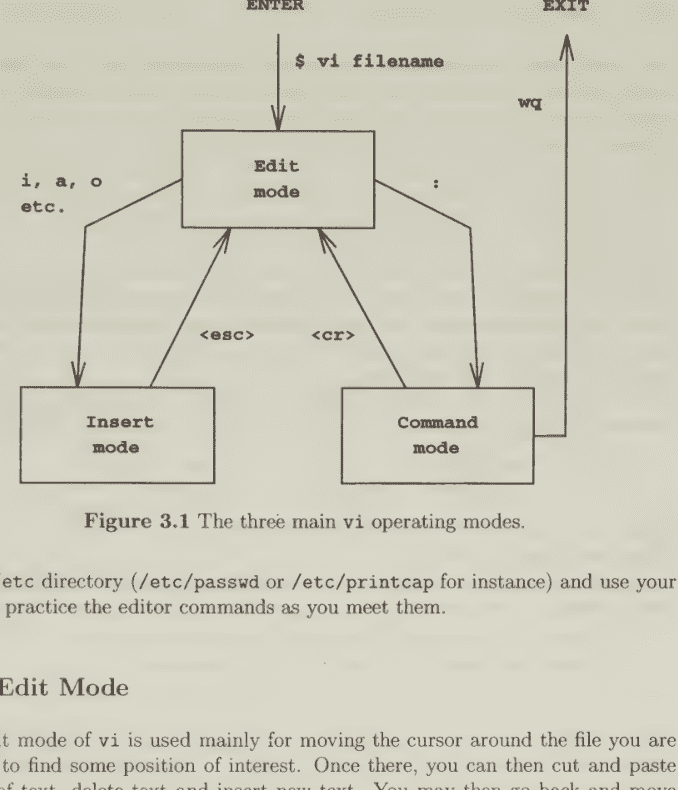

图 3.1 vi 的三种主要操作模式。

### 3.1 编辑模式

vi 的编辑模式主要用于在正在编辑的文件中移动光标以找到感兴趣的位置。一旦到达那里，你就可以剪切和粘贴文本块、删除文本并插入新文本。然后你可以返回并将光标移动到下一个感兴趣的位置，依此类推。

因为 vi 不依赖键盘具有特殊键（如光标控制键），在编辑模式下，许多字母键——以及它们的组合——都有特定功能。例如，当你完成所有编辑并希望保存编辑更改并从编辑器退出回到 shell 提示符时，你发出 ZZ 命令，这意味着连续按两次 Z 键。注意编辑器区分大小写，因此你必须在此处使用 ZZ 而不是 zz。


#### 3.1.1 定位光标

编辑模式下的主要光标移动键由上、下、左、右箭头键提供，前提是你的键盘支持它们。如果你的键盘不能正确支持箭头键，则可以使用以下键实现相同效果：

- k 上移；
- j 下移；
- h 左移；
- l 右移。

再说一次，vi 是为能在支持几乎任何类型终端的系统上运行而编写的。而有些终端类型，尤其是较旧的终端，除了标准的打字机键盘布局外，根本没有箭头键或其他任何特殊键。

除了这四个每次只移动一行或一个字符的命令外，vi 还有命令可以移动更远的距离：

- Ctrl-f 向文件向前移动一页（向下翻页）；
- Ctrl-b 向文件向后移动一页（向上翻页）。

实际上，这些命令移动的距离略小于一页，以便在阅读文件时保持一定的连续性。

一旦感兴趣的页面显示在屏幕上，你就可以使用以下命令快速在页面内移动光标：

- H 将光标移动到屏幕上的 home（顶部）行；
- M 将光标移动到屏幕上的中间行；
- L 将光标移动到屏幕上的最后一行。

再一次，注意这些字母的大小写。对于 H 和 L 命令，可以在其前面加上一个数字，光标将向下移动相应行数进入屏幕。因此，命令 2H 会将光标定位到屏幕的第二行，而命令 3L 会将光标移动到屏幕底部倒数第三行。

当你在文件中到达正确的行时，将光标定位到该行的正确位置很容易：

- w 向右移动到下一个单词的开头；
- e 向右移动到下一个单词的末尾；
- b 向左移动到上一个单词的开头；
- 0（零）将光标向左移动到行首；
- ^ 移动到行上第一个非空白字符；
- $ 将光标向右移动到行尾。

当 w、e 或 b 命令到达行尾（或行首）时，它们会换行到下一行（或上一行）。

#### 3.1.2 字符串搜索

如果你想查找某个已知单词或短语的出现位置，可以让 vi 直接为你搜索，而不是在文件中移动光标并手动搜索。为此，你输入正斜杠（/）字符，然后输入要搜索的字符字符串，然后按 Enter 或 Return。编辑器会向前搜索到文件末尾查找指定的字符串。如果找到字符串，编辑器会停止搜索并将光标定位到找到的字符串开头。如果这不是你要找的字符串出现位置，则使用 n 命令会搜索字符串的下一个出现位置。也可以使用 ? 字符代替 / 向后搜索文件，即朝文件开头搜索。无论搜索方向如何，当到达文件限制时，搜索会环绕到文件的另一端并继续进行。总结如下：

- /string  向前搜索给定字符串；
- ?string  向后搜索给定字符串；
- n        向前或向后搜索字符串的下一个出现位置。

#### 3.1.3 替换和删除

光标现在位于文件中的所需位置，有许多选项可用。主要的编辑模式选项允许你用另一个字符替换光标所在位置的字符，或从当前光标位置删除一个或多个字符：

- rc  用 c 替换当前光标位置的字符；
- x   删除当前光标位置的字符；
- dw  删除光标右侧的单词；
- db  删除当前光标之前的单词；
- dd  删除当前光标行并关闭空隙。

在此块中的任何命令前加上数字会扩展其功能如下：

- nrc  从光标位置替换 n 个字符为 c；
- nx   从光标位置删除 n 个字符；
- ndw  删除光标右侧的 n 个单词；
- ndb  删除当前光标之前的 n 个单词；
- ndd  删除 n 行并关闭空隙。

其他经常有用的删除命令（但不能加在前面数字）有：

- d$  删除从当前光标到行尾的字符；
- d0  删除从当前光标到行首的字符；
- J   删除行尾的回车符以将该行与下一行连接。

#### 3.1.4 剪切和粘贴

每当你从文本中删除字符、单词或行时，它们不会被直接丢弃，而是复制到内存缓冲区中。这非常有用，因为有一对命令可以让你将该缓冲区的內容粘贴回文本中，要么粘贴回原位置（如果你错误地删除了文本），要么粘贴到新位置，提供标准的剪切和粘贴功能。这对命令是：

- p（小写）将剪切缓冲区粘贴到当前光标之后；
- P（大写）将剪切缓冲区粘贴到当前光标之前。

如果剪切缓冲区包含字符或单词，则粘贴操作将在同一行的当前光标位置之前或之后进行。如果剪切缓冲区包含整行文本，则粘贴操作将在光标当前所在行的之前或之后进行。

vi 中有多个命令对（如 p 和 P），其中小写和大写配对提供类似的功能。在这些情况下，小写命令在当前位置之后操作，而大写版本在当前位置之前操作。

有时你可能想将一段文本复制到新位置，而不是通过剪切和粘贴移动该块。实际上你只需要能够将一段文本复制到剪切缓冲区，而不从文件中删除它：

- yy 复制（抓取）当前行到剪切缓冲区；
- nyy 复制（抓取）n 行到剪切缓冲区。

#### 3.1.5 撤销和重复

这里要介绍的最后两个编辑模式命令只是为了方便。第一个用于你在犯错时需要撤销某个命令的负面影响。第二个用于你已执行某个命令并将光标移动到下一个感兴趣的位置，希望再次重复相同命令的情况：

- u 撤销上一个命令的效果；
- . 重复上一个更改文本的命令。

### 3.2 插入模式

由于编辑模式使用了许多普通键盘字母作为命令，当你实际上想向文件中插入新文本时，你必须将编辑器切换到新模式，该模式会将这些字符视为普通字母添加到文本中。之后，当你完成文本输入时，你需要能够切换回编辑模式。

这就是插入模式的目的。如你所见，有许多进入插入模式的方式用于不同目的。然而，无论你使用何种方式进入插入模式，退出方式只有一种——使用 Esc 键。有些键盘类型不支持显式的转义键。在这种情况下，使用 Ctrl-[ 总是可以实现相同功能。

在适当定位光标后，进入插入模式的常用方法有：

- i 在当前光标位置左侧插入文本；
- a 在当前光标位置右侧追加文本。

这两个命令同时存在似乎很奇怪，但如果缺少其中任何一个，在某些情况下插入会变得更加困难。

你经常会发现想要在新行开始添加文本。在这种情况下，可以将光标移动到新文本上方行的末尾，然后使用 a 命令后按 Enter 或 Return 来打开一个空白行以填充新文本。更简单的方法是将光标定位在所需位置上方行的任何位置，然后使用 o 命令。这将在当前光标行下方打开一个空白行，并在空白行开头进入插入模式以便输入文本。O 命令会做同样的事情，但会在当前光标行之前打开空隙：

- o 在当前光标行下方打开一个空白行；
- O 在当前光标行上方打开一个空白行。

插入和追加命令的特殊版本可用于将光标移动到当前行的开头或末尾并在那里进入插入模式：

- I 在行首插入；
- A 在行尾后插入。

#### 3.2.1 文本替换

除了仅进入插入模式的命令外，还有几个命令允许文本替换——有效地在进入插入模式以接受替换文本之前删除一段文本。主要命令如下：

- s 用新文本替换当前光标字符；
- cw 将光标右侧的单词更改为新文本；
- cb 将当前光标之前的单词更改为新文本；
- cd 将当前光标行更改为新文本。


在此块中的任何命令前加上一个数字，其功能将扩展如下：

- ns 用新文本替换接下来的 n 个字符；
- ncw 将光标右侧的 n 个词更改；
- ncb 将当前光标前的 n 个词更改；
- ncd 用新文本更改接下来的 n 行。

除上述命令外，还有两个进一步的更改命令，可能很有用：

- c$ 将行尾的字符更改为新文本；
- c0 将行首的字符更改为新文本。

### 3.3 命令模式

到目前为止所介绍的命令都比较简单，至少在输入所需的按键次数方面是如此。然而，还有大量结构更复杂的命令，以及可以设置的许多配置选项。所有这些都通过命令模式输入。所有命令模式功能有一个共同点——它们都以冒号 (:) 开始。一旦输入冒号，光标会跳到屏幕底行的开头，在那里会显示一个冒号。你现在输入的任何字符，直到按回车或 Enter 为止，都会显示在显示器的底行，以便你可以检查并在必要时更正输入。

#### 3.3.1 退出命令

你所见过的退出编辑器的唯一方法是编辑模式中使用 ZZ 命令。这不仅退出，还会将你对文本所做的任何更改保存回原始文件，覆盖其先前内容。也许你只想在不保存编辑器内容的情况下退出编辑器。这可能是因为你没有对文本进行任何更改，或者因为你在更改文本后现在希望中止更改并无论如何退出编辑器。执行此操作的两个命令是：

- :q 如果未进行任何更改则退出编辑器；
- :q! 退出编辑器并放弃所做的任何更改。

养成在可以时使用 :q 的习惯是一个好做法，因为这会减少意外输入 :q! 的几率，而这可能会导致一些有价值材料的丢失。

#### 3.3.2 文件操作

下一组冒号命令允许你将文本块写入文件和从文件中读取：

- `:w` 将编辑器内容写入原始文件；
- `:wq` 写入文件并退出编辑器（与 ZZ 相同）；
- `:w file` 将编辑器内容写入指定文件；
- `:r file` 在光标行后将文件读入编辑器；
- `:e file` 编辑新文件，替换旧内容；
- `:f file` 将当前文本的名称更改为 file；
- `:f` 打印当前文本的名称和状态。

:w 命令将你正在编辑的文本写回你首次进入 vi 时指定的文件。此命令不会退出编辑器，但在文件写入后会让你保持在编辑模式。这是你应该不时使用的命令，以保存迄今为止所做的更改。:wq 命令只是将 :w 后跟 :q 的效果结合起来。

有时你可能想要修改文件的内容，然后将更改后的版本写回新文件，同时保持原始文件不变。这可以通过 :w file 完成。此命令的另一个变体允许你在其前指定一个以逗号分隔的行号范围。这只是将相应编号的行写入指定文件：

```
:a,bw file  write lines a to b inclusive into file
```

:r 命令用于在当前光标行后将指定文件的内容插入当前文本。这对于从先前准备好的片段构建新文件非常有用。

当你完成当前文本的编辑，如果你想在不必退出 vi 并重新进入的情况下编辑另一个文件，你可以使用 :e file 命令。在编辑文件的任何时候，你都可以更改 vi 默认将用于该文件的名称。这是通过 :f file 命令完成的。如果你在该命令后省略文件名，则 vi 将列出它当前为文本使用的名称以及一些状态信息，包括文本中的行数和当前光标行的行号。

#### 3.3.3 行号

正在编辑的文本中的所有行都有一个关联的行号。你可以使用以下命令直接将光标移动到特定行：

```
:n  move cursor to line n
```

其中 n 是你希望移动到的行的编号。

vi 可以在显示的文本中添加行号，这将在第 3.3.8 节中介绍。

在有意义的地方，冒号命令可以指定一个行号范围，命令将在该范围内操作。行号的指定有几种不同方式。首先，你可以指定数值，它们被视为绝对行号。行号中给出的句点（或句号‘.’）指的是当前光标行，无论其行号是多少。而美元符号 ($) 指的是文件中的最后一行。你也可以指定行号的简单数值表达式，如 .+5，这意味着从当前光标行起向后五行。以下是使用这些想法的一些示例命令：

| 命令 | 描述 |
|---|---|
| `:345` | 将光标移动到第 345 行； |
| `:345w myfile` | 将第 345 行写入 myfile； |
| `:3,8w myfile` | 将第 3 到 8 行（含）写入 myfile； |
| `:1,.w myfile` | 从第 1 行写到当前光标行； |
| `:.,$w myfile` | 从当前光标行写到文件末尾； |
| `:.,+4w myfile` | 从当前光标行写五行； |
| `:1,$w myfile` | 写入整个文件（与 :w myfile 相同）。 |

#### 3.3.4 字符串搜索

除了按编号指定行外，你还可以通过在这些行上给出要搜索的文本字符串来指定行。要搜索的文本字符串用斜杠 (/) 字符括起来，如果你想从当前位置向前搜索文本，或用问号（查询‘?’）字符括起来，如果你想向后搜索文本：

| 命令 | 描述 |
|---|---|
| `:/str/` | 将光标移动到包含 str 的下一行， |
| `:?str?` | 将光标移回包含 str 的下一行， |
| `:/str/w myfile` | 将包含 str 的第一行写入 myfile； |
| `:/str1/,/str2/w myfile` | 将从 str1 到 str2 的行写入。 |

#### 3.3.5 正则表达式

当你向 vi 指定搜索字符串时，可以包含几个具有特殊含义的字符。包含这些特殊字符的搜索字符串称为正则表达式。

例如，假设你想搜索一行文本，其中包含在行首的单词 struct。命令：

```
:/struct/
```

不行，因为这会在行的任何位置找到包含单词 struct 的第一行，而不仅仅是开头。这里的解决方法是在搜索字符串开头使用 ^（插入符号）特殊字符：

```
:/^struct/
```

^ 字符匹配行的开始，因此前一个命令的意思是：查找一行，该行具有行开始后跟字符串 struct。

类似地，你可以通过在搜索字符串末尾使用行尾特殊字符 ($) 来查找行尾的单词：

```
:/struct$/
```

下表列出了大多数特殊字符序列及其含义：

| 序列 | 含义 |
|---|---|
| `^` | 在字符串开头，匹配行首； |
| `$` | 在字符串末尾，匹配行尾； |
| `\<` | 匹配单词的开始； |
| `\>` | 匹配单词的结束； |
| `.` | 匹配任何单个文本字符； |
| `[str]` | 匹配 str 中的任何单个字符； |
| `[^str]` | 匹配不在 str 中的任何单个字符； |
| `[a-b]` | 匹配 a 到 b 之间的任何字符； |
| `*` | 匹配前一个字符的零次或多次重复； |
| `\` | 关闭其后字符的任何特殊含义。 |

#### 3.3.6 文本替换

:s 命令用于将一行中的一个字符字符串替换为另一个字符字符串。事实上，这个命令有几种变体。这些可以替换一行中特定字符串的第一次出现，也可以替换该行中字符串的每次出现，或者替换一行块甚至整个文件中的字符串的所有出现：

```
:s/str1/str2/      substitute first str1 on this line by str2;
:s/str1/str2/g     substitute every str1 on this line by str2;
:.,$/str1/str2/g   substitute every str1 to end of file by str2;
:1,$/str1/str2/g   substitute every str1 in whole file by str2;
:g/str1/s//str2/g  another way to substitute every str1 by str2.
```

在这些替换命令中，命令末尾的 g 指定命令将对当前光标行上搜索字符串的每次出现重复执行。没有 g，命令只对该行上搜索字符串的第一次出现起作用。命令开头的 g 指定命令将对文件中包含搜索字符串的每一行执行。


## Bash
Linux 与其他类 UNIX 系统一样，为用户提供各种 shell 程序。所有这些 shell 大致具有相同的目标——为用户与系统之间提供有用的交互界面，并提供一个简单的编程接口，允许将命令集合组合在一起并像普通 Linux 系统命令一样执行。

在本章中，我们将研究一个特定 shell——bash（the Bourne Again SHell）的交互界面。

Bash 由自由软件基金会分发为一个与 Bourne shell 兼容的程序，同时也融合了其他 shell 的许多最佳特性。它可以说是功能全面的最佳 shell，并且随大多数 Linux 发行版提供。

### 4.1 路径名展开
在前几章介绍的 Linux 命令示例中，所有需要的路径名都已完整指定。路径名有多种缩写方式，shell 会在将名称传递给任何命令之前展开它们。包含这些缩写字符的路径名称为 *正则表达式*。例如：

```
$ cp text/* backup
```

这里星号 (*) 用来表示任何文件名（除以点号 (.) 字符开头的那些文件外，这些文件由大多数命令特殊处理——请回顾第 2.1 节）。因此该命令行表示：复制 text 目录中的所有可见文件到 backup 目录，保持原始名称。实际上，cp 命令无需知道 * 字符，因为该字符的展开是由 shell 在 cp 甚至开始处理之前完成的。这意味着当 cp 命令获得作为命令行参数传递给它的文件名的访问权限时，它看到的将是类似这样的命令行：

```
$ cp text/motd text/passwd backup
```

这是因为 shell 已查看 text 目录，整理出目录中所有文件的名称，并明确地将它们列在传递给 cp 的命令行上。你已经看到 cp 命令可以处理复制多个文件到目录，因此它执行 shell 展开后的命令行没有任何问题。

shell 会展开的用于文件名的另一个特殊字符是问号（查询 '?'）。该字符可代表任何单个字符。以下命令及其输出说明了这一点：

```
$ ls /dev/tty?
/dev/tty0  /dev/tty2  /dev/tty4  /dev/tty6  /dev/tty8
/dev/tty1  /dev/tty3  /dev/tty5  /dev/tty7  /dev/tty9
```

这里，十个文件 tty0 到 tty9 被列出为 /dev 目录中唯一匹配模式 tty?（即 tty 后跟另一个单个字符）的文件。

与其允许任何单个字符，还可以给出一个明确的字符列表，其中任何一个都可以匹配。这是通过将列表括在方括号 ([ ]) 中完成的：

```
$ ls /dev/tty?[23456]
/dev/ttyS2  /dev/ttyp2  /dev/ttyq2  /dev/ttyr2  /dev/ttys2
/dev/ttyS3  /dev/ttyp3  /dev/ttyq3  /dev/ttyr3  /dev/ttys3
/dev/ttyS4  /dev/ttyp4  /dev/ttyq4  /dev/ttyr4  /dev/ttys4
/dev/ttyS5  /dev/ttyp5  /dev/ttyq5  /dev/ttyr5  /dev/ttys5
/dev/ttyS6  /dev/ttyp6  /dev/ttyq6  /dev/ttyr6  /dev/ttys6
```

这里，列出所有匹配模式 /dev/tty 后跟任意单个字符后跟 2 到 6 范围内的数字的文件。

该范围也可以指定为由连字符 (-) 分隔的一对字符，如下所示：

```
$ ls /dev/tty?[2-6]
```

路径名展开的最后一种形式允许你指定一个完整单词的列表来进行匹配，而不仅仅是单个字符。单词列表由逗号分隔并用花括号 {} 括起来，如以下命令所示：

```
$ mkdir /usr/tmp/{bin,doc,lib,src}
$ ls /usr/tmp
bin  doc  lib  src
```

#### 3.3.7 删除文本
即使在编辑模式下可以删除文本，仍然有一个冒号命令用于删除行。这对于删除大块文本非常有用，因为你可以在命令前指定要删除的行范围：

| 命令 | 描述 |
|---|---|
| `:d` | 删除当前光标行； |
| `:3d` | 删除文本中第三行； |
| `:.,$d` | 从当前光标行删除到文件末尾； |
| `:/str1/ ,/str2/d` | 删除从 str1 到 str2 的行。 |

#### 3.3.8 编辑器选项
在 vi 中有大量内部变量控制各种编辑器功能的行为。这些变量的值可以通过使用 :set 命令来更改：

```
:set option  set an option variable value
```

其中 option 指定变量及其要设置的值。其中一些更有用的选项是：

**自动缩进** 如果设置此选项，每当你创建一条新的空白行时，光标会自动沿行移动，以便与上一行（或对于 0 命令为下一行）的第一个非空白字符对齐。这使得在例如输入计算机程序作为文本时很容易获得正确的缩进。如果你未在新行上插入任何文本就按下 Esc 退出插入模式，或按下 Enter 或 Return 开始另一条新行，则该行上添加的缩进字符将被删除，以免在原本空白的行上留下缩进字符。一旦添加了缩进字符，你可能希望沿行退格以减少此行及后续行的缩进。这可以用 Ctrl-d 完成。此功能可通过 noautoindent 选项关闭。

**忽略大小写** 当此选项设置时，任何使用的正则表达式中的大小写字母都被视为相同。要禁用此功能，请使用 noignorecase 选项。

**行号** 这会使 vi 在屏幕上显示的每一行前加上其当前行号。行号仅添加到显示中，而不添加到文件本身。使用 nonumber 选项可关闭行号显示。

**标尺** 在屏幕底行以连续显示的方式显示当前光标行号和当前行上的光标字符位置。这使你能够跟踪正在编辑的文本中的位置。你可以用 noruler 选项关闭此显示。

**制表符宽度** 此选项允许你设置按下 Tab 键时在屏幕上打印的空格数（即 Tab 字符的宽度）。命令的格式为 :set tabstop=n，其中 n 是 Tab 所需的空格宽度。此选项的默认值是 8。没有特殊的命令再次关闭此选项，你只需将 tabstop 设置回默认值即可。

#### 3.3.9 Shell 转义
在编辑会话期间，你有时会希望运行其他 Linux 命令。如果必须保存当前工作、离开编辑器、运行所需命令然后再返回编辑文件，那会相当麻烦。如果能在编辑环境中保持的同时运行命令会好得多。这可以很容易地从 vi 中完成：

```
:!command   execute command then return to editor
```

:! 命令称为 shell 转义，它允许你运行可在标准 shell 提示符下运行的任何命令。命令完成后，控制权返回编辑器，以便你继续编辑会话。

## 练习
识别执行以下每个操作所需的 vi 冒号命令：

- 1. 查找文件中当前光标行的行号。
- 2. 删除当前光标行及其后三行。
- 3. 从当前光标位置向后搜索字符串‘8.7’最近一次出现的位置。
- 4. 删除文件的最后十行。
- 5. 从当前光标行向前搜索文件中下一个包含三个或以上数字的数字。
- 6. 删除当前行中‘aa’和‘zz’出现位置之间及包括它们的所有字符。
- 7. 用单词‘and’替换整个文件中所有‘&’的出现。

## 答案
- 1. f
  此命令还给出文件名及其当前长度。
- 2. .,+3d
  ‘.’ 符号表示当前光标行，因此 .,+3 是从当前光标行到其后三行的行范围。末尾的 d 表示删除此范围。
- 3. ?8\.7
  ‘?’ 表示从当前位置向后搜索。点号 (‘.’) 前的 ‘\’ 是必需的，因为否则点号是通配符，匹配任何单个字符。
- 4. $-9,$d
  美元符号 (‘$’) 表示文件末尾。
- 5. /[0-9][0-9][0-9]
  向前搜索找到三个相邻字符，每个字符都在 0 到 9 范围内
- 6. s/aa.*zz//
  这里的搜索字符串以 ‘aa’ 开头，其后跟任意数量的单个字符（‘.*’）并以 ‘zz’ 结束。用空字符串替换搜索字符串——因此删除。
- 7. g/&/s//and/g
  该行的中间部分将 ‘&’ 字符替换为单词 ‘and’。前导的 ‘g’ 表示对文件中的每一行，后缀的 ‘g’ 表示对行中的每个出现。


不要忘记，所有这些路径名展开都是由 shell 本身执行的，因此由 shell 调用的命令无需能够处理这些特殊字符。这也意味着，如果你将来编写自己的命令（也许是 C 程序），它们也可以利用 shell 提供的这项服务，而无需自己执行展开。

有时，你可能希望使用一个命令（或编写自己的命令），使其参数列表中可以传递这些特殊字符中的任意一个或全部。在这种情况下，你需要使用一种称为引用的技术，它告诉 shell 忽略被引用的字符的特殊含义，只是将其当作普通字符处理。

bash shell 支持三种引用机制：转义字符（\）、单引号（`'）和双引号（"）。

反斜杠（\）字符放在 shell 的任何特殊字符之前，会告诉 shell 忽略其特殊含义。如果使用这种转义字符机制，则需要在每个需要抑制特殊含义的字符前加上一个反斜杠：

```
$ cd
$ mv text/motd text/m\*?
$ ls text
m*?      passwd
```

用单引号（`'）括起来的任何字符字符串都会抑制字符串中所有字符的特殊含义：

```
$ cat 'text/m*?'
motd contents in here.
```

用双引号（"）括起来的任何字符字符串都会抑制本章中你所见过的所有路径名展开字符的特殊含义：

```
$ mv "text/m*?" text/motd
$ ls text
motd     passwd
```

然而，你应该注意，bash 还使用一些你尚未见过的特殊字符，即使在双引号内，它们仍保留其特殊功能。你将在第 6 章中遇到它们，那时我们将研究 shell 的非交互式或编程功能。

### 4.2 I/O 重定向

Linux 中提供命令的基本理念之一是提供许多执行特定任务且高效的简单功能。这些简单功能可以轻松组合起来构建更大、更复杂的命令。

在有意义的地方，UNIX（因此也是 Linux）命令默认配置为从键盘获取所需的任何输入，并将普通输出发送到屏幕。命令还默认安排将错误输出发送到屏幕。有时，如果你能从文件读取输入或向文件发送输出会很有用。在这些情况下，可以编写命令以将文件名作为额外的或可选的命令行参数指定。有些命令确实有此选项。然而，为了以防万一可能派上用场而为每个命令都提供此功能，会使可执行文件比实际需要的大得多。

为避免这种必要性，Linux 和 shell 共同提供了设施，允许根据需要重定向程序的标准输入和输出。考虑以下命令：

```
$ ls -l /usr/tmp >dir
```

它的作用是创建目录 /usr/tmp 内容的长列表。通常，该列表会显示在屏幕上。但当命令包含大于号（>）符号后跟文件名时，输出将被发送到指定的文件而不是屏幕。使用这种输出重定向形式，如果指定文件不存在则会创建它，如果已存在则会覆盖其当前内容。

这是否真的发生很容易验证，如下所示：

```
$ cat dir
total 4
drwxr-xr-x 2 pc book 1024 May 22 23:31 bin
drwxr-xr-x 2 pc book 1024 May 22 23:31 doc
drwxr-xr-x 2 pc book 1024 May 22 23:31 lib
drwxr-xr-x 2 pc book 1024 May 22 23:31 src
```

请记住，ls 命令不知道 > 字符的特殊功能。事实上，ls 命令甚至看不到 >，因为该字符及其后面的文件名在任何命令行参数传递给命令之前就被 shell 移除了。当 ls 运行 时，它只是继续像往常一样将其输出发送到标准输出设备，只是 shell 在启动 ls 之前已将标准输出从屏幕重定向到指定的文件。其他重定向操作符也是如此，你很快就会看到。

有时，使用输出重定向时，你可能有一个现有文件，希望将另一个命令生成的输出追加到其中。这可以通过使用追加重定向操作符 >> 来完成，它只是由两个并排的大于号组成：

```
$ ls /usr/tmp >>dir
$ cat dir
total 4
drwxr-xr-x  2 pc  book  1024 May 22 23:31 bin
drwxr-xr-x  2 pc  book  1024 May 22 23:31 doc
drwxr-xr-x  2 pc  book  1024 May 22 23:31 lib
drwxr-xr-x  2 pc  book  1024 May 22 23:31 src
bin doc lib src
```

顺便说一下，如果未给出命令行参数中的文件名，cat 命令将从标准输入设备（默认情况下为键盘）获取输入。键盘输入通过在单独一行的开头输入文件结束字符（Ctrl-d）来终止。鉴于此信息以及输出重定向的使用，以下简单命令将允许你直接从键盘将文本写入文件：

```
$ cat >text.file
any text entered here goes into text.file up to
Ctrl-d
$
```

除了重定向程序的标准输出外，还可以重定向其错误输出。程序的标准输出和错误输出通常被视为两件不同的事情，以便你可以单独重定向它们。因此，例如，如果你想在屏幕上看到程序的正常输出，但想将任何输出错误消息发送到文件以便稍后查看，你可以使用以下方法实现：

```
$ ls /usr/tmp 2>err.file
bin doc lib src
```

使用表示法 2>（或 2>> 用于追加）来表示错误输出设备的重定向。

为了同时将标准输出和错误输出发送到同一个文件，使用另一个输出重定向操作符（&）：

```
$ ls /usr/tmp >&output.file
```

正如程序的输出可以写入文件一样，其标准输入也可以从文件而不是键盘读取。这是通过小于号（<）重定向操作符完成的：

```
$ wc </etc/passwd
     21      42      775
```

请注意，文件名 /etc/passwd 没有出现在此 wc 命令的输出中。这是因为 wc 看不到文件名——它由 shell 处理。wc 命令的操作就像其输入来自键盘，不涉及文件名。

另一种输入重定向类型称为 here document。这种重定向类型告诉 shell 设置当前命令，使其标准输入来自命令行。在这种情况下的重定向操作符是 <<，要重定向到命令中的文本被包含在一对匹配的定界符词之间，如下所示：

```
$ wc <<delim
> this text forms the content
> of the here document, which
> continues until the end of
> text delimiter
> delim
      4      17      98
```

当你输入 here document 的文本时，不需要在每一行的开头键入 '>' 字符——它们由 shell 作为提示提供。shell 使用此提示来告诉你当前命令未完成，并且在执行你的命令之前仍期望更多输入。

可以在 << 操作符后使用任何单词作为文本开始定界符（本例中为 delim）。here document 的文本会一直继续，直到在单独一行的开头再次遇到相同的定界符词。此时，here document 的文本（不包括开始和结束定界符）将被重定向到命令（本例中为 wc）作为其标准输入文本。

使用重定向，可以组合命令以从系统中获得新的功能，而单个命令无法单独提供。例如，要查找目录中的文件数，你可以使用以下命令序列：

```
$ ls /usr/bin >/tmp/dir
$ wc -w </tmp/dir
      459
$ rm /tmp/dir
```

此序列在目录 /usr/bin 上运行 ls 命令并将输出重定向到 /tmp/dir。第二个命令计算 ls 输出文件中的单词数并显示结果——459，在此特定目录中文件很多。如本例所示，你应始终确保在完成使用后立即删除你在 /tmp 中创建的任何临时文件，以免它们被遗忘并浪费磁盘空间。

### 4.3 管道

通过将一个程序的标准输出写入文件，然后将该文件的内容输入到另一个命令的标准输入，你实际上是

通过临时文件将两个命令捆绑在一起使其作为一个整体工作。这是一个如此常见的需求，以至于 Linux 提供了一种机制，shell 利用该机制可以直接将两个程序连接起来，而无需使用临时文件。这种机制称为管道。

管道使用 | 重定向操作符。重写前面的示例以使用管道得到：

```
$ ls /usr/bin | wc -w
459
```

由于 Linux 是多任务操作系统，该命令行（或称为管道）将通过并发运行 ls 和 wc 两个命令来执行，以便 wc 可以在产生时读取 ls 的输出。

管道不仅仅局限于将两个命令捆绑在一起。任意数量的命令都可以连接在一起，使用管道操作符连接每对相邻的命令。以这种方式安排，第一条命令的输出将成为第二条命令的输入。第二条命令的输出成为第三条命令的输入，以此类推。

### 4.4 后台作业

在迄今为止的所有命令行示例中，一旦你输入命令并按下 Enter 或 Return，系统似乎就会去执行你的命令。当你的命令完成后，shell 最终才会返回提示符，邀请你输入另一条命令。图 4.1 说明了原因。

如你所见，一旦 shell 启动了新进程并运行你的命令，它就会让自己进入睡眠状态，等待你的命令完成。只有在这种情况下，才会向 shell 发送信号唤醒它，以便它可以给你提示符并查找你的下一个命令。

由于 Linux 是多任务的，shell 没有理由不能与你的命令同时运行，从而立即返回提示符，而你的命令继续执行其任务（见图 4.2）。如果例如你运行的命令需要很长时间才能完成任务，这非常有用，因为它允许你做其他事情。

是否让 shell 等待命令完成，还是立即返回提示符的决定由你在运行命令时做出。你所要做的就是在命令行末尾加上一个与号字符（&），如果不想让 shell 等待，而是立即返回提示符。这称为将命令放入后台：

```
$ ls -lR / > /tmp/ls.lR &
[1] 341
$
```

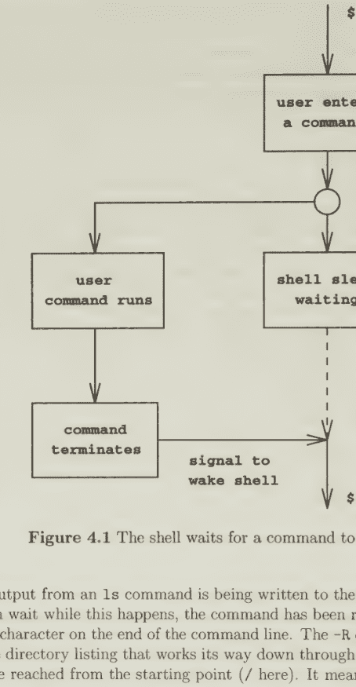

### 图 4.1 shell 等待命令完成。

这里 ls 命令的输出正在写入文件 /tmp/ls.lR，并且与其等待此操作完成，命令已通过在命令行末尾加上 & 字符在后台运行。ls 的 -R 选项会生成递归目录列表，从起始点（此处为 /）向下遍历所有可到达的子目录。这意味着该命令会生成机器整个目录层次结构的排序长列表——这是一个相当耗时的任务。命令后一行打印的数字由 shell 显示。方括号中的数字是该命令行的作业编号。这在第 4.5 节中描述。第二个数字是正在执行的命令的 PID，如果涉及管道，则为该行上最后一个命令的 PID。

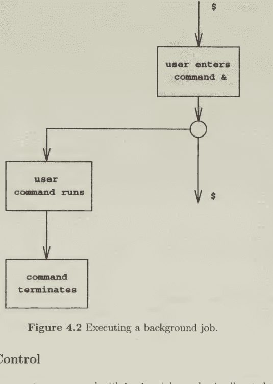

### 图 4.2 执行后台作业。

### 4.5 作业控制

每次你使用 bash 执行命令时，都会为其分配一个作业编号。对于此分配而言，管道中连接在一起的多个命令都算作一个作业，并共享一个作业编号。shell 使用这些作业编号作为其作业控制的基础。

作业控制允许你在稍后时间暂停并随后恢复进程的执行。shell 维护一个当前正在执行的作业列表，可以使用 jobs 命令显示。要暂停当前前台作业，只需在键盘上按下 Ctrl-z 键序列。这样做时，作业将停止运行并返回 shell 提示符，如以下示例所示：

```
$ cat >text.file
Ctrl-z
[1]+ Stopped              cat >text.file
$ jobs
```

```
[1]+ Stopped                cat >text.file
```

上述命令序列中的 Ctrl-z 表示你应在此处按下 Ctrl-z，这将暂停当前正在执行的 cat 命令。然后使用 jobs 命令会显示该作业在 shell 列表中，连同其作业编号和当前状态。

当你准备恢复该进程的执行时，你有两个选择：你可以使用 fg 命令将其重新置于前台，在这种情况下它将从中断处继续；或者你可以使用 bg 命令将其推入后台，在这种情况下它将像你最初在行尾使用 & 操作符运行命令一样运行。

在这种特定情况下，你应该记住 cat 命令是以从键盘获取输入的模式启动的。这意味着如果你在后台恢复该命令，它将立即从键盘执行非法读取，并再次被系统自动挂起：

```
$ bg
[1]+ cat >text.file &
$ jobs
[1]+ Stopped (tty input)    cat >text.file
```

fg 和 bg 命令默认操作最近停止的作业。当你使用 jobs 命令时，该默认作业将在 shell 输出中在其作业编号后立即用 + 符号标识。通常，如果你想引用列表中的任何作业，而不仅仅是默认作业，可以通过在百分号（%）符号后给出其作业编号来实现：

```
$ fg %1
cat >text.file
```

此 fg 命令将重新启动 cat 作业回到前台，以便任何后续键盘输入（直到 Ctrl-d）将被写入文件 text.file。

与其恢复已停止的作业，你可能只想完全终止该作业。这可以使用 kill 命令完成：

```
$ cat >text.file
Ctrl-z
[1]+ Stopped                cat >text.file
$ jobs
[1]+ Stopped                cat >text.file
$ kill %1
[1]+ Terminated             cat >text.file
```

如果在有任何已停止作业的情况下尝试注销系统，你将收到警告错误消息并且命令会失败：

```
$ cat >text.file
Ctrl-z
$ logout
There are stopped jobs.
```

此时你可以处理已停止的作业，或者，如果你立即再次注销，作业将自动终止并且注销将成功。

### 4.6 历史记录

在 Linux 下工作时，你经常会发现自己反复执行相同的少量命令序列。例如，在程序开发和调试期间，你经常会在标准循环中迭代：编辑源代码，将源代码编译为可执行文件，运行可执行文件以测试其性能，然后再次回到起点。为了节省你反复重新输入相同命令的麻烦，bash 会在你输入时存储你的命令，以便你需要时可以轻松返回。bash 为此目的使用的存储称为历史列表，默认情况下该列表可以存储你输入的最后 500 条命令行。

如此大小的历史列表几乎可以代表许多天工作中输入的所有命令。为了使使用如此大小的历史列表有意义，bash 会自动安排在你注销时将当前列表保存到文件中。bash 使用的默认文件名是 .bash_history，它存储在你的主目录中。请注意，文件名前面的点意味着除非使用 -a 命令行开关，否则 ls 不会列出该文件。当你在下一会话开始时登录时，shell 会自动将历史文件的内容加载到其历史列表中，从而有效地允许你从上次会话结束时离开的地方继续。

要查看之前输入行的存储列表，你使用 history 命令。请记住该列表长达 500 行，因此你可能希望将 history 命令的输出通过管道传输到 more 或 tail：

```
$ history | tail -5
511  cat >text.file
512  cd ..
513  ls -al
514  cd book
515  history | tail -5
```

历史列表中的每一行都称为事件，每行旁边的数字称为事件编号。一旦你知道要重复的行对应的事件编号，执行它就很简单。假设你想

重复前例中的历史命令（事件编号 515），你只需使用历史替换操作符（!）后跟事件编号：

```
$ !515
history | tail -5
  512  cd ..
  513  ls -al
  514  cd book
  515  history | tail -5
  516  history | tail -5
```

如果你想要重复的事件恰好是上一个命令，如前例所示，你就可以直接使用特殊记号 !!，如下所示：

```
$ !!
history | tail -5
  513  ls -al
  514  cd book
  515  history | tail -5
  516  history | tail -5
  517  history | tail -5
```

除了按编号引用事件外，还可以让 shell 在历史列表中按文本搜索以找到特定命令。在这种情况下，使用历史替换操作符后跟一串字符。shell 将会向后搜索历史列表，并执行它能找到的第一个命令行为指定字符串开头的事件：

```
$ !ls
ls -al
-rw-r--r--  1 pc  book  3392 May 29 07:55 .bash_history
-rw-------  1 pc  book  25 Mar 26 1994 .profile
drwxr-xr-x  3 pc  book  1024 May 28 23:30 book
```

观察前例，在这种情况下执行的是事件 513。如果你指定的搜索字符串被一对 ‘?’ 字符括起来，那么 shell 将会在每条命令行的任何位置搜索该字符串，而不仅仅是开头。如果 ‘?’ 后面没有内容，则可以省略它：

```
$ !?456
ls /dev/tty?[23456]
/dev/ttyS2  /dev/ttyp2  /dev/ttyq2  /dev/ttyr2  /dev/ttys2
/dev/ttyS3  /dev/ttyp3  /dev/ttyq3  /dev/ttyr3  /dev/ttys3
/dev/ttyS4  /dev/ttyp4  /dev/ttyq4  /dev/ttyr4  /dev/ttys4
/dev/ttyS5  /dev/ttyp5  /dev/ttyq5  /dev/ttyr5  /dev/ttys5
/dev/ttyS6  /dev/ttyp6  /dev/ttyq6  /dev/ttyr6  /dev/ttys6
```

这样即使该命令名最近已被用于其他用途，你仍然可以重复该事件。

有时你可能希望重复之前的命令，但做一些小的修改。这可以通过在行尾指定替换来实现，形式为 :s/old/new/，其中所选命令行的第一个 old 字符串出现将被 new 字符串替换，如下所示：

```
$ !?456?:s/234/4/
ls /dev/tty?[456]
/dev/ttyS4  /dev/ttyp4  /dev/ttyq4  /dev/ttyr4  /dev/ttys4
/dev/ttyS5  /dev/ttyp5  /dev/ttyq5  /dev/ttyr5  /dev/ttys5
/dev/ttyS6  /dev/ttyp6  /dev/ttyq6  /dev/ttyr6  /dev/ttys6
```

请注意，到这种复杂程度时，几乎更容易直接重新输入所需的命令行。

### 4.7 命令行编辑

为了简化在历史列表中查找、修改和重新执行事件的任务，如果你的键盘支持光标移动（箭头）键，bash 还允许简单的命令行编辑。每次按下上箭头键时，shell 就会在历史列表中回退一个事件并显示找到的命令行。如果你按下下箭头键，则会再次向前移动列表。当所需行显示出来时，只需按下 Enter 或 Return 键即可重新执行命令行并将其添加到历史列表末尾。如果你希望在执行前编辑命令行，可以使用左右箭头键将光标沿着行移动到感兴趣的位置。然后你可以使用 Backspace 键删除光标前的字符，然后输入替换字符。当你完成对命令行的修改后，按下 Enter 或 Return 即可执行它。

### 4.8 命令补全

bash 的另一个有用功能是它能够尝试为你补全命令行。在输入命令的任何时候，你都可以按下 Tab 键。这样做时，shell 会尝试补全你当时正在输入的命令的任何部分。例如，假设你想使用 passwd 命令更改密码；你可以输入以下内容（记号 <Tab> 表示按下 Tab 键）：

```
$ pass<Tab>
```

当你输入这个字符序列时，bash 知道你正在输入命令名，它会搜索以你在按下 Tab 键前输入的字符开头的命令（本例中为 pass）。shell 唯一能找到以这些字符开头的命令是 passwd，因此它通过在你已输入的内容末尾添加额外字符来为你补全命令名。

如果你输入的字符数不足以让 bash 唯一确定应使用哪个命令，则会发出可听见的警告。在此时再次按下 Tab 键会使 bash 显示所有可能的命令补全方式列表：

```
$ pas<Tab><Tab>
passwd  paste
```

然后你可以向命令行添加足够多的字符，以便 shell 在下次按下 Tab 键时能够解决歧义。

除了能够以这种方式补全命令名外，shell 在你将它们用作命令参数时也可以为你补全文件名：

```
$ tail -2 /etc/p<Tab><Tab>
passwd  printcap  profile
$ tail -2 /etc/pa<Tab>
pc:fjKppCZxEvouc:500:500::/usr1/pc:/bin/bash
carey:Yt1a4ffkG2r02:501:500::/usr1/carey:/bin/bash
```

这里，我们试图显示密码文件中的最后两行。shell 在第一次尝试时无法解析文件名，使用文件名 /etc/p<Tab>。再次按下 <Tab> 会显示 /etc 目录下的三个选项 passwd、printcap 和 profile，因为它们都以字母 p 开头。正如你从此列表中看到的，添加一个额外字符（本例中为 a）将解决 shell 的歧义，并正确地执行所需的命令行。

### 4.9 Shell 函数

使用 shell 函数是将一组命令分组并存储以便稍后执行的一种简单方法。shell 函数定义的一般形式为：

```
name() { list; }
```

其中 name 是你将用来执行函数的命令名，而 list 是由分号分隔的命令或管道列表，指定函数将执行什么任务。

例如，如果你输入以下函数定义：

```
$ ll() { ls -l; }
```

然后你就可以使用 ll 作为命令来执行与 ls -l 相同的任务：

```
$ ll
 drwxr-xr-x  3 pc  book  1024 May 28 23:30 book
```

你可能会想，如果你想执行命令 ls -al，鉴于 ll 的定义已存在，你可以用命令 ll -a 实现。遗憾的是，并不那么简单。可以实现我们想要的功能，但为此需要按如下方式更改 ll 函数的定义：

```
$ ll() { ls -l $*; }
```

添加 $* 字符意味着在 ll 命令后输入的任何参数或命令行开关都将被插入到 ls -l 命令中，替换 $* 字符的位置。使用 ll 的新定义会得到预期的结果：

```
$ ll -a
-rw-r--r--  1 pc  book  3392 May 29 07:55 .bash_history
-rw-------  1 pc  book    25 Mar 26  1994 .profile
drwxr-xr-x  3 pc  book  1024 May 28 23:30 book
```

对 $* 及相关主题的更完整讨论将在第 6 章中给出，当时我们将研究 shell 编程。

shell 函数的主体（在 { 和 } 之间）可以由多个命令或管道组成，只要它们由分号分隔即可。这里有一个示例（以相当低效的方式编写，仅用于演示目的），用于显示给定目录中包含的文件数。该函数名为 lswc，因为它结合了这两个命令的功能：

```
$ lswc() { ls $* >/tmp/dir; wc -w </tmp/dir; rm /tmp/dir; }
```

定义中使用 $* 字符允许 lswc 接受一个参数，该参数应为命令要操作的目录的路径名：

```
$ lswc /usr/bin
459
```

## 练习

本练习集的一个目标是让你习惯在系统手册页中查找内容。因此，如果你不能立即看到某个练习的解决方案，不用担心，只需查看适当的手册页，你就能找到所需的信息。编写并测试命令管道以执行以下每个功能：

- 1. 显示系统上当前可用的不同登录名的数量。


2. 当前系统上有多少个进程？
各以下管道执行什么功能：
3. `df -a | wc -l`
4. `who | wc -l`

## 答案

1. 这个问题有多种解决方案，都通过统计文件 `/etc/passwd` 中的行数，因为系统中每个可用的登录名在该文件中有自己的行：
- `$ cat /etc/passwd | wc -l` 这使用 cat 列出文件，然后将结果通过管道传递给 wc 以统计行数。
- `$ wc -l </etc/passwd` 这直接使用 wc，将其输入从密码文件重定向以达到相同的效果。
- `$ wc -l /etc/passwd` 最后，wc 命令实际上可以直接指定文件名作为额外参数。

2. 列出系统进程的命令是 ps。该命令列出系统上的进程，每个进程一行。统计行数应该能给出进程数。一个小问题是，默认情况下 ps 命令也会在其输出顶部显示一行标题。这可以被抑制，但你需要查看手册页才能知道执行此操作的命令行开关是 -h。这给出了一个解决方案：

```
$ ps -axh | wc -l
```

3. df -a 命令列出所有组合生成整体目录层次结构的文件系统。已挂载的文件系统每行列出一个，因此行数统计会告诉你已挂载文件系统的数量。一个问题是 df 命令也会生成一行标题，与 ps 命令不同，该标题无法被抑制。这意味着从此管道获得的输出数字会大一。如果很重要，可以解决这个问题，我们将在第 6.7.2 节中介绍算术表达式

4. 这个练习使用了一个我们尚未介绍的命令，但快速查看手册会显示 who 命令只是列出所有已登录的用户，每行一个。因此统计行数将显示当前活动的用户登录数。

## 工具和实用程序

到目前为止，Linux 下普通用户可用的命令比你看到的要多得多。本章集中介绍一些更复杂的可用命令，单独或组合使用可以做很多有用的事情，而无需求助于编程。

本章描述的许多命令设计为从标准输入设备获取输入并将输出发送到标准输出设备。这使它们成为构建更复杂管道时理想的候选者，其中一个命令的输出被管道传输到下一个命令的输入。这类命令通常称为 *过滤器*。这些命令读取其标准输入，对其进行某种转换，然后将结果写入标准输出。

### 5.1 搜索和排序

一个非常常见的操作是想要搜索文件中包含特定字符串的行，或在列表中搜索特定项目。另一个常见操作是将行按某种顺序排序。Linux 有命令可以从命令行或在管道内执行这两种操作。

#### 5.1.1 grep

第一个要查看的命令是一个名为 grep 的过滤器。其名称是 *通用正则表达式解析器* 的缩写，翻译成英文意味着 grep 可用于在其输入中搜索字符串模式。grep 的输出由包含指定字符串模式的所有输入行组成。例如，要确定用户 carey 在系统上是否存在登录，

你只需在密码文件中搜索此名称字符串，如下所示：

```
$ grep carey /etc/passwd
carey:Yt1a4ffkG2r02:501:500::/usr1/carey:/bin/bash
```

grep 命令产生了这一行输出的事实表明，确实该用户名存在于系统上。但是请注意，grep 不仅在每个密码文件条目的用户名字段中查找字符串，而是在文件中的任何位置。这意味着仅仅因为 grep 找到了你正在查找的字符串，并不一定意味着它在你期望的上下文中：

```
$ grep public /etc/passwd
uucp:*:10:14:uucp:/var/spool/uucppublic:
```

在此示例中，即使系统上没有注册用户名 public，grep 仍有输出行。

如果你想让 grep 只查找密码文件中的用户名，那么你需要确保它只在每行的开头查找搜索模式。grep 中此问题的解决方案与 vi 用于其搜索字符串规范的解决方案类似——正则表达式。

grep 中正则表达式使用的基本特殊字符集与 vi 中使用的相同。如果在命令行中包含 -E 开关，还可以使用一组扩展的特殊字符。下面的表格列出了 grep 中可用的大多数特殊字符序列及其含义；中间列中的 B 或 E 显示哪些功能是基本的，哪些是扩展的：

| 符号 | 类型 | 含义 |
|---|---|---|
| ^ | B | 匹配行的开始； |
| $ | B | 匹配行的结束； |
| \< | B | 匹配单词的开始； |
| \> | B | 匹配单词的结束； |
| . | B | 匹配任何单个文本字符； |
| [str] | B | 匹配 str 中的任何单个字符； |
| [^str] | B | 匹配不在 str 中的任何单个字符； |
| [a-b] | B | 匹配 a 和 b 之间的任何字符； |
| \ | B | 关闭其后字符的任何特殊含义； |
| * | B | 匹配前一项的零次或多次重复； |
| + | E | 匹配前一项的一次或多次重复； |
| ? | E | 匹配前一项的零次或一次重复； |
| {j} | E | 匹配前一项恰好 j 次重复； |
| {j,} | E | 匹配前一项 j 次或更多重复； |
| {,k} | E | 匹配前一项最多 k 次重复； |
| {j,k} | E | 匹配前一项 j 到 k 次重复； |
| s|t | E | 匹配项目 s 或项目 t 中的一个； |
| (exp) | E | 将 exp 视为单个项目。 |

不要忘记在 vi 和 grep 中使用正则表达式之间还有一个主要区别。在编辑器中，你输入的任何字符仅由编辑器本身看到和使用，而 grep 看到的任何参数都已经先经过 shell。由于 grep 在正则表达式中使用的一些特殊字符在 shell 中也有特殊含义，你需要告诉 shell 忽略它们，以便 grep 有机会看到它们。这是通过引用你希望 shell 忽略的字符来完成的。如果你需要复习，shell 的引用机制在第 4.1 节中已描述。

回到只搜索密码文件登录名的原始问题，现在很容易构造一个 grep 命令行来显示 ‘public’ 不是有效的登录名：

```
$ grep '^public' /etc/passwd
```

单词 ‘public’ 前面的 ^ 强制 grep 只在每行的开头查找该单词。整个搜索模式被单引号 (') 括起来，这样 shell 就不会干扰它，而是会将其（去掉引号）传递给 grep。grep 没有输出的事实表明密码文件中没有以单词 ‘public’ 开头的行。

一个稍微复杂一点的例子是显示密码文件中登录名未设置密码的行。如果该行上的第二个字段（第一个和第二个冒号字符之间）为空，则为真：

```
$ grep -E '^[^:]+::' /etc/passwd
sync::3:2:::/bin/sync
mtos::9876:9876:student login:/mtos/home:/bin/bash
load::9876:9876:mount floppy::/mtos/bin/load
unload::9876:9876:umount floppy:::/mtos/bin/unload
```

从输出可以看出，在此示例中存在四个这样的登录名，登录名分别为：sync、mtos、load 和 unload。

为了完全理解，示例中使用的搜索模式（‘^[^:]+::’）可能需要一点解释。第一个和最后一个单引号字符只是告诉 shell 忽略字符串内容并将其不变地传递给 grep。搜索模式本身需要查找三件事：行的开始，后跟登录名，后跟一对冒号，表示空密码字段。行的开始由初始 ^ 字符捕获。空密码字段由字符串末尾的一对冒号 (::) 匹配。剩下的就是 [^:]+ 来匹配任何登录名。要理解这一最后部分，你需要将登录名视为从第一个冒号字符开始的可变数量的字符，这正是 [^:]+ 的含义——一个或多个非冒号字符。grep 的 -E 命令行开关是必需的，以便能够使用扩展功能集中的 + 重复运算符。

如果你使用 grep 命令而不指定要搜索的任何文件，则 grep 从标准输入设备获取输入。在此模式下 grep 可以有其

从前一个命令管道输入到它。这里有一个示例管道，用于列出根目录下普通用户具有写权限的任何子目录的名称：

```
$ ls -l / | grep `^d......w`
drwxrwxrwt 10 root root 1024 May 30 14:30 tmp
```

正如你所预期的那样，此管道显示普通用户在 /tmp 目录中具有写权限。它通过使用 ls -l / 来生成根目录中包含的所有文件和目录的长列表。然后将 ls 的输出行管道传输到 grep，后者被设置为搜索以 d（目录）开头的行 (^)，然后有一组权限标志，拥有者可以有任意值 (...)，组可以有任意值 (...)，世界读权限标志可以有任意值 (.)，最后世界写权限标志被设置为允许对该目录进行世界写访问。

一些可用于 grep 的有用的命令行开关是：

- -E 使用扩展正则表达式进行模式匹配；
- -i 将大小写字母视为相同；
- -n 为每一行输出显示文件中的行号；
- -q 抑制输出显示，与其他命令一起使用；
- -s 抑制文件读取权限错误消息；
- -C num 显示每个匹配项前后的 num 行。

#### 5.1.2 find

find 命令的主要操作是从给定的起点遍历树状目录层次结构，一直向下通过所有分支直到叶节点。在 find 在途中发现的每个文件和子目录上，都可以使其执行你在命令行编程的一组操作。find 最常见的用途只是生成目录层次结构中给定起点下所有文件和目录的列表：

```
$ cd
$ find . -print
./backup
./backup/motd.bak
./backup/passwd.bak
./text
./text/passwd
./text/motd
```

此示例显示了一个 cd 命令，将当前工作目录更改为你的主目录，然后是 find 命令。传递给 find 的两个参数是点，它告诉 find 从当前目录开始搜索，以及 -print，它只是告诉 find 显示它找到的所有文件的名称。

由于文件名由 find 写入标准输出设备，因此它们也可以写入管道供其他命令使用，如以下示例所示：

```
$ find . -print | grep passwd
./backup/passwd.bak
./text/passwd
```

事实上，正如你很快就会看到的，此特定应用程序可以直接由 find 执行，而完全不需要使用 grep。

find 命令的一般格式是：

```
find pathnames -expressions
```

其中 pathnames 可以是任何目录名称列表，每个目录都将被递归搜索以生成文件名，而 -expressions 是任何表达式列表，这些表达式定义了在搜索找到的每个文件上执行条件和操作。如果未指定 pathnames，则默认为当前目录，如果未给出 -expressions，则默认表达式为 -print 使用：

```
$ find
./backup
./backup/motd.bak
./backup/passwd.bak
./text
./text/passwd
./text/motd
```

可以使用 find 的表达式有三种类型：选项、条件和操作。这些类型中的每一种都返回一个值，具体取决于表达式是什么以及其求值过程如何进行的值为 true 或 false。每当 find 命令指定多个表达式时，则在连续的表达式对之间使用逻辑运算符来控制其执行。给定表达式 e1 和 e2：

- e1 -a e2   仅当 e1 为 true 时才求值 e2；
- e1 e2      与 e1 -a e2 相同；
- e1 -o e2   仅当 e1 为 false 时才求值 e2；
- e1 , e2    都求值，按 e1 然后 e2 的顺序。

这些复合表达式的值是实际求值的最后一个组成部分表达式返回的值。具有两个以上组成部分的复合表达式从左到右求值，除非使用括号 () 来改变求值顺序，这样：

```
e1 -o e2 -a e3
```

将求值如下：

```
( e1 -o e2 ) -a e3
```

除非显式添加括号来改变它，如：

```
e1 -o ( e2 -a e3 )
```

还提供了一个逻辑非运算符，这样：

! e1 在 e1 为 false 时为 true，反之亦然

下表详细说明了 find 可用的一些表达式，以及每个表达式的类型和它返回的值：

| Expression | Description |
|---|---|
| -mount | 一个选项表达式，可防止 find 在当前文件系统的边界之外搜索。返回值始终为 true。 |
| -group grp | 一个条件表达式，检查当前文件是否具有与 grp 匹配的组 ID 或组名。如果文件的组 ID 或组名与 grp 匹配，则返回值为 true，否则为 false。 |
| -name pattern | 一个条件表达式，查找与 pattern 匹配的文件名。pattern 可以作为正则表达式给出，可能需要从 shell 中引用。如果当前文件名与 pattern 匹配，则返回 true，否则返回 false。 |
| -type t | 一个条件表达式，检查当前文件是否为类型 t，其中 t 可以是 d 表示目录，f 表示普通文件，l 表示符号链接等。如果当前文件是类型 t，则返回 true，否则返回 false。 |
| -user usr | 一个条件表达式，检查当前文件是否具有与 usr 匹配的所有者 ID 或所有者名称。如果文件的所有者 ID 或所有者名称与 usr 匹配，则返回值为 true，否则为 false。 |
| -exec cmd ; | 一个操作表达式，执行命令 cmd。如果需要将当前文件名传递给 cmd，则使用 {} 记号完成。分号 (;) 用于标记 cmd 的结束并将其与可能跟随的任何更多选项表达式分隔开。如果 cmd 成功执行且无错误，则返回值为 true，否则为 false。 |
| -print | 一个操作表达式，只是将当前文件名打印到标准输出设备。始终返回 true。 |

关于 find 需要注意的一个明显点是，它不会让你绕过系统的文件和目录权限安排。因此，如果你在 find 起始位置下方有你无法访问的目录，则 find 会为每个目录生成一条错误消息，并发送到标准错误设备。由于标准错误消息的默认设备是屏幕，这可能会使你正在寻找的实际输出（假设你正在使用 -print 操作）变得难以看到：

```
$ find / -name passwd -print
find: /var/spool/cron: Permission denied
find: /var/spool/atjobs: Permission denied
find: /var/spool/atspool: Permission denied
/usr/bin/passwd
find: /usr/doc/ttysnoop: Permission denied
/etc/passwd
find: /root: Permission denied
```

抑制此不需要的输出最简单的方法是将错误输出重定向到文件。通常，这意味着你之后会有不需要的文件要删除；然而，有一个文件你可以用来发送你真的想扔掉的东西。该文件的路径名是：

/dev/null

该文件被特别安排为，只要你向它写入任何内容，字符就会被丢弃。它也被安排为，当你尝试从中读取任何字符时，你总是立即得到一个文件结束指示，而没有读取其他字符。

使用此文件来抑制 find 的错误输出，前面的示例变为：

```
$ find / -name passwd -print 2>/dev/null
/usr/bin/passwd
/etc/passwd
```

请注意，此示例使用了两个 find 表达式，中间没有运算符（此安排默认为使用 -a 运算符）。对于此运算符，第一个表达式针对 find 生成的每个文件名进行求值，并且只有在结果为 true 时才会求值第二个表达式。此示例中的第一个表达式是 -name passwd，它查找 find 当前提供的路径名末尾的文件名 passwd。如果找到匹配项，表达式返回值为 true；否则返回 false。此返回值决定是否求值第二个表达式。如果 -name 返回值为 true，则第二个表达式 (-print) 将显示 find 当前的路径名到标准

输出设备。总体效果是打印出 find 发现的所有路径名，并在末尾加上文件名 passwd。

这样你可以在不像前面的示例那样通过管道传递给 grep 的情况下找到路径名列表。然而存在差异：-name 表达式只会在路径名的末尾查找完整的单词，而 grep 可以查找子字符串：

```
$ cd
$ find . -name motd -print 2>/dev/null
./text/motd
$ find . -print 2>/dev/null | grep motd
./text/motd
./backup/motd.bak
```

作为最后的、更复杂的示例，让我们看看如何生成一个目录子树中所有普通文件路径名的列表，这些文件的内容包含特定字符串。一种可能的解决方案是使用 find 生成路径名，然后使用 grep 检查指定字符串是否出现在任何文件中，并打印出为真文件的路径名。唯一真正的问题是 grep 通常会将找到的任何行显示到标准输出，同时将错误消息发送到标准错误设备。解决此问题的一种方法是同时将标准输出和错误输出重定向到 /dev/null，但实际上 grep 提供了更简单的解决方案，因为它内置了命令行开关来为你抑制这些输出：

```
$ find /etc -type f -exec grep -q -s mycroft {} \; -print
/etc/HOSTNAME
/etc/hosts
/etc/lilo.conf
```

这条命令行所做的是使用 find 生成 /etc 目录下所有路径名的列表。然后它评估表达式 -type f，如果当前路径名是普通文件，则返回值为 true。第二个表达式 (-exec grep -q -s mycroft {} \; ) 因此会对所有普通文件进行评估，并依次在每个文件中搜索字符串 mycroft。不要忘记符号 {} 在 grep 执行时会被当前路径名替换。-q 和 -s 选项会阻止 grep 产生其正常显示，因此实际上该表达式只是用来生成一个真或假值，以决定是否评估第三个表达式。第二个表达式末尾的分号前的 \ 只是为了引用分号，使 shell 忽略它并原样传递给 find。如果 -exec grep 表达式返回 true，则 -print 表达式将被评估，其操作将显示当前路径名，正如所需。

#### 5.1.3 sort

sort 命令是一个过滤器，可以按命令行指定的顺序对输入中的文本行进行排序，然后将排序后的行发送到标准输出设备。sort 命令非常通用，因为它可以将输入行视为多个字段的集合，并使用一个或多个这些字段作为排序键执行排序操作。你还可以选择 sort 用作字段分隔符的字符，以便对不同类型的文件进行排序。

在下面的示例中，我们将使用以下小型且虚构的密码文件，名为 pw.test：

```
root:awmku76tr43d6:0:0::/root/:/bin/sh
pc:bdhd74hs9jh3h:500:50::/usr1/pc:/bin/bash
carey:esJ9ohd8HH89i:501:50::/usr1/carey:/bin/bash
mot:dhjd83kjdJS6D:1500:60::/usr1/mot:/bin/bash
grex:cj8AjoWE8h8fs:1500:60::/usr1/mot:/bin/sh
```

默认情况下，sort 使用空白字符（空格、制表符等）作为其字段分隔符。因此，pw.test 中的行不包含空白字符，每行都被视为一个字段。如果对该文件运行 sort，它会将每一行视为一个单词并按字母顺序排序：

```
$ sort pw.test
carey:esJ9ohd8HH89i:501:50::/usr1/carey:/bin/bash
grex:cj8AjoWE8h8fs:1500:60::/usr1/mot:/bin/sh
mot:dhjd83kjdJS6D:1500:60::/usr1/mot:/bin/bash
pc:bdhd74hs9jh3h:500:50::/usr1/pc:/bin/bash
root:awmku76tr43d6:0:0::/root/:/bin/sh
```

sort 命令将从命令行指定的任何文件中获取输入，如果没有指定，则从标准输入设备获取。

sort 有许多命令行开关可用；最有用的列在下表中：

| 开关 | 描述 |
|---|---|
| -b | 忽略排序键中的前导空格字符； |
| -f | 将大小写字母视为相同； |
| -n | 将排序键视为数字而非文本； |
| -r | 按从高到低排序而非从低到高； |
| -o file | 将输出发送到文件而不是标准输出； |
| -t s | 使用 s 作为字段分隔符，而非空白； |
| -k s1,s2 | 使用字段 s1 到 (s2-1) 作为排序键。 |

实际上，排序键的指定比前表所示的更复杂一些。首先，允许重复给出 -k 开关，以便指定任何字段组合。sort 命令按命令行给出的顺序使用字段，这不必与文件中字段的顺序相同。每个字段说明符（s1 和 s2）都可以指定为 f.c，其中 f 是字段编号，c 是字段内的字符位置。这两个值都从 1 开始计数。一些示例可能有助于使其更清晰：

| 说明符 | 描述 |
|---|---|
| -k3 | 排序键从第三个字段的开始到行尾。 |
| -k3,6 | 此处的排序键由该行的第三、第四和第五个字段组成。 |
| -k4,5 -k1,3 | 排序键为字段 4 后跟字段 1 后跟字段 2。 |
| -k3.3,4 | 排序键为字段 3，但省略字段中的前两个字符。 |
| -k3.2,3.6 | 在这种情况下，排序键长度为四个字符，从字段 3 的第二个字符开始。 |

回到 pw.test 文件，如果你想对该文件做任何复杂操作，第一件事就是将字段分隔符从默认的空白字符更改为冒号，这样 sort 就可以访问文件中的各个字段。以下示例将按字段 3 中包含的 UID 对文件进行排序：

```
$ sort -t : -k3,4 pw.test
root:awmku76tr43d6:0:0::/root/:/bin/sh
grex:cj8AjoWE8h8fs:1500:60::/usr1/mot:/bin/sh
mot:dhjd83kjdJS6D:1500:60::/usr1/mot:/bin/bash
pc:bdhd74hs9jh3h:500:50::/usr1/pc:/bin/bash
carey:esJ9ohd8HH89i:501:50::/usr1/carey:/bin/bash
```

默认情况下，如果两行的排序键值相同，则它们将被排序，就好像整行只是要排序的单个单词一样。你可以在上一个示例输出的第二行和第三行中看到这一点，两者键字段的值均为 1500。

与其这样，你可以选择自己解决这个问题，通过指定第二个（如果需要更多）键字段，当第一个键字段无法确定顺序时用于排序。如果我们将此应用于上一个示例并指定如果字段 3 无法确定顺序，则接下来应使用字段 7（shell），我们将得到以下结果：

```
$ sort -t : -k3,4 -k7 pw.test
root:awmku76tr43d6:0:0::/root/:/bin/sh
mot:dhjd83kjdJS6D:1500:60::/usr1/mot:/bin/bash
grex:cj8AjoWE8h8fs:1500:60::/usr1/mot:/bin/sh
pc:bdhd74hs9jh3h:500:50::/usr1/pc:/bin/bash
carey:esJ9ohd8HH89i:501:50::/usr1/carey:/bin/bash
```

这两个前一个示例的一个小问题是文件似乎没有按 UID 字段正确排序，因为行已按键字段顺序 0、1500、1500、500、501 显示。这是因为 sort 将 UID 字段的内容视为单词而不是数字，在这种情况下 sort 是正确的，因为 0 在 1 之前，1 在 5 之前。但这不是所需的结果。解决方案是使用 -n 开关，以便字段内容按所需的数字顺序排序：

```
$ sort -t: -n -k3,4 -k7 pw.test
root:awmku76tr43d6:0:0::/root/:/bin/sh
pc:bdhd74hs9jh3h:500:50::/usr1/pc:/bin/bash
carey:esJ9ohd8HH89i:501:50::/usr1/carey:/bin/bash
grex:cj8AjoWE8h8fs:1500:60::/usr1/mot:/bin/sh
mot:dhjd83kjdJS6D:1500:60::/usr1/mot:/bin/bash
```

这似乎解决了问题。

sort 用法的最后一个示例展示了如何仅使用字段的一小部分作为排序键。对于此示例，我们将按密码字段的前两个字符对文件进行排序，并以相反顺序显示输出：

```
$ sort -t: -r -k2.1,2.3 pw.test
carey:esJ9ohd8HH89i:501:50::/usr1/carey:/bin/bash
mot:dhjd83kjdJS6D:1500:60::/usr1/mot:/bin/bash
grex:cj8AjoWE8h8fs:1500:60::/usr1/mot:/bin/sh
pc:bdhd74hs9jh3h:500:50::/usr1/pc:/bin/bash
root:awmku76tr43d6:0:0::/root/:/bin/sh
```

你所看到的所有 sort 示例都导致了屏幕上的显示。由于这只是使用标准输出设备，输出显然可以重定向到管道或文件。这里需要一个警告——不要将 sort 的输出重定向回你作为输入读取的文件，否则 shell 在设置重定向的过程中会删除你的输入文件。（即不要这样做）：

```
$ sort somefile >somefile
```

如果你需要输出返回到同一文件，则使用 -o 开关让 sort 来完成，如以下示例所示：

```
$ sort somefile -o somefile
```

### 5.2 Modifying Files

几个 Linux 命令使你能够修改文本的内容，无论是在文件中还是在管道中经过时。本节检查其中一些命令并展示其功能。


#### 5.2.1 sed

如果你有一个需要编辑的文本文件，那么你就可以直接在键盘上使用 vi 交互式地编辑它。如果想要编辑的文本只存在于两个进程之间的管道中，那么情况就不同了。这就是 sed 发挥作用的地方。它是一种专门设计的编辑器，用于从标准输入读取文本行并将其发送到标准输出，在数据通过时对其执行编辑操作。要使用 sed，你需要在输入命令时在命令行上指定希望它执行哪些编辑操作。因为 sed 在文本经过时只看到一次，所以它能合理完成的工作是有限的。例如，尝试组合需要编辑器在文本中前后移动的编辑操作是不现实的。

sed 的标准操作是重复地读取一行输入并原样传递到输出。该序列一直持续到到达文件末尾。如果你在该序列中引入任何编辑操作，那么它们会在读取后如果适用就应用于每一行。结果通常会代替原始行传递到输出。编辑器还安排记录经过的行数，以便你的编辑操作可以引用文本中特定的行号或行号范围。

通常，sed 会从标准输入获取文本，但如果在命令行上指定了一个或多个文件的文件名，也可以改为从文件读取输入。sed 命令的一般形式是：

```
sed actions files
```

这里，actions 是你希望 sed 执行的一个或多个编辑操作的列表。如果只有一个操作，可以直接按原样在命令行中输入。如果你想用特定的 sed 命令执行多个操作，则有两个选择：要么在命令行上引入每个操作并以 -e 开关为前缀，要么将操作列表写入文件并使用 -f file 开关指示 sed 查阅该文件。

通常，你需要指定文本中每个编辑操作适用的行或行范围。这是通过在每个操作前给出零个、一个或两个行地址来完成的。行地址可以作为行号给出，也可以作为正则表达式给出，后者指定要在行上搜索的字符串模式。sed 可用的正则表达式只是 grep 可用的基本集合。如果你想回顾基本正则表达式的格式，请返回第 5.1.1 节。

没有行地址的编辑操作会应用于输入文本中的每一行。如果给出一个行地址，则操作仅应用于匹配地址规范的行。当提供两个行地址时，操作会应用于从第一个匹配第一个地址的行开始，到下一个匹配第二个地址的行结束的行范围。然后，从所选范围之后的下一行开始，sed 开始查找另一个匹配的行范围，重新从第一个地址开始。

让我们看看 sed 的一些实际例子，使用数据文件 pw.test，该文件在我们查看 grep 时已经介绍过。第一个例子展示了删除操作：

```
$ cat pw.test | sed '4,$d'
root:awmku76tr43d6:0:0::/root/:/bin/sh
pc:bdhd74hs9jh3h:500:50::/usr1/pc:/bin/bash
carey:esJ9ohd8HH89i:501:50::/usr1/carey:/bin/bash
```

cat 命令用于将 pw.test 文件列出到其标准输出。cat 的输出被管道传输到 sed，sed 有一个单一的编辑操作 (`4,$d`)。有必要对这个编辑操作进行引用，以免它与 shell 混淆。如果你对类似的东西是否需要引用有任何疑问，为安全起见还是引用它吧。该操作本身的意思是：删除从第 4 行到文件末尾的行范围（$ 表示文件中的最后一行）。

通过让 sed 在处理完第 3 行后退出，使用 q 操作，也可以达到同样的效果，如下一个例子所示：

```
$ sed 3q pw.test
root:awmku76tr43d6:0:0::/root/:/bin/sh
pc:bdhd74hs9jh3h:500:50::/usr1/pc:/bin/bash
carey:esJ9ohd8HH89i:501:50::/usr1/carey:/bin/bash
```

这里，pw.test 文件作为参数传递给 sed，而不是像前一个例子那样通过管道传入。

有时，你可能希望抑制将所有编辑后的行发送到标准输出的默认操作。这可以通过 -n 命令行开关完成。显然，如果你使用 -n 开关，那么你就需要明确指定哪些行要打印到 sed 的标准输出。这是通过 p 编辑操作完成的。以下示例通过仅选择并显示文件中间的两行来演示这些内容：

```
$ sed -n 2,3p pw.test
pc:bdhd74hs9jh3h:500:50::/usr1/pc:/bin/bash
carey:esJ9ohd8HH89i:501:50::/usr1/carey:/bin/bash
```

下一个例子稍微复杂一些，并使用了字符转换操作 (y)。字符转换的基本思想是指定两个等长的字符串，然后，在行寻址所选的任何行上，第一个字符串中的每个字符都会被翻译成第二个字符串中对应的字符。在以下示例中，所有包含单词 bash 的行都被选中，并且在这些行上，所有冒号都被翻译成下划线 (_) 字符，所有零都被翻译成百分号 (%) 符号：

```
$ sed '/bash/y:/0/_/%/' pw.test
root:awmku76tr43d6:0:0::/root//bin/sh
pc_bdhd74hs9jh3h_5%_5%__/usr1/pc_/bin/bash
carey_esJ9ohd8HH89i_5%1_5%__/usr1/carey_/bin/bash
mot_dhjd83kjdJS6D_15%_6%__/usr1/mot_/bin/bash
grex:cj8AjoWE8h8fs:1500:60::/usr1/mot:/bin/sh
```

在行寻址后在编辑操作中插入感叹号 (!) ，会将操作应用于所有未被行寻址选中的行，而不是应用于被选中的行：

```
$ sed '/bash/!y:/0/_/%/' pw.test
root_awmku76tr43d6_%_%__/root//bin/sh
pc:bdhd74hs9jh3h:500:50::/usr1/pc:/bin/bash
carey:esJ9ohd8HH89i:501:50::/usr1/carey:/bin/bash
mot:dhjd83kjdJS6D:1500:60::/usr1/mot:/bin/bash
grex_cj8AjoWE8h8fs_15%_6%__/usr1/mot_/bin/sh
```

另一个主要的编辑命令 (s) 使你能够用另一个字符串替换由正则表达式指定的一个字符串。替换操作的一般格式为：

```
s/expr/new/flags
```

其中 expr 是 sed 要搜索的正则表达式，new 是将替换正则表达式的文本，flags 可以从以下列表中选择：
- num 通常，只有 expr 的第一次出现会被替换，但如果指定了 num（范围为 0 到 9），则会替换该出现次数。
- g 如果指定了此标志，则 expr 的每个出现都将被 new 替换。
- p 此标志会在发生任何替换时导致当前行被打印到标准输出。
- w file 此标志会在发生任何替换时导致当前行被追加到指定文件的末尾。如果文件不存在，将会创建该文件。

下一个示例使用替换操作修改示例密码文件，以防止 pc 到 mot（包括）之间的所有用户登录。它通过删除他们的加密密码并改用字符串 `off` 来实现这一点。所有修改后的登录列表也会被追加到文件 banned 中：

```
$ sed '/^p/,/^m/s/.............:/ off :/w banned' pw.test
root:awmku76tr43d6:0:0::/root::/bin/sh
pc: off :500:50::/usr1/pc:/bin/bash
carey: off :501:50::/usr1/carey:/bin/bash
mot: off :1500:60::/usr1/mot:/bin/bash
grex:cj8AjoWE8h8fs:1500:60::/usr1/mot:/bin/sh
```

这里有两个简短的说明应该可以解释此示例的操作。^ 字符表示行的开始，因此范围 /^p/,/^m/ 的意思是“从以 p 开头的行到以 m 开头的行”。另一点需要注意的是，所有标准加密密码都是 13 个字符长，因此正则表达式 :.............: 匹配所选行上由一对冒号包围的前 13 个字符字符串（即加密密码）。

在文件 banned 中快速查看一下，可以看到它包含预期的行，列出了那些已被禁用登录的用户：

```
$ cat banned
pc: off :500:50::/usr1/pc:/bin/bash
carey: off :501:50::/usr1/carey:/bin/bash
mot: off :1500:60::/usr1/mot:/bin/bash
```

下一个示例很有趣，因为它引入了几个新概念。为了给示例一个背景，假设该系统用户运行的两个 shell 程序 (/bin/sh 和 /bin/bash) 的新版本已经可用。新版本存储在目录 /usr/local/bin 中，你想修改密码文件中的 shell 路径名，让用户尝试新的 shell：

```
$ sed 's?/bin/.*sh$?/usr/local&?' pw.test
root:awmku76tr43d6:0:0::/root::/usr/local/bin/sh
pc:bhdh74hs9jh3h:500:50::/usr1/pc:/usr/local/bin/bash
carey:esJ9ohd8HH891:501:50::/usr1/carey:/usr/local/bin/bash
mot:dhjd83kjdJS6D:1500:60::/usr1/mot:/usr/local/bin/bash
grex:cj8AjoWE8h8fs:1500:60::/usr1/mot:/usr/local/bin/sh
```

首先需要注意的是，你需要搜索的正则表达式包含字符 (/)，该字符通常用作替换分隔符。sed 程序允许你通过选择另一个分隔字符来克服这个问题。这可以是你喜欢的几乎任何字符（本例中为 ?）。下一点是，正则表达式末尾的 $ 匹配行的末尾。因此，表达式 /bin/.*sh$ 将匹配行末的 /bin/sh 或 /bin/bash。最后一点是，出现在替换字符串中的与号 (&) 本身将被正则表达式匹配的文本替换。这只是将正确的 shell 名称放在字符串 /usr/local 之后。

最后的示例展示了一个包含多个编辑操作的 sed 命令，并表明在这些情况下，编辑操作会一次一个地严格按从左到右的顺序应用：

```
$ sed -e s/:/_:/ -e /carey_/s//cew_/ pw.test
root_:awmku76tr43d6:0:0::/root/:/bin/sh
pc_:bdhd74hs9jh3h:500:50::/usr1/pc:/bin/bash
cew_:esJ9ohd8HH89i:501:50::/usr1/carey:/bin/bash
mot_:dhjd83kjdJS6D:1500:60::/usr1/mot:/bin/bash
grex_:cj8AjoWE8h8fs:1500:60::/usr1/mot:/bin/sh
```

这里的思路是在每个登录名末尾添加下划线，并且另外将登录名 carey_ 改为 cew_。这些操作通过两个编辑动作实现，第一个处理所有用户的下划线，第二个处理 carey 的名称更改。这里唯一需要注意的是，第二个编辑动作中的替换没有指定正则表达式。在这种情况下，会使用作为行地址或之前替换命令的一部分所遇到的最后一个正则表达式值。在本例中，这将是 carey_，来自第二个编辑动作的行地址。

#### 5.2.2 字符转换

tr 命令执行与 sed 的 y 编辑动作类似的字符转换功能，还额外提供了一些功能。它是一个非常快速简单的程序，使用起来很方便，典型应用包括将大写字母转换为小写或删除标点符号。tr 程序是一个真正的过滤器，因为它只能从标准输入读取文本并将转换后的版本发送到标准输出。tr 命令的基本形式为：

```
tr str1 str2
```

其中 str1 和 str2 是字符字符串。一般来说，出现在 str1 中的字符将被翻译成 str2 中对应的字符。一个例子是：

```
tr ABCDEFGHIJKLMNOPQRSTUVWXYZ abcdefghijklmnopqrstuvwxyz
```

显然，这会将所有大写字母转换为其小写等价形式。实现相同效果的一个更简单的方法是指定一个连续的字符范围，只用序列中的第一个和最后一个字符，用连字符 (-) 分隔，如下所示：

```
tr A-Z a-z
```

这些示例的含义是，两个字符串参数指定的字符数量需要相同。显然，这可能有两种不同情况。如果 str1 比 str2 短，则第二个字符串会被截断为第一个的长度。如果 str2 比 str1 短，则第二个字符串会用 str2 的最右字符填充到第一个的长度。因此：

```
tr ABC abcde
```

与以下相同：

```
tr ABC abc
```

另一个例子是：

```
tr ABCDE abc
```

与以下相同：

```
tr ABCDE abccc
```

这两个示例中的第一个实用价值不大，但第二个可以派上用场，尤其是在结合 -c 命令行开关的作用时。-c 开关的作用是用包含 str1 中所有字符的补集（即不在 str1 中的字符）的字符串替换 str1 中的字符。这使你可以做诸如将所有非字母和非数字字符转换为空格字符之类的事情：

```
tr -c A-Za-z0-9 ' '
```

这个特定的命令行有一个副作用，即它可能在输出中留下大量连续的空格字符。解决这个问题所需的是一种将多个空格压缩为单个空格字符的方法。tr 命令有一个可以执行此任务的命令行开关 - -s 开关。-s 开关的功能是将出现在 str2 中的任何字符的多次出现压缩为这些字符的单次出现，如下所示：

```
tr -cs A-Za-z0-9 ' '
```

将此 tr 命令应用于文件 pw.test 会得到类似以下的输出：

```
$ tr -cs A-Za-z0-9 ' ' <pw.test
root awmku76tr43d6 0 0 root bin sh pc bdhd74hs9jh3h 500
50 usr1 pc bin bash carey esJ9ohd8HH89i 501 50 usr1 car
ey bin bash mot dhjd83kjdJS6D 1500 60 usr1 mot bin bash
grex cj8AjoWE8h8fs 1500 60 usr1 mot bin sh
```

如果你只想使用 tr 将某些字符的多次出现压缩为单次出现，则使用如下形式的命令：

```
tr -s str1
```

其中只指定 str1，其中的字符用于压缩操作。

某些特殊字符（例如换行符或转义符）可能难以输入到转换字符串中，因此为它们提供了一种特殊表示法，由反斜杠字符后跟代码指定所需特殊字符。下面的表格列出了主要可用的代码：

- `\b` 退格字符 (Ctrl-h);
- `\n` 换行字符 (Ctrl-j);
- `\r` 回车字符 (Ctrl-m);
- `\t` 制表符 (Ctrl-i);
- `\\` 反斜杠字符;
- `\ooo` 任意字符，以三个八进制数字给出，例如;
- `\033` 转义字符的 ASCII 码 (Ctrl-[)。

这些与在 C 编程中使用这些字符作为字面字符串时使用的特殊序列相同。

tr 可用的最后一个命令行开关是 -d：

```
tr -d str1
```

此开关的目的是使 tr 删除字符。对于此选项仅指定 str1，用于提供要删除的字符列表。

### 5.3 简单数据操作

本节详细介绍了一组简单的命令，可让你以特定且有用的方式操作文本和数据文件的内容以及其他命令的输出。

#### 5.3.1 剪切和粘贴

像 sed 和 tr 这样的命令非常擅长操作文件中的行（或记录）。它们做得不好的地方是允许操作文件内各记录中的列（特定字段）。cut 命令提供了一种简单的方法从其输入的行中提取特定列：

```
$ cut -d: -f1 pw.test
root
pc
carey
mot
grex
```

此命令使用冒号作为字段分隔符 (-d:) 从文件 pw.test 的每一行中提取字段 1 (-f1)（即我们测试密码文件中的登录名字段）。请注意，命令之间存在一些不幸的不一致，会不时在命令行开关中显现出来。这里特别地，cut 使用 -d 来引入字段分隔符，而我们之前查看的 sort 命令对同一工作使用 -t —— 糟糕！

下一个示例展示了如何将登录名和主目录信息提取到两个单独的文件 (/tmp/p1 和 /tmp/p6) 中，然后使用 paste 命令从这两个文件构建此信息表：

```
$ cut -d: -f1 pw.test >/tmp/p1
$ cut -d: -f6 pw.test >/tmp/p6
$ paste /tmp/p1 /tmp/p6
root	/root/
pc	/usr1/pc
carey	/usr1/carey
mot	/usr1/mot
grex	/usr1/mot
$ rm /tmp/p1 /tmp/p6
```

当你像这样使用 paste 连接字段时，它会自动在字段之间插入一个分隔字符，默认情况下是制表符 (Ctrl-i)。如果需要，你可以使用 -d 开关指定自己的分隔字符（甚至在每对字段之间使用不同的字符）。

前面 cut 的示例仅使用了由特定字符分隔的字段，但字段也可以在记录内的固定字节位置，而不使用字段分隔符。在这些情况下，你可以使用 -b 命令行开关指定字节位置。对于 cut 的 -f 和 -b 两个开关，字段或字节位置可以作为单个数字或由逗号分隔的数字集合或数字范围给出。在这两种情况下，数字都从 1 开始计数。

解决下一个问题的解决方案产生了一个稍微复杂一点的管道。找到一种方法从 date 命令的日期和时间显示输出中提取分钟数。仅使用不带参数的 date 命令将以固定格式的输出字符串将日期和时间显示到标准输出设备：

```
$ date
Sun Jun  4 17:27:23 BST 1995
```

此字符串可以视为由空格字符分隔的多个字段。这些字段是：

| 字段 | 描述 |
|---|---|
| Sun | 星期名； |
| Jun | 月份名； |
| 4 | 月中的日数； |
| 17:27:23 | 当天时间（24 小时制 – 小时:分钟:秒）； |
| BST | 时区（英国夏令时）； |
| 1995 | 年份。 |

使用 cut 从此字符串中提取字段的唯一问题是，月份中的日数（本例中为 4）前面有一个额外的空格，以在数字小于 10 时将字段填充到正确的宽度。当我们告诉 cut 字段由空格分隔时，这实际上会被计算为一个额外的字段。简单的解决方案是使用 tr 将多个空格压缩为单个空格，如下所示：

```
$ date | tr -s ' '
Sun Jun 4 17:27:23 BST 1995
```

cut 命令现在可以用空格作为字段分隔符来提取一天中的时间字段（第四个字段）：

```
$ date | tr -s ' ' | cut -d' ' -f4
17:27:23
```

该管道的输出现在是一个字符串本身由三个以冒号分隔的字段组成，我们想要提取中间字段的值。同样，cut 是理想的解决方案，如下所示：

```
$ date | tr -s ' ' | cut -d' ' -f4 | cut -d: -f2
27
```

更简单的解决方案仍然使用 cut，但依赖于注意到 date 输出中的所有字段都是固定大小的。即使数值字段小于 10，因此只有一位而不是两位，字段的大小也会通过填充来保持。这允许使用 -b 开关的解决方案，用仔细计算的字节位置范围与感兴趣的字段重合（在本例中为字节 15 到 16）：

```
$ date | cut -b15-16
27
```

#### 5.3.2 比较文件内容

有多个命令可用于比较两个文件的内容是否存在任何差异。最简单的命令实际上只是用来告诉你两个文件是否相同。该命令称为 cmp。它所做的就是逐字节比较作为参数给出的两个文件，直到找到差异或到达文件末尾为止。命令的一般形式为：

```
cmp file1 file2
```

如果 file1 或 file2 只是连字符 (-) ，则该文件的文本将取自标准输入设备，除非使用输入重定向，否则将来自键盘。cmp 命令的输出是两个文件不同的第一个字节和行号。

如果要比较的两个文件中的行已按顺序排序，则可以使用 comm 命令在它们之间进行比较。comm 命令的一般形式为：

```
comm options file1 file2
```

如果未指定选项，则 comm 的输出以三列显示。以第 1 列开头的输出行是那些出现在 file1 中但未出现在 file2 中的行。第 2 列包含出现在 file2 中但未出现在 file1 中的行，第 3 列列出同时包含在两个文件中的行。

例如，让我们将 pw.test 的内容排序到文件 pw1.test 中：

```
$ sort pw.test -o pw1.test
$ cat pw1.test
carey:esJ9ohd8HH89i:501:50::/usr1/carey:/bin/bash
grex:cj8AJoWE8h8fs:1500:60::/usr1/mot:/bin/sh
mot:dhjd83kjdJS6D:1500:60::/usr1/mot:/bin/bash
pc:bdhd74hs9jh3h:500:50::/usr1/pc:/bin/bash
root:awmku76tr43d6:0:0::/root/:/bin/sh
```

然后，使用 sed 修改 pw.test 中的一些行并对结果进行排序，将排序后的输出发送到文件 pw2.test：

```
$ sed /pc/,/carey/s/bash/sh/ <pw.test | sort >pw2.test
$ cat pw2.test
carey:esJ9ohd8HH89i:501:50::/usr1/carey:/bin/sh
grex:cj8AJoWE8h8fs:1500:60::/usr1/mot:/bin/sh
mot:dhjd83kjdJS6D:1500:60::/usr1/mot:/bin/bash
pc:bdhd74hs9jh3h:500:50::/usr1/pc:/bin/sh
root:awmku76tr43d6:0:0::/root/:/bin/sh
```

最后，使用 comm 对这两个排序后的文件进行操作以观察结果：

```
$ comm pw1.test pw2.test
carey:esJ9ohd8HH89i:501:50::/usr1/carey:/bin/bash
        carey:esJ9ohd8HH89i:501:50::/usr1/carey:/bin/sh
                grex:cj8AJoWE8h8fs:1500:60::/usr1/mot:/bin/sh
                mot:dhjd83kjdJS6D:1500:60::/usr1/mot:/bin/bash
pc:bdhd74hs9jh3h:500:50::/usr1/pc:/bin/bash
        pc:bdhd74hs9jh3h:500:50::/usr1/pc:/bin/sh
                root:awmku76tr43d6:0:0::/root/:/bin/sh
```

你可以指定的主要选项是 -1、-2 和 -3，它们会抑制相应列的输出。例如，要仅查看在 pw2.test 中未出现的 pw1.test 中的行，你需要抑制第二列和第三列的输出，如下所示：

```
$ comm -2 -3 pw1.test pw2.test
carey:esJ9ohd8HH89i:501:50::/usr1/carey:/bin/bash
pc:bdhd74hs9jh3h:500:50::/usr1/pc:/bin/bash
```

同样，要仅查看同时出现在两个文件中的行，你需要抑制第 1 列和第 2 列的输出：

```
$ comm -1 -2 pw1.test pw2.test
grex:cj8AjoWE8h8fs:1500:60::/usr1/mot:/bin/sh
mot:dhjd83kjdJS6D:1500:60::/usr1/mot:/bin/bash
root:awmku76tr43d6:0:0::/root/:/bin/sh
```

比较文件内容的另一个主要命令是 diff。与 cmp 和 comm 相比，该命令执行非常复杂的检查。事实上，该命令将系统地处理一对文件，这些文件无需以任何方式排序，并显示两个文件不同的所有行：

```
$ diff pw1.test pw2.test
1c1
< carey:esJ9ohd8HH89i:501:50::/usr1/carey:/bin/bash
---
> carey:esJ9ohd8HH89i:501:50::/usr1/carey:/bin/sh
4c4
< pc:bdhd74hs9jh3h:500:50::/usr1/pc:/bin/bash
---
> pc:bdhd74hs9jh3h:500:50::/usr1/pc:/bin/sh
```

输出中以小于号 (<) 符号为前缀的行是第一个输入文件中与第二个文件中的对应行不匹配的行。同样，以大于号 (>) 符号为前缀的行是包含在第二个输入文件中但不在第一个文件中的行。

#### 5.3.3 uniq

一旦文件被处理，例如先用 cut 再用 sort 排序，输出文件中可能存在重复行。这些重复记录可以用 uniq 命令从文件中删除，只留下每个记录的唯一实例：

```
$ cat pw.test | cut -d: -f7 | sort | uniq
/bin/bash
/bin/sh
```

该管道将文件 pw.test 的内容发送到 cut 命令，该命令提取每个用户的 shell 名称（即第七个字段）。然后将其传递给 sort，确保其输出中任何重复行的配对彼此相邻。最后，这个排序列表被传递给 uniq，后者在一次遍历输入时发现的任何重复行对中会删除其中一个。

### 5.4 其他工具

Linux 下还有几个其他工具值得在此提及。其中第一个是 pr 命令。该命令的功能是将文件拆分为发送到打印机时大小合适的页面。默认情况下，页面中插入了包含日期和时间、文件名和页码的标题：

```
$ pr pw.test

Jun 1 09:20 1995 pw.test Page 1

root:awmku76tr43d6:0:0::/root/:/bin/sh
pc:bdhd74hs9jh3h:500:50::/usr1/pc:/bin/bash
carey:esJ9ohd8HH89i:501:50::/usr1/carey:/bin/bash
mot:dhjd83kjdJS6D:1500:60::/usr1/mot:/bin/bash
grex:cj8AjoWE8h8fs:1500:60::/usr1/mot:/bin/sh
```

也可以使用 -n 命令行开关让 pr 命令为文本添加行号：

```
$ pr -n pw.test

Jun 1 09:20 1995 pw.test Page 1

1 root:awmku76tr43d6:0:0::/root/:/bin/sh
2 pc:bdhd74hs9jh3h:500:50::/usr1/pc:/bin/bash
3 carey:esJ9ohd8HH89i:501:50::/usr1/carey:/bin/bash
4 mot:dhjd83kjdJS6D:1500:60::/usr1/mot:/bin/bash
5 grex:cj8AjoWE8h8fs:1500:60::/usr1/mot:/bin/sh
```

下一个要查看的命令称为 od。该命令允许你将文本或数据文件的内容作为一组字节进行检查。每一行输出都由一个数字组成，该数字是文件中的当前字节偏移量，后跟一组十六个字节值。输出中的所有数据字节和偏移值都可以用多种格式显示，包括 ASCII 字符以及八进制或十六进制数字：

```
$ od /tmp/text/motd
0000000 064514 072556 020170 027061 027062 027061 024040 047520
0000020 044523 024530 005056
0000026
```

od 的默认显示全部为八进制，这也是其名称的由来（Octal Dump）。然而，这通常不是最有用的显示，可以通过将显示设置为例如 ASCII 字符和十六进制值的组合来创建更有信息量的输出：

```
$ od -Ax -tcx1 /tmp/text/motd
000000  m  o  t  d    c  o  n  t  e  n  t  s    i  n
6d 6f 74 64 20 63 6f 6e 74 65 6e 74 73 20 69 6e
000010  h  e  r  e  .  \n
20 68 65 72 65 2e 0a
000017
```

-A 开关允许你指定用于偏移值的格式。选项有：

- x 十六进制；
- o 八进制（默认）；
- d 十进制；
- n 不输出偏移量。

-t 开关让你指定一个或多个格式来显示文件中的字节值。这里的主要选项有：

- xn 十六进制；
- on 八进制（o2 为默认）；
- dn 有符号十进制；
- un 无符号十进制；
- c ASCII 字符或反斜杠序列。

n 指定的数字表示为每个显示的值使用多少字节。该命令的其他选项在相关手册页中进行了说明。

本节的最后一个命令称为 file。该命令的目的是为你提供有关另一个文件的信息，以帮助你对其内容进行分类。file 命令运行一系列测试以尝试识别文件类型，并在认为已得到肯定识别后立即停止并打印消息。由于某些测试的性质，file 有可能被欺骗，但这种情况很少见，不应造成任何重大问题：

```
$ file *
book.dvi:      TeX DVI file data
book.log:      TeX transcript text
book.ps:       PostScript document
book.tex:      English text
fdr:           ascii text
inc:           directory
```

### 5.5 DOS 文件

存在一套可移植的工具，称为 mtools，它允许包括 Linux 在内的各种操作系统将文件和目录复制到标准 DOS 磁盘上和从标准 DOS 磁盘复制。这

可用于在 DOS 环境中或在不共享通用文件系统格式的系统之间移动文件，非常有用。

mtools 套件中可用的主要命令集如下：

| Command | Description |
|---|---|
| mcd dname | 在 DOS 磁盘上更改目录； |
| mcopy path dname | 复制文件到 DOS 磁盘； |
| mcopy dname path | 从 DOS 磁盘复制文件； |
| mdel dname | 删除 DOS 文件； |
| mdir dname | 显示 DOS 目录； |
| mformat drive | 对低级格式化的软盘进行 DOS 格式化； |
| mlabel drive | 更改 DOS 磁盘卷标； |
| mmd dname | 创建 DOS 磁盘目录； |
| mrd dname | 删除 DOS 磁盘目录； |
| mren dname dname | 重命名 DOS 磁盘上的现有文件； |
| mtype dname | 显示 DOS 文本文件的内容。 |

这些命令与它们的 DOS 等效命令非常相似，后者名称相同但没有第一个字母 m。在表中，path 是任何标准的 Linux 文件路径名，drive 是 DOS 磁盘驱动器字母后跟冒号，dname 是 DOS 磁盘文件名。DOS 文件名由磁盘驱动器字母后跟冒号组成，然后是文件或目录的路径名。这些路径名中使用的目录分隔符可以是 Linux 的斜杠 (/) 字符或 DOS 的反斜杠 (\) 字符，不过，如果使用反斜杠，则需要从 shell 中对其进行引用。要查看 DOS 磁盘的顶层目录内容：

```
$ mdir a:
Volume in drive A has no label
Directory for A:/

BOOK             <DIR>          4-13-95   10:58a
FDR                     70         4-13-95   11:00a
FDW                     83         4-13-95   11:00a
DOT             <DIR>          6-05-95    6:01p
LTI            DOC            5732       5-02-95   9:02a
               8 File(s)              828928 bytes free
```

或同一磁盘上的子目录内容：

```
$ mdir a:/dot
Volume in drive A has no label
Directory for A:/DOT

.               <DIR>          6-05-95    6:01p
..              <DIR>          6-05-95    6:01p
D10            TGZ            65317      6-05-95   6:02p
               3 File(s)              828928 bytes free
```

在磁盘上发现感兴趣的文件后，将文件从 DOS 磁盘复制到当前 Linux 目录并验证确实已完成是很容易的：

```
$ mcopy a:/dot/d10.tgz .
Copying D10.TGZ
$ ls -l
-rw-r--r-- 1 pc book 65317 Jun 6 23:13 d10.tgz
```

## 练习

构造管道或单个命令来执行以下每个功能：

- 1. 显示文件系统中所有名为 core 的文件列表，作为普通用户你有权访问。
- 2. 显示系统上代表你运行的所有进程的进程 ID 列表，当你以普通用户身份登录时。
- 3. 如果你以 root 身份登录，前一个问题的答案会改变吗？
- 4. 从 /dev 目录显示文件名列表，每行一个，格式为 hda 后跟一个数字。按数字升序显示列表。（我的系统有文件名 hda1 到 hda12。）
- 5. 显示文件 /bin/cat 中所有以 null 结尾的可打印字符字符串的起始位置的字节偏移量（十六进制），字符串长度至少为三个字符。解决此问题可能需要你仔细查看一些手册页，以了解迄今为止看到的哪些命令可能有帮助。

## 答案

1. 一种可能的解决方案是使用 find 命令从根目录开始生成系统上所有文件名的列表，然后让它搜索这些文件中的任何 core 文件并打印出其路径名：

```
$ find / -name core -print 2>/dev/null
```

行上的前五个字符。这可以按如下方式提取并显示：

```
$ ps -xh | cut -b1-5
```

3. 以 root 登录时，命令 ps -xh 将列出系统上的所有进程，而不仅仅是 root 拥有的进程。这使得获取仅属于 root 的那些进程的进程 ID 列表变得有点具有挑战性。然而，这仍然可以做到——一种方法是：

```
$ ps -uxh | grep "root" | cut -b10-14
```

这里向 ps 添加了 -u 开关，以便它在行的开头列出每个进程所属的用户名。然后可以将此列表通过管道传递给 grep，以提取以 root 开头的行。从这些行中提取和打印进程 ID 与之前相同，只是 PID 字段位于不同的位置，这可以通过检查 ps 命令的输出来确定。

4. 使用适当的 ls 命令生成正确的文件名列表是相当直接的。然后可以将它通过管道传递到 sort 程序，使用 -n 开关进行数值排序，并使用另一个参数指定每行中数字可能出现的位置：

```
$ ls /dev/hda[0-9]* | sort -n +0.8
```

请注意，当 ls 的输出被发送到管道时，它会自动按每行一个文件名的方式生成输出，而不是当其输出被发送到屏幕时提供的每行多个文件名。为了演示这一点，请尝试以下两个命令行：你可能原本期望它们产生相同的输出。

```
$ ls
$ ls | cat
```

5. 如果你查看 od 命令的手册页，你会发现它具有 -s 开关，可完成大部分所需功能（即它查找所有字符串）。-Ax 开关也会导致文件偏移量以十六进制显示，正如所需的。然后可以将它通过管道传递到 cut，只提取偏移字段并留下字符串：

```
$ od -s -Ax /bin/cat | cut -b1-6
```

## Shell 脚本

你已经看到 bash 提供了非常强大的交互式功能，可通过键盘以 I/O 重定向、管道、作业控制、历史列表、命令行编辑等形式使用。在本章中，你将看到这只是故事的一半。shell 继续提供完整的编程语言解释器以及读取和执行你自己的 shell 程序的机制。这些 shell 程序称为 *Shell 脚本*。

### 6.1 命令文件

任何标准的 Linux 命令或管道，或这些东西的任何序列，都可以借助 cat 或像 vi 这样的编辑器输入到文本文件中，用 chmod 使其可执行，然后只需输入其名称即可执行，就像任何其他系统命令一样。

以下命令序列展示了这一思想的实际应用：

```
$ cat >dirsize
ls /usr/bin | wc -w
Ctrl-d
$ chmod 700 dirsize
$ ls -l dirsize
-rwx------ 1 pc book 20 Jun 10 22:04 dirsize
$ dirsize
459
```

这里，管道 ls /usr/bin | wc -w 被输入到文本文件 dirsize 中。然后该文件被标记为可执行，使用命令 chmod 700 dirsize。下面的 ls 命令现在允许你检查文件权限标志是否已按要求设置。最后，使用文件名（dirsize）作为命令名会导致文件中的管道由 shell 执行，就好像它是从命令行输入的一样。输出（459）是 shell 脚本中指定的目录中的文件数量。

当你编写任何你将经常使用的 shell 脚本时，它们应放在你为此目的专门设置的个人目录中，并在那里执行。最好的计划可能是，在你的主目录下创建一个 bin 目录并将文件放在那里。然后就出现了如何执行这些命令而不必输入长路径名的问题，指定如何从当前工作目录访问这些命令。这个问题将在接下来的两个部分中得到解答。

### 6.2 变量

与大多数编程语言一样，shell 提供了声明和使用变量的设施。对 shell 来说，变量只是在内存中有一个名称并且可以保存字符串作为其值的位置。一旦你在登录系统后收到 shell 提示，shell 已经定义了相当多的变量，其值在 shell 开始执行时已设置。

其中一些变量的名称和用途如下：

- **PS1** 该变量保存 shell 的命令行提示符字符串。到目前为止，在所有示例中，该变量的值一直是 '`$`'。
- **PS2** 该变量保存 shell 的二级提示符字符串。当 shell 检测到你输入的行不完整，需要更多输入才能完成时，就会使用它。到目前为止，你所见过的该提示符的唯一示例是在第 4.2 节，当我们查看 'here' 文档时。那里的变量值为 '`>`'。
- **PWD** 该变量保存当前工作目录的绝对路径名，由 cd 命令设置。
- **UID** 这保存当前用户的用户身份号码。该变量的值以字符串形式存储，即使用户的 UID 是一个数值。
- **PATH** 当你在键盘上输入命令时，shell 需要知道在哪里找到可执行文件。变量 PATH 用于保存以冒号 (:) 分隔的目录路径名列表，将搜索这些目录以找到你的命令文件。目录按 PATH 中给出的顺序搜索，找到的第一个名称与所需命令匹配的可执行文件将被运行。
- **HOME** 当你登录系统时，该变量保存到你的主目录的完整路径名。

检查 shell 变量内容的最简单方法是使用 echo 命令。该命令只是将你提供的任何额外命令行参数显示回标准输出：

```
$ echo three extra parameters
three extra parameters
$ echo UID
UID
```

显然，由于对 shell 变量的名称（上例中的 UID）使用 echo 只会显示变量的名称而不是其内容，必须有其他方法来访问内容。

每当你想从 shell 变量中提取值时，需要在其名称前加上美元符号（$）。美元符号是一个特殊符号，其含义由 shell 解释。这也意味着，如果你需要将美元符号作为参数传递给另一个命令，它需要被引用。请注意，只有反斜杠和单引号的引用机制才适用于美元符号。如果你需要关于 shell 引用机制的提醒，请参考第 4.1 节。UID 变量的值可以按如下方式显示：

```
$ echo the value of UID is $UID
the value of UID is 500
```

echo 命令在 shell 脚本中非常有用，因为它能够显示文本消息和 shell 变量的值。

shell 变量可以用以下语法为其分配新值：

```
variable=value
```

以下序列会更改 PS1 的值，从而 shell 的主提示符字符串也会改变：

```
$ PS1='hello: '
hello: echo prompt is now $PS1
prompt is now hello:
```

请注意，在实际更改变量值的那一行，变量名称前面没有美元符号。美元符号表示法仅在从变量中提取值时使用，而不是在分配值时使用。另请注意，在赋值中，等号（=）符号两侧没有空格。如果你在这两个位置加上空格，shell 将无法识别该行为变量赋值，并可能会生成错误消息。

除了标准的一组 shell 变量之外，你可以自由创建自己的变量并为其分配值。如果尝试访问尚未分配的变量的值，shell 不会抱怨。shell 只会将空字符串作为值返回：

```
$ echo $sn flowers are pretty
flowers are pretty
$ sn=sun
$ echo $sn flowers are pretty
sun flowers are pretty
```

如果你希望之前的输出为 sunflowers are pretty，那么你需要消除变量 sn 的值与单词 flowers 之间的空格。如以下示例所示，解决此问题的明显方法不起作用：

```
$ echo $snflowers are pretty
are pretty
```

仅在命令行上删除空格会导致 shell 将新单词 snflowers 视为变量名，而该变量目前没有值。解决此问题的标准方法是使用一对花括号括住所需的变量名，从而将名称与后面的单词分隔开，但两者之间没有空格：

```
$ echo ${sn}flowers are pretty
sunflowers are pretty
```

通常，仅仅通过重新为其分配新值来更改现有变量的值是可以接受的：

```
$ sn=`all kinds of `
$ echo ${sn}flowers are pretty
all kinds of flowers are pretty
```

在此示例中，对分配给变量 sn 的字符串使用引号是必要的，因为该字符串包含空格。通常，shell 会使用空格作为分隔点将输入行拆分为单独的单词。在此示例中，需要将包括其空格在内的所有字符字符串都分配给 shell 变量。

有时你可能想要声明一个变量，将其设置为特定值，然后防止该值被更改。这可以通过在初始值分配后将变量设置为只读来实现：

```
$ readonly sn
$ sn=sun
bash: sn: read-only variable
$ echo ${sn}flowers are pretty
all kinds of flowers are pretty
```

作为另一个示例，还有一个你已经见过的标准 shell 变量，它也被设置为只读——UID 变量。这显然需要是只读的，因为它的值是在用户登录时从密码文件中的用户 UID 设置的，而这不是可以随意更改的值。

每当你创建一个变量时，它仅限于当前 shell。这意味着你的本地 shell 变量的值不能被从你的 shell 运行的其他命令或脚本看到。经常会希望这些值对 shell 执行的命令可用。这可以通过 export 命令完成。在前面的示例中，变量 sn 是一个本地变量，可以按如下方式使其可供后续命令使用：

```
$ export sn
```

对变量的 export 操作也可以在为其分配值的同时执行，作为一行命令：

```
$ export sn=sun
```

### 6.3 Shell 脚本参数

我们之前编写的 dirsize shell 脚本有一个主要问题：它只能给出 /usr/bin 目录中文件的数量，因为该路径名已内置在脚本中。如果能够指定要使用的目录的路径名，那就更有用了，这样你就可以找到任何给定目录中的文件数。理想情况下，你希望能够给出如下命令：

```
$ dirsize /etc
```

并让 dirsize 计算该目录中的文件数而不是。

事实上，这很容易，因为 shell 会自动将你输入的任何命令行拆分为单独的单词，然后将这些单词分配给一组特殊变量，其值可以在 shell 脚本内部读取。这些特殊变量的值可以通过 $0、$1、$2 等表示法访问。$0 中的值将是该行上的第一个单词（即命令名），$1 中的值将是第一个命令行参数，$2 将是第二个命令行参数，依此类推。从 $1、$2 等开始的值称为位置参数。例如，如果名为 test1 的 shell 脚本按如下方式执行：

```
$ test1 param1 param2
```

那么在 shell 脚本内部，特殊变量的值将为：

```
$0 = test1
$1 = param1
$2 = param2
```

鉴于此信息，现在修改 dirsize 以按要求执行就很简单了：

```
$ cat >dirsize
ls $1 | wc -w
Ctrl-d
$ chmod 700 dirsize
$ dirsize /etc
```

如你所见，当 shell 脚本运行时，参数（/etc）会被替换到管道中的 ls 命令中，替换 $1 的位置。这种替换由 shell 完成，而 ls 命令并不知道发生了替换。

为了让你在目录层次结构中的任何位置都能访问此新命令，你需要确保包含该命令的目录列在你的 PATH 变量中。下一个示例在你的主目录下创建一个 bin 目录，将 dirsize 命令移入其中，并将此 bin 目录添加到 PATH 的开头，以便 shell 在你输入命令名时自动搜索该目录。示例中使用了 shell 变量 HOME 的值，因为它包含你的主目录的路径名：

```
$ echo $PATH
/bin:/usr/bin:.
$ mkdir $HOME/bin
$ mv dirsize $HOME/bin
$ PATH=$HOME/bin:$PATH
$ echo $PATH
/usr1/pc/bin:/bin:/usr/bin:.
```

请记住，PATH 变量中包含的目录列表由冒号分隔。PATH 的初始内容显示，将搜索三个目录以查找你输入的任何命令：首先是 /bin，然后是 /usr/bin，最后是点号，即当前目录。然后命令序列通过在 PATH 前面添加 /usr1/pc/bin: 来修改 PATH 的值，以便在输入命令时始终先搜索该目录，然后再搜索其他三个目录。

当你想引用主目录时，可以使用波浪号（~）符号作为 $HOME 的替代表示法。使用这种表示法，$HOME/bin 与 ~/bin 相同。波浪号表示法也可以通过在其后加上另一个用户的登录名来扩展。在这种情况下，表示法会扩展为指定用户的主目录的路径名。例如：

```
$ ls ~carey/bin
```

将列出用户 carey 主目录下 bin 的内容，前提是我有权限读取该目录的内容。

### 6.4 登录脚本

执行诸如更改 PS1 shell 提示符之类的操作可能很有趣。并且向 PATH 内容添加个人额外项也非常有用。然而，当你每次登录前都必须执行这些操作才能使其生效时，很快就会变得相当乏味。

解决此问题的办法是创建一个个人登录脚本，shell 在你登录时会为你自动读取并执行该脚本。个人登录脚本

本质上只是一个在登录时执行的 shell 脚本。如果您有一个个人登录脚本，它必须存储在您的主目录中。当您登录时，bash 会在您的主目录中查找其中一个特定的文件名。这些是：
- `~/.bash_profile`
- `~/.bash_login`
- `~/.profile`

bash 按此顺序查找这三个文件名，并仅执行找到的第一个。

当您注销时，bash 也可以执行个人注销脚本。同样，它必须存储在您的主目录中，名称为：

```
~/.bash_logout
```

除了 bash 可以执行的个人脚本外，系统管理员还可以创建一个名为的全局登录脚本：

```
/etc/profile
```

bash 会在每个用户登录时执行它。这允许系统管理员为整个系统设置本地配置。如果存在，全局登录脚本将在您的个人脚本之前执行，以便您的个人脚本可以进一步自定义您的环境。例如，常出现在此全局文件中的内容是设置 shell 忽略文件结束符（Ctrl-d）以便注销的那一行。如果文件中包含带有单词 ignoreeof 的行，则删除该行将允许您使用 Ctrl-d 注销。

下一个示例展示了设置个人登录脚本以自定义 shell 提示符并将您自己的 bin 目录添加到 PATH 列表中是多么容易：

```
$ cat > ~/.profile
PS1='What Now!  '
PATH=~/bin:$PATH
Ctrl-d
```

### 6.5 更多变量赋值方法

之前的示例已展示如何将一个简单的字符串赋给指定的变量。在两种其他情况下，您可能希望将值赋给变量：首先，您可能希望 shell 脚本从键盘交互式地获取一个值，然后将其存储在变量中，其次，您可能希望执行一个命令并将命令的标准输出重定向到变量中而不是显示到屏幕上。正如您可能猜到的，这两种类型的变量赋值都是可用的。

#### 6.5.1 交互式输入

shell 脚本可以使用 read 命令从标准输入获取字符行并将其分配给一个或多个变量。在最简单的形式中，read 命令单独使用，不指定变量。在这种情况下，从标准输入读取的字符串被赋给变量 REPLY。如果您根据以下文本创建一个名为 readtest1 的可执行 shell 脚本：

```
echo -n "Enter some text: "
read
echo The text was: $REPLY
```

然后运行它，您将得到如下结果：

```
$ readtest1
Enter some text: THIS IS THE TEXT I ENTERED!!
The text was: THIS IS THE TEXT I ENTERED!!
```

通常，使用 echo 时，它会自动在行尾添加一个换行符，以便后续输出从下一行开始。正如示例所示，使用 echo 的 -n 开关会导致 echo 抑制换行输出，以便随后发送到显示器的任何字符都跟在同一行上。在这种情况下，后续的文本是您响应 read 命令输入的文本。正如您所见，这允许您在 shell 脚本内部给出提示，并在同一行立即获取响应。

如果您在 read 命令后指定变量名，则输入行将被赋给该变量而不是变量 REPLY。

更有趣的情况是当您在 read 命令后指定多个变量时会发生什么。考虑 shell 脚本 readtest2：

```
echo -n "Enter some text: "
read one two restofline
echo The first word was: $one
echo The second word was: $two
echo The rest of the line was: $restofline
```

执行时，此脚本将像之前一样读取一行输入。不过这次，该行将被拆分为单独的单词。第一个单词将被赋给列出的第一个变量，第二个单词赋给第二个变量，第三个单词赋给第三个变量，以此类推，直到用完单词或变量（或两者）。

如果单词和变量同时用完，那也没问题，因为每个变量都会有一个单词赋给它：

```
$ readtest2
Enter some text: 1 2 3
```

```
The first word was: 1
The second word was: 2
The rest of the line was: 3
```

如果先用完单词，这只意味着后面的变量不会从输入中赋值为值，而是被设为空（或 NULL） instead：

```
$ readtest2
Enter some text: 1 2
The first word was: 1
The second word was: 2
The rest of the line was:
```

如果单词比变量多，则每个变量都赋予其预期的单词，但随后，而不是丢弃多余的单词，它们会被附加到列表中最后一个变量的值中：

```
$ readtest2
Enter some text: 1 2 3 4
The first word was: 1
The second word was: 2
The rest of the line was: 3 4
```

read 命令对它所认为的单词有一个相当宽泛的定义——任何由空格、制表符或换行符分隔的字符字符串。事实上，这个分隔符列表只是默认值，并且这些字符存储在名为 IFS 的 shell 变量中。因此，如果需要，可以将分隔符集更改为其他值。

#### 6.5.2 命令替换

命令替换允许将管道的标准输出用作管道本身的替代。一个简单的示例可能有助于阐明这一点：

```
$ date
Wed Jun 14 22:50:52 BST 1995
$ datestore=`date`
$ echo $datestore
Wed Jun 14 22:51:11 BST 1995
```

在此示例中，date 命令用于显示其输出的格式。然后，相同的命令再次执行，这次在成对的反引号 (`) 之间，这使得 date 的标准输出可用，在这里被赋给变量 datestore。

一种实现相同效果的替代记法是将命令或管道用括号括起来，并在前面加上美元符号：

```
$ datestore=$(date)
$ echo $datestore
Wed Jun 14 22:53:21 BST 1995
```

在命令替换中经常使用的另一个命令称为 basename。此命令的作用是以完整的文件路径名作为参数并返回去掉路径后的基本文件名。例如：

```
$ basefile=`basename /usr/bin/man`
$ echo $basefile
man
```

### 6.6 自动状态变量

当您执行 Linux 命令时，它要么可以无错误地运行完成，要么会遇到一些问题从而阻止它完成任务。如果您在 shell 脚本中使用命令，了解发生了哪种事件会非常有用，以便在出现错误时可以采取某种补救措施。所有 Linux 命令都安排在终止时返回一个值。该值称为退出状态。退出状态为零表示命令成功，而任何非零值表示命令不成功。在管道的情况下，返回的退出状态只是管道中最后一个（最右侧）命令的退出状态。

每当您运行命令或管道时，shell 都有一个名为 $? 的特殊变量，它被赋值为返回的退出状态：

```
$ cd /zz
bash: /zz: No such file or directory
$ echo $?
1
$ echo $?
0
```

在此示例中，尝试更改目录到 /zz 失败，因为该目录不存在。因此，显示 $? 的值表明 cd 的退出状态为非零。请注意，第二次显示 $? 的内容会得到不同的结果。这是因为在每个命令或管道完成后变量的值都会更新，而第二次显示实际上表明第一个 echo 命令执行成功。

shell 脚本本身可以通过使用 exit 命令返回退出状态。您应该养成指定明确且适当的退出状态值的习惯，以便由您的 shell 脚本返回：

```
$ cat >tryexit
```


```
exit 55
Ctrl-d
$ chmod 700 tryexit
$ tryexit
$ echo $?
55
```

变量 $? 是 bash 用于各种状态应用的多个特殊变量之一，并且可在 shell 脚本中使用。主要的有：

- $? 此变量保存 shell 执行的最后一个命令返回的退出状态。
- $$ 此变量包含当前 shell 的 PID。该值经常用于在脚本内生成唯一的临时文件名（例如 /tmp/tmp$$）。
- $# 这保存传递给当前脚本的命令行参数的数量。该值对应于当前使用的 $1、$2 等变量的数量。
- $* 此变量包含传递给当前脚本的所有命令行参数（$1、$2 等）的列表。

这些特殊变量的值只能读取。对它们进行赋值是不允许的，除非由 shell 自动更新，如前表所示。

### 6.7 流程控制

与其他高级编程语言一样，shell 提供了一组用于控制代码执行流程的命令。其中包括多个选择和循环结构，可用于构建真正复杂的程序。

如你所见，这些结构唯一稍显不寻常之处在于使用命令和字符串来指定条件值，而在更常规的语言中则会使用布尔表达式。

#### 6.7.1 if 命令

你已经看到，当 shell 执行命令或管道时，会返回一个退出状态。确定下一步执行什么操作的一种方法是使用一种可以测试命令返回值的结构并据此进行选择。if 命令执行此功能。if 命令的一般格式为：

```
if condition_command
then
    true_commands
else
    false_commands
fi
```

其工作原理是执行 condition_command，然后使用其退出状态来确定接下来运行 true_commands 还是 false_commands。不要忘记，退出状态值为零表示命令执行成功，因此零值被用作真条件。任何非零退出状态值表示假。

else 子句和 false_commands 是可选的，如果没有它们，if 命令的形式为：

```
if condition_command
then
    true_commands
fi
```

作为 if 用法的示例，请考虑以下脚本，我将其命名为 user1，它接受一个单词作为参数并检查密码文件，以查看该参数是否为系统上的有效用户登录名：

```
# usage is: user1 login_name
if grep "^$1:" /etc/passwd >/dev/null 2>/dev/null
then
    echo $1 is a valid login name
else
    echo $1 is not a valid login name
fi
exit 0
```

在此情况下，条件测试由 grep 命令执行，其标准输出和错误输出被丢弃，因为只需要其退出状态即可。如果 grep 成功找到要查找的单词，则该值为零（真），否则为非零（假）。然后将合适的消息发送到标准输出：

```
$ user1 bash
bash is not a valid login name
$ user1 mot
mot is a valid login name
```

user1 在第一次运行中足够聪明，即使单词 bash 确实出现在密码文件中，它也不会出现在行首后跟冒号（正如 ^$1: 所要求的那样）。这并不意味着 user1 不能被欺骗，如下例所示：

```
$ user1 carey:esJ9ohd8HH89i
carey:esJ9ohd8HH89i is a valid login name
```

如 user1 的代码所示，使用井号（#）符号允许在 shell 脚本中引入注释。井号之后，注释一直延伸到当前行的末尾。

#### 6.7.2 test 命令

如果有标准命令可以满足你的需求，那么执行它并测试其退出状态以查看是否成功就很简单了。如果它在某种程度上未成功，则重复尝试或采取补救措施很容易安排。这仍然留下大量你可能想要测试的条件，而迄今为止看到的命令中没有一个能提供合适的函数。然而，有一个名为 test 的命令可用，它不接受任何输入也不产生任何输出，其唯一目的是测试一系列条件并返回适当的退出状态。test 命令的一般形式为：

```
test expression
```

如果指定的表达式为真，则 test 将返回零退出状态；否则，如果为假，则返回退出状态 1。

这里值得注意的一点是，当你编写简单的 shell 脚本和程序来测试某个想法时，很容易将 resulting 文件命名为 test。当你执行程序时，你可能实际上执行的是 Linux test 命令而不是你自己的（取决于 PATH 变量中给出的目录顺序）。不带参数执行 Linux test 命令什么也不做，只是返回下一个 shell 提示符。这会让人觉得你的 test 程序不起作用。相同的论点适用于任何标准 Linux 命令，但 test 特别容易出错。

test 可以测试的表达式有几种类型。最常见的表达式类型检查文件的某些属性、执行各种字符串比较或执行数值比较。

在第一种情况下，给出一个命令行开关，后跟一个参数，即文件名称。test 命令然后只需检查文件是否具有开关指定的属性，并根据结果给出退出状态。最常见的这些命令行开关是：

- `-e f` 如果文件 f 存在则返回真；
- `-f f` 如果 f 是普通文件则返回真；
- `-d f` 如果 f 是目录则返回真；
- `-r f` 如果 f 对你可读则返回真；
- `-w f` 如果 f 对你可写则返回真；
- `-x f` 如果 f 对你可执行则返回真。

字符串类型的表达式可以有一个或两个字符串参数，可以是字面字符串或 shell 变量的内容。最常见的字符串表达式是：

- `-z str` 如果 str 的长度为零则为真；
- `-n str` 如果 str 的长度非零则为真；
- `str1 = str2` 如果 str1 和 str2 相等则为真；
- `str1 != str2` 如果 str1 和 str2 不相等则为真。

数值表达式类型提供了将字符串或变量的内容视为数字并执行标准数值比较的功能。数值表达式列表如下：

- `num1 -eq num2` 如果 num1 等于 num2 则为真；
- `num1 -ne num2` 如果 num1 不等于 num2 则为真；
- `num1 -lt num2` 如果 num1 小于 num2 则为真；
- `num1 -gt num2` 如果 num1 大于 num2 则为真；
- `num1 -le num2` 如果 num1 小于或等于 num2 则为真；
- `num1 -ge num2` 如果 num1 大于或等于 num2 则为真。

test 命令还可以使用逻辑 AND、OR 和 NOT 运算符组合其表达式：

- `exp1 -a exp2` 如果 exp1 和 exp2 都为真则为真；
- `exp1 -o exp2` 如果 exp1 或 exp2 中任一为真则为真；
- `! exp` 如果 exp 为假则为真，反之亦然。

除了 test 能够将字符串作为数值进行比较外，shell 中还有一个互补功能，允许 bash 执行简单的算术运算并构建算术表达式，其一般形式为：

```
$[expression]
```

以下示例演示了这一思想的实际应用：

```
$ num1=2
$ num1=$[$num1*3+1]
$ echo $num1
7
```

以下是一个名为 later 的简单 shell 脚本，它使用 test 命令执行简单比较，并将其与 shell 的算术表达式求值功能结合起来，计算并显示当前时间若干小时后的时间：

```
if test $# -ne 1          # Check for ‘hours’ parameter
then
    echo "usage:  later <hours>"
    exit 1
fi
now=`date`                  # Get and split current time
hour=`echo $now | cut -b 11-12`
minsec=`echo $now | cut -b 13-18`
hour=$[( $hour+$1)%24]      # Add ‘hours’ to current hour
if test $hour -ge 12       # Convert to 12 hour clock
then                        #     and print later time
    echo $[ $hour-12]$minsec pm
else
    echo $hour$minsec am
fi
exit 0
```

脚本首先检查是否指定了命令行参数。它通过检查 $# 的值来实现，如果参数值数量不等于 1，则以使用信息终止脚本。

接下来，使用 date 命令提供当前日期和时间。时间以 24 小时制格式表示，被提取并存储在变量 hour 和 minsec 中。

脚本的下一行将命令行给出的值加到当前小时上，然后使用取模（%）运算符来处理新小时值大于 24 的情况。

最后，脚本将时间从 24 小时制转换为 12 小时制，并显示 12 小时时间，根据需要将 am 或 pm 添加到字符串末尾。

执行 later 命令会得到如下结果：

```
$ later 5
8:32:42 pm
$ later 12
3:32:49 am
```

#### 6.7.3 while 命令

while 命令允许你在 shell 脚本中引入条件循环。命令的一般形式为：

```
while condition
do
    commands
done
```

条件可以是任何命令或管道，其退出状态将用于确定下一步操作。如果退出状态为真（零），则 do 和 done 之间封闭的命令将被执行，然后跳转回循环顶部重新评估条件。如果退出状态为假（非零），则跳过命令，执行继续进行 done 关键字之后的内容。

一个简单的示例有助于阐明这个想法。以下名为 filecheck 的 shell 脚本将反复测试以确保给定的文件仍然存在。一旦文件被删除，循环将终止，脚本也将退出：

```
while test -e $1
do
    :
done
exit 0
```

冒号 (:) 在 do 和 done 之间只是指定一个不执行任何操作的空命令的方式。此循环的主体中没有要执行的操作，但如果没有冒号，bash 会生成错误，因为它不允许空循环。

通常，你会将此类脚本在后台运行，因为否则在指定的文件被删除之前，你将无法从 shell 获得提示，这可能需要很长时间等待！

将此命令在后台运行会占用大量处理能力，因为它不会暂停，而是持续重新测试文件的存在。在这种特定应用中，可能完全足够每隔几秒测试一次文件，而不是尽可能快地测试。如果是这种情况，则可以将冒号命令替换为 sleep 命令，该命令会导致脚本执行暂停指定的秒数，在此期间脚本不会对处理器造成负载，以便其他进程可以利用这段时间：

```
while test -e $1
do
    sleep 2
done
echo file $1 does not exist...
exit 0
```

此版本的 filecheck 还添加了 echo 命令，以便在指定的文件不再存在时你会收到一条消息。以下序列创建了一个文件，在后台运行 filecheck 以测试该文件，然后删除该文件以确保显示文件不存在的消息：

```
$ cat >lock
Ctrl-d
$ filecheck lock &
[1] 2364
$ rm lock
file lock does not exist...
```

请注意，此示例中的 cat 命令只是用来创建空文件。还有其他方法可以做到这一点。其中最简单的方法之一是使用 touch 命令。此命令的实际目的是将文件（由 ls -l 给出）的时间戳更新为当前时间。然而，作为副作用，对尚不存在的文件使用 touch 会先以空文件形式创建该文件，然后更新其时间戳：

```
$ ls -l lock
ls: lock: No such file or directory
$ touch lock
$ ls -l lock
-rw-r--r-- 1 pc book 0 Jul 3 21:52 lock
```

#### 6.7.4 until 命令

until 命令是另一种循环结构。它与 while 命令非常相似，其通用结构为：

```
until condition
do
    commands
done
```

while 和 until 之间的区别在于 while 只要其条件求值为真就会继续循环，而 until 则相反，只要其条件求值为假就会继续循环。如果例如你需要一个脚本在终止之前等待给定文件存在，那么 until 命令将是理想的选择：

```
until test -e $1
do
    sleep 2
done
echo file $1 now exists...
exit 0
```

有时，你需要创建一个无限循环的循环。为此需要一个始终返回零退出状态的命令（使 while 无限循环）或非零（使 until 无限循环）。这两个命令分别称为 true 和 false。例如：

```
until false
do
   read firstword restofline
   if test $firstword = end
   then
     exit 0
   else
     echo $firstword $restofline
   fi
done
```

此 shell 脚本读取文本行并将其回显到显示器上。这会一直持续，直到读取到以单词 end 开头的行。

#### 6.7.5 for 循环

if、until 和 while 命令都使用退出状态值来控制其操作。有时你可能希望基于字符串值而不是退出状态值执行循环或选择，bash 也为此需求提供了支持。

想象你想编写一个 shell 脚本，可以查看给定的登录名集合中是否有任何一个存在于密码文件中。事实上，你已经在第 6.7.1 节中看到过一个可以部分实现此功能的脚本。在那里，名为 user1 的脚本只取一个名称（在 $1 中）并在密码文件中 grep 它。你真正需要的只是对一组名称（$1、$2 等）中的每一个重复应用 user1 脚本。

为此，你使用 for 命令。此命令的一般格式为：

```
for variable in wordlist
do
   commands
done
```

其思想是指定的变量依次取 wordlist 中给出的每个值，然后使用这些值执行命令。例如：

```
for i in 1 2 3 4 5
do
   echo value of i is $i
done
```

执行时将给出以下输出：

```
value of i is 1
value of i is 2
value of i is 3
value of i is 4
value of i is 5
```

现在回到原始问题，你需要记住的是特殊变量 $* 给出了传递给 shell 脚本的所有位置参数的列表，然后编写解决问题的代码就变得很简单了。其中一种可能性（称为 user2）可以是：

```
for i in $*
do
    if grep "^$i:" /etc/passwd >/dev/null 2>/dev/null
    then
        echo $i is a valid login name
    else
        echo $i is not a valid login name
    fi
done
exit 0
```

运行此脚本会产生如下输出：

```
$ user2 carey jill rnc bill
carey is a valid login name
jill is not a valid login name
rnc is a valid login name
bill is not a valid login name
```

‘for variable in $*’ 的用法如此常见，以至于可以简写为 ‘for variable’，命令会自动假定 ‘in $*’ 部分。

#### 6.7.6 case 选择

根据字符串或变量的内容从多个选择中选择一个可能性，是使用 case 命令完成的。命令的一般形式为：

```
case string in
expression_1)
    commands_1
    ;;
expression_2)
    commands_2
;;
.
.
.*)
    default_commands
    ;;
esac
```

在执行 case 命令时，shell 会评估字符串，然后依次将结果与 expression_1、expression_2 等进行比较，直到找到匹配项。如果找到匹配项，则将执行关联的命令，直到双分号 (;;) 为止。

case 表达式也可以作为简单的正则表达式给出，使用 shell 在文件名中展开的相同特殊字符集（即 *、? 和 []）。这意味着在 case 命令中使用 *) 作为最后一个表达式将匹配任何字符串，从而在所有先前的匹配都失败时充当默认条目。

作为 case 命令用法的示例，请考虑以下名为 append 的脚本，该脚本允许文本（无论是键入键盘还是从输入文件读取）添加到指定的输出文件的末尾：

```
case $# in
1)
    cat >>$1
    ;;
2)
    cat >>$1 <$2
    ;;
*)
    echo "usage: append out_file [in_file]"
    ;;
esac
exit 0
```

请记住，$# 变量被设置为包含在命令行中输入的位置参数的数量，不包括命令名称本身。对于 append 脚本，此值应仅为 1 或 2，具体取决于输入文本的来源。

使用消息中出现的方括号只是为了表示所包含的项目是可选的。这种方括号的应用在 Linux 命令文档中相当常见。

### 6.8 信号

你已经知道可以通过从键盘中断来停止大多数正在运行程序的执行，通常使用 Ctrl-c。

实际上发生的是控制键盘的 Linux 内核软件的一部分向正在运行的进程发送一条消息。此消息称为信号，这是一个概念，你在第 2.6 节首次遇到 kill 命令时曾简要看到。事实上，大约有 30 种不同的信号类型可以发送到 Linux 进程，每种信号都是由某些特定的硬件或软件条件生成的。除了生成和发送信号的正常机制外，kill 命令也可以用来随意向进程发送任何信号。

每个信号都被赋予一个小的整数值，该值与应发送信号的进程的进程 ID 一起用作 kill 的命令行开关。kill 命令的一般格式为：

```
kill [-sig] pid
```

其中 sig 是要发送的信号的编号，pid 是应发送到的进程 ID。方括号只是表示 pid 的指定是可选的——方括号本身不应输入。如果未向 kill 命令指定信号编号，则默认使用 terminate 信号。

一些更常见的信号及其数值如下：

| 信号 | 值 | 注释 |
|---|---|---|
| hangup | 1 | used to kill your processes when you logout |
| interrupt | 2 | generated from the keyboard (Ctrl-c) |
| quit | 3 | generated from the keyboard (Ctrl-\) |
| kill | 9 | sure process termination – cannot be ignored |
| alarm | 14 | generated at the end of an alarm() system call |
| terminate | 15 | default signal sent by kill command |

当进程接收到信号时，它通常可以执行以下三种操作之一：

- 1. 忽略信号；
- 2. 接受信号的默认操作；
- 3. 执行一些代码来处理信号。

大多数信号的默认操作只是终止接收进程（这就是为什么从键盘输入 Ctrl-c 通常会终止进程）。要从此默认操作更改，需要进程执行一些积极的设置过程。在 kill 信号（即信号编号 9）的情况下，此默认操作无法更改，因此接收到 kill 信号的进程将被终止。

从 shell 脚本内部可以捕获信号，然后在接收到该信号时执行一系列命令。这是通过 trap 命令完成的。trap 命令有三种基本形式，每种形式对应三种不同的信号响应类型之一：

```
trap "commands" signal_list
```

在这种形式下，trap 会在脚本接收到 signal_list 中数字所对应的任意信号时执行引号中的命令。

若要将信号恢复为其默认动作，请使用以下形式的 trap 命令：

```
trap signal_list
```

不指定任何命令。

允许忽略信号的第三种形式，格式为：

```
trap "" signal_list
```

仅指定了一个空命令字符串。

trap 的典型用途是在程序异常终止时清理临时文件，否则这些文件可能会占用你的文件空间。下面的代码片段假设在脚本内部使用一个名为 /tmp/tmp$$ 的唯一临时文件，并且如果脚本在接收到中断或退出信号时异常终止，则需要在脚本终止前删除该临时文件作为清理操作：

```
trap "rm -f /tmp/tmp$$; exit 0" 2 3
touch /tmp/tmp$$
#
# Rest of shell script here
#
trap 2 3
```

该脚本首先设置自身以捕获信号 2 和 3（来自键盘的 Ctrl-c 和 Ctrl-\）。如果这两个信号中的任一个发生，通常是因为用户试图中断脚本并中止其运行。trap 执行后，信号 2 和 3 将导致执行以下命令：

```
rm -f /tmp/tmp$$; exit 0
```

rm 命令会删除临时文件，然后 exit 命令终止脚本。请注意，如果用分号分隔，可以在同一行输入多个命令。

trap 命令执行后，shell 脚本的其余部分将正常执行，从 touch 命令创建临时文件开始。该代码片段的最后一行将信号 2 和 3 的操作恢复为默认状态，presumably 在临时文件不再需要并且已经删除之后。

## Exercises

编写 shell 脚本以执行以下各项操作：

- 1. 将两个目录的名称作为参数。复制第一个目录中的所有文件到第二个目录，并在复制过程中将文件中所有出现的字符串 SP 翻译为 SU。
- 2. 检查你的 PATH 变量是否包含 /usr/local/bin 作为搜索目录之一，并显示合适的消息。
- 3. 从标准输入设备读取文本行并复制到标准输出。以与 cat -n 类似的方式为每一行输出加上行号（不使用 cat 命令）。
- 4. 接受一个介于 2 到 15 之间的参数，并在标准输出上使用加号 (+)、减号 (-) 和竖线 (|) 符号绘制该大小的正方形，例如：
- 5. 接受两个命令行参数，第一个是目录的名称，第二个是文件大小（字节）。该命令应列出你有读权限且小于给定大小的目录中的所有普通文件。你应检查是否只传递了两个参数，并且第一个参数确实是一个目录。

```
$ drawsquare 4
+--+
|  |
|  |
+--+
```

如果给命令的参数数量错误或参数不是正确范围内的数字，应显示合适的错误消息并返回退出状态 1。

## Answers

1. 一种可能的解决方案是依次取每个源路径名，从该路径中取出基本名，然后使用 sed 将源文件复制到目标目录，使用相同的基名，并在复制过程中执行所需的转换：

```
for i in $1/*
do
x=`basename $i`
sed s/SP/SU/ $i >$2/$x
done
exit 0
```

2. 使用 grep 检查 PATH 是否包含目录 /usr/local/bin 的名称并显示适当的消息是很简单的：

```
if echo $PATH | grep "/usr/local/bin" &>/dev/null
then
    echo PATH contains /usr/local/bin
else
    echo PATH does not contain /usr/local/bin
fi
exit 0
```

请注意，grep 命令的输出和错误输出都被丢弃了，因为只有 grep 的退出状态才重要。

3. 最简单的方法是使用 shell 的数值表达式求值功能来维护一个行计数，可以在每一行输出的开头将其回显到标准输出，然后递增以备下一行使用：

```
linecount=1
while read line
do
    echo $linecount $line
    linecount=$( $[ $linecount+1 ] )
done
exit 0
```

4. 该问题的解决方案首先检查命令行参数是否存在错误。然后代码从左到右、从上到下遍历输出正方形的字符位置，通过一些简单的逻辑确定在每个位置显示哪一个字符：

```
if test $# -ne "1"
then
    echo `usage: drawsquare <n>`
    exit 1
fi
if test $1 -lt "2" -o $1 -gt "15"
then
    echo `usage: drawsquare <n>`
    echo `      (where 2<=n<=15)`
    exit 1
fi
xcount=$1
ycount=$1
while test $ycount -gt "0"
do
```

```
while test $xcount -gt "0"
do
    if test $xcount -eq "1" -o $xcount -eq $1
    then
        if test $ycount -eq "1" -o $ycount -eq $1
        then
            echo -n "+"
        else
            echo -n "|"
        fi
    else
        if test $ycount -eq "1" -o $ycount -eq $1
        then
            echo -n "-"
        else
            echo -n " "
        fi
    fi
    xcount=$[$xcount-1]
done
xcount=$1
ycount=$[$ycount-1]
echo
done
exit 0
```

5. 对于指定目录中的每个文件，都进行测试以查看它是否可读且为普通文件。如果该测试为真，则检查文件大小，并显示小于第二个参数的文件名及其大小：

```
if test $# -ne 2
then
    echo `usage: listfiles <dirpath> <size>`
    exit 1
fi
if ! test -d $1
then
    echo `usage: listfiles <dirpath> <size>`
    exit 1
fi
for i in $1/*
do
    if test -r $i -a -f $i
    then
```

```
size=`wc -c <$i`
if test $size -lt $2
then
    echo `basename $i` has size $size bytes
fi
fi
done
```

## Part II

## ADMINISTRATION

## Getting Up and Running

理想情况下，你将慢慢进入 Linux 系统管理，并在作为普通用户探索和使用系统有足够机会之后。当你开始管理之旅时，希望你身边会有一些人已经在你前方道路的各个阶段，他们能够指导你的早期步骤。或者至少你将是其中一群希望一起踏上这段旅程的计算爱好者之一。

虽然这种场景适用于你们中的许多人，但仍会有更多人缺乏必要的经验或帮助。如果你确实发现自己起初是独自一人，并且对 Linux 只有有限的经验，那么这将是一项缓慢且容易出错的工作。在这种情况下，当事情第一次没有按预期工作时，或者尽管你已经阅读了手册页十几次以从中榨取最后一点意义，但仍然看不到如何做某件事时，重要的是不要过于沮丧或灰心——只要深呼吸…。

关于 Linux，首先要记住的是，尤其是如果你在 PC 上运行它并且有 DOS 背景，尽管表面看起来如此，Linux 是一种大型机器操作系统，即使你是在小型机器上运行它。如果你想避免许多等待着捕获粗心的陷阱，你必须培养大型机器操作系统的习惯和心态。底线是，即使不是你，也需要有人为你的系统担任系统管理员——虽然管理工作的量可以很小，但不能为零。

即使有了所有这些警告，最坏的情况是你做了某些事情破坏了你的安装。在这种情况下，即使是从非常慢的发行介质（约 70 张软盘）安装一个非常完整的 Linux 系统（约 150 Mb），也最多只需约两个小时即可让你恢复正常工作。


### 7.1 硬件

为了在 PC 或兼容机上运行 Linux，机器必须支持最低硬件配置。然而，硬件要求非常适中——唯一的真正限制是 CPU 必须至少为 386，且主内存大小应至少为 4 Mb。

实际上，处理器可以是 386、486 或更高版本的任何类型，包括 SX、DX、SL、DX2、DX4 等变种，由任何领先的 CPU 制造商生产，包括 AMD、Cyrix 和 Intel。如果主 CPU 包含浮点协处理器，则 Linux 将在任何浮点计算中使用它。如果没有协处理器存在（例如 386SX 和 486SX），则 Linux 内核可以配置为包含软件浮点协处理器模拟器，后者将被自动使用。

Linux 内核可以驱动使用以下标准总线架构之一的主板：ISA、EISA、VESA 局部总线（VLB）或 PCI。此外，主板应配备至少 4 Mb 的主内存用于单用户机器，或 8 Mb 用于包含 X-windows 的单用户配置。而 16 Mb 甚至更多应被视为同时联网并提供多用户登录或其他网络服务的机器的最低配置。除了插入主板上的物理 RAM 外，Linux 还能够将硬盘的一部分视为主内存的扩展。这种磁盘上的虚拟 RAM 传统上被称为交换空间。

除了 Linux 系统的处理器和内存要求外，用于 CD-ROM、磁盘、网络、图形、调制解调器、鼠标和声音等设备的支持接口卡列表很大且不断增长。我在此列出的任何支持卡列表到你阅读时很可能已经过时。然而，作为 Linux 文档集的一部分，提供了一组名为 Linux HOWTO 文档的文件。这些文档提供了有关 Linux 系统硬件和软件配置各个方面的具体信息，其中之一在此时特别相关——硬件 HOWTO。该文档的最新版本将提供 Linux 支持的所有硬件的相当最新的列表，如果必要，还会告诉你如何获取使用特定接口卡可能需要的额外驱动软件，尽管大多数支持卡的驱动程序随内核源代码提供。

总体来看 Linux 支持的接口卡，列表相当全面。就磁盘驱动器而言，Linux 将支持所有常见的磁盘控制器，包括：MFM、RLL、IDE、大多数 ESDI 和许多 SCSI。任何特定安装所需的磁盘空间在很大程度上取决于你选择安装的 Linux 发行版和软件包。然而，一般来说，最小安装大约占用 20 Mb 的硬盘空间。除此之外，你可能还想添加一些较大的应用程序、更完整的软件开发工具、系统文档和网络设施。这些将使你的安装达到约 50 Mb 至 70 Mb。更进一步，你可能还想添加 X-windows、TeX 和 LaTeX、更多编程语言和工具。总体而言，你现在需要考虑的磁盘空间需求在 110 至 150 Mb 范围内，甚至更多。除了这些大小之外，你还需要加上用于虚拟 RAM（即交换）的磁盘空间，以及你希望分配给机器用户的空间，用于他们的主目录和工作存储。

大多数现代 PC 配备 Super VGA 视频卡和显示器。如果你只是想在屏幕上显示文本，Linux 可以支持这些卡，以及普通的 VGA、EGA、各种 CGA 和单色卡。然而，如果你想通过超 VGA 库或 X-windows 使用图形，则选择稍受限制，但仍包括来自 Tseng、Western Digital、Trident、ATI、Cirrus Logic 等的标准 SVGA 芯片组。可惜的是，一些 SVGA 卡不受支持，主要是因为其制造商不愿发布驱动它们的细节，这意味着这些卡的设备驱动程序无法正式编写。有关图形应用支持的卡的最新列表，请参阅另一份 HOWTO 文档——XFree86 HOWTO。

设置 Linux 机器在以太网网络上运行非常简单——内核为大多数廉价网卡提供驱动程序，包括 3com、Novell、Western Digital、Hewlett Packard 及其克隆产品。同样，有一份 HOWTO 文档可供查阅以获取最新列表——以太网 HOWTO。

对于 CD-ROM 存储，Linux 支持标准的 ISO-9660 文件系统。一些 CD-ROM 驱动器使用 IDE 或 SCSI 接口。只要你拥有受支持的 IDE 或 SCSI 接口卡，这些驱动器就应该能无问题运行。此外，还有一些使用专用接口卡的 CD-ROM 驱动器得到支持，包括几款 Mitsumi、Panasonic、Sony 和 Philips 驱动器。请查阅 CD-ROM HOWTO 文档以获取最新列表。

最后，Linux 支持完整的并行打印机、串行调制解调器以及串行和总线鼠标。

### 7.2 发行版

分发 Linux 并非某个人甚至某个组织的责任。Linux 是自由可用的软件，任何人都可以收集必要的组件部分，然后自由分发它们（根据自由软件基金会的 GNU 通用公共许可证（GPL），其副本作为附录 B 再现）。对于主要的 Linux 发行版，维护和分发它的任务如此困难且耗时，只有非常敬业和热情的 Linux 支持者才会承担。即便如此，当你要在自己的机器上安装 Linux 时，仍有相当数量的发行版可供选择。

较小的发行版可能只需四到五张软盘即可容纳，较大的发行版可能多达一百张，还有一些介于两者之间。显然，较小的发行版只能包含少量核心软件，而大型发行版包含非常全面的集合，包括大多数可用的大型软件包，如 X-windows、emacs、ghostscript、TeX 和 LaTeX。

你选择哪个发行版纯粹是个人偏好问题，尽管在某种程度上也可能受可用性影响。如果你有互联网访问权限，而越来越多的潜在 Linux 用户都有，那么情况就很简单。Linux 起初是一个通过互联网提供的系统，这仍然是访问发行版和获得问题解答最方便的方式。交互式信息的最佳来源是通过 USENET 新闻，它就像一个全球公告板，提供多个专门针对 Linux 相关主题的新闻组。

如果你没有互联网访问权限，仍有其他在线来源可获取 Linux 发行版，以许多本地和全国公告板系统的形式存在。

另一个日益流行的 Linux 发行版来源是通过邮购提供的软盘和 CD-ROM，许多每周或每月杂志和期刊现在刊登这些产品的广告。而且许多当地电脑商店和电脑市场现在销售 Linux 的软盘和 CD-ROM 发行版，尽管我遇到的许多商家对产品一无所知，无法回答技术问题。

有关各种发行版的良好信息来源在 HOWTO 系列的另一份文档中提供——《发行版 HOWTO》。

最受欢迎和最完整的 Linux 发行版之一，也是到处可见的发行版之一，称为 Slackware 发行版。该发行版以多个磁盘集的形式提供，每个磁盘集包含多个软件包。目前可用的磁盘集如下：

- **A** 这是基本磁盘集，必须安装在 Slackware 系统中，无论你选择做什么。
- **AP** 包含各种不需要 X-windows 运行的应用程序和软件包。这包括大量手册页、拼写检查器、几个额外编辑器、ghostscript 以及在 CD-ROM 驱动器中播放音频 CD 的播放器。
- **D** 用于程序开发的软件，包括：C/C++ 编译器（称为 gcc 和 g++）、词法分析器和语法分析生成器（BSD byacc 和 GNU bison 和 flex）、源代码调试器（GNU gdb）、C 库包括 SVGA lib 图形库和 ncurses 终端控制库、其他编程语言的转换器包括 lisp（clisp）、fortran（f2c）、pascal（p2c）和 perl，外加程序员手册页。
- **E** GNU emacs，同时支持有和无 X-windows。


-   **F** 所有 HOWTO 文档的集合加上常见问题解答（FAQ）文档。
-   **K** 此集合包含 Linux 内核的源代码（在早期的 Slackware 发行版中它位于 D 集合中）。
-   **I** GNU 软件开发包的许多用户手册和系统手册的集合。
-   **IV** InterViews X-windows 库，包括示例应用程序文档和 idraw。
-   **N** 网络软件包（TCP/IP、ppp、UUCP）、邮件软件包（mailx、deliver、elm、pine 和 sendmail）以及网络新闻软件包（cnews、tin、trn 和 nn）。
-   **OOP** 面向对象编程。包含 smalltalk 的 GNU 版本以及 STIX，即 smalltalk 对 X-windows 的接口。
-   **Q** 针对各种硬件配置的大量额外预编译内核。坦率地说，只要你有足够的磁盘空间（最多 20 Mb），最好自己编译，因为那样会完全合适。
-   **T** TeX 和 LaTeX。一种文档格式化系统，内置专业排版规则。本书即使用 LaTeX 排版的。
-   **TCL** Tcl 脚本语言以及用于快速开发 X-windows 应用的 Tk 工具包。
-   **X** XFree86。带有 fvwm 窗口管理器的基础 X-windows 系统。
-   **XAP** X-windows 的额外应用程序，包括：绘图软件包（xpaint）、图像处理软件包（xv —— 请注意 xv 目前是未注册的共享软件，不是自由软件！）、电子表格 xspread、多个 X-windows 游戏，以及一个 PostScript 预览和打印程序（ghostview）和一个调制解调器通信程序（seyon）。
-   **XD** 开发自己的 X 服务器所需的软件包。
-   **XV** Xview 库和 Open Look 窗口管理器，以及一个 X-windows 音频 CD 播放器（workman）。

-   **Y** 不需要 X-windows 的游戏，包括太空侵略者、俄罗斯方块和毁灭战士的版本。

从这个列表可以看出，如果你选择安装 A、AP、D、F、K、N、X、XAP 和 Y 磁盘集，你将得到一个相当强大且通用的系统。

除了要安装的软件包之外，你还需要获取用于安装它们的关联软件。在 Slackware 发行版的情况下，这随其余软件一起提供在两张额外磁盘上。你应始终阅读发行版提供的任何 README 类型文件，因为这些文件通常包含最新更新或对更通用文档的更改。

### 7.3 安装 Linux

在安装和配置 Linux 系统期间，最好写一份日志记录你所做的一切。特别是，你需要记录每次需要做出决定时所做的选择。你注定会做出一些选择，当你认识到其全部影响时，这些选择会被证明是错误的。你需要做出的选择如此之多，其中一些相当随意，以至于在重复操作时，很难弄清楚你实际做出了哪些选择——除非你写下来。

一旦你获得了发行版，下一步就是规划其安装。如果预计 Linux 要与同一台机器上的另一个操作系统共存——例如 DOS——这就尤其重要。最大的问题将是决定为每个系统预留多少磁盘空间。如果你做错了，唯一真正的解决办法就是把机器上的所有软件都卸掉，以便移动两个系统之间的边界，然后用新的磁盘空间大小重新安装所有内容。或者，你需要添加额外的磁盘驱动器来应对溢出。

#### 7.3.1 磁盘分区

假设你希望机器完成后 DOS 和 Linux 共存，最好的起点是从磁盘为空的机器开始。如果机器已完全交给 DOS 使用，那么这意味着备份（你肯定已经在做了吧？？？）所有无法从原版磁盘替换的东西，以便重新分区硬盘空间为 Linux 软件腾出空间。

在 DOS 下，每个磁盘都可以分割成分区。每个驱动器最多可以创建四个主分区。对于单硬盘的简单安装，这通常已经足够。例如，对于一块 320 Mb 的单硬盘，你可能会将其空间分成三部分，如图 7.1 所示。

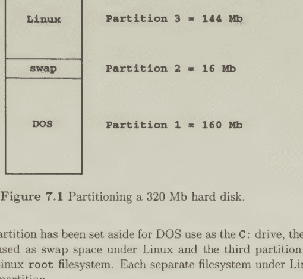

#### 图 7.1 分区 320 Mb 硬盘。

这里，第一分区已为 DOS 使用预留为 C: 驱动器，第二分区将在 Linux 下用作交换空间，第三分区将用于存放 Linux 根文件系统。Linux 下的每个独立文件系统都有自己的磁盘分区。

有时你希望在硬盘上使用超过四个分区，尤其是在硬盘相当大的情况下。在这种情况下，四个主磁盘分区之一可用作扩展分区。然后扩展分区就像容器一样用于容纳一组逻辑磁盘分区（在 DOS 下最多 23 个）。

除了考虑扩展和逻辑磁盘分区外，对于真正的大型磁盘驱动器，还会出现一个新问题。由于设计上的疏忽（设计者无法想象硬盘会大到足以突破其设计限制……），通常无法从使用磁盘柱面号大于 1023 的磁盘分区启动 PC（除非你有一块支持大硬盘的现代主板 BIOS）。对于 Linux 来说，这意味着其根文件系统必须完全位于 1024 柱面边界以下的分区中。Linux 可以在边界以上的分区中保存数据和程序；你只是不能从这些分区启动 Linux。对于 IDE 磁盘，1024 柱面限制在 504 Mb 处。

假设你有一块 720 Mb 的 IDE 磁盘，你想将其分区以提供 150 Mb 的 DOS C: 驱动器、200 Mb 的 DOS D: 驱动器（可能用作压缩驱动器）、16 Mb 的 Linux 交换分区，然后是磁盘剩余部分（354 Mb）用于 Linux 文件系统空间。图 7.2 显示了一种可能的磁盘分区方案，该方案考虑了所有限制。

请注意，Linux 空间已被分成两部分，以便存放根文件系统的分区可以位于 504 Mb 边界以下。这就留下了一个问题，即 Linux 目录树中的其他 Linux 文件系统/分区可以在哪里有用地挂载。一个明显的划分，也是这里所示的划分，是将 Linux 空间分成系统分区和用户分区。然后所有 Linux 安装都将放到根分区中，这使得另一个分区初始为空，并允许将其用作用户主目录和工作空间，通过将其挂载为 /home。还有许多其他安排可能，你可能需要尝试直到找到最适合你特定情况的方案。

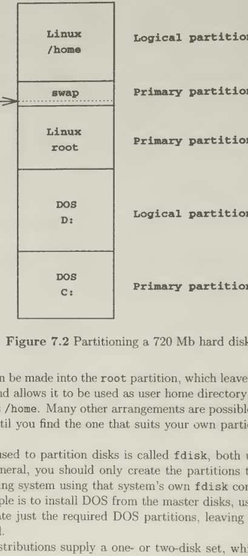

#### 图 7.2 分区 720 Mb 硬盘。

用于分区磁盘的程序称为 fdisk，在 DOS 和 Linux 下都如此。一般来说，你应该只使用该操作系统自己的 fdisk 命令来创建在特定操作系统中使用的分区。因此，我们示例中的第一个任务是从原版磁盘安装 DOS，使用 DOS fdisk 命令仅创建所需的 DOS 分区，剩余磁盘空间保持未分配。

大多数 Linux 发行版提供一套一盘或两盘的磁盘集，你需要用它来最初在机器上启动 Linux。在 Slackware 发行版中需要两张磁盘，称为 boot 和 root 磁盘。实际上，每种都有几个不同的版本，你需要为每种选择合适的版本。选择基于你要安装到的硬盘类型（是否 SCSI）以及你要用作安装文件来源的介质（CD-ROM、软盘、硬盘或网络）。

你应查阅随发行版提供的发行说明（可能作为 README 文件或薄纸传单），以帮助你做出适当选择并告诉你如何从可用文件创建 boot 和 root 磁盘。


在本节的剩余部分，我假设你拥有一块 320 MB 的 IDE 硬盘，其分区方式如第 7.1 图示例所示，且 DOS 分区已创建并装入了你的 DOS 软件。我还假设你希望从 Slackware 发行版安装 A、AP、D、K、N、F、X、XAP 和 Y 软件集，并且你的安装介质为软盘（尽管安装过程本质上与任何其他安装介质相同：CD-ROM、硬盘或网络）。

准备好启动盘和根盘后，你应插入启动盘并重新启动机器。大多数发行版，包括 Slackware，都提供一个启动盘，可在提示后让你输入硬件配置详情。这只有在启动盘内核未能检测、正确识别或配置特定硬件设备这种不太可能的情况下才有必要。

我们的示例配置不应出现问题，因此你只需在提示时按 Enter 或 Return 键继续启动序列。过一会儿，你会被提示取出启动盘，换上根盘并按 Enter 或 Return 键完成初始启动序列。

此时，你将拥有一个最小的 Linux 系统，完全在内存中运行，使用 ramdisk 作为其根文件系统，如果一切顺利，你应该会看到 Login: 提示符。现在，以 root 身份登录。该账户未设置密码，因此你可以直接登录。

按惯例（本书示例中我将遵循此惯例），系统管理员或超级用户获得的提示符包含或至少以井号（#）符号结尾。在提示符中使用时，将井号符号专用于此目的是个好主意——这有助于避免混淆。

为了设置 Linux 分区，你需要在井号提示符下运行 fdisk，其输出如下：

```
# fdisk
Using /dev/hda as default device!

Command (m for help):
```

文件名 /dev/hda 是对应于第一块硬盘驱动器的整个设备的特殊文件名（SCSI 磁盘为 /dev/sda）。这是 fdisk 默认尝试操作的驱动器。如果你有第二块硬盘，可以通过将第二个驱动器的设备特殊文件的路径名（/dev/hdb 或 /dev/sdb）作为参数指定给命令，使 fdisk 改为操作它：

```
# fdisk /dev/hdb
```

在 Linux 下，每个磁盘驱动器和分区在 /dev 中都有一个名称。这些名称如下所示：

- hda 整个硬盘 1；
- sda 整个 SCSI 硬盘 1；
- hdb 整个硬盘 2；
- sdb 整个 SCSI 硬盘 2；
- fd0 整个软盘驱动器 0（DOS A：）；
- fd1 整个软盘驱动器 1（DOS B：）。

任何硬盘上的分区只需在整个驱动器的名称后加上适当的数字即可访问。下表显示了如何为驱动器 hda 命名分区：

- hda1 硬盘 1，主分区 1；
- hda2 硬盘 1，主分区 2；
- hda3 硬盘 1，主分区 3；
- hda4 硬盘 1，主分区 4；
- hda5 硬盘 1，逻辑分区 1；
- hda6 硬盘 1，逻辑分区 2；
- hda7 硬盘 1，逻辑分区 3，等等。

Linux 的 fdisk 命令与 DOS 的等价命令看起来不同，但它们执行的功能相似。你可以在 fdisk 运行后使用 ‘m’ 命令获取功能列表：

```
# fdisk
Using /dev/hda as default device!

Command (m for help): m
Command action
  a  toggle a bootable flag
  c  toggle the dos compatibility flag
  d  delete a partition
  l  list known partition types
  m  print this menu
  n  add a new partition
  p  print the partition table
  q  quit without saving changes
  t  change a partition's system id
  u  change display/entry units
  v  verify the partition table
  w  write table to disk and exit
  x  extra functionality (experts only)
```

在此阶段明智的做法是使用 ‘p’ 命令显示现有分区表，以检查 DOS 分区是否已正确设置：

```
Command (m for help): p

Disk /dev/hda: 16 heads, 40 sectors, 1024 cylinders
Units = cylinders of 640 * 512 bytes

    Device Boot Begin Start  End Blocks Id System
    /dev/hda1   *       1     1   511 163812+  6  DOS 16-bit >=32M
```

已设置好，因此现在可以设置 Linux 分区，从 /dev/hda2 上的交换空间开始。你使用 ‘n’ 命令添加新分区，然后 fdisk 会询问你是否要创建主分区或扩展分区。在我们的示例中，我们需要主分区，因此你应在此提示下回答 ‘p’。然后会询问你要使用哪个分区号，你应回答 ‘2’。fdisk 的下一个问题要求你指定新分区应从哪个磁盘柱面开始。回答此问题时，你应给出 DOS 分区之后的下一个空闲柱面号。这里为 512。最后一个问题要求你指定新分区结束的位置。这可以给出柱面号，也可以直接指定分区的大小，单位为字节、千字节或兆字节。要指定一个 16 Mb 的交换分区，你应回答 ‘+16M’。整个序列如下所示：

```
Command (m for help): n
Command action
  e   extended
  p   primary partition (1-4)

p
Partition number (1-4): 2
First cylinder (512-1023): 512
Last cylinder or +size or +sizeM or +sizeK (512-1023): +16M
```

顺便说一下，没有什么可以阻止你拥有多个交换分区。例如，如果你有多于一块硬盘，那么这种安排可能最方便。

创建用于交换空间的分区后，可以对 /dev/hda3 上的 Linux 根分区执行类似的序列：

```
Command (m for help): n
Command action
  e   extended
  p   primary partition (1-4)

p
Partition number (1-4): 3
First cylinder (564-1023): 564
Last cylinder or +size or +sizeM or +sizeK (512-1023): 1023
```

在此序列结束时执行 ‘p’ 命令将确认一切按计划进行：

```
Command (m for help): p

Disk /dev/hda: 16 heads, 40 sectors, 1024 cylinders
Units = cylinders of 640 * 512 bytes
```

| 设备 | 启动 | 起始 | 开始 | 结束 | 块数 | Id | 系统 |
|---|---|---|---|---|---|---|---|
| /dev/hda1 | * | 1 | 1 | 511 | 163812+ | 6 | DOS 16位 >=32M |
| /dev/hda2 |  | 512 | 512 | 563 | 16640 | 83 | Linux 原生 |
| /dev/hda3 |  | 564 | 564 | 1023 | 147200 | 83 | Linux 原生 |

看起来不错。然而，还有一件事情需要完成。分区 2 的系统类型仍标记为 Linux 原生，而应为 Linux 交换。这可以通过使用 ‘t’ 命令将 Id 从 83 切换到 82 来纠正。我怎么知道数字应该是多少？你可以在使用 ‘t’ 命令时让 fdisk 给出一个列表：

```
Command (m for help): t
Partition number (1-4): 2
Hex code (type L to list codes): L
```

|  |  |  |  |
|---|---|---|---|
| 0 空 | 8 AIX | 75 PC/IX | b7 BSDI fs |
| 1 DOS 12位 FAT | 9 AIX bootable | 80 Old MINIX | b8 BSDI swap |
| 2 XENIX root | a OS/2 Boot Man | 81 Linux/MINIX | c7 Syrinx |
| 3 XENIX usr | 40 Venix 80286 | 82 Linux swap | db CP/M |
| 4 DOS 16位 <32M | 51 Novell? | 83 Linux native | e1 DOS access |
| 5 Extended | 52 Microport | 93 Amoeba | e3 DOS R/O |
| 6 DOS 16位 >=32M | 63 GNU HURD | 94 Amoeba BBT | f2 DOS sec |
| 7 OS/2 HPFS | 64 Novell | a5 BSD/386 | ff BBT |
| Hex code (type L to list codes): 82 |  |  |  |

现在，终于，分区表应已按要求设置好。最后再看一眼以确保无误：

```
Command (m for help): p

Disk /dev/hda: 16 heads, 40 sectors, 1024 cylinders
Units = cylinders of 640 * 512 bytes
```

| 设备 | 启动 | 起始 | 开始 | 结束 | 块数 | Id | 系统 |
|---|---|---|---|---|---|---|---|
| /dev/hda1 | * | 1 | 1 | 511 | 163812+ | 6 | DOS 16位 >=32M |
| /dev/hda2 |  | 512 | 512 | 563 | 16640 | 82 | Linux 交换 |
| /dev/hda3 |  | 564 | 564 | 1023 | 147200 | 83 | Linux 原生 |


在此阶段一个好的建议是记录下 Linux 分区中的块数以备后续操作（此处为 16640 和 147200）。使用 'w' 命令我们现在将把这个新的分区表写回磁盘，然后退出 fdisk。在使用 fdisk 时，如果出现严重错误，可以使用 'q' 命令退出程序，而不会对磁盘上的原始分区表做任何更改。

确保分区表的更改在所有版本的 fdisk 中生效，你现在应该使用启动盘和根盘重新启动机器。完成此操作并再次以 root 身份登录后，你就可以继续了。

#### 7.3.2 创建文件系统

现在已经为 Linux 创建了分区，下一步任务是在这些分区内创建文件系统结构。这只是 Linux 中相当于 DOS 格式化操作的工作。首先处理交换分区，你需要使用两个命令：mkswap 用于准备分区，swapon 用于告诉 Linux 将分区投入使用：

```
# mkswap -c /dev/hda2 16640
# swapon /dev/hda2
```

mkswap 的 -c 开关会强制检查分区中的坏数据块。显然，如果你的交换分区不是 hda2，那么你需要在命令中替换为自己的名称。行尾的数字只是交换分区的块数，你在创建分区时已记录下来。同样，你需要用自己的值替换 16640。swapon 命令只接受一个参数，即要使用的分区名称（此处为 hda2）。

在 Linux 原生分区上创建文件系统之前，你必须选择要使用的文件系统类型。事实上，尽管 Linux 支持几种不同的文件系统结构，但总体上最好的一个称为第二扩展文件系统，并且应使用它。要在 Linux 原生分区上创建第二扩展文件系统，你使用 mke2fs 命令：

```
# mke2fs -c /dev/hda3 147200
```

参数指定要使用的分区及其以块为单位的大小。同样，-c 开关会强制进行坏块检查。如果有多于一个 Linux 原生分区，则需要在每个分区上使用 mke2fs。

#### 7.3.3 安装软件包

准备好磁盘分区后，你现在就可以将 Linux 软件加载到其中。每个不同的 Linux 发行版执行此操作的方法都不同。但本质上发生的情况是，你的 Linux 分区挂载在根文件系统下（仍在 RAM 中，不要忘记），然后各种软件包可以从软盘（或其他安装介质）中解包并复制到适当的位置。

某些发行版要求你手动执行这些操作，这并不是特别困难的任务，只是有些繁琐。其他发行版，包括 Slackware，提供安装脚本来自动化此过程。Slackware 发行版中的安装脚本称为 setup：

```
# setup
```

运行此命令会为你呈现一个菜单，引导你完成剩余的安装步骤。各种菜单选项如下：

- help 显示 setup 帮助文件。
- keymap 如果你使用非美国键盘，允许你更改键盘映射。对于非美国键盘用户，这将是开始正式安装时要选择的第一个选项。完成此选项后，setup 允许你直接移动到 addswap 选项，而无需返回主菜单。
- quick 在这里，你在快速安装和详细安装之间进行选择。作为初学者，你可能应该使用详细选项，这也是默认设置。
- make tags 当你对 Slackware 安装有更多经验时，此选项允许你设置自己的标签文件，以便预先选择每个磁盘集中要使用的软件包。
- addswap 允许你指定最终系统要用作交换空间的 Linux 交换分区。我已经说过可以创建并使用多个交换分区，但我无法想象为什么你不想自动使用它们全部。无论如何，此信息稍后将被纳入系统配置文件之一。

做出选择后，系统会询问你是否要在这些分区上运行 mkswap 和 swapon。如果你在运行 setup 之前已对分区使用过这些命令（我们已这样做），那么你应选择不允许 setup 现在执行此操作。

如果你的键盘是美国键盘，此菜单选项将是开始正式安装时要选择的第一个选项。完成此选项后，setup 允许你继续下一步，而不是返回主菜单。

- target 在这里指定你希望包含在最终目录层次结构中的磁盘分区。会列出可用分区，并询问你将哪个用作根文件系统。在我们的示例中只有一个可供选择——/dev/hda3。如果尚未执行（我们已执行），你现在可以使用 mke2fs 在根分区上创建文件系统。如果适用，之后会询问你是否还有其他分区要使用，以及希望将它们的文件系统挂载到哪些目录。这就是例如在处理图 7.2 的分区布局时指定 /home 分区的地方。

- **source** 在这里指定安装将进行的源介质。一般选择有：CD-ROM、软盘、硬盘或网络。如果在此选择软盘，则进一步的菜单将允许你指定要使用的软盘驱动器以及适合该驱动器的磁盘大小。事实上，无论你选择哪个选项，都可能使用进一步的问题来确定源文件确切来自何处。
- **disk sets** 此选项允许你选择要安装的磁盘集。你必须安装 A 集。除此之外，选择由你决定。如果你包含以下内容：A、AP、D、K、N、F、X、XAP 和 Y，你将获得一个相当完整且通用用途的安装。
- **install** 这是实际解包你为安装选择的软件包并将其文件复制到 Linux 文件系统中的菜单选项。通常，你将直接从上一个选项到达此选项，而不是从主菜单进入。

现在会询问你希望如何提示，作为初学者，你应通过选择 *normal* 选项来回答。

每个磁盘集包含一份软件包列表。其中一些软件包标记为 REQUIRED，如果你选择安装其所属的磁盘集，这些软件包将自动安装。每个磁盘集中其他软件包标记为 RECOMMENDED 或 OPTIONAL，在这些情况下会询问你是否希望安装它们。你应在安装过程中仔细阅读所有屏幕信息，因为有时你需要在软件包之间做出选择，而不仅仅是全部安装。

- **configure** 在软件包安装完成后，此选项允许你设置从软盘或硬盘启动 Linux 的机制，并且还允许你对诸如鼠标、调制解调器和网络之类的机器进行一些配置。最初，你最好跳过一些配置选项，并在有机会了解所涉及内容后手动执行它们。然而，你应该抓住机会此时创建一张启动软盘，并或许配置 lilo（请参阅第 7.3.6 节以获取有关 lilo 的帮助信息）。
- **pkgtool** 此选项仅供以后使用，用于软件包维护。它将允许添加和删除单个软件包。此选项的使用相当不言自明。
- **exit** 退出 setup 并返回到 shell 提示符。

#### 7.3.4 启动 Linux

无论你选择安装哪个 Linux 发行版，它都必须为你提供在首次打开机器时启动到 Linux 的某种方式。这可以简单到为你提供一张用于启动的软盘，或者你可以使用硬盘上的 Linux 内核加载器之一。Slackware 发行版允许

为您提供创建启动软盘以及安装 lilo 启动加载器的机会。这些操作可以从 setup 命令的 Configure 选项中完成。

为了说明其简单性，我们将手动创建一个启动软盘。这也能为您提供一个备用启动软盘，以防在 setup 结束时创建的软盘出现问题。事实上，您需要做的只是将 Linux 内核映像从硬盘复制到软盘即可，它会自动变为可启动。

不同的 Linux 发行版将内核映像文件存储在不同的位置。最常见的位置有：

-   `/vmlinuz`
-   `/zImage`
-   `/etc/zImage`

Slackware 发行版默认使用 /vmlinuz。一旦您确定了内核映像的位置和名称，就需要确保它已正确配置为从软盘运行。为此您使用 rdev 命令。rdev 的作用是允许您直接在内核文件中修改内核的一些配置细节。我们需要做的是确保内核文件中的根分区名称设置正确，并且初始时根分区以只读方式挂载，以便进行检查。这些操作通过以下两个命令完成：

```
# rdev /vmlinuz /dev/hda3
# rdev -R /vmlinuz 1
```

显然，如果您的内核映像名称或根分区名称与示例中使用的不同，您需要将自己的名称替换到命令中。

现在您只需要一张空白磁盘来复制（DOS 格式化的磁盘即可）。如果磁盘需要格式化，可以使用 fdformat 命令。例如，要格式化 A: 驱动器（fd0）中的 1.44 Mb 软盘：

```
# fdformat /dev/fd0H1440
```

请注意设备特殊文件名中 fd0 后的 H1440，这会强制 fdformat 将磁盘视为高密度且大小为 1440 Kb（即 1.44 Mb）。还有其他特殊文件可强制软盘被视为其他标准尺寸，如以下命令所示：

```
# ls /dev/fd0*
/dev/fd0      /dev/fd0H1440  /dev/fd0H720   /dev/fd0h360
/dev/fd0D360  /dev/fd0H2880  /dev/fd0d360   /dev/fd0h720
/dev/fd0D720  /dev/fd0H360   /dev/fd0h1200
```

准备好空白软盘和内核映像名称后，剩下的就是执行复制操作：

```
# cp /vmlinuz /dev/fd0
```

现在您应该能够使用新软盘启动系统，就像使用在 setup 过程中创建的软盘一样。

#### 7.3.5 重启流程

除非您在 setup 期间尝试安装 lilo，否则暂时仍需从软盘启动 Linux 系统。既然已有两张启动软盘，现在是重启系统检查一切是否正常的好时机——请不要忘记您目前仍在使用 RAM 磁盘上的根文件系统！

重启时是您需要记住 Linux 是一种大型机器操作系统的特定时刻。在任何正常情况下，都不应通过直接关闭机器电源或按下复位开关来关闭 Linux——Linux 需要正确关闭。Linux 所做的许多工作尽可能长时间地保留在内存中，而不是写入磁盘。很明显的原因是访问内存中的数据比访问磁盘上的相同数据快几个数量级。然而，这带来的一个后果是，当您想要关闭 Linux 时，需要提前通知它，以便在拔掉电源之前有时间将所有驻留在内存中的数据传输到磁盘。

关闭 Linux 最安全的方法是使用 shutdown 命令。该命令的一般形式为：

```
shutdown flags time [message]
```

shutdown 命令只能由以 root 登录的用户执行，并且在给出命令时，message 会发送给所有用户。如果未指定消息，则会给出默认的关机警告。当关机时间到来时，会向所有进程发送 SIGTERM 信号，以便它们有机会干净地终止，然后再进行正式关机。

主要标志是命令行开关：-h 表示关机后停止机器，-r 表示改为重启机器。time 参数指定关机应发生的时间。它可以以 hh:mm 格式指定为绝对时间，也可以以 +mm 格式给出相对于当前时间的分钟数。单词 now 可用于表示 +0 分钟。

在其运行期间，shutdown 命令确保磁盘数据内容与存储在内存中的数据同步，以防止数据丢失。以下命令将立即关闭 Linux 然后停止机器：

```
# shutdown -h now
```

您还可以配置 Linux 内核，使其在按下 Ctrl-Alt-Del 时重启机器。此操作显然可以由任何人在任何时间执行，无论他们是否有 root 登录。对于家庭和个人使用的 Linux 机器，这可能不是安全问题。然而，如果机器的主键盘和屏幕对未经授权的访问开放，您可能希望禁用此功能。您将在第 7.4 节中看到如何执行此操作，我们将在那里讨论如何构建自定义内核。

由于 RAM 磁盘根文件系统的空间限制，许多 Linux 发行版在其 setup 磁盘上不提供 shutdown 程序。因此，在初始安装后的第一次关机时，您可能需要使用 Ctrl-Alt-Del。

#### 7.3.6 lilo

从软盘重启 Linux 系统应该能正常工作；然而，如果您可以直接从硬盘启动，尤其是可以从多个可选的操作系统中进行选择，那会方便得多。

正如我之前简要提到的，有一个名为 lilo 的程序，可以与配置文件一起使用来设置系统，以便在机器启动时您可以做出这种选择。

如果使用 lilo，则在启动序列开始时会出现以下字样：

```
LILO
```

它会出现在屏幕上并随后短暂停顿。如果在此暂停期间您不执行任何操作，则 lilo 将启动其设置为默认系统的操作系统或内核。如果相反，您在暂停期间按下 Shift、Ctrl 或 Alt 中的一个键，则会显示：

```
boot:
```

提示符，在此提示符下您输入要启动的操作系统或内核的名称。如果在提示符下按下 Tab 键，则会列出您可以选择的名称。

为了设置 lilo 提供这些选项，您只需设置一个名为：

/etc/lilo.conf

的配置文件，其中包含有关您希望能够启动哪些操作系统或内核、它们在硬盘上的位置以及您希望赋予它们的名称（用于 lilo boot: 提示符）的所需信息，然后只需输入以下命令即可完成安装：

```
# lilo
```

了解 /etc/lilo.conf 文件中包含什么内容的最好方法是看一个例子。以下示例可用于我们的 320 Mb 磁盘，默认启动 DOS，但允许在 boot: 提示符下选择 dos 或 linux：

```
# LILO configuration file
# Global section
boot = /dev/hda
delay = 50

# DOS bootable partition section
other = /dev/hda1
  label = dos
  table = /dev/hda

# Linux bootable partition section
image = /vmlinuz
  root = /dev/hda3
  label = linux
  read-only
```

配置文件分为若干部分：首先是一个全局部分，然后为每个您希望在启动时选择的系统或内核再设一个部分。全局部分之后的第一个部分给出 lilo 将默认启动的操作系统或内核的详细信息。

在示例中，全局部分包含两行：第一行告诉 lilo 将从哪个硬盘启动，因此在安装时应修改哪个磁盘的引导块；第二行指定 lilo 在启动默认系统前应暂停的时间长度（以十分之一秒为单位）。

由于 DOS 是默认操作系统，配置文件中接下来是 DOS 部分。该部分中的三行指定：存放 DOS 的分区、在 boot: 提示符下运行 DOS 时输入的标签以及分区表的位置。

最后一个部分包含有关启动 Linux 的四行信息：可启动内核映像文件的完整路径名、存放根文件系统的分区名称、在 boot: 提示符下运行 Linux 时输入的标签以及一个标志，指定初始时根文件系统应以只读方式挂载，以便文件系统检查程序检查其完整性。

如果您希望 Linux 而不是 DOS 成为默认启动操作系统，只需交换 DOS 和 Linux 的信息，使 Linux 信息排在前面即可。

显然，当您想要设置 lilo.conf 文件时，您将用自己的磁盘、分区、系统标签和内核映像名称替换文件中的示例。


你必须记住，每次修改配置文件以及每次更改内核映像文件时，都需要运行 lilo 命令，无论是否修改了配置文件。即使将新的内核映像存储在与旧映像相同的位置并使用相同的名称，你仍然必须运行 lilo 命令才能安装新的内核。

### 7.4 内核构建

大多数软件发行版提供的 Linux 内核都配置为支持尽可能广泛的硬件，以便在 Linux 安装时能在尽可能多的机器上运行。一旦安装运行起来，为你的机器专门构建一个定制内核是个好主意。通常情况下，这会减小内核的大小，从而增加可用于工作的内存量。如果你的机器上只安装了有限的内存（例如 4 Mb），那么这会带来明显的差异。

假设你在 Linux 安装过程中已安装了 Linux 内核源代码和 GNU C/C++ 编译器，那么构建新内核非常简单。

第一个任务是检查 Linux 源代码的安装是否在 /usr/include 目录中创建了两个符号链接，如以下示例所示：

```
# cd /usr/include
# ls -l asm linux
lrwxrwxrwx 1 root root 26 Jul 4 17:27 asm -> /usr/src/linux/include/asm
lrwxrwxrwx 1 root root 28 Jul 4 17:27 linux -> /usr/src/linux/include/linux
```

如果符号链接已存在，则不得执行下一步。如果它们不存在，则需要手动设置它们，可能需要替换一对同名目录。这些操作可以按如下方式完成：

```
# cd /usr/include
# rm -fr asm linux
# ln -s /usr/src/linux/include/asm asm
# ln -s /usr/src/linux/include/linux linux
```

#### 7.4.1 配置

下一步是选择要在新内核中包含哪些功能和硬件驱动程序；你可以使用以下命令来完成：

```
# cd /usr/src/linux
# make config
```

现在你将进行一个是/否问答会话，询问你希望在新内核中包含哪些内容以及排除哪些内容。每个问题后你会看到 [y] 或 [n]。如果直接按 Enter，这就是该问题的默认答案。配置系统后，你提供的答案将被记住，并在再次运行 make config 时成为默认值。

大多数问题的答案都相当明显，不过其中一两个值得在此提及：

内核数学仿真 (CONFIG_MATH_EMULATION) [n]

如果你的系统未安装浮点协处理器，则需要对此问题回答 yes，以便将浮点协处理器仿真器包含到内核中。如果已安装协处理器，则可以在此处回答 no，以稍微减小内核大小。即使安装了协处理器，对此问题回答 yes 也不会有问题，因为内核会检测到你的协处理器并使用它。

网络支持 (CONFIG_NET) [y]

即使你没有网卡，也应包含网络支持，因为许多软件包都使用套接字，而套接字是主要的网络进程间通信机制。内核可以在单台机器上的进程之间使用本地回环装置，以便它们可以通过套接字相互通信，就像通过物理网络一样。

限制内存至低 16MB (CONFIG_MAX_16M) [y]

除非你的机器上有超过 16 Mb 的内存，否则最好对此问题回答 yes。

- TCP/IP 网络 (CONFIG_INET) [y]
- IP 转发/网关 (CONFIG_IP_FORWARD) [y]
- IP 组播 (CONFIG_IP_MULTICAST) [y]
- IP 防火墙 (CONFIG_IP_FIREWALL) [y]
- IP 记账 (CONFIG_IP_ACCT) [n]

TCP/IP 网络应包含，但以下 IP 选项仅在你的机器将执行某些严肃的网络应用（例如充当网络之间的安全网关）时才使用。

- 标准 (minix) 文件系统支持 (CONFIG_MINIX_FS) [n]
- 扩展文件系统支持 (CONFIG_EXT_FS) [n]
- 第二扩展文件系统支持 (CONFIG_EXT2_FS) [y]
- xiafs 文件系统支持 (CONFIG_XIA_FS) [n]
- msdos 文件系统支持 (CONFIG_MSDOS_FS) [y]
- umsdos：基于 MSDOS 文件系统的类 Unix 文件系统 (CONFIG_UMSDOS_FS) [n]
- /proc 文件系统支持 (CONFIG_PROC_FS) [y]
- NFS 文件系统支持 (CONFIG_NFS_FS) [y]
- ISO9660 CD-ROM 文件系统支持 (CONFIG_ISO9660_FS) [y]
- OS/2 HPFS 文件系统支持（只读） (CONFIG_HPFS_FS) [n]
- System V 和 Coherent 文件系统支持 (CONFIG_SYSV_FS) [n]

Linux 能够支持许多文件系统类型，不过你可能只需要包含其中少数几种。如果使用它构建了 Linux 本地磁盘分区（正如我们在示例安装中所做的），则第二扩展文件系统支持是必不可少的。能够挂载 DOS 硬盘分区和软盘也非常有用。你几乎肯定需要 /proc 文件系统，因为许多日常 Linux 命令的版本都配置为使用它（如 ps）。NFS 文件系统允许将一台机器上的磁盘分区通过网络挂载到另一台机器的目录层次结构中。如果要操作 CD-ROM 驱动器，则需要 ISO9660 文件系统。

运行 make config 后，你应编辑 /usr/src/linux/Makefile，以确保符号 ROOT_DEV 的定义正确。如果要用作根文件系统的磁盘分区与当前运行系统正在使用的分区相同，则应将该符号设置为：

```
ROOT_DEV = CURRENT
```

否则，应将对应所需根文件系统的磁盘分区名称分配给 ROOT_DEV。例如：

```
ROOT_DEV = /dev/hda3
```

#### 7.4.2 编译

配置完成后，可能需要一开始尝试两三次才能达到你想要的效果，然后你可以进入下一阶段——准备和编译源代码树。

你应使用以下命令开始：

```
# make dep
# make clean
```

其中第一个会为你配置所有 makefile，以匹配你的特定安装和内核配置选择。第二个会确保源代码树中没有旧的二进制文件干扰所选内核配置的编译。

这些命令成功完成后，可能需要一两分钟，然后你应继续开始正式编译：

```
# make zImage
```

输入此命令后，你现在最好休息一下，因为根据你的处理器速度和系统内存量，运行可能需要相当长的时间。配备 16 Mb 内存的 486DX2/66 需要大约 20 分钟，而配备 4 Mb 内存的 386SX/16 则需要数小时。

完成后，系统将在以下文件中生成一个可安装的压缩内核映像：

```
/usr/src/linux/arch/i386/boot/zImage
```

#### 7.4.3 安装

为了测试新内核，你应从中制作一张可启动软盘，首先使用你在第 7.3.4 节中看到的程序将根文件系统分区名称配置到其中。

如果从新软盘启动机器一切顺利，那么你可以考虑设置新内核从硬盘启动，如果你愿意的话。最简单、最安全的方法可能是在 lilo.conf 文件中设置一个额外的内核并重新运行 lilo。

可以按如下方式修改 lilo.conf 文件：

```
# LILO configuration file
# Global section
boot = /dev/hda
delay = 50

# DOS bootable partition section
other = /dev/hda1
    label = dos
    table = /dev/hda

# New Linux bootable partition section
image = /vmlinuz
    root = /dev/hda3
    label = linux
    read-only

# Old Linux bootable partition section
image = /.vmlinuz
root = /dev/hda3
label = linux.old
read-only
```

请注意，有两个可启动的 Linux 内核部分，一个用于你刚刚创建的新内核，一个用于原始内核，这样如果新内核出现任何问题，你始终可以回退到旧内核。

为了使用新的 lilo.conf 文件，你需要执行以下命令序列：

```
# mv /vmlinuz /.vmlinuz
# cp /usr/src/linux/arch/i386/boot/zImage /vmlinuz
# lilo
```

第一个命令将当前内核映像保存为新的（且不可见）名称，第二个命令将新内核的副本放置到 lilo.conf 文件中指定的位置，最后一条命令执行 lilo 安装。

现在，重新启动系统时，启动提示符下有三个选择。你可以输入 dos 启动 DOS 操作系统，输入 linux 启动新的 Linux 内核，或输入 linux.old 启动原始内核。

#### 7.4.4 loadlin

lilo 包只是可用的 Linux 启动加载程序之一。另一种可能性是在 DOS 下运行的名为 loadlin 的包。

就用户而言，主要区别在于 lilo 允许你在启动时选择操作系统或内核，而 loadlin 用户需要先启动到 DOS，只有在那里时才做出是留在 DOS 还是使用 loadlin 启动 Linux 的选择。

为了使用 loadlin，你必须将其和 Linux 内核文件复制到你的 DOS 分区。最简单的方法是在 Linux 下挂载 DOS 分区，然后直接使用 Linux cp 命令。

某些 Linux 发行版，包括 Slackware，在安装过程中提供在启动序列期间自动将 DOS 分区挂载到 Linux 目录层次结构中的机会。如果你的发行版未提供此机会，或你选择不使用它，则必须手动挂载 DOS 分区。

用于将一个文件系统的顶级目录挂载到另一个文件系统的叶级目录下的命令称为 mount。mount 命令的一般格式为：

```
mount -t type device directory
```


其中 type 是文件系统类型（例如 msdos、ext2、iso9660、nfs 等），device 是存放要挂载文件系统的设备特殊文件名称（例如 /dev/fd0、/dev/hdb1 等），而 directory 是在当前目录层级中新文件系统要放置的位置。

使用完毕后，文件系统可再次使用 umount 命令卸载，其格式为：

```
umount directory
```

对于软盘文件系统，在从驱动器取出磁盘之前特别重要的是先卸载它。这是因为内存中可能存在尚未写入软盘的文件系统数据，而 umount 命令会安排将这些数据刷新到磁盘。

mount 和 umount 命令只能由 root 使用。

例如，将我们的 /dev/hda1 DOS 分区挂载到 Linux 目录 /mnt 下的 mount 命令为：

```
# mount -t msdos /dev/hda1 /mnt
```

然后你需要将文件 loadlin.exe 和 loadlinx.exe 复制到 DOS 分区。在 Slackware 发行版中，这两个文件被打包成 /root 目录下的一个 .zip 文件。解包它们并进行复制可以按如下操作：

```
# cd /root
# unzip loadlin*.zip
# cp /root/LOADLIN/LOADLIN.EXE /mnt/dos
# cp /root/LOADLIN/LOADLINX.EXE /mnt/dos
```

如果 Linux 下没有 unzip 命令，那么你也可以始终将 .zip 文件复制到 DOS 目录并使用 pkunzip 解包。

现在你可以使用以下命令将压缩的 Linux 内核映像复制到 DOS 分区：

```
# cp /usr/src/linux/arch/i386/boot/zImage /mnt/vmlinuz
```

并且一切应该已准备好进行重启。

一旦机器启动到 DOS，你只需使用以下命令即可启动 Linux：

```
c:\> loadlin c:\vmlinuz root=/dev/hda3 ro
```

## 用户

许多 Linux 机器将作为独立主机运行，仅有一个用户（你！）且没有与外界的连接。在这种情况下，考虑用户账户和系统管理员职责似乎很奇怪——这不过是一台 PC 而已！

然而，你应该尽量不要这样想。无论你是在家中使用单用户私人 PC，还是在大机构中操作一台连接互联网的 200 用户服务机器，只要你在机器上拥有 root 账户，就应始终尊重它；你应将自己视为看管者而非神。在使用机器时应戴两顶不同的帽子，一顶标有普通用户，你应将其用于所有日常工作以及尽可能多不需要系统特权账户的系统管理员功能；另一顶标有看管者，你仅在绝对必要时佩戴，并且佩戴时间应尽可能短，只需完成任务所需的时间。我无法强调足够的是，如果你在机器上拥有 root 账户，尤其是有其他用户参与的情况下，你的职位就是信任和责任的职位。不可轻视，也绝不应怀有任何恶意。

### 8.1 账户密码

在刚安装 Linux 发行版后，可能只有一个可用的账户——root。它通常初始未设置密码，因此首要任务是设置一个密码。你应特别谨慎地选择 root 密码，因为它是你与任何其他以 root 权限访问你机器的人之间的唯一屏障。你绝对应避免使用可能出现在词典中的任何单词，以及你狗的名字或你生日或你伴侣名字的任何变体。所有这些东西对于任何稍微认识你的人来说都很容易猜到。你可以使用与更改普通用户密码相同的命令来更改 root 密码：

```
# passwd
```

即使以 root 登录，也没有任何方法可以查出某人使用的密码。这意味着，对于记不起密码的用户，你能做的最好的事情要么是完全移除密码，这样用户在下次登录时就可以选择新密码，要么你可以直接为用户设置新密码。你将新密码告知用户，用户可以用它登录然后再改为私密的东西。后一种方法更好，因为它不会留下用户账户未受保护的时间段。为了直接更改用户的密码，你使用 passwd 命令并带上一个参数，即你希望更改密码的用户的登录名：

```
# passwd login_name
```

一种轻松了解还有谁登录到你的机器的方法是使用 who 命令，如下所示：

```
# who
pc      tty1    Jul  3 19:25
mot     tty p0   Jul  3 20:06 (grexiz.soc.staff)
carey   tty p1   Jul  3 20:08 (gregory.soc.staff)
rvc     tty p2   Jul  3 20:12 (rachel.soc.staff)
```

who 命令显示的信息分为几个字段。首先是用户的登录名，其后是用户使用的终端名称。接着是用户登录的日期和时间，最后，如果用户通过网络登录到机器，则是连接所来自的机器名称。

### 8.2 添加用户账户

为 root 账户设置密码后，下一步任务是为自己创建一个普通用户账户。许多 Linux 发行版提供一个特殊命令来帮助你创建新用户账户。该命令根据你安装的发行版称为 adduser 或 useradd。无论哪种方式，命令都会询问你一系列关于新用户账户的问题，当你提供所有答案（或在适用时接受默认值）后，新用户账户将被创建。

我可以看到这简化了整个流程，但对于新手管理员来说，我认为了解底层发生了什么很重要，这样你才能做出更明智的选择。因此，为了让你了解正在发生的事情，我们这次将手动添加你的账户，你下次可以查看特殊命令。

事实上，手动添加用户账户是一项相当容易的工作，由以下步骤组成：

- 1. 在 /etc/passwd 中设置登录条目。
- 2. 创建用户的主目录。
- 3. 将用户设为主目录的所有者。
- 4. 在主目录上设置访问权限。
- 5. 在 /etc/group 中设置用户的组条目。

在设置密码文件条目前，你需要确定以下账户详情：登录名、UID、GID、主目录路径以及用户将使用的 shell。

### 8.2.1 密码文件

有了这些信息，你现在可以编辑密码文件 /etc/passwd 并在文件末尾添加以下行，根据需要将你的详细信息替换到行中：

```
login_name:OFF:uid:gid:user’s_real_name:home_directory:shell
```

选择登录名是个人偏好问题，除非你的站点已有用户名的约定。然而请记住，名称应唯一且不得超过八个字符。

同样，UID 和 GID 的选择相当随意，除了 UID 应唯一，因为系统使用 UID 来识别用户。如果你打算正确使用组，那么 GID 只是新用户要加入的组的组号。在 Slackware 发行版中，组 users 的标准 GID 为 100。如果你不需要用户属于特定组，那么你可以将 GID 设置为与 UID 相同，这样这些用户就只属于一个组。

用户的主目录可以在目录层级中的任何位置，但你应制定某种位置策略，而不是随意放置。一个好的选择是将普通用户主目录设在 /home 下。如果你预计会有大量用户，那么在 /home 上挂载一个大磁盘分区是合理的，这样用户账户可以拥有所需的空间，同时也被限制在这个空间内，从而不能占用 root 文件系统的所有空间。

最后，shell 的最佳选择无疑是 bash，尽管还有其他选择。添加到密码文件中的典型行可能是：

```
roger:OFF:1234:100:R.N.Foxcroft:/home/roger:/bin/bash
```


#### 8.2.2 主目录

列表中的接下来三个步骤可以用以下三个命令完成：

```
# mkdir /home/roger
# chown roger. /home/roger
# chmod 700 /home/roger
```

第一行创建主目录（/home/roger）。第二行中的 chown 命令将主目录的所有者更改为 roger。此命令中用户名后的点号告诉 chown 同时将主目录的组更改为用户的 GID（这也可以通过 chgrp 命令单独完成）。最后一个命令授予目录所有者完全的读、写和搜索权限，而其他人没有任何访问权限。这种设置有点偏执，但如果需要，用户（roger）以后可以更改。

在需要做的事项列表中，第五步也是最后一步，在本例中实际上完全不需要任何操作，因为新用户被分配了 /etc/group 中已存在的组的 GID。另一种情况，即 GID 与 UID 相同的用户，在此阶段也无需任何操作。如果某个 GID 在组文件中没有对应的条目，则系统只会在本应显示组名的地方使用 GID 本身（例如 ls -l）。你只想在添加一个实际包含多个用户的组时，或当你想允许用户在多个组中工作时，才创建或更改组文件中的条目。

### 8.3 用户组

大多数安装对 Linux 提供的用户组功能几乎不使用或根本不使用。然而，它们是可用的，并且可以为各种安全问题提供一些优雅的解决方案。

通常，组用于允许一组用户对一组文件具有共同访问权限，同时拒绝系统其余用户访问。然而，有时你可能希望某个特定用户能够在不同时间加入多个组。在这种情况下，除非用户能够更改组，否则组的概念帮助不大。事实上，在 Linux 下确实如此。

为了更好地理解，让我们看看组文件的格式。它由一组行组成，每组一行，每行的格式为：

```
group_name:password:gid:user_list
```

这与密码文件中的排列方式大致类似，其中每一行被冒号分隔成字段。对于组文件，每一行有四个字段，分别是：

**group_name** 组名。此名称出现在 ls -l 列表的组列（第四个字段）中。

**password** 可选密码。如果组设置了密码，则在更改到该组时会被要求输入。

**gid** 与 group_name 关联的 GID 编号。

**user_list** 可选的以逗号分隔的用户列表。这也可以用于允许用户更改到该组。

/etc/group 文件中的典型条目是：

```
root::0:root
bin::1:root,bin,daemon
daemon::2:root,bin,daemon
sys::3:root,bin,adm
adm::4:root,adm,daemon
users::100:
book::500:
```

当用户登录时，密码文件中的 GID 将用户分配到默认组。以我们刚刚创建的账户 roger 为例，密码条目中指定的默认 GID 为 100。这使得 roger 在登录后立即进入 users 组。根据前面示例中显示的组文件内容，roger 没有权限更改到任何其他组。

现在假设，你希望 roger 偶尔能够更改组到 book，以便能够与 book 团队一起工作。这可以通过两种方式实现。最好的方法是按如下方式将 roger 输入到 book 组的 user_list 中：

```
book::500:roger
```

roger 现在要更改组到 book 所需做的就是使用如下的 newgrp 命令：

```
$ newgrp book
```

组更改将会发生。使用 newgrp 命令而不指定组参数将把用户更改回其默认组。

另一种允许组更改的方法是为组设置密码，而不是输入用户名。一旦设置了密码，roger 尝试更改到 book 组时，将被要求提供组的密码，然后才会授予对新组的访问权限。

这听起来像是好主意，但在现实中第二种方法并不像第一种那样安全。 admittedly，roger 现在必须提供密码，但系统上任何拥有该密码的用户也可以更改组到 book。那么，如果密码落入未经授权的人手中怎么办，而如果它被大组共享，这种情况更可能发生？或者，如何在不为其他每个人更改密码的情况下，将拥有组密码的用户从该组中移除？

仅提出这些问题就足以说服你，在组文件中明确列出名称是更好的方法。

### 8.4 安全

在讨论安全和密码的同时，另一个问题出现了。鉴于运行程序时创建的进程对文件访问具有与你相同的权限，那么当你作为普通用户没有权限写入该文件时，你如何更改 /etc/passwd 中的密码？

通常，前面的说法是正确的。然而，为了让你能够写入密码文件（当你更改密码时，显然你确实需要），必须存在某种机制，让你运行一个程序，然后创建的进程能够像代表其他人运行一样执行操作。对于密码文件来说，‘其他人’需要是 root，因为只有 root 对该文件具有写权限：

```
$ ls -l /etc/passwd
-rw-r--r-- 1 root root 775 Jul 25 15:41 /etc/passwd
```

如果我们查看更改密码的可执行程序（/usr/bin/passwd）的文件权限，我们会得到一个线索：

```
$ ls -l /usr/bin/passwd
-rws--x--x 1 root bin 3964 Mar 21 09:37 /usr/bin/passwd
```

正如你所见，这里有些不寻常。所有者的权限位显示为 rws，但所有者执行位位置中的 ‘s’ 代表什么？它的意思是，任何对该文件具有执行权限的人，在本例中意味着每个人，运行该程序时不是使用自己的权限，而是使用文件所有者的权限（本例中为 root）。

也可以（尽管较少见）在组执行位位置设置 ‘s’。这里有一个例子：

```
$ ls -l /usr/sbin/lpc
-r-xr-s--x 1 root lp 21508 Feb 14 19:03 /usr/sbin/lpc
```

系统上运行 lpc 命令的任何普通用户都将像在 lp 组中一样运行它，因此在 lpc 程序访问的任何文件上获得 lp 组权限。暂时不用担心 lpc 的作用，它与打印机的操作有关，我们稍后会介绍其用法。

设置这些‘额外’权限位的方法是使用标准的 chmod 命令，但在正常的权限位前使用额外的八进制数字。值为 4 将设置文件 setuid 位，值为 2 将设置文件 setgid 位，值为 6 将同时设置两者。显然，数字 0（或未指定值）将关闭这两个位。如果在 ls -l 列表中显示小写 ‘s’，则表示底层执行位已设置。大写 ‘S’ 表示底层执行位未设置。以下序列演示了这些概念中的一些：

```
$ ls -l /tmp/testbits
-rw--x--x-x 1 pc book 0 Jul 26 09:14 /tmp/testbits
$ chmod 4711 /tmp/testbits
$ ls -l /tmp/testbits
-rws--x--x 1 pc book 0 Jul 26 09:14 /tmp/testbits
$ chmod 2711 /tmp/testbits
$ ls -l /tmp/testbits
-rwx--s--x 1 pc book 0 Jul 26 09:14 /tmp/testbits
$ chmod 711 /tmp/testbits
$ ls -l /tmp/testbits
-rwx--x--x 1 pc book 0 Jul 26 09:14 /tmp/testbits
```

### 8.4.1 umask

作为额外的安全功能，有一个命令可以用来限制代表你运行的进程可以赋予其创建的文件的访问权限。该命令的名称是 umask。

umask 命令的一般形式为：

```
umask [permission_mask]
```

其中 permission_mask 只是三位八进制数字，对应于在代表你创建文件时希望默认重置的权限位。

如果未指定 permission_mask，则会显示当前的 umask 值。这通常为：

```
$ umask
022
```

以下是演示 umask 的使用及其对文件创建期间文件权限位影响的简单命令序列：

```
$ touch file1
$ umask 027
$ touch file2
$ umask 0
$ touch file3
$ ls -l file?
-rw-r--- 1 pc book 0 Aug 3 00:53 file1
-rw-r----- 1 pc book 0 Aug 3 00:53 file2
-rw-rw-rw- 1 pc book 0 Aug 3 00:54 file3
```

在这里你可以看到，如果任其发展（umask 设置为零），touch 命令会生成权限位设置为 rw-rw-rw- 的文件。你也可以看到使用 umask 值 022 和 027 创建文件对权限位的影响。


### 8.5 批处理作业

通常，当你输入命令时，其意图是它应立即执行。然而，有时用户希望在稍后的时间将命令作为批处理作业执行，甚至在用户注销之后。

### 8.5.1 cron

有一个名为 crond 的程序，大多数系统安排在启动序列中的某个时间运行。名称末尾的‘d’表示这是 cron 守护进程。与许多守护进程一样，该程序在机器运行时持续运行，其唯一功能是定期检查一组命令文件的内容，并在适当的时间执行这些文件中的命令。

命令文件各自包含一组命令行。命令行的一般格式为：

```
minutes hours days months day_names command
```

minutes、hours、days、months 和 day_names 字段允许你指定关联命令的执行时间。例如：

```
25 8 27 Jan * birthday
```

每天 1 月 27 日 08:25 am，crond 将执行用户名为 birthday 的程序。day_names 字段中的星号 (*) 表示‘在发生的任何一天’。

星号通常表示‘匹配任何可能的值’，它也可以用于其他日期和时间字段：

```
25 8 * * * appointments
```

这表示每天/每月/每周的 08:25 am 运行用户程序 appointments。

如果你只想在工作日（即周一至周五）运行 appointments，则可以在 day_names 字段中列出，用逗号分隔：

```
25 8 * * mon,tue,wed,thu,fri appointments
```

day_names 字段中那样的连续值列表也可以指定为简单的范围，含义相同：

```
25 8 * * mon-fri appointments
```

如果在同一命令行中指定 days 和 day_names，则两者都适用：

```
0,15,30,45 * 1 * mon oddtimes
```

此示例将在每个月的第一天以及每周一每 15 分钟执行一次用户命令 oddtimes。

每个用户登录都可以有自己的关联命令文件与 crond 一起使用。这些命令文件存储在目录中：

/usr/spool/cron/crontabs

然而，普通用户无法直接访问此目录，因此他们必须使用特殊命令来创建和修改其 crond 命令文件。该命令称为 crontab。有几个命令行开关可用于让 crontab 命令创建、修改和删除你的个人命令文件。crontab 的主要选项和命令行开关为：

- `file [-u user]` replace current command file with file;
- `- [-u user]` replace current command file from standard input;
- `-l [user]` list current command file;
- `-e [user]` edit current command file with vi;
- `-d [user]` delete current command file;
- `-c dir` specify a new command file directory.

只有 root 才能指定 -c 开关来更改保存命令文件的目录，只有 root 才能在命令行末尾给出用户名以将给定选项应用于指定用户的命令文件。请记住，这里方括号用于包含可选参数，不应输入。

### 8.5.2 at

使用 crontab 条目可以让给定命令定期执行。然而，可能出现你只有一个批处理作业希望提交给系统在指定时间仅执行一次的情况。

为了满足这一要求，还有另一个命令，称为 at，它仍然依赖 crond 运行，但提供了所需的‘一次性’功能。

为了让 at 工作，root 的 crontab 文件中有一个特殊的命令行。它显示为：

```
0,5,10,15,20,25,30,35,40,45,50,55 * * * *  /usr/lib/atrun
```

该行导致 /usr/lib/atrun 每五分钟执行一次。atrun 执行时，会检查 at 命令作业的待处理列表，找到当前时间需要运行的作业并运行它们。

提交 at 作业很容易。at 命令的一般形式为：

```
at [-f file] time
```

这将在指定时间执行文件中给出的所有命令。如果未给出可选的文件开关，则要执行的命令将从标准输入读取（默认为键盘）：

```
$ at 10:55
date >/tmp/at.job.test
Ctrl-d
Job c00cd3093.00 will be executed using /bin/sh
```

请记住，在单独一行上按 Ctrl-d 是从键盘生成文件结束的方式。请注意，at 命令在序列结束时通过分配唯一的作业引用号进行响应（本例中为 c00cd3093.00）。用户可以使用 atq 命令检查未决作业队列：

```
$ atq
Date          Owner  Queue  Job#
10:55:00 07/27/95  pc     c      c00cd3093.00
```

在 10:55 am 之后检查文件 /tmp/at.job.test 得到：

```
$ cat /tmp/at.job.test
Thu Jul 27 10:55:02 BST 1995
```

还可以使用 atrm 命令后跟作业引用号从队列中删除 at 作业。

at 命令允许你以相当复杂的格式指定作业运行时间，包括诸如：

```
10am Aug 20
6pm tomorrow
7:21 + 4 days
```

最后一个示例表示四天后 7:21 am。此外，日期也可以以多种格式给出，包括：

```
MM/DD/YY
DD.MM.YY
```

这允许按任一顺序指定日和月。

### 8.5.3 batch

还有另一个与 at 紧密相关的命令，执行类似功能，称为 batch。输入 batch 命令与 at 相同，只是无需指定时间。然后提交的作业将在取决于机器负载平均值的时间运行——当机器负载足够轻时，作业就会完成。使用 batch 命令取决于你是否安装了来自 Linux 发行版的 /proc 文件系统，因为它需要从文件读取机器的负载平均值：

/proc/loadavg

root 可以按用户单独允许或拒绝访问 at 和 batch 设施。规则如下：

- root 账户始终可以使用 at 和 batch。
- 对于其他用户，如果文件 /etc/at.allow 存在，则只有列在该文件中的用户登录名才能使用这些设施。
- 如果文件 /etc/at.allow 不存在但文件 /etc/at.deny 存在，则只有未列在该文件中的用户登录名才能使用这些设施。
- 如果两个文件都不存在，则普通用户无法使用 at 或 batch。

Slackware 发行版的默认设置是 /etc/at.deny 存在且为空，从而允许所有人访问这些设施。

### 8.6 归档

在某些系统上，root 可能需要为用户执行生产和维护归档和备份的服务。

存储备份最明显且最易获得的介质是软盘。如果要存储的材料量很小，则在软盘上创建一个 Linux 第二扩展文件系统，将磁盘挂载到根文件系统，然后只需复制文件即可，这是一个简单的任务。假设你从一盘未格式化的 1.44 Mb 软盘开始，保存给定目录（示例中的 src_dir）及其所有子目录和文件的过程为：

```
# fdformat /dev/fd0H1440
# mke2fs /dev/fd0 1440
# mount -t ext2 /dev/fd0 /mnt
# cp -a src_dir /mnt
# umount /mnt
```

此序列中的五个命令执行以下功能：

- 低级格式化软盘。命令行参数指定软盘位于驱动器 fd0（A:）中，并且应将其视为高密度，容量为 1440 Kb（1.44 Mb）。
- 在 /dev/fd0 上创建第二扩展文件系统。第二个命令行参数将设备的大小指定为 1440 个块。
- 将设备 `/dev/fd0` 上的第二扩展文件系统挂载在目录 `/mnt` 下。这是一个空目录，专门为 mount 这种方式使用而提供。
- `cp` 的 `-a` 命令行开关告诉它进行归档复制。这意味着 `src_dir` 下的所有子目录和文件都将被复制到 `/mnt`，保持与原始相同的名称和目录结构。
- 最后的命令将软盘从其余目录层次结构中卸载，以便你可以将其移至安全保存的地方。

#### 8.6.1 gzip

在归档材料中包含一个或多个大文件的情况下，你可能希望尝试压缩它们以节省软盘空间。

Linux 发行版中用于文件压缩的标准命令是 GNU gzip 命令。该命令的一般形式为：

```
gzip [options] file
```

指定的文件将被压缩以生成一个新文件，其名称与原始文件相同，但后缀为 .gz。此新文件将替换原始文件。

gzip 有很多选项，最有用的有：

- -1 use fastest compression; output files not as small;
- -9 use maximum compression; takes longer to run;
- -l list some statistics about the files being compressed;
- -h display a help screen of information and options.

通常，大型文本文件会被压缩 60% 到 70%，这可以节省大量的磁盘空间。

对于由 gzip 压缩的文件，可以使用 gunzip 命令将其恢复到原始状态。

```
gunzip file
```

同样，输出文件将替换输入文件。它还将删除 .gz 文件名扩展名。

压缩文件也可以在保持压缩状态的同时读取，使用 zcat 命令。此命令类似于普通的 cat 命令，只是它对压缩文件操作。zcat 的输出发送到标准输出设备，这使得该命令特别适用于读取压缩文本文件，如以下示例所示：

```
$ zcat textfile.gz | more
```

该命令将文件 textfile.gz 的未压缩版本通过管道传输到 more 命令，以分页显示文件包含的文本。


#### 8.6.2 tar

一旦系统达到一定规模，将文件备份到 Linux 文件系统就会变得难以处理。然后你真正需要的是能够将整个目录连同其所有子目录和文件直接写入磁带驱动器。能够执行此操作的一个命令称为 tar（即 Tape ARchiver，磁带归档器）。

此命令实际执行的操作是，将其指定的目录中的所有文件打包成一个称为 tarfile 的单个大型文件，然后可以将其写入磁带。

到目前为止，tar 似乎用途有限，因为很少有系统支持任何类型的磁带驱动器。然而，tar 能够将输出文件写入任何位置，包括：软盘、屏幕输出，甚至普通文件。除此之外，tar 还能执行一些其他技巧。如果 tarfile 正在写入软盘但太大而无法放入单张磁盘，则可以指示 tar 将文件拆分到多个磁盘上（称为多卷归档）。也可以指示 tar 在将结果写入输出之前使用 gzip 算法压缩 tarfile。

tar 命令的一般格式为：

```
tar [options] files
```

其中 files 是将包含在归档中或从归档中提取的文件和目录的列表。

tar 命令有许多选项，其中最有用的有：

- -c 创建新的 tarfile 归档；
- -x 从 tarfile 归档中提取文件；
- -t 显示 tarfile 归档的内容；
- -f file 指定 tarfile 名称为 file；
- -v 让 tar 详细说明其正在执行的操作；
- -l 保持在本地文件系统，不要跨越挂载点；
- -M 创建/提取/显示多卷归档；
- -N date 仅存储比 date 更新的文件；
- -z 使用 gzip 压缩/解压缩归档。

按照惯例，tar 归档文件名应使用后缀 .tar，而压缩归档文件名应使用后缀 .tgz（正如你在 Linux 发行版光盘上看到的所有软件包一样）。

创建包含用户 rachel 主目录内容的压缩归档的典型 tar 命令为：

```
# tar -cvzf /tmp/rachel.tgz /home/rachel
```

检查此归档内容的命令为：

```
# tar -tzf /tmp/rachel.tgz
```

以及在原始文件被意外删除后，从归档中恢复用户 rachel 主目录的命令序列：

```
# cd /
# tar -xvzf /tmp/rachel.tgz
```

在此最后一个示例中使用 cd / 命令的原因是，tar 已将归档中的所有文件名存储为相对于根目录的名称。因此你需要位于根目录才能将文件恢复到正确的位置。如果你从其他目录解包此归档，则文件仍会被解包，但位置相对于你在目录层次结构中的新位置。

使用 tar -t 选项是一种简单的方法，可以查看归档文件是相对于哪个目录存储的。

如果有必要允许普通用户创建软盘归档，则需要解决一两个问题。首先，软盘设备特殊文件 (/dev/fd*) 通常对普通用户关闭了读写权限。作为系统管理员，使用 chmod 命令适当更改权限是很容易的。

第二个问题出现在你希望普通用户能够将软盘挂载到目录层次结构中时，因为 mount 和 umount 命令仅限 root 使用。它们以这种方式设置是为了防止普通用户重新排列目录层次结构，这可能导致各种安全问题。解决此问题的最安全方案可能是编写一对简单的 C 程序，只能用于在特定目录（例如 /floppy）上挂载和卸载软盘。有关这些命令的实现，请参阅第 21 章末尾的练习。

## Peripherals

任何操作系统的首要功能之一，包括 Linux，是在应用程序软件和机器的周边硬件之间提供接口。常见的周边硬件包括以下设备：

- 控制台终端，用于视频输出和键盘输入；
- 调制解调器，用于与其他系统进行简单的串行通信；
- 鼠标作为替代输入设备；
- 打印机用于输出清单、文本和图形。

本章依次介绍这些设备，看看 Linux 中存在哪些用于设置和使用它们的设施。

### 9.1 Console Terminal

对于大多数 Linux 系统，只有一个用户，系统的主要访问方式是通过机器的键盘和屏幕——控制台终端。事实上，控制台终端实际上是两个独立的周边设备：屏幕/视频输出设备和键盘输入设备。正如我们将看到的，对于这两个设备都可以进行相当多的设置。

### 9.1.1 Keyboard Input

PC 上的键盘似乎是一个相对简单的设备——它是一个带按钮的盒子，按钮上有编号和字母，你按下按钮，相应的字符就会显示在屏幕上。然而，尽管看似简单，实际上比乍一看要复杂得多。

首先，许多使用 PC 的国家需要在字符集中加入一些额外的特殊字符，以便能够应对不同口语语言的怪癖。这意味着存在许多键盘变体，布局和内容略有不同。

从制造角度来看，能够生产单一键盘的电子和物理结构，然后只更换一些键帽上的符号，比为每种键盘变体生产新的电子器件要便宜得多。然而，要实现这一点，需要某种查找机制，以便键盘上特定物理位置的单个键可以根据键上的键帽生成不同的字节值。

在 Linux 中，此查找在内核中的键盘驱动程序中以软件方式完成。实际上，内核中有一个表，指定了为键盘上的每个键以及每个键与各种 Ctrl、Shift 和 Alt 键组合生成的字节值。

键盘上的每个物理键都被赋予 1 到 127 范围内的唯一键码编号。然后使用键盘映射文件指定按下每个键码或键码组合时应生成什么字节值。默认情况下，键盘映射文件存储在目录中：

```
/usr/lib/kbd/keytables
```

键盘映射文件通常在系统启动时使用 loadkeys 命令加载到内核中。例如，要加载英国键盘的映射文件，你将使用命令：

```
$ /usr/bin/loadkeys /usr/lib/kbd/keytables/uk.map
```

此命令需要输入到系统启动文件之一中。这些文件通常存储在 /etc 目录下的某个位置（尽管确切位置会因不同的 Linux 发行版而异），并且名称形式为：

```
rc.XXX
```

其中 XXX 表示文件用于配置的内容。在 Slackware 发行版中，loadkeys 命令出现在文件：

```
/etc/rc.d/rc.keymap
```

键盘映射文件本身只是普通文本文件，因此如果你想为特殊目的创建自己的键盘映射，可以轻松查看和编辑它们。如果你只想在 otherwise 标准布局的基础上更改几个键的映射，那么你只需要为更改创建映射，然后在标准布局已设置好后加载它。

为了找出你想要更改功能的键的键码，你需要使用 showkey 命令。当此命令运行时，你按下的或释放的任何键都会导致其键码被显示。为了终止 showkey 程序，它被安排为如果你十秒内不按任何键就会自动退出：

```
$ showkey
press any key, program terminates after 10s of last keypress
keycode 28 release
keycode 25 press
keycode 25 release
keycode 46 press
keycode 46 release
$
```

一旦你知道了想要更改的键码，只需适当修改键盘映射文件然后加载即可。映射文件的格式相当简单，其良好的描述在手册页中给出：

```
$ man 5 keytables
```

你可能希望逐步修改内核中的键盘映射表，直到对其操作方式满意为止。在这种情况下，你可以使用 dumpkeys 命令从当前内核表中生成一个映射文件以供后续加载，方法如下：

```
$ dumpkeys >newkey.map
```

#### 9.1.2 视频输出

与键盘一样，屏幕输出也有一些相关的查找表，其值可以为特殊目的而更改，或只是为了好玩！

通常，当一个字节发送到屏幕时，其 8 位值被用作要显示的字符的代码。然而，可以在此序列中插入一个转换表。该表只是一个简单的 256 个元素的字节数组。当使用此表时，每当一个字节被发送到屏幕以显示其代表的字符时，该字节将被用作索引来选择 256 个元素中的一个。实际上指定要显示的字节值的，是该数组元素中的 8 位值。如果默认情况下表设置如下：

```
table[0] = 0
table[1] = 1
table[2] = 2
-
-
table[255] = 255
```

那么这与表不存在时的效果相同。从默认值更改任何值都会自动允许在显示时从一个字符转换到另一个字符。

要修改输出转换表，请使用 mapscrn 命令：

```
$ mapscrn filename
```

其中 filename 是包含新字符映射的文件名。设置好表后，可以通过向显示器发送一个特殊字符序列来启用它。该序列是 Esc 字符后跟 ‘(K’。随后可以通过将启用序列中的 K 替换为 B 来禁用转换表的使用。

mapscrn 命令的手册页给出了可在转换文件中指定转换条目的格式的完整描述，但基本上，它们都归结为提供一组字符对的列表，其中指定一个字符及其新的转换。一个简单的例子有助于阐明这一点。

假设出于某种原因，你想将大写字母 W、X 和 Y 中的任何一个转换为星号 (*)。指定此操作的转换文件的内容可以是：

```
`W`  `*`
`X`  `*`
`Y`  `*`
```

该文件（例如称为 newtab）然后可以用以下命令加载到控制台显示驱动程序中：

```
$ mapscrn newtab
```

向控制台驱动程序发送特殊转义序列以启用字符转换的最简单方法是使用以下 echo 命令：

```
$ echo -e `\033(K`
```

发送此序列后，任何尝试向屏幕发送 W、X 或 Y 的操作都将导致显示星号，如以下命令序列所示：

```
$ echo -e `\033(K` VWXYZ
V***Z
$ echo -e `\033(B` V***Z
VWXYZ
```

显然，在第二个 echo 命令中，出现三个星号的地方，我实际输入的是 WXY，但由于转换，它们并没有以这种方式显示出来。

显示序列中出现的另一个表实际上存储在你的显卡上，其内容控制显示字符本身的外观。更改此表的内容可以更改显示的字体。Linux 上有许多字符字体可供使用，生成你自己的自定义字符和图形形状也是一项简单（尽管有点繁琐）的任务。首先，为了加载其中一种标准字体，你使用 setfont 命令并指定字体文件名：

```
$ setfont sc.fnt
```


## 图 9.1 字母 A 的字符网格及其编码。

其中 sc.fnt 是要加载的字体文件名。如果你尝试一下，你会发现 sc.fnt 是一个相当有趣的字体，尽管你可能不想一直使用它。默认情况下，字体文件存储在目录中：

```
/usr/lib/kbd/consolefonts
```

为了理解字符字体文件的内容和布局，我们需要简要了解一下显示文本字符的机制。在 VGA 屏幕显示 25 行、每行 80 个字符的文本时，每个字符在屏幕上占据一个像素网格，该网格宽 8 个像素，高 16 个像素。

接下来，每个可显示字符都由一组点亮和未点亮的像素组成，也在 8×16 像素网格上。要在屏幕上的特定位置显示特定字符，只需将像素从正确的字符网格复制到屏幕上的适当像素网格位置即可。

在字符网格中，一个像素由单个位表示，该位仅指定相应像素是否点亮或未点亮。这意味着存储完整 8×16 像素网格的像素信息的一种简便方法是作为 16 个单字节值的集合——网格中每 8 个像素一行对应 1 个字节。图 9.1 显示了字母 A 的典型像素网格以及由此产生的 16 个字节值（十六进制）。正如你所见，示例字母 A 的网格编码为：

```
00 00 10 38 6c c6 c6 fe c6 c6 c6 c6 00 00 00 00
```

你已经看到，发送以供显示的字符以 0 到 255 范围内的数字到达（即总共 256 个）。因此，一个完整的 8×16 像素字符集由 256 个不同的 8×16 像素网格组成。8×16 像素字符集的字体文件仅包含 256 组 16 个字节，依次排列形成一个 4096 字节长的文件。

创建你自己的字符集和字体文件只是为每个字符计算像素网格、整理每个网格的 16 个单字节值，然后将这些值写入文件，以便随后使用 setfont 命令加载和使用。

除了 4096 字节长的字体文件外，你可能会发现还有一些长度不同的文件。一般来说，这些其他文件包含像素网格为 8×8 像素或 8×14 像素的字符，而不是你刚才看到的 8×16 像素。这些其他字符集用于不同的屏幕分辨率模式或不同的图形适配器（如 EGA）。这些其他字符集中仍然有 256 个不同的字符，像素行仍以相同的方式以字节存储；只是每个字符的行数更少。这意味着这些其他字体文件的大小对于 8×8 像素字符集为 2048 字节，对于 8×14 像素字符集为 3584 字节。

为了增加最后一点复杂性，setfont 程序还可以使用另一种字体文件类型。这种其他类型的布局与你已经看到的完全相同，只是文件中还包含 4 字节的头信息，这使得这些文件比我们之前考虑的文件大 4 字节。这使得文件大小的完整列表为：

- 2048 字节
- 2052 字节
- 3584 字节
- 3588 字节
- 4096 字节
- 4100 字节

从文件大小，setfont 可以确定文件类型以及文件格式。

### 9.2 调制解调器

向系统添加调制解调器可能是一项相当棘手的操作。一般来说，调制解调器是一种将计算机连接到电话线的设备，以便你可以拨打另一台计算机/调制解调器组合的电话号码，使你的计算机能够与远程机器通信。

当你为 PC 购买调制解调器时，第一个选择是它应该是内部还是外部。这纯粹是个人选择，因为在操作上没有区别

之间。 就我个人而言，值此说明，我更喜欢外置调制解调器，只是因为它们可以连接到除 PC 之外的其他机器。

调制解调器是一种串行设备，这意味着它需要一个串行端口（COM1、COM2 等）才能运行。如果您使用的是内置调制解调器，那么它内置了一个串行端口，只需按照调制解调器手册中详细说明的方式进行配置即可。对于外置调制解调器，连接也不是问题，因为大多数 I/O 卡都带有两个串行端口，其中大多数人会将其中一个用于鼠标，这样另一个就可以空出来供您的调制解调器使用。对于外置调制解调器唯一的额外考虑是，如果它是高速调制解调器（19200 比特每秒或更高），那么您需要一台在串行端口上带有缓冲 UART 的 I/O 卡。

UART 是执行串行端口功能的集成电路的名称。在标准 PC 设计中，安装了一种类型的 UART，它通过为每个字符生成大量中断，从而给 CPU 带来沉重负担。在调制解调器速度较高时，CPU 可能无法跟上数据传输，某些数据可能会丢失。为了解决这个问题，可以使用带有包含 16 个字符缓冲区的 UART 的 I/O 卡。这些 UART 只需在缓冲区填满时中断处理器，并且在中断期间 CPU 可以同时获取缓冲区中的所有数据。这意味着中断次数大大减少，因此可以实现更高的数据传输速率。

缓冲 UART（有时也称为 FIFO UART）芯片编号为 16550A，如果您想进行高速串行工作，则需要获取标明安装了这些 UART 的串行卡。在英国，一块具有主次 EIDE 控制器、软盘控制器、两个 16550A 串行端口、一个并行端口和一个游戏端口的多功能 I/O 卡的价格约为 15 英镑（嗯，大约是 22 美元）。

用于四个串行端口 COM1 到 COM4 的设备特殊文件在下表中给出：

| 出站设备 | 入站设备 | DOS 名称 |
|---|---|---|
| /dev/cua0 | /dev/ttyS0 | COM1 |
| /dev/cua1 | /dev/ttyS1 | COM2 |
| /dev/cua2 | /dev/ttyS2 | COM3 |
| /dev/cua3 | /dev/ttyS3 | COM4 |

一个合理的想法，可以节省您记住调制解调器连接到的设备的麻烦，就是使用如下命令从名为 /dev/modem 的设备设置到调制解调器的符号链接：

```
# ln -s /dev/cua0 /dev/modem
```

购买调制解调器时需要考虑的下一个因素是其速度。这里的底线是购买您能负担得起的最快的调制解调器，至少为 14400 比特每秒。大多数现代调制解调器会以固定的高速与计算机通信，然后在连接时与远程调制解调器协商操作速度。调制解调器本身会在两种速度之间进行转换。这使得计算机上的设置变得更容易。许多现代调制解调器在可能的情况下还会执行数据压缩，这可以将有效传输速度提高到两个调制解调器实际通信速度的远之上。因此，最好将计算机与调制解调器通信的速度设置为调制解调器可用的最大速度。

这会带来一个小问题，因为 Linux 下可用的最高标准串行速度，以比特每秒为单位是：

```
300 600 1200 1800 2400 4800 9600 19200 and 38400
```

而最高调制解调器速度为：

```
57600 and 115200
```

为了解决这个问题，有一个名为 setserial 的程序可用，它允许对串行端口进行各种低级操作。我们在这里感兴趣的特定操作使得可以设置串行端口以达到这些更高的速度。这是通过以下其中一个命令完成的：

```
# setserial /dev/cua0 spd_hi
# setserial /dev/cua0 spd_vhi
```

使用参数 spd_hi 将 /dev/cua0（COM1）的最大速度设置为 57600 比特每秒，而参数 spd_vhi 则将其设置为 115200 比特每秒。这些命令所做的是将 38400 的标准速度替换为您指定的新速度，因此当您将串行端口速度设置为 38400 时，实际上会得到更高的速度。在所有允许您更改串行端口速度的程序中，您仍然必须使用名称 38400 作为最高速度，但实际上会使用 57600 或 115200。

通常在系统启动时设置串行端口，这通常是从名为以下文件的启动文件完成的：

```
rc.serial
```

在 Slackware 发行版中，该文件由 rc.S 文件末尾的一个命令运行（或者在您取消注释该行时运行）。

您会发现 setserial 程序还可以处理串行端口地址和中断（IRQ）分配的设置。这些和其他 setserial 功能的完整详细信息在手册页中。

到目前为止您所看到的是使用调制解调器进行外拨呼叫所需的所有设置。您只需运行您喜欢的终端仿真程序，告诉它调制解调器连接到的设备以及要使用的速度（不要忘记 38400），然后您就可以拨号并连接到世界。

要使用调制解调器进行来电，情况会稍微复杂一些。首先，您必须设置一个程序在串行线路上运行，并在任何人呼叫时给出 login: 提示，其次，您需要设置调制解调器本身以便在响铃时应答并将远程呼叫者连接到您的机器。

其中第一项很容易，给出 login: 提示的程序称为 getty。在 Linux 下运行的该程序有两个常见版本，称为 agetty 和 getty_ps。两者执行类似的功能，即设置串行线路特性，然后给出 login: 提示。getty 程序由 init 进程根据其配置文件运行：

```
/etc/inittab
```

通常，使用 agetty，设置 /dev/ttyS0（COM1）以最大速度接收传入登录请求所需的文件中的行是：

```
d1:45:respawn:/sbin/agetty -t60 38400 ttyS0
```

inittab 中的配置行各包含四个以冒号分隔的字段。字段如下：

- 1. 一个唯一的两个字符标识符（d1 = 拨号线路 1）。
- 2. 该行适用的运行级别列表。这里指定了运行级别 4 和 5，它们在系统处于多用户模式时使用。
- 3. init 应代表该行采取的操作。关键字 respawn 指示 init 在该行的进程终止时重新运行该行的命令。
- 4. init 要运行的命令行。这里，它以速度 38400 在串行线路 /dev/ttyS0 上运行 agetty 命令，并为用户响应 login: 提示设置 60 秒超时。

对于 getty_ps 程序，等效的 inittab 行将是：

```
d1:45:respawn:/sbin/getty -t60 ttyS0 F38400
```

其中 F38400 并非直接用作线路速度，而是配置文件中一行的标签：

```
/etc/gettydefs
```

该文件用于设置串行线路特性。

在线路上获得 login: 提示后，剩下的就是设置调制解调器以监控电话线路并在响铃时应答。这里的程序在很大程度上取决于您的调制解调器类型，尽管许多调制解调器与 Hayes 兼容，即它们接受 Hayes 调制解调器命令集来操作。

如果您的调制解调器与 Hayes 兼容，则配置它的最小命令集应包括：

```
ATS0=1
ATE0
ATQ1
```

所有 Hayes 命令都以 AT 开头（少数调制解调器区分大小写）以引起调制解调器的注意。随后直接跟上您想要执行的命令。这里给出的三个命令的作用如下：

- 1. 与 Hayes 兼容的调制解调器包含一组内部寄存器，其值控制调制解调器操作的各个方面。这些寄存器名称为 S0、S1、S2 等。寄存器 S0 指定调制解调器在触发响铃并应答呼叫之前要计数的传入振铃次数。该命令将 S0 中的计数设置为 1，因此调制解调器会立即触发响铃。将该寄存器设置为 0 将禁用调制解调器的自动应答功能。
- 2. 通常，当您向与 Hayes 兼容的调制解调器发送命令时，它会将您的命令回显给您，以便您可以确认您已正确输入，等等。然而，当 getty 在线路上运行等待用户登录时，调制解调器回显的任何字符都将被视为用户的登录名或密码。为防止这种情况，必须抑制回显功能。这是通过命令 E0 完成的。命令 E1 会再次打开回显。
- 3. 与前一个命令类似，您的调制解调器默认会发送许多您要求其执行的操作的状态信息和结果代码。同样，getty 程序可能会将这些消息中的任何一条误认为是登录名或密码。Q1 命令将调制解调器设置为静默模式，从而抑制所有这些消息。命令 Q0 恢复正常操作。

设置好调制解调器后，您应该保存调制解调器设置（如果您的调制解调器支持此功能——请参阅其手册），这样您就不必每次开关机器和调制解调器时都重新设置。

### 9.3 鼠标

鼠标是现代 PC 上相当标准的外部硬件设备，Linux 既可以在标准文本模式下也可以在 X 窗口中充分利用该设备。

通常，鼠标有两种类型：串行和总线（我在这里将 PS/2 鼠标算作总线鼠标）。这种差异仅决定了它们所需的计算机接口类型。

### 9.3.1 串行

顾名思义，串行鼠标将直接插入机器背面的一个串行端口。用于串行鼠标的设备特殊文件为：


- `/dev/ttyS0`
- `/dev/ttyS1`
- `/dev/ttyS2`
- `/dev/ttyS3`

如同调制解调器的情况一样，通常的做法是从 /dev/mouse 创建指向串行设备的符号链接，命令如下：

```
# ln -s /dev/ttyS1 /dev/mouse
```

### 9.3.2 Bus

如果你要去买一只鼠标，那么除非有充分的理由另作选择，否则请购买串行鼠标。如果你的计算机已经具有 PS/2 鼠标接口，或者你已经有一只总线鼠标，或者你坚持要买总线鼠标，那也可以，但这些设备的安装和配置会更加费力。

一般来说，总线鼠标需要安装一张专用的接口卡到你的计算机内部，而鼠标本身则插到该卡上。有时总线鼠标接口会集成到其他卡上，例如视频适配器，这样鼠标就不会占用主板上的额外插槽。

安装好硬件后，你需要设置接口卡使其产生一个与机器中其他硬件不冲突的中断（IRQ），然后重新编译内核以包含适当的总线鼠标支持。

默认情况下，大多数总线鼠标接口卡使用 IRQ 5 作为中断号，但许多其他卡也将其作为默认值，因此你需要仔细选择。不能使用的 IRQ 号是：

```
0 1 2 6 8 13 14 and 15
```

因为这些已被标准设备占用且无法更改。这就只剩下以下可供选择：

```
3 4 5 7 9 10 11 and 12
```

其中，前四个分配给标准串行和并行端口使用，具体如下：

| IRQ | 分配 |
|---|---|
| 3 | COM2 |
| 4 | COM1 |
| 5 | LPT2 |
| 7 | LPT1 |

许多机器已安装了两个串行端口和一个并行端口，这只剩下 LPT2 端口的 IRQ 可用。其他 IRQ（9 到 12）虽然空闲，但 8 位 ISA 卡无法访问，而大多数独立的总线鼠标接口卡都属于此类。因此你可能会遇到一些问题。

### 9.3.3 gpm

Linux 下有一个特别有用的应用程序是 gpm。该命令实际上作为守护进程运行，通常会在系统启动时从标准 rc.XXX 文件之一（通常是 rc.local）中执行。

该守护进程的作用是允许你在虚拟终端屏幕上或在虚拟终端之间使用剪切和粘贴功能。gpm 运行后，移动鼠标会使鼠标光标出现并随鼠标移动。将鼠标光标移动到要剪切的文本块的开头。然后按下左鼠标按钮，将鼠标移动到文本块的末尾并再次释放鼠标按钮。这应该会在屏幕上标记该文本块。现在按下三键鼠标的中间按钮，或两键鼠标的右键，将会在当前文本光标位置粘贴标记的文本。标记文本块后也可以切换虚拟控制台，以便将该块粘贴到不同的应用程序中。

运行 gpm 命令时，你需要指定安装在机器上的鼠标类型，命令如下：

```
# gpm -t msc &
```

其中 gpm 支持的鼠标类型列表包括：

- ms 微软串行鼠标；
- msc 鼠标系统串行鼠标；
- bm 总线鼠标协议总线鼠标；
- ps2 PS/2 总线鼠标。

### 9.4 Printers

大多数 PC 打印机使用并行端口作为 Centronics 接口。在 DOS 环境中，打印机端口称为 LPT1 和 LPT2。Linux 下的等效设备特殊文件为：

/dev/lp1
/dev/lp2

大多数系统只安装一台打印机，通常为 /dev/lp1。

如果你习惯在 DOS 环境中使用打印机，那么你会习惯于直接且独占地访问它。请记住，Linux 是一个多用户和多任务操作系统，因此即使在你的特定情况下你可能是唯一用户，仍需为多个用户可能同时请求打印的环境做好打印机运行的准备。

解决此问题的标准方法是使用打印排队程序。在打印排队程序运行期间，任何发出的打印请求都不会直接路由到打印机，而是发送到排队目录中的文件。然后，单独的程序可以一次从排队目录中取出一个打印作业并将其发送到打印机。

在 Linux 下，情况比这种简单场景所暗示的稍微复杂一些。这是因为，除了打印到本地打印机外，还可以通过网络在远程打印机上打印。

### 9.4.1 Print Services

扫描排队目录（每个打印机一个目录）并打印任何等待文件的工作由名为 lpd 的程序执行。lpd 程序实际上是行式打印机守护进程，需要在系统启动时执行，通常从启动文件 rc.M 或 rc.inet2 中执行。

提交、删除、监控和控制打印作业的四个标准命令为：

- **lpr** 这是允许你提交打印作业的命令。基本上，这意味着你的文档将被复制到打印机的排队目录中，等待 lpd 拾取并打印。
- **lpq** 提交时，每个打印作业都会被分配一个唯一的作业号。lpq 命令将列出特定打印机排队目录中的所有作业以及每个作业的作业号。
- **lprm** 一旦你知道特定打印作业的作业号（由 lpq 给出），你可以使用 lprm 命令将其从排队目录中删除，以免被打印。如果你指定 ‘-’ 而不是作业号，它将删除属于你的所有打印作业。
- **lpc** 这是打印系统控制程序。它提供多种状态和控制命令。然而，作为普通用户，你只能使用它来显示打印机、排队和守护进程的状态。所有其他允许你启动和停止打印机、排队和打印守护进程的 lpc 命令都需要以 root 身份登录。

默认情况下，所有这些命令都操作名为 lp 的打印机。如果你想指定替代打印机，可以使用 -Pname 命令行开关，其中 name 是要使用的打印机名称。或者，你也可以将 PRINTER shell 变量设置为打印机名称。

### 9.4.2 printcap

现在需要做的就是查看各种打印服务配置选项是如何设置的。这全部在文件中完成：

/etc/printcap

该文件只是一个文本文件，因此你可以使用 vi 来修改它（如果以 root 登录）。文件的内容称为 printcap 条目。每个 printcap 条目只是一组配置选项——每个可访问的打印机一个 printcap 条目。

下面显示了两个典型的 printcap 条目，第一个是输出到名为 lp 的本地哑点阵打印机。第二个是访问通过网络在名为 gregory 的机器上可用的名为 hp 的 HP 4L 激光打印机：

```
lp|starsg10:\n:lp=/dev/lp1:\n:sd=/usr/spool/lp:\n:lf=/usr/spool/lp/err-log:\n:mx#0:\n:sh:
```

```
hp|hp41:\n:lp=:\n:rm=gregory:\n:sd=/usr/spool/hp:\n:lf=/usr/spool/hp/err-log:\n:if=/usr/local/bin/apsfilter:\n:mx#0:
```

首先要注意的是，printcap 条目必须只占用一个逻辑行，使用 '\' 字符表示该行尚未完成。

每个 printcap 条目的第一个字段从行首开始，包含打印机可能被知的名称列表。各个名称由 '|' 字符分隔。

在每个条目的第一个字段之后，跟着一组选项以及适当时其值。

现在我们依次分析这两个 printcap 条目，先从 lp 条目开始。名称字段之后，第二行指定打印机所连接的设备特殊文件（此处为 /dev/lp1）。第三行将此打印机的排队目录指定为 /usr/spool/lp。第四行给出日志文件的路径，该文件将用于记录打印时产生的任何错误消息。mx 选项指定可以打印的最大文件大小（以 1Kb 块为单位）。值为零（如此处）表示大小不受限制。此条目中的最后一个选项（sh）不带参数，仅指定应抑制页眉页脚打印。


现在逐步查看 hp 条目，第二行用于指定此打印机的设备特殊文件。需要注意的是，由于此打印机连接到另一台机器，因此该选项指定为空参数。第三行指定应向其发送此打印机打印请求的机器（本例中为 gregory）。第四行指定一个 spool 目录，即使对于网络打印机来说，在文件通过网络发送之前仍需要 spool 目录来 spool 打印文件。第五行指定一个错误日志文件。第六行指定一个过滤器（此处为 apsfilter），所有文档在送往打印机途中都会通过该过滤器。这些过滤程序可以在打印前对文本执行任何操作。此特定过滤器会将 Postscript 文件转换为可在 HP 4L 上打印的形式，而 HP 4L 并非 Postscript 打印机。此转换是通过使用 GNU Ghostscript 程序完成的。该条目中的最后一行仅指定打印的最大文件大小不受限制。

如果要将网络打印机连接到您的机器，则必须指定哪些远程机器有权使用打印机。最简单的方法是将允许使用打印机的机器主机名列表输入到文件 /etc/hosts.lpd 中。

在 printcap 条目中可以指定的选项比此处所示的要多得多，尽管这些示例将允许您设置简单的打印机配置。printcap(5) 手册条目包含完整列表。Linux 文档项目提供的 Printing-HOWTO 文档也是关于打印机设置的非常值得阅读的文档。

## X-窗口系统

X-windows 是 Linux 的标准窗口接口，事实上也是所有类 UNIX 操作系统的标准窗口接口。X-windows 软件包含在许多 Linux 发行版中，可以与所有其他软件包一起安装。话虽如此，X-windows 的安装和配置需要特别小心，因为选项很多，前几次尝试很容易出错。

### 10.1 服务器和客户端

X-windows 系统本身实际上是一个客户端-服务器应用程序，能够在同一台机器上或通过网络运行客户端和服务器。

在 X-windows 系统内部，服务器软件控制输入和输出（如键盘、屏幕显示和鼠标），而 X 客户端则是需要使用服务器 I/O 的应用程序。客户端和服务器通过 X 通信协议进行通信。

服务器软件需要在键盘、显示器和鼠标设备连接到的机器上运行，并且将特定于该机器的特定硬件配置。

安装 X-windows 软件包时，您将在某个时候可以选择安装多个不同的 X 服务器中的哪一个。选择将基于安装在您机器上的图形显示卡。Linux 下的 X-windows 支持大多数图形卡。

假设您有一张某种类型的超 VGA 卡（尽管也支持更早的视频标准），那么，除非它也是某种类型的加速或增强卡，否则您可能需要安装服务器：

```
XF86_SVGA
```

服务器将安装在目录 /usr/X11R6/bin 中，并且应链接到同一目录中的命令 X。在许多情况下，这已经由安装脚本完成，但如果没有，您可以使用以下命令手动执行链接操作：

```
ln -sf /usr/X11R6/bin/XF86_SVGA /usr/X11R6/bin/X
```

如果您在任何时候需要更改正在使用的 X-server，则需要再次执行此操作，但将新的服务器名称按适当方式插入命令行中。

### 10.2 X 配置

一旦您选择了 X-server，下一步任务就是配置它。这是通过创建配置文件完成的：

```
/etc/XF86Config
```

在您甚至考虑这样做之前，请让我先警告您，有可能创建一份配置文件的配置会使显示器超出其操作规格。如果这样做，您很可能会对显示器造成永久性损坏。因此，请在设置 XF86Config 文件时务必格外小心。

配置文件本身由多个部分组成，包含有关硬件布局各个方面的信息。这些部分是：

-   **文件** 指定 RGB 数据库的路径名以及各种 X-windows 字符字体文件。
-   **服务器标志** 用于指定一些 X-server 选项。
-   **键盘** 给出键盘属性，例如键盘协议、自动按键重复特性以及 Num Lock 行为。
-   **指针** 指定 X 应查找的鼠标类型、用于鼠标的设备特殊文件，以及诸如串行鼠标的波特率以及是否在双按钮鼠标上模拟第三个按钮等内容。
-   **监视器** 允许您指定显示器特性，例如带宽、水平同步和垂直刷新频率（直接取自显示器手册），以及提供适用于显示器的视频模式列表。
-   **设备** 本节允许您指定视频图形卡的技术细节。如果您未在此节中指定所有必要的值，X-server 通常可以探测硬件并自行发现缺失的项目。
-   **屏幕** 本节指定将使用的视频卡、监视器和 X-server 组合。

XF86Config 的手册页在创建此文件时特别有用，同时可将文件 /usr/X11R6/lib/X11/XF86Config.eg 的内容作为指南。该文件包含一个示例 X 配置。设置自己的 X 配置文件最简单的方法可能是复制此示例文件并对其进行适当的修改。请勿在不为自己的设置修改的情况下尝试使用示例配置文件。

### 10.2.1 文件部分

在此部分中，您将找到与以下类似的 RgbPath 和 FontPath 定义：

```
Section "Files"
    RgbPath  "/usr/X11R6/lib/X11/rgb"
    FontPath "/usr/X11R6/lib/X11/fonts/75dpi/"
EndSection
```

对于 RgbPath 定义，指定的路径名不应需要更改。FontPath 定义指定 X-windows 字符字体文件的路径名。由于可能存在多个不同的字体集，因此可能存在多个匹配的 FontPath 定义。您只需确保 /usr/X11R6/lib/X11/fonts 中出现的每个字体目录在此处都有相应的 FontPath 定义即可。

### 10.2.2 服务器标志部分

本节可以指定服务器的一些全局标志。然而，通常情况下，默认值是您希望使用的值，因此无需指定服务器标志。即使未指定任何标志，该部分仍需要在 X 配置文件中存在：

```
Section "ServerFlags"
EndSection
```

### 10.2.3 键盘部分

本节指定与键盘相关的一些参数。通常情况下，示例配置文件中的值应该完全没问题：

```
Section "Keyboard"
    Protocol  "Standard"
    AutoRepeat 500 5
EndSection
```

### 10.2.4 指针部分

本节通常指定与鼠标（或轨迹球、触控板等）相关的多个参数。首先是指定指针应为哪种类型的设备的说明，其后是指定鼠标连接到哪个硬件设备的信息。对于串行鼠标，下一个项目指定设备运行的波特率（标准为 1200 波特）。最后，可以指定一些与指针相关的标志，例如 Emulate3Buttons，它允许通过同时按下两个按钮在双按钮鼠标上模拟三按钮鼠标的中间按钮。

典型的指针部分可以是：

```
Section "Pointer"
    Protocol      "Microsoft"
    Device        "/dev/mouse"
    Emulate3Buttons
EndSection
```

### 10.2.5 监视器部分

本节指定监视器的特性。您应特别注意使本节中的值正确，因为 X-server 将检查以确保它不会尝试将显示器驱动到您在此处给出的规格之外。

本节中的重要值是 Bandwidth、HorizSync 和 VertRefresh，它们直接取自监视器手册，以及 ModeLine 条目，它们指定您将操作监视器的每个分辨率模式：

```
Section "Monitor"
    Identifier    "My monitor"
    Bandwidth     65
    HorizSync     31-49
    VertRefresh   56-87
    ModeLine      "640x480" 25 640 672 768 800 480 491 493 525
    ModeLine      "800x600" 36 800 864 936 1024 600 600 602 625
    ModeLine      "1024x768" 65 1024 1088 1248 1344 768 768 777 806
EndSection
```

在任何情况下都不应逐字复制此处给出的值；它们纯粹用于说明目的。

Identifier 定义只是为了将一个字符串标签，本例中为 My monitor，与此监视器部分关联，以便以后在文件中再次引用它。


在 X 配置文件中需要理清的最困难的部分之一是本节中指定的 ModeLine 条目。这些条目只是列出与各种可用屏幕分辨率相关联的一组紧密关联的值。同样，提供了一个示例文件，其中列出了许多常见的 ModeLine 条目：

/usr/X11R6/lib/X11/doc/modeDB.txt

如果有足够的信息关于所有硬件，这些值可以计算出来，但深入探讨 X windows 的工作原理超出了本书的范围，尤其是当显示器规格表中通常没有所需的一些数据时。

然而，如果在示例文件中找不到合适的 ModeLines，您应该阅读文件中的文档：

/usr/X11R6/lib/X11/doc/VideoModes.doc

每个 ModeLine 条目中引号（"）的内容只是一个标签，以便稍后在文件中引用这些行。按惯例，这些标签具有助记意义，但这并非严格必要。

### 10.2.6 Device Section

这是描述您的显卡及其特征给 X 服务器的部分。起初，您不必在此部分填入许多值，因为通常 X 服务器能够探测硬件自行发现大部分值。您必须提供的唯一条目是 Identifier 定义，它再次只是一个标签，可稍后引用本节。一旦您使用服务器探测硬件（我们稍后会介绍如何操作），就可以填入额外细节，使设备部分看起来如下：

```
Section "Device"
    Identifier  "My video card"
    Chipset     "et4000"
    VideoRam    1024
    Clocks      25.20 28.32 32.50 36.00 40.00 44.90 31.50 37.50
    Clocks      50.30 56.70 64.90 72.00 80.00 89.80 63.00 75.10
EndSection
```

### 10.2.7 Screen Section

本节最后将前面各节的所有标签汇集在一起：

```
Section "Screen"
    Driver      "SVGA"
    Device      "My video card"
    Monitor     "My monitor"
    Subsection  "Display"
        Depth       8
        Virtual     1024 1024
        ViewPort    0 0
        Modes       "800x600" "1024x768" "640x480"
    EndSubsection
EndSection
```

Driver 定义指定您使用的 X 服务器——SVGA 指定 XF86_SVGA 服务器。Device 和 Monitor 使用先前定义的符号名称引用回相应的部分。

然后，在 Display 子节中，给出了更多与显示相关的细节。Depth 指定每个像素的位数。Virtual 指定虚拟屏幕的像素大小。虚拟屏幕的大小必须适合显卡上显示内存的大小。ViewPort 表示物理屏幕的左上角将在虚拟屏幕上的哪个位置出现。如果当前屏幕分辨率小于虚拟屏幕大小，则可以通过鼠标控制在虚拟屏幕上平移。最后，Modes 给出了您希望能够使用的视频模式列表。列表中的第一个模式将在 X-windows 第一次执行时成为默认屏幕分辨率。

一旦 X-windows 运行，其他视频模式可通过 Ctrl-Alt-Plus 和 Ctrl-Alt-Minus 键组合访问。这些组合中的 Plus 和 Minus 键是键盘数字键盘上的 + 和 - 键。

### 10.2.8 Probing the Hardware

当您达到此阶段时，启动 X 服务器是个好主意。然而，目前它应仅设置为探测硬件，以便您可以提取所需的信息来填补我们之前遗漏的设备部分中的细节。这可以通过 X 命令轻松完成：

```
$ X -probeonly
```

以下列表给出了前述命令的典型输出：

```
XF86Config: /etc/XF86Config
(**) stands for supplied, (--) stands for probed/default values
(**) Mouse: type: MouseSystems, device: /dev/mouse, baudrate: 1200
(**) SVGA: Graphics device ID: "ET4000"
(**) SVGA: Monitor ID: "Tatung XGA"
(**) FontPath set to "/usr/X11R6/lib/X11/fonts/misc/,/usr/X11R6/lib/X11/fonts/Type1/,/usr/X11R6/lib/X11/fonts/Speedo/,/usr/X11R6/lib/X11/fonts/75dpi/"
(--) SVGA: ET4000: Initial hibit state: high
(--) SVGA: chipset: et4000
(--) SVGA: videoram: 1024k
(--) SVGA: clocks: 25.14 28.32 32.43 35.93 39.95 44.85 31.44 37.52
(--) SVGA: clocks: 50.28 56.55 64.86 71.96 79.97 89.75 62.94 74.91
(--) SVGA: Maximum allowed dot-clock: 90.000 MHz
(**) SVGA: Mode "800x600": mode clock = 36.000, clock used = 35.930
(**) SVGA: Mode "640x480": mode clock = 25.000, clock used = 25.140
(**) SVGA: Mode "1024x768": mode clock = 65.000, clock used = 64.860
(**) SVGA: Virtual resolution set to 1024x1024
(--) SVGA: Generic SpeedUps selected (Flags=0x30)
(--) SVGA: ET4000: SpeedUps selected (Flags=0xf)
```

正如输出的第二行所示，以 (**) 开头的行是 XF86Config 文件中指定的值，而以 (--) 开头的行包含服务器通过探测硬件发现的值。

这说明了从何处获取随后填回 XF86Config 文件设备部分的值。一旦将值添加到配置文件中，X 服务器在后续运行中将不再为这些值探测硬件。

### 10.3 Starting X-windows

一旦 XF86Config 文件设置好，您就可以正常启动 X-windows。在非 Linux 系统上，您可能见过用于启动 X-windows 的命令 xinit。在 Linux 下，这是通过以下命令完成的：

```
$ startx
```

它实际上安排运行 xinit。 在 X 初始化序列期间，xinit 还会运行主目录中 .xinitrc 文件（如果文件存在）中找到的任何命令。如果您没有个人 .xinitrc 文件，则 xinit 将查找文件：

/usr/X11R6/lib/X11/xinit/xinitrc

### 10.3.1 .xinitrc

.xinitrc 文件用于指定 X-windows 显示的初始配置。通常，它将用于在启动 X-windows 时已运行某些应用程序。它还可用于确定初始屏幕布局，指定初始应用程序的窗口应放置在屏幕上的位置。例如：

```
#!/bin/sh

xterm -geometry 80x43+220+0 -bg gray -fg black &
exec fvwm
```

此文件的第一行指定文件其余部分应使用 /bin/sh shell 程序解释，而不是您当前的 shell。第二行导致程序 xterm 执行。该程序是标准终端仿真器，提供 DEC VT102 文本终端和 Tektronix 4014 图形终端的仿真。行尾的 & 是必需的，以便将命令推入后台，使其余脚本可以在 xterm 终止前执行。示例中的最后一行启动窗口管理器（此处为 fvwm），其中有许多，每个都为 X-windows 环境提供略有不同的外观和感觉。

在 shell 和窗口管理器之间启动多个应用程序是可能的。通常，任何额外命令都应以与号（&）字符结尾，如示例中的 xterm 行所示。请注意，启动窗口管理器的行不像其他行那样被推入后台，而是通过 exec 命令运行来替换当前进程。

当窗口管理器终止时，X 服务器关闭，结束您的 X-windows 会话。这通常通过菜单选项完成，如您稍后将看到的。服务器也可以通过直接按键盘键组合 Ctrl-Alt-Backspace 关闭。

### 10.4 fvwm

fvwm 窗口管理器提供了一个虚拟窗口系统，允许通过简单的分页窗口访问多个桌面。当 fvwm 执行时，它会在主目录中搜索名为 .fvwmrc 的配置文件。如果该文件存在，则用于设置窗口管理器操作的大量细节。它涵盖诸如窗口背景使用的颜色以及活动和非活动窗口边框等内容。它指定在切换桌面时哪些窗口会随您移动，哪些会被留下。它允许您指定哪些应用程序足够重要，其窗口通常不会被覆盖，从而无论桌面多么杂乱都保持可见。它还允许您设置自己的菜单和操作，将其绑定到鼠标按钮（以及键盘上的某些键），当窗口边框和背景的各个部分被选中时。下一示例中给出了典型的 .fvwmrc 内容。所有选项的完整细节可在 fvwm 命令的手册页中找到：

```
# set up the colors
StdForeColor      Black
StdBackColor      SteelBlue
HiForeColor       Black
HiBackColor       red

#set up the desktop and pager
DeskTopSize 3x2
DeskTopScale 32
Pager 0 0

# list the windows that don’t get a decorative border
NoTitle xclock

# list the windows that follow when changing desktop
Sticky xclock

# list windows that "stay on top" of the window stack
StaysOnTop xclock
```

.fvwmrc 文件还指定了当你在窗口边框周围或桌面背景中按下鼠标按钮之一时发生的情况。通常的选项允许你将窗口在桌面上移动、调整窗口大小、更改重叠窗口的堆叠顺序，以及退出 fvwm（因此也退出 X-windows）。fvwm 菜单的典型规范可能是：

```
Popup "Window Ops"
    Title    "Window Ops"
    Move     "Move Window"
    Resize   "Resize Window"
    Raise    "Raise Window"
    Lower    "Lower Window"
    Iconify  "(De)Iconify Window"
    Stick    "(Un)Stick Window"
    Nop      "  "
    Destroy  "Destroy Window"
    Delete   "Delete Window"
    Nop      "  "
    Title    "Exit"
    Quit     "Exit Fvwm"
EndPopup
```

其中第一列指定在选择特定菜单选项时应执行的操作，第二列给出要在屏幕上显示的文本，即菜单本身。

菜单的鼠标按钮绑定稍后使用类似以下的行指定：

```
# Button    Context Modifiers    Function
Mouse 1       R       N       PopUp "Window Ops"
```

此示例表示当在桌面背景（根）窗口的任何位置按下鼠标左键时，Window Ops 菜单应弹出。

### 10.5 xterm

在 X-windows 下工作有多个终端仿真器可用，最常见的是 xterm。为了同时提供 VT102 和 4014 仿真，xterm 提供两个独立的窗口，在任何特定时间两者都可能可见。即使两个窗口都可见，也只能在同一时间使用其中一个进行输入和输出。

每个窗口都有与其关联的一组菜单，可以通过将鼠标光标移入窗口边界并在键盘上按住 Ctrl 键的同时按下鼠标按钮之一来激活。

在 VT102 窗口中，有三个菜单可用，每个鼠标按钮一个。左键显示主选项菜单，中间按钮提供 VT 选项菜单，右键提供 VT 字体菜单。

VT 选项菜单提供多个控制选项，其中最有用的是：

- 在窗口上启用和禁用滚动条，允许你滚动回已滚动到屏幕顶部的文本行。
- 提供多个终端重置选项，以便在终端接收到无效的控制字符序列而导致其处于不可用状态时，让你摆脱问题情况。
- 控制 Tektronix 4014 窗口的显示和激活。

从 4014 窗口中，有两个菜单可用：主选项菜单，与 VT102 等效相同，以及 Tek 选项菜单，它控制显示的字符大小并显示并激活 VT102 窗口。

## 通信

在计算领域最重要现代发展之一与机器大小或处理器速度或类型无关，而是全部关于连接机器，以便数据和其他资源可以在很远的距离上共享。

Linux 在连接其他系统——无论是其他 Linux 还是非 Linux 系统——的能力方面绝不落后。事实上，它提供了所有流行的标准通信机制。

作为系统管理员，你可能需要了解许多事情，以便能够正确建立你机器与其他机器之间的通信链路。特别是，你可能需要参与串行或并行线路链路或以太网连接的安装和设置，以及配置机器以在这些链路上运行。

### 11.1 独立机器

即使你的机器不会连接到任何其他机器，仍然有大量软件可用，这些软件是用套接字作为进程间通信机制编写的。套接字机制由 Linux 支持，它是两个不同机器上的进程通过网络相互通信的标准方式。

虽然套接字代码假设两个通信进程位于不同的机器上，但没有什么可以阻止通信发生在同一台机器上的两个进程之间。

为此，只需进行配置。首先，你需要确保在系统安装期间已将网络包加载到你的机器上。如果你从 Slackware 发行版安装，那么 N 磁盘集是包含网络软件的磁盘。

接下来，当你构建新内核时，只需在 make config 过程中包含基本的网络选项，不过你不应选择包含任何网络卡本身，除非你实际安装了网络卡。

最后，对于许多发行版，你只需运行 `netconfig` 命令并回答几个简单问题即可。

对于独立机器，`netconfig` 只会询问三条信息，这些是：

**主机名** 这是你想要赋予你的机器的名称（严格来说，名称与网络接口相关联）。名称可以是你喜欢的任何单个单词。大多数人选择类似狗的名字或虚构角色或角色扮演角色的名字——wendy，例如。

**域名** 这是机器所连接的网络的名称。如果你的机器是独立的，那么这里的选择只是学术性的，最简单的方法就是提供一个单个单词——比如 mynet  perhaps。

**环回** 这是独立机器的选择。独立机器只能使用本地环回，因此你将对此问题的答案输入 yes。

到此阶段，`netconfig` 程序已拥有配置系统仅用于本地环回网络所需的所有信息，不再需要提问。你的机器的完整网络名称为主机名后跟域名，并根据之前的示例值，这将如下所示：

```
wendy.mynet
```

### 11.2 TCP/IP

如果你没有 Linux 发行版的 `netconfig` 副本，因此必须手动配置网络软件，或者如果你需要配置机器通过以太网卡在网络上运行，那么你将需要的信息不仅仅是系统的主机名和域名。

**主机名** 如前所述，主机名只是标识你的机器连接到网络的单个单词。如果你将机器添加到现有网络，则可能存在一些本地命名约定，你可能需要遵循。如果你处于这种情况，则现有的网络管理员能够为你提供建议。

**域名** 这里同样，如果你连接到现有网络，将有一个现有的域名，当你添加机器时你将被要求使用。同样，本地管理员是寻求建议的人。

### IP 地址

数据在 TCP/IP 网络中通过 *互联网协议* 移动，其中网络中的每个机器连接（在 Internet 的情况下网络覆盖全世界）都有一个唯一的数字用于寻址它，称为其 *IP地址*。这些 IP 地址只是 32 位数字，通常表示为四个单独的字节，并写为四个用句点（小数点）分隔的十进制数字。例如，199.38.231.66。IP地址的第一部分指定地址指的是哪个网络（网络地址），其余部分指定该网络上的特定机器连接（主机号）。

### 网络掩码

这是一个 4 字节数字，指定 IP 地址中有多少是网络地址，有多少是该网络上的主机号。网络掩码（netmask）的第一部分包含二进制 1 位，以指示指定网络地址的位位置，其余部分包含二进制 0 位，以指示指定主机号的位位置。默认情况下，仅从 IP 地址的第一字节就可以推算出 netmask 值应为多少，如下所示：

| IP 范围 | 网络掩码 |
|---|---|
| 最高 127 | 255.0.0.0 |
| 128 至 191 | 255.255.0.0 |
| 192 起 | 255.255.255.0 |

### 网络地址

这是一个 4 字节数字，可以简单地计算为 IP 地址与其 netmask 值的按位 AND。例如，如果 IP 地址是 195.123.48.12，而从上表中的 netmask 为 255.255.255.0，则网络地址为 195.123.48.0。

### 广播地址

这也是一个 4 字节值，计算为网络地址与 netmask 逆的按位 OR。继续之前的示例，网络地址为 195.123.48.0，netmask 的逆为 0.0.0.255，这给出广播地址 195.123.48.255。

### 网关地址

这是你网络上机器连接的 IP 地址，通过它你可以访问不共享你的网络地址的机器。这些网关机器将至少连接到两个网络，并具有根据需要将网络流量在网络之间传输的能力。如果你将机器连接到现有网络，则需要从本地管理员那里获取此地址。

### 名称服务器地址

名称服务器是一台机器，其功能之一是提供将主机名和域名对翻译为 IP 地址的服务。小网络的设置不需要名称服务器，将新机器添加到现有网络只需从本地管理员那里获取名称服务器 IP 地址。

有了所有这些名称和数字，你现在就可以进行一些网络设置了。如果有 `netconfig` 可用，最简单的方法仍然是使用它，在它询问时提供必要的详细信息。但现在，如果你没有 `netconfig` 可用，自己配置网络也是一项相当简单的任务。


#### 11.2.1 手动网络配置

不要忘记，当你向机器添加网卡时，你需要重新编译 Linux 内核并将特定网卡类型添加到内核配置中，该配置在运行 make config 时提供。

当系统首次启动时，如果你想运行网络软件，它需要做的事情之一就是启动网络系统。

这涉及使用 ifconfig 命令设置机器的网络接口，使用 route 命令设置内核的路由表，然后执行将提供各种网络服务的守护进程。

不幸的是，在设置启动网络所需的文件方面，并没有所有 Linux 发行版都遵循的单一标准来规定文件应存储在哪里，甚至文件应叫什么名字。然而，大多数发行版确实将这些文件存储在目录层次结构中，位于 /etc 下的某个位置，并且相关文件被命名为 rc.net、rc.inet 或 rc.inet1 和 rc.inet2。

这些及其他 rc 文件的执行在系统启动时进行。系统启动时运行的第一个进程是进程号为 1，称为 init。该进程会定期查阅文件 /etc/inittab 以了解在各种情况下应做什么，执行适当的 rc 文件是其任务之一。有时 init 会被配置为直接执行网络设置文件，有时它只会执行另一个 rc 文件，而该文件反过来会执行网络设置文件。无论哪种方式，当文件执行时，都需要执行若干特定任务。

#### 11.2.2 设置主机名

第一个任务是设置你的机器的主机名。这是通过 hostname 命令完成的。你需要的是每次机器启动时该命令都会为你执行。通常，该命令会由 init 运行的 rc 文件之一执行。该命令本身的格式为：

```
# hostname grunthos
```

在此示例中，grunthos 是要设置的主机名。有些 Linux 发行版不会像这样直接设置主机名，而是使用如下行：

```
# hostname `cat /etc/HOSTNAME | cut -f1 -d .`
```

然后将完全限定主机名和域名放入文件 /etc/HOSTNAME 中，如以下示例所示：

```
$ cat /etc/HOSTNAME
grunthos.staffs.ac.uk
```

对于自动配置程序来说，这是一种更简单的安排，它只需在设置主机名时重写 /etc/HOSTNAME 的内容，而无需在其他配置文件中间编辑主机名字段。

#### 11.2.3 网络启动文件

从现在开始，讨论假设你的系统使用网络启动文件：

```
/etc/rc.d/rc.inet1
/etc/rc.d/rc.inet2
```

即使情况并非如此，仍需要执行相同的任务，只是使用不同的文件。

第一个任务（在 rc.inet1 中）是配置回环设备，使用以下命令序列，其中涉及 ifconfig 和 route 命令：

```
#!/bin/sh

/sbin/ifconfig lo 127.0.0.1
/sbin/route add -net 127.0.0.0
```

显然，如果你的 ifconfig 和 route 命令不在 /sbin 目录中，则需要修改这些行以适应你自己的目录结构。

这里的第一行只是指定用于执行其余命令的 shell。ifconfig 命令用于指定本地回环接口（lo）的名称及其 IP 地址 127.0.0.1。route 命令将本地回环地址所属的网络添加到内核路由表中，以便发送到本地回环地址的 IP 数据包能够正确路由。

在此之后，如果你安装了以太网卡，则还需要在 rc.inet1 文件中添加如下行进行配置：

```
IPADDR="ip.ip.ip.ip"
NETMASK="nm.nm.nm.nm"
NETWORK="nw.nw.nw.nw"
BROADCAST="bc.bc.bc.bc"
GATEWAY="gw.gw.gw.gw"

/sbin/ifconfig eth0 ${IPADDR} broadcast ${BROADCAST} netmask ${NETMASK}
/sbin/route add -net ${NETWORK} netmask ${NETMASK}

/sbin/route add default gw ${GATEWAY} metric 1
```

显然，你需要用自己的正确地址值替换上面的 ip、nm、nw、bc 和 gw 值。

ifconfig 命令将 IP 地址与第一个以太网接口 eth0 关联。之后，随后的 route 命令向内核路由表添加一个条目，指定发往本地网络的网络流量应通过此接口发送。最后一行是所有本地网络外部网络流量的路由信息。它只是指定此流量应通过网关机器的默认路由。如果你只有本地网络而没有网关机器，则应省略这一行。

一旦网络接口和路由设置完毕，下一步就是执行与网络应用程序相关的守护进程和服务器。在我们的示例中，这些工作由文件 rc.inet2 安排。

在简单配置中，只需从 rc.inet2 运行两个服务器。它们是 syslogd，用于记录系统消息和错误报告（通常记录到文件 /var/log/messages），以及 inetd，它使你的机器提供多种服务，包括 telnet、ftp、finger 和 rlogin，稍后会详细介绍。

运行这些守护进程的 rc.inet2 文件可以是：

```
# Start the syslogd daemon.
if [ -f /usr/sbin/syslogd ]
then
    /usr/sbin/syslogd
fi

# Start the INET SuperServer
if [ -f /usr/sbin/inetd ]
then
    /usr/sbin/inetd
fi
```

在某些 Linux 发行版中，syslogd 和 inetd 程序可能不在 /usr/bin 中，因此你需要对 rc.inet2 的内容做出适当更改以匹配系统的安排。

现在剩下的就是创建和/或填充一些简单文件以指定一些 IP 名称和地址。同样，如果你有并使用 netconfig 命令，这些文件将为你设置。四个文件名为：

- `/etc/networks`
- `/etc/hosts`
- `/etc/host.conf`
- `/etc/resolv.conf`

依次来看这些文件，让我们弄清楚每个文件的用途并检查其典型内容。

#### 11.2.4 /etc/networks

该文件包含网络名称及其关联网络号码的列表。当你想向内核路由表添加指向整个网络的路由，并且想按名称而不是按号码指定网络时，route 命令会使用该文件。在这种情况下，route 命令将使用文件 /etc/networks 从名称查找网络号码。该文件的典型内容可以是：

```
loopback      127.0.0.0
phil-net      194.61.21.0
```

显然，你应该在自己的 /etc/networks 文件中使用自己的网络号码替换上面的号码。如果你直接向 route 命令指定网络号码而不是网络名称，则该条目无需出现在 networks 文件中。

#### 11.2.5 /etc/hosts

该文件包含机器 IP 号码及其关联 IP 地址名称的列表。对于大型私有网络和互联网，网络主机名称通过向名称服务器请求信息来转换为相应的 IP 号码。然而，对于没有名称服务器的小型网络，或在大型网络上，为覆盖系统启动时名称服务器尚未运行的时间，你可以在 /etc/hosts 中放置少量 IP 号码和名称，并安排系统在尝试联系名称服务器之前先在 hosts 文件中查找 IP 名称和地址转换。典型文件内容如下：

```
127.0.0.1      localhost
194.61.21.50   grunthos.staffs.ac.uk grunthos
```

这只是说明 localhost 的 IP 地址是 127.0.0.1（始终如此），并且主机 grunthos.staffs.ac.uk 的 IP 地址是 194.61.21.50。该文件中的行还允许你为给定主机名指定别名。第二行显示了别名 grunthos 的指定，后续可作为缩写主机名使用。

对于小型独立网络，不需要名称服务器，然后网络上的每台机器只需依赖其自己的 hosts 文件内容进行主机名到 IP 地址的转换。

#### 11.2.6 /etc/host.conf

该文件控制系统如何以及按什么顺序尝试使用各种名称服务。典型的 /etc/host.conf 文件如下：

```
order hosts, bind
multi on
```

第一行指定当进程请求主机名到 IP 地址的查找时，请求将按如下顺序进行：首先会查阅文件 /etc/hosts，只有在所需信息在其中未找到时才会使用 bind 服务，即会联系本地名称服务器获取信息。示例中的第二行指定 /etc/hosts 中详细列出的主机允许为同一主机拥有多个 IP 地址。

#### 11.2.7 /etc/resolv.conf

文件 resolv.conf 的主要用途是指定在从主机名查找 IP 地址时尝试的名称服务器列表，以及指定一个域名，该域名将在 bind 在首次查找时无法解析名称时附加到主机名。后者功能允许你仅使用机器名指定本地域中的主机名，仍能正确解析其 IP 地址，尽管是在第二次尝试时。

典型 /etc/resolv.conf 文件可以是：

```
domain staffs.ac.uk
nameserver 194.61.21.1
```

指定多个名称服务器时，/etc/resolv.conf 文件中每个名称服务器都有自己的 nameserver 行，行的顺序用于确定联系名称服务器的顺序。

尽管本节无法涵盖网络设置的所有知识，但之前的说明应能涵盖大多数简单的网络配置。但是，如果你要将机器添加到更复杂的网络设置中，那么很可能已经有现成的网络专家在手边帮助你。

### 11.3 PPP

除了使用以太网和本地回环进行网络连接外，还有几种使用 RS232 串行或 Centronics 并行端口在机器对之间建立点对点链路的方案。首先要看的是，也可能是最好的，就是在标准 RS232 串行链路上运行的 PPP。PPP 代表点对点协议，它是一种标准的互联网协议。PPP 软件分为两部分。第一部分内置于内核中，这意味着你需要为链路两端的机器构建内核，并在其中配置 PPP。这只是在运行 make config 时选择“是”启用 PPP 选项的问题。第二部分是一个名为 pppd 的守护进程，在建立 PPP 链路时需要在两台机器上运行。

PPP 最常见的用途是在调制解调器拨号连接上，这就是我们在这里要考虑的设置。

假设你在家有一台 Linux 机器，想拨号连接到连接到互联网的远程站点上的另一台 Linux 机器。建立 PPP 链路后，这种安排将使你从家用机器获得完整的互联网访问。

### 11.3.1 Remote Site Setup

首先要考虑的是远程站点的设置。使其正常工作的最简单方法是为你的拨入目的在该机器上创建一个 PPP 登录。先在密码文件中添加如下一行：

```
ppp: off :700:700:PPP account:/home/ppp:/home/ppp/ppplogin
```

你应该用自己的 ppp 账户名、uid、gid 和主目录替换我的示例。然后创建账户主目录 /home/ppp（或你命名的目录）并相应地更改其所有权：

```
# mkdir /home/ppp
# chown ppp. /home/ppp
```

注意你添加的密码行指定的登录‘shell’为：

/home/ppp/ppplogin

这实际上并不是一个 shell，而是一个脚本，将用于在远程系统上启动 pppd 守护进程。该文件的典型内容为：

```
#! /bin/sh
exec /usr/sbin/pppd 38400 modem asyncmap 0 proxyarp\
194.61.21.2:194.61.21.49
```

这可能需要一些解释。第一行指定脚本的其余部分应由 /bin/sh 执行。另一行（行尾的 \ 表示下一行只是当前行的延续）运行 exec 命令，该命令会用指定的程序（此处为 pppd）替换当前进程中的程序。行的其余部分只是传递给 pppd 的一组命令行参数。

第一个参数（38400）是 pppd 应驱动到调制解调器的串行接口的速度。modem 参数指定 pppd 应使用 RS232 接口中的调制解调器控制线，以确保在本地端挂断电话线时 PPP 连接能够干净地断开。

下一个参数是 asyncmap 0。根据你与远程机器串行连接的具体细节，你的连接可能使用一些 ASCII 控制码（0 到 31 号代码）用于特殊目的，因此这些代码不能作为数据包的一部分传输。在这种情况下，你需要告诉 pppd 不要使用这些控制码，而是用特殊的双字符转义序列替换它们。asyncmap 关键字后的数字是一个 32 位十六进制数，其中每个置位的位对应于 pppd 必须不使用的 ASCII 代码。如果你的串行链路是 8 位干净的，那么 asyncmap 0 指定不需要转义任何 ASCII 控制码。如果未给出 asyncmap 选项，则默认转义全部 32 个控制码。

位于 TCP/IP 网络之下的物理以太网不知道 IP 地址。它根据硬件以太网地址路由其数据包。将 IP 地址转换为硬件以太网地址的协议称为地址解析协议（ARP）。典型的机器 ARP 表可以用 arp 命令显示，如下所示：

```
# arp -a
```

| 地址 | HW 类型 | HW 地址 | 标志 | 掩码 |
|---|---|---|---|---|
| 194.61.21.1 | 10Mbps 以太网 | 08:00:2B:F7:E2:44 | C | * |
| 194.61.21.6 | 10Mbps 以太网 | 08:00:2B:57:89:CE | C | * |
| 194.61.21.252 | 10Mbps 以太网 | AA:00:04:40:0A:0C | C | * |
| 194.61.21.50 | 10Mbps 以太网 | 00:40:95:85:0C:B5 | CMP | * |
| 194.61.21.49 | 10Mbps 以太网 | 00:40:95:85:0C:B5 | CMP | * |

pppd 的 proxyarp 参数将在远程机器的 arp 表中添加一个条目，其中包含你的本地机器的 IP 地址，与远程机器的硬件以太网地址并列。这使得远程机器在看到对本地机器硬件以太网地址的请求时，用自己的硬件以太网地址进行响应。发往本地机器的 IP 数据包随后将被远程机器截获并通过 PPP 链路路由到本地机器。示例 arp 表中的最后两个条目是 proxyarp 条目，两者共享远程机器的硬件以太网地址，但具有 PPP 链路本地端两台机器的 IP 地址。

pppd 命令的最后一个参数分别指定远程机器和本地机器的 IP 地址，以冒号分隔。

还可以指定其他选项，特别是如果你想在启用机器身份验证的情况下运行 pppd 以获得额外安全性。这些选项的详细信息可以在 pppd 手册页中找到。

远程站点需要做的最后一件事是在 ppp 账户上设置适当的密码。

### 11.3.2 Local Site Setup

本地机器的设置相对简单。它包括编写一个 shell 脚本，该脚本将在本地机器上运行 pppd 守护进程，然后通过调制解调器拨号远程机器并登录到其 ppp 登录。最简单的方法是使用 pppd 结合一个名为 chat 的拨号程序。

pppd 和 chat 程序连同其他几个有用的程序和脚本在你从 Linux 发行版安装 ppp 包时会自动加载。

连接到远程机器的典型脚本可以是：

```
/usr/sbin/pppd connect `/usr/sbin/chat "" ATDT334566
CONNECT "" ogin: ppp word: PA55word` /dev/modem 38400
modem defaultroute -ip 194.61.21.49:194.61.21.233
```

此脚本应全部作为单行长行输入到文本文件中，并使用 chmod 使其可执行。此脚本只是运行 pppd 命令并向其传递各种参数值。pppd 的第一个命令行参数是 connect cmd，其中 cmd 是用于建立调制解调器链路的命令或脚本。

在此示例中，cmd 是单引号 (`) 之间的所有内容。引号中的内容是对 chat 程序的调用以及其运行所需的所有参数。chat 程序的参数指定将在调制解调器连接的串行线上进行的对话。这种对话的形式是 expect 和 send 字符串的配对。

作为 expect 字符串，一对空双引号 ("") 表示不期望任何内容。以下 send 字符串（ATDT334566）是一个 Hayes 兼容的调制解调器命令，用于告诉本地调制解调器拨号远程调制解调器的号码。

下一个 expect/send 字符串对是 CONNECT ""。这表示期望接收 CONNECT 字符串，并在收到时发送一个换行符到线路上（作为 send 字符串，一对空引号表示发送换行符）。CONNECT 词由远程调制解调器发送，当它应答本地调制解调器的振铃并在协商好运行速度后。

作为对换行符的响应，远程机器应向我们发送 login: 提示并等待发送登录名。因此，下一个 expect/send 字符串对是 ogin: ppp。使用 ogin: 允许登录提示以大写或小写字母开头。因此，该字符串对表示：期望从远程系统接收以 ogin: 结尾的字符串，并在收到时用 ppp 登录名进行响应。

输入登录名后，远程系统应要求输入相关密码。因此，最后一个字符串对表示：期望从远程系统接收以 word: 结尾的字符串，并通过发送密码到 ppp 登录进行响应（本例中为 PA55word）。

如果一切按计划进行，则远程系统现在应运行其 ppplogin 脚本，正如你已经看到的，这将激活远程机器上的 pppd 守护进程。


下一个本地启动脚本中传递给 pppd 的三个参数指定了与本地调制解调器关联的设备特殊文件、与调制解调器‘通信’的波特率，以及在串行链路中使用调制解调器控制线的指令。

下一个参数（defaultroute）指示 pppd 在内核路由表中添加一条默认路由，将路由表中未指定的任何机器的网络数据包通过 PPP 链路发送到远程机器。defaultroute 选项只有在内核路由表中尚未包含默认条目时才有效。这意味着要使用此选项，您的 rc.inet1 文件不应包含我们在前一个示例文件中给出的最后一行，该行设置了到网关机器的默认路由。在我们的 PPP 场景中，远程机器将是通往外部世界的网关，并且在链路建立时 pppd 将设置到该机器的默认路由。

传递给 pppd 的最后参数（-ip 194.61.21.49:194.61.21.233）告诉它不要与远程机器协商 IP 地址号码，而是使用指定的两个 IP 号码，分别用于本地机器和远程机器。

一旦 PPP 链路建立，它将如同您的本地机器直接连接到互联网一样运行。当您使用完链路后，只需执行提供的名为 ppp-off 的脚本，链路将被终止，系统将被重置，以便下次需要链路时做好准备。

有关 PPP 的额外信息可在 pppd 和 chat 手册页以及作为 Linux 文档一部分提供的 PPP-HOWTO 文档中找到。

### 11.4 其他连接方法

除了我们已经考虑过的网络机制之外，还有其他几种可能性，不过通常这些都是较次的选择。

### 11.4.1 SLIP

SLIP 是一种串行线路 IP 协议，正被 PPP 取代。这主要是因为 PPP 是互联网标准，而 SLIP 不是。在概念上，SLIP 与 PPP 非常相似，只是 SLIP 鲁棒性较差且更容易出错。

为了使 Linux 支持 SLIP，它需要在内核构建时配置并编译到内核中。像往常一样，这只是在内核构建开始时设置配置时选择相应的选项。

一旦 SLIP 编译到内核中，就可以运行一个名为 dip 的程序，它对 SLIP 的作用就像 pppd 和 chat 的组合对 PPP 的作用一样。

使用 dip 的方法是生成一个脚本文件，该文件指定 dip 需要执行的一系列操作和步骤。有关生成和修改脚本文件的详细信息，请参阅 dip 手册页。

### 11.4.2 PLIP

PLIP 是一种并行线路 IP 协议。它可用于通过标准并行打印机端口连接两台机器。这种安排在例如您有一台没有标准网络接口的笔记本或膝上型计算机，并且希望不时将其连接到家中的或办公室的桌面机器时可能会有用。

同样，PLIP 是一个需要在使用前编译到内核中的选项。然而，一旦它在内核中可用，设置软件就相当简单。PLIP 设置的唯一困难在于获取连接两台机器的线缆。事实上，您可以购买必要的电缆作为并行 Laplink 电缆，或者如果您擅长使用烙铁，也可以选择自行制作电缆。

如果您想采用 DIY 方案，您需要一对 25 芯公型 D 型连接器（插入两台机器的打印机端口）以及一段至少包含 12 根独立导线的多芯电缆。组装好零件后，必要的连接如下：

| 插头 A | 插头 B |
|---|---|
| 2 | 15 |
| 3 | 13 |
| 4 | 12 |
| 5 | 10 |
| 6 | 11 |
| 10 | 5 |
| 11 | 6 |
| 12 | 4 |
| 13 | 3 |
| 15 | 2 |
| 17 | 17 |
| 25 | 25 |

两个插头中的所有其他引脚都应保持未连接。

为了使 PLIP 链路在两台机器连接后正常工作，您只需在 rc.inet1 配置文件中添加以下行：

```
/sbin/ifconfig plip0 la.la.la.la pointopoint ra.ra.ra.ra up
/sbin/route add -host ra.ra.ra.ra plip0
```

其中 la.la.la.la 是本地机器的 IP 地址号码，ra.ra.ra.ra 是远程机器的 IP 地址号码。

### 11.4.3 UUCP

在互联网出现之前，机器之间的真正通信是通过串行链路进行的，通常使用慢速调制解调器。即使在这种情况下

仍然需要用户之间在不同机器之间发送电子邮件以及上传和下载文件。

UUCP 是通过普通电话线路使用调制解调器的简单拨号网络来满足这些早期需求而设计的。尽管 UUCP 已经存在多年，但仍有大量机器使用该系统。

UUCP 的设置需要创建和配置多个文件，其细节超出了本书的范围。然而，Linux 网络管理员指南中有一篇关于 UUCP 设置基础的非常易读的文章，该指南作为 Linux 文档项目的一部分提供，也可在许多 Linux 发行版的附带资料中找到。

### 11.4.4 kermit 和 seyon

除了用于通信的网络接口外，还有几个程序可让您建立连接并登录到远程机器，然后在登录会话期间充当哑终端模拟器。作为额外功能，这类程序大多数还允许您上传和下载文件。一般来说，上传文件意味着将文件的 fiy

两个易于为 Linux 获取的程序是 kermit 和 seyon。kermit 程序可直接在标准终端屏幕上运行，而 seyon 需要在 X-windows 环境中运行。

从概念上讲，这两个程序非常相似，尽管其用户界面非常不同。为了体现这些程序提供的功能，我们将更详细地介绍其中一个（kermit）。

kermit 程序可以用几种不同的方式使用。首先，kermit 可以以交互模式使用，在该模式下它会反复显示提示符、接受用户命令并执行它们。

对于某些选项，kermit 还可以以命令行模式使用，您运行该程序并将希望其执行的操作指定为一组命令行参数。在此模式下，将执行指定的操作，然后 kermit 将终止并返回到 shell 提示符。

当您传输文件时，两台机器上都会运行两个 kermit 副本。两个 kermit 副本都在本地机器上由您控制。为了实现这一点，远程机器上的 kermit 将被置于远程服务器模式，其中它通过两台机器之间的通信链路接收并执行其命令。

无论 kermit 如何运行，它还可以读取您主目录中名为 .kermrc 的命令文件。该文件通常用于设置您希望 kermit 在其运行环境中使用的任何默认参数。

通过拨号调制解调器连接从远程机器向本地机器传输二进制数据文件的典型事件序列可能是：

- 在本地机器上使用以下命令运行 **kermit** 程序：
  ```
  kermit
  ```
  您可能需要将包含 **kermit** 程序的目录添加到您的 PATH 环境变量中。
- 建立到远程机器的拨号连接：
  ```
  set modem hayes
  set line /dev/modem
  set speed 38400
  dial 334566
  connect
  ```
- 登录到远程机器，找到您想要传输的文件，然后在远程机器上运行 kermit。现在您将从远程机器获得一个 kermit> 提示符。
- 作为对远程提示符的响应，您应输入以下命令：
  ```
  server
  ```
- 现在您应该键入本地 kermit 的转义序列（您之前已记录）。这将使您返回到 kermit> 提示符，但这次来自本地机器。
- 现在您可以发出传输文件的命令：
  ```
  set file type binary
  get datafile
  ```

这个序列非常容易理解，在 connect 命令之后您应该能够获得来自远程机器的登录提示。顺便说一下，当您输入 connect 命令时，请记下将使您退出终端模拟器并返回到 kermit> 提示符的转义序列（通常是类似 Ctrl-\ c 的东西）。

这将使远程 kermit 进入服务器模式以准备文件传输。

此序列中的第一个命令告诉 kermit 预期什么类型的文件。就 kermit 而言，有两种类型的文件：二进制数据和文本。您需要确保 kermit 设置为正确的类型。如果不确定，请使用二进制，尽管传输会更慢。显然，您应该用要获取的文件名替换名称 datafile。为了使此命令正常工作，您的本地 kermit 将向远程 kermit 服务器传递命令，后者依次发送所需的文件。


- 当此文件传输完成后，你可以通过发出更多 `get` 命令来请求进一步文件传输。在你获取了想要的所有文件后，你可以使用以下命令将远程 `kermit` 从服务器模式切换回交互模式：

    `finish`

当服务器关闭后，你将从本地机器获得一个 `kermit>` 提示符。如果此时你发出 `connect` 命令，那么它将把你的本地 `kermit` 切换回终端模拟器，你将获得另一个 `kermit>` 提示符，但这次来自远程机器。
- 输入以下命令：

    `quit`

现在将终止远程 `kermit` 并将你返回到远程机器的 shell 提示符。
- 当你在远程机器上完成终端会话后，你应该注销。然后你输入转义序列以返回到来自本地机器的 `kermit>` 提示符。最后，向此提示符输入 `quit` 命令将终止本地 `kermit` 并返回到 shell 提示符。

`kermit` 有比这里看到的更多选项，但这应该已经给你了基本概念。如需更多信息，`kermit` 本身内置了一个相当全面的帮助设施，你只需向 `kermit>` 提示符输入 `help` 即可访问。

## 互联网

互联网是一个由多个独立的物理网络组成的全球集合，所有网络相互连接，并使用互联网协议（IP）将它们全部链接成一个单一的逻辑网络。

但它到底有什么用？你能用它做什么？解决这些问题的最简单方法是查看任何拥有完整互联网连接的人都可以使用的主要服务。它们包括：

- **电子邮件** 电子邮件（电子邮件）是互联网用户与任何其他用户之间进行一对一通信的方式。
- **Telnet** telnet 程序允许你登录到互联网上任何你拥有用户账户和密码的机器。
- **FTP** 如其名所示，文件传输协议（ftp）程序允许在机器之间传输文件。
- **Archie** 有助于查找许多 ftp 站点上归档的文件类型信息。
- **Usenet 新闻** 想象一个全球公告板，上面有成千上万个几乎任何你想要的主题的特殊兴趣小组....
- **Gopher** 这是另一项服务，可让你定位和检索文档。凭借其搜索程序（称为 veronica），gopher 就像 archie 和 ftp 的结合体，只是更复杂。Gopher 服务现在很大程度上已被万维网取代。
- **万维网** 提供了一个框架，在此框架内可以创建和查看超文本文档。文档可以包含指向互联网上任何其他万维网（WWW）服务器上的其他文档的超文本链接。

在本章中，我们将简要介绍这些服务中的每一个，以便你在建立互联网连接时能够先行一步。

### 12.1 电子邮件

电子邮件（电子邮件）是在同一台机器上的用户之间或通过网络在不同机器上的用户之间进行一对一通信的主要机制。

发送电子邮件在概念上与发送普通邮政邮件非常相似。任何需要通过电子邮件联系的人都必须拥有电子邮件地址，就像为了接收信件你必须拥有邮政地址一样。

通常，你的完整邮政地址将以你的姓名开头，然后给出房屋号码、街道名称、城镇、地区和国家。地址提供了一个信息层次结构，在邮件投递时使用，以便将其越来越接近目的地。同样地，用户电子邮件地址也有类似的层次结构。例如，我当前的电子邮件地址是：

```
pc@soc.staffs.ac.uk
```

就层次结构而言，信息应从右到左阅读。这意味着第一项是国家代码——就我而言是联合王国（uk）。除美国以外的所有电子邮件地址都有国家代码。美国不同，因为如果没有给出代码，它就是默认国家（毕竟，他们是发起者）。在 uk 内，我的电子邮件地址位于学术界（ac），具体在斯塔福德郡大学（staffs），在其中是计算学院（soc）。

当有人给我发送电子邮件时，实际上我的本地端的机器就像邮局一样，它接收并存储发给我的任何传入邮件，直到我去收取为止。同样，发送我消息的远程机器也为消息发送者充当邮局。

除了经过源机器和目标机器外，任何需要旅行的电子邮件消息在途中可能还会经过几台其他（邮局）机器，尽管消息发送者不必了解这些中间机器，因为邮件应自动路由。这个想法在图 12.1 中有所说明。

通常，电子邮件地址的格式为：

```
user@destination
```

发送者无需了解或控制消息所走的路线。有时，你可能希望指定邮件要经过的一组特定机器。这可以通过指定目标地址和一个或多个中继机器来完成，如下所示：

```
user%destination%relay1@relay2
```

使用此语法，发往目标机器上 user 的电子邮件消息将经由 relay2 然后 relay1 路由。注意，机器列表是以

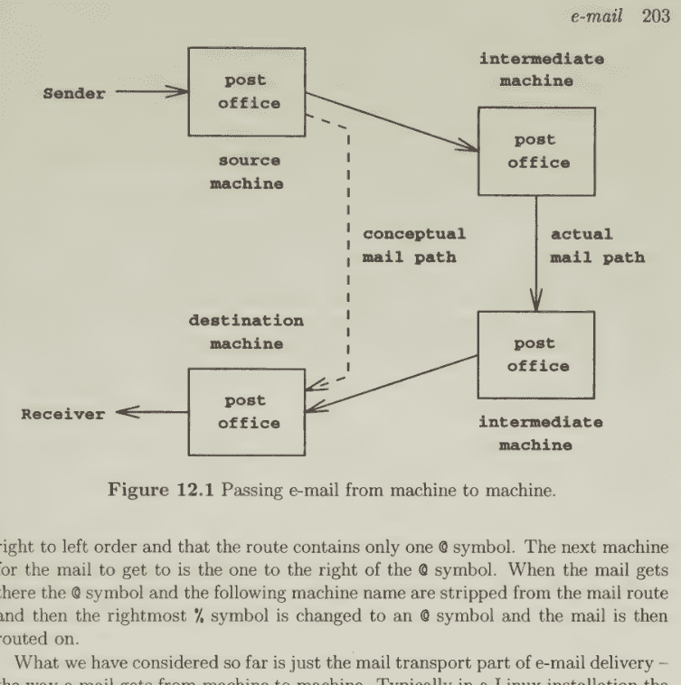

图 12.1 从一台机器到另一台机器传递电子邮件。

从右到左的顺序访问，并且路由中只有一个 @ 符号。邮件要到达的下一台机器是 @ 符号右侧的那台。当邮件到达那里时，@ 符号和随后的机器名称将从邮件路由中删除，然后最右边的 % 符号将更改为 @ 符号，然后邮件继续路由。

我们迄今为止考虑的只是电子邮件传递的邮件传输部分——电子邮件如何在机器之间传递。通常在 Linux 安装中，电子邮件传输将由名为 smail 的程序或名为 sendmail 的程序执行。对于完整的互联网连接，这两个程序的配置可能相当复杂。幸运的是，许多更完整的 Linux 发行版都附带了简单的脚本来配置邮件传输程序，以覆盖大多数简单情况。

我强烈建议如果你需要为自己设置电子邮件，请使用其中一个配置脚本。你还应该查看 Linux Mail-HOWTO 文档，其中强调了各种邮件相关程序的常见问题和解决方案。

除了电子邮件传输程序外，你还需要提供一种读取和发布邮件消息的手段，即电子邮件用户界面程序或邮件阅读器。有许多邮件阅读器可供 Linux 运行，其中一些随主要 Linux 发行版一起提供。列表包括：

- elm;
- deliver;
- pine;
- mailx;
- metamail.

我个人最喜欢的是 elm，但这只是出于熟悉，因为所有邮件阅读器本质上执行相同的任务。

### 12.2 telnet

telnet 程序允许用户使用 TELNET 协议在机器之间通信。telnet 最常见的用途是允许用户通过网络登录到远程机器。执行此操作的 telnet 命令的一般形式为：

```
$ telnet host.domain
```

其中 host.domain 是你希望连接的系统的完全限定主机名。如果成功，此命令将导致远程机器出现 login: 提示。

一旦你登录到远程机器，telnet 就像一个哑终端一样，因此你输入的任何字符都只是发送到远程机器。那就是，除非你输入 telnet 转义序列。默认情况下，转义序列是 Ctrl-]，如果你输入此序列，你的终端会话将被中断，你将从本地 telnet 程序获得以下提示：

```
telnet>
```

仅在此提示下按 Enter 即可重新连接到远程机器，以便你的远程会话可以继续。

可以在提示下输入许多命令来控制 telnet 会话的各个方面，它们在 telnet 手册页中详细介绍。例如，更改转义字符序列的命令是：

```
telnet> set escape ^X
escape character is '^X'.
```

在输入 set escape 后，你只需输入从现在起要使用的字符序列（此示例中为 Ctrl-X），telnet 会通过确认你的请求并恢复你的远程会话来响应。

所有互联网服务都有服务器使用的默认端口号，客户端在请求特定服务时必须连接到这些端口号。默认端口号列表可以在文件中找到：

```
/etc/services
```


telnet 的默认端口是端口号 23，因此，通常你的 telnet 程序在连接到远程机器上的 telnet 服务时会自动使用此端口。然而，你可以通过在初始 telnet 命令行中添加所需的端口号，使用本地 telnet 程序向远程机器上的任何其他端口号建立一个哑终端连接：

```
$ telnet host.domain port
```

其中 port 将被替换为所需的数字。

例如，以下序列显示了 telnet 如何通过直接与远程机器上的邮件传输程序通信来发送邮件消息，该程序使用默认的电子邮件端口号，即端口 25：

```
$ telnet grunthos 25
mail from: <pc>
250 <pc>... Sender ok
rcpt to: <saw>
250 <saw>... Recipient ok
data
354 Enter mail, end with "." on a line by itself
Hi
This is just a test message...
250 WAA00321 Message accepted for delivery
```

前面带数字的行是来自远程机器邮件传输程序的确认消息和提示，其余的行是键入到本地机器 telnet 中的命令和消息文本。

### 12.3 ftp

ftp 命令是标准文件传输协议的用户界面。ftp 的目的是允许你在本地机器和远程机器之间或反之亦然传输文件。运行 ftp 的方式如下：

```
$ ftp host.domain
```

其中 host.domain 是所需远程机器的完全限定主机名。命令行上主机名的指定是可选的，但如果指定了，ftp 将尝试连接到远程机器上的 ftp 服务器。如果未指定主机名，则 ftp 将发出提示并等待用户命令：

```
$ ftp
ftp>
```

从 ftp> 提示符处，open 命令后跟主机名将尝试连接到给定主机。

无论哪种方式，当与远程机器成功建立连接时，你需要登录。如果你有远程机器上的用户登录，你可以使用此账户通过 ftp 并提供其密码。然后在远程机器上，你将拥有所使用登录名的读和写权限。这些权限用于确定你可以从远程机器下载哪些文件以及可以向哪些目录上传文件。

如果你没有远程机器上的特定登录账户，那么许多 ftp 设置都有一个特殊的账户可供使用。该账户的登录名称为 anonymous（因此有匿名 ftp 这一说法）。使用此登录名时，你应输入完整的电子邮件地址作为密码。

如果远程系统提供匿名 ftp 功能，使用它将使你登录到一个特殊的、公开可用的文件读写区域。特别是，提供了两个目录：pub，其中包含远程站点准备提供公共下载的所有文件；incoming，你可以上传希望贡献给远程站点的文件。

一旦成功登录到远程站点的 ftp，你将从本地 ftp 程序收到 ftp> 提示符。然后你可以自由使用任何内置的 ftp 命令。你可以使用 help 命令获取支持的命令列表。你也可以输入 help 后跟特定命令的名称，这将提供有关该特定命令的一些详细信息。

你最有可能想要使用的命令是：

| Command | Description |
|---|---|
| ls | 列出远程机器上的当前目录； |
| cd | 更改远程机器上的工作目录； |
| lcd | 更改本地机器上的工作目录； |
| ascii | 为 ASCII 文本文件设置后续文件传输； |
| binary | 为二进制图像文件设置后续文件传输； |
| hash | 在传输的每个 1024 字节数据块后显示一个 #； |
| get | 从远程机器向本地机器传输指定文件； |
| put | 从本地机器向远程机器传输指定文件； |
| quit | 中断与远程机器的连接并退出 ftp。 |

从远程机器检索二进制数据文件的典型 ftp 会话可能如下所示：

```
$ ftp grunthos
Connected to grunthos
220 grunthos FTP server
Name (grunthos:pc): anonymous
331 Guest login ok, send your complete e-mail address as password.
Password:
230 Guest login ok, access restrictions apply.
Remote system type is UNIX.
```

```
ftp> cd pub
250 CWD command successful.
ftp> ls
200 PORT command successful.
150 Opening ASCII mode data connection for /bin/ls.
total 114
drwxr-xr-x  2 root      wheel          1024 Oct 31 23:45 .
drwxr-xr-x  8 root      wheel          1024 Mar 28  1995 ..
-rw-r--r--  1 root      root           14684 Oct 31 23:45 rog1
-rw-r--r--  1 root      root           96547 Oct 31 23:45 rog2
226 Transfer complete.
ftp> binary
200 Type set to I.
ftp> hash
Hash mark printing on (1024 bytes/hash mark).
ftp> get rog1
200 PORT command successful.
150 Opening BINARY mode data connection for rog1 (14684 bytes).
###############
226 Transfer complete.
14684 bytes received in 0.0473 secs (3e+02 Kbytes/sec)
ftp> quit
221 Goodbye.
$
```

此会话首先运行 ftp 并请求连接到主机名 grunthos。经过一些消息后，我们收到提供登录 Name: 的邀请。括号中的内容 (grunthos:pc) 构成了如果我们在此处仅按 Enter 将使用的名称。然而，我们将执行匿名 ftp 传输，因此我们以 anonymous 登录。接下来我们收到密码请求，提示我们提供电子邮件地址。密码不会回显，因此字符不会出现，但在示例中我输入的是：

Password: pc@soc.staffs.ac.uk

成功登录到远程系统后，我们切换到 pub 目录然后列出其内容。决定下载文件 rog1，我们将 ftp 设置为二进制文件传输，并在收到每个完整的 1024 字节数据块时显示 hash (#) 标记。然后我们下载文件并退出 ftp。

如果你想在自己的机器上运行匿名 ftp 服务，则需要稍加注意以确保系统保持安全。一些 Linux 发行版已预装匿名 ftp 并可直接运行。如果需要手动安装，则需要在 /etc/passwd 文件中创建一个 ftp 登录，密码为 '*'，登录 shell 为 /dev/false。这是为了防止使用 ftp 账户进行普通登录。你还需要设置一个 ftp 主目录和一组子目录，例如 pub 和 incoming。完整细节有些复杂，但在 Linux NET-2-HOWTO 文档中已有很好的介绍。

### 12.4 archie

拥有 ftp 为你提供了一个非常强大的工具。然而，它仍然留下了一个基本问题：如何确定特定文件在世界上的位置。这就是 archie 程序发挥作用的地方。

世界各地的各个站点都设置了 archie 服务器，本质上包含它们遇到的所有 ftp 站点上的所有文件名的数据库。如果你从这些数据库之一发出 archie 查询，你将获得所需文件所在的所有 ftp 站点及其站点上的文件路径名的列表。然后你可以使用标准的 ftp 会话检索你找到的文件。

世界上有很多 archie 站点——以下是一些主机名及其相关国家/地区的列表：

| Hostname | Country |
|---|---|
| archie.au | 澳大利亚 |
| archie.univie.ac.at | 奥地利 |
| archie.belnet.be | 比利时 |
| archie.bunyip.com | 加拿大 |
| archie.cs.mcgill.ca | 加拿大 |
| archie.funet.fi | 芬兰 |
| archie.univ-rennes1.fr | 法国 |
| archie.th-darmstadt.de | 德国 |
| archie.ac.il | 以色列 |
| archie.unipi.it | 意大利 |
| archie.wide.ad.jp | 日本 |
| archie.hana.nm.kr | 韩国 |
| archie.uninett.no | 挪威 |
| archie.icm.edu.pl | 波兰 |
| archie.rediris.es | 西班牙 |
| archie.luth.se | 瑞典 |
| archie.switch.ch | 瑞士 |
| archie.ncu.edu.tw | 台湾 |
| archie.doc.ic.ac.uk | 英国 |
| archie.hensa.ac.uk | 英国 |
| archie.sura.net | 美国 (MD) |
| archie.unl.edu | 美国 (NE) |
| archie.internic.net | 美国 (NJ) |
| archie.rutgers.edu | 美国 (NJ) |
| archie.ans.net | 美国 (NY) |


为了使用这些站点之一，你只需 telnet 到列表中的其中一个主机名并以 archie 登录。然后 archie 服务器会返回一些简单信息，不过对于初学者来说，最有用且需要查找和使用的命令是：

```
archie> help ?
```

这将为你列出所有可用的命令，如果你随后对列表中的某个特定命令请求帮助，则会更详细地进行解释。完成帮助后，按 Ctrl-c 或 Ctrl-d 将返回到 archie> 提示符。

使用 archie 定位特定文件最简单的方法是使用类似以下命令：

```
archie> find posix.1
```

这将在短暂的搜索时间后，列出所有已知包含所需文件的主机站点以及在这些站点上该文件的路径名。然后使用常规的匿名 ftp 检索文件本身就很简单了。

你必须记住，每个 archie 站点存储的数据库都是其对全球可用文件情况的快照，因此，某个特定文件可能并未记录在所有站点上。

### 12.5 Usenet News

许多人使用公告板系统（BBS）作为讨论特定 BBS 范围内各种专业主题的论坛。Usenet News 的理念是，它应提供这种公告板讨论功能，但要在全球范围内进行，并拥有海量的讨论主题。

讨论主题称为新闻组，使用新闻阅读程序，你可以向新闻组发布自己的贡献并阅读其他用户的提问和评论。

要参与网络新闻，你需要知道可以与新闻阅读器连接的新闻服务器机器的主机名。新闻服务器是连接到新闻系统的机器，它们会定期接收来自世界各地的所有新闻更新。服务器接收到的所有新闻文章都由其存储在本地磁盘存储中，然后通过你的新闻阅读程序提供给你。

由于新闻组 literally 有数千个，这意味着网络新闻文章以每天数兆字节的速度到达——任何个人都无法跟上。新闻以这种速度到达，需要相当可观的存储空间来保存，即使如此，大多数新闻站点也只能负担得起在几周内保留所有新闻，然后将其从系统中删除以腾出空间给新到达的新闻。新闻保留的时间长度以及特定站点提供的新闻组范围都由站点管理员控制。

新闻组有两种类型，称为 *审核的* 和 *未审核的*。顾名思义，审核的新闻组有一个与其关联的审核员，所有针对该新闻组的帖子都应发送给审核员。审核员的任务是在将帖子传递给新闻组本身之前，筛选所有发往新闻组的帖子以确保其适当。在未审核的新闻组中，帖子不会被筛选，因此这些新闻组包含更开放和不受审查的讨论。

新闻组按几个顶级类别下的层次结构组织，其中一些类别如下：

- `alt` 另类/杂项讨论；
- `comp` 计算讨论；
- `rec` 娱乐；
- `sci` 科学主题。

在每个主要类别标题下都有几个子类别。例如，*comp* 下的两个子类别是：

- `comp.lang` 编程语言；
- `comp.os` 操作系统。

每个子类别可以进一步细分，直到最终达到单个新闻组的名称，例如：

- `comp.lang.c` C 编程语言讨论；
- `comp.os.linux.announce` Linux 用户的特别公告。

一种适用于 Linux 的良好新闻阅读器（我个人最喜欢的）称为 *tin*。该程序的用户界面与我们之前提到的 *elm* 邮件阅读器非常相似。为了使用 *tin* 连接到远程新闻服务器，你应使用以下命令：

```
$ export NNTP_SERVER=your.news.hostname
$ tin -r
```

其中你显然需要将 your.news.hostname 替换为将提供你的新闻服务的机器的主机名。

当你首次通过新闻阅读程序使用网络新闻时，它将在你的主目录中创建一个文件，通常称为 *.newsrc*，其中包含当前可供你使用的所有新闻组的列表，以及每个列出组的标志，表示你当前是否订阅该组。

当你首次加入一个新闻组时，很容易想尽快赶上进度。这通常会诱使你向新闻组发布各种问题，其中许多很可能是每个人都会问的相同初学者问题。为了避免用琐碎的问题惹恼他人并减少新闻的总体帖子数量，大多数新闻组都有一个经常更新并定期发布（也许每两周或每月一次）的文档，称为 *FAQ*，其全称为 *常见问题*。在向新闻组发布任何问题之前，你应始终检查该问题的答案是否包含在该新闻组的 FAQ 中或该领域的任何常用文档中。未能这样做很可能导致你收到大量邮件（flames）解释你的错误做法，并可能建议你 RTFM（*阅读手册*）。

### 12.6 gopher

gopher 服务相当复杂，因为它允许你轻松访问互联网上的各种服务，所有这些都集成在一个软件包中。

遗憾的是，很少有 Linux 发行版包含 gopher 客户端，因此你需要在使用之前另行获取一份副本。这并不是什么大问题，因为许多大型互联网 Linux 镜像站点都提供副本。例如，你可以 ftp 到：

```
src.doc.ic.ac.uk
```

并在 sunsite 镜像中的目录中找到 Linux 特定的 gopher 版本：

```
/unix/Linux/sunsite.unc-mirror/system/Network/info-systems
```

gopher 服务本身由网络服务器机器提供。每台服务器都保存其上可用的文件和信息列表，以及一组链接以访问其他服务器上的资源。

当你在本地机器上运行 gopher 客户端时，你指定服务器的主机名，这将成为你进入 gopher 网络的起点。例如：

```
$ gopher gopher.doc.ic.ac.uk
```

执行此命令后，你将被呈现所选 gopher 服务器的根菜单。通常，这将显示为编号列表，其中一个菜单项旁边有一个高亮箭头：

```
Root gopher server: gopher.doc.ic.ac.uk

1. Welcome to the src.doc.ic.ac.uk gopher server.
--> 2. Gopher Services/
3. astronomy/
4. biology/
5. computing/
6. gnu/
7. ic.doc/
8. info/
9. packages/
10. rfc/
11. science/
12. ukuug/
13. unix/
14. usenet/
15. weather/

Press ? for Help, q to Quit, u to go up a menu          Page: 1/1
```

使用箭头键上下移动指针，通过按回车键进行选择。这将带你进入另一个菜单。通过从该 gopher 服务器的根菜单中选择选项 2 到达以下子菜单：

Gopher Services

```
1. Hosts and people/
--> 2. Other gopher servers/
3. Useful college services/

Press ? for Help, q to Quit, u to go up a menu          Page: 1/1
```

在服务器上通过菜单导航并跟随链接到其他服务器上的菜单的过程一直持续到你到达感兴趣主题的文档。在菜单中，带有斜杠（/）字符的项目表示选择此选项将带你进入另一个子菜单。其他条目是文件，选择后将被检索。

即使有用于导航 gopherspace（即 gopher 数据库网络）的菜单系统，仍然存在不知道在哪里查找特定主题的问题。就像 ftp 使用 archie 来定位特定文件一样，gopher 使用自己的搜索程序 veronica。要使用 veronica，你输入一组关键词作为查询，程序会搜索庞大的文件和菜单标题数据库以定位适当项目，然后你可以按需检索。

尽管功能强大且灵活，gopher 正在迅速被万维网取代，因为后者提供了 gopher 的所有功能以及更多。

### 12.7 world wide web

万维网（WWW）与 gopher 类似，由数千台服务器机器的网络组成，它们共同保存了几乎任何可想象主题的文档（称为网页）。

网页是可包含文本和图形以供显示的文档。此外，网页还可以包含超文本链接，允许一个页面引用网络上其他地方的网页。


为了访问网络，您需要一个网页浏览器。一般来说，Linux 发行版不提供网页浏览器，因此如果您想使用万维网，就需要下载一个。目前最常见的网页浏览器称为 Netscape，其版本可以在多个主要 Linux 归档站点或其镜像站点之一找到。

安装好 Netscape 之后，您需要启动 X-Windows 才能运行它。当 Netscape 运行后，首页将会显示，首页上的一个框标有 Location:。该框包含您当前正在查看的网页的位置。网页是用一种称为超文本标记语言 (html) 的语言编写的。它使用一种简单的方法将文档文本的各部分标记为标题或普通文本，或作为指向其他网页的链接或指向当前网页其他位置的链接。

网络上每份文档都与其关联一个称为统一资源定位符 (URL) 的链接。文档的 URL 格式为：

```
http://www.server.hostname/pathname/on/server
```

URL 由三个部分组成，如下所示：

1. 这是直到第一个冒号（此处为 http:）的部分。此部分指定将用于传输找到的任何文档的通信协议。
2. 这是双斜杠 (//) 与第一个单斜杠 (/) 字符之间的部分（此处为 www.server.hostname）。它给出请求服务的主机的主机名。
3. 这部分从第一个单斜杠 (/) 到行尾（在此示例中为 /pathname/on/server）。它给出主机上所需文档所在的路径名。

网络及其浏览器的最大吸引力在于，除了 http 之外，还可以使用许多不同的协议，例如 email、news、ftp、gopher 和 wais。

当您阅读 html 文档时，您会发现文本中有些词以颜色或下划线突出显示。这些突出显示的词附有超文本链接，用鼠标单击其中一个将导致浏览器跟随该链接并显示指向的文档内容。

与 ftp 和 gopher 一样，万维网也提供搜索引擎来帮助您查找与特定主题相关的文档的 URL。这些包括：

| 搜索引擎 | URL |
|---|---|
| yahoo | http://www.yahoo.com/ |
| lycos | http://www.lycos.com/ |
| excite | http://www.excite.com/ |
| altavista | http://altavista.digital.com/ |
| webCrawler | http://webcrawler.com/ |
| inktomi | http://inktomi.berkeley.edu/ |

这些系统在搜索策略方面相当复杂。一般来说，它们会从您那里获取一份关键词列表，并在其数据库中搜索包含尽可能多关键词的文档。然后检索到的文档会根据某种相关性标准进行排序，并一次向您列出少量标题，通常附带文档开头的简短摘录。列出的标题被制作为指向文档本身的超文本链接，以便您可以单击感兴趣的任何标题以检索所选文档的副本。

除运行万维网客户端外，如果您的机器将全天候连接到互联网，您也可以在 Linux 下运行自己的 Web 服务器。同样，大多数发行版不包含 Web 服务器，但对 cern-httpd 或 NCSA-httpd 进行一次 archie 搜索很快就会找到其中一个 Web 服务器的副本，您可以用 ftp 下载并安装。完整的安装和运行说明包含在您为服务器软件下载的同一 tar 文件中。

## 运行 DOS

尽管所有为 Linux 开发工作做出贡献的人们竭尽全力，仍然有一两个人在某种原因下觉得没有 DOS 访问就无法继续。实际上，这完全可以理解，因为 DOS 上有一两个应用程序包，其功能尚未被自由软件阵营所匹敌（尚未...）。

潜在地，尝试在 Linux 环境中运行 DOS 软件涉及许多问题。其中大部分集中在这样一个事实：DOS 只能在 386 及更高处理器上运行，方法是让 CPU 以 8086 向下兼容模式（称为 real-mode）运行。另一方面，Linux 虽然运行在同一处理器上，但会将 CPU 切换到完全不同的模式（称为 protected-mode），在该模式下，处理器的许多内部寄存器的含义与 real-mode 中的含义不同。

### 13.1 DOSEMU

可在 Linux 下运行并允许您在 Linux 中运行大量 DOS 软件的软件包称为 DOSEMU。名称暗示 DOSEMU 是 DOS 模拟器——情况并非如此。实际上，DOSEMU 只是模拟 DOS 运行的机器环境。在此环境之上，您实际运行的是真正的 DOS 副本。由于 DOSEMU 可运行的各种 DOS 版本都是专有产品，DOSEMU 软件包不包含 DOS 版本——这意味着您必须购买并使用自己的副本。

DOSEMU 的工作方式是使用 80386 处理器的虚拟 8086 模式来提供一个硬件环境，在该环境中 real-mode 软件可以运行，同时处理器继续在 protected-mode 中运行。使用这种安排将允许在 Linux 操作系统同时运行时运行 real-mode 软件。

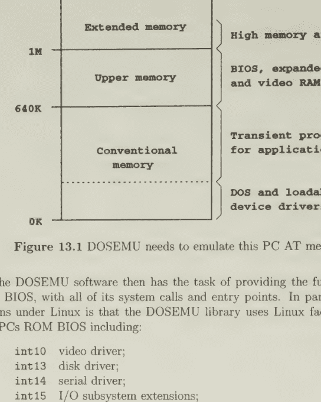

图 13.1 DOSEMU 需要模拟此 PC AT 内存映射。

然后 DOSEMU 软件的任务是提供 PC BIOS 的功能，包括其所有系统调用和入口点。特别是在 Linux 下，这意味着 DOSEMU 库使用 Linux 设施来模拟 PC 的 ROM BIOS 包括：

- int10 video driver;
- int13 disk driver;
- int14 serial driver;
- int15 I/O subsystem extensions;
- int16 keyboard driver;
- int17 parallel printer driver;
- int1a CMOS real time clock.

如果模拟足够准确，则任何软件（例如 DOS）都可以在模拟器下运行，并且不会意识到它不是在真实环境中运行。同样，在 DOS 运行的情况下，其他应用程序也应该能够运行，利用 DOS 和模拟的 BIOS 调用。图 13.1 显示了 DOSEMU 需要模拟的内存映射，以满足 DOS 及其应用程序的期望。

### 13.2 安装

首先要记住的是，DOSEMU 不断被修改和升级，以添加新功能、消除错误以提高其可靠性，并跟上 Linux 本身的发展和变化。这意味着如果您想安装该软件包，一个好主意是从 FTP 归档中尝试获取最新版本。

获取该软件包有两种方法，一种是以现成的二进制、配置和文档文件集的形式，另一种是以需要自行编译、安装和配置的源代码集的形式。几个 Linux 发行版将 DOSEMU 作为其标准或可选软件包之一提供，在这种情况下，该软件包通常是现成的。这显然使软件包的安装变得更容易，但也可能意味着您没有最新版本。假设现在您有一组要构建和安装的源代码，程序大致如下：

- 首先，即使 DOSEMU 只是一个用户级程序（即它不在内核中运行），您可能仍需要构建一个新内核才能使其运行。这是因为它使用来自 System V IPC 软件包的共享内存和信号量进程间通信 (IPC) 机制。这意味着您必须使用 IPC 软件构建一个新内核（除非，当然，您的现有内核已包含它）。另外，请确保您的内核版本号足够高，以适用于您尝试安装的 DOSEMU 版本。
- 确保您以 root 身份登录，否则您将无法完成安装。现在将软件从归档中解包到一个合理的位置以构建它。这将需要约 2Mb 的磁盘空间用于源代码，加上您创建所有二进制文件所使用的空间。
- 构建软件、创建文档和执行安装本身都非常简单。您只需更改到解包软件的顶级目录并输入：

```
# make doeverything
```

并且，相信我，它确实会。或者，至少如果您安装了 TeX 文本处理软件包，以便 make 可以构建手册。如果您没有 TeX 或不想构建手册，则可以改用以下命令：

```
# make most
```

您应该通过将将成为您初始 DOS C: 驱动器的文件复制到适当位置来完成安装，如下所示：

```
# cp ./hdimage.dist /var/lib/dosemu/hdimage
```

接下来您需要通过创建文件来配置软件包：

/etc/dosemu.conf

内容适当。做到这一点有两种方法，要么运行 Configure 脚本并回答有关您机器配置的大量问题，要么将示例配置文件复制为：

```
# cp ./examples/config.dist /etc/dosemu.conf
```

然后自定义该文件，按照其中包含的注释中的说明进行操作。同时此时你应创建一个名为：

```
/etc/dosemu.users
```

在其中你应编辑一份登录名列表，供那些有权使用 DOSEMU 软件包的用户使用。

你现在准备将你的 DOS 副本引入其中。为此你需要一张可启动的 DOS 软盘，上面已复制了两个 DOS 文件：

```
FDISK.EXE
SYS.COM
```

将此软盘插入你的 A: 驱动器，然后输入命令：

```
# dos -A
```

软盘上的 DOS 应该启动，并且你应该看到熟悉的 A> 提示符。尝试输入 dir c: 来查看是否可以列出 hdimage 文件的内容。此 Linux 文件由模拟器使其看起来像你的 C: 驱动器。如果可以正常看到 C: 驱动器，那么你可以执行以下命令将你的 DOS 副本安装到 DOSEMU 的 C: 驱动器并使其可启动：

```
A> fdisk /mbr
A> sys c:
A> c:\exitemu
```

其中最后一个命令将导致 DOSEMU 终止并返回到 Linux shell 提示符。你不再需要软盘在模拟器下启动 DOS，只需输入：

```
# dos
```

在安装并使 DOSEMU 正常工作后，你现在可以花一些时间研读其文档和手册，然后调整配置文件以进行更彻底的设置。

## 安全

过去，UNIX 因在系统安全的各个方面表现不佳而声名狼藉。其原因之一是通常源代码可供研究和实验，这不可避免地导致各种类型的安全漏洞被发现。然而，这远非问题，我认为这是一个积极的优势，因为它使漏洞得以公开，以便快速高效地找到修复方案并进行分发。我进一步认为，其他操作系统也必须承受类似问题的份额，但这些其他系统并未被如此彻底地探索，因此也没有得到如此好的调试。

现代 UNIX 和 Linux 安装中遇到的大多数安全问题都是由于管理员错误造成的，其中某些可用的安全功能未安装或配置不正确，或安全被故意牺牲以换取一定程度的用户便利。

### 14.1 文件权限

本节将讨论在 Linux 目录层次结构中的各种文件和目录应设置哪些权限位，以便系统保持合理的安全性。

总体而言，所有标准 Linux 命令（即 /bin 和 /usr/bin 目录中的可执行命令）应由 root 所有，并且在其上设置的权限位不应超过 rwxr-x--x（如果是可执行二进制文件）以及 rwxr-xr-x（如果是可执行 shell 脚本）。具体来说，这组权限位将阻止除 root 之外的用户写入文件，从而使普通用户无法更改任何标准命令。一般来说，将文件上的权限位设置为其执行功能所必需的最小数量是良好的做法。

通常，当程序运行时，它以执行该程序的用户权限运行。有时，这不足以使进程正确执行其任务。在这种情况下，可以在程序上设置 SUID 或 SGID 位，以便运行该程序的用户分别采用程序所有者或组的权限，而不是他们自己的权限。

这是使某些程序（如 passwd 程序）正常工作的唯一方法。然而，如果该功能落入错误的用户手中，则会产生各种滥用的可能性。例如，如果你以 root 登录并短暂离开终端无人看管，几分钟内，黑客在你离开时就可以输入：

```
# cp /bin/bash /home/hacker/.innocuous.file
# chmod 4755 /home/hacker/.innocuous.file
# clear
```

而你回来时可能完全不会察觉。然而现在黑客隐藏了一个 SUID root shell，可以随时使用而几乎不用担心被发现——只要黑客不做任何愚蠢的显眼行为。

你的系统上可能还希望有一组用户可以更改某些系统数据文件的内容。在这种情况下，可以设置一个特殊用户组，并将相关文件的 GID 设置为该组。然后将文件权限设置为 rw-rw-r--，它将允许特殊组成员在无需 root 权限的情况下读取和写入文件，同时仅允许其他系统用户读取访问。以这种方式限制对 root 访问的需求是重要的安全考虑。

不要忘记作为额外的安全功能，还有一个位掩码值（由 umask 命令设置），该值会在文件创建时从其上设置的权限位中屏蔽掉。

除了在数据和可执行文件上设置正确的权限位外，正确设置目录的权限位也很重要（而且经常被忽视）。特别重要的是要确保系统目录（以 /tmp 和 /usr/tmp 为明显例外）没有关联的公共写权限。请记住，目录上的写权限意味着你可以向目录内容添加新的文件链接并删除现有链接。

目录上的读权限意味着你可以读取目录中包含的文件名——而不是读取文件本身的内容。目录上的执行权限位用于允许目录在路径名中使用，以访问其下的文件。综合来看，目录上的读和执行权限可以设置成用户无法列出目录内容以了解其包含的内容，同时仍可访问已知存在的文件。要允许这种访问，目录权限需要设置为：

```
rwx--x--x
```

这些权限允许目录所有者完全访问目录及其内容，而所有其他用户只能访问名称明确已知目录中的内容。

### 14.2 设备访问

当涉及设备特殊文件的权限时，需要格外警惕，因为特殊文件可直接访问机器硬件，如果设置这些文件时出现任何错误，且你的用户足够精通，就可能导致严重的安全问题。

你应特别注意的设备特殊文件是与硬盘驱动器相关联的以及与内存相关联的。通常它们将具有如下名称：

```
/dev/hda  /dev/hda1  /dev/hda2  etc.
/dev/hdb  /dev/hdb1  /dev/hdb2  etc.
/dev/sda  /dev/sda1  etc.
/dev/sdb  etc.
/dev/mem  /dev/kmem
```

所有这些文件都应由 root 所有，并且权限设置应尽可能受限，至少不能有公共读或写权限。如果用户设法获得了对磁盘或磁盘分区的读写访问权限，那么该用户将能够绕过该磁盘或分区上的所有标准文件和目录权限设置。这是因为用户可以直接访问驱动器上的字节，就像数据一样，而系统不会对其施加通常的目录层次结构。承认这一点，用户随后需要对数据进行分析，手动将其拆分为文件和目录。但这并不像听起来那么困难，尤其是很容易查明文件系统在磁盘上的确切布局。

如果用户能够获得对内存特殊文件的读写访问权限，则存在类似的问题，因为这些文件直接映射到机器内存的区域，从而允许用户查看和修改运行系统中的内存区域。

在 Linux 下，通过 /proc 目录的内容访问机器内存以及每个运行进程相关联的内存是另一种方式。事实上，尽管你可以执行 ls /proc 命令并列出其内容，但 /proc 及其内容实际上并不出现在你的硬盘上。该目录及其所有内容只是由内核动态 *生成* 到位的。

显然，如果运行进程的内存可以被具有足够权限的用户访问，那么如果有人入侵你的 root 账户，这也会导致安全问题。

大多数 Linux 系统的终端访问将通过网络或通过机器的控制台及其虚拟终端提供。然而，一些系统将拥有

通过串口连接到它们的额外终端——这可能是另一个问题的来源。传统上，终端上的权限设置会允许任何人对终端特殊文件具有写访问权限。这允许用户使用 write 命令在用户之间传递简单消息。然而，这正是某些串行终端问题的根源。

对于许多终端，可以向它们发送简单的转义和命令字符序列，从而编程使其执行简单操作。并不罕见其中一种操作是将字符从终端发送回主机，就好像这些字符是在终端键盘上键入的一样。鉴于此场景，很容易看出黑客使用 write 命令可以向你的终端发送一系列字符，使终端将编程好的命令发送回计算机。这些命令随后将被执行，就好像是你自己键入的一样。如果你恰好在那时以 root 身份登录……嗯，你明白了。

保护自己免受此类攻击的唯一方法是移除终端线路上的公共写权限。这可以通过以下命令完成：

```
$ mesg n
```

不幸的是，移除这一潜在问题也会阻止其他用户使用 write 向你发送消息，但你不能两者兼得。

### 14.3 密码

确实如此，没有系统能比其密码更安全。当用户尝试登录你的系统时，会要求输入密码。该密码随后会被加密，并与文件 /etc/passwd 中先前加密的版本进行比较。如果两个加密密码匹配，用户将被允许登录系统。由于密码文件中包含的信息因各种原因通常很有用，并且密码本身被安全加密，因此该文件具有公共读权限。

到目前为止，一切都很好，但现在加上人为因素。大多数用户希望密码易于记忆——对他们有意义的东西——比如伴侣的名字、出生日期或类似的东西。像这样的密码纯粹是在自找麻烦。它们很容易被对你和你的朋友只有模糊了解的人猜到。在选择密码时，它应包含大小写字母、数字和标点符号的混合，从而不太可能被试图猜测它的人发现。在安全性要求特别严格的情况下，重要的系统密码应相当频繁地更改，并且应尽可能少的人共享。显然，对于有多个用户的系统，特权用户的最少数量应考虑到你可能不在或生病，而此时某个用户需要做一些需要 root 访问的操作。

除了普通用户密码外，在 Linux 中也可以在文件 /etc/group 中为用户组分配密码。对组设置密码允许拥有特定组密码的任何用户使用 newgrp 命令切换到该组。然而，通常更安全的做法是不为组设置密码，因为这样只有 /etc/group 文件中实际列在每个组旁边的那些用户才能进行这些组更改。

### 14.4 根账户

root 账户的第一条规则是：如果有，不要在绝对必要时以外使用它。第二条规则是：在机器上创建尽可能少的 root 账户，以完成工作任务。在可能的情况下，找到一种替代方法，允许用户组在必要时执行系统管理任务，而无需分配 root 登录。这最容易通过用户组和适当的组访问权限位来实现。

作为你在以 root 登录时需要小心的示例，请考虑以下情况。当你以普通用户登录时，有一个名为 PATH 的 shell 环境变量，其中包含一个用冒号分隔的目录列表，这些目录将按给定顺序搜索，以找到与你尝试运行的任何命令名称关联的可执行文件。通常，PATH 的内容可能是：

```
$ echo $PATH
.:/usr/local/bin:/bin:/usr/bin:/usr/X11/bin
```

在示例中，搜索路径中指定了五个目录，以当前目录 (.) 开始。将当前目录放在首位非常方便，因为你可能会无意中创建一个与某些未知系统命令同名的程序文件。如果发生这种情况，那么当你尝试从当前目录运行新命令时，它会在同名系统命令之前被找到，因为当前目录被优先搜索。如果不搜索当前目录，则系统命令将被执行，从而造成一定程度的混淆。

我最喜欢的这种版本发生在我编写简单的测试程序以尝试新想法时，因为我总是想把新程序命名为 test，而这当然也是一个标准的系统命令。不幸的是，如果你在没有任何参数的情况下运行系统版本的 test，它几乎没有任何可见反应，只是返回 shell 提示符，让我确信我的简单 test 程序不起作用……。

尽管说将 PATH 变量以当前目录开始是有用的，但在你的 root 登录情况下，这绝对是一个错误。为了最大化安全性，当前目录根本不应出现在 root 的 PATH 中。要了解原因，请考虑以下可能性。你的某个用户叫你到终端，要求你执行系统管理员功能。你走到终端，使用 su 命令切换用户到 **root** 并按用户要求执行必要的系统命令。然后你以 **root** 身份注销并继续之前的工作。然而，你没有怀疑的是，你的用户实际上是一个黑客，并利用机会创建了一个 *篡改的* 版本的命令，你将以 **root** 身份运行，该版本存储在用户的当前目录中。

如果作为 **root**，你的 PATH 以当前目录开始，那么当你为用户执行任务时，用户的 *篡改的* 命令版本将被运行，而不是真正的命令。以 **root** 身份运行用户的命令将赋予它做任何事情的权限。一个聪明的黑客会让 *篡改的* 程序在安全的地方创建一个 **root** 拥有的 SUID shell，然后继续执行真正的程序，这样你就不会察觉到……。小心！

这里还有许多我没有空间讨论的安全问题，但本章中你看到的内容应该能让你开始朝正确的方向思考。

## 第三部分

### 系统编程

## 文件

本书这一部分的主题是 Linux 系统调用。毕竟，这就是应用程序与其由内核提供的服务之间的主要接口。

Linux 背后的基本理念之一（事实上，所有 UNIX 变体都是如此）是系统会尽力使对各种设备（如磁盘、CD-ROM、终端、打印机等）的输入和输出尽可能看起来像对普通文件的输入和输出。

这最明显的体现之一是，在我们查看驱动不同设备类型时，可用于普通文件的系统调用会一次又一次地出现。

### 15.1 顺序文件

普通的 Linux 文件只是一组按顺序一个接一个存储在文件中的数据字节。Linux 对数据不施加任何内部结构，因此就 Linux 而言，数据不会被拆分为记录或字段。如果某个特定应用程序需要某种内部数据结构，那么作为程序员，你需要自己对数据施加该结构。这使得 Linux 对文件的接口特别简单。

### 15.1.1 文件描述符

在 Linux 中，文件是通过文件描述符访问的。每个进程同时最多可以使用 OPEN_MAX 个文件描述符。OPEN_MAX 的值通过标准头文件 <limits.h> 访问，对于 Linux 来说其值为 256。

OPEN_MAX 的定义实际上在 <linux/limits.h> 中，但为了使你的程序具有可移植性，你不应直接在代码中包含此头文件，因为当你 #include <limits.h> 时它会自动包含。


按惯例，文件描述符 0、1 和 2 在进程启动时已分配并可供使用。文件描述符 0 用作标准输入设备，文件描述符 1 用作标准输出设备，文件描述符 2 用作标准错误输出设备。

每个已分配的文件描述符都关联一个打开文件描述。打开文件描述只是与文件相关的信息结构。此信息包括一个偏移值，指定下一次访问文件的位置、文件的访问模式，该模式指定关联的文件是否可用于输入或输出或两者，以及一些其他相关标志。

文件描述符与打开文件描述之间的关系不一定是一对一，也可以是多对一。这意味着多个文件描述符，甚至属于不同进程的文件描述符，都可能指向同一个打开文件描述。其含义是存储在打开文件描述数据结构中的信息将被指向它的所有文件描述符共享。

事实上，正如我们稍后将看到的，文件描述符结构中也存储了一些信息。这意味着即使两个或多个文件描述符指向同一个打开文件描述，它们对此信息的取值也可能不同。

#### 15.1.2 open 系统调用

获取可让你访问文件的描述符有几种方法，最常见的是使用 open() 系统调用：

```c
#include <sys/types.h>
#include <sys/stat.h>
#include <fcntl.h>

int open(const char *path, int flags);
int open(const char *path, int flags, mode_t mode);
```

请注意，open() 系统调用有两种不同的形式；第一种接受两个参数，第二种有三个参数。实际上，除非你尝试打开的文件可能不存在并且在这种情况下你希望创建该文件，否则你只会使用两个参数的版本，在这种情况下需要使用 open() 的三个参数版本。

path 参数只是指向你希望打开的文件路径名的指针。flags 参数指定你希望如何打开文件。这必须包含以下三个值之一：

- O_RDONLY 以只读方式打开文件；
- O_WRONLY 以只写方式打开文件；
- O_RDWR 以读写方式打开文件。

此外，还可以使用按位或（|）运算符包含以下标志值的任意组合：

- `O_CREAT` 打开文件，如果不存在则创建它；
- `O_EXCL` 如果设置了 O_CREAT 且文件存在，则强制 open() 失败；
- `O_TRUNC` 在 open() 时将文件截断为零长度；
- `O_APPEND` 强制 write() 在文件末尾进行。

还可以指定一些其他标志，但它们对普通文件没有用处，因此我们将在它们更相关时稍后介绍。所有这些标志值的符号名称可通过 #include <fcntl.h> 访问。

如果你使用 open() 创建文件，则 mode 参数用于指定文件所有者、文件组和所有其他系统用户的访问权限位。以下符号常量（通过 <sys/stat.h> 定义）所需的组合应使用按位或运算符创建：

- `S_IRUSR` 文件所有者的读权限位；
- `S_IWUSR` 文件所有者的写权限位；
- `S_IXUSR` 文件所有者的执行权限位；
- `S_IRGRP` 文件组的读权限位；
- `S_IWGRP` 文件组的写权限位；
- `S_IXGRP` 文件组的执行权限位；
- `S_IROTH` 其他文件用户的读权限位；
- `S_IWOTH` 其他文件用户的写权限位；
- `S_IXOTH` 其他文件用户的执行权限位。

以下已定义了三个有用的按位或组合：

- `S_IRWXU` 定义为 (S_IRUSR | S_IWUSR | S_IXUSR)
- `S_IRWXG` 定义为 (S_IRGRP | S_IWGRP | S_IXGRP)
- `S_IRWXO` 定义为 (S_IROTH | S_IWOTH | S_IXOTH)

此外，还可以使用常量值指定是否应设置 set-uid 位和/或 set-gid 位：

- `S_ISUID` 设置 set-uid 位；
- `S_ISGID` 设置 set-gid 位。

不要忘记，当进程代表你创建文件时，权限位会被进程关联的 umask 值修改。进程实际上使用以下公式：

```
mode & (~umask)
```

来确定文件实际创建时的权限。这意味着如果你用程序之一创建的文件的权限位与你在 open() 调用中请求的 mode 标志不匹配，也不必感到惊讶。我们将在第 21.1 节中讨论如何处理 umask 值（如果此安全功能成为问题）。

使用一系列参数值对 open() 的调用示例可能如下：

```
open("xfile", O_RDONLY);
open("yfile", O_RDWR | O_TRUNC);
open("zfile", O_WRONLY | O_CREAT | O_EXCL, S_IRWXU | S_IXGRP);
```

第一个示例只是以只读方式打开 xfile。如果 xfile 不存在，open() 将返回错误。第二个示例以读写方式打开 yfile。文件必须已存在，并且将被截断为零长度，从而丢失任何先前内容。第三个示例以只写方式打开 zfile。open() 调用期望创建文件，如果文件已存在则返回错误。因为 zfile 正在被创建，所以需要指定一组权限位，在本例中为 rwx--x---。

有时阅读 open() 调用可能有点困难，特别是如果按位或运算符被用于大量标志。在这种情况下，在代码顶部 #define 一个合适的符号常量是个好主意。定义常量 MODE755 以给出文件权限位 rwxr-xr-x 的示例可以是：

```
#define MODE755 (S_IRWXU | S_IRGRP | S_IXGRP | S_IROTH | S_IXOTH)
```

当 open() 检测到错误时，会以返回值为 -1 表示。由于可能导致错误的条件很多，内核通过为外部整数变量 errno 分配适当值来指示发生了哪个错误。open() 调用的主要错误有：

- ENOENT 你尝试打开一个不存在的文件而未指定 O_CREAT。
- EEXIST 你使用 O_CREAT | O_EXCL 强制创建已存在的文件
- EACCES 你没有对文件请求的访问权限，或你没有文件路径名中某个目录的搜索权限

这些符号可通过 <errno.h> 访问。

如果没有发生错误，则 open() 的返回值是一个文件描述符，你将在对文件的后续所有操作中使用它。文件描述符本身只是一个小的非负整数，实际上是打开文件描述指针数组的索引。当分配文件描述符时，会在该数组中搜索第一个空闲元素。其结果是 Linux 在打开文件时总是分配编号最低的空闲文件描述符——这一点你将在我们以后研究向文件和管道重定向 I/O 的实现时看到其被很好地利用。

有时你可能希望在尝试 open() 某个文件之前检查你的进程是否对该文件有访问权限。这可以通过 access() 系统调用完成。调用的一般形式为：

```c
#include <unistd.h>
```

```c
int access(char *pathname, int mode);
```

其中 pathname 是你希望测试访问的文件名，mode 是以下值之一，这些值通过文件 <unistd.h> 包含：

- R_OK 检查调用进程是否具有读访问权限；
- W_OK 检查调用进程是否具有写访问权限；
- X_OK 检查调用进程是否具有执行访问权限；
- F_OK 检查指定文件是否存在。

#### 15.1.3 creat 系统调用

为了与早期 UNIX 系统保持向后兼容，Linux 还提供了一个用于创建文件的替代系统调用，名为 creat()。

```c
#include <sys/types.h>
#include <sys/stat.h>
#include <fcntl.h>

int creat(const char *path, mode_t mode);
```

在早期版本的 UNIX 中，open() 系统调用仅存在于两个参数的形式，并且没有在文件不存在时打开文件的能力。文件创建随后由单独的系统调用 creat() 执行。在 Linux 和所有现代版本的 UNIX 中，creat 系统调用是冗余的。事实上，creat 调用：

```
fd = creat(file, mode);
```

与现代 open() 调用完全等价：

```
fd = open(file, O_WRONLY | O_CREAT | O_TRUNC, mode);
```

#### 15.1.4 read 系统调用

一旦你拥有与打开文件描述关联的文件描述符，只要文件是以 O_RDONLY 或 O_RDWR 访问权限打开的，你就可以使用 read() 系统调用从文件中读取字节：

```c
#include <sys/types.h>
#include <unistd.h>

int read(int fd, void *buf, size_t nbytes);
```

其中 fd 是你想要读取的文件的文件描述符，buf 是指向一块内存的指针，read() 将把从文件中取出的字节放在该内存中，nbytes 是要从文件中复制到 buf 中的字节数。


read() 系统调用的函数原型在 <unistd.h> 中给出，数据类型 size_t 通过 <sys/types.h> 访问，目前定义为 unsigned int，在 PC 上的 Linux 中为 32 位值。

read() 操作从当前文件位置开始，该位置由关联的打开文件描述中包含的文件偏移值给出，并从此处继续，直到从文件中读取所需数量的字节或达到文件末尾。确保你指定给 read() 的数据缓冲区足够大以容纳请求的字节数是你的责任，因为内核无法检查并且会盲目地复制其数据。

在 read() 操作结束时，文件偏移值将被递增到刚刚复制的数据之后，移动到为下一次 read() 准备的新位置。

read() 的返回值在发生错误时为 -1，在文件偏移值位于文件末尾时为 0，或是从文件中复制到指定缓冲区的字节数计数。计数通常与你请求的字节数相同，除非你请求的字节数多于剩余可读字节数。在这种情况下，将返回小于你请求的字节数的数值，然后，如果文件大小在此期间未发生变化，下一次 read() 将返回文件末尾（0）值。

物理磁盘读取总是以完整的磁盘数据块进行，然后存储在内存缓冲区中。如果文件是顺序读取的（即连续的磁盘块），为了提高系统性能，内核中存在机制可以预判进一步的数据需求，并使用预读技术使数据准备就绪。

#### 15.1.5 write 系统调用

数据通过 write() 系统调用写入文件。表面上，很容易认为 write() 系统调用只是 read() 的相反操作。它的格式如下：

```
#include <sys/types.h>
#include <unistd.h>

int write(int fd, void *buf, size_t nbytes);
```

nbytes 个字节的计数从 buf 指向的内存块写入到与文件描述符 fd 关联的文件中。

数据从当前文件偏移位置开始写入文件，并且偏移量将自动按实际写入的字节数递增，为下一次 write() 调用做好准备。如果文件以设置了 O_APPEND 标志的方式打开，则在 write() 执行前文件偏移值将自动递增到文件末尾位置。使用 O_APPEND 标志有助于防止覆盖文件中已有的<|message|> 数据，并在使用日志文件和审计跟踪时很有用。

就像 read() 一样，内核使用内存缓冲区在进程和磁盘之间缓存数据。然而，这里有一个细微的差别并不立即明显。在 read() 调用的情况下，如果数据在内存中不可用，则进程必须等待物理磁盘读取完成，然后 read() 调用才能返回。如果在读取数据时发生任何磁盘错误，则 read() 的返回值和 errno 的值可以反映这一事实。

在 write() 的情况下，数据只是缓存在内存中，然后 write() 调用立即返回。在此过程中，内核承诺数据最终会写入磁盘。你刚刚写入的数据的任何后续读取都将从缓冲区缓存中获取，而不是从磁盘获取。这意味着用户程序实际上无法察觉这种欺骗，除了对内存的数据读写比物理磁盘读写快几个数量级之外。

那么问题出在哪里？问题在于，尽管有承诺，物理磁盘写入可能永远不会发生。如果在从缓冲区缓存向磁盘写入数据时发生磁盘错误，则该数据将丢失，更糟糕的是，没有机制可以让写入数据的进程知道这个问题。物理读取期间的错误通过 read() 的返回值报告给读取进程。对于数据写入则无法做到这一点，因为 write() 调用在数据实际传输到磁盘之前很久就返回了。事实上，写入进程甚至可能在磁盘写入错误发生之前就已终止。磁盘硬件故障甚至不是唯一的问题来源，任何阻止磁盘写入发生的情况都可能导致问题，包括诸如：机器断电、按下复位按钮、在不使用 umount 的情况下移除已挂载的软盘、意外关闭机器等。

通常，现代硬件足够可靠，性能提升远远超过数据丢失的轻微风险。然而，在即使这种轻微风险也不可接受的情况下，需要做出替代安排。

如果你在使用现代 Linux 内核中的 Linux 第二扩展文件系统，则可以为 open() 系统调用指定一个额外的标志 – O_SYNC：

```
fd = open(file, O_WRONLY | O_SYNC);
```

该标志的作用是将适当的文件描述符（此处为 fd）上的 write() 系统调用与相应的物理磁盘写入同步。实际上，write() 调用要等到物理磁盘写入完成才会返回。

警告一下——如果你使用此标志，则你的代码可能无法移植到其他操作系统。事实上，它甚至无法移植到 Linux 中其他文件系统类型上的文件。你需要知道这一点，因为如果你不小心对其他文件系统类型上的文件使用 O_SYNC，你将不会得到任何错误指示，系统只是静默地未能执行预期的同步。

除数据缓存问题外，write() 调用与 read() 类似，因此再次由你负责确保不会尝试执行诸如写入的数据字节数超过数据缓冲区所包含的内容之类的操作。

write() 的返回值在出错时为 -1 且 errno 设置适当，或为实际写入文件的字节数计数。在普通文件（而非某些其他文件类型）的情况下，如果 write() 未返回与本应写入的字节数相同的值，则表明发生了异常情况（例如，你超过了最大文件大小限制），你可能仍应将其视为错误。

#### 15.1.6 close 系统调用

通过 close 系统调用释放打开的文件描述符以供重用：

```
#include <unistd.h>
```

```
int close(int fd);
```

每次分配一个文件描述符时，关联的打开文件描述中的引用计数都会递增，以便每个打开文件描述都知道有多少文件描述符与之关联。每次对文件描述符调用 close() 时，关联的打开文件描述的引用计数都会递减。最终，close() 的调用会使引用计数降为零。在这种情况下，close() 调用不仅释放文件描述符，还释放打开文件描述本身。

close() 调用在成功时返回零值，在出错时返回 -1，且 errno 包含错误号。事实上，close() 只能返回一个错误，那就是：

EBADF 参数不是有效的打开文件描述符

事实上，使用未关联打开文件描述的文件描述符调用 close() 不会造成任何损害，因此 close() 的返回值很少被检查错误。

显式地 close() 你 open() 的任何文件是良好的编程实践，尽管进程终止时仍保持打开的任何文件都会自动关闭。

#### 15.1.7 用户缓冲

仅仅因为系统调用接口是普通应用程序程序访问操作系统服务的最低级别访问，你不应该认为它们的使用必然是最有效的方式来做某事——以数据缓冲为例。

下列是一个非常简单的函数，它接受两个文件名的指针作为参数，并将第一个参数指定的文件的内容复制到第二个参数指定的文件中：


```
#include <fcntl.h>
#include <sys/stat.h>

#define NEWFILE (O_WRONLY | O_CREAT | O_TRUNC)
#define MODE600 (S_IRUSR | S_IWUSR)
#define SIZE 1

void filecopy(char *infile, char *outfile)
{
    char buf[SIZE];
    int infd, outfd, count;

    if ((infd = open(infile, O_RDONLY))==-1)
        fatal("opening infile");

    if ((outfd = open(outfile, NEWFILE, MODE600))==-1)
        fatal("opening outfile");

    while ((count = read(infd, buf, sizeof(buf)))>0)
        if (write(outfd, buf, count)!=count)
            fatal("writing data");

    if (count==-1)
        fatal("reading data");

    close(infd);
    close(outfd);
}
```

用户函数 fatal() 在此未列出，但它所需要做的只是输出包含其参数字符串的错误消息，然后终止进程的执行。

你已经知道系统使用大量内存作为磁盘文件读写的数据缓冲缓存，而在内存之间获取字节是一项非常快速的操作。然而，对于 filecopy() 函数而言，虽然它能工作，即执行了所需的复制，但效率并不高。运行一次系统调用会有相当大的时间开销，而此函数对每个复制的字节都会进行两次系统调用（一次 read() 和一次 write()）。

使用完全如上所列的 filecopy() 函数，我运行了一些简单的计时测试（使用 time 命令），发现我的系统上复制文件的速度约为每秒 6.4 千字节。现在减少复制操作中涉及的系统调用数量是相当简单的事情——你只需增加 SIZE 常量的值。其效果是使用较少数量但更大尺寸的块来复制文件。选择 SIZE 时自然会考虑与磁盘数据块大小相关的值。

在将 SIZE 的值改为 1024（但未做其他更改）后重复实验，文件复制速率提高到惊人的（好吧，我本人也很印象深刻）每秒 1.3 兆字节——速度提升超过 200 倍！

即使考虑到速度提升，有时以如此大的块读取数据也并不方便。在这种情况下，你可以通过在用户内存空间中自行进行数据缓冲，并在其中取用少量数据块来实现两全其美。

下面的代码示例展示了对 filecopy() 函数的一个小幅修改，使其调用 my_read() 和 my_write() 函数，这两个函数与 read() 和 write() 系统调用完全相同，只是它们使用内部 1024 字节的缓冲区来减少系统调用的使用次数。使用 write_close() 关闭输出文件而不是 close() 系统调用是必要的，以便在关闭文件前刷新 write_buf[] 的任何部分写入内容：

```
#include <fcntl.h>
#include <sys/stat.h>

#define NEWFILE (O_WRONLY | O_CREAT | O_TRUNC)
#define MODE600 (S_IRUSR | S_IWUSR)
#define SIZE 1
#define BUF_SIZE 1024

void filecopy(char *infile, char *outfile)
{
    char buf[SIZE];
    int infd, outfd, count;

    if ((infd = open(infile, O_RDONLY))==-1)
        fatal("opening infile");

    if ((outfd = open(outfile, NEWFILE, MODE600))==-1)
        fatal("opening outfile");

    while ((count = my_read(infd, buf, sizeof(buf)))>0)
        if (my_write(outfd, buf, count)!=count)
            fatal("writing data");

    if (count==-1)
        fatal("reading data");

    close(infd);
    write_close(outfd);
}
```

```
int my_read(int fd, char *buf, size_t count)
{
    static char read_buf[BUF_SIZE];
    static int read_offset = BUF_SIZE;
    static int read_max = BUF_SIZE;
    int i;

    for (i = 0; i<count; ++i)
    {
        if (read_offset==read_max)
        {
            read_offset = 0;
            read_max = read(fd, read_buf, sizeof(read_buf));

            if (read_max==-1)
                return -1;

            if (read_max==0)
                return i;
        }

        *buf++ = read_buf[read_offset++];
    }

    return i;
}
```

```
static char write_buf[BUF_SIZE];
static int write_offset = 0;

int my_write(int fd, char *buf, size_t count)
{
    int i, n;

    for (i = 0; i<count; ++i)
    {
        write_buf[write_offset++] = *buf++;

        if (write_offset==BUF_SIZE)
        {
            write_offset = 0;
            n = write(fd, write_buf, sizeof(write_buf));

            if (n!=BUF_SIZE)
                return -1;
        }
    }

    return i;
}

int write_close(int fd)
{
    if (write_offset>0)
        write(fd, write_buf, write_offset);

    write_offset = 0;
    return close(fd);
}
```

此代码仅旨在让你了解用户缓冲区的概念，因为通常你不会自己编写——C 标准库中有一个非常好的用户缓冲文件 I/O 包（fopen()、fclose() 等）。

请注意，在对文件写入进行用户缓冲时，你会遇到关于如何报告错误的相同类型问题，我们在研究 write() 系统调用本身时也遇到了这些问题。

使用单字节读写和用户缓冲函数测试 filecopy() 函数的数据传输速率，结果为每秒 330 千字节。正如你所预期的那样，这不如直接对 read() 和 write() 使用大缓冲区调用那么快，因为调用额外函数会带来开销，但它仍然比直接的单字节读写情况快超过 50 倍。

### 15.2 随机文件

迄今为止的所有文件访问默认都是顺序访问。这是因为所有的读写操作都是从当前文件偏移位置开始进行的。文件偏移值随后会自动递增到读或写结束位置之后，使其准备好进行下一次访问。

在此场景下，Linux 下的随机访问 couldn't be simpler。所有你需要做的就是将当前文件偏移值更改为感兴趣的位置，这将自动强制下一次 read() 或 write() 在此位置进行（当然，除非文件是以 O_APPEND 打开的，在这种情况下任何 write() 调用仍将在文件末尾位置进行）。


图 15.1 lseek() 偏移量的三个基本位置。

执行此任务所需的系统调用是 lseek()：

```
#include <sys/types.h>
#include <unistd.h>
```

```
off_t lseek(int fd, off_t offset, int base);
```

fd 参数是其关联的打开文件描述将在调用中被修改的文件描述符。

在指定文件偏移值的新位置时，你可能只想给出一个应作为新值采用的数字。这相当于提供相对于文件开始的位置。另两种可能性是，你可能想给出相对于当前文件偏移值的数字，或相对于文件末尾的数字。这三种可能性均在图 15.1 中显示，并附带用于选择它们的符号常量。

offset 参数是一个相对值，它被加到所选的基准位置上以给出新的文件偏移值。base 参数可以有三种值，定义在 <unistd.h> 中：

- SEEK_SET 从文件开头计算偏移；
- SEEK_CUR 从当前文件偏移值计算偏移；
- SEEK_END 从文件末尾计算偏移。

offset 参数的数据类型以及 lseek() 本身的返回值均指定为 off_t。这并不能真正说明这里有效的值是什么，不过 <sys/types.h> 中 off_t 的 typedef 将其定义为：

```
typedef long off_t;
```

几个简单的示例有助于阐明 lseek() 的使用：

```
lseek(fd, (off_t) 0, SEEK_SET);
lseek(fd, (off_t) -50, SEEK_CUR);
lseek(fd, (off_t) 5000, SEEK_END);
```

首先要注意的是，为了严格正确，需要将 offset 参数强制转换为 off_t 类型。这为 offset 参数在不同 Linux 平台上现在或将来可能具有不同的底层数据类型提供了可能。

第一个示例 lseek() 调用将与文件描述符 fd 关联的打开文件描述中的文件偏移值设置为 offset 参数值（0）与由 SEEK_SET 指定的文件开始的文件偏移值之和（也是 0）。因此此调用将文件偏移值设置为 0——文件开始。

第二个示例将文件偏移值从其当前位置（SEEK_CUR）向后移动 50 字节。不要忘记写入文件会自动推进文件偏移值以准备下一次读或写操作。因此，如果你想一次向后逐字节遍历文件并写入新的字节值，则需要 lseek() 偏移值为 -2 而不是你可能最初期望的 -1。

第三个示例将文件偏移值从文件末尾位置（SEEK_END）向前移动 5000 字节。将文件偏移值像这样移动到文件末尾之外乍一看似乎很奇怪，但这正是这里发生的情况。如果你现在在此新位置写入数据，则文件大小将变为新文件末尾的文件偏移值。那旧文件末尾位置与新位置之间的字节会怎样？很高兴你问了！事实上，它们什么也没有发生——磁盘上甚至不会为它们分配任何数据块（即使数据最终真的写入磁盘）。你最终得到的是一个有空洞的文件，其逻辑大小（由 ls -l 报告）是文件末尾位置的文件偏移值，而物理大小（它在磁盘上占用的数据块数）可能显著更小。

很容易说服自己这是可能的；你只需编写一个程序来创建新文件，然后使用 lseek() 将文件偏移值移入文件很远的位置。为了更有说服力，尝试一个大于文件将要存储的文件系统的大小的值。然后 write() 一个字节并 close() 文件。现在使用 ls -l 命令查看你刚刚创建的文件的大小是否大于该文件所在文件系统可能写入的大小。

如果在稍后某个时间再次打开文件并在空洞中的某个位置进行定位和写入，则文件将按需分配数据块以保存新数据。这会增加文件的物理大小但不会改变其逻辑大小。如果在任何时候尝试从文件空洞中读取数据，Linux 不会为读取位置分配数据块，而是只为那些字节位置返回零字节值。

lseek() 在移动文件偏移值时唯一的要求是，它不能移动到文件开头之前（即最终文件偏移值不能为负）。

lseek() 的返回值在出错时为 -1 且 errno 中有错误号，或为文件偏移位置的新值（以字节为单位从文件开头算起）。例如：


```
pos = lseek(fd, (off_t) 0, SEEK_CUR);
```

将 pos 设置为当前文件偏移值，且：

```
pos = lseek(fd, (off_t) 0, SEEK_END);
```

将 pos 设置为文件的长度（尽管还有其他方法可以做到这一点，而不会改变当前文件偏移值）。

### 15.3 终端 I/O

在 Linux 中，尽可能使所有输入和输出看起来像对普通文件的输入和输出。然而，终端 I/O 是较为困难的情况之一。只要你只是想将终端当作顺序访问文件进行输入和输出，那么就可以使用你已经见过的 open()、close()、read() 和 write() 系统调用。即使如此，仍有一些差异。

通常，一个进程会通过文件描述符 0、1 和 2 自动连接到一个终端，这些描述符会从其父进程继承。如果是这种情况，那么 open() 调用已代表该进程完成，并且所连接的终端将成为该进程的控制终端（我们稍后会看到控制终端的含义）。

如果你需要为自己打开一个终端，那么你需要一个文件名作为 open() 的参数传递。基本上只有两种可能性：要么你可以使用特殊文件名 /dev/tty，它指的是你的控制终端（如果你有的话），要么你需要知道特定终端设备特殊文件的名称，例如 /dev/tty1、/dev/tty2 等，这些是虚拟控制台终端的文件名。

稍加思考就会明白，将 O_CREAT、O_EXCL、O_TRUNC 和 O_APPEND 标志应用于终端文件是没有意义的。然而，确实有两种新的标志：

- `O_NOCTTY` 阻止该终端成为控制终端；
- `O_NONBLOCK` 阻止 open()、read() 和 write() 阻塞。

为了与某些其他 UNIX 系统在表面上保持兼容，还提供了 O_NDELAY 标志。在 Linux 下，O_NDELAY 与 O_NONBLOCK 完全相同，尽管其语义实际上应该略有不同。

再次，我们稍后会讨论控制终端，但阻塞这个概念是什么？假设你在终端键盘上执行 read()，而用户尚未按下任何键，应该会发生什么？

事实上发生的情况是，当你从终端读取且没有按键时，read() 调用不会返回。有效地，进程会被阻塞或挂起，直到 read() 请求以某种方式得到满足。

在 Linux 内核内部，每个终端文件都有相关的数据缓冲区。默认情况下，这些缓冲区用于在字符发送到终端设备文件和从终端设备文件接收时进行缓冲。这些缓冲区的默认操作是累积字符，直到遇到换行符（\n）。对于键盘缓冲区，只有在收到换行符后，被阻塞的 read() 调用才会被释放，并且字符才会提供给读取进程。请求的字节数无关紧要，read() 调用返回的字符数不能超过缓冲区中第一个换行符之前的字符数。如果请求的数量少于此数，则 read() 只会返回所请求的字符数。无论哪种情况，read() 的返回值都是实际读取的字符数。

如果在 open() 时设置了 O_NONBLOCK 标志，则 read() 的阻塞行为将被抑制。现在如果在读取终端时没有数据准备好，则 read() 调用返回 -1，且 errno 被设置为 EAGAIN，以表示应重试 read() 尝试。为了与其他 UNIX 变体兼容，errno 错误值 EWOULDBLOCK 也被定义，其值与 EAGAIN 完全相同。

对于对终端设备的 write() 调用，阻塞不是问题，写入的字符只是被缓冲，直到发送换行符，此时缓冲区内容将被显示。

close() 调用在终端设备上的工作方式与普通文件一样，并释放文件描述符以供进一步使用。

### 15.3.1 终端控制函数

只要你对终端设备所做的一切都是使用 open()、close()、read() 和 write()，那么终端访问的感觉就与普通文件访问非常相似。然而，有许多你可能希望对终端接口进行设置的事项并不符合此模型。例如，很不清楚如何使用 read() 和 write() 调用来设置终端线路的波特率。

对于此类任务，有一个通用 I/O 控制系统调用称为 ioctl()：

```
#include <sys/ioctl.h>
```

```
int ioctl(int fd, int cmd, int arg)
```

其中 fd 是适当的文件描述符，cmd 是你希望 ioctl() 执行的命令函数，而 arg 是供 cmd 使用的可选参数。实际上，arg 参数可以是任何 4 字节大小的东西，通常是一个 int 或指向一块内存（通常是 struct）的指针，其中包含指定 cmd 所需的任何参数数据。ioctl() 调用可用于许多 I/O 设备，而不仅仅是终端。因此，每种使用 ioctl() 的 I/O 设备都有自己的 cmd 和 arg 参数值集合传递给调用。由于 POSIX 委员会认为其已过度使用，ioctl() 调用在 POSIX.1 标准中已被一组单独的函数取代，用于终端 I/O。

通常，Linux 试图与尽可能多的 UNIX 变体保持兼容。始终存在一个压倒性的考虑，即在系统之间直接冲突的情况下，POSIX 兼容性优先，其次是根据通用使用情况最受欢迎的选项。

在终端 I/O 的情况下，由于保存终端特性基本信息的底层数据结构对于这两种系统来说本质上是相同的，因此提供 POSIX.1 设施以及 ioctl() 系统调用是可行的。

在 Linux 中，有一个名为 struct termios 的数据结构，可通过 <termios.h> 访问（为了兼容性，struct termio 也可通过 <termio.h> 访问）。这些结构具有以下基本布局：

```
#define NCCS 19

struct termios
{
    tcflag_t c_iflag;       /* input mode flags */
    tcflag_t c_oflag;       /* output mode flags */
    tcflag_t c_cflag;       /* control mode flags */
    tcflag_t c_lflag;       /* local mode flags */
    cc_t c_line;            /* line discipline */
    cc_t c_cc[NCCS];        /* control characters */
};
```

其中一个结构与每个终端设备相关联，并且结构中包含的标志集合控制终端接口的各种特性。

termios 结构中每组标志执行的主要功能如下：

c_iflag 此集合中的标志基本上允许在输入时进行字符映射，例如将大写字符转换为小写、\r 转换为 \n，以及 8 位输入转换为 7 位。这些标志还允许控制和检查输入奇偶校验以及 I/O 流量控制（x-on、x-off）。

c_oflag 这些标志允许在输出时进行字符映射。例如 \n 到 \r\n，或制表符到空格。还可以为换页符、\n、水平和垂直制表符等字符添加传输延迟。这是慢速打印终端常见的时代的遗留，当时这些设备需要时间来执行某些控制功能。

c_cflag 这些标志控制终端线路波特率的更改、字符大小（每个字符 5、6、7 或 8 位）并允许控制数据奇偶校验位的生成和检查。

c_lflag 这组标志具有一些非常强大的功能，其中最重要的是：

- 启用/禁用键盘生成的信号 – 导致输入字符被搜索 Ctrl-c 和 Ctrl-\。
- 启用/禁用字符回显功能 – 回显会自动将键入的输入字符发送回输出以显示。关闭回显时，用户可以秘密输入密码等。
- 启用/禁用规范输入 – 启用时，输入字符会自动缓冲为以 \n 结束的行，并且退格和行删除字符在缓冲区上操作。禁用时，read() 调用可以在键入时返回字符，而不必等待换行符被键入。

c_cc 这是一个值数组，其功能取决于是否启用了规范输入。如果启用（即输入为行缓冲），则该数组包含将用于诸如文件结束、中断、退出和停止等事物的字符（默认情况下它们分别是 Ctrl-d、Ctrl-c、Ctrl-\ 和 Ctrl-z）。如果禁用规范输入，则其中两个值会改变含义并成为超时和最小字符数，在 read() 返回之前必须满足其中之一。通常的做法是将这两个值都设置为零，这允许在键入时立即返回字符。

struct termios 中所有单个标志的符号常量可通过 <termios.h> 访问。该文件包含 <linux/termios.h>，常量实际定义于此。

访问和修改 termios 结构内容的主要 POSIX 函数如下：

```
#include <termios.h>

int tcgetattr(int fd, struct termios *tptr)
int tcsetattr(int fd, int action, struct termios *tptr)
```

其中 fd 是适当的文件描述符，tptr 是指向 termios 结构的指针，由 tcgetattr() 从终端结构填充，并由 tcsetattr() 用于填充终端结构。tcsetattr() 函数的 action 参数的可能值及其含义如下：

- TCSANOW 立即填充终端结构；
- TCSADRAIN 在当前输出缓冲区内容发送到终端后填充终端结构；
- TCSAFLUSH 与 TCSADRAIN 相同，但还丢弃任何未读的输入缓冲区内容。

通过使用 TCGETA 和 TCSETA cmd 值调用 ioctl()，并使用指向 struct termio 的指针作为其第三个参数，也可以获得相同的功能。


下面的代码示例是一对简单的函数，用于在标准输入和输出（如果它是终端）之间切换到‘scan’模式并返回（即回显关闭、信号关闭、规范模式禁用并设置为从 read() 立即返回字符）：

```
#include <termios.h>

struct termios tsave;

void scan_mode(void)
{
    struct termios tbuf;

    if (!isatty(0))
        fatal("standard input is not a terminal");

    if (tcgetattr(0, &tbuf)==-1)
        fatal("getting terminal attributes");

    tsave = tbuf;
    tbuf.c_lflag &= ~(ECHO | ICANON | ISIG);
    tbuf.c_cc[VMIN] = tbuf.c_cc[VTIME] = 0;

    if (tcsetattr(0, TCSANOW, &tbuf)==-1)
        fatal("setting terminal attributes");
}

void restore_mode(void)
{
    if (tcsetattr(0, TCSANOW, &tsave)==-1)
        fatal("restoring terminal attributes");
}
```

注意在 scan_mode() 中使用 isatty() 函数。isatty() 函数的原型为：

```
#include <unistd.h>

int isatty(int fd);
```

其中 fd 是一个文件描述符。如果 fd 与一个打开的终端相关联，则 isatty() 返回 1，否则返回 0。

有一个标准命令可供使用，可让你完全控制 termios 结构中的所有标志；它被称为 stty，其手册页给出了一个

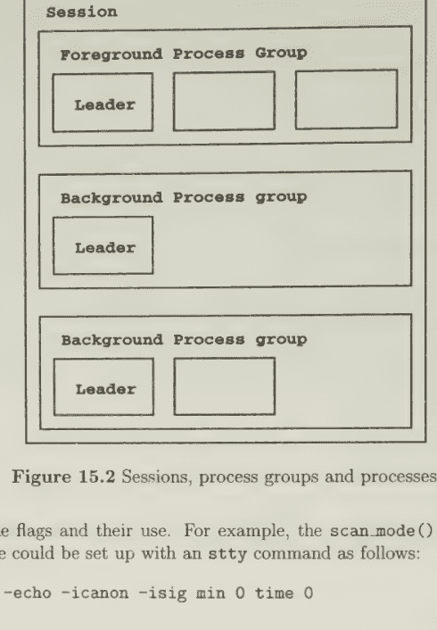

图 15.2 会话、进程组和进程。

完整列表及其用途。例如，前面代码中的 scan_mode() 设置可以用 stty 命令按如下方式设置：

```
$ stty -echo -icanon -isig min 0 time 0
```

#### 15.3.2 控制终端

每个进程都是一个进程组的成员，每个进程组都是一个会话的成员。每个进程组中都有一个进程，其进程 ID（PID）与其进程组 ID（PGID）相同。该进程是其所属进程组的领导者。同样，每个会话都有一个作为会话领导者的进程（参见图 15.2）。

会话中的进程可通过会话领导者与一个终端相关联，该终端将作为会话的控制终端。一个会话只能有一个控制终端，任何终端最多只能控制一个会话。如果一个会话有控制终端，那么这就是键盘生成的信号（如 Ctrl-c、Ctrl-\、等）可以发送到会话中进程的终端。

在会话中，其中一个进程组将是前台进程组，会话中的任何其他进程组将是后台进程组。仅允许前台进程组内的进程接收输入

来自会话的控制终端。控制终端输出也可以限制在此进程组中。

所有这些听起来很复杂，但在你登录时这些东西都会自动为你设置好，通常你也没有理由想要更改它们。

如果你真的需要设置自己的会话和进程组，那么有两种函数可用于此目的。第一个称为 setsid()，允许你设置自己的会话：

```c
#include <unistd.h>
#include <sys/types.h>

pid_t setsid(void);
```

对 setsid() 的成功调用会创建一个新会话，其中包含一个新进程组，而该进程组又包含当前进程作为新的会话和进程组领导者。然而，setsid() 不能由已经是进程组领导者的进程成功调用。我们将在第 22.2.3 节中讨论此问题的解决方案。

由于终端不能作为一个以上会话的控制终端，setsid() 的一个副作用是新会话将没有控制终端，因为即使它之前有一个，也会被留在旧会话中。

如果你希望新会话拥有控制终端，那么你只需让会话领导者 open() 一个尚未作为另一个会话的控制终端的终端，你的新会话将自动获取该终端作为其控制终端。

如果新会话需要 open() 一个终端，但你不希望会话将该终端作为其控制终端获取，那么你应该在 open() 调用中使用 O_NOCTTY 标志。

第二个允许你操作进程组的函数称为 setpgid()。通常，进程只能更改其自身的 PGID 或其子进程之一的 PGID。setpgid() 的原型为：

```c
#include <unistd.h>
#include <sys/types.h>

pid_t setpgid(pid_t pid, pid_t pgid);
```

参数 pid 和 pgid 显然分别是进程 ID 和进程组 ID。对于这些参数的值，有三种情况需要考虑：

- pid 和 pgid 均为非零 – 进程 pid 被移入进程组 pgid。pgid 的值必须引用当前会话中的一个进程组，或者它必须与 pid 相同，在这种情况下，会在当前会话中创建一个新的进程组，以进程 pid 作为其领导者。
- *pid* 为零 – 这与前一种情况相同，只是使用调用进程的 PID 代替 *pid*。
- *pgid* 为零 – 这也与第一种情况相同，只是使用调用进程的 PID 代替 *pgid*。

为了与其他版本的 UNIX 兼容，还提供了一个可以更改调用进程进程组的调用：

```c
#include <unistd.h>

int setpgrp(void);
```

在 Linux 下，setpgrp() 调用与 setpgid() 调用完全等效：

```
setpgid(0, 0);
```

### 15.4 索引节点

你已经看到 Linux 系统中的所有文件和设备都有一个与其关联的 inode，通过它进行访问。inode 本身包含与文件相关的相当多的信息，包括：

- 文件的设备号和 inode 号，提供唯一的文件标识；
- 文件的类型（普通文件、目录、特殊文件等）；
- 文件的访问权限位；
- 链接计数（链接到此文件的目录项数）；
- 文件的 UID 和 GID；
- 设备特殊文件的主设备号和次设备号；
- 文件的大小（以字节为单位，在有意义的情况下）；
- 最后访问/修改/状态更改的时间；
- 指向包含文件数据的磁盘块的其他信息（如适用）。

除最后一项外，如果进程知道文件的路径名或拥有与其关联的打开文件描述符的文件描述符，则所有这些属性的值都可以轻易获得。

为了访问它们，可供进程使用的状态属性被复制到 struct stat 中，该结构通过 <sys/stat.h> 定义。此结构的主要字段为：

```
dev_t      st_dev;                     /* device number */
ino_t      st_ino;                     /* inode number */
mode_t     st_mode;                    /* file type and permissions */
nlink_t    st_nlink;                   /* link count */
uid_t      st_uid;                     /* owner ID of file */
gid_t      st_gid;                /* group ID of file */
dev_t      st_rdev;    /* device numbers for device file */
off_t      st_size;                /* file size, in bytes */
time_t     st_atime;               /* time of last access */
time_t     st_mtime;               /* time of last modification */
time_t     st_ctime;               /* time of last status change */
```

此结构中 st_mode 字段的值的符号常量通过 <sys/stat.h> 定义。

此结构中的信息可使用以下三种系统调用之一恢复：fstat()、stat() 或 lstat()：

```
#include <sys/stat.h>
#include <unistd.h>

int fstat(int fd, struct stat *sbuf);
int stat(char *pathname, struct stat *sbuf);
int lstat(char *pathname, struct stat *sbuf);
```

对于 fstat()，fd 参数是打开文件描述符的文件描述符，sbuf 是指向 struct stat 的指针，调用将用适当的 status 详细信息填充它。

stat() 调用与 fstat() 相同，只是第一个参数是文件的路径名而不是文件描述符。

lstat() 调用与 stat() 相同，只是如果文件是符号链接，lstat() 将给出链接文件本身的状态详细信息，而 stat() 将跟随链接并给出链接指向的文件的详细信息。

所有三个系统调用在成功完成时返回 0，在出错时返回 -1，并将 errno 设置为适当的值。

下面的代码是一个简单的程序，将与任何给定文件路径名关联的 struct stat 中的信息以人类可读的形式显示出来：

```
#include <stdio.h>
#include <sys/stat.h>

#define MAJOR(a) (int)((unsigned short)(a) >> 8)
#define MINOR(a) (int)((unsigned short)(a) & 0xFF)

main(int argc, char **argv)
{
    struct stat sbuf;
    int dev_flag;

    for (; argc>1; --argc)
```


```
{
    printf("\nFile name: %s\n", argv[argc-1]);

    if (stat(argv[argc-1], &sbuf)==-1)
        fatal("obtaining status details");

    dev_flag = file_type(&sbuf);
    printf("Permission bits: %o\n", sbuf.st_mode & 07777);
    printf("File numbers: ");
    printf("major %d, ", MAJOR(sbuf.st_dev));
    printf("minor %d, ", MINOR(sbuf.st_dev));
    printf("inode %d\n", sbuf.st_ino);
    printf("Link count: %d\n", sbuf.st_nlink);

    if (dev_flag)
    {
        printf("Device numbers: ");
        printf("major %d, ", MAJOR(sbuf.st_rdev));
        printf("minor %d\n", MINOR(sbuf.st_rdev));
    }
    else
        printf("File size: %ld\n", sbuf.st_size);

    printf("File owner ID: %d\n", sbuf.st_uid);
    printf("File group ID: %d\n", sbuf.st_gid);
}
}
```

```
file_type(struct stat *sbufp)
{
    printf("File type: ");

    switch (sbufp->st_mode & S_IFMT)
    {
    case S_IFREG:
        printf("Ordinary file\n");
        return 0;

    case S_IFDIR:
        printf("Directory\n");
        return 0;

    case S_IFIFO:
printf("Named pipe (FIFO)\n");
return 0;

case S_IFBLK:
    printf("Block device special file\n");
    return 1;

case S_IFCHR:
    printf("Character device special file\n");
    return 1;

default:
    printf("Unknown...\n");
    exit(1);
}
}
```

```
fatal(char *mess)
{
    fprintf(stderr, "Error: %s\n", mess);
    exit(1);
}
```

请注意，该程序能够处理命令行上的多个文件名。程序的典型输出如下所示：

```
$ file_status /etc ./book.ps /dev/modem

File name: /dev/modem
File type: Character device special file
Permission bits: 660
File numbers: major 3, minor 65, inode 47638
Link count: 1
Device numbers: major 5, minor 64
File owner ID: 0
File group ID: 14

File name: ./book.ps
File type: Ordinary file
Permission bits: 644
File numbers: major 3, minor 66, inode 34876
Link count: 1
File size: 1049173
File owner ID: 500
File group ID: 500

File name: /etc
File type: Directory
Permission bits: 755
File numbers: major 3, minor 65, inode 45701
Link count: 8
File size: 2048
File owner ID: 0
File group ID: 0
```

### 15.5 更改文件属性

在你能收集到的有关文件的各种信息中，只有相对较少的一部分是可以更改的。本节将介绍你对其具有控制权的大多数内容。

### 15.5.1 chmod 和 fchmod 系统调用

首先要查看的是文件权限位。用于更改它们的系统调用称为 chmod() 和 fchmod()。这些系统调用可以更改的位与 chmod 命令可以更改的位完全相同。这包括所有者、组和全局用户类别的读、写和执行位。它还包括 setuid 位和 setgid 位。chmod() 和 fchmod() 的原型如下：

```
#include <sys/types.h>
#include <sys/stat.h>

int chmod(char *pathname, mode_t mode);
int fchmod(int fd, mode_t mode);
```

chmod() 调用更改给定路径名处的文件的模式位，而 fchmod() 更改与文件描述符 fd 关联的文件的模式位。

请注意，mode 参数具有 POSIX 数据类型 mode_t，因此为了具有良好的可移植性，你应该使用来自 <sys/stat.h> 的模式位的符号位掩码名称，而不是八进制数字版本。然而 Linux 接受两者，因此以下两个 fchmod() 系统调用执行完全相同的功能：

```
fchmod(fd, S_ISUID | S_IRWXU | S_IXGRP | S_IXOTH);

fchmod(fd, 04711);
```

这两个系统调用如果成功完成则返回值为 0，错误时返回 -1，并在 errno 中设置适当的错误值。

### 15.5.2 umask 系统调用

请不要忘记，当你更改文件的模式位时，你指定的位将根据公式自动由当前 umask 值修改：

```
mode & (~umask)
```

你在之前看到的 umask 命令的功能，在系统编程层面上由 umask() 系统调用提供：

```
#include <unistd.h>

mode_t umask(mode_t mask);
```

mask 参数使用与 chmod() 相同的符号位掩码名称集指定。

umask() 的返回值是当前 umask 值，即你的新 mask 参数所替换的值。这允许你按如下方式发现当前 umask 值：

```
oldmask = umask(0);
(void)umask(oldmask);
```

第二次调用 umask() 是必需的，以恢复发现的 umask 值。

### 15.5.3 chown 和 fchown 系统调用

chown() 和 fchown() 系统调用用于更改文件的 owner ID 或其 group ID。这些调用的原型为：

```
#include <sys/types.h>
#include <unistd.h>

int chown(char *pathname, uid_t owner, gid_t group);
int fchown(int fd, uid_t owner, gid_t group);
```

chown() 和 fchown() 系统调用分别将新的 owner 和 group ID 分配给由 pathname 或文件描述符 fd 指定的文件。

在 Linux 下，只有 root 才能合理地使用 chown() 和 fchown() 系统调用。

### 15.5.4 fcntl 系统调用

另一个可以检查和更改的内容是 open() 调用的第二个参数为文件设置的标志。执行此操作的系统调用称为 fcntl()。显然，由于它是在文件打开时设置的标志，因此 fcntl() 只有作用于文件描述符的版本，而没有作用于路径名的版本。fcntl() 的原型为：

```c
#include <unistd.h>
#include <fcntl.h>

int fcntl(int fd, int cmd);
int fcntl(int fd, int cmd, long setval);
```

通过文件描述符 fd，fcntl() 调用可以提供各种杂项文件控制功能。在这里我们只看其中两个（我们将在后面的章节中再回来查看其他内容）。

fcntl() 调用根据命令 (cmd) 参数的值接受两个或三个参数。一般来说，获取某个属性或标志值的命令使用 fcntl() 的两个参数版本，并将其所需值作为返回值提供。同样，设置某个属性或标志值的命令通常使用 fcntl() 的三个参数版本，并从 setval 参数设置属性或标志。

用于获取和设置部分 open() 标志的两个命令是：
- F_GETFL return flags and access mode associated with fd;
- F_SETFL set flags associated with fd.

F_GETFL 命令可以返回 open() 设置的任何标志和访问模式值（如 O_RDONLY、O_WRONLY、O_APPEND 等），但 F_SETFL 命令只能设置或重置 O_APPEND 和 O_NONBLOCK 标志。

由于 O_GETFL 命令返回的访问模式值不是单一位标志，因此测试特定模式值是否设置的 safest 方法是使用以下形式的测试（此示例中测试 O_RDONLY）：

```c
if ((fcntl(fd, F_GETFL) & O_ACCMODE) == O_RDONLY)
    /* code if fd is open read only */
```

其中 O_ACCMODE 专为从 fcntl() 返回值中屏蔽出访问模式位而设计。

### 15.5.5 truncate 和 ftruncate 系统调用

本节的最后几个系统调用可用于将文件截断到指定长度，给定文件的路径名或与文件关联的文件描述符：

```
#include <unistd.h>

int truncate(char *pathname, size_t len);
int ftruncate(int fd, size_t len);
```

如果这些调用中引用的文件长度超过 len 字节，则它将被截断到指定大小，多余的字节将被丢弃。

为了使 ftruncate() 成功操作，fd 必须与以写方式打开的打开文件描述相关联（即 O_WRONLY 或 O_RDWR）。

### 15.6 文件层次结构

为了创建、修改和维护 Linux 文件和目录层次结构，有必要能够创建和删除目录，并在目录中创建和删除指向文件的链接。所有这些事情都很容易实现，尤其因为它们都有自己的系统调用。

### 15.6.1 mkdir 和 rmdir 系统调用

Linux 进程可以使用 mkdir() 系统调用创建目录。该调用的原型为：

```
#include <sys/types.h>
#include <fcntl.h>
#include <unistd.h>

int mkdir(char *pathname, mode_t mode);
```

假设你的进程具有适当的权限，调用 mkdir() 将创建一个名为 pathname 的新目录，其权限位设置为 mode。mode 参数的值会以通常的方式由当前 umask 值修改。新目录将由调用进程的有效用户 ID 拥有，并且会自动初始化为包含点和点点条目。

如果目录为空（除了点和点点条目之外），则可以使用 rmdir() 系统调用将其从目录层次结构中删除：

```
#include <unistd.h>

int rmdir(char *pathname);
```


#### 15.6.2 目录访问

由于目录在文件系统层次结构中的特殊重要性，访问其内容需要特殊的系统调用。要打开一个目录，需要使用 opendir() 系统调用，其原型为：

```
#include <dirent.h>

DIR *opendir(char *pathname);
```

此调用打开指定的目录，如果成功则返回目录指针，否则在出错时返回零。目录指针传递给相关的系统调用，主要的有 readdir() 和 closedir()。

readdir() 系统调用的原型为：

```
#include <dirent.h>

struct dirent *readdir(DIR *dirptr);
```

此调用返回指向 struct dirent 的指针，其中包含指定目录中下一个链接的详细信息。链接中文件名称存储在结构体的 d_name 元素中，它是一个字符数组。重复调用 readdir() 将导致按顺序遍历目录中的链接。当没有更多链接可读时，返回零值。

使用完目录后，可以使用 closedir() 系统调用将其关闭。此调用的原型为：

```
#include <dirent.h>

int closedir(DIR *dirptr);
```

#### 15.6.3 link 和 unlink 系统调用

文件的目录项称为链接。当文件首次创建时，会根据其给定的路径名自动生成指向该文件的链接。此后，可以通过 link() 系统调用生成指向该文件的额外链接：

```
#include <unistd.h>

int link(char *pathname1, char *pathname2);
```

创建一个新的目录链接，称为 pathname2，指向现有文件 pathname1。为了使 link() 调用正常工作，pathname1 和 pathname2 必须位于同一文件系统上，并且调用进程必须具有向目标目录写入的适当权限。普通文件链接可以用 unlink() 系统调用删除。

```
#include <unistd.h>

int unlink(char *pathname)
```

此调用删除指定的目录链接，并递减其 inode 中文件链接计数。之后，如果链接计数变为零，则 inode 和文件的数据块全部释放回系统。如果某个进程在文件被安排删除时恰好打开了该文件，则 inode 和数据块的回收将被延迟，直到该进程终止，尽管目录链接仍将被删除，这样就不会有其他进程可以 open() 该文件并进一步延长其生命周期。

## 练习

- 1. 编写 ls 命令的简化版本，它仅将单个目录的名称作为唯一的命令行参数，并列出目录中所有文件的文件名，每行一个。如果不尝试对名称列表进行排序会更简单。
- 2. 编写一个程序，获取与终端关联的 struct termios 的副本，并以合理的人类可读形式显示其找到的设置值。
- 3. 编写一个 C 程序，提示用户输入姓名和密码，并根据提示从用户处获取字符串值。确保在输入密码时抑制字符回显，并在之后恢复回显，然后在程序打印获取的值并终止之前。
- 4. 编写一个简单的重命名命令，允许您重命名当前目录中您拥有的任何文件。命令的格式应为：

```
$ rename <oldname> <newname>
```

## 答案

1. 下面代码非常简单，部分原因是它没有执行通常需要进行的任何检查，以验证命令行参数的正确数量和类型，也没有验证所进行的系统调用的正确操作。然而，它确实使代码非常易于阅读：

```
#include <stdio.h>
#include <dirent.h>
```

```
main(int argc, char **argv)
{
    DIR *dp;
    struct dirent *link;

    dp = opendir(argv[1]);

    while ((link = readdir(dp))!=0)
        printf("%s\n", link->d_name);

    closedir(dp);
}
```

2. 解决此问题的方法是使用 ioctl() 或 tcgetattr() 来获取与终端关联的结构的内容。关于结构中每个标志和字节的含义和值的所需信息包含在头文件 /usr/include/linux/termios.h 中，stty 命令的手册页中还有一些额外信息。根据这些信息，很容易判断哪些标志被设置和重置以及它们的效果。然后可以以任何适当的形式显示。

3. 下面的 shell 脚本执行了所需的任务，并且可以很好地作为伪代码程序，供您在 C 中解决问题时参考：

```
echo -n "enter name: "
read name
stty -echo
echo -n "enter password: "
read password
stty echo
echo
echo name: $name
echo password: $password
```

4. 此问题的伪代码解决方案看起来像：

```
main(argc, argv)
    if argc!=3
        give error and usage message and exit
    if argv[1] or argv[2] outside current directory
        i.e. if they contain a '/', give error and exit
    if argv[1] not in current directory
        give error and exit
    link(argv[1], argv[2])
    unlink(argv[1])
```

您的 C 解决方案应遵循此基本模式。尽量使其尽可能防错，尝试处理您能找到的尽可能多的错误条件，包括检查系统调用的错误返回。

## 进程控制

Linux 是一个真正多任务操作系统。如果您有一个需要多个进程并发协作的应用程序，那么 Linux 可以安排它们并发运行，并在为您处理所有调度和进程管理。事实上，您已经看到这是如此。每次您使用 shell 运行管道时，例如：

```
$ ls | wc -w
```

它涉及多个命令（在此示例中为 ls 和 wc）并发运行，并且它们之间有一个通信通道，以便它们可以协作执行单个任务。当 shell 代表您安排运行并发进程时，它仅使用普通用户设施，您也可以在自己的程序中使用这些设施。它是这些设施构成本章的主题。

### 16.1 进程标识号

在 Linux 下运行的每个进程都有一个唯一的进程 ID 号（PID），系统据此识别它。从进程 1（init）开始的每个进程都有一个父进程，其进程 ID 也可以访问。

每个进程还属于一个进程组，其进程组 ID 只是进程组领导者的进程 ID。

当确定进程访问各种文件的权限时，进程使用另一组四个 ID。这些被称为真实用户和组 ID 以及有效用户和组 ID。进程的真实 ID 只是进程运行的用户 UID 和 GID。有效 ID 通常与真实 ID 相同，除非程序设置了其 setuid 或 setgid 位。如果设置了其中一个或两个位，则相应的有效用户或组 ID 将设置为与进程运行的程序文件关联的文件所有者 ID 或文件组 ID。

这听起来很复杂，所以举个例子。假设一个 UID 为 200 且 GID 为 20 的用户运行程序 /usr/bin/passwd。该程序的文件所有者 ID 为 0（root），文件组 ID 为 1（bin），并且还设置了其 setuid 位。

当运行 passwd 程序时，相关进程将具有真实用户 ID 200、真实组 ID 20、有效用户 ID 0（因为设置了 setuid 位），以及有效组 ID 20。

真实 ID 用于确定进程运行的用户身份。有效 ID 用于根据以下算法（从规则 1 开始）确定进程访问文件时的特权和权限：

- **规则 1** 如果进程的有效用户 ID 为 0（root），则大多数情况下自动授予权限。如果不是，转到规则 2
- **规则 2** 如果进程的有效用户 ID 与文件用户 ID 相同，则根据文件上的所有者权限位授予对文件的访问权限。如果不是，转到规则 3。
- **规则 3** 如果进程的有效组 ID 与文件组 ID 相同，则根据文件上的组权限位授予对文件的访问权限。如果不是，转到规则 4。
- **规则 4** 根据文件上的世界权限位授予对文件的访问权限。

与进程关联的各种 ID 都可以通过一组‘get ID’系统调用访问：

```
uid_t getuid(void)        /* get real user ID */
uid_t getgid(void)        /* get real group ID */
uid_t geteuid(void)       /* get effective user ID */
uid_t getegid(void)       /* get effective group ID */
pid_t getpid(void)        /* get process ID */
pid_t getppid(void)       /* get parent process ID */
pid_t getpgrp(void)       /* get process group ID */
```

### 16.2 使用 fork 创建进程

为了本次讨论的目的，我们将认为进程由三个独立的部分组成，如图 16.1 所示。

文本段保存要执行的机器代码指令。该段是只读的（因此您不能在此编写自修改代码），这使得系统上运行相同程序的两个或多个进程之间可以共享该段成为可能。例如，如果多个用户都以 bash 作为其 shell 运行，则内存中只需要一份程序指令的副本，他们都可以共享。


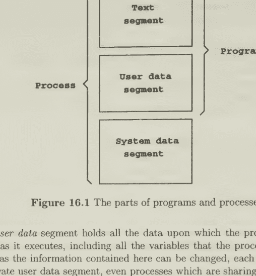

## 图 16.1 程序和进程的各部分。

The *user data segment* holds all the data upon which the process will operate directly as it executes, including all the variables that the process will use. Obviously, as the information contained here can be changed, each process needs its own private user data segment, even processes which are sharing a text segment.

*用户数据段* 包含进程在执行时将直接操作的所有数据，包括进程将使用的所有变量。显然，由于这里包含的信息可以被更改，每个进程都需要自己的私有用户数据段，即使是共享文本段的进程也是如此。

The *system data segment* effectively holds the environment in which the program will run. Indeed, this is the distinction between programs and processes. A program is a static thing on disk consisting of a set of instructions and data which are used to initialize the text and user data segments of a process. The process is a dynamic thing, an execution environment requiring the interaction of the text, user data and system data segment information all running together.

*系统数据段* 有效地保存了程序运行的环境。事实上，这就是程序和进程之间的区别。程序是磁盘上的静态事物，由一组指令和数据组成，用于初始化进程的文本段和用户数据段。进程是一个动态事物，是一个执行环境，需要文本、用户数据和系统数据段信息一起运行。

Under Linux, there is only one way that an existing process can start up a new process for you and that is to use the `fork()` system call:

在 Linux 下，现有进程启动新进程的唯一方法就是使用 `fork()` 系统调用：

```
#include <unistd.h>

pid_t fork(void);
```

Conceptually, what happens with `fork()` is that the process which makes the `fork()` call becomes the parent of a new process which is created. The two processes are identical in terms of the contents of their text and user data segments, and almost identical in terms of their system data segments as well. The only difference between the processes is in a small number of attributes which have to be different (such as the PID, for instance, which has to be unique for each process). Once the child process has been created, then both the parent and child continue execution from inside the `fork()` call. This means that the next action for both processes is to return from `fork()` with its return value.

从概念上讲，使用 `fork()` 时，发出 `fork()` 调用的进程成为新创建进程的父进程。两个进程在文本段和用户数据段的内容方面是相同的，在系统数据段方面也几乎相同。进程之间的唯一区别在于少数必须不同的属性（例如 PID，每个进程必须唯一）。一旦子进程被创建，父进程和子进程都会从 `fork()` 调用内部继续执行。这意味着两个进程的下一个动作都是从 `fork()` 返回其返回值。

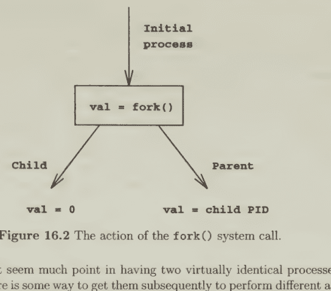

Figure 16.2 The action of the fork() system call.

图 16.2 fork() 系统调用的动作。

There doesn’t seem much point in having two virtually identical processes running, unless there is some way to get them subsequently to perform different actions. This is made relatively simple by the fact that fork() returns a different value to the two processes. To the parent process it returns the PID of the newly created child, while to the child process it returns the value 0. As normal process IDs only start numbering from 1 with the init process, the fork() system call cannot return the value 0 to the parent as the PID of the new child. Therefore, if fork() does return a 0 then it must be to a new child process. If it returns a non-zero value then it must be the PID of a child process being returned to the parent (or -1 on error). This idea is illustrated in Figure 16.2.

似乎没有多大意义让两个几乎相同的进程同时运行，除非有某种方法让它们随后执行不同的操作。这相对简单，因为 fork() 对两个进程返回不同的值。对父进程而言，它返回新创建子进程的 PID，而对子进程而言，它返回值为 0。由于正常的进程 ID 从 init 进程开始编号为 1，fork() 系统调用不可能将值 0 作为新子进程的 PID 返回给父进程。因此，如果 fork() 返回 0，则它一定是返回给新子进程。如果它返回非零值，则它一定是子进程的 PID 返回给父进程（或在出错时返回 -1）。这个想法在图 16.2 中有所说明。

The following code is a simple program to demonstrate the fork() call in action:

以下代码是一个简单的程序，用于演示 fork() 调用的实际操作：

```
#include <sys/types.h>
#include <unistd.h>

main()
{
    pid_t val;

    printf("PID before fork(): %d\n", (int) getpid());

    if (val = fork())
        printf("Parent PID: %d\n", (int) getpid());
    else
        printf("Child PID: %d\n", (int) getpid());
}
```

When this program is run it should generate three lines of output. The first will display the PID of the process before the fork() call is executed, and the other two lines of output will be generated by the parent and child processes after the fork(), giving the PID of each process. A typical output from the program could be:

运行此程序时应生成三行输出。第一行将显示 fork() 调用执行前的进程 PID，另外两行输出将在 fork() 之后由父进程和子进程生成，给出每个进程的 PID。程序的典型输出可能是：

```
$ forktest
PID before fork(): 490
Parent PID: 490
Child PID: 491
```

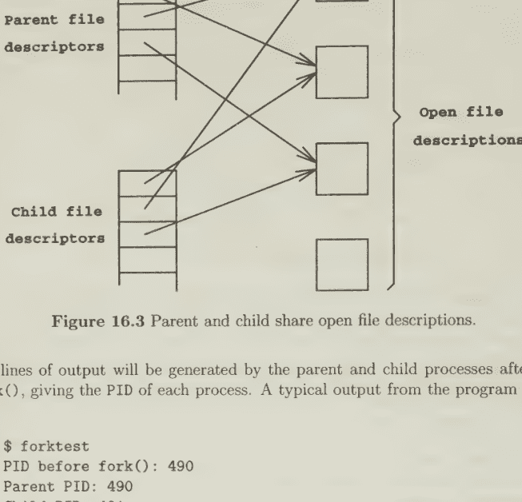

## 图 16.3 父进程和子进程共享打开的文件描述。

After the execution of a fork() call most of the attributes of the parent process are available unchanged in the child. The main unchanged attributes are:

在执行 fork() 调用之后，父进程的大多数属性在子进程中保持不变。主要的不变属性有：

- session and process group membership;
- controlling terminal (if any);
- real and effective UIDs and GIDs;
- current working directory;
- file mode creation mask (umask).

- 会话和进程组成员资格；
- 控制终端（如果有）；
- 真实和有效的 UID 和 GID；
- 当前工作目录；
- 文件模式创建掩码（umask）。

In addition to this, all of the file descriptors which are associated with open file descriptions in the parent process will be duplicated in the child. This means that the child's file descriptors and the parent's file descriptors will both point to the same open file descriptions, as shown in Figure 16.3

除此之外，父进程中与打开文件描述关联的所有文件描述符都将在子进程中复制。这意味着子进程的文件描述符和父进程的文件描述符都将指向相同的打开文件描述，如图 16.3 所示

This is a very important concept, as we shall see later, because it allows a process to open files in advance, knowing that they will be pre-opened and immediately available to its child processes after a fork() call.

这是一个非常重要的概念，正如我们稍后将看到的，因为它允许进程提前打开文件，知道它们将在 fork() 调用后预先打开并立即可供其子进程使用。

### 16.3 exec 系统调用

When you use the shell to run a command (ls, say) then at some point the shell will execute a fork() call to get a new process running. Having done that, how does the shell then get ls to run in the child process instead of the duplicate copy of the shell, which is what will be running immediately after the fork() call?

当你使用 shell 运行命令（比如 ls）时，shell 在某个时候会执行 fork() 调用以启动新进程。完成之后，shell 如何让 ls 在子进程中运行，而不是在 fork() 调用后立即运行的 shell 的重复副本呢？

The solution in this case is to use an exec() system call. In fact, there are several different flavors of the exec() call, but they all perform essentially the same task. Use of the exec() system call is the only way to get a program executed under Linux. The way that it does this is to replace the text and user data segments of the process that executes the exec() call with the text and user data contained in the program file whose name is passed as a parameter to exec(). This is probably best illustrated with a simple example.

在这种情况下的解决方案是使用 exec() 系统调用。事实上，exec() 调用有几种不同的变体，但它们都执行本质上相同的任务。使用 exec() 系统调用是在 Linux 下执行程序的唯一方法。它这样做的方式是用作为参数传递给 exec() 的程序文件中的文本和用户数据，替换执行 exec() 调用的进程的文本段和用户数据段。这最好用一个简单的例子来说明。

Before we do that, however, I need to digress slightly to explain a little more about exec(). When you execute a program from the shell, you have seen that it is possible to specify parameters and switches to the program on the command line. From your knowledge of C you also know that these command line values are made available to a program via the argc and argv parameters to main(). Somehow the shell needs to be able to take your command line values and pass them on to the programs it runs on your behalf as their argc and argv. This is done by passing your command line values in a suitable form to exec() which will arrange for them to appear as argc and argv to the new program about to be run.

然而，在此之前，我需要稍作离题，解释一下有关 exec() 的更多内容。当你从 shell 执行程序时，你已经看到可以在命令行上为程序指定参数和开关。根据你对 C 的了解，你也知道这些命令行值是通过 main() 的 argc 和 argv 参数提供给程序的。shell somehow 需要能够获取你的命令行值并将其作为它们的 argc 和 argv 传递给代表你运行的程序。这是通过以合适的形式将你的命令行值传递给 exec() 来完成的，exec() 将安排它们作为即将运行的新程序的 argc 和 argv 出现。

The simplest version of exec() with which to demonstrate these things is called execl(). The prototype for this is:

用于演示这些事物的最简单版本的 exec() 称为 execl()。其原型如下：

```
#include <unistd.h>

int execl(char *pathname, char *arg0, ...);
```

The pathname is the full path to the command to execute. This is followed by a variable length list of pointers to character strings. These will become the contents of the array pointed to by argv in the new program. The list of pointers in execl() should be terminated by a NULL pointer. The following example program uses execl() to execute the simple command - ls -l:

pathname 是要执行的命令的完整路径。后面跟着一个可变长度的字符字符串指针列表。这些将成为新程序中 argv 指向的数组的内容。execl() 中的指针列表应以 NULL 指针结尾。以下示例程序使用 execl() 执行简单命令 - ls -l：

```
#include <stdio.h>

main()
{
    execl("/bin/ls", "ls", "-l", 0);
    printf("Can only get here on error\n");
}
```

The first parameter to execl() in this example is the full pathname to the ls command. This is the file whose contents will be run, provided the process has execute permission on the file. The rest of the execl() parameters provide the strings to which the argv array elements in the new program will point. In this example, it means that the ls program will see the string ls pointed to by its argv[0], and the string -l pointed to by its argv[1].

在此示例中，传递给 execl() 的第一个参数是 ls 命令的完整路径名。这是将被运行的文件的内容，前提是进程对该文件具有执行权限。execl() 的其余参数提供了新程序中 argv 数组元素将指向的字符串。在此示例中，这意味着 ls 程序将看到其 argv[0] 指向的字符串 ls，以及其 argv[1] 指向的字符串 -l。

Normally the exec() calls don't return. In general, they can't because their function is to replace the text and user data segments in the process that calls them for some other program -- so there will be nothing to return to!

通常 exec() 调用不会返回。一般来说，它们不能返回，因为它们的功能是用另一个程序替换调用它们的进程中的文本段和用户数据段——因此将没有东西可返回！

However, if the exec() calls fail for any reason (usually because the file you are trying to execute doesn't exist or because you don't have execute permission for it) then they will return so that you can have the opportunity to do something about the error.

然而，如果 exec() 调用因任何原因失败（通常是因为你要执行的文件不存在或因为你没有执行权限），那么它们将返回，以便你有机会处理错误。

In addition to making all these parameters available to the new program, the exec() calls also pass a value for the variable:

除了使所有这些参数对新程序可用之外，exec() 调用还传递变量的值：

```
extern char **environ;
```

This variable has the same format as the argv variable except that the items passed via environ are the values in the environment of the process (like any exported shell variables), rather than the command line parameters. In the case of execl(), the value of the environ variable in the new program will be a copy of the value of this variable in the calling process.

该变量的格式与 argv 变量相同，只是通过 environ 传递的项目是进程环境中的值（如任何导出的 shell 变量），而不是命令行参数。在 execl() 的情况下，新程序中 environ 变量的值将是调用进程中该变量值的副本。

The execl() version of exec() is fine in the circumstances where you can explicitly list all of the parameters, as in the previous example. Now suppose you want to write a program that doesn't just run ls, but will run any program you wish, and pass it any number of appropriate command line parameters. Obviously, execl() won't do the job.

在可以显式列出所有参数的情况下（如前一个示例），exec() 的 execl() 版本是可以的。现在假设你想编写一个程序，它不仅运行 ls，还会运行你想要的任何程序，并传递任意数量的适当命令行参数。显然，execl() 不能胜任这项工作。

The example program below, which implements this requirement, shows, however, that the system call execv() will perform as required:

然而，下面实现此要求的示例程序表明，系统调用 execv() 将按要求执行：

```
#include <stdio.h>

main(int argc, char **argv)
{
    if (argc==1)
    {
        printf("Usage: run <command> [<parameters>]\n");
        exit(1);
    }

    execv(argv[1], &argv[1]);
    printf("Sorry... couldn't run that!\n");
}
```

The prototype for execv() shows that it only takes two parameters, the first is the full pathname to the command to execute and the second is the argv value you

execv() 的原型显示它只接受两个参数，第一个是要执行的命令的完整路径名，第二个是 argv 值你


想要传递到新程序中。在之前的示例中，该值是从传递给 run 命令的 argv 值派生的，这样 run 命令就可以接收你传递给它的命令行参数值并直接传递下去。

下面是使用 run 命令的典型命令序列：

```
$ run ls -l mtos
Sorry... couldn't run that!
$ run /bin/ls -l mtos
total 2
drwxr-xr-x  2 pc     book      1024 Apr  2 20:11 tdd
drwxr-xr-x  2 pc     book      1024 Apr  2 20:11 tsh
```

注意第一次尝试的失败，这是因为在使用 execv()（或 execl()）时，你需要指定要运行命令的完整路径名，正如第二次尝试的结果所示。

这里的问题是迄今为止介绍的两种 exec() 版本在查找你指定的命令时不会使用 PATH 环境变量中的值。然而，正如你可能猜到的那样，确实存在使用该变量的 exec() 版本。它们被称为 execlp() 和 execvp()，与前一对完全相同，但它们还会使用 PATH 的值来查找所需的命令。

exec() 的最后两个版本与前两个相同（即不使用 PATH），但它们允许你手动指定在新程序中出现在 environ 中的值，而不是接受自动默认值。它们被称为 execle() 和 execve()。下面是所有六个 exec() 变体的列表，以及它们所接受的参数数量和类型：

```
int execl(pathname, arg0, ..., argn, 0);
int execv(pathname, argv);
int execlp(cmdname, arg0, ..., argn, 0);
int execvp(cmdname, argv);
int execle(pathname, arg0, ..., argn, 0, envp);
int execve(pathname, argv, envp);

char *pathname, *cmdname;
char *arg0, ..., *argn;
char **argv, **envp;
```

与 fork() 一样，大多数进程属性在 exec() 调用后得以保留。这是因为在 exec() 期间系统数据段保持完整，exec() 只会更改文本段和用户数据段。最重要的是，与调用前关联的打开文件描述的那些文件描述符在调用后通常仍然可用。对此的例外是，每个文件描述符（而不是打开文件描述）中都存在一个称为 close on exec 标志的标志（猜猜它做什么）。

设置 close on exec 标志是 fcntl() 调用提供的众多杂项功能之一。设置特定文件描述符（fd）上的 close on exec 标志的调用形式为：

```
fcntl(fd, F_SETFD, FD_CLOEXEC);
```

为了回顾一下，当你希望一个正在运行的进程在其操作的一部分中组织另一个程序的执行时，步骤序列如下：

-   正在运行的进程获取或生成要执行的命令。
-   进程执行 fork() 系统调用。这启动了一个新进程，该进程是原始进程的副本，并与原始进程并发运行。原始进程称为父进程，新进程称为子进程。
-   子进程现在执行 exec() 调用，该调用丢弃子进程的文本段和用户数据段，并用要运行的命令文件中的文本和用户数据替换它们。

观察此场景时会出现两个明显的问题。首先，创建子进程作为父进程的精确副本，然后立即丢弃并用新程序替换，这难道不是一种浪费精力的做法吗？其次，子进程执行时父进程做什么？

按顺序回答这些问题——Linux 以非常高效的方式实现了其 fork() 系统调用。实际上，Linux 作弊了。它根本不会完全复制进程，它只是有两个指针集，每个进程一个，这两个指针都指向相同的实际文本段和数据段。对于文本段来说，这无关紧要，因为该段无论如何都是只读的。然而，对于数据段来说，这确实很重要，因为它们本应是一对独立的进程。但仔细想想，只要两个进程只从数据段读取数据而不写入新值，那么没有任何进程会知道作弊正在进行。为了使该方案完全奏效，Linux 所需做的只是发现其中一个进程尝试向数据段中的一个写入内容，并在需要时仅复制那一小部分。这种技术称为写时复制。

本质上，任何被任一进程写入的区域都会被复制，以便两个进程随后拥有这些区域各自的副本。如果子进程立即执行 exec() 调用，那么在 exec() 发生之前，共享的数据段空间几乎不会被复制——这在时间和资源上节省巨大。

### 16.4 wait 和 exit 系统调用

关于子进程运行期间父进程做什么的问题，答案很简单——它要么等待子进程终止，要么继续处理它需要做的其他事情。

例如，在 shell 的情况下，选择权交给用户。通常，如果你只是向 shell 输入一个命令，它会在命令完成之前等待，然后再给出另一个提示符。如果你将行尾加上一个与号（&），那么 shell 将不会等待，而是会立即返回新的提示符。

为了等待子进程终止，父进程只需执行 wait() 系统调用。此调用会挂起父进程，直到其任何子进程终止，此时 wait() 调用返回，父进程可以继续。

wait() 调用的原型为：

```c
#include <sys/types.h>
#include <sys/wait.h>

pid_t wait(int *status);
```

wait 的返回值是终止的子进程的 PID。wait() 的参数是指向一个位置的指针，该位置将在子进程终止时接收子进程的退出状态值。

当进程终止时，它会执行 exit() 系统调用，无论是直接在其自己的代码中，还是间接通过库代码。exit() 调用的原型为：

```c
#include <stdlib.h>

void exit(int status);
```

exit() 调用没有返回值，因为调用它的进程终止了，因此无论如何也无法接收值。然而请注意，exit() 确实接受一个参数值——status。除了使等待的父进程恢复执行外，exit() 还会通过 wait() 参数指向的位置将 status 参数值返回给父进程。

事实上，wait() 可以通过 status 参数指向的值返回多个不同的信息。因此，提供了一个名为 WEXITSTATUS() 的宏（通过 <sys/wait.h> 访问），它可以提取并返回子进程的退出状态。以下代码片段展示了其用法：

```c
#include <sys/wait.h>

int statval, exstat;
pid_t pid;

pid = wait(&statval);
exstat = WEXITSTATUS(statval);
```

现在可以绘制出子进程的生命周期图，从 fork() 创建，经过 exec() 执行，然后以 exit() 终止，

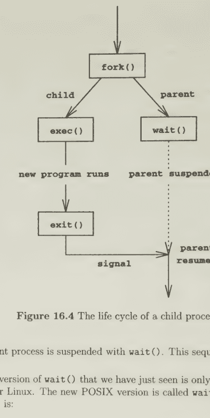

图 16.4 子进程的生命周期。

而父进程使用 wait() 挂起。此序列在图 16.4 中说明。

事实上，我们刚刚看到的 wait() 版本只是 Linux 下可用的最简单版本。新的 POSIX 版本称为 waitpid。waitpid() 的原型为：

```c
#include <sys/types.h>
#include <sys/wait.h>

pid_t waitpid(pid_t pid, int *status, int options);
```

其中 pid 指定等待的内容，status 与简单 wait() 参数相同，而 options 允许你指定如果没有子进程准备好报告其退出状态，则 waitpid() 调用不应挂起父进程。

pid 参数的各种可能性为：

| pid | 含义 |
|---|---|
| < -1 | 等待 PGID 为 -pid 的子进程 |
| -1 | 与标准 wait() 行为相同 |
| 0 | 等待其 PGID 等于调用进程 PGID 的子进程 |
| > 0 | 等待 PID = pid 的子进程 |

标准 wait() 调用现已冗余，因为下面的 waitpid() 调用完全等价：

```
#include <sys/wait.h>

int statval;
pid_t pid;

pid = waitpid(-1, &statval, 0);
```

可能出现子进程仅执行极短时间就在其父进程有机会 wait() 它之前终止的情况。在这种情况下，子进程将进入一种状态，称为僵尸状态，其中其所有资源都已释放回系统，除了保存其退出状态的进程数据结构。当父进程最终 wait() 子进程时，退出状态会立即传递，然后进程数据结构也可以释放回系统。

## Exercises

## 练习

- 1. 编写一个 C 程序，可以确定它是否是进程组 leader 并打印合适的消息。
- 2. 编写一个 C 程序，可以确定它是否以 set UID 运行并打印合适的消息。
- 3. 编写一个使用 fork() 的简单测试程序，打印父进程和子进程的消息。消息应适当包含 parent 和 child 词，并应包含执行打印的进程的 PID。多次执行该程序。两个消息是否总是以相同的顺序打印。
- 4. 在为上一练习编写的程序中添加 wait() 和 exit() 系统调用，以便子进程向父进程返回退出状态，并将其包含在父进程打印的消息中。多次执行此程序。消息顺序与上一练习不同吗？消息是否总是以相同的顺序打印？
- 5. 编写一个 C 程序执行以下 Linux 命令序列：
   ```
   cp /etc/fstab .
   sort fstab -o myfstab
   cat myfstab
   ```

## Answers

## 答案

1. 你的解决方案将使用 getpid() 和 getpgrp() 获取进程 ID 和进程组 ID。如果它们相同，则该进程是进程组 leader，否则不是。

2. 你的解决方案将使用 getuid() 和 geteuid() 获取进程真实用户 ID 和有效用户 ID。如果它们不相同，则进程以 set UID 运行，否则不是。

3. 这个问题的代码非常简单，如下所示：

```
main()
{
    if (fork())
        printf("parent PID = %d\n", getpid());
    else
        printf("child PID = %d\n", getpid());
}
```

一般来说，一些 UNIX 变体会先运行父进程，其他会先运行子进程，还有一些没有固定顺序。在 Linux 中，fork() 的当前源代码显示父进程应始终先运行，你的实验应证实这一点。

4. 添加 exit() 和 wait() 到程序的整个想法是为了强制父进程在继续之前等待子进程执行终止。新的代码如下所示：

```
#include <sys/wait.h>

main()
{
    int status;

    if (fork())
    {
        wait(&status);
        printf("parent PID = %d, child ", getpid());
        printf("exit status = %d\n", WEXITSTATUS(status));
    }
    else
    {
        printf("child PID = %d\n", getpid());
        exit(55);
    }
}
```

运行此程序时，使用 exit() 和 wait() 可确保子进程消息始终先显示，这不仅适用于 Linux，也适用于任何版本的 UNIX。

5. 保证三个命令执行顺序的最佳方式是 fork() 子进程依次执行每个命令，使父进程在执行下一个命令之前 wait() 一个子进程的终止：

```
main()
{
    if (!fork())
    {
        execlp("cp", "cp", "/etc/fstab", ".", 0);
        printf("error executing cp\n");
        exit(1);
    }

    wait(0);

    if (!fork())
    {
        execlp("sort", "sort", "fstab", "-o", "myfstab", 0);
        printf("error executing sort\n");
        exit(1);
    }

    wait(0);
    execlp("cat", "cat", "myfstab", 0);
    printf("error executing cat\n");
    exit(1);
}
```

为了稍微简化代码，这里没有检查 fork() 的返回值是否出错。最好也检查 wait() 返回的退出状态是否出错并适当处理。我把这些留给你去做...。

## Inter-process Communication (IPC)

## 进程间通信 (IPC)

为了使进程能够在某些任务上协作，它们必须能够相互通信。Linux 支持多种不同形式的进程间通信 (IPC) 机制，每种机制在特定情况下都有其优缺点。本章的目的是回顾最有用的 IPC 机制，以便你在编写协作并发进程时做出明智的选择。

在进程之间通信值的最简单方式是通过文件。一个进程写入文件，另一个进程从中读取。这是一种出乎意料简单的机制，具有多个优点：

- 它允许任何一对具有文件访问权限的进程使用它进行通信。
- 它可以允许在进程之间传输非常大量的数据。

尽管有这些优点，将文件用作主要 IPC 机制有两个很大的缺点：

- 为了确保读取者有机会看到发送给它的数据，写入者必须只在文件末尾添加新数据。这意味着对于长寿命进程，文件可能会变得非常大。
- 如果读取者执行任务的速度比写入者快，那么它经常会追上写入者而没有可读的内容。这意味着读取者会不断读取文件末尾，无法判断这是因为写入者已完成并关闭了文件，还是写入者仍在计算要传递给读取者的值，后续还会有更多数据。

克服文件使用中固有问题的最简单 IPC 机制是管道。

### 17.1 Pipes

### 17.1 管道

你肯定以前遇到过管道，即使你还没有编写过使用管道的程序——shell 不断使用它们，每当你让它执行一个管道时，其中一个进程的输出被发送到另一个进程的输入：

```
$ ls | wc -w
```

管道克服了使用文件的两个问题。首先，管道是一个固定大小的缓冲区（Linux 中为 4096 字节），因此其大小不会像文件那样不受控制地增长。

使用单个固定大小缓冲区的后果是，在写入时，管道可能会填满。当这种情况发生时，后续对管道的 write() 调用默认会阻塞，等待读取一些数据以腾出足够的空间进行写入。请注意，从管道读取数据是一次性操作，一旦读取，数据就会从管道中丢弃以释放空间供更多数据写入。

其次，如果读取者工作速度比写入者快，当所有当前数据都被读取时，管道也可能变空。当这种情况发生时，后续 read() 调用默认会阻塞，等待写入更多数据。这解决了 read() 返回文件末尾的问题。

管道是通过 pipe() 系统调用创建的，而不是 open()，因为需要不同的参数，在这种情况下 open() 难以被利用。pipe() 调用的原型是：

```
#include <unistd.h>
```

```
int pipe(int fd[2]);
```

管道有两个相关联的文件描述符，一个用于 read() 端，一个用于 write() 端。因为函数调用不能返回两个值，所以 pipe() 的参数是指向一个包含两个元素的 int 数组的指针，pipe() 调用会用两个所需的文件描述符填充它。fd[0] 元素将包含管道 read() 端的文件描述符，而 fd[1] 包含管道 write() 端的文件描述符。

请注意，pipe() 的参数中没有给出路径名。这意味着管道创建时不会为其创建目录链接。因此，其他现有进程无法获得管道的文件描述符，从而无法访问它。那么，两个进程如何管理使用管道进行通信？


这里的含义是，普通管道只能在共享共同祖先的两个进程之间使用，并且该祖先必须为它们创建管道以供使用。

管道中的数据总是按写入的相同顺序读取。这意味着 lseek() 系统调用对管道无效。

下面是一个在两个进程之间设置和使用管道的简单程序：

```
#include <unistd.h>
#include <stdio.h>

main()
{
    int fda[2];
    char buf[1];

    if (pipe(fda)==-1)                /* Create the pipe */
        fatal("creating pipe");

    switch (fork())
    {
    case -1:
        fatal("forking child");
        break;

    case 0:                /* Child process is pipe reader */
        close(fda[1]);                /* Close write end of pipe */
        read(fda[0], buf, 1);
        printf("%c\n", buf[0]);
        break;

    default:                /* Parent process is pipe writer */
        close(fda[0]);                /* Close read end of pipe */
        write(fda[1], "a", 1);
        break;
    }
}

fatal(char *mess)
{
    fprintf(stderr, "Error: %s\n", mess);
    exit(1);
}
```

请注意，在此示例中，两个进程各自关闭了不需要的管道端。这很重要，这样当所有写入进程关闭管道时，文件结束条件才能正确地传输给读取进程。

阻塞读取和写入分别是管道为空或已满时的默认行为。这些默认值可以通过使用 fcntl() 系统调用在管道文件描述符上设置 O_NONBLOCK 标志来覆盖：

```
#include <fcntl.h>

fcntl(fd, F_SETFL, O_NONBLOCK);
```

### 17.2 I/O 重定向

借助一个额外的系统调用，通过 shell 可用的所有 I/O 重定向功能都可以在自己的代码中编程实现。额外的系统调用称为 dup()。dup() 的原型如下：

```
#include <unistd.h>

int dup(int fd);
```

dup() 调用所做的是将文件描述符作为参数并返回另一个是第一个的副本的文件描述符。这意味着两个文件描述符都与同一个打开文件描述相关联。dup() 调用从文件描述符数组开头开始搜索，并将其副本放入遇到的第一个空闲文件描述符中。这在图 17.1 中有所说明，该图显示了在文件描述符 2 上使用 dup() 系统调用的效果。文件描述符被复制到文件描述符数组中的第一个空闲槽位。在此示例中，文件描述符 0 可供使用，因此 dup() 调用将返回值为 0。

I/O 重定向和 shell 中使用的进程间管道现在很容易设置起来。首先看管道，场景是你向 shell 输入如下管道命令：

```
$ ls | wc -w
```

请记住，ls 和 wc 命令不需要知道重定向正在进行；它们只是继续使用其标准输入和标准输出文件满足所有输入和输出需求。

这意味着 shell 必须创建管道，然后 fork() 两个子进程，操作它们的文件描述符，使管道对应于管道中第一个进程的输出和第二个进程的输入。

下面的列表是一个简单程序，它执行前面示例中的管道 ls | wc -w：

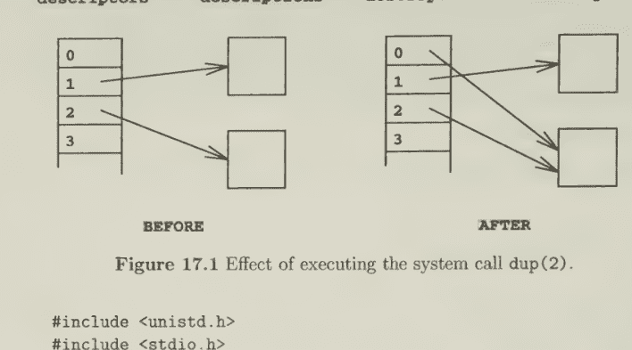

图 17.1 执行系统调用 dup(2) 的效果。

```
#include <unistd.h>
#include <stdio.h>

main()
{
    int fda[2];

    if (pipe(fda)==-1)                /* Create pipe */
        fatal("creating pipe");

    switch (fork())                   /* Create child */
    {
    case -1:
        fatal("forking child");
        break;

    case 0:                           /* Run ls in child */
        close(1);                     /* Close standard output */
        dup(fda[1]);                  /* Duplicate pipe write end */
        close(fda[1]);                /* Close pipe write end */
        close(fda[0]);                /* Close pipe read end */
        execlp("ls", "ls", 0);      /* Execute ls command */
        fatal("trying to exec ls");
        break;

    default:                          /* Run wc in parent */
        close(0);                     /* Close standard input */
        dup(fda[0]);                  /* Duplicate pipe read end */
        close(fda[0]);                /* Close pipe read end */
        close(fda[1]);                /* Close pipe write end */
        execlp("wc", "wc", "-w", 0); /* Execute wc command */
        fatal("trying to exec wc");
        break;
    }
}

fatal(char *mess)
{
    fprintf(stderr, "Error: %s\n", mess);
    exit(1);
}
```

请注意，在执行 exec() 调用以执行 ls 和 wc 命令之前，如何完成进出管道的重定向。

子进程将用于执行 ls 命令。在这种情况下，需要设置好，以便当 ls 写入标准输出设备时，实际上是在写入管道。为此，第一步是 close() 当前的标准输出设备，然后使用 dup() 复制管道的写端。请记住，dup() 将在编号最低的空闲文件描述符中创建其副本，在本例中将是刚刚关闭的标准输出文件描述符。由于标准输出现在与管道的写端相关联，对该文件描述符的任何 write() 调用都会自动将数据发送到管道。

在此之后，可以关闭管道的两个原始文件描述符，并且正是这种文件描述符的排列将通过 execlp() 调用传递给 ls 命令。

同样，父进程将用于执行 wc 命令，这意味着必须重新安排使其从管道获取输入。这是通过与前一种情况相同的方法实现的。当前标准输入文件描述符被关闭，以便使用 dup() 将其重新分配为管道的读端。然后可以在 execlp() 调用执行 wc 命令时关闭两个原始管道文件描述符，此时文件描述符的排列已设置好。

然后 ls 和 wc 命令都将正常执行，读取和写入其标准输入和输出文件描述符，而不知道它们正在通信。

对文件的标准输入和输出重定向以类似的方式实现，如以下示例代码所示。该代码旨在执行以下命令：

```
$ cat <file1 >file2
```

在这种情况下，程序将依次关闭其标准输入和输出文件描述符，并使用 open() 打开所需文件，使其与标准输入和输出文件描述符相关联：

```
#include <unistd.h>
#include <stdio.h>
#include <sys/stat.h>
#include <fcntl.h>

#define WRFLAGS (O_WRONLY | O_CREAT | O_TRUNC)
#define MODE600 (S_IRUSR | S_IWUSR)

main()
{
    close(0);                    /* Close standard input */

    if (open("file1", O_RDONLY)==-1)
        fatal("opening input file");

    close(1);                    /* Close standard output */

    if (open("file2", WRFLAGS, MODE600)==-1)
        fatal("opening output file");

    execlp("cat", "cat", 0);   /* Execute cat command */
    fatal("trying to exec cat");
}

fatal(char *mess)
{
    fprintf(stderr, "Error: %s\n", mess);
    exit(1);
}
```

还有两个可以复制文件描述符的系统调用。第一个是 dup2()，其原型如下：

```
#include <unistd.h>

int dup2(int oldfd, int newfd);
```

此调用使 newfd 成为 oldfd 的副本。如果 newfd 已打开，它还将在复制操作之前关闭 newfd。

复制文件描述符的另一种方法是使用 fcntl() 系统调用的另一个杂项功能：

```
#include <fcntl.h>

newfd = fcntl(oldfd, F_DUPFD, minfd);
```


这提供了一种介于 dup() 和 dup2() 之间的功能。fcntl() 调用从 minfd 开始查找一个空闲的文件描述符。当找到一个时，它用它来复制 oldfd。复制的文件描述符随后由 fcntl() 作为 newfd 返回。

### 17.3 FIFO

匿名管道克服了使用文件进行进程间通信的主要问题。然而，管道有一个文件所没有的缺点——它们只能被具有共同祖先的进程使用，该祖先为它们创建了管道并传递了其文件描述符给它们。

FIFO 文件（也称为命名管道）甚至解决了这个问题，同时仍然保持了匿名管道的所有优点。FIFO 文件解决问题的办法是它们具有文件名（即目录链接），因此可以被任何进程 open() 并使用，无论它们是否相关，只要它们对文件具有适当的访问权限即可。

为了创建 FIFO 文件，您可以从 shell 提示符使用 mknod 命令，也可以从程序内部使用 mknod() 系统调用。mknod 命令和系统调用都可用于创建不仅仅是 FIFO 文件。我们在研究编写设备驱动程序时将看到 mknod 的其他用途。

使用 mknod 命令从 shell 提示符创建 FIFO 文件很容易——命令的格式为：

```
$ mknod filename p
```

该命令将创建名为 filename 的 FIFO 文件，其访问权限为 666 减去当前 umask 值。

mknod() 系统调用的原型为：

```
#include <sys/types.h>
#include <sys/stat.h>
#include <fcntl.h>
#include <unistd.h>

int mknod(char *pathname, mode_t mode, dev_t dev);
```

其中 pathname 是要创建的文件的名称，mode 是要设置在文件上的权限位的组合以及要创建的文件类型的规范（本例中为 S_IFIFO），而 dev 是在创建设备特殊文件时使用的值，因此对于 FIFO，其值为零。例如：

```
#define MYMODE (S_IFIFO | S_IRUSR | S_IWUSR)

mknod("myfifo", MYMODE, 0);
```

一旦创建了 FIFO 文件，任何具有适当权限的进程都可以使用标准的 open() 系统调用来访问它。open() 后，FIFO 文件具有与匿名管道相同的[content]
这提供了一种介于 dup() 和 dup2() 之间的功能。fcntl() 调用从 minfd 开始查找一个空闲的文件描述符。当找到一个时，它用它来复制 oldfd。复制的文件描述符随后由 fcntl() 作为 newfd 返回。

### 17.3 FIFO

匿名管道克服了使用文件进行进程间通信的主要问题。然而，管道有一个文件所没有的缺点——它们只能被具有共同祖先的进程使用，该祖先为它们创建了管道并传递了其文件描述符给它们。

FIFO 文件（也称为命名管道）甚至解决了这个问题，同时仍然保持了匿名管道的所有优点。FIFO 文件解决问题的办法是它们具有文件名（即目录链接），因此可以被任何进程 open() 并使用，无论它们是否相关，只要它们对文件具有适当的访问权限即可。

为了创建 FIFO 文件，您可以从 shell 提示符使用 mknod 命令，也可以从程序内部使用 mknod() 系统调用。mknod 命令和系统调用都可用于创建不仅仅是 FIFO 文件。我们在研究编写设备驱动程序时将看到 mknod 的其他用途。

使用 mknod 命令从 shell 提示符创建 FIFO 文件很容易——命令的格式为：

```
$ mknod filename p
```

该命令将创建名为 filename 的 FIFO 文件，其访问权限为 666 减去当前 umask 值。

mknod() 系统调用的原型为：

```
#include <sys/types.h>
#include <sys/stat.h>
#include <fcntl.h>
#include <unistd.h>

int mknod(char *pathname, mode_t mode, dev_t dev);
```

其中 pathname 是要创建的文件的名称，mode 是要设置在文件上的权限位的组合以及要创建的文件类型的规范（本例中为 S_IFIFO），而 dev 是在创建设备特殊文件时使用的值，因此对于 FIFO，其值为零。例如：

```
#define MYMODE (S_IFIFO | S_IRUSR | S_IWUSR)

mknod("myfifo", MYMODE, 0);
```

一旦创建了 FIFO 文件，任何具有适当权限的进程都可以使用标准的 open() 系统调用来访问它。open() 后，FIFO 文件具有与匿名管道相同的基本功能，即 read() 在管道为空时阻塞，write() 在管道满时阻塞，并且使用 fcntl() 设置 O_NONBLOCK 标志将导致 read() 和 write() 在本应阻塞的情况下立即返回并出现 EAGAIN 错误。

因为它们可以被许多不相关的进程同时访问，所以 FIFO 在存在多个读取器和/或多个写入器的应用程序中很有用。在这种情况下，需要有一条规则来确定如果两个写入器同时尝试写入 FIFO 会发生什么。规则是，写入管道大小（Linux 中为 4096 字节）以内任意字节数的 write() 操作保证是原子的。这意味着来自多个 write() 操作的数据不会在 FIFO 中交错混合，而是会作为单独的消息维护。完全相同的规则也适用于匿名管道，但在这里用处较小，因为它们在这种类型的应用程序中较少使用。

### 17.4 System V IPC

为了与其他系统提供兼容性，Linux 还提供了一个选项来支持三种 System V IPC 机制：共享内存、消息和信号量。这些都具有大致相同的接口，因此我们只简要地看一下其中之一——共享内存。

使用管道和 FIFO 仍然存在一个缺点，那就是传输数据时进行的数据复制和处理器上下文切换的数量。

共享内存通过使同一块内存同时在两个或多个进程的地址空间中可见来克服这个问题。这意味着一旦一个进程将一些信息写入内存，它就会立即对共享此内存块的其他进程可用，而无需进行任何进一步的复制操作。

在任何进程可以附加到共享内存段之前，它首先需要被创建。这是通过 shmget() 调用完成的，其原型为：

```
#include <sys/ipc.h>
#include <sys/shm.h>

int shmget(key_t key, int size, int flags);
```

其中 size 是所需的字节数（向上舍入到最小的完整内存页数），key 是一个数值（对于共享内存段，其作用类似于文件的文件名），flags 是一组按位或在一起的位掩码，用于指定在创建共享内存段时访问权限和创建标志（类似于 open() 系统调用的第二个和第三个参数的组合）。

flags 参数中的 IPC_CREAT 值将导致如果不存在与给定 key 关联的共享内存段，则创建该段。包含 IPC_EXCL 标志将导致如果已存在具有指定 key 的共享内存段，则 shmget() 调用失败。

在 key 字段中使用 IPC_PRIVATE 值是一种创建共享内存段的方式，而无需担心该段是否已存在。

shmg et() 的返回值是一个共享内存段 ID，其概念类似于 open() 返回的文件描述符，因为该值需要传递给与该段相关的其他调用。然而，大的区别是，任何拥有共享内存段 ID 值的进程都可以访问该段，而不仅仅是文件描述符情况下的子进程。

创建共享内存段的简单示例程序可以是：

```
#include <stdio.h>
#include <sys/ipc.h>
#include <sys/shm.h>

#define SHM_SIZE 4096
#define SHM_FLAGS IPC_CREAT | 0644

main()
{
    int shmid;

    shmid = shmget(IPC_PRIVATE, SHM_SIZE, SHM_FLAGS);

    if (shmid==-1)
        fatal("creating shared memory segment");

    printf("shared memory segment ID = %d\n", shmid);
}

fatal(char *mess)
{
    fprintf(stderr, "Error: %s\n", mess);
    exit(1);
}
```

任何 System V IPC 资源的状态在创建后都可以使用 ipcs 命令检查。命令的 -m 开关提供有关共享内存段的信息，-s 开关列出信号量数组，-q 用于消息队列。如果未指定开关，则将显示全部三个资源列表。

如果前一个列表中的程序名为 make_shm，则可以使用它并使用以下命令序列检查其结果：

```
$ make_shm
shared memory segment ID = 1408
$ ipcs
```

------ 共享内存段 ------
| shmid | owner | perms | bytes | nattch | status |
|-------|-------|-------|-------|--------|--------|
| 1408 | pc | 644 | 4096 | 0 |  |

------ 信号量数组 ------
| semid | owner | perms | nsems | status |
|-------|-------|-------|-------|--------|

------ 消息队列 ------
| msqid | owner | perms | used-bytes | messages |
|-------|-------|-------|------------|----------|

一旦共享内存段存在，就可以使用 shmat() 调用将其附加到正在运行进程的内存中，其原型为：

```
#include <sys/types.h>
#include <sys/ipc.h>
#include <sys/shm.h>

char *shmat(int shmid, char *shmaddr, int flags);
```

其中 shmid 是 shmget() 调用返回的共享内存段 ID，shmaddr 是您希望共享内存段附加到的地址，flags 允许您指定希望以只读方式附加该段（使用 SHM_RDONLY 标志）而不是读写。通常，您不希望指定自己的 shmaddr，您可以通过将参数值传递为零来让系统为您选择一个地址。

shmat() 的返回值是指向共享内存段的指针（C 类型指针），您可以将其用作指向任何其他内存块的指针一样使用。

当您完成对共享内存段的使用时，可以使用 shmdt() 调用将其从进程中分离：

```
#include <sys/types.h>
#include <sys/ipc.h>
#include <sys/shm.h>

int shmdt (char *shmaddr);
```

将 shmaddr 参数传递为由相应的 shmat() 调用返回的内存地址。

shmdt() 调用不会销毁共享内存段，即使没有其他进程附加到它。事实上，写入段中的任何内容都将保留

保持完整，以便后续的 shmat() 调用可以访问内存段及其包含的数据。

如果您确实想要销毁一个共享内存段（在您真正完成使用时应该这样做），这可以通过名为 shmctl() 的控制函数调用来完成：

```
#include <sys/ipc.h>
#include <sys/shm.h>

int shmctl(int shmid, int cmd, struct shmid_ds *buf);
```

此函数在概念上类似于 ioctl() 和 fcntl()，因为它允许对由 shmid 指定的共享内存段相关的信息结构进行读写访问。cmd 参数指定要执行的操作，而 buf 是指向共享内存结构的指针，用于按需传递数据。以下是可用的 cmd 值：

- IPC_STAT   将共享内存结构复制到 buf 中；
- IPC_SET    从 buf 设置共享内存结构；
- IPC_RMID   销毁由 shmid 给出的共享内存段。

销毁共享内存段的另一种方法是使用 ipcrm 命令：

```
$ ipcrm shm shmid
```

其中 shmid 是在 ipcs 显示中给出的共享内存段 ID。例如：

```
$ ipcrm shm 1408
```

下面是一个简短的程序示例，演示如何将 ID = 1408 的内存段附加到进程，写入一些数据到该段，然后将其分离以等待其他进程读取：

```
#include <stdio.h>
#include <sys/ipc.h>
#include <sys/shm.h>

#define SHM_ID 1408

main()
{
    char *shmaddr;

    if ((shmaddr = shmat(SHM_ID, 0, 0))==(char *)-1)
        fatal("attaching shared memory segment");
```

```
strcpy(shmaddr, "Some test message");

if (shmdt(shmaddr)==-1)
    fatal("detaching shared memory segment");
}
```

```
fatal(char *mess)
{
    fprintf(stderr, "Error: %s\n", mess);
    exit(1);
}
```

请注意，与系统调用类似，shm 函数在出错时都返回 -1。由于 shmat() 实际上返回指向内存块的指针，因此有必要将 -1 值强制转换为 char * 以便进行比较。

尽管它们操作不同的数据结构，但其他 System V IPC 机制（信号量和消息）在概念和用法上与共享内存非常相似，因为它们各自都有创建资源的调用；它们还具有访问和控制操作的调用：

| | 共享内存 | 信号量 | 消息 |
|---|---|---|---|
| 创建 | shmget() | semget() | msgget() |
| 访问 | shmat() | semop() | msgsnd() |
| | shmdt() | | msgrcv() |
| 控制 | shmctl() | semctl() | msgctl() |

### 17.5 套接字

迄今为止讨论的所有 IPC 机制仅对同一台机器上进程之间的通信有用。随着网络的现代发展趋势，Linux 支持一种允许完全网络兼容的 IPC 机制非常重要。套接字就是该机制。

套接字首次出现在早期版本的 BSD UNIX 中。在这里，设计者试图构建一种非常通用的机制，能够容纳许多网络协议。在很大程度上设计者是成功的，但是，为了允许所有必要的灵活性，使用套接字编程需要为许多可变参数指定值。为了更好地理解某些参数，有必要先了解一些底层网络原理。

Internet 协议 (IP) 位于低级软件协议和网络硬件之上，并将这些网络结构隐藏在应用程序软件之外。

这意味着应用程序不需要知道它们使用的是什么类型的网络硬件（以太网、串行线、并行线）。

IP 被称为无连接服务，这意味着网络在特定机器之间没有固定的数据连接，只是许多机器在概念上连接在一条公共高速公路上。为了使消息路由成为可能，网络上每台主机上的每个接口都被分配一个唯一的 IP 地址。每个地址只是一个 32 位数字，通常表示为四个 8 位值，以十进制打印，并在中间用句点（小数点）分隔（例如 194.61.21.6）。如果您仅使用单机或自己的本地网络，则可以自由选择自己的 IP 地址。但是，如果您将机器连接到具有全球互联网访问权限的网络，则需要由网络管理员为您分配一个全球注册的互联网地址。网络上传输的每个 IP 数据包（称为数据报）都携带其源和目标 IP 地址信息，并可能经过多台机器路由才能到达目的地。由于每个 IP 数据报都是单独携带的，甚至可能通过不同的路由，因此无连接服务不能保证数据包按发送顺序到达，甚至不能保证它们会到达。

### 17.5.1 用户数据报协议

在 IP 层，数据报中的地址仅指定机器接口 IP 号；它们不指定这些机器上的任何特定进程或应用程序。为了解决这个问题，用户数据报协议（UDP）位于基本 IP 层之上，并提供一组称为端口的通信端点，每个端口由一个小的整数值标识。UDP 消息包包含源端口号和目标端口号，用于允许目标端的 UDP 软件将传入消息传递给正确的进程，并使该进程能够向原始发送者返回回复。

使用 UDP，每个消息包都是一个自包含的实体。这意味着每个数据包也携带交付所需的所有信息，因此从特定进程通过给定 UDP 端口传输的一系列包不一定都有相同的目标。

UDP 只是使用底层的 Internet 协议发送其消息，因此它也提供与 IP 相同的不可靠、无连接的消息传递。这里的“不可靠”并不是指消息不太可能传达，而只是说它没有保证。

### 17.5.2 传输控制协议

在应用程序级别，通常需要在两个固定进程之间传输大量数据。在这种情况下，使用不可靠的无连接协议意味着应用程序必须内置复杂的错误检测和纠正机制。为了避免在应用程序的设计和构建上产生这种不必要的开销，需要一种可靠的协议，保证数据在两个固定进程之间的交付，并保证数据按发送顺序接收。传输控制协议（TCP）是标准解决方案。

与 UDP 类似，TCP 也位于基本 IP 层之上，并提供协议端口以允许单台机器上的多目标进程。与 UDP 不同的是，TCP 是一种基于连接的协议。这意味着通信链路的两端必须同意参与后才能交换任何数据，并且在一端传输的数据包序列都 intended for 相同的目标。由于通过特定 TCP 连接发送的所有数据包都 intended for 相同的目标，并且它们的到达顺序保证与传输顺序相同，因此协议本身无需遵守任何消息边界。例如，使用 read() 和 write() 系统调用，发送方传输的 100 字节消息在接收端合法地可能作为四个单独的 25 字节消息接收。这意味着连接两端的进程必须对传输的数据施加任何所需结构，因为 TCP 不一定会保留它。

套接字是一个通信端点，因此可以很好地映射到 UDP 或 TCP 端口。虽然这些不是唯一可能的映射，但它们是最常见的，也是本文最详细考虑的。

### 17.5.3 客户端和服务器

服务器是一个为其他进程提供某种服务的进程，而客户端是服务器的客户进程。在客户端和服务器使用 TCP 通信的情况下，服务器通常会打开链路的一端并被动等待连接到来。另一方面，客户端将主动打开到服务器的连接。

一旦两个进程之间建立了 TCP 套接字连接，连接的端点就被设计成像普通 Linux 文件一样工作，以便可以使用标准系统调用，如 read() 和 write()，来传输数据。为了实现这一点，套接字具有与普通文件关联的文件描述符类似的描述符。套接字描述符与文件描述符之间的主要区别在于，套接字创建时套接字描述符不会自动绑定特定的目标地址，而文件描述符则由 open() 系统调用绑定到特定的文件名。为了使 read() 和 write() 系统调用在这两种情况下都能像这样使用，Linux 必须确保套接字描述符和文件描述符在相同的数值范围内，并且数值不重复

In a given application. This is done by allocating them both from the same per process table.

#### 17.5.4 创建套接字

套接字使用 socket() 系统调用创建。socket() 调用接受三个参数：family、type 和 protocol，并以整数套接字描述符作为返回值返回。调用的一般形式为：

```
sd = socket(family, type, protocol)
```

family 参数指定与套接字一起使用的地址族。地址族指定在给出地址时使用的格式。两个主要族是 AF_INET，其中地址以 32 位 IP 地址给出（标准 Internet 格式），以及 AF_UNIX，其中地址是 Linux 文件系统中的路径名。

type 参数指定所需的通信类型。主要选择是在无连接数据报（UDP 类型）服务，称为 SOCK_DGRAM，以及可靠的、基于连接的（TCP 类型）服务，称为 SOCK_STREAM 之间。如果仅从简单性和可靠性的角度来看，大多数自制应用程序将使用 SOCK_STREAM 编写。

在大多数情况下，指定地址族和套接字类型足以确定在新套接字上使用的通信协议。在这些情况下，protocol 参数被赋值为零，以便自动选择默认协议。除零之外的协议值通常仅在进行对硬件接口的直接、低级访问时使用。

如果 socket() 调用成功，返回值是类型为 int 的套接字描述符。出错时返回 -1。套接字描述符用作设置套接字连接时其他调用的参数。

会话结束时应使用标准的 close() 系统调用关闭套接字描述符。

#### 17.5.5 绑定本地地址

当套接字首次创建时，它没有关联的特定地址，因此远程进程无法引用它。特定套接字的地址格式将取决于创建套接字时指定的地址族。例如，在 Internet 地址族（AF_INET）中，套接字地址将是机器接口 IP 地址以及该机器上的端口号。

非常经常，客户端进程不会关心分配给其套接字的端口号是什么，并允许系统选择一个。另一方面，服务器进程需要能够向系统指定其地址，因为它们通常将在客户端已知的固定端口号上运行，并且客户端需要使用该端口号来建立连接。

要将特定地址绑定到套接字，服务器进程使用 bind() 系统调用，如下所示：

```
bind(sd, address, addrlen)
```

sd 参数只是由 socket() 调用返回的套接字描述符。address 参数是指向包含适合正在绑定套接字类型的地址的结构的指针，而 addrlen 参数指定地址的长度，以字节为单位。这种安排是必要的，以便允许在不同地址族之间可能遇到的各种地址格式。

#### 17.5.6 客户端连接到服务器

在基于连接的（TCP 类型）通信链路中，客户端进程需要发起与服务器的连接。为此，客户端需要知道服务器将用于提供其服务的地址和端口号。凭借这些信息，客户端使用 connect() 系统调用：

```
connect(sd, address, addrlen)
```

sd 参数是客户端本地套接字的套接字描述符。address 参数指定服务器在目标机器上使用的地址，addrlen 为指定地址的长度，以字节为单位。

如果在进行 connect() 调用时客户端的套接字尚未绑定到指定的本地地址，则系统将自动选择本地地址和适当的本地端口号并将其绑定到客户端的套接字。

connect() 调用在成功建立连接时返回值为 0，出错时返回值为 -1。一旦客户端成功建立连接，套接字就可以用来发送和接收数据。这里有几种可能性，最常见的是使用 read() 和 write() 系统调用。这些调用与用于文件上的调用完全相同，但其第一个参数为本地套接字描述符。

#### 17.5.7 设置服务器

一旦服务器进程使用 socket() 和 bind() 系统调用为自己创建套接字并将本地地址和端口绑定到套接字，它就需要准备套接字以接受传入的连接请求。listen() 系统调用用于执行此功能。同时，此系统调用还用于设置 Linux 将用于允许对来自多个客户端的同时连接请求进行排队的队列的大小。listen() 系统调用的一般形式为：

```
listen(sd, qlen)
```

其中 sd 参数是由 socket() 调用返回的套接字描述符，qlen 是队列的允许大小，表示为待处理的客户端连接请求的最大数量。

一旦套接字以这种方式设置好，服务器现在只需要等待连接。为此它使用 accept() 系统调用，如下所示：

```
newsd = accept(sd, address, addrlen)
```

再次，sd 参数是与服务器套接字关联的套接字描述符。address 参数是指向套接字地址结构的指针，当建立连接时，accept() 调用将用绑定到客户端套接字的地址和端口号填充它。addrlen 参数是指向整数的指针，accept() 调用也将填充它以给出客户端地址的大小，以字节为单位。

accept() 的返回值是一个新的套接字描述符，其目标是已建立的客户端，并且将在与该客户端的所有进一步通信中使用。此时作为参数传递给 accept() 的原始套接字描述符仍然打开，并且可以在另一个 accept() 调用中再次使用以与另一个客户端进程建立连接。

一旦 accept() 返回了套接字描述符，服务器就可以使用正常的 read() 和 write() 系统调用与新客户端通信。

#### 17.5.8 阻塞与非阻塞套接字

默认情况下，如果没有客户端进程等待建立连接，accept() 调用将阻塞。这意味着 accept() 调用不会在有客户端准备好通信之前返回。因此，在建立连接之前，服务器进程无法继续执行任何其他任务。

有时需要服务器只是查看是否有客户端等待连接，如果有则接受连接，如果没有待处理的连接则继续处理其他事情。这是通过使套接字非阻塞来实现的，这样即使没有客户端等待，accept() 调用也会立即返回。fcntl() 系统调用用于设置或重置关联套接字描述符上的 O_NDELAY 标志以实现此结果。首先获取与套接字描述符关联的标志：

```
flags = fcntl(sd, F_GETFL);
```

然后按如下方式设置 O_NDELAY：

```
fcntl(sd, F_SETFL, flags|O_NDELAY);
```

或重置 O_NDELAY：

```
fcntl(sd, F_SETFL, flags&~O_NDELAY);
```

#### 17.5.9 无连接通信

除了基于连接的通信外，还支持基于 UDP 数据报套接字的无连接安排。这些套接字与基于流的套接字创建方式相同，只是 socket() 调用中的 type 参数为 SOCK_DGRAM 而不是 SOCK_STREAM。

一旦数据报套接字创建，如果需要使用特定本地地址，可以使用 bind() 系统调用将其绑定到套接字。如果需要使用 bind()，则必须在首次使用套接字进行数据传输之前进行。如果不使用 bind()，则系统将在首次发送数据时自动分配本地地址和端口号。

进程应使用 sendto() 和 recvfrom() 系统调用来发送和接收数据，因为它们的参数列表中包含用于保存通信伙伴的地址和端口号的参数。sendto() 调用的一般形式为：

```
sendto(sd, buf, len, flags, addr, addrlen)
```

其中 sd、buf 和 len 与 write() 系统调用中的参数具有相同的类型和作用。flags 参数的值在头文件 <linux/socket.h> 中定义，用于几种特殊消息选项。addr 参数是指向包含目标地址和端口的结构的指针，addrlen 为地址结构的大小，以字节为单位。

recvfrom() 系统调用的一般形式为：

```
recvfrom(sd, buf, len, flags, addr, lenptr)
```

其参数列表与 sendto() 的参数列表相似，其中 sd、buf 和 len 的作用类似于 read() 系统调用。addr 和 lenptr 参数分别是指向地址结构和整数的指针，并由 recvfrom() 调用填充有关通信伙伴的适当信息。

数据报套接字也可以使用 connect() 系统调用。在这种情况下，不会尝试与另一个进程建立连接；connect() 调用只是用于指定数据报套接字与特定目标地址和端口之间的关联。一旦使用过 connect()，在套接字上发送的任何数据都会自动路由到关联的目标。这允许使用 send() 和 recv() 系统调用传递数据。这些调用的一般形式为：

```
send(sd, buf, len, flags)
recv(sd, buf, len, flags)
```


这两种调用与 sendto() 和 recvfrom() 完全相同，只是没有最后两个参数，因为这些信息已经由 connect() 设置好了。send() 和 recv() 调用也可以用于基于连接的套接字上的通信，因为在此情况下进程的通信伙伴已经永久确定。

#### 17.5.10 套接字支持调用

除你现在已经看到的与套接字使用相关的主要系统调用集之外，还有一些支持函数也需要提及。它们与主机名、端口号、标准网络服务和网络字节顺序有关。

gethostname() 系统调用允许进程访问本地主机名。调用的形式为：

```
gethostname(name, len)
```

其中 name 是指向 char 数组的指针，该数组将保存主机的域名，而 len 是数组可容纳的最大名称长度。对于特权（EUID=0）进程，可以使用 sethostname() 将本地主机名设置为指定的字符串。

一旦你获得了主机的域名，就需要能够获取其 IP 地址或反之亦然。库函数 gethostbyname() 和 gethostbyaddr() 执行这些任务。这些调用的一般形式为：

```
hostent = gethostbyname(name)
hostent = gethostbyaddr(addr, len, type)
```

name 参数是指向包含主机域名的 char 数组的指针。addr 参数是指向长度为 len 且地址类型为 type 的主机地址的指针。两个调用都返回指向 struct hostent 的指针，定义在 <netdb.h> 中，其中包含所需主机的名称、地址和地址类型信息。

有一组众所周知的端口用于所有标准网络服务，并且为了找到与特定服务名称和协议相关联的端口，有一个标准库函数称为 getservbyname()。其一般形式为：

```
servent = getservbyname(name, protocol)
```

name 参数是指向包含所需服务名称的字符串的指针，而 protocol 参数是指向包含适当通信协议（udp 或 tcp）的字符串的指针。此函数在文件 /etc/services 中查找所需信息，并返回一个填充合适的 struct servent 类型结构体的指针。servent 结构在 <netdb.h> 中声明。

不同机器、不同处理器架构以多种不同的方式存储整数值。就网络而言，最重要的区别是整数中字节的存储顺序。某些处理器，包括 80x86 系列，将整数中的字节以低字节在前的方式存储。这意味着，在这些机器上，指向整数的指针实际上指向多字节值中的最低有效字节。其他处理器将构成整数的字节以高字节在前的方式存储，因此在这种情况下 int * 指向多字节值的最高字节。

如果没有采取措施避免该问题，那么相反类型的机器在网络链路上相互通信整数值时会遇到困难。解决此问题的方法是约定所有机器都以一种方式或另一种方式相互发送多字节值。事实上，商定的标准是先发送高字节。这意味着低字节在前的机器（包括 80x86 和 Linux）需要在整数从网络输入或输出到网络时反转其字节顺序。为此转换提供了四个函数，其中两个用于输入和输出 16 位值（short），另外两个用于输入和输出 32 位值（long）。这些函数为：

```
netval = htonl(hostval) - host to network long;
netval = htons(hostval) - host to network short;
hostval = ntohl(netval) - network to host long;
hostval = ntohs(netval) - network to host short.
```

所有机器都提供这些函数。在已经使用正确字节顺序的机器上，它们只是空函数，或不执行任何操作的宏。然而，它们仍然被提供，以便在一台机器上编写的代码具有可移植性，即使对于具有相反处理器架构的机器也是如此。

显然，如果你只想传输字节流（例如字符串），则不需要使用这些函数。

有关这些以及相关调用的更多信息可在手册页的第 2 节和第 3 节中找到。

## Exercises

- 1. 编写一个名为 mydup2() 的函数，该函数提供 dup2() 系统调用的功能，但仅使用 dup() 实现。
- 2. 设计并运行一个实验以发现 Linux 中管道的大小。
- 3. 编写一个简单的程序，该程序创建一个管道然后执行 fork() 调用，以便两个独立的进程正在运行。两个进程随后应使用管道将一个大文件的内容从一个进程传递到另一个进程。
- 4. 重写上一题的程序以使用共享内存将文件内容在两个进程之间传递。这样做时你会遇到什么额外问题？你期望哪个程序运行更快，实际结果如何？

## Answers

1. 为了解决这个问题，你需要跟踪在达到你想要的文件描述符之前投入使用的那些文件描述符，以便之后可以再次释放它们。基本函数如下所示：

```
#include <linux/limits.h>

int mydup2(int oldfd, int newfd)
{
    int i, fd, fdtable[OPEN_MAX];

    if (newfd<0 || newfd>OPEN_MAX)
        return -1;

    if (oldfd<0 || oldfd>OPEN_MAX)
        return -1;

    if (newfd==oldfd)
        return newfd;

    for (i = 0; i<OPEN_MAX; ++i)
        fdtable[i] = 0;

    close(newfd);

    while ((fd = dup(oldfd))!=newfd && fd!=-1)
        fdtable[fd] = 1;

    for (i = 0; i<OPEN_MAX; ++i)
        if (fdtable[i])
            close(i);

    return fd;
}
```

2. 这只是创建管道、将其设置为 O_NONBLOCK，然后计数并写入字节到其中，直到 write() 调用通过其返回值指示字节不再存储在管道中。查看源代码，管道应为 4 K。

3. 执行此任务的伪代码程序可以为：

```
create pipe
if (fork())
In parent, open() file
while not end of file
    read a character and write it to the pipe
else
    In child
    while not end of pipe data
        read a character from pipe and discard
```

你应该运行此程序几次，以确保你正在复制的文件全部存储在缓冲区缓存中——从内存中读取比从磁盘读取快得多。

4. 此程序与前一个程序类似，只是你将创建共享内存段而不是管道，然后在 fork() 调用后从父进程和子进程中 shmat() 到该段。共享内存解决方案的额外问题是你需要在两个进程之间进行某种形式的同步，以便写入者不会在读取者读取之前覆盖正在传输的字符，反之亦然。实现此目的的一个明显方法是使用信号量，你可以在共享内存中自行实现，也可以使用提供的信号量 IPC 机制。我留给你做实验来确定哪种解决方案更快，管道还是共享内存。

## Tiny Socket Library – Case Study

既然我们现在已经涵盖了使用套接字设置网络通信背后的相当多的理论，现在是时候将其中一些付诸实践了。大多数套接字代码将编写为使用可靠的、基于流的客户端/服务器协议。这意味着每当程序员第一次编写套接字应用程序时，这将涉及搜索手册页以了解涉及的所有系统调用，然后尝试理解每个调用的可用选项，最终得出的解决方案与每个人都基本相同。这可能有点过度概括，但令人惊讶的是，有多少程序员有效地重新发明了套接字通信问题的相同解决方案。

### 18.1 Library Functions

所需要的是某种简单的函数库，默认情况下提供标准、可靠、基于流的客户端/服务器通信功能。只有当你需要一些不寻常的东西时，你才需要深入手册以理清选项。这有点像标准 I/O 库函数用于文件（fopen()、fclose() 等）的想法。

最简单的安排只是有一个函数调用，如果你想设置服务器，以及另一个函数调用来设置客户端。两个进一步的调用将创建和销毁服务器和客户端通信的套接字。除此之外，你还希望尽可能指定最少的参数，以便在可能的情况下选择合理的默认值。

以下代码展示了一个微型套接字库，你可以将其包含在自己的代码中，并且提供完全此功能。之后，还展示了一个简单的应用程序来演示库的使用。

该库本身由两个文件组成：源代码，你编译并链接到你的应用程序中，以及一个头文件，用于 #include 到你的代码中，其中声明了一些符号常量、一个数据结构以及库函数本身的原型。


库中的函数有 sopen()、sclose()、sserver() 和 sclient()。本质上，服务器进程会调用 sopen() 函数，该函数创建套接字并将套接字描述符以及一些管理信息存储在结构体中。然后函数将指向该结构体的指针作为返回值返回。然后你将套接字结构体指针以及服务器将用于向客户端提供连接的端口号作为参数传递给 sserver() 调用。当客户端与服务器连接时，sserver() 调用会返回一个套接字描述符，然后可以使用它，例如使用 read() 和 write() 与客户端通信。可以通过进一步调用 sserver() 来与其他客户端建立连接，使用与之前相同的套接字结构体指针和端口号。sserver() 返回的套接字描述符在客户端通信结束后应使用 close() 释放，而 sopen() 返回的套接字指针在服务器关闭时应使用 sclose() 释放。

客户端方面，调用 sopen() 会创建套接字并像之前一样返回套接字指针。然后可以将该指针连同服务器的地址和端口号一起传递给 sclient()。当连接建立后，sclient() 返回一个用于与服务器通信的套接字描述符。与服务器情况一样，客户端完成任务时应使用 close() 和 sclose()。

#### 18.1.1 sopen() 函数

```
/* 1 */
SOCKET *sopen(void)
{
  /* 2 */
  SOCKET *sp;

  /* 3 */
  if ((sp = (SOCKET *)malloc(sizeof(SOCKET)))==0)
    return 0;

  /* 4 */
  if ((sp->sd = socket(AF_INET, SOCK_STREAM, 0))==-1)
  {
    free(sp);
    return 0;
  }

  /* 5 */
  sp->sinlen = sizeof(sp->sin);
  sp->bindflag = S_RESET;
  /* 6 */
  return sp;
}
```

按编号注释逐行分析：

- 1. 调用 sopen() 函数来创建套接字。套接字描述符以及一些内部管理信息存储在 SOCKET 结构体中（在 socklib.h 中定义）。如果调用成功，sopen() 会返回指向 SOCKET 结构体的指针（出错时返回零）。该指针应保存，以便传递给其他套接字库函数。SOCKET 结构体是一个已定义的类型，如下所示：
- 2. 声明一个指向 SOCKET 的指针，其值最终将成为 sopen() 的返回值。
- 3. 调用 malloc() 以获取足够大的内存块来存储一个 SOCKET 结构体。如果 malloc() 失败，则 sopen() 在此处返回值为 0。
- 4. 此代码段在 IP 地址族（AF_INET）中创建一个 TCP 套接字（SOCK_STREAM）。如果没有错误，socket() 调用返回的套接字描述符将被存储在先前 malloc() 分配的结构体的 sd 字段中。否则，已分配的内存将使用 free() 释放并返回零错误值。
- 5. 一旦套接字成功创建，已分配结构体的 sinlen 和 bindflag 字段将被初始化。
- 6. 最后，sopen() 返回指向已初始化 SOCKET 结构体的指针，以便传递给其他套接字库调用。

```
typedef struct
{
    struct sockaddr_in sin;
    int sinlen;
    int bindflag;
    int sd;
} SOCKET;
```

其中 sd 是创建套接字时返回的套接字描述符，sin 和 sinlen 是服务器套接字的地址和长度信息，而 bindflag 用于在服务器中确保 bind() 系统调用在服务器套接字上只使用一次。

#### 18.1.2 sclose() 函数

```
/* 1 */
int sclose(SOCKET *sp)
{
    int sd;

    /* 2 */
    sd = sp->sd;
    free(sp);

    /* 3 */
    return close(sd);
}
```

- 1. sclose() 函数关闭与给定 SOCKET 指针关联的套接字。指针作为参数传递给函数。如果调用成功则返回 0 值，否则出错时返回 -1。
- 2. 套接字指针结构体的 sd 字段中的套接字描述符保存在局部变量中，以便可以安全地使用 free() 释放 sp 指向的内存块。
- 3. 保存的套接字描述符现在可以使用 close() 系统调用关闭。该系统调用在成功时返回 0，出错时返回 -1，这正是 sclose() 应该返回的值，因此可以全部在一行中完成。

#### 18.1.3 sserver() 函数

```
/* 1 */
int sserver(SOCKET *sp, int port, int sync)
SOCKET *sp;
int port, sync;
{
    int flags;
    struct hostent *hostent;
    char localhost[S_NAMLEN+1];

    /* 2 */
    if (sp->bindflag==S_RESET)
    {
        /* 3 */
        if (gethostname(localhost, S_NAMLEN)==-1
        || (hostent = gethostbyname(localhost))==0)
            return -1;

        /* 4 */
        sp->sin.sin_family = (short)hostent->h_addrtype;
        sp->sin.sin_port = htons((unsigned short)port);
        sp->sin.sin_addr.s_addr = *(unsigned long *)hostent->h_addr;

        /* 5 */
        if (bind(sp->sd, (struct sockaddr *)&sp->sin, sp->sinlen)==-1
        || listen(sp->sd, 5)==-1)
            return -1;

        /* 6 */
        sp->bindflag = S_SET;
    }

    /* 7 */
    switch (sync)
    {
    case S_DELAY:
        if ((flags = fcntl(sp->sd, F_GETFL))==-1
        || fcntl(sp->sd, F_SETFL, flags&~O_NDELAY)==-1)
            return -1;

        break;

    case S_NDELAY:
        if ((flags = fcntl(sp->sd, F_GETFL))==-1
        || fcntl(sp->sd, F_SETFL, flags|O_NDELAY)==-1)
            return -1;

        break;

    default:
        return -1;
    }

    /* 8 */
    return accept(sp->sd, (struct sockaddr *)&sp->sin, &sp->sinlen);
}
```

- 1. sserver() 函数将调用进程设置为网络服务器，并建立客户端连接。sp 参数是先前由 sopen() 返回的 SOCKET 指针。port 参数是要与本地主机 IP 地址绑定到打开套接字的端口号，而 sync 参数指定如果没有客户端等待建立连接时对 sserver() 的调用是否会阻塞。sync 的两个可能值是 S_DELAY 和 S_NDELAY，它们在 socklib.h 中定义。如果发生错误或指定了 S_NDELAY 且没有等待接受的客户端连接，则 sserver() 的调用将返回 -1。在后一种情况下，外部声明的整数 errno 将被设置为值 EWOULDBLOCK。如果与客户端建立连接，则 sserver() 的返回值将是一个套接字描述符，可用于与 read()、write() 等一起与新客户端通信。
- 2. 下一步任务是将地址绑定到套接字，然后设置队列以监听连接请求。然而，这只应在第一次调用 sserver() 时执行。为了确保这一点，会测试与套接字指针 sp 关联的 SOCKET 结构中名为 bindflag 的标志，只有当其被重置时，才会执行 if 构造的主体以调用 bind() 和 listen()。
- 3. 使用 gethostname() 函数，将本地机器的主机名复制到 localhost[] 数组中。然后将其传递给 gethostbyname()，后者返回一个指向 hostent 结构体的指针，其中填充了适当的信息。如果在这两个函数调用中的任何一个发生错误，则返回 -1。
- 4. 地址族、端口号和 IP 地址现在从 hostent 结构体和 port 参数复制到套接字地址结构体中，该结构体存储在 sp 参数指向的 SOCKET 中。
- 5. 当一切设置妥当后，bind() 和 listen() 的调用就会进行。如果其中任何一个调用产生错误，则返回 -1。
- 6. 为了确保前面的代码块每个套接字只能执行一次，bindflag 现在被设置。
- 7. 下一步工作是处理 sync 参数。如果 sync 的值为 S_DELAY，则使用 fcntl() 重置关联套接字描述符中的 O_NDELAY 标志。sync 值为 S_NDELAY 用于设置关联的 O_NDELAY 标志。sync 的任何其他值都会导致默认情况执行并返回 -1 作为错误值。
- 8. 最后，调用 accept() 以与任何等待的客户端建立连接。成功时，accept() 的返回值是已连接到客户端并准备就绪的套接字描述符。该值也由 sserver() 返回。如果没有客户端等待，并且套接字设置为阻塞，则 accept() 调用将不会返回，直到客户端发出连接请求，如果没有客户端且套接字是非阻塞的，则 accept 将返回 -1 并将 errno 设置为值 EWOULDBLOCK。该值也由 sserver() 返回。

#### 18.1.4 sclient() 函数

```
/* 1 */
int sclient(SOCKET *sp, char *name, int port)
{
    struct hostent *hostent;

    /* 2 */
    if ((hostent = gethostbyname(name))==0)
        return -1;

    /* 3 */
    sp->sin.sin_family = (short)hostent->h_addrtype;
    sp->sin.sin_port = htons((unsigned short)port);
    sp->sin.sin_addr.s_addr = *(unsigned long *)hostent->h_addr;


/* 4 */
if (connect(sp->sd, (struct sockaddr *)&sp->sin, sp->sinlen)==-1)
    return -1;

/* 5 */
return sp->sd;
}

- 1. sclient() 函数尝试连接到给定机器上的指定服务器。它的三个参数为 sp，即从 sopen() 返回的套接字指针，name，即服务器的机器名，以及 port，即机器上服务器的端口号。该函数等待与服务器的连接建立，然后返回连接到服务器的套接字描述符，或在出错时返回 -1。
- 2. gethostbyname() 函数用于根据服务器的主机名填充 hostent 结构。
- 3. 与此 SOCKET 关联的套接字地址结构由 hostent 结构和端口参数填充。
- 4. 现在使用 connect() 系统调用将本地地址绑定到本地套接字并尝试与选定的服务器建立联系。如果服务器已执行到 listen() 调用，则客户端的 connect() 请求将被排队在服务器上，等待其调用 accept()。
- 5. 一旦 connect() 调用无错误返回且连接已建立，sclient() 函数将返回与客户端套接字关联的套接字描述符。

#### 18.1.5 库前言

```
#include <stdio.h>
#include <fcntl.h>
#include <sys/types.h>
#include <sys/socket.h>
#include <netdb.h>
#include <netinet/in.h>

#define S_LIBRARY
#include "socklib.h"
```

这是套接字库应用程序的标准 #include 文件集，也是符号的定义，该符号将向套接字库头文件表明它正被包含在套接字库代码中。这将导致头文件中某些仅在库例程内部定义和使用的额外符号的定义。

#### 18.1.6 socklib.h 头文件

```c
#include <netinet/in.h>
```

```c
/* 1 */
#define S_DELAY 0
#define S_NDELAY 1
```

```c
/* 2 */
#ifdef S_LIBRARY
#    define S_RESET 0
#    define S_SET 1
#    define S_NAMLEN 64
#endif
```

```c
/* 3 */
typedef struct
{
    struct sockaddr_in sin;
    int sinlen;
    int bindflag;
    int sd;
} SOCKET;
```

```c
/* 4 */
SOCKET *sopen(void);
int sclose(SOCKET *);
int sserver(SOCKET *, int, int);
int sclient(SOCKET *, char *, int);
```

- 1. 这些是用于选择阻塞或非阻塞服务器操作的 S_DELAY 和 S_NDELAY 符号常量的定义。
- 2. 仅在库内部定义的额外符号。
- 3. SOCKET 结构的定义。这是套接字库中标准 I/O 库中 FILE 结构的等价物。文件顶部 #include <netinet/in.h> 行用于定义 SOCKET 结构内部使用的 struct sockaddr_in。
- 4. 套接字库中函数的 ANSI 函数协议，以便编译器可以检查应用程序代码中参数数量和类型的正确使用。

## 18.2 示例服务器

在两台机器之间传输文件的方式有很多；每种方式都有其自身的优缺点。大多数方式要求希望从特定机器传输文件的用户在传输进行之前先对该机器进行某种登录。下面的 C 代码片段说明了如何使用套接字和微型套接字库来实现一个简单的服务器，该服务器允许客户端使用更简单的协议请求下载文件。

在服务器机器上，所有远程用户可以访问的文件都放在一个单独的目录中。然后从该目录执行服务器。随后对该目录中任何文件的客户端请求都将由服务器提供，而不会进行任何登录程序或安全检查。换句话说，服务器为任何拥有客户端软件副本并连接到服务器机器所使用的网络的人提供了一组文件访问权限。

由于下载大文件可能需要相当长的时间，因此在当前请求仍在进行时需要某种机制来处理后续的客户端请求。下面给出的示例服务器通过在无限循环中调用 sserver() 来处理这种情况。一旦客户端连接建立并且 sserver() 返回套接字描述符，服务器就会使用 fork() 系统调用创建一个子进程，该子进程由于可以访问父进程的所有打开文件和套接字，可以处理文件传输请求，而父进程则循环返回以等待进一步的客户端连接。通过这种方法，大量客户端可以同时传输文件，因为每个客户端都有自己的子进程专门处理其需求。

示例客户端和服务器使用的简单请求/响应协议是客户端向服务器指定文件名，然后服务器将该文件的内容发送回客户端。所需的文件名以两部分提供给服务器：首先发送一个字节，指定文件名长度，然后发送文件名本身的字节。服务器对文件名的有效性和可用性进行一些简单检查，如果通过检查，服务器然后将文件的字节发送给客户端。传输结束时，服务器（子）进程终止，断开与该客户端的连接。

```
/* *******************************************************************
EXAMPLE SOCKET SERVER
*******************************************************************/

#include <stdio.h>
#include <string.h>
#include <signal.h>
#include <fcntl.h>
#include "socklib.h"

/* Server's communication port number */
```

```
#define PORT 2121

/**********************************************************
MAIN - A very simple file transfer program, which sets up a concurrent
socket server on the host machine on port number PORT to transfer
any files from the current directory on request.
**********************************************************/
main(void)
{
    SOCKET *sp;
    int sd;

    /* Set SIGCHLD for no zombies */
    signal(SIGCHLD, SIG_IGN);

    /* Create server's socket */
    if ((sp = sopen())==0)
        /* Exit server if this fails */
        fatal("sopen()");

    /* Repeatedly accept and service client requests */
    for (;;)
    {
        /* Connect to client */
        if ((sd = sserver(sp, PORT, S_DELAY))==-1)
            fatal("sserver()");

        /* Fork() a child process */
        switch (fork())
        {
        /* Deal with client request in child */
        case 0:
            do_service(sd);

        /* Deal with fork() failure */
        case -1:
            fatal("fork()");
        }

        /* In parent, close client and loop for next connection */
        close(sd);
    }
}
```

```
/***************************************************************************
FATAL - This routine is called when an error condition is returned
    to the daemon, usually from one of the system calls it makes.
    The function first prints the message pointed to by <text> and
    then terminates the process.
****************************************************************************/
fatal(char *text)
{
    fprintf(stderr, "Error in %s\n", text);
    exit(1);
}
```

```
/***************************************************************************
DO_SERVICE - This function is called in the child process that is
    created when a client makes a successful connection. Its task is
    to service the client's request and supervise the required file
    transfer. The parameter <sd> is the socket descriptor to use for
    the communication.
****************************************************************************/
do_service(int sd)
{
    int i, fd;
    char *name;
    char c, namlen;

    /* Get length of file name */
    if (read(sd, &namlen, 1)!=1)
        fatal("namlen read()");

    /* Space for name + " open()" */
    if ((name = (char *)malloc(namlen+8))==0)
        fatal("malloc()");

    /* Get required file name into name[] */
    for (i = 0; i<namlen; ++i)
        if (read(sd, &name[i], 1)!=1)
            fatal("file name read()");

    /* Make name[] a string */
    name[i] = '\0';

    /* Check name[] is in current directory */
    if (strchr(name, '/'))
        fatal("illegal file name");
}


/* Open specified file */
if ((fd = open(name, O_RDONLY))==-1)
    fatal(strcat(name, " open()"));

/* Transfer contents to client */
while ((i = read(fd, &c, 1))!=0)
    if (i==-1)
        fatal("file read()");
    else if (write(sd, &c, 1)!=1)
        fatal("write()");

/* Terminate child and with it the connection to this client */
exit(0);
}

即使它能工作，但目前服务器的编码方式还不够健壮，无法投入实际使用。我们将在研究完守护进程之后，再回到这段代码。

## 18.3 示例客户端

下面给出的 C 代码是前面介绍的服务器的对应客户端。假设客户端名为 getfile，则应按如下方式调用：

```
getfile host remote_file local_file
```

其中 host 是运行服务器的机器的主机名，remote_file 是要从服务器获取的文件名，local_file 是客户端为传输文件的副本使用的文件名。

/******************************************************
EXAMPLE SOCKET CLIENT
******************************************************/

#include <stdio.h>
#include <string.h>
#include "socklib.h"

/* Server's communication port number */
#define PORT 2121

/******************************************************
MAIN - This program implements the client end of a simple file transfer
system using the tiny socket library. It should be invoked with:
getfile <machine_name> <remote_file_name> <local_file_name>
**************************************************************/
main(int argc, char **argv)
{
    SOCKET *sp;
    FILE *fp;
    int sd, i;
    char namlen, c;

    /* Check correct usage */
    if (argc!=4)
        fatal("command line parameters");

    /* Open local file */
    if ((fp = fopen(argv[3], "w"))==0)
        fatal("opening local file");

    /* Create client's socket */
    if ((sp = sopen())==0)
        fatal("sopen()");

    /* Make contact with server */
    if ((sd = sclient(sp, argv[1], PORT))==-1)
        fatal("sclient()");

    /* Get length of remote file name */
    namlen = strlen(argv[2]);

    /* Send name length to server */
    if (write(sd, &namlen, 1)!=1)
        fatal("sending namlen");

    /* Send name to server */
    for (i = 0; i<namlen; ++i)
        if (write(sd, &argv[2][i], 1)!=1)
            fatal("sending file name");

    /* Read file bytes from server */
    while ((i = read(sd, &c, 1))!=0)
        if (i==-1)
            fatal("reading remote file");
        /* Write bytes to local file */
        else if (putc(c, fp)==EOF)
            fatal("writing local file");
}

/* Tidy up open files and sockets */
close(sd);
fclose(fp);
sclose(sp);
}

/**************************************************************
FATAL - Function to print a fatal error message to the standard error device and then terminate the client process.
**************************************************************/
fatal(char *text)
{
    fprintf(stderr, "Error in %s\n", text);
    exit(1);
}

## 练习

- 1. 编写一个简单的程序，以确定单个进程中同时可以打开多少个套接字。
- 2. 使用微型套接字库编写简单的客户端和服务器程序，为客户端提供有关服务器运行系统的一些信息（如当前登录的用户数，或密码文件中非 root 用户 ID 的数量等）。
- 3. 使用微型套接字库编写一个简单的聊天服务器，允许多个客户端连接并向服务器发送文本消息。服务器在收到客户端的消息后，会将消息广播给所有当前连接的客户端。用户应使用 telnet 作为客户端程序。

## 答案

1. 假设该数字不超过 1000，则以下代码片段将显示一系列数字，其中最后一个就是你需要的数字：

```
#include <stdio.h>
#include "socklib.h"

#define MAX 1000

main()
{
SOCKET *sp[MAX];
int i, j;

for (i = 0; (sp[i] = sopen())!=0 && i<MAX; ++i)
    printf("%d\n", i);

for (j = 0; j<i; ++j)
    sclose(sp[j]);
}
```

2. 这是一个直接的练习，其解决方案几乎可以直接基于本章给出的示例客户端和服务器程序。

3. 为了使该程序在单个进程中工作，有必要在套接字上使用 O_NDELAY，这样当没有文本可用时，来自客户端的读取操作不会阻塞。这允许服务器继续处理其他客户端，以查看它们是否有准备好的文本。以下代码是该问题的完整（尽管是骨架式的）解决方案。代码开头的三个 #define 指定了服务器使用的端口、服务器接受的最大行长度以及服务器将接受的最大同时客户端连接数：

```
#include <stdio.h>
#include <string.h>
#include <fcntl.h>
#include <errno.h>
#include "socklib.h"

#define PORT 2121
#define MAX_LEN 80
#define MAX_USERS 10

#define LINE_READY 1
#define LOGGED_OUT 2

struct client
{
    int sd;
    char in_use;
    char next;
    char text[MAX_LEN+1];
} user[MAX_USERS];

main()
{
    SOCKET *sp;
    int i, sd, flags;
    if ((sp = sopen())==0)
        fatal("sopen()");
loop:
    if ((sd = sserver(sp, PORT, S_NDELAY))!=-1)
        grab_user_slot(sd);
    else if (errno!=EWOULDBLOCK)
        fatal("sserver()");
    for (i = 0; i<MAX_USERS; ++i)
        if (user[i].in_use)
            switch(user_state(i))
            {
            case LINE_READY:
                broadcast_line(i);
                break;
            case LOGGED_OUT:
                free_user_slot(i);
                break;
            }
    goto loop;
}
user_state(int slot)
{
    char *ptr;
    int n;
    ptr = &user[slot].text[user[slot].next];
    while ((n = read(user[slot].sd, ptr, 1))==1)
    {
        if (*ptr=='\n')
        {
            *(ptr+1) = '\0';
            user[slot].next = 0;
            return LINE_READY;
        }
        if (++user[slot].next==MAX_LEN)
            --user[slot].next;
        else
            ++ptr;
    }

    if (n==0)
        return LOGGED_OUT;

    return 0;
}

broadcast_line(int slot)
{
    int i, n;

    for (i = 0; i<MAX_USERS; ++i)
        if (user[i].in_use && i!=slot)
        {
            n = strlen(user[slot].text);
            write(user[i].sd, user[slot].text, n);
        }
}

grab_user_slot(int sd)
{
    int i, flags;

    for (i = 0; i<MAX_USERS; ++i)
    {
        if (!user[i].in_use)
        {
            user[i].in_use = 1;
            user[i].sd = sd;
            user[i].next = 0;

            if ((flags = fcntl(sd, F_GETFL))==-1
            || fcntl(sd, F_SETFL, flags|O_NDELAY)==-1)
                fatal("fcntl()");

            break;
        }
    }

    if (i==MAX_USERS)
    {
        write(sd, "Too many users - sorry...\n", 26);
        close(sd);
    }
}

free_user_slot(int slot)
{
    user[slot].in_use = 0;
    close(user[slot].sd);
}

fatal(char *mess)
{
    printf("Error: %s\n", mess);
    exit(1);
}
```

## 信号

信号是进程获知系统中发生的事件的机制。信号的一个重要特性是异步，这意味着进程可能在其执行期间的任何时间收到信号，并且必须准备好在此时响应信号。甚至有可能在进程执行系统调用时收到信号。通常，如果系统调用被信号中断，则它将返回其错误值并将 errno 设置为 EINTR。此时，由收到信号的进程负责重试被中断的调用。

每种信号类型，目前大约有三十多种，都通过 <signal.h> 头文件访问的符号名来表示。最常见的信号值及其符号名如下：

| 值 | 符号 | 用途 |
|---|---|---|
| 1 | SIGHUP | 控制终端挂断 |
| 2 | SIGINT | 键盘中断（Ctrl-c） |
| 3 | SIGQUIT | 键盘退出（Ctrl-\） |
| 8 | SIGFPE | 浮点异常（例如除以 0） |
| 9 | SIGKILL | 终止接收进程 |
| 14 | SIGALRM | alarm() 系统调用超时结束 |
| 15 | SIGTERM | 默认 kill 命令信号 |
| 17 | SIGCHLD | 子进程停止或终止 |
| 19 | SIGSTOP | 从键盘 Ctrl-z 停止执行 |

每种信号类型都关联着一个动作，当进程收到该信号时，内核将代表该进程执行该动作。对于大多数信号，默认动作是终止接收进程，不过，通常进程可以请求系统的某些替代动作。各种替代方案如下：

- 忽略信号。设置此选项后，进程将不知道信号已发生。两种信号不能被忽略：SIGKILL，它将终止进程；以及 SIGSTOP，它将作为作业控制机制的一部分挂起其执行。


-   恢复信号的默认动作。
-   执行预先安排的信号处理函数。进程可以注册一个特殊的信号处理函数，当进程接收到信号时，该函数会被像中断服务程序一样调用。当处理程序返回时，控制权会交还给主代码，正常的进程执行继续。

### 19.1 signal 系统调用

Linux 中存在多个系统调用，允许按单个信号设置各种动作。为了与其它 UNIX 变体兼容，Linux 支持 signal() 系统调用，除此之外还有我们稍后会看到的 POSIX 指定的调用。signal() 调用的原型如下：

```c
#include <signal.h>
#include <unistd.h>

void (*signal(int signum, void (*handler)(int)))(int);
```

这个原型看起来非常复杂，但它所说的是 signal() 是一个接受两个参数的调用：第一个（signum）是从前一个列表中要设置动作的信号编号，第二个（handler）是指向一个函数的指针，该函数接受一个整数参数且不返回任何内容（void）。signal() 的返回值本身也是一个指向函数的指针，该函数接受一个整数参数且不返回任何内容（void）。一个简单的代码片段有助于说明这一点：

```c
#include <stdio.h>
#include <signal.h>
#include <unistd.h>

int ctrl_c_count = 0;
void (* old_handler)(int);
void ctrl_c(int);

main()
{
    int c;

    old_handler = signal(SIGINT, ctrl_c);

    while ((c = getchar())!='\n');

    printf("ctrl-c count = %d\n", ctrl_c_count);
    (void) signal(SIGINT, old_handler);

    for (;;);
}
```

```c
void ctrl_c(int signum)
{
    (void) signal(SIGINT, ctrl_c);
    ++ctrl_c_count;
}
```

该程序有效地执行了一个平凡的操作：获取字符直到键入换行符，然后进入无限循环。通常可以通过键盘生成的中断信号（如 Ctrl-c）来退出此类程序。然而，在本例中，程序安排捕获 Ctrl-c 信号（SIGINT）并使用它来执行名为 ctrl_c() 的信号处理函数。只有在键盘上输入换行符后，SIGINT 的先前（可能是默认）动作才会被恢复。

设置信号处理程序是通过 main() 函数中的第一条语句完成的：

```
old_handler = signal(SIGINT, ctrl_c);
```

signal() 的两个参数是要设置动作的信号编号（此处为 SIGINT，即键盘中断信号），以及当此中断信号发生时将被调用的函数的指针。signal() 调用返回旧的信号处理程序地址，在本例中它被赋给变量 old_handler，以便稍后可以恢复原始的信号处理程序。

一旦信号处理程序就位，进程接收到的任何中断（SIGINT）信号都会导致处理程序函数的执行。该函数只是递增 ctrl_c_count 变量的值，以保持 SIGINT 事件发生的次数。请注意，处理程序函数还执行了另一个 signal() 调用，该调用重新建立了 SIGINT 信号与 ctrl_c() 函数之间的连接。这是因为使用 signal() 调用设置的信号处理程序在信号发生时会自动重置，因此否则同类型的后续信号将只执行信号的默认动作。这是早期 UNIX signal() 调用的主要问题（也是 POSIX 信号不同的原因）。问题在于信号发生时其动作被重置为默认值，与处理程序被执行以便重新建立调用处理程序的信号动作之间存在一个很小（但真实的）时间间隔。在此间隔内，如果接收到同类型的另一个信号，则默认动作将被执行，这通常会终止进程。

### 19.2 sigaction 系统调用

POSIX 委员会的信号处理版本比早期的 signal() 调用稍微复杂一些（这不是委员会的职责吗？），但它确实指定了克服早期问题的信号语义。

在 POSIX 下，每个进程都有一个信号掩码，它是一组当前被阻止传递的信号。如果一个被阻止的信号仍然发送给进程，它将被添加到该进程的待处理信号集合中，并在阻止被移除时传递。

当发送一个信号时，它会自动添加到接收进程的信号掩码中，以便在当前实例被处理时，进一步的该信号实例被阻止。当信号处理程序正常返回时，信号掩码随后会被恢复到其先前的值。

设置信号处理程序的主要系统调用称为 sigaction()，其原型如下：

```c
#include <signal.h>
#include <unistd.h>

int sigaction(int signum, struct sigaction *new,
              struct sigaction *old);
```

而不是只为信号指定一个处理程序函数，sigaction() 调用接受一个指向 struct sigaction（new）的指针作为参数。struct sigaction 的布局如下：

```c
struct sigaction
{
    void (*sa_handler)(int);
    sigset_t sa_mask;
    unsigned long sa_flags;
    void (*sa_restorer)(void);
};
```

如你所见，指向处理程序函数的指针已移入此结构中的 sa_handler 字段。结构中的 sa_mask 字段是一个额外的信号掩码，当此信号发生时，它会被 OR 到进程的信号掩码中。这个额外的掩码在信号处理程序执行期间保持有效。sa_flags 字段是多个位标志的 OR 组合，其中两个主要标志为：

-   SA_ONESHOT 信号发生时将信号动作设置为默认值；
-   SA_NOMASK 忽略 struct sigaction sa_mask 字段。

如果使用 signal() 调用而不是 sigaction()，这两个标志默认都会被设置。sigaction() 的返回值不像 signal() 调用那样包含指向旧信号处理程序的指针。相反，一个额外的参数（old）被传递给 sigaction()。这只是一个指向另一个 struct sigaction 的指针，sigaction() 调用将用旧的 sigaction 结构中的详细信息填充它。这允许在需要时稍后恢复旧值。

### 19.2.1 特殊的 SIGCHLD 行为

有时你可能想要运行一个生成大量子进程但不希望为它们 wait() 的进程。默认情况下，处于这种位置的子进程将变成僵尸，直到某个进程（可能是 init）在未来等待它们。如果父进程是一个寿命很长的进程，那么僵尸将在系统中徘徊很长时间。在这种情况下创建僵尸只是浪费系统资源。在 Linux 下有几种解决这个问题的方法，最简单的方法是将 SIGCHLD 信号的动作设置为 SIG_IGN，如下所示：

```
signal(SIGCHLD, SIG_IGN);
```

由于 SIGCHLD 的默认动作本来就是被忽略，将此信号设置为 SIG_IGN 并无其他有用目的。因此，这在 Linux 中被用作一个特殊功能，用来告诉内核不要从调用进程的子进程生成僵尸。

### 19.2.2 信号掩码

设置和修改信号掩码是通过一组特殊函数完成的，其原型如下：

```c
#include <signal.h>

int sigemptyset(sigset_t *mask);
int sigfillset(sigset_t *mask);
int sigaddset(sigset_t *mask, int signum);
int sigdelset(sigset_t *mask, int signum);
int sigismember(sigset_t *mask, int signum);
```

sigemptyset() 函数接受一个指向信号掩码（类型为 sigset_t）的指针（mask），并清除它以确保没有信号被标记为阻塞。sigfillset() 函数填充信号掩码以确保所有信号都被标记为阻塞。sigaddset() 和 sigdelset() 函数分别允许为单个信号（signum）添加和删除信号阻塞。最后一个函数（sigismember()）允许你确定某个 signum 是否在 *mask 中被标记为阻塞。

进程还可以使用 sigprocmask() 系统调用来更改和检查其自身信号掩码的值：

```c
#include <signal.h>

int sigprocmask(int fcn, sigset_t *mask, sigset_t *old);
```

掩码参数指向一个信号掩码值，该值将根据 fcn 的规范应用于进程的信号掩码。fcn 的各个值及其含义如下：

- SIG_BLOCK  mask 指定要额外阻塞的信号；
- SIG_UNBLOCK  mask 给出要解除阻塞的信号集合；
- SIG_SETMASK  mask 成为新的进程信号掩码。

SIGKILL 和 SIGSTOP 信号不能被阻塞，任何尝试这样做都将被静默忽略。

old 参数是指向信号掩码的指针，在调用后将包含之前的信号掩码值，以便在需要时可以稍后恢复。

进程可以通过调用 sigpending() 系统调用来查看是否有任何被阻塞的信号处于挂起状态：

```c
#include <signal.h>

int sigpending(sigset_t *mask);
```

mask 指向的信号掩码将被设置为指示任何挂起的信号。

### 19.3 kill 系统调用

到目前为止所考虑的大多数信号都是由进程状态自动改变、像浮点异常这样的硬件错误生成的，或者是由用户在键盘上通过中断和退出信号进行干预生成的。除此之外，如果进程具有适当的权限，它也可以故意向另一个进程发送任何信号。这是通过使用 kill() 系统调用完成的：

```c
#include <signal.h>
#include <sys/types.h>

int kill(pid_t pid, int sig);
```

sig 参数指定要发送的信号，pid 参数指定发送目标。pid 的各个值具有以下含义：

- pid > 0 这将向进程 ID 为 pid 的进程发送信号 sig。
- pid = 0 向所有与调用进程具有相同进程组 ID 的进程发送信号 sig。
- pid = -1 向系统中除 init 进程和调用进程之外的所有进程发送信号 sig。（这是 Linux 特有的。）
- pid < -1 向所有进程组 ID 与 pid 的绝对值匹配的进程组中的进程发送信号 sig（即向进程组 -pid 发送信号）。

为了使 kill() 发送信号，调用进程的有效用户 ID 必须是 root，或者必须与接收进程的真实用户 ID 或有效用户 ID 匹配。

### 19.4 pause 系统调用

有时你可能希望编写一个需要与其他程序协作才能执行其功能的程序。例如，假设两个进程通过 FIFO 文件进行通信。其中一个进程将创建 FIFO，然后它们都使用它进行通信。

显然，不创建 FIFO 文件的进程需要在另一个进程创建文件后才能继续。实现这种进程同步的一种方法是使用 pause() 系统调用：

```c
#include <unistd.h>

int pause(void);
```

此系统调用除了挂起调用它的进程的执行外什么也不做。如果进程随后接收到已为其设置了信号处理程序的信号，则在处理程序执行后，pause() 调用将返回错误值并将 errno 设置为 EINTR。此返回值和错误条件可以忽略，因为这是 pause() 返回的唯一方式。

因此，一个进程在需要等待另一个进程执行某些操作时将执行 pause() 调用。当操作已执行时，另一个进程可以向暂停的进程发送预先安排的信号，迫使 pause() 返回并允许被信号化的进程恢复执行，知道它所等待的事件现在已经发生。

### 19.5 alarm 系统调用

与信号相关的最后一个系统调用称为 alarm()。此调用的原型为：

```c
#include <unistd.h>

long alarm(long secs);
```

每个进程都有一个与其关联的闹钟计时器，可用于在预设时间过去后向自身发送 SIGALRM 信号。alarm() 调用接受一个参数（secs），即闹钟响起前经过的秒数。如果将零值传递给 alarm()，则会关闭任何当前正在运行的闹钟计时器。

alarm() 的返回值是之前的闹钟计时器值。如果当前未设置计时器，则为零；或者在调用时时钟剩余的时间。

## 练习

- 1. 编写一个 C 程序，捕获所有可以捕获的信号，并在进程接收到任何信号时显示合适的消息。
- 2. 编写一个程序，读取并显示在键盘上输入的字符。设置一个 alarm()，如果在很短的时间内没有输入字符，则打印一条消息。
- 3. 编写一个程序，向您运行的所有进程发送 SIGKILL 信号，除了当前 shell（和当前进程），基于以下 shell 脚本：

```
pidlist=`ps -aux | grep "$LOGNAME" | grep -v $$ | \
    tr -s " " | cut -f 2 -d " "`
for pid in pidlist
 do
    kill -9 $pid >/dev/null 2>/dev/null
done
```

## 答案

- 1. 这可以用单个信号处理程序完成，因为接收到的信号号作为参数传递给处理程序：

```c
void trapper(int);

main()
{
    int i;

    for (i = 0; i<32; ++i)
        signal(i, trapper);

    for (;;);
}
```

```c
void trapper(int sig)
{
    signal(sig, trapper);
    printf("Just received signal number: %d\n", sig);
}
```

- 2. 在下面的代码中，while 循环用于从键盘读取字符并在屏幕上显示它们。当没有输入字符时，循环阻塞在 read() 调用中。在循环开始之前启动一个 20 秒的闹钟。每次写入字符时，闹钟都会重置回 20 秒。当 20 秒内没有写入字符时，闹钟响起，中断 read() 并调用 trapper() 函数：

```c
#include <signal.h>
#include <unistd.h>

void trapper(int);

main()
{
    char c;

    signal(SIGALRM, trapper);
    alarm(20L);

    while (read(0, &c, 1)==1)
    {
        write(1, &c, 1);
        alarm(20L);
    }

    printf("read() interrupted...\n");
}

void trapper(int sig)
{
    printf("You stopped typing...\n");
}
```

- 3. 这个问题可以通过将 shell 脚本翻译成使用 pipe()、dup()、fork() 和 exec() 系统调用的 C 代码来轻松解决。shell 脚本中对 shell 的 PID 执行 grep -v 时，翻译成 C 代码时

你也需要对你自己的 PID 执行 grep -v，以便在程序运行时不杀死你自己的进程。你可以在程序开始时创建所有管道，以便在需要时都可用。不要忘记，在进行 I/O 重定向后，并在为每个命令调用 exec() 之前，应该关闭进程不需要的所有文件描述符（0、1 和 2 之外的所有文件描述符），否则你将无法在管道中传播文件结束。

## Tiny Shell – 案例研究

你现在已经看到了足够的系统调用，可以理解 shell 执行简单命令管道时需要发生什么。与其检查真实 shell 的代码，这里覆盖起来太复杂，不如我们来看一个 tiny shell 的代码，它只包含最基本的要素——足以演示一些原理。

tiny shell 会向你显示一个提示符，作为响应，你可以输入任何简单命令，后跟命令所需的参数。tiny shell 将执行你的命令，然后返回另一个提示符供你使用。你应该注意 tiny shell 不能处理真实 shell 接受的任何正则表达式。

除此简单场景外，tiny shell 还允许你使用熟悉的 |、<、> 和 >> 操作符进行管道和 I/O 重定向，以及使用 & 操作符在后台执行管道。

### 20.1 数据结构

为了理解 tiny shell 的操作，首先要查看的是涉及的数据结构。为了简化 tiny shell 的内部结构，其数据结构都在编译时静态分配。这意味着，例如，使用数组存储事物而不是动态分配的链表。其结果是 tiny shell 对某些事物的大小施加了固定限制，而真实 shell 无需施加此类限制。特别是，以下事物是固定的，即你需要重新编译 tiny shell 才能更改它们：shell 提示符处输入行的最大长度、用于 I/O 重定向的文件名的最大长度、每个简单命令的命令行参数的最大数量以及管道中简单命令的最大数量。

所有这些定义以及全局变量和数据结构的声明

结构出现在文件 def.h 中，如下所示：

```
#include <stdio.h>
#include <limits.h>
#include <signal.h>
#include <fcntl.h>

#define TRUE 1
#define FALSE 0
#define OKAY 1
#define ERROR 0
#define MAXLINE 200          /* Maximum length of input line */
#define MAXARG 20            /* Max number of args for each simple command */
#define PIPELINE 5           /* Max number of simple commands in a pipeline */
#define MAXNAME 100          /* Maximum length of i/o redirection filename */

char line[MAXLINE+1];               /* User typed input line */
char *lineptr;                      /* Pointer to current position in line[] */
char avline[MAXLINE+1];             /* Argv strings taken from line[] */
char *avptr;                        /* Pointer to current position in avline[] */
char infile[MAXNAME+1];             /* Input redirection filename */
char outfile[MAXNAME+1];            /* Output redirection filename */

int backgnd;                        /* TRUE if & ends pipeline else FALSE */
int lastpid;                        /* PID of last simple command in pipeline */
int append;                         /* TRUE for append redirection (>>) else FALSE */

struct cmd
{
    char *av[MAXARG];
    int infd;
    int outfd;
} cmdlin[PIPELINE];                /* Args and fds, one per simple command */
```

当你响应 tiny shell 的提示输入命令行时，你输入的字符会直接存储到 line[] 数组中。假设你输入的命令是：

```
tsh: echo hello world
```

你已经知道，为了执行该命令，tiny shell 需要 fork() 一个子进程，然后在子进程中 exec() echo 命令。由于 echo 命令需要参数，因此有必要从命令行（在 line[] 数组中）提取它们，并打包成 argv 类型的数据结构以传递给 exec()（本例中为 execvp() 系统调用）。

在 tiny shell 中，命令行上的各个单词被提取并作为一组独立的字符串存储在 avline[] 数组中。然后对于每个简单命令在

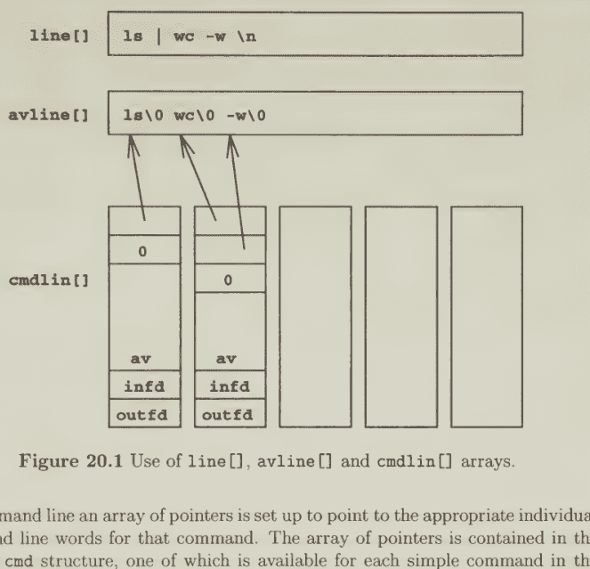

图 20.1 line[]、avline[] 和 cmdlin[] 数组的使用。

命令行会设置一个指针数组，指向该命令的适当单个命令行单词。指针数组包含在 struct cmd 结构中，管道中每个简单命令都可以使用其中一个。该结构集合本身存储为一个名为 cmdlin[] 的数组。

图 20.1 的目的是通过展示输入的命令管道为时 line[]、avline[] 和 cmdlin[] 数组的内容来说明这一思想：

```
tsh: ls | wc -w
```

### 20.2 代码

在了解了基本数据结构及其用法之后，让我们现在来浏览一下代码。tiny shell 基本上是自顶向下设计的，我们将按照该顺序进行讲解。

### 20.2.1 main 函数

任何解释器的顶层设计基本上都是一个循环，它只是获取要做的事情然后去做它。tiny shell 也不例外，因此 main() 函数特别简单：

```
#include "def.h"

main(void)
{
    int i;

    initcold();

    for (;;)
    {
        initwarm();

        if (getline())
            if (i = parse())
                execute(i);
    }
}
```

首先发生的事情是 main() 调用一个一次性初始化函数 initcold()。随后是一个无限循环，反复打印提示符、获取输入行、解析它们以提取简单命令及其参数，然后执行每个简单命令，并根据需要处理 I/O 重定向和管道。

详细来说，循环体首先调用 initwarm() 为每条输入命令行初始化内容并显示 tsh: 提示符。随后调用 getline()，它将用户的命令行复制到 line[] 数组中，如果输入行的长度小于 MAXLINE，则返回非零值。

如果 getline() 返回非零值，则接下来调用 parse() 函数。该函数负责解析 line[] 数组的内容并从中提取相关信息。这包括简单命令名称及其相关参数、任何 I/O 重定向的输入和输出文件名，以及如果指定了管道后台 (&) 运算符。

假设没有错误，parse() 函数返回一个正值，即输入命令管道中的简单命令数量。出错时，parse() 返回值零。如果到目前为止没有错误，则最后调用 execute() 函数，并将 parse() 返回的计数作为参数传入。execute() 函数使用 fork() 和 exec() 依次执行每个简单命令，根据需要创建管道并打开 I/O 重定向文件。

### 20.2.2 初始化函数

initcold() 初始化函数的内容目前被注释掉了，因此该函数实际上什么也不做。这是因为 tiny shell 没有像真正的 shell 那样的内置命令。这意味着像 exit 这样的 shell 命令（会终止真正的 shell）不能以相同的方式用于 tiny shell。因此，终止 tiny shell 的最简单方法是发送中断（Ctrl-c）或退出（Ctrl-\）信号从键盘。显然，如果 initcold() 的内容被取消注释，则这将不可能，并且 tiny shell 将更难以终止。

```
initcold(void)
{
/*
    signal(SIGINT, SIG_IGN);
    signal(SIGQUIT, SIG_IGN);
*/
}
```

```
initwarm(void)
{
    int i;

    backgnd = FALSE;
    lineptr = line;
    avptr = avline;
    infile[0] = '\0';
    outfile[0] = '\0';
    append = FALSE;

    for (i = 0; i<PIPELINE; ++i)
    {
        cmdlin[i].infd = 0;
        cmdlin[i].outfd = 1;
    }

    for (i = 3; i<OPEN_MAX; ++i)
        close(i);

    printf("tsh: ");
    fflush(stdout);
}
```

initwarm() 函数在‘获取命令，执行命令’循环的每次迭代开始时执行。本质上，它只是初始化全局变量，将 cmdlin[] 数组中每个简单命令结构的 infd 和 outfd 文件描述符设置为其默认值，关闭除标准输入、输出和错误输出设备之外的所有文件描述符，最后显示 tsh: 提示符。

### 20.2.3 getline 函数

```
getline(void)
{
    int i;

    for (i = 0; (line[i] = getchar())!='\n' && i<MAXLINE; ++i);

    if (i==MAXLINE)
    {
        fprintf(stderr, "Command line too long\n");
        return(ERROR);
    }

    line[i+1] = '\0';
    return(OKAY);
}
```

此函数只是从标准输入设备获取字符并将它们复制到 line[] 数组中，直到遇到换行符（\n）字符或输入了 MAXLINE 个字符，在后一种情况下 line[] 数组已满。

如果输入了 MAXLINE 个字符，则函数返回 ERROR；否则在最后一个输入字符后添加字符串终止符（\0），并返回 OKAY 值。

### 20.2.4 parse 函数

命令管道的语法如下：

```
cmd [ < filename ] [ | cmd ]... [ or filename ] [ & ]
```

这里 cmd 表示任何简单命令，包括其参数，而 or 是输出重定向运算符（> 或 >>）之一。方括号用于包含可选项，而省略号 (...) 表示前面的括号内容可以重复零次或多次。

综合起来，这说明 tiny shell 命令管道以一个简单命令开始。然后可选地跟随输入重定向运算符及其关联的 *filename*。这进而可以可选地并重复地跟随管道运算符然后是另一个简单命令。在最后一个简单命令之后（如果没有使用管道，则可能是第一个），可以指定可选的输出重定向运算符及其关联的 *filename*。最后，整个管道可以通过指定 & 运算符可选地设置为在后台运行。

*parse()* 函数需要确保其输入的语法符合此规范，同时提取每个简单命令所属的标记以及可能指定的任何输入或输出重定向的文件名。

```
parse(void)
{
    int i;

    /* 1 */
    command(0);

    /* 2 */
    if (check("<"))
        getname(infile);

    /* 3 */
    for (i = 1; i<PIPELINE; ++i)
        if (check("|"))
            command(i);
        else
            break;

    /* 4 */
    if (check(">"))
    {
        if (check(">"))
            append = TRUE;

        getname(outfile);
    }

    /* 5 */
    if (check("&"))
        backgnd = TRUE;

    /* 6 */
    if (check("\n"))
        return(i);
    else
    {

```
fprintf(stderr, "Command line syntax error\n");
return(ERROR);
}
}
```

本列表中的编号注释描述如下：

- 1. 首先会调用 command() 函数，正如我们稍后将看到的，它知道如何从与单个简单命令关联的命令行中提取单词。这些单词将被复制为单独的字符串到 avline[] 数组中，并且适当的 struct cmd 中的 av[] 指针将被设置以指向这些字符串。传递给 command() 函数的参数用于告诉它使用 cmdlin[] 数组中的哪个 struct cmd。
- 2. 在第一个命令被解析后，下一个部分使用 check() 函数查找可选的输入重定向运算符。如果 check() 在 line[] 数组的当前位置找到与其参数字符串匹配的内容，它将返回真值，然后 getname() 函数将被调用以将后面的文件名提取到 infile[] 数组中。
- 3. 简单命令零已经解析完毕，因此下一个代码部分查找可选的管道运算符，后跟简单命令一、二，等等。在 for 循环内部，如果找到管道运算符，则会再次调用 command() 函数来解析下一个简单命令。此时传递给 command() 的参数由 for 循环控制变量 (i) 提供。for 循环会重复执行，直到不再找到管道运算符或达到‘管道中简单命令的最大数量’限制为止。
- 4. 本部分检查输出重定向运算符，然后通过查找第二个 > 符号来检查这是否是追加输出重定向。如果是追加输出重定向，则 append 标志将被设置为 TRUE（其默认值 FALSE 在 initwarm() 中设置）。如果存在任一输出重定向运算符，则 getname() 函数将用于将相关文件名复制到 outfile[] 数组中。
- 5. 规范现在允许可选的 & 运算符，并且接下来会检查它。如果存在该运算符，则 backgnd 标志将被设置为 TRUE（FALSE 值已在 initwarm() 中设置）。
- 6. 无论前面代码走了哪条路径，输入行现在应该已解析完成，剩下的只应是末尾的换行符 (\n) 字符。如果是这样，则 parse 返回变量 i 的值，该值给出此命令行中发现的简单命令数量。如果下一个字符不是换行符，则会显示错误消息，并且 parse() 返回值 ERROR 而不是。

#### 20.2.5 command 函数

基本上，此函数一次一个单词地将命令名称及其参数从 line[] 数组复制到 avline[] 数组。每次复制一个单词时，就会设置一个指针，使其指向 cmdlin[] 结构数组中某个 av[] 数组中的单词的开头：

```
command(int i)
{
    int j, flag, inword;

    for (j = 0; j<MAXARG-1; ++j)
    {
        while (*lineptr==' ' || *lineptr=='\t')
            ++lineptr;

        cmdlin[i].av[j] = avptr;
        cmdlin[i].av[j+1] = NULL;

        for (flag = 0; flag==0;)
        {
            switch (*lineptr)
            {
            case '>':
            case '<':
            case '|':
            case '&':
            case '\n':
                if (inword==FALSE)
                    cmdlin[i].av[j] = NULL;

                *avptr++ = '\0';
                return;
            case ' ':
            case '\t':
                inword = FALSE;
                *avptr++ = '\0';
                flag = 1;
                break;
            default:
                inword = TRUE;
                *avptr++ = *lineptr++;
                break;
            }
        }
    }
}
```

在 tiny shell 中总体而言，尤其是在此函数中，变量 lineptr 指向 line[] 数组中当前感兴趣的位置，而变量 avptr 指向 avline[] 数组中下一个要使用的字符位置。

command() 函数由一对嵌套的 for 循环组成。内部循环将单词的字符从 line[] 数组复制到 avline[] 数组，并在 avline[] 数组中用 \0 字节终止该单词。外部循环负责在适当的 av[] 数组元素中设置指向单词的指针。

#### 20.2.6 execute 函数

在每个完整的管道中，只能指定一个输入重定向文件，附加到第一个简单命令，并且只能指定一个输出重定向文件，附加到最后一个简单命令。显然，如果管道中只有一个简单命令，则它同时符合该行上的第一个和最后一个命令的条件，因此其输入和输出都可以重定向到文件。

如果管道中有不止一个简单命令，假设有 j 个，则需要创建 j-1 个管道来连接这些简单命令。考虑到这些要点，我们现在可以查看 execute() 函数的代码：

```
execute(int j)
{
    int i, fd, fds[2];

    /* 1 */
    if (infile[0]!='\0')
        cmdlin[0].infd = open(infile, O_RDONLY);

    /* 2 */
    if (outfile[0]!='\0')
        if (append==FALSE)
            cmdlin[j-1].outfd = open(outfile, O_WRONLY | O_CREAT
                | O_TRUNC, 0666);
        else
            cmdlin[j-1].outfd = open(outfile, O_WRONLY | O_CREAT
                | O_APPEND, 0666);

    /* 3 */
    if (backgnd==TRUE)
        signal(SIGCHLD, SIG_IGN);
    else
        signal(SIGCHLD, SIG_DFL);

    /* 4 */
    for (i = 0; i<j; ++i)
    {
        /* 5 */
        if (i<j-1)
        {
            pipe(fds);
            cmdlin[i].outfd = fds[1];
            cmdlin[i+1].infd = fds[0];
        }

        /* 6 */
        forkexec(&cmdlin[i]);

        /* 7 */
        if ((fd = cmdlin[i].infd)!=0)
            close(fd);

        if ((fd = cmdlin[i].outfd)!=1)
            close(fd);
    }

    /* 8 */
    if (backgnd==FALSE)
        while (wait(NULL)!=lastpid);
}
```

请记住，execute() 函数接受一个整数参数，即命令管道中简单命令的数量。该值被赋给变量 j。列表中的编号注释解释如下：

- 1. 如果已指定输入重定向文件，则 open() 该文件并将 resulting 文件描述符赋给与简单命令零（即命令行上的第一个简单命令）关联的 struct cmd 中的 infd 字段。请注意，tiny shell 代码犯了 Linux 编程中最严重的致命错误之一——它没有检查大多数系统调用的返回值以查找错误返回。添加检查代码是一项非常简单的任务（留给读者作为练习），这里只是为了使代码更易读而省略了它。
- 2. 同样，如果已指定输出重定向文件，则会对其进行 open() 操作，并将 resulting 文件描述符赋给与命令行上最后一个（第 j-1 个）简单命令关联的 outfd 结构成员。这里还有一个额外的变化，即有两种类型的输出重定向（覆盖和追加），需要以两种不同的方式打开文件。在本例中，选择仅通过测试 append 标志的值来完成。
- 3. 下一部分涉及僵尸子进程。如果命令行要在后台运行（backgnd==TRUE），则设置 SIGCHLD，以便在子进程终止时不会创建僵尸子进程。这是在这里的正确操作，因为 shell 不会为它们 wait()。如果命令行将在前台运行，则 SIGCHLD 被设置为其默认操作，这也会导致系统在子进程死亡时从子进程生成僵尸，直到 shell wait() 它们为止。
- 4. 下一部分是一个循环，其主体将为命令行中的每个简单命令执行一次，变量 i 指定下一个要处理的简单命令。
- 5. 值 j-1 给出命令行中最后一个简单命令的命令号。当该值大于零时，表示管道中有不止一个简单命令。对于每个编号小于 j-1 的简单命令，需要创建一个管道，将命令号 i 的输出 (outfd) 管道传输到命令号 i+1 的输入 (infd)。
- 6. 命令号 i 所需的所有文件描述符和命令行参数现在都已可用且就绪，因此简单命令 i 现在可以执行。forkexec() 函数正如其名称所暗示的那样——它创建子进程来运行简单命令。因此，只有在父进程中 forkexec() 函数才会返回。
- 7. 如果刚刚启动的简单命令涉及任何 I/O 重定向或管道，则父进程的文件描述符副本在此处关闭。
- 8. 最后，当所有简单命令都已启动后，如果此命令行在前台运行，则父进程（tiny shell）进入一个循环，等待管道中最后一个进程的终止，其进程 ID 将由 forkexec() 函数设置在 lastpid 中。

#### 20.2.7 forkexec 函数

forkexec() 函数的任务是使用 fork() 系统调用创建子进程 然后在子进程内部执行任何必需的 I/O 重定向，然后使用 execvp() 执行所需的命令。

```
forkexec(struct cmd *ptr)
{
    int i,pid;

    /* 1 */
    if (pid = fork())
    {
        /* 2 */
        if (backgnd==TRUE)
            printf("%d\n", pid);
```


```
lastpid = pid;
}
else
{
    /* 3 */
    if (ptr->infd==0 && backgnd==TRUE)
        ptr->infd = open("/dev/null", O_RDONLY);

    /* 4 */
    if (ptr->infd!=0)
    {
        close(0);
        dup(ptr->infd);
    }

    if (ptr->outfd!=1)
    {
        close(1);
        dup(ptr->outfd);
    }

    /* 5 */
    if (backgnd==FALSE)
    {
        signal(SIGINT, SIG_DFL);
        signal(SIGQUIT, SIG_DFL);
    }

    /* 6 */
    for (i = 3; i<OPEN_MAX; ++i)
        close(i);

    /* 7 */
    execvp(ptr->av[0], ptr->av);
    exit(1);
}
}
```

forkexec() 函数以指向即将执行的简单命令相关联的 struct cmd 的指针作为参数。请记住，该结构包含命令将用于其标准输入和标准输出的文件描述符（尽管重定向尚未发生），它还包含指向命令行参数（包括命令名本身）的指针数组，这些参数将成为命令的 argv 参数。

编号注释在此函数中描述如下：

- 1. 第一个任务是 fork() 一个子进程并存储返回的进程 ID。
- 2. 在父进程中，如果此命令行要在后台运行，则每个子进程的进程 ID 在创建时将被显示。每个子进程的进程 ID 也存储在变量 lastpid 中。随着命令行中的简单命令从左到右执行，lastpid 的最终值将是最后创建的简单命令（即最右边的简单命令）的进程 ID。这是 wait() 在此命令行要在前台执行时将查找的进程 ID。
- 3. 在子进程中，首先发生的是一个相当微妙的测试。如果这是要在后台运行的命令行，则必须防止它从键盘获取输入。事实上，只有管道中的第一个简单命令才能从键盘获取输入，因为其余所有命令都将通过管道、重定向获取其标准输入。因此，如果这是要在后台运行的命令行，并且将作为当前简单命令的标准输入的文件描述符（infd）仍设置为键盘（infd==0），那么这必须是管道中的第一个简单命令，并且需要将其标准输入从键盘转移走，以确保它不会尝试从中读取。最简单、最安全的方法就是在这种情况下设置自动输入重定向。用于此重定向的最明显的文件就是标准文件 /dev/null，如果进程尝试从中 read()，它会立即返回 EOF。使用这种简单机制可以使微型 shell 不必参与任何类型的作业控制功能。
- 4. 下一个阶段实际上是通过操作文件描述符来执行输入和输出重定向，如果它们已从默认值更改。
- 5. 如果这是前台管道，则当前简单命令被设置成可以由键盘上的中断或退出信号终止，除非它随后做出特定的相反规定。
- 6. 下一步是关闭除标准输入、输出和错误输出之外的所有文件描述符，以便此进程无法干扰 shell 设置的任何管道或 I/O 重定向文件，除了它应该通过标准文件描述符 0、1 和 2 看到的那些。
- 7. 最后，简单命令由 execvp() 系统调用执行，使用其 av[] 数组中的值作为命令名和 argv 指针。

### 20.2.8 check 函数

```
check(char *ptr)
{
    char *tptr;

    while (*lineptr==' ')
        lineptr++;

    tptr = lineptr;

    while (*ptr!='\0' && *ptr==*tptr)
    {
        ptr++;
        tptr++;
    }

    if (*ptr!='\0')
        return(FALSE);
    else
    {
        lineptr = tptr;
        return(TRUE);
    }
}
```

check() 函数将作为参数传递给它的字符串与从 lineptr 位置开始的 line[] 数组中的字符进行比较。如果找到匹配项，则 lineptr 会向前移动超出匹配的字符，并返回 TRUE 值。如果 check() 未找到匹配项，则返回 FALSE 值，并且 lineptr 保持不变，以便可以从 line[] 数组中的同一位置开始对其他字符串进行检查。

### 20.2.9 getname 函数

```
getname(char *name)
{
    int i;

    for (i = 0; i<MAXNAME; ++i)
    {
        switch (*lineptr)
        {
        case '>':
        case '<':
        case '|':
        case '&':
        case ',':
        case '\n':
        case '\t':
            *name = '\0';
            return;

        default:
            *name++ = *lineptr++;
            break;
        }
    }

    *name = '\0';
}
```

此函数只是将文件名最多复制 MAXNAME 个字符到其 name 参数指向的 char 数组中。

## 练习

- 1. 使用 bash 和 tsh 输入以下每条包含错误的命令行，看看 shell 会做什么。你观察到的结果是你期望的吗？你希望的是什么？尝试其他命令和其他 shell（如果有的话），你现在怎么想？
- 2. 为微型 shell 添加一个简单的机制，使其能够执行内置命令。
- 3. 为微型 shell 添加 cd 和 history 内置命令，并允许它使用 ! 操作符重复历史列表中的以前命令。

```
$ cat /etc/passwd >output1 >output2
$ cat </etc/passwd </etc/motd
$ cat /etc/passwd | | grep root
$ cat /etc/passwd >output3 | grep root
```

## 答案

- 1. 糟糕……。假设你认为错误消息是家常便饭，标准 shell 的表现并不太好，对吧？
- 2. 添加内置命令的简单方法是在 parse() 函数顶部添加以下代码：

```
parse()
{
```
```c
int i;

if (builtin())
    return 0;

/* 1 */
command(0);
/* etc...*/
```
```

然后编写一个 builtin() 函数，该函数检查内置命令关键字，并在找到它们时执行任何所需的操作。如果 builtin() 函数返回 true（非零）值以表示找到了内置命令，则 parse() 将在该点返回，而不会尝试进一步执行命令行：

```c
builtin()
{
    if (check("exit"))
        exit(0);
    else
        return 0;
}
```
- 3. 要添加这三个额外的内置命令，可以按如下方式修改 builtin() 函数：

```c
builtin()
{
    if (check("exit"))
        exit(0);
    else if (check("cd"))
        return do_cd();
    else if (check("history"))
        return do_history();
    else if (check("!"))
        return do_repeat_command();
    else
        return 0;
}
```

do_cd() 函数然后可以从 line[] 数组中提取目录名并使用 chdir() 系统调用进行更改。对于 ! 和 history 命令，你需要修改 getline() 函数，以便在键盘上输入的行在输入时被存储。然后 history 命令可以列出存储中的所有命令，而 ! 命令可以将适当的存储命令复制回 line[] 数组。do_repeat_command() 然后可以从 builtin() 返回零，以便 line[] 将被正常解析。

## 杂项系统调用

这里有远多于我有空间详细描述的系统调用（目前有一百四十多个）。然而，在结束之前，我们仍有几个需要查看的系统调用。

从 shell 命令提示符可以执行的所有命令只能通过调用一些底层系统调用来执行其操作，以从操作系统获取所需的系统服务。在若干情况下，这意味着一个专门用于提供特定服务的新系统调用。

下一组系统调用属于此类。

### 21.1 umask 系统调用

你会记得 umask 命令用于设置文件创建掩码。umask 值在每次创建文件时都会使用，作为安全措施，以确保你运行的进程无法创建具有比你想要给予更多访问权限的新文件。这是通过在代表你创建的任何文件的模式位中重置 umask 值中的权限位来实现的。

umask 命令在内部由同名底层系统调用的调用实现：

```
#include <sys/types.h>
#include <sys/stat.h>

mode_t umask(mode_t mask);
```

对 umask() 系统调用的调用将文件创建掩码设置为指定的掩码值。仅保存 mask 中的权限位，其他位的值将被忽略。

umask() 的返回值只是文件创建掩码的先前值，因此此系统调用既可用于获取也可用于设置所需值。


然而，很遗憾，没有办法在不同时设置新值的情况下获取旧的 umask 值。

这意味着如果只是想查看当前值，就必须执行类似以下函数的代码：

```c
#include <sys/types.h>
#include <sys/stat.h>

mode_t get_umask()
{
    mode_t old;

    old = umask((mode_t)0);
    (void) umask(old);
    return old;
}
```

该函数的第一行将 umask 值设为零，并作为副作用返回感兴趣的值，然后该值被赋给变量 old。第二行随后将 umask 恢复到其原始值。最后一行则将所需的 umask 值返回给调用者。

### 21.2 mount 系统调用

请记住，物理磁盘经常被分成单独的分区，并且每个分区上都记录着一个文件系统。这些文件系统中的每一个都可以挂载到目录层次结构中，从而成为其一部分。此文件系统挂载操作是通过使用 mount 命令来执行的，而该命令本身使用底层的 mount() 系统调用：

```c
#include <sys/mount.h>

int mount(char *fspath, char *dir, char *fstype,
          unsigned long flags, void *data);
```

直接调用 mount() 系统调用是不常见的，尤其是因为它只能由 root 用户使用。

fspath 参数是要挂载的文件系统所在磁盘分区的路径名（例如 /dev/hdb2），dir 给出要挂载文件系统的目录。fstype 参数指定磁盘分区上的文件系统类型（例如 second extended、minix 或 DOS），flags 指定文件系统的挂载方式（例如只读或读写），而 data 是指向任意信息结构体的指针，其内容（甚至是否存在）取决于要挂载的具体文件系统类型。

### 21.3 umount 系统调用

文件系统一旦挂载后，可以使用 umount 命令再次从目录层次结构中移除。这使用了底层的 umount() 系统调用：

```c
#include <sys/mount.h>

int umount(char *path);
```

path 参数要么是已挂载磁盘分区的路径名，要么是文件系统所挂载的目录的路径名。

再一次，这个系统调用只能由 root 使用。

### 21.4 sync 系统调用

你已经知道，当数据写入文件时，内核会安排将数据写入内存缓冲区，而不是直接写入磁盘。你也已经看到，可以通过使用 sync 命令来强制进行数据写入。该命令使用底层的 sync() 系统调用：

```c
#include <unistd.h>

int sync(void);
```

如果你打算使用这个系统调用，你应该明白，它只是安排磁盘数据写入磁盘；它不会等待物理写入操作完成。这意味着当 sync() 调用返回到你的程序时，你不能假设磁盘写入已经实际发生，只能假设它们已被安排尽快执行。

事实上，你自己调用 sync() 的情况非常少见，因为有一对名为 update 和 bdflush 的程序，大多数 Linux 发行版会在系统启动时安排自动执行。这些命令在系统运行的整个时间内保持活动状态，并会定期（每 30 秒一次，对真正重要的数据则更频繁）将磁盘缓冲区缓存刷新到磁盘。这样，即使发生严重的机器崩溃，也最多只会丢失 30 秒的工作。

与 mount() 和 umount() 不同，sync() 系统调用可以随时被任何用户使用。

### 21.5 告诉时间

许多程序需要测量时间。这可以是当前墙上时钟时间，也可以是进程使用 CPU 时间的多少。在 Linux 中，通过系统调用可以获得这两种意义上的时间测量。

### 21.5.1 time 系统调用

PC 的硬件包含一个系统时钟。Linux 在系统启动期间读取时钟，然后维护自己的时钟计数器，用它来为系统内的事件（如文件创建或用户登录时间）加上时间戳。此（墙上）时钟的值也可以通过使用 time() 系统调用提供给你的程序：

```c
#include <sys/types.h>
#include <time.h>

time_t time(time_t *loc);
```

该系统调用返回一个 time_t 值，并且如果参数 loc 是此类型变量的指针，则返回值也会复制到该指针所指向的变量中。

数据类型 time_t 实际上是由 typedef 定义的，可通过 <time.h> 访问，其底层数据类型为 long。因此，time() 系统调用以 long 的形式返回当前墙上时钟时间，但格式很奇怪——自 1970 年 1 月 1 日午夜格林威治时间（GMT）以来经过的秒数。（我想时钟总得有个起点...）

这里顺带一个问题是 long 在用完之前能计数多少时间？如果你限制在 32 位 long 可容纳的正值范围内（我也不确定负时间到底意味着什么！），那么大约是 68 多年，直到 2038 年年初（足够时间来构思一个替代方案了）。

这种时间格式实际上很有用，如果你想计算两个事件之间经过了多少时间（例如你登录的时间和你注销的时间），只需用较早的时间减去较晚的时间即可得到事件之间的秒数。

这种格式在你想显示日期、月份、年份或一天中的时间时就没那么有用了。为了简化这些应用，标准库包含了一些有用的函数来为你进行转换。其中两个函数是：

```c
#include <time.h>

struct tm *gmtime(time_t *loc);
struct tm *localtime(time_t *loc);
```

这两个函数都接受一个参数，该参数是指向包含‘自 1970 年以来的秒数’类型值的变量的指针。并且这两个函数都返回一个指向结构的指针，其字段包含所有所需的信息：

```c
struct tm {
    int tm_sec;
    int tm_min;
    int tm_hour;
    int tm_mday;
    int tm_mon;
    int tm_year;
    int tm_wday;
    int tm_yday;
    int tm_isdst;
};
```

字段 tm_hour、tm_min 和 tm_sec 以 24 小时制格式给出墙上时钟时间，tm_mday 是 1 到 31 范围内的月份中的日期，tm_mon 是 0 到 11 范围内的月份编号，1 月为 0，tm_year 是自 1900 年以来的年数，tm_wday 是 0 到 6 范围内的星期几，星期日为 0，tm_yday 是 0 到 365 范围内的全年中的日期，1 月 1 日为 0，而 tm_isdst 是一个标志，用于指定是否实施夏令时（如果信息可用）。

这两个函数的主要区别在于 gmtime() 以格林威治标准时间（GMT）为基准提供信息，而 localtime() 则以你的本地时区为基准提供信息（该时区在系统安装和配置期间设置）。

### 21.5.2 times 系统调用

其他可能感兴趣的时间与进程及其 CPU 使用率有关。这些信息可以通过使用 times() 系统调用获得：

```c
#include <sys/times.h>

clock_t times(struct tms *buf);
```

这里 times() 的参数是指向 struct tms 的指针，该结构将被调用填充。其定义如下：

```c
struct tms {
    clock_t tms_utime;
    clock_t tms_stime;
    clock_t tms_cutime;
    clock_t tms_cstime;
};
```

进程的 CPU 时间分为两部分：它在自己的文本段中执行指令所花费的时间（用户时间）以及它在内核中执行指令所花费的时间，通常通过系统调用（系统时间）。

tms_utime 字段是调用进程使用的总用户时间，而 tms_stime 是其总系统时间。其他两个字段（tms_cutime 和 tms_cstime）是同样的内容，但汇总了调用进程的所有子进程，这些子进程已成功执行 wait()。

times() 系统调用的返回值是系统上次启动以来经过的时间。

与 times() 系统调用相关联的所有时间（对于 Linux）均以百分之一秒为单位测量。

### 21.6 select 系统调用

本章的最后一个系统调用在适用的情况下具有显著降低程序 CPU 使用率的能力。

考虑以下场景。假设你想编写一个程序，它可能从终端键盘接收输入，也可能从命名管道的读端接收输入。如果可以保证这两个来源的输入严格交替到达，以便先读取一个然后读取另一个，那么编写实现此目的的代码就是一件简单的事情。然而，如果（更可能的情况）两个来源的输入可以按任意顺序到达，那么就会出现问题，因为如果调用时没有数据准备好，这两个输入设备在 read() 上都会阻塞。

这意味着如果没有输入准备好，从键盘的 read() 可能会挂起进程。即使管道中有大量输入正在到达，进程也无法对此做任何事情。

解决这个问题的明显办法是在两个输入设备上使用 O_NONBLOCK，这样它们在 read() 时都会立即返回，即使没有输入字符准备好。然后你可以反复编写代码轮询这两个设备，处理每个设备的输入。

这个解决方案会奏效。然而，以这种方式重复轮询确实会给 CPU 带来持续的负载，除了输入字符到达时外，没有任何有效的工作被完成。

select() 系统调用提供了完美的解决方案，因为它允许你指定希望进程挂起自身，同时让内核监视任何所需的文件描述符集合以查找活动。一旦在被监视的任何文件描述符上检测到活动，select() 调用就会返回，说明哪个文件描述符已准备好使用。

这使得可以对进程的多个随机顺序输入进行排序，而无需自行轮询输入带来的沉重 CPU 开销。select() 调用的原型是：

```c
#include <sys/time.h>
#include <sys/types.h>
```


```
#include <unistd.h>
```

```
int select(int nfds, fd_set *rdfds, fd_set *wrfds,
    fd_set *exfds, struct timeval *timeout);
```

其中 rdfds、wrfds 和 exfds 分别是要由 select() 监控的读、写和异常处理文件描述符集合，nfds 是需要检查的最高编号文件描述符，而 timeout 参数即使没有文件描述符就绪也可能导致 select() 提前返回。

由 rdfds、wrfds 和 exfds 指向的 fd_sets 会被调用修改以显示哪些文件描述符已就绪，而 select() 调用返回就绪文件描述符的总数。

为了简化在 fd_set 中设置、重置和测试适当的文件描述符位，定义了一组宏如下：

| Macro | Description |
|---|---|
| FD_SET(fd, setptr) | 设置 setptr 所指向的 fd 位； |
| FD_CLR(fd, setptr) | 清除 setptr 所指向的 fd 位； |
| FD_ZERO(setptr) | 清除 setptr 所指向的所有位； |
| FD_ISSET(fd, setptr) | 测试 setptr 所指向的 fd 位。 |

这些宏定义通过在代码中包含头文件 <types.h> 来提供。

## Exercises

- 1. 修改你在 socket 库案例研究末尾练习中编写的聊天程序，使用 select() 系统调用来判断何时有事情需要处理，而不是反复轮询所有打开的套接字描述符以查找是否有任何描述符可读。
- 2. 实现你自己的标准 date 命令版本，以合适的格式显示当前挂钟日期和时间。
- 3. 实现你自己的标准 time 命令版本，该命令将另一个命令和参数作为其自己的命令行参数，执行给定命令，然后显示受控命令执行期间使用的内核和用户时间。
- 4. 编写一对简单的命令，可以设置为 setuid root，并允许普通用户在目录层次结构中的固定点（例如 /floppy）挂载和卸载软盘。

## Answers

- 1. 为了做到这一点，你需要在 main() 中的无限循环顶部使用 select() 系统调用。为了完全有效，由 sp 指向的 SOCKET 结构内部的套接字描述符也需要包含在内。随着新客户端加入聊天和现有客户端离开，读文件描述符集合（rdfs）中的位需要适当地设置和重置，以便 select() 不断仅监控当前正在使用的文件/套接字描述符。
- 2. 这只是使用 time() 系统调用获取自 1970 年 1 月 1 日以来的当前时间（以秒为单位），然后使用其中一个转换函数对该值进行处理以获得适当填充的 struct tm。所需的值然后可以从该结构中提取并以正确的日期格式显示。
- 3. 实现此命令最简单的方法就是 fork() 一个子进程，该子进程将使用 execvp() 执行指定的命令，然后在父进程中在 wait() 子进程完成后使用 times() 调用，以获取子进程的系统和用户时间信息：

```
#include <sys/times.h>

main(int argc, char **argv)
{
    struct tms tm;

    if (fork())
    {
        wait(0);
        times(&tm);
        printf("User CPU time = %d.%d secs\n"
            , tm.tms_cutime/100, tm.tms_cutime%100);
        printf("System CPU time = %d.%d secs\n"
            , tm.tms_cstime/100, tm.tms_cstime%100);
    }
    else
    {
        execvp(argv[1], &argv[1]);
        exit(1);
    }
}
```

- 4. 一种可能的解决方案是使用适当的固定参数调用 mount 和 umount 系统调用，如下所示：

/* mountfd0 command - must be setuid root to work */
main()
{
    setuid(0);

```
if (mount("/dev/fd0", "/floppy", "ext2", 0, 0))
    puts("mountfd0 failed!!\n");
}
```

/* umountfd0 command - must be setuid root to work */
main()
{
    setuid(0);

    if (umount("/dev/fd0"))
        puts("umountfd0 failed!!\n");
}
```

调用 setuid(0) 是必要的，以将进程的真实 uid 设置为 0，因为 mount 系统调用在检查是否由 root 运行 时测试的是真实 uid 而不是有效 uid。

## Daemons

守护进程（发音为 dee-mon，不是 day-mon）是在后台运行且没有关联终端或登录 shell 的进程。有许多标准守护进程，其中一些定期运行以执行特定任务（如 atrun，通常由 cron 每五分钟执行一次），而另一些则持续运行，等待处理特定事件（如 inetd 和 lpd）。

### 22.1 Principles

启动守护进程有几种方式，最常见的是：

- 系统启动时。此时运行的守护进程通常在系统启动脚本执行期间启动，这些脚本通常存储在目录 `/etc/rc.d` 中。
- 手动，从 shell 提示符启动。任何具有合适执行权限的用户都应该能够以这种方式启动任何守护进程。
- 由 crond 守护进程。 该程序会查阅通常位于目录 `/var/spool/cron/crontabs` 中的一组文件，这些文件指定要执行的周期性任务。
- 通过执行 at 命令。这将导致程序在指定的日期和时间执行一次。

为了完全可靠，守护进程应该能够在这所有方式下正确执行。唯一的问题是，其中一些启动方法会使守护进程处于脆弱状态，在此状态下，它会受到在其运行之前为其设置的环境的影响。你将编写的大部分代码，用于将普通程序（例如第 18.2 节中的示例套接字服务器）转换为守护进程，将涉及将你的程序与这些影响隔离开来。除此之外， intended 用于守护进程使用的程序代码通常必须比普通用户代码更健壮。这是因为你通常希望对守护进程进行编程，使其即使在守护进程运行期间发生各种类型的系统错误时也不会导致程序崩溃。

### 22.2 Practice

启动守护进程涉及的步骤比你想象的要多，不过它们都可以用惊人少量的代码完成。本节的其余部分提供了对该过程更重要方面的逐步指南。

### 22.2.1 Close File Descriptors

第一个任务是关闭所有不必要的文件描述符。如果你的守护进程留下普通文件打开，这将阻止任何其他进程从文件系统中删除该文件。它还将阻止包含打开文件的已挂载文件系统被卸载。对于终端文件（通常是 stdin、stdout 和 stderr），关闭不必要的连接更为重要，因为在终端用户注销后执行 vhangup() 系统调用后，守护进程对终端的访问权限将被撤销。这意味着守护进程将拥有它认为处于打开状态的文件描述符，而实际上已无法通过这些描述符访问终端。

最简单的做法就是关闭所有文件描述符，这将使守护进程免受这些问题的影响。对未打开的文件描述符使用 close() 系统调用没有任何问题，因此可以使用以下代码片段：

```
#include <sys/param.h>

for (i = 0; i<NOFILE; ++i)
    close(i);
```

符号常量 NOFILE 给出了进程一次可以打开的最大文件数。

### 22.2.2 Lose Controlling Terminal

如果进程在登录会话内启动，则它将继承自该会话的控制终端。对于守护进程，其后果是它可以接收由控制终端生成的信号（如 SIGINT 和 SIGQUIT），如果未捕获这些信号，将终止该

process. 这个问题可以通过让守护进程忽略它能忽略的所有信号来克服，但这会阻止守护进程将信号用于简单的 IPC 目的。更好的解决方案是让守护进程与控制终端分离，这样这些信号根本就不会传播到守护进程。

在 Linux 下实现此目的的一种方法是打开文件 /dev/tty 并使用 ioctl() 对该文件使用命令 TIOCNOTTY。安排方式是每个具有控制终端的进程都可以通过文件 /dev/tty 访问该终端。

一段执行此操作的简短代码可以是：

```c
if ((fd = open("/dev/tty", O_RDWR))>=0)
{
    ioctl(fd, TIOCNOTTY, 0);
    close(fd);
}
```

在 Linux 下，这并不是进程与控制终端分离的唯一方法。事实上，还有一种更简单的方法可以做到这一点，我们将在下一节中介绍。

#### 22.2.3 丢失会话和进程组

一个进程从其父进程获取会话和进程组 ID。因为它属于一个会话和一个进程组，所以进程会接收发送到整个会话或进程组的任何信号。

这与从控制终端接收信号的问题类似，解决方案本质上也相同，即将进程与这种环境影响分离。

在 POSIX（因此也在 Linux 中）有一个系统调用可以将进程与其当前会话和进程组分离，并将其设置为新的会话领导者。该系统调用是 set session ID：

```c
setsid()
```

因为控制终端只能与单个会话关联，所以 setsid() 调用的副作用是它也会将进程与其控制终端分离（如果有的话）。

setsid() 的唯一问题是它仅在执行它的进程尚未是会话领导者时才有效。在我们的例子中，很容易假设守护进程不会是会话领导者，但除非采取特定步骤使其如此，否则无法保证。

可以肯定的一点是，如果某个会话领导者进程执行 fork() 系统调用，则默认情况下子进程不会是会话领导者。

因此，这提供了确保守护进程在执行 setsid() 时不是会话领导者的机制。守护进程需要做的就是执行一次 fork() 调用，然后在父进程中 exit()，在子进程中执行 setsid()，如下所示：

/* After this, child process is not a session leader */
if (fork())
    /* Terminate parent process whatever its status */
    exit(0);

/* Disassociate child from session, process group and tty */
setsid();

即使采取这些措施，也无法解决将守护进程与其控制终端分离的所有问题。这是因为当一个没有控制终端的会话领导者（如我们现在的情况）打开一个终端设备，而该设备本身尚未是另一个会话的控制终端时，该终端会自动成为新会话的控制终端。

然而请注意，以这种方式获取控制终端只能由会话领导者完成。因此，解决方案显然是确保我们的进程不是会话领导者。这可以通过第二次执行 fork() 并再次终止父进程来实现。这会留下子进程，该子进程不属于其初始会话或进程组，没有控制终端，并且现在无法重新获取控制终端。所需的代码片段现在如下所示：

/* Start up new session, to lose old session and process group */
if (fork())
    exit(0);

/* Disassociate process group and controlling terminal */
setsid();

/* Become a NON-session leader so that a */
/* control terminal can’t be reacquired */
if (fork())
    exit(0);

#### 22.2.4 更改工作目录

内核会在进程的整个生命周期内保持打开系统上任何进程的当前工作目录。这通常不会造成问题，但如果进程的当前目录位于挂载的文件系统中，则该文件系统会被标记为“正在使用”，因此无法卸载。为了允许系统超级用户卸载文件系统，守护进程可以执行：

```
chdir("/");
```

也有可能为了正常运行，守护进程必须 chdir() 到特定目录。示例套接字服务器就是一个例子，其中服务器只能提供守护进程当前工作目录中的文件
supply. 在这种情况下，你只能接受这种限制，或者与系统管理员协商，在根文件系统中提供守护进程可以运行的位置。更改当前工作目录到根目录时可能出现的一个问题是，如果守护进程有任何终止并转储核心文件的可能性，内核将尝试在当前目录中打开该文件，如果这是根目录，则除非守护进程以超级用户权限运行，否则操作将失败。为了解决这个问题，以下操作：

```
chdir("/tmp");
```

将使 /tmp 成为当前工作目录，/tmp 通常只是根文件系统的子目录，并且也给予所有进程写权限。

#### 22.2.5 重置文件创建掩码

当进程启动时，其文件创建掩码从父进程继承。通常，这将具有值 022，这意味着守护进程创建的任何文件都不会向组用户或其它用户授予写权限，无论守护进程本身指定的权限位如何。根据守护进程的性质，这种行为可能有问题也可能没有问题。然而，将以下行包含到你的代码中以撤销父进程设置的无论是什么文件创建掩码值的影响，是一件很简单的事情：

```
umask(0);
```

即使现在，仍然有一些从父进程继承的环境特性可能会给守护进程带来问题。例如，nice() 进程优先级设置，或使用 alarm() 设置的闹钟信号剩余时间。然而，尽管这些情况是可能的，但会设置这些来陷害一个不小心的守护进程的父进程将会是非常恶意的。

#### 22.2.6 处理 SIGCHLD 信号

有时守护进程会被编写为创建子进程。将示例套接字服务器制作成守护进程将演示这种类型的代码。在这种情况下，父进程不断循环以接受更多客户端连接，而子进程则处理客户端请求。请注意，父进程不会执行 wait() 系统调用来等待其子进程终止。默认情况下，处于这种位置的子进程会变成僵尸，直到某个进程（可能是 init）在未来等待它们。在这种情况下创建僵尸只是浪费系统资源。在 Linux 下有几种解决这个问题的方法，最简单的方法是将 SIGCHLD 信号的操作设置为 SIG_IGN，如下所示：

```
signal(SIGCHLD, SIG_IGN);
```

这是 SIGCHLD 的一个特殊特性，它告诉内核不要从调用进程的子进程生成僵尸。

## 练习

- 1. 创建一个服务器守护进程的伪代码程序骨架，该守护进程允许通过套接字并发处理多个网络客户端请求。
- 2. 编写一个新命令的代码，该命令可用于将另一个程序作为守护进程启动。例如：

```
$ launch myprog param1 param2
```

将在设置其环境使其作为守护进程运行后执行命令 myprog param1 param2。这将允许你以这样的方式编写命令：你可以在登录时将其作为普通命令运行，或将其作为守护进程运行，以便即使在注销后它们仍继续执行。

## 答案

1. 这实际上是第 22.2.6 节中建议的安排，它提供了所需答案的线索。你需要做的就是将进程制作成守护进程，设置套接字，然后进入循环接受客户端连接。每次获得客户端连接时，你就 fork 一个子进程来处理它，而父进程则循环回去接受另一个连接。伪代码可以是：

```
Setup current process as a daemon (fork, setsid, fork etc.)
Create a socket on a well known port
while (true)
    Get a client connection
    if (fork()==0)
        Close parent’s copy of client connection
    else
        In child, deal with client request
        exit child process
    endif
endwhile
```

你将在下一章的 Tiny Daemon 案例研究中看到本质上这种解决方案的使用。


2. 解决此问题的方案只需将你的 *launch* 命令设置为守护进程，使进程作为守护进程运行，然后使用 exec() 将守护进程中的程序更改为命令行给出的程序即可。这可以按如下方式完成：

```
main(int argc, char **argv)
{
    Setup process as a daemon (fork, setsid, fork etc.)
    execvp(argv[1], &argv[1]);
}
```

## 微型守护进程 – 案例研究

在了解了设置守护进程所涉及的原理之后，我们现在将回到第 18.2 节中介绍的示例套接字服务器程序，看看如何将其改造成一个适当的守护进程，使其在您注销机器后仍能继续运行并提供服务。

### 23.1 守护进程列表

以下程序展示了第 18.2 节中示例套接字服务器的完整列表，已修改为作为健壮的守护进程运行。你会注意到原始服务器代码本身做了一些更改，并且还添加了 setup_daemon() 函数。所有这些内容将在列表之后详细解释：

```
/****************************************************************
THE SOCKET SERVER DAEMON
****************************************************************/

#include <stdio.h>
#include <string.h>
#include <signal.h>
#include <fcntl.h>
#include <setjmp.h>
#include <sys/param.h>
#include "socklib.h"

/* Server's communication port number */
#define PORT 2121

/* Values for the next_action parameter to fatal() */
#define NA_EXIT 0
#define NA_RESTART 1

/* Global environment store for setjmp/longjmp */
jmp_buf env;

/****************************************************************
MAIN - A very simple file transfer daemon, which sets up a concurrent
    socket server on the host machine on port number PORT to transfer
    any files from the current directory on request.
****************************************************************/
main(void)
{
    SOCKET *sp;
    int sd;

    /* Rearrange operating environment for daemon working */
    setup_daemon();
    /* Set SIGCHLD for no zombies */
    signal(SIGCHLD, SIG_IGN);

    /* Create server's socket */
    if ((sp = sopen())==0)
        /* Exit server if this fails */
        fatal("sopen()", NA_EXIT);

    /* Setup the NA_RESTART (post error) entry point */
    setjmp(env);

    /* Repeatedly accept and service client requests */
    for (;;)
    {
        /* Connect to client or restart on failure */
        if ((sd = sserver(sp, PORT, S_DELAY))==-1)
            fatal("sserver()", NA_RESTART);

        /* Fork() a child process */
        switch (fork())
        {
        /* Deal with client request in child */
        case 0:
            do_service(sd);

        /* Deal with fork() failure */
        case -1:
            close(sd);
            /* Restart for next client */
            fatal("fork()", NA_RESTART);
        }
        /* In parent, close client and loop for next connection */
        close(sd);
    }
}

/************************************************************************
SETUP_DAEMON - This function is responsible for modifying the current
    working environment of the process to that required by a daemon.
    I.e.  it closes unnecessary file descriptors, disassociates itself
    from the current controlling terminal, session and process group
    and modifies the current file creation mask.
************************************************************************/
setup_daemon(void)
{
    int i;

    /* Close all open file descriptors */
    for (i = 0; i<NOFILE; ++i)
        close(i);

    /* 1st fork() call */
    switch (fork())
    {
    /* Error in 1st fork() */
    case -1:
        fatal("setup_daemon(), 1st fork()", NA_EXIT);

    /* Exit 1st parent */
    default:
        exit(0);

    /* Continue in 1st child (2nd parent) */
    case 0:
        /* Start new session exit() on error */
        if (setsid()==-1)
            fatal("setup_daemon(), setsid()", NA_EXIT);

        /* 2nd fork() call */
        switch (fork())
        {
        /* Error in 2nd fork() */
        case -1:
            fatal("setup_daemon(), 2nd fork()", NA_EXIT);

        /* Exit 2nd parent */
        default:
            exit(0);

        /* Continue in 2nd child */
        case 0:
            /* Reset file creation mask for ERROR.LOG */
            umask(0);
            /* and return with daemon set up */
            return;
        }
    }
}

/****************************************************************
FATAL - This routine is called when an error condition is returned to
    the daemon, usually from one of the system calls it makes. The
    function first prints the message pointed to by <text> and then
    either terminates the process or restarts it with longjmp(),
    depending on the value of the <next_action> parameter.
****************************************************************/
fatal(char *text, int next_action)
{
    FILE *fp;

    /* Open the error log file */
    if ((fp = fopen("ERROR.LOG", "a"))==0)
        /* exit() on failure here, with error unreported... */
        exit(1);

    /* Write the error message */
    fprintf(fp, "Error in %s\n", text);
    fclose(fp);

    if (next_action==NA_RESTART)
        /* Restart calling process */
        longjmp(env, 1);
    else
        /* Terminate calling process */
        exit(1);
}

/**************************************************************************
DO_SERVICE - This function is called in the child process that is
created when a client makes a successful connection. Its task is
to service the client's request and supervise the required file
transfer. The parameter <sd> is the socket descriptor to use for
the communication.
**************************************************************************/
do_service(int sd)
{
    int i, fd;
    char *name;
    char c, namlen;

    /* Get length of file name */
    if (read(sd, &namlen, 1)!=1)
        fatal("namlen read()", NA_EXIT);

    /* Space for name + " open()" */
    if ((name = (char *)malloc(namlen+8))==0)
        fatal("malloc()", NA_EXIT);

    /* Get required file name into name[] */
    for (i = 0; i<namlen; ++i)
        if (read(sd, &name[i], 1)!=1)
            fatal("file name read()", NA_EXIT);

    /* Make name[] a string */
    name[i] = '\0';

    /* Check name[] is in current directory */
    if (strchr(name, '/'))
        fatal("illegal file name", NA_EXIT);

    /* Open specified file */
    if ((fd = open(name, O_RDONLY))==-1)
        fatal(strcat(name, " open()"), NA_EXIT);

    /* Transfer contents to client */
    while ((i = read(fd, &c, 1))!=0)
        if (i==-1)
            fatal("file read()", NA_EXIT);
        else if (write(sd, &c, 1)!=1)
            fatal("write()", NA_EXIT);

    /* Terminate child and with it the connection to this client */
    exit(0);
}
```

### 23.2 套接字服务器新增内容

程序中最明显的变化是添加了 setup_daemon() 函数，该函数作为 main() 的第一条语句被调用。关于该函数的作用没有令人惊讶之处，但其编码方式与我们之前看到的概念方法不同。

首先要做的任务是关闭所有文件描述符。无论它们是否打开都会执行此操作。然后，接下来有一个部分将守护进程与其控制终端、会话和进程组分离，并阻止其将来重新获取另一个终端。这是通过通常的 fork()、setsid()、fork() 序列完成的，但嵌入在一对 switch() 结构中，以便更容易处理 fork() 调用可能出现的任何错误。请记住 fork() 返回三个不同的值：出错时为 -1，子进程为 0，非零值由 default: case 处理，返回给父进程。最后，在第二个子进程中，会调用 umask() 将文件创建掩码设置为 0。这是因为如果出现任何严重错误，守护进程可能需要创建文件 ERROR.LOG，而如果不进行此调用，当前的 umask() 值可能不合适。

### 23.3 套接字服务器更改

原始示例套接字服务器的所有其他更改都直接与使守护进程能够处理系统和库调用返回的错误有关。这是通过在适当的情况下重新启动守护进程的主循环来实现的，而不是在出现任何错误时就终止守护进程。这一想法的实现是通过为 fatal() 函数添加一个额外的参数来指定的，以指定在打印出错误消息后其 next_action 应该是什么。选项有：NA_EXIT，在这种情况下调用进程终止；或 NA_RESTART，此时使用 setjmp() 和 longjmp() 库例程导致非局部跳转回到主服务器循环的开始。事实上，此重启功能仅用于在父进程的主循环中检测到的错误。如果在为客户端服务的子进程中检测到任何错误，则该进程将被允许像以前一样终止。


## 练习

- 1. 修改你在 socket 库案例研究末尾练习中编写的聊天程序，使你的服务器成为一个守护进程。
- 2. 在迷你 shell 中添加一个内置命令，允许 shell 用户为系统管理员存储简单的消息。这个新命令应通过获取消息、在开头添加用户的登录名并将完成的字符串发送到先前已创建的名为 `/tmp/messfifo` 的命名管道来操作。然后编写一个守护进程，该进程持续监视命名管道的读端，并将收到的任何消息传输到消息文件（`/tmp/sysmess`），同时附带一个时间戳以说明消息写入的时间。如果你有机器上的足够权限，你应该设置系统，使用户 shell 无法直接写入消息文件。

## 答案

- 1. 这只是将守护进程启动代码添加到前一个练习开头的情况。你也可以借此机会使你的聊天程序在错误检查方面更健壮，在功能上更完善。例如，你可以要求用户遵循某种登录协议，以便他们的登录名可以添加到所有消息中，以识别给其他聊天用户的信息来源。
- 2. 在迷你 shell 中添加一个 `message` 命令只需要在 `builtin()` 中添加对 `do_message()` 函数的调用即可。`do_message()` 函数将从系统中提取用户的登录名（查看 `getenv("LOGNAME")` 或 `getpwuid()`）和来自 `line[]` 数组的消息，并将这些内容 `write()` 到命名管道。守护进程将以 `read()` 访问方式打开命名管道，随着消息到达从管道中取出消息行，使用 `time()` 调用读取壁钟时间并将消息和时间信息写入消息文件。有 `root` 访问权限时，你可以使守护进程程序、管道和消息文件归 `root` 所有。然后给予守护进程程序对管道的读访问权限和对消息文件的写访问权限。其他用户应获得对管道的写访问权限，而对消息文件无访问权限。

## 第四部分

## 设备驱动程序

## 设备驱动程序基础

在第三部分研究的系统调用展示了操作系统内核与应用程序之间的接口。设备驱动程序在操作系统的另一端提供接口，在内核与机器硬件之间。

请记住，在从文件和设备接收输入以及向文件和设备发送输出时，都非常小心地使它们尽可能看起来都像文件，都使用 `open()`、`close()`、`read()` 和 `write()` 接口。正如我们将看到的，正是在设备驱动程序本身中创建了这种文件外观。

### 24.1 引言

内核需要能够访问的设备主要有两大类：具有简单字符接口的设备，如键盘和打印机，以及具有数据块接口的设备，如硬盘、软盘和 CD-ROM。正如名称所示，字符设备以单个字符块发送和接收数据，而块设备为了提高速度和效率，一次进行整块数据缓冲区的传输。

由此，不难看出基本上也有两种设备驱动程序，称为字符设备驱动程序和块设备驱动程序。两者之间的主要区别在于，涉及字符设备的系统调用几乎直接与设备驱动程序内部的函数相关联，而对块设备的读写主要与缓冲区缓存机制交互，只有在需要执行物理输入和输出时才调用块设备驱动程序例程。图 24.1 显示了这些组件如何协同工作。

通常，对于需要控制的每种类型的设备都需要一个不同的设备驱动程序。例如，有一个设备驱动程序来控制软盘，它知道如何与所有标准软盘类型和尺寸接口。事实上，如果你的系统安装了多个软盘驱动器，则所有驱动器都将使用相同的设备驱动程序。

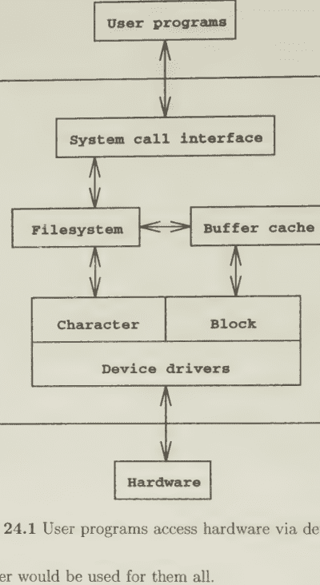

图 24.1 用户程序通过设备驱动程序访问硬件。

Linux 设备驱动程序的主要功能是：

- 初始化时设置硬件；
- 将相关设备投入和退出服务；
- 从硬件接收数据并将其传回内核；
- 将数据从内核发送到设备；
- 检测和处理设备错误。

为了访问设备，你需要能够像对待文件一样对待它。这意味着在目录层次结构中的某个位置必须为所有设备提供文件名，以便你可以在其上使用 `open()`、`close()` 等系统调用。

这些文件称为 *字符设备特殊文件* 和 *块设备特殊文件*，按照惯例，它们存储在目录 /dev 中。该目录中的一些文件可能是：

```
brw-rw---- 1 root floppy 2, 0 Jul 18 1994 fd0
brw-rw---- 1 root floppy 2, 1 Jul 18 1994 fd1
brw-rw---- 1 root disk 3, 0 Jul 18 1994 hda
brw-rw---- 1 root disk 3, 1 Jul 18 1994 hda1
brw-rw---- 1 root disk 3, 2 Jul 18 1994 hda2
brw-rw---- 1 root disk 3, 3 Jul 18 1994 hda3
brw-rw---- 1 root disk 3, 4 Jul 18 1994 hda4
crw-rw---- 1 root daemon 6, 0 Jul 18 1994 lp0
crw-rw-rw- 1 root sys 1, 3 Jul 18 1994 null
crw-rw-rw- 1 root tty 5, 0 Jul 18 1994 tty
crw--w--w- 1 pc book 4, 0 Jul 18 1994 tty0
crw--w--w- 1 pc book 4, 1 Aug 30 15:16 tty1
```

请注意，这些文件有一个类型，由每行第一个字符给出，为 c 或 b，分别表示字符或块特殊文件。也请注意，特殊文件在日期前有一对用逗号分隔的数字，而普通文件会显示其文件大小。这两个数字中的第一个称为设备的 major 设备号，第二个数字称为设备的 minor 设备号。

块设备和字符设备的 major 设备号用于标识将调用其内部函数来处理该设备的 I/O 请求的特定设备驱动程序。minor 设备号将提供给设备驱动程序例程，并由它们用来识别当前 I/O 请求涉及的特定设备。例如，前面的列表显示软盘 0 和软盘 1（fd0 和 fd1）都具有块 major 设备号 2。这标识了在对 /dev/fd0 和 /dev/fd1 进行 I/O 请求时要调用的设备驱动程序。在设备驱动程序内部，minor 设备号（fd0 为 0，fd1 为 1）将用于区分这两个驱动器。

#### 24.1.1 mknod 命令

设备特殊文件是用 mknod 命令（或 `mknod()` 系统调用）创建的。只有 root 可以创建这些文件。mknod 命令的一般形式是：

```
mknod filename type major minor
```

其中 filename 是要创建的特殊文件的路径，type 是字符或块文件的 c 或 b，major 和 minor 是要与文件关联的 major 和 minor 设备号。例如：

```
# mknod /dev/mytty1 c 4 1
```

将创建字符特殊文件 /dev/mytty1，其 major 设备号为四，minor 设备号为零。由于此 major/minor 组合已存在（/dev/tty1），此命令所做的只是创建一个替代特殊文件，可用于访问同一设备。

### 24.2 设备驱动程序例程

当你尝试 `open()` 一个设备特殊文件时，它将导致在关联的设备驱动程序中调用 `open()` 函数。其工作原理是每个设备驱动程序只是一组你编写的函数，用于执行特定任务。与每个设备驱动程序关联的是一个名为 `struct file_operations` 的数据结构，其中包含指向设备驱动程序中大多数主要函数的指针。

系统启动时，内核会调用每个设备驱动程序中的初始化函数。此函数执行的一项任务是告诉内核此设备驱动程序将使用哪个 major 设备号。同时，初始化函数会向内核传递驱动程序中函数地址结构体的指针。

`file_operations` 结构包含许多元素，其中大多数驱动程序只需要其中的一些。完整的结构如下所示，显示了一组指向函数的指针：

```
struct file_operations {
    int (*lseek)();
    int (*read)();
    int (*write)();
    int (*readdir)();
    int (*select)();
    int (*ioctl)();
    int (*mmap)();
    int (*open)();
    void (*release)();
    int (*fsync)();
    int (*fasync)();
    int (*check_media_change)();
    int (*revalidate)();
};
```

这里，`open()`、`read()` 和 `write()` 有明显的入口点，尽管其他一些入口点不太明显。我会在需要时更详细地描述入口点。

内核内部有两个表，一个用于字符设备驱动程序，一个用于块设备驱动程序。这些表用于保存指向 `file_operations` 结构的指针，其中存储了设备驱动程序的函数地址。major 设备号用作索引到适当的表，以访问与该 major 设备号关联的 `file_operations` 结构，从而允许内核访问驱动程序中例程的地址。


### 24.3 设备驱动程序原理

到目前为止，你已经看到内核如何识别对特定设备特殊文件操作应调用的设备驱动函数集。现在我们将探讨设备驱动程序的更一般方面，包括它们与调用它们的 user 进程之间的关系。

当进程实际在 CPU 上运行时，Linux 将其视为当前进程。当当前进程执行导致设备驱动内部函数执行的系统调用时，即使在设备驱动例程内部，当前进程的上下文仍然可用。这使得从设备驱动程序的缓冲区复制数据到进程的缓冲区中，反之亦然，成为相对简单的任务。

有时，对设备驱动函数的调用需要对某块硬件（如磁盘驱动器）进行输入或输出。在这些情况下，硬件运行速度比 CPU 慢几个数量级。如果不采取措施，这些 I/O 突发会显著降低系统速度，因为 CPU 会等待 I/O 完成。实际上，CPU 不期望等待硬件 I/O 完成。发生的情况是 I/O 被安排执行，然后当前进程挂起其执行，从而允许其他进程在第一个进程等待其 I/O 发生时进行一些有用的工作。

显然，需要提供某种机制来在 I/O 完成后恢复已挂起的进程。这种机制称为中断。中断对内核来说就像信号对用户进程一样，只是中断是由硬件事件生成的。就像信号一样，中断可以被捕获，并且可以使其导致执行特殊的服务例程来处理导致中断的情况。

当某个进程正在等待的 I/O 发生时，可以生成一个中断来执行关联的中断服务例程。恢复在等待此 I/O 事件完成而被挂起的进程是中断服务例程任务的一部分。

然而，在中断服务例程内部必须小心，因为 CPU 已经继续执行其他进程，因此当中断（严格的异步事件）发生并且服务例程执行时，内核将不会在已挂起进程的上下文中执行。这意味着中断服务例程不得尝试执行任何需要访问已挂起进程上下文的操作，因为该上下文不能立即使用。

编写设备驱动程序时要记住的另一点是，驱动程序将作为操作系统内核的组成部分运行，并且内核不能被抢占。这意味着，与普通用户进程不同，内核中没有机制可以强制内核例程放弃对 CPU 的控制以利于其他例程。内核例程终止的唯一方式是如果它们在函数结束时返回，或者如果它们自愿放弃 CPU 以利于在它们代表其运行的某个其他进程通过挂起当前进程。

每当你在 Linux 内核中添加代码时，你必须始终意识到 Linux 会完全信任你的新代码。这意味着如果你的代码进入无限循环，那么就所有系统上的其他进程而言，内核实际上就会‘hang’。即使你的内核代码在逻辑上是正确的，如果它在 CPU、内存或硬件的使用上效率低下，仍然会造成重大的系统性能损失。

这些是在我们继续研究字符设备驱动程序时需要牢记的主要事项。

## 字符设备驱动程序

在本章中，我们将研究字符设备驱动程序的基础。我们首先研究字符设备驱动程序，因为编写简单的字符设备驱动程序比编写简单的块设备驱动程序容易得多，虽然，到你开始为新硬件编写严肃的设备驱动程序时，工作类型并不重要，它们同样复杂。由于严肃设备驱动程序的操作非常特定于硬件，因此它不会成为一个特别好的示例来研究。起初，我们更关心所涉及的原理而不是硬件细节。

设备驱动程序只是一组具有各种特定任务的例程。每个设备驱动程序基本上具有相同的一组例程，因此需要某种机制来防止驱动程序之间的名称冲突。一个简单的机制是使所有名称唯一。这是通过为每个设备驱动程序选择一个简单的唯一前缀来实现的，该前缀将添加到驱动程序中所有函数名称的开头。这意味着即使大多数设备驱动程序都提供一个 open() 例程，例如，每个驱动程序的前缀也会使内核中所有 open() 例程名称唯一。

### 25.1 注册字符设备

每个设备驱动程序在系统启动时都有机会初始化自身及其硬件。对于字符设备驱动程序，这是通过在驱动程序中有一个初始化函数（init()）然后将对该函数的调用放入内核 chr_dev_init() 函数中来实现的。chr_dev_init() 函数包含在文件：

/usr/src/linux/drivers/char/mem.c

中，假设你的内核源代码位于默认位置 /usr/src/linux。

假设你的设备驱动程序名称前缀为 tdd_，那么 init() 例程将被命名为 tdd_init()。对于内核 1.1.32 及更早版本，你需要在 chr_dev_init() 函数的末尾，在 return mem_start; 行之前添加以下行：

```
mem_start = tdd_init(mem_start);
```

对于 1.1.33 及更高版本的内核，你需要在 chr_dev_init() 函数的末尾，在 return 0; 行之前添加以下行：

```
tdd_init();
```

驱动程序 init() 函数执行的主要任务之一是将设备驱动程序注册到内核。这涉及告诉内核驱动程序将使用哪个主设备号，并向内核提供指向驱动程序的 file_operations 结构的指针，以便内核可以将此指针输入到适当的字符驱动程序表条目中。注册是通过调用内核的 register_chrdev() 函数完成的，如下所示：

```
register_chrdev(major, name, file_op)
```

其中 major 是此驱动程序要使用的主设备号（或为零以让内核分配一个空闲主设备号），name 是一个字符串，给出驱动程序的名称，file_op 是指向驱动程序的 file_operations 结构的指针。register_chrdev() 的返回值如果注册不成功则为负数。如果 major 给出为零并且注册成功，则函数返回内核分配的主设备号。如果指定了 major 并且注册成功，则返回值为零。如你将在下一节看到的，对于内核 1.1.32 及更早版本，传递给驱动程序的 init() 函数的 mem_start 参数值可用于为驱动程序在执行期间使用分配一些工作内存。

### 25.2 工作存储

非常经常，设备驱动程序需要在其执行期间保留临时值，因此需要一些内部工作存储空间。这可以从仅存储一些内部变量的几字节到大量数据缓冲区，其中需要在传输过程中存储大量数据，也许是同时打开的几个设备特殊文件。

Linux 为设备驱动程序编写者提供了几种不同的数据缓冲技术，每种技术都有其自身的优点和缺点。

### 25.2.1 私有缓冲区

为设备驱动程序分配内存的最简单方法就是在驱动程序源代码中声明一个变量，其大小为所需的字节数。因此，例如，如果出于某种原因需要一个 800 字节的缓冲区用作工作存储，这可以在代码中作为全局数组简单地声明为：

```
static char buffer[800];
```

在任何函数之外使用关键字 static 意味着缓冲区将仅对包含声明的同一文件中的代码可见（即仅对该设备驱动程序可见）。

这种私有缓冲区的用途有几个缺点：

- 这种方式分配的内存不能在该驱动程序之外使用。
- 如果你对所需量的估计被证明不足，则无法增加内存量。
- 内存块会为你分配，即使该内存不会被使用——也许硬件设备甚至未连接。

### 25.2.2 mem_start

这些问题中的最后一个可以通过使用另一种内存分配机制——mem_start 来克服。这是 Linux 特定的内存分配机制，在系统启动时使用，当调用设备驱动程序的 init() 函数时，不过，对于 1.1.33 及更高版本的内核，此技术不再可用。

mem_start 的值是指向可用内存开始的指针。此值作为参数传递给你的设备驱动程序的 init() 函数。当 init() 函数终止时，预计会返回相同的内容——指向可用内存开始的指针。这给了 init() 一个机会，通过将收到的 mem_start 参数值加上所需的内存大小，然后将此新值返回给内核而不是返回，来为驱动程序抓取一些系统内存以供使用。

因此，现在的顺序是，当 init() 函数成功注册设备驱动程序及其主设备号，并测试硬件是否存在时，它应该然后将驱动程序将需要的任何内存缓冲区的大小，以字节为单位，添加到 mem_start 值。

mem_start 的新值然后由 init() 函数返回，并且从旧 mem_start 地址开始的所需大小的内存块随后被保留供驱动程序单独使用。

与直接私有缓冲区相比，这明显的优点是，如果硬件不存在或驱动程序无法

需要注册，并且这些决策推迟到系统启动时才做出，因此每次系统启动时结果可能不同。

使用此技术仍存在缺点，即内存分配是一次性操作，意味着初始块分配后无法再分配额外内存，并且即使驱动程序不再需要该内存块，也无法释放该内存块。

#### 25.2.3 kmalloc Function

为克服这些问题，需要提供给用户进程的库函数 malloc() 和 free() 的动态内存分配方案的内核版本。

此功能由内核中的 kmalloc() 和 kfree() 函数提供。kmalloc() 的原型为：

```
void *kmalloc(size_t size, int priority);
```

其中 size 是要分配的内存字节数，返回值是指向已分配内存起始位置的指针，或在出错时返回零指针。

priority 参数需要稍作解释。基本上，当你请求特定内存块时，kmalloc() 函数可能无法立即满足请求。但是，如果你允许驱动程序例程在内存可用时休眠，通常通过交换空间重新排列一些内存页，那么 kmalloc() 通常最终可以满足你的请求。

如果你愿意在必要时等待，则应使用优先级值 GFP_KERNEL。在不确定长度的等待不可接受的情况下（确实存在这种情况），则应改用优先级值 GFP_ATOMIC。在这种情况下，如果 kmalloc() 无法立即满足请求，则将返回值为零。

需要 GFP_ATOMIC 优先级可用的一个重要情况是需要在中断服务程序内部调用 kmalloc()。这是因为通常情况下，你不得允许中断服务程序休眠。

另一个选项是，你可能希望确保可以对 kmalloc() 返回的内存块执行 DMA 传输。在许多机器上这不是问题，但在某些 PC 上 DMA 传输只能发生在前 16 Mbytes 的内存中。为确保不会出现问题，只需将值 GFP_DMA 或到优先级值中，kmalloc() 就会返回保证可用于 DMA 传输的内存块。

使用 kmalloc()，可以分配最多 128 KB 的内存块（实际上由于管理开销会少几字节）。

使用 kmalloc() 分配的内存可以用 kfree_s() 释放回系统，其原型为：

```
void kfree_s(void *ptr, int size);
```

其中 ptr 是先前由 kmalloc() 返回的指针值，size 是要释放的内存块的大小，以字节为单位。size 值应与分配内存时传递给 kmalloc() 的 size 参数相同。如果出于某种原因内存块的大小未知，则可以调用 kfree_s() 并将 size 参数设为零，在这种情况下它将使用内部搜索来查找大小。

与其使用零 size 参数调用 kfree_s()，Linux 中有一个宏，定义在 <linux/malloc.h> 中，名为 kfree()：

```
#define kfree(n) kfree_s((n), 0)
```

#### 25.2.4 vmalloc

kmalloc() 分配的内存块在物理上是连续的，这在某些硬件应用中是必需的。在可以放宽此限制的情况下，可以改用相对较新的内存分配函数：

```
void *vmalloc(unsigned long size);
```

其中 size 是所需的内存块大小，以字节为单位。该函数返回指向已分配内存块的指针，或在出错时返回零。

vmalloc() 提供的内存不能用于 DMA 传输，也不能在中断服务程序内部调用 vmalloc()。

使用 vmalloc() 分配的任何内存块都可以用 vfree() 释放回系统：

```
void vfree(void *ptr);
```

其中 ptr 是先前 vmalloc() 调用返回的指针值。

正如你所见，这最后两种内存分配技术克服了私有缓冲区和 mem_start 方法的所有缺点，在你编写的任何严肃的设备驱动程序中都应优先使用它们。

### 25.3 Basic Entry Points

现在我们已经了解了如何将字符设备驱动程序注册到内核，以及如何在驱动程序内部分配内存，现在我们将注意力转向驱动程序的主要入口点，其地址将出现在驱动程序的 file_operations 结构中。

与字符设备或文件一起使用的主要系统调用有：open()、close()、read()、write() 和 ioctl()。当确定这些系统调用 intended for your driver 时，每一个都可能导致执行相应的驱动程序函数。

### 25.3.1 open Function

驱动程序的 open() 函数在用户进程对与此驱动程序关联的设备特殊文件执行 open() 系统调用时被调用。open() 函数的原型为：

```
int open(struct inode *inode, struct file *file);
```

其中 inode 参数是指向所访问的设备特殊文件的 inode 结构的指针，file 是指向此设备的 file 结构的指针。

open() 函数的典型操作是：
- 确定相关硬件（如果有）可用且在线。
- 验证 MINOR(inode->i_rdev) 中的次要设备号是否有效（即在预期范围内）。
- 如果一次只能有一个进程打开设备，则 open() 应测试并设置驱动程序标志以占用设备，或如果标志已设置则返回 -EBUSY。
- 如果发生任何错误，返回负值。
- 成功时返回零值。

### 25.3.2 release Function

驱动程序的 release() 函数仅在最后一个打开设备的用户进程 close() 它时才被调用：

```
void release(struct inode *inode, struct file *file);
```

其中 inode 是指向设备特殊文件的 inode 结构的指针，file 是指向此设备的 file 结构的指针。

release() 函数可能需要：
- 如果有未完成的 I/O 在进行中，则执行清理操作。
- 在必要时释放硬件资源。
- 重置 open() 设置的任何独占访问标志。

### 25.3.3 read Function

驱动程序的 read() 函数在对与此字符设备驱动程序关联的设备特殊文件执行 read() 系统调用时被调用：

```
void read(struct inode *inode, struct file *file,
    char *buf, int count);
```

其中 inode 是指向设备特殊文件的 inode 结构的指针，file 是指向此设备的 file 结构的指针，buf 是指向用户空间缓冲区的指针，其地址由用户进程传递给 read() 系统调用，count 是用户进程所需字节数（也传递给 read() 系统调用）。

read() 的功能是将最多 count 字节的数据从硬件设备（如果存在）或已分配的内核内存复制到由 buf 给出的用户内存缓冲区。

执行复制时必须小心，因为 buf 中的指针是位于用户内存中的地址，而不是可在内核内部直接使用的地址。为了正确执行复制，应使用为此目的专门提供的几种特殊复制函数之一。它们定义在 <asm/segment.h> 中：

```
void put_user_byte(char data_byte, char *u_addr);
void put_user_word(short data_word, short *u_addr);
void put_user_long(long data_long, long *u_addr);
void memcpy_tofs(void *u_addr, void *k_addr, unsigned long cnt);
```

其中，对于 put_user...() 函数，data_byte、data_word 和 data_long 分别是要复制到地址 u_addr 的用户空间的 char、short 和 long 值，对于 memcpy_tofs()，cnt 字节将从内核空间地址 k_addr 复制到用户空间地址 u_addr。

为了与旧内核（旧至包括 0.99 早期版本）向后兼容，还提供了另外三个函数：

```
void put_fs_byte(char data_byte, char *u_addr);
void put_fs_word(short data_word, short *u_addr);
void put_fs_long(long data_long, long *u_addr);
```


u_addr 指针所指向的对象类型用于确定要传输到用户内存空间的值的字节数。

在使用这些函数向用户内存写入之前，然而，重要的是要验证用户进程传递给你的用户空间地址是否实际指向用户具有写访问权限的内存区域。这是通过内核的 verify_area() 函数完成的：

```
#include <linux/mm.h>
```

```
int verify_area(int access, void *u_addr, unsigned long size);
```

其中 access 是 VERIFY_WRITE 或 VERIFY_READ 之一，具体取决于你是否希望写入或从用户内存读取，u_addr 是用户空间中的起始地址，size 是要访问的内存块的字节大小。

verify_area() 函数如果指定的访问被允许则返回零值，出错时返回 -EFAULT。

### 25.3.4 写函数

驱动程序中的 write() 函数在对属于该驱动程序的设备特殊文件执行 write() 系统调用时会被调用：

```
void write(struct inode *inode, struct file *file,
    char *buf, int count);
```

其中 inode 是指向特殊文件 inode 结构的指针，file 是指向文件结构的指针，buf 是指向用户空间缓冲区的指针，传递给 write() 系统调用，用户字符将从该缓冲区写入，count 是要传输的字节数（也传递给 write() 系统调用）。

设备驱动程序的 write() 函数的目的是将最多 count 字节的数据从用户空间的缓冲区 buf 复制到硬件（如适用）或内部缓冲区。

与 read() 类似，buf 中的值是用户空间的地址，因此再次应使用以下特殊函数之一来执行复制操作：

```
unsigned char get_user_byte(char *u_addr);
unsigned short get_user_word(short *u_addr);
unsigned long get_user_long(long *u_addr);
void memcpy_fromfs(void *k_addr, void *u_addr, unsigned long cnt);
```

其中 get_user...() 函数返回位于用户空间地址 u_addr 的 char、short 或 long 值，而对于 memcpy_fromfs()，cnt 字节将从用户空间地址 u_addr 复制到内核空间地址 k_addr。

再次，为了与旧内核向后兼容，提供了另外三个函数：

```
unsigned char get_fs_byte(char *u_addr);
unsigned short get_fs_word(short *u_addr);
unsigned long get_fs_long(long *u_addr);
```

它们等同于前面三个 get_user_XXX 函数。

新的内核还支持单个调用：

```
type get_user(type *u_addr);
```

它在 <asm/segment.h> 中实现为宏，其展开取决于指针参数 u_addr 的数据类型。u_addr 指针所指向的对象类型用于确定从用户内存空间传输多少字节的数据，以及 get_user() 调用本身的返回类型。

就像设备驱动程序的 read() 函数的情况一样，在使用前面任何函数从用户内存读取之前，你应安排调用 verify_area() 函数。

### 25.4 特殊控制函数

除了基本的 open、close、read 和 write 操作之外，你还看到有时希望向设备驱动程序发送控制信息或从中获取状态信息。例如，在串行端口上更改波特率并不适合通过基本的 open、close、read、write 模式来执行。在这种情况下（以及许多类似的情况），你看到解决方案是使用 ioctl() 系统调用。此系统调用是通过在设备驱动程序中调用 ioctl() 函数来实现的。

这是必要的，因为不同的设备驱动程序并不都希望实现相同的函数——有许多设备，尝试更改波特率毫无意义。

设备驱动程序 ioctl() 函数的原型为：

```
int ioctl(struct inode *inode, struct file *file,
unsigned int cmd, unsigned long arg);
```

其中 inode 和 file 与之前相同，cmd 是要执行的命令的设备驱动程序特定代码，arg 是任何类型的 4 字节事物（通常是 int 或 struct *），为特定 cmd 值提供参数。cmd 和 arg 参数是从 ioctl() 系统调用的第二个和第三个参数获得的。

不要忘记，如果 arg 参数是指向用户空间内存块的指针，那么你必须使用我们之前查看的特殊复制函数将值放入和取出此内存块。

通常，你可以为 cmd 值使用任何你想要的数字，除了 Linux 使用四个特殊值，在你的 ioctl() 例程被调用之前它会解释这些值：

| 宏 | 值 | 描述 |
|---|---|---|
| FIONBIO | 0x5421 | 从 arg 设置/重置 O_NONBLOCK； |
| FIONCLEX | 0x5450 | 清除 close-on-exec 标志； |
| FIOCLEX | 0x5451 | 设置 close-on-exec 标志； |
| FIOASYNC | 0x5452 | 从 arg 设置/重置 O_SYNC。 |

如果你为自己的 ioctl() 命令使用这四个 cmd 值中的任何一个，你的例程永远不会被调用，因为内核会先处理它们。

### 25.5 中断

除了通过 file_operations 结构访问的函数之外，设备驱动程序还可以提供一个 interrupt() 服务例程。只有在涉及能够生成中断信号的底层硬件时才需要此功能。

与你需要将设备驱动程序注册到内核的方式类似，以便使用你的主设备号的设备特殊文件的访问会调用你的驱动程序例程，你还需要请求内核将特定的中断请求线（IRQ）与你的中断服务例程关联起来，以便当中断发生时，你的例程会被调用。这是通过 request_irq() 函数完成的：

```
#include <linux/signal.h>
```

```
int request_irq(unsigned int irq, void (*handler)(int),
    unsigned long type, char *name);
```

其中 irq 是你尝试注册的中断（IRQ）号，handler 是指向中断服务例程的指针，type 是指定这应为正常或快速中断的标志，name 是你的设备驱动程序的名称。

正常中断和快速中断之间的区别在于，从执行正常中断例程返回后，内核可以利用机会运行调度程序（通过调用内核 schedule() 函数），以查看是否有比当前进程更合适的进程可执行。如果有，则当前进程将被抢占，新进程将运行。在快速中断的情况下，不执行此调度，以便当中断服务例程返回时，被中断的进程将被恢复。

type 的值对于正常中断为零，对于快速中断为符号常量 SA_INTERRUPT。

中断处理程序也可以通过使用 free_irq() 函数来取消注册：

```
void free_irq(unsigned int irq);
```

其中 irq 是要释放的 IRQ 号。

### 25.6 设备驱动安装

一旦你编写了设备驱动程序，下一步就是将其编译并安装到可启动的内核中。这实际上是一个相当直接的任务，按以下几个简单步骤执行：

- 第一个任务是将你的 `driver.c` 文件和任何相关的 `driver.h` 文件复制到包含字符设备驱动程序源代码的目录中。这是在顶层 Linux 源代码目录下的 `drivers/char` 中。
- 接下来，你应在文件 `drivers/char/mem.c` 中将对驱动程序的 `init()` 例程的调用添加到函数 `chr_dev_init()` 的末尾。
- 现在编辑 `drivers/char` 目录中的 Makefile，并将你的 `driver.o` 名称添加到 OBJS 定义的末尾，将你的 `driver.c` 名称添加到 SRCS 定义的末尾。
- 现在切换到顶层 Linux 源代码目录，并使用第 7.4 节中描述的步骤构建和安装你的新内核。

如果你使用 lilo 来启动系统，将新内核视为实验性并在 lilo.conf 文件中生成额外的 Linux 启动部分是个好主意，这样如果新内核无法启动或由于某种原因无法正确执行，你仍然可以从旧内核启动。

作为修改内核代码的一般预防措施，始终建议备份机器上你不准备丢失的任何内容。对于大多数问题，新代码要么根本无法工作，要么会导致内核恐慌。通常，这两种事件都不会对系统造成任何持久性损害，特别是如果你可以从旧内核重新启动机器。然而，理论上，存在缺陷的内核代码可能做任何事情，包括擦除硬盘上的数据。因此，安全总比后悔好。


## 小型设备驱动程序 – 案例研究

为了使我们现在所介绍的关于设备驱动程序的一些内容更具体一些，我们将通过一个简单的示例字符设备驱动程序进行讲解。我们将要开发的设备驱动程序的规范可能看起来有点人为，但它确实能让你看到一些有趣的想法得以实践。

规范如下 – 实现一个字符设备驱动程序，它使用两个设备特殊文件，允许一对进程相互发送短的变长文本消息。驱动程序应确保不允许多个读取者和多个写入者，并且 read() 即使在没有消息可读时也不会阻塞，而 write() 无论在下一次 read() 发生之前写入了多少条消息都不会阻塞。

我应该马上指出，这个关于无限写容量的最后要求是危险的，因为某种错误可能导致消费者进程无法读取任何数据。这会使生产者进程不受控制地写入消息，直到最终系统用完存储它们的空间。事实上，对于长期运行的进程，甚至不需要任何错误，这个问题最终也会发生。所需要的只是，平均而言，生产者生成消息的速度快于消费者使用消息的速度。考虑到这一点，设置一个任意的但较大的限制，可能比较明智，该限制为设备驱动程序内部可以同时存储的消息数量。我把这个安全检查作为一个编程练习留给你稍后添加。

实际上，这个设备驱动程序只会将其‘硬件设备’控制为一些系统内存，并有效地提供一种额外的 IPC 机制，除已有的机制之外。然而，这个新驱动程序提供的 IPC 语义与现有 IPC 机制提供的语义相当不同。

### 26.1 头文件信息

为了实现规范的要求，第一项任务是决定设备驱动程序的内部数据结构会是什么样子。所需的是设备驱动程序应能够存储在两个进程之间传输的若干条短文本消息。驱动程序需要保存的消息数量 supposed to be infinite（在计算机上无限通常意味着‘直到你用完为止’），但实际上它可能只保存几条消息，直到它们可以被读取为止。这意味着你确实需要使用可变数量的动态分配缓冲区，这些缓冲区可以构建成 FIFO 队列，最好以链表实现。这将需要内核中用于动态分配和释放内存块的机制。

请注意，标准库的 malloc() 和 free() 函数不能使用，因为标准库在内核内部不可用。正如你将看到的，然而，内核中有一个 malloc() 的等价物可以替代使用。

将要构建消息链表的结构具有以下布局：

```
struct tdd_buf
{
    int buf_size;
    char buffer[MAX_BUF];
    struct tdd_buf *link;
};
```

其中 buffer[] 是保存一条短消息的数组，buf_size 表示 buffer[] 数组中正在使用的字符数，而 link 是指向下一个 tdd_buf 的链表指针。符号常量 MAX_BUF 可以设置为与你认为的‘短’消息最大长度相匹配的任何值。我的默认值是 120 个字符。

请注意，在微型设备驱动程序中使用的前缀以使其标识符唯一将是 tdd_，尽管许多标识符被声明为 static，因此无论如何它们都不会在驱动程序源文件之外可见。

考虑到这一点，微型设备驱动程序的头文件信息如下：

```
/* 1 */
#define KERNEL

#include <linux/kernel.h>
#include <linux/sched.h>
#include <linux/tty.h>
#include <linux/signal.h>
#include <linux/errno.h>
#include <linux/malloc.h>
```

```
#include <asm/segment.h>
#include <asm/system.h>
#include <asm/irq.h>

#include "tdd.h"

/* 2 */
static int tdd_trace;
static int write_busy;
static int read_busy;
static struct tdd_buf *qhead;
static struct tdd_buf *qtail;

/* 3 */
static int tdd_read(struct inode *, struct file *, char *, int);
static int tdd_write(struct inode *, struct file *, char *, int);
static int tdd_ioctl(struct inode *, struct file *, unsigned int, unsigned long);
static int tdd_open(struct inode *, struct file *);
static void tdd_release(struct inode *, struct file *);
extern void console_print(char *);

struct file_operations tdd_fops =
{
    NULL,
    tdd_read,
    tdd_write,
    NULL,
    NULL,
    tdd_ioctl,
    NULL,
    tdd_open,
    tdd_release,
    NULL,
    NULL,
    NULL,
    NULL
};
```

以下列表指的是头文件信息中的编号注释：

- 1. 第一个部分包含了所有相关的头文件。请注意 KERNEL 符号的定义；它在某些头文件（包括 tdd.h）中被有条件地使用，以便在头文件在内核代码中使用时包含额外的项目和定义。普通用户代码不会定义此符号，因此不包含这些额外内容。
- 2. 这些是驱动程序内部使用的静态变量。变量 tdd_trace 用作打开和关闭调试跟踪输出的标志，write_busy 和 read_busy 是用于防止多个写入者或读取者的标志，而 qhead 和 qtail 是指向消息链表的头和尾指针。
- 3. 此部分设置 file_operations 结构以指向其他设备驱动程序例程。在引导时，初始化例程会将指向此结构的指针传递给内核。这里还声明了其他未声明的内核函数的函数原型。

除此头文件代码之外，还有一个名为 tdd.h 的头文件，其中包含设备驱动程序以及希望使用此驱动程序的用户代码所需的 #define 和结构声明：

```
#ifdef KERNEL                     /* If we're in kernel code */

#define TRACE_TXT(text) \
    { \
        if (tdd_trace) \
        { \
            console_print(text); \
            console_print("\n"); \
        } \
    }

#define TRACE_CHR(chr) \
    { \
        if (tdd_trace) \
            console_print(chr); \
    }

#define TDD_WRITE 0                 /* /dev/tddw minor device number */
#define TDD_READ 1                  /* /dev/tddr minor device number */

#endif

#define FALSE 0
#define TRUE 1
#define MAX_BUF 120                 /* Size of struct tdd_buf buffer */
#define TDD_TRON (('M'<<8)|0x01)    /* Trace on cmd for ioctl() */
#define TDD_TROFF (('M'<<8)|0x02)   /* Trace off cmd for ioctl() */

struct tdd_buf
{
    int buf_size;
    char buffer[MAX_BUF];
    struct tdd_buf *link;
};
```

这里唯一需要一些解释的是 TRACE_TXT() 和 TRACE_CHR() 的宏定义。这些宏提供了用于调试目的的非常简单的跟踪设施。在设备驱动程序代码的各个战略位置插入对这些宏的调用，以便可以在机器的控制台终端上显示‘已到达此处’类型的消息。跟踪消息使用内核的内部函数 console_print() 在控制台屏幕上显示。跟踪消息的显示由一个标志变量的状态控制，其值可以通过适当的 ioctl() 调用设置或重置。驱动程序处理的两个 ioctl() 命令是 TDD_TRON 用于打开跟踪，以及 TDD_TROFF 用于再次关闭跟踪。这两个 ioctl() 命令都不接受其他参数。

### 26.2 初始化函数

进入驱动程序代码本身，首先要查看的是初始化函数 tdd_init()：

```
void tdd_init(void)
{
    tdd_trace = TRUE;

    if (register_chrdev(30, "tdd", &tdd_fops))
        TRACE_TXT("Cannot register tdd driver as major device 30")
    else
        TRACE_TXT("Tiny device driver registered successfully")

    qhead = 0;
    write_busy = FALSE;
    read_busy = FALSE;
    tdd_trace = FALSE;
    return;
}
```

此例程在系统引导时执行。请记住，需要将对该例程的调用添加到文件中的 chr_dev_init() 函数：

`/usr/src/linux/drivers/char/mem.c`

假设你的内核源代码存储在 /usr/src/linux 中。

当 tdd_init() 执行时，它调用内核函数 register_chrdev() 将其 file_operations 结构添加到字符设备例程地址表。使用调试跟踪设施在机器控制台上显示一条消息，以报告此操作的成功或失败。例程随后初始化驱动程序的静态变量，最后返回。


### 26.3 open 函数

设备驱动程序的 open 函数（tdd_open()）在对与此驱动程序关联的两个设备特殊文件之一执行 open() 系统调用时被调用：

```
static int tdd_open(struct inode *inode, struct file *file)
{
    TRACE_TXT("tdd_open")

    /* 1 */
    switch (MINOR(inode->i_rdev))
    {
    /* 2 */
    case TDD_WRITE:
        if (write_busy)
            return -EBUSY;
        else
            write_busy = TRUE;
            return 0;

    /* 3 */
    case TDD_READ:
        if (read_busy)
            return -EBUSY;
        else
            read_busy = TRUE;
            return 0;

    default:
        return -ENXIO;
    }
}
```

如果设备驱动程序涉及任何硬件，则此例程将安排将其投入使用。实际上，我们的例程只是管理语义要求，即关联的设备特殊文件每次只能打开一次，具体如下：

- 1. 第一个任务是为与此 open() 调用关联的设备特殊文件挑选出次要设备号。这可以通过从 inode 参数指向的结构中的 i_rdev 字段使用 MINOR() 宏提取。
- 2. 如果设备特殊文件是 TDD_WRITE（即 /dev/tddw），则会检查 write_busy 标志以查看该设备是否已打开。如果已打开，则返回 EBUSY 错误；否则标志设置为 TRUE 以防止设备被进一步的 open() 调用占用，并返回零值，表示没有错误。
- 3. 类似地，如果这是对 /dev/tddr（使用 TDD_READ）的 open() 请求，则会检查 read_busy 标志，并在必要时设置以确保对设备特殊文件的独占访问。

### 26.4 release 函数

release 函数 tdd_release() 在持有此设备驱动程序关联的每个设备特殊文件打开的最后一个进程使用 close() 调用关闭它时被调用。事实上，由于每次只能有一个进程打开此驱动程序的每个设备特殊文件，因此来自该进程的 close() 也会调用驱动程序的 release 例程（tdd_release()）：

```
static void tdd_release(struct inode *inode, struct file *file)
{
    TRACE_TXT("tdd_release")

    switch (MINOR(inode->i_rdev))
    {
    case TDD_WRITE:
        write_busy = FALSE;
        return;

    case TDD_READ:
        read_busy = FALSE;
        return;
    }
}
```

tdd_release() 所做的全部工作就是重置适当的读或写 busy 标志，以便在设备特殊文件上进行下一次 open() 操作。

### 26.5 write 函数

write 函数 tdd_write() 在进程对属于此设备驱动程序的设备特殊文件之一的打开文件描述符使用 write() 系统调用时每次都会被调用：

```
static int tdd_write(struct inode *inode, struct file *file,
char *buffer, int count)
{
    int i, len;
    struct tdd_buf *ptr;

    TRACE_TXT("tdd_write")

    /* 1 */
    if (MINOR(inode->i_rdev)!=TDD_WRITE)
        return -EINVAL;

    /* 2 */
    if ((ptr = kmalloc(sizeof(struct tdd_buf), GFP_KERNEL))==0)
        return -ENOMEM;

    /* 3 */
    len = count<MAX_BUF?count:MAX_BUF;

    if (verify_area(VERIFY_READ, buffer, len))
        return -EFAULT;

    for (i = 0; i<count && i<MAX_BUF; ++i)
    {
        ptr->buffer[i] = get_user_byte(buffer+i);
        TRACE_CHR("w")
    }

    /* 4 */
    ptr->link = 0;

    if (qhead==0)
        qhead = ptr;
    else
        qtail->link = ptr;

    qtail = ptr;
    TRACE_CHR("\n")

    /* 5 */
    ptr->buf_size = i;
    return i;
}
```

传递给 tdd_write() 的第三个和第四个参数是用户进程传递给 write() 系统调用的缓冲区和字符计数。此缓冲区的內容需要复制到设备驱动程序的内部消息链表中。记住，虽然你不能通过 tdd_write() 的 buffer 参数直接访问用户空间内存；你必须为此工作使用其中一种特殊的数据传输函数。列表中的编号注释如下：

- 1. 检查并确保只有打开 /dev/tddw 的进程才能写入消息。
- 2. 分配一块足够容纳单条消息的内核内存。检查以确保没有问题，并在必要时返回错误。
- 3. 验证内核可以从指定的内存块读取，然后从用户空间复制 count 或 BUF_MAX 字符中较小的一个到内核分配的消息空间。
- 4. 将新的消息结构链接到设备驱动程序中的链表末尾。
- 5. 在消息结构中设置实际的消息长度，并从 tdd_write() 返回此值。此值也将成为从 write() 系统调用返回给调用进程的返回值。

### 26.6 read 函数

当用户进程调用 read() 系统调用从此设备驱动程序控制的设备特殊文件读取时，会调用 tdd_read 函数：

```
static int tdd_read(struct inode *inode, struct file *file,
char *buffer, int count)
{
    int i, len;
    struct tdd_buf *ptr;

    TRACE_TXT("tdd_read")

    /* 1 */
    if (MINOR(inode->i_rdev)!=TDD_READ)
        return -EINVAL;

    /* 2 */
    if (qhead==0)
        return -ENODATA;

    /* 3 */
    ptr = qhead;
    qhead = qhead->link;

    /* 4 */
    len = count<ptr->buf_size?count:ptr->buf_size;

    if (verify_area(VERIFY_WRITE, buffer, len))
        return -EFAULT;

    for (i = 0; i<count && i<ptr->buf_size; ++i)
    {
        put_user_byte(ptr->buffer[i], buffer+i);
        TRACE_CHR("\r")
    }

    TRACE_CHR("\n")

    /* 5 */
    kfree_s(ptr, sizeof(struct tdd_buf));
    return i;
}
```

再次，传递给 tdd_read() 的 buffer 和 count 参数是指向用户空间中缓冲区的指针和作为参数传递给关联 read() 系统调用的字符计数，与 tdd_write() 函数的明显区别在于这次缓冲区是要从设备驱动程序中的消息结构接收字符。编号注释如下：

- 1. 仅允许从 /dev/tddr 进行 read()。
- 2. 如果队列中没有消息，则 read() 调用不会阻塞，而是返回值为 -1，并将变量 errno 设置为值 ENODATA。
- 3. 从队列中取消链接头部消息，并将变量 ptr 设置为指向它。
- 4. 验证内核可以写入指定的内存块，然后将请求的字符数（count）或消息缓冲区中的实际字符数（ptr->buf_size）中较小的一个复制到用户提供的空间（buffer）。确保指定的缓冲区足够大以容纳请求数量的字符是用户的责任——内核无法进行详尽的检查。
- 5. 最后，将旧的消息结构释放回内核并返回实际传输的字符数。

### 26.7 ioctl 函数

此驱动程序的 ioctl() 函数非常简单，但它确实说明了这个想法。此驱动程序提供了两个新的 ioctl() 调用以打开和关闭跟踪功能。这分别使用 TDD_TRON 和 TDD_TROFF 命令到 ioctl() 来完成：

```
static int tdd_ioctl(struct inode *inode, struct file *file,
unsigned int cmd, unsigned long arg)
{
    TRACE_TXT("tdd_ioctl")

    switch(cmd)
    {
    case TDD_TRON:
        tdd_trace = TRUE;
        return 0;

    case TDD_TROFF:
        tdd_trace = FALSE;
        return 0;

    default:
        return -EINVAL;
    }
}
```

传递给 tdd_ioctl() 的 cmd 和 arg 参数与在用户进程中传递给 ioctl() 系统调用的值相同。在这种情况下，arg 的值并不重要。只有两个值 TDD_TRON 和 TDD_TROFF 对此驱动程序具有特殊意义，那就是当它们用作 cmd 值时。这些 ioctl() 命令执行的唯一操作是设置和重置 tdd_trace 标志。

## 块设备驱动程序

你已经看到的关于字符设备驱动程序的许多想法也直接适用于块设备驱动程序。因此，在本章中，我将尝试集中讨论两者之间的差异。

首先我要说的是，在 Linux 下创建块设备驱动程序似乎要麻烦得多，相当大程度上依赖于宏定义，这些宏定义试图隐藏一些底层复杂性，但在这样做的过程中，使得你的代码看起来包含许多目的不立即显而易见的“魔法咒语”。

### 27.1 块驱动程序概念

与字符设备驱动程序一样，块设备驱动程序是一组在对驱动程序控制的设备执行各种操作时被调用的例程。

此函数列表包括以下任何或全部：open()、release()、ioctl()、interrupt()、init() 和 request()。其中前四个的格式和功能与其字符设备驱动程序对应项相同。

当你开始编写块设备驱动程序时要做的第一件事是为你的驱动程序选择一个块主设备号并将其添加到文件：

```
/usr/include/linux/major.h
```

此文件中包含标准内核中使用的所有主设备号的列表以及每个的符号名称。你应该向列表中添加一个符号名称和主设备号的定义。例如：

```
#define MY_MAJOR 30
```

一旦完成，你就可以开始编写设备驱动程序代码，其应以如下行开始：

```
#include <linux/blkdev.h>

#define MAJOR_NR MY_MAJOR

#include "blk.h"
```

请注意 MAJOR_NR 的定义，用于指定此设备驱动程序将使用的主设备号。该定义需要在 #include "blk.h" 行之前出现，因为该符号将在 blk.h 文件中使用，正如你稍后会看到的那样。MY_MAJOR 的定义将自动包含在内，因为 <linux/blkdev.h> 本身包含了文件 <linux/major.h>，而你刚刚修改了它。

### 27.1.1 缓冲缓存

你已经看到，对块设备的物理 I/O 在时间上是一种昂贵的操作，并且在可能的情况下会自动避免。这是通过使用系统内存的一部分作为进程的读和写与设备驱动程序本身之间的缓冲机制来实现的。该机制就是缓冲区缓存。

这意味着你的块设备驱动程序不应包含 read() 或 write() 函数，因为用户进程在由你的设备驱动程序控制的设备特殊文件上调用 read() 或 write() 系统调用时，其请求将自动由缓冲区缓存机制处理。

只有在绝对必要时，缓冲区缓存才需要调用你的设备驱动程序来执行物理 I/O。它通过将 I/O 请求添加到为你的设备准备的此类请求队列中，然后安排在你的设备驱动程序中调用 request() 函数来处理请求队列来实现这一点。

### 27.1.2 request 例程

当被调用时，request() 例程的任务是从请求队列中依次读取每个待处理的 I/O 请求，并安排执行指定的物理读或写操作。队列中的每个 I/O 请求都存储在一个名为 struct request 的结构中，该结构定义在文件中：

/usr/include/linux/blkdev.h

在没有中断服务例程的设备驱动程序中，request() 函数的总体布局相当简单，如下所示：

```
static void do_my_request(void)
{
loop:
INIT_REQUEST;

if (MINOR(CURRENT->dev)>MY_MINOR_MAX)
{
    end_request(0);
    goto loop;
}

if (CURRENT->cmd==READ)
{
    end_request(my_read());
    goto loop;
}

if (CURRENT->cmd==WRITE)
{
    end_request(my_write());
    goto loop;
}

end_request(0);
goto loop;
}
```

这里首先需要注意的是，CURRENT 是指向请求队列头部 struct request 的指针。CURRENT 在头文件 "blk.h" 中定义。

request() 函数以 INIT_REQUEST 宏开始（也在 "blk.h" 中定义），它会检查队列中是否至少有一个请求正在等待。如果没有更多请求（即 CURRENT==0），INIT_REQUEST 宏会使你的 request() 函数返回，其任务完成。

假设队列中至少有一个请求，你的 request() 函数现在应处理队列头部的请求。处理完请求后，你的 request() 函数应调用 end_request()。

如果 I/O 操作成功完成，则应使用参数值 1 调用 end_request() 函数。如果 I/O 未成功，则应改用参数值零。

end_request() 函数在必要时记录错误消息，从队列中移除已处理的请求，安排重新启动正在等待此 I/O 请求完成的任何进程，然后如果有下一个请求，则将 CURRENT 设置为指向它。

在 end_request() 调用之后，request() 函数循环回到开始处，用下一个请求重复该过程。

在我们的简单示例中，请求本身的处理以非常简单的方式进行。大多数工作都基于 CURRENT
的内容。请求结构布局如下：

```
struct request
{
    int dev;
    int cmd;
    int errors;
    unsigned long sector;
    unsigned long nr_sectors;
    unsigned long current_nr_sectors;
    char *buffer;
    struct semaphore *sem;
    struct buffer_head *bh;
    struct buffer_head *bhtail;
    struct request *next;
};
```

该结构中的主要字段及其执行任务如下：

| Field | Description |
|---|---|
| dev | 指定此请求的物理设备； |
| cmd | 要执行的命令（READ 或 WRITE）； |
| sector | 开始读或写的扇区号； |
| nr_sectors | 要读或写的扇区数； |
| buffer | 用于读取或写入数据的内核内存缓冲区。 |

在处理请求时，首先会执行某种简单的合理性检查，以确保 CURRENT 请求指定了有效的物理设备。如果在此阶段检测到错误，则会使用零参数值调用 end_request() 函数。

如果设备有效，则使用 CURRENT->cmd 的值按适当情况调用 my_read() 或 my_write() 函数。这两个函数的返回值必须是 0（如果发生错误）或 1（如果一切正常），然后这些值直接传递给 end_request() 以使用正确的值终止 CURRENT 请求。

my_read() 和 my_write() 函数将使用 CURRENT 结构的 sector、nr_sectors 和 buffer 字段来按请求传输数据。

### 27.2 注册块设备

注册块设备驱动程序比字符设备驱动程序的等效操作要复杂得多，因为它需要在内核启动时付出一些努力，就像字符驱动程序一样，但也需要在内核编译时进行一些添加。

### 27.2.1 启动时注册

启动时注册由驱动程序的 init() 函数执行，对于 1.1.33 及之后的内核，其原型为：

```
void my_init(void);
```

为了使内核在启动时调用你的 init() 函数，需要在内核的 blk_dev_init() 函数中添加一行代码。该函数包含在文件末尾：

/usr/src/linux/drivers/block/ll_rw_blk.c

你的额外代码行应插入到 blk_dev_init() 函数末尾的 return 0; 行之前，其一般格式应为：

```
my_init();
```

当内核在启动时执行你的 init() 函数时，它必须检查所需的任何硬件是否存在并且可以初始化，并且它还必须注册驱动程序将使用的主设备号，同时向内核传递指向驱动程序的 file_operations 结构的指针。

用于块设备驱动程序的 file_operations 结构与字符设备的结构相同，但其中一些字段插入了固定地址，以便调用标准内核例程，而不是调用你的设备驱动程序函数。通常，该结构可以按如下方式填充：

```
struct file_operations my_fops =
{
    0,
    block_read,      /* kernel function */
    block_write,      /* kernel function */
    0,
    0,
    my_ioctl,  /* device driver function */
    0,
    my_open,   /* device driver function */
    my_release, /* device driver function */
    block_fsync,       /* kernel function */
    0,
    0,
    0
};
```

block_read()、block_write() 和 block_fsync() 内核函数通常应从所有块设备驱动程序中调用。这意味着你不需要（事实上也不应该）在你的驱动程序代码中包含这些函数。示例
还显示 ioctl()、open() 和 release() 函数可以被调用并且需要在你的驱动程序中包含。

一旦你决定了驱动程序将使用的主设备号并设置了其 file_operations 结构，设备驱动程序就可以使用 register_blkdev() 函数进行注册：

```
if (register_blkdev(MY_MAJOR, "my_bdev", &my_fops))
{
    printk("MY_BDEV: Unable to register device\n");
    return; /* return mem_start; for pre 1.1.33 kernels */
}
```

register_blkdev() 的第一个参数是为此驱动程序使用的主设备号，第二个参数是设备的名称字符串，第三个参数是指向 file_operations 结构的指针。以这种形式使用时，如果一切正常，函数返回零，错误时返回负值。如果为主设备号指定零值，则 register_blkdev() 将搜索空闲设备号并将其作为返回值提供。

你已经看到，当内核需要执行物理 I/O 时，它会调用你的驱动程序的 request() 函数。然而，此函数的地址不包含在 file_operations 结构中。因此，你的驱动程序的 init() 函数的另一项任务是通知内核 request() 函数的地址。这是通过包含标准代码行来完成的：

```
blk_dev[MY_MAJOR].request_fn = DEVICE_REQUEST;
```

这假设你使用的是主设备号 MY_MAJOR。符号名 DEVICE_REQUEST 被定义为驱动程序的 request() 函数的名称（因此也是地址）（我们稍后会查看其定义的给出位置）。

init() 函数需要设置的最后一件事是信息，用于告诉缓冲区缓存由你的新驱动程序控制的设备上数据块的大小（以字节为单位）：

```
my_block_size = 512;
blksize_size[MY_MAJOR] = &my_block_size;
```

同样，这将值存储在以主设备号为索引的数组中。

### 27.2.2 编译时注册

到目前为止，你还没有告诉内核在哪里找到你的 request() 函数，除了 DEVICE_REQUEST 符号之外。为了完成注册过程，你需要在块驱动程序源目录中的文件 "blk.h" 中添加此宏以及其他几个宏：


## /usr/src/linux/drivers/block

为此，你需要在该文件中找到类似以下的一行：

```
#endif /* MAJOR_NR == whatever */
```

然后，在此行之前立即添加以下一组宏定义：

```
#elif (MAJOR_NR==MY_MAJOR)

static void do_my_request(void);

#define DEVICE_NAME "My Block Driver"
#define DEVICE_REQUEST do_my_request
#define DEVICE_NR(device) (MINOR(device))
#define DEVICE_ON(device)
#define DEVICE_OFF(device)
```

通过检查应该很明显，你正在将代码块输入到文件中的正确位置，因为它将紧跟在其他驱动程序的类似宏定义块之后。

各个宏定义如下：

| Macro | Description |
|---|---|
| DEVICE_NAME | 简短的驱动程序描述字符串； |
| DEVICE_REQUEST | 指向驱动程序的 request() 函数的指针； |
| DEVICE_NR(d) | 根据次要设备号计算物理设备号； |
| DEVICE_ON(d) | 用于需要打开的设备； |
| DEVICE_OFF(d) | 用于需要关闭的设备（软盘）。 |

### 27.3 中断

将中断服务程序与特定的中断请求线关联的方式对于块设备驱动程序来说与你已在字符设备驱动程序中看到的方式相同——使用 request_irq() 函数。

包含中断服务程序的设备驱动程序的一般事件序列如下：

- 用户进程执行某种 I/O 请求（例如 `read()` 系统调用），最终可能通过缓冲区缓存需要进行某种物理设备 I/O。
- 然后设备驱动程序的 `read()` 函数，或许是 `request()` 函数将被调用以向硬件发送指令执行 I/O 操作。设备驱动程序现在需要等待操作发生。
- 过一段时间后，硬件准备好执行指定操作并产生中断以标记该事实。
- 中断导致你的驱动程序的中断服务程序被调用，其任务是将请求的数据从硬件复制到设备驱动程序内存缓冲区，并通知正在等待的 `read()`（或 `request()`）函数数据现在可用。
- 数据可用后，`read()` 或 `request()` 函数现在可以完成其将数据提供给用户进程的任务。

这幅图有点过于简化，需要在多个地方加以完善，但它确实提供了一个合理的起点。主要问题出现在三个方面：

- 如果中断例程需要更改某些数据，而内核的其他部分也可能想要更改该数据会怎样？
- 在硬件 I/O 请求进行时，`read()`、`write()` 和 `request()` 驱动函数做什么？
- 为什么中断例程不直接将数据复制到用户空间和从用户空间复制？

### 27.3.1 临界区

当内核代码的两个部分都需要访问和修改特定的内核数据结构时，如果要避免灾难性后果，它们的努力必须仔细协调。在中断服务程序作为可以进行更改的内核代码部分之一时，没有什么比这更真实了。

考虑以下场景：

内核的某个部分正在修改链表的结构。通过在列表的适当位置断开链接并添加新元素来向列表添加新节点。在此过程的某个时刻，数据结构可能处于不稳定状态，其中只有部分工作已完成，一个或多个指针可能指向错误的位置。通常，这无关紧要，因为在接下来的两三个语句中，当添加完成后，一切都已恢复到稳定状态，其他代码再次使用列表是安全的。然而，如果在列表不稳定时发生中断，并且如果中断服务程序随后需要访问或修改同一列表，那么我相信你可以看到问题的潜在风险。

此类问题属于临界区的一般范畴。在此上下文中，临界区指的是不是数据结构，而是对它进行关键访问的代码段。显然，这里的想法是保证数据的准确性和完整性。

内核中任何包含相对于某个内核数据结构的临界区的代码，都必须有一种机制，使其能够在临界区执行时保护自己免受中断。

当识别出一段代码的临界区时，处理该问题的标准技术是在临界区持续时间内禁用中断。显然，临界区应尽可能短，以便中断不会被延迟超过必要时间。可以通过使用两个特殊指令从内核代码中随时启用和禁用中断请求：

```
#include <asm/system.h>

sti();
cli();
```

`sti()` 和 `cli()` 都是在 `<asm/system.h>` 中定义的宏。`sti()` 调用用于启用中断请求，而 `cli()` 禁用请求。

### 27.3.2 睡眠与唤醒

当设备驱动程序函数对可以产生中断的硬件发出 I/O 请求时，该函数必须等待硬件完成其功能、产生中断，并且中断服务程序已将数据复制到内存中。只有这样原始设备驱动程序函数才能继续。函数完全可以进入某种 while 循环，等待中断服务程序完成其任务。然而，就处理器使用而言，这将是极其低效的，尤其是因为在请求的数据最终可用之前可能会经过任意长的时间。

这里的真正问题是，一旦内核中的一段代码获得 CPU 控制权，它将一直保持控制，直到它自愿放弃处理器。

不要忘记设备驱动程序中的函数是由于用户进程发出系统调用而被调用的，因此这些函数实际上是在内核中执行，但代表用户进程。这意味着在用户进程的 I/O 请求得到满足之前，用户进程不会有任何进一步的操作，因此进程不需要一直保持对 CPU 的控制。如果进程在用户代码中运行，那么 CPU 控制权会自动从其手中夺走。由于进程在内核代码中运行，它必须自己放弃控制，以便在等待其 I/O 完成时允许其他进程继续。

为了释放 CPU，设备驱动程序函数将调用 `sleep_on()` 函数：

```
#include <linux/sched.h>

void sleep_on(struct wait_queue **ptr);
void interruptible_sleep_on(struct wait_queue **ptr);
```

就调用它的函数而言，对 `sleep_on()` 的调用就像对任何其他函数的调用一样，只是此调用不会在函数等待的事件发生之前返回。

可能有多个进程希望等待同一事件发生。Linux 通过将等待特定事件发生的所有进程放入单个等待队列来处理此问题。等待队列实际上是 `struct wait_queue` 节点的循环链表，由 `sleep_on()` 函数在调用时自动构建。

为了启动一个新的等待队列，你需要声明一个指向等待队列节点的指针并将其初始化为零。然后可以将此指针的地址传递给 `sleep_on()`，它将把当前进程添加到等待队列中，将进程标记为睡眠状态，以便 Linux 调度程序不会选择此进程运行，然后调用调度程序选择下一个要运行的进程：

```
#include <linux/sched.h>

static struct wait_queue *p = 0;

sleep_on(&p);
```

如果使用 `sleep_on()` 调用，则只有对同一等待队列的 `wake_up()` 调用才会唤醒它。`interruptible_sleep_on()` 函数与 `sleep_on()` 函数相同，只是可以发送信号或超时来唤醒睡眠进程。

当发生一个或多个进程正在等待的事件（例如 I/O 就绪）时，使用特定等待队列作为参数调用 `wake_up()` 函数，将导致该队列上的所有进程再次被标记为可运行，以便调度程序在下次调用时将其视为有资格运行：

```
#include <linux/sched.h>

void wake_up(struct wait_queue **ptr);
void wake_up_interruptible(struct wait_queue **ptr);
```

在设备驱动程序的情况下，`wake_up()` 调用通常由中断服务程序发出，在它将所需数据复制到内核内存之后。

请记住，`wake_up()` 调用将恢复在指定等待队列上睡眠的所有进程。如果例如进程等待的事件是某些硬件变得空闲以便它们可以写入它，则这可能会产生一些后果。在这种情况下，刚刚被唤醒的进程中第一个运行的进程将再次使硬件设备脱机。这意味着，即使在唤醒时设备是空闲的，到其他进程再次运行时，设备又变得忙碌了。当这种类型的场景有可能发生时，这表明在使用设备之前需要重新测试设备，如果设备忙则返回睡眠——即使进程刚刚从之前的睡眠中唤醒。


The wake_up_interruptible() function is the same as the wake_up() function, except that it will only wake up the interruptible processes on the specified wait queue, whereas the wake_up() function will wake them all.
wake_up_interruptible() 函数与 wake_up() 函数相同，只是它只会唤醒指定等待队列上的可中断进程，而 wake_up() 函数会唤醒它们全部。

#### 27.3.3 Memory Access

As you have seen, a process is made to sleep (the device driver calls sleep_on()) while it waits for physical I/O to take place, thus allowing other processes to use the CPU at this time. It follows, then, that when the interrupt occurs and the interrupt service routine runs, the service routine will not be running in the context of the process for which the data is eventually intended. Indeed, that process is sleeping, waiting to be woken at the end of the interrupt service routine.
如你所见，进程在等待物理 I/O 发生时会进入睡眠（设备驱动程序调用 sleep_on()），从而允许其他进程在此期间使用 CPU。由此可知，当中断发生且中断服务例程运行时，服务例程并不会在最终 intended 数据的进程上下文中运行。事实上，该进程正在睡眠，等待在中断服务例程结束时被唤醒。

Because the currently running process is definitely not the one for which the data is intended, under NO circumstances should the interrupt service routine copy the data from the hardware straight into user space. What the service routine should do is copy the data into a kernel memory buffer associated with the device driver and then wake up the sleeping process. This will cause the original sleep_on() call to return the next time that process runs. As this code is running in the correct context, it is then safe to copy the data to user space, but not before.
因为当前运行的进程绝对不是数据 intended 的进程，因此在任何情况下，中断服务例程都不应直接将数据从硬件复制到用户空间。服务例程应该做的是将数据复制到与设备驱动程序关联的内核内存缓冲区中，然后唤醒正在睡眠的进程。这将导致原始的 sleep_on() 调用在该进程下次运行时返回。由于此时代码在正确的上下文中运行，因此此时才安全地将数据复制到用户空间，在此之前则不行。

### 27.4 Timers

Usually, sleep_on() and wake_up() are used in the read()/write()/request() and interrupt functions respectively. However, some drivers do not have an interrupt routine but still need to sleep and be woken after some time delay.
通常，sleep_on() 和 wake_up() 分别用于 read()/write()/request() 和中断函数中。然而，一些驱动程序没有中断例程，但仍需要在一段时间延迟后睡眠并被唤醒。

There is an easy way to write a function to support this requirement in just a few lines of code:
有一种简单的方法可以用几行代码编写一个函数来支持这一需求：

```c
#include <linux/sched.h>

extern unsigned long jiffies;

void my_delay(unsigned long jiffs)
{
    current->state = TASK_INTERRUPTIBLE;
    current->timeout = jiffies+jiffs;
    schedule();
}
```

The jiffies variable is globally declared and is a timer whose value is initialized at machine boot time and which is incremented 100 times per second (i.e. every 10 ms). The jiffs parameter to my_delay() should also be specified in 10 ms chunks.
jiffies 变量是全局声明的，是一个计时器，其值在机器启动时初始化，并且每秒递增 100 次（即每 10 ms）。传递给 my_delay() 的 jiffs 参数也应以 10 ms 为单位指定。

It is also possible that, due to a hardware failure or similar cause, an expected interrupt never arrives. This could mean that a sleeping process may never get woken up. A solution in this case is to use a kernel timer via a pair of functions called add_timer() and del_timer() and a structure called struct timer_list:
也有可能由于硬件故障或类似原因，预期的中断永远不会到来。这可能意味着正在睡眠的进程可能永远不会被唤醒。在这种情况下的一种解决方案是通过一对名为 add_timer() 和 del_timer() 的函数以及一个名为 struct timer_list 的结构使用内核定时器：

```c
struct timer_list
{
    struct timer_list *next, *prev;
    unsigned long expires, data;
    void (*function)(unsigned long);
};
```

```c
void add_timer(struct timer_list *timer);
void del_timer(struct timer_list *timer);
```

The add_timer() call sets up a specified function to be executed at a given time (given in jiffies). The chosen function will be executed at the specified time unless the timer is canceled. If the event for which the process is waiting occurs normally, then the interrupt service routine can cancel the timer (with del_timer()). If the interrupt fails to occur for any reason, then the timer will expire and call the specified function. This will usually flag that the error has taken place and wake_up() the sleeping process to deal with it.
add_timer() 调用设置一个指定的函数在给定时间（以 jiffies 为单位）执行。所选函数将在指定时间执行，除非定时器被取消。如果进程等待的事件正常发生，则中断服务例程可以取消定时器（使用 del_timer()）。如果由于任何原因中断未能发生，则定时器将到期并调用指定的函数。这通常会标记错误已发生并唤醒正在睡眠的进程以处理它。

## Part V

## INTERNALS

## Process Scheduling

In a multi-tasking operating system, one of the most fundamental operations is process scheduling. In any system where you would like to be able to run multiple processes concurrently on a machine with a single processor, some form of process scheduling must take place. This is obvious when you consider that, at any particular instant, the CPU can only be executing a single instruction, and that on behalf of a single process. For several processes to be making progress on the machine together, the CPU time must be shared between the processes that are ready to run. The task of the scheduler, then, is to choose which of the processes that are ready to run should be allocated the CPU next.
在多任务操作系统中，最基本的操作之一是进程调度。在任何希望在单处理器机器上并发运行多个进程的系统中，都必须进行某种形式的进程调度。这很明显，因为在任何特定瞬间，CPU 只能执行一条指令，并且代表单个进程执行。为了使多个进程在机器上共同取得进展，CPU 时间必须在准备运行的进程之间共享。因此，调度程序的任务是选择下一个应分配 CPU 的准备运行的进程。

### 28.1 Background

In trying to perform its task, the scheduler has various objectives that it must try to achieve. And, as we shall see, several of these objectives will make demands on the scheduler that will pull in opposite directions. Among the more important objectives are:
在执行其任务时，调度程序有各种需要尝试实现的目标。而且，正如我们将看到的，其中几个目标会对调度程序提出相互冲突的要求。更重要的目标包括：

- Give each process a fair share of the CPU.
- 为每个进程提供公平的 CPU 份额。
- Minimize the CPU idle time (i.e. keep the CPU busy).
- 最小化 CPU 空闲时间（即保持 CPU 忙碌）。
- Maximize throughput. This means maximizing the number of processes completed in a given time.
- 最大化吞吐量。这意味着在给定时间内最大化完成的进程数量。
- Minimize the time the system takes to respond to user requests.
- 最小化系统响应用户请求所需的时间。

An obvious way in which these objectives conflict is with regard to user requests. Here, it seems as though user requests should be favored in some way, though this obviously conflicts with the idea of giving all processes a fair share of the CPU.
这些目标冲突的明显方式是关于用户请求。在这里，似乎用户请求应该以某种方式得到优先考虑，尽管这显然与给所有进程公平 CPU 份额的想法相冲突。

One problem that the scheduler faces immediately is that, in general, very little is known about a process when it starts up. In particular, such things as how long the process will use the CPU on average before it has to stop to wait for some I/O to take place, and how long on average the process must wait for an I/O event to take place once it is requested, are unknown.
调度程序立即面临的一个问题是，通常在进程启动时对其知之甚少。特别是，诸如进程在平均需要停止等待某些 I/O 发生之前将使用 CPU 多长时间，以及一旦请求后进程平均需要等待 I/O 事件发生多长时间等，都未知。

Another question is what to do with a process which uses a very large amount of CPU time before it does any I/O; can it be allowed just to go on hogging the processor? Well, obviously it can't, otherwise such a process could virtually stop all the other processes from making any progress.
另一个问题是，对于在进行任何 I/O 之前使用大量 CPU 时间的进程该怎么办；可以允许它继续占用处理器吗？嗯，显然不行，否则这样的进程几乎会阻止所有其他进程取得进展。

This implies that there needs to be some mechanism for switching the CPU to another process when the current process has had long enough. But where is the decision to do this taken and how?
这意味着需要某种机制在当前进程已运行足够长时间时切换 CPU 到另一个进程。但这一决定的做出位置和方式在哪里？

In general, there are two possibilities here, the first is to allow the processes themselves to release control of the CPU voluntarily when they have had a reasonable time on the CPU, and the second is to find some mechanism to force a process to release its CPU control. The first of these is called non-preemptive scheduling and the second is called preemptive scheduling.
一般来说，这里有两种可能性，第一种是允许进程本身在 CPU 上运行合理时间后自愿释放 CPU 控制权，第二种是找到某种机制强制进程释放其 CPU 控制权。前者称为非抢占式调度，后者称为抢占式调度。

As we shall see when we look at threads, it is perfectly feasible to run a system of co-operating pieces of code that use non-preemptive scheduling to switch between them. However, for process scheduling in a multi-user environment, it is usually safer to assume that the processes may be, at best, unaware of each other's existence or, at worst, positively antagonistic towards each other in terms of their CPU use.
正如我们在查看线程时将看到的，运行一个使用非抢占式调度在它们之间切换的协作代码系统是完全可行的。然而，对于多用户环境中的进程调度，通常更安全地假设进程在最好情况下彼此不知情，在最坏情况下在 CPU 使用方面彼此积极敌对。

Consequently, in a multi-user environment, preemptive scheduling is used almost without exception – and Linux is no exception.
因此，在多用户环境中，抢占式调度几乎无一例外地被使用——Linux 也不例外。

The way that this is achieved is that each process is given a maximum length of time it will be allowed to have on the CPU without a break. In addition, the system will generate fairly rapid and periodic clock timer interrupts, which will be counted and used to determine when the process has had its allocated time slice.
实现这一点的办法是为每个进程分配一个最大时间长度，允许其在不中断的情况下使用 CPU。此外，系统会产生相当快速且周期性的时钟定时器中断，这些中断会被计数并用于确定进程是否已用完其分配的时间片。

When the time slice of the current process has elapsed, the scheduler will be forced to run to determine if there is another process ready to run and more eligible to run than the process whose time slice on the CPU has just expired. If there is, then it will be run in place of the current process. If there is not, then the current process can be allowed to continue.
当当前进程的时间片用完时，调度程序将被迫运行以确定是否存在另一个准备运行且比刚用完 CPU 时间片的进程更适合运行的进程。如果有，则它将取代当前进程运行。如果没有，则允许当前进程继续运行。

Obviously, from the previous discussion, there are several states in which a process may find itself and several transitions between states that can occur in response to various events. Figure 28.1 shows a greatly simplified state transition diagram for processes under the control of the CPU scheduler and labels six transitions between the states which occur in the following circumstances:
显然，从之前的讨论可以看出，进程可能处于几种状态，并且在各种事件响应下可能发生几种状态之间的转换。图 28.1 显示了 CPU 调度程序控制下进程的极度简化的状态转换图，并标记了在以下情况下发生的六种状态之间的转换：

- 1. When a process is first started (by fork() in Linux) it is not given control of the CPU straight away. Instead, it joins a list of other processes that are in the position that they can proceed immediately, as soon as they have time on the CPU. This, then, is the starting transition which puts the process into the runnable state.
- 1. 当进程首次启动时（在 Linux 中由 fork() 启动），它不会立即获得 CPU 控制权。相反，它加入到其他可以立即进行的进程列表中，只要它们有 CPU 时间即可。这就是将进程置于可运行状态的起始转换。
- 2. Eventually, a process that is runnable will be selected by the scheduler to execute for a time on the CPU. Transition 2 takes the process from the runnable list and starts it running.
- 2. 最终，可运行的进程将被调度程序选中在 CPU 上执行一段时间。转换 2 将进程从可运行列表中取出并开始运行。


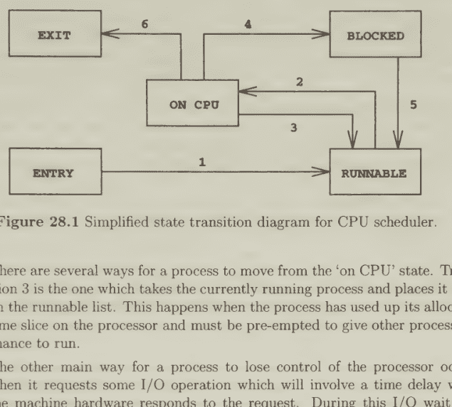

## 图 28.1 CPU 调度器的简化状态转换图。

3. 进程从“在 CPU 上”状态转移有几种方式。转换 3 是将当前正在运行的进程放回可运行列表的那一种。这发生在进程用完了在处理器上分配的时间片，必须被抢占以给其他进程运行机会时。

4. 进程失去对处理器的控制的另一个主要方式是当它请求某个 I/O 操作，该操作会涉及机器硬件响应请求时的时延。在此 I/O 等待期间，即使处理器完全空闲，进程也无法运行。因此，当进程以这种方式阻塞等待 I/O 时，它不能被放回可运行列表，因为它根本不可运行。它因此通过转换 4 转移到等待其 I/O 请求完成的阻塞状态。

5. 当被阻塞进程等待的 I/O 事件发生时，进程再次变得有资格运行。然而，进程不会立即获得 CPU 时间来处理其 I/O，而是只被放回可运行列表以再次等待调度程序选择。这就是转换 5。

6. 在此简化图中所示的失去对处理器控制的最后一种方式是当正在运行的进程终止时。转换 6 显示导致进程终止的事件。

也许令人惊讶的是，无论 CPU 调度程序用来确定下一个应运行哪个进程的实际算法如何，此状态转换图通常都适用。

可以用于 CPU 调度的算法有很多，包括大量关于在各种情况下哪种算法最好的理论。然而，与其在这里进行调度算法的一般讨论，我们将只集中于 Linux 调度算法本身的细节。

### 28.2 细节

在其生命周期中，Linux 进程可能处于几种状态之一，主要的有：

**TASK_RUNNING** 只有当进程处于此状态时，调度程序才会考虑其运行。这相当于图 28.1 中的“可运行”状态。

**TASK_INTERRUPTIBLE** 处于此状态的进程正在睡眠，但如果收到信号将被设置为 TASK_RUNNING，以便处理它。这相当于图 28.1 中的“阻塞”状态。

**TASK_UNINTERRUPTIBLE** 这与前一状态类似，只是信号对进程状态没有影响。重启睡眠进程的通常方式是使用 wake_up()。使用 wake_up() 是进程从图 28.1 进行转换 5 的通常方式。

Linux 中每个进程在内部由一个 struct task_struct 表示，其中包含进程执行环境的大部分细节。此结构在文件中声明：

```
/usr/src/linux/include/linux/sched.h
```

并且该结构在进程首次创建时在 do_fork() 内核函数中动态分配给进程。do_fork() 函数包含在文件中：

```
/usr/src/linux/kernel/fork.c
```

task_struct 的成员之一称为 counter，我们将看到它在进程调度中发挥重要作用。TASK_RUNNING 进程中 counter 的值越高，下次调度程序执行时被选为运行的可能性就越大。counter 的值通常在 0 到 70 范围内，尽管在某些情况下，超出此范围的值也是可能的。

在 CPU 上执行的进程需要在四种主要情况下放弃它，以便其他进程轮流运行：

- 1. 当进程请求代表其执行某些 I/O 操作（例如磁盘访问操作）并且该操作需要一些时间才能完成时。在这种情况下，即使只有几毫秒的时延也足以证明重新调度是合理的。
- 2. 各种与信号相关的活动可能导致重新调度，例如调用 pause() 或 sigsuspend() 系统调用，或在 ptrace() 打开时接收信号。
- 3. 当在某些硬件事件上发生中断并唤醒在该事件上睡眠的进程时。如果被唤醒的进程的 counter 值明显高于当前进程的 counter 值，则会请求重新调度。
- 4. 如果进程没有以其他方式停止，那么最终它将用完其 CPU 时间分配，这将导致重新调度发生。task_struct 中的 counter 值是进程 CPU 时间分配中剩余的 jiffies（10 ms 定时器中断）的计数。

从概念上讲，Linux 调度程序自早期以来几乎没有变化，尽管 1.3 内核版本已多次清理代码，并增加了对多处理器系统的支持。对于单处理器，调度程序的操作相当直接，我们将详细检查它。

调度任务本身由内核中的一个名为 schedule() 的函数执行。该函数包含在文件中：

```
/usr/src/linux/kernel/sched.c
```

以下伪代码程序详细说明了单处理器版本的 schedule() 内核函数所采取的步骤：

```
Execute any functions on the scheduler task queue

FOR each process
    IF the process has a real time interval timer running
        IF the interval timer has expired
            Send a SIGALRM to the process
            Restart the interval timer if required
        END_IF
    END_IF

    IF the process state is TASK_INTERRUPTIBLE
        IF process has had a signal or has an expired timeout
            Set process state to TASK_RUNNING
        END_IF
    END_IF
END_FOR

FOR each process
    IF process state is TASK_RUNNING
        Remember the process with the highest counter value
    END_IF
END_FOR

IF all runnable processes have a counter value of zero
    FOR each process
        Recalculate process counter value from its priority
    END_FOR
END_IF
```

切换到记住的“最高 counter”进程的上下文

正如你所见，这是一个非常简单的调度算法，很大程度上依赖于 counter 值来确定进程运行的可能性以及运行时的时间片大小。

在可以支持多处理器的内核中，用于选择下一个运行进程的 counter 值的使用方式有一个简单的修改。除了单独使用 counter 外，还添加了额外的项，以给同一处理器上的进程一些优势，并给当前进程一点优势。

有了这些说明和一份 Linux 内核调度程序源代码，你应该能够相当容易地浏览代码并弄清其工作原理。

## 微线程 – 案例研究

你已经看到在 Linux 中并发的主要单位是进程。为了在执行一个进程和下一个进程之间切换，需要做很多工作。这种上下文切换开销是必要的，因为通常 Linux 需要确保任何一对进程都不会相互干扰，特别是当你考虑到进程可能甚至不属于同一用户时。

然而，很 often 你会想要编写彼此 aware 存在并且可以为了共同目标而合作的程序。解决此问题的标准方案是进程间通信机制。

无论你选择使用哪种 IPC 机制，只要普通进程需要协同工作，就仍需应对上下文切换开销。

克服这一问题的方法是使用线程的概念。每个 Linux 进程都有自己的文本、数据和系统内存区域和数据结构，以及处理器上的自己的时间片，以便每个进程可以按自己的节奏独立进行。线程背后的想法是，每个进程可以将其处理器时间片在几个并发线程之间共享，每个线程也共享其所属进程的内存和数据结构。

在单个进程内两个协作线程之间进行上下文切换所涉及的工作量远小于在两个进程之间切换的工作量。这主要是因为进程内的线程都共享相同的文本、数据和系统内存区域和数据结构，因此无需花费精力重新排列这些东西。

由于线程专门设计为协作而不是对抗，内核无需做任何事情来保护单个进程内的线程彼此不受干扰。

因此，线程可以被视为轻量级进程；与进程相比，在它们之间进行上下文切换所需的工作量很小

与标准（重量级）进程的上下文切换相关的开销。
线程通常可以以两种不同的方式实现：

- 在内核中，作为内核任务；
- 在进程本身内部，作为用户空间任务。

当线程在内核中实现时，线程的调度可以是抢占式的，与进程本身的调度类似。这意味着，无论线程在做什么，当其时间用完时，内核会中断它并将控制权传递给下一个要运行的线程。

在用户空间提供的线程的情况下，实现要简单得多，不过此时线程调度变为非抢占式。这意味着线程之间的上下文切换只能在当前线程自愿释放处理器控制权时发生。

非抢占式调度通常在多用户环境中被避免，因为它允许一个用户通过拒绝放弃控制来独占处理器，从而不让其他用户轮流使用。

然而在线程的情况下，非抢占式调度不会出现此问题，因为线程 supposed to be 协作完成某项任务，而不是争夺处理器。

用户级线程唯一真正出现的问题，而内核级线程可以避免该问题，就是阻塞 I/O。在非抢占式调度程序中，如果某个线程在 I/O 上阻塞（例如等待键盘输入），那么该线程将无法释放其对处理器的控制以允许另一个线程运行。这将有效地使该特定进程中的所有线程停止，直到阻塞的 I/O 完成并且控制权可以转移。这只是意味着在使用用户级线程时必须小心，确保不会发生线程在 I/O 上阻塞的情况。

对于 Linux 来说，有一两个包以各种方式实现线程。总的来说，它们对我们的目的来说似乎相当复杂，因此我将介绍一个新颖且非常简单的用户级线程库，您可以轻松地将其合并到自己的程序中，以试验线程背后的思想。

### 29.1 Library Calls

tiny threads 库确实非常简单，尤其是在用户界面方面。线程在运行时按需动态创建。这是通过调用 new_thread() 函数完成的：

```
int new_thread(int (*start_addr)(void), int stack_size)
```

其中 start_addr 是指向一个函数的指针，该函数对于新创建的线程的作用类似于 main() 函数对进程的作用。stack_size 参数指定应为该线程预留多少空间，以字节为单位用作其栈。

每当调用 new_thread() 时，都会创建一个新的线程结构并进行初始化，然后将其添加到线程结构的循环双向链表中。该列表由线程上下文切换器（调度程序）用来确定当前线程放弃处理器控制权时下一个要执行的线程。

第一次调用 new_thread() 时，通常从进程的 main() 函数内部调用，main() 本身的执行将被挂起并启动线程调度程序。只有当特定进程中创建的所有线程都已终止时，控制权才会最终返回到 main() 函数，返回到初始 new_thread() 调用之后的位置。

在除第一次之外的所有 new_thread() 调用中，都会立即返回，以便调用线程可以继续其执行。new_thread() 的返回值在出错时（malloc() 失败）为 0，在成功时为 1。

使用 tiny threads 库所需的唯一其他函数是允许线程将其对处理器的控制权交还给线程调度程序的调用：

```
int release(void);
```

调用此函数将导致线程调度程序将执行控制传递给由 new_thread() 创建的线程结构循环列表中的下一个线程。尽管此处未涉及，但创建一个简单的预处理器来自动在所有必要位置向线程代码添加 release() 语句是一项直接的任务。为了安全起见，您应该在代码可能循环的任何地方添加 release()，以便即使无限循环也不会阻止其他线程被调度。根据此标准，需要 release() 语句的位置有：在每个 while、for 和 do 循环的主体内部，在每个程序标签之后，以便 goto 不能导致没有 release() 的循环，以及在每个函数的开始处，以便递归函数也不会成为问题。

在两个或多个线程需要相互通信的情况下，可以通过使用对整个进程（因此对每个线程）全局的变量来实现。请记住，进程内的所有线程共享相同的程序和数据内存——它们唯一的私有数据存储区域是其栈，而栈不用于存储全局变量。

通过全局变量进行通信在线程中很常见，但由于其异步性而存在一些问题。这意味着如果不设置某种特殊安排，写入全局变量的数据生产线程无法知道数据何时被数据消费线程读取，以便用下一个数据值替换变量的当前内容。

为了更轻松地编写通信同步的线程，tiny threads 库提供了一种基于 rendezvous 概念的线程间简单通信机制。rendezvous 背后的基本思想是，两个通信方（生产者或消费者）哪个先到达代码中的 rendezvous 点并不重要；其执行将被挂起，直到另一方到达同一点。在此时，数据在两个线程之间传递，被挂起线程的执行恢复，然后两个线程继续执行，并保证通信已发生。

tiny threads 库提供了与 rendezvous 机制相关的三个函数调用：get_channel()、send() 和 receive()。

get_channel() 调用的原型为：

```
int get_channel(int number);
```

其中 number 是您希望使用的通信通道号，返回值是一个通道描述符，其值将传递到其他 rendezvous 相关调用中（出错时为零）。这在概念上与打开文件非常相似，只是您使用通道号而不是文件名，并获得返回的通道描述符而不是文件描述符。

对特定通道号的第一次 get_channel() 调用将动态创建通道并返回其通道描述符。对同一通道号的后续 get_channel() 请求只会返回现有通道的通道描述符，而不会创建新通道。

通道的实现方式允许多个生产者和消费者共享对同一通道的访问。在这种情况下，库将确保生产者的消息得到正确排队，并且每个消息只能被一个消费者读取，然后按 FIFO 顺序从通道中移除。

获得通道描述符后，可以使用 send() 和 receive() 在通道上传递消息：

```
int send(int cd, char *buf, int size);
int receive(int cd, char *buf, int size);
```

其中 cd 是从 get_channel() 调用返回的通道描述符，buf 是指向将发送数据或接收数据的缓冲区的指针，size 是要传输的数据的大小，以字节为单位。

如果匹配的 send() 和 receive() 调用指定了不同的数据大小，则将使用两者中较小的一个。send() 和 receive() 调用的返回值都将是实际传输的字节数。

### 29.2 Calling C Functions

为了理解 tiny threads 库的操作，首先有必要了解 C 程序如何实现函数调用，以及它们如何处理参数传递。

每个 C 程序都从执行 main() 函数开始。事实上，当您编译 C 程序并将其链接以供执行时，系统特定的代码片段是

附加在程序前端，用于处理任何命令行参数并对程序的 main() 函数进行调用。

函数的调用方式与机器代码中子程序的调用方式相同，即返回地址被压入机器栈，然后控制权转移到被调用函数的起始处。当此函数终止时，栈顶的返回地址用于返回到调用函数，回到子程序调用之后的指令。

事实上，栈不仅用于存储函数返回地址，还用于传递函数参数值以及保存函数内部声明的自动局部变量的值。这意味着必须小心不要混淆栈上存储的任何值，因为任何形式的栈损坏都可能导致一些相当棘手的错误。

当你调用一个函数时，任何要传入函数的值的参数表达式首先会被求值，其值被压入栈。接下来，对该函数进行机器代码调用，这也会导致返回地址被压入栈。在被调用函数的顶部，指定的任何参数变量的名称被用来标记栈上参数值已压入的相应位置。这样，任何参数值都会自动分配给各自的参数变量。

进入函数主体后，处理器寄存器之一的值（实际上是 ebp，即扩展基指针寄存器）也被压入栈，因为该寄存器将被用作占位符，以便在函数终止时能够在栈上找到返回地址。进入函数时的 ebp 值被直接压在返回地址旁边，然后当前栈指针值（指向刚刚压入的 ebp 值）被复制到 ebp 寄存器中，覆盖其先前的值，而该值现在已安全地存储在栈上。

处理完 ebp 后，栈指针会被递减以在栈上为函数体内部声明的任何自动局部变量腾出空间。递减栈指针是为栈腾出空间的正确操作，因为栈是从高内存地址向下增长的。也就是说，压入值到栈上时栈指针递减，弹出时栈指针递增。

当函数终止时，与该函数操作相关的栈上的所有值都需要被丢弃，以便将栈恢复到函数调用发生前的状态。这分为四个阶段完成：

- 首先，ebp 的当前值被复制到栈指针中。这会自动丢弃之前为其预留栈空间的任何局部变量，并使栈指针指向保存的 ebp 值。
- 其次，栈顶条目被弹出到 ebp 寄存器中。这恢复了保存的 ebp 值，并使栈指针指向返回到调用函数的返回地址。
- 第三，执行一条返回指令，将执行控制权转移回调用函数，并使栈指针指向传入被调用函数的任何参数值。
- 第四，在调用函数中，栈指针按正确量递增，使其越过任何已压入的参数值。这会丢弃这些值并将栈恢复到函数调用前的状态。

为了说明程序执行期间栈的操作，我们将查看在以下非常简单的代码操作期间拍摄的栈的两个快照：

```
main()
{
    int x, y;

    x = 6;
    /* snap-shot one here */
    y = twice(x);
}
```

```
twice(int n)
{
    int r;

    r = 2*n;
    /* snap-shot two here */
    return r;
}
```

第一个快照（见图 29.1）是在 main() 函数内部、调用 twice() 函数之前拍摄的。它显示了调用 main() 函数时压入栈的返回地址、随后压入栈的 ebp 的原始值，ebp 寄存器被设置为指向此栈位置、为局部变量 x 和 y 预留的栈位置、栈指针的当前位置，以及分配给变量 x 的值 6 在栈上。

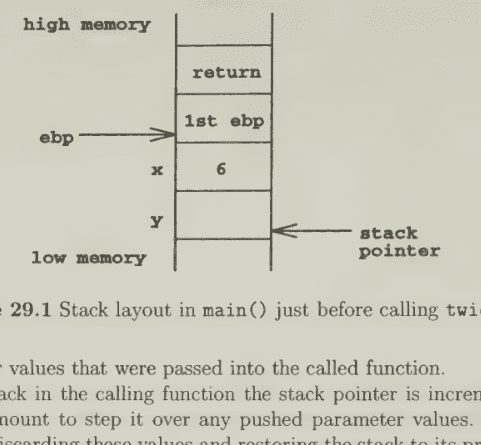

图 29.1 调用 twice() 前 main() 中的栈布局。

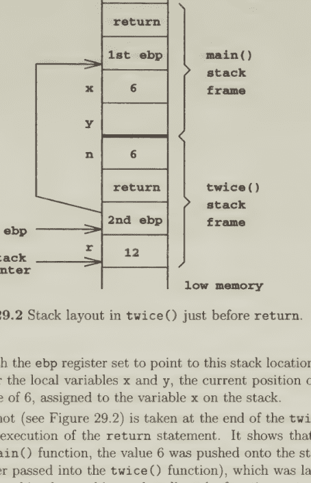

图 29.2 返回前 twice() 中的栈布局。

第二个快照（见图 29.2）是在 twice() 函数结束时、在执行 return 语句之前拍摄的。它显示在 main() 函数的栈帧之后，值 6 被压入栈（作为传入 twice() 函数的参数值），后来被标记为名称 n。此后，对函数 twice() 的机器代码调用导致另一个返回地址被压入栈。随后是压栈 ebp 中的值并更新 ebp 寄存器以指向保存的值。通过这种机制，ebp 寄存器有效地被设置为存储在栈上的函数栈帧链表的头指针。最后，变量 r 在栈上分配了空间，计算随后将值 12 分配给它。

### 29.3 线程调度

请记住，单个进程中的所有线程共享程序和进程的所有全局环境。线程的唯一私有部分是任何重要处理器寄存器的内容以及它在执行期间使用的栈，正如你所见。

这表明为了在单个进程内的两个线程之间切换上下文，所需要做的只是交换几个处理器寄存器中的值——具体来说是程序计数器（或指令寄存器）、ebp 和当前栈指针。事实上，你很快就会看到真正需要保存的只是当前的 ebp 值，而其他值可以从中推导出来。

每个线程都有一个相关的数据结构，用于在线程未运行时保存每个线程的上下文。该数据结构具有以下布局：

```
struct context
{
    int ebp;
    char *stack;
    struct context *next;
    struct context *prev;
};
```

结构的 next 和 prev 字段用于形成前向和后向链接，将此结构连接到形成调度循环的双向循环结构列表中。stack 字段是指向字节数组的指针，用于作为该线程的私有栈空间，而 ebp 字段用于在 CPU 处理其他线程时临时存储处理器 ebp 寄存器的内容。

### 29.4 上下文切换

我们要查看的线程库代码的第一部分是 release() 函数，当线程想要将其对 CPU 的控制权传递给调度循环中的下一个线程时调用它。检查这段代码时，请记住变量 current 是指向当前运行线程相关 struct context 的指针：

```
release(void)
{
    /* 1 */
    if (thread_count<=1)
        return 0;

    /* 2 */
    current = current->next;
    switch_context(current->prev, current);
    return 1;
}
```

```
static switch_context(struct context *from, struct context *to)
{
    /* 3 */
    __asm__
    (
        "movl 8(%ebp),%eax\n\t"
        "movl %ebp,(%eax)\n\t"
        "movl 12(%ebp),%eax\n\t"
        "movl (%eax),%ebp\n\t"
    );
}
```

请注意，release() 函数调用了另一个函数（switch_context()），它被声明为 static，因此不能被线程库文件之外的任何代码调用。还请注意，switch_context() 函数由几行嵌入式汇编代码组成，用于允许直接访问特定的处理器寄存器——这是标准 C 中无法直接获得的控制级别。这意味着该库无法移植到其他处理器架构，因为它使用了有关 CPU 内部布局的特定知识。编号注释如下：

- 1. 如果调度循环中只有一个线程，那么根本没有进行上下文切换的必要。在这种情况下，release() 函数直接返回，因此当前线程继续执行，直到遇到下一个 release() 调用。
- 2. 将 current 移动到指向调度循环中的下一个线程。然后调用 switch_context()，将 current 的旧值和新值作为参数传递。
- 3. 在 switch_context() 函数内部有四条 386 汇编指令。这些指令所做的只是取出 CPU ebp 寄存器的内容并将其存储在 from 结构的 ebp 字段中，然后改为从 to 结构的 ebp 字段加载 CPU ebp 寄存器。switch_context() 函数随后返回。

那么，仅通过更改 ebp 寄存器如何实现线程上下文切换呢？要回答这个问题，我们需要再次查看栈的使用。

想象一下，一个运行了一段时间的线程调用了 release() 函数。发生的情况是，此函数调用以及随后的对 switch_context() 的调用都使用该线程的栈进行。图 29.3 显示了该线程在开始执行 switch_context() 函数的汇编代码部分之前栈布局的一部分。

汇编代码部分将 CPU ebp 寄存器的当前值保存到该线程的 struct context 的 ebp 字段中，然后加载 CPU ebp 寄存器

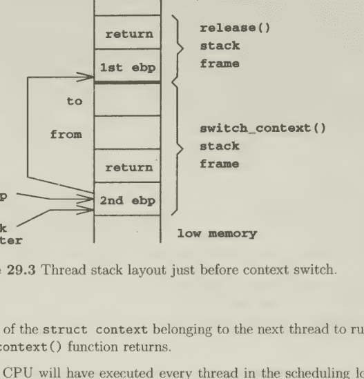

### 图 29.3 上下文切换前线程栈布局。

从将要运行的下一个线程的 struct context 的 ebp 字段中恢复，然后 switch_context() 函数返回。

最终，CPU 将执行调度循环中的每个线程，直到其下一次 release() 调用，这样我们跟踪的线程就轮到再次运行了。当这种情况发生时，调度循环中位于我们前面的线程将执行一次 release() 调用，并且在 switch_context() 函数的汇编代码部分运行完毕时，CPU 的 ebp 寄存器将被重新加载为我们线程保存的 ebp 寄存器值。然而请注意，堆栈指针仍将指向前一个线程的堆栈，并且程序计数器将指向 switch_context() 函数末尾的指令，即将执行它们。

每个函数结束时发生的事情是堆栈指针被设为 ebp 中的值，以丢弃任何局部变量。在本例中，switch_context() 函数没有局部变量，但该赋值仍然执行。这具有有益的副作用，即移动堆栈指针，使其指向我们线程堆栈中的正确位置。函数结束时发生的其他操作是从当前堆栈（我们线程的堆栈）弹出 ebp 寄存器，然后使用堆栈上的返回地址返回到调用函数。

这意味着我们的线程代码通过从 release() 函数的普通返回来恢复执行。事实上，就线程而言，它们只是间隔调用 release()，然后返回，允许它们继续。线程本身并不知道 release() 调用期间发生了任何异常情况。

### 29.5 启动新线程

启动一个新线程只是为线程创建一个 struct context 并为其堆栈分配一块内存。然后这些数据结构可以被初始化并添加到调度循环中以获得运行机会。说起来很快听起来很简单，但实际上有点棘手，需要注意细节。棘手的部分是初始化线程的堆栈，因为在可以使用之前需要在空堆栈中手工制作几个值：

```
new_thread(int (*start_addr)(void), int stack_size)
{
    struct context *ptr;
    int esp;

    /* 1 */
    if (!(ptr = (struct context *)malloc(sizeof(struct context))))
        return 0;

    /* 2 */
    if (!(ptr->stack = (char *)malloc(stack_size)))
        return 0;

    /* 3 */
    esp = (int)(ptr->stack+(stack_size-4));
    *(int *)esp = (int)exit_thread;
    *(int *)(esp-4) = (int)start_addr;
    *(int *)(esp-8) = esp-4;
    ptr->ebp = esp-8;

    /* 4 */
    if (thread_count++)
    {
        /* 5 */
        ptr->next = current->next;
        ptr->prev = current;
        current->next->prev = ptr;
        current->next = ptr;
    }
    else
    {
        /* 6 */
        current = ptr->next = ptr->prev = ptr;
        switch_context(&main_thread, current);
    }

    return 1;
}
```

new_thread() 函数接受两个参数，第一个是线程执行将开始的函数的地址，第二个是为新线程的堆栈空间分配的内存块的大小（以字节为单位）。代码中的编号注释如下：

- 1. 使用 malloc() 为此线程创建一个 struct context。检查内存分配是否成功，并在出错时返回零值。
- 2. 再次使用 malloc() 为线程的堆栈分配指定大小的一块内存。新的 struct context 中的堆栈指针被设置为指向堆栈内存。同样，内存分配错误将导致 new_thread() 返回零。
- 3. 将堆栈初始化为图 29.4 所示的状态。请记住，struct context 中的堆栈内存指针指向块的最低编号地址，而堆栈上的操作发生在块的高地址端。
- 4. 下一部分取决于这是否是当前进程中的第一个新线程。如果是，则主程序的执行将被挂起并执行到新线程的上下文切换；否则新线程只是添加到调度循环中等待其运行的机会。
- 5. 将新线程添加到现有调度器循环会变得稍微复杂一些，因为循环是双向链接的，因此需要设置向前和向后的指针集。新线程被插入到调度循环中，使得当当前线程执行 release() 时，它将自动成为下一个要运行的线程。
- 6. 这里，目前没有线程在运行，因此调度循环需要通过对 switch_context() 的第一次调用来创建和启动。为了确保主程序被挂起，switch_context() 调用将其 ebp 寄存器内容存储在名为 main_thread 的静态 struct context 中。该结构不是调度循环的一部分，因此当没有更多线程可运行时，主程序不会再次执行，除非有特殊安排。

图 29.4 显示，与新线程关联的 struct context 的 ebp 元素被设置为指向线程的堆栈。当对新线程进行上下文切换时，此值被加载到 CPU ebp 寄存器中。随后从 switch_context() 函数返回会导致堆栈指针指向同一堆栈位置。执行一次将 ebp 弹出到堆栈的操作会适当地加载此寄存器，并使堆栈指针指向线程启动函数。最后，执行从子程序返回操作会将启动地址弹出到程序计数器中，从而执行到线程启动函数的开头跳转。

当线程的启动函数终止时需要一个额外的变化，以便将线程从调度循环中移除并将其 malloc() 的内存释放回系统。这些操作由 exit_thread() 函数执行。为了避免需要在每个线程的启动函数末尾记住调用此函数，线程的堆栈中会自动制作对该函数的跳转。这意味着当线程的启动函数终止时，该函数会自动执行，使用与第一次执行启动函数时相同的技巧。

exit_thread() 函数的代码如下：

```
static exit_thread(void)
{
    struct context dump, *ptr;

    /* 1 */
    if (--thread_count)
    {
        /* 2 */
        ptr = current;
        current->prev->next = current->next;
        current->next->prev = current->prev;
        current = current->next;
        free(ptr->stack);
        free(ptr);
        switch_context(&dump, current);
    }
    else
    {
        /* 3 */
        free(current->stack);
        free(current);
        switch_context(&dump, &main_thread);
    }
```

exit_thread() 函数终止由 current 指向的线程。exit_thread() 函数被声明为 static 的事实阻止它从库外部被调用。编号注释如下：

- 1. 如果 current 不是调度循环中的最后一个线程，则将其从调度器中取消链接并切换上下文到下一个线程；否则，由于没有更多线程可执行，恢复主线程的执行。
- 2. 复制当前线程指针的副本。将当前线程从调度循环中取消链接，然后重新分配 current 以指向下一个要执行的线程。现在 free() 与终止线程关联的 malloc() 的内存，最后从此线程 switch_context() 到新的 current 线程。
- 3. 这里，只需要 free() 调度循环中最后一个线程关联的 malloc() 的内存，然后 switch_context() 回到主程序，以恢复其执行。

### 29.6 汇合

在汇合机制的实现中使用了两种新的数据结构。第一个（struct channel）按消息通道提供。第二个（struct message）用于按被阻塞消息提供。这两个结构，连同 struct context 的声明和一些全局变量等，都提供在名为 def.h 的单独头文件中，应在程序顶部 #include。该程序的 def.h 的完整内容如下：

```
#include <string.h>

struct context                 /* One structure for each thread */
{
    int ebp;                    /* Base pointer (stack frame pointer) store */
    char *stack;                /* Pointer to memory block for thread stack */
    struct context *next;       /* Round robin circular list pointer */
    struct context *prev;       /* Round robin circular list pointer */
};

struct channel                 /* One structure for each communication channel */
{
    int number;                 /* Channel number */
    int sr_flag;    /* 0=no queue, 1=send queued, 2=receive queued */
    struct channel *link;       /* Link to next channel in list */
    struct message *message_list;   /* Head of message queue */
```

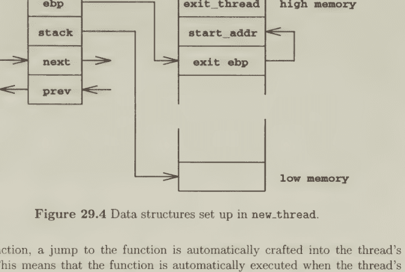

### 图 29.4 新线程中设置的数据结构。

start function, a jump to the function is automatically crafted into the thread's stack. This means that the function is automatically executed when the thread's start function terminates, using a similar trick to the one which executed the start function in the first place.


```c
struct message *message_tail;          /* Tail of message queue */
};

struct message     /* One structure for each pending send/receive */
{
    int size;                               /* Size of message in bytes */
    char *addr;                             /* Pointer to start of message */
    struct message *link;                   /* Link to next message in queue */
    struct context *thread;  /* Which thread blocks on this struct */
};

static struct context main_thread;      /* Storage for main() details */
static struct context *current;         /* Currently executing thread */
static int thread_count = 0;            /* Number of threads to schedule */
static struct channel *channel_list = 0;    /* List of all channels */

static int switch_context(struct context *, struct context *);
static int exit_thread(void);
static int rendezvous(struct channel *, char *, int, int);
```

随着每个通道的创建，都会分配一个 struct channel 并添加到当前进程中所有通道的链表中。每当在一个通道上执行未匹配的 send() 或 receive() 时，都会分配一个 struct message 并将其加入到挂在通道结构下的消息队列末尾。每当一个线程在 rendezvous 中阻塞等待通信伙伴时，线程结构会从调度循环中取消链接，并改为链接到其消息结构。图 29.5 说明了当 send() 和 receive() 操作处于挂起状态时，各类结构是如何相互连接的。

该图显示了此示例中存在三个通信通道，其数据结构相互链接，channel_list 作为指向列表头的指针。通道 1 上已执行了 send() 操作，并且一个消息结构已附加到通道结构上。执行 send() 的线程的上下文结构已从调度循环中移除并附加到消息结构上。这确保了该线程在同一通道上执行匹配的 receive() 操作之前无法再次运行，此时上下文结构将易于定位并重新连接到调度循环。

该图还显示，另一个线程在同一通道上也执行了第二次 send() 操作，并且它也被排队在通道上等待第二次 receive() 操作。通信通道 2 已创建，但没有挂起的消息排队。通道 3 显示已执行了 receive()，并且正在等待该通道上的 send()。

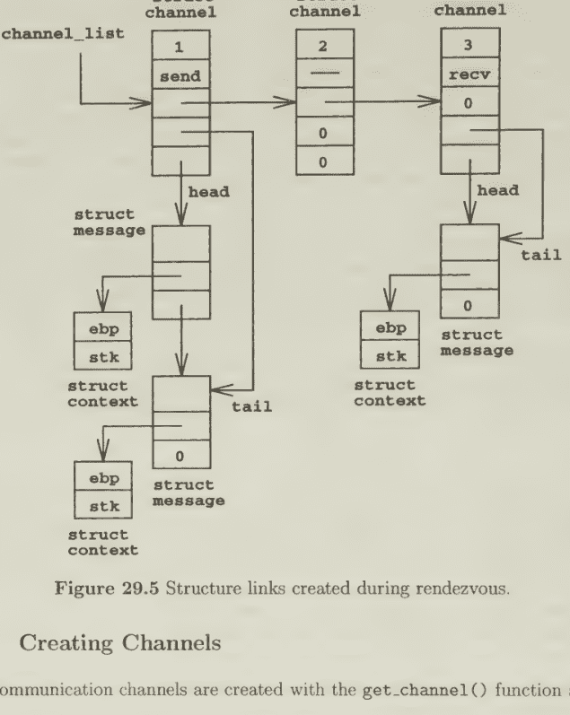

Figure 29.5 在 rendezvous 期间创建的结构链接。

### 29.7 创建通道

新的通信通道使用 get_channel() 函数创建，如下所示：

```
get_channel(int number)
{
    struct channel *ptr;

    /* 1 */
    for (ptr = channel_list; ptr; ptr = ptr->link)
        if (ptr->number==number)
            return((int)ptr);

    /* 2 */
    if (!(ptr = (struct channel *)malloc(sizeof(struct channel))))
        return 0;

    /* 3 */
    ptr->number = number;
    ptr->message_list = 0;
    ptr->message_tail = 0;
    ptr->sr_flag = 0;
    ptr->link = channel_list;
    channel_list = ptr;
    return((int)ptr);
}
```

请记住，get_channel() 函数根据给定的通道号作为参数返回通道描述符。如果通道尚不存在，则会创建它。编号注释如下：

- 1. 从 channel_list 开始，沿着现有通道的链表向下搜索，查看指定的通道号是否已存在。如果在列表中找到指定的号码，则将关联的 struct channel 的地址强制转换为 int 值并作为通道描述符返回。
- 2. 如果通道号尚不存在，则分配一个新的 struct channel，或在出错时返回零。
- 3. 在成功创建新的 struct channel 后，其字段会被初始化，并且该结构会被添加到通道列表的头部。最后，将新结构的地址强制转换为 int 并作为通道描述符返回。

### 29.8 send 与 receive

一旦获得通道描述符，剩下的就是使用 send() 和 receive() 在线程之间传递消息。事实上，正如下面的代码所示，send() 和 receive() 是完全对称的操作，因此它们都对函数 rendezvous() 进行内部调用，只需额外一个标志参数来指定数据传输的方向：

```
send(int chan, char *addr, int size)
{
    /* 1 */
    return(rendezvous((struct channel *)chan, addr, size, 1));
}
```

```
receive(int chan, char *addr, int size)
{
    /* 2 */
    return(rendezvous((struct channel *)chan, addr, size, 2));
}

static int rendezvous(struct channel *chan, char *addr,
int size, int sr_flag)
{
    struct message *ptr;
    int nbytes;

    /* 3 */
    if (sr_flag==3-chan->sr_flag)
    {
        /* 4 */
        ptr = chan->message_list;
        chan->message_list = ptr->link;
        ptr->thread->next = current->next;
        ptr->thread->prev = current;
        current->next->prev = ptr->thread;
        current->next = ptr->thread;
        ++thread_count;
        /* 5 */
        nbytes = (size<ptr->size)?size:ptr->size;
        ptr->size = nbytes;

        /* 6 */
        if (sr_flag==1)
            memcpy(ptr->addr, addr, nbytes);
        else
            memcpy(addr, ptr->addr, nbytes);

        /* 7 */
        if (!chan->message_list)
            chan->sr_flag = 0;

        return(nbytes);
    }
    else
    {
        /* 8 */
        ptr = (struct message *)malloc(sizeof(struct message));

        if (!chan->message_list)
            chan->message_list = ptr;
        else
            chan->message_tail->link = ptr;

        chan->message_tail = ptr;
        ptr->link = 0;
        ptr->size = size;
        ptr->addr = addr;
        chan->sr_flag = sr_flag;
        ptr->thread = current;
        current->prev->next = current->next;
        current->next->prev = current->prev;

        /* 9 */
        if (--thread_count)
        {
            current = current->next;
            switch_context(ptr->thread, current);
        }
        else
            switch_context(ptr->thread, &main_thread);

        /* 10 */
        nbytes = ptr->size;
        free(ptr);
        return(nbytes);
    }
}
```

send() 和 receive() 函数都接受三个参数。第一个是通道描述符，第二个是从中或向其中进行数据传输的内存缓冲区，第三个参数指定数据传输的大小，以字节为单位。两个函数的返回值都是实际传输的字节数。这将是作为两个函数的第三个参数指定的两个大小中的较小者。编号注释如下：

- 1. send() 参数值直接传递给 rendezvous()，并添加第四个参数值以指定数据传输方向。
- 2. receive() 参数值直接传递给 rendezvous()，并添加第四个参数值以指定数据传输方向。
- 3. 在 rendezvous() 内部，第一个测试检查是否已有正确类型的通信伙伴排队。如果有，则需要将伙伴的 struct context 恢复到调度循环，并将数据在线程之间复制，然后线程才能继续执行。如果没有伙伴排队，则当前线程从调度循环中移除，并将通信请求添加到与该通道关联的请求队列中。
- 4. 此代码段将线程的 struct context 重新链接到调度循环，并增加可运行线程数量的计数。
- 5. 执行计算以确定将要传输的字节数。该值也会保存在通信伙伴在其下一次运行轮次时可以获取的位置。
- 6. 数据传输现在进行，确保按正确的方向复制数据。
- 7. 如果这是通道中排队的最后一个消息，则消息类型标志将被重置，并将传输的字节数返回给调用者。
- 8. 在此代码段中，由于尚未有匹配的伙伴准备就绪，因此需要排队一个新的消息。分配一个新的 struct message 并将其添加到通道消息列表中。线程需要在等待通信伙伴时阻塞，因此此代码段还将线程的 struct context 从调度循环中移除并存储在消息结构下。
- 9. 可运行线程的数量递减，并对循环中的下一个线程执行上下文切换。由于新阻塞的线程需要在恢复执行前找到通信伙伴，因此始终应有其他线程可以传递控制权。如果由于某种原因证明并非如此，则上下文切换会安排恢复主线程的执行。
- 10. 该线程下一次被调度将在 rendezvous 发生之后，此时可以恢复传输的字节数，并在 free() 释放使用的 struct message 后返回。

### 29.9 无界缓冲区

作为 tiny threads 库使用的一个简单示例，以下代码为无界缓冲区问题提供了一个相当优雅的解决方案：

```
int buffer(void);
int start(void);

int ch_desc1, ch_desc2;

main(void)
{
    ch_desc1 = get_channel(1);
    ch_desc2 = get_channel(2);
    new_thread(start, 1024);
}

start(void)
{
    int i, n;
```


```
new_thread(buffer, 1024);

for (i = 0; i < 10; ++i)
{
    send(ch_desc1, &i, sizeof(int));
    release();
}

for (i = 0; i < 10; ++i)
{
    receive(ch_desc2, &n, sizeof(int));
    printf("i=%d n=%d\n", i, n);
    release();
}
}

buffer(void)
{
    int i;

    receive(ch_desc1, &i, sizeof(int));
    new_thread(buffer, 1024);
    send(ch_desc2, &i, sizeof(int));
}
```

我把具体如何运作留给你自行理清。不过我只说一下，你会发现这里使用了两个通道，且有多個发送者和接收者。此外，你会发现程序使用了一个 start() 函数的实例，但有多个同时运行的 buffer() 函数的实例。

注意该方案如何按需动态创建更多缓冲区空间，以及当缓冲区元素使用完毕后如何动态地自行清理。

## 内存

Linux 中的内存管理是内核中较为复杂的部分之一。主要是因为它使用了 CPU 本身提供的许多功能，而这些功能本身就相当复杂。因此，我们在探讨 Linux 的内存管理时，将先从 CPU 入手，了解它在这些事件中所扮演的角色。

### 30.1 保护模式寻址

CPU 执行的许多指令都需要进行内存访问。这看起来似乎很直接，即机器码指令指定要获取或修改内容的地址。如果只是这么简单就好了！

在需要让许多进程同时驻留在内存中并运行的情况下，如果它们都能像各自独占机器一样运行会容易得多。实现这一点的方式是 CPU 内部在指令指定的访问地址（称为逻辑地址或有效地址）与实际在物理内存中进行访问的硬件之间执行各种形式的地址转换。

首先，一个进程被划分为指令、数据和栈等多个段，每个段都有一个关联的段描述符。每个段描述符是一个 8 字节的块，其中包含段起始的基地址、段的大小以及授予的访问权限。段描述符集合在一起形成描述符表，CPU 内部寄存器用于访问该表的基地址。

此外，CPU 包含一组段寄存器。这些寄存器各自指向描述符表中的一个段描述符项。现在，当进行任何类型的内存访问时，CPU 的其中一个段寄存器会被选中（要么由内存访问类型隐式指定，要么由执行访问的指令显式指定）参与内存地址计算。该计算的结果称为线性地址。图 30.1 说明了根据逻辑地址和段寄存器计算线性地址的过程。

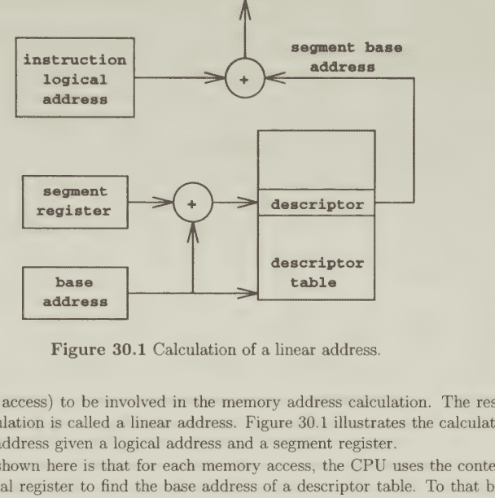

### 图 30.1 线性地址的计算。

这里展示的是，对于每次内存访问，CPU 使用内部寄存器的内容找到描述符表的基地址。然后将其中一个段寄存器的内容（寄存器的低 3 位设为零）加到该基地址上。该操作的结果是指向描述符表中某个 8 字节条目的指针。记住，段描述符条目包含段在内存中的基地址、段的大小以及对段的访问权限。

访问内存的指令本身也会提供一个地址。该地址是其段描述符已被获取的内存段内的逻辑地址（或有效地址）。指令中的逻辑地址现在被加到段的基地址上，形成一个新的地址，称为线性地址。这个线性地址必须被检查，以确保它位于段内（即不超过段指定的大小），并且请求的访问类型（读、写或执行）在该段内是允许的。如果这些检查通过，CPU 现在就拥有一个可用于访问机器内存的地址。

我们一直在查看的主要段描述符表称为全局描述符表或 GDT，而指向该表起始位置的 CPU 寄存器称为 GDTR。在多任务环境中，你可能希望每个进程都能访问自己的内存段。为满足这一需求，CPU 还可以为每个进程提供另一个描述符表，称为局部描述符表或 LDT。如果使用，局部描述符表是通过 GDT 中的一个条目以及内部处理器寄存器 LDTR 来访问的。

如果每次内存访问都要执行这些在描述符表（本身存储在内存中）中查找值的操作，将会成为处理器任务中非常耗时的部分。为了大幅提升速度，CPU 内部有几个隐藏且程序员无法直接访问的寄存器。这些寄存器用于缓存当前与每个段寄存器关联的段描述符。只有当关联段寄存器的值发生变化，或 GDTR 或 LDTR 中的描述符表基地址发生变化时，这些隐藏寄存器才会被加载相应的段描述符值。

### 30.2 分页

仅使用我们迄今为止看到的功能来组织其内存访问，也可以建立一个完全可行的多任务系统。这要求每个进程在开始运行时就知道它将需要多少内存，以便从一开始就为进程分配合适位置和大小的内存段，而在进程生命周期内无需更改。

然而，Linux 比这个简单模型所暗示的要复杂得多。例如，它可以允许一个进程在内存需求增长时不必考虑在物理内存中与其相邻的其他进程。同时，Linux 同时运行的进程数也可能超过其内存需求简单相加后似乎能放入可用内存的数量。

Linux 实现这些功能所使用的机制是处理器提供的分页功能。CPU 是否使用分页由处理器控制寄存器中的一个位控制。如果分页打开，则 32 位线性地址会被视为分为两部分。高 20 位被视为页号，低 12 位被视为页内的偏移地址。这意味着线性地址可以访问一百万个 4 KB 页面。分页的主要功能之一是将线性地址中提供的 20 位页号转换为另一个 20 位数字，即机器物理内存中对应的 4 KB 页面。实际效果是，物理内存中的任何 4 KB 页面都可以映射到处理器线性地址空间中一百万个 4 KB 页面边界中的任何一个。

这种地址转换是通过内存中的查找表完成的，其中线性地址的高 20 位有效地指定了 32 位元素的大数组中的索引。由此访问到的 32 位值提供了所需的 20 位转换，外加一些指定以下内容的位：

- 被访问的页面是读写还是只读？
- 用户级进程可以访问此页面，还是只能由管理模式进程访问？
- 页面中的任何地址是否已被读取或写入？
- 页面中的任何地址是否已被写入？
- 页面是否存在于物理内存中，还是存储在磁盘上？

与其使用单一巨大的页表，采用的是两级层次结构，避免了不必要地为保存表而预留很大一段连续的线性地址。两级层次结构的安排方式是将线性地址的高 20 位进一步细分为两个独立的 10 位值。CPU 内的控制寄存器 3 包含内存中一个 4 KB 页面的地址，该页面将用作顶级页目录表。一个分为 32 位条目的 4 KB 页面长 1024 个条目。20 位页号的高 10 位正好适合选择页目录中的 1024 个条目之一。页目录中选中条目的高 20 位用于指向另一个称为页表的 4 KB 页面。同样，该页面包含 1024 个条目，每个 32 位长，这次原始线性地址中给出的页号的低 10 位将精确选择页表中的一个条目。该 32 位值

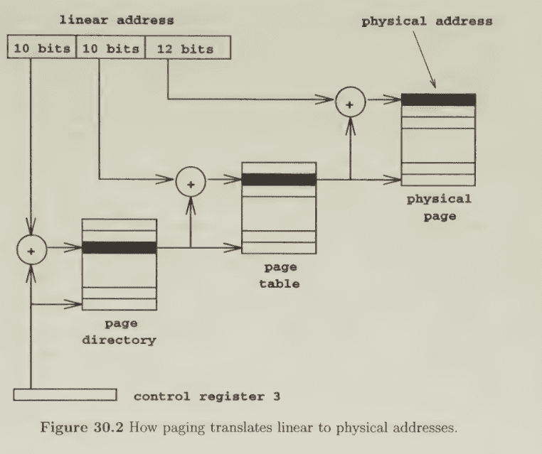

### 图 30.2 分页如何将线性地址转换为物理地址。


## 图 30.3 分页允许轻松增长内存段

因此所选内容包含所需的 20 位物理页号以及之前讨论的其他位。

图 30.2 说明了从线性地址到物理地址的这种地址转换安排。再一次，如果对每个线性地址访问都要完全执行这种转换，则需要额外两次内存读取来访问页目录和页表——就时间而言这是一种非常昂贵的操作。所采用的解决方案，如同之前一样，是在 CPU 内部设置一些额外的寄存器，用于存储最近的地址转换，从而使查找速度大大加快。这些额外寄存器构成了转换后备缓冲器（TLB）。

### 30.2.1 段增长

当你希望增大被限制在物理内存中的内存段的大小时，分页非常有用。图 30.3 说明了这一点。

第 (a) 部分显示了由若干页组成的两个内存段，它们被映射到右侧图表中的物理内存页。请注意，在物理内存中，段 1 的页被段 2 使用的页所包围。没有分页，就不可能在不将整个段移动到足够容纳增大后段的连续物理内存新区域的情况下增大段 1 的大小。

第 (b) 部分显示，有了分页，增大段 1 的大小是一项简单的任务，因为段 1 线性地址空间中的连续页在物理上不需要连续，因此新的页（线性页 3）可以分配任何空闲的物理页，该页只需映射即可使其在段 1 中出现在正确的位置。

### 30.2.2 交换

分页的另一个主要用途称为交换（因历史原因而得名——旧版本的 UNIX）。交换背后的想法是，系统中运行的进程数可能多于同时能放入内存的数量。这涉及划出一块交换空间（通常在磁盘上）充当内存溢出区。当你想启动一个新进程而内存中没有足够空间时，会调用交换程序，它会选择一个或多个当前在内存中的进程将其写入交换空间，以便为新进程加载和运行腾出空间。随着进程的进展，一些进程会因等待 I/O 而阻塞，其他进程会终止。这提供了将已交换出去的进程重新带回内存的机会（也许以其他进程被交换出去为代价），以便它们可以继续执行。

使用分页执行交换功能意味着你不需要将整个进程交换到磁盘，只需交换足够多的页即可为新进程运行腾出空间。事实上，在 Linux 中甚至更好，因为它使用了一种称为按需分页的技术。为了使按需分页工作，页表中的条目需要包含信息来说明条目指向的页的内容是否实际已加载到内存中。有了这些信息，每当 CPU 尝试访问不存在于内存中的物理内存页时，就会引发异常（称为页错误）。该异常会强制调用异常处理程序，将该页加载到物理内存中。导致页错误的指令随后可以重新启动，这次应该会成功。

这是一个如此好的想法，以至于新进程可以使用该技术加载到内存中（Linux 就是这样做的）。发生的情况是，每当正在运行的进程尝试执行尚未加载的地址上的指令时，就会发生页错误并得到处理，之后进程可以继续。

对代码执行的<|message|> 研究很快就会揭示，对于合理大小的程序，在任何一次运行中，大部分代码都不会被执行。有了按需分页，其含义是，经过一段时间后，进程将加载其所需的页，然后以很少的新页错误运行，并且其许多页根本未加载到内存中。即使某次程序运行确实需要访问所有程序页，那么在任何时候以及相当长的时间内，进程通常只使用页的一个小子集，因此分页仍然带来巨大的好处。

### 30.3 Linux 特定事项

在 Linux 下启动新进程的唯一方法是使用 fork() 系统调用。这首先通过分配两页内存开始，一页用于与新进程关联的任务结构，另一页用于内核在代表新进程运行时使用的栈空间。

接下来，从父进程复制子任务结构，并进行一些更改以设置必要的差异，例如进程 ID 和会话领导权。最后，所有进程信息，包括内存映射，都复制到新的子进程。子进程拥有自己的局部描述符表（LDT），因此拥有自己的文本数据和栈段，并且它还拥有自己的页表，最初只是父进程表的副本。fork() 调用在概念上使子进程成为父进程文本、数据和栈段的副本。然而，这在时间上将是一种昂贵的操作，尤其是当子进程几乎立即执行 exec() 系统调用并用新程序的内容替换这些段的内容时。为了克服这种浪费，Linux 仅从父进程复制页表到子进程，而不复制它们所访问的页。

对于文本段而言，这种技术是可以的，因为文本段无论如何都被标记为只读，并且两个进程仅通过读取就无法察觉它们正在共享代码。然而，数据和栈段是可读写的，因此在这里共享会在其中一个进程想要写入数据时立即导致问题。Linux 对此问题的解决方案称为写时复制。发生的情况是，每当其中一个进程想要写入当前共享的数据或栈页时，该页会被复制，并且页表会被更新，以便每个进程现在都有该页的自己的副本，可以在不干扰另一个进程的情况下写入它。

当使用 exec() 系统调用启动新程序时，则使用按需分页来加载进程运行所需的页。

有很多情况下需要为进程分配新的内存页。最终，空闲页列表将被耗尽。此时 Linux 会尝试从其他地方窃取一页，必要时将其写入交换空间以满足请求。获取页面的可能性包括减少用于磁盘缓冲缓存的页数，因为在 Linux 中缓冲缓存内存与普通进程内存之间的边界是动态的。如果有必要窃取进程内存页以满足内存请求，那么选择从某个进程的文本段窃取一页意味着在释放之前不需要将其写入交换空间，因为它是只读的（因此不可能改变），并且可以从原始可执行文件按需分页重新载入。

## 文件存储

为了在 Linux 下访问文件系统的内容，有必要将该文件系统挂载到目录层次结构中。你已经看到这是用 mount 命令完成的。我们尚未看到的是，存在许多文件系统类型，任何或全部都可以以几乎无限制的任何组合挂载。

### 31.1 VFS

虚拟文件系统切换器（VFS）的任务是使 Linux 能够挂载和访问各种文件系统类型成为可能。VFS 的主要任务实际上是在 Linux 文件存储中添加一层间接层，以便将文件系统调用切换到正确文件系统类型代码中的适当例程。

目前通过 VFS 支持的 Linux 文件系统类型有很多，包括：

- **minix** 这是 Linux 支持的最早的文件系统类型；事实上，最初它是唯一支持的文件系统类型。其两个主要缺点是它仅支持最大 64Mb 的磁盘分区，并且仅允许文件名最长 14 个字符。
- **ext** 扩展文件系统很快被添加到 Linux 中，它通过提供最大 2Gb 的磁盘分区和最长 255 个字符的文件名克服了 minix 文件系统的问题。然而，它在功能和性能方面也有自己的问题，很快就被取代。
- **xiafs** 这是取代 Ext 文件系统的两次主要尝试之一，它在很大程度上基于 minix 文件系统，但扩展以克服其问题。然而，Xiafs 很快就失去了人气，取而代之的是性能和功能大大改进的另一种文件系统类型。


**ext2** 第二扩展文件系统现在（在我撰写本文时）几乎已成为 Linux 通用的标准文件系统，并且也正在移植到其他系统。该系统允许磁盘分区最大达到惊人的 4 Tb，文件名最长可达 255 个字符。

**System V** System V 文件系统是早期 UNIX 系统支持的文件系统类型，现在在 Linux 下也可用。这仅是为了与现有的 System V 系统兼容，除非兼容性至关重要，否则通常不会认真使用。它与 minix 文件系统存在同类型的限制。

**NFS** 网络文件系统（NFS）最初由 SUN 开发，允许一台机器上的文件系统通过网络挂载到另一台机器的目录上。除了轻微的速度损失外，网络链接是透明的，允许磁盘分区和文件在整个网络中共享。

**ISO 9660** 这是与 CD-ROM 磁盘相关联的文件系统，也已在 Linux 上实现。一张 CD 可容纳约 650 Mb 的数据，目前有许多非常有用的与 Linux 相关的 CD 可用。标准 ISO 文件系统具有类似 DOS 的文件名格式，尽管标准中有扩展，允许更正常（对于 UNIX 系统而言）的长文件名。

**/proc** 这是内置于 Linux 内核中的一种特殊文件系统类型，用于访问系统的各个部分及其进程。

**msdos** 标准 DOS 磁盘和分区可以在 Linux 下挂载和访问。系统试图尽可能让这些文件系统看起来像 UNIX，但它们仍然受制于 DOS 对文件名长度和格式等限制。

**UMSDOS** 这是一种文件系统类型，主要用于让你在不重新分区硬盘的情况下在 DOS 机器上试用 Linux。实际上，它允许你将普通 Linux 文件放入 DOS 分区并像在普通 Linux 文件系统中使用一样使用。这是通过使用索引文件来实现的，以在标准 Linux 文件名和更受限的 DOS 文件名之间提供透明的查找机制。

为了理解文件系统设计相关的一些问题和选择，我们将简要查看 Linux 支持的几种文件系统类型，以了解该领域发生的一些演变。

### 31.2 System V

配置为标准 UNIX System V 文件系统的磁盘分区的布局非常简单，如图 31.1 所示。

如你所见，每个磁盘分区仅分为四个部分：

**引导块** 如果这是引导分区，则包含引导机器的代码；否则该块不使用（尽管仍被分配）。

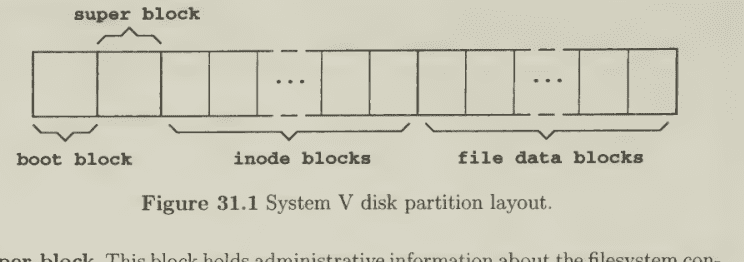

图 31.1 System V 磁盘分区布局。

**超级块** 该块保存有关此分区上所含文件系统的管理信息。我们稍后会更详细地介绍。

**索引节点块** 一组分配的磁盘块，用于保存该文件系统的所有索引节点。文件系统一旦在分区上创建后，分配给索引节点的磁盘块数量（从而该文件系统上可用的索引节点数量）就固定不变。

**文件数据块** 分区上的其余块用于保存该文件系统文件中存储的实际数据。块会根据需要动态分配给文件。

对于索引节点和数据块，需要某种方法来显示它们何时可供分配、何时已被分配并正在使用。对于 System V 文件系统，会在超级块中保存空闲索引节点和数据块的列表，以便在需要时更快地分配，尽管这两种东西的保存方式不同。

### 31.2.1 文件数据块空闲列表

通常，通过简单检查数据块的内容，无法确定该块是否正在使用。这是因为数据块的所有字节都用于保存文件内容，而文件内容可以是任意字节序列。这意味着无法在数据块中存储特定字节序列来表示该块可供分配。解决此问题的必要方案是拥有某种数据结构来列出空闲的数据块。

这实际上以链表的形式实现，其第一部分存储在文件系统的超级块中。磁盘分区上的数据块按顺序编号，因此每个块都有唯一的块号。当文件系统首次创建时，所有数据块显然都是空闲的，因此都应出现在空闲列表中。然而，超级块中用于此列表的空间有限，只有列表的一小部分能容纳。列表的下一部分存储在空闲数据块之一中，其编号被安排为超级块列表中的最后一个块号。这一思想被重复，使用空闲块来存储空闲块号列表，并确保每个列表中的最后一个空闲块号

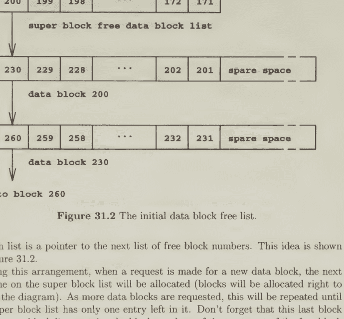

图 31.2 初始数据块空闲列表。

是指向下一个空闲块号列表的指针。这一思想如图 31.2 所示。

使用这种安排，当请求新的数据块时，超级块列表中的下一个空闲块将被分配（在图中块将从右到左分配）。随着更多数据块的请求，这将重复进行，直到超级块列表中只剩下一个条目。不要忘记，超级块列表中的最后一个块包含空闲块列表下一部分的块号。因此，在包含这些块号的块被分配之前，这些块号需要复制到超级块列表中，而这在复制完成后即可进行。

图 31.3 显示了在超级块中所有初始空闲块号列表已被分配，并且块号 200 的内容已复制到超级块中、就在块 200 被分配为空闲之前的情况。当文件被删除且数据块变为可用时，其块号只需添加到超级块中的空闲列表中。当该列表已满且另一个数据块变为可用（例如 188）时，就没有空间再存储该号码。在这种情况下会发生什么：超级块中的数据块空闲列表部分被复制到新释放的块（188）中，然后超级块列表被清空，新释放的块（188）成为超级块列表中最左侧（也是唯一）的条目。

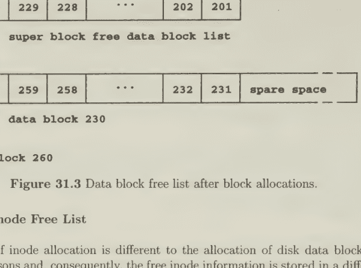

图 31.3 分配块后数据块空闲列表。

### 31.2.2 索引节点空闲列表

索引节点分配的情况与磁盘数据块分配不同，原因有几个，因此空闲索引节点信息以与空闲数据块不同的格式存储。差异的主要原因有：

- 索引节点不是很大，结构中没有合理的位置来存储大量空闲索引节点号列表，不像空闲数据块，如果需要整个块都可以使用。
- 对于数据块，通过简单检查其内容无法确定它是否空闲。这意味着所有空闲数据块号都需要存储；否则它们会丢失。对于索引节点而言，当它空闲时会在内部标记为此状态，这意味着只需通过对索引节点数组进行简单的线性搜索即可始终找到空闲索引节点。
- 通常，文件中包含许多数据块，因此数据块的分配速率往往远高于索引节点。这意味着查找索引节点时的偶尔低效比查找数据块时的低效更易容忍。

考虑到这些因素，内核每次请求新索引节点时只需对索引节点数组进行线性搜索以找到空闲索引节点。虽然这种策略可以工作，但通过在超级块中提供一组空闲索引节点号使其效率大大提高。然而，与空闲数据块不同，超级块中的空闲索引节点列表只是独立的列表，因此可能有许多空闲索引节点但并未出现在列表中。超级块索引节点空闲列表的使用如图 31.4 所示，分为 (A) 到 (F) 部分如下：

(A) 这旨在显示超级块索引节点空闲列表的初始状态。索引显示下一次分配时将使用的索引节点号。


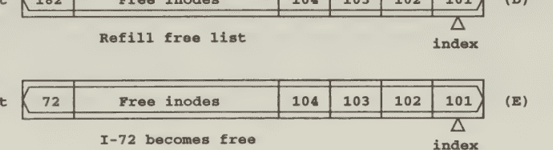
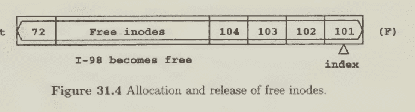
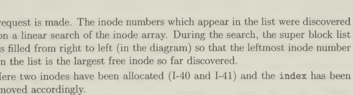
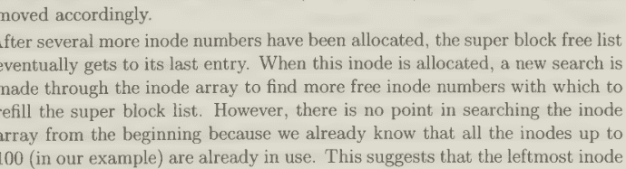

## 图 31.4 空闲 inode 的分配与释放。

请求发出时。出现在列表中的 inode 编号是通过对 inode 数组进行线性搜索发现的。在搜索过程中，超级块列表从右向左填充（在图中），因此列表中最左边的 inode 编号是迄今为止发现的最大空闲 inode。

(B) 这里已分配了两个 inode（I-40 和 I-41），并且索引已相应移动。

(C) 在分配了更多 inode 编号之后，超级块空闲列表最终到达其最后一个条目。当此 inode 被分配时，会通过 inode 数组进行新的搜索，以找到更多空闲 inode 编号来重新填充超级块列表。然而，没有必要从头开始搜索 inode 数组，因为我们已经知道所有到 100（在我们的示例中）的 inode 都已在使用中。这表明原始空闲 inode 列表中最左边的 inode 编号应被用作下一次搜索更多空闲 inode 的下一个起始点。

(D) inode 空闲列表已再次从右向左重新填充，因此最左边的 inode 编号将是最后要分配的编号，并且在需要更多空闲 inode 时将再次标记下一个起始点。

(E) 只要 inode 正在被分配并且没有被释放，该方案就运作良好。假设现在 inode 72 在其所属文件被删除时被释放。超级块中的空闲 inode 列表已满，没有地方存储新释放的 inode 编号。这是个问题，因为我们不能让 inode 72 随意空闲。如果这样做，下一次超级块列表需要重新填充时，从 inode 182 开始搜索将找不到它。为了确保我们不会以这种方式丢失已释放的 inode，超级块列表中的下一个 inode 编号将被新释放的较低 inode 编号替换（示例中为 inode 72）。这种技术确保超级块空闲列表中最左边的 inode 编号始终是搜索更多空闲 inode 编号时进行下一次 inode 数组搜索的正确起点。

(F) 如果 inode 编号大于下一个 inode 编号，则在超级块列表已满时无需特别安排来记住变得空闲的 inode 的编号，因为它们将被从 next 开始的线性搜索自动找到。如果在超级块中有空闲空间时释放一个 inode，它可以直接添加到超级块列表中。

#### 31.2.3 inode 数据块指针

现在存在为文件分配新 inode 并查找要添加到文件的磁盘数据块的机制，唯一需要的就是给定其 inode 访问文件中的数据块的方法。这最明显的机制是在 inode 中列出数据块编号。可惜的是，对于任何合理大小的文件来说，由于在 inode 内所需占用的空间，该解决方案是不可行的。

查看典型用户创建的文件的平均大小可知，大多数文件大小为 1024 字节或更小，并且随着文件大小超过此值，每个大小的文件数量会减少。这表明一种使对小文件的访问快速高效的安排，即使以牺牲较大文件的一些速度为代价，也是一个可接受的折衷方案。System V 实现的就是这种类型的安排。

System V inode 内部有一个由 13 个元素组成的数组，每个元素可以保存一个磁盘数据块的编号（参见图 31.5）。该数组的前十个元素用于保存分配给存储文件内容的前十个数据块的数据块编号。

假设为说明目的，每个磁盘数据块的大小为 1024 字节，则这十个数据块指针将允许创建大小高达 10 Kb 的文件。如你所见，对于绝大多数文件，应该可以通过直接查找来访问数据，以找到包含任何特定数据字节的数据块。

使用这种方案，一旦文件增长到 10 Kb，无论文件的最终大小如何，inode 中只剩下三个块指针可供使用。显然，必须找到新的安排，以便剩余的三个块指针足以满足任何实际文件大小，同时又不会过多地降低数据访问时间。

这一目标是通过使用间接块指针的想法来实现的。具体来说，当需要为文件分配第 11 个数据块时，使用第 11 个 inode 块指针，但它不是指向将包含数据的块，而是作为单个间接指针指向一个装满直接块指针列表的数据块。在我们的示例中，如果我们假设数据块编号是一个 32 位值，则单个间接块中可以容纳 256 个这样的列表。该列表将直接指向我们文件接下来的 256 Kb 的数据块。这意味着在 inode 中有 11 个块指针时，可以创建高达 266 Kb（10 + 256）的文件。的确，访问文件前 10 Kb 之外的数据需要花费更长的时间，但只需多读一个磁盘块即可找到所需数据在磁盘上的位置。

对于大于 266 Kb 的文件，使用双重间接（第 12 个）inode 块指针。这与之前的 inode 指针的想法相同，只是双重间接指针指向数据块中的指针列表，其中每个指针本身都是指向包含 256 个直接块指针列表的单个间接块指针。这意味着第 12 个 inode 块指针可访问我们文件中接下来的 65536 Kb（256×256）的数据。

到现在为止，你应该能够看出模式，并且可以看到当文件增长到大于 64 Mb（实际上是 65802 Kb）时，inode 的第 13 个数据块指针将被使用，但这次作为三重间接指针，它将提供惊人的 16 Gb（256×256×256 Kb）的额外文件空间。单个文件大于 16 Gb 听起来非常巨大。然而，即使我们刚刚完成的计算表明使用给定的 inode 布局可以实现这种文件大小，实际上还有其他因素将文件的最大大小限制为比这更小的值。例如，文件的大小（以字节为单位）单独存储在其 inode 中，字段类型为 unsigned long。这是一个 32 位数字，将文件大小限制为 4 Gb，因此 inode 中的 13 个数据块指针确实足够了。

## inode 数据块指针

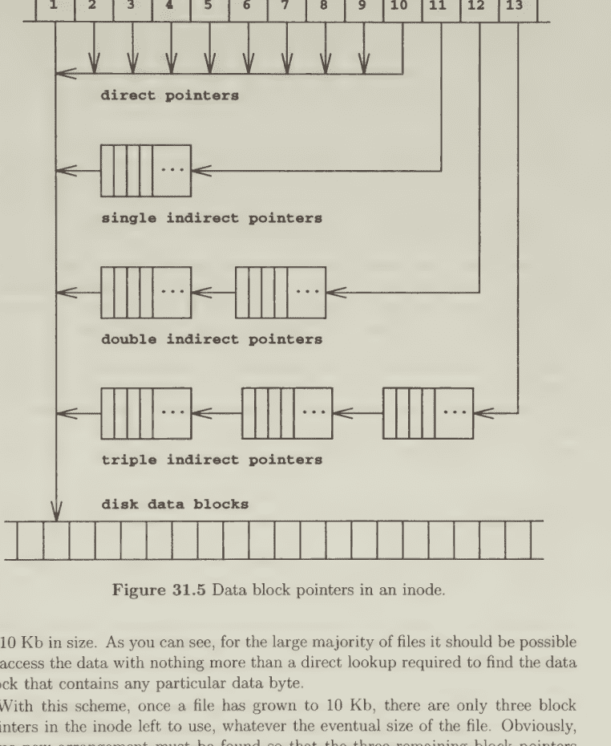

## 图 31.5 inode 中的数据块指针。

### 31.3 minix

minix 文件系统是 Linux 可用的第一个（并且最初是唯一一个）文件系统类型，因为在 Linux 最早的版本中，Linux 源码需要一个 minix 系统才能编译和运行它们。

从用户角度来看，minix 文件系统的设计与上一节的 System V 文件系统完全相同。然而，正如你将看到的，两者之间存在一些差异，在查看内部结构时会变得明显。

首先，minix 在其 inode 内部使用与 System V 非常相似的安排来为文件分配数据块。唯一的真正区别是它仅使用七个直接数据块指针，并且不支持三重间接块指针，使 inode 中总共有九个指针。默认情况下，minix 使用 1 Kb 磁盘数据块和 16 位数据块指针。这意味着一个间接磁盘块可以容纳 512 个指针，这给出了略高于 256 Mb 的最大文件系统大小（七个直接数据块加上通过单个间接块指针的 512 个数据块加上通过双重间接块指针的 512×512 个数据块）。At


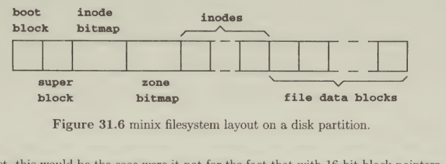

图 31.6 磁盘分区上的 minix 文件系统布局。

至少，如果不是因为 16 位块指针最多只能指向 65536 个数据块（即 64 Mb）这一事实，情况本应如此。

磁盘分区上 minix 文件系统的布局比 System V 的等价物稍微复杂一些，如图 31.6 所示。额外复杂性的部分原因是 minix 文件系统使用了将数据块分组的概念，即区域，不过默认情况下，区域和数据块是同一事物，且大小均为 1 Kb。

其余的额外复杂性是由于添加了 inode 和区域位图。基本上，它们取代了超级块中 System V 的空闲 inode 和空闲数据块列表。位图的优点是占用空间相对较少，因为只需一个位即可为每个 inode 和区域指定其是否在使用或空闲。其实际后果是，只要文件系统处于挂载状态，整个位图就可以保存在内存中。在内存中搜索位图的操作远快于在磁盘上顺序搜索 inode 数组，或在需要时从磁盘读取磁盘块的内容以填充超级块的 inode 和数据块空闲列表。

使用区域位图而非数据块位图的原因是磁盘空间按区域分配。区域是一组按 2 的幂大小的数据块，被组合在一起，并在将空间分配给文件时作为单个实体对待。这意味着区域的大小可以是 1、2、4、8 等数据块（默认情况下为 1 个数据块大小）。采用这种安排，可以拥有大于 64 Mb 的 minix 文件系统，因为通过 inode 访问的所有指针实际上是指向区域，而这些区域可以大于 1 Kb 的默认值。

### 31.4 ext2

第二扩展文件系统几乎是所有 Linux 发行版和安装中使用的标准文件系统类型。它非常强大且灵活，并且已针对性能进行了大量优化。为了说明这一点，我们将查看它与其他两个你已看到的系统之间的一些差异，以观察改进之处。

首先，ext2 文件系统中的 inode 包含 15 个块指针，每个指针大小为 32 位。这些被安排为 12 个直接数据块指针，然后是一个单间接、一个双间接和一个三间接块指针。

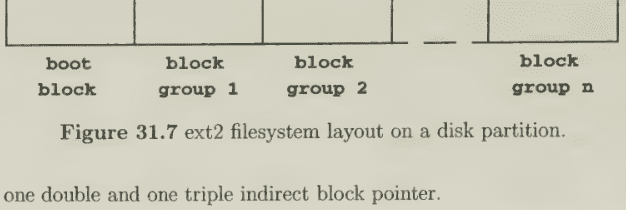

图 31.7 磁盘分区上的 ext2 文件系统布局。

接下来，ext2 中的文件名不像标准 System V 和 minix 文件系统中那样受限于最大 14 个字符的固定大小记录。在 ext2 中，目录条目长度可变，以避免浪费空间，最大长度为 255 个字符——对于任何应用程序来说都绰绰有余。

文件系统在磁盘分区上的布局也已更新，以使其对数据的读写更快、更高效。图 31.7 显示了分区的顶层结构。

该图显示分区由一个引导块组成，后面跟着一个称为块组的结构的重复集合。块组的想法是它们应提高文件系统的可靠性，并与我们检查过的其他文件系统相比提高其速度。

使用块组提高了可靠性，因为每个块组都包含系统关键信息的重复副本，具体为超级块和文件系统描述符。这意味着如果该数据的某一份副本损坏，仍然可以获得备份副本的访问权限。

文件系统中其余的信息，包括块和 inode 位图、inode 数组和文件数据块，然后在块组之间进行分配，以便每个块组都有每个结构的一部分。这在图 31.8 中显示，该图给出了单个块组的布局。

为了使用这种方案提高数据访问速度，ext2 文件系统使用了一系列优化的组合，包括：

-   每当向文件分配数据块时，ext2 总是会尝试将块分配到与文件 inode 相同的块组中。这确保 inode 和数据块在磁盘上物理上彼此靠近，从而减少访问文件及其数据所需磁盘磁头移动量。
-   当你写入文件并需要为文件分配新的数据块时，ext2 会尝试预分配最多八个连续的数据块，以便文件可以增长。使用块位图，这是一个简单的操作，因为八个连续的数据块将在位图中由八个连续的位表示（即一个字节）。
-   当对文件进行顺序读取操作并且需要进行物理磁盘读取时，ext2 可以利用数据写入的方式。由于写入时预分配了连续的数据块，很可能正在读取的数据包含在连续的块中。这使得在磁盘磁头处于正确位置时，一次性将几个块读入缓冲区缓存是值得的，这样数据在需要时已经在缓存中。

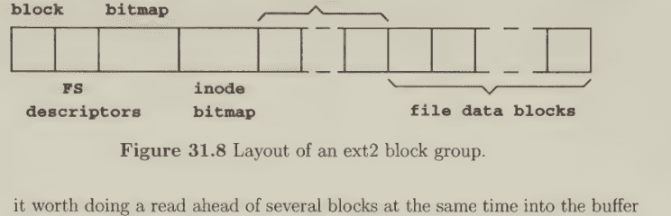

图 31.8 ext2 块组的布局。

ext2 文件系统提供了许多其他设施，使其成为通用 Linux 文件系统的最佳当前选择。它还具有很大的未来扩展灵活性，并且开发工作持续进行中。

## 系统调用

在第 3 部分中，我们对 Linux 提供的更重要的系统调用进行了相当详细的查看。我们查看的列表并不代表所有可用系统调用的完整列表，也不可能如此，因为该列表的大小不是固定的，可以根据需要进行扩展。话虽如此，系统调用列表并不经常扩展，但有时会发生。

本章介绍 Linux 执行其系统调用所使用的基本机制，然后解释如何向 Linux 内核添加自己的系统调用。

### 32.1 中断和异常

大多数现代微处理器，包括 Linux 将运行的所有 PC 处理器，都可以由优先级高于当前执行代码的事件中断其处理。

这些特殊事件有几种“类型”，但总体上被称为中断和异常。通常，中断是由某些外部事件引起的对处理器的硬件生成的“提示”。这些事件包括硬盘和软盘活动，以及键盘输入和调制解调器控制活动等。另一方面，异常是响应某些类型的系统错误以及响应程序代码中可以执行的某些特殊机器代码指令而生成的。

无论引发哪种中断或异常，处理器的响应都相当相似。会执行一段特殊的代码，称为中断处理程序或异常处理程序。通常，对于特定系统上使用的每个中断和异常类型，都有一个单独的处理程序。

其工作原理是每个中断和异常类型都被赋予 0 到 255 范围内的唯一编号。每当引发中断或异常时，该编号（称为向量号）用作指针数组（中断和异常向量表）的索引。表中的每个指针都是一个例程的地址，该例程将被调用以处理其特定的中断或异常类型。大多数中断和异常被视为函数调用，因此当中断或异常处理程序完成时，被中断的代码会从中断处继续。

### 32.2 系统调用机制

那么，为什么我要告诉你所有这些呢？好吧，在 Linux 下，系统调用被实现为可以通过执行适当的机器代码指令生成的异常类型之一。生成中断或异常的一个重要副作用是系统会自动从用户模式切换到内核模式以处理它。这意味着执行系统调用异常指令将自动使系统切换到内核模式并安排执行知道如何处理该调用的异常处理程序。

Linux 用于执行系统调用异常的实际指令是：

```
int $0x80
```

这使用中断/异常向量号 128（80 十六进制）将控制传递给内核。

为了让你在进行系统调用时无需进行任何机器代码编程，标准 C 库为每个系统调用包含一个简短的例程，该例程为你完成机器代码部分。事实上，机器代码部分相当简单；发生的事情只是将要传递给系统调用的任何参数值加载到 CPU 寄存器中，然后执行 int 0x80 指令。然后系统调用将被运行，调用的任何返回值将返回到 CPU 寄存器之一。标准库例程获取该返回值并安排将其传回你的代码。

为了便于手动执行系统调用，Linux 提供了一组预处理器宏，可在你自己的代码中使用。这些宏接受参数，当宏展开时，这些参数将使展开定制为调用特定系统调用的特定函数。

这些宏的名称都具有以下形式：

```
_syscallN(parameters)
```

其中 N 被替换为系统调用将接受的参数数量，而 parameters 被替换为一组参数，用于为特定系统调用定制展开。例如，为了创建一个调用 setuid() 系统调用的函数，你将按如下方式使用 _syscall1() 宏：

```
_syscall1(int, setuid, uid_t, uid)
```

任何 _syscallN() 宏_ 的第一个和第二个参数分别是生成函数将返回的返回类型（此处的 int）和生成函数本身的名称（此处的 setuid）。

之后，对于系统调用接受的每个参数值，相关的 _syscallN() 宏_ 还有两个额外参数，用于指定每个系统调用参数的类型和名称（示例中的 uid_t 和 uid）。

可用于系统调用参数的数据类型的一个限制是它们的大小不得超过 4 字节，因为在执行 int 0x80 指令进行调用时，参数的值都存储在 32 位 CPU 寄存器中。 由于使用 CPU 寄存器传递参数而产生的另一个限制是，可以传递给系统调用的参数数量存在最大值。 该限制为五，因此只定义了六个不同的 _syscallN() 宏（_syscall0() 到 _syscall5()）。

一旦使用特定系统调用的一组适当参数展开了其中一个 _syscallN() 宏_，结果就是一个具有该系统调用名称的函数，可以从用户程序中运行以执行该调用。

### 32.3 添加新调用

一旦你理解了 Linux 程序执行系统调用的机制，向内核添加自己的系统调用就是一项相当直接的任务。为了更好地确保你理解此过程，我们将实际开发一个非常简单的新的系统调用并将其添加到内核中。 要添加的系统调用将是：

```
int printcons(char *mess, int len);
```

printcons() 调用接受两个参数，mess，它是指向存储在字符数组中的消息的指针，以及 len，它是数组中的字符数。 新调用所做的全部工作就是在控制台终端屏幕上显示消息字符。 如果成功，printcons() 将返回零值，否则将返回 -1 并且 errno 将被适当地设置。

#### 32.3.1 编写调用

第一个任务是编写要添加到内核的代码。 这只是一个你将添加到内核文件之一的函数，这与编写设备驱动程序函数非常相似，你以前见过。 printcons() 系统调用的代码如下所示：

```
asmlinkage int sys_printcons(char *mess, int len)
{
char *kmess;

/* 1 */
if (verify_area(VERIFY_READ, mess, len))
    return -EFAULT;

/* 2 */
if ((kmess = vmalloc(len+1))==0)
    return -ENOMEM;

/* 3 */
memcpy_fromfs(kmess, mess, len);
kmess[len] = '\0';
console_print(kmess);

/* 4 */
vfree(kmess);
return 0;
}
```

对于将文本打印到控制台屏幕这样一个微不足道的任务来说，这段代码可能看起来有些过度，但它确实说明了几点。 最简单的输入此代码的位置，假设你的内核源代码位于标准位置（`/usr/src/linux`）是在文件末尾：

    `/usr/src/linux/kernel/sys.c`

关于代码本身首先要注意的是，函数名只是新系统调用的名称前面加上 sys_。 参数随后被声明，就好像系统调用将像函数一样使用。

代码中编号注释的文本如下：

- 1. 此系统调用将使用 `console_print()` 内核函数在控制台屏幕上显示字符串的内容。 文本消息（mess）的指针是用户内存中的地址，因此在打印之前消息需要复制到内核内存中。 因此，第一个任务是检查对给定地址的内存访问对于将代表其执行的用户来说是否合法。 此检查是通过调用 `verify_area()` 内核函数完成的。 如果不允许所需的访问，我们的系统调用将返回 EFAULT 错误。
- 2. 为了能够处理任意长度的消息，下一步是动态使用内核 `vmalloc()` 函数获取一块内存，以便可以将用户文本消息复制到其中。 请注意，所请求内存块的大小比从用户空间复制的字符数大一个字节。 这是为了确保有空间可用于写入零字节以终止消息并将其制作为用于打印的 C 字符串。 vmalloc() 返回的指针被赋给变量 kmess。 此处的任何失败都会导致返回 ENOMEM 错误。
- 3. 接下来的三行代码获取用户的消息，使用 memcpy_fromfs() 函数将其从 mess 复制到 kmess，在消息末尾添加一个零字节以便打印，然后使用内核 console_print() 函数在屏幕上显示消息。
- 4. 最后，最后两行通过使用 vfree() 将 vmalloc() 分配的内存释放回系统来进行清理，然后最后一行向调用进程返回零以显示调用成功。

#### 32.3.2 链接调用

编写完新系统调用的代码后，下一个任务是使内核的其余部分意识到代码的存在，然后构建一个包含系统调用代码的新内核。

为了将现有内核代码中的链接添加到你的新函数中，你需要编辑两个文件。 根据你运行的内核版本，其中第一个是：

```
/usr/src/linux/include/linux/unistd.h
```

对于内核版本最高为 1.2 的内核，或者对于版本为 1.3 及更高版本的内核，文件是：

```
/usr/src/linux/include/asm-i386/unistd.h
```

该文件包含一组 #defines 列表，用于为每个系统调用分配唯一的编号。 列表中的每一行格式如下：

```
#define __NR_name          NNN
```

其中 name 用系统调用名称替换，NNN 是该系统调用对应的编号。 你应该将你的调用名称添加到列表末尾，并按顺序为其分配下一个可用的系统调用编号。 我们示例系统调用的行可能是：

```
#define __NR_printcons      149
```

要更改的第二个文件也取决于你正在修改的内核版本。 对于内核版本最高为 1.1 的内核，文件是：

```
/usr/src/linux/include/linux/sys.h
```

你需要做的就是将你的新内核函数名称添加到初始化 sys_call_table[] 数组的列表末尾。 通过这样做，你将指向你的新内核函数的指针添加到指向内核中每个系统调用的函数指针数组的末尾。 为了防止编译器对数组中的函数名发出抱怨，你还需要将函数的 extern 声明添加到 sys_call_table[] 数组定义之前出现的类似声明列表的末尾。

对于版本 1.2 及更高版本的内核，第二个要修改的文件是：

```
/usr/src/linux/arch/i386/kernel/entry.S
```

该文件包含与前一版本相同的指针数组的初始化，但这次是用汇编代码而不是 C 语言编写的。 不用担心该文件是汇编代码——你不需要理解它就能成功修改它。

你所要做的就是查找格式为的汇编指令列表：

```
.long _sys_name
```

后面跟着格式为的另一个汇编指令：

```
.space (NR_syscalls-NNN)*4
```

其中公式中的 NNN 是系统调用的总数。 你需要做的就是添加一个新 .long 行，其中包含你自己的内核函数名称前面加上下划线（_），然后递增 NNN 值以包含你的新调用。 我们示例的结果可能是：

```
.long _sys_printcons
.space (NR_syscalls-149)*4
```

到目前为止，剩下的就是重建并运行新内核。 在之前的解释中，某些文件路径名中的 i386 引用可以用适当的名字替换，如果你的工作需要在 Linux 已移植到的其他机器架构上进行。

#### 32.3.3 使用新调用

现在剩下的就是弄清楚如何在程序内部使用你的新系统调用。 不要忘记，标准 C 库中不存在你的新系统调用的代码存根，因此你必须自己创建一个。

这真的很容易，使用 _syscallN() 宏。 一个使用新的 printcons 系统调用的简短 C 程序可以是：

```
#include <linux/unistd.h>
```

```
_syscall2(int, printcons, char *, mess, int, len)
```

main()
{
    char message[] = "Print straight to console\n";
    
    if (printcons(message, strlen(message))==-1)
        printf("Error occurred in printcons() call\n");
}

_syscall2() 宏在这里被使用，因为我们的系统调用有两个参数。该宏本身将在你的程序中展开为一个名为 printcons() 的函数，随后的 main() 内部调用将执行它。预处理器生成的程序中 printcons() 函数内部的代码将包含加载系统调用参数值到适当的 CPU 寄存器所需的所有机器代码指令，然后执行 int 0x80 异常。当异常返回时，将检查来自你的内核函数的返回值，并将适当的值返回给 main() 中的代码。

## Linux 排列索引

本书中没有直接涵盖许多命令、系统调用、库函数和其他 Linux 设施。使用这些设施最大的困难之一就是首先发现它们存在。本索引旨在使找到那些否则会保持未知的许多设施变得更容易。

为此，我收集了大量存在手册页的设施的名称，以及这些设施的简单描述，并根据名称和描述中的关键词创建了索引。

为了使用该索引，你需要做的就是想出一个或多个可能与你感兴趣的主题相关的关键词，然后查找这些关键词。你会找到包含你的关键词的任何设施的名称、手册章节和描述的列表。

例如，假设你不知道如何在软盘上删除一个 DOS 文件。这里明显的关键词可能是：delete 或 DOS。事实上，这两者中的任何一个都会引导你发现手册第 (1) 节中的 mdel 命令。

对关键词 delete 进行索引查找将给出以下条目：

- delete - lprm (1) - 删除排队的打印机作业
- delete - mdel (1) - mtools 删除 DOS 文件
- delete - rm (1) - 删除文件
- delete - rmdir (1) - 删除空目录
- delete - rmdir (2) - 删除一个目录
- delete_module - delete_module (2) - 内核可加载模块支持

正如你所见，你不仅会得到 mdel 的线索，还会得到其他与删除其他事物相关的命令和函数。你应该记住，在你的系统上，你可用的手册页列表取决于你安装的 Linux 发行版以及你选择加载的该发行版的软件包。

; . (1) - bash 内置命令
; : (1) - bash 内置命令
1970 - kernel_mktime (9) - 将 struct mktime 转换为自 1970 年 1 月 1 日以来的秒数
8086 - vm86 (2) - 进入虚拟 8086 模式
abnormal - abort (3) - 导致异常进程终止
abort - abort (3) - 导致异常进程终止
abs - abs (3) - 绝对值数学函数
absolute - abs (3) - 绝对值数学函数
absolute - fabs (3) - 浮点数的绝对值
absolute - labs (3) - long int 的绝对值
absolute - realpath (3) - 从相对路径名或符号链接创建绝对路径名
accept - accept (2) - 在套接字上接受连接
access - access (2) - 检查用户对文件的权限
accounting - acct (2) - 开启或关闭进程记账
accounting - pac (8) - 显示打印机记账信息
acct - acct (2) - 开启或关闭进程记账
acos - acos (3) - 反余弦三角函数
acosh - acosh (3) - 逆双曲余弦三角函数
across - gpm (1) - 在虚拟控制台之间剪切和粘贴
addtinfo - addtinfo (1) - 修改 troff 字体文件以供 groff 使用
addmntent - addmntent (3) - 访问 fstab 和 mtab 文件条目
address - elmalias (1) - 展开并显示 elm 地址别名
address - mailaddr (7) - 邮件地址描述
address - newalias (1) - 安装新的 elm 邮件地址别名
addresses - inet_addr, inet_network, inet_ntoa, inet_makeaddr, inet_lnaof, inet_netof (3) - 操作 Internet 地址
add_timer - add_timer (9) - 内核事件定时器
adjtimex - adjtimex (2) - 调整内核时钟
adjust_clock - adjust_clock (9) - 根据时区值将内核时钟设置为 GMT
administrative - intro (8) - 管理/特权命令简介
Adobe - afa2tfm (1) - 将 Adobe 字体度量转换为 TeX 字体度量
afm2tfm - afm2tfm (1) - 将 Adobe 字体度量转换为 TeX 字体度量
afmtodit - afmtodit (1) - 创建供 groff 使用的字体文件
afs.syscall - afs.syscall (2) - 未实现的系统调用
agetty - agetty (8) - 用于登录提示的 getty
alarm - alarm (2) - 设置闹钟信号的时钟
alias - alias (1) - bash 内置命令
alias - checkalias (1) - 测试别名是否已定义
aliases - elmalias (1) - 展开并显示 elm 地址别名
aliases - listalias (1) - 显示 elm 别名
aliases - newalias (1) - 安装新的 elm 邮件地址别名
alloca - alloca (3) - 分配内存
allocate - alloca (3) - 分配内存
allocation - calloc, malloc, free, realloc (3) - 动态内存分配函数
alphasort - alphasort (3) - 按特定属性搜索目录条目
alter - renice (8) - 修改正在运行进程的优先级
amount - sleep (1) - 休眠指定时间
amount - sleep (3) - 休眠指定时间
amslatex - amslatex (1) - 文本格式和排版
amstex - amstex (1) - 文本格式和排版
anagram - strfry (3) - 生成字符串的字母异位词
analog - xclock (1) - X-windows 的模拟和数字时钟
analysis - gnua (6) - 生成国际象棋对局分析
analyzer - flex (1) - 快速词法分析器生成器
anonymous - pipe (2) - 创建匿名管道
another - write (1) - 向另一用户发送消息
ANSI - ansi2knr (1) - 将 ANSI C 转换为 Kernighan & Ritchie C
ansi2knr - ansi2knr (1) - 将 ANSI C 转换为 Kernighan & Ritchie C
answer - answer (1) - elm 电话留言系统
a.out - ld.so (8) - a.out 链接器
application's - appres (1) - 列出应用程序的 X 资源
applications - xlsclients (1) - 列出在显示器上运行的客户端应用程序
appres - appres (1) - 列出应用程序的 X 资源
apropos - apropos (1) - 列出与查询相关的手册条目
ar - ar (1) - 创建、修改和从归档中提取
arc - acos (3) - 反余弦三角函数
arc - asin (3) - 反正弦三角函数
arc - atan (3) - 反正切三角函数
arc - atan2 (3) - 双变量反正切三角函数
arch - arch (1) - 显示处理器架构
architecture - arch (1) - 显示处理器架构
archive - funzip (1) - 从 ZIP 归档中提取文件
archive - ranlib (1) - 为 ar 归档生成索引
archive - size (1) - 列出归档和目标文件中的节大小
archive - unzip (1) - 从 zip 归档中提取压缩文件
archive - zip, zipcloak, zipnote, zipsplit (1) - 打包和压缩（归档）文件
archive - zipinfo (1) - 列出 zip 归档的详细信息
archives - ar (1) - 创建、修改和从归档中提取
archives - cpio (1) - 复制文件到归档和从归档复制
archives - fiz (1) - 从损坏的 zoo 归档中恢复数据
archives - shar (1) - 创建 shell 归档
archives - unzipsfx (1) - 创建自解压 zip 归档
archives - zoo (1) - 操作压缩文件归档
archiving - tar (1) - 磁带归档实用程序
argument - stdarg (3) - 可变参数列表宏
ARP - arp (8) - 操作系统 ARP 表
arp - arp (8) - 操作系统 ARP 表
array - bcmp, bcopy, bzero, memccpy, memchr, memcmp, memcpy, memfrob, memmem, memmove, memset (3) - 字节数组操作
array - bsearch (3) - 在已排序数组中进行二分搜索
array - qsort (3) - 快速排序数组
as - banner (6) - 以大横幅形式打印文本
as - pstree (1) - 以树形显示进程层次结构
as - znew (1) - 将 .Z 文件重新压缩为 .gz 文件
ascii - ascii (7) - ascii 字符集
ascii - asctime, ctime, difftime, gmtime, localtime, mktime (3) - 将日期和时间转换为 ascii
ascii - hexdump (1) - 以十六进制、十进制、ascii 和八进制显示文件内容
ascii - pfbtops (1) - 将 .pfb postscript 字体转换为 ascii
ascii - uuencode (1) - 对二进制文件进行 ascii 编码
asctime - asctime (3) - 将日期和时间转换为 ascii
asin - asin (3) - 反正弦三角函数
asinh - asinh (3) - 逆双曲正弦三角函数
assert - assert (3) - 如果断言为假则终止进程
assertion - assert (3) - 如果断言为假则终止进程
assign - putenv (3) - 为环境变量赋值
at - at (1) - 操作稍后执行的批处理作业
atan - atan (3) - 反正切三角函数
atan2 - atan2 (3) - 双变量反正切三角函数
atanh - atanh (3) - 逆双曲正切三角函数
atexit - atexit (3) - 在程序终止时调用函数
atobm - atobm (1) - X11 的位图编辑器和实用程序
atof - atof (3) - 将字符串转换为 double
atoi - atoi (3) - 将字符串转换为整数
atol - atol (3) - 将字符串转换为长整数
atoms - xlsatoms (1) - 列出服务器上定义的已驻留原子
atq - atq (1) - 操作稍后执行的批处理作业
atrm - atrm (1) - 操作稍后执行的批处理作业
atrun - atrun (8) - 运行排队稍后执行的批处理作业
attribute - mattrb (1) - 更改 DOS 文件的属性位标志
attributes - chattr (1) - 在第二扩展文件系统中更改文件属性
attributes - lsattr (1) - 列出第二扩展文件系统上的文件属性
attributes - rcs (1) - 更改修订控制系统文件属性
attributes - scandir, alphasort (3) - 按特定属性搜索目录条目
attributes - setterm (1) - 设置终端属性
attributes - termios, tcgetattr, tcsetattr, tcsendbreak, tcdrain, tcflush, tcflow, cfgetospeed, cfgetispeed, cfsetispeed, cfsetospeed (2) - 获取和设置终端属性和控制
audio - workbone (1) - 在 CD-ROM 驱动器上播放音频光盘
audio - workman (1) - 在 CD-ROM 驱动器上播放音频光盘
authority - mcookie (1) - 为 X 授权系统生成魔术 cookie
authority - xauth (1) - X11 授权文件实用程序
authorization - iceauth (1) - 显示或设置 ICE 授权信息
auto-key - kbrdate (8) - 设置键盘自动按键重复率和初始重复延迟时间
automatic - depmod, modprobe (1) - 可加载模块的自动处理
average - tload (1) - 提供系统负载平均值的图形显示
awaiting - select (2) - 休眠等待文件描述符事件
backgrounds - bggen (1) - 为 X11 生成彩色背景
bad - badblocks (8) - 在磁盘分区上搜索坏块
badblocks - badblocks (8) - 在磁盘分区上搜索坏块
bandwidth - lbxproxy (1) - X11 的低网络带宽代理服务器
banner - banner (6) - 以大横幅形式打印文本
basename - basename (1) - 从文件路径名中去掉目录前缀
bash - :, ., alias, bg, bind, break, builtin, bye, case, cd, command, continue, declare, dirs, echo, enable, eval, exec, exit, export, fc, fg, for, getopts, hash, help, history, if, jobs, kill, let, local, logout, popd, pushd, pwd, read, readonly, return, set, shift, source, suspend, test, times, trap, type, typeset, ulimit, umask, unalias, unset, until, wait, while (1) - bash 内置命令
bash - bash (1) - GNU Bourne-Again SHell
batch - at, batch, atq, atrm (1) - 操作稍后执行的批处理作业
batch - atrun (8) - 运行排队稍后执行的批处理作业
batch - fastmail (1) - 快速批处理邮件接口
bcmp - bcmp (3) - 字节数组操作
bcopy - bcopy (3) - 字节数组操作
BDF - fstobdf (1) - 从 X11 字体创建 BDF 文件
bdflush - bdflush (2) - 控制磁盘缓冲区守护进程
bdflush - bdflush (8) - 将缓冲区刷新回磁盘的守护进程
bdf topcf - bdf topcf (1) - X11 字体转换程序
before light - before light (1) - X11 屏幕保护程序
behaviour - reboot (2) - 重启 Linux 或修改 Ctrl-Alt-Del 行为
behaviour - siginterrupt (3) - 更改系统调用的信号行为
Bessel - j0, j1, jn, y0, y1, yn (3) - Bessel 数学函数
bg - bg (1) - bash 内置命令


bggen - bggen (1) - 为 X11 生成彩色背景
bibliographic - gindrxbib (1) - 为书目数据库创建倒排索引
bibliographic - glookbib (1) - 搜索书目参考数据库
bibliographic - grefer (1) - groff 书目引用的预处理器
bibliographic - lkbib (1) - 在书目数据库中查找键
bibliography - bittex (1) - 为 LaTeX 文档制作参考文献
bibtex - bibtex (1) - 为 LaTeX 文档制作参考文献
binary - bpe (1) - 二进制文件编辑器
binary - bsearch (3) - 在已排序数组中进行二分查找
binary - dsplit (1) - 将二进制文件拆分为片段
binary - uencode (1) - ASCII 编码二进制文件
bind - bind (1) - bash 内置命令
bind - bind (2) - 将名称绑定到套接字
bindings - lesskey (1) - 操作 less 的键绑定
bit - ffs (3) - 返回字中第一个置位位的位置
bit - mattrib (1) - 更改 DOS 文件的属性位标志
bit - null, zero (4) - 位桶特殊文件
bitmap - bitmap, btoa, atobm (1) - X11 的位图编辑器和实用程序
BitmapBitOrder - BitmapBitOrder (3) - Xlib 图像格式化函数和宏
BitmapPad - BitmapPad (3) - Xlib 图像格式化函数和宏
BitmapUnit - BitmapUnit (3) - Xlib 图像格式化函数和宏
bits - chmod (1) - 更改文件访问权限位
bits - chmod, fchmod (2) - 更改文件访问权限位
block - dumpe2fs (8) - 显示文件系统超级块和块组信息
block - pause (2) - 阻塞进程并等待信号
block - sum (1) - 为文件生成校验和和块计数
block - xtetris (6) - X 窗口方块下落游戏
block-group - dumpe2fs (8) - 显示文件系统超级块和块组信息
blocks - badblocks (8) - 在磁盘分区上搜索坏块
blocks - readv, writev (3) - 使用多个缓冲区传输多个数据块
bmtoa - bmtoa (1) - X11 的位图编辑器和实用程序
board - xvier (6) - X11 棋盘游戏
boot - bootparam (7) - Linux 内核启动时参数
bootparam - bootparam (7) - Linux 内核启动时参数
bounding - pabb (1) - 从 PostScript 文档获取边界框大小
Bourne-Again - bash (1) - GNU Bourne-Again Shell
box - psbb (1) - 从 PostScript 文档获取边界框大小
boxes - dialog (1) - 从 shell 脚本处理对话框框
bpe - bpe (1) - 二进制文件编辑器
break - break (1) - bash 内置命令
break - break (2) - 未实现的系统调用
breaks - more (1) - 分页显示文件内容
bridge - xcutsel (1) - 剪切和粘贴桥接程序
brk - brk (2) - 更改进程数据段大小
bsearch - bsearch (3) - 在已排序数组中进行二分查找
bucket - null, zero (4) - 位桶特殊文件
buffer - bdflush (2) - 控制磁盘缓冲区守护进程
buffer - dmesg (8) - 显示/控制内核消息缓冲区
buffer - sync (2) - 刷新文件系统缓冲区缓存
buffer - sync (8) - 刷新文件系统缓冲区缓存
buffering - setbuf, setbuffer, setlinebuf, setvbuf (3) - 文件输出缓冲操作
buffers - bdflush (8) - 将缓冲区刷新回磁盘的守护进程
buffers - readv, writev (3) - 使用多个缓冲区传输多个数据块
build - column (1) - 从列表构建列
buildhash - buildhash (1) - 拼写检查器
built-in - :, ., alias, bg, bind, break, builtin, bye, case, cd, command, continue, declare, dirs, echo, enable, eval, exec, exit, export, fc, fg, for, getopts, hash, help, history, if, jobs, kill, let, local, logout, popd, pushd, pwd, read, readonly, return, set, shift, source, suspend, test, times, trap, type, typeset, ulimit, umask, unalias, unset, until, wait, while (1) - bash 内置命令
builtin - builtin (1) - bash 内置命令
bye - bye (1) - bash 内置命令
byte - bcp, bcopy, bzero, memccpy, memchr, memcmp, memcpy, memrchr, memmem, memmove, memset (3) - 字节数组操作
byte - htonl, htons, ntohl, ntohs (3) - 在主机和网络字节顺序之间转换
byte-order - swab (3) - 交换字字节顺序
bytes - cksum (1) - CRC 检查并统计文件中的字节数
bytes - read (2) - 从打开的文件描述符读取字节
bytes - wc (1) - 打印文件中的字节数、词数和行数
bzero - bzero (3) - 字节数组操作
cache - sync (2) - 刷新文件系统缓冲区缓存
cache - sync (8) - 刷新文件系统缓冲区缓存
cal - cal (1) - 显示日历
calculate - difftime (3) - 计算两个时间之间的秒数
calculates - div (3) - 在整数除法上计算商和余数
calculation - hypot (3) - 毕达哥拉斯距离计算
calendar - cal (1) - 显示日历
call - atexit (3) - 程序终止时调用函数
call - globfree (3) - 释放上一次 glob 调用分配的内存
call - idle (2) - 使进程 0 空闲的内部系统调用
call - socketcall (2) - 套接字系统调用入口点
calloc - calloc (3) - 动态内存分配函数
calls - afs.syscall, break, gtty, lock, mpx, prof, quotactl, stty (2) - 未实现的系统调用
calls - intro (2) - 系统调用简介
calls - siginterrupt (3) - 使用系统调用更改信号行为
calls - strace (1) - 运行命令并跟踪系统调用和信号
can - securetty (5) - root 可以登录的 tty 列表
capability - printcap (5) - 打印机功能数据库
capability - termcap (5) - 终端功能数据库
capability - terminfo (5) - 终端功能数据库
card - spider (1) - 双副牌卡片游戏
case - bash (1) - bash 内置命令
case - strcasecmp, strncasecmp (3) - 比较两个字符串并忽略大小写
case - toupper, tolower (3) - 将字母转换为大写或小写
cat - cat (1) - 串联文件
catalog - catopen, catclose, catgets (3) - 消息目录操作
catclose - catclose (3) - 消息目录操作
catgets - catgets (3) - 消息目录操作
catopen - catopen (3) - 消息目录操作
cause - abort (3) - 导致异常进程终止
cause - exit (3) - 导致程序终止
cbrt - cbrt (3) - 立方根数学函数
cccp - cccp (1) - C 预处理器
cd - cd (1) - bash 内置命令
CD-ROM - workbone (1) - 在 CD-ROM 驱动器上播放音频光盘
CD-ROM - workman (1) - 在 CD-ROM 驱动器上播放音频光盘
cftin - cftin (1) - 网络新闻阅读器
ceil - ceil (3) - 不小于 x 的最小整数值
cfdisk - cfdisk (8) - 基于 curses 的 fdisk
cfgetispeed - cfgetispeed (2) - 获取和设置终端属性和控制
cfgetospeed - cfgetospeed (2) - 获取和设置终端属性和控制
cfsetispeed - cfsetispeed (2) - 获取和设置终端属性和控制
cfsetospeed - cfsetospeed (2) - 获取和设置终端属性和控制
character - ascii (7) - ascii 字符集
character - fgetc, fgets, getc, getchar, gets, ungetc (3) - 字符串和字符输入函数
character - fputc, fputs, putc, putchar, puts (3) - 字符串和字符输出函数
character - groff.char (7) - groff 输入字符列表
character - index, rindex (3) - 在字符串中查找字符
character - isalnum, isalpha, iscntrl, isdigit, isgraph, islower, isprint, ispunct, isspace, isupper, isxdigit (3) - 字符测试函数和宏
character - iso.8859.1 (7) - 字符集映射
character - mblen (3) - 获取多字节字符的长度
character - mbstowcs (3) - 将多字节转换为宽字符字符串
character - mbstowcs (3) - 将宽字符转换为多字节字符串
character - strchr, strrchr (3) - 在字符串中查找字符
character - wccomb (3) - 将宽字符转换为多字节字符
characteristics - reset (1) - 将终端特性重置为合理值
characters - mbtowc (3) - 将多字节字符转换为宽字符
characters - strpbrk (3) - 在字符串中查找一组字符中的任意一个
characters - strspn, strcspn (3) - 返回包含给定字符的字符串长度
characters - tr (1) - 翻译字符
characters - xfd (1) - 显示给定 X11 字体中的字符
chat - ytalk (1) - 多用户聊天程序
chattr - chattr (1) - 更改第二扩展文件系统中的文件属性
chdir - chdir (2) - 更改当前工作目录
check - access (2) - 检查用户对文件的权限
check - clearerr, feof, ferror, fileno (3) - 重置和检查流状态
check - dosfsck (8) - 检查/修复 DOS 文件系统
check - e2fsck (8) - 检查第二扩展文件系统
check - fsck (8) - 完整性检查并修复文件系统
check - fsck.minix (8) - 完整性检查并修复 minix 文件系统
check - login (1) - 密码检查程序
check - md5sum (1) - 生成或检查 MD5 消息签名
check - pathchk (1) - 检查有效文件名
check - xfsck (8) - xiafs 文件系统一致性检查和修复
checkalias - checkalias (1) - 测试别名是否已定义
checked - rcsfreeze (1) - 冻结在 RCS 下检入的一组源代码
checker - frag (8) - 文件系统碎片检查器
checker - ispell (4) - 拼写检查器词典格式
checker - ispell, buildhash, munchlist, findaffix, tryaffix, icombine, ijoin (1) - 拼写检查器
check-in - ci (1) - 修订控制系统检入文件
check-out - co (1) - 修订控制系统检出文件
checksum - sum (1) - 为文件生成校验和和块计数
chess - cmail (6) - 用于电子邮件象棋游戏
chess - gnuan (6) - 生成象棋游戏分析
chess - gnuchess (6) - 象棋游戏
Chess - xboard (6) - GNU Chess 的 X-windows 用户界面
chfn - chfn (1) - 更改 finger 信息
chgrp - chgrp (1) - 更改文件组所有权
child - clone (2) - 创建子进程
child - fork, vfork (2) - 创建子进程


chmod - chmod (1) - 更改文件访问权限位
chmod - chmod (2) - 更改文件访问权限位
chown - chown (1) - 更改文件的所有者和组所有权
chown - chown (2) - 更改文件所有权
chroot - chroot (2) - 更改根目录
chroot - chroot (8) - 使用新的根目录执行程序
chsh - chsh (1) - 在密码文件中更改登录 shell
chsh - shells (5) - 用于 chsh 的登录 shell 路径名文件
ci - ci (1) - 修订控制系统签入文件
cksum - cksum (1) - CRC 校验并统计文件中的字节数
clean - rcs clean (1) - 清理未修改的 rcs 工作文件
clear - clear (1) - 清屏终端
clearerr - clearerr (3) - 重置并检查流状态
client - rstart (1) - rsh 远程启动客户端
client - xclipboard (1) - X-windows 剪贴板客户端
client - xlsclients (1) - 列出在显示器上运行的客户端应用程序
clients - xkill (1) - 关闭与 X11 客户端的连接
clipboard - xclipboard (1) - X-windows 剪贴板客户端
clock - adjtimex (2) - 调整内核时钟
clock - adjust_clock (9) - 根据时区值将内核时钟设置为格林威治标准时间
clock - alarm (2) - 为闹钟信号设置时钟
clock - clock (3) - 返回进程使用的处理器时间
clock - clock (8) - 操作 CMOS 时钟
clock - oclock (1) - X11 时钟
clock - xclock (1) - X-windows 的模拟和数字时钟
clone - clone (2) - 创建子进程
close - close (2) - 关闭文件描述符
close - closedir (3) - 关闭目录
close - fclose (3) - 关闭文件指针
close - xkill (1) - 关闭与 X11 客户端的连接
closedir - closedir (3) - 关闭目录
closelog - closelog (3) - 将文本发送到系统消息和错误记录器
cmail - cmail (6) - 用于电子邮件象棋游戏
CMOS - clock (8) - 操作 CMOS 时钟
cmp - cmp (1) - 比较两个文件
co - co (1) - 修订控制系统签出文件
code - fig2dev (1) - 将 Fig 代码翻译成其他图形语言
code - rpcgen (1) - RPC 协议的 C 代码生成器
col - col (1) - 从输入中删除反向换行符
colcrt - colcrt (1) - 将 nroff 输出翻译为屏幕查看格式
color - dircolors (1) - 设置 ls 颜色参数
color - xcmsdb (1) - X11 颜色管理系统
colored - bggen (1) - 为 X11 生成彩色背景
colormap - xcmap (1) - 显示默认 X11 颜色映射表
colormap - xstdcmap (1) - X-windows 标准颜色映射表实用程序
color-name - showrgb (1) - 反编译 rgb 颜色名数据库
colrm - colrm (1) - 从文件中删除列
column - column (1) - 从列表构建列
columns - colrm (1) - 从文件中删除列
columns - column (1) - 从列表构建列
combination - ctrlaltdel (8) - 设置 Ctrl-Alt-Del 组合的功能
combines - merge (1) - 合并对文件的多个独立修改
comm - comm (1) - 比较两个已排序的文件
command - command (1) - bash 内置命令
command - getopt (1) - 解析命令行选项
command - getopt (3) - 解析命令行选项
command - groff (1) - 使用 groff 模拟 nroff 命令
command - grog (1) - 生成带参数选项的 groff 命令
command - killall (1) - 按命令名向进程发送信号
command - magic (4) - file 命令的魔数
command - man.config (5) - man 命令的配置文件
command - nohup (1) - 运行设置为忽略挂断信号的命令
command - strace (1) - 运行命令并跟踪系统调用和信号
command - system (3) - 执行 Linux 命令
command - tee (1) - 在命令管道中添加 tee 以写入文件
command - whereis (1) - 定位与命令相关文件
command - xargs (1) - 从标准输入执行命令行
command - xon (1) - 在远程机器上运行 X-windows 命令
commands - :, ., alias, bg, bind, break, builtin, bye, case, cd, command, continue, declare, dirs, echo, enable, eval, exec, exit, export, fc, fg, for, getopts, hash, help, history, if, jobs, kill, let, local, logout, popd, pushd, pwd, read, readonly, return, set, shift, source, suspend, test, times, trap, type, typeset, ulimit, umask, unalias, unset, until, wait, while (1) - bash 内置命令
commands - intro (1) - 用户命令简介
commands - intro (8) - 管理/特权命令简介
commands - rcsintro (1) - 修订控制系统命令简介
commands - resize (1) - 生成 shell 命令以将 TERMCAP 和 TERM 设置为当前 xterm 大小
commands - which (1) - 显示命令的路径名
common - join (1) - 按公共字段逐行连接两个已排序文件
communication - ipc (5) - System-V 进程间通信机制
communication - minicom (1) - 串行通信程序
communication - socket (2) - 创建通信端点
communication - talk (1) - 交互式用户通信
communication - talked (8) - talk 通信守护进程
communications - runscript (1) - minicom 通信程序的脚本解释器
compact - workbone (1) - 在 CD-ROM 驱动器上播放音频光盘
compact - workman (1) - 在 CD-ROM 驱动器上播放音频光盘
compare - cmp (1) - 比较两个文件
compare - comm (1) - 比较两个已排序的文件
compare - rcsdiff (1) - 比较修订控制系统文件
compare - strcasecmp, strncasecmp (3) - 比较两个字符串并忽略大小写
compare - strcmp, strncmp, strcoll (3) - 比较两个字符串
comparison - x11perfcomp (1) - X11 服务器比较程序
comparisons - test (1) - 为文件类型检查和值比较生成退出状态
comparisons - zcmp, zdiff (1) - 对压缩文件执行比较
compatible - groff (1) - gnu troff 兼容文档格式程序
compile - gtbl (1) - 为 groff 编译表格描述
compiled - term (5) - 编译后的 term 文件格式
compiled - untic (1) - 反编译编译后的 terminfo 文件内容
compiler - g++ (1) - GNU C++ 编译器
compiler - gcc (1) - GNU C 编译器
compiler - tic (1) - terminfo 编译器
compiler - zic (8) - 时区编译器
complementary-error - erf, erfc (3) - 误差和互补误差数学函数
compress - compress, uncompress, zcat (1) - 压缩和扩展文件内容
compress - gzip, gunzip, zcat (1) - 压缩和解压缩文件
compress - sq (1) - 压缩已排序的词列表
compress - zip, zipcloak, zipnote, zipsplit (1) - 打包和压缩（归档）文件
compressed - gzexe (1) - 创建自解压压缩可执行文件
compressed - unzip (1) - 从 zip 归档中提取压缩文件
compressed - zcmp, zdiff (1) - 对压缩文件执行比较
compressed - zgrep (1) - 在压缩文件中搜索正则表达式
compressed - zmore (1) - 显示压缩文本
compressed - zoo (1) - 操作压缩文件归档
concatenate - cat (1) - 连接文件
concatenate - strcat, strncat (3) - 连接两个字符串
concatenate - tac (1) - 连接并反转文件内容
configuration - fpathconf, pathconf (3) - 获取文件配置选项值
configuration - inittab (5) - init 处理的配置文件
configuration - man.config (5) - man 命令的配置文件
configuration - resolver (5) - resolv 的配置文件
configuration - setserial (8) - 获取和设置 Linux 串口配置
configuration - sysconf (3) - 获取运行时配置信息
configuration - syslog.conf (5) - syslogd 配置文件
configuration-dependent - confstr (3) - 获取配置相关字符串变量值
configure - ifconfig (8) - 配置网络接口
configure - plipconfig (8) - 配置 PLIP 设备参数
configured - filesystems (9) - 详细说明已配置文件系统的表
confstr - confstr (3) - 获取配置相关字符串变量值
connect - connect (2) - 建立套接字连接
connected - getpeername (2) - 获取连接到给定套接字的对等方的名称
connected - socketpair (2) - 创建一对已连接的套接字
connection - accept (2) - 在套接字上接受连接
connection - connect (2) - 建立套接字连接
connection - shutdown (2) - 关闭全双工套接字连接的全部或部分
connections - listen (2) - 指定传入套接字连接的队列长度
connections - netstat (8) - 显示活动网络连接的状态信息
connections - xkills (1) - 关闭与 X11 客户端的连接
consistency - xfsck (8) - xfs 文件系统一致性检查和修复
console - console (4) - 控制台终端
console - setfont (8) - 加载 EGA 或 VGA 控制台屏幕字体
console - xconsole (1) - 使用 X-windows 监视系统控制台消息
consoles - gpm (1) - 在虚拟控制台之间剪切和粘贴
containing - strspn, strcspn (3) - 返回包含给定字符的字符串长度
contents - compress, uncompress, zcat (1) - 压缩和扩展文件内容
contents - hexdump (1) - 以十六进制、十进制、ASCII 和八进制显示文件内容
contents - ls, dir, vdir (1) - 列出目录内容
contents - more (1) - 分页显示文件内容
contents - mtype (1) - 显示 DOS 文件内容
contents - od (1) - 以八进制或其他格式显示文件内容
contents - tac (1) - 连接并反转文件内容
contents - untic (1) - 反编译编译后的 terminfo 文件内容
continue - continue (1) - bash 内置命令
control - bdflush (2) - 控制磁盘缓冲区守护进程
control - ci (1) - 修订控制系统签入文件


控制 - co (1) - 修订控制系统签出文件
控制 - ctermid (3) - 获取控制终端名称
控制 - dmesg (8) - 显示/控制内核消息缓冲区
控制 - init, telinit (8) - 设置和控制进程初始化
控制 - ioctl (2) - 输入和输出设备控制
控制 - lpc (8) - 控制行式打印机系统
控制 - msgctl (2) - System-V IPC 控制消息操作
控制 - mt (1) - 控制磁带驱动器
控制 - ptrace (2) - 调试进程跟踪控制
控制 - rcs (1) - 更改修订控制系统文件属性
控制 - rcsdiff (1) - 比较修订控制系统文件
控制 - rcsfile (1) - 修订控制系统文件格式
控制 - rcsfile (5) - 修订控制系统文件格式
控制 - rcsintro (1) - 修订控制系统命令简介
控制 - rcsmerge (1) - 合并修订控制系统文件
控制 - rmt (8) - 控制远程磁带驱动器
控制 - semctl (2) - System-V IPC 控制信号量操作
控制 - shmctl (2) - System-V IPC 共享内存控制
控制 - timedc (8) - 定时控制程序
控制 - xhost (1) - X-windows 服务器访问控制程序
控制的 - tty (1) - 打印控制终端的特殊文件名
控制的 - tty (4) - 控制终端特殊文件
控制项 - termios, tcgetattr, tcsetattr, tcsendbreak, tcdrain, tcflush, tcflow, cfgetispeed, cfgetospeed, cfsetispeed, cfsetspeed (2) - 获取和设置终端属性和控制项
转换 - bdftopcf (1) - X11 字体转换程序
转换 - ddate (6) - 日期转换程序
转换 - xv pictoppm (1) - 将 XV 缩略图文件转换为标准 PPM 格式
Cookie - mcookie (1) - 为 X 授权系统生成魔术 Cookie
复制 - copysign (3) - 复制 double 的符号
复制 - cp (1) - 复制文件
复制 - cpio (1) - 向归档文件复制文件和从归档文件复制文件
复制 - dd (1) - 文件和磁盘分区复制
复制 - install (1) - 复制文件并设置所有者和权限模式
复制 - lndir (1) - 使用符号链接制作目录树的副本
复制 - mcopy (1) - mtools 将 DOS 文件复制到 Linux 或从 Linux 复制
复制 - mread (1) - 将 DOS 文件复制到 Linux
复制 - mwrite (1) - 将 Linux 文件复制到 DOS
复制 - rcp (1) - 远程文件复制
复制 - stncpy, strncpy (3) - 复制字符串
copysign - copysign (3) - 复制 double 的符号
对应 - psignal (3) - 打印与信号对应的消息
cos - cos (3) - 余弦三角函数
cosh - cosh (3) - 双曲余弦三角函数
余弦 - acos (3) - 反余弦三角函数
余弦 - acosh (3) - 逆双曲余弦三角函数
余弦 - cos (3) - 余弦三角函数
余弦 - cosh (3) - 双曲余弦三角函数
计数 - cksum (1) - crc 校验并统计文件中的字节数
计数 - messages (1) - 邮件文件夹中的消息计数
计数 - sum (1) - 为文件生成校验和和块计数
cp - cp (1) - 复制文件
cpio - cpio (1) - 向归档文件复制文件和从归档文件复制文件
cpp - cpp (1) - C 预处理器
CPU - top (1) - 显示 CPU 使用率最高的进程
崩溃 - elvisrv (1) - 在崩溃后恢复 elvis 编辑文件的修改版本
崩溃 - elvrec (1) - 在崩溃后恢复未保存的 elvis 编辑器文件
crc 校验 - cksum (1) - crc 校验并统计文件中的字节数
creat - creat (2) - 打开或创建文件或设备
create_module - create_module (2) - 内核可加载模块支持
创建 - transfig (1) - 为可移植 LaTeX 图形创建 makefile
创建 - umask (2) - 设置文件创建掩码
cron - crond (8) - cron 守护进程
cron - crontab (5) - 用于驱动 cron 的表
crond - crond (8) - cron 守护进程
crontab - crontab (1) - 操作每个用户的 crontabs
crontab - crontab (5) - 用于驱动 cron 的表
crontabs - crontab (1) - 操作每个用户的 crontabs
crypt - crypt (3) - 数据加密函数
csplit - csplit (1) - 将文件拆分为各节
ctags - ctags (1) - 生成 tags 和 refs 文件
ctermid - ctermid (3) - 获取控制终端名称
ctime - ctime (3) - 将日期和时间转换为 ascii
ctrlaltdel - ctrlaltdel (8) - 设置 Ctrl-Alt-Del 组合的功能
Ctrl-Alt-Del - ctrlaltdel (8) - 设置 Ctrl-Alt-Del 组合的功能
Ctrl-Alt-Del - ctrl_alt_del (9) - 处理键盘 Ctrl-Alt-Del 序列
ctrl_alt_del - ctrl_alt_del (9) - 处理键盘 Ctrl-Alt-Del 序列
Ctrl-Alt-Del - reboot (2) - 重启 Linux 或修改 Ctrl-Alt-Del 行为
立方 - cbrt (3) - 立方根数学函数
当前 - chdir, fchdir (2) - 更改当前工作目录
当前 - domainname (1) - 设置/打印当前主机的域名
当前 - execl, execlp, execle, execv, execv, execvp (3) - 在当前进程中执行新程序
当前 - execve (2) - 在当前进程中执行新程序
当前 - _exit (2) - 终止当前进程
当前 - getcwd, get_current_dir_name, getwd (3) - 获取当前工作目录
当前 - gethostid, sethostid (2) - 操作当前主机标识符
当前 - localeconv (3) - 获取当前区域设置信息
当前 - nice (2) - 更改当前进程优先级
当前 - raise (3) - 向当前进程发送信号
当前 - resize (1) - 生成 shell 命令以将 TERMCAP 和 TERM 设置为当前 xterm 大小
当前 - setlocale (3) - 设置当前区域设置
当前 - sysfs (2) - 获取当前文件系统类型信息
当前 - telldir (3) - 返回目录流中的当前位置
当前 - uname (2) - 返回有关当前内核的信息
当前 - vhangup (2) - 在当前终端上模拟挂断
当前 - zdump (8) - 显示给定时区中的当前时间
当前 - users (1) - 显示当前已登录用户的登录名
curses - cfdisk (8) - 基于 curses 的 fdisk
curses - curses (3) - 终端屏幕处理库
cut - cut (1) - 从文件的每一行中选择字段
cut - gpm (1) - 在虚拟控制台之间剪切和粘贴
cut - xcutsel (1) - 剪切和粘贴桥接程序
守护进程 - bdflush (2) - 控制磁盘缓冲区守护进程
守护进程 - bdflush (8) - 将缓冲区刷新回磁盘的守护进程
守护进程 - crond (8) - cron 守护进程
守护进程 - fingerd (8) - 用户信息查找守护进程
守护进程 - ftpd (8) - Internet 文件传输协议守护进程
守护进程 - inetd (8) - Internet 超级服务器守护进程
守护进程 - klogd (1) - 内核消息日志守护进程
守护进程 - lpd (8) - 行式打印机守护进程
守护进程 - mountd (8) - NFS 挂载守护进程
守护进程 - nfsd (8) - NFS 服务器守护进程
守护进程 - nntpd (8) - 网络新闻传输协议守护进程
守护进程 - pop3d (1) - 远程邮件守护进程
守护进程 - pppd (8) - 点对点 Internet 协议守护进程
守护进程 - rexecd (8) - 远程执行守护进程
守护进程 - rlogind (8) - 远程登录守护进程
守护进程 - routed (8) - 网络路由守护进程
守护进程 - rpc.rusersd (8) - rusers 已登录用户守护进程
守护进程 - rpc.rwalld (8) - rwall 消息守护进程
守护进程 - rshd (8) - 远程 shell 守护进程
守护进程 - rstartd (1) - rsh 远程启动辅助守护进程
守护进程 - rwhod (8) - 用户和系统状态守护进程
守护进程 - talkd (8) - talk 通信守护进程
守护进程 - telnetd (8) - telnet 守护进程
守护进程 - tftpd (8) - 简单文件传输协议守护进程
守护进程 - timed (8) - 时间服务器守护进程
损坏 - fiz (1) - 从损坏的 zoo 归档中恢复数据
DARPA - portmap (8) - RPC 程序号到 DARPA 端口号映射器
数据 - brk, sbrk (2) - 更改进程数据段大小
数据 - crypt (3) - 数据加密函数
数据 - fiz (1) - 从损坏的 zoo 归档中恢复数据
数据 - printcap (5) - 打印机功能数据库
数据 - proc (5) - 用于访问内核数据结构的伪文件系统
数据 - readv, writev (3) - 使用多个缓冲区传输多个数据块
数据库 - gindxbib (1) - 为书目数据库创建倒排索引
数据库 - locatedb (5) - locate 的文件名数据库
数据库 - makemap (8) - 为 sendmail 生成数据库映射
数据库 - psupdate (8) - 更新 ps 内核数据库
数据库 - showrgb (1) - 反编译 rgb 颜色名称数据库
数据库 - termcap (5) - 终端功能数据库
数据库 - terminfo (5) - 终端功能数据库
数据库 - updatedb (1) - 更新文件名数据库
数据库 - whatis (1) - 搜索 whatis 数据库
数据库 - workmanrc, workmandb (5) - workman 的数据库和首选项文件
数据库 - xrdb (1) - X11 服务器资源数据库实用程序
数据库 - glookbib (1) - 搜索书目参考数据库
数据库 - lkbib (1) - 在书目数据库中查找键
数据库 - locate (1) - 显示与正则表达式匹配的数据库中的文件名
日期 - asctime, ctime, difftime, gmtime, localtime, mktime (3) - 将日期和时间转换为 ascii
日期 - date (1) - 显示/设置系统日期和时间
日期 - ddate (6) - 日期转换程序
日期 - ftime (2) - 操作日期和时间
日期 - ftime (3) - 获取日期和时间
日期 - gettimeofday, settimeofday (2) - 操作日期和时间
日期 - netdate (8) - 设置日期和时间
日期 - stime (2) - 设置系统时间和日期
日期 - strftime (3) - 格式化日期和时间
天 - motd (5) - 每日消息文件
dd - dd (1) - 文件和磁盘分区复制
ddate - ddate (6) - 日期转换程序
调试 - ptrace (2) - 调试进程跟踪控制
debugfs - debugfs (8) - ext2 文件系统调试器
调试器 - debugfs (8) - ext2 文件系统调试器
调试器 - gdb (1) - GNU 符号调试器
十进制 - hexdump (1) - 以十六进制 十进制 ascii 和八进制显示文件内容
牌组 - spider (1) - 双副牌纸牌游戏
declare - declare (1) - bash 内置命令
解码 - uudecode (1) - 解码 uuencode 文件
默认 - xmap (1) - 显示默认 X11 颜色映射
已定义 - checkalias (1) - 测试别名是否已定义


## 定义
- xlsatoms (1) - 列出服务器上定义的内部原子

## 延迟
- kbd rate (8) - 设置键盘自动按键重复速率和初始重复延迟时间

## 删除
- lprm (1) - 删除排队的打印机作业
- mdel (1) - mtools 删除 DOS 文件
- rm (1) - 删除文件
- rmdir (1) - 删除空目录
- rmdir (2) - 删除一个目录

## 删除模块
- delete_module (2) - 内核可加载模块支持

## 投递
- deliver (8) - 本地邮件传输

## 删除定时器
- del_timer (9) - 内核事件定时器

## 依赖关系
- ldd (1) - 显示程序共享库依赖关系
- make (1) - 维护程序依赖关系

## depmod
- depmod (1) - 自动处理可加载模块

## 描述
- strerror (3) - 返回描述 errno 的字符串
- strsignal (3) - 返回描述信号的字符串

## 描述符
- close (2) - 关闭文件描述符
- dup, dup2 (2) - 复制文件描述符
- getdtablesize (2) - 获取文件描述符表大小
- isatty (3) - 测试文件描述符是否为 tty
- modify_ldt (2) - 获取/设置进程本地描述符表
- select (2) - 等待文件描述符事件而休眠

## 设计
- mf, inimf, virmf (1) - 字体和标志设计工具

## 详细
- file_table (9) - 内核文件表的详细描述
- zipinfo (1) - 列出 zip 归档的详细信息

## 细节
- filesystems (9) - 详细说明已配置文件系统的表
- hd (4) - 详细说明 MFM/RLL/IDE 硬盘设备特殊文件

## 确定
- setmetamode (1) - 确定键盘 Meta 键的处理方式

## 设备
- fd (4) - 软盘设备
- hd (4) - 详细说明 MFM/RLL/IDE 硬盘设备特殊文件
- ioctl (2) - 输入和输出设备控制
- lp (4) - 行式打印机设备特殊文件
- MAKEDEV (8) - 创建设备特殊文件
- mkswap (8) - 创建交换设备
- open, creat (2) - 打开或创建文件或设备
- plipconfig (8) - 配置 PLIP 设备参数
- ram (4) - RAM 磁盘设备特殊文件
- rdev (8) - 显示或修改内核根设备、交换设备、RAM 磁盘大小和视频模式
- ttyname (3) - 获取打开的终端设备的路径名
- ttys (4) - 串行设备特殊文件
- ttytype (5) - 终端名称和设备文件
- tunelp (8) - 操作 lp 打印机设备的参数

## 设备
- mmap, munmap (2) - 操作文件和设备到内存的映射
- setfdprm (8) - 将参数加载到软盘设备
- swapon, swapoff (2) - 启用/禁用用于分页的设备和文件
- swapon, swapoff (8) - 启用/禁用用于分页的设备和文件

## 磁盘可用空间
- df (1) - 汇总可用磁盘分区空间

## 对话
- dialog (1) - 从 shell 脚本处理对话框

## 词典
- english (4) - 英文拼写词典格式

## 词典
- ispell (4) - 拼写检查器词典格式

## 差异
- diff (1) - 查找两个文件之间的差异
- patch (1) - 用 diff 更新文件

## 三向差异
- diff3 (1) - 查找三个文件之间的差异

## 差异
- diff (1) - 查找两个文件之间的差异
- diff3 (1) - 查找三个文件之间的差异

## 时间差
- difftime (3) - 计算两个时间之间的秒数

## ctime
- ctime (3) - 将日期和时间转换为 ascii

## dig
- dig (1) - 向名称服务器发送域名查询

## 数字
- xclock (1) - X-windows 的模拟和数字时钟

## 目录
- dir (1) - 列出目录内容

## 目录颜色
- dircolors (1) - 设置 ls 颜色参数

## 有向
- tsort (1) - 对有向图中的节点进行排序

## 目录
- rmdir (1) - 删除空目录

## 目录
- basename (1) - 从文件路径名中去掉目录前缀
- chdir, fchdir (2) - 更改当前工作目录
- chroot (2) - 更改根目录
- chroot (8) - 以新的根目录执行程序
- closedir (3) - 关闭目录
- dirname (1) - 从文件路径名中提取目录前缀
- find (1) - 在目录层次结构中列出文件名
- ftw (3) - 在目录树中的文件名上执行函数
- getcwd, get_current_dir_name, getwd (3) - 获取当前工作目录
- getdirentries (3) - 读取目录条目
- link (2) - 为现有文件创建新的目录链接
- ln -dir (1) - 使用符号链接制作目录树的副本
- ls, dir, vdir (1) - 列出目录内容
- manpath (1) - 显示搜索手册页的目录路径
- mcd (1) - mtools 更改 DOS 目录
- mdir (1) - mtools 显示 DOS 目录
- mkdir (1) - 创建目录
- mkdir (2) - 创建目录
- mkdirhier (1) - 创建目录层次结构
- mklost+found (8) - 在文件系统上创建 lost+found 目录
- mount, umount (2) - 将文件系统挂载和卸载到目录层次结构
- mount, umount (8) - 将文件系统挂载和卸载到目录层次结构
- mrd (1) - 删除 DOS 目录
- opendir (3) - 打开目录
- pwd (1) - 显示当前工作目录名称
- readdir (2) - 读取目录
- rename (2) - 更改文件名称或目录
- rewinddir (3) - 将流指针重置到目录开头
- rmdir (2) - 删除目录
- scandir, alphasort (3) - 搜索目录中具有特定属性的条目
- seekdir (3) - 设置目录中下一个 readdir 的位置
- telldir (3) - 返回目录流中的当前位置
- unlink (2) - 从目录中删除文件

## 目录名
- dirname (1) - 从文件路径名中提取目录前缀

## 目录
- dirs (1) - bash 内置命令

## 禁用
- mesg (1) - 启用或禁用对终端的写访问
- swapon, swapoff (2) - 启用/禁用用于分页的设备和文件
- swapon, swapoff (8) - 启用/禁用用于分页的设备和文件

## 光盘
- workbone (1) - 在 CD-ROM 读卡器上播放音频光盘
- workman (1) - 在 CD-ROM 读卡器上播放音频光盘

## 磁盘
- badblocks (8) - 在磁盘分区上搜索坏块
- bdflush (2) - 控制磁盘缓冲区守护进程
- bdflush (8) - 将缓冲区刷新回磁盘的守护进程
- dd (1) - 文件和磁盘分区复制
- df (1) - 汇总可用磁盘分区空间
- du (1) - 汇总磁盘使用情况
- fd (4) - 软盘设备
- fdformat (8) - 低级格式化软盘
- fdisk (8) - 操作磁盘分区表
- fsync (2) - 将文件的内存中状态写入磁盘
- hd (4) - 详细说明 MFM/RLL/IDE 硬盘设备特殊文件
- mformat (1) - mtools 将 DOS 文件系统添加到低级格式化的软盘
- ram (4) - RAM 磁盘设备特殊文件
- rdev (8) - 显示或修改内核根设备、交换设备、RAM 磁盘大小和视频模式
- sd (4) - SCSI 磁盘驱动程序
- setfdprm (8) - 将参数加载到软盘设备
- setup (2) - 初始化硬盘驱动程序

## 显示
- arch (1) - 显示处理器架构
- cal (1) - 显示日历
- date (1) - 显示/设置系统日期和时间
- dmesg (8) - 显示/控制内核消息缓冲区
- dumpe2fs (8) - 显示文件系统超级块和块组信息
- dumpkeys (1) - 显示键盘转换表
- echo (1) - 从 shell 显示文本
- elmalias (1) - 展开并显示 elm 地址别名
- file (1) - 显示文件类型
- free (1) - 显示内存和交换空间统计信息
- fsinfo (1) - 显示 X11 字体服务器信息
- fuser (1) - 显示使用指定文件的进程的 PID
- grep, egrep, fgrep (1) - 显示匹配正则表达式的行
- groups (1) - 显示用户组
- gxditview (1) - 在 X 显示器上显示 groff 输出
- head (1) - 显示文件的前部
- hexdump (1) - 以十六进制 十进制 ascii 和八进制显示文件内容
- hostid (1) - 显示或设置系统主机 ID
- hostname (1) - 显示或设置系统主机名
- iceauth (1) - 显示或设置 ICE 授权信息
- id (1) - 显示真实和有效用户和组 ID
- ksyms (1) - 显示导出的内核符号
- last (1) - 显示过去的用户/终端登录记录
- ldd (1) - 显示程序共享库依赖关系
- listalias (1) - 显示 elm 别名
- locate (1) - 显示与正则表达式匹配的数据库中的文件名
- logname (1) - 显示用户登录名
- look (1) - 显示具有给定字符串前缀的行
- lpq (1) - 显示打印机作业队列的状态信息
- manpath (1) - 显示搜索手册页的目录路径
- mdir (1) - mtools 显示 DOS 目录
- more (1) - 分页显示文件内容
- mtype (1) - 显示 DOS 文件内容
- netstat (8) - 显示活动网络连接的状态信息
- nm (1) - 显示对象文件符号表
- od (1) - 以八进制或其他格式显示文件内容
- pac (8) - 显示打印机记账信息
- printenv (1) - 显示环境变量
- printf (1) - 格式化并显示参数字符串
- ps (1) - 显示进程状态


显示 - pstree (1) - 以树形显示进程层次结构
显示 - pwd (1) - 显示当前工作目录名称
显示 - rdev (8) - 显示或修改内核根设备、交换设备、RAM 磁盘大小和视频模式
显示 - ref (1) - 显示 C 函数头
显示 - rlog (1) - 显示 RCS 文件信息
显示 - route (8) - 显示并操作内核 IP 路由表
显示 - rpcinfo (8) - 显示 RPC 信息
显示 - showkey (1) - 显示键盘扫描码或键码
显示 - strings (1) - 显示文件中的可打印字符串
显示 - stty (1) - 更改或显示终端线路设置
显示 - tload (1) - 以图形方式显示系统负载平均值
显示 - top (1) - 显示 CPU 使用率最高的进程
显示 - traceroute (8) - 显示网络数据包所经过的路由
显示 - uname (1) - 显示系统信息
显示 - uptime (1) - 显示系统运行时间
显示 - users (1) - 显示当前已登录用户的登录名
显示 - vmstat (8) - 显示虚拟内存统计信息
显示 - which (1) - 显示命令的路径名
显示 - xmap (1) - 显示默认 X11 颜色映射表
显示 - xdm (1) - X 窗口显示管理器
显示 - xdpyinfo (1) - 显示 X 窗口服务器信息
显示 - xfd (1) - 显示给定 X11 字体中的字符
显示 - xlock (1) - 在输入密码前锁定 X 窗口显示
显示 - xlsclients (1) - 列出在显示器上运行的客户端应用程序
显示 - xv (1) - 用于 X 窗口的交互式图像显示
显示 - xvud (1) - 在 X11 中显示转储文件图像
显示 - zdump (8) - 显示给定时区中的当前时间
显示 - zmore (1) - 显示压缩文本
显示器 - xlsfonts (1) - 用于 X 窗口的服务器字体列表显示器
显示器 - xprop (1) - 用于 X 窗口的属性显示器
DisplayHeight - DisplayHeight (3) - Xlib 图像格式化函数和宏
DisplayHeightMM - DisplayHeightMM (3) - Xlib 图像格式化函数和宏
DisplayWidth - DisplayWidth (3) - Xlib 图像格式化函数和宏
DisplayWidthMM - DisplayWidthMM (3) - Xlib 图像格式化函数和宏
距离 - hypot (3) - 毕达哥拉斯距离计算
除 - div (3) - 计算整数除法的商和余数
除法 - div (3) - 计算整数除法的商和余数
除法 - ldiv (3) - 执行长整数除法
dmesg - dmesg (8) - 显示/控制内核消息缓冲区
dn_comp - dn_comp (3) - 解析器库函数
dn_expand - dn_expand (3) - 解析器库函数
dnsquery - dnsquery (1) - 使用解析器查询域名服务器
文档 - bibtex (1) - 为 LaTeX 文档制作参考文献
文档 - fig2ps2tex (1) - 在 TeX 文档中包含 PostScript 文件
文档 - groff (1) - 文本和文档格式化系统
文档 - gtroff (1) - GNU troff 兼容的文档格式程序
文档 - psbb (1) - 从 PostScript 文档获取边界框大小
文档 - flexdoc (1) - flex 的文档
文档 - info (1) - 超文本文档系统
文档 - ghostview (1) - 使用 Ghostscript 查看 PostScript 文档
域 - domainname (1) - 设置/打印当前主机的域
域 - getdomainname, setdomainname (2) - 获取/设置主机域名
域 - host (1) - 使用域名服务器查找主机名或数字
域 - personality (2) - 为进程设置执行域
域名 - dig (1) - 向名称服务器发送域名查询
域名 - nsquery (1) - 使用解析器查询域名服务器
domainname - domainname (1) - 设置/打印当前主机的域
DOS - dosfsck (8) - 检查/修复 DOS 文件系统
DOS - mattro (1) - 更改 DOS 文件的属性位标志
DOS - mcd (1) - mtools 更改 DOS 目录
DOS - mcopy (1) - mtools 在 DOS 文件和 Linux 之间复制文件
DOS - mdel (1) - mtools 删除 DOS 文件
DOS - mdir (1) - mtools 显示 DOS 目录
DOS - mformat (1) - mtools 在低级格式化的软盘上添加 DOS 文件系统
DOS - mkdosfs (8) - 创建 DOS 文件系统
DOS - mkanifest (1) - 帮助恢复因 DOS 名称限制而被修改的 Unix 文件名
DOS - mlabel (1) - 为 DOS 分区/卷命名
DOS - mmd (1) - 创建 DOS 子目录
DOS - mrd (1) - 删除 DOS 目录
DOS - mread (1) - 将 DOS 文件复制到 Linux
DOS - mren (1) - 重命名 DOS 文件
DOS - mtools (1) - 操作 DOS 文件的工具
DOS - Mtools (5) - 操作 DOS 文件的工具
DOS - mtype (1) - 显示 DOS 文件内容
DOS - mwrite (1) - 将 Linux 文件复制到 DOS
dosfsck - dosfsck (8) - 检查/修复 DOS 文件系统
双精度 - atof (3) - 将字符串转换为双精度浮点数
双精度 - copysign (3) - 复制双精度浮点数的符号
双精度 - spider (1) - 双副牌纸牌游戏
双精度 - strtod (3) - 将数字字符串转换为双精度浮点数
关闭 - shutdown (8) - 关闭系统
drand48 - drand48 (3) - 随机数生成器
绘制 - gpm-root (1) - gpm 处理程序在根窗口上绘制菜单
绘制 - xfig (1) - X11 绘图和绘画程序
drem - drem (3) - 浮点余数数学函数
驱动器 - mt (1) - 控制磁带驱动器
驱动程序 - grops (1) - groff PostScript 驱动程序
驱动程序 - grotty (1) - groff tty 驱动程序
驱动程序 - lpcntl8 (8) - 操作行式打印机驱动程序
驱动程序 - sd (4) - SCSI 磁盘驱动程序
驱动程序 - setup (2) - 初始化硬盘驱动程序
驱动器 - rmt (8) - 控制远程磁带驱动器
驱动 - crontab (5) - 用于驱动 cron 的表
下落 - xtetris (6) - X 窗口方块下落游戏
dsplit - dsplit (1) - 将二进制文件拆分为块
du - du (1) - 汇总磁盘使用情况
转储 - xwd (1) - 从 X 窗口创建转储文件图像
转储 - xwd (1) - 在 X11 中显示转储文件图像
dumpe2fs - dumpe2fs (8) - 显示文件系统超级块和块组信息
dumpkeys - dumpkeys (1) - 显示键盘转换表
dup - dup (2) - 复制文件描述符
dup2 - dup2 (2) - 复制文件描述符
复制 - dup, dup2 (2) - 复制文件描述符
复制 - strdup (3) - 复制字符串
复制 - uniq (1) - 从已排序文件中删除重复行
dvi - dvij4, dvij41, dvij2p, dvij (1) - 将 dvi 文件转换为 HP 激光打印机格式
dvi - dvips (1) - 从 dvi 文件生成 PostScript
dvi - dvitype (1) - 使 dvi 文件可读
DVI - gftodvi (1) - 将通用字体文件转换为 DVI 格式
dvi - grodvi (1) - 将 groff 转换为 dvi 格式
DVI - xdvi (1) - 用于 X 窗口的 DVI 预览器
dvij - dvij (1) - 将 dvi 文件转换为 HP 激光打印机格式
dvij2p - dvij2p (1) - 将 dvi 文件转换为 HP 激光打印机格式
dvij4 - dvij4 (1) - 将 dvi 文件转换为 HP 激光打印机格式
dvij41 - dvij41 (1) - 将 dvi 文件转换为 HP 激光打印机格式
dvips - dvips (1) - 从 dvi 文件生成 PostScript
dvitype - dvitype (1) - 使 dvi 文件可读
动态 - calloc, malloc, free, realloc (3) - 动态内存分配函数
e2fsck - e2fsck (8) - 检查第二扩展文件系统
echo - echo (1) - bash 内置命令
echo - echo (1) - 从 shell 显示文本
echo - ping (8) - 从网络主机回显数据包
ecvt - ecvt (3) - 将浮点数转换为字符串
ed - ed (1) - 文本编辑器
编辑 - vipw (8) - 编辑密码文件
已编辑 - elvisrv (1) - 崩溃后恢复 elvis 编辑的文件的修改版本
编辑器 - bitmap, bmtoa, atobm (1) - X11 位图编辑器和实用程序
编辑器 - bps (1) - 二进制文件编辑器
编辑器 - ed, red (1) - 文本编辑器
编辑器 - editres (1) - X 的资源编辑器
编辑器 - elvis, ex, vi, view, input (1) - Unix 标准编辑器
编辑器 - elvrec (1) - 崩溃后恢复未保存的 elvis 编辑器文件
编辑器 - sed (1) - 内联编辑器
编辑器 - vim (1) - 改进的 vi 文本编辑器
editres - editres (1) - X 的资源编辑器
有效 - getgid, getegid (2) - 获取真实/有效组身份
有效 - getuid, geteuid (2) - 获取真实或有效用户 ID 号
有效 - id (1) - 显示真实和有效用户及组 ID
有效 - setregid, setegid (2) - 设置真实和有效组 ID
有效 - setreuid, seteuid (2) - 设置真实和有效用户 ID
有效 - whoami (1) - 打印有效用户 ID
EGA - setfont (8) - 加载 EGA 或 VGA 控制台屏幕字体
egrep - egrep (1) - 显示匹配正则表达式的行
elm - answer (1) - elm 电话留言系统
elm - elm (1) - 交互式邮件阅读器
elm - elmalias (1) - 展开并显示 elm 地址别名
elm - listalias (1) - 显示 elm 别名
elm - newalias (1) - 安装新的 elm 邮件地址别名
elmalias - elmalias (1) - 展开并显示 elm 地址别名
elvis - elvis (1) - Unix 标准编辑器
elvis - elvisrv (1) - 崩溃后恢复 elvis 编辑的文件的修改版本
elvis - elvrec (1) - 崩溃后恢复未保存的 elvis 编辑器文件
elvisrv - elvisrv (1) - 崩溃后恢复 elvis 编辑的文件的修改版本
elvrec - elvrec (1) - 崩溃后恢复未保存的 elvis 编辑器文件
电子邮件 - cmail (6) - 用于电子邮件国际象棋游戏
嵌入 - unshar (1) - 解包邮件消息中嵌入的 shar 文件
空 - rmdir (1) - 删除空目录
仿真 - groff (1) - 使用 groff 仿真 nroff 命令
仿真器 - seyon (1) - X11 调制解调器终端仿真器
仿真器 - xterm (1) - X 窗口的终端仿真器
启用 - enable (1) - bash 内置命令
启用 - mesg (1) - 启用或禁用终端的写访问权限
启用 - swapon, swapoff (2) - 启用/禁用分页设备和文件
启用 - swapon, swapoff (8) - 启用/禁用分页设备和文件
编码 - uuencode (1) - ASCII 编码二进制文件
编码 - uuencode (5) - 编码文件的格式


encryption - crypt (3) - 数据加密函数
end - put_file_last (9) - 将文件移动到内核文件表的末尾
end - tail (1) - 输出文件的尾部
endgrent - endgrent (3) - 操作组文件条目
endhostent - endhostent (3) - 操作网络主机条目
endmntent - endmntent (3) - 访问 fstab 和 mtab 文件条目
endnetent - endnetent (3) - 获取网络文件条目
endpoint - socket (2) - 创建通信端点
endprotoent - endprotoent (3) - 获取协议文件条目
endpwent - endpwent (3) - 从密码文件条目中获取字段
endservent - endservent (3) - 获取服务文件条目
endusershell - endusershell (3) - 获取 shell 文件条目
endutent - endutent (3) - 访问 utmp 登录记录文件中的条目
English - english (4) - 英语拼写词典格式
english - english (4) - 英语拼写词典格式
enhanced - less (1) - more 的增强版本
enter - vm86 (2) - 进入虚拟 8086 模式
entered - xlock (1) - 在输入密码前锁定 X-windows 显示
entries - apropos (1) - 列出与查询相关的手册条目
entries - getdirentries (3) - 读取目录条目
entries - getgrent, setgrent, endgrent (3) - 操作组文件条目
entries - gethostname, gethostbyaddr, gethostent, sethostent, endhostent, herror (3) - 操作网络主机条目
entries - getmntent, setmntent, addmntent, endmntent, hasmntopt (3) - 访问 fstab 和 mtab 文件条目
entries - getnetent, getnetbyaddr, getnetbyname, setnetent, endnetent (3) - 获取网络文件条目
entries - getprotoent, getprotobyname, getprotobynumber, setprotoent, endprotoent (3) - 获取协议文件条目
entries - getpwent, setpwent, endpwent, getpwnam, getpwuid (3) - 从密码文件条目中获取字段
entries - getservbyname, getservbyport, setservbyname, endservent (3) - 获取服务文件条目
entries - getusershell, setusershell, endusershell (3) - 获取 shell 文件条目
entries - getutent, getutid, getutline, pututline, setutent, endutent, utmpxname (3) - 访问 utmp 登录记录文件中的条目
entries - grow_files (9) - 向文件表添加一页条目
entries - scandir, alphasort (3) - 搜索具有特定属性的目录条目
entry - fgetgrent (3) - 从组文件中获取条目
entry - fgetpwent (3) - 从密码文件中获取条目
entry - get_empty_filp (9) - 在内核文件表中查找未引用的条目
entry - getpw (3) - 获取给定用户的密码行条目
entry - putpwent (3) - 写入密码文件条目
entry - remove_file.free (9) - 删除内核文件表条目
entry - socketcall (2) - socket 系统调用入口点
env - env (1) - 在修改后的环境中运行程序
environ - environ (5) - 用户环境
environment - env (1) - 在修改后的环境中运行程序
environment - environ (5) - 用户环境
environment - getenv (3) - 获取环境变量值
environment - printenv (1) - 显示环境变量
environment - putenv (3) - 为环境变量分配值
environment - setenv (3) - 设置或更改环境变量值
equation - eqn (1) - troff 的方程格式化
erand48 - erand48 (3) - 随机数生成器
erf - erf (3) - 误差和余误差数学函数
erfc - erfc (3) - 误差和余误差数学函数
errno - perror (3) - 根据 errno 值打印错误消息
errno - strerror (3) - 返回描述 errno 的字符串
error - closelog, openlog, syslog (3) - 将文本发送到系统消息和错误记录器
error - erf, erfc (3) - 误差和余误差数学函数
error - perror (3) - 根据 errno 值打印错误消息
etex - etex (1) - 扩展 TeX
eval - eval (1) - bash 内置命令
evaluate - expr (1) - 求值表达式
event - add_timer, del_timer, init_timer (9) - 内核事件定时器
events - xev (1) - 报告鼠标事件
events - select (2) - 等待文件描述符事件时休眠
ex - ex (1) - Unix 标准编辑器
exec - exec (1) - bash 内置命令
execl - execl (3) - 在当前进程中执行新程序
execle - execle (3) - 在当前进程中执行新程序
execlp - execlp (3) - 在当前进程中执行新程序
execv - execv (3) - 在当前进程中执行新程序
executable - gzexe (1) - 创建自解压压缩可执行文件
execute - chroot (8) - 使用新的根目录执行程序
execute - execv, execvp, execle, execve, execv, execvp (3) - 在当前进程中执行新程序
execute - ftw (3) - 对目录树中的文件名执行函数
execute - system (3) - 执行 Linux 命令
execute - xargs (1) - 从 stdin 执行命令行
execution - at, batch, atq, atrm (1) - 操作稍后执行的批处理作业
execution - atrun (8) - 运行排队稍后执行的批处理作业
execution - personality (2) - 为进程设置执行域
execution - profil (2) - 生成进程执行配置文件
execution - rshd (8) - 远程执行守护进程
execution - usleep (3) - 暂停进程执行指定微秒时间
execv - execv (3) - 在当前进程中执行新程序
execve - execve (2) - 在当前进程中执行新程序
execvp - execvp (3) - 在当前进程中执行新程序
existing - link (2) - 为现有文件创建新的目录链接
existing - ln (1) - 为现有文件创建新链接
exit - exit (1) - bash 内置命令
_exit - _exit (2) - 终止当前进程
exit - exit (3) - 导致程序终止
exit - false (1) - 返回零退出状态
exit - on_exit (3) - 注册用户退出函数
exit - test (1) - 为文件类型检查和值比较生成退出状态
exit - true (1) - 不执行任何操作并返回真退出状态
exp - exp (3) - 指数、对数和幂数学函数
expand - compress, uncompress, zcat (1) - 压缩和扩展文件内容
expand - elalias (1) - 展开并显示 elm 地址别名
expand - expand (1) - 将制表符转换为空格
exponential - exp, log, log10, pow (3) - 指数、对数和幂数学函数
export - export (1) - bash 内置命令
exported - exports (5) - 已导出的 NFS 文件系统
exported - ksyms (1) - 显示导出的内核符号
exports - exports (5) - 已导出的 NFS 文件系统
expr - expr (1) - 求值表达式
expression - fnmatch (3) - 在字符串中搜索正则表达式
expression - grep, egrep, fgrep (1) - 显示匹配正则表达式的行
expression - locate (1) - 显示数据库中匹配正则表达式的文件名
expression - zgrep (1) - 在压缩文件中搜索正则表达式
expression - zipgrep (1) - 在 zip 文件中搜索正则表达式
expressions - expr (1) - 求值表达式
ext2 - debugfs (8) - ext2 文件系统调试器
extended - chattr (1) - 在第二扩展文件系统中更改文件属性
extended - e2fsck (8) - 检查第二扩展文件系统
extended - etex (1) - 扩展 TeX
extended - lsattr (1) - 列出第二扩展文件系统上的文件属性
extended - mke2fs (8) - 创建第二扩展文件系统
extended - tune2fs (8) - 操作第二扩展文件系统中的参数
extension - zforce (1) - 为所有 gzip 文件强制使用 .gz 文件扩展名
extract - ar (1) - 创建、修改并从归档中提取
extract - dirname (1) - 从文件路径名中提取目录前缀
extract - funzip (1) - 从 ZIP 归档中提取文件
extract - modf (3) - 提取浮点数的整数部分和小数部分
extract - objdump (1) - 从目标文件中提取低级信息
extract - strtok (3) - 从字符串中提取标记
extract - unzip (1) - 从 zip 归档中提取压缩文件
extracting - gzexe (1) - 创建自解压压缩可执行文件
fabs - fabs (3) - 浮点数的绝对值
false - assert (3) - 如果断言为假则终止进程
false - false (1) - 返回零退出状态
fast - flex (1) - 快速词法分析器生成器
fastmail - fastmail (1) - 快速批处理邮件接口
fc - fc (1) - bash 内置命令
fchdir - fchdir (2) - 更改当前工作目录
fchmod - fchmod (2) - 更改文件访问权限位
fchown - fchown (2) - 更改文件所有权
fclose - fclose (3) - 关闭文件指针
fcntl - fcntl (2) - 操作打开的文件描述
fcvt - fcvt (3) - 将浮点数转换为字符串
fd - fd (4) - 软盘设备
fdformat - fdformat (8) - 低级格式化软盘
fdisk - cfdisk (8) - 基于 curses 的 fdisk
fdisk - fdisk (8) - 操作磁盘分区表
fdopen - fdopen (3) - 文件打开函数
feeds - col (1) - 从输入中删除反向换行符
feof - feof (3) - 重置并检查流状态
ferror - ferror (3) - 重置并检查流状态
fflush - fflush (3) - 刷新文件指针
ffs - ffs (3) - 返回字中第一个置位位的
fg - fg (1) - bash 内置命令
fgetc - fgetc (3) - 字符串和字符输入函数
fgetgrent - fgetgrent (3) - 从组文件中获取条目
fgetpos - fgetpos (3) - 操作文件指针
fgetpwent - fgetpwent (3) - 从密码文件中获取条目
fgets - fgets (3) - 字符串和字符输入函数
fgrep - fgrep (1) - 显示匹配正则表达式的行
field - join (1) - 按公共字段逐行连接两个已排序文件


字段 - cut (1) - 从文件的每一行中选择字段
字段 - getpwent, setpwent, endpwent, getpwnam, getpwuid (3) - 从密码文件条目中获取字段
Fig - fig2dev (1) - 将 Fig 代码翻译为其他图形语言
fig2dev - fig2dev (1) - 将 Fig 代码翻译为其他图形语言
fig2ps2tex - fig2ps2tex (1) - 在 TeX 文档中包含 PostScript 文件
图像 - Psfig/TeX (7) - TeX 中的 PostScript 图像
图像 - transfig (1) - 为可移植的 LaTeX 图像创建 makefile
fileno - fileno (3) - 重置并检查流状态
文件的 - fsync (2) - 将文件的内存中状态写入磁盘
文件系统 - debugfs (8) - ext2 文件系统调试器
文件系统 - dump2fs (8) - 显示文件系统超级块和块组信息
文件系统 - e2fsck (8) - 检查第二扩展文件系统
文件系统 - frag (8) - 文件系统碎片检查器
文件系统 - fsck (8) - 完整性检查并修复文件系统
文件系统 - fsck.minix (8) - 完整性检查并修复 minix 文件系统
文件系统 - hier (7) - 文件系统层次结构描述
文件系统 - lsattr (1) - 列出第二扩展文件系统上的文件属性
文件系统 - mformat (1) - mtools 在低级格式化的软盘上添加 DOS 文件系统
文件系统 - mkdosfs (8) - 创建 DOS 文件系统
文件系统 - mke2fs (8) - 创建第二扩展文件系统
文件系统 - mkfs (8) - 创建 minix 文件系统
文件系统 - mklost+found (8) - 在文件系统上创建 lost+found 目录
文件系统 - mknod (2) - 创建文件系统节点
文件系统 - mkxfs (8) - 创建 xiafs 文件系统
文件系统 - statfs, fstatfs (2) - 获取文件系统统计信息
文件系统 - sync (2) - 刷新文件系统缓冲区缓存
文件系统 - sync (8) - 刷新文件系统缓冲区缓存
文件系统 - sysfs (2) - 获取当前文件系统类型信息
文件系统 - xfsck (8) - xiafs 文件系统一致性检查和修复
文件系统 - chattr (1) - 在第二扩展文件系统中更改文件属性
文件系统 - dosfsck (8) - 检查/修复 DOS 文件系统
文件系统 - exports (5) - 导出的 NFS 文件系统
文件系统 - filesystems (9) - 详细说明已配置文件系统的表
文件系统 - fstab (5) - 关于文件系统的挂载信息
文件系统 - mount, umount (2) - 将文件系统挂载和卸载到目录层次结构
文件系统 - mount, umount (8) - 将文件系统挂载和卸载到目录层次结构
文件系统 - tune2fs (8) - 在第二扩展文件系统中操作参数

file_table - file_table (9) - 内核文件表的详细描述
file_table_init - file_table_init (9) - 初始化内核文件表
过滤器 - filter (1) - 在添加到邮箱之前处理传入的邮件消息
过滤器 - ul (1) - 用于下划线的过滤器
过滤器 - unexpand (1) - 将空格转换为制表的过滤器
查找 - diff (1) - 查找两个文件之间的差异
查找 - diff3 (1) - 查找三个文件之间的差异
查找 - find (1) - 列出目录层次结构中的文件名
查找 - get_empty_filp (9) - 在内核文件表中查找未引用的条目
查找 - glob (3) - 查找匹配模式的路径名
查找 - indent (1) - 在文件中查找 RCS 关键字模式
查找 - index, rindex (3) - 在字符串中查找字符
查找 - lkbib (1) - 在书目数据库中查找键
查找 - strchr, strrchr (3) - 在字符串中查找字符
查找 - strstr (3) - 查找子字符串
findaffix - findaffix (1) - 拼写检查器
查找 - strpbrk (3) - 在字符串中查找一组字符中的任意一个
finger - chfn (1) - 更改 finger 信息
finger - finger (1) - 查找用户信息
fingerd - fingerd (8) - 用户信息查找守护进程
finite - finite (3) - 测试无穷大
第一个 - ffs (3) - 返回字中第一个置位比特的位置
第一个 - head (1) - 显示文件的第一部分
修复 - fsck (8) - 完整性检查并修复文件系统
修复 - fsck.minix (8) - 完整性检查并修复 minix 文件系统
fiz - fiz (1) - 从损坏的 zoo 归档中恢复数据
标志 - mattrib (1) - 更改 DOS 文件的属性位标志
flex - flex (1) - 快速词法分析器生成器
flex - flexdoc (1) - flex 的文档
flexdoc - flexdoc (1) - flex 的文档
浮点 - drem (3) - 浮点余数数学函数
浮点 - ecvt, fcvt (3) - 将浮点数转换为字符串
浮点 - fabs (3) - 浮点数的绝对值
浮点 - fmod (3) - 浮点余数函数
浮点 - frexp (3) - 将浮点数拆分为整数和小数部分
浮点 - gcvt (3) - 将浮点数转换为字符串
浮点 - ldexp (3) - 将浮点数乘以 2 的幂
浮点 - modf (3) - 提取浮点数的整数部分和小数部分
flock - flock (2) - 设置或重置打开文件锁
floor - floor (3) - 不大于 x 的最大整数值
软盘 - fd (4) - 软盘设备
软盘 - fdformat (8) - 低级格式化软盘
软盘 - mformat (1) - mtools 在低级格式化的软盘上添加 DOS 文件系统
软盘 - setfdprm (8) - 将参数加载到软盘设备中

刷新 - bdflush (8) - 将缓冲区刷新回磁盘的守护进程
刷新 - fflush, fpurge (3) - 刷新文件指针
刷新 - sync (2) - 刷新文件系统缓冲区缓存
刷新 - sync (8) - 刷新文件系统缓冲区缓存
fmod - fmod (3) - 浮点余数函数
fmt - fmt (1) - 简单文本格式化程序
.fmt - initex (1) - 用于制作 fmt 文件的 TeX 特殊版本
fnmatch - fnmatch (3) - 在字符串中搜索正则表达式
fold - fold (1) - 将文本格式化为指定宽度
文件夹 - messages (1) - 统计邮件文件夹中的消息数
文件夹 - readmsg (1) - 从邮件文件夹获取消息
字体 - addtfinfo (1) - 修改 troff 字体文件以供 groff 使用
字体 - afm2tfm (1) - 将 Adobe 字体度量转换为 TeX 字体度量
字体 - afmtoedit (1) - 创建供 groff 使用的字体文件
字体 - bdfto... (1) - X11 字体转换程序
字体 - fsinfo (1) - 显示 X11 字体服务器信息
字体 - fslsfonts (1) - 列出字体服务器提供的 X11 字体
字体 - fstobdf (1) - 从 X11 字体创建 BDF 文件
字体 - gftodvi (1) - 将通用字体文件翻译为 DVI 格式
字体 - gftopk (1) - 将通用字体文件翻译为打包字体文件
字体 - gftype (1) - 将通用字体文件翻译为人类可读格式
字体 - groff.font (5) - groff 字体描述文件格式
字体 - gsftopk (1) - 将 ghostscript 字体转换为 TeX pk 格式
字体 - mf, inimf, virfm (1) - 字体和标志设计工具
字体 - mkfontdir, fonts.dir, fonts.scale, fonts.alias (1) - 创建 X11 字体文件的索引
字体 - pfbtops (1) - 将 .pfb PostScript 字体翻译为 ascii
字体 - ptype (1) - 使打包字体文件人类可读
字体 - pltotf (1) - 将属性文件转换为 TeX 字体度量格式
字体 - setfont (8) - 加载 EGA 或 VGA 控制台屏幕字体
字体 - tfmtodit (1) - 创建供 groff 使用的字体文件
字体 - tftop... (1) - 将 TeX 字体度量文件转换为属性
字体 - vptovf (1) - 将虚拟属性转换为虚拟和 TeX 字体度量
字体 - xfd (1) - 显示给定 X11 字体中的字符
字体 - xfs (1) - X11 字体服务器
字体 - xlsfonts (1) - X-windows 的服务器字体列表显示器
字体 - fslsfonts (1) - 列出字体服务器提供的 X11 字体
字体 - pktogf (1) - 将打包字体翻译为通用字体
字体 - vftovp (1) - 将虚拟字体转换为虚拟属性
fonts.alias - fonts.alias (1) - 创建 X11 字体文件的索引
fonts.dir - fonts.dir (1) - 创建 X11 字体文件的索引
fonts.scale - fonts.scale (1) - 创建 X11 字体文件的索引
fopen - fopen (3) - 文件打开函数
for - for (1) - bash 内置命令
强制 - zforce (1) - 为所有 gzip 压缩文件强制使用 .gz 文件扩展名
fork - fork (2) - 创建子进程
格式化 - ImageByteOrder, BitmapBitOrder, BitmapPad, BitmapUnit, DisplayHeight, DisplayHeightMM, DisplayWidth, DisplayWidthMM, XListPixmapFormats, XPixmapFormatValues (3) - Xlib 图像格式化函数和宏
格式 - intro (5) - 文件格式简介
格式 - od (1) - 以八进制或其他格式显示文件内容
格式 - time2posix, posix2time (3) - 转换时间格式
已格式化 - mformat (1) - mtools 在低级格式化的软盘上添加 DOS 文件系统
已格式化 - scanf, fscanf, sscanf, vscanf, vsscanf (3) - 格式化输入函数
找到 - mklost+found (8) - 在文件系统上创建 lost+found 目录
fpathname - fpathname (3) - 获取文件配置选项值
fprint - fprint (3) - 输出格式函数
fpurge - fpurge (3) - 刷新文件指针
fputc - fputc (3) - 字符串和字符输出函数
fputs - fputs (3) - 字符串和字符输出函数
分形 - xfractint (1) - X11 分形生成器
小数部分 - frexp (3) - 将浮点数拆分为整数和小数部分
小数部分 - modf (3) - 提取浮点数的整数部分和小数部分
frag - frag (8) - 文件系统碎片检查器
碎片化 - frag (8) - 文件系统碎片检查器
fread - fread (3) - 文件读写函数
空闲 - df (1) - 汇总空闲磁盘分区空间
空闲 - free (1) - 显示内存和交换空间统计信息
空闲 - free (3) - 动态内存分配函数
空闲 - globfree (3) - 释放上一次 glob 调用占用的内存
冻结 - rcsfreeze (1) - 冻结 RCS 下检入的一组源文件
freopen - freopen (3) - 文件打开函数
frexp - frexp (3) - 将浮点数拆分为整数和小数部分
frm - frm (1) - 列出邮件消息中的发件人和主题行
fscanf - fscanf (3) - 格式化输入函数
fsck - fsck (8) - 完整性检查并修复文件系统
fsck.minix - fsck.minix (8) - 完整性检查并修复 minix 文件系统


fseek - fseek (3) - 操作文件指针
fsetpos - fsetpos (3) - 操作文件指针
fsinfo - fsinfo (1) - 显示 X11 字体服务器信息
xlsfonts - xlsfonts (1) - 列出字体服务器提供的 X11 字体
fstab - fstab (5) - 文件系统挂载信息
fstab - getmntent, setmntent, addmntent, endmntent, hasmntopt (3) - 访问 fstab 和 mtab 文件条目
fstab - nfs (5) - NFS fstab 文件格式
fstat - fstat (2) - 获取文件统计信息
fstatfs - fstatfs (2) - 获取文件系统统计信息
fstobdf - fstobdf (1) - 从 X11 字体创建 BDF 文件
fsync - fsync (2) - 将文件的内存中状态写入磁盘
ftell - ftell (3) - 操作文件指针
ftime - ftime (2) - 操作日期和时间
ftime - ftime (3) - 获取日期和时间
ftok - ftok (3) - 生成 System-V IPC 键
ftp - ftp (1) - 文件传输程序
FTP - xferlog (5) - FTP 服务器日志文件
ftpd - ftpd (8) - Internet 文件传输协议守护进程
ftruncate - ftruncate (2) - 将文件缩短到给定长度
ftw - ftw (3) - 在目录树中的文件名上执行函数
full-duplex - shutdown (2) - 关闭全双工套接字连接的全部或部分
funzip - funzip (1) - 从 ZIP 归档中提取文件
fuser - fuser (1) - 显示使用指定文件的进程的 PID
fvwm - fvwm (1) - X11 窗口管理器
fwrite - fwrite (3) - 文件读写函数
g++ - g++ (1) - GNU C++ 编译器
game - gnuan (6) - 生成国际象棋游戏分析
game - gnuchess (6) - 国际象棋游戏
game - othello (6) - othello 游戏
game - spider (1) - 双副牌纸牌游戏
game - xlander (6) - X11 游戏
game - xmahjongg (6) - X11 游戏
game - xroach (6) - X11 游戏
game - xtetris (6) - X-window 方块下落游戏
game - xvier (6) - X11 棋盘游戏
games - cmail (6) - 用于电子邮件国际象棋游戏
games - intro (6) - 游戏介绍
gamma - lgamma (3) - 对数伽马数学函数
gawk - gawk (1) - 字符串模式处理语言
gcc - gcc (1) - GNU C 编译器
gcvt - gcvt (3) - 将浮点数转换为字符串
gdb - gdb (1) - GNU 符号调试器
gdb - xxgdb (1) - gdb 的 X11 接口
generator - drand48, erand48, lrand48, nrand48, mrand48, jrand48, srand48, seed48, lcong48 (3) - 随机数生成器
generator - flex (1) - 快速词法分析器生成器
generator - rand, srand, random, srandom, initstate, setstate (3) - 随机数生成器
generator - rpcgen (1) - RPC 协议的 C 代码生成器
generator - xfractint (1) - X11 分形生成器
generator - Yacc (1) - LALR-1 解析器生成器
generic - gftodvi (1) - 将通用字体文件转换为 DVI 格式
generic - gftopk (1) - 将通用字体文件转换为打包字体文件
generic - gftype (1) - 将通用字体文件转换为人类可读格式
generic - pktogf (1) - 将打包字体转换为通用字体
genksyms - genksyms (8) - 生成符号版本文件
geometry - vgaset (1) - 设置 X11 屏幕几何
geqn - geqn (1) - troff 方程式格式化
getc - getc (3) - 字符串和字符输入函数
getchar - getchar (3) - 字符串和字符输入函数
get_current_dir_name - get_current_dir_name (3) - 获取当前工作目录
getcwd - getcwd (3) - 获取当前工作目录
getdirentries - getdirentries (3) - 读取目录条目
getdomainname - getdomainname (2) - 获取/设置主机域名
getdtablesize - getdtablesize (2) - 获取文件描述符表大小
getegid - getegid (2) - 获取实际/有效组标识
get_empty_filp - get_empty_filp (9) - 在内核文件表中查找未引用的条目
getenv - getenv (3) - 获取环境变量值
geteuid - geteuid (2) - 获取实际或有效用户 ID 号
getgid - getgid (2) - 获取实际/有效组标识
getgrent - getgrent (3) - 操作组文件条目
getgrgid - getgrgid (3) - 获取组文件信息
getgrnam - getgrnam (3) - 获取组文件信息
getgroups - getgroups (2) - 操作组访问列表
gethostbyaddr - gethostbyaddr (3) - 操作网络主机条目
gethostname - gethostname (3) - 操作网络主机条目
gethostent - gethostent (3) - 操作网络主机条目
gethostid - gethostid (2) - 操作当前主机标识符
gethostname - gethostname (2) - 操作主机名
getitimer - getitimer (2) - 操作间隔计时器值
get_kernel_syms - get_kernel_syms (2) - 内核可加载模块支持
getmntent - getmntent (3) - 访问 fstab 和 mtab 文件条目
getnetbyaddr - getnetbyaddr (3) - 获取网络文件条目
getnetbyname - getnetbyname (3) - 获取网络文件条目
getnetent - getnetent (3) - 获取网络文件条目
getopt - getopt (1) - 解析命令行选项
getopt - getopt (3) - 解析命令行选项
getopts - getopts (1) - bash 内置命令
getpagesize - getpagesize (2) - 返回内核页大小
getpass - getpass (3) - 提示并读取密码
getpeername - getpeername (2) - 获取连接到给定套接字的对等方的名称
getpgrp - getpgrp (2) - 设置或获取进程组 ID
getpid - getpid (2) - 获取进程 ID 号
getppid - getppid (2) - 获取进程 ID 号
getpriority - getpriority (2) - 操作进程调度优先级
getprotobyname - getprotobyname (3) - 获取协议文件条目
getprotobynumber - getprotobynumber (3) - 获取协议文件条目
getprotoent - getprotoent (3) - 获取协议文件条目
getpw - getpw (3) - 获取给定用户的密码行条目
getpwent - getpwent (3) - 从密码文件条目获取字段
getpwnam - getpwnam (3) - 从密码文件条目获取字段
getpwuid - getpwuid (3) - 从密码文件条目获取字段
getrlimit - getrlimit (2) - 操作进程资源限制
getrusage - getrusage (2) - 操作进程资源限制
gets - gets (3) - 字符串和字符输入函数
getservbyname - getservbyname (3) - 获取服务文件条目
getservbyport - getservbyport (3) - 获取服务文件条目
getservent - getservent (3) - 获取服务文件条目
getsockname - getsockname (2) - 获取套接字名称
getsockopt - getsockopt (2) - 操作套接字选项
gettimeofday - gettimeofday (2) - 操作日期和时间
getty - agetty (8) - 用于登录提示的 getty
getuid - getuid (2) - 获取实际或有效用户 ID 号
getusershell - getusershell (3) - 获取 shells 文件条目
getutent - getutent (3) - 访问 utmp 登录记录文件中的条目
getutid - getutid (3) - 访问 utmp 登录记录文件中的条目
getutline - getutline (3) - 访问 utmp 登录记录文件中的条目
getwd - getwd (3) - 获取当前工作目录
gftodvi - gftodvi (1) - 将通用字体文件转换为 DVI 格式
gftopk - gftopk (1) - 将通用字体文件转换为打包字体文件
gftype - gftype (1) - 将通用字体文件转换为人类可读格式
ghostscript - ghostview (1) - 使用 ghostscript 查看 postscript 文档
ghostscript - gs (1) - ghostscript 语言解释器
ghostscript - gftopk (1) - 将 ghostscript 字体转换为 TeX pk 格式
ghostview - ghostview (1) - 使用 ghostscript 查看 postscript 文档
gindxbib - gindxbib (1) - 为书目数据库创建倒排索引
given - getpeername (2) - 获取连接到给定套接字的对等方的名称
given - getpw (3) - 获取给定用户的密码行条目
given - look (1) - 显示具有给定字符串前缀的行
given - strspn, strcspn (3) - 返回包含给定字符的字符串长度
given - truncate, ftruncate (2) - 将文件缩短到给定长度
given - usleep (3) - 暂停进程执行给定微秒时间
given - xfd (1) - 显示给定 X11 字体中的字符
given - zdump (8) - 显示给定时区中的当前时间
gives - tload (1) - 提供系统负载平均值的图形显示
gld - gld (1) - GNU 链接器
glob - glob (3) - 查找匹配模式的路径名
glob - globfree (3) - 释放先前 glob 调用的内存
globfree - globfree (3) - 释放先前 glob 调用的内存
gloobkib - gloobkib (1) - 搜索书目参考数据库
GMT - adjust_clock (9) - 根据时区值将内核时钟设置为 GMT
gmtime - gmtime (3) - 将日期和时间转换为 ascii
gnroff - gnroff (1) - 使用 groff 模拟 nroff 命令
GNU - bash (1) - GNU Bourne-Again Shell
GNU - g++ (1) - GNU C++ 编译器
GNU - gcc (1) - GNU C 编译器
GNU - gdb (1) - GNU 符号调试器
GNU - gld (1) - GNU 链接器
gnu - gpic (1) - gnu pic 为 troff 或 TeX 生成图片
gnu - groff (1) - gnu troff 兼容文档格式程序
GNU - xboard (6) - GNU Chess 的 X-windows 用户界面
gnuan - gnuan (6) - 生成国际象棋游戏分析
gnuchess - gnuchess (6) - 国际象棋游戏
gnuchess - postprint (6) - gnuchess 的 postscript 输出
gpic - gpic (1) - gnu pic 为 troff 或 TeX 生成图片
gpm - gpm (1) - 跨虚拟控制台剪切和粘贴
gpm - gpm-root (1) - 用于在根窗口上绘制菜单的 gpm 处理程序
gpm-root - gpm-root (1) - 用于在根窗口上绘制菜单的 gpm 处理程序
graph - tsort (1) - 对有向图中的节点进行排序
graphic - tload (1) - 提供系统负载平均值的图形显示
graphics - fig2dev (1) - 将 Fig 代码转换为其他图形语言
greater-than - floor (3) - 不大于 x 的最大整数值
grefer - grefer (1) - groff 书目引用的预处理器
grep - grep (1) - 显示匹配正则表达式的行


- grodvi - grodvi (1) - 将 groff 转换为 dvi 格式
- groff - addtinfo (1) - 修改 troff 字体文件以便与 groff 配合使用
- groff - afmtodit (1) - 为 groff 创建字体文件
- groff - groff (1) - 使用 groff 模拟 nroff 命令
- groff - grefer (1) - groff 参考文献预处理器
- groff - grodvi (1) - 将 groff 转换为 dvi 格式
- groff - groff (1) - 文本和文档格式化系统
- groff - groff.char (7) - groff 输入字符列表
- groff - groff.font (5) - groff 字体描述文件格式
- groff - groff.me, groff.mm, groff.ms (7) - groff 宏
- groff - groff.out (5) - groff 中间输出格式
- grog - grog (1) - 生成带参数选项的 groff 命令
- groff - grops (1) - groff PostScript 驱动
- groff - grotty (1) - groff tty 驱动
- groff - gsoelim (1) - 在 groff 输入中包含 .so 文件
- groff - gtbl (1) - 为 groff 编译表格描述
- groff - man (7) - 用于格式化手册页的 groff 宏
- groff - tfmtodit (1) - 为 groff 创建字体文件
- groff.char - groff.char (7) - groff 输入字符列表
- groff.font - groff.font (5) - groff 字体描述文件格式
- groff.me - groff.me (7) - groff 宏
- groff.mm - groff.mm (7) - groff 宏
- groff.ms - groff.ms (7) - groff 宏
- groff.out - groff.out (5) - groff 中间输出格式
- grog - grog (1) - 生成带参数选项的 groff 命令
- grops - grops (1) - groff PostScript 驱动
- grotty - grotty (1) - groff tty 驱动
- group - chgrp (1) - 更改文件组所有权
- group - chown (1) - 更改文件的所有者和组所有权
- group - fgetgrent (3) - 从组文件中获取条目
- group - getgid, getegid (2) - 获取真实/有效组身份
- group - getgrent, setgrent, endgrent (3) - 操作组文件条目
- group - getgrnam, getgrgid (3) - 获取组文件信息
- group - getgroups, setgroups (2) - 操作组访问列表
- group - group (5) - 用户组列表文件
- group - id (1) - 显示真实和有效用户及组 ID
- group - in.group.p (9) - 匹配组 ID
- group - initgroups (3) - 从组文件初始化组访问列表
- group - killpg (3) - 向进程组发送信号
- group - newgrp (1) - 切换到新的用户组
- group - setgid (2) - 设置组 ID
- group - setgid, getpgrp, setpgrp (2) - 设置或获取进程组 ID
- group - setregid, setegid (2) - 设置真实和有效组 ID
- group - setsid (2) - 创建新会话和进程组
- groups - groups (1) - 显示用户的组
- grow_files - grow_files (9) - 向文件表添加一页条目
- gs - gs (1) - Ghostscript 语言解释器
- gsftopk - gsftopk (1) - 将 Ghostscript 字体转换为 TeX pk 格式
- gsoelim - gsoelim (1) - 在 groff 输入中包含 .so 文件
- gtbl - gtbl (1) - 为 groff 编译表格描述
- gtroff - groff (1) - GNU troff 兼容的文档格式程序
- gtroff - gxditview (1) - 在 X 显示器上显示 groff 输出
- gtty - gtty (2) - 未实现的系统调用
- gunzip - gunzip (1) - 压缩和解压缩文件
- gxditview - gxditview (1) - 在 X 显示器上显示 groff 输出
- .gz - zforce (1) - 强制所有 gzip 压缩文件使用 .gz 文件扩展名
- .gz - znew (1) - 将 .Z 文件重新压缩为 .gz 文件
- gzexe - gzexe (1) - 创建自解压压缩可执行文件
- gzip - gzip (1) - 压缩和解压缩文件
- gzip'ed - zforce (1) - 强制所有 gzip 压缩文件使用 .gz 文件扩展名
- halt - halt (8) - 关闭系统
- handle - ctrl.alt.del (9) - 处理键盘 Ctrl-Alt-Del 序列
- handle - dialog (1) - 处理 shell 脚本中的对话框
- handler - gpm-root (1) - gpm 处理程序，用于在根窗口上绘制菜单
- handling - curses (3) - 终端屏幕处理库
- handling - depmod, modprobe (1) - 可加载模块的自动处理
- handling - ncurses (3) - 屏幕处理包
- handling - setmetamode (1) - 确定键盘 meta 键的处理方式
- handling - signal, sigaction, sigvec, sigsuspend, sigreturn, sigpause, sigpending, sigblock, sigmask, siggetmask, sigsetmask, siginterrupt (2) - 信号处理函数
- hangup - nohup (1) - 运行设置忽略挂断信号的命令
- hangup - vhangup (2) - 模拟当前终端的挂断
- hard - hd (4) - MFM/RLL/IDE 硬盘设备特殊文件详情
- hard - setup (2) - 初始化硬盘驱动程序
- hardware - SuperProbe (1) - 探测并识别视频硬件
- hash - hash (1) - bash 内置命令
- hasmntopt - hasmntopt (3) - 访问 fstab 和 mtab 文件条目
- hd - hd (4) - MFM/RLL/IDE 硬盘设备特殊文件详情
- head - head (1) - 显示文件的前部
- header - makedepend (1) - 向 makefile 添加头文件
- headers - ref (1) - 显示 C 函数头
- help - help (1) - bash 内置命令
- help - mkmanifest (1) - 帮助恢复因 DOS 命名限制而被修改的 Unix 文件名
- helper - rstartd (1) - rsh 远程启动辅助守护进程
- herror - herror (3) - 操作网络主机条目
- hexadecimal - hexdump (1) - 以十六进制、十进制、ASCII 和八进制显示文件内容
- hexdump - hexdump (1) - 以十六进制、十进制、ASCII 和八进制显示文件内容
- hier - hier (7) - 文件系统层次结构描述
- hierarchy - find (1) - 列出目录层次结构中的文件名
- hierarchy - hier (7) - 文件系统层次结构描述
- hierarchy - mkdirhier (1) - 创建目录层次结构
- hierarchy - mount, umount (2) - 将文件系统挂载和卸载到目录层次结构
- hierarchy - mount, umount (8) - 将文件系统挂载和卸载到目录层次结构
- hierarchy - pstree (1) - 以树形显示进程层次结构
- highest - top (1) - 显示 CPU 使用率最高的进程
- history - history (1) - bash 内置命令
- host - domainname (1) - 设置/打印当前主机的域
- host - getdomainname, setdomainname (2) - 获取/设置主机域名
- host - gethostbyname, gethostbyaddr, gethostent, sethostent, endhostent, herror (3) - 操作网络主机条目
- host - gethostid, sethostid (2) - 操作当前主机标识符
- host - host (1) - 使用域名服务器查找主机名或号码
- host - hostid (1) - 显示或设置系统主机 ID
- host - htonl, htons, ntohl, ntohs (3) - 在主机字节序和网络字节序之间转换
- host - rwall (1) - 向登录到指定主机的用户发送消息
- hostid - hostid (1) - 显示或设置系统主机 ID
- hostname - gethostname, sethostname (2) - 操作主机名
- hostname - hostname (1) - 显示或设置系统主机名
- hostname - hostname (7) - 主机名格式描述
- hostnames - host (1) - 使用域名服务器查找主机名或号码
- hosts - ping (8) - 从网络主机回显数据包
- HP - dvij4, dvij4l, dvij2p, dvij (1) - 将 dvi 文件转换为 HP 激光打印机格式
- htonl - htonl (3) - 在主机字节序和网络字节序之间转换
- htons - htons (3) - 在主机字节序和网络字节序之间转换
- hyperbolic - acosh (3) - 逆双曲余弦三角函数
- hyperbolic - asinh (3) - 逆双曲正弦三角函数
- hyperbolic - atanh (3) - 逆双曲正切三角函数
- hyperbolic - cosh (3) - 双曲余弦三角函数
- hyperbolic - sinh (3) - 双曲正弦三角函数
- hyperbolic - tanh (3) - 双曲正切三角函数
- hypertext - info (1) - 超文本文档系统
- hyphenation - patgen (1) - 生成 TeX 断字模式
- hypot - hypot (3) - 毕达哥拉斯距离计算
- ICE - iceauth (1) - 显示或设置 ICE 授权信息
- iceauth - iceauth (1) - 显示或设置 ICE 授权信息
- icombine - icombine (1) - 拼写检查器
- ID - getpid, getppid (2) - 获取进程 ID 号
- ID - getuid, geteuid (2) - 获取真实或有效用户 ID 号
- id - hostid (1) - 显示或设置系统主机 ID
- id - id (1) - 显示真实和有效用户及组 ID
- ID - setgid (2) - 设置组 ID
- ID - setpgid, getpgid, setpgrp (2) - 设置或获取进程组 ID
- ID - setregid, setegid (2) - 设置真实和有效组 ID
- ID - setreuid, seteuid (2) - 设置真实和有效用户 ID
- ID - setuid (2) - 设置用户 ID
- ID - su (1) - 以交换的用户 ID 运行 shell
- IDE - hd (4) - MFM/RLL/IDE 硬盘设备特殊文件详情
- ident - ident (1) - 在文件中查找 RCS 关键字模式
- identification - issue (4) - 系统识别消息文件
- identification - issue (5) - 系统识别消息文件
- identifier - gethostid, sethostid (2) - 操作当前主机标识符
- identify - SuperProbe (1) - 探测并识别视频硬件
- identity - getgid, getegid (2) - 获取真实/有效组身份
- idle - idle (2) - 使 process-0 空闲的内部系统调用
- IDs - id (1) - 显示真实和有效用户及组 ID
- IDs - in.group.p (9) - 匹配组 ID
- if - if (1) - bash 内置命令
- ifconfig - ifconfig (8) - 配置网络接口
- ignore - nohup (1) - 运行设置忽略挂断信号的命令
- ignore - strcasecmp, strncasecmp (3) - 比较两个字符串并忽略大小写
- ijoin - ijoin (1) - 拼写检查器
- image - ImageByteOrder, BitmapByteOrder, BitmapPad, BitmapUnit, DisplayHeight, DisplayHeightMM, DisplayWidth, DisplayWidthMM, XListPixmapFormats, XPixmapFormatValues (3) - Xlib 图像格式化函数和宏
- image - xv (1) - X-windows 的交互式图像显示
- image - xwd (1) - 从 X 窗口创建转储文件图像
- image - xwud (1) - 在 X11 中显示转储文件图像
- ImageByteOrder - ImageByteOrder (3) - Xlib 图像格式化函数和宏


imake - imake (1) - 用于生成 make 文件的预处理器
Imakefile - xmkmf (1) - 从 Imakefile 创建 makefile
improved - vim (1) - 改进的 vi 文本编辑器
include - fig2ps2tex (1) - 在 TeX 文档中包含 PostScript 文件
include - gsoelim (1) - 在 groff 输入中包含 .so 文件
incoming - filter (1) - 在添加到邮箱之前处理传入的邮件消息
incoming - listen (2) - 指定传入套接字连接的队列长度
in-core - fsync (2) - 将文件的内存中状态写入磁盘
indent - indent (1) - C 程序格式化打印工具
independent - merge (1) - 合并对文件所做的多个独立修改
index - gindexdb (1) - 为书目数据库创建倒排索引
index - index (3) - 在字符串中查找字符
index - index (3) - 字符串函数
index - makeindex (1) - 为 LaTeX 生成索引文件
index - mkfontdir, fonts.dir, fonts.scale, fonts.alias (1) - 创建 X11 字体文件的索引
index - ranlib (1) - 为 ar 归档生成索引
indicator - setleds (1) - 设置键盘指示灯
inet_addr - inet_addr (3) - 操作 Internet 地址
inetd - inetd (8) - Internet 超级服务器守护进程
inet_lnaof - inet_lnaof (3) - 操作 Internet 地址
inet_makeaddr - inet_makeaddr (3) - 操作 Internet 地址
inet_netof - inet_netof (3) - 操作 Internet 地址
inet_network - inet_network (3) - 操作 Internet 地址
inet_ntoa - inet_ntoa (3) - 操作 Internet 地址
infinity - isinf, isnan, finite (3) - 测试无穷大
info - info (1) - 超文本文档系统
in_group.p - in_group.p (9) - 匹配组 ID
inimf - inimf (1) - 字体和标志设计工具
init - init (8) - 设置和控制进程初始化
init - inittab (5) - init 处理的配置文件
init - simpleinit (8) - init 程序的小版本
initex - initex (1) - 用于制作 .fmt 文件的 TeX 特殊版本
initgroups - initgroups (3) - 从组文件初始化组访问列表
initial - kbdrate (8) - 设置键盘自动按键重复速率和初始重复延迟时间
initialization - init, telinit (8) - 设置和控制进程初始化
initialize - file.table.init (9) - 初始化内核文件表
initialize - initgroups (3) - 从组文件初始化组访问列表
initialize - setup (2) - 初始化硬盘驱动程序
initialize - startx (1) - 初始化 X11 会话
initialize - tzset (3) - 初始化时区信息
initializer - xinit (1) - X11 系统初始化器
init_module - init_module (2) - 内核可加载模块支持
initstate - initstate (3) - 随机数生成器
inittab - inittab (5) - init 处理的配置文件
init_timer - init_timer (9) - 内核事件定时器
inline - sed (1) - 内联编辑器
inode - utime, utimes (2) - 更改 inode 中的访问或修改时间
input - col (1) - 从输入中删除反向换行符
input - fgetc, fgets, getc, getchar, gets, ungetc (3) - 字符串和字符输入函数
input - groff.char (7) - groff 输入字符列表
input - gsoelim (1) - 在 groff 输入中包含 .so 文件
input - input (1) - Unix 标准编辑器
input - ioctl (2) - 输入和输出设备控制
input - ioperm (2) - 设置端口的输入和输出访问权限
input - iopl (2) - 更改输入和输出特权级别
input - popen, pclose (3) - 启动具有管道输入或输出的进程
input - readline (3) - 读取交互式输入行
input - scanf, fscanf, sscanf, vscanf, vsscanf, vfscanf (3) - 格式化输入函数
input - stdio (3) - 标准输入/输出库函数
insmod - insmod (1) - 安装可加载内核模块
install - insmod (1) - 安装可加载内核模块
install - install (1) - 复制文件并设置所有者和权限模式
install - mapscrn (8) - 安装用户指定的屏幕输出映射表
install - nevalias (1) - 安装新的 elm 邮件地址别名
integer - atoi (3) - 将字符串转换为整数
integer - atol (3) - 将字符串转换为长整数
integer - ceil (3) - 不小于 x 的最小整数值
integer - div (3) - 计算整数除法的商和余数
integer - floor (3) - 不大于 x 的最大整数值
integer - frexp (3) - 将浮点数拆分为整数和小数部分
integer - ldiv (3) - 执行长整数除法
integer - rint (3) - 四舍五入到最接近的整数
integral - modf (3) - 提取浮点数的整数部分和小数部分
integrity - fsck (8) - 完整性检查并修复文件系统
integrity - fsck.minix (8) - 完整性检查并修复 minix 文件系统
interactive - elm (1) - 交互式邮件阅读器
interactive - readline (3) - 读取交互式输入行
interactive - talk (1) - 交互式用户通信
interactive - xv (1) - X-windows 的交互式图像显示
interactively - nslookup (8) - 交互式查询 Internet 名称服务器
interface - fastmail (1) - 快速批处理邮件接口
interface - ifconfig (8) - 配置网络接口
interface - slip login (8) - 将串行线路转换为 SLIP 网络接口
interface - telnet (1) - telnet 协议接口程序
interface - xboard (6) - GNU Chess 的 X-windows 用户界面
interface - xmh (1) - 使用 X11 接口发送和阅读邮件
interface - xggdb (1) - gdb 的 X11 接口
intermediate - groff.out (5) - groff 中间输出的格式
internal - idle (2) - 使 process-0 空闲的内部系统调用
interned - xlsatoms (1) - 列出服务器上定义的已驻留原子
Internet - ftpd (8) - Internet 文件传输协议守护进程
Internet - inet.addr, inet.network, inet.ntoa, inet.makeaddr, inet.lnaof, inet.netof (3) - 操作 Internet 地址
Internet - inetd (8) - Internet 超级服务器守护进程
Internet - NcFTP (1) - Internet 文件传输程序
Internet - nslookup (8) - 交互式查询 Internet 名称服务器
Internet - pppd (8) - 点对点 Internet 协议守护进程
Internet - sendmail (8) - Internet 邮件传输程序
interpreter - gs (1) - ghostscript 语言解释器
interpreter - runscript (1) - minicom 通信程序的脚本解释器
interprocess - ipc (5) - System-V 进程间通信机制
interval - getitimer, setitimer (2) - 操作间隔定时器值
into - csplit (1) - 将文件拆分为各节
into - dsplit (1) - 将二进制文件拆分为块
into - kernel.mktime (9) - 将 struct mktime 转换为自 1970 年 1 月 1 日以来的秒数
into - mmap, munmap (2) - 操作文件和设备到内存的映射
into - setfdprm (8) - 将参数加载到软盘设备中
into - slattach (8) - 将串行线路置于网络模式
into - slip login (8) - 将串行线路转换为 SLIP 网络接口
into - split (1) - 将文件拆分为块
into - strsep (3) - 将字符串拆分为标记
intro - intro (1) - 用户命令简介
intro - intro (2) - 系统调用简介
intro - intro (3) - 库函数简介
intro - intro (4) - 特殊文件简介
intro - intro (5) - 文件格式简介
intro - intro (6) - 游戏简介
intro - intro (7) - 杂项简介
intro - intro (8) - 管理/特权命令简介
inverse - acosh (3) - 逆双曲余弦三角函数
inverse - asinh (3) - 逆双曲正弦三角函数
inverse - atanh (3) - 逆双曲正切三角函数
inverted - gindxbib (1) - 为书目数据库创建倒排索引
ioctl - ioctl (2) - 输入和输出设备控制
ioperm - ioperm (2) - 设置端口的输入和输出访问权限
iopl - iopl (2) - 更改输入和输出特权级别
IP - route (8) - 显示和操作内核 IP 路由表
IPC - ftok (3) - 生成 System-V IPC 键
ipc - ipc (5) - System-V 进程间通信机制
ipc - ipcs (8) - 提供 ipc 状态信息
IPC - msgctl (2) - System-V IPC 控制消息操作
IPC - msgget (2) - System-V IPC 创建消息队列
IPC - msgop (2) - System-V IPC 消息操作
IPC - semctl (2) - System-V IPC 控制信号量操作
IPC - semget (2) - System-V IPC 创建信号量集
IPC - semop (2) - System-V IPC 信号量操作
IPC - shmctl (2) - System-V IPC 共享内存控制
IPC - shmget (2) - System-V IPC 创建共享内存段
IPC - shmop (2) - System-V IPC 共享内存操作
ipcs - ipcs (8) - 提供 ipc 状态信息
isalnum - isalnum (3) - 字符测试函数和宏
isalpha - isalpha (3) - 字符测试函数和宏
isatty - isatty (3) - 测试文件描述符是否为 tty
iscntrl - iscntrl (3) - 字符测试函数和宏
IsCursorKey - IsCursorKey (3) - Xlib keysym 测试宏
isdigit - isdigit (3) - 字符测试函数和宏
IsFunctionKey - IsFunctionKey (3) - Xlib keysym 测试宏
isgraph - isgraph (3) - 字符测试函数和宏
isinf - isinf (3) - 测试无穷大
IsKeypadKey - IsKeypadKey (3) - Xlib keysym 测试宏
islower - islower (3) - 字符测试函数和宏
IsMiscFunctionKey - IsMiscFunctionKey (3) - Xlib keysym 测试宏
IsModifierKey - IsModifierKey (3) - Xlib keysym 测试宏
isnan - isnan (3) - 测试无穷大
iso.8859.1 - iso.8859.1 (7) - 字符集映射
ispell - ispell (1) - 拼写检查器
ispell - ispell (4) - 拼写检查器词典格式
IsPFKey - IsPFKey (3) - Xlib keysym 测试宏
isprint - isprint (3) - 字符测试函数和宏


IsPrivateKeypadKey - IsPrivateKeypadKey (3) - Xlib keysym 测试宏
ispunct - ispunct (3) - 字符测试函数和宏
isspace - isspace (3) - 字符测试函数和宏
issue - issue (4) - 系统标识消息文件
issue - issue (5) - 系统标识消息文件
isupper - isupper (3) - 字符测试函数和宏
isxdigit - isxdigit (3) - 字符测试函数和宏
its - nice (1) - 运行程序并更改其调度优先级
j0 - j0 (3) - 贝塞尔数学函数
j1 - j1 (3) - 贝塞尔数学函数
jn - jn (3) - 贝塞尔数学函数
job - lpq (1) - 显示打印机作业队列的状态信息
jobs - at, batch, atq, atrm (1) - 操作稍后执行的批处理作业
jobs - atrun (8) - 运行排队稍后执行的批处理作业
jobs - jobs (1) - bash 内置命令
jobs - lprm (1) - 删除排队的打印机作业
join - join (1) - 按公共字段逐行连接两个已排序的文件
jrand48 - jrand48 (3) - 随机数生成器
kbd_mode - kbd_mode (1) - 获取/设置键盘模式
kbdrate - kbdrate (8) - 设置键盘自动按键重复速率和初始重复延迟时间
kernel - add_timer, del_timer, init_timer (9) - 内核事件定时器
kernel - adjtimex (2) - 调整内核时钟
kernel - adjust_clock (9) - 根据时区值将内核时钟设置为格林尼治标准时间
kernel - bootparam (7) - Linux 内核启动时参数
kernel - dmesg (8) - 显示/控制内核消息缓冲区
kernel - file_table (9) - 内核文件表的详细描述
kernel - file_table_init (9) - 初始化内核文件表
kernel - get_empty_filp (9) - 在内核文件表中查找未引用的条目
kernel - get_kernel_syms, create_module, init_module, delete_module (2) - 内核可加载模块支持
kernel - getpagesize (2) - 返回内核页大小
kernel - insmod (1) - 安装可加载内核模块
kernel - klogd (1) - 内核消息日志守护进程
kernel - kmem (4) - 内核内存
kernel - ksyms (1) - 显示导出的内核符号
kernel - loadkeys (1) - 加载内核键盘转换表
kernel - proc (5) - 用于访问内核数据结构的伪文件系统
kernel - proc_sel (9) - 用于进程选择的内核函数
kernel - psupdate (8) - 更新 ps 内核数据库
kernel - put_file_last (9) - 将文件移动到内核文件表的末尾
kernel - rdev (8) - 显示或修改内核根设备、交换设备、RAM 磁盘大小和视频模式
kernel - readprofile (1) - 读取内核分析信息
kernel - remove_file_free (9) - 删除内核文件表条目
kernel - rmmod (1) - 卸载已加载的内核模块
kernel - route (8) - 显示和操作内核 IP 路由表
kernel - uname (2) - 返回有关当前内核的信息
kernel_mktime - kernel_mktime (9) - 将 struct tm 转换为自 1970 年 1 月 1 日以来的秒数
Kernighan - ansi2knr (1) - 将 ANSI C 转换为 Kernighan & Ritchie C
key - ftok (3) - 生成 System-V IPC 键
key - lesskey (1) - 操作 less 的键绑定
key - setmetamode (1) - 确定键盘 meta 键的处理方式
keyboard - ctrl_alt_del (9) - 处理键盘 Ctrl-Alt-Del 序列
keyboard - dumpkeys (1) - 显示键盘转换表
keyboard - kbd_mode (1) - 获取/设置键盘模式
keyboard - kbdrate (8) - 设置键盘自动按键重复速率和初始重复延迟时间
keyboard - keytables (5) - 键盘描述表
keyboard - loadkeys (1) - 加载内核键盘转换表
keyboard - setleds (1) - 设置键盘指示灯
keyboard - setmetamode (1) - 确定键盘 meta 键的处理方式
keyboard - showkey (1) - 显示键盘的扫描码或键码
keycodes - showkey (1) - 显示键盘的扫描码或键码
keymaps - xmodmap (1) - 用于在 X-windows 中修改键映射的实用程序
keys - lkbib (1) - 在书目数据库中查找键
keysym - IsCursorKey, IsFunctionKey, IsKeypadKey, IsMiscFunctionKey, IsModifierKey, IsPFKey, IsPrivateKeypadKey (3) - Xlib keysym 测试宏
keytables - keytables (5) - 键盘描述表
keyword - ident (1) - 在文件中查找 RCS 关键字模式
kill - kill (1) - bash 内置命令
kill - kill (1) - 向进程发送信号
kill - kill (2) - 向进程发送信号
killall - killall (1) - 按命令名称向进程发送信号
killed - yes (1) - 重复输出字符串直到被杀死
killpg - killpg (3) - 向进程组发送信号
klogd - klogd (1) - 内核消息日志守护进程
kmem - kmem (4) - 内核内存
ksyms - ksyms (1) - 显示导出的内核符号
label - mlabel (1) - 标记 DOS 分区/卷
labs - labs (3) - 长整型的绝对值
LALR-1 - Yacc (1) - LALR-1 解析器生成器
lamstex - lamstex (1) - 文本格式化 TeX 宏包
language - gawk (1) - 用于字符串模式处理的语言
language - gs (1) - ghostscript 语言解释器
languages - fig2dev (1) - 将 Fig 代码翻译为其他图形语言
large - banner (6) - 以大横幅形式打印文本
largest - floor (3) - 不大于 x 的最大整数值
laser - dvij4, dvij4l, dvij2p, dvij (1) - 将 dvi 文件转换为 HP 激光打印机格式
last - last (1) - 显示过去的用户/终端登录记录
later - at, batch, atq, atrm (1) - 操作稍后执行的批处理作业
later - atrun (8) - 运行排队稍后执行的批处理作业
LaTeX - bibtex (1) - 为 LaTeX 文档制作参考文献
latex - latex (1) - 文本格式化和排版系统
LaTeX - makeindex (1) - 为 LaTeX 生成索引文件
LaTeX - slitex (1) - 使用 LaTeX 生成幻灯片
LaTeX - transfig (1) - 为可移植的 LaTeX 插图创建 makefile
lbxproxy - lbxproxy (1) - X11 的低网络带宽代理服务器
lcong48 - lcong48 (3) - 随机数生成器
ldd - ldd (1) - 显示程序共享库依赖关系
ldexp - ldexp (3) - 将浮点数乘以 2 的幂
ldiv - ldiv (3) - 执行长整数除法
ld.so - ld.so (8) - a.out 链接器
length - listen (2) - 指定传入套接字连接的队列长度
length - mblen (3) - 获取多字节字符的长度
length - strlen (3) - 返回字符串的长度
length - strspn, strcspn (3) - 返回包含给定字符的字符串长度
length - truncate, ftruncate (2) - 将文件缩短到给定长度
less - ceil (3) - 不小于 x 的最小整数值
less - less (1) - more 的增强版本
less - lesskey (1) - 操作 less 的键绑定
lesskey - lesskey (1) - 操作 less 的键绑定
let - let (1) - bash 内置命令
letters - toupper, tolower (3) - 将字母转换为大写或小写
level - ioctl (2) - 更改输入和输出特权级别
level - objdump (1) - 从目标文件中提取低级信息
lexical - flex (1) - 快速词法分析器生成器
lgamma - lgamma (3) - 对数伽马数学函数
library - curses (3) - 终端屏幕处理库
library - intro (3) - 库函数介绍
library - ldd (1) - 显示程序共享库依赖关系
library - resolv, res_query, res_search, res_mkquery, res_send, res_init, dn_comp, dn_expand (3) - 解析器库函数
library - stdio (3) - 标准输入/输出库函数
library - uselib (2) - 选择共享库
lights - setleds (1) - 设置键盘指示灯
limits - getrlimit, getrusage, setrlimit (2) - 操作进程资源限制
lineprinter - lptest (1) - 生成行式打印机测试输出
link - link (2) - 为现有文件创建新的目录链接
link - readlink (2) - 读取符号链接
link - realpath (3) - 从相对路径名或符号链接创建绝对路径名
link - symlink (2) - 为文件创建符号链接
linker - ld (1) - GNU 链接器
linker - ld.so (8) - a.out 链接器
links - ln (1) - 为现有文件创建新链接
links - lndir (1) - 使用符号链接复制目录树
listalias - listalias (1) - 显示 elm 别名
listen - listen (2) - 指定传入套接字连接的队列长度
lists - column (1) - 从列表构建列
lists - lsmod (1) - 列出已加载的模块
lkbib - lkbib (1) - 在书目数据库中查找键
ln - ln (1) - 为现有文件创建新链接
lndir - lndir (1) - 使用符号链接复制目录树
load - loadkeys (1) - 加载内核键盘转换表
load - setfdprm (8) - 向软盘设备加载参数
load - setfont (8) - 加载 EGA 或 VGA 控制台屏幕字体
load - tload (1) - 提供系统负载平均值的图形显示
loadable - depmod, modprobe (1) - 可加载模块的自动处理
loadable - get_kernel_syms, create_module, init_module, delete_module (2) - 内核可加载模块支持
loadable - insmod (1) - 安装可加载内核模块
loaded - lsmod (1) - 列出已加载的模块
loaded - rmmod (1) - 卸载已加载的内核模块
loadkeys - loadkeys (1) - 加载内核键盘转换表
local - deliver (8) - 本地邮件传输
local - local (1) - bash 内置命令
local - modify_ldt (2) - 获取/设置进程本地描述符表
local - rptime (1) - 显示本地网络机器的状态
local - rusers (1) - 列出登录到本地网络机器的用户
local - rwho (1) - 列出登录到本地网络机器的用户
locale - locale (7) - 多语言支持
locale - localeconv (3) - 获取当前区域设置的信息
locale - setlocale (3) - 设置当前区域设置


localeconv - localeconv (3) - 获取当前区域设置的信息
localtime - localtime (3) - 将日期和时间转换为 ASCII
locate - locate (1) - 显示与正则表达式匹配的数据库中的文件名
locate - locatedb (5) - locate 的文件名数据库
locate - whereis (1) - 定位与命令相关的文件
locatedb - locatedb (5) - locate 的文件名数据库
lock - flock (2) - 设置或重置打开文件锁
lock - lock (2) - 未实现系统调用
locks - xlock (1) - 在输入密码前锁定 X-windows 显示
log - klogd (1) - 内核消息日志守护进程
log - lgamma (3) - 对数伽马数学函数
log - log (3) - 指数、对数和幂数学函数
log - script (1) - 记录终端会话
log - syslogd (8) - 记录系统消息
log10 - log10 (3) - 指数、对数和幂数学函数
logarithmic - exp, log, log10, pow (3) - 指数、对数和幂数学函数
logfile - xferlog (5) - FTP 服务器日志文件
logged - rpc.rusersd (8) - rusers 已登录用户守护进程
logged - rusers (1) - 列出在本地网络机器上登录的用户
logged - rwall (1) - 向指定主机上登录的用户发送消息
logged - rwho (1) - 列出在本地网络机器上登录的用户
logged - users (1) - 显示当前登录用户的登录名
logged - w (1) - 显示谁已登录以及他们正在做什么
logged - who (1) - 显示谁已登录
logger - closelog, openlog, syslog (3) - 向系统消息和错误记录器发送文本
logger - logger (1) - 向 syslog 写入消息
logging - syslogd (1) - Linux 日志系统
login - agetty (8) - 用于登录提示的 getty
login - chsh (1) - 在密码文件中更改登录 shell
login - getutent, getutid, getutline, pututline, setutent, endutent, utmpname (3) - 访问 utmp 登录记录文件中的条目
login - last (1) - 显示过去的用户/终端登录记录
login - login (1) - 密码检查程序
login - logname (1) - 显示用户登录名
login - nologin (5) - 仅允许 root 登录系统
login - rlogin (1) - 远程登录程序
login - rlogind (8) - 远程登录守护进程
login - securetty (5) - root 可以登录的 tty 列表
login - shells (5) - 用于 chsh 的登录 shell 路径名文件
login - users (1) - 显示当前登录用户的登录名
login - utmp, wtmp (5) - 登录记录格式
logname - logname (1) - 显示用户登录名
logo - mf, inimf, virmf (1) - 字体和标志设计工具
logo - xlogo (1) - X-window 系统标志
logout - logout (1) - bash 内置命令
long - atol (3) - 将字符串转换为长整数
long - labs (3) - 长整型绝对值
long - ldiv (3) - 执行长整数除法
long - strtol (3) - 将字符串转换为长整数
long - strtoul (3) - 将字符串转换为无符号长整数
long - uptime (1) - 显示系统运行时间
look - look (1) - 显示具有给定字符串前缀的行
lookup - finger (1) - 查找用户信息
lookup - fingerd (8) - 用户信息查找守护进程
lost - mklost+found (8) - 在文件系统上创建 lost+found 目录
low - lbxproxy (1) - X11 的低网络带宽代理服务器
low - objdump (1) - 从目标文件中提取低级信息
lower - toupper, tolower (3) - 将字母转换为大写或小写
low-level - fdformat (8) - 低级格式化软盘
low-level - mformat (1) - mtools 在低级格式化的软盘上添加 DOS 文件系统
lp - lp (4) - 行式打印机设备特殊文件
lp - tunelp (8) - 操作 lp 打印机设备的参数
lpc - lpc (8) - 控制行式打印机系统
lpctl - lpctl (1) - 操作行式打印机驱动程序
lpd - lpd (8) - 行式打印机守护进程
lpq - lpq (1) - 显示打印机作业队列状态信息
lpr - lpr (1) - 将文件 spool 到行式打印
lprm - lprm (1) - 删除排队的打印机作业
lptest - lptest (1) - 生成行式打印机测试输出
lrand48 - lrand48 (3) - 随机数生成器
ls - dircolors (1) - 设置 ls 颜色参数
ls - ls (1) - 列出目录内容
lsattr - lsattr (1) - 列出第二扩展文件系统上的文件属性
lseek - lseek (2) - 在打开的文件描述中定位文件偏移量
lsmod - lsmod (1) - 列出已加载的模块
lstat - lstat (2) - 获取文件统计信息
machine - zon (1) - 在远程机器上运行 X-windows 命令
machines - ruptime (1) - 显示本地网络机器状态
machines - rusers (1) - 列出在本地网络机器上登录的用户
machines - rwho (1) - 列出在本地网络机器上登录的用户
macro - lamstex (1) - 文本格式化 TeX 宏包
macros - groff.me, groff.mm, groff.ms (7) - groff 宏
macros - ImageByteOrder, BitmapBitOrder, BitmapPad, BitmapUnit, DisplayHeight, DisplayHeightMM, DisplayWidth, DisplayWidthMM, XListPixmapFormats, XPixmapFormatValues (3) - Xlib 图像格式化函数和宏
macros - isalnum, isalpha, iscntrl, isdigit, isgraph, islower, isprint, ispunct, isspace, isupper, isxdigit (3) - 字符测试函数和宏
macros - IsCursorKey, IsFunctionKey, IsKeypadKey, IsMiscFunctionKey, IsModifierKey, IsPFKey, IsPrivateKeypadKey (3) - Xlib keysym 测试宏
macros - man (7) - 用于格式化手册页的 groff 宏
macros - stdarg (3) - 可变参数列表宏
magic - magic (4) - file 命令的魔数
magic - mcookie (1) - 为 X 授权系统生成魔术 cookie
magnetic - mt (1) - 控制磁带驱动器
magnetic - rmt (8) - 控制远程磁带驱动器
magnify - xmag (1) - 放大屏幕部分
mail - deliver (8) - 本地邮件传输
mail - elm (1) - 交互式邮件阅读器
mail - fastmail (1) - 快速批处理邮件接口
mail - filter (1) - 在添加到邮箱前处理传入邮件消息
mail - frm, nfrm (1) - 列出邮件消息中的发件人和主题行
mail - mailaddr (7) - 邮件地址描述
mail - messages (1) - 统计邮件文件夹中的消息数量
mail - newalias (1) - 安装新的 elm 邮件地址别名
mail - newmail, vnewmail (1) - 通知用户有新邮件
mail - pop3d (1) - 远程邮件守护进程
mail - popclient (1) - 使用邮局协议获取邮件
mail - printmail (1) - 格式化邮件消息以便打印
mail - readmsg (1) - 从邮件文件夹获取消息
mail - sendmail (8) - Internet 邮件传输程序
mail - unshar (1) - 解包嵌入邮件消息中的 shar 文件
mail - xmh (1) - 使用 X11 接口发送和阅读邮件
mailaddr - mailaddr (7) - 邮件地址描述
mailbox - filter (1) - 在添加到邮箱前处理传入邮件消息
maintain - make (1) - 维护程序依赖关系
make - make (1) - 维护程序依赖关系
makedepend - makedepend (1) - 向 makefile 添加头文件
MAKEDEV - MAKEDEV (8) - 创建设备特殊文件
makefile - makedepend (1) - 向 makefile 添加头文件
makefile - transfig (1) - 为可移植的 LaTeX 插图创建 makefile
makefile - xmkmf (1) - 从 Imakefile 创建 makefile
makeindex - makeindex (1) - 为 LaTeX 生成索引文件
makemap - makemap (8) - 为 sendmail 生成数据库映射
making - initex (1) - 用于制作 .fmt 文件的 TeX 特殊版本
malloc - malloc (3) - 动态内存分配函数
man - man (1) - 在线手册
man - man (7) - 用于格式化手册页的 groff 宏
man - man.config (5) - man 命令的配置文件
management - xcmdb (1) - X11 颜色管理系统
manager - fvwm (1) - X11 窗口管理器
manager - smproxy (1) - X11R6 会话管理器支持
manager - twm (1) - X11 的窗口管理器
manager - xdm (1) - X-windows 显示管理器
manager - xsm (1) - X-windows 会话管理器
manager - xsclient (1) - X-windows 会话管理器测试器
man.config - man.config (5) - man 命令的配置文件
manipulate - arp (8) - 操作系统 ARP 表
manipulate - at, batch, atq, atrm (1) - 操作稍后执行的批处理作业
manipulate - clock (8) - 操作 CMOS 时钟
manipulate - crontab (1) - 操作每个用户的 crontab
manipulate - fcntl (2) - 操作打开文件描述
manipulate - fdisk (8) - 操作磁盘分区表
manipulate - fgetpos, fseek, fsetpos, ftell, rewind (3) - 操作文件指针
manipulate - ftime (2) - 操作日期和时间
manipulate - getgrent, setgrent, endgrent (3) - 操作组文件条目
manipulate - getgroups, setgroups (2) - 操作组访问列表
manipulate - gethostbyname, gethostbyaddr, gethostent, sethostent, endhostent, herror (3) - 操作网络主机条目
manipulate - gethostid, sethostid (2) - 操作当前主机标识符
manipulate - gethostname, sethostname (2) - 操作主机名
manipulate - getitimer, setitimer (2) - 操作间隔计时器值
manipulate - getpriority, setpriority (2) - 操作进程调度优先级
manipulate - getrlimit, getrusage, setrlimit (2) - 操作进程资源限制
manipulate - getsockopt, setsockopt (2) - 操作套接字选项
manipulate - gettimeofday, settimeofday (2) - 操作日期和时间
manipulate - inet_addr, inet_network, inet_ntoa, inet_makeaddr, inet_lnaof, inet_netof (3) - 操作 Internet 地址
manipulate - lesskey (1) - 操作 less 的键绑定
manipulate - lpcntl (8) - 操作行式打印机驱动程序
manipulate - mmap, munmap (2) - 操作文件和设备到内存的映射
manipulate - mprotect (2) - 操作内存区域的访问权限


- manipulate - pr (1) - 操作文本文件以便分页打印
- manipulate - rarp (8) - 操作系统 RARP 表
- manipulate - route (8) - 显示并操作内核 IP 路由表
- manipulate - sxpm (1) - 操作 XPM 文件
- manipulate - tune2fs (8) - 操作第二扩展文件系统中的参数
- manipulate - tunelp (8) - 操作 lp 打印机设备的参数
- manipulate - zoo (1) - 操作压缩文件归档
- manipulating - mtools (1) - 用于操作 DOS 文件的工具
- manipulating - mtools (5) - 用于操作 DOS 文件的工具
- manipulation - gawk (1) - 用于字符串模式操作的语言
- manpath - manpath (1) - 显示查找手册页的目录路径
- manual - apropos (1) - 列出与查询相关的手册条目
- manual - man (1) - 在线手册
- manual - man (7) - 用于格式化手册页的 groff 宏
- manual - manpath (1) - 显示查找手册页的目录路径
- map - iso.8859.1 (7) - 字符集映射
- mapper - portmap (8) - RPC 程序号到 DARPA 端口号映射器
- mapping - mapscrn (8) - 安装用户指定的屏幕输出映射表
- mapping - mmap, munmap (2) - 操作文件和设备到内存的映射
- maps - makemap (8) - 为 sendmail 生成数据库映射
- mapscrn - mapscrn (8) - 安装用户指定的屏幕输出映射表
- mask - umask (2) - 设置文件创建掩码
- match - in_group.p (9) - 匹配组 ID
- match - locate (1) - 显示数据库中与正则表达式匹配的文件名
- matching - glob (3) - 查找匹配模式的路径名
- matching - grep, egrep, fgrep (1) - 显示匹配正则表达式的行
- math - abs (3) - 绝对值数学函数
- math - cbrt (3) - 立方根数学函数
- math - drem (3) - 浮点余数数学函数
- math - erf, erfc (3) - 误差和余误差数学函数
- math - exp, log, log10, pow (3) - 指数、对数和幂数学函数
- math - j0, j1, jn, y0, y1, yn (3) - 贝塞尔数学函数
- math - lgamma (3) - 对数伽马数学函数
- math - sqrt (3) - 平方根数学函数
- mattrib - mattrib (1) - 更改 DOS 文件的属性位标志
- mblen - mblen (3) - 获取多字节字符的长度
- mbstowcs - mbstowcs (3) - 将多字节转换为宽字符字符串
- wcstombs - wcstombs (3) - 将宽字符转换为多字节字符串
- mbtowc - mbtowc (3) - 将多字节字符转换为宽字符
- mcd - mcd (1) - mtools 更改 DOS 目录
- mcookie - mcookie (1) - 为 X 授权系统生成魔术 cookie
- mcopy - mcopy (1) - mtools 在 DOS 文件和 Linux 之间复制
- MD5 - md5sum (1) - 生成或检查 MD5 消息签名
- md5sum - md5sum (1) - 生成或检查 MD5 消息签名
- mdel - mdel (1) - mtools 删除 DOS 文件
- mdir - mdir (1) - mtools 显示 DOS 目录
- mechanisms - ipc (5) - System-V 进程间通信机制
- mem - mem (4) - 系统内存
- memcpy - memcpy (3) - 字节数组操作
- memchr - memchr (3) - 字节数组操作
- memcmp - memcmp (3) - 字节数组操作
- memcpy - memcpy (3) - 字节数组操作
- memfrob - memfrob (3) - 字节数组操作
- memmem - memmem (3) - 字节数组操作
- memmove - memmove (3) - 字节数组操作
- memory - alloca (3) - 分配内存
- memory - calloc, malloc, free, realloc (3) - 动态内存分配函数
- memory - free (1) - 显示内存和交换空间统计信息
- memory - fsync (2) - 将文件的内存中状态写入磁盘
- memory - globfree (3) - 释放上一次 glob 调用占用的内存
- memory - k mem (4) - 内核内存
- memory - mem (4) - 系统内存
- memory - mmap, munmap (2) - 操作文件和设备到内存的映射
- memory - mprotect (2) - 操作内存区域的访问权限
- memory - shmctl (2) - System-V IPC 共享内存控制
- memory - shmget (2) - System-V IPC 创建共享内存段
- memory - shmop (2) - System-V IPC 共享内存操作
- memory - vmstat (8) - 显示虚拟内存统计信息
- memset - memset (3) - 字节数组操作
- menus - gpm-root (1) - 用于在根窗口上绘制菜单的 gpm 处理程序
- merge - merge (1) - 合并对文件进行的多个独立修改
- merge - paste (1) - 合并来自多个文件中的行
- merge - rcsmerge (1) - 合并修订控制系统文件
- mesg - mesg (1) - 启用或禁用终端的写访问
- message - answer (1) - elm 电话留言系统
- message - catopen, catclose, catgets (3) - 消息目录操作
- message - closelog, openlog, syslog (3) - 将文本发送到系统消息和错误记录器
- message - dmesg (8) - 显示/控制内核消息缓冲区
- message - issue (4) - 系统识别消息文件
- message - issue (5) - 系统识别消息文件
- message - klogd (1) - 内核消息日志守护进程
- message - md5sum (1) - 生成或检查 MD5 消息签名
- message - motd (5) - 每日消息文件
- message - msgctl (2) - System-V IPC 控制消息操作
- message - msgget (2) - System-V IPC 创建消息队列
- message - msgop (2) - System-V IPC 消息操作
- message - perror (3) - 根据 errno 值打印错误消息
- message - psignal (3) - 打印对应信号的消息
- message - recv, recvfrom, recvmsg (2) - 从套接字获取消息
- message - rpc.rwalld (8) - rwall 消息守护进程
- message - rwall (1) - 向指定主机上登录的用户发送消息
- message - send, sendto, sendmsg (2) - 从套接字发送消息
- message - wall (1) - 向所有用户写消息
- message - write (1) - 向另一用户发送消息
- messages - filter (1) - 在添加到邮箱前处理传入的邮件消息
- messages - frm, nfrm (1) - 列出邮件消息中的发件人和主题行
- messages - logger (1) - 将消息写入 syslog
- messages - messages (1) - 邮件文件夹中的消息计数
- messages - printmail (1) - 格式化邮件消息以便打印
- messages - readmsg (1) - 从邮件文件夹获取消息
- messages - syslogd (8) - 记录系统消息
- messages - unshar (1) - 解包嵌入邮件消息中的 shar 文件
- messages - xconsole (1) - 使用 X-windows 监控系统控制台消息
- meta - setmetamode (1) - 确定键盘 meta 键的处理方式
- metafont - mft (1) - 将 metafont 程序翻译为 TeX 文件
- metric - pltotf (1) - 将属性文件转换为 TeX 字体度量格式
- metric - tftop1 (1) - 将 TeX 字体度量文件转换为属性
- metrics - afm2tfm (1) - 将 Adobe 字体度量转换为 TeX 字体度量
- metrics - vptovf (1) - 将虚拟属性转换为虚拟和 TeX 字体度量
- mev - mev (1) - 报告鼠标事件
- mf - mf (1) - 字体和标志设计工具
- MFM - hd (4) - 详细介绍 MFM/RLL/IDE 硬盘设备特殊文件
- mformat - mformat (1) - mtools 在低级格式化的软盘上添加 DOS 文件系统
- mft - mft (1) - 将 metafont 程序翻译为 TeX 文件
- microseconds - usleep (3) - 暂停进程执行指定微秒时间
- minicom - minicom (1) - 串行通信程序
- minicom - runscript (1) - minicom 通信程序的脚本解释器
- minix - fsck.minix (8) - 完整性检查并修复 minix 文件系统
- minix - mkfs (8) - 创建 minix 文件系统
- miscellaneous - intro (7) - 杂项介绍
- mkdir - mkdir (1) - 创建目录
- mkdir - mkdir (2) - 创建目录
- mkdirhier - mkdirhier (1) - 创建目录层次结构
- mkdosfs - mkdosfs (8) - 创建 DOS 文件系统
- mke2fs - mke2fs (8) - 创建第二扩展文件系统
- mkfifo - mkfifo (1) - 创建命名管道
- mkfontdir - mkfontdir (1) - 创建 X11 字体文件索引
- mkfs - mkfs (8) - 创建 minix 文件系统
- mklost - mklost (8) - 在文件系统上创建 lost+found 目录
- mkmanifest - mkmanifest (1) - 帮助恢复因 DOS 名称限制而被修改的 Unix 文件名
- mknod - mknod (1) - 创建特殊文件
- mknod - mknod (2) - 创建文件系统节点
- mkstemp - mkstemp (3) - 从名称模板创建唯一临时文件
- mkswap - mkswap (8) - 创建交换设备
- mktemp - mktemp (3) - 创建唯一的临时文件名
- mktime - kernel.mktime (9) - 将 struct tm 转换为自 1970 年 1 月 1 日以来的秒数
- mktime - mktime (3) - 将日期和时间转换为 ascii
- mkxfs - mkxfs (8) - 创建 xiafs 文件系统
- mlabel - mlabel (1) - 为 DOS 分区/卷标记标签
- mmap - mmap (2) - 操作文件和设备到内存的映射
- mmd - mmd (1) - 创建 DOS 子目录
- mode - kbdmode (1) - 获取/设置键盘模式
- mode - rdev (8) - 显示或修改内核根设备、交换设备、RAM 磁盘大小和视频模式
- mode - slattach (8) - 将串行线路置于网络模式
- mode - vm86 (2) - 进入虚拟 8086 模式
- modem - seyon (1) - X11 调制解调器终端仿真器
- modes - install (1) - 复制文件并设置所有者和权限模式
- modf - modf (3) - 提取浮点数的整数部分和小数部分
- modification - utime, utimes (2) - 更改 inode 中的访问或修改时间
- modifications - merge (1) - 合并对文件进行的多个独立修改
- modified - elvisprsv (1) - 在崩溃后恢复 elvis 编辑文件的修改版本
- modified - env (1) - 在修改后的环境中运行程序
- modified - mkmanifest (1) - 帮助恢复因 DOS 名称限制而被修改的 Unix 文件名
- modify - addtinfo (1) - 修改 troff 字体文件以供 groff 使用
- modify - ar (1) - 创建、修改和从归档中提取


modify - rdev (8) - 显示或修改内核根设备、交换设备、RAM 磁盘大小和视频模式
modify - reboot (2) - 重启 Linux 或修改 Ctrl-Alt-Del 行为
modifying - xmodmap (1) - 用于在 X-windows 中修改键映射的实用程序
modify_idt - modify_idt (2) - 获取/设置进程本地描述符表
modprobe - modprobe (1) - 可加载模块的自动处理
module - get_kernel_syms, create_module, init_module, delete_module (2) - 内核可加载模块支持
module - rmmod (1) - 卸载已加载的内核模块
modules - depmod, modprobe (1) - 可加载模块的自动处理
modules - insmod (1) - 安装可加载内核模块
modules - lsmod (1) - 列出已加载的模块
monitor - xconsole (1) - 使用 X-windows 监视系统控制台消息
more - less (1) - more 的增强版本
more - more (1) - 分页显示文件内容
motd - motd (5) - 每日消息文件
mount - fstab (5) - 关于文件系统的挂载信息
mount - mount, umount (2) - 将文件系统挂载和卸载到目录层次结构
mount - mount, umount (8) - 将文件系统挂载和卸载到目录层次结构
mount - mountd (8) - NFS 挂载守护进程
mount - showmount (8) - 显示 NFS 挂载信息
mountd - mountd (8) - NFS 挂载守护进程
mouse - mev (1) - 报告鼠标事件
move - mv (1) - 移动/重命名文件
move - put_file_last (9) - 将文件移动到内核文件表的末尾
mprotect - mprotect (2) - 操作内存区域的访问权限
mpx - mpx (2) - 未实现的系统调用
mrand48 - mrand48 (3) - 随机数生成器
mrd - mrd (1) - 删除 DOS 目录
mread - mread (1) - 将 DOS 文件复制到 Linux
mren - mren (1) - 重命名 DOS 文件
msgctl - msgctl (2) - System-V IPC 控制消息操作
msgget - msgget (2) - System-V IPC 创建消息队列
msgop - msgop (2) - System-V IPC 消息操作
mt - mt (1) - 控制磁带驱动器
mtab - getmntent, setmntent, addmntent, endmntent, hasmntopt (3) - 访问 fstab 和 mtab 文件条目
mtools - mcd (1) - mtools 更改 DOS 目录
mtools - mcopy (1) - mtools 将 DOS 文件复制到或从 Linux
mtools - mdel (1) - mtools 删除 DOS 文件
mtools - mdir (1) - mtools 显示 DOS 目录
mtools - mformat (1) - mtools 将 DOS 文件系统添加到低级格式化的软盘
Mtools - Mtools (1) - 用于操作 DOS 文件的工具
Mtools - Mtools (5) - 用于操作 DOS 文件的工具
mtype - mtype (1) - 显示 DOS 文件的内容
multi-byte - mblen (3) - 获取多字节字符的长度
multi-byte - mbstowcs (3) - 将多字节转换为宽字符字符串
multi-byte - wcstombs (3) - 将宽字符转换为多字节字符串
multi-byte - mbtowc (3) - 将多字节字符转换为宽字符
multi-byte - wctomb (3) - 将宽字符转换为多字节字符
multi-language - locale (7) - 多语言支持
multiple - merge (1) - 合并对文件的多个独立修改
multiple - paste (1) - 合并多个文件的行
multiple - readv, writev (3) - 使用多个缓冲区传输多个数据块
multiply - ldexp (3) - 将浮点数乘以 2 的幂
multi-user - ytalk (1) - 一个多用户聊天程序
munchlist - munchlist (1) - 拼写检查器
munmap - munmap (2) - 操作文件和设备到内存的映射
mv - mv (1) - 移动/重命名文件
mwrite - mwrite (1) - 将 Linux 文件复制到 DOS
named - mkfifo (1) - 创建命名管道
names - find (1) - 在目录层次结构中列出文件名
names - ftw (3) - 在目录树中的文件名上执行函数
names - locate (1) - 显示与正则表达式匹配的数据库中的文件名
names - mkmanifest (1) - 帮助恢复因 DOS 名称限制而被修改的 Unix 文件名
names - pathchk (1) - 检查有效的文件名
names - users (1) - 显示当前已登录用户的登录名
NcFTP - NcFTP (1) - Internet 文件传输程序
ncurses - ncurses (3) - 屏幕处理包
nearest - rint (3) - 四舍五入到最接近的整数
netdate - netdate (8) - 设置日期和时间
netstat - netstat (8) - 显示活动网络连接的状态信息
network - gethostbyname, gethostbyaddr, gethostent, sethostent, endhostent, herror (3) - 操作网络主机条目
network - htonl, htons, ntohl, ntohs (3) - 在主机字节序和网络字节序之间转换
network - ifconfig (8) - 配置网络接口
network - lbxproxy (1) - X11 的低网络带宽代理服务器
network - netstat (8) - 显示活动网络连接的状态信息
network - ntpd (8) - 网络时间协议守护进程
network - ping (8) - 从网络主机回显数据包
network - routed (8) - 网络路由守护进程
network - ruptime (1) - 显示本地网络机器的状态
network - rusers (1) - 列出在本地网络机器上登录的用户
network - rwho (1) - 列出在本地网络机器上登录的用户
network - slattach (8) - 将串行线路置于网络模式
network - slip login (8) - 将串行线路转换为 SLIP 网络接口
network - tin, rtin, cdtin, tind (1) - 网络新闻阅读器
network - traceroute (8) - 显示网络数据包所经过的路由
networks - getnetent, getnetbyaddr, getnetbyname, setnetent, endnetent (3) - 获取 networks 文件条目
network-transparent - X (1) - 可移植的网络透明窗口系统
new - chroot (8) - 使用新的根目录执行程序
new - execl, execlp, execle, execv, execvp (3) - 在当前进程中执行新程序
new - execve (2) - 在当前进程中执行新程序
new - link (2) - 为现有文件创建新的目录链接
new - ln (1) - 为现有文件创建新链接
new - newalias (1) - 安装新的 elm 邮件地址别名
new - newgrp (1) - 切换到新的用户组
new - newmail, vnewmail (1) - 通知用户有新邮件
new - reconfg (1) - 将旧 Xconfig 文件转换为新的 XF86Config 格式
new - setsid (2) - 创建新的进程会话
new - setsid (2) - 创建新会话和进程组
new - setsid (8) - 在新会话中运行程序
newalias - newalias (1) - 安装新的 elm 邮件地址别名
newgrp - newgrp (1) - 切换到新的用户组
newmail - newmail (1) - 通知用户有新邮件
news - nntpd (8) - 网络新闻传输协议守护进程
news - tin, rtin, cdtin, tind (1) - 网络新闻阅读器
next - seekdir (3) - 设置目录中下一个 readdir 的位置
nfrm - nfrm (1) - 列出邮件消息中的发件人和主题行
NFS - exports (5) - 导出的 NFS 文件系统
NFS - mountd (8) - NFS 挂载守护进程
NFS - nfs (5) - NFS fstab 文件格式
nfs - nfs (5) - NFS fstab 文件格式
NFS - nfsd (8) - NFS 服务器守护进程
NFS - showmount (8) - 显示 NFS 挂载信息
nfsd - nfsd (8) - NFS 服务器守护进程
nice - nice (1) - 运行程序并更改其调度优先级
nice - nice (2) - 更改当前进程优先级
nl - nl (1) - 为文本文件编号
nm - nm (1) - 显示目标文件符号表
nntpd - nntpd (8) - 网络新闻传输协议守护进程
node - mknod (2) - 创建文件系统节点
nodes - tsort (1) - 对有向图中的节点进行排序
nohup - nohup (1) - 运行设置为忽略挂断信号的命令
nlogin - nlogin (5) - 仅允许 root 登录系统
nothing - true (1) - 不执行任何操作并返回 true 退出状态
notify - newmail, vnewmail (1) - 通知用户有新邮件
nrand48 - nrand48 (3) - 随机数生成器
nroff - colcrt (1) - 将 nroff 输出翻译为屏幕查看
nroff - groff (1) - 使用 groff 模拟 nroff 命令
nslookup - nslookup (8) - 交互式查询 Internet 名称服务器
ntohl - ntohl (3) - 在主机字节序和网络字节序之间转换
ntohs - ntohs (3) - 在主机字节序和网络字节序之间转换
null - null (4) - 位桶特殊文件
number - drand48, erand48, lrand48, nrand48, mrand48, jrand48, srand48, seed48, lcong48 (3) - 随机数生成器
number - ecvt, fcvt (3) - 将浮点数转换为字符串
number - fabs (3) - 浮点数的绝对值
number - frexp (3) - 将浮点数拆分为整数和小数部分
number - gcvt (3) - 将浮点数转换为字符串
number - getuid, geteuid (2) - 获取真实或有效用户 ID 号
number - ldexp (3) - 将浮点数乘以 2 的幂
number - modf (3) - 提取浮点数的整数部分和分数部分
number - nl (1) - 为文本文件编号
number - portmap (8) - RPC 程序号到 DARPA 端口号映射器
number - rand, srand, random, srandom, initstate, setstate (3) - 随机数生成器
number - wc (1) - 打印文件中的字节数、词数和行数
numbers - getpid, getppid (2) - 获取进程 ID 号
numbers - host (1) - 使用域名服务器查找主机名或号码
numbers - magic (4) - file 命令的魔数
numeric - strtod (3) - 将数字字符串转换为 double
objdump - objdump (1) - 从目标文件中提取低级信息
object - nm (1) - 显示目标文件符号表
object - objdump (1) - 从目标文件中提取低级信息
object - size (1) - 列出归档文件和目标文件中的节大小
object - strip (1) - 从目标文件中删除符号表
oclock - oclock (1) - X11 时钟
octal - hexdump (1) - 以十六进制、十进制、ASCII 和八进制显示文件内容
octal - od (1) - 以八进制或其他格式显示文件内容


od - od (1) - 以八进制或其他格式显示文件内容
office - popclient (1) - 使用邮局协议获取邮件
offset - lseek (2) - 在打开的文件描述中定位文件偏移量
old - reconfig (1) - 将旧的 Xconfig 文件转换为新的 XF86Config 格式
on_exit - on_exit (3) - 注册用户退出函数
on-line - man (1) - 在线手册
only - nologin (5) - 仅允许 root 登录系统
open - fcntl (2) - 操作打开的文件描述
open - flock (2) - 设置或重置打开文件锁
open - fopen, fdopen, freopen (3) - 文件打开函数
open - lseek (2) - 在打开的文件描述中定位文件偏移量
open - open, creat (2) - 打开或创建一个文件或设备
open - opendir (3) - 打开一个目录
open - read (2) - 从打开的文件描述中读取字节
open - ttyname (3) - 获取打开的终端设备的路径名
open - write (2) - 向打开的文件描述写入数据
opendir - opendir (3) - 打开一个目录
openlog - openlog (3) - 将文本发送到系统消息和错误记录器
operations - bcmp, bcopy, bzero, memccpy, memchr, memcmp, memcpy, memfrob, memmem, memmove, memset (3) - 字节数组操作
operations - catopen, catclose, catgets (3) - 消息目录操作
operations - msgctl (2) - System-V IPC 控制消息操作
operations - msgop (2) - System-V IPC 消息操作
operations - semctl (2) - System-V IPC 控制信号量操作
operations - semop (2) - System-V IPC 信号量操作
operations - setbuf, setbuffer, setlinebuf, setvbuf (3) - 文件输出缓冲操作
operations - shmop (2) - System-V IPC 共享内存操作
option - fpathconf, pathconf (3) - 获取文件配置选项值
options - getopt (1) - 解析命令行选项
options - getopt (3) - 解析命令行选项
options - getsockopt, setsockopt (2) - 操作套接字选项
options - grog (1) - 生成带参数选项的 groff 命令
order - htonl, htons, ntohl, ntohs (3) - 在主机字节序和网络字节序之间转换
othello - othello (6) - 奥赛罗游戏
other - fig2dev (1) - 将 Fig 代码翻译为其他图形语言
other - od (1) - 以八进制或其他格式显示文件内容
output - colcrt (1) - 将 nroff 输出转换为屏幕查看格式
output - fputc, fputs, putc, putchar, puts (3) - 字符串和字符输出函数
output - groff.out (5) - groff 中间输出格式
output - gxditview (1) - 在 X 显示器上显示 groff 输出
output - ioctl (2) - 输入输出设备控制
output - ioperm (2) - 设置端口的输入输出访问权限
output - iopl (2) - 更改输入输出特权级别
output - lptest (1) - 生成行式打印机测试输出
output - mapscrn (8) - 安装用户指定的屏幕输出映射表
output - popen, pclose (3) - 启动具有管道输入或输出的进程
output - postprint (6) - 来自 gnuchess 的 PostScript 输出
output - printf, fprintf, sprintf, vprintf, vfprintf, vsprintf (3) - 输出格式化函数
output - setbuf, setbuffer, setlinebuf, setvbuf (3) - 文件输出缓冲操作
output - stdio (3) - 标准输入/输出库函数
output - tail (1) - 输出文件的尾部
output - yes (1) - 不断重复输出字符串直到被终止
owner - install (1) - 复制文件并设置所有者和权限模式
ownership - chgrp (1) - 更改文件组所有权
ownership - chown (1) - 更改文件的所有者和组所有权
ownership - chown, fchown (2) - 更改文件所有权
pac - pac (8) - 显示打印机记账信息
package - lamstex (1) - 文本格式化 TeX 宏包
package - ncurses (3) - 屏幕处理包
package - zip, ziplock, zipnote, ziplplit (1) - 打包并压缩（归档）文件
packed - gftopk (1) - 将通用字体文件转换为打包字体文件
packed - pktogf (1) - 将打包字体转换为通用字体
packed - pkttype (1) - 使打包字体文件可读
packets - ping (8) - 从网络主机回显数据包
packets - traceroute (8) - 显示网络数据包所经过的路由
page - getpagesize (2) - 返回内核页大小
page - grow_files (9) - 向文件表添加一页条目
page - more (1) - 分页显示文件内容
page - pr (1) - 处理文本文件以便分页打印
pages - man (7) - 用于格式化手册页的 groff 宏
pages - manpath (1) - 显示搜索手册页的目录路径
paging - swapon, swapoff (2) - 启用/禁用分页的设备和文件
paging - swapon, swapoff (8) - 启用/禁用分页的设备和文件
paint - xfig (1) - X11 绘图和绘画程序
pair - socketpair (2) - 创建一对已连接的套接字
parameter - grog (1) - 生成带参数选项的 groff 命令
parameter - printf (1) - 格式化并显示参数字符串
parameter - xsetroot (1) - X11 根窗口参数设置实用程序
parameters - bootparam (7) - Linux 内核启动时参数
parameters - dircolors (1) - 设置 ls 颜色参数
parameters - plipconfig (8) - 配置 PLIP 设备参数
parameters - setfdprm (8) - 向软盘设备加载参数
parameters - tune2fs (8) - 操作第二扩展文件系统中的参数
parameters - tunelp (8) - 操作 lp 打印机设备的参数
parse - getopt (1) - 解析命令行选项
parse - getopt (3) - 解析命令行选项
parser - Yacc (1) - LALR-1 解析器生成器
part - head (1) - 显示文件的第一部分
part - shutdown (2) - 关闭全双工套接字连接的全部或部分
particular - scandir, alphasort (3) - 搜索具有特定属性的目录条目
partition - badblocks (8) - 在磁盘分区上搜索坏块
partition - dd (1) - 文件和磁盘分区复制
partition - df (1) - 汇总磁盘分区可用空间
partition - fdisk (8) - 操作磁盘分区表
partition - mlabel (1) - 为 DOS 分区/卷标记标签
parts - frexp (3) - 将浮点数拆分为整数部分和分数部分
parts - modf (3) - 提取浮点数的整数部分和分数部分
parts - xmag (1) - 放大屏幕的某些部分
Pascal - tangle (1) - 将 WEB 源代码转换为 Pascal 程序
passwd - passwd (1) - 更改用户密码
passwd - passwd (5) - 系统密码文件
password - chsh (1) - 在密码文件中更改登录 shell
password - fgetpwent (3) - 从密码文件获取条目
password - getpass (3) - 提示并读取密码
password - getpwnam (3) - 获取指定用户的密码行条目
password - getpwent, setpwent, endpwent, getpwname, getpwuid (3) - 从密码文件条目获取字段
password - login (1) - 密码检查程序
password - passwd (1) - 更改用户密码
password - passwd (5) - 系统密码文件
password - putpwent (3) - 写入密码文件条目
password - vipw (8) - 编辑密码文件
password - xlock (1) - 在输入密码前锁定 X 窗口显示
past - last (1) - 显示过去的用户/终端登录记录
paste - gpm (1) - 在虚拟控制台之间剪切和粘贴
paste - paste (1) - 合并多个文件的行
paste - xcutsel (1) - 剪切和粘贴桥接程序
patch - patch (1) - 使用 diff 更新文件
patgen - patgen (1) - 生成 TeX 连字符模式
path - which (1) - 显示命令的路径名
pathchk - pathchk (1) - 检查有效的文件名
pathconf - pathconf (3) - 获取文件配置选项值
pathname - basename (1) - 从文件路径名中去掉目录前缀
pathname - dirname (1) - 从文件路径名中提取目录前缀
pathname - realpath (3) - 从相对路径名或符号链接创建绝对路径名
pathname - ttyname (3) - 获取打开的终端设备的路径名
pathnames - glob (3) - 查找匹配模式的路径名
pathnames - shells (5) - 用于 chsh 的登录 shell 路径名文件
paths - manpath (1) - 显示搜索手册页的目录路径
pattern - gawk (1) - 字符串模式操作语言
pattern - glob (3) - 查找匹配模式的路径名
patterns - ident (1) - 在文件中查找 RCS 关键字模式
patterns - patgen (1) - 生成 TeX 连字符模式
pause - pause (2) - 阻塞进程并等待信号
pclose - pclose (3) - 启动具有管道输入或输出的进程
peer - getpeername (2) - 获取连接到给定套接字的对等方的名称
perform - ldiv (3) - 执行长整数除法
perform - tex, virtex (1) - 执行文本格式化和排版
perform - zcmp, zdiff (1) - 对压缩文件执行比较
performance - x11perf (1) - X11 服务器性能测试
permission - chmod (1) - 更改文件访问权限位
permission - chmod, fchmod (2) - 更改文件访问权限位
permission - install (1) - 复制文件并设置所有者和权限模式
permissions - access (2) - 检查用户对文件的权限
permissions - ioperm (2) - 设置端口的输入输出访问权限
permissions - mprotect (2) - 操作内存区域的访问权限
perror - perror (3) - 根据 errno 值打印错误消息
personality - personality (2) - 为进程设置执行域
per-user - crontab (1) - 操作每个用户的 crontab
.pfb - pfbtops (1) - 将 .pfb PostScript 字体转换为 ASCII
pfbtops - pfbtops (1) - 将 .pfb PostScript 字体转换为 ASCII
phone - answer (1) - elm 电话消息系统


pic - gpic (1) - gnu pic 为 troff 或 TeX 生成图片
pic - pic2tpic (1) - 将 pic 文件转换为 tpic 格式
pic2tpic - pic2tpic (1) - 将 pic 文件转换为 tpic 格式
pictures - gpic (1) - gnu pic 为 troff 或 TeX 生成图片
PIDs - fuser (1) - 显示使用指定文件的进程的 PIDs
pieces - dsplit (1) - 将二进制文件拆分为块
pieces - split (1) - 将文件拆分为块
ping - ping (8) - 从网络主机回显数据包
pipe - mkfifo (1) - 创建命名管道
pipe - pipe (2) - 创建匿名管道
piped - popen, pclose (3) - 启动具有管道输入或输出的进程
pipeline - tee (1) - 在命令管道中添加 tee 以写入文件
pk - gsftopk (1) - 将 ghostscript 字体转换为 TeX pk 格式
pktogf - pktogf (1) - 将打包字体转换为通用字体
pktype - pktype (1) - 使打包字体文件可读
play - workbone (1) - 在 CD-ROM 驱动器上播放音频光盘
play - workman (1) - 在 CD-ROM 驱动器上播放音频光盘
PLIP - plipconfig (8) - 配置 PLIP 设备参数
plipconfig - plipconfig (8) - 配置 PLIP 设备参数
pltoof - pltoof (1) - 将属性文件转换为 TeX 字体度量格式
pointer - fclose (3) - 关闭文件指针
pointer - fflush, fpurge (3) - 刷新文件指针
pointer - fgetpos, fseek, fsetpos, ftell, rewind (3) - 操作文件指针
pointer - rewinddir (3) - 将流指针重置到目录开头
point-to-point - pppd (8) - 点对点互联网协议守护进程
pool - pooltype (1) - 将 WEB 池文件转换为文本文件
pooltype - pooltype (1) - 将 WEB 池文件转换为文本文件
pop3d - pop3d (1) - 远程邮件守护进程
popclient - popclient (1) - 使用邮局协议获取邮件
popd - popd (1) - bash 内置命令
popen - popen (3) - 启动具有管道输入或输出的进程
port - ioperm (2) - 设置端口的输入和输出访问权限
port - port (4) - 系统端口
port - portmap (8) - RPC 程序号到 DARPA 端口号映射器
port - setserial (8) - 获取和设置 Linux 串行端口配置
portable - transfig (1) - 为可移植的 LaTeX 插图创建 makefile
portable - X (1) - 可移植的网络透明窗口系统
portmap - portmap (8) - RPC 程序号到 DARPA 端口号映射器
ports - port (4) - 系统端口
position - ffs (3) - 返回字中第一个置位位的位位置
position - lseek (2) - 在打开的文件描述中定位文件偏移量
position - seekdir (3) - 设置目录中下一个 readdir 的位置
position - telldir (3) - 返回目录流中的当前位置
posix2time - posix2time (3) - 转换时间格式
post - popclient (1) - 使用邮局协议获取邮件
postprint - postprint (6) - 来自 gnuchess 的 postscript 输出
postscript - dvips (1) - 从 dvi 文件制作 postscript
postscript - fig2ps2tex (1) - 在 TeX 文档中包含 postscript 文件
postscript - ghostview (1) - 使用 ghostscript 查看 postscript 文档
postscript - grops (1) - groff postscript 驱动程序
postscript - pfbtops (1) - 将 .pfb postscript 字体转换为 ascii
postscript - psprint (6) - 来自 gnuchess 的 postscript 输出
postscript - psbb (1) - 从 postscript 文档获取边界框大小
postscript - Pafig/TeX (7) - TeX 中的 postscript 图形
pow - pow (3) - 指数、对数和幂数学函数
power - exp, log, log10, pow (3) - 指数、对数和幂数学函数
power - ldexp (3) - 将浮点数乘以 2 的幂
PPM - xvpictoppm (1) - 将 XV 缩略图文件转换为标准 PPM 格式
pppd - pppd (8) - 点对点互联网协议守护进程
pr - pr (1) - 操作文本文件以进行分页打印
preference - workmanrc, workmandb (5) - workman 的数据库和首选项文件
preference - xset (1) - X-windows 的用户首选项实用程序
prefix - basename (1) - 从文件路径名中去掉目录前缀
prefix - dirname (1) - 从文件路径名中提取目录前缀
prefix - look (1) - 显示具有给定字符串前缀的行
preprocessor - cccp, cpp (1) - C 预处理器
preprocessor - grafer (1) - groff 参考文献的预处理器
preprocessor - imake (1) - 生成 make 文件的预处理器
present - pwd (1) - 显示当前工作目录的名称
pretty - indent (1) - C 程序美化打印器
previewer - xdvi (1) - X-windows 的 DVI 预览器
previous - globfree (3) - 释放上一次 glob 调用的内存
print - banner (6) - 将文本打印为大型横幅
print - domainname (1) - 设置/打印当前主机的域名
print - lpr (1) - 将文件 spool 到行式打印机
print - perror (3) - 根据 errno 值打印错误消息
print - psignal (3) - 打印对应信号的消息
print - tty (1) - 打印控制终端的特殊文件名
print - wc (1) - 打印文件中的字节数、字数和行数
print - whoami (1) - 打印有效用户 ID
printable - strings (1) - 显示文件中的可打印字符串
printcap - printcap (5) - 打印机功能数据库
printenv - printenv (1) - 显示环境变量
printer - indent (1) - C 程序美化打印器
printer - lp (4) - 行式打印机设备特殊文件
printer - lpc (8) - 控制行式打印机系统
printer - lpcntl (8) - 操作行式打印机驱动程序
printer - lpd (8) - 行式打印机守护进程
printer - lpq (1) - 显示打印机作业队列的状态信息
printer - lprm (1) - 删除排队的打印机作业
printer - pac (8) - 显示打印机记账信息
printer - printcap (5) - 打印机功能数据库
printer - tunelp (8) - 操作 lp 打印机设备的参数
printers - dvilj4, dvilj4l, dvilj2p, dvilj (1) - 将 dvi 文件转换为 HP 激光打印机格式
printf - printf (1) - 格式化并显示参数字符串
printf - printf (3) - 输出格式化函数
printing - pr (1) - 操作文本文件以进行分页打印
printing - printmail (1) - 格式化邮件消息以便打印
printmail - printmail (1) - 格式化邮件消息以便打印
priorities - renice (8) - 修改正在运行进程的优先级
priority - getpriority, setpriority (2) - 操作进程调度优先级
priority - nice (1) - 运行程序并更改其调度优先级
priority - nice (2) - 更改当前进程优先级
privilege - iop1 (2) - 更改输入和输出特权级别
privileged - intro (8) - 管理/特权命令简介
probe - SuperProbe (1) - 探测并识别视频硬件
proc - proc (5) - 用于访问内核数据结构的伪文件系统
process - abort (3) - 导致进程异常终止
process - acct (2) - 开启或关闭进程记账
process - assert (3) - 如果断言为假则终止进程
process - brk, sbrk (2) - 更改进程数据段大小
process - clock (3) - 返回进程使用的处理器时间
process - clone (2) - 创建子进程
process - execl, execp, execle, execv, execvp (3) - 在当前进程中执行新程序
process - execve (2) - 在当前进程中执行新程序
process - _exit (2) - 终止当前进程
process - filter (1) - 在添加到邮箱之前处理传入邮件消息
process - fork, vfork (2) - 创建子进程
process - getpid, getppid (2) - 获取进程 ID 号
process - getpriority, setpriority (2) - 操作进程调度优先级
process - getrlimit, getrusage, setrlimit (2) - 操作进程资源限制
process - init, telinit (8) - 设置和控制进程初始化
process - inittab (5) - init 处理的配置文件
process - kill (1) - 向进程发送信号
process - kill (2) - 向进程发送信号
process - killpg (3) - 向进程组发送信号
process - modify_ldt (2) - 获取/设置进程本地描述符表
process - nice (2) - 更改当前进程优先级
process - pause (2) - 阻塞进程并等待信号
process - personality (2) - 为进程设置执行域
process - popen, pclose (3) - 启动具有管道输入或输出的进程
process - proc_sel (9) - 进程选择的内核函数
process - profil (2) - 生成进程执行配置文件
process - ps (1) - 显示进程状态
process - pstree (1) - 以树形显示进程层次结构
process - ptrace (2) - 调试进程跟踪控制
process - raise (3) - 向当前进程发送信号
process - renice (8) - 修改正在运行进程的优先级
process - setpgid, getpgrp, setpgrp (2) - 设置或获取进程组 ID
process - setsid (2) - 创建新的进程会话
process - setsid (2) - 创建新会话和进程组
process - times (2) - 获取进程时间
process - usleep (3) - 暂停进程执行指定微秒时间
process - wait, waitpid, wait3, wait4 (2) - 等待进程终止
process-0 - idle (2) - 使 process-0 空闲的内部系统调用
processes - fuser (1) - 显示使用指定文件的进程的 PIDs
processes - killall (1) - 按命令名称向进程发送信号
processes - top (1) - 显示 CPU 使用率最高的进程
processor - arch (1) - 显示处理器架构
processor - clock (3) - 返回进程使用的处理器时间
proc.sel - proc_sel (9) - 进程选择的内核函数
produce - gnuaw (6) - 生成国际象棋对局分析
production - virtex (1) - 用于生产排版的 TeX 版本
prof - prof (2) - 未实现的系统调用


profil - profil (2) - 生成进程执行配置文件
profile - profil (2) - 生成进程执行配置文件
profiling - readprofile (1) - 读取内核分析信息
prompt - agetty (8) - 用于登录提示的 getty
prompt - getpass (3) - 提示并读取密码
properties - pltotf (1) - 将属性文件转换为 TeX 字体度量格式
properties - ttftopl (1) - 将 TeX 字体度量文件转换为属性
properties - vftovp (1) - 将虚拟字体转换为虚拟属性
properties - vptovf (1) - 将虚拟属性转换为虚拟字体和 TeX 字体度量
property - xprop (1) - X 窗口的属性显示器
protocol - ftpd (8) - Internet 文件传输协议守护进程
protocol - nntpd (8) - 网络新闻传输协议守护进程
protocol - popclient (1) - 使用邮局协议获取邮件
protocol - pppd (8) - 点对点 Internet 协议守护进程
protocol - telnet (1) - telnet 协议接口程序
protocol - tftpd (8) - 简单文件传输协议守护进程
protocols - getprotoent, getprotobyname, getprotobynumber, setprotoent, endprotoent (3) - 获取协议文件条目
protocols - rpcgen (1) - RPC 协议的 C 代码生成器
provide - ipcs (8) - 提供 IPC 状态信息
proxy - lbxproxy (1) - X11 的低带宽代理服务器
ps - pa (1) - 显示进程状态
ps - psupdate (8) - 更新 ps 内核数据库
psbb - psbb (1) - 从 PostScript 文档获取边界框大小
pseudo-filesystem - proc (5) - 用于访问内核数据结构的伪文件系统
Psfig - Psfig (7) - TeX 中的 PostScript 图形
psignal - psignal (3) - 打印对应信号的消息
pstree - pstree (1) - 以树形显示进程层级
psupdate - psupdate (8) - 更新 ps 内核数据库
ptrace - ptrace (2) - 调试进程跟踪控制
pushd - pushd (1) - bash 内置命令
put - slattach (8) - 将串行线路置于网络模式
putc - putc (3) - 字符串和字符输出函数
putchar - putchar (3) - 字符串和字符输出函数
putenv - putenv (3) - 为环境变量分配值
put_file_last - put_file_last (9) - 将文件移动到内核文件表的末尾
putpwent - putpwent (3) - 写入密码文件条目
puts - puts (3) - 字符串和字符输出函数
pututline - pututline (3) - 访问 utmp 登录记录文件中的条目
pwd - pwd (1) - bash 内置命令
pwd - pwd (1) - 显示当前工作目录名称
Pythagoras - hypot (3) - 毕达哥拉斯距离计算
qsort - qsort (3) - 快速排序数组
queries - dig (1) - 向名称服务器发送域名查询
query - apropos (1) - 列出与查询相关的手册条目
query - dnsquery (1) - 使用解析器查询域名服务器
query - nslookup (8) - 交互式查询 Internet 名称服务器
queue - listen (2) - 指定传入套接字连接的队列长度
queue - lpq (1) - 显示打印机作业队列的状态信息
queue - msgget (2) - System-V IPC 创建消息队列
queued - atrun (8) - 运行排队等待稍后执行的批处理作业
queued - lprm (1) - 删除排队的打印机作业
quotactl - quotactl (2) - 未实现的系统调用
quotient - div (3) - 计算整数除法的商和余数
raise - raise (3) - 向当前进程发送信号
RAM - ram (4) - RAM 磁盘设备特殊文件
ram - ram (4) - RAM 磁盘设备特殊文件
RAM - rdev (8) - 显示或修改内核根设备、交换设备、RAM 磁盘大小和视频模式
rand - rand (3) - 随机数生成器
random - drand48, erand48, lrand48, nrand48, mrand48, jrand48, srand48, seed48, lcong48 (3) - 随机数生成器
random - rand, srand, random, srandom, initstate, setstate (3) - 随机数生成器
ranlib - ranlib (1) - 为 ar 归档生成索引
RARP - rarp (8) - 操作系统 RARP 表
rarp - rarp (8) - 操作系统 RARP 表
rate - kbdrate (8) - 设置键盘自动按键重复速率和初始重复延迟时间
rb - rb (1) - 接收 xmodem、ymodem 和 zmodem 文件
rcp - rcp (1) - 远程文件复制
RCS - ident (1) - 在文件中查找 RCS 关键字模式
rcs - rcs (1) - 更改修订控制系统文件属性
rcs - rcs clean (1) - 清理未修改的 rcs 工作文件
RCS - rcsfreeze (1) - 冻结在 RCS 下检入的一组源代码
RCS - rlog (1) - 显示 RCS 文件信息
rcsclean - rcs clean (1) - 清理未修改的 rcs 工作文件
rcsdiff - rcsdiff (1) - 比较修订控制系统文件
rcsfile - rcsfile (1) - 修订控制系统文件格式
rcsfile - rcsfile (5) - 修订控制系统文件格式
rcsfreeze - rcsfreeze (1) - 冻结在 RCS 下检入的一组源代码
rcsintro - rcsintro (1) - 修订控制系统命令简介
rcsmerge - rcsmerge (1) - 合并修订控制系统文件
rdev - rdev (8) - 显示或修改内核根设备、交换设备、RAM 磁盘大小和视频模式
read - fread, fwrite (3) - 文件读写函数
read - getdirentries (3) - 读取目录条目
read - getpass (3) - 提示并读取密码
read - read (1) - bash 内置命令
read - read (2) - 从打开的文件描述符读取字节
read - readdir (2) - 读取目录
read - readlink (2) - 读取符号链接
read - readprofile (1) - 读取内核分析信息
read - rsh (1) - 使用 X11 接口发送和读取邮件
readable - dvitype (1) - 使 dvi 文件可读
readable - gftype (1) - 将通用字体文件转换为人类可读格式
readable - pktype (1) - 使打包字体文件可读
readdir - readdir (2) - 读取目录
readdir - seekdir (3) - 设置目录中下一个 readdir 的位置
reader - elm (1) - 交互式邮件阅读器
reader - workbone (1) - 在 CD-ROM 驱动器上播放音频光盘
reader - workman (1) - 在 CD-ROM 驱动器上播放音频光盘
readers - tin, rtin, cdtin, tind (1) - 网络新闻阅读器
readline - readline (3) - 读取交互式输入行
readlink - readlink (2) - 读取符号链接
readmsg - readmsg (1) - 从邮件文件夹获取消息
readonly - readonly (1) - bash 内置命令
readprofile - readprofile (1) - 读取内核分析信息
readv - readv (3) - 使用多个缓冲区传输多个数据块
real - getgid, getegid (2) - 获取真实/有效组身份
real - getuid, geteuid (2) - 获取真实或有效用户 ID 号
real - id (1) - 显示真实和有效用户及组 ID
real - setregid, setegid (2) - 设置真实和有效组 ID
real - setreuid, seteuid (2) - 设置真实和有效用户 ID
realloc - realloc (3) - 动态内存分配函数
realpath - realpath (3) - 从相对路径名或符号链接创建绝对路径名
reboot - reboot (2) - 重启 Linux 或修改 Ctrl-Alt-Del 行为
reboot - reboot (8) - 关闭系统
receive - rx, rb, rz (1) - 接收 xmodem、ymodem 和 zmodem 文件
recompress - znew (1) - 将 .Z 文件重新压缩为 .gz 文件
reconfig - reconfig (1) - 将旧 Xconfig 文件转换为新的 XF86Config 格式
record - getutent, getutid, getutline, pututline, setutent, endutent, utmpname (3) - 访问 utmp 登录记录文件中的条目
records - last (1) - 显示过去的用户/终端登录记录
records - sort (1) - 对文本文件中的记录进行排序
records - utmp, wtmp (5) - 登录记录格式
recover - elvprsv (1) - 在崩溃后恢复 elvis 编辑文件的修改版本
recover - elvrec (1) - 在崩溃后恢复未保存的 elvis 编辑器文件
recovery - fiz (1) - 从损坏的 zoo 归档中恢复数据
recv - recv (2) - 从套接字获取消息
recvfrom - recvfrom (2) - 从套接字获取消息
recvmsg - recvmsg (2) - 从套接字获取消息
red - red (1) - 文本编辑器
ref - ref (1) - 显示 C 函数头
reference - glookbib (1) - 搜索书目参考数据库
references - grefer (1) - groff 书目引用的预处理器
refresh - xrefresh (1) - 刷新 X11 屏幕
refs - ctags (1) - 生成 tags 和 refs 文件
regions - mprotect (2) - 操作内存区域的访问权限
register - on_exit (3) - 注册用户退出函数
regular - fmmatch (3) - 在字符串中搜索正则表达式
regular - grep, egrep, fgrep (1) - 显示匹配正则表达式的行
regular - locate (1) - 显示数据库中匹配正则表达式的文件名
regular - zgrep (1) - 在压缩文件中搜索正则表达式
regular - zipgrep (1) - 在 zip 文件中搜索正则表达式
related - whereis (1) - 定位与命令相关的文件
relative - realpath (3) - 从相对路径名或符号链接创建绝对路径名
relevant - apropos (1) - 列出与查询相关的手册条目
remainder - div (3) - 计算整数除法的商和余数
remainder - drem (3) - 浮点余数数学函数
remainder - fmod (3) - 浮点余数函数
remote - pop3d (1) - 远程邮件守护进程
remote - rcp (1) - 远程文件复制
remote - rexecd (8) - 远程执行守护进程
remote - rlogin (1) - 远程登录程序
remote - rlogind (8) - 远程登录守护进程
remote - rmt (8) - 控制远程磁带驱动器


remote - rsh (1) - 远程 shell
remote - rshd (8) - 远程 shell 守护进程
remote - rstart (1) - rsh 远程启动客户端
remote - rstartd (1) - rsh 远程启动辅助守护进程
remote - xon (1) - 在远程机器上运行 X-windows 命令
remove - col (1) - 从输入中删除反向换行符
remove - colrm (1) - 从文件中删除列
remove - mrd (1) - 删除 DOS 目录
remove - remove_file_free (9) - 删除内核文件表项
remove - strip (1) - 从目标文件中删除符号表
remove - uniq (1) - 从已排序文件中删除重复行
remove - unlink (2) - 从目录中删除文件
remove_file_free - remove_file_free (9) - 删除内核文件表项
rename - xren (1) - 重命名 DOS 文件
rename - mv (1) - 移动/重命名文件
rename - rename (2) - 更改文件名称或目录
renice - renice (8) - 修改正在运行进程的优先级
repair - dosfsck (8) - 检查/修复 DOS 文件系统
repair - xfsck (8) - XFS 文件系统一致性检查和修复
repeat - kbd rate (8) - 设置键盘自动按键重复速率和初始重复延迟时间
repeatedly - yes (1) - 不断输出字符串直到被终止
report - mev (1) - 报告鼠标事件
reset - clearerr, feof, ferror, fileno (3) - 重置并检查流状态
reset - flock (2) - 设置或重置打开文件锁
reset - reset (1) - 将终端特性重置为合理值
reset - rewinddir (3) - 将流指针重置到目录开头
res_init - res_init (3) - 解析器库函数
resize - resize (1) - 生成 shell 命令以将 TERMCAP 和 TERM 设置为当前 xterm 大小
res_mkquery - res_mkquery (3) - 解析器库函数
resolv - resolv (3) - 解析器库函数
resolv - resolver (5) - resolv 的配置文件
resolver - dnsquery (1) - 使用解析器查询域名服务器
resolver - resolv, res_query, res_search, res_mkquery, res_send, res_init, dn_comp, dn_expand (3) - 解析器库函数
resolver - resolver (5) - resolv 的配置文件
resource - editres (1) - X 的资源编辑器
resource - getrlimit, getrusage, setrlimit (2) - 操作进程资源限制
resource - xrdb (1) - X11 服务器资源数据库实用工具
resources - appres (1) - 列出应用程序的 X 资源
res_query - res_query (3) - 解析器库函数
res_search - res_search (3) - 解析器库函数
res_send - res_send (3) - 解析器库函数
restore - mkmanifest (1) - 帮助恢复因 DOS 名称限制而被修改的 Unix 文件名
restrictions - mkmanifest (1) - 帮助恢复因 DOS 名称限制而被修改的 Unix 文件名
return - clock (3) - 返回进程使用的处理器时间
return - false (1) - 返回零退出状态
return - getpagesize (2) - 返回内核页大小
return - return (1) - bash 内置命令
return - strerror (3) - 返回描述 errno 的字符串
return - strlen (3) - 返回字符串的长度
return - strsignal (3) - 返回描述信号的字符串
return - strspn, strcspn (3) - 返回包含给定字符的字符串长度
return - telldir (3) - 返回目录流中的当前位置
return - true (1) - 不执行任何操作并返回真退出状态
return - uname (2) - 返回有关当前内核的信息
returns - ffs (3) - 返回字中第一个置位比特的位置
returns - sysinfo (2) - 返回系统统计信息
rev - rev (1) - 反转文件中每一行的内容
reverse - col (1) - 从输入中删除反向换行符
reverse - rev (1) - 反转文件中每一行的内容
reverse - tac (1) - 连接并反转文件内容
revision - ci (1) - 修订控制系统签入文件
revision - co (1) - 修订控制系统签出文件
revision - rcs (1) - 更改修订控制系统文件属性
revision - rcsdiff (1) - 比较修订控制系统文件
revision - rcsfile (1) - 修订控制系统文件格式
revision - rcsfile (5) - 修订控制系统文件格式
revision - rcsintro (1) - 修订控制系统命令简介
revision - rcsmerge (1) - 合并修订控制系统文件
rewind - rewind (3) - 操作文件指针
rewinddir - rewinddir (3) - 将流指针重置到目录开头
rexecd - rexecd (8) - 远程执行守护进程
rgb - showrgb (1) - 反编译 rgb 颜色名称数据库
rindex - rindex (3) - 在字符串中查找字符
rindex - rindex (3) - 字符串函数
rint - rint (3) - 四舍五入到最接近的整数
Ritchie - ansi2knr (1) - 将 ANSI C 转换为 Kernighan & Ritchie C
RLL - hd (4) - 详细信息 MFM/RLL/IDE 硬盘设备特殊文件
rlog - rlog (1) - 显示 RCS 文件信息
rlogin - rlogin (1) - 远程登录程序
rlogind - rlogind (8) - 远程登录守护进程
rm - rm (1) - 删除文件
rmdir - rmdir (1) - 删除空目录
rmdir - rmdir (2) - 删除目录
rmmod - rmmod (1) - 卸载已加载的内核模块
rmt - rmt (8) - 控制远程磁带驱动器
root - cbrt (3) - 立方根数学函数
root - chroot (2) - 更改根目录
root - chroot (8) - 使用新的根目录执行程序
root - gpm-root (1) - gpm 处理程序在根窗口上绘制菜单
root - nologin (5) - 仅允许 root 登录系统
root - rdev (8) - 显示或修改内核根设备、交换设备、RAM 磁盘大小和视频模式
root - securitytty (5) - root 可以登录的 tty 列表
root - sqrt (3) - 平方根数学函数
root - xsetroot (1) - X11 根窗口参数设置实用工具
round - rint (3) - 四舍五入到最接近的整数
route - route (8) - 显示和操作内核 IP 路由表
route - traceroute (8) - 显示网络数据包所经过的路由
routed - routed (8) - 网络路由守护进程
routing - route (8) - 显示和操作内核 IP 路由表
routing - routed (8) - 网络路由守护进程
RPC - portmap (8) - RPC 程序号到 DARPA 端口号映射器
RPC - rpcgen (1) - RPC 协议的 C 代码生成器
RPC - rpcinfo (8) - 显示 RPC 信息
rpcgen - rpcgen (1) - RPC 协议的 C 代码生成器
rpcinfo - rpcinfo (8) - 显示 RPC 信息
rpc.usersrd - rpc.usersrd (8) - rusers 已登录用户守护进程
rpc.rwalld - rpc.rwalld (8) - rwall 消息守护进程
rsh - rsh (1) - 远程 shell
rsh - rstart (1) - rsh 远程启动客户端
rsh - rstartd (1) - rsh 远程启动辅助守护进程
rshd - rshd (8) - 远程 shell 守护进程
rstart - rstart (1) - rsh 远程启动客户端
rstartd - rstartd (1) - rsh 远程启动辅助守护进程
rtin - rtin (1) - 网络新闻阅读器
run - atrun (8) - 运行稍后执行的批处理作业
run - env (1) - 在修改后的环境中运行程序
run - nice (1) - 运行程序并更改其调度优先级
run - nohup (1) - 运行设置忽略挂断信号的命令
run - setsid (8) - 在新会话中运行程序
run - splitvt (1) - 在分屏上运行两个 shell
run - strace (1) - 运行命令并跟踪系统调用和信号
run - su (1) - 使用交换的用户 ID 运行 shell
run - xon (1) - 在远程机器上运行 X-windows 命令
running - renice (8) - 修改正在运行进程的优先级
running - uptime (1) - 显示系统运行时间
running - xlsclients (1) - 列出显示器上正在运行的客户端应用程序
runscript - runscript (1) - minicom 通信程序的脚本解释器
runtime - sysconf (3) - 获取运行时配置信息
rupture - ruptime (1) - 显示本地网络机器状态
rusers - rpc.rusersd (8) - rusers 已登录用户守护进程
rusers - rusers (1) - 列出本地网络机器上的已登录用户
rwall - rpc.rwalld (8) - rwall 消息守护进程
rwall - rwall (1) - 向指定主机上已登录的用户发送消息
rwho - rwho (1) - 列出本地网络机器上的已登录用户
rwhod - rwhod (8) - 用户和系统状态守护进程
rx - rx (1) - 接收 xmodem、ymodem 和 zmodem 文件
rxvt - rxvt (1) - X11 的 VT100 终端
rz - rz (1) - 接收 xmodem、ymodem 和 zmodem 文件
sane - reset (1) - 将终端特性重置为合理值
saver - beforelight (1) - X11 屏幕保护程序
sb - sb (1) - 发送 xmodem、ymodem 和 zmodem 文件
sbrk - sbrk (2) - 更改进程数据段大小
scancodes - showkey (1) - 显示键盘的扫描码或键码
scandir - scandir (3) - 搜索具有特定属性的目录条目
scanf - scanf (3) - 格式化输入函数
scheduling - getpriority, setpriority (2) - 操作进程调度优先级
scheduling - nice (1) - 运行程序并更改其调度优先级
screen - beforelight (1) - X11 屏幕保护程序
screen - clear (1) - 清除终端屏幕
screen - colcrt (1) - 将 nroff 输出翻译为屏幕查看
screen - curses (3) - 终端屏幕处理库
screen - mapscrn (8) - 安装用户指定的屏幕输出映射表
screen - ncurses (3) - 屏幕处理包
screen - setfont (8) - 加载 EGA 或 VGA 控制台屏幕字体
screen - splitvt (1) - 在分屏上运行两个 shell
screen - vgaset (1) - 设置 X11 屏幕几何形状
screen - xmag (1) - 放大屏幕部分
screen - xrefresh (1) - 刷新 X11 屏幕
script - runscript (1) - minicom 通信程序的脚本解释器
script - script (1) - 记录终端会话
scripts - dialog (1) - 处理 shell 脚本中的对话框
SCSI - sd (4) - SCSI 磁盘驱动程序
sd - sd (4) - SCSI 磁盘驱动程序
search - badblocks (8) - 在磁盘分区上搜索坏块
search - bsearch (3) - 二分搜索已排序数组
search - fmatch (3) - 在字符串中搜索正则表达式


search - glookbib (1) - 搜索书目参考数据库
search - scandir, alphasort (3) - 搜索具有特定属性的目录条目
search - whatis (1) - 搜索 whatis 数据库
search - zgrep (1) - 搜索压缩文件中的正则表达式
search - zipgrep (1) - 搜索 zip 压缩文件中的正则表达式
searched - manpath (1) - 显示查找手册页的目录路径
second - chattr (1) - 在第二扩展文件系统中更改文件属性
second - e2fsck (8) - 检查第二扩展文件系统
second - lsattr (1) - 列出第二扩展文件系统上的文件属性
second - mke2fs (8) - 创建第二扩展文件系统
second - tune2fs (8) - 操作第二扩展文件系统的参数
seconds - difftime (3) - 计算两个时间之间的秒数
seconds - kernel_mktime (9) - 将 struct mktime 转换为自 1970 年 1 月 1 日以来的秒数
seconds - time (2) - 以秒为单位获取时间
section - size (1) - 列出归档文件和目标文件中的节大小
sections - csplit (1) - 将文件拆分为节
security - securetty (5) - root 可登录的 tty 列表
sed - sed (1) - 内联编辑器
seed48 - seed48 (3) - 随机数生成器
seekdir - seekdir (3) - 设置目录中下一个 readdir 的位置
segment - brk, sbrk (2) - 更改进程数据段大小
segment - shmget (2) - System-V IPC 创建共享内存段
select - cut (1) - 从文件的每一行中选择字段
select - select (2) - 休眠等待文件描述符事件
select - uselib (2) - 选择共享库
selection - proc_sel (9) - 进程选择的内核函数
self - gzexe (1) - 创建自解压压缩可执行文件
self-extracting - unzipself (1) - 创建自解压 zip 归档
semaphore - semctl (2) - System-V IPC 控制信号量操作
semaphore - semget (2) - System-V IPC 创建信号量集
semaphore - semop (2) - System-V IPC 信号量操作
semctl - semctl (2) - System-V IPC 控制信号量操作
semget - semget (2) - System-V IPC 创建信号量集
semop - semop (2) - System-V IPC 信号量操作
send - closelog, openlog, syslog (3) - 向系统消息和错误记录器发送文本
send - dig (1) - 向名称服务器发送域名查询
send - kill (1) - 向进程发送信号
send - kill (2) - 向进程发送信号
send - killall (1) - 按命令名称向进程发送信号
send - killpg (3) - 向进程组发送信号
send - rwall (1) - 向指定主机上登录的用户发送消息
send - send, sendto, sendmsg (2) - 从套接字发送消息
send - sx, sb, sz (1) - 发送 xmodem、ymodem 和 zmodem 文件
send - write (1) - 向另一用户发送消息
send - xmh (1) - 使用 X11 接口发送和读取邮件
sendmail - makemap (8) - 为 sendmail 生成数据库映射
sendmail - sendmail (8) - Internet 邮件传输程序
sendmsg - sendmsg (2) - 从套接字发送消息
sendto - sendto (2) - 从套接字发送消息
sequence - ctrl_alt_del (9) - 处理键盘 Ctrl-Alt-Del 序列
serial - minicom (1) - 串行通信程序
serial - setserial (8) - 获取和设置 Linux 串行端口配置
serial - slattach (8) - 将串行线路置于网络模式
serial - slip login (8) - 将串行线路转换为 SLIP 网络接口
serial - ctty (4) - 串行设备特殊文件
server - fsinfo (1) - 显示 X11 字体服务器信息
server - fslfonts (1) - 列出字体服务器提供的 X11 字体
server - host (1) - 使用域名服务器查找主机名或号码
server - lbxproxy (1) - X11 的低网络带宽代理服务器
server - nfsd (8) - NFS 服务器守护进程
server - timed (8) - 时间服务器守护进程
server - x11perf (1) - X11 服务器性能测试
server - x11perfcomp (1) - X11 服务器比较程序
server - xdpinfo (1) - 显示 X-windows 服务器信息
server - xferlog (5) - FTP 服务器日志文件
server - xfs (1) - X11 字体服务器
server - xhost (1) - X-windows 的服务器访问控制程序
server - xlsatoms (1) - 列出服务器上定义的已实习原子
server - xlsfonts (1) - X-windows 的服务器字体列表显示器
server - xrdb (1) - X11 服务器资源数据库实用程序
servers - dig (1) - 向名称服务器发送域名查询
servers - dnsquery (1) - 使用解析器查询域名服务器
servers - nslookup (8) - 交互式查询 Internet 名称服务器
services - getservent, getservbyname, getservbyport, setservent, endservent (3) - 获取服务文件条目
session - script (1) - 记录终端会话
session - setsid (2) - 创建新的进程会话
session - setsid (2) - 创建新会话和进程组
session - setsid (8) - 在新会话中运行程序
session - smproxy (1) - X11R6 会话管理器支持
session - startx (1) - 初始化 X11 会话
session - xsm (1) - X-windows 会话管理器
session - xsclient (1) - X-windows 会话管理器测试器
set - set (1) - bash 内置命令
setbuf - setbuf (3) - 文件输出缓冲操作
setbuffer - setbuffer (3) - 文件输出缓冲操作
setdomainname - setdomainname (2) - 获取/设置主机域名
setegid - setegid (2) - 设置真实和有效组 ID
setenv - setenv (3) - 设置或更改环境变量值
seteuid - seteuid (2) - 设置真实和有效用户 ID
setfdprm - setfdprm (8) - 将参数加载到软盘设备中
setfont - setfont (8) - 加载 EGA 或 VGA 控制台屏幕字体
setgid - setgid (2) - 设置组 ID
setgrent - setgrent (3) - 操作组文件条目
setgroups - setgroups (2) - 操作组访问列表
sethostent - sethostent (3) - 操作网络主机条目
sethostid - sethostid (2) - 操作当前主机标识符
sethostname - sethostname (2) - 操作主机名
setitimer - setitimer (2) - 操作间隔计时器值
setleds - setleds (1) - 设置键盘指示灯
setlinebuf - setlinebuf (3) - 文件输出缓冲操作
setlocale - setlocale (3) - 设置当前区域设置
setmetamode - setmetamode (1) - 确定键盘 meta 键的处理方式
setmntent - setmntent (3) - 访问 fstab 和 mtab 文件条目
setnetent - setnetent (3) - 获取网络文件条目
setpgid - setpgid (2) - 设置或获取进程组 ID
setpgrp - setpgrp (2) - 设置或获取进程组 ID
setpriority - setpriority (2) - 操作进程调度优先级
setprotoent - setprotoent (3) - 获取协议文件条目
setpwent - setpwent (3) - 获取密码文件条目字段
setregid - setregid (2) - 设置真实和有效组 ID
setreuid - setreuid (2) - 设置真实和有效用户 ID
setrlimit - setrlimit (2) - 操作进程资源限制
setserial - setserial (8) - 获取和设置 Linux 串行端口配置
setservent - setservent (3) - 获取服务文件条目
setsid - setsid (2) - 创建新的进程会话
setsid - setsid (2) - 创建新会话和进程组
setsid - setsid (8) - 在新会话中运行程序
setsockopt - setsockopt (2) - 操作套接字选项
setstate - setstate (3) - 随机数生成器
setterm - setterm (1) - 设置终端属性
settimeofday - settimeofday (2) - 操作日期和时间
setting - xsetroot (1) - X11 的根窗口参数设置实用程序
settings - stty (1) - 更改或显示终端线路设置
setuid - setuid (2) - 设置用户 ID
setup - init, telinit (8) - 设置和控制进程初始化
setup - install (1) - 复制文件并设置所有者和权限模式
setup - setup (2) - 初始化硬盘驱动器
setup - vgaset (1) - 设置 X11 屏幕几何形状
setusershell - setusershell (3) - 获取 shells 文件条目
setutent - setutent (3) - 访问 utmp 登录记录文件条目
setvbuf - setvbuf (3) - 文件输出缓冲操作
several - readv, writev (3) - 使用多个缓冲区传输多个数据块
seyon - seyon (1) - X11 调制解调器终端仿真器
shar - shar (1) - 创建 shell 归档
shar - unshar (1) - 解包邮件消息中嵌入的 shar 文件
shared - ldd (1) - 显示程序共享库依赖关系
shared - shmctl (2) - System-V IPC 共享内存控制
shared - shmget (2) - System-V IPC 创建共享内存段
shared - shmop (2) - System-V IPC 共享内存操作
shared - uselib (2) - 选择共享库
Shell - bash (1) - GNU Bourne-Again SHell
shell - chsh (1) - 在密码文件中更改您的登录 shell
shell - dialog (1) - 从 shell 脚本处理对话框框
shell - echo (1) - 从 shell 显示文本
shell - resize (1) - 生成 shell 命令以将 TERMCAP 和 TERM 设置为当前 xterm 大小
shell - rsh (1) - 远程 shell
shell - rshd (8) - 远程 shell 守护进程
shell - shar (1) - 创建 shell 归档
shell - su (1) - 使用交换用户 ID 运行 shell
shells - getusershell, setusershell, endusershell (3) - 获取 shells 文件条目
shells - shells (5) - 用于 chsh 的登录 shells 路径名文件
shells - splitvt (1) - 在分屏上运行两个 shell
shift - shift (1) - bash 内置命令
shmctl - shmctl (2) - System-V IPC 共享内存控制
shmget - shmget (2) - System-V IPC 创建共享内存段
shmop - shmop (2) - System-V IPC 共享内存操作


shorten - truncate, ftruncate (2) - 将文件截短至给定长度
show - ruptime (1) - 显示本地网络机器的状态
show - showmount (8) - 显示 NFS 挂载信息
show - w (1) - 显示谁已登录以及他们正在做什么
show - who (1) - 显示谁已登录
showkey - showkey (1) - 从键盘显示扫描码或键码
showmount - showmount (8) - 显示 NFS 挂载信息
showrgb - showrgb (1) - 反编译 rgb 颜色名称数据库
shut - shutdown (8) - 关闭系统
shutdown - halt, reboot (8) - 关闭系统
shutdown - shutdown (2) - 关闭全双工套接字连接的全部或部分
shutdown - shutdown (8) - 关闭系统
sigaction - sigaction (2) - 信号处理函数
sigblock - sigblock (2) - 信号处理函数
siggetmask - siggetmask (2) - 信号处理函数
siginterrupt - siginterrupt (2) - 信号处理函数
siginterrupt - siginterrupt (3) - 使用系统调用更改信号行为
sigmask - sigmask (2) - 信号处理函数
sign - copysign (3) - 复制 double 的符号
signal - alarm (2) - 为闹钟信号设置时钟
signal - kill (1) - 向进程发送信号
signal - kill (2) - 向进程发送信号
signal - killall (1) - 按命令名称向进程发送信号
signal - killpg (3) - 向进程组发送信号
signal - pause (2) - 阻塞进程并等待信号
signal - psignal (3) - 打印对应信号的消息
signal - raise (3) - 向当前进程发送信号
signal - siginterrupt (3) - 使用系统调用更改信号行为
signal - signal (7) - 支持的信号列表
signal - signal, sigaction, sigvec, sigsuspend, sigreturn, sigpause, sigblock, sigmask, siggetmask, sigsetmask, siginterrupt (2) - 信号处理函数
signal - strsignal (3) - 返回描述信号的字符串
signals - nohup (1) - 运行设置为忽略挂断信号的命令
signals - signal (7) - 支持的信号列表
signals - strace (1) - 运行命令并跟踪系统调用和信号
signatures - md5sum (1) - 生成或检查 MD5 消息签名
sigpause - sigpause (2) - 信号处理函数
sigpending - sigpending (2) - 信号处理函数
sigreturn - sigreturn (2) - 信号处理函数
sigsetmask - sigsetmask (2) - 信号处理函数
sigsuspend - sigsuspend (2) - 信号处理函数
sigvec - sigvec (2) - 信号处理函数
simple - fat (1) - 简单文本格式程序
simpleinit - simpleinit (8) - init 程序的小版本
simulate - vhangup (2) - 模拟当前终端的挂断
sin - sin (3) - 正弦三角函数
since - kernel_mktime (9) - 将 struct mktime 转换为自 1970 年 1 月 1 日以来的秒数
sine - asin (3) - 反正弦三角函数
sine - asinh (3) - 逆双曲正弦三角函数
sine - sin (3) - 正弦三角函数
sine - sinh (3) - 双曲正弦三角函数
sinh - sinh (3) - 双曲正弦三角函数
size - brk, sbrk (2) - 更改进程数据段大小
size - getdtablesize (2) - 获取文件描述符表大小
size - getpagesize (2) - 返回内核页大小
size - psbb (1) - 从 PostScript 文档获取边界框大小
size - rdev (8) - 显示或修改内核根设备、交换设备、RAM 磁盘大小和视频模式
size - resize (1) - 生成 shell 命令以将 TERMCAP 和 TERM 设置为当前 xterm 大小
size - size (1) - 列出归档文件和目标文件中的节大小
sizes - size (1) - 列出归档文件和目标文件中的节大小
slattach - slattach (8) - 将串行线路置于网络模式
sleep - select (2) - 等待文件描述符事件时休眠
sleep - sleep (1) - 休眠指定时间
sleep - sleep (3) - 休眠指定时间
slides - slitex (1) - 使用 LaTeX 生成幻灯片
SLIP - sliplogin (8) - 将串行线路转换为 SLIP 网络接口
slip login - slip login (8) - 将串行线路转换为 SLIP 网络接口
slitex - slitex (1) - 使用 LaTeX 生成幻灯片
small - simpleinit (8) - init 程序的小版本
smallest - ceil (3) - 不小于 x 的最小整数值
smproxy - smproxy (1) - X11R6 会话管理器支持
snoop - ttysnoop (8) - 嗅探用户终端
.so - gsoelim (1) - 在 groff 输入中包含 .so 文件
socket - accept (2) - 在套接字上接受连接
socket - bind (2) - 将名称绑定到套接字
socket - connect (2) - 建立套接字连接
socket - getpeername (2) - 获取连接到给定套接字的对等方的名称
socket - getsockname (2) - 获取套接字名称
socket - getsockopt, setsockopt (2) - 操作套接字选项
socket - listen (2) - 指定传入套接字连接的队列长度
socket - recv, recvfrom, recvmsg (2) - 从套接字获取消息
socket - send, sendto, sendmsg (2) - 从套接字发送消息
socket - shutdown (2) - 关闭全双工套接字连接的全部或部分
socket - socket (2) - 创建通信端点
socket - socketcall (2) - 套接字系统调用入口点
socketcall - socketcall (2) - 套接字系统调用入口点
socketpair - socketpair (2) - 创建一对已连接的套接字
sockets - socketpair (2) - 创建一对已连接的套接字
sort - qsort (3) - 快速排序数组
sort - sort (1) - 对文本文件中的记录进行排序
sort - tsort (1) - 对有向图中的节点进行排序
sorted - bsearch (3) - 在已排序数组中进行二分查找
sorted - comm (1) - 比较两个已排序文件
sorted - join (1) - 按公共字段逐行连接两个已排序文件
sorted - sq (1) - 压缩已排序的词列表
sorted - uniq (1) - 从已排序文件中删除重复行
sorted - unsq (1) - 解压缩已排序的词列表
source - source (1) - bash 内置命令
source - tangle (1) - 将 WEB 源代码转换为 Pascal 程序
sources - rcsfreeze (1) - 冻结在 RCS 下签入的源代码集
space - df (1) - 汇总空闲磁盘分区空间
space - free (1) - 显示内存和交换空间统计信息
spaces - expand (1) - 将制表符转换为空格
spaces - unexpand (1) - 过滤以将空格转换为制表符
special - hd (4) - 详细信息 MFM/RLL/IDE 硬盘设备特殊文件
special - initex (1) - 用于制作 .fmt 文件的 TeX 特殊版本
special - intro (4) - 特殊文件简介
special - lp (4) - 行打印机设备特殊文件
special - MAKEDEV (8) - 创建设备特殊文件
special - mknod (1) - 创建特殊文件
special - null, zero (4) - 位桶特殊文件
special - ram (4) - RAM 磁盘设备特殊文件
special - tty (1) - 打印控制终端的特殊文件名
special - tty (4) - 控制终端特殊文件
special - ttys (4) - 串行设备特殊文件
specified - fold (1) - 将文本格式化为指定宽度
specified - fuser (1) - 显示使用指定文件的进程的 PID
specified - mapscrn (8) - 安装用户指定的屏幕输出映射表
specified - rwall (1) - 向登录到指定主机的用户发送消息
specified - sleep (1) - 休眠指定时间
specified - sleep (3) - 休眠指定时间
specify - listen (2) - 指定传入套接字连接的队列长度
spell - ispell (4) - 拼写检查器词典格式
spell - ispell, buildhash, munchlist, findaffix, tryaffix, icombine, ijoin (1) - 拼写检查器
spelling - english (4) - 英文拼写词典格式
spider - spider (1) - 双副牌卡牌游戏
split - caplit (1) - 将文件拆分为各节
split - dsplit (1) - 将二进制文件拆分为块
split - frexp (3) - 将浮点数拆分为整数和小数部分
split - split (1) - 将文件拆分为块
split - splitvt (1) - 在分屏上运行两个 shell
split - strsep (3) - 将字符串拆分为标记
splitvt - splitvt (1) - 在分屏上运行两个 shell
spool - lpr (1) - 将文件 spool 到行打印
sprintf - sprintf (3) - 输出格式化函数
sq - sq (1) - 压缩已排序的词列表
sqrt - sqrt (3) - 平方根数学函数
square - sqrt (3) - 平方根数学函数
srand - srand (3) - 随机数生成器
srand48 - srand48 (3) - 随机数生成器
srandom - srandom (3) - 随机数生成器
sscanf - sscanf (3) - 格式化输入函数
standard - elvis, ex, vi, view, input (1) - Unix 标准编辑器
standard - stdio (3) - 标准输入/输出库函数
standard - suffixes (7) - 标准文件名后缀列表
standard - xstdcmap (1) - X-windows 标准调色板实用程序
standard - xvpictoppm (1) - 将 XV 缩略图文件转换为标准 PPM 格式
start - popen, pclose (3) - 使用管道输入或输出启动进程
start - rewinddir (3) - 将流指针重置为目录开头
start - rstart (1) - rsh 远程启动客户端
start - rstartd (1) - rsh 远程启动辅助守护进程
startx - startx (1) - 初始化 X11 会话
stat - stat (2) - 获取文件统计信息
state - fsync (2) - 将文件的内存中状态写入磁盘
state - update_state (8) - 更新系统状态
stats - stats (2) - 获取文件系统统计信息
statistics - free (1) - 显示内存和交换空间统计信息
statistics - stat, fstat, lstat (2) - 获取文件统计信息
statistics - statfs, fstatfs (2) - 获取文件系统统计信息
statistics - sysinfo (2) - 返回系统统计信息
statistics - vmstat (8) - 显示虚拟内存统计信息
status - clearerr, feof, ferror, fileno (3) - 重置并检查流状态
status - false (1) - 返回零退出状态
status - ipcs (8) - 提供 IPC 状态信息
status - lpq (1) - 显示打印机作业队列的状态信息
status - netstat (8) - 显示活动网络连接的状态信息
status - ps (1) - 显示进程状态
status - ruptime (1) - 显示本地网络机器的状态
status - rwhod (8) - 用户和系统状态守护进程
status - test (1) - 为文件类型检查和值比较生成退出状态


status - true (1) - 不执行任何操作并返回 true 退出状态
stdarg - stdarg (3) - 可变参数列表宏
stdin - xargs (1) - 从标准输入执行命令行
stdio - stdio (3) - 标准输入/输出库函数
stime - stime (2) - 设置系统时间和日期
strace - strace (1) - 运行命令并跟踪系统调用和信号
strcasecmp - strcasecmp (3) - 比较两个字符串并忽略大小写
strcasecmp - strcasecmp (3) - 字符串函数
strcat - strcat (3) - 连接两个字符串
strcat - strcat (3) - 字符串函数
strchr - strchr (3) - 在字符串中查找字符
strchr - strchr (3) - 字符串函数
strcmp - strcmp (3) - 比较两个字符串
strcmp - strcmp (3) - 字符串函数
strcoll - strcoll (3) - 比较两个字符串
strcoll - strcoll (3) - 字符串函数
strcpy - strcpy (3) - 复制字符串
strcpy - strcpy (3) - 字符串函数
strcspn - strcspn (3) - 返回包含给定字符的字符串长度
strcspn - strcspn (3) - 字符串函数
strdup - strdup (3) - 复制字符串
strdup - strdup (3) - 字符串函数
stream - clearerr, feof, ferror, fileno (3) - 重置并检查流状态
stream - rewinddir (3) - 将流指针重置到目录开头
stream - telldir (3) - 返回目录流中的当前位置
strerror - strerror (3) - 返回描述 errno 的字符串
strfry - strfry (3) - 生成字符串的字母重排
strfry - strfry (3) - 字符串函数
strftime - strftime (3) - 格式化日期和时间
string - atof (3) - 将字符串转换为双精度浮点数
string - atoi (3) - 将字符串转换为整数
string - atol (3) - 将字符串转换为长整数
string - confstr (3) - 获取配置相关的字符串变量值
string - ecvt, fcvt (3) - 将浮点数转换为字符串
string - fgetc, fgets, getc, getchar, gets, ungetc (3) - 字符串和字符输入函数
string - fnmatch (3) - 在字符串中搜索正则表达式
string - fputc, fputs, putc, putchar, puts (3) - 字符串和字符输出函数
string - gawk (1) - 字符串模式处理语言
string - gcvt (3) - 将浮点数转换为字符串
string - index, rindex (3) - 在字符串中查找字符
string - look (1) - 显示具有给定字符串前缀的行
string - strcasecmp, strcat, strchr, strcmp, strcoll, strncpy, strcspn, strdup, strfry, strlen, strncat, strncmp, strncpy, strncasecmp, strpbrk, strrchr, strsep, strspn, strstr, strtok, strxfrm, index, rindex (3) - 字符串函数
string - strchr, strrchr (3) - 在字符串中查找字符
string - strcpy, strncpy (3) - 复制字符串
string - strdup (3) - 复制字符串
string - strerror (3) - 返回描述 errno 的字符串
string - strfry (3) - 生成字符串的字母重排
string - strlen (3) - 返回字符串的长度
string - strpbrk (3) - 在字符串中查找一组字符中的任意一个
string - strsep (3) - 将字符串拆分为标记
string - strsignal (3) - 返回描述信号的字符串
string - strspn, strcspn (3) - 返回包含给定字符的字符串长度
string - strtod (3) - 将数字字符串转换为双精度浮点数
string - strtok (3) - 从字符串中提取标记
string - strtol (3) - 将字符串转换为长整数
string - strtoul (3) - 将字符串转换为无符号长整数
string - strxfrm (3) - 字符串转换
string - yes (1) - 不断输出字符串直到被终止
strings - mbstowcs (3) - 将多字节转换为宽字符字符串
strings - mbstowcs (3) - 将宽字符转换为多字节字符串
strings - printf (1) - 格式化并显示参数字符串
strings - strcasecmp, strncasecmp (3) - 比较两个字符串并忽略大小写
strings - strcat, strncat (3) - 连接两个字符串
strings - strcmp, strncmp, strcoll (3) - 比较两个字符串
strings - strings (1) - 在文件中显示可打印字符串
strip - basename (1) - 从文件路径名中去掉目录前缀
strip - strip (1) - 从目标文件中删除符号表
strlen - strlen (3) - 返回字符串的长度
strlen - strlen (3) - 字符串函数
strncasecmp - strncasecmp (3) - 比较两个字符串并忽略大小写
strncasecmp - strncasecmp (3) - 字符串函数
strncat - strncat (3) - 连接两个字符串
strncat - strncat (3) - 字符串函数
strncmp - strncmp (3) - 比较两个字符串
strncmp - strncmp (3) - 字符串函数
strncpy - strncpy (3) - 复制字符串
strncpy - strncpy (3) - 字符串函数
strpbrk - strpbrk (3) - 在字符串中查找一组字符中的任意一个
strpbrk - strpbrk (3) - 字符串函数
strrchr - strrchr (3) - 在字符串中查找字符
strrchr - strrchr (3) - 字符串函数
strsep - strsep (3) - 将字符串拆分为标记
strsep - strsep (3) - 字符串函数
strsignal - strsignal (3) - 返回描述信号的字符串
strspn - strspn (3) - 返回包含给定字符的字符串长度
strspn - strspn (3) - 字符串函数
strstr - strstr (3) - 查找子字符串
strstr - strstr (3) - 字符串函数
strtod - strtod (3) - 将数字字符串转换为双精度浮点数
strtok - strtok (3) - 从字符串中提取标记
strtok - strtok (3) - 字符串函数
strtol - strtol (3) - 将字符串转换为长整数
strtoul - strtoul (3) - 将字符串转换为无符号长整数
struct - kernel_mktime (9) - 将 struct mktime 转换为自 1970 年 1 月 1 日以来的秒数
structures - proc (5) - 用于访问内核数据结构的伪文件系统
strxfrm - strxfrm (3) - 字符串函数
strxfrm - strxfrm (3) - 字符串转换
stty - stty (1) - 更改或显示终端线路设置
stty - stty (2) - 未实现的系统调用
su - su (1) - 以交换的用户 ID 运行 shell
subdirectory - mmd (1) - 创建 DOS 子目录
subject - frm, nfrm (1) - 列出邮件消息中的发件人和主题行
substring - strstr (3) - 查找子字符串
suffixes - suffixes (7) - 标准文件名后缀列表
summarize - df (1) - 汇总空闲磁盘分区空间
summarize - du (1) - 汇总磁盘使用情况
super - dumpe2fs (8) - 显示文件系统超级块和块组信息
SuperProbe - SuperProbe (1) - 探测并识别视频硬件
super-server - inetd (8) - Internet 超级服务器守护进程
supplied - fslfonts (1) - 列出字体服务器提供的 X11 字体
supported - signal (7) - 支持的信号列表
suspend - suspend (1) - bash 内置命令
suspend - usleep (3) - 暂停进程执行指定微秒时间
swab - swab (3) - 交换字字节顺序
swap - free (1) - 显示内存和交换空间统计信息
swap - mkswap (8) - 创建交换设备
swap - rdev (8) - 显示或修改内核根设备、交换设备、RAM 磁盘大小和视频模式
swap - swab (3) - 交换字字节顺序
swapoff - swapoff (2) - 启用/禁用分页设备和文件
swapoff - swapoff (8) - 启用/禁用分页设备和文件
swapon - swapon (2) - 启用/禁用分页设备和文件
swapon - swapon (8) - 启用/禁用分页设备和文件
swapped - su (1) - 以交换的用户 ID 运行 shell
switch - acct (2) - 开启或关闭进程记账
sx - sx (1) - 发送 xmodem、ymodem 和 zmodem 文件
sxpm - sxpm (1) - 操作 XPM 文件
symbol - genksyms (8) - 生成符号版本文件
symbol - nm (1) - 显示目标文件符号表
symbol - strip (1) - 从目标文件中删除符号表
symbolic - gdb (1) - GNU 符号调试器
symbolic - lnir (1) - 使用符号链接复制目录树
symbolic - readlink (2) - 读取符号链接
symbolic - realpath (3) - 从相对路径名或符号链接创建绝对路径名
symbolic - symlink (2) - 创建指向文件的符号链接
symbols - ksyms (1) - 显示导出的内核符号
symlink - symlink (2) - 创建指向文件的符号链接
sync - sync (2) - 刷新文件系统缓冲区缓存
sync - sync (8) - 刷新文件系统缓冲区缓存
sysconf - sysconf (3) - 获取运行时配置信息
sysfs - sysfs (2) - 获取当前文件系统类型信息
sysinfo - sysinfo (2) - 返回系统统计信息
syslogd - syslogd (1) - Linux 日志系统
syslog - logger (1) - 向 syslog 写入消息
syslog - syslog (3) - 向系统消息和错误记录器发送文本
syslog.conf - syslog.conf (5) - syslogd 配置文件
syslogd - syslog.conf (5) - syslogd 配置文件
syslogd - syslogd (8) - 记录系统消息
system - system (3) - 执行 Linux 命令
System-V - ftok (3) - 生成 System-V IPC 键
System-V - ipc (5) - System-V 进程间通信机制
System-V - msgctl (2) - System-V IPC 消息控制操作
System-V - msgget (2) - System-V IPC 创建消息队列
System-V - msgop (2) - System-V IPC 消息操作
System-V - semctl (2) - System-V IPC 信号量控制操作
System-V - semget (2) - System-V IPC 创建信号量集
System-V - semop (2) - System-V IPC 信号量操作
System-V - shmctl (2) - System-V IPC 共享内存控制
System-V - shmget (2) - System-V IPC 创建共享内存段
System-V - shmop (2) - System-V IPC 共享内存操作
sz - sz (1) - 发送 xmodem、ymodem 和 zmodem 文件
table - filesystems (9) - 配置文件系统表的详细信息
table - file.table (9) - 内核文件表的详细描述
table - file.table.init (9) - 初始化内核文件表
table - getdtablesize (2) - 获取文件描述符表大小
table - get_empty_filp (9) - 在内核文件表中查找未引用的条目
table - grow_files (9) - 向文件表添加一页条目
table - gtbl (1) - 为 groff 编译表格描述
table - mapsrcn (8) - 安装用户指定的屏幕输出映射表


## table
- modify_ldt (2) - 获取/设置进程局部描述符表
- nm (1) - 显示目标文件符号表
- put_file_last (9) - 将文件移动到内核文件表的末尾
- rarp (8) - 操作系统 RARP 表
- remove_file_free (9) - 删除内核文件表条目
- strip (1) - 从目标文件中删除符号表

## tables
- arp (8) - 操作系统 ARP 表
- crontab (5) - 用于驱动 cron 的表
- dumpkeys (1) - 显示键盘转换表
- fdisk (8) - 操作磁盘分区表
- keytables (5) - 键盘描述表
- loadkeys (1) - 加载内核键盘转换表
- route (8) - 显示和操作内核 IP 路由表

## tabs
- expand (1) - 将制表符转换为空格
- unexpand (1) - 过滤器将空格转换为制表符

## tac
- tac (1) - 连接并反转文件内容

## tags
- ctags (1) - 生成标签和引用文件

## tail
- tail (1) - 输出文件的尾部

## take
- readline (3) - 读取交互式输入行

## taken
- traceroute (8) - 显示网络数据包所经过的路由

## talk
- talk (1) - 交互式用户通信
- talked (8) - talk 通信守护进程

## talkd
- talkd (8) - talk 通信守护进程

## tan
- tan (3) - 正切三角函数

## tangent
- atan (3) - 反正切三角函数
- atan2 (3) - 双变量反正切三角函数
- atanh (3) - 逆双曲正切三角函数
- tan (3) - 正切三角函数
- tanh (3) - 双曲正切三角函数

## tangle
- tangle (1) - 将 WEB 源代码转换为 Pascal 程序

## tanh
- tanh (3) - 双曲正切三角函数

## tape
- mt (1) - 控制磁带驱动器
- rmt (8) - 控制远程磁带驱动器
- tar (1) - 磁带归档实用程序

## tar
- tar (1) - 磁带归档实用程序

## tcdrain
- tcdrain (2) - 获取和设置终端属性和控制

## tcflow
- tcflow (2) - 获取和设置终端属性和控制

## tcflush
- tcflush (2) - 获取和设置终端属性和控制

## tcgetattr
- tcgetattr (2) - 获取和设置终端属性和控制

## tcsendbreak
- tcsendbreak (2) - 获取和设置终端属性和控制

## tcsetattr
- tcsetattr (2) - 获取和设置终端属性和控制

## tee
- tee (1) - 在命令管道中添加 tee 以写入文件

## telinit
- telinit (8) - 设置和控制进程初始化

## telldir
- telldir (3) - 返回目录流中的当前位置

## telnet
- telnet (1) - telnet 协议接口程序
- telnetd (8) - telnet 守护进程

## telnetd
- telnetd (8) - telnet 守护进程

## template
- mkstemp (3) - 从名称模板创建唯一的临时文件

## tempnam
- tempnam (3) - 创建唯一的临时文件名

## temporary
- mkstemp (3) - 从名称模板创建唯一的临时文件
- mktemp (3) - 创建唯一的临时文件名
- tempnam (3) - 创建唯一的临时文件名
- tmpfile (3) - 创建临时文件
- tmpnam (3) - 为临时文件创建名称

## TERM
- resize (1) - 生成 shell 命令以将 TERMCAP 和 TERM 设置为当前 xterm 大小

## term
- term (5) - 编译后的 term 文件格式

## TERMCAP
- resize (1) - 生成 shell 命令以将 TERMCAP 和 TERM 设置为当前 xterm 大小

## termcap
- termcap (5) - 终端功能数据库

## terminal
- clear (1) - 清除终端屏幕
- console (4) - 控制台终端
- ctermid (3) - 获取控制终端名称
- curses (3) - 终端屏幕处理库
- last (1) - 显示过去的用户/终端登录记录
- mesg (1) - 启用或禁用对终端的写访问
- reset (1) - 将终端特性重置为正常值
- rxvt (1) - X11 的 VT100 终端
- script (1) - 记录终端会话
- setterm (1) - 设置终端属性
- sayon (1) - X11 调制解调器终端模拟器
- stty (1) - 更改或显示终端线路设置
- termcap (5) - 终端功能数据库
- terminfo (5) - 终端功能数据库
- termios, tcgetattr, tcsetattr, tcsendbreak, tcdrain, tcflush, tcflow, cfgetospeed, cfgetispeed, cfsetispeed, cfsetospeed (2) - 获取和设置终端属性和控制
- tty (1) - 打印控制终端的特殊文件名
- tty (4) - 控制终端特殊文件
- ttyname (3) - 获取打开的终端设备的路径名
- ttysnoop (8) - 嗅探用户的终端
- ttytype (5) - 终端名称和设备文件
- vhangup (2) - 模拟当前终端挂断
- xterm (1) - X-windows 的终端模拟器

## terminate
- assert (3) - 如果断言为假则终止进程
- .exit (2) - 终止当前进程

## termination
- abort (3) - 导致进程异常终止
- atexit (3) - 在程序终止时调用函数
- exit (3) - 导致程序终止
- wait, waitpid, wait3, wait4 (2) - 等待进程终止

## terminfo
- terminfo (5) - 终端功能数据库
- tic (1) - terminfo 编译器
- untic (1) - 反编译编译后的 terminfo 文件内容

## termios
- termios (2) - 获取和设置终端属性和控制

## test
- checkalias (1) - 测试别名是否已定义
- isalnum, isalpha, iscntrl, isdigit, isgraph, islower, isprint, ispunct, isspace, isupper, isxdigit (3) - 字符测试函数和宏
- isatty (3) - 测试文件描述符是否为 tty
- IsCursorKey, IsFunctionKey, IsKeypadKey, IsMiscFunctionKey, IsModifierKey, IsPFKey, IsPrivateKeypadKey (3) - Xlib keysym 测试宏
- isinf, isnan, finite (3) - 测试无穷大
- lptest (1) - 生成行式打印机测试输出
- test (1) - bash 内置命令
- test (1) - 为文件类型检查和值比较生成退出状态
- x11perf (1) - X11 服务器性能测试

## tester
- xsmsclient (1) - X-windows 会话管理器测试器

## TeX
- afm2tfm (1) - 将 Adobe 字体度量转换为 TeX 字体度量
- etex (1) - 扩展 TeX
- fig2ps2tex (1) - 在 TeX 文档中包含 postscript 文件
- gpic (1) - gnu pic 为 troff 或 TeX 生成图片
- gsftopk (1) - 将 ghostscript 字体转换为 TeX pk 格式
- initex (1) - 用于制作 .fmt 文件的 TeX 特殊版本
- lamstex (1) - 文本格式 TeX 宏包
- mft (1) - 将 metafont 程序翻译为 TeX 文件
- patgen (1) - 生成 TeX 连字符模式
- pltotf (1) - 将属性文件转换为 TeX 字体度量格式
- Psfig/TeX (7) - TeX 中的 postscript 图形
- tftopl (1) - 将 TeX 字体度量文件转换为属性
- vtex (1) - 用于生产排版的 TeX 版本
- vptovf (1) - 将虚拟属性转换为虚拟和 TeX 字体度量
- weave (1) - 创建 TeX 文件以查看 WEB 程序

## tex
- tex (1) - 执行文本格式和排版

## text
- amslatex (1) - 文本格式和排版
- amstex (1) - 文本格式和排版
- banner (6) - 以大横幅形式打印文本
- closelog, openlog, syslog (3) - 将文本发送到系统消息和错误记录器
- echo (1) - 从 shell 显示文本
- ed, red (1) - 文本编辑器
- fmt (1) - 简单文本格式程序
- fold (1) - 将文本格式化为指定宽度
- groff (1) - 文本和文档格式化系统
- lamstex (1) - 文本格式 TeX 宏包
- latex (1) - 文本格式和排版系统
- nl (1) - 为文本文件编号行
- pooltype (1) - 将 WEB 池文件转换为文本文件
- pr (1) - 操作文本文件以进行分页打印
- sort (1) - 对文本文件中的记录进行排序
- tex, virttex (1) - 执行文本格式和排版
- vim (1) - 改进的 vi 文本编辑器
- zmore (1) - 显示压缩文本

## tfmtoedit
- tfmtoedit (1) - 创建用于 groff 的字体文件

## tftopl
- tftopl (1) - 将 TeX 字体度量文件转换为属性

## tftp
- tftp (1) - 简单文件传输程序

## tftpd
- tftpd (8) - 简单文件传输协议守护进程

## thumbnail
- xvpictoppm (1) - 将 XV 缩略图文件转换为标准 PPM 格式

## tic
- tic (1) - terminfo 编译器

## time
- asctime, ctime, difftime, gmtime, localtime, mktime (3) - 将日期和时间转换为 ascii
- bootparam (7) - Linux 内核启动时间参数
- clock (3) - 返回进程使用的处理器时间
- date (1) - 显示/设置系统日期和时间
- ftime (2) - 操作日期和时间
- ftime (3) - 获取日期和时间
- gettimeofday, settimeofday (2) - 操作日期和时间
- kbd_rate (8) - 设置键盘自动按键重复率和初始重复延迟时间
- netdate (8) - 设置日期和时间
- sleep (1) - 休眠指定时间
- sleep (3) - 休眠指定时间
- stime (2) - 设置系统时间和日期
- strftime (3) - 格式化日期和时间
- time (2) - 以秒为单位获取时间
- time2posix, posix2time (3) - 转换时间格式
- timed (8) - 时间服务器守护进程
- tzfile (5) - 时区信息
- tzset (3) - 初始化时区信息
- usleep (3) - 暂停进程执行指定微秒时间
- zdump (8) - 显示给定时区的当前时间
- zic (8) - 时区编译器

## time2posix
- time2posix (3) - 转换时间格式

## timed
- timed (8) - 时间服务器守护进程


- timed - timedc (8) - 定时控制程序
- timedc - timedc (8) - 定时控制程序
- timer - getitimer, setitimer (2) - 操作间隔计时器值
- timers - add_timer, del_timer, init_timer (9) - 内核事件计时器
- times - difftime (3) - 计算两个时间之间的秒数
- times - times (1) - bash 内置命令
- times - times (2) - 获取进程时间
- times - utime, utimes (2) - 更改 inode 中的访问或修改时间
- timestamps - touch (1) - 更新文件时间戳
- time-zone - adjust_clock (9) - 根据时区值将内核时钟设置为 GMT
- tin - tin (1) - 网络新闻阅读器
- tind - tind (1) - 网络新闻阅读器
- tload - tload (1) - 以图形方式显示系统负载平均值
- tmpfile - tmpfile (3) - 创建临时文件
- tmpnam - tmpnam (3) - 为临时文件创建名称
- token - strtok (3) - 从字符串中提取标记
- tokens - strsep (3) - 将字符串拆分为标记
- tolower - tolower (3) - 将字母转换为大写或小写
- tools - mf, inimf, virmf (1) - 字体和标志设计工具
- tools - Mtools (1) - 用于操作 DOS 文件的工具
- tools - Mtools (5) - 用于操作 DOS 文件的工具
- top - top (1) - 显示 CPU 使用率最高的进程
- touch - touch (1) - 更新文件时间戳
- toupper - toupper (3) - 将字母转换为大写或小写
- tpic - pic2tpic (1) - 将 pic 文件转换为 tpic 格式
- tr - tr (1) - 翻译字符
- trace - ptrace (2) - 调试进程跟踪控制
- trace - strace (1) - 运行命令并跟踪系统调用和信号
- traceroute - traceroute (8) - 显示网络数据包所经过的路由
- transfer - ftp (1) - 文件传输程序
- transfer - ftpd (8) - Internet 文件传输协议守护进程
- transfer - NcFTP (1) - Internet 文件传输程序
- transfer - nntpd (8) - 网络新闻传输协议守护进程
- transfer - readv, writev (3) - 使用多个缓冲区传输多个数据块
- transfer - tftp (1) - 简单文件传输程序
- transfer - tftpd (8) - 简单文件传输协议守护进程
- transfig - transfig (1) - 为可移植的 LaTeX 插图创建 makefile
- transformation - strxfrm (3) - 字符串转换
- translate - colcrt (1) - 将 nroff 输出翻译为屏幕查看
- translate - fig2dev (1) - 将 Fig 代码翻译为其他图形语言
- translate - gftodvi (1) - 将通用字体文件翻译为 DVI 格式
- translate - gftopk (1) - 将通用字体文件翻译为打包字体文件
- translate - gftype (1) - 将通用字体文件翻译为人类可读格式
- translate - htonl, htons, ntohl, ntohs (3) - 在主机字节序和网络字节序之间转换
- translate - mft (1) - 将 metafont 程序翻译为 TeX 文件
- translate - pfbtops (1) - 将 .pfb PostScript 字体翻译为 ASCII
- translate - pktogf (1) - 将打包字体翻译为通用字体
- translate - tr (1) - 翻译字符
- translation - dumpkeys (1) - 显示键盘转换表
- translation - loadkeys (1) - 加载内核键盘转换表
- transport - deliver (8) - 本地邮件传输
- transport - sendmail (8) - Internet 邮件传输程序
- trap - trap (1) - bash 内置命令
- tree - ftw (3) - 在目录树中的文件名上执行函数
- tree - lndir (1) - 使用符号链接制作目录树的副本
- tree - pstree (1) - 以树形显示进程层级
- trig - acos (3) - 反余弦三角函数
- trig - acosh (3) - 逆双曲余弦三角函数
- trig - asin (3) - 反正弦三角函数
- trig - asinh (3) - 逆双曲正弦三角函数
- trig - atan (3) - 反正切三角函数
- trig - atan2 (3) - 双变量反正切三角函数
- trig - atanh (3) - 逆双曲正切三角函数
- trig - cos (3) - 余弦三角函数
- trig - cosh (3) - 双曲余弦三角函数
- trig - sin (3) - 正弦三角函数
- trig - sinh (3) - 双曲正弦三角函数
- trig - tan (3) - 正切三角函数
- trig - tanh (3) - 双曲正切三角函数
- trivial - tftp (1) - 简单文件传输程序
- trivial - tftpd (8) - 简单文件传输协议守护进程
- troff - addftinfo (1) - 修改 troff 字体文件以供 groff 使用
- troff - eqn (1) - troff 的公式排版
- troff - gpic (1) - gnu pic 为 troff 或 TeX 生成图片
- troff - groff (1) - gnu troff 兼容文档格式程序
- true - true (1) - 不执行任何操作并返回真退出状态
- truncate - truncate (2) - 将文件缩短到给定长度
- tryaffix - tryaffix (1) - 拼写检查器
- tsort - tsort (1) - 对有向图中的节点进行排序
- tty - grotty (1) - groff tty 驱动程序
- tty - isatty (3) - 测试文件描述符是否为 tty
- tty - tty (1) - 打印控制终端的特殊文件名
- tty - tty (4) - 控制终端特殊文件
- ttyname - ttyname (3) - 获取打开终端设备的路径名
- ttys - securetty (5) - root 可以登录的 ttys 列表
- ttys - ttys (4) - 串行设备特殊文件
- ttysnoop - ttysnoop (8) - 嗅探用户终端
- ttytype - ttytype (5) - 终端名称和设备文件
- tune - adjtimex (2) - 调整内核时钟
- tune2fs - tune2fs (8) - 操作第二扩展文件系统中的参数
- tunelp - tunelp (8) - 操作 lp 打印机设备的参数
- twm - twm (1) - X11 的窗口管理器
- type - sysfs (2) - 获取当前文件系统类型信息
- type - type (1) - bash 内置命令
- type-checks - test (1) - 为文件类型检查和值比较生成退出状态
- types - file (1) - 显示文件类型
- typeset - typeset (1) - bash 内置命令
- typesetting - ams latex (1) - 文本格式和排版
- typesetting - amstex (1) - 文本格式和排版
- typesetting - latex (1) - 文本格式和排版系统
- typesetting - tex, vtex (1) - 执行文本格式和排版
- typesetting - vtex (1) - 用于生产排版的 TeX 版本
- tzfile - tzfile (5) - 时区信息
- tzset - tzset (3) - 初始化时区信息
- ul - ul (1) - 下划线过滤器
- ulimit - ulimit (1) - bash 内置命令
- umask - umask (1) - bash 内置命令
- umask - umask (2) - 设置文件创建掩码
- umount - umount (2) - 将文件系统挂载和卸载到目录层次结构
- umount - umount (8) - 将文件系统挂载和卸载到目录层次结构
- unalias - unalias (1) - bash 内置命令
- uname - uname (1) - 显示系统信息
- uname - uname (2) - 返回有关当前内核的信息
- uncompile - showrgb (1) - 反编译 rgb 颜色名称数据库
- uncompile - untic (1) - 反编译编译后的 terminfo 文件内容
- uncompress - gzip, gunzip, zcat (1) - 压缩和解压缩文件
- uncompress - uncompress (1) - 压缩和扩展文件内容
- uncompress - unsq (1) - 解压缩排序后的词列表
- underlining - ul (1) - 下划线过滤器
- unexpand - unexpand (1) - 将空格转换为制表的过滤器
- ungetc - ungetc (3) - 字符串和字符输入函数
- unimplemented - afs_syscall, break, gtty, lock, mpx, prof, quotactl, stty (2) - 未实现的系统调用
- uniq - uniq (1) - 从排序文件中删除重复行
- unique - mkstemp (3) - 从名称模板创建唯一临时文件
- unique - mktemp (3) - 创建唯一临时文件名
- unique - tempnam (3) - 创建唯一临时文件名
- Unix - elvis, ex, vi, view, input (1) - Unix 标准编辑器
- Unix - manmanifest (1) - 帮助恢复因 DOS 名称限制而修改的 Unix 文件名
- unlink - unlink (2) - 从目录中删除文件
- unload - rmmod (1) - 卸载已加载的内核模块
- unmodified - rcs clean (1) - 清理未修改的 rcs 工作文件
- unmount - mount, umount (2) - 将文件系统挂载和卸载到目录层次结构
- unmount - mount, umount (8) - 将文件系统挂载和卸载到目录层次结构
- unpack - unshar (1) - 解包嵌入邮件消息中的 shar 文件
- unreferenced - get_empty_filp (9) - 在内核文件表中查找未引用的条目
- unsaved - elvisrc (1) - 在崩溃后恢复未保存的 elvis 编辑器文件
- unset - unset (1) - bash 内置命令
- unshar - unshar (1) - 解包嵌入邮件消息中的 shar 文件
- unsigned - strtoul (3) - 将字符串转换为无符号长整数
- unsq - unsq (1) - 解压缩排序后的词列表
- untic - untic (1) - 反编译编译后的 terminfo 文件内容
- until - until (1) - bash 内置命令
- unzip - unzip (1) - 从 zip 归档中提取压缩文件
- unzipSFX - unzipSFX (1) - 创建自解压 zip 归档
- update - patch (1) - 使用 diff 更新文件
- update - psupdate (8) - 更新 ps 内核数据库
- update - touch (1) - 更新文件时间戳
- update - updatedb (1) - 更新文件名数据库
- update - update.state (8) - 更新系统状态
- updatedb - updatedb (1) - 更新文件名数据库
- update.state - update.state (8) - 更新系统状态
- upper - toupper, tolower (3) - 将字母转换为大写或小写
- uptime - uptime (1) - 显示系统运行时间
- usage - du (1) - 汇总磁盘使用情况
- usage - top (1) - 显示 CPU 使用率最高的进程
- uselib - uselib (2) - 选择共享库
- userid - whoami (1) - 打印有效用户 ID
- users - newmail, wnewmail (1) - 通知用户新邮件
- users - rpc.rusersd (8) - rusers 已登录用户守护进程
- users - rusers (1) - 列出在本地网络机器上登录的用户
- users - rwall (1) - 向指定主机上登录的用户发送消息
- users - rwho (1) - 列出在本地网络机器上登录的用户
- users - users (1) - 显示当前登录用户的登录名
- users - wall (1) - 向所有用户写消息
- usleep - usleep (3) - 暂停进程执行指定微秒时间


实用程序 - bitmap, bmtob, atobm (1) - 用于 X11 的位图编辑器和实用程序
实用程序 - tar (1) - 磁带归档实用程序
实用程序 - xauth (1) - X11 授权文件实用程序
实用程序 - xmodmap (1) - 用于修改 X-windows 中键映射的实用程序
实用程序 - xrdb (1) - X11 服务器资源数据库实用程序
实用程序 - xset (1) - X-windows 用户首选项实用程序
实用程序 - xsetroot (1) - X11 根窗口参数设置实用程序
实用程序 - xstdcmap (1) - X-windows 标准调色板实用程序
实用程序 - xwininfo (1) - X11 窗口信息实用程序
utime - utime (2) - 在 inode 中更改访问或修改时间
utimes - utimes (2) - 在 inode 中更改访问或修改时间
utmp - getutent, getutid, getutline, pututline, setutent, endutent, utmpname (3) - 访问 utmp 登录记录文件中的条目
utmp - utmp (5) - 登录记录的格式
utmpname - utmpname (3) - 访问 utmp 登录记录文件中的条目
uudecode - uudecode (1) - 解码 uuencode 文件
uuencode - uuencode (1) - 以 ASCII 编码二进制文件
uuencode - uuencode (5) - 编码文件的格式
uuencoded - uudecode (1) - 解码 uuencode 文件
有效 - pathchk (1) - 检查有效的文件名
变量 - confstr (3) - 获取配置相关的字符串变量值
变量 - getenv (3) - 获取环境变量值
变量 - putenv (3) - 为环境变量赋值
变量 - setenv (3) - 设置或更改环境变量值
变量 - stdarg (3) - 可变参数列表宏
变量 - atan2 (3) - 两个变量的反正切三角函数
变量 - printenv (1) - 显示环境变量
vdir - vdir (1) - 列出目录内容
vfork - vfork (2) - 创建子进程
vprintf - vprintf (3) - 输出格式化函数
vfscanf - vfscanf (3) - 格式化输入函数
vftovp - vftovp (1) - 将虚拟字体转换为虚拟属性
VGA - setfont (8) - 加载 EGA 或 VGA 控制台屏幕字体
vgaset - vgaset (1) - 设置 X11 屏幕几何形状
vhangup - vhangup (2) - 模拟当前终端的挂断
vi - vi (1) - Unix 标准编辑器
vi - vim (1) - 改进的 vi 文本编辑器
视频 - rdev (8) - 显示或修改内核根设备、交换设备、RAM 磁盘大小和视频模式
视频 - SuperProbe (1) - 探测并识别视频硬件
查看 - ghostview (1) - 使用 ghostscript 查看 PostScript 文档
查看 - view (1) - Unix 标准编辑器
查看 - weave (1) - 创建 TeX 文件以查看 WEB 程序
查看 - colcrt (1) - 将 nroff 输出转换为屏幕查看格式
vim - vim (1) - 改进的 vi 文本编辑器
vipw - vipw (8) - 编辑密码文件
virmf - virmf (1) - 字体和标志设计工具
virtex - virtex (1) - 执行文本格式化和排版
virtex - virtex (1) - 用于生产排版的 TeX 版本
虚拟 - gpm (1) - 在虚拟控制台之间剪切和粘贴
虚拟 - vftovp (1) - 将虚拟字体转换为虚拟属性
虚拟 - vm86 (2) - 进入虚拟 8086 模式
虚拟 - vmstat (8) - 显示虚拟内存统计信息
虚拟 - vptovf (1) - 将虚拟属性转换为虚拟和 TeX 字体度量
vm86 - vm86 (2) - 进入虚拟 8086 模式
vmstat - vmstat (8) - 显示虚拟内存统计信息
卷 - mlabel (1) - 为 DOS 分区/卷标记标签
vprintf - vprintf (3) - 输出格式化函数
vptovf - vptovf (1) - 将虚拟属性转换为虚拟和 TeX 字体度量
vscanf - vscanf (3) - 格式化输入函数
vsprintf - vsprintf (3) - 输出格式化函数
vsscanf - vsscanf (3) - 格式化输入函数
VT100 - rxvt (1) - X11 的 VT100 终端
等待 - pause (2) - 阻塞进程并等待信号
等待 - wait (1) - bash 内置命令
等待 - wait, waitpid, wait3, wait4 (2) - 等待进程终止
wait3 - wait3 (2) - 等待进程终止
wait4 - wait4 (2) - 等待进程终止
waitpid - waitpid (2) - 等待进程终止
wall - wall (1) - 向所有用户写消息
wc - wc (1) - 打印文件中的字节数、单词数和行数
wctomb - wctomb (3) - 将宽字符转换为多字节字符
weave - weave (1) - 创建 TeX 文件以查看 WEB 程序
WEB - pooltype (1) - 将 WEB 池文件转换为文本文件
WEB - tangle (1) - 将 WEB 源代码转换为 Pascal 程序
WEB - weave (1) - 创建 TeX 文件以查看 WEB 程序
what - w (1) - 显示谁已登录以及他们正在做什么
whatis - whatis (1) - 搜索 whatis 数据库
whereis - whereis (1) - 定位与命令相关的文件
which - locate (1) - 显示与正则表达式匹配的数据库中的文件名
which - security (5) - root 可以登录的 tty 列表
which - which (1) - 显示命令的路径名
while - while (1) - bash 内置命令
who - w (1) - 显示谁已登录以及他们正在做什么
who - who (1) - 显示谁已登录
whoami - whoami (1) - 打印有效用户 ID
宽 - mbstowcs (3) - 将多字节转换为宽字符字符串
宽 - wcstombs (3) - 将宽字符转换为多字节字符串
宽 - mbtowc (3) - 将多字节字符转换为宽字符
宽 - wctomb (3) - 将宽字符转换为多字节字符
宽度 - fold (1) - 将文本格式化为指定宽度
窗口 - fwm (1) - X11 窗口管理器
窗口 - gpm-root (1) - 在根窗口上绘制菜单的 gpm 处理程序
窗口 - twm (1) - X11 窗口管理器
窗口 - X (1) - 可移植的网络透明窗口系统
窗口 - xsetroot (1) - X11 根窗口参数设置实用程序
窗口 - xwininfo (1) - X11 窗口信息实用程序
wnewmail - wnewmail (1) - 通知用户新邮件
word - ffs (3) - 返回字中第一个置位位的位置
word - sq (1) - 压缩已排序的词列表
word - swab (3) - 交换字字节顺序
word - unsq (1) - 解压缩已排序的词列表
words - wc (1) - 打印文件中的字节数、单词数和行数
workbone - workbone (1) - 在 CD-ROM 驱动器上播放音频光盘
工作 - chdir, fchdir (2) - 更改当前工作目录
工作 - getcwd, get_current_dir_name, getwd (3) - 获取当前工作目录
工作 - pwd (1) - 显示当前工作目录的名称
工作 - rcsclean (1) - 清理未修改的 rcs 工作文件
workman - workman (1) - 在 CD-ROM 驱动器上播放音频光盘
workman - workmanrc, workmandb (5) - workman 的数据库和首选项文件
workmandb - workmandb (5) - workman 的数据库和首选项文件
workmanrc - workmanrc (5) - workman 的数据库和首选项文件
写入 - fread, fwrite (3) - 文件读写函数
写入 - fsync (2) - 将文件的内存中状态写入磁盘
写入 - logger (1) - 向 syslog 写入消息
写入 - mesg (1) - 启用或禁用终端的写入访问
写入 - putpwent (3) - 写入密码文件条目
写入 - tee (1) - 在命令管道中添加 tee 以写入文件
写入 - wall (1) - 向所有用户写消息
写入 - write (1) - 向另一用户发送消息
写入 - write (2) - 写入打开的文件描述
writev - writev (3) - 使用多个缓冲区传输多个数据块
wtmp - wtmp (5) - 登录记录的格式
X - appres (1) - 列出应用程序的 X 资源
x - ceil (3) - 不小于 x 的最小整数值
X - editres (1) - X 的资源编辑器
x - floor (3) - 不大于 x 的最大整数值
X - gxditview (1) - 在 X 显示上显示 groff 输出
X - mcookie (1) - 为 X 授权系统生成魔术 cookie
X - X (1) - 可移植的网络透明窗口系统
X11 - bdftopcf (1) - X11 字体转换程序
X11 - blight (1) - X11 屏幕保护程序
X11 - bggen (1) - 为 X11 生成彩色背景
X11 - bitmap, bmtob, atobm (1) - X11 的位图编辑器和实用程序
X11 - fsinfo (1) - 显示 X11 字体服务器信息
X11 - fslsfonts (1) - 列出字体服务器提供的 X11 字体
X11 - fstobdf (1) - 从 X11 字体创建 BDF 文件
X11 - fwm (1) - X11 窗口管理器
X11 - lbxproxy (1) - X11 的低网络带宽代理服务器
X11 - mkfontdir, fonts.dir, fonts.scale, fonts.alias (1) - 创建 X11 字体文件的索引
X11 - oclock (1) - X11 时钟
X11 - rxvt (1) - X11 的 VT100 终端
X11 - seyon (1) - X11 调制解调器终端仿真器
X11 - startx (1) - 初始化 X11 会话
X11 - twm (1) - X11 窗口管理器
X11 - vgaset (1) - 设置 X11 屏幕几何形状
X11 - x11perf (1) - X11 服务器性能测试
X11 - x11perfcomp (1) - X11 服务器比较程序
X11 - xauth (1) - X11 授权文件实用程序
X11 - xcmap (1) - 显示默认 X11 调色板
X11 - xcmsdb (1) - X11 颜色管理系统
X11 - xfd (1) - 显示给定 X11 字体中的字符
X11 - xfig (1) - X11 绘图和绘画程序
X11 - xfractint (1) - X11 分形生成器
X11 - xfs (1) - X11 字体服务器
X11 - xinit (1) - X11 系统初始化器
X11 - xkill (1) - 关闭 X11 客户端的连接
X11 - xlander (6) - X11 游戏
X11 - xmahjongg (6) - X11 游戏
X11 - xmh (1) - 使用 X11 接口发送和阅读邮件
X11 - xrdb (1) - X11 服务器资源数据库实用程序
X11 - xrefresh (1) - 刷新 X11 屏幕
X11 - xroach (6) - X11 游戏
X11 - xvier (6) - X11 棋盘游戏
X11 - xwininfo (1) - X11 窗口信息实用程序
X11 - xwd (1) - 在 X11 中显示转储文件图像
X11 - xzgdb (1) - gdb 的 X11 接口
x11perf - x11perf (1) - X11 服务器性能测试
x11perfcomp - x11perfcomp (1) - X11 服务器比较程序
X11R6 - smproxy (1) - X11R6 会话管理器支持
xargs - xargs (1) - 从 stdin 执行命令行
xauth - xauth (1) - X11 授权文件实用程序


xboard - xboard (6) - GNU Chess 的 X 窗口用户界面
xclipboard - xclipboard (1) - X 窗口剪贴板客户端
xclock - xclock (1) - 用于 X 窗口的模拟和数字时钟
xcmap - xcmap (1) - 显示默认 X11 颜色映射表
xcmsdb - xcmsdb (1) - X11 颜色管理系统
Xconfig - reconfig (1) - 将旧的 Xconfig 文件转换为新的 XF86Config 格式
xconsole - xconsole (1) - 使用 X 窗口监视系统控制台消息
xcutsel - xcutsel (1) - 剪切和粘贴桥接程序
xdm - xdm (1) - X 窗口显示管理器
xdpinfo - xdpinfo (1) - 显示 X 窗口服务器信息
xdvi - xdvi (1) - X 窗口的 DVI 预览器
XF86Config - reconfig (1) - 将旧的 Xconfig 文件转换为新的 XF86Config 格式
XF86Config - xf86config (1) - 生成一个 XF86Config 文件
xf86config - xf86config (1) - 生成一个 XF86Config 文件
xfd - xfd (1) - 显示给定 X11 字体中的字符
xferlog - xferlog (5) - FTP 服务器日志文件
xfig - xfig (1) - X11 绘图和绘画程序
xfractint - xfractint (1) - X11 分形生成器
xfs - xfs (1) - X11 字体服务器
xfsck - xfsck (8) - xiafs 文件系统一致性检查和修复
xhost - xhost (1) - X 窗口的服务器访问控制程序
xiafs - mkxfs (8) - 创建一个 xiafs 文件系统
xiafs - xfsck (8) - xiafs 文件系统一致性检查和修复
xinit - xinit (1) - X11 系统初始化器
xkill - xkill (1) - 关闭与 X11 客户端的连接
xlander - xlander (6) - X11 游戏
Xlib - ImageByteOrder, BitmapBitOrder, BitmapPad, BitmapUnit, DisplayHeight, DisplayHeightMM, DisplayWidth, DisplayWidthMM, XListPixmapFormats, XPixmapFormatValues (3) - Xlib 图像格式化函数和宏
Xlib - IsCursorKey, IsFunctionKey, IsKeypadKey, IsMiscFunctionKey, IsModifierKey, IsPFKey, IsPrivateKeypadKey (3) - Xlib keysym 测试宏
XListPixmapFormats - XListPixmapFormats (3) - Xlib 图像格式化函数和宏
xlock - xlock (1) - 在输入密码前锁定 X 窗口显示
xlogo - xlogo (1) - X 窗口系统标志
xlsatoms - xlsatoms (1) - 列出服务器上定义的已固化原子
xlsclients - xlsclients (1) - 列出在显示器上运行的客户端应用程序
xlsfonts - xlsfonts (1) - X 窗口的服务器字体列表显示器
xmag - xmag (1) - 放大屏幕的某些部分
xmahjongg - xmahjongg (6) - X11 游戏
xmh - xmh (1) - 使用 X11 接口发送和阅读邮件

xmk mf - xmk mf (1) - 从 Imakefile 创建 makefile
xmodem - rx, rb, rz (1) - 接收 xmodem、ymodem 和 zmodem 文件
xmodem - sx, sb, sz (1) - 发送 xmodem、ymodem 和 zmodem 文件
xmodmap - xmodmap (1) - X 窗口中修改键映射的实用工具
xon - xon (1) - 在远程机器上运行 X 窗口命令
XPixmapFormatValues - XPixmapFormatValues (3) - Xlib 图像格式化函数和宏
XPM - xpm (1) - 操作 XPM 文件
xprop - xprop (1) - X 窗口属性显示器
xrdb - xrdb (1) - X11 服务器资源数据库实用工具
xrefresh - xrefresh (1) - 刷新 X11 屏幕
xroach - xroach (6) - X11 游戏
xset - xset (1) - X 窗口用户偏好实用工具
xsetroot - xsetroot (1) - X11 根窗口参数设置实用工具
xsm - xsm (1) - X 窗口会话管理器
xsmclient - xsmclient (1) - X 窗口会话管理器测试器
xstdcmap - xstdcmap (1) - X 窗口标准颜色映射表实用工具
xterm - resize (1) - 生成 shell 命令以将 TERM CAP 和 TERM 设置为当前 xterm 大小
xterm - xterm (1) - X 窗口终端仿真器
xtetris - xtetris (6) - X 窗口方块下落游戏
xv - xv (1) - X 窗口交互式图像显示
XV - xvpictopp (1) - 将 XV 缩略图文件转换为标准 PPM 格式
xvier - xvier (6) - X11 棋盘游戏
xvpictopp - xvpictopp (1) - 将 XV 缩略图文件转换为标准 PPM 格式
xwd - xwd (1) - 从 X 窗口创建转储文件图像
X-window - xlogo (1) - X 窗口系统标志
X-window - xtetris (6) - X 窗口方块下落游戏
X-window - xwd (1) - 从 X 窗口创建转储文件图像
X-windows - xboard (6) - GNU Chess 的 X 窗口用户界面
X-windows - xclipboard (1) - X 窗口剪贴板客户端
X-windows - xclock (1) - 用于 X 窗口的模拟和数字时钟
X-windows - xconsole (1) - 使用 X 窗口监视系统控制台消息
X-windows - xdm (1) - X 窗口显示管理器
X-windows - xdpinfo (1) - 显示 X 窗口服务器信息
X-windows - xdvi (1) - X 窗口的 DVI 预览器
X-windows - xhost (1) - X 窗口的服务器访问控制程序
X-windows - xlock (1) - 在输入密码前锁定 X 窗口显示
X-windows - xlsfonts (1) - X 窗口的服务器字体列表显示器
X-windows - xmodmap (1) - X 窗口中修改键映射的实用工具

X-windows - xon (1) - 在远程机器上运行 X 窗口命令
X-windows - xprop (1) - X 窗口属性显示器
X-windows - xset (1) - X 窗口用户偏好实用工具
X-windows - xsm (1) - X 窗口会话管理器
X-windows - xsmclient (1) - X 窗口会话管理器测试器
X-windows - xstdcmap (1) - X 窗口标准颜色映射表实用工具
X-windows - xterm (1) - X 窗口终端仿真器
X-windows - xv (1) - X 窗口交互式图像显示
xwininfo - xwininfo (1) - X11 窗口信息实用工具
xwud - xwud (1) - 在 X11 中显示转储文件图像
xxgdb - xxgdb (1) - gdb 的 X11 接口
y0 - y0 (3) - Bessel 数学函数
y1 - y1 (3) - Bessel 数学函数
Yacc - Yacc (1) - LALR-1 解析器生成器
yes - yes (1) - 反复输出字符串直到被终止
ymodem - rx, rb, rz (1) - 接收 xmodem、ymodem 和 zmodem 文件
ymodem - sx, sb, sz (1) - 发送 xmodem、ymodem 和 zmodem 文件
yn - yn (3) - Bessel 数学函数
ytalk - ytalk (1) - 多用户聊天程序
.Z - znew (1) - 将 .Z 文件重新压缩为 .gz 文件
zcat - zcat (1) - 压缩和扩展文件内容
zcat - zcat (1) - 压缩和解压缩文件
zcmp - zcmp (1) - 对压缩文件进行比较
zdiff - zdiff (1) - 对压缩文件进行比较
zdump - zdump (8) - 显示给定时区中的当前时间
zero - false (1) - 返回零退出状态
zero - zero (4) - 位桶特殊文件
zforce - zforce (1) - 强制所有 gzip 压缩文件使用 .gz 文件扩展名
zgrep - zgrep (1) - 在压缩文件中搜索正则表达式
zic - zic (8) - 时区编译器
ZIP - funzip (1) - 从 ZIP 归档中提取文件
zip - unzip (1) - 从 zip 归档中提取压缩文件
zip - unzipafx (1) - 创建自解压 zip 归档
zip - zip (1) - 打包和压缩（归档）文件
zip - zipinfo (1) - 列出 zip 归档的详细信息
zipcloak - zipcloak (1) - 打包和压缩（归档）文件
zip'ed - zipgrep (1) - 在 zip 压缩文件中搜索正则表达式
zipgrep - zipgrep (1) - 在 zip 压缩文件中搜索正则表达式
zipinfo - zipinfo (1) - 列出 zip 归档的详细信息
zipnote - zipnote (1) - 打包和压缩（归档）文件
zipsplit - zipsplit (1) - 打包和压缩（归档）文件
zmodem - rx, rb, rz (1) - 接收 xmodem、ymodem 和 zmodem 文件
zmodem - sx, sb, sz (1) - 发送 xmodem、ymodem 和 zmodem 文件
zmore - zmore (1) - 显示压缩文本
znew - znew (1) - 将 .Z 文件重新压缩为 .gz 文件
zone - tzfile (5) - 时区信息
zone - tzset (3) - 初始化时区信息
zone - zdump (8) - 显示给定时区中的当前时间
zone - zic (8) - 时区编译器
zoo - fiz (1) - 从损坏的 zoo 归档中恢复数据
zoo - zoo (1) - 操作压缩文件归档

## GNU 通用公共许可证 (GPL)

以下文本是自由软件基金会的 GNU 通用公共许可证（GPL）的逐字副本，该许可证是 Linux 操作系统及其绝大多数相关软件的编写和分发依据。正如您将看到的，如果您打算修改、更新或改进任何 GPL 许可的软件，则出于分发目的，您的修改版本也必须受 GNU 通用公共许可证条款的约束。

GNU 通用公共许可证
版本 2，1991 年 6 月

版权所有 (C) 1989、1991 自由软件基金会，Inc.
675 Mass Ave, Cambridge, MA 02139, USA
任何人均可复制和分发本许可证文件的逐字副本，但不得更改。

### 前言

大多数软件的许可证旨在剥夺您共享和更改它的自由。相比之下，GNU 通用公共许可证旨在保证您共享和更改自由软件的自由——确保软件对所有用户都是自由的。本通用公共许可证适用于自由软件基金会的大多数软件以及任何作者承诺使用它的其他程序。（一些其他自由软件基金会软件受 GNU 库通用公共许可证覆盖。）您也可以将其应用于您的程序。

当我们谈论自由软件时，我们指的是自由，而不是价格。我们的通用公共许可证旨在确保您有权分发自由软件的副本（如果您愿意，可以为此服务收费），您会收到源代码或在需要时可以获取它，您可以更改软件或将其部分用于新的自由程序；并且您知道您可以做到这些。


为了保护你的权利，我们需要制定限制，禁止任何人剥夺你的这些权利或要求你放弃这些权利。如果你分发软件的副本或对其进行修改，这些限制会转化为你的某些责任。

例如，如果你分发此类程序的副本，无论是免费还是收费，你必须给予接收者你所拥有的全部权利。你必须确保他们也能收到或获取源代码。而且你必须向他们展示这些条款，让他们了解自己的权利。

我们通过两个步骤来保护你的权利：（1）对软件进行版权保护，以及（2）向你提供本许可证，给予你合法许可复制、分发和/或修改软件。

此外，为了保护每位作者和我们的利益，我们希望确保每个人都明白这款自由软件没有任何担保。如果软件被他人修改后传开，我们希望接收者知道他们所拥有的并非原版，这样由他人引入的任何问题都不会影响原作者的声誉。

最后，任何自由程序都不断受到软件专利的威胁。我们希望避免这样的危险：自由程序的再分发者各自获得专利许可，实际上使程序成为专有软件。为防止这种情况，我们已明确规定，任何专利必须对所有人免费使用许可，否则不得许可。

下面是复制、分发和修改的确切条款和条件。

## GNU通用公共许可证

### 复制、分发和修改的条款和条件

0. 本许可证适用于任何包含版权持有者声明其可根据本通用公共许可证条款分发的通知的程序或其他作品。下文中的“Program”（程序）指任何此类程序或作品，而“work based on the Program”基于Program的作品指Program或根据版权法产生的任何衍生作品：也就是说，包含Program或其一部分的作品，无论是逐字复制还是经过修改和/或翻译成其他语言。（此后，翻译被无限制地包含在“modification”修改一词中。）每个licensee被许可人均称为“you”你。

除复制、分发和修改之外的活动不属于本许可证的范围；它们超出其范围。运行Program的行为不受限制，而Program的输出仅在其内容构成基于Program的作品时才受保护（无论该作品是否由运行Program产生）。是否如此取决于Program的功能。

1. 你可以在任何媒介上复制和分发Program源代码的逐字副本，前提是你必须在每份副本上显著且恰当地公布适当的版权声明和免责声明；保留所有提及本许可证和无担保的声明；并向Program的其他接收者提供本许可证的副本以及Program。

你可以就复制品的物理传递收取费用，并且可选择提供担保保护并收取费用。

2. 你可以修改你拥有的Program副本或其任何部分，从而形成基于Program的作品，并在遵守上述第1节条款的前提下复制和分发此类修改或作品，前提是你同时满足以下所有条件：

- a) 你必须使被修改的文件带有显著的声明，说明你更改了文件以及更改的日期。
- b) 你必须使你分发或出版的任何作品，如果其全部或部分包含Program或其任何部分，或源自Program或其任何部分，必须作为整体根据本许可证条款无偿许可给所有第三方。
- c) 如果被修改的程序在运行时通常以交互方式读取命令，你必须使其在以最普通的方式启动进行此类交互使用时，打印或显示一份声明，其中包括适当的版权声明和无担保声明（或声明你提供担保），以及用户可在这些条件下重新分发程序的信息，并告知用户如何查看本许可证的副本。（例外：如果Program本身是交互式的但通常不打印此类声明，则基于Program的你的作品无需打印声明。）

这些要求适用于被修改的作品整体。如果该作品的可识别部分并非源自Program，并且可以合理地视为独立的单独作品，则本许可证及其条款在你将它们作为单独作品分发时不适用于这些部分。但当你将同一部分作为基于Program的整体作品的一部分分发时，整体的分发必须遵守本许可证条款，其对其他被许可人的许可延伸至整个整体，从而延伸至其中每个部分，无论谁撰写了它。

因此，本节的意图并非主张权利或质疑你对完全由你撰写的作品的权利；而是行使控制基于Program的衍生作品或汇编作品分发的权利。

此外，将另一部并非基于Program的作品与Program（或基于Program的作品）简单汇集在存储或分发介质的卷中，并不会使该另一作品落入本许可证的范围。

3. 你可以在遵守上述第1节和第2节条款的前提下，以目标代码或可执行形式复制和分发Program（或根据第2节基于它的作品），前提是你同时满足以下条件之一：

- a) 附带完整对应的机器可读源代码，该源代码必须根据上述第1节和第2节条款在通常用于软件交换的介质上分发；或，
- b) 附带一份书面要约，有效期至少三年，向任何第三方提供一份完整对应的机器可读源代码副本，费用不超过你实际执行源代码分发的成本，该源代码必须根据上述第1节和第2节条款在通常用于软件交换的介质上分发；或，
- c) 附带你收到的关于分发对应源代码的要约的信息。（此替代方案仅允许非商业分发，并且仅当你以目标代码或可执行形式收到程序并附带此类要约时，依据上文第b款。）

作品的源代码是指用于对其进行修改的首选形式。对于可执行作品，完整源代码指其包含的所有模块的全部源代码，加上任何相关的接口定义文件，以及用于控制可执行文件编译和安装的脚本。然而，作为特别例外，分发的源代码无需包含通常随可执行文件所运行的操作系统的主要组件（编译器、内核等）一起分发的内容（无论是源代码形式还是二进制形式），除非该组件本身随可执行文件一起提供。

如果以目标代码或可执行形式的分发是通过提供从指定位置复制的访问权限进行的，则从同一位置提供等效的源代码复制访问权限即视为源代码的分发，即使第三方没有被要求与目标代码一起复制源代码。

4. 除本许可证明确规定的情况外，你不得复制、修改、再许可或分发Program。任何其他复制、修改、再许可或分发Program的尝试均无效，并将自动终止你在本许可证下的权利。然而，只要此类方完全遵守规定，从你处根据本许可证获得副本或权利的各方，其许可证不会被终止。

5. 你无需接受本许可证，因为你并未签署它。然而，除此之外没有任何东西授予你修改或分发Program或其衍生作品的许可。如果你不接受本许可证，这些行为在法律上是被禁止的。因此，通过

修改或分发本程序（或基于本程序的任何作品）时，即表示你接受本许可证，并同意遵守复制、分发或修改本程序或基于其的作品的所有条款和条件。

6. 每次你重新分发本程序（或基于本程序的任何作品），接收方自动从原始许可人处获得在这些条款和条件下的复制、分发或修改本程序的许可。你不得对接收方行使本许可授予的权利施加任何进一步限制。你不对第三方遵守本许可证负责。

7. 如果由于法院判决或专利侵权指控，或出于任何其他原因（不限于专利问题），对你施加的条件（无论是法院命令、协议或其他方式）与本许可证的条件相矛盾，则这些条件不能免除你遵守本许可证条件的义务。如果你无法同时满足本许可证下的义务以及任何其他相关义务，则作为后果，你不得分发本程序。例如，如果一项专利许可不允许通过你直接或间接接收副本的所有人免版税地重新分发本程序，那么你同时满足该许可和本许可证的唯一方法就是完全停止分发本程序。

如果本节的任何部分在特定情况下被认定为无效或不可执行，本节的其余部分仍应适用，且本节整体仍应在其他情况下适用。

本节的目的并非诱使你侵犯任何专利或其他财产权利主张或质疑此类主张的有效性；本节的唯一目的是保护自由软件分发系统的完整性，该系统通过公共许可实践实现。许多人依赖于该系统的持续一致应用，对通过该系统分发的各种软件做出了慷慨贡献；是否愿意通过任何其他系统分发软件由作者/捐赠者决定，被许可人不得强加该选择。

本节旨在明确说明被认为是对本许可证其余部分的后果。

8. 如果本程序在某些国家的分发和/或使用因专利或受版权保护的接口而受到限制，将本程序置于本许可证下的原始版权持有人可以添加明确的地理分发限制，排除这些国家，从而仅允许在未被排除的国家或国家之间进行分发。在这种情况下，本许可证将该限制纳入其中，犹如该限制写在本许可证正文中一样。

9. 自由软件基金会可能会不时发布通用公共许可证的修订版和/或新版本。此类新版本在精神上将与当前版本相似，但在细节上可能有所不同，以解决新的问题或关注点。

每个版本都有一个区分的版本号。如果程序指定了适用于其的本许可证的版本号以及“any later version”，则你可以选择遵循该版本或自由软件基金会发布的任何后续版本的条款和条件。如果程序未指定本许可证的版本号，你可以选择自由软件基金会发布过的任何版本。

10. 如果你希望将本程序的部分内容并入分发条件不同的其他自由程序，请写信给作者请求许可。对于由自由软件基金会版权的软件，请写信给自由软件基金会；我们有时对此会做出例外。我们的决定将以两个目标为指导：保持我们自由软件所有衍生作品的自由状态，以及促进软件的共享和再利用。

## 无担保

11. 由于本程序是免费许可的，在适用法律允许的范围内，本程序不提供任何担保。除非另有书面说明，版权持有人和/或其他方按“AS IS”提供本程序，不提供任何形式的担保，无论是明示还是暗示，包括但不限于适销性和特定用途适用性的暗示担保。本程序的质量和性能的全部风险由你承担。如果本程序证明有缺陷，你承担所有必要的维护、修理或更正费用。

12. 除非适用法律要求或另有书面协议，任何版权持有人，或任何其他根据上述规定可修改和/或重新分发本程序的第三方，均不对你因使用或无法使用本程序而产生的损害负责，包括任何一般性、特殊性、偶发性或后果性损害（包括但不限于数据丢失或数据不准确、你或第三方遭受的损失，或本程序无法与其他程序一起运行），即使该持有人或其他方已被告知此类损害的可能性。

## 条款和条件结束

## 如何将这些条款应用于你的新程序

如果你开发了一个新程序，并且希望它对公众最有用，实现这一目标的最佳方式是使其成为每个人都可以根据这些条款重新分发和更改的自由软件。

为此，请将以下声明附加到程序中。最安全的做法是将它们附加到每个源文件的开头，以最有效地传达排除担保的意图；并且每个文件应至少包含“copyright”行和指向完整声明位置的指针。

```
<one line to give the program’s name and a brief idea of what it does.>
Copyright (C) 19yy <name of author>
```

本程序是自由软件；你可以根据自由软件基金会发布的 GNU 通用公共许可证条款重新分发和/或修改它；许可证的第 2 版，或（由你选择）任何后续版本。

本程序的发布是希望它有用，但没有任何担保；甚至不包括适销性或特定用途适用性的暗示担保。有关详细信息，请参阅 GNU 通用公共许可证。

你应该已随本程序一起收到 GNU 通用公共许可证的副本；如果没有，请写信至 Free Software Foundation, Inc., 675 Mass Ave, Cambridge, MA 02139, USA。

还添加有关如何通过电子邮件和纸质邮件联系你的信息。

如果程序是交互式的，请使其在交互模式启动时输出如下简短声明：

```
Gnomovision version 69, Copyright (C) 19yy name of author
Gnomovision comes with ABSOLUTELY NO WARRANTY; for details type `show w`.
This is free software, and you are welcome to redistribute it under certain conditions; type `show c` for details.
```

假设的命令 `show w` 和 `show c` 应显示通用公共许可证的相应部分。当然，你使用的命令可能被称为除 `show w` 和 `show c` 之外的其他名称；它们甚至可以是鼠标点击或菜单项——无论适合你的程序。

你还应让你的雇主（如果你作为程序员工作）或你的学校（如有）签署程序的“copyright disclaimer”（如果需要）。这里有一个示例；更改名称：

```
Yoyodyne, Inc., hereby disclaims all copyright interest in the program `Gnomovision` (which makes passes at compilers) written by James Hacker.

<signature of Ty Coon>, 1 April 1989
Ty Coon, President of Vice
```

本通用公共许可证不允许将你的程序并入专有程序。如果你程序是一个子程序库，你可能认为允许专有应用程序与该库链接更有用。如果你想这样做，请使用 GNU 库通用公共许可证而不是本许可证。


## 索引
., 7
.., 7
.xinitrc 配置文件, 181
/dev/null, 71
/dev/tty, 354
/proc 目录, 221
: 命令, 107

绝对路径名, 5
accept 系统调用, 291
access 系统调用, 230
add_timer 内核函数, 408
adduser 命令, 147
AF_INET, 289
AF_UNIX, 289
alarm 系统调用, 321
apsfilter 打印过滤器, 174
archie 服务, 208
归档创建, 156
arp 命令, 194
at 命令, 154
atq 命令, 155
atrm 命令, 155
atrun 命令, 154

后台进程组, 246
备份创建, 156
bash, 49
~ 记法, 97
算术运算, 105

反引号, 100
后台命令, 55
bg 命令, 58
命令补全, 61
命令替换, 100
注释, 104
表达式求值, 105
fg 命令, 58
函数, 62
here 文档, 54
history 命令, 59
历史记录列表, 59
I/O 重定向, 51
IFS, 100
交互式输入, 99
作业控制, 57
kill 命令, 58
输出重定向, 52
路径名展开, 49
管道, 55
位置参数, 96
引用机制, 51
read 命令, 99
正则表达式, 49
脚本参数, 96
波浪线展开, 97
batch 命令, 155
bdflush 命令, 345
bind 系统调用, 290
blk_dev_init 内核函数, 401

块设备特殊文件, 370
广播地址, IP, 187
缓冲区缓存, 233, 398

case 命令, 110
cat 命令, 9, 19
cd 命令, 7
Centronics 打印机接口, 171
更改目录, 7
字符设备特殊文件, 370
chat 命令, 195
chdir 系统调用, 355
chgrp 命令, 149
子进程, 26
chmod 命令, 25, 151
chmod 系统调用, 252
chown 命令, 149
chown 系统调用, 253
chr_dev_init 内核函数, 375
cli, 禁用中断, 405
客户端, 网络, 288
close on exec 标志, 267
close 系统调用, 234, 242
closedir 系统调用, 256
cmp 命令, 84
冒号命令, 107
comm 命令, 84
命令行开关, 14
connect 系统调用, 290
无连接服务, 287
控制终端, 246
写时复制, 444
cp 命令, 15
creat 系统调用, 231
设备驱动程序中的临界区, 404
crond 命令, 153
crontab 命令, 154
Ctrl-c, 4
Ctrl-d, 4, 98
当前工作目录, 6

守护进程, 352
数据报, 287
date 命令, 83

请求分页, 443
设备驱动程序
  open 函数, 380
  read 函数, 381
  release 函数, 380
  write 函数, 382
设备驱动程序中断, 384
设备驱动程序 ioctl 函数, 383
df 命令, 29
diff 命令, 86
dip 命令, 196
目录链接, 17
禁用中断调用, 405
磁盘分区, 16, 126
do_fork 内核函数, 414
DOSEMU 软件包, 215
点目录, 7
点点目录, 7
du 命令, 30
dumpkeys 命令, 162
dup 系统调用, 277
dup2 系统调用, 280

EACCES, 230
EAGAIN, 242
EBADF, 234
ECHO, 245
echo
  -n 开关, 99
  命令, 93
EEXIST, 230
有效地址, 438
电子邮件, 202
启用中断调用, 405
end_request 内核函数, 399
ENOENT, 230
EOF, 键盘, 4, 98
异常, 458
exec 系统调用, 265
exit 命令, 101
退出状态, 101
exit 系统调用, 268
扩展磁盘分区, 127

false 命令, 109

fchmod 系统调用, 252
fchown 系统调用, 253
fcntl 系统调用, 254, 268, 280
fdformat 命令, 136
fdisk 命令, 128
FIFOs, 281
文件访问权限, 24
file 命令, 88
文件描述符, 227
file_operations 结构, 376
文件系统, 16
文件系统创建, 133
过滤器命令, 65
find 命令, 68
for 命令, 109
前台进程组, 246
fork 系统调用, 262
free 命令, 31
free_irq 内核函数, 384
ftp 命令, 205
ftruncate 系统调用, 254

网关地址, IP, 187
GDTR CPU 寄存器, 439
get_user 内核宏, 383
get_user_byte 内核函数, 382
get_user_long 内核函数, 382
get_user_word 内核函数, 382
gethostbyaddr 函数, 293
gethostname 函数, 293
gethostname 系统调用, 293
getservbyname 函数, 293
getty 程序, 168
gid, 10
全局描述符表 (GDT), 439
gopher 服务, 211
gopherspace, 212
gpm 命令, 171
grep 命令, 65
gunzip 命令, 157
gzip 命令, 157

硬件要求, 122
主目录, 7

host.conf 配置文件, 191
hostent 结构, 293
hostname 命令, 188
HOSTNAME 配置文件, 188
hosts 配置文件, 191
html, 213
htonl 函数, 294
htons 函数, 294
超文本链接, 212

ICANON, 245
if 命令, 102
ifconfig 命令, 188
inetd 守护进程, 190
init 命令, 168
init 进程, 26, 188
inode, 16, 248
Internet, 201
Internet 协议, IP, 187, 286
中断, 373, 403, 458
ioctl 系统调用, 242
IP 地址, 187, 287
IPC_CREAT, 283
IPC_EXCL, 283
IPC_PRIVATE, 283
ipcrm 命令, 285
ipcs 命令, 283
isatty 系统调用, 245
ISIG, 245

kermit 命令, 198
kfree 内核函数, 378
kfree_s 内核函数, 378
kill 命令, 28, 112
kill 系统调用, 320
kmalloc 内核函数, 378

less 命令, 19
lilo 启动加载器, 136
lilo 命令, 138
limits.h, 227
线性地址, 439
目录中的链接, 17
link 系统调用, 256
Linux 发行版, 123

linux/limits.h, 227
linux/socket.h, 292
listen 系统调用, 290
ln, 17
ln -s, 18
loadkeys 命令, 161
loadlin 命令, 144
局部描述符表 (LDT), 440
逻辑地址, 438
逻辑磁盘分区, 127
登录提示, 3
logout 命令, 4
lpc 命令, 172
lpd 守护进程, 172
lpq 命令, 172
lpr 命令, 172
lprm 命令, 172
ls, 8
ls -i, 17
ls -l, 23

主设备号, 371
man 命令, 21
手册, 21
mapscrn 命令, 162
memcpy_fromfs 内核函数, 382
memcpy_tofs 内核函数, 381
内存管理, 438
内存分页, 440
内存段, 438
消息传递 IPC, 282
次设备号, 371
mkdir 命令, 14
mkdir 系统调用, 255
mke2fs 命令, 133
mknod 命令, 281, 371
mknod 系统调用, 281
mkswap 命令, 133
调制解调器外设, 165
more 命令, 19
motd 文件, 15
mount 命令, 144, 344
mount 系统调用, 344
鼠标外设, 169

move 命令, 18
msgctl 系统调用, 286
msgget 系统调用, 286
msgrcv 系统调用, 286
msgsnd 系统调用, 286
mtools, 88
mv 命令, 18

名称服务器地址, IP, 187
命名管道, 281
netconfig 命令, 186
netdb.h, 293
网络掩码, IP, 187
netscape 网页浏览器, 213
网络地址, IP, 187
网络启动文件, 189
networks 配置文件, 191
newgrp 命令, 150, 223
非抢占式调度, 412
ntohl 函数, 294
ntohs 函数, 294
null 命令, 107

O_APPEND, 229
O_CREAT, 229
O_EXCL, 229
O_NDELAY, 241
O_NOCTTY, 247
O_RDONLY, 228
O_RDWR, 228
O_SYNC, 233
O_TRUNC, 229
O_WRONLY, 228
od 命令, 87
打开文件描述, 228
open 系统调用, 228
OPEN_MAX, 227
opendir 系统调用, 256
OPOST, 245

页错误, 443
并行线路 IP (PLIP), 197
父进程, 26
分区硬盘, 126
passwd 命令, 10, 147

密码文件, 8
路径名, 5
pause 系统调用, 321
PID, 26, 260
管道, 55
管道, 275
PPP
    认证, 194
    网络, 192
pr 命令, 87
抢占式调度, 412
当前工作目录, 7
printcap 配置文件, 173
进程, 4, 26
进程组, 246
进程组领导者, 246
进程 ID, 260
进程标识号, 26
程序, 26
保护模式寻址, 438
ps 命令, 26
put_user 内核宏, 381
put_user_byte 内核函数, 381
put_user_long 内核函数, 381
put_user_word 内核函数, 381
pwd, 7
RAM, 30
随机访问存储器, 30
rc.inet1 启动文件, 189
rc.inet2 启动文件, 189
rdev 命令, 136
read 系统调用, 231, 241
readdir 系统调用, 256
readonly 命令, 95
recv 系统调用, 292
recvfrom 系统调用, 292
register_blkdev 内核函数, 402
register_chrdev 内核函数, 376
正则表达式
    bash, 49
    grep, 66
    vi, 44
相对路径名, 6
rename 命令, 19
request_irq 内核函数, 384
resolve.conf 配置文件, 192
rm 命令, 15
rmdir, 15
rmdir 系统调用, 255
route 命令, 188
S_IRGRP, 229
S_IROTH, 229
S_IRUSR, 229
S_IRWXG, 229
S_IRWXO, 229
S_IRWXU, 229
S_ISGID, 229
S_ISUID, 229
S_IWGRP, 229
S_IWOTH, 229
S_IWUSR, 229
S_IXGRP, 229
S_IXOTH, 229
S_IXUSR, 229
schedule 内核函数, 415
sclient(), 298
sclose(), 298
sed 命令, 76
段描述符, 438
段描述符表, 438
select 系统调用, 348
信号量 IPC, 282
semctl 系统调用, 286
semget 系统调用, 286
semop 系统调用, 286
send 系统调用, 292
sendmail 命令, 203
sendto 系统调用, 292
串行线路 IP (SLIP), 196
servent 结构, 293
服务器, 网络, 288
会话, 246
会话领导者, 246
setfont 命令, 163
setgid 权限位, 151
sethostname(), 293


- setserial 命令, 167
- setsid 系统调用, 247, 354
- setuid 权限位, 151
- setup 命令, 134
- seyon 命令, 198
- 共享内存 IPC, 282
- shell, 4
- shell 脚本, 92
- SHM_RDONLY, 284
- shmat 系统调用, 284
- shmctl 系统调用, 285
- shmdt 系统调用, 284
- shmget 系统调用, 282
- showkey 命令, 161
- shutdown 命令, 137
- sigaction 系统调用, 318
- sigaddset 函数, 319
- sigdelset 函数, 319
- sigemptyset 函数, 319
- sigfillset 函数, 319
- sigismember 函数, 319
- 信号掩码, 318
- 信号掩码, 319
- signal 系统调用, 316
- 信号, 315
- sigpending 系统调用, 320
- sigprocmask 系统调用, 319
- sleep 命令, 107
- sleep_on 内核函数, 405
- smail 命令, 203
- SOCK_DGRAM, 289
- SOCK_STREAM, 289
- 套接字, 286
- 套接字创建, 289
- 套接字描述符, 288
- 套接字系统调用, 289
- sopen(), 298
- sort 命令, 73
- sserver(), 298
- 标准错误输出设备, 228
- 标准输入设备, 228
- 标准输出设备, 228
- startx 命令, 181
- sti, 启用中断, 405
- stty 命令, 245
- su 命令, 224
- 交换空间, 30, 122
- swapon 命令, 133
- 交换, 443
- 符号链接, 18
- sync 命令, 345
- sync 系统调用, 345
- syslogd 守护进程, 190
- 系统调用, 21
- System V IPC 机制, 282
- tail 命令, 20
- tar 命令, 158
- TCGETA, 244
- TCSADRAIN, 244
- TCSAFLUSH, 244
- TCSANOW, 244
- TCSETA, 244
- telnet 命令, 204
- 终端控制函数, 242
- 终端 I/O, 241
- test 命令, 104
- time 系统调用, 346
- times 系统调用, 347
- tiny shell 解释器, 325
- top 命令, 32
- touch 命令, 108
- tr 命令, 80
- 转换后备缓冲器 (TLB), 442
- 传输控制协议, TCP, 287
- trap 命令, 112
- true 命令, 109
- truncate 系统调用, 254
- tty 命令, 28
- uid, 10
- umask 命令, 152, 220, 343
- umask 系统调用, 253, 343, 356
- umount 命令, 145, 345
- umount 系统调用, 345
- 统一资源定位符, 213
- uniq 命令, 86
- unlink 系统调用, 256
- until 命令, 108
- unzip 命令, 145
- update 命令, 345
- URL, 213
- usenet 新闻, 209
- 用户数据缓冲, 234
- 用户数据报协议, UDP, 287
- useradd 命令, 147
- verify_area 内核函数, 382
- vfree 内核函数, 379
- vi, 36
  - 命令模式, 42
  - 删除文本, 46
  - 编辑器选项, 46
  - 文件操作, 43
  - 行号, 43
  - 退出命令, 42
  - 正则表达式, 44
  - shell 转义, 47
  - 字符串搜索, 44
  - 文本替换, 45
  - 编辑模式, 37
  - 游标定位, 38
  - 剪切和粘贴文本, 40
  - 替换和删除文本, 39
  - 字符串搜索, 39
  - 撤销和重复命令, 40
  - 插入模式, 40
  - 文本替换, 41
  - ZZ 命令, 37
- 虚拟文件系统切换 (VFS), 446
- 虚拟终端, 27
- vmalloc 内核函数, 379
- VMIN, 245
- VTIME, 245
- wait 系统调用, 268, 319
- wake_up 内核函数, 405
- wc 命令, 20
- 网页, 212
- which 命令, 12
- while 命令, 106
- who 命令, 147
- 万维网 (WWW), 212
- write 命令, 222
- write 系统调用, 232, 242
- X 命令, 180
- xinit 命令, 181
- xterm 命令, 184
- zcat 命令, 157
- 僵尸进程, 271, 319

## 到期日期

GAYLORD

印刷于美国

帕度大学卡卢梅特图书馆
Hammond, IN 46323-2590
3 9226 02754264 2

## Linux A-Z

PHIL CORNES

将你的 PC 转变为最先进的工作站，借助这本全面的 Linux 指南

Linux A-Z 向你展示如何以工作站级操作系统为你的 PC 加速——几乎无需或无需花费。你将学习如何充分利用 Linux，这款功能强大、免费提供的 UNIX 变体正迅速流行。

这本从头到尾的指南是你唯一需要的书籍，如果...

- 你想要工业级操作系统的强大功能，而无需承担费用
- 你一直想学习 UNIX，但从未有机会
- 你是计算机科学学生——任何水平
- 你是一名软件开发者，想要一个个人 UNIX 平台

Linux A-Z 从基础开始：向没有任何 UNIX 经验的用户介绍 Linux。你将学习在哪里以低成本或零成本获取 Linux。接下来，你将学习安装 Linux、将其配置为与你的系统和外设配合使用以及管理你的 Linux 系统的所有基础知识。

如果你已经在使用 Linux，就把这本书当作你一直想要的友好、完整的手册吧。三个详细的案例研究展示了你如何通过编写利用功能强大的 Linux 调用接口的 C 程序来扩展和定制你的系统。书中对 Linux 设备驱动程序有详细论述，包括一个完整的示例。你甚至会被介绍到 Linux 内部结构和其他高级主题。

从头到尾，Linux A-Z 提供清晰透彻的实例，让 Linux 易于学习、使用和编程。它是你释放 PC 中所有隐藏功能所需的一切。

## 关于作者

PHILIP CORNES 是斯塔福德郡大学计算机科学的高级讲师。
