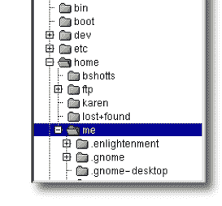
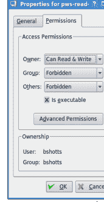
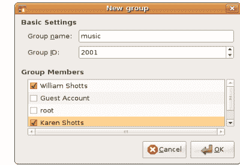
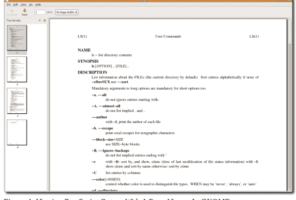
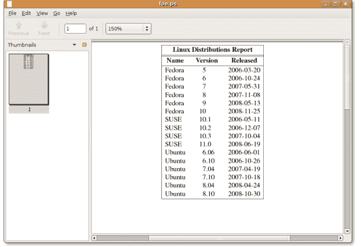
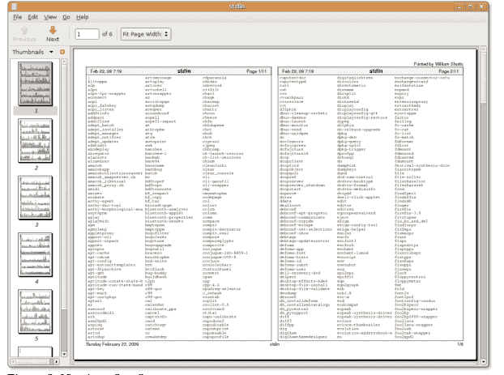

# Linux 命令行，2nd Edition：完整入门指南


## 版本历史

| 版本 | 日期 | 描述 |
|---|---|---|
| 13.07 | 2013 年 7 月 6 日 | 第二版网络版。 |
| 09.12 | 2009 年 12 月 14 日 | 第一版网络版。 |
| 09.11 | 2009 年 11 月 19 日 | 第四稿，已纳入几乎所有审阅者反馈并编辑至第 37 章。 |
| 09.10 | 2009 年 10 月 3 日 | 第三稿，修订了表格格式，部分应用了审阅者反馈并编辑至第 18 章。 |
| 09.08 | 2009 年 8 月 12 日 | 第二稿，纳入了第一次编辑。 |
| 09.07 | 2009 年 7 月 18 日 | 完成初稿。 |

## 3 – 探索系统 13

### 与 `ls` 更有趣 13

### 选项和参数 14

### 对长格式的更深入了解 16

### 使用 `file` 确定文件类型 17

### 使用 `less` 查看文件内容 17

### 什么是“文本”？ 17

### Less Is More 19

### 引导式游览 19

### 符号链接 23

### 硬链接 24

### 小结 24

### 进一步阅读 24

## 4 – 操作文件和目录 25

### 通配符 25

### 字符范围 27

### 通配符在 GUI 中也适用 27

### `mkdir` – 创建目录 28

### `cp` – 复制文件和目录 28

### 有用的选项和示例 29

### `mv` – 移动和重命名文件 30

### 有用的选项和示例 30

### `rm` – 删除文件和目录 31

### 有用的选项和示例 31

### 使用 `rm` 时要小心！ 32

## 5 – 使用命令 42

### 命令到底是什么？ 42

### 识别命令 43

### `type` – 显示命令的类型 43

### `which` – 显示可执行文件的路径 43

### 获取命令的文档 44

### `help` – 获取 Shell 内建命令的帮助 44

### `man` – 显示程序的手册页 45

### `apropos` – 显示合适的命令 47

### `whatis` – 显示命令的简要描述 47

### 有史以来最残酷的手册页 48

### `info` – 显示程序的 Info 条目 48

### `README` 及其他程序文档文件 49

### 使用 `alias` 创建自己的命令 50

### 小结 52

### 进一步阅读 52

## 6 – 重定向

### 标准输入、输出和错误 53

### 重定向标准输出 54

### 重定向标准错误 55

### 将标准输出和标准错误重定向到一个文件 56

### 丢弃不需要的输出 57

### Unix 文化中的 `/dev/null` 57

### 重定向标准输入 57


## `cat` – 串联文件...............................................................57

## 管道...............................................................................59

## `>` 和 `|` 的区别...........................................................60

## 过滤器...............................................................................61

## `uniq` - 报告或省略重复行......................................................61

## `wc` – 打印行、词和字节计数....................................................62

## `grep` – 打印匹配模式的行......................................................62

## `head` / `tail` – 打印文件的开头 / 结尾部分............................................63

## `tee` – 从标准输入读取并输出到标准输出和文件.......................................64

## 小结...............................................................................65

## Linux 关乎想象力..............................................................65

# 7 – 如 Shell 所见的世界

## 展开...............................................................................67

## 路径名展开......................................................................68

## 隐藏文件的路径名展开.......................................................69

## 波浪号展开........................................................................69

## 算术展开....................................................................70

## 大括号展开........................................................................71

## 参数展开....................................................................72

## 命令替换...................................................................73

## 引号...............................................................................74

## 双引号.........................................................................75

## 单引号.........................................................................76

## 转义字符....................................................................77

## 反斜杠转义序列..............................................................77

## 小结...............................................................................78

## 进一步阅读.........................................................................78

# 8 – 高级键盘技巧

## 命令行编辑....................................................................79

## 光标移动........................................................................79

- 修改文本（第 80 页）
- 剪切与粘贴（剪切与拖拽）文本（第 80 页）
- Meta 键（第 81 页）
- 补全（第 81 页）
- 可编程补全（第 83 页）
- 使用历史记录（第 83 页）
- 搜索历史记录（第 84 页）
- 历史展开（第 86 页）
- 脚本（第 86 页）
- 小结（第 86 页）
- 进一步阅读（第 87 页）

# 9 – 权限（第 88 页）

- 所有者、组成员及其他用户（第 89 页）
- 读取、写入与执行（第 90 页）
- `chmod` – 更改文件模式（第 92 页）
- 八进制到底是什么？（第 93 页）
- 使用 GUI 设置文件模式（第 95 页）
- `umask` – 设置默认权限（第 96 页）
- 一些特殊权限（第 98 页）
- 切换身份（第 99 页）
- `su` – 以替代用户和组 ID 运行 Shell（第 99 页）
- `sudo` – 以另一个用户的身份执行命令（第 101 页）
- Ubuntu 与 `sudo`（第 101 页）
- `chown` – 更改文件所有者和组（第 102 页）
- `chgrp` – 更改组所有权（第 103 页）
- 行使我们的权限（第 103 页）
- 更改您的密码（第 106 页）
- 小结（第 107 页）
- 进一步阅读（第 107 页）

# 10 – 进程（第 108 页）

- 进程如何工作（第 108 页）
- 查看进程（第 109 页）
- 使用 `top` 动态查看进程（第 111 页）
- 控制进程（第 113 页）
- 中断进程（第 114 页）
- 将进程置于后台（第 114 页）
- 将进程返回到前台（第 115 页）
- 停止（暂停）进程（第 116 页）
- 信号（第 117 页）
- 使用 `kill` 向进程发送信号（第 117 页）
- 使用 `killall` 向多个进程发送信号（第 120 页）
- 更多与进程相关的命令（第 120 页）
- 小结（第 121 页）

# 第 2 部分 – 配置与环境（第 123 页）

## 11 – 环境（第 124 页）

# 12 – `vi` 温和入门 .........136

- 我们为什么要学习 `vi` .........136
- 一点背景知识 .........137
- 启动和停止 `vi` .........137
  - 兼容模式 .........138
- 编辑模式 .........139
  - 进入插入模式 .........140
  - 保存我们的工作 .........140
- 移动光标 .........141
- 基本编辑 .........142
  - 追加文本 .........142
  - 插入一行 .........143
  - 删除文本 .........144
  - 剪切、复制和粘贴文本 .........145
  - 合并行 .........147
- 搜索与替换 .........147
  - 在行内搜索 .........147
  - 搜索整个文件 .........147
  - 全局搜索与替换 .........148
- 编辑多个文件 .........150
  - 在文件之间切换 .........151
  - 打开附加文件进行编辑 .........151
  - 将内容从一个文件复制到另一个文件 .........152
    - 将整个文件插入到另一个文件 .........153
- 保存我们的工作 .........154
- 总结 .........155
- 延伸阅读 .........155

# 13 – 自定义提示符 .........156

- 提示符的构成 .........156
- 尝试一些替代提示符设计 .........158


- 添加颜色 .........159
  - 终端混淆 .........160
- 移动光标 .........162
- 保存提示符 .........163
- 总结 .........164

环境中存储了什么？ .........124
- 检查环境 .........124
- 一些有趣的变量 .........126

环境是如何建立的？ .........127
- 启动文件中有什么？ .........128

修改环境 .........130
- 我们应该修改哪些文件？ .........130
- 文本编辑器 .........130
- 使用文本编辑器 .........131
  - 为什么注释很重要 .........134
- 激活我们的更改 .........135
- 总结 .........135
- 延伸阅读 .........135

# 第三部分 – 常见任务和必备工具...............................................165

## 14 – 包管理...................................................................................................166

打包系统................................................................................................................166

包系统的工作原理................................................................................................167

包文件......................................................................................................................167

软件仓库.......................................................................................................................167

依赖关系.....................................................................................................................168

高级和低级包工具.......................................................................................168

常见包管理任务......................................................................................169

在软件仓库中查找包........................................................................................169

从软件仓库安装包................................................................................169

从包文件安装包...............................................................................170

移除包............................................................................................................170

从软件仓库更新包...................................................................................171

从包文件升级包..............................................................................171

列出已安装的包...................................................................................................172

确定是否安装了某个包....................................................................................172

显示已安装包的信息............................................................................173

查找安装了某个文件的是哪个包.................................................................................173

总结.......................................................................................................................173

Linux 软件安装神话....................................................................................174

进一步阅读..................................................................................................................175

## 15 – 存储介质..............................................................................................................176

挂载和卸载存储设备..............................................................................176

查看已挂载文件系统列表.................................................................................178

## 16 – 网络....................................................195

检查和监控网络....................................................196

`ping`...............................................................196

`traceroute`...........................................................197

`netstat`.............................................................198

通过网络传输文件...............................................199

`ftp`.................................................................199

`lftp` – 更好的 `ftp`......................................................202

`wget`................................................................202

与远程主机安全通信........................................202

`ssh`.................................................................203

使用 SSH 进行隧道传输.......................................................206

`scp` 和 `sftp`............................................................207


### Windows 的 SSH 客户端？...............................................208

### 总结..............................................................208

### 进一步阅读..........................................................208

## 17 – 搜索文件....................................................209

### locate – 简单地查找文件...........................................209

### locate 数据库从何而来？...................................211

### find – 困难地查找文件.............................................211

### 测试................................................................212

### 操作符...............................................................214

### 预定义操作.......................................................217

### 用户自定义操作.....................................................219

### 提高效率.....................................................220

### xargs................................................................220

### 处理奇怪的文件名..............................................221

### 回到游乐场...............................................221

### 选项...............................................................224

### 总结..............................................................225

### 进一步阅读..........................................................225

## 18 – 归档和备份...................................................226

### 压缩文件........................................................226

### gzip................................................................227

### bzip2...............................................................229

### 不要过度压缩...........................................230

### 归档文件........................................................230

### tar.................................................................230

### zip................................................................236

## 19 – 正则表达式....................................................243

### 元字符与字面值........................................................................245

### 任意字符...............................................................................246

### 锚点...............................................................................247

### 填字游戏助手........................................................................247

### 方括号表达式与字符类......................................................248

### 否定...............................................................................248

### 传统字符范围....................................................................249

### POSIX 字符类........................................................................250

### 恢复传统排序规则...............................................................253

### POSIX 基本正则表达式与扩展正则表达式....................................................254

### POSIX...............................................................................254

### 交替...............................................................................255

### 量词...............................................................................256

### ? - 匹配零次或一次元素.......................................................256

### * - 匹配零次或多次元素......................................................257

### + - 匹配一次或多次元素.......................................................258

### {} - 匹配特定次数的元素..............................................258

### 将正则表达式付诸实践...........................................................259

### 使用 grep 验证电话号码列表...........................................................259

### 使用 find 查找难看的文件名.............................................................260

### 使用 locate 搜索文件..............................................................261

### 使用 less 和 vim 搜索文本.........................................................261

### 总结...............................................................................263

### 延伸阅读...............................................................................263

## 20 – 文本处理...............................................................................264

### 文本的应用...............................................................................264


- 文档...............................................................................265

- 网页...............................................................................265

- 电子邮件...............................................................................265

- 打印机输出...............................................................................265

- 程序源代码...............................................................................265

### 重温一些老朋友........................................................................266

- `cat`...............................................................................266

- MS-DOS 文本与 Unix 文本........................................................................267

- `sort`...............................................................................267

- `uniq`...............................................................................275

### 切分与拼接...............................................................................276

- `cut`...............................................................................276

- 展开制表符...............................................................................279

- `paste`...............................................................................280

- `join`...............................................................................281

### 比较文本...............................................................................283

- `comm`...............................................................................284

- `diff`...............................................................................284

- `patch`...............................................................................287

### 即时编辑...............................................................................288

- `tr`...............................................................................288

- ROT13：并非秘密的解码环.......................................................290

- `sed`...............................................................................290

喜欢 `sed` 的人也喜欢...................................................299

`aspell`...............................................................299

小结.............................................................303

延伸阅读.......................................................303

额外加分...........................................................304

# 21 – 输出格式化...................................................305

简单格式化工具...................................................305

`nl` – 给行编号.......................................................305

`fold` – 将每行换行到指定长度................................309

`fmt` – 简单文本格式化程序.............................................309

`pr` – 格式化文本以便打印.............................................313

`printf` – 格式化并打印数据............................................314

文档格式化系统..............................................317

`groff`...................................................................318

小结.............................................................324

延伸阅读.......................................................324

# 22 – 打印...........................................................326

打印简史..............................................326

黑暗时代的打印...............................................326

字符型打印机...............................................327

图形打印机.....................................................328

在 Linux 上打印.....................................................329

准备打印文件............................................329

`pr` – 将文本文件转换为打印格式....................................329

向打印机发送打印作业........................................331

`lpr` – 打印文件（伯克利风格）......................................331

`lp` – 打印文件（System V 风格）.......................................332

另一个选项：`a2ps`....................................................333

监控和控制打印作业...................................336

`lpstat` – 显示打印系统状态....................................336


## `lpq` – 显示打印机队列状态 (337)

## `lprm` / `cancel` – 取消打印作业 (338)

## 小结 (338)

## 延伸阅读 (338)

# 23 – 编译程序 (340)

## 什么是编译？ (340)

## 所有程序都编译吗？ (341)

## 编译 C 程序 (342)

### 获取源代码 (342)

# 第 4 部分 – 编写 Shell 脚本 (353)

## 24 – 编写你的第一个脚本 (354)

### 什么是 Shell 脚本？ (354)

### 如何编写 Shell 脚本？ (354)

#### 脚本文件格式 (355)

#### 可执行权限 (356)

#### 脚本文件位置 (356)

#### 脚本的良好位置 (358)

#### 更多格式化技巧 (358)

##### 长选项名称 (358)

##### 缩进和续行 (358)

#### 为脚本编写配置 `vim` (359)

### 小结 (360)

### 延伸阅读 (360)

## 25 – 开始一个项目 (361)

### 第一阶段：最小文档 (361)

### 第二阶段：添加少量数据 (363)

#### 变量和常量 (364)

##### 为变量和常量赋值 (367)

#### Here 文档 (368)

### 小结 (371)

### 延伸阅读 (371)

## 26 – 自顶向下设计 (372)

### Shell 函数 (373)

### 局部变量 (376)

### 保持脚本运行 (377)

### 在 `.bashrc` 文件中使用 Shell 函数 (380)

### 小结 (380)

### 延伸阅读 (380)

## 27 – 流程控制：使用 `if` 分支 (381)

### `if` (381)

### 退出状态 (382)

### `test` (384)

#### 文件表达式 (384)

#### 字符串表达式 (387)

#### 整数表达式 (388)

### `test` 的更现代版本 (389)

### `(( ))` - 专为整数设计 (391)

## 28 – 读取键盘输入 (397)

### `read` – 从标准输入读取值 (398)

#### 选项 (400)

#### `IFS` (402)

#### 你不能管道化 `read` (404)

#### 验证输入 (404)


菜单...................................................................................................................406

小结...........................................................................................................407

额外学分.........................................................................................................407

进一步阅读...................................................................................................408

# 29 – 流程控制：使用 while / until 进行循环...................................................409

循环................................................................................................................409

while...................................................................................................................409

跳出循环...........................................................................................412

until...................................................................................................................413

使用循环读取文件........................................................................................414

小结...........................................................................................................415

进一步阅读...................................................................................................415

# 30 – 故障排除................................................................................................416

语法错误...................................................................................................416

缺少引号....................................................................................................417

缺少或意外的标记...............................................................................418

意外的展开......................................................................................418

逻辑错误.....................................................................................................420

防御性编程..........................................................................................420

验证输入....................................................................................................422

设计是时间的函数..................................................................................422

测试...............................................................................................................422

测试用例..........................................................................................................423

调试..........................................................................................................424

找到问题区域......................................................................................424

跟踪..............................................................................................................424

执行期间检查值..........................................................................427

小结...........................................................................................................427

进一步阅读...................................................................................................428

# 31 – 流程控制：使用 case 进行分支...............................................................429

case...................................................................................................................429

模式............................................................................................................431

执行多个操作...................................................................................433

小结...........................................................................................................434

进一步阅读...................................................................................................434

# 32 – 位置参数....................................................................................436

访问命令行..................................................................................436


- 确定参数数量 —— 437
- `shift` – 获取对多个参数的访问 —— 438
- 简单应用 —— 439
- 使用位置参数与 Shell 函数 —— 440
- 批量处理位置参数 —— 441
- A More Complete Application —— 443
- Summing Up —— 446
- Further Reading —— 449

# 33 – Flow Control: Looping With `for` —— 450

- `for`: Traditional Shell Form —— 450
- Why `i`? —— 452
- `for`: C Language Form —— 453
- Summing Up —— 454
- Further Reading —— 455

# 34 – Strings And Numbers —— 456

- Parameter Expansion —— 456
- Basic Parameters —— 456
- Expansions To Manage Empty Variables —— 457
- Expansions That Return Variable Names —— 459
- String Operations —— 459
- Case Conversion —— 462
- Arithmetic Evaluation And Expansion —— 464
- Number Bases —— 465
- Unary Operators —— 465
- Simple Arithmetic —— 465
- Assignment —— 467
- Bit Operations —— 469
- Logic —— 470
- `bc` – An Arbitrary Precision Calculator Language —— 473
- Using `bc` —— 474
- An Example Script —— 475
- Summing Up —— 476
- Extra Credit —— 476
- Further Reading —— 476

# 35 – Arrays —— 478

- What Are Arrays? —— 478
- Creating An Array —— 478
- Assigning Values To An Array —— 479
- Accessing Array Elements —— 480
- Array Operations —— 482
- Outputting The Entire Contents Of An Array —— 482
- Determining The Number Of Array Elements —— 482
- Finding The Subscripts Used By An Array —— 483
- Adding Elements To The End Of An Array —— 483


Sorting An Array.....................................................................484

Deleting An Array....................................................................484

Associative Arrays...................................................................485

Summing Up...........................................................................486

Further Reading.......................................................................486

# 36 – Exotica..........................................................................487

- 组命令与子 shell .............................................................................. 487
- 进程替换 ............................................................................................... 491
- 陷阱 ...................................................................................................................... 493
- 临时文件 ....................................................................................................... 495
- 异步执行 ............................................................................................. 496
- 等待 ......................................................................................................................... 496
- 命名管道 .............................................................................................................. 498
- 设置命名管道 .......................................................................................... 498
- 使用命名管道 ................................................................................................... 499
- 总结 ............................................................................................................... 499
- 进一步阅读 ......................................................................................................... 499
- 索引 ........................................................................................................................ 501

## 引言

我想告诉你一个故事。

不，不是 1991 年林纳斯·托瓦兹编写 Linux 内核第一个版本的故事。你可以在很多 Linux 书籍中读到那个故事。我也不会告诉你若干年前理查德·斯托曼开始 GNU 项目以创建自由类 Unix 操作系统的故事。那也是一个重要的故事，但大多数其他 Linux 书籍也都有这个故事。

不，我想告诉你的，是你如何重新夺回对自己电脑控制权的故事。

我在 20 世纪 70 年代末作为大学生开始使用电脑时，正在发生一场革命。微处理器的发明使得像你我这样的普通人实际上可以拥有自己的电脑。对今天的许多人来说，很难想象在只有大企业和大政府运行所有电脑的那个世界是什么样的。简单说，你什么也做不成。

今天，世界大不相同。电脑无处不在，从微小的手表到巨大的数据中心，再到两者之间的一切。除了无处不在的电脑，我们还有一个连接它们的无处不在的网络。这创造了一个个人赋权和创造自由的奇妙新时代，但过去几十年里还发生了另一件事。少数巨型公司对世界上大部分电脑施加了控制，决定你可以用它们做什么、不能做什么。幸运的是，来自世界各地的人们正在对此采取行动。他们通过编写自己的软件来努力保持对自己电脑的控制。他们正在构建 Linux。

很多人谈论 Linux 的“自由”，但我认为大多数人并不知道这种自由真正意味着什么。自由是你决定电脑做什么的权力，而拥有这种自由的唯一方法就是知道你的电脑在做什么。自由是一台没有秘密的电脑，只要你愿意去了解，一切都可以被知晓。

## 为什么使用命令行？

你有没有注意到在电影里，当“超级黑客”——你知道，就是那个能在三十秒内入侵超安全军事电脑的家伙——坐到电脑前时，他从不碰鼠标？这是因为电影制作人意识到我们作为人类，本能地知道在电脑上真正做成事情的唯一方法

is by typing on a keyboard!

大多数今天的计算机用户只熟悉 *图形用户界面* (GUI)，并且被厂商和专家教导 *命令行界面* (CLI) 是令人恐惧的过去之物。这很不幸，因为一个好的命令行界面是以一种奇妙而富有表现力的方式与计算机交流，就像书面文字之于人类一样。有人说过“图形用户界面让简单任务变得简单，而命令行界面让困难任务成为可能”，这在今天仍然非常正确。

由于 Linux 是以 Unix 家族的操作系统为模型构建的，它与 Unix 共享同样的丰富的命令行工具传承。Unix 在 20 世纪 80 年代初期开始流行（尽管早十年就已开发），早于图形用户界面的广泛采用，因此发展出了庞大的命令行界面。事实上，早期 Linux 采用者选择它而不是 Windows NT 等系统的主要原因之一，就是其强大的命令行界面让“困难任务成为可能”。

## 本书内容

本书是对“在 Linux 命令行上生活”的一次广泛概述。与只集中于单一程序（如 shell 程序 `bash`）的书籍不同，本书将尝试传达更广义上如何与命令行界面相处的知识。它是如何工作的？它能做什么？最好的使用方式是什么？

**这不是一本关于 Linux 系统管理的书。** 虽然任何严肃的命令行讨论不可避免地会涉及系统管理主题，但本书只涉及少数几个管理问题。它将为读者提供坚实的基础，为进一步学习做好准备，命令行是任何严肃系统管理任务必不可少的工具。

**本书非常以 Linux 为中心。** 许多其他书籍试图通过加入通用 Unix 和 OS X 等其他平台来扩大吸引力。在这样做的过程中，它们会“稀释”内容，只保留通用主题。相比之下，本书只涵盖当代 Linux 发行版。95% 的内容对其他类 Unix 系统用户也有用，但本书高度针对现代 Linux 命令行用户。

## 谁应该阅读本书

本书适合从其他平台迁移过来的新 Linux 用户。你很可能是一个使用某种 Microsoft Windows 版本的“高级用户”。也许你的老板让你管理一台 Linux 服务器，或者你只是一个桌面用户，对所有安全问题感到厌倦，想尝试 Linux。那也没关系。这里欢迎所有人。

话虽如此，通往 Linux 启蒙之路没有捷径。学习命令行具有挑战性，需要真正的努力。不是它太难，而是它太庞大。平均的 Linux 系统在命令行上 literally 有成千上万个程序可供使用。请自求多福；学习命令行不是一件随意的事业。

另一方面，学习 Linux 命令行极其有回报。如果你现在认为自己是“高级用户”，那就等着瞧吧。你还不知道什么是真正的力量。而且，与许多其他计算机技能不同，命令行知识经久不衰。今天学到的技能十年后仍然有用。命令行经受住了时间的考验。

同时也假设你没有任何编程经验，但不用担心，我们也会引导你踏上这条道路。

## 本书包含什么


这些材料以精心选择的顺序呈现，就像一位导师坐在你旁边引导你一样。许多作者以“系统化”的方式处理这些材料，从作者的角度看是有意义的，但对新用户来说可能非常令人困惑。

另一个目标是让你熟悉 Unix 式的思维方式，这与 Windows 式的思维方式不同。在旅途中，我们会进行几次小插曲，帮助你理解某些事物为何以这种方式工作以及它们是如何演变而来的。Linux 不仅仅是一段软件，它也是更大 Unix 文化的一部分，Unix 文化有自己的语言和历史。我也可能会发几通牢骚。

本书分为四个部分，每部分涵盖命令行体验的某个方面：

- Part 1 – Learning The Shell 开始我们对命令行基本语言的探索，包括命令的结构、文件系统导航、命令行编辑，以及如何查找命令的帮助和文档。
- Part 2 – Configuration And The Environment 涵盖从命令行编辑控制计算机操作的配置文件。
- Part 3 – Common Tasks And Essential Tools 探索从命令行执行的许多普通任务。类 Unix 操作系统，如 Linux，包含许多用于对数据执行强大操作的“经典”命令行程序。
- Part 4 – Writing Shell Scripts 介绍 shell 编程，一种公认基础但易于学习的技术，用于自动化许多常见的计算任务。通过学习 shell 编程，你将熟悉可应用于许多其他编程语言的概念。

## 如何阅读本书

从本书开头开始，读到结尾。它不是作为参考书编写的，更像是一个有开头、中间和结尾的故事。

## 先决条件

要使用本书，你只需要一个可用的 Linux 安装。你可以通过以下两种方式之一获得：

- 1. 在（不太新的）计算机上安装 Linux。 你选择的发行版并不重要，不过大多数人今天从 Ubuntu、Fedora 或 OpenSUSE 开始。如果有疑问，先尝试 Ubuntu。安装现代 Linux 发行版可能非常简单，也可能非常困难，这取决于你的硬件。我建议使用几年前的一台台式电脑，至少有 256 兆字节的 RAM 和 6 千兆字节的可用硬盘空间。尽可能避免使用笔记本电脑和无线网络，因为这些通常更难使其正常工作。
- 2. 使用“Live CD”。 使用许多 Linux 发行版可以做的一件很酷的事情是直接从 CDROM（或 USB 闪存驱动器）运行它们，而完全不安装它们。只需进入你的 BIOS 设置并将计算机设置为“从 CDROM 启动”，插入 live CD，然后重新启动。使用 live CD 是在安装前测试计算机 Linux 兼容性的好方法。使用 live CD 的缺点是它可能比将 Linux 安装在硬盘上要慢得多。Ubuntu 和 Fedora（以及其他发行版）都有 live CD 版本。

无论你如何安装 Linux，你都需要偶尔拥有超级用户（即管理员）权限来完成本书中的练习。

在你拥有可用的安装后，开始阅读并跟随自己的电脑一起操作。本书的大部分内容都是“动手”的，所以坐下来开始打字吧！

## 为什么我不称它为“GNU/Linux”

在某些圈子里，政治上正确的做法是将 Linux 操作系统称为“GNU/Linux 操作系统”。“Linux”的问题在于没有完全正确的方式来命名它，因为它是由许多不同的人在庞大的分布式开发工作中编写的。从技术上讲，Linux 是操作系统的内核的名称，仅此而已。内核当然非常重要，因为它让操作系统运行起来，但它不足以构成一个完整的操作系统。

于是出现了理查德·斯托尔曼，这位天才哲学家创立了自由软件运动，创办了自由软件基金会，组建了 GNU 项目，编写了 GNU C 编译器（gcc）的第一个版本，创建了 GNU 通用公共许可证（GPL），等等，等等，等等。他坚持你应该称之为“GNU/Linux”以正确反映 GNU 项目的贡献。虽然 GNU 项目早于 Linux 内核，并且该项目的贡献极其值得认可，但在名称中突出它们对其他所有做出重大贡献的人来说是不公平的。此外，我认为“Linux/GNU”在技术上更准确，因为内核先启动，其他一切都在其之上运行。

在流行用法中，“Linux”指的是内核以及典型 Linux 发行版中发现的所有其他自由和开源软件；也就是说，整个 Linux 生态系统，而不仅仅是 GNU 组件。操作系统市场似乎更喜欢 DOS、Windows、Solaris、Irix、AIX 等一词名称。我选择使用这种流行格式。如果你更喜欢使用“GNU/Linux”，请在阅读本书时进行一次心理上的查找替换。我不会介意。

## 致谢

我想感谢以下帮助使本书成为可能的人：

Jenny Watson，Wiley Publishing 的收购编辑，最初建议我写一本 shell 脚本书。

John C. Dvorak，著名专栏作家和评论家。在他的视频播客《Cranky Geeks》的一集中，Dvorak 先生描述了写作过程：“地狱。每天写 200 字，一年后，你就有一部小说了。”这条建议促使我每天写一页，直到写成一本书。

Dmitri Popov 在《Free Software Magazine》上撰写了一篇题为“使用 Writer 创建书籍模板”的文章，这启发我使用 OpenOffice.org Writer 来撰写文本。事实证明，它效果非常好。

Mark Polesky 对文本进行了非凡的审阅和测试。

Jesse Becker、Tomasz Chrzczonowicz、Michael Levin、Spence Miner 也测试并审阅了文本的部分内容。

Karen M. Shotts 贡献了大量时间，通过编辑文本来润色我的所谓英语。

最后，LinuxCommand.org 的读者们，他们给我发了许多亲切的电子邮件。他们的鼓励让我觉得我真的在做一件有意义的事情！

## 需要你的反馈！

本书是一个持续进行的项目，就像许多开源软件项目一样。如果你发现技术错误，请给我发邮件至：

bshotts@users.sourceforge.net

你的修改和建议可能会进入未来的版本。

## 第二版互联网版的新内容

这个版本的 《Linux命令行》 经过了一些额外的润色和现代化处理。特别是假设 bash 4.x 是标准版本，并且文本已更新以反映这一点。第二版互联网版中的章节编号现在与 No Starch Press 版中的编号一致。我还修复了一些错误 ;-)。

特别感谢以下为第一版提供宝贵反馈的个人：Adrian Arpidez、Hu Bo、Heriberto Cantú、Joshua Escamilla、Bruce Fowler、Ma Jun、Seth King、Mike O'Donnell、Parviz Rasoulipour、Gabriel Stutzman 和 Christian Wuethrich。

## 进一步阅读

- 本章中提到的著名人物的一些维基百科文章：
  - http://en.wikipedia.org/wiki/Linus_Torvalds
  - http://en.wikipedia.org/wiki/Richard_Stallman
- 自由软件基金会和 GNU 项目：
  - http://en.wikipedia.org/wiki/Free_Software_Foundation
  - http://www.fsf.org
  - http://www.gnu.org
- Richard Stallman extensively 撰写了关于“GNU/Linux”命名问题的文章：
  - http://www.gnu.org/gnu/why-gnu-linux.html
  - http://www.gnu.org/gnu/gnu-linux-faq.html#tools

## 序言

本书最初使用 OpenOffice.org Writer 在 Liberation Serif 和 Sans 字体上，于出厂配置为 Ubuntu 8.04 的 Dell Inspiron 530N 上编写。文本的 PDF 版本由 OpenOffice.org Writer 直接生成。第二版互联网版是在同一台计算机上使用 Ubuntu 12.04 上的 LibreOffice Writer 制作的。

## 第 1 部分 – 学习 Shell

leges.

假设到目前为止一切顺利，让我们试着输入一些内容。在提示符后输入一些无意义的内容，如下所示：

```
[me@linuxbox ~]$ kaekfjaeifj
```

由于此命令毫无意义，shell 会告诉我们，并给我们另一个机会：

```
bash: kaekfjaeifj: command not found
[me@linuxbox ~]$
```

### 命令历史

如果我们按下上箭头键，我们会看到之前的命令“kaekfjaeifj”在提示符后重新出现。这称为命令历史。大多数 Linux 发行版默认记住最后 500 个命令。按下下箭头键，之前的命令就会消失。

### 光标移动

再次使用上箭头键调出之前的命令。现在尝试左右箭头键。看看我们如何将光标定位在命令行上的任何位置？这使得编辑命令变得容易。

### 关于鼠标和焦点的一些话


虽然 shell 主要是关于键盘的，但你也可以在终端模拟器中使用鼠标。X Window 系统（使 GUI 运行的底层引擎）内置了一种机制，支持快速复制和粘贴技术。如果你通过按住鼠标左键并将鼠标拖过它（或双击一个词）来突出显示一些文本，它将被复制到 X 维护的缓冲区中。按下鼠标中键将导致文本在光标位置被粘贴。试试看。

注意：不要试图在终端窗口内使用 `Ctrl-c` 和 `Ctrl-v` 来执行复制和粘贴。它们不起作用。这些控制代码对 shell 有不同的含义，并且是在 Microsoft Windows 出现多年之前就分配的。

你的图形桌面环境（很可能是 KDE 或 GNOME），为了像 Windows 一样行为，可能将其焦点策略设置为“单击以聚焦”。这意味着要使窗口获得焦点（变为活动状态），你需要单击它。这与传统的 X 行为“焦点跟随鼠标”相反，后者意味着只要将鼠标移过它，窗口就会获得焦点。窗口不会在你单击它之前进入前台，但它能够接收输入。将焦点策略设置为“焦点跟随鼠标”将使复制和粘贴技术更加有用。如果你能的话，试试看（某些桌面环境，如 Ubuntu 的 Unity 已不再支持它）。我认为如果你给它一个机会，你会更喜欢它。你将在窗口管理器的配置程序中找到此设置。

## 尝试一些简单命令

现在我们已经学会了输入，让我们尝试几个简单命令。第一个是 `date`。此命令显示当前时间和日期。

```
[me@linuxbox ~]$ date
Thu Oct 25 13:51:54 EDT 2007
```

相关的命令是 `cal`，默认情况下显示当前月份的日历。

```
[me@linuxbox ~]$ cal
    October 2007
Su Mo Tu We Th Fr Sa
      1  2  3  4  5  6
 7  8  9 10 11 12 13
14 15 16 17 18 19 20
21 22 23 24 25 26 27
28 29 30 31
```

要查看磁盘驱动器上当前可用空间的多少，请输入 `df`：

```
[me@linuxbox ~]$ df
Filesystem     1K-blocks    Used Available Use% Mounted on
/dev/sda2      15115452  5012392  9949716 34% /
/dev/sda5      59631908 26545424 30008432 47% /home
/dev/sda1        147764    17370   122765 13% /boot
```

```text
tmpfs                       256856          0      256856   0% /dev/shm
```

同样，要显示可用内存的数量，输入 `free` 命令。

```text
[me@linuxbox ~]$ free
             total       used       free     shared    buffers     cached
Mem:        513712     503976       9736          0       5312     122916
-/+ buffers/cache:     375748     137964
Swap:       1052248     104712     947536
```

### 结束终端会话

我们可以通过关闭终端模拟器窗口，或在 shell 提示符下输入 `exit` 命令来结束终端会话：

```text
[me@linuxbox ~]$ exit
```

> ### 幕后的控制台
>
> 即使我们没有运行终端模拟器，仍有多个终端会话在图形桌面背后持续运行。称为 *虚拟终端* 或 *虚拟控制台*，这些会话可以在大多数 Linux 发行版上通过按 `Ctrl-Alt-F1` 到 `Ctrl-Alt-F6` 来访问。当访问一个会话时，它会显示一个登录提示，我们可以在其中输入用户名和密码。要从一个虚拟控制台切换到另一个，按 `Alt` 和 `F1-F6`。要返回图形桌面，按 `Alt-F7`。

### 小结

在我们开始旅程时，我们被介绍到 shell 并第一次看到命令行，并学习如何启动和结束终端会话。我们还看到了如何发出一些简单命令并进行一点轻量级的命令行编辑。这没那么可怕吧？

### 进一步阅读

- 要了解更多关于 Bourne Shell 之父 Steve Bourne 的信息，请参阅这篇维基百科文章：  
  <http://en.wikipedia.org/wiki/Steve_Bourne>
- 这里有一篇关于计算中 shell 概念的文章：  
  <http://en.wikipedia.org/wiki/Shell_(computing)>

## 2 – 导航

我们需要学习的第一件事（除了打字之外）是如何在 Linux 系统上导航文件系统。在本章中我们将介绍以下命令：
- `pwd` - 打印当前工作目录名称
- `cd` - 更改目录
- `ls` - 列出目录内容

### 理解文件系统树

与 Windows 类似，类 Unix 操作系统如 Linux 将其文件组织在所谓的层次目录结构中。这意味着它们以树状的目录模式组织（在其他系统中有时称为文件夹），目录中可能包含文件和其他目录。文件系统中的第一个目录称为根目录。根目录包含文件和子目录，子目录中包含更多文件和子目录，等等。

请注意，与 Windows 不同，Windows 为每个存储设备都有一个单独的文件系统树，而类 Unix 系统如 Linux 无论连接了多少驱动器或存储设备，始终只有一个文件系统树。存储设备被附加（或更准确地说，挂载）在树上的各个点上，这取决于系统管理员，即负责系统维护的人员（或人员）的意愿。

### 当前工作目录

我们大多数人可能都熟悉图形文件管理器，它将文件系统树表示为图 1 所示。注意树通常是倒置显示的，即根在顶部，各种分支向下延伸。

然而，命令行没有图片，所以为了导航文件系统树，我们需要以不同的方式思考它。

想象文件系统是一个倒置树的迷宫，我们能够站在它的中间。



图 1：图形文件管理器显示的文件系统树

在任何给定时间，我们都位于单个目录内，我们可以看到目录中包含的文件、通往我们上方目录（称为父目录）的路径以及我们下方任何子目录。我们所站的目录称为当前工作目录。要显示当前工作目录，我们使用 `pwd`（print working directory）命令。

```text
[me@linuxbox ~]$ pwd
/home/me
```

当我们首次登录系统（或启动终端模拟器会话）时，我们的当前工作目录被设置为我们的主目录。每个用户账户都有自己的主目录，普通用户只允许在此处写入文件。

### 列出目录内容

要列出当前工作目录中的文件和目录，我们使用 `ls` 命令。

```text
[me@linuxbox ~]$ ls
Desktop  Documents  Music  Pictures  Public  Templates  Videos
```

实际上，我们可以使用 `ls` 命令列出任何目录的内容，而不仅仅是当前工作目录，而且它还能做很多其他有趣的事情。我们将在下一章花更多时间来学习 `ls`。

## 更改当前工作目录

要更改你的工作目录（我们在树形迷宫中所在的位置），我们使用 `cd` 命令。为此，输入 `cd` 后跟所需工作目录的路径名。路径名是我们沿着树的分支前往目标目录所走的路线。路径名可以用两种不同的方式指定；作为绝对路径名或相对路径名。让我们先处理绝对路径名。

### 绝对路径名

绝对路径名从根目录开始，并沿着树分支一路向下，直到完成到目标目录或文件的路径。例如，你的系统上有一个目录，其中安装了大多数系统程序。该目录的路径名为 `/usr/bin`。这意味着从根目录（由路径名中的前导斜杠表示）有一个名为 "usr" 的目录，其中包含一个名为 "bin" 的目录。

```
[me@linuxbox ~]$ cd /usr/bin
[me@linuxbox bin]$ pwd
/usr/bin
[me@linuxbox bin]$ ls

...Listing of many, many files...
```

现在我们可以看到，我们已将当前工作目录更改为 `/usr/bin`，并且其中充满了文件。注意 shell 提示符是如何改变的？作为一种便利，它通常被设置为自动显示工作目录的名称。

### 相对路径名

绝对路径名从根目录开始并通向其目的地，而相对路径名则从工作目录开始。为此，它使用几个特殊符号来表示文件系统树中的相对位置。这些特殊符号是 `"."`（点）和 `".."`（点点）。

`"."` 符号指的是工作目录，而 `".."` 符号指的是工作目录的父目录。它的工作原理如下。让我们再次将工作目录更改为 `/usr/bin`：

```bash
[me@linuxbox ~]$ cd /usr/bin
[me@linuxbox bin]$ pwd
/usr/bin
```


好的，现在假设我们想将工作目录更改为 `/usr/bin` 的父目录 `/usr`。我们可以用两种不同的方法做到这一点。或者使用绝对路径名：

```bash
[me@linuxbox bin]$ cd /usr

[me@linuxbox usr]$ pwd

/usr
```

或者，使用相对路径名：

```bash
[me@linuxbox bin]$ cd ..

[me@linuxbox usr]$ pwd

/usr
```

两种不同的方法，得到相同的结果。我们应该使用哪一种？使用打字最少的那一种！

同样，我们也可以用两种不同的方法将工作目录从 `/usr` 更改为 `/usr/bin`。或者使用绝对路径名：

```bash
[me@linuxbox usr]$ cd /usr/bin

[me@linuxbox bin]$ pwd

/usr/bin
```

或者，使用相对路径名：

```bash
[me@linuxbox usr]$ cd ./bin

[me@linuxbox bin]$ pwd

/usr/bin
```

现在，有一件重要的事情我必须在这里指出。在几乎所有情况下，你都可以省略 `"./"`。它是隐含的。输入：

```
[me@linuxbox usr]$ cd bin
```

做的事情是一样的。一般来说，如果你没有指定某个事物的路径名，则会假定为工作目录。

## 2 – 导航

### 一些有用的快捷方式

在表 2-1 中，我们看到了一些快速更改当前工作目录的有用方法。

表 2-1：`cd` 快捷方式

| 快捷方式 | 结果 |
|---|---|
| `cd` | 将工作目录更改为你的主目录。 |
| `cd -` | 将工作目录更改为上一个工作目录。 |
| `cd ~user_name` | 将工作目录更改为 `user_name` 的主目录。例如，`cd ~bob` 将目录更改为用户 `"bob"` 的主目录。 |

### 关于文件名的一些重要事实

- 1. 以句点字符开头的 `filename` 是隐藏的。这仅意味着 `ls` 不会列出它们，除非你使用 `ls -a`。当你的账户被创建时，几个隐藏文件被放置在你的主目录中以配置你的账户。稍后我们将更仔细地查看其中一些文件，看看你如何自定义你的环境。此外，一些应用程序会将它们的配置和设置文件作为隐藏文件放置在你的主目录中。
- 2. Linux 中的文件名和命令，像 Unix 一样，是区分大小写的。文件名 `"File1"` 和 `"file1"` 指的是不同的文件。
- 3. Linux 没有像某些其他操作系统那样的 `"文件扩展名"` 概念。你可以随意命名文件。文件的 `contents` 和/或用途是通过其他方式确定的。虽然类 Unix 操作系统不使用

一些应用程序确实使用文件扩展名来确定文件的内容/用途。
- 4. 虽然 Linux 支持长文件名，其中可以包含嵌入的空格和标点字符，但请将你创建的文件名中的标点字符限制为句点、连字符和下划线。*最重要的是，不要在文件名中嵌入空格。* 如果你想在文件名中表示单词间的空格，请使用下划线字符。以后你会感谢自己的。

## 总结

在本章中，我们了解了 `shell` 如何处理系统的目录结构。我们学习了绝对路径名和相对路径名，以及用于在该结构中移动的基本命令。在下一章中，我们将利用这些知识来游览一个现代 Linux 系统。

## 3 – 探索系统

既然我们已经知道如何在文件系统中移动，是时候开始一段有导览的 Linux 系统之旅了。不过，在开始之前，我们还要学习一些沿途会有用的命令：

- `ls` – 列出目录内容
- `file` – 确定文件类型
- `less` – 查看文件内容

### 更多 `ls` 用法

`ls` 命令可能是最常用的命令，这也情理之中。借助它，我们可以查看目录内容，并确定各种重要的文件和目录属性。正如我们所见，我们只需输入 `ls` 就可以看到当前工作目录中包含的文件和子目录列表：

```
[me@linuxbox ~]$ ls
Desktop  Documents  Music  Pictures  Public  Templates  Videos
```

除了当前工作目录，我们还可以指定要列出的目录，如下所示：

```
me@linuxbox ~]$ ls /usr
bin  games  kerberos  libexec  sbin  src
etc  include  lib  local  share  tmp
```

或者甚至可以指定多个目录。在这个例子中，我们将同时列出用户的主目录（用 `"~"` 字符表示）和 `/usr` 目录：

```
[me@linuxbox ~]$ ls ~ /usr
/home/me:
Desktop  Documents  Music  Pictures  Public  Templates  Videos

/usr:
bin  games  kerberos  libexec  sbin  src
etc  include  lib  local  share  tmp
```

我们也可以更改输出格式以显示更多细节：

```
[me@linuxbox ~]$ ls -l
total 56
drwxrwxr-x 2 me me 4096 2007-10-26 17:20 Desktop
drwxrwxr-x 2 me me 4096 2007-10-26 17:20 Documents
drwxrwxr-x 2 me me 4096 2007-10-26 17:20 Music
drwxrwxr-x 2 me me 4096 2007-10-26 17:20 Pictures
drwxrwxr-x 2 me me 4096 2007-10-26 17:20 Public
drwxrwxr-x 2 me me 4096 2007-10-26 17:20 Templates
drwxrwxr-x 2 me me 4096 2007-10-26 17:20 Videos
```

通过向命令添加 `"-l"`，我们将输出更改为长格式。

### 选项和参数

这让我们了解到大多数命令工作原理的一个非常重要的点。命令后面通常跟着一个或多个修改其行为的选项，以及一个或多个参数，即命令所操作的项目。所以大多数命令看起来像这样：

```
command -options arguments
```

大多数命令使用的选项由前面带短横线的单个字符组成，例如 `"-l"`，但许多命令（包括 GNU 项目的命令）也支持长选项，长选项由前面带两个短横线的单词组成。此外，许多命令允许将多个短选项连接在一起。在这个例子中，`ls` 命令被赋予了两个选项：`"l"` 选项用于生成冗长格式的输出，`"t"` 选项用于按文件的修改时间对结果进行排序。

```
[me@linuxbox ~]$ ls -lt
```

我们将添加长选项 `"--reverse"` 来反转排序顺序：

```
[me@linuxbox ~]$ ls -lt --reverse
```

请注意，与 Linux 中的文件名一样，命令选项区分大小写。

`ls` 命令有大量可能的选项。最常见的选项列于表 3-1 中。

表 3-1：常见的 `ls` 选项

| 选项 | 长选项 | 描述 |
|---|---|---|
| `-a` | `--all` | 列出所有文件，甚至包括那些名称以句点开头的文件，这些文件通常不会被列出（即隐藏文件）。 |
| `-A` | `--almost-all` | 与上述 `-a` 选项类似，但不列出 `.`（当前目录）和 `..`（父目录）。 |
| `-d` | `--directory` | 通常，如果指定了目录，`ls` 会列出该目录的内容，而不是目录本身。将此选项与 `-l` 选项结合使用，可以查看目录本身的详细信息，而不是其内容。 |
| `-F` | `--classify` | 此选项会在每个列出的名称末尾追加一个指示字符。例如，如果名称是目录，则追加一个 `"/"`。 |
| `-h` | `--human-readable` | 在长格式列表中，以人类可读的格式显示文件大小，而非字节。 |
| `-l` |  | 以长格式显示结果。 |
| `-r` | `--reverse` | 以相反顺序显示结果。通常，`ls` 以字母升序显示其结果。 |
| `-S` |  | 按文件大小对结果排序。 |
| `-t` |  | 按修改时间排序。 |

### 更深入地了解长格式

正如我们之前所见，`-l` 选项会使 `ls` 以长格式显示其结果。这种格式包含大量有用的信息。下面是 Ubuntu 系统中的 Examples 目录：


```
-rw-r--r-- 1 root root 3576296 2007-04-03 11:05 Experience ubuntu.ogg
-rw-r--r-- 1 root root 1186219 2007-04-03 11:05 kubuntu-leaflet.png
-rw-r--r-- 1 root root 47584 2007-04-03 11:05 logo-Edubuntu.png
-rw-r--r-- 1 root root 44355 2007-04-03 11:05 logo-Kubuntu.png
-rw-r--r-- 1 root root 34391 2007-04-03 11:05 logo-Ubuntu.png
-rw-r--r-- 1 root root 32059 2007-04-03 11:05 oo-cd-cover.odf
-rw-r--r-- 1 root root 159744 2007-04-03 11:05 oo-derivatives.doc
-rw-r--r-- 1 root root 27837 2007-04-03 11:05 oo-maxwell.odt
-rw-r--r-- 1 root root 98816 2007-04-03 11:05 oo-trig.xls
-rw-r--r-- 1 root root 453764 2007-04-03 11:05 oo-welcome.odt
-rw-r--r-- 1 root root 358374 2007-04-03 11:05 ubuntu Sax.ogg
```

让我们从其中一个文件中的不同字段入手并检查其含义：

### Table 3-2: ls Long Listing Fields

| Field | Meaning |
| --- | --- |
| `-rw-r--r--` | 文件的访问权限。第一个字符表示文件的类型。在不同类型中，以连字符开头表示普通文件，而 `d` 表示目录。接下来的三个字符是文件所有者的访问权限，之后的三个字符是文件所属组成员的访问权限，最后三个是其他所有人的权限。其完整含义在第 9 章 – Permissions 中讨论。 |
| `1` | 文件的硬链接数。参见本章后面关于链接的讨论。 |
| `root` | 文件所有者的用户名。 |
| `root` | 文件所属组的名称。 |
| `32059` | 文件的大小，以字节为单位。 |
| `2007-04-03 11:05` | 文件最后修改的日期和时间。 |
| `oo-cd-cover.odf` | 文件名。 |

Code for Information Interchange。这是一种简单的编码方案，最初在电传打字机上使用，用于将键盘字符映射为数字。

文本是对字符到数字的简单一对一映射。它非常紧凑。五十个字符的文本对应五十字节的数据。重要的是要理解，文本只包含字符到数字的简单映射。它与 Microsoft Word 或 OpenOffice.org Writer 创建的字处理文档不同。那些文件与简单的 ASCII 文本相反，包含许多非文本元素，用于描述其结构和格式。

纯 ASCII 文本文件仅包含字符本身以及一些基础的控制代码，如制表符、回车符和换行符。

在整个 Linux 系统中，许多文件以文本格式存储，并且有许多 Linux 工具可用于处理文本文件。即使是 Windows 也认识到这种格式的重要性。众所周知的 `NOTEPAD.EXE` 程序就是一个纯 ASCII 文本文件编辑器。

为什么我们要检查文本文件？因为许多包含系统设置的文件（称为 `configuration files`）都以这种格式存储，能够读取它们可以让我们深入了解系统的工作原理。此外，许多系统实际使用的程序（称为 `scripts`）也以这种格式存储。在后面的章节中，我们将学习如何编辑文本文件以修改系统设置并编写自己的脚本，但现在我们只是查看其内容。

`*less*` 命令的使用方式如下：

```
less filename
```

启动后，`*less*` 程序允许你向前和向后滚动浏览文本文件。例如，要检查定义系统中所有用户账户的文件，输入以下命令：

```
[me@linuxbox ~]$ less /etc/passwd
```

一旦 `less` 程序启动，我们就可以查看文件内容。如果文件长于一页，我们可以上下滚动。要退出 `less`，请按 `q` 键。

下表列出了 `less` 最常用的键盘命令。

### Table 3-3: less Commands

| Command | Action |
|---|---|
| Page Up or b | 向后滚动一页 |
| Page Down or space | 向前滚动一页 |
| Up Arrow | 向上滚动一行 |
| Down Arrow | 向下滚动一行 |
| G | 移至文本文件末尾 |
| 1G or g | 移至文本文件开头 |
| /characters | 向前搜索 characters 的下一个出现位置 |
| n | 搜索上一次搜索的下一个出现位置 |
| h | 显示帮助屏幕 |
| q | 退出 less |

### Less Is More

`less` 程序是作为早期 Unix 程序 `more` 的改进替代品而设计的。名称 `less` 是对短语 `less is more` 的戏仿——这是现代主义建筑师和设计师的座右铭。`less` 属于称为 `pagers` 的程序类别，这些程序允许以分页方式轻松查看长文本文档。而 `more` 程序只能向前分页，`less` 程序则允许向前和向后分页，并且还有许多其他功能。

### A Guided Tour

你 Linux 系统上的文件系统布局与其它类 Unix 系统上找到的布局非常相似。该设计实际上在名为 Linux Filesystem Hierarchy Standard 的已发布标准中进行了规范。并非所有 Linux 发行版都完全符合该标准，但大多数都相当接近。

接下来，我们将自己在文件系统中漫游，看看我们的 Linux 系统是如何运行的。这将给你练习导航技能的机会。我们会发现的其中一件事是，许多有趣的文件都是以纯人类可读的文本形式存在的。在我们进行巡览时，请尝试以下操作：

+ 1. `cd` 进入指定目录
+ 2. 使用 `ls -l` 列出目录内容
+ 3. 如果看到有趣的文件，使用 `file` 确定其内容
+ 4. 如果看起来像是文本，尝试使用 `less` 查看它

> **记住复制粘贴技巧！** 如果你使用鼠标，可以双击文件名来复制它，然后中键点击将其粘贴到命令中。

在我们四处游览时，不要害怕查看东西。普通用户在很大程度上被禁止搞乱东西。那是系统管理员的工作！如果某个命令抱怨什么，就继续去看别的东西。花点时间四处看看。系统是我们探索的。记住，在 Linux 中，没有秘密！

表 3-4 列出了我们在 Linux 系统上可以探索的其中几个目录。随意尝试更多！

## Table 3-4: Directories Found On Linux Systems

| Directory | Comments |
|---|---|
| `/` | 根目录。一切的开始。 |
| `/bin` | 包含系统启动和运行所必需的二进制文件（程序）。 |
| `/boot` | 包含 Linux 内核、初始 RAM 磁盘映像（启动时所需的驱动程序）以及引导加载程序。 |
| `/dev` | 这是一个特殊目录，其中包含 `设备节点`。`一切皆文件`也适用于设备。这里是内核维护其所理解的所有设备的列表。 |
| `/etc` | `/etc` 目录包含所有系统范围的配置文件。它还包含一组在启动时启动各个系统服务的 shell 脚本。此目录中的所有内容都应为可读文本。 |
| `/home` | 在正常配置中，每个用户都会在 `/home` 中获得一个目录。普通用户只能在其主目录中写入文件。这种限制可以保护系统免受用户误操作的侵害。 |
| `/lib` | 包含核心系统程序使用的共享库文件。这些类似于 Windows 中的 DLL。 |
| `/lost+found` | 每个使用 Linux 文件系统（如 ext3）的格式化分区或设备都将拥有此目录。它用于在文件系统损坏事件的部分恢复情况下使用。除非你的系统发生了非常严重的问题，否则此目录将保持为空。 |
| `/media` | 在现代 Linux 系统上，`/media` 目录将包含可移动媒体（如 USB 驱动器、CD-ROM 等）的挂载点，这些媒体在插入时会自动挂载。 |
| `/mnt` | 在旧的 Linux 系统上，`/mnt` 目录包含手动挂载的可移动设备的挂载点。 |
| `/opt` | `/opt` 目录用于安装“可选”软件。这主要用于存放可能安装在系统上的商业软件产品。 |
| `/proc` | `/proc` 目录很特殊。它不是以存储在硬盘上的文件为意义的真正文件系统。相反，它是由 Linux 内核维护的一个虚拟文件系统。其包含的“文件”是窥探内核本身的窗口。这些文件可读，会让你了解内核如何看待你的计算机。 |
| `/root` | 这是 root 账户的主目录。 |


## 目录说明

| `/sbin` | 此目录包含“系统”二进制文件。这些是执行关键系统任务的程序，通常保留给超级用户。 |
| `/tmp` | `/tmp` 目录用于存储各种程序创建的临时、短暂文件。某些配置会在系统每次重新启动时清空此目录。 |
| `/usr` | `/usr` 目录树可能是 Linux 系统上最大的一个。它包含普通用户使用的所有程序和支持文件。 |
| `/usr/bin` | `/usr/bin` 包含由你的 Linux 发行版安装的可执行程序。这个目录包含数千个程序是很常见的。 |
| `/usr/lib` | `/usr/bin` 中程序的共享库。 |
| `/usr/local` | `/usr/local` 树是安装那些未包含在发行版中但 intended 用于系统范围使用的程序的位置。从源代码编译的程序通常安装在 `/usr/local/bin` 中。在新安装的 Linux 系统上，此树存在，但直到系统管理员放入内容之前它将是空的。 |
| `/usr/sbin` | 包含更多系统管理程序。 |
| `/usr/share` | `/usr/share` 包含 `/usr/bin` 中程序使用的所有共享数据。这包括默认配置文件、图标、屏幕背景、声音文件等。 |
| `/usr/share/doc` | 系统上安装的大多数软件包都会包含某种文档。在 `/usr/share/doc` 中，我们会找到按软件包组织的文档文件。 |

有趣的文件：

- `/boot/grub/grub.conf` 或 `menu.lst`，用于配置引导加载程序。
- `/boot/vmlinuz`，Linux 内核

有趣的文件：虽然 `/etc` 中的所有内容都很有趣，但以下是我的最爱：

- `/etc/crontab`，一个定义自动化作业何时运行的文件。
- `/etc/fstab`，存储设备及其关联挂载点的表。
- `/etc/passwd`，用户账户列表。

| **目录** | **注释** |
|---|---|
| `/var` | 除 `/tmp` 和 `/home` 外，我们迄今为止查看的目录相对静态，也就是说，其内容不会改变。`/var` 目录树用于存储可能发生变化的数据。各种数据库、spool 文件、用户邮件等都位于此处。 |
| `/var/log` | `/var/log` 包含 *日志文件*，即各种系统活动的记录。这些非常重要，应不时进行监控。其中最有用的一个是 `/var/log/messages`。请注意，出于安全原因，在某些系统上，您必须为超级用户才能查看日志文件。 |

## 符号链接

在我们四处查看时，我们可能会看到如下的目录列表条目：

```
lrwxrwxrwx 1 root root 11 2007-08-11 07:34 libc.so.6 -> libc-2.6.so
```

注意列表的第一字母是“l”，并且该条目似乎有两个文件名？这是一种特殊类型的文件，称为 *符号链接*，也称为 *软链接* 或 *symlink*。在大多数类 Unix 系统中，可以让一个文件被多个名称引用。虽然这种价值可能并不明显，但它确实是一个非常有用的功能。

想象一下这个场景：一个程序需要使用某种包含在名为“foo”的文件中的共享资源，但“foo”经常有版本更新。最好在文件名中包含版本号，以便管理员或其他感兴趣的人可以看到安装了“foo”的哪个版本。这就产生了一个问题。如果我们更改共享资源的名字，我们就必须找到可能使用它的每个程序，并在每次安装新版本的资源时更改它以查找新的资源名称。这听起来一点也不有趣。

这就是符号链接发挥作用的地方。假设我们安装了“foo”的 2.6 版本，其文件名是“foo-2.6”，然后创建一个简单称为“foo”的符号链接指向“foo-2.6”。这意味着当程序打开文件“foo”时，它实际上是在打开文件“foo-2.6”。现在大家都满意了。依赖“foo”的程序可以找到它，我们仍然可以看到实际安装的版本是什么。当是时候升级到“foo-2.7”时，我们只需将文件添加到系统中，删除符号链接“foo”，并创建一个指向新版本的新链接。不仅如此，这解决了版本升级的问题，还允许我们在机器上同时保留两个版本。想象一下，“foo-2.7”有一个 bug（该死的那些开发者！），我们需要恢复到旧版本。同样，我们只需删除指向新版本的符号链接并创建一个指向旧版本的新符号链接即可。

上面的目录列表（来自 Fedora 系统的 `/lib` 目录）显示了一个名为“libc.so.6”的符号链接，它指向一个名为“libc-2.6.so”的共享库文件。这意味着查找“libc.so.6”的程序实际上会得到文件“libc-2.6.so”。我们将在下一章学习如何创建符号链接。

## 硬链接

既然我们谈到了链接，我们需要提到还有第二种类型的链接，称为 *硬链接*。硬链接也允许文件拥有多个名称，但它们的方式不同。我们将在下一章更详细地讨论符号链接和硬链接之间的区别。

## 总结

在我们的巡览结束后，我们对系统有了很多了解。我们看到了各种文件和目录及其内容。其中一件你应该记住的是系统的开放性。在 Linux 中，有许多重要文件都是纯人类可读的文本。与许多专有系统不同，Linux 使一切都可供检查和研究。

## 进一步阅读

- *Linux 文件系统层次结构标准* 的完整版本可以在这里找到：  
  [http://www.pathname.com/fhs/](http://www.pathname.com/fhs/)
- 一篇关于 Unix 和类 Unix 系统目录结构的文章：  
  [http://en.wikipedia.org/wiki/Unix_directory_structure](http://en.wikipedia.org/wiki/Unix_directory_structure)
- ASCII 文本格式的详细描述：  
  [http://en.wikipedia.org/wiki/ASCII](http://en.wikipedia.org/wiki/ASCII)

## 4 – 操作文件和目录

至此，我们已准备好进行一些实际操作了！本章将介绍以下命令：

- `cp` – 复制文件和目录
- `mv` – 移动/重命名文件和目录
- `mkdir` – 创建目录
- `rm` – 删除文件和目录
- `ln` – 创建硬链接和符号链接

这五个命令是Linux中最常用的命令。它们用于操作文件和目录。

坦白说，其中一些任务用图形化文件管理器会更容易完成。有了文件管理器，我们可以将文件从一个目录拖放到另一个目录，剪切和粘贴文件，删除文件等等。那么，为什么还要使用这些古老的命令行程序呢？

答案在于其强大性和灵活性。虽然使用图形化文件管理器可以轻松完成简单的文件操作，但复杂的任务用命令行程序可能更简单。例如，我们如何将一个目录中的所有HTML文件复制到另一个目录，但只复制那些在目标目录中不存在或比目标目录中的版本更新的文件？用文件管理器很难做到，但用命令行就很简单：

```
cp -u *.html destination
```

### 通配符

在开始使用这些命令之前，我们需要讨论一个使这些命令如此强大的shell特性。由于shell频繁使用文件名，它提供了特殊字符来帮助你快速指定文件名组。这些特殊字符称为*通配符*。使用通配符（也称为*globbing*）允许你根据字符模式来选择文件名。下表列出了通配符及其选择的对象：

**表 4-1：通配符**

| 通配符 | 含义 |
|---|---|
| `*` | 匹配任意字符 |
| `?` | 匹配任意单个字符 |
| `[characters]` | 匹配属于字符集 characters 中的任意一个字符 |
| `[!characters]` | 匹配不属于字符集 characters 中的任意一个字符 |
| `[[:class:]]` | 匹配属于指定类别 class 中的任意一个字符 |

表 4-2 列出了最常用的字符类别：

**表 4-2：常用字符类别**

| 字符类别 | 含义 |
|---|---|
| `[:alnum:]` | 匹配任意字母数字字符 |
| `[:alpha:]` | 匹配任意字母字符 |
| `[:digit:]` | 匹配任意数字 |
| `[:lower:]` | 匹配任意小写字母 |
| `[:upper:]` | 匹配任意大写字母 |

使用通配符可以构造非常复杂的文件名选择条件。以下是一些模式示例及其匹配对象：

**表 4-3：通配符示例**

| 模式 | 匹配对象 |
|---|---|
| `*` | 所有文件 |
| `g*` | 以 "g" 开头的任意文件 |
| `b*.txt` | 以 "b" 开头，后跟任意字符并以 ".txt" 结尾的任意文件 |
| `Data???` | 以 "Data" 开头，后跟恰好三个字符的任意文件 |
| `[abc]*` | 以 "a"、"b" 或 "c" 中任意一个开头的文件 |
| `BACKUP.[0-9][0-9][0-9]` | 以 "BACKUP." 开头，后跟恰好三个数字的任意文件 |


# 4 – 操作文件和目录

| Pattern | Description |
|---------|-------------|
| `[[:upper:]]*` | 以大写字母开头的任意文件 |
| `[![:digit:]]*` | 不以数字开头的任意文件 |
| `*[[:lower:]123]` | 以小写字母或数字 "1"、"2"、"3" 结尾的任意文件 |

通配符可用于任何接受文件名作为参数的命令，但我们将在第7章中进一步讨论。

## 字符范围

如果你来自其他类Unix环境，或者阅读过一些相关书籍，你可能遇到过 `[A-Z]` 或 `[a-z]` 这类字符范围表示法。这些是传统的Unix表示法，在旧版本的Linux中同样适用。它们现在仍然可以使用，但你必须非常小心，因为除非配置得当，否则它们不会产生预期结果。目前，你应该避免使用它们，而应改用字符类别。

## 通配符在图形界面中同样有效

通配符之所以特别有价值，不仅因为它们在命令行中频繁使用，还因为一些图形化文件管理器也支持它们。

- 在 Nautilus（GNOME 的文件管理器）中，你可以通过“编辑/选择模式”菜单项来选择文件。只需输入带有通配符的文件选择模式，当前查看目录中的文件就会被高亮显示以进行选择。

- 在某些版本的 Dolphin 和 Konqueror（KDE 的文件管理器）中，你可以直接在地址栏中输入通配符。例如，如果你想查看 `/usr/bin` 目录下所有以小写 "u" 开头的文件，请在地址栏中输入 `/usr/bin/u*`，它就会显示结果。

> 许多原本在命令行界面中出现的想法也会进入图形界面。这正是 Linux 桌面如此强大的众多原因之一。

## mkdir – 创建目录

`mkdir`命令用于创建目录。它的用法如下：

```
mkdir directory...
```

关于表示法的说明：当命令描述中某个参数后面跟着三个句点（如上所示）时，表示该参数可以重复，如此：

```
mkdir dir1
```

将创建一个名为“`dir1`”的单个目录，而

```
mkdir dir1 dir2 dir3
```

将创建三个名为“`dir1`”、“`dir2`”和“`dir3`”的目录。

## cp – 复制文件和目录

`cp`命令用于复制文件或目录。它有两种不同的用法：

```
cp item1 item2
```

将单个文件或目录“`item1`”复制到文件或目录“`item2`”；以及：

```
cp item... directory
```

将多个项目（文件或目录）复制到一个目录中。

### 有用的选项和示例

以下是 `cp` 常用的一些选项（短选项和等效的长选项）：

Table 4-4: cp 选项

| Option | Meaning |
|---|---|
| `-a, --archive` | 复制文件和目录及其所有属性，包括所有权和权限。通常，副本会采用执行复制的用户默认属性。 |
| `-i, --interactive` | 在覆盖现有文件之前，提示用户确认。**如果未指定此选项，`cp` 将静默覆盖文件。** |
| `-r, --recursive` | 递归复制目录及其内容。此选项（或 `-a` 选项）在复制目录时是必需的。 |
| `-u, --update` | 从一个目录复制文件到另一个目录时，仅复制在目标目录中不存在或比现有对应文件更新的文件。 |
| `-v, --verbose` | 在执行复制时显示信息性消息。 |

Table 4-5: cp 示例

| Command | Results |
|---|---|
| `cp file1 file2` | 将 `file1` 复制到 `file2`。**如果 `file2` 存在，它将被 `file1` 的内容覆盖。** 如果 `file2` 不存在，则会创建它。 |
| `cp -i file1 file2` | 同上，只是如果 `file2` 存在，则在覆盖前会提示用户。 |
| `cp file1 file2 dir1` | 将 `file1` 和 `file2` 复制到目录 `dir1` 中。`dir1` 必须已存在。 |
| `cp dir1/* dir2` | 使用通配符，将 `dir1` 中的所有文件复制到 `dir2` 中。`dir2` 必须已存在。 |

| Command | Description |
|---|---|
| `cp -r dir1 dir2` | 将目录 `dir1` 的内容复制到目录 `dir2`。如果目录 `dir2` 不存在，则会创建它，并在复制后将包含与目录 `dir1` 相同的内容。如果目录 `dir2` 已存在，则目录 `dir1`（及其内容）将被复制到 `dir2` 中。 |

## mv – 移动和重命名文件

`mv`命令根据使用方式执行文件移动和文件重命名。在任何情况下，操作后原始文件名都不再存在。`mv` 的用法与 `cp` 非常相似：

```
mv *item1* *item2*
```

将文件或目录“`item1`”移动或重命名为“`item2`”；或：

```
mv *item...* *directory*
```

将一个或多个项目从一个目录移动到另一个目录。

### 有用的选项和示例

`mv` 与 `cp` 共享许多相同的选项：

Table 4-6: mv 选项

| Option | Meaning |
|---|---|
| `-i, --interactive` | 在覆盖现有文件之前，提示用户确认。**如果未指定此选项，`mv` 将静默覆盖文件。** |
| `-u, --update` | 从一个目录移动文件到另一个目录时，仅移动在目标目录中不存在或比现有对应文件更新的文件。 |
| `-v, --verbose` | 在执行移动时显示信息性消息。 |

Table 4-7: mv 示例

| Command | Results |
|---|---|
| `mv file1 file2` | 将 `file1` 移动到 `file2`。如果 `file2` 存在，它将被 `file1` 的内容覆盖。如果 `file2` 不存在，则会创建它。在任何情况下，`file1` 都将不再存在。 |
| `mv -i file1 file2` | 同上，只是如果 `file2` 存在，则在覆盖前会提示用户。 |
| `mv file1 file2 dir1` | 将 `file1` 和 `file2` 移动到目录 `dir1` 中。`dir1` 必须已存在。 |
| `mv dir1 dir2` | 如果目录 `dir2` 不存在，则创建目录 `dir2`，将目录 `dir1` 的内容移动到 `dir2` 中并删除目录 `dir1`。如果目录 `dir2` 已存在，则将目录 `dir1`（及其内容）移动到目录 `dir2` 中。 |

## rm – 删除文件和目录

`rm`命令用于删除（删除）文件和目录：

```
rm item...
```

其中“`item`”是一个或多个文件或目录。

### 有用的选项和示例

以下是 `rm` 的一些常用选项：

Table 4-8: rm 选项

| Option | Meaning |
|---|---|
| `-i, --interactive` | 在删除现有文件之前，提示用户确认。如果未指定此选项，`rm` 将静默删除文件。 |
| `-r, --recursive` | 递归删除目录。这意味着如果被删除的目录包含子目录，也会一并删除。要删除目录，必须指定此选项。 |
| `-f, --force` | 忽略不存在的文件且不提示。这会覆盖 `--interactive` 选项。 |
| `-v, --verbose` | 在执行删除时显示信息性消息。 |

表 4-9：rm 示例

| 命令 | 结果 |
|---|---|
| `rm file1` | 静默删除 `file1`。 |
| `rm -i file1` | 同上，但会在执行删除前提示用户确认。 |
| `rm -r file1 dir1` | 删除 `file1` 以及 `dir1` 及其内容。 |
| `rm -rf file1 dir1` | 同上，但如果 `file1` 或 `dir1` 不存在，`rm` 会静默继续。 |

## 小心使用 rm！

类 Unix 操作系统如 Linux 没有 `undelete` 命令。一旦你用 `rm` 删除了某物，它就消失了。Linux 假定你很聪明并且知道自己在做什么。

在使用通配符时要特别小心。考虑这个经典例子。假设你只想删除目录中的 HTML 文件。为此，你输入：

`rm *.html`

这是正确的，但如果你不小心在 `*` 和 `.html` 之间加上一个空格，像这样：

`rm * .html`

`rm` 命令会删除目录中的所有文件，然后抱怨没有名为 `.html` 的文件。

这里有一个有用的提示。每当你使用通配符与 `rm` 一起使用时（除了仔细检查你的输入！），先用 `ls` 测试通配符。这样你就能看到

`cp` 命令，我们将从 `/etc` 目录复制 `passwd` 文件到当前工作目录：

```
[me@linuxbox playground]$ cp /etc/passwd .
```

注意我们使用了当前工作目录的简写，即单个尾随的句点。所以现在如果我们执行 `ls`，我们会看到我们的文件：


```
[me@linuxbox playground]$ ls -l
total 12
drwxrwxr-x 2 me me 4096 2008-01-10 16:40 dir1
drwxrwxr-x 2 me me 4096 2008-01-10 16:40 dir2
-rw-r--r-- 1 me me 1650 2008-01-10 16:07 passwd
```

现在，为了好玩，让我们使用 `"-v"` 选项（详细）重复复制，看看它会做什么：

```
[me@linuxbox playground]$ cp -v /etc/passwd .
`'/etc/passwd' -> './passwd'
```

`cp` 命令再次执行了复制，但这次显示了一条简洁的消息，说明它正在执行的操作。注意 `cp` 在没有任何警告的情况下覆盖了第一次复制。这再次是 `cp` 假定你知道自己在做什么的情况。要获得警告，我们将包含 `"-i"`（交互式）选项：

```
[me@linuxbox playground]$ cp -i /etc/passwd .
cp: overwrite './passwd'?
```

通过输入 `"y"` 回应提示将导致文件被覆盖，任何其他字符（例如 `"n"`）将导致 `cp` 不动该文件。

## 移动和重命名文件

现在，`"passwd"` 这个名字似乎不太好玩，而这里是游乐场，所以让我们把它改成别的：

```
[me@linuxbox playground]$ mv passwd fun
```

## 4 – 操作文件和目录

让我们把 `fun` 传来传去一点，通过将我们重命名的文件移动到每个目录并返回：

```
[me@linuxbox playground]$ mv fun dir1
```

先把它移动到目录 `dir1`，然后：

```
[me@linuxbox playground]$ mv dir1/fun dir2
```

把它从 `dir1` 移动到 `dir2`，然后：

```
[me@linuxbox playground]$ mv dir2/fun .
```

最后把它带回当前工作目录。接下来，让我们看看 `mv` 对目录的效果。首先我们会再次将数据文件移动到 `dir1`：

```
[me@linuxbox playground]$ mv fun dir1
```

然后将 `dir1` 移动到 `dir2` 并用 `ls` 确认：

```
[me@linuxbox playground]$ mv dir1 dir2

[me@linuxbox playground]$ ls -l dir2

total 4

drwxrwxr-x 2 me me 4096 2008-01-11 06:06 dir1

[me@linuxbox playground]$ ls -l dir2/dir1

total 4

-rw-r--r-- 1 me me 1650 2008-01-10 16:33 fun
```

注意由于 `dir2` 已经存在，`mv` 将 `dir1` 移入了 `dir2`。如果 `dir2` 不存在，`mv` 就会将 `dir1` 重命名为 `dir2`。最后，让我们把所有东西放回去：

```
[me@linuxbox playground]$ mv dir2/dir1 .

[me@linuxbox playground]$ mv dir1/fun .
```

```
12335358 -rw-r--r-- 4 me me 1650 2008-01-10 16:33 fun-hard
```

在此版本的列表中，第一个字段是 inode 编号，正如我们所见，`fun` 和 `fun-hard` 共享相同的 inode 编号，这证实它们是同一个文件。

## 创建符号链接

创建符号链接是为了克服硬链接的两个缺点：硬链接不能跨越物理设备，硬链接不能引用目录，只能引用文件。符号链接是一种特殊类型的文件，其中包含指向目标文件或目录的文本指针。

创建符号链接与创建硬链接类似：

```
[me@linuxbox playground]$ ln -s fun fun-sym
[me@linuxbox playground]$ ln -s ../fun dir1/fun-sym
[me@linuxbox playground]$ ln -s ../fun dir2/fun-sym
```

第一个例子很简单，我们只需添加 `"-s"` 选项来创建符号链接而不是硬链接。那接下来的两个例子呢？请记住，当我们创建符号链接时，我们是在创建目标文件相对于符号链接位置的文本描述。如果我们查看 `ls` 输出会更容易理解：

```
[me@linuxbox playground]$ ls -l dir1
total 4
-rw-r--r-- 4 me me 1650 2008-01-10 16:33 fun-hard
lrwxrwxrwx 1 me me 6 2008-01-15 15:17 fun-sym -> ../fun
```

`dir1` 中 `fun-sym` 的列表显示它是一个符号链接，第一个字段以 `"l"` 开头，并且它指向 `"../fun"`，这是正确的。相对于 `fun-sym` 的位置，`fun` 在其上层目录中。还要注意，符号链接文件的长度为 6，是字符串 `"../fun"` 中的字符数，而不是其指向的文件的长度。

创建符号链接时，你可以使用绝对路径名：

```
ln -s /home/me/playground/fun dir1/fun-sym
```

也可以像我们之前的例子那样使用相对路径名。使用相对路径名更可取，因为它允许包含符号链接的目录被重命名和/或移动而不会破坏链接。

除了常规文件之外，符号链接还可以引用目录：

```
[me@linuxbox playground]$ ln -s dir1 dir1-sym
[me@linuxbox playground]$ ls -l
total 16
drwxrwxr-x 2 me me 4096 2008-01-15 15:17 dir1
lrwxrwxrwx 1 me me 4 2008-01-16 14:45 dir1-sym -> dir1
drwxrwxr-x 2 me me 4096 2008-01-15 15:17 dir2
-rw-r--r-- 4 me me 1650 2008-01-10 16:33 fun
-rw-r--r-- 4 me me 1650 2008-01-10 16:33 fun-hard
lrwxrwxrwx 1 me me 3 2008-01-15 15:15 fun-sym -> fun
```

## 删除文件和目录

正如我们之前所介绍的，`rm` 命令用于删除文件和目录。我们将使用它来稍微清理一下我们的 playground。首先，让我们删除其中一个硬链接：

```
[me@linuxbox playground]$ rm fun-hard
[me@linuxbox playground]$ ls -l
total 12
drwxrwxr-x 2 me me 4096 2008-01-15 15:17 dir1
lrwxrwxrwx 1 me me 4 2008-01-16 14:45 dir1-sym -> dir1
drwxrwxr-x 2 me me 4096 2008-01-15 15:17 dir2
-rw-r--r-- 3 me me 1650 2008-01-10 16:33 fun
lrwxrwxrwx 1 me me 3 2008-01-15 15:15 fun-sym -> fun
```

效果如预期。文件 `fun-hard` 已被删除，`fun` 显示的链接计数从四个减少到三个，如目录列表的第二个字段所示。接下来，我们将删除文件 `fun`，为了好玩，我们将包含 `"-i"` 选项来展示它的作用：

```
[me@linuxbox playground]$ rm -i fun
rm: remove regular file `fun'?
```

在提示符下输入 `"y"`，文件将被删除。但让我们现在查看 `ls` 的输出。注意到 `fun-sym` 发生了什么吗？由于它指向一个现在不存在的文件，链接已损坏：

```
[me@linuxbox playground]$ ls -l
total 8
drwxrwxr-x 2 me me 4096 2008-01-15 15:17 dir1
lrwxrwxrwx 1 me me 4 2008-01-16 14:45 dir1-sym -> dir1
drwxrwxr-x 2 me me 4096 2008-01-15 15:17 dir2
lrwxrwxrwx 1 me me 3 2008-01-15 15:15 fun-sym -> fun
```

大多数 Linux 发行版配置 `ls` 以显示损坏的链接。在 Fedora 系统上，损坏的链接会以闪烁的红色文本显示！损坏链接的存在本身并不危险，但相当混乱。如果我们尝试使用损坏的链接会看到以下情况：


```
[me@linuxbox playground]$ less fun-sym
fun-sym: No such file or directory
```

让我们稍微清理一下。我们将删除符号链接：

```
[me@linuxbox playground]$ rm fun-sym dir1-sym
[me@linuxbox playground]$ ls -l
total 8
drwxrwxr-x 2 me me 4096 2008-01-15 15:17 dir1
drwxrwxr-x 2 me me 4096 2008-01-15 15:17 dir2
```

关于符号链接需要记住的一点是，大多数文件操作是在链接的目标上执行，而不是链接本身。`rm` 是一个例外。当你删除一个链接时，被删除的是链接本身，而不是目标。

最后，我们将删除我们的 `playground`。为此，我们将返回到主目录并使用带有递归选项 `-r` 的 `rm` 来删除 `playground` 及其所有内容，包括其子目录：

```
[me@linuxbox playground]$ cd
[me@linuxbox ~]$ rm -r playground
```

## 使用 GUI 创建符号链接

GNOME 和 KDE 中的文件管理器都提供了创建符号链接的简便且自动的方法。在 GNOME 中，按住 `Ctrl+Shift` 键拖动文件时会创建链接而不是复制（或移动）文件。在 KDE 中，文件被放置时会出现一个小菜单，提供复制、移动或链接文件的选项。

## 总结

我们在这里涵盖了很多内容，完全消化需要一段时间。反复进行游乐场练习，直到它变得有意义。了解基本的文件操作命令和通配符非常重要。您可以自由地通过添加更多文件和目录来扩展游乐场练习，使用通配符为各种操作指定文件。链接的概念起初有点令人困惑，但花时间学习它们的工作原理。它们可以成为真正的救星。

## 进一步阅读

- 关于符号链接的讨论：http://en.wikipedia.org/wiki/Symbolic_link

# 5 – 使用命令

到目前为止，我们看到了一系列神秘的命令，每个命令都有其自己的神秘选项和参数。在本章中，我们将尝试消除其中一些神秘感，甚至创建一些自己的命令。本章介绍的命令有：

- `type` – 指示如何解释命令名称
- `which` – 显示将要执行的哪个可执行程序
- `help` – 获取 shell 内建的帮助
- `man` – 显示命令的手册页
- `apropos` – 显示适当的命令列表
- `info` – 显示命令的 info 条目
- `whatis` – 显示命令的非常简短的描述
- `alias` – 为命令创建别名

## 命令到底是什么？

命令可以是四种不同的东西之一：

1. 一个可执行程序，如我们在 `/usr/bin` 中看到的那些文件。在此类别中，程序可以是编译后的二进制文件，例如用 C 和 C++ 编写的程序，也可以是用脚本语言编写的程序，例如 `shell`、`perl`、`python`、`ruby` 等。
2. 内置于 shell 本身的命令。`bash` 支持一些称为 shell 内建的内部命令。例如，`cd` 命令就是一个 shell 内建。
3. 一个 shell 函数。这些是融入环境中的微型 shell 脚本。我们将在后面的章节中介绍配置环境和编写 shell 函数，但现在，只需知道它们存在即可。
4. 一个别名。我们可以自己定义的、由其他命令组成的命令。

## 识别命令

经常很有用的是知道正在使用的是四种命令中的哪一种，而 Linux 提供了几种方法来找出。

### type – 显示命令的类型

`type` 命令是 shell 内建，用于显示 shell 将执行给定命令名称的哪种类型的命令。它的用法如下：

```
type command
```

其中 `command` 是您想要检查的命令的名称。以下是一些示例：

```
[me@linuxbox ~]$ type type
type is a shell builtin
[me@linuxbox ~]$ type ls
ls is aliased to `ls --color=tty'
[me@linuxbox ~]$ type cp
cp is /bin/cp
```

这里我们看到了三个不同命令的结果。注意 `ls` 的结果（取自 Fedora 系统），`ls` 命令实际上是带有 `--color=tty` 选项的 `ls` 命令的别名。现在我们知道为什么 `ls` 的输出会显示颜色了！

### which – 显示可执行文件的位置

有时系统上安装了不止一个版本的某个可执行程序。虽然在桌面系统上这种情况并不常见，但在大型服务器上并不罕见。要确定给定可执行程序的确切位置，使用 `which` 命令：

```
[me@linuxbox ~]$ which ls
/bin/ls
```

`which` 仅适用于可执行程序，不适用于内建命令或作为实际可执行程序替代的别名。当我们尝试对 shell 内建命令，例如 `cd`，使用 `which` 时，我们要么得不到响应，要么收到错误消息：

```
[me@linuxbox ~]$ which cd
/usr/bin/which: no cd in (/opt/jre1.6.0_03/bin:/usr/lib/qt-3.3/bin:/usr/kerberos/bin:/opt/jre1.6.0_03/bin:/usr/lib/ccache:/usr/local/bin:/usr/bin:/bin:/home/me/bin)
```

这是一种花哨的说法，意思是“命令未找到”。

## 获取命令的文档

有了这种关于命令是什么的知识，我们现在可以为每种类型的命令搜索可用的文档。

### help – 获取 shell 内建的帮助

`bash` 为每个 shell 内建提供了一个内置的帮助设施。要使用它，输入 `help` 后跟 shell 内建的名称。例如：


```
[me@linuxbox ~]$ help cd
cd: cd [-L|-P [-e]] [dir]
Change the shell working directory.

Change the current directory to DIR. The default DIR is the value of the HOME shell variable.

The variable CDPATH defines the search path for the directory containing DIR. Alternative directory names in CDPATH are separated by a colon (:). A null directory name is the same as the current directory. If DIR begins with a slash (/), then CDPATH is not used.

If the directory is not found, and the shell option `cdable_vars` is set, the word is assumed to be a variable name. If that variable has a value, its value is used for DIR.

Options:
-L  force symbolic links to be followed
-P  use the physical directory structure without following symbolic links
-e  if the -P option is supplied, and the current working directory cannot be determined successfully, exit with a non-zero status

The default is to follow symbolic links, as if `-L` were specified.

Exit Status:
Returns 0 if the directory is changed, and if $PWD is set successfully when -P is used; non-zero otherwise.
```

关于记号的说明：当方括号出现在命令语法描述中时，表示可选项目。竖线字符表示互斥项目。以上面的 `cd` 命令为例：

```
cd [-L|-P[-e]] [dir]
```

这种记号表示 `cd` 命令可以 optionally 后跟 `"-L"` 或 `"-P"`，并且，如果指定了 `"-P"` 选项，则还可以包含 `"-e"` 选项，后跟可选参数 `"dir"`。

虽然 `cd` 命令的 `help` 输出简洁且准确，但它绝非教程，而且正如我们所见，它似乎还提到了许多我们尚未讨论过的内容！不用担心。我们会逐步了解。

## --help – 显示使用信息

许多可执行程序都支持 `"--help"` 选项，可显示命令支持的语法和选项的描述。例如：

```
[me@linuxbox ~]$ mkdir --help
Usage: mkdir [OPTION] DIRECTORY...
Create the DIRECTORY(ies), if they do not already exist.

  -Z, --context=CONTEXT (SELinux) set security context to CONTEXT
Mandatory arguments to long options are mandatory for short options too.
  -m, --mode=MODE    set file mode (as in chmod), not a=rwx - umask
  -p, --parents      no error if existing, make parent directories as needed
  -v, --verbose      print a message for each created directory
      --help         display this help and exit
      --version      output version information and exit

Report bugs to <bug-coreutils@gnu.org>.
```

有些程序不支持 `"--help"` 选项，但仍可尝试。通常会产生错误信息，其中会透露相同的用法信息。

## man – 显示程序的手册页

大多数用于命令行使用的可执行程序都提供一份正式的文档，称为手册或 man 页。一种特殊的分页程序 `man` 用于查看它们。用法如下：

```
man program
```

其中 `"program"` 是要查看的命令名称。

Man 页的格式略有不同，但通常包含标题、命令语法的概要、命令用途的描述，以及每个命令选项的列出和说明。然而，Man 页通常不包含示例，并且是作为参考而非教程而设计的。作为示例，让我们尝试查看 `ls` 命令的手册页：

```
[me@linuxbox ~]$ man ls
```

在大多数 Linux 系统上，`man` 使用 `less` 来显示手册页，因此在显示页面时所有熟悉的 `less` 命令都可以使用。

`man` 显示的“手册”分为多个章节，不仅涵盖用户命令，还包括系统管理命令、编程接口、文件格式等。下面的表格描述了手册的布局：

### 表 5-1：Man 页组织

| Section | Contents |
|---|---|
| 1 | User commands |
| 2 | Programming interfaces kernel system calls |
| 3 | Programming interfaces to the C library |
| 4 | Special files such as device nodes and drivers |
| 5 | File formats |
| 6 | Games and amusements such as screen savers |
| 7 | Miscellaneous |
| 8 | System administration commands |

有时我们需要在手册的特定章节中查找所需内容。这在我们查找的文件格式名称也与命令名称相同时尤其如此。如果不指定章节号，我们总是会得到匹配项的第一个实例，很可能在第 1 节。要指定章节号，我们这样使用 `man`：

```
man section search_term
```

例如：

```
[me@linuxbox ~]$ man 5 passwd
```

这将显示描述 `/etc/passwd` 文件格式的手册页。

## `apropos` – 显示合适的命令

也可以根据搜索词在手册页列表中搜索可能的匹配项。它非常粗糙，但有时很有帮助。以下是使用搜索词“floppy”搜索手册页的示例：

```
[me@linuxbox ~]$ apropos floppy
create_floppy_devices (8)  - udev callout to create all possible
                              floppy device based on the CMOS type
fdformat              (8)  - low-level formats a floppy disk
floppy                (8)  - format floppy disks
gfloppy               (1)  - a simple floppy formatter for the GNOME
                              desktop
mbadblocks            (1)  - tests a floppy disk, and marks the bad
                              blocks in the FAT
mformat               (1)  - add an MS-DOS filesystem to a low-level
                              formatted floppy disk
```

每一行输出中的第一个字段是手册页的名称，第二个字段显示章节。请注意，带有 `"-k"` 选项的 `man` 命令与 `apropos` 执行完全相同的功能。

## `whatis` – 显示命令的非常简短的描述

`whatis` 程序显示与指定关键字匹配的手册页的名称和一行描述：

```
[me@linuxbox ~]$ whatis ls
ls                  (1) - list directory contents
```


## 所有手册页中最残酷的一页

如我们所见，Linux 和其他类 Unix 系统附带的手册页是作为参考文档而非教程使用的。许多手册页难以阅读，但我认为难度大奖非 `bash` 的手册页莫属。在我为本书做研究时，我仔细审阅了它，以确保覆盖了其大部分主题。打印出来有 80 多页，内容极其密集，而且其结构对新用户来说完全没有意义。

另一方面，它又非常准确且简洁，同时极其完整。所以，如果你有胆量，就去看看吧，并期待有一天你能读懂它，然后一切都变得有意义。

## info - 显示程序的 info 条目

GNU 项目为其程序提供了一种替代手册页的方式，称为 “`info`”。`Info` 页面由一个名为 `info` 的阅读器程序显示，这个名字起得很恰当。`Info` 页面跟网页一样带有超链接。下面是一个示例：

```
File: coreutils.info,  Node: ls invocation,  Next: dir invocation,
Up: Directory listing

10.1 `ls': List directory contents
===================================

The `ls' program lists information about files (of any type,
including directories).  Options and file arguments can be intermixed
arbitrarily, as usual.

    For non-option command-line arguments that are directories, by
default `ls' lists the contents of directories, not recursively, and
omitting files with names beginning with '.'.  For other non-option
arguments, by default `ls' lists just the filename.  If no non-option
argument is specified, `ls' operates on the current directory, acting
as if it had been invoked with a single argument of '.'

By default, the output is sorted alphabetically, according to the
locale.
-- Info: (coreutils.info.gz)ls invocation, 63 lines --Top--------
```

`info` 程序读取 `info` 文件，这些文件按树状结构组织成单个节点，每个节点包含一个主题。`Info` 文件包含超链接，可以让你从一个节点移动到另一个节点。超链接可以通过其前导星号识别，将光标放在其上并按回车键即可激活。

要调用 `info`，键入 “`info`”，后面可选地跟一个程序名。下面是一个在显示 `info` 页面时用来控制阅读器的命令表：

**表 5-2：info 命令**

| 命令 | 动作 |
|---|---|
| ? | 显示命令帮助 |
| PgUp 或 Backspace | 显示上一页 |
| PgDn 或 Space | 显示下一页 |
| n | 下一个 - 显示下一个节点 |
| p | 上一个 - 显示上一个节点 |
| u | 向上 - 显示当前节点的父节点，通常是一个菜单。 |
| Enter | 跟随光标处的超链接 |
| q | 退出 |

到目前为止，我们讨论过的大多数命令行程序都属于 GNU 项目的 “`coreutils`” 软件包，因此键入：

```shell
[me@linuxbox ~]$ info coreutils
```

将显示一个菜单页面，其中包含指向 `coreutils` 软件包中每个程序的超链接。

## README 和其他程序文档文件

系统中安装的许多软件包都有文档文件存放在 `/usr/share/doc` 目录中。其中大多数以纯文本格式存储，可以用 `less` 查看。有些文件是 HTML 格式，可以用网页浏览器查看。我们可能会遇到一些以 “.gz” 扩展名结尾的文件。这表示它们已经用 `gzip` 压缩程序压缩过。`gzip` 软件包包含一个名为 `zless` 的特殊版本的 `less`，它可以显示 `gzip` 压缩的文本文件的内容。

## 使用 `alias` 创建你自己的命令

现在让我们迎来第一次编程体验！我们将使用 `alias` 命令创建自己的命令。但在开始之前，我们需要揭秘一个小命令行技巧。每条命令之间用分号分隔，就可以在一行中输入多条命令。它像这样工作：

```
command1; command2; command3...
```

下面是我们将要使用的示例：

```shell
[me@linuxbox ~]$ cd /usr; ls; cd -
bin  games  kerberos  lib64  local  share  tmp
etc  include  lib  libexec  sbin  src
/home/me
[me@linuxbox ~]$
```

正如我们所见，我们在一行中组合了三个命令。首先切换到 `/usr` 目录，然后列出目录内容，最后使用 `cd -` 返回原始目录，于是我们回到起始位置。现在，让我们用别名把这个序列变成一个新命令。我们要做的第一件事是为新命令想出一个名字。让我们试试 “test”。在此之前，最好先确认 “test” 这个名称是否已被使用。为了查明，我们可以再次使用 `type` 命令：

```shell
[me@linuxbox ~]$ type test
test is a shell builtin
```

糟糕！名称 “test” 已被占用。让我们试试 “foo”：

```shell
[me@linuxbox ~]$ type foo
bash: type: foo: not found
```

太好了！“foo” 未被占用。那么让我们创建我们的别名：

```
[me@linuxbox ~]$ alias foo='cd /usr; ls; cd -'
```

注意该命令的结构：

```
alias name='string'
```

在 “`alias`” 命令之后，我们为别名提供一个名称，紧接着（不允许有空白）是一个等号，再紧接着是一个带引号的字符串，其中包含要赋予该名称的含义。在我们定义别名之后，它可以在 `shell` 期望命令的任何地方使用。让我们试试：

```
[me@linuxbox ~]$ foo
bin  games  kerberos  lib64  local  share  tmp
etc  include  lib  libexec  sbin  src
/home/me
[me@linuxbox ~]$
```

我们也可以再次使用 `type` 命令来查看我们的别名：

```
[me@linuxbox ~]$ type foo
foo is aliased to `cd /usr; ls ; cd -'
```

要删除一个别名，使用 `unalias` 命令，如下所示：

```
[me@linuxbox ~]$ unalias foo
[me@linuxbox ~]$ type foo
bash: type: foo: not found
```

虽然我们有意避免使用已存在的命令名称来命名我们的别名，但这样做并不少见。这通常是为了为常用命令的每次调用应用一个常用的期望选项。例如，我们之前看到 `ls` 命令经常被别名化以添加颜色支持：

```
[me@linuxbox ~]$ type ls
ls is aliased to `ls --color=tty'
```

要查看环境中定义的所有别名，请不带参数使用 `alias` 命令。以下是 Fedora 系统上默认定义的一些别名。试着弄清楚它们各自的作用：

```
[me@linuxbox ~]$ alias
alias l='ls -d .* --color=tty'
alias ll='ls -l --color=tty'
alias ls='ls --color=tty'
```

在命令行上定义别名有一个小问题。它们会在你的 `shell` 会话结束时消失。在后面的章节中，我们将看到如何将我们自己的别名添加到每次登录时建立环境的那些文件中，但就目前而言，享受我们已经迈出进入 `shell` 编程世界的第一步，尽管这一步很小！

## 总结

现在我们已经学会了如何查找命令的文档，去查阅我们迄今为止遇到的所有命令的文档吧。研究有哪些额外的选项可用并尝试使用它们！

## 进一步阅读

Linux 和命令行有许多在线文档来源。以下是一些最好的：

- `Bash` 参考手册是 `bash` `shell` 的参考指南。它仍然是一部参考著作，但包含示例，比 `bash` 手册页更容易阅读。 http://www.gnu.org/software/bash/manual/bashref.html


- Bash FAQ 包含有关 bash 的常见问题的答案。该列表面向中级到高级用户，但包含大量有用的信息。 http://mywiki.wooledg.org/BashFAQ

- GNU 项目为其程序提供了广泛的文档，这些程序构成了 Linux 命令行体验的核心。你可以在这里看到完整列表： http://www.gnu.org/manual/manual.html

- Wikipedia 上有一篇关于手册页的有趣文章： http://en.wikipedia.org/wiki/Man_page

# 6 – 重定向

在本课中，我们将释放命令行可能最酷的功能。它叫做 I/O 重定向。“I/O” 代表输入/输出，有了这个功能，你可以将命令的输入和输出重定向到文件，以及将多个命令连接成强大的命令管道。为了展示这个功能，我们将介绍以下命令：

- `cat` - 串联文件
- `sort` - 对文本行进行排序
- `uniq` - 报告或省略重复行
- `grep` - 打印匹配模式的行
- `wc` - 为每个文件打印换行符、单词和字节计数
- `head` - 输出文件的前部
- `tail` - 输出文件的后部
- `tee` - 从标准输入读取并写入标准输出和文件

## 标准输入、输出和错误

我们迄今为止使用的许多程序都会产生某种输出。这种输出通常包含两种类型。首先，我们有程序的结果；也就是说，程序设计产生的数据，其次，我们有状态和错误消息，告诉我们程序的进展情况。如果我们查看像 `ls` 这样的命令，我们可以看到它将结果和错误消息显示在屏幕上。

遵循 Unix “一切皆文件”的主题，像 `ls` 这样的程序实际上会将结果发送到一个名为标准输出 的特殊文件，通常表示为 `stdout`，并将状态消息发送到另一个名为标准错误 的文件 `stderr`。默认情况下，标准输出和标准错误都链接到屏幕，而不是保存到磁盘文件。

此外，许多程序从一个名为标准输入 的设施 `stdin` 获取输入，默认情况下它连接到键盘。

I/O 重定向允许我们更改输出的去向和输入的来源。通常，输出会发送到屏幕，输入来自键盘，但通过 I/O 重定向，我们可以改变这一点。

## 重定向标准输出

I/O 重定向允许我们重新定义标准输出的去向。要将标准输出重定向到另一个文件而不是屏幕，我们使用 `>` 重定向运算符，后跟文件名称。为什么我们要这样做？将命令的输出存储到文件中通常很有用。例如，我们可以告诉 shell 将 `ls` 命令的输出发送到文件 `ls-output.txt` 而不是屏幕：

```
[me@linuxbox ~]$ ls -l /usr/bin > ls-output.txt
```

这里，我们创建了 `/usr/bin` 目录的长列表，并将结果发送到文件 `ls-output.txt`。让我们检查命令的重定向输出：

```
[me@linuxbox ~]$ ls -l ls-output.txt
-rw-rw-r-- 1 me me 167878 2008-02-01 15:07 ls-output.txt
```

很好；一个不错的大型文本文件。如果我们用 `less` 查看该文件，我们会看到文件 `ls-output.txt` 确实包含了我们的 `ls` 命令的结果：

```
[me@linuxbox ~]$ less ls-output.txt
```

现在，让我们重复重定向测试，但这次稍有变化。我们将目录名称更改为一个不存在的名称：

```
[me@linuxbox ~]$ ls -l /bin/usr > ls-output.txt
ls: cannot access /bin/usr: No such file or directory
```

我们收到了一个错误消息。这是有道理的，因为我们指定了不存在的目录 `/bin/usr`，但为什么错误消息显示在屏幕上而不是被重定向到文件 `ls-output.txt`？答案是 `ls` 程序不会将其错误消息发送到标准输出。相反，像大多数编写良好的 Unix 程序一样，它会将错误消息发送到标准错误。由于我们只重定向了标准输出而没有重定向标准错误，因此错误消息仍然发送到屏幕。我们马上就会看到如何重定向标准错误，但首先，让我们看看我们的输出文件发生了什么：

```
[me@linuxbox ~]$ ls -l ls-output.txt
-rw-rw-r-- 1 me me 0 2008-02-01 15:08 ls-output.txt
```

文件现在长度为零！这是因为，当我们使用 `>` 重定向运算符重定向输出时，目标文件总是从开头重写。由于我们的 `ls` 命令没有生成任何结果，只有一个错误消息，重定向操作开始重写文件，然后因错误而停止，导致其被截断。事实上，如果我们确实需要截断文件（或创建一个新的空文件），我们可以使用这样的技巧：

```
[me@linuxbox ~]$ > ls-output.txt
```

简单地使用重定向运算符而不带前面的命令将截断现有文件或创建一个新的空文件。

那么，我们如何将重定向的输出追加到文件而不是从开头覆盖文件呢？为此，我们使用 `>>` 重定向运算符，如下所示：

```
[me@linuxbox ~]$ ls -l /usr/bin >> ls-output.txt
```

使用 `>>` 运算符将导致输出被追加到文件。如果文件尚不存在，它将被创建，就像使用 `>` 运算符一样。让我们来测试一下：

```
[me@linuxbox ~]$ ls -l /usr/bin >> ls-output.txt
[me@linuxbox ~]$ ls -l /usr/bin >> ls-output.txt
[me@linuxbox ~]$ ls -l /usr/bin >> ls-output.txt
[me@linuxbox ~]$ ls -l ls-output.txt
-rw-rw-r-- 1 me me 503634 2008-02-01 15:45 ls-output.txt
```

我们重复了三次命令，导致输出文件大小是原来的三倍。

## 重定向标准错误

重定向标准错误不像有专门的重定向运算符那样简单。要重定向标准错误，我们必须引用其文件描述符。程序可以在多个编号的文件流上产生输出。虽然我们将前三个文件流称为标准输入、输出和错误，但 shell 在内部将它们引用为文件描述符 `0`、`1` 和 `2`。shell 提供了使用文件描述符编号重定向文件的记法。由于标准错误与文件描述符编号 `2` 相同，我们可以使用此记法重定向标准错误：

```
[me@linuxbox ~]$ ls -l /bin/usr 2> ls-error.txt
```

文件描述符 `2` 放在重定向运算符之前，以将标准错误重定向到文件 `ls-error.txt`。

## 将标准输出和标准错误重定向到一个文件

有时我们可能希望将命令的所有输出捕获到单个文件中。为此，我们必须同时重定向标准输出和标准错误。有两种方法可以做到这一点。首先是传统方法，可与旧版本的 shell 配合使用：

```
[me@linuxbox ~]$ ls -l /bin/usr > ls-output.txt 2>&1
```

使用此方法，我们执行两次重定向。首先将标准输出重定向到文件 `ls-output.txt`，然后使用记法 `2>&1` 将文件描述符 `2`（标准错误）重定向到文件描述符一（标准输出）。

> 请注意，重定向的顺序很重要。重定向标准错误必须始终在重定向标准输出之后进行，否则它不起作用。在上面的示例中，
>
> `> ls-output.txt 2>&1`
>
> 将标准错误重定向到文件 `ls-output.txt`，但如果顺序更改为
>
> `2>&1 >ls-output.txt`
>
> 标准错误将被定向到屏幕。

`bash` 的最新版本提供了一种第二种、更简化的执行此操作的方法 combined redirection:

```
[me@linuxbox ~]$ ls -l /bin/usr >& ls-output.txt
```

在此示例中，我们使用单个符号 `>&` 将标准输出和标准错误重定向到文件 `ls-output.txt`。你也可以像这样将标准输出和标准错误流追加到同一个文件中：

```
[me@linuxbox ~]$ ls -l /bin/usr &>> ls-output.txt
```

## Disposing Of Unwanted Output

有时“沉默是金”，我们并不想要命令的输出，只是想把它丢弃。这尤其适用于错误和状态信息。系统提供了一种方法来做到这一点，即将输出重定向到一个名为 `/dev/null` 的特殊文件。该文件是一个系统设备，称为位桶，它接受输入但不对它做任何处理。要抑制命令的错误信息，我们这样做：

```
[me@linuxbox ~]$ ls -l /bin/usr 2> /dev/null
```

## /dev/null In Unix Culture

位桶是一个古老的 Unix 概念，由于其通用性，它已出现在 Unix 文化的许多部分。当有人说他/她要把你的评论发送到 `/dev/null` 时，现在你知道这是什么意思了。更多示例，请参阅关于 "/dev/null" 的维基百科文章。

## Redirecting Standard Input


到目前为止，我们还没有遇到任何使用标准输入的命令 [实际上我们遇到过，但我们稍后会揭晓这个惊喜]，所以我们需要介绍一个。

## cat – Concatenate Files

`cat` 命令读取一个或多个文件并像这样将其复制到标准输出：

```bash
cat [file...]
```

在大多数情况下，你可以将 `cat` 视为 DOS 中 `TYPE` 命令的类似物。你可以用它来不分页地显示文件，例如：

```bash
[me@linuxbox ~]$ cat ls-output.txt
```

将显示文件 `ls-output.txt` 的内容。`cat` 常用于显示短文本文件。由于 `cat` 可以接受多个文件作为参数，它也可以用来合并文件。假设我们下载了一个被拆分成多个部分的大文件 [多媒体文件在 Usenet 上经常这样拆分]，并且我们想把它重新合并。如果文件命名为：

`movie.mpeg.001 movie.mpeg.002 ... movie.mpeg.099`

我们可以用这个命令将它们重新合并：

```bash
cat movie.mpeg.0* > movie.mpeg
```

由于通配符总是按排序顺序展开，参数将被按正确顺序排列。

这都很好，但这与标准输入有什么关系呢？目前还没有，但让我们试试别的。 如果我们不带任何参数输入 `cat` 会发生什么：

```bash
[me@linuxbox ~]$ cat
```

什么都没有发生，它就那样停在那里，好像卡住了。但实际上它正按预期工作。

如果 `cat` 没有给出任何参数，它会从标准输入读取，而标准输入默认连接到键盘，所以它在等待我们输入内容！尝试添加以下文本并按 Enter：

```bash
[me@linuxbox ~]$ cat
The quick brown fox jumped over the lazy dog.
```

接下来，输入 `Ctrl-d` [即按住 Ctrl 键并按 “d”] 来告诉 `cat` 标准输入已到达文件结束 [EOF]：

```
[me@linuxbox ~]$ cat
The quick brown fox jumped over the lazy dog.
The quick brown fox jumped over the lazy dog.
```

在没有文件名参数的情况下，`cat` 将标准输入复制到标准输出，因此我们看到文本行被重复。我们可以利用这种行为来创建短文本文件。假设我们想创建一个名为 `lazy_dog.txt` 的文件，其中包含示例中的文本。我们会这样做：

```
[me@linuxbox ~]$ cat > lazy_dog.txt
The quick brown fox jumped over the lazy dog.
```

输入命令，然后输入我们想要放在文件中的文本。记得最后输入 Ctrl-d。通过命令行，我们实现了世界上最笨的文字处理器！要查看结果，我们可以再次使用 `cat` 将文件复制到 stdout：

```
[me@linuxbox ~]$ cat lazy_dog.txt
The quick brown fox jumped over the lazy dog.
```

现在我们知道了 `cat` 如何接受标准输入，此外还有文件名参数，让我们尝试重定向标准输入：

```
[me@linuxbox ~]$ cat < lazy_dog.txt
The quick brown fox jumped over the lazy dog.
```

使用 `"<"` 重定向操作符，我们将标准输入的来源从键盘改为文件 `lazy_dog.txt`。我们看到结果与传递单个文件名参数相同。与传递文件名参数相比，这并不特别有用，但它演示了使用文件作为标准输入的来源。其他命令会更好地利用标准输入，正如我们即将看到的那样。

在继续之前，请查看 `cat` 的手册页，它有几个有趣的选项。

## Pipelines

命令能够从标准输入读取数据并发送到标准输出的能力

utilized by a shell feature called *pipelines*. Using the pipe operator `"|"` (vertical bar), the standard output of one command can be *piped* into the standard input of another:

```
command1 | command2
```

To fully demonstrate this, we are going to need some commands. Remember how we said there was one we already knew that accepts standard input? It's *less*. We can use *less* to display, page-by-page, the output of any command that sends its results to standard output:

```
[me@linuxbox ~]$ ls -l /usr/bin | less
```

This is extremely handy! Using this technique, we can conveniently examine the output of any command that produces standard output.

## The Difference Between > and |

At first glance, it may be hard to understand the redirection performed by the pipeline operator `|` versus the redirection operator `>`. Simply put, the redirection operator connects a command with a file while the pipeline operator connects the output of one command with the input of a second command.

```
command1 > file1
command1 | command2
```

A lot of people will try the following when they are learning about pipelines, "just to see what happens."

```
command1 > command2
```

Answer: Sometimes something really bad.

Here is an actual example submitted by a reader who was administering a Linux-based server appliance. As the superuser, he did this:

```
# cd /usr/bin
# ls > less
```

> The first command put him in the directory where most programs are stored and the second command told the shell to overwrite the file `less` with the output of the `ls` command. Since the `/usr/bin` directory already contained a file named “less” (the less program), the second command overwrote the less program file with the text from `ls` thus destroying the less program on his system.

> 

> The lesson here is that the redirection operator silently creates or overwrites files, so you need to treat it with a lot of respect.

## Filters


Pipelines are often used to perform complex operations on data. It is possible to put several commands together into a pipeline. Frequently, the commands used this way are referred to as filters. Filters take input, change it somehow and then output it. The first one we will try is `sort`. Imagine we wanted to make a combined list of all of the executable programs in `/bin` and `/usr/bin`, put them in sorted order and view it:

```
[me@linuxbox ~]$ ls /bin /usr/bin | sort | less
```

Since we specified two directories (`/bin` and `/usr/bin`), the output of `ls` would have consisted of two sorted lists, one for each directory. By including `sort` in our pipeline, we changed the data to produce a single, sorted list.

## uniq - Report Or Omit Repeated Lines

The `uniq` command is often used in conjunction with `sort`. `uniq` accepts a sorted list of data from either standard input or a single filename argument (see the `uniq` man page for details) and, by default, removes any duplicates from the list. So, to make sure our list has no duplicates (that is, any programs of the same name that appear in both the `/bin` and `/usr/bin` directories) we will add `uniq` to our pipeline:

```
[me@linuxbox ~]$ ls /bin /usr/bin | sort | uniq | less
```

In this example, we use `uniq` to remove any duplicates from the output of the `sort` command. If we want to see the list of duplicates instead, we add the `"-d"` option to `uniq` like so:

## wc – Print Line, Word, And Byte Counts

The `wc` (word count) command is used to display the number of lines, words, and bytes contained in files. For example:

```
[me@linuxbox ~]$ wc ls-output.txt
7902  64566 503634 ls-output.txt
```

In this case it prints out three numbers: lines, words, and bytes contained in `ls-output.txt`. Like our previous commands, if executed without command line arguments, `wc` accepts standard input. The `"-l"` option limits its output to only report lines. Adding it to a pipeline is a handy way to count things. To see the number of items we have in our sorted list, we can do this:

```
[me@linuxbox ~]$ ls /bin /usr/bin | sort | uniq | wc -l
2728
```

## grep – Print Lines Matching A Pattern

`grep` is a powerful program used to find text patterns within files. It's used like this:

```
grep pattern [file...]
```

When `grep` encounters a `"pattern"` in the file, it prints out the lines containing it. The patterns that `grep` can match can be very complex, but for now we will concentrate on simple text matches. We'll cover the advanced patterns, called regular expressions in a later chapter.

Let's say we wanted to find all the files in our list of programs that had the word `"zip"` embedded in the name. Such a search might give us an idea of some of the programs on our system that had something to do with file compression. We would do this:

```
[me@linuxbox ~]$ ls /bin /usr/bin | sort | uniq | grep zip
```

```
[me@linuxbox ~]$ ls /usr/bin | tee ls.txt | grep zip
bunzip2
bzip2
gunzip
gzip
unzip
zip
zipcloak
zipgrep
zipinfo
zipnote
zipsplit
```

## 总结

正如 `always` 所说，请查阅本章中我们所介绍的每个命令的文档。我们只看到了它们最基本的使用方法。它们都有许多有趣的选项。随着我们 Linux 经验的积累，我们会发现命令行重定向功能对于解决特定问题极其有用。许多命令都使用标准输入和输出，而几乎所有命令行程序都使用标准错误来显示其信息性消息。

## Linux 关乎想象力

当我被问及 Windows 与 Linux 之间的区别时，我经常使用一个玩具类比。

Windows 就像 Game Boy。你去商店买一个全新的闪亮盒装。你把它带回家，打开并玩它。漂亮的图形，可爱的音效。然而过了一段时间，你对随附的游戏感到厌倦，于是你回到商店买另一个。这个循环一次又一次地重复。最后，你回到商店对柜台后面的人说：“我想要一个能做这个的游戏！”却被告知这样的游戏不存在，因为没有“市场需求”。然后你说：“但我只需要改变这一件事！”柜台后面的人说你不能改变它。游戏都密封在卡带里。你发现你的玩具仅限于他人认为你需要的游戏，不再多。

Linux 另一方面，就像世界上最大的 Erector 积木组。你打开它，里面只是大量零件的集合。许多钢条、螺丝、螺母、齿轮、滑轮、电机，以及一些建造建议。所以你开始玩它。你先建造一个建议，然后再建造另一个。过了一段时间你发现你自己也有想制作的东西。你永远不必再回商店，因为你已经拥有所需的一切。Erector 积木组呈现出你想象力的形状。它做你想要它做的事。

你选择的玩具当然是个人的事，那么你会觉得哪种玩具更令人满意呢？

`current working directory` before the `echo` command is executed. When the enter key is pressed, the shell automatically expands any qualifying characters on the command line before the command is carried out, so the `echo` command never saw the `“*”`，只有它的展开结果。知道这一点，我们就可以看出 `echo` 的行为符合预期。

## 路径名展开


通配符的工作机制称为路径名展开。如果我们尝试在前几章中使用的一些技术，我们会发现它们实际上是展开。给定一个如下所示的主目录：

```
[me@linuxbox ~]$ ls
Desktop  ls-output.txt  Pictures  Templates
Documents  Music  Public  Videos
```

我们可以进行以下展开：

```
[me@linuxbox ~]$ echo D*
Desktop Documents
```

以及：

```
[me@linuxbox ~]$ echo *s
Documents Pictures Templates Videos
```

甚至：

```
[me@linuxbox ~]$ echo [[:upper:]]*
Desktop Documents Music Pictures Public Templates Videos
```

并查看主目录之外的内容：

```
[me@linuxbox ~]$ echo /usr/*/share
/usr/kerberos/share /usr/local/share
```

## 隐藏文件的路径名展开

正如我们所知，以句点字符开头的文件名是隐藏的。路径名展开也尊重这种行为。像这样的展开：

`echo *`

不会显示隐藏文件。

乍一看，我们似乎可以通过在模式前加上前导句点来包含隐藏文件，像这样：

`echo .*`

它几乎可行。然而，如果我们仔细检查结果，我们会看到名称 `.` 和 `..` 也会出现在结果中。由于这些名称指的是当前工作目录及其父目录，使用此模式很可能会产生错误的结果。我们可以通过尝试命令来看到这一点：

`ls -d .* | less`

为了更好地在这种情况下进行路径名展开，我们必须采用更具体的模式：

`echo .[!.]*`

此模式展开为每个以句点开头、不包含第二个句点、后面跟任意其他字符的文件名。这将与大多数隐藏文件正确配合工作（尽管它仍然不会包含具有多个前导句点的文件名）。`ls` 命令的 `-A` 选项（“几乎全部”）将提供隐藏文件的正确列表：

`ls -A`

## 波浪号展开

正如你可能从我们对 `cd` 命令的介绍中回忆起来的那样，波浪号字符（“~”）具有特殊含义。当用作单词开头时，它会展开为指定用户的主目录名称，或如果未指定用户，则为当前用户的主目录：

```
[me@linuxbox ~]$ echo ~
/home/me
```

如果用户 “foo” 有一个账户，则：

```
[me@linuxbox ~]$ echo ~foo
/home/foo
```

## 算术扩展

Shell 允许通过扩展来进行算术运算。这使我们能够将 Shell 提示符用作计算器：

```
[me@linuxbox ~]$ echo $((2 + 2))
4
```

算术扩展使用以下形式：

```
$((expression))
```

其中 `expression` 是一个由值和算术运算符组成的算术表达式。

算术扩展仅支持整数（整数，没有小数），但可以执行相当多的不同运算。以下是一些受支持的运算符：

### 表 7-1：算术运算符

| Operator | Description |
|---|---|
| + | Addition |
| - | Subtraction |
| * | Multiplication |
| / | Division (but remember, since expansion only supports integer arithmetic, results are integers.) |
| % | Modulo, which simply means, “ remainder.” |
| ** | Exponentiation |

算术表达式中空格不重要，表达式可以嵌套。例如，要将 5 的平方乘以 3：

```
[me@linuxbox ~]$ echo $((($(5*2)) * 3))
75
```

可以使用单括号对多个子表达式进行分组。通过这种技术，我们可以用一次扩展而不是两次重写上面的示例并得到相同的结果：

```
[me@linuxbox ~]$ echo $(((5**2) * 3))
75
```

以下是使用除法和余数运算符的示例。请注意整数除法的效果：

```
[me@linuxbox ~]$ echo Five divided by two equals $((5/2))
Five divided by two equals 2
[me@linuxbox ~]$ echo with $((5%2)) left over.
with 1 left over.
```

算术扩展在第 34 章中有更详细的介绍。

## 大括号扩展

也许最奇怪的扩展被称为 *大括号扩展*。使用它，你可以从包含大括号的模式创建多个文本字符串。以下是一个示例：

```
[me@linuxbox ~]$ echo Front-{A,B,C}-Back
Front-A-Back Front-B-Back Front-C-Back
```

要进行大括号扩展的模式可能包含称为 *前言* 的前导部分和称为 *后记* 的尾随部分。大括号表达式本身可能包含逗号分隔的字符串列表，或整数或单个字符的范围。模式中不得包含嵌入的空白。以下是使用整数范围的示例：

```
[me@linuxbox ~]$ echo Number_{1..5}
Number_1 Number_2 Number_3 Number_4 Number_5
```

整数也可以像这样进行 *零填充*：

```
[me@linuxbox ~]$ echo {01..15}
01 02 03 04 05 06 07 08 09 10 11 12 13 14 15
[me@linuxbox ~]$ echo {001..15}
001 002 003 004 005 006 007 008 009 010 011 012 013 014 015
```

字母范围的逆序：

```
[me@linuxbox ~]$ echo {Z..A}
Z Y X W V U T S R Q P O N M L K J I H G F E D C B A
```

大括号扩展可以嵌套：

```
[me@linuxbox ~]$ echo a{A{1,2},B{3,4}}b
aA1b aA2b aB3b aB4b
```

这有什么用？最常见的应用是创建要创建的文件或目录列表。例如，如果我们是摄影师，拥有大量想要按年份和月份组织的图像，我们首先要做的事情可能是创建一系列以数字“年-月”格式命名的目录。这样，目录名将按时间顺序排序。我们可以输入完整的目录列表，但这工作量很大且容易出错。相反，我们可以这样做：

```
[me@linuxbox ~]$ mkdir Photos
[me@linuxbox ~]$ cd Photos
[me@linuxbox Photos]$ mkdir {2007..2009}-{01..12}
[me@linuxbox Photos]$ ls
2007-01  2007-07  2008-01  2008-07  2009-01  2009-07
2007-02  2007-08  2008-02  2008-08  2009-02  2009-08
2007-03  2007-09  2008-03  2008-09  2009-03  2009-09
2007-04  2007-10  2008-04  2008-10  2009-04  2009-10
2007-05  2007-11  2008-05  2008-11  2009-05  2009-11
2007-06  2007-12  2008-06  2008-12  2009-06  2009-12
```

相当 slick！

## 参数扩展

我们将在本章中仅简要介绍参数扩展，但稍后会对其进行广泛介绍。它在 Shell 脚本中比直接在命令行上更有用。其许多功能与系统存储小块数据并为每个块命名 的能力有关。许多这样的块，更确切地称为变量，可供您检查。例如，名为 `USER` 的变量包含您的用户名。要调用参数扩展并显示 `USER` 的内容，您可以这样做：

```
[me@linuxbox ~]$ echo $USER
```

要查看可用变量的列表，可以尝试这样操作：

```
[me@linuxbox ~]$ printenv | less
```

你可能已经注意到，对于其他类型的展开，如果拼写错误，展开将不会发生，`echo` 命令只会简单地显示拼写错误的模式。对于参数展开，如果拼写错误变量名，展开仍然会发生，但结果会是一个空字符串：

```
[me@linuxbox ~]$ echo $SUER
[me@linuxbox ~]$
```

## 命令替换

命令替换允许我们将命令的输出用作展开：

```
[me@linuxbox ~]$ echo $(ls)
Desktop Documents ls-output.txt Music Pictures Public Templates Videos
```

我最喜欢的一种用法是这样的：


```
[me@linuxbox ~]$ ls -l $(which cp)
-rwxr-xr-x 1 root root 71516 2007-12-05 08:58 /bin/cp
```

在这里，我们将 `which cp` 的结果作为参数传递给 `ls` 命令，从而在不知道其完整路径名的情况下获取 `cp` 程序的列表。我们并不局限于简单的命令。整个管道也可以使用（仅显示部分输出）：

```
[me@linuxbox ~]$ file $(ls -d /usr/bin/* | grep zip)
/usr/bin/bunzip2:      symbolic link to `bzip2'
```

## 双引号

我们要看的第一种引用类型是 *双引号*。如果你将文本放在双引号内，shell 使用的所有特殊字符都会失去其特殊含义并被视为普通字符。例外情况是“$”、“\\”（反斜杠）和“`”（反引号）。这意味着词分割、路径名展开、波浪号展开和大括号展开会被抑制，但参数展开、算术展开和命令替换仍然会执行。使用双引号，我们可以处理包含嵌入空格的文件名。假设我们不幸遇到了一个名为 `two words.txt` 的文件。如果我们在命令行上尝试使用它，词分割会将其视为两个单独的参数而不是期望的单个参数：

```
[me@linuxbox ~]$ ls -l two words.txt
ls: cannot access two: No such file or directory
ls: cannot access words.txt: No such file or directory
```

通过使用双引号，我们停止了词分割并得到期望的结果；此外，我们甚至可以修复损坏：

```
[me@linuxbox ~]$ ls -l "two words.txt"
-rw-rw-r-- 1 me me 18 2008-02-20 13:03 two words.txt
[me@linuxbox ~]$ mv "two words.txt" two_words.txt
```

好了！现在我们不必再一直输入那些讨厌的双引号了。

记住，参数展开、算术展开和命令替换在双引号内仍然会发生：

```
[me@linuxbox ~]$ echo "$USER $(($((2+2)) $(cal)"
me 4     February 2008
Su Mo Tu We Th Fr Sa
               1  2
 3  4  5  6  7  8  9
10 11 12 13 14 15 16
17 18 19 20 21 22 23
24 25 26 27 28 29
```

我们应该花点时间来看一下双引号对命令替换的影响。首先让我们更深入地了解一下词分割的工作原理。在我们之前的示例中，我们看到了词分割似乎会删除我们文本中多余空格的方式：

```
[me@linuxbox ~]$ echo this is a    test
this is a test
```

默认情况下，词分割会查找空格、制表符和换行符（换行字符）的存在，并将它们视为单词之间的分隔符。这意味着未加引号的空格、制表符和换行符不被视为文本的一部分。它们仅用作分隔符。由于它们将单词分隔成不同的参数，我们的示例命令行包含一个命令，后跟四个不同的参数。如果我们加上双引号：

```
[me@linuxbox ~]$ echo "this is a    test"
this is a    test
```

词分割被抑制，嵌入的空格不再被视为分隔符，而是成为参数的一部分。加上双引号后，我们的命令行包含一个命令，后跟一个参数。

由于换行符被词分割机制视为分隔符，这对命令替换产生了一个有趣的、 albeit 微妙的影响。请考虑以下内容：

```
[me@linuxbox ~]$ echo $(cal)
February 2008 Su Mo Tu We Th Fr Sa 1 2 3 4 5 6 7 8 9 10 11 12 13 14
15 16 17 18 19 20 21 22 23 24 25 26 27 28 29
[me@linuxbox ~]$ echo "$(cal)"
February 2008
Su Mo Tu We Th Fr Sa
1  2
3  4  5  6  7  8  9
10 11 12 13 14 15 16
17 18 19 20 21 22 23
24 25 26 27 28 29
```

在第一种情况下，未加引号的命令替换导致命令行包含 38 个参数。在第二种情况下，命令行包含一个参数，其中包含嵌入的空格和换行符。

## 单引号

如果我们需要抑制所有展开，我们使用单引号。以下是未加引号、双引号和单引号的比较：

```
[me@linuxbox ~]$ echo text ~/*.txt {a,b} $(echo foo) $((2+2)) $USER
text /home/me/ls-output.txt a b foo 4 me
[me@linuxbox ~]$ echo "text ~/*.txt {a,b} $(echo foo) $((2+2)) $USER"
text ~/*.txt {a,b} foo 4 me
[me@linuxbox ~]$ echo 'text ~/*.txt {a,b} $(echo foo) $((2+2)) $USER'
text ~/*.txt {a,b} $(echo foo) $((2+2)) $USER
```

As we can see, with each succeeding level of quoting, more and more of the expansions are suppressed.

## Escaping Characters

Sometimes we only want to quote a single character. To do this, we can precede a character with a backslash, which in this context is called the escape character. Often this is done inside double quotes to selectively prevent an expansion:

```
[me@linuxbox ~]$ echo "The balance for user $USER is: \$5.00"
The balance for user me is: $5.00
```

It is also common to use escaping to eliminate the special meaning of a character in a filename. For example, it is possible to use characters in filenames that normally have special meaning to the shell. These would include "$", "!", "&", " ", and others. To include a special character in a filename you can do this:

```
[me@linuxbox ~]$ mv bad\&filename good_filename
```

To allow a backslash character to appear, escape it by typing "\\". Note that within single quotes, the backslash loses its special meaning and is treated as an ordinary character.

## Backslash Escape Sequences

In addition to its role as the escape character, the backslash is also used as part of a notation to represent certain special characters called control codes. The first 32 characters in the ASCII coding scheme are used to transmit commands to tele-type-like devices. Some of these codes are familiar (tab, backspace, linefeed, and carriage return), while others are not (null, end-of-transmission, and acknowledge).

| Escape Sequence | Meaning |
|---|---|
| `\a` | Bell (“Alert” - causes the computer to beep) |
| `\b` | Backspace |


| `\n` | Newline. On Unix-like systems, this produces a linefeed. |

| `\r` | Carriage return |

| `\t` | Tab |

The table above lists some of the common backslash escape sequences. The idea behind this representation using the backslash originated in the C programming language and has been adopted by many others, including the shell.

Adding the `-e` option to `echo` will enable interpretation of escape sequences.

You may also place them inside `$' '`. Here, using the `sleep` command, a simple program that just waits for the specified number of seconds and then exits, we can create a primitive countdown timer:

```
sleep 10; echo -e "Time's up\a"
```

We could also do this:

```
sleep 10; echo "Time's up" $'\a'
```

## Summing Up

As we move forward with using the shell, we will find that expansions and quoting will be used with increasing frequency, so it makes sense to get a good understanding of the way they work. In fact, it could be argued that they are the most important subjects to learn about the shell. Without a proper understanding of expansion, the shell will always be a source of mystery and confusion, and much of it potential power wasted.

## Further Reading

- The `bash` man page has major sections on both expansion and quoting which cover these topics in a more formal manner.
- The *Bash Reference Manual* also contains chapters on expansion and quoting: http://www.gnu.org/software/bash/manual/bashref.html

# 8 – Advanced Keyboard Tricks

I often kiddingly describe Unix as “the operating system for people who like to type.” Of course, the fact that it even has a command line is a testament to that. But command line users don’t like to type that much. Why else would so many commands have such short names like `cp`, `ls`, `mv`, and `rm`? In fact, one of the most cherished goals of the command line is laziness; doing the most work with the fewest number of keystrokes. Another goal is never having to lift your fingers from the keyboard, never reaching for the mouse. In this chapter, we will look at bash features that make keyboard use faster and more efficient.

The following commands will make an appearance:

- `clear` – Clear the screen
- `history` – Display the contents of the history list

## Command Line Editing

`bash` uses a library (a shared collection of routines that different programs can use) called `Readline` to implement command line editing. We have already seen some of this. We know, for example, that the arrow keys move the cursor but there are many more features. Think of these as additional tools that we can employ in our work. It’s not important to learn all of them, but many of them are very useful. Pick and choose as desired.

> Note: Some of the key sequences below (particularly those which use the Alt key) may be intercepted by the GUI for other functions. All of the key sequences should work properly when using a virtual console.

## Cursor Movement

The following table lists the keys used to move the cursor:

## 表 8-3：剪切和粘贴命令

| 键 | 操作 |
|---|---|
| Ctrl-k | 删除从光标位置到行尾的文本。 |
| Ctrl-u | 删除从光标位置到行首的文本。 |
| Alt-d | 删除从光标位置到当前单词末尾的文本。 |
| Alt-Backspace | 删除从光标位置到当前单词开头的文本。如果光标位于单词开头，则删除前一个单词。 |
| Ctrl-y | 从 kill-ring 中取出文本并将其插入到光标位置。 |

## Meta 键

如果你深入阅读 `Readline` 文档，该文档可以在 `bash` 手册页的 `READLINE` 部分找到，你会遇到“meta 键”这一术语。在现代键盘上它映射到 `Alt` 键，但并非一直如此。在遥远的年代（在 PC 之前但在 Unix 之后），并非每个人都有自己的电脑。他们可能拥有的是一种叫做终端的设备。终端是一种通信设备，配备了文本显示屏和键盘，以及足够多的内部电子元件来显示文本字符并移动光标。它通常通过串行电缆连接到一台更大的计算机或更大计算机的通信网络。存在许多不同品牌的终端，它们的键盘和显示功能各不相同。由于它们至少都理解 ASCII，编写可移植应用程序的软件开发者只能面向最低公分母。Unix 系统有一种非常复杂的方式来处理终端及其不同的显示功能。由于 `Readline` 的开发者无法确定是否存在专用的额外控制键，他们发明了一个并称之为“meta”。虽然 `Alt` 键在现代键盘上充当 meta 键，但如果你仍在使用终端（在 Linux 中你仍然可以这样做！），你也可以按一下 `Esc` 键然后松开，以获得与按住 `Alt` 键相同的效果。

## 补全

`shell` 帮助你的另一种方式是通过一种称为补全的机制。补全发生在你在输入命令时按下 `tab` 键时。让我们看看它是如何工作的。假设一个主目录看起来像这样：

```
[me@linuxbox ~]$ ls
Desktop   ls-output.txt   Pictures   Templates   Videos
Documents Music           Public
```

尝试输入以下内容但不要按 Enter 键：

```
[me@linuxbox ~]$ ls l
```

现在按下 `tab` 键：


```
[me@linuxbox ~]$ ls ls-output.txt
```

看到 shell 如何为你补全了这一行吗？再试一个。同样，不要按 Enter：

```
[me@linuxbox ~]$ ls D
```

按 tab：

```
[me@linuxbox ~]$ ls D
```

没有补全，只有蜂鸣声。这是因为“D”匹配目录中不止一个条目。要使补全成功，你提供的“线索”必须是不含糊的。如果我们继续：

```
[me@linuxbox ~]$ ls Do
```

然后按 tab：

```
[me@linuxbox ~]$ ls Documents
```

补全成功了。

虽然这个例子展示了路径名的补全，这是它最常见的用途，补全也适用于变量（如果单词以“$”开头）、用户名（如果单词以“~”开头）、命令（如果该单词是行上的第一个词）以及主机名（如果单词开头为“@”）。主机名补全仅适用于`/etc/hosts`中列出的主机名。

有许多控制键和 meta 键序列与补全相关：

## 表 8-4：补全命令

| 键 | 操作 |
| --- | --- |
| Alt - ? | 显示可能的补全列表。在大多数系统上，你也可以通过第二次按下 tab 键来实现，这要容易得多。 |
| Alt - * | 插入所有可能的补全。这在你想要使用多个可能匹配项时很有用。 |

还有相当多我觉得比较晦涩的。你可以在 bash 手册页的“READLINE”下看到列表。

## 可编程补全

bash 的最近版本提供了一种称为可编程补全的功能。可编程补全允许你（或更可能的是你的发行版提供商）添加额外的补全规则。通常这是为了为特定应用程序添加支持。例如，可以为命令的选项列表添加补全，或匹配应用程序支持的特定文件类型。Ubuntu 默认定义了相当多的补全。可编程补全由 shell 函数实现，这是一种我们将在后面章节中介绍的迷你 shell 脚本。如果你好奇，试试：

`set | less`

看看是否能找到它们。并非所有发行版默认都包含它们。

## 使用历史记录

正如我们在第 1 章中发现的，bash 维护着已输入命令的历史记录。命令列表保存在你的主目录中的一个名为`.bash_history`的文件中。历史记录功能是减少你需要输入量的有用资源，尤其是在与命令行编辑结合使用时。

## 搜索历史

在任何时候，我们都可以通过以下方式查看历史列表的内容：

```bash
[me@linuxbox ~]$ history | less
```

默认情况下，bash 会存储最后 500 条你输入的命令。我们将在后面的章节中了解如何调整此值。假设我们想要查找用于列出`/usr/bin`的命令。一种方法可以这样做：

```bash
[me@linuxbox ~]$ history | grep /usr/bin
```

假设在我们的结果中，我们得到了一行包含有趣命令的内容，如下所示：

```bash
88  ls -l /usr/bin > ls-output.txt
```

数字“88”是该命令在历史列表中的行号。我们可以立即使用另一种称为*历史扩展*的扩展类型来使用它。我们可以使用发现的行执行以下操作：

```bash
[me@linuxbox ~]$ !88
```

bash 会将`!88`扩展为历史列表中第 88 行的内容。还有其他形式的 history expansion，我们稍后会介绍。

bash 还提供了增量搜索历史列表的功能。这意味着我们可以告诉 bash 在我们输入字符时搜索历史列表，每增加一个字符就会进一步细化搜索。要开始增量搜索，请按 Ctrl-r 然后输入你要查找的文本。当你找到它时，你可以按 Enter 执行该命令，或按 Ctrl-j 将该行从历史列表复制到当前命令行。要查找文本的下一个出现位置（向上移动历史列表），请再次按 Ctrl-r。要退出搜索，请按 Ctrl-g 或 Ctrl-c。下面我们看到它的实际操作：

```bash
[me@linuxbox ~]$
```

首先按 Ctrl-r：

## 历史扩展

shell 通过使用 "!" 字符为历史列表中的项目提供了一种专门的扩展类型。我们已经看到感叹号后面可以跟一个数字来插入历史列表中的条目。还有许多其他扩展功能：

表 8-6：历史扩展命令

| 序列 | 操作 |
|---|---|
| `!!` | 重复上一个命令。按上箭头并回车可能更容易。 |
| `!number` | 重复历史列表项编号。 |
| `!string` | 重复以 string 开头的上一个历史列表项。 |
| `!?string` | 重复包含 string 的上一个历史列表项。 |

我会谨慎使用`!string`和`!?string`形式，除非你绝对确定历史列表项的内容。

历史扩展机制中还有许多其他元素，但这个主题已经太过深奥，如果我们继续下去，我们的脑袋可能会爆炸。bash 手册页的 HISTORY EXPANSION 部分详细介绍了所有血腥细节。欢迎探索！

> **`script`**
>
> 除了 bash 中的命令历史功能外，大多数 Linux 发行版还包含一个名为`script`的程序，可用于记录整个 shell 会话并将其存储在文件中。该命令的基本语法为：
>
> `script [file]`
>
> 其中`file`是用于存储记录的文件名。如果未指定文件，则使用文件`typescript`。有关该程序的选项和功能的完整列表，请参阅`script`手册页。

## 小结

在本章中，我们介绍了 shell 提供的一些键盘技巧，帮助硬核打字员减少工作量。我怀疑随着时间的推移，你对命令行越熟悉，你会回头参考本章以掌握更多这些技巧。现在，请将它们视为可选且可能有帮助的。

## 进一步阅读

- Wikipedia 上有一篇关于计算机终端的优秀文章：

- http://en.wikipedia.org/wiki/Computer_terminal

## 9 – 权限

Unix 传统的操作系统与 MS-DOS 传统的操作系统不同之处在于，它们不仅是*多任务*系统，也是*多用户*系统。

这到底是什么意思？这意味着不止一个人可以同时使用计算机。虽然典型的计算机可能只有一个键盘和显示器，但仍可供多人使用。例如，如果计算机连接到网络或互联网，远程用户可以通过 SSH（安全 shell）登录并操作计算机。事实上，远程用户可以执行图形应用程序，并将图形输出显示在远程显示器上。X Window System 将此作为其基本设计的一部分支持。

Linux 的多用户功能并不是最近的“创新”，而是深深植入操作系统设计中的一个特性。考虑到 Unix 的创建环境，这完全合理。几年前，在计算机尚未“个人化”之前，它们是大型、昂贵且集中的。典型的大学计算机系统，例如，由一栋建筑中的大型中央计算机和分布在整个校园的终端组成，每个终端都连接到大型中央计算机。计算机可以同时支持许多用户。

为了使这成为可能，必须设计一种方法来保护用户免受彼此的干扰。毕竟，一个用户所做的操作不能导致计算机崩溃，也不能让一个用户干扰另一个用户的文件。

在本章中，我们将研究系统安全的重要组成部分，并介绍以下命令：

- `id` – 显示用户身份
- `chmod` – 更改文件模式
- `umask` – 设置默认文件权限
- `su` – 以其他用户身份运行 shell
- `sudo` – 以其他用户身份执行命令
- `chown` – 更改文件的拥有者
- `chgrp` – 更改文件的组所有权
- `passwd` – 更改用户的密码

## 所有者、组成员和其他人

当我们在第 3 章探索系统时，尝试查看诸如`/etc/shadow`这样的文件时，我们可能会遇到问题：

```bash
[me@linuxbox ~]$ file /etc/shadow
/etc/shadow: regular file, no read permission
[me@linuxbox ~]$ less /etc/shadow
/etc/shadow: Permission denied
```

出现此错误消息的原因是，作为普通用户，我们没有权限读取此文件。

在 Unix 安全模型中，用户可以拥有文件和目录。当用户拥有文件或目录时，用户对其访问具有控制权。用户可以依次属于一个由一个或多个用户组成的组，这些用户由其所有者授予对文件和目录的访问权限。除了向组授予访问权限外，所有者还可以向每个人授予一组访问权限，在 Unix 术语中，这被称为 world。要查找有关您身份的信息，请使用`id`命令：

```bash
[me@linuxbox ~]$ id
uid=500(me) gid=500(me) groups=500(me)
```

让我们看一下输出。当创建用户帐户时，用户会被分配一个称为用户 ID 或`uid`的数字，然后为了方便人类使用，会映射到用户名。用户会被分配一个主组 ID 或`gid`，并且可能属于其他组。上面的示例来自 Fedora 系统。在其他系统上，例如 Ubuntu，输出可能看起来有点不同：


```
[me@linuxbox ~]$ id
uid=1000(me) gid=1000(me)
groups=4(adm),20(dialout),24(cdrom),25(floppy),29(audio),30(dip),44(video),46(plugdev),108(lpadmin),114(admin),1000(me)
```

正如我们所见，`uid` 和 `gid` 数字是不同的。这只是因为 Fedora 从 500 开始为普通用户帐户编号，而 Ubuntu 从 1000 开始。我们还可以看到 Ubuntu 用户属于很多组。这与 Ubuntu 管理系统设备和服务的权限方式有关。

那么这些信息来自哪里呢？就像 Linux 中的许多事物一样，来自几个文本文件。用户帐户在 `/etc/passwd` 文件中定义，组在 `/etc/group` 文件中定义。当创建用户帐户和组时，这些文件会与 `/etc/shadow` 一起修改，`/etc/shadow` 保存有关用户密码的信息。对于每个用户帐户，`/etc/passwd` 文件定义了用户（登录）名、`uid`、`gid`、帐户的真实姓名、主目录和登录 shell。如果您检查 `/etc/passwd` 和 `/etc/group` 的内容，您会注意到除了普通用户帐户外，还有超级用户（`uid 0`）和各种其他系统用户的帐户。

在下一章，当我们介绍进程时，您会看到其中一些其他“用户”实际上非常忙碌。

虽然许多类 Unix 系统将普通用户分配到诸如 `users` 之类的公共组，但现代 Linux 做法是创建一个与用户名相同名称的唯一单成员组。这使得某些类型的权限分配变得更容易。

## 读取、写入和执行

对文件和目录的访问权限以读取访问、写入访问和执行访问来定义。如果我们查看 `ls` 命令的输出，我们可以了解到这是如何实现的：

```
[me@linuxbox ~]$ > foo.txt
[me@linuxbox ~]$ ls -l foo.txt
-rw-rw-r-- 1 me me 0 2008-03-06 14:52 foo.txt
```

列表的前十个字符是文件属性。其中第一个字符是文件类型。以下是您最有可能看到的文件类型（还有其他不太常见类型）：

Table 9-1: File Types

| Attribute | File Type |
|-----------|-----------|
| - | 一个普通文件。 |
| d | 一个目录。 |
| l | 一个符号链接。请注意，对于符号链接，其余文件属性始终为“`rwxrwxrwx`”，并且是虚拟值。真正的属性是符号链接指向的文件的属性。 |
| c | *一个字符特殊文件。* 此文件类型指的是以字节流处理数据的设备，例如终端或调制解调器。 |
| b | *一个块特殊文件。* 此文件类型指的是以块处理数据的设备，例如硬盘或 CD-ROM 驱动器。 |

文件属性中其余的九个字符，称为 *file mode*，表示文件所有者、文件组所有者以及其他每个人对文件的读取、写入和执行权限：


当设置时，`r`、`w` 和 `x` 模式属性对文件和目录有以下影响：

*Table 9-2: Permission Attributes*

| Attribute | Files | Directories |
|---|---|---|
| r | 允许打开并读取文件。 | 如果同时设置了执行属性，则允许列出目录的内容。 |
| w | 允许写入文件或截断文件，然而此属性不允许重命名或删除文件。删除或重命名文件的能力由目录属性决定。 | 如果同时设置了执行属性，则允许在目录中创建、删除和重命名文件。 |
| x | 允许将文件作为程序处理并执行。用脚本语言编写的程序文件也必须设置为可读才能执行。 | 允许进入目录，例如 `cd directory`。 |

以下是一些文件属性设置的示例：

## 表 9-3：权限属性示例

| 文件属性 | 含义 |
|---|---|
| `-rwx------` | 一个普通文件，可由文件所有者读取、写入和执行。其他人没有任何访问权限。 |
| `-rw-------` | 一个普通文件，可由文件所有者读取和写入。其他人没有任何访问权限。 |
| `-rw-r--r--` | 一个普通文件，可由文件所有者读取和写入。文件所有者所在组中的成员可以读取文件。文件可供所有人读取。 |
| `-rwxr-xr-x` | 一个普通文件，可由文件所有者读取、写入和执行。其他人都可以读取和执行该文件。 |
| `-rw-rw----` | 一个普通文件，可由文件所有者和文件所属组成员读取和写入。 |
| `lrwxrwxrwx` | 一个符号链接。所有符号链接都有“虚拟”权限。真正的权限保存在符号链接指向的实际文件上。 |
| `drwxrwx---` | 一个目录。所有者和所有者组成员可以进入目录，并在目录内创建、重命名和删除文件。 |
| `drwxr-x---` | 一个目录。所有者可以进入目录并在目录内创建、重命名和删除文件。所有者组成员可以进入目录但不能创建、删除或重命名文件。 |

## chmod – 更改文件模式

要更改文件或目录的模式（权限），使用 `chmod` 命令。请注意，只有文件的所有者或超级用户才能更改文件或目录的模式。`chmod` 支持两种不同的指定模式更改的方式：八进制数字表示法，或符号表示法。我们将先介绍八进制数字表示法。

|  |  |  |
|---|---|---|
| 0 | 000 | --- |
| 1 | 001 | --x |
| 2 | 010 | -w- |
| 3 | 011 | -wx |
| 4 | 100 | r-- |
| 5 | 101 | r-x |
| 6 | 110 | rw- |
| 7 | 111 | rwx |

通过使用三个八进制数字，我们可以为所有者、组所有者和世界设置文件模式：

```
[me@linuxbox ~]$ > foo.txt
[me@linuxbox ~]$ ls -l foo.txt
-rw-rw-r-- 1 me me 0 2008-03-06 14:52 foo.txt
[me@linuxbox ~]$ chmod 600 foo.txt
[me@linuxbox ~]$ ls -l foo.txt
-rw------- 1 me me 0 2008-03-06 14:52 foo.txt
```

通过传递参数“`600`”，我们能够将所有者的权限设置为读写，同时移除组所有者和世界的全部权限。虽然记住八进制到二进制的映射可能看起来不方便，但你通常只需要使用几种常见的：`7`（`rwx`）、`6`（`rw-`）、`5`（`r-x`）、`4`（`r--`）和 `0`（`---`）。

`chmod` 也支持符号表示法来指定文件模式。符号表示法分为三个部分：更改将影响的对象、将执行的操作以及将设置的权限。要指定受影响的对象，使用字符“`u`”、“`g`”、“`o`”和“`a`”的组合，如下所示：

## 表 9-5：chmod 符号表示法

| 符号 | 含义 |
|---|---|
| u | 缩写为“user”，但表示文件或目录所有者。 |
| g | 组所有者。 |
| o | 缩写为“others”，但表示世界。 |
| a | 缩写为“all”。“`u`”、“`g`”和“`o`”的组合。 |

如果未指定字符，则默认为“all”。操作可以是“`+`”表示要添加权限，“`-`”表示要移除权限，或“`=`”表示仅应用指定的权限并移除其他所有权限。

权限使用“`r`”、“`w`”和“`x`”字符指定。以下是符号表示法的一些示例：

表 9-6：chmod 符号表示法示例

| 表示法 | 含义 |
|---|---|
| u+x | 为所有者添加执行权限。 |
| u-x | 从所有者移除执行权限。 |
| +X | 为所有者、组和世界添加执行权限。等同于 a+X。 |
| o-rw | 移除除所有者和组所有者以外的人的读和写权限。 |
| go=rw | 将组所有者和除所有者以外的人设置为具有读写权限。如果组所有者或世界之前具有执行权限，则会被移除。 |
| u+x, go=rx | 为所有者添加执行权限，并将组和其他人的权限设置为读和执行。多个指定项可以用逗号分隔。 |

有些人更喜欢使用八进制表示法，有些人真的喜欢符号表示法。符号表示法的优点在于允许你在不影响其他属性的情况下设置单个属性。

查看 `chmod` 手册页以获取更多详细信息和选项列表。关于“`--recursive`”选项的一个警告：它同时作用于文件和目录，因此不如人们希望的那样有用，因为我们很少希望文件和目录具有相同的权限。

## 使用 GUI 设置文件模式

现在我们已经了解了如何设置文件和目录的权限，我们可以更好地理解 GUI 中的权限对话框。在 Nautilus（GNOME）和 Konqueror（KDE）中，右键单击文件或目录图标会显示属性对话框。以下是 KDE 3.5 中的一个示例：



图 2：KDE 3.5 文件属性对话框


在这里我们可以看到所有者、组和世界用户的设置。在 KDE 中，点击“高级权限”按钮会弹出另一个对话框，允许你单独设置每个模式属性。命令行带给我们的又一次理解上的胜利！

## umask – 设置默认权限

`umask` 命令控制文件创建时赋予的默认权限。它使用八进制表示法来表达要从文件模式属性中移除的一组位掩码。我们来看一下：

```
[me@linuxbox ~]$ rm -f foo.txt
[me@linuxbox ~]$ umask
0002
[me@linuxbox ~]$ > foo.txt
[me@linuxbox ~]$ ls -l foo.txt
-rw-rw-r-- 1 me me 0 2008-03-06 14:53 foo.txt
```

我们首先删除了 `foo.txt` 的旧副本，以确保从头开始。接下来，我们在不带参数的情况下运行 `umask` 命令，以查看当前值。它响应

```
[me@linuxbox ~]$ rm foo.txt; umask 0002
```

大多数情况下你不需要更改掩码；发行版提供的默认值就足够了。然而，在某些高安全性的情况下，你会想要控制它。

## 一些特殊权限

虽然我们通常看到八进制权限掩码以三位数表示，但从技术上讲用四位数表示更为正确。为什么呢？因为除了读、写和执行权限之外，还有一些其他较少使用的权限设置。

第一个是 `setuid` 位（八进制 4000）。当应用于可执行文件时，它会将有效用户 ID 从真实用户（实际运行程序的用户）更改为程序所有者的 ID。这通常授予少数由超级用户拥有的程序。当普通用户运行“setuid root”的程序时，该程序将以超级用户的有效权限运行。这允许程序访问普通用户通常被禁止访问的文件和目录。显然，由于这会带来安全问题，setuid 程序的数量必须保持在绝对最低限度。

第二个较少使用的设置是 `setgid` 位（八进制 2000），它与 `setuid` 位类似，会将有效组 ID 从真实用户的真实组 ID 更改为文件所有者的组 ID。如果 `setgid` 位设置在目录上，则目录中新建的文件将获得目录的组所有权，而不是文件创建者的组所有权。这在共享目录中很有用，当某个公共组的成员需要访问目录中的所有文件时，而不管文件所有者的主组是什么。

第三个称为粘滞位（八进制 1000）。这是古老 Unix 的遗留物，在那里可以标记可执行文件为“不可交换”。在文件上，Linux 忽略粘滞位，但如果应用于目录，它会阻止用户删除或重命名文件，除非该用户是目录的所有者、文件的所有者或超级用户。这通常用于控制共享目录的访问，例如 `/tmp`。

以下是使用 `chmod` 的符号表示法设置这些特殊权限的一些示例。首先为程序分配 `setuid`：

```
chmod u+s program
```

接下来，为目录分配 `setgid`：

```
chmod g+s dir
```

最后，为目录分配粘滞位：

```
chmod +t dir
```

在查看 `ls` 的输出时，你可以确定特殊权限。以下是一些示例。首先是一个 `setuid` 的程序：

`-rwsr-xr-x`

具有 `setgid` 属性的目录：

`drwxrwsr-x`

设置了粘滞位的目录：

`drwxrwxrwt`

## 更改身份

在某些时候，我们可能需要假扮成另一个用户的身份。通常我们想要获得超级用户权限来执行某些管理任务，但也可以“成为”另一个普通用户，例如测试一个账户。有三种方法可以假扮成另一个身份：

- 1. 注销并以备用用户身份重新登录。
- 2. 使用 `su` 命令。
- 3. 使用 `sudo` 命令。

我们将跳过第一种技术，因为我们知道如何操作，而且它不如另外两种方便。从我们自己的 shell 会话中，`su` 命令允许你假设另一个用户的身份，并以该用户的 ID 启动新的 shell 会话，或以该用户身份发出单个命令。`sudo` 命令允许管理员设置一个名为 `/etc/sudoers` 的配置文件，并定义特定用户被允许在假定身份下执行的特定命令。选择使用哪个命令在很大程度上取决于你使用的 Linux 发行版。你的发行版可能包含这两个命令，但其配置会偏向其中一个或另一个。我们先从 `su` 开始。

## su — 使用替代用户和组 ID 运行 Shell

`su` 命令用于以另一个用户身份启动 shell。命令语法如下所示：

```
su [-l][] [user]
```

如果包含 `"-l"` 选项，则 resulting shell 会话是指定用户的登录 shell。这意味着用户的环境会被加载并且工作目录是

改为用户的主目录。这通常是我们想要的。如果未指定用户，则假定为超级用户。请注意（奇怪的是）`"-l"` 可以缩写为 `"-"`，这也是最常用的用法。要为超级用户启动一个 shell，我们可以这样做：

```
[me@linuxbox ~]$ su -
Password:
[root@linuxbox ~]#
```

输入命令后，会提示输入超级用户的密码。如果成功输入，则会出现一个新的 shell 提示符，表明该 shell 具有超级用户权限（末尾为“#”而不是“$”），并且当前工作目录现在是超级用户的主目录（通常为 `/root`）。进入新 shell 后，我们可以以超级用户身份执行命令。完成后，输入“exit”返回到之前的 shell：

```
[root@linuxbox ~]# exit
[me@linuxbox ~]$
```

也可以使用 `su` 这样的方式执行单个命令而不是启动新的交互式命令：

```
su -c 'command'
```

使用这种形式，单条命令行会被传递给新 shell 执行。重要的是要将命令用引号括起来，因为我们不希望在当前 shell 中进行展开，而是在新 shell 中进行展开：

```
[me@linuxbox ~]$ su -c 'ls -l /root/*'
Password:
-rw------ 1 root root 754 2007-08-11 03:19 /root/anaconda-ks.cfg

/root/Mail:
total 0
[me@linuxbox ~]$
```

## sudo – 以另一个用户身份执行命令

`sudo` 命令在很多方面与 `su` 类似，但具有一些重要的额外功能。管理员可以配置 `sudo`，使普通用户能够以受控的方式以不同用户（通常是超级用户）身份执行命令。特别是，用户可以被限制为一个或多个特定命令，而不能执行其他命令。另一个重要区别是，使用 `sudo` 不需要访问超级用户的密码。使用 `sudo` 进行身份验证时，用户使用自己的密码。假设，例如，`sudo` 已被配置为允许我们运行一个名为“backup_script”的虚构备份程序，该程序需要超级用户权限。使用 `sudo` 时操作如下：

```
[me@linuxbox ~]$ sudo backup_script
Password:
System Backup Starting...
```

输入命令后，会提示输入我们的密码（不是超级用户的），一旦身份验证完成，指定的命令就会执行。`su` 与 `sudo` 之间一个重要的区别是，`sudo` 不会启动新的 shell，也不会加载另一个用户的环境。这意味着命令无需与不使用 `sudo` 时不同地进行引用。请注意，此行为可以通过指定各种选项来覆盖。详情请参阅 `sudo` 手册页。

要查看 `sudo` 授予的权限，请使用 `"-l"` 选项列出它们：

```
[me@linuxbox ~]$ sudo -l
User me may run the following commands on this host:
    (ALL) ALL
```

## Ubuntu 与 sudo

普通用户反复遇到的问题是如何执行需要超级用户权限的某些任务。这些任务包括安装和更新软件、编辑系统配置文件以及访问设备。在 Windows 世界中，这通常是通过授予用户管理员权限来完成的。这允许用户执行这些任务。然而，它也使用户执行的程序具有相同的能力。在大多数情况下这是可取的，但它也允许恶意软件（如病毒）自由控制计算机。在 Unix 世界中，普通用户和管理员之间一直存在更大的分工，这源于 Unix 的多用户传统。Unix 采用的方法是仅在需要时授予超级用户权限。为此，通常使用 `su` 和 `sudo` 命令。直到几年前，大多数 Linux 发行版都依赖 `su` 来实现此目的。`su` 不需要 `sudo` 所需的配置，并且在 Unix 中拥有 root 账户是传统做法。这带来了一个问题。用户会被诱惑不必要地以 root 身份操作。事实上，一些用户完全以 root 用户身份运行系统，因为这样可以摆脱所有烦人的“权限被拒绝”消息。这就是将 Linux 系统的安全性降低到 Windows 系统安全性的方式。不是一个好主意。当 Ubuntu 推出时，其创建者采取了不同的方法。默认情况下，Ubuntu 禁用 root 账户的登录（通过不为该账户设置密码），而是使用 `sudo` 来授予超级用户权限。初始用户账户通过 `sudo` 被授予完全的超级用户权限，并且可以向后续用户账户授予类似的权限。

## chown – 更改文件所有者和组

`chown` 命令用于更改文件或目录的所有者和组所有者。使用此命令需要超级用户权限。`chown` 的语法如下：


```chown [owner][: [group]] file...```

`chown`可以根据命令的第一个参数更改文件所有者和/或文件组所有者。以下是一些示例：

表 9-7：`chown`参数示例

| Argument | Results |
|---|---|
| `bob` | Changes the ownership of the file from its current owner to user `bob`. |
| `bob:users` | Changes the ownership of the file from its current owner to user `bob` and changes the file group owner to group `users`. |
|  |  |
|---|---|
| `:admins` | 将组所有者更改为组 `admins`。文件所有者保持不变。 |
| `bob:` | 将文件所有者从当前所有者更改为用户 `bob`，并将组所有者更改为用户 `bob` 的登录组。 |

假设我们有两个用户；`janet`，拥有超级用户权限，以及 `tony`，没有。用户 `janet`想将一个文件从她的 home 目录复制到用户 `tony`的 home 目录。由于用户 `janet`希望 `tony`能够编辑该文件，`janet`将复制文件的拥有者从 `janet`改为 `tony`：

```text
[janet@linuxbox ~]$ sudo cp myfile.txt ~tony
Password:
[janet@linuxbox ~]$ sudo ls -l ~tony/myfile.txt
-rw-r--r-- 1 root root 8031 2008-03-20 14:30 /home/tony/myfile.txt
[janet@linuxbox ~]$ sudo chown tony: ~tony/myfile.txt
[janet@linuxbox ~]$ sudo ls -l ~tony/myfile.txt
-rw-r--r-- 1 tony tony 8031 2008-03-20 14:30 /home/tony/myfile.txt
```

这里我们看到用户 `janet`将文件从她的目录复制到用户 `tony`的 home 目录。接下来，`janet`将文件的拥有者从 `root`（使用 `sudo`的结果）更改为 `tony`。使用第一个参数中的尾随冒号，`janet`还将文件的组拥有者更改为 `tony`的登录组，正好是组 `tony`。

请注意，在第一次使用 `sudo`之后，`janet`没有被提示输入密码。这是因为在大多数配置中，`sudo`在其计时器耗尽之前会“信任”你数分钟。

## `chgrp` – 更改组拥有者

在旧版本的 Unix 中，`chown`命令只更改文件拥有者，不更改组拥有者。为此，使用了单独的命令 `chgrp`。它的工作方式与所示类似，只是更受限制。

## 练习我们的权限

现在我们已经了解了权限的工作原理，是时候展示一下了。我们将演示解决一个常见问题的方案——设置共享目录。让我们想象我们有两个用户名为“`bill`”和“`karen`”。他们都有音乐 CD 收藏，并希望设置一个共享目录，在那里他们将各自存储音乐文件作为 Ogg Vorbis 或 MP3。用户 `bill`可以通过 `sudo`访问超级用户权限。

首先需要发生的事情是创建一个同时拥有 `bill`和 `karen`作为成员的组。使用图形用户管理工具，`bill`创建了一个名为 `music`的组并将用户 `bill`和 `karen`添加到其中：



图 3：使用 GNOME 创建新组

接下来，`bill`创建音乐文件的目录：

```text
[bill@linuxbox ~]$ sudo mkdir /usr/local/share/Music
Password:
```

由于 `bill`在其 home 目录之外操作文件，因此需要超级用户权限。目录创建后，其拥有者和权限如下：

```text
[bill@linuxbox ~]$ ls -ld /usr/local/share/Music
drwxr-xr-x 2 root root 4096 2008-03-21 18:05 /usr/local/share/Music
```

正如我们所见，目录由 `root`拥有，并且具有 755 权限。为了使此目录可共享，`bill`需要更改组拥有者并将组权限更改为允许写入：

```bash
[bill@linuxbox ~]$ sudo chown :music /usr/local/share/Music
[bill@linuxbox ~]$ sudo chmod 775 /usr/local/share/Music
[bill@linuxbox ~]$ ls -ld /usr/local/share/Music
drwxrwxr-x 2 root music 4096 2008-03-21 18:05 /usr/local/share/Music
```

这意味着什么？这意味着我们现在有一个目录 `/usr/local/share/Music`，它由 `root`拥有，并允许组 `music`读取和写入。组 `music`的成员有 `bill`和 `karen`，因此 `bill`和 `karen`可以在目录 `/usr/local/share/Music`中创建文件。其他用户可以列出目录的内容，但不能在其中创建文件。

但我们仍然有一个问题。当前权限下，在 Music 目录内创建的文件和目录将具有用户 `bill`和 `karen`的正常权限：

```bash
[bill@linuxbox ~]$ > /usr/local/share/Music/test_file
[bill@linuxbox ~]$ ls -l /usr/local/share/Music
-rw-r--r-- 1 bill bill 0 2008-03-24 20:03 test_file
```

实际上有两个问题。首先，此系统上的默认 `umask`为 `0022`，这会阻止组成员写入属于组成员的文件。如果共享目录仅包含文件，这不是问题，但由于此目录将存储音乐，而音乐通常按艺术家和专辑的层次结构组织，组成员需要能够在其他成员创建的目录内创建文件和目录。我们需要将 `bill`和 `karen`使用的 `umask`从 `0002`改为 `0002`。

其次，由一个成员创建的每个文件和目录都将设置为该用户的主组而不是组 `music`。这可以通过在目录上设置 `setgid`位来修复：

```bash
[bill@linuxbox ~]$ sudo chmod g+s /usr/local/share/Music
[bill@linuxbox ~]$ ls -ld /usr/local/share/Music
drwxrwsr-x 2 root music 4096 2008-03-24 20:03 /usr/local/share/Music
```

现在我们测试新的权限是否解决了问题。`bill`将他的 `umask`设置为 `0002`，删除之前的测试文件，并创建新的测试文件和目录：

```bash
[bill@linuxbox ~]$ umask 0002
```

```
[bill@linuxbox ~]$ rm /usr/local/share/Music/test_file
[bill@linuxbox ~]$ > /usr/local/share/Music/test_file
[bill@linuxbox ~]$ mkdir /usr/local/share/Music/test_dir
[bill@linuxbox ~]$ ls -l /usr/local/share/Music
drwxrwsr-x 2 bill music 4096 2008-03-24 20:24 test_dir
-rw-rw-r-- 1 bill music 0 2008-03-24 20:22 test_file
[bill@linuxbox ~]$
```

文件和目录现在都已创建，权限正确，可允许 `music`组的所有成员在 Music 目录内创建文件和目录。

剩下的一个问题是 `umask`。必要的设置仅在会话结束前有效，必须重置。在第 11 章中，我们将研究如何使 `umask`的更改永久生效。

## 更改密码

本章要介绍的最后一个主题是为自己设置密码（如果您拥有超级用户权限，也可以为其他用户设置）。要设置或更改密码，使用 `passwd`命令。命令语法如下：

```
passwd [user]
```

要更改自己的密码，只需输入 `passwd`命令。系统会提示您输入旧密码和新密码：

```
[me@linuxbox ~]$ passwd
(current) UNIX password:
New UNIX password:
```

`passwd`命令会尝试强制使用“强”密码。这意味着它会拒绝接受过短、与之前密码过于相似、是字典单词或过于容易猜测的密码：


```
[me@linuxbox ~]$ passwd
(current) UNIX password:
New UNIX password:
BAD PASSWORD: is too similar to the old one
New UNIX password:
BAD PASSWORD: it is WAY too short
```

```
New UNIX password:
BAD PASSWORD: it is based on a dictionary word
```

如果您拥有超级用户权限，可以将用户名作为参数指定给 `passwd` 命令，以为其他用户设置密码。超级用户还可以使用其他选项来允许锁定账户、密码过期等。详情请参阅 `passwd` 手册页。

## 小结

在本章中，我们了解了类 Unix 系统（如 Linux）如何管理用户权限，以允许对文件和目录进行读、写和执行访问。该权限系统的基本思想可以追溯到 Unix 的早期，并且经受住了时间的考验。但类 Unix 系统中的原生权限机制缺乏更现代系统的精细粒度。

## 进一步阅读

- Wikipedia 有一篇关于恶意软件的良好文章：  

  [http://en.wikipedia.org/wiki/Malware](http://en.wikipedia.org/wiki/Malware)

有许多命令行程序用于创建和维护用户和组。有关更多信息，请参阅以下命令的手册页：

- `adduser`

- `useradd`

- `groupadd`

# 10 – 进程

现代操作系统通常是 *多任务* 的，这意味着它们通过快速在各个正在执行的程序之间切换，制造出同时做多件事的假象。Linux 内核通过使用 *进程* 来管理这一点。进程是 Linux 组织等待 CPU 轮到的不同程序的方式。

有时计算机会变得迟缓或某个应用程序停止响应。在本章中，我们将查看命令行上可用的一些工具，让我们检查程序正在做什么，以及如何终止行为不正常的进程。

本章将介绍以下命令：

- `ps` – 报告当前进程的快照

- `top` – 显示任务

- `jobs` – 列出活动作业

- `bg` – 将作业置于后台

- `fg` – 将作业置于前台

- `kill` – 向进程发送信号

- `killall` – 按名称终止进程

- `shutdown` – 关闭或重新启动系统

## 进程的工作原理

系统启动时，内核会启动几个自身的活动作为进程，并启动一个名为 `init` 的程序。`init` 又运行一系列位于 `/etc` 的 shell 脚本（称为 `init` 脚本），这些脚本启动所有系统服务。其中许多服务以守护进程程序的形式实现，守护进程程序只是坐在后台做自己的事情而没有任何用户界面。因此，即使我们没有登录，系统至少也在执行一些例行任务。

程序可以启动其他程序这一事实，在进程方案中体现为父进程产生子进程。

内核会维护每个进程的信息，以帮助保持系统井然有序。例如，每个进程都会被分配一个编号，称为进程ID（PID）。PID按升序分配，`init` 始终获得PID 1。内核还会跟踪分配给每个进程的内存，以及进程是否准备好继续执行。与文件一样，进程也有所有者和用户ID、有效用户ID等。

## 查看进程

最常用的查看进程的命令（有好几个）是 `ps`。`ps` 程序有很多选项，但它最简单的用法如下：

```
[me@linuxbox ~]$ ps
PID TTY          TIME CMD
 5198 pts/1    00:00:00 bash
10129 pts/1    00:00:00 ps
```

此示例的结果列出了两个进程：进程5198和进程10129，它们分别是 `bash` 和 `ps`。正如我们所见，默认情况下，`ps` 显示的信息并不多，只显示与当前终端会话相关的进程。要查看更多信息，我们需要添加一些选项，但在这样做之前，让我们看看 `ps` 生成的其他字段。TTY 是“Teletype”（电传打字机）的缩写，指的是进程的控制终端。Unix 在这里显露出了它的年代感。TIME 字段是进程消耗的CPU时间。正如我们所见，这两个进程都没有让计算机工作得很辛苦。

如果我们添加一个选项，就能更全面地了解系统正在做什么：

```
[me@linuxbox ~]$ ps x
PID TTY      STAT   TIME COMMAND
 2799 ?        Ssl    0:00 /usr/libexec/bonobo-activation-server -ac
 2820 ?        Sl     0:01 /usr/libexec/evolution-data-server-1.10 --
15647 ?        Ss     0:00 /bin/sh /usr/bin/startkde
15751 ?        Ss     0:00 /usr/bin/ssh-agent /usr/bin/dbus-launch --
15754 ?        S      0:00 /usr/bin/dbus-launch --exit-with-session
15755 ?        Ss     0:01 /bin/dbus-daemon --fork --print-pid 4 -pr
15774 ?        Ss     0:02 /usr/bin/gpg-agent -s -daemon
15793 ?        S      0:00 start_kdeinit --new-startup +kcminit_start
15794 ?        Ss     0:00 kdeinit Running...
15797 ?        S      0:00 dcopserver -nosid

and many more...
```

添加 `ps x` 选项（注意没有前导横线）会告诉 `ps` 显示我们所有的进程，无论它们由哪个终端（如果有的话）控制。TTY 列中出现 “?” 表示没有控制终端。使用此选项，我们会看到我们拥有的每个进程的列表。

由于系统运行着大量进程，`ps` 会生成一长串列表。通常将 `ps` 的输出通过管道传递给 `less` 以便于查看会很有帮助。某些选项组合还会产生很长的输出行，因此最大化终端模拟器窗口也是个好主意。

输出中新增了一个名为 STAT 的列。STAT 是“state”（状态）的缩写，它揭示了进程的当前状态：

### 表 10-1：进程状态

| 状态 | 含义 |
|------|------|
| R | 运行中。这意味着进程正在运行或准备运行。 |
| S | 睡眠。进程未在运行；而是在等待某个事件，比如按键或网络数据包。 |
| D | 不可中断睡眠。进程正在等待I/O，例如磁盘驱动器。 |
| T | 已停止。进程已被指示停止。稍后会详细介绍。 |
| Z | 一个失效或“僵尸”进程。这是一个已终止但尚未被其父进程清理的子进程。 |
| < | 高优先级进程。可以赋予某个进程更高的重要性，让它占用更多的CPU时间。进程的这种属性称为友好值（niceness）。高优先级的进程被认为不太“友好”，因为它占用了更多的CPU时间，留给其他进程的时间就更少了。 |
| N | 低优先级进程。低优先级的进程（“友好”的进程）只有在更高优先级的进程被处理之后才能获得处理器时间。 |

进程状态后面可能还有其他字符。这些字符表示各种特殊的进程特性。更多细节请参阅 `ps` 的手册页。

另一组常用的选项是 `ps aux`（没有前导横线）。这会给我们提供更多信息：

```
[me@linuxbox ~]$ ps aux
USER       PID %CPU %MEM    VSZ   RSS TTY      STAT START   TIME COMMAND
root         1  0.0  0.0  2136   644 ?        Ss   Mar05   0:31 init
root         2  0.0  0.0     0     0 ?        S<   Mar05   0:00 [kthreadd]
root         3  0.0  0.0     0     0 ?        S<   Mar05   0:00 [ksoftirqd/0]
root         4  0.0  0.0     0     0 ?        S<   Mar05   0:00 [kworker/0:0]
root         5  0.0  0.0     0     0 ?        S<   Mar05   0:06 [wa]
root         6  0.0  0.0     0     0 ?        S<   Mar05   0:36 [ev]
root         7  0.0  0.0     0     0 ?        S<   Mar05   0:00 [kh]

and many more...
```


这一组选项会显示属于每个用户的进程。不带前导连字符使用选项时，会以“BSD 风格”行为调用该命令。Linux 版的 `ps` 可以模拟在几种不同 Unix 实现中发现的 `ps` 程序的行为。使用这些选项时，我们会得到以下额外列：

表 10-2：BSD 风格 `ps` 列标题

| Header | Meaning |
|--------|---------|
| USER | 用户 ID。这是进程的所有者。 |
| %CPU | CPU 使用率百分比。 |
| %MEM | 内存使用率百分比。 |
| VSZ | 虚拟内存大小。 |
| RSS | 常驻集大小。进程使用的物理内存（RAM）量，以千字节为单位。 |
| START | 进程启动的时间。对于超过 24 小时的值，会使用日期。 |

## 使用 `top` 动态查看进程

虽然 `ps` 命令可以揭示机器正在做什么的很多信息，但它只提供了 `ps` 命令执行时刻机器状态的快照。为了更动态地查看机器的活动，我们使用 `top` 命令：

```
[me@linuxbox ~]$ top
```

`top` 程序会以连续更新的方式（默认每 3 秒）显示系统进程，按进程活动顺序排列。名称“top”来源于 `top` 程序用于查看系统“最顶端”的进程。`top` 显示分为两部分：显示顶部系统的摘要， followed by 按 CPU 活动排序的进程表：

```
top - 14:59:20 up 6:30, 2 users, load average: 0.07, 0.02, 0.00
Tasks: 109 total, 1 running, 106 sleeping, 0 stopped, 2 zombie
Cpu(s): 0.7%us, 1.0%sy, 0.0%ni, 98.3%id, 0.0%wa, 0.0%hi, 0.0%si
Mem: 319496k total, 314860k used, 4636k free, 19392k buff
Swap: 875500k total, 149128k used, 726372k free, 114676k cach

PID USER PR NI VIRT RES SHR S %CPU %MEM TIME+ COMMAND
6244 me 39 19 31752 3124 2188 S 6.3 1.0 16:24.42 tracker d
11071 me 20 0 2304 1092 840 R 1.3 0.3 0:00.14 top
6180 me 20 0 2700 1100 772 S 0.7 0.3 0:03.66 dbus-da e
6321 me 20 0 20944 7248 6560 S 0.7 2.3 2:51.38 multiloa
4955 root 20 0 104m 9668 5776 S 0.3 3.0 2:19.39 Xorg
1 root 20 0 2976 528 476 S 0.0 0.2 0:03.14 init
2 root 15 -5 0 0 0 S 0.0 0.0 0:00.00 kthreadd
3 root RT -5 0 0 0 S 0.0 0.0 0:00.00 migratio
4 root 15 -5 0 0 0 S 0.0 0.0 0:00.72 ksoftirq
5 root RT -5 0 0 0 S 0.0 0.0 0:00.04 watchdog
6 root 15 -5 0 0 0 S 0.0 0.0 0:00.42 events/0
7 root 15 -5 0 0 0 S 0.0 0.0 0:00.06 khelper
41 root 15 -5 0 0 0 S 0.0 0.0 0:01.08 kblockd/
67 root 15 -5 0 0 0 S 0.0 0.0 0:00.00 kseriod
114 root 20 0 0 0 0 S 0.0 0.0 0:01.62 pdflush
116 root 15 -5 0 0 0 S 0.0 0.0 0:02.44 kswapd0
```

系统摘要包含很多有用的信息。以下是说明：

### 表 10-3：`top` 信息字段

| Row | Field | Meaning |
|---|---|---|
| 1 | top | 程序名称。 |
|  | 14:59:20 | 当前时间。 |
|  | up 6:30 | 这称为运行时间。它是机器上次启动以来的时间。在此示例中，系统已运行六个半小时。 |
|  | 2 users | 有两个用户已登录。 |
|  | load average: | 负载平均值指的是进程数 |

为了做实验，我们将使用一个名为 `xlogo` 的小程序作为我们的试验对象。`xlogo` 程序是随 X Window System 提供的示例程序（使我们显示器上的图形运行的底层引擎），它只是显示一个包含 X 标志的可调整大小窗口。首先，我们来认识一下我们的测试对象：

```
[me@linuxbox ~]$ xlogo
```

输入命令后，屏幕上的某个位置应该会出现一个包含标志的小窗口。在某些系统上，`xlogo` 可能会打印警告信息，但可以安全地忽略。

提示：如果你的系统不包含 `xlogo` 程序，可以尝试改用 `gedit` 或 `kwrite`。

我们可以通过调整其窗口大小来验证 `xlogo` 是否正在运行。如果标志在新的尺寸下被重绘，则程序正在运行。

注意我们的 shell 提示符没有返回？这是因为 shell 正在等待程序结束，就像我们迄今为止使用的所有其他程序一样。如果我们关闭 `xlogo` 窗口，提示符就会返回。

## 中断一个进程

让我们观察再次运行 `xlogo` 时会发生什么。首先，输入 `xlogo` 命令并验证程序是否正在运行。接下来，返回到终端窗口并按下 `Ctrl-c`。

```
[me@linuxbox ~]$ xlogo
[me@linuxbox ~]$
```

在终端中，按下 `Ctrl-c` 会中断一个程序。这意味着我们礼貌地要求程序终止。在我们按下 `Ctrl-c` 后，`xlogo` 窗口关闭，shell 提示符返回。

许多（但不是全部）命令行程序都可以通过此技术中断。

## 将进程放到后台

假设我们想在不终止 `xlogo` 的情况下取回 shell 提示符

`gram.` 我们将通过将程序置于后台来实现这一点。把终端想象成有前景（表面可见的东西，如 shell 提示符）和背景（表面后面的隐藏内容）。要启动一个程序使其立即置于后台，我们在命令后跟一个“`&`”字符：

```
[me@linuxbox ~]$ xlogo &
[1] 28236
[me@linuxbox ~]$
```

输入命令后，`xlogo` 窗口出现了，shell 提示符也返回了，但同时还打印了一些奇怪的数字。这个消息是 shell 的一个特性 `job control` 的一部分。有了这个消息，shell 告诉我们我们已启动了作业编号 1（“`[1]`”），它的 PID 为 28236。如果我们运行 `ps`，就可以看到我们的进程：

```
[me@linuxbox ~]$ ps
  PID TTY      TIME CMD
10603 pts/1    00:00:00 bash
28236 pts/1    00:00:00 xlogo
28239 pts/1    00:00:00 ps
```

shell 的作业控制功能还提供了一种列出从终端启动的作业的方法。使用 `jobs` 命令，我们可以看到这个列表：

```
[me@linuxbox ~]$ jobs
[1]+ Running                xlogo &
```

结果显示我们有一个作业，编号为“1”，它正在运行，命令为 `xlogo &`。

## 将进程返回到前台

后台的进程不受键盘输入的影响，包括尝试用 `Ctrl-c` 中断它。要将进程返回到前台，使用 `fg` 命令，如下所示：

```
[me@linuxbox ~]$ jobs
[1]+ Running                xlogo &
[me@linuxbox ~]$ fg %1
```

```
xlogo
```

命令 `fg` 后跟一个百分号和作业编号（称为 `jobspec`）即可实现。如果我们只有一个后台作业，则 `jobspec` 是可选的。要终止 `xlogo`，按 `Ctrl-c`。

## 停止（暂停）进程

有时我们会想在不终止进程的情况下停止它。这通常是为了允许前台进程被移到后台。要停止前台进程，按 `Ctrl-z`。我们来试试。在命令提示符下，输入 `xlogo`，按 Enter 键，然后按 `Ctrl-z`：

```
[me@linuxbox ~]$ xlogo
[1]+  Stopped                 xlogo
[me@linuxbox ~]$
```

停止 `xlogo` 后，我们可以通过尝试调整 `xlogo` 窗口的大小来验证程序已停止。我们会发现它看起来相当“死”了。我们可以恢复程序到前台，使用 `fg` 命令，或使用 `bg` 命令将程序移到后台：

```
[me@linuxbox ~]$ bg %1
[1]+ xlogo &
[me@linuxbox ~]$
```

与 `fg` 命令一样，如果只有一个作业，`jobspec` 是可选的。


将进程从前台移到后台很有用，如果我们从命令行启动图形程序，但忘记通过附加尾部的`&`将其置于后台。

为什么要从命令行启动图形程序？有两个原因。首先，你想要运行的程序可能未列在窗口管理器的菜单上（如 `xlogo`）。其次，通过从命令行启动程序，你可能能够看到如果图形方式启动则不可见的错误信息。有时，程序在从图形菜单启动时无法启动。通过改为从命令行启动，我们可能会看到一个错误信息，从而揭示问题所在。此外，一些图形程序具有许多有趣且有用的命令行选项。

## 信号

`kill` 命令用于“杀死”进程。这使我们能够终止需要被终止的程序。以下是一个示例：

```
[me@linuxbox ~]$ xlogo &
[1] 28401
[me@linuxbox ~]$ kill 28401
[1]+  Terminated              xlogo
```

我们首先在后台启动 `xlogo`。shell 打印后台进程的 `jobspec` 和 `PID`。接下来，我们使用 `kill` 命令并指定要终止的进程的 `PID`。我们也可以使用 `jobspec`（例如，`%1`）而不是 `PID` 来指定进程。

虽然这看起来很简单，但事情远不止于此。`kill` 命令并不完全“杀死”进程，而是向它们发送信号。信号是操作系统与程序通信的几种方式之一。我们已经在使用 `Ctrl-c` 和 `Ctrl-z` 时看到了信号的实际作用。当终端接收到这些按键时，它会向前台程序发送一个信号。在 `Ctrl-c` 的情况下，会发送一个名为 `INT`（中断）的信号；对于 `Ctrl-z`，则发送一个名为 `TSTP`（终端停止）的信号。程序反过来会“监听”信号，并在接收到时可能对其采取行动。程序能够监听并对信号采取行动这一事实，使得程序能够在收到终止信号时执行诸如保存正在进行的工作等操作。

## 使用 kill 向进程发送信号

`kill` 命令用于向程序发送信号。其最常见的语法如下所示：

```
kill [-signal] PID...
```

如果在命令行上未指定信号，则默认发送 `TERM`（终止）信号。`kill` 命令最常用于发送以下信号：

表 10-4：常见信号

| Number | Name | Meaning |
|---|---|---|
| 1 | HUP | Hangup. This is a vestige of the good old days when terminals were attached to remote |

让我们试试 `kill` 命令：

```
[me@linuxbox ~]$ xlogo &
[1] 13546
[me@linuxbox ~]$ kill -1 13546
[1]+  Hangup                  xlogo
```

在这个例子中，我们在后台启动 `xlogo` 程序，然后用 `kill` 向它发送 `HUP` 信号。`xlogo` 程序终止，shell 提示后台进程已收到挂断信号。你可能需要在看到消息前按几次回车键。请注意，信号可以用数字或名称指定，包括以字母`SIG`开头的名称：

```
[me@linuxbox ~]$ xlogo &
[1] 13601
[me@linuxbox ~]$ kill -INT 13601
[1]+  Interrupt                xlogo
[me@linuxbox ~]$ xlogo &
[1] 13608
[me@linuxbox ~]$ kill -SIGINT 13608
[1]+  Interrupt                xlogo
```

重复上面的例子并尝试其他信号。请记住，你也可以用 `jobspecs` 代替 `PID`。

进程与文件一样有所有者，只有你是进程的所有者（或超级用户）时，才能用 `kill` 向其发送信号。

除了上面最常与 `kill` 一起使用的信号列表外，系统还经常使用其他信号。以下是其他常见信号的列表：

### 表 10-5：其他常见信号

| Number | Name | Meaning |
|---|---|---|
| 3 | QUIT | Quit. |
| 11 | SEGV | Segmentation Violation. This signal is sent if a program makes illegal use of memory, that is, it tried to write somewhere it was not allowed to. |
| 20 | TSTP | Terminal Stop. This is the signal sent by the terminal when the Ctrl-z key is pressed. Unlike the STOP signal, the TSTP signal is received by the program but the program may choose to ignore it. |
| 28 | WINCH | Window Change. This is a signal sent by the system when a window changes size. Some programs, like top and less will respond to this signal by redrawing themselves to fit the new window dimensions. |

对于好奇的人，可以通过以下命令查看完整的信号列表：

```
[me@linuxbox ~]$ kill -l
```

## 使用 killall 向多个进程发送信号

也可以使用 `killall` 命令向匹配指定程序或用户名的多个进程发送信号。以下是语法：

```
killall [-u user] [-signal] name...
```

为了演示，我们将启动几个 `xlogo` 程序实例然后终止它们：

```
[me@linuxbox ~]$ xlogo &
[1] 18801
[me@linuxbox ~]$ xlogo &
[2] 18802
[me@linuxbox ~]$ killall xlogo
[1]- Terminated              xlogo
[2]+ Terminated              xlogo
```

请记住，与 `kill` 一样，你必须具有超级用户权限才能向不属于你的进程发送信号。

## 更多与进程相关的命令

由于监控进程是重要的系统管理任务，因此有许多相关命令。以下是一些可以尝试的命令：

### 表 10-6：其他进程相关命令

| Command | Description |
|---|---|
| pstree | Outputs a process list arranged in a tree-like pattern showing the parent/child relationships between processes. |
| vmstat | Outputs a snapshot of system resource usage including, memory, swap and disk I/O. To see a continuous display, follow the command with a time delay (in seconds) for updates. For example: `vmstat 5`. Terminate the output with `Ctrl-c`. |
| xload | A graphical program that draws a graph showing system load over time. |
| tload | Similar to the `xload` program, but draws the graph in the terminal. Terminate the output with `Ctrl-c`. |

## 小结

大多数现代系统都具有管理多个进程的机制。Linux 为此提供了丰富的工具集。鉴于 Linux 是全球部署最广泛的服务器操作系统，这很有意义。然而，与某些其他系统不同，Linux 主要依赖命令行工具进行进程管理。虽然 Linux 也有图形化进程工具，但命令行工具因其速度快和占用资源少而更受青睐。虽然 GUI 工具看起来很漂亮，但它们本身往往会产生大量系统负载，这在某种程度上违背了初衷。

# Part 2 – 配置与环境

## 11 – 环境

正如我们之前讨论的，shell 在我们的 shell 会话期间维护了一组称为 `environment` 的信息。存储在环境中的数据被程序用来确定有关我们配置的事实。虽然大多数程序使用配置文件来存储程序设置，但某些程序也会查找存储在环境中的值以调整其行为。了解这一点后，我们就可以使用环境来自定义我们的 shell 体验。

在本章中，我们将使用以下命令：

- `printenv` – 打印环境的部分或全部内容
- `set` – 设置 shell 选项
- `export` – 将环境导出到随后执行的程序
- `alias` – 为命令创建别名


## 环境中存储了什么？

shell 在环境中存储两种基本类型的数据，不过在 bash 中，这些类型在很大程度上无法区分。它们是 `environment variables` 和 `shell variables`。Shell 变量是 bash 放置在那里的一些数据，而环境变量基本上是其他所有内容。除了变量之外，shell 还存储一些程序化数据，即 `aliases` 和 `shell functions`。我们在第 5 章中介绍了别名，而 shell 函数（与 shell 脚本相关）将在第 4 部分中介绍。

### 检查环境

要查看存储在环境中的内容，我们可以使用 bash 中的 `set` 内建命令或 `printenv` 程序。`set` 命令会显示 shell 和环境变量，而 `printenv` 只会显示后者。由于环境内容的列表会相当长，最好将任一命令的输出通过管道传输到 `less`：

```
[me@linuxbox ~]$ printenv | less
```

这样做，我们应该会看到类似这样的内容：

```
KDE_MULTIHEAD=false
SSH_AGENT_PID=6666
HOSTNAME=linuxbox
GPG_AGENT_INFO=/tmp/gpg-PdOt7g/S.gpg-agent:6689:1
SHELL=/bin/bash
TERM=xterm
XDG_MENU_PREFIX=kde-
HISTSIZE=1000
XDG_SESSION_COOKIE=6d7b05c65846c3eaf3101b0046bd2b00-1208521990.996705-1177056199
GTK2_RC_FILES=/etc/gtk-2.0/gtkrc:/home/me/.gtkrc-2.0:/home/me/.kde/share/config/gtkrc-2.0
GTK_RC_FILES=/etc/gtk/gtkrc:/home/me/.gtkrc:/home/me/.kde/share/config/gtk/gtkrc
GS_LIB=/home/me/.fonts
WINDOWID=29360136
QTDIR=/usr/lib/qt-3.3
QTINC=/usr/lib/qt-3.3/include
KDE_FULL_SESSION=true
USER=me
LS_COLORS=no=00:fi=00:di=00;34:ln=00;36:pi=40;33:so=00;35;bd=40;33;01:cd=40;33;01:or=01;05;37;41:mi=01;05;37;41:ex=00;32:*.cmd=00;32:*.exe=00;32:
```

我们看到的是环境变量及其值的列表。例如，我们看到一个名为 `USER` 的变量，其值包含“me”。`printenv` 命令也可以列出特定变量的值：

```
[me@linuxbox ~]$ printenv USER
me
```

`set` 命令在不使用选项或参数时，会显示 shell 和环境变量，以及任何已定义的 shell 函数。与 `printenv` 不同，其输出会礼貌地按字母顺序排序：

```
[me@linuxbox ~]$ set | less
```

也可以使用 `echo` 命令查看变量的内容，如下所示：

```
[me@linuxbox ~]$ echo $HOME
/home/me
```

环境的一个元素是 `set` 和 `printenv` 都不会显示的，那就是别名。要查看它们，请在不带参数的情况下输入 `alias` 命令：

```
[me@linuxbox ~]$ alias
alias l='ls -d .* --color=tty'
alias ll='ls -l --color=tty'
alias ls='ls --color=tty'
alias vi='vim'
alias which='alias | /usr/bin/which --tty-only --read-alias --show-dot --show-tilde'
```

### 一些有趣的变量

环境包含相当多的变量，虽然你的环境可能与此处展示的不同，但你很可能会在环境中看到以下变量：

Table 11-1: 环境变量

| Variable | Contents |
|---|---|
| DISPLAY | 如果你正在运行图形环境，则为你的显示名称。通常这是“：0”，表示 X 服务器生成的第一个显示。 |
| EDITOR | 用于文本编辑的程序名称。 |
| SHELL | 你的 shell 程序的名称。 |
| HOME | 你的主目录的路径名。 |
| LANG | 定义你的语言的字符集和排序顺序。 |
| OLD_PWD | 上一个工作目录。 |
| PAGER | 用于分页输出的程序名称。这通常设置为 `/usr/bin/less`。 |
| PATH | 当你输入可执行程序的名称时会被搜索的目录的冒号分隔列表。 |
| PS1 | 提示符字符串 1。这定义了你的 shell 提示符的内容。正如我们稍后将看到的，这可以进行广泛的自定义。 |
|  | 环境中存储了什么？ |
|---|---|
| `PWD` | 当前工作目录。 |
| `TERM` | 你的终端类型的名称。类 Unix 系统支持多种终端协议；此变量设置与你的终端模拟器一起使用的协议。 |
| `TZ` | 指定你的时区。大多数类 Unix 系统将计算机的内部时钟保持在 `协调世界时`（UTC），然后通过应用此变量指定的偏移量来显示本地时间。 |
| `USER` | 你的用户名。 |

如果其中某些值缺失也不用担心。它们因发行版而异。

## 环境是如何建立的？

当我们登录系统时，`bash` 程序启动，并读取一系列称为 `启动文件` 的配置文件，这些文件定义了所有用户共享的默认环境。随后会读取我们主目录中的更多启动文件，以定义我们的个人环境。具体顺序取决于所启动的 shell 会话类型。有两种类型：登录 shell 会话和非登录 shell 会话。

登录 shell 会话是指我们会被提示输入用户名和密码的情况；例如，当我们启动一个虚拟控制台会话时。非登录 shell 会话通常发生在我们在 GUI 中启动终端会话时。

登录 shell 读取如表 11-2 所示的一个或多个启动文件：

*表 11-2：登录 Shell 会话的启动文件*

| 文件 | 内容 |
|---|---|
| `/etc/profile` | 一个适用于所有用户的全局配置文件。 |
| `~/.bash_profile` | 用户的个人启动文件。可用于扩展或覆盖全局配置文件中的设置。 |
| `~/.bash_login` | 如果未找到 `~/.bash_profile`，bash 会尝试读取此脚本。 |
| `~/.profile` | 如果既未找到 `~/.bash_profile` 也未找到 `~/.bash_login`，bash 会尝试读取此文件。这是基于 Debian 的发行版（如 Ubuntu）的默认设置。 |

非登录 shell 会话读取以下启动文件：

**表 11-3：非登录 Shell 会话的启动文件**

| 文件 | 内容 |
|---|---|
| `/etc/bash.bashrc` | 一个适用于所有用户的全局配置文件。 |
| `~/.bashrc` | 用户的个人启动文件。可用于扩展或覆盖全局配置文件中的设置。 |

除了读取上述启动文件外，非登录 shell 还会继承其父进程的环境，通常是登录 shell。

查看你的系统，看看你有哪些这些启动文件。记住——由于上面列出的大多数文件名以句点开头（意味着它们是隐藏的），因此在使用 `ls` 时你需要使用“-a”选项。

从普通用户角度来看，`~/.bashrc` 文件可能是最重要的启动文件，因为它几乎总是会被读取。非登录 shell 默认读取它，而大多数登录 shell 的启动文件也是以读取 `~/.bashrc` 文件的方式编写的。

## 启动文件中有什么？

如果我们查看一个典型的 `.bash_profile`（取自 CentOS 4 系统），它看起来像这样：

```bash
# .bash_profile

# Get the aliases and functions

if [ -f ~/.bashrc ]; then

        . ~/.bashrc

fi

# User specific environment and startup programs

PATH=$PATH:$HOME/bin

export PATH
```

以“#”开头的行是注释，shell 不会读取它们。这些是为了便于人类阅读而存在的。第一个有趣的事情出现在第四行，代码如下：

```bash
if [ -f ~/.bashrc ]; then
```

```bash
fi
    . ~/.bashrc
```

这被称为 `if 复合命令`，我们将在第 4 部分学习 shell 脚本时全面介绍它，但现在我们将其翻译为：


如果文件 `"~/.bashrc"` 存在，则
    读取 `"~/.bashrc"` 文件。

我们可以看到，这段代码就是登录 shell 获取 `.bashrc` 内容的方式。我们启动文件中的下一件事与 `PATH` 变量有关。

有没有想过 shell 是如何知道在命令行输入命令时去哪里查找命令的？例如，当我们输入 `ls` 时，shell 并不会在整个计算机上搜索 `/bin/ls`（`ls` 命令的完整路径名），而是搜索 `PATH` 变量中包含的目录列表。

`PATH` 变量通常（但并非总是，取决于发行版）由 `/etc/profile` 启动文件设置，并使用以下代码：

```
PATH=$PATH:$HOME/bin
```

`PATH` 被修改以在列表末尾添加目录 `$HOME/bin`。这是一个参数扩展的例子，我们在第 7 章中提到过。要演示其工作原理，请尝试以下操作：

```
[me@linuxbox ~]$ foo="This is some "
[me@linuxbox ~]$ echo $foo
This is some
[me@linuxbox ~]$ foo=$foo"text."
[me@linuxbox ~]$ echo $foo
This is some text.
```

使用这种技术，我们可以将文本附加到变量内容的末尾。

通过将字符串 `$HOME/bin` 添加到 `PATH` 变量内容的末尾，目录 `$HOME/bin` 就被添加到输入命令时搜索的目录列表中。这意味着当我们想在主目录内创建一个用于存储我们自己的私有程序的目录时，shell 已准备好满足我们的需求。我们所要做的就是调用

`it bin`, and we’re ready to go.

> **注意：** 许多发行版默认提供此 `PATH` 设置。一些基于 Debian 的发行版，例如 Ubuntu，在登录时检查 `~/bin` 目录是否存在，如果找到该目录，则会动态将其添加到 `PATH` 变量中。

最后，我们有：

```sh

export PATH

```

`export` 命令告诉 shell 将 `PATH` 的内容提供给该 shell 的子进程。

## 修改环境

既然我们知道启动文件的位置和它们的内容，就可以通过修改它们来自定义我们的环境。

## 应该修改哪些文件？

作为一般规则，要将目录添加到你的 `PATH`，或定义额外的环境变量，请将这些更改放在 `.bash_profile` 中（或根据你的发行版使用等效文件。例如，Ubuntu 使用 `.profile`。）对于其他所有内容，请将更改放在 `.bashrc` 中。除非你是系统管理员并且需要更改系统所有用户的默认值，否则将你的修改限制在主目录中的文件。确实可以更改 `/etc` 中的文件，例如 `profile`，在许多情况下这样做是合理的，但现在，让我们谨慎行事。

## 文本编辑器

要编辑（即修改）shell 的启动文件，以及系统上大多数其他配置文件，我们使用一种称为 *文本编辑器* 的程序。文本编辑器在某些方面类似于文字处理器，因为它允许你用移动的光标编辑屏幕上的文字。它与文字处理器的不同之处在于它只支持纯文本，并且通常包含为编写程序而设计的特性。文本编辑器是软件开发人员编写代码，以及系统管理员管理控制系统的配置文件时使用的核心工具。

Linux 上有大量不同的文本编辑器可供使用；你的系统可能已安装了好几个。为什么会有这么多不同的编辑器？可能是因为程序员喜欢编写它们，而且由于程序员大量使用它们，他们会编写编辑器来表达自己对编辑器应该如何工作的期望。

文本编辑器大致分为两类：图形化和基于文本的。GNOME 和 KDE 都包含一些流行的图形编辑器。GNOME 附带一个名为 `gedit` 的编辑器，在 GNOME 菜单中通常称为“文本编辑器”。KDE 通常附带三个，按复杂度递增的顺序分别是 `kedit`、`kwrite` 和 `kate`。

基于文本的编辑器有很多。你会遇到的流行编辑器有 `nano`、`vi` 和 `emacs`。`nano` 编辑器是一个简单易用的编辑器，设计为 PINE 邮件套件提供的 `pico` 编辑器的替代品。`vi` 编辑器（在大多数 Linux 系统上被名为 `vim` 的程序取代，`vim` 是“Vi IMproved”的缩写）是类 Unix 系统的传统编辑器。它将是我们下一章的主题。`emacs` 编辑器最初由 Richard Stallman 编写。它是一个庞大、通用的、包罗万象的编程环境。虽然 readily available，但它很少作为大多数 Linux 系统的默认安装。

## 使用文本编辑器

所有文本编辑器都可以通过命令行调用，只需键入编辑器的名称，后跟要编辑的文件名即可。如果文件尚不存在，编辑器会假定你想要创建一个新文件。下面是一个使用 `gedit` 的示例：

```
[me@linuxbox ~]$ gedit some_file
```

此命令将启动 `gedit` 文本编辑器并加载名为“`some_file`”的文件（如果存在）。

所有图形文本编辑器都非常直观，我们这里不介绍它们。相反，我们将集中在我们的第一个基于文本的文本编辑器 `nano` 上。让我们启动 `nano` 并编辑 `.bashrc` 文件。但在这样做之前，让我们练习一些“安全计算”。每当我们编辑重要的配置文件时，最好先创建该文件的一个备份副本。这可以在编辑时损坏文件的情况下保护我们。要创建 `.bashrc` 文件的备份，请执行以下操作：

```
[me@linuxbox ~]$ cp .bashrc .bashrc.bak
```

备份文件命名无所谓，只要选择一个易于理解的名称即可。扩展名“.bak”、“`.sav`”、“`.old`”和“`.orig`”都是表示备份文件的流行方式。哦，还有记住 `cp` 会静默覆盖现有文件。

现在我们已经有了一份备份文件，接下来启动编辑器：

```
[me@linuxbox ~]$ nano .bashrc
```

`nano` 启动后，我们会看到类似这样的界面：

```
GNU nano 2.0.3          File: .bashrc

# .bashrc

# Source global definitions
if [ -f /etc/bashrc ]; then
    . /etc/bashrc
fi

# User specific aliases and functions

[ Read 8 lines ]
^G Get Help  ^O WriteOut ^R Read File ^Y Prev Page ^K Cut Text ^C Cur Pos
^X Exit     ^J Justify   ^W Where Is  ^V Next Page ^U UnCut Text ^T To Spell
```

注意：如果你的系统没有安装 `nano`，可以使用图形编辑器代替。

屏幕的顶部是头部，中间是正在编辑的文件文本，底部是命令菜单。由于 `nano` 是为了替代电子邮件客户端附带的文本编辑器而设计的，因此它的编辑功能相对较少。

在任意文本编辑器中，你应该学习的第一个命令是如何退出程序。对于 `nano`，输入 `Ctrl-x` 即可退出。屏幕底部的菜单中显示了这一点，“^X”表示 `Ctrl-x`。这是许多程序常用的控制字符表示方式。

我们需要知道的第二个命令是如何保存工作。对于 `nano`，是 `Ctrl-O`。掌握了这些知识后，我们就可以开始进行编辑了。使用向下箭头键和/或 `PageDown` 键，将光标移动到文件末尾，然后在 `.bashrc` 文件中添加以下行：

```
umask 0002
export HISTCONTROL=ignoredups
export HISTSIZE=1000
alias l.='ls -d .* --color=auto'
alias ll='ls -l --color=auto'
```

> 注意：你的发行版可能已经包含其中一些内容，但重复不会造成任何问题。

以下是我们添加内容的意义：

### 表 11-4：对 .bashrc 的补充

| 行 | 含义 |
|------|---------|
| `umask 0002` | 设置 `umask` 以解决我们在第 9 章讨论的共享目录问题。 |
| `export HISTCONTROL=ignoredups` | 使 shell 的历史记录功能在刚刚记录过相同命令时忽略该命令。 |
| `export HISTSIZE=1000` | 将命令历史的大小从默认的 500 行增加到 1000 行。 |
| `alias l.='ls -d .* --color=auto'` | 创建一个名为“`l.`”的新命令，用于显示所有以点开头的目录条目。 |
| `alias ll='ls -l --color=auto'` | 创建一个名为“`ll`”的新命令，用于显示长格式的目录列表。 |

可以看出，我们添加的许多内容并不是一眼就能看懂的，所以在 `.bashrc` 文件中添加一些注释来帮助人类理解是个好主意。

## 激活我们的更改

我们对 `.bashrc` 所做的更改要等到关闭当前终端会话并启动新会话时才会生效，因为 `.bashrc` 文件只在会话开始时被读取。不过，我们可以使用以下命令强制 bash 重新读取修改后的 `.bashrc` 文件：


```
[me@linuxbox ~]$ source .bashrc
```

完成此操作后，我们应该能看到更改的效果。试试其中一个新别名：

```
[me@linuxbox ~]$ ll
```

## 总结

在本章中，我们学习了一项基本技能——使用文本编辑器编辑配置文件。在接下来阅读命令的手册页时，请注意命令所支持的环境变量。其中可能会有一两个宝贝。在后面的章节中，我们将学习 shell 函数，这是一个强大的功能，你也可以将其包含在 `bash` 启动文件中，以扩充你的自定义命令库。

## 延伸阅读

- `bash` 手册页中的 `INVOCATION` 部分详细介绍了 `bash` 的启动文件。

## 12 – vi 轻松入门

有一个关于纽约市游客向路人打听这座城市著名的古典音乐场所的笑话：

游客：打扰一下，我怎样才能到达卡内基音乐厅？

路人：练习，练习，再练习！

学习 Linux 命令行，就像成为一名有造诣的钢琴家一样，不是一下午就能学会的。这需要多年的练习。在本章中，我们将介绍 `vi`（发音为“vee yee”）文本编辑器，它是 Unix 传统中的核心程序之一。`vi` 因其困难的用户界面而有些臭名昭著，但当我们看到大师坐在键盘前开始“演奏”时，我们确实会见证一些伟大的艺术。在本章中我们不会成为大师，但当我们完成时，我们会知道如何在 `vi` 中“弹奏小星星”之类的入门技巧。

## 为什么我们应该学习 vi

在这个图形化编辑器和像 `nano` 这样易于使用的基于文本的编辑器盛行的现代时代，我们为什么还要学习 `vi`？有三个充分的理由：

- `vi` 始终可用。如果我们有一个没有图形界面的系统，例如远程服务器或 X 配置损坏的本地系统，这可能会成为救星。`nano` 虽然越来越流行，但依然不是普遍的。`POSIX` 是 Unix 系统程序兼容性的标准，它要求 `vi` 必须存在。
- `vi` 轻量且快速。对于许多任务来说，启动 `vi` 比在菜单中找到图形文本编辑器并等待其加载多个兆字节要容易得多。此外，`vi` 专为打字速度而设计。正如我们将看到的，熟练的 `vi` 用户在编辑时完全不需要将手指从键盘上抬起。
- 我们不希望其他 Linux 和 Unix 用户认为我们是娘娘腔。

好吧，也许只有两个充分的理由。

## 一点背景

`vi` 的第一个版本由比尔·乔伊（Bill Joy）于1976年编写，他当时是加州大学伯克利分校的学生，后来共同创立了 Sun Microsystems。`vi` 得名于“visual”一词，因为它旨在允许在具有移动光标的视频终端上进行编辑。在可视化编辑器之前，存在行编辑器，它们一次只操作一行文本。要指定更改，我们会告诉行编辑器转到特定行并描述要进行的更改，例如添加或删除文本。随着视频终端（而非打印机式终端如电传打字机）的出现，可视化编辑成为可能。`vi` 实际上包含了一个功能强大的行编辑器 `ex`，我们在使用 `vi` 时可以使用行编辑命令。

大多数 Linux 发行版并不包含真正的 `vi`；相反，它们提供了一个增强的替代品 `vim`（是“vi improved”的缩写），由 Bram Moolenaar 编写。`vim` 相较于传统的 Unix `vi` 有了实质性的改进，并且通常在 Linux 系统上符号链接（或别名）为“vi”。在下面的讨论中，我们将假设我们有一个名为“vi”的程序，实际上是 `vim`。

## 启动和退出 vi

要启动 `vi`，我们只需输入以下命令：

```
[me@linuxbox ~]$ vi
```

并且应该会出现如下屏幕：

```
- -
- -
-                 VIM - Vi Improved
- -
-                     version 7.1.138
-                     by Bram Moolenaar et al.
-                 Vim is open source and freely distributable
- -
-                     Sponsor Vim development!
-                 type :help sponsor<Enter>      for information
- -
-                 type :q<Enter>                 to exit
-                 type :help<Enter>  or  <F1>    for on-line help
-                 type :help version?<Enter>     for version info
- -
-                     Running in Vi compatible mode
-                 type :set nocompatible<Enter>  for Vim defaults
```

```
~       type :help cp-default<Enter> for info on this
~       
~       
~       
~       
```

正如我们之前使用 `nano` 时一样，首先要学习的是如何退出。要退出，我们输入以下命令（请注意冒号字符是命令的一部分）：

```
:q
```

shell 提示符应该返回。如果由于某种原因 `vi` 无法退出（通常是因为我们对尚未保存的文件进行了更改），我们可以告诉 `vi` 我们是认真的，通过在命令后加上感叹号：

```
:q!
```

提示：如果你在 `vi` 中“迷路”了，尝试按两次 `Esc` 键来重新找回方向。

## 兼容模式

在上面的示例启动屏幕中（取自 Ubuntu 8.04），我们看到文字“Running in Vi compatible mode”。这意味着 `vim` 将以更接近 `vi` 的正常行为而不是 `vim` 的增强行为的模式运行。为了本章的目的，我们希望以增强行为运行 `vim`。为此，你有几个选择：

- 尝试运行 `vim` 而不是 `vi`。
- 如果可行，考虑在你的 `.bashrc` 文件中添加 `alias vi='vim'`。
- 或者，使用以下命令向你的 `vim` 配置文件添加一行：

```
echo "set nocompatible" >> ~/.vimrc
```

不同的 Linux 发行版以不同的方式打包 `vim`。一些发行版默认安装仅支持有限 `vim` 功能的最小版本 `vim`。在进行以下练习时，你可能会遇到缺少的功能。如果是这种情况，请安装完整的 `vim` 版本。

## 编辑模式

让我们再次启动 `vi`，这次传递一个不存在的文件名作为参数。这就是我们如何使用 `vi` 创建新文件的方式：

```
[me@linuxbox ~]$ rm -f foo.txt
[me@linuxbox ~]$ vi foo.txt
```

如果一切顺利，我们应该得到如下屏幕：

```
~
~
~
~
~
~
~
~
~
~
~
~
~
~
~
~
"foo.txt" [New File]
```

前导波浪号字符（"~"）表示该行上没有文本。这表明我们有一个空文件。暂时不要输入任何内容！

关于 `vi` 的第二件最重要的事情要学习（在学习如何退出之后）是 `vi` 是一个模式编辑器。`vi` 启动时开始于命令模式。在此模式下，几乎每个键都是一个命令，因此如果我们开始输入，`vi` 基本上会发疯并制造一团混乱。

### 进入插入模式

为了向我们的文件添加一些文本，我们必须首先进入 *插入模式*。要做到这一点，我们按下 `i` 键。之后，如果 `vim` 以其通常的增强模式运行，我们应该在屏幕底部看到以下内容（在 `vi` 兼容模式下不会出现）：

```
-- INSERT --
```

现在我们可以输入一些文本。试试这个：

```
The quick brown fox jumped over the lazy dog.
```

要退出插入模式并返回到命令模式，请按下 `Esc` 键。

## 保存我们的工作

要保存我们刚刚对文件所做的更改，我们必须在命令模式下输入一个 *ex 命令*。这很容易，只需按下 `:` 键即可。执行此操作后，冒号字符应出现在屏幕底部：

```
:
```

要写入我们修改过的文件，我们在冒号后跟一个 `w` 然后按 Enter：

```
:w
```

文件将被写入硬盘，我们应该在屏幕底部得到一条确认消息，像这样：

```
"foo.txt" [New] 1L, 46C written
```

**提示：** 如果你阅读 `vim` 文档，你会注意到（令人困惑的是）命令模式被称为 *普通模式*，而 `ex` 命令被称为 *命令模式*。

当心。

## 移动光标

在命令模式下，`vi` 提供了大量移动命令，其中一些与 `less` 共享。以下是其中一部分：

表 12-1：光标移动键

| Key | Moves The Cursor |

|---|---|

| l or Right Arrow | Right one character. |

| h or Left Arrow | Left one character. |

| j or Down Arrow | Down one line. |


## 光标移动

| `k` or `Up Arrow` | Up one line. |
| `0` (zero) | To the beginning of the current line. |
| `^` | To the first non-whitespace character on the current line. |
| `$` | To the end of the current line. |
| `w` | To the beginning of the next word or punctuation character. |
| `W` | To the beginning of the next word, ignoring punctuation characters. |
| `b` | To the beginning of the previous word or punctuation character. |
| `B` | To the beginning of the previous word, ignoring punctuation characters. |
| `Ctrl-f` or `Page Down` | Down one page. |
| `Ctrl-b` or `Page Up` | Up one page. |
| `numberG` | To line number. For example, `1G` moves to the first line of the file. |
| `G` | To the last line of the file. |

为什么使用 `h`、`j`、`k` 和 `l` 键进行光标移动？因为 vi 最初编写时，并非所有视频终端都有方向键，而熟练的打字员可以使用常规键盘键移动光标，而无需将手指从键盘上抬起。

vi 中的许多命令都可以加上数字前缀，就像上面列出的 "`G`" 命令一样。通过在命令前加上数字，我们可以指定命令执行的次数。例如，命令 "`5j`" 会使 vi 将光标向下移动五行。

## 基本编辑

大多数编辑工作都由几个基本操作组成，例如插入文本、删除文本以及通过剪切和粘贴移动文本。vi 当然以其独特的方式支持所有这些操作。vi 还提供了一种有限的撤销形式。如果我们在命令模式下按下 "`u`" 键，vi 将撤消你所做的最后一次更改。在我们尝试一些基本编辑命令时，这会很有用。

## 追加文本

vi 有几种进入插入模式的不同方法。我们已经使用过 `i` 命令来插入文本。

让我们回到我们的 `foo.txt` 文件片刻：

```
The quick brown fox jumped over the lazy dog.
```

如果我们想在这句话末尾添加一些文本，就会发现 `i` 命令做不到，因为我们无法将光标移动到行尾之外。vi 提供了一个用于追加文本的命令，即合理命名的 "`a`" 命令。如果我们将光标移动到行尾并输入 "`a`" ，光标将移出行尾，vi 将进入插入模式。这将允许我们添加更多文本：

```
The quick brown fox jumped over the lazy dog. It was cool.
```

请记住按下 `Esc` 键以退出插入模式。

由于我们几乎总是想在行尾追加文本，vi 提供了一个快捷方式来移动到当前行末并开始追加。它就是 "`A`" 命令。让我们试试它并向我们的文件添加更多行。

首先，我们将使用 "`0`" （零）命令将光标移动到行首。

现在我们键入 "`A`" 并添加以下文本行：

```
The quick brown fox jumped over the lazy dog. It was cool.
Line 2
Line 3
Line 4
Line 5
```

再次按下 `Esc` 键退出插入模式。

正如我们所见，"`A`" 命令更加有用，因为它在启动插入模式之前将光标移到行尾。

## 打开一行

另一种插入文本的方式是“打开”一行。这会在两个现有行之间插入一个空白行并进入插入模式。它有两种变体：

表 12-2：打开行按键

| 命令 | 打开 |
|---|---|
| `o` | 当前行的下一行。 |
| `O` | 当前行的上一行。 |

我们可以如下演示：将光标放在“Line 3”上，然后按 `o` 键。

```
The quick brown fox jumped over the lazy dog. It was cool.
Line 2
Line 3

Line 4
Line 5
```

在第三行下方打开了一个新行，我们进入了插入模式。按 `Esc` 键退出插入模式。按 `u` 键撤销我们的更改。

按 `O` 键在光标上方打开一行：

```
The quick brown fox jumped over the lazy dog. It was cool.
Line 2
```

```
Line 3
Line 4
Line 5
```

按 `Esc` 键退出插入模式，并按 `u` 键撤销我们的更改。

## 删除文本

正如我们所料，vi 提供了多种删除文本的方法，所有这些方法都包含两个按键之一。首先，`x` 键将删除光标位置的一个字符。`x` 前面可以加一个数字，指定要删除的字符数。`d` 键更为通用。与 `x` 一样，它前面可以加一个数字，指定删除操作的执行次数。此外，`d` 后面总是跟一个移动命令来控制删除的范围。以下是一些示例：

表 12-3：文本删除命令

| 命令 | 删除 |
|---|---|
| `x` | 当前字符。 |
| `3x` | 当前字符及其后两个字符。 |
| `dd` | 当前行。 |
| `5dd` | 当前行及后四行。 |
| `dw` | 从当前光标位置到下一个单词的开头。 |
| `d$` | 从当前光标位置到当前行末尾。 |
| `d0` | 从当前光标位置到行首。 |
| `d^` | 从当前光标位置到行中第一个非空白字符。 |
| `dG` | 从当前行到文件末尾。 |
| `d20G` | 从当前行到文件的第二十行。 |

将光标放在文本第一行的“It”一词上。反复按 `x` 键，直到句子的其余部分被删除。接下来，反复按 `u` 键，直到删除被撤销。

> **注意：** 真正的 vi 只支持单级撤销。vim 支持多级撤销。

让我们再次尝试删除，这次使用 `d` 命令。再次将光标移到“It”一词上，然后按 `dW` 删除该词：

```
The quick brown fox jumped over the lazy dog. was cool.
Line 2
Line 3
Line 4
Line 5
```

按 `d$` 从光标位置删除到行尾：

```
The quick brown fox jumped over the lazy dog.
Line 2
Line 3
Line 4
Line 5
```

按 `dG` 从当前行删除到文件末尾：

```
~
~
~
~
```

按 `u` 键三次以撤销删除。

## 剪切、复制和粘贴文本

`d` 命令不仅删除文本，还会“剪切”文本。每次使用 `d` 命令时，被删除的内容都会复制到粘贴缓冲区（可以理解为剪贴板），之后我们可以使用 `p` 命令将缓冲区内容粘贴到光标之后，或使用 `P` 命令将内容粘贴到光标之前。

`y` 命令用于“提取”（复制）文本，方式与 `d` 命令用于剪切文本非常相似。以下是一些将 `y` 命令与各种移动命令组合使用的示例：

*表 13-4：复制命令*

| 命令 | 复制 |
|---|---|
| `yy` | 当前行。 |
| `5yy` | 当前行及后四行。 |
| `yW` | 从当前光标位置到下一个单词的开头。 |
| `y$` | 从当前光标位置到当前行末尾。 |
| `y0` | 从当前光标位置到行首。 |
| `y^` | 从当前光标位置到行中第一个非空白字符。 |
| `yG` | 从当前行到文件末尾。 |
| `y20G` | 从当前行到文件的第二十行。 |

让我们尝试一些复制和粘贴。将光标放在文本的第一行，然后输入 `yy` 复制当前行。接下来，将光标移动到最后一行（`G`），然后输入 `p` 在当前行下方粘贴该行：

```
The quick brown fox jumped over the lazy dog. It was cool.
Line 2
Line 3
Line 4
Line 5
The quick brown fox jumped over the lazy dog. It was cool.
```

和之前一样，`u` 命令将撤销我们的更改。在光标仍位于文件最后一行的情况下，输入 `P` 将文本粘贴到当前行上方：

```
The quick brown fox jumped over the lazy dog. It was cool.
Line 2
Line 3
Line 4
```

The quick brown fox jumped over the lazy dog. It was cool.

Line 5

Try out some of the other `y` commands in the table above and get to know the behavior of both the `p` and `P` commands. When you are done, return the file to its original state.

## Joining Lines


`vi` is rather strict about its idea of a line. Normally, it is not possible to move the cursor to the end of a line and delete the end-of-line character to join one line with the one below it. Because of this, `vi` provides a specific command, `J` (not to be confused with `j`, which is for cursor movement) to join lines together.

If we place the cursor on line 3 and type the `J` command, here's what happens:

```
The quick brown fox jumped over the lazy dog. It was cool.
Line 2
Line 3 Line 4
Line 5
```

## Search-And-Replace

`vi` has the ability to move the cursor to locations based on searches. It can do this on either a single line or over an entire file. It can also perform text replacements with or without confirmation from the user.

### Searching Within A Line

The `f` command searches a line and moves the cursor to the next instance of a specified character. For example, the command `fa` would move the cursor to the next occurrence of the character “a” within the current line. After performing a character search within a line, the search may be repeated by typing `;`.

### Searching The Entire File

To move the cursor to the next occurrence of a word or phrase, the `/` command is used. This works the same way as we learned earlier in the `less` program. When you type the `/` command a “/” will appear at the bottom of the screen. Next, type the word or phrase to be searched for, followed by the `Enter` key. The cursor will move to the next location containing the search string. A search may be repeated using the previous search string with the `n` command. Here's an example:

```
The quick brown fox jumped over the lazy dog. It was cool.
Line 2
Line 3
Line 4
Line 5
```

Place the cursor on the first line of the file. Type: `/Line` followed by the `Enter` key. The cursor will move to line 2. Next, type `n` and the cursor will move to line 3. Repeating the `n` command will move the cursor down the file until it runs out of matches. While we have so far only used words and phrases for our search patterns, `vi` allows the use of regular expressions, a powerful method of expressing complex text patterns. We will cover regular expressions in some detail in a later chapter.

## Global Search-And-Replace

`vi` uses an `ex` command to perform search-and-replace operations (called “substitution” in `vi`) over a range of lines or the entire file. To change the word “Line” to “line” for the entire file, we would enter the following command:

```
:%s/Line/line/g
```

Let's break this command down into separate items and see what each one does:

Table 12-5: An example of global search-and-replace syntax

| Item | Meaning |
|------|---------|
| `:` | The colon character starts an `ex` command. |
| `%` | Specifies the range of lines for the operation. `%` is a shortcut meaning from the first line to the last line. Alternately, the range could have been specified `1,5` (since our file is five lines long), or `1,$` which means “from line 1 to the last line in the file.” If the range of lines is omitted, the operation is only performed on the current line. |
| `s` | Specifies the operation. In this case, substitution (search-and-replace). |
| `/Line/line/` | The search pattern and the replacement text. |
| `g` | This means “global” in the sense that the search-and-replace is performed on every instance of the search string in the line. If omitted, only the first instance of the search string on each line is replaced. |

After executing our search-and-replace command our file looks like this:

```
The quick brown fox jumped over the lazy dog. It was cool.
line 2
line 3
line 4
line 5
```

We can also specify a substitution command with user confirmation. This is done by adding a `c` to the end of the command. For example:

```
:%s/line/Line/gc
```

This command will change our file back to its previous form; however, before each substitution, `vi` stops and asks us to confirm the substitution with this message:

```
replace with Line (y/n/a/q/l/^E/^Y)?
```


## Table 12-6: Replace Confirmation Keys

| Key | Action |
|-----|--------|
| `y` | Perform the substitution. |
| `n` | Skip this instance of the pattern. |
| `a` | Perform the substitution on this and all subsequent instances of the pattern. |

| Key | Action |
| --- | --- |
| `q` or `Esc` | 退出替换。 |
| `1` | 执行此替换然后退出。简写为“last”。 |
| `Ctrl-e`, `Ctrl-y` | 分别向下滚动和向上滚动。用于查看建议替换的上下文。 |

如果输入`y`，替换将被执行，`n`将导致`vi`跳过此实例并继续下一个。

## 编辑多个文件

同时编辑多个文件通常很有用。你可能需要对多个文件进行更改，或者可能需要将内容从一个文件复制到另一个文件。使用`vi`，我们可以通过在命令行上指定它们来打开多个文件进行编辑：

```
vi file1 file2 file3...
```

让我们退出现有的`vi`会话并创建一个新的文件进行编辑。输入`:wq`退出`vi`，保存我们修改后的文本。接下来，我们将在主目录中创建一个额外的文件供我们使用。我们将通过捕获`ls`命令的输出来创建该文件：

```
[me@linuxbox ~]$ ls -l /usr/bin > ls-output.txt
```

让我们用`vi`编辑旧文件和新文件：

```
[me@linuxbox ~]$ vi foo.txt ls-output.txt
```

`vi`将启动，我们将看到第一个文件在屏幕上：

```
The quick brown fox jumped over the lazy dog. It was cool.
Line 2
Line 3
Line 4
Line 5
```

### 在文件之间切换

要从一个文件切换到下一个文件，使用此`ex`命令：

```
:n
```

要返回到上一个文件，使用：

```
:N
```

虽然我们可以从一个文件移动到另一个文件，但`vi`强制执行一项策略，防止在当前文件有未保存更改时切换文件。要强制`vi`切换文件并放弃你的更改，在命令后加上感叹号 (`!`) 。

除了上面描述的切换方法外，`vim`（以及某些版本的`vi`）还提供了一些`ex`命令，使多个文件更易于管理。我们可以使用`:buffers`命令查看正在编辑的文件列表。执行此操作将在显示底部显示文件列表：

```
:buffers
  1 %a "foo.txt"              line 1
  2      "ls-output.txt"      line 0
Press ENTER or type command to continue
```

要切换到另一个缓冲区（文件），输入`:buffer`后跟你希望编辑的缓冲区的编号。例如，要从包含文件`foo.txt`的缓冲区 1 切换到包含文件`ls-output.txt`的缓冲区 2，我们将输入：

```
:buffer 2
```

我们的屏幕现在将显示第二个文件。

### 打开额外的文件进行编辑

也可以将文件添加到当前编辑会话。`ex`命令`:e`（“edit”的缩写）后跟文件名将打开一个额外的文件。让我们结束当前编辑会话并返回到命令行。用一个文件重新启动`vi`：

```
[me@linuxbox ~]$ vi foo.txt
```

要添加第二个文件，输入：

```
:e ls-output.txt
```

它应该出现在屏幕上。第一个文件仍然存在，我们可以通过以下方式验证：

```
:buffers
  1 #  "foo.txt"                line 1
  2 %a  "ls-output.txt"        line 0
Press ENTER or type command to continue
```

> **Note:** 你不能使用`:n`或`:N`命令切换通过`:e`命令加载的文件。要切换文件，请使用`:buffer`命令后跟缓冲区编号。

### 从一个文件复制内容到另一个文件

在编辑多个文件时，我们通常会想要将一个文件的一部分复制到正在编辑的另一个文件中。这很容易通过我们之前使用的通常的`yank`和`paste`命令完成。我们可以按如下方式演示。首先，使用我们的两个文件，通过输入切换到缓冲区 1（`foo.txt`）：

```
:buffer 1
```

这应该会给我们：

```
[me@linuxbox ~]$ vi ls-output.txt
```

我们将再次看到文件列表：

```
total 343700
-rw-r--r-x 1 root root     31316 2007-12-05 08:58 [
-rw-r--r-x 1 root root      8240 2007-12-09 13:39 41toppm
-rw-r--r-x 1 root root     111276 2008-01-31 13:36 a2p
-rw-r--r-x 1 root root     25368 2006-10-06 20:16 a52dec
-rw-r--r-x 1 root root     11532 2007-05-04 17:43 aafire
-rw-r--r-x 1 root root      7292 2007-05-04 17:43 aainfo
```

将光标移动到第三行，然后输入以下`ex`命令：

```
:r foo.txt
```

`:r`命令（“read”的缩写）在光标位置之前插入指定的文件。我们的屏幕现在应该如下所示：

```
total 343700
-rw-r--r-x 1 root root     31316 2007-12-05 08:58 [
-rw-r--r-x 1 root root      8240 2007-12-09 13:39 41toppm
The quick brown fox jumped over the lazy dog. It was cool.
Line 2
Line 3
Line 4
Line 5
-rw-r--r-x 1 root root     111276 2008-01-31 13:36 a2p
-rw-r--r-x 1 root root     25368 2006-10-06 20:16 a52dec
-rw-r--r-x 1 root root     11532 2007-05-04 17:43 aafire
-rw-r--r-x 1 root root      7292 2007-05-04 17:43 aainfo
```

### 保存我们的工作

像`vi`中的其他一切一样，保存编辑文件有几种不同的方法。我们已经介绍过`ex`命令`:w`，但还有一些其他可能也有帮助的方法。

在命令模式下，输入`ZZ`将保存当前文件并退出`vi`。同样，`ex`命令`:wq`将`:w`和`:q`命令组合成一个命令，该命令将同时保存

file and exit.

`:w`命令也可以指定一个可选的文件名。这相当于“另存为...”。例如，如果我们正在编辑`foo.txt`并想保存一个名为`foo1.txt`的替代版本，我们将输入以下内容：

```
:w foo1.txt
```

> 注意：上面的命令将文件保存为新名称，但不会更改您正在编辑的文件的名称。随着您继续编辑，您仍然在编辑`foo.txt`，而不是`foo1.txt`。

## Summing Up

有了这套基本技能，我们现在就可以执行维护典型 Linux 系统所需的大部分文本编辑工作。定期学习使用`vim`从长远来看会有所回报。由于`vi`风格的编辑器在 Unix 文化中根深蒂固，我们将看到许多受其设计影响的其他程序。`less`就是这种影响的一个很好的例子。

## Further Reading

即使我们在本章中涵盖了所有内容，我们也只触及了`vi`和`vim`能力的冰山一角。以下是一些在线资源，您可以用它们继续迈向`vi`精通之旅：

- Learning The vi Editor – 来自 Wikipedia 的一本 Wikibook，提供`vi`及其多个类似工具包括`vim`的简明指南。它可在以下地址获得： http://en.wikibooks.org/wiki/Vi

- The Vim Book - `vim`项目有一本 570 页的书籍，涵盖了`vim`中（几乎）所有的功能。您可以在以下地址找到它： ftp://ftp.vim.org/pub/vim/doc/book/vimbook-OPL.pdf.

- 关于`vi`的创建者 Bill Joy 的 Wikipedia 文章： http://en.wikipedia.org/wiki/Bill_Joy


- `vim` 的作者 Bram Moolenaar 的 Wikipedia 文章：http://en.wikipedia.org/wiki/Bram_Moolenaar

# 13 – Customizing The Prompt

在本章中，我们将研究一个看似微不足道的细节——我们的 shell 提示符。这项研究将揭示 shell 和终端模拟器程序本身的一些内部工作原理。

就像 Linux 中的许多事物一样，shell 提示符高度可配置，虽然我们几乎理所当然地接受了它，但一旦我们学会如何控制它，提示符就是一个非常有用的设备。

## Anatomy Of A Prompt

我们的默认提示符看起来像这样：

```
[me@linuxbox ~]$
```

请注意，它包含我们的用户名、主机名和当前工作目录，但它是如何变成这样的呢？非常简单。提示符由一个名为 `PS1` 的环境变量定义（“prompt string one”的缩写）。我们可以使用 `echo` 命令查看 `PS1` 的内容：

```
[me@linuxbox ~]$ echo $PS1
[\u@\h \W]\$
```

注意：不用担心，如果您的结果与上面的示例不完全相同。每个 Linux 发行版都以略有不同的方式定义提示符字符串，有些相当奇特。

从结果中，我们可以看到 `PS1` 包含我们在提示符中看到的一些字符，如方括号、at 符号和美元符号，但其余的是个谜。细心的读者会认识到这些是反斜杠转义的特殊字符，就像我们在第 7 章中看到的那样。以下是 shell 在提示符字符串中特殊处理的字符的部分列表：

### Table 13-1: Escape Codes Used In Shell Prompts

| Sequence | Value Displayed |
| --- | --- |
| `\a` | ASCII bell. This makes the computer beep when it is encountered. |
| `\d` | Current date in day, month, date format. For example, “Mon May 26.” |
| `\h` | Hostname of the local machine minus the trailing domain name. |
| `\H` | Full hostname. |
| `\j` | Number of jobs running in the current shell session. |
| `\l` | Name of the current terminal device. |
| `\n` | A newline character. |
| `\r` | A carriage return. |
| `\s` | Name of the shell program. |
| `\t` | Current time in 24 hour hours:minutes:seconds format. |
| `\T` | Current time in 12 hour format. |
| `\@` | Current time in 12 hour AM/PM format. |
| `\A` | Current time in 24 hour hours:minutes format. |
| `\u` | username of the current user. |
| `\v` | Version number of the shell. |
| `\V` | Version and release numbers of the shell. |
| `\w` | Name of the current working directory. |
| `\W` | Last part of the current working directory name. |
| `\!` | History number of the current command. |
| `\#` | Number of commands entered during this shell session. |
| `\$` | This displays a “$” character unless you have superuser privileges. In that case, it displays a “#” instead. |
| `\[` | Signals the start of a series of one or more non-printing characters. This is used to embed non-printing control characters which manipulate the terminal emulator in some way, such as moving the cursor or changing text color. |
| `\]` | 标志着非打印字符序列的结束。 |

## 尝试一些替代的提示符设计

有了这个特殊字符列表，我们可以更改提示符来查看效果。首先，我们将备份现有的字符串，以便以后可以恢复它。为此，我们将把现有的字符串复制到我们自己创建的另一个 shell 变量中：

```
[me@linuxbox ~]$ ps1_old="$PS1"
```

我们创建一个名为 `ps1_old` 的新变量并为其分配 `PS1` 的值。我们可以通过使用 `echo` 命令来验证字符串是否已复制：

```
[me@linuxbox ~]$ echo $ps1_old
[\u@\h \w]\$
```

在终端会话期间，我们可以随时通过简单地反转该过程来恢复原始提示符：

```
[me@linuxbox ~]$ PS1="$ps1_old"
```

现在我们准备继续，让我们看看如果提示符字符串为空会发生什么：

```
[me@linuxbox ~]$ PS1=
```

如果我们不对提示符字符串进行赋值，我们将得到空值。根本没有提示符字符串！提示符仍然在那里，但显示为空，正如我们要求的那样。由于这样看起来有点令人不安，我们将用一个最小的提示符替换它：

```
PS1="\$ "
```

这样好多了。至少现在我们可以看清自己在做什么了。注意双引号内的尾随空格。这提供了美元符号和光标之间的空格，当

## 终端混乱

> 在古代，终端连接到远程计算机时，有许多竞争的终端品牌，它们的工作方式各不相同。它们有不同的键盘，并且对控制信息的解释方式也各不相同。Unix 和类 Unix 系统有两个相当复杂的子系统来处理终端控制的巴别塔（称为 `termcap` 和 `terminfo`）。如果你查看终端模拟器设置的深处，你可能会找到一个终端仿真类型的设置。
>
> 为了使终端使用某种通用语言，美国国家标准学会（ANSI）制定了一套控制视频终端的字符序列标准。老派的 DOS 用户会记得用于启用这些代码解释的 `ANSI.SYS` 文件。

字符颜色是通过向终端模拟器发送嵌入在要显示的字符流中的 *ANSI 转义码* 来控制的。控制代码不会在显示器上“打印出来”，而是被终端解释为指令。正如我们在上面的表格中所看到的，`\[` 和 `\]` 序列用于封装非打印字符。ANSI 转义码以八进制 033 开头（转义键生成的代码），后跟可选的字符属性，然后是指令。例如，将文本颜色设置为正常（属性 = 0）、黑色文本的代码为：

```
\033[0;30m
```

下面是可用的文本颜色表。请注意，颜色分为两组，通过应用粗体字符属性（1）来区分，它会产生“亮”色的外观：

### Table 14-2: Escape Sequences Used To Set Text Colors

| Sequence | Text Color | Sequence | Text Color |
| --- | --- | --- | --- |
| `\033[0;30m` | Black | `\033[1;30m` | Dark Gray |
| `\033[0;31m` | Red | `\033[1;31m` | Light Red |
| `\033[0;32m` | Green | `\033[1;32m` | Light Green |
| `\033[0;33m` | Brown | `\033[1;33m` | Yellow |
| `\033[0;34m` | Blue | `\033[1;34m` | Light Blue |
| `\033[0;35m` | Purple | `\033[1;35m` | Light Purple |
| `\033[0;36m` | Cyan | `\033[1;36m` | Light Cyan |
| `\033[0;37m` | Light Grey | `\033[1;37m` | White |

让我们尝试制作一个红色的提示符。我们将在开头插入转义码：

```
<me@linuxbox ~>$ PS1="[\033[0;31m]\u@\h \W\$ "
<me@linuxbox ~>$
```


这可行，但请注意，我们在提示符后输入的所有文本也是红色的。为了解决这个问题，我们将在提示符末尾添加另一个转义码，告诉终端模拟器返回到之前的颜色：

```
<me@linuxbox ~>$ PS1="[\033[0;31m]\u@\h \W\$[\033[0m] "
<me@linuxbox ~>$
```

这样好多了！

也可以使用下面列出的代码设置文本背景颜色。背景颜色不支持粗体属性。

### Table 13-3: Escape Sequences Used To Set Background Color

| Sequence | Background Color | Sequence | Background Color |
|---|---|---|---|
| `\033[0;40m` | Black | `\033[0;44m` | Blue |
| `\033[0;41m` | Red | `\033[0;45m` | Purple |
| `\033[0;42m` | Green | `\033[0;46m` | Cyan |
| `\033[0;43m` | Brown | `\033[0;47m` | Light Grey |

我们可以通过对第一个转义码进行简单更改来创建具有红色背景的提示符：

```
<me@linuxbox ~>$ PS1="[\033[0;41m]\u@\h \W\$[\033[0m] "
<me@linuxbox ~>$
```

尝试使用颜色代码，看看你能创建什么！

> 注意：除了正常的（0）和粗体（1）字符属性外，文本还可使用下划线（4）、闪烁（5）和反色（7）属性。在品味的考虑下，许多终端模拟器拒绝遵守闪烁属性。

## 移动光标

转义码可用于定位光标。这通常用于在屏幕的不同位置提供时钟或其他类型的信息，例如每次绘制提示时屏幕的上角。以下是定位光标的转义码列表：

### Table 13-4: Cursor Movement Escape Sequences

| Escape Code | Action |
|---|---|
| `\033[ l ; c H` | 将光标移动到第 l 行第 c 列 |
| `\033[ n A` | 将光标向上移动 n 行 |
| `\033[ n B` | 将光标向下移动 n 行 |
| `\033[ n C` | 将光标向前移动 n 个字符 |
| `\033[ n D` | 将光标向后移动 n 个字符 |
| `\033[ 2 J` | 清屏并将光标移动到左上角（第 0 行，第 0 列） |
| `\033[ K` | 从光标位置清除到当前行的末尾 |
| `\033[ s` | 存储当前光标位置 |
| `\033[ u` | 恢复存储的光标位置 |

使用上面的代码，我们将构造一个提示，每次显示提示时都在屏幕顶部绘制一个红色条，包含一个时钟（以黄色文本渲染）。提示的代码是这个看起来很可怕的字符串：

```
PS1="\033[s\033[0;0H\033[0;41m\033[K\033[1;33m\t\033[0m\033[u]\033[u\h \W\$ "
```

让我们逐一查看字符串的每个部分，看看它做了什么：

### Table 13-5: Breakdown Of Complex Prompt String

| Sequence | Action |
|---|---|
| `\[` | 开始一个非打印字符序列。其目的是让 bash 正确计算可见提示的大小。如果没有准确的计算，命令行编辑功能就无法正确定位光标。 |
| `\033[s` | 存储光标位置。这是在顶部绘制条形和时钟后返回到提示位置所必需的。请注意，有些终端模拟器不遵守此代码。 |
| `\033[0;0H` | 将光标移动到左上角，即第 0 行，第 0 列。 |
| `\033[0;41m` | 将背景颜色设置为红色。 |
| `\033[K` | 从当前光标位置（左上角）清除到行尾。由于背景颜色现在是红色，行被清除为该颜色，从而创建我们的条形。请注意，清除到行尾不会改变光标位置，光标仍停留在左上角。 |
| `\033[1;33m` | 将文本颜色设置为黄色。 |
| `\t` | 显示当前时间。虽然这是一个“打印”元素，但我们仍将其包含在提示的非打印部分，因为我们不希望 bash 在计算显示提示的真实大小时包含时钟。 |
| `\033[0m` | 关闭颜色。这会影响文本和背景。 |
| `\033[u` | 恢复之前保存的光标位置。 |
| `\]` | 结束非打印字符序列。 |
| `\u@\h \W\$` | 提示字符串。 |

## 保存提示

显然，我们不想每次都输入那个怪物，所以我们希望将其存储在某个地方。我们可以通过将其添加到 `.bashrc` 文件中使提示永久化。为此，将以下两行添加到文件中：

```
PS1="\[\033[s\033[0;0H\033[0;41m\033[K\033[1;33m\t\033[0m\033[u\]"
```

```
<\u@\h \w>\$ 
export PS1
```

## 总结

信不信由你，使用 shell 函数和脚本可以做更多的事情来处理提示，我们在这里没有涉及，但这是一个良好的开端。不是每个人都关心更改提示，因为默认提示通常是令人满意的。但对于我们喜欢摆弄的人来说，shell 提供了许多小时的琐碎乐趣。

## 进一步阅读

- Linux 文档项目中的 *Bash Prompt HOWTO* 提供了关于 shell 提示可以做什么的相当完整的讨论。它可在以下位置获得：

  http://tldp.org/HOWTO/Bash-Prompt-HOWTO/

- Wikipedia 上有一篇关于 ANSI 转义码的良好文章：

  http://en.wikipedia.org/wiki/ANSI_escape_code

## Part 3 – 常见任务与必备工具

## 14 – 包管理

如果我们在 Linux 社区里待上一段时间，就会听到各种各样的观点，争论哪一种 Linux 发行版是“最好”的。经常，这些讨论变得非常无聊，关注的焦点是桌面背景的美观程度之类的事情（有些人就是因为 Ubuntu 的默认配色方案而不使用它！）以及其他琐碎的事项。

决定发行版质量的最重要因素是 *打包系统* 以及该发行版支持社区的活力。随着我们使用 Linux 的时间变长，就会发现其软件生态极其动态。事物在不断变化。大多数顶级 Linux 发行版每六个月发布新版本，并且每天都有许多单个程序更新。为了跟上这场软件风暴，我们需要良好的 *包管理* 工具。

包管理是一种在系统上安装和维护软件的方法。如今，大多数人可以通过从 Linux 发行商处安装 *软件包* 来满足所有的软件需求。这与 Linux 的早期时代形成对比，当时人们必须下载并编译 *源代码* 才能安装软件。编译源代码并没有什么问题；事实上，能够访问源代码是 Linux 的伟大奇迹。它赋予我们（以及其他所有人）检查和改进系统的能力。只是预编译的软件包更快、更容易处理。

在本章中，我们将介绍一些用于包管理的命令行工具。虽然所有主要发行版都提供了功能强大且复杂的图形程序来维护系统，但学习命令行程序也很重要。它们可以执行许多图形界面难以（或无法）完成的任务。

### 打包系统

不同的发行版使用不同的打包系统，并且作为一般规则，专为一种发行版准备的软件包与另一种发行版不兼容。大多数发行版属于两种打包技术阵营之一：Debian “.deb” 阵营和 Red Hat “.rpm” 阵营。Gentoo、Slackware 和 Foresight 等是一些重要的例外，但大多数其他发行版使用这两种基本系统之一。

### Table 14-1: 主要打包系统家族

| Packaging System | Distributions (Partial Listing) |
|---|---|
| Debian Style (.deb) | Debian, Ubuntu, Xandros, Linspire |
| Red Hat Style (.rpm) | Fedora, CentOS, Red Hat Enterprise Linux, OpenSUSE, Mandriva, PCLinuxOS |

### 包系统的工作原理

专有软件行业中常见的软件分发方式通常是购买安装介质，例如“安装光盘”，然后运行“安装向导”在系统上安装新应用程序。

Linux 不是这样工作的。几乎所有 Linux 系统的软件都可以在互联网上找到。其中大部分将由发行版厂商以软件包文件的形式提供，其余的则以可手动安装的源代码形式提供。我们将在后面的章节中谈谈如何通过编译源代码来安装软件。

### 软件包文件

打包系统中的软件基本单元是软件包文件。软件包文件是构成软件包的文件的压缩集合。一个软件包可能包含众多程序以及支持这些程序的数据文件。除了要安装的文件外，软件包文件还包含有关软件包的元数据，例如软件包及其内容的文本描述。此外，许多软件包还包含在安装前后执行配置任务的预安装和后安装脚本。


软件包文件由被称为软件包维护者的人创建，通常（但不总是）是发行版厂商的员工。软件包维护者从上游提供者（程序的作者）处以源代码形式获取软件，编译它，并创建软件包元数据和必要的安装脚本。通常，软件包维护者会对原始源代码进行修改，以改善程序与 Linux 发行版其他部分的集成。

### 仓库

虽然一些软件项目选择自行进行打包和分发，但今天大多数软件包都是由发行版厂商和感兴趣的第三方创建的。软件包以中央仓库的形式提供给发行版的用户，这些仓库可能包含数千个软件包，每个软件包都是专门为该发行版构建和维护的。

一个发行版可能会为软件开发生命周期的不同阶段维护多个不同的仓库。例如，通常会有一个“测试”仓库，其中包含刚刚构建的软件包，`intended for use by brave souls who are looking for bugs before they are released for general distribution`。发行版通常还会有“开发”仓库，其中存放着正在进行中的软件包，这些软件包计划包含在发行版的下一个主要版本中。

发行版也可能拥有相关的第三方仓库。这些仓库通常是必需的，用来提供因法律原因（如专利或 DRM 反规避问题）而无法随发行版一起提供的软件。也许最著名的案例就是加密 DVD 支持，这在美国是非法的。第三方仓库在软件专利和反规避法律不适用的国家运营。这些仓库通常完全独立于它们所支持的发行版，要使用它们，必须知道它们的存在并手动将它们包含在包管理系统的配置文件中。

## 依赖关系

程序很少“独立”存在；相反，它们依赖于其他软件组件来完成工作。常见的活动，例如输入/输出，被许多程序共享的例程处理。这些例程存储在所谓的共享库中，它们为多个程序提供必要的服务。如果一个软件包需要共享资源，例如共享库，则称其具有依赖关系。现代包管理系统都提供某种依赖关系解析方法，以确保在安装软件包时，其所有依赖项也会被安装。

## 高级和低级包工具

包管理系统通常由两种类型的工具组成：处理安装和删除包文件等任务的低级工具，以及执行元数据搜索和依赖关系解析的高级工具。在本章中，我们将查看 Debian 风格系统（如 Ubuntu 和许多其他系统）提供的工具，以及最近的 Red Hat 产品使用的工具。虽然所有 Red Hat 风格的发行版都依赖于相同的低级程序（`rpm`），但它们使用不同的高级工具。对于我们的讨论，我们将介绍高级程序 `yum`，它被 Fedora、Red Hat Enterprise Linux 和 CentOS 使用。其他 Red Hat 风格的发行版提供具有可比功能的高级工具。

表 14-2：打包系统工具

| 发行版 | 低级工具 | 高级工具 |
|---|---|---|
| Debian-Style | `dpkg` | `apt-get`, `aptitude` |
| Fedora, Red Hat Enterprise Linux, CentOS | `rpm` | `yum` |

## 常见包管理任务

可以使用命令行包管理工具执行许多操作。我们将查看最常见的操作。请注意，低级工具还支持创建包文件，这项活动超出了本书的范围。

在下面的讨论中，术语“`package_name`”指的是软件包的实际名称，而不是术语“`package_file`”，后者是包含软件包的文件的名称。

### 在仓库中查找软件包

使用高级工具搜索仓库元数据，可以根据软件包的名称或描述来定位软件包。

表 14-3：软件包搜索命令

| 风格 | 命令 |
|---|---|
| Debian | `apt-get update`<br>`apt-cache search search_string` |
| Red Hat | `yum search search_string` |

示例：要在 `yum` 仓库中搜索 emacs 文本编辑器，可以使用以下命令：

```
yum search emacs
```

### 从仓库安装软件包

高级工具允许从仓库下载软件包并进行安装，同时进行完整的依赖关系解析。

表 14-4：软件包安装命令

| 风格 | 命令 |
|---|---|
| Debian | `apt-get update`<br>`apt-get install package_name` |
| Red Hat | `yum install package_name` |

示例：要从 `apt` 仓库安装 emacs 文本编辑器：

```
apt-get update; apt-get install emacs
```

### 从软件包文件安装软件包

如果软件包文件是从仓库以外的来源下载的，可以直接使用低级工具进行安装（尽管没有依赖关系解析）。

表 14-5：低级软件包安装命令

| 风格 | 命令 |
|---|---|
| Debian | `dpkg --install package_file` |
| Red Hat | `rpm -i package_file` |

示例：如果 `emacs-22.1-7.fc7-i386.rpm` 软件包文件已从非仓库站点下载，则安装方式如下：

```
rpm -i emacs-22.1-7.fc7-i386.rpm
```

> 注意：由于此技术使用低级 `rpm` 程序执行安装，因此不会进行依赖关系解析。如果 `rpm` 发现缺少依赖项，`rpm` 将会以错误退出。

### 移除软件包

软件包可以使用高级或低级工具卸载。下面显示的是高级工具。

| Red Hat | `rpm -U package_file` |

示例：在 Red Hat 系统上，使用软件包文件 `emacs-22.1-7.fc7-1386.rpm` 将 emacs 的现有安装更新到该文件中的版本：

```
rpm -U emacs-22.1-7.fc7-1386.rpm
```

> 注：与 `rpm` 不同，`dpkg` 没有专门用于升级软件包与安装软件包的特定选项。

## 列出已安装的软件包

以下命令可用于显示系统上安装的所有软件包的列表：

表 14-9：软件包列出命令

| Style | Command(s) |
| Debian | `dpkg --list` |
| Red Hat | `rpm -qa` |

## 确定是否已安装软件包

以下低级工具可用于显示指定软件包是否已安装：

表 14-10：软件包状态命令

| Style | Command(s) |
| Debian | `dpkg --status package_name` |
| Red Hat | `rpm -q package_name` |

示例：要确定在 Debian 风格的系统上是否已安装 emacs 软件包：

```
dpkg --status emacs
```

## 显示已安装软件包的信息

如果已知已安装软件包的名称，则可以使用以下命令显示软件包的描述：

*表 14-11：软件包信息命令*

| Style | Command(s) |
|---|---|
| Debian | `apt-cache show package_name` |
| Red Hat | `yum info package_name` |

示例：要在 Debian 风格的系统上查看 emacs 软件包的描述：

```
apt-cache show emacs
```

## 查找安装了某个文件的软件包

要确定哪个软件包负责安装特定文件，可以使用以下命令：

*表 14-12：软件包文件识别命令*

| Style | Command(s) |
|---|---|
| Debian | `dpkg --search file_name` |
| Red Hat | `rpm -qf file_name` |

示例：要查看在 Red Hat 系统上哪个软件包安装了 `/usr/bin/vim` 文件：

```
rpm -qf /usr/bin/vim
```

## 小结

在接下来的章节中，我们将探索涵盖广泛应用领域的许多不同程序。虽然其中大多数程序通常默认已安装，但如果系统上尚未安装必要的程序，我们可能需要安装额外的软件包。凭借我们新获得的知识以及对软件包

## Linux 软件安装神话

从其他平台迁移过来的人有时会成为这种神话的受害者，即在 Linux 下安装软件 somehow 困难，而且不同发行版使用的各种打包方案是阻碍。嗯，这确实是阻碍，但仅对希望分发仅二进制版本的专有软件的软件供应商而言。

Linux 软件生态系统基于开源代码的理念。如果程序开发者发布了产品的源代码，那么很可能与某个发行版相关的人员会打包该产品并将其包含在其仓库中。这种方法确保产品与发行版良好集成，并且用户可以获得“ one-stop shopping ”的软件便利，而不必为每个产品搜索其网站。

设备驱动程序的处理方式大致相同，只是它们不是发行版仓库中的独立项目，而是成为 Linux 内核本身的一部分。一般来说，在 Linux 中不存在“驱动磁盘”这种东西。要么内核支持该设备，要么不支持，而 Linux 内核支持大量设备。事实上，比 Windows 支持的还要多。当然，如果你需要的特定设备不受支持，这就毫无安慰可言。当这种情况发生时，你需要查看原因。缺乏驱动支持通常由以下三种原因之一造成：


### 1. 设备太新
由于许多硬件厂商并不积极支持 Linux 开发，因此编写内核驱动代码的工作就落在了 Linux 社区成员身上。这需要时间。

### 2. 设备太特殊
并非所有发行版都包含每一种可能的设备驱动。每个发行版都构建自己的内核，而由于内核非常可配置，这使得 Linux 能够运行在从手表到大型机等各种设备上，因此它们可能忽略了某个特定设备。通过定位并下载驱动的源代码，你可以自己编译并安装驱动。这个过程并不过于困难，但相当复杂。我们将在后面的章节中讨论编译软件。

### 3. 硬件厂商在隐瞒某些东西
他们既没有发布 Linux 驱动的源代码，也没有发布技术文档供他人为其创建。这意味着硬件厂商试图将设备编程接口保密。由于我们不希望在计算机中拥有秘密设备，我建议你移除有问题的硬件并将其扔进垃圾桶，与你的其他无用物品一起丢弃。

# 15 – 存储介质

在之前的章节中，我们研究了在文件级别操作数据。在本章中，我们将考虑设备级别的数据。Linux 在处理存储设备方面具有惊人的能力，无论是物理存储，例如硬盘，还是网络存储，或是 RAID（独立磁盘冗余阵列）和 LVM（逻辑卷管理器）等虚拟存储设备。

然而，由于这不是一本关于系统管理的书籍，我们不会尝试深入涵盖整个主题。我们将尝试做的是介绍一些用于管理存储设备的概念和关键命令。

为了完成本章中的练习，我们将使用一个 USB 闪存驱动器、一个 CD-RW 光盘（适用于配备 CD-ROM 刻录机的系统）和一个软盘（同样，如果系统配备了）。

我们将研究以下命令：

- `mount` – 挂载文件系统
- `umount` – 卸载文件系统
- `fsck` – 检查和修复文件系统
- `fdisk` – 分区表操作工具
- `mkfs` – 创建文件系统
- `fdformat` – 格式化软盘
- `dd` – 直接向设备写入块导向数据
- `genisoimage` (`mkisofs`) – 创建 ISO 9660 映像文件
- `wodim` (`cdrecord`) – 向光学存储介质写入数据
- `md5sum` – 计算 MD5 校验和

## 挂载和卸载存储设备

Linux 桌面最近的进步使得存储设备管理对桌面用户来说变得极其简单。在大多数情况下，我们将设备连接到系统，它就能“即插即用”。在旧时代（比如 2004 年），这些东西必须手动完成。在非桌面系统（即服务器）上，这仍然是一个主要的手工过程，因为服务器通常有极端的存储需求和复杂的配置要求。

管理存储设备的第一步是将设备连接到文件系统树。这个过程称为挂载，它允许设备参与操作系统。正如我们在第 2 章中回忆的那样，像 Linux 这样的类 Unix 操作系统维护一个单一的文件系统树，设备附加在各个点上。这与 MS-DOS 和 Windows 等其他操作系统形成对比，后者为每个设备维护单独的文件系统树（例如 C:\、D:\ 等）。

文件 `/etc/fstab` 列出了要在启动时挂载的设备（通常是硬盘分区）。以下是来自 Fedora 7 系统的示例 `/etc/fstab` 文件：

| LABEL=/12 | / | ext3 | defaults | 1 | 1 |
| LABEL=/home | /home | ext3 | defaults | 1 | 2 |
| LABEL=/boot | /boot | ext3 | defaults | 1 | 2 |
| tmpfs | /dev/shm | tmpfs | defaults | 0 | 0 |
| devpts | /dev/pts | devpts | gid=5,mode=620 | 0 | 0 |
| sysfs | /sys | sysfs |  | 0 | 0 |
| proc | /proc | proc | defaults | 0 | 0 |
| LABEL=SWAP-sda3 | swap | swap | defaults | 0 | 0 |

在此示例文件中列出的大多数文件系统是虚拟的，与我们的讨论不适用。对我们而言，有趣的是前三个：

| LABEL=/12 | / | ext3 | defaults | 1 | 1 |
| LABEL=/home | /home | ext3 | defaults | 1 | 2 |
| LABEL=/boot | /boot | ext3 | defaults | 1 | 2 |

这些是硬盘分区。文件的每一行由六个字段组成，如下所示：

### 表 15-1：/etc/fstab 字段

| 字段 | 内容 | 描述 |
|---|---|---|
| 1 | 设备 | 传统上，此字段包含与物理设备关联的设备文件的实际名称，例如 `/dev/hda1`（第一个 IDE 通道上主设备的第一个分区）。但在今天的计算机中，有许多热插拔设备（如 USB 驱动器），许多现代 Linux 发行版将设备与文本标签关联。此标签（在存储介质格式化时添加到存储介质上）由操作系统在设备连接到系统时读取。这样，无论将哪个设备文件分配给实际物理设备，它仍能被正确识别。 |
| 2 | 挂载点 | 设备附加到文件系统树的目录。 |
| 3 | 文件系统类型 | Linux 允许挂载许多文件系统类型。大多数原生 Linux 文件系统是 ext3，但还支持许多其他类型，例如 FAT16 (`msdos`)、FAT32 (`vfat`)、NTFS (`ntfs`)、CD-ROM (`iso9660`) 等。 |
| 4 | 选项 | 文件系统可以带各种选项挂载。例如，可以将文件系统挂载为只读，或防止任何程序从中执行（这是可移动介质的有用安全功能）。 |
| 5 | 频率 | 一个指定是否以及何时使用 `dump` 命令备份文件系统的数字。 |
| 6 | 顺序 | 一个指定应以何种顺序使用 `fsck` 命令检查文件系统的数字。 |

### 查看已挂载文件系统列表

`mount` 命令用于挂载文件系统。不带参数输入该命令将显示当前已挂载的文件系统列表：

```
[me@linuxbox ~]$ mount
/dev/sda2 on / type ext3 (rw)
proc on /proc type proc (rw)
sysfs on /sys type sysfs (rw)
devpts on /dev/pts type devpts (rw,gid=5,mode=620)
/dev/sda5 on /home type ext3 (rw)
/dev/sda1 on /boot type ext3 (rw)
tmpfs on /dev/shm type tmpfs (rw)
none on /proc/sys/fs/binfmt_misc type binfmt_misc (rw)
sunrpc on /var/lib/nfs/rpc_pipefs type rpc_pipefs (rw)
fusectl on /sys/fs/fuse/connections type fusectl (rw)
/dev/sdd1 on /media/disk type vfat (rw,nosuid,nodev,noatime,
uhelper=hal,uid=500,utf8,shortname=lower)
twin4:/musicbox on /misc/musicbox type nfs4 (rw,addr=192.168.1.4)
```

该列表的格式为：device on mount_point type file_system_type (options)。例如，第一行显示设备 `/dev/sda2` 被挂载为根文件系统，类型为 ext3，且可读可写（选项“rw”）。此列表在底部还有两个有趣的条目。倒数第二个条目显示一个 2 GB 的 SD 内存卡在读卡器中挂载于 `/media/disk`，而最后一个条目是一个网络工作驱动器挂载于 `/misc/musicbox`。

对于我们的第一个实验，我们将使用 CD-ROM。首先，让我们看一下在插入 CD-ROM 之前系统的状态：

```
[me@linuxbox ~]$ mount
/dev/mapper/VolGroup00-LogVol00 on / type ext3 (rw)
proc on /proc type proc (rw)
sysfs on /sys type sysfs (rw)
devpts on /dev/pts type devpts (rw,gid=5,mode=620)
/dev/hda1 on /boot type ext3 (rw)
tmpfs on /dev/shm type tmpfs (rw)
none on /proc/sys/fs/binfmt_misc type binfmt_misc (rw)
sunrpc on /var/lib/nfs/rpc_pipefs type rpc_pipefs (rw)
```

此列表来自 CentOS 5 系统，该系统使用 LVM（逻辑卷管理器）创建其根文件系统。与许多现代 Linux 发行版一样，此系统在插入后会尝试自动挂载 CD-ROM。插入光盘后，我们看到以下内容：


```
[me@linuxbox ~]$ mount
/dev/mapper/VolGroup00-LogVol00 on / type ext3 (rw)
proc on /proc type proc (rw)
sysfs on /sys type sysfs (rw)
devpts on /dev/pts type devpts (rw,gid=5,mode=620)
/dev/hda1 on /boot type ext3 (rw)
tmpfs on /dev/shm type tmpfs (rw)
none on /proc/sys/fs/binfmt_misc type binfmt_misc (rw)
sunrpc on /var/lib/nfs/rpc_pipefs type rpc_pipefs (rw)
/dev/hdc on /media/live-1.0.10-8 type iso9660 (ro,noexec,nosuid,
nodev,uid=500)
```

插入光盘后，我们看到与之前相同的列表，只多了一项。在列表末尾我们看到 CD-ROM（在此系统上设备为 `/dev/hdc`）已被挂载到 `/media/live-1.0.10-8`，类型为 `iso9660`（CD-ROM）。就我们的实验目的而言，我们感兴趣的是设备名称。当你自己进行此实验时，设备名称很可能不同。

> **警告：** 在下面的示例中，至关重要的是你必须密切注意系统上实际使用的设备名称，并且**不要使用本文中使用的名称！**

另请注意，音频 CD 与 CD-ROM 不同。音频 CD 不包含文件系统，因此通常意义上无法挂载。

现在我们知道了 CD-ROM 驱动器的设备名称，让我们卸载光盘并将其重新挂载到文件系统树中的另一个位置。为此，我们成为超级用户（使用适用于我们系统的命令）并使用 `umount`（注意拼写）命令卸载光盘：

```shell
[me@linuxbox ~]$ su -

Password:

[root@linuxbox ~]# umount /dev/hdc
```

下一步是为磁盘创建一个新的 *挂载点*。挂载点只是在文件系统树上的一个目录。没有什么特别的。它甚至不必是空目录，尽管如果你将设备挂载到非空目录上，在卸载设备之前你将无法看到该目录之前的內容。为了我们的目的，我们将创建一个新目录：

```shell
[root@linuxbox ~]# mkdir /mnt/cdrom
```

最后，我们将 CD-ROM 挂载到新的挂载点。`-t` 选项用于指定文件系统类型：

```shell
[root@linuxbox ~]# mount -t iso9660 /dev/hdc /mnt/cdrom
```

之后，我们可以通过新的挂载点检查 CD-ROM 的内容：

```shell
[root@linuxbox ~]# cd /mnt/cdrom
```

```bash
[root@linuxbox cdrom]# ls
```

注意当我们尝试卸载 CD-ROM 时会发生什么：

```bash
[root@linuxbox cdrom]# umount /dev/hdc

umount: /mnt/cdrom: device is busy
```

为什么会这样？原因是我们不能在设备正被某人或某个进程使用时卸载它。在本例中，我们将工作目录更改为 CD-ROM 的挂载点，这导致设备处于忙碌状态。我们可以通过将工作目录更改为挂载点以外的其他位置来轻松解决此问题：

```bash
[root@linuxbox cdrom]# cd

[root@linuxbox ~]# umount /dev/hdc
```

现在设备成功卸载。

## 为什么卸载很重要

如果你查看 `free` 命令的输出，该命令显示内存使用统计信息，你会看到一个名为“buffers”的统计信息。计算机系统设计为尽可能快地运行。系统速度的阻碍之一是慢速设备。打印机就是一个很好的例子。即使是最快的打印机，按计算机标准来说也极其缓慢。如果计算机必须停下来等待打印机完成打印一页，那么计算机将非常缓慢。在 PC 的早期（在多任务处理之前），这是一个真正的问题。如果你正在处理电子表格或文本文档，每次打印时计算机都会停止并变得不可用。计算机会尽可能快地将数据发送给打印机，但速度很慢，因为打印机打印速度并不快。这个问题通过打印机缓冲区的出现得以解决，打印机缓冲区是一种包含一些 RAM 内存的设备，位于计算机和打印机之间。有了打印机缓冲区，计算机将打印机输出发送到缓冲区并迅速存储在快速 RAM 中，以便计算机可以继续工作而无需等待。与此同时，打印机缓冲区会以打印机能够接受的速度从缓冲区的内存中缓慢地将数据转储到打印机。

这种缓冲的思想在计算机中被广泛使用以使其更快。不要让偶尔需要从慢速设备读取或写入数据的需求阻碍系统的速度。操作系统会将已读取的数据以及要写入存储设备的数据尽可能长时间地保存在内存中，然后才真正与较慢的设备交互。例如在 Linux 系统上，你会注意到系统使用时间越长，内存似乎越满。这并不意味着 Linux 在“使用”所有内存，而是指 Linux 利用所有可用内存进行尽可能多的缓冲。

这种缓冲使得写入存储设备变得非常快，因为对物理设备的写入被推迟到将来某个时间。在此期间， destined for the device 的数据会在内存中堆积。操作系统会不时地将这些数据写入物理设备。

卸载设备意味着将所有剩余数据写入设备，以便安全移除。如果在先卸载之前就移除设备，就有可能并非所有 destined for the device 的数据都已传输。在某些情况下，这些数据可能包括至关重要的目录更新，这将导致 *文件系统损坏*，这是计算机上可能发生的最糟糕的事情之一。

## 确定设备名称

有时很难确定设备的名称。在过去的日子里，这并不太难。设备总是在同一个位置并且不会改变。类 Unix 系统就是喜欢这样。在 Unix 被开发的时候，“更换磁盘驱动器”涉及使用叉车从计算机房移除一台洗衣机大小的设备。近年来，典型的桌面硬件配置变得相当动态，Linux 已发展得比其祖先更灵活。

在上面的示例中，我们利用了现代 Linux 桌面的能力来“自动”挂载设备，然后事后确定其名称。但如果我们管理的是服务器或其他不会发生这种情况的环境怎么办？我们如何才能弄清楚？

首先，让我们看看系统如何为设备命名。如果我们列出 `/dev` 目录的内容（所有设备都位于此处），我们可以看到有大量设备：

```shell
[me@linuxbox ~]$ ls /dev
```

此列表的内容揭示了一些设备命名的规律。以下是几个例子：

### 表 15-2：Linux 存储设备名称

| 模式 | 设备 |
|---|---|
| `/dev/fd*` | 软盘驱动器。 |
| `/dev/hd*` | 旧系统上的 IDE（PATA）磁盘。典型的主板包含两个 IDE 连接器或通道，每个通道有一根电缆，电缆上有两个用于驱动器的连接点。电缆上的第一个驱动器称为主设备，第二个称为从设备。设备名称的顺序为 `/dev/hda` 指第一个通道上的主设备，`/dev/hdb` 是第一个通道上的从设备；`/dev/hdc` 是第二个通道上的主设备，以此类推。末尾的数字表示设备上的分区号。例如，`/dev/hda1` 指系统上第一块硬盘的第一个分区，而 `/dev/hda` 指整个驱动器。 |
| `/dev/lp*` | 打印机。 |
| `/dev/sd*` | SCSI 磁盘。在最近的 Linux 系统中，内核将所有类似磁盘的设备（包括 PATA/SATA 硬盘、闪存驱动器以及便携式音乐播放器和数码相机等 USB 大容量存储设备）都视为 SCSI 磁盘。其余的命名系统与上面描述的旧的 `/dev/hd*` 命名方案类似。 |
| `/dev/sr*` | 光驱（CD/DVD 读卡器和刻录机）。 |

此外，我们经常看到诸如 `/dev/cdrom`、`/dev/dvd` 和 `/dev/floppy` 之类的符号链接，它们指向实际的设备文件，作为一种便利提供。

如果你正在处理一个不自动挂载可移动设备的系统，你可以使用以下技术来确定可移动设备在连接时是如何命名的。首先，启动对 `/var/log/messages` 或 `/var/log/syslog` 文件的实时视图（你可能需要超级用户权限）：

```
[me@linuxbox ~]$ sudo tail -f /var/log/messages
```

文件的最后几行将被显示，然后暂停。接下来，插入可移动设备。在此示例中，我们将使用一个 16 MB 闪存驱动器。几乎立即，内核将注意到该设备并探测它：


``` 
Jul 23 10:07:53 linuxbox kernel: usb 3-2: new full speed USB device using uhci_hcd and address 2
Jul 23 10:07:53 linuxbox kernel: usb 3-2: configuration #1 chosen from 1 choice
Jul 23 10:07:53 linuxbox kernel: scsi 3: SCSI emulation for USB Mass Storage devices
Jul 23 10:07:58 linuxbox kernel: scsi scan: INQUIRY result too short (5), using 36
Jul 23 10:07:58 linuxbox kernel: scsi 3:0:0:0: Direct-Access Easy Disk 1.00 PQ: 0 ANSI: 2
Jul 23 10:07:59 linuxbox kernel: sd 3:0:0:0: [sdb] 31263 512-byte hardware sectors (16 MB)
Jul 23 10:07:59 linuxbox kernel: sd 3:0:0:0: [sdb] Write Protect is off
Jul 23 10:07:59 linuxbox kernel: sd 3:0:0:0: [sdb] Assuming drive cache: write through
Jul 23 10:07:59 linuxbox kernel: sd 3:0:0:0: [sdb] 31263 512-byte hardware sectors (16 MB)
Jul 23 10:07:59 linuxbox kernel: sd 3:0:0:0: [sdb] Write Protect is off
Jul 23 10:07:59 linuxbox kernel: sd 3:0:0:0: [sdb] Assuming drive cache: write through
Jul 23 10:07:59 linuxbox kernel: sdb: sdb1
Jul 23 10:07:59 linuxbox kernel: sd 3:0:0:0: [sdb] Attached SCSI removable disk
Jul 23 10:07:59 linuxbox kernel: sd 3:0:0:0: Attached scsi generic sg3 type 0
```

显示再次暂停后，按 `Ctrl-c` 即可返回提示符。输出中有趣的部分是对 “[sdb]” 的重复引用，这与我们对 SCSI 磁盘设备名称的预期相符。已知这一点后，其中两行变得特别有启发性：

``` 
Jul 23 10:07:59 linuxbox kernel: sdb: sdb1
Jul 23 10:07:59 linuxbox kernel: sd 3:0:0:0: [sdb] Attached SCSI removable disk
```

这告诉我们整个设备的设备名为 `/dev/sdb`，而设备上第一个分区的设备名为 `/dev/sdb1`。正如我们所见，使用 Linux 充满了有趣的侦探工作！

提示：使用 `tail -f /var/log/messages` 技术是实时近乎实时观察系统正在做什么的绝佳方法。

### 挂载闪存盘

有了设备名，我们现在可以挂载闪存盘：

``` 
[me@linuxbox ~]$ sudo mkdir /mnt/flash
[me@linuxbox ~]$ sudo mount /dev/sdb1 /mnt/flash
[me@linuxbox ~]$ df
```

| Filesystem | 1K-blocks | Used | Available | Use% | Mounted on |

|---|---|---:|---:|---:|---:|---|

| /dev/sda2 | 15115452 | 5186944 | 9775164 | 35% | / |

| /dev/sda5 | 59631908 | 31777376 | 24776480 | 57% | /home |

| /dev/sda1 | 147764 | 17277 | 122858 | 13% | /boot |

| tmpfs | 776808 | 0 | 776808 | 0% | /dev/shm |

| /dev/sdb1 | 15560 | 0 | 15560 | 0% | /mnt/flash |

只要设备保持物理连接到计算机并且计算机未重新启动，设备名就会保持不变。

## 创建新的文件系统

假设我们想用 Linux 原生的文件系统重新格式化闪存盘，而不是它现在使用的 FAT32 系统。这涉及两个步骤：1. （可选）如果现有的分区布局不合我们心意，则创建新的分区布局，以及 2. 在驱动器上创建新的、空的文件系统。

**警告！** 在下面的练习中，我们将格式化一个闪存盘。请使用其中没有任何你关心的数据的驱动器，因为它将被擦除！再次强调，**务必绝对确保你为系统指定的设备名是正确的，而不是文本中显示的名称。忽视此警告可能会导致你格式化（即擦除）错误的驱动器！**

### 使用 fdisk 操作分区

`fdisk` 程序允许我们以非常低的级别直接与磁盘类设备（如硬盘驱动器和闪存盘）交互。使用此工具我们可以编辑、删除和创建设备上的分区。要处理我们的闪存盘，我们必须首先卸载它（如果需要），然后按如下方式调用 `fdisk` 程序：

``` 
[me@linuxbox ~]$ sudo umount /dev/sdb1
[me@linuxbox ~]$ sudo fdisk /dev/sdb
```

请注意，我们必须以整个设备的形式指定设备，而不是按分区号。程序启动后，我们将看到以下提示：

``` 
Command (m for help):
```

输入 “m” 将显示程序菜单：

``` 
Command action
 a  toggle a bootable flag
 b  edit bsd disklabel
 c  toggle the dos compatibility flag
 d  delete a partition
 l  list known partition types
 m  print this menu
 n  add a new partition
 o  create a new empty DOS partition table
 p  print the partition table
 q  quit without saving changes
 s  create a new empty Sun disklabel
 t  change a partition's system id
 u  change display/entry units
 v  verify the partition table
 w  write table to disk and exit
 x  extra functionality (experts only)

Command (m for help):
```

我们要做的第一件事是检查现有的分区布局。我们通过输入 “p” 来打印设备的分区表来实现：

``` 
Command (m for help): p

Disk /dev/sdb: 16 MB, 16006656 bytes
1 heads, 31 sectors/track, 1008 cylinders
Units = cylinders of 31 * 512 = 15872 bytes
```

| Device | Boot | Start | End | Blocks | Id | System |

|---|---|---|---|---|---|---|

| /dev/sdb1 |  | 2 | 1008 | 15608+ | b | W95 FAT32 |

在此示例中，我们看到一个 16 MB 的设备，有一个分区（1），它使用了设备上可用的 1008 个柱面中的 1006 个。分区被标识为 Windows 95 FAT32 分区。某些程序会使用此标识符来限制可以对磁盘执行的操作类型，但大多数情况下更改它并不关键。然而，

为了演示的目的，我们将把它修改为表示一个 Linux 分区。要做到这一点，我们必须先查明用于标识 Linux 分区的 ID 是什么。在上面的列表中，我们看到 ID “b” 用于指定现有分区。要查看可用的分区类型列表，我们回到程序菜单。在那里我们可以看到以下选项：

```
1  list known partition types
```

如果我们在提示符下输入 “l”，就会显示一个可能类型的长列表。其中我们可以看到现有分区类型的 “b” 以及 Linux 的 “83”。

回到菜单，我们看到更改分区 ID 的选项：

```
t   change a partition's system id
```

我们在提示符下输入 “t” 并输入新的 ID：


```
Command (m for help): t
Selected partition 1
Hex code (type L to list codes): 83
Changed system type of partition 1 to 83 (Linux)
```

这就完成了我们需要做的所有更改。截至目前，设备保持未触及状态（所有更改都存储在内存中，而不是物理设备上），因此我们将把修改后的分区表写入设备并退出。要做到这一点，我们在提示符下输入 `w`：

```
Command (m for help): w
The partition table has been altered!

Calling ioctl() to re-read partition table.

WARNING: If you have created or modified any DOS 6.x
partitions, please see the fdisk manual page for additional
information.
Syncing disks.
[me@linuxbox ~]$
```

如果我们决定不更改设备，我们本可以在提示符下输入 `q`，这将退出程序而不写入更改。我们可以安全地忽略听起来不祥的警告信息。

## 使用 mkfs 创建新的文件系统

分区编辑工作完成后（尽管可能很轻量），是时候在我们的闪存驱动器上创建一个新的文件系统了。为此，我们将使用 `mkfs`（“make file system”的缩写），它可以创建多种格式的文件系统。要在设备上创建 `ext3` 文件系统，我们使用 `-t` 选项指定 `ext3` 系统类型，然后是包含我们要格式化的分区的设备名称：

```
[me@linuxbox ~]$ sudo mkfs -t ext3 /dev/sdb1
mke2fs 1.40.2 (12-Jul-2007)
Filesystem label=
OS type: Linux
Block size=1024 (log=0)
Fragment size=1024 (log=0)
3904 inodes, 15608 blocks
780 blocks (5.00%) reserved for the super user
First data block=1
Maximum filesystem blocks=15990784
2 block groups
8192 blocks per group, 8192 fragments per group
1952 inodes per group
Superblock backups stored on blocks:
8193

Writing inode tables: done
Creating journal (1024 blocks): done
Writing superblocks and filesystem accounting information: done

This filesystem will be automatically checked every 34 mounts or
180 days, whichever comes first. Use tune2fs -c or -i to override.
[me@linuxbox ~]$
```

当 `ext3` 为所选文件系统类型时，程序会显示大量信息。要将设备重新格式化为原始的 `FAT32` 文件系统，请指定 `vfat` 作为文件系统类型：

```
[me@linuxbox ~]$ sudo mkfs -t vfat /dev/sdb1
```

这种分区和格式化过程可在任何时候向系统添加额外存储设备时使用。虽然我们使用的是一个很小的闪存驱动器，但同样的过程也可应用于内部硬盘和其他可移动存储设备，如 `USB` 硬盘。

## 测试和修复文件系统

在我们之前对 `/etc/fstab` 文件的讨论中，我们看到了每行末尾的一些神秘数字。每次系统启动时，它都会例行检查文件系统的完整性，然后再挂载它们。这是由 `fsck` 程序完成的（“file system check”的缩写）。`fstab` 条目中的最后一个数字指定了设备检查的顺序。在上面的示例中，我们看到根文件系统首先被检查，其次是 `home` 和 `boot` 文件系统。最后一个数字为零的设备不会被例行检查。

除了检查文件系统的完整性外，`fsck` 还可以修复损坏的文件系统，修复程度取决于损坏的程度。在类 `Unix` 文件系统上，恢复的文件部分会被放置在 `lost+found` 目录中，该目录位于每个文件系统的根目录。

要检查我们的闪存驱动器（应先卸载），我们可以执行以下操作：

```
[me@linuxbox ~]$ sudo fsck /dev/sdb1
fsck 1.40.8 (13-Mar-2008)
e2fsck 1.40.8 (13-Mar-2008)
/dev/sdb1: clean, 11/3904 files, 1661/15608 blocks
```

根据我的经验，除非存在硬件问题，例如磁盘驱动器故障，否则文件系统损坏的情况相当罕见。在大多数系统上，启动时检测到的文件系统损坏会导致系统停止并指示您在继续之前运行 `fsck`。

## What the fsck?

在 `Unix` 文化中，`fsck` 一词经常被用来代替一个与它共用三个字母的流行词。这尤其合适，因为如果你发现自己被迫运行 `fsck` 的情况，你很可能会说出上述那个词。

## 格式化软盘

对于我们那些仍在使用足够老旧以配备软盘驱动器的计算机的人来说

`drives`, we can manage those devices, too. Preparing a blank floppy for use is a two step process. First, we perform a low-level format on the diskette, and then create a file system. To accomplish the formatting, we use the `fdformat` program specifying the name of the floppy device (usually `/dev/fd0`):

```
[me@linuxbox ~]$ sudo fdformat /dev/fd0
Double-sided, 80 tracks, 18 sec/track. Total capacity 1440 kB.
Formatting ... done
Verifying ... done
```

Next, we apply a `FAT` file system to the diskette with `mkfs`:

```
[me@linuxbox ~]$ sudo mkfs -t msdos /dev/fd0
```

Notice that we use the `"msdos"` file system type to get the older (and smaller) style file allocation tables. After a diskette is prepared, it may be mounted like other devices.

## 直接向设备传输数据/从设备传输数据

虽然我们通常认为计算机上的数据是以文件的形式组织的，但也可以将数据视为“原始”形式。例如，如果我们查看磁盘驱动器，就会发现它由操作系统视为目录和文件的大量“块”数据组成。然而，如果我们将磁盘驱动器视为简单的大量数据块集合，就可以执行有用的任务，例如克隆设备。

`dd` 程序执行此任务。它从一个地方复制数据块到另一个地方。它使用独特的语法（出于历史原因），通常这样使用：

```
dd if=input_file of=output_file [bs=block_size [count=blocks]]
```

假设我们有两只相同大小的 `USB` 闪存驱动器，并且想将第一个驱动器完全复制到第二个驱动器。如果我们将两只驱动器都连接到计算机，并且它们分别分配为设备 `/dev/sdb` 和 `/dev/sdc`，我们可以用以下命令将第一个驱动器上的所有内容复制到第二个驱动器：

```
dd if=/dev/sdb of=/dev/sdc
```

或者，如果只有第一个设备连接到计算机，我们可以将它的内容复制到普通文件中以便以后恢复或复制：

```
dd if=/dev/sdb of=flash_drive.img
```

**Warning!** The `dd` command is very powerful. Though its name derives from “data definition,” it is sometimes called “destroy disk” because users often mistype either the `if` or `of` specifications. **Always double check your input and output specifications before pressing enter!**

## 创建 CD-ROM 映像


刻录可记录 CD-ROM（CD-R 或 CD-RW）包括两个步骤；首先，构建一个 iso 映像文件，该文件是 CD-ROM 的精确文件系统映像，其次，将映像文件写入 CD-ROM 介质。

### 创建 CD-ROM 的映像拷贝

如果我们想制作现有 CD-ROM 的 iso 映像，可以使用 `dd` 读取 CD-ROM 上的所有数据块并将其复制到本地文件。假设我们有一张 Ubuntu CD，并且想制作一个 iso 文件以便以后制作更多拷贝。在插入 CD 并确定其设备名称（我们假设为 `/dev/cdrom`）后，我们可以像这样制作 iso 文件：

```
dd if=/dev/cdrom of=ubuntu.iso
```

此技术也适用于数据 DVD，但不适用于音频 CD，因为音频 CD 不使用文件系统进行存储。对于音频 CD，请查看 `cdrdao` 命令。

### 从一组文件创建映像

要创建包含目录内容的 iso 映像文件，我们使用 `genisoimage` 程序。为此，我们首先创建一个包含希望包含在映像中的所有文件的目录，然后执行 `genisoimage` 命令来创建映像文件。例如，如果我们创建了一个名为 `~/cd-rom-files` 的目录并在其中填充了 CD-ROM 的文件，我们可以用以下命令创建名为 `cd-rom.iso` 的映像文件：

```
genisoimage -o cd-rom.iso -R -J ~/cd-rom-files
```

`-R` 选项会添加 Rock Ridge 扩展的元数据，这允许使用长文件名和 POSIX 风格的文件权限。同样，`-J` 选项启用 Joliet 扩展，这允许 Windows 使用长文件名。

### 换个名字也是程序...

如果你查看有关创建和刻录光学介质（如 CD-ROM 和 DVD）的在线教程，你会经常遇到两个程序 `mkisofs` 和 `cdrecord`。这些程序是 Jörg Schilling 编写的名为 `cdrtools` 的流行软件包的一部分。2006 年夏季，Schilling 先生对 `cdrtools` 软件包的一部分进行了许可变更，在许多 Linux 社区人士看来，这与 GNU GPL 存在许可不兼容。因此，`cdrtools` 项目的一个分支被启动，现在其中包含 `cdrecord` 和 `mkisofs` 的替代程序，分别命名为 `wodim` 和 `genisoimage`。

## 写入 CD-ROM 映像

在我们有了映像文件后，就可以将其刻录到光学介质上。我们下面讨论的大多数命令都可应用于可记录 CD-ROM 和 DVD 介质。

### 直接挂载 ISO 映像

我们可以使用一个技巧在 iso 映像仍在硬盘上时将其挂载，并将其视为已在光学介质上。通过向 `mount` 添加 `-o loop` 选项（以及所需的 `-t iso9660` 文件系统类型），我们可以将映像文件作为设备挂载并将其附加到文件系统树中：

```
mkdir /mnt/iso_image
mount -t iso9660 -o loop image.iso /mnt/iso_image
```

在上面的示例中，我们创建了一个名为 `/mnt/iso_image` 的挂载点，然后将映像文件 `image.iso` 挂载到该挂载点。映像挂载后，可以像真实的 CD-ROM 或 DVD 一样对待。记住在不再需要时卸载映像。

## 擦除可重写 CD-ROM

可重写 CD-RW 介质在重复使用前需要被擦除或清空。为此，我们可以使用 `wodim`，指定 CD 刻录机的设备名称以及要执行的擦除类型。`wodim` 程序提供了多种类型。最简化的（也是最快的）是 `fast` 类型：

```
wodim dev=/dev/cdrw blank=fast
```

## 写入镜像

要写入镜像，我们再次使用 `wodim`，指定光学介质刻录机设备的名称和镜像文件的名称：

```
wodim dev=/dev/cdrw image.iso
```

除了设备名称和镜像文件之外，`wodim` 还支持非常多的选项。其中两个常见的选项是 `-v` 用于详细输出，以及 `-dao`，它以一次写盘模式写入光盘。如果您准备光盘用于商业复制，则应使用此模式。`wodim` 的默认模式是一次写轨模式，这对于录制音乐音轨很有用。

## 总结

在本章中，我们研究了基本存储管理任务。当然，还有更多。Linux 支持大量存储设备和文件系统方案。它还提供了许多与其他系统互操作的功能。

## 进一步阅读

查看我们所涵盖的命令的手册页。其中一些命令支持海量的选项和操作。此外，查找有关向 Linux 系统添加硬盘的在线教程（有很多）和处理光学介质的教程。

## 额外学分

验证我们下载的 ISO 镜像的完整性通常很有用。在大多数情况下，ISO 镜像的分发者也会提供校验和文件。校验和是 exotic 数学计算的结果，产生一个代表目标文件内容的数字。如果文件内容即使只改变一个位，结果校验和也会大不相同。校验和生成的最常见方法使用 `md5sum` 程序。当您使用 `md5sum` 时，它会产生一个唯一的十六进制数字：

```
md5sum image.iso
34e354760f9bb7fbf85c96f6a3f94ece  image.iso
```

下载镜像后，您应该对其运行 `md5sum` 并将结果与发布者提供的 `md5sum` 值进行比较。

除了检查下载文件的完整性之外，我们还可以使用 `md5sum` 来验证新写入的光学介质。为此，我们首先计算镜像文件的校验和，然后计算介质的校验和。验证介质的诀窍是仅将计算限制在包含镜像的光学介质的部分。我们通过确定镜像包含的 2048 字节块的数量来实现这一点（光学介质始终以 2048 字节块写入），并从介质中读取相同数量的块。在某些类型的介质上，这不是必需的。以一次写盘模式写入的 CD-R 可以这样检查：

```
md5sum /dev/cdrom
34e354760f9bb7fbf85c96f6a3f94ece  /dev/cdrom
```

许多类型的介质，例如 DVD，需要精确计算块数。在下面的示例中，我们检查镜像文件 `dvd-image.iso` 的完整性以及 DVD 读卡器 `/dev/dvd` 中的光盘。你能弄清楚这是如何工作的吗？

```
md5sum dvd-image.iso; dd if=/dev/dvd bs=2048 count=$(( $(stat -c "%s" dvd-image.iso) / 2048 )) | md5sum
```

## 检查和监控网络

即使您不是系统管理员，检查网络的性能和运行情况通常也很有帮助。

### ping

最基本的网络命令是 `ping`。`ping` 命令向指定主机发送一个称为 `ICMP ECHO_REQUEST` 的特殊网络数据包。大多数接收到此数据包的网络设备都会回复它，从而可以验证网络连接。

> 注意：可以配置大多数网络设备（包括 Linux 主机）忽略这些数据包。这通常出于安全原因完成，以部分地使主机对潜在攻击者隐藏。防火墙通常也会被配置为阻止 ICMP 流量。

例如，要查看我们是否可以访问 `linuxcommand.org`（我们最喜欢的网站之一 ;-)，我们可以这样使用 `ping`：

```
[me@linuxbox ~]$ ping linuxcommand.org
```

一旦启动，`ping` 将以指定的间隔（默认为一秒）持续发送数据包，直到被中断：

```
[me@linuxbox ~]$ ping linuxcommand.org
PING linuxcommand.org (66.35.250.210) 56(84) bytes of data.
64 bytes from vhost.sourceforge.net (66.35.250.210): icmp_seq=1
ttl=43 time=107 ms
64 bytes from vhost.sourceforge.net (66.35.250.210): icmp_seq=2
ttl=43 time=108 ms
64 bytes from vhost.sourceforge.net (66.35.250.210): icmp_seq=3
ttl=43 time=106 ms
64 bytes from vhost.sourceforge.net (66.35.250.210): icmp_seq=4
ttl=43 time=106 ms
64 bytes from vhost.sourceforge.net (66.35.250.210): icmp_seq=5
ttl=43 time=105 ms
64 bytes from vhost.sourceforge.net (66.35.250.210): icmp_seq=6
```

pos-0-7-3-1.newyork.savvis.net (204.70.195.93) 19.634 ms

12 cr2-pos-0-7-3-0.chicago.savvis.net (204.70.192.109) 41.586 ms 42.843 ms cr2-tengigabitether-0-0-2-0.chicago.savvis.net (204.70.196.242) 43.115 ms


13 hr2-tengigabitethernet-12-1.elkgroveh3.savvis.net (204.70.195.122) 44.215 ms 41.833 ms 45.658 ms

14 csr1-ve241.elkgroveh3.savvis.net (216.64.194.42) 46.840 ms 43.372 ms 47.041 ms

15 64.27.160.194 (64.27.160.194) 56.137 ms 55.887 ms 52.810 ms

16 slashdot.org (216.34.181.45) 42.727 ms 42.016 ms 41.437 ms

在输出中，我们可以看到从我们的测试系统连接到 `slashdot.org` 需要经过十六个路由器。对于提供了识别信息的路由器，我们可以看到其主机名、IP地址以及性能数据，其中包括从本地系统到该路由器的往返时间的三个样本。对于未提供识别信息的路由器（由于路由器配置、网络拥塞、防火墙等原因），我们会看到星号，如第 2 跳的行所示。

## netstat

`netstat` 程序用于检查各种网络设置和统计信息。通过使用其众多选项，我们可以查看网络设置中的各种功能。使用 `"-ie"` 选项，我们可以检查系统中的网络接口：

```
[me@linuxbox ~]$ netstat -ie
eth0      Link encap:Ethernet  HWaddr 00:1d:09:9b:99:67
          inet addr:192.168.1.2  Bcast:192.168.1.255  Mask:255.255.255.0
          inet6 addr: fe80::21d:9ff:fe9b:9967/64 Scope:Link
          UP BROADCAST RUNNING MULTICAST  MTU:1500  Metric:1
          RX packets:238488  errors:0  dropped:0  overruns:0  frame:0
          TX packets:403217  errors:0  dropped:0  overruns:0  carrier:0
          collisions:0  txqueuelen:100
          RX bytes:153098921 (146.0 MB)  TX bytes:261035246 (248.9 MB)
          Memory:fdfc0000-fdfe0000

lo        Link encap:Local Loopback
          inet addr:127.0.0.1  Mask:255.0.0.0
          inet6 addr: ::1/128 Scope:Host
          UP LOOPBACK RUNNING  MTU:16436  Metric:1
          RX packets:2208  errors:0  dropped:0  overruns:0  frame:0
          TX packets:2208  errors:0  dropped:0  overruns:0  carrier:0
          collisions:0  txqueuelen:0
          RX bytes:111490 (108.8 KB)  TX bytes:111490 (108.8 KB)
```

在上面的示例中，我们看到我们的测试系统有两个网络接口。第一个称为 `eth0`，是以太网接口，第二个称为 `lo`，是环回接口，一个虚拟接口，系统用它来“与自身通信”。

在进行非正式网络诊断时，需要注意的重要事项是每个接口的第四行开头是否存在 `UP` 一词，表示网络接口已启用，以及第二行 `inet addr` 字段中是否存在有效的 IP 地址。对于使用 `DHCP`（动态主机配置协议）的系统，此字段中的有效 IP 地址将验证 DHCP 是否正常工作。

使用 `"-r"` 选项将显示内核的网络路由表。这显示了网络如何配置为在网络之间发送数据包：

```
[me@linuxbox ~]$ netstat -r
Kernel IP routing table
Destination     Gateway         Genmask         Flags   MSS Window  irtt Iface
192.168.1.0     *               255.255.255.0   U       0   0           0   eth0
default         192.168.1.1     0.0.0.0         UG      0   0           0   eth0
```

在这个简单的示例中，我们看到 LAN（局域网）后面防火墙/路由器上的客户端机器的典型路由表。列表的第一行显示目标为 `192.168.1.0`。以零结尾的 IP 地址指的是网络而不是单个主机，因此此目标表示 LAN 上的任何主机。下一个字段 `Gateway` 是用于从当前主机到目标网络的网关（路由器）的名称或 IP 地址。此字段中的星号表示不需要网关。

最后一行包含目标 `default`。这表示发往表中未列出的任何网络的流量。在我们的示例中，我们看到网关被定义为地址为 `192.168.1.1` 的路由器，它 presumably 知道如何处理目标流量。

`netstat` 程序有很多选项，我们只看了其中几个。查看 `netstat` 手册页以获取完整列表。

## Transporting Files Over A Network

网络有什么用，除非我们知道如何在其上移动文件？有很多程序可以在网络上传输数据。我们现在将介绍其中两个，并在后面的章节中介绍更多。

## ftp

作为真正的“经典”程序之一，`ftp` 得名于它使用的协议，即文件传输协议。`FTP` 在互联网上被广泛用于文件下载。大多数，如果不是全部，

web browsers support it and you often see URIs starting with the protocol `ftp://`.

Before there were web browsers, there was the `ftp` program. `ftp` is used to communicate with FTP servers, machines that contain files that can be uploaded and downloaded over a network.

`FTP` (in its original form) is not secure, because it sends account names and passwords in cleartext. This means that they are not encrypted and anyone sniffing the network can see them. Because of this, almost all FTP done over the Internet is done by anonymous FTP servers. An anonymous server allows anyone to login using the login name `anonymous` and a meaningless password.

In the example below, we show a typical session with the `ftp` program downloading an Ubuntu iso image located in the `/pub/cd_images/Ubuntu-8.04` directory of the anonymous FTP server fileserver:


```
[me@linuxbox ~]$ ftp fileserver
Connected to fileserver.localdomain.
220 (vsFTPd 2.0.1)
Name (fileserver:me): anonymous
331 Please specify the password.
Password:
230 Login successful.
Remote system type is UNIX.
Using binary mode to transfer files.
ftp> cd pub/cd_images/Ubuntu-8.04
250 Directory successfully changed.
ftp> ls
200 PORT command successful. Consider using PASV.
150 Here comes the directory listing.
-rw-rw-r-- 1 500 500 733079552 Apr 25 03:53 ubuntu-8.04-desktop-i386.iso
226 Directory send OK.
ftp> lcd Desktop
Local directory now /home/me/Desktop
ftp> get ubuntu-8.04-desktop-i386.iso
local: ubuntu-8.04-desktop-i386.iso remote: ubuntu-8.04-desktop-i386.iso
200 PORT command successful. Consider using PASV.
150 Opening BINARY mode data connection for ubuntu-8.04-desktop-i386.iso (733079552 bytes).
226 File send OK.
733079552 bytes received in 68.56 secs (10441.5 kB/s)
ftp> bye
```

Here is an explanation of the commands entered during this session:

| Command | Meaning |
|---|---|
| `ftp fileserver` | Invoke the `ftp` program and have it connect to the FTP server `fileserver.` |
| anonymous | Login name. After the login prompt, a password prompt will appear. Some servers will accept a blank password, others will require a password in the form of an email address. In that case, try something like “user@example.com”. |
| `cd pub/cd_images/Ubuntu-8.04` | Change to the directory on the remote system containing the desired file. Note that on most anonymous FTP servers, the files for public downloading are found somewhere under the `pub` directory. |
| `ls` | List the directory on the remote system. |
| `lcd Desktop` | Change the directory on the local system to `~/Desktop`. In the example, the `ftp` program was invoked when the working directory was ~. This command changes the working directory to ~/Desktop. |
| `get ubuntu-8.04-desktop-i386.iso` | Tell the remote system to transfer the file `ubuntu-8.04-desktop-i386.iso` to the local system. Since the working directory on the local system was changed to ~/Desktop, the file will be downloaded there. |
| bye | Log off the remote server and end the `ftp` program session. The commands `quit` and `exit` may also be used. |

Typing “`help`” at the “`ftp>`” prompt will display a list of the supported commands. Using `ftp` on a server where sufficient permissions have been granted, it is possible to perform many ordinary file management tasks. It’s clumsy, but it does work.

## lftp – A Better ftp

`ftp` is not the only command-line FTP client. In fact, there are many. One of the better (and more popular) ones is `lftp` by Alexander Lukyanov. It works much like the traditional `ftp` program, but has many additional convenience features including multiple-protocol support (including HTTP), automatic re-try on failed downloads, background processes, tab completion of path names, and many more.

## wget

Another popular command-line program for file downloading is `wget`. It is useful for downloading content from both web and FTP sites. Single files, multiple files, and even entire sites can be downloaded. To download the first page of linuxcommand.org we could do this:

```
[me@linuxbox ~]$ wget http://linuxcommand.org/index.php
--11:02:51--  http://linuxcommand.org/index.php
=> `index.php'
Resolving linuxcommand.org... 66.35.250.210
Connecting to linuxcommand.org|66.35.250.210|:80... connected.
HTTP request sent, awaiting response... 200 OK
Length: unspecified [text/html]

[ <=>                                               ] 3,120      --.-K/s

11:02:51 (161.75 MB/s) - `index.php' saved [3120]
```

The program's many options allow `wget` to recursively download, download files in the background (allowing you to log off but continue downloading), and complete the download of a partially downloaded file. These features are well documented in its better-than-average man page.

## Secure Communication With Remote Hosts


For many years, Unix-like operating systems have had the ability to be administered remotely via a network. In the early days, before the general adoption of the Internet, there were a couple of popular programs used to log in to remote hosts. These were the `rlogin` and `telnet` programs. These programs, however, suffer from the same fatal flaw that the `ftp` program does; they transmit all their communications (including login names and passwords) in cleartext. This makes them wholly inappropriate for use in the

互联网时代。

## ssh

为了解决这个问题，开发了一种名为 SSH（Secure Shell）的新协议。SSH 解决了与远程主机安全通信的两个基本问题。首先，它验证远程主机确实是它所声称的那台主机（从而防止所谓的“中间人”攻击），其次，它加密本地主机与远程主机之间所有的通信。

SSH 由两部分组成。SSH 服务器在远程主机上运行，监听 `22` 端口的传入连接，而 SSH 客户端则在本地系统上使用以与远程服务器通信。

大多数 Linux 发行版都提供来自 OpenBSD 项目的 `OpenSSH` 实现。一些发行版默认包含客户端和服务器包（例如 Red Hat），而另一些发行版（如 Ubuntu）仅提供客户端。要使系统能够接收远程连接，它必须安装、配置并运行 `OpenSSH-server` 包，并且（如果系统正在运行或位于防火墙后面）必须允许在 TCP 端口 `22` 上进行传入网络连接。

> 提示：如果您没有可连接的远程系统但想尝试这些示例，请确保您的系统上已安装 `OpenSSH-server` 包，并将 `localhost` 用作远程主机的名称。这样，您的机器将与自身建立网络连接。

用于连接到远程 SSH 服务器的客户端程序恰当地称为 `ssh`。要连接到名为 `remote-sys` 的远程主机，我们将像这样使用 `ssh` 客户端程序：

```
[me@linuxbox ~]$ ssh remote-sys
The authenticity of host 'remote-sys (192.168.1.4)' can't be established.
RSA key fingerprint is
41:ed:7a:df:23:19:bf:3c:a5:17:bc:61:b3:7f:d9:bb.
Are you sure you want to continue connecting (yes/no)?
```

首次尝试连接时，会显示一条消息，指出无法建立远程主机的真实性。这是因为客户端程序从未见过此远程主机。要接受远程主机的凭据，请在提示时输入“yes”。连接建立后，会提示用户输入其密码：

```
Warning: Permanently added 'remote-sys,192.168.1.4' (RSA) to the list of known hosts.
me@remote-sys's password:
```

成功输入密码后，我们会收到来自远程系统的 shell 提示符：

```
Last login: Sat Aug 30 13:00:48 2008
[me@remote-sys ~]$
```

远程 shell 会话一直持续到用户在远程 shell 提示符下输入 `exit` 命令，从而关闭远程连接。此时，本地 shell 会话恢复，本地 shell 提示符重新出现。

也可以使用不同的用户名连接到远程系统。例如，如果本地用户“me”在远程系统上有一个名为“bob”的账户，用户 me 可以按如下方式登录到远程系统上的 bob 账户：

```
[me@linuxbox ~]$ ssh bob@remote-sys
bob@remote-sys's password:
Last login: Sat Aug 30 13:03:21 2008
[bob@remote-sys ~]$
```

如前所述，`ssh` 会验证远程主机的真实性。如果远程主机未成功通过身份验证，则会出现以下消息：

```
[me@linuxbox ~]$ ssh remote-sys
@@@@@@@@@@@@@@@@@@@@@@@@@@@@@@@@@@@@@@@@@@@@@@@@@@@@@@@@@@@
@    WARNING: REMOTE HOST IDENTIFICATION HAS CHANGED!     @
@@@@@@@@@@@@@@@@@@@@@@@@@@@@@@@@@@@@@@@@@@@@@@@@@@@@@@@@@@@
IT IS POSSIBLE THAT SOMEONE IS DOING SOMETHING NASTY!
Someone could be eavesdropping on you right now (man-in-the-middle attack)!
It is also possible that the RSA host key has just been changed.
The fingerprint for the RSA key sent by the remote host is
41:ed:7a:df:23:bf:3c:a5:17:bc:61:b3:7f:d9:bb.
Please contact your system administrator.
Add correct host key in /home/me/.ssh/known_hosts to get rid of this message.
Offending key in /home/me/.ssh/known_hosts:1
RSA host key for remote-sys has changed and you have requested strict
checking.
Host key verification failed.
```

此消息由两种可能情况之一引起。首先，攻击者可能正在尝试“中间人”攻击。这很少见，因为每个人都知道 `ssh` 会提醒用户这一点。更可能的原因是远程系统以某种方式发生了变化；例如，其操作系统或 SSH 服务器已被重新安装。然而，出于安全和安全考虑，不应轻易排除第一个可能性。当此消息出现时，务必与远程系统的管理员核实。

在确定消息是由于良性原因引起后，可以在客户端修复该问题。这是通过使用文本编辑器（也许是 `vim`）从 `~/.ssh/known_hosts` 文件中删除过时的密钥来完成的。在上面的示例消息中，我们看到：

```
Offending key in /home/me/.ssh/known_hosts:1
```

这意味着 `known_hosts` 文件的第一行包含有问题的密钥。删除文件中的这一行，`ssh` 程序将能够接受来自远程系统的新身份验证凭据。

除了在远程系统上打开 shell 会话外，`ssh` 还允许我们在远程系统上执行单个命令。例如，要在名为 `remote-sys` 的远程主机上执行 `free` 命令并将结果显示在本地系统上：

```
[me@linuxbox ~]$ ssh remote-sys free
me@twina's password:
             total       used       free     shared    buffers     cached
Mem:        775536     507184     268352          0     110068     154596

-/+ buffers/cache:       242520     533016
Swap:        1572856          0     1572856
[me@linuxbox ~]$
```

可以以更有趣的方式使用这种技术，例如以下示例中我们在远程系统上执行 `ls` 并将输出重定向到本地系统上的文件：

```
[me@linuxbox ~]$ ssh remote-sys 'ls *' > dirlist.txt
me@twin4's password:
[me@linuxbox ~]$
```

请注意上面命令中使用的单引号。之所以这样做，是因为我们不希望在本地机器上执行路径名展开，而是希望在远程系统上执行。同样，如果我们希望输出被重定向到远程机器上的某个文件，我们可以将重定向操作符和文件名放在单引号内：

```
[me@linuxbox ~]$ ssh remote-sys 'ls * > dirlist.txt'
```

## 使用 SSH 进行隧道连接


当你通过 `SSH` 与远程主机建立连接时，实际上会在本地和远程系统之间创建一个加密隧道。通常，这个隧道被用来让本地系统输入的命令安全地传输到远程系统，并将结果安全地传回。除了这个基本功能之外，`SSH` 协议还允许大多数类型的网络流量通过加密隧道发送，从而在本地和远程系统之间创建一种 `VPN`（虚拟专用网络）。

这个特性最常见的用途可能是允许 `X Window` 系统流量传输。在运行 `X` 服务器（即显示 `GUI` 的机器）的系统上，你可以远程启动并运行一个 `X` 客户端程序（图形应用程序），并让它的显示出现在本地系统上。这很容易实现；下面是一个例子：假设我们坐在一台名为 `linuxbox` 的 Linux 系统前，该系统运行着 `X` 服务器，我们想在名为 `remote-sys` 的远程系统上运行 `xload` 程序，并在本地系统上看到该程序的图形输出。我们可以这样做：

```
[me@linuxbox ~]$ ssh -X remote-sys
me@remote-sys's password:
Last login: Mon Sep 08 13:23:11 2008
[me@remote-sys ~]$ xload
```

当 `xload` 命令在远程系统上执行后，它的窗口会出现在本地系统上。在某些系统上，你可能需要使用 `-Y` 选项而不是 `-X` 选项来完成此操作。

提示：Linux 发行版中的许多图形文件管理器都支持 `SFTP` 协议。使用 `Nautilus`（`GNOME`）或 `Konqueror`（`KDE`），我们可以在位置栏中输入以 `sftp://` 开头的 `URI`，并操作运行 `SSH` 服务器的远程系统上存储的文件。

## 适用于 Windows 的 SSH 客户端？

假设你正坐在一台 Windows 机器前，但需要登录你的 Linux 服务器并完成一些真正的工作，该怎么办？当然是给你的 Windows 机器安装一个 `SSH` 客户端程序！这样的程序有很多。其中最流行的可能是由 Simon Tatham 及其团队开发的 `PuTTY`。`PuTTY` 程序会显示一个终端窗口，允许 Windows 用户在远程主机上打开 `SSH`（或 `telnet`）会话。该程序还提供了与 `scp` 和 `sftp` 程序类似的功能。

`PuTTY` 可在 `http://www.chiark.greenend.org.uk/~sgtatham/putty/` 获取

## 总结

在本章中，我们调查了大多数 Linux 系统上的网络工具领域。由于 Linux 广泛用于服务器和网络设备，通过安装额外软件还可以添加更多工具。但即使使用基本的工具集，也可以执行许多有用的网络相关任务。

## 延伸阅读

- 关于网络管理的广泛（尽管有些过时）介绍，Linux 文档项目提供了《Linux 网络管理员指南》：`http://tldp.org/LDP/nag2/index.html`

- 维基百科包含许多优秀的网络文章。以下是一些基础内容：`http://en.wikipedia.org/wiki/Internet_protocol_address` `http://en.wikipedia.org/wiki/Host_name` `http://en.wikipedia.org/wiki/Uniform_Resource_Identifier`

## 17 – 搜索文件

当我们在 Linux 系统中四处游历，有一件事变得非常明显：一个典型的 Linux 系统拥有大量文件！这引出了一个问题：“我们如何找到东西？”我们已经知道 Linux 文件系统按照一代又一代类 Unix 系统传承下来的约定组织得井井有条，但文件的数量庞大，可能成为一个棘手的问题。

在本章中，我们将介绍两种用于在系统中查找文件的工具。这些工具是：

- `locate` – 按名称查找文件

- `find` – 在目录层次结构中搜索文件

我们还将看到一个经常与文件搜索命令一起使用、用于处理结果文件列表的命令：

- `xargs` – 从标准输入构建并执行命令行

此外，我们还将介绍几个帮助我们探索的命令：

- `touch` – 更改文件时间

- `stat` – 显示文件或文件系统状态

### locate – 轻松查找文件

`locate` 程序对路径名执行快速数据库搜索，然后输出所有匹配给定子字符串的名称。例如，假设我们想查找所有名称以“zip”开头的程序。由于我们要查找的是程序，我们可以假设包含这些程序的目录名称以 `bin/` 结尾。因此，我们可以尝试用这种方式使用 `locate` 来查找文件：

```
[me@linuxbox ~]$ locate bin/zip
```

`locate` 将搜索其路径名数据库，并输出所有包含该字符串的条目。

`"bin/zip"`:

```
/usr/bin/zip
/usr/bin/zipcloak
/usr/bin/zipgrep
/usr/bin/zipinfo
/usr/bin/zipnote
/usr/bin/zipsplit
```

如果搜索需求不是那么简单，可以将 `locate` 与 `grep` 等其他工具结合起来设计更有趣的搜索：

```
[me@linuxbox ~]$ locate zip | grep bin
/bin/bunzip2
/bin/bzip2
/bin/bzip2recover
/bin/gunzip
/bin/gzip
/usr/bin/funzip
/usr/bin/gpg-zip
/usr/bin/preunzip
/usr/bin/prezip
/usr/bin/prezip-bin
/usr/bin/unzip
/usr/bin/unzipsfx
/usr/bin/zip
/usr/bin/zipcloak
/usr/bin/zipgrep
/usr/bin/zipinfo
/usr/bin/zipnote
/usr/bin/zipsplit
```

`locate` 程序已经存在多年，常见的使用变体有几种。在现代 Linux 发行版中最常见的两个是 `slocate` 和 `mlocate`，不过它们通常通过名为 `locate` 的符号链接来访问。`locate` 的不同版本具有重叠的选项集。某些版本包含正则表达式匹配（我们将在即将到来的章节中介绍）和通配符支持。查看 `locate` 的手册页以确定安装的是哪个版本的 `locate`。

### locate 数据库从何而来？

你可能会注意到，在某些发行版中，系统刚安装后 `locate` 无法工作，但如果第二天再试，就能正常工作。怎么回事？`locate` 数据库是由另一个名为 `updatedb` 的程序创建的。通常，它会作为 `cron` 作业定期运行；即由 `cron` 守护进程在固定间隔执行的任务。大多数配备 `locate` 的系统每天运行一次 `updatedb`。由于数据库不会持续更新，你会发现使用 `locate` 时非常新的文件不会显示出来。为了解决这个问题，可以通过成为超级用户并在提示符下手动运行 `updatedb` 来手动运行 `updatedb` 程序。

### find – 费力地查找文件

虽然 `locate` 程序可以根据文件名单独查找文件，但 `find` 程序会根据多种属性在给定目录（及其子目录）中搜索文件。我们将花大量时间学习 `find`，因为它具有许多有趣的功能，我们在后续章节开始介绍编程概念时将一再看到。

在最简单的使用中，`find` 会给出一个或多个要搜索的目录名称。例如，要列出我们的主目录：

```
[me@linuxbox ~]$ find ~
```

在大多数活跃的用户账户上，这会产生一个很长的列表。由于列表发送到标准输出，我们可以将列表通过管道传输到其他程序。让我们使用 `wc` 来计数文件数：

```
[me@linuxbox ~]$ find ~ | wc -l
47068
```

哇，我们很忙！`find` 的美妙之处在于它可以用来识别符合特定条件的 文件。它通过（略显奇怪的）选项、测试和操作的组合来实现这一点。我们先来看测试。

#### Tests

假设我们想要从搜索结果中获取目录列表。为此，我们可以添加以下测试：

```
[me@linuxbox ~]$ find ~ -type d | wc -l
1695
```

添加测试 `-type d` 将搜索限制为目录。相反，我们也可以用此测试将搜索限制为普通文件：

```
[me@linuxbox ~]$ find ~ -type f | wc -l
38737
```

以下是 `find` 支持的常见文件类型测试：

表 17-1: `find` 文件类型

| 文件类型 | 描述 |

|---|---|

| b | 块特殊设备文件 |

| c | 字符特殊设备文件 |

| d | 目录 |

| f | 普通文件 |

| l | 符号链接 |

我们还可以通过添加一些额外的测试按文件大小和文件名进行搜索：让我们查找所有匹配通配符模式 `"*.JPG"` 且大于一兆字节的普通文件：

```
[me@linuxbox ~]$ find ~ -type f -name "*.JPG" -size +1M | wc -l
840
```


在这个例子中，我们添加 `-name` 测试，后跟通配符模式。注意我们用引号将其括起来以防止 `shell` 进行路径名展开。接下来，我们添加 `-size` 测试，后跟字符串 `"+1M"`。前导加号表示我们正在查找大于指定数字的文件。前导减号会改变其含义：字符串小于指定数字。使用无符号表示“精确匹配该值”。尾随字母“M”表示度量单位为兆字节。可使用以下字符指定单位：

## 表 17-2：`find` 大小单位

| 字符 | 单位 |
|---|---|
| `b` | 512 字节块。这是未指定单位时的默认值。 |
| `c` | 字节 |
| `w` | 2 字节字 |
| `k` | 千字节（1024 字节为单位） |
| `M` | 兆字节（1048576 字节为单位） |
| `G` | 千兆字节（1073741824 字节为单位） |

`find` 支持大量不同的测试。下面是常见测试的概述。请注意，在需要数值参数的情况下，可以应用上面讨论过的相同的“`+`”和“`-`”记法：

## 表 17-3：`find` 测试

| 测试 | 描述 |
|---|---|
| `-cmin n` | 匹配内容或属性最后修改恰好 `n` 分钟前的文件或目录。要指定少于 `n` 分钟前，请使用 `-n`，要指定多于 `n` 分钟前，请使用 `+n`。 |
| `-cnewer file` | 匹配内容或属性最后修改时间比 `file` 更近的文件或目录。 |
| `-ctime n` | 匹配内容或属性最后修改 `n*24` 小时前的文件或目录。 |
| `-empty` | 匹配空文件和目录。 |
| `-group name` | 匹配属于 `group` 的文件或目录。`group` 可以表示为组名或数字组 ID。 |
| `-iname pattern` | 类似 `-name` 测试但不区分大小写。 |
| `-inum n` | 匹配 inode 编号为 `n` 的文件。这对于查找特定 inode 的所有硬链接很有帮助。 |

to create more complex logical relationships. To express the aforementioned test, we could do this:

```bash
[me@linuxbox ~]$ find \( -type f -not -perm 0600 \) -or \( -type d -not -perm 0700 \)
```

哇！这看起来很奇怪。这一切是什么？实际上，一旦你熟悉它们，运算符并不那么复杂。以下是列表：

## 表 17-4：`find` 逻辑运算符

| 运算符 | 描述 |
|---|---|
| `-and` | 如果运算符两侧的测试都为真则匹配。可缩写为 `-a`。请注意，当没有运算符时，默认隐含 `-and`。 |
| `-or` | 如果运算符任一侧的测试为真则匹配。可缩写为 `-o`。 |
| `-not` | 如果运算符后面的测试为假则匹配。可用感叹号 (`!`) 缩写。 |
| `( )` | 将测试和运算符组合在一起形成更大的表达式。这用于控制逻辑求值的优先级。默认情况下，`find` 从左到右求值。经常需要覆盖默认的求值顺序以获得所需的结果。即使不需要，有时也包含分组字符以提高命令的可读性。请注意，由于括号字符对 `shell` 有特殊含义，使用它们在命令行上时必须对其进行引用，以便将它们作为参数传递给 `find`。通常使用反斜杠字符对其进行转义。 |

有了这份运算符列表，让我们来分解我们的 `find` 命令。从最高层来看，我们看到我们的测试被安排为两个由 `-or` 运算符分隔的分组：

`( expression 1 ) -or ( expression 2 )`

这很有意义，因为我们正在搜索具有一组权限的文件和具有另一组权限的目录。如果我们同时查找文件和目录，为什么我们使用 `-or` 而不是 `-and`？因为当 `find` 扫描文件和目录时，每个条目都会被评估以查看是否匹配指定的测试。我们想知道它是否是一个权限不好的文件或一个权限不好的目录。它不能同时两者兼具。因此，如果我们展开分组表达式，我们可以这样看：

```
( file with bad perms ) -or ( directory with bad perms )
```

我们的下一个挑战是如何测试“坏权限”。我们如何做到这一点？实际上我们没有。我们将测试的是“不是好权限”，因为我们知道什么是“好权限”。对于文件，我们将 `0600` 定义为好，对于目录，则为 `0700`。测试文件“不是好”权限的表达式是：

```
-type f -and -not -perms 0600
```

对于目录：

```
-type d -and -not -perms 0700
```

如上运算符表中所述，`-and` 运算符可以安全地删除，因为默认情况下隐含它。因此，如果我们把这一切重新组合起来，我们就得到了最终的命令：

```
find ~ ( -type f -not -perms 0600 ) -or ( -type d -not -perms 0700 )
```

然而，由于括号对 `shell` 有特殊含义，我们必须对其进行转义以防止 `shell` 尝试解释它们。在每个括号前加上反斜杠字符即可。

逻辑运算符的另一个重要特性需要理解。假设我们有两个由逻辑运算符分隔的表达式：

```
expr1 -operator expr2
```

在所有情况下，`expr1` 总是会执行；然而，运算符将决定是否执行 `expr2`。工作原理如下：

## 表 17-5：`find` AND/OR 逻辑

| `expr1` 的结果 | 运算符 | `expr2` 是... |
|---|---|---|
| 真 | `-and` | 总是执行 |
| 假 | `-and` | 从不执行 |
| 真 | `-or` | 从不执行 |
| 假 | `-or` | 总是执行 |

为什么会这样？这是为了提高性能。例如 `-and`。我们知道表达式 `expr1 -and expr2` 如果 `expr1` 的结果为 `false`，所以执行 `expr2` 就没有意义了。同样，如果我们有表达式 `expr1 -or expr2` 并且 `expr1` 的结果为 `true`，那么执行 `expr2` 也没有意义，因为我们已经知道表达式 `expr1 -or expr2` 为 `true`。

好的，这样可以让它运行得更快。为什么这很重要？这很重要，因为我们可以依赖这种行为来控制操作的执行方式，如我们即将看到的。

## 预定义操作

让我们开始做点工作吧！从我们的 `find` 命令中得到的结果列表是有用的，但我们真正想做的是对列表中的项目采取行动。幸运的是，`find` 允许根据搜索结果执行操作。有一些预定义的操作和几种应用用户定义操作的方式。首先让我们看一下几个预定义的操作：

*Table 17-6: Predefined find Actions*

| Action | Description |
|---|---|
| `-delete` | 删除当前匹配的文件。 |
| `-ls` | 对匹配的文件执行相当于 `ls -dils` 的操作。输出发送到标准输出。 |
| `-print` | 将匹配文件的完整路径名输出到标准输出。这是如果未指定其他操作时的默认操作。 |
| `-quit` | 一旦找到匹配项就退出。 |

与测试一样，还有许多其他操作。有关完整详细信息，请参阅 `find` 手册页。

在我们最初的示例中，我们执行了以下操作：

```sh
find ~
```

这会生成我们主目录内每个文件和子目录的列表。它会生成列表，因为如果未指定其他操作，则隐含 `-print` 操作。因此我们的命令也可以表示为：

```sh
find ~ -print
```

我们可以使用 `find` 删除符合特定条件的文件。例如，要删除文件扩展名为 `.BAK` 的文件（通常用于指定备份文件），我们可以使用以下命令：

```sh
find ~ -type f -name '*.BAK' -delete
```

在此示例中，会搜索用户主目录（及其子目录）中所有文件名以 `.BAK` 结尾的文件。找到后，它们将被删除。

> **警告：** 显而易见的是，使用 `-delete` 操作时应*格外谨慎*。始终先通过将 `-print` 操作替换为 `-delete` 来测试命令，以确认搜索结果。

在继续之前，让我们再看一下逻辑运算符如何影响操作。考虑以下命令：

```sh
find ~ -type f -name '*.BAK' -print
```

正如我们所见，此命令将查找每个常规文件（`-type f`），其名称以 `.BAK` 结尾（`-name '*.BAK'`），并将每个匹配文件的完整路径名输出到标准输出（`-print`）。然而，命令执行的方式是由每个测试和操作之间的逻辑关系决定的。记住，默认情况下，每个测试和操作之间都隐含着 `-and` 关系。我们也可以这样表达命令，以便更清楚地看到逻辑关系：

```sh
find ~ -type f -and -name '*.BAK' -and -print
```

在完整表达了我们的命令后，让我们看看逻辑运算符如何影响其执行：


| Test/Action | Is Performed Only If |
|---|---|
| `-print` | `-type f` 和 `-name '*.BAK'` 为 true |
| `-name '*.BAK'` | `-type f` 为 true |
| `-type f` | 始终执行，因为它是 `-and` 关系中的第一个测试/操作。 |

由于测试和操作之间的逻辑关系决定了哪些操作会被执行，我们可以看到测试和操作的顺序很重要。例如，如果我们重新排列测试和操作，使 `-print` 操作成为第一个，命令的行为会大不相同：

```sh
find ~ -print -and -type f -and -name '*.BAK'
```

此版本的命令将打印每个文件（`-print` 操作始终计算为 true），然后测试文件类型和指定的文件扩展名。

## 用户定义操作

除了预定义操作外，我们还可以调用任意命令。传统的做法是使用 `-exec` 操作。此操作的工作方式如下：

```sh
-exec command {} ;
```

其中 `command` 是命令的名称，`{}` 是当前路径名的符号表示，而分号是必需的分隔符，表示命令的结束。以下是使用 `-exec` 模拟前面讨论的 `-delete` 操作的示例：

```sh
-exec rm '{}' ';'
```

同样，由于大括号和分号字符对 shell 具有特殊含义，因此必须对其进行引用或转义。

也可以交互式地执行用户定义的操作。通过使用 `-ok` 操作代替 `-exec`，用户将在每次执行指定命令之前收到提示：

```sh
find ~ -type f -name 'foo*' -ok ls -l '{}' ';'
< ls ... /home/me/bin/foo > ? y
-rwxr-xr-x 1 me me 224 2007-10-29 18:44 /home/me/bin/foo
< ls ... /home/me/foo.txt > ? y
-rw-r--r-- 1 me me 0 2008-09-19 12:53 /home/me/foo.txt
```

在此示例中，我们搜索名称以字符串“foo”开头的文件，并在每次找到一个时执行命令 `ls -l`。使用 `-ok` 操作会在执行 `ls` 命令之前提示用户。

## 提高效率

当使用 `-exec` 操作时，每找到一个匹配的文件，它就会启动一次指定命令的新实例。有时候，我们可能更希望将所有搜索结果合并起来，只启动一次命令。例如，与其像这样执行命令：

```
ls -l file1
```

```
ls -l file2
```

我们可能更倾向于这样执行：

```
ls -l file1 file2
```

这样命令只需执行一次，而不是多次。我们有两种方法可以做到这一点。传统方式是使用外部命令 `xargs`，另一种方式是使用 `find` 自身的新特性。我们先介绍另一种方式。

通过将结尾的分号改为加号，我们激活了 `find` 将搜索结果合并为一个参数列表、以便指定命令只执行一次的能力。回到我们的例子，这样：

```
find ~ -type f -name 'foo*' -exec ls -l '{}' ';'
-rwxr-xr-x 1 me me 224 2007-10-29 18:44 /home/me/bin/foo
-rw-r--r-- 1 me me 0 2008-09-19 12:53 /home/me/foo.txt
```

每找到一个匹配文件就会执行一次 `ls`。通过将命令改为：

```
find ~ -type f -name 'foo*' -exec ls -l '{}' +
-rwxr-xr-x 1 me me 224 2007-10-29 18:44 /home/me/bin/foo
-rw-r--r-- 1 me me 0 2008-09-19 12:53 /home/me/foo.txt
```

我们得到相同的结果，但系统只需执行一次 `ls` 命令。

## xargs

`xargs` 命令执行一项有趣的功能。它接受标准输入，并将其转换为指定命令的参数列表。以我们的例子，可以这样使用：

```
find ~ -type f -name 'foo*' -print | xargs ls -l
-rwxr-xr-x 1 me me 224 2007-10-29 18:44 /home/me/bin/foo
-rw-r--r-- 1 me me 0 2008-09-19 12:53 /home/me/foo.txt
```

这里我们看到 `find` 命令的输出通过管道传给 `xargs`，后者为 `ls` 命令构建参数列表并执行它。

注意：虽然命令行中能容纳的参数数量相当大，但并非无限。有可能创建出因过长而让 shell 无法接受的命令。当命令行超过系统支持的最大长度时，`xargs` 会以尽可能多的参数执行指定命令，然后重复这个过程，直到标准输入耗尽。要查看命令行的最大长度，可以带 `--show-limits` 选项执行 `xargs`。

## 处理奇怪的文件名

类 Unix 系统允许文件名中出现嵌入的空格（甚至换行！）。这给像 `xargs` 这样为其他程序构建参数列表的程序带来了问题。嵌入的空格会被视为分隔符，结果命令会把每个以空格分隔的词解释为单独的参数。为了克服这一点，`find` 和 `xargs` 允许可选地使用空字符作为参数分隔符。空字符在 ASCII 中定义为由数字零表示的字符（与空格字符相对，例如，空格在 ASCII 中定义为由数字 32 表示的字符）。`find` 命令提供了 `-print0` 操作，它产生以空字符分隔的输出，而 `xargs` 命令有 `--null` 选项，接受以空字符分隔的输入。下面是一个例子：

```
find ~ -iname '*.jpg' -print0 | xargs --null ls -l
```

使用这种技术，我们可以确保所有文件——即使是名称中带有嵌入空格的文件——都能被正确处理。

## 回到游乐场

是时候让 `find` 派上（几乎）实际的用场了。我们将创建一个游乐场，并尝试一些学到的内容。

首先，让我们创建一个包含许多子目录和文件的游乐场：

```
[me@linuxbox ~]$ mkdir -p playground/dir-{001..100}
[me@linuxbox ~]$ touch playground/dir-{001..100}/file-{A..Z}
```

惊叹于命令行的威力吧！用这两行命令，我们创建了一个包含 100 个子目录的游乐场目录，每个子目录里都有 26 个空文件。用 GUI 试试看！

我们实现这个奇迹所用的方法涉及一个熟悉的命令（`mkdir`）、一种奇特的 shell 展开（花括号）和一个新命令 `touch`。将 `mkdir` 与 `-p` 选项（该选项使 `mkdir` 为指定路径创建父目录）结合花括号展开，我们就能创建 100 个子目录。

`touch` 命令通常用于设置或更新文件的访问时间、更改时间和修改时间。但是，如果文件名参数对应一个不存在的文件，则会创建一个空文件。

在我们的游乐场中，我们创建了 100 个名为 `file-A` 的文件。让我们找到它们：

```
[me@linuxbox ~]$ find playground -type f -name 'file-A'
```

注意，与 `ls` 不同，`find` 不会按排序顺序产生结果。它的顺序由存储设备的布局决定。我们可以这样确认确实有 100 个该文件的实例：

```
[me@linuxbox ~]$ find playground -type f -name 'file-A' | wc -l
100
```

接下来，让我们看看如何根据文件的修改时间来查找文件。这在创建备份或按时间顺序整理文件时会很有帮助。为此，我们首先创建一个参考文件，用于与之比较修改时间：

```
[me@linuxbox ~]$ touch playground/timestamp
```

这会创建一个名为 `timestamp` 的空文件，并将其修改时间设置为当前时间。我们可以用另一个便捷命令 `stat` 来验证这一点，它是 `ls` 的一种加强版。`stat` 命令会揭示系统所了解的有关文件及其属性的所有信息：


```
[me@linuxbox ~]$ stat playground/timestamp
    File: 'playground/timestamp'
    Size: 0          Blocks: 0          IO Block: 4096 regular empty file
Device: 803h/2051d Inode: 14265061 Links: 1
Access: (0644/-rw-r--r--)  Uid: ( 1001/ me)   Gid: ( 1001/ me)
Access: 2008-10-08 15:15:39.000000000 -0400
Modify: 2008-10-08 15:15:39.000000000 -0400
Change: 2008-10-08 15:15:39.000000000 -0400
```

如果我们再次触摸该文件然后用 `stat` 检查它，我们会看到文件的时间已被更新：

```
[me@linuxbox ~]$ touch playground/timestamp
[me@linuxbox ~]$ stat playground/timestamp
    File: 'playground/timestamp'
    Size: 0          Blocks: 0          IO Block: 4096 regular empty file
Device: 803h/2051d Inode: 14265061 Links: 1
Access: (0644/-rw-r--r--)  Uid: ( 1001/ me)   Gid: ( 1001/ me)
Access: 2008-10-08 15:23:33.000000000 -0400
Modify: 2008-10-08 15:23:33.000000000 -0400
Change: 2008-10-08 15:23:33.000000000 -0400
```

接下来，让我们使用 `find` 来更新 `playground` 中的一些文件：

```
[me@linuxbox ~]$ find playground -type f -name 'file-B' -exec touch '{}' ';'
```

这会更新 `playground` 中所有名为 `file-B` 的文件。接下来我们将使用 `find` 通过将所有文件与参考文件 `timestamp` 进行比较来识别已更新的文件：

```
[me@linuxbox ~]$ find playground -type f -newer playground/timestamp
```

结果包含 `file-B` 的全部 100 个实例。由于我们在更新 `timestamp` 之后对 `playground` 中所有名为 `file-B` 的文件执行了 `touch`，因此它们现在比 `timestamp` “更新”，因此可以用 `-newer` 测试来识别。

最后，让我们回到之前执行的坏权限测试并将其应用于 `playground`：

## 17 – 搜索文件

```bash
[me@linuxbox ~]$ find playground \( -type f -not -perm 0600 \) -or \(
-type d -not -perm 0700 \)
```

此命令列出了 `playground` 中的全部 100 个目录和 2600 个文件（以及 `timestamp` 和 `playground` 本身，共计 2702 个），因为其中没有一个符合我们对“良好权限”的定义。凭借我们对运算符和操作的了解，我们可以向此命令添加操作，以将新权限应用于 `playground` 中的文件和目录：

```bash
[me@linuxbox ~]$ find playground \( -type f -not -perm 0600 -exec
chmod 0600 '{}' ';' \) -or \( -type d -not -perm 0700 -exec chmod
0700 '{}' ';' \)
```

在日常使用中，我们可能更方便地分别发出两个命令，一个用于目录，一个用于文件，而不是这个庞大的复合命令，但很高兴知道我们可以用这种方式完成。 这里的重要一点是理解运算符和操作如何结合使用来执行有用的任务。

## 选项

最后是选项。选项用于控制 `find` 搜索的范围。它们可以在构建 `find` 表达式时与其它测试和操作一起使用。以下是最常用的选项列表：

*Table 17-7: `find` Options*

| Option | Description |
|---|---|
| `-depth` | 指示 `find` 在处理目录本身之前先处理目录中的文件。此选项在指定 `-delete` 操作时会自动应用。 |
| `-maxdepth levels` | 设置 `find` 在执行测试和操作时最多会深入目录树的层数。 |
| `-mindepth levels` | 设置 `find` 在应用测试和操作之前必须深入目录树的最小层数。 |
| `-mount` | 指示 `find` 不要遍历挂载在其它文件系统上的目录。 |
| `-noleaf` | 指示 `find` 不要基于它正在搜索类 Unix 文件系统的假设来优化其搜索。在扫描 DOS/Windows 文件系统和 CD-ROM 时需要此选项。 |

## 总结

很容易看出 `locate` 与 `find` 相比简单得多。它们各有用途。花时间探索 `find` 的众多功能。它可以随着常规使用提高你对 Linux 文件系统操作的理解。

## 进一步阅读

- `locate`、`updatedb`、`find` 和 `xargs` 程序都是 GNU 项目的 `findutils` 包的一部分。GNU 项目提供了一个网站，其中包含详尽的在线文档，质量相当不错，如果你在高安全环境中使用这些程序，应该阅读： http://www.gnu.org/software/findutils/

## 18 – 归档与备份

计算机系统管理员的主要任务之一是确保系统数据的安全。其中一种做法是及时备份系统文件。即使你不是系统管理员，复制东西以及在不同位置和设备之间移动大量文件集合也常常很有用。

在本章中，我们将介绍几种用于管理文件集合的常用程序。有文件压缩程序：

- `gzip` – 压缩或扩展文件
- `bzip2` – 一种块排序文件压缩器

归档程序：

- `tar` – 磁带归档实用程序
- `zip` – 打包并压缩文件

以及文件同步程序：

- `rsync` – 远程文件和目录同步

### 压缩文件

在计算历史上，一直在努力将尽可能多的数据放入最小的可用空间中，无论该空间是内存、存储设备还是网络带宽。我们今天习以为常的许多数据服务，例如便携式音乐播放器、高清电视或宽带互联网，都得益于有效的数据压缩技术。

数据压缩是从数据中去除冗余的过程。让我们考虑一个想象中的例子。假设我们有一个完全黑色的图片文件，尺寸为 100 像素乘 100 像素。就数据存储而言（假设 24 位，即每个像素 3 字节），该图像将占用 30,000 字节的存储空间：

```
100 * 100 * 3 = 30,000
```

全为一种颜色的图像包含完全冗余的数据。如果我们足够聪明，我们可以以这样的方式编码数据，即我们只需描述我们有一个由 10,000 个黑色像素组成的块。因此，与其存储一个包含 30,000 个零的数据块（黑色通常在图像文件中表示为零），我们可以将数据压缩为数字 10,000，后跟一个零来表示我们的数据。这种数据压缩方案称为 *游程编码*，是其中最基础的压缩技术之一。今天的技术要先进和复杂得多，但基本目标保持不变——消除冗余数据。

*压缩算法*（用于执行压缩的数学技术）大致分为两类，*无损* 和 *有损*。无损压缩保留原始数据中的所有数据。这意味着当文件从压缩版本恢复时，恢复的文件与原始未压缩版本完全相同。另一方面，有损压缩在压缩过程中删除数据，以便应用更多压缩。当有损文件被恢复时，它与原始版本不匹配；而是接近近似。JPEG（用于图像）和 MP3（用于音乐）是有损压缩的例子。在我们的讨论中，我们将专门研究无损压缩，因为计算机上的大多数数据都不能容忍任何数据丢失。

### `gzip`

`gzip` 程序用于压缩一个或多个文件。执行时，它会用原始文件的压缩版本替换原始文件。相应的 `gunzip` 程序用于将压缩文件恢复为原始未压缩形式。以下是一个示例：


```
[me@linuxbox ~]$ ls -l /etc > foo.txt
[me@linuxbox ~]$ ls -l foo.*
-rw-r--r-- 1 me me 15738 2008-10-14 07:15 foo.txt
[me@linuxbox ~]$ gzip foo.txt
[me@linuxbox ~]$ ls -l foo.*
-rw-r--r-- 1 me me 3230 2008-10-14 07:15 foo.txt.gz
[me@linuxbox ~]$ gunzip foo.txt
[me@linuxbox ~]$ ls -l foo.*
-rw-r--r-- 1 me me 15738 2008-10-14 07:15 foo.txt
```

在这个例子中，我们从目录列表创建一个名为 `foo.txt` 的文本文件。接下来，我们运行 `gzip`，它用名为 `foo.txt.gz` 的压缩版本替换原始文件。在 `foo.*` 的目录列表中，我们看到原始文件已被压缩版本替换，并且压缩版本的大小约为原始文件的五分之一。我们还可以看到压缩文件具有与原始文件相同的权限和时间戳。

接下来，我们运行 `gunzip` 程序来解压缩文件。之后，我们可以看到压缩版本的文件已被原始文件替换，权限也同样。

最后，我们将文件解压回原始形式。

`gzip` 还可以通过标准输入和输出以有趣的方式使用：

```bash
[me@linuxbox ~]$ ls -l /etc | gzip > foo.txt.gz
```

此命令创建了一个目录列表的压缩版本。

`gunzip` 程序用于解压缩 `gzip` 文件，它假定文件名以扩展名 `.gz` 结尾，因此无需指定它，只要指定的名称与现有未压缩文件不冲突即可：

```bash
[me@linuxbox ~]$ gunzip foo.txt
```

如果我们的目标只是查看压缩文本文件的内容，我们可以这样做：

```bash
[me@linuxbox ~]$ gunzip -c foo.txt | less
```

另外，`gzip` 随附有一个名为 `zcat` 的程序，它等同于带 `-c` 选项的 `gunzip`。它可以像 `cat` 命令一样用于 `gzip` 压缩文件：

```bash
[me@linuxbox ~]$ zcat foo.txt.gz | less
```

> **提示：** 还有一个 `zless` 程序。它执行与上述管道相同的功能。

## bzip2

由 Julian Seward 编写的 `bzip2` 程序与 `gzip` 类似，但使用不同的压缩算法，在压缩速度的代价下实现了更高的压缩率。在大多数方面，它的工作方式与 `gzip` 相同。用 `bzip2` 压缩的文件以扩展名 `.bz2` 表示：

```bash
[me@linuxbox ~]$ ls -l /etc > foo.txt

[me@linuxbox ~]$ ls -l foo.txt

-rw-r--r-- 1 me me 15738 2008-10-17 13:51 foo.txt

[me@linuxbox ~]$ bzip2 foo.txt

[me@linuxbox ~]$ ls -l foo.txt.bz2

-rw-r--r-- 1 me me 2792 2008-10-17 13:51 foo.txt.bz2

[me@linuxbox ~]$ bunzip2 foo.txt.bz2
```

正如我们所见，`bzip2` 可以像 `gzip` 一样使用。我们为 `gzip` 讨论过的所有选项（`-r` 除外）也在 `bzip2` 中受支持。需要注意的是，压缩级别选项（`-number`）对 `bzip2` 来说含义有所不同。`bzip2` 随带 `bunzip2` 和 `bzcat` 用于解压缩文件。

`bzip2` 还附带 `bzip2recover` 程序，它会尝试恢复损坏的 `.bz2` 文件。

> ### 不要过度压缩
>
> 我偶尔会看到有人尝试对已经使用有效压缩算法压缩过的文件进行压缩，像这样：
>
> ```bash
> $ gzip picture.jpg
> ```
>
> 不要这样做。你很可能只是在浪费时间和空间！如果你对已经压缩的文件应用压缩，你最终会得到一个更大的文件。这是因为所有压缩技术都会向文件添加一些开销来描述压缩。如果你尝试压缩一个已经不包含冗余信息的文件，压缩不会产生任何节省来抵消额外的开销。

## 归档文件

与压缩一起经常使用的常见文件管理任务是归档。归档是将许多文件收集起来捆绑到一个大文件中的过程。归档通常作为系统备份的一部分进行。它也用于将旧数据从系统移动到某种长期存储。

## tar

在类 Unix 软件世界中，`tar` 程序是归档文件的经典工具。它的名字，缩写自 `tape archive`，揭示了它作为制作备份磁带的工具的根源。虽然它仍用于该传统任务，但它在其他存储设备上也同样擅长。

我们经常看到以扩展名 `.tar` 或 `.tgz` 结尾的文件名，它们分别表示“普通” `tar` 归档和 `gzipped` 归档。`tar` 归档可以由一组单独的文件、一个或多个目录层次结构，或两者的混合组成。命令语法如下：

```
tar mode[options] pathname...
```

其中 `mode` 是以下操作模式之一（此处仅显示部分列表；请参阅 `tar` 手册页以获取完整列表）：

表 18-2：tar 模式

| 模式 | 描述 |
|------|-------------|
| c | 从文件和/或目录列表创建归档。 |
| x | 提取归档。 |
| r | 将指定路径名追加到归档末尾。 |
| t | 列出归档的内容。 |

`tar` 使用一种略显奇怪的方式来表达选项，因此我们需要一些示例来展示它是如何工作的。首先，让我们重新创建上一章中的游乐场：

```
[me@linuxbox ~]$ mkdir -p playground/dir-{001..100}
[me@linuxbox ~]$ touch playground/dir-{001..100}/file-{A..Z}
```

接下来，让我们创建整个 `playground` 的 `tar` 归档：

```
[me@linuxbox ~]$ tar cf playground.tar playground
```

此命令创建一个名为 `playground.tar` 的 `tar` 归档，其中包含整个 `playground` 目录层次结构。我们可以看到模式和用于指定 `tar` 归档名称的 `f` 选项可以合并在一起，并且不需要前导破折号。需要注意的是，模式必须始终首先指定，在任何其他选项之前。

要列出归档的内容，我们可以这样做：

```
[me@linuxbox ~]$ tar tf playground.tar
```

要获得更详细的列表，我们可以添加 `v`（verbose）选项：

```bash
[me@linuxbox ~]$ tar tvf playground.tar
```

现在，让我们在新位置提取 `playground`。我们将通过创建一个名为 `foo` 的新目录、切换到该目录并解压 `tar` 归档来实现：

```bash
[me@linuxbox ~]$ mkdir foo
[me@linuxbox ~]$ cd foo
[me@linuxbox foo]$ tar xf ../playground.tar
[me@linuxbox foo]$ ls
playground
```

如果我们检查 `~/foo/playground` 的内容，就会发现归档已成功安装，创建了原始文件的精确复制品。然而有一个需要注意的地方：除非你以超级用户身份运行，否则从归档中提取的文件和目录会归执行恢复操作的用户所有，而不是原始所有者。

`tar` 的另一个有趣行为是它处理归档中路径名的方式。路径名的默认形式是相对的，而不是绝对的。`tar` 在创建归档时只是简单地删除路径名前导的斜杠。为了演示这一点，我们将重新创建我们的归档，这次指定一个绝对路径名：

```bash
[me@linuxbox foo]$ cd
[me@linuxbox ~]$ tar cf playground2.tar ~/playground
```

请记住，`~/playground` 在我们按下回车键时会展开为 `/home/me/playground`，因此我们将为演示获得一个绝对路径名。接下来，我们将像之前一样解压归档并观察会发生什么：

```bash
[me@linuxbox ~]$ cd foo
[me@linuxbox foo]$ tar xf ../playground2.tar
[me@linuxbox foo]$ ls
home  playground
[me@linuxbox foo]$ ls home
me
[me@linuxbox foo]$ ls home/me
playground
```


在这里我们可以看到，当我们解压第二个归档时，它相对于我们当前的工作目录`~/foo`重新创建了目录`home/me/playground`，而不是相对于根目录，就像使用绝对路径名时那样。这看起来可能是一种奇怪的工作方式，但实际上这样更有用，因为它允许我们将归档提取到任何位置，而不是被迫提取到其原始位置。重复该练习并加上`verbose`选项（`v`）将更清晰地显示正在发生的事情。

让我们考虑一个假设的、但实用的`tar`使用示例。想象一下，我们想将`home`目录及其内容从一台系统复制到另一台系统，并且我们有一个大容量的 USB 硬盘可用于传输。在我们的现代 Linux 系统上，该驱动器会被“自动”挂载到`/media`目录。让我们再假设当我们连接它时，磁盘的卷名为 BigDisk。要创建`tar`归档，我们可以这样做：

```bash
[me@linuxbox ~]$ sudo tar cf /media/BigDisk/home.tar /home
```

`tar`文件写入后，我们卸载驱动器并将其连接到第二台计算机。同样，它被挂载在`/media/BigDisk`。要解压归档，我们这样做：

```bash
[me@linuxbox2 ~]$ cd /
[me@linuxbox2 /]$ sudo tar xf /media/BigDisk/home.tar
```

这里重要的是要看到，我们必须先切换目录到`/`，以便解压相对于根目录进行，因为归档中的所有路径名都是相对的。

在解压归档时，可以限制从归档中解压的内容。例如，如果我们只想从归档中解压单个文件，可以这样做：

```bash
tar xf archive.tar pathname
```

通过在命令末尾添加路径名，`tar`只会恢复指定的文件。可以指定多个路径名。请注意，路径名必须是存储在归档中的完整、精确的相对路径名。在指定路径名时，通常不支持通配符；然而，GNU 版本的`tar`（这是 Linux 发行版中最常找到的版本）使用`--wildcards`选项支持它们。下面是使用我们之前的`playground.tar`文件的一个示例：

现代版本的 GNU `tar`直接支持`gzip`和`bzip2`压缩，分别使用`z`和`j`选项。以我们之前的示例为基础，我们可以这样简化它：

```bash
[me@linuxbox ~]$ find playground -name 'file-A' | tar czf playground.tgz -T -
```

如果我们想创建`bzip2`压缩的归档而不是`gzip`，可以这样做：

```bash
[me@linuxbox ~]$ find playground -name 'file-A' | tar cjf playground.tbz -T -
```

只需将压缩选项从`z`改为`j`（并将输出文件的扩展名改为`.tbz`以表示`bzip2`压缩文件），我们就启用了`bzip2`压缩。

`tar`命令与标准输入和输出的另一个有趣用法涉及通过网络在系统之间传输文件。想象一下，我们有两台运行 Unix-like 系统的机器，它们都配备了`tar`和`ssh`。在这种情况下，我们可以将目录从远程系统（本例中命名为`remote-sys`）传输到本地系统：

```bash
[me@linuxbox ~]$ mkdir remote-stuff
[me@linuxbox ~]$ cd remote-stuff
[me@linuxbox remote-stuff]$ ssh remote-sys 'tar cf - Documents' | tar xf -
me@remote-sys’s password:
[me@linuxbox remote-stuff]$ ls
Documents
```

在这里，我们能够将名为`Documents`的目录从远程系统`remote-sys`复制到本地系统上名为`remote-stuff`的目录中的目录。我们是如何做到这一点的？首先，我们使用`ssh`在远程系统上启动`tar`程序。你会记得`ssh`允许我们在网络计算机上远程执行程序并在本地系统上“查看”结果——远程系统上产生的标准输出会被发送到本地系统进行查看。我们可以利用这一点，让`tar`创建一个归档（`c`模式）并将其发送到标准输出，而不是文件（`f`选项的连字符参数），从而通过`ssh`提供的加密隧道将归档传输到本地系统。在本地系统上，我们执行`tar`并让它从标准输入扩展归档（`x`模式）。

（再次，使用带破折号参数的`f`选项）。

## zip

`zip`程序既是压缩工具也是归档工具。该程序使用的文件格式 Windows 用户很熟悉，因为它可以读取和写入`.zip`文件。然而在 Linux 中，`gzip`是主要的压缩程序，`bzip2`紧随其后。

在最基本的使用中，`zip`的调用方式如下：

`zip options zipfile file...`

例如，要制作我们`playground`的`zip`归档，我们会这样做：

```
[me@linuxbox ~]$ zip -r playground.zip playground
```

除非我们包含用于递归的`-r`选项，否则只会存储`playground`目录（但不包含其内容）。虽然`.zip`扩展名的添加是自动的，但我们为了清晰起见仍会包含文件扩展名。

在创建`zip`归档期间，`zip`通常会显示如下一系列消息：

```
adding: playground/dir-020/file-Z (stored 0%)
adding: playground/dir-020/file-Y (stored 0%)
adding: playground/dir-020/file-X (stored 0%)
adding: playground/dir-087/ (stored 0%)
adding: playground/dir-087/file-S (stored 0%)
```

这些消息显示添加到归档中的每个文件的状态。`zip`会使用两种存储方法之一将文件添加到归档中：要么“存储”文件而不进行压缩，如此处所示，要么`deflate`文件以执行压缩。存储方法后显示的数值表示实现的压缩量。由于我们的`playground`只包含空文件，因此其内容不会被压缩。

使用`unzip`程序提取`zip`文件的内容非常简单：

```
[me@linuxbox ~]$ cd foo
[me@linuxbox foo]$ unzip ../playground.zip
```

```
[me@linuxbox ~]$ ls -l /etc/ | zip ls-etc.zip -
adding: - (deflated 80%)
```

在此示例中我们将`ls`的输出通过管道传递给`zip`。与`tar`类似，`zip`将尾随的破折号解释为“对输入文件使用标准输入”。

`unzip`程序允许其输出在指定`-p`（管道）选项时发送到标准输出：

```
[me@linuxbox ~]$ unzip -p ls-etc.zip | less
```

我们触及了`zip`/`unzip`可以执行的一些基本操作。它们都有很多选项增加了灵活性，尽管其中一些是针对其他系统的特定平台选项。`zip`和`unzip`的`man`手册都写得很好，包含有用的示例。然而，这些程序的主要用途是与 Windows 系统交换文件，而不是在 Linux 上执行压缩和归档，在 Linux 上`tar`和`gzip`更受青睐。

## 同步文件和目录

维护系统备份副本的一种常见策略涉及将一个或多个目录与位于本地系统（通常是某种可移动存储设备）或远程系统上的另一个目录（或多个目录）保持同步。例如，我们可能在本地有一个正在开发的网站副本，并不时将其与远程 Web 服务器上的“实时”副本同步。

在类 Unix 世界中，完成此任务的首选工具是`rsync`。该程序可以通过使用`rsync`远程更新协议来同步本地和远程目录，该协议允许`rsync`快速检测两个目录之间的差异并执行将它们同步所需的最少复制量。这使得`rsync`相比其他类型的复制程序非常快速且成本高效。

`rsync`的调用方式如下：

`rsync options source destination`

其中`source`和`destination`是以下之一：

- 本地文件或目录
- 远程文件或目录，形式为`[user@]host:path`
- 使用 URI `rsync://[user@]host[:port]/path`指定的远程`rsync`服务器

请注意，源或目标必须是一个本地文件。不支持远程到远程复制。

让我们在一些本地文件上试用`rsync`。首先，让我们清空我们的`foo`目录：

```
[me@linuxbox ~]$ rm -rf foo/*
```

接下来，我们将`playground`目录与`foo`中的对应副本同步：

```
[me@linuxbox ~]$ rsync -av playground foo
```


我们同时包含了`-a`选项（用于归档——导致递归并保留文件属性）和`-v`选项（详细输出），以在`foo`中制作`playground`目录的镜像。在命令运行时，我们会看到正在复制的文件和目录列表。最后，我们会看到如下的摘要消息：

```
sent 135759 bytes  received 57870 bytes  387258.00 bytes/sec
total size is 3230  speedup is 0.02
```

表示执行的复制量。如果我们再次运行该命令，我们会看到不同的结果：

```
[me@linuxbox ~]$ rsync -av playground foo
building file list ... done
sent 22635 bytes  received 20 bytes  45310.00 bytes/sec
total size is 3230  speedup is 0.14
```

请注意，没有文件列表。这是因为`rsync`检测到`~/playground`和`~/foo/playground`之间没有差异，因此它不需要复制任何内容。如果我们修改`playground`中的一个文件并再次运行`rsync`：

```
[me@linuxbox ~]$ touch playground/dir-099/file-Z
[me@linuxbox ~]$ rsync -av playground foo
building file list ... done
playground/dir-099/file-Z
sent 22685 bytes  received 42 bytes  45454.00 bytes/sec
total size is 3230  speedup is 0.14
```

我们看到`rsync`检测到了更改并仅复制了更新的文件。

作为一个实际示例，让我们考虑一下我们之前使用`tar`时所使用的那个想象中的外部硬盘。如果我们将该驱动器连接到系统，并且再次将其挂载在`/media/BigDisk`下，我们可以通过先在外部驱动器上创建一个名为`/backup`的目录，然后使用`rsync`将系统中最重要的内容复制到外部驱动器，从而执行有用的系统备份：

```
[me@linuxbox ~]$ mkdir /media/BigDisk/backup
[me@linuxbox ~]$ sudo rsync -av --delete /etc /home /usr/local /media/BigDisk/backup
```

在这个示例中，我们将`/etc`、`/home`和`/usr/local`目录从系统复制到了我们想象中的存储设备。我们包含了`--delete`选项，以删除备份设备上可能存在但在源设备上已不存在的文件（这在第一次备份时无关紧要，但在后续复制中会很有用）。重复连接外部驱动器并运行此`rsync`命令的流程将是一种有用（尽管不理想）的方式来保持小型系统备份。当然，这里使用别名也会有所帮助。我们可以创建一个别名并将其添加到`.bashrc`文件中以提供此功能：

```
alias backup='sudo rsync -av --delete /etc /home /usr/local /media/BigDisk/backup'
```

现在我们只需连接外部驱动器并运行`backup`命令即可完成任务。

## 使用 `rsync` 在网络上

`rsync`的真正优点之一是它可以用于在网络上复制文件。毕竟，`rsync`中的“r”代表“remote”，即远程。远程复制可以通过两种方式完成。第一种方式是使用安装了`rsync`以及远程 shell 程序（如`ssh`）的另一台系统。假设我们在本地网络上有一台硬盘空间充足的另一台系统，并且我们想使用远程系统而不是外部驱动器来执行备份操作。假设它已经有一个名为`/backup`的目录，我们可以在其中存放文件，我们可以这样做：

```
[me@linuxbox ~]$ sudo rsync -av --delete --rsh=ssh /etc /home /usr/local remote-sys:/backup
```

我们对命令做了两处修改以便于网络复制。首先，我们添加了`--rsh=ssh`选项，这指示`rsync`使用`ssh`程序作为其远程 shell。这样，我们就能使用`ssh`加密隧道安全地将数据从本地系统传输到远程主机。其次，我们通过在其名称前加上远程主机名（在本例中远程主机名为`remote-sys`）来指定远程主机。

`rsync`在网络上同步文件的第二种方式是使用`rsync`服务器。`rsync`可以配置为作为守护进程运行并监听传入的同步请求。这通常用于允许远程系统的镜像。例如，Red Hat Software 在其 Fedora 发行版的开发软件包下维护了一个庞大的软件包存储库。在发行版发布周期的测试阶段，让软件测试人员镜像此集合是很有用的。由于存储库中的文件经常更改（通常每天多次），因此通过定期同步而不是批量复制存储库来维护本地镜像是可取的。其中一个存储库保存在佐治亚理工学院；我们可以使用本地的`rsync`副本和他们的`rsync`服务器像这样镜像它：

```
[me@linuxbox ~]$ mkdir fedora-devel
[me@linuxbox ~]$ rsync -av --delete rsync://rsync.gtlib.gatech.edu/fedora-linux-core/development/i386/os fedora-devel
```

在这个示例中，我们使用远程`rsync`服务器的 URI，它由协议（`rsync://`）、远程主机名（`rsync.gtlib.gatech.edu`）以及存储库的路径名组成。

## 小结

我们查看了 Linux 及其他类 Unix 操作系统上常用的压缩和归档程序。对于归档文件，`tar`/`gzip`组合是类 Unix 系统上的首选方法，而`zip`/`unzip`则用于与 Windows 系统的互操作。最后，我们查看了`rsync`程序（个人最爱），它非常适合高效地在系统之间同步文件和目录。

## 进一步阅读

- 这里讨论的所有命令的手册页都写得很清楚，并且包含有用的示例。此外，GNU 项目为其版本的`tar`提供了一个很好的在线手册。它可以在这里找到：

# 19 – 正则表达式

在接下来的几章中，我们将学习用于处理文本的工具。正如我们所看到的，文本数据在所有类 Unix 系统（如 Linux）中都扮演着重要角色。但在我们充分领略这些工具提供的所有功能之前，必须先了解一项通常与这些工具最复杂用法相关的技术——正则表达式。

在探索命令行提供的众多功能和设施时，我们遇到了一些真正晦涩难懂的 shell 特性和命令，例如 shell 展开和引用、键盘快捷键、命令历史，更不用说`vi`编辑器了。正则表达式延续了这一“传统”，并且可以说（有人会认为）是其中最为晦涩难懂的特性。这并不是说花时间去学习它们不值得。恰恰相反，深入理解正则表达式将使我们能够完成令人惊叹的任务，尽管它们的全部价值可能不会立刻显现出来。

## 什么是正则表达式？

简而言之，正则表达式是用于识别文本模式的符号表示法。在某些方面，它们类似于 shell 中匹配文件和路径名的通配符方式，但规模要大得多。许多命令行工具和大多数编程语言都支持正则表达式，以便解决文本处理问题。然而，更让人困惑的是，并非所有正则表达式都是相同的；它们在不同的工具和编程语言之间略有差异。在讨论中，我们将仅限于 POSIX 标准中描述的正则表达式（这涵盖了大多数命令行工具），而不是许多编程语言（尤其是 Perl）所使用的规模更大、更丰富的符号集。

## `grep`

我们将用来处理正则表达式的主要程序是我们的老朋友`grep`。`grep`这个名字实际上源自短语“全局正则表达式打印”（global regular expression print），因此我们可以看出`grep`与正则表达式有关。本质上，`grep`在文本文件中搜索指定正则表达式的出现，并将包含匹配项的任何一行输出到标准输出。

到目前为止，我们一直使用固定字符串来使用`grep`，如下所示：

```
[me@linuxbox ~]$ ls /usr/bin | grep zip
```

这将列出`/usr/bin`目录中文件名包含子字符串“zip”的所有文件。

`grep`程序以这种方式接受选项和参数：

```
grep [options] regex [file...]
```

其中`regex`是一个正则表达式。

以下是常用的`grep`选项列表：

### 表20-1：`grep`选项

| 选项 | 描述 |
|---|---|
| `-i` | 忽略大小写。不区分大小写字符。也可以用`--ignore-case`指定。 |
| `-v` | 反向匹配。通常，`grep`会打印包含匹配项的行。此选项使`grep`打印每一行不包含匹配项。也可以用`--invert-match`指定。 |
| `-c` | 打印匹配次数（如果同时指定了`-v`选项，则为不匹配次数），而不是打印行本身。也可以用`--count`指定。 |


### 选项说明

| `-l` | 打印包含匹配项的每个文件的名称，而不是打印行本身。也可以用 `--files-with-matches` 指定。 |

| `-L` | 与 `-l` 选项类似，但只打印不包含匹配项的文件的名称。也可以用 `--files-without-match` 指定。 |

| `-n` | 在每个匹配行前面加上该行在文件中的行号。也可以用 `--line-number` 指定。 |

| `-h` | 对于多文件搜索，抑制文件名的输出。也可以用 `--no-filename` 指定。 |

为了更全面地探索 `grep`，让我们创建一些待搜索的文本文件：

```
[me@linuxbox ~]$ ls /bin > dirlist-bin.txt
[me@linuxbox ~]$ ls /usr/bin > dirlist-usr-bin.txt
[me@linuxbox ~]$ ls /sbin > dirlist-sbin.txt
[me@linuxbox ~]$ ls /usr/sbin > dirlist-usr-sbin.txt
[me@linuxbox ~]$ ls dirlist*.txt
dirlist-bin.txt    dirlist-sbin.txt    dirlist-usr-sbin.txt
dirlist-usr-bin.txt
```

我们可以对我们的文件列表执行一个简单的搜索，如下所示：

```
[me@linuxbox ~]$ grep bzip dirlist*.txt
dirlist-bin.txt:bzip2
dirlist-bin.txt:bzip2recover
```

在此示例中，`grep` 在所有列出的文件中搜索字符串 `bzip`，并找到了两个匹配项，它们都在文件 `dirlist-bin.txt` 中。如果我们只对包含匹配项的文件列表感兴趣，而不是匹配项本身，我们可以指定 `-l` 选项：

```
[me@linuxbox ~]$ grep -l bzip dirlist*.txt
dirlist-bin.txt
```

相反，如果我们只想查看不包含匹配项的文件的列表，我们可以这样做：

```
[me@linuxbox ~]$ grep -L bzip dirlist*.txt
dirlist-sbin.txt
dirlist-usr-bin.txt
dirlist-usr-sbin.txt
```

## 元字符与字面字符

虽然可能并不明显，但我们的 `grep` 搜索其实一直在使用正则表达式，尽管是非常简单的表达式。正则表达式“bzip”的含义是：仅当文件中的行至少包含四个字符，并且在该行的某处按顺序找到字符“b”、“z”、“i”和“p”，且它们之间没有其他字符时，才会发生匹配。字符串“bzip”中的字符都是字面字符，因为它们匹配自身。除了字面字符之外，正则表达式还可以包含-

包括用于指定更复杂匹配的元字符。正则表达式元字符包括以下内容：

`^` `$` `.` `[` `]` `{` `}` `-` `?` `*` `+` `(` `)` `|` `\`

所有其他字符都被视为字面量，不过反斜杠字符在一些情况下用于创建元序列，并且允许元字符被转义，从而被视为字面量而不是被解释为元字符。

> 注意：正如我们所见，许多正则表达式元字符在 shell 执行展开时也对 shell 具有特殊含义。当我们在命令行中传递包含元字符的正则表达式时，至关重要的是用引号将它们括起来，以防止 shell 尝试对它们进行展开。

## 任意字符

我们要看的第一个元字符是点号或句点字符，它用于匹配任意字符。如果我们在正则表达式中包含它，它将匹配该字符位置上的任意字符。以下是一个示例：

```
[me@linuxbox ~]$ grep -h '.zip' dirlist*.txt
bunzip2
bzip2
bzip2recover
gunzip
gzip
funzip
gpg-zip
preunzip
prezip
prezip-bin
unzip
unzipsfx
```

我们在文件中搜索匹配正则表达式“.zip”的所有行。关于结果有几件有趣的事情值得注意。注意没有找到 `zip` 程序。这是因为我们的正则表达式中包含点元字符，使得所需匹配的长度增加到四个字符，而“zip”名称只包含三个字符，因此不匹配。另外，如果列表中任何文件包含 `.zip` 文件扩展名，它们也会被匹配，因为文件扩展名中的句点字符也被视为“任意字符”。

## 锚点

插入符 `^` 和美元符号 `$` 在正则表达式中被视为锚点。这意味着只有当正则表达式出现在行的开头 `^` 或行的结尾 `$` 时，它们才会触发匹配：

```
[me@linuxbox ~]$ grep -h '^zip' dirlist*.txt
zip
zipcloak
zipgrep
zipinfo
zipnote
zipsplit
[me@linuxbox ~]$ grep -h 'zip$' dirlist*.txt
gunzip
gzip
funzip
gpg-zip
preunzip
prezip
unzip
zip
[me@linuxbox ~]$ grep -h '^zip$' dirlist*.txt
zip
```

这里我们在文件列表中搜索位于行首、行尾以及同时位于行首和行尾（即单独一行）的字符串“zip”。注意正则表达式 `'^$'`（一个开头和一个结尾，中间没有任何内容）将匹配空行。

## 填字游戏助手

即使我们目前对正则表达式的了解有限，我们仍然可以做一些有用的事情。

我的妻子喜欢填字游戏，她有时会就某个特定问题向我求助。比如，“一个五个字母的单词，第三个字母是‘j’，最后一个字母是‘r’，意思是……是什么？”这类问题让我陷入了思考。

你知道你的 Linux 系统包含一个词典吗？确实有。看看 `/usr/share/dict` 目录，你可能会找到一个或几个词典文件。那里的词典文件只是长单词列表，每行一个，按字母顺序排列。在我的系统上，`words` 文件包含超过 98,500 个单词。

## 括号表达式与字符类

除了在正则表达式中的给定位置匹配任意字符外，我们还可以使用括号表达式从指定字符集中匹配单个字符。使用括号表达式，我们可以指定要匹配的一组字符（包括那些原本会被解释为元字符的字符）。在这个示例中，使用一个两个字符的集合：

```
[me@linuxbox ~]$ grep -h '[bg]zip' dirlist*.txt
bzip2
bzip2recover
gzip
```

我们匹配任何包含字符串“bzip”或“gzip”的行。

一个集合可以包含任意数量的字符，并且元字符放在括号内时会失去其特殊含义。然而，在括号表达式中有两种情况下会使用元字符，并且它们具有不同的含义。第一种是插入符 `^`，用于表示否定；第二种是连字符 `-`，用于表示字符范围。

### 否定

如果括号表达式中的第一个字符是插入符 `^`，则其余字符被视为在给定字符位置上不得出现的一组字符。我们通过修改之前的示例来实现这一点：

```
[me@linuxbox ~]$ grep -h '[^bg]zip' dirlist*.txt
bunzip2
gunzip
```

```
funzip
gpg-zip
preunzip
prezip
prezip-bin
unzip
unzipsfx
```

启用否定后，我们得到一个包含字符串“zip”的文件列表，且该字符串前面是除“b”或“g”之外的任意字符。请注意，文件 `zip` 并未被找到。否定字符集仍然需要在给定位置有一个字符，但该字符必须是否定集合的非成员。

插入符号字符只有在方括号表达式中的第一个字符时才会触发否定；否则，它会失去特殊含义并成为集合中的普通字符。

### 传统字符范围

如果我们想构造一个正则表达式来查找列表中以大写字母开头的所有文件，可以这样做：

```
[me@linuxbox ~]$ grep -h '^[ABCDEFGHIJKLMNOPQRSTUVWXYZ]' dirlist*.txt
```

这只是把全部 26 个大写字母放在一个方括号表达式中。但想到要输入这么多就令人不安，所以还有另一种方法：

```
[me@linuxbox ~]$ grep -h '^[A-Z]' dirlist*.txt
MAKDEV
ControlPanel
GET
HEAD
POST
X
X11
Xorg
MAKEFLOPPIES
NetworkManager
NetworkManagerDispatcher
```

通过使用三个字符的范围，我们可以缩写这 26 个字母。任何字符范围都可以用这种方式表示，包括多个范围，例如此表达式

匹配所有以字母和数字开头的文件名：

```
[me@linuxbox ~]$ grep -h '^[A-Za-z0-9]' dirlist*.txt
```

在字符范围中，我们看到连字符被特殊处理，那么我们如何在方括号表达式中实际包含一个连字符字符呢？方法是将其作为表达式中的第一个字符。考虑以下两个示例：

```
[me@linuxbox ~]$ grep -h '[A-Z]' dirlist*.txt
```

这将匹配包含大写字母的每个文件名。而：

```
[me@linuxbox ~]$ grep -h '[ -AZ]' dirlist*.txt
```

将匹配包含连字符、或大写“A”或大写“Z”的每个文件名。

## POSIX 字符类


## 传统字符范围

传统字符范围是一种易于理解且有效的方法来快速指定字符集。遗憾的是，它们并不总是有效。虽然我们迄今为止使用 `grep` 时尚未遇到任何问题，但在其他程序中使用时可能会遇到问题。

在第 4 章中，我们研究了通配符如何用于执行路径名扩展。在那次讨论中，我们说字符范围可以以几乎与在正则表达式中相同的方式使用，但问题如下：

```
[me@linuxbox ~]$ ls /usr/sbin/[ABCDEFGHIJKLMNOPQRSTUVWXYZ]*
/usr/sbin/MAKEFLOPPY
/usr/sbin/NetworkManagerDispatcher
/usr/sbin/NetworkManager
```

（根据 Linux 发行版的不同，我们会得到不同的文件列表，可能为空。此示例来自 Ubuntu）。此命令产生预期结果——只列出名称以大写字母开头的文件，但：

```
[me@linuxbox ~]$ ls /usr/sbin/[A-Z]*
/usr/sbin/biosdecode
/usr/sbin/chat
/usr/sbin/chgpasswd
/usr/sbin/chpasswd
/usr/sbin/chroot
/usr/sbin/cleanup-info
/usr/sbin/complain
/usr/sbin/console-kit-daemon
```

使用此命令我们得到完全不同的结果（仅显示部分结果）。为什么会这样？这是一个长故事，但简短版本如下：

在 Unix 最初开发时，它只知道 ASCII 字符，此功能反映了这一事实。在 ASCII 中，前 32 个字符（数字 0-31）是控制码（例如制表符、退格符和回车符）。接下来的 32 个（32-63）包含可打印字符，包括大多数标点字符和数字零到九。接下来的 32 个（数字 64-95）包含大写字母和一些更多标点符号。最后的 31 个（数字 96-127）包含小写字母和更多标点符号。基于这种排列，使用 ASCII 的系统使用如下的排序顺序：

```
ABCDEFGHIJKLMNOPQRSTUVWXYZabcdefghijklmnopqrstuvwxyz
```

这与正确的字典顺序不同，正确的字典顺序如下：

```
aAbBcCdDeEfFgGhHiIjJkKlLmMnNoOpPqQrRsStTuUvVwWxXyYzZ
```

随着 Unix 的流行传播超出美国，出现了支持美国英语中找不到的字符的需求。ASCII 表被扩展为使用完整的八位，添加了数字 128-255 的字符，这容纳了更多语言。为了支持这种能力，POSIX 标准引入了称为区域设置的概念，可以调整以选择特定位置所需的字符集。我们可以使用以下命令查看系统的语言设置：

```
[me@linuxbox ~]$ echo $LANG
en_US.UTF-8
```

使用此设置，POSIX 兼容的应用程序将使用字典排序顺序而不是 ASCII 顺序。这解释了上述命令的行为。以字典顺序解释的 `[A-Z]` 字符范围包括除小写“a”之外的所有字母字符，因此我们的结果如此。

为部分解决此问题，POSIX 标准包含了一些提供有用字符范围的字符类。它们在下表中描述：

**表 19-2：POSIX 字符类**

| 字符类 | 描述 |
|---|---|
| `[:alnum:]` | 字母数字字符。在 ASCII 中，等价于：`[A-Za-z0-9]` |
| `[:word:]` | 与 `[:alnum:]` 相同，并额外包含下划线（`_`）字符。 |
| `[:alpha:]` | 字母字符。在 ASCII 中，等价于：`[A-Za-z]` |
| `[:blank:]` | 包含空格和制表符字符。 |
| `[:cntrl:]` | ASCII 控制码。包含 ASCII 字符 0 到 31 以及 127。 |
| `[:digit:]` | 数字零到九。 |
| `[:graph:]` | 可见字符。在 ASCII 中，包含字符 33 到 126。 |
| `[:lower:]` | 小写字母。 |
| `[:punct:]` | 标点字符。在 ASCII 中，等价于：<code>[- !"#$%&amp;' ()*+,./:;&lt;=&gt;?@[\]\\^_\`{&#124;}~]</code> |
| `[:print:]` | 可打印字符。所有 `[:graph:]` 中的字符加上空格字符。 |
| `[:space:]` | 空白字符，包括空格、制表符、回车、换行、垂直制表符和换页符。在 ASCII 中，等价于：`[ \t\r\n\v\f]` |
| `[:upper:]` | 大写字符。 |
| `[:xdigit:]` | 用于表示十六进制数字的字符。在 ASCII 中，等价于：`[0-9A-Fa-f]` |

即使有了字符类，仍然没有方便的方法来表达部分范围，例如 `[A-M]`。

使用字符类，我们可以重复我们的目录列表并看到改进的结果：

```
[me@linuxbox ~]$ ls /usr/sbin/[[::upper:]]*
/usr/sbin/MAKEFLOPPY
/usr/sbin/NetworkManagerDispatcher
/usr/sbin/NetworkManager
```

请记住，然而，这并不是正则表达式的例子，而是 shell 在执行路径名展开。我们在这里展示它是因为 POSIX 字符类可以同时用于两者。

## 恢复到传统排序顺序

你可以通过更改 `LANG` 环境变量的值来让你的系统使用传统的 ASCII 排序顺序。如上所述，`LANG` 变量包含你的区域设置中使用的语言和字符集的名称。该值最初是在安装 Linux 时选择安装语言时确定的。

要查看区域设置，请使用 `locale` 命令：

```
[me@linuxbox ~]$ locale
LANG="en_US.UTF-8"
LC_CTYPE="en_US.UTF-8"
LC_NUMERIC="en_US.UTF-8"
LC_TIME="en_US.UTF-8"
LC_COLLATE="en_US.UTF-8"
LC_MONETARY="en_US.UTF-8"
LC_MESSAGES="en_US.UTF-8"
LC_PAPER="en_US.UTF-8"
LC_NAME="en_US.UTF-8"
LC_ADDRESS="en_US.UTF-8"
LC_TELEPHONE="en_US.UTF-8"
LC_MEASUREMENT="en_US.UTF-8"
LC_IDENTIFICATION="en_US.UTF-8"
LC_ALL=
```

要将区域设置更改为使用传统的 Unix 行为，将 `LANG` 变量设置为 `POSIX`：

```
[me@linuxbox ~]$ export LANG=POSIX
```

请注意，此更改会将系统转换为使用美国英语，更具体地说，ASCII 作为其字符集，因此请确保这确实是你想要的。

你可以通过将此行添加到你的 `.bashrc` 文件中使此更改永久生效：

```
export LANG=POSIX
```

## POSIX 基本与扩展正则表达式

就在我们以为这不会变得更混乱时，我们发现 POSIX 还将正则表达式实现分为两种：基本正则表达式 BRE 和扩展正则表达式 ERE。我们迄今为止介绍的功能由任何符合 POSIX 且实现 BRE 的应用程序支持。我们的 `grep` 程序就是这样一个程序。

BRE 和 ERE 有什么区别？这是一个元字符的问题。对于 BRE，识别以下元字符：

`^ $ . [ ] *`

所有其他字符都被视为字面量。对于 ERE，添加了以下元字符及其相关功能：

`( ) { } ? + |`

然而，而且这是有趣的部分，`(`、`)`、`{` 和 `}` 字符在 BRE 中如果用反斜杠转义则被视为元字符，而在 ERE 中，在任何元字符前加上反斜杠会使其被视为字面量。随之而来的任何怪异之处将在后面的讨论中介绍。

由于我们接下来要讨论的功能是 ERE 的一部分，我们需要使用不同的 `grep`。传统上，这是通过 `egrep` 程序完成的，但 GNU 版本的 `grep` 在使用 `-E` 选项时也支持扩展正则表达式。

## POSIX

在 1980 年代，Unix 成为一个非常流行的商业操作系统，但到 1988 年，Unix 世界陷入了动荡。许多计算机制造商已从其创建者 AT&T 许可了 Unix 源代码，并将其各种版本的系统与自己的系统一起提供。然而，在他们努力创造产品差异化的过程中，每个制造商都添加了专有更改和扩展。这开始限制了软件的兼容性。正如专有厂商一贯的做法，每个厂商都在试图与客户玩一场“锁定”的赢家游戏。Unix 历史上这个黑暗时期今天被称为“巴尔干化”。

进入 IEEE（电气和电子工程师学会）。在 20 世纪 80 年代中期，IEEE 开始制定一套标准，用来定义 Unix（和类 Unix）系统将如何运行。这些标准正式称为 IEEE 1003，定义了标准类 Unix 系统上应具备的应用程序编程接口（APIs）、shell 和实用程序。名称“POSIX”，代表可移植操作系统接口（在末尾加上“X”以增加活力），由理查德·斯托曼（没错，就是那位理查德·斯托曼）提出，并被 IEEE 采纳。

## 交替


我们将要讨论的扩展正则表达式特性之一称为交替，它允许从一组表达式中进行匹配。正如括号表达式允许单个字符从一组指定字符中匹配一样，交替允许从一组字符串或其他正则表达式中匹配。

为了演示，我们将使用`grep`结合`echo`。首先，让我们尝试一个普通的旧字符串匹配：

```
[me@linuxbox ~]$ echo "AAA" | grep AAA
AAA
[me@linuxbox ~]$ echo "BBB" | grep AAA
[me@linuxbox ~]$
```

一个相当直接的例子，我们将`echo`的输出通过管道传输到`grep`并查看结果。当匹配发生时，我们会看到它被打印出来；当没有匹配发生时，我们看不到任何结果。

现在我们添加交替，由垂直线元字符表示：

```
[me@linuxbox ~]$ echo "AAA" | grep -E 'AAA|BBB'
AAA
[me@linuxbox ~]$ echo "BBB" | grep -E 'AAA|BBB'
BBB
[me@linuxbox ~]$ echo "CCC" | grep -E 'AAA|BBB'
[me@linuxbox ~]$
```

这里我们看到正则表达式`'AAA|BBB'`，意思是“匹配字符串`AAA`或字符串`BBB`”。请注意，由于这是一个扩展特性，我们为`grep`添加了`-E`选项（尽管我们也可以直接使用`egrep`程序），并且我们用引号将正则表达式括起来以防止 shell 将垂直线元字符解释为管道操作符。交替不限于两种选择：

```
[me@linuxbox ~]$ echo "AAA" | grep -E 'AAA|BBB|CCC'
AAA
```

要将交替与其他正则表达式元素结合使用，我们可以使用`()`来分隔交替：

```
[me@linuxbox ~]$ grep -Eh '^(bz|gz|zip)' dirlist*.txt
```

此表达式将匹配我们列表中以“bz”、“gz”或“zip”开头的文件名。如果我们去掉括号，此正则表达式的含义：

```
[me@linuxbox ~]$ grep -Eh '^bz|gz|zip' dirlist*.txt
```

变为匹配以“bz”开头或包含“gz”或包含“zip”的任何文件名。

## 量词

扩展正则表达式支持几种指定元素匹配次数的方式。

### `?` - 匹配一个元素零次或一次

此量词的含义相当于“使前面的元素可选”。假设我们想检查电话号码的有效性，并且我们认为电话号码在符合以下两种形式之一时有效：

`(nnn) nnn-nnnn`

`nnn nnn-nnnn`

其中`n`是数字。我们可以构造如下正则表达式：

```
^\(?[0-9][0-9][0-9]\)? [0-9][0-9][0-9]-[0-9][0-9][0-9][0-9]$
```

在此表达式中，我们在括号字符后跟问号（`?`）以指示它们应匹配零次或一次。同样，由于括号在 ERE 中通常是元字符，我们在它们前面加上反斜杠以使它们被视为字面量。

让我们试试：

```
[me@linuxbox ~]$ echo "(555) 123-4567" | grep -E '^\(?[0-9][0-9][0-9]\)? [0-9][0-9][0-9]-[0-9][0-9][0-9][0-9]$'
(555) 123-4567
[me@linuxbox ~]$ echo "555 123-4567" | grep -E '^\(?[0-9][0-9][0-9]\)? [0-9][0-9][0-9]-[0-9][0-9]$'
555 123-4567
[me@linuxbox ~]$ echo "AAA 123-4567" | grep -E '^\(?[0-9][0-9][0-9]\)? [0-9][0-9][0-9]-[0-9][0-9][0-9][0-9]$'
[me@linuxbox ~]$
```

这里我们看到表达式匹配电话号码的两种形式，但不匹配包含非数字字符的一种。

### `*` - 匹配一个元素零次或多次

与`?`元字符类似，`*`用于表示可选项；然而，与`?`不同的是，该项可以出现任意次数，而不仅仅是一次。假设我们想查看一个字符串是否为句子；也就是说，它以大写字母开头，然后包含任意数量的大写和小写字母和空格，并以句号结尾。要匹配这种（非常粗糙的）句子定义，我们可以使用如下正则表达式：

`[[ :upper: ]][[ :upper: ][:lower: ] ]*\.`

表达式由三部分组成：包含`[:upper:]`字符类的括号表达式、包含`[:upper:]`和`[:lower:]`字符类以及空格的括号表达式，以及用反斜杠转义的句号（`\.`）。第二元素后跟`*`元字符，因此在句子中的首字母大写字母之后，任意数量的大写、小写字母和空格跟随它仍然可以匹配：

```
[me@linuxbox ~]$ echo "This works." | grep -E '[[ :upper: ]][[ :upper: ][:lower: ] ]*\.'
This works.
[me@linuxbox ~]$ echo "This Works." | grep -E '[[ :upper: ]][[ :upper: ][:lower: ] ]*\.'
This Works.
[me@linuxbox ~]$ echo "this does not" | grep -E '[[ :upper: ]][[ :upper: ][:lower: ] ]*\.'
[me@linuxbox ~]$
```

表达式匹配前两个测试，但不匹配第三个，因为它缺少所需的首字母大写字符和尾随句点。

### `+` - 匹配一个元素一次或多次

`+`元字符的工作方式与`*`非常相似，只是它要求前一个元素至少出现一次才能匹配。以下是只会匹配由一个或多个字母字符组成的组并以单个空格分隔的行的正则表达式：

`^([[:alpha:]]+ ?)+$`

```
[me@linuxbox ~]$ echo "This that" | grep -E '^([[:alpha:]]+ ?)+$'
This that
[me@linuxbox ~]$ echo "a b c" | grep -E '^([[:alpha:]]+ ?)+$'
a b c
[me@linuxbox ~]$ echo "a b 9" | grep -E '^([[:alpha:]]+ ?)+$'
[me@linuxbox ~]$ echo "abc  d" | grep -E '^([[:alpha:]]+ ?)+$'
[me@linuxbox ~]$
```

我们看到该表达式不匹配行`"a b 9"`，因为它包含非字母字符；也不匹配`"abc  d"`，因为字符`"c"`和`"d"`之间分隔的空格多于一个。

### `{}` - 匹配一个元素特定次数

`{`和`}`元字符用于表达所需匹配的最小和最大次数。它们可以按四种可能的方式指定：

表 19-3：指定匹配次数

| 指定符 | 含义 |
| --- | --- |
| `{n}` | 如果前一个元素恰好出现`n`次则匹配。 |
| `{n,m}` | 如果前一个元素至少出现`n`次但不超过`m`次则匹配。 |
| `{n, }` | 如果前一个元素出现`n`次或更多次则匹配。 |
| `{,m}` | 如果前一个元素出现不超过`m`次则匹配。 |

回到我们之前关于电话号码的示例，我们可以使用这种指定重复次数的方法来简化我们最初的正则表达式，从：

`^\(?[0-9][0-9][0-9]\)? [0-9][0-9][0-9]-[0-9][0-9][0-9][0-9]$`

到：

`^\(?[0-9]{3}\)? [0-9]{3}-[0-9]{4}$`

让我们试试：

```
[me@linuxbox ~]$ echo "(555) 123-4567" | grep -E '^\(?[0-9]{3}\)? [0-9]{3}-[0-9]{4}$'
(555) 123-4567
[me@linuxbox ~]$ echo "555 123-4567" | grep -E '^\(?[0-9]{3}\)? [0-9]{3}-[0-9]{4}$'
555 123-4567
[me@linuxbox ~]$ echo "5555 123-4567" | grep -E '^\(?[0-9]{3}\)? [0-9]{3}-[0-9]{4}$'
[me@linuxbox ~]$
```

正如我们所见，我们修改后的表达式可以成功验证带括号和不带括号的号码，同时拒绝格式不正确的号码。

## 将正则表达式付诸实践

让我们看看我们已经知道的一些命令，并看看它们如何与正则表达式一起使用。

### 使用 `grep` 验证电话号码列表

在我们之前的示例中，我们查看了单个电话号码并检查其格式是否正确。更现实的场景将是检查号码列表，因此让我们制作一个列表。我们将通过向命令行念出一段神奇的咒语来实现。它之所以神奇，是因为我们尚未介绍其中涉及的大多数命令，但不用担心。我们将在未来的章节中学习到。以下是咒语：


```
[me@linuxbox ~]$ for i in {1..10}; do echo "${RANDOM:0:3} ${RANDOM:0:3}-${RANDOM:0:4}" >> phonelist.txt; done
```

此命令将生成一个名为 `phonelist.txt` 的文件，其中包含十个电话号码。每次重复该命令时，列表中会再添加十个号码。我们也可以更改命令开头附近的值 `10` 来生成更多或更少的电话号码。如果我们检查文件的内容，就会发现我们有一个问题：

```
[me@linuxbox ~]$ cat phonelist.txt
(232) 298-2265
(624) 381-1078
(540) 126-1980
(874) 163-2885
(286) 254-2860
(292) 108-518
(129) 44-1379
(458) 273-1642
(686) 299-8268
(198) 307-2440
```

其中一些号码格式错误，这正好符合我们的目的，因为我们将使用 `grep` 来验证它们。

一种有用的验证方法是扫描文件以查找无效号码并在显示器上显示结果列表：

```
[me@linuxbox ~]$ grep -Ev '^\([0-9]{3}\) [0-9]{3}-[0-9]{4}$' phonelist.txt
(292) 108-518
(129) 44-1379
[me@linuxbox ~]$
```

这里我们使用 `-v` 选项来产生反向匹配，以便我们只输出列表中与指定表达式不匹配的行。表达式本身在两端都包含锚定元字符，以确保号码在两端都没有额外字符。此表达式还要求有效号码中必须存在括号，这与我们之前的电话号码示例不同。

### 使用 find 查找难看的文件名

`find` 命令支持基于正则表达式的测试。使用 `find` 中的正则表达式与在 `grep` 中使用时需要牢记一个重要考虑因素。`grep` 会在行包含匹配表达式的字符串时打印该行，而 `find` 要求路径名完全匹配正则表达式。在下面的示例中，我们将使用 `find` 和正则表达式来查找每个包含以下集合中任何字符之外的字符的路径名：

[ -._/0-9a-zA-Z]

这样的扫描将揭示包含嵌入空格和其他潜在冒犯性字符的路径名：

```
[me@linuxbox ~]$ find . -regex '.*[^~_./0-9a-zA-Z].*'
```

由于要求对整个路径名进行精确匹配，我们在表达式的两端使用 `.*` 来匹配任意字符的零次或多次出现。在表达式中间，我们使用一个否定括号表达式，其中包含我们可接受的路径名字符集。

## 使用 locate 搜索文件

`locate` 程序同时支持基本正则表达式（`--regexp` 选项）和扩展正则表达式（`--regex` 选项）。利用它，我们可以执行许多之前用 `dirlist` 文件完成的相同操作：

```
[me@linuxbox ~]$ locate --regex 'bin/(bz|gz|zip)'
/bin/bzcat
/bin/bzcmp
/bin/bzdiff
/bin/bzegrep
/bin/bzexe
/bin/bzfgrep
/bin/bzgrep
/bin/bzip2
/bin/bzip2recover
/bin/bzless
/bin/bzmore
/bin/gzexe
/bin/gzip
/usr/bin/zip
/usr/bin/zipcloak
/usr/bin/zipgrep
/usr/bin/zipinfo
/usr/bin/zipnote
/usr/bin/zipsplit
```

使用交替，我们搜索包含 `bin/bz`、`bin/gz` 或 `/bin/zip` 的路径名。

## 使用 less 和 vim 搜索文本

`less` 和 `vim` 都使用相同的文本搜索方法。按下 `/` 键后跟一个正则表达式即可执行搜索。如果我们使用 `less` 查看 `phonelist.txt` 文件：

```
[me@linuxbox ~]$ less phonelist.txt
```

然后搜索我们的验证表达式：

```
(232) 298-2265
(624) 381-1078
(540) 126-1980
(874) 163-2885
(286) 254-2860
(292) 108-518
(129) 44-1379
(458) 273-1642
(686) 299-8268
(198) 307-2440
~
~
~
/^([0-9]{3}) [0-9]{3}-[0-9]{4}$
```

`less` 会高亮匹配的字符串，让无效的字符串很容易被识别出来：

```
(232) 298-2265
(624) 381-1078
(540) 126-1980
(874) 163-2885
(286) 254-2860
(292) 108-518
(129) 44-1379
(458) 273-1642
(686) 299-8268
(198) 307-2440
~
~
~
(END)
```

另一方面，`vim` 支持基本正则表达式，所以我们的搜索表达式看起来像这样：

```
/([0-9]\{3\}) [0-9]\{3\}-[0-9]\{4\}
```

我们可以看到表达式大部分是相同的；然而，许多在扩展表达式中被视为元字符的字符，在基本表达式中被视为字面量。只有用反斜杠转义时，它们才会被视为元字符。根据系统中 `vim` 的具体配置，匹配结果可能会被高亮显示。如果没有，试试这个命令模式命令：

```
:hlsearch
```

来激活搜索高亮。

> 注意：根据你的发行版不同，`vim` 可能支持也可能不支持文本搜索高亮。尤其是 Ubuntu，默认提供的是一个非常精简的 `vim` 版本。在这样的系统上，你可能需要使用包管理器安装一个更完整的 `vim` 版本。

## 总结

在本章中，我们见识了正则表达式的众多用途中的几个。如果我们使用正则表达式去搜索其他使用它们的应用程序，还能找到更多。我们可以通过搜索手册页来做到这一点：

```
[me@linuxbox ~]$ cd /usr/share/man/man1
[me@linuxbox man1]$ zgrep -El 'regex|regular expression' *.gz
```

`zgrep` 程序为 `grep` 提供了一个前端，使其能够读取压缩文件。在我们的示例中，我们搜索了位于常规位置的第一节手册页的压缩文件。这个命令的结果是一个包含字符串“regex”或“regular expression”的文件列表。正如我们所见，正则表达式出现在很多程序中。

基本正则表达式中有一个我们尚未涉及的特性，叫做反向引用，这个特性将在下一章讨论。

## 进一步阅读

有很多在线资源可以学习正则表达式，包括各种教程和速查表。

此外，维基百科在以下背景主题上有不错的文章：

- POSIX： http://en.wikipedia.org/wiki/Posix

- ASCII： http://en.wikipedia.org/wiki/Ascii

## 20 – 文本处理

所有类 Unix 操作系统都严重依赖文本文件来存储多种类型的数据。因此，拥有许多处理文本的工具是合情合理的。在本章中，我们将看看那些用于“切割和切块”文本的程序。在下一章中，我们将继续讨论更多的文本处理，重点放在那些用于格式化文本以供打印和其他人类消费的程序上。

本章将回顾一些老朋友，并介绍一些新朋友：

- `cat` – 连接文件并在标准输出上打印

- `sort` – 对文本文件的行进行排序

- `uniq` – 报告或省略重复的行

- `cut` – 从文件的每一行中删除部分内容

- `paste` – 合并文件的行

- `join` – 基于公共字段连接两个文件的行

- `comm` – 逐行比较两个已排序的文件

- `diff` – 逐行比较文件

- `patch` – 将 diff 文件应用到原始文件

- `tr` – 转换或删除字符

- `sed` – 用于过滤和转换文本的流编辑器

- `aspell` – 交互式拼写检查器

## 文本的应用

到目前为止，我们已经学习了几种文本编辑器（`nano` 和 `vim`），查看了一堆配置文件，并目睹了数十个命令的输出，这些都是文本。但文本还有什么其他用途呢？事实证明，用途很多。

## 文档

许多人使用纯文本格式编写文档。虽然很容易看出一个小文本文件对于保存简单笔记是有用的，但也可以使用文本格式编写大型文档。一种流行的方法是使用文本格式编写大型文档，然后使用标记语言来描述成品文档的格式。许多科学论文都是使用这种方法编写的，因为基于 Unix 的文本处理系统是首批支持技术学科作者所需的高级排版布局的系统之一。

## 网页

世界上最流行的电子文档类型可能是网页。网页是使用 HTML（超文本标记语言）或 XML（可扩展标记语言）作为标记语言来描述文档视觉格式的文本文档。

## 电子邮件

电子邮件本质上是一种基于文本的媒介。即使是非文本附件，在传输时也会被转换为文本表示。我们可以通过下载一封电子邮件消息然后在 `less` 中查看它来亲眼看到这一点。我们会看到消息以描述消息来源及其在旅途中接收的处理的头部开始，其后是包含其内容的正文。

## 打印机输出


在类 Unix 系统上，发送到打印机的输出以纯文本形式发送，或者如果页面包含图形，则会转换为一种称为 PostScript 的文本格式页面描述语言，然后发送到生成要打印的图形点的程序。

## 程序源代码

在类 Unix 系统上找到的许多命令行程序都是为支持系统管理和软件开发而创建的，文本处理程序也不例外。其中许多程序旨在解决软件开发问题。文本处理对软件开发人员很重要的原因是所有软件都始于文本。源代码，即程序员实际编写的部分，始终以文本格式存在。

## 重温一些老朋友

在第 6 章（重定向）中，我们学习了一些能够接受标准输入作为命令行参数补充的命令。当时我们只是简单地提到了它们，但现在我们将更仔细地研究它们如何用于执行文本处理。

## cat

`cat` 程序有许多有趣的选项。其中许多用于更好地可视化文本内容。一个例子是 `-A` 选项，用于在文本中显示不可打印字符。有时我们想知道控制字符是否嵌入在我们 otherwise 可见的文本中。其中最常见的是制表符（与空格相对）和回车符，通常作为 MS-DOS 风格文本文件中的行尾字符存在。另一个常见情况是包含带有尾随空格的文本行的文件。

让我们使用 `cat` 作为原始文字处理器创建一个测试文件。为此，我们只需输入命令 `cat`（连同指定重定向输出的文件）并输入我们的文本，然后按 Enter 正确结束该行，然后按 Ctrl-d，指示 `cat` 我们已到达文件末尾。在此示例中，我们输入一个前导制表符，并在该行后跟一些尾随空格：

```
[me@linuxbox ~]$ cat > foo.txt
	The quick brown fox jumped over the lazy dog.
[me@linuxbox ~]$
```

接下来，我们将使用 `-A` 选项使用 `cat` 显示文本：

```
[me@linuxbox ~]$ cat -A foo.txt
^IThe quick brown fox jumped over the lazy dog.  $
[me@linuxbox ~]$
```

正如我们在结果中看到的那样，我们文本中的制表符由 `^I` 表示。这是一种常见的表示法，意思是“Control-I”，事实证明它与制表符相同。我们还看到 `$` 出现在行的真正末尾，表明我们的文本包含尾随空格。

## MS-DOS 文本与 Unix 文本

你可能想要使用 `cat` 来查找文本中不可打印字符的一个原因是发现隐藏的回车符。隐藏的回车符从何而来？来自 DOS 和 Windows！Unix 和 DOS 在文本文件中定义行尾的方式不同。Unix 使用换行符（ASCII 10）结束一行，而 MS-DOS 及其衍生产品使用回车（ASCII 13）和换行序列来终止每一行文本。

有几种方法可以将文件从 DOS 转换为 Unix 格式。在许多 Linux 系统上，有名为 `dos2unix` 和 `unix2dos` 的程序，可以在 DOS 格式之间转换文本文件。但是，如果你的系统上没有 `dos2unix`，也不用担心。将文本从 DOS 转换为 Unix 格式的过程非常简单；它只是涉及删除有问题的回车符。这很容易通过本章后面讨论的几个程序完成。

`cat` 还有用于修改文本的选项。最突出的两个是 `-n`，用于编号行，以及 `-s`，用于抑制多个空行的输出。我们可以这样演示：

```
[me@linuxbox ~]$ cat > foo.txt
The quick brown fox


jumped over the lazy dog.
[me@linuxbox ~]$ cat -ns foo.txt
1       The quick brown fox
2
3       jumped over the lazy dog.
[me@linuxbox ~]$
```

在此示例中，我们创建了 `foo.txt` 测试文件的新版本，其中包含两行文本，中间隔有两个空行。在使用 `-ns` 选项由 `cat` 处理后，多余的空行被删除，剩余的行被编号。虽然这不是对文本执行的太多处理，但它是一种处理。

## sort

`sort` 程序对标准输入或命令行上指定的一个或多个文件的内容进行排序，并将结果发送到标准输出。使用与 `cat` 相同的技术，我们可以直接从 keyboard:

```
[me@linuxbox ~]$ sort > foo.txt
c
b
a
[me@linuxbox ~]$ cat foo.txt
a
b
c
```

输入命令后，我们键入字母 "c"、"b" 和 "a"，再次按下 Ctrl-d 以表示文件结束。然后我们查看生成的文件，看到行现在按排序顺序出现。

由于 `sort` 可以在命令行参数中接受多个文件，因此可以将其合并为单个排序后的整体。例如，如果我们有三个文本文件并想将其合并为单个排序文件，可以这样做：

```
sort file1.txt file2.txt file3.txt > final_sorted_list.txt
```

`sort` 有几个有趣的选项。以下是部分列表：

### Table 20-1: Common sort Options

| Option | Long Option | Description |
| -b | --ignore-leading-blanks | 默认情况下，排序是针对整行进行的，从行中的第一个字符开始。此选项会导致 `sort` 忽略行首的空格，并根据该行上的第一个非空白字符计算排序。 |
| -f | --ignore-case | 使排序不区分大小写。 |
| -n | --numeric-sort | 基于字符串的数值评估进行排序。使用此选项可以对数值而不是字母值进行排序。 |
| -r | --reverse | 按降序排序。结果为降序而不是升序。 |
| -k | --key=field1[,field2] | 基于从 `field1` 到 `field2` 所在的关键字段进行排序，而不是整行。见下文讨论。 |
| -m | --merge | 将每个参数视为预排序文件名的名称。将多个文件合并为单个排序结果，而不执行任何额外排序。 |
| -o | --output=file | 将排序后的输出发送到文件而不是标准输出。 |
| -t | --field-separator=char | 定义字段分隔符字符。默认情况下字段由空格或制表符分隔。 |

尽管上述大多数选项都很容易理解，但有些则不然。首先，让我们看一下用于数值排序的 `-n` 选项。有了此选项，可以根据数值对值进行排序。我们可以通过对 `du` 命令的结果进行排序来演示这一点，以确定磁盘空间的最大使用者。通常，`du` 命令按路径名顺序列出摘要结果：

```
[me@linuxbox ~]$ du -s /usr/share/* | head
252       /usr/share/aclocal
96        /usr/share/acpi-support
8         /usr/share/adduser
196       /usr/share/alacarte
344       /usr/share/alsa
8         /usr/share/alsa-base
12488     /usr/share/anthy
8         /usr/share/apmd
21440     /usr/share/app-install
48        /usr/share/application-registry
```

在此示例中，我们将结果通过管道传输到 `head` 以将结果限制为前十行。我们可以通过以下方式生成按数值排序的列表，以显示占用空间最大的十个使用者：

```
[me@linuxbox ~]$ du -s /usr/share/* | sort -nr | head
509940      /usr/share/locale-langpack
242660      /usr/share/doc
197560      /usr/share/fonts
179144      /usr/share/gnome
146764      /usr/share/myspell
144304      /usr/share/gimp
135880      /usr/share/dict
76508       /usr/share/icons
68072       /usr/share/apps
62844       /usr/share/foomatic
```

通过使用 `-nr` 选项，我们生成了反向数值排序，最大的值首先出现在结果中。此排序之所以有效，是因为数值出现在每行的开头。但如果我们想根据行中某个值对列表进行排序怎么办？例如，`ls -l` 的结果：


```
[me@linuxbox ~]$ ls -l /usr/bin | head
total 152948
-rwxr-xr-x 1 root root     34824 2008-04-04 02:42 [
-rwxr-xr-x 1 root root    101556 2007-11-27 06:08 a2p
-rwxr-xr-x 1 root root     13036 2008-02-27 08:22 aconnect
-rwxr-xr-x 1 root root     10552 2007-08-15 10:34 acpi
-rwxr-xr-x 1 root root      3800 2008-04-14 03:51 acpi_fakekey
-rwxr-xr-x 1 root root     7536 2008-04-19 00:19 acpi_listen
-rwxr-xr-x 1 root root     3576 2008-04-29 07:57 addpart
-rwxr-xr-x 1 root root    20808 2008-01-03 18:02 addr2line
-rwxr-xr-x 1 root root    489704 2008-10-09 17:02 adept_batch
```

暂时忽略 `ls` 可以按大小排序其结果这一事实，我们也可以使用 `sort` 按文件大小对此列表进行排序：

```
[me@linuxbox ~]$ ls -l /usr/bin | sort -nr -k 5 | head
-rwxr-xr-x 1 root root   8234216 2008-04-07 17:42 inkscape
-rwxr-xr-x 1 root root   8222692 2008-04-07 17:42 inksview
-rwxr-xr-x 1 root root   3746508 2008-03-07 23:45 gimp-2.4
-rwxr-xr-x 1 root root   3654020 2008-08-26 16:16 quanta
-rwxr-xr-x 1 root root   2928760 2008-09-10 14:31 gdbtui
-rwxr-xr-x 1 root root   2928756 2008-09-10 14:31 gdb
-rwxr-xr-x 1 root root   2602236 2008-10-10 12:56 net
-rwxr-xr-x 1 root root   2304684 2008-10-10 12:56 rpcclient
-rwxr-xr-x 1 root root   2241832 2008-04-04 05:56 aptitude
-rwxr-xr-x 1 root root   2202476 2008-10-10 12:56 smbacls
```

### 表格数据与排序键

许多 `sort` 的用法涉及表格数据的处理，例如上面 `ls` 命令的结果。如果我们将数据库术语应用于上面的表格，我们会说每一行是一个记录，并且每个记录由多个字段组成，例如文件属性、链接数、文件名、文件大小等等。`sort` 能够处理单个字段。用数据库术语来说，我们能够指定一个或多个键字段作为排序键。在上面的示例中，我们指定 `n` 和 `r` 选项来执行反向数值排序，并指定 `-k 5` 使 `sort` 使用第五个字段作为排序键。

`k` 选项非常有趣并且具有许多功能，但首先我们需要讨论 `sort` 如何定义字段。让我们考虑一个非常简单的文本文件，它包含一行作者的名字：

```
William  Shotts
```

默认情况下，`sort` 将此行视为有两个字段。第一个字段包含字符：

```
"William"
```

第二个字段包含字符：

```
"  Shotts"
```

这意味着空格字符（空格和制表符）用作字段之间的分隔符，并且在排序时分隔符包含在字段中。

再次查看我们 `ls` 输出中的一行，我们可以看到一行包含八个字段，并且第五个字段是文件大小：

```
-rwxr-xr-x 1 root  root  8234216 2008-04-07 17:42 inkscape
```

### distros.txt 示例

对于我们接下来的系列实验，让我们考虑以下包含 2006 年至 2008 年发布的三个流行 Linux 发行版历史的文件。文件中的每一行有三个字段：发行版名称、版本号以及以 MM/DD/YYYY 格式表示的发布日期：

```
SUSE      10.2  12/07/2006
Fedora    10    11/25/2008
SUSE      11.0  06/19/2008
Ubuntu    8.04  04/24/2008
Fedora    8     11/08/2007
SUSE      10.3  10/04/2007
```

```
Ubuntu  6.10  10/26/2006
Fedora  7    05/31/2007
Ubuntu  7.10  10/18/2007
Ubuntu  7.04  04/19/2007
SUSE    10.1  05/11/2006
Fedora  6    10/24/2006
Fedora  9    05/13/2008
Ubuntu  6.06  06/01/2006
Ubuntu  8.10  10/30/2008
Fedora  5    03/20/2006
```

使用文本编辑器（也许是 `vim`），我们将输入这些数据并将 resulting 文件命名为 `distros.txt`。

接下来，我们将尝试对文件进行排序并观察结果：

```
[me@linuxbox ~]$ sort distros.txt
Fedora  10   11/25/2008
Fedora  5    03/20/2006
Fedora  6     10/24/2006
Fedora  7     05/31/2007
Fedora  8     11/08/2007
Fedora  9     05/13/2008
SUSE    10.1  05/11/2006
SUSE    10.2  12/07/2006
SUSE    10.3  10/04/2007
SUSE    11.0  06/19/2008
Ubuntu  6.06    06/01/2006
Ubuntu  6.10    10/26/2006
Ubuntu  7.04    04/19/2007
Ubuntu  7.10    10/18/2007
Ubuntu  8.04    04/24/2008
Ubuntu  8.10    10/30/2008
```

嗯，大部分都成功了。问题出现在 Fedora 版本号的排序上。由于字符集中“1”在“5”之前，版本“10”最终排在顶部，而版本“9”则落到底部。

### 多键排序

为了解决这个问题，我们必须对多个键进行排序。我们希望对第一个字段进行字母排序，然后对第二个字段进行数值排序。`sort` 允许多次使用 `-k` 选项，以便指定多个排序键。事实上，一个键可以包含一系列字段。如果没有指定范围（正如我们在之前的示例中所做的那样），`sort` 使用从指定字段开始并延伸到行末的键。以下是我们多键排序的语法：

```
[me@linuxbox ~]$ sort --key=1,1 --key=2n distros.txt
Fedora      5     03/20/2006
Fedora      6     10/24/2006
Fedora      7     05/31/2007
Fedora      8     11/08/2007
Fedora      9     05/13/2008
Fedora     10     11/25/2008
SUSE     10.1     05/11/2006
SUSE     10.2     12/07/2006
SUSE     10.3     10/04/2007
SUSE     11.0     06/19/2008
Ubuntu    6.06    06/01/2006
Ubuntu    6.10    10/26/2006
Ubuntu    7.04    04/19/2007
Ubuntu    7.10    10/18/2007
Ubuntu    8.04    04/24/2008
Ubuntu    8.10    10/30/2008
```

虽然我们为了清晰使用了选项的长格式，但 `-k 1,1 -k 2n` 将完全等效。在键选项的第一次出现中，我们指定了要包含在第一个键中的字段范围。由于我们希望将排序限制为仅第一个字段，我们指定了 `1,1`，这意味着“从字段一开始到字段一结束”。在第二次出现中，我们指定了 `2n`，这意味着字段 2 是排序键，并且排序应为数值排序。可以在键说明符的末尾包含一个选项字母以指示要执行的排序类型。这些选项字母与 `sort` 程序的全局选项相同：`b`（忽略前导空白）、`n`（数值排序）、`r`（反向排序）等等。


我们列表中的第三个字段包含一种不便于排序的日期格式。在计算机上，日期通常以 `YYYY-MM-DD` 顺序格式化以便于按时间顺序排序，但我们的日期采用美国格式 `MM/DD/YYYY`。我们如何按时间顺序对这个列表进行排序？

幸运的是，`sort` 提供了一种方法。键选项允许在字段内指定偏移量，因此我们可以定义字段内的键：

```
[me@linuxbox ~]$ sort -k 3.7nbr -k 3.1nbr -k 3.4nbr distros.txt
Fedora     10     11/25/2008
Ubuntu     8.10    10/30/2008
SUSE      11.0     06/19/2008
Fedora      9     05/13/2008
Ubuntu     8.04    04/24/2008
Fedora      8     11/08/2007
Ubuntu     7.10    10/18/2007
SUSE      10.3     10/04/2007
Fedora      7     05/31/2007
```

```
Ubuntu    7.04  04/19/2007
SUSE      10.2  12/07/2006
Ubuntu    6.10  10/26/2006
Fedora    6     10/24/2006
Ubuntu    6.06  06/01/2006
SUSE      10.1  05/11/2006
Fedora    5     03/20/2006
```

通过指定 `-k 3.7`，我们指示 `sort` 使用从第三个字段的第七个字符开始的排序键，这对应于年份的开始。同样，我们指定 `-k 3.1` 和 `-k 3.4` 来分离日期的月份和日期部分。我们还添加了 `n` 和 `r` 选项来实现反向数字排序。`b` 选项被包含在内以抑制日期字段中的前导空格（其数量因行而异，从而影响排序结果）。

某些文件不使用制表符和空格作为字段分隔符；例如，`/etc/passwd` 文件：

```
[me@linuxbox ~]$ head /etc/passwd
root:x:0:0:root:/root:/bin/bash
daemon:x:1:1:daemon:/usr/sbin:/bin/sh
bin:x:2:2:bin:/bin:/bin/sh
sys:x:3:3:sys:/dev:/bin/sh
sync:x:4:65534:sync:/bin:/bin/sync
games:x:5:60:games:/usr/games:/bin/sh
man:x:6:12:man:/var/cache/man:/bin/sh
lp:x:7:lp:/var/spool/lpd:/bin/sh
mail:x:8:8:mail:/var/mail:/bin/sh
news:x:9:9:news:/var/spool/news:/bin/sh
```

该文件中的字段以冒号 (`:`) 分隔，那么我们如何使用键字段对该文件进行排序？`sort` 提供了 `-t` 选项来定义字段分隔符字符。要按第七个字段（账户的默认 shell）对 `passwd` 文件进行排序，我们可以这样做：

```
[me@linuxbox ~]$ sort -t ':' -k 7 /etc/passwd | head
me:x:1001:1001:Myself,,,:/home/me:/bin/bash
root:x:0:0:root:/root:/bin/bash
dhcp:x:101:102:/nonexistent:/bin/false
gdm:x:106:114:Gnome Display Manager:/var/lib/gdm:/bin/false
hplip:x:104:7:HPLIP system user,,,:/var/run/hplip:/bin/false
klog:x:103:104::/home/klog:/bin/false
messagebus:x:108:119::/var/run/dbus:/bin/false
polkituser:x:110:122:PolicyKit,,,:/var/run/PolicyKit:/bin/false
```

```
pulse:x:107:116:PulseAudio daemon,,,:/var/run/pulse:/bin/false
```

通过指定冒号字符作为字段分隔符，我们可以对第七个字段进行排序。

## uniq

与 `sort` 相比，`uniq` 程序是一个轻量级工具。`uniq` 执行一项看似微不足道的任务。给定一个已排序的文件（包括标准输入），它会删除任何重复的行并将结果发送到标准输出。它通常与 `sort` 结合使用，以清除输出中的重复项。

> **提示：** 虽然 `uniq` 是一个传统 Unix 工具，常与 `sort` 一起使用，但 GNU 版本的 `sort` 支持 `-u` 选项，可从排序输出中删除重复项。

让我们创建一个文本文件来试用：

```
[me@linuxbox ~]$ cat > foo.txt
a
b
c
a
b
c
```

请记住输入 `Ctrl-d` 以终止标准输入。现在，如果我们对文本文件运行 `uniq`：

```
[me@linuxbox ~]$ uniq foo.txt
a
b
c
a
b
c
```

结果与原始文件没有区别；重复项未被删除。对于 `uniq` 实际执行其工作，输入必须先排序：

```
[me@linuxbox ~]$ sort foo.txt | uniq
a
b
c
```

这是因为 `uniq` 仅删除彼此相邻的重复行。

`uniq` 有几个选项。以下是常见的选项：

### Table 20-2: Common uniq Options

| Option | Description |
| --- | --- |
| `-c` | 输出重复行的列表，并在前面加上该行出现的次数。 |
| `-d` | 仅输出重复的行，而不是唯一的行。 |
| `-f n` | 忽略每行开头的 `n` 个字段。字段以 `sort` 中的空白分隔；然而，与 `sort` 不同，`uniq` 没有设置备用字段分隔符的选项。 |
| `-i` | 比较行时忽略大小写。 |
| `-s n` | 跳过（忽略）每行开头的 `n` 个字符。 |
| `-u` | 仅输出唯一的行。这是默认值。 |

在这里我们看到 `uniq` 使用 `-c` 选项报告在文本文件中找到的重复项数量：

```
[me@linuxbox ~]$ sort foo.txt | uniq -c
  2 a
  2 b
  2 c
```

## Slicing And Dicing

我们接下来要讨论的三个程序用于从文件中提取文本列并以有用的方式重新组合它们。

### cut

`cut` 程序用于从一行中提取一段文本并输出提取的内容将所选部分输出到标准输出。它可以接受多个文件参数或从标准输入读取内容。

指定要提取的行部分有些别扭，可以使用以下选项来指定：

### 表 20-3：cut 选择选项

| 选项 | 描述 |
|---|---|
| `-c char_list` | 提取由 `char_list` 定义的行部分。该列表可以包含一个或多个以逗号分隔的数字范围。 |
| `-f field_list` | 提取由 `field_list` 定义的行中的一个或多个字段。该列表可以包含一个或多个字段或由逗号分隔的字段范围。 |
| `-d delim_char` | 指定 `-f` 时，使用 `delim_char` 作为字段分隔符。默认情况下，字段必须由单个制表符分隔。 |
| `--complement` | 提取整个文本行，但 `-c` 和/或 `-f` 指定的部分除外。 |

正如我们所见，`cut` 提取文本的方式相当不灵活。`cut` 最适合从其他程序生成的文件中提取文本，而不是人类直接输入的文本。我们来看看 `distros.txt` 文件，看它是否足够“干净”，能作为 `cut` 示例的好样本。如果我们使用带 `-A` 选项的 `cat`，就能看到该文件是否符合我们以制表符分隔字段的要求：

```
[me@linuxbox ~]$ cat -A distros.txt
SUSE^I10.2^I12/07/2006$
Fedora^I10^I11/25/2008$
SUSE^I11.0^I06/19/2008$
Ubuntu^I8.04^I04/24/2008$
Fedora^I8^I11/08/2007$
SUSE^I10.3^I10/04/2007$
Ubuntu^I6.10^I10/26/2006$
Fedora^I7^I05/31/2007$
Ubuntu^I7.10^I10/18/2007$
Ubuntu^I7.04^I04/19/2007$
SUSE^I10.1^I05/11/2006$
Fedora^I6^I10/24/2006$
Fedora^I9^I05/13/2008$
```

```
Ubuntu^I6.06^I06/01/2006$
Ubuntu^I8.10^I10/30/2008$
Fedora^I5^I03/20/2006$
```

看起来不错。没有嵌入空格，字段之间只有单个制表符。由于文件使用制表符而不是空格，我们将使用 `-f` 选项来提取一个字段：


```
[me@linuxbox ~]$ cut -f 3 distros.txt
12/07/2006
11/25/2008
06/19/2008
04/24/2008
11/08/2007
10/04/2007
10/26/2006
05/31/2007
10/18/2007
04/19/2007
05/11/2006
10/24/2006
05/13/2008
06/01/2006
10/30/2008
03/20/2006
```

由于我们的`distros`文件以制表符分隔，因此最好使用`cut`提取字段而不是字符。这是因为当文件以制表符分隔时，每一行不太可能包含相同数量的字符，这使得计算行内的字符位置变得困难甚至不可能。然而，在上面的例子中，我们提取的字段恰好包含相同长度的数据，因此我们可以通过提取每一行的年份来演示字符提取的工作方式：

```
[me@linuxbox ~]$ cut -f 3 distros.txt | cut -c 7-10
2006
2008
2008
2008
2007
2007
2006
2007
2007
2007
2006
2006
2008
2006
2008
2006
```

```
2006
2008
2006
2008
2006
```

通过对列表再次运行`cut`，我们能够提取第 7 到第 10 个字符位置，这对应日期字段中的年份。7-10 表示法是范围的一个示例。`cut`的手册页包含了如何指定范围的完整说明。

## 展开制表符

我们的`distros.txt`文件格式理想，适合使用`cut`提取字段。但如果我们想要一个可以用`cut`按字符而非字段完整操作的文件呢？这需要我们将文件中的制表符替换为相应数量的空格。幸运的是，GNU Coreutils 包中包含了一个这样的工具。这个名为`expand`的程序可以接受一个或多个文件参数或标准输入，并将修改后的文本输出到标准输出。

如果我们用`expand`处理`distros.txt`文件，就可以使用`cut -c`从文件中提取任意范围的字符。例如，我们可以使用以下命令从列表中提取发布年份：先展开文件，然后用`cut`从第 23 个位置提取到行尾的所有字符：

```
[me@linuxbox ~]$ expand distros.txt | cut -c 23-
```

Coreutils 还提供了`unexpand`程序，用于将空格替换为制表符。

在处理字段时，可以指定不同的字段分隔符，而不使用制表符。下面我们将从`/etc/passwd`文件中提取第一个字段：

```
[me@linuxbox ~]$ cut -d ':' -f 1 /etc/passwd | head
root
daemon
bin
sys
sync
games
man
lp
```

使用`-d`选项，我们能够指定冒号字符作为字段分隔符。

## `paste`

`paste`命令执行的操作与`cut`相反。与其从文件中提取一列文本，它会向文件中添加一列或多列文本。它通过读取多个文件并将每个文件中找到的字段合并到标准输出上的单个流中来实现这一点。与`cut`类似，`paste`接受多个文件参数和/或标准输入。为了演示`paste`的操作方式，我们将对`distros.txt`文件进行一些处理，以生成一个按时间顺序排列的发行版列表。

根据我们之前使用`sort`的工作，我们将首先生成一个按日期排序的发行版列表，并将结果存储在名为`distros-by-date.txt`的文件中：

```
[me@linuxbox ~]$ sort -k 3.7nbr -k 3.1nbr -k 3.4nbr distros.txt > distros-by-date.txt
```

接下来，我们将使用`cut`从文件中提取前两个字段（发行版名称和版本），并将该结果存储在名为`distro-versions.txt`的文件中：

```
[me@linuxbox ~]$ cut -f 1,2 distros-by-date.txt > distros-versions.txt
[me@linuxbox ~]$ head distros-versions.txt
Fedora      10
Ubuntu      8.10
SUSE        11.0
Fedora      9
Ubuntu      8.04
Fedora      8
Ubuntu      7.10
SUSE        10.3
Fedora      7
Ubuntu      7.04
```

最后一步准备工作是从中提取发行日期并将其存储在名为`distro-dates.txt`的文件中：

```
[me@linuxbox ~]$ cut -f 3 distros-by-date.txt > distros-dates.txt
[me@linuxbox ~]$ head distros-dates.txt
11/25/2008
10/30/2008
06/19/2008
05/13/2008
04/24/2008
11/08/2007
10/18/2007
10/04/2007
05/31/2007
04/19/2007
```

我们现在已经有了所需的部分。要完成该过程，请使用`paste`将日期列放在发行版名称和版本之前，从而创建一个按时间顺序排列的列表。这只需使用`paste`并按所需排列顺序排列其参数即可完成：

```
[me@linuxbox ~]$ paste distros-dates.txt distros-versions.txt
11/25/2008 Fedora 10
10/30/2008 Ubuntu 8.10
06/19/2008 SUSE 11.0
05/13/2008 Fedora 9
04/24/2008 Ubuntu 8.04
11/08/2007 Fedora 8
10/18/2007 Ubuntu 7.10
10/04/2007 SUSE 10.3
05/31/2007 Fedora 7
04/19/2007 Ubuntu 7.04
12/07/2006 SUSE 10.2
10/26/2006 Ubuntu 6.10
10/24/2006 Fedora 6
06/01/2006 Ubuntu 6.06
05/11/2006 SUSE 10.1
03/20/2006 Fedora 5
```

## `join`

在某些方面，`join`与`paste`类似，因为它也会向文件中添加列，但它使用了一种独特的方式来实现这一点。`join`是一种通常与关系数据库相关联的操作，其中具有共享键字段的多个表中的数据会被组合以形成所需的结果。`join`程序执行相同的操作。它根据共享键字段将来自多个文件的数据连接起来。

为了了解`join`操作在关系数据库中的使用方式，让我们设想一个非常小的数据库，由两个表组成，每个表包含一条记录。第一个表称为`CUSTOMERS`，它有三个字段：客户编号（`CUSTNUM`）、客户名（`FNAME`）和客户姓（`LNAME`）：

```
CUSTNUM  FNAME  LNAME
======== ====== ======
4681934  John   Smith
```

第二个表称为`ORDERS`，包含四个字段：订单号（`ORDERNUM`）、客户编号（`CUSTNUM`）、数量（`QUAN`）和订购项目（`ITEM`）。

```
ORDERNUM  CUSTNUM  QUAN ITEM
========  =======  ==== ====
3014953305 4681934  1    Blue Widget
```

请注意，两个表都共享字段`CUSTNUM`。这很重要，因为它允许表之间建立关系。

执行`join`操作将允许我们组合两个表中的字段以实现有用的结果，例如准备发票。使用两个表中`CUSTNUM`字段中的匹配值，`join`操作可以产生以下结果：

```
FNAME LNAME QUAN ITEM
===== ===== ==== ====
John  Smith 1    Blue Widget
```

为了演示`join`程序，我们需要制作几个具有共享键的文件。为此，我们将使用我们的`distros-by-date.txt`文件。从该文件中，我们将构建两个额外的文件，一个包含发行日期（这将是我们演示的共享键）和发行名称：

```
[me@linuxbox ~]$ cut -f 1,1 distros-by-date.txt > distros-names.txt
[me@linuxbox ~]$ paste distros-dates.txt distros-names.txt > distros-key-names.txt
[me@linuxbox ~]$ head distros-key-names.txt
11/25/2008 Fedora
10/30/2008 Ubuntu
06/19/2008 SUSE
05/13/2008 Fedora
04/24/2008 Ubuntu
11/08/2007 Fedora
10/18/2007 Ubuntu
10/04/2007 SUSE
05/31/2007 Fedora
04/19/2007 Ubuntu
```

第二个文件包含发行日期和版本号：


```
[me@linuxbox ~]$ cut -f 2,2 distros-by-date.txt > distros-versions.txt
[me@linuxbox ~]$ paste distros-dates.txt distros-versions.txt > distros-key-versions.txt
[me@linuxbox ~]$ head distros-key-versions.txt
11/25/2008 10
10/30/2008 8.10
06/19/2008 11.0
05/13/2008 9
04/24/2008 8.04
11/08/2007 8
10/18/2007 7.10
10/04/2007 10.3
05/31/2007 7
04/19/2007 7.04
```

我们现在有两个文件，它们具有一个共享键（即“发布日期”字段）。需要指出的是，文件必须按键字段排序，`join` 才能正常工作。

```
[me@linuxbox ~]$ join distros-key-names.txt distros-key-versions.txt | head
11/25/2008 Fedora 10
10/30/2008 Ubuntu 8.10
06/19/2008 SUSE 11.0
05/13/2008 Fedora 9
04/24/2008 Ubuntu 8.04
11/08/2007 Fedora 8
10/18/2007 Ubuntu 7.10
10/04/2007 SUSE 10.3
05/31/2007 Fedora 7
04/19/2007 Ubuntu 7.04
```

另请注意，默认情况下，`join` 使用空白字符作为输入字段分隔符，使用单个空格作为输出字段分隔符。可以通过指定选项来修改此行为。详见 `join` 手册页。

# 比较文本

比较文本文件的版本通常很有用。对于系统管理员和软件开发人员来说，这尤其重要。例如，系统管理员可能需要将现有配置文件与先前版本进行比较，以诊断系统问题。同样，程序员经常需要查看程序随时间发生了哪些变化。

## `comm`

`comm` 程序比较两个文本文件，并显示各自独有的行以及两者共有的行。为了演示，我们将使用 `cat` 创建两个几乎相同的文本文件：

```
[me@linuxbox ~]$ cat > file1.txt
a
b
c
d
[me@linuxbox ~]$ cat > file2.txt
b
c
d
e
```

接下来，我们将使用 `comm` 比较这两个文件：

```
[me@linuxbox ~]$ comm file1.txt file2.txt
a
      b
      c
      d
    e
```

正如我们所见，`comm` 产生三列输出。第一列包含仅出现在第一个文件参数中的行；第二列包含仅出现在第二个文件参数中的行；第三列包含两个文件共有的行。`comm` 支持形式为 `-n` 的选项，其中 `n` 为 1、2 或 3。使用时，这些选项指定要省略哪一列（或哪些列）。例如，如果我们只想输出两个文件共有的行，可以省略第一列和第二列的输出：

```
[me@linuxbox ~]$ comm -12 file1.txt file2.txt
b
c
d
```

## `diff`

与 `comm` 程序类似，`diff` 用于检测文件之间的差异。然而，`diff` 是一个复杂得多的工具，支持多种输出格式，并且能够一次处理大量文本文件。`diff` 经常被软件开发人员用来检查程序源代码不同版本之间的更改，因此它能够递归检查源代码目录（通常称为源代码树）。`diff` 的一个常见用途是创建 diff 文件或补丁，供 `patch` 等程序（我们稍后将讨论）使用，以将一个或多个文件从一个版本转换为另一个版本。

如果我们使用 `diff` 查看之前的示例文件：

```
[me@linuxbox ~]$ diff file1.txt file2.txt
1d0
< a
4a4
> e
```

我们会看到它的默认输出风格：对两个文件之间差异的简要描述。在默认格式中，每组更改前面都有一个更改命令，形式为“范围 操作 范围”，用于描述将第一个文件转换为第二个文件所需更改的位置和类型：

| 更改 | 描述 |
| -------- | ------------ |
| `r1ar2` | 将第二个文件中位置 `r2` 的行追加到第一个文件中位置 `r1` 处。 |
| `r1cr2` | 用第二个文件中位置 `r2` 的行更改（替换）位置 `r1` 处的行。 |
| `r1dr2` | 删除第一个文件中位置 `r1` 处的行，这些行原本出现在第二个文件的范围 `r2` 中。 |

在这种格式中，范围是起始行和结束行的逗号分隔列表。虽然这种格式是默认的（主要是为了符合 POSIX 以及与传统的 Unix 版本 `diff` 向后兼容），但它不如其他可选格式使用广泛。两种更流行的格式是上下文格式（context format）和统一格式（unified format）。

当使用上下文格式（`-c` 选项）查看时，我们会看到以下内容：

```
[me@linuxbox ~]$ diff -c file1.txt file2.txt

*** file1.txt  2008-12-23 06:40:13.000000000 -0500

--- file2.txt  2008-12-23 06:40:34.000000000 -0500

***************

*** 1,4 ****

- a

  b

  c

  d

--- 1,4 ----

  b

  c

  d

+ e
```

输出以两个文件名称及其时间戳开头。第一个文件用星号标记，第二个文件用破折号标记。在其余列表中，这些标记将表示各自的文件。接下来，我们看到包含默认上下文行数的更改组。在第一个组中，我们看到：

```
*** 1,4 ***
```

它表示第一个文件中第 1 行到第 4 行。稍后我们看到：

```
--- 1,4 ---
```

它表示第二个文件中第 1 行到第 4 行。在一个更改组中，行以四种指示符之一开头：

### 表 20-5：`diff` 上下文格式更改指示符

| 指示符 | 含义 |
|--------|---------|
| `blank` | 用于上下文显示的行。它不表示两个文件之间的差异。 |
| `-` | 已删除的行。该行会出现在第一个文件中，但不会出现在第二个文件中。 |
| `+` | 已添加的行。该行会出现在第二个文件中，但不会出现在第一个文件中。 |
| `!` | 已更改的行。该行的两个版本将在更改组的各自部分中显示。 |

统一格式与上下文格式类似，但更简洁。它使用 `-u` 选项指定：

```
[me@linuxbox ~]$ diff -u file1.txt file2.txt
--- file1.txt	2008-12-23 06:40:13.000000000 -0500
+++ file2.txt	2008-12-23 06:40:34.000000000 -0500
@@ -1,4 +1,4 @@
-a
b
c
d
+e
```

上下文格式与统一格式之间最显著的区别是消除了重复的上下文行，使得统一格式的结果比上下文格式更短。在上面的示例中，我们看到与上下文格式类似的文件时间戳，然后是字符串 `@@ -1,4 +1,4 @@`。它表示更改组中描述的第一个文件中的行和第二个文件中的行。接下来是行本身，包含默认的三行上下文。每行以三种可能的字符之一开头：

### 表 20-6：`diff` 统一格式更改指示符

| 字符 | 含义 |
|---|---|
| `blank` | 该行由两个文件共享。 |
| `-` | 该行已从第一个文件中删除。 |
| `+` | 该行已添加到第一个文件中。 |

## `patch`

`patch` 程序用于将更改应用到文本文件。它接受 `diff` 的输出，通常用于将旧版本的文件转换为新版本。让我们考虑一个著名的例子。Linux 内核由一个庞大而松散组织的贡献者团队开发，他们不断提交对源代码的小幅更改。Linux 内核包含数百万行代码，而某位贡献者一次所做的更改则非常小。让贡献者每次进行小幅更改时都向每个开发者发送整个内核源代码树是没有意义的。相反，会提交一个 diff 文件。diff 文件包含从内核先前版本到包含贡献者更改的新版本的更改。接收者然后使用 `patch` 程序将更改应用到自己的源代码树。使用 `diff`/`patch` 有两个显著优势：

- 1. diff 文件非常小，与源代码树的完整大小相比。

- 2. diff 文件简洁地显示了所做的更改，使补丁的评审者能够快速评估它。

当然，`diff`/`patch` 可用于任何文本文件，而不仅仅是源代码。它同样适用于配置文件或其他任何文本。

为了准备可用于 `patch` 的 `diff` 文件，GNU 文档（见下文进一步阅读）建议按如下方式使用 `diff`：

```
diff -Naur old_file new_file > diff_file
```

其中 `old_file` 和 `new_file` 是单个文件或包含文件的目录。`r` 选项支持目录树的递归。

一旦 diff 文件创建完毕，我们就可以将其应用以将旧文件修补为新文件：

```
patch < diff_file
```

我们将使用测试文件进行演示：


```
[me@linuxbox ~]$ diff -Naur file1.txt file2.txt > patchfile.txt
[me@linuxbox ~]$ patch < patchfile.txt
patching file file1.txt
[me@linuxbox ~]$ cat file1.txt
b
c
d
e
```

在此示例中，我们创建了一个名为 `patchfile.txt` 的 diff 文件，然后使用 `patch` 程序应用了补丁。请注意，我们不必指定要修补的目标文件，因为 diff 文件（统一格式）已在头部包含文件名。应用补丁后，我们可以看到 `file1.txt` 现在与 `file2.txt` 匹配。

`patch` 有大量选项，还有其他实用程序可用于分析和编辑补丁。

## 实时编辑

我们使用文本编辑器的经验在很大程度上是交互式的，这意味着我们手动移动光标，然后输入更改。然而，也有非交互式编辑文本的方法。例如，可以使用单个命令将一组更改应用于多个文件。

```
tr
```

`tr` 程序用于转译字符。我们可以将其视为一种字符-
acter-based search-and-replace operation. Transliteration is the process of changing characters from one alphabet to another. For example, converting characters from lowercase to uppercase is transliteration. We can perform such a conversion with `tr` as follows:

```
[me@linuxbox ~]$ echo "lowercase letters" | tr a-z A-Z
LOWERCASE LETTERS
```

As we can see, `tr` operates on standard input, and outputs its results on standard output. `tr` accepts two arguments: a set of characters to convert from and a corresponding set of characters to convert to. Character sets may be expressed in one of three ways:

- 1. An enumerated list. For example, `ABCDEFGHIJKLMNOPQRSTUVWXYZ`

- 2. A character range. For example, `A-Z`. Note that this method is sometimes subject to the same issues as other commands, due to the locale collation order, and thus should be used with caution.

- 3. POSIX character classes. For example, `[:upper:]`.

In most cases, both character sets should be of equal length; however, it is possible for the first set to be larger than the second, particularly if we wish to convert multiple characters to a single character:

```
[me@linuxbox ~]$ echo "lowercase letters" | tr [:lower:] A
AAAAAAAAA AAAAAAA
```

In addition to transliteration, `tr` allows characters to simply be deleted from the input stream. Earlier in this chapter, we discussed the problem of converting MS-DOS text files to Unix-style text. To perform this conversion, carriage return characters need to be removed from the end of each line. This can be performed with `tr` as follows:

```
tr -d '\r' < dos_file > unix_file
```

where `dos_file` is the file to be converted and `unix_file` is the result. This form of the command uses the escape sequence `\r` to represent the carriage return character. To see a complete list of the sequences and character classes `tr` supports, try:

```
[me@linuxbox ~]$ tr --help
```

## ROT13: The Not-So-Secret Decoder Ring

One amusing use of `tr` is to perform ROT13 encoding of text. ROT13 is a trivial type of encryption based on a simple substitution cipher. Calling ROT13 “encryption” is being generous; “text obfuscation” is more accurate. It is used sometimes on text to obscure potentially offensive content. The method simply moves each character 13 places up the alphabet. Since this is half way up the possible 26 characters, performing the algorithm a second time on the text restores it to its original form. To perform this encoding with `tr`:

```
echo "secret text" | tr a-zA-Z n-za-mN-ZA-M
frperg grkg
```

Performing the same procedure a second time results in the translation:

```
echo "frperg grkg" | tr a-zA-Z n-za-mN-ZA-M
secret text
```

A number of email programs and Usenet news readers support ROT13 encoding. Wikipedia contains a good article on the subject:

http://en.wikipedia.org/wiki/ROT13

`tr` can perform another trick, too. Using the `-s` option, `tr` can “squeeze” (delete) repeated instances of a character:

```
[me@linuxbox ~]$ echo "aaabbbccc" | tr -s ab
abccc
```

Here we have a string containing repeated characters. By specifying the set “ab” to `tr`, we eliminate the repeated instances of the letters in the set, while leaving the character that is missing from the set (“c”) unchanged. Note that the repeating characters must be adjoining. If they are not:

```
[me@linuxbox ~]$ echo "abcabcabc" | tr -s ab
abcabcabc
```

the squeezing will have no effect.

## sed


The name `sed` is short for stream editor. It performs text editing on a stream of text, either a set of specified files or standard input. `sed` is a powerful and somewhat complex program (there are entire books about it), so we will not cover it completely here.

In general, the way `sed` works is that it is given either a single editing command (on the command line) or the name of a script file containing multiple commands, and it then performs these commands upon each line in the stream of text. Here is a very simple example of `sed` in action:

```
[me@linuxbox ~]$ echo "front" | sed 's/front/back/'
back
```

In this example, we produce a one-word stream of text using `echo` and pipe it into `sed`. `sed`, in turn, carries out the instruction `s/front/back/` upon the text in the stream and produces the output “back” as a result. We can also recognize this command as resembling the “substitution” (search-and-replace) command in `vi`.

Commands in `sed` begin with a single letter. In the example above, the substitution command is represented by the letter `s` and is followed by the search-and-replace strings, separated by the slash character as a delimiter. The choice of the delimiter character is arbitrary. By convention, the slash character is often used, but `sed` will accept any character that immediately follows the command as the delimiter. We could perform the same command this way:

```
[me@linuxbox ~]$ echo "front" | sed 's_front_back_'
back
```

By using the underscore character immediately after the command, it becomes the delimiter. The ability to set the delimiter can be used to make commands more readable, as we shall see.

Most commands in `sed` may be preceded by an address, which specifies which line(s) of the input stream will be edited. If the address is omitted, then the editing command is carried out on every line in the input stream. The simplest form of address is a line number. We can add one to our example:

```
[me@linuxbox ~]$ echo "front" | sed '1s/front/back/'
back
```

Adding the address `1` to our command causes our substitution to be performed on the first line of our single-line input stream. 如果我们指定另一个数字：

```
[me@linuxbox ~]$ echo "front" | sed '2s/front/back/'
front
```

可以看到编辑没有执行，因为我们的输入流中没有第 2 行。

地址可以用多种方式表达。以下是最常见的几种：

### 表 20-7: `sed` 地址表示法

| 地址 | 描述 |
|---|---|
| `n` | 行号，其中 `n` 是正整数。 |
| `$` | 最后一行。 |
| `/regexp/` | 匹配 POSIX 基本正则表达式的行。注意，正则表达式由斜杠字符分隔。也可以使用替代字符来分隔正则表达式，通过指定 `\cregexpc` 形式，其中 `c` 是替代字符。 |
| `addr1,addr2` | 从 `addr1` 到 `addr2` 的范围行，包含两端。地址可以是上面任何单地址形式。 |
| `first~step` | 匹配由数字 `first` 表示的行，然后按 `step` 的间隔匹配后续每一行。例如，`1~2` 表示每个奇数行，`5~5` 表示第 5 行以及其后每隔 5 行的行。 |
| `addr1,+n` | 匹配 `addr1` 及其后的 `n` 行。 |
| `addr!` | 匹配除 `addr` 之外的所有行，`addr` 可以是上述任何形式。 |

我们将使用本章前面的 `distros.txt` 文件来演示不同种类的地址。首先是行号范围：

```
[me@linuxbox ~]$ sed -n '1,5p' distros.txt
SUSE      10.2  12/07/2006
Fedora    10    11/25/2008
SUSE      11.0  06/19/2008
Ubuntu    8.04  04/24/2008
Fedora 8 11/08/2007
```

在这个例子中，我们打印一个行范围，从第 1 行开始一直到第 5 行。为此，我们使用了 `p` 命令，它只是让匹配的行被打印出来。但为了使其生效，我们必须包含选项 `-n`（即关闭自动打印选项），以阻止 `sed` 默认打印每一行。

接下来，我们尝试一个正则表达式：

```
[me@linuxbox ~]$ sed -n '/SUSE/p' distros.txt
SUSE 10.2 12/07/2006
SUSE 11.0 06/19/2008
SUSE 10.3 10/04/2007
SUSE 10.1 05/11/2006
```

通过包含用斜杠分隔的正则表达式 `/SUSE/`，我们能够像 `grep` 一样隔离包含它的行。

最后，我们通过在地址上添加感叹号（`!`）来尝试取反：

```
[me@linuxbox ~]$ sed -n '/SUSE/!p' distros.txt
Fedora 10 11/25/2008
Ubuntu 8.04 04/24/2008
Fedora 8 11/08/2007
Ubuntu 6.10 10/26/2006
Fedora 7 05/31/2007
Ubuntu 7.10 10/18/2007
Ubuntu 7.04 04/19/2007
Fedora 6 10/24/2006
Fedora 9 05/13/2008
Ubuntu 6.06 06/01/2006
Ubuntu 8.10 10/30/2008
Fedora 5 03/20/2006
```

这里我们看到了预期结果：文件中除了被正则表达式匹配的行之外的所有行。

到目前为止，我们已经了解了 `sed` 的两种编辑命令，`s` 和 `p`。下面是基本编辑命令的更完整列表：

### 表 20-8: `sed` 基本编辑命令

| 命令 | 描述 |
|---|---|
| `=` | 输出当前行号。 |
| `a` | 在当前行之后追加文本。 |
| `d` | 删除当前行。 |
| `i` | 在当前行之前插入文本。 |
| `p` | 打印当前行。默认情况下，`sed` 会打印每一行，并且只编辑文件中匹配指定地址的行。可以通过指定 `-n` 选项来覆盖默认行为。 |
| `q` | 退出 `sed`，不再处理更多行。如果未指定 `-n` 选项，则输出当前行。 |
| `Q` | 退出 `sed`，不再处理更多行。 |


`s/regexp/replacement/` 只要找到 `regexp`，就用 `replacement` 的内容替换。`replacement` 可以包含特殊字符 `&`，它等价于 `regexp` 匹配到的文本。此外，`replacement` 还可以包含序列 `\1` 到 `\9`，它们对应 `regexp` 中相应子表达式的内容。更多相关信息，请参见下面的反向引用讨论。在 `replacement` 之后的尾随斜杠后面，可以指定一个可选标志来修改 `s` 命令的行为。

`y/set1/set2` 执行字符转换，将 `set1` 中的字符转换为 `set2` 中相应的字符。注意，与 `tr` 不同，`sed` 要求两个集合长度相同。

`s` 命令是迄今为止最常用的编辑命令。我们将通过对 `distros.txt` 文件执行一次编辑来展示它的部分能力。我们之前讨论过 `distros.txt` 中的日期字段不是“计算机友好”格式。虽然日期格式是 `MM/DD/YYYY`，但如果格式是 `YYYY-MM-DD`，则更便于排序。手动对文件进行此更改既耗时又容易出错，但使用 `sed`，此更改可以在一步内完成：

```
[me@linuxbox ~]$ sed 's/\([0-9]\{2\}\)\/\([0-9]\{2\}\)\/\([0-9]\{4\}\)\'
```

```
)$/\3-\1-\2/' distros.txt
SUSE      10.2  2006-12-07
Fedora    10    2008-11-25
SUSE      11.0  2008-06-19
Ubuntu    8.04  2008-04-24
Fedora    8     2007-11-08
SUSE      10.3  2007-10-04
Ubuntu    6.10  2006-10-26
Fedora    7     2007-05-31
Ubuntu    7.10  2007-10-18
Ubuntu    7.04  2007-04-19
SUSE      10.1  2006-05-11
Fedora    6     2006-10-24
Fedora    9     2008-05-13
Ubuntu    6.06  2006-06-01
Ubuntu    8.10  2008-10-30
Fedora    5     2006-03-20
```

哇！这条命令看起来丑陋极了。但它能工作。只用一步，我们就改变了文件中日期的格式。这也是为什么正则表达式有时会被戏称为“只写”媒介的完美例子。我们可以写它们，但有时却读不懂它们。在我们被诱惑因这条命令而惊恐逃跑之前，让我们看看它是如何构造的。首先，我们知道命令将具有以下基本结构：

```
sed 's/regexp/replacement/' distros.txt
```

下一步是找出一个正则表达式来隔离日期。由于它采用 `MM/DD/YYYY` 格式并出现在行尾，我们可以使用如下表达式：

```
[0-9]{2}/[0-9]{2}/[0-9]{4}$
```

它匹配两位数字、斜杠、两位数字、斜杠、四位数字以及行尾。这样 `regexp` 就解决了，但 `replacement` 呢？为此，我们必须引入一个在某些使用 `BRE` 的应用中出现的新的正则表达式特性。这个特性称为反向引用，其工作原理如下：如果 `replacement` 中出现序列 `\n`，其中 `n` 是 1 到 9 之间的数字，该序列将引用前一个正则表达式中对应的子表达式。要创建子表达式，我们只需像这样用括号将其括起来：

```
([0-9]{2})/([0-9]{2})/([0-9]{4})$
```

我们现在有三个子表达式。第一个包含月份，第二个包含月份中的日期，第三个包含年份。现在我们可以按如下方式构造 `replacement`：

```
\3-\1-\2
```

它给出年份、一个连字符、月份、一个连字符和日期。

现在，我们的命令看起来像这样：

```
sed 's/([0-9]{2})/([0-9]{2})/([0-9]{4})$ /\3-\1-\2/' distros.txt
```

我们还有两个剩余问题。第一个是正则表达式中的额外斜杠会让 `sed` 在解释 `s` 命令时感到困惑。第二个是由于 `sed` 默认只接受基本正则表达式，我们正则表达式中的若干字符会被当作字面量处理，而不是元字符。我们可以通过大量使用反斜杠来转义这些有问题的字符，从而同时解决这两个问题：

```
sed 's/\([0-9]\{2\}\)\/\([0-9]\{2\}\)\/\([0-9]\{4\}\)$/\3-\1-\2/' distros.txt
```

就这样！

`s` 命令的另一个特性是可在 `replacement` 字符串后使用可选标志。最重要的是 `g` 标志，它指示 `sed` 将搜索和替换全局应用于一行，而不仅仅是默认情况下的第一个实例。以下是一个示例：

```
[me@linuxbox ~]$ echo "aaabbbccc" | sed 's/b/B/'
aaaBbbccc
```

我们看到替换已执行，但仅针对字母“b”的第一个实例，而其余实例保持不变。通过添加 `g` 标志，我们能够更改所有实例：

```
[me@linuxbox ~]$ echo "aaabbbccc" | sed 's/b/B/g'
aaaBBBccc
```

到目前为止，我们只通过命令行向 `sed` 提供了单个命令。也可以使用 `-f` 选项在脚本文件中构造更复杂的命令。为了演示，我们将使用 `sed` 和我们的 `distros.txt` 文件来生成一份报告。我们的报告将在顶部包含标题、修改后的日期，并将所有发行版名称转换为大写。为此，我们需要编写一个脚本，因此我们启动文本编辑器并输入以下内容：

```
# sed script to produce Linux distributions report
1 i\
\
Linux Distributions Report\
s/\([0-9]\{2\}\)\/\([0-9]\{2\}\)\/\([0-9]\{4\}\)$/\3-\1-\2/
y/abcdefghijklmnopqrstuvwxyz/ABCDEFGHIJKLMNOPQRSTUVWXYZ/
```

我们将 `sed` 脚本保存为 `distros.sed` 并像这样运行它：

```
[me@linuxbox ~]$ sed -f distros.sed distros.txt

Linux Distributions Report

SUSE      10.2  2006-12-07
FEDORA    10    2008-11-25
SUSE      11.0  2008-06-19
UBUNTU    8.04  2008-04-24
FEDORA    8     2007-11-08
SUSE      10.3  2007-10-04
UBUNTU    6.10  2006-10-26
FEDORA    7     2007-05-31
UBUNTU    7.10  2007-10-18
UBUNTU    7.04  2007-04-19
SUSE      10.1  2006-05-11
FEDORA    6     2006-10-24
FEDORA    9     2008-05-13
UBUNTU    6.06  2006-06-01
UBUNTU    8.10  2008-10-30
FEDORA    5     2006-03-20
```

正如我们所见，我们的脚本产生了期望的结果，但它是如何做到的？让我们看看

再看一下我们的脚本。我们将使用 `cat` 来编号行：

```
[me@linuxbox ~]$ cat -n distros.sed
1      # sed script to produce Linux distributions report
2
3  1 i\
4
5      Linux Distributions Report\
6
7 s\/([0-9]{2}\)\/\([0-9]{2}\)\/\([0-9]{4}\)
$\/3-1-2/
8 y/abcdefghijklmnopqrstuvwxyz/ABCDEFGHIJKLMNOPQRSTUVWXYZ/
```

脚本的第一行是一个注释。与 Linux 系统上的许多配置文件和编程语言一样，注释以 `#` 字符开头，后跟人类可读的文本。注释可以放在脚本中的任何位置（尽管不能在命令内部），对于可能需要识别和/或维护脚本的任何人来说都是有帮助的。

第 2 行是一个空行。与注释一样，可以添加空行以提高可读性。

许多 `sed` 命令支持行地址。它们可用于指定输入的哪些行将被处理。行地址可以表示为单个行号、行号范围，以及特殊行号 `"$"`，它表示输入的最后一行。


第 3 行到第 6 行包含要在地址 1 处插入的文本，即输入的第一行。`i`命令后面跟着反斜杠-回车序列，以产生转义回车，即所谓的续行字符。此序列可在许多情况下使用，包括 shell 脚本，允许在文本流中嵌入回车，而不会向解释器（在本例中为`sed`）发出已到达行尾的信号。`i`命令，以及同样地，`a`（追加文本而不是插入）和`c`（替换文本）命令，允许多行文本，只要每一行，除了最后一行，都以续行字符结尾。我们的脚本的第六行实际上是我们插入文本的结尾，以普通回车结束而不是续行字符，标志着`i`命令的结束。

> 注：续行字符由反斜杠紧跟回车形成。不允许有中间空格。

第 7 行是我们搜索并替换的命令。由于它前面没有地址，输入流中的每一行都将受到其操作的影响。

第 8 行执行小写字母到大写字母的转写。请注意，与`tr`不同，`sed`中的`y`命令不支持字符范围（例如，`[a-z]`），也不支持 POSIX 字符类。同样，由于`y`命令前面没有地址，它适用于输入流中的每一行。

## 喜欢`sed`的人也喜欢...

`sed`是一个功能非常强大的程序，能够对文本流执行相当复杂的编辑任务。它最常用于简单的单行任务，而不是长脚本。许多用户更喜欢其他工具来处理更大的任务。其中最受欢迎的是`awk`和`perl`。这些工具超越了这里所涵盖的程序等简单工具，扩展到了完整的编程语言领域。`perl`尤其常被用作 shell 脚本的替代品，用于许多系统管理和管理任务，同时也是 Web 开发的非常流行的媒介。`awk`则更专业一些。它的特定优势在于处理表格数据的能力。它与`sed`相似，因为`awk`程序通常按行处理文本文件，使用类似于`sed`地址后跟动作的概念。虽然`awk`和`perl`都超出了本书的范围，但它们对于 Linux 命令行用户来说是非常好的技能。

## `aspell`

我们要查看的最后一个工具是`aspell`，一个交互式拼写检查器。`aspell`程序是早期名为`ispell`的程序的继任者，并且在很大程度上可以作为即插即用的替代品。虽然`aspell`程序主要由需要拼写检查功能的其他程序使用，但它也可以非常有效地作为独立工具从命令行使用。它能够智能地检查各种类型文本文件，包括 HTML 文档、C/C++ 程序、电子邮件消息和其他类型的专业文本。

要拼写检查包含简单散文的文本文件，可以这样使用：

```
aspell check textfile
```

其中`textfile`是要检查的文件的名称。作为实际示例，让我们创建一个名为`foo.txt`的简单文本文件，其中包含一些故意的拼写错误：

```
[me@linuxbox ~]$ cat > foo.txt
```

The quick brown fox jimped over the lazy dog.

Next we’ll check the file using `aspell`:

```
[me@linuxbox ~]$ aspell check foo.txt
```

As `aspell` is interactive in the check mode, we will see a screen like this:

```
The quick brown fox jimped over the lazy dog.
1) jumped      6) wimped
2) gimped      7) camped
3) comped      8) humped
4) limped      9) impede
5) pimped      0) umped
i) Ignore      I) Ignore all
r) Replace     R) Replace all
a) Add         l) Add Lower
b) Abort       x) Exit
?
```

At the top of the display, we see our text with a suspiciously spelled word highlighted. In the middle, we see ten spelling suggestions numbered zero through nine, followed by a list of other possible actions. Finally, at the very bottom, we see a prompt ready to accept our choice.

If we press the 1 key, `aspell` replaces the offending word with the word “jumped” and moves on to the next misspelled word, which is “laxy.” If we select the replacement “lazy,” `aspell` replaces it and terminates. Once `aspell` has finished, we can examine our file and see that the misspellings have been corrected:

```
[me@linuxbox ~]$ cat foo.txt
The quick brown fox jumped over the lazy dog.
```

Unless told otherwise via the command line option `--dont-backup`, `aspell` creates a backup file containing the original text by appending the extension `.bak` to the filename.

Showing off our `sed` editing prowess, we’ll put our spelling mistakes back in so we can reuse our file:

```
[me@linuxbox ~]$ sed -i 's/lazy/laxy/; s/jumped/jimped/' foo.txt
```

The `sed` option `-i` tells `sed` to edit the file “in-place,” meaning that rather than sending the edited output to standard output, it will rewrite the file with the changes applied. We also see the ability to place more than one editing command on the line by separating them with a semicolon.

Next, we’ll look at how `aspell` can handle different kinds of text files. Using a text editor such as `vim` (the adventurous may want to try `sed`), we will add some HTML markup to our file:

```
<html>
    <head>
        <title>Misspelled HTML file</title>
    </head>
    <body>
        <p>The quick brown fox jimped over the laxy dog.</p>
    </body>
</html>
```

Now, if we try to spell check our modified file, we run into a problem. If we do it this way:

```
[me@linuxbox ~]$ aspell check foo.txt
```

we’ll get this:

```
<html>
    <head>
        <title>Misspelled HTML file</title>
    </head>
    <body>
        <p>The quick brown fox jimped over the laxy dog.</p>
    </body>
</html>
```

```
1) HTML
2) ht ml
3) ht -ml
4) Hamel
5) Hamil
6) hotel

i) Ignore          I) Ignore all
r) Replace         R) Replace all
a) Add             l) Add Lower
b) Abort           x) Exit
? 
```


`aspell` will see the contents of the HTML tags as misspelled. This problem can be overcome by including the `-H` (HTML) checking-mode option, like this:

```
[me@linuxbox ~]$ aspell -H check foo.txt
```

which will result in this:

```
<html>
    <head>
        <title>Misspelled HTML file</title>
    </head>
    <body>
        <p>The quick brown fox jimped over the lazy dog.</p>
    </body>
</html>

1) Mi spelled      6) Misapplied
2) Mi-spelled      7) Miscalled
3) Misspelled      8) Respelled
4) Dispelled       9) Misspell
5) Spelled         0) Misled
i) Ignore          I) Ignore all
r) Replace         R) Replace all
a) Add             l) Add Lower
b) Abort           x) Exit
? 
```

The HTML is ignored and only the non-markup portions of the file are checked. In this mode, the contents of HTML tags are ignored and not checked for spelling. However, the contents of ALT tags, which benefit from checking, are checked in this mode.

> Note: By default, `aspell` will ignore URLs and email addresses in text. This behavior can be overridden with command line options. It is also possible to specify which markup tags are checked and skipped. See the `aspell` man page for details.

## Summing Up

In this chapter, we have looked at a few of the many command line tools that operate on text. In the next chapter, we will look at several more. Admittedly, it may not seem immediately obvious how or why you might use some of these tools on a day-to-day basis, though we have tried to show some semi-practical examples of their use. We will find in later chapters that these tools form the basis of a tool set that is used to solve a host of practical problems. This will be particularly true when we get into shell scripting, where these tools will really show their worth.

## Further Reading

The GNU Project website contains many online guides to the tools discussed in this chapter.

- From the Coreutils package:

  - http://www.gnu.org/software/coreutils/manual/coreutils.html#Output-of-entire-files

  - http://www.gnu.org/software/coreutils/manual/coreutils.html#Operating-on-sorted-files

  - http://www.gnu.org/software/coreutils/manual/coreutils.html#Operating-on-fields

  - http://www.gnu.org/software/coreutils/manual/coreutils.html#Operating-on-characters

- From the Diffutils package:

  - http://www.gnu.org/software/diffutils/manual/html_mono/diff.html

- `sed`:

  - http://www.gnu.org/software/sed/manual/sed.html

- `aspell`:

  - http://aspell.net/man-html/index.html

- There are many other online resources for `sed`, in particular:

  - http://www.grymoire.com/Unix/Sed.html

  - http://sed.sourceforge.net/sed1line.txt

- Also try googling “`sed` one liners”, “`sed` cheat sheets”

## 21 – 格式化输出

在本章中，我们继续探讨与文本相关的工具，重点关注用于格式化文本输出的程序，而不是改变文本本身。这些工具通常用于为最终打印做准备，这将在下一章中介绍。本章将介绍的程序包括：

- `nl` – 给行编号

- `fold` – 将每行换行到指定长度

- `fmt` – 一个简单的文本格式化程序

- `pr` – 为打印准备文本

- `printf` – 格式化并打印数据

- `groff` – 一个文档格式化系统

## 简单的格式化工具

我们先来看一些简单的格式化工具。这些大多是单一用途的程序，在功能上有点不成熟，但可以用于小型任务，以及作为管道和脚本的一部分。

## `nl` – 给行编号

`nl` 程序是一个相当古老的工具，用于执行一个简单的任务：给行编号。在最简单的使用中，它类似于 `cat -n`：

```
[me@linuxbox ~]$ nl distros.txt | head
     1   SUSE      10.2   12/07/2006
     2   Fedora    10     11/25/2008
     3   SUSE      11.0   06/19/2008
     4   Ubuntu    8.04   04/24/2008
     5   Fedora    8      11/08/2007
     6   SUSE      10.3   10/04/2007
     7   Ubuntu    6.10   10/26/2006
```

| 行号 | 发行版 | 版本 | 日期 |
| --- | --- | --- | --- |
| 8 | Fedora | 7 | 05/31/2007 |
| 9 | Ubuntu | 7.10 | 10/18/2007 |
| 10 | Ubuntu | 7.04 | 04/19/2007 |

像 `cat` 一样，`nl` 可以接受命令行参数中的多个文件，或标准输入。然而，`nl` 有许多选项，并支持一种原始的标记形式，以允许更复杂的编号方式。

`nl` 支持一种称为“逻辑页”的概念来进行编号。这允许 `nl` 在编号时重置（重新开始）数字序列。使用选项，可以将起始编号设置为特定值，并在一定程度上设置其格式。逻辑页进一步细分为页眉、正文和页脚。在这些各部分中，行编号可以重置和/或分配不同的样式。如果 `nl` 被赋予多个文件，它会将它们视为单个文本流。文本流中的各部分由添加到文本中的一些看起来很奇怪的标记指示：

### 表 21-1：`nl` 标记

| 标记 | 含义 |
| --- | --- |
| `\:\:\:\:` | 逻辑页页眉的开始 |
| `\:\:\:` | 逻辑页正文的开始 |
| `\:` | 逻辑页页脚的开始 |

上述每个标记元素必须单独占一行。处理完标记元素后，`nl` 会将其从文本流中删除。

以下是 `nl` 的常用选项：

### 表 21-2：常见的 `nl` 选项

| 选项 | 含义 |
| --- | --- |


| `-b` `style` | 将正文编号设置为 `style`，其中 `style` 为以下之一：`a` = 编号所有行 `t` = 仅编号非空行。这是默认值。 `n` = 无 `pregexp` = 仅编号匹配基本正则表达式 `regexp` 的行。 |

| `-f` `style` | 将页脚编号设置为 `style`。默认值为 `n`（无）。 |

| `-h` `style` | 将页眉编号设置为 `style`。默认值为 `n`（无）。 |

| `-i` *number* | 将页编号增量设置为 *number*。默认值为一。 |

| `-n` *format* | 将编号格式设置为 *format*，其中 `format` 为：`ln` = 左对齐，无前导零。 `rn` = 右对齐，无前导零。这是默认值。 `rz` = 右对齐，有前导零。 |

| `-p` | 不要在每个逻辑页开始时重置页编号。 |

| `-s` *string* | 在每个行号末尾添加 *string* 以创建分隔符。默认值为单个制表符。 |

| `-v` *number* | 将每个逻辑页的第一行号设置为 *number*。默认值为一。 |

| `-w` *width* | 将行号字段的宽度设置为 *width*。默认值为 6。 |

`admittedly`，我们可能不会经常给行编号，但我们可以使用 `nl` 来查看如何组合多个工具来执行更复杂的任务。我们将在上一章的工作基础上生成一份 Linux 发行版报告。由于我们将使用 `nl`，将其页眉/正文/页脚标记包含进来会很有用。为此，我们将它添加到上一章的 `sed` 脚本中。使用文本编辑器，我们将按如下方式更改脚本并将其保存为 `distros-nl.sed`：

```
# sed script to produce Linux distributions report

1 i\
\\:\\:\\:\\
\
Linux Distributions Report\
\
Name        Ver.  Released\
----        ---   --------\
\\:\\:\\:
s/\([0-9]\{2\}\)\/\([0-9]\{2\}\)\/\([0-9]\{4\}\)$/\3-\1-\2/\n$ a\
\\:\\
\
End Of Report
```

脚本现在插入了 `nl` 逻辑页标记，并在报告末尾添加了页脚。请注意，我们必须将标记中的反斜杠加倍，因为它们通常会被 `sed` 解释为转义字符。

接下来，我们将通过组合 `sort`、`sed` 和 `nl` 来生成增强的报告：

## 21 – 格式化输出

```
[me@linuxbox ~]$ sort -k 1,1 -k 2n distros.txt | sed -f distros-nl.sed | nl
```

        Linux Distributions Report

        Name     Ver.    Released

        ----     ----    --------

     1  Fedora   5       2006-03-20

     2  Fedora   6       2006-10-24

     3  Fedora   7       2007-05-31

     4  Fedora   8       2007-11-08

     5  Fedora   9       2008-05-13

     6  Fedora   10      2008-11-25

     7  SUSE     10.1    2006-05-11

     8  SUSE     10.2    2006-12-07

     9  SUSE     10.3    2007-10-04

    10  SUSE     11.0    2008-06-19

    11  Ubuntu   6.06    2006-06-01

    12  Ubuntu   6.10    2006-10-26

    13  Ubuntu   7.04    2007-04-19

    14  Ubuntu   7.10    2007-10-18

    15  Ubuntu   8.04    2008-04-24

    16  Ubuntu   8.10    2008-10-30

        End Of Report

我们的报告是命令管道的结果。首先，我们按发行版名称和版本号（字段 1 和 2）对列表进行排序，然后使用 `sed` 处理结果，添加报告头（包括 `nl` 的逻辑分页标记）和页脚。最后，我们使用 `nl` 处理结果，默认情况下，`nl` 仅对属于逻辑页面主体部分的文本流行进行编号。

我们可以重复该命令并尝试 `nl` 的不同选项。其中一些有趣的选项是：

```
nl -n rz
```

和

```
nl -w 3 -s ' '
```

## fold – 将每一行换行到指定长度

*折叠*是将文本行在指定宽度处断开的过程。与其他命令一样，`fold` 接受一个或多个文本文件或标准输入。如果我们向 `fold` 发送简单的文本流，我们可以看到它的工作原理：

```
[me@linuxbox ~]$ echo "The quick brown fox jumped over the lazy dog."
| fold -w 12
The quick br
own fox jump
ed over the
lazy dog.
```

这里我们看到 `fold` 的实际效果。`echo` 命令发送的文本被 `-w` 选项指定的段落分割。在此示例中，我们指定行宽为 12 个字符。如果未指定宽度，则默认为 80 个字符。请注意行是如何不考虑单词边界而被断开的。添加 `-s` 选项将导致 `fold` 在达到行宽之前在最后一个可用空格处断行：

```
[me@linuxbox ~]$ echo "The quick brown fox jumped over the lazy dog."
| fold -w 12 -s
The quick
brown fox
jumped over
the lazy
dog.
```

## fmt – 简单的文本格式化程序

`fmt` 程序也进行折叠文本，还能做更多。它接受文件或标准输入，并在文本流上执行段落格式化。基本上，它在填充和连接文本行时保留空白行和缩进。

为了演示，我们需要一些文本。让我们从 `fmt` 信息页中取一些：

```
`fmt' reads from the specified FILE arguments (or standard input if none are given), and writes to standard output.

By default, blank lines, spaces between words, and indentation are
```

```
preserved in the output; successive input lines with different indentation are not joined; tabs are expanded on input and introduced on output.

`fmt` prefers breaking lines at the end of a sentence, and tries to avoid line breaks after the first word of a sentence or before the last word of a sentence. A "sentence break" is defined as either the end of a paragraph or a word ending in any of `.?!`, followed by two spaces or end of line, ignoring any intervening parentheses or quotes. Like TeX, `fmt` reads entire "paragraphs" before choosing line breaks; the algorithm is a variant of that given by Donald E. Knuth and Michael F. Plass in "Breaking Paragraphs Into Lines", `Software--Practice & Experience` 11, 11 (November 1981), 1119-1184.
```

我们将把这段文本复制到文本编辑器中并将文件保存为 `fmt-info.txt`。现在，假设我们想将此文本重新格式化为适合 50 个字符宽的列。我们可以通过使用 `fmt` 和 `-w` 选项处理文件来实现：


## `fmt`

```
[me@linuxbox ~]$ fmt -w 50 fmt-info.txt | head
fmt reads from the specified FILE arguments
(or standard input if
none are given), and writes to standard output.

By default, blank lines, spaces between words,
and indentation are
preserved in the output; successive input lines
with different indentation are not joined; tabs
are expanded on input and introduced on output.
```

嗯，这是一个别扭的结果。也许我们应该实际阅读这段文本，因为它解释了正在发生的事情：

> 默认情况下，空白行、单词之间的空格和缩进在输出中得以保留；缩进不同的连续输入行不会被连接；制表符在输入时展开，在输出时引入。

因此，`fmt` 保留了第一行的缩进。幸运的是，`fmt` 提供了纠正此问题的选项：

```
[me@linuxbox ~]$ fmt -cw 50 fmt-info.txt
fmt reads from the specified FILE arguments
(or standard input if none are given), and writes
to standard output.
```

默认情况下，输出中会保留空白行、单词之间的空格以及缩进；缩进不同的连续输入行不会被合并；制表符在输入时会被扩展，在输出时会被引入。

`fmt` 倾向于在句末换行，并尽量避免在句子的第一个词之后或最后一个词之前换行。“句子断开”定义为段落的结尾，或以 .?!' 中的任意一个结尾的词，后面跟着两个空格或行尾，忽略中间的括号或引号。与 TeX 类似，`fmt` 会在选择换行之前读取整个“段落”；该算法是 Donald E. Knuth 和 Michael F. Plass 在 "Breaking Paragraphs Into Lines", Software--Practice & Experience 11, 11 (November 1981), 1119-1184 中给出的算法的一个变体。

好多了。通过添加 `-c` 选项，我们现在得到了期望的结果。

`fmt` 有一些有趣的选项：

### Table 21-3: `fmt` Options

| Option | Description |
| --- | --- |
| `-c` | 以皇冠边距模式运行。这会保留段落前两行的缩进。后续行与第二行的缩进对齐。 |
| `-p string` | 仅格式化以前缀 `string` 开头的行。格式化后，`string` 的内容会被添加到每行重格式化行的前缀中。此选项可用于格式化源代码中的注释。例如，任何使用 `"#"` 字符来分隔注释的编程语言或配置文件都可以通过指定 `-p '# '` 来格式化，以便仅格式化注释。请参阅下面的示例。 |
| `-s` | 仅拆分模式。在此模式下，行只会被拆分以适应指定的列宽。短行不会被合并以填充行。此模式在格式化诸如代码之类的文本时很有用，因为在这种情况下不希望进行合并。 |
| `-u` | 执行统一间距。这将对文本应用传统的“打字机样式”格式。这意味着单词之间有一个空格，句子之间有两个空格。此模式对于删除“对齐”，即用空格填充以强制左右边距对齐的文本很有用。 |
| `-w width` | 将文本格式化为适合宽度为 `width` 个字符的列。默认值为 75 个字符。注意：`fmt` 实际格式化的行略短于指定的宽度，以允许行平衡。 |

`-p` 选项特别有趣。有了它，我们就可以格式化文件的选定部分，前提是要格式化的行都以相同的字符序列开头。许多编程语言使用井号 (`#`) 来表示注释的开始，因此可以使用此选项进行格式化。让我们创建一个模拟使用注释的程序的文件：

```
[me@linuxbox ~]$ cat > fmt-code.txt
# This file contains code with comments.

# This line is a comment.
# Followed by another comment line.
# And another.

This, on the other hand, is a line of code.
And another line of code.
And another.
```

我们的示例文件包含以字符串 `"# "` 开头的注释（`#` 后跟一个空格）和不以此开头的“代码”行。现在，使用 `fmt`，我们可以格式化注释而保持代码不变：

```
[me@linuxbox ~]$ fmt -w 50 -p '# ' fmt-code.txt
# This file contains code with comments.

# This line is a comment. Followed by another
# comment line. And another.

This, on the other hand, is a line of code.
And another line of code.
And another.
```

请注意，相邻的注释行被合并，而空白行和不以指定前缀开头的行则被保留。

## `pr` – Format Text For Printing

`pr` 程序用于分页文本。打印文本时，通常希望用几行空白分隔输出的页面，以为每个页面的顶部和底部提供边距。此外，此空白可用于在每个页面上插入页眉和页脚。

我们将通过将 `distros.txt` 文件格式化为一系列非常短的页面来演示 `pr`（仅显示前两页）：

```
[me@linuxbox ~]$ pr -l 15 -w 65 distros.txt

2008-12-11 18:27                 distros.txt                 Page 1

SUSE      10.2   12/07/2006
Fedora    10     11/25/2008
SUSE      11.0   06/19/2008
Ubuntu    8.04   04/24/2008
Fedora    8      11/08/2007

2008-12-11 18:27                 distros.txt                 Page 2

SUSE      10.3   10/04/2007
Ubuntu    6.10   10/26/2006
Fedora    7      05/31/2007
Ubuntu    7.10   10/18/2007
Ubuntu    7.04   04/19/2007
```

在此示例中，我们使用 `-l` 选项（页面长度）和 `-w` 选项（页面宽度）来定义一个宽度为 65 列、长度为 15 行的“页面”。`pr` 对 `distros.txt` 文件的内容进行分页，用几行空白分隔每个页面，并创建包含文件修改时间、文件名和页码的默认页眉。`pr` 程序提供了许多控制页面布局的选项。我们将在下一章中查看其中的更多内容。

## `printf` – 格式化并打印数据

与本章中的其他命令不同，`printf` 命令不用于管道（它不接受标准输入），也不常直接在命令行中使用（它主要用于脚本）。那么它为什么重要呢？因为它被广泛使用。

`printf`（源自“print formatted”一词）最初是为 C 编程语言开发的，并已在包括 shell 在内的许多编程语言中实现。事实上，在 `bash` 中，`printf` 是一个内置命令。

`printf` 的工作方式如下：

`printf "format" arguments`

命令会接收一个包含格式描述的字符串，然后将其应用于一组参数。格式化后的结果会发送到标准输出。下面是一个简单的例子：

```
[me@linuxbox ~]$ printf "I formatted the string: %s\n" foo
I formatted the string: foo
```

格式字符串可能包含纯文本（如 `"I formatted the string:"`）、转义序列（如 `\n`，即换行符），以及以 `%` 字符开头的序列，称为转换说明。在上面的例子中，转换说明 `%s` 用于格式化字符串 `"foo"` 并将其放入命令的输出中。再看一次：

```
[me@linuxbox ~]$ printf "I formatted '%s' as a string.\n" foo
I formatted 'foo' as a string.
```

正如我们所见，`%s` 转换说明在命令的输出中被字符串 `"foo"` 替换。`s` 转换用于格式化字符串数据。还有其他说明符用于其他类型的数据。下表列出了常用的数据类型：

### Table 21-4: Common `printf` Data Type Specifiers

| Specifier | Description |
| --------- | ----------- |


| `d` | Format a number as a signed decimal integer. |

| `f` | Format and output a floating point number. |

| `o` | Format an integer as an octal number. |

| `s` | Format a string. |

| `x` | Format an integer as a hexadecimal number using lowercase a-f where needed. |

| `X` | Same as `x` but use uppercase letters. |

| `%` | Print a literal % symbol (i.e., specify "%%") |

我们将演示每个转换说明符对字符串 “380” 的效果：

```
[me@linuxbox ~]$ printf "%d, %f, %o, %s, %x, %X\n" 380 380 380 380 380 380
380, 380.000000, 574, 380, 17c, 17C
```

由于我们指定了六个转换说明符，因此必须为 `printf` 提供六个参数供其处理。这六个结果显示了每个说明符的效果。

可以在转换说明符中添加多个可选组件来调整其输出。完整的转换说明可能由以下部分组成：

```
%[flags][width][.precision]conversion_specification
```

当使用多个可选组件时，必须按上述顺序出现才能被正确解释。下面是对每个部分的描述：

### Table 21-5: printf Conversion Specification Components

| Component | Description |

|-----------|-------------|

| `flags` | There are five different flags: |

|  | `#` – Use the “alternate format” for output. This varies by data type. For `o` (octal number) conversion, the output is prefixed with 0. For `x` and `X` (hexadecimal number) conversions, the output is prefixed with `0x` or `0X` respectively. |

|  | `0` – (zero) Pad the output with zeros. This means that the field will be filled with leading zeros, as in "000380". |

|  | `-` – (dash) Left-align the output. By default, `printf` right-aligns output. |

|  | `' '` – (space) Produce a leading space for positive numbers. |

|  | `+` – (plus sign) Sign positive numbers. By default, `printf` only signs negative numbers. |

| *width* | A number specifying the minimum field width. |

| *.precision* | For floating point numbers, specify the number of digits of precision to be output after the decimal point. For string conversion, *precision* specifies the number of characters to output. |

以下是不同格式的示例：

### Table 21-6: print Conversion Specification Examples

| Argument | Format | Result | Notes |

|---|---|---|---|

| 380 | `"%d"` | 380 | Simple formatting of an integer. |

| 380 | `"%#x"` | 0x17c | Integer formatted as a hexadecimal number using the “alternate format” flag. |

| 380 | `"%05d"` | 00380 | Integer formatted with leading zeros (padding) and a minimum field width of five characters. |

| 380 | `"%05.5f"` | 380.00000 | Number formatted as a floating point number with padding and five decimal places of precision. Since the specified minimum field width (5) is less than the actual width of the formatted number, the padding has no effect. |

| 380 | `"%010.5f"` | 0380.00000 | By increasing the minimum field width to 10 the padding is now visible. |

| 380 | `"%+d"` | +380 | The `+` flag signs a positive number. |

| 380 | `"% -d"` | 380 | The `-` flag left aligns the formatting. |

| abcdefghijk | `"%5s"` | abcdefghijk | 使用最小字段宽度格式化的字符串。 |

| abcdefghijk | `"%.5s"` | abcde | 对字符串应用精度后，它会被截断。 |

再次，`printf` 主要在脚本中使用，用于格式化表格数据，而不是直接在命令行中使用。但我们仍然可以展示它如何用于解决各种格式化问题。首先，让我们输出一些用制表符分隔的字段：

```
[me@linuxbox ~]$ printf "%s\t%s\t%s\n" str1 str2 str3
str1 str2  str3
```

通过插入 `\t`（制表符的转义序列），我们实现了期望的效果。接下来，一些格式整齐的数字：

```
[me@linuxbox ~]$ printf "Line: %05d %15.3f Result: %+15d\n" 1071 3.14156295 32589
Line: 01071          3.142 Result:           +32589
```

这展示了最小字段宽度对字段间距的影响。或者如何格式化一个微小的网页：

```
[me@linuxbox ~]$ printf "<html>\n\t<head>\n\t\t<title>%s</title>\n\t</head>\n\t<body>\n\t\t<p>%s</p>\n\t</body>\n</html>\n" "Page Title" "Page Content"
<html>
<head>
<title>Page Title</title>
</head>
<body>
<p>Page Content</p>
</body>
</html>
```

## 文档格式化系统

到目前为止，我们已经考察了简单的文本格式化工具。这些工具对于小型、简单的任务来说很好，但对于更大的工作呢？Unix 成为技术和科学用户中流行操作系统的原因之一（除了为各种软件开发提供强大的多任务、多用户环境之外）是它提供了可用于生成许多类型文档的工具，特别是科学和学术出版物。事实上，正如 GNU 文档所述，文档准备对 Unix 的发展起到了关键作用：

> UNIX 的第一个版本是在贝尔实验室的一台 PDP-7 上开发的。1971 年，开发者希望为操作系统进一步工作获得一台 PDP-11。为了证明该系统的成本合理，他们提议为 AT&T 专利部门实现一个文档格式化系统。这个第一个格式化程序是 J. F. Ossanna 编写的 McIlroy `roff` 的重新实现。

两个主要的文档格式化程序家族主导了该领域：源自原始 `roff` 程序的家族，包括 `nroff` 和 `troff`，以及基于 Donald Knuth 的 `TeX`（发音为“tek”）排版系统的家族。是的，中间省略的“E”是其名称的一部分。


名称`roff`源自术语“run off”，意思是“我会为你复印一份。”`nroff`程序用于将文档格式化为输出到使用等宽字体的设备，例如字符终端和打字机式打印机。在其引入时，这包括几乎所有连接到计算机的打印设备。后来的`troff`程序将文档格式化为输出到排版机，这些设备用于生产商业印刷的“照相排版”字体。如今大多数计算机打印机都能够模拟排版机的输出。`roff`家族还包括一些用于准备文档部分的程序。这些包括`eqn`（用于数学公式）和`tbl`（用于表格）。

TeX 系统（稳定形式）首次出现在 1989 年，并在某种程度上取代了`troff`成为排版输出的首选工具。我们不会在这里介绍 TeX，这既是因为其复杂性（有整本书专门介绍它），也是因为它未默认安装在大多数现代 Linux 系统上。

> **提示：** 对于有兴趣安装 TeX 的人，请查看可在大多数发行版仓库中找到的 `texlive` 包，以及 LyX 图形内容编辑器。

## groff

`groff` 是一个包含 `troff` 的 GNU 实现的程序套件。它还包括一个用于模拟 `nroff` 和其余 `roff` 家族的脚本。

虽然`roff`及其后继者用于制作格式化的文档，但它们的方式对现代用户来说相当陌生。如今大多数文档都是使用能够在一步中完成文档排版和版面设计的文字处理器来生产的。在图形化文字处理器出现之前，文档通常通过两步流程生成：使用文本编辑器进行排版，然后使用`troff`等处理器应用格式。格式化程序的指令通过使用标记语言嵌入到排版的文本中。这种过程的现代类比是网页，它使用某种文本编辑器进行编写，然后由网络浏览器使用 HTML 作为标记语言来描述最终页面布局进行渲染。

我们不会完整介绍`groff`，因为其标记语言的许多元素涉及排版的相当晦涩的细节。相反，我们将集中于其仍广泛使用的一个宏包之一。这些宏包将许多低级命令压缩成较少的高级命令，使使用`groff`变得容易得多。

让我们考虑一下谦逊的`man`手册。它以`gzip`压缩的文本文件形式存在于`/usr/share/man`目录中。如果我们检查其未压缩的内容，我们会看到以下内容（第 1 节中`ls`的手册页）：

```
[me@linuxbox ~]$ zcat /usr/share/man/man1/ls.1.gz | head
"\" DO NOT MODIFY THIS FILE!  It was generated by help2man 1.35.
.TH LS "1" "April 2008" "GNU coreutils 6.10" "User Commands"
.SH NAME
ls \- list directory contents
.SH SYNOPSIS
.B ls
[\fIOPTION\fR]... [\fIFILE\fR]...
.SH DESCRIPTION
"\" Add any additional description here
.PP
```

与手册页在正常呈现中的样子相比，我们可以开始看到标记语言与其结果之间的关联：

```
[me@linuxbox ~]$ man ls | head
LS(1)                                 User Commands                                 LS(1)

NAME
      ls - list directory contents

SYNOPSIS
      ls [OPTION]... [FILE]...
```

之所以感兴趣的原因是`man`手册页由`groff`渲染，使用`mandoc`宏包。事实上，我们可以用以下管道模拟`man`命令：

```
[me@linuxbox ~]$ zcat /usr/share/man/man1/ls.1.gz | groff -mandoc -T ascii | head
LS(1)                 User Commands                 LS(1)

NAME
    ls - list directory contents

SYNOPSIS
    ls [OPTION]... [FILE]...
```

这里我们使用`groff`程序，并设置选项以指定`mandoc`宏包和用于 ASCII 的输出驱动。`groff`可以生成多种格式的输出。如果未指定格式，则默认输出 PostScript：

```
[me@linuxbox ~]$ zcat /usr/share/man/man1/ls.1.gz | groff -mandoc | head
%!PS-Adobe-3.0
%%Creator: groff version 1.18.1
%%CreationDate: Thu Feb  5 13:44:37 2009
%%DocumentNeededResources: font Times-Roman
%%+ font Times-Bold
%%+ font Times-Italic
%%DocumentSuppliedResources: procset grops 1.18 1
%%Pages: 4
%%PageOrder: Ascend
%%Orientation: Portrait
```

我们在上一章简要提到了 PostScript，并在下一章中再次提到。PostScript 是一种页面描述语言，用于向排版类设备描述打印页面的内容。如果我们将命令的输出存储到文件中（假设我们使用的是带有桌面目录的图形桌面）：

```
[me@linuxbox ~]$ zcat /usr/share/man/man1/ls.1.gz | groff -mandoc > ~/Desktop/foo.ps
```

桌面上应该会出现输出文件的图标。通过双击图标，页面查看器应该启动并以渲染形式显示文件：



图 4：使用 GNOME 中的页面查看器查看 PostScript 输出

我们看到的是`ls`的漂亮排版的`man`手册页！事实上，可以使用以下命令将 PostScript 文件转换为 PDF（便携式文档格式）文件：

```
[me@linuxbox ~]$ ps2pdf ~/Desktop/foo.ps ~/Desktop/ls.pdf
```

`ps2pdf`程序是`ghostscript`包的一部分，该包已安装在大多数支持打印的 Linux 系统上。

提示：Linux 系统通常包含许多用于文件格式转换的命令行程序。它们通常使用`format2format`的命名约定命名。尝试使用命令`ls /usr/bin/*[[ :alpha:]]2[[ :alpha:]]*`来识别它们。也可以尝试搜索名为`formattoformat`的程序。

对于我们最后一次使用`groff`的练习，我们将再次重温我们的老朋友`distros.txt`。这次，我们将使用`tbl`程序，该程序用于格式化表格，来排版我们的 Linux 发行版列表。为此，我们将使用之前的`sed`脚本向我们将提供给`groff`的文本流添加标记。

首先，我们需要修改`sed`脚本以添加`tbl`所需的必要请求。使用文本编辑器，我们将把`distros.sed`改为如下内容：

```
# sed script to produce Linux distributions report
1 i\
.TS\
center box;\
cb s s\
cb cb cb\
1 n c.\
Linux Distributions Report\
=\
Name Version    Released\
\
s/\([0-9]\{2\}\)\/\([0-9]\{2\}\)\/\([0-9]\{4\}\)$/\3-\1-\2/
$ a\
.TE
```

请注意，为了脚本正常工作，必须注意“Name Version Released”这几个词之间用的是制表符分隔，而不是空格。我们将保存 resulting 文件为`distros-tbl.sed`。`tbl`使用`.TS`和`.TE`请求来开始和结束表格。`.TS`请求之后的各行定义表格的全局属性，对于我们的示例而言，它们是水平居中于页面并被框包围。定义中剩余的行描述每个表格行的布局。现在，如果我们再次使用新的`sed`脚本运行报告生成管道，我们将得到以下内容：

```
[me@linuxbox ~]$ sort -k 1,1 -k 2n distros.txt | sed -f distros-tbl.sed | groff -t -T ascii 2>/dev/null
+---------------------------------+
| Linux Distributions Report      |
+---------------------------------+
| Name    Version    Released     |
+-------------------------------+
|Fedora      5      2006-03-20 |
|Fedora      6      2006-10-24 |
```


```
|Fedora      7      2007-05-31 |
|Fedora      8      2007-11-08 |
|Fedora      9      2008-05-13 |
|Fedora     10      2008-11-25 |
|SUSE      10.1     2006-05-11 |
|SUSE      10.2     2006-12-07 |
|SUSE      10.3     2007-10-04 |
|SUSE      11.0     2008-06-19 |
|Ubuntu     6.06    2006-06-01 |
|Ubuntu     6.10    2006-10-26 |
|Ubuntu     7.04    2007-04-19 |
|Ubuntu     7.10    2007-10-18 |
|Ubuntu     8.04    2008-04-24 |
|Ubuntu     8.10    2008-10-30 |
+-------------------------------+
```

向`groff`添加`-t`选项，指示它使用`tbl`预处理文本流。同样，`-T`选项用于输出到 ASCII，而不是默认的输出介质 PostScript。

如果我们仅限于终端屏幕或打字机式打印机的功能，输出格式是我们能期望的最好的。如果我们指定 PostScript 输出并以图形方式查看 resulting 输出，我们会得到更令人满意的结果：

```
[me@linuxbox ~]$ sort -k 1,1 -k 2n distros.txt | sed -f distros-tbl.sed | groff -t > ~/Desktop/foo.ps
```

## 总结

鉴于文本对于类 Unix 操作系统的特性如此核心，很自然会有许多用于操作和格式化文本的工具。正如我们所见，确实如此！像`fmt`和`pr`这样的简单格式化工具在生成简短文档的脚本中会找到很多用途，而`groff`（及其朋友）可用于编写书籍。我们可能永远不会使用命令行工具来撰写技术论文（尽管也有很多人这么做！），但知道我们能够做到是件好事。

## 进一步阅读

- `groff` 用户指南：<http://www.gnu.org/software/groff/manual/>
- 使用 `-me` 的 `nroff` 撰写论文：<http://docs.freebsd.org/44doc/usd/19.memacros/paper.pdf>
- `-me` 参考手册：<http://docs.freebsd.org/44doc/usd/20.meref/paper.pdf>
- `Tbl` – 用于格式化表格的程序：<http://plan9.bell-labs.com/10thEdMan/tbl.pdf>
- 当然，还可以尝试在 Wikipedia 上阅读以下文章：
  - [TeX](http://en.wikipedia.org/wiki/TeX)
  - [Donald Knuth](http://en.wikipedia.org/wiki/Donald_Knuth)
  - [Typesetting](http://en.wikipedia.org/wiki/Typesetting)

**图 5：查看完成的表格**



# 22 – 打印

在花了过去几章处理文本之后，是时候把文本放到纸上了。在本章中，我们将研究用于打印文件和控制打印机操作的命令行工具。我们不会讨论如何配置打印，因为这因发行版而异，通常在安装期间会自动设置。请注意，执行本章中的练习需要一个可工作的打印机配置。

我们将讨论以下命令：

- `pr` – 将文本文件转换为可打印格式
- `lpr` – 打印文件
- `a2ps` – 将文件格式化为可在 PostScript 打印机上打印
- `lpstat` – 显示打印机状态信息
- `lpq` – 显示打印机队列状态
- `lprm` – 取消打印作业

## 打印简史

要充分理解类 Unix 操作系统中发现的打印功能，我们必须先学习一些历史。类 Unix 系统上的打印可以追溯到操作系统的开始。在那些日子里，打印机及其使用方式与今天大不相同。

### 打印在蒙昧时代

与计算机本身一样，前个人电脑时代的打印机往往庞大、昂贵且集中。1980 年典型的计算机用户在一台终端前工作，该终端连接到远处的计算机。打印机位于计算机附近，并处于计算机操作员的监视之下。

当打印机昂贵且集中时，如 Unix 早期常见的那样，多个用户共享一台打印机的做法很常见。为了识别属于特定用户的打印作业，通常会在每个打印作业开始时打印一页横幅，显示用户名。然后计算机支持人员会装载一辆装有当天打印作业的手推车，并将其送给各个用户。

### 基于字符的打印机

80 年代的打印机技术在两个方面非常不同。首先，当时几乎所有的打印机都是击打式打印机。击打式打印机使用机械机构将色带击打在纸上以在页面上形成字符印痕。当时两种流行的技术是菊花链打印和点阵打印。

早期打印机的第二个、更重要的特点是打印机使用固有的、固定的字符集。例如，菊花链打印机只能打印实际模制在菊花瓣上的字符。这使得打印机很像高速打字机。与大多数打字机一样，它们使用等宽（定宽）字体打印。这意味着每个字符具有相同的宽度。打印是在页面的固定位置进行的，页面的可打印区域包含固定数量的字符。大多数打印机水平打印每英寸十个字符（CPI），垂直打印每英寸六行（LPI）。使用这种方案，一张美国信纸宽 85 个字符，高 66 行。考虑到每侧的一点点边距，80 个字符被认为是打印行的最大宽度。这解释了为什么终端显示（以及我们的终端模拟器）通常宽 80 个字符。它提供了一个所见即所得（WYSIWYG）的打印输出视图，使用等宽字体。

数据以包含要打印字符的简单字节流发送到类似打字机的打印机。例如，要打印“a”，发送 ASCII 字符代码 97。此外，低编号的 ASCII 控制代码提供了移动打印机打印头和纸张的手段，使用回车、换行、换页等代码。使用控制代码，可以实现一些有限的字体效果，例如粗体，通过让打印机打印一个字符、退格，然后再次打印该字符以在页面上获得更深的打印印象。我们实际上可以使用`nroff`渲染手册页并使用`cat -A`检查输出来见证这一点：

```
[me@linuxbox ~]$ zcat /usr/share/man/man1/ls.1.gz | nroff -man | cat -A | head
LS(1)                              User Commands                              LS(1)
$ 
$ 
$ 
N^HNA^HAM^HME^HE$
    ls - list directory contents$
```

### 图形打印机

GUI 的发展导致打印机技术发生了重大变化。随着计算机转向更基于图像的显示，打印从基于字符的技术转向了图形技术。低成本激光打印机的出现促进了这一转变，它不再打印固定字符，而是可以在页面的可打印区域内的任何位置打印微小的点。这使得打印比例字体（如排版人员使用的字体）以及照片和高品质图表成为可能。

然而，从基于字符的方案转向图形方案带来了一个巨大的技术挑战。原因如下：使用基于字符的打印机填充一页所需的字节数可以这样计算（假设每页 60 行，每行包含 80 个字符）：

60 X 80 = 4800 字节

相比之下，一台 300 点每英寸（DPI）的激光打印机（假设每页 8 英寸乘 10 英寸的打印区域）需要：

(8 X 300) X (10 X 300) / 8 = 900000 字节

许多缓慢的 PC 网络根本无法处理打印激光打印机一整页所需的近一兆字节数据，因此很明显需要一个巧妙的发明。

这个发明最终是页面描述语言（PDL）。页面描述语言是一种描述页面内容的编程语言。基本上它说：“移动到此位置，以 10 点 Helvetica 打印字符‘a’，移动到此位置...”直到页面上的所有内容都被描述完毕。第一个主要的 PDL 是 Adobe Systems 的 PostScript，它至今仍被广泛使用。PostScript 语言是一种完整的编程语言，专为排版和其他类型的图形和成像而定制。它内置支持 35 种标准高质量字体，外加在运行时接受额外字体定义的能力。起初，PostScript 的支持内置于打印机本身。这解决了数据传输问题。虽然典型的 PostScript 程序与基于字符打印机的简单字节流相比非常冗长，但它比表示整个打印页所需字节数要小得多。

PostScript 打印机接受 PostScript 程序作为输入。打印机包含自己的处理器和内存（通常使打印机成为比其连接的计算机更强大的计算机），并执行一个名为 PostScript 解释器的特殊程序，该解释器读取传入的 PostScript 程序并将其渲染到打印机的内部内存中，从而形成将被转移到纸上的位模式（点）。将某物渲染为大型位模式（称为位图）的通用名称是光栅图像处理器或 RIP。


随着时间的推移，计算机和网络变得越来越快。这使得 RIP 可以从打印机转移到主机计算机，从而使高质量打印机变得便宜得多。

许多打印机今天仍然接受基于字符的数据流，但许多低成本打印机不接受。它们依赖主机计算机的 RIP 提供打印为点的位流。也有一些 PostScript 打印机。

## 使用 Linux 打印

现代 Linux 系统采用两个软件套件来执行和管理打印。第一个，`CUPS`（Common Unix Printing System）提供打印驱动程序和打印作业管理，第二个，`Ghostscript`，一个 PostScript 解释器，充当 RIP。

`CUPS` 通过创建和维护打印队列来管理打印机。正如我们在上面的历史课中所讨论的，Unix 打印最初设计用于管理由多个用户共享的集中式打印机。由于打印机本质上比为其提供数据的计算机慢，因此打印系统需要一种方式来安排多个打印作业并保持有序。`CUPS` 还具有识别不同类型数据（在合理范围内）的能力，并可以将文件转换为可打印形式。

## 准备打印文件

作为命令行用户，我们主要对打印文本感兴趣，尽管打印其他数据格式也是完全可能的。

### `pr` – 将文本文件转换为打印格式

我们在上一章中稍微了解了 `pr`。现在我们将研究其与打印结合使用的许多选项。在我们打印的历史中，我们看到基于字符的打印机使用等宽字体，导致每行和每页的字符数固定。`pr` 用于调整文本以适应特定页面大小，可选页眉和边距。以下是其最常用的选项的摘要：

表 22-1：常见的 `pr` 选项

| 选项 | 描述 |
|---|---|

### 表 22-2：常见的 `lpr` 选项

| Option | Description |
|---|---|
| `-# *number*` | 将副本数量设置为 *number*。 |
| `-p` | 打印时在每页加上带阴影的页眉，包含日期、时间、作业名称和页码。这种所谓的“漂亮打印”选项可用于打印文本文件。 |
| `-P *printer*` | 指定用于输出的打印机名称。如果未指定打印机，则使用系统的默认打印机。 |
| `-r` | 打印后删除文件。这对于生成临时打印机输出文件的程序很有用。 |

### `lp` – Print Files (System V Style)

与 `lpr` 类似，`lp` 接受文件或标准输入进行打印。它与 `lpr` 的不同之处在于它支持不同的、稍微更复杂的选项集。以下是常见选项：

表 22-3：常见的 `lp` 选项

| Option | Description |
|---|---|
| `-d *printer*` | 将目标（打印机）设置为 *printer*。如果未指定 d 选项，则使用系统默认打印机。 |
| `-n *number*` | 将副本数量设置为 *number*。 |
| `-o landscape` | 将输出设置为横向方向。 |
| `-o fitplot` | 将文件缩放以适应页面。这在打印图像时很有用，例如 JPEG 文件。 |
| `-o scaling=*number*` | 将文件缩放至 *number*。100 的值填满页面。小于 100 的值会缩小，而大于 100 的值会导致文件跨多页打印。 |
| `-o cpi=*number*` | 将输出每英寸字符数设置为 *number*。默认值为 10。 |
| `-o lpi=*number*` | 将输出每英寸行数设置为 *number*。默认值为 6。 |
| `-o page-bottom=points`<br>`-o page-left=points`<br>`-o page-right=points`<br>`-o page-top=points` | 设置页面边距。值以 points 表示，points 是排版测量单位。每英寸 72 points。 |
| `-P pages` | 指定页码列表。pages 可以表示为逗号分隔的列表和/或范围。例如 "1,3,5,7-10" |

我们将再次生成目录列表，这次以 12 CPI 和 8 LPI 打印，并将左页边距设置为半英寸。请注意，我们必须调整 `pr` 选项以适应新的页面大小：

```
[me@linuxbox ~]$ ls /usr/bin | pr -4 -w 90 -l 88 | lp -o page-left=36 -o cpi=12 -o lpi=8
```

此管道使用比默认更小的字体生成四列列表。增加的每英寸字符数使我们能够在页面上容纳更多列。

### 另一个选项：`a2ps`

`a2ps` 程序很有趣。正如其名称所示，它是一个格式转换程序，但功能远不止于此。其名称最初意为“ASCII to PostScript”，用于将文本文件准备好在 PostScript 打印机上打印。随着时间的推移，该程序的功能不断增长，现在其名称意为“Anything to PostScript”。虽然其名称暗示这是一个格式转换程序，但实际上它是一个打印程序。它将默认输出发送到系统的默认打印机而不是标准输出。该程序的默认行为是“漂亮打印机”，意味着它会改善输出的外观。如果我们使用该程序在桌面上创建一个 PostScript 文件：

```
[me@linuxbox ~]$ ls /usr/bin | pr -3 -t | a2ps -o ~/Desktop/ls.ps -L 66
[stdin (plain): 11 pages on 6 sheets]
[Total: 11 pages on 6 sheets] saved into the file `/home/me/Desktop/ls.ps'
```

这里我们使用 `pr` 过滤流，使用 `-t` 选项（省略页眉和页脚），然后使用 `a2ps`，指定输出文件（`-o` 选项）和每页 66 行（`-L` 选项）

## 22 – Printing

以匹配 `pr` 的输出分页。如果我们使用合适的文档查看器查看结果文件，我们将看到以下内容：



Figure 6: Viewing a2ps Output

正如我们所见，默认输出布局为“两页一页”格式。这会导致每张纸上打印 2 页的内容。`a2ps` 还会应用漂亮的页眉和页脚。

`a2ps` 有很多选项。以下是摘要：

表 22-4：`a2ps` 选项

| Option | Description |
|---|---|
| `--center-title text` | 将居中页标题设置为 text。 |
| `--columns number` | 将页面排列为 number 列。默认值为 2。 |
| `-o *file*` | 发送输出到 *file*。如果 *file* 指定为 "-"，则使用标准输出。 |
| `-P *printer*` | 使用 *printer*。如果未指定打印机，则使用系统默认打印机。 |
| `-R` | 纵向方向。 |
| `-r` | 横向方向。 |
| `-T *number*` | 将制表符位置设置为每 *number* 个字符。 |
| `-u *text*` | 在页面上以 *text* 作为底纹（水印）。 |

这只是一个摘要。`a2ps` 还有更多选项。

注意：`a2ps` 仍在积极开发中。在我的测试中，我注意到在不同发行版上行为不同。在 CentOS 4 上，输出默认始终发送到标准输出。在 CentOS 4 和 Fedora 10 上，输出默认使用 A4 纸张，尽管程序默认配置为使用信纸大小的纸张。我可以通过明确指定所需选项来克服这些问题。在 Ubuntu 8.04 上，`a2ps` 的表现如文档所述。

另请注意，还有另一个有用的输出格式化程序，可用于将文本转换为 PostScript。名为 `ensript`，它可以执行许多相同的格式化和打印技巧，但与 `a2ps` 不同，它只接受文本输入。

## 监控和控制打印作业

由于 Unix 打印系统设计为处理来自多个用户的多个打印作业，因此 `CUPS` 也设计为执行相同的功能。每个打印机都分配了一个打印队列，作业在其中停放，直到可以 spool 到打印机。`CUPS` 提供了多个命令行程序，用于管理打印机状态和打印队列。与 `lpr` 和 `lp` 程序一样，这些管理程序模仿了 Berkeley 和 System V 打印系统中的相应程序。

### `lpstat` – 显示打印系统状态

`lpstat` 程序对于确定系统上打印机名称和可用性很有用。例如，如果我们有一个系统同时具有物理打印机（名为“printer”）和 PDF 虚拟打印机（名为“PDF”），我们可以这样检查它们的状态：

```
[me@linuxbox ~]$ lpstat -a
PDF accepting requests since Mon 08 Dec 2008 03:05:59 PM EST
printer accepting requests since Tue 24 Feb 2009 08:43:22 AM EST
```

此外，我们可以通过以下方式确定打印系统配置的更详细描述：


## 22 – Printing

```
[me@linuxbox ~]$ lpstat -s
system default destination: printer
device for PDF: cups-pdf://
device for printer: ipp://print-server:631/printers/printer
```

在此示例中，我们看到“printer”是系统的默认打印机，并且它是一个使用 Internet Printing Protocol（`ipp://`）的网络打印机，连接到名为“print-server”的系统。

常用的选项包括：

Table 22-5: Common lpstat Options

| Option | Description |
|---|---|
| `-a [printer...]` | 显示 `printer` 打印队列的状态。请注意，这是打印队列接受作业的能力状态，而不是物理打印机的状态。如果未指定打印机，则显示所有打印队列。 |
| `-d` | 显示系统的默认打印机名称。 |
| `-p [printer...]` | 显示指定打印机的状态。如果未指定打印机，则显示所有打印机。 |
| `-r` | 显示打印服务器的状态。 |
| `-s` | 显示状态摘要。 |
| `-t` | 显示完整状态报告。 |

### `lpq` – 显示打印机队列状态

要查看打印机队列的状态，使用 `lpq` 程序。这使我们能够查看队列的状态及其包含的打印作业。以下是系统默认打印机名为“printer”的空队列示例：

```
[me@linuxbox ~]$ lpq
printer is ready
no entries
```

如果我们未指定打印机（使用 `-P` 选项），则显示系统的默认打印机。如果我们向打印机发送作业然后查看队列，我们会看到它被列出：

```
[me@linuxbox ~]$ ls *.txt | pr -3 | lp
request id is printer-603 (1 file(s))
[me@linuxbox ~]$ lpq
printer is ready and printing
Rank    Owner   Job     File(s)                         Total Size
active  me      603     (stdin)                         1024 bytes
```

### `lprm`/`cancel` — 取消打印作业

CUPS 提供了两个用于终止打印作业并将其从打印队列中移除的程序。一个是 Berkeley 风格（`lprm`），另一个是 System V（`cancel`）。它们在支持的选项上略有不同，但基本上做同样的事情。以我们上面的打印作业为例，我们可以这样停止作业并将其移除：

```
[me@linuxbox ~]$ cancel 603
[me@linuxbox ~]$ lpq
printer is ready
no entries
```

每个命令都有用于移除特定用户、特定打印机以及多个作业编号的所有作业的选项。它们各自的手册页包含所有详细信息。

### 总结

在本章中，我们看到了过去的打印机如何影响类 Unix 机器上打印系统的设计，以及在命令行上可以获得多少控制，不仅可以控制打印作业的调度和执行，还可以控制各种输出选项。

### 进一步阅读

- 关于 PostScript 页面描述语言的一篇好文章：

  http://en.wikipedia.org/wiki/PostScript

- 通用 Unix 打印系统（CUPS）：

  http://en.wikipedia.org/wiki/Common_Unix_Printing_System

  http://www.cups.org/

- 伯克利与 System V 打印系统：

  http://en.wikipedia.org/wiki/Berkeley_printing_system

  http://en.wikipedia.org/wiki/System_V_printing_system

## 23 – 编译程序

在本章中，我们将了解如何通过编译源代码来构建程序。源代码的可用性是使 Linux 得以实现的基本自由。Linux 开发的整个生态系统依赖于开发者之间的自由交流。对许多桌面用户来说，编译已经成为一门失传的艺术。过去它相当普遍，但如今，发行版提供商维护着庞大的预编译二进制文件仓库，随时可供下载使用。在撰写本文时，Debian 仓库（所有发行版中最大的仓库之一）包含了近 23,000 个软件包。

那么为什么要编译软件呢？有两个原因：

1. **可用性**。尽管发行版仓库中有大量的预编译程序，但某些发行版可能并不包含所有想要的应用程序。在这种情况下，获得所需程序的唯一方法就是从源代码编译它。

2. **及时性**。虽然有些发行版专注于提供最新版本的程序，但许多发行版并非如此。这意味着为了拥有某个程序的最新版本，编译是必要的。

从源代码编译软件可能会变得非常复杂且技术性很强，远远超出许多用户的能力范围。然而，许多编译任务相当简单，只需几个步骤。这一切都取决于软件包。我们将研究一个非常简单的案例，以概述该过程，并为那些希望进一步学习的人提供一个起点。

我们将介绍一个新命令：

- `make` – 维护程序的实用工具

### 什么是编译？

简而言之，编译就是将*源代码*（程序员编写的、人类可读的程序描述）翻译成计算机处理器的母语的过程。

计算机的处理器（或 *CPU*）在非常基础的层面上工作，以所谓的*机器语言*执行程序。这是一种数字代码，描述非常微小的操作，例如“添加这个字节”、“指向内存中的这个位置”或“复制这个字节”。

这些指令中的每一条都以二进制（0 和 1）表示。最早的计算机程序就是用这种数字代码编写的，这或许可以解释为什么编写这些程序的程序员据说抽很多烟、喝大量咖啡并且戴着厚厚的眼镜。

*汇编语言*的出现克服了这个问题，它用（稍微）更容易使用的字符*助记符*（如 `CPY`（用于复制）和 `MOV`（用于移动））取代了数字代码。用汇编语言编写的程序由称为*汇编器*的程序处理成机器语言。汇编语言至今仍用于某些专门的编程任务，例如*设备驱动程序*和*嵌入式系统*。

接下来是所谓的*高级编程语言*。之所以这样称呼，是因为它们让程序员可以少关心处理器正在做什么的细节，而更多地关注解决手头的问题。早期的语言（20 世纪 50 年代开发）包括 *FORTRAN*（为科学和技术任务设计）和 *COBOL*（为商业应用设计）。两者至今仍在有限地使用。

虽然有很多流行的编程语言，但有两种占据主导地位。为现代系统编写的大多数程序要么用 C 编写，要么用 C++ 编写。在接下来的示例中，我们将编译一个 C 程序。

用高级编程语言编写的程序通过用另一个称为*编译器*的程序进行处理，转换为机器语言。一些编译器将高级指令翻译成汇编语言，然后使用汇编器完成翻译成机器语言的最后阶段。

通常与编译一起使用的一个过程称为*链接*。程序要执行许多常见任务。例如，打开文件。许多程序都执行此任务，但如果每个程序都实现自己的打开文件的例程，那就很浪费了。更合理的做法是有一段知道如何打开文件的程序代码，并允许所有需要的程序共享它。对常见任务的支持是通过所谓的*库*来实现的。它们包含多个*例程*，每个例程执行多个程序可以共享的某些常见任务。如果我们查看 `/lib` 和 `/usr/lib` 目录，就能看到它们中的许多都在哪里。称为*链接器*的程序用来在编译器的输出与编译后的程序所需的库之间建立连接。此过程的最终结果就是*可执行程序文件*，可以直接使用。

### 所有程序都需要编译吗？

不是的。正如我们所闻，有些程序（如 shell 脚本）不需要编译。它们可以直接执行。这些程序是用所谓的*脚本语言*或*解释型语言*编写的。这些语言近年来变得越来越流行，包括 Perl、Python、PHP、Ruby 等许多其他语言。

脚本语言由一种称为*解释器*的特殊程序执行。解释器输入程序文件，并读取和执行其中包含的每条指令。在

一般来说，解释型程序的执行速度比编译型程序慢得多。这是因为在解释型程序中，每条源代码指令在执行时都会被翻译一次，而在编译型程序中，源代码指令只翻译一次，并且该翻译永久记录在最终的可执行文件中。

那么为什么解释型语言如此流行呢？对于许多编程任务，结果已经“足够快”了，但真正的优势在于，通常开发解释型程序比编译型程序更快、更容易。程序通常在代码、编译、测试的循环中开发。随着程序规模的增大，循环中的编译阶段可能会变得相当长。解释型语言去除了编译步骤，从而加快了程序开发速度。

### 编译 C 程序

让我们编译点东西。在此之前，我们需要一些工具，比如编译器、链接器和 `make`。在 Linux 环境中几乎通用使用的 C 编译器称为 `gcc`（GNU C 编译器），最初由 Richard Stallman 编写。大多数发行版默认不安装 `gcc`。我们可以通过以下方式检查编译器是否存在：

```
[me@linuxbox ~]$ which gcc
/usr/bin/gcc
```

本示例中的结果表明编译器已安装。


**提示：** 你的发行版可能有一个元包（包的集合）用于软件开发。如果是这样，如果你打算在系统上编译程序，请考虑安装它。如果你的系统没有提供元包，请尝试安装 `gcc` 和 `make` 包。在许多发行版上，这足以完成下面的练习。

## 获取源代码

对于我们的编译练习，我们将编译 GNU 项目的一个程序 `diction`。这是一个很方便的小程序，用于检查文本文件的写作质量和风格。作为程序而言，它相当小且易于构建。

按照惯例，我们首先将创建一个名为 `src` 的源代码目录，然后使用 `ftp` 将源代码下载到其中：

```
[me@linuxbox ~]$ mkdir src
[me@linuxbox ~]$ cd src
[me@linuxbox src]$ ftp ftp.gnu.org
Connected to ftp.gnu.org.
220 GNU FTP server ready.
Name (ftp.gnu.org:me): anonymous
230 Login successful.
Remote system type is UNIX.
Using binary mode to transfer files.
ftp> cd gnu/diction
250 Directory successfully changed.
ftp> ls
200 PORT command successful. Consider using PASV.
150 Here comes the directory listing.
-rw-r--r--   1 1003  65534   68940 Aug 28  1998 diction-0.7.tar.gz
-rw-r--r--   1 1003  65534   90957 Mar 04  2002 diction-1.02.tar.gz
-rw-r--r--   1 1003  65534  141062 Sep 17  2007 diction-1.11.tar.gz
226 Directory send OK.
ftp> get diction-1.11.tar.gz
local: diction-1.11.tar.gz remote: diction-1.11.tar.gz
200 PORT command successful. Consider using PASV.
150 Opening BINARY mode data connection for diction-1.11.tar.gz (141062 bytes).
226 File send OK.
141062 bytes received in 0.16 secs (847.4 kB/s)
ftp> bye
221 Goodbye.
[me@linuxbox src]$ ls
diction-1.11.tar.gz
```

注意：由于我们在编译时是此源代码的“维护者”，我们将把它保存在 `~/src` 中。由发行版安装的源代码将被安装在 `/usr/src` 中，而供多用户使用的源代码通常安装在 `/usr/local/src` 中。

正如我们所见，源代码通常以压缩的 tar 文件形式提供。有时称为 tarball，该文件包含源代码树，即构成源代码的目录和文件的层次结构。到达 ftp 站点后，我们查看可用的 tar 文件列表并选择最新版本进行下载。使用 `ftp` 中的 `get` 命令，我们将文件从 ftp 服务器复制到本地机器。

下载 tar 文件后，必须将其解包。这是用 `tar` 程序完成的：

```
[me@linuxbox src]$ tar xzf diction-1.11.tar.gz
```

```
[me@linuxbox src]$ ls
diction-1.11      diction-1.11.tar.gz
```

提示：`diction` 程序像所有 GNU 项目软件一样遵循源代码打包的某些标准。Linux 生态系统中大多数其他源代码也遵循此标准。标准的一个要素是，当源代码 tar 文件被解包时，将创建一个包含源代码树的目录，并且该目录将命名为 `project-x.xx`，从而包含项目的名称及其版本号。此方案允许轻松安装同一程序的多个版本。然而，在解包之前检查树的布局通常是个好主意。一些项目不会创建目录，而是直接将文件交付到当前目录。这会在你原本井然有序的 `src` 目录中造成混乱。为避免这种情况，使用以下命令检查 tar 文件的内容：

```
tar tzvf tarfile | head
```

## 检查源代码树

解包 tar 文件会创建一个名为 `diction-1.11` 的新目录。该目录包含源代码树。让我们看一下内部：

```
[me@linuxbox src]$ cd diction-1.11
[me@linuxbox diction-1.11]$ ls
config.guess   diction.c      getopt.c       nl
config.h.in    diction.pot    getopt.h       nl.po
config.sub     diction.spec   getopt_int.h   README
configure      diction.spec.in INSTALL        sentence.c
configure.in   diction.texi.in install-sh     sentence.h
COPYING        en             Makefile.in    style.1.in
de             en_GB          misc.c         style.c
de.po          en_GB.po       misc.h         test
diction.1.in   getopt1.c      NEWS
```

其中，我们看到许多文件。GNU 项目的程序以及许多其他程序会提供文档文件 `README`、`INSTALL`、`NEWS` 和 `COPYING`。这些文件包含程序的描述、如何构建和安装它的信息以及其许可条款。在尝试构建程序之前，仔细阅读 `README` 和 `INSTALL` 文件始终是个好主意。

这个目录中其他有趣的文件是那些以 `.c` 和 `.h` 结尾的文件：

```
[me@linuxbox diction-1.11]$ ls *.c

diction.c  getopt1.c  getopt.c  misc.c  sentence.c  style.c

[me@linuxbox diction-1.11]$ ls *.h

getopt.h  getopt_int.h  misc.h  sentence.h
```

`.c` 文件包含该软件包提供的两个 C 程序（`style` 和 `diction`），被拆分为模块。对于大型程序，将其拆分为更小、更易于管理的部分是常见做法。源代码文件是普通文本，可以使用 `less` 查看：

```
[me@linuxbox diction-1.11]$ less diction.c
```

`.h` 文件被称为 *头文件*。这些同样是普通文本。头文件包含源代码文件或库中包含的例程的描述。为了使编译器能够连接模块，它必须接收完成整个程序所需的所有模块的描述。在 `diction.c` 文件开头附近，我们看到这一行：

```c
#include "getopt.h"
```

这指示编译器在读取 `diction.c` 中的源代码时同时读取文件 `getopt.h`，以便“知道” `getopt.c` 中的内容。`getopt.c` 文件提供了 `style` 和 `diction` 两个程序共享的例程。

在 `getopt.h` 的 `include` 语句之上，我们看到其他 `include` 语句，例如：

```c
#include <regex.h>

#include <stdio.h>

#include <stdlib.h>

#include <string.h>

#include <unistd.h>
```

这些也引用头文件，但它们引用的是位于当前源树之外的头文件。它们由系统提供，以支持每个程序的编译。如果我们查看 `/usr/include`，可以看到它们：

```
[me@linuxbox diction-1.11]$ ls /usr/include
```

该目录中的头文件是在我们安装编译器时安装的。

## 构建程序

大多数程序都使用简单的两条命令序列构建：

```
./configure
make
```


`configure` 程序是随源树提供的 shell 脚本。它的工作是分析构建环境。大多数源代码旨在可移植。即，它旨在构建在不止一种类 Unix 系统上。但为了做到这一点，源代码在构建过程中可能需要进行轻微调整以适应系统之间的差异。`configure` 还会检查必要的外部工具和组件是否已安装。让我们运行 `configure`。由于 `configure` 不位于 shell 通常期望程序所在的位置，我们必须通过在命令前加上 `./` 来明确告诉 shell 其位置，以指示程序位于当前工作目录中：

```
[me@linuxbox diction-1.11]$ ./configure
```

`configure` 在测试和配置构建时将输出大量消息。完成后，它看起来会像这样：

```
checking libintl.h presence... yes
checking for libintl.h... yes
checking for library containing gettext... none required
configure: creating ./config.status
config.status: creating Makefile
config.status: creating diction.1
config.status: creating diction.texi
config.status: creating diction.spec
config.status: creating style.1
config.status: creating test/rundiction
config.status: creating config.h
[me@linuxbox diction-1.11]$
```

这里重要的是没有错误消息。如果有，配置就会失败，直到错误被纠正，程序将无法构建。

我们看到 `configure` 在源目录中创建了几个新文件。最重要的一项是 `Makefile`。`Makefile` 是一个配置文件，指示 `make` 程序如何精确构建程序。没有它，`make` 将拒绝运行。`Makefile` 是一个普通文本文件，因此我们可以查看它：

```
[me@linuxbox diction-1.11]$ less Makefile
```

`make` 程序以 makefile 作为输入（通常命名为 `Makefile`），该文件描述了构成最终程序的各个组件之间的关系和依赖关系。

### makefile 变量与目标

makefile 的第一部分定义了在 makefile 后续部分中被替换的变量。例如我们看到这一行：

```
CC=           gcc
```

它定义 C 编译器为 `gcc`。稍后在 makefile 中，我们看到它被使用的一个实例：

```
diction:       diction.o sentence.o misc.o getopt.o getopt1.o
$(CC) -o $@ $(LDFLAGS) diction.o sentence.o misc.o \
getopt.o getopt1.o $(LIBS)
```

这里执行了替换，值 `$(CC)` 在运行时被 `gcc` 替换。

makefile 的大部分由定义目标的行组成，在本例中是可执行文件 `diction`，以及它所依赖的文件。剩余的行描述了从其组件创建目标所需的命令。我们在这个例子中看到，可执行文件 `diction`（最终产品之一）依赖于 `diction.o`、`sentence.o`、`misc.o`、`getopt.o` 和 `getopt1.o` 的存在。稍后在 makefile 中，我们看到每个的定义作为目标：

```
diction.o:     diction.c config.h getopt.h misc.h sentence.h
getopt.o:      getopt.c getopt.h getopt_int.h
getopt1.o:     getopt1.c getopt.h getopt_int.h
misc.o:        misc.c config.h misc.h
```

```
sentence.o:    sentence.c config.h misc.h sentence.h
style.o:       style.c config.h getopt.h misc.h sentence.h
```

然而，我们并没有看到为它们指定的任何命令。这是由文件中更早的一个通用目标处理的，该目标描述了将任何 `.c` 文件编译为 `.o` 文件时使用的命令：

```
.c.o:
	$(CC) -c $(CPPFLAGS) $(CFLAGS) $<
```

这一切看起来很复杂。为什么不简单地列出编译各部分的所有步骤就完事呢？这个问题稍后就会变得清楚。在此期间，让我们运行 `make` 并构建我们的程序：

```
[me@linuxbox diction-1.11]$ make
```

`make` 程序将运行，使用 `Makefile` 的内容来指导其操作。它会产生很多消息。

完成后，我们会看到目录中现在已存在所有目标：

```
[me@linuxbox diction-1.11]$ ls
config.guess  de.po        en           install-sh   sentence.c
config.h      diction       en_GB        Makefile     sentence.h
config.h.in   diction.1     en_GB.mo     Makefile.in  sentence.o
config.log    diction.1.in  en_GB.po     misc.c       style
config.status diction.c     getopt1.c    misc.h       style.1
config.sub    diction.o     getopt1.o    misc.o       style.1.in
configure     diction.pot   getopt.c     NEWS         style.c
configure.in  diction.spec  getopt.h     nl           style.o
COPYING       diction.spec.in getopt_int.h nl.mo        test
de            diction.texi  getopt.o     nl.po
de.mo         diction.texi.in INSTALL      README
```

在这些文件当中，我们看到了 `diction` 和 `style`，也就是我们打算构建的程序。值得祝贺！我们刚刚从源代码编译了第一个程序！

### make 的增量构建特性

但只是出于好奇，让我们再次运行 `make`：

```
[me@linuxbox diction-1.11]$ make
make: Nothing to be done for `all'.
```

它只产生了这条奇怪的消息。发生了什么？为什么它没有再次构建程序？啊，这就是 `make` 的魔力。与其简单地再次构建所有内容，`make` 只构建需要构建的部分。所有目标都已存在时，`make` 判断没有事情可做。我们可以通过删除其中一个目标然后再次运行 `make` 来演示这一点。让我们去掉一个中间目标：

```
[me@linuxbox diction-1.11]$ rm getopt.o
[me@linuxbox diction-1.11]$ make
```

我们看到 `make` 重新构建了它，并重新链接了 `diction` 和 `style` 程序，因为它们依赖于缺失的模块。这种行为也指出了 `make` 的另一个重要特性：它会保持目标为最新。`make` 坚持目标必须比其依赖项更新。这非常合理，因为程序员经常会更新一些源代码，然后使用 `make` 构建最终产品的新的版本。`make` 确保基于更新后的代码需要构建的一切都被构建。如果我们使用 `touch` 程序来“更新”其中一个源代码文件，我们就可以看到这种情况发生：

```
[me@linuxbox diction-1.11]$ ls -l diction getopt.c
-rwxr-xr-x 1 me me 37164 2009-03-05 06:14 diction
-rw-r--r-- 1 me me 33125 2007-03-30 17:45 getopt.c
[me@linuxbox diction-1.11]$ touch getopt.c
[me@linuxbox diction-1.11]$ ls -l diction getopt.c
-rwxr-xr-x 1 me me 37164 2009-03-05 06:14 diction
-rw-r--r-- 1 me me 33125 2009-03-05 06:23 getopt.c
[me@linuxbox diction-1.11]$ make
```

`make` 运行后，我们看到它已将目标恢复为比依赖项更新：


```
[me@linuxbox diction-1.11]$ ls -l diction getopt.c
-rwxr-xr-x 1 me me 37164 2009-03-05 06:24 diction
-rw-r--r-- 1 me me 33125 2009-03-05 06:23 getopt.c
```

`make`能够智能地只构建需要构建的内容，这对程序员来说是一大好处。虽然在我们这个小型项目中，节省的时间可能并不明显，但在更大的项目中却非常显著。请记住，Linux 内核（一个不断修改和改进的程序）包含数百万行代码。

## 安装程序

打包良好的源代码通常会包含一个特殊的`make`目标，称为`install`。该目标会将最终产品安装到系统目录中以供使用。通常，这个目录是`/usr/local/bin`，这是本地构建软件的传统位置。然而，这个目录通常不能由普通用户写入，因此我们必须成为超级用户才能执行安装：

```
[me@linuxbox diction-1.11]$ sudo make install
```

执行安装后，我们可以检查程序是否已准备就绪：

```
[me@linuxbox diction-1.11]$ which diction
/usr/local/bin/diction
[me@linuxbox diction-1.11]$ man diction
```

就这样！

## 总结

在本章中，我们看到了如何使用三个简单的命令：

- `./configure`
- `make`
- `make install`

来构建许多源代码包。我们还看到了`make`在程序维护中的重要作用。`make`程序可用于任何需要维护目标/依赖关系的任务，而不仅仅是编译源代码。

## 进一步阅读

- Wikipedia 上有关于编译器和`make`程序的优秀文章：
  - http://en.wikipedia.org/wiki/Compiler
  - http://en.wikipedia.org/wiki/Make_(software)
- *《GNU Make 手册》:* http://www.gnu.org/software/make/manual/html_node/index.html

## 第 4 部分 – 编写 Shell 脚本

## 24 – 编写你的第一个脚本

在前面的章节中，我们已经组装了一套命令行工具。虽然这些工具可以解决许多类型的计算问题，但我们仍然局限于在命令行上手动逐个使用它们。如果我们能让 shell 做更多的工作，不是很好吗？可以。通过将我们的工具组合成我们自己设计的程序，shell 可以完全自主地执行复杂的任务序列。我们可以通过编写 shell 脚本来实现这一点。

### 什么是 Shell 脚本？

最简单地说，shell 脚本是一个包含一系列命令的文件。shell 读取此文件并执行命令，就好像它们是直接在命令行上输入的一样。

shell 有其独特性，它既是系统强大的命令行界面，也是脚本语言解释器。正如我们将看到的，命令行上可以完成的大多数事情都可以在脚本中完成，而脚本中可以完成的大多数事情也可以在命令行上完成。

我们已经涵盖了许多 shell 功能，但我们主要关注那些最常直接在命令行上使用的功能。shell 还提供了一组通常（但并非总是）在编写程序时使用的功能。

### 如何编写 Shell 脚本

要成功创建和运行 shell 脚本，我们需要做三件事：

- 1. **编写脚本。** Shell 脚本是普通文本文件。因此我们需要一个文本编辑器来编写它们。最好的文本编辑器会提供 *语法高亮*，让我们可以看到脚本元素的彩色编码视图。语法高亮将帮助我们发现某些常见错误的类型。`vim`、`gedit`、`kate`以及许多其他编辑器都是编写脚本的良好选择。
- 2. **使脚本可执行。** 系统对不允许任何旧文本文件被当作程序处理非常挑剔，这是有充分理由的！我们需要设置脚本文件的权限以允许执行。
- 3. **将脚本放在 shell 能找到的地方。** 当未指定显式路径名时，shell 会自动搜索某些目录以查找可执行文件。为了最大便利，我们将把脚本放在这些目录中。

### 脚本文件格式

遵循编程传统，我们将创建一个“hello world”程序来演示一个极其简单的脚本。因此让我们启动我们的文本编辑器并输入以下脚本：

```
#!/bin/bash

# This is our first script.

echo 'Hello World!'
```

我们脚本的最后一行相当熟悉，只是一个带有字符串参数的`echo`命令。第二行也很熟悉。它看起来像是我们在检查和编辑的许多配置文件中看到过并使用过的注释。关于 shell 脚本中的注释的一点是，它们也可能出现在行的末尾，像这样：

```
echo 'Hello World!' # This is a comment too
```

从`#`符号开始到行尾的所有内容都会被忽略。

像许多事情一样，这在命令行上也适用：

```
[me@linuxbox ~]$ echo 'Hello World!' # This is a comment too
Hello World!
```

尽管注释在命令行上用处不大，但它们会起作用。

我们脚本的第一行有点神秘。它看起来应该是一个注释，因为它以`#`开头，但看起来又太有目的性，不仅仅是注释。`#!`字符序列实际上是一个特殊的构造，称为 shebang。shebang 用于告诉系统应使用哪个解释器来执行后续的脚本。每个 shell 脚本都应将其作为第一行包含在内。

让我们将我们的脚本文件保存为`hello_world`。

### 可执行权限

接下来我们要做的是使我们的脚本可执行。这很容易使用`chmod`完成：

```
[me@linuxbox ~]$ ls -l hello_world
-rw-r--r-- 1 me me 63 2009-03-07 10:10 hello_world
[me@linuxbox ~]$ chmod 755 hello_world
[me@linuxbox ~]$ ls -l hello_world
-rwxr-xr-x 1 me me 63 2009-03-07 10:10 hello_world
```

脚本有两种常见的权限设置；`755`表示每个人都可以执行脚本，`700`表示只有所有者可以执行脚本。请注意，脚本必须可读才能被执行。

### 脚本文件位置

设置权限后，我们现在可以执行我们的脚本：

```
[me@linuxbox ~]$ ./hello_world
Hello World!
```

为了使脚本运行，我们必须在脚本名称前加上显式路径。如果我们不这样做，我们会得到以下结果：

```
[me@linuxbox ~]$ hello_world
bash: hello_world: command not found
```

这是为什么？我们的脚本与其它程序有什么不同？事实证明，没有什么不同。我们的脚本没问题。问题出在位置上。在第 11 章中，我们讨论了`PATH`环境变量及其对系统如何搜索可执行程序的影响。回顾一下，如果未指定显式路径，系统每次需要找到可执行程序时都会搜索一系列目录。这就是系统在命令行上输入`ls`时知道要执行`/bin/ls`的原因。`/bin`目录是系统自动搜索的目录之一。目录列表保存在名为`PATH`的环境变量中。`PATH`变量包含一个由冒号分隔的待搜索目录列表。我们可以查看`PATH`的内容：

```
[me@linuxbox ~]$ echo $PATH
/home/me/bin:/usr/local/sbin:/usr/local/bin:/usr/sbin:/usr/bin:/sbin:/bin:/usr/games
```

这里我们看到目录列表。如果我们的脚本位于列表中的任何目录中，我们的问题就解决了。注意列表中的第一个目录，`/home/me/bin`。大多数 Linux 发行版会将`PATH`变量配置为包含用户主目录中的`bin`目录，以便用户执行自己的程序。因此，如果我们创建`bin`目录并将脚本放入其中，它应该像其他程序一样开始工作：

```
[me@linuxbox ~]$ mkdir bin
[me@linuxbox ~]$ mv hello_world bin
[me@linuxbox ~]$ hello_world
Hello World!
```

确实如此。

如果`PATH`变量不包含该目录，我们可以通过在`.bashrc`文件中加入以下行轻松添加它：

```
export PATH=~/bin:"$PATH"
```

做出此更改后，它将在每个新的终端会话中生效。要将更改应用于当前终端会话，我们必须让 shell 重新读取`.bashrc`文件。这可以通过“source”它来完成：

```
[me@linuxbox ~]$ . .bashrc
```

点号（`.`）命令是`source`命令的别名，这是一个 shell 内置命令，它读取指定的 shell 命令文件并将其视为来自键盘的输入。


注意：Ubuntu 会在用户的`.bashrc`文件执行时，如果`~/bin`目录存在，则自动将其添加到`PATH`变量中。因此，在Ubuntu系统上，如果我们创建`~/bin`目录然后注销并重新登录，一切都会正常工作。

## 脚本的良好位置

`~/bin`目录是存放个人使用脚本的好地方。如果我们编写一个脚本允许系统上的每个人使用，传统的位置是`/usr/local/bin`。 intended for use by the system administrator are often located in `/usr/local/sbin`. 在大多数情况下，本地提供的软件，无论是脚本还是编译程序，都应放置在`/usr/local`层级中，而不是`/bin`或`/usr/bin`。这些目录由 Linux 文件系统层次结构标准指定，仅包含由 Linux 分发商提供和维护的文件。

## 更多格式技巧

严肃脚本编写的一个关键目标是易于维护；也就是说，脚本的作者或其他人为了适应不断变化的需求而修改脚本的难易程度。使脚本易于阅读和理解是促进易于维护的一种方式。

## 长选项名称

我们研究过的许多命令都具有短选项名称和长选项名称。例如，`ls`命令有许多选项可以用短形式或长形式表示。例如：

```
[me@linuxbox ~]$ ls -ad
```

和：

```
[me@linuxbox ~]$ ls --all --directory
```

是等效命令。出于减少打字量的考虑，在命令行输入选项时更喜欢短选项，但在编写脚本时，长选项可以提供更好的可读性。

## 缩进和换行

在使用长命令时，通过将命令分散到多行可以增强可读性。在第 17 章中，我们查看了`find`命令的一个特别长的示例：

```
[me@linuxbox ~]$ find playground \( -type f -not -perm 0600 -exec chmod 0600 '{}' ';' \) -or \( -type d -not -perm 0700 -exec chmod 0700 '{}' ';' \)
```

显然，这个命令乍一看有点难以理解。在脚本中，如果这样编写，该命令可能更容易理解：

```
find playground \
\( \
    -type f \
    -not -perm 0600 \
    -exec chmod 0600 '{}' ';' \
\) \
-or \
\( \
    -type d \
    -not -perm 0700 \
    -exec chmod 0700 '{}' ';' \
\)
```

通过使用换行符延续（反斜杠-换行符序列）和缩进，这个复杂命令的逻辑对读者来说描述得更清晰。这种技术在命令行上也适用，但很少使用，因为它非常笨拙地输入和编辑。脚本和命令行之间的一点不同是，脚本可以使用制表符来实现缩进，而命令行不能，因为制表符用于激活补全。

## 为脚本编写配置 `vim`

`vim`文本编辑器有许多、许多配置设置。有几个常见的选项可以促进脚本编写：

`:syntax on`

打开语法高亮显示。启用此设置后，shell 语法中的不同元素在查看脚本时将以不同颜色显示。这有助于识别某些编程错误。它看起来也很酷。请注意，要使此功能正常工作，您必须安装完整的`vim`版本，并且您正在编辑的文件必须具有 shebang 指示该文件是 shell 脚本。如果您对上述命令有困难，请尝试`:set syntax=sh`代替。

`:set hlsearch`

打开高亮搜索结果的选项。假设我们搜索单词“echo”。开启此选项后，每个实例的单词都会被高亮显示。

`:set tabstop=4`

设置制表符占用的列数。默认是 8 列。将值设置为 4（这是常见做法）可以让长行更易于在屏幕上显示。

`:set autoindent`

打开“自动缩进”功能。这会导致`vim`将新行缩进与刚输入的行相同。这可以加快许多编程结构的输入速度。要停止缩进，请键入`Ctrl-d`。

这些更改可以通过将这些命令（不带前导冒号字符）添加到你的`~/.vimrc`文件中使其永久生效。

## 总结

在本章脚本的第一章中，我们了解了脚本是如何编写并在系统上轻松执行的。我们还看到了如何使用各种格式化技术来提高脚本的可读性（从而提高可维护性）。在未来的章节中，易于维护将一再成为良好脚本编写的核心原则。

## 进一步阅读

- 有关各种编程语言中的“Hello World”程序和示例，请参阅：

  `http://en.wikipedia.org/wiki/Hello_world`

- 这篇维基百科文章更详细地介绍了 shebang 机制：

  `http://en.wikipedia.org/wiki/Shebang_(Unix)`

## 25 – 开始一个项目

从本章开始，我们将开始构建一个程序。该项目的目的是了解各种 shell 功能是如何用于创建程序的，更重要的是，创建良好的程序。

我们将编写的程序是一个报告生成器。它将展示有关我们系统及其状态的各种统计信息，并将以 HTML 格式生成此报告，以便我们可以使用 Firefox 或 Chrome 等网络浏览器查看。

程序通常以一系列阶段构建，每个阶段都增加功能和能力。我们程序的第一阶段将生成一个非常简化的 HTML 页面，其中不包含任何系统信息。那将在以后添加。

### 第一阶段：最小文档

我们首先需要知道的是格式良好的 HTML 文档的格式。它看起来像这样：

```
<HTML>
    <HEAD>
        <TITLE>Page Title</TITLE>
    </HEAD>
    <BODY>
        Page body.
    </BODY>
</HTML>
```

如果我们将其输入到文本编辑器中并将文件保存为`foo.html`，我们可以在 Firefox 中使用以下 URL 查看文件：

```
file:///home/username/foo.html
```

我们程序的第一阶段将能够将此 HTML 文件输出到标准输出。我们可以很容易地编写一个程序来实现这一点。让我们启动文本编辑器并创建一个名为`~/bin/sys_info_page`的新文件：

```
[me@linuxbox ~]$ vim ~/bin/sys_info_page
```

并输入以下程序：

```
#!/bin/bash

# Program to output a system information page
echo "<HTML>"
echo "    <HEAD>"
echo "        <TITLE>Page Title</TITLE>"
echo "    </HEAD>"
echo "    <BODY>"
echo "        Page body."
echo "    </BODY>"
echo "</HTML>"
```

我们对这个问题的第一次尝试包含一个 shebang、一个注释（始终是一个好主意）以及一系列`echo`命令，每行输出一个。保存文件后，我们将使其可执行并尝试运行它：

```
[me@linuxbox ~]$ chmod 755 ~/bin/sys_info_page
[me@linuxbox ~]$ sys_info_page
```

当程序运行时，我们应该看到 HTML 文档的文本显示在屏幕上，因为脚本中的`echo`命令将其输出发送到标准输出。我们将再次运行程序并将程序的输出重定向到文件`sys_info_page.html`，以便我们可以使用网络浏览器查看结果：

```
[me@linuxbox ~]$ sys_info_page > sys_info_page.html
[me@linuxbox ~]$ firefox sys_info_page.html
```

到目前为止，一切顺利。

在编写程序时，始终努力追求简洁和清晰是一个好主意。当程序易于阅读和理解时，维护会更容易，而且它还可以使程序更容易编写，减少输入量。我们当前版本的程序运行良好，但可以更简单。我们实际上可以将所有`echo`命令合并为一个，这肯定会使向程序输出添加更多行变得更容易。因此，让我们将程序更改为以下内容：

```
#!/bin/bash

# Program to output a system information page

echo "<HTML>

    <HEAD>

        <TITLE>Page Title</TITLE>

    </HEAD>

    <BODY>

        Page body.

    </BODY>

</HTML>"
```

A quoted string may include newlines, and therefore contain multiple lines of text. The shell will keep reading the text until it encounters the closing quotation mark. It works this way on the command line, too:


```
[me@linuxbox ~]$ echo "<HTML>
>     <HEAD>
>         <TITLE>Page Title</TITLE>
>     </HEAD>
>     <BODY>
>         Page body.
>     </BODY>
> </HTML>"
```

The leading `>` character is the shell prompt contained in the `PS2` shell variable. It appears whenever we type a multi-line statement into the shell. This feature is a little obscure right now, but later, when we cover multi-line programming statements, it will turn out to be quite handy.

## Second Stage: Adding A Little Data

Now that our program can generate a minimal document, let’s put some data in the report. To do this, we will make the following changes:

```
#!/bin/bash

# Program to output a system information page
echo "<HTML>
    <HEAD>
        <TITLE>System Information Report</TITLE>
</HEAD>
<BODY>
<H1>System Information Report</H1>
</BODY>
</HTML>"
```

We added a page title and a heading to the body of the report.

## Variables And Constants

There is an issue with our script, however. Notice how the string “System Information Report” is repeated? With our tiny script it’s not a problem, but let’s imagine that our script was really long and we had multiple instances of this string. If we wanted to change the title to something else, we would have to change it in multiple places, which could be a lot of work. What if we could arrange the script so that the string only appeared once and not multiple times? That would make future maintenance of the script much easier. Here’s how we could do that:

```
#!/bin/bash

# Program to output a system information page

title="System Information Report"

echo "<HTML>
<HEAD>
<TITLE>$title</TITLE>
</HEAD>
<BODY> <H1>$title</H1>
</BODY>
</HTML>"
```

By creating a variable named `title` and assigning it the value “System Information Report”, we can take advantage of parameter expansion and place the string in multiple locations.

So, how do we create a variable? Simple, we just use it. When the shell encounters a variable, it automatically creates it. This differs from many programming languages in which variables must be explicitly declared or defined before use. The shell is very lax about this, which can lead to some problems. For example, consider this scenario played out on the command line:

```
[me@linuxbox ~]$ foo="yes"
[me@linuxbox ~]$ echo $foo
yes
[me@linuxbox ~]$ echo $foo1

[me@linuxbox ~]$
```

We first assign the value “yes” to the variable `foo`, and then display its value with `echo`. Next we display the value of the variable name misspelled as “`foo1`” and get a blank result. This is because the shell happily created the variable `foo1` when it encountered it, and gave it the default value of nothing, or empty. From this, we learn that we must pay close attention to our spelling! It’s also important to understand what really happened in this example. From our previous look at how the shell performs expansions, we know that the command:

```
[me@linuxbox ~]$ echo $foo
```

undergoes parameter expansion and results in:

```
[me@linuxbox ~]$ echo yes
```

Whereas the command:

```
[me@linuxbox ~]$ echo $foo1
```

expands into:

```
[me@linuxbox ~]$ echo
```

The empty variable expands into nothing! This can play havoc with commands that require arguments. Here’s an example:

```
[me@linuxbox ~]$ foo=foo.txt
[me@linuxbox ~]$ foo1=foo1.txt
[me@linuxbox ~]$ cp $foo $foo1
cp: missing destination file operand after `foo.txt'
Try `cp --help` for more information.
```

We assign values to two variables, `foo` and `foo1`. We then perform a `cp`, but misspell the name of the second argument. After expansion, the `cp` command is only sent one argument, though it requires two.

There are some rules about variable names:

- 1. Variable names may consist of alphanumeric characters (letters and numbers) and underscore characters.
- 2. The first character of a variable name must be either a letter or an underscore.
- 3. Spaces and punctuation symbols are not allowed.


The word “variable” implies a value that changes, and in many applications, variables are used this way. However, the variable in our application, `title`, is used as a constant. A constant is just like a variable in that it has a name and contains a value. The difference is that the value of a constant does not change. In an application that performs geometric calculations, we might define `PI` as a constant, and assign it the value of 3.1415, instead of using the number literally throughout our program. The shell makes no distinction between variables and constants; they are mostly for the programmer’s convenience. A common convention is to use uppercase letters to designate constants and lower case letters for true variables. We will modify our script to comply with this convention:

```bash
#!/bin/bash

# Program to output a system information page

TITLE="System Information Report For $HOSTNAME"

echo "<HTML>
    <HEAD>
        <TITLE>$TITLE</TITLE>
    </HEAD>
    <BODY>
        <H1>$TITLE</H1>
    </BODY>
</HTML>"
```

We also took the opportunity to jazz up our title by adding the value of the shell variable `HOSTNAME`. This is the network name of the machine.

注意：shell 实际上确实提供了一种通过使用带 `-r`（只读）选项的 `declare` 内置命令来强制常量不可变的方法。如果我们这样为 `TITLE` 赋值：

```bash
declare -r TITLE="Page Title"
```

shell 将会阻止对 `TITLE` 的任何后续赋值。此功能很少使用，但在非常正式的脚本中存在。

## 为变量和常量赋值

这里我们的扩展知识真正开始发挥作用了。如我们所见，变量是这样赋值的：

`variable=value`

其中 `variable` 是变量名，`value` 是一个字符串。与某些其他编程语言不同，shell 不关心分配给变量的数据类型；它将所有数据都视为字符串。你可以通过使用带 `-i` 选项的 `declare` 命令来强制 shell 将赋值限制为整数，但与将变量设置为只读一样，这很少被执行。

请注意，在赋值中，变量名、等号和值之间不得有空格。那么值可以由什么组成呢？任何可以扩展为字符串的内容：

```bash
a=z                  # Assign the string "z" to variable a.
b="a string"        # Embedded spaces must be within quotes.
c="a string and $b" # Other expansions such as variables can be expanded into the assignment.
d=$(ls -l foo.txt)    # Results of a command.
e=$(($5 * 7))         # Arithmetic expansion.
f="\t\ta string\n" # Escape sequences such as tabs and newlines.
```

可以在单行上进行多个变量赋值：

```bash
a=5 b="a string"
```

在扩展期间，变量名可以被可选的大括号“{}”包围。这在变量名因其周围上下文而变得模糊时很有用。这里，我们尝试使用变量将文件 `myfile` 的名称更改为 `myfile1`：

```bash
[me@linuxbox ~]$ filename="myfile"
[me@linuxbox ~]$ touch $filename
[me@linuxbox ~]$ mv $filename $filename1
mv: missing destination file operand after `myfile'
Try `mv --help' for more information.
```

此尝试失败，因为 shell 将 `mv` 命令的第二个参数解释为一个新（且为空）的变量。问题可以通过以下方式克服：

```bash
[me@linuxbox ~]$ mv $filename ${filename}1
```

通过添加周围的大括号，shell 不再将尾随的 `1` 解释为变量名的一部分。

我们将借此机会向我们的报告添加一些数据，即报告创建的日期和时间以及创建者的用户名：

```bash
#!/bin/bash

# Program to output a system information page

TITLE="System Information Report For $HOSTNAME"
CURRENT_TIME=$(date +"%x %r %Z")
TIMESTAMP="Generated $CURRENT_TIME, by $USER"

echo "<HTML>
    <HEAD>
        <TITLE>$TITLE</TITLE>
    </HEAD>
    <BODY>
        <H1>$TITLE</H1>
        <P>$TIMESTAMP</P>
    </BODY>
</HTML>"
```

## Here Documents

我们已经研究了输出文本的两种不同方法，都使用 `echo` 命令。第三种方法称为 here document 或 here script。Here document 是 I/O 重定向的另一种形式，我们在其中将一段文本嵌入到脚本中并将其馈送到命令的标准输入。它的工作方式如下：

```bash
command << token
text
token
```

其中 `command` 是接受标准输入的命令的名称，`token` 是用于指示嵌入文本结束的字符串。我们将修改脚本以使用 here document：

```bash
#!/bin/bash

# Program to output a system information page

TITLE="System Information Report For $HOSTNAME"
CURRENT_TIME=$(date +"%x %r %Z")
TIMESTAMP="Generated $CURRENT_TIME, by $USER"

cat << _EOF_
<HTML>
    <HEAD>
        <TITLE>$TITLE</TITLE>
    </HEAD>
    <BODY>
        <H1>$TITLE</H1>
        <P>$TIMESTAMP</P>
    </BODY>
</HTML>
_EOF_
```

代替使用 `echo`，我们的脚本现在使用 `cat` 和 here document。字符串 `_EOF_`（意为“End Of File”，是一个常见约定）被选为标记，并标记嵌入文本的结束。请注意，标记必须单独出现，并且该行上不得有尾随空格。

那么使用 here document 的优势是什么？它在大多数方面与 `echo` 相同，只是默认情况下，here document 中的单引号和双引号对 shell 来说失去了特殊含义。这里有一个命令行示例：

```bash
[me@linuxbox ~]$ foo="some text"
[me@linuxbox ~]$ cat << _EOF_
> $foo
```

> "$foo"

> '$foo'

> \$foo

> _EOF_

some text

"some text"

'some text'

$foo

正如我们所见，shell 对引号不予理会。它将它们视为普通字符。这使我们能够在 here 文档中自由嵌入引号。这对于我们的报表程序来说可能非常方便。


Here 文档可与接受标准输入的任何命令一起使用。在此示例中，我们使用 here 文档将一系列命令传递给 `ftp` 程序，以便从远程 FTP 服务器检索文件：

```bash
#!/bin/bash

# Script to retrieve a file via FTP

FTP_SERVER=ftp.nl.debian.org
FTP_PATH=/debian/dists/lenny/main/installer-i386/current/images/cdrom
REMOTE_FILE=debian-cd_info.tar.gz

ftp -n << _EOF_
open $FTP_SERVER
user anonymous me@linuxbox
cd $FTP_PATH
hash
get $REMOTE_FILE
bye
_EOF_
ls -l $REMOTE_FILE
```

如果我们将重定向运算符从 `<<` 改为 `<<-`，shell 将忽略 here 文档中行首的制表符。这允许 here 文档被缩进，从而可以提高可读性：

```bash
#!/bin/bash

# Script to retrieve a file via FTP

FTP_SERVER=ftp.nl.debian.org
FTP_PATH=/debian/dists/lenny/main/installer-i386/current/images/cdrom
REMOTE_FILE=debian-cd_info.tar.gz

ftp -n << _EOF_
  open $FTP_SERVER
  user anonymous me@linuxbox
  cd $FTP_PATH
  hash
  get $REMOTE_FILE
  bye
_EOF_

ls -l $REMOTE_FILE
```

## 总结

在本章中，我们启动了一个项目，该项目将贯穿构建成功脚本的整个过程。我们介绍了变量和常量的概念以及它们如何被使用。它们是我们将找到的参数扩展的众多应用中的第一个。我们还研究了如何从脚本中产生输出，以及嵌入文本块的各种方法。

## 进一步阅读

- 有关 HTML 的更多信息，请参阅以下文章和教程：

  - http://en.wikipedia.org/wiki/Html

  - http://en.wikibooks.org/wiki/HTML_Programming

  - http://html.net/tutorials/html/

- `bash` 手册页包含一个名为 `HERE DOCUMENTS` 的部分，其中对该功能有完整描述。

# 26 – 自顶向下设计

随着程序变得越来越大和复杂，它们变得更难以设计、编码和维护。与任何大型项目一样，通常将大型复杂任务分解为一系列小型简单任务是个好主意。让我们想象一下，我们正试图向火星人描述一个常见、日常的任务，即去市场买食物。我们可能会将整体过程描述为以下一系列步骤：

- 1. 上车。
- 2. 驾车去市场。
- 3. 停车。
- 4. 进入市场。
- 5. 购买食物。
- 6. 返回车上。
- 7. 驾车回家。
- 8. 停车。
- 9. 进入房子。

然而，火星人可能需要更多细节。我们可以将子任务“停车”进一步分解为以下一系列步骤：

- 1. 找到停车位。
- 2. 将车驶入车位。
- 3. 关闭发动机。
- 4. 拉起手刹。
- 5. 下车。
- 6. 上锁。

“关闭发动机”子任务可以进一步分解为包括“关闭点火”“取出点火钥匙”等步骤，直到整个去市场的过程的每一步都得到充分定义。

识别顶层步骤并开发对这些步骤的越来越详细的视图的过程称为 *自顶向下设计*。这种技术使我们能够将大型复杂任务分解为许多小型简单任务。自顶向下设计是设计程序的常用方法，尤其适用于 shell 编程。

在本章中，我们将使用自顶向下设计来进一步开发我们的报表生成脚本。

## Shell 函数

我们的脚本目前执行以下步骤来生成 HTML 文档：

- 1. 打开页面。
- 2. 打开页面头部。
- 3. 设置页面标题。
- 4. 关闭页面头部。
- 5. 打开页面主体。
- 6. 输出页面标题。
- 7. 输出时间戳。
- 8. 关闭页面主体。
- 9. 关闭页面。

对于我们下一个开发阶段，我们将在步骤 7 和 8 之间添加一些任务。这些将包括：

- 系统运行时间和负载。这是自上次关机或重启以来的时间，以及处理器在几个时间间隔内当前正在运行的任务的平均数量。
- 磁盘空间。系统存储设备上的总体空间使用情况。
- 主目录空间。每个用户正在使用的存储空间量。

如果我们为每个任务都有一个命令，我们就可以通过命令替换简单地将它们添加到脚本中：

```bash
#!/bin/bash

# Program to output a system information page

TITLE="System Information Report For $HOSTNAME"
CURRENT_TIME=$(date "+%x %r %Z")
TIMESTAMP="Generated $CURRENT_TIME, by $USER"

cat << _EOF_
<HTML>
    <HEAD>
```

```html

<TITLE>$TITLE</TITLE>

</HEAD>

<BODY>

    <H1>$TITLE</H1>

    <P>$TIMESTAMP</P>

    $(report_uptime)

    $(report_disk_space)

    $(report_home_space)

</BODY>

</HTML>

_EOF_
```

我们可以通过两种方式创建这些额外的命令。我们可以编写三个独立的脚本并将它们放在 `PATH` 中列出的目录中，或者我们可以将脚本作为 *shell 函数* 嵌入到我们的程序中。正如我们之前提到的，shell 函数是位于其他脚本内部的“迷你脚本”，可以作为自主程序运行。shell 函数有两种语法形式：

```text

function *name* {

    *commands*

    return

}
```

和

```text

*name* () {

    *commands*

    return

}
```

其中 `*name*` 是函数的名称，`*commands*` 是函数内部包含的一系列命令。两种形式是等价的，可以互换使用。下面我们看到一个演示 shell 函数使用的脚本：

```bash
 1  #!/bin/bash

 2

 3  # Shell function demo

 4

 5  function funct {

 6      echo "Step 2"
 7      return
 8  }

 9

10  # Main program starts here

11

12  echo "Step 1"
```

13  funct
14  echo "Step 3"
```

当 shell 读取脚本时，它会跳过第 1 行到第 11 行，因为这些行由注释和函数定义组成。执行从第 12 行开始，执行 `echo` 命令。第 13 行调用 shell 函数 `funct`，shell 就像执行任何其他命令一样执行该函数。然后程序控制转移到第 6 行，执行第二个 `echo` 命令。接下来执行第 7 行。其 `return` 命令终止函数并将控制返回到函数调用之后的程序行（第 14 行），最后的 `echo` 命令被执行。请注意，为了使函数调用被识别为 shell 函数而不是解释为外部程序的名称，shell 函数定义必须出现在脚本中调用它们之前。

我们将在脚本中添加最小的 shell 函数定义：

```bash
#!/bin/bash

# Program to output a system information page

TITLE="System Information Report For $HOSTNAME"
CURRENT_TIME=$(date "+%x %r %Z")
TIMESTAMP="Generated $CURRENT_TIME, by $USER"

report_uptime () {
    return
}

report_disk_space () {
    return
}

report_home_space () {
    return
}

cat << _EOF_
<HTML>
    <HEAD>
        <TITLE>$TITLE</TITLE>
    </HEAD>
    <BODY>
        <H1>$TITLE</H1>
        <P>$TIMESTAMP</P>
        $(report_uptime)
        $(report_disk_space)
        $(report_home_space)
```

```
</BODY>
</HTML>

_EOF_
```


Shell 函数名称遵循与变量相同的规则。函数必须包含至少一个命令。可选的 `return` 命令满足了这一要求。

## 局部变量

在我们迄今为止编写的脚本中，所有变量（包括常量）都是全局变量。全局变量在整个程序中保持存在。这对许多情况来说是可以的，但有时会使 shell 函数的使用变得复杂。在 shell 函数内部，通常希望有局部变量。局部变量只能在定义它的 shell 函数内访问，并在 shell 函数终止后就不再存在。

拥有局部变量允许程序员使用可能已经存在的变量名，而无需担心潜在的名称冲突，无论这些名称是在脚本全局中还是在其他 shell 函数中。

下面是一个演示局部变量如何定义和使用的示例脚本：

```
#!/bin/bash

# local-vars: script to demonstrate local variables

foo=0      # global variable foo

funct_1 () {

    local foo   # variable foo local to funct_1

    foo=1

    echo "funct_1: foo = $foo"

}

funct_2 () {

    local foo   # variable foo local to funct_2

    foo=2

    echo "funct_2: foo = $foo"

}

echo "global:  foo = $foo"

funct_1
```

```
echo "global:  foo = $foo"

funct_2

echo "global:  foo = $foo"
```

正如我们所见，局部变量是通过在变量名前加上 `local` 这个词来定义的。这会在定义它的 shell 函数中创建一个局部变量。一旦离开 shell 函数，该变量就不再存在。当我们运行此脚本时，我们看到结果：

```
[me@linuxbox ~]$ local-vars

global:  foo = 0

funct_1: foo = 1

global:  foo = 0

funct_2: foo = 2

global:  foo = 0
```

我们看到，在两个 shell 函数内部对局部变量 `foo` 的赋值对函数外部定义的 `foo` 的值没有任何影响。

此功能允许 shell 函数以彼此独立以及与其中出现的脚本独立的方式编写。这非常有价值，因为它有助于防止程序的一个部分干扰另一个部分。它还允许 shell 函数以可移植的方式编写。也就是说，它们可以根据需要从一个脚本剪切并粘贴到另一个脚本中。

## 保持脚本运行

在开发我们的程序时，保持程序处于可运行状态是有用的。通过这样做并频繁测试，我们可以在开发过程的早期阶段发现错误。这将使调试问题变得容易得多。例如，如果我们运行程序，进行一个小的更改，然后再次运行程序并发现问题，那么很可能最近的更改是问题的来源。通过添加空函数，即程序员术语中的存根，我们可以在早期阶段验证程序的逻辑流程。在构建存根时，最好包含一些为程序员提供反馈的内容，以显示逻辑流程正在执行。如果我们现在查看脚本的输出：

```
[me@linuxbox ~]$ sys_info_page

<HTML>

    <HEAD>

        <TITLE>System Information Report For twin2</TITLE>
```


System Information Report For linuxbox
Generated 03/19/2009 04:02:10 PM EDT, by me

我们看到在时间戳之后输出中出现了一些空行，但我们无法确定原因。如果我们修改函数以包含一些反馈：

```
report_uptime () {

    echo "Function report_uptime executed."

    return

}

report_disk_space () {

    echo "Function report_disk_space executed."

    return

}

report_home_space () {

    echo "Function report_home_space executed."

    return

}
```

并再次运行脚本：

```
[me@linuxbox ~]$ sys_info_page

<HTML>

    <HEAD>

        <TITLE>System Information Report For linuxbox</TITLE>

    </HEAD>

    <BODY>

        <H1>System Information Report For linuxbox</H1>

        <P>Generated 03/20/2009 05:17:26 AM EDT, by me</P>

        Function report_uptime executed.

        Function report_disk_space executed.

        Function report_home_space executed.

    </BODY>

</HTML>
```

我们现在看到，事实上，我们的三个函数正在被执行。

在函数框架就位并正常工作后，是时候完善部分函数代码了。首先是 `report_uptime` 函数：

```
report_uptime () {

    cat <<-_EOF_

        <H2>System Uptime</H2>

        <PRE>$(uptime)</PRE>

    _EOF_

    return

}
```

它非常简单。我们使用一个 here document 来输出一个章节标题和 `uptime` 命令的输出，并用 `<PRE>` 标签包围以保留命令的格式。`report_disk_space` 函数类似：

```
report_disk_space () {

    cat <<-_EOF_

        <H2>Disk Space Utilization</H2>

        <PRE>$(df -h)</PRE>

    _EOF_

    return

}
```

此函数使用 `df -h` 命令来确定磁盘空间使用情况。最后，我们将构建 `report_home_space` 函数：

```
report_home_space () {

    cat <<-_EOF_

        <H2>Home Space Utilization</H2>

        <PRE>$(du -sh /home/*)</PRE>

    _EOF_

    return

}
```

我们使用 `du` 命令并带 `-sh` 选项来执行此任务。然而，这并不是解决问题的完整方案。虽然它在某些系统上有效，例如 Ubuntu，但在其他系统上则无效。原因在于许多系统将主目录的权限设置为防止其被全局读取，这是一种合理的 安全措施。在这些系统上，按原样编写的 `report_home_space` 函数只有在我们的脚本以超级用户权限运行时才有效。更好的解决方案是让脚本根据用户的权限调整其行为。我们将在下一章讨论这个问题。

## Shell Functions In Your .bashrc File

Shell 函数是别名的优秀替代品，并且实际上是创建用于个人使用的小型命令的首选方法。别名在支持的命令和 shell 功能方面非常有限，而 shell 函数则允许任何可以脚本化的内容。例如，如果我们喜欢为脚本开发的 `report_disk_space` shell 函数，我们可以为 `.bashrc` 文件创建一个名为 `ds` 的类似函数：

```
ds () {

  echo "Disk Space Utilization For $HOSTNAME"

  df -h
}
```


## Summing Up

在本章中，我们介绍了一种常见的程序设计方法，称为自顶向下设计，并看到了 shell 函数如何用于构建其所需的逐步细化。我们还看到了局部变量如何用于使 shell 函数彼此独立以及与它们所在的程序独立。这使得 shell 函数可以以可移植的方式编写并可重用，因为它们可以放置在多个程序中；这大大节省了时间。

## Further Reading

- Wikipedia 上有许多关于软件设计哲学的文章。以下是几个不错的文章：
  - http://en.wikipedia.org/wiki/Top-down_design
  - http://en.wikipedia.org/wiki/Subroutines

## 27 – Flow Control: Branching With if

在上一章中，我们遇到了一个问题。如何使我们的报告生成脚本适应运行脚本的用户权限？解决此问题的方案需要我们找到一种根据测试结果在脚本中“改变方向”的方法。在编程术语中，我们需要程序进行分支。

让我们考虑用伪代码表达的一个简单逻辑示例，伪代码是一种面向人类消费的计算机语言模拟：
`X = 5`
If `X = 5`, then:
    Say “X equals 5.”
Otherwise:
    Say “X is not equal to 5.”

这是一个分支示例。根据条件，“X 是否等于 5？”执行一件事，“说 X 等于 5”，否则执行另一件事，“说 X 不等于 5。”

### if

使用 shell，我们可以按如下方式编码上述逻辑：

```
x=5

if [ $x -eq 5 ]; then

    echo "x equals 5."

else

    echo "x does not equal 5."

fi
```

或者我们可以直接在命令行输入它，略微缩短：

```
[me@linuxbox ~]$ x=5

[me@linuxbox ~]$ if [ $x -eq 5 ]; then echo "equals 5"; else echo "does not equal 5"; fi

equals 5

[me@linuxbox ~]$ x=0

[me@linuxbox ~]$ if [ $x -eq 5 ]; then echo "equals 5"; else echo "does not equal 5"; fi

does not equal 5
```

在此示例中，我们执行了两次命令。第一次将 `x` 的值设为 5，结果输出字符串“equals 5”，第二次将 `x` 的值设为 0，结果输出字符串“does not equal 5”。

`if` 语句的语法如下：

```
if commands; then

    commands

[elif commands; then

    commands...]

[else

    commands]

fi
```

其中 `commands` 是一个命令列表。乍一看这有点令人困惑。但在澄清之前，我们必须先了解 shell 如何评估命令的成功或失败。

### Exit Status

命令（包括我们编写的脚本和 shell 函数）在终止时会向系统发出一个值，称为退出状态。该值是一个介于 0 到 255 之间的整数，表示命令执行的成功或失败。根据惯例，值为零表示成功，任何其他值表示失败。shell 提供了一个参数供我们检查退出状态。下面我们看到它的实际使用情况：

```
[me@linuxbox ~]$ ls -d /usr/bin

/usr/bin

[me@linuxbox ~]$ echo $?

0

[me@linuxbox ~]$ ls -d /bin/usr

ls: cannot access /bin/usr: No such file or directory

[me@linuxbox ~]$ echo $?

2
```

在此示例中，我们执行了两次 `ls` 命令。第一次，命令执行成功。如果我们显示参数 `$?` 的值，会看到它为零。我们第二次执行 `ls` 命令，产生错误，然后再次检查参数 `$?`。这次它包含 2，表示命令遇到错误。一些命令使用不同的退出状态值来提供错误诊断，而许多命令在失败时简单地以值为 1 退出。手册页通常包含一个名为“Exit Status”的部分，描述了使用的代码。然而，零始终表示成功。

shell 提供了两个极其简单的内置命令，它们除了以零或一的退出状态终止外什么都不做。`true` 命令总是执行成功，而 `false` 命令总是执行不成功：

```
[me@linuxbox ~]$ true

[me@linuxbox ~]$ echo $?

0

[me@linuxbox ~]$ false

[me@linuxbox ~]$ echo $?

1
```

我们可以使用这些命令来了解 `if` 语句的工作原理。`if` 语句真正做的是评估命令的成功或失败：

```
[me@linuxbox ~]$ if true; then echo "It's true."; fi

It's true.

[me@linuxbox ~]$ if false; then echo "It's true."; fi
```

当 `if` 之后的命令执行成功时，命令 `echo "It's true."` 会被执行，而当 `if` 之后的命令未执行成功时则不会执行。如果 `if` 后面跟着一系列命令，则评估该列表中的最后一个命令：

```
[me@linuxbox ~]$ if false; true; then echo "It's true."; fi

It's true.

[me@linuxbox ~]$ if true; false; then echo "It's true."; fi
```

### test

与 `if` 一起使用最多的命令当属 `test`。`test` 命令执行各种检查和比较。它有两种等价形式：

```
test expression
```

以及更受欢迎的：

```
[ expression ]
```

其中 `expression` 是一个被评估为 true 或 false 的表达式。`test` 命令在表达式为真时返回零的退出状态，在表达式为假时返回一的状态。

### File Expressions

以下表达式用于评估文件状态：

Table 27-1: test File Expressions

| Expression | Is True If: |
|---|---|
| file1 -ef file2 | file1 和 file2 具有相同的 inode 编号（两个文件名通过硬链接引用同一个文件）。 |
| file1 -nt file2 | file1 比 file2 新。 |
| file1 -ot file2 | file1 比 file2 老。 |
| -b file | file 存在且为块特殊（设备）文件。 |
| -c file | file 存在且为字符特殊（设备）文件。 |
| -d file | file 存在且为目录。 |
| -e file | file 存在。 |
| -f file | file 存在且为普通文件。 |
| -g file | file 存在且已设置组 ID。 |
| -G file | file 存在且由有效组 ID 拥有。 |
| -k file | file 存在且已设置其“粘滞位”。 |
| -L file | file 存在且为符号链接。 |
| -O file | file 存在且由有效用户 ID 拥有。 |
| -p file | file 存在且为命名管道。 |
| -r file | file 存在且可读（对 |
|  | the effective user). |
| -s *file* | *file* 存在且长度大于零。 |
| -S *file* | *file* 存在且为网络套接字。 |
| -t *fd* | *fd* 是指向/来自终端的文件描述符。这可用于确定标准输入/输出/错误是否被重定向。 |
| -u *file* | *file* 存在且已设置 setuid。 |
| -w *file* | *file* 存在且可写（对有效用户具有写权限）。 |
| -x *file* | *file* 存在且可执行（对有效用户具有执行/搜索权限）。 |

Here we have a script that demonstrates some of the file expressions:

```
#!/bin/bash

# test-file: Evaluate the status of a file

FILE=~/.bashrc

if [ -e "$FILE" ]; then

    if [ -f "$FILE" ]; then

        echo "$FILE is a regular file."

    fi

    if [ -d "$FILE" ]; then


```bash
echo "$FILE is a directory."
fi

if [ -r "$FILE" ]; then
    echo "$FILE is readable."
fi

if [ -w "$FILE" ]; then
    echo "$FILE is writable."
fi

if [ -x "$FILE" ]; then
    echo "$FILE is executable/searchable."
fi
else
    echo "$FILE does not exist"
    exit 1
fi

exit
```

该脚本评估分配给常量 `FILE` 的文件，并在评估过程中显示其结果。关于此脚本，有两点值得注意。首先，注意参数 `$FILE` 在表达式中是如何被引用的。这不是必需的，但可以防止参数为空。 如果 `$FILE` 的参数扩展结果为空值，则会导致错误（运算符将被解释为非空字符串而不是运算符）。 对参数使用引号可确保运算符始终跟随一个字符串，即使该字符串为空。其次，注意脚本末尾附近的 `exit` 命令的存在。 `exit` 命令接受一个可选的单个参数，该参数成为脚本的退出状态。 当未传递参数时，退出状态默认为最后执行的命令的退出状态。以这种方式使用 `exit` 允许脚本在 `$FILE` 扩展为不存在的文件名时指示失败。 脚本最后一行的 `exit` 命令只是出于形式。当脚本“运行到末尾”（到达文件末尾）时，它默认情况下也会以最后执行的命令的退出状态终止。

类似地，shell 函数可以通过在 `return` 命令中包含整数参数来返回退出状态。如果我们将上面的脚本转换为 shell 函数以包含在更大的程序中，我们可以用 `return` 语句替换 `exit` 命令并获得所需的行为：

```bash
test_file () {
    # test-file: Evaluate the status of a file
    FILE=~/.bashrc
    if [ -e "$FILE" ]; then
        if [ -f "$FILE" ]; then
            echo "$FILE is a regular file."
        fi
        if [ -d "$FILE" ]; then
            echo "$FILE is a directory."
        fi
        if [ -r "$FILE" ]; then
            echo "$FILE is readable."
        fi
        if [ -w "$FILE" ]; then
            echo "$FILE is writable."
        fi
        if [ -x "$FILE" ]; then
            echo "$FILE is executable/searchable."
        fi
    else
        echo "$FILE does not exist"
        return 1
    fi
}
```

## String Expressions

以下表达式用于评估字符串：

Table 27-2: test String Expressions

| Expression | Is True If... |
|---|---|
| *string* | *string* 不为空。 |
| -n *string* | *string* 的长度大于零。 |
| -z *string* | *string* 的长度为零。 |
| *string1 = string2* <br> *string1 == string2* | *string1* 和 *string2* 相等。可使用单等号或双等号，但强烈建议使用双等号。 |
| *string1 != string2* | *string1* 和 *string2* 不相等。 |
| *string1 > string2* | *string1* 在排序中位于 *string2* 之后。 |
| *string1 < string2* | *string1* 在排序中位于 *string2* 之前。 |

**Warning:** the `>` and `<` expression operators must be quoted (or escaped with a backslash) when used with `test`. If they are not, they will be interpreted by the shell as redirection operators, with potentially destructive results. Also note that while the bash documentation states that the sorting order conforms to the collation order of the current locale, it does not. ASCII (POSIX) order is used in versions of bash up to and including 4.0.

下面是一个包含字符串表达式的脚本：

```bash
#!/bin/bash
# test-string: evaluate the value of a string
ANSWER=maybe
if [ -z "$ANSWER" ]; then
echo "There is no answer." >&2
exit 1
fi
if [ "$ANSWER" = "yes" ]; then
    echo "The answer is YES."
elif [ "$ANSWER" = "no" ]; then
    echo "The answer is NO."
elif [ "$ANSWER" = "maybe" ]; then
    echo "The answer is MAYBE."
else
    echo "The answer is UNKNOWN."
fi
```

在该脚本中，我们评估常量 `ANSWER`。我们首先判断该字符串是否为空。如果为空，我们终止脚本并将退出状态设为 1。注意应用到 `echo` 命令的重定向。这会将错误信息 “There is no answer.” 重定向到标准错误，这是在处理错误信息时“正确”的做法。如果字符串不为空，我们会评估字符串的值，查看其是否等于 “yes”、“no” 或 “maybe”。我们通过使用 `elif` 来实现，这里的 `elif` 是 “else if” 的缩写。通过使用 `elif`，我们能够构建更复杂的逻辑测试。

## Integer Expressions

以下表达式用于整数：

Table 27-3: test Integer Expressions

| Expression | Is True If... |
|---|---|
| integer1 -eq integer2 | integer1 is equal to integer2. |
| integer1 -ne integer2 | integer1 is not equal to integer2. |
| integer1 -le integer2 | integer1 is less than or equal to integer2. |
| integer1 -lt integer2 | integer1 is less than integer2. |
| integer1 -ge integer2 | integer1 is greater than or equal to integer2. |
| integer1 -gt integer2 | integer1 is greater than integer2. |

下面是一个演示它们的脚本：

```bash
#!/bin/bash
# test-integer: evaluate the value of an integer.
INT=-5
if [ -z "$INT" ]; then
    echo "INT is empty." >&2
    exit 1
fi
if [ $INT -eq 0 ]; then
    echo "INT is zero."
else
    if [ $INT -lt 0 ]; then
        echo "INT is negative."
    else
        echo "INT is positive."
    fi
    if [ $(($INT % 2)) -eq 0 ]; then
        echo "INT is even."
```


```bash
    else

        echo "INT is odd."

    fi

fi

```

脚本中有趣的部分是如何判断一个整数是偶数还是奇数。通过对数字执行取模 2 操作，该操作将数字除以二并返回余数，就能判断数字是奇数还是偶数。

## A More Modern Version Of `test`

最近版本的 `bash` 包含一个复合命令，可作为 `test` 的增强替代。它使用以下语法：

`[[ expression ]]`

其中，像 `test` 一样，`expression` 是一个求值为真或假结果的表达式。`[[ ]]` 命令与 `test` 非常相似（它支持所有 `test` 的表达式），但增加了一个重要的新字符串表达式：

`string1 =~ regex`

如果 `string1` 与扩展正则表达式 `regex` 匹配，则返回 true。这为执行诸如数据验证等任务提供了很多可能性。在我们之前整数表达式的示例中，如果常量 `INT` 包含除整数以外的任何内容，脚本就会失败。脚本需要一种方法来验证常量是否包含整数。使用 `[[ ]]` 与 `=~` 字符串表达式运算符，我们可以这样改进脚本：

```bash
#!/bin/bash

# test-integer2: evaluate the value of an integer.

INT=-5

if [[ "$INT" =~ ^-?[0-9]+$ ]]; then

    if [ $INT -eq 0 ]; then

        echo "INT is zero."

    else

        if [ $INT -lt 0 ]; then

            echo "INT is negative."

        else

            echo "INT is positive."

        fi

        if [ $((INT % 2)) -eq 0 ]; then

            echo "INT is even."

        else

            echo "INT is odd."

        fi

    fi

else

    echo "INT is not an integer." >&2

    exit 1

fi

```

通过应用正则表达式，我们能够将 `INT` 的值限制为仅以可选的减号开头，后跟一个或多个数字的字符串。该表达式也排除了空值出现的可能性。

`[[ ]]` 的另一个新增功能是 `==` 运算符支持与路径名展开相同方式的模式匹配。例如：

```bash
[me@linuxbox ~]$ FILE=foo.bar

[me@linuxbox ~]$ if [[ $FILE == foo.* ]]; then

> echo "$FILE matches pattern 'foo.*'"

> fi

foo.bar matches pattern 'foo.*'
```

这使得 `[[ ]]` 在评估文件和路径名时非常有用。

## `(( ))` - 专为整数设计

除了 `[[ ]]` 复合命令外，`bash` 还提供了 `(( ))` 复合命令，它对于对整数进行操作非常有用。它支持一套完整的算术求值，我们将在第 34 章中全面介绍该主题。

`(( ))` 用于执行算术真值测试。如果算术求值的结果非零，则算术真值测试结果为真。

```bash
[me@linuxbox ~]$ if ((1)); then echo "It is true."; fi

It is true.

[me@linuxbox ~]$ if ((0)); then echo "It is true."; fi

[me@linuxbox ~]$
```

使用 `(( ))`，我们可以像这样稍微简化 `test-integer2` 脚本：

```bash
#!/bin/bash

# test-integer2a: evaluate the value of an integer.

INT=-5

if [[ "$INT" =~ ^-?[0-9]+$ ]]; then

    if ((INT == 0)); then

        echo "INT is zero."

    else

        if ((INT < 0)); then

            echo "INT is negative."

        else

            echo "INT is positive."

        fi

        if (( ((INT % 2)) == 0)); then

            echo "INT is even."

        else

            echo "INT is odd."

        fi

    fi

else

    echo "INT is not an integer." >&2

    exit 1

fi

```

请注意，我们使用小于号和大于号，并且 `==` 用于测试等价性。这是对整数进行操作的更自然的语法。还请注意，由于复合命令 `(( ))` 是 shell 语法的一部分而不是普通命令，并且它只处理整数，因此它能够按名称识别变量并且不需要进行展开。我们将在第 34 章中进一步讨论 `(( ))` 和相关的算术展开。

## 组合表达式

也可以组合表达式以创建更复杂的求值。表达式是通过使用逻辑运算符组合的。我们在第 17 章中看到过这些运算符，当时我们学习了 `find` 命令。对于 `test` 和 `[[ ]]`，有三种逻辑运算。它们是 AND、OR 和 NOT。`test` 和 `[[ ]]` 使用不同的运算符来表示这些运算：

Table 27-4: Logical Operators

| Operation | `test` | `[[ ]]` and `(( ))` |
|---|---|---|
| AND | `-a` | `&&` |
| OR | `-o` | \|\| |
| NOT | `!` | `!` |

这是一个 AND 运算的例子。下面的脚本确定一个整数是否在值范围内：

```bash
#!/bin/bash

# test-integer3: determine if an integer is within a

# specified range of values.

MIN_VAL=1

MAX_VAL=100

INT=50

if [[ "$INT" =~ ^[0-9]+$ ]]; then

    if [[ INT -ge MIN_VAL && INT -le MAX_VAL ]]; then

        echo "$INT is within $MIN_VAL to $MAX_VAL."

    else

        echo "$INT is out of range."

    fi

else

    echo "INT is not an integer." >&2

    exit 1

fi

```

```bash
    echo "$INT is outside $MIN_VAL to $MAX_VAL."

else

    echo "$INT is in range."

fi
```


由于 `test` 使用的所有表达式和运算符都由 shell 作为命令参数处理（不像 `[[ ]]` 和 `(( ))`），对 `bash` 具有特殊含义的字符，例如 `<`、`>`、 `(` 和 `)`，必须加引号或转义。

看到 `test` 和 `[[ ]]` 做的事情大致相同，哪一个更可取？`test` 是传统的（并且是 POSIX 的一部分），而 `[[ ]]` 是 `bash` 特有的。了解如何使用 `test` 很重要，因为它被广泛使用，但 `[[ ]]` 明显更有用且更容易编码。

## 可移植性是小人的怪物

如果你与“真正的”Unix 人交谈，你很快就会发现他们中的许多人并不太喜欢 Linux。他们认为它是不纯洁和不干净的。Unix 追随者的一项信条是，一切都应该是“可移植的”。这意味着你编写的任何脚本都应该能够在任何类 Unix 系统上不加修改地运行。

Unix 人有充分的理由相信这一点。在看到 POSIX 之前命令和 shell 的专有扩展对 Unix 世界造成的破坏后，他们自然对 Linux 对他们钟爱的 OS 的影响持谨慎态度。

但可移植性有一个严重的缺点。它阻止了进步。它要求事物始终使用“最低公分母”技术完成。在 shell 编程的情况下，这意味着使一切与 `sh`，即原始 Bourne shell 兼容。

这个缺点是专有厂商用来为其专有扩展辩护的借口，他们只是称之为“创新”。但它们实际上只是锁定客户的装置。

GNU 工具，如 `bash`，没有此类限制。它们通过支持标准并普遍可用来鼓励可移植性。你可以在几乎任何类型的系统上，甚至 Windows 上免费安装 `bash` 和其他 GNU 工具。因此，请随意使用 `bash` 的所有功能。它确实是可移植的。

## 控制运算符：另一种分支方式

`bash` 提供了两个可以执行分支的控制运算符。`&&`（AND）和 `||`（OR）运算符的工作方式与 `[[ ]]` 复合命令中的逻辑运算符类似。语法如下：

### 27 – 流程控制：使用 `if` 进行分支

`command1 && command2`

和

`command1 || command2`

理解这些操作符的行为很重要。对于 `&&` 操作符，会执行 `command1`，并且当且仅当 `command1` 成功时才执行 `command2`。对于 `||` 操作符，会执行 `command1`，并且当且仅当 `command1` 失败时才执行 `command2`。

实际上，这意味着我们可以做类似这样的事情：

```
[me@linuxbox ~]$ mkdir temp && cd temp
```

这会创建一个名为 `temp` 的目录，如果创建成功，当前工作目录就会切换到 `temp`。第二个命令只有在 `mkdir` 命令成功时才会尝试执行。同样，像这样的命令：

```
[me@linuxbox ~]$ [ -d temp ] || mkdir temp
```

会测试目录 `temp` 是否存在，只有测试失败时才会创建该目录。这种构造在处理脚本错误时非常方便，我们将在后面的章节中进一步讨论。例如，我们可以在脚本中这样做：

```
[ -d temp ] || exit 1
```

如果脚本需要目录 `temp`，但该目录不存在，那么脚本将以退出状态 1 终止。

#### 小结

我们在本章开始时提出了一个问题：如何让我们的 `sys_info_page` 脚本检测用户是否有权限读取所有主目录？利用我们对 `if` 的掌握，可以通过在 `report_home_space` 函数中添加以下代码来解决这个问题：

```
report_home_space () {

    if [[ $(id -u) -eq 0 ]]; then

        cat <<- _EOF_

        <H2>Home Space Utilization (All Users)</H2>

        <PRE>$(du -sh /home/*)</PRE>

        _EOF_

    else

        cat <<- _EOF_

        <H2>Home Space Utilization ($USER)</H2>

        <PRE>$(du -sh $HOME)</PRE>

        _EOF_

    fi

    return

}
```

我们计算 `id` 命令的输出。通过 `-u` 选项，`id` 会输出有效用户的数字用户 ID。超级用户的 ID 总是 0，其他每个用户的 ID 都是大于 0 的数字。知道了这一点，我们就可以构造两个不同的 here 文档：一个利用超级用户权限，另一个则限制在用户自己的主目录。

我们暂时会离开 `sys_info_page` 程序，但别担心，它还会回来。与此同时，我们将介绍一些在继续工作时需要的主题。

#### 延伸阅读

`bash` 手册页中有几个章节提供了本章所涉及主题的更多细节：

- `Lists`（涵盖控制操作符 `||` 和 `&&`）
- `Compound Commands`（涵盖 `[[ ]]`、`(( ))` 和 `if`）
- `CONDITIONAL EXPRESSIONS`
- `SHELL BUILTIN COMMANDS`（涵盖 `test`）

此外，维基百科上有一篇关于伪代码概念的好文章：

[http://en.wikipedia.org/wiki/Pseudocode](http://en.wikipedia.org/wiki/Pseudocode)

## 28 – 读取键盘输入

我们目前编写的脚本缺乏大多数计算机程序中常见的一个功能——交互性。也就是说，程序与用户交互的能力。虽然许多程序不需要交互，但有些程序受益于能够直接接受用户的输入。例如，上一章中的这个脚本：

```
#!/bin/bash

# test-integer2: evaluate the value of an integer.

INT=-5

if [[ "$INT" =~ ^-?[0-9]+$ ]]; then

    if [ $INT -eq 0 ]; then

        echo "INT is zero."

    else

        if [ $INT -lt 0 ]; then

            echo "INT is negative."

        else

            echo "INT is positive."

        fi

        if [ $((INT % 2)) -eq 0 ]; then

            echo "INT is even."

        else

            echo "INT is odd."

        fi

    fi

else

    echo "INT is not an integer." >&2

    exit 1

fi
```

每次我们想改变 `INT` 的值时，都必须编辑脚本。如果脚本能询问用户一个值，那会更有用。在本章中，我们将开始探讨如何为程序添加交互性。

### read – 从标准输入读取值

`read` 内置命令用于读取标准输入的一行。此命令可用于读取键盘输入，或在重定向使用时，从文件中读取一行数据。该命令的语法如下：

```
read [-options] [variable...]
```

其中 `options` 是下面列出的可用选项中的一个或多个，`variable` 是用于保存输入值的变量名的一个或多个。如果没有提供变量名，shell 变量 `REPLY` 将包含该行数据。

基本上，`read` 会将标准输入的字段分配给指定的变量。如果我们修改整数求值脚本以使用 `read`，它可能看起来像这样：

```
#!/bin/bash

# read-integer: evaluate the value of an integer.

echo -n "Please enter an integer -> "

read int

if [[ "$int" =~ ^-?[0-9]+$ ]]; then

    if [ $int -eq 0 ]; then

        echo "$int is zero."

    else

        if [ $int -lt 0 ]; then

            echo "$int is negative."

        else

            echo "$int is positive."

        fi

        if [ $((int % 2)) -eq 0 ]; then

            echo "$int is even."

        else

            echo "$int is odd."

        fi

    fi

else

    echo "Input value is not an integer." >&2

    exit 1

fi
```


我们使用带 `-n` 选项的 `echo`（该选项会抑制输出末尾的换行符）来显示提示，然后使用 `read` 为变量 `int` 输入值。运行此脚本的结果如下：

```
[me@linuxbox ~]$ read-integer

Please enter an integer -> 5

5 is positive.

5 is odd.
```

`read` 可以将输入分配给多个变量，如以下脚本所示：

``` 
#!/bin/bash

# read-multiple: read multiple values from keyboard

echo -n "Enter one or more values > "

read var1 var2 var3 var4 var5

echo "var1 = '$var1'"

echo "var2 = '$var2'"

echo "var3 = '$var3'"

echo "var4 = '$var4'"

echo "var5 = '$var5'"
```

在此脚本中，我们分配并显示最多五个值。注意 `read` 在给定不同数量的值时的行为：

```
[me@linuxbox ~]$ read-multiple

Enter one or more values > a b c d e

var1 = 'a'

var2 = 'b'

var3 = 'c'

var4 = 'd'

var5 = 'e'

[me@linuxbox ~]$ read-multiple

Enter one or more values > a

var1 = 'a'

var2 = ''

var3 = ''

var4 = ''

var5 = ''

[me@linuxbox ~]$ read-multiple

Enter one or more values > a b c d e f g

var1 = 'a'

var2 = 'b'

var3 = 'c'

var4 = 'd'

var5 = 'e f g'
```

如果 `read` 接收到的值少于预期数量，多余的变量为空，而过量的输入会导致最后一个变量包含所有额外输入。

如果 `read` 命令后没有列出变量，一个 shell 变量 `REPLY` 将被分配所有输入：

``` 
#!/bin/bash

# read-single: read multiple values into default variable

echo -n "Enter one or more values > "

read

echo "REPLY = '$REPLY'"
```

运行此脚本的结果如下：

```
[me@linuxbox ~]$ read-single

Enter one or more values > a b c d

REPLY = 'a b c d'
```

## Options

`read` 支持以下选项：

Table 28-1: read Options

| Option | Description |
|---|---|
| `-a array` | 将输入分配给 `array`，从索引零开始。我们将在第 35 章介绍数组。 |
| `-d delimiter` | 字符串 `delimiter` 中的第一个字符用于指示输入结束，而不是换行符。 |
| `-e` | 使用 Readline 处理输入。这允许以与命令行相同的方式进行输入编辑。 |
| `-i string` | 如果用户仅按下 Enter，则使用 `string` 作为默认回复。需要 `-e` 选项。 |
| `-n num` | 读取 `num` 个字符的输入，而不是整行。 |
| `-p prompt` | 使用字符串 `prompt` 显示输入提示。 |
| `-r` | 原始模式。不要将反斜杠字符解释为转义字符。 |
| `-s` | 静默模式。输入时不要将字符回显到显示器。这在输入密码和其他机密信息时很有用。 |
| `-t seconds` | 超时。在 `seconds` 后终止输入。`read` 在输入超时时返回非零退出状态。 |
| `-u fd` | 使用文件描述符 `fd` 的输入，而不是标准输入。 |

使用各种选项，我们可以对 `read` 做一些有趣的事情。例如，使用 `-p` 选项，我们可以提供提示字符串：

``` 
#!/bin/bash

# read-single: read multiple values into default variable

read -p "Enter one or more values > "

echo "REPLY = '$REPLY'"
```

使用 `-t` 和 `-s` 选项我们可以编写一个脚本来读取“秘密”输入，并在指定时间内未完成输入时超时：

``` 
#!/bin/bash

# read-secret: input a secret passphrase

if read -t 10 -sp "Enter secret passphrase > " secret_pass; then

  echo -e "\nSecret passphrase = '$secret_pass'"

else

  echo -e "\nInput timed out" >&2

  exit 1

fi
```

该脚本提示用户输入秘密密码短语并等待 10 秒输入。如果在指定时间内未完成输入，脚本将以错误退出。由于包含 `-s` 选项，密码短语的字符在输入时不会回显到显示器。

It's possible to supply the user with a default response using the `-e` and `-i` options together:

``` 
#!/bin/bash

# read-default: supply a default value if user presses Enter key.

read -e -p "What is your user name? " -i $USER

echo "You answered: '$REPLY'"
```

In this script, we prompt the user to enter his/her user name and use the environment variable `USER` to provide a default value. When the script is run it displays the default string and if the user simply presses the Enter key, `read` will assign the default string to the `REPLY` variable.

```
[me@linuxbox ~]$ read-default

What is your user name? me

You answered: 'me'
```

## IFS

Normally, the shell performs word splitting on the input provided to `read`. As we have seen, this means that multiple words separated by one or more spaces become separate items on the input line, and are assigned to separate variables by `read`. This behavior is configured by a shell variable named `IFS` (for Internal Field Separator). The default value of `IFS` contains a space, a tab, and a newline character, each of which will separate items from one another.

We can adjust the value of `IFS` to control the separation of fields input to `read`. For example, the `/etc/passwd` file contains lines of data that use the colon character as a field separator. By changing the value of `IFS` to a single colon, we can use `read` to input the contents of `/etc/passwd` and successfully separate fields into different variables. Here we have a script that does just that:

``` 
#!/bin/bash

# read-ifs: read fields from a file

FILE=/etc/passwd
```


```bash
read -p "Enter a username > " user_name

file_info=$(grep "^$user_name:" $FILE)

if [ -n "$file_info" ]; then

    IFS=":" read user pw uid gid name home shell <<< "$file_info"

    echo "User =      '$user'"

    echo "UID =       '$uid'"

    echo "GID =       '$gid'"

    echo "Full Name = '$name'"

    echo "Home Dir. = '$home'"

    echo "Shell =     '$shell'"

else

    echo "No such user '$user_name'" >&2

    exit 1

fi
```

This script prompts the user to enter the username of an account on the system, then displays the different fields found in the user's record in the `/etc/passwd` file. The script contains two interesting lines. The first is:
`file_info=$(grep "^$user_name:" $FILE)`

This line assigns the results of a `grep` command to the variable `file_info`. The regular expression used by `grep` assures that the username will only match a single line in the `/etc/passwd` file.

The second interesting line is this one:
`IFS=":" read user pw uid gid name home shell <<< "$file_info"`

The line consists of three parts: a variable assignment, a `read` command with a list of variable names as arguments, and a strange new redirection operator. We'll look at the variable assignment first.

The shell allows one or more variable assignments to take place immediately before a command. These assignments alter the environment for the command that follows. The effect of the assignment is temporary; only changing the environment for the duration of the command. In our case, the value of `IFS` is changed to a colon character. Alternately, we could have coded it this way:

```
OLD_IFS="$IFS"
IFS=":"
read user pw uid gid name home shell <<< "$file_info"
IFS="$OLD_IFS"
```

where we store the value of `IFS`, assign a new value, perform the `read` command, and then restore `IFS` to its original value. Clearly, placing the variable assignment in front of the command is a more concise way of doing the same thing.

The `<<<` operator indicates a here string. A here string is like a here document, only shorter, consisting of a single string. In our example, the line of data from the `/etc/passwd` file is fed to the standard input of the `read` command. We might wonder why this rather oblique method was chosen rather than:

```
echo "$file_info" | IFS=":" read user pw uid gid name home shell
```


Well, there’s a reason...

## You Can’t Pipe read

While the `read` command normally takes input from standard input, you cannot do this:
`echo "foo" | read`
We would expect this to work, but it does not. The command will appear to succeed but the `REPLY` variable will always be empty. Why is this?
The explanation has to do with the way the shell handles pipelines. In `bash` (and other shells such as `sh`), pipelines create subshells. These are copies of the shell and its environment which are used to execute the command in the pipeline. In our example above, `read` is executed in a subshell.
Subshells in Unix-like systems create copies of the environment for the processes to use while they execute. When the processes finishes the copy of the environment is destroyed. This means that a subshell can never alter the environment of its parent process. `read` assigns variables, which then become part of the environment. In the example above, `read` assigns the value “foo” to the variable `REPLY` in its subshell’s environment, but when the command exits, the subshell and its environment are destroyed, and the effect of the assignment is lost.
Using here strings is one way to work around this behavior. Another method is discussed in Chapter 36.

## Validating Input

With our new ability to have keyboard input comes an additional programming challenge, validating input. Very often the difference between a well-written program and a poorly written one lies in the program’s ability to deal with the unexpected. Frequently, the unexpected appears in the form of bad input. We’ve done a little of this with our evaluation programs in the previous chapter, where we checked the values of integers and screened out empty values and non-numeric characters. It is important to perform these kinds of programming checks every time a program receives input, to guard against invalid data. This is especially important for programs that are shared by multiple users. Omitting

这些安全措施出于经济性考虑，如果一个程序仅供作者使用一次来执行某个特殊任务，可以被原谅。即使如此，如果程序执行诸如删除文件等危险任务，包含数据验证也是明智的，以防万一。

下面是一个验证各种类型输入的示例程序：

```
#!/bin/bash

# read-validate: validate input

invalid_input () {

    echo "Invalid input '$REPLY'" >&2

    exit 1

}

read -p "Enter a single item > "

# input is empty (invalid)

[[ -z $REPLY ]] && invalid_input

# input is multiple items (invalid)

(( $(echo $REPLY | wc -w) > 1 )) && invalid_input

# is input a valid filename?

if [[ $REPLY =~ ^[-_[:alnum:]][-_[:alnum:]]+$ ]]; then

    echo "'$REPLY' is a valid filename."

    if [[ -e $REPLY ]]; then

        echo "And file '$REPLY' exists."

    else

        echo "However, file '$REPLY' does not exist."

    fi

    # is input a floating point number?

    if [[ $REPLY =~ ^-?[[:digit:]]+\.[[:digit:]]+$ ]]; then

        echo "'$REPLY' is a floating point number."

    else

        echo "'$REPLY' is not a floating point number."

    fi

    # is input an integer?

    if [[ $REPLY =~ ^-?[[:digit:]]+$ ]]; then

        echo "'$REPLY' is an integer."

    else

        echo "'$REPLY' is not an integer."

    fi

else

    echo "The string '$REPLY' is not a valid filename."

fi
```

该脚本提示用户输入一个项目。随后对该项目进行分析以确定其内容。正如我们所见，脚本使用了我们迄今为止所涵盖的许多概念，包括 shell 函数、`[[ ]]`、`(( ))`、控制操作符 `&&`、以及 `if`，还有大量正则表达式的使用。

## Menus

一种常见的交互类型称为菜单驱动。在菜单驱动程序中，用户会看到一个选项列表并被要求选择其中一个。例如，我们可以想象一个程序会显示以下内容：

```
Please Select:

1. Display System Information

2. Display Disk Space

3. Display Home Space Utilization

0. Quit

Enter selection [0-3] >
```

利用我们从编写 `sys_info_page` 程序中学到的知识，我们可以构建一个菜单驱动程序来执行上述菜单上的任务：

```
#!/bin/bash

# read-menu: a menu driven system information program

clear

echo "

Please Select:

1. Display System Information

2. Display Disk Space

3. Display Home Space Utilization

0. Quit

"

read -p "Enter selection [0-3] > "

if [[ $REPLY =~ ^[0-3]$ ]]; then

    if [[ $REPLY == 0 ]]; then

        echo "Program terminated."

        exit

    fi

    if [[ $REPLY == 1 ]]; then
```

```
echo "Hostname: $HOSTNAME"

uptime

exit

fi
```


```bash
if [[ $REPLY == 2 ]]; then

df -h

exit

fi

if [[ $REPLY == 3 ]]; then

if [[ $(id -u) -eq 0 ]]; then

echo "Home Space Utilization (All Users)"

du -sh /home/*

else

echo "Home Space Utilization ($USER)"

du -sh $HOME

fi

exit

fi

else

echo "Invalid entry." >&2

exit 1

fi
```

该脚本在逻辑上分为两个部分。第一部分显示菜单并输入用户的响应。第二部分识别响应并执行所选操作。请注意本脚本中使用 `exit` 命令。在这里使用它是为了防止脚本在执行操作后执行不必要的代码。程序中存在多个退出点通常是不好的做法（它使程序逻辑更难理解），但在本脚本中可行。

## Summing Up

在本章中，我们迈出了实现交互性的第一步；允许用户通过键盘向我们的程序输入数据。利用迄今为止介绍的技术，可以编写许多有用的程序，例如专用计算程序和用于深奥命令行工具的易于使用的前端。在下一章中，我们将在菜单驱动程序概念的基础上进行改进，使其更好。

## Extra Credit

仔细研究本章中的程序并完全理解它们的逻辑结构非常重要，因为接下来的程序将变得越来越复杂。作为练习，使用 `test` 命令重写本章中的程序，而不是 `[[ ]]` 复合命令。提示：使用 `grep` 来评估正则表达式并评估退出状态。这将是一个很好的练习。

## 进一步阅读

- *Bash 参考手册* 包含一个关于内置命令的章节，其中包括 `read` 命令：
  http://www.gnu.org/software/bash/manual/bashref.html#Bash-Builtins

## 29 – 流程控制：使用 while / until 进行循环

在上一章中，我们开发了一个菜单驱动的程序来生成各种系统信息。该程序可以工作，但仍然存在一个显著的可用性问题。它只执行一次选择然后终止。更糟糕的是，如果选择无效，程序会带着错误终止，而不给用户重试的机会。如果我们能以某种方式构建程序，使其能够反复显示菜单和选择，直到用户选择退出程序，那就更好了。

在本章中，我们将研究一个名为循环的编程概念，可用于使程序的某些部分重复。shell 提供了三种用于循环的复合命令。我们将在本章中研究其中两种，第三种将在后面的章节中介绍。

### 循环

日常生活充满了重复的活动。每天去上班、遛狗、切片胡萝卜都是涉及重复一系列步骤的任务。让我们考虑切片胡萝卜。如果我们用伪代码表达这种活动，它可能看起来像这样：

- 1. 取切菜板
- 2. 取刀
- 3. 将胡萝卜放在切菜板上
- 4. 举起刀
- 5. 推进胡萝卜
- 6. 切胡萝卜
- 7. 如果整个胡萝卜已切完，则退出，否则转到步骤 4

步骤 4 到 7 形成了一个循环。循环内的操作会重复执行，直到条件“整个胡萝卜已切完”满足为止。

`while`

bash 可以表达类似的想法。假设我们想按顺序从 1 到 5 显示五个数字。bash 脚本可以构造如下：

```bash
#!/bin/bash

# while-count: display a series of numbers

count=1

while [[ $count -le 5 ]]; do

    echo $count

    count=$((count + 1))

done

echo "Finished."
```

执行时，该脚本显示如下内容：

```
[me@linuxbox ~]$ while-count
1
2
3
4
5
Finished.
```

`while` 命令的语法是：

```
while commands; do commands; done
```

与 `if` 类似，`while` 会评估一组命令的退出状态。只要退出状态为零，它就会执行循环内的命令。在上面的脚本中，变量 `count` 被创建并赋予初始值 1。`while` 命令评估 `test` 命令的退出状态。只要 `test` 命令返回零退出状态，循环内的命令就会被执行。在每次循环结束时，`test` 命令会被重复执行。经过六次循环迭代后，`count` 的值增加到 6，`test` 命令不再返回零退出状态，循环终止。程序继续执行循环之后的下一条语句。

我们可以使用 `while` 循环来改进上一章中的 `read-menu` 程序：

```bash
#!/bin/bash

# while-menu: a menu driven system information program
```

```
DELAY=3 # Number of seconds to display results
while [[ $REPLY != 0 ]]; do
    clear
    cat << _EOF_
Please Select:
    1. Display System Information
    2. Display Disk Space
    3. Display Home Space Utilization
    0. Quit
_EOF_
    read -p "Enter selection [0-3] > "
    if [[ $REPLY =~ ^[0-3]$ ]]; then
        if [[ $REPLY == 1 ]]; then
            echo "Hostname: $HOSTNAME"
            uptime
            sleep $DELAY
        fi
        if [[ $REPLY == 2 ]]; then
            df -h
            sleep $DELAY
        fi
        if [[ $REPLY == 3 ]]; then
            if [[ $(id -u) -eq 0 ]]; then
                echo "Home Space Utilization (All Users)"
                du -sh /home/*
            else
                echo "Home Space Utilization ($USER)"
                du -sh $HOME
            fi
            sleep $DELAY
        fi
    else
        echo "Invalid entry."
        sleep $DELAY
    fi
done
echo "Program terminated."
```

通过将菜单放在 `while` 循环中，我们能够在每次选择后重复菜单显示。只要 `$REPLY` 不等于 `"0"`，循环就会继续，菜单会再次显示，给用户机会进行另一次选择。在每次操作结束时，会执行 `sleep` 命令，以便程序暂停几秒钟，让用户看到选择结果，然后屏幕被清除并重新显示菜单。一旦 `$REPLY` 等于 `"0"`，表示“退出”选择，

the loop terminates and execution continues with the line following `done`.

### Breaking Out Of A Loop

bash provides two builtin commands that can be used to control program flow inside loops. The `break` command immediately terminates a loop, and program control resumes with the next statement following the loop. The `continue` command causes the remainder of the loop to be skipped, and program control resumes with the next iteration of the loop. Here we see a version of the `while-menu` program incorporating both `break` and `continue`:

```bash
#!/bin/bash

# while-menu2: a menu driven system information program
DELAY=3 # Number of seconds to display results
while true; do
    clear
    cat <<-_EOF_
        Please Select:
        1. Display System Information
```


```bash
    2. Display Disk Space

    3. Display Home Space Utilization

    0. Quit

    _EOF_

    read -p "Enter selection [0-3] > "

    if [[ $REPLY =~ ^[0-3]$ ]]; then

        if [[ $REPLY == 1 ]]; then

            echo "Hostname: $HOSTNAME"

            uptime

            sleep $DELAY

            continue

        fi

        if [[ $REPLY == 2 ]]; then

            df -h

            sleep $DELAY

            continue

        fi

        if [[ $REPLY == 3 ]]; then

            if [[ $(id -u) -eq 0 ]]; then

                echo "Home Space Utilization (All Users)"

                du -sh /home/*

            else

echo "Home Space Utilization ($USER)"

du -sh $HOME

fi

sleep $DELAY

continue

fi

if [[ $REPLY == 0 ]]; then

break

fi

else

echo "Invalid entry."

sleep $DELAY

fi

done

echo "Program terminated."
```

In this version of the script, we set up an endless loop by using the `true` command to supply an exit status to `while`. Since `true` will always exit with an exit status of zero, the loop will never end. This is a surprisingly common scripting technique. Since the loop will never end on its own, it’s up to the programmer to provide some way to break out of the loop when the time is right. In this script, the `break` command is used to exit the loop when the “0” selection is chosen. The `continue` command has been included at the end of the other script choices to allow for more efficient execution. By using `continue`, the script will skip over code that is not needed when a selection is identified. For example, if the “1” selection is chosen and identified, there is no reason to test for the other selections.

## until

The `until` command is much like `while`, except instead of exiting a loop when a non-zero exit status is encountered, it does the opposite. An `until` loop continues until it receives a zero exit status. In our `while-count` script, we continued the loop as long as the value of the `count` variable was less than or equal to 5. We could get the same result by coding the script with `until`:

```bash
#!/bin/bash

# until-count: display a series of numbers

count=1

until [[ $count -gt 5 ]]; do

    echo $count

count=$((${count + 1}))

done

echo "Finished."
```

By changing the test expression to `$count -gt 5`, `until` will terminate the loop at the correct time. The decision of whether to use the `while` or `until` loop is usually a matter of choosing the one that allows the clearest test to be written.

## Reading Files With Loops

`while` and `until` can process standard input. This allows files to be processed with `while` and `until` loops. In the following example, we will display the contents of the `distros.txt` file used in earlier chapters:

```bash
#!/bin/bash

# while-read: read lines from a file

while read distro version release; do

    printf "Distro: %s\tVersion: %s\tReleased: %s\n" \
        $distro \
        $version \
        $release

done < distros.txt
```

To redirect a file to the loop, we place the redirection operator after the `done` statement. The loop will use `read` to input the fields from the redirected file. The `read` command will exit after each line is read, with a zero exit status until the end-of-file is reached. At that point, it will exit with a non-zero exit status, thereby terminating the loop. It is also possible to pipe standard input into a loop:

```bash
#!/bin/bash

# while-read2: read lines from a file

sort -k 1,1 -k 2n distros.txt | while read distro version release; do

    printf "Distro: %s\tVersion: %s\tReleased: %s\n" \
        $distro \
        $version \
        $release

done
```


这里我们取 `sort` 命令的输出并显示文本流。然而，需要记住的是，由于管道会在子 shell 中执行循环，因此在循环内创建或赋值的任何变量在循环终止时都会丢失。

## 总结

通过引入循环，以及我们之前遇到的分支、子程序和序列，我们已经涵盖了程序中使用的主要类型的流程控制。`bash` 还有一些其他技巧，但它们是对这些基本概念的改进。

## 进一步阅读

- Linux 文档项目中的 *Bash Guide for Beginners* 有更多关于 `while` 循环的示例：  
  http://tldp.org/LDP/Bash-Beginners-Guide/html/sect_09_02.html
- Wikipedia 上有一篇关于循环的文章，它是流程控制 larger 文章的一部分：  
  http://en.wikipedia.org/wiki/Control_flow#Loops

## 30 – 故障排除

随着脚本变得越来越复杂，是时候看看当事情出错并且没有按我们期望的方式运行时会发生什么了。在本章中，我们将查看脚本中发生的常见错误类型，并描述一些可用于追踪和消除问题的有用技术。

## 语法错误

一类常见的错误是语法错误。语法错误涉及对 shell 语法元素的误输入。在大多数情况下，这类错误会导致 shell 拒绝执行脚本。

在下面的讨论中，我们将使用此脚本来演示常见的错误类型：

```
#!/bin/bash

# trouble: script to demonstrate common errors

number=1

if [ $number = 1 ]; then

    echo "Number is equal to 1."

else

    echo "Number is not equal to 1."

fi
```

按原样编写，此脚本运行成功：

```
[me@linuxbox ~]$ trouble

Number is equal to 1.
```

## 缺失引号

如果我们编辑脚本并删除第一个 `echo` 命令后参数的尾部引号：

```
#!/bin/bash

# trouble: script to demonstrate common errors

number=1

if [ $number = 1 ]; then

    echo "Number is equal to 1.

else

    echo "Number is not equal to 1."

fi
```

看看会发生什么：

```
[me@linuxbox ~]$ trouble

/home/me/bin/trouble: line 10: unexpected EOF while looking for matching `"'

/home/me/bin/trouble: line 13: syntax error: unexpected end of file
```

它生成了两个错误。有趣的是，报告的行号并不是删除缺失引号的位置，而是在程序中更后面的位置。我们可以看出原因，如果我们跟随程序在缺失引号之后。`bash` 将继续寻找闭合引号，直到找到一个，而它在第二个 `echo` 命令之后立即找到了。`bash` 在那之后变得非常困惑，并且 `if` 命令的语法被破坏了，因为 `fi` 语句现在位于一个被引用的（但未关闭的）字符串内部。

在长脚本中，这种错误可能很难找到。使用具有语法高亮的编辑器会有所帮助。如果安装了完整的 `vim` 版本，可以通过输入命令启用语法高亮：

```
:syntax on
```

## 缺失或意外的标记

另一个常见错误是忘记完成复合命令，例如 `if` 或

`while`。让我们看看如果我们删除 `if` 命令中测试后的分号会发生什么：

```
#!/bin/bash

# trouble: script to demonstrate common errors

number=1

if [ $number = 1 ] then

    echo "Number is equal to 1."

else

    echo "Number is not equal to 1."

fi
```

结果是这样的：

```
[me@linuxbox ~]$ trouble

/home/me/bin/trouble: line 9: syntax error near unexpected token `else'

/home/me/bin/trouble: line 9: `else'
```

同样，错误信息指向一个比实际问题更晚发生的错误。发生的事情其实很有趣。正如我们回忆的，`if` 接受一个命令列表并评估列表中最后一个命令的退出代码。在我们的程序中，我们希望此列表由单个命令组成，`[`，即 `test` 的别名。`[` 命令将其后面的内容作为参数列表接受；在我们的例子中，有四个参数：`$number`、`1`、`=` 和 `]`。删除分号后，单词 `then` 被添加到参数列表中，这在语法上是合法的。下面的 `echo` 命令也是合法的。它被解释为 `if` 将评估其退出代码的命令列表中的另一个命令。接下来遇到 `else`，但它位置不对，因为 shell 将其识别为保留字（对 shell 有特殊含义的词）而不是命令名称，因此出现错误信息。

## 意外展开

脚本中可能出现仅间歇性发生的错误。有时脚本运行正常，而其他时候会因展开的结果而失败。如果我们恢复缺失的分号并将 `number` 的值更改为空变量，我们可以演示：

```
#!/bin/bash

# trouble: script to demonstrate common errors
number=

if [ $number = 1 ]; then
    echo "Number is equal to 1."
else
    echo "Number is not equal to 1."
fi
```

运行此修改后的脚本会得到以下输出：

```
[me@linuxbox ~]$ trouble

/home/me/bin/trouble: line 7: [: =: unary operator expected

Number is not equal to 1.
```

我们得到一条相当晦涩的错误信息，随后是第二个 `echo` 命令的输出。问题出在 `test` 命令中 `number` 变量的展开。当命令：

```
[ $number = 1 ]
```

在 `number` 为空的情况下进行展开时，结果是：

```
[ = 1 ]
```

这无效，因此会生成错误。`=` 运算符是二元运算符（它需要在两侧各有一个值），但第一个值缺失了，所以 `test` 命令期望的是一个一元运算符（例如 `-z`）。此外，由于 `test` 失败（因为错误），`if` 命令会收到非零退出码并据此执行，因此第二个 `echo` 命令被执行。

这个问题可以通过在 `test` 命令中的第一个参数周围加上引号来纠正：

```
[ "$number" = 1 ]
```

然后在展开时，结果将是：

```
[ "" = 1 ]
```

这会产生正确数量的参数。除了空字符串外，在值可能展开为多词字符串的情况下也应使用引号，例如包含嵌入空格的文件名。

## 逻辑错误

与语法错误不同，*逻辑错误*并不会阻止脚本运行。脚本会运行，但由于其逻辑存在问题，不会产生期望的结果。可能存在无数种逻辑错误，但以下是脚本中最常见的几种类型：

- 1. **错误的条件表达式。** 很容易错误地编写 `if/then/else` 导致执行错误的逻辑。有时逻辑会被颠倒，或者不完整。
- 2. **“差一”错误。** 在编写使用计数器的循环时，可能会忽略循环可能需要从零开始计数，而不是从一开始，以便在正确的位置结束。这类错误会导致循环“超出范围”计数过多，或者因过早终止而错过循环的最后一次迭代。
- 3. **未预见的情况。** 大多数逻辑错误源于程序遇到程序员未预见的数据或情况。这也可能包括未预见的展开，例如包含嵌入空格的文件名会展开为多个命令参数而不是单个文件名。

## 防御性编程

编程时验证假设很重要。这意味着要仔细评估脚本中使用的程序和命令的退出状态。以下是一个基于真实故事的示例。一位不幸的系统管理员编写了一个脚本来对重要服务器执行维护任务。脚本包含以下两行代码：

```
cd $dir_name

rm *
```

这两行本身并没有什么问题，只要变量 `dir_name` 中命名的目录存在。但如果它不存在会怎样？在这种情况下，`cd` 命令失败，脚本继续执行下一行并删除当前工作目录中的文件。完全不是期望的结果！由于这种设计决策，这位不幸的管理员破坏了服务器的重要部分。

让我们看看如何改进这种设计。首先，可能明智的做法是使 `rm` 的执行取决于 `cd` 的成功：

```
cd $dir_name && rm *
```

这样，如果 `cd` 命令失败，`rm` 命令就不会被执行。这更好，但仍然存在变量 `dir_name` 未设置或为空的可能性，这会导致用户主目录中的文件被删除。这也可以通过检查 `dir_name` 是否确实包含现有目录的名称来避免：


`[[-d $dir_name ]] && cd $dir_name && rm *`

通常，最好在出现上述情况时以错误终止脚本：

```
# Delete files in directory $dir_name

if [[ ! -d "$dir_name" ]]; then

  echo "No such directory: '$dir_name'" >&2

  exit 1

fi

if ! cd $dir_name; then

  echo "Cannot cd to '$dir_name'" >&2

  exit 1

fi

if ! rm *; then

  echo "File deletion failed. Check results" >&2

  exit 1

fi
```

在这里，我们检查名称，以确保它是现有目录的名称，并检查 `cd` 命令的成功。如果任一操作失败，描述性错误信息将被发送到标准错误，脚本将以退出状态 1 终止以指示失败。

## 验证输入

良好的编程的一个通用规则是：如果程序接受输入，它必须能够处理收到的任何内容。这通常意味着输入必须经过仔细筛选，以确保只有有效输入才会被接受进行进一步处理。我们在上一章研究 `read` 命令时见过一个例子。其中一个脚本包含以下用于验证菜单选择的测试：

```
[[ $REPLY =~ ^[0-3]$ ]]
```

这个测试非常具体。只有当用户返回的字符串是零到三之间的数字时，它才会返回零退出状态。其他任何内容都不会被接受。有时编写这类测试可能非常具有挑战性，但为了制作高质量的脚本，这种努力是必要的。

## 设计是时间的函数

当我还在大学学习工业设计时，一位睿智的教授说过，一个项目的设计程度取决于给予设计师的时间。如果你有五分钟时间设计一个“杀苍蝇”的装置，你会设计出一个苍蝇拍。如果你有五个月时间，你可能会设计出一个激光制导的“反苍蝇系统”。

同样的原则也适用于编程。有时如果脚本只会被使用一次并且仅由程序员使用，“快速而粗糙”的脚本就足够了。这种类型的脚本很常见，应该快速开发以使工作物有所值。这类脚本不需要太多注释和防御性检查。另一方面，如果脚本 intended for 生产使用，即将反复用于重要任务或由多个用户使用，它就需要更谨慎的开发。

## 测试

测试是每种软件开发的重要步骤，包括脚本。开源世界里有一句说法，“尽早发布，经常发布”，这反映了这一事实。通过尽早、经常发布，软件会得到更多使用和测试的曝光。经验表明，如果在开发周期的早期发现错误，错误会更容易找到，并且修复成本更低。

在之前的讨论中，我们看到如何使用存根来验证程序流程。从脚本开发的最早期阶段开始，它们就是检查我们工作进展的有价值的技术。

让我们看看上面的文件删除问题，看看如何为便于测试对其进行编码。测试原始代码片段会很危险，因为它的目的是删除文件，但我们可以修改代码以使测试安全：

```
if [[ -d $dir_name ]]; then

    if cd $dir_name; then

        echo rm * # TESTING

    else

        echo "cannot cd to '$dir_name'" >&2

        exit 1

    fi

else

    echo "no such directory: '$dir_name'" >&2

    exit 1

fi

exit # TESTING
```

由于错误条件已经输出了有用的消息，我们不需要添加任何内容。最重要的更改是在 `rm` 命令之前放置一个 `echo` 命令，以便显示命令及其展开的参数列表，而不是实际执行命令。此更改允许安全执行代码。在代码片段末尾，我们放置一个 `exit` 命令以结束测试并防止脚本的任何其他部分被执行。这种需求会根据脚本的设计而有所不同。

我们还包含了一些充当“标记”的注释，用于我们的测试相关更改。这些可用于帮助在测试完成后找到并删除这些更改。

## 测试用例

为了进行有用的测试，重要的是开发并应用良好的测试用例。这是通过仔细选择反映边缘情况和角落情况的输入数据或操作条件来完成的。在我们的代码片段中（非常简单），我们想知道代码在以下三种特定条件下的表现如何：

- 1. `dir_name` 包含现有目录的名称
- 2. `dir_name` 包含不存在的目录的名称
- 3. `dir_name` 为空

通过在每种条件下进行测试，就实现了良好的测试覆盖率。

与设计一样，测试也是时间的函数。并非每个脚本功能都需要

经过广泛测试。这实际上是一个确定什么最重要的问题。由于如果出现故障，其潜在破坏性可能极大，因此我们的代码片段在设计和测试阶段都值得仔细考虑。

## 调试

如果测试揭示了脚本中的问题，下一步就是调试。“问题”通常意味着脚本在某种程度上没有达到程序员的预期。如果是这种情况，我们需要仔细确定脚本实际在做什么以及为什么。查找 bug 有时需要大量的侦探工作。

设计良好的脚本会尽量提供帮助。它应该采用防御性编程，检测异常情况并向用户提供有用的反馈。然而，有时问题非常奇怪且出乎意料，需要更复杂的技术。

### 定位问题区域

在某些脚本中，尤其是较长的脚本，隔离与问题相关的脚本区域有时很有用。这并不总是实际的错误，但隔离通常会提供对实际原因的洞察。一种可用于隔离代码的技术是“注释掉”脚本的某些部分。例如，我们的文件删除片段可以被修改，以确定被移除的部分是否与错误相关：

```bash
if [[ -d $dir_name ]]; then

    if cd $dir_name; then

        rm *

    else

        echo "cannot cd to '$dir_name'" >&2

        exit 1

    fi

# else

#     echo "no such directory: '$dir_name'" >&2

#     exit 1

fi
```

通过在脚本逻辑部分的每一行开头放置注释符号，我们可以防止该部分被执行。然后可以再次进行测试，以查看删除代码是否对 bug 的行为有任何影响。

### 追踪

Bug 通常是脚本中意外的逻辑流。也就是说，脚本的某些部分要么从未被执行，要么以错误的顺序或在错误的时间被执行。为了查看程序的实际流程，我们使用一种称为*追踪*的技术。

一种追踪方法是在脚本中放置信息性消息，以显示执行的位置。我们可以向代码片段中添加消息：

```bash
echo "preparing to delete files" >&2

if [[ -d $dir_name ]]; then

    if cd $dir_name; then

echo "deleting files" >&2

        rm *

    else

        echo "cannot cd to '$dir_name'" >&2

        exit 1

    fi

else

    echo "no such directory: '$dir_name'" >&2

    exit 1

fi

echo "file deletion complete" >&2
```

我们将消息发送到标准错误，以便与正常输出分离。我们也不缩进包含消息的行，这样在需要移除它们时更容易找到。

现在当脚本执行时，可以看到文件删除已经执行：

```text
[me@linuxbox ~]$ deletion-script
preparing to delete files
deleting files
file deletion complete
[me@linuxbox ~]$
```

`bash` 还提供了一种追踪方法，通过 `-x` 选项和带有 `-x` 选项的 `set` 命令实现。使用我们之前的故障脚本，我们可以通过在脚本第一行添加 `-x` 选项来为整个脚本启用追踪：

```bash
#!/bin/bash -x

# trouble: script to demonstrate common errors

number=1

if [ $number = 1 ]; then

    echo "Number is equal to 1."

else

    echo "Number is not equal to 1."

fi
```

执行时，结果如下：

```text
[me@linuxbox ~]$ trouble
+ number=1
+ '[' 1 = 1 ']'
+ echo 'Number is equal to 1.'
Number is equal to 1.
```

启用追踪后，我们可以看到应用了展开的命令。前导加号表示追踪显示，以区别于常规输出行。加号是追踪输出的默认字符。它包含在 `PS4`（提示字符串 4）shell 变量中。可以调整此变量的内容以使提示更有用。这里，我们修改变量的内容以包含脚本中执行追踪的当前行号。请注意，需要单引号来防止在提示实际使用之前进行展开：

```text
[me@linuxbox ~]$ export PS4='$LINENO + '
```


[me@linuxbox ~]$ `trouble`

5 + `number=1`

7 + `[' 1 = 1 ']'`

8 + `echo 'Number is equal to 1.'`

Number is equal to 1.

要对脚本的选定部分而不是整个脚本执行追踪，我们可以使用带有 `-x` 选项的 `set` 命令：

```bash
#!/bin/bash

# trouble: script to demonstrate common errors

number=1

set -x # Turn on tracing

if [ $number = 1 ]; then

    echo "Number is equal to 1."

```

else
    echo "Number is not equal to 1."
fi
set +x # Turn off tracing
```

我们使用 `set` 命令配合 `-x` 选项来激活跟踪，使用 `+x` 选项来停用跟踪。这种技术可用于检查有问题的脚本的多个部分。

## Examining Values During Execution

在执行过程中显示变量的内容通常很有用，以便在脚本执行时查看其内部工作。添加额外的 `echo` 语句通常就能解决问题：

```bash
#!/bin/bash

# trouble: script to demonstrate common errors

number=1

echo "number=$number" # DEBUG

set -x # Turn on tracing

if [ $number = 1 ]; then

    echo "Number is equal to 1."

else

    echo "Number is not equal to 1."

fi

set +x # Turn off tracing
```

在这个简单的示例中，我们只是显示变量 `number` 的值，并用注释标记添加的行以便于后续识别和删除。这种技术在观察脚本中循环和算术的行为时特别有用。

## Summing Up

在本章中，我们只看了脚本开发过程中可能出现的一小部分问题。当然，还有很多。文中描述的技术将使我们能够找到大多数常见错误。调试是一门精湛的艺术，可以通过经验来培养，既要知道如何避免错误（在整个开发过程中不断测试），也要知道如何找到错误（有效使用跟踪）。

# 31 – Flow Control: Branching With case

在本章中，我们将继续研究流程控制。在第 28 章中，我们构建了一些简单的菜单并构建了用于对用户选择做出反应的逻辑。为此，我们使用了一系列 `if` 命令来识别所选的可能选项中的哪一个。这种结构在程序中经常出现，以至于许多编程语言（包括 shell）都为多项选择决策提供了流程控制机制。

## case

`bash` 多项选择复合命令称为 `case`。其语法如下：

```
case word in

  [pattern [| pattern]...) commands ;;]...

esac
```

如果我们查看第 28 章中的 `read-menu` 程序，我们会看到用于对用户选择做出反应的逻辑：

```bash
#!/bin/bash

# read-menu: a menu driven system information program

clear

echo "

Please Select:

1. Display System Information

2. Display Disk Space

3. Display Home Space Utilization

0. Quit

"

read -p "Enter selection [0-3] > "

if [[ $REPLY =~ ^[0-3]$ ]]; then

  if [[ $REPLY == 0 ]]; then

```
```

echo "Program terminated."

    exit

fi

if [[ $REPLY == 1 ]]; then

    echo "Hostname: $HOSTNAME"

    uptime

    exit

fi

if [[ $REPLY == 2 ]]; then

    df -h

    exit

fi

if [[ $REPLY == 3 ]]; then

    if [[ $(id -u) -eq 0 ]]; then

        echo "Home Space Utilization (All Users)"

        du -sh /home/*

    else

        echo "Home Space Utilization ($USER)"

        du -sh $HOME

    fi

    exit

fi

else

    echo "Invalid entry." >&2

    exit 1

fi
```

使用 `case`，我们可以用更简单的东西替换这种逻辑：

```bash
#!/bin/bash

# case-menu: a menu driven system information program

clear

echo "

Please Select:

1. Display System Information

2. Display Disk Space

3. Display Home Space Utilization

0. Quit

"

read -p "Enter selection [0-3] > "

case $REPLY in

    0) echo "Program terminated."
        exit
        ;;

```
```

1)  echo "Hostname: $HOSTNAME"

    uptime

    ;;

2)  df -h

    ;;

3)  if [[ $(id -u) -eq 0 ]]; then

        echo "Home Space Utilization (All Users)"

        du -sh /home/*

      else

        echo "Home Space Utilization ($USER)"

        du -sh $HOME

      fi

    ;;

*)  echo "Invalid entry" >&2

    exit 1

    ;;

esac


`case` 命令查看 `word` 的值，在我们的示例中是 `REPLY` 变量的值，然后尝试将其与其中一个指定的模式进行匹配。当找到匹配项时，与指定模式关联的命令将被执行。找到匹配项后，不再尝试进一步匹配。

### Patterns

`case` 使用的模式与 `pathname expansion` 使用的模式相同。模式以 `)` 字符终止。以下是一些有效的模式：

Table32-1: case Pattern Examples

| Pattern | Description |
|---|---|
| a) | Matches if word equals "a". |
| [[:alpha:]]) | Matches if word is a single alphabetic character. |
| ???) | Matches if word is exactly three characters long. |
| *.txt) | Matches if word ends with the characters ".txt". |
| *) | Matches any value of word. It is good practice to include this as the last pattern in a case command, to catch any values of word that did not match a previous pattern; that is, to catch any possible invalid values. |

以下是模式工作的示例：

```bash
#!/bin/bash

read -p "enter word > "

case $REPLY in
[[ :alpha: ]])      echo "is a single alphabetic character." ;;
[ABC][0-9])          echo "is A, B, or C followed by a digit." ;;
??? )                echo "is three characters long." ;;
*.txt)               echo "is a word ending in '.txt'" ;;
*)                   echo "is something else." ;;
esac
```

也可以使用竖线字符作为分隔符来组合多个模式。这会创建一个“或”条件模式。这对于处理大小写字符等很有用。例如：

```bash
#!/bin/bash

# case-menu: a menu driven system information program

clear
echo "
Please Select:

A. Display System Information
B. Display Disk Space
C. Display Home Space Utilization
Q. Quit
"
read -p "Enter selection [A, B, C or Q] > "
case $REPLY in
    q|Q)    echo "Program terminated."
            exit
            ;;
    a|A)    echo "Hostname: $HOSTNAME"
            uptime
            ;;
    b|B)    df -h
            ;;
    c|C)    if [[ $(id -u) -eq 0 ]]; then
                echo "Home Space Utilization (All Users)"
                du -sh /home/*
            else
                echo "Home Space Utilization ($USER)"
                du -sh $HOME
            fi
*)    ;;
       echo "Invalid entry" >&2
       exit 1
       ;;
esac
```

在这里，我们修改 `case-menu` 程序，使用字母而不是数字进行菜单选择。注意新的模式如何允许输入大写和小写字母。

## Performing Multiple Actions

在 `bash` 4.0 之前的版本中，`case` 只允许在匹配成功时执行一个操作。匹配成功后，命令会终止。这里我们看到一个测试字符的脚本：

```bash
#!/bin/bash

# case4-1: test a character

read -n 1 -p "Type a character > "
echo
case $REPLY in
  [[:upper:]])    echo "$REPLY" is upper case. ;;
  [[:lower:]])    echo "$REPLY" is lower case. ;;
  [[:alpha:]])    echo "$REPLY" is alphabetic. ;;
  [[:digit:]])    echo "$REPLY" is a digit. ;;
  [[:graph:]])    echo "$REPLY" is a visible character. ;;
  [[:punct:]])    echo "$REPLY" is a punctuation symbol. ;;
  [[:space:]])    echo "$REPLY" is a whitespace character. ;;
  [[:xdigit:]])   echo "$REPLY" is a hexadecimal digit. ;;
esac
```

运行此脚本会产生以下结果：

```
[me@linuxbox ~]$ case4-1
Type a character > a
'a' is lower case.
```

脚本在大部分情况下都能工作，但在字符匹配多个 POSIX 字符类时就会失败。例如，字符 "a" 既是小写字母，也是字母，同时还是十六进制数字。在 `bash` 4.0 版本之前，没有办法让 `case` 匹配多个测试。现代版本的 `bash` 增加了 `;;&` 记法来

## 31 – Flow Control: Branching With case

终止每个操作，因此现在我们可以这样做：

```bash
#!/bin/bash

# case4-2: test a character

read -n 1 -p "Type a character > "

echo

case $REPLY in

    [[:upper:]])  echo "'$REPLY' is upper case." ;;&

    [[:lower:]])  echo "'$REPLY' is lower case." ;;&

    [[:alpha:]])  echo "'$REPLY' is alphabetic." ;;&

    [[:digit:]])  echo "'$REPLY' is a digit." ;;&

    [[:graph:]])  echo "'$REPLY' is a visible character." ;;&

    [[:punct:]])  echo "'$REPLY' is a punctuation symbol." ;;&

    [[:space:]])  echo "'$REPLY' is a whitespace character." ;;&

    [[:xdigit:]]) echo "'$REPLY' is a hexadecimal digit." ;;&

esac
```

当我们运行此脚本时，会得到以下结果：

```text
[me@linuxbox ~]$ case4-2

Type a character > a

'a' is lower case.

'a' is alphabetic.

'a' is a visible character.

'a' is a hexadecimal digit.
```


添加 `;;&` 语法允许 `case` 继续进行下一个测试，而不是简单地终止。

## Summing Up

`case` 命令是我们编程技巧包中的一个方便的补充。正如我们将在下一章看到的，它是处理某些类型问题的完美工具。

## Further Reading

- *Bash Reference Manual* 关于条件构造的部分详细描述了 `case` 命令：  
  http://tiswww.case.edu/php/chet/bash/bashref.html#SEC21
- *Advanced Bash-Scripting Guide* 提供了 `case` 应用的进一步示例

http://tldp.org/LDP/abs/html/testbranch.html

## 32 – 位置参数

我们程序中一直缺少的一个功能是接受和处理命令行选项和参数的能力。在本章中，我们将研究 shell 的特性，这些特性允许我们的程序访问命令行内容。

### 访问命令行

shell 提供了一组称为位置参数的变量，其中包含命令行上的各个单词。变量命名为 `0` 到 `9`。它们可以这样演示：

```bash
#!/bin/bash

# posit-param: script to view command line parameters

echo "
\$0 = $0
\$1 = $1
\$2 = $2
\$3 = $3
\$4 = $4
\$5 = $5
\$6 = $6
\$7 = $7
\$8 = $8
\$9 = $9
"
```

一个非常简单的脚本，用于显示变量 `$0-$9` 的值。执行时不带命令行参数：

```text
[me@linuxbox ~]$ posit-param
$0 = /home/me/bin/posit-param
$1 =
$2 =
$3 =
$4 =
$5 =
$6 =
$7 =
$8 =
$9 =
```

即使不提供参数，`$0` 也始终包含出现在命令行上的第一项，即正在执行的程序的路径名。当提供参数时，我们看到结果：

```text
[me@linuxbox ~]$ posit-param a b c d
$0 = /home/me/bin/posit-param
$1 = a
$2 = b
$3 = c
$4 = d
$5 =
$6 =
$7 =
$8 =
$9 =
```

> 注：你实际上可以使用参数扩展访问超过九个参数。要指定大于九的数字，请用大括号括住该数字。例如 `${10}`、`${55}`、`${211}` 等。

### 确定参数数量

shell 还提供了一个变量 `$#`，它给出命令行上的参数数量：

```bash
#!/bin/bash
# posit-param: script to view command line parameters
echo "
```

```bash
$8 = Desktop
$9 = dirlist-bin.txt
```

在这个示例系统中，通配符 `*` 展开为 82 个参数。我们如何处理这么多？shell 提供了一种方法，尽管有点笨拙，可以做到这一点。`shift` 命令每次执行时都会使所有参数“向下移动一位”。事实上，通过使用 `shift`，只需一个参数（加上永远不变的 `$0`）即可：

```bash
#!/bin/bash
# posit-param2: script to display all arguments
count=1
while [[ $# -gt 0 ]]; do
    echo "Argument $count = $1"
    count=$((count + 1))
    shift
done
```

每次执行 `shift` 时，`$2` 的值会移动到 `$1`，`$3` 的值会移动到 `$2`，依此类推。`$#` 的值也会减少一。

在 `posit-param2` 程序中，我们创建一个循环来评估剩余参数的数量，只要至少有一个参数就继续。我们显示当前参数，用 `count` 变量在每次循环迭代时递增以提供已处理参数的运行计数，最后执行 `shift` 以将下一个参数加载到 `$1` 中。以下是程序运行情况：

```text
[me@linuxbox ~]$ posit-param2 a b c d
Argument 1 = a
Argument 2 = b
Argument 3 = c
Argument 4 = d
```

### 简单应用

即使没有 `shift`，也可以使用位置参数编写有用的应用程序。举例来说，这里有一个简单的文件信息程序：

```bash
#!/bin/bash
# file_info: simple file information program
PROGNAME=$(basename $0)
if [[ -e $1 ]]; then
    echo -e "\nFile Type:"
    file $1
    echo -e "\nFile Status:"
    stat $1
else
    echo "$PROGNAME: usage: $PROGNAME file" >&2
    exit 1
fi
```

此程序显示指定文件的类型（由 `file` 命令确定）和文件状态（来自 `stat` 命令）。该程序的一个有趣特性是 `PROGNAME` 变量。它被赋予 `basename $0` 命令的结果值。`basename` 命令删除路径名的前导部分，只留下文件的基本名称。在我们的示例中，`basename` 删除了 `$0` 参数中包含的路径名的前导部分，即我们示例程序的完整路径名。此值在构建诸如程序末尾的用法消息之类的消息时很有用。通过这种方式编码，脚本可以重命名，消息会自动调整为包含程序的名称。

### 使用位置参数与 shell 函数

正如位置参数用于向 shell 脚本传递参数一样，它们也可以用于向 shell 函数传递参数。为了演示，我们将 `file_info` 脚本转换为 shell 函数：

```bash
file_info () {
    # file_info: function to display file information
    if [[ -e $1 ]]; then
        echo -e "\nFile Type:"
        file $1
        echo -e "\nFile Status:"
        stat $1
    else
        echo "$FUNCNAME: usage: $FUNCNAME file" >&2
        return 1
    fi
}
```

现在，如果一个脚本包含 `file_info` shell 函数并用文件名参数调用该函数，参数将被传递给函数。

借助此功能，我们可以编写许多有用的 shell 函数，这些函数不仅可以在脚本中使用，也可以在 `.bashrc` 文件中使用。

注意 `PROGNAME` 变量已更改为 shell 变量 `FUNCNAME`。shell 会自动更新此变量以跟踪当前执行的 shell 函数。请注意 `$0` 始终包含命令行上的第一个项目的完整路径名（即程序的名称），并且不包含我们可能期望的 shell 函数名称。

## 批量处理位置参数

有时将所有位置参数作为一组进行管理很有用。例如，我们可能想要为另一个程序编写一个“包装器”。这意味着我们创建一个脚本或 shell 函数来简化另一个程序的执行。包装器提供了一组神秘的命令行选项，然后将一组参数传递给底层程序。

shell 为此目的提供了两个特殊参数。它们都扩展为完整的位置参数列表，但在某些微妙之处上有所不同。它们是：

表 32-1：`*` 和 `@` 特殊参数

| 参数 | 描述 |
|---|---|
| `$*` | 扩展为位置参数列表，从 1 开始。当被双引号包围时，它扩展为一个双引号字符串，包含所有位置参数，每个参数由 `IFS` shell 变量的第一个字符分隔（默认为空格字符）。 |
| `$@` | 扩展为位置参数列表，从 1 开始。当被双引号包围时，它将每个位置参数扩展为一个单独的被双引号包围的词。 |

下面是一个展示这些特殊参数的脚本：

```bash
#!/bin/bash
# posit-params3 : script to demonstrate $* and $ @
print_params () {
    echo "$S1 = $1"
    echo "$S2 = $2"
    echo "$S3 = $3"
    echo "$S4 = $4"
}
pass_params () {
    echo -e "\n" "$* :";  print_params $*
    echo -e "\n" "$*" :";  print_params "$*"
    echo -e "\n" "$@ :";  print_params $@
    echo -e "\n" "$@" :";  print_params "$@"
}
```


`pass_params` "`word`" "`words with spaces`"

```
在这个相当复杂的程序中，我们创建了两个参数：“word”和“words with spaces”，并将它们传递给 `pass_params` 函数。该函数反过来使用 `$*` 和 `$@` 特殊参数的四种可用方法将它们传递给 `print_params` 函数。执行时，脚本揭示了差异：
```

```
[me@linuxbox ~]$ posit-param3

$* :

$1 = word

$2 = words

$3 = with

$4 = spaces

"$*" :

$1 = word words with spaces

$2 = 

$3 = 

$4 = 

$@ :

$1 = word

```
```
$2 = words with spaces

$3 =

$4 =
```

使用我们的参数，`$*` 和 `$@` 都产生一个四词结果：
`word words with spaces`
`"$*"` 产生一个一词结果：
`"word words with spaces"`
`"$@"` 产生一个两词结果：
`"word" "words with spaces"`

这与我们的实际意图相符。从中可以得到的教训是，尽管 shell 提供了四种获取位置参数列表的不同方法，但 `"$@"` 对于大多数情况来说是最有用的，因为它保留了每个位置参数的完整性。

## 更完整的应用程序

经过长时间的中断，我们将继续进行 `sys_info_page` 程序的工作。我们下一步的添加将向程序添加几个命令行选项，如下所示：

- **输出文件。** 我们将添加一个选项来指定包含程序输出的文件名。它将指定为 `-f file` 或 `--file file`。
- **交互模式。** 此选项将提示用户输入输出文件名，并确定指定的文件是否已存在。如果存在，将在覆盖现有文件之前提示用户。此选项将通过 `-i` 或 `--interactive` 指定。
- **帮助。** 指定 `-h` 或 `--help` 将导致程序输出信息性的使用消息。

以下是实现命令行处理的所需代码：

```
usage () {

    echo "$PROGNAME: usage: $PROGNAME [-f file | -i]"

    return

}
# process command line options

interactive=
```
```
filename=
while [[ -n $1 ]]; do

    case $1 in

        -f | --file)

            shift

            filename=$1

            ;;

        -i | --interactive)

            interactive=1

            ;;

        -h | --help)

            usage

            exit

            ;;

        *)

            usage >&2

            exit 1

            ;;

    esac

    shift

done
```

首先，我们添加一个名为 `usage` 的 shell 函数，用于在调用帮助选项或尝试未知选项时显示一条消息。

接下来，我们开始处理循环。只要位置参数 `$1` 不为空，该循环就会继续。在循环底部，我们有一条 `shift` 命令，用于推进位置参数，以确保循环最终会终止。

在循环内部，我们有一个 `case` 语句，用于检查当前的位置参数，看它是否与任何受支持的选项匹配。如果找到受支持的参数，则对其执行相应操作。如果没有找到，则显示 `usage` 消息，脚本将以错误状态终止。

`-f` 参数的处理方式很有趣。当检测到它时，会额外执行一次 `shift`，从而将位置参数 `$1` 推进到 `-f` 选项所提供的文件名参数。

接下来，我们添加实现交互模式的代码：

```
# interactive mode

if [[ -n $interactive ]]; then

    while true; do

        read -p "Enter name of output file: " filename

        if [[ -e $filename ]]; then

            read -p "$filename exists. Overwrite? [y/n/q] > "

            case $REPLY in

                Y|y) break

;;

Q|q) echo "Program terminated."

    exit

;;

*) continue

;;

esac

elif [[ -z $filename ]]; then

    continue

else

    break

fi

done

fi
```

如果 `interactive` 变量不为空，则启动一个无限循环，其中包含文件名提示符以及后续的现有文件处理代码。如果期望的输出文件已存在，则会提示用户选择覆盖、更换文件名或退出程序。如果用户选择覆盖现有文件，则执行 `break` 以终止循环。注意 `case` 语句仅检测用户是否选择覆盖或退出。任何其他选择都会使循环继续，并再次提示用户。

为了实现输出文件名的功能，我们必须首先将现有的页面写入代码转换为一个 shell 函数，原因稍后就会明了：

```
write_html_page () {

    cat << _EOF_

<HTML>

    <HEAD>

        <TITLE>$TITLE</TITLE>

    </HEAD>

    <BODY>

        <H1>$TITLE</H1>

        <P>$TIMESTAMP</P>

        $(report_uptime)

        $(report_disk_space)

        $(report_home_space)

    </BODY>

</HTML>

_EOF_

    return

}
# output html page

if [[ -n $filename ]]; then
```
```
if touch $filename && [[ -f $filename ]]; then

    write_html_page > $filename

else

    echo "$PROGNAME: Cannot write file '$filename'" >&2

    exit 1

fi

else

    write_html_page

fi
```

处理 `-f` 选项逻辑的代码出现在上面列表的末尾。在这段代码中，我们测试文件名是否存在；如果存在，则进一步测试该文件是否确实可写。为此，先执行 `touch`，然后测试生成的文件是否为常规文件。这两个测试分别处理了输入无效路径名（`touch` 会失败）的情况，以及文件已存在且是常规文件的情况。

正如我们所见，调用 `write_html_page` 函数来实际生成页面。其输出要么定向到标准输出（如果变量 `filename` 为空），要么重定向到指定文件。

## 总结

通过增加位置参数，我们现在可以编写功能相当完备的脚本。对于简单、重复的任务，位置参数使得编写非常有用的 shell 函数成为可能，这些函数可以放置在用户的 `.bashrc` 文件中。

我们的 `sys_info_page` 程序在复杂性和精巧性上都有所提升。以下是完整清单，最新的更改已突出显示：

```
#!/bin/bash

# sys_info_page: program to output a system information page

PROGNAME=$(basename $0)

TITLE="System Information Report For $HOSTNAME"

CURRENT_TIME=$(date +"%x %r %Z")

TIMESTAMP="Generated $CURRENT_TIME, by $USER"

report_uptime () {

    cat <<- _EOF_

        <H2>System Uptime</H2>

        <PRE>$(uptime)</PRE>

    _EOF_

    return

}
```
```
}
report_disk_space () {

    cat <<- _EOF_

        <H2>Disk Space Utilization</H2>

        <PRE>$(df -h)</PRE>

    _EOF_

    return

}
report_home_space () {


```bash
if [[ $(id -u) -eq 0 ]]; then

    cat <<- _EOF_

        <H2>Home Space Utilization (All Users)</H2>

        <PRE>$(du -sh /home/*)</PRE>

    _EOF_

else

    cat <<- _EOF_

        <H2>Home Space Utilization ($USER)</H2>

        <PRE>$(du -sh $HOME)</PRE>

    _EOF_

fi

return

}
```

```bash
usage () {

    echo "$PROGNAME: usage: $PROGNAME [-f file | -i]"

    return

}
```

```bash
write_html_page () {

    cat <<- _EOF_

    <HTML>

        <HEAD>

            <TITLE>$TITLE</TITLE>

        </HEAD>

        <BODY>

            <H1>$TITLE</H1>

            <P>$TIMESTAMP</P>

            $(report_uptime)

            $(report_disk_space)

            $(report_home_space)

        </BODY>

    </HTML>

    _EOF_

    return

}
```

# process command line options

```bash
interactive=
filename=
while [[ -n $1 ]]; do

    case $1 in

        -f | --file)          shift

                              filename=$1

                              ;;

        -i | --interactive)   ;;

                              interactive=1

        -h | --help)          usage

                              exit

                              ;;

        *)                    usage >&2

                              exit 1

                              ;;

    esac

    shift
done
```

# interactive mode

```bash
if [[ -n $interactive ]]; then

    while true; do

        read -p "Enter name of output file: " filename

        if [[ -e $filename ]]; then

            read -p "$filename' exists. Overwrite? [y/n/q] > "

            case $REPLY in

                Y|y)  break

                     ;;

                Q|q)  echo "Program terminated."

                     exit

                     ;;

                *)    continue

                     ;;

            esac
        fi
    done
fi
```

# output html page

```bash
if [[ -n $filename ]]; then

    if touch $filename && [[ -f $filename ]]; then

        write_html_page > $filename

    else

        echo "$PROGNAME: Cannot write file '$filename'" >&2

        exit 1

    fi

else

fi    write_html_page
```

我们还没有完成。仍然有更多事情可以做，还有改进的空间。

## 进一步阅读

- `Bash Hackers Wiki` 上有一篇关于位置参数的优秀文章：

  http://wiki.bash-hackers.org/scripting/posparams

- `Bash Reference Manual` 上有一篇关于特殊参数的文章，包括 `$*` 和 `$@`：

  http://www.gnu.org/software/bash/manual/bashref.html#Special-Parameters

- 除了本章讨论的技术之外，bash 还包含一个名为 `getopts` 的内置命令，也可用于处理命令行参数。它在 bash 手册页的 SHELL BUILTIN COMMANDS 部分以及 `Bash Hackers Wiki` 中有描述：

  http://wiki.bash-hackers.org/howto/getopts_tutorial

## 33 – 流程控制：使用 for 进行循环

在本章关于流程控制的最后一章中，我们将研究 shell 的另一个循环结构。`for` 循环与 `while` 和 `until` 循环不同之处在于它提供了一种在循环期间处理序列的方法。这在编程时证明非常有用。因此，`for` 循环是 bash 脚本中非常流行的结构。

`for` 循环自然地使用 `for` 命令实现。在现代版本的 bash 中，`for` 有两种形式。

### for：传统 Shell 形式

原始 `for` 命令的语法是：

```
for variable [in words]; do
    commands
done
```

其中 `variable` 是在循环执行期间会递增的变量名，`words` 是可选的项目列表，将按顺序分配给 `variable`，而 `commands` 是要在循环每次迭代时执行的命令。

`for` 命令在命令行上很有用。我们可以轻松演示它的工作原理：

```
[me@linuxbox ~]$ for i in A B C D; do echo $i; done
A
B
C
D
```

在此示例中，`for` 被赋予了四个单词的列表：“A”、“B”、“C”和“D”。对于四个单词的列表，循环执行四次。每次执行循环时，一个单词会被分配给变量 `i`。在循环内部，我们有一个 `echo` 命令，显示 `i` 的值以展示分配情况。与 `while` 和 `until` 循环一样，`done` 关键字关闭循环。

The really powerful feature of `for` is the number of interesting ways we can create the list of words. For example, through brace expansion:

```
[me@linuxbox ~]$ for i in {A..D}; do echo $i; done
A
B
C
D
```

or pathname expansion:

```
[me@linuxbox ~]$ for i in distros*.txt; do echo $i; done
distros-by-date.txt
distros-dates.txt
distros-key-names.txt
distros-key-vernums.txt
distros-names.txt
distros.txt
distros-vernums.txt
distros-versions.txt
```

or command substitution:


```
#!/bin/bash

# longest-word : find longest string in a file

while [[ -n $1 ]]; do
    if [[ -r $1 ]]; then
        max_word=
        max_len=0
        for i in $(strings $1); do
            len=$(echo $i | wc -c)
            if (( len > max_len )); then
                max_len=$len
                max_word=$i
            fi
        done
        echo "$1: '$max_word' ($max_len characters)"
    fi
    shift
done
```

在此示例中，我们查找文件中找到的最长字符串。当在命令行中给出一个或多个文件名时，此程序使用 `strings` 程序（包含在 GNU `binutils` 包中）为每个文件生成可读文本“单词”列表。`for` 循环依次处理每个单词并判断当前单词是否迄今为止最长的。当循环结束时，最长的单词将被显示。

如果省略 `for` 命令的可选 `in words` 部分，`for` 默认处理位置参数。我们将修改 `longest-word` 脚本来使用此方法：

```
#!/bin/bash

# longest-word2 : find longest string in a file

for i; do
    if [[ -r $i ]]; then
        max_word=
        max_len=0
        for j in $(strings $i); do
            len=$(echo $j | wc -c)
            if (( len > max_len )); then
                max_len=$len
                max_word=$j
            fi
        done
        echo "$i: '$max_word' ($max_len characters)"
    fi
done
```

正如我们所见，我们已将最外层的循环改为使用 `for` 代替 `while`。通过省略 `for` 命令中的单词列表，将使用位置参数。在循环内部，先前实例中的变量 `i` 已更改为变量 `j`。`shift` 的使用也已被消除。

## Why i?

你可能已经注意到，在上面的每个 `for` 循环示例中都选择了变量 `i`。为什么？实际上没有特定原因，除了传统习惯。`for` 中使用的变量可以是任何有效变量，但 `i` 最常见，其次是 `j` 和 `k`。

> 这种传统的根源来自 `Fortran` 编程语言。在 `Fortran` 中，以字母 `I`、`J`、`K`、`L` 和 `M` 开头的未声明变量会自动被类型化为整数，而以其他字母开头的变量则被类型化为实数（带小数部分的数字）。这种行为导致程序员使用变量 `I`、`J` 和 `K` 作为循环变量，因为当需要临时变量（循环变量通常就是临时变量）时，使用它们的工作量更少。

> 这也导致了以下基于 `Fortran` 的俏皮话：

> “GOD is real, unless declared integer。”

## for: C Language Form

最近版本的 `bash` 添加了 `for` 命令语法的第二种形式，其类似于 C 编程语言中发现的形式。许多其他语言也支持这种形式：

```
for (( expression1; expression2; expression3 )); do
    commands
done
```

其中 `expression1`、`expression2` 和 `expression3` 是算术表达式，`commands` 是在循环的每次迭代期间执行的命令。

就行为而言，这种形式等同于以下结构：

```
(( expression1 ))
while (( expression2 )); do
    commands
    (( expression3 ))
done
```

`expression1` 用于初始化循环的条件，`expression2` 用于确定循环何时结束，而 `expression3` 在循环的每次迭代结束时执行。

这里有一个典型的应用：

```
#!/bin/bash

# simple_counter : demo of C style for command

for (( i=0; i<5; i=i+1 )); do
    echo $i
done
```

执行时，它会产生以下输出：

```
[me@linuxbox ~]$ simple_counter
0
1
2
3
4
```

在此示例中，`expression1` 将变量 `i` 初始化为零值，`expression2` 允许循环在 `i` 的值小于 5 时继续，而 `expression3` 每次循环重复时将 `i` 的值递增一。

C 语言形式的 `for` 在需要数字序列时非常有用。我们将在接下来的两章中看到它的几种应用。

## Summing Up

有了我们对 `for` 命令的了解，我们现在将对 `sys_info_page` 脚本进行最后的改进。目前，`report_home_space` 函数如下所示：

```
report_home_space () {
    if [[ $(id -u) -eq 0 ]]; then
        cat <<- _EOF_
<H2>Home Space Utilization (All Users)</H2>
<PRE>$(du -sh /home/*)</PRE>
_EOF_
    else
        cat <<- _EOF_
<H2>Home Space Utilization ($USER)</H2>
<PRE>$(du -sh $HOME)</PRE>
_EOF_
    fi
    return
}
```

接下来，我们将重写它，以为每个用户的 home 目录提供更多详细信息，并包含每个目录中的文件和子目录总数：

```
report_home_space () {
```

```
local format="%8s%10s%10s\n"
local i dir_list total_files total_dirs total_size user_name

if [[ $(id -u) -eq 0 ]]; then
    dir_list="/home/*"
    user_name="All Users"
else
    dir_list=$HOME
    user_name=$USER
fi

echo "<H2>Home Space Utilization ($user_name)</H2>"

for i in $dir_list; do
    total_files=$(find $i -type f | wc -l)
    total_dirs=$(find $i -type d | wc -l)
    total_size=$(du -sh $i | cut -f 1)
    
    echo "<H3>$i</H3>"
    echo "<PRE>"
    printf "$format" "Dirs" "Files" "Size"
    printf "$format" "----" "-----" "----"
    printf "$format" $total_dirs $total_files $total_size
    echo "</PRE>"
done
return
}
```

此重写应用了我们迄今为止学到的许多内容。我们仍然测试超级用户，但不是将完整的一组操作作为 `if` 的一部分执行，而是设置稍后在 `for` 循环中使用的一些变量。我们向函数添加了几个局部变量，并使用 `printf` 来格式化部分输出。

## Further Reading

- `Advanced Bash-Scripting Guide` 有一章关于循环，提供了多种使用 `for` 的示例：

  http://tldp.org/LDP/abs/html/loops1.html

- `Bash Reference Manual` 描述了循环复合命令，包括 `for`：

  http://www.gnu.org/software/bash/manual/bashref.html#Looping-Constructs

## 34 – Strings And Numbers

计算机程序都是关于处理数据。在过去的章节中，我们专注于文件级别的数据处理。然而，许多编程问题需要使用字符串和数字等较小的数据单元来解决。

在本章中，我们将介绍 shell 中用于操作字符串和数字的几个特性。shell 提供了多种参数扩展来执行字符串操作。除了算术扩展（我们在第 7 章中涉及过）之外，还有一个常见的命令行程序称为 `bc`，可执行更高级别的数学运算。


## Parameter Expansion

尽管参数扩展在第 7 章中出现过，但我们没有详细介绍它，因为大多数参数扩展是在脚本中而不是在命令行中使用。我们已经使用了一些参数扩展形式；例如，shell 变量。shell 提供了更多。

### Basic Parameters

参数扩展的最简单形式反映在变量的普通使用中。例如：

```
$a
```

展开后，成为变量`a`的内容。简单参数也可以用大括号括起来：

```
${a}
```

这对扩展没有影响，但在变量与可能使 shell 混淆的其他文本相邻时是必需的。在此示例中，我们尝试通过将字符串 "_file" 附加到变量`a`的内容来创建文件名。

```
[me@linuxbox ~]$ a="foo"
[me@linuxbox ~]$ echo "$a_file"
```

如果我们执行此序列，结果将为空，因为 shell 将尝试扩展名为`a_file`的变量而不是`a`。可以通过添加大括号来解决此问题：

```
[me@linuxbox ~]$ echo "${a}_file"
foo_file
```

我们还看到，位置参数大于 9 可以通过将数字用大括号括起来来访问。例如，要访问第十一个位置参数，我们可以这样做：

```
${11}
```

### Expansions To Manage Empty Variables

几个参数扩展处理不存在和空变量。这些扩展对于处理缺失的位置参数和为参数分配默认值非常方便。

```
${parameter:-word}
```

如果`parameter`未设置（即不存在）或为空，此扩展的结果为`word`的值。如果`parameter`不为空，扩展的结果为`parameter`的值。

```
[me@linuxbox ~]$ foo=
[me@linuxbox ~]$ echo ${foo:-"substitute value if unset"}
substitute value if unset
[me@linuxbox ~]$ echo $foo

[me@linuxbox ~]$ foo=bar
[me@linuxbox ~]$ echo ${foo:-"substitute value if unset"}
bar
[me@linuxbox ~]$ echo $foo
bar
```

```
${parameter:=word}
```

如果`parameter`未设置或为空，此扩展的结果为`word`的值。此外，`word`的值将被赋给`parameter`。如果`parameter`不为空，扩展的结果为`parameter`的值。

```
[me@linuxbox ~]$ foo=
[me@linuxbox ~]$ echo ${foo:="default value if unset"}
```

```
default value if unset
[me@linuxbox ~]$ echo $foo
default value if unset
[me@linuxbox ~]$ foo=bar
[me@linuxbox ~]$ echo ${foo:="default value if unset"}
bar
[me@linuxbox ~]$ echo $foo
bar
```

> **注意：** 位置参数和其他特殊参数不能以这种方式赋值。

## `${parameter:?word}`

如果`parameter`未设置或为空，此展开会使脚本以错误退出，并将`word`的内容发送到标准错误。如果`parameter`不为空，展开结果为`parameter`的值。

```
[me@linuxbox ~]$ foo=
[me@linuxbox ~]$ echo ${foo:?"parameter is empty"}
bash: foo: parameter is empty
[me@linuxbox ~]$ echo $?
1
[me@linuxbox ~]$ foo=bar
[me@linuxbox ~]$ echo ${foo:?"parameter is empty"}
bar
[me@linuxbox ~]$ echo $?
0
```

## `${parameter:+word}`

如果`parameter`未设置或为空，展开结果为空。如果`parameter`不为空，则用`word`的值替换`parameter`；然而，`parameter`的值不会被改变。

```
[me@linuxbox ~]$ foo=
[me@linuxbox ~]$ echo ${foo:+"substitute value if set"}

[me@linuxbox ~]$ foo=bar
[me@linuxbox ~]$ echo ${foo:+"substitute value if set"}
substitute value if set
```

## Expansions That Return Variable Names

shell 有返回变量名称的能力。这在一些相当奇特的情况下使用。

```
${!prefix*}
${!prefix@}
```

此展开返回以`prefix`开头的现有变量的名称。根据 bash 文档，两种形式的展开执行效果相同。在这里，我们列出环境中所有以 BASH 开头的变量：

```
[me@linuxbox ~]$ echo ${!BASH*}
BASH BASH_ARGC BASH_ARGV BASH_COMMAND BASH_COMPLETION
BASH_COMPLETION_DIR BASH_LINENO BASH_SOURCE BASH_SUBSHELL
BASH_VERSINFO BASH_VERSION
```

## String Operations

有一组很大的展开可用于对字符串进行操作。其中许多展开特别适合对路径名进行操作。

```
${#parameter}
```

展开为`parameter`包含的字符串的长度。通常，`parameter`是一个字符串；然而，如果`parameter`是`@`或`*`，则展开结果为位置参数的数量。

```
[me@linuxbox ~]$ foo="This string is long."
[me@linuxbox ~]$ echo "$foo is ${#foo} characters long."
'This string is long.' is 20 characters long.
```

```
${parameter:offset}
${parameter:offset:length}
```

这些展开用于提取`parameter`中包含的字符串的一部分。提取从字符串开头`offset`个字符处开始，除非指定了`length`，否则一直持续到字符串末尾。

```
[me@linuxbox ~]$ foo="This string is long."
[me@linuxbox ~]$ echo ${foo:5}
string is long.
```

```
[me@linuxbox ~]$ echo ${foo:5:6}
string
```

如果`offset`的值为负，则表示它从字符串末尾开始而不是开头。请注意，负值必须前面加一个空格以防止与`${parameter:-word}`展开混淆。`length`，如果存在，必须不小于零。

如果`parameter`为`@`，展开的结果是`length`个位置参数，从`offset`开始。

```
[me@linuxbox ~]$ foo="This string is long."
[me@linuxbox ~]$ echo ${foo: -5}
long.
[me@linuxbox ~]$ echo ${foo: -5:2}
lo
```

## `${parameter#pattern}`

## `${parameter##pattern}`

这些展开删除由`pattern`定义的`parameter`中包含的字符串的开头部分。`pattern`是像路径名展开中使用的通配符模式。两种形式的区别在于`#`形式删除最短匹配，而`##`形式删除最长匹配。

```
[me@linuxbox ~]$ foo=file.txt.zip
[me@linuxbox ~]$ echo ${foo#*.}
txt.zip
[me@linuxbox ~]$ echo ${foo##*.}
zip
```

## `${parameter%pattern}`

## `${parameter%%pattern}`

这些展开与上面的`#`和`##`展开相同，只是它们从`parameter`中包含的字符串末尾删除文本而不是开头。

```
[me@linuxbox ~]$ foo=file.txt.zip
[me@linuxbox ~]$ echo ${foo%.*}
file.txt
[me@linuxbox ~]$ echo ${foo%%.*}
```


```
${parameter/pattern/string}
${parameter//pattern/string}
${parameter/#pattern/string}
${parameter/%pattern/string}
```

此扩展对 `parameter` 的内容执行搜索并替换。如果找到与通配符 `pattern` 匹配的文本，则将其替换为 `string` 的内容。在普通形式中，仅替换 `pattern` 的第一次出现。在 `//` 形式中，替换所有出现。 `/#` 形式要求匹配发生在字符串的开头，而 `/%` 形式要求匹配发生在字符串的末尾。 `/string` 可以省略，这会导致 `pattern` 匹配的文本被删除。

```
[me@linuxbox ~]$ foo.JPG.JPG
[me@linuxbox ~]$ echo ${foo/JPG/jpg}
jpg.JPG
[me@linuxbox ~]$ echo ${foo//JPG/jpg}
jpg.jpg
[me@linuxbox ~]$ echo ${foo/#JPG/jpg}
JPG.JPG
[me@linuxbox ~]$ echo ${foo/%JPG/jpg}
JPG.jpg
```

参数扩展是一个值得了解的好东西。字符串操作扩展可以用作其他常见命令如 `sed` 和 `cut` 的替代品。扩展通过消除外部程序的使用来提高脚本的效率。作为示例，我们将修改上一章中讨论的最长单词程序，以使用参数扩展 `${#j}` 代替命令替换 `$(echo $j | wc -c)` 及其产生的子 shell，如下所示：

```
#!/bin/bash

# longest-word3 : find longest string in a file

for i; do
    if [[ -r $i ]]; then
        max_word=
        max_len=
        for j in $(strings $i); do
            len=${#j}
            if (( len > max_len )); then
                max_len=$len
                max_word=$j
            fi
        done
        echo "$1: '$max_word' ($max_len characters)"
    fi
    shift
done
```

接下来，我们将使用 `time` 命令比较两个版本的效率：

```
[me@linuxbox ~]$ time longest-word2 dirlist-usr-bin.txt
dirlist-usr-bin.txt: 'scrollkeeper-get-extended-content-list' (38 characters)

real 0m3.618s
user 0m1.544s
sys 0m1.768s
[me@linuxbox ~]$ time longest-word3 dirlist-usr-bin.txt
dirlist-usr-bin.txt: 'scrollkeeper-get-extended-content-list' (38 characters)

real 0m0.060s
user 0m0.056s
sys 0m0.008s
```

脚本的原始版本扫描文本文件需要 3.618 秒，而使用参数扩展的新版本仅需 0.06 秒——这是一个非常显著的改进。

## 大小写转换

最近版本的 `bash` 支持字符串的大小写转换。`bash` 有四种参数扩展和两个 `declare` 命令选项来支持它。

那么大小写转换有什么用呢？除了明显的美观价值外，它在编程中也有重要作用。让我们考虑数据库查找的例子。想象一下，用户在我们想要在数据库中查找的数据输入字段中输入了一个字符串。用户可能会以全大写字母或小写字母或两者组合输入该值。我们当然不想用每一种可能的上下大小写拼写变体来填充我们的数据库。那怎么办？

解决这个问题的常见方法是规范化用户的输入。也就是说，在我们尝试数据库查找之前，将其转换为标准化形式。我们可以通过将用户输入中的所有字符转换为小写或大写来实现这一点，并确保数据库条目以相同的方式进行规范化。

`declare` 命令可用于将字符串规范化为大写或小写。使用 `declare`，我们可以强制变量始终包含所需格式，无论分配给它的内容如何：

```
#!/bin/bash

# ul-declare: demonstrate case conversion via declare

declare -u upper
declare -l lower

if [[ $1 ]]; then
    upper="$1"
    lower="$1"
    echo $upper
    echo $lower
fi
```

在上面的脚本中，我们使用 `declare` 创建了两个变量 `upper` 和 `lower`。我们将第一个命令行参数（位置参数 1）的值分配给这两个变量，然后将其显示在屏幕上：

```
[me@linuxbox ~]$ ul-declare aBc
ABC
abc
```

正如我们所见，命令行参数（"aBc"）已被规范化。

有四种参数扩展执行大小写转换：

### 表 34-1：大小写转换参数扩展

| 格式 | 结果 |
|---|---|
| `${parameter,,}` | 将 `parameter` 的值扩展为全小写。 |
| `${parameter,}` | 将 `parameter` 的值扩展，仅将第一个字符更改为小写。 |
| `${parameter^^}` | 将 `parameter` 的值扩展为全大写字母。 |
| `${parameter^}` | 将 `parameter` 的值扩展，仅将第一个字符转换为大写（大写化）。 |

下面是一个演示这些扩展的脚本：

```
#!/bin/bash

# ul-param - demonstrate case conversion via parameter expansion
if [[ $1 ]]; then
    echo ${1,,}
    echo ${1,}
    echo ${1^^}
    echo ${1^}
fi
```

以下是脚本的运行情况：

```
[me@linuxbox ~]$ ul-param aBc
abc
aBc
ABC
ABc
```

再次，我们处理第一个命令行参数并输出参数扩展支持的四种变体。虽然此脚本使用第一个位置参数，但参数可以是任何字符串、变量或字符串表达式。

## 算术求值与扩展

我们在第 7 章中研究了算术扩展。它用于对整数执行各种算术运算。其基本形式为：

`$((expression))`

其中 `expression` 是一个有效的算术表达式。

这与用于算术求值（真值测试）的复合命令 `(( ))` 相关，我们在第 27 章中遇到过。

在之前的章节中，我们看到了一些常见的表达式和运算符类型。在这里，我们将查看一个更完整的列表。

### 数字进制

在第 9 章中，我们了解了八进制（基数 8）和十六进制（基数 16）数字。在算术表达式中，shell 支持任意进制的整数常量。

表 34-2：指定不同的数字进制

| 记法 | 描述 |
|---|---|
| *number* | 默认情况下，没有任何记法的数字被视为十进制（基数 10）整数。 |
| *0number* | 在算术表达式中，以零开头的数字被视为八进制。 |
| *0xnumber* | 十六进制记法 |
| *base#number* | *number* 以 *base* 为进制 |

一些示例：

```
[me@linuxbox ~]$ echo $((0xff))
255
[me@linuxbox ~]$ echo $((2#11111111))
255
```

在上面的示例中，我们打印十六进制数字 `ff`（最大的两位数字）的值和最大的八位二进制（基数 2）数字。

### 一元运算符

有两个一元运算符，`+` 和 `-`，分别用于表示数字是正数还是负数。例如，`-5`。

### 简单算术

普通的算术运算符列在下表中：

表 34-3：算术运算符

| 运算符 | 描述 |
|---|---|
| `+` | 加法 |
| `-` | 减法 |
| `*` | 乘法 |
| `/` | 整数除法 |
| `**` | 指数运算 |
| `%` | 取模（余数） |

其中大多数都是不言自明的，但整数除法和取模需要进一步讨论。

由于 shell 的算术运算只作用于整数，除法结果始终为整数：

```
[me@linuxbox ~]$ echo $(( 5 / 2 ))
2
```

这使得在除法运算中确定余数变得更加重要：

```
[me@linuxbox ~]$ echo $(( 5 % 2 ))
1
```

通过使用除法和取模运算符，我们可以确定 5 除以 2 的结果为 2，余数为 1。

计算余数在循环中很有用。它允许在循环执行期间的指定间隔执行操作。在下面的示例中，我们显示一行数字，并突出显示每个 5 的倍数：


```bash
#!/bin/bash

# modulo : demonstrate the modulo operator

for ((i = 0; i <= 20; i = i + 1)); do
    remainder=$((i % 5))
    if (( remainder == 0 )); then
        printf "\e[d" $i
    else
        printf "%d " $i
    fi
done
printf "\n"
```

| 运算符 | 描述 |
|---|---|
| `parameter = value` | 简单赋值。将`value`分配给`parameter`。 |
| `parameter += value` | 加法。等价于 `parameter = parameter + value`。 |
| `parameter -= value` | 减法。等价于 `parameter = parameter − value`。 |
| `parameter *= value` | 乘法。等价于 `parameter = parameter * value`。 |
| `parameter /= value` | 整数除法。等价于 `parameter = parameter / value`。 |
| `parameter %= value` | 取模。等价于 `parameter = parameter % value`。 |
| `parameter++` | 变量后递增。等价于 `parameter = parameter + 1`（不过，请参阅下面的讨论）。 |
| `parameter--` | 变量后递减。等价于 `parameter = parameter − 1`。 |
| `++parameter` | 变量前递增。等价于 `parameter = parameter + 1`。 |
| `--parameter` | 变量前递减。等价于 `parameter = parameter − 1`。 |

这些赋值运算符为许多常见的算术任务提供了方便的简写。特别有趣的是递增（`++`）和递减（`−−`）运算符，它们将参数的值增加或减少一。这种记法取自 C 编程语言，已被`bash`包括在内的多种编程语言所采用。

运算符可以出现在参数的前面或后面。虽然它们都将参数递增或递减一，但两种位置有细微差别。如果放在参数前面，则在返回参数之前先递增（或递减）参数。如果放在后面，则在返回参数之后执行操作。这有点奇怪，但这是预期行为。以下是演示：

```bash
[me@linuxbox ~]$ foo=1
[me@linuxbox ~]$ echo $((foo++))
1
[me@linuxbox ~]$ echo $foo
2
```

如果我们将变量`foo`的值设为 1，然后使用放在参数名之后的`++`运算符对其进行递增，`foo`返回的值为 1。然而，如果我们第二次查看该变量的值，就会看到递增后的值。如果我们将`++`运算符放在参数前面，就会得到更符合预期的行为：

```bash
[me@linuxbox ~]$ foo=1
[me@linuxbox ~]$ echo $((++foo))
2
[me@linuxbox ~]$ echo $foo
2
```

对于大多数 shell 应用而言，前缀运算符会更有用。

`++`和`--`运算符通常与循环一起使用。我们将对我们的取模脚本进行一些改进，使其更加紧凑：

```bash
#!/bin/bash

# modulo2 : demonstrate the modulo operator

for ((i = 0; i <= 20; ++i )); do
    if (((i % 5) == 0)); then
        printf "<%d> " $i
    else
        printf "%d " $i
    fi
done
printf "\n"
```

## 位运算

有一类运算符以不寻常的方式操作数字。这些运算符在位级别工作。它们用于某些低级任务，通常涉及设置或读取位标志。

表 34-5：位运算符

| 运算符 | 描述 |
|----------|-------------|
| ~ | 按位取反。对数字中的所有位取反。 |
| << | 左位移。将数字中的所有位向左移动。 |
| >> | 右位移。将数字中的所有位向右移动。 |
| & | 按位与。对两个数字中的所有位执行与操作。 |
| \| | 按位或。对两个数字中的所有位执行或操作。 |
| ^ | 按位异或。对两个数字中的所有位执行异或操作。 |

请注意，除了按位取反之外，所有运算符都有对应的赋值运算符（例如，`<< =`）。

下面我们将演示如何使用左位移运算符生成 2 的幂列表：

```bash
[me@linuxbox ~]$ for ((i=0;i<8;++i)); do echo $((1<<i)); done
1
2
4
8
16
32
64
128
```

## 逻辑

正如我们在第 27 章中所发现的，`(( ))`复合命令支持多种比较运算符。还有一些可以用于评估逻辑的运算符。以下是完整列表：

*表 34-6：比较运算符*

| 运算符 | 描述 |
|----------|-------------|
| `<=` | 小于或等于 |
| `>=` | 大于或等于 |
| `<` | 小于 |
| `>` | 大于 |
| `==` | 等于 |
| `!=` | 不等于 |
| `&&` | 逻辑与 |
| \|\| | 逻辑或 |
| `expr1?expr2:expr3` | 比较（三元）运算符。如果表达式`expr1`的计算结果为非零（算术真），则为`expr2`，否则为`expr3`。 |

在用于逻辑操作时，表达式遵循算术逻辑规则；即，计算结果为零的表达式被视为假，而非零表达式被视为真。`(( ))`复合命令将结果映射到 shell 的正常退出码：

```bash
[me@linuxbox ~]$ if ((1)); then echo "true"; else echo "false"; fi
true
[me@linuxbox ~]$ if ((0)); then echo "true"; else echo "false"; fi
false
```

最奇怪的逻辑运算符是三元运算符。该运算符（模仿 C 编程语言中的运算符）执行独立的逻辑测试。它可以用作一种 if/then/else 语句。它作用于三个算术表达式（字符串不起作用），如果第一个表达式为真（或非零），则执行第二个表达式。否则，执行第三个表达式。我们可以在命令行上尝试一下：

```bash
[me@linuxbox ~]$ a=0
[me@linuxbox ~]$ ((a=1?++a:--a))
[me@linuxbox ~]$ echo $a
1
[me@linuxbox ~]$ ((a=1?++a:--a))
[me@linuxbox ~]$ echo $a
0
```

在这里我们看到了三元运算符的实际应用。此示例实现了一个切换器。每次执行该运算符时，变量`a`的值都会在零和一之间切换。

请注意，在表达式中执行赋值并不是很直接。尝试时，`bash`会声明一个错误：

```bash
[me@linuxbox ~]$ a=0
[me@linuxbox ~]$ ((a<1?a+=1:a-=1))
bash: ((: a<1?a+=1:a-=1: attempted assignment to non-variable (error token is "-=1")
```

这个问题可以通过用括号将赋值表达式括起来来缓解：

```bash
[me@linuxbox ~]$ ((a<1?(a+=1):(a-=1)))
```

接下来，我们看到一个更完整的示例，展示了如何在脚本中使用算术运算符来生成简单的数字表：

```bash
#!/bin/bash

# arith-loop: script to demonstrate arithmetic operators

finished=0
a=0
printf "a\ta*2\ta*3\n"
printf "==t====t====t==\n"

until ((finished)); do
  b=$((a*2))
  c=$((a*3))
  printf "%d\t%d\t%d\n" $a $b $c
  ((a<10?a++:(finished=1)))
done
```

在此脚本中，我们基于`finished`变量的值实现了一个`until`循环。最初，该变量被设置为零（算术假），我们继续循环直到它变为非零。在循环内部，我们计算计数器变量`a`的平方和立方。在循环结束时，计数器变量的值将被评估。如果它小于 10（最大迭代次数），则将其递增 1，否则`finished`变量被赋值为 1，使`finished`在算术上为真，从而终止循环。运行脚本会得到以下结果：


```
[me@linuxbox ~]$ arith-loop
a   a*2   a**3
=  ====   ====
0    0     0
1    1     1
2    4     8
3    9    27
4   16    64
5   25   125
6   36   216
7   49   343
8   64   512
9   81   729
10 100  1000
```

## `bc` – An Arbitrary Precision Calculator Language

我们已经看到 shell 如何处理各种整数运算，但如果我们需要执行更高阶的数学运算，甚至只是使用浮点数怎么办？答案是，我们不能。至少不能直接使用 shell 来做。为此，我们需要使用外部程序。我们可以采用几种方法。嵌入 Perl 或 AWK 程序是一种可能的解决方案，但不幸的是，这超出了本书的范围。

另一种方法是使用专门的计算器程序。Linux 系统上常见的一个程序就叫做 `bc`。

`bc` 程序读取用其自身类似 C 的语言编写的文件并执行它。`bc` 脚本可以是单独的文件，也可以从标准输入读取。`bc` 语言支持相当多的特性，包括变量、循环和程序员自定义函数。我们在这里不会完全介绍 `bc`，只是足以一窥其概。`bc` 由其 `man` 手册详细记录。

让我们从一个简单的例子开始。我们将编写一个 `bc` 脚本来计算 2 加 2：

```
/* A very simple bc script */
2 + 2
```

脚本的第一行是注释。`bc` 使用与 C 编程语言相同的注释语法。注释可以跨越多行，以 `/*` 开始，以 `*/` 结束。

## Using `bc`

如果我们将上面的 `bc` 脚本保存为 `foo.bc`，可以这样运行它：

```
[me@linuxbox ~]$ bc foo.bc
bc 1.06.94
Copyright 1991-1994, 1997, 1998, 2000, 2004, 2006 Free Software Foundation, Inc.
This is free software with ABSOLUTELY NO WARRANTY.
For details type `warranty'.
4
```

仔细看，我们可以在版权信息之后的最底部看到结果。此消息可以用 `-q`（quiet）选项抑制。

`bc` 也可以交互使用：

```
[me@linuxbox ~]$ bc -q
2 + 2
4
quit
```

使用 `bc` 交互时，我们只需输入想要执行的计算，结果会立即显示。`bc` 命令 `quit` 结束交互会话。

也可以通过标准输入将脚本传递给 `bc`：

```
[me@linuxbox ~]$ bc < foo.bc
4
```

能够接受标准输入意味着我们可以使用 here 文档、here 字符串和管道来传递脚本。这是一个 here 字符串的例子：

```
[me@linuxbox ~]$ bc <<< "2+2"
4
```

## An Example Script

作为一个实际例子，我们将构建一个执行常见计算的脚本，即月度贷款还款额。在下面的脚本中，我们使用 here 文档将脚本传递给 `bc`：

```
#!/bin/bash

# loan-calc : script to calculate monthly loan payments

PROGNAME=$(basename $0)

usage () {
cat <<- EOF
Usage: $PROGNAME PRINCIPAL INTEREST MONTHS

Where:

PRINCIPAL is the amount of the loan.
INTEREST is the APR as a number (7% = 0.07).
MONTHS is the length of the loan's term.
    EOF
}

if (($# != 3)); then
    usage
    exit 1
fi

principal=$1
interest=$2
months=$3

bc <<- EOF
scale = 10
i = $interest / 12
p = $principal
n = $months
a = p * ((i * ((1 + i) ^ n)) / (((1 + i) ^ n) - 1))
print a, "\n"
EOF
```

执行时的结果如下所示：

```
[me@linuxbox ~]$ loan-calc 135000 0.0775 180
1270.7222490000
```

此示例计算了一笔 $135,000 贷款在 7.75% APR 下 180 个月（15 年）的月供。请注意答案的精度。这由 `bc` 脚本中赋予特殊变量 `scale` 的值决定。`bc` 脚本语言的完整描述由 `bc` 的 `man` 手册提供。虽然其数学符号与 shell 略有不同（`bc` 更接近 C），但基于我们迄今所学，大部分内容会相当熟悉。

## Summing Up

在本章中，我们学习了许多可以用来在脚本中完成“实际工作”的小技巧。随着我们脚本经验的增长，有效地操作字符串和数字的能力将证明极其宝贵。我们的 `loan-calc` 脚本证明，即使是简单的脚本也可以用来做一些真正有用的事情。

## Extra Credit

虽然 `loan-calc` 脚本的基本功能已经就位，但脚本远未完成。作为额外加分，尝试通过以下功能改进 `loan-calc` 脚本：

- 对命令行参数进行完整验证
- 实现一个命令行选项以提供“交互”模式，提示用户输入贷款本金、利率和期限。
- 更好的输出格式。

## Further Reading

- Bash Hackers Wiki 对参数扩展有很好的讨论：

  http://wiki.bash-hackers.org/syntax/pe

- Bash 参考手册也涵盖了这一点：

  http://www.gnu.org/software/bash/manual/bashref.html#Shell-Parameter-Expansion

- Wikipedia 有一篇描述位操作的良好文章：

  http://en.wikipedia.org/wiki/Bit_operation

- 以及一篇关于三元运算的文章：

  http://en.wikipedia.org/wiki/Ternary_operation

- 以及我们在 `loan-calc` 脚本中使用的计算贷款付款的公式的描述：

  http://en.wikipedia.org/wiki/Amortization_calculator

## 35 – 数组

在上一章中，我们研究了 shell 如何操作字符串和数字。到目前为止我们所研究的这些数据类型在计算机科学领域被称为标量变量；也就是说，包含单个值的变量。

在本章中，我们将研究另一种称为数组的数据结构，它保存多个值。数组几乎是每种编程语言的特性。shell 也支持它们，尽管功能相当有限。即使如此，它们对于解决编程问题也非常有用。

### 什么是数组？

数组是同时保存一个以上值的变量。数组像表格一样组织。让我们以电子表格为例。电子表格就像一个二维数组。它同时具有行和列，电子表格中的单个单元格可以根据其行和列地址定位。数组的行为方式相同。数组具有称为元素的单元格，每个元素包含数据。单个数组元素使用称为索引或下标的地址进行访问。

大多数编程语言支持多维数组。电子表格就是一个具有两个维度宽度和高度的多维数组的例子。许多语言支持具有任意数量维度的数组，不过二维和三维数组可能是最常用的。

`bash` 中的数组仅限于一维。我们可以将其视为只有一个列的电子表格。即使有此限制，它们也有许多应用。数组支持首次出现在 `bash` 版本 2 中。原始的 Unix shell 程序 `sh` 根本不支持数组。

### 创建数组

数组变量的命名方式与其他 `bash` 变量相同，并在被访问时自动创建。以下是一个示例：

```
[me@linuxbox ~]$ a[1]=foo
[me@linuxbox ~]$ echo ${a[1]}
foo
```

这里我们看到了数组元素的赋值和访问的示例。通过第一个命令，数组 `a` 的元素 1 被赋值为“foo”。第二个命令显示元素 1 的存储值。第二个命令中使用大括号是为了防止 shell 对数组元素名称尝试路径名展开。

数组也可以使用 `declare` 命令创建：

```
[me@linuxbox ~]$ declare -a a
```

使用 `-a` 选项，此 `declare` 示例创建了数组 `a`。

### 为数组赋值

值可以通过两种方式之一赋值。单个值可以使用以下语法赋值：

`name[subscript]=value`

其中 `name` 是数组的名称，`subscript` 是大于或等于零的整数（或算术表达式）。请注意，数组的第一个元素的下标是零，而不是一。`value` 是分配给数组元素的字符串或整数。

多个值可以使用以下语法赋值：

`name=(value1 value2 ...)`


其中 `*name*` 是数组的名称，`*value...*` 是按顺序分配给数组元素的数值，从元素零开始。例如，如果我们想将一周的缩写星期几分配给数组 `days`，我们可以这样做：

```bash
[me@linuxbox ~]$ days=(Sun Mon Tue Wed Thu Fri Sat)
```

也可以通过为每个值指定下标来为特定元素赋值：

```bash
[me@linuxbox ~]$ days=([0]=Sun [1]=Mon [2]=Tue [3]=Wed [4]=Thu
```

### 访问数组元素

```text
[5]=Fri [6]=Sat
```

那么数组有什么用呢？正如许多数据管理任务可以用电子表格程序完成一样，许多编程任务也可以用数组完成。

让我们考虑一个简单的数据收集和展示示例。我们将构建一个脚本来检查指定目录中文件的修改时间。根据这些数据，我们的脚本将输出一个表格，显示文件最后修改是在一天中的哪个小时。这样的脚本可用于确定系统最活跃的时间。此脚本名为 `hours`，产生以下结果：

```text
[me@linuxbox ~]$ hours .
Hour Files Hour Files
---- ----- ---- -----
00   0     12   11
01   1     13   7
02   0     14   1
03   0     15   7
04   1     16   6
05   1     17   5
06   6     18   4
07   3     19   4
08   1     20   1
09   14    21   0
10   2     22   0
11   5     23   0

Total files = 80
```

我们执行 `hours` 程序，指定当前目录作为目标。它生成一个表格，显示一天中每个小时（0-23）有多少文件最后被修改。产生此结果的代码如下：

```bash
#!/bin/bash

# hours : script to count files by modification time

usage () {
    echo "usage: $(basename $0) directory" >&2
}

# Check that argument is a directory

if [[ ! -d $1 ]]; then

    usage

    exit 1

fi

# Initialize array

for i in {0..23}; do hours[i]=0; done

# Collect data

for i in $(stat -c %y "$1"/* | cut -c 12-13); do

    j=$(($i/#0))

    ((++hours[j]))

    ((++count))

done

# Display data

echo -e "Hour\tFiles\tHour\tFiles"

echo -e "----\t-----\t----\t-----"

for i in {0..11}; do

    j=$(($i + 12))

    printf "%02d\t%02d\t%02d\t%02d\n" $i ${hours[i]} $j ${hours[j]}

done

printf "\nTotal files = %d\n" $count
```

该脚本由一个函数 `usage` 和一个包含四个部分的主体组成。在第一部分中，我们检查是否存在命令行参数并且它是一个目录。如果不是，我们显示使用信息并退出。

第二部分初始化数组 `hours`。它通过为每个元素赋值为零来实现。在使用数组之前没有特殊的准备要求，但我们的脚本需要确保没有任何元素为空。请注意循环构造的有趣方式。通过使用大括号展开 (`{0..23}`)，我们能够轻松地为 `for` 命令生成一系列单词。

下一部分通过在目录中的每个文件上运行 `stat` 程序来收集数据。我们使用 `cut` 来从结果中提取两位数的小时。在循环内部，我们需要从小时字段中删除前导零，因为 shell 会尝试（最终失败）将值 `"00"` 到 `"09"` 解释为八进制数（参见表 34-1）。接下来，我们递增与当天小时相对应的数组元素的值。最后，我们递增计数器 `count` 以跟踪目录中的文件总数。

脚本的最后一部分显示数组的内容。我们首先输出几行标题，然后进入一个产生两列输出的循环。最后，我们输出文件的最终总数。

## Array Operations

有许多常见的数组操作。诸如删除数组、确定其大小、排序等操作在脚本编写中有许多应用。

### Outputting The Entire Contents Of An Array

下标 `*` 和 `@` 可用于访问数组中的每个元素。与位置参数一样，`@` 记法是两者中更有用的。这里有一个演示：

```
[me@linuxbox ~]$ animals=("a dog" "a cat" "a fish")
[me@linuxbox ~]$ for i in ${animals[*]}; do echo $i; done
a
dog
a
cat
a
fish
[me@linuxbox ~]$ for i in ${animals[@]}; do echo $i; done
a
dog
a
cat
a
fish
[me@linuxbox ~]$ for i in "${animals[*]}"; do echo $i; done
a dog a cat a fish
[me@linuxbox ~]$ for i in "${animals[@]}"; do echo $i; done
a dog
a cat
a fish
```

我们创建数组 `animals` 并为其分配三个双词字符串。然后我们执行四个循环来查看词分割对数组内容的影响。记法 `${animals[*]}` 和 `${animals[@]}` 的行为在未加引号时是相同的。`*` 记法会产生一个包含数组内容的单个单词，而 `@` 记法会产生三个单词，这与数组的“真实”内容相匹配。

### Determining The Number Of Array Elements

使用参数扩展，我们可以以与查找字符串长度类似的方式确定数组中的元素数量。这里有一个例子：

```
[me@linuxbox ~]$ a[100]=foo
[me@linuxbox ~]$ echo ${#a[@]}  # number of array elements
1
[me@linuxbox ~]$ echo ${#a[100]}  # length of element 100
3
```

我们创建数组 `a` 并将字符串 `"foo"` 分配给元素 `100`。接下来，我们使用参数扩展来检查数组的长度，使用 `@` 记法。最后，我们查看包含字符串 `"foo"` 的元素 `100` 的长度。有趣的是，虽然我们将字符串分配给了元素 `100`，但 `bash` 仅报告数组中有一個元素。这与某些其他语言的行为不同，在这些语言中，数组中未使用的元素（元素 0-99）将被初始化为空值并计入。

### Finding The Subscripts Used By An Array

由于 `bash` 允许数组在下标分配中包含“间隙”，因此有时需要确定哪些元素实际存在。这可以通过使用以下形式的參數扩展来完成：

`${!array[*]}`

`${!array[@]}`

其中 `array` 是数组变量的名称。与使用 `*` 和 `@` 的其他扩展一样，用引号括起来的 `@` 形式是最有用的，因为它会扩展为单独的单词：

```
[me@linuxbox ~]$ foo=([2]=a [4]=b [6]=c)
[me@linuxbox ~]$ for i in "${foo[@]}"; do echo $i; done
a
b
c
[me@linuxbox ~]$ for i in "${!foo[@]}"; do echo $i; done
2
4
6
```

### Adding Elements To The End Of An Array

如果我们需要将值追加到数组末尾，仅知道数组中的元素数量是没有帮助的，因为 `*` 和 `@` 记法返回的值并不能告诉我们使用的最大数组索引。幸运的是，shell 为我们提供了解决方案。通过使用 `+=` 赋值运算符，我们可以自动将值追加到数组末尾。在这里，我们将三个值分配给数组 `foo`，然后再追加三个值。

```
[me@linuxbox ~]$ foo=(a b c)
[me@linuxbox ~]$ echo ${foo[@]}
a b c
[me@linuxbox ~]$ foo+=(d e f)
[me@linuxbox ~]$ echo ${foo[@]}
a b c d e f
```

## Sorting An Array

与电子表格一样，通常有必要对数据列中的值进行排序。shell 没有直接的方法来执行此操作，但通过一点编码并不难实现：


```bash
#!/bin/bash

# array-sort : Sort an array
a=(f e d c b a)

echo "Original array: ${a[@]}"
a_sorted=($(for i in "${a[@]}"; do echo $i; done | sort))
echo "Sorted array:  ${a_sorted[@]}"
```

执行时，脚本会产生以下输出：

```
[me@linuxbox ~]$ array-sort
Original array: f e d c b a
Sorted array:   a b c d e f
```

脚本通过使用一个巧妙的命令替换，将原始数组（`a`）的内容复制到第二个数组（`a_sorted`）中。这种基本技术可以通过改变管道的设计来对数组执行许多种操作。

## Deleting An Array

要删除一个数组，请使用 `unset` 命令：

```
[me@linuxbox ~]$ foo=(a b c d e f)
[me@linuxbox ~]$ echo ${foo[@]}
a b c d e f
```

```
[me@linuxbox ~]$ unset foo
[me@linuxbox ~]$ echo ${foo[@]}

[me@linuxbox ~]$
```

`unset` 也可用于删除单个数组元素：

```
[me@linuxbox ~]$ foo=(a b c d e f)
[me@linuxbox ~]$ echo ${foo[@]}
a b c d e f
[me@linuxbox ~]$ unset 'foo[2]'
[me@linuxbox ~]$ echo ${foo[@]}
a b d e f
```

在此示例中，我们删除了数组的第三个元素，下标为 `2`。记住，数组从下标零开始，而不是一！还要注意，数组元素必须加引号以防止 shell 执行路径名展开。

有趣的是，给数组赋一个空值并不会清空其内容：

```
[me@linuxbox ~]$ foo=(a b c d e f)
[me@linuxbox ~]$ foo=
[me@linuxbox ~]$ echo ${foo[@]}
b c d e f
```

对数组变量的任何不带下标的引用都指的是数组的零号元素：

```
[me@linuxbox ~]$ foo=(a b c d e f)
[me@linuxbox ~]$ echo ${foo[@]}
a b c d e f
[me@linuxbox ~]$ foo=A
[me@linuxbox ~]$ echo ${foo[@]}
A b c d e f
```

## Associative Arrays

`bash` 的最新版本现在支持 *关联数组*。关联数组使用字符串而不是整数作为数组索引。这种功能允许以有趣的新方法管理数据。例如，我们可以创建一个名为 `colors` 的数组并使用颜色名称作为索引：

```
declare -A colors
colors["red"]="#ff0000"
colors["green"]="#00ff00"
colors["blue"]="#0000ff"
```

与仅通过引用即可创建的整数索引数组不同，关联数组必须使用 `declare` 命令并使用新的 `-A` 选项创建。关联数组元素的访问方式与整数索引数组非常相似：

```
echo ${colors["blue"]}
```

在下一章中，我们将研究一个脚本，该脚本很好地利用了关联数组来生成一个有趣的报告。

## Summing Up

如果我们在 `bash` 手册页中搜索 `array` 一词，我们会发现 `bash` 使用数组变量的许多实例。其中大多数相当晦涩，但在某些特殊情况下可能偶尔有用。事实上，数组的整个主题在 shell 编程中相当未被充分利用，这在很大程度上是因为传统的 Unix shell 程序（如 `sh`）缺乏对数组的支持。这种不受欢迎的情况是不幸的，因为数组在其他编程语言中被广泛使用，并且为解决许多编程问题提供了强大的工具。

数组和循环具有天然的亲和力，通常一起使用。`for ((expr; expr; expr))` 形式的循环特别适合计算数组下标。

## Further Reading

- 关于本章中数据结构的几个维基百科文章：`http://en.wikipedia.org/wiki/Scalar_(computing)`
- `http://en.wikipedia.org/wiki/Associative_array`

## 36 – Exotica

在我们旅程的最后一章中，我们将查看一些零碎内容。虽然我们在前几章中确实涵盖了很多内容，但仍有许多 `bash` 功能我们尚未介绍。其中大多数相当晦涩，主要对将 `bash` 集成到 Linux 发行版的人有用。然而，有一些虽然不常用，但在某些编程问题中很有帮助。我们将在此处介绍它们。

### Group Commands And Subshells

`bash` 允许将命令组合在一起。这可以通过两种方式完成；要么使用组命令，要么使用子 shell。以下是每种语法的示例：

Group command:

```
{ command1; command2; [command3; ...] }
```

Subshell:

```
(command1; command2; [command3;...])
```

这两种形式的区别在于组命令用大括号包围其命令，而子 shell 使用括号。需要注意的是，由于 `bash` 实现组命令的方式，大括号必须与命令之间用空格分隔，并且最后一个命令必须在闭合大括号之前以分号或换行符终止。

那么组命令和子 shell 有什么用？虽然它们有一个重要的区别（我们稍后会提到），但它们都用于管理重定向。让我们考虑一个对多个命令执行重定向的脚本片段：

```
ls -l > output.txt
echo "Listing of foo.txt" >> output.txt
cat foo.txt >> output.txt
```

这很简单。三个命令，其输出重定向到名为 `output.txt` 的文件。使用组命令，我们可以这样编码：

```
{ ls -l; echo "Listing of foo.txt"; cat foo.txt; } > output.txt
```

使用子 shell 类似：

```
(ls -l; echo "Listing of foo.txt"; cat foo.txt) > output.txt
```

使用这种技术我们节省了一些输入，但组命令或子 shell 真正发挥作用的地方在于管道。在构建命令管道时，通常很有用将多个命令的结果合并为单一流。组命令和子 shell 使此操作变得简单：

```
{ ls -l; echo "Listing of foo.txt"; cat foo.txt; } | lpr
```

在这里，我们将三个命令的输出合并并将其通过管道传输到 `lpr` 的输入，以生成打印报告。

在下面的脚本中，我们将使用组命令并查看可与关联数组结合使用的几种编程技术。该脚本名为 `array-2`，在给定目录名时，会打印该目录中文件的列表以及文件所有者和组所有者的名称。在列表末尾，脚本会打印每个所有者和组拥有的文件数量的统计。这里我们看到当脚本给定目录 `/usr/bin` 时的结果（为简洁起见已压缩）：

```
[me@linuxbox ~]$ array-2 /usr/bin
/usr/bin/2to3-2.6              root      root
/usr/bin/2to3                 root      root
/usr/bin/a2p                  root      root
/usr/bin/abrowser             root      root
/usr/bin/aconnnect            root      root
/usr/bin/acpi_fakekey         root      root
/usr/bin/acpi_listen          root      root
/usr/bin/add-apt-repository   root      root
.
/usr/bin/zipgrep              root      root
/usr/bin/zipinfo              root      root
/usr/bin/zipnote              root      root
/usr/bin/zip                  root      root
```


```
27  echo
28
29  # List owners
30  echo "File owners:"
31  { for i in "${!owners[@]}"; do
32    printf "%-10s %d file(s)\n" "$i" ${owners["$i"]}
33  done } | sort
34  echo
35
36  # List groups
37  echo "File group owners:"
38  { for i in "${!groups[@]}"; do
39    printf "%-10s %d file(s)\n" "$i" ${groups["$i"]}
40  done } | sort
```

让我们看看这个脚本的运行机制：

第 5 行：关联数组必须使用 `declare` 命令并带 `-A` 选项创建。在此脚本中我们按如下方式创建了五个数组：

`files` 包含目录中的文件名，以文件名作为索引

`file_group` 包含每个文件的组所有者，以文件名作为索引

`file_owner` 包含每个文件的所有者，以文件名作为索引

`groups` 包含属于索引组的 文件数量

`owners` 包含属于索引所有者的文件数量

第 7-10 行：检查是否传递了有效的目录名作为位置参数。如果没有，则显示用法消息并以退出状态 1 退出脚本。

第 12-20 行：遍历目录中的文件。使用 `stat` 命令，第 13 行和第 14 行提取文件所有者和组所有者的名称，并将值分配给各自的数组（第 16、17 行），以文件名作为数组索引。同样，文件名本身被分配给 `files` 数组（第 15 行）。

第 18-19 行：属于文件所有者和组所有者的文件总数各递增一。

第 22-27 行：输出文件列表。这是通过使用 `"${array[@]}"` 参数扩展实现的，该扩展会展开整个数组元素列表，每个元素作为单独的词处理。这允许文件名中可能包含嵌入的空格。另请注意，整个循环用大括号括起来，从而形成一个组命令。这允许将循环的整个输出通过管道传输到 `sort` 命令。这是因为数组元素的展开不是排序的。

第 29-40 行：这两个循环与文件列表循环类似，只是它们使用 `"${!array[@]}"` 扩展，该扩展会展开数组索引列表而不是数组元素列表。

## 进程替换

虽然它们看起来相似并且都可用于合并流以进行重定向，但组命令和子 shell 之间存在重要区别。组命令在其当前 shell 中执行所有命令，而子 shell（顾名思义）则在其当前 shell 的子副本中执行命令。这意味着环境会被复制并提供给 shell 的新实例。当子 shell 退出时，环境的副本会丢失，因此对子 shell 环境所做的任何更改（包括变量赋值）也会丢失。因此，在大多数情况下，除非脚本需要子 shell，否则组命令优于子 shell。组命令速度更快且占用内存更少。

我们在第 28 章中看到了子 shell 环境问题的示例，当时我们发现管道中的 `read` 命令并不像我们直觉上期望的那样工作。回顾一下，如果我们构建如下管道：

```
echo "foo" | read
echo $REPLY
```

`REPLY` 变量的内容始终为空，因为 `read` 命令在子 shell 中执行，而其 `REPLY` 的副本在子 shell 终止时被销毁。

由于管道中的命令始终在子 shell 中执行，任何分配变量的命令都会遇到此问题。幸运的是，shell 提供了一种称为进程替换的奇特扩展形式，可用于解决此问题。

进程替换有两种表达方式：

对于产生标准输出的进程：

`<(list)`

或，对于接收标准输入的进程：

`>(list)`

其中 `list` 是命令列表。

要解决 `read` 的问题，我们可以像这样使用进程替换：

```
read < <(echo "foo")
echo $REPLY
```

`Process substitution` 允许我们将子 shell 的输出当作普通文件用于重定向。事实上，由于它是一种展开形式，我们可以检查其真实值：

```
[me@linuxbox ~]$ echo <(echo "foo")
/dev/fd/63
```

通过使用 `echo` 查看展开的结果，我们看到子 shell 的输出由名为 `/dev/fd/63` 的文件提供。

`Process substitution` 通常与包含 `read` 的循环一起使用。以下是 `read` 循环处理由子 shell 创建的目录列表内容的示例：

```
#!/bin/bash

# pro-sub : demo of process substitution

while read attr links owner group size date time filename; do
  cat <<- EOF
    Filename:  $filename
    Size:      $size
    Owner:     $owner
    Group:     $group
    Modified:  $date $time
    Links:     $links
    Attributes: $attr
  EOF
done < <(ls -l | tail -n +2)
```

循环为目录列表的每一行执行 `read`。列表本身在脚本的最后一行生成。该行将 `process substitution` 的输出重定向到循环的标准输入。`tail` 命令包含在 `process substitution` 管道中，以消除列表的第一行，该行不需要。

执行时，脚本会产生如下输出：

```
[me@linuxbox ~]$ pro_sub | head -n 20
Filename:  addresses.ldif
Size:      14540
Owner:     me
Group:     me
Modified:  2009-04-02 11:12
```

```
Links:      1
Attributes: -rw-r--r--

Filename: bin
Size:      4096
Owner:     me
Group:     me
Modified:  2009-07-10 07:31
Links:      2
Attributes: drwxr-xr-x

Filename: bookmarks.html
Size:      394213
Owner:     me
Group:     me
```

## Traps

在第 10 章中，我们看到了程序如何响应信号。我们也可以将此功能添加到我们的脚本中。虽然迄今为止我们编写的脚本不需要此功能（因为它们的执行时间很短，并且不创建临时文件），但更大更复杂的脚本可能受益于拥有信号处理例程。

当我们设计大型复杂脚本时，重要的是要考虑如果用户在脚本运行时注销或关闭计算机会发生什么。当此类事件发生时，信号将被发送到所有受影响的进程。反过来，表示这些进程的程序可以执行操作以确保程序的正确有序终止。假设，例如，我们编写了一个脚本，在其执行期间创建临时文件。在良好的设计过程中，我们会让脚本在完成工作后删除该文件。如果收到信号表明程序将被提前终止，也明智地让脚本删除该文件。

`bash` 为此目的提供了一种称为 `trap` 的机制。`Traps` 使用恰当地命名的内置命令 `trap` 实现。`trap` 使用以下语法：

```
trap argument signal [signal...]
```

其中 `argument` 是一个字符串，将被读取并作为命令处理，而 `signal` 是将触发解释命令执行的信号的指定。

这里有一个简单的例子：

```
#!/bin/bash

# trap-demo : simple signal handling demo
```

```
trap "echo 'I am ignoring you.'" SIGINT SIGTERM

for i in {1..5}; do
    echo "Iteration $i of 5"
    sleep 5
done
```

此脚本定义了一个 `trap`，每当脚本运行时收到 `SIGINT` 或 `SIGTERM` 信号时都会执行 `echo` 命令。程序的执行在用户尝试通过按 Ctrl-c 停止脚本时如下所示：

```
[me@linuxbox ~]$ trap-demo
Iteration 1 of 5
Iteration 2 of 5
I am ignoring you.
Iteration 3 of 5
I am ignoring you.
Iteration 4 of 5
Iteration 5 of 5
```

正如我们所见，每当用户尝试中断程序时，都会打印该消息。

构造一个字符串以形成有用的命令序列可能很笨拙，因此常见的做法是将 shell 函数指定为命令。在此示例中，为每个要处理的信号指定了单独的 shell 函数：


```bash
#!/bin/bash

# trap-demo2 : simple signal handling demo

exit_on_signal_SIGINT () {
    echo "Script interrupted." 2>&1
    exit 0
}

exit_on_signal_SIGTERM () {
    echo "Script terminated." 2>&1
    exit 0
}

trap exit_on_signal_SIGINT SIGINT
trap exit_on_signal_SIGTERM SIGTERM
```

```bash
for i in {1..5}; do
    echo "Iteration $i of 5"
    sleep 5
done
```

此脚本包含两个`trap`命令，每个信号对应一个。每个`trap`又指定了一个 shell 函数，在接收到特定信号时执行该函数。请注意，每个信号处理函数中都包含了一个`exit`命令。如果没有`exit`，脚本会在函数执行完毕后继续运行。

当用户在执行此脚本期间按下 Ctrl-C 时，结果如下所示：

```text
[me@linuxbox ~]$ trap-demo2
Iteration 1 of 5
Iteration 2 of 5
Script interrupted.
```

## 临时文件

脚本中包含信号处理程序的一个原因是为了删除脚本在执行期间可能创建的用于保存中间结果的临时文件。命名临时文件也有一定的技巧。传统上，类 Unix 系统上的程序会在`/tmp`目录中创建临时文件，这是一个专为此类文件准备的共享目录。然而，由于该目录是共享的，这会带来一定的安全问题，特别是对于以超级用户权限运行的程序。除了为系统所有用户可见的文件设置适当的权限这一显而易见的步骤外，给临时文件一个不可预测的文件名也很重要。这可以避免一种被称为临时竞争攻击的漏洞。创建一个不可预测的但仍具有描述性的名称的一种方法是这样做：

`tempfile=/tmp/$(basename $0).$$.$RANDOM`

这将创建一个由程序名称、其进程 ID（PID）和一个随机整数组成的文件名。请注意，`$RANDOM` shell 变量仅返回 1-32767 范围内的值，在计算机术语中这不是一个很大的范围，因此变量的单个实例不足以抵御有决心的攻击者。

更好的方法是使用`mktemp`程序（不要与`mktemp`标准库函数混淆）来命名并创建临时文件。`mktemp`程序接受一个模板作为参数，用于构建文件名。模板应包含一系列“X”字符，它们将被相应数量的随机字母和数字替换。“X”字符序列越长，随机字符序列就越长。以下是一个示例：`tempfile=$(mktemp /tmp/foobar.$$.XXXXXXXX)` 这会创建一个临时文件并将其名称赋给变量`tempfile`。模板中的“X”字符被随机字母和数字替换，因此最终的文件名（在此示例中，还包括展开的特殊参数`$$`的值以获得 PID）可能类似于：`/tmp/foobar.6593.U02uvM6654` 对于由普通用户执行的脚本，避免使用`/tmp`目录并在用户的主目录中为临时文件创建一个目录可能是明智的，可以使用如下代码行：`[[ -d $HOME/tmp ]] || mkdir $HOME/tmp`

## 异步执行

有时希望同时执行多个任务。我们已经看到所有现代操作系统至少是多任务的，如果不是多用户的话。脚本可以构建为多任务方式运行。

通常这涉及启动一个脚本，该脚本反过来启动一个或多个子脚本来执行额外任务，同时父脚本继续运行。然而，当一系列脚本以这种方式运行时，保持父进程和子进程的协调可能会出现问题。也就是说，如果父进程或子进程依赖于另一个进程，并且一个脚本必须等待另一个脚本完成其任务后才能完成自己的任务，该怎么办？

`bash` 有一个内置命令可以帮助管理此类异步执行。`wait` 命令会导致父脚本暂停，直到指定的进程（即子脚本）完成。

### wait

我们将首先演示 `wait` 命令。为此，我们需要两个脚本，一个父脚本：

```bash
#!/bin/bash

# async-parent : Asynchronous execution demo (parent)

echo "Parent: starting..."

echo "Parent: launching child script..."

async-child &

pid=$!

echo "Parent: child (PID=$pid) launched."

echo "Parent: continuing..."

sleep 2

echo "Parent: pausing to wait for child to finish..."

wait $pid

echo "Parent: child is finished. Continuing..."

echo "Parent: parent is done. Exiting."
```

和一个子脚本：

```bash
#!/bin/bash

# async-child : Asynchronous execution demo (child)

echo "Child: child is running..."

sleep 5

echo "Child: child is done. Exiting."
```

在这个示例中，我们看到子脚本非常简单。真正的动作由父脚本执行。在父脚本中，子脚本被启动并放入后台。子脚本的进程 ID 通过将`pid`变量赋值为`$!` shell 参数的值来记录，该参数始终包含最后放入后台的作业的进程 ID。

父脚本继续运行，然后执行带有子进程 PID 的 `wait` 命令。这会导致父脚本暂停，直到子脚本退出，此时父脚本结束。

执行时，父脚本和子脚本会产生以下输出：

```text
[me@linuxbox ~]$ async-parent

Parent: starting...
Parent: launching child script...
Parent: child (PID= 6741) launched.
Parent: continuing...
Child: child is running...
Parent: pausing to wait for child to finish...
Child: child is done. Exiting.
Parent: child is finished. Continuing...
Parent: parent is done. Exiting.
```

## Named Pipes

在大多数类 Unix 系统中，可以创建一种特殊类型的文件，称为命名管道。命名管道用于在两个进程之间建立连接，并且可以像其他类型的文件一样使用。它们并不那么流行，但了解它们是很有用的。

有一种常见的编程架构称为客户端-服务器，它可以使用命名管道等通信方法，以及网络连接等其他类型的进程间通信。

最广泛使用的客户端-服务器系统类型，当然是 Web 浏览器与 Web 服务器的通信。Web 浏览器充当客户端，向服务器发出请求，而服务器则向浏览器响应网页。

命名管道表现得像文件，但实际上形成了先进先出 FIFO 缓冲区。与普通（无名）管道一样，数据从一端进入，从另一端出来。使用命名管道，可以设置如下内容：

```text
process1 > named_pipe
```

和

```text
process2 < named_pipe
```

并且它将表现得好像：

```text
process1 | process2
```

### Setting Up A Named Pipe

首先，我们必须创建一个命名管道。这是通过使用`mkfifo`命令完成的：

```text
[me@linuxbox ~]$ mkfifo pipe1
[me@linuxbox ~]$ ls -l pipe1
prw-r--r-- 1 me me 0 2009-07-17 06:41 pipe1
```

这里我们使用`mkfifo`创建一个名为`pipe1`的命名管道。使用`ls`检查文件，我们看到属性字段中的第一个字母是“p”，表示它是一个命名管道。

### Using Named Pipes

为了演示命名管道的工作方式，我们需要两个终端窗口或两个虚拟控制台。在第一个终端中，我们输入一个简单命令并将其输出重定向到命名管道：

```text
[me@linuxbox ~]$ ls -l > pipe1
```

按下 Enter 键后，命令似乎会挂起。这是因为目前还没有任何东西从管道的另一端接收数据。当这种情况发生时，称管道被阻塞。一旦我们在另一端附加一个进程并开始从管道读取输入，此状况就会清除。使用第二个终端窗口，我们输入此命令：

```text
[me@linuxbox ~]$ cat < pipe1
```

然后从第一个终端窗口产生的目录列表会出现在第二个终端中，作为`cat`命令的输出。第一个终端中的`ls`命令在不再被阻塞后成功完成。

## Summing Up


好吧，我们已经完成了我们的旅程。现在唯一要做的就是练习，练习，再练习。尽管我们在旅途中覆盖了很多内容，但就命令行而言，我们才刚刚触及表面。还有成千上万的命令行程序等待被发现和享受。开始在 `/usr/bin` 中挖掘，你就会看到了！

## Further Reading

- `bash` 手册页中的“Compound Commands”部分包含了组命令和子 shell 记法的完整描述。
- `bash` 手册页中的 EXPANSION 部分包含了一个关于进程替换的子部分。
- `The Advanced Bash-Scripting Guide` 也对进程替换进行了讨论：
  http://tldp.org/LDP/abs/html/process-sub.html
- `Linux Journal` 有两篇关于命名管道的好文章。第一篇，1997 年 9 月：
  http://www.linuxjournal.com/article/2156
- 第二篇，2009 年 3 月：
  http://www.linuxjournal.com/content/using-named-pipes-fifos-bash

## Index

- A
- `a2ps` command........................................333
- absolute pathnames....................................9
- `alias` command.......................................50, 126
- aliases...........................................42, 50, 124
- American National Standards Institute (see ANSI)
- ...................................................160
- American Standard Code for Information Interchange (see ASCII).................17
- anchors.............................................247
- anonymous FTP servers...............................200
- ANSI................................................160
- ANSI escape codes..................................160, 164
- ANSI.SYS............................................160
- Apache web server...................................118
- `apropos` command.....................................47
- `apt-cache` command...................................169
- `apt-get` command....................................168
- `aptitude` command....................................168
- archiving...........................................230
- arithmetic expansion......................70, 75, 367, 456, 464
- arithmetic expressions......................70, 453, 464, 467
- arithmetic operators............................70, 465
- arithmetic truth tests............................391, 464
- arrays..............................................
- append values to the end.......................483
- assigning values...............................479
- associative...................................485, 488
- creating.......................................478
- deleting.......................................484
- determine number of elements...................482
- finding used subscripts........................483
- index...........................................478
- multidimensional...............................478
- reading variables into.........................400
- sorting........................................484
- subscript......................................478
- two-dimensional...............................478
- ASCII...................................77, 81, 221, 251, 263, 333
- bell character....................................157
- carriage return...................................267
- collation order...............................251, 253, 387
- control codes...................................77, 251, 327
- groff output driver..............................320
- linefeed character...............................267
- null character...................................221
- printable characters.............................251
- text.............................................17
- `aspell` command...................................299
- assembler........................................341
- assembly language................................341
- assignment operators.............................467
- associative arrays............................485, 488
- asynchronous execution...........................496
- audio CDs....................................180, 191
- AWK programming language.......................299, 473
- B
- back references...............................263, 294
- backslash escape sequences.......................78
- backslash-escaped special characters............156
- backups, incremental............................234
- `basename` command................................440


# Index

- `bash`...........................................2, 124

- `man` page.......................................48

- basic regular expressions 254, 262, 292, 296, 306

- `bc` command......................................473

- Berkeley Software Distribution..................331

- `bg` command......................................116

- binary....................................93, 97, 341, 465

- bit mask........................................96

- bit operators...................................469

- Bourne, Steve...................................2, 6

- brace expansion..............................71, 75, 451

- branching.......................................381

- `break` 命令........................................412, 445

- 损坏的链接..............................................39

- BSD 风格................................................111

- 缓冲................................................182

- 错误....................................................422, 424

- 构建环境........................................346

- `bzip2` 命令...........................................229

## C

- C 编程语言..........341, 453, 468, 471

- C++....................................................341

- `cal` 命令..............................................4

- `cancel` 命令..........................................338

- 回车..18, 77p., 157, 251p., 266, 298, 330

- `case` 复合命令..................................429

- 大小写转换.........................................462

- `cat` 命令...........................................57, 266

- `cd` 命令..............................................9, 11

- CD-ROM..............................................179p., 191

- `cdrecord` 命令........................................192

- cdrtools................................................192

- 字符类...26p., 248, 250p., 253, 257, 289, 299

- 字符范围........................27, 249p., 299

- `chgrp` 命令............................................103

- 子进程............................................108

- `chmod` 命令.........................92, 105, 356

- `chown` 命令......................................102, 105

- Chrome...................................................361

- 按时间排序....................................273

- 明文...........................................200, 202

- 客户端-服务器架构...............................498

- COBOL 编程语言..............................341

- 排序顺序................126, 251, 253, 289, 387

  - ASCII........................................253, 387

  - 字典............................................251

    - 传统..........................................253

- `comm` 命令...........................................284

- 命令历史.......................................3, 83

- 命令行.............................................

  - 参数.............................................436

  - 编辑............................................3, 79

  - 展开.............................................67

  - 历史............................................3, 84

  - 接口.........................................xvii, 28

- 命令选项..........................................14

- 命令替换.........................73, 75, 451

- 命令..................................................

  - 参数..........................................14, 436

  - 确定类型......................................443

  - 文档...........................................44

  - 可执行程序文件......................42, 341

  - 以其他用户执行...............................99

  - 长选项.............................................14

  - 选项..................................................14

- 注释......................128, 134, 298, 355, 424

- 通用 Unix 打印系统........................329, 339

- 比较运算符....................................470

- 编译器...............................................341

- 编译..............................................340

- 补全..............................................81

- 复合命令........................................

  - `case`................................................429

  - `for`................................................450


  - if.................................................381

  - until...............................................413

  - while...............................................410

  - `(( ))`..........................................391, 406, 464

  - `[[ ]]`............................................389, 406

- 压缩算法.........................................227

- 条件表达式............................396, 420

- 配置文件........................18, 21, 124

- `configure` 命令......................................346

- 常量..............................................366

- `continue` 命令.......................................412

- 控制字符...............................157, 266

- 控制码......................................77, 251

- 控制运算符.......................................

  - `&`...............................................394, 406

  - `||`................................................394

- 控制终端...................................109

- `COPYING`................................................344

- 复制和粘贴.....................................

  - 在 vim 中..............................................145

  - 在命令行上..................................80

  - 使用 X Window 系统..................................3

- coreutils 包................45, 48p., 279, 303

- 统计文件中单词数................................62

- `cp` 命令...............................28, 35, 131, 207

- CPU...............................................108p., 340

- `cron` 任务................................................211

- 填字游戏......................................247

- `csplit` 命令..........................................304

- CUPS................................................329, 339

- 当前工作目录................................8

- 光标移动..........................................79

- `cut` 命令........................................276, 461

## D

- 守护进程.................................108, 118

数据压缩............................................226

数据冗余............................................226

数据验证............................................389

`date`命令.............................................4

日期格式............................................273

`dd`命令..............................................190

Debian................................................166

Debian风格（.deb）...................................167

调试.................................................377, 424

`declare`命令..........................................463

防御性编程...........................................420, 424

分隔符...............................................76, 271, 274

依赖关系.............................................168, 349

设计...................................................422

设备驱动程序.........................................174, 341

设备名称.............................................182

设备节点.............................................20

`df`命令..............................................4, 379

措辞...................................................342

字典排序规则.........................................251

`diff`命令.............................................284

数字版权管理（DRM）.................................168

目录

  归档...............................................230

  切换..................................................9

  复制................................................28

  创建..............................................28, 34

  当前工作目录........................................8

  删除..............................................31, 39

  层级结构.............................................7

  主目录........................................21, 90, 379

  列出................................................13

  移动..............................................30, 36

  导航..................................................7

  `OLD_PWD`变量........................................126

  父目录................................................8

  `PATH`变量............................................126

  `PWD`变量.............................................127

  移除..............................................31, 39


重命名............................................30, 36

根目录................................................7

共享................................................103

粘滞位...............................................98

同步................................................238

通过网络传输.......................................238

查看内容..............................................8

磁盘分区.............................................177

`DISPLAY`变量........................................126

Dolphin...............................................27

`dos2unix`命令.........................................267

双引号..................................................75

`dpkg`命令.............................................168

`du`命令...........................................269, 379

动态主机配置协议（DHCP）.............................199

E

`echo`命令.........................................67, 125, 362

  `-e`选项..............................................78

  `-n`选项..............................................398

边界和极端情况.......................................423

`EDITOR`变量...........................................126

有效组ID...............................................98

有效用户ID.........................................98, 109

`elif`语句.............................................388

电子邮件................................................265

嵌入式系统.............................................341

空变量.................................................457

加密隧道..............................................206

加密....................................................290

文件结束...........................................59, 369

死循环................................................413

`enscript`命令.........................................336

环境...........................................99, 124, 404

  别名................................................124

  建立................................................127

  检查................................................124

  登录shell...........................................127

  shell函数...........................................124

  shell变量...........................................124

  启动文件............................................127

  子shell.............................................491

  变量................................................124

`eqn`命令.............................................318

可执行文件............................................347

可执行程序文件....................................42, 341

可执行程序

  确定位置.............................................43

  `PATH`变量............................................126

`exit`命令.........................................5, 386, 407

退出状态........................................382, 386

`expand`命令...........................................279

展开.....................................................67

  算术展开.....................................70, 75, 367, 456, 464

  花括号展开.................................71, 75, 451

  命令替换.....................................73, 75, 451

  分隔符...............................................76

  由此产生的错误......................................418

  历史展开..........................................84, 86

  参数展开...................................72, 75, 365, 371, 456

  路径名展开...................................68, 75, 451

  波浪号展开.................................69, 75

## 索引

分词....................................74p.

表达式........................................

  算术...................70, 453, 464, 467, 479

  条件...................................396, 420

ext3...............................................188

扩展正则表达式.....................254

可扩展标记语言.......................265

F

`false` 命令......................................383

`fdformat` 命令...................................190

`fdisk` 命令......................................185

`fg` 命令.........................................116

FIFO................................................498

`file` 命令........................................17

文件描述符.....................................56


文件系统损坏............................182

文件传输协议 (FTP)......................199

文件名...........................................221
  区分大小写...................................11
  嵌入空格...............................12, 260
  扩展名.......................................12
  隐藏...........................................11

文件................................................
  访问............................................89
  归档...................................230, 236
  属性...............................................90
  块特殊文件....................................91
  块特殊设备....................................212
  修改文件模式...............................92
  修改所有者和组所有者..................102
  字符特殊文件.................................91
  字符特殊设备....................................212
  压缩............................................226
  配置.......................18, 124, 264
  复制....................................28, 34
  通过网络复制............................199
  创建空文件...................................55
  `deb`..............................................166
  删除................................31, 39, 218
  确定内容....................................17
  设备节点.....................................20
  执行权限.......................................90
  表达式..........................................384
  查找..........................................209
  隐藏文件.......................................11
  ISO 镜像....................................191p.
  列出....................................8, 13
  模式.............................................91
  移动....................................30, 35

属主................................................92

权限.............................................89

读权限.............................................90

普通.............................................212

删除....................................31, 39

重命名....................................30, 35

`rpm`................................................166

共享库..............................................21

启动............................................127

粘滞位..........................................98

符号链接.....................................212

同步..........................................238

临时文件..........................................495

文本................................................17

通过网络传输...............................199, 235, 238

截断..........................................55

类型................................................90

查看内容.......................................17

写权限...........................................90

过滤器.............................................61

`find` 命令.................................211, 234

`findutils` 软件包...............................225

`Firefox`.............................................361

防火墙..........................................196

先进先出.....................................498

软盘..............................176, 183, 189

流程控制........................................
  分支..........................................381
  `case` 复合命令..............................429
  `elif` 语句....................................388
  无限循环.......................................413
  `for` 复合命令..................................450
  `for` 循环.......................................450
  函数语句......................................374
  `if` 复合命令...................................381
  循环............................................409
  菜单驱动........................................406
  多分支选择.....................................429
  使用 `while` 和 `until` 循环读取文件............414
  终止循环......................................412
  `trap`............................................493
  `until` 循环.....................................413
  `while` 循环.....................................410

`fmt` 命令........................................309

焦点策略............................................4

`fold` 命令.......................................309

`for` 复合命令......................................450


for 循环...........................................450

Foresight..........................................166

Fortran 编程语言............................341, 453

`free` 命令.................................5, 181

- 自由软件基金会：xix, xxi

- `fsck` 命令：189

- `ftp` 命令：199, 207, 342, 370

- FTP 服务器：200, 370

- `FUNCNAME` 变量：441

- `function` 语句：374

- here 字符串：404

- 十六进制：93, 465

- 隐藏文件：11, 69

- 层级目录结构：7

- 高级编程语言：341

- history:

  - 展开：84, 86

  - 搜索：84

- `history` 命令：84

- home 目录：21

  - root 账户：22

  - `/etc/passwd`：90

- home 目录：8, 11, 69, 100, 126

- `HOME` 变量：126

- `hostname`：157

- HTML：265, 299, 319, 361, 371, 373

- 超文本标记语言：265

### G

- `gcc`：342

- `gedit` 命令：114, 131

- `genisoimage` 命令：191

- Gentoo：166

- `getopts` 命令：449

- Ghostscript：329

- `gid`：89

- 全局变量：376

- `globbing`：26

- GNOME：2, 27, 40, 95, 131, 208

- `gnome-terminal`：2

- GNU binutils 包：452

- GNU C 编译器：342

- GNU coreutils 包：45, 48p., 279, 303

- GNU findutils 包：225

- GNU 项目：14, xix, xxi, 225, 303, 342, 344

  - `info` 命令：48

- GNU/Linux：xix, xxi

- 图形用户界面：xvii

- `grep` 命令：62, 243, 403

- `groff`：318

- `group` 命令：487

- `groups`：89

  - 有效组 ID：98

  - `gid`：89

  - 主组 ID：98

  - `setgid`：98

- GUI：3, xvii, 27, 40, 79, 95, 127

- `gunzip` 命令：227

- `gzip` 命令：50, 227

### H

- 硬盘：176

- 硬链接：24, 33, 37

  - 创建：37

  - 列出：38

- `head` 命令：63

- 头文件：345

- hello world 程序：355

- `help` 命令：44

- here 文档：369

- I/O 重定向（参见重定向）：53

- `id` 命令：89

- IDE：183

- `if` 复合命令：129, 418, 429

- `IFS` 变量：402

- ICMP ECHO_REQUEST：196

- 增量备份：234

- `info` 文件：49

- `init`：108

- `init` 脚本：108

- `inodes`：37

- INSTALL：344

- 安装向导：167

- 整数：

  - 算术：70, 473

  - 除法：71, 466

  - 表达式：388

- 交互性：397

- 内部字段分隔符：402

- 解释型语言：341

- 解释型程序：342

- 解释器：341

- iso 镜像：191p.

- iso9660：180, 192

### J

- 作业控制：115

- 作业编号：115

- `jobspec`：116

- `join` 命令：281

## 索引

Joliet 扩展..........................................192

Joy, Bill...................................................137

### K

- `kate` 命令...............................................131

- KDE................................................2, 27, 40, 95, 131, 208

- `kedit` 命令...............................................131

- `kernel`...xvi, xix p., 46, 108, 118, 174, 183, 287, 350

- 键字段..................................................271

- `kill` 命令................................................117

- `killall` 命令.............................................120

- 杀死文本................................................80

- Knuth, Donald................................................318

- Konqueror...........................................27, 95, 208

- `konsole`.......................................................2

- `kwrite` 命令.........................................114, 131

### L

- `LANG` 变量...................................126, 251, 253

- `less` 命令...................................17, 60, 238, 261

- `lftp` 命令.............................................202

- 库...................................................341

- LibreOffice Writer........................................xxi

- 行续字符...............................359

- 行编辑器................................................137

- 行续字符...............................298

- 链接器......................................................341

- 链接.....................................................341

- 链接........................................................

  - 损坏....................................................39

  - 创建..................................................33

  - 硬...................................................24, 33

  - 符号................................................23, 24

- Linux 社区............................................166

- Linux 发行版........................................166

  - CentOS................................................167, 336

  - Debian................................................166 p, 340

  - Fedora...................................xix, 89, 167, 336

  - Foresight................................................166

  - Gentoo....................................................166


  - Linspire..................................................167
  - Mandriva..................................................167
  - OpenSUSE...........................................xix, 167
  - 打包系统........................................166
  - PCLinuxOS................................................167
  - Red Hat Enterprise Linux................................167
  - Slackware................................................166
  - Ubuntu..........................................xix, 166 p, 336
  - Xandros...................................................167
- Linux 文件系统层次结构标准...19, 24, 358
- Linux 内核......xvi, xix p., 46, 108, 118, 174, 183, 287, 350
  - 设备驱动程序.............................................174
- 字面字符...........................................245
- 可启动光盘............................................xix
- `ln`命令...............................................33, 37
- 局部变量.............................................376
- `locale`................................................251, 253, 289, 387
- `locale`命令.............................................253
- localhost...................................................203
- `locate`命令.....................................209, 261
- 逻辑错误..............................................420
- 逻辑运算..........................................392
- 逻辑运算符...........................................214
- 逻辑关系......................................214, 218
- 登录提示...............................................5, 201
- 登录 shell...........................................90, 99, 127
- 长选项................................................14
- 回环接口..........................................199
- 循环.....................................................409
- 循环................................................420, 466, 469, 486, 492
- 无损压缩........................................227
- 有损压缩...........................................227
- 小写到大写转换..........................463
- `lp`命令..................................................332
- `lpq`命令................................................337
- `lpr`命令................................................331
- `lprm`命令................................................338
- `lpstat`命令..............................................336
- `ls`命令...............................................8, 13
  - 长格式................................................16
  - 查看文件属性...................................90
- Lukyanov, Alexander.........................................202
- LVM（逻辑卷管理器）.....................176, 179

### M

- 机器语言............................................340
- 维护...................................358, 362, 364, 372
- `make`命令................................................347
- `Makefile`....................................................347
- `man`命令................................................45
- `man`手册................................................45, 319
- 标记语言....................................265, 319
- 内存.......................................................
  - 分配给每个进程..................................109
  - 显示空闲............................................5
  - 常驻集大小..........................................111
  - 分段违例....................................119
  - 使用情况................................................111
- viewing usage....................................................121
- virtual...........................................................111
- menu-driven programs..............................................406
- meta key...........................................................81
- meta sequences....................................................246
- metacharacters....................................................246
- metadata................................................167, 169
- `mkdir`命令...........................................28, 34
- `mkfifo`命令....................................................498
- `mkfs`命令...........................................188, 190


`mkisofs`命令...................................................192
`mktemp`命令....................................................496
mnemonics..........................................................341
modal editor......................................................139
monospaced fonts..................................................329
Moolenaar, Bram....................................................137
`more`命令.......................................................19
`mount`命令...........................................178, 192
mount points...........................................21, 178, 180
mounting...........................................................177
MP3...............................................................104
multi-user systems.................................................88
multiple-choice decisions.........................................429
multitasking...........................................88, 108, 496
`mv`命令.............................................30, 35

## N

named pipes.......................................................498
`nano`命令......................................................136
Nautilus...........................................27, 95, 208
`netstat`命令...................................................198
networking........................................................195
anonymous FTP servers...........................................200
default route....................................................199
Dynamic Host Configuration Protocol (DHCP).......................199
encrypted tunnels................................................206
examine network settings and statistics.......................198
File Transfer Protocol (FTP)...................................199
firewalls........................................................196
FTP servers......................................................200
Local Area Network................................................199
loopback interface................................................199
man in the middle attacks........................................203
routers..........................................................198
secure communication with remote hosts.......................203
testing if a host is alive......................................196
tracing the route to a host.....................................197
transferring files................................................238
transporting files................................................199
Virtual Private Network..........................................206
newline character................................................157
newlines..........................................................76
NEWS..............................................................344
`nl`命令.......................................................305
`nroff`命令....................................................318
null character...................................................221
number bases.....................................................465

## O

octal................................................93, 465, 481
Ogg Vorbis.......................................................104
`OLD_PWD`变量.................................................126
OpenOffice.org Writer................................18, xxp.
OpenSSH..........................................................203
operators.........................................................
arithmetic...........................................70, 465
assignment......................................................467
binary..........................................................419
comparison......................................................470
ternary.........................................................471
owning files......................................................89

## P

package files....................................................167


package maintainers..............................................167

package management...............................................166

`deb`..............................................................166

Debian Style (.deb).............................................167

finding packages................................................169

high-level tools................................................168

installing packages.............................................169

low-level tools.................................................168

package repositories............................................167

Red Hat Style (.rpm)...........................................167

removing packages................................................170

RPM..............................................................166

updating packages................................................171

packaging systems................................................166

page description language......................265, 320, 328

`PAGER` 变量...................................................126

pagers............................................................19

parameter expansion........................72, 75, 456

parent directory..................................................8

parent process...................................................108

`passwd` 命令...................................................106

passwords........................................................106

`paste` 命令....................................................280

PATA..............................................................183

## 索引

- `patch` 命令：287
- patches：285
- `PATH` 变量：126, 129, 356, 374
- 路径名展开：68, 75, 451
- 路径名：260
  - 绝对路径：9
  - 补全：81
  - 相对路径：9
- PDF：321, 331
- Perl 编程语言：42, 243, 299, 341, 473
- 权限：354
- PHP 编程语言：341
- `ping` 命令：196
- 管道：60, 404, 491
  - 在命令替换中：73
- 可移植性：346, 380, 394
- 可移植的：380
- 可移植文档格式：321, 331
- 可移植操作系统接口：255
- 位置参数：436, 457p., 460
- POSIX：192, 251, 254p., 394
  - 字符类：26p., 250p., 253, 257, 289, 299
- PostScript：265, 320, 328, 333, 338
- `pr` 命令：313, 329
- 主组 ID：89
- 可打印字符：251
- `printenv` 命令：73, 124
- 打印机缓冲区：181
- 打印机：181, 183
  - 缓冲输出：181
  - 控制码：327
  - 菊花轮：327
  - 设备名：183
  - 驱动程序：329
  - 图形：328
  - 击打式：327
  - 激光：328
- `printf` 命令：314, 455
- 打印
  - 确定系统状态：336
  - 历史：326
  - 互联网打印协议：337
  - 等宽字体：327
  - 准备文本：329
  - 美化：333
  - 打印队列：336
  - 比例字体：328
  - 队列：337
  - 假脱机：336
  - 终止打印任务：338
  - 查看任务：337
- 进程 ID：109
- 进程替换：491
- 进程：108
  - 后台：115
  - 子进程：108
  - 控制：113
  - 前台：115
  - 中断：114
  - 作业控制：115
  - 终止：117
  - nice：110
  - 父进程：108
  - PID：109
  - 进程 ID：109
  - SIGINT：494
  - 信号：117
  - SIGTERM：494
  - 睡眠：110
  - 状态：110
  - 停止：116
  - 查看：109, 111
- 生产使用：422
- 可编程补全：83
- `ps` 命令：109
- `PS1` 变量：126, 156
- `PS2` 变量：363
- `ps2pdf` 命令：321
- `PS4` 变量：426
- 伪代码：381, 409
- `pstree` 命令：121
- PuTTY：208
- `pwd` 命令：8
- `PWD` 变量：127
- Python 编程语言：341

### Q

- 引用：74
  - 双引号：75
  - 转义字符：77
  - 缺少引号：417
  - 单引号：76

### R

- RAID（独立磁盘冗余阵列）
- 光栅图像处理器：329
- `read` 命令：398, 408, 414, 422, 491

Readline...................................................79

README...................................................49, 344

重定向
  阻塞管道...............................................499
  组命令和子 shell..............................487
  这里文档.............................................369
  这里字符串................................................404
  标准错误..............................................55
  标准输入......................................57, 370
  标准输出...........................................54

重定向运算符
  `&>`........................................................57
  `&>>`.......................................................57
  `<`........................................................59
  `<(list)`....................................................491
  `<&`.......................................................369p.


  `<<`.......................................................370

  `<<<`.......................................................404

  `>`........................................................54

  `>(list)`....................................................491

  `>>`.......................................................55

  `|&`.......................................................60

正则表达式................62, 243, 295, 389, 403

  锚点...................................................247

  反向引用...................................263, 294p.

  基本................................254, 262p., 292, 296, 306

  扩展..................................................254

关系数据库..........................................281

相对路径名............................................9

尽早发布，经常发布.................................422

删除文件中的重复行...........................61

`REPLY` 变量.......................................398, 491

报表生成器.............................................361

存储库................................................167

`return` 命令......................................375, 386

可重用....................................................380

RIP........................................................329

`rlogin` 命令.............................................202

`rm` 命令.................................................31

Rock Ridge 扩展.......................................192

`roff`........................................................318

ROT13 编码.............................................290

RPM........................................................166

`rpm` 命令................................................169

`rsync` 命令..............................................238

`rsync` 远程更新协议...............................238

Ruby 编程语言...................................341

## S

标量变量...........................................478

Schilling, Jorg............................................192

`scp` 命令................................................207

`script` 命令.............................................86

脚本语言...................................42, 341

`sdiff` 命令.............................................304

在文件中搜索模式...............................62

搜索历史..........................................84

安全 Shell................................................203

`sed` 命令......................................290, 322, 461

`set` 命令.........................................124, 425

setgid.....................................................98

setuid................................................98, 385

Seward, Julian............................................229

`sftp` 命令.............................................207

共享库...................................21, 168

shebang................................................355, 360

shell 内建命令............................................42

shell 函数...................................42, 124, 374, 440

shell 提示2, 9, 85, 100, 114, 156, 204, 363

shell 脚本.............................................354

`SHELL` 变量...........................................126

shell 变量..........................................124

`shift` 命令.......................................439, 444

SIGINT....................................................494

信号...................................................493

单引号.............................................76

Slackware................................................166

`sleep` 命令............................................411

软链接.................................................23

`sort` 命令.......................................61, 267

`sort` 键................................................271

源代码................................166p., 174, 265, 340

`source` 命令.........................................135, 357

源代码树................................................343

特殊参数......................................441, 458

`split` 命令............................................304

SSH........................................................203


# 索引

`ssh`命令.........................................203, 235

`ssh`程序..............................................88

Stallman, Richard......xvi, xix, xxi, 131, 255, 342

标准错误...................................53p., 56

  丢弃............................................57

  重定向到文件...................................55

标准输入................................53, 370, 398

  重定向.............................................57

标准输出..........................................53

  追加到文件....................................55

  丢弃............................................57

  重定向标准错误到...........................56

  重定向到文件..................................54

启动文件...........................................127

`stat` command..................................................223

sticky bit......................................................98

storage devices.................................................176

audio CDs.......................................................180, 191

CD-ROMs.......................................................179p., 191

creating file systems...........................................185

device names....................................................182

disk partitions.................................................177

FAT32...........................................................185

floppy disks....................................................183, 189

formatting......................................................185

LVM (Logical Volume Manager)...................................179

mount points....................................................178, 180

partitions......................................................185

reading and writing directly...................................190

repairing file systems..........................................189

unmounting......................................................181

USB flash drives................................................190

stream editor...................................................290

`strings`.

expressions.....................................................387

extract a portion of............................................459

length of........................................................459

perform search and replace upon................................461

remove leading portion of......................................460

remove trailing portion of.....................................460

`${parameter:offset:length}`......................................459

`${parameter:offset}`.............................................459

`strings` command.................................................452

stubs...........................................................377, 422

style...........................................................345

`su` command....................................................99

subshells.......................................................404, 487

`sudo` command....................................................99, 101

Sun Microsystems................................................137

superuser.......................................................2, 90, 100, 120

symbolic links..................................................23, 34, 38

  creating......................................................38, 40

  listing.......................................................38

symlink.........................................................23

syntax errors...................................................416

syntax highlighting.............................................354, 359

T

tables...........................................................281

tabular data....................................................271, 317

`tail` command....................................................63

tape archive....................................................230


`tar` command.....................................................230

tarballs........................................................343

targets.........................................................347

Task Manager....................................................113

Tatham, Simon...................................................208

`tbl` command.....................................................318, 322

`tee` command.....................................................64

Teletype........................................................109

`telnet` command..................................................202

`TERM` variable...................................................127

terminal emulators...............................................2

terminal sessions
controlling terminal..........................................109
effect of `.bashrc`...............................................357
environment......................................................99
exiting.........................................................5
login shell.....................................................99, 127
`TERM` variable...................................................127
using named pipes...............................................499
virtual.........................................................5
with remote systems.............................................88

terminals.......................................................81, 87p., 160, 318, 327

ternary operator................................................471

test cases......................................................423

`test` command....................................................384, 389, 410, 419

test coverage...................................................423

testing.........................................................422p.

TEX..............................................................318

text............................................................17
adjusting line length...........................................309
ASCII...........................................................17
carriage return.................................................267
comparing.......................................................283
converting MS-DOS to Unix......................................289
counting words..................................................62
cutting.........................................................276
deleting duplicate lines.......................................275
deleting multiple blank lines..................................267
detecting differences...........................................284
displaying common lines.........................................284
displaying control characters..................................266
DOS format......................................................267
`EDITOR` variable................................................126
editors.........................................................130, 264
expanding tabs..................................................279
files...........................................................17
filtering.......................................................61
folding.........................................................309
formatting......................................................305
formatting for typesetters.....................................318
formatting tables...............................................322
joining.........................................................281
linefeed character..............................................267
小写转大写转换..................289
编号行...................................267, 305
分页.........................................313
粘贴............................................280
打印准备.............................329
删除重复行...........................61
PostScript 渲染............................320
ROT13 编码......................................290


搜索模式.............................62

排序...........................................61, 267

拼写检查....................................299

替换......................................294

用空格替换制表符.......................279

制表符分隔.....................................278

字符转写........................288

Unix 格式.......................................267

使用 less 查看................................17, 60

文本编辑器......................................130, 264, 288

`emacs`.............................................131

用于编写 shell 脚本.........................354

`gedit`...........................................131, 354

交互式.......................................288

`kate`...........................................131, 354

`kedit`............................................131

`kwrite`...........................................131

行.............................................137

`nano`...........................................131, 136

`pico`.............................................131

流...........................................290

语法高亮...............................354, 359

`vi`...............................................131

`vim`...........................................131, 354, 359

可视化...........................................137

波浪号展开...................................69, 75

`tload` 命令.....................................121

`top` 命令.......................................111

自顶向下设计...................................372

Torvalds, Linus..................................xvi, xxi

`touch` 命令..................................222p, 239, 349, 446

`tr` 命令.......................................288

`traceroute` 命令...............................197

跟踪..........................................425

字符转写........................288

陷阱............................................493

`troff` 命令....................................318

`true` 命令.....................................383

TTY..............................................109

`type` 命令.....................................43

排版员.....................................318, 328

`TZ` 变量......................................127

## U

Ubuntu.......................................89, 102, 166, 250, 357

`umask` 命令...................................96, 105

`umount` 命令..................................181

`unalias` 命令..................................51

预期一元运算符..........................419

一元运算符.................................465

`unexpand` 命令................................279

意外标记................................418

`uniq` 命令...................................61, 275

Unix.............................................xvii

Unix System V...................................331

`unix2dos` 命令................................267

`unset` 命令...................................484

`until` 复合命令...........................413

`until` 循环......................................413

`unzip` 命令...................................236

`updatedb` 命令................................211

上游提供商...............................167

运行时间..........................................373

`uptime` 命令..................................379

USB 闪存盘...............................176, 190

Usenet..........................................290

`USER` 变量................................125, 127

用户

账户.......................................89

更改身份...............................99

更改密码.............................106

有效用户 ID............................98, 109

主目录.................................90

身份.......................................89

密码.......................................90

设置默认权限.....................96

`setuid`.........................................98

超级用户................................90, 92, 98p, 107

`/etc/passwd`....................................90

`/etc/shadow`....................................90

## V

验证输入................................404

变量...................................72, 364, 456

分配值.............................367, 467

常量......................................366

声明...................................364, 367


环境....................................124
全局.........................................376
局部..........................................376
名称.......................................366, 459
标量.........................................478
shell..........................................124

## 索引

vfat...................................................188
`.bash_login`.............................................127
`vi` command.............................................136
`.bash_profile`...........................................127
`vim` command...................................263, 359
`.bashrc`................................128, 130, 357, 380, 441
virtual consoles........................................5
`.profile`...............................................127
Virtual Private Network...............................206
`ssh/known_hosts`........................................205
virtual terminals.........................................5
visual editors.........................................137
`(())` compound command........................464, 470
`vmstat` command........................................121

### W

`[` command...............................................418
`wait` command..........................................496
`wc` command.............................................62
web pages..............................................265
`/bin`...................................................20
`wget` command..........................................202
`/boot`..................................................20
What You See Is What You Get.......................327
`/boot/grub/grub.conf`..................................20
`whatis` command........................................47
`/boot/vmlinuz`..........................................20
`which` command..............................43, 73
`/dev`...................................................20
`while` compound command..............................410
`/dev/cdrom`............................................183
wildcards........................26, 58, 67, 243, 250
`/dev/dvd`..............................................183
`wodim` command........................................193
`/dev/floppy`...........................................183
word-splitting.....................................74pp.
`/dev/null`..............................................57
world..................................................89
`/etc`...................................................21
WYSIWYG...............................................327
`/etc/bash.bashrc`......................................128

### X

`/etc/crontab`...........................................21
X Window System...........................3, 88, 206
`/etc/fstab`...........................21, 177, 189
`xargs` command........................................220
`/etc/group`.............................................90
`xload` command........................................121
`/etc/passwd`...................21, 90, 274, 279, 403
`xlogo` command........................................114
`/etc/profile`...................................127, 129
XML...................................................265
`/etc/shadow`............................................90

### Y

`/etc/sudoers`...........................................99
yanking text..........................................80
`/lib`...................................................21
`yum` command..........................................169
`/lost+found`............................................21

### Z

`/media`..................................................21
`zgrep` command........................................263
`/mnt`...................................................21
`zip` command..........................................236
`/opt`...................................................21
`zless` command.........................................50
`/proc`..................................................22
`/root`......................................22, 100


`--help option`.........................................45

`/sbin`..................................................22

`/tmp`.......................................22, 496

`./configure`...........................................346

`/usr`...................................................22

`.bash_history`.........................................83

`/usr/bin`...............................................22

`/usr/lib`...............................................22

`/usr/local`.............................................22

`/usr/local/bin`......................22, 350, 358

`/usr/local/sbin`......................................358

`/usr/sbin`..............................................22

`/usr/share`..................................................22

`/usr/share/dict`.............................................247

`/usr/share/doc`...........................................22, 49

`/var`.......................................................23

`/var/log`...................................................23

`/var/log/messages`...................................23, 64, 183

`/var/log/syslog`.......................................64, 183

`$`

`$!`......................................................442, 497

`$((expression))`...........................................464

`${[array[@]]}`...............................................483

`${[array[*]]}`...............................................483

`${[prefix@]}`...............................................459

`${[prefix*]}`...............................................459

`${#parameter}`...............................................459

`${parameter,}`...............................................463

`${parameter,}`...............................................463

`${parameter:-word}`..........................................457

`${parameter:?word}`..........................................458

`${parameter:+word}`..........................................458

`${parameter:=word}`..........................................457

`${parameter//pattern/string}`..............................461

`${parameter/#pattern/string}`..............................461

`${parameter/%pattern/string}`..............................461

`${parameter/pattern/string}`...............................461

`${parameter##pattern}`......................................460

`${parameter#pattern}`.......................................460

`${parameter%%pattern}`......................................460

`${parameter%pattern}`.......................................460

`${parameter^}`................................................463

`${parameter^^}`...............................................463

`$@`......................................................441, 449

`$*`......................................................441, 449

`$#`......................................................437

`$0`......................................................441
