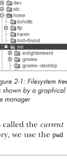
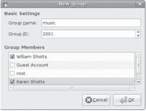
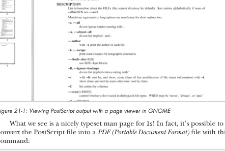
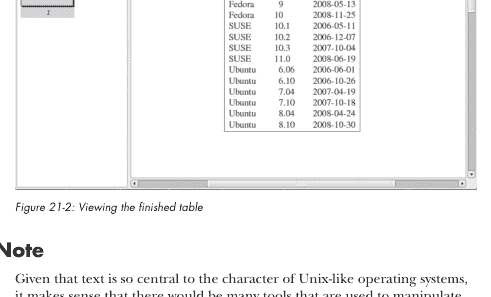
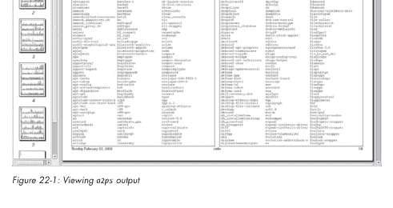
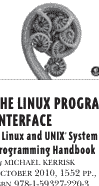
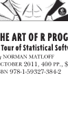
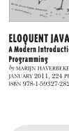

# Linux命令行完全入门指南（第1版）


献给凯伦


- 印刷简史........................................................................ 286

- 什么是编译？................................................................................ 298


- 什么是 Shell 脚本？...................................................309
  - 长选项名称.........................................................313

- 第一阶段：最小文档..............................................315
  - 创建变量和常量..........................................318

- Shell 函数............................................................326

- 使用 if...................................................................334
  - 文件表达式..........................................................336


- case........................................................................ 376

- 访问命令行.................................................... 381

- for：传统 Shell 形式.................................................... 393

- 参数扩展........................................................... 399

- 什么是数组？ ................................................................................ 415

- 命令组和子 Shell.............................................................. 423


## 致谢

我想感谢以下帮助使本书成为可能的人们。

首先，是那些激励我的人：Wiley 出版社的收购编辑 Jenny Watson 最初建议我写一本 shell 脚本书籍。虽然 Wiley 没有接受我的提案，但它成为了本书的基础。著名专栏作家和评论家 John C. Dvorak 提供了宝贵的建议。在他视频播客《Cranky Geeks》的一集中，Dvorak 先生描述了写作的过程：“地狱。每天写 200 字，一年后，你就有一部小说了。” 这个提示促使我每天写一页，直到写成一本书。Dmitri Popov 在《Free Software Magazine》上撰写了一篇题为“使用 Writer 创建书籍模板”的文章，这激励我使用 OpenOffice.org Writer 来撰写文本。事实证明，它效果非常好。

接下来，是帮助我制作本书原始、自由分发版本的人们（可在 LinuxCommand.org 上获取）：Mark Polesky 对文本进行了非凡的审阅和测试。Jesse Becker、Tomasz Chrzczonowicz、Michael Levin 和 Spence Miner 也对文本的部分内容进行了测试和审阅。Karen M. Shotts 为编辑我的原始手稿贡献了大量时间。

接下来，是 No Starch Press 的好人们，他们辛苦工作制作了我书籍的商业版本：生产经理 Serena Yang；我的编辑 Keith Fancher；以及 No Starch Press 的其他员工。

最后，是 LinuxCommand.org 的读者们，他们给我发送了许多友好的邮件。他们的鼓励让我觉得我真的在做一件有意义的事情！

## 引言

我想给你讲一个故事。不，不是 1991 年 Linus Torvalds 编写 Linux 内核第一个版本的故事。你可以在很多 Linux 书籍中读到那个故事。我也不会告诉你，几年前 Richard Stallman 发起 GNU 项目以创建自由的类 Unix 操作系统的故事。那也是一个重要的故事，但大多数其他 Linux 书籍也都有这个故事。不，我想告诉你的是你如何重新掌控自己电脑的故事。

当我在 1970 年代末作为一名大学生开始使用计算机时，正在发生一场革命。微处理器的发明使得像你我这样的普通人实际上可以拥有自己的电脑。对许多人来说，很难想象在只有大企业和大政府运行所有电脑的世界是什么样的。简单来说，你几乎什么也做不成。

今天，世界大不相同。计算机无处不在，从微小的手表到庞大的数据中心，再到两者之间的一切。除了无处不在的计算机，我们还有一个连接它们的无处不在的网络。这创造了一个奇妙的新时代，个人赋权和创造自由，但过去几十年来，另一件事也在发生。单一的巨型公司一直在对世界上大多数计算机施加控制，并决定你可以用它们做什么、不能做什么。幸运的是，来自世界各地的人们正在对此采取行动。他们通过编写自己的软件来努力保持对自己电脑的控制。他们正在构建 Linux。

许多人谈论 Linux 的“自由”，但我认为大多数人并不知道这种自由真正意味着什么。自由是你决定电脑做什么的能力，而拥有这种自由的唯一方法就是知道你的电脑在做什么。自由是一台没有秘密的电脑，一切都可以被知晓，只要你足够关心去了解。

### 为什么使用命令行？

你有没有注意到在电影里，当“超级黑客”——你知道，就是那个能在 30 秒内黑进超安全军事电脑的家伙——坐到电脑前时，他从不碰鼠标？这是因为电影制作人意识到，我们作为人类，本能地知道在电脑上真正做成事情的唯一方法就是在键盘上打字。

今天大多数计算机用户只熟悉图形用户界面（GUI），并且被厂商和评论家教导说命令行界面（CLI）是令人恐惧的过去之事。这很不幸，因为一个好的命令行界面是与计算机交流的一种奇妙而富有表现力的方式，就像书面文字之于人类一样。有人说过“图形用户界面让简单任务变得简单，而命令行界面让困难任务成为可能”，这在今天仍然非常正确。

由于 Linux 是基于 Unix 家族的操作系统，它与 Unix 共享了同样的丰富的命令行工具传承。Unix 在 20 世纪 80 年代初期崭露头角（尽管早十年就已开发），在图形用户界面广泛采用之前，因此发展出了广泛的命令行界面。事实上，早期 Linux 采用者选择它而不是 Windows NT 等系统的主要原因之一就是强大的命令行界面，它让“困难任务成为可能”。

### 本书讲的是什么

本书是对在 Linux 命令行上“生活”的一种广泛概述。与只集中于单个程序、例如 shell 程序 bash 的书籍不同，本书将尝试传达如何在更广的意义上与命令行界面相处。它是如何工作的？它能做什么？最好的使用方式是什么？


**这不是一本关于 Linux 系统管理的书。** 虽然任何严肃的命令行讨论不可避免地会涉及系统管理主题，但本书仅涉及少数几个管理问题。它将为读者提供额外的学习准备，通过提供对命令行的扎实使用基础，而命令行是任何严肃系统管理任务必不可少的工具。

**本书非常以 Linux 为中心。** 许多其他书籍试图通过包含其他平台（如通用 Unix 和 Mac OS X）来扩大其吸引力。在这样做的过程中，它们“稀释”了内容，只涵盖一般主题。另一方面，本书仅涵盖当代 Linux 发行版。95% 的内容对其他类 Unix 系统的用户也很有用，但本书高度针对现代 Linux 命令行用户。

## 应该阅读本书的人

本书适合从其他平台迁移过来的新 Linux 用户。你很可能是一个使用某种 Microsoft Windows 版本的“高级用户”。也许你的老板告诉你要管理一台 Linux 服务器，或者你只是一个桌面用户，对所有安全问题感到厌倦，想尝试一下 Linux。那也没关系。这里欢迎所有人。

话虽如此，通往 Linux 启蒙之路没有捷径。学习命令行具有挑战性，需要真正的努力。问题不在于它很难，而在于它太庞大。平均的 Linux 系统在命令行上 literally 有数千个程序可供使用。请自求多福：学习命令行不是一件随意的尝试。

另一方面，学习 Linux 命令行是极其有回报的。如果你现在认为自己是“高级用户”，那就等着瞧吧。你还不知道什么是真正的力量——而且，与许多其他计算机技能不同，命令行知识经久不衰。今天学到的技能在 10 年后仍然有用。命令行经受住了时间的考验。

同时也假定你没有任何编程经验——不用担心。我们也会引导你走上这条道路。

## 本书内容

这些材料以精心选择的顺序呈现，就好像有一位导师坐在你旁边，引导你前进。许多作者以“系统化”的方式处理这些材料，这从作者的角度来看是有道理的，但对新用户来说可能非常令人困惑。

另一个目标是让你熟悉 Unix 式的思维方式，这与 Windows 式的思维方式不同。一路上，我们会进行几次小插曲，帮助你理解某些事物为何以这种方式工作以及它们是如何演变而来的。Linux 不仅仅是一段软件；它也是更大 Unix 文化的一部分，Unix 文化有自己的语言和历史。我也可能会发几通牢骚。

to test a computer for Linux compatibility prior to installation. 使用 live CD 的缺点是，与 Linux 安装在你的硬盘上相比，它可能非常慢。Ubuntu 和 Fedora（以及其他发行版）都有 live CD 版本。

**注意：** 无论你如何安装 Linux，你都需要偶尔拥有超级用户（即管理员）权限来完成本书中的练习。

在你拥有一个可用的安装后，开始阅读并在自己的电脑上跟随操作。本书的大部分内容都是“动手”的，所以坐下来开始输入吧！

> ### 我为什么不称之为“GNU/LINUX”
> 
> 在某些圈子里，政治上正确的做法是将 Linux 操作系统称为“GNU/Linux 操作系统”。“Linux” 的问题在于，没有完全正确的方式来命名它，因为它是由许多不同的人在庞大的分布式开发工作中编写的。从技术上讲，Linux 是操作系统的内核名称，仅此而已。内核当然非常重要，因为它让操作系统运行起来，但它不足以构成一个完整的操作系统。
> 
> 于是出现了理查德·斯托曼，这位天才哲学家创立了自由软件运动，创办了自由软件基金会，成立了 GNU 项目，编写了 GNU C 编译器（GCC）的第一个版本，创建了 GNU 通用公共许可证（GPL），等等等等。他坚持你称之为“GNU/Linux”以正确反映 GNU 项目的贡献。虽然 GNU 项目早于 Linux 内核，并且该项目的贡献者极其值得认可，但在名称中突出他们对其他所有做出重大贡献的人是不公平的。此外，我认为“Linux/GNU”在技术上会更准确，因为内核先启动，其它一切都在其上运行。
> 
> 在流行用法中，“Linux”指的是内核以及典型 Linux 发行版中发现的所有其他自由和开源软件——也就是说，整个 Linux 生态系统，而不仅仅是 GNU 组件。操作系统市场似乎更喜欢 DOS、Windows、Solaris 和 Unix。AIX 等一词名称。我选择使用流行格式。如果你更喜欢使用“GNU/Linux”，请在阅读本书时在脑海中进行搜索和替换。我不会介意。


## 第一部分

学习 Shell

### 第 1 章

### 什么是 Shell？

当我们谈到命令行时，实际上指的是 shell。shell 是一个程序，它接收键盘命令并将其传递给操作系统来执行。几乎所有的 Linux 发行版都提供一个来自 GNU 项目的 shell 程序，名为 bash。bash 这个名字是 Bourne Again Shell 的缩写，表示 bash 是 sh 的增强替代品，sh 是由 Steve Bourne 编写的原始 Unix shell 程序。

## 终端模拟器

在使用图形用户界面时，我们需要另一个称为终端模拟器的程序来与 shell 交互。如果我们查看桌面菜单，可能会找到一个。KDE 使用 konsole，GNOME 使用 gnome-terminal，尽管在菜单上可能简称为“终端”。Linux 还有其他许多终端模拟器可用，但它们基本都做同样的事情：让我们访问 shell。你可能会根据它拥有的花哨功能多少而偏好某一个。

## 最初的按键操作

那么让我们开始吧。启动终端模拟器！一旦它出现，你应该会看到类似这样的内容：

```
[me@linuxbox ~]$
```

这被称为 *shell 提示符*，每当 shell 准备好接受输入时就会出现。虽然它的外观可能因发行版而有所不同，但通常会包含你的 *用户名@机器名*，后面跟着当前工作目录（稍后会详细介绍）和一个美元符号。

如果提示符的最后一个字符是井号（#）而不是美元符号，那么这个终端会话具有 *超级用户* 权限。这意味着我们要么以 root 用户登录，要么选择了提供超级用户（管理员）权限的终端模拟器。

假设到目前为止一切正常，让我们尝试输入一些内容。在提示符下输入一些乱码，如下所示：

```
[me@linuxbox ~]$ kaekfjaeifj
```

由于这个命令没有意义，shell 会告诉我们并给我们另一次机会：

```
bash: kaekfjaeifj: command not found
[me@linuxbox ~]$
```

## 命令历史

如果我们按下上箭头键，我们会看到先前的命令 kaekfjaeifj 在提示符后重新出现。这被称为 *命令历史*。大多数 Linux 发行版默认记住最近 500 条命令。按下下箭头键，先前的命令就会消失。

## 光标移动

再次用上箭头键召回之前的命令。现在试试左箭头和右箭头键。看看我们如何能将光标定位在命令行的任何位置？这使得编辑命令变得容易。

## 关于鼠标和焦点的一些说明

虽然 shell 完全围绕键盘操作，但你也可以在终端模拟器中使用鼠标。X Window 系统（驱动图形界面的底层引擎）内置的一种机制支持快速的复制粘贴技术。如果你按住鼠标左键并拖动鼠标来高亮一些文本（或双击一个单词），它会被复制到一个由 X 维护的缓冲区中。按下鼠标中键会将文本粘贴到光标位置。试试看。

不要试图在终端窗口中使用 CTRL-C 和 CTRL-V 来执行复制和粘贴。它们不起作用。对于 shell 来说，这些控制键具有不同的含义，这些含义是在 Microsoft Windows 出现之前很多年就已赋予的。

你的图形桌面环境（很可能是 KDE 或 GNOME）为了表现得像 Windows，可能将其焦点策略设置为“点击聚焦”。这意味着要让一个窗口获得焦点（变为活动），你需要点击它。这与传统 X 行为的“焦点跟随鼠标”相反，后者意味着当鼠标经过窗口时，窗口就会获得焦点。在点击之前窗口不会移到前台，但它将能够接收输入。将焦点策略设置为“焦点跟随鼠标”将使终端窗口的使用更加容易。试试看。我想如果你给它一个机会，你会更喜欢它的。你可以在窗口管理器的配置程序中找到这个设置。

## 尝试一些简单命令

既然我们已经学会了打字，让我们尝试一些简单的命令。第一个是 date。这个命令显示当前的时间和日期：

```
[me@linuxbox ~]$ date
Thu Oct 25 13:51:54 EDT 2012
```

一个相关的命令是 cal，默认情况下，它显示当前月份的日历：

```
[me@linuxbox ~]$ cal
October 2012
Su Mo Tu We Th Fr Sa
 1  2  3  4  5  6
 7  8  9 10 11 12 13
14 15 16 17 18 19 20
21 22 23 24 25 26 27
28 29 30 31
```


要查看磁盘驱动器上当前可用空间的数量，输入 df：

```
[me@linuxbox ~]$ df
Filesystem     1K-blocks    Used Available Use% Mounted on
/dev/sda2      15115452 5012392  9980716 34% /
/dev/sda5      59631908 20545424 30008432 47% /home
/dev/sda1       147764   17370   122765 13% /boot
tmpfs           256856      0   256856  0% /dev/shm
```

同样，要显示可用内存的数量，输入 free 命令：

```
[me@linuxbox ~]$ free
             total       used       free     shared    buffers     cached
Mem:       513712     503976      9736          0       5312     122916
-/+ buffers/cache:   375748     137964
Swap:      1052248    104712     947536
```

## 结束终端会话

我们可以通过关闭终端模拟器窗口或在 shell 提示符下输入 exit 命令来结束终端会话：

```
[me@linuxbox ~]$ exit
```

## 幕后的控制台

即使我们没有运行终端模拟器，仍有多个终端会话在图形桌面后面持续运行。称为虚拟终端或虚拟控制台，这些会话可以在大多数 Linux 发行版上通过按 CTRL-ALT-F1 到 CTRL-ALT-F6 访问。大多数系统上按这些组合键时，会话会显示登录提示，我们可以在其中输入用户名和密码。要从一个虚拟控制台切换到另一个，按 ALT 和 F1-F6。要返回图形桌面，按 ALT-F7。

## 2

### 导航

我们需要学习的第一件事（除了打字之外）是如何在 Linux 系统上导航文件系统。本章将介绍以下命令：

- pwd—打印当前工作目录的名称。
- cd—更改目录。
- ls—列出目录内容。

### 理解文件系统树

与 Windows 类似，类 Unix 操作系统如 Linux 将其文件组织在所谓的 *分层目录结构* 中。这意味着它们以树状的目录模式组织，有时在其他系统中称为文件夹，其中可能包含文件和其他目录。文件系统中的第一个目录称为 *根目录*。根目录包含文件和子目录，这些子目录又包含更多文件和子目录，依此类推。

请注意，与 Windows 不同，Windows 为每个存储设备都有单独的文件系统树，而类 Unix 系统如 Linux 无论连接了多少驱动器或存储设备，始终只有一个文件系统树。存储设备在树上的各个点被挂载，根据系统管理员的喜好进行挂载，系统管理员是负责系统维护的人员。

### 当前工作目录

我们大多数人可能熟悉图形文件管理器，它表示文件系统树，如图 2-1 所示。请注意，树通常是倒置显示的，即根在顶部，各个分支向下延伸。

然而，命令行没有图片，因此为了导航文件系统树，我们需要以不同的方式思考它。

想象文件系统是一个倒置的树形迷宫，我们能够站在其中。任何时候，我们都位于单个目录内，我们可以看到该目录包含的文件、通往上方目录的路径（称为父目录）以及下方任何子目录。我们所站的目录称为当前工作目录。要显示当前工作目录，我们使用 pwd（print working directory）命令：



```
[me@linuxbox ~]$ pwd
/home/me
```

当我们首次登录系统（或启动终端模拟器会话）时，我们的当前工作目录被设置为我们的主目录。每个用户账户都有自己的主目录，当以普通用户身份操作时，用户只能在此处写入文件。

### 列出目录内容

要列出当前工作目录中的文件和目录，我们使用 ls 命令：

```
[me@linuxbox ~]$ ls
Desktop Documents Music Pictures Public Templates Videos
```

实际上，我们可以使用 ls 命令列出任何目录的内容，而不仅仅是当前工作目录，而且它还可以做许多其他有趣的事情。我们将在第 3 章中更详细地介绍 ls。


## 更改当前工作目录

要更改你的工作目录（即我们在树状迷宫中所处的位置），可以使用 cd 命令：输入 cd，后接目标工作目录的路径名。路径名是我们沿着树的枝干到达目标目录所走的路线。路径名可以通过两种方式指定，即绝对路径名或相对路径名。我们先来处理绝对路径名。

### 绝对路径名

绝对路径名始于根目录，沿着树的分支逐一前进，直到通往目标目录或文件的路径完整。例如，你的系统上有一个目录，大多数系统程序都安装在其中。该目录的路径名是 /usr/bin。这意味着从根目录（由路径名中的前导斜杠表示）开始，有一个名为 usr 的目录，其中包含一个名为 bin 的目录。

```
[me@linuxbox ~]$ cd /usr/bin
[me@linuxbox bin]$ pwd
/usr/bin
[me@linuxbox bin]$ ls

...listing of many, many files ...
```

现在我们可以看到，当前工作目录已更改为 /usr/bin，并且其中满是文件。注意到 shell 提示符有何变化了吗？为了方便起见，它通常被设置为自动显示工作目录的名称。

### 相对路径名

绝对路径名从根目录开始并通向其目标，而相对路径名则从当前工作目录开始。为此，它使用两个特殊符号来表示文件系统树中的相对位置。这两个特殊符号是点（.）和点点（..）。

点（.）符号指代工作目录，点点（..）符号指代工作目录的父目录。下面来看它是如何工作的。让我们再次将工作目录更改为 /usr/bin：

```
[me@linuxbox ~]$ cd /usr/bin
[me@linuxbox bin]$ pwd
/usr/bin
```

好的，现在假设我们想把工作目录更改到 /usr/bin 的父目录，即 /usr。我们可以用两种不同的方式做到这一点，一种是使用绝对路径名：

```
[me@linuxbox bin]$ cd /usr
[me@linuxbox usr]$ pwd
/usr
```

或者使用相对路径名：

```
[me@linuxbox bin]$ cd ..
[me@linuxbox usr]$ pwd
/usr
```

两种不同的方法产生相同的结果。我们应该使用哪一种？当然是输入最少的那种！

同样，我们可以通过两种不同的方式将工作目录从 /usr 更改为 /usr/bin，一种方式是使用绝对路径名：

```
[me@linuxbox usr]$ cd /usr/bin
[me@linuxbox bin]$ pwd
/usr/bin
```

或者使用相对路径名：

```
[me@linuxbox usr]$ cd ./bin
[me@linuxbox bin]$ pwd
/usr/bin
```

现在，有一点很重要，我必须在这里指出来。在几乎所有情况下，你都可以省略 ./，因为它是隐含的。输入

```
[me@linuxbox usr]$ cd bin
```

会执行同样的操作。通常，如果你没有指定到某处的路径名，则会假定使用工作目录。

### 一些有用的快捷方式

在表 2-1 中，我们可以看到一些快速更改当前工作目录的有用方法。

### 表 2-1：cd 快捷方式

| 快捷键 | 结果 |
|---|---|
| cd | 将工作目录更改为你的主目录。 |
| cd - | 将工作目录更改为上一个工作目录。 |
| cd ~username | 将工作目录更改为 username 的主目录。例如，cd ~bob 会将目录更改为用户 bob 的主目录。 |

## 关于文件名的重要事实

- 以句点字符开头的文件名是隐藏的。这仅意味着 ls 不会列出它们，除非你使用 ls -a。在你的账户创建时，几个隐藏文件被放置在你的主目录中，用于为你的账户配置各项设置。稍后我们将仔细查看其中一些文件，了解如何自定义你的环境。此外，一些应用程序还会将其配置和设置文件作为隐藏文件放在你的主目录中。
- 与 Unix 中一样，Linux 中的文件名和命令是区分大小写的。文件名 File1 和 file1 指的是不同的文件。
- Linux 不像其他一些操作系统那样有“文件扩展名”的概念。你可以随意命名文件。文件的内容和/或用途由其他方式决定。尽管类 Unix 操作系统不使用文件扩展名来确定文件的内容/用途，但某些应用程序确实会使用。
- 尽管 Linux 支持可包含嵌入空格和标点字符的长文件名，但应将你创建的文件名中的标点字符限制为句点、短横线（连字符）和下划线。最重要的是，不要在文件名中嵌入空格。在文件名中嵌入空格会使许多命令行任务变得更加困难，我们将在第 7 章中发现这一点。如果你想在文件名中表示单词之间的空格，可以使用下划线字符。以后你会感谢自己这么做。


## 3 探索系统

现在我们已经知道如何在文件系统中移动，是时候对我们的 Linux 系统进行一次引导式游览了。在开始之前，我们将学习一些在途中会用到的命令：

- ls—列出目录内容。
- file—确定文件类型。
- less—查看文件内容。

### 更有趣的 ls

ls 很可能是使用最频繁的命令，原因也很充分。有了它，我们可以看到目录内容并确定各种重要的文件和目录属性。正如我们所见，我们可以简单地输入 ls 来查看当前工作目录中包含的文件和子目录列表：

```
[me@linuxbox ~]$ ls
Desktop Documents Music Pictures Public Templates Videos
```

除了当前工作目录，我们还可以指定要列出的目录，如下所示：

```
[me@linuxbox ~]$ ls /usr
bin games kerberos libexec sbin src
etc include lib local share tmp
```

甚至可以指定多个目录。在此示例中，我们将同时列出用户的主目录（用 ~ 字符表示）和 /usr 目录：

```
[me@linuxbox ~]$ ls ~ /usr
/home/me:
Desktop Documents Music Pictures Public Templates Videos
/usr:
bin games kerberos libexec sbin src
etc include lib local share tmp
```

我们还可以更改输出格式以显示更多详细信息：

```
[me@linuxbox ~]$ ls -l
total 56
drwxrwxr-x 2 me me 4096 2012-10-26 17:20 Desktop
drwxrwxr-x 2 me me 4096 2012-10-26 17:20 Documents
drwxrwxr-x 2 me me 4096 2012-10-26 17:20 Music
drwxrwxr-x 2 me me 4096 2012-10-26 17:20 Pictures
drwxrwxr-x 2 me me 4096 2012-10-26 17:20 Public
drwxrwxr-x 2 me me 4096 2012-10-26 17:20 Templates
drwxrwxr-x 2 me me 4096 2012-10-26 17:20 Videos
```

通过在命令中添加 -l，我们将输出更改为长格式。

### 选项和参数

这引出了一个关于大多数命令如何工作的重要观点。命令通常后面跟着一个或多个修改其行为的选项，以及一个或多个命令所作用的对象，即参数。因此大多数命令看起来像这样：

```
command -options arguments
```

大多数命令使用由破折号引导的单个字符作为选项，例如 -l。但许多命令，包括 GNU 项目的命令，也支持由两个破折号引导的单词组成的长选项。此外，许多命令允许将多个短选项串联起来。在此示例中，ls 命令被赋予了两个选项，l 选项用于生成长格式输出，t 选项用于按文件的修改时间排序结果：

```
[me@linuxbox ~]$ ls -lt
```

我们将添加长选项 --reverse 来反转排序顺序：

```
[me@linuxbox ~]$ ls -lt --reverse
```

ls 命令有大量可能的选项。最常见的列在表 3-1 中。

### 表 3-1：常见的 ls 选项

| Option | Long Option | Description |
|---|---|---|
| -a | --all | 列出所有文件，即使那些以句点开头、通常不列出（即隐藏）的名称。 |
| -d | --directory | 通常，如果指定了目录，ls 将列出目录的内容，而不是目录本身。使用此选项结合 -l 选项可查看目录本身的详细信息而不是其内容。 |
| -F | --classify | 此选项会在每个列出名称的末尾附加一个指示字符（例如，如果名称是目录，则为正斜杠）。 |
| -h | --human-readable | 在长格式列表中，以人类可读格式显示文件大小而不是字节。 |
| -l |  | 以长格式显示结果。 |
| -r | --reverse | 以相反顺序显示结果。通常，ls 以升序字母顺序显示其结果。 |
| -S |  | 按文件大小排序结果。 |
| -t |  | 按修改时间排序。 |

### 更深入地了解长格式

正如我们之前看到的，-l 选项会使 ls 以长格式显示结果。此格式包含大量有用的信息。以下是 Ubuntu 系统中的 Examples 目录：

```
-rw-r--r-- 1 root root 3576296 2012-04-03 11:05 Experience_ubuntu.ogg
-rw-r--r-- 1 root root 1186219 2012-04-03 11:05 kubuntu-leaflet.png
-rw-r--r-- 1 root root 47584 2012-04-03 11:05 logo-EduBuntu.png
-rw-r--r-- 1 root root 44355 2012-04-03 11:05 logo-Kubuntu.png
-rw-r--r-- 1 root root 34391 2012-04-03 11:05 logo-Ubuntu.png
-rw-r--r-- 1 root root 32059 2012-04-02 11:05 oo-cd-cover.odf
-rw-r--r-- 1 root root 159744 2012-04-02 11:05 oo-derivatives.doc
-rw-r--r-- 1 root root 27837 2012-04-03 11:05 oo-maxwell.odt
-rw-r--r-- 1 root root 98816 2012-04-03 11:05 oo-trig.xls
```


```
-rw-r--r-- 1 root root 453764 2012-04-03 11:05 oo-welcome.odt
-rw-r--r-- 1 root root 358374 2012-04-03 11:05 ubuntu Sax.ogg
```

让我们从其中一个文件中的不同字段着手，并查看它们在表 3-2 中的含义。

## 表 3-2：长格式列表字段

| 字段 | 含义 |
| --- | --- |
| -rw-r--r-- | 文件的访问权限。第一个字符表示文件类型。在不同类型中，以连字符开头表示普通文件，而 d 表示目录。接下来的三个字符是文件所有者的访问权限，之后的三个字符是文件所属组成员的访问权限，最后三个字符是其他所有人的访问权限。其完整含义将在第 9 章中讨论。 |
| 1 | 文件的硬链接数。参见本章末尾关于链接的讨论。 |
| root | 文件所有者的用户名。 |
| root | 文件所属组的名称。 |
| 32059 | 文件的大小，以字节为单位。 |
| 2012-04-03 11:05 | 文件最后修改的日期和时间。 |
| oo-cd-cover.odf | 文件名。 |

## 使用 file 确定文件类型

在探索系统时，了解文件包含什么内容会很有用。为此，我们将使用 file 命令来确定文件类型。正如我们之前讨论的，在 Linux 中文件名并不需要反映文件的内容。例如，虽然像 picture.jpg 这样的文件名通常预期包含 JPEG 压缩图像，但在 Linux 中并非必须如此。我们可以这样调用 file 命令：

```
file filename
```

调用时，file 命令会打印出文件内容的简要描述。例如：

```
[me@linuxbox ~]$ file picture.jpg
picture.jpg: JPEG image data, JFIF standard 1.01
```

文件种类繁多。事实上，在类 Unix 操作系统如 Linux 中，一个常见的理念是“一切皆文件”。随着我们继续学习，我们会看到这一说法有多么正确。

虽然系统上的许多文件都很熟悉，例如 MP3 和 JPEG 文件，但许多类型不太明显，其中一些则相当奇怪。

## 使用 less 查看文件内容

less 命令是一个用于查看文本文件的程序。在整个 Linux 系统中，有许多文件包含人类可读的文本。less 程序提供了一种方便的方式来检查它们。

为什么我们要查看文本文件？因为许多包含系统设置的文件（称为配置文件）以这种格式存储，能够阅读它们让我们深入了解系统的工作方式。此外，系统使用的许多实际程序（称为脚本）也以这种格式存储。在后面的章节中，我们将学习如何编辑文本文件以修改系统设置和编写自己的脚本，但现在我们只是查看其内容。

### 什么是“文本”？

在计算机上表示信息有许多方法。所有方法都涉及在信息与用于表示它的数字之间定义关系。毕竟，计算机只理解数字，所有数据都会被转换为数字表示。

其中一些表示系统非常复杂（例如压缩视频文件），而另一些则相当简单。其中最早、最简单的一种称为 ASCII 文本。ASCII 发音为“As-Key”，是 American Standard Code for Information Interchange 的缩写。这种简单的编码方案最初用于电传打字机。

文本是字符到数字的简单一对一映射。它非常紧凑。五十个字符的文本对应五十字节的数据。它与 Microsoft Word 或 OpenOffice.org Writer 等文字处理器中的文本不同。那些文件与简单的 ASCII 文本相反，包含许多非文本元素，用于描述其结构和格式。纯 ASCII 文本文件只包含字符本身以及一些基本控制代码，如制表符、回车符和换行符。

在整个 Linux 系统中，许多文件以文本格式存储，许多 Linux 工具也处理文本文件。即使是 Windows 也认识到这种格式的重要性。众所周知的记事本程序就是一个纯 ASCII 文本文件编辑器。


less 命令的使用方法如下：

```
less filename
```

启动后，less 程序允许你向前和向后滚动浏览文本文件。例如，要检查定义系统中所有用户账户的文件，输入以下命令：

```
[me@linuxbox ~]$ less /etc/passwd
```

一旦 less 程序启动，我们就可以查看文件内容。如果文件长度超过一页，我们可以向上和向下滚动。要退出 less，按 Q 键。

## 表 3-3：less 命令

| Command | Action |
|---|---|
| PAGE UP or b | 向后滚动一页。 |
| PAGE DOWN or Spacebar | 向前滚动一页。 |
| Up Arrow | 向上滚动一行。 |
| Down Arrow | 向下滚动一行。 |
| G | 移至文本文件末尾。 |
| 1G or g | 移至文本文件开头。 |
| /characters | 向前搜索下一个出现的 characters。 |
| n | 搜索上一次搜索的下一个出现位置。 |
| h | 显示帮助屏幕。 |
| q | 退出 less。 |

## LESS IS MORE

less 程序是作为对早期 Unix 程序 more 的改进替代品而设计的。它的名字是对短语“less is more”的戏仿——这是现代主义建筑师和设计师的座右铭。

less 属于一类称为分页器 programs 的程序，这类程序允许以分页方式轻松查看长文本文档。more 程序只能向前分页，而 less 程序允许向前和向后分页，并且还有许多其他功能。

## 导览

你的 Linux 系统上的文件系统布局与其它类 Unix 系统上找到的布局非常相似。该设计实际上在名为 Linux 文件系统层次标准 的已发布标准中进行了规范。并非所有 Linux 发行版都完全符合该标准，但大多数都比较接近。

接下来，我们将自己在文件系统中漫游，看看我们的 Linux 系统是如何运行的。这将给你练习导航技能的机会。我们将发现的其中一件事是，许多有趣的文件都是纯文本、可读的。在我们进行导览时，请尝试以下操作：

- 1. cd 进入给定目录。
- 2. 使用 ls -l 列出目录内容。
- 3. 如果看到有趣的文件，使用 file 确定其内容。
- 4. 如果看起来像是文本，尝试使用 less 查看它。

> Note: 记住复制粘贴技巧！如果你使用鼠标，可以双击文件名将其复制，然后中键单击将其粘贴到命令中。

在我们漫游时，不要害怕查看东西。普通用户在很大程度上被禁止搞乱东西。那是系统管理员的工作！如果某个命令抱怨什么，就继续做别的事情。花点时间到处看看。系统供我们探索。在 Linux 中，没有秘密！表 3-4 列出了我们在 Linux 系统上可以探索的几个目录。欢迎尝试更多！

## 表 3-4：Linux 系统上找到的目录

| Directory | Comments |
|---|---|
| / | 根目录，一切从这里开始。 |
| /bin | 包含系统启动和运行所必需的二进制文件（程序）。 |
| /boot | 包含 Linux 内核、初始 RAM 磁盘映像（启动时所需的驱动程序）以及引导加载程序。 |
|  | 有趣的文件： |
|  | - /boot/grub/grub.conf 或 menu.lst，用于配置引导加载程序 |
|  | - /boot/vmlinuz，Linux 内核 |

## 表 3-4（续）

| Directory | Comments |
|---|---|
| /dev | 这是一个特殊目录，包含 *设备节点*。“一切皆文件”也适用于设备。这里是内核维护其所理解的所有设备的列表。 |
| /etc | */etc* 目录包含所有系统范围的配置文件。它还包含在启动时启动每个系统服务的 shell 脚本集合。此目录中的所有内容都应为可读文本。 |
|  | 有趣的文件：虽然 */etc* 中的所有内容都很有趣，但以下是我的最爱： |
|  | - */etc/crontab*，定义自动化作业何时运行的文件 |
|  | - */etc/fstab*，存储设备及其关联挂载点的表 |
|  | - */etc/passwd*，用户账户列表 |
| /home | 在正常配置中，每个用户在 */home* 中都有一个目录。普通用户只能在其主目录中写入文件。这一限制可保护系统免受用户误操作的影响。 |
| /lib | 包含核心系统程序使用的共享库文件。这些类似于 Windows 中的 DLL。 |
| /lost+found | 每个使用 Linux 文件系统（如 ext3）的格式化分区或设备都将有此目录。它用于在文件系统损坏事件的部分恢复情况下使用。除非你的系统发生了非常严重的问题，否则此目录将保持为空。 |
| /media | 在现代 Linux 系统上，*/media* 目录将包含可移动媒体（如 USB 驱动器、CD-ROM 等）的挂载点，这些媒体在插入时会自动挂载。 |
| /mnt | 在旧版 Linux 系统上，*/mnt* 目录包含手动挂载的可移动设备的挂载点。 |
| /opt | */opt* 目录用于安装“可选”软件。这主要用于存放可能安装在系统上的商业软件产品。 |


## 表 3-4（续）

| 目录 | 注释 |
|---|---|
| /proc | /proc 目录很特殊。它并不是以存储在硬盘上的文件形式存在的真正文件系统。相反，它是由 Linux 内核维护的一个虚拟文件系统。其中的“文件”是对内核本身的窥视口。这些文件可读，会让你了解内核如何看待你的计算机。 |
| /root | 这是 root 账户的主目录。 |
| /sbin | 该目录包含“系统”二进制文件。这些是执行关键系统任务的程序，通常仅保留给超级用户。 |
| /tmp | /tmp 目录用于存储各种程序创建的临时、短暂文件。某些配置会在系统每次重启时清空该目录。 |
| /usr | /usr 目录树很可能是 Linux 系统上最大的目录树。它包含普通用户使用的所有程序和支持文件。 |
| /usr/bin | /usr/bin 包含由你的 Linux 发行版安装的可执行程序。这个目录包含数千个程序是很常见的情况。 |
| /usr/lib | /usr/bin 程序的共享库。 |
| /usr/local | /usr/local 树是安装那些未随发行版提供但 intended 用于系统范围使用的程序的位置。从源代码编译的程序通常安装在 /usr/local/bin 中。在新安装的 Linux 系统上，该树存在，但直到系统管理员放入内容之前它将是空的。 |
| /usr/sbin | 包含更多系统管理程序。 |
| /usr/share | /usr/share 包含 /usr/bin 中程序使用的所有共享数据。这包括默认配置文件、图标、屏幕背景、声音文件等。 |
| /usr/share/doc | 系统上安装的大多数软件包都会包含某种文档。在 /usr/share/doc 中，我们会找到按软件包组织的文档文件。 |
| /var | 除了 /tmp 和 /home，我们迄今为止查看的目录相对静态；也就是说，其内容不会改变。/var 目录树用于存储可能发生变化的数据。各种数据库、spool 文件、用户邮件等都位于此处。 |
| /var/log | /var/log 包含日志文件，即各种系统活动的记录。这些非常重要，应不时进行监控。其中最有用的一个是 /var/log/messages。请注意，出于安全原因，在某些系统上，你必须为超级用户才能查看日志文件。 |

## 符号链接

在我们四处查看时，很可能会看到如下的目录列表条目：

```
lrwxrwxrwx 1 root root 11 2012-08-11 07:34 libc.so.6 -> libc-2.6.so
```

注意列表的第一字母是 l，并且该条目似乎有两个文件名？这是一种特殊类型的文件，称为符号链接，也称为软链接或 symlink。在大多数类 Unix 系统中，可以让一个文件被多个名称引用。虽然现在这种价值可能并不明显，但它确实是一个非常有用的功能。

设想这个场景：一个程序需要使用名为 foo 的文件中包含的某种共享资源，但 foo 经常有版本更新。最好在文件名中包含版本号，以便管理员或其他感兴趣的人可以看到安装了 foo 的哪个版本。这就带来了一个问题。如果我们更改共享资源的名字，我们就必须追踪可能使用它的每个程序，并在每次安装新版本的资源时更改它以查找新的资源名称。这听起来一点也不好玩。

version。再次，我们只需删除指向新版本的符号链接并创建一个指向旧版本的新符号链接即可。

上面的目录列表显示了来自 Fedora 系统 /lib 目录的一个符号链接 libc.so.6，它指向一个名为 libc-2.6.so 的共享库文件。这意味着查找 libc.so.6 的程序实际上会得到文件 libc-2.6.so。我们将在下一章学习如何创建符号链接。

## 硬链接

既然我们谈到了链接，我们需要提到还有第二种类型的链接，称为硬链接。硬链接也允许文件拥有多个名称，但实现方式不同。我们将在下一章更详细地讨论符号链接和硬链接之间的差异。


## 4 操作文件和目录

现在，我们准备开始做一些真正的工作了！本章将介绍以下命令：

- cp—复制文件和目录。
- mv—移动/重命名文件和目录。
- mkdir—创建目录。
- rm—删除文件和目录。
- ln—创建硬链接和符号链接。

这五个命令是最常用的 Linux 命令之列。它们用于操作文件和目录。

现在，坦白地说，这些命令执行的某些任务，使用图形文件管理器可以更轻松地完成。借助图形文件管理器，我们可以将文件从一个目录拖放到另一个目录，剪切和粘贴文件，删除文件，等等。那么，为什么还要使用这些古老的命令行程序呢？

答案在于其强大和灵活性。虽然使用图形文件管理器执行简单的文件操作很容易，但复杂的任务用命令行程序可能更简单。例如，如何将一个目录中的所有 HTML 文件复制到另一个目录——但只复制那些在目标目录中不存在，或比目标目录中的版本更新的文件？用文件管理器很难做到，但用命令行却很容易：

```
cp -u *.html destination
```

### 通配符

在开始使用这些命令之前，我们需要介绍一下使这些命令如此强大的 shell 特性。由于 shell 大量使用文件名，它提供了特殊的字符，帮助你快速指定一组文件名。这些特殊字符被称为通配符。使用通配符（也称为 globbing）允许你基于字符模式来选择文件名。表 4-1 列出了通配符及其匹配的内容。

**表 4-1：通配符**

| 通配符 | 匹配 |
|---|---|
| `*` | 任意字符 |
| `?` | 任意单个字符 |
| `[characters]` | 字符集合中的任意一个字符 |
| `[!characters]` | 不在字符集合中的任意一个字符 |
| `[[:class:]]` | 指定字符类别中的任意一个字符 |

表 4-2 列出了最常用的字符类别。

**表 4-2：常用的字符类别**

| 字符类别 | 匹配 |
|---|---|
| `[:alnum:]` | 任意字母数字字符 |
| `[:alpha:]` | 任意字母字符 |
| `[:digit:]` | 任意数字 |
| `[:lower:]` | 任意小写字母 |
| `[:upper:]` | 任意大写字母 |

使用通配符可以构造非常复杂的文件名选择标准。表 4-3 列出了一些模式示例及其匹配的内容。

**表 4-3：通配符示例**

| 模式 | 匹配 |
|---|---|
| `*` | 所有文件 |
| `g*` | 以 g 开头的任意文件 |
| `b*.txt` | 以 b 开头、后跟任意字符并以 .txt 结尾的任意文件 |
| `Data???` | 以 Data 开头且后跟恰好三个字符的任意文件 |
| `[abc]*` | 以 a、b 或 c 中任意一个字符开头的任意文件 |
| `BACKUP.[0-9][0-9][0-9]` | 以 BACKUP 开头且后跟恰好三个数字的任意文件 |
| `[[:upper:]]*` | 以大写字母开头的任意文件 |
| `[[:digit:]]*` | 以数字开头的任意文件 |
| `*[[:lower:][:digit:]]` | 以小写字母或数字 1、2、3 结尾的任意文件 |

通配符可以用于任何接受文件名作为参数的命令，但我们将在第 7 章中更详细地讨论这一点。

### 字符范围

如果你来自另一个类 Unix 环境，或者读过一些关于此主题的其他书籍，你可能会遇到 [a-Z] 或 [a-z] 这样的字符范围表示法。这些是传统的 Unix 表示法，在旧版 Linux 中同样有效。它们现在仍然可以使用，但你必须非常小心，因为除非正确配置，否则它们不会产生预期的结果。目前，你应该避免使用它们，而改用字符类别。

### 通配符在图形界面中同样有效

通配符尤其有价值，不仅因为它们在命令行中使用频繁，还因为它们得到了一些图形文件管理器的支持。

- 在 Nautilus（GNOME 的文件管理器）中，你可以使用“编辑 ▸ 选择模式”来选择文件。只需输入带有通配符的文件选择模式，当前查看目录中的文件就会被高亮显示以供选择。
- 在 Dolphin 和 Konqueror（KDE 的文件管理器）的某些版本中，你可以直接在地址栏中输入通配符。例如，如果你想查看 /usr/bin 目录中所有以小写 u 开头的文件，请在地址栏中输入 `/usr/bin/u*`，它就会显示结果。

许多最初出现在命令行界面中的想法也进入了图形界面。这也是让 Linux 桌面如此强大的众多原因之一。

### mkdir—创建目录

mkdir 命令用于创建目录。它的用法如下：

```
mkdir directory...
```

关于表示法的一个说明：在本书中，当命令描述中的某个参数后面跟着三个点（如上所示）时，表示该参数可以重复。因此，在这种情况下，

```
mkdir dir1
```

将创建一个名为 dir1 的目录，而

```
mkdir dir1 dir2 dir3
```

将创建三个目录，分别命名为 dir1、dir2 和 dir3。

### cp—复制文件和目录

cp 命令用于复制文件或目录。它有两种不同的用法：

```
cp item1 item2
```

将单个文件或目录 item1 复制到文件或目录 item2，以及：

```
cp item... directory
```

将多个项目（文件或目录）复制到一个目录中。


表 4-4 和表 4-5 列出了 cp 常用的一些选项（短选项和等价的长选项）。

## 表 4-4：cp 选项

| 选项 | 含义 |
|---|---|
| -a, --archive | 复制文件和目录以及它们的所有属性，包括所有权和权限。通常，副本会采用执行复制的用户默认属性。 |
| -i, --interactive | 在覆盖现有文件之前，提示用户确认。如果未指定此选项，cp 将静默覆盖文件。 |
| -r, --recursive | 递归复制目录及其内容。此选项（或 -a 选项）在复制目录时是必需的。 |
| -u, --update | 从一个目录复制文件到另一个目录时，仅复制不存在或比目标目录中现有对应文件更新的文件。 |
| -v, --verbose | 在执行复制时显示信息性消息。 |

## 表 4-5：cp 示例

| 命令 | 结果 |
|---|---|
| cp file1 file2 | 将 file1 复制到 file2。如果 file2 存在，则会被 file1 的内容覆盖。如果 file2 不存在，则会创建它。 |
| cp -i file1 file2 | 同上，只是如果 file2 存在，则在覆盖前会提示用户。 |
| cp file1 file2 dir1 | 将 file1 和 file2 复制到目录 dir1 中。dir1 必须已存在。 |
| cp dir1/* dir2 | 使用通配符，将 dir1 中的所有文件复制到 dir2 中。dir2 必须已存在。 |
| cp -r dir1 dir2 | 将目录 dir1（及其内容）复制到目录 dir2。如果目录 dir2 不存在，则会创建它，并包含与目录 dir1 相同的内容。 |

## mv—移动和重命名文件

mv 命令根据使用方式执行文件移动和文件重命名。在任何情况下，操作后原始文件名都不再存在。mv 的使用方式与 cp 非常相似：

```
mv item1 item2
```

将文件或目录 item1 移动或重命名为 item2 或

```
mv item... directory
```

将一个或多个项目从一个目录移动到另一个目录。

mv 与 cp 共享许多相同的选项，如表 4-6 和表 4-7 所示。

## 表 4-6：mv 选项

| 选项 | 含义 |
|---|---|
| -i, --interactive | 在覆盖现有文件之前，提示用户确认。如果未指定此选项，mv 将静默覆盖文件。 |
| -u, --update | 从一个目录移动文件到另一个目录时，仅移动在目标目录中不存在或比目标目录中现有对应文件更新的文件。 |
| -v, --verbose | 在执行移动时显示信息性消息。 |

## 表 4-7：mv 示例

| 命令 | 结果 |
|---|---|
| mv file1 file2 | 将 file1 移动到 file2。如果 file2 存在，则会被 file1 的内容覆盖。如果 file2 不存在，则会创建它。在任何情况下，file1 都将不再存在。 |
| mv -i file1 file2 | 同上，只是如果 file2 存在，则在覆盖前会提示用户。 |
| mv file1 file2 dir1 | 将 file1 和 file2 移动到目录 dir1 中。dir1 必须已存在。 |
| mv dir1 dir2 | 将目录 dir1 [及其内容] 移动到目录 dir2 中。如果目录 dir2 不存在，则创建目录 dir2，将目录 dir1 的内容移动到 dir2 中，并删除目录 dir1。 |

## rm—删除文件和目录

rm 命令用于删除文件和目录，如下所示：

```
rm item...
```

其中 item 是一个或多个文件或目录的名称。

## 小心使用 RM！

类 Unix 操作系统如 Linux 没有 undelete 命令。一旦你用 rm 删除了某物，它就消失了。Linux 假定你很聪明，你知道自己在做什么。

在使用通配符时要特别小心。考虑这个经典例子。假设你只想删除目录中的 HTML 文件。为此，你输入：

```
rm *.html
```

这是正确的，但如果你不小心在 * 和 .html 之间加上一个空格，像这样：

```
rm * .html
```

rm 命令将删除目录中的所有文件，然后抱怨没有名为 .html 的文件。

这里有一个有用的提示：每当你使用通配符与 rm 一起使用时（除了仔细检查你的输入！），先用 ls 测试通配符。这将让你看到将被删除的文件。然后按向上箭头键召回命令并将 ls 替换为 rm。

表 4-8 和表 4-9 列出了 rm 的一些常用选项。

## 表 4-8：rm 选项

| 选项 | 含义 |
|---|---|
| -i, --interactive | 在删除现有文件之前，提示用户确认。如果未指定此选项，rm 将静默删除文件。 |
| -r, --recursive | 递归删除目录。这意味着如果被删除的目录有子目录，也会将其删除。要删除目录，必须指定此选项。 |
| -f, --force | 忽略不存在的文件且不提示。这会覆盖 --interactive 选项。 |
| -v, --verbose | 在执行删除时显示信息性消息。 |


## 表 4-9：rm 示例

| 命令 | 结果 |
|---|---|
| rm file1 | 静默删除 file1。 |
| rm -i file1 | 在删除 file1 之前，提示用户确认。 |
| rm -r file1 dir1 | 删除 file1 和 dir1 及其内容。 |
| rm -rf file1 dir1 | 同上，只是如果 file1 或 dir1 不存在，rm 会静默继续。 |

## In—创建链接

ln 命令用于创建硬链接或符号链接。它有两种用法：

```
ln file link
```

创建硬链接，以及

```
ln -s item link
```

创建符号链接，其中 item 是文件或目录。

## 硬链接

硬链接是创建链接的原始 Unix 方式；符号链接更为现代。默认情况下，每个文件都有一个硬链接来为文件命名。当我们创建硬链接时，我们为文件创建了一个额外的目录项。硬链接有两个重要的限制：

- 硬链接不能引用其自身文件系统之外的文件。这意味着链接不能引用不在与链接本身相同的磁盘分区上的文件。
- 硬链接不能引用目录。

硬链接与文件本身无法区分。与包含符号链接的目录列表不同，包含硬链接的目录列表不会显示链接的特殊指示。当硬链接被删除时，链接被移除，但文件本身的内容继续存在（即其空间不会被释放），直到指向该文件的所有链接都被删除。

了解硬链接很重要，因为你可能会时不时遇到它们，但现代实践更倾向于符号链接，我们将在下一节介绍。

## 符号链接

符号链接是为了克服硬链接的限制而创建的。符号链接通过创建一种特殊类型的文件来实现，该文件包含一个文本指针

注意我们使用了当前工作目录的简写，即单个尾随句点。现在如果我们执行 ls，我们将看到我们的文件：

```
[me@linuxbox playground]$ ls -l
total 12
drwxrwxr-x 2 me me 4096 2012-01-10 16:40 dir1
drwxrwxr-x 2 me me 4096 2012-01-10 16:40 dir2
-rw-r--r-- 1 me me 1650 2012-01-10 16:07 passwd
```

现在，为了好玩，让我们使用 -v 选项（详细）重复复制操作，看看它会做什么：

```
[me@linuxbox playground]$ cp -v /etc/passwd .
'/etc/passwd' -> './passwd'
```

cp 命令再次执行了复制，但这次它显示了一条简洁的消息，说明正在执行的操作。注意 cp 在没有任何警告的情况下覆盖了第一次复制。这又是 cp 假设你知道自己在做什么的情况。要获得警告，我们将包含 -i（交互式）选项：

```
[me@linuxbox playground]$ cp -i /etc/passwd .
cp: overwrite './passwd'?
```

通过输入 y 回应提示将导致文件被覆盖；任何其他字符（例如 n）将导致 cp 不动该文件。

## 移动和重命名文件

现在，名称 passwd 似乎不太好玩，而这里是游乐场，所以让我们把它改成别的名称：

```
[me@linuxbox playground]$ mv passwd fun
```

让我们把 fun 在各个目录之间传一传，再传回来：

```
[me@linuxbox playground]$ mv fun dir1
```

先把它移动到目录 dir1。然后

```
[me@linuxbox playground]$ mv dir1/fun dir2
```

把它从 dir1 移动到 dir2。然后

```
[me@linuxbox playground]$ mv dir2/fun .
```

在思考硬链接时，想象文件由两部分组成是有帮助的：包含文件内容的数据部分和保存文件名称的名称部分。当我们创建硬链接时，我们实际上创建了额外的名称部分，它们都指向相同的数据部分。系统为此分配了一串磁盘块，称为 inode，然后与名称部分关联。因此，每个硬链接都指向包含文件内容的特定 inode。

ls 命令有一种方法可以显示此信息。它使用 -i 选项调用：

```
[me@linuxbox playground]$ ls -li
total 16
12353539 drwxrwxr-x 2 me me 4096 2012-01-14 16:17 dir1
12353540 drwxrwxr-x 2 me me 4096 2012-01-14 16:17 dir2
12353538 -rw-r--r-- 4 me me 1650 2012-01-10 16:33 fun
12353538 -rw-r--r-- 4 me me 1650 2012-01-10 16:33 fun-hard
```

在此版本的列表中，第一字段是 inode 号，正如我们所见，fun 和 fun-hard 共享相同的 inode 号，这证实它们是同一个文件。

## 创建符号链接

符号链接是为了克服硬链接的两个缺点而创建的：硬链接不能跨越物理设备，且硬链接不能引用目录，只能引用文件。符号链接是一种特殊类型的文件，包含指向目标文件或目录的文本指针。

创建符号链接与创建硬链接类似：

```
[me@linuxbox playground]$ ln -s fun fun-sym
[me@linuxbox playground]$ ln -s ../fun dir1/fun-sym
[me@linuxbox playground]$ ln -s ../fun dir2/fun-sym
```

第一个例子很简单：我们只需添加 -s 选项来创建符号链接而不是硬链接。那接下来的两个呢？记住，当我们创建符号链接时，我们是在创建目标文件相对于符号链接位置的文本描述。如果我们查看 ls 输出会更容易理解：

```
[me@linuxbox playground]$ ls -l dir1
total 4
-rw-r--r-- 4 me me 1650 2012-01-10 16:33 fun-hard
lrwxrwxrwx 1 me me 6 2012-01-15 15:17 fun-sym -> ../fun
```

dir1 中 fun-sym 的列表显示它是一个符号链接，第一个字段以 l 开头，并且它指向 ../fun，这是正确的。相对于 fun-sym 的位置，fun 在其上层目录中。还要注意，符号链接文件的长度为 6，即字符串 ../fun 的字符数，而不是其指向的文件的长度。


创建符号链接时，你可以使用绝对路径名，像这样：

```
[me@linuxbox playground]$ ln -s /home/me/playground/fun dir1/fun-sym
```

或者像我们之前的示例中那样使用相对路径名。使用相对路径名更理想，因为它允许包含符号链接的目录被重命名和/或移动而不会破坏链接。

除了常规文件外，符号链接也可以引用目录：

```
[me@linuxbox playground]$ ln -s dir1 dir1-sym
[me@linuxbox playground]$ ls -l
total 16
drwxrwxr-x 2 me me 4096 2012-01-15 15:17 dir1
lrwxrwxrwx 1 me me 4 2012-01-16 14:45 dir1-sym -> dir1
drwxrwxr-x 2 me me 4096 2012-01-15 15:17 dir2
-rw-r--r-- 1 me me 1650 2012-01-10 16:33 fun
-rw-r--r-- 4 me me 1650 2012-01-10 16:33 fun-hard
lrwxrwxrwx 1 me me 3 2012-01-15 15:15 fun-sym -> fun
```

### 删除文件和目录

正如我们之前所介绍的，rm 命令用于删除文件和目录。我们将使用它来稍微清理一下我们的 playground。首先，让我们删除其中一个硬链接：

```
[me@linuxbox playground]$ rm fun-hard
[me@linuxbox playground]$ ls -l
total 12
drwxrwxr-x 2 me me 4096 2012-01-15 15:17 dir1
lrwxrwxrwx 1 me me 4 2012-01-16 14:45 dir1-sym -> dir1
drwxrwxr-x 2 me me 4096 2012-01-15 15:17 dir2
-rw-r--r-- 3 me me 1650 2012-01-10 16:33 fun
lrwxrwxrwx 1 me me 3 2012-01-15 15:15 fun-sym -> fun
```

这按预期工作了。文件 fun-hard 已被删除，并且 fun 显示的链接计数从四个减少到三个，如目录列表的第二个字段所示。接下来，我们将删除文件 fun，并且为了好玩，我们将包含 -i 选项来展示它的作用：

```
[me@linuxbox playground]$ rm -i fun
rm: remove regular file `fun' ?
```

大多数 Linux 发行版将 ls 配置为显示损坏的链接。在 Fedora 系统上，损坏的链接会以闪烁的红色文本显示！损坏链接的存在本身并不危险，但相当混乱。如果我们尝试使用损坏的链接，我们会看到如下信息：

```
[me@linuxbox playground]$ less fun-sym
fun-sym: No such file or directory
```

让我们稍微清理一下。我们将删除符号链接：

```
[me@linuxbox playground]$ rm fun-sym dir1-sym
[me@linuxbox playground]$ ls -l
total 8
drwxrwxr-x 2 me me 4096 2012-01-15 15:17 dir1
drwxrwxr-x 2 me me 4096 2012-01-15 15:17 dir2
```

关于符号链接需要记住的一点是，大多数文件操作都是在链接的目标上执行，而不是链接本身。然而 rm 是一个例外。当你删除一个链接时，被删除的是链接本身，而不是目标。

最后，我们将删除我们的 playground。为此，我们将返回到主目录并使用带递归选项 (-r) 的 rm 来删除 playground 及其所有内容，包括其子目录：

```
[me@linuxbox playground]$ cd
[me@linuxbox ~]$ rm -r playground
```

### 使用 GUI 创建符号链接

GNOME 和 KDE 中的文件管理器都提供了创建符号链接的简便且自动的方法。在 GNOME 中，按住 CTRL 和 SHIFT 键的同时拖动文件将创建链接而不是复制（或移动）文件。在 KDE 中，文件被放置时会出现一个小菜单，提供复制、移动或链接文件的选择。

## 最后说明

我们在这里涵盖了很多内容，这些信息可能需要一段时间才能完全消化。反复进行 playground 练习直到它变得有意义。了解基本文件操作命令和通配符非常重要。欢迎通过添加更多文件和目录，使用通配符指定各种操作的<|message|>文件来扩展 playground 练习。链接的概念起初可能有点令人困惑，但花时间学习它们的工作原理很重要。它们可以成为真正的救星。

## 5 使用命令

到目前为止，我们看到了一系列神秘的命令，每个命令都有其自己的神秘选项和参数。在本章中，我们将尝试消除一些神秘感，甚至创建一些自己的命令。本章介绍的命令有：

- type—指示如何解释命令名称。
- which—显示将要执行的哪个可执行程序。
- man—显示命令的手册页。
- apropos—显示适当的命令列表。
- info—显示命令的 info 条目。
- whatis—显示命令的非常简短的描述。
- alias—为命令创建别名。


## 命令到底是什么？

命令可以是以下四种情况之一：

- **可执行程序**，就像我们在 `/usr/bin` 中看到的所有那些文件。在此类别中，程序可以是 *编译后的二进制文件*，例如用 C 和 C++ 编写的程序，或是用 *脚本语言* 编写的程序，例如 shell、Perl、Python、Ruby 等。
- **内置于 shell 本身的命令。** bash 支持一些内部称为 *shell 内置* 的命令。例如，cd 命令就是一个 shell 内置。
- **shell 函数。** *Shell 函数* 是合并到 *环境* 中的微型 shell 脚本。我们将在后面的章节中介绍如何配置环境和编写 shell 函数，但现在只需知道它们存在即可。
- **别名。** *别名* 是我们自己可以定义的命令，由其他命令构成。

## 识别命令

经常需要知道正在使用的是四种命令中的哪一种，而 Linux 提供了几种方法来查找。

## type—显示命令的类型

type 命令是 shell 内置，它会显示 shell 将要执行给定命令名称的种类。其用法如下：

```
type command
```

其中 *command* 是你想要检查的命令的名称。以下是一些示例：

```
[me@linuxbox ~]$ type type
type is a shell builtin
[me@linuxbox ~]$ type ls
ls is aliased to 'ls --color=tty'
[me@linuxbox ~]$ type cp
cp is /bin/cp
```

这里我们看到了三个不同命令的结果。请注意，ls 命令（取自 Fedora 系统）实际上是带有 --color=tty 选项的 ls 命令的别名。现在我们知道为什么 ls 的输出会显示颜色了！

## which—显示可执行文件的所在位置

有时系统中安装了多个版本的某个可执行程序。虽然在桌面系统上这种情况并不常见，但在大型服务器上并不罕见。要确定给定可执行文件的确切位置，可使用 which 命令：

```
[me@linuxbox ~]$ which ls
/bin/ls
```

which 仅适用于可执行程序，不适用于内置命令或作为实际可执行程序替代的别名。当我们尝试对 shell 内置（例如 cd）使用 which 时，我们会得到无响应或错误信息：

```
[me@linuxbox ~]$ which cd
/usr/bin/which: no cd in (/opt/jre1.6.0_03/bin:/usr/lib/qt-3.3/bin:/usr/kerberos/bin:/opt/jre1.6.0_03/bin:/usr/lib/ccache:/usr/local/bin:/usr/bin:/bin:/home/me/bin)
```

这是一种花哨的说法，表示“未找到命令”。

## 获取命令的文档

有了对命令是什么的了解后，我们现在可以为每种类型的命令搜索可用的文档。

## help—获取 shell 内置的帮助

bash 为每个 shell 内置提供了一个内置的帮助功能。要使用它，请键入 help 后跟 shell 内置的名称。例如：

```
[me@linuxbox ~]$ help cd
cd [-L|-P] [dir]
Change the current directory to DIR. The variable $HOME is the default DIR.
The variable CDPATH defines the search path for the directory containing DIR.
Alternative directory names in CDPATH are separated by a colon (:). A null directory name is the same as the current directory, i.e. "..". If DIR begins with a slash (/), then CDPATH is not used. If the directory is not found, and the shell option "cdable_vars" is set, then try the word as a variable name. If that variable has a value, then cd to the value of that variable. The -P option says to use the physical directory structure instead of following symbolic links; the -L option forces symbolic links to be followed.
```

关于表示法的说明：当命令语法描述中出现方括号时，它们表示可选项目。竖线字符表示互斥项目。例如上面的 cd 命令：cd [-L|-P] [dir]。

这种表示法表示 cd 命令可以 optionally 后跟 -L 或 -P 中的一个，并且进一步可选地后跟参数 dir。

虽然 help 对 cd 命令的输出简洁而准确，但它绝不是教程，而且正如我们所见，它似乎也提到了很多我们尚未讨论过的内容！不用担心。我们会慢慢学到的。

## --help—显示使用信息

许多可执行程序支持 --help 选项，可显示命令支持的语法和选项的描述。例如：

```
[me@linuxbox ~]$ mkdir --help
Usage: mkdir [OPTION] DIRECTORY...
Create the DIRECTORY(ies), if they do not already exist.

    -Z, --context=CONTEXT (SELinux) set security context to CONTEXT
Mandatory arguments to long options are mandatory for short options too.
    -m, --mode=MODE      set file mode (as in chmod), not a=rwx - umask
    -p, --parents        no error if existing, make parent directories as needed

    -v, --verbose        print a message for each created directory
        --help           display this help and exit
        --version        output version information and exit
Report bugs to <bug-coreutils@gnu.org>.
```

有些程序不支持 --help 选项，但仍可尝试。通常它会产生错误信息，从而揭示相同的用法信息。

## man—显示程序的手册页

大多数用于命令行使用的可执行程序都提供一份正式的文档，称为手册或 man 页。一种特殊的分页程序 man 用于查看它们，如下所示：

```
man program
```

其中 program 是要查看的命令的名称。

Man 页在格式上略有不同，但通常包含标题、命令语法的概要、命令目的的描述，以及每个命令选项的列表和描述。然而，Man 页通常不包含示例，并且旨在作为参考，而不是教程。作为示例，让我们查看 ls 命令的手册页：

```
[me@linuxbox ~]$ man ls
```

在大多数 Linux 系统上，man 使用 less 来显示手册页，因此在显示页面时所有熟悉的 less 命令都可以使用。

man 显示的“手册”分为多个部分，不仅涵盖用户命令，还涵盖系统管理命令、编程接口、文件格式等。表 5-1 描述了手册的布局。


## 表 5-1：手册页组织

| 章节 | 内容 |
|---|---|
| 1 | 用户命令 |
| 2 | 内核系统调用的编程接口 |
| 3 | C 库的编程接口 |
| 4 | 特殊文件，如设备节点和驱动程序 |
| 5 | 文件格式 |
| 6 | 游戏和娱乐，如屏幕保护程序 |
| 7 | 杂项 |
| 8 | 系统管理命令 |

有时我们需要在手册的特定章节中查找所需内容。当我们查找的文件格式也与命令同名时尤其如此。如果我们不指定章节号，我们总是会得到匹配项的第一个实例，很可能在第 1 节。要指定章节号，我们这样使用 man：

```
man section search_term
```

例如：

```
[me@linuxbox ~]$ man 5 passwd
```

将显示描述 /etc/passwd 文件的文件格式的手册页。

## apropos—显示适当命令

也可以根据搜索词在手册页列表中搜索可能的匹配项。虽然粗糙，但这种方法有时很有帮助。以下是使用搜索词 floppy 搜索手册页的示例：

```
[me@linuxbox ~]$ apropos floppy
create_floppy_devices (8)  - udev callout to create all possible
floppy devices based on the CMOS type
fdformat              (8)  - Low-level formats a floppy disk
floppy                (8)  - format floppy disks
gfloppy               (1)  - a simple floppy formatter for the GNOME
mbadblocks            (1)  - tests a floppy disk, and marks the bad
blocks in the FAT
mformat               (1)  - add an MSDOS filesystem to a low-level
formatted floppy disk
```

每行输出中的第一个字段是手册页的名称，第二个字段显示章节。请注意，带有 -k 选项的 man 命令与 apropos 执行完全相同的功能。

## whatis—显示命令的非常简短的描述

whatis 程序显示与指定关键字匹配的手册页的名称和一行描述：

```
[me@linuxbox ~]$ whatis ls
ls (1) - list directory contents
```

## 有史以来最残酷的手册页

正如我们所见，随 Linux 及其他类 Unix 系统提供的手册页旨在作为参考文档，而不是教程。许多手册页难以阅读，但我认为难度大奖非 bash 的手册页莫属。在为本书做研究时，我仔细审阅了它，以确保涵盖了其大部分主题。打印出来超过 80 页，极其密集，其结构对新用户来说完全没有意义。

另一方面，它非常准确、简洁，而且极其完整。所以如果你敢，就去看看吧，并期待有一天你能读懂它，一切都变得有意义。

## info—显示程序的 Info 条目

GNU 项目提供了一种名为 info 页面的手册页替代方案。Info 页面由一个名为 info 的阅读器程序显示。Info 页面像网页一样具有超链接。以下是一个示例：

```
File: coreutils.info, Node: ls invocation, Next: dir invocation, Up: Directory listing
```

### 10.1 'ls'：列出目录内容

'ls' 程序列出有关文件的信息（任何类型，包括目录）。选项和文件参数可以任意混合，就像通常一样。

对于非选项命令行参数，如果是目录，默认情况下 'ls' 会列出目录的内容，而不是递归列出，并省略以 '.' 开头的文件名。对于其他非选项参数，默认情况下 'ls' 只列出文件名。如果未指定非选项参数，'ls' 将在当前目录上操作，就好像它是用单个参数 '.' 调用的那样。

info 程序读取 info 文件，info 文件以树状结构分为各个节点，每个节点包含一个主题。Info 文件包含可将您从一个节点移动到另一个节点的超链接。超链接可以通过其前导星号来识别，并通过将光标置于其上并按 ENTER 键来激活。

要调用 info，输入 info，后跟可选的程序名称。表 5-2 列出了在显示 info 页面时用于控制阅读器的命令。

### 表 5-2：info 命令

| 命令 | 操作 |
|---|---|
| ? | 显示命令帮助。 |
| PAGE UP 或 BACKSPACE | 显示上一页。 |
| PAGE DOWN 或 Spacebar | 显示下一页。 |
| n | 下一个—显示下一个节点。 |
| p | 上一个—显示上一个节点。 |
| u | 上级—显示当前显示节点的父节点，通常是菜单。 |
| ENTER | 跟随光标位置处的超链接。 |
| q | 退出。 |

我们迄今为止讨论的大多数命令行程序都是 GNU 项目 coreutils 包的一部分，因此您可以通过输入以下命令找到有关它们的更多信息

```
[me@linuxbox ~]$ info coreutils
```

这将显示一个菜单页面，其中包含指向 coreutils 包提供的每个程序文档的超链接。

## README 和其他程序文档文件

安装在系统上的许多软件包在 /usr/share/doc 目录中都有文档文件。其中大多数以纯文本格式存储，可以使用 less 查看。其中一些文件为 HTML 格式，可以使用网页浏览器查看。我们可能会遇到一些以 .gz 扩展名结尾的文件。这表示它们已使用 gzip 压缩程序进行压缩。gzip 包包含一个名为 zless 的特殊版本的 less，它将显示 gzip 压缩文本文件的内容。


## 使用 alias 创建自己的命令

现在让我们来体验第一次编程！我们将使用 alias 命令创建一个属于自己的命令。但在开始之前，我们需要揭晓一个小命令行技巧。可以将多个命令放在同一行，只需用分号字符分隔每个命令即可。用法如下：

```
command1; command2; command3...
```

下面是我们将使用的示例：

```
[me@linuxbox ~]$ cd /usr; ls; cd -
bin games kerberos lib64 local share tmp
etc include lib libexec sbin src
/home/me
[me@linuxbox ~]$
```

如我们所见，我们将三个命令组合在一行中。首先我们将目录更改为 /usr，然后列出该目录，最后我们返回到原始目录（使用 cd -），这样我们就回到了起点。现在让我们使用 alias 将这个序列变成一个新命令。首先要做的是为我们的新命令想一个名字。让我们试试 test。在此之前，最好先弄清楚名字 test 是否已经被使用。要查找，可以再次使用 type 命令：

```
[me@linuxbox ~]$ type test
test is a shell builtin
```

糟糕！名字 test 已经被人用了。让我们试试 foo：

```
[me@linuxbox ~]$ type foo
bash: type: foo: not found
```

太好了！foo 还没有被占用。所以让我们创建我们的别名：

```
[me@linuxbox ~]$ alias foo='cd /usr; ls; cd -'
```

注意这个命令的结构：

```
alias name='string'
```

在 alias 命令之后，我们为别名指定一个名字，然后紧接着（不允许有空白）是一个等号，等号后紧跟一个引号字符串，其中包含要赋予该名字的含义。在我们定义别名后，它可以在 shell 期望命令的任何地方使用。

让我们试试：

```
[me@linuxbox ~]$ foo
bin games kerberos lib64 local share tmp
etc include lib libexec sbin src
/home/me
[me@linuxbox ~]$
```

我们也可以再次使用 type 命令来查看我们的别名：

```
[me@linuxbox ~]$ type foo
foo is aliased to `cd /usr; ls ; cd -`
```

要删除别名，使用 unalias 命令，如下所示：

```
[me@linuxbox ~]$ unalias foo
[me@linuxbox ~]$ type foo
bash: type: foo: not found
```

虽然我们特意避免使用已存在的命令名来命名我们的别名，但有时这样做是可取的。这通常是为了为常用命令的每次调用应用一个常用的期望选项。例如，我们之前看到 ls 命令经常被别名化以添加颜色支持：

```
[me@linuxbox ~]$ type ls
ls is aliased to `ls --color=tty`
```

要查看环境中定义的所有别名，使用不带参数的 alias 命令。以下是 Fedora 系统默认定义的一些别名。试着弄清楚它们各自的作用：

```
[me@linuxbox ~]$ alias
alias l='ls -d .*'
alias ll='ls -l --color=tty'
alias ls='ls --color=tty'
```

在命令行上定义别名有一个小问题。它们会在你的 shell 会话结束时消失。在后面的章节中，我们将看到如何将自己的别名添加到每次登录时建立环境的配置文件中，但现在，享受我们已经迈出进入 shell 编程世界的第一步，尽管很小！

## 重温老朋友

现在我们已经学会了如何查找命令的文档，去查阅我们迄今为止遇到的所有命令的文档吧。研究有哪些额外的选项可用并尝试它们！

## 6 重定向

在本课中，我们将释放命令行可能最酷的功能：I/O 重定向。I/O 代表输入/输出，通过此功能你可以将命令的输入和输出重定向到文件，以及连接多个命令以创建强大的命令管道。为了展示此功能，我们将介绍以下命令：

- cat—连接文件。
- sort—对文本行进行排序。
- uniq—报告或省略重复行。
- wc—打印每个文件的换行符、单词和字节计数。
- grep—打印匹配模式的行。
- head—输出文件的前部。
- tail—输出文件的后部。
- tee—从标准输入读取并写入标准输出和文件。


## 标准输入、输出和错误

我们迄今为止使用的大多数程序都会产生某种输出。这种输出通常包含两种类型。首先，我们有程序的结果；也就是说，程序设计要产生的数据。其次，我们有状态和错误信息，告诉我们程序的运行情况。如果我们查看像 ls 这样的命令，可以看到它将结果和错误信息都显示在屏幕上。

遵循 Unix “一切皆文件”的主题，像 ls 这样的程序实际上会将其结果发送到一个名为标准输出 的特殊文件（通常表示为 stdout），并将其状态信息发送到另一个名为标准错误 的文件（stderr）。默认情况下，标准输出和标准错误都链接到屏幕，而不是保存到磁盘文件。

此外，许多程序会从一个名为标准输入 的设施（stdin）获取输入，默认情况下它连接到键盘。

I/O 重定向允许我们更改输出的去向和输入的来源。通常，输出会发送到屏幕，输入来自键盘，但使用 I/O 重定向我们可以改变这一点。

## 重定向标准输出

I/O 重定向允许我们重新定义标准输出的去向。要将标准输出重定向到另一个文件而不是屏幕，我们使用 > 重定向操作符，后跟文件名称。为什么我们要这样做？将命令的输出存储到文件中通常很有用。例如，我们可以告诉 shell 将 ls 命令的输出发送到文件 ls-output.txt 而不是屏幕：

```
[me@linuxbox ~]$ ls -l /usr/bin > ls-output.txt
```

在这里，我们创建了 /usr/bin 目录的长列表，并将结果发送到文件 ls-output.txt。让我们检查一下命令的重定向输出：

```
[me@linuxbox ~]$ ls -l ls-output.txt
-rw-rw-r-- 1 me me 167878 2012-02-01 15:07 ls-output.txt
```

好——一个漂亮的大文本文件。如果我们用 less 查看该文件，就会看到文件 ls-output.txt 确实包含我们 ls 命令的结果：

```
[me@linuxbox ~]$ less ls-output.txt
```

现在，让我们重复重定向测试，但这次稍作变化。我们将目录名改为一个不存在的名称：

```
[me@linuxbox ~]$ ls -l /bin/usr > ls-output.txt
ls: cannot access /bin/usr: No such file or directory
```

我们收到了一个错误信息。这是有道理的，因为我们指定了不存在的目录 /bin/usr，但为什么错误信息显示在屏幕上而不是被重定向到文件 ls-output.txt 呢？答案是 ls 程序不会将其错误信息发送到标准输出。相反，像大多数编写良好的 Unix 程序一样，它会将错误信息发送到标准错误。由于我们只重定向了标准输出而没有重定向标准错误，因此错误信息仍然发送到屏幕。我们马上就会看到如何重定向标准错误，但在那之前，让我们先看看输出文件发生了什么：

```
[me@linuxbox ~]$ ls -l ls-output.txt
-rw-rw-r-- 1 me me 0 2012-02-01 15:08 ls-output.txt
```

文件现在长度为零！这是因为，当我们使用 > 重定向操作符重定向输出时，目标文件总是从开头开始重写。由于我们的 ls 命令没有生成任何结果，只有一个错误信息，重定向操作开始重写文件然后因错误而停止，导致文件被截断。事实上，如果我们确实需要截断文件（或创建一个新的空文件），我们可以使用这样的技巧：

```
[me@linuxbox ~]$ > ls-output.txt
```

只需使用重定向操作符而不在其前面加上命令，就会截断现有文件或创建一个新的空文件。

那么，我们如何将重定向的输出追加到文件而不是从开头覆盖文件呢？为此，我们使用 >> 重定向操作符，如下所示：

```
[me@linuxbox ~]$ ls -l /usr/bin >> ls-output.txt
```

使用 >> 操作符会将输出追加到文件。如果文件尚不存在，它会被创建，就像使用 > 操作符一样。让我们来测试一下：

```
[me@linuxbox ~]$ ls -l /usr/bin >> ls-output.txt
[me@linuxbox ~]$ ls -l /usr/bin >> ls-output.txt
[me@linuxbox ~]$ ls -l /usr/bin >> ls-output.txt
[me@linuxbox ~]$ ls -l ls-output.txt
-rw-rw-r-- 1 me me 503634 2012-02-01 15:45 ls-output.txt
```

我们重复了三次命令，导致输出文件大小是原来的三倍。

## 重定向标准错误

重定向标准错误不像使用专用重定向操作符那样简单。要重定向标准错误，我们必须引用其文件描述符。程序可以在多个编号的文件流上产生输出。虽然


我们把这三种文件流分别称为标准输入、标准输出和标准错误，shell 在内部分别用文件描述符 0、1 和 2 来引用它们。shell 提供了使用文件描述符编号来重定向文件的记法。由于标准错误与文件描述符 2 相同，我们可以用这种记法来重定向标准错误：

```
[me@linuxbox ~]$ ls -l /bin/usr 2> ls-error.txt
```

文件描述符 2 放在重定向操作符之前，以将标准错误重定向到文件 ls-error.txt。

## 将标准输出和标准错误重定向到一个文件

有时我们可能希望将命令的所有输出都捕获到单个文件中。要做到这一点，我们必须同时重定向标准输出和标准错误。有两种方法可以做到这一点。首先，这里是传统的方法，它适用于旧版本的 shell：

```
[me@linuxbox ~]$ ls -l /bin/usr > ls-output.txt 2>&1
```

使用这种方法，我们执行两次重定向。首先将标准输出重定向到文件 ls-output.txt，然后使用记法 2>&1 将文件描述符 2（标准错误）重定向到文件描述符 1（标准输出）。

注意：重定向的顺序很重要。标准错误的重定向必须始终在重定向标准输出之后进行，否则不起作用。在上面的示例中，> ls-output.txt 2>&1 将标准错误重定向到文件 ls-output.txt，但如果顺序改为 2>&1 > ls-output.txt，标准错误将被定向到屏幕。

bash 的最新版本提供了一种第二种、更简洁的方法来执行这种组合重定向：

```
[me@linuxbox ~]$ ls -l /bin/usr &> ls-output.txt
```

在此示例中，我们使用单个记法 &> 将标准输出和标准错误都重定向到文件 ls-output.txt。

## 丢弃不需要的输出

有时沉默真的就是金子，我们不想要命令的输出——我们只想把它扔掉。这尤其适用于错误和状态消息。系统提供了一种方法来做到这一点，即将输出重定向到一个名为 /dev/null 的特殊文件。该文件是一个名为位桶的系统设备，它接受输入但对它不做任何处理。要抑制命令的错误消息，我们这样做：

```
[me@linuxbox ~]$ ls -l /bin/usr 2> /dev/null
```

## /DEV/NULL IN UNIX CULTURE

位桶是一个古老的 Unix 概念，由于其通用性，它出现在 Unix 文化的许多部分中。所以当有人说他要把你的评论发送到“dev null”时，现在你知道这是什么意思了。更多示例，请参阅 http://en.wikipedia.org/wiki/Dev/null 上的维基百科文章。

## 重定向标准输入

到目前为止，我们还没有遇到任何使用标准输入的命令（实际上我们遇到过，但我们稍后会透露这个惊喜），所以我们需要介绍一个。

### cat—Concatenate Files

cat 命令读取一个或多个文件并像这样将它们复制到标准输出：

```
cat [file...]
```

在大多数情况下，你可以将 cat 视为 DOS 中 TYPE 命令的类似物。你可以用它在不分页的情况下显示文件。例如，

```
[me@linuxbox ~]$ cat ls-output.txt
```

将显示文件 ls-output.txt 的内容。cat 通常用于显示短文本文件。由于 cat 可以接受多个文件作为参数，因此它也可以用于连接文件。假设我们下载了一个被拆分为多个部分的大文件（多媒体文件在 Usenet 上通常就是这样拆分的），并且我们想把它们重新合并。如果文件命名为

```
movie.mpeg.001  movie.mpeg.002  ...  movie.mpeg.099
```

我们可以用这个命令重新合并它们：

```
[me@linuxbox ~]$ cat movie.mpeg.0* > movie.mpeg
```

由于通配符总是按排序顺序展开，因此参数将被排列在正确的顺序中。

这都很好，但这与标准输入有什么关系呢？目前还没有，但让我们试试别的。 如果我们不带任何参数输入 cat 会怎样？

```
[me@linuxbox ~]$ cat
```

什么也没发生——它就那样停在那里，好像卡住了。它可能看起来是这样，但它实际上正做着它应该做的事情。

如果 cat 没有给出任何参数，它会从标准输入读取，而由于标准输入默认连接到键盘，它正在等待我们输入内容！


试试这个：

```
[me@linuxbox ~]$ cat
The quick brown fox jumped over the lazy dog.
```

接下来，输入 CTRL-D（即按住 CTRL 键并按下 D），告诉 cat 它已在标准输入上到达文件结束（EOF）：

```
[me@linuxbox ~]$ cat
The quick brown fox jumped over the lazy dog.
The quick brown fox jumped over the lazy dog.
```

在没有文件名参数的情况下，cat 会将标准输入复制到标准输出，因此我们看到文本行被重复了。我们可以利用这种行为来创建简短的文本文件。假设我们想要创建一个名为 lazy_dog.txt 的文件，其中包含示例中的文本。我们会这样做：

```
[me@linuxbox ~]$ cat > lazy_dog.txt
The quick brown fox jumped over the lazy dog.
```

输入命令，然后输入我们想要放入文件中的文本。记得最后输入 CTRL-D。通过命令行，我们实现了世界上最笨的文字处理器！要查看结果，我们可以再次使用 cat 将文件复制到标准输出：

```
[me@linuxbox ~]$ cat lazy_dog.txt
The quick brown fox jumped over the lazy dog.
```

现在我们知道 cat 除了文件名参数外还能接受标准输入，让我们尝试重定向标准输入：

```
[me@linuxbox ~]$ cat < lazy_dog.txt
The quick brown fox jumped over the lazy dog.
```

使用 < 重定向操作符，我们将标准输入的来源从键盘更改为文件 lazy_dog.txt。我们看到结果与传递单个文件名参数相同。与传递文件名参数相比，这并不是特别有用，但它演示了使用文件作为标准输入源。其他命令会更好地利用标准输入，我们很快就会看到。

在继续之前，请查看 cat 的手册页，它有几个有趣的选项。

## 管道

命令能够从标准输入读取数据并发送到标准输出的能力被 shell 的一个特性所利用，称为管道。使用管道操作符 |（竖线），一个命令的标准输出可以被导入到另一个命令的标准输入。

```
command1 | command2
```

为了充分演示这一点，我们需要一些命令。还记得我们说过已经知道有一个接受标准输入的命令吗？它是 less。我们可以使用 less 按页显示任何将结果发送到标准输出的命令的输出：

```
[me@linuxbox ~]$ ls -l /usr/bin | less
```

这非常方便！使用这种技术，我们可以方便地检查任何产生标准输出的命令的输出。

## 过滤器

管道通常用于对数据执行复杂操作。可以将多个命令组合成一个管道。经常以这种方式使用的命令被称为过滤器。过滤器接收输入，以某种方式更改它，然后输出它。我们要尝试的第一个是 sort。想象一下，我们想要制作 /bin 和 /usr/bin 中所有可执行程序的合并列表，按排序顺序排列，然后查看列表：

```
[me@linuxbox ~]$ ls /bin /usr/bin | sort | less
```

由于我们指定了两个目录（/bin 和 /usr/bin），ls 的输出将由两个排序列表组成，每个目录一个。通过在管道中包含 sort，我们更改了数据以产生一个单一的排序列表。

## uniq—报告或省略重复行

uniq 命令通常与 sort 一起使用。uniq 从标准输入或单个文件名参数（有关详细信息，请参阅 uniq 手册页）接收排序后的数据列表，并且默认情况下会从列表中删除任何重复项。因此，为了确保我们的列表没有重复项（即同时出现在 /bin 和 /usr/bin 目录中的同名程序），我们将 uniq 添加到管道中：

```
[me@linuxbox ~]$ ls /bin /usr/bin | sort | uniq | less
```

在这个例子中，我们使用 uniq 从 sort 命令的输出中删除任何重复项。如果我们想查看重复项的列表，我们可以像这样为 uniq 添加 -d 选项：

```
[me@linuxbox ~]$ ls /bin /usr/bin | sort | uniq -d | less
```

## wc—打印行、词和字节计数

wc（word count）命令用于显示文件中包含的行数、词数和字节数。例如：

```
[me@linuxbox ~]$ wc ls-output.txt
7902 64568 503634 ls-output.txt
```


在这种情况下它会打印出三个数字：ls-output.txt 中包含的行数、单词数和字节数。与之前的命令一样，如果不带命令行参数执行，wc 会接受标准输入。-l 选项将输出限制为仅报告行数。将它添加到管道中是计数事物的便捷方法。要查看我们排序列表中的项目数量，我们可以这样做：

```
[me@linuxbox ~]$ ls /bin /usr/bin | sort | uniq | wc -l
2728
```

## grep—Print Lines Matching a Pattern

grep 是一个强大的程序，用于在文件中查找文本模式，如下所示：

grep pattern [file...]

当 grep 在文件中遇到“pattern”时，它会打印出包含它的行。grep 可以匹配的模式可以非常复杂，但目前我们将集中于简单的文本匹配。我们将在第 19 章介绍高级模式，即正则表达式。

假设我们想在程序列表中找到所有文件名中包含单词 zip 的文件。这样的搜索可能会让我们了解系统中哪些程序与文件压缩有关。我们会这样做：

```
[me@linuxbox ~]$ ls /bin /usr/bin | sort | uniq | grep zip
bunzip2
bzip2
gunzip
gzip
unzip
zip
zipcloak
zipgrep
zipinfo
zipnote
zipsplit
```

grep 有几个有用的选项：-i，它使 grep 在执行搜索时忽略大小写（通常搜索是区分大小写的），以及 -v，它告诉 grep 仅打印不匹配模式的行。

## head/tail—Print First/Last Part of Files

有时你并不想要命令的所有输出。你可能只想要前几行或最后几行。head 命令打印文件的前 10 行，tail 命令打印文件的最后 10 行。默认情况下，两个命令都打印 10 行文本，但这可以通过 -n 选项进行调整：

```
[me@linuxbox ~]$ head -n 5 ls-output.txt
total 343496
-rwxr-xr-x 1 root root 31316 2011-12-05 08:58 [
-rwxr-xr-x 1 root root      8240 2011-12-09 13:39 411toppm
-rwxr-xr-x 1 root root     111276 2011-11-26 14:27 a2p
-rwxr-xr-x 1 root root     25368 2010-10-06 20:16 a52dec
[me@linuxbox ~]$ tail -n 5 ls-output.txt
-rwxr-xr-x 1 root root      5234 2011-06-27 10:56 znew
-rwxr-xr-x 1 root root        691 2009-09-04 10:21 zonetab2pot.py
-rw-r--r-- 1 root root      930 2011-11-01 12:23 zonetab2pot.pyc
-rw-r--r-- 1 root root      930 2011-11-01 12:23 zonetab2pot.pyo
lrwxrwxrwx 1 root root        6 2012-01-31 05:22 zsoelim -> soelim
```

这些也可以在管道中使用：

```
[me@linuxbox ~]$ ls /usr/bin | tail -n 5
znew
zonetab2pot.py
zonetab2pot.pyc
zonetab2pot.pyo
zsoelim
```

tail 有一个选项允许你实时查看文件。这对于在文件被写入时监视日志文件的进度非常有用。在下面的示例中，我们将查看 /var/log 中的 messages 文件。在某些 Linux 发行版上，需要超级用户权限才能执行此操作，因为 /var/log/messages 文件可能包含安全信息。

```
[me@linuxbox ~]$ tail -f /var/log/messages
Feb  8 13:40:05 twin4 dhclient: DHCPACK from 192.168.1.1
Feb  8 13:40:05 twin4 dhclient: bound to 192.168.1.4 -- renewal in 1652 seconds.
Feb  8 13:55:32 twin4 mountd[3953]: /var/NFSv4/musicbox exported to both 192.168.1.0/24 and twin7.localdomain in 192.168.1.0/24,twin7.localdomain
Feb  8 14:07:37 twin4 dhclient: DHCPREQUEST on eth0 to 192.168.1.1 port 67
Feb  8 14:07:37 twin4 dhclient: DHCPACK from 192.168.1.1
Feb  8 14:07:37 twin4 dhclient: bound to 192.168.1.4 -- renewal in 1771 seconds
Feb  8 14:09:56 twin4 smartd[3468]: Device: /dev/hda, SMART Prefailure Attribute: 8 Seek_Time_Performance changed from 237 to 236
Feb  8 14:10:37 twin4 mountd[3953]: /var/NFSv4/musicbox exported to both 192.168.1.0/24 and twin7.localdomain in 192.168.1.0/24,twin7.localdomain
Feb  8 14:25:07 twin4 sshd(pam_unix)[29234]: session opened for user me by (uid=0)
Feb  8 14:25:36 twin4 su(pam_unix)[29279]: session opened for user root by me(uid=500)
```

使用 -f 选项，tail 会继续监视文件，当有新行追加时，它们会立即显示在屏幕上。这会一直持续到你输入 CTRL-C 为止。

## tee—Read from Stdin and Output to Stdout and Files

按照我们的管道类比，Linux 提供了一个名为 tee 的命令，它在我们的管道上创建了一个“T”形接头。tee 程序读取标准输入并将其复制到标准输出（允许数据继续沿管道向下）和一个或多个文件。这对于在处理的中间阶段捕获管道的内容非常有用。这里我们重复


在我们之前的示例之一中，这次使用 tee 在 grep 过滤管道内容之前，将整个目录列表捕获到文件 ls.txt 中：

```
me@linuxbox ~]$ ls /usr/bin | tee ls.txt | grep zip
bunzip2
bzip2
gunzip
gzip
unzip
zip
zipcloak
zipgrep
zipinfo
zipnote
zipsplit
```

## 最终说明

一如既往，请查阅本章中我们所介绍的每个命令的文档。我们只看到了它们最基本的使用方式，而它们都有许多有趣的选项。随着我们 Linux 经验的积累，我们会发现命令行重定向功能对于解决专门问题极其有用。许多命令使用标准输入和输出，而几乎所有命令行程序都使用标准错误来显示其信息性消息。

## LINUX IS ABOUT IMAGINATION

当我被问及 Windows 和 Linux 之间的区别时，我经常使用一个玩具类比。

Windows 就像 Game Boy。你去商店买一个全新的、闪亮的盒装玩具。你把它带回家，打开，玩它。漂亮的画面，可爱的声音。然而，过了一会儿，你对随附的游戏感到厌倦，于是你又回到商店买另一个。这个循环一次又一次地重复。最后，你回到商店对柜台后面的人说：“我想要一个能做这个的游戏！”却被告知这样的游戏不存在，因为没有“市场需求”。然后你说：“但我只需要改动这一件事！”柜台后面的人说你不能改动它。游戏都密封在卡带里。你发现你的玩具仅限于他人认为你需要的游戏，不会再多。

Linux 另一方面，就像世界上最大的 Erector Set。你打开它，里面只是一大堆零件——大量钢条、螺丝、螺母、齿轮、滑轮、马达，以及一些建造建议。所以你开始玩它。你先建造一个建议，然后再建造另一个。过了一会儿你发现你自己也有想做的东西。你永远不必再回商店，因为你已经拥有所需的一切。Erector Set 呈现出你想象力的形状。它做你想让它做的事。

玩具的选择当然是个人问题，那么你会觉得哪种玩具更令人满意呢？

## 7

## SEEING THE WORLD AS
THE SHELL SEES IT

在本章中，我们将研究在按下 ENTER 键时在命令行上发生的“魔法”。虽然我们将检查 shell 的几个有趣且复杂的特性，但我们只会使用一个新命令：

- `echo`—显示一行文本。

## Expansion

每次你输入一行命令行并按下 ENTER 键时，bash 在执行你的命令之前会对文本执行多个处理。我们已经见过一些简单字符序列，例如 *，对 shell 来说可以有很大的意义的例子。使这种情况发生的处理过程称为 *expansion*。通过扩展，你输入某物，它在 shell 采取行动之前被扩展为另一物。为了演示我们所说的含义，让我们来看看 echo 命令。echo 是一个 shell 内置命令，执行非常简单的任务：它将文本参数打印到标准输出。

```
[me@linuxbox ~]$ echo this is a test
this is a test
```

这很直接。传递给 echo 的任何参数都会被显示。让我们再试一个例子：

```
[me@linuxbox ~]$ echo *
Desktop Documents ls-output.txt Music Pictures Public Templates Videos
```

发生了什么？为什么 echo 没有打印 *？正如你从我们对通配符的工作中回忆的那样，* 字符的意思是“匹配文件名中的任意字符”，但我们在最初的讨论中没有看到的是 shell 如何做到这一点。简单的答案是 shell 在 echo 命令执行之前将 * 扩展为其他内容（在本例中为当前工作目录中的文件名）。当按下 ENTER 键时，shell 会在命令执行之前自动扩展命令行上的任何符合条件的字符，因此 echo 命令从未看到 *，只看到了其扩展结果。知道这一点后，我们可以看到 echo 的行为符合预期。

## Pathname Expansion

通配符工作的机制称为 pathname expansion。如果我们尝试在前几章中使用的一些技术，我们会发现它们实际上是扩展。给定如下所示的主目录：

```
[me@linuxbox ~]$ ls
Desktop   ls-output.txt   Pictures   Templates
Documents Music           Public     Videos
```

我们可以进行以下扩展：

```
[me@linuxbox ~]$ echo D*
Desktop Documents
```

以及

```
[me@linuxbox ~]$ echo *s
Documents Pictures Templates Videos
```

甚至

```
[me@linuxbox ~]$ echo [[:upper:]]*
Desktop Documents Music Pictures Public Templates Videos
```


## 算术展开

Shell 允许通过展开来执行算术运算。这使我们能够将 Shell 提示符用作计算器：

```
[me@linuxbox ~]$ echo $((2 + 2))
4
```

算术展开使用以下形式：

```
$((expression))
```

其中 expression 是一个由值和算术运算符组成的算术表达式。

算术展开仅支持整数（整数，无小数），但可以执行相当多的不同操作。表 7-1 列出了其中一些受支持的运算符。

### 表 7-1：算术运算符

| Operator | Description |
|---|---|
| + | Addition |
| - | Subtraction |
| * | Multiplication |
| / | Division (But remember, because expansion supports only integer arithmetic, results are integers.) |
| % | Modulo, which simply means remainder |
| ** | Exponentiation |

算术表达式中空格不重要，表达式可以嵌套。例如，将 5² 乘以 3：

```
[me@linuxbox ~]$ echo $((($(5**2)) * 3))
75
```

可以使用单个括号对多个子表达式进行分组。通过这种技术，我们可以重写上面的示例，并使用一次展开而不是两次得到相同的结果：

```
[me@linuxbox ~]$ echo $(((5**2) * 3))
75
```

以下是使用除法和余数运算符的示例。请注意整数除法的效果：

```
[me@linuxbox ~]$ echo Five divided by two equals $((5/2))
Five divided by two equals 2
```

```
[me@linuxbox ~]$ echo with $((5%2)) left over.
with 1 left over.
```

算术展开将在第 34 章中更详细地介绍。

## 大括号展开

也许最奇怪的展开称为大括号展开。通过它，您可以从包含大括号的模式创建多个文本字符串。这里有一个例子：

```
[me@linuxbox ~]$ echo Front-{A,B,C}-Back
Front-A-Back Front-B-Back Front-C-Back
```

要进行大括号展开的模式可能包含称为前导部分的前缀和称为后缀的后缀部分。大括号表达式本身可能包含逗号分隔的字符串列表，或整数或单个字符的范围。模式中不得包含嵌入的空白字符。这里有一个使用整数范围的示例：

```
[me@linuxbox ~]$ echo Number_{1..5}
Number_1 Number_2 Number_3 Number_4 Number_5
```

这里我们得到按相反顺序排列的字母范围：

```
[me@linuxbox ~]$ echo {Z..A}
Z Y X W V U T S R Q P O N M L K J I H G F E D C B A
```

大括号展开可以嵌套：

```
[me@linuxbox ~]$ echo a{A{1,2},B{3,4}}b
aA1b aA2b aB3b aB4b
```

这有什么用？最常见的应用是创建要创建的文件或目录列表。例如，如果我们是摄影师，并且有一大批想要按年份和月份组织的图像，我们首先要做的事情可能是创建一系列以数字年-月格式命名的目录。这样，目录名将按时间顺序排序。我们可以输入完整的目录列表，但这工作量很大，而且容易出错。相反，我们可以这样做：

```
[me@linuxbox ~]$ mkdir Pics
[me@linuxbox ~]$ cd Pics
[me@linuxbox Pics]$ mkdir {2009..2011}-{0..1}.{9} {2009..2011}-{10..12}
[me@linuxbox Pics]$ ls
2009-01 2009-07 2010-01 2010-07 2011-01 2011-07
2009-02 2009-08 2010-02 2010-08 2011-02 2011-08
2009-03 2009-09 2010-03 2010-09 2011-03 2011-09
2009-04 2009-10 2010-04 2010-10 2011-04 2011-10
2009-05 2009-11 2010-05 2010-11 2011-05 2011-11
2009-06 2009-12 2010-06 2010-12 2011-06 2011-12
```

相当 slick！

## 参数展开

我们只会在本章中简要介绍参数展开，但稍后会对其进行广泛介绍。这是一个在 Shell 脚本中比直接在命令行上更有用的功能。其许多功能与系统存储小块数据并为每个块命名 的能力有关。许多这样的块，更确切地称为变量，可供您检查。例如，名为 USER 的变量包含您的用户名。要调用参数展开并显示 USER 的内容，您可以这样做：

```
[me@linuxbox ~]$ echo $USER
me
```

要查看可用变量的列表，请尝试以下操作：

```
[me@linuxbox ~]$ printenv | less
```

您可能已经注意到，对于其他类型的展开，如果您输入错误的模式，展开将不会发生，echo 命令只会显示输入错误的模式。对于参数展开，如果您拼错了变量名，展开仍会发生，但会产生空字符串：

```
[me@linuxbox ~]$ echo $SUER
[me@linuxbox ~]$
```

## 命令替换

命令替换允许我们将命令的输出用作展开：

```
[me@linuxbox ~]$ echo $(ls)
Desktop Documents ls-output.txt Music Pictures Public Templates Videos
```

我最喜欢的一个是这样的：

```
[me@linuxbox ~]$ ls -l $(which cp)
-rwxr-xr-x 1 root root 71516 2012-12-05 08:58 /bin/cp
```

在这里，我们将 which cp 的结果作为参数传递给 ls 命令，从而在不知道其完整路径名的情况下获取 cp 程序的列表。我们不仅限于简单的命令。整个管道都可以使用（仅显示部分输出）：

```
[me@linuxbox ~]$ file $(ls /usr/bin/* | grep zip)
/usr/bin/bunzip2: symbolic link to 'bzip2'
/usr/bin/bzip2: ELF 32-bit LSB executable, Intel 80386, version 1 (SYSV), dynamically linked (uses shared libs), for GNU/Linux 2.6.9, stripped
/usr/bin/bzip2recover: ELF 32-bit LSB executable, Intel 80386, version 1 (SYSV), dynamically linked (uses shared libs), for GNU/Linux 2.6.9, stripped
/usr/bin/funzip: ELF 32-bit LSB executable, Intel 80386, version 1 (SYSV


), 动态链接（使用共享库），适用于 GNU/Linux 1.6.9，已剥离
/usr/bin/gpg-zip:    Bourne shell 脚本文本可执行文件
/usr/bin/gunzip:    符号链接到 '../../bin/gunzip'
/usr/bin/gzip:      符号链接到 '../bin/gzip'
/usr/bin/mzip:      符号链接到 'mtools'

在此示例中，管道的结果成为了 file 命令的参数列表。

在旧版 shell 程序中，命令替换还有一种替代语法，bash 也支持这种语法。它使用反引号而不是美元符号和括号：

```
[me@linuxbox ~]$ ls -l `which cp`
-rwxr-xr-x 1 root root 71516 2012-12-05 08:58 /bin/cp
```

## Quoting

现在我们已经看到了 shell 可以执行多少种扩展，是时候学习如何控制它了。例如，看看这个：

```
[me@linuxbox ~]$ echo this is a    test
this is a test
```

或者这个：

```
[me@linuxbox ~]$ echo The total is $100.00
The total is 00.00
```

在第一个示例中，shell 的词分割移除了 echo 命令参数列表中的多余空白。在第二个示例中，参数扩展将空字符串替换为 $1 的值，因为它是一个未定义的变量。shell 提供了一种称为引用的机制来有选择地抑制不需要的扩展。

## Double Quotes

我们要看的第一种引用类型是双引号。如果你将文本放在双引号内，shell 使用的所有特殊字符都会失去其特殊含义并被视为普通字符。例外情况是 $（美元符号）、\（反斜杠）和 `（反引号）。这意味着词分割、路径名扩展、波浪号扩展和大括号扩展会被抑制，但参数扩展、算术扩展和命令替换仍然会执行。使用双引号，我们可以处理包含嵌入空格的文件名。假设我们是不幸的受害者，拥有一个名为 two words.txt 的文件。如果我们在命令行上尝试使用它，词分割会将其视为两个独立的参数而不是期望的单个参数：

```
[me@linuxbox ~]$ ls -l two words.txt
ls: cannot access two: No such file or directory
ls: cannot access words.txt: No such file or directory
```

通过使用双引号，我们停止了词分割并得到了期望的结果；此外，我们甚至可以修复损坏：

```
[me@linuxbox ~]$ ls -l "two words.txt"
-rw-rw-r-- 1 me me 18 2012-02-20 13:03 two words.txt
[me@linuxbox ~]$ mv "two words.txt" two_words.txt
```

好了！现在我们不必一直输入那些讨厌的双引号了。记住：参数扩展、算术扩展和命令替换在双引号内仍然会进行：

```
[me@linuxbox ~]$ echo "$USER $(($((2+2)) ) $(cal)"
me  4  February 2012
Su Mo Tu We Th Fr Sa
          1  2  3  4
 5  6  7  8  9 10 11
12 13 14 15 16 17 18
19 20 21 22 23 24 25
26 27 28 29
```

我们应该花点时间来看一下双引号对命令替换的影响。首先让我们更深入地了解一下词分割的工作原理。在之前的示例中，我们看到了词分割如何似乎移除了我们文本中的多余空格：

```
[me@linuxbox ~]$ echo this is a    test
this is a test
```

默认情况下，词分割会查找空格、制表符和换行符（换行字符）的存在，并将它们视为单词之间的分隔符。这意味着未加引号的空格、制表符和换行符不被视为文本的一部分。它们仅用作分隔符。由于它们将单词分隔成不同的参数，我们的示例命令行包含一个命令，后跟四个不同的参数。然而，如果我们加上双引号，词分割就会被抑制，嵌入的空格不会被视为分隔符；相反，它们成为参数的一部分：

```
[me@linuxbox ~]$ echo "this is a    test"
this is a    test
```

一旦加上双引号，我们的命令行就包含一个命令，后跟一个参数。

由于换行符被词分割机制视为分隔符，这对命令替换产生了有趣的、尽管微妙的效果。请考虑以下内容：

```
[me@linuxbox ~]$ echo $(cal)
 February 2012 Su Mo Tu We Th Fr Sa 1 2 3 4 5 6 7 8 9 10 11 12 13 14 15 16 17 18 19 20 21 22 23 24 25 26 27 28 29
[me@linuxbox ~]$ echo "$(cal)"
```


February 2012
Su Mo Tu We Th Fr Sa
1 2 3 4
5 6 7 8 9 10 11
12 13 14 15 16 17 18
19 20 21 22 23 24 25
26 27 28 29

首次， unquoted 的命令替换导致命令行包含 38 个参数；在第二次， 结果是包含嵌入空格和换行的 1 个参数的命令行。

## Single Quotes

如果我们需要抑制所有展开，我们使用单引号。以下是未加引号、双引号和单引号的比较：

```
[me@linuxbox ~]$ echo text "/*.txt {a,b} $(echo foo) $((2+2)) $USER
text /home/me/is-output.txt a b foo 4 me
[me@linuxbox ~]$ echo text "/*.txt {a,b} $(echo foo) $((2+2)) $USER"
text /*.txt {a,b} foo 4 me
[me@linuxbox ~]$ echo text '/*.txt {a,b} $(echo foo) $((2+2)) $USER'
text /*.txt {a,b} $(echo foo) $((2+2)) $USER
```

正如我们所见，随着引号层级的增加，越来越多的展开被抑制。

## Escaping Characters

有时我们只想引用单个字符。为此，我们可以在字符前加上反斜杠，在此上下文中称为转义字符。通常这是在双引号内完成，以有选择地阻止展开。

```
[me@linuxbox ~]$ echo "The balance for user $USER is: \$5.00"
The balance for user me is: $5.00
```

使用转义来消除文件名中字符的特殊含义也很常见。例如，可以在文件名中使用 shell 通常赋予特殊含义的字符。这些包括 $、!、&、（空格）等。要在文件名中包含特殊字符，可以这样做：

```
[me@linuxbox ~]$ mv bad\&filename good_filename
```

要允许反斜杠字符出现，请通过输入 \\ 来转义它。注意，在单引号内，反斜杠会失去其特殊含义并被视为普通字符。

## BACKSLASH ESCAPE SEQUENCES

除了作为转义字符的作用外，反斜杠还被用作表示某些称为控制码的特殊字符的记法的组成部分。ASCII 编码方案中的前 32 个字符用于向电传打字机类设备传输命令。其中一些代码我们很熟悉（制表符、退格、换行符和回车符），而其他代码则不熟悉（空字符、传输结束和确认），如表 7-2 所示。

## Table 7-2: Backslash Escape Sequences

| Escape Sequence | Meaning |
|---|---|
| \a | Bell ("alert"—causes the computer to beep) |
| \b | Backspace |
| \n | Newline (on Unix-like systems, this produces a linefeed) |
| \r | Carriage return |
| \t | Tab |

本表列出了一些常见的反斜杠转义序列。使用反斜杠的想法起源于 C 编程语言，并已被许多其他语言采用，包括 shell。

为 echo 添加 -e 选项将启用对转义序列的解释。你也可以将它们放在 $' ' 内。在这里，使用 sleep 命令，一个简单的程序，只等待指定的秒数然后退出，我们可以创建一个原始的倒计时器。

```
sleep 10; echo -e "Time's up\a"
```

我们也可以这样做：

```
sleep 10; echo "Time's up" $'\a'
```

## Final Note

随着我们继续使用 shell，我们会发现展开和引用会以越来越高的频率使用，因此了解它们的工作方式是有意义的。事实上，可以说它们是关于 shell 最重要的学习主题。如果没有对展开的正确理解，shell 将始终是神秘和困惑的来源，其大部分潜在威力将被浪费。

## 8

## ADVANCED KEYBOARD TRICKS

我经常开玩笑地描述 Unix 为“喜欢打字的人的操作系统”。当然，它甚至拥有命令行就证明了这一点。但命令行用户并不喜欢打太多字。否则为什么会有这么多命令的名字如此简短，比如 cp、ls、mv 和 rm？

事实上，命令行最珍视的目标之一就是懒惰——用最少的击键完成最多的工作。另一个目标是永远不必把手指从键盘上抬起——永远不要去够鼠标。在本章中，我们将介绍使键盘使用更快、更高效的 bash 功能。

以下命令将会出现：

- clear—Clear the screen.
- history—Display the contents of the history list.


## 命令行编辑

bash 使用一个名为 Readline 的库（一个可供不同程序使用的共享例程集合）来实现命令行编辑。我们已经见识过其中的一部分。例如，我们知道方向键可以移动光标，但还有更多功能。可以把这些功能看作是我们工作中可以使用的额外工具。不必全部掌握，但其中许多非常有用。按需选用即可。

> 注意：下面的某些按键组合（尤其是那些使用 ALT 键的）可能会被图形界面截获用于其他功能。在虚拟控制台中使用时，所有按键组合都应正常工作。

## 光标移动

表 8-1 列出了用于移动光标的按键。

### 表 8-1：光标移动命令

| 按键 | 作用 |
| --- | --- |
| CTRL-A | 将光标移动到行首。 |
| CTRL-E | 将光标移动到行尾。 |
| CTRL-F | 将光标向前移动一个字符；与右方向键相同。 |
| CTRL-B | 将光标向后移动一个字符；与左方向键相同。 |
| ALT-F | 将光标向前移动一个单词。 |
| ALT-B | 将光标向后移动一个单词。 |
| CTRL-L | 清屏并将光标移动到左上角。`clear` 命令的作用相同。 |

## 修改文本

表 8-2 列出了用于编辑命令行字符的键盘命令。

## 剪切和粘贴（杀死和拉取）文本

Readline 文档使用“杀死”（killing）和“拉取”（yanking）这两个术语来指代我们通常所说的剪切和粘贴。表 8-3 列出了剪切和粘贴的命令。被剪切的项目存储在一个称为“杀死环”（kill ring）的缓冲区中。

**表 8-2：文本编辑命令**

| 按键 | 作用 |
|---|---|
| CTRL-D | 删除光标所在位置的字符。 |
| CTRL-T | 将光标所在位置的字符与其前面的字符互换（交换）。 |
| ALT-T | 将光标所在位置的单词与其前面的单词互换。 |
| ALT-L | 将光标位置到单词末尾的字符转换为小写。 |
| ALT-U | 将光标位置到单词末尾的字符转换为大写。 |

**表 8-3：剪切和粘贴命令**

| 按键 | 作用 |
|---|---|
| CTRL-K | 杀死从光标位置到行尾的文本。 |
| CTRL-U | 杀死从光标位置到行首的文本。 |
| ALT-D | 杀死从光标位置到当前单词末尾的文本。 |
| ALT-BACKSPACE | 杀死从光标位置到当前单词开头的文本。如果光标位于单词开头，则杀死前一个单词。 |
| CTRL-Y | 从杀死环中拉取文本并将其插入到光标位置。 |

> **META 键**
> 
> 如果你深入阅读 Readline 文档（可以在 bash 手册页的“READLINE”部分找到），你会遇到术语 *meta 键*。在现代键盘上，它对应于 ALT 键，但并非一向如此。在遥远的过去（个人电脑之前，Unix 之后），并非每个人都拥有自己的计算机。他们可能拥有的是一种称为终端（terminal）的设备。终端是一种通信设备，配有一个文本显示屏幕和一个键盘，其内部电子元件仅够显示文本字符和移动光标。它通常通过串行电缆连接到一台更大的计算机或该计算机的通信网络。终端品牌众多，它们的键盘和显示功能集也各不相同。由于它们至少都倾向于理解 ASCII，希望编写可移植应用程序的软件开发人员便以最低公分母为标准。Unix 系统有一种非常精细的方式来处理终端及其不同的显示功能。由于 Readline 的开发者无法确定是否存在专用的额外控制键，他们便发明了一个并称之为 meta。虽然在现代键盘上 ALT 键充当 meta 键，但如果你仍在使用终端（在 Linux 中你仍然可以这样做！），你也可以按下并释放 ESC 键来获得与按住 ALT 键相同的效果。

## 补全

shell 帮助你的一种方式是补全机制。当你输入命令时按下 TAB 键，补全就会发生。让我们看看它是如何工作的。假设你的家目录如下所示：

```
[me@linuxbox ~]$ ls
Desktop  ls-output.txt  Pictures  Templates  Videos
Documents  Music  Public
```

尝试输入以下内容，但不要按回车键：

```
[me@linuxbox ~]$ ls l
```

现在按下 TAB 键：

```
[me@linuxbox ~]$ ls ls-output.txt
```

看到 shell 是如何为你补全命令行的吗？我们再试一个。同样，不要按回车键：

```
[me@linuxbox ~]$ ls D
```

按下 TAB 键：

```
[me@linuxbox ~]$ ls D
```

没有补全——只是发出一声蜂鸣。这是因为 D 匹配了目录中的多个条目。要使补全成功，你给出的“线索”必须是明确无歧义的。我们可以进一步输入：

```
[me@linuxbox ~]$ ls Do
```

然后按下 TAB 键：

```
[me@linuxbox ~]$ ls Documents
```

补全成功了。


虽然这个示例展示的是路径名补全（补全最常见的用途），但补全同样适用于变量（如果单词以 `$` 开头）、用户名（如果单词以 `~` 开头）、命令（如果单词是行首第一个词）以及主机名（如果单词以 `@` 开头）。主机名补全仅适用于 `/etc/hosts` 中列出的主机名。

许多控制键和 Meta 键序列都与补全相关（参见表 8-4）。

### 表 8-4：补全命令

| 按键 | 作用 |
|---|---|
| `ALT-?` | 显示可能的补全列表。在大多数系统上，你也可以按两次 TAB 键来做到这一点，这样更容易。 |
| `ALT-*` | 插入所有可能的补全。当你想使用多个可能的匹配项时，这很有用。 |

还有不少我觉得比较晦涩的补全功能。你可以在 bash 的 man 手册页的“READLINE”部分看到列表。

> **可编程补全**
>
> 较新版本的 bash 具有称为*可编程补全*的功能。可编程补全允许你（或者更可能是你的发行版提供商）添加额外的补全规则。通常这样做是为了添加对特定应用程序的支持。例如，可以为命令的选项列表添加补全，或匹配应用程序支持的特定文件类型。Ubuntu 默认定义了一个相当大的集合。可编程补全是由 shell 函数实现的，这是一种我们将在后续章节中介绍的迷你 shell 脚本。如果你好奇，可以试试
>
> ```bash
> set | less
> ```
>
> 看看能否找到它们。并非所有发行版都默认包含这些功能。

## 使用历史记录

正如我们在第 1 章中所发现的，bash 维护着已输入命令的历史记录。这个命令列表保存在你的主目录中一个名为 `.bash_history` 的文件里。历史记录功能是减少输入量的有用资源，尤其是与命令行编辑结合使用时。

### 搜索历史记录

我们可以随时查看历史列表的内容：

```
[me@linuxbox ~]$ history | less
```

默认情况下，bash 存储你输入的最后 500 条命令。我们将在第 11 章中看到如何调整这个值。假设我们想找到用于列出 /usr/bin 的命令。我们可以这样做：

```
[me@linuxbox ~]$ history | grep /usr/bin
```

假设在结果中，我们得到了一行包含有趣命令的内容，如下所示：

```
88  ls -l /usr/bin > ls-output.txt
```

数字 88 是历史列表中该命令的行号。我们可以立即将其与另一种称为历史展开的展开方式一起使用。要使用我们发现的这一行，我们可以这样做：

```
[me@linuxbox ~]$ !88
```

bash 会将 `!88` 展开为历史列表中第 88 行的内容。稍后我们将介绍其他形式的历史展开。

bash 还提供了增量搜索历史列表的能力。这意味着我们可以让 bash 在我们输入字符时搜索历史列表，每多输入一个字符，搜索就会进一步精细化。要开始增量搜索，请按 CTRL-R，然后输入你要查找的文本。找到后，你可以按 ENTER 执行命令，或按 CTRL-J 将该行从历史列表复制到当前命令行。要查找文本的下一次出现（在历史列表中“向上”移动），请再次按 CTRL-R。要退出搜索，请按 CTRL-G 或 CTRL-C。下面我们看看它的实际操作：

```
[me@linuxbox ~]$
```

首先按 CTRL-R：

```
(reverse-i-search)`':
```

提示符改变，表示我们正在执行反向增量搜索。之所以是“反向”的，是因为我们正在从“现在”搜索到过去的某个时间点。接下来，我们开始输入搜索文本，在本例中是 /usr/bin：

```
(reverse-i-search)`/usr/bin': ls -l /usr/bin > ls-output.txt
```

搜索立即返回结果。现在我们可以按 ENTER 执行该命令，或者按 CTRL-J 将该命令复制到当前命令行以进行进一步编辑。让我们复制它。按 CTRL-J：

```
[me@linuxbox ~]$ ls -l /usr/bin > ls-output.txt
```

我们的 shell 提示符返回，命令行已加载并准备执行！

表 8-5 列出了一些用于操作历史列表的按键。

### 表 8-5：历史记录命令

| 按键 | 作用 |
|---|---|
| CTRL-P | 移动到上一个历史条目。与向上箭头键的作用相同。 |
| CTRL-N | 移动到下一个历史条目。与向下箭头键的作用相同。 |
| ALT-< | 移动到历史列表的开头（顶部）。 |
| ALT-> | 移动到历史列表的末尾（底部）；即当前命令行。 |
| CTRL-R | 反向增量搜索。从当前命令行开始在历史列表中增量搜索。 |
| ALT-P | 反向搜索，非增量。使用此按键时，先输入搜索字符串，然后按 ENTER 才开始搜索。 |
| ALT-N | 正向搜索，非增量。 |
| CTRL-O | 执行历史列表中的当前条目，并前进到下一个条目。如果你想重新执行历史列表中的一系列命令，这很方便。 |

### 历史展开

shell 通过使用 `!` 字符，为历史列表中的项目提供了一种专门的展开类型。我们已经看到了感叹号后跟数字如何插入历史列表中的条目。还有许多其他展开功能（参见表 8-6）。

我建议不要使用 `!string` 和 `!?string` 形式，除非你完全确定历史列表项的内容。

历史展开机制中还有更多可用的元素，但这个主题已经足够晦涩了，如果我们继续下去，头可能会炸掉。bash man 手册页中的“HISTORY EXPANSION”部分详细介绍了所有细节。欢迎自行探索！


## 表 8-6：历史扩展命令

| 序列 | 操作 |
|---|---|
| !! | 重复上一个命令。按向上箭头键然后按 ENTER 可能更容易。 |
| !number | 重复历史列表中的第 number 项。 |
| !string | 重复以 string 开头的最近历史列表项。 |
| !?string | 重复包含 string 的最近历史列表项。 |

## SCRIPT

除了 bash 中的命令历史功能外，大多数 Linux 发行版还包含一个名为 script 的程序，可用于记录整个 shell 会话并将其存储在文件中。该命令的基本语法是

```
script [file]
```

其中 file 是用于存储录制的 文件名。如果未指定文件，则使用文件 typescript。有关该程序的选项和功能的完整列表，请参阅 script 手册页。

## 最后说明

在本章中，我们介绍了 shell 提供的一些键盘技巧，帮助硬核打字员减轻工作量。我怀疑随着时间的推移，当你越来越深入地使用命令行时，你会参考本章来学习更多这些技巧。现在，请将它们视为可选且可能有帮助的。

## 9

## 权限

Unix 传统的操作系统与 MS-DOS 传统的操作系统不同，它们不仅是 *多任务* 系统，而且是 *多用户* 系统。

这到底意味着什么？这意味着不止一个人可以同时使用计算机。虽然典型的计算机可能只有一个键盘和显示器，但仍可供多名用户使用。例如，如果计算机连接到网络或互联网，远程用户可以通过 ssh（安全 shell）登录并操作计算机。事实上，远程用户可以执行图形应用程序，并将图形输出显示在远程显示器上。X Window System 将此作为其基本设计的一部分提供支持。

Linux 的多用户功能并不是最近的“创新”，而是深深植入操作系统设计中的特性。考虑到 Unix 的创建环境，这完全合乎逻辑。几年前，在计算机还是“个人”之前，它们是大型、昂贵且集中的。一所典型的大学计算机系统，例如，由一台位于一栋建筑中的大型中央计算机和分布在校园各处的终端组成，每个终端都连接到大型中央计算机。计算机可以同时支持许多用户。

为了使这成为可能，必须设计一种方法来保护用户免受彼此的影响。毕竟，一个用户 的操作不能导致计算机崩溃，也不能让一个用户干扰另一个用户的文件。

在本章中，我们将研究系统安全性的这一基本部分，并介绍以下命令：

- id—显示用户身份。
- chmod—更改文件模式。
- umask—设置默认文件权限。
- su—以另一用户身份运行 shell。
- sudo—以另一用户身份执行命令。
- chown—更改文件所有者。
- chgrp—更改文件的组所有权。
- passwd—更改用户的密码。

## 所有者、组成员和其他人

当我们在第 4 章探索系统时，尝试查看诸如 /etc/shadow 之类的文件时，可能会遇到以下问题：

```
[me@linuxbox ~]$ file /etc/shadow
/etc/shadow: regular file, no read permission
[me@linuxbox ~]$ less /etc/shadow
/etc/shadow: Permission denied
```

出现此错误消息的原因是，作为普通用户，我们没有权限读取此文件。

在 Unix 安全模型中，用户可以拥有文件和目录。当用户拥有文件或目录时，用户可以控制其访问权限。用户反过来可以属于一个由一个或多个用户组成的组，这些用户由其所有者授予对文件和目录的访问权限。除了向组授予访问权限外，所有者还可能向每个人授予一组访问权限，在 Unix 术语中称为 world。要了解有关您的身份的信息，请使用 id 命令：

```
[me@linuxbox ~]$ id
uid=500(me) gid=500(me) groups=500(me)
```

让我们来看一下输出。当用户帐户创建时，用户会被分配一个称为用户 ID 或 uid 的数字。然后出于人类的考虑，将其映射到用户名。用户会被分配一个主组 ID 或 gid，并且可能属于其他组。之前的示例来自 Fedora 系统。在其他系统上，例如 Ubuntu，输出可能看起来略有不同。


```
[me@linuxbox ~]$ id
uid=1000(me) gid=1000(me)
groups=4(adm),20(dialout),24(cdrom),25(floppy),29(audio),30(dip),44(video),46(plugdev),108(lpadmin),114(admin),1000(me)
```

正如我们所见，uid 和 gid 数字是不同的。这仅仅是因为 Fedora 从 500 开始为普通用户账户编号，而 Ubuntu 从 1000 开始。我们还可以看到 Ubuntu 用户属于很多组。这与 Ubuntu 管理系统设备和服务的权限方式有关。

那么这些信息来自哪里呢？就像 Linux 中的许多事物一样，它来自几个文本文件。用户账户定义在 /etc/passwd 文件中，而组则定义在 /etc/group 文件中。当用户账户和组被创建时，这些文件会连同 /etc/shadow 一起被修改，/etc/shadow 保存有关用户密码的信息。对于每个用户账户，/etc/passwd 文件定义了用户（登录名、uid、gid、账户的真实姓名、主目录和登录 shell）。如果你检查 /etc/passwd 和 /etc/group 的内容，你会注意到除了普通用户账户外，还有超级用户（uid 0）和各种其他系统用户的账户。

在第 10 章，当我们介绍进程时，你会看到其中一些其他“用户”实际上非常忙碌。

虽然许多类 Unix 系统会将普通用户分配到 users 等公共组中，但现代 Linux 的做法是为每个用户创建一个唯一的单成员组，组名与用户名相同。这使得某些类型的权限分配变得更容易。

## 读取、写入和执行

对文件和目录的访问权限以读访问、写访问和执行访问来定义。如果我们查看 ls 命令的输出，我们可以了解到其实现方式的一些线索：

```
[me@linuxbox ~]$ touch foo.txt
[me@linuxbox ~]$ ls -l foo.txt
-rw-rw-r-- 1 me me 0 2012-03-06 14:52 foo.txt
```

列表的前 10 个字符是文件属性（参见图 9-1）。这些字符中的第一个是文件类型。表 9-1 列出了你最有可能看到的文件类型（还有其他不太常见类型）。文件属性中剩下的九个字符称为文件模式，表示文件所有者、文件组所有者以及其他所有人对文件的读、写和执行权限。


当设置时，r、w 和 x 模式属性对文件和目录有某些效果，如表 9-2 所示。

### 表 9-1：文件类型

| Attribute | File Type |
|-----------|-----------|
| - | A regular file. |
| d | A directory. |
| l | A symbolic link. Notice that with symbolic links, the remaining file attributes are always rwxrwxrwx and are dummy values. The real file attributes are those of the file the symbolic link points to. |
| c | A character special file. This file type refers to a device that handles data as a stream of bytes, such as a terminal or modem. |
| b | A block special file. This file type refers to a device that handles data in blocks, such as a hard drive or CD-ROM drive. |

### 表 9-2：权限属性

| Attribute | Files | Directories |
|-----------|-------|-------------|
| r | Allows a file to be opened and read. | Allows a directory’s contents to be listed if the execute attribute is also set. |
| w | Allows a file to be written to or truncated; however, this attribute does not allow files to be renamed or deleted. The ability to delete or rename files is determined by directory attributes. | Allows files within a directory to be created, deleted, and renamed if the execute attribute is also set. |
| x | Allows a file to be treated as a program and executed. Program files written in scripting languages must also be set as readable to be executed. | Allows a directory to be entered; e.g., cd directory. |

表 9-3 显示了一些文件属性设置的示例。

### 表 9-3：权限属性示例

| File Attributes | Meaning |
|-----------------|---------|
| -rwx------ | A regular file that is readable, writable, and executable by the file’s owner. No one else has any access. |
| -rw------- | A regular file that is readable and writable by the file’s owner. No one else has any access. |


### 表 9-3（续）

| 文件属性 | 含义 |
|---|---|
| -rw-r--r-- | 一个普通文件，其所有者可读可写。文件所有者组中的成员可以读取该文件。该文件对所有人可读。 |
| -rwxr-xr-x | 一个普通文件，其所有者可读、可写和可执行。其他所有人可以读取和执行该文件。 |
| -rw-rw---- | 一个普通文件，仅其所有者及其所有者组成员可读可写。 |
| lrwxrwxrwx | 一个符号链接。所有符号链接都有“虚拟”权限。真正的权限保存在符号链接指向的实际文件上。 |
| drwxrwxr-x | 一个目录。所有者和所有者组成员可以进入该目录并在目录内创建、重命名和删除文件。 |
| drwxr-x--- | 一个目录。所有者可以进入该目录并在目录内创建、重命名和删除文件。所有者组成员可以进入该目录但不能创建、删除或重命名文件。 |

## chmod—更改文件模式

要更改文件或目录的模式（权限），使用 chmod 命令。请注意，只有文件的所有者或超级用户才能更改文件或目录的模式。chmod 支持两种不同的指定模式更改的方式：八进制数字表示法和符号表示法。我们将先介绍八进制数字表示法。

### 八进制表示法

使用八进制表示法，我们用八进制数字来设置所需权限的模式。由于八进制数中的每一位代表三位二进制数，这与存储文件模式的方案非常吻合。表 9-4 显示了我们所指的内容。

### 表 9-4：二进制和八进制中的文件模式

| 八进制 | 二进制 | 文件模式 |
|---|---|---|
| 0 | 000 | --- |
| 1 | 001 | --x |
| 2 | 010 | -w- |
| 3 | 011 | -wx |
| 4 | 100 | r-- |
| 5 | 101 | r-x |
| 6 | 110 | rw- |
| 7 | 111 | rwx |

### 八进制到底是什么？

八进制（基数 8）和它的表亲十六进制（基数 16）是计算机上经常用来表示数字的数制系统。我们人类，由于我们（或至少我们大多数人）天生有 10 个手指，所以使用基数 10 的数制系统计数。另一方面，计算机天生只有一根手指，因此所有计数都使用二进制（基数 2）。它们的数制系统只有两个数字，零和一。所以在二进制中，计数看起来像这样：0, 1, 10, 11, 100, 101, 110, 111, 1000, 1001, 1010, 1011 ...

在八进制中，使用零到七的数字计数，如下所示：0, 1, 2, 3, 4, 5, 6, 7, 10, 11, 12, 13, 14, 15, 16, 17, 20, 21 ...

十六进制计数使用零到九的数字加上字母 A 到 F：0, 1, 2, 3, 4, 5, 6, 7, 8, 9, A, B, C, D, E, F, 10, 11, 12, 13 ...

虽然我们可以看到二进制的意义（因为计算机只有一根手指），但八进制和十六进制有什么用呢？答案与人类便利性有关。很多时候，计算机上表示的小数据部分是位模式。例如 RGB 颜色。在大多数计算机显示器上，每个像素由三个颜色分量组成：8 位红色、8 位绿色和 8 位蓝色。一个漂亮的中等蓝色将是一个 24 位数字：010000110110111111001101。

你愿意整天读写这种数字吗？我也不这么认为。这时另一种数制系统就会有所帮助。十六进制中的每一位代表二进制中的四位。在八进制中，每一位代表三位二进制数。因此，我们的 24 位中等蓝色可以压缩为 6 位十六进制数：436FCD。由于十六进制数中的数字与二进制数中的位“对齐”，我们可以看出我们颜色的红色分量为 43，绿色为 6F，蓝色为 CD。

如今，十六进制表示法（通常称为 hex）比八进制更常见，但正如我们很快将看到的，八进制表达二进制三位的能力非常有用。

通过使用三个八进制数字，我们可以为所有者、组所有者和世界设置文件模式。


```
[me@linuxbox ~]$ foo.txt
[me@linuxbox ~]$ ls -l foo.txt
-rw-rw-r-- 1 me me 0 2012-03-06 14:52 foo.txt
[me@linuxbox ~]$ chmod 600 foo.txt
[me@linuxbox ~]$ ls -l foo.txt
-rw------- 1 me me 0 2012-03-06 14:52 foo.txt
```

通过传递参数 600，我们能够将所有者的权限设置为读和写，同时移除组所有者和其它用户的全部权限。虽然记住八进制到二进制的映射可能看起来不方便，但你通常只需要使用几种常见的：7 (rwx)、6 (rw-)、5 (r-x)、4 (r--) 和 0 (---)。

## Symbolic Representation

chmod 还支持使用符号表示法来指定文件模式。符号表示法分为三个部分：更改将影响的对象、将执行的操作以及将设置的权限。要指定受影响的对象，使用字符 u、g、o 和 a 的组合，如表 9-5 所示。

### Table 9-5: chmod Symbolic Notation

| Symbol | Meaning |
|---|---|
| u | *user* 的简写，但表示文件或目录的所有者。 |
| g | 组所有者。 |
| o | *others* 的简写，但表示世界。 |
| a | *all* 的简写；*u*、*g* 和 *o* 的组合。 |

如果未指定字符，则默认为全部。操作可以是 + 表示要添加权限，- 表示要移除权限，或 = 表示仅应用指定的权限并移除所有其它权限。

权限使用字符 r、w 和 x 指定。表 9-6 列出了一些符号表示法的示例。

### Table 9-6: chmod Symbolic Notation Examples

| Notation | Meaning |
|---|---|
| u+x | 为所有者添加执行权限。 |
| u-x | 移除所有者的执行权限。 |
| +x | 为所有者、组和世界添加执行权限。等同于 a+x。 |

*(continued)*

## Let’s take a look:

```
[me@linuxbox ~]$ rm -f foo.txt
[me@linuxbox ~]$ umask
0022
[me@linuxbox ~]$ > foo.txt
[me@linuxbox ~]$ ls -l foo.txt
-rw-rw-r-- 1 me me 0 2012-03-06 14:53 foo.txt
```

我们首先删除了 foo.txt 的任何现有副本，以确保从头开始。接下来，我们在不带参数的情况下运行 umask 命令，以查看当前值。它返回值为 0022（0022 也是另一个常见的默认值），这是我们掩码的八进制表示。然后我们创建了 foo.txt 文件的新实例并观察其权限。

我们可以看到，所有者和组都获得了读和写权限，而其他人仅获得读权限。世界没有写权限，这是因为掩码的值。让我们重复这个示例，这次自行设置掩码：

```
[me@linuxbox ~]$ rm foo.txt
[me@linuxbox ~]$ umask 0000
[me@linuxbox ~]$ > foo.txt
[me@linuxbox ~]$ ls -l foo.txt
-rw-rw-rw- 1 me me 0 2012-03-06 14:58 foo.txt
```

当我们将掩码设置为 0000（ effectively 关闭它）时，我们看到文件现在是世界可写的。要理解其工作原理，我们必须再次查看八进制数。如果我们将掩码扩展为二进制，然后与属性进行比较，我们可以看到发生了什么：

| Original file mode | --- rwx rwx rwx |
| Mask | 000 000 000 010 |
| Result | --- rw- rw- r-- |

暂时忽略前导的 0（我们稍后会讲到），注意在我们的掩码中出现 1 的位置，一个属性被移除了——在这种情况下是世界的写权限。这就是掩码的作用。每当在掩码的二进制值中出现 1 时，一个属性就会被取消设置。如果我们查看掩码值 0022，我们可以看到它做了什么：

| Original file mode | --- rwx rwx rwx |
| Mask | 000 000 000 010 |
| Result | --- rw- rw- r-- |

同样，在二进制值中出现 1 的位置，对应的属性会被取消设置。尝试一些值（试试 7）来熟悉其工作原理。完成后，记得清理：

```
[me@linuxbox ~]$ rm foo.txt; umask 0002
```

大多数时候你不需要更改掩码；发行版提供的默认值就足够了。然而，在某些高安全性的情况下，你会想要控制它。

## SOME SPECIAL PERMISSIONS

虽然我们通常看到八进制权限掩码以三位数表示，但从技术上讲，用四位数表示更正确。为什么？因为除了读、写和执行权限之外，还有一些其它较少使用的权限设置。

第一个是 setuid 位（八进制 4000）。当应用于可执行文件时，它会将有效用户 ID 从实际用户（实际运行程序的用户）更改为程序所有者的 ID。最常见的是将其赋予少数由超级用户拥有的程序。当普通用户运行一个 setuid root 的程序时，该程序将以超级用户的有效权限运行。这允许程序访问普通用户通常被禁止访问的文件和目录。显然，由于这会带来安全问题，setuid 程序的数量必须严格控制在最低限度。

第二个较少使用的设置是 setgid 位（八进制 2000）。这与 setuid 位类似，会将有效组 ID 从用户的实际组 ID 更改为文件所有者的组 ID。如果 setgid 位设置在目录上，则该目录中新建的文件将获得目录的组所有权，而不是文件创建者的主要组所有权。这在共享目录中很有用，当属于同一组的用户需要访问目录中的所有文件，而不管文件所有者的主要组如何。

第三个称为粘滞位（八进制 1000）。这是古老 Unix 的遗留物，当时可以标记可执行文件为“不可交换”。在文件上，Linux 忽略粘滞位，但如果应用于目录，它会阻止用户删除或重命名文件，除非该用户是目录的所有者、文件的所有者或超级用户。这通常用于控制共享目录的访问，例如 /tmp。

以下是使用 chmod 的符号表示法设置这些特殊权限的一些示例。首先，为程序分配 setuid：

```
chmod u+s program
```

接下来，为目录分配 setgid：

```
chmod g+s dir
```


最后，为目录分配粘滞位：

```
chmod +t dir
```

通过查看 ls 的输出，可以确定特殊权限。以下是一些示例。首先，是一个设置了 setuid 的程序：

```
-rwsr-xr-x
```

接下来，是一个具有 setgid 属性的目录：

```
drwxrwsr-x
```

最后，是一个设置了粘滞位的目录：

```
drwxrwxrwt
```

## 更改身份

在各种情况下，我们可能需要承担另一个用户的身份。通常我们希望获得超级用户权限来执行某些管理任务，但也可以“成为”另一个普通用户来执行诸如测试账户之类的任务。有三种方法可以承担替代身份：

- 注销并以替代用户重新登录。
- 使用 su 命令。
- 使用 sudo 命令。

我们将跳过第一种技术，因为我们知道如何操作，而且它缺乏其他两种的便利性。在你自己的 shell 会话中，su 命令允许你假设另一个用户的身份，并以该用户的 ID 启动一个新的 shell 会话或以该用户身份发出单个命令。sudo 命令允许管理员设置一个名为 /etc/sudoers 的配置文件，并定义特定用户被允许在假设的身份下执行的特定命令。选择使用哪个命令在很大程度上取决于你使用的 Linux 发行版。你的发行版可能包含这两个命令，但其配置会偏向其中一个或另一个。我们从 su 开始。

### su—使用替代用户和组 ID 运行 Shell

su 命令用于以另一个用户身份启动 shell。命令语法如下所示：

```
su [-l] [user]
```

如果包含 -l 选项，则 resulting shell 会话是指定用户的登录 shell。这意味着用户的环境会被加载，并且工作目录会更改为用户的主目录。这通常是我们想要的。如果未指定用户，则假定为超级用户。请注意（奇怪的是）-l 可以缩写为 -，这也是最常用的用法。要为超级用户启动 shell，我们会这样做：

```
[me@linuxbox ~]$ su -
Password:
[root@linuxbox ~]#
```

输入命令后，我们会被提示输入超级用户的密码。如果成功输入，将出现一个新的 shell 提示符，表明该 shell 具有超级用户权限（末尾为 # 而不是 $），并且当前工作目录现在是超级用户的主目录（通常为 /root）。进入新 shell 后，我们可以以超级用户身份执行命令。完成后，输入 exit 返回到之前的 shell：

```
[root@linuxbox ~]# exit
[me@linuxbox ~]$
```

也可以通过以下方式使用 su 执行单个命令而不是启动新的交互式命令：

```
su -c 'command'
```

使用这种形式，单条命令行会被传递给新 shell 执行。重要的是将命令用引号括起来，因为我们不希望在我们的 shell 中进行展开，而是在新 shell 中进行展开：

```
[me@linuxbox ~]$ su -c 'ls -l /root/*'
Password:
-rw------- 1 root root 754 2011-08-11 03:19 /root/anaconda-ks.cfg

/root/Mail:
total 0
[me@linuxbox ~]$
```

### sudo—以另一个用户身份执行命令

sudo 命令在许多方面与 su 类似，但具有一些重要的额外功能。管理员可以配置 sudo 以允许普通用户以受控的方式以不同用户（通常是超级用户）身份执行命令。特别是，用户可能仅限于一个或多个特定命令，而不能执行其他命令。另一个重要区别是，使用 sudo 不需要访问超级用户的密码。为了使用 sudo 进行身份验证，用户输入自己的密码。假设，例如，sudo 已被配置为允许我们运行一个名为 backup_script 的虚构备份程序，该程序需要超级用户权限。

使用 sudo 会这样做：

```
[me@linuxbox ~]$ sudo backup_script
Password:
System Backup Starting...
```

输入命令后，我们会被提示输入自己的密码（而不是超级用户的），一旦身份验证完成，指定的命令就会执行。su 和 sudo 之间一个重要的区别是 sudo 不会启动新的 shell，也不会加载另一个用户的环境。这意味着命令不需要像不使用 sudo 时那样以不同的方式引用。请注意，此行为可以通过指定各种选项来覆盖。有关详细信息，请参阅 sudo 手册页。

要查看 sudo 授予的权限，请使用 -l 选项列出它们：

```
[me@linuxbox ~]$ sudo -l
User me may run the following commands on this host:
(ALL) ALL
```

## UBUNTU AND SUDO

普通用户反复遇到的问题是如何执行需要超级用户权限的某些任务。这些任务包括安装和更新软件、编辑系统配置文件以及访问设备。在 Windows 世界中，这通常是通过授予用户管理员权限来完成的。这允许用户执行这些任务。然而，它也使由用户执行的程序具有相同的能力。在大多数情况下这是可取的，但它也允许恶意软件（恶意软件）如病毒自由运行计算机。

在 Unix 世界中，由于 Unix 的多用户传统，普通用户和管理员之间一直存在更大的分歧。Unix 采取的方法是仅在需要时授予超级用户权限。为此，通常使用 su 和 sudo 命令。

直到几年前，大多数 Linux 发行版都依赖 su 来实现此目的。su 不需要 sudo 所需的配置，并且在 Unix 中拥有 root 账户是传统的。这带来了一个问题。用户被诱惑不必要地以 root 身份操作。事实上，一些用户完全以 root 用户身份操作其系统，因为这消除了所有那些烦人的“权限被拒绝”消息。这就是将 Linux 系统的安全性降低到 Windows 系统安全性的方式。不是一个好主意。

当 Ubuntu 推出时，其创建者采取了不同的方法。默认情况下，Ubuntu 禁用 root 账户的登录（通过不为该账户设置密码）并改用 sudo 来授予超级用户权限。初始用户账户通过 sudo 被授予完全的超级用户权限，并且可以向后续用户账户授予类似的权限。


## chown—更改文件所有者和组

chown 命令用于更改文件或目录的所有者和组所有者。使用此命令需要超级用户权限。chown 的语法如下：

```
chown [owner][: [group]] file...
```

chown 可以根据命令的第一个参数更改文件所有者和/或文件组所有者。表 9-7 列出了一些示例。

### 表 9-7：chown 参数示例

| 参数 | 结果 |
|---|---|
| bob | 将文件的拥有权从当前所有者更改为用户 bob。 |
| bob:users | 将文件的拥有权从当前所有者更改为用户 bob，并将文件组所有者更改为组 users。 |
| :admins | 将组所有者更改为组 admins。文件所有者保持不变。 |
| bob: | 将文件所有者从当前所有者更改为用户 bob，并将组所有者更改为用户 bob 的登录组。 |

假设我们有两个用户：janet，她拥有超级用户权限访问权；以及 tony，他没有。用户 janet 想从她的 home 目录复制一个文件到用户 tony 的 home 目录。由于 janet 希望 tony 能够编辑该文件，janet 将复制文件的拥有权从 janet 改为 tony。

```
[janet@linuxbox ~]$ sudo cp myfile.txt ~tony
Password:
[janet@linuxbox ~]$ sudo ls -l /home/tony/myfile.txt
-rw-r--r-- 1 root root 8031 2012-03-20 14:30 /home/tony/myfile.txt
[janet@linuxbox ~]$ sudo chown tony: /home/tony/myfile.txt
[janet@linuxbox ~]$ sudo ls -l /home/tony/myfile.txt
-rw-r--r-- 1 tony tony 8031 2012-03-20 14:30 /home/tony/myfile.txt
```

这里我们看到用户 janet 将文件从她的目录复制到用户 tony 的 home 目录。接下来，janet 将文件的拥有权从 root（使用 sudo 的结果）更改为 tony。使用第一个参数中的尾随冒号，janet 还将文件的组拥有权更改为 tony 的登录组，正好是组 tony。

请注意，在第一次使用 sudo 之后，janet 没有被提示输入密码？这是因为 sudo 在大多数配置中会在几分钟内“信任”你（直到其计时器耗尽）。

## chgrp—更改组拥有权

在旧版本的 Unix 中，chown 命令仅更改文件拥有权，而不更改组拥有权。为此目的使用了单独的命令 chgrp。它的工作原理与 chown 非常相似，只是更受限制。

## 练习你的权限

现在我们已经了解了权限的工作原理，是时候展示一下了。我们将演示一个常见问题的解决方案——设置共享目录。让我们想象一下，我们有两个用户名为 *bill* 和 *karen*。他们都有音乐 CD 收藏，并希望设置一个共享目录，在那里他们各自存储音乐文件作为 Ogg Vorbis 或 MP3。用户 *bill* 可以通过 sudo 访问超级用户权限。

首先需要发生的是创建一个同时包含 *bill* 和 *karen* 作为成员的组。使用 GNOME 的图形用户管理工具，*bill* 创建了一个名为 *music* 的组，并将用户 *bill* 和 *karen* 添加到其中，如图 9-3 所示。



*图 9-3：使用 GNOME 创建新组*

接下来，*bill* 创建音乐文件的目录：

```
```text
[bill@linuxbox ~]$ sudo mkdir /usr/local/share/Music
Password:
```
```

由于 *bill* 在其 home 目录之外操作文件，因此需要超级用户权限。目录创建后，它具有以下拥有权和权限：

```
```text
[bill@linuxbox ~]$ ls -ld /usr/local/share/Music
drwxr-xr-x 2 root root 4096 2012-03-21 18:05 /usr/local/share/Music
```
```

正如我们所见，目录由 root 拥有，并且具有 755 权限。
为了使此目录可共享，bill 需要更改组拥有权和组权限以允许写入：

```
[bill@linuxbox ~]$ sudo chown :music /usr/local/share/Music
[bill@linuxbox ~]$ sudo chmod 775 /usr/local/share/Music
[bill@linuxbox ~]$ ls -ld /usr/local/share/Music
drwxrwxr-x 2 root music 4096 2012-03-21 18:05 /usr/local/share/Music
```

这意味着什么？这意味着我们现在有一个目录 /usr/local/share/Music，它由 root 拥有，并允许组 music 读取和写入。组 music 的成员有 bill 和 karen；因此 bill 和 karen 可以在目录 /usr/local/share/Music 中创建文件。其他用户可以列出目录的内容，但不能在其中创建文件。

但我们仍然有一个问题。当前权限下，在 Music 目录内创建的文件和目录将具有用户 bill 和 karen 的正常权限：

```
[bill@linuxbox ~]$ > /usr/local/share/Music/test_file
[bill@linuxbox ~]$ ls -l /usr/local/share/Music
-rw-r--r-- 1 bill bill 0 2012-03-24 20:03 test_file
```

实际上有两个问题。首先，此系统上的默认 umask 为 0022，这会阻止组成员写入属于组成员的文件。如果共享目录仅包含文件，这就不是问题，但由于此目录将存储音乐，而音乐通常按艺术家和专辑的层次结构组织，组成员需要能够在其他成员创建的目录内创建文件和目录。我们需要将 bill 和 karen 使用的 umask 改为 0002 而不是。

其次，由一个成员创建的每个文件和目录都将设置为该用户的主要组，而不是组 music。这可以通过在目录上设置 setgid 位来修复：

```
[bill@linuxbox ~]$ sudo chmod g+s /usr/local/share/Music
[bill@linuxbox ~]$ ls -ld /usr/local/share/Music
drwxrwsr-x 2 root music 4096 2012-03-24 20:03 /usr/local/share/Music
```

现在我们测试新权限是否解决了问题。bill 将他的 umask 设置为 0002，删除之前的测试文件，并创建新的测试文件和目录：

```
[bill@linuxbox ~]$ umask 0002
[bill@linuxbox ~]$ rm /usr/local/share/Music/test_file
[bill@linuxbox ~]$ > /usr/local/share/Music/test_file
[bill@linuxbox ~]$ mkdir /usr/local/share/Music/test_dir
[bill@linuxbox ~]$ ls -l /usr/local/share/Music
drwxrwsr-x 2 bill music 4096 2012-03-24 20:24 test_dir
-rw-rw-r-- 1 bill music 0 2012-03-24 20:22 test_file
[bill@linuxbox ~]$
```


现在，文件和目录都创建时带有正确的权限，使得 music 组的所有成员都能在 Music 目录内创建文件和目录。

剩下的一个问题就是 umask。所需的设置只能持续到会话结束，之后必须重新设置。在第 11 章中，我们将讨论如何让 umask 的更改永久生效。

## 修改你的密码

本章要讨论的最后一个主题是如何为自己设置密码，以及在拥有超级用户权限时如何为其他用户设置密码。要设置或更改密码，需要使用 `passwd` 命令。命令语法如下：

```
passwd [user]
```

要修改你的密码，只需输入 `passwd` 命令。系统会提示你输入旧密码和新密码：

```
[me@linuxbox ~]$ passwd
(current) UNIX password:
New UNIX password:
```

`passwd` 命令会尝试强制使用“强”密码。这意味着它会拒绝接受太短、与之前密码过于相似、是词典中的单词、或者太容易被猜到的密码：

```
[me@linuxbox ~]$ passwd
(current) UNIX password:
New UNIX password:
BAD PASSWORD: is too similar to the old one
New UNIX password:
BAD PASSWORD: it is WAY too short
New UNIX password:
BAD PASSWORD: it is based on a dictionary word
```

如果你拥有超级用户权限，可以指定一个用户名作为 `passwd` 命令的参数，从而为其他用户设置密码。超级用户还可以使用其他选项来允许账户锁定、密码过期等等。详情请参阅 `passwd` 的手册页。

## 10

## 进程

现代操作系统通常都是*多任务*的，意思是它们通过在正在执行的程序之间快速切换，来制造同时执行多件事的假象。Linux 内核通过使用*进程*来管理这一切。进程是 Linux 组织各个等待使用 CPU 的程序的方式。

有时候计算机运行会变慢，或者某个应用程序会停止响应。在本章中，我们将了解一些命令行中可用的工具，这些工具能让我们检查程序正在做什么，以及如何终止行为异常的进程。

本章将介绍以下命令：

- `ps`—报告当前进程的快照。
- `top`—显示任务。
- `jobs`—列出活动任务。
- `bg`—将一个任务放到后台。
- `fg`—将一个任务放到前台。
- `kill`—向进程发送一个信号。
- `killall`—按名称终止进程。
- `shutdown`—关闭或重启系统。

### 进程如何工作

当系统启动时，内核会将自己的一些活动初始化为进程，并启动一个名为 `init` 的程序。`init` 又会运行一系列位于 /etc 中的称为 init 脚本的 shell 脚本，这些脚本会启动所有系统服务。许多服务是以守护进程程序的形式实现的，这些程序只是在后台运行并执行它们的工作，没有任何用户界面。因此，即使我们没有登录，系统也至少会忙着做一些日常事务。

一个程序可以启动其他程序这一事实，在进程机制中体现为父进程生成子进程。

内核会维护每个进程的信息，以帮助保持组织有序。例如，每个进程都被分配一个称为进程 ID 的编号，即 PID。PID 按升序分配，`init` 总是获得 PID 1。内核还会跟踪分配给每个进程的内存，以及进程是否可以恢复执行就绪状态。与文件一样，进程也有所有者、用户 ID、有效用户 ID 等。

### 使用 ps 查看进程

用于查看进程的最常用命令是 `ps`。`ps` 程序有很多选项，但最简单的用法如下：

```
[me@linuxbox ~]$ ps
  PID TTY          TIME CMD
 5198 pts/1    00:00:00 bash
10129 pts/1    00:00:00 ps
```

此示例中的结果列出了两个进程：进程 5198 和进程 10129，它们分别是 bash 和 ps。正如我们看到的，默认情况下 `ps` 并不会显示太多信息，只显示与当前终端会话关联的进程。要查看更多信息，我们需要添加一些选项，但在这样做之前，让我们先看看 `ps` 产生的其他字段。TTY 是 teletype 的缩写，指的是进程的控制终端。Unix 在这里显得有些年代感。TIME 字段是进程消耗的 CPU 时间量。正如我们看到的，这两个进程都没有让计算机十分费力地工作。


如果我们添加一个选项，就能更全面地了解系统正在做什么：

```
[me@linuxbox ~]$ ps x
PID TTY      STAT   TIME COMMAND
2799  ?        Ssl    0:00 /usr/libexec/bonobo-activation-server -ac
2820  ?        S1     0:01 /usr/libexec/evolution-data-server-1.10 --
15647 ?        Ss     0:00 /bin/sh /usr/bin/startkde
15751 ?        S      0:00 /usr/bin/sh/sshd-agent /usr/bin/dbus-launch --
15754 ?        S      0:00 /usr/bin/dbus-launch --exit-with-session
15755 ?        S      0:01 /bin/dbus-daemon --fork --print-pid 4 --pr
15774 ?        S      0:02 /usr/bin/gpg-agent --daemon
15793 ?        S      0:00 start_kdeinit --new-startup *kcminit_start
15794 ?        Ss     0:00 kdeinit Running...
15797 ?        S      0:00 dcopserver --nosid
and many more...
```

添加 x 选项（注意前面没有连字符）会告诉 ps 显示我们所有的进程，而不管它们是否受某个终端控制。TTY 列中出现 ? 表示没有控制终端。使用此选项，我们可以看到我们拥有的每个进程。

由于系统运行了大量进程，ps 会产生很长的列表。将 ps 的输出通过管道传递给 less 以便更轻松地查看通常很有帮助。某些选项组合也会产生很长的输出行，因此最大化终端模拟器窗口也是一个好主意。

输出中新增了一列名为 STAT。STAT 是 state 的缩写，显示了进程的当前状态，如表 10-1 所示。

## 表 10-1：进程状态

| State | Meaning |
|-------|---------|
| R | Running. The process is running or ready to run. |
| S | Sleeping. The process is not running; rather, it is waiting for an event, such as a keystroke or network packet. |
| D | Uninterruptible sleep. Process is waiting for I/O such as a disk drive. |
| T | Stopped. Process has been instructed to stop (more on this later). |
| Z | A defunct or "zombie" process. This is a child process that has terminated but has not been cleaned up by its parent. |
| < | A high-priority process. It's possible to grant more importance to a process, giving it more time on the CPU. This property of a process is called niceness. A process with high priority is said to be less nice because it's taking more of the CPU's time, which leaves less for everybody else. |
| N | A low-priority process. A process with low priority (a nice process) will get processor time only after other processes with higher priority have been serviced. |

进程状态后面可能跟着其他字符。这些字符表示各种特殊的进程特性。有关更多详细信息，请参阅 ps 手册页。

另一个流行的选项组合是 aux（前面没有连字符）。这会提供更多信息：

```
[me@linuxbox ~]$ ps aux
USER       PID %CPU %MEM    VSZ   RSS TTY      STAT START   TIME COMMAND
root         1  0.0  0.0   2136   644 ?        Ss   Mar05  0:31 init
root         2  0.0  0.0      0     0 ?        S<   Mar05  0:00 [kthreadd]
root         3  0.0  0.0      0     0 ?        S<   Mar05  0:00 [khelper]
root         4  0.0  0.0      0     0 ?        S<   Mar05  0:00 [kacpid]
root         5  0.0  0.0      0     0 ?        S<   Mar05  0:06 [ksoftirqd/0]
root         6  0.0  0.0      0     0 ?        S<   Mar05  0:36 [events]
root         7  0.0  0.0      0     0 ?        S<   Mar05  0:00 [khelper]
```

and many more...

此选项组合会显示属于每个用户的进程。使用前面没有连字符的选项会以“BSD 风格”行为调用命令。Linux 版的 ps 可以模拟在多个 Unix 实现中找到的 ps 程序的行为。使用这些选项，我们会得到表 10-2 中显示的额外列。

## 表 10-2：BSD 风格 ps 列标题

| Header | Meaning |
|--------|---------|
| USER | User ID. This is the owner of the process. |
| %CPU | CPU usage as a percent. |
| %MEM | Memory usage as a percent. |
| VSZ | Virtual memory size. |
| RSS | Resident Set Size. The amount of physical memory (RAM) the process is using in kilobytes. |
| START | Time when the process started. For values over 24 hours, a date is used. |

## 使用 top 动态查看进程

虽然 ps 命令可以揭示机器正在做什么的很多信息，但它只提供了 ps 命令执行那一刻机器状态的快照。要更动态地查看机器的活动，我们使用 top 命令：

```
[me@linuxbox ~]$ top
```

top 程序会以连续更新的方式（默认每 3 秒）显示系统进程，按进程活动顺序列出。


其名称来源于该程序用于查看系统上“top”进程这一事实。top 显示由两部分组成：显示顶部的系统摘要，其后是按 CPU 活动排序的进程表：

```
top - 14:59:20 up 6:30, 2 users, load average: 0.07, 0.02, 0.00
Tasks: 109 total, 1 running, 106 sleeping, 0 stopped, 2 zombie
Cpu(s): 0.7%us, 1.0%sy, 0.0%ni, 98.3%id, 0.0%wa, 0.0%hi, 0.0%si
Mem: 319496k total, 314860k used, 4636k free, 19392k buff
Swap: 875500k total, 149128k used, 726372k free, 114676k cached
PID USER PR NI VIRT RES SHR S %CPU %MEM TIME+ COMMAND
6244 me 39 19 31752 3124 2188 S 6.3 1.0 16:24.42 tracker
11071 me 20 0 2304 1092 840 R 1.3 0.3 0:00.14 top
6180 me 20 0 2700 1100 772 S 0.7 0.3 0:03.66 dbus-daemon
6321 me 20 0 20944 7248 6560 S 0.7 2.3 2:51.38 multiload
4955 root 20 0 104m 9668 5776 S 0.3 3.0 2:19.39 Xorg
1 root 20 0 2976 528 476 S 0.0 0.2 0:03.14 init
2 root 15 -5 0 0 0 S 0.0 0.0 0:00.00 kthreadd
3 root RT -5 0 0 0 S 0.0 0.0 0:00.00 migration
4 root 15 -5 0 0 0 S 0.0 0.0 0:00.72 ksoftirq
5 root RT -5 0 0 0 S 0.0 0.0 0:00.04 watchdog
6 root 15 -5 0 0 0 S 0.0 0.0 0:00.42 events/0
7 root 15 -5 0 0 0 S 0.0 0.0 0:00.06 khelper
41 root 15 -5 0 0 0 S 0.0 0.0 0:01.08 kblockd/
67 root 15 -5 0 0 0 S 0.0 0.0 0:00.00 kseriod
114 root 20 0 0 0 0 S 0.0 0.0 0:01.62 pdflush
116 root 15 -5 0 0 0 S 0.0 0.0 0:02.44 kswapd0
```

系统摘要包含大量有用的信息；请参阅表 10-3 了解详细说明。

## 表 10-3：top 信息字段

| 行 | 字段 | 含义 |
|---|---|---|
| 1 | top | 程序名称。 |
|  | 14:59:20 | 当前时间。 |
|  | up 6:30 | 这称为运行时间。它是机器自上次启动以来的时间。在此示例中，系统已运行 6½ 小时。 |
|  | 2 users | 有两个用户已登录。 |
|  | load average: | 负载平均值指的是等待运行的进程数；即处于可运行状态并共享 CPU 的进程数。显示三个值，每个值对应不同的时间段。第一个是过去 60 秒的平均值，第二个是之前的 5 分钟，最后是之前的 15 分钟。小于 1.0 的值表示机器不繁忙。 |

### 表 10-3（续）

| 行 | 字段 | 含义 |
|---|---|---|
| 2 | Tasks: | 这总结了进程的数量及其各种进程状态。 |
|  | 0.7%us | 0.7% 的 CPU 用于用户进程。这意味着内核本身之外的进程。 |
|  | 1.0%sy | 1.0% 的 CPU 用于系统（内核）进程。 |
|  | 0.0%ni | 0.0% 的 CPU 由 nice（低优先级）进程使用。 |
|  | 98.3%id | 98.3% 的 CPU 空闲。 |
|  | 0.0%wa | 0.0% 的 CPU 在等待 I/O。 |
| 4 | Mem: | 显示物理 RAM 的使用情况。 |
| 5 | Swap: | 显示交换空间（虚拟内存）的使用情况。 |

top 程序接受多种键盘命令。其中两个最有趣的是 h，它显示程序的帮助屏幕，以及 q，它退出 top。

两个主要桌面环境都提供了显示与 top 类似信息的图形应用程序（与 Windows 中的任务管理器类似），但我发现 top 比图形版本更好，因为它更快且消耗的系统资源远少得多。毕竟，我们的系统监视程序不应该增加我们试图跟踪的系统减速。

## 控制进程

现在我们可以看到并监视进程，让我们对它们进行一些控制。对于我们的实验，我们将使用一个名为 xlogo 的小程序作为我们的试验品。xlogo 程序是 X Window System（使显示器上的图形运行的底层引擎）提供的示例程序，它只是在一个可调整大小的窗口中显示 X 标志。首先，我们来了解一下我们的测试对象：

```
[me@linuxbox ~]$ xlogo
```

输入命令后，屏幕上某个位置应该会出现一个包含标志的小窗口。在某些系统上，xlogo 可能会打印警告信息，但可以安全地忽略。


**注意：** *如果你的系统没有包含 xlogo 程序，请尝试改用 gedit 或 kwrite。*

我们可以通过调整其窗口大小来验证 xlogo 是否正在运行。如果 logo 在新的尺寸下被重绘，则程序正在运行。

注意我们的 shell 提示符没有返回？这是因为 shell 在等待程序结束，就像我们迄今为止使用过的所有其他程序一样。如果我们关闭 xlogo 窗口，提示符就会返回。

## 中断一个进程

让我们观察再次运行 xlogo 时会发生什么。首先，输入 xlogo 命令并验证程序是否正在运行。接下来，返回到终端窗口并按下 CTRL-C。

```
```bash
[me@linuxbox ~]$ xlogo
[me@linuxbox ~]$
```
```

在终端中，按下 CTRL-C 会中断一个程序。这意味着我们礼貌地要求程序终止。在我们按下 CTRL-C 后，xlogo 窗口关闭并且 shell 提示符返回。

许多（但不是全部）命令行程序都可以通过此技术被中断。

## 将进程置于后台

假设我们想在不终止 xlogo 程序的情况下取回 shell 提示符。我们将通过把程序置于 *后台* 来实现这一点。把终端想象成有一个 *前台*（表面可见的东西，如 shell 提示符）和一个后台（表面之下隐藏的东西）。要启动一个程序使其立即置于后台，我们在命令后跟一个与号字符（&）：

```
```bash
[me@linuxbox ~]$ xlogo &
[1] 28236
[me@linuxbox ~]$
```
```

输入命令后，xlogo 窗口出现并且 shell 提示符返回，但同时也打印了一些奇怪的数字。此消息是 shell 功能 *作业控制* 的一部分。通过此消息，shell 告诉我们我们已启动作业号 1（[1]）并且它的 PID 为 28236。如果我们运行 ps，就可以看到我们的进程：

```
```text
[me@linuxbox ~]$ ps
  PID TTY          TIME CMD
10603 pts/1    00:00:00 bash
28236 pts/1    00:00:00 xlogo
28239 pts/1    00:00:00 ps
```
```

shell 的作业控制功能还为我们提供了一种列出从终端启动的作业的方法。使用 jobs 命令，我们可以看到以下列表：

```
[me@linuxbox ~]$ jobs
[1]+  Running             xlogo &
```

结果显示我们有一个作业，编号为 1，它正在运行，并且命令为 xlogo &。

## 将进程返回到前台

后台中的进程不受键盘输入的影响，包括使用 CTRL-C 尝试中断它的操作。要将进程返回到前台，请使用 fg 命令，如此示例所示：

```
[me@linuxbox ~]$ jobs
[1]+  Running             xlogo &
[me@linuxbox ~]$ fg %1
xlogo
```

命令 fg 后跟一个百分号和作业号（称为 jobspec）即可实现此操作。如果我们只有一个后台作业，则 jobspec 是可选的。要终止 xlogo，请键入 CTRL-C。

## 停止（暂停）一个进程

有时我们会想在不终止进程的情况下停止它。这通常是为了允许一个前台进程被移到后台。要停止一个前台进程，请键入 CTRL-Z。让我们试试。在命令提示符下，键入 xlogo，按下 ENTER 键，然后键入 CTRL-Z：

```
[me@linuxbox ~]$ xlogo
[1]+  Stopped             xlogo
[me@linuxbox ~]$
```

停止 xlogo 后，我们可以通过尝试调整 xlogo 窗口的大小来验证程序已停止。我们会发现它看起来相当“死”了。我们可以使用 fg 命令将程序恢复到前台，或使用 bg 命令将程序移至后台：

```
[me@linuxbox ~]$ bg %1
[1]+ xlogo &
[me@linuxbox ~]$
```

与 fg 命令一样，如果只有一个作业，jobspec 是可选的。将进程从前台移到后台非常方便，如果我们从命令行启动图形程序但忘记通过附加尾部的 & 将其置于后台。

为什么要从命令行启动图形程序呢？有两个原因。首先，你想要运行的程序可能未列在窗口管理器的菜单中（如 xlogo）。

其次，通过从命令行启动程序，你可能能够看到如果图形方式启动则不可见的错误信息。有时，程序在从图形菜单启动时无法启动。通过改为从命令行启动，我们可能会看到一个错误信息，从而揭示问题所在。此外，一些图形程序具有许多有趣且有用的命令行选项。

## 信号

kill 命令用于“杀死”（终止）进程。这使我们能够结束行为不正常或以其他方式拒绝自行终止的程序的执行。以下是一个示例：

```
[me@linuxbox ~]$ xlogo &
[1] 28401
[me@linuxbox ~]$ kill 28401
[1]+ Terminated              xlogo
```

我们首先在后台启动 xlogo。shell 打印后台进程的 jobspec 和 PID。接下来，我们使用 kill 命令并指定要终止的进程的 PID。我们也可以使用 jobspec（例如 %1）而不是 PID 来指定进程。

虽然这看起来很简单，但还有更多内容。kill 命令并不真正“杀死”进程；它只是向它们发送信号。信号是操作系统与程序通信的几种方式之一。我们已经在使用 CTRL-C 和 CTRL-Z 时见过信号的实际应用。当终端接收到这些按键时，它会向前台程序发送一个信号。在 CTRL-C 的情况下，会发送一个名为 INT（中断）的信号；对于 CTRL-Z，则发送一个名为 TSTP（终端停止）的信号。程序反过来会“监听”信号并在接收到时可能对其采取行动。程序能够监听并对信号采取行动这一事实使其能够在收到终止信号时执行诸如保存正在进行的工作等操作。

## 使用 kill 向进程发送信号

kill 命令最常见的语法如下所示：

```
kill [-signal] PID...
```

如果在命令行上未指定信号，则默认发送 TERM（终止）信号。kill 命令最常用于发送表 10-4 中所示的信号。


### 表 10-4：常见信号

| Number | Name | Meaning |
|---|---|---|
| 1 | HUP | Hang up. This is a vestige of the good old days when terminals were attached to remote computers with phone lines and modems. The signal is used to indicate to programs that the controlling terminal has "hung up." The effect of this signal can be demonstrated by closing a terminal session. The foreground program running on the terminal will be sent the signal and will terminate. This signal is also used by many daemon programs to cause a reinitialization. This means that when a daemon is sent this signal, it will restart and reread its configuration file. The Apache web server is an example of a daemon that uses the HUP signal in this way. |
| 2 | INT | Interrupt. Performs the same function as the CTRL-C key sent from the terminal. It will usually terminate a program. |
| 9 | KILL | Kill. This signal is special. Whereas programs may choose to handle signals sent to them in different ways, including by ignoring them altogether, the KILL signal is never actually sent to the target program. Rather, the kernel immediately terminates the process. When a process is terminated in this manner, it is given no opportunity to "clean up" after itself or save its work. For this reason, the KILL signal should be used only as a last resort when other termination signals fail. |
| 15 | TERM | Terminate. This is the default signal sent by the kill command. If a program is still "alive" enough to receive signals, it will terminate. |
| 18 | CONT | Continue. This will restore a process after a STOP signal. |
| 19 | STOP | Stop. This signal causes a process to pause without terminating. Like the KILL signal, it is not sent to the target process, and thus it cannot be ignored. |

让我们试试 kill 命令：

```
[me@linuxbox ~]$ xlogo &
[1] 33546
[me@linuxbox ~]$ kill -1 33546
[1]+  Hangup                  xlogo
```

在这个例子中，我们在后台启动 xlogo 程序，然后用 kill 向它发送 HUP 信号。xlogo 程序终止，shell 指示后台进程已收到挂断信号。你可能需要在看到消息前按几次 ENTER 键。请注意，信号可以用数字或名称指定，包括以字母 SIG 为前缀的名称：

```
[me@linuxbox ~]$ xlogo &
[1] 13601
[me@linuxbox ~]$ kill -INT 13601
[1]+  Interrupt             xlogo
[me@linuxbox ~]$ xlogo &
[1] 13608
[me@linuxbox ~]$ kill -SIGINT 13608
[1]+  Interrupt             xlogo
```

重复上面的例子并尝试其他信号。记住，你也可以使用 jobspecs 代替 PIDs。

进程就像文件一样有所有者，你必须是进程的所有者或超级用户才能用 kill 向其发送信号。

除了表 10-4 中最常与 kill 一起使用的信号外，系统还经常使用其他信号。表 10-5 列出了其他常见信号。

### 表 10-5：其他常见信号

| Number | Name | Meaning |
|---|---|---|
| 3 | QUIT | Quit. |
| 11 | SEGV | Segmentation violation. This signal is sent if a program makes illegal use of memory; that is, it tried to write somewhere it was not allowed to. |
| 20 | TSTP | Terminal stop. This is the signal sent by the terminal when CTRL-Z is pressed. Unlike the STOP signal, the TSTP signal is received by the program but the program may choose to ignore it. |
| 28 | WINCH | Window change. This is a signal sent by the system when a window changes size. Some programs, like top and less, will respond to this signal by redrawing themselves to fit the new window dimensions. |

对于好奇的人来说，可以通过以下命令查看信号的完整列表：

```
[me@linuxbox ~]$ kill -l
```

## 使用 killall 向多个进程发送信号

也可以使用 killall 命令向匹配指定程序或用户名的多个进程发送信号。以下是语法：

```
killall [-u user] [-signal] name...
```

为了演示，我们将启动几个 xlogo 程序实例然后终止它们：

```
[me@linuxbox ~]$ xlogo &
[1] 18801
[me@linuxbox ~]$ xlogo &
[2] 18802
[me@linuxbox ~]$ killall xlogo
[1]- Terminated              xlogo
[2]+ Terminated              xlogo
```

记住，与 kill 一样，你必须具有超级用户权限才能向不属于你的进程发送信号。

## 更多与进程相关的命令

由于监控进程是重要的系统管理任务，因此有许多相关命令。表 10-6 列出了一些可供尝试的命令。

### 表 10-6：其他进程相关命令

| Command | Description |
|---|---|
| pstree | Outputs a process list arranged in a tree-like pattern showing the parent/child relationships between processes. |
| vmstat | Outputs a snapshot of system resource usage including memory, swap, and disk I/O. To see a continuous display, follow the command with a time delay (in seconds) for updates (e.g., vmstat 5). Terminate the output with CTRL-C. |
| xload | A graphical program that draws a graph showing system load over time. |
| tload | Similar to the xload program, but draws the graph in the terminal. Terminate the output with CTRL-C. |


## PART 2

## CONFIGURATION AND THE ENVIRONMENT

## 11

## THE ENVIRONMENT

正如我们之前所讨论的，shell 在我们的 shell 会话期间维护了一组称为 *environment* 的信息。存储在环境中的数据被程序用来确定有关我们配置的事实。虽然大多数程序使用 *configuration files* 来存储程序设置，但某些程序也会查找存储在环境中的值以调整其行为。了解这一点后，我们就可以利用环境来自定义我们的 shell 体验。

在本章中，我们将使用以下命令：

- **printenv**—打印环境的部分或全部内容。
- **set**—设置 shell 选项。
- **export**—向随后执行的程序导出环境。
- **alias**—为命令创建别名。

## What Is Stored in the Environment?

shell 在环境中存储两种基本类型的数据，虽然在 bash 中，这些类型在很大程度上无法区分。它们是环境变量和 shell 变量。Shell 变量是 bash 放置在那里的一些数据，而环境变量基本上是其他所有内容。除了变量之外，shell 还存储一些程序化数据，即别名和 shell 函数。我们在第 5 章中介绍了别名，而 shell 函数（与 shell 脚本相关）将在第 4 部分中介绍。

## Examining the Environment

要查看存储在环境中的内容，我们可以使用 bash 内置的 set 或 printenv 程序。set 命令会显示 shell 和环境变量，而 printenv 只会显示后者。由于环境内容的列表会相当长，最好将任一命令的输出通过管道传递给 less：

```
[me@linuxbox ~]$ printenv | less
```

这样做，我们应该会看到类似这样的内容：

```
KDE_MULTIHEAD=false
SSH_AGENT_PID=6666
HOSTNAME=linuxbox
PGP_AGENT_INFO=/tmp/gpg-P0t07g/S.gpg-agent:6689:1
SHELL=/bin/bash
TERM=xterm
XDG_MENU_PREFIX=kde-
HISTSIZE=1000
XDG_SESSION_COOKIE=6d7b0c5c846c3eaf310b0046bd2b00-1208s21990.996705-11770561
99
GTK2_RC_FILES=/etc/gtk-2.0/gtkrc:/home/me/.gtkrc-2.0:/home/me/.kde/share/config/gtkrc-2.0
GTK_RC_FILES=/etc/gtk/gtkrc:/home/me/.gtkrc:/home/me/.kde/share/config/gtkrc
GS_LIB=/home/me/.fonts
WINDOWID=2936036
QTDIR=/usr/lib/qt-3.3
QTINC=/usr/lib/qt-3.3/include
KDE_FULL_SESSION=true
USER=me
LS_COLORS=no=00:fi=00:di=00:ln=00:36:pi=40:33:so=00:35:bd=40;33;01:cd=40;33;01:or=01;05;37;41:mi=01;05;37;41:ex=00;32;*.cmd=00;32;*.exe:
```

我们看到的是环境变量及其值的列表。例如，我们看到一个名为 USER 的变量，其值包含 me。printenv 命令也可以列出特定变量的值：

```
[me@linuxbox ~]$ printenv USER
me
```

set 命令在不使用选项或参数时，将显示 shell 和环境变量，以及任何已定义的 shell 函数。

```
[me@linuxbox ~]$ set | less
```

与 printenv 不同，其输出会礼貌地按字母顺序排序。也可以使用 echo 命令查看单个变量的内容，如下所示：

```
[me@linuxbox ~]$ echo $HOME
/home/me
```

set 和 printenv 都不会显示环境中的一个元素，即别名。要查看它们，请在不带参数的情况下输入 alias 命令：

```
[me@linuxbox ~]$ alias
alias l='ls -d * --color=tty'
alias ll='ls -l --color=tty'
alias ls='ls --color=tty'
alias vi='vim'
alias which='alias | /usr/bin/which --tty-only --read-alias --show-dot --show-tilde'
```

## Some Interesting Variables

环境包含相当多的变量，虽然你的环境可能与此处展示的不同，但你很可能会在环境中看到表 11-1 中显示的变量。

### Table 11-1: Environment Variables

| Variable | Contents |
|---|---|
| DISPLAY | 如果你正在运行图形环境，则为你的显示器名称。通常这是 :0，表示 X 服务器生成的第一个显示器。 |
| EDITOR | 用于文本编辑的程序名称。 |
| SHELL | 你的 shell 程序的名称。 |
| HOME | 你的主目录的路径名。 |
| LANG | 定义你的语言的字符集和排序顺序。 |
| OLD_PWD | 上一个工作目录。 |
| PAGER | 用于分页输出的程序名称。这通常设置为 /usr/bin/less。 |
| PATH | 当你输入可执行程序的名称时会被搜索的目录的冒号分隔列表。 |


## 表 11-1（续）

| 变量 | 内容 |
|---|---|
| PS1 | 提示符字符串 1。这定义了你的 shell 提示符的内容。正如我们后面将看到的，这可以被广泛地自定义。 |
| PWD | 当前工作目录。 |
| TERM | 你的终端类型的名称。类 Unix 系统支持许多终端协议；此变量设置与你的终端模拟器一起使用的协议。 |
| TZ | 指定你的时区。大多数类 Unix 系统以协调世界时（UTC）维护计算机的内部时钟，然后通过应用此变量指定的偏移量来显示本地时间。 |
| USER | 你的用户名。 |

不用担心如果其中一些值缺失。它们因发行版而异。

## 环境是如何建立的？

当我们登录系统时，bash 程序启动并读取一系列称为启动文件的配置脚本，这些脚本定义了所有用户共享的默认环境。随后是我们在主目录中的更多启动文件，定义我们的个人环境。确切的顺序取决于正在启动的 shell 会话类型。

## 登录 shell 和非登录 shell

有两种 shell 会话：登录 shell 会话和非登录 shell 会话。

登录 shell 会话是我们被提示输入用户名和密码的情况；例如，当我们启动一个虚拟控制台会话时。非登录 shell 会话通常发生在我们在 GUI 中启动终端会话时。

登录 shell 读取一个或多个启动文件，如表 11-2 所示。

## 表 11-2：登录 Shell 会话的启动文件

| 文件 | 内容 |
|---|---|
| /etc/profile | 一个适用于所有用户的全局配置脚本。 |
| ~/.bash_profile | 用户的个人启动文件。可用于扩展或覆盖全局配置脚本中的设置。 |
| ~/.bash_login | 如果未找到 ~/.bash_profile，bash 会尝试读取此脚本。 |
| ~/.profile | 如果既未找到 ~/.bash_profile 也未找到 ~/.bash_login，bash 会尝试读取此文件。这是基于 Debian 的发行版（如 Ubuntu）的默认设置。 |

非登录 shell 会话读取如表 11-3 所示的启动文件。

## 表 11-3：非登录 Shell 会话的启动文件

| 文件 | 内容 |
|---|---|
| /etc/bash.bashrc | 一个适用于所有用户的全局配置脚本。 |
| ~/.bashrc | 用户的个人启动文件。可用于扩展或覆盖全局配置脚本中的设置。 |

除了读取上述启动文件外，非登录 shell 还继承其父进程的环境，通常是登录 shell。

查看你的系统，看看你有哪些这些启动文件。记住：由于上面列出的大多数文件名以句点开头（意味着它们是隐藏的），因此在使用 ls 时你需要使用 -a 选项。

从普通用户角度来看，~/.bashrc 文件可能是最重要的启动文件，因为它几乎总是被读取。非登录 shell 默认读取它，而且大多数登录 shell 的启动文件都是以读取 ~/.bashrc 文件的方式编写的。

## 启动文件里有什么？

如果我们查看一个典型的 .bash_profile 内部（取自 CentOS-4 系统），它看起来是这样的：

```
# .bash_profile

# Get the aliases and functions
if [ -f ~/.bashrc ]; then
  . ~/.bashrc
fi

# User specific environment and startup programs

PATH=$PATH:$HOME/bin
export PATH
```

以 # 开头的行是注释，shell 不会读取它们。它们是为了便于人类阅读而存在的。第四行发生的第一个有趣的事情，使用了以下代码：

```
if [ -f ~/.bashrc ]; then
        . ~/.bashrc
fi
```

这被称为 *if 复合命令*，我们将在第 4 部分学习 shell 脚本时全面介绍它，但现在我们将其翻译为：

```
如果文件 "~/.bashrc" 存在，则
        读取 "~/.bashrc" 文件。
```

我们可以看到，这段代码就是登录 shell 获取 *.bashrc* 内容的方式。我们启动文件中的下一件事与 PATH 变量有关。

有没有想过 shell 是如何知道在命令行输入命令时去哪里查找命令的？例如，当我们输入 ls 时，shell 并不会在整个计算机上搜索 /bin/ls（ls 命令的完整路径名）；相反，它会搜索 PATH 变量中包含的目录列表。

PATH 变量通常（但不总是，取决于发行版）由 /etc/profile 启动文件设置，并使用以下代码：

```
PATH=$PATH:$HOME/bin
```

PATH 被修改以在列表末尾添加目录 $HOME/bin。这是一个参数扩展的例子，我们在第 7 章中提到过。要演示其工作原理，请尝试以下操作：

```
[me@linuxbox ~]$ foo="This is some"
[me@linuxbox ~]$ echo $foo
This is some
[me@linuxbox ~]$ foo=$foo" text."
[me@linuxbox ~]$ echo $foo
This is some text.
```

使用这种技术，我们可以将文本附加到变量内容的末尾。

通过将字符串 $HOME/bin 添加到 PATH 变量内容的末尾，目录 $HOME/bin 被添加到输入命令时搜索的目录列表中。这意味着当我们想在主目录内创建一个用于存储我们自己的私有程序的目录时，shell 已准备好满足我们的需求。我们只需将其命名为 bin，就可以使用了。

> **注意：***许多发行版默认提供此 PATH 设置。一些基于 Debian 的发行版，如 Ubuntu，会在登录时检查 ~/bin 目录是否存在，并在找到该目录时动态将其添加到 PATH 变量中。*


最后，我们有这个：

```
export PATH
```

export 命令告诉 shell 将 PATH 的内容提供给该 shell 的子进程。

## 修改环境

既然我们知道启动文件的位置和它们包含的内容，我们就可以修改它们来自定义我们的环境。

## 应该修改哪些文件？

作为一般规则，要将目录添加到你的 PATH 或定义额外的环境变量，请将这些更改放在 .bash_profile 中（或根据你的发行版使用等效文件——例如，Ubuntu 使用 .profile）。对于其他所有内容，请将更改放在 .bashrc 中。除非你是系统管理员并且需要更改系统的所有用户的默认值，否则请将你的修改限制在主目录中的文件。确实可以更改 /etc 中的文件，例如 profile，在许多情况下这样做是合理的，但现在让我们谨慎行事。

## 文本编辑器

要编辑（即修改）shell 的启动文件，以及系统上大多数其他配置文件，我们使用一种称为文本编辑器的程序。文本编辑器在某些方面类似于文字处理器，因为它允许你用移动的光标编辑屏幕上的文字。它与文字处理器的不同之处在于它只支持纯文本，并且通常包含为编写程序而设计的特性。文本编辑器是软件开发人员编写代码和系统管理员管理控制系统的配置文件时使用的核心工具。

Linux 上有许多文本编辑器；你的系统可能安装了好几个。为什么有这么多不同的编辑器？可能是因为程序员喜欢编写它们，而且由于程序员大量使用编辑器，他们喜欢表达自己对编辑器应该如何工作的需求。

文本编辑器大致分为两类：图形化和基于文本的。GNOME 和 KDE 都包含一些流行的图形编辑器。GNOME 附带一个名为 gedit 的编辑器，在 GNOME 菜单中通常称为文本编辑器。KDE 通常附带三个，按复杂度递增顺序分别是 kedit、kwrite 和 kate。

基于文本的编辑器有很多。你会遇到的流行编辑器有 nano、vi 和 emacs。nano 编辑器是一个简单易用的编辑器，设计为 PINE 邮件套件提供的 pico 编辑器的替代品。vi 编辑器（在大多数 Linux 系统上被名为 vim 的程序取代，vim 是 Vi IMproved 的缩写）是类 Unix 系统的传统编辑器。它是第 12 章的主题。emacs 编辑器最初由 Richard Stallman 编写。它是一个庞大、通用的、包罗万象的编程环境。虽然很容易获得，但它很少作为大多数 Linux 系统的默认安装。

## 使用文本编辑器

所有文本编辑器都可以通过在命令行中输入编辑器名称后跟要编辑的文件名来调用。如果文件尚不存在，编辑器会假定你想要创建一个新文件。下面是一个使用 gedit 的示例：

```
[me@linuxbox ~]$ gedit some_file
```

该命令将启动 gedit 文本编辑器并加载名为 some_file 的文件（如果存在）。

所有图形文本编辑器都非常直观易懂，因此我们这里不介绍它们。相反，我们将集中在我们的第一个基于文本的文本编辑器 nano 上。让我们启动 nano 并编辑 .bashrc 文件。但在这样做之前，让我们练习一些安全计算。无论何时编辑重要的配置文件，最好先创建该文件的一个备份副本。这可以在编辑时损坏文件时保护我们。要创建 .bashrc 文件的备份，请执行以下操作：

```
[me@linuxbox ~]$ cp .bashrc .bashrc.bak
```

备份文件叫什么名字并不重要；只要选择一个易于理解的名称。扩展名 .bak、.sav、.old 和 .orig 都是表示备份文件的流行方式。哦，还有记住 cp 会静默覆盖现有文件。

现在我们有了备份文件，我们将启动编辑器：

```
[me@linuxbox ~]$ nano .bashrc
```

一旦 nano 启动，我们会看到这样的屏幕：

```
GNU nano 2.0.3          File: .bashrc

# .bashrc

# Source global definitions
if [ -f /etc/bashrc ]; then
    . /etc/bashrc
fi

# User specific aliases and functions

[ Read 8 lines ]
^G Get Help ^O WriteOut ^R Read File ^Y Prev Page ^K Cut Text ^C Cur Pos
^X Exit ^J Justify ^W Where Is ^V Next Page ^U UnCut Te ^T To Spell
```


> 注意：如果你的系统没有安装 nano，你可以使用图形编辑器代替。

屏幕由顶部的一个标题、中间正在编辑的文件文本以及底部的命令菜单组成。由于 nano 是为取代电子邮件客户端提供的文本编辑器而设计的，因此它的编辑功能比较简陋。

在任何文本编辑器中，你应该首先学习的就是如何退出程序。在 nano 中，你按 CTRL-X 退出。这在屏幕底部的菜单中有所标示。记号 ^X 表示 CTRL-X。这是许多程序使用的控制字符的常见记法。

我们需要了解的第二个命令是如何保存工作。在 nano 中是 CTRL-O。有了这些知识，我们就可以开始编辑了。使用下箭头键和/或向下翻页键，将光标移动到文件的末尾，然后向 .bashrc 文件添加以下行：

```
umask 0002
export HISTCONTROL=ignoredups
export HISTSIZE=1000
alias l.='ls -d .* --color=auto'
alias ll='ls -l --color=auto'
```

> 注意：你的发行版可能已经包含其中一些内容，但重复也不会有任何问题。

表 11-4 列出了我们添加内容的含义。

## 表 11-4：对我们的 .bashrc 文件的添加

| 行 | 含义 |
|------|---------|
| umask 0002 | 设置 umask 以解决我们在第 9 章中讨论的共享目录问题。 |
| export HISTCONTROL=ignoredups | 使 shell 的历史记录功能在刚记录过相同命令时忽略该命令。 |
| export HISTSIZE=1000 | 将命令历史的大小从默认的 500 行增加到 1000 行。 |
| alias l.='ls -d .* --color=auto' | 创建一个名为 l. 的新命令，用于显示以点开头的全部目录条目。 |
| alias ll='ls -l --color=auto' | 创建一个名为 ll 的新命令，用于显示长格式的目录列表。 |

正如我们所见，我们的许多添加内容并不直观，因此最好在 .bashrc 文件中添加一些注释来帮助人类理解。使用编辑器，将我们的添加内容修改为如下所示：

```
# Change umask to make directory sharing easier
umask 0002

# Ignore duplicates in command history and increase
# history size to 1000 lines
export HISTCONTROL=ignoredups
export HISTSIZE=1000

# Add some helpful aliases
alias l='ls -d * --color=auto'
alias ll='ls -l --color=auto'
```

啊，好多了！修改完成后，按 CTRL-O 保存修改后的 .bashrc 文件，然后按 CTRL-X 退出 nano。

## 激活我们的更改

我们对 .bashrc 所做的更改在关闭当前终端会话并启动新会话之前不会生效，因为 .bashrc 文件只在会话开始时读取一次。然而，我们可以通过以下命令强制 bash 重新读取修改后的 .bashrc 文件：

```
[me@linuxbox ~]$ source .bashrc
```

执行此操作后，我们应该能够看到更改的效果。试试其中一个新别名：

```
[me@linuxbox ~]$ ll
```

## 为什么注释很重要

每当你修改配置文件时，最好添加一些注释来记录你的更改。当然，你明天会记得自己改了什么，但六个月后呢？请善待自己，添加一些注释。同时，记录你所做的更改也不是坏主意。

Shell 脚本和 bash 启动文件使用 # 符号开始注释。其他配置文件可能使用其他符号。大多数配置文件都会有注释。请将其作为指南使用。

你经常会在配置文件中看到被注释掉的行，以防止它们被相关程序使用。这是为了向读者提供可能的配置选择建议或正确的配置语法示例。例如，Ubuntu 8.04 的 .bashrc 文件包含以下行：

```
# some more ls aliases
#alias ll='ls -l'
#alias la='ls -A'
#alias l='ls -CF'
```

最后三行是已被注释掉的有效别名定义。如果你删除这三行开头的 # 符号，即取消注释，你将激活这些别名。相反，如果你在某行开头添加 # 符号，你就可以停用该配置行，同时保留其包含的信息。

## 最后说明

在本章中，我们学习了一项基本技能——使用文本编辑器编辑配置文件。继续前进时，当我们阅读命令的手册页时，请注意命令支持的环境变量。其中可能有一些有用的东西。在后面的章节中，我们将学习 shell 函数，这是一种强大的功能，你也可以将其包含在 bash 启动文件中，以增加你的自定义命令库。


## 12
## VI 入门简介

有一个老笑话，讲的是有位游客在纽约市向路人打听这座城市著名的古典音乐场所怎么走：

> 游客：打扰一下，请问我怎样才能到卡内基音乐厅？
> 路人：练习，练习，再练习！

学习 Linux 命令行，就像成为一位娴熟的钢琴家一样，不是一下午就能学会的。这需要多年的练习。在本章中，我们将介绍 vi（发音为“vee eye”）文本编辑器，这是 Unix 传统中的核心程序之一。vi 因其难用的用户界面而有些出名，但当我们看到一位大师坐在键盘前开始“演奏”时，我们确实会目睹一门伟大的艺术。我们不会在本章中成为大师，但当学完本章后，我们将知道如何在 vi 中“弹奏《筷子》”。

### 为什么我们应该学习 vi

在这个图形化编辑器和平易近人的基于文本的编辑器（如 nano）盛行的现代，我们为什么还要学 vi 呢？有三个充分的理由：

- vi 始终可用。如果我们的系统没有图形界面，例如远程服务器或 X 配置损坏的本地系统，这可能就是救命稻草。nano 虽然越来越流行，但仍然并非普遍可用。POSIX 是 Unix 系统上程序兼容性的标准，它要求必须提供 vi。

- vi 轻量且快速。对于许多任务来说，启动 vi 比在菜单中找到图形文本编辑器并等待其加载多个兆字节更容易。此外，vi 是为打字速度而设计的。正如我们将看到的，熟练的 vi 用户在编辑时手指永远不必离开键盘。

- 我们不想让其他 Linux 和 Unix 用户认为我们是软蛋。

好吧，也许只有两个好理由。

### 一点背景

vi 的第一个版本由比尔·乔伊于 1976 年编写，他是加州大学伯克利分校的学生，后来共同创立了太阳微系统公司。vi 的名字来源于“visual”一词，因为它旨在允许在带有移动光标的视频终端上进行编辑。在可视化编辑器之前，有行编辑器，它们一次只能对一行文本进行操作。要指定修改，我们需要告诉行编辑器转到特定行，并描述要进行的修改，例如添加或删除文本。随着视频终端（而不是像电传打字机那样基于打印机的终端）的出现，可视化编辑成为可能。vi 实际上包含了一个名为 ex 的强大行编辑器，我们可以在使用 vi 时使用行编辑命令。

大多数 Linux 发行版并不包含真正的 vi；而是附带了一个名为 vim（即 Vi IMproved 的缩写）的增强替代品，由布拉姆·穆勒纳尔编写。vim 是对传统 Unix vi 的重大改进，在 Linux 系统上通常以符号链接（或别名）的方式命名为 vi。在接下来的讨论中，我们将假设我们有一个名为 vi 的程序，它实际上是 vim。

### 启动和停止 vi

要启动 vi，我们只需输入以下命令：

```
[me@linuxbox ~]$ vi
```

应该会出现如下屏幕：

```
~
~
~               VIM - Vi Improved
~               version 7.1.138
~               by Bram Moolenaar et al.
~               Vim is open source and freely distributable
~               Sponsor Vim development!
~               type :help sponsor<Enter>    for information
~               type :q<Enter>                to exit
~               type :help<Enter> or <F1>      for on-line help
~               type :help version<Enter> for version info
~               Running in Vi compatible mode
~               type :set nocompatible      for Vim defaults
~               type :help cp-default<Enter> for info on this
~
```

就像我们之前使用 nano 一样，首先要学的是如何退出。要退出，我们输入以下命令（注意冒号是命令的一部分）：

```
:q
```

应该会返回 shell 提示符。如果由于某种原因 vi 不退出（通常是因为我们修改了文件但尚未保存），我们可以在命令后添加感叹号来告诉 vi 我们是认真的：

```
:q!
```

*注意：如果你在 vi 中“迷路了”，请尝试按两次 ESC 键重新找到方向。*

### 编辑模式

让我们再次启动 vi，这次向它传递一个不存在的文件名。这就是我们用 vi 创建新文件的方法：

```
[me@linuxbox ~]$ rm -f foo.txt
[me@linuxbox ~]$ vi foo.txt
```


如果一切顺利，我们应该会看到如下屏幕：

```
~
~
~
~
~
~
~
~
~
~
~
~
"foo.txt" [New File]
```

前导的波浪号字符（~）表示该行上没有文本。这表明我们有一个空文件。暂时不要输入任何内容！

在学会如何退出之后，关于 vi 最重要的第二件事就是要学习 vi 是一个模式编辑器。vi 启动时进入命令模式。在此模式下，几乎每个键都是一个命令，所以如果我们开始输入，vi 基本上会发疯并弄出一大堆乱七八糟的东西。

## 进入插入模式

为了向文件添加一些文本，我们必须先进入插入模式。要做到这一点，我们按下 i 键（i）。之后，如果 vi 运行在通常的增强模式下，我们应该在屏幕底部看到以下内容（在 vi 兼容模式下不会出现）：

```
-- INSERT --
```

现在我们可以输入一些文本。试试这个：

```
The quick brown fox jumped over the lazy dog.
```

要退出插入模式并返回到命令模式，请按下 ESC 键。

## 保存我们的工作

要保存我们刚刚对文件所做的更改，我们必须在命令模式下输入一个 ex 命令。这很容易做到，只需按下 : 键。执行此操作后，冒号字符应该出现在屏幕底部：

```
:
```

要写入我们修改过的文件，我们在冒号后跟一个 w，然后按 ENTER：

```
:w
```

文件将被写入硬盘，我们应该在屏幕底部看到确认信息，如下所示：

```
"foo.txt" [New] 1L, 46C written
```

> **注意：** *如果你阅读 vim 文档，你会注意到（令人困惑的是）命令模式被称为普通模式，而 ex 命令被称为命令模式。注意这一点。*

## 兼容模式

在本节开头显示的示例启动屏幕（取自 Ubuntu 8.04）中，我们看到文本在 vi 兼容模式下运行。这意味着 vim 将以更接近 vi 的正常行为而不是 vim 的增强行为的方式运行。为了本章的目的，我们希望以增强行为运行 vim。为此，你有几个选择：

- 尝试运行 vim 而不是 vi（如果可行，考虑在你的 `.bashrc` 文件中添加 alias `vi='vim'`）。
- 使用此命令向你的 vim 配置文件添加一行：
  
  `echo "set nocp" >> ~/.vimrc`

不同的 Linux 发行版以不同的方式打包 vim。一些发行版默认安装 vim 的精简版本，仅支持有限的 vim 功能。在进行以下练习时，你可能会遇到缺少的功能。如果是这种情况，请安装 vim 的完整版本。

## 移动光标

在命令模式下，vi 提供了大量移动命令，其中一些与 less 相同。表 12-1 列出了其中一部分。

### 表 12-1：光标移动键

| 键 | 移动光标 |
|---|---|
| L 或右箭头 | 右移一个字符 |
| H 或左箭头 | 左移一个字符 |
| J 或下箭头 | 下移一行 |
| K 或上箭头 | 上移一行 |

## 追加文本

vi 有几种进入插入模式的方法。我们已经使用过 i 命令来插入文本。

让我们回到我们的 *foo.txt* 文件片刻：

```
The quick brown fox jumped over the lazy dog.
```

如果我们想在该句末尾添加一些文本，就会发现 i 命令做不到，因为我们无法将光标移动到行尾之外。vi 提供了追加文本的命令，合理命名为 a 命令。如果我们将光标移动到行尾并输入 a，光标会移动到行尾之外，vi 将进入插入模式。这将允许我们添加更多文本：

```
The quick brown fox jumped over the lazy dog. **It was cool.**
```

记得按下 ESC 键退出插入模式。

由于我们几乎总是想在行尾追加文本，vi 提供了快捷方式来移动到当前行的末尾并开始追加。它是 A 命令。让我们试试并在文件中添加更多行。

首先，我们将使用 0（零）命令将光标移动到行首。现在我们输入 A 并添加以下文本行：

```
The quick brown fox jumped over the lazy dog. It was cool.
Line 2
Line 3
Line 4
Line 5
```

再次按下 ESC 键退出插入模式。

正如我们所见，A 命令更有用，因为它在开始插入模式之前会将光标移动到行尾。

## 打开一行

我们插入文本的另一种方式是“打开”一行。这会在两行现有行之间插入一个空白行并进入插入模式。这有两种变体，如表 12-2 所示。

### 表 12-2：行打开键

| 命令 | 打开 |
|---|---|
| `o` | 当前行下方的行 |
| `O` | 当前行上方的行 |


我们可以通过以下方式演示：把光标放在第 3 行，然后输入 o。

```
The quick brown fox jumped over the lazy dog. It was cool.
Line 2
Line 3

Line 4
Line 5
```

在第三行下方打开了一行新行，并且我们进入了插入模式。通过按 ESC 键退出插入模式。输入 u 以撤销我们的更改。

输入 O 以在光标上方打开一行：

```
The quick brown fox jumped over the lazy dog. It was cool.
Line 2
Line 3
Line 4
Line 5
```

按 ESC 键退出插入模式并通过输入 u 撤销我们的更改。

## 删除文本

正如我们所预期的那样，vi 提供了多种删除文本的方式，所有方式都包含其中两个按键之一。首先，X 键会删除光标位置处的字符。x 前面可以加上一个数字，指定要删除的字符数。D 键用途更广。与 x 类似，它前面也可以加上一个数字，指定删除执行的次数。此外，d 总是后面跟随一个移动命令，该命令控制删除的大小。表 12-3 列出了一些示例。

把光标放在第一行文本中的单词 It 上。重复输入 x 直到句子其余部分被删除。接下来，重复输入 u 直到撤销删除。

> 注意：真正的 vi 仅支持单层撤销。vim 支持多层撤销。

## 表 12-3：文本删除命令

| Command | Deletes |
|---|---|
| x | The current character |
| 3x | The current character and the next two characters |
| dd | The current line |
| 5dd | The current line and the next four lines |

## 表 12-3（续）

| Command | Deletes |
|---|---|
| dW | From the current cursor location to the beginning of the next word |
| d$ | From the current cursor location to the end of the current line |
| d0 | From the current cursor location to the beginning of the line |
| d^ | From the current cursor location to the first non-whitespace character in the line |
| dG | From the current line to the end of the file |
| d20G | From the current line to the 20th line of the file |

让我们再次尝试删除，这次使用 d 命令。再次将光标移动到单词 It 并输入 dW 以删除该单词：

```
The quick brown fox jumped over the lazy dog. was cool.
Line 2
Line 3
Line 4
Line 5
```

输入 d$ 以从光标位置删除到行尾：

```
The quick brown fox jumped over the lazy dog.
Line 2
Line 3
Line 4
Line 5
```

输入 dG 以从当前行删除到文件末尾：

```
~
~
~
~
```

输入 u 三次以撤销删除。

## 剪切、复制和粘贴文本

d 命令不仅删除文本，还会“剪切”文本。每次使用 d 命令时，删除的内容都会被复制到一个粘贴缓冲区（可视为剪贴板），我们之后可以用 p 命令将缓冲区内容粘贴到光标之后，或用 P 命令将内容粘贴到光标之前。

y 命令用于“拉取”（复制）文本，其使用方式与 d 命令用于剪切文本的方式类似。表 12-4 列出了将 y 命令与各种移动命令结合使用的一些示例。

## 表 12-4：拉取命令

| Command | Copies |
|---|---|
| yy | The current line |
| 5yy | The current line and the next four lines |
| yw | From the current cursor location to the beginning of the next word |
| y$ | From the current cursor location to the end of the current line |
| y0 | From the current cursor location to the beginning of the line |
| y^ | From the current cursor location to the first non-whitespace character in the line |
| yG | From the current line to the end of the file |
| y20G | From the current line to the 20th line of the file |

让我们尝试一些复制和粘贴。把光标放在文本的第一行并输入 yy 以复制当前行。接下来，将光标移动到最后一行（G）并输入 p 以在当前行下方粘贴复制的行：

```
The quick brown fox jumped over the lazy dog. It was cool.
Line 2
Line 3
Line 4
The quick brown fox jumped over the lazy dog. It was cool.
```

正如之前一样，u 命令会撤销我们的更改。光标仍位于文件最后一行时，输入 P 以在当前行上方粘贴文本：

```
The quick brown fox jumped over the lazy dog. It was cool.
Line 2
Line 3
Line 4
The quick brown fox jumped over the lazy dog. It was cool.
Line 5
```

尝试表 12-4 中的其他 y 命令，并熟悉 p 和 P 命令的行为。完成后，将文件恢复到原始状态。


## 连接行

vi 对行的概念相当严格。通常，不可能将光标移动到一行的末尾并删除换行符以将一行与下面的行连接起来。正因为如此，vi 提供了特定的命令 J（不要与用于光标移动的 j 混淆）来将行连接在一起。

如果我们将光标放在第 3 行并输入 J 命令，就会发生以下情况：

```
The quick brown fox jumped over the lazy dog. It was cool.
Line 2
Line 3 Line 4
Line 5
```

## 搜索和替换

vi 具有根据搜索结果移动光标位置的能力。它可以在单行或整个文件上执行此操作。它还可以有或无用户确认地执行文本替换。

### 在一行内搜索

f 命令搜索一行并将光标移动到指定字符的下一个实例。例如，命令 fa 将光标移动到当前行中字符 a 的下一个出现位置。在一行内执行字符搜索后，可以通过输入分号来重复搜索。

### 搜索整个文件

要将光标移动到单词或短语的下一个出现位置，使用 / 命令。这与我们在第 3 章中介绍的 less 程序的工作方式相同。当你输入 / 命令时，屏幕底部会出现一个正斜杠。接下来，输入要搜索的单词或短语，然后按 ENTER 键。光标将移动到包含搜索字符串的下一个位置。可以使用 n 命令和之前的搜索字符串重复搜索。以下是一个示例：

```
The quick brown fox jumped over the lazy dog. It was cool.
Line 2
Line 3
Line 4
Line 5
```

将光标放在文件的第一行。输入

```
/Line
```

然后按 ENTER 键。光标将移动到第 2 行。接下来，输入 n，光标将移动到第 3 行。重复 n 命令将使光标向下移动文件，直到用完匹配项。虽然到目前为止我们只使用单词和短语作为搜索模式，但 vi 允许使用正则表达式，这是一种表达复杂文本模式的强大方法。我们将在第 19 章中详细介绍正则表达式。

### 全局搜索和替换

vi 使用 ex 命令在一定范围的行或整个文件上执行搜索和替换操作（在 vi 中称为替换）。要将整个文件中的单词 Line 改为 line，我们将输入以下命令：

```
:%s/Line/line/g
```

让我们将此命令分解为单独的项目，看看每个项目的作用（参见表 12-5）。

### 表 12-5：全局搜索和替换语法的示例

| 项目 | 含义 |
|---|---|
| : | 冒号字符开始一个 ex 命令。 |
| % | 指定操作的范围。% 是从第一行到最后一行的快捷方式。或者，范围也可以指定为 1,5（因为我们的文件有五行长），或 1,$，表示“从第 1 行到文件最后一行”。如果省略行范围，则操作仅在当前行上执行。 |
| s | 指定操作——在本例中为替换（搜索和替换）。 |
| /Line/line/ | 搜索模式和替换文本。 |
| g | 这表示全局，即在每一行的搜索字符串的每个实例上执行替换。如果省略 g，则仅替换每一行中搜索字符串的第一个实例。 |

执行我们的搜索和替换命令后，我们的文件如下所示：

```
The quick brown fox jumped over the lazy dog. It was cool.
line 2
line 3
line 4
line 5
```

vi 将启动，我们将看到屏幕上的第一个文件：

```
The quick brown fox jumped over the lazy dog. It was cool.
Line 2
Line 3
Line 4
Line 5
```

## 在文件之间切换

要从一个文件切换到下一个文件，使用此 ex 命令：

```
:n
```

要返回到上一个文件，使用：

```
:N
```

虽然我们可以从一个文件移动到另一个文件，但 vi 强制执行一项策略，防止我们在当前文件有未保存更改时切换文件。要强制 vi 切换文件并放弃你的更改，请在命令后加上感叹号（!）。

除了上面描述的切换方法外，vim（以及某些版本的 vi）还提供了一些 ex 命令，使管理多个文件变得更容易。我们可以使用 :buffers 命令查看正在编辑的文件列表。执行此操作后，文件列表将显示在显示屏底部：

```
:buffers
  1 %a "foo.txt"           line 1
  2   "ls-output.txt"      line 0
Press ENTER or type command to continue
```

要切换到另一个缓冲区（文件），请输入 :buffer 后跟要编辑的缓冲区的编号。例如，要从包含文件 foo.txt 的缓冲区 1 切换到包含文件 ls-output.txt 的缓冲区 2，我们将输入以下内容：

```
:buffer 2
```

我们的屏幕现在显示第二个文件。

## 打开其他文件进行编辑

也可以将文件添加到我们当前的编辑会话中。ex 命令 :e（edit 的缩写）后跟文件名将打开一个附加文件。让我们结束当前编辑会话并返回到命令行。

仅使用一个文件再次启动 vi：

```
[me@linuxbox ~]$ vi foo.txt
```


要添加第二个文件，请输入：

```
:e ls-output.txt
```

它应该会出现在屏幕上。第一个文件仍然存在，我们可以验证一下：

```
:buffers
1 # "foo.txt"               line 1
2 %a "ls-output.txt"        line 0
Press ENTER or type command to continue
```

> 注意：你不能使用 `:n` 或 `:N` 命令切换到通过 `:e` 命令加载的文件。要切换文件，请使用 `:buffer` 命令并跟上缓冲区编号。

## 将一个文件的内容复制到另一个文件中

在编辑多个文件时，我们经常希望将一个文件的部分内容复制到正在编辑的另一个文件中。使用我们之前用过的常规复制和粘贴命令，可以轻松实现这一点。我们可以如下演示。首先，使用我们的两个文件，通过输入

```
:buffer 1
```

切换到缓冲区 1（foo.txt）。这应该会显示以下内容：

```
The quick brown fox jumped over the lazy dog. It was cool.
Line 2
Line 3
Line 4
Line 5
```

接下来，将光标移动到第一行，输入 `yy` 来复制（拷贝）这一行。

通过输入

```
:buffer 2
```

切换到第二个缓冲区。屏幕上现在会显示一些文件列表，如下所示（这里只显示了一部分）：

```
total 343700
-rw-r--r-- 1 root root     31316 2011-12-05 08:58 [
-rw-r--r-- 1 root root      8240 2011-12-09 13:39 411toppm
-rw-r--r-- 1 root root    111276 2012-01-31 13:36 a2p
-rw-r--r-- 1 root root     25368 2010-10-06 20:16 a52dec
-rw-r--r-- 1 root root     11532 2011-05-04 17:43 aafire
-rw-r--r-- 1 root root      7292 2011-05-04 17:43 aainfo
```

将光标移动到第一行，然后输入 `p` 命令，粘贴我们从前一个文件中复制的行：

```
total 343700
The quick brown fox jumped over the lazy dog. It was cool.
-rwx--xr-x 1 root root    31316 2011-12-05 08:58 [
-rwx--xr-x 1 root root    8240 2011-12-09 13:39 411toppm
-rwx--xr-x 1 root root   111276 2012-01-31 13:36 a2p
-rwx--xr-x 1 root root    25368 2010-10-06 20:16 a52dec
-rwx--xr-x 1 root root    11532 2011-05-04 17:43 aafire
-rwx--xr-x 1 root root     7292 2011-05-04 17:43 aainfo
```

## 将一个完整文件插入到另一个文件中

我们也可以将整个文件插入到正在编辑的文件中。为了看到实际效果，让我们结束当前的 vi 会话，并仅用单个文件开启一个新会话：

```
[me@linuxbox ~]$ vi ls-output.txt
```

我们将再次看到文件列表：

```
total 343700
-rwx--xr-x 1 root root    31316 2011-12-05 08:58 [
-rwx--xr-x 1 root root    8240 2011-12-09 13:39 411toppm
-rwx--xr-x 1 root root   111276 2012-01-31 13:36 a2p
-rwx--xr-x 1 root root    25368 2010-10-06 20:16 a52dec
-rwx--xr-x 1 root root    11532 2011-05-04 17:43 aafire
-rwx--xr-x 1 root root     7292 2011-05-04 17:43 aainfo
```

将光标移动到第三行，然后输入以下 ex 命令：

```
:r foo.txt
```

`:r` 命令（read 的缩写）会将指定文件插入到光标位置之前。现在我们的屏幕应该看起来像这样：

```
total 343700
-rwx--xr-x 1 root root    31316 2011-12-05 08:58 [
-rwx--xr-x 1 root root    8240 2011-12-09 13:39 411toppm
The quick brown fox jumped over the lazy dog. It was cool.
Line 2
Line 3
Line 4
Line 5
-rwx--xr-x 1 root root   111276 2012-01-31 13:36 a2p
-rwx--xr-x 1 root root    25368 2010-10-06 20:16 a52dec
-rwx--xr-x 1 root root    11532 2011-05-04 17:43 aafire
-rwx--xr-x 1 root root     7292 2011-05-04 17:43 aainfo
```

## 保存我们的工作

与 vi 中的其他所有操作一样，有几种方法可以保存我们编辑过的文件。我们已经介绍了 ex 命令 `:w`，但还有一些其他命令可能也很有用。

在命令模式下，输入 `ZZ` 将保存当前文件并退出 vi。同样，ex 命令 `:wq` 将 `:w` 和 `:q` 命令组合为一个命令，既可以保存文件，也可以退出。

`:w` 命令还可以指定一个可选的文件名。这相当于“另存为”命令。例如，如果我们正在编辑 foo.txt，并想保存一个名为 foo1.txt 的替代版本，我们可以输入以下命令：

```
:w foo1.txt
```

注意：虽然这会以新名称保存文件，但不会改变你正在编辑的文件名。当你继续编辑时，你仍然在编辑 foo.txt，而不是 foo1.txt。


## 13

## 自定义提示符

在本章中，我们将研究一个看似微不足道的细节：我们的 shell 提示符。通过这种检查，我们将揭示 shell 本身以及终端仿真程序的一些内部工作原理。

就像 Linux 中的许多事物一样，shell 提示符高度可配置，虽然我们几乎理所当然地使用它，但一旦学会如何控制它，提示符就是一个非常有用的设备。

## 提示符的构成

我们的默认提示符看起来像这样：

```
[me@linuxbox ~]$
```

请注意，它包含我们的用户名、主机名和当前工作目录，但它是如何变成这样的呢？非常简单。提示符由一个名为 PS1 的环境变量定义（prompt string 1 的缩写）。我们可以使用 echo 命令查看 PS1 的内容：

```
[me@linuxbox ~]$ echo $PS1
\u@\h \W\$
```

> 注意：如果你的结果与上面的示例不完全相同，不用担心。每个 Linux 发行版都会以略有不同的方式定义提示符字符串，有些甚至非常奇特。

从结果中，我们可以看到 PS1 包含我们在提示符中看到的一些字符，例如方括号、@ 符号和美元符号，但其余的则是个谜。细心的读者会认识到这些是反斜杠转义的特殊字符，就像我们在表 7-2 中看到的那样。表 13-1 是 shell 在提示符字符串中特殊处理的字符的部分列表。

### 表 13-1：Shell 提示符中使用的转义代码

| 序列 | 显示的值 |
|---|---|
| \a | ASCII 铃声。遇到时会使计算机发出蜂鸣声。 |
| \d | 当前日期，格式为星期几、月份、日期；例如 'Mon May 26' |
| \h | 本地机器的主机名，不含尾部的域名 |
| \H | 完整的主机名 |
| \j | 当前 shell 会话中运行的作业数 |
| \l | 当前终端设备的名称 |
| \n | 一个换行字符 |
| \r | 一个回车 |
| \s | shell 程序的名称 |
| \t | 当前时间，24 小时制，小时:分钟::秒格式 |
| \T | 当前时间，12 小时制格式 |
| \@ | 当前时间，12 小时制，AM/PM 格式 |
| \A | 当前时间，24 小时制，小时:分钟格式 |
| \u | 当前用户的用户名 |
| \v | shell 的版本号 |
| \V | shell 的版本和发行号 |
| \w | 当前工作目录的名称 |

### 表 13-1（续）

| 序列 | 显示的值 |
|---|---|
| \w | 当前工作目录名称的最后一部分 |
| \! | 当前命令的历史编号 |
| \# | 本次 shell 会话中输入的命令数 |
| \$ | 如果你没有超级用户权限，则显示“$”字符。如果有超级用户权限，则显示“#”代替。 |
| \[ | 这表示一个或多个非打印字符的开始。它用于嵌入操纵终端仿真器的非打印控制字符，例如移动光标或更改文本颜色。 |
| \] | 这表示非打印字符序列的结束。 |

## 尝试一些替代的提示符设计

有了这个特殊字符列表，我们就可以更改提示符以查看效果。首先，我们将备份现有的字符串，以便以后可以恢复。为此，我们将把现有字符串复制到我们自己创建的另一个 shell 变量中：

```
[me@linuxbox ~]$ PS1_old="$PS1"
```

我们创建一个名为 PS1_old 的新变量，并将 PS1 的值赋给它。我们可以使用 echo 命令验证字符串是否已复制：

```
[me@linuxbox ~]$ echo $PS1_old
[\u@\h \W\$]
```

在终端会话期间的任何时候，我们都可以通过简单地反转该过程来恢复原始提示符：

```
[me@linuxbox ~]$ PS1="$PS1_old"
```

现在我们准备继续，让我们看看如果提示符字符串为空会发生什么：

```
[me@linuxbox ~]$ PS1=
```

如果我们不对提示符字符串进行赋值，我们将得到空。完全没有提示符字符串！提示符仍然在那里，但显示为空，正如我们要求的那样。由于这样看起来有点令人不安，我们将用一个最小的提示符替换它：

```
PS1="^\$ "
```


That’s better. At least now we can see what we are doing. Notice the trailing space within the double quotes. This provides the space between the dollar sign and the cursor when the prompt is displayed.
Let’s add a bell to our prompt:

```
$ PS1="\a$ "
```

Now we should hear a beep each time the prompt is displayed. This could get annoying, but it might be useful if we needed notification when an especially long-running command has been executed.
Next, let’s try to make an informative prompt with some hostname and time-of-day information:

```
$ PS1="\A \h $ "
17:33 linuxbox $
```

Adding time-of-day to our prompt will be useful if we need to keep track of when we perform certain tasks. Finally, we’ll make a new prompt that is similar to our original:

```
17:37 linuxbox $ PS1="\u@\h \W\$ "
<cme@linuxbox ~>$
```

Try out the other sequences listed in Table 13-1 and see if you can come up with a brilliant new prompt.

## Adding Color

Most terminal emulator programs respond to certain non-printing character sequences to control such things as character attributes (like color, bold text, and the dreaded blinking text) and cursor position. We’ll cover cursor position in a little bit, but first we’ll look at color.

### TERMINAL CONFUSION

> Back in ancient times, when terminals were hooked to remote computers, there were many competing brands of terminals and they all worked differently. They had different keyboards, and they all had different ways of interpreting control information. Unix and Unix-like systems have two rather complex subsystems (called termcap and terminfo) to deal with the babel of terminal control. If you look into the deepest recesses of your terminal emulator settings, you may find a setting for the type of terminal emulation.
> In an effort to make terminals speak some sort of common language, the American National Standards Institute (ANSI) developed a standard set of character sequences to control video terminals. Old-time DOS users will remember the ANSI.SYS file that was used to enable interpretation of these codes.

Character color is controlled by sending the terminal emulator an ANSI escape code embedded in the stream of characters to be displayed. The control code does not "print out" on the display; rather it is interpreted by the terminal as an instruction. As we saw in Table 13-1, the \ and \ sequences are used to encapsulate non-printing characters. An ANSI escape code begins with an octal 033 (the code generated by the ESC key), followed by an optional character color, followed by an instruction. For example, the code to set the text color to normal (attribute = 0) black text is \033[0;30m.

Table 13-2 lists available text colors. Notice that the colors are divided into two groups, differentiated by the application of the bold character attribute (1), which creates the appearance of "light" colors.

## Table 13-2: Escape Sequences Used to Set Text Colors

| Sequence | Text Color |
|---|---|
| \033[0;30m | Black |
| \033[0;31m | Red |
| \033[0;32m | Green |
| \033[0;33m | Brown |
| \033[0;34m | Blue |
| \033[0;35m | Purple |
| \033[0;36m | Cyan |
| \033[0;37m | Light Gray |
| \033[1;30m | Dark Gray |
| \033[1;31m | Light Red |
| \033[1;32m | Light Green |
| \033[1;33m | Yellow |
| \033[1;34m | Light Blue |
| \033[1;35m | Light Purple |
| \033[1;36m | Light Cyan |
| \033[1;37m | White |

Let's try to make a red prompt (seen here as gray). We'll insert the escape code at the beginning:

```
<me@linuxbox ~>$ PS1="\[\033[0;31m\]\u@\h \W\$ "
<me@linuxbox ~>$
```

That works, but notice that all the text that we type after the prompt is also red. To fix this, we will add another escape code to the end of the prompt that tells the terminal emulator to return to the previous color:

```
cme@linuxbox ~$ PS1="\033[0;31m\u@\h \w\$\033[0m" 
cme@linuxbox ~$
```

That's better!

It's also possible to set the text background color using the codes listed in Table 13-3. The background colors do not support the bold attribute.

## Table 13-3: Escape Sequences Used to Set Background Color

| Sequence | Background Color |
|---|---|
| \033[0;40m | Black |
| \033[0;41m | Red |
| \033[0;42m | Green |
| \033[0;43m | Brown |
| \033[0;44m | Blue |
| \033[0;45m | Purple |
| \033[0;46m | Cyan |
| \033[0;47m | Light Gray |

We can create a prompt with a red background by applying a simple change to the first escape code:

```
cme@linuxbox ~$ PS1="\033[0;41m\u@\h \w\$\033[0m" 
cme@linuxbox ~$
```

Try out the color codes and see what you can create!

> Note: Besides the normal (0) and bold (1) character attributes, text may also be given underscore (4), blinking (5), and inverse (7) attributes. In the interests of good taste, many terminal emulators refuse to honor the blinking attribute.

## Moving the Cursor

Escape codes can be used to position the cursor. This is commonly used to provide a clock or some other kind of information at a different location on the screen, such as an upper corner, each time the prompt is drawn. Table 13-4 lists the escape codes that position the cursor.


# 表 13-4：光标移动转义序列

| Escape Code | Action |
|---|---|
| `\033[1;ch` | 将光标移动到第 1 行和第 c 列。 |
| `\033[nA` | 将光标向上移动 n 行。 |
| `\033[nB` | 将光标向下移动 n 行。 |
| `\033[nC` | 将光标向前移动 n 个字符。 |
| `\033[nD` | 将光标向后移动 n 个字符。 |
| `\033[2J` | 清屏并将光标移动到左上角（第 0 行，第 0 列）。 |
| `\033[K` | 从光标位置清除到当前行的末尾。 |
| `\033[s` | 存储当前光标位置。 |
| `\033[u` | 恢复存储的光标位置。 |

使用这些代码，我们将构建一个提示符，每次显示提示符时都在屏幕顶部绘制一条红色条，并在其中包含一个时钟（以黄色文本渲染）。提示符的代码是这个看起来很可怕的字符串：

```
PS1="\[\033[s\033[0;41m\033[K\033[1;33m\t\033[0m\033[u\]\u@\h \W\$ "
```

# 表 13-5：复杂提示符字符串的分解

| Sequence | Action |
|---|---|
| `\[` | 开始一个非打印字符序列。其真正目的是让 bash 正确计算可见提示符的大小。如果没有它，命令行编辑功能会错误地定位光标。 |
| `\033[s` | 存储光标位置。这是为了在顶部绘制条形和时钟后返回到提示符位置而需要的。*请注意，有些终端模拟器不遵守此代码。* |
| `\033[0;0H` | 将光标移动到左上角，即第 0 行，第 0 列。 |
| `\033[0;41m` | 将背景颜色设置为红色。 |

## 第 3 部分

## 常见任务和
必备工具

## 14

## 包管理

如果我们在 Linux 社区中花费一些时间，我们会听到许多关于哪种 Linux 发行版是“最好”的意见。通常，这些讨论变得非常愚蠢，关注诸如桌面背景的美观性等事情（有些人因为默认配色方案而不使用 Ubuntu！）以及其他琐碎的事情。

决定发行版质量的最重要因素是*打包系统*以及发行版支持社区的活力。随着我们对 Linux 的使用时间越长，我们会发现其软件生态极其动态。事物 constantly 变化。大多数顶级 Linux 发行版每六个月发布新版本，而许多单个程序每天都会更新。为了跟上这场软件暴风雪，我们需要良好的包管理工具。

*包管理*是安装和维护系统软件的一种方法。如今，大多数人可以通过从 Linux 发行商处安装*软件包*来满足其所有软件需求。这与 Linux 早期的情况形成对比，当时必须下载并编译*源代码*才能安装软件。编译源代码并没有什么问题；事实上，能够访问源代码是 Linux 的伟大奇迹。它使我们（以及其他每个人）能够检查和改进系统。只是使用预编译的软件包更快、更简单。

在本章中，我们将介绍一些用于包管理的命令行工具。虽然所有主要发行版都提供功能强大且复杂的图形程序来维护系统，但了解命令行程序也很重要。它们可以执行使用图形界面难以（或不可能）完成的许多任务。

## 打包系统

不同的发行版使用不同的打包系统，并且通常情况下，专为一种发行版设计的软件包与另一种发行版不兼容。大多数发行版属于两种打包技术阵营之一：Debian .deb 阵营和 Red Hat .rpm 阵营。存在一些重要例外，例如 Gentoo、Slackware 和 Foresight，但大多数其他发行版使用表 14-1 中显示的两种基本系统之一。

## 表 14-1：主要打包系统家族

| Packaging System | Distributions (partial listing) |
|---|---|
| Debian style (.deb) | Debian, Ubuntu, Xandros, Linspire |
| Red Hat style (.rpm) | Fedora, CentOS, Red Hat Enterprise Linux, openSUSE, Mandriva, PCLinuxOS |

## 包系统的工作原理

专有软件行业中常见的软件分发方法通常涉及购买安装介质，例如“安装盘”，然后运行“安装向导”在系统上安装新应用程序。

Linux 并非如此运作。几乎所有 Linux 系统的软件都可以在互联网上找到。其中大部分由发行版厂商以软件包文件的形式提供，其余的则以源代码形式提供，可以手动安装。我们将在第 23 章中讨论如何通过编译源代码来安装软件。

## 软件包文件

打包系统中的软件基本单位是软件包文件。软件包文件是构成软件包的压缩文件集合。一个软件包可能包含众多程序和支持这些程序的数据文件。除了要安装的文件外，软件包文件还包含有关软件包的元数据，例如


package 及其内容。此外，许多软件包包含在安装软件包之前和之后执行配置任务的预安装和后安装脚本。

软件包文件由被称为软件包维护者的人创建，通常（但不总是）是发行版供应商的员工。软件包维护者从上游提供者（程序的作者）以源代码形式获取软件，编译它，并创建软件包元数据和任何必要的安装脚本。通常，软件包维护者会对原始源代码进行修改，以改善程序与 Linux 发行版其他部分的集成。

## 仓库

虽然一些软件项目选择自行进行打包和分发，但今天大多数软件包都是由发行版供应商和感兴趣的第三方创建的。软件包以中央仓库的形式提供给发行版的用户，其中可能包含数千个软件包，每个软件包都是专门为发行版构建和维护的。

一个发行版可能会为软件开发生命周期的不同阶段维护多个不同的仓库。例如，通常会有一个测试仓库，其中包含刚刚构建的软件包， intended for use by brave souls who are looking for bugs before the packages are released for general distribution. 发行版通常还会有开发仓库，其中存放着正在进行的工作包，这些包计划包含在发行版的下一个主要版本中。

发行版还可能有相关的第三方仓库。这些通常是必要的，以提供因专利或数字版权管理（DRM）反规避等法律原因而无法随发行版一起提供的软件。也许最著名的案例是加密 DVD 支持，这在美国是非法的。第三方仓库在软件专利和反规避法律不适用的国家运营。这些仓库通常完全独立于它们支持的发行版，要使用它们，必须知道它们并手动将它们包含在软件包管理系统的配置文件中。

## 依赖关系

程序很少独立存在；相反，它们依赖于其他软件组件来完成工作。常见的活动，例如输入/输出，由许多程序共享的例程处理。这些例程存储在称为共享库中，它们为多个程序提供基本服务。如果一个软件包需要共享资源，例如共享库，则称其具有依赖关系。现代软件包管理系统都提供某种依赖关系解析方法，以确保在安装软件包时，其所有依赖项也会被安装。

## 高级和低级软件包工具

软件包管理系统通常由两种工具组成：处理安装和删除软件包文件等任务的低级工具，以及执行元数据搜索和依赖关系解析的高级工具。在本章中，我们将研究 Debian 风格系统（例如 Ubuntu 和许多其他系统）提供的工具，以及最近 Red Hat 产品使用的工具。虽然所有 Red Hat 风格的发行版都依赖于相同的低级程序（rpm），但它们使用不同的高级工具。对于我们的讨论，我们将介绍高级程序 yum，由 Fedora、Red Hat Enterprise Linux 和 CentOS 使用。其他 Red Hat 风格的发行版提供具有可比功能的高级工具（参见表 14-2）。

## 表 14-2：打包系统工具

| 发行版 | 低级工具 | 高级工具 |
|---|---|---|
| Debian 风格 | dpkg | apt-get, aptitude |
| Fedora, Red Hat Enterprise Linux, CentOS | rpm | yum |

## 常见软件包管理任务

可以使用命令行软件包管理工具执行许多操作。我们将查看最常见的操作。请注意，低级工具还支持创建软件包文件，这超出了本书的范围。

在下面的讨论中，术语 package_name 指的是软件包的实际名称，而不是 package_file，即包含软件包的文件的名称。

## 在仓库中查找软件包

通过使用高级工具搜索仓库元数据，可以根据其名称或描述定位软件包（参见表 14-3）。

## 表 14-3：软件包搜索命令

| 风格 | 命令 |
|---|---|
| Debian | apt-get update<br>apt-cache search search_string |
| Red Hat | yum search search_string |


## 移除软件包

软件包可以使用高级工具或低级工具卸载。高级工具如表 14-6 所示。

### 表 14-6：软件包移除命令

| 风格 | 命令 |
|-------|---------|
| Debian | apt-get remove package_name |
| Red Hat | yum erase package_name |

示例：从 Debian 风格系统卸载 emacs 软件包：

```
apt-get remove emacs
```

## 从仓库更新软件包

最常见的软件包管理任务是使用最新软件包保持系统更新。高级工具可以在一步中完成此重要任务（见表 14-7）。

### 表 14-7：软件包更新命令

| 风格 | 命令(s) |
|-------|------------|
| Debian | apt-get update; apt-get upgrade |
| Red Hat | yum update |

示例：对 Debian 风格系统上已安装的软件包应用任何可用更新：

```
apt-get update; apt-get upgrade
```

## 从软件包文件升级软件包

如果从非仓库源下载了软件包的更新版本，可以安装它以替换之前的版本（见表 14-8）。

### 表 14-8：低级软件包升级命令

| 风格 | 命令 |
|-------|---------|
| Debian | dpkg --install package_file |
| Red Hat | rpm -U package_file |

示例：在 Red Hat 系统上将 emacs 的现有安装更新为软件包文件 emacs-22.1-7.fc7.i386.rpm 中包含的版本：

```
rpm -U emacs-22.1-7.fc7.i386.rpm
```

注意：与 rpm 不同，dpkg 没有专门用于升级软件包与安装软件包的选项。

## 列出已安装的软件包

表 14-9 中显示的命令可用于显示系统上安装的所有软件包的列表。

### 表 14-9：软件包列出命令

| 风格 | 命令 |
| --- | --- |
| Debian | dpkg --list |
| Red Hat | rpm -qa |

## 确定软件包是否已安装

表 14-10 中显示的低级工具可用于显示指定软件包是否已安装。

### 表 14-10：软件包状态命令

| 风格 | 命令 |
| --- | --- |
| Debian | dpkg --status package_name |
| Red Hat | rpm -q package_name |

示例：确定 Debian 风格系统上是否已安装 emacs 软件包：

```
dpkg --status emacs
```

## 显示已安装软件包的信息

如果已知已安装软件包的名称，则表 14-11 中显示的命令可用于显示软件包的描述。

### 表 14-11：软件包信息命令

| 风格 | 命令 |
| --- | --- |
| Debian | apt-cache show package_name |
| Red Hat | yum info package_name |

在 Linux 中。要么内核支持某个设备，要么不支持，而 Linux 内核支持大量设备。事实上，比 Windows 支持的还要多得多。当然，如果你需要的特定设备不受支持，这并不能安慰你。当这种情况发生时，你需要查看原因。缺乏驱动程序支持通常由以下三种原因之一造成：

- **设备太新。** 由于许多硬件厂商并不积极支持 Linux 开发，因此编写内核驱动程序代码的工作就落在了 Linux 社区成员身上。这需要时间。
- **设备太冷门。** 并非所有发行版都包含每一种可能的设备驱动程序。每个发行版都构建自己的内核，而由于内核非常可配置（这使得 Linux 能够运行在从手表到大型机等各种设备上），发行版可能会忽略某个特定设备。通过查找并下载驱动程序的源代码，你可以自己编译并安装驱动程序。这个过程并不过于困难，但相当繁琐。我们将在第 23 章讨论编译软件。
- **硬件厂商在隐瞒某些东西。** 它既没有发布 Linux 驱动程序的源代码，也没有发布供他人创建的技术文档。这意味着硬件厂商试图将设备编程接口保密。由于我们不希望在电脑中存在秘密设备，我建议你移除有问题的硬件，并把它扔进垃圾桶，与你其他无用的物品一起丢弃。


## 15 存储介质

在之前的章节中，我们研究了在文件级别操作数据。在本章中，我们将考虑设备级别的数据。Linux 在处理存储设备方面具有惊人的能力，无论是物理存储（如硬盘）、网络存储，还是 RAID（独立磁盘冗余阵列）和 LVM（逻辑卷管理器）等虚拟存储设备。

然而，由于这不是一本关于系统管理的书籍，我们不会试图深入涵盖整个主题。我们将介绍一些用于管理存储设备的概念和关键命令。

为了完成本章的练习，我们将使用一个 USB 闪存驱动器、一个 CD-RW 光盘（适用于配备 CD-ROM 刻录机的系统）以及一个软盘（同样，如果系统配备了）。

我们将查看以下命令：

- `mount`—挂载文件系统。
- `umount`—卸载文件系统。
- `fdisk`—分区表操作工具。
- `fsck`—检查并修复文件系统。
- `fdformat`—格式化软盘。
- `mkfs`—创建文件系统。
- `dd`—直接向设备写入块式数据。
- `genisoimage` (`mkisofs`)—创建 ISO 9660 映像文件。
- `wodim` (`cdrecord`)—向光学存储介质写入数据。
- `md5sum`—计算 MD5 校验和。

### 挂载和卸载存储设备

Linux 桌面最近的进步使得存储设备管理对桌面用户来说变得极其简单。在大多数情况下，我们将设备连接到系统即可正常工作。在旧时代（比如 2004 年），这些操作必须手动完成。在非桌面系统（即服务器）上，这仍然是一个主要的手工过程，因为服务器通常有极端的存储需求和复杂的配置要求。

管理存储设备的第一步是将设备附加到文件系统树中。此过程称为挂载，允许设备与操作系统协同工作。正如我们在第 2 章中回忆的那样，类 Unix 操作系统，如 Linux，保持一个单一的文件系统树，设备附加在各个点上。这与 MS-DOS 和 Windows 等其他操作系统形成对比，后者为每个设备维护单独的树（例如 C:\、D:\ 等）。

文件 /etc/fstab 列出了在启动时要挂载的设备（通常是硬盘分区）。以下是来自 Fedora 7 系统的 /etc/fstab 文件示例：

| 设备 | 挂载点 | 文件系统类型 | 选项 | 频率 | 顺序 |
| --- | --- | --- | --- | --- | --- |
| LABEL="/" | / | ext3 | defaults | 1 | 1 |
| LABEL="/home" | /home | ext3 | defaults | 1 | 2 |
| LABEL="/boot" | /boot | ext3 | defaults | 1 | 2 |
| tmpfs | /dev/shm | tmpfs | defaults | 0 | 0 |
| devpts | /dev/pts | devpts | gid=5,mode=620 | 0 | 0 |
| sysfs | /sys | sysfs | defaults | 0 | 0 |
| proc | /proc | proc | defaults | 0 | 0 |
| LABEL=SWAP-sda3 | swap | swap | defaults | 0 | 0 |

此示例文件中列出的大多数文件系统是虚拟的，与我们的讨论无关。就我们的目的而言，有趣的是前三个：

| 设备 | 挂载点 | 文件系统类型 | 选项 | 频率 | 顺序 |
| --- | --- | --- | --- | --- | --- |
| LABEL="/" | / | ext3 | defaults | 1 | 1 |
| LABEL="/home" | /home | ext3 | defaults | 1 | 2 |
| LABEL="/boot" | /boot | ext3 | defaults | 1 | 2 |

这些是硬盘分区。文件的每一行由六个字段组成，如表 15-1 所示。

**表 15-1: /etc/fstab 字段**

| 字段 | 内容 | 描述 |
| --- | --- | --- |
| 1 | 设备 | 传统上，此字段包含与物理设备关联的设备文件的实际名称，例如 /dev/hda1（第一个 IDE 通道上主设备的第一个分区）。但在今天的计算机中，存在许多热插拔设备（如 USB 驱动器），许多现代 Linux 发行版将设备与文本标签关联。标签（在格式化存储介质时添加到存储介质上）由操作系统在设备连接到系统时读取。这样，无论实际物理设备分配了哪个设备文件，都可以正确识别。 |
| 2 | 挂载点 | 设备附加到文件系统树的目录 |
| 3 | 文件系统类型 | Linux 允许挂载许多文件系统类型。大多数原生 Linux 文件系统是 ext3，但支持许多其他类型，例如 FAT16 (msdos)、FAT32 (vfat)、NTFS (ntfs)、CD-ROM (iso9660) 等。 |
| 4 | 选项 | 文件系统可以带各种选项挂载。例如，可以将文件系统以只读方式挂载，或防止任何程序从中执行（对于可移动介质，这是一个有用的安全功能）。 |
| 5 | 频率 | 一个指定是否以及何时使用 dump 命令备份文件系统的数字 |
| 6 | 顺序 | 一个指定文件系统应以何种顺序使用 fsck 命令检查的数字 |

### 查看已挂载文件系统列表

`mount` 命令用于挂载文件系统。不带参数输入该命令将显示当前已挂载的文件系统列表：

```
[me@linuxbox ~]$ mount
/dev/sda2 on / type ext3 (rw)
proc on /proc type proc (rw)
sysfs on /sys type sysfs (rw)
```


```
devpts on /dev/pts type devpts (rw,gid=5,mode=620)
/dev/sda5 on /home type ext3 (rw)
/dev/sda1 on /boot type ext3 (rw)
tmpfs on /dev/shm type tmpfs (rw)
none on /proc/sys/fs/binfmt_misc type binfmt_misc (rw)
sunrpc on /var/lib/nfs/rpc_pipefs type rpc_pipefs (rw)
fusectl on /sys/fs/fuse/connections type fusectl (rw)
/dev/sdd1 on /media/disk type vfat (rw,nosuid,nodev,noatime,
 uhelper=hal,uid=500,utf8,shortname=lower)
twin4:/musicbox on /misc/musicbox type nfs4 (rw,addr=192.168.1.4)
```

该列表的格式为 device on mount_point type filesystem_type (options)。例如，第一行显示设备 /dev/sda2 已挂载为根文件系统，类型为 ext3，并且可读可写（选项 rw）。此列表底部还有两个有趣的条目。倒数第二个条目显示一个 2 GB 的 SD 存储卡在读卡器中挂载在 /media/disk，而最后一个条目是挂载在 /misc/musicbox 的网络驱动器。

在我们的第一个实验中，我们将使用 CD-ROM。首先，让我们看一下在插入 CD-ROM 之前系统的状态：

```
[me@linuxbox ~]$ mount
/dev/mapper/VolGroup00-LogVol00 on / type ext3 (rw)
proc on /proc type proc (rw)
sysfs on /sys type sysfs (rw)
devpts on /dev/pts type devpts (rw,gid=5,mode=620)
/dev/hda1 on /boot type ext3 (rw)
tmpfs on /dev/shm type tmpfs (rw)
none on /proc/sys/fs/binfmt_misc type binfmt_misc (rw)
sunrpc on /var/lib/nfs/rpc_pipefs type rpc_pipefs (rw)
```

此列表来自使用 LVM 创建其根文件系统的 CentOS 5 系统。与许多现代 Linux 发行版一样，该系统在插入后会尝试自动挂载 CD-ROM。插入光盘后，我们看到以下内容：

```
[me@linuxbox ~]$ mount
/dev/mapper/VolGroup00-LogVol00 on / type ext3 (rw)
proc on /proc type proc (rw)
sysfs on /sys type sysfs (rw)
devpts on /dev/pts type devpts (rw,gid=5,mode=620)
/dev/hda1 on /boot type ext3 (rw)
tmpfs on /dev/shm type tmpfs (rw)
none on /proc/sys/fs/binfmt_misc type binfmt_misc (rw)
sunrpc on /var/lib/nfs/rpc_pipefs type rpc_pipefs (rw)
/dev/hdc on /media/live-1.0.10-8 type iso9660 (ro,noexec,nosuid,nodev,uid=500)
```

我们看到与之前相同的列表，只多了一个条目。在列表末尾，我们看到 CD-ROM（在本系统上设备为 /dev/hdc）已挂载在 /media/live-1.0.10-8 上，类型为 iso9660（CD-ROM）。对于我们的实验目的，我们感兴趣的是设备名称。当你自己进行此实验时，设备名称很可能不同。

### Warning
*在下面的示例中，至关重要的是你必须密切注意自己系统上实际使用的设备名称，不要使用本文中使用的名称！* 另外，请注意，音频 CD 与 CD-ROM 不同。音频 CD 不包含文件系统，因此通常意义上无法挂载。

现在我们知道了 CD-ROM 驱动器的设备名，让我们卸载光盘并将其重新挂载到文件系统树中的另一个位置。为此，我们成为超级用户（使用适用于我们系统的命令）并使用 umount（注意拼写）命令卸载光盘：

```
me@linuxbox ~]$ su -
Password:
[root@linuxbox ~]# umount /dev/hdc
```

下一步是为光盘创建一个新的挂载点。*挂载点* 只是在文件系统树上的一个目录。没有什么特别之处。它甚至不必是空目录，尽管如果你在一个非空目录上挂载设备，在卸载设备之前你将无法看到该目录之前的內容。为了我们的目的，我们将创建一个新目录：

```
[root@linuxbox ~]# mkdir /mnt/cdrom
```

最后，我们将 CD-ROM 挂载到新的挂载点。-t 选项用于指定文件系统类型：

```
[root@linuxbox ~]# mount -t iso9660 /dev/hdc /mnt/cdrom
```

之后，我们可以通过新的挂载点检查 CD-ROM 的内容：

```
[root@linuxbox ~]# cd /mnt/cdrom
[root@linuxbox cdrom]# ls
```

注意当我们尝试卸载 CD-ROM 时会发生什么：

```
[root@linuxbox cdrom]# umount /dev/hdc
umount: /mnt/cdrom: device is busy
```

为什么会这样？如果设备正被某人或某个进程使用，我们就无法卸载它。在这种情况下，我们将工作目录更改为 CD-ROM 的挂载点，这会导致设备繁忙。我们可以通过将工作目录更改为挂载点之外的其他位置来轻松解决此问题：

```
[root@linuxbox cdrom]# cd
[root@linuxbox ~]# umount /dev/hdc
```

现在设备成功卸载。


## 为什么卸载很重要

如果查看 `free` 命令的输出，该命令显示内存使用情况的统计信息，你会看到一个名为 buffers 的统计项。计算机系统设计的目标是尽可能快地运行。系统速度受阻的一个因素是慢速设备。打印机就是一个很好的例子。即使是最快的打印机，按计算机标准来说也极其缓慢。如果计算机必须停下来等待打印机完成打印一页，那么计算机的速度会非常慢。在 PC 的早期（在多任务处理之前），这是一个真正的问题。如果你正在处理电子表格或文本文档，每次打印时计算机都会停止并变得不可用。计算机会尽可能快地将数据发送给打印机，但速度非常慢，因为打印机打印得并不快。这个问题通过打印机缓冲区的出现得以解决，打印机缓冲区是一种包含一些 RAM 内存的设备，它位于计算机和打印机之间。有了打印机缓冲区，计算机就会将打印机输出发送到缓冲区，并迅速存储在快速的 RAM 中，这样计算机就可以继续工作而无需等待。与此同时，打印机缓冲区会以打印机能够接受的速度，从缓冲区的内存中缓慢地将数据分发给打印机。

这种缓冲思想在计算机中被广泛使用，以使其运行更快。不要让偶尔需要从慢速设备读取或写入数据的需求阻碍系统的速度。操作系统会将已从存储设备读取、以及将要写入存储设备的数据尽可能长时间地存储在内存中，然后才真正与较慢的设备交互。例如，在 Linux 系统上，你会注意到系统使用的时间越长，内存似乎就填满得越多。这并不意味着 Linux “使用”了所有内存，而是意味着 Linux 利用所有可用内存来尽可能多地进行缓冲。

这种缓冲使得向存储设备写入数据变得非常快，因为对物理设备的写入被推迟到将来某个时间。在此期间， destined for the device 的数据会堆积在内存中。不时地，操作系统会将这些数据写入物理设备。

卸载设备意味着将所有剩余数据写入设备，以便可以安全地移除。如果在先卸载之前就移除设备，就有可能并非所有 destined for the device 的数据都已传输。在某些情况下，这些数据可能包括至关重要的目录更新，这将导致文件系统损坏，这是计算机上可能发生的最糟糕的事情之一。

## 确定设备名称

有时确定设备名称很困难。在过去的日子里，这并不很难。设备总是在同一个位置并且不会改变。类 Unix 系统就喜欢这样。在 Unix 开发时，“更换磁盘驱动器” 涉及使用叉车从计算机房移除一台洗衣机大小的设备。近年来，典型的桌面硬件配置变得相当动态，Linux 也进化得比其祖先更灵活。

在上面的示例中，我们利用了现代 Linux 桌面的能力来“自动”挂载设备，然后事后确定其名称。但如果我们管理的是服务器或其他不会发生这种情况的环境怎么办？我们如何才能弄清楚呢？

首先，让我们看看系统如何命名设备。如果我们列出 /dev 目录的内容（所有设备都位于此处），我们可以看到有大量的设备：

```
[me@linuxbox ~]$ ls /dev
```

此列表的内容揭示了一些设备命名模式。表 15-2 列出了其中一些。

### 表 15-2：Linux 存储设备名称

| Pattern | Device |
|---|---|
| /dev/fd* | 软盘驱动器 |
| /dev/hd* | 旧系统上的 IDE（PATA）磁盘。典型的主板包含两个 IDE 连接器或通道，每个通道有一根电缆，电缆上有两个用于驱动器的连接点。电缆上的第一个驱动器称为主设备，第二个称为从设备。设备名称的顺序为 /dev/hda 指第一个通道上的主设备，/dev/hdb 是第一个通道上的从设备；/dev/hdc 是第二个通道上的主设备，以此类推。尾随的数字表示设备上的分区号。例如，/dev/hda1 指系统上第一个硬盘的第一个分区，而 /dev/hda 指整个驱动器。 |
| /dev/lp* | 打印机 |
| /dev/sd* | SCSI 磁盘。在最近的 Linux 系统中，内核将所有类似磁盘的设备（包括 PATA/SATA 硬盘、闪存驱动器以及便携式音乐播放器和数码相机等 USB 大容量存储设备）都视为 SCSI 磁盘。其余的命名系统与上面描述的旧 /dev/hd* 命名方案类似。 |
| /dev/sr* | 光驱（CD/DVD 读卡器和刻录机） |

此外，我们经常看到诸如 /dev/cdrom、/dev/dvd 和 /dev/floppy 之类的符号链接，它们指向实际的设备文件，作为一种便利提供。

如果你正在使用一个不会自动挂载可移动设备的系统，你可以使用以下技术来确定如何


可移动设备在连接时会被命名。首先，实时查看 `/var/log/messages` 文件（你可能需要超级用户权限）：

```
[me@linuxbox ~]$ sudo tail -f /var/log/messages
```

文件最后几行会显示出来，然后暂停。接下来，插入可移动设备。在本例中，我们将使用一个 16MB 的闪存盘。几乎立即，内核就会注意到该设备并对其进行探测：

```
Jul 23 10:07:53 linuxbox kernel: usb 3-2: new full speed USB device using uhci_hcd and address 2
Jul 23 10:07:53 linuxbox kernel: usb 3-2: new full speed USB device using uhci_hcd and address 2
Jul 23 10:07:53 linuxbox kernel: scsi3 : SCSI emulation for USB Mass Storage devices
Jul 23 10:07:58 linuxbox kernel: scsi scan: INQUIRY result too short (5), using 36
Jul 23 10:07:58 linuxbox kernel: scsi 3:0:0:0: Direct-Access Easy Disk 1.00 PQ: 0 ANSI: 2
Jul 23 10:07:59 linuxbox kernel: sd 3:0:0:0: [sdb] 3125 512-byte hardware sectors (16 MB)
Jul 23 10:07:59 linuxbox kernel: sd 3:0:0:0: [sdb] Write Protect is off
Jul 23 10:07:59 linuxbox kernel: sd 3:0:0:0: [sdb] Assuming drive cache: write through
Jul 23 10:07:59 linuxbox kernel: sd 3:0:0:0: [sdb] 3125 512-byte hardware sectors (16 MB)
Jul 23 10:07:59 linuxbox kernel: sd 3:0:0:0: [sdb] Write Protect is off
Jul 23 10:07:59 linuxbox kernel: sd 3:0:0:0: [sdb] Assuming drive cache: write through
Jul 23 10:07:59 linuxbox kernel: sdb: sdb1
Jul 23 10:07:59 linuxbox kernel: sd 3:0:0:0: [sdb] Attached SCSI removable disk
Jul 23 10:07:59 linuxbox kernel: sd 3:0:0:0: Attached scsi generic sg3 type 0
```

当显示再次暂停后，按下 CTRL-C 返回提示符。输出中值得注意的部分是反复出现的 [sdb]，这符合我们对 SCSI 磁盘设备名称的预期。知道了这一点，两行输出就显得格外清晰：

```
Jul 23 10:07:59 linuxbox kernel: sdb: sdb1
Jul 23 10:07:59 linuxbox kernel: sd 3:0:0:0: [sdb] Attached SCSI removable disk
```

这告诉我们，整个设备的名称是 /dev/sdb，而设备上的第一个分区是 /dev/sdb1。正如我们所见，使用 Linux 意味着大量有趣的侦探工作！

注意：使用 `tail -f /var/log/messages` 这个技巧是近乎实时观察系统动态的好方法。

知道了设备名称，我们现在就可以挂载闪存盘：

```
[me@linuxbox ~]$ sudo mkdir /mnt/flash
[me@linuxbox ~]$ sudo mount /dev/sdb1 /mnt/flash
[me@linuxbox ~]$ df
```

| 文件系统 | 1K块 | 已用 | 可用 | 已用% | 挂载点 |
|---|---|---|---|---|---|
| /dev/sda2 | 15115452 | 5186944 | 9975164 | 35% | / |
| /dev/sda5 | 59631908 | 31777376 | 2477640 | 57% | /home |
| /dev/sda1 | 1477564 | 172777 | 1222858 | 13% | /boot |
| tmpfs | 776808 | 0 | 776808 | 0% | /dev/shm |
| /dev/sdb1 | 15560 | 0 | 15560 | 0% | /mnt/flash |

只要设备保持物理连接到计算机，并且计算机未重启，设备名称就会保持不变。

## 创建新的文件系统

假设我们想用 Linux 原生文件系统重新格式化闪存盘，而不是它现在使用的 FAT32 系统。这涉及两步：首先，（可选地）如果现有分区布局不合意，就创建新的分区布局；其次，在驱动器上创建一个新的空文件系统。

**警告：** *在接下来的练习中，我们将格式化一个闪存盘。请使用一个你不在乎其中数据的驱动器，因为它将被擦除！再次强调，务必确保你指定的是你系统上正确的设备名称，而不是文中所示的那个。忽视此警告可能导致格式化（即擦除）错误的驱动器！*

## 使用 fdisk 操作分区

fdisk 程序允许我们在非常低的层次上直接与类磁盘设备（如硬盘驱动器和闪存驱动器）交互。利用此工具，我们可以编辑、删除和创建设备上的分区。要操作我们的闪存盘，必须先卸载它（如果需要），然后按如下方式调用 fdisk 程序：

```
[me@linuxbox ~]$ sudo umount /dev/sdb1
[me@linuxbox ~]$ sudo fdisk /dev/sdb
```

注意，我们必须指定整个设备，而不是按分区号来指定。程序启动后，我们将看到以下提示符：

```
Command (m for help):
```

输入 m 将显示程序菜单：

```
Command action
 a toggle a bootable flag
 b edit bsd disklabel
 c toggle the dos compatibility flag
 d delete a partition
 l list known partition types
 m print this menu
 n add a new partition
```


+   o 创建一个新的空 DOS 分区表
+   p 打印分区表
+   q 不保存更改而退出
+   s 创建一个新的空 Sun 磁盘标签
+   t 更改分区的系统 ID
+   u 更改显示/输入单位
+   v 验证分区表
+   w 将表写入磁盘并退出
+   x 额外功能（仅限专家）

Command (m for help):

我们想要做的第一件事是检查现有的分区布局。我们通过输入 p 来打印设备的分区表来实现这一点：

Command (m for help): p

```
Disk /dev/sdb: 16 MB, 16006656 bytes
1 heads, 31 sectors/track, 1008 cylinders
Units = cylinders of 31 * 512 = 15872 bytes
```

| Device | Boot | Start | End | Blocks | Id | System |
| /dev/sdb1 |  | 2 | 1008 | 15608+ | b | W95 FAT32 |

在这个示例中，我们看到一个 16MB 的设备，带有一个分区（1），它使用了设备上可用的 1008 个柱面中的 1006 个。该分区被标识为 Windows 95 FAT32 分区。一些程序会使用此标识符来限制可以对磁盘执行的操作类型，但大多数情况下更改标识符并不关键。然而，出于演示目的，我们将更改它以指示 Linux 分区。为此，我们必须首先找出用于标识 Linux 分区的 ID。在上面的列表中，我们看到 ID b 用于指定现有分区。要查看可用分区类型的列表，我们参考回程序菜单。在那里我们可以看到以下选项：

1 list known partition types

如果我们在提示符下输入 1，将显示大量可能的类型的列表。其中我们看到现有分区类型的 b 和 Linux 的 83。返回菜单，我们看到更改分区 ID 的这个选项：

t change a partition's system id

我们在提示符下输入 t 并输入新的 ID：

```
Command (m for help): t
Selected partition 1
Hex code (type L to list codes): 83
Changed system type of partition 1 to 83 (Linux)
```

这完成了我们需要做的所有更改。截至目前，设备未被触及（所有更改都存储在内存中，而不是物理设备上），因此我们将修改后的分区表写入设备并退出。

为此，在提示符下输入 w：

```
Command (m for help): w
The partition table has been altered!

Calling ioctl() to re-read partition table.

WARNING: If you have created or modified any DOS 6.x partitions, please see the fdisk manual page for additional information.
Syncing disks.
[me@linuxbox ~]$
```

如果我们决定不更改设备，我们可以在提示符下输入 q，这将退出程序而不写入更改。我们可以安全地忽略听起来不祥的警告信息。

## 使用 mkfs 创建新的文件系统

分区编辑完成后（尽管可能很轻量），是时候在我们的闪存驱动器上创建新的文件系统了。为此，我们将使用 mkfs（make filesystem 的缩写），它可以创建多种格式的文件系统。要在设备上创建 ext3 文件系统，我们使用 -t 选项指定 ext3 系统类型，然后是包含我们希望格式化的分区的设备名称：

```
[me@linuxbox ~]$ sudo mkfs -t ext3 /dev/sdb1
mke2fs 1.40.2 (12-Jul-2012)
Filesystem label=
OS type: Linux
Block size=1024 (log=0)
Fragment size=1024 (log=0)
3904 inodes, 15608 blocks
780 blocks (5.00%) reserved for the super user
First data block=1
Maximum filesystem blocks=15990784
2 block groups
8192 blocks per group, 8192 fragments per group
1952 inodes per group
Superblock backups stored on blocks:
8193

Writing inode tables: done
Creating journal (1024 blocks): done
Writing superblocks and filesystem accounting information: done

This filesystem will be automatically checked every 34 mounts or 180 days, whichever comes first. Use tune2fs -c or -i to override.
[me@linuxbox ~]$
```

当 ext3 为所选文件系统类型时，程序会显示大量信息。要将设备重新格式化为原始的 FAT32 文件系统，请指定 vfat 作为文件系统类型：

```
[me@linuxbox ~]$ sudo mkfs -t vfat /dev/sdb1
```

这种分区和格式化过程可以在任何时候向系统添加额外的存储设备时使用。虽然我们使用的是一个微小的闪存驱动器，但同样的过程可以应用于内部硬盘和其他可移动存储设备，如 USB 硬盘。

## 测试和修复文件系统

在我们之前对 /etc/fstab 文件的讨论中，我们看到了每行末尾的一些神秘数字。每次系统启动时，它都会例行检查文件系统的完整性，然后再挂载它们。这是由 fsck 程序完成的（filesystem check 的缩写）。fstab 条目中的最后一个数字指定设备检查的顺序。在上面的示例中，我们看到根文件系统首先被检查，其次是 home 和 boot 文件系统。最后一个数字为零的设备不会例行检查。

除了检查文件系统的完整性外，fsck 还可以修复损坏的文件系统，成功程度取决于损坏的程度。在类 Unix 文件系统上，恢复的文件部分会被放置在 lost+found 目录中，位于每个文件系统的根目录。

要检查我们的闪存驱动器（应先卸载），我们可以执行以下操作：

```
[me@linuxbox ~]$ sudo fsck /dev/sdb1
fsck 1.40.8 (13-Mar-2012)
e2fsck 1.40.8 (13-Mar-2012)
/dev/sdb1: clean, 11/3904 files, 1661/15608 blocks
```

根据我的经验，除非存在硬件问题，例如磁盘驱动器故障，否则文件系统损坏相当罕见。在大多数系统上，启动时检测到的文件系统损坏会导致系统停止并指示您在继续之前运行 fsck。

## WHAT THE FSCK?

在 Unix 文化中，fsck 通常被用作与之共享三个字母的流行词的替代。这尤其合适，因为如果你发现自己处于被迫运行 fsck 的情况，你很可能会说出上述那个词。


## 格式化软盘

对于我们这些仍在使用配备软盘驱动器的老式计算机的人来说，我们也可以管理这些设备。准备一张空白软盘供使用是一个两步过程。首先，我们对磁盘执行低级格式化，然后创建文件系统。要完成格式化，我们使用 fdformat 程序指定软盘设备名称（通常为 /dev/fd0）：

```
[me@linuxbox ~]$ sudo fdformat /dev/fd0
Double-sided, 80 tracks, 18 sec/track. Total capacity 1440 kB.
Formatting ... done
Verifying ... done
```

接下来，我们使用 mkfs 将 FAT 文件系统应用到磁盘：

```
[me@linuxbox ~]$ sudo mkfs -t msdos /dev/fd0
```

请注意，我们使用 msdos 文件系统类型以获得较旧的（且更小的）样式文件分配表。磁盘准备好后，可以像其他设备一样挂载。

## 直接在设备之间移动数据

虽然我们通常认为计算机上的数据是以文件的形式组织的，但也可以将数据视为“原始”形式。例如，如果我们查看磁盘驱动器，就会发现它由大量操作系统视为目录和文件的数据“块”组成。如果我们能将磁盘驱动器视为简单的大量数据块集合，我们就可以执行有用的任务，例如克隆设备。

dd 程序执行此任务。它从一个地方复制数据块到另一个地方。它使用独特的语法（出于历史原因），通常这样使用：

```
dd if=input_file of=output_file [bs=block_size [count=blocks]]
```

假设我们有两个相同大小的 USB 闪存驱动器，并且想将第一个驱动器完全复制到第二个驱动器。如果我们将两个驱动器都连接到计算机，并且它们分别分配为设备 /dev/sdb 和 /dev/sdc，我们可以使用以下命令将第一个驱动器上的所有内容复制到第二个驱动器：

```
dd if=/dev/sdb of=/dev/sdc
```

或者，如果只有第一个设备连接到计算机，我们可以将它的内容复制到普通文件中以便稍后恢复或复制：

```
dd if=/dev/sdb of=flash_drive.img
```

-R 选项为 Rock Ridge 扩展添加元数据，该扩展允许使用长文件名和 POSIX 风格的文件权限。同样，-J 选项启用 Joliet 扩展，该扩展允许在 Windows 中使用长文件名。

## 写入 CD-ROM 映像

在我们获得映像文件后，可以将其刻录到光介质上。我们下面讨论的大多数命令都可应用于可记录的 CD-ROM 和 DVD 介质。

## 直接挂载 ISO 映像

我们可以使用一个技巧在 ISO 映像仍在硬盘上时将其挂载，并将其视为已在光介质上。通过向 mount 添加 -o loop 选项（以及所需的 -t iso9660 文件系统类型），我们可以将映像文件作为设备挂载并将其附加到文件系统树中：

```
mkdir /mnt/iso_image
mount -t iso9660 -o loop image.iso /mnt/iso_image
```

在上面的示例中，我们创建了一个名为 /mnt/iso_image 的挂载点，然后将映像文件 image.iso 挂载到该挂载点。映像挂载后，可以像真正的 CD-ROM 或 DVD 一样对待。请在不再需要时记住卸载映像。

## 清空可重写 CD-ROM

可重写 CD-RW 介质在重复使用前需要擦除或清空。为此，我们可以使用 wodim，指定 CD 刻录机的设备名称和要执行的清空类型。wodim 程序提供多种类型。最简便（也是最快）的是 fast 类型：

```
wodim dev=/dev/cdrom blank=fast
```

## 写入映像

要写入映像，我们再次使用 wodim，指定光介质刻录机设备的名称和映像文件的名称：

```
wodim dev=/dev/cdrom image.iso
```

除了设备名称和映像文件外，wodim 还支持非常多的选项。其中两个常见选项是 -v 用于详细输出，以及 -dao，它以一次刻盘模式写入光盘。如果您准备光盘用于商业复制，则应使用此模式。wodim 的默认模式是一次刻轨模式，这对于录制音乐曲目很有用。


## 额外加分

验证我们下载的 ISO 镜像的完整性通常很有用。在大多数情况下，ISO 镜像的分发者也会提供一个校验和文件。校验和是通过一种奇特的数学计算得出的结果，它产生一个代表目标文件内容的数字。如果文件的任何内容即使只改变一个位，结果校验和也会大不相同。校验和生成的最常见方法使用 md5sum 程序。当你使用 md5sum 时，它会产生一个唯一的十六进制数字：

```
md5sum image.iso
34e354760f9b7fb7f8c9f66a3f94ece  image.iso
```

下载镜像后，你应该对其运行 md5sum 并将结果与发布者提供的 md5sum 值进行比较。

除了检查下载文件的完整性外，我们还可以使用 md5sum 来验证新写入的光学介质。为此，我们首先计算镜像文件的校验和，然后计算介质的校验和。验证介质的诀窍是仅将计算限制在包含镜像的光学介质的部分。我们通过确定镜像包含的 2048 字节块的数量来实现这一点（光学介质始终以 2048 字节块写入），并从介质中读取相同数量的块。在某些类型的介质上，这不是必需的。以一次刻盘模式写入的 CD-R 可以这样检查：

```
md5sum /dev/cdrom
34e354760f9b7fb7f8c9f66a3f94ece  /dev/cdrom
```

许多类型的介质，例如 DVD，需要精确计算块数。在下面的示例中，我们检查镜像文件 dvd-image.iso 的完整性以及 DVD 读卡器 /dev/dvd 中的光盘。你能弄清楚这是如何工作的吗？

```
md5sum dvd-image.iso; dd if=/dev/dvd bs=2048 count=$(($(stat -c "%s" dvd-image.iso) / 2048 )) | md5sum
```

## 16

## 网络

就网络而言，Linux 可能无所不能。Linux 用于构建各种网络系统和设备，包括防火墙、路由器、名称服务器、NAS（网络附加存储）设备等等。

正如网络主题非常广泛一样，可用于配置和控制它的命令数量也很多。我们将把注意力集中在其中几个最常用的命令上。所选用于检查的命令包括用于监控网络的命令和用于传输文件的命令。此外，我们将探索 ssh 程序，该程序用于执行远程登录。本章将涵盖以下内容：

- ping—向网络主机发送 ICMP ECHO_REQUEST。
- traceroute—打印数据包跟踪到网络主机的路由。
- netstat—打印网络连接、路由表、接口统计信息、伪装连接和多播成员资格。
- ftp—Internet 文件传输程序。
- lftp—改进的 Internet 文件传输程序。
- wget—非交互式网络下载器。
- ssh—OpenSSH SSH 客户端（远程登录程序）。
- scp—安全复制（远程文件复制程序）。
- sftp—安全文件传输程序。

我们将假设读者对网络有一点背景知识。在这个互联网时代，使用计算机的每个人都需要对网络概念有基本的了解。为了充分利用本章，你应该熟悉以下术语：

- IP（Internet 协议）地址
- 主机和域名
- URI（统一资源标识符）

> 注：我们将介绍的一些命令（取决于你的发行版）可能需要从发行版的仓库安装额外的软件包，并且其中一些命令可能需要超级用户权限才能执行。

## 检查和监控网络

即使你不是系统管理员，检查网络的性能和运行情况通常也是有帮助的。

### ping—向网络主机发送特殊数据包

最基本的网络命令是 ping。ping 命令向指定主机发送一个称为 ICMP ECHO_REQUEST 的特殊网络数据包。大多数接收到此数据包的网络设备都会对其进行回复，从而可以验证网络连接。

> 注：大多数网络设备（包括 Linux 主机）都可以配置为忽略这些数据包。这通常出于安全原因进行，以部分地使主机对潜在攻击者不可见。防火墙通常也会被配置为阻止 ICMP 流量。

例如，要查看我们是否可以访问 http://www.linuxcommand.org/（我最喜欢的网站之一 ;-）），我们可以使用 ping 如下：

```
[me@linuxbox ~]$ ping linuxcommand.org
```

一旦启动，ping 将以指定的间隔（默认为 1 秒）持续发送数据包，直到被中断：

```
[me@linuxbox ~]$ ping linuxcommand.org
PING linuxcommand.org (66.35.250.210) 56(84) bytes of data.
```


```
64 bytes from vhost.sourceforge.net (66.35.250.210): icmp_seq=1 ttl=43 time=107 ms
64 bytes from vhost.sourceforge.net (66.35.250.210): icmp_seq=2 ttl=43 time=108 ms
64 bytes from vhost.sourceforge.net (66.35.250.210): icmp_seq=3 ttl=43 time=106 ms
64 bytes from vhost.sourceforge.net (66.35.250.210): icmp_seq=4 ttl=43 time=106 ms
64 bytes from vhost.sourceforge.net (66.35.250.210): icmp_seq=5 ttl=43 time=105 ms
64 bytes from vhost.sourceforge.net (66.35.250.210): icmp_seq=6 ttl=43 time=107 ms
--- linuxcommand.org ping statistics ---
6 packets transmitted, 6 received, 0% packet loss, time 6010ms
rtt min/avg/max/mdev = 105.647/107.052/108.118/0.824 ms
```

在按下 CTRL-C 中断（此处是在第六个数据包之后）后，ping 会输出性能统计信息。网络运行正常时，数据包丢失率应为百分之零。ping 成功通常表明网络的各个组成部分（接口卡、线缆、路由和网关）大体处于良好的工作状态。

## traceroute——追踪网络数据包的路径

traceroute 程序（某些系统使用类似的 tracepath 程序代替）会列出网络流量从本地系统到达指定主机所经过的所有“跳点”。例如，要查看到达 http://www.slashdot.org/ 的路径，我们可以执行：

```
[me@linuxbox ~]$ traceroute slashdot.org
```

输出如下所示：

```
traceroute to slashdot.org (216.34.181.45), 30 hops max, 40 byte packets
1  ipcop.localdomain (192.168.1.1)  1.066 ms  1.366 ms  1.720 ms
2  * * *
3  ge-4-13-ur01.rockville.md.bad.comcast.net (68.87.130.9)  14.622 ms  14.885 ms  15.169 ms
4  po-30-ur02.rockville.md.bad.comcast.net (68.87.129.154)  17.634 ms  17.626 ms  17.899 ms
5  po-50-ur02.rockville.md.bad.comcast.net (68.87.129.158)  15.992 ms  15.983 ms  16.256 ms
6  po-30-ar01.howardcounty.md.bad.comcast.net (68.87.136.5)  22.835 ms  14.23 ms  14.405 ms
7  po-10-ar02.whitemarsh.md.bad.comcast.net (68.87.129.34)  16.154 ms  13.600 ms  18.867 ms
8  te-0-3-0-1-cr01.philadelphia.pa.ibone.comcast.net (68.86.90.77)  21.951 ms  21.073 ms  21.557 ms
9  pos-0-8-0-0-cr01.newyork.ny.ibone.comcast.net (68.86.85.10)  22.917 ms  21.884 ms  22.126 ms
10  204.70.144.1 (204.70.144.1)  43.110 ms  21.248 ms  21.264 ms
11  cr1-pos-0-7-3-1.newyork.savvis.net (204.70.195.93)  21.857 ms  cr2-pos-0-0-3-1.newyork.savvis.net (204.70.204.238)  19.556 ms  cr1-pos-0-7-3-1.newyork.savvis.net (204.70.195.93)  19.634 ms
12  cr1-pos-0-7-3-0.chicago.savvis.net (204.70.192.109)  41.586 ms  42.843 ms  cr2-tengig-0-0-2-0.chicago.savvis.net (204.70.196.242)  43.115 ms
13  hr2-tengigabitethernet-12-1.elkgrovech3.savvis.net (204.70.195.122)  44.215 ms  41.833 ms  45.658 ms
14  csr1-ve241.elkgrovech3.savvis.net (216.64.194.42)  46.840 ms  43.372 ms  47.041 ms
15  64.27.160.194 (64.27.160.194)  56.137 ms  55.887 ms  52.810 ms
16  slashdot.org (216.34.181.45)  42.727 ms  42.016 ms  41.437 ms
```

从输出中可以看到，从我们的测试系统连接到 http://www.slashdot.org/ 需要经过 16 个路由器。对于提供标识信息的路由器，我们会看到它们的主机名、IP 地址和性能数据，其中包括从本地系统到该路由器的三次往返时间采样。对于不提供标识信息的路由器（由于路由器配置、网络拥塞、防火墙等原因），我们会看到星号，如第二跳那一行所示。

## netstat——检查网络设置和统计信息

netstat 程序用于检查各种网络设置和统计信息。通过使用它的众多选项，我们可以查看网络配置中的各种特性。使用 `-ie` 选项，我们可以检查系统中的网络接口：

```
[me@linuxbox ~]$ netstat -ie
eth0
Link encap:Ethernet HWaddr 00:10:9b:99:67
inet addr:192.168.1.2 Bcast:192.168.1.255 Mask:255.255.255.0
inet6 addr: fe80::214:ff:fe9b:967/64 Scope:Link
UP BROADCAST RUNNING MULTICAST MTU:1500 Metric:1
RX packets:238488 errors:0 dropped:0 overruns:0 frame:0
TX packets:403217 errors:0 dropped:0 overruns:0 carrier:0
collisions:0 txqueuelen:100
RX bytes:15308921 (14.6 MB) TX bytes:261035246 (248.9 MB)
Memory:fdc00000-fdfe0000

lo
Link encap:Local Loopback
inet addr:127.0.0.1 Mask:255.0.0.0
inet6 addr: ::1/128 Scope:Host
UP LOOPBACK RUNNING MTU:16436 Metric:1
RX packets:2208 errors:0 dropped:0 overruns:0 frame:0
TX packets:2208 errors:0 dropped:0 overruns:0 carrier:0
collisions:0 txqueuelen:0
RX bytes:111490 (108.8 KB) TX bytes:111490 (108.8 KB)
```

在上面的示例中，我们看到测试系统有两个网络接口。第一个名为 eth0，是以太网接口；第二个名为 lo，是回环接口，一种系统用来“与自己通信”的虚拟接口。


使用 -r 选项将显示内核的网络路由表。
这显示了网络如何配置以将数据包从一个网络发送到另一个网络：

```
[me@linuxbox ~]$ netstat -r
Kernel IP routing table
Destination     Gateway         Genmask         Flags   MSS Window  irtt Iface
192.168.1.0     *               255.255.255.0   U         0     0          0 eth0
default         192.168.1.1     0.0.0.0         UG        0     0          0 eth0
```

在这个简单的示例中，我们看到防火墙/路由器后面局域网（LAN）上客户端机器的典型路由表。列表的第一行显示目标为 192.168.1.0。IP地址以零结尾指的是网络而不是单个主机，因此此目标表示 LAN 上的任何主机。下一个字段，Gateway，是用于从当前主机到目标网络的网关（路由器）的名称或 IP 地址。此字段中的星号表示不需要网关。

最后一行包含目标 default。这表示发往表中未另行列出的网络的任何流量。在我们的示例中，我们看到网关被定义为地址为 192.168.1.1 的路由器，它 presumably 知道如何处理目标流量。

netstat 程序有许多选项，我们只查看了其中几个。查看 netstat 手册页以获取完整列表。

## 在网络上传输文件

如果我们不知道如何跨网络移动文件，网络有什么用呢？有许多程序可以在网络上传输数据。我们现在将介绍其中两个，并在后面的章节中介绍更多。

## ftp—使用文件传输协议传输文件

ftp 是真正的“经典”程序之一，它的名字来源于其使用的协议，即文件传输协议。FTP 在互联网上被广泛用于文件下载。大多数，如果不是全部，网络浏览器都支持它，你经常会看到以协议 ftp:// 开头的 URI。

在出现网络浏览器之前，就有 ftp 程序。ftp 用于与 FTP 服务器通信，这些机器包含可以通过网络上传和下载的文件。

FTP（在其原始形式中）是不安全的，因为它以明文形式发送账户名和密码。这意味着它们未被加密，任何嗅探网络的人都可以看到它们。正因为如此，几乎所有通过互联网进行的 FTP 都是通过匿名 FTP 服务器进行的。匿名服务器允许任何人使用登录名 anonymous 和无意义的密码登录。

在下面的示例中，我们展示了使用 ftp 程序从匿名 FTP 服务器 fileserver 的 /pub/cd_images/Ubuntu-8.04 目录下载 Ubuntu ISO 映像的典型会话。

```
[me@linuxbox ~]$ ftp fileserver
Connected to fileserver.localdomain.
220 (vsFTPd 2.0.1)
Name (fileserver:me): anonymous
331 Please specify the password.
Password:
230 Login successful.
Remote system type is UNIX.
Using binary mode to transfer files.
ftp> cd pub/cd_images/Ubuntu-8.04
250 Directory successfully changed.
ftp> ls
200 PORT command successful. Consider using PASV.
150 Here comes the directory listing.
-rw-rw-r-- 1 500 500 733079552 Apr 25 03:53 ubuntu-8.04-desktop-i386.iso
226 Directory send OK.
ftp> lcd Desktop
Local directory now /home/me/Desktop
ftp> get ubuntu-8.04-desktop-i386.iso
local: ubuntu-8.04-desktop-i386.iso remote: ubuntu-8.04-desktop-i386.iso
200 PORT command successful. Consider using PASV.
150 Opening BINARY mode data connection for ubuntu-8.04-desktop-i386.iso (733079552 bytes).
226 File send OK.
733079552 bytes received in 68.56 secs (10441.5 kB/s)
ftp> bye
```

### 表 16-1：交互式 ftp 命令示例

| Command | Meaning |
|---|---|
| ftp fileserver | 调用 ftp 程序并使其连接到 FTP 服务器 fileserver。 |
| anonymous | 登录名。在登录提示后，会出现密码提示。一些服务器会接受空白密码。其他服务器需要以电子邮件地址形式输入密码。在这种情况下，尝试类似 user@example.com 的内容。 |
| cd pub/cd_images/Ubuntu-8.04 | 更改到远程系统上包含所需文件的目录。请注意，在大多数匿名 FTP 服务器上，供公众下载的文件都位于 pub 目录下的某个位置。 |
| ls | 列出远程系统上的目录。 |


## 表 16-1 *(continued)*

| 命令 | 含义 |
|---|---|
| `lcd Desktop` | 将本地系统的目录更改为 `~/Desktop`。在示例中，`ftp` 程序是在工作目录为 `~` 时被调用的。此命令将工作目录更改为 `~/Desktop`。 |
| `get ubuntu-8.04-desktop-i386.iso` | 指示远程系统将文件 `ubuntu-8.04-desktop-i386.iso` 传输到本地系统。由于本地系统的工作目录已更改为 `~/Desktop`，文件将下载到那里。 |
| `bye` | 注销远程服务器并结束 `ftp` 程序会话。命令 `quit` 和 `exit` 也可使用。 |

在 ftp> 提示符下输入 help 将显示支持的命令列表。在获得足够权限的服务器上使用 ftp，可以执行许多普通的文件管理任务。它很笨拙，但确实有效。

## lftp—更好的 ftp

ftp 并不是唯一的命令行 FTP 客户端。事实上，有很多。其中之一更好的（也是更受欢迎的）是 Alexander Lukyanov 的 lftp。它与传统的 ftp 程序工作方式类似，但具有许多额外的便利功能，包括多协议支持（包括 HTTP）、失败下载自动重试、后台进程、路径名制表符补全等。

## wget—非交互式网络下载器

另一个流行的命令行文件下载程序是 wget。它可用于从 Web 和 FTP 站点下载内容。可以下载单个文件、多个文件，甚至整个站点。要下载 http://www.linuxcommand.org/ 的第一页，我们可以这样做：

```
me@linuxbox:~$ wget http://linuxcommand.org/index.php
--11:02:51--  http://linuxcommand.org/index.php
           => `index.php'
Resolving linuxcommand.org... 66.35.250.210
Connecting to linuxcommand.org|66.35.250.210|:80... connected.
```

```
HTTP request sent, awaiting response... 200 OK
Length: unspecified [text/html]

  [ <=> ] 3,120    --.-K/s

11:02:51 (161.75 MB/s) - `index.php' saved [3120]
```

该程序的众多选项允许 wget 递归下载、在后台下载文件（允许你注销但继续下载），以及完成部分下载的文件的下载。这些功能在其优于平均水平的 man 手册中有详细记录。

## 与远程主机安全通信

多年来类 Unix 操作系统一直具有通过网络远程管理的能力。在互联网广泛采用的早期，有几个流行的程序用于登录远程主机：rlogin 和 telnet 程序。然而，这些程序与 ftp 程序存在同样的致命缺陷；它们以明文传输所有通信（包括登录名和密码）。这使得它们在互联网时代完全不适合使用。

## ssh—安全地登录远程计算机

为了解决这个问题，开发了一种名为 SSH（Secure Shell）的新协议。SSH 解决了与远程主机安全通信的两个基本问题。首先，它验证远程主机确实是它声称的那台主机（从而防止中间人攻击），其次，它加密本地主机和远程主机之间的所有通信。

SSH 由两部分组成。SSH 服务器在远程主机上运行，在端口 22 上监听传入连接，而 SSH 客户端则在本地系统上使用以与远程服务器通信。

大多数 Linux 发行版都附带了来自 BSD 项目的 OpenSSH 实现。一些发行版默认包含客户端和服务器包（例如 Red Hat），而其他发行版（如 Ubuntu）仅提供客户端。要使系统能够接收远程连接，它必须安装、配置并运行 OpenSSH-server 包，并且（如果系统正在运行或位于防火墙后面）必须允许 TCP 端口 22 的传入网络连接。

> 注意：如果您没有可连接的远程系统但想尝试这些示例，请确保您的系统上已安装 OpenSSH-server 包，并使用 localhost 作为远程主机的名称。这样，您的机器将与自身建立网络连接。


用于连接远程 SSH 服务器的 SSH 客户端程序恰如其名，叫做 ssh。要连接到名为 remote-sys 的远程主机，我们会这样使用 ssh 客户端程序：

```
[me@linuxbox ~]$ ssh remote-sys
The authenticity of host 'remote-sys (192.168.1.4)' can't be established.
RSA key fingerprint is 41:ed:7a:df:23:19:bf:3c:a5:17:bc:61:b3:7f:d9:bb.
Are you sure you want to continue connecting (yes/no)?
```

第一次尝试连接时，会显示一条消息，指出无法验证远程主机的真实性。这是因为客户端程序以前从未见过该远程主机。要接受远程主机的凭证，请在提示时输入 yes。连接建立后，系统会提示用户输入密码：

```
Warning: Permanently added 'remote-sys,192.168.1.4' (RSA) to the list of known hosts.
me@remote-sys's password:
```

输入密码成功后，我们会收到来自远程系统的 shell 提示符：

```
Last login: Tue Aug 30 13:00:48 2011
[me@remote-sys ~]$
```

远程 shell 会话一直持续到用户在远程 shell 提示符下输入 exit 命令，从而关闭远程连接。此时，本地 shell 会话恢复，本地 shell 提示符重新出现。

也可以使用不同的用户名连接到远程系统。例如，如果本地用户 me 在远程系统上有一个名为 bob 的账户，用户 me 可以按如下方式登录远程系统上的 bob 账户：

```
[me@linuxbox ~]$ ssh bob@remote-sys
bob@remote-sys's password:
Last login: Tue Aug 30 13:03:21 2011
[bob@remote-sys ~]$
```

如前所述，ssh 会验证远程主机的真实性。如果远程主机未成功通过身份验证，则会出现以下消息：

```
[me@linuxbox ~]$ ssh remote-sys
@@@@@@@@@@@@@@@@@@@@@@@@@@@@@@@@@@@@@@@@@@@@@@@@@@@@@@@@@@@
@    WARNING: REMOTE HOST IDENTIFICATION HAS CHANGED!     @
@@@@@@@@@@@@@@@@@@@@@@@@@@@@@@@@@@@@@@@@@@@@@@@@@@@@@@@@@@@
IT IS POSSIBLE THAT SOMEONE IS DOING SOMETHING NASTY!
Someone could be eavesdropping on you right now (man-in-the-middle attack)!
It is also possible that the RSA host key has just been changed.
The fingerprint for the RSA key sent by the remote host is
41:ed:7a:fd:23:19:bf:3c:a5:17:7b:c1:63:b7:7f:d9:bb.
Please contact your system administrator.
Add correct host key in /home/me/.ssh/known_hosts to get rid of this message.
Offending key in /home/me/.ssh/known_hosts:1
RSA host key for remote-sys has changed and you have requested strict checking.
Host key verification failed.
```

此消息由两种可能情况之一引起。首先，攻击者可能正在尝试中间人攻击。这很少见，因为大家都知道 ssh 会提醒用户这一点。更可能的原因是远程系统以某种方式发生了变化；例如，其操作系统或 SSH 服务器已被重新安装。然而，出于安全和保障的考虑，不应轻易排除第一种可能性。当此消息出现时，务必与远程系统的管理员核实。

在确定消息是由于良性原因导致后，可以在客户端修复该问题。这是通过使用文本编辑器（例如 vim）从 ~/.ssh/known_hosts 文件中删除过时的密钥来完成的。在上面的示例消息中，我们看到：

```
Offending key in /home/me/.ssh/known_hosts:1
```

这意味着 known_hosts 文件的第 1 行包含有问题的密钥。从文件中删除该行，ssh 程序将能够接受来自远程系统的新身份验证凭证。

除了在远程系统上打开 shell 会话外，ssh 还允许我们在远程系统上执行单个命令。例如，我们可以在名为 remote-sys 的远程主机上执行 free 命令，并将结果显示在本地系统上：

```
[me@linuxbox ~]$ ssh remote-sys free
me@remote-sys's password:
             total       used       free     shared    buffers     cached
Mem:        775536     507184     268352          0     110068     154596
-/+ buffers/cache:           242520     533016
Swap:       1572856          0     1572856
[me@linuxbox ~]$
```

可以以更有趣的方式使用此技术，例如以下示例，我们在远程系统上执行 ls 并将输出重定向到本地系统上的文件：

```
[me@linuxbox ~]$ ssh remote-sys 'ls *' > dirlist.txt
me@remote-sys's password:
[me@linuxbox ~]$
```

注意使用了单引号。这样做是因为我们不希望在本地机器上执行路径名展开；而是希望在远程系统上执行。同样，如果我们希望输出


重定向到远程机器上的文件，我们可以将重定向运算符和文件名放在单引号内：

```
[me@linuxbox ~]$ ssh remote-sys 'ls * > dirlist.txt'
```

## 使用 SSH 进行隧道传输

当你通过 SSH 与远程主机建立连接时，会在本地系统和远程系统之间创建一个加密隧道。通常，该隧道用于允许在本地系统输入的命令安全地传输到远程系统，并将结果安全地传回。除此基本功能外，SSH 协议还允许大多数类型的网络流量通过加密隧道发送，从而在本地系统和远程系统之间创建一种 VPN（虚拟专用网络）。

该功能最常见的用途可能是允许 X Window 系统流量进行传输。在运行 X 服务器的系统上（即显示 GUI 的机器），可以启动并在远程系统上运行 X 客户端程序（图形应用程序），并使其显示出现在本地系统上。操作很简单——这里有一个例子。假设我们坐在名为 linuxbox 的 Linux 系统上，该系统正在运行 X 服务器，并且我们想在名为 remote-sys 的远程系统上运行 xload 程序，并在本地系统上看到该程序的图形输出。我们可以这样做：

```
[me@linuxbox ~]$ ssh -X remote-sys
me@remote-sys's password:
Last login: Mon Sep 05 13:23:11 2011
[me@remote-sys ~]$ xload
```

在远程系统上执行 xload 命令后，其窗口会出现在本地系统上。在某些系统上，你可能需要使用 -Y 选项而不是 -X 选项来实现此操作。

## scp 和 sftp——安全传输文件

OpenSSH 包还包含两个可以利用 SSH 加密隧道跨网络复制文件的程序。第一个是 scp（secure copy），它与熟悉的 cp 程序的使用方式类似。最显著的区别是，源或目标路径名前面可以加上远程主机名，后跟冒号字符。例如，如果我们想将远程系统 remote-sys 上的主目录中的名为 document.txt 的文档复制到本地系统的当前工作目录，我们可以这样做：

```
[me@linuxbox ~]$ scp remote-sys:document.txt .
me@remote-sys's password:
document.txt 100% 5581 5.5KB/s 00:00
[me@linuxbox ~]$
```

与 ssh 类似，如果所需的远程主机账户名与本地系统不匹配，可以在远程主机名开头加上用户名：

```
[me@linuxbox ~]$ scp bob@remote-sys:document.txt .
```

第二个 SSH 文件复制程序是 sftp，其名称暗示它是对 ftp 程序的安全替代。sftp 的工作方式与我们之前使用过的原始 ftp 程序非常相似；然而，它不是以明文传输所有内容，而是使用 SSH 加密隧道。sftp 相对于传统 ftp 的一个重要优势是，它不需要在远程主机上运行 FTP 服务器。它只需要 SSH 服务器。这意味着任何可以与 SSH 客户端连接的远程机器也可以用作类似 FTP 的服务器。以下是一个示例会话：

```
[me@linuxbox ~]$ sftp remote-sys
Connecting to remote-sys...
me@remote-sys's password:
sftp> ls
ubuntu-8.04-desktop-i386.iso
sftp> lcd Desktop
sftp> get ubuntu-8.04-desktop-i386.iso
fetching /home/me/ubuntu-8.04-desktop-i386.iso to ubuntu-8.04-desktop-i386.iso
/home/me/ubuntu-8.04-desktop-i386.iso 100% 699MB 7.4MB/s 01:35
sftp> bye
```

注意：SFTP 协议受 Linux 发行版中发现的许多图形文件管理器支持。使用 Nautilus（GNOME）或 Konqueror（KDE），我们可以将以 sftp:// 开头的 URI 输入到位置栏中，并在运行 SSH 服务器的远程系统上操作文件。

## WINDOWS 的 SSH 客户端？

假设你坐在 Windows 机器前，但需要登录你的 Linux 服务器并完成一些实际工作。你该怎么办？当然是为你的 Windows 电脑获取一个 SSH 客户端程序！有许多此类程序。其中最流行的是 Simon Tatham 及其团队的 PuTTY。PuTTY 程序显示一个终端窗口，允许 Windows 用户在远程主机上打开 SSH（或 telnet）会话。该程序还提供了 scp 和 sftp 程序的类似物。

PuTTY 可在 http://www.chiark.greenend.org.uk/~sgtatham/putty/ 获取。


## 17 搜索文件

随着我们漫游在 Linux 系统中，有一件事变得非常清楚：典型的 Linux 系统有很多文件！这就引出了一个问题：“我们如何找到东西？”我们已经知道 Linux 文件系统是按照约定井然有序的，这些约定从一代 Unix-like 系统传到下一代，但 sheer 的文件数量可能会带来一个令人望而生畏的问题。

在本章中，我们将介绍两种用于在系统上查找文件的工具：

- locate—按名称查找文件。
- find—在目录层次结构中搜索文件。

我们还将介绍一个通常与文件搜索命令一起使用的命令来处理 resulting 的文件列表：

- xargs—从标准输入构建并执行命令行。

此外，我们还将介绍几个帮助我们探索的命令：

- touch—更改文件时间。
- stat—显示文件或文件系统状态。

### locate—轻松查找文件

locate 程序会对路径名执行快速数据库搜索，然后输出与给定子字符串匹配的每个名称。举例来说，我们想要找到所有名称以 zip 开头的程序。由于我们正在寻找程序，可以假设包含程序的目录名会以 bin/ 结尾。因此，我们可以尝试这样使用 locate 来找到文件：

```
[me@linuxbox ~]$ locate bin/zip
```

locate 将搜索其路径名数据库并输出包含字符串 bin/zip 的内容：

```
/usr/bin/zip
/usr/bin/zipcloak
/usr/bin/zipgrep
/usr/bin/zipinfo
/usr/bin/zipnote
/usr/bin/zipsplit
```

如果搜索要求不是那么简单，locate 可以与其他工具（如 grep）结合使用，以设计更有趣的搜索：

```
[me@linuxbox ~]$ locate zip | grep bin
```

```
/bin/bunzip2
/bin/bzip2
/bin/bzip2recover
/bin/gunzip
/bin/gzip
/usr/bin/funzip
/usr/bin/gpg-zip
/usr/bin/preunzip
/usr/bin/prezip
/usr/bin/prezip-bin
/usr/bin/unzip
/usr/bin/unzipSfx
/usr/bin/zip
/usr/bin/zipcloak
/usr/bin/zipgrep
/usr/bin/zipinfo
/usr/bin/zipnote
/usr/bin/zipsplit
```

locate 程序已经存在多年，市面上存在几种不同的变体。现代 Linux 发行版中最常见的两个是 slocate 和 mlocate，尽管它们通常通过名为 locate 的符号链接访问。locate 的不同版本具有重叠的选项集。某些版本包含正则表达式匹配（我们将在第 19 章中介绍）和通配符支持。检查 locate 的 man 手册以确定安装了哪个版本的 locate。

### LOCATE 数据库从何而来？

你可能会注意到，在某些发行版中，系统刚安装后 locate 无法工作，但如果第二天再试，它就能正常工作。怎么回事？locate 数据库是由另一个名为 updatedb 的程序创建的。通常，它会作为 cron 作业定期运行，即由 cron 守护进程在固定间隔执行的任务。大多数配备 locate 的系统每天运行一次 updatedb。由于数据库不会持续更新，你会注意到使用 locate 时非常新的文件不会显示出来。为克服此问题，可以通过成为超级用户并在提示符下手动运行 updatedb 来手动运行 updatedb 程序。

### find—艰难地查找文件

虽然 locate 程序可以根据文件名称查找文件，但 find 程序会根据多种属性在给定目录（及其子目录）中搜索文件。我们将花费大量时间使用 find，因为它具有许多有趣的功能，我们在后续章节开始介绍编程概念时将一再看到。

在最简单的使用中，find 会给出一个或多个要搜索的目录名称。例如，它可以生成我们主目录的列表：

```
[me@linuxbox ~]$ find ~
```

在大多数活跃的用户账户中，这会产生一个很长的列表。由于列表发送到标准输出，我们可以将列表通过管道传输到其他程序。让我们使用 wc 来计数文件数量：

```
[me@linuxbox ~]$ find ~ | wc -l
47068
```

哇，我们很忙！find 的美妙之处在于它可以用来识别符合特定条件的 files。它通过测试、操作和选项的（略显奇怪）应用来实现这一点。我们先来看测试。

## 测试

假设我们想要从搜索结果中获取目录列表。为此，我们可以添加以下测试：

```
[me@linuxbox ~]$ find ~ -type d | wc -l
1695
```


添加测试 `-type d` 将搜索限制为目录。相反，我们也可以使用此测试将搜索限制为常规文件：

```sh
[me@linuxbox ~]$ find ~ -type f | wc -l
38737
```

表 17-1 列出了 `find` 支持的常见文件类型测试。

### Table 17-1: find File Types

| File Type | Description |
|---|---|
| b | 块特殊设备文件 |
| c | 字符特殊设备文件 |
| d | 目录 |
| f | 常规文件 |
| l | 符号链接 |

我们还可以通过添加一些额外的测试来按文件大小和文件名进行搜索。让我们查找所有匹配通配符模式 `*.JPG` 且大于 1 兆字节的常规文件：

```sh
[me@linuxbox ~]$ find ~ -type f -name "*.JPG" -size +1M | wc -l
840
```

在此示例中，我们添加 `-name` 测试，后跟通配符模式。请注意，我们将其用引号括起来以防止 shell 进行路径名展开。接下来，我们添加 `-size` 测试，后跟字符串 `+1M`。前导加号表示我们正在查找大于指定数量的文件。前导减号会将字符串更改为表示“小于指定数量”。不使用符号表示“完全匹配该值”。尾随字母 M 表示度量单位为兆字节。表 17-2 中显示的字符可用于指定单位。

### Table 17-2: find Size Units

| Character | Unit |
|---|---|
| b | 512 字节块（如果未指定单位，则为默认值） |
| c | 字节 |
| w | 2 字节字 |
| k | 千字节（1024 字节的单位） |
| M | 兆字节（1,048,576 字节的单位） |
| G | 千兆字节（1,073,741,824 字节的单位） |

`find` 支持大量不同的测试。表 17-3 提供了其中常见的测试的概述。请注意，在需要数值参数的情况下，可以应用上面讨论的相同的 `+` 和 `-` 记法。

### Table 17-3: find Tests

| Test | Description |
|---|---|
| `-cmin n` | 匹配内容或属性最后修改恰好 n 分钟前的文件或目录。要指定少于 n 分钟前，请使用 `-n`；要指定多于 n 分钟前，请使用 `+n`。 |
| `-cnewer file` | 匹配内容或属性最后修改时间比 file 更近的文件或目录。 |
| `-ctime n` | 匹配内容或属性（即权限）最后修改 n*24 小时前的文件或目录。 |
| `-empty` | 匹配空文件和目录。 |
| `-group name` | 匹配属于组 name 的文件或目录。name 可以表示为组名或数字组 ID。 |
| `-iname pattern` | 类似于 `-name` 测试，但不区分大小写。 |
| `-inum n` | 匹配具有 inode 编号 n 的文件。这对于查找特定 inode 的所有硬链接很有帮助。 |
| `-mmin n` | 匹配内容 n 分钟前被修改的文件或目录。 |
| `-mtime n` | 匹配内容仅在 n*24 小时前最后修改过的文件或目录。 |
| `-name pattern` | 匹配具有指定通配符模式的文件和目录。 |
| `-newer file` | 匹配内容比指定文件更近被修改过的文件或目录。这在编写执行文件备份的 shell 脚本时非常有用。每次备份时，更新一个文件（如日志），然后使用 find 确定自上次更新以来哪些文件已更改。 |
| `-nouser` | 匹配不属于有效用户的文件和目录。这可用于查找属于已删除帐户的文件或检测攻击者的活动。 |
| `-nogroup` | 匹配不属于有效组的文件和目录。 |

### Table 17-3 (continued)

| Test | Description |
|---|---|
| `-perm mode` | 匹配权限设置为指定模式的文件或目录。mode 可以用八进制或符号表示法表示。 |
| `-samefile name` | 类似于 `-inum` 测试。匹配与文件 name 共享相同 inode 编号的文件。 |
| `-size n` | 匹配大小为 n 的文件。 |
| `-type c` | 匹配类型为 c 的文件。 |
| `-user name` | 匹配属于 name 的文件或目录。name 可以用用户名或数字用户 ID 表示。 |

这不是一个完整列表。`find` 手册页包含所有详细信息。

## Operators

即使 `find` 提供了所有测试，我们可能仍然需要一种更好的方法来描述测试之间的逻辑关系。例如，如果我们需要确定目录中的所有文件和子目录是否具有安全的权限？我们将查找权限不是 0600 的所有文件以及权限不是 0700 的目录。幸运的是，`find` 提供了使用逻辑运算符组合测试的方法，以创建更复杂的逻辑关系。要表达上述测试，我们可以这样做：

```sh
[me@linuxbox ~]$ find ~ \( -type f -not -perm 0600 \) -or \( -type d -not -perm 0700 \)
```

哇！这看起来很奇怪。这一切是什么？实际上，一旦你熟悉它们，运算符并不那么复杂（见表 17-4）。

### Table 17-4: find Logical Operators

| Operator | Description |
|---|---|
| `-and` | 如果运算符两侧的测试都为真则匹配。可缩写为 `-a`。请注意，当没有运算符时，默认情况下隐含 `-and`。 |
| `-or` | 如果运算符任一侧的测试为真则匹配。可缩写为 `-o`。 |
| `-not` | 如果运算符后面的测试为假则匹配。可缩写为 `-!`。 |


## 表 17-4（续）

| 操作符 | 描述 |
|---|---|
| ( ) | 将测试和操作符组合在一起形成更大的表达式。这用于控制逻辑求值的优先级。默认情况下，find 按从左到右的顺序求值。通常有必要覆盖默认的求值顺序以获得所需的结果。即使不是必需的，有时也包含分组字符有助于提高命令的可读性。请注意，由于括号字符对 shell 有特殊含义，在命令行中使用它们时必须对其进行引用，以便将它们作为参数传递给 find。通常使用反斜杠字符对其进行转义。 |

有了这个操作符列表，让我们来分解我们的 find 命令。从最高层来看，我们看到我们的测试被安排为由 -or 操作符分隔的两个分组：

```
(expression 1) -o (expression 2)
```

这很有意义，因为我们正在搜索具有一组权限的文件和具有不同权限的目录。如果我们同时查找文件和目录，为什么使用 -or 而不是 -and？因为当 find 扫描文件和目录时，每个项目都会被评估以查看是否匹配指定的测试。我们想知道它是否是一个具有不良权限的文件或一个具有不良权限的目录。它不能同时两者兼具。因此，如果我们展开分组的表达式，我们可以这样看：

```
(file with bad perms) -o (directory with bad perms)
```

我们下一个挑战是如何测试“不良权限”。我们如何做到这一点？实际上我们没有。我们将测试的是“不是良好权限”，因为我们知道什么是“良好权限”。对于文件，我们定义良好为 0600；对于目录，为 0700。测试文件“不是良好”权限的表达式是：

```
-type f -and -not -perms 0600
```

而目录的表达式是：

```
-type d -and -not -perms 0700
```

如表 17-4 中所述，-and 操作符可以安全地移除，因为它默认隐含。因此，如果我们把这一切重新组合起来，我们就得到了最终的命令：

```
find ~ (-type f -not -perms 0600) -o (-type d -not -perms 0700)
```

然而，由于括号对 shell 有特殊含义，我们必须对其进行转义以防止 shell 尝试解释它们。在每个括号前加上反斜杠字符即可解决问题。

逻辑操作符还有另一个重要的特性需要理解。假设我们有两个由逻辑操作符分隔的表达式：

expr1 -operator expr2

在所有情况下，expr1 总是会被执行；然而，操作符将决定是否执行 expr2。表 17-5 显示了其工作原理。

## 表 17-5：find AND/OR 逻辑

| expr1 的结果 | 操作符 | expr2 是... |
|---|---|---|
| True | -and | 总是执行 |
| False | -and | 从不执行 |
| True | -or | 从不执行 |
| False | -or | 总是执行 |

为什么会这样？这是为了提高性能。以 -and 为例。我们知道表达式 expr1 -and expr2 如果 expr1 的结果为 false 就不可能为 true，因此没有必要执行 expr2。同样，如果我们有表达式 expr1 -or expr2 并且 expr1 的结果为 true，就没有必要执行 expr2，因为我们已经知道表达式 expr1 -or expr2 为 true。

好吧，这有助于加快速度。为什么这很重要？因为我们可以依赖这种行为来控制操作的执行方式，正如我们很快将看到的那样。

## 操作

让我们开始工作吧！从我们的 find 命令获得结果列表很有用，但我们真正想做的是对列表中的项目采取行动。幸运的是，find 允许根据搜索结果执行操作。

## 预定义操作

有一组预定义操作和几种应用用户定义操作的方法。首先让我们看一下表 17-6 中的一些预定义操作。

## 表 17-6：预定义 find 操作

| 操作 | 描述 |
|---|---|
| -delete | 删除当前匹配的文件。 |
| -ls | 对匹配的文件执行相当于 ls -dils 的操作。输出发送到标准输出。 |
| -print | 将匹配文件的完整路径名输出到标准输出。这是如果未指定其他操作时的默认操作。 |


## 表 17-6（续）

| Action | Description |
| --- | --- |
| -quit | 匹配一次后退出。 |

与测试一样，还有许多其他操作。有关完整详细信息，请参阅 find 手册页。

在我们最初的示例中，我们执行了以下操作：

```
find ~
```

此命令会生成我们主目录中包含的每个文件和子目录的列表。它会生成列表，因为如果未指定其他操作，则隐含 -print 操作。因此，我们的命令也可以表示为

```
find ~ -print
```

我们可以使用 find 删除符合特定条件的 文件。例如，要删除文件扩展名为 .BAK 的文件（通常用于指定备份文件），我们可以使用以下命令：

```
find ~ -type f -name '*.BAK' -delete
```

在此示例中，会搜索用户主目录（及其子目录）中所有文件名以 .BAK 结尾的文件。找到后，它们将被删除。

> 警告：使用 -delete 操作时应格外谨慎，这是不言而喻的。始终先通过将 -delete 替换为 -print 操作来测试命令，以确认搜索结果。

在继续之前，让我们再看看逻辑运算符如何影响操作。考虑以下命令：

```
find ~ -type f -name '*.BAK' -print
```

正如我们所见，此命令将查找每个常规文件（-type f），其名称以 .BAK 结尾（-name '*.BAK'），并将每个匹配文件的相对路径名输出到标准输出（-print）。然而，命令执行的方式是由每个测试和操作之间的逻辑关系决定的。记住，默认情况下，每个测试和操作之间都隐含着 -and 关系。我们也可以这样表达命令，以便更清楚地看到逻辑关系：

```
find ~ -type f -and -name '*.BAK' -and -print
```

在完整表达了我们的命令后，让我们查看表 17-7，了解逻辑运算符如何影响其执行。

## 提高效率

使用 -exec 操作时，每找到一个匹配文件，就会启动指定命令的一个新实例。有时我们可能更喜欢将所有搜索结果合并并启动命令的一个实例。例如，而不是像这样执行命令，

```
ls -l file1
ls -l file2
```

我们可能更喜欢这样执行它们：

```
ls -l file1 file2
```

在这里，我们使命令只执行一次而不是多次。有两种方法可以做到这一点：传统方法，使用外部命令 xargs，以及另一种方法，使用 find 本身的新功能。我们先谈谈另一种方法。

通过将尾随的分号字符更改为加号，我们激活了 find 将搜索结果合并为所需命令单次执行的参数列表的能力。回到我们的示例，

```
find ~ -type f -name 'foo' -exec ls -l '{}' ';'
-rwxr-xr-x 1 me me 224 2011-10-29 18:44 /home/me/bin/foo
-rw-r--r-- 1 me me 0 2012-09-19 12:53 /home/me/foo.txt
```

将在每次找到匹配文件时执行 ls。通过将命令更改为

```
find ~ -type f -name 'foo' -exec ls -l '{}' '+'
-rwxr-xr-x 1 me me 224 2011-10-29 18:44 /home/me/bin/foo
-rw-r--r-- 1 me me 0 2012-09-19 12:53 /home/me/foo.txt
```

我们得到相同的结果，但系统只执行了一次 ls 命令。

我们也可以使用 xargs 命令获得相同的结果。xargs 从标准输入接受输入并将其转换为指定命令的参数列表。在我们的示例中，我们将像这样使用它：

```
find ~ -type f -name 'foo' -print | xargs ls -l
-rwxr-xr-x 1 me me 224 2011-10-29 18:44 /home/me/bin/foo
-rw-r--r-- 1 me me 0 2012-09-19 12:53 /home/me/foo.txt
```

在这里，我们看到 find 命令的输出被管道传输到 xargs，后者构建 ls 命令的参数列表然后执行它。

注意：虽然可以放入命令行中的参数数量相当大，但并非无限。创建的命令可能太长而 shell 无法接受。当命令行超过系统支持的最大长度时，xargs 会使用尽可能多的最大参数执行指定命令，然后重复此过程，直到标准输入耗尽。要查看命令行的最大大小，请使用 --show-limits 选项执行 xargs。


## 处理有趣的文件名

类 Unix 系统允许在文件名中嵌入空格（甚至换行符！）。这会导致像 xargs 这样为其他程序构造参数列表的程序出现问题。嵌入的空格将被视为分隔符，结果命令会将每个空格分隔的词解释为单独的参数。为克服此问题，find 和 xargs 允许可选地使用空字符作为参数分隔符。空字符在 ASCII 中定义为数字零表示的字符（与例如空格字符不同，空格字符在 ASCII 中定义为数字 32 表示的字符）。find 命令提供 -print0 动作，它产生以空字符分隔的输出，而 xargs 命令具有 --null 选项，可接受以空字符分隔的输入。以下是一个示例：

```
find ~ -iname '*.jpg' -print0 | xargs --null ls -l
```

使用此技术，我们可以确保所有文件，即使其名称中包含嵌入空格，也能被正确处理。

## 重返游乐场

是时候将 find 用于一些（几乎）实际用途了。首先，让我们创建一个包含大量子目录和文件的文件夹：

```
[me@linuxbox ~]$ mkdir -p playground/dir-{00{1..9},0{10..99},100}
[me@linuxbox ~]$ touch playground/dir-{00{1..9},0{10..99},100}/file-{A..Z}
```

惊叹于命令行之强大！仅用这两行，我们就创建了一个包含 100 个子目录的 playground 目录，每个子目录包含 26 个空文件。试试用 GUI 来做！

我们采用的方法来实现这一魔术涉及一个熟悉的命令（mkdir）；一种奇特的 shell 展开（大括号）；以及一个新命令 touch。通过将 mkdir 与 -p 选项（使 mkdir 创建指定路径的父目录）结合使用，并配合大括号展开，我们能够创建 100 个目录。

touch 命令通常用于设置或更新文件的修改时间。然而，如果文件名参数是非存在的，则会创建一个空文件。

在我们的游乐场中，我们创建了 100 个名为 file-A 的文件。让我们找到它们：

```
[me@linuxbox ~]$ find playground -type f -name 'file-A'
```

请注意，与 ls 不同，find 不会按排序顺序产生结果。其顺序由存储设备的布局决定。我们可以通过以下方式确认我们确实有 100 个该文件：

```
[me@linuxbox ~]$ find playground -type f -name 'file-A' | wc -l
100
```

接下来，让我们根据文件的修改时间查找文件。这在创建备份或按时间顺序整理文件时很有帮助。为此，我们将首先创建一个参考文件，以便与之比较修改时间：

```
[me@linuxbox ~]$ touch playground/timestamp
```

这会创建一个名为 timestamp 的空文件，并将其修改时间设置为当前时间。我们可以使用另一个方便的命令 stat 来验证这一点，stat 是一种增强版的 ls。stat 命令揭示了系统对文件及其属性的全部理解：

```
[me@linuxbox ~]$ stat playground/timestamp
  File: 'playground/timestamp'
  Size: 0          Blocks: 0          IO Block: 4096 regular empty file
Device: 803h/2051d Inode: 14265061 Links: 1
Access: (0644/-rw-r--r--)  Uid: ( 1001/ me)   Gid: ( 1001/ me)
Access: 2012-10-08 15:15:39.000000000 -0400
Modify: 2012-10-08 15:15:39.000000000 -0400
Change: 2012-10-08 15:15:39.000000000 -0400
```

如果我们再次 touch 该文件，然后用 stat 检查它，我们会看到文件的时间已被更新：

```
[me@linuxbox ~]$ touch playground/timestamp
[me@linuxbox ~]$ stat playground/timestamp
  File: 'playground/timestamp'
  Size: 0          Blocks: 0          IO Block: 4096 regular empty file
Device: 803h/2051d Inode: 14265061 Links: 1
Access: (0644/-rw-r--r--)  Uid: ( 1001/ me)   Gid: ( 1001/ me)
Access: 2012-10-08 15:23:33.000000000 -0400
Modify: 2012-10-08 15:23:33.000000000 -0400
Change: 2012-10-08 15:23:33.000000000 -0400
```

接下来，让我们使用 find 来更新游乐场中的一些文件：

```
[me@linuxbox ~]$ find playground -type f -name 'file-B' -exec touch '{}' ';'
```

这会更新游乐场中所有名为 file-B 的文件。接下来我们将使用 find 通过将所有文件与参考文件 timestamp 进行比较来识别已更新的文件：

```
[me@linuxbox ~]$ find playground -type f -newer playground/timestamp
```

结果包含所有 100 个 file-B 实例。由于我们在更新 timestamp 之后对游乐场中所有名为 file-B 的文件执行了 touch，因此它们现在比 timestamp “更新”，因此可以用 -newer 测试来识别。

最后，让我们回到之前执行的坏权限测试，并将其应用于 playground：

```
[me@linuxbox ~]$ find playground \( -type f -not -perm 0600 \) -or \( -type d -not -perm 0700 \)
```


该命令列出了 *playground* 中所有的 100 个目录和 2,600 个文件（以及 *timestamp* 和 *playground* 本身，总计 2,702 个），因为其中没有一个符合我们对“良好权限”的定义。凭借我们对运算符和操作的了解，我们可以向此命令添加操作，以为 playground 中的文件和目录应用新的权限：

```
[me@linuxbox ~]$ find playground \( -type f -not -perm 0600 -exec chmod 0600 '{ }' ';' \) -or \( -type d -not -perm 0700 -exec chmod 0700 '{ }' ';' \)
```

在日常使用中，我们可能更方便地分别发出两个命令，一个用于目录，一个用于文件，而不是这个庞大的复合命令，但知道我们可以用这种方式完成还是很不错的。这里的关键点在于理解运算符和操作如何协同使用以执行有用的任务。

## Options

最后是选项。选项用于控制 find 搜索的范围。它们可以在构建 find 表达式时与其它测试和操作一起使用。表 17-8 列出了最常用的选项。

表 17-8: find Options

| Option | Description |
|---|---|
| -depth | 指示 find 在处理目录本身之前先处理目录中的文件。此选项在指定 -delete 操作时会自动应用。 |
| -maxdepth levels | 设置 find 在执行测试和操作时最多会深入目录树的层数。 |
| -mindepth levels | 设置 find 在应用测试和操作之前至少会深入目录树的层数。 |
| -mount | 指示 find 不要遍历挂载在其它文件系统上的目录。 |
| -noleaf | 指示 find 不要基于其正在搜索类 Unix 文件系统的假设来优化搜索。在扫描 DOS/Windows 文件系统和 CD-ROM 时需要此选项。 |

## 18

## ARCHIVING AND BACKUP

计算机系统管理员的主要任务之一是确保系统数据的安全。实现这一目标的一种方式是及时备份系统文件。即使你不是系统管理员，复制东西以及在不同位置和设备之间移动大量文件集合也常常很有用。

在本章中，我们将介绍几种用于管理文件集合的常用程序。有文件压缩程序：

- gzip—压缩或扩展文件。
- bzip2—一种块排序文件压缩器。

归档程序：

- tar—磁带归档实用程序。
- zip—打包并压缩文件。

以及文件同步程序：

- rsync—远程文件和目录同步。

## Compressing Files

在计算历史的整个过程中，一直在努力将尽可能多的数据放入最小的可用空间中，无论该空间是内存、存储设备还是网络带宽。我们今天习以为常的许多数据服务，如便携式音乐播放器、高清电视或宽带互联网，都得益于有效的数据压缩技术。

数据压缩是从数据中去除冗余的过程。让我们考虑一个想象中的例子。假设我们有一个完全黑色的图片文件，尺寸为 100 像素乘以 100 像素。就数据存储而言（假设每像素 24 位，即 3 字节），该图像将占用 30,000 字节的存储空间：100 × 100 × 3 = 30,000。

全为一种颜色的图像包含完全冗余的数据。如果我们足够聪明，可以以这样的方式编码数据，即简单地描述我们有一个由 30,000 个黑色像素组成的块。因此，我们不必存储包含 30,000 个零的块数据（黑色通常在图像文件中用零表示），我们可以将数据压缩为数字 30,000，后跟一个零来表示我们的数据。这种数据压缩方案称为游程编码，是最基础的压缩技术之一。今天的技术要先进和复杂得多，但基本目标保持不变——消除冗余数据。

压缩算法（用于执行压缩的数学技术）大致分为两类：无损和有损。无损压缩保留原始数据中的所有数据。这意味着当文件从压缩版本恢复时，恢复的文件与原始未压缩版本完全相同。另一方面，有损压缩在压缩过程中会删除数据，以便应用更多压缩。当有损文件被恢复时，它与原始版本不匹配；而是一个近似值。有损压缩的例子有 JPEG（用于图像）和 MP3（用于音乐）。在我们的讨论中，我们将只关注无损压缩，因为计算机上的大多数数据都不能容忍任何数据丢失。

## gzip—Compress or Expand Files

gzip 程序用于压缩一个或多个文件。执行时，它会用原始文件的压缩版本替换原始文件。相应的 gunzip 程序用于将压缩文件恢复为原始未压缩形式。以下是一个示例：

```
[me@linuxbox ~]$ ls -l /etc > foo.txt
[me@linuxbox ~]$ ls -l foo.*
```


```
-rw-r--r-- 1 me me 15738 2012-10-14 07:15 foo.txt
[me@linuxbox ~]$ gzip foo.txt
[me@linuxbox ~]$ ls -l foo.*
-rw-r--r-- 1 me me 3230 2012-10-14 07:15 foo.txt.gz
[me@linuxbox ~]$ gunzip foo.txt
[me@linuxbox ~]$ ls -l foo.*
-rw-r--r-- 1 me me 15738 2012-10-14 07:15 foo.txt
```

在此示例中，我们从目录列表创建了一个名为 foo.txt 的文本文件。接下来，我们运行 gzip，它用压缩版本 foo.txt.gz 替换了原始文件。在 foo.* 的目录列表中，我们可以看到原始文件已被压缩版本替换，并且压缩版本的大小约为原始文件的五分之一。我们还可以看到压缩文件具有与原始文件相同的权限和时间戳。

接下来，我们运行 gunzip 程序来解压缩文件。之后，我们可以看到文件的压缩版本已被原始文件替换，权限和时间戳同样得以保留。

gzip 有许多选项。表 18-1 列出了其中几个。

## 表 18-1：gzip 选项

| 选项 | 描述 |
|---|---|
| -c | 将输出写入标准输出并保留原始文件。也可使用 --stdout 和 --to-stdout 指定。 |
| -d | 解压缩。这会使 gzip 像 gunzip 一样工作。也可使用 --decompress 或 --uncompress 指定。 |
| -f | 强制压缩，即使原始文件的压缩版本已存在。也可使用 --force 指定。 |
| -h | 显示使用信息。也可使用 --help 指定。 |
| -l | 列出每个已压缩文件的压缩统计信息。也可使用 --list 指定。 |
| -r | 如果命令行上的一个或多个参数是目录，则递归压缩其中包含的文件。也可使用 --recursive 指定。 |
| -t | 测试压缩文件的完整性。也可使用 --test 指定。 |
| -v | 在压缩时显示详细消息。也可使用 --verbose 指定。 |
| -number | 设置压缩量。number 是 1 到 9 之间的整数，1 表示最快、压缩率最低，9 表示最慢、压缩率最高。值 1 和 9 也可分别表示为 --fast 和 --best。默认值是 6。 |

让我们再次回顾之前的示例：

```
[me@linuxbox ~]$ gzip foo.txt
[me@linuxbox ~]$ gzip -tv foo.txt.gz
foo.txt.gz:         OK
[me@linuxbox ~]$ gzip -d foo.txt.gz
```

这里，我们用压缩版本 foo.txt.gz 替换了文件 foo.txt。接下来，我们使用 -t 和 -v 选项测试了压缩版本的完整性。最后，我们将文件解压缩回原始形式。gzip 也可以通过标准输入和输出以有趣的方式使用：

```
[me@linuxbox ~]$ ls -l /etc | gzip > foo.txt.gz
```

此命令创建了一个目录列表的压缩版本。gunzip 程序用于解压缩 gzip 文件，它假定文件名以扩展名 .gz 结尾，因此无需指定它，只要指定的名称不与现有未压缩文件冲突即可：

```
[me@linuxbox ~]$ gunzip foo.txt
```

如果我们的目标只是查看压缩文本文件的内容，我们可以这样做：

```
[me@linuxbox ~]$ gunzip -c foo.txt | less
```

或者，gzip 提供的程序 zcat 等同于带 -c 选项的 gunzip。它可以像 cat 命令一样用于 gzip 压缩文件：

```
[me@linuxbox ~]$ zcat foo.txt.gz | less
```

注意：还有一个 zless 程序。它执行与上述管道相同的功能。

## bzip2—以速度为代价获得更高压缩率

Julian Seward 编写的 bzip2 程序与 gzip 类似，但使用不同的压缩算法，在压缩速度的代价下实现了更高的压缩率。在大多数方面，它的工作方式与 gzip 相同。用 bzip2 压缩的文件以扩展名 .bz2 表示：

```
[me@linuxbox ~]$ ls -l /etc > foo.txt
[me@linuxbox ~]$ ls -l foo.txt
-rw-r--r-- 1 me me 15738 2012-10-17 13:51 foo.txt
[me@linuxbox ~]$ bzip2 foo.txt
[me@linuxbox ~]$ ls -l foo.txt.bz2
-rw-r--r-- 1 me me 2792 2012-10-17 13:51 foo.txt.bz2
[me@linuxbox ~]$ bunzip2 foo.txt.bz2
```


正如我们所见，bzip2 可以像 gzip 一样使用。我们为 gzip 讨论过的所有选项（`-r` 除外）也都在 bzip2 中得到支持。需要注意的是，压缩级别选项（`-number`）对 bzip2 来说含义略有不同。bzip2 随带了 bunzip2 和 bzcat 用于解压缩文件。

bzip2 还附带了 bzip2recover 程序，它会尝试恢复损坏的 .bz2 文件。

## 不要成为压缩强迫症

我偶尔会看到有人尝试对已经用有效压缩算法压缩过的文件进行压缩，比如这样做：

```
$ gzip picture.jpg
```

不要这样做。你很可能只是在浪费时间和空间！如果你对已经压缩过的文件应用压缩，实际上最终会得到一个更大的文件。这是因为所有压缩技术都会在文件中添加一些开销来描述压缩方式。如果你尝试压缩一个已经不包含冗余信息的文件，压缩不会产生任何节省来抵消额外的开销。

## 归档文件

与压缩一起使用的常见文件管理任务是归档。归档是将许多文件收集起来捆绑成一个大文件的过程。归档通常作为系统备份的一部分进行。它也用于将旧数据从系统移动到某种长期存储。

### tar—磁带归档实用程序

在类 Unix 的软件世界中，tar 程序是归档文件的经典工具。它的名字，缩写自 tape archive，揭示了它作为制作备份磁带的工具的根源。虽然它仍然用于该传统任务，但在其他存储设备上同样擅长。我们经常看到以 .tar 或 .tgz 结尾的文件名，分别表示“普通”tar 归档和 gzipped 归档。tar 归档可以由一组单独的文件、一个或多个目录层次结构，或两者混合组成。命令语法如下：

```
tar mode[options] pathname...
```

其中 mode 是表 18-2 中显示的操作模式之一（此处仅显示部分列表；请参阅 tar 手册页以获取完整列表）。

**Table 18-2: tar Modes**

| Mode | Description |
|------|-------------|
| c | Create an archive from a list of files and/or directories. |
| x | Extract an archive. |
| r | Append specified pathnames to the end of an archive. |
| t | List the contents of an archive. |

tar 使用一种略显奇怪的方式来表达选项，因此我们需要一些示例来展示其工作原理。首先，让我们重新创建上一章中的 playground：

```
[me@linuxbox ~]$ mkdir -p playground/dir-{00{1..9},0{10..99},100}
[me@linuxbox ~]$ touch playground/dir-{00{1..9},0{10..99},100}/file-{A..Z}
```

接下来，让我们为整个 playground 创建一个 tar 归档：

```
[me@linuxbox ~]$ tar cf playground.tar playground
```

此命令创建一个名为 playground.tar 的 tar 归档，其中包含整个 playground 目录层次结构。我们可以看到，模式和用于指定 tar 归档名称的 f 选项可以合并在一起，并且不需要前导破折号。需要注意的是，模式必须始终首先指定，在任何其他选项之前。

要列出归档的内容，我们可以这样做：

```
[me@linuxbox ~]$ tar tf playground.tar
```

为了获得更详细的列表，我们可以添加 v（verbose）选项：

```
[me@linuxbox ~]$ tar tvf playground.tar
```

现在，让我们在新位置提取 playground。我们将通过创建一个名为 foo 的新目录、更改目录并提取 tar 归档来实现：

```
[me@linuxbox ~]$ mkdir foo
[me@linuxbox ~]$ cd foo
[me@linuxbox foo]$ tar xf ../playground.tar
[me@linuxbox foo]$ ls
playground
```

如果我们检查 ~/foo/playground 的内容，我们会看到归档已成功安装，创建了原始文件的精确复制品。然而有一个需要注意的地方：除非你以超级用户身份操作，否则从归档中提取的文件和目录将采用执行恢复的用户的所有权，而不是原始所有者。


tar 处理归档中路径名的另一种有趣行为。路径名的默认值为相对路径，而不是绝对路径。tar 在创建归档时只是简单地删除路径名开头的斜杠即可实现这一点。为了演示，我们将重新创建我们的归档，这次指定绝对路径名：

```
[me@linuxbox foo]$ cd
[me@linuxbox ~]$ tar cf playground2.tar ~/playground
```

请记住，~/playground 在我们按下回车键时会被展开为 /home/me/playground，因此我们将为演示获得一个绝对路径名。接下来，我们将像之前一样提取归档并观察会发生什么：

```
[me@linuxbox ~]$ cd foo
[me@linuxbox foo]$ tar xf ../playground2.tar
[me@linuxbox foo]$ ls
home playground
[me@linuxbox foo]$ ls home
me
[me@linuxbox foo]$ ls home/me
playground
```

在这里我们可以看出，当我们提取第二个归档时，它会相对于我们当前的工作目录 ~/foo 重新创建目录 home/me/playground，而不是相对于根目录，如使用绝对路径名时那样。这看起来可能是一种奇怪的工作方式，但实际上这样更有用，因为它允许我们将归档提取到任何位置，而不是被迫提取到其原始位置。重复该练习并加上详细选项 v 将更清晰地显示正在发生的情况。

让我们考虑一个假设的但实用的 tar 使用示例。想象我们想将 home 目录及其内容从一台系统复制到另一台系统，并且我们有一个可以用于传输的大型 USB 硬盘。在我们的现代 Linux 系统上，该驱动器会被“自动”挂载到 /media 目录。让我们再假设当我们连接它时磁盘的卷名为 BigDisk。要创建 tar 归档，我们可以执行以下操作：

```
[me@linuxbox ~]$ sudo tar cf /media/BigDisk/home.tar /home
```

归档文件写入后，我们卸载驱动器并将其连接到第二台计算机。同样，它被挂载在 /media/BigDisk。要提取归档，我们这样做：

```
[me@linuxbox2 ~]$ cd /
[me@linuxbox2 /]$ sudo tar xf /media/BigDisk/home.tar
```

这里重要的是要看到，我们必须先更改目录到 /，以便提取相对于根目录进行，因为归档中的所有路径名都是相对的。

在提取归档时，可以限制提取的内容。例如，如果我们想从归档中提取单个文件，可以这样做：

```
tar xf archive.tar pathname
```

通过在命令后添加尾部的路径名，我们确保 tar 只会恢复指定的文件。可以指定多个路径名。请注意，路径名必须是与存储在归档中完全相同的完整相对路径名。在指定路径名时，通常不支持通配符；然而，GNU 版本的 tar（这是 Linux 发行版中最常找到的版本）使用 --wildcards 选项支持它们。以下是使用我们之前的 playground.tar 文件的示例：

```
[me@linuxbox ~]$ cd foo
[me@linuxbox foo]$ tar xf ../playground2.tar --wildcards 'home/me/playground/dir-*/file-A'
```

此命令将仅提取与指定路径名匹配的文件，包括通配符 dir-*。

tar 通常与 find 结合使用来生成归档。在此示例中，我们将使用 find 来生成要包含在归档中的文件集：

```
[me@linuxbox ~]$ find playground -name 'file-A' -exec tar rf playground.tar {} \;
```

在这里我们使用 find 匹配 playground 中所有名为 file-A 的文件，然后使用 -exec 动作调用 tar 以追加模式 r 将匹配的文件添加到归档 playground.tar

使用 find 与 tar 结合是创建目录树或整个系统的增量备份的好方法。通过使用 find 匹配比时间戳文件更新的文件，我们可以创建仅包含比上次归档更新的文件的归档，前提是每次创建归档后立即更新时间戳文件。

tar 还可以同时使用标准输入和输出。以下是一个综合示例：

```
[me@linuxbox foo]$ cd
[me@linuxbox ~]$ find playground -name 'file-A' | tar cf - --files-from=- | gzip > playground.tgz
```

在此示例中，我们使用 find 程序生成匹配文件的列表并将其通过管道传输到 tar。如果指定文件名 -，则表示标准输入或输出，根据需要使用。顺便说一下，使用 - 表示标准输入/输出的约定也被许多其他程序使用。--files-from 选项（也可以指定为 -T）使 tar 从文件而不是命令行读取其路径名列表。最后，tar 生成的归档被通过管道传输到 gzip 以创建压缩归档 playground.tgz。.tgz 扩展名是 gzip 压缩 tar 文件的惯用扩展名。.tar.gz 扩展名有时也使用。


虽然我们之前使用 gzip 程序在外部生成压缩归档，但现代版本的 GNU tar 支持使用 z 和 j 选项直接进行 gzip 和 bzip2 压缩。以之前的示例为基础，我们可以这样简化它：

```
[me@linuxbox ~]$ find playground -name 'file-A' | tar czf playground.tgz -T -
```

如果我们想创建 bzip2 压缩的归档，可以这样做：

```
[me@linuxbox ~]$ find playground -name 'file-A' | tar cjf playground.tbz -T -
```

只需将压缩选项从 z 改为 j（并将输出文件的扩展名改为 .tbz 以表示 bzip2 压缩文件），我们就启用了 bzip2 压缩。

tar 命令的另一个有趣用法涉及通过标准输入和标准输出在网络上在系统之间传输文件。假设我们有两台运行 Unix-like 系统的机器，它们都配备了 tar 和 ssh。在这种情况下，我们可以将目录从远程系统（本例中命名为 remote-sys）传输到本地系统：

```
[me@linuxbox ~]$ mkdir remote-stuff
[me@linuxbox ~]$ cd remote-stuff
[me@linuxbox remote-stuff]$ ssh remote-sys 'tar cf - Documents' | tar xf -
me@remote-sys's password:
[me@linuxbox remote-stuff]$ ls
Documents
```

在这里，我们能够将名为 Documents 的目录从远程系统 remote-sys 复制到本地系统上名为 remote-stuff 的目录中的一个目录。我们是如何做到的？首先，我们使用 ssh 在远程系统上启动 tar 程序。你会记得 ssh 允许我们在网络计算机上远程执行程序并在本地系统上“查看”结果——远程系统上产生的标准输出会被发送到本地系统进行查看。我们可以利用这一点，让 tar 创建一个归档（c 模式）并将其发送到标准输出，而不是发送到文件（f 选项带破折号参数），从而通过 ssh 提供的加密隧道将归档传输到本地系统。在本地系统上，我们执行 tar 并让它从标准输入（同样是 f 选项带破折号参数）展开归档。

## zip—打包和压缩文件

zip 程序既是压缩工具也是归档器。该程序使用的文件格式 Windows 用户很熟悉，因为它可以读取和写入 .zip 文件。在 Linux 中，gzip 是主要的压缩程序，bzip2 紧随其后。Linux 用户主要使用 zip 与 Windows 系统交换文件，而不是进行压缩和归档。

在最基本的用法中，zip 的调用方式如下：

```
zip options zipfile file...
```

例如，要制作我们 playground 的 zip 归档，我们会这样做：

```
[me@linuxbox ~]$ zip -r playground.zip playground
```

除非我们包含 -r 选项用于递归，否则只会存储 playground 目录本身（但不包含其内容）。虽然 .zip 扩展名的添加是自动的，但我们为了清晰起见会包含文件扩展名。

在创建 zip 归档期间，zip 通常会显示如下一系列消息：

```
adding: playground/dir-020/file-Z (stored 0%)
adding: playground/dir-020/file-Y (stored 0%)
adding: playground/dir-020/file-X (stored 0%)
adding: playground/dir-087/ (stored 0%)
adding: playground/dir-087/file-5 (stored 0%)
```

这些消息显示添加到归档中的每个文件的状态。zip 会使用两种存储方法之一将文件添加到归档中：要么“存储”文件而不进行压缩，如此处所示，要么“deflate”文件，这会执行压缩。存储方法后显示的数值表示实现的压缩量。由于我们的 playground 只包含空文件，因此其内容不会被压缩。

使用 unzip 程序提取 zip 文件的内容非常简单：

```
[me@linuxbox ~]$ cd foo
[me@linuxbox foo]$ unzip ../playground.zip
```

关于 zip（与 tar 相反）需要注意的一点是，如果指定了现有归档，它会被更新而不是被替换。这意味着现有归档会被保留，但新文件会被添加，匹配的文件会被替换。

可以通过指定文件让 unzip 从 zip 归档中选择性地列出和提取文件：

```
[me@linuxbox ~]$ unzip -l playground.zip playground/dir-087/file-Z
Archive:  ./playground.zip
Length      Date    Time   Name
--------  ---------- -----  ----
-------- 0 10-05-12 09:25  playground/dir-087/file-Z
--------
        0                 1 file
[me@linuxbox ~]$ cd foo
[me@linuxbox foo]$ unzip ../playground.zip playground/dir-087/file-Z
Archive:  ../playground.zip
replace playground/dir-087/file-Z? [y]es, [n]o, [A]ll, [N]one, [r]ename: y
extracting: playground/dir-087/file-Z
```


使用 -l 选项会使 unzip 仅列出归档文件的内容而不提取文件。如果未指定文件，则 unzip 会列出归档中的所有文件。-v 选项可以添加到增加列表的详细程度。注意当归档提取与现有文件冲突时，在文件被替换之前会提示用户。

与 tar 类似，zip 可以使用标准输入和输出，但其实现用处稍差。可以通过 -@ 选项将文件名列表通过管道传递给 zip：

```
[me@linuxbox foo]$ cd
[me@linuxbox ~]$ find playground -name "file-A" | zip -@ file-A.zip
```

这里我们使用 find 生成匹配测试 -name "file-A" 的文件列表，然后将列表通过管道输入到 zip 中，后者创建包含所选文件的归档文件 file-A.zip。

zip 还支持将其输出写入标准输出，但其用途有限，因为很少有程序可以利用该输出。不幸的是，unzip 程序不接受标准输入。这阻止了 zip 和 unzip 一起用于执行像 tar 那样的网络文件复制。zip 可以接受标准输入，因此可以用它来压缩其他程序的输出：

```
[me@linuxbox ~]$ ls -l /etc/ | zip ls-etc.zip -
adding: - (deflated 80%)
```

在此示例中，我们将 ls 的输出通过管道传输到 zip。像 tar 一样，zip 将尾随的连字符解释为“对输入文件使用标准输入”。

当指定 -p（管道）选项时，unzip 程序允许其输出发送到标准输出：

```
[me@linuxbox ~]$ unzip -p ls-etc.zip | less
```

我们触及了 zip 和 unzip 可以执行的一些基本操作。它们都有很多选项可以增加灵活性，尽管其中一些是针对其他系统的特定平台。zip 和 unzip 的手册页都写得很好，包含有用的示例。

## 同步文件和目录

维护系统备份副本的一种常见策略涉及将一个或多个目录与位于本地系统（通常是某种可移动存储设备）或远程系统上的另一个目录（或多个目录）同步。我们可能，例如，在本地拥有一个正在开发的网站的副本，并不时将其与远程 Web 服务器上的“实时”副本同步。

### rsync—远程文件和目录同步

在类 Unix 世界中，此任务的首选工具是 rsync。该程序可以通过使用 rsync 远程更新协议来同步本地和远程目录，该协议允许 rsync 快速检测两个目录之间的差异并执行将它们同步所需的最少复制量。这使得 rsync 相比其他类型的复制程序非常快速且经济高效。

rsync 的调用方式如下：

```
rsync options source destination
```

其中 source 和 destination 各为以下之一：

- 本地文件或目录
- 远程文件或目录，形式为 user@host:/path
- 使用 URI rsync://user@host[:port]/path 指定的远程 rsync 服务器

请注意，源或目标必须是本地文件。不支持远程到远程复制。

让我们在一些本地文件上试用 rsync。首先，让我们清空我们的 foo 目录：

```
[me@linuxbox ~]$ rm -rf foo/*
```

接下来，我们将 playground 目录与 foo 中的对应副本同步：

```
[me@linuxbox ~]$ rsync -av playground foo
```

我们同时使用了 -a 选项（用于归档—导致递归并保留文件属性）和 -v 选项（详细输出），以在 foo 中创建 playground 目录的镜像。在命令运行时，我们将看到正在复制的文件和目录列表。最后，我们将看到类似以下的摘要消息，指示执行的复制量：

```
sent 135759 bytes  received 57870 bytes  387258.00 bytes/sec
total size is 3230  speedup is 0.02
```

如果我们再次运行该命令，我们将看到不同的结果：

```
[me@linuxbox ~]$ rsync -av playground foo
building file list ... done
sent 22635 bytes  received 20 bytes  45310.00 bytes/sec
total size is 3230  speedup is 0.14
```

请注意，没有文件列表。这是因为 rsync 检测到 ~/playground 和 ~/foo/playground 之间没有差异，因此它不需要复制任何内容。如果我们修改 playground 中的一个文件并再次运行 rsync，我们会看到 rsync 检测到更改并仅复制了更新的文件。


```
me@linuxbox ~$ touch playground/dir-099/file-Z
me@linuxbox ~$ rsync -av playground foo
building file list ... done
playground/dir-099/file-Z
sent 22685 bytes  received 43 bytes  45454.00 bytes/sec
total size is 3230  speedup is 0.14
```

作为一个实际示例，让我们考虑一下我们之前使用 tar 时使用的那个想象中的外部硬盘。如果我们将该驱动器连接到我们的系统，并且再次将其挂载在 /media/BigDisk 下，我们可以通过先在外部驱动器上创建一个名为 /backup 的目录，然后使用 rsync 将系统中最重要的内容复制到外部驱动器，从而执行有用的系统备份：

```
me@linuxbox ~$ mkdir /media/BigDisk/backup
me@linuxbox ~$ sudo rsync -av --delete /etc /home /usr/local /media/BigDisk/backup
```

在这个示例中，我们将 /etc、/home 和 /usr/local 目录从我们的系统复制到了我们想象中的存储设备。我们包含了 --delete 选项，以删除备份设备上可能存在但在源设备上已不存在的文件（这在第一次备份时无关紧要，但在后续复制中会很有用）。重复将外部驱动器连接并运行此 rsync 命令的流程，将是一种有用（尽管不理想）的方式来保持小型系统备份。当然，这里使用别名也会有所帮助。我们可以创建一个别名并将其添加到我们的 .bashrc 文件中以提供此功能：

```
alias backup='sudo rsync -av --delete /etc /home /usr/local /media/BigDisk/backup'
```

现在我们所要做的就是连接我们的外部驱动器并运行 backup 命令即可完成工作。

## 使用 rsync 在网络上

rsync 的真正优点之一是它可以用于通过网络复制文件。毕竟，rsync 中的 r 代表 remote。远程复制可以通过两种方式完成。

第一种方式是使用安装了 rsync 以及远程 shell 程序（如 ssh）的另一台系统。假设我们在本地网络上有一台硬盘空间充足的另一台系统，并且我们希望使用远程系统而不是外部驱动器来执行备份操作。假设它已经有一个名为 /backup 的目录，我们可以在其中存放文件，我们可以这样做：

```
[me@linuxbox ~]$ sudo rsync -av --delete --rsh=ssh /etc /home /usr/local remote-sys:/backup
```

我们对命令做了两处更改以便于网络复制。首先，我们添加了 --rsh=ssh 选项，这指示 rsync 使用 ssh 程序作为其远程 shell。这样，我们就能使用 SSH 加密隧道安全地将数据从本地系统传输到远程主机。其次，我们通过在其名称前加上远程主机名（在本例中远程主机名为 remote.sys）来指定远程主机和目标路径名。

rsync 用于在网络上同步文件的第二种方式是使用 rsync 服务器。rsync 可以配置为作为守护进程运行并监听同步请求的传入连接。这通常用于允许镜像远程系统。例如，Red Hat Software 在其 Fedora 发行版的开发软件包下维护了一个庞大的软件包存储库。在发行版发布周期的测试阶段，让软件测试人员镜像此集合很有用。由于存储库中的文件经常更改（通常每天多次），因此通过定期同步而不是批量复制存储库来维护本地镜像是可取的。其中一个存储库保存在佐治亚理工学院；我们可以使用本地的 rsync 副本和佐治亚理工学院的 rsync 服务器像这样镜像它：

```
[me@linuxbox ~]$ mkdir fedora-devel
[me@linuxbox ~]$ rsync -av --delete rsync://rsync.gtlib.gatech.edu/fedora-linux-core/development/i386/os fedora-devel
```

在这个示例中，我们使用远程 rsync 服务器的 URI，它由协议（rsync://）、远程主机名（rsync.gtlib.gatech.edu）以及存储库的路径名组成。

## 19

## 正则表达式

在接下来的几章中，我们将研究用于操作文本的工具。正如我们所见，文本数据在所有类 Unix 系统，如 Linux 中发挥着重要作用。但在我们充分欣赏这些工具提供的所有功能之前，我们必须先研究一种经常与这些工具最复杂的用法相关联的技术——正则表达式。

在我们浏览命令行提供的众多功能和设施时，我们遇到了一些真正晦涩的 shell 功能和命令，例如 shell 展开和引用、键盘快捷键以及命令历史，更不用说 vi 编辑器了。正则表达式延续了这一“传统”，可能是其中最晦涩的功能之一。这并不意味着学习它们所需的时间不值得付出。恰恰相反。良好的理解将使我们能够完成令人惊叹的壮举，尽管其全部价值可能并不立即显现。


## 什么是正则表达式？

简单来说，*正则表达式* 是用于识别文本中模式的符号表示。在某种程度上，它们类似于 shell 的通配符文件和路径名匹配方法，但规模要大得多。正则表达式被许多命令行工具和大多数编程语言所支持，以促进文本处理问题的解决。然而，为了进一步增加混乱，并非所有正则表达式都相同；它们会因工具而异，也会因编程语言而异。就我们的讨论而言，我们将把自己限制在 POSIX 标准中描述的正则表达式（这将涵盖大多数命令行工具），而不是许多编程语言（最著名的是 Perl）使用的略大且更丰富的符号集。

## grep—搜索文本

我们用来处理正则表达式的主要程序是我们的老朋友，grep。名称 grep 实际上源自 *global regular expression print* 这个短语，所以我们可以看出 grep 与正则表达式有关。从本质上讲，grep 在文本文件中搜索指定正则表达式的出现，并将包含匹配项的任何行输出到标准输出。

到目前为止，我们一直使用 grep 来匹配固定字符串，如下所示：

```
[me@linuxbox ~]$ ls /usr/bin | grep zip
```

这将列出 /usr/bin 目录中名称包含子串 zip 的所有文件。

grep 程序以这种方式接受选项和参数：

```
grep [options] regex [file...]
```

其中 regex 是一个正则表达式。

### 表 19-1：grep 选项

| 选项 | 描述 |
|--------|-------------|
| -i | 忽略大小写。不区分大小写和大写字符。也可指定 --ignore-case。 |
| -v | 反转匹配。通常，grep 打印包含匹配的行。此选项会导致 grep 打印每一行不包含匹配的行。也可指定 --invert-match。 |
| -c | 打印匹配数（如果同时指定 -v 选项，则为非匹配数）而不是行本身。也可指定 --count。 |
| -l | 打印包含匹配的每个文件的文件名而不是行本身。也可指定 --files-with-matches。 |
| -L | 类似 -l 选项，但只打印不包含匹配的文件名。也可指定 --files-without-match。 |
| -n | 在每行匹配行前加上文件中的行号。也可指定 --line-number。 |
| -h | 对于多文件搜索，抑制文件名的输出。也可指定 --no-filename。 |

为了更充分地探索 grep，让我们创建一些文本文件进行搜索：

```
[me@linuxbox ~]$ ls /bin > dirlist-bin.txt
[me@linuxbox ~]$ ls /usr/bin > dirlist-usr-bin.txt
[me@linuxbox ~]$ ls /sbin > dirlist-sbin.txt
[me@linuxbox ~]$ ls /usr/sbin > dirlist-usr-sbin.txt
[me@linuxbox ~]$ ls dirlist*.txt
dirlist-bin.txt  dirlist-sbin.txt  dirlist-usr-sbin.txt
dirlist-usr-bin.txt
```

我们可以像这样对文件列表执行简单搜索：

```
[me@linuxbox ~]$ grep bzip dirlist*.txt
dirlist-bin.txt:bzip2
dirlist-bin.txt:bzip2recover
```

在这个例子中，grep 在所有列出的文件中搜索字符串 bzip，并在文件 dirlist-bin.txt 中找到了两个匹配项。如果我们只对包含匹配项的文件感兴趣而不是匹配项本身，我们可以指定 -l 选项：

```
[me@linuxbox ~]$ grep -l bzip dirlist*.txt
dirlist-bin.txt
```

相反，如果我们只想查看不包含匹配项的文件列表，我们可以这样做：

```
[me@linuxbox ~]$ grep -L bzip dirlist*.txt
dirlist-bin.txt
dirlist-usr-bin.txt
dirlist-usr-sbin.txt
```

## 元字符和字面量

虽然可能并不明显，但我们的 grep 搜索一直在使用正则表达式，只不过是非常简单的。正则表达式 bzip 是


taken to mean that a match will occur only if the line in the file contains at least four characters and that somewhere in the line the characters b, z, i, and p are found in that order, with no other characters in between. The characters in the string bzip are all literal characters, in that they match themselves. In addition to literals, regular expressions may also include metacharacters, which are used to specify more complex matches. Regular expression metacharacters consist of the following:

```
^ $ . [ ] { } - ? * + ( ) | \
```

All other characters are considered literals, though the backslash character is used in a few cases to create metasequences, as well as allowing the metacharacters to be escaped and treated as literals instead of being interpreted as metacharacters.

> Note: As we can see, many of the regular-expression metacharacters are also characters that have meaning to the shell when expansion is performed. When we pass regular expressions containing metacharacters on the command line, it is vital that they be enclosed in quotes to prevent the shell from attempting to expand them.

## The Any Character

The first metacharacter we will look at is the dot or period character, which is used to match any character. If we include it in a regular expression, it will match any character in that character position. Here’s an example:

```
[me@linuxbox ~]$ grep -h '.zip' dirlist*.txt
bunzip2
bzip2
bzip2recover
gunzip
gzip
funzip
gpg-zip
preunzip
prezip
prezip-bin
unzip
unzipfx
```

We searched for any line in our files that matches the regular expression .zip. There are a couple of interesting things to note about the results. Notice that the zip program was not found. This is because the inclusion of the dot metacharacter in our regular expression increased the length of the required match to four characters; because the name zip contains only three, it does not match. Also, if any files in our lists had contained the file extension .zjp, they would have been matched, because the period character in the file extension is treated as "any character," too.

## Anchors

The caret (^) and dollar sign ($) characters are treated as anchors in regular expressions. This means that they cause the match to occur only if the regular expression is found at the beginning of the line (^) or at the end of the line ($).

```
[me@linuxbox ~]$ grep -h '^zip' dirlist*.txt
zip
zipcloak
zipgrep
zipinfo
zipnote
zipsplit
[me@linuxbox ~]$ grep -h 'zip$' dirlist*.txt
gunzip
gzip
funzip
gpg-zip
preunzip
prezip
unzip
zip
[me@linuxbox ~]$ grep -h '^zip$' dirlist*.txt
zip
```

Here we searched the list of files for the string zip located at the beginning of the line, the end of the line, and on a line where it is at both the beginning and the end of the line (i.e., by itself on the line.) Note that the regular expression '^$' (a beginning and an end with nothing in between) will match blank lines.

## A CROSSWORD PUZZLE HELPER

My wife loves crossword puzzles, and she will sometimes ask me for help with a particular question. Something like, "What's a five-letter word whose third letter is j and last letter is r that means . . . ?" This kind of question got me thinking.

Did you know that your Linux system contains a dictionary? It does. Take a look in the /usr/share/dict directory and you might find one, or several. The dictionary files located there are just long lists of words, one per line, arranged in alphabetical order. On my system, the words file contains just over 98,500 words. To find possible answers to the crossword puzzle question above, we could do this:

```
[me@linuxbox ~]$ grep -i '..j..r' /usr/share/dict/words
Major
major
```

Using this regular expression, we can find all the words in our dictionary file that are five letters long and have a j in the third position and an r in the last position.

## Bracket Expressions and Character Classes

In addition to matching any character at a given position in our regular expression, we can also match a single character from a specified set of characters by using bracket expressions. With bracket expressions, we can specify a set of characters (including characters that would otherwise be interpreted as metacharacters) to be matched. In this example, using a two-character set, we match any line that contains the string bzip or gzip:

```
[me@linuxbox ~]$ grep -h '[bg]zip' dirlist*.txt
bzip2
bzip2recover
gzip
```

A set may contain any number of characters, and metacharacters lose their special meaning when placed within brackets. However, there are two cases in which metacharacters are used within bracket expressions and have different meanings. The first is the caret (^), which is used to indicate negation; the second is the dash (-), which is used to indicate a character range.

### Negation

If the first character in a bracket expression is a caret (^), the remaining characters are taken to be a set of characters that must not be present at the given character position. We do this by modifying our previous example:

```
[me@linuxbox ~]$ grep -h '[^bg]zip' dirlist*.txt
bunzip2
gunzip
funzip
gpg-zip
preunzip
prezip
prezip-bin
unzip
unzipfx
```

With negation activated, we get a list of files that contain the string zip preceded by any character except b or g. Notice that the file zip was not found. A negated character set still requires a character at the given position, but the character must not be a member of the negated set.

The caret character invokes negation only if it is the first character within a bracket expression; otherwise, it loses its special meaning and becomes an ordinary character in the set.

### Traditional Character Ranges

If we wanted to construct a regular expression that would find every file in our lists whose name begins with an uppercase letter, we could do this:

```
[me@linuxbox ~]$ grep -h '^[ABCDEFGHIJKLMNOPQRSTUVWXYZ]' dirlist*.txt
```


这只是把全部 26 个大写字母放在一个括号表达式里的问题。但想到要输入那么多就让人深感不安，所以还有另一种方法：

```
[me@linuxbox ~]$ grep -h "^[A-Z]" dirlist*.txt
MAKEDEV
ControlPanel
GET
HEAD
POST
X
X11
Xorg
MAKEFLOPPY
NetworkManager
NetworkManagerDispatcher
```

通过使用 3 个字符的范围，我们可以缩写这 26 个字母。任何字符范围都可以用这种方式表示，包括多个范围，例如这个表达式，它匹配所有以字母和数字开头的文件名：

```
[me@linuxbox ~]$ grep -h "^[A-Za-z0-9]" dirlist*.txt
```

在字符范围中，我们看到连字符被特殊处理，那么我们如何在括号表达式中实际包含一个连字符字符呢？方法是把它作为表达式中的第一个字符。考虑

```
[me@linuxbox ~]$ grep -h '[A-Z]' dirlist*.txt
```

这将匹配包含大写字母的每个文件名。另一方面，

```
[me@linuxbox ~]$ grep -h '[-AZ]' dirlist*.txt
```

将匹配包含连字符、大写字母 A 或大写字母 Z 的每个文件名。

## POSIX 字符类

传统的字符范围是一种易于理解且有效的方式来处理快速指定字符集的问题。不幸的是，它们并不总是有效。虽然我们迄今为止使用 grep 时尚未遇到任何问题，但在其他程序中使用时可能会遇到问题。

在第 4 章中，我们研究了通配符如何用于执行路径名展开。在那次讨论中，我们说字符范围可以以几乎与在正则表达式中相同的方式使用，但问题就在这里：

```
[me@linuxbox ~]$ ls /usr/sbin/[ABCDEFGHIJKLMNOPQRSTUVWXYZ]*
/usr/sbin/MAKEFLOPPY
/usr/sbin/NetworkManagerDispatcher
/usr/sbin/NetworkManager
```

（根据 Linux 发行版的不同，我们会得到不同的文件列表，可能为空列表。此示例来自 Ubuntu。）此命令产生预期的结果——只列出名称以大写字母开头的文件。但使用此命令我们会得到完全不同的结果（仅显示部分结果）：

```
[me@linuxbox ~]$ ls /usr/sbin/[A-Z]*
/usr/sbin/biosdecode
/usr/sbin/chat
/usr/sbin/chgpasswd
/usr/sbin/chpasswd
/usr/sbin/chroot
/usr/sbin/cleanup-info
/usr/sbin/complain
/usr/sbin/console-kit-daemon
```

为什么会这样？这是一个长故事，但简短的版本是这样的。
在 Unix 最初开发时，它只知道 ASCII 字符，这个特性反映了这一事实。在 ASCII 中，前 32 个字符（数字 0–31）是控制码（诸如制表符、退格符和回车符之类的东西）。接下来的 32 个（32–63）包含可打印字符，包括大多数标点字符和数字零到九。接下来的 32 个（数字 64–95）包含大写字母和一些更多标点符号。最后的 31 个（数字 96–127）包含小写字母和更多标点符号。基于这种排列，使用 ASCII 的系统使用如下的排序顺序：

ABCDEFGHIJKLMNOPQRSTUVWXYZabcdefghijklmnopqrstuvwxyz

这与正确的字典顺序不同，正确的字典顺序是这样的：

```
aAbBcCdDeEfFgGhHiIjJkKlLmMnNoOpPqQrRsStTuUvVwWxXyYzZ
```

随着 Unix 的流行传播到美国以外，出现了支持美国英语中找不到的字符的需求。ASCII 表被扩展以使用完整的 8 位，增加了字符编号 128–255，这容纳了更多语言。为了支持这一能力，POSIX 标准引入了称为 locale 的概念，可以调整它以选择特定位置所需的字符集。我们可以使用以下命令查看系统的语言设置：

```
[me@linuxbox ~]$ echo $LANG
en_US.UTF-8
```

使用此设置，POSIX 兼容的应用程序将使用字典排序顺序而不是 ASCII 顺序。这解释了上述命令的行为。字符范围 [A-Z]，当按字典顺序解释时，包含除小写 a 之外的所有字母字符——因此我们得到了这些结果。


为部分解决此问题，POSIX 标准包含了一些字符类，它们提供了有用的字符范围。它们在表 19-2 中进行了描述。

## 表 19-2：POSIX 字符类

| 字符类 | 描述 |
|---|---|
| [:alnum:] | 字母数字字符；在 ASCII 中，等价于 [A-Za-z0-9] |
| [:word:] | 与 [:alnum:] 相同，并额外包含下划线字符 (_) |
| [:alpha:] | 字母字符；在 ASCII 中，等价于 [A-Za-z] |
| [:blank:] | 包含空格和制表符 |
| [:cntrl:] | ASCII 控制码；包含 ASCII 字符 0 到 31 和 127 |
| [:digit:] | 数字 0 到 9 |
| [:graph:] | 可见字符；在 ASCII 中，包含字符 33 到 126 |
| [:lower:] | 小写字母 |
| [:punct:] | 标点字符；在 ASCII 中，等价于 [-!"#$%&'()*+,./:;<=>?@[\]^_`{|}~] |
| [:print:] | 可打印字符；[:graph:] 中的所有字符加上空格字符 |
| [:space:] | 空白字符，包括空格、制表符、回车、换行、垂直制表符和换页符；在 ASCII 中，等价于 [ \t\r\n\v\f] |
| [:upper:] | 大写字符 |
| [:xdigit:] | 用于表示十六进制数字的字符；在 ASCII 中，等价于 [0-9A-Fa-f] |

即使有了字符类，仍然没有方便的方法来表达部分范围，例如 [A-M]。

使用字符类，我们可以重复我们的目录列表并看到改进的结果。

```
me@linuxbox ~$ ls /usr/sbin/[:upper:]*
/usr/sbin/MAKEFLOPPY
/usr/sbin/NetworkManagerDispatcher
/usr/sbin/NetworkManager
```

请记住，然而，这并不是正则表达式的示例；而是 shell 正在执行路径名展开。我们在这里展示它是因为 POSIX 字符类可用于两者。

## 恢复到传统排序顺序

您可以通过更改 LANG 环境变量的值来让系统使用传统（ASCII）排序顺序。正如我们在上一节中看到的，LANG 变量包含您所在区域使用的语言和字符集的名称。此值最初是在您安装 Linux 时选择安装语言时确定的。

要查看区域设置，请使用 locale 命令：

```
[me@linuxbox ~]$ locale
LANG=en_US.UTF-8
LC_CTYPE="en_US.UTF-8"
LC_NUMERIC="en_US.UTF-8"
LC_TIME="en_US.UTF-8"
LC_COLLATE="en_US.UTF-8"
LC_MONETARY="en_US.UTF-8"
LC_MESSAGE="en_US.UTF-8"
LC_PAPER="en_US.UTF-8"
LC_NAME="en_US.UTF-8"
LC_ADDRESS="en_US.UTF-8"
LC_TELEPHONE="en_US.UTF-8"
LC_MEASUREMENT="en_US.UTF-8"
LC_IDENTIFICATION="en_US.UTF-8"
LC_ALL=
```

要将区域设置更改为使用传统的 Unix 行为，请将 LANG 变量设置为 POSIX：

```
[me@linuxbox ~]$ export LANG=POSIX
```

请注意，此更改会将系统转换为使用美国英语（更具体地说是 ASCII）作为其字符集，因此请确保这确实是您想要的。您可以通过将此行添加到您的 .bashrc 文件中使此更改永久生效：

```
export LANG=POSIX
```

## POSIX 基本与扩展正则表达式

就在我们以为这不会变得更令人困惑时，我们发现 POSIX 还将正则表达式实现分为两种：基本正则表达式（BRE）和扩展正则表达式（ERE）。我们迄今为止介绍的功能由任何符合 POSIX 且实现 BRE 的应用程序支持。我们的 grep 程序就是这样一个程序。

BRE 和 ERE 有什么区别？这是一个元字符的问题。对于 BRE，识别以下元字符：^ $ . [ ] * 所有其他字符都被视为字面量。对于 ERE，添加了以下元字符（及其相关功能）：( ) { } ? + |

然而（这就是有趣的部分），字符 () {} 在 BRE 中如果用反斜杠转义则被视为元字符，而在 ERE 中，在任何元字符前加上反斜杠会导致它被视为字面量。

由于我们接下来要讨论的功能是 ERE 的一部分，我们需要使用不同的 grep。传统上，这由 egrep 程序执行，但 GNU 版本的 grep 在使用 -E 选项时也支持扩展正则表达式。

## POSIX

在 1980 年代，Unix 成为一个非常流行的商业操作系统，但到 1988 年，Unix 世界陷入动荡。许多计算机制造商已从其创建者 AT&T 许可了 Unix 源代码，并将其各种版本的系统与其系统一起提供。然而，在他们努力创造产品差异化的过程中，每个制造商都添加了专有更改和扩展。这开始限制了软件的兼容性。正如专有厂商一贯的做法，每个厂商都在试图与客户玩“锁定”的获胜游戏。Unix 历史上这个黑暗时期今天被称为巴尔干化。

IEEE（电气和电子工程师学会）登场了。在 1980 年代中期，IEEE 开始制定一套标准，以定义 Unix（和类 Unix）系统将如何运行。这些标准正式称为 IEEE 1003，定义了应用程序编程接口（API）、shell 和可在标准类 Unix 系统上找到的实用程序。POSIX 这个名字，代表 Portable Operating System Interface（为了增加吸引力在末尾加上了 X），由 Richard Stallman（是的，就是那位 Richard Stallman）提出，并被 IEEE 采纳。

## 选择

我们将要讨论的第一个扩展正则表达式功能称为选择，它允许从一组表达式中进行匹配。正如括号表达式允许单个字符从一组指定字符中匹配一样，选择允许从一组字符串或其他正则表达式中匹配。

为了演示，我们将使用 grep 与 echo 结合。首先，让我们尝试一个普通的旧字符串匹配：

```
[me@linuxbox ~]$ echo "AAA" | grep AAA
AAA
[me@linuxbox ~]$ echo "BBB" | grep AAA
[me@linuxbox ~]$
```

一个相当直接的示例，我们将 echo 的输出通过管道传输到 grep 并查看结果。当匹配发生时，我们会看到它被打印出来；当没有匹配发生时，我们看不到任何结果。


现在我们添加交替（alternation），它由竖线元字符表示：

```text
[me@linuxbox ~]$ echo "AAA" | grep -E 'AAA|BBB'
AAA
[me@linuxbox ~]$ echo "BBB" | grep -E 'AAA|BBB'
BBB
[me@linuxbox ~]$ echo "CCC" | grep -E 'AAA|BBB'
[me@linuxbox ~]$
```

这里我们看到正则表达式‘AAA|BBB’，它表示“匹配字符串AAA或字符串BBB”。请注意，由于这是一个扩展特性，我们为grep添加了-E选项（虽然我们也可以使用egrep程序），并且我们将正则表达式用引号括起来，以防止shell将竖线元字符解释为管道操作符。交替并不限于两个选项：

```text
[me@linuxbox ~]$ echo "AAA" | grep -E 'AAA|BBB|CCC'
AAA
```

为了将交替与其他正则表达式元素组合，我们可以使用()来分隔交替：

```text
[me@linuxbox ~]$ grep -Eh '^(bz|gz|zip)' dirlist*.txt
```

这个表达式将匹配列表中所有以bz、gz或zip开头的文件名。如果我们去掉括号，这个正则表达式的含义就会改变，变成匹配任何以bz开头、或包含gz、或包含zip的文件名：

```text
[me@linuxbox ~]$ grep -Eh '^bz|gz|zip' dirlist*.txt
```

## 量词

扩展正则表达式支持多种方式来指定元素被匹配的次数。

### ?—匹配一个元素零次或一次

这个量词实际上意味着“让前面的元素变为可选”。假设我们想要检查一个电话号码的有效性，并且我们认为如果电话号码匹配以下两种形式之一即为有效：(nnn) nnn-nnnn 或 nnn nnn-nnnn，其中n是数字。我们可以构建一个像这样的正则表达式：

```text
^\(?[0-9][0-9][0-9]\)? [0-9][0-9][0-9]-[0-9][0-9][0-9][0-9]$
```

在这个表达式中，我们在括号字符后面加上问号，以表示它们要被匹配零次或一次。同样，由于括号通常是元字符（在ERE中），我们在它们前面加上反斜杠，使它们被当作字面字符处理。

```text
[me@linuxbox ~]$ echo "(555) 123-4567" | grep -E '^\(?[0-9][0-9][0-9]\)? [0-9][0-9][0-9]-[0-9][0-9][0-9][0-9]$'
(555) 123-4567
[me@linuxbox ~]$ echo "555 123-4567" | grep -E '^\(?[0-9][0-9][0-9]\)? [0-9][0-9][0-9]-[0-9][0-9][0-9][0-9]$'
555 123-4567
[me@linuxbox ~]$ echo "AAA 123-4567" | grep -E '^\(?[0-9][0-9][0-9]\)? [0-9][0-9][0-9]-[0-9][0-9][0-9][0-9]$'
[me@linuxbox ~]$
```

这里我们看到，该表达式匹配两种形式的电话号码，但不匹配包含非数字字符的电话号码。

### \*—匹配一个元素零次或多次

与?元字符一样，*用于表示可选项；但与?不同的是，该元素可以出现任意次数，而不只是一次。假设我们想判断一个字符串是否为句子；也就是说，它以大写字母开头，然后包含任意数量的大写字母、小写字母和空格，并以句点结尾。为了匹配这个（非常粗略的）句子定义，我们可以使用如下正则表达式：

```text
[[:upper:]][[:upper:][:lower:] ]*\.
```

该表达式由三个部分组成：一个包含[[:upper:]]字符类的括号表达式；一个同时包含[[:upper:]]字符类、[[:lower:]]字符类和一个空格的括号表达式；以及一个用反斜杠转义的句点。第二个元素的末尾带有一个*元字符，因此在句子开头的大写字母之后，可以跟任意数量的大写字母、小写字母和空格，仍然能够匹配：

```text
[me@linuxbox ~]$ echo "This works." | grep -E '[[:upper:]][[:upper:][:lower:] ]*\.'
This works.
[me@linuxbox ~]$ echo "This Works." | grep -E '[[:upper:]][[:upper:][:lower:] ]*\.'
This Works.
[me@linuxbox ~]$ echo "this does not" | grep -E '[[:upper:]][[:upper:][:lower:] ]*\.'
[me@linuxbox ~]$
```

该表达式匹配前两个测试，但不匹配第三个测试，因为第三个测试缺少所需的首字母大写和结尾句点。

### +—匹配一个元素一次或多次

+元字符的工作原理与*非常相似，不同之处在于它要求前面的元素至少出现一次才能匹配。下面是一个正则表达式，它只匹配由单个空格分隔的一组或多组字母字符组成的行：

```text
^(([[:alpha:]]+ ?)+)$
```


让我们试试：

```
[me@linuxbox ~]$ echo "This that" | grep -E '^([[:alpha:]]+ ?)+$'
This that
[me@linuxbox ~]$ echo "a b c" | grep -E '^([[:alpha:]]+ ?)+$'
a b c
[me@linuxbox ~]$ echo "a b 9" | grep -E '^([[:alpha:]]+ ?)+$'
[me@linuxbox ~]$ echo "abc d" | grep -E '^([[:alpha:]]+ ?)+$'
[me@linuxbox ~]$
```

我们可以看到，这个表达式与行 "a b 9" 不匹配，因为它包含非字母字符；它也不匹配 "abc d"，因为字符 c 和 d 之间分隔了多个空格字符。

## { }—使元素匹配特定次数

{ 和 } 元字符用于表达所需匹配的最小和最大次数。它们可以用四种可能的方式指定，如表 19-3 所示。

### 表 19-3：指定匹配次数

| Specifier | Meaning |
|---|---|
| {n} | Match the preceding element if it occurs exactly n times. |
| {n,m} | Match the preceding element if it occurs at least n times, but no more than m times. |
| {n,} | Match the preceding element if it occurs n or more times. |
| {,m} | Match the preceding element if it occurs no more than m times. |

回到我们之前关于电话号码的例子，我们可以使用这种指定重复次数的方法来简化我们最初的正则表达式，从

^\(?[2-9][0-9][0-9]\)? [0-9][0-9][0-9]-[0-9][0-9][0-9][0-9]$

到

^\(?[0-9]{3}\)? [0-9]{3}-[0-9]{4}$

让我们试试：

```
[me@linuxbox ~]$ echo "(555) 123-4567" | grep -E '^\(?[0-9]{3}\)? [0-9]{3}-[0-9]{4}$'
(555) 123-4567
[me@linuxbox ~]$ echo "555 123-4567" | grep -E '^\(?[0-9]{3}\)? [0-9]{3}-[0-9]{4}$'
555 123-4567
[me@linuxbox ~]$ echo "5555 123-4567" | grep -E '^\(?[0-9]{3}\)? [0-9]{3}-[0-9]{4}$'
[me@linuxbox ~]$
```

正如我们所见，我们修改后的表达式可以成功验证带括号和不带括号的号码，同时拒绝格式不正确的号码。

## 将正则表达式付诸实践

让我们看看我们已经了解的一些命令，并看看它们如何与正则表达式一起使用。

### 使用 grep 验证电话号码列表

在我们之前的例子中，我们查看了单个电话号码并检查其格式是否正确。更现实的场景将是检查号码列表，因此让我们制作一个列表。我们将通过向命令行念出一段神奇的咒语来实现。它之所以神奇，是因为我们尚未介绍其中涉及的大多数命令，但不用担心——我们将在未来的章节中学习到。以下是咒语：

```
[me@linuxbox ~]$ for i in {1..10}; do echo "(${RANDOM:0:3}) ${RANDOM:0:3}-${RANDOM:0:4}" >> phonelist.txt; done
```

此命令将生成一个名为 phonelist.txt 的文件，其中包含 10 个电话号码。每次重复该命令时，列表中会再添加 10 个号码。我们也可以更改命令开头附近的值 10 来生成更多或更少的电话号码。如果我们检查文件的内容，就会发现我们有一个问题：

```
[me@linuxbox ~]$ cat phonelist.txt
(232) 298-2265
(624) 381-1078
(540) 126-1980
(874) 163-2885
(286) 254-2860
(292) 108-518
(129) 44-1379
(458) 273-1642
(686) 299-8268
(198) 307-2440
```

其中一些号码格式错误，这正好符合我们的目的，因为我们将使用 grep 来验证它们。

一种有用的验证方法是对文件进行扫描以查找无效号码并显示结果列表。

```
[me@linuxbox ~]$ grep -Ev '^\([0-9]{3}\) [0-9]{3}-[0-9]{4}$' phonelist.txt
(292) 108-518
(129) 44-1379
[me@linuxbox ~]$
```

这里我们使用 -v 选项来产生反向匹配，以便只输出与指定表达式不匹配的列表行。

表达式本身在两端都包含锚定元字符，以确保号码在两端都没有额外字符。此表达式还要求有效号码中必须存在括号，这与我们之前的电话号码示例不同。

### 使用 find 查找难看的文件名

find 命令支持基于正则表达式的测试。使用 find 中的正则表达式与在 grep 中使用时，有一个重要的注意事项需要牢记。grep 会在行包含与表达式匹配的字符串时打印该行，而 find 要求路径名完全匹配正则表达式。在下面的示例中，我们将使用 find 和正则表达式来查找每个包含以下集合中任何非成员字符的路径名：

[._-/0-9a-zA-Z]

这样的扫描将揭示包含嵌入空格和其他潜在冒犯性字符的路径名：

```
[me@linuxbox ~]$ find . -regex '.*[^._-/0-9a-zA-Z].*'
```

由于需要整个路径名完全匹配，我们在表达式的两端使用 .* 来匹配零个或多个任意字符。在表达式中间，我们使用包含我们可接受的路径名字符集的否定括号表达式。

### 使用 locate 搜索文件

locate 程序同时支持基本（-regexp 选项）和扩展（--regex 选项）正则表达式。借助它，我们可以对我们之前使用 dolist 文件执行的大多数操作进行相同的操作：

```
[me@linuxbox ~]$ locate --regex 'bin/(b|gz|zip)'
/bin/bzcat
/bin/bzcmp
/bin/bzdiff
/bin/bzegrep
/bin/bzexe
/bin/bzfgrep
/bin/bzgrep
/bin/bzip2
/bin/bzip2recover
/bin/bzless
/bin/bzmore
/bin/gzexe
/bin/gzip
/usr/bin/zip
/usr/bin/zipcloak
/usr/bin/zipgrep
/usr/bin/zipinfo
/usr/bin/zipnote
/usr/bin/zipsplit
```


使用交替，我们执行搜索以查找包含 **/bin**、**/bin/gz** 或 **/bin/zip** 的路径名。

## 使用 less 和 vim 搜索文本

less 和 vim 共享相同的文本搜索方法。按下 `/` 键后跟正则表达式即可执行搜索。我们使用 less 来查看我们的 `phonelist.txt` 文件：

```
[me@linuxbox ~]$ less phonelist.txt
```

然后我们搜索我们的验证表达式：

```
(232) 298-2265
(624) 381-1078
(540) 126-1980
(874) 163-2885
(286) 254-2860
(292) 108-518
(129) 44-1379
(458) 273-1642
(686) 299-8268
(198) 307-2440
~
~
~
/^\([0-9]{3}\) [0-9]{3}-[0-9]{4}$
```

less 会高亮匹配的字符串，使无效项易于发现：

```
(232) 298-2265
(624) 381-1078
(540) 126-1980
(874) 163-2885
(286) 254-2860
(292) 108-518
(129) 44-1379
(458) 273-1642
(686) 299-8268
(198) 307-2440
~
~
~
(END)
```

vim 另一方面支持基本正则表达式，因此我们的搜索表达式看起来像这样：

```
/\([0-9]\{3\}\) [0-9]\{3\}-[0-9]\{4\}
```

我们可以看到表达式大部分相同；然而，在扩展表达式中被视为元字符的许多字符在基本表达式中被视为字面量。它们只有在使用反斜杠转义时才被视为元字符。

根据我们系统上 vim 的特定配置，匹配将被高亮显示。如果没有，请尝试命令模式命令 `:hlsearch` 来激活搜索高亮。

**注意：** *根据你的发行版，vim 可能支持也可能不支持文本搜索高亮。特别是 Ubuntu 默认提供了一个非常精简的 vim 版本。在此类系统上，你可能希望使用你的包管理器安装更完整的 vim 版本。*

## 最后说明

在本章中，我们看到了正则表达式的众多用途中的几个。如果我们使用正则表达式搜索使用它们的额外应用程序，我们可以找到更多。我们可以通过搜索手册页来做到这一点：

```
[me@linuxbox ~]$ cd /usr/share/man/man1
[me@linuxbox man1]$ zgrep -E 'regular expression' *.gz
```

zgrep 程序为 grep 提供了一个前端，使其能够读取压缩文件。在我们的示例中，我们搜索其常规位置中的压缩第 1 节手册页文件。此命令的结果是包含字符串 regex 或 regular expression 的文件列表。正如我们所见，正则表达式出现在很多程序中。

基本正则表达式中有一个我们没有涵盖的功能。称为 *反向引用*，此功能将在下一章中讨论。

## 程序源代码

在类 Unix 系统上找到的许多命令行程序都是为支持系统管理和软件开发而创建的，文本处理程序也不例外。其中许多是为解决软件开发问题而设计的。文本处理对软件开发人员很重要，原因在于所有软件都始于文本。源代码，即程序员实际编写的程序部分，始终以文本格式存在。

## 重温一些老朋友

在第 6 章中，我们学习了一些能够接受标准输入以及命令行参数的命令。我们当时只是简要提及它们，但现在我们将更仔细地查看它们如何用于执行文本处理。

## cat—连接文件并打印到标准输出

cat 程序有许多有趣的选项。其中许多用于更好地可视化文本内容。一个例子是 -A 选项，用于在文本中显示不可打印字符。有时我们想知道控制字符是否嵌入在我们 otherwise 可见的文本中。其中最常见的是制表符字符（与空格相对）和回车符，通常作为 MS-DOS 风格文本文件中的行尾字符存在。另一个常见情况是包含带尾随空格的文本行的文件。

让我们使用 cat 作为原始文字处理器创建一个测试文件。为此，我们只需输入命令 cat（连同指定重定向输出的文件）并输入我们的文本，然后按 ENTER 正确结束该行，然后按 CTRL-D 指示 cat 我们已到达文件末尾。在此示例中，我们输入一个前导制表符，并在该行后跟一些尾随空格：

```
[me@linuxbox ~]$ cat > foo.txt
	The quick brown fox jumped over the lazy dog.
[me@linuxbox ~]$
```

接下来，我们将使用 -A 选项的 cat 来显示文本：

```
[me@linuxbox ~]$ cat -A foo.txt
^IThe quick brown fox jumped over the lazy dog. $
[me@linuxbox ~]$
```

正如我们从结果中看到的，我们文本中的制表符字符由 ^I 表示。这种常见表示法表示“CTRL-I”，事实证明它与制表符字符相同。我们还看到 $ 出现在行的真正末尾，表明我们的文本包含尾随空格。


## MS-DOS 文本与 UNIX 文本

你可能想要使用 cat 来查找文本中的非打印字符，其中一个原因就是为了发现隐藏的回车符。隐藏的回车符从何而来？来自 DOS 和 Windows！Unix 和 DOS 在文本文件中定义行尾的方式不同。Unix 使用换行符（ASCII 10）来结束一行，而 MS-DOS 及其衍生系统则使用回车（ASCII 13）和换行符的序列来终止每一行文本。

有几种方法可以将文件从 DOS 格式转换为 Unix 格式。在许多 Linux 系统上，名为 dos2unix 和 unix2dos 的程序可以相互转换文本文件的 DOS 格式。但是，如果你的系统上没有 dos2unix，也不用担心。将文本从 DOS 转换为 Unix 格式的过程非常简单；它仅仅涉及删除有问题的回车符。这可以通过本章后面讨论的几个程序轻松完成。

cat 也有用于修改文本的选项。其中最突出的是 -n，用于给行编号，以及 -s，用于抑制多个空行的输出。我们可以这样演示：

```
[me@linuxbox ~]$ cat > foo.txt
The quick brown fox

jumped over the lazy dog.
[me@linuxbox ~]$ cat -ns foo.txt
1  The quick brown fox
2
3  jumped over the lazy dog.
[me@linuxbox ~]$
```

在这个例子中，我们创建了 foo.txt 测试文件的新版本，其中包含两行文本，中间隔着两行空行。经过 cat 使用 -ns 选项处理后，多余的空行被删除，剩余的行被编号。虽然这并不是对文本进行的大量处理，但它确实是一种处理。

## sort—对文本文件中的行进行排序

sort 程序对标准输入或命令行上指定的一个或多个文件的内容进行排序，并将结果发送到标准输出。使用我们对 cat 使用的相同技术，我们可以演示直接从键盘处理标准输入。

```
[me@linuxbox ~]$ sort > foo.txt
c
b
a
[me@linuxbox ~]$ cat foo.txt
a
b
c
```

虽然上面的大多数选项都很容易理解，但有些则不然。首先，让我们看看 -n 选项，用于数值排序。有了这个选项，就有可能根据数值对值进行排序。我们可以通过对 du 命令的结果进行排序来演示这一点，以确定磁盘空间的最大使用者。通常，du 命令按路径名顺序列出摘要结果：

```
[me@linuxbox ~]$ du -s /usr/share/* | head
252		/usr/share/aclocal
96		/usr/share/acpi-support
8		/usr/share/adducer
196		/usr/share/alsa-card
344		/usr/share/alsa
8		/usr/share/alsa-base
12488		/usr/share/anthy
8		/usr/share/apmd
21440		/usr/share/app-install
48		/usr/share/application-registry
```

在这个例子中，我们将结果通过管道传递给 head，以将结果限制为前 10 行。我们可以通过以下方式生成按数值排序的列表，以显示空间消耗最大的 10 个：

```
[me@linuxbox ~]$ du -s /usr/share/* | sort -nr | head
509940	/usr/share/locale-langpack
242660	/usr/share/doc
197560	/usr/share/fonts
179144	/usr/share/gnome
145764	/usr/share/myspell
145004	/usr/share/gimp
135880	/usr/share/dict
76508	/usr/share/icons
68072	/usr/share/apps
62844	/usr/share/foomatic
```

通过使用 -nr 选项，我们生成了反向数值排序，最大的值首先出现在结果中。这种排序之所以有效，是因为数值出现在每一行的开头。但是，如果我们想根据行中某个值来对列表进行排序怎么办？例如，ls -l 的结果如下所示：

```
[me@linuxbox ~]$ ls -l /usr/bin | head
total 152948
-rwx--xr-x 1 root root 34824 2012-04-04 02:42 [
-rwx--xr-x 1 root root 101556 2011-11-27 06:08 a2p
-rwx--xr-x 1 root root 13036 2012-02-27 08:22 aconnect
-rwx--xr-x 1 root root 10552 2011-08-15 10:34 acpi
-rwx--xr-x 1 root root 3800 2012-04-14 05:31 acpi_fakekey
-rwx--xr-x 1 root root 7536 2012-04-19 00:19 acpi_listen
-rwx--xr-x 1 root root 3576 2012-04-29 07:57 addpart
-rwx--xr-x 1 root root 20808 2012-01-03 18:02 addr2line
-rwx--xr-x 1 root root 489704 2012-10-09 17:02 adept_batch
```

暂时忽略 ls 本身可以根据大小对结果进行排序这一事实，我们也可以使用 sort 按文件大小对这个列表进行排序。


```
[me@linuxbox ~]$ ls -l /usr/bin | sort -nr -k 5 | head
-rwxr-xr-x 1 root root 8234216 2012-04-07 17:42 inkscape
-rwxr-xr-x 1 root root 8222692 2012-04-07 17:42 inkview
-rwxr-xr-x 1 root root 3746508 2012-03-07 23:45 gimp-2.4
-rwxr-xr-x 1 root root 3654020 2012-08-26 16:16 quanta
-rwxr-xr-x 1 root root 2928760 2012-09-10 14:31 gdbtui
-rwxr-xr-x 1 root root 2928756 2012-09-10 14:31 gdb
-rwxr-xr-x 1 root root 2602236 2012-10-10 12:56 net
-rwxr-xr-x 1 root root 2204684 2012-10-10 12:56 rpcclient
-rwxr-xr-x 1 root root 2241832 2012-04-04 05:56 aptitude
-rwxr-xr-x 1 root root 2202476 2012-10-10 12:56 smbcacls
```

sort 的许多用法都涉及表格数据的处理，例如上面 ls 命令的结果。如果我们将数据库术语应用于上表，我们会说每一行是一个记录，而每个记录由多个字段组成，例如文件属性、链接计数、文件名、文件大小等等。sort 能够处理单个字段。用数据库术语来说，我们能够指定一个或多个键字段作为排序键。在上面的示例中，我们指定 n 和 r 选项以执行反向数值排序，并指定 -k 5 使 sort 使用第五个字段作为排序键。k 选项非常有趣且功能丰富，但在首先我们需要讨论 sort 如何定义字段。让我们考虑一个非常简单的文本文件，它包含一行作者姓名：

```
William Shotts
```

默认情况下，sort 将此行视为有两个字段。第一个字段包含字符 William，第二个字段包含字符 Shotts，这意味着空格字符（空格和制表符）用作字段之间的分隔符，并且在排序时分隔符包含在字段中。

再次查看我们 ls 输出中的一行，我们可以看到一行包含八个字段，并且第五个字段是文件大小：

```
-rwxr-xr-x 1 root root 8234216 2012-04-07 17:42 inkscape
```

对于我们下一系列的实验，让我们考虑以下文件，其中包含 2006 年至 2008 年发布的三个流行 Linux 发行版的历史。文件中的每一行都有三个字段：发行版名称、版本号以及 MM/DD/YYYY 格式的发布日期：

| SUSE | 10.2 | 12/07/2006 |
| Fedora | 10 | 11/25/2008 |
| SUSE | 11.0 | 06/19/2008 |
| Ubuntu | 8.04 | 04/24/2008 |
| Fedora | 8 | 11/08/2007 |
| SUSE | 10.3 | 10/04/2007 |
| Ubuntu | 6.10 | 10/26/2006 |
| Fedora | 7 | 05/31/2007 |
| Ubuntu | 7.10 | 10/18/2007 |
| Ubuntu | 7.04 | 04/19/2007 |
| SUSE | 10.1 | 05/11/2006 |
| Fedora | 6 | 10/24/2006 |
| Fedora | 9 | 05/13/2008 |
| Ubuntu | 6.06 | 06/01/2006 |
| Ubuntu | 8.10 | 10/30/2008 |
| Fedora | 5 | 03/20/2006 |

使用文本编辑器（也许是 vim），我们将输入这些数据并将 resulting 文件命名为 distros.txt。

接下来，我们将尝试对文件进行排序并观察结果：

```
[me@linuxbox ~]$ sort distros.txt
Fedora 10 11/25/2008
Fedora 5 03/20/2006
Fedora 6 10/24/2006
Fedora 7 05/31/2007
Fedora 8 11/08/2007
Fedora 9 05/13/2008
SUSE 10.1 05/11/2006
SUSE 10.2 12/07/2006
SUSE 10.3 10/04/2007
SUSE 11.0 06/19/2008
Ubuntu 6.06 06/01/2006
Ubuntu 6.10 10/26/2006
Ubuntu 7.04 04/19/2007
Ubuntu 7.10 10/18/2007
Ubuntu 8.04 04/24/2008
Ubuntu 8.10 10/30/2008
```

嗯，大部分都奏效了。问题出现在 Fedora 版本号的排序上。由于字符集中 1 在 5 之前，版本 10 排在了顶部，而版本 9 却落到了底部。

为了解决这个问题，我们必须按多个键排序。我们希望对第一个字段进行字母排序，然后对第三个字段进行数值排序。sort 允许多次使用 -k 选项，以便指定多个排序键。事实上，一个键可以包含一系列字段。如果未指定范围（正如我们在之前的示例中所做的那样），sort 使用从指定字段开始并延伸到行尾的键。

以下是我们多键排序的语法：

```
[me@linuxbox ~]$ sort --key=1,1 --key=2n distros.txt
Fedora 5 03/20/2006
Fedora 6 10/24/2006
Fedora 7 05/31/2007
Fedora 8 11/08/2007
Fedora 9 05/13/2008
Fedora 10 11/25/2008
SUSE 10.1 05/11/2006
SUSE 10.2 12/07/2006
SUSE 10.3 10/04/2007
SUSE 11.0 06/19/2008
Ubuntu 6.06 06/01/2006
Ubuntu 6.10 10/26/2006
Ubuntu 7.04 04/19/2007
Ubuntu 7.10 10/18/2007
Ubuntu 8.04 04/24/2008
Ubuntu 8.10 10/30/2008
```


尽管我们使用了选项的长形式以提高清晰度，-k 1,1 -k 2n 与之完全等价。在第一次使用 key 选项时，我们指定了一个字段范围作为第一个键。由于我们只想将排序限制在第一个字段，因此指定了 1,1，这意味着“从第 1 个字段开始，到第 1 个字段结束”。在第二次使用时，我们指定了 2n，这意味着第 2 个字段是排序键，并且排序应为数值排序。可以在键说明符的末尾包含一个选项字母，以指示要执行的排序类型。这些选项字母与 sort 程序的全局选项相同：b（忽略前导空格）、n（数值排序）、r（反向排序）等等。

我们列表中的第三个字段包含一个不便于排序的日期格式。在计算机上，日期通常以 YYYY-MM-DD 的顺序格式化，以便于按时间顺序排序，但我们的日期采用的是美国格式 MM/DD/YYYY。我们如何按时间顺序对这个列表进行排序？

幸运的是，sort 提供了方法。key 选项允许在字段内指定偏移量，因此我们可以定义字段内的键：

```
[me@linuxbox ~]$ sort -k 3.7nbr -k 3.1nbr -k 3.4nbr distros.txt
Fedora    10    11/25/2008
Ubuntu    8.10  10/30/2008
SUSE      11.0  06/19/2008
Fedora    9     05/13/2008
Ubuntu    8.04  04/24/2008
Fedora    8     11/08/2007
Ubuntu    7.10  10/04/2007
SUSE      10.3  10/04/2007
Fedora    7     05/31/2007
Ubuntu    7.04  04/19/2007
SUSE      10.2  12/07/2006
Ubuntu    6.10  10/26/2006
Fedora    6     10/24/2006
Ubuntu    6.06  06/01/2006
SUSE      10.1  05/11/2006
Fedora    5     03/20/2006
```

通过指定 -k 3.7，我们指示 sort 使用从第三个字段第 7 个字符开始的排序键，这对应于年份的开始。同样，我们指定 -k 3.1 和 -k 3.4 来分离日期的月份和日期部分。我们还添加了 n 和 r 选项以实现反向数值排序。b 选项用于抑制日期字段中的前导空格（这些空格的数量因行而异，从而影响排序结果）。

有些文件不使用制表符和空格作为字段分隔符；例如 /etc/passwd 文件：

```
[me@linuxbox ~]$ head /etc/passwd
root:x:0:0:root:/bin/bash
daemon:x:1:1:daemon:/usr/sbin:/bin/sh
bin:x:2:2:bin:/bin:/sh
sys:x:3:3:sys:/dev:/bin/sh
sync:x:4:65534:sync:/bin:/bin/sync
games:x:5:60:games:/usr/games::/bin/sh
man:x:6:12:man:/var/cache/man:/bin/sh
lp:x:7:7:lp:/var/spool/lpd:/bin/sh
mail:x:8:8:mail:/var/mail:/bin/sh
news:x:9:9:news:/var/spool/news:/bin/sh
```

该文件中的字段以冒号 (:) 分隔，那么我们如何使用键字段对该文件进行排序？sort 提供了 -t 选项来定义字段分隔符字符。要按第七个字段（账户的默认 shell）对 passwd 文件进行排序，

```
[me@linuxbox ~]$ sort -t ':' -k 7 /etc/passwd | head
me:x:1001:1001:Myself,,,:/home/me:/bin/bash
root:x:0:0:root:/root:/bin/bash
dhcp:x:101:102::/nonexistent:/bin/false
gdm:x:106:114:GNOME Display Manager,,,:/var/lib/gdm:/bin/false
lp1ip:x:104:7:HPLIP system user,,,:/var/run/hplip:/bin/false
klog:x:103:104:/home/klog:/bin/false
messagebus:x:108:119::/var/run/dbus:/bin/false
polkituser:x:110:122:PolicyKit,,,:/var/run/PolicyKit:/bin/false
pulse:x:107:116:PulseAudio Daemon,,,:/var/run/pulse:/bin/false
```

通过指定冒号字符作为字段分隔符，我们可以按第七个字段进行排序。

## uniq—报告或省略重复行

与 sort 相比，uniq 程序非常轻量。uniq 执行一项看似微不足道的任务。给定一个已排序的文件（包括标准输入），它会删除任何重复行并将结果发送到标准输出。它通常与 sort 结合使用，以清理输出中的重复项。

> 注意：虽然 uniq 是传统上常与 sort 一起使用的 Unix 工具，但 GNU 版本的 sort 支持 -u 选项，可从排序输出中删除重复项。

让我们创建一个文本文件来试用：

```
[me@linuxbox ~]$ cat > foo.txt
a
b
c
a
b
c
```


要让 uniq 实际发挥作用，输入必须先排序：

```
[me@linuxbox ~]$ sort foo.txt | uniq
a
b
c
```

这是因为 uniq 仅删除彼此相邻的重复行。

uniq 有多个选项。表 20-2 列出了常见的选项。

### Table 20-2: Common uniq Options

| Option | Description |
| --- | --- |
| -c | 在输出重复行之前，先输出该行出现的次数列表。 |
| -d | 仅输出重复行，而不是唯一行。 |
| -f n | 忽略每行开头的 n 个字段。字段由空白分隔，就像在 sort 中一样；然而，与 sort 不同，uniq 没有设置替代字段分隔符的选项。 |
| -i | 在行比较期间忽略大小写。 |
| -s n | 跳过（忽略）每行开头的 n 个字符。 |
| -u | 仅输出唯一行。这是默认值。 |

这里我们看到 uniq 使用 -c 选项来报告在文本文件中找到的重复次数：

```
[me@linuxbox ~]$ sort foo.txt | uniq -c
2 a
2 b
2 c
```

## Slicing and Dicing

我们接下来要讨论的三个程序用于从文件中剥离文本列并以有用的方式重新组合它们。

### cut—Remove Sections from Each Line of Files

cut 程序用于从一行中提取一段文本并将其输出到标准输出。它可以接受多个文件参数或从标准输入读取。

指定要提取的行段有些 awkward，并使用表 20-3 中显示的选项指定。

### Table 20-3: cut Selection Options

| Option | Description |
| --- | --- |
| -c char_list | 提取由 char_list 定义的行部分。列表可能由一个或多个用逗号分隔的数字范围组成。 |
| -f field_list | 提取由 field_list 定义的行中的一个或多个字段。列表可能包含一个或多个字段或用逗号分隔的字段范围。 |
| -d delim_char | 当指定 -f 时，使用 delim_char 作为字段分隔字符。默认情况下，字段必须由单个制表符分隔。 |
| --complement | 提取整行文本，但排除由 -c 和/或 -f 指定的部分。 |

正如我们所见，cut 提取文本的方式相当不灵活。cut 最好用于从其他程序生成的文件中提取文本，而不是直接由人类输入的文本。我们来看一下我们的 distros.txt 文件，看看它是否“干净”到足以成为我们 cut 示例的良好样本。如果我们使用 cat 并带 -A 选项，我们可以查看文件是否满足我们对制表符分隔字段的要求。

```
[me@linuxbox ~]$ cat -A distros.txt
SUSE^I10.0^I12/07/2006$
Fedora^I10^I11/25/2008$
SUSE^I11.0^I06/19/2008$
Ubuntu^I8.04^I04/24/2008$
Fedora^I8^I11/08/2007$
SUSE^I10.0^I10/04/2007$
Ubuntu^I6.10^I10/26/2006$
Fedora^I7^I05/31/2007$
Ubuntu^I7.10^I10/18/2007$
Ubuntu^I7.04^I04/19/2007$
SUSE^I10.0^I05/11/2006$
Fedora^I6^I10/24/2006$
Fedora^I9^I05/13/2008$
Ubuntu^I6.06^I06/01/2006$
Ubuntu^I8.10^I10/30/2008$
Fedora^I5^I03/20/2006$
```

看起来不错——没有嵌入的空格，只有字段之间的单个制表符。由于文件使用制表符而不是空格，我们将使用 -f 选项来提取字段：

```
[me@linuxbox ~]$ cut -f 3 distros.txt
12/07/2006
11/25/2008
06/19/2008
04/24/2008
11/08/2007
10/04/2007
10/26/2006
05/31/2007
10/18/2007
04/19/2007
05/11/2006
10/24/2006
05/13/2008
06/01/2006
10/30/2008
03/20/2006
```

由于我们的 distros 文件是制表符分隔的，因此最好使用 cut 来提取字段而不是字符。这是因为当文件是制表符分隔时，很不可能每行包含相同数量的字符，这使得计算行内字符位置变得困难或不可能。在上面的示例中，我们现在已经提取了一个字段，该字段幸运地包含长度相同的数据，因此我们可以展示字符提取的工作原理，通过提取每行中的年份：

```
[me@linuxbox ~]$ cut -f 3 distros.txt | cut -c 7-10
2006
2008
2008
2008
2007
2007
2006
2007
2007
2007
2006
2006
2008
2006
2008
2006
```

通过在列表上再次运行 cut，我们能够提取字符位置 7 到 10，这对应于我们日期字段中的年份。7-10 记法是范围的一个示例。cut 手册页包含如何指定范围的完整描述。

在处理字段时，可以指定与制表符字符不同的字段分隔符。这里我们将从 /etc/passwd 文件中提取第一个字段：

```
[me@linuxbox ~]$ cut -d ':' -f 1 /etc/passwd | head
root
daemon
bin
sys
sync
games
man
```


```
lp
mail
news
```

使用 -d 选项，我们可以指定冒号字符作为字段分隔符。

## 展开制表符

我们的 distros.txt 文件非常适合使用 cut 提取字段。但如果我们想要一个可以用 cut 按字符（而非按字段）完全操作的文件，该怎么办呢？这就需要我们将文件中的制表符替换为相应数量的空格。幸运的是，GNU coreutils 软件包中包含了一个用于此目的的工具。这个名为 expand 的程序接受一个或多个文件参数或标准输入，并将修改后的文本输出到标准输出。

如果我们用 expand 处理 distros.txt 文件，就可以使用 cut -c 提取文件中任意范围的字符。例如，我们可以使用以下命令，通过展开文件并使用 cut 提取从第 23 个位置到行尾的每个字符，从而从列表中提取发行年份：

```
[me@linuxbox ~]$ expand distros.txt | cut -c 23-
```

coreutils 还提供了 unexpand 程序，用于将空格替换为制表符。

## paste — 合并文件行

paste 命令与 cut 相反。它不是从文件中提取文本列，而是向文件添加一列或多列文本。它通过读取多个文件，并将每个文件中的字段组合成单一的标准输出流来实现这一点。与 cut 一样，paste 接受多个文件参数和/或标准输入。为了演示 paste 的工作方式，我们将对 distros.txt 文件进行一些处理，以生成按时间顺序排列的发行版列表。

根据之前使用 sort 的工作，我们将首先生成一个按日期排序的发行版列表，并将结果存储在名为 distros-by-date.txt 的文件中：

```
[me@linuxbox ~]$ sort -k 3.7nbr -k 3.1nbr -k 3.4nbr distros.txt > distros-by-date.txt
```

接下来，我们将使用 cut 从文件中提取前两个字段（发行版名称和版本），并将结果存储在名为 distros-versions.txt 的文件中。

```
[me@linuxbox ~]$ cut -f 1,2 distros-by-date.txt > distros-versions.txt
[me@linuxbox ~]$ head distros-versions.txt
Fedora 10
Ubuntu 8.10
SUSE 11.0
Fedora 9
Ubuntu 8.04
Fedora 8
Ubuntu 7.10
SUSE 10.3
Fedora 7
Ubuntu 7.04
```

最后一项准备工作是提取发布日期，并将它们存储在名为 distros-dates.txt 的文件中。

```
[me@linuxbox ~]$ cut -f 3 distros-by-date.txt > distros-dates.txt
[me@linuxbox ~]$ head distros-dates.txt
11/25/2008
10/30/2008
06/19/2008
05/13/2008
04/24/2008
11/08/2007
10/18/2007
10/04/2007
05/31/2007
04/19/2007
```

现在我们已经有了所需的各个部分。要完成这个过程，请使用 paste 将日期列放在发行版名称和版本之前，从而创建一个按时间顺序排列的列表。只需使用 paste 并按需要的顺序排列其参数即可。

```
[me@linuxbox ~]$ paste distros-dates.txt distros-versions.txt
11/25/2008 Fedora 10
10/30/2008 Ubuntu 8.10
06/19/2008 SUSE 11.0
05/13/2008 Fedora 9
04/24/2008 Ubuntu 8.04
11/08/2007 Fedora 8
10/18/2007 Ubuntu 7.10
10/04/2007 SUSE 10.3
05/31/2007 Fedora 7
04/19/2007 Ubuntu 7.04
12/07/2006 SUSE 10.2
10/26/2006 Ubuntu 6.10
10/24/2006 Fedora 6
06/01/2006 Ubuntu 6.06
05/11/2006 SUSE 10.1
03/20/2006 Fedora 5
```

## join — 基于共同字段连接两个文件的行

在某些方面，join 与 paste 类似，它向文件添加列，但方式独特。连接（join）是一种通常与关系数据库相关的操作，它将来自多个具有共享键字段的表的数据组合起来，以形成所需的结果。join 程序执行相同的操作。它基于共享键字段连接多个文件中的数据。

为了了解连接操作在关系数据库中的使用方式，让我们想象一个非常小的数据库，它由两个表组成，每个表包含一条记录。第一个表名为 CUSTOMERS，包含三个字段：客户编号（CUSTNUM）、客户的名（FNAME）和客户的姓（LNAME）：

| CUSTNUM | FNAME | LNAME |
| ------- | ----- | ----- |
| 4681934 | John | Smith |

第二个表名为 ORDERS，包含四个字段：订单号（ORDERNUM）、客户编号（CUSTNUM）、数量（QUAN）和订购项目（ITEM）：

| ORDERNUM | CUSTNUM | QUAN | ITEM |
| -------- | ------- | ---- | ---- |
| 3014953305 | 4681934 | 1 | Blue Widget |

请注意，两个表共享 CUSTNUM 字段。这一点很重要，因为它允许表之间建立关系。

执行连接操作可以让我们组合两个表中的字段，以实现有用的结果，例如准备发票。利用两个表中 CUSTNUM 字段的匹配值，连接操作可以生成以下结果：

| FNAME | LNAME | QUAN | ITEM |
| ----- | ----- | ---- | ---- |
| John | Smith | 1 | Blue Widget |

为了演示 join 程序，我们需要创建几个具有共享键的文件。为此，我们将使用 distros-by-date.txt 文件。从这个文件中，我们将构建两个额外的文件。一个包含发布日期（在本演示中作为共享键字段）和发行版名称：

```
[me@linuxbox ~]$ cut -f 1,1 distros-by-date.txt > distros-names.txt
[me@linuxbox ~]$ paste distros-dates.txt distros-names.txt > distros-key-names.txt
[me@linuxbox ~]$ head distros-key-names.txt
11/25/2008    Fedora
10/30/2008    Ubuntu
06/19/2008    SUSE
05/13/2008    Fedora
04/24/2008    Ubuntu
11/08/2007    Fedora
10/18/2007    Ubuntu
10/04/2007    SUSE
05/31/2007    Fedora
04/19/2007    Ubuntu
```


第二个文件包含发行日期和版本号：

```
[me@linuxbox ~]$ cut -f 2,2 distros-by-date.txt > distros-vernums.txt
[me@linuxbox ~]$ paste distros-dates.txt distros-vernums.txt > distros-key-vernums.txt
[me@linuxbox ~]$ head distros-key-vernums.txt
10
11/25/2008
10
10/30/2008
8.10
06/19/2008
11.0
05/13/2008
9
04/24/2008
8.04
11/08/2007
8
10/18/2007
7.10
10/04/2007
10.3
05/31/2007
7
04/19/2007
7.04
```

我们现在有两个文件，它们共享一个键（“发行日期”字段）。需要指出的是，为了使 join 正常工作，文件必须按键字段排序。

```
[me@linuxbox ~]$ join distros-key-names.txt distros-key-vernums.txt | head
11/25/2008 Fedora 10
10/30/2008 Ubuntu 8.10
06/19/2008 SUSE 11.0
05/13/2008 Fedora 9
04/24/2008 Ubuntu 8.04
11/08/2007 Fedora 8
10/18/2007 Ubuntu 7.10
10/04/2007 SUSE 10.3
05/31/2007 Fedora 7
04/19/2007 Ubuntu 7.04
```

还要注意，默认情况下，join 使用空白作为输入字段分隔符，使用单个空格作为输出字段分隔符。此行为可以通过指定选项来修改。有关详细信息，请参阅 join 手册页。

## 比较文本

比较文本文件的版本通常很有用。对于系统管理员和软件开发人员来说，这一点尤其重要。例如，系统管理员可能需要将现有配置文件与以前的版本进行比较，以诊断系统问题。同样，程序员经常需要查看程序随时间的变化。

## comm—逐行比较两个已排序文件

comm 程序比较两个文本文件，显示每个文件中独有的行以及它们共有的行。为了演示，我们将使用 cat 创建两个几乎相同的文本文件：

```
[me@linuxbox ~]$ cat > file1.txt
a
b
```
```
c
d
[me@linuxbox ~]$ cat > file2.txt
b
c
d
e
```

接下来，我们将使用 comm 比较这两个文件：

```
[me@linuxbox ~]$ comm file1.txt file2.txt
a
  b
  c
    d
e
```

正如我们所见，comm 生成三列输出。第一列包含仅存在于第一个文件参数中的行；第二列包含仅存在于第二个文件参数中的行；第三列包含两个文件共有的行。comm 支持形式为 -n 的选项，其中 n 为 1、2 或 3。使用时，这些选项指定要抑制的列。例如，如果我们只想输出两个文件共有的行，我们将抑制列 1 和列 2 的输出：

```
[me@linuxbox ~]$ comm -12 file1.txt file2.txt
b
c
d
```

## diff—逐行比较文件

与 comm 程序一样，diff 也用于检测文件之间的差异。然而，diff 是一个更复杂的工具，支持多种输出格式，并且能够一次处理大量文本文件。diff 通常被软件开发人员用来检查程序源代码不同版本之间的变化，因为它能够递归检查源代码目录，通常称为源树。diff 的一个常见用途是创建 diff 文件或补丁，这些文件由 patch 等程序使用（我们稍后会讨论），以将一个文件（或文件）的一个版本转换为另一个版本。

如果我们使用 diff 查看之前的示例文件，我们会看到其默认的输出样式：对两个文件之间差异的简洁描述。

```
[me@linuxbox ~]$ diff file1.txt file2.txt
1d0
< a
4a4
> e
```

在默认格式中，每个更改组前面都有一个更改命令（参见表 20-4），形式为 range operation range，用于描述将第一个文件转换为第二个文件所需更改的位置和类型。

### 表 20-4：diff 更改命令

| 更改 | 描述 |
|---|---|
| r1a r2 | 将第二个文件中位置 r2 处的行追加到第一个文件中位置 r1 处。 |
| r1c r2 | 更改（替换）第一个文件中位置 r1 处的行，使用第二个文件中位置 r2 处的行。 |
| r1d r2 | 删除第一个文件中位置 r1 处的行，这些行本应出现在第二个文件的范围 r2 中 |

在此格式中，范围是起始行和结束行的以逗号分隔的列表。虽然此格式是默认格式（主要是为了 POSIX 兼容性和与传统 Unix 版本 diff 的向后兼容），但它并不像其他可选格式那样广泛使用。两种更受欢迎的格式是上下文格式和统一格式。

使用上下文格式（-c 选项）查看时，输出如下所示：

```
[me@linuxbox ~]$ diff -c file1.txt file2.txt
*** file1.txt  2012-12-23 06:40:13.000000000 -0500
--- file2.txt  2012-12-23 06:40:34.000000000 -0500
***************
*** 1,4 ****
- a
- b
- c
- d
--- 1,4 ----
 b
 c
d
+ e
```

输出以两个文件的名称及其时间戳开头。第一个文件用星号标记，第二个文件用破折号标记。在其余列表中，这些标记将表示各自的文件。接下来，我们看到更改组，包括默认的上下文行数。在第一个组中，我们看到 *** 1,4 ****，表示第一个文件中的第 1 行到第 4 行。稍后我们看到 --- 1,4 ----，表示第二个文件中的第 1 行到第 4 行。在更改组内，行以四种指示符之一开头，如表 20-5 所示。


**表 20-5：diff 上下文格式变更指示符**

| 指示符 | 含义 |
|---|---|
| (none) | 显示用于上下文的行。它不表示两个文件之间的差异。 |
| - | 已删除的行。该行会出现在第一个文件中，但不会出现在第二个文件中。 |
| + | 已添加的行。该行会出现在第二个文件中，但不会出现在第一个文件中。 |
| ! | 已更改的行。行的两个版本将分别在变更组的各自部分中显示。 |

统一格式与上下文格式相似，但更简洁。它使用 -u 选项指定：

```
[me@linuxbox ~]$ diff -u file1.txt file2.txt
--- file1.txt  2012-12-23 06:40:13.000000000 -0500
+++ file2.txt  2012-12-23 06:40:34.000000000 -0500
@@ -1,4 +1,4 @@
-a
 b
 c
 d
+e
```

上下文格式与统一格式之间最显著的区别是去除了重复的上下文行，使得统一格式的结果比上下文格式更短。在上面的示例中，我们看到与上下文格式类似的文件时间戳，然后是字符串 @@ -1,4 +1,4 @@。这表示变更组中描述的第一个文件中的行和第二个文件中的行。随后是行本身，默认包含三行上下文。如表 20-6 所示，每行以三种可能的字符之一开头。

**表 20-6：diff 统一格式变更指示符**

| 字符 | 含义 |
|---|---|
| (none) | 该行由两个文件共享。 |
| - | 该行已从第一个文件中删除。 |
| + | 该行已添加到第一个文件中。 |

## patch—将 diff 应用于原始文件

patch 程序用于将更改应用到文本文件。它接受 diff 的输出，通常用于将文件的旧版本转换为新版本。让我们考虑一个著名的例子。Linux 内核由一个庞大且松散组织的贡献者团队开发，他们不断提交对源代码的少量更改。Linux 内核包含数百万行代码，而某位贡献者在一次提交中进行的更改却很小。让贡献者在每次进行小幅更改时向每个开发者发送整个内核源代码树是没有意义的。相反，会提交一个 diff 文件。diff 文件包含从内核的先前版本到包含贡献者更改的新版本的变更。接收者然后使用 patch 程序将更改应用到自己的源代码树。使用 diff/patch 有两个显著优势：

- diff 文件非常小，与源代码树的完整大小相比。
- diff 文件简洁地显示了所做的更改，使补丁的审查者能够快速评估它。

当然，diff/patch 可用于任何文本文件，而不仅仅是源代码。它同样适用于配置文件或其他任何文本。

为了准备可与 patch 一起使用的 diff 文件，GNU 文档建议按如下方式使用 diff：

```
diff -Naur old_file new_file > diff_file
```

其中 old_file 和 new_file 是单个文件或包含文件的目录。r 选项支持目录树的递归。

一旦创建了 diff 文件，我们就可以将其应用以将旧文件修补为新文件：

```
patch < diff_file
```

我们将使用测试文件进行演示：

```
[me@linuxbox ~]$ diff -Naur file1.txt file2.txt > patchfile.txt
[me@linuxbox ~]$ patch < patchfile.txt
patching file file1.txt
[me@linuxbox ~]$ cat file1.txt
b
c
d
e
```

在这个示例中，我们创建了一个名为 patchfile.txt 的 diff 文件，然后使用 patch 程序应用了补丁。请注意，我们不必指定要修补的目标文件，因为 diff 文件（采用统一格式）已在头部包含文件名。应用补丁后，我们可以看到 file1.txt 现在与 file2.txt 匹配。

patch 有大量选项，并且可以使用额外的实用程序来分析和编辑补丁。

## 实时编辑

我们对文本编辑器的使用主要以交互方式进行，这意味着我们手动移动光标然后输入更改。然而，也有非交互式编辑文本的方法。例如，可以使用单个命令将一组更改应用于多个文件。

## tr—转换或删除字符

tr 程序用于转换字符。我们可以将其视为一种基于字符的搜索和替换操作。转写是将字符从一种字母表更改为另一种字母表的过程。例如，将字符从小写转换为大写就是转写。我们可以使用 tr 执行此类转换，如下所示：

```
[me@linuxbox ~]$ echo "lowercase letters" | tr a-z A-Z
LOWERCASE LETTERS
```

正如我们所见，tr 在标准输入上操作并在标准输出上输出结果。tr 接受两个参数：要转换的字符集和相应的要转换到的字符集。字符集可以用三种方式之一表示：

- 枚举列表；例如，ABCDEFGHIJKLMNOPQRSTUVWXYZ。
- 字符范围；例如，A-Z。请注意，由于区域设置的排序顺序，此方法有时会遇到与其他命令相同的问题，因此应谨慎使用。
- POSIX 字符类；例如，[:upper:]。

在大多数情况下，字符集应长度相等；然而，第一个集合大于第二个集合也是可能的，特别是如果我们希望将多个字符转换为单个字符：

```
[me@linuxbox ~]$ echo "lowercase letters" | tr [:lower:] A
AAAAAAAAA AAAAAAA
```

除了转写之外，tr 还允许从输入流中删除字符。本章前面我们讨论了将 MS-DOS 文本文件转换为 Unix 风格文本的问题。要执行此转换，需要从每行的末尾删除回车字符。这可以使用 tr 如下执行：

```
tr -d '\r' < dos_file > unix_file
```


其中 dos_file 是要转换的文件，unix_file 是转换结果。这种形式的命令使用转义序列 \r 来表示回车字符。要查看 tr 支持的序列和字符类的完整列表，请尝试

```
[me@linuxbox ~]$ tr --help
```

## ROT13：并非那么神秘的解码环

tr 的一个有趣用途是对文本执行 ROT13 编码。ROT13 是一种基于简单替换密码的平凡加密类型。称其为 ROT13 加密有点慷慨；文本混淆更准确。 有时它用于使可能冒犯的内容变得模糊不清。该方法只是将每个字符沿字母表向上移动 13 位。由于这是 26 个可能字符的一半，再次对文本执行该算法会将其恢复为原始形式。要使用 tr 执行此编码：

```
echo "secret text" | tr a-zA-Z n-za-mN-ZA-M
frperg grkg
```

再次执行相同的过程会得到以下翻译：

```
echo "frperg grkg" | tr a-zA-Z n-za-mN-ZA-M
secret text
```

许多电子邮件程序和 Usenet 新闻阅读器支持 ROT13 编码。Wikipedia 上有一篇关于该主题的优秀文章：http://en.wikipedia.org/wiki/ROT13。

tr 还可以执行另一个技巧。使用 -s 选项，tr 可以“压缩” （删除）字符的重复实例：

```
[me@linuxbox ~]$ echo "aaabbbccc" | tr -s ab
abccc
```

这里我们有一个包含重复字符的字符串。通过将集合 ab 指定给 tr，我们消除了集合中字母的重复实例，而将集合中缺失的字符（c）保持不变。请注意，重复的字符必须是相邻的。如果不是，压缩将不会产生任何效果：

```
[me@linuxbox ~]$ echo "abcabcabc" | tr -s ab
abcabcabc
```

## sed—用于过滤和转换文本的流编辑器

名称 sed 是 stream editor 的缩写。它对文本流执行文本编辑，该文本流可以是一组指定的文件或标准输入。sed 是一个功能强大且有些复杂的程序（有整本书专门介绍它），因此我们在这里不会完全介绍它。

一般来说，sed 的工作方式是，它被赋予一个单一的编辑命令（在命令行上）或包含多个命令的脚本文件的名称，然后它对文本流中的每一行执行这些命令。以下是 sed 实际运行的非常简单的示例：

```
[me@linuxbox ~]$ echo "front" | sed 's/front/back/'
back
```

在此示例中，我们使用 echo 生成一个单字文本流并将其通过管道传输到 sed。sed 反过来对流中的文本执行指令 s/front/back/ 并产生输出 back 作为结果。我们也可以将此命令识别为类似于 vi 中的替换（搜索和替换）命令。

sed 中的命令以单个字母开头。在上面的示例中，替换命令由字母 s 表示，后跟由斜杠字符作为分隔符分隔的搜索和替换字符串。分隔符字符的选择是任意的。按惯例，通常使用斜杠字符，但 sed 会接受命令后立即出现的任何字符作为分隔符。我们也可以这样执行相同的命令：

```
[me@linuxbox ~]$ echo "front" | sed 's_front_back_'
back
```

当下划线字符紧跟在命令之后使用时，它就成为分隔符。设置分隔符的能力可用于使命令更易于阅读，正如我们将看到的那样。

sed 中的大多数命令前面可以加上一个地址，该地址指定输入流中的哪一行将被编辑。如果省略地址，则编辑命令将对输入流中的每一行执行。地址的最简单形式是行号。我们可以在示例中添加一个：

```
[me@linuxbox ~]$ echo "front" | sed '1s/front/back/'
back
```

将地址 1 添加到我们的命令中会导致我们的替换在我们的一行输入流的第一行上执行。我们可以指定另一个数字：

```
[me@linuxbox ~]$ echo "front" | sed '2s/front/back/'
front
```


现在我们看到，编辑操作并未执行，因为我们的输入流中没有第 2 行。

地址可以通过多种方式表示。表 20-7 列出了最常见的形式。

## 表 20-7：sed 地址表示法

| 地址 | 描述 |
|---|---|
| n | 行号，其中 n 是正整数 |
| $ | 最后一行 |
| /regexp/ | 匹配 POSIX 基本正则表达式的行。注意，正则表达式由斜杠字符定界。也可以使用其他字符作为定界符，通过 \cregexpc 形式指定表达式，其中 c 是替代定界符。 |
| addr1,addr2 | 从 addr1 到 addr2 的行范围（含边界）。地址可以是上述任意单一地址形式。 |
| first~step | 匹配数字 first 所表示的行，然后每隔 step 行匹配一次。例如，1~2 指每个奇数行，5~5 指第 5 行以及其后每 5 行。 |
| addr1,+n | 匹配 addr1 以及其后的 n 行。 |
| addr2! | 匹配除 addr2 之外的所有行，addr2 可以是上述任意形式。 |

我们将使用本章前面提到的 distros.txt 文件来演示不同类型的地址。首先是行号范围：

```
[me@linuxbox ~]$ sed -n '1,5p' distros.txt
SUSE      10.2    12/07/2006
Fedora    10      11/25/2008
SUSE      11.0    06/19/2008
Ubuntu    8.04    04/24/2008
Fedora    8       11/08/2007
```

在这个例子中，我们打印从第 1 行到第 5 行的行范围。为此，我们使用 p 命令，它会让匹配到的行被打印出来。不过，要达到这个效果，我们必须加上 -n 选项（即 no autoprint 选项），以让 sed 默认不打印每一行。

接下来，我们尝试一个正则表达式：

```
[me@linuxbox ~]$ sed -n '/SUSE/'p distros.txt
SUSE    10.2    12/07/2006
SUSE    11.0    06/19/2008
SUSE    10.3    10/04/2007
SUSE    10.1    05/11/2006
```

通过包含以斜线定界的正则表达式 /SUSE/，我们能够以与 grep 非常相似的方式隔离出包含它的行。

最后，我们通过在地址中添加一个感叹号（!）来尝试取反：

```
[me@linuxbox ~]$ sed -n '/SUSE/'!p distros.txt
Fedora  10    11/25/2008
Ubuntu  8.04  04/24/2008
Fedora  8     11/08/2007
Ubuntu  6.10  10/26/2006
Fedora  7     05/31/2007
Ubuntu  7.10  10/18/2007
Ubuntu  7.04  04/19/2007
Fedora  6     10/24/2006
Fedora  9     05/13/2008
Ubuntu  6.06  06/01/2006
Ubuntu  8.10  10/30/2008
Fedora  5     03/20/2006
```

这里我们看到了预期的结果：文件中除正则表达式匹配到的行之外的所有行。

到目前为止，我们已经了解了 sed 的两个编辑命令 s 和 p。

## 表 20-8：sed 基本编辑命令

| 命令 | 描述 |
|---|---|
| = | 输出当前行号。 |
| a | 在当前行之后追加文本。 |
| d | 删除当前行。 |
| i | 在当前行之前插入文本。 |
| p | 打印当前行。默认情况下，sed 会打印每一行，并且只编辑文件中匹配指定地址的行。可以通过指定 -n 选项来覆盖默认行为。 |
| q | 退出 sed，不再处理更多行。如果未指定 -n 选项，则输出当前行。 |

## 表 20-8 *（续）*

| 命令 | 描述 |
|---|---|
| `q` | 退出 sed，不再处理更多行。 |
| `s/regexp/replacement/` | 在找到 `regexp` 的地方替换为 `replacement` 的内容。`replacement` 可以包含特殊字符 `&`，它等价于 `regexp` 匹配到的文本。此外，`replacement` 可以包含 `\1` 到 `\9` 序列，这些序列对应 `regexp` 中相应子表达式的内容。有关更多信息，请参见下面关于反向引用的讨论。在 `replacement` 之后的斜杠后面，可以指定一个可选标志来修改 `s` 命令的行为。 |
| `y/set1/set2` | 通过将 `set1` 中的字符转换为 `set2` 中对应的字符来执行字符转换。请注意，与 `tr` 不同，`sed` 要求两个集合的长度相同。 |

`s` 命令是迄今为止最常用的编辑命令。我们将通过对 `distros.txt` 文件进行一次编辑来展示它的部分威力。我们之前讨论过 `distros.txt` 中的日期字段不是一种“对计算机友好”的格式。虽然日期的格式是 MM/DD/YYYY，但（为了便于排序）采用 YYYY-MM-DD 格式会更好。手工对文件进行这种更改既费时又容易出错，但使用 sed，只需一步即可完成：

```
[me@linuxbox ~]$ sed 's/\([0-9]\{2\}\)\/\([0-9]\{2\}\)\/\([0-9]\{4\}\)$/\3-\1-\2/' distros.txt
SUSE        10.2    2006-12-07
Fedora      10      2008-11-25
SUSE        11.0    2008-06-19
Ubuntu      8.04    2008-04-24
Fedora      8       2007-11-08
SUSE        10.3    2007-10-04
Ubuntu      6.10    2006-10-26
Fedora      7       2007-05-31
Ubuntu      7.10    2007-10-18
Ubuntu      7.04    2007-04-19
SUSE        10.1    2006-05-11
Fedora      6       2006-10-24
Fedora      9       2008-05-13
Ubuntu      6.06    2006-06-01
Ubuntu      8.10    2008-10-30
Fedora      5       2006-03-20
```

哇！这命令看起来真丑陋。但它确实有效。只需一步，我们就改变了文件中的日期格式。这也是一个完美的例子，解释了为什么正则表达式有时会被开玩笑地称为“只写”


medium. 我们可以编写它们，但有时我们无法阅读它们。在我们被诱惑因这个命令而惊恐逃跑之前，让我们先看看它是如何构造的。首先，我们知道命令将具有以下基本结构：

```
sed 's/regexp/replacement/' distros.txt
```

下一步是找出一个正则表达式来隔离日期。由于它采用 MM/DD/YYYY 格式并出现在行尾，我们可以使用如下表达式：

```
[0-9]{2}/[0-9]{2}/[0-9]{4}$
```

它匹配两位数字、斜杠、四位数字和行尾。这样就解决了 regexp，但 replacement 呢？为此，我们必须引入一个在某些使用 BRE 的应用程序中出现的新的正则表达式特性。这个特性称为反向引用，其工作原理如下：如果 replacement 中出现序列 \n，其中 n 是 1 到 9 之间的数字，该序列将引用前一个正则表达式中对应的子表达式。要创建子表达式，我们只需像这样用括号将其括起来：

```
([0-9]{2})/([0-9]{2})/([0-9]{4})$
```

我们现在有三个子表达式。第一个包含月份，第二个包含月份中的日期，第三个包含年份。现在我们可以按如下方式构造 replacement：

```
\3-\1-\2
```

它给我们年份、一个连字符、月份、一个连字符和日期。现在，我们的命令看起来像这样：

```
sed 's/([0-9]{2})/([0-9]{2})/([0-9]{4})$/\3-\1-\2/' distros.txt
```

我们还有两个剩余问题。第一个问题是，我们正则表达式中的额外斜杠会在 sed 尝试解释 s 命令时使其混淆。第二个问题是，由于 sed 默认只接受基本正则表达式，我们正则表达式中的几个字符将被视为字面量，而不是元字符。我们可以通过大量使用反斜杠来转义有问题的字符来同时解决这两个问题：

```
sed 's/(\([0-9]\{2\}\)\/(\([0-9]\{2\}\)\/(\([0-9]\{4\}\)$)/\3-\1-\2/' distros.txt
```

就这样！s 命令的另一个特性是使用可选标志，这些标志可以跟在 replacement 字符串之后。其中最重要的是 g 标志，它指示 sed 将搜索和替换全局应用于一行，而不仅仅是默认情况下的第一个实例。

这里有一个例子：

```
[me@linuxbox ~]$ echo "aaabbbccc" | sed 's/b/B/'
aaaBBccc
```

我们看到替换已执行，但仅针对字母 b 的第一个实例，而其余实例保持不变。通过添加 g 标志，我们能够更改所有实例：

```
[me@linuxbox ~]$ echo "aaabbbccc" | sed 's/b/B/g'
aaaBBBccc
```

到目前为止，我们只通过命令行向 sed 提供单个命令。也可以使用 -f 选项在脚本文件中构造更复杂的命令。为了演示，我们将使用 sed 和我们的 distros.txt 文件来生成一份报告。我们的报告将在顶部包含标题、修改后的日期，以及所有发行版名称转换为大写。为此，我们需要编写一个脚本，因此我们启动文本编辑器并输入以下内容：

```
# sed script to produce Linux distributions report

1 i\
\
Linux Distributions Report\

s/([0-9]{2})\/([0-9]{2})\/([0-9]{4})\/\3-\2-\1/
y/abcdefghijklmnopqrstuvwxyz/ABCDEFGHIJKLMNOPQRSTUVWXYZ/
```

我们将 sed 脚本保存为 distros.sed 并像这样运行它：

```
[me@linuxbox ~]$ sed -f distros.sed distros.txt

Linux Distributions Report

SUSE          10.2      2006-12-07
FEDORA        10        2008-11-25
SUSE          11.0      2008-06-19
UBUNTU        8.04      2008-04-24
FEDORA        8         2007-11-08
SUSE          10.3      2007-10-04
UBUNTU        6.10      2006-10-26
FEDORA        7         2007-05-31
UBUNTU        7.10      2007-10-18
UBUNTU        7.04      2007-04-19
SUSE          10.1      2006-05-11
FEDORA        6         2006-10-24
FEDORA        9         2008-05-13
UBUNTU        6.06      2006-06-01
UBUNTU        8.10      2008-10-30
FEDORA        5         2006-03-20
```


正如我们所见，我们的脚本产生了期望的结果，但它是如何做到的？让我们再看一下我们的脚本。我们将使用 cat 来为行编号。

```
[me@linuxbox ~]$ cat -n distros.sed
1   # sed script to produce Linux distributions report
2
3   1 i\
4   \
5   Linux Distributions Report\
6
7   s/\([0-9]\{2\}\)\/\([0-9]\{2\}\)\/\([0-9]\{4\}\)/$3-$1-$2/
8   y/abcdefghijklmnopqrstuvwxyz/ABCDEFGHIJKLMNOPQRSTUVWXYZ/
```

我们脚本的第 1 行是一个注释。正如 Linux 系统上许多配置文件和编程语言中一样，注释以 # 字符开头，后跟人类可读的文本。注释可以放置在脚本中的任何位置（尽管不能在命令内部），对可能需要识别和/或维护脚本的任何人都有帮助。

第 2 行是一个空行。与注释一样，空行可以添加以提高可读性。

许多 sed 命令支持行地址。这些用于指定输入的哪些行将被处理。行地址可以表示为单个行号、行号范围，以及特殊行号 $，它表示输入的最后一行。

第 3 行到第 6 行包含要在地址 1 处插入的文本，即输入的第一行。i 命令后面跟着反斜杠-回车序列，以产生转义回车，即所谓的续行字符。此序列可在许多情况下使用，包括 shell 脚本，允许在文本流中嵌入回车，而不会向解释器（在本例中为 sed）发出已到达行尾的信号。i 命令以及 a 命令（追加文本）和 c 命令（替换文本）允许多行文本，前提是除最后一行外的每一行都以续行字符结尾。我们脚本的第六行实际上是我们插入文本的结尾，以普通回车而非续行字符结束，标志着 i 命令的结束。

> 注：续行字符由反斜杠紧跟回车形成。不允许有中间空格。

第 7 行是我们搜索并替换的命令。由于它前面没有地址，输入流中的每一行都将受到其操作的影响。

第 8 行执行小写字母到大写字母的转写。请注意，与 tr 不同，sed 中的 y 命令不支持字符范围（例如 [a-z]），也不支持 POSIX 字符类。同样，由于 y 命令前面没有地址，它适用于输入流中的每一行。

## PEOPLE WHO LIKE SED ALSO LIKE...

sed 是一个功能非常强大的程序，能够对文本流执行相当复杂的编辑任务。它最常用于简单的单行任务，而不是长脚本。许多用户更喜欢其他工具来处理较大任务。其中最受欢迎的是 awk 和 perl。这些工具超越了这里所涵盖的程序等单纯工具的范畴，进入了完整编程语言的领域。perl 尤其常被用作 shell 脚本的替代品，用于许多系统管理和管理任务，同时也是 Web 开发的非常流行的媒介。awk 则更具专业性。其特定优势在于其处理表格数据的能力。它与 sed 相似，因为 awk 程序通常逐行处理文本文件，使用类似于 sed 中地址后跟动作的概念。虽然 awk 和 perl 都超出了本书的范围，但它们是 Linux 命令行用户非常好的工具。

## aspell—Interactive Spell Checker

我们要查看的最后一个工具是 aspell，一个交互式拼写检查器。aspell 程序是早期名为 ispell 的程序的继任者，并且在很大程度上可以用作即插即用的替代品。虽然 aspell 程序主要由需要拼写检查功能的其他程序使用，但它也可以非常有效地作为独立工具从命令行使用。它能够智能地检查各种类型文本文件，包括 HTML 文档、C/C++ 程序、电子邮件消息和其他类型的专业文本。

要拼写检查包含简单散文的文本文件，可以这样使用 aspell：

```
aspell check textfile
```

其中 textfile 是要检查的文件的名称。作为实际示例，让我们创建一个名为 foo.txt 的简单文本文件，其中包含一些故意拼写错误：

```
[me@linuxbox ~]$ cat > foo.txt
The quick brown fox jimped over the lazy dog.
```

接下来我们将使用 aspell 检查该文件：

```
[me@linuxbox ~]$ aspell check foo.txt
```

由于 aspell 在检查模式下是交互式的，我们会看到类似这样的屏幕：

```
The quick brown fox jimped over the lazy dog.
1) jumped
2) gimped
6) wimped
7) camped
```


+   3) comped
+   4) limped
+   5) pimped
+   1) Ignore
+   r) Replace
+   a) Add
+   b) Abort
+   8) humped
+   9) impede
+   0) umped
+   I) Ignore all
+   R) Replace all
+   1) Add Lower
+   x) Exit

?

在显示顶部，我们看到文本中有一个拼写可疑的单词被高亮显示。在中间，我们看到 0 到 9 号的 10 个拼写建议，之后是一系列其他可能的操作。最后，在最底部，我们看到一个提示，准备接受我们的选择。

如果我们输入 1，aspell 会用单词 jumped 替换有问题的单词，然后继续下一个拼写错误的单词，即 lazy。如果我们选择替换 lazy，aspell 会替换它并终止。一旦 aspell 完成，我们可以检查文件，看到拼写错误已被纠正：

```
[me@linuxbox ~]$ cat foo.txt
The quick brown fox jumped over the lazy dog.
```

除非通过命令行选项 --dont-backup 另行说明，否则 aspell 会创建一个包含原始文本的备份文件，通过在文件名后附加扩展名 .bak 来实现。

展示我们的 sed 编辑技巧，我们会把拼写错误放回去，以便重复使用文件：

```
[me@linuxbox ~]$ sed -i 's/lazy/laxy/; s/jumped/jimped/' foo.txt
```

sed 选项 -i 告诉 sed “就地”编辑文件，这意味着它不会将编辑后的输出发送到标准输出，而是会用更改后的内容重写文件。我们还看到可以通过分号分隔在一行上放置多个编辑命令的能力。

接下来，我们将看看 aspell 如何处理不同种类的文本文件。使用 vi 等文本编辑器（喜欢冒险的人可以尝试 sed），我们将在文件中添加一些 HTML 标记：

```
<html>
  <head>
    <title>Mispelled HTML file</title>
  </head>
  <body>
    <p>The quick brown fox jimped over the laxy dog.</p>
  </body>
</html>
```

现在，如果我们尝试拼写检查修改后的文件，就会遇到问题。如果我们这样做：

```
[me@linuxbox ~]$ aspell check foo.txt
```

我们会得到这个：

```
<html>  <head>
    <title>Misspelled HTML file</title>
  </head>
  <body>
    <p>The quick brown fox jmped over the lazy dog.</p>
  </body>
</html>
```

+   1) HTML
+   2) ht ml
+   3) ht-ml
+   4) Ignore
+   r) Replace
+   a) Add
+   b) Abort
+   4) Hamel
+   5) Hamil
+   6) hotel
+   I) Ignore all
+   R) Replace all
+   l) Add Lower
+   x) Exit

?

aspell 会将 HTML 标签的内容视为拼写错误。可以通过包含 -H（HTML）检查模式选项来克服这个问题，像这样：

```
[me@linuxbox ~]$ aspell -H check foo.txt
```

我们的结果是这个：

```
<html>  <head>
    <title>Misspelled HTML file</title>
  </head>
  <body>
    <p>The quick brown fox jmped over the lazy dog.</p>
  </body>
</html>
```

+   1) Mi spelled
+   2) Mi-spelled
+   3) Misspelled
+   4) Dispelled
+   5) Spelled
+   6) Ignore
+   r) Replace
+   a) Add
+   b) Abort
+   6) Misapplied
+   7) Miscallied
+   8) Respelled
+   9) Misspell
+   0) Misled
+   I) Ignore all
+   R) Replace all
+   l) Add Lower
+   x) Exit

?

HTML 被忽略，只有文件的非标记部分会被检查。在此模式下，HTML 标签的内容会被忽略，不进行拼写检查。然而，ALT 标签的内容会从检查中受益，在此模式下会被检查。

注意：默认情况下，aspell 会忽略文本中的 URL 和电子邮件地址。此行为可以通过命令行选项覆盖。也可以指定要检查和跳过的标记标签。请参阅 aspell 手册页了解详情。

## Final Note

在本章中，我们查看了许多操作文本的命令行工具中的几个。在下一章中，我们将查看更多工具。坦白说，某些工具在日常使用中如何或为何使用可能并不立即显而易见，尽管我们已尝试展示一些半实用的使用示例。我们将在后面的章节中发现，这些工具构成了用于解决大量实际问题的工具集的基础。当我们进入 shell 脚本编写时，这一点尤其正确，因为这些工具将真正显示其价值。

## Extra Credit

还有一些值得研究的更有趣的文本处理命令。其中包括 split（将文件拆分为片段）、csplit（根据上下文将文件拆分为片段）以及 sdiff（并排合并文件差异）。


## 21

## 输出格式

在本章中，我们继续探讨与文本相关的工具，重点关注用于格式化文本输出而非更改文本本身的程序。这些工具通常用于为打印做准备，而打印是我们将在下一章中介绍的内容。本章将介绍以下程序：

+   - nl—编号行。
+   - fold—将每行换行到指定长度。
+   - fmt—一个简单的文本格式化程序。
+   - pr—为打印格式化文本。
+   - printf—格式化并打印数据。
+   - groff—一个文档格式化系统。

## 简单的格式化工具

我们先来看一些简单的格式化工具。这些大多是单一用途的程序，在功能上有点不成熟，但可以用于小型任务，以及作为管道和脚本的一部分。

### nl—编号行

nl 程序是一个相当古老的工具，用于执行一个简单的任务：它对行进行编号。在最简单的使用中，它类似于 cat -n：

```
[me@linuxbox ~]$ nl distros.txt | head
1  SUSE        10.2   12/07/2006
2  Fedora      10     11/25/2008
3  SUSE        11.0   06/19/2008
4  Ubuntu      8.04   04/24/2008
5  Fedora      8      11/08/2007
6  SUSE        10.3   10/04/2007
7  Ubuntu      6.10   10/26/2006
8  Fedora      7      05/31/2007
9  Ubuntu      7.10   10/18/2007
10 Ubuntu      7.04   04/19/2007
```

像 cat 一样，nl 可以接受多个文件名作为命令行参数，也可以接受标准输入。然而，nl 有许多选项，并支持一种原始的标记形式，以允许更复杂的编号方式。

nl 支持一种称为逻辑页的概念来进行编号。这允许 nl 在编号时重置（重新开始）数字序列。使用选项，可以将起始编号设置为特定值，并在一定程度上设置其格式。逻辑页进一步细分为页眉、正文和页脚。在这些各部分中，行号可以重置和/或分配不同的样式。如果 nl 被赋予多个文件，它会将它们视为单个文本流。文本流中的各部分由添加的某些看起来很奇怪的标记指示，如表 21-1 所示。

### 表 21-1: nl 标记

| Markup | Meaning |
|---|---|
| \:\\:\\: | Start of logical-page header |
| \:\\: | Start of logical-page body |
| \: | Start of logical-page footer |

表 21-1 中的每个标记元素必须单独占一行。处理完标记元素后，nl 会将其从文本流中删除。

### 表 21-2: 常见的 nl 选项

| Option | Meaning |
|---|---|
| -b style | Set body numbering to style, where style is one of the following:
- a Number all lines.
- t Number only non-blank lines. This is the default.
- n None.
- pregexp Number only lines matching basic regular expression regexp. |
| -f style | Set footer numbering to style. Default is n (none). |
| -h style | Set header numbering to style. Default is n (none). |
| -i number | Set page numbering increment to number. Default is 1. |
| -n format | Set numbering format to format, where format is one of the following:
- ln Left justified, without leading zeros.
- rn Right justified, without leading zeros. This is the default.
- rz Right justified, with leading zeros. |
| -p | Do not reset page numbering at the beginning of each logical page. |
| -s string | Add string to the end of each line number to create a separator. Default is a single tab character. |
| -v number | Set first line number of each logical page to number. Default is 1. |
| -w width | Set width of the line number field to width. Default is 6. |

 admittedly, we probably won’t be numbering lines that often, but we can use nl to look at how we can combine multiple tools to perform more complex tasks. We will build on our work in the previous chapter to produce a Linux distributions report. Since we will be using nl, it will be useful to include its header/body/footer markup. To do this, we will add it to the sed script from the last chapter. Using our text editor, we will change the script as follows and save it as distros-nl.sed:

```
# sed script to produce Linux distributions report

1 !
\\:\\:\\:\\
\
Linux Distributions Report\
\
Name            Ver.    Released
----            ---     -------
\\:\\1:
s/[[0-9]\{2\}\/\([0-9]\{2\}\)\/\([0-9]\{4\}\)/$\3-\1-\2/
```


$ \a \
\\:\\
\
报告结束

该脚本现在会在报告的末尾插入 nl 逻辑页面标记并添加页脚。请注意，我们必须在标记中将反斜杠加倍，因为 sed 通常会将其解释为转义字符。

接下来，我们将通过组合 sort、sed 和 nl 来生成增强版报告：

```
[me@linuxbox ~]$ sort -k 1,1 -k 2n distros.txt | sed -f distros-nl.sed | nl
```

## Linux 发行版报告

名称    版本    发布日期
---     ---     -------
1  Fedora 5     2006-03-20
2  Fedora 6     2006-10-24
3  Fedora 7     2007-05-31
4  Fedora 8     2007-11-08
5  Fedora 9     2008-05-13
6  Fedora 10    2008-11-25
7  SUSE 10.1    2006-05-11
8  SUSE 10.2    2006-12-07
9  SUSE 10.3    2007-10-04
10 SUSE 11.0    2008-06-19
11 Ubuntu 6.06  2006-06-01
12 Ubuntu 6.10  2006-10-26
13 Ubuntu 7.04  2007-04-19
14 Ubuntu 7.10  2007-10-18
15 Ubuntu 8.04  2008-04-24
16 Ubuntu 8.10  2008-10-30

```
End Of Report
```

我们的报告是命令流水线的结果。首先，我们按发行版名称和版本（字段 1 和 2）对列表进行排序，然后使用 sed 处理结果，添加报告头部（包括 nl 的逻辑页面标记）和页脚。最后，我们使用 nl 处理结果，默认情况下，nl 只对逻辑页面正文部分的文本行编号。

我们可以重复该命令，并尝试为 nl 指定不同的选项。一些有趣的选项如下：

```
nl -n rz
```

和

```
nl -w 3 -s ' '
```

## fold—将每行换行到指定长度

折叠是在指定宽度处断开文本行的过程。与我们的其他命令一样，fold 接受一个或多个文本文件或标准输入。如果我们向 fold 发送一个简单的文本流，就能看到它的工作方式：

```
[me@linuxbox ~]$ echo "The quick brown fox jumped over the lazy dog." | fold
-w 12
The quick br
own fox jump
ed over the
lazy dog.
```

这里我们看到了 fold 的实际效果。echo 命令发送的文本按 -w 选项指定的宽度被断开。在这个例子中，我们指定的行宽为 12 个字符。如果没有指定宽度，默认为 80 个字符。请注意，无论单词边界如何，行都会被断开。加上 -s 选项后，fold 会在行宽达到之前，于最后一个可用空格处断开该行：

```
[me@linuxbox ~]$ echo "The quick brown fox jumped over the lazy dog." | fold
-w 12 -s
The quick
brown fox
jumped over
the lazy
dog.
```

## fmt—一个简单的文本格式化程序

fmt 程序也折叠文本，而且功能不止于此。它接受文件或标准输入，并对文本流执行段落格式化。基本上，它会在保留空行和缩进的同时，对文本中的行进行填充和连接。

为了演示，我们需要一些文本。让我们从 fmt 的 info 页面中摘取一些内容：

‘fmt’ 从指定的 FILE 参数（如果未给出参数，则为标准输入）读取，并写入标准输出。

默认情况下，输出中保留空行、单词间的空格和缩进；不同缩进的连续输入行不会被合并；制表符在输入时被展开，并在输出时引入。

‘fmt’ 倾向于在句子末尾断开行，并尽量避免在句子的第一个单词之后或最后一个单词之前断开行。“句子断点”定义为段落的结尾，或是以 ‘.!?’ 中任意一个结尾的单词，后面跟着两个空格或行尾，忽略中间的任何括号或引号。与 TeX 一样，‘fmt’ 在决定换行位置之前会读取整个“段落”；该算法是 Donald E. Knuth 和 Michael F. Plass 在 “Breaking Paragraphs Into Lines”（《软件——实践与经验》11, 11（1981年11月），1119-1184页）中给出的算法的一种变体。

我们将这段文本复制到我们的文本编辑器中，并将文件保存为 fmt-info.txt。现在，假设我们想将此文本重新格式化为 50 个字符宽的列。我们可以通过使用 fmt 和 -w 选项处理该文件来实现：

```
[me@linuxbox ~]$ fmt -w 50 fmt-info.txt | head
`fmt’ reads from the specified FILE arguments (or standard input if none are given), and writes to standard output.

By default, blank lines, spaces between words, and indentation are preserved in the output; successive input lines with different indentation are not joined; tabs are expanded on input and introduced on output.
```

嗯，这个结果有点尴尬。也许我们真应该读一下这段文字，因为它解释了当前的情况：

默认情况下，输出中保留空行、单词间的空格和缩进；不同缩进的连续输入行不会被合并；制表符在输入时被展开，并在输出时引入。

所以，fmt 保留了第一行的缩进。幸运的是，fmt 提供了一个选项来纠正这一问题：

```
[me@linuxbox ~]$ fmt -cW 50 fmt-info.txt
`fmt’ reads from the specified FILE arguments (or standard input if none are given), and writes to standard output.

By default, blank lines, spaces between words, and indentation are preserved in the output; successive input lines with different indentation are not joined; tabs are expanded on input and introduced on output.

`fmt’ prefers breaking lines at the end of a sentence, and tries to avoid line breaks after the first word of a sentence or before the last word of a sentence. A "sentence break" is defined as either the end of a paragraph or a word ending in any of .,!?, followed
by two spaces or end of line, ignoring any intervening parentheses or quotes. Like TeX, `fmt’ reads entire "paragraphs" before choosing line breaks; the algorithm is a variant of that given by Donald E. Knuth and Michael F. Plass in "Breaking Paragraphs Into Lines", "Software--Practice & Experience" 11, 11 (November 1981), 1119-1184.
```

好多了。通过添加 -c 选项，我们现在得到了想要的结果。


fmt 有一些有趣的选项，如表 21-3 所示。

### 表 21-3：fmt 选项

| 选项 | 描述 |
|---|---|
| -c | 以“冠边距”模式运行。此模式保留段落前两行的缩进。后续行与第二行的缩进对齐。 |
| -p string | 只格式化以前缀字符串开头的行。格式化后，string 的内容会被添加到每一行重新格式化后的行首。此选项可用于格式化源代码注释中的文本。例如，任何使用 # 字符来界定注释的编程语言或配置文件，都可以通过指定 -p "#" 来格式化，这样只有注释会被格式化。请参见下面的示例。 |
| -s | 仅拆分模式。在此模式下，只拆分行以适应指定的列宽。短行不会合并以填满行。此模式在格式化文本（如代码）时很有用，因为不希望合并行。 |
| -u | 执行统一间距。这将为文本应用传统的“打字机风格”格式。这意味着单词之间一个空格，句子之间两个空格。此模式对于去除两端对齐（即强制左右边距对齐）很有用。 |
| -w width | 将文本格式化为适应指定列宽（width 个字符）。默认是 75 个字符。注意：fmt 实际格式化的行会比指定宽度略短，以便进行行平衡。 |

-p 选项特别有趣。使用它，我们可以格式化文件中的选定部分，前提是要格式化的行都以相同的字符序列开头。许多编程语言使用井号（#）表示注释的开始，因此可以使用此选项进行格式化。让我们创建一个模拟使用注释的程序的文件：

```
[me@linuxbox ~]$ cat > fmt-code.txt
# This file contains code with comments.

# This line is a comment.
# Followed by another comment line.
# And another.

This, on the other hand, is a line of code.
And another line of code.
And another.
```

我们的示例文件包含以字符串 #（一个 # 后跟一个空格）开头的注释，以及不以该字符串开头的“代码”行。现在，使用 fmt，我们可以格式化注释并保持代码不变：

```
[me@linuxbox ~]$ fmt -w 50 -p '# ' fmt-code.txt
# This file contains code with comments.
# This line is a comment. Followed by another
# comment line. And another.

This, on the other hand, is a line of code.
And another line of code.
And another.
```

注意，相邻的注释行被合并，而空行和不以指定前缀开头的行则被保留。

## pr—格式化文本以用于打印

pr 程序用于对文本进行分页。在打印文本时，通常需要用几行空白来分隔输出页面，以便为每页提供上下边距。此外，这些空白区域还可用于在每页中插入页眉和页脚。

我们将通过将 distros.txt 文件格式化为一系列非常短的页面来演示 pr（仅显示前两页）：

```
[me@linuxbox ~]$ pr -l 15 -w 65 distros.txt

2012-12-11 18:27                 distros.txt                 Page 1

SUSE      10.2    12/07/2006
Fedora    10      11/25/2008
SUSE      11.0    06/19/2008
Ubuntu    8.04    04/24/2008
Fedora    8       11/08/2007

2012-12-11 18:27                 distros.txt                 Page 2

SUSE      10.3    10/04/2007
Ubuntu    6.10    10/26/2006
Fedora    7       05/31/2007
Ubuntu    7.10    10/18/2007
Ubuntu    7.04    04/19/2007
```

在此示例中，我们使用 -l 选项（页面长度）和 -w 选项（页面宽度）来定义一个宽 65 个字符、长 15 行的“页面”。pr 对 distros.txt 文件的内容进行分页，用几行空白分隔每页，并创建一个默认页眉，其中包含文件修改时间、文件名和页码。pr 程序提供了许多用于控制页面布局的选项。我们将在第 22 章进一步了解这些选项。

## printf—格式化并打印数据

与本章中的其他命令不同，printf 命令不用于管道（它不接受标准输入），也不会频繁地直接在命令行中使用（它主要用于脚本中）。那么它为什么重要呢？因为它被广泛使用。

printf（源自短语 print formatted）最初是为 C 编程语言开发的，并已在许多编程语言中实现，包括 shell。事实上，在 bash 中，printf 是一个内建命令。

printf 的工作方式如下：

```
printf "format" arguments
```

该命令接收一个包含格式描述的字符串，然后将其应用于一系列参数。格式化结果会发送到标准输出。下面是一个简单的例子：

```
[me@linuxbox ~]$ printf "I formatted the string: %s\n" foo
I formatted the string: foo
```

格式字符串可以包含字面文本（如 I formatted the string:）；转义序列（如 \n，换行符）；以及以 % 字符开头的序列，称为转换规范。在上面的示例中，转换规范 %s 用于格式化字符串 foo，并将其放入命令的输出中。再看一次：

```
[me@linuxbox ~]$ printf "I formatted '%s' as a string.\n" foo
I formatted 'foo' as a string.
```

正如我们所见，%s 转换规范在命令输出中被字符串 foo 替换。s 转换用于格式化字符串数据。还有其他用于其他类型数据的说明符。表 21-4 列出了常用的数据类型。

### 表 21-4：常用的 printf 数据类型说明符

| 说明符 | 描述 |
|-----------|-------------|
| d | 将数字格式化为有符号十进制整数。 |
| f | 格式化并输出浮点数。 |

（续）


## 表 21-4（续）

| Specifier | Description |
|---|---|
| o | 将整数格式化为八进制数。 |
| s | 格式化字符串。 |
| x | 将整数格式化为十六进制数，使用小写 a-f 视需要。 |
| X | 与 x 相同，但使用大写字母。 |
| % | 打印字面 % 符号（即指定 "% %"）。 |

我们将演示每个转换说明符对字符串 380 的效果：

```
[me@linuxbox ~]$ printf "%d, %f, %o, %s, %x, %X\n" 380 380 380 380 380 380
380, 380.000000, 574, 380, 17c, 17C
```

由于我们指定了六个转换说明符，因此还必须为 printf 处理提供六个参数。六个结果显示了每个说明符的效果。

可以在转换说明符中添加多个可选组件来调整其输出。完整的转换规范可能由以下内容组成：

```
%[flags][width][.precision]conversion_specification
```

当使用多个可选组件时，必须按上述顺序出现才能被正确解释。表 21-5 描述了每个组件。

## 表 21-5：printf 转换规范组件

| Component | Description |
|---|---|
| flags | 有五种不同的标志： |
|  | - # 使用输出的备用格式。这因数据类型而异。对于 o [八进制数] 转换，输出以 o [零] 为前缀。对于 x 和 X [十六进制数] 转换，输出分别以 0x 或 0X 为前缀。 |
|  | - 0 [零] 用零填充输出。这意味着字段将用前导零填充，如 000380。 |
|  | - - [破折号] 左对齐输出。默认情况下，printf 右对齐输出。 |
|  | - [空格] 为正数产生前导空格。 |
|  | - + [加号] 对正数加符号。默认情况下，printf 仅对负数加符号。 |

## 表 21-5（续）

| Component | Description |
|---|---|
| *width* | 指定最小字段宽度的数字 |
| *.precision* | 对于浮点数，指定小数点后输出的位数精度。对于字符串转换，*precision* 指定要输出的字符数。 |

表 21-6 列出了不同格式的一些示例。

## 表 21-6：print 转换规范示例

| Argument | Format | Result | Notes |
|---|---|---|---|
| 380 | "%d" | 380 | 整数的简单格式化 |
| 380 | "%#x" | 0x17c | 整数格式化为十六进制数，使用备用格式标志 |
| 380 | "%05d" | 00380 | 整数格式化为带前导零（填充）且最小字段宽度为五个字符 |
| 380 | "%05.5f" | 380.00000 | 数字格式化为浮点数，带填充和 5 位小数精度。由于指定的最小字段宽度（5）小于格式化数字的实际宽度，因此填充没有效果。 |
| 380 | "%010.5f" | 0380.00000 | 将最小字段宽度增加到 10 使填充可见。 |
| 380 | "%+d" | +380 | + 标志对正数加符号。 |
| 380 | "%-d" | 380 | - 标志左对齐格式化。 |
| abcdefghijk | "%5s" | abcdefghijk | 字符串格式化为最小字段宽度。 |
| abcdefghijk | "%.5s" | abcde | 通过对字符串应用精度，它被截断。 |

再次，printf 主要在脚本中使用，在脚本中它用于格式化表格数据，而不是直接在命令行上使用。但我们仍然可以展示它如何用于解决各种格式化问题。首先，让我们输出一些用制表符分隔的字段：

```
[me@linuxbox ~]$ printf "%s\t%s\t%s\n" str1 str2 str3
str1    str2    str3
```

通过插入 \t（制表符的转义序列），我们实现了所需的效果。接下来，一些格式整齐的数字：

```
[me@linuxbox ~]$ printf "Line: %05d %15.3f Result: %+15d\n" 1071 3.14156295 32589
Line: 01071        3.142 Result:        +32589
```

这显示了最小字段宽度对字段间距的影响。或者如何格式化一个微小的网页？

```
[me@linuxbox ~]$ printf "<html>\n\t<head>\n\t\t<title>%s</title>\n\t</head>\n\t<body>\n\t\t<p>%s</p>\n\t</body>\n</html>\n" "Page Title" "Page Content"
<html>
  <head>
    <title>Page Title</title>
  </head>
  <body>
    <p>Page Content</p>
  </body>
</html>
```

## 文档格式化系统

到目前为止，我们已经检查了简单的文本格式化工具。这些工具对于小型、简单的任务是很好的，但对于更大的工作呢？Unix 成为技术和科学用户中流行的操作系统的原因之一（除了为各种软件开发提供强大的多任务、多用户环境之外）是它提供了可用于生成许多类型文档的工具，特别是科学和学术出版物。事实上，正如 GNU 文档所述，文档准备对 Unix 的发展起到了关键作用：

> UNIX 的第一个版本是在 Bell Labs 闲置的 PDP-7 上开发的。1971 年，开发人员希望为操作系统进一步工作获得一台 PDP-11。为了证明该系统的成本合理，他们提议为 AT&T 专利部门实现一个文档格式化系统。这个第一个格式化程序是 McIlroy 的 roff 的重新实现，由 J.F. Ossanna 编写。


让我们先来考虑一下谦逊的 man 手册。它以 gzip 压缩的文本文件形式存放在 /usr/share/man 目录中。如果我们查看其解压后的内容，就会看到如下内容（这里展示的是第 1 节的 ls 手册页）：

```
[me@linuxbox ~]$ zcat /usr/share/man/man1/ls.1.gz | head
.\" DO NOT MODIFY THIS FILE! It was generated by help2man 1.35.
.TH LS "1" "April 2008" "GNU coreutils 6.10" "User Commands"
.SH NAME
ls \- list directory contents
.SH SYNOPSIS
.B ls
[\v'\fIOPTION\fR]... [\v'\fIFILE\fR]...
.SH DESCRIPTION
.\" Add any additional description here
.PP
```

与 man 手册的正常呈现方式相比，我们可以开始看到标记语言与其结果之间的关联：

```
[me@linuxbox ~]$ man ls | head
LS(1)                              User Commands                              LS(1)

NAME
       ls - list directory contents

SYNOPSIS
       ls [OPTION]... [FILE]...
```

这很有趣，因为 man 手册是由 groff 使用 mandoc 宏包渲染的。事实上，我们可以用以下管道来模拟 man 命令。

```
[me@linuxbox ~]$ zcat /usr/share/man/man1/ls.1.gz | groff -mandoc -T ascii | head
LS(1)                              User Commands                              LS(1)

NAME
       ls - list directory contents

SYNOPSIS
       ls [OPTION]... [FILE]...
```

这里我们使用 groff 程序，并设置选项以指定 mandoc 宏包和用于 ASCII 的输出驱动。groff 可以生成多种格式的输出。如果未指定格式，则默认输出 PostScript：

```
[me@linuxbox ~]$ zcat /usr/share/man/man1/ls.1.gz | groff -mandoc | head
%!PS-Adobe-3.0
%%Creator: groff version 1.18.1
%%CreationDate: Thu Feb  2 13:44:37 2012
%%DocumentNeededResources: font Times-Roman
```

PostScript 是一种页面描述语言，用于向排版类设备描述打印页面的内容。我们可以将命令的输出保存到一个文件中（假设我们使用的是带有 Desktop 目录的图形桌面）：

```
[me@linuxbox ~]$ zcat /usr/share/man/man1/ls.1.gz | groff -mandoc > ~/Desktop/foo.ps
```

输出文件的图标应该会出现在桌面上。通过双击该图标，页面查看器应该会启动并以其渲染形式显示该文件（图 21-1）。



图 21-1：在 GNOME 中使用页面查看器查看 PostScript 输出

我们看到的是一个排版精美的 ls man 手册页！事实上，可以用以下命令将 PostScript 文件转换为 PDF（便携式文档格式）文件：

```
[me@linuxbox ~]$ ps2pdf ~/Desktop/foo.ps ~/Desktop/ls.pdf
```

ps2pdf 程序是 ghostscript 软件包的一部分，该软件包已安装在大多数支持打印的 Linux 系统上。

注意：Linux 系统通常包含许多用于文件格式转换的命令行程序。它们通常使用 format2format 的命名约定。尝试使用命令 ls /usr/bin/[*][[:alpha:]]2[[:alpha:]]* 来识别它们。也可以尝试搜索名为 formatoformat 的程序。

对于我们最后一次使用 groff 的练习，我们将重温我们的老朋友 distros.txt。这次，我们将使用 tbl 程序，该程序用于格式化表格，来排版我们的 Linux 发行版列表。为此，我们将使用之前的 sed 脚本来为我们将提供给 groff 的文本流添加标记。

首先，我们需要修改 sed 脚本以添加 tbl 所需的请求。使用文本编辑器，我们将把 distros.sed 改为如下内容：

```
# sed script to produce Linux distributions report
1 i\
.TS
center box;\
cb s s\
cb cb cb\
1 n c.\
Linux Distributions Report\
=\
Name Version Released\
.TS
s/\([0-9]\)\{2\}\/\([0-9]\)\{2\}\/\([0-9]\)\{4\}/\$3-\$1-\$2/
$ a\
.TE
```

请注意，为了脚本正常工作，必须注意 Name Version Released 这几个词之间用的是制表符分隔，而不是空格。我们将保存 resulting 文件为 distros.tbl。tbl 使用 .TS 和 .TE 请求来开始和结束表格。 .TS 请求之后的行定义表格的全局属性，对于我们的示例而言，它们是水平居中于页面并被框线包围。定义中剩余的行描述每个表格行的布局。现在，如果我们再次使用新的 sed 脚本运行报告生成管道，我们将得到以下结果：

```
[me@linuxbox ~]$ sort -k 1,1 -k 2n distros.txt | sed -f distros-tbl.sed | groff -t -T ascii 2>/dev/null
```

```
+-------------------------------------------+
| Linux Distributions Report                |
+-------------------------------------------+
| Name      Version   Released              |
+-------------------------------------------+
| Fedora    5         2006-03-20            |
| Fedora    7         2006-10-24            |
| Fedora    7         2007-05-31            |
| Fedora    8         2007-11-08            |
| Fedora    9         2008-05-13            |
| Fedora    10        2008-11-25            |
| SUSE      10.1      2006-05-11            |
| SUSE      10.2      2006-12-07            |
| SUSE      10.3      2007-10-04            |
| SUSE      11.0      2008-06-19            |
| Ubuntu    6.06      2006-06-01            |
```


|Ubuntu|6.10|2006-10-26|
|Ubuntu|7.04|2007-04-19|
|Ubuntu|7.10|2007-10-18|
|Ubuntu|8.04|2008-04-24|
|Ubuntu|8.10|2008-10-30|

为 groff 添加 -t 选项会指示它使用 tbl 预处理文本流。同样，-t 选项用于输出到 ASCII 而不是默认的输出介质 PostScript。

输出格式是我们能期望的最好格式，如果我们受限于终端屏幕或打字机式打印机的能力。如果我们指定 PostScript 输出并以图形方式查看 resulting 输出，我们会得到更令人满意的结果（参见图 21-2）。

```
[me@linuxbox ~]$ sort -k 1,1 -k 2n distros.txt | sed -f distros-tbl.sed | groff -t > ~/desktop/foo.ps
```



图 21-2：查看完成的表格

## 最后说明

鉴于文本对于类 Unix 操作系统的特性如此核心，很有道理会有许多用于操作和格式化文本的工具。正如我们所见，确实如此！像 fmt 和 pr 这样的简单格式化工具将在生成简短文档的脚本中找到许多用途，而 groff（及其朋友）可用于编写书籍。我们可能永远不会使用命令行工具编写技术论文（尽管很多人确实会！），但知道我们能够做到是件好事。

## 22

## 打印

在花了过去几章处理文本之后，是时候把文本放到纸上了。在本章中，我们将介绍用于打印文件和控制打印机操作的命令行工具。我们不会讨论如何配置打印，因为这因发行版而异，通常在安装期间自动设置。请注意，我们需要一个可工作的打印机配置来完成本章中的练习。

我们将讨论以下命令：

- pr—将文本文件转换为可打印格式。
- lpr—打印文件。
- lp—打印文件（System V）。
- a2ps—将文件格式化为可在 PostScript 打印机上打印。
- lpstat—显示打印机状态信息。
- lpq—显示打印机队列状态。
- lprm—取消打印作业。
- cancel—取消打印作业（System V）。

## 打印简史

要充分理解类 Unix 操作系统中发现的打印功能，我们必须先学习一些历史。类 Unix 系统上的打印可以追溯到操作系统的开始。在那些日子里，打印机及其使用方式与今天大不相同。

### 昏暗时代的打印

与计算机本身一样，前 PC 时代的打印机往往庞大、昂贵且集中化。1980 年典型的计算机用户在一台终端前工作，该终端连接到远处的计算机。打印机位于计算机附近，并处于计算机操作员的监视之下。

当打印机昂贵且集中化时，如 Unix 早期常见的那样，许多用户共享一台打印机的做法很常见。为了识别属于特定用户的打印作业，通常会在每个打印作业开始时打印一页横幅，显示用户名。然后计算机支持人员会装载一辆装有当天打印作业的手推车并将其送给各个用户。

### 基于字符的打印机

80 年代的打印机技术在两个方面非常不同。首先，那个时期的打印机几乎总是击打式打印机。击打式打印机使用机械机构敲击色带撞击纸张，在页面上形成字符印记。当时两种流行的技术是菊花链打印和点阵打印。

早期打印机的第二个、更重要的特征是它们使用固有的、设备本身固定的字符集。例如，菊花链打印机只能打印实际模制在菊花链花瓣上的字符。这使得打印机很像高速打字机。与大多数打字机一样，它们使用等宽（定宽）字体打印。这意味着每个字符具有相同的宽度。打印在页面的固定位置进行，页面的可打印区域包含固定数量的字符。大多数打印机水平打印每英寸 10 个字符（CPI），垂直打印每英寸 6 行（LPI）。使用这种方案，美国信纸宽 85 个字符，高 66 行。考虑到每侧的一小部分边距，80 个字符被认为是打印行的最大宽度。这解释了为什么终端显示（以及我们的终端模拟器）通常宽 80 个字符。它提供了一个所见即所得（WYSIWYG）视图的打印输出，使用等宽字体。

数据以包含要打印字符的简单字节流发送到类似打字机的打印机。例如，要打印 a，则发送 ASCII 字符代码 97。此外，低编号的 ASCII 控制代码提供了移动打印机打印头和纸张的手段，使用代码


对于回车、换行、换页等等。通过使用控制代码，可以实现一些有限的字体效果，例如粗体，即让打印机打印一个字符、退格，然后再次打印该字符，以在页面上获得更深的打印效果。我们实际上可以在使用 nroff 渲染手册页并使用 cat -A 检查输出时观察到这一点：

```
[mg@linuxbox ~]$ zcat /usr/share/man/man1/ls.1.gz | nroff -man | cat -A | head
LS(1)                              User Commands                              LS(1)
$ 
$ 
$ 
N^HNA^HAM^HME^HE$
ls - list directory contents$
$ 
$^HSY^HY N^HNO^HOP^HPS^HST^HIS^HS$
1^H1s^Hls [ _^HO_^HP_^HT_^HI_^HO_^HN]... [ _^HF_^HI_^HL_^HE]...$
```

^H（CTRL-H）字符是用于创建粗体效果的退格。同样，我们也可以看到用于产生下划线的退格/下划线序列。

## 图形打印机

GUI 的发展导致打印机技术发生了重大变化。随着计算机转向更基于图像的显示，打印从基于字符的技术转向了图形技术。低成本激光打印机的出现促进了这一转变，它不再打印固定字符，而可以在页面的可打印区域内的任何位置打印微小的点。这使得打印比例字体（像排版员使用的那样），甚至照片和高品质图表成为可能。

然而，从基于字符的方案转向图形方案带来了巨大的技术挑战。原因如下：使用基于字符的打印机填充一页所需的字节数可以这样计算（假设每页 60 行，每行包含 80 个字符）：60 × 80 = 4,800 字节。

相比之下，300 点每英寸（DPI）的激光打印机（假设每页 8 英寸 × 10 英寸的打印区域）需要 (8 × 300) × (10 × 300) ÷ 8 = 900,000 字节。

为在运行时接受额外的字体定义。起初，PostScript 的支持内置于打印机本身。这解决了数据传输问题。虽然典型的 PostScript 程序与基于字符打印机的简单字节流相比显得冗长，但它比表示整个打印页所需字节数要小得多。

PostScript 打印机接受 PostScript 程序作为输入。打印机包含自己的处理器和内存（通常使打印机比其连接的计算机更强大），并执行一个名为 PostScript 解释器的特殊程序，该解释器读取传入的 PostScript 程序并将其渲染到打印机的内部内存中，从而形成将转移到纸上的位（点）模式。该过程的通用名称是将某物渲染为大型位模式（称为位图）——即光栅图像处理器，或 RIP。

随着时间的推移，计算机和网络变得越来越快。这使得 RIP 可以从打印机转移到主机计算机，从而使高质量打印机变得便宜得多。

许多打印机今天仍然接受基于字符的数据流，但许多低成本打印机不接受。它们依赖主机计算机的 RIP 提供打印为点的位流。也有一些 PostScript 打印机。

## 使用 Linux 打印

现代 Linux 系统采用两个软件套件来执行和管理打印。第一个是 CUPS（通用 Unix 打印系统），提供打印驱动程序和打印作业管理；第二个是 Ghostscript，一个 PostScript 解释器，充当 RIP。

CUPS 通过创建和维护打印队列来管理打印机。正如我们在简短的历史课中所讨论的，Unix 打印最初设计用于管理由多个用户共享的集中式打印机。由于打印机本质上比为其提供数据的计算机慢，打印系统需要一种方式来调度多个打印作业并保持有序。CUPS 还具有识别不同类型数据（在合理范围内）的能力，并可以将文件转换为可打印形式。

## 为打印准备文件

作为命令行用户，我们主要对打印文本感兴趣，当然也可以打印其他数据格式。

## pr—将文本文件转换为打印格式

我们在上一章中稍微介绍过 pr。现在我们将研究其与打印结合使用的许多选项。在我们关于打印的历史中，我们看到基于字符的打印机使用等宽字体，导致


fixed numbers of characters per line and lines per page. pr is used to adjust text to fit on a specific page size, with optional page headers and margins. Table 22-1 summarizes the most commonly used options.

## Table 22-1: Common pr Options

| Option | Description |
|---|---|
| +first[:last] | Output a range of pages starting with first and, optionally, ending with last. |
| -columns | Organize the content of the page into the number of columns specified by columns. |
| -a | By default, multicolumn output is listed vertically. By adding the -a [across] option, content is listed horizontally. |
| -d | Double-space output. |
| -D format | Format the date displayed in page headers using format. See the man page for the date command for a description of the format string. |
| -f | Use form feeds rather than carriage returns to separate pages. |
| -h header | In the center portion of the page header, use header rather the name of the file being processed. |
| -l length | Set page length to length. Default is 66 lines (US letter at 6 lines per inch). |
| -n | Number lines. |
| -o offset | Create a left margin offset characters wide. |
| -w width | Set page width to width. Default is 72 characters. |

pr is often used in pipelines as a filter. In this example, we will produce a directory listing of /usr/bin and format it into paginated, three-column output using pr:

```
[me@linuxbox ~]$ ls /usr/bin | pr -3 -w 65 | head
```

```
2012-02-18 14:00
[
411toppm
 a2o
 a2os
 a2ps-lpr-wrapper

 apturl
 ar
 arecord
 arecordmidi
 ark

 bsd-write
 bsh
 btc-flash
 bug-buddy
 buildhash

 Page 1
```

## Sending a Print Job to a Printer

The CUPS printing suite supports two methods of printing historically used on Unix-like systems. One method, called Berkeley or LPD (used in the Berkeley Software Distribution version of Unix), uses the lpr program; the other method, called SysV (from the System V version of Unix), uses the lp program. Both programs do roughly the same thing. Choosing one over the other is a matter of personal taste.

## lpr—Print Files (Berkeley Style)

The lpr program can be used to send files to the printer. It may also be used in pipelines, as it accepts standard input. For example, to print the results of our multicolumn directory listing above, we could do this:

```
[me@linuxbox ~]$ ls /usr/bin | pr -3 | lpr
```

The report would be sent to the system’s default printer. To send the file to a different printer, the -P option can used like this:

```
lpr -P printer_name
```

where printer_name is the name of the desired printer. To see a list of printers known to the system:

```
[me@linuxbox ~]$ lpstat -a
```

> Note: Many Linux distributions allow you to define a "printer" that outputs files in PDF, rather than printing on the physical printer. This is very handy for experimenting with printing commands. Check your printer configuration program to see if it supports this configuration. On some distributions, you may need to install additional packages (such as cups-pdf) to enable this capability.

## Table 22-2: Common lpr Options

| Option | Description |
|---|---|
| -# number | Set number of copies to number. |
| -p | Print each page with a shaded header with the date, time, job name, and page number. This so-called "pretty print" option can be used when printing text files. |
| -P printer | Specify the name of the printer used for output. If no printer is specified, the system’s default printer is used. |
| -x | Delete files after printing. This would be useful for programs that produce temporary printer-output files. |

## lp—Print Files (System V Style)

Like lpr, lp accepts either files or standard input for printing. It differs from lpr in that it supports a different (and slightly more sophisticated) option set. Table 22-3 lists the common options.

## Table 22-3: Common lp Options

| Option | Description |
|---|---|
| -d printer | Set the destination (printer) to printer. If no d option is specified, the system default printer is used. |
| -n number | Set the number of copies to number. |
| -o landscape | Set output to landscape orientation. |
| -o fitplot | Scale the file to fit the page. This is useful when printing images, such as JPEG files. |
| -o scaling=number | Scale file to number. The value of 100 fills the page. Values less than 100 are reduced, while values greater than 100 cause the file to be printed across multiple pages. |
| -o cpi=number | Set the output characters per inch to number. Default is 10. |
| -o lpi=number | Set the output lines per inch to number. Default is 6. |
| -o page-bottom=points
-o page-left=points
-o page-right=points
-o page-top=points | Set the page margins. Values are expressed in points, a unit of typographic measurement. There are 72 points to an inch. |
| -P pages | Specify the list of pages. pages may be expressed as a comma-separated list and/or a range—for example 1,3,5,7-10. |

We’ll produce our directory listing again, this time printing 12 CPI and 8 LPI with a left margin of one-half inch. Note that we have to adjust the pr options to account for the new page size:

```
[me@linuxbox ~]$ ls /usr/bin | pr -4 -w 90 -l 88 | lp -o page-left=36 -o cpi=12 -o lpi=8
```

This pipeline produces a four-column listing using smaller type than the default. The increased number of characters per inch allows us to fit more columns on the page.


## 另一个选项：a2ps

a2ps 程序很有趣。正如我们从其名称可以推断的那样，它是一个格式转换程序，但它远不止于此。其名称最初意为 ASCII to PostScript，用于将文本文件准备好在 PostScript 打印机上打印。随着时间的推移，该程序的功能不断增长，现在其名称意为 Anything to PostScript。虽然其名称暗示这是一个格式转换程序，但实际上它是一个打印程序。它将默认输出发送到系统的默认打印机，而不是标准输出。该程序的默认行为是一个“漂亮打印机”，意味着它改善了输出的外观。我们可以使用该程序在桌面上创建一个 PostScript 文件：

```
[me@linuxbox ~]$ ls /usr/bin | pr -3 -t | a2ps -o ~/Desktop/ls.ps -L 66
[stdin (plain)]: 11 pages on 6 sheets
[Total: 11 pages on 6 sheets] saved into the file `/home/me/Desktop/ls.ps`
```

这里我们使用 pr 过滤流，使用 -t 选项（省略页眉和页脚），然后使用 a2ps 指定输出文件（-o 选项）和每页 66 行（-L 选项）以匹配 pr 的输出分页。如果我们使用合适的文档查看器查看生成的文档，我们将看到图 22-1 所示的输出。



图 22-1：查看 a2ps 输出

正如我们所见，默认输出布局为“两页并排”格式。这会导致每张纸上打印两页的内容。a2ps 也会应用漂亮的页眉和页脚。

a2ps 有很多选项。表 22-4 对其进行了总结。

### 表 22-4：a2ps 选项

| 选项 | 描述 |
|---|---|
| --center-title text | 将居中页标题设为 text。 |
| --columns number | 将页面排列为 number 列。默认值为 2。 |
| --footer text | 将页脚设为 text。 |
| --guess | 报告作为参数给出的文件类型。由于 a2ps 尝试转换和格式化所有类型的数据，此选项可用于预测 a2ps 在给定特定文件时会做什么。 |
| --left-footer text | 将左页页脚设为 text。 |
| --left-title text | 将左页标题设为 text。 |
| --line-numbers=interval | 每 interval 行对输出编号。 |
| --list-defaults | 显示默认设置。 |
| --list-topic | 显示 topic 的设置，其中 topic 为以下之一：delegations（用于转换数据的外部程序）、encodings、features、variables、media（纸张尺寸等）、ppd（PostScript 打印机描述）、printers、prologues（前缀于正常输出的代码部分）、stylesheets 或 user options。 |
| --pages range | 打印 range 中的页面。 |
| --right-footer text | 将右页页脚设为 text。 |
| --right-title text | 将右页标题设为 text。 |
| --rows number | 将页面排列为 number 行。默认值为 1。 |
| -B | 无页眉。 |
| -b text | 将页眉设为 text。 |
| -f size | 使用 size 点字体。 |
| -l number | 将每行字符数设为 number。此选项和下面的 -L 选项可用于使使用 pr 等其他程序分页的文件正确地适配页面。 |
| -L number | 将每页行数设为 number。 |
| -M name | 使用媒体名称 name——例如，A4。 |
| -n number | 输出每页的 number 份副本。 |
| -o file | 将输出发送到 file。如果 file 指定为 -，则使用标准输出。 |
| -P printer | 使用 printer。如果未指定打印机，则使用系统默认打印机。 |
| -R | 纵向方向 |
| -r | 横向方向 |
| -T number | 将制表符停止位置设为每 number 个字符。 |
| -u text | 用 text 在页面上加水印（底纹）。 |

这只是一个摘要。a2ps 还有更多选项。

> 注意：a2ps 仍在积极开发中。在我的测试中，我注意到在不同发行版上行为不同。在 CentOS 4 上，输出默认始终发送到标准输出。在 CentOS 4 和 Fedora 10 上，输出默认使用 A4 介质，尽管程序默认配置为使用信纸尺寸介质。我可以通过明确指定所需选项来克服这些问题。在 Ubuntu 8.04 上，a2ps 按文档所述执行。
> 
> 还要注意，还有另一个有用的输出格式化程序可用于将文本转换为 PostScript。名为 enscript，它可以执行许多相同的格式化和打印技巧，但与 a2ps 不同，它只接受文本输入。

## 监控和控制打印作业

由于 Unix 打印系统设计为处理来自多个用户的多个打印作业，因此 CUPS 也设计为执行相同功能。每个打印机都分配一个打印队列，作业在其中停放，直到可以 spool 到打印机。CUPS 提供了多个命令行程序用于管理打印机状态和打印队列。像 lpr 和 lp 程序一样，这些管理程序模仿了 Berkeley 和 System V 打印系统中的相应程序。

### lpstat—显示打印系统状态

lpstat 程序对于确定系统上打印机的名称和可用性很有用。例如，如果我们有一个同时具有物理


打印机（名为 printer）和一台 PDF 虚拟打印机（名为 PDF），我们可以这样检查它们的状态：

```
[me@linuxbox ~]$ lpstat -a
PDF accepting requests since Mon 05 Dec 2011 03:05:59 PM EST
printer accepting requests since Tue 21 Feb 2012 08:43:22 AM EST
```

此外，我们可以通过以下方式查看打印系统配置的更详细描述：

```
[me@linuxbox ~]$ lpstat -s
system default destination: printer
device for PDF: cups-pdf:
device for printer: ipp://print-server:631/printers/printer
```

在此示例中，我们看到 printer 是系统默认打印机，它是一台使用 Internet 打印协议 (ipp://) 连接到名为 print-server 的系统的网络打印机。
表 22-5 描述了常用选项。

## 表 22-5：常用的 lpstat 选项

| 选项 | 描述 |
|---|---|
| -a [printer...] | 显示指定打印机的打印队列状态。注意，这是打印队列接受作业的能力状态，而不是物理打印机的状态。如果未指定打印机，则显示所有打印队列。 |
| -d | 显示系统默认打印机的名称。 |
| -p [printer...] | 显示指定打印机的状态。如果未指定打印机，则显示所有打印机。 |
| -r | 显示打印服务器的状态。 |
| -s | 显示状态摘要。 |
| -t | 显示完整的状态报告。 |

## lpq—显示打印机队列状态

要查看打印机队列的状态，可使用 lpq 程序。这样我们可以查看队列及其包含的打印作业的状态。以下是一个名为 printer 的系统默认打印机的空队列示例：

```
[me@linuxbox ~]$ lpq
printer is ready
no entries
```

如果我们不指定打印机（使用 -P 选项），则显示系统默认打印机。如果我们将作业发送到打印机，然后查看队列，我们会看到它被列出：

```
[me@linuxbox ~]$ ls *.txt | pr -3 | lp
request id is printer-603 (1 file(s))
[me@linuxbox ~]$ lpq
printer is ready and printing
Rank    Owner   Job     File(s)                  Total Size
active  me      603     (stdin)                  1024 bytes
```

## lprm 和 cancel—取消打印作业

CUPS 提供了两个用于终止打印作业并将其从打印队列中移除的程序。一个是伯克利风格（`lprm`），另一个是 System V 风格（`cancel`）。它们支持的选项略有不同，但基本功能相同。以上面的打印作业为例，我们可以这样停止该作业：

```
[me@linuxbox ~]$ cancel 603
[me@linuxbox ~]$ lpq
printer is ready
no entries
```

每个命令都有选项，用于删除属于特定用户、特定打印机以及多个作业编号的所有作业。它们各自的手册页中提供了所有细节。

## 23

## 编译程序

在本章中，我们将了解如何通过编译源代码来构建程序。源代码的可用性是使 Linux 成为可能的基本自由。整个 Linux 开发生态系统依赖于开发者之间的自由交流。对于许多桌面用户来说，编译是一门失传的艺术。过去这很常见，但如今，发行版提供商维护着庞大的预编译二进制文件仓库，随时可以下载使用。在撰写本文时，Debian 仓库（所有发行版中最大的仓库之一）包含近 23,000 个软件包。那么为什么要编译软件呢？有两个原因：

-   可用性。尽管发行版仓库中有许多预编译程序，但某些发行版可能不包含所有需要的应用程序。在这种情况下，获得所需程序的唯一方法是从源代码编译它。
-   及时性。虽然某些发行版专注于程序的最新版本，但许多发行版并非如此。这意味着为了获得程序的最新版本，编译是必要的。

从源代码编译软件可能会变得非常复杂和技术化，远远超出许多用户的能力范围。然而，许多编译任务相当简单，只需几个步骤。这完全取决于软件包。我们将介绍一个非常简单的案例，以概述该过程，并为那些希望进一步学习的人提供一个起点。

我们将介绍一个新命令：

-   make—用于维护程序的实用工具。

## 什么是编译？

简而言之，编译就是将源代码（程序员编写的程序的人类可读描述）翻译成计算机处理器的本地语言的过程。

计算机的处理器（或 CPU）在非常基础的层面上工作，以所谓的机器语言执行程序。这是一种数字代码，描述非常微小的操作，例如“添加这个字节”、“指向内存中的这个位置”或“复制这个字节”。这些指令中的每一个都以二进制（1 和 0）表示。最早的计算机程序是使用这种数字代码编写的，这也许可以解释为什么编写这些程序的人被说成是烟瘾大、咖啡喝得多、戴着厚厚的眼镜。

汇编语言的出现解决了这个问题，它用（稍微）更容易使用的字符助记符（例如 CP Y（用于复制）和 MOV（用于移动））取代了数字代码。用汇编语言编写的程序由称为汇编器的程序处理成机器语言。汇编语言至今仍用于某些专门的编程任务，例如设备驱动程序和嵌入式系统。

接下来我们来看看所谓的高级编程语言。之所以这样称呼它们，是因为它们允许程序员少关注处理器正在做什么的细节，而更多地关注解决手头的问题。早期的语言（在 20 世纪 50 年代开发）包括 FORTRAN（为科学和技术任务设计）和 COBOL（为商业应用设计）。两者如今仍在使用，但范围有限。

虽然有许多流行的编程语言，但有两种占主导地位。为现代系统编写的大多数程序都是用 C 或 C++ 编写的。在接下来的示例中，我们将编译一个 C 程序。


许多程序都会执行此任务，但让每个程序都实现自己的打开文件例程是浪费的。更合理的做法是有一段程序专门知道如何打开文件，并允许所有需要它的程序共享它。通过所谓的库来提供对常见任务的支持。它们包含多个例程，每个例程执行多个程序可以共享的某个常见任务。如果我们查看 /lib 和 /usr/lib 目录，就可以看到它们中的许多所在的位置。程序链接器用于在编译器的输出和编译后的程序所需的库之间形成连接。此过程的最终结果是可执行的程序文件，准备好使用。

## 所有程序都需要编译吗？

不是。 正如我们所见，一些程序，例如 shell 脚本，不需要编译，而是直接执行。这些是用所谓的脚本或解释型语言编写的。这些语言近年来变得越来越流行，其中包括 Perl、Python、PHP、Ruby 等。

脚本语言由一个名为解释器的特殊程序执行。解释器输入程序文件并读取并执行其中包含的每个指令。一般来说，解释型程序的执行速度比编译型程序慢得多。这是因为解释型程序中的每条源代码指令在执行时都会被翻译，而对于编译型程序，源代码指令只翻译一次，并且这种翻译永久记录在最终的可执行文件中。

那么为什么解释型语言如此受欢迎呢？对于许多编程任务，结果“足够快”，但真正的优势是，与编译型程序相比，开发解释型程序通常更快、更轻松。程序通常在代码、编译、测试的重复循环中开发。随着程序规模的增长，循环中的编译阶段可能会变得相当长。解释型语言去除了编译步骤，从而加快了程序开发速度。

## 编译 C 程序

让我们编译一些东西。在此之前，我们需要一些工具，如编译器、链接器和 make。在 Linux 环境中几乎通用使用的 C 编译器称为 gcc（GNU C 编译器），最初由 Richard Stallman 编写。大多数发行版默认不安装 gcc。我们可以通过以下方式检查编译器是否存在：

```text
[me@linuxbox ~]$ which gcc
/usr/bin/gcc
```

此示例中的结果表明编译器已安装。

**Note:** *Your distribution may have a metapackage (a collection of packages) for software development. If so, consider installing it if you intend to compile programs on your system. If your system does not provide a metapackage, try installing the gcc and make packages. On many distributions, they are sufficient to carry out the exercise below.*

## 获取源代码

对于我们的编译练习，我们将从 GNU 项目编译一个名为 diction 的程序。这个方便的小程序会检查文本文件的写作质量和风格。作为程序而言，它相当小且易于构建。按照惯例，我们首先将创建一个名为 src 的源代码目录，然后使用 ftp 将源代码下载到其中：

```text
[me@linuxbox ~]$ mkdir src
[me@linuxbox ~]$ cd src
[me@linuxbox src]$ ftp ftp.gnu.org
Connected to ftp.gnu.org.
220 GNU FTP server ready.
Name (ftp.gnu.org:me): anonymous
230 Login successful.
Remote system type is UNIX.
Using binary mode to transfer files.
ftp> cd gnu/diction
250 Directory successfully changed.
ftp> ls
200 PORT command successful. Consider using PASV.
150 Here comes the directory listing.
-rw-r--r-- 1 1003 65534  68940 Aug 28  1998 diction-0.7.tar.gz
-rw-r--r-- 1 1003 65534  90557 Mar 04  2002 diction-1.02.tar.gz
-rw-r--r-- 1 1003 65534 141062 Sep 17  2007 diction-1.11.tar.gz
226 Directory send OK.
ftp> get diction-1.11.tar.gz
local: diction-1.11.tar.gz remote: diction-1.11.tar.gz
200 PORT command successful. Consider using PASV.
150 Opening BINARY mode data connection for diction-1.11.tar.gz (141062 bytes).
226 File send OK.
141062 bytes received in 0.16 secs (847.4 kB/s)
ftp> bye
221 Goodbye.
[me@linuxbox src]$ ls
diction-1.11.tar.gz
```

**Note:** *Since we are the maintainer of this source code while we compile it, we will keep it in `~/src`. Source code installed by your distribution will be installed in `/usr/src`, while source code intended for use by multiple users is usually installed in `/usr/local/src`.*

正如我们所见，源代码通常以压缩的 tar 文件形式提供。有时称为 *tarball*，该文件包含 *source tree*，即构成源代码的目录和文件的层次结构。到达 FTP 站点后，我们检查可用的 tar 文件列表并选择最新版本进行下载。使用 ftp 中的 get 命令，我们将文件从 FTP 服务器复制到本地机器。


下载完 tar 文件后，必须对其进行解包。这是通过 tar 程序完成的：

```
[me@linuxbox src]$ tar xzf diction-1.11.tar.gz
[me@linuxbox src]$ ls
diction-1.11    diction-1.11.tar.gz
```

> 注意：diction 程序像所有 GNU 项目软件一样，遵循某些源代码打包标准。Linux 生态系统中大多数其他可用的源代码也遵循此标准。标准的一个要素是，当源代码 tar 文件被解包时，会创建一个包含源代码树的目录，并且该目录将命名为 project-x.xx，从而同时包含项目的名称和其版本号。这种方案允许轻松安装同一程序的多个版本。然而，在解包之前检查树的布局通常是个好主意。某些项目不会创建目录，而是将文件直接交付到当前目录。这会在你原本井然有序的 src 目录中造成混乱。为避免这种情况，使用以下命令检查 tar 文件的内容：
> 
> tar tzvf tarfile | head

## 检查源代码树

解包 tar 文件会创建一个名为 diction-1.11 的新目录。该目录包含源代码树。让我们看一下内部：

```
[me@linuxbox src]$ cd diction-1.11
[me@linuxbox diction-1.11]$ ls
config.guess  diction.c     getopt.c      nl.c
config.h.in   diction.h     getopt.h      nl.po
config.sub    diction.pot   getopt_int.h  README
configure     diction.spec  INSTALL       sentence.c
configure.in  diction.texi  install.sh    sentence.h
COPYING       en            Makefile.in   style.1.in
de            en_GB         misc.c        style.c
de.po         en_GB.po      misc.h        test
diction-1.in  getopt1.c     NEWS
```

其中，我们看到许多文件。属于 GNU 项目的程序，以及许多其他程序，会提供文档文件 README、INSTALL、NEWS 和 COPYING。这些文件包含程序的描述、如何构建和安装的信息，以及许可条款。在尝试构建程序之前，仔细阅读 README 和 INSTALL 文件始终是个好主意。

该目录中其他有趣的文件是那些以 .c 和 .h 结尾的文件：

```
[me@linuxbox diction-1.11]$ ls *.c
diction.c  getopt1.c  getopt.c  misc.c  sentence.c  style.c
[me@linuxbox diction-1.11]$ ls *.h
getopt.h  getopt_int.h  misc.h  sentence.h
```

.c 文件包含该包提供的两个 C 程序（style 和 diction），分为模块。对于大型程序，将其拆分为更小、更易于管理的部分是常见做法。源代码文件是普通文本，可以使用 less 进行检查：

```
[me@linuxbox diction-1.11]$ less diction.c
```

.h 文件被称为头文件。这些也是普通文本。头文件包含源代码文件或库中包含的例程的描述。为了使编译器连接模块，它必须接收完成整个程序所需的所有模块的描述。在 diction.c 文件的开头附近，我们看到这一行：

```
#include "getopt.h"
```

这指示编译器在读取 diction.c 中的源代码时同时读取文件 getopt.h，以便“知道”getopt.c 中的内容。getopt.c 文件提供了 style 和 diction 两个程序共享的例程。

在 getopt.h 的 include 语句上方，我们看到其他一些 include 语句，例如这些：

```
#include <regex.h>
#include <stdio.h>
#include <stdlib.h>
#include <string.h>
#include <unistd.h>
```

这些也引用头文件，但它们引用的是位于当前源代码树之外的头文件。它们由系统提供以支持每个程序的编译。如果我们查看 /usr/include，我们可以看到它们：

```
[me@linuxbox diction-1.11]$ ls /usr/include
```

该目录中的头文件是在我们安装编译器时安装的。

## 构建程序

大多数程序都使用简单的两步命令序列进行构建：

- ./configure
- make

configure 程序是随源代码树提供的 shell 脚本。其任务是分析构建环境。大多数源代码旨在可移植。即，它旨在构建在不止一种类 Unix 系统上。但为了做到这一点，源代码在构建期间可能需要进行轻微调整以适应系统之间的差异。configure 还会检查必要的外部工具和组件是否已安装。


让我们运行 configure。由于 configure 不在 shell 通常期望程序所在的位置，我们必须通过在命令前加上 ./ 来明确告诉 shell 它的位置。这表示程序位于当前工作目录中：

```
[me@linuxbox diction-1.11]$ ./configure
```

configure 在测试和配置构建时会输出大量信息。完成后，输出看起来会像这样：

```
checking for libintl.h presence... yes
checking for libintl.h... yes
checking for library containing gettext... none required
configure: creating ./config.status
config.status: creating Makefile
config.status: creating diction.1
config.status: creating diction.texi
config.status: creating diction.spec
config.status: creating style.1
config.status: creating test/rundiction
config.status: creating config.h
[me@linuxbox diction-1.11]$
```

这里重要的是没有错误信息。如果有错误，配置就会失败，并且在纠正错误之前程序无法构建。

我们看到 configure 在源代码目录中创建了几个新文件。其中最重要的是 Makefile。Makefile 是一个配置文件，它指示 make 程序如何精确地构建程序。没有它，make 将拒绝运行。Makefile 是一个普通文本文件，因此我们可以查看它：

```
[me@linuxbox diction-1.11]$ less Makefile
```

make 程序以 makefile 作为输入，通常命名为 Makefile，它描述了构成最终程序的各个组件之间的关系和依赖关系。

makefile 的第一部分定义了在 makefile 后续部分中被替换的变量。例如，我们看到这一行

```
CC= gcc
```

它定义 C 编译器为 gcc。稍后在 makefile 中，我们看到它被使用的一个实例：

```
diction: diction.o sentence.o misc.o getopt.o getopt1.o
$(CC) -o $@ $(LDFLAGS) diction.o sentence.o misc.o \
getopt.o getopt1.o $(LIBS)
```

在这里执行了替换，值 $(CC) 在运行时会被替换为 gcc。

makefile 的大部分内容由定义目标的行组成——在本例中是可执行文件 diction——以及它所依赖的文件。剩余的行描述了从其组件创建目标所需的命令。我们在这个例子中看到，可执行文件 diction 依赖于 diction.o、sentence.o、misc.o、getopt.o 和 getopt1.o 的存在。稍后在 makefile 中，我们会看到这些目标的定义。

| diction.o | diction.c config.h getopt.h misc.h sentence.h |
| getopt.o | getopt.c getopt.h getopt_int.h |
| getopt1.o | getopt1.c getopt.h getopt_int.h |
| misc.o | misc.c config.h misc.h |
| sentence.o | sentence.c config.h misc.h sentence.h |
| style.o | style.c config.h getopt.h misc.h sentence.h |

然而，我们没有看到为它们指定的任何命令。这由文件前面一个通用目标来处理，该目标描述了将任何 .c 文件编译为 .o 文件时使用的命令：

```
.c.o:
	$(CC) -c $(CPPFLAGS) $(CFLAGS) $<
```

这看起来很复杂。为什么不简单地列出编译各部分的步骤然后结束呢？答案很快就会变得清晰。在此期间，让我们运行 make 并构建我们的程序：

```
[me@linuxbox diction-1.11]$ make
```

make 程序将运行，使用 Makefile 的内容来指导其操作。它会产生大量信息。

完成后，我们会看到所有目标现在都已存在于我们的目录中：

```
[me@linuxbox diction-1.11]$ ls
config.guess  de.po        en           install-sh   sentence.c
config.h      diction       en_GB        Makefile     sentence.h
config.h.in   diction.1     en_GB.mo     Makefile.in  sentence.o
config.log    diction.1.in  en_GB.po     misc.c       style
config.status diction.c     getopt1.c    misc.h       style.1
config.sub    diction.o     getopt1.o    misc.o       style.1.in
configure     diction.pot   getopt.c     NEWS         style.c
configure.in  diction.spec  getopt.h     nl           style.o
COPYING       diction.spec.in getopt_int.h nl.mo        test
de            diction.texi  getopt.o     nl.po        
de.mo         diction.texi.in INSTALL      README
```

在这些文件之中，我们看到了 diction 和 style，也就是我们打算构建的程序。恭喜！我们刚刚从源代码编译了第一个程序！

但只是出于好奇，让我们再次运行 make：

```
[me@linuxbox diction-1.11]$ make
make: Nothing to be done for 'all'.
```


它只产生这个奇怪的消息。发生了什么？为什么它没有再次构建程序？啊，这就是 make 的魔力。与其简单地重新构建所有内容，make 只构建需要构建的部分。在所有目标都存在的情况下，make 确定没有需要做的事情。我们可以通过删除其中一个目标并再次运行 make 来演示这一点，看看它会做什么。

```
[me@linuxbox diction-1.1]$ rm getopt.o
[me@linuxbox diction-1.1]$ make
```

我们看到 make 重新构建了 getopt.o 并重新链接了 diction 和 style 程序，因为它们依赖于缺失的模块。这种行为也指出了 make 的另一个重要特性：它保持目标是最新的。make 坚持目标必须比其依赖项更新。这完全合理，因为程序员经常会更新一些源代码，然后使用 make 来构建成品的新版本。make 确保基于更新后的代码需要构建的一切都被构建。如果我们使用 touch 程序来“更新”其中一个源代码文件，我们就可以看到这种情况发生：

```
[me@linuxbox diction-1.1]$ ls -l diction getopt.c
-rwxr-xr-x 1 me me 37164 2009-03-05 06:14 diction
-rw-r--r-- 1 me me 33125 2007-03-30 17:45 getopt.c
[me@linuxbox diction-1.1]$ touch getopt.c
[me@linuxbox diction-1.1]$ ls -l diction getopt.c
-rwxr-xr-x 1 me me 37164 2009-03-05 06:14 diction
-rw-r--r-- 1 me me 33125 2009-03-05 06:23 getopt.c
[me@linuxbox diction-1.1]$ make
```

make 运行后，我们看到它已将目标恢复为比依赖项更新：

```
[me@linuxbox diction-1.1]$ ls -l diction getopt.c
-rwxr-xr-x 1 me me 37164 2009-03-05 06:24 diction
-rw-r--r-- 1 me me 33125 2009-03-05 06:23 getopt.c
```

make 能够智能地仅构建需要构建的内容，这对程序员来说是一大好处。虽然在我们的小项目中节省的时间可能不明显，但在更大的项目中意义重大。请记住，Linux 内核（一个不断修改和改进的程序）包含数百万行代码。

## 安装程序

打包良好的源代码通常包含一个特殊的 make 目标，称为 install。该目标会将最终产品安装到系统目录中以供使用。通常，这个目录是 /usr/local/bin，这是本地构建软件的传统位置。然而，这个目录通常对普通用户不可写，因此我们必须成为超级用户才能执行安装：

```
[me@linuxbox diction-1.1]$ sudo make install
```

执行安装后，我们可以检查程序是否已准备就绪：

```
[me@linuxbox diction-1.1]$ which diction
/usr/local/bin/diction
[me@linuxbox diction-1.1]$ man diction
```

就这样！

## 最后说明

在本章中，我们看到了如何使用三个简单的命令——./configure、make、make install——来构建许多源代码包。我们也看到了 make 在程序维护中的重要作用。make 程序可用于任何需要维护目标/依赖关系的任务，而不仅仅是编译源代码。

## PART 4

编写 Shell 脚本

## 24

## 编写你的第一个脚本

在前面的章节中，我们组装了一套命令行工具。虽然这些工具可以解决许多类型的计算问题，但我们仍然局限于在命令行上手动逐个使用它们。难道不能让 shell 做更多的工作吗？可以。通过将我们的工具组合成我们自己设计的程序，shell 可以完全自主地执行复杂的任务序列。我们通过编写 shell 脚本来实现这一点。

### 什么是 Shell 脚本？

最简单地说，shell 脚本是一个包含一系列命令的文件。shell 读取此文件并执行命令，就好像它们已直接在命令行中输入一样。

shell 的独特之处在于，它既是系统强大的命令行接口，也是脚本语言解释器。正如我们将看到的，大多数可以在命令行上完成的事情都可以在脚本中完成，而大多数可以在脚本中完成的事情都可以在命令行上完成。


我们已经涵盖了许多 shell 特性，但我们主要关注那些最常直接在命令行上使用的特性。shell 还提供了一组特性，通常（但并非总是）在编写程序时使用。

## 如何编写 Shell 脚本

要成功创建并运行一个 shell 脚本，我们需要做三件事：

- 1. **编写脚本。** Shell 脚本是普通文本文件。因此我们需要一个文本编辑器来编写它们。最好的文本编辑器会提供 *语法高亮*，让我们可以看到脚本元素的彩色编码视图。语法高亮将帮助我们发现某些常见错误的类型。vim、gedit、kate 以及许多其他编辑器都是编写脚本的良好选择。
- 2. **使脚本可执行。** 系统很挑剔，不允许任何旧的文本文件被当作程序处理，这是有充分理由的！我们需要设置脚本文件的权限以允许执行。
- 3. **将脚本放在 shell 能找到的地方。** 当未指定显式路径名时，shell 会自动搜索某些目录中的可执行文件。为了最大便利，我们将把脚本放在这些目录中。

### 脚本文件格式

遵循编程传统，我们将创建一个“hello world”程序来演示一个极其简单的脚本。所以让我们启动我们的文本编辑器并输入以下脚本：

```
#!/bin/bash

# This is our first script.

echo 'Hello World!'
```

我们脚本的最后一行相当熟悉，只是一个带有字符串参数的 echo 命令。第二行也很熟悉。它看起来像是我们在检查和编辑的许多配置文件中看到过的注释。关于 shell 脚本中的注释的一点是，它们也可以出现在行尾，像这样：

```
echo 'Hello World!' # This is a comment too
```

我们脚本的第一行有点神秘。它看起来应该是一个注释，因为它以 # 开头，但看起来又太有目的性，不仅仅是注释。#! 字符序列实际上是一个特殊的构造，称为 shebang。shebang 用于告诉系统应使用哪个解释器来执行后续的脚本。每个 shell 脚本都应将其作为第一行。

让我们将我们的脚本文件保存为 hello_world。

## 可执行权限

接下来我们要做的是使脚本可执行。这很容易使用 chmod 完成：

```
[me@linuxbox ~]$ ls -l hello_world
-rw-r--r-- 1 me me 63 2012-03-07 10:10 hello_world
[me@linuxbox ~]$ chmod 755 hello_world
[me@linuxbox ~]$ ls -l hello_world
-rwxr-xr-x 1 me me 63 2012-03-07 10:10 hello_world
```

脚本有两种常见的权限设置：755 表示每个人都可以执行，700 表示只有所有者可以执行。请注意，脚本必须可读才能被执行。

### 脚本文件位置

设置好权限后，我们现在可以执行我们的脚本：

```
[me@linuxbox ~]$ ./hello_world
Hello World!
```

为了让脚本运行，我们必须在脚本名称前加上显式路径。如果不这样做，我们会得到以下结果：

```
[me@linuxbox ~]$ hello_world
bash: hello_world: command not found
```

这是为什么？我们的脚本与其它程序有什么不同？事实证明，没有什么不同。我们的脚本没问题。问题出在位置上。在第 11 章中，我们讨论了 PATH 环境变量及其对系统如何搜索可执行程序的影响。回顾一下，如果未指定显式路径，系统每次需要找到可执行程序时都会搜索一系列目录。这就是系统在命令行输入 ls 时知道执行 /bin/ls 的原因。/bin 目录是系统自动搜索的目录之一。目录列表保存在名为 PATH 的环境变量中。PATH 变量包含一个由冒号分隔的待搜索目录列表。我们可以查看 PATH 的内容：

```
[me@linuxbox ~]$ echo $PATH
/home/me/bin:/usr/local/sbin:/usr/local/bin:/usr/sbin:/usr/bin:/sbin:/bin:/usr/games
```


这里我们看到我们的目录列表。如果我们的脚本位于列表中的任何一个目录中，我们的问题就解决了。注意列表中的第一个目录，/home/me/bin。大多数 Linux 发行版会将用户主目录中的 bin 目录配置到 PATH 变量中，以便用户可以执行自己的程序。因此，如果我们创建 bin 目录并将脚本放入其中，它应该像其他程序一样开始工作：

```
[me@linuxbox ~]$ mkdir bin
[me@linuxbox ~]$ mv hello_world bin
[me@linuxbox ~]$ hello_world
Hello World!
```

如果 PATH 变量不包含该目录，我们可以通过在 .bashrc 文件中加入以下行轻松添加它：

```
export PATH=~/bin:$PATH
```

做出此更改后，它将在每个新的终端会话中生效。要将更改应用于当前终端会话，我们必须让 shell 重新读取 .bashrc 文件。这可以通过“sourcing”它来完成：

```
[me@linuxbox ~]$ . .bashrc
```

点号（.）命令是 source 命令的别名，这是一个 shell 内置命令，它读取指定的 shell 命令文件并将其视为来自键盘的输入。

> 注：Ubuntu 会在用户的 .bashrc 文件执行时，如果 ~/bin 目录存在，则自动将其添加到 PATH 变量中。因此，在 Ubuntu 系统上，如果我们创建 ~/bin 目录然后注销并重新登录，一切就能正常工作。

## 脚本的良好位置

~/bin 目录是存放个人使用脚本的好地方。如果我们编写一个脚本允许系统上的每个人使用，传统的位置是 /usr/local/bin。供系统管理员使用的脚本通常位于 /usr/local/sbin。在大多数情况下，本地提供的软件，无论是脚本还是编译程序，都应放置在 /usr/local 层级中，而不是 /bin 或 /usr/bin。这些目录由 Linux 文件系统层次结构标准指定，仅包含由 Linux 发行商提供和维护的文件。

## 更多格式技巧

严肃的脚本编写的一个关键目标是易于维护；也就是说，脚本的作者或其他人为了适应不断变化的需求而修改脚本的难易程度。使脚本易于阅读和理解是促进易于维护的一种方法。

## 为脚本编写配置 VIM

vim 文本编辑器有许多、许多配置设置。几个常见的选项可以促进脚本编写。

`:syntax on` 打开语法高亮显示。启用此设置后，shell 语法的不同元素在查看脚本时将以不同颜色显示。这有助于识别某些类型的编程错误。看起来也很酷。请注意，要使此功能正常工作，您必须安装完整的 vim 版本，并且您正在编辑的文件必须有 shebang 表明该文件是 shell 脚本。如果您对 `:syntax on` 有困难，请尝试 `:set syntax=sh` 代替。

`:set hlsearch` 打开高亮搜索结果的选项。假设我们搜索单词 *echo*。启用此选项后，每个实例的单词都会被高亮显示。

`:set tabstop=4` 设置制表符占用的列数。默认值为八列。将值设置为 4（这是常见做法）可以让长行更易于在屏幕上显示。

`:set autoindent` 打开自动缩进功能。这会导致 vim 将新行缩进与刚输入的行相同。这可以加快许多编程结构的输入速度。要停止缩进，请输入 `CTRL-D`。

这些更改可以通过将这些命令（不带前导冒号字符）添加到您的 `~/.vimrc` 文件中使其永久生效。

## 最后说明

在本章关于脚本编写的第一章中，我们研究了如何在我们的系统上编写脚本并使其易于执行。我们还看到了如何使用各种格式技术来提高脚本的可读性（从而提高可维护性）。在未来的章节中，易于维护将一再成为良好脚本编写的核心原则。


## 25

## 开始一个项目

从本章开始，我们将开始构建一个程序。本项目的目的是了解各种 shell 特性如何用于创建程序，更重要的是，创建良好的程序。

我们将编写的程序是一个报告生成器。它将展示有关我们系统及其状态的各种统计信息，并以 HTML 格式生成此报告，以便我们可以用网络浏览器查看。

程序通常是分阶段构建的，每个阶段都会增加功能和能力。我们程序的第一阶段将生成一个非常简化的 HTML 页面，其中不包含任何系统信息。那将在以后添加。

## 第一阶段：最小文档

我们首先需要知道的是格式良好的 HTML 文档的格式。它看起来像这样：

```
<HTML>
    <HEAD>
        <TITLE>Page Title</TITLE>
</HEAD>
<BODY>    Page body.
</BODY>
</HTML>
```

如果我们将其输入到文本编辑器中并将文件保存为 foo.html，我们可以在 Firefox 中使用以下 URL 查看文件：file:///home/username/foo.html。

我们程序的第一阶段将能够将此 HTML 文件输出到标准输出。我们可以很容易地编写一个程序来实现这一点。让我们启动文本编辑器并创建一个名为 ~/bin/sys_info_page 的新文件。

```
[me@linuxbox ~]$ vim ~/bin/sys_info_page
```

然后我们输入以下程序：

```
#!/bin/bash

# Program to output a system information page
echo "<HTML>"
echo "<HEAD>"
echo "  <TITLE>Page Title</TITLE>"
echo "</HEAD>"
echo "<BODY>"
echo "    Page body."
echo "</BODY>"
echo "</HTML>"
```

我们对这个问题的第一次尝试包含一个 shebang；一个注释（总是一个好主意）；以及一系列 echo 命令，每行输出一个。保存文件后，我们将使其可执行并尝试运行它：

```
[me@linuxbox ~]$ chmod 755 ~/bin/sys_info_page
[me@linuxbox ~]$ sys_info_page
```

当程序运行时，我们应该看到 HTML 文档的文本显示在屏幕上，因为脚本中的 echo 命令将其输出发送到标准输出。我们将再次运行程序并将程序的输出重定向到文件 sys_info_page.html，以便我们可以用网络浏览器查看结果：

```
[me@linuxbox ~]$ sys_info_page > sys_info_page.html
[me@linuxbox ~]$ firefox sys_info_page.html
```

到目前为止，一切顺利。

编写程序时，始终努力追求简洁和清晰是一个好主意。维护在程序易于阅读和理解时更容易，更不用说当我们减少输入量时，程序也更容易编写。我们当前版本的程序运行良好，但可以更简单。我们可以将所有 echo 命令合并为一个，这肯定会使向程序输出添加更多行变得更容易。因此，让我们将程序改为这样：

```
#!/bin/bash

# Program to output a system information page
echo "<HTML>
<HEAD>
<TITLE>Page Title</TITLE>
</HEAD>
<BODY>
Page body.
</BODY>
</HTML>"
```

带引号的字符串可以包含换行符，因此可以包含多行文本。shell 将继续读取文本，直到遇到结束引号。在命令行上也是如此：

```
[me@linuxbox ~]$ echo "<HTML>
<HEAD>
> <TITLE>Page Title</TITLE>
> </HEAD>
> <BODY>
> Page body.
> </BODY>
> </HTML>"
```

前导 > 字符是包含在 PS2 shell 变量中的 shell 提示符。每当我们向 shell 输入多行语句时，它就会出现。这个特性现在有点晦涩难懂，但以后当我们介绍多行编程语句时，它会变得非常方便。

## 第二阶段：添加一些数据

现在我们的程序可以生成最小文档，让我们在报告中放入一些数据。为此，我们将进行以下更改：

```
#!/bin/bash

# Program to output a system information page
echo "<HTML>
<HEAD>
<TITLE>System Information Report</TITLE>
</HEAD>
<BODY>
<H1>System Information Report</H1>
</BODY>
</HTML>"
```

我们在报告的正文中添加了页面标题和一个标题。


## 变量和常量

我们的脚本存在一个问题，不过。注意字符串 System Information Report 是重复出现的吗？对于我们这个很小的脚本来说这不是问题，但让我们想象一下，如果我们的脚本非常长，并且有多个该字符串的实例。如果我们想把标题改成其他内容，我们就必须在多个地方进行更改，这可能会很费工夫。如果我们能安排脚本让该字符串只出现一次而不是多次会怎样？那样会让脚本的未来维护变得容易得多。我们可以这样做：

```bash
#!/bin/bash

# Program to output a system information page

title="System Information Report"

echo "<HTML>
<HEAD>
<TITLE>$title</TITLE>
</HEAD>
<BODY>
<H1>$title</H1>
</BODY>
</HTML>"
```

通过创建一个名为 `title` 的变量并为其赋值为 `System Information Report`，我们可以利用参数扩展并将该字符串放在多个位置。

## 创建变量和常量

那么，我们如何创建变量呢？很简单，我们直接使用它。当 shell 遇到一个变量时，它会自动创建它。这与许多编程语言不同，在那些语言中变量必须在使用前显式声明或定义。shell 对此非常宽松，这可能导致一些问题。例如，考虑在命令行上发生的这个场景：

```
[me@linuxbox ~]$ foo="yes"
[me@linuxbox ~]$ echo $foo
yes
[me@linuxbox ~]$ echo $foo1

[me@linuxbox ~]$
```

我们首先将值 `yes` 分配给变量 `foo`，然后用 `echo` 显示其值。接下来我们显示拼写错误为 `foo1` 的变量名的值，结果为空。这是因为 shell 在遇到它时愉快地创建了变量 `foo1`，然后将其赋予默认值，即空或无。从中我们了解到，我们必须密切注意拼写！也很重要理解在这个例子中到底发生了什么。从我们之前对 shell 如何执行扩展的了解，我们知道命令

```
[me@linuxbox ~]$ echo $foo
```

会进行参数扩展并变成

```
[me@linuxbox ~]$ echo yes
```

另一方面，命令

```
[me@linuxbox ~]$ echo $foo1
```

会扩展成

```
[me@linuxbox ~]$ echo
```

空变量会扩展为空！这会让需要参数的命令陷入混乱。这里有一个例子：

```
[me@linuxbox ~]$ foo=foo.txt
[me@linuxbox ~]$ foo1=foo1.txt
[me@linuxbox ~]$ cp $foo $fool
cp: missing destination file operand after 'foo.txt'
Try 'cp --help' for more information.
```

我们为两个变量 `foo` 和 `foo1` 分配了值。然后我们执行 `cp` 但拼错了第二个参数的名称。扩展后，`cp` 命令只收到一个参数，而它需要两个。

变量名有一些规则：

- 变量名可以由字母数字字符（字母和数字）和下划线字符组成。
- 变量名的第一个字符必须是字母或下划线。
- 不允许使用空格和标点符号。

单词变量意味着一个会改变的值，在许多应用中，变量就是这样使用的。然而，我们应用中的变量 `title` 被用作常量。常量就像变量一样，它有一个名称并包含一个值。不同之处在于常量的值不会改变。在执行几何计算的应用中，我们可能会将 `PI` 定义为常量并赋值为 `3.1415`，而不是在整个程序中字面使用该数字。shell 并不会区分变量和常量；这些术语主要是为了程序员的方便。一个常见的约定是使用大写字母来表示常量，而使用小写字母表示真正的变量。我们将修改脚本以符合此约定：

```bash
#!/bin/bash

# Program to output a system information page

TITLE="System Information Report For $HOSTNAME"

echo "<HTML>
        <HEAD>
                <TITLE>$TITLE</TITLE>
        </HEAD>
        <BODY>
                <H1>$TITLE</H1>
        </BODY>
</HTML>"
```

我们还借此机会通过添加 shell 变量 `HOSTNAME` 的值来美化我们的标题。这就是机器的网络名称。

> **注意：** *shell 实际上确实提供了一种通过使用 `declare` 内置命令并带 `-r`（只读）选项来强制常量不可变性的方式。如果我们这样为 `TITLE` 赋值：*
>
>     declare -r TITLE="Page Title"
>
> *shell 将会阻止对 `TITLE` 的任何后续赋值。此功能很少使用，但在非常正式的脚本中存在。*

## 为变量和常量赋值

这里就是我们对扩展的知识真正开始发挥作用的地方。如我们所见，变量是这样赋值的：

`variable=value`

其中 `variable` 是变量名，`value` 是一个字符串。与某些其他编程语言不同，shell 不关心分配给变量的数据类型；它将所有数据都视为字符串。你可以通过使用 `declare` 命令并带 `-i` 选项来强制 shell 将赋值限制为整数，但与将变量设为只读一样，这很少被执行。注意在赋值中，变量名、等号和值之间不得有空格。那么值可以由什么组成？任何可以扩展为字符串的东西。

```bash
a=z                         # Assign the string "z" to variable a.
b="a string"                # Embedded spaces must be within quotes.
c="a string and $b"         # Other expansions such as variables can be
                            # expanded into the assignment.
d=$(ls -l foo.txt)           # Results of a command.
```


```
e=$(( 5 * 7))        # Arithmetic expansion.
f="{\t value string\n"  # Escape sequences such as tabs and newlines.
```

一次行上可以进行多个变量赋值：

```
a=5 b="a string"
```

在展开期间，变量名可以被可选的大括号 `{}` 包围。这在变量名因其周围上下文而变得模糊时很有用。这里，我们尝试使用变量将文件 *myfile* 的名称更改为 *myfile1*：

```
[me@linuxbox ~]$ filename="myfile"
[me@linuxbox ~]$ touch $filename
[me@linuxbox ~]$ mv $filename $filename1
mv: missing destination file operand after 'myfile'
Try 'mv --help' for more information.
```

此尝试失败，因为 shell 将 mv 命令的第二个参数解释为一个新（且为空）的变量。可以通过以下方式克服该问题：

```
[me@linuxbox ~]$ mv $filename ${filename}1
```

通过添加周围的大括号，我们确保 shell 不再将尾随的 1 解释为变量名的一部分。

我们将借此机会向我们的报告中添加一些数据，即报告创建的日期和时间以及创建者的用户名：

```
#!/bin/bash

# Program to output a system information page

TITLE="System Information Report for $HOSTNAME"
CURRENT_TIME=$(date "+%x %r %Z")
TIME_STAMP="Generated $CURRENT_TIME, by $USER"

echo "<HTML>"
	<HEAD>
		<TITLE>$TITLE</TITLE>
	</HEAD>
	<BODY>
		<H1>$TITLE</H1>
		<P>$TIME_STAMP</P>
	</BODY>
</HTML>"
```

## Here Documents

我们已经研究了两种输出文本的不同方法，两者都使用 echo 命令。第三种方法称为 *here document* 或 *here script*。Here document 是 I/O 重定向的另一种形式，我们在其中将一段文本嵌入到脚本中并将其馈送到命令的标准输入中。它的工作方式如下：

```
command << token
text
token
```

其中 command 是接受标准输入的命令的名称，token 是用于指示嵌入文本结束的字符串。我们将修改脚本以使用 here document：

```
#!/bin/bash

# Program to output a system information page

TITLE="System Information Report For $HOSTNAME"
CURRENT_TIME=$(date '+%Y %x %Z')
TIME_STAMP="Generated $CURRENT_TIME, by $USER"

cat << _EOF_
<HTML>
<HEAD>
<TITLE>$TITLE</TITLE>
</HEAD>
<BODY>
<H1>$TITLE</H1>
<P>$TIME_STAMP</P>
</BODY>
</HTML>
_EOF_
```

我们的脚本现在不再使用 echo，而是使用 cat 和 here document。字符串 _EOF_ （意为 end-of-file，是一个常见约定）被选为标记并标示嵌入文本的结束。请注意，标记必须单独出现，并且该行上不能有尾随空格。

那么使用 here document 的优势是什么？它与 echo 大致相同，只是默认情况下，here document 中的单引号和双引号对 shell 来说失去了特殊含义。这里有一个命令行示例：

```
[me@linuxbox ~]$ foo="some text"
[me@linuxbox ~]$ cat << _EOF_
> $foo
> "$foo"
> '$foo'
> $foo
> _EOF_
some text
"some text"
'some text'
$foo
```

正如我们所见，shell 对引号不予理会。它将它们视为普通字符。这允许我们在 here document 中自由嵌入引号。这对于我们的报告程序来说可能很方便。

Here document 可以与任何接受标准输入的命令一起使用。在此示例中，我们使用 here document 将一系列命令传递给 ftp 程序，以便从远程 FTP 服务器检索文件：

```
```bash
#!/bin/bash

# Script to retrieve a file via FTP

FTP_SERVER=ftp.nl.debian.org
FTP_PATH=/debian/dists/lenny/main/installer-i386/current/images/cdrom
REMOTE_FILE=debian-cd_info.tar.gz

ftp -n << _EOF_
open $FTP_SERVER
user anonymous me@linuxbox
cd $FTP_PATH
hash
get $REMOTE_FILE
bye
_EOF_
ls -l $REMOTE_FILE
```
```

如果我们将重定向运算符从 << 更改为 <<-，shell 将忽略 here document 中的前导制表符。这允许 here document 被缩进，这可以提高可读性：

```
```bash
#!/bin/bash

# Script to retrieve a file via FTP

FTP_SERVER=ftp.nl.debian.org
FTP_PATH=/debian/dists/lenny/main/installer-i386/current/images/cdrom
REMOTE_FILE=debian-cd_info.tar.gz

ftp -n <<- _EOF_
	open $FTP_SERVER
	user anonymous me@linuxbox
	cd $FTP_PATH
	hash
	get $REMOTE_FILE
	bye
	_EOF_

ls -l $REMOTE_FILE
```
```

## Final Note

在本章中，我们启动了一个项目，该项目将带我们完成构建成功脚本的过程。我们介绍了变量和常量的概念以及它们如何被使用。它们是我们将为参数扩展找到的众多应用中的第一个。我们还研究了如何从脚本中生成输出以及嵌入文本块的各种方法。


## 自顶向下设计

随着程序变得越来越大、更复杂，它们的设计、编码和维护也变得更加困难。就像任何大型项目一样，将大型、复杂的任务分解成一系列小型、简单的任务通常是一个好主意。

让我们想象一下，我们正试图向火星人描述一个常见、日常的任务——去市场买食物。我们可能会将整体过程描述为以下一系列步骤：

- 1. 上车。
- 2. 开车去市场。
- 3. 停车。
- 4. 进入市场。
- 5. 购买食物。
- 6. 返回汽车。
- 7. 开车回家。
- 8. 停车。
- 9. 进入房子。

然而，火星人可能需要更多细节。我们可以进一步将子任务“停车”分解为另一系列步骤。

- 1. 寻找停车位。
- 2. 将车驶入车位。
- 3. 关闭发动机。
- 4. 拉起手刹。
- 5. 下车。
- 6. 上锁。

“关闭发动机”子任务可以进一步分解为包括“关闭点火”、“拔出点火钥匙”等步骤，以此类推，直到整个去市场的过程的每一步都得到充分定义。

这种识别顶层步骤并开发对这些步骤越来越详细的视图的过程称为*自顶向下设计*。这种技术使我们能够将大型、复杂的任务分解为许多小型、简单的任务。自顶向下设计是设计程序的常用方法，尤其适用于 shell 编程。

在本章中，我们将使用自顶向下设计来进一步开发我们的报告生成脚本。

## Shell 函数

我们的脚本目前执行以下步骤来生成 HTML 文档：

- 1. 打开页面。
- 2. 打开页面头。
- 3. 设置页面标题。
- 4. 关闭页面头。
- 5. 打开页面主体。
- 6. 输出页面标题。
- 7. 输出时间戳。
- 8. 关闭页面主体。
- 9. 关闭页面。

在下一个开发阶段，我们将在步骤 7 和 8 之间添加一些任务。这些将包括：

- **系统运行时间和负载。** 这是自上次关机或重启以来的时间，以及处理器在几个时间间隔内当前运行任务的平均数量。
- **磁盘空间。** 系统存储设备上的整体空间使用情况。
- **主目录空间。** 每个用户正在使用的存储空间量。

如果我们为其中每个任务有一个命令，我们就可以通过命令替换简单地将它们添加到我们的脚本中：

```
#!/bin/bash

# Program to output a system information page
TITLE="System Information Report For $HOSTNAME"
```

```
CURRENT_TIME=$(date +"%x %X %Z")
TIME_STAMP="Generated $CURRENT_TIME, by $USER"

cat << _EOF_
<HTML>
    <HEAD>
        <TITLE>$TITLE</TITLE>
    </HEAD>
    <BODY>
        <H1>$TITLE</H1>
        <P>$TIME_STAMP</P>
        $(report_uptime)
        $(report_disk_space)
        $(report_home_space)
    </BODY>
</HTML>
_EOF_
```

我们可以创建这些附加命令两种方式。我们可以编写三个单独的脚本并将它们放在 PATH 中列出的目录中，或者我们可以将脚本作为 shell 函数嵌入到我们的程序中。正如我们之前提到的，shell 函数是位于其他脚本内部的“迷你脚本”，可以作为自主程序运行。Shell 函数有两种语法形式。第一种看起来像这样：

```
function name {
    commands
    return
}
```

其中 name 是函数名称，commands 是函数内部包含的一系列命令。第二种看起来像这样：

```
name () {
    commands
    return
}
```

这两种形式是等效的，可以互换使用。下面我们看到一个演示 shell 函数使用的脚本：

```
1  #!/bin/bash
2
3  # Shell function demo
4
5  function funct {
6      echo "Step 2"
7      return
8  }
9
10 # Main program starts here
11
12 echo "Step 1"
13 funct
14 echo "Step 3"
```

当 shell 读取脚本时，它会跳过第 1 行到第 11 行，因为这些行由注释和函数定义组成。执行开始于


第 12 行，使用 echo 命令。第 13 行调用 shell 函数 funct，shell 会像执行其他命令一样执行该函数。程序控制随后移动到第 6 行，并执行第二个 echo 命令。接下来执行第 7 行。其 return 命令终止函数并将控制返回到函数调用之后的程序行（第 14 行），最终的 echo 命令被执行。请注意，为了使函数调用被识别为 shell 函数而不是被解释为外部程序的名称，shell 函数定义必须出现在脚本中调用它们之前。

我们将向脚本中添加最小的 shell 函数定义：

```
#!/bin/bash

# Program for output a system information page

TITLE="System Information Report For $HOSTNAME"
CURRENT_TIME=$(date +%x %r %Z)
TIME_STAMP="Generated $CURRENT_TIME, by $USER"

report_uptime () {
    return
}

report_disk_space () {
    return
}

report_home_space () {
    return
}

cat << _EOF_
<HTML>
    <HEAD>
        <TITLE>$TITLE</TITLE>
    </HEAD>
    <BODY>
        <H1>$TITLE</H1>
        <P>$TIME_STAMP</P>
        $(report_uptime)
        $(report_disk_space)
        $(report_home_space)
    </BODY>
</HTML>
_EOF_
```

Shell 函数名遵循与变量相同的规则。函数必须包含至少一条命令。return 命令（可选）满足了这一要求。

## 局部变量

在我们迄今编写的脚本中，所有变量（包括常量）都是全局变量。全局变量在整个程序中保持存在。这对许多情况来说是可以的，但有时会使 shell 函数的使用变得复杂。在 shell 函数内部，通常希望有局部变量。局部变量仅可在定义它的 shell 函数内访问，并在 shell 函数终止后即不再存在。

拥有局部变量允许程序员使用可能已在脚本全局或在其他 shell 函数中存在的名称的变量，而不必担心潜在的名称冲突。

下面是一个演示局部变量如何定义和使用的示例脚本：

```
#!/bin/bash

# local-vars: script to demonstrate local variables

foo=0  # global variable foo

funct_1 () {
    local foo      # variable foo local to funct_1
    foo=1
    echo "funct_1: foo = $foo"
}

funct_2 () {
    local foo      # variable foo local to funct_2
    foo=2
    echo "funct_2: foo = $foo"
}

echo "global: foo = $foo"
funct_1
echo "global: foo = $foo"
funct_2
echo "global: foo = $foo"
```

正如我们所见，局部变量是通过在变量名前面加上 local 这个词来定义的。这会在其定义的 shell 函数中创建一个局部变量。一旦脚本离开 shell 函数，该变量就不再存在。当我们运行此脚本时，我们看到的结果是：

```
[me@linuxbox ~]$ local-vars
global: foo = 0
funct_1: foo = 1
global: foo = 0
funct_2: foo = 2
global: foo = 0
```

我们可以看到，在两个 shell 函数内部对局部变量 foo 的赋值对函数外部定义的 foo 的值没有任何影响。

此功能允许 shell 函数被编写为彼此独立且与其中出现的脚本独立。这非常有价值，因为它有助于防止程序的一个部分干扰另一个部分。它还允许 shell 函数被编写为可移植的。也就是说，它们可以根据需要从一个脚本剪切并粘贴到另一个脚本中。

## 保持脚本可运行

在开发程序时，保持程序处于可运行状态是有用的。通过这样做并频繁测试，我们可以在开发过程早期发现错误。这将使调试问题变得容易得多。例如，如果我们运行程序，做一个小的更改，再次运行程序并发现问题，那么很可能最近的更改是问题的来源。通过添加空函数，在程序员术语中称为存根，我们可以在早期阶段验证程序的逻辑流程。在构建存根时，最好包含一些提供反馈的内容，以向程序员显示逻辑流程正在执行。如果我们现在查看脚本的输出，我们会发现在时间戳之后输出中有一些空白行，但我们无法确定原因。

```
[me@linuxbox ~]$ sys_info_page
<HTML>
    <HEAD>
        <TITLE>System Information Report For twin2k</TITLE>
    </HEAD>
    <BODY>
        <H1>System Information Report For linuxbox</H1>
        <P>Generated 03/19/2012 04:02:10 PM EDT, by me</P>
    </BODY>
</HTML>
```

我们可以更改函数以包含一些反馈：

```
report_uptime () {
    echo "Function report_uptime executed."
    return
}

report_disk_space () {
    echo "Function report_disk_space executed."
    return
}

report_home_space () {
    echo "Function report_home_space executed."
    return
}
```


然后我们再次运行脚本：

```
```text
[me@linuxbox ~]$ sys_info_page
<HTML>
        <HEAD>
                <TITLE>System Information Report For linuxbox</TITLE>
        </HEAD>
        <BODY>
                <H1>System Information Report For linuxbox</H1>
                <P>Generated 03/20/2012 05:17:26 AM EDT, by me</P>
                Function report_uptime executed.
                Function report_disk_space executed.
                Function report_home_space executed.
        </BODY>
</HTML>
```
```

我们现在看到，事实上我们的三个函数正在被执行。有了函数框架并且运行正常，是时候完善一些函数代码了。首先是 report_uptime 函数：

```
```bash
report_uptime () {
        cat <<- _EOF_
                <H2>System Uptime</H2>
                <PRE>$(uptime)</PRE>
                _EOF_
        return
}
```
```

它非常简单。我们使用一个 here document 来输出一个章节标题和 uptime 命令的输出，并用 `<PRE>` 标签包围以保留命令的格式。report_disk_space 函数类似：

```
```bash
report_disk_space () {
        cat <<- _EOF_
                <H2>Disk Space Utilization</H2>
                <PRE>$(df -h)</PRE>
                _EOF_
        return
}
```
```

此函数使用 `df -h` 命令来确定磁盘空间的使用量。最后，我们将构建 report_home_space 函数：

```
```bash
report_home_space () {
        cat <<- _EOF_
                <H2>Home Space Utilization</H2>
                <PRE>$(du -sh /home/*)</PRE>
                _EOF_
        return
}
```
```

我们使用带有 -sh 选项的 du 命令来执行此任务。然而，这并不是解决问题的完整方案。虽然它在某些系统上有效（例如 Ubuntu），但在其他系统上无效。原因在于许多系统将主目录的权限设置为防止其被世界可读，这是一个合理的<|message|>安全措施。在这些系统上，按原样编写的 report_home_space 函数只有在我们的脚本以超级用户权限运行时才有效。更好的解决方案是让脚本根据用户的权限调整其行为。我们将在第 27 章讨论这个问题。

## SHELL FUNCTIONS IN YOUR .BASHRC FILE

Shell 函数是别名的优秀替代品，而且实际上是创建个人使用的小型命令的首选方法。别名在支持的命令和 shell 功能方面非常有限，而 shell 函数允许任何可以脚本化的内容。例如，如果我们喜欢为脚本开发的 report_disk_space shell 函数，我们可以在 .bashrc 文件中创建一个名为 ds 的类似函数：

```
ds () {
    echo "Disk Space Utilization For $HOSTNAME"
    df -h
}
```

## Final Note

在本章中，我们介绍了一种称为自顶向下设计的常见程序设计方法，并看到了 shell 函数如何用于构建其所需的逐步细化。我们还看到了如何使用局部变量使 shell 函数彼此独立以及与放置它们的程序独立。这使得 shell 函数能够以可移植的方式编写并可重用，因为它们可以放置在多个程序中——这大大节省了时间。

## 27

## FLOW CONTROL: BRANCHING WITH IF

在上一章中，我们遇到了一个问题。如何使我们的报告生成脚本适应运行脚本的用户权限？解决这个问题需要我们找到一种方法，根据测试结果在脚本内部“改变方向”。在编程术语中，我们需要程序能够分支。

让我们考虑一个用伪代码表达的简单逻辑示例，伪代码是一种面向人类消费的计算机语言模拟：

```
X = 5
If X = 5, then:
    Say "X equals 5."
Otherwise:
    Say "X is not equal to 5."
```


这是一个分支的示例。根据条件“X = 5 吗？”执行一件事：“说‘X 等于 5。’”否则执行另一件事：“说‘X 不等于 5。’”

## 使用 if

使用 shell，我们可以将上述逻辑编码如下：

```
x=5
if [ $x = 5 ]; then
    echo "x equals 5."
else
    echo "x does not equal 5."
fi
```

或者我们可以直接在命令行中输入（稍微缩短）：

```
[me@linuxbox ~]$ x=5
[me@linuxbox ~]$ if [ $x = 5 ]; then echo "equals 5"; else echo "does not equal 5"; fi
equals 5
[me@linuxbox ~]$ x=0
[me@linuxbox ~]$ if [ $x = 5 ]; then echo "equals 5"; else echo "does not equal 5"; fi
does not equal 5
```

在这个示例中，我们执行了两次命令。第一次，将 x 的值设为 5，结果输出字符串 equals 5，第二次将 x 的值设为 0，结果输出字符串 does not equal 5。

if 语句的语法如下：

```
if commands; then
    commands
[elif commands; then
    commands...]
[else
    commands]
fi
```

其中 commands 是一个命令列表。乍一看这有点令人困惑。但在澄清之前，我们必须先看看 shell 如何评估命令的成功或失败。

## 退出状态

命令（包括我们编写的脚本和 shell 函数）在终止时会向系统发出一个值，称为退出状态。该值是一个介于 0 到 255 之间的整数，表示命令执行的成功或失败。根据惯例，值为 0 表示成功，

任何其他值表示失败。shell 提供了一个参数供我们检查退出状态。下面我们看到它的实际应用：

```
[me@linuxbox ~]$ ls -d /usr/bin
/usr/bin
[me@linuxbox ~]$ echo $?
0
[me@linuxbox ~]$ ls -d /bin/usr
ls: cannot access /bin/usr: No such file or directory
[me@linuxbox ~]$ echo $?
2
```

在这个示例中，我们执行了两次 ls 命令。第一次，命令执行成功。如果我们显示参数 $? 的值，我们会看到它为 0。我们第二次执行 ls 命令，产生错误，并再次检查参数 $?。这次它包含 2，表示命令遇到错误。一些命令使用不同的退出状态值来提供错误诊断，而许多命令在失败时只是以 1 退出。手册页通常包含一个名为“Exit Status”的部分，其中描述了使用的代码。但是 0 总是表示成功。

shell 提供了两个极其简单的内置命令，它们除了以 0 或 1 的退出状态终止外什么都不做。true 命令总是执行成功，而 false 命令总是执行不成功：

```
[me@linuxbox ~]$ true
[me@linuxbox ~]$ echo $?
0
[me@linuxbox ~]$ false
[me@linuxbox ~]$ echo $?
1
```

我们可以使用这些命令来了解 if 语句的工作原理。if 语句真正做的是评估命令的成功或失败：

```
[me@linuxbox ~]$ if true; then echo "It's true."; fi
It's true.
[me@linuxbox ~]$ if false; then echo "It's true."; fi
[me@linuxbox ~]$
```

当 if 之后的命令执行成功时，执行命令 echo "It's true."，当 if 之后的命令未执行成功时，不执行该命令。如果 if 后面跟着一系列命令，则评估该列表中的最后一个命令：

```
[me@linuxbox ~]$ if false; true; then echo "It's true."; fi
It's true.
[me@linuxbox ~]$ if true; false; then echo "It's true."; fi
[me@linuxbox ~]$
```

## 使用 test

迄今为止，与 if 一起使用最多的命令是 test。test 命令执行各种检查和比较。它有两种等价形式：

`test expression`

以及更受欢迎的

`[ expression ]`

其中 expression 是一个被评估为 true 或 false 的表达式。test 命令在表达式为 true 时返回退出状态 0，在表达式为 false 时返回状态 1。

## 文件表达式

表 27-1 中的表达式用于评估文件的状态。

**表 27-1: test 文件表达式**

| 表达式 | 在以下情况下为真 . . . |
|---|---|
| `file1 -ef file2` | *file1* 和 *file2* 具有相同的 inode 编号（两个文件名通过硬链接引用同一个文件）。 |
| `file1 -nt file2` | *file1* 比 *file2* 新。 |
| `file1 -ot file2` | *file1* 比 *file2* 老。 |
| `-b file` | *file* 存在并且是块特殊（设备）文件。 |
| `-c file` | *file* 存在并且是字符特殊（设备）文件。 |
| `-d file` | *file* 存在并且是目录。 |
| `-e file` | *file* 存在。 |
| `-f file` | *file* 存在并且是普通文件。 |
| `-g file` | *file* 存在并且设置了组 ID。 |
| `-G file` | *file* 存在并且由有效组 ID 所有。 |
| `-k file` | *file* 存在并且设置了“粘滞位”。 |
| `-L file` | *file* 存在并且是符号链接。 |
| `-O file` | *file* 存在并且由有效用户 ID 所有。 |
| `-p file` | *file* 存在并且是有名管道。 |
| `-r file` | *file* 存在并且可读（对有效用户具有可读权限）。 |
| `-s file` | *file* 存在并且长度大于零。 |


## 表 27-1（续）

| Expression | Is true if . . . |
|---|---|
| -S file | file 存在且为网络套接字。 |
| -t fd | fd 是指向/来自终端的文件描述符。 这可用于确定标准输入/输出/错误是否被重定向。 |
| -u file | file 存在且已设置 setuid。 |
| -w file | file 存在且可写（对有效用户具有写权限）。 |
| -x file | file 存在且可执行（对有效用户具有执行/搜索权限）。 |

Here we have a script that demonstrates some of the file expressions:

```
#!/bin/bash

# test-file: Evaluate the status of a file
FILE="./bashrc"
if [ -e "$FILE" ]; then
    if [ -f "$FILE" ]; then
        echo "$FILE is a regular file."
    fi
    if [ -d "$FILE" ]; then
        echo "$FILE is a directory."
    fi
    if [ -r "$FILE" ]; then
        echo "$FILE is readable."
    fi
    if [ -w "$FILE" ]; then
        echo "$FILE is writable."
    fi
    if [ -x "$FILE" ]; then
        echo "$FILE is executable/searchable."
    fi
else
    echo "$FILE does not exist"
    exit 1
fi
exit
```

The script evaluates the file assigned to the constant FILE and displays its results as the evaluation is performed. There are two interesting things to note about this script. First, notice how the parameter $FILE is quoted within the expressions. This is not required, but it is a defense against the parameter being empty. If the parameter expansion of $FILE were to result in an empty value, it would cause an error (the operators would be interpreted as non-null strings rather than operators). Using the quotes around the parameter

## 表 27-2（续）

| Expression | Is true if . . |
|---|---|
| -z string | The length of string is zero. |
| string1 = string2
string1 == string2 | string1 and string2 are equal. Single or double equal signs may be used, but the use of double equal signs is greatly preferred. |
| string1 != string2 | string1 and string2 are not equal. |
| string1 > string2 | string1 sorts after string2. |
| string1 < string2 | string1 sorts before string2. |

Warning: The > and < expression operators must be quoted (or escaped with a backslash) when used with test. If they are not, they will be interpreted by the shell as redirection operators, with potentially destructive results. Also note that while the bash documentation states that the sorting order conforms to the collation order of the current locale, it does not. ASCII (POSIX) order is used in versions of bash up to and including 4.0.

Here is a script that incorporates string expressions:

```
#!/bin/bash

# test-string: evaluate the value of a string

ANSWER=maybe

if [ -z "$ANSWER" ]; then
    echo "There is no answer." >&2
    exit 1
fi

if [ "$ANSWER" = "yes" ]; then
    echo "The answer is YES."
elif [ "$ANSWER" = "no" ]; then
    echo "The answer is NO."
elif [ "$ANSWER" = "maybe" ]; then
    echo "The answer is MAYBE."
else
    echo "The answer is UNKNOWN."
fi
```

In this script, we evaluate the constant ANSWER. We first determine if the string is empty. If it is, we terminate the script and set the exit status to 1. Notice the redirection that is applied to the echo command. This redirects the error message "There is no answer." to standard error, which is the "proper" thing to do with error messages. If the string is not empty, we evaluate the value of the string to see if it is equal to either "yes," "no," or "maybe." We do this by using elif, which is short for else if. By using elif, we are able to construct a more complex logical test.

## Integer Expressions

The expressions in Table 27-3 are used with integers.

## 表 27-3：test 整数表达式

| Expression | Is true if . . . |
|---|---|
| integer1 -eq integer2 | integer1 is equal to integer2. |
| integer1 -ne integer2 | integer1 is not equal to integer2. |
| integer1 -le integer2 | integer1 is less than or equal to integer2. |
| integer1 -lt integer2 | integer1 is less than integer2. |
| integer1 -ge integer2 | integer1 is greater than or equal to integer2. |
| integer1 -gt integer2 | integer1 is greater than integer2. |

Here is a script that demonstrates them:

```
#!/bin/bash

# test-integer: evaluate the value of an integer.

INT=-5

if [ -z "$INT" ]; then
    echo "INT is empty." >&2
    exit 1
fi

if [ $INT -eq 0 ]; then
    echo "INT is zero."
else
    if [ $INT -lt 0 ]; then
        echo "INT is negative."
    else
        echo "INT is positive."
    fi
    if [ $(($INT % 2)) -eq 0 ]; then
        echo "INT is even."
    else
        echo "INT is odd."
    fi
fi
```

The interesting part of the script is how it determines whether an integer is even or odd. By performing a modulo 2 operation on the number, which divides the number by 2 and returns the remainder, it can tell if the number is odd or even.


## test 命令的一个更现代版本

bash 的最新版本包含一个复合命令，可以作为 test 的增强替代品。它使用以下语法：

[[ expression ]]

其中 expression 是一个求值为 true 或 false 的表达式。`[[ ]]` 命令与 test 非常相似（它支持 test 的所有表达式），但增加了一个重要的新字符串表达式：

string1 =~ regex

如果 string1 与扩展正则表达式 regex 匹配，则该表达式返回 true。这为执行数据验证等任务打开了大量可能性。在之前关于整数表达式的示例中，如果常量 INT 包含除整数以外的任何内容，脚本就会失败。脚本需要一种方法来确认该变量包含的是整数。使用带有 `=~` 字符串表达式运算符的 `[[ ]]`，我们可以这样改进脚本：

```
#!/bin/bash

# test-integer2: evaluate the value of an integer.

INT=-5

if [[ $INT =~ ^-?[0-9]+$ ]]; then
    if [ $INT -eq 0 ]; then
        echo "INT is zero."
    else
        if [ $INT -lt 0 ]; then
            echo "INT is negative."
        else
            echo "INT is positive."
        fi
        if [ $(($INT % 2)) -eq 0 ]; then
            echo "INT is even."
        else
            echo "INT is odd."
        fi
    fi
else
    echo "INT is not an integer." >&2
    exit 1
fi
```

通过应用正则表达式，我们能够将 INT 的值限制为：以可选的减号开头，后跟一个或多个数字的字符串。这个表达式还消除了空值的可能性。

`[[ ]]` 的另一个新增特性是，`==` 运算符支持与路径名展开相同方式的模式匹配。例如：

```
[me@linuxbox ~]$ FILE=foo.bar
[me@linuxbox ~]$ if [[ $FILE == foo.* ]]; then
> echo "$FILE matches pattern 'foo.*'"
> fi
foo.bar matches pattern 'foo.*'
```

这使得 `[[ ]]` 在评估文件和路径名时非常有用。

## (( )) —— 专为整数设计

除了 `[[ ]]` 复合命令之外，bash 还提供了 `(( ))` 复合命令，它适用于对整数进行操作。它支持一整套算术求值，我们将在第 34 章中全面讨论这个主题。

`(( ))` 用于执行算术真值测试。如果算术求值的结果为非零，则算术真值测试的结果为 true。

```
[me@linuxbox ~]$ if ((1)); then echo "It is true."; fi
It is true.
[me@linuxbox ~]$ if ((0)); then echo "It is true."; fi
[me@linuxbox ~]$
```

使用 `(( ))`，我们可以稍微简化 test-integer2 脚本，如下所示：

```
#!/bin/bash

# test-integer2a: evaluate the value of an integer.

INT=-5

if [[ "$INT" =~ ^-?[0-9]+$ ]]; then
    if ((INT == 0)); then
        echo "INT is zero."
    else
        if ((INT < 0)); then
            echo "INT is negative."
        else
            echo "INT is positive."
        fi
        if (( (INT % 2) == 0)); then
            echo "INT is even."
        else
            echo "INT is odd."
        fi
    fi
else
    echo "INT is not an integer." >&2
    exit 1
fi
```

注意，我们使用了小于号和大于号，并且用 `==` 来测试是否相等。这是处理整数时看起来更自然的语法。还要注意，因为复合命令 `(( ))` 是 shell 语法的一部分，而不是普通命令，并且它只处理整数，所以它能够按名称识别变量，无需进行展开。

## 组合表达式

也可以组合表达式来创建更复杂的求值。表达式通过逻辑运算符进行组合。我们在第 17 章学习 find 命令时见过这些运算符。test 和 `[[ ]]` 有三种逻辑操作：AND、OR 和 NOT。test 和 `[[ ]]` 使用不同的运算符来表示这些操作，如表 27-4 所示。

表 27-4：逻辑运算符

| 操作 | test | [[ ]] 和 (( )) |
|-----------|------|-----------------|
| AND       | -a   | &&              |
| OR        | -o   | ||              |
| NOT       | !    | !               |

下面是一个 AND 操作的示例。以下脚本判断一个整数是否在某个值范围内：

```
#!/bin/bash

# test-integer3: determine if an integer is within a
# specified range of values.

MIN_VAL=1
MAX_VAL=100

INT=50

if [[ "$INT" =~ ^[0-9]+$ ]]; then
    if [[ INT -ge MIN_VAL && INT -le MAX_VAL ]]; then
        echo "$INT is within $MIN_VAL to $MAX_VAL."
    else
        echo "$INT is out of range."
    fi
else
    echo "INT is not an integer." >&2
    exit 1
fi
```


在该脚本中，我们判断整数 INT 的值是否介于 MIN_VAL 和 MAX_VAL 之间。这是通过一次使用 [[ ]] 实现的，其中包含由 && 运算符分隔的两个表达式。我们也可以使用 test 来编写此逻辑：

```
if [ $INT -ge $MIN_VAL -a $INT -le $MAX_VAL ]; then
    echo "$INT is within $MIN_VAL to $MAX_VAL."
else
    echo "$INT is out of range."
fi
```

! 否定运算符会反转表达式的结果。如果表达式为假，则返回真；如果表达式为真，则返回假。在下面的脚本中，我们修改了评估逻辑，以查找 INT 的值超出指定范围的情况：

```
#!/bin/bash

# test-integer4: determine if an integer is outside a
# specified range of values.

MIN_VAL=1
MAX_VAL=100

INT=50

if [[ "$INT" =~ ^[-0-9]+$ ]]; then
    if [[ ! ( $INT -ge $MIN_VAL && $INT -le $MAX_VAL ) ]]; then
        echo "$INT is outside $MIN_VAL to $MAX_VAL."
    else
        echo "$INT is in range."
    fi
else
    echo "INT is not an integer." >&2
    exit 1
fi
```

我们还对表达式进行了括号分组。如果没有这些括号，否定将仅适用于第一个表达式，而不适用于两个表达式的组合。使用 test 编写此逻辑的方式如下：

```
if [ ! \( $INT -ge $MIN_VAL -a $INT -le $MAX_VAL \ ) ]; then
    echo "$INT is outside $MIN_VAL to $MAX_VAL."
else
    echo "$INT is in range."
fi
```

由于 test 使用的所有表达式和运算符都由 shell 作为命令参数处理（与 [[ ]] 和 (( )) 不同），对 bash 具有特殊含义的字符，例如 <、>、( 和 )，必须加引号或转义。

既然 test 和 [[ ]] 做的事情大致相同，哪一个更可取？test 是传统的（并且是 POSIX 的一部分），而 [[ ]] 是 bash 特有的。了解如何使用 test 很重要，因为它被广泛使用，但 [[ ]] 明显更有用且更容易编写。

## 可移植性是小人物的噩梦

如果你与“真正的” Unix 人交谈，你很快就会发现他们中的许多人不喜欢 Linux。他们认为它不纯洁、不干净。Unix 遵循者的一项信条是，一切都应该是可移植的。这意味着你编写的任何脚本都应该能够在任何类 Unix 系统上不加修改地运行。

Unix 人有充分的理由相信这一点。在见识到 POSIX 之前专有命令和 shell 的扩展对 Unix 世界造成的破坏后，他们自然会对 Linux 对他们钟爱的系统的影响保持警惕。

但可移植性有一个严重的缺点。它阻碍了进步。它要求一切都必须使用“最低公分母”技术来完成。在 shell 编程中，这意味着要与 sh，即原始的 Bourne shell 保持兼容。

这个缺点是专有厂商用来为其专有扩展辩护的借口，他们称之为“创新”。但它们实际上只是锁定客户的手段。

GNU 工具，如 bash，则没有此类限制。它们通过支持标准并普遍可用来鼓励可移植性。你可以在几乎任何系统上，甚至 Windows 上免费安装 bash 和其他 GNU 工具。因此，请随意使用 bash 的所有功能。它确实是可移植的。

## 控制运算符：另一种分支方式

bash 提供了两个可以执行分支的控制运算符。&&（AND）和 ||（OR）运算符的工作方式与 [[ ]] 复合命令中的逻辑运算符类似。其语法如下：

```
command1 && command2
```

和

```
command1 || command2
```

了解这些运算符的行为非常重要。使用 && 运算符时，command1 会被执行，并且只有在 command1 成功时才会执行 command2。使用 || 运算符时，command1 会被执行，并且只有在 command1 不成功时才会执行 command2。

在实际应用中，这意味着我们可以这样做：

```
[me@linuxbox ~]$ mkdir temp && cd temp
```

这将创建一个名为 temp 的目录，如果成功，则当前工作目录将更改为 temp。只有在 mkdir 命令成功时才会尝试第二个命令。同样，像这样的命令

```
[me@linuxbox ~]$ [ -d temp ] || mkdir temp
```

会测试 temp 目录是否存在，只有在测试失败时才会创建该目录。这种结构在处理脚本中的错误时非常方便，我们将在后面的章节中更详细地讨论这个问题。例如，我们可以在脚本中这样做：

```
[ -d temp ] || exit 1
```

如果脚本需要 temp 目录，而它不存在，则脚本将以退出状态 1 终止。

## 最后说明

我们以一个问题开始了本章。如何让我们的 sys_info_page 脚本检测用户是否具有读取所有主目录的权限？有了对 if 的了解，我们可以通过向 report_home_space 函数添加以下代码来解决这个问题：

```
report_home_space () {
    if [[ $(id -u) -eq 0 ]]; then
        cat << _EOF_
<H2>Home Space Utilization (All Users)</H2>
<PRE>$ (du -sh /home/*)</PRE>
_EOF_
    else
        cat << _EOF_
<H2>Home Space Utilization ($USER)</H2>
<PRE>$ (du -sh $HOME)</PRE>
_EOF_
    fi
    return
}
```

我们评估 id 命令的输出。使用 -u 选项，id 输出有效用户的数字用户 ID。超级用户始终为零，而所有其他用户都是大于零的数字。了解这一点后，我们可以构建两个不同的 here 文档，一个利用超级用户权限，另一个仅限于用户自己的主目录。


## 28

## READING KEYBOARD INPUT

我们迄今为止编写的脚本缺少大多数计算机程序共有的一个特性——*交互性*，即程序能够与用户交互的能力。虽然许多程序不需要交互，但一些程序从能够直接接受用户输入中受益。例如，上一章中的这个脚本：

```
#!/bin/bash

# test-integer2: evaluate the value of an integer.

INT=-5

if [[ "$INT" =~ ^-[0-9]+$ ]]; then
        if [ $INT -eq 0 ]; then
                echo "INT is zero."
        else
                if [ $INT -lt 0 ]; then
                        echo "INT is negative."
                fi
        fi
fi
```

```
else
    echo "INT is positive."
fi
if [ $((${INT} % 2)) -eq 0 ]; then
    echo "INT is even."
else
    echo "INT is odd."
fi
fi
else
    echo "INT is not an integer." >&2
    exit 1
fi
```

每次我们想更改 INT 的值时，都必须编辑脚本。如果脚本能够询问用户输入一个值，将会更有用。在本章中，我们将开始研究如何为程序添加交互性。

## read—Read Values from Standard Input

read 内置命令用于读取标准输入的一行。此命令可用于读取键盘输入，或在重定向时从文件中读取一行数据。该命令的语法如下：

read [-options] [variable...]

其中 options 是表 28-1 中列出的可用选项中的一个或多个，variable 是用于保存输入值的变量名的一个或多个。如果没有提供变量名，shell 变量 REPLY 将包含数据行。

### Table 28-1: read Options

| Option | Description |
|---|---|
| -a array | 将输入分配给 array，从索引零开始。我们将在第 35 章介绍数组。 |
| -d delimiter | 字符串 delimiter 中的第一个字符用于指示输入结束，而不是换行符。 |
| -e | 使用 Readline 处理输入。这允许以与命令行相同的方式编辑输入。 |
| -n num | 读取 num 个字符的输入，而不是整行。 |
| -p prompt | 使用字符串 prompt 显示输入提示。 |
| -r | 原始模式。不要将反斜杠字符解释为转义字符。 |
| -s | 静默模式。输入时不要将字符回显到显示屏。这在输入密码和其他机密信息时很有用。 |
| -t seconds | 超时。在 seconds 后终止输入。如果输入超时，read 将返回非零退出状态。 |
| -u fd | 使用文件描述符 fd 的输入，而不是标准输入。 |

基本上，read 将标准输入的字段分配给指定的变量。如果我们修改整数评估脚本以使用 read，它可能看起来像这样：

```
#!/bin/bash

# read-integer: evaluate the value of an integer.

echo -n "Please enter an integer -> "
read int

if [[ "$int" =~ ^-?[0-9]+$ ]]; then
    if [ $int -eq 0 ]; then
        echo "$int is zero."
    else
        if [ $int -lt 0 ]; then
            echo "$int is negative."
        else
            echo "$int is positive."
        fi
        if [ $(($int % 2)) -eq 0 ]; then
            echo "$int is even."
        else
            echo "$int is odd."
        fi
    fi
else
    echo "Input value is not an integer." >&2
    exit 1
fi
```

我们使用 -n 选项 echo 以显示提示而不输出尾随换行，然后使用 read 为变量 int 输入值。运行此脚本的结果如下：

```
[me@linuxbox ~]$ read-integer
Please enter an integer -> 5
5 is positive.
5 is odd.
```

read 可以将输入分配给多个变量，如本脚本所示：

```
#!/bin/bash

# read-multiple: read multiple values from keyboard
echo -n "Enter one or more values > "
read var1 var2 var3 var4 var5
echo "var1 = '$var1'"
echo "var2 = '$var2'"
echo "var3 = '$var3'"
echo "var4 = '$var4'"
echo "var5 = '$var5'"
```

在此脚本中，我们分配并显示最多五个值。请注意 read 在给定不同数量的值时的行为：

```
[me@linuxbox ~]$ read-multiple
Enter one or more values > a b c d e
var1 = 'a'
var2 = 'b'
var3 = 'c'
var4 = 'd'
var5 = 'e'
[me@linuxbox ~]$ read-multiple
Enter one or more values > a
var1 = 'a'
var2 = ''
var3 = ''
var4 = ''
var5 = ''
[me@linuxbox ~]$ read-multiple
Enter one or more values > a b c d e f g
var1 = 'a'
var2 = 'b'
var3 = 'c'
var4 = 'd'
var5 = 'e f g'
```

如果 read 接收到的值少于预期数量，额外的变量为空，而过多的输入会导致最后一个变量包含所有额外输入。

如果 read 命令后没有列出变量，shell 变量 REPLY 将被分配所有输入：

```
#!/bin/bash

# read-single: read multiple values into default variable
echo -n "Enter one or more values > "
read
echo "REPLY = "$REPLY""
```


运行此脚本会得到以下结果：

```
```text
[me@linuxbox ~]$ read-single
Enter one or more values > a b c d
REPLY = 'a b c d'
```
```

## Options

read 支持前面在表 28-1 中显示的选项。使用这些不同的选项，我们可以对 read 做一些有趣的事情。例如，使用 -p 选项，我们可以提供一个提示字符串：

```
```bash
#!/bin/bash

# read-single: read multiple values into default variable

read -p "Enter one or more values > "

echo "REPLY = '$REPLY'"
```
```

使用 -t 和 -s 选项，我们可以编写一个脚本来读取“秘密”输入，并在输入未在指定时间内完成时超时：

```
```bash
#!/bin/bash

# read-secret: input a secret passphrase

if read -t 10 -sp "Enter secret passphrase > " secret_pass; then
        echo -e "\nSecret passphrase = '$secret_pass'"
else
        echo -e "\nInput timed out" >&2
        exit 1
fi
```
```

该脚本提示用户输入一个秘密密码短语并等待 10 秒输入。如果在指定时间内未完成输入，脚本将以错误退出。由于包含 -s 选项，密码短语的字符在输入时不会回显到显示器上。

## 使用 IFS 分隔输入字段

通常，shell 会对提供给 read 的输入执行词分割。如我们所见，这意味着由一个或多个空格分隔的多个单词会成为输入行上的单独项目，并由 read 分配给不同的变量。这种行为由一个名为 IFS 的 shell 变量配置，即内部字段分隔符。IFS 的默认值包含一个空格、一个制表符和一个换行符，每个字符都会将项目彼此分隔开。

我们可以调整 IFS 的值来控制输入到 read 的字段的分隔方式。例如，/etc/passwd 文件包含使用冒号字符作为字段分隔符的数据行。通过将 IFS 的值更改为单个冒号，

我们可以使用 read 输入 /etc/passwd 的内容并成功地将字段分离到不同的变量中。下面有一个脚本正好实现了这一点：

```
#!/bin/bash

# read-ifs: read fields from a file

FILE=/etc/passwd

read -p "Enter a username > " user_name

file_info=$(grep "^${user_name}:" $FILE) ①

if [ -n "$file_info" ]; then
  IFS=":" read user pw uid gid name home shell <<< "$file_info" ②
  echo "User = $user"
  echo "UID = $uid"
  echo "GID = $gid"
  echo "Full Name = $name"
  echo "Home Dir. = $home"
  echo "Shell = $shell"
else
  echo "No such user $user_name" >&2
  exit 1
fi
```

该脚本提示用户输入系统上账户的用户名，然后显示在 /etc/passwd 文件中用户记录中找到的不同字段。脚本包含两行有趣的代码。第一行在 ①，将 grep 命令的结果赋给变量 file_info。grep 使用的正则表达式确保用户名只匹配 /etc/passwd 文件中的单行。

第二行有趣的代码在 ②，由三部分组成：变量赋值、带有变量名列表作为参数的 read 命令，以及一个奇怪的新重定向运算符。我们先来看变量赋值。

shell 允许在命令之前立即进行一个或多个变量赋值。这些赋值会更改后续命令的环境。赋值的效果是临时的，仅在命令执行期间更改环境。在我们的例子中，IFS 的值被更改为冒号字符。或者，我们也可以这样编写：

```
OLD_IFS="$IFS"
IFS=":"
read user pw uid gid name home shell <<< "$file_info"
IFS="$OLD_IFS"
```

其中我们存储 IFS 的值，分配新值，执行 read 命令，然后将 IFS 恢复到其原始值。显然，将变量赋值放在命令前面是一种更简洁的做同样事情的方法。

<<< 运算符表示 here string。here string 类似于 here document，只是更短，由单个字符串组成。在我们的示例中，来自 /etc/passwd 文件的数据行被馈送到 read 命令的标准输入。我们可能会想知道为什么选择这种相当迂回的方法，而不是

```
echo "$file_info" | IFS=":" read user pw uid gid name home shell
```

嗯，有原因的……

## YOU CAN'T PIPE READ

虽然 read 命令通常从标准输入获取输入，但你不能这样做：

```
echo "foo" | read
```

我们期望这能工作，但它不起作用。命令似乎会成功，但 REPLY 变量始终为空。为什么会这样？

解释与 shell 处理管道的方式有关。在 bash 以及其他 shell 如 sh 中，管道会创建子 shell。这些是 shell 及其环境的副本，用于执行管道中的命令。在我们之前的示例中，read 在子 shell 中执行。

在类 Unix 系统中，子 shell 为进程执行时创建环境的副本。当进程完成时，环境的副本会被销毁。这意味着子 shell 永远无法更改其父进程的环境。read 会分配变量，这些变量随后成为环境的一部分。在上面的示例中，read 在其子 shell 的环境中将值 foo 分配给变量 REPLY，但当命令退出时，子 shell 及其环境被销毁，赋值的效果就丢失了。

使用 here string 是规避此行为的一种方法。另一种方法在第 36 章中讨论。

## 验证输入

有了新的键盘输入能力，就带来了一个额外的编程挑战：验证输入。经常，良好编写的程序与编写不佳的程序之间的区别在于程序处理意外的能力。意外经常以错误输入的形式出现。我们在上一章的求值程序中做了一些这方面的工作，在那里我们检查了整数的值并筛除了空值和非数字字符。每次程序接收输入时执行这类编程检查以防止无效数据非常重要。这对于由多个用户共享的程序尤其重要。如果程序仅由作者使用一次而省略这些保护措施，出于经济考虑是可以原谅的


执行某些特殊任务。即使如此，如果程序执行危险任务，例如删除文件，最好包含数据验证，以防万一。

下面是一个验证各种输入的示例程序：

```
#!/bin/bash

# read-validate: validate input

invalid_input () {
        echo "Invalid input '$REPLY'" >&2
        exit 1
}

read -p "Enter a single item > "

# input is empty (invalid)
[[ -z $REPLY ]] && invalid_input

# input is multiple items (invalid)
[[ $(echo $REPLY | wc -w) -gt 1 ]] && invalid_input

# is input a valid filename?
if [[ $REPLY =~ ^[^-[:alnum:]\._]+$ ]]; then
        echo "'$REPLY' is a valid filename."
        if [[ -e $REPLY ]]; then
                echo "A file '$REPLY' exists."
        else
                echo "However, file '$REPLY' does not exist."
        fi

        # is input a floating point number?
        if [[ $REPLY =~ ^-?[[:digit:]]*\.?[[:digit:]]+$ ]]; then
                echo "'$REPLY' is a floating point number."
        else
                echo "'$REPLY' is not a floating point number."
        fi

        # is input an integer?
        if [[ $REPLY =~ ^-?[[:digit:]]+$ ]]; then
                echo "'$REPLY' is an integer."
        else
                echo "'$REPLY' is not an integer."
        fi
else
        echo "The string '$REPLY' is not a valid filename."
fi
```

该脚本提示用户输入一个项目。随后会对该项目进行分析以确定其内容。正如我们所见，该脚本使用了我们迄今为止所涵盖的许多概念，包括 shell 函数、`[[ ]]`、`(( ))`、控制运算符 `&&`、以及 if，还有大量正则表达式的使用。

## 菜单

一种常见的交互类型称为菜单驱动。在菜单驱动程序中，用户会看到一个选项列表并被要求选择其中一个。例如，我们可以想象一个程序会显示以下内容：

Please Select:
1. Display System Information
2. Display Disk Space
3. Display Home Space Utilization
0. Quit

Enter selection [0-3] >

利用我们编写 sys_info_page 程序时学到的知识，我们可以构建一个菜单驱动程序来执行上述菜单上的任务：

```
#!/bin/bash

# read-menu: a menu driven system information program

clear
echo "
Please Select:
1. Display System Information
2. Display Disk Space
3. Display Home Space Utilization
0. Quit
"
read -p "Enter selection [0-3] > "

if [[ $REPLY =~ ^[0-3]$ ]]; then
    if [[ $REPLY == 0 ]]; then
        echo "Program terminated."
        exit
    fi
    if [[ $REPLY == 1 ]]; then
        echo "Hostname: $HOSTNAME"
        uptime
        exit
    fi
    if [[ $REPLY == 2 ]]; then
        df -h
        exit
    fi
    if [[ $REPLY == 3 ]]; then
        if [[ $(id -u) -eq 0 ]]; then
            echo "Home Space Utilization (All Users)"
            du -sh /home/*
        else
            echo "Home Space Utilization ($USER)"
            du -sh $HOME
        fi
        exit
    fi
fi
```

```
else
    echo "Invalid entry." >&2
    exit 1
fi
```

该脚本在逻辑上分为两个部分。第一部分显示菜单并输入用户的响应。第二部分识别响应并执行所选操作。请注意该脚本中使用 exit 命令。在这里使用它是为了防止脚本在执行操作后执行不必要的代码。程序中存在多个退出点通常是一个坏主意（它使程序逻辑更难理解），但在该脚本中可行。

## 最后说明

在本章中，我们迈出了实现交互性的第一步，允许用户通过键盘向我们的程序输入数据。使用迄今为止介绍的技术，可以编写许多有用的程序，例如专用计算程序和易于使用的街机命令行工具的前端。在下一章中，我们将在菜单驱动程序概念的基础上进行改进，使其变得更好。

## 额外学分

仔细研究本章中的程序并完全理解它们的逻辑结构非常重要，因为接下来的程序会变得越来越复杂。作为练习，请使用 test 命令重写本章中的程序，而不是 [[ ]] 复合命令。提示：使用 grep 来评估正则表达式，然后评估其退出状态。这将是一个很好的练习。


## 29

## 流程控制：使用 while 和 until 进行循环

在上一章中，我们开发了一个菜单驱动的程序来生成各种系统信息。该程序可以运行，但仍然存在一个显著的可用性问题：它只执行一次选择后就终止。更糟糕的是，如果做出了无效选择，程序会以错误终止，不给用户再次尝试的机会。如果我们能以某种方式构建程序，使其能够一遍又一遍地重复菜单显示和选择，直到用户选择退出程序，那就更好了。

在本章中，我们将介绍一个称为循环的编程概念，它可用于让程序的部分代码重复执行。shell 提供了三个复合命令用于循环。我们将在本章介绍其中两个，第三个将在第 33 章中介绍。

## 循环

日常生活中充满了重复的活动。每天上班、遛狗、切胡萝卜都是涉及重复一系列步骤的任务。让我们考虑一下切胡萝卜。如果我们用伪代码来表达这一活动，可能会像下面这样：

- 1. 取出砧板。
- 2. 拿出刀。
- 3. 将胡萝卜放在砧板上。
- 4. 抬起刀。
- 5. 推进胡萝卜。
- 6. 切下胡萝卜。
- 7. 如果整根胡萝卜都切完了，则退出；否则回到第 4 步。

第 4 到第 7 步构成了一个循环。循环内的动作会重复执行，直到满足“整根胡萝卜切完”这一条件。

### while

bash 可以表达类似的想法。假设我们想按顺序显示从 1 到 5 的五个数字。可以按如下方式构建一个 bash 脚本：

```
#!/bin/bash

# while-count: display a series of numbers

count=1

while [ $count -le 5 ]; do
    echo $count
    count=$(($count + 1))
done
echo "Finished."
```

执行时，该脚本会显示以下内容：

```
[me@linuxbox ~]$ while-count
1
2
3
4
5
Finished.
```

while 命令的语法是：

```
while commands; do commands; done
```

通过将菜单放入 while 循环中，我们能够让程序在每次选择后重复显示菜单。只要 REPLY 不等于 0，循环就会继续，并再次显示菜单，让用户有机会进行另一次选择。在每个操作结束时，会执行一条 sleep 命令，以便程序暂停几秒钟，让用户看到选择的结果，然后再清屏并重新显示菜单。一旦 REPLY 等于 0（表示选择了“退出”），循环就会终止，程序继续执行 done 之后的代码行。

### 跳出循环

bash 提供了两个内置命令，可用于控制循环内部的程序流程。break 命令会立即终止循环，程序控制权将交给循环之后的下一条语句。continue 命令会跳过循环中剩余的部分，程序控制权将交给循环的下一次迭代。下面我们看到一个同时使用了 break 和 continue 的 while-menu 程序版本：

```
#!/bin/bash

# while-menu2: a menu driven system information program

DELAY=3 # Number of seconds to display results

while true; do
    clear
    cat <<_EOF_
Please Select:
1. Display System Information
2. Display Disk Space
3. Display Home Space Utilization
0. Quit
_EOF_
    read -p "Enter selection [0-3] > "
    if [[ $REPLY =~ ^[0-3]$ ]]; then
        if [[ $REPLY == 1 ]]; then
            echo "Hostname: $HOSTNAME"
            uptime
            sleep $DELAY
            continue
        fi
        if [[ $REPLY == 2 ]]; then
            df -h
            sleep $DELAY
            continue
        fi
        if [[ $REPLY == 3 ]]; then
            if [[ $(id -u) -eq 0 ]]; then
                echo "Home Space Utilization (All Users)"
                du -sh /home/*
```
```
else
    echo "Home Space Utilization ($USER)"
    du -s $HOME
fi
sleep $DELAY
continue
fi
if [ $REPLY == 0 ]; then
    break
fi
else
    echo "Invalid entry."
    sleep $DELAY
fi
done
echo "Program terminated."
```

在这个版本的脚本中，我们通过使用 true 命令向 while 提供退出状态，从而建立了一个无限循环（一个不会自行终止的循环）。由于 true 总是以退出状态 0 退出，因此循环永远不会结束。这是一种非常常见的脚本编写技巧。由于循环不会自行结束，因此需要程序员在适当的时候提供某种方式来跳出循环。在这个脚本中，当选择 0 时，使用 break 命令退出循环。continue 命令被包含在其他脚本选择的末尾，以实现更高效的执行。通过使用 continue，脚本会在识别出某个选择后跳过不需要的代码。例如，如果选择并识别出 1，就没有必要再测试其他选择了。

### until

until 命令与 while 非常相似，不同之处在于，它不是遇到非零退出状态时退出循环，而是恰恰相反。until 循环会一直继续，直到收到退出状态 0。在我们的 while-count 脚本中，只要 count 变量的值小于或等于 5，循环就会继续。我们可以使用 until 编写脚本，得到相同的结果：

```
#!/bin/bash

# until-count: display a series of numbers

count=1

until [ $count -gt 5 ]; do
    echo $count
    count=$(($count + 1))
done
echo "Finished."
```

通过将测试表达式改为 $count -gt 5，until 会在正确的时间终止循环。决定使用 while 还是 until 循环，通常取决于选择哪一个能写出最清晰的测试表达式。


## 使用循环读取文件

while 和 until 可以处理标准输入。这使得可以使用 while 和 until 循环来处理文件。在下面的例子中，我们将显示前面章节中使用的 distros.txt 文件的内容：

```
#!/bin/bash

# while-read: read lines from a file
while read distro version release; do
  printf "Distro: %s\tVersion: %s\tReleased: %s\n" \
    $distro \
    $version \
    $release
done < distros.txt
```

要将文件重定向到循环，我们将重定向运算符放在 done 语句之后。循环将使用 read 从重定向的文件中读取字段。每次读取一行后，read 命令都会退出，并返回状态 0，直到到达文件末尾。此时，它将返回非零退出状态，从而终止循环。也可以将标准输入通过管道传入循环：

```
#!/bin/bash

# while-read2: read lines from a file
sort -k 1,1 -k 2n distros.txt | while read distro version release; do
  printf "Distro: %s\tVersion: %s\tReleased: %s\n" \
    $distro \
    $version \
    $release
done
```

这里我们获取 sort 命令的输出并显示文本流。然而，重要的是要记住，由于管道会在子 shell 中执行循环，因此在循环内创建或赋值的任何变量在循环终止时都会丢失。

## 最后的说明

随着循环的引入，再加上我们之前接触过的分支、子程序和顺序结构，我们已经涵盖了程序中使用的所有主要流程控制类型。bash 还有一些锦囊妙计，但它们都是对这些基本概念的改进。

## 30

## 故障排查

随着脚本变得越来越复杂，是时候来看看当事情出错、脚本没有按我们的预期运行时会发生什么了。在本章中，我们将介绍脚本中常见的一些错误类型，并描述一些可以用来定位和消除问题的技巧。

### 语法错误

其中一类常见的错误是*语法*错误。语法错误涉及错误地输入了 shell 语法的某些元素。在大多数情况下，这类错误会导致 shell 拒绝执行脚本。

在下面的讨论中，我们将使用这个脚本演示常见类型的错误：

```
#!/bin/bash

# trouble: script to demonstrate common errors
```

```
number=1

if [ $number = 1 ]; then
    echo "Number is equal to 1."
else
    echo "Number is not equal to 1."
fi
```

按照上面的写法，这个脚本可以成功运行：

```
[me@linuxbox ~]$ trouble
Number is equal to 1.
```

### 缺少引号

让我们编辑脚本，去掉第一个 echo 命令后面的参数中结尾的引号：

```
#!/bin/bash

# trouble: script to demonstrate common errors

number=1

if [ $number = 1 ]; then
    echo "Number is equal to 1.
else
    echo "Number is not equal to 1."
fi
```

看看会发生什么：

```
[me@linuxbox ~]$ trouble
/home/me/bin/trouble: line 10: unexpected EOF while looking for matching `"'`
/home/me/bin/trouble: line 13: syntax error: unexpected end of file
```

它产生了两个错误。有趣的是，报告的行号并不是缺少引号的位置，而是程序中更靠后的位置。如果我们跟踪缺少引号之后的程序，就能明白原因。bash 会继续查找结束引号，直到找到为止，而它会在第二条 echo 命令之后立即找到。此后，bash 会变得非常困惑，if 命令的语法也被破坏了，因为 fi 语句现在位于一个带引号（但未闭合）的字符串内部。

在较长的脚本中，这种错误可能很难发现。使用带有语法高亮功能的编辑器会有所帮助。如果安装了完整的 vim 版本，可以通过输入以下命令启用语法高亮：

```
:syntax on
```

### 缺少或意外的标记

另一个常见错误是忘记完成复合命令，例如 if 或 while。让我们看看，如果删除 if 命令中测试后的分号会发生什么。

```
#!/bin/bash

# trouble: script to demonstrate common errors

number=1

if [ $number = 1 ] then      echo "Number is equal to 1."
else                         echo "Number is not equal to 1."
fi
```

结果如下：

```
[me@linuxbox ~]$ trouble
/home/me/bin/trouble: line 9: syntax error near unexpected token `else'
/home/me/bin/trouble: line 9: `else'
```

同样，错误信息指向的错误发生在实际问题之后。实际上发生的事情非常有趣。我们记得，if 接受一系列命令，并计算列表中最后一条命令的退出状态。在我们的程序中，我们打算让这个列表只包含一条命令 [，它是 test 的同义词。[ 命令会将其后面的内容作为参数列表——在我们的例子中，有四个参数：$number、=、1 和 ]。由于分号被移除，then 一词被添加到参数列表中，这在语法上是合法的。后面的 echo 命令也是合法的。它被解释为 if 要计算退出状态的命令列表中的另一条命令。接下来遇到 else，但它出现的位置不合适，因为 shell 会将其识别为保留字（对 shell 具有特殊含义的词）而不是命令名。因此产生了错误信息。

### 未预料的展开

脚本中可能偶尔出现一些错误。有时脚本运行正常，有时则会因为展开的结果而失败。如果我们恢复缺少的分号，并将 number 的值改为空变量，就可以进行演示：

```
#!/bin/bash

# trouble: script to demonstrate common errors

number=
```


```bash
if [ $number = 1 ]; then
    echo "Number is equal to 1."
else
    echo "Number is not equal to 1."
fi
```

运行修改后的脚本，输出如下：

```bash
[me@linuxbox ~]$ trouble
/home/me/bin/trouble: line 7: [: =: unary operator expected
Number is not equal to 1.
```

我们看到了这条相当晦涩的错误消息，后面跟着第二个 echo 命令的输出。问题出在 test 命令中 number 变量的展开。当命令

```bash
[ $number = 1 ]
```

在 number 为空的情况下进行展开时，结果是：

```bash
[ = 1 ]
```

这显然是无效的，于是产生了错误。= 运算符是二元运算符（它要求在两侧各有一个值），但现在缺少第一个值，因此 test 命令期望的是一元运算符（如 -z）。此外，由于测试失败（因为错误），if 命令收到非零退出码并据此执行相应分支，于是第二个 echo 命令被执行。

这个问题可以通过在 test 命令的第一个参数两旁添加引号来解决：

```bash
[ "$number" = 1 ]
```

这样在展开发生时，结果将是：

```bash
[ "" = 1 ]
```

这样就能得到正确的参数个数。除了用于处理空字符串之外，在值可能展开为多词字符串的情况下也应使用引号，例如包含嵌入空格的文件名。

## 逻辑错误

与语法错误不同，逻辑错误不会阻止脚本运行。脚本会正常执行，但由于逻辑存在问题，无法产生预期结果。可能的逻辑错误数不胜数，但下面是脚本中几种最常见的类型：

- 条件表达式错误。编写 if/then/else 语句时很容易犯错，导致执行了错误的逻辑。有时逻辑会被颠倒，有时则不完整。

```bash
else
    echo "cannot cd to '$dir_name'" >&2
    exit 1
fi
else
    echo "no such directory: '$dir_name'" >&2
    exit 1
fi
```

这里，我们既检查该名称是否为已存在目录的名称，也检查 cd 命令是否成功。只要任一检查失败，就会向标准错误输出一条描述性错误消息，然后脚本以退出状态 1 终止，表示发生了失败。

## 验证输入

良好编程的一般规则是：如果程序接受输入，它就必须能够处理它接收到的任何内容。这通常意味着必须仔细筛选输入，确保只有有效的输入才被接受并进入后续处理。在上一章学习 read 命令时，我们见过一个这样的例子。某个脚本中包含以下测试，用于验证菜单选择：

```bash
[[ $REPLY =~ ^[0-3]$ ]]
```

这个测试非常具体。只有当用户输入的字符串是 0 到 3 范围内的数字时，它才会返回 0 的退出状态。其他任何输入都不会被接受。有时这类测试编写起来可能很有挑战性，但这种努力是编写高质量脚本所必需的。

> **设计是时间的函数**
> 
> 当我还是工业设计专业的大学生时，一位睿智的教授曾说过，一个项目的设计程度取决于给予设计师的时间多少。如果给你 5 分钟设计一个灭蝇装置，你会设计出一把苍蝇拍；如果给你 5 个月，你可能会设计出激光制导的“反蝇系统”。
> 
> 同样的原则也适用于编程。有时，如果脚本只由程序员本人使用一次，那么一个“快速而粗糙”的脚本就足够了。这类脚本很常见，应当快速完成，以节省精力。这类脚本不需要大量注释和防御性检查。另一方面，如果脚本用于生产环境，也就是说，它将反复用于重要任务或供多位用户使用，那么就需要更加谨慎地开发。


## 测试

测试是所有软件开发（包括脚本）中重要的一步。开源世界有句谚语：“早期发布，频繁发布”，这正反映了这一事实。通过早期且频繁地发布，软件获得更多被使用和测试的机会。经验表明，如果在开发周期早期发现缺陷，那么它们会更容易被发现，修复成本也更低。

## 桩代码

在之前的讨论中，我们看到了如何使用桩代码来验证程序流程。从脚本开发的最初阶段起，它们就是一种检查工作进展的宝贵技术。

让我们回顾之前的文件删除问题，看看如何编写代码以便于测试。测试原始代码片段是危险的，因为它的目的是删除文件，但我们可以修改代码使测试变得安全：

```
if [[ -d $dir_name ]]; then
  if cd $dir_name; then
    echo rm # TESTING
  else
    echo "cannot cd to '$dir_name'" >&2
    exit 1
  fi
else
  echo "no such directory: '$dir_name'" >&2
  exit 1
fi
exit # TESTING
```

由于错误条件已经输出了有用的信息，我们无需再添加任何内容。最重要的改动是在 `rm` 命令之前放置一个 `echo` 命令，以便显示该命令及其展开后的参数列表，而不是真正执行它。这一改动使得代码可以安全执行。在代码片段末尾，我们放置了一个 `exit` 命令来结束测试，并防止脚本的其他部分继续执行。是否需要这一步取决于脚本的设计。

我们还加入了一些注释，作为与测试相关改动的“标记”。这些标记可以在测试完成后帮助定位并移除这些改动。

## 测试用例

要进行有效的测试，开发和运用良好的测试用例非常重要。这需要仔细选择能够反映边界和极端情况的输入数据或操作条件。在我们的代码片段（非常简单）中，我们想知道代码在以下三种特定条件下表现如何：

-   `dir_name` 包含一个存在的目录名。
-   `dir_name` 包含一个不存在的目录名。
-   `dir_name` 为空。

通过在每种条件下执行测试，就能实现良好的测试覆盖率。

与设计一样，测试也受时间限制。并非每个脚本特性都需要全面测试。这实际上是一个确定什么最重要的问题。由于我们的代码片段如果出错可能造成极大破坏，因此在其设计和测试过程中都应给予仔细考虑。

## 调试

如果测试暴露了脚本中的问题，下一步就是调试。“问题”通常意味着脚本在某种程度上没有按程序员的预期执行。如果是这种情况，我们需要仔细确定脚本实际做了什么以及为什么这样做。查找缺陷有时需要大量的侦探工作。

设计良好的脚本会尽量提供帮助。它应该采用防御性编程，以检测异常情况并向用户提供有用的反馈。然而，有时问题是奇怪且出乎意料的，需要采用更复杂的技术。

### 定位问题区域

在某些脚本中，尤其是较长的脚本，有时需要隔离与问题相关的脚本区域。这不一定能直接找到实际错误，但隔离通常能为真正原因提供洞察。一种可用于隔离代码的技术是“注释掉”脚本的某些部分。例如，我们可以修改文件删除片段，以确定被移除的部分是否与某个错误相关：

```
if [[ -d $dir_name ]]; then
    if cd $dir_name; then
        rm *
    else
        echo "cannot cd to '$dir_name'" >&2
        exit 1
    fi
# else
#    echo "no such directory: '$dir_name'" >&2
#    exit 1
fi
```

通过在脚本某个逻辑部分每行的开头放置注释符号，我们可以阻止该部分执行。然后可以再次进行测试，看看移除代码是否对缺陷的行为产生影响。

### 跟踪

缺陷往往是脚本内部出现意外逻辑流程的情况。也就是说，脚本的某些部分要么从未执行，要么以错误的顺序或在错误的时间执行。为了查看程序的实际流程，我们使用一种称为跟踪的技术。

一种跟踪方法是在脚本中添加能显示执行位置的信息性消息。我们可以向代码片段添加消息：

```
echo "preparing to delete files" >&2
if [[ -d $dir_name ]]; then
    if cd $dir_name; then
        echo "deleting files" >&2
            rm *
    else
        echo "cannot cd to '$dir_name'" >&2
        exit 1
    fi
else
    echo "no such directory: $dir_name" >&2
    exit 1
fi
echo "file deletion complete" >&2
```

我们将消息发送到标准错误，以便与正常输出分离。我们也不缩进包含消息的行，这样在需要移除时更容易找到它们。

现在，当脚本执行时，可以看到文件删除操作已经执行：

```
[me@linuxbox ~]$ deletion-script
preparing to delete files
deleting files
file deletion complete
[me@linuxbox ~]$
```

bash 还提供了一种跟踪方法，通过 `-x` 选项和带有 `-x` 选项的 `set` 命令实现。使用我们之前的故障脚本，我们可以通过在第一行添加 `-x` 选项来为整个脚本启用跟踪：

```
#!/bin/bash -x

# trouble: script to demonstrate common errors

number=1
```


```bash
if [ $number = 1 ]; then
        echo "Number is equal to 1."
else
        echo "Number is not equal to 1."
fi
```

执行时，结果如下所示：

```text
[me@linuxbox ~]$ trouble
+ number=1
+ '[' 1 = 1 ']'
+ echo 'Number is equal to 1.'
Number is equal to 1.
```

启用跟踪时，我们可以看到已执行的命令以及应用的展开。开头的加号表示跟踪显示，以便将其与普通输出行区分开。加号是跟踪输出的默认字符。它包含在 PS4（提示符字符串 4）shell 变量中。可以调整此变量的内容以使提示更有用。在这里，我们修改它以包含脚本中执行跟踪时的当前行号。请注意，需要单引号以防止在提示符实际使用之前进行展开：

```bash
[me@linuxbox ~]$ export PS4='$LINENO + '
[me@linuxbox ~]$ trouble
5 + number=1
7 + '[' 1 = 1 ']'
8 + echo 'Number is equal to 1.'
Number is equal to 1.
```

要对脚本的选定部分而不是整个脚本执行跟踪，我们可以使用带有 -x 选项的 set 命令：

```bash
#!/bin/bash

# trouble: script to demonstrate common errors

number=1

set -x # Turn on tracing
if [ $number = 1 ]; then
        echo "Number is equal to 1."
else
        echo "Number is not equal to 1."
fi
set +x # Turn off tracing
```

我们使用带有 -x 选项的 set 命令来激活跟踪，并使用 +x 选项来停用跟踪。此技术可用于检查有问题的脚本的多个部分。

### 执行期间检查值

在执行脚本时，除了跟踪之外，显示变量的内容以查看脚本的内部工作情况通常很有用。添加额外的 echo 语句通常可以解决问题：

```
#!/bin/bash

# trouble: script to demonstrate common errors

number=1

echo "number=$number" # DEBUG
set -x # Turn on tracing
if [ $number = 1 ]; then
    echo "Number is equal to 1."
else
    echo "Number is not equal to 1."
fi
set +x # Turn off tracing
```

在这个简单的示例中，我们只是显示变量 number 的值，并用注释标记添加的行以便于以后识别和删除。当观察脚本中循环和算术的行为时，此技术特别有用。

## 最后说明

在本章中，我们只看了脚本开发过程中可能出现的一小部分问题。当然，还有更多。文中描述的技术将能够找到大多数常见错误。调试是一门可以通过经验培养的艺术，既包括避免错误（在整个开发过程中不断测试），也包括查找错误（有效使用跟踪）。

## 31 流程控制：使用 case 进行分支

在本章中，我们将继续研究流程控制。在第 28 章中，我们构建了一些简单的菜单并构建了用于对用户选择采取行动的逻辑。为此，我们使用了一系列 if 命令来识别所选的可能选项中的哪一个。这种类型的结构在程序中经常出现，以至于许多编程语言（包括 shell）为多项选择决策提供了流程控制机制。

### case

bash 多项选择复合命令称为 case。它具有以下语法：

```
case word in
    [pattern [| pattern]...) commands ;;]...
esac
```

如果我们查看第 28 章中的 read-menu 程序，我们可以看到用于对用户选择采取行动的逻辑：

```
#!/bin/bash

# read-menu: a menu driven system information program

clear
echo "
Please Select:
1. Display System Information
2. Display Disk Space
3. Display Home Space Utilization
0. Quit
"
read -p "Enter selection [0-3] > "
if [[ $REPLY =~ ^[0-3]$ ]]; then
    if [[ $REPLY == 0 ]]; then
        echo "Program terminated."
        exit
    fi
    if [[ $REPLY == 1 ]]; then
        echo "Hostname: $HOSTNAME"
        uptime
        exit
    fi
    if [[ $REPLY == 2 ]]; then
        df -h
        exit
    fi
    if [[ $REPLY == 3 ]]; then
        if [[ $(id -u) -eq 0 ]]; then
            echo "Home Space Utilization (All Users)"
            du -sh /home/*
        else
            echo "Home Space Utilization ($USER)"
            du -sh $HOME
        fi
        exit
    fi
else
    echo "Invalid entry." >&2
    exit 1
fi
```


使用case，我们可以用更简单的方式替换这个逻辑：

```
#!/bin/bash

# case-menu: a menu driven system information program

clear
echo ""
Please Select:

1. Display System Information
2. Display Disk Space
3. Display Home Space Utilization
0. Quit
"
read -p "Enter selection [0-3] > "

case $REPLY in
  0)      echo "Program terminated."
          exit
          ;;
  1)      echo "Hostname: $HOSTNAME"
          uptime
          ;;
  2)      df -h
          ;;
  3)      if [[ $(id -u) -eq 0 ]]; then
              echo "Home Space Utilization (All Users)"
              du -sh /home/*
          else
              echo "Home Space Utilization ($USER)"
              du -sh $HOME
          fi
          ;;
  *)      echo "Invalid entry" >&2
          exit 1
          ;;
esac
```

case命令会查看word的值——在我们的例子中，即REPLY变量的值——然后尝试将其与指定的模式之一进行匹配。当找到匹配时，将执行与该指定模式关联的命令。一旦找到匹配，就不会再尝试其他匹配。

## 模式

case使用的模式与路径名展开所用的模式相同。模式以`)`字符结尾。表31-1显示了一些有效的模式。

## 表31-1：case模式示例

| 模式 | 描述 |
|---|---|
| a) | 如果word等于a，则匹配。 |
| [[[:alpha:]]] | 如果word是单个字母字符，则匹配。 |
| ??? | 如果word恰好有三个字符长，则匹配。 |
| *.txt) | 如果word以.txt字符结尾，则匹配。 |
| *) | 匹配word的任何值。最好将其作为case命令中的最后一个模式，以捕获未匹配前面模式的任何word值；也就是说，捕获任何可能的无效值。 |

下面是一个模式起作用的例子：

```
#!/bin/bash

read -p "enter word > "

case $REPLY in
  [[[:alpha:]]]    echo "is a single alphabetic character." ;;
  ABC[0-9]          echo "is A, B, or C followed by a digit." ;;
  ???               echo "is three characters long." ;;
  *.txt)            echo "is a word ending in '.txt'." ;;
  *)                echo "is something else." ;;
esac
```

## 组合多个模式

还可以使用竖线字符作为分隔符来组合多个模式。这会创建一个“或”条件模式。这对于处理大写和小写字符等情况很有用。例如：

```
#!/bin/bash

# case-menu: a menu driven system information program

clear
echo ""
Please Select:

A. Display System Information
B. Display Disk Space
C. Display Home Space Utilization
Q. Quit

read -p "Enter selection [A, B, C or Q] > "

case $REPLY in
  q|Q)  echo "Program terminated."
        exit
        ;;
```

```
a|A)
    echo "Hostname: $HOSTNAME"
    uptime
    ;;
b|B)
    df -h
    ;;
c|C)
    if [[ $(id -u) -eq 0 ]]; then
        echo "Home Space Utilization (All Users)"
        du -sh /home/*
    else
        echo "Home Space Utilization ($USER)"
        du -sh $HOME
    fi
    ;;
*)
    echo "Invalid entry" >&2
    exit 1
    ;;
esac
```

这里，我们修改了case-menu程序，使用字母而不是数字进行菜单选择。注意，新的模式允许输入大写和小写字母。

## 结语

case命令为我们的编程技巧锦上添花。正如我们将在下一章中看到的，它是处理某些类型问题的完美工具。

```
\$3 = $3
\$4 = $4
\$5 = $5
\$6 = $6
\$7 = $7
\$8 = $8
\$9 = $9
"
```

这个非常简单的脚本会显示变量$0到$9的值。当不带命令行参数执行时：

```
[me@linuxbox ~]$ **posit-param**

$0 = /home/me/bin/posit-param
$1 =
$2 =
$3 =
$4 =
$5 =
$6 =
$7 =
$8 =
$9 =
```

即使不提供参数，$0 也始终包含命令行上出现的第一项，即所执行程序的路径名。当提供参数时，我们会看到以下结果：

```
[me@linuxbox ~]$ **posit-param a b c d**

$0 = /home/me/bin/posit-param
$1 = a
$2 = b
$3 = c
$4 = d
$5 =
$6 =
$7 =
$8 =
$9 =
```

> **注意：** *实际上，你可以使用参数展开访问九个以上的参数。若要指定大于九的数字，请将数字括在大括号中；例如，${10}、${55}、${211} 等等。*

## 确定参数个数

shell还提供了一个变量 $#，它给出命令行上参数的个数：

```
#!/bin/bash

# posit-param: script to view command line parameters
```


```
echo "
Number of arguments: $#
\$0 = $0
\$1 = $1
\$2 = $2
\$3 = $3
\$4 = $4
\$5 = $5
\$6 = $6
\$7 = $7
\$8 = $8
\$9 = $9
"
```

结果：

```
[me@linuxbox ~]$ posit-param a b c d

Number of arguments: 4
$0 = /home/me/bin/posit-param
$1 = a
$2 = b
$3 = c
$4 = d
$5 =
$6 =
$7 =
$8 =
$9 =
```

## **_shift——访问大量参数_**

但是，当我们像这样给程序提供大量参数时会怎样呢：

```
[me@linuxbox ~]$ posit-param *

Number of arguments: 82
$0 = /home/me/bin/posit-param
$1 = addresses.ldif
$2 = bin
$3 = bookmarks.html
$4 = debian-500-i386-netinst.iso
$5 = debian-500-i386-netinst.jigdo
$6 = debian-500-i386-netinst.template
$7 = debian-cd_info.tar.gz
$8 = Desktop
$9 = dirlist-bin.txt
```

在这个示例系统中，通配符 * 扩展为 82 个参数。我们该如何处理这么多参数？Shell 提供了一种方法，尽管有些笨拙。每次执行 shift 命令时，都会使每个参数“向下移动一位”。事实上，通过使用 shift，只需一个参数（外加永不改变的 $0）就能应付。

```
#!/bin/bash

# posit-param2: script to display all arguments
count=1

while [[ $# -gt 0 ]]; do
echo "Argument $count = $1"
count=$(($count + 1))
shift
done
```

每次执行 shift 时，$2 的值移入 $1，$3 的值移入 $2，依此类推。$# 的值也会减少 1。

在 posit-param2 程序中，我们创建了一个循环，检查剩余参数的数量，只要至少还有一个参数就继续运行。我们显示当前参数，并在每次循环迭代时递增变量 count，以实时统计已处理的参数数量，最后执行 shift 将下一个参数加载到 $1。

下面是该程序运行时的结果：

```
[me@linuxbox ~]$ posit-param2 a b c d
Argument 1 = a
Argument 2 = b
Argument 3 = c
Argument 4 = d
```

## 简单应用

即使不使用 shift，也可以利用位置参数编写有用的应用程序。例如，下面是一个简单的文件信息程序：

```
#!/bin/bash

# file_info: simple file information program

PROGNAME=$(basename $0)

if [[ -e $1 ]]; then
echo -e "\nFile Type:"
file $1
echo -e "\nFile Status:"
stat $1
else
echo "$PROGNAME: usage: $PROGNAME file" >&2
exit 1
fi
```

这个程序显示指定文件的文件类型（由 file 命令确定）和文件状态（来自 stat 命令）。这个程序的一个有趣特性是 PROGNAME 变量。它的值由 basename $0 命令产生。basename 命令会移除路径名开头的部分，只留下文件的基本名称。在我们的示例中，basename 移除了 $0 参数中包含的路径名的开头部分，也就是示例程序的完整路径名。这个值在构造消息（例如程序末尾的用法信息）时非常有用。按照这种方式编写时，脚本可以被重命名，而消息会自动调整以包含程序名称。

## 在 Shell 函数中使用位置参数

正如位置参数被用来向 Shell 脚本传递参数一样，它们也可以用来向 Shell 函数传递参数。为了演示，我们将 file_info 脚本转换为一个 Shell 函数：

```
file_info () {
    # file_info: function to display file information
    if [[ -e $1 ]]; then
        echo -e "\nFile Type:"
        file $1
        echo -e "\nFile Status:"
        stat $1
    else
        echo "$FUNCNAME: usage: $FUNCNAME file" >&2
        return 1
    fi
}
```

现在，如果包含 file_info Shell 函数的脚本使用文件名参数调用该函数，该参数就会被传递给函数。

有了这一能力，我们可以编写许多有用的 Shell 函数，它们不仅可以在脚本中使用，还可以在 .bashrc 文件中使用。

注意，PROGRAM 变量被改成了 Shell 变量 FUNCNAME。Shell 会自动更新该变量，以跟踪当前正在执行的 Shell 函数。还要注意，$0 始终包含命令行中第一个项的完整路径名（即程序的名称），并且不会像我们可能预期的那样包含 Shell 函数的名称。

## 批量处理位置参数

有时将所有的位置参数作为一个整体来管理会很有用。例如，我们可能想为另一个程序编写一个包装器。这意味着我们创建一个脚本或 Shell 函数，以简化另一个程序的执行。包装器提供一列晦涩难懂的命令行选项，然后将参数列表传递给底层程序。

Shell 为此提供了两个特殊参数。它们都会展开为完整的位置参数列表，但存在相当微妙的差异。表 32-1 描述了这些参数。


## 表 32-1：* 和 @ 特殊参数

| 参数 | 描述 |
|---|---|
| $* | 展开为从 1 开始的位置参数列表。当用双引号包围时，它会展开成一个包含所有位置参数的双引号字符串，每个参数之间由 IFS shell 变量的第一个字符（默认为空格）分隔。 |
| $@ | 展开为从 1 开始的位置参数列表。当用双引号包围时，它会将每个位置参数展开为被双引号包围的独立单词。 |

下面是一个演示这些特殊参数实际作用的脚本：

```
#!/bin/bash

# posit-params3 : script to demonstrate $* and $@

print_params () {
    echo "$1 = $1"
    echo "$2 = $2"
    echo "$3 = $3"
    echo "$4 = $4"
}

pass_params () {
    echo -e "\n \$* :";  print_params $*
    echo -e "\n \"$*\" :"; print_params "$*"
    echo -e "\n \$@ :";  print_params $@
    echo -e "\n \"$@\" :"; print_params "$@"
}

pass_params "word" "words with spaces"
```

在这个相当复杂的程序中，我们创建了两个参数：word 和 words with spaces，并将它们传递给 pass_params 函数。该函数随后使用特殊参数 $* 和 $@ 可用的四种方法，将它们传递给 print_params 函数。执行时，脚本揭示了这些差异：

```
[me@linuxbox ~]$ posit-params3

$* :
$1 = word
$2 = words
$3 = with
$4 = spaces

"$*" :
$1 = word words with spaces
$2 =
$3 =
$4 =

$@ :
$1 = word
$2 = words
$3 = with
$4 = spaces

"$@" :
$1 = word
$2 = words with spaces
$3 =
$4 =
```

使用我们的参数，$* 和 $@ 都产生四个词的结果：word、words、with 和 spaces。"$*" 产生一个词的结果：word words with spaces。"$@" 产生两个词的结果：word 和 words with spaces。

这符合我们的实际意图。从中可以学到的教训是，尽管 shell 提供了四种不同的方式来获取位置参数列表，但在大多数情况下，"$@" 显然是最有用的，因为它保留了每个位置参数的完整性。

## 一个更完整的应用

在长时间的中断之后，我们将继续 sys_info_page 程序的工作。下一步将为程序添加几个命令行选项，如下所示：

- **输出文件。** 我们将添加一个选项，用于指定一个文件名来保存程序的输出。该选项可通过 -f file 或 --file file 指定。

- **交互模式。** 此选项会提示用户输入输出文件名，并判断指定文件是否已存在。如果已存在，在覆盖现有文件之前将提示用户。该选项可通过 -i 或 --interactive 指定。

- **帮助。** 可以指定 -h 或 --help，使程序输出一条信息丰富的用法消息。

以下是实现命令行处理所需的代码：

```
usage () {
    echo "$PROGNAME: usage: $PROGNAME [-f file | -i]"
    return
}
```

```
# process command line options

interactive=
filename=

while [[ -n $1 ]]; do
    case $1 in
        -f | --file)
            shift
            filename=$1
            ;;
        -i | --interactive)
            interactive=1
            ;;
        -h | --help)
            usage
            exit
            ;;
        *) 
            usage >&2
            exit 1
            ;;
    esac
    shift
done
```

首先，我们添加一个名为 usage 的 shell 函数，用于在调用帮助选项或尝试未知选项时显示消息。

接下来，我们开始处理循环。只要位置参数 $1 不为空，此循环就会继续。在循环底部，我们有一条 shift 命令来推进位置参数，以确保循环最终能够终止。

在循环内部，我们有一个 case 语句，检查当前的位置参数，看它是否与任何受支持的选项匹配。如果找到受支持的参数，则执行相应操作；如果没有，则显示 usage 消息，脚本将以错误终止。

-f 参数的处理方式很有趣。当检测到它时，会额外执行一次 shift，将位置参数 $1 推进到通过 -f 选项提供的文件名参数。

接下来，我们添加实现交互模式的代码：

```
# interactive mode
if [[ -n $interactive ]]; then
    while true; do
        read -p "Enter name of output file: " filename
        if [[ -e $filename ]]; then
            read -p "$filename exists. Overwrite? [y/n/q] > "
            case $REPLY in
                Y|y) break
                    ;;
                Q|q) echo "Program terminated."
                    exit
                    ;;
                *) continue
                    ;;
            esac
        elif [[ -z $filename ]]; then
            continue
        else
            break
        fi
    done
fi
```


如果交互变量不为空，则会启动一个无限循环，其中包含文件名提示和后续的现有文件处理代码。如果期望的输出文件已存在，则会提示用户覆盖、选择另一个文件名或退出程序。如果用户选择覆盖现有文件，则会执行 break 以终止循环。请注意，case 语句仅检测用户是否选择覆盖或退出。任何其他选择都会导致循环继续并再次提示用户。

为了实现输出文件名功能，我们必须首先将现有的页面写入代码转换为 shell 函数，原因稍后会变得清楚：

```
write_html_page () {
    cat << _EOF_
    <HTML>
        <HEAD>        <TITLE>$TITLE</TITLE>
        </HEAD>
        <BODY>
            <H1>$TITLE</H1>
            <P>$TIME_STAMP</P>
            $(report_uptime)
            $(report_disk_space)
            $(report_home_space)
        </BODY>
    </HTML>
    _EOF_
    return
}

# output html page
if [[ -n $filename ]]; then
    if touch $filename && [[ -f $filename ]]; then
        write_html_page > $filename
    else
        echo "$PROGNAME: Cannot write file "$filename"" >&2
        exit 1
    fi
else
    write_html_page
fi
```

上述列表末尾的代码处理了 -f 选项的逻辑。在其中，我们测试文件名的存在性，如果找到文件名，则会进行测试以查看文件是否确实可写。为此，会执行 touch，然后测试以确定生成的是否为常规文件。这两个测试可以处理输入无效路径名的情况（touch 将失败），并且如果文件已存在，则确保它是一个常规文件。

正如我们所见，write_html_page 函数被调用以执行页面的实际生成。其输出要么被定向到标准输出（如果变量 filename 为空），要么被重定向到指定的文件。

## 最终说明

通过添加位置参数，我们现在可以编写功能相当完善的脚本。对于简单、重复的任务，位置参数使得可以编写非常有用的 shell 函数，这些函数可以放置在用户的 .bashrc 文件中。

我们的 sys_info_page 程序在复杂性和精妙程度上有所增长。以下是完整列表，其中最新更改已突出显示：

```
#!/bin/bash

# sys_info_page: program to output a system information page

PROGNAME=$(basename $0)
TITLE="System Information Report for $HOSTNAME"
CURRENT_TIME=$(date '+%x %r %Z')
TIME_STAMP="Generated $CURRENT_TIME, by $USER"

report_uptime () {
  cat <<_EOF_
<H2>System Uptime</H2>
<PRE>$(uptime)</PRE>
_EOF_
  return
}

report_disk_space () {
  cat <<_EOF_
<H2>Disk Space Utilization</H2>
<PRE>$(df -h)</PRE>
_EOF_
  return
}

report_home_space () {
  if [[ $(id -u) -eq 0 ]]; then
    cat <<_EOF_
<H2>Home Space Utilization (All Users)</H2>
<PRE>$(du -sh /home/*)</PRE>
_EOF_
  else
    cat <<_EOF_
<H2>Home Space Utilization ($USER)</H2>
<PRE>$(du -sh $HOME)</PRE>
_EOF_
  fi
  return
}

usage () {
  echo "$PROGNAME: usage: $PROGNAME [-f file | -i]"
  return
}

write_html_page () {
  cat <<_EOF_
<HTML>
<HEAD>
<TITLE>$TITLE</TITLE>
</HEAD>
<BODY>
<H1>$TITLE</H1>
<P>$TIME_STAMP</P>
$(report_uptime)
$(report_disk_space)
$(report_home_space)
</BODY>
</HTML>
_EOF_
return
}

# process command line options

interactive=
filename=
while [[ -n $1 ]]; do
case $1 in
-f | --file)
shift
filename=$1
;;
-i | --interactive)
interactive=1
;;
-h | --help)
usage
exit
;;
*)
usage >&2
exit 1
;;
esac
shift
done

# interactive mode
if [[ -n $interactive ]]; then
while true; do
read -p "Enter name of output file: " filename
if [[ -e $filename ]]; then
read -p "$filename exists. Overwrite? [y/n/q] > "
case $REPLY in
Y|y) break
;;
Q|q) echo "Program terminated."
exit
;;
*) continue
;;
esac
fi
done
fi

# output html page
```

## 33
## 流程控制：使用 FOR 进行循环

在本章关于流程控制的最后一章中，我们将研究 shell 的另一个循环结构。*for* 循环与 while 和 until 循环不同之处在于它提供了一种在循环期间处理序列的方法。这在编程时证明非常有用。因此，for 循环是 bash 脚本中非常流行的结构。

for 循环自然地使用 for 命令实现。在现代版本的 bash 中，for 有两种形式。

### for：传统 Shell 形式

原始 for 命令的语法如下：

```
for variable [in words]; do
    commands
done
```


其中 variable 是在循环执行过程中递增的变量名，words 是一个可选的列表，其中的项目将依次赋值给 variable，而 commands 则是在循环的每次迭代中要执行的命令。

for 命令在命令行中很有用。我们可以很容易地演示它的工作原理：

```
[me@linuxbox ~]$ for i in A B C D; do echo $i; done
A
B
C
D
```

在此示例中，for 命令接收了一个由四个单词组成的列表：A、B、C 和 D。由于列表中有四个单词，循环会执行四次。每次循环执行时，都会将一个单词赋值给变量 i。在循环内部，我们有一条 echo 命令，用于显示 i 的值以展示赋值结果。与 while 和 until 循环一样，done 关键字用于结束循环。

for 命令真正强大的特性在于，我们可以用多种有趣的方式创建单词列表。例如，我们可以使用花括号展开：

```
[me@linuxbox ~]$ for i in {A..D}; do echo $i; done
A
B
C
D
```

或路径名展开：

```
[me@linuxbox ~]$ for i in distros*.txt; do echo $i; done
distros-by-date.txt
distros-dates.txt
distros-key-names.txt
distros-key-vernums.txt
distros-names.txt
distros.txt
distros-vernums.txt
distros-versions.txt
```

或命令替换：

```bash
#!/bin/bash

# longest-word : find longest string in a file

while [ -n "$1" ]; do
    if [ -r "$1" ]; then
        max_word=
        max_len=0
        for i in $(strings "$1"); do
            len=$(echo "$i" | wc -c)
            if (( len > max_len )); then
                max_len=$len
                max_word=$i
            fi
        done
        echo "$1: '$max_word' ($max_len characters)"
    fi
    shift
done
```

在此示例中，我们查找文件中包含的最长字符串。当在命令行中给出一个或多个文件名时，该程序使用 strings 程序（包含在 GNU binutils 软件包中）为每个文件生成一个可读文本"单词"列表。for 循环依次处理每个单词，并判断当前单词是否是迄今找到的最长单词。当循环结束时，显示最长的单词。

如果省略 for 命令中可选的 in words 部分，for 将默认处理位置参数。我们将修改 longest-word 脚本，使用这种方法：

```bash
#!/bin/bash

# longest-word2 : find longest string in a file

for i; do
    if [[ -r $i ]]; then
        max_word=
        max_len=0
        for j in $(strings "$i"); do
            len=$(echo "$j" | wc -c)
            if (( len > max_len )); then
                max_len=$len
                max_word=$j
            fi
        done
        echo "$i: '$max_word' ($max_len characters)"
    fi
done
```

正如我们所见，我们已经将最外层循环改为使用 for 而不是 while。由于在 for 命令中省略了单词列表，因此改为使用位置参数。在循环内部，先前使用的变量 i 已改为变量 j。同时也不再需要 shift 命令了。

## 为什么是 I？

你可能已经注意到，上面的每个 for 循环示例都选择了变量 i。为什么？实际上，除了传统因素外，并没有特别的原因。与 for 一起使用的变量可以是任何合法变量，但 i 是最常见的，其次是 j 和 k。

这一传统的基础源于 Fortran 编程语言。在 Fortran 中，以字母 I、J、K、L 和 M 开头的未声明变量会自动类型化为整型，而以任何其他字母开头的变量则会被类型化为实型（带小数的数字）。这种行为促使程序员使用 i、j 和 k 作为循环变量，因为在需要临时变量（循环变量通常就是临时变量）时，使用它们更为省事。这也催生了下面这句源自 Fortran 的俏皮话："GOD 是实型，除非声明为整型。"

## for：C 语言形式

bash 的最新版本新增了第二种 for 命令语法形式，类似于 C 编程语言中的形式。许多其他语言也支持这种形式。

```
for (( expression1; expression2; expression3 )); do
    commands
done
```

其中 expression1、expression2 和 expression3 是算术表达式，commands 是循环中每次迭代要执行的命令。

在行为方面，此形式等同于以下结构：

```
(( expression1 ))
while (( expression2 )); do
    commands
    (( expression3 ))
done
```

expression1 用于初始化循环的条件，expression2 用于判断循环何时结束，expression3 则在循环的每次迭代结束时执行。

下面是一个典型的应用：

```bash
#!/bin/bash

# simple_counter: demo of C style for command

for (( i=0; i<5; i=i+1 )); do
    echo $i
done
```

执行后，它会产生以下输出：

```
[me@linuxbox ~]$ simple_counter
0
1
2
3
4
```

在此示例中，expression1 将变量 i 初始化为 0，expression2 使循环在 i 的值小于 5 时继续执行，expression3 则在每次循环重复时将 i 的值增加 1。


`for` 的 C 语言形式在需要数值序列时非常有用。在接下来的两章中，我们将会看到它的几种应用。

## 最后说明

借助我们对 `for` 命令的了解，现在我们将对 `sys_info_page` 脚本进行最后的改进。目前，`report_home_space` 函数如下所示：

```sh
report_home_space () {
    if [[ $(id -u) -eq 0 ]]; then
        cat <<- _EOF_
        <H2>Home Space Utilization (All Users)</H2>
        <PRE>$(du -sh /home/*)</PRE>
        _EOF_
    else
        cat <<- _EOF_
        <H2>Home Space Utilization ($USER)</H2>
        <PRE>$(du -sh $HOME)</PRE>
        _EOF_
    fi
    return
}
```

接下来，我们将重写该函数，为每个用户的主目录提供更多详细信息，并包含每个目录中的文件和子目录总数：

```sh
report_home_space () {
    local format="%8s%10s%10s\n"
    local i dir_list total_files total_dirs total_size user_name

    if [[ $(id -u) -eq 0 ]]; then
        dir_list=/home/*
        user_name="All Users"
    else
        dir_list=$HOME
        user_name=$USER
    fi

    echo "<H2>Home Space Utilization ($user_name)</H2>"

    for i in $dir_list; do
        total_files=$(find $i -type f | wc -l)
        total_dirs=$(find $i -type d | wc -l)
        total_size=$(du -sh $i | cut -f 1)
        echo "<H3>$i</H3>"
        echo "<PRE>"
        printf "$format" "Dirs" "Files" "Size"
        printf "$format" "----" "-----" "----"
        printf "$format" $total_dirs $total_files $total_size
        echo "</PRE>"
    done
    return
}
```

这次重写应用了我们目前学到的很多知识。我们仍然测试超级用户，但不再将整套操作作为 if 的一部分来执行，而是设置一些稍后在 for 循环中使用的变量。我们向函数添加了几个局部变量，并使用 printf 格式化部分输出。

## 34

## 字符串和数字

计算机程序讲的都是处理数据。在过去的章节中，我们专注于在文件层面处理数据。然而，许多编程问题需要使用更小的数据单元（如字符串和数字）来解决。

在本章中，我们将了解几个用于处理字符串和数字的 shell 特性。shell 提供了多种参数扩展来执行字符串操作。除了算术扩展（我们在第 7 章中提到过），还有一个常见的命令行程序 bc，它可以执行更高级的数学运算。

## 参数扩展

虽然参数扩展在第 7 章中出现过，但我们没有详细讨论，因为大多数参数扩展用于脚本中，而不是命令行中。我们已经接触过某些形式的参数扩展，例如 shell 变量。shell 还提供了更多其他形式。

## 基本参数

参数扩展最简单的形式体现在变量的常规使用中。例如，$a 展开后变为变量 a 所包含的内容。简单参数也可以用花括号括起来，如 ${a}。这不会影响展开，但如果变量与其他文本相邻，可能会使 shell 产生混淆，此时就需要使用花括号。在这个例子中，我们尝试通过将字符串 _file 附加到变量 a 的内容后面来创建一个文件名。

```sh
[me@linuxbox ~]$ a="foo"
[me@linuxbox ~]$ echo "$a_file"
```

如果我们执行这一序列，结果将为空，因为 shell 会尝试展开名为 a_file 的变量，而不是 a。这个问题可以通过添加花括号来解决：

```sh
[me@linuxbox ~]$ echo "${a}_file"
foo_file
```

我们还了解到，大于 9 的位置参数可以通过将数字放在花括号中来访问。例如，要访问第 11 个位置参数，可以这样写：${11}。

## 处理空变量的扩展

有几个参数扩展用于处理不存在或为空的变量。这些扩展对于处理缺失的位置参数和为参数赋予默认值非常方便。下面就是这样一个扩展：

${parameter:-word}

如果 parameter 未设置（即不存在）或为空，则该扩展的结果是 word 的值。如果 parameter 不为空，则扩展结果是 parameter 的值。

```sh
[me@linuxbox ~]$ foo=
[me@linuxbox ~]$ echo ${foo:-"substitute value if unset"}
substitute value if unset
[me@linuxbox ~]$ echo $foo

[me@linuxbox ~]$ foo=bar
[me@linuxbox ~]$ echo ${foo:-"substitute value if unset"}
[me@linuxbox ~]$ echo $foo
bar
```

下面是另一个扩展，它使用等号而不是短横线：

${parameter:=word}


```
${!prefix*}
${!prefix@}
```

此展开返回名称以 *prefix* 开头的现有变量的名称。根据 bash 文档，两种形式的展开执行效果相同。这里，我们列出环境中所有名称以 BASH 开头的变量：

```
[me@linuxbox ~]$ echo ${!BASH*}
BASH BASH_ARGC BASH_ARGV BASH_COMMAND BASH_COMPLETION BASH_COMPLETION_DIR
BASH_LINENO BASH_SOURCE BASH_SUBSHELL BASH_VERSINFO BASH_VERSION
```

## 字符串操作

有一组很大的展开可用于对字符串进行操作。其中许多展开特别适合对路径名进行操作。展开

```
${#parameter}
```

展开为 *parameter* 所包含的字符串的长度。通常，*parameter* 是一个字符串；然而，如果 *parameter* 是 @ 或 *，则展开结果为位置参数的数量。

```
[me@linuxbox ~]$ foo="This string is long."
[me@linuxbox ~]$ echo "$foo" is ${#foo} characters long.
This string is long. is 20 characters long.
```

```
${parameter:offset}
${parameter:offset:length}
```

此展开用于提取 *parameter* 中包含的字符串的一部分。提取从字符串开头算起的 *offset* 个字符处开始，直到字符串末尾，除非指定了 *length*。

```
[me@linuxbox ~]$ foo="This string is long."
[me@linuxbox ~]$ echo ${foo:5}
string is long.
[me@linuxbox ~]$ echo ${foo:5:6}
string
```

如果 *offset* 的值为负，则表示它从字符串末尾开始而不是从开头开始。请注意，负值必须前面加上一个空格以防止与 `${parameter:-word}` 展开混淆。*length*，如果存在，不得小于 0。

如果 *parameter* 是 @，则展开的结果是 *length* 个从 *offset* 开始的位置参数。

```
[me@linuxbox ~]$ foo="This string is long."
[me@linuxbox ~]$ echo ${foo: -5}
long.
[me@linuxbox ~]$ echo ${foo: -5:2}
lo
```

```
${parameter#pattern}
${parameter##pattern}
```

这些展开从 parameter 中包含的字符串中移除由 pattern 定义的前导部分。pattern 是像路径名展开中使用的那样通配符模式。两种形式的区别在于 # 形式移除最短的匹配，而 ## 形式移除最长的匹配。

```
[me@linuxbox ~]$ foo=file.txt.zip
[me@linuxbox ~]$ echo ${foo#*.}
txt.zip
[me@linuxbox ~]$ echo ${foo##*.}
zip
```

```
${parameter%pattern}
${parameter%%pattern}
```

这些展开与上面的 # 和 ## 展开相同，只是它们从 parameter 中包含的字符串末尾移除文本而不是从开头移除。

```
[me@linuxbox ~]$ foo=file.txt.zip
[me@linuxbox ~]$ echo ${foo%.*}
file.txt
[me@linuxbox ~]$ echo ${foo%%.*}
file
```

```
${parameter/pattern/string}
${parameter//pattern/string}
${parameter/#pattern/string}
${parameter/%pattern/string}
```

此展开对 parameter 的内容执行搜索和替换。如果找到与通配符 pattern 匹配的文本，则将其替换为 string 的内容。在普通形式中，仅替换 pattern 的第一次出现。在 // 形式中，替换所有出现。/# 形式要求匹配发生在字符串开头，/% 形式要求匹配发生在字符串末尾。/string 可以省略，这会导致 pattern 匹配的文本被删除。

```
[me@linuxbox ~]$ foo=JPG.JPG
[me@linuxbox ~]$ echo ${foo/JPG/jpg}
jpg.JPG
[me@linuxbox ~]$ echo ${foo//JPG/jpg}
jpg.jpg
[me@linuxbox ~]$ echo ${foo/#JPG/jpg}
jpg.JPG
[me@linuxbox ~]$ echo ${foo/%JPG/jpg}
JPG.jpg
```

参数展开是一个值得了解的好东西。字符串操作展开可以用作 sed 和 cut 等其他常用命令的替代品。展开通过消除外部程序的使用提高了脚本的效率。作为示例，我们将修改上一章中讨论的最长单词程序以使用参数展开。


${t} 用来代替命令替换 $(echo $j | wc -c) 及其产生的子 shell，如下所示：

```
#!/bin/bash
# longest-word3 : find longest string in a file
for i; do
    if [[ -r $i ]]; then
        max_word=
        max_len=0
        for j in $(strings $i); do
            len=${#j}
            if (( len > max_len )); then
                max_len=$len
                max_word=$j
            fi
        done
        echo "$i: '$max_word' ($max_len characters)"
    fi
    shift
done
```

接下来，我们将使用 time 命令比较两个版本的效率：

```
[me@linuxbox ~]$ time longest-word2 dirlist-usr-bin.txt
dirlist-usr-bin.txt: 'scrollkeeper-get-extended-content-list' (38 characters)

real    0m3.618s
user    0m1.544s
sys     0m1.768s
[me@linuxbox ~]$ time longest-word3 dirlist-usr-bin.txt
dirlist-usr-bin.txt: 'scrollkeeper-get-extended-content-list' (38 characters)

real    0m0.060s
user    0m0.056s
sys     0m0.008s
```

原始脚本扫描文本文件需要 3.618 秒，而新版本使用参数扩展，只需 0.06 秒——这是一个非常显著的改进。

## 算术求值和扩展

我们在第 7 章中研究了算术扩展。它用于对整数执行各种算术运算。其基本形式为
$((expression))
其中 expression 是一个有效的算术表达式。
这与我们在第 27 章中遇到的用于算术求值（真值测试）的复合命令 (( )) 相关。
在之前的章节中，我们看到了一些常见的表达式和运算符类型。在这里，我们将查看一个更完整的列表。

## 数字进制

早在第 9 章中，我们就了解了八进制（基数 8）和十六进制（基数 16）数字。在算术表达式中，shell 支持任意进制的整数常量。表 34-1 显示了用于指定进制的记法。

### 表 34-1：指定不同数字进制

| 记法 | 描述 |
|---|---|
| Number | 默认情况下，没有任何记法的数字被视为十进制（基数 10）整数。 |
| 0number | 在算术表达式中，以零开头的数字被视为八进制。 |
| 0xnumber | 十六进制记法 |
| base#number | number 以 base 为进制。 |

一些示例：

```
[me@linuxbox ~]$ echo $((0xff))
255
[me@linuxbox ~]$ echo $((2#11111111))
255
```

在这些示例中，我们打印十六进制数字 ff（最大的两位数字）的值以及最大的八位二进制（基数 2）数字。

## 一元运算符

有两个一元运算符，+ 和 -，分别用于表示一个数字是正数还是负数。

## 简单算术

普通算术运算符列在表 34-2 中。

### 表 34-2：算术运算符

| 运算符 | 描述 |
|---|---|
| + | 加法 |
| - | 减法 |
| * | 乘法 |
| / | 整数除法 |
| ** | 指数运算 |
| % | 取模（余数） |

其中大多数都是不言自明的，但整数除法和取模需要进一步讨论。
由于 shell 的算术运算只处理整数，除法结果始终为整数：

```
[me@linuxbox ~]$ echo $(( 5 / 2 ))
2
```

这使得在除法运算中确定余数变得更加重要：

```
[me@linuxbox ~]$ echo $(( 5 % 2 ))
1
```

通过使用除法和取模运算符，我们可以确定 5 除以 2 的结果为 2，余数为 1。
计算余数在循环中很有用。它允许在循环执行期间的指定间隔执行操作。在下面的示例中，我们显示一行数字，并突出显示每个 5 的倍数：

```
#!/bin/bash

# modulo : demonstrate the modulo operator

for (( i = 0; i < 20; i = i + 1)); do
    remainder=$(( i % 5 ))
    if (( remainder == 0 )); then
        printf "<%d> " $i
    else
        printf "%d " $i
    fi
done
printf "\n"
```

执行时，结果如下所示：

```
[me@linuxbox ~]$ modulo
<0> 1 2 3 4 <5> 6 7 8 9 <10> 11 12 13 14 <15> 16 17 18 19 <20>
```

## 赋值

尽管其用途可能并不立即明显，但算术表达式可以执行赋值。我们已经多次执行过赋值，尽管是在不同的上下文中。每次给变量赋一个值时，我们都在执行赋值。我们也可以在算术表达式中执行它：

```
[me@linuxbox ~]$ foo=
[me@linuxbox ~]$ echo $foo

[me@linuxbox ~]$ if (( foo = 5 ));then echo "It is true."; fi
It is true.
[me@linuxbox ~]$ echo $foo
5
```


在上面的示例中，我们首先将变量 foo 赋值为空值，并验证它确实是空的。接下来，我们使用复合命令 `(( foo = 5 ))` 执行一次 `if`。这个过程做了两件有趣的事：（1）它将值 5 赋给变量 foo；（2）由于赋值成功，表达式计算结果为真。

> 注意：记住上面表达式中 `=` 的确切含义非常重要。单个 `=` 执行赋值：`foo = 5` 表示“将 foo 设为 5。”双等号 `==` 判断等价性：`foo == 5` 问“foo 是否为 5？”这可能会让人非常困惑，因为 `test` 命令接受单个 `=` 表示字符串相等。这又是使用更现代的 `[[ ]]` 和 `(( ))` 复合命令替代 `test` 的另一个原因。

除了 `=` 之外，shell 还提供了一些执行非常有用的赋值操作的记法，如表 34-3 所示。

## 表 34-3：赋值运算符

| 记法 | 描述 |
| parameter = value | 简单赋值。将 value 赋给 parameter。 |
| parameter += value | 加法。等价于 parameter = parameter + value。 |
| parameter -= value | 减法。等价于 parameter = parameter - value。 |
| parameter *= value | 乘法。等价于 parameter = parameter × value。 |
| parameter /= value | 整数除法。等价于 parameter = parameter ÷ value。 |
| parameter %= value | 取模。等价于 parameter = parameter % value。 |
| parameter++ | 变量后置递增。等价于 parameter = parameter + 1。（但要参见下面的讨论。） |
| parameter-- | 变量后置递减。等价于 parameter = parameter - 1。 |
| ++parameter | 变量前置递增。等价于 parameter = parameter + 1。 |
| --parameter | 变量前置递减。等价于 parameter = parameter - 1。 |

这些赋值运算符为许多常见算术任务提供了方便的简写形式。特别值得一提的是递增（`++`）和递减（`--`）运算符，它们分别将参数的值增加或减少 1。这种记法风格取自 C 编程语言，并已被包括 bash 在内的多种其他编程语言采用。

这些运算符可以出现在参数的前面或末尾。虽然它们都能将参数递增或递减 1，但这两种放置方式有一个微妙的差别。如果放在参数前面，参数会在返回值之前先被递增（或递减）。如果放在后面，则是在参数返回值之后才执行操作。这虽然有些奇怪，但确实是有意为之。下面是一个演示：

```
[me@linuxbox ~]$ foo=1
[me@linuxbox ~]$ echo $((foo++))
1
[me@linuxbox ~]$ echo $foo
2
```

如果我们将变量 foo 赋值为 1，然后使用放在参数名后面的 `++` 运算符递增它，foo 会返回值 1。然而，当我们再次查看该变量的值时，会看到递增后的值。如果我们将 `++` 运算符放在参数前面，则会产生这种更符合预期的行为：

```
[me@linuxbox ~]$ foo=1
[me@linuxbox ~]$ echo $((++foo))
2
[me@linuxbox ~]$ echo $foo
2
```

对于大多数 shell 应用场景，将运算符放在前面最为有用。

`++` 和 `--` 运算符通常与循环结合使用。我们将对取模脚本做一点改进，使其更紧凑：

```
#!/bin/bash

# modul02 : demonstrate the modulo operator

for ((i = 0; i < 20; ++i )); do
    if (((i % 5) == 0 )); then
        printf "%4d  $i
    else
        printf "%d " $i
    fi
done
printf "\n"
```

## 位运算

有一类运算符以非常规方式处理数字。这些运算符在位级别工作，用于某些底层任务，通常涉及设置或读取位标志。表 34-4 列出了位运算符。

## 表 34-4：位运算符

| 运算符 | 描述 |
| ~ | 按位取反。对一个数字中的所有位取反。 |
| << | 按位左移。将一个数字中的所有位向左移动。 |
| >> | 按位右移。将一个数字中的所有位向右移动。 |
| & | 按位与。对两个数字中的所有位执行与操作。 |
| | | 按位或。对两个数字中的所有位执行或操作。 |
| ^ | 按位异或。对两个数字中的所有位执行异或操作。 |

请注意，除按位取反外，所有位运算符都有相应的赋值运算符（例如 `<<=`）。

下面我们使用按位左移运算符来演示生成 2 的幂列表：

```
[me@linuxbox ~]$ for ((i=0;i<8;i++)); do echo $(1<<$i); done
1
2
4
8
16
32
64
128
```

## 逻辑

正如我们在第 27 章中所发现的，`(( ))` 复合命令支持多种比较运算符。还有一些可以用来进行逻辑求值的运算符。表 34-5 显示了完整的列表。

## 表 34-5：比较运算符

| 运算符 | 描述 |
| <= | 小于或等于 |
| >= | 大于或等于 |
| < | 小于 |
| > | 大于 |
| == | 等于 |


这个问题的解决方法是在赋值表达式周围加上括号：

```
[me@linuxbox ~]$ ((a1?=(a==1):(a==1)))
```

接下来，我们看到一个更全面的使用算术运算符在脚本中生成简单数字表的例子：

```
#!/bin/bash

# arith-loop: script to demonstrate arithmetic operators

finished=0
a=0
printf "a\ta**2\ta**3\n"
printf "\t====\t====\n"
until ((finished)); do
  b=$((a**2))
  c=$((a**3))
  printf "%d\t%d\t%d\n" $a $b $c
  ((a+=1||a:(finished=1)))
done
```

在这个脚本中，我们基于 finished 变量的值实现了一个 until 循环。最初，该变量被设置为 0（算术假），并且我们继续循环直到它变为非零。在循环内部，我们计算计数器变量 a 的平方和立方。在循环结束时，计数器变量 a 的值会被评估。如果它小于 10（最大迭代次数），则将其递增 1，否则 finished 变量被赋值为 1，使 finished 在算术上为真，从而终止循环。运行脚本得到以下结果：

```
[me@linuxbox ~]$ arith-loop
a	a**2	a**3
==	====	====
0	0	0
1	1	1
2	4	8
3	9	27
4	16	64
5	25	125
6	36	216
7	49	343
8	64	512
9	81	729
10	100	1000
```

## bc—任意精度计算器语言

我们已经看到 shell 可以处理所有类型的整数运算，但如果我们需要执行更高阶的数学运算，甚至只是使用浮点数怎么办？答案是，我们不能。至少不能直接使用 shell 来完成。为此，

我们需要使用外部程序。我们可以采取几种方法：嵌入 Perl 或 AWK 程序是一种可能的解决方案，但不幸的是，这超出了本书的范围。

另一种方法是使用专门的计算器程序。大多数 Linux 系统上都存在这样一个程序，名为 bc。

bc 程序读取用其自己的类似 C 的语言编写的文件并执行它。bc 脚本可以是单独的文件，也可以从标准输入读取。bc 语言支持相当多的功能，包括变量、循环和程序员自定义函数。我们不会在这里完全介绍 bc，只是足够让你尝到一点味道。bc 由其手册页详细记录。

让我们从一个简单的例子开始。我们将编写一个 bc 脚本来计算 2 加 2：

```
/* A very simple bc script */

2 + 2
```

脚本的第一行是注释。bc 使用与 C 编程语言相同的注释语法。注释可以跨越多行，以 /* 开始，以 */ 结束。

## 使用 bc

如果我们将上面的 bc 脚本保存为 foo.bc，我们可以这样运行它：

```
[me@linuxbox ~]$ bc foo.bc
bc 1.06.94

Copyright 1991-1994, 1997, 1998, 2000, 2004, 2006 Free Software Foundation, Inc.
This is free software with ABSOLUTELY NO WARRANTY.
For details type `warranty'.
4
```

如果仔细观察，我们可以在版权信息之后的最底部看到结果。此消息可以用 -q（quiet）选项抑制。

bc 也可以交互使用：

```
[me@linuxbox ~]$ bc -q
2 + 2
4
quit
```

使用 bc 交互时，我们只需输入想要执行的计算，结果会立即显示。bc 命令 quit 结束交互会话。

也可以通过标准输入将脚本传递给 bc：

```
[me@linuxbox ~]$ bc < foo.bc
4
```

能够接受标准输入意味着我们可以使用 here 文档、here 字符串和管道来传递脚本。这是一个 here 字符串的例子：

```
[me@linuxbox ~]$ bc <<< "2+2"
4
```

## 一个示例脚本

作为一个实际例子，我们将构建一个执行常见计算的脚本，即每月贷款还款额。在下面的脚本中，我们使用 here 文档将脚本传递给 bc：

```
#!/bin/bash

# loan-calc : script to calculate monthly loan payments

PROGNAME=$(basename $0)

usage () {
  cat <<- EOF
Usage: $PROGNAME PRINCIPAL INTEREST MONTHS

Where:

  PRINCIPAL is the amount of the loan.
  INTEREST is the APR as a number (7% = 0.07).
  MONTHS is the length of the loan's term.
EOF
}

if (($# != 3)); then
  usage
  exit 1
fi

principal=$1
interest=$2
months=$3

bc <<- EOF
scale = 10
i = $interest / 12
p = $principal
n = $months
a = p * ((i * ((1 + i) ^ n)) / (((1 + i) ^ n) - 1))
print a, "\n"
EOF
```

执行时，结果如下所示：

```
[me@linuxbox ~]$ loan-calc 135000 0.0775 180
1270.7222490000
```

此示例计算了一笔 135,000 美元贷款在 7.75% APR 下为期 180 个月（15 年）的月供。请注意答案的精度。这是由 bc 中特殊 scale 变量的值决定的


script。bc 脚本语言的完整描述由 bc 手册页提供。虽然其数学记法与 shell 略有不同（bc 更接近 C），但基于我们迄今所学，大部分内容会相当熟悉。

## 最后说明

在本章中，我们学习了许多可以用来在脚本中完成“实际工作”的小技巧。随着我们脚本经验的增长，有效地操作字符串和数字的能力将证明极其宝贵。我们的 loan-calc 脚本表明，即使是简单的脚本也能做一些真正有用的事情。

## 额外学分

虽然 loan-calc 脚本的基本功能已经实现，但该脚本远未完成。作为额外学分，请尝试使用以下功能改进 loan-calc 脚本：

- 命令行参数的完整验证
- 一个命令行选项来实现“交互”模式，该模式将提示用户输入贷款本金、利率和期限
- 更好的输出格式

## 35

## 数组

在上一章中，我们研究了 shell 如何操作字符串和数字。到目前为止我们所研究的 数据类型在计算机科学领域被称为标量变量，即包含单个值的变量。

在本章中，我们将研究另一种称为数组的数据结构，它保存多个值。数组几乎是每种编程语言的特性。shell 也支持它们，尽管功能相当有限。即使如此，它们对于解决编程问题也非常有用。

### 什么是数组？

数组是同时保存一个以上值的变量。数组像表格一样组织。让我们以电子表格为例。电子表格就像一个二维数组。它有行和列，电子表格中的单个单元格可以根据其行和列地址定位。数组的行为方式相同。数组有称为元素的单元格，每个元素包含数据。单个数组元素使用称为索引或下标的地址进行访问。

大多数编程语言支持多维数组。电子表格是具有两个维度宽度和高度的多维数组的示例。许多语言支持具有任意数量维度的数组，尽管二维和三维数组可能是最常用的。

bash 中的数组仅限于一维。我们可以将其视为只有一个列的电子表格。即使有此限制，它们也有许多应用。数组支持首次出现在 bash 版本 2 中。原始的 Unix shell 程序 sh 根本不支持数组。

### 创建数组

数组变量的命名方式与其他 bash 变量相同，并在被访问时自动创建。以下是一个示例：

```
[me@linuxbox ~]$ a[1]=foo
[me@linuxbox ~]$ echo ${a[1]}
foo
```

这里我们看到了数组元素的赋值和访问的示例。通过第一个命令，数组 a 的元素 1 被赋值为 foo。第二个命令显示元素 1 的存储值。在第二个命令中使用大括号是必需的，以防止 shell 尝试对数组元素名称进行路径名扩展。

数组也可以使用 declare 命令创建：

```
[me@linuxbox ~]$ declare -a a
```

使用 -a 选项，此 declare 示例创建数组 a。

### 为数组赋值

值可以通过两种方式之一分配。单个值可以使用以下语法分配：

如果我们想将一周的缩写星期几分配给数组 days，我们可以这样做：

```
[me@linuxbox ~]$ days=(Sun Mon Tue Wed Thu Fri Sat)
```

也可以通过为每个值指定下标来为特定元素赋值：

```
[me@linuxbox ~]$ days=([0]=Sun [1]=Mon [2]=Tue [3]=Wed [4]=Thu [5]=Fri [6]=Sat)
```

### 访问数组元素

那么数组有什么用呢？正如许多数据管理任务可以用电子表格程序完成一样，许多编程任务可以用数组完成。

让我们考虑一个简单的数据收集和展示示例。我们将构建一个脚本，该脚本检查指定目录中文件的修改时间。根据这些数据，我们的脚本将输出一个表格，显示文件最后修改的日期小时。这样的脚本可用于确定系统最活跃的时间。此脚本名为 hours，产生以下结果：

```
[me@linuxbox ~]$ hours .
Hour   Files   Hour   Files
----   -----   ----   -----
00     0       12     11
01     1       13     7
02     0       14     1
03     0       15     7
04     1       16     6
05     1       17     5
06     6       18     4
07     3       19     4
08     1       20     1
09     14      21     0
10     2       22     0
11     5       23     0

Total files = 80
```

我们执行 hours 程序，指定当前目录作为目标。它生成一个表格，显示一天中每个小时 0–23 有多少文件最后被修改。产生此结果的代码如下：

```
#!/bin/bash

# hours : script to count files by modification time

usage () {
    echo "usage: $(basename $0) directory" >&2
}
```


```
# Check that argument is a directory
if [[ ! -d $1 ]]; then
    usage
    exit 1
fi

# Initialize array
for i in {0..23}; do hours[i]=0; done

# Collect data
for i in $(stat -c %y "$1"/* | cut -c 12-13); do
    j=${i/#0}
    ((hours[j]++))
    ((++count))
done

# Display data
echo -e "Hour\tFiles\tHour\tFiles"
echo -e "----\t-----\t----\t-----"
for i in {0..11}; do
    j=$(($i + 12))
    printf "%02d\t%4d\t%02d\t%4d\n" $i ${hours[i]} $j ${hours[j]}
done
printf "\nTotal files = %d\n" $count
```

该脚本由一个函数（usage）和一个包含四个部分的主体组成。在第一部分中，我们检查是否存在命令行参数以及该参数是否为一个目录。如果不是，则显示 usage 消息并退出。

第二部分初始化数组 hours。它通过为每个元素赋值为 0 来实现这一点。使用数组之前并没有特殊要求需要预先准备，但我们的脚本需要确保没有任何元素为空。请注意循环构造的有趣方式。通过使用花括号展开（{0..23}），我们可以轻松地为 for 命令生成一系列单词。

下一部分通过对目录中的每个文件运行 stat 程序来收集数据。我们使用 cut 从结果中提取两位数字的小时字段。在循环内部，我们需要移除小时字段的前导零，因为 shell 会尝试将 00 到 09 的值解释为八进制数字（并最终失败）（参见表 34-1）。接下来，我们使与一天中某个小时对应的数组元素值递增。最后，我们递增一个计数器（count）来跟踪目录中的文件总数。

脚本的最后一部分显示数组的内容。我们首先输出几行标题行，然后进入一个循环，生成两列输出。最后，我们输出文件的最终总计。

## 数组操作

有许多常见的数组操作。例如删除数组、确定数组大小、排序等等，在脚本编写中都有许多应用。

### 输出数组的全部内容

下标 * 和 @ 可用于访问数组中的每个元素。与位置参数一样，@ 表示法是两者中更有用的一个。下面是一个演示：

```
[me@linuxbox ~]$ animals=("a dog" "a cat" "a fish")
[me@linuxbox ~]$ for i in ${animals[*]}; do echo $i; done
a
dog
a
cat
a
fish
[me@linuxbox ~]$ for i in ${animals[@]}; do echo $i; done
a
dog
a
cat
a
fish
[me@linuxbox ~]$ for i in "${animals[*]}"; do echo $i; done
a dog a cat a fish
[me@linuxbox ~]$ for i in "${animals[@]}"; do echo $i; done
a dog
a cat
a fish
```

我们创建了数组 animals，并赋予它三个由两个单词组成的字符串。然后我们执行四个循环，观察单词拆分对数组内容的影响。`${animals[*]}` 和 `${animals[@]}` 这两种表示法的行为在加上引号之前完全相同。* 表示法会生成一个包含数组全部内容的单词，而 @ 表示法会生成三个单词，与数组的“真实”内容一致。

### 确定数组元素的数量

使用参数展开，我们可以像确定字符串长度一样，确定数组中的元素数量。下面是一个示例：

```
[me@linuxbox ~]$ a[100]=foo
[me@linuxbox ~]$ echo ${#a[@]}  # number of array elements
1
[me@linuxbox ~]$ echo ${#a[100]}  # length of element 100
3
```

我们创建数组 a，并将字符串 foo 赋给元素 100。接下来，我们使用参数展开，通过 @ 表示法检查数组的长度。最后，我们查看元素 100 的长度，其中包含字符串 foo。有趣的是，虽然我们将字符串赋给了元素 100，但 bash 报告数组中只有一个元素。这与某些其他语言的行为不同，在那些语言中，数组中未使用的元素（元素 0–99）会被初始化为空值并被计数。

### 查找数组使用的下标

由于 bash 允许数组在下标赋值时存在“空隙”，有时确定哪些元素确实存在会很有用。这可以通过使用以下形式的参数展开来完成：

```
${!array[*]}
${!array[@]}
```

其中 array 是数组变量的名称。与其他使用 * 和 @ 的展开一样，用引号括起来的 @ 形式最为有用，因为它会展开为独立的单词：

```
[me@linuxbox ~]$ foo=([2]=a [4]=b [6]=c)
[me@linuxbox ~]$ for i in "${foo[@]}"; do echo $i; done
a
b
c
[me@linuxbox ~]$ for i in "${!foo[@]}"; do echo $i; done
2
4
6
```

### 向数组末尾添加元素

如果需要向数组末尾追加值，那么知道数组中的元素数量并无帮助，因为 * 和 @ 表示法返回的值并不会告诉我们当前使用的最大数组索引。幸运的是，shell 为我们提供了一种解决方案。通过使用 += 赋值运算符，我们可以自动将值追加到数组末尾。这里，我们先为数组 foo 分配三个值，然后再追加三个值。

```
[me@linuxbox ~]$ foo=(a b c)
[me@linuxbox ~]$ echo ${foo[@]}
a b c
[me@linuxbox ~]$ foo+=(d e f)
[me@linuxbox ~]$ echo ${foo[@]}
a b c d e f
```

### 对数组排序

与电子表格一样，经常需要对一列数据的值进行排序。shell 没有直接的方法，但只要稍加编码，实现起来并不困难：

```
#!/bin/bash

# array-sort : Sort an array

a=(f e d c b a)
echo "Original array: ${a[@]}"
a_sorted=($(for i in "${a[@]}"; do echo $i; done | sort))
echo "Sorted array: ${a_sorted[@]}"
```


当脚本执行时，会产生以下输出：

```
[me@linuxbox ~]$ array-sort
Original array: f e d c b a
Sorted array: a b c d e f
```

脚本的工作原理是通过一种巧妙的命令替换，将原始数组（a）的内容复制到第二个数组（a_sorted）中。这项基础技术可以通过改变管道的设计，对数组执行多种操作。

## 删除数组

要删除数组，请使用 `unset` 命令：

```
[me@linuxbox ~]$ foo=(a b c d e f)
[me@linuxbox ~]$ echo ${foo[@]}
a b c d e f
[me@linuxbox ~]$ unset foo
[me@linuxbox ~]$ echo ${foo[@]}
[me@linuxbox ~]$
```

`unset` 也可以用来删除单个数组元素：

```
[me@linuxbox ~]$ foo=(a b c d e f)
[me@linuxbox ~]$ echo ${foo[@]}
a b c d e f
[me@linuxbox ~]$ unset 'foo[2]'
[me@linuxbox ~]$ echo ${foo[@]}
a b d e f
```

在这个例子中，我们删除了数组的第三个元素，即下标 2。记住，数组从下标 0 开始，而不是 1！还要注意，必须对数组元素加引号，以防止 shell 执行路径名展开。

有趣的是，给数组赋一个空值并不会清空它的内容：

```
[me@linuxbox ~]$ foo=(a b c d e f)
[me@linuxbox ~]$ foo=
[me@linuxbox ~]$ echo ${foo[@]}
b c d e f
```

任何不带下标的数组变量引用都指向数组的第 0 个元素：

```
[me@linuxbox ~]$ foo=(a b c d e f)
[me@linuxbox ~]$ echo ${foo[@]}
a b c d e f
[me@linuxbox ~]$ foo=A
[me@linuxbox ~]$ echo ${foo[@]}
A c d e f
```

## 最后说明

如果我们在 bash 手册页中搜索 array 这个词，会找到许多 bash 使用数组变量的实例。其中大多数相当晦涩，但在某些特殊情况下可能会偶尔派上用场。事实上，数组这一主题在 shell 编程中相当未被充分利用，主要是因为传统的 Unix shell 程序（如 sh）缺乏对数组的支持。这种缺乏流行度的现象令人遗憾，因为数组在其他编程语言中被广泛使用，并且为解决多种编程问题提供了强大的工具。

数组和循环有着天然的亲和力，经常一起使用。以下形式的循环特别适合计算数组下标：

```
for ((expr1; expr2; expr3))
```

这两种形式的区别在于，组命令使用花括号包围其命令，而子shell使用圆括号。需要注意的是，由于 bash 实现组命令的方式，花括号必须与命令用空格分隔，并且最后一条命令在闭合花括号之前必须以分号或换行符结尾。

## 执行重定向

那么组命令和子shell有什么用呢？虽然它们有一个重要区别（我们稍后会提到），但它们都用于管理重定向。让我们考虑一个对多个命令执行重定向的脚本片段：

```
ls -l > output.txt
echo "Listing of foo.txt" >> output.txt
cat foo.txt >> output.txt
```

这很简单：三个命令将其输出重定向到一个名为 `output.txt` 的文件。使用组命令，我们可以这样编写：

```
{ ls -l; echo "Listing of foo.txt"; cat foo.txt; } > output.txt
```

使用子shell类似：

```
(ls -l; echo "Listing of foo.txt"; cat foo.txt) > output.txt
```

使用这种技术，我们省去了一些输入，但组命令或子shell真正大放异彩的地方是管道。当构建命令管道时，将几个命令的结果合并到单个流中通常很有用。组命令和子shell让这变得容易：

```
{ ls -l; echo "Listing of foo.txt"; cat foo.txt; } | lpr
```

这里我们合并了三个命令的输出，并将它们通过管道传入 `lpr` 的输入，以生成打印报告。

## 进程替换

虽然它们看起来相似，并且都可以用于合并流以进行重定向，但组命令和子shell之间有一个重要区别。组命令在当前 shell 中执行其所有命令，而子shell（顾名思义）在当前 shell 的子副本中执行其命令。这意味着环境被复制并交给一个新的 shell 实例。当子shell退出时，环境的副本丢失，因此对子shell环境所做的任何更改（包括变量赋值）也会丢失。


因此，在大多数情况下，除非脚本需要子 shell，否则使用命令分组比使用子 shell 更可取。命令分组既更快，也更省内存。

我们在第 28 章中看到了子 shell 环境问题的例子，当时我们发现管道中的 read 命令并不像我们直觉上期望的那样工作。回顾一下，当我们构建如下管道时：

```
echo "foo" | read
echo $REPLY
```

REPLY 变量的内容总是为空，因为 read 命令在子 shell 中执行，而其 REPLY 的副本在子 shell 终止时被销毁。

由于管道中的命令总是执行在子 shell 中，任何分配变量的命令都会遇到此问题。幸运的是，shell 提供了一种称为进程替换的特殊形式的展开，可以用来解决这个问题。

进程替换有两种表达方式：对于产生标准输出的进程：

```
<(list)
```

或对于接收标准输入的进程：

```
>(list)
```

其中 list 是命令列表。

要解决我们遇到的 read 问题，我们可以像这样使用进程替换：

```
read < <(echo "foo")
echo $REPLY
```

进程替换允许我们将子 shell 的输出视为普通文件用于重定向的目的。事实上，由于它是一种展开形式，我们可以检查其真实值：

```
[me@linuxbox ~]$ echo <(echo "foo")
/dev/fd/63
```

通过使用 echo 查看展开的结果，我们看到子 shell 的输出由名为 /dev/fd/63 的文件提供。

进程替换常与包含 read 的循环一起使用。以下是 read 循环处理由子 shell 创建的目录列表内容的示例：

```
#!/bin/bash

# pro-sub : demo of process substitution
while read attr links owner group size date time filename; do
```

在其执行期间。在良好的设计过程中，我们会让脚本在完成工作后删除该文件。如果收到信号表示程序将被提前终止，脚本最好也能删除该文件。

bash 为此目的提供了一种称为 trap 的机制。trap 使用同名内置命令 trap 实现。trap 使用以下语法：

```
trap argument signal [signal...]
```

其中 argument 是一个字符串，将被读取并作为命令处理，而 signal 是会触发解释命令执行的信号的指定。

以下是一个简单示例：

```
#!/bin/bash

# trap-demo : simple signal handling demo

trap "echo 'I am ignoring you.'" SIGINT SIGTERM

for i in {1..5}; do
    echo "Iteration $i of 5"
    sleep 5
done
```

此脚本定义了一个 trap，每当在脚本运行期间接收到 SIGINT 或 SIGTERM 信号时，就会执行 echo 命令。程序的执行情况如下所示，当用户尝试通过按 CTRL-C 停止脚本时：

```
[me@linuxbox ~]$ trap-demo
Iteration 1 of 5
Iteration 2 of 5
I am ignoring you.
Iteration 3 of 5
I am ignoring you.
Iteration 4 of 5
Iteration 5 of 5
```

正如我们所见，每当用户尝试中断程序时，都会打印该消息而不是中断。

构造一个字符串以形成有用的命令序列可能很笨拙，因此常见的做法是指定一个 shell 函数作为命令。在此示例中，为每个要处理的信号指定了单独的 shell 函数：

```
#!/bin/bash

# trap-demo2 : simple signal handling demo

exit_on_signal_SIGINT () {
    echo "Script interrupted." 2>&1
    exit 0
}
```

```sh
exit_on_signal_SIGTERM() {
        echo "Script terminated." >&2
        exit 0
}

trap exit_on_signal_SIGINT SIGINT
trap exit_on_signal_SIGTERM SIGTERM

for i in {1..5}; do
        echo "Iteration $i of 5"
        sleep 5
done
```

此脚本包含两个 trap 命令，每个信号一个。每个 trap 反过来指定一个 shell 函数，当接收到特定信号时执行该函数。请注意，每个信号处理函数中都包含 exit 命令。如果没有 exit，脚本将在完成函数后继续执行。

当用户在执行此脚本期间按下 CTRL-C 时，结果如下所示：

```text
[me@linuxbox ~]$ trap-demo2
Iteration 1 of 5
Iteration 2 of 5
Script interrupted.
```

## 临时文件

脚本中包含信号处理程序的一个原因是删除脚本可能创建的临时文件，以在执行期间保存中间结果。命名临时文件有一定的技巧。传统上，类 Unix 系统上的程序在其临时文件目录 /tmp 中创建临时文件，这是一个用于此类文件的共享目录。然而，由于该目录是共享的，这会带来一定的安全问题，特别是对于以超级用户权限运行的程序。除了为系统所有用户公开的文件设置适当的权限这一明显步骤外，给临时文件一个不可预测的文件名也很重要。这可以避免一种称为临时竞争攻击的利用。

一种创建不可预测但仍具描述性的名称的方法是这样做：

```sh
tempfile=/tmp/$(basename $0).$$.$RANDOM
```

这将创建一个由程序名称、其进程 ID（PID）以及随机整数组成的文件名。需要注意的是，$RANDOM shell 变量返回的值范围仅为 1 到 32767，在计算机术语中这不是一个很大的范围，因此变量的单个实例不足以抵御有决心的攻击者。

更好的方法是使用 mktemp 程序（不要与 mktemp 标准库函数混淆）来命名并创建临时文件。


mktemp 程序接受一个模板作为参数，用于构建文件名。模板应包含一系列 X 字符，这些字符会被相应数量的随机字母和数字替换。X 字符序列越长，随机字符序列就越长。示例如下：

```
tempfile=$(mktemp /tmp/foobar.$$XXXXXXXXXX)
```

这将创建一个临时文件，并将其名称赋给变量 tempfile。模板中的 X 字符会被替换为随机字母和数字，因此最终的文件名（在此示例中，还包含了特殊参数 $$ 展开后得到 PID 的值）可能类似于

```
/tmp/foobar.6593.U0ZuvM6654
```

虽然 mktemp 的手册页说明 mktemp 生成一个临时文件名，但 mktemp 也会创建该文件。

对于由普通用户执行的脚本，明智的做法是避免使用 /tmp 目录，并在用户的主目录下创建一个用于存放临时文件的目录，例如可以使用如下一行代码：

```
[[ -d $HOME/tmp ]] || mkdir $HOME/tmp
```

## 异步执行

有时需要同时执行多个任务。我们已经看到，所有现代操作系统至少是多任务的，甚至还是多线程的。脚本可以被构造成以多任务方式运行。

通常，这涉及启动一个脚本，该脚本再启动一个或多个子脚本，在父脚本继续运行的同时执行附加任务。然而，当一系列脚本以这种方式运行时，保持父子脚本协调可能会出现问题。也就是说，如果父脚本或子脚本彼此依赖，并且一个脚本必须等待另一个脚本完成其任务后才能完成自身任务，该怎么办？

bash 有一个内建命令来帮助管理诸如此类的异步执行。wait 命令会使父脚本暂停，直到指定进程（即子脚本）完成。

### wait 命令

我们将首先演示 wait 命令。为此，我们需要两个脚本。下面是父脚本：

```
#!/bin/bash

# async-parent : Asynchronous execution demo (parent)

echo "Parent: starting..."
echo "Parent: launching child script..."
async-child &
pid=$!
echo "Parent: child (PID= $pid) launched."

echo "Parent: continuing..."
sleep 2

echo "Parent: pausing to wait for child to finish..."
wait $pid

echo "Parent: child is finished. Continuing..."
echo "Parent: parent is done. Exiting."
```

下面是子脚本：

```
#!/bin/bash

# async-child : Asynchronous execution demo (child)

echo "Child: child is running..."
sleep 5
echo "Child: child is done. Exiting."
```

在这个例子中，我们看到子脚本非常简单。真正的操作由父脚本执行。在父脚本中，子脚本被启动并放入后台。子脚本的进程 ID 通过将 pid 变量赋值为 $! shell 参数的值来记录，$! 参数始终包含最近一个放入后台作业的进程 ID。

父脚本继续执行，然后执行一个带有子进程 PID 的 wait 命令。这会使父脚本暂停，直到子脚本退出，此时父脚本结束。

执行时，父脚本和子脚本会产生如下输出：

```
[me@linuxbox ~]$ async-parent
Parent: starting...
Parent: launching child script...
Parent: child (PID= 6741) launched.
Parent: continuing...
Parent: child is running...
Parent: pausing to wait for child to finish...
Child: child is done. Exiting.
Parent: child is finished. Continuing...
Parent: parent is done. Exiting.
```

### 命名管道

在大多数类 Unix 系统中，可以创建一种特殊类型的文件，称为命名管道。命名管道用于在两个进程之间建立连接，并且可以像其他类型的文件一样使用。它们并不那么流行，但值得了解。


有一种常见的编程架构称为客户端/服务器，它可以使用诸如命名管道之类的通信方法，以及网络连接等其他类型的进程间通信。

最广泛使用的客户端/服务器系统类型当然是浏览器与Web服务器通信。浏览器作为客户端向服务器发出请求，服务器以网页形式响应浏览器。

命名管道行为类似文件，但实际上构成先进先出（FIFO）缓冲区。与普通（未命名）管道一样，数据从一端进入，从另一端出来。使用命名管道，可以设置如下：

```
process1 > named_pipe
```

以及

```
process2 < named_pipe
```

其效果相当于：

```
process1 | process2
```

## 设置命名管道

首先，我们必须创建一个命名管道。这可以使用 mkfifo 命令完成：

```
[me@linuxbox ~]$ mkfifo pipe1
[me@linuxbox ~]$ ls -l pipe1
prw-r--r-- 1 me me 0 2012-07-17 06:41 pipe1
```

这里我们使用 mkfifo 创建了一个名为 pipe1 的命名管道。通过 ls 检查该文件，看到属性字段中的第一个字母是 p，表示它是一个命名管道。

## 使用命名管道

为了演示命名管道的工作方式，我们需要两个终端窗口（或者两个虚拟控制台）。在第一个终端中，输入一个简单命令并将其输出重定向到命名管道：

```
[me@linuxbox ~]$ ls -l > pipe1
```

按下回车键后，命令看起来会挂起。这是因为目前还没有任何进程从管道另一端接收数据。这时我们称管道被阻塞。一旦我们在另一端连接一个进程并开始从管道读取输入，这个状态就会解除。在第二个终端窗口中，输入以下命令：

```
[me@linuxbox ~]$ cat < pipe1
```

第一个终端中生成的目录列表会作为 cat 命令的输出出现在第二个终端中。第一个终端中的 ls 命令一旦不再被阻塞，便会成功完成。

## 索引

### 符号

- --help 选项, 42
- $*, 386
- $@, 386
- ${array[*]}, 420
- ${array[@]}, 420
- ${prefix*}, 402
- ${prefix@}, 402
- ${parameter}, 402
- ${parameter:-word}, 400
- ${parameter:=word}, 400
- ${parameter:?word}, 401
- ${parameter:+word}, 401
- ${parameter//pattern/string}, 403
- ${parameter/#pattern/string}, 403
- ${parameter/%pattern/string}, 403
- ${parameter/pattern}, 403
- ${parameter#pattern}, 403
- ${parameter%pattern}, 403
- ${parameter%%pattern}, 403
- $1, 430
- $#, 382
- ${(expression)}, 404
- $0, 385
- ./configure, 302
- .bash_history, 73
- .bash_login, 113
- .bash_profile, 112
- .bashrc, 113, 115, 312, 332, 385
- .profile, 113
- .ssh/known_hosts, 184
- /, 19
- /bin, 19
- /boot, 19
- /boot/grub/grub.conf, 19
- /boot/vmlinuz, 19
- /dev, 20
- /dev/cdrom, 165
- /dev/dvd, 165
- /dev/floppy, 165
- /dev/null, 52
- /etc, 20
- /etc/bash.bashrc, 113
- /etc/crontab, 20
- /etc/fstab, 20, 160, 170
- /etc/group, 79
- /etc/passwd, 20, 79, 241, 245, 352
- /etc/profile, 112, 114
- /etc/shadow, 79
- /etc/sudoers, 87
- /lib, 20
- /lost+found, 20
- /media, 20
- /mnt, 20
- /opt, 20
- /proc, 21
- /root, 21, 88
- /sbin, 21
- /tmp, 21, 429
- /usr, 21
- /usr/bin, 21
- /usr/lib, 21
- /usr/local, 21
- /usr/local/bin, 21, 307, 312
- /usr/local/sbin, 312
- /usr/sbin, 21
- /usr/share, 21
- /usr/share/dict, 219
- /usr/share/doc, 21, 45
- /var, 22
- /var/log, 22
- /var/log/messages, 22, 57, 166
- (( )) 复合命令, 404, 409
- [ 命令, 365

### A

- a2ps 命令, 292
- 绝对路径名, 9
- alias 命令, 46, 111
- 别名, 40, 46, 110
- 美国国家标准学会（ANSI）, 142
- 美国信息交换标准代码。参见 ASCII
- 锚点, 219
- 匿名 FTP 服务器, 179
- ANSI（美国国家标准学会）, 142
- ANSI 转义码, 143
- ANSI.SYS, 142
- Apache Web 服务器, 104
- apropos 命令, 43
- apt-cache 命令, 152
- apt-get 命令, 152
- aptitude 命令, 152
- 归档, 205
- 算术展开, 62, 65–66, 321, 399, 404
- 算术表达式, 62, 396, 404, 406, 416
- 算术运算符, 62, 405
- 算术真值测试, 342, 404
- 数组
  - 在末尾追加值, 420
  - 赋值, 416
  - 创建, 416
  - 删除, 421
  - 确定元素数量, 419
  - 查找已用下标, 420
  - 索引, 416
  - 多维, 416
  - 将变量读入, 348
  - 排序, 420
  - 下标, 416
  - 二维, 415
- ASCII（美国信息交换标准代码）, 17, 68, 71, 198, 222, 292
  - 响铃字符, 140
  - 回车, 236
  - 排序规则, 222, 224, 339
  - 控制码, 68, 222, 286
  - groff 输出驱动程序, 280
  - 换行字符, 236
  - 空字符, 198
  - 可打印字符, 222
  - 文本, 17
- as 命令, 263
- 汇编器, 298
- 汇编语言, 298
- 赋值运算符, 407
- 异步执行, 429
- 音频 CD, 163, 172
- AWK 编程语言, 263, 412

## B

- 反向引用, 232, 260
- 反斜杠转义序列, 68
- 反斜杠转义的特殊字符, 140
- 增量备份, 208
- basename 命令, 385
- bash（shell）3, 110
  - 手册页, 44
- 基础正则表达式, 224, 231, 257, 260, 269
- bc 命令, 412
- 伯克利软件发行版（BSD）, 290
- bg 命令, 102
- 二进制, 81–82, 85, 298, 405
- 位掩码, 84
- 位运算符, 409
- 伯恩, 史蒂夫, 3
- 花括号展开, 63, 65, 394


## B

- 分支，333
- break 命令，360, 389
- 断开的链接，37
- BSD（伯克利软件发行版），290
- BSD 风格行为，98
- 缓冲，164
- 缺陷，369–373
- 构建环境，302
- bzip2 命令，204

## C

- C 编程语言，298, 396, 407, 410
- C++ 编程语言，298
- cal 命令，5
- cancel 命令，296
- 回车，17, 68, 140, 222–223, 235, 262, 289
- case 复合命令，376
- cat 命令，53, 235
- cd 命令，9–10
- cdrecord 命令，172
- CD-ROM，162–163, 172
- cdrtools 软件包，172
- 字符类，26–27, 220–224, 227, 255, 262
- 字符范围，27, 220–221, 262
- chgrp 命令，91
- 子进程，96
- chmod 命令，81, 92, 311
- chown 命令，90, 92
- 按时间排序，241
- 明文，179, 182
- 客户端-服务器架构，431
- COBOL 编程语言，298
- 排序规则，111, 222, 224, 254, 339
  - ASCII，224, 339
  - 字典序，222
  - 传统，224
- comm 命令，249
- 命令历史，4, 73
- 命令行
  - 参数，382
  - 编辑，4, 70
  - 展开，59
  - 历史，4, 74
  - 接口，26, 28
- 命令选项，14
- 命令替换，64–65, 394
- 命令
  - 参数，14, 382
  - 确定类型，40
  - 文档，41
  - 可执行程序文件，40, 299
  - 以其他用户身份执行，87
  - 长选项，14
  - 选项，14
- 注释，114, 118, 262, 310, 371
- 通用 UNIX 打印系统（CUPS），288
- 比较运算符，409
- 编译，298
- 补全，72
- 复合命令
  - (( ))，342, 354, 404
  - [[ ]]，341, 354
  - case，376
  - for，393
  - if，334
  - until，361
  - while，358
- 压缩算法，202
- 条件表达式，366
- 配置文件，17, 20, 109
- configure 命令，302
- 常量，319
- continue 命令，360
- 控制字符，141, 235
- 控制码，68, 222
- 控制运算符
  - &&，345, 354
  - ||，345
- 控制终端，96
- COPYING（文档文件），301
- 复制和粘贴
  - 在命令行中，70
  - 在 vim 中，129
  - 使用 X Window 系统，5
- coreutils 软件包，42, 44–45, 246
- 统计文件中的单词数，55

## E

- 检查，110
- 登录 shell，112
- shell 函数，110
- shell 变量，110
- 启动文件，112
- 子 shell，424
- 变量，110
- eqn 命令，279
- 可执行程序，40, 299, 303
  - 确定位置，41
  - PATH 变量，111
- exit 命令，6, 338, 356
- 退出状态，334, 338
- expand 命令，246
- 展开，59
  - 算术，62, 65–66, 321, 399, 404
  - 花括号，63, 65, 394
  - 命令替换，64–65, 394
  - 分隔符，66
  - 由此产生的错误，365
  - 历史，74–76
  - 参数，64, 65–66, 319, 323, 399
  - 路径名，60, 65, 394
  - 波浪号，61, 65
  - 单词拆分，65
- 表达式
  - 算术，62, 396, 404, 406, 416
  - 条件，366
- ext3 文件系统，169
- 扩展正则表达式，224
- 可扩展标记语言（XML），234

## F

- false 命令，335
- fdformat 命令，171
- fdisk 命令，167
- fg 命令，102
- FIFO（先进先出），431
- file 命令，16
- 文件描述符，51
- 文件传输协议（FTP），179
- 文件名，198
  - 区分大小写，11
  - 嵌入空格，11, 232
  - 扩展名，11
  - 隐藏，11
- 文件
  - 访问，78
  - 归档，205, 209
  - 属性，79
  - 块特殊，80
  - 块特殊设备，190
  - 更改文件模式，81
  - 更改所有者和组，90
  - 字符特殊，80
  - 字符特殊设备，190
  - 压缩，202
  - 配置，17, 109, 234
  - 复制，28, 33
  - 通过网络复制，179
  - 创建空文件，51
  - .deb，150
  - 删除，31, 37, 195
  - 确定内容，16
  - 设备节点，20
  - 执行权限，79
  - 表达式，336, 338, 340
  - 查找，187
  - 隐藏，11
  - ISO 镜像，172–173
  - 列出，8, 13
  - 模式，79
  - 移动，30, 34
  - 所有者，81
  - 权限，78
  - 读权限，79
  - 普通文件，190
  - 移除，31, 37
  - 重命名，30, 34–35
  - .rpm，150
  - 共享库，20
  - 启动，112
  - 粘滞位，86
  - 符号链接，190
  - 同步，211
  - 临时文件，428
  - 文本，17
  - 通过网络传输，179, 209, 211
  - 截断，51
  - 类型，79
  - 查看内容，17
  - 写权限，79
- 文件系统损坏，164
- 过滤器，55
- find 命令，189, 208
- 防火墙，176
- 先进先出（FIFO），431
- 软盘，159, 165, 171
- 流程控制
  - 分支，333
  - case 复合命令，376
  - elif 语句，339
  - 无限循环，361
  - for 复合命令，393
  - for 循环，393
  - 函数语句，327
  - if 复合命令，334
  - 循环，357
  - 菜单驱动，355
  - 多选决策，375
  - 使用 while 和 until 循环读取文件，362
  - 终止循环，360
  - 陷阱，427
  - until 循环，361
  - while 循环，359
- fmt 命令，271
- 焦点策略，5
- fold 命令，271
- for 复合命令，393
- for 循环，393
- Foresight，150
- Fortran 编程语言，298, 395
- free 命令，6, 164
- 自由软件基金会，xxix
- fsck 命令，170
- FTP（文件传输协议），179
- ftp 命令，179, 186, 300, 323
- FTP 服务器，179, 323
- FUNCNAME 变量，385
- 函数语句，327

## G

- gcc（编译器），299
- gedit 命令，101, 115
- genisoimage 命令，172
- Gentoo，150
- Ghostscript，288
- gid（主要组 ID），78
- 全局变量，328
- 通配，26
- GNOME，3, 28, 38, 84, 115, 186
- gnome-terminal，3
- GNU binutils 软件包，395
- GNU C 编译器，299
- GNU coreutils 软件包，42, 44–45, 246
- GNU 计划，14, 29, 300–301
  - info 命令，44–45
- GNU/Linux，29
- 图形用户界面（GUI），xxvi, 5, 28, 38, 70, 84, 112
- grep 命令，56, 216, 352
- groff 命令，279
- 组命令，423
- 组，78
  - 有效组 ID，86
  - 主要组 ID，78
- GUI（图形用户界面），xxvi, 5, 28, 38, 70, 84, 112
- gunzip 命令，202
- gzip 命令，45, 202

## H

- 硬盘，159
- 硬链接，23, 32, 35
  - 创建，35
  - 列出，36
- head 命令，56
- 头文件，302
- “hello world”程序，310
- help 命令，41
- here 文档，321


here strings, 353
hexadecimal, 82, 405
hidden files, 11, 61
hierarchical directory structure, 7
high-level programming
    languages, 298
history
    expansion, 74–76
    searching, 74
history command, 74
home directories, 8, 10, 20, 61,
    88, 111
/etc/passwd, 79
    root account, 21
HOME variable, 111
hostname, 140
HTML (Hypertext Markup
    Language), 234, 263, 279,
    315, 326

## I

id command, 78
IDE, 165
if compound command, 114,
    365, 375
IFS (Internal Field Separator)
    variable, 351
IMCP ECHO_REQUEST, 176
incremental backups, 208
info files, 45
init program, 96
init scripts, 96
inodes, 36
*INSTALL* (documentation file), 301
installation wizard, 100
integers
    arithmetic, 62, 411
    division, 62, 405
interactivity, 347
Internal Field Separator (IFS)
    variable, 351
interpreted languages, 299
interpreted programs, 299
interpreter, 299

I/O redirection, 49. *See also*
    redirection
ISO images, 172–173
iso9660 (device type), 162, 173

## J

job control, 101
job numbers, 101
jobspec, 102
join command, 247
Joliet extensions, 173
Joy, Bill, 122

## K

kate command, 115
KDE, 3, 28, 38, 84, 115, 186
kedit command, 115
kernel, xxv, xxix, 19, 43, 95, 104, 157,
    165, 253, 305
    device drivers, 156
key fields, 239
kill command, 103
killall command, 106
killing text, 70
Knuth, Donald, 279
Konqueror, 28, 84, 186
konsole (terminal emulator), 3
kwrite command, 101, 115

## L

LANG variable, 111, 222, 224
less command, 17, 55, 211, 231
lftp command, 181
libraries, 299
line editors, 122
line-continuation character, 262, 313
linker (program), 299
linking (process), 298
links
    broken, 37
    creating, 32
    hard, 23, 32
    symbolic, 22, 33

Linux community, 149
Linux distributions, 149
CentOS, 150, 294
Debian, 150, 297
Fedora, xxviii, 79, 150, 294
Foresight, 150
Gentoo, 150
Linspire, 150
Mandriva, 150
OpenSUSE, xxviii, 150
packaging systems, 149
PCLinuxOS, 150
Red Hat Enterprise Linux, 150
Slackware, 150
Ubuntu, xxviii, 149–150, 294
Xandros, 150
Linux Filesystem Hierarchy Standard, 19, 312
Linux kernel, xxv, xxix, 19, 43, 95, 104, 157, 165, 253, 305
device drivers, 156
literal characters, 218
ln command, 32, 35
local variables, 329
locale, 222, 224, 254, 339
locate command, 224
localhost, 182
locate command, 188, 230
logical errors, 366
logical operators, 192–193, 343
logical relationships, 192, 195
logical volume manager (LVM), 159, 162
login prompt, 6, 180
login shell, 79, 88, 112
long options, 14
loopback interface, 178
looping, 357
loops, 367, 406, 408, 422, 425
lossless compression, 202
lossy compression, 202
lp command, 291
lpq command, 295
lpr command, 290
lprm command, 296
lpsat command, 294
ls command, 8, 13
long format, 15
viewing file attributes, 79
Lukyanov, Alexander, 181
LVM (logical volume manager), 159, 162

## M

machine language, 298
maintenance, 312, 316, 318, 325
make command, 303
Makefile, 303
man command, 42
man pages, 42, 280
markup languages, 234, 279
memory
assigned to each process, 96
displaying free, 6
RSS (Resident Set Size), 98
segmentation violation, 105
usage, 98, 106
virtual, 98
menu-driven programs, 355
meta key, 72
metacharacters, 218
metadata, 150, 152
metasequences, 218
mkdir command, 28, 33
mkfifo command, 431
mks command, 169, 171
mkisofs command, 172
mktmp command, 428
mnemonics, 298
modal editor, 124
monospaced fonts, 288
Moolemaar, Bram, 122
mount command, 161, 173
mount points, 20, 161, 163
mounting, 160
MP3 files, 91
multiple-choice decisions, 375
multitasking, 77, 95, 429
multiuser systems, 77
mv command, 30, 34

## N

- named pipes, 430
- nano command, 122
- Nautilus, 28, 84, 186
- netstat command, 178
- networking, 175
  - anonymous FTP servers, 179
  - default route, 179
  - Dynamic Host Configuration Protocol (DHCP), 178
  - encrypted tunnels, 185
  - examining network settings and statistics, 178
  - File Transfer Protocol (FTP), 179
  - firewalls, 176
  - local area network (LAN), 179
  - loopback interface, 178
  - man-in-the-middle attacks, 182
  - routers, 178
  - secure communication with remote hosts, 182
  - testing whether a host is alive, 176
  - tracing the route to a host, 177
  - transferring files, 211
  - transporting files, 179
  - virtual private network, 185
- newline characters, 66, 140
- NEWS (documentation file), 301
- nl command, 268
- nroff command, 279
- null character, 198
- number bases, 405

## O

- octal, 82, 405, 418
- Ogg Vorbis files, 91
- OLD_PWD variable, 111
- OpenOffice.org Writer, 17
- OpenSSH, 182
- operators
  - arithmetic, 62, 405
  - assignment, 407
  - binary, 366
  - comparison, 409
  - ternary, 410
- owning files, 78

## P

- package files, 150
- package maintainers, 151
- package management, 149
  - Debian style (.deb), 150
  - finding packages, 152
  - high-level tools, 152
  - installing packages, 153
  - low-level tools, 152
  - package repositories, 151
  - Red Hat style (.rpm), 150
  - removing packages, 154
  - updating packages, 154
- packaging systems, 149
- page-description language, 234, 281, 287
- PAGER variable, 111
- pagers, 18
- parameter expansion, 64, 65–66, 319, 325, 399
- parent process, 96
- passwd command, 93
- passwords, 93
- paste command, 246
- PATA hard drives, 165
- patch command, 253
- patches, 250
- PATH variable, 111, 114, 311, 327
- pathname expansion, 60, 65, 394
- pathnames, 230
  - absolute, 9
  - completion, 72
  - relative, 9
- PDF (Portable Document Format), 281, 290
- Perl programming language, 40, 216, 263, 299, 412
- permissions, 310
- PHP programming language, 299
- ping command, 176
- pipelines, 54, 353, 425
  - in command substitution, 64
- portability, 304, 332, 345
- Portable Document Format (PDF), 281, 292


Portable Operating System Interface（POSIX）。参见 POSIX（Portable Operating System Interface）

位置参数，381，400–402

POSIX（Portable Operating System Interface），222，224–225，345
- 字符类，26，221，223–224，227，255，262

PostScript，234，280，287，292

pr 命令，274，288

主组 ID（gid），78

可打印字符，222

printenv 命令，64，110

打印机，164
- 缓冲输出，164
- 控制代码，286
- 针式打印机，286
- 设备名称，165
- 驱动程序，288
- 图形，287
- 击打式，286
- 激光，287

printf 命令，275，398

打印
- 确定系统状态，294
- 历史，286
- Internet Printing Protocol，295
- 等宽字体，286
- 准备文本，288
- 美观打印，292
- 比例字体，287
- 队列，294，295–296
- 排队打印，294
- 终止打印作业，296
- 查看作业，295

进程 ID，96

进程替换，425

进程，95
- 后台，101
- 子进程，96
- 控制，100
- 前台，101
- 中断，101
- 作业控制，101
- 杀死，103
- nice，97
- 父进程，96
- 进程 ID，96
- SIGINT，427
- 信号，103
- SIGTERM，427
- 休眠，97
- 状态，97
- 停止，102
- 查看，96，98
- 僵尸进程，97

生产使用，368

可编程补全，73

ps 命令，96

PS1 变量，112，140

PS2 变量，317

ps2pdf 命令，281

PS4 变量，372

伪代码，333，358

pstree 命令，106

PuTTY，186

pwd 命令，8

PWD 变量，112

Python 编程语言，299

## Q

引用，65
- 双引号，65
- 转义字符，67
- 缺失引号，364
- 单引号，67

## R

RAID（独立磁盘冗余阵列），159

光栅图像处理器（RIP），288

read 命令，348–351，362，368，425

Readline，70

README（文档文件），45，301

重定向
- 阻塞管道，431
- 组合命令和子 shell，424
- here 文档，321
- here 字符串，353
- 标准错误，51
- 标准输入，53，323
- 标准输出，50
- 重定向操作符
  - &，52
  - >，50
  - >>，51
  - >(list)，425
  - <，54
  - <<，322–323
  - <<-，323
  - <<<，353
  - <(list)，425
  - |，54
- 冗余阵列独立磁盘（RAID），159
- 正则表达式，56，215，259，341，352
  - 锚点，219
  - 反向引用，232，259–260
  - 基本，224，231–232，257，260，269
  - 扩展，224
- 关系数据库，247
- 相对路径名，9
- “尽早发布，经常发布”，369
- 删除文件中的重复行，55
- REPLY 变量，348，425
- 报表生成器，315
- 仓库，151
- return 命令，328，338
- RIP（光栅图像处理器），288
- rlogin 命令，182
- rm 命令，31
- Rock Ridge 扩展，173
- roff 命令，279
- ROT13 编码，255
- rpm 命令，152
- rsync 命令，212
- rsync 远程更新协议，212
- Ruby 编程语言，299

## S

- 标量变量，415
- Schilling，Jörg，172
- scp 命令，185
- script 命令，76
- 脚本语言，40，299
- sdiff 命令，266
- 在文件中搜索模式，56
- 搜索历史，74
- Secure Shell（SSH），182
- sed 命令，256，282，403
- set 命令，110，371
- setuid，86，337
- Seward，Julian，204
- sftp 命令，186
- 共享库，20，151
- shebang，311
- shell 内建命令，40
- shell 函数，40，110，327，385
- shell 提示符，4，9，75，88，101，112，139，183，317
- shell 脚本，309
- SHELL 变量，111
- shell 变量，110
- shift 命令，383，388
- SIGINT 信号，427
- 信号，426
- 单引号，67
- Slackware，150
- sleep 命令，360
- 软链接，22
- sort 命令，55，236
- 排序键，239
- 源代码，150，156，235，297
- source 命令，118，312
- 源树，300
- 特殊参数，385，401
- split 命令，266
- SSH（Secure Shell），182
- ssh 程序，77，183，209
- Stallman，Richard，xxv，xxix，116，225，299
- 标准错误，50
  - 丢弃，52
  - 重定向到文件，51
- 标准输入，50，323，348
  - 重定向，53
- 标准输出，50
  - 追加到文件，51
  - 丢弃，52


标准输出（续）
  重定向标准错误到，52
  重定向到文件，50
启动文件，112
stat 命令，199
粘滞位，86
存储设备，159
  音频 CD，163，172
  CD-ROM，162–163，172
  创建文件系统，167
  设备名称，164
  磁盘分区，161
  FAT32，167
  软盘，165，171
  格式化，167
  LVM，162
  挂载点，161，163
  分区，167
  直接读写，171
  修复文件系统，170
  卸载，163
  USB 闪存驱动器，171
流编辑器，256，282，403
字符串
  $(parameter:offset)，402
  $(parameter:offset:length)，402
  提取一部分，402
  长度，402
  执行搜索和替换
    在其上，403
  删除开头部分，403
  删除结尾部分，403
strings 命令，395
存根，330，369
样式（程序文件），302
su 命令，87
子 shell，353，423
sudo 命令，87–89
Sun Microsystems，122
超级用户，4，79，88，106
符号链接，22，33，36
  创建，36，38
  列出，36
语法错误，363
语法高亮，310，314

T
表格，247
表格数据，239，278
tail 命令，56
磁带归档，205
tar 命令，205
tarball，300
目标，303
任务管理器，100
Tatham，Simon，186
tbl 命令，279，282
tee 命令，57
电传打字机，96
telnet 命令，182
TERM 变量，112
终端模拟器，3
终端会话
  控制终端，96
  .bashrc 的影响，312
  环境，88
  退出，6
  登录 shell，88，112
  与远程系统，77
TERM 变量，112
使用命名管道，431
虚拟，6
终端，71，77，142，279
三元运算符，410
测试用例，369
test 命令，336，341，359，366
测试覆盖率，370
测试，369–370
TeX，279
文本，17
  调整行长，271
  ASCII，17
  回车，236
  比较，249
  将 MS-DOS 转换为 Unix，254
  计数单词，55
  剪切，243
  删除重复行，242
  删除多个空行，236
  检测差异，250
  显示共同行，249


## 电子前沿基金会（EFF）

是捍卫数字世界公民自由的领先组织。我们捍卫互联网上的言论自由，反对非法监控，促进创新者开发新数字技术的权利，并努力确保我们所享有的权利和自由在我们使用技术增长的同时得到增强——而不是被侵蚀。

- **隐私** — EFF 已起诉电信巨头 AT&T 因其向 NSA 无限制地提供数百万客户的私人通信。 eff.org/nsa
- **言论自由** — EFF 的程序员权利项目正在捍卫程序员和安全研究人员在不担心法律挑战的情况下发布其研究成果的权利。 eff.org/freespeech
- **创新** — EFF 的专利破坏项目挑战威胁技术创新的过度宽泛专利。 eff.org/patent
- **合理使用** — EFF 正在反对禁止性标准，这些标准将剥夺你以你选择的任何方式接收和使用地面电视广播的权利。 eff.org/IP/fairuse
- **透明度** — EFF 已开发瑞士网络测试工具，为个人提供测试隐蔽流量过滤的工具。 eff.org/transparency
- **国际** — EFF 正在努力确保国际条约不会限制我们的言论自由、隐私或数字消费者权利。 eff.org/global

## EFF.ORG

## 电子前沿基金会

保护电子前沿的权利并促进自由

EFF 是一个由会员支持的组织。立即加入！ www.eff.org/support

*《Linux 命令行》* 使用戴尔 Inspiron 530N 在 OpenOffice.org Writer 上编写，该机出厂时配置了 Ubuntu 8.04。本书使用的字体为 New Baskerville、Futura、TheSansMono Condensed 和 Dogma。书籍排版使用 LibreOffice Writer。
本书由密歇根州安阿伯的 Malloy Incorporated 印刷装订。纸张为 Glatfelter Spring Forge 60# Smooth，经可持续林业倡议（SFI）认证。书籍采用 RepKover 装订，可在打开时平铺。


## 更新

访问 http://nostarch.com/tlc1.htm 获取更新、勘误和其他信息。

NO STARCH PRESS 的更多实用书籍



## Linux 编程接口

Linux 和 UNIX 系统编程手册
作者：MICHAEL KERRISK
2010 年 10 月，1552 页，$99.95，精装
ISBN 978-1-59327-220-3


## TCP/IP 指南

全面、图解式互联网协议参考书
作者：CHARLES M. KOZIEROK
2005 年 10 月，1616 页，$99.95，精装
ISBN 978-1-59327-047-6


## 盘根错节的网络

现代 Web 应用安全指南
作者：MICHAL ZALEWSKI
2011 年 11 月，320 页，$49.95
ISBN 978-1-59327-388-0



## R 编程艺术

统计软件设计之旅
作者：NORMAN MATLOFF
2011 年 10 月，400 页，$39.95
ISBN 978-1-59327-384-2



## JavaScript 编程精解

现代编程入门
作者：MARIJN HAVERBEKE
2011 年 1 月，224 页，$29.95
ISBN 978-1-59327-282-1


## CSS3 之书

开发者指南：Web 设计的未来
作者：PETER GASTON
2011 年 5 月，304 页，$34.95
ISBN 978-1-59327-286-9

电话：
800.420.7240 或
415.863.9900

电子邮件：
SALES@NOSTARCH.COM
网站：
WWW.NOSTARCH.COM

你已经体验过 Linux 计算机光鲜亮丽、点击鼠标的操作界面——现在深入底层，借助命令行的力量探索其奥秘吧。

*Linux 命令行* 将带你从第一次敲击终端按键，到用 Bash（最流行的 Linux shell）编写完整的程序。在此过程中，你将学到一代代胡子花白、不屑使用鼠标的大师们传下来的永恒技能：文件导航、环境配置、命令串联、正则表达式模式匹配等等。

除了这些实用知识，作者 William Shotts 还揭示了这些工具背后的哲学，以及你的桌面 Linux 机器从昔日 Unix 超级计算机继承而来的丰富遗产。

当你读完书中这些短小精悍、易于理解的章节时，你将学会如何：

- 创建和删除文件、目录和符号链接
- 管理系统，包括网络、软件包安装和进程管理
- 使用标准输入和输出、重定向和管道
- 使用 Vi（全球最流行的文本编辑器）编辑文件
- 编写 shell 脚本，让常见或乏味的任务自动化
- 使用 cut、paste、grep、patch 和 sed 切分和处理文本文件

一旦你克服了最初的“shell 休克”，你就会发现，命令行是与计算机交流的一种自然且富有表现力的方式。如果你的鼠标开始积灰，可别惊讶。

## 关于作者

William E. Shotts, Jr. 从事软件行业，并且是 Linux 的忠实用户已有 15 年之久。他在软件开发方面拥有丰富的经验，包括技术支持、质量保证和文档编写。他还是 LinuxCommand.org 的创建者，该网站是一个 Linux 教育与推广站点，提供新闻、评论，以及使用 Linux 命令行的广泛支持。

