# Linux 命令行：完全入门指南（第二版）

献给 Karen

## 作者简介

William Shotts 已从事软件专业工作超过 30 年，并在 20 多年里一直是 Linux 的狂热用户。他在软件开发方面拥有丰富的背景，包括技术支持、质量保证和文档编写。他也是 *LinuxCommand.org* 的创建者，这是一个 Linux 教育和倡导网站，提供新闻、评论以及使用 Linux 命令行的广泛支持。

## 技术审校简介

Jordi Gutiérrez Hermoso 是一名程序员、数学家和流浪黑客。自 2002 年起，他在家中和工作中 exclusively 使用 Debian GNU/Linux。Jordi 参与了 GNU Octave 项目，这是一个与 Matlab 大体兼容的免费数值计算环境，以及 Mercurial 分布式版本控制系统。他喜欢纯数学和应用数学、滑冰、游泳和编织。如今他经常思考环境映射、温室气体排放和犀牛保护工作。

## 引言

### 为什么要使用命令行？

### 本书内容简介

### 谁应该阅读本书

### 本书有哪些内容

### 如何阅读本书

#### 预备知识

### 第二版的新内容

### 我们期待您的反馈！

## 终端模拟器

### 敲入你的第一个命令

#### 命令历史

#### 光标移动

### 尝试一些简单命令

### 结束终端会话

### 小结

## 理解文件系统树

### 当前工作目录

### 创建目录

### 复制文件

### 移动和重命名文件

### 创建硬链接

### 创建符号链接

### 删除文件和目录

### 小结

## 命令究竟是什么？

### 识别命令

#### `type`——显示命令的类型

#### `which`——显示可执行文件的位置

### 获取命令的文档

#### `help`——获取 Shell 内建命令的帮助

#### `--help`——显示用法信息

#### `man`——显示程序的手册页

#### `apropos`——显示适当的命令

#### `whatis`——显示一行手册页描述

#### `info`——显示程序的 Info 条目

#### `README` 和其他程序文档文件

### 使用 `alias` 创建我们自己的命令

### 小结

## 标准输入、输出和错误

### 重定向标准输出

### 重定向标准错误

### 将标准输出和标准错误重定向到同一个文件

### 丢弃不需要的输出

### 重定向标准输入

### `cat`：连接文件

### 管道

### 过滤器

### `uniq`：报告或省略重复行

### `wc`：打印行数、单词数和字节数

### `grep`：打印匹配模式的行

### `head`/`tail`：打印文件的开头/结尾部分

### `tee`：从标准输入读取并输出到标准输出和文件

### 小结

## 展开

### 路径名展开

### 波浪线展开

### 算术展开

### 花括号展开

### 参数展开

### 命令替换

### 引用

#### 双引号

#### 单引号

#### 转义字符

#### 反斜杠转义序列

### 小结

## 命令行编辑

### 光标移动

### 修改文本

### 剪切和粘贴（删除和复制）文本

### 补全

### 使用历史

#### 搜索历史

#### 历史展开

### 小结

## 所有者、组成员和其他人

### 读取、写入和执行

### `chmod`：更改文件模式

### 使用 GUI 设置文件模式

### `umask`：设置默认权限

### 一些特殊权限

### 更改身份

#### `su`：以替代用户和组 ID 运行 Shell

#### `sudo`：以另一个用户的身份执行命令

#### `chown`：更改文件所有者和组

#### `chgrp`：更改组所有权

### 行使我们的权限

### 更改您的密码

### 小结

## 进程如何工作

### 查看进程

### 使用 `top` 动态查看进程

### 控制进程

#### 中断进程

#### 将进程放入后台

#### 将进程返回到前台

#### 停止（暂停）进程

### 信号

#### 使用 `kill` 向进程发送信号

#### 使用 `killall` 向多个进程发送信号

### 关闭系统

### 更多与进程相关的命令

### 小结

## 环境中存储了什么？

### 检查环境

### 一些有趣的变量

### 环境是如何建立的？

### 启动文件里有什么？

### 修改环境

#### 我们应该修改哪些文件？

#### 文本编辑器

#### 使用文本编辑器

#### 激活我们的更改

### 小结

## 为什么我们应该学习 vi

### 一点背景知识

### 启动和停止 vi

### 编辑模式

### 进入插入模式

### 保存我们的工作

### 移动光标

### 基本编辑

#### 追加文本

#### 打开一行

#### 删除文本

#### 剪切、复制和粘贴文本

#### 连接行

### 搜索和替换

#### 在一行内搜索

#### 搜索整个文件

#### 全局搜索和替换

### 编辑多个文件

#### 在文件之间切换

#### 打开其他文件进行编辑

#### 从一个文件复制内容到另一个文件

#### 将整个文件插入到另一个文件中

### 保存我们的工作

### 总结

## 提示符的结构

### 尝试一些替代提示符设计

### 添加颜色

### 移动光标

### 保存提示符

### 总结

## 打包系统

### 包系统的工作原理

### 包文件

### 仓库

### 依赖关系

### 高层和低层包工具

### 常见包管理任务

#### 在仓库中查找包

#### 从仓库安装包

#### 从包文件安装包

#### 删除包

#### 从仓库更新包

#### 从包文件升级包

#### 列出已安装的包

#### 确定是否安装了包

#### 显示已安装包的信息

#### 查找安装文件所属的包

### 总结

## 挂载和卸载存储设备

### 查看已挂载文件系统的列表

### 确定设备名称

### 创建新的文件系统

#### 使用 `fdisk` 操作分区

#### 使用 `mkfs` 创建新的文件系统

### 测试和修复文件系统

### 直接向设备传输数据

### 创建 CD-ROM 映像

#### 创建 CD-ROM 的映像副本

#### 从一组文件创建映像

#### 写入 CD-ROM 映像

#### 直接挂载 ISO 映像

#### 擦除可重写 CD-ROM

#### 写入映像

### 总结

### 额外学分

## 检查和监控网络

### `ping`

### `traceroute`

### `ip`

### `netstat`

### 通过网络传输文件

#### `ftp`

#### `lftp`——更好的 ftp

#### `wget`

### 与远程主机安全通信

#### `ssh`

#### `scp` 和 `sftp`

### 总结

## `locate`——轻松查找文件

## `find`——艰难地查找文件

### 测试

### 操作符

### 预定义操作

### 用户定义操作

### 提高效率

### `xargs`

### 回到游乐场

### `find` 选项

### 总结

## 压缩文件

### `gzip`

### `bzip2`

### 归档文件

#### `tar`

#### `zip`

### 同步文件和目录

#### 通过网络使用 `rsync`

### 总结

## 什么是正则表达式？

### `grep`

### 元字符和字面量

### 任意字符

### 锚点

### 方括号表达式和字符类

### 否定

### 传统字符范围

### POSIX 字符类

### POSIX 基本与扩展正则表达式

### 交替

### 量词

#### `?`——匹配元素零次或一次

#### `*`——匹配元素零次或多次

#### `+`——匹配元素一次或多次

#### `{}`——匹配元素特定次数

### 将正则表达式付诸实践

#### 使用 `grep` 验证电话列表

#### 使用 `find` 查找难看的文件名

#### 使用 `locate` 搜索文件

#### 使用 `less` 和 `vim` 搜索文本

### 总结

## 文本的应用

### 文档

### 网页

### 电子邮件

### 打印机输出

### 程序源代码

### 重温一些老朋友

#### `cat`

#### `sort`

#### `uniq`

### 切片和切块

#### `cut`——从文件每一行的各部分中删除

#### `paste`——合并文件行

#### `join`——基于公共字段连接两个文件行

### 比较文本

#### `comm`——逐行比较两个已排序文件

#### `diff`——逐行比较文件

#### `patch`——将 `diff` 应用到原始文件

### 即时编辑

#### `tr`——转换或删除字符

#### `sed`——用于过滤和转换文本的流编辑器

#### `aspell`——交互式拼写检查器

### 总结

### 额外学分

## 简单格式化工具

### `nl`——编号行

### `fold`——将每一行换行为指定长度

### `fmt`——简单的文本格式化程序

### `pr`——格式化文本以便打印

### `printf`——格式化并打印数据

## 文档格式化系统

### `groff`

### 总结

## 打印简史

### 暗淡时期的打印

### 基于字符的打印机

### 图形打印机

### 使用 Linux 打印

#### 为打印准备文件

##### `pr`——转换文本文件以便打印

#### 将打印作业发送到打印机

##### `lpr`——打印文件（伯克利风格）

##### `lp`——打印文件（System V 风格）

##### 另一个选项：`a2ps`

#### 监控和控制打印作业

##### `lpstat`——显示打印系统状态

##### `lpq`——显示打印机队列状态

##### `lprm`/`cancel`——取消打印作业

### 总结

## 什么是编译？

### 所有程序都编译了吗？

### 编译 C 程序

#### 获取源代码

#### 检查源代码树

#### 构建程序

#### 安装程序

### 总结

## 什么是 Shell 脚本？

### 如何编写 Shell 脚本

#### 脚本文件格式

#### 可执行权限

#### 脚本文件位置

#### 脚本的良好位置

### 更多格式技巧

#### 长选项名称

#### 缩进和行 continuation

### 总结

### 第一阶段：最小文档

### 第二阶段：添加少量数据

### 变量和常量

#### 为变量和常量赋值

### Here 文档

### 总结


### Shell 函数
### 局部变量
### 保持脚本运行
### 总结
### if 语句
### 退出状态
### 使用 test
### 文件表达式
### 字符串表达式
### 整数表达式
### test 的更现代版本
### (( ))——专为整数设计
### 组合表达式
### 控制运算符：另一种分支方式
### 总结
### read——从标准输入读取值
### 选项
### IFS
### 验证输入
### 菜单
### 总结
### 额外学分
### 循环
### while
- 跳出循环
- until
- 使用循环读取文件
- 总结
- 语法错误
  - 缺失引号
  - 缺失或意外的标记
  - 未预期的展开
- 逻辑错误
  - 防御性编程
  - 注意文件名
  - 验证输入
- 测试
  - 测试用例
- 调试
  - 找到问题区域
  - 跟踪
  - 执行期间检查值
- 总结
- case 命令
  - 模式
  - 执行多个操作
- 总结
### 访问命令行
### 确定参数数量
### shift——获取对多个参数的访问
### 简单应用
### 使用 Shell 函数的位置参数
### 批量处理位置参数
### 一个更完整的应用程序
### 总结
### for：传统 Shell 形式
### for：C 语言形式
### 总结
### 参数展开
### 基本参数
### 管理空变量的展开
### 返回变量名的展开
### 字符串操作
### 大小写转换
### 算术求值和展开
### 数字进制
### 一元运算符
### 简单算术
### 赋值
### 位操作
### 逻辑
### bc——任意精度计算器语言
### 使用 bc
### 一个示例脚本
### 总结
- 什么是数组？
- 创建数组
- 为数组赋值
- 访问数组元素
- 数组操作
  - 输出数组的全部内容
  - 确定数组元素的数量
  - 查找数组使用的下标
  - 在数组末尾添加元素
  - 对数组排序
  - 删除数组
- 关联数组
- 总结
- 命令组和子 Shell
  - 进程替换
- 陷阱
- 使用 wait 的异步执行
- 命名管道
  - 设置命名管道
  - 使用命名管道
- 总结

我想感谢以下帮助使本书成为可能的人。

### 第一版

首先，是激励我的人：

Jenny Watson，Wiley 出版社的收购编辑，最初建议我写一本 Shell 脚本书籍。

John C. Dvorak，著名专栏作家和评论家。在他的视频播客 Cranky Geeks 的一集中，Dvorak 先生描述了写作过程：“地狱。每天写 200 字，一年后，你就有一部小说了。” 这条建议促使我每天写一页，直到写成一本书。

Dmitri Popov 在 Free Software Magazine 上发表了一篇题为“使用 Writer 创建书籍模板”的文章，这启发我使用 OpenOffice.org Writer（后来是 LibreOffice Writer）来撰写文本。事实证明，这效果非常好。

接下来，是帮助我制作原始免费分发版书籍的志愿者（可在 LinuxCommand.org 获取）：

Mark Polesky 对文本进行了非凡的审阅和测试。

Jesse Becker、Tomasz Chrzczonowicz、Michael Levin 和 Spence Miner 也测试并审阅了文本的部分内容。

Karen M. Shotts 花费了大量时间编辑我的原始手稿。

最后，是在 No Starch Press 辛勤工作制作我书籍商业版的好人们：

Serena Yang，制作经理；Keith Fancher，我的编辑；以及 No Starch Press 的其他员工。

### 第二版

特别感谢以下志愿者，他们为自由分发的版本以及 No Starch Press 第二版提供了宝贵的反馈：Adrian Arpidez、Hu Bo、Steve Bragg、John Burns、Paolo Casati、Heriberto Cantú、Enzo Cardinal、Lixin Duan、Joshua Escamilla、Bruce Fowler、Devin Harper、Jørgen Heitmann、Jonathan Jones、Sunil Joshi、Ma Jun、Eric Kammerer、Seth King、Chris Knight、Jaroslaw Kolosowski、Jim Kovacs、Bartłomiej Majka、Bashar Maree、Frank McTipps、Mike O'Donnell、Justin Page、Parviz Rasoulipour、Waldo Ribeiro、Nick Rose、Satej Kumar Sahu、Mikhail Sizov、Ben Slater、Pickles Spill、Gabriel Stutzman、Francesco Turco、Wolfram Volpi、Boyang Wang、Valter Wierzba 和 Christian Wuethrich。

No Starch Press 第二版的贡献者有 Serena Yang，制作经理；Meg Sneeringer，制作编辑；Chris Cleveland，编辑；Jordi Gutiérrez Hermoso，技术审阅；以及 Kim Wimpsett，校对编辑。

最后，衷心感谢 LinuxCommand.org 的读者们，他们给我发送了许多善意的邮件。他们的鼓励让我觉得我真的抓住了要点！

### INTRODUCTION

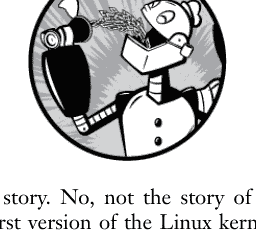

我想给你讲一个故事。不，不是 1991 年 Linus Torvalds 编写 Linux 内核第一个版本的故事。你可以在很多 Linux 书中读到那个故事。我也不会告诉你几年前 Richard Stallman 发起 GNU 项目以创建自由的类 Unix 操作系统的故事。那也是一个重要的故事，但大多数其他 Linux 书籍也都有这个故事。

不，我想告诉你的是你如何重新掌控自己的计算机的故事。

当我在 20 世纪 70 年代末作为大学生开始使用计算机时，正在发生一场革命。微处理器的发明使得像你我这样的普通人真正拥有计算机成为可能。对许多人来说，很难想象在只有大企业和大政府运行所有计算机的世界是什么样的。简单来说，你几乎什么也做不成。

今天，世界大不相同。计算机无处不在，从微小的手表到庞大的数据中心，再到两者之间的一切。除了无处不在的计算机，我们还有一个连接它们的无处不在的网络。这创造了一个奇妙的个人赋权和创造自由的新时代，但在过去的几十年里，另一件事也在发生。少数巨型公司一直在对世界上大多数计算机施加控制

并决定你可以用它们做什么、不能做什么什么。幸运的是，来自世界各地的人们正在对此采取行动。他们通过编写自己的软件来努力保持对计算机的控制。他们正在构建 Linux。

许多人谈论 Linux 的“自由”，但我认为大多数人并不知道这种自由真正意味着什么。自由是你决定计算机做什么的权力，而拥有这种自由的唯一方法就是知道计算机在做什么。自由是一台没有秘密的计算机，一切都可以被知晓，只要你足够关心去了解。

### Why Use the Command Line?

你有没有注意到在电影里，当“超级黑客”——你知道，就是那个能在 30 秒内破解超安全军事计算机的家伙——坐到电脑前时，他从不碰鼠标？这是因为电影制作人意识到我们作为人类，本能地知道在计算机上真正做成事情的唯一方法就是在键盘上打字！

今天大多数计算机用户只熟悉图形用户界面（GUI），并且被厂商和评论家教导说命令行界面（CLI）是可怕的过去之物。这很不幸，因为一个好的命令行界面是与计算机交流的一种奇妙而富有表现力的方式，就像书面语言之于人类一样。有人说过“图形用户界面让简单任务变得简单，而命令行界面让困难任务成为可能”，这在今天仍然非常正确。

由于 Linux 借鉴了 Unix 家族的操作系统，它也继承了 Unix 丰富的命令行工具传统。Unix 在 20 世纪 80 年代初期崭露头角（尽管它早十年就已开发），在图形用户界面广泛采用之前，因此发展出了广泛的命令行界面。事实上，早期 Linux 采用者选择它而不是例如 Windows NT 的最强理由之一就是强大的命令行界面，它让“困难任务成为可能”。

### 本书内容简介

本书是对 Linux 命令行“生活”方式的全面概述。与那些只集中于单一程序（如 shell 程序 bash）的书籍不同，本书将尝试从更宏观的角度传达如何与命令行界面相处。它是如何工作的？它能做什么？使用它的最佳方式是什么？

这不是一本关于 Linux 系统管理的书。虽然任何严肃的命令行讨论不可避免地会涉及系统管理主题，但本书仅涉及少数几个管理问题。它将为读者提供使用命令行的坚实基础，而命令行是任何严肃系统管理任务必不可少的工具，从而为进一步学习做好准备。


本书以 Linux 为中心。许多其他书籍试图通过加入通用 Unix 和 macOS 等其他平台来扩大其吸引力。在这样做的过程中，它们会“稀释”其内容，只涵盖通用主题。相比之下，本书仅涵盖当代 Linux 发行版。95% 的内容对其他类 Unix 系统的用户也很有用，但本书高度针对现代 Linux 命令行用户。

## 适合阅读本书的人群

本书适合从其他平台迁移过来的 Linux 新手。你很可能是一个使用某种版本 Microsoft Windows 的“高级用户”。也许你的老板让你管理一台 Linux 服务器，或者你正在进入单板计算机（SBC）如 Raspberry Pi 的令人兴奋的新世界。你可能只是一个桌面用户，对所有安全问题感到厌倦，想尝试一下 Linux。没关系，这里欢迎所有人。

话虽如此，通往 Linux 顿悟之路没有捷径。学习命令行具有挑战性，需要真正的努力。问题不在于它有多难，而在于它有多庞大。平均而言，一台 Linux 系统在命令行上可供使用的程序 literally 有数千个。

请自行注意；学习命令行不是一件随意的尝试。

另一方面，学习 Linux 命令行极其有回报。如果你现在认为自己是“高级用户”，那就等着瞧吧。你还不知道什么是真正的力量——而且，与许多其他计算机技能不同，命令行知识经久不衰。今天学到的技能十年后仍然有用。命令行经受住了时间的考验。

同时也假设你没有任何编程经验，但不用担心，我们也会引导你踏上这条道路。

## 本书内容

这些材料以精心选择的顺序呈现，就像一位导师坐在你旁边引导你一样。许多作者以“系统化”的方式处理这些材料，按顺序详尽地涵盖每个主题。从作者的角度来看这很有意义，但对新用户来说可能非常令人困惑。

另一个目标是让你熟悉 Unix 式的思维方式，这与 Windows 式的思维方式不同。在此过程中，我们会进行几次小插曲，帮助你理解某些事物为何以这种方式工作以及它们是如何演变而来的。Linux 不仅仅是一块软件；它也是更大 Unix 文化的一部分，Unix 文化有自己的语言和历史。我可能会发表一两句牢骚。

本书分为四个部分，每个部分涵盖命令行体验的某个方面。

- 第一部分“学习 Shell”，开始我们对命令行基本语言的探索，包括命令的结构、文件系统导航、命令行编辑，以及如何为命令查找帮助和文档等内容。

- 第二部分“配置与环境”，涵盖从命令行编辑控制计算机操作的配置文件。

- 第三部分“常见任务和必备工具”，探索从命令行执行的许多普通任务。类 Unix 操作系统，如 Linux，包含许多用于对数据执行强大操作的“经典”命令行程序。

- 第四部分“编写 Shell 脚本”，介绍 shell 编程，这是一种公认的简陋但易于学习的自动化许多常见计算任务的技术。通过学习 shell 编程，你将熟悉可应用于许多其他编程语言的概念。

## 如何阅读本书

从本书开头开始阅读并一直读到结尾。它不是作为参考资料编写的；它更像是一个有开头、中间和结尾的故事。

## 先决条件

要使用本书，你只需要一个可用的 Linux 安装。你可以通过以下两种方式之一获得：

**在（不算新的）计算机上安装 Linux。** 你选择的发行版并不重要，尽管大多数人今天从 Ubuntu、Fedora 或 OpenSUSE 开始。如果拿不准，先试试 Ubuntu。安装现代 Linux 发行版可能极其简单，也可能极其困难，这取决于你的硬件。我建议使用一台几年前生产的台式电脑，至少有 2GB RAM 和 6GB 的可用硬盘空间。尽可能避免使用笔记本电脑和无线网络，因为这些通常更难使其正常工作。

**使用“Live CD”或 USB 闪存驱动器。** 许多 Linux 发行版可以做的很酷的事情之一就是直接从 CD-ROM 或 USB 闪存驱动器运行，而无需完全安装它们。只需进入你的 BIOS 设置，将计算机设置为从 CD-ROM 驱动器或 USB 设备启动，然后重新启动。使用这种方法非常棒

在安装之前测试计算机是否兼容 Linux 的一种方法是使用 live 版本。其缺点是，与将 Linux 安装到硬盘上相比，它可能会慢一些。Ubuntu 和 Fedora（以及其他发行版）都提供 live 版本。

无论你如何安装 Linux，在完成本书课程时，你都需要偶尔获得超级用户（即管理员）权限。

当你成功安装并可以正常工作后，请开始阅读，并在自己的电脑上跟着操作。本书的大部分内容都是“动手实践”，所以请坐下来，开始敲键盘吧！

## 我为何不称其为“GNU/Linux”

在某些圈子里，把 Linux 操作系统称为“GNU/Linux 操作系统”是政治正确的。“Linux”的问题在于，没有一个完全正确的命名方式，因为它是由许多不同的人在庞大而分布式的开发努力中写成的。从技术上讲，Linux 只是操作系统内核的名字，仅此而已。当然，内核非常重要，因为它让操作系统运转起来，但仅凭内核并不足以构成一个完整的操作系统。

接下来要提到理查德·斯托曼，这位天才哲学家创办了自由软件运动，成立了自由软件基金会，组建了 GNU 项目，编写了 GNU C 编译器（`gcc`）的第一个版本，创建了 GNU 通用公共许可证（GPL），等等等等。他坚持要求你称它为“GNU/Linux”，以恰当反映 GNU 项目的贡献。虽然 GNU 项目早于 Linux 内核，而且该项目的贡献极其值得认可，但将它们放到名称中，对那些做出重大贡献的其他所有人都是不公平的。此外，我认为“Linux/GNU”在技术上会更准确，因为内核首先启动，其他一切都在其之上运行。

在普遍用法中，Linux 指的是内核以及典型 Linux 发行版中的所有其他自由和开源软件，也就是说，整个 Linux 生态系统，而不仅仅是 GNU 组件。操作系统市场似乎更喜欢诸如 DOS、Windows、macOS、Solaris、Irix 和 AIX 这样的单个词的名字。我选择使用流行的格式。不过，如果你更倾向于使用“GNU/Linux”，请在阅读本书时在脑海中做一次查找替换。我不会介意。

## 第二版新增内容

虽然基本结构和内容保持不变，但本版 *《Linux 命令行》* 穿插了各种细化、澄清和现代化更新，其中许多基于读者反馈。此外，有两项改进尤为突出。第一，本书现在假定使用 `bash` 4.x 版本，该版本在原始手稿编写时尚未广泛使用。`bash` 的这第四个主版本新增了几个有用的新特性，本版已涵盖这些特性。第二，第 4 部分“Shell 脚本”经过改进，提供了更好的良好脚本实践范例。第 4 部分中的脚本已修订，使其更加健壮，我还修复了一些 bug ;-)。

## 需要你的反馈！

这本书是一个持续进行的项目，就像许多开源软件项目一样。如果你发现技术错误，请给我发邮件：bshotts@users.sourceforge.net。

请务必标明你正在阅读的书籍的准确版本。你的修改和建议可能会被纳入未来的版本中。

## 第一部分 学习 Shell

### 1. 什么是 Shell？


当我们说到命令行时，实际上指的是 *Shell*。Shell 是一个程序，它接收键盘命令并将其传递给操作系统去执行。几乎所有的 Linux 发行版都提供一个来自 GNU 项目的名为 `bash` 的 Shell 程序。这个名称是 *Bourne Again Shell* 的首字母缩写，暗指 `bash` 是对 `sh`——由史蒂夫·伯恩（Steve Bourne）编写的原始 Unix Shell 程序——的增强替代品。

#### 终端模拟器

在使用图形用户界面（GUI）时，我们需要另一个称为 *终端模拟器* 的程序来与 Shell 交互。如果我们查看桌面菜单，很可能会找到一个。KDE 使用 `konsole`，GNOME 使用 `gnome-terminal`，不过在你的菜单上它可能简单显示为“终端”。Linux 上还有大量其他终端模拟器，但它们基本上都做同一件事：让我们能访问 Shell。你可能会根据某一终端模拟器所带的花哨功能数量而对它产生偏好。

#### 开始你的第一次按键

那么让我们开始吧。启动终端模拟器。一旦它出现，我们应该会看到类似这样的内容：

```
[me@linuxbox ~]$
```

这被称为 *shell 提示符*，每当 shell 准备接受输入时就会出现。虽然它在外观上可能会因发行版而略有不同，但通常会包含你的 `username@machinename`，后面跟着当前工作目录（稍后会详细介绍）和一个美元符号。

如果提示符的最后一个字符是井号（#）而不是美元符号，则终端会话具有超级用户权限。这意味着我们要么以 root 用户登录，要么我们选择了一个提供超级用户（管理员）权限的终端模拟器。

假设到目前为止一切正常，让我们试着输入一些东西。在提示符处输入一些无意义的内容，如下所示：

```
[me@linuxbox ~]$ kaekfjaeifj
```

由于这个命令毫无意义，shell 会告诉我们，并给我们另一个机会。

```
bash: kaekfjaeifj: command not found
[me@linuxbox ~]$
```

#### 命令历史


如果我们按下上箭头，我们会看到之前输入的命令`kaekfjaeifj`在提示符后重新出现。这被称为*命令历史*。大多数 Linux 发行版默认会记住最后 1,000 条命令。按下下箭头，之前的命令就会消失。

#### 光标移动

再次按下上箭头调出之前的命令。如果我们尝试左右箭头，会发现我们可以将光标定位在命令行上的任何位置。这使得编辑命令变得很容易。

### 关于鼠标和焦点的几句话

虽然 shell 主要是关于键盘的，但你也可以在终端模拟器中使用鼠标。X Window 系统（使 GUI 运行的底层引擎）内置的一种机制支持快速的复制粘贴技术。如果你通过按住鼠标左键并将鼠标拖过它来高亮一些文本（或双击一个词），它会被复制到 X 维护的一个缓冲区中。按下鼠标中键会使文本粘贴到光标位置。试试看。

不要试图在终端窗口中使用`CTRL-C`和`CTRL-V`来执行复制和粘贴。它们不起作用。这些控制代码对 shell 有不同的含义，并且是在 Microsoft Windows 发布多年之前就被分配的。

你的图形桌面环境（最可能是 KDE 或 GNOME），为了像 Windows 一样行为，可能将焦点策略设置为“单击聚焦”。这意味着要使一个窗口获得焦点（变为活动状态），你需要单击它。这与传统的 X 行为“焦点跟随鼠标”相反，后者意味着只要将鼠标移过它，窗口就会获得焦点。窗口不会在你单击之前进入前台，但它能够接收输入。将焦点策略设置为“焦点跟随鼠标”会使复制粘贴技术更加有用。如果你可以的话就试试看（某些桌面环境，如 Ubuntu 的 Unity 已不再支持它）。我认为如果你给它一个机会，你会更喜欢它。你可以在窗口管理器的配置程序中找到此设置。

### 试试一些简单命令

现在我们已经学会在终端模拟器中输入文本，让我们试试几个简单命令。让我们从`date`命令开始，它会显示当前时间和日期。

```
[me@linuxbox ~]$ date
Fri Feb  2 15:09:41 EST 2018
```

一个相关的命令是`cal`，它默认会显示当前月份的日历。

```
[me@linuxbox ~]$ cal
February 2018
Su Mo Tu We Th Fr Sa
      1  2  3
 4  5  6  7  8  9 10
11 12 13 14 15 16 17
18 19 20 21 22 23 24
25 26 27 28
```

### 幕后的控制台

即使我们没有运行终端模拟器，仍有几个终端会话在图形桌面后面持续运行。我们可以通过在大多数 Linux 发行版上按下`CTRL-ALT-F1`到`CTRL-ALT-F6`来访问这些会话，称为虚拟控制台。当访问一个会话时，它会显示一个登录提示，我们可以在其中输入用户名和密码。要从一个虚拟控制台切换到另一个，按`ALT-F1`到`ALT-F6`。在大多数系统上，我们可以通过按下`ALT-F7`返回到图形桌面。

要查看磁盘驱动器上当前可用空间的数量，输入`df`。

```
[me@linuxbox ~]$ df
Filesystem     1K-blocks    Used Available Use% Mounted on
/dev/sda2      15115452  5012392   9949716  34% /
/dev/sda5      59631908 26545424  30008432  47% /home
/dev/sda1        147764    17370    122765  13% /boot
tmpfs            256856        0    256856   0% /dev/shm
```

同样地，要显示可用内存的数量，请输入`free`命令。

```
[me@linuxbox ~]$ free
      total       used       free     shared    buffers     cached
Mem:       513712     503976       9736          0       5312     122916
-/+ buffers/cache:     375748     137964
Swap:      1052248     104712     947536
```

### 结束终端会话

我们可以通过关闭终端模拟器窗口、在 shell 提示符下输入`exit`命令，或者按下`CTRL-D`来结束终端会话。

```
[me@linuxbox ~]$ exit
```

### 小结

本章标志着我们 Linux 命令行之旅的开始，我们介绍了 shell，初步了解了命令行，并简要学习了如何开始和结束终端会话。我们还看到了一些简单命令的使用方法，以及如何进行一些轻量的命令行编辑。这并没有那么可怕，对吧？

在下一章中，我们将学习更多命令，并开始探索 Linux 文件系统。

# 2 导航

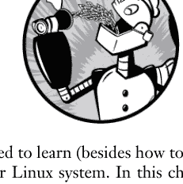

我们需要学习的第一件事（除了如何打字之外）是如何在 Linux 系统中浏览文件系统。在本章中，我们将介绍以下命令：

- `pwd` 打印当前工作目录的名称

- `cd` 更改目录

- `ls` 列出目录内容

### 理解文件系统树

与 Windows 一样，类 Unix 操作系统（如 Linux）将其文件组织在所谓的层次化目录结构中。这意味着它们以目录（在其他系统中有时称为文件夹）的树状模式进行组织，这些目录可以包含文件和其他目录。文件系统中的第一个目录称为根目录。根目录包含文件和子目录，子目录又包含更多文件和子目录，以此类推。

请注意，与 Windows 为每个存储设备单独维护一个文件系统树不同，类 Unix 系统（如 Linux）始终只有一个文件系统树，无论计算机上连接了多少个驱动器或存储设备。存储设备会根据系统管理员（负责系统维护的人员）的决定，挂载（或更准确地说，安装）在树上的各个位置。

### 当前工作目录

我们大多数人都可能熟悉以图形文件管理器表示文件系统树的方式，如图 2-1 所示。

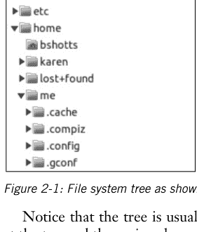

图 2-1：图形文件管理器显示的文件系统树

请注意，这棵树通常被倒置显示，即根在顶部，各个分支向下延伸。

然而，命令行没有图片，所以要浏览文件系统树，我们需要换一种方式来思考。

想象一下，文件系统是一个形似倒置树的迷宫，而我们能够站在它中间。在任何给定时间，我们都处于一个目录中，可以看到该目录中包含的文件、通往上一级目录（称为父目录）的路径以及下一级的任何子目录。我们所处的目录称为*当前工作目录*。要显示当前工作目录，我们使用`pwd`（打印工作目录）命令。

```
[me@linuxbox ~]$ pwd
/home/me
```

当我们首次登录系统（或启动终端模拟器会话）时，当前工作目录会设置为我们的*主目录*。每个用户账户都有自己的主目录，这也是普通用户唯一被允许写入文件的地方。

### 列出目录内容

要列出当前工作目录中的文件和目录，我们使用`ls`命令。

```
[me@linuxbox ~]$ ls
Desktop Documents Music Pictures Public Templates Videos
```

实际上，我们可以使用`ls`命令列出任何目录的内容，而不仅仅是当前工作目录，而且它还有很多其他有趣的功能。我们将在第 3 章花更多时间介绍`ls`。

### 更改当前工作目录

要更改工作目录（即我们在树形迷宫中所站的位置），我们使用`cd`命令。确保这样做：输入`cd`，后面跟着所需工作目录的路径名。路径名是我们沿着树的枝条到达所需目录所走的路径。我们可以用两种不同的方式指定路径名：*绝对路径名*或*相对路径名*。我们先来处理绝对路径名。

绝对路径名以根目录开头，然后沿着树分支逐级向下，直到完成到目标目录或文件的路径。例如，你的系统上有一个目录，其中安装了大部分系统程序。该目录的路径名为`/usr/bin`。这意味着从根目录（由路径名中的前导斜杠表示）开始，有一个名为`usr`的目录，其中包含一个名为`bin`的目录。

```
[me@linuxbox ~]$ cd /usr/bin
[me@linuxbox bin]$ pwd
/usr/bin
[me@linuxbox bin]$ ls
...Listing of many, many files ...
```

现在我们可以看到当前工作目录已更改为`/usr/bin`，并且其中充满了文件。注意 shell 提示符是如何改变的？作为一种便利，它通常被设置成自动显示工作目录的名称。

### 相对路径名

绝对路径名从根目录开始并通向其目标，而相对路径名则从工作目录开始。为此，它使用几种特殊记号来表示文件系统树中的相对位置。这些特殊记号是`.`（点）和`..`（点点）。

`.`记号指的是工作目录，而`..`记号指的是工作目录的父目录。下面说明其工作原理。让我们再次将工作目录更改为`/usr/bin`。


```
[me@linuxbox ~]$ cd /usr/bin
[me@linuxbox bin]$ pwd
/usr/bin
```

现在假设我们想将工作目录更改为`/usr/bin`的父目录，即`/usr`。我们可以用两种不同的方法做到这一点，要么使用绝对路径名：

```
[me@linuxbox bin]$ cd /usr
[me@linuxbox usr]$ pwd
/usr
```

要么使用相对路径名：

```
[me@linuxbox bin]$ cd ..
[me@linuxbox usr]$ pwd
/usr
```

两种不同的方法，结果相同。我们应该使用哪一种？使用输入最少的那个！

同样地，我们也可以用两种不同的方法将工作目录从`/usr`更改为`/usr/bin`，要么使用绝对路径名：

```
[me@linuxbox usr]$ cd /usr/bin
[me@linuxbox bin]$ pwd
/usr/bin
```

要么使用相对路径名：

```
[me@linuxbox usr]$ cd ./bin
[me@linuxbox bin]$ pwd
/usr/bin
```

现在，这里有一个重要的点需要指出。在几乎所有情况下，我们都可以省略`./`部分，因为它是隐含的。输入以下内容会做同样的事情：

```
[me@linuxbox usr]$ cd bin
```

总的来说，如果我们没有指定某个事物的路径名，则会假定为工作目录。

## 关于文件名的一些重要事实

在 Linux 系统上，文件的命名方式与 Windows 等其他系统类似，但有一些重要的区别。

- 以句点字符开头的 filename 是隐藏的。这仅意味着`ls`不会列出它们，除非你使用`ls -a`。当你的账户创建时，几个隐藏文件被放置在你的主目录中以配置你的账户。在第 11 章中，我们将更仔细地查看其中一些文件，以了解如何自定义你的环境。此外，一些应用程序会将它们的配置和设置文件作为隐藏文件放置在你的主目录中。

- Linux 中的文件名和命令，像 Unix 一样，是区分大小写的。文件名`File1`和`file1`指的是不同的文件。

- 尽管 Linux 支持包含嵌入空格和标点字符的长文件名，但请将你创建的文件名中的标点字符限制为句点、连字符和下划线。*最重要的是，不要在文件名中嵌入空格。* 如果你想在文件名中表示单词之间的空格，请使用下划线字符。你以后会感谢自己的。

- Linux 没有像某些其他操作系统那样的“文件扩展名”概念。你可以随意命名文件。文件的內容或用途是通过其他方式确定的。虽然类 Unix 操作系统不使用文件扩展名来确定文件的内容/用途，但许多应用程序程序确实会使用。

## 一些有用的快捷方式

表 2-1：`cd` 快捷方式

| 快捷键 | 结果 |
|---|---|
| `cd` | 将工作目录更改为你的主目录。 |
| `cd -` | 将工作目录更改为上一个工作目录。 |
| `cd ~user_name` | 将工作目录更改为`user_name`的主目录。例如，输入`cd ~bob`将目录更改为用户“bob”的主目录。 |

## 总结

本章解释了 shell 如何处理系统的目录结构。我们学习了绝对路径名和相对路径名以及用于在该结构中移动的基本命令。在下一章中，我们将利用这些知识对现代 Linux 系统进行一次巡览。

# 3 探索系统

现在我们已经知道如何浏览文件系统，是时候对我们的 Linux 系统进行一次导览了。不过在开始之前，我们将学习一些沿途会用到的更多命令。

- `ls` 列出目录内容
- `file` 确定文件类型
- `less` 查看文件内容

## 更有趣的 ls

`ls` 命令可能是使用最频繁的命令，原因显而易见。有了它，我们可以查看目录内容并确定各种重要的文件和目录属性。如我们所见，我们只需输入`ls`即可获取当前工作目录中包含的文件和子目录列表。

```
[me@linuxbox ~]$ ls
Desktop  Documents  Music  Pictures  Public  Templates  Videos
```

除了当前工作目录外，我们还可以指定要列出的目录，如下所示：

```
[me@linuxbox ~]$ ls /usr
bin  games  include  lib  local  sbin  share  src
```

我们甚至可以指定多个目录。在以下示例中，我们同时列出用户的主目录（用`~`字符表示）和`/usr`目录：

```
[me@linuxbox ~]$ ls ~ /usr
/home/me:
Desktop  Documents  Music  Pictures  Public  Templates  Videos
/usr:
bin  games  include  lib  local  sbin  share  src
```

我们还可以更改输出格式以显示更多详细信息。

```
[me@linuxbox ~]$ ls -l
total 56
drwxrwxr-x 2 me me 4096 2017-10-26 17:20 Desktop
drwxrwxr-x 2 me me 4096 2017-10-26 17:20 Documents
drwxrwxr-x 2 me me 4096 2017-10-26 17:20 Music
drwxrwxr-x 2 me me 4096 2017-10-26 17:20 Pictures
drwxrwxr-x 2 me me 4096 2017-10-26 17:20 Public
drwxrwxr-x 2 me me 4096 2017-10-26 17:20 Templates
drwxrwxr-x 2 me me 4096 2017-10-26 17:20 Videos
```

通过在命令中添加`-l`，我们将输出更改为长格式。

### 选项和参数

这就引出了一个关于大多数命令如何工作的重要观点。命令通常后面跟着一个或多个 *选项* 来修改其行为，并且进一步跟着一个或多个 *参数*，即命令所作用的对象。因此，大多数命令看起来是这样的：

```
command -options arguments
```

大多数命令使用选项，选项由一个破折号后跟单个字符组成，例如`-l`。然而，许多命令，包括 GNU 项目的命令，也支持 *长选项*，由两个破折号后跟一个单词组成。此外，许多命令允许将多个短选项串联起来。在以下示例中，`ls`命令被赋予了两个选项，即`l`选项用于生成长格式输出，以及`t`选项用于按文件的修改时间排序结果。

```
[me@linuxbox ~]$ ls -lt
```

我们将添加长选项`--reverse`来反转排序顺序。

```
[me@linuxbox ~]$ ls -lt --reverse
```

### 注意

> *命令选项与 Linux 中的文件名一样区分大小写。*

`ls` 命令有大量可能的选项，其中最常见的列在表 3-1 中。

表 3-1：常见的 `ls` 选项

| 选项 | 长选项 | 描述 |
|---|---|---|
| `-a` | `--all` | 列出所有文件，即使名称以句点开头的文件，通常不会列出（即隐藏）。 |
| `-A` | `--almost-all` | 与`-a`选项类似，但不列出`.`（当前目录）和`..`（父目录）。 |
| `-d` | `--directory` | 通常，如果指定了目录，`ls`会列出目录的内容，而不是目录本身。使用此选项结合`-l`选项可查看目录本身的详细信息而不是其内容。 |
| `-F` | `--classify` | 此选项会在每个列出名称的末尾附加一个指示字符。例如，如果名称是目录，则会附加正斜杠（`/`）。 |
| `-h` | `--human-readable` | 在长格式列表中，以人类可读格式显示文件大小，而不是以字节为单位。 |
| `-l` |  | 以长格式显示结果。 |
| `-r` | `--reverse` | 以相反顺序显示结果。通常，`ls`会按升序字母顺序显示其结果。 |
| `-s` |  | 按文件大小排序结果。 |
| `-t` |  | 按修改时间排序。 |

### 更深入地了解长格式

正如我们之前所见，`-l` 选项会使`ls`以长格式显示其结果。这种格式包含大量有用的信息。以下是 Ubuntu 系统中的`Examples`目录：


```
-rw-r--r-- 1 root root 3576296 2017-04-03 11:05 Experience ubuntu.ogg
-rw-r--r-- 1 root root 1186219 2017-04-03 11:05 kubuntu-leaflet.png
-rw-r--r-- 1 root root 47584 2017-04-03 11:05 logo-Edubuntu.png
-rw-r--r-- 1 root root 44355 2017-04-03 11:05 logo-Kubuntu.png
-rw-r--r-- 1 root root 34391 2017-04-03 11:05 logo-Ubuntu.png
-rw-r--r-- 1 root root 32059 2017-04-03 11:05 oo-cd-cover.odf
-rw-r--r-- 1 root root 159744 2017-04-03 11:05 oo-derivatives.doc
-rw-r--r-- 1 root root 27837 2017-04-03 11:05 oo-maxwell.odt
-rw-r--r-- 1 root root 98816 2017-04-03 11:05 oo-trig.xls
-rw-r--r-- 1 root root 453764 2017-04-03 11:05 oo-welcome.odt
-rw-r--r-- 1 root root 358374 2017-04-03 11:05 ubuntu Sax.ogg
```

表 3-2 为我们展示了其中一个文件的不同字段及其含义。

表 3-2：`ls` 长列表字段

| 字段 | 含义 |
|---|---|
| `-rw-r--r--` | 文件的访问权限。第一个字符表示文件类型。在不同类型中，以连字符开头表示普通文件，而 `d` 表示目录。接下来的三个字符是文件所有者的访问权限，接下来三个是文件所属组成员的访问权限，最后三个是其他人的访问权限。第 9 章更详细地讨论了其完整含义。 |
| `1` | 文件的硬链接数。参见第 21 页的“符号链接”和第 22 页的“硬链接”。 |
| `root` | 文件所有者的用户名。 |
| `root` | 文件所属组的名称。 |
| `32059` | 文件的大小，以字节为单位。 |
| `2017-04-03 11:05` | 文件最后修改的日期和时间。 |
| `oo-cd-cover.odf` | 文件名。 |

#### 使用 `file` 确定文件类型

在探索系统时，了解文件包含的内容会很有用。为此，我们将使用 `file` 命令来确定文件类型。正如我们之前讨论的，在 Linux 中文件名不需要反映文件的内容。虽然像 `picture.jpg` 这样的文件名通常预期包含 JPEG 压缩图像，但在 Linux 中并非必须如此。我们可以这样调用 `file` 命令：

```
file filename
```

调用时，`file` 命令会打印文件内容的简要描述。例如：

```
[me@linuxbox ~]$ file picture.jpg
picture.jpg: JPEG image data, JFIF standard 1.01
```

文件种类繁多。事实上，在类 Unix 操作系统如 Linux 中，一个常见的理念是“一切皆文件”。随着我们继续学习，我们将看到这一说法是多么正确。

虽然我们系统上的许多文件都很熟悉，例如 MP3 和 JPEG 文件，但其中也有一些不太明显，甚至有些相当奇怪。

#### 使用 `less` 查看文件内容

`less` 命令是一个用于查看文本文件的程序。在整个 Linux 系统中，有许多文件包含人类可读的文本。`less` 程序提供了一种方便的方式来检查它们。

为什么我们要查看文本文件？因为许多包含系统设置的文件（称为配置文件）都以这种格式存储，能够阅读它们可以让我们深入了解系统的工作原理。此外，系统使用的一些实际程序（称为脚本）也以这种格式存储。在后面的章节中，我们将学习如何编辑文本文件以修改系统设置和编写自己的脚本，但现在我们只是查看其内容。

`less` 命令的用法如下：

```
less filename
```

#### 什么是“文本”？

在计算机上表示信息的方式有很多种。所有方法都涉及在信息与用于表示它的某些数字之间定义关系。毕竟，计算机只理解数字，所有数据都会被转换为数字表示。

其中一些表示系统非常复杂（如压缩视频文件），而另一些则相当简单。其中最早且最简单的一种叫做 ASCII 文本。ASCII（读作“as-key”）是 American Standard Code for Information Interchange 的缩写。这是一种简单的编码方案，最初在电传打字机上使用，用于将键盘字符映射为数字。

文本是对字符到数字的简单一对一映射。它非常紧凑。五十个字符的文本相当于五十字节的数据。重要的是要理解，文本只包含字符到数字的简单映射。它与 Microsoft Word 或 LibreOffice Writer 创建的文字处理器文档不同。与简单的 ASCII 文本相比，这些文件包含许多非文本元素，用于描述其结构和格式。纯 ASCII 文本文件仅包含字符本身以及一些基本控制代码，如制表符、回车符和换行符。

在整个 Linux 系统中，许多文件以文本格式存储，并且有许多 Linux 工具可用于处理文本文件。即使 Windows 也认识到这种格式的重要性。众所周知的 `NOTEPAD.EXE` 程序就是一个用于编辑纯 ASCII 文本文件的编辑器。

启动后，`less` 程序允许我们向前和向后滚动浏览文本文件。例如，要检查定义系统中所有用户账户的文件，输入以下命令：

```
[me@linuxbox ~]$ less /etc/passwd
```

一旦 `less` 程序启动，我们就可以查看文件内容。如果文件长度超过一页，我们可以向上和向下滚动。要退出 `less`，请按 `q`。

#### 表 3-3：`less` 命令

| 命令 | 操作 |
|---|---|
| `PAGE UP` 或 `b` | 向后滚动一页 |
| `PAGE DOWN` 或 `space` | 向前滚动一页 |
| 上箭头 | 向上滚动一行 |
| 下箭头 | 向下滚动一行 |
| `G` | 移至文本文件末尾 |
| `1G` 或 `g` | 移至文本文件开头 |
| `/characters` | 向前搜索 `characters` 的下一个出现位置 |
| `n` | 搜索上一次搜索的下一个出现位置 |
| `h` | 显示帮助屏幕 |
| `q` | 退出 `less` |

#### LESS IS MORE

`less` 程序是作为对早期 Unix 程序 `more` 的改进替代品而设计的。名称 `less` 是对短语“less is more”的戏仿——这是现代主义建筑师和设计师的座右铭。

`less` 属于称为分页器的一类程序，该类程序允许以逐页方式轻松查看长文本文档。而 `more` 程序只能向前分页，`less` 程序允许向前和向后分页，并且还有许多其他功能。

#### 参观导览

Linux 系统上的文件系统布局与其它类 Unix 系统上的布局非常相似。该设计实际上在名为 *Linux Filesystem Hierarchy Standard* 的已发布标准中进行了规范。并非所有 Linux 发行版都完全符合该标准，但大多数都比较接近。

#### 记住复制粘贴技巧！

如果您使用鼠标，可以双击文件名将其复制，然后中键单击将其粘贴到命令中。

接下来，我们将自己在文件系统中漫游，看看我们的 Linux 系统是如何运行的。这将给我们一个练习导航技能的机会。我们会发现其中许多有趣的文件都是以纯人类可读的文本形式存在的。在我们进行参观时，请尝试以下操作：

- `cd` 进入给定目录。

- 使用 `ls -l` 列出目录内容。

- 如果看到有趣的文件，请使用 `file` 确定其内容。

- 如果看起来像是文本，请尝试使用 `less` 查看它。

如果我们不小心尝试查看非文本文件并导致终端窗口混乱，我们可以通过输入 `reset` 命令来恢复。

在我们漫游时，不要害怕查看东西。普通用户在很大程度上被禁止搞乱东西。那是系统管理员的工作！如果某个命令抱怨某事，只需继续进行其他操作。花一些时间四处看看。系统供我们探索。在 Linux 中，没有秘密！

#### 表 3-4：Linux 系统上找到的目录

| Directory | Comments |
|---|---|
| `/` | 根目录，一切由此开始。 |
| `/bin` | 包含系统启动和运行所必需的二进制文件（程序）。 |
| `/boot` | 包含 Linux 内核、初始 RAM 磁盘镜像（启动时所需的驱动程序）以及引导加载程序。值得关注的文件包括 `/boot/grub/grub.conf` 或 `menu.lst`，用于配置引导加载程序，以及 `/boot/vmlinuz`（或类似文件），即 Linux 内核。 |
| `/dev` | 这是一个特殊目录，包含设备节点。“一切皆文件”也适用于设备。这里是内核维护其所理解的所有设备列表的地方。 |


### `/etc`

`/etc` 目录包含所有系统范围的配置文件。它还包含在启动时启动各个系统服务的 shell 脚本集合。此目录中的所有内容都应为可读文本。虽然 `/etc` 中的所有内容都很有趣，但以下是一些经典之作：`/etc/crontab`，定义自动化作业运行时间的文件；`/etc/fstab`，存储设备及其关联挂载点的表；以及 `/etc/passwd`，用户账户列表。

### `/home`

在正常配置中，每个用户在 `/home` 中都有一个目录。普通用户只能在其主目录中写入文件。这种限制可以保护系统免受用户误操作的影响。

### `/lib`

包含核心系统程序使用的共享库文件。这些类似于 Windows 中的动态链接库（DLL）。

### `/lost+found`

每个使用 Linux 文件系统（如 ext3）格式化的分区或设备都会有此目录。它用于在文件系统损坏事件部分恢复时使用。除非系统发生了严重问题，否则此目录将保持为空。

### `/media`

在现代 Linux 系统上，`/media` 目录将包含可移动媒体的挂载点，例如 USB 驱动器、CD-ROM 等，这些媒体在插入时会自动挂载。

### `/mnt`

在旧版 Linux 系统上，`/mnt` 目录包含手动挂载的可移动设备的挂载点。

### `/opt`

`/opt` 目录用于安装“可选”软件。这主要用于存放可能安装在系统上的商业软件产品。

### `/proc`

`/proc` 目录很特殊。它不是以存储在硬盘上的文件为意义的真正文件系统，而是一个由 Linux 内核维护的虚拟文件系统。其包含的“文件”是窥视内核本身的窗口。这些文件可读，会让你了解内核如何看待你的计算机。

### `/root`

这是 root 账户的主目录。

### `/sbin`

此目录包含“系统”二进制文件。这些是执行关键系统任务的程序，通常保留给超级用户。

### `/tmp`

`/tmp` 目录用于存储各种程序创建的临时、短暂文件。某些配置会在系统每次重启时清空此目录。

### `/usr`

`/usr` 目录树可能是 Linux 系统上最大的目录树。它包含普通用户使用的所有程序和支持文件。

### `/usr/bin`

`/usr/bin` 包含由你的 Linux 发行版安装的可执行程序。这个目录包含数千个程序是很常见的。

### `/usr/lib`

`/usr/bin` 中程序的共享库。

### `/usr/local`

`/usr/local` 树是安装那些未包含在发行版中但 intended 用于系统范围使用的程序的位置。从源代码编译的程序通常安装在 `/usr/local/bin` 中。在新安装的 Linux 系统上，此树存在，但直到系统管理员放入内容之前将保持为空。

### `/usr/sbin`

包含更多系统管理程序。

### `/usr/share`

`/usr/share` 包含 `/usr/bin` 中程序使用的所有共享数据。这包括默认配置文件、图标、屏幕背景、声音文件等。

### `/usr/share/doc`

系统上安装的大多数软件包都会包含某种文档。在 `/usr/share/doc` 中，我们会找到按软件包组织的文档文件。

### `/var`

除了 `/tmp` 和 `/home`，我们迄今为止查看的目录相对静态；即其内容不会改变。`/var` 目录树是存储可能发生变化的数据的位置。各种数据库、spool 文件、用户邮件等都位于此处。

### `/var/log`

`/var/log` 包含日志文件，即各种系统活动的记录。这些很重要，应不时进行监控。最有用的有 `/var/log/messages` 和 `/var/log/syslog`。请注意，出于安全原因，在某些系统上，你必须为超级用户才能查看日志文件。

### 符号链接

环顾四周，我们可能会看到一个目录列表（例如 `/lib`），其中有这样一条记录：

```
lrwxrwxrwx 1 root root  11 2018-08-11 07:34 libc.so.6 -> libc-2.6.so
```

注意，列表中的首字母是 `l`，而且这一条目似乎有两个文件名？这是一种特殊类型的文件，称为符号链接（也称软链接或 symlink）。在大多数类 Unix 系统中，一个文件可以有多个名称引用。它的价值也许并不显而易见，但这确实是一项很实用的功能。

设想这样一种情况：某个程序需要使用一种存放在名为 `foo` 的文件中的共享资源，但 `foo` 经常更新版本。最好能将版本号写入文件名，这样管理员或其他感兴趣的人就能看到安装的是哪个版本的 `foo`。但这会带来一个问题。如果我们更改共享资源的名称，就必须找出所有可能会用到它的程序，并在每次安装新版本时修改这些程序，让它们查找新的资源名称。这听起来可一点也不轻松。

这时，符号链接就能派上用场了。假设我们安装了 `foo` 的 2.6 版，文件名为 `foo-2.6`，然后创建一个名为 `foo` 的符号链接，指向 `foo-2.6`。这意味着，程序打开文件 `foo` 时，实际上打开的是 `foo-2.6`。现在皆大欢喜：依赖 `foo` 的程序能找到它，而我们仍然可以查看实际安装的版本。需要升级到 `foo-2.7` 时，只需将该文件添加到系统中，删除符号链接 `foo`，再创建一个指向新版本的符号链接即可。这样不仅解决了版本升级的问题，还让我们能在机器上同时保留两个版本。假设 `foo-2.7` 有一个 bug（真是受不了那些开发者！），我们需要恢复到旧版本。这时，同样只需删除指向新版本的符号链接，再创建一个指向旧版本的新符号链接即可。

本节开头的目录列表（来自 Fedora 系统的 `/lib` 目录）显示了一个名为 `libc.so.6` 的符号链接，它指向一个名为 `libc-2.6.so` 的共享库文件。这意味着，查找 `libc.so.6` 的程序实际上会得到文件 `libc-2.6.so`。下一章我们将学习如何创建符号链接。

### 硬链接

既然谈到了链接，我们还需要提及第二种链接，即硬链接。硬链接也允许文件拥有多个名称，但实现方式不同。下一章我们会进一步讨论符号链接和硬链接之间的区别。

### 总结

完成这番浏览之后，我们已经对系统有了不少了解。我们看到了各种文件和目录，以及其中的内容。你应该从中认识到的一点是，这个系统是多么开放。在 Linux 中，有许多重要文件都是纯文本，人类可以直接阅读。与许多专有系统不同，Linux 上的一切都可以供人检查和研究。

# 4 文件和目录操作

现在，我们已经准备好开始做一些真正的工作了！本章将介绍五个最常用的 Linux 命令。以下命令可用于操作文件和目录：

- `cp` 复制文件和目录
- `mv` 移动/重命名文件和目录
- `mkdir` 创建目录
- `rm` 删除文件和目录
- `ln` 创建硬链接和符号链接

坦白说，使用图形文件管理器更容易完成这些命令所执行的某些任务。借助文件管理器，我们可以将文件从一个目录拖放到另一个目录、剪切并粘贴文件、删除文件，等等。那么，为什么还要使用这些老式的命令行程序呢？

答案是强大和灵活。虽然使用图形文件管理器可以轻松完成简单的文件操作，但复杂任务使用命令行程序可能更方便。例如，如何将一个目录中的所有 HTML 文件复制到另一个目录中，但只复制目标目录中不存在或更新的文件比目标目录中的版本更新吗？使用文件管理器做起来相当困难，但使用命令行就很容易了。

```
cp -u *.html destination
```

### 通配符

在开始使用我们的命令之前，我们需要谈谈一个使这些命令如此强大的 shell 特性。因为 shell 大量使用文件名，所以它提供了特殊字符来帮助你快速指定一组文件名。这些特殊字符称为通配符。使用通配符（也称为 globbing）允许你根据字符模式选择文件名。表 4-1 列出了通配符及其所选择的内容。

表 4-1：通配符

| 通配符 | 含义 |
|---|---|
| `*` | 匹配任意字符 |
| `?` | 匹配任意单个字符 |
| `[characters]` | 匹配属于集合 characters 的任意字符 |
| `[!characters]` | 匹配不属于集合 characters 的任意字符 |
| `[[:class:]]` | 匹配属于指定类的任意字符 |

表 4-2 列出了最常用的字符类。

表 4-2：常用字符类

| 字符类 | 含义 |
|---|---|
| `[:alnum:]` | 匹配任意字母数字字符 |
| `[:alpha:]` | 匹配任意字母字符 |
| `[:digit:]` | 匹配任意数字 |
| `[:lower:]` | 匹配任意小写字母 |
| `[:upper:]` | 匹配任意大写字母 |

使用通配符可以构建用于文件名选择的复杂选择条件。表 4-3 提供了一些模式示例及其匹配内容。

#### 表 4-3：通配符示例

| 模式 | 匹配 |
|---|---|
| `*` | 所有文件 |
| `g*` | 以 g 开头的任意文件 |
| `b*.txt` | 以 b 开头，后跟任意字符并以 .txt 结尾的任意文件 |


| 模式 | 匹配内容 |
|---|---|
| `Data???` | 以 `Data` 开头后跟恰好三个字符的任意文件 |
| `[abc]*` | 以 a、b 或 c 中任意一个开头的任意文件 |
| `BACKUP.[0-9][0-9][0-9]` | 以 `BACKUP.` 开头后跟恰好三个数字的任意文件 |
| `[[:upper:]]*` | 以大写字母开头的任意文件 |
| `[![:digit:]]*` | 不以数字开头的任意文件 |
| `*[[:lower:]123]` | 以小写字母或数字 1、2、3 结尾的任意文件 |

### 通配符在 GUI 中也适用

通配符之所以特别有价值，不仅因为它们在命令行中被频繁使用，而且因为它们也得到了一些图形文件管理器的支持。

请注意，当命令描述中的参数后跟三个句点时（如前例所示），表示该参数可以重复。因此，以下命令：

```
mkdir dir1
```

将创建名为 `dir1` 的单个目录。此命令

```
mkdir dir1 dir2 dir3
```

将创建三个名为 `dir1`、`dir2` 和 `dir3` 的目录。

### `cp`—复制文件和目录

`cp` 命令复制文件或目录。它可以用两种不同的方式使用。以下命令：

```
cp item1 item2
```

将单个文件或目录 `item1` 复制到文件或目录 `item2`。此命令：

```
cp item... directory
```

将多个项目（文件或目录）复制到一个目录中。

### 有用的选项和示例

表 4-4 描述了一些常用的 `cp` 选项（短选项和等效的长选项）。

表 4-4：`cp` 选项

| 选项 | 含义 |
|---|---|

### 命令结果

| 命令 | 结果 |
|---|---|
| `cp -r dir1 dir2` | 将目录 `dir1` 的内容复制到目录 `dir2`。如果目录 `dir2` 不存在，则会创建它，并在复制后包含与目录 `dir1` 相同的内容。如果目录 `dir2` 已存在，则目录 `dir1`（及其内容）将被复制到 `dir2` 中。 |

### `mv`—移动和重命名文件

`mv` 命令根据使用方式执行文件移动和文件重命名。在任何情况下，操作后原始文件名都不再存在。`mv` 的使用方式与 `cp` 非常相似，如下所示：

```
mv item1 item2
```

将文件或目录 `item1` 移动或重命名为 `item2`。它也按如下方式使用：

```
mv item... directory
```

将一个或多个项目从一个目录移动到另一个目录。

### 有用的选项和示例

`mv` 与 `cp` 共享许多相同的选项，如表 4-6 中所述。

表 4-6：`mv` 选项

| 选项 | 含义 |
|---|---|
| `-i, --interactive` | 在覆盖现有文件之前，提示用户确认。如果未指定此选项，`mv` 将静默覆盖文件。 |
| `-u, --update` | 从一个目录移动文件到另一个目录时，仅移动不存在或比目标目录中现有对应文件更新的文件。 |
| `-v, --verbose` | 在执行移动操作时显示信息性消息。 |

表 4-7 提供了使用 `mv` 命令的一些示例。

表 4-7：`mv` 示例

| 命令 | 结果 |
|---|---|
| `mv file1 file2` | 将 `file1` 移动到 `file2`。如果 `file2` 已存在，则会被 `file1` 的内容覆盖。如果 `file2` 不存在，则会创建它。在任何情况下，`file1` 都将不再存在。 |
| `mv -i file1 file2` | 与上一条命令相同，只是如果 `file2` 已存在，则在覆盖前会提示用户。 |
| `mv file1 file2 dir1` | 将 `file1` 和 `file2` 移动到目录 `dir1` 中。目录 `dir1` 必须已存在。 |
| `mv dir1 dir2` | 如果目录 `dir2` 不存在，则创建目录 `dir2` 并将目录 `dir1` 的内容移动到 `dir2` 中，然后删除目录 `dir1`。如果目录 `dir2` 已存在，则将目录 `dir1` 及其内容移动到目录 `dir2` 中。 |

### `rm`—删除文件和目录

`rm` 命令用于删除文件和目录，如下所示：

```
rm item...
```

其中 `item` 是一个或多个文件或目录。

### 有用的选项和示例

表 4-8 描述了 `rm` 的一些常用选项。

表 4-8：`rm` 选项

| 选项 | 含义 |
|---|---|
| `-i, --interactive` | 在删除现有文件之前，提示用户进行交互式确认。**如果未指定此选项，`rm` 将静默删除文件。** |
| `-r, --recursive` | 递归删除目录。这意味着如果被删除的目录包含子目录，也会将其删除。要删除目录，必须指定此选项。 |
| `-f, --force` | 忽略不存在的文件且不提示。这会覆盖 `--interactive` 选项。 |
| `-v, --verbose` | 在执行删除操作时显示信息性消息。 |

> ### 小心使用 RM！
>
> 类似 Linux 的类 Unix 操作系统没有 undelete 命令。一旦你用 `rm` 删除了某物，它就消失了。Linux 假设你很聪明，你知道自己在做什么。
>
> 使用通配符时要特别小心。考虑这个经典例子。假设你只想删除目录中的 HTML 文件。为此，你输入以下内容：
>
> ```bash
> rm *.html
> ```
>
> 这是正确的，但如果你不小心在 `*` 和 `.html` 之间加上一个空格，像这样：
>
> ```bash
> rm * .html
> ```
>
> `rm` 命令将删除目录中的所有文件，然后抱怨没有名为 `.html` 的文件。
>
> 这里有一个有用的提示：每当你使用通配符与 `rm` 一起使用时（除了仔细检查你的输入！），先用 `ls` 测试通配符。这将让你看到将被删除的文件。然后按上箭头召回命令并将 `ls` 替换为 `rm`。

表 4-9 提供了使用 `rm` 命令的一些示例。

表 4-9：`rm` 示例

| 命令 | 结果 |
|---|---|
| `rm file1` | 静默删除 `file1`。 |
| `rm -i file1` | 与上一条命令相同，只是删除前会提示用户确认。 |
| `rm -r file1 dir1` | 删除 `file1` 和 `dir1` 及其内容。 |
| `rm -rf file1 dir1` | 与上一条命令相同，只是如果 `file1` 或 `dir1` 不存在，`rm` 将静默继续。 |

### `ln`—创建链接

`ln` 命令用于创建硬链接或符号链接。它有两种用法。以下创建硬链接：

```
ln file link
```

以下创建符号链接：

```
ln -s item link
```

其中 `item` 是文件或目录。

### 硬链接

硬链接是创建链接的原始 Unix 方式，与更现代的符号链接相比。默认情况下，每个文件都有一个硬链接来为文件命名。当我们创建硬链接时，我们为文件创建了一个额外的目录条目。硬链接有两个重要的限制。

- 硬链接不能引用其自身文件系统之外的文件。这意味着链接不能引用不在与链接本身相同磁盘分区上的文件。
- 硬链接不能引用目录。

硬链接与文件本身无法区分。与符号链接不同，当你列出包含硬链接的目录时，你看不到链接的任何特殊指示。当硬链接被删除时，链接被移除，但文件本身的内容继续存在（即其空间不会被释放），直到指向该文件的所有链接都被删除。

了解硬链接很重要，因为你可能会不时遇到它们，但现代实践更偏好符号链接，我们接下来将介绍。

### 符号链接

符号链接是为了克服硬链接的限制而创建的。它们通过创建一种特殊类型的文件来实现，该文件包含指向被引用文件或目录的文本指针。在这方面，它们的工作方式与 Windows 快捷方式非常相似，尽管当然它们早于 Windows 的这一功能很多年。

被符号链接指向的文件和符号链接本身在很大程度上无法区分。例如，如果你向符号链接写入内容，被引用的文件将被写入。当你删除符号链接时，只有链接被删除，文件本身不会被删除。如果文件在符号链接之前被删除，链接将继续存在但将指向空无。在这种情况下，链接被称为损坏。在许多实现中，`ls` 命令会以不同的颜色显示损坏的链接，例如红色，以揭示其存在。

链接的概念可能看起来令人困惑，但坚持下去。我们将尝试所有这些东西，希望它会变得清晰。

### 构建一个游乐场

由于我们将进行一些实际的文件操作，让我们建立一个安全的地方来“玩”我们的文件操作命令。首先我们需要一个工作目录。我们将在主目录中创建一个并命名为 `playground`。

### 创建目录

`mkdir` 命令用于创建目录。为了创建我们的 `playground` 目录，我们将首先确保位于主目录中，然后创建新目录。

```
[me@linuxbox ~]$ cd
[me@linuxbox ~]$ mkdir playground
```

为了让我们的游乐场更有趣一些，让我们在其中创建几个名为 `dir1` 和 `dir2` 的目录。为此，我们将把当前工作目录更改为 `playground` 并执行另一个 `mkdir`。


```
[me@linuxbox ~]$ cd playground
[me@linuxbox playground]$ mkdir dir1 dir2
```

请注意，`mkdir` 命令会接受多个参数，使我们能够使用单个命令创建两个目录。

## 复制文件

接下来，让我们将一些数据放入我们的游乐场。我们将通过复制文件来实现这一点。使用 `cp` 命令，我们将把 `/etc` 目录中的 `passwd` 文件复制到当前工作目录。

```
[me@linuxbox playground]$ cp /etc/passwd .
```

请注意我们如何使用当前工作目录的简写，即单个尾随句点 `.`。现在如果我们执行 `ls`，就可以看到我们的文件。

```
[me@linuxbox playground]$ ls -l
total 12
drwxrwxr-x 2 me me 4096 2018-01-10 16:40 dir1
drwxrwxr-x 2 me me 4096 2018-01-10 16:40 dir2
-rw-r--r-- 1 me me 1650 2018-01-10 16:07 passwd
```

现在，为了好玩，让我们使用 `-v` 选项（详细）重复复制操作，看看它会做什么。

```
[me@linuxbox playground]$ cp -v /etc/passwd .
`/etc/passwd' -> `./passwd'
```

`cp` 命令再次执行了复制，但这次显示了一条简洁的消息，说明它正在执行的操作。请注意 `cp` 在没有任何警告的情况下覆盖了第一次复制。同样，这也是 `cp` 假设我们知道自己在做什么的情况。为了得到警告，我们将包含 `-i`（交互式）选项。

```
[me@linuxbox playground]$ cp -i /etc/passwd .
cp: overwrite `./passwd'?
```

通过输入 `y` 回复提示将导致文件被覆盖；任何其他字符（例如 `n`）将导致 `cp` 不动文件。

## 移动和重命名文件

现在，名称 `passwd` 似乎不太好玩，而这是一个游乐场，所以让我们把它改成其他名称。

```
[me@linuxbox playground]$ mv passwd fun
```

让我们把 `fun` 传来传去，通过将重命名后的文件移动到每个目录中再移回来。以下命令首先将其移动到目录 `dir1`：

```
[me@linuxbox playground]$ mv fun dir1
```

以下命令然后将其从 `dir1` 移动到 `dir2`：

```
[me@linuxbox playground]$ mv dir1/fun dir2
```

最后，此命令将其带回当前工作目录：

```
[me@linuxbox playground]$ mv dir2/fun .
```

接下来，让我们看看 `mv` 对目录的影响。首先我们将把数据文件再次移入 `dir1`，如下所示：

```
[me@linuxbox playground]$ mv fun dir1
```

然后我们将 `dir1` 移入 `dir2` 并用 `ls` 确认。

```
[me@linuxbox playground]$ mv dir1 dir2
[me@linuxbox playground]$ ls -l dir2
total 4
drwxrwxr-x 2 me me 4096 2018-01-11 06:06 dir1
[me@linuxbox playground]$ ls -l dir2/dir1
total 4
-rw-r--r-- 1 me me 1650 2018-01-10 16:33 fun
```

请注意，因为 `dir2` 已经存在，`mv` 将 `dir1` 移入了 `dir2`。如果 `dir2` 不存在，`mv` 就会将 `dir1` 重命名为 `dir2`。最后，让我们把所有东西都放回去。

```
[me@linuxbox playground]$ mv dir2/dir1 .
[me@linuxbox playground]$ mv dir1/fun .
```

## 创建硬链接

现在我们来试试链接。我们将首先创建一些指向我们数据文件的硬链接，如下所示：

```
[me@linuxbox playground]$ ln fun fun-hard
[me@linuxbox playground]$ ln fun dir1/fun-hard
[me@linuxbox playground]$ ln fun dir2/fun-hard
```

所以现在我们有四个 `fun` 文件的实例。让我们看看我们的游乐场目录。

```
[me@linuxbox playground]$ ls -l
total 16
drwxrwxr-x 2 me me 4096 2018-01-14 16:17 dir1
drwxrwxr-x 2 me me 4096 2018-01-14 16:17 dir2
-rw-r--r-- 4 me me 1650 2018-01-10 16:33 fun
-rw-r--r-- 4 me me 1650 2018-01-10 16:33 fun-hard
```

我们注意到的一件事是，`fun` 和 `fun-hard` 的列表中第二个字段都包含一个 4，这就是该文件现在存在的硬链接数。请记住，一个文件至少总有一个链接，因为文件名称是由链接创建的。那么，我们如何知道 `fun` 和 `fun-hard` 确实是同一个文件呢？在这种情况下，`ls` 并没有太大帮助。虽然我们可以看出 `fun` 和 `fun-hard` 的大小相同（第 5 个字段），但我们的列表没有办法确定。为了解决这个问题，我们必须深入挖掘一些。

在思考硬链接时，有助于想象文件由两部分组成。

- 包含文件内容的数据部分
- 存放文件名称的名称部分

当我们创建硬链接时，我们实际上是创建了额外的名称部分，它们都指向相同的数据部分。系统会将一系列磁盘块分配给称为 inode 的对象，然后与名称部分关联。因此，每个硬链接都引用包含文件内容的特定 inode。

`ls` 命令有一种方法可以显示此信息。它使用 `-i` 选项调用。

```
[me@linuxbox playground]$ ls -li
total 16
12353539 drwxrwxr-x 2 me me 4096 2018-01-14 16:17 dir1
12353540 drwxrwxr-x 2 me me 4096 2018-01-14 16:17 dir2
12353538 -rw-r--r-- 4 me me 1650 2018-01-10 16:33 fun
12353538 -rw-r--r-- 4 me me 1650 2018-01-10 16:33 fun-hard
```

在此版本的列表中，第一个字段是 inode 编号，正如我们所见，`fun` 和 `fun-hard` 共享相同的 inode 编号，这证实它们是同一个文件。

## 创建符号链接

符号链接是为了克服硬链接的两个缺点而创建的：

- 硬链接不能跨越物理设备。
- 硬链接不能引用目录，只能引用文件。

符号链接是一种特殊类型的文件，其中包含指向目标文件或目录的文本指针。

创建符号链接与创建硬链接类似。

```
[me@linuxbox playground]$ ln -s fun fun-sym
[me@linuxbox playground]$ ln -s ../fun dir1/fun-sym
[me@linuxbox playground]$ ln -s ../fun dir2/fun-sym
```

第一个示例非常简单；我们只需添加 `-s` 选项来创建符号链接而不是硬链接。但接下来的两个例子呢？请记住，当我们创建符号链接时，我们是在创建目标文件相对于符号链接位置的文本描述。如果我们查看 `ls` 输出，就更容易理解了，如下所示：

```
[me@linuxbox playground]$ ls -l dir1
total 4
-rw-r--r-- 4 me me 1650 2018-01-10 16:33 fun-hard
lrwxrwxrwx 1 me me 6 2018-01-15 15:17 fun-sym -> ../fun
```

`dir1` 中 `fun-sym` 的列表显示它是一个符号链接，由第一字段的开头的 `l` 表示，并且它指向 `../fun`，这是正确的。相对于 `fun-sym` 的位置，`fun` 在其上层目录中。还请注意，符号链接文件的长度为 6，是字符串 `../fun` 的字符数，而不是其指向的文件的长度。

创建符号链接时，您可以使用绝对路径名，如下所示：

```
[me@linuxbox playground]$ ln -s /home/me/playground/fun dir1/fun-sym
```

也可以使用相对路径名，就像我们在之前的示例中所做的那样。在大多数情况下，使用相对路径名更可取，因为它允许包含符号链接及其引用文件的目录树被重命名和/或移动而不会破坏链接。

除了常规文件外，符号链接还可以引用目录。


```
[me@linuxbox playground]$ ln -s dir1 dir1-sym
[me@linuxbox playground]$ ls -l
total 16
drwxrwxr-x 2 me me 4096 2018-01-15 15:17 dir1
lrwxrwxrwx 1 me me 4 2018-01-16 14:45 dir1-sym -> dir1
drwxrwxr-x 2 me me 4096 2018-01-15 15:17 dir2
-rw-r--r-- 4 me me 1650 2018-01-10 16:33 fun
-rw-r--r-- 4 me me 1650 2018-01-10 16:33 fun-hard
lrwxrwxrwx 1 me me 3 2018-01-15 15:15 fun-sym -> fun
```

### 删除文件和目录

正如我们之前所介绍的，`rm` 命令用于删除文件和目录。我们将使用它来清理我们的 `playground` 一下。首先，让我们删除其中一个硬链接。

```
[me@linuxbox playground]$ rm fun-hard
[me@linuxbox playground]$ ls -l
total 12
drwxrwxr-x 2 me me 4096 2018-01-15 15:17 dir1
lrwxrwxrwx 1 me me 4 2018-01-16 14:45 dir1-sym -> dir1
drwxrwxr-x 2 me me 4096 2018-01-15 15:17 dir2
-rw-r--r-- 3 me me 1650 2018-01-10 16:33 fun
lrwxrwxrwx 1 me me 3 2018-01-15 15:15 fun-sym -> fun
```

效果如预期。文件 `fun-hard` 已被删除，并且目录列表第二字段中显示的 `fun` 的链接计数从四个减少到三个。接下来，我们将删除文件 `fun`，为了增加趣味性，我们将包含 `-i` 选项以显示其作用。

```
[me@linuxbox playground]$ rm -i fun
rm: remove regular file `fun'?
```

在提示符下输入 `y`，文件将被删除。但让我们现在查看 `ls` 的输出。注意 `fun-sym` 发生了什么？因为它指向一个现在不存在的文件，所以链接已损坏。

```
[me@linuxbox playground]$ ls -l
total 8
drwxrwxr-x 2 me me 4096 2018-01-15 15:17 dir1
lrwxrwxrwx 1 me me 4 2018-01-16 14:45 dir1-sym -> dir1
drwxrwxr-x 2 me me 4096 2018-01-15 15:17 dir2
lrwxrwxrwx 1 me me 3 2018-01-15 15:15 fun-sym -> fun
```

大多数 Linux 发行版配置 `ls` 以显示损坏的链接。损坏链接的存在本身并不危险，但相当混乱。如果我们尝试使用损坏的链接，我们会看到以下内容：

```
[me@linuxbox playground]$ less fun-sym
fun-sym: No such file or directory
```

让我们清理一下。我们将删除这里的符号链接：

```
[me@linuxbox playground]$ rm fun-sym dir1-sym
[me@linuxbox playground]$ ls -l
total 8
drwxrwxr-x 2 me me 4096 2018-01-15 15:17 dir1
drwxrwxr-x 2 me me 4096 2018-01-15 15:17 dir2
```

关于符号链接需要记住的一点是，大多数文件操作是在链接的目标上执行，而不是链接本身。`rm` 是一个例外。当您删除一个链接时，被删除的是链接本身，而不是目标。

最后，我们将删除我们的 `playground`。为此，我们将返回到主目录并使用带递归选项 (`-r`) 的 `rm` 来删除 `playground` 及其所有内容，包括其子目录。

```
[me@linuxbox playground]$ cd
[me@linuxbox ~]$ rm -r playground
```

### 使用 GUI 创建符号链接

> GNOME 和 KDE 中的文件管理器都提供了一种简便且自动化的创建符号链接的方法。在 GNOME 中，按住 CTRL-SHIFT 键拖动文件时，会创建链接而不是复制（或移动）文件。在 KDE 中，文件被放置时会出现一个小菜单，提供复制、移动或链接文件的选项。

### 总结

我们在这里涵盖了很多内容，要完全消化所有内容需要一段时间。反复进行游乐场练习，直到它变得有意义为止。了解基本的文件操作命令和通配符非常重要。欢迎通过添加更多文件和目录来扩展游乐场练习，使用通配符为各种操作指定文件。链接的概念起初有点令人困惑，但请花时间学习它们的工作原理。它们可以成为真正的救星！

# 5 使用命令


到目前为止，我们看到了一系列神秘的命令，每个命令都有自己的选项和参数。在本章中，我们将尝试消除其中一些神秘感，甚至创建自己的命令。本章介绍的命令如下：

- `type` — 指示如何解释命令名称
- `which` — 显示将要执行的哪个可执行程序
- `help` — 获取 shell 内建命令的帮助
- `man` — 显示命令的手册页
- `apropos` — 显示合适的命令列表
- `info` — 显示命令的 info 条目
- `whatis` — 显示一行的手册页描述
- `alias` — 为命令创建别名

## 命令到底是什么？

命令可以是四种不同的东西之一。

- 类似于我们在 `/usr/bin` 中看到的那些文件中的可执行程序。在此类别中，程序可以是编译后的二进制文件，例如用 C 和 C++ 编写的程序，或用 *脚本语言* 编写的程序，例如 shell、Perl、Python、Ruby 等。
- **内置于 shell 本身的命令。** `bash` 在内部支持一些称为 *shell 内建* 的命令。例如，`cd` 命令就是一个 shell 内建。
- **shell 函数。** Shell 函数是合并到 *环境* 中的微型 shell 脚本。我们将在后面的章节中介绍配置环境和编写 shell 函数，但现在只需知道它们存在即可。
- **别名。** 别名是我们自己可以定义的命令，由其他命令组成。

## 识别命令

经常需要确切地知道使用的是四种命令中的哪一种，而 Linux 提供了几种方法来找出。

### `type`—显示命令的类型

`type` 命令是 shell 内建，用于显示 shell 将针对特定命令名称执行的命令类型。它的用法如下：

```
type command
```

其中 `command` 是你想要检查的命令的名称。以下是一些示例：

```
[me@linuxbox ~]$ type type
type is a shell builtin
[me@linuxbox ~]$ type ls
ls is aliased to 'ls --color=tty'
[me@linuxbox ~]$ type cp
cp is /bin/cp
```

这里我们看到了三个不同命令的结果。注意 `ls` 的结果（取自 Fedora 系统），`ls` 命令实际上是 `ls` 命令的别名，并添加了 `--color=tty` 选项。现在我们知道为什么 `ls` 的输出会显示颜色了！

### `which`—显示可执行文件的所在位置

有时系统上安装了不止一个版本的某个可执行程序。虽然在桌面系统上这种情况并不常见，但在大型服务器上并不罕见。要确定给定可执行程序的确切位置，可使用 `which` 命令。

```
[me@linuxbox ~]$ which ls
/bin/ls
```

`which` 仅适用于可执行程序，不适用于内置命令或作为实际可执行程序替代品的别名。当我们尝试对 shell 内建命令使用 `which` 时，例如 `cd`，我们要么得不到响应，要么会收到错误消息。

```
[me@linuxbox ~]$ which cd
/usr/bin/which: no cd in (/usr/local/bin:/usr/bin:/bin:/usr/local/games:/usr/games)
```

这个结果是“命令未找到”的花哨说法。

## 获取命令的文档

有了对命令是什么的了解，我们现在可以为每种类型的命令搜索可用的文档。

### `help`—获取 shell 内建的帮助

`bash` 为每个 shell 内建提供了一个内置的帮助功能。要使用它，请键入 `help`，后跟 shell 内建的名称。以下是一个示例：


```
[me@linuxbox ~]$ help cd
cd: cd [-L][-P [-e]] [-@] [dir]
Change the shell working directory.
```

将当前目录更改为`DIR`。默认的`DIR`是`HOME` shell变量的值。

变量`CDPATH`定义了包含`DIR`的目录的搜索路径。`CDPATH`中不同的目录名用冒号（`:`）分隔。空目录名等同于当前目录。如果`DIR`以斜杠（`/`）开头，则不使用`CDPATH`。

如果未找到该目录，并且shell选项`cdable_vars`已设置，则该词被认为是变量名。如果该变量有值，则其值用作`DIR`。

**选项：**

- `-L` 强制跟随符号链接：在处理`..`实例之后，解析`DIR`中的符号链接

- `-P` 使用物理目录结构而不跟随符号链接：在处理`..`实例之前，解析`DIR`中的符号链接

- `-e` 如果提供了`-P`选项，并且当前工作目录无法成功确定，则退出并返回非零状态

- `-@` 在支持的系统上，将具有扩展属性的文件呈现为包含文件属性的目录

默认行为是跟随符号链接，就像指定了`-L`一样。`..`的处理方式是移除紧邻的前一个路径名组件，直到遇到斜杠或`DIR`的开头。

**退出状态：**

如果目录已更改，并且在使用`-P`时`$PWD`成功设置，则返回0；否则返回非零。

> **关于符号的说明：**当方括号出现在命令语法描述中时，它们表示可选项。竖线字符表示互斥项。以上面的`cd`命令为例：

```
cd [-L|[-P[-e]]] [dir]
```

这种表示法说明`cd`命令后面可以可选地跟一个`-L`或一个`-P`，此外，如果指定了`-P`选项，则还可以包含`-e`选项，后面再跟可选的参数`dir`。

虽然`cd`命令的`help`输出简洁准确，但它绝不是教程式的，而且我们可以看到，它似乎还提到了很多我们还没讨论过的东西！别担心。我们很快就会讲到。

### --help—显示用法信息

许多可执行程序支持`--help`选项，它会显示命令支持的语法和选项的描述。例如：

```
[me@linuxbox ~]$ mkdir --help
Usage: mkdir [OPTION] DIRECTORY...
Create the DIRECTORY(ies), if they do not already exist.

    -Z, --context=CONTEXT (SELinux) set security context to CONTEXT
Mandatory arguments to long options are mandatory for short options too.
    -m, --mode=MODE      set file mode (as in chmod), not a=rwx - umask
    -p, --parents        no error if existing, make parent directories as needed
    -v, --verbose        print a message for each created directory
        --help           display this help and exit
        --version        output version information and exit
Report bugs to <bug-coreutils@gnu.org>.
```

有些程序不支持`--help`选项，但你还是可以试试。通常它会产生一条错误消息，而这条消息会揭示相同的用法信息。

### man—显示程序的手册页

大多数用于命令行操作的可执行程序都提供一份正式的文档，称为手册或`man`页面。一个名为`man`的特殊分页程序用于查看它们。用法如下：

```
ioctl
sfdisk (8)      - partition table manipulator for Linux
sgdisk (8)      - Command-line GUID partition table (GPT)
manipulator fo..
```

输出中每一行的第一个字段是`man`页面的名称，第二个字段显示分区/章节。注意，带`-k`选项的`man`命令执行的功能与`apropos`相同。

### whatis—显示man页面的一行描述

`whatis`程序显示与指定关键字匹配的`man`页面的名称和一行描述。

```
[me@linuxbox ~]$ whatis ls
ls              (1)  - list directory contents
```

### 所有man页面中最“残酷”的一页

正如我们所见，Linux和其他类Unix系统附带的`man`页面是作为参考文档而非教程使用的。许多`man`页面很难读，但我认为最难的奖项非`bash`的`man`页面莫属。在我为这本书做研究时，我仔细审阅了`bash`的`man`页面，以确保我涵盖了它的大部分主题。打印出来有80多页，内容极其密集，其结构对新用户来说完全没有章法。

另一方面，它非常准确、简洁，而且极其完整。所以，如果你有胆量，就去看看吧，并期待有一天你能读懂它，而且一切都能说得通。

### info—显示程序的info条目

GNU项目为它们的程序提供了一种替代`man`页面的方式，称为`info`。`info`手册通过一个阅读器程序来显示。

命名得恰如其分，`info`。`Info` 页面与网页一样是超链接的。下面是一个示例：

```
File: coreutils.info, Node: ls invocation, Next: dir invocation, Up: Directory listing
10.1 `ls': List directory contents
==================================
The `ls' program lists information about files (of any type, including directories). Options and file arguments can be intermixed arbitrarily, as usual.
  For non-option command-line arguments that are directories, by default `ls' lists the contents of directories, not recursively, and omitting files with names beginning with `.'. For other non-option arguments, by default `ls' lists just the filename. If no non-option argument is specified, `ls' operates on the current directory, acting as if it had been invoked with a single argument of `.'. 
  By default, the output is sorted alphabetically, according to the --zz-Info: (coreutils.info.gz)ls invocation, 63 lines --Top---------
```

`info` 程序读取 `info` 文件，这些文件以树状结构组织成独立的节点，每个节点包含一个主题。`Info` 文件包含可让你在节点之间移动的超链接。超链接可以通过其开头的星号来识别，并通过将光标置于其上然后按 `ENTER` 激活。

要调用 `info`，输入 `info`，后面可选地跟上程序的名称。表 5-2 描述了在显示 `info` 页面时用于控制阅读器的命令。

### 表 5-2：info 命令

| Command | Action |
|---|---|
| ? | Display command help |
| PAGE UP or BACKSPACE | Display previous page |
| PAGE DOWN or spacebar | Display next page |
| n | Next—display the next node |
| p | Previous—display the previous node |
| U | Up—display the parent node of the currently displayed node, usually a menu |
| ENTER | Follow the hyperlink at the cursor location |
| Q | Quit |

我们迄今为止讨论的大多数命令行程序都是 GNU 项目 `coreutils` 包的一部分，因此输入以下内容：

```
[me@linuxbox ~]$ info coreutils
```

将显示一个菜单页面，其中包含指向 `coreutils` 包中每个程序的超链接。


### README 和其他程序文档文件

许多安装在系统上的软件包在 `/usr/share/doc` 目录中都有文档文件。其中大多数以普通文本格式存储，可以使用 `less` 命令查看。其中一些文件为 HTML 格式，可以使用网页浏览器查看。我们可能会遇到一些以 `.gz` 结尾的文件。这表示它们已使用 `gzip` 压缩程序压缩。`gzip` 包包含一个名为 `zless` 的 `less` 特殊版本，可显示 `gzip` 压缩文本文件的内容。

### 使用 alias 创建我们自己的命令

现在是我们的第一次编程体验！我们将使用 `alias` 命令创建一个自己的命令。但在开始之前，我们需要揭示一个小命令行技巧。可以通过用分号分隔每个命令在一行上放置多个命令。它是这样工作的：

```shell
command1; command2; command3...
```

我们将使用的示例是：

```shell
[me@linuxbox ~]$ cd /usr; ls; cd -
bin  games  include  lib  local  sbin  share  src
/home/me
[me@linuxbox ~]$
```

正如我们所见，我们在一行上组合了三个命令。首先我们将当前工作目录更改为 `/usr`，然后列出该目录，最后返回到原始目录（使用 `cd -`），这样我们就回到了起点。现在让我们使用 `alias` 将此序列变成一个新命令。首先要做的是为我们的新命令想一个名字。让我们试试 `test`。在这样做之前，最好先弄清楚名字 `test` 是否已被使用。要查找，我们可以再次使用 `type` 命令。

```shell
[me@linuxbox ~]$ type test
test is a shell builtin
```

糟糕！名字 `test` 已被占用。让我们试试 `foo`。

```shell
[me@linuxbox ~]$ type foo
bash: type: foo: not found
```

太好了！`foo` 未被占用。因此，让我们创建我们的别名。

```shell
[me@linuxbox ~]$ alias foo='cd /usr; ls; cd -'
```

注意此命令的结构，如下所示：

```shell
alias name='string'
```

在 `alias` 命令之后，我们为别名提供一个名称，后面立即（不允许有空白）跟一个等号，后面立即跟一个包含要分配给该名称含义的引号字符串。在我们定义别名后，我们可以在 shell 期望命令的任何地方使用它。让我们试试。

```shell
[me@linuxbox ~]$ foo
bin games include lib local sbin share src
/home/me
[me@linuxbox ~]$
```

我们还可以再次使用 `type` 命令来查看我们的别名。

```shell
[me@linuxbox ~]$ type foo
foo is aliased to `cd /usr; ls; cd -`
```

要删除别名，可以使用 `unalias` 命令，如下所示：

```shell
[me@linuxbox ~]$ unalias foo
[me@linuxbox ~]$ type foo
bash: type: foo: not found
```

虽然我们特意避免使用现有命令名来命名别名，但这样做并不罕见。这通常是为了给常用命令的每次调用应用一个常见的所需选项。例如，我们之前看到 `ls` 命令经常被别名化以增加颜色支持。

```shell
[me@linuxbox ~]$ type ls
ls is aliased to `ls --color=tty`
```

要查看环境中定义的所有别名，可以使用不带参数的 `alias` 命令。以下是 Fedora 系统上默认定义的一些别名。试着弄清楚它们都是做什么的。

```shell
[me@linuxbox ~]$ alias
alias l.='ls -d .* --color=tty'
alias ll='ls -l --color=tty'
alias ls='ls --color=tty'
```

在命令行上定义别名有一个小问题：它们会在 shell 会话结束时消失。在第 11 章中，我们将看到如何将自己定义的别名添加到每次登录时建立环境的文件中；不过现在，让我们享受已经迈出 shell 编程世界的第一步——尽管这只是一小步。

### 总结

既然我们已经学会了如何查找命令的文档，那就去查阅迄今为止遇到的所有命令的文档吧。研究一下还有哪些可用选项，并尝试使用它们！

# 6

### 重定向

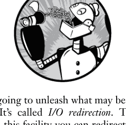

在本课中，我们将领略命令行中可能最酷的特性。它被称为 *I/O 重定向*。“I/O”代表 *输入/输出*，利用这一功能，你可以将命令的输入和输出重定向到文件或从文件重定向，还可以将多个命令连接成强大的命令 *管道*。为了展示这一功能，我们将介绍以下命令：

- `cat` 连接文件
- `sort` 对文本行排序
- `uniq` 报告或省略重复行
- `grep` 打印匹配模式的行
- `wc` 打印每个文件的换行符、单词和字节计数
- `head` 输出文件的开头部分
- `tail` 输出文件的末尾部分
- `tee` 从标准输入读取并写入标准输出和文件

### 标准输入、输出和错误

到目前为止，我们使用的许多程序都会产生某种输出。这些输出通常包含两种类型。

- 程序的结果；即程序旨在产生的数据
- 状态和错误消息，告诉我们程序的运行情况

如果我们查看像 `ls` 这样的命令，可以看到它会在屏幕上显示其结果和错误消息。

遵循 Unix “一切都是文件”的主题，像 `ls` 这样的程序实际上将其结果发送到一个名为标准输出（通常表示为 `stdout`）的特殊文件，并将其状态消息发送到另一个名为标准错误（`stderr`）的文件。默认情况下，标准输出和标准错误都连接到屏幕，不会保存到磁盘文件中。

此外，许多程序从名为标准输入（`stdin`）的设备获取输入，该设备默认连接到键盘。

I/O 重定向允许我们改变输出的去向和输入的来源。通常，输出到屏幕，输入来自键盘，但借助 I/O 重定向，我们可以改变这一切。

### 重定向标准输出

I/O 重定向允许我们重新定义标准输出的去向。要将标准输出重定向到另一个文件而不是屏幕，我们使用 `>` 重定向运算符，后跟文件名。我们为什么要这样做呢？将命令的输出存储在文件中通常很有用。例如，我们可以告诉 shell 将 `ls` 命令的输出发送到文件 `ls-output.txt` 而不是屏幕。

```shell
[me@linuxbox ~]$ ls -l /usr/bin > ls-output.txt
```

这里，我们创建了 `/usr/bin` 目录的长列表，并将结果发送到文件 `ls-output.txt`。让我们检查一下该命令的重定向输出，如下所示：

```shell
[me@linuxbox ~]$ ls -l ls-output.txt
-rw-rw-r-- 1 me me 167878 2018-02-01 15:07 ls-output.txt
```

好——一个不错的大文本文件。如果我们用 `less` 查看该文件，我们会看到文件 `ls-output.txt` 确实包含了我们 `ls` 命令的结果。

```shell
[me@linuxbox ~]$ less ls-output.txt
```

现在，让我们重复之前的重定向测试，但这次稍作变化。我们将目录名改为一个不存在的名称。

```shell
[me@linuxbox ~]$ ls -l /bin/usr > ls-output.txt
ls: cannot access /bin/usr: No such file or directory
```

我们收到了一个错误信息。这是有道理的，因为我们指定的目录 `/bin/usr` 不存在，但为什么错误信息显示在屏幕上而不是被重定向到文件 `ls-output.txt` 呢？答案是 `ls` 程序不会将其错误信息发送到标准输出。相反，像大多数编写良好的 Unix 程序一样，它会将错误信息发送到标准错误。由于我们只重定向了标准输出而没有重定向标准错误，错误信息仍然被发送到屏幕。我们马上就会看到如何重定向标准错误，但在那之前先看看输出文件发生了什么。

```shell
[me@linuxbox ~]$ ls -l ls-output.txt
-rw-rw-r-- 1 me me 0 2018-02-01 15:08 ls-output.txt
```

文件现在长度为零！这是因为当我们使用 `>` 重定向操作符重定向输出时，目标文件总是从开头开始重写。由于我们的 `ls` 命令没有生成任何结果，只有错误信息，重定向操作开始重写文件然后因错误而停止，导致文件被截断。事实上，如果我们确实需要截断一个文件（或创建一个新的空文件），我们可以使用这样的技巧：

```shell
[me@linuxbox ~]$ > ls-output.txt
```


只需使用重定向操作符而不在其前面加上命令，就会截断现有文件或创建一个新的空文件。

那么，我们如何将重定向的输出追加到文件而不是从开头覆盖文件呢？为此，我们使用`>>`重定向操作符，如下所示：

```
[me@linuxbox ~]$ ls -l /usr/bin >> ls-output.txt
```

使用`>>`操作符会使输出被追加到文件。如果文件尚不存在，它会被创建，就像使用`>`操作符一样。让我们来测试一下。

```
[me@linuxbox ~]$ ls -l /usr/bin >> ls-output.txt
[me@linuxbox ~]$ ls -l /usr/bin >> ls-output.txt
[me@linuxbox ~]$ ls -l /usr/bin >> ls-output.txt
[me@linuxbox ~]$ ls -l ls-output.txt
-rw-rw-r-- 1 me me 503634 2018-02-01 15:45 ls-output.txt
```

我们重复了三次命令，导致输出文件大小是原来的三倍。

### 重定向标准错误

重定向标准错误不像有专门的重定向操作符那样简单。要重定向标准错误，我们必须引用其文件描述符。一个程序可以在多个编号的文件流上产生输出。虽然我们将这前三个文件流称为标准输入、输出和错误，但 shell 在内部将它们引用为文件描述符 0、1 和 2。shell 提供了使用文件描述符编号重定向文件的记法。由于标准错误与文件描述符编号 2 相同，我们可以用这种记法重定向标准错误：

```
[me@linuxbox ~]$ ls -l /bin/usr 2> ls-error.txt
```

文件描述符 2 放在重定向操作符之前，以将标准错误重定向到文件`ls-error.txt`。

### 将标准输出和标准错误重定向到一个文件

有时我们可能希望将命令的所有输出捕获到单个文件中。为此，我们必须同时重定向标准输出和标准错误。有两种方法可以做到这一点。下面展示的是传统方法，可与旧版本的 shell 配合使用：

```
[me@linuxbox ~]$ ls -l /bin/usr > ls-output.txt 2>&1
```

使用这种方法，我们执行两次重定向。首先将标准输出重定向到文件`ls-output.txt`，然后使用记法`2>&1`将文件描述符`2`（标准错误）重定向到文件描述符`1`（标准输出）。

### 请注意重定向的顺序很重要

标准错误的重定向必须始终在重定向标准输出之后进行，否则它不起作用。以下示例将标准错误重定向到文件`ls-output.txt`：

```
>ls-output.txt 2>&1
```

如果顺序改为如下，则标准错误将被定向到屏幕：

```
2>&1 >ls-output.txt
```

`bash`的最新版本提供了一种第二种、更简洁的方法来执行这种组合重定向，如下所示：

```
[me@linuxbox ~]$ ls -l /bin/usr &> ls-output.txt
```

在这个例子中，我们使用单个符号 `&>` 将标准输出和标准错误都重定向到文件`ls-output.txt`。你也可以将标准输出和标准错误流追加到单个文件中，如下所示：

```
[me@linuxbox ~]$ ls -l /bin/usr &>> ls-output.txt
```

### 丢弃不需要的输出

有时候“沉默是金”，我们不想要命令的输出，只想把它丢掉。这尤其适用于错误和状态信息。系统提供了一种方法来实现这一点：将输出重定向到一个名为`/dev/null`的特殊文件。这个文件是一个系统设备，通常被称为位桶，它接受输入但不对其做任何处理。要抑制命令的错误信息，我们可以这样做：

```
[me@linuxbox ~]$ ls -l /bin/usr 2> /dev/null
```

> UNIX 文化中的 `/DEV/NULL`

>

> 位桶是一个古老的 Unix 概念，由于其普遍性，它出现在 Unix 文化的许多方面。当有人说他们把你的评论发送到`/dev/null`时，现在你知道这意味着什么了。更多示例，请参阅维基百科上关于`/dev/null`的文章。

### 重定向标准输入

到目前为止，我们还没有遇到任何使用标准输入的命令（实际上我们遇到过，但稍后我们会揭示这个惊喜），所以我们需要介绍一个命令。

### `cat`：连接文件

`cat`命令读取一个或多个文件，并将它们复制到标准输出，如下所示：

```
cat filename
```

在大多数情况下，你可以把`cat`视为类似于 DOS 中的`TYPE`命令。你可以用它来显示文件而无需分页。例如，下面的命令将显示文件`ls-output.txt`的内容：

```
[me@linuxbox ~]$ cat ls-output.txt
```

`cat`经常用于显示短文本文件。因为`cat`可以接受多个文件作为参数，它也可以用来将文件连接在一起。假设我们下载了一个被分割成多个部分的大文件（多媒体文件在 Usenet 上经常这样分割），并且我们想把它们重新连接起来。如果文件命名如下：

```
movie.mpeg.001 movie.mpeg.002 ... movie.mpeg.099
```

我们可以用这个命令将它们重新连接起来：

```
cat movie.mpeg.0* > movie.mpeg
```

因为通配符总是按排序顺序展开，所以参数会以正确的顺序排列。

这一切都很好，但这与标准输入有什么关系呢？目前还没有，但让我们尝试点别的。如果我们输入不带任何参数的`cat`会发生什么？

```
[me@linuxbox ~]$ cat
```

什么都没发生；它只是停在那里，好像挂起了一样。看起来可能是这样，但它确实在做它该做的事情。

如果`cat`没有给定任何参数，它会从标准输入读取，而由于标准输入默认连接到键盘，它正在等待我们输入一些内容！尝试输入以下文本并按回车：

```
[me@linuxbox ~]$ cat
The quick brown fox jumped over the lazy dog.
```

接下来，输入 CTRL-D（即按住 CTRL 键并按下 D）来告诉`cat`它已经到达标准输入的末尾（EOF）。

```
[me@linuxbox ~]$ cat
The quick brown fox jumped over the lazy dog.
The quick brown fox jumped over the lazy dog.
```

在没有文件名参数的情况下，`cat`会将标准输入复制到标准输出，所以我们看到我们输入的那行文本被重复显示。我们可以利用这种行为来创建短文本文件。假设我们想创建一个名为`lazy_dog.txt`的文件，其中包含我们示例中的文本。我们可以这样做：

```
[me@linuxbox ~]$ cat > lazy_dog.txt
The quick brown fox jumped over the lazy dog.
```

输入命令，然后输入我们要放入文件中的文本。记住最后要输入 CTRL-D。使用命令行，我们实现了一个世界上最笨的文字处理器！要查看结果，我们可以再次使用`cat`将文件复制到标准输出。

```
[me@linuxbox ~]$ cat lazy_dog.txt
The quick brown fox jumped over the lazy dog.
```

现在我们知道`cat`如何接受标准输入以及文件名参数，让我们尝试重定向标准输入。

```
[me@linuxbox ~]$ cat < lazy_dog.txt
The quick brown fox jumped over the lazy dog.
```

使用`<`重定向运算符，我们将标准输入的来源从键盘改为文件`lazy_dog.txt`。我们看到的结果与传递单个文件名参数相同。这与传递文件名参数相比并不特别有用，但它用于演示使用文件作为标准输入的来源。其他命令更有效地使用标准输入，我们很快就会看到。

在继续之前，请查看`cat`的手册页，因为它有几个有趣的选项。

### 管道

命令能够从标准输入读取数据并发送到标准输出的能力被 shell 的一个特性所利用，该特性称为管道。使用管道操作符`|`，一个命令的标准输出可以被导入到另一个命令的标准输入中。

```
command1 | command2
```

为了充分演示这一点，我们需要一些命令。还记得我们说过我们已经知道有一个接受标准输入的命令吗？它是`less`。我们可以使用`less`按页显示任何将结果发送到标准输出的命令的输出。

```
[me@linuxbox ~]$ ls -l /usr/bin | less
```

这非常方便！使用这种技术，我们可以方便地检查任何产生标准输出的命令的输出。

### 过滤器


管道通常用于对数据执行复杂操作。可以将多个命令组合成一个管道。通常以这种方式使用的命令被称为过滤器。过滤器接收输入，以某种方式更改它，然后输出它。我们要尝试的第一个是`sort`。假设我们想要制作`/bin`和`/usr/bin`中所有可执行程序的合并列表，按排序顺序排列，并查看 resulting 列表。

```
[me@linuxbox ~]$ ls /bin /usr/bin | sort | less
```

因为我们指定了两个目录（`/bin`和`/usr/bin`），所以`ls`的输出将由两个排序列表组成，每个目录一个。通过在管道中包含`sort`，我们更改了数据以产生一个单一的、排序的列表。

### > 与 | 的区别

乍一看，很难理解管道操作符`|`执行的重定向与重定向操作符`>`执行的重定向之间的区别。简单地说，重定向操作符将一个命令与一个文件连接起来，而管道操作符将一个命令的输出与第二个命令的输入连接起来。

```
command1 > file1
command1 | command2
```

很多人学习管道时会尝试以下操作，“只是想看看会发生什么”：

```
command1 > command2
```

答案：有时会发生非常糟糕的事情。

这里有一个实际例子，由一位读者提交，他正在管理一台基于 Linux 的服务器设备。作为超级用户，他这样做了：

```
### cd /usr/bin
### ls > less
```

第一个命令将他置于大多数程序存储的目录中，第二个命令告诉 shell 用`ls`命令的输出覆盖文件`less`。由于`/usr/bin`目录中已经包含一个名为`less`的文件（less 程序），第二个命令用`ls`的文本覆盖了`less`程序文件，从而破坏了他系统上的`less`程序。

### `grep`: 打印匹配模式的行

`grep`是一个强大的程序，用于在文件中查找文本模式。它的使用方式如下：

```
grep pattern filename
```

当`grep`在文件中遇到“`pattern`”时，它会打印出包含它的行。`grep`可以匹配的模式可以非常复杂，但现在我们将集中于简单的文本匹配。我们将在第 19 章介绍高级模式，称为正则表达式。

假设我们想要找到程序列表中所有文件名中包含单词`zip`的文件。这样的搜索可能会让我们了解系统上与文件压缩有关的某些程序。我们会这样做：

```
[me@linuxbox ~]$ ls /bin /usr/bin | sort | uniq | grep zip
bunzip2
bzip2
gunzip
gzip
unzip
zip
zipcloak
zipgrep
zipinfo
zipnote
zipsplit
```

`grep`有几个方便的选项。

- `-i`，这会导致`grep`在执行搜索时忽略大小写（通常搜索区分大小写）

- `-v`，这告诉`grep`只打印那些不匹配模式的行

### `head`/`tail`: 打印文件的开头/结尾部分

有时你并不想要某个命令的所有输出。你可能只想要前几行或最后几行。`head`命令会打印文件的最初 10 行，而`tail`命令会打印最后 10 行。默认情况下，两个命令都打印 10 行文本，但这可以通过`-n`选项进行调整。

```
[me@linuxbox ~]$ head -n 5 ls-output.txt
total 343496
-rwxr-xr-x 1 root root      31316 2017-12-05 08:58 [
-rwxr-xr-x 1 root root       8240 2017-12-09 13:39 411toppm
-rwxr-xr-x 1 root root      111276 2017-11-26 14:27 a2p
-rwxr-xr-x 1 root root       25368 2016-10-06 20:16 a52dec
[me@linuxbox ~]$ tail -n 5 ls-output.txt
-rwxr-xr-x 1 root root       5234 2017-06-27 10:56 znew
-rwxr-xr-x 1 root root        691 2015-09-10 04:21 zonetab2pot.py
-rw-r--r-- 1 root root        930 2017-11-01 12:23 zonetab2pot.pyc
-rw-r--r-- 1 root root        930 2017-11-01 12:23 zonetab2pot.pyo
lrwxrwxrwx 1 root root          6 2016-01-31 05:22 zsoelim -> soelim
```

这些命令也可以在管道中使用：

```
[me@linuxbox ~]$ ls /usr/bin | tail -n 5
znew
zonetab2pot.py
zonetab2pot.pyc
zonetab2pot.pyo
zsoelim
```

`tail`有一个选项可以让你实时查看文件。这对于在日志文件被写入时观察其进展非常有用。在下面的示例中，我们将查看`/var/log`中的`messages`文件（如果`messages`缺失，则为`/var/log/syslog`文件）。在某些 Linux 发行版上，需要超级用户权限才能执行此操作，因为`/var/log/messages`文件可能包含安全信息。

```
[me@linuxbox ~]$ tail -f /var/log/messages
Feb  8 13:40:05 twin4 dhclient: DHCPACK from 192.168.1.1
Feb  8 13:40:05 twin4 dhclient: bound to 192.168.1.4 -- renewal in 1652 seconds.
Feb  8 13:55:32 twin4 mountd[3953]: /var/NFSv4/musicbox exported to both 192.168.1.0/24 and twin7.localdomain in 192.168.1.0/24,twin7.localdomain
Feb  8 14:07:37 twin4 dhclient: DHCPREQUEST on eth0 to 192.168.1.1 port 67
Feb  8 14:07:37 twin4 dhclient: DHCPACK from 192.168.1.1
Feb  8 14:07:37 twin4 dhclient: bound to 192.168.1.4 -- renewal in 1771 seconds.
Feb  8 14:09:56 twin4 smartd[3468]: Device: /dev/hda, SMART Prefailure Attribute: 8 Seek_Time_ Performance changed from 237 to 236
Feb  8 14:10:37 twin4 mountd[3953]: /var/NFSv4/musicbox exported to both 192.168.1.0/24 and twin7.localdomain in 192.168.1.0/24,twin7.localdomain
Feb  8 14:25:07 twin4 sshd(pam_unix)[29234]: session opened for user me by (uid=0)
Feb  8 14:25:36 twin4 su(pam_unix)[29279]: session opened for user root by me(uid=500)
```

使用`-f`选项，`tail`会持续监控文件，当有新行追加时，它们会立即显示在屏幕上。这会一直持续到你输入 CTRL-C 为止。

### `tee`: 从标准输入读取并输出到标准输出和文件

按照我们的管道比喻，Linux 提供了一个名为`tee`的命令，它在我们的管道上创建了一个“T”型接头。`tee`程序读取标准输入，并将其复制到标准输出（允许数据继续沿管道传输）以及一个或多个文件中。这对于在处理的中期阶段捕获管道的内容非常有用。这里我们重复之前的其中一个示例，这次加入`tee`来在`grep`过滤管道内容之前，将整个目录列表捕获到文件`ls.txt`中：

```
[me@linuxbox ~]$ ls /usr/bin | tee ls.txt | grep zip
bunzip2
bzip2
gunzip
gzip
unzip
zip
zipcloak
zipgrep
zipinfo
zipnote
zipsplit
```

### 总结

一如既往，请查阅本章中我们介绍过的每个命令的文档。我们只看到了它们最基本的使用方法。它们都有许多有趣的选项。随着我们 Linux 经验的积累，我们会发现命令行重定向功能对于解决专门问题非常有用。有许多命令使用标准输入和输出，几乎所有命令行程序都使用标准错误来显示其信息性消息。


### LINUX IS ABOUT IMAGINATION

当我被问及 Windows 和 Linux 之间的区别时，我经常使用一个玩具的类比。
Windows 就像一台 Game Boy。你去商店买一个全新的、包装精美的。你把它带回家，打开，然后玩。漂亮的画面，可爱的音效。然而，过了一会儿，你对随附的游戏感到厌倦，于是你又回到商店买另一个。这个循环一次又一次地重复。最后，你回到商店对柜台后面的人说：“我想要一个能做这个的游戏！”却被告知这样的游戏不存在，因为没有“市场需求”。然后你说：“但我只需要改动这一点！”柜台后面的人说你不能改动。游戏都密封在卡带里。你发现你的玩具仅限于别人决定你需要的游戏。
Linux 另一方面，就像世界上最大的 Erector 套件。你打开它，里面只是一大堆零件。有很多钢条、螺丝、螺母、齿轮、滑轮、电机，以及一些建造建议。所以，你开始玩。你先造一个建议，然后再造另一个。过了一会儿你发现你有自己的想法要做什么。你永远不必再回商店，因为你已经拥有了一切
你需要。Erector Set 呈现出你想象的形状。
它做你想要的事情。
玩具的选择当然是个人化的，那么你会觉得哪种玩具更令人满意？

# 7

### 从 Shell 的视角看世界


在本章中，我们将观察按下 ENTER 键时在命令行上发生的“魔法”。虽然我们将研究 shell 的几个有趣且复杂的特性，但我们只会使用一个新命令来完成：
`echo` 显示一行文本

#### 展开

每次我们输入命令并按下 ENTER 键时，`bash` 在执行我们的命令之前会对文本进行多次替换。我们已经见过一些简单字符序列，例如 `*`，对 shell 来说可以有很大意义的情况。使这种现象发生的处理过程称为展开。通过展开，我们输入的内容在 shell 作用于它之前会被展开为其他内容。为了演示我们所说的含义，让我们来看看 `echo` 命令。`echo` 是一个 shell 内建命令，执行非常简单的任务。它将文本参数打印到标准输出。

```
[me@linuxbox ~]$ echo this is a test
this is a test
```

这很直接。传递给 `echo` 的任何参数都会被显示。让我们再试一个例子。

```
[me@linuxbox ~]$ echo *
Desktop Documents ls-output.txt Music Pictures Public Templates Videos
```

发生了什么？为什么 `echo` 没有打印 `*`？正如我们从通配符的工作中回忆的那样，`*` 字符表示匹配文件名中的任意字符，但我们在最初的讨论中没有看到 shell 是如何做到这一点的。简单的答案是 shell 在 `echo` 命令执行之前将 `*` 展开为其他内容（在本例中为当前工作目录中的文件名）。当按下 ENTER 键时，shell 会在命令执行前自动展开命令行上的任何符合条件的字符，因此 `echo` 命令从未看到 `*`，只看到了其展开后的结果。知道这一点后，我们可以看到 `echo` 的行为符合预期。

#### 路径名展开

通配符工作的机制称为路径名展开。如果我们尝试在前几章中使用的一些技术，我们会发现它们实际上是展开。给定如下的 home 目录：

```
[me@linuxbox ~]$ ls
Desktop   ls-output.txt   Pictures   Templates
Documents Music           Public     Videos
```

我们可以执行以下展开：

```
[me@linuxbox ~]$ echo D*
Desktop Documents
```

以及这个：

```
[me@linuxbox ~]$ echo *s
Documents Pictures Templates Videos
```

甚至这个：

```
[me@linuxbox ~]$ echo [[:upper:]]*
Desktop Documents Music Pictures Public Templates Videos
```

并且在 home 目录之外，我们可以这样做：

```
[me@linuxbox ~]$ echo /usr/*/share
/usr/kerberos/share /usr/local/share
```

#### 隐藏文件的路径名展开

正如我们所知，以句点字符开头的文件名是隐藏的。路径名展开也尊重这种行为。如下的展开不会显示隐藏文件：

```
echo *
```

乍一看，我们似乎可以通过在模式前加上前导句点来将隐藏文件包含在展开中，像这样：

```
echo .*
```

它几乎可行。然而，如果我们仔细检查结果，就会看到名称 `.` 和 `..` 也会出现在结果中。因为这些名称指的是当前工作目录及其父目录，使用此模式很可能会产生错误的结果。我们可以通过尝试以下命令来看到这一点：

```
ls -d .* | less
```

为了更好地在这种情况下执行路径名展开，我们必须采用更具体的模式。

```
echo .[!.]*
```

此模式展开为以一个句点开头后跟任意其他字符的每个文件名。这将与大多数隐藏文件正确配合（尽管它仍然不会包含具有多个前导句点的文件名）。带有 `-A` 选项的 `ls` 命令（“几乎全部”）将提供隐藏文件的正确列表。

```
ls -A
```

#### 波浪号展开

正如我们从对 `cd` 命令的介绍中可能回忆的那样，波浪号字符（`~`）具有特殊含义。当用作单词开头时，它会展开为指定用户的主目录名称，或者如果未指定用户，则展开为当前用户的主目录。

```
[me@linuxbox ~]$ echo ~
/home/me
```

如果用户“foo”有账户，则会展开为：

```
[me@linuxbox ~]$ echo ~foo
/home/foo
```

#### 算术展开

shell 允许通过展开来执行算术运算。这使我们能够将 shell 提示用作计算器。

```
[me@linuxbox ~]$ echo $((2 + 2))
4
```

算术展开使用以下形式：

```
$((expression))
```

其中 `expression` 是由值和算术运算符组成的一个算术表达式。
算术展开仅支持整数（整数，无小数），但可以执行相当多的不同操作。表 7-1 描述了一些受支持的操作符。

### 表 7-1：算术操作符

| Operator | Description |
|---|---|
| + | Addition |
| - | Subtraction |
| * | Multiplication |
| / | Division (but remember, since expansion supports only integer arithmetic, results are integers) |
| % | Modulo, which simply means “remainder” |
| ** | Exponentiation |

算术表达式中空格不重要，且表达式可以嵌套。例如，要将 5 的平方乘以 3，我们可以使用以下方法：

```
[me@linuxbox ~]$ echo $((($(5**2)) * 3))
75
```

可以使用单个括号对多个子表达式进行分组。使用此技术，我们可以重写前面的示例，并使用一次展开而不是两次得到相同的结果。

```
[me@linuxbox ~]$ echo $(( (5**2) * 3 ))
75
```

以下是使用除法和余数操作符的示例。请注意整数除法的效果。

```
[me@linuxbox ~]$ echo Five divided by two equals $((5/2))
Five divided by two equals 2
[me@linuxbox ~]$ echo with $((5%2)) left over.
with 1 left over.
```

算术展开在第 34 章中有更详细的介绍。

### 大括号展开

也许最奇怪的展开称为大括号展开。通过它，你可以从包含大括号的模式创建多个文本字符串。以下是一个示例：

```
[me@linuxbox ~]$ echo Front-{A,B,C}-Back
Front-A-Back Front-B-Back Front-C-Back
```

要进行大括号展开的模式可能包含称为前导部分的前缀和称为后缀的尾部部分。大括号表达式本身可能包含逗号分隔的字符串列表，或整数或单个字符的范围。模式可能不包含未加引号的空白。以下是使用整数范围的示例：

```
[me@linuxbox ~]$ echo Number_{1..5}
Number_1 Number_2 Number_3 Number_4 Number_5
```

在 `bash` 版本 4.0 及更高版本中，整数也可以像这样用零填充：


```
[me@linuxbox ~]$ echo {01..15}
01 02 03 04 05 06 07 08 09 10 11 12 13 14 15
[me@linuxbox ~]$ echo {001..15}
001 002 003 004 005 006 007 008 009 010 011 012 013 014 015
```

以下是字母范围的反向顺序：

```
[me@linuxbox ~]$ echo {Z..A}
Z Y X W V U T S R Q P O N M L K J I H G F E D C B A
```

大括号展开可以嵌套。

```
[me@linuxbox ~]$ echo a{A{1,2},B{3,4}}b
aA1b aA2b aB3b aB4b
```

那么，这有什么用呢？最常见的应用是创建要创建的文件或目录列表。例如，如果我们是摄影师，拥有大量想要按年份和月份组织的图像，我们首先要做的事情可能是创建一系列以数字“年-月”格式命名的目录。这样，目录名就会按时间顺序排序。我们可以输入完整的目录列表，但这工作量很大，而且容易出错。相反，我们可以这样做：

```
[me@linuxbox ~]$ mkdir Photos
[me@linuxbox ~]$ cd Photos
[me@linuxbox Photos]$ mkdir {2007..2009}-{01..12}
[me@linuxbox Photos]$ ls
2007-01  2007-07  2008-01  2008-07  2009-01  2009-07
2007-02  2007-08  2008-02  2008-08  2009-02  2009-08
2007-03  2007-09  2008-03  2008-09  2009-03  2009-09
2007-04  2007-10  2008-04  2008-10  2009-04  2009-10
2007-05  2007-11  2008-05  2008-11  2009-05  2009-11
2007-06  2007-12  2008-06  2008-12  2009-06  2009-12
```

相当 slick！

### 参数展开

我们将在本章中仅简要介绍参数展开，但稍后会对其进行广泛介绍。它在 `shell` 脚本中比直接在命令行上更有用。其许多功能与系统存储小块数据并为每个块命名 的能力有关。许多这样的块，更正确地称为变量，可供你检查。例如，名为 `USER` 的变量包含你的用户名。要调用参数展开并显示 `USER` 的内容，你可以这样做：

```
[me@linuxbox ~]$ echo $USER
me
```

要查看可用变量的列表，请尝试以下操作：

```
[me@linuxbox ~]$ printenv | less
```

你可能已经注意到，对于其他类型的展开，如果你输入错误的模式，展开将不会发生，并且 `echo` `command` 将只显示拼写错误的模式。使用参数扩展，如果你拼写错误变量名，扩展仍然会进行，但结果会是一个空字符串。

```
[me@linuxbox ~]$ echo $SUER
[me@linuxbox ~]$
```

### 命令替换

命令替换允许我们将命令的输出用作扩展。

```
[me@linuxbox ~]$ echo $(ls)
Desktop Documents ls-output.txt Music Pictures Public Templates Videos
```

我最喜欢的一种用法是这样的：

```
[me@linuxbox ~]$ ls -l $(which cp)
-rwxr-xr-x 1 root root 71516 2007-12-05 08:58 /bin/cp
```

这里我们将 `which cp` 的结果作为参数传递给 `ls` 命令，从而在不知道其完整路径名的情况下获取 `cp` 程序的列表。我们并不局限于简单的命令。整个管道也可以使用（此处仅显示部分输出）。

```
[me@linuxbox ~]$ file $(ls -d /usr/bin/* | grep zip)
/usr/bin/bunzip2:     symbolic link to `bzip2'
/usr/bin/bzip2:      ELF 32-bit LSB executable, Intel 80386, version 1 (SYSV), dynamically linked (uses shared libs), for GNU/Linux 2.6.9, stripped
/usr/bin/bzip2recover: ELF 32-bit LSB executable, Intel 80386, version 1 (SYSV), dynamically linked (uses shared libs), for GNU/Linux 2.6.9, stripped
/usr/bin/funzip:      ELF 32-bit LSB executable, Intel 80386, version 1 (SYSV), dynamically linked (uses shared libs), for GNU/Linux 2.6.9, stripped
/usr/bin/gpg-zip:     Bourne shell script text executable
/usr/bin/gunzip:      symbolic link to `../../bin/gunzip'
/usr/bin/gzip:        symbolic link to `../../bin/gzip'
/usr/bin/mzip:        symbolic link to `mtools'
```

在这个例子中，管道的结果成为了 `file` 命令的参数列表。

在旧的 `shell` 程序中，命令替换还有一种备用的语法，在 `bash` 中也支持。它使用反引号代替美元符号和括号。

```
[me@linuxbox ~]$ ls -l `which cp`
-rwxr-xr-x 1 root root 71516 2007-12-05 08:58 /bin/cp
```

### 引号

现在我们已经看到了 `shell` 可以执行扩展的多种方式，是时候学习如何控制它了。例如：

```
[me@linuxbox ~]$ echo this is a    test
this is a test
```

或者这个：

```
[me@linuxbox ~]$ echo The total is $100.00
The total is 00.00
```

在第一个例子中，`shell` 的词分割移除了 `echo` 命令参数列表中的多余空白。在第二个例子中，参数扩展将 `$1` 的值替换为空字符串，因为它是一个未定义的变量。`shell` 提供了一种称为引用的机制来有选择地抑制不需要的扩展。

#### 双引号

我们要看的第一种引用是双引号。如果我们将文本放在双引号内，`shell` 使用的所有特殊字符都会失去其特殊含义并被视为普通字符。例外是 `$`（美元符号）、`\`（反斜杠）和 `` ` ``（反引号）。这意味着词分割、路径名扩展、波浪号扩展和大括号扩展会被抑制；然而，参数扩展、算术扩展和命令替换仍然会执行。使用双引号，我们可以处理包含嵌入空格的文件名。假设我们不幸遇到了一个名为 `two words.txt` 的文件。如果我们在命令行上尝试使用它，词分割会将其视为两个独立的参数而不是期望的单个参数。

```
[me@linuxbox ~]$ ls -l two words.txt
ls: cannot access two: No such file or directory
ls: cannot access words.txt: No such file or directory
```

通过使用双引号，我们停止了词分割并得到了期望的结果；此外，我们甚至可以修复损坏。

```
[me@linuxbox ~]$ ls -l "two words.txt"
-rw-rw-r-- 1 me me 18 2018-02-20 13:03 two words.txt
[me@linuxbox ~]$ mv "two words.txt" two_words.txt
```

好了！现在我们不必再一直输入那些讨厌的双引号了。

记住，参数扩展、算术扩展和命令替换在双引号内仍然会进行。

```
[me@linuxbox ~]$ echo "$USER $((2+2)) $(cal)"
me 4 February 2020
Su Mo Tu We Th Fr Sa
          1
2  3  4  5  6  7  8
9 10 11 12 13 14 15
16 17 18 19 20 21 22
23 24 25 26 27 28 29
```

我们应该花点时间来看一下双引号对命令替换的影响。首先让我们更深入地了解一下词分割的工作原理。在我们之前的例子中，我们看到了词分割如何似乎移除了我们文本中的多余空格。


```
[me@linuxbox ~]$ echo this is a    test
this is a test
```

默认情况下，分词会查找空格、制表符和换行符（换行字符）的存在，并将它们视为单词之间的*分隔符*。这意味着未加引号的空格、制表符和换行符不被视为文本的一部分。它们仅用作分隔符。因为它们将单词分隔成不同的参数，所以我们的示例命令行包含一个命令，后跟四个不同的参数。如果我们加上双引号：

```
[me@linuxbox ~]$ echo "this is a      test"
this is a      test
```

那么分词将被抑制，嵌入的空格不再被视为分隔符；相反，它们成为参数的一部分。加上双引号后，我们的命令行包含一个命令，后跟一个参数。

换行符被分词机制视为分隔符这一事实，对命令替换产生了有趣的、 albeit 微妙的影响。请考虑以下内容：

```
[me@linuxbox ~]$ echo $(cal)
February 2020 Su Mo Tu We Th Fr Sa 1 2 3 4 5 6 7 8 9 10 11 12 13 14 15
16 17 18 19 20 21 22 23 24 25 26 27 28 29
[me@linuxbox ~]$ echo "$(cal)"
February 2020
Su Mo Tu We Th Fr Sa
1
2 3 4 5 6 7 8
9 10 11 12 13 14 15
16 17 18 19 20 21 22
23 24 25 26 27 28 29
```

在第一种情况下，未加引号的命令替换导致命令行包含 38 个参数。在第二种情况下，它导致命令行包含一个参数，其中包含嵌入的空格和换行符。

### 单引号

如果我们需要抑制所有展开，则使用单引号。以下是未加引号、双引号和单引号的比较：

```
[me@linuxbox ~]$ echo text ~/*.txt {a,b} $(echo foo) $((2+2)) $USER
text /home/me/ls-output.txt a b foo 4 me
[me@linuxbox ~]$ echo "text ~/*.txt {a,b} $(echo foo) $((2+2)) $USER"
text ~/*.txt {a,b} foo 4 me
[me@linuxbox ~]$ echo 'text ~/*.txt {a,b} $(echo foo) $((2+2)) $USER'
text ~/*.txt {a,b} $(echo foo) $((2+2)) $USER
```

正如我们所见，随着引号级别的不断提高，越来越多的展开被抑制。

### 转义字符

有时我们只想引用单个字符。为此，我们可以在字符前加上反斜杠，在这种情况下称为转义字符。通常这是在双引号内完成，以有选择地阻止展开。

```
[me@linuxbox ~]$ echo "The balance for user $USER is: \$5.00"
The balance for user me is: $5.00
```

使用转义来消除文件名中字符的特殊含义也很常见。例如，可以在文件名中使用 shell 通常赋予特殊含义的字符。这些包括 `$`、`!`、`&`、空格等。要在文件名中包含特殊字符，我们可以这样做：

```
[me@linuxbox ~]$ mv bad\&filename good_filename
```

要允许反斜杠字符出现，请通过键入 `\\` 来转义它。请注意，在单引号内，反斜杠会失去其特殊含义并被视为普通字符。

### 反斜杠转义序列

除了作为转义字符的作用外，反斜杠还被用作表示某些称为控制代码的特殊字符的记法的组成部分。ASCII 编码方案中的前 32 个字符用于向电传打字机类设备传输命令。其中一些代码很熟悉（制表符、退格、换行和回车），而其他代码则不熟悉（空、传输结束和确认）。

表 7-2 列出了一些常见的反斜杠转义序列。

表 7-2：反斜杠转义序列

| Escape sequence | Meaning |
|---|---|
| `\a` | Bell (an alert that causes the computer to beep) |
| `\b` | Backspace |
| `\n` | Newline; on Unix-like systems, this produces a line feed |
| `\r` | Carriage return |
| `\t` | Tab |

使用反斜杠进行这种表示的想法起源于 C 编程语言，并已被许多其他语言采用，包括 shell。

向 `echo` 添加 `-e` 选项将启用对转义序列的解释。你也可以将它们放在 `$' '` 内。在这里，使用 `sleep` 命令，一个简单的程序，只等待指定的秒数然后退出，我们可以创建一个原始的倒计时器：

```
sleep 10; echo -e "Time's up\a"
```

我们也可以这样做：

```
sleep 10; echo "Time's up" $'\a'
```

### 总结

随着我们继续使用 shell，我们会发现展开和引用会以越来越高的频率被使用，因此了解它们的工作方式是有意义的。事实上，可以说它们是 shell 中最重要的学习主题。如果没有对展开的正确理解，shell 将始终是神秘和困惑的来源，其大部分潜在能力都将被浪费。

# 8 高级键盘技巧

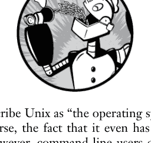

我经常开玩笑地描述 Unix 为“喜欢打字的人的操作系统”。当然，它甚至拥有命令行就证明了这一点；然而，命令行用户并不喜欢打太多字。否则为什么会有这么多命令的名字如此简短，比如 `cp`、`ls`、`mv` 和 `rm`？事实上，命令行最珍视的目标之一就是懒惰——用最少的击键完成最多的工作。另一个目标是永远不必把手指从键盘上抬起去够鼠标。在本章中，我们将研究使键盘使用更快、更高效的 bash 功能。

以下命令将会出现：

- `clear` 清除终端屏幕
- `history` 显示或操作历史列表

#### 命令行编辑

`bash` 使用一个库（不同程序可以使用的共享例程集合）称为 `Readline` 来实现命令行编辑。我们已经见过其中的一些。例如，我们知道方向键可以移动光标，但还有许多其他功能。把它们看作是我们工作中可以采用的额外工具。记住全部并不重要，但其中许多非常有用。按需挑选。

NOTE

*本章介绍的一些键序列（特别是那些使用 ALT 键的）可能会被 GUI 拦截用于其他功能。所有键序列在使用虚拟控制台时都应能正常工作。*

#### 光标移动

表 8-1 描述了用于移动光标的键。

表 8-1：光标移动命令

| Key | Action |
|---|---|
| CTRL-A | Move cursor to the beginning of the line. |
| CTRL-E | Move cursor to the end of the line. |
| CTRL-F | Move cursor forward one character; same as the right arrow key. |
| CTRL-B | Move cursor backward one character; same as the left arrow key. |
| ALT-F | Move cursor forward one word. |
| ALT-B | Move cursor backward one word. |
| CTRL-L | Clear the screen and move the cursor to the top-left corner. The clear command does the same thing. |

#### 修改文本

由于在编写命令时我们可能会犯错，因此需要一种高效的纠正方法。表 8-2 描述了用于在命令行上编辑字符的键盘命令。

#### 表 8-2：文本编辑命令

| Key | Action |
|---|---|
| CTRL-D | Delete the character at the cursor location. |
| CTRL-T | Transpose (exchange) the character at the cursor location with the one preceding it. |
| ALT-T | Transpose the word at the cursor location with the one preceding it. |
| ALT-L | Convert the characters from the cursor location to the end of the word to lowercase. |
| ALT-U | Convert the characters from the cursor location to the end of the word to uppercase. |

#### 剪切和粘贴（杀死和提取）文本


Readline 文档使用 killing 和 yanking 术语来指代我们通常所说的剪切和粘贴（见表 8-3）。被剪切的项目存储在称为 kill-ring 的缓冲区（内存中的临时存储区）中。

### 表 8-3：剪切粘贴命令

| Key | Action |
|---|---|
| CTRL-K | Kill text from the cursor location to the end of line. |
| CTRL-U | Kill text from the cursor location to the beginning of the line. |
| ALT-D | Kill text from the cursor location to the end of the current word. |
| ALT-BACKSPACE | Kill text from the cursor location to the beginning of the current word. If the cursor is at the beginning of a word, kill the previous word. |
| CTRL-Y | Yank text from the kill-ring and insert it at the cursor location. |

### META 键

如果你深入研究 Readline 文档，该文档可以在 `bash` 手册页的“READLINE”部分找到，你会遇到 meta key 这个术语。在现代键盘上，这映射到 ALT 键；然而，这并非一直如此。

在遥远的年代（PC 之前但 Unix 之后），并非每个人都有自己的电脑。他们可能拥有的是一种叫做终端的设备。终端是一种通信设备，具有文本显示屏和键盘，以及足够多的内部电子元件来显示文本字符并移动光标。它通过（通常是串行电缆）连接到更大型的计算机或更大计算机的通信网络。存在许多不同品牌的终端，它们都有不同的键盘和显示功能集。因为它们至少都倾向于理解 ASCII，所以希望编写可移植应用程序的软件开发人员会写到最低公分母。Unix 系统有一种复杂的方式来处理终端及其不同的显示功能。由于 Readline 的开发人员无法确定是否存在专用的额外控制键，他们发明了一个并称之为 meta。虽然 ALT 键在现代键盘上充当 meta 键，但如果你仍在使用终端（你可以在 Linux 中继续使用！），也可以按一下 ESC 键然后松开，以获得与按住 ALT 键相同的效果。

### Completion

shell 帮助你的另一种方式是通过一种称为 *completion* 的机制。completion 在你输入命令时按下 TAB 键时发生。让我们看看它是如何工作的。假设主目录看起来像这样：

```
[me@linuxbox ~]$ ls
Desktop  ls-output.txt  Pictures  Templates  Videos
Documents  Music  Public
```

尝试输入以下内容，但 *不要按* ENTER：

```
[me@linuxbox ~]$ ls l
```

现在按下 TAB。

```
[me@linuxbox ~]$ ls ls-output.txt
```

看到 shell 如何为你补全这一行了吗？再试一个。同样，不要按 ENTER。

```
[me@linuxbox ~]$ ls D
```

按下 TAB。

```
[me@linuxbox ~]$ ls D
```

没有补全，什么都没有。这是因为 D 与目录中的多个条目匹配。要使补全成功，你提供的“线索”必须是不含糊的。如果我们再进一步，如下：

```
[me@linuxbox ~]$ ls Do
```

然后按下 TAB：

```
[me@linuxbox ~]$ ls Documents
```

补全就成功了。

虽然这个例子展示了路径名的补全，这是它最常见的用途，但补全也适用于变量（如果单词以 `$` 开头）、用户名（如果单词以 `~` 开头）、命令（如果单词是该行的第一个词）以及主机名（如果单词以 `@` 开头）。主机名补全仅适用于`/etc/hosts`中列出的主机名。

许多控制键和 meta 键序列与补全相关联，如表 8-4 所列。

#### Table 8-4: Completion Commands

| Key | Action |
|---|---|
| ALT-? | 显示可能的补全列表。在大多数系统上，你也可以通过第二次按下 TAB 键来实现，这要容易得多。 |
| ALT-* | 插入所有可能的补全。这在你想要使用多个可能匹配项时很有用。 |

还有相当多的其他补全方式，比较晦涩。列表出现在 `bash` 手册页的“READLINE”下。

#### PROGRAMMABLE COMPLETION

`bash` 的最新版本提供了一种称为可编程补全的功能。可编程补全允许你（或更可能的是你的发行版提供商）添加更多补全规则。通常这是为了为特定应用程序添加支持。例如，可以为命令的选项列表添加补全，或匹配应用程序支持的特定文件类型。Ubuntu 默认定义了相当多的补全。可编程补全由 shell 函数实现，这是一种我们将在后面章节中介绍的迷你 shell 脚本。如果你好奇，可以尝试以下操作：

```
set | less
```

现在看看你是否能找到它们。并非所有发行版默认都包含它们。

### Using History

正如我们在第 1 章中发现的，`bash` 维护着已输入命令的历史记录。这个命令列表保存在你的主目录中，文件名为`bash_history`。历史记录功能是减少你需要输入量的有用资源，尤其是在与命令行编辑结合使用时。

#### Searching History

在任何时候，我们都可以通过以下方式查看命令历史列表的内容：

```
[me@linuxbox ~]$ history | less
```

默认情况下，`bash` 存储我们输入的最后 500 条命令，尽管大多数现代发行版将此值设置为 1,000。我们将在第 11 章中看到如何调整此值。假设我们想要找到我们用来列出`/usr/bin`的命令。这是一种方法：

```
[me@linuxbox ~]$ history | grep /usr/bin
```

假设在我们的结果中我们得到了一行包含有趣命令的内容，像这样：

```
88  ls -l /usr/bin > ls-output.txt
```

88 是该命令在历史列表中的行号。我们可以使用另一种称为历史扩展的扩展立即使用它。要使用我们发现的行，我们可以这样做：

```
[me@linuxbox ~]$ !88
```

`bash` 会将`!88`扩展为历史列表中第 88 行的内容。我们将在下一节介绍其他形式的 history expansion。

`bash` 还提供了增量搜索历史列表的能力。这意味着我们可以告诉 `bash` 在我们输入字符时搜索历史列表，每输入一个额外字符就会进一步细化我们的搜索。要开始增量搜索，按 CTRL-R 然后输入你要查找的文本。当你找到它时，你可以按 ENTER 执行命令，或按 CTRL-J 将该行从历史列表复制到当前命令行。要查找文本的下一个出现位置（向上移动历史列表），再次按 CTRL-R。要退出搜索，按 CTRL-G 或 CTRL-C。这里我们看到它的实际操作：

```
[me@linuxbox ~]$
```

首先按 CTRL-R。

```
(reverse-i-search)`':
```

提示符发生变化，表示我们正在执行反向增量搜索。它是“反向”因为我们是从“现在”搜索到过去。接下来，我们开始输入搜索文本。在此示例中，我们正在搜索`/usr/bin`：

```
(reverse-i-search)`/usr/bin': ls -l /usr/bin > ls-output.txt
```

立即，搜索返回了我们的结果。有了结果，我们可以通过按 ENTER 执行命令，或者通过按 CTRL-J 将命令复制到当前命令行以便进一步编辑。让我们复制它。按 CTRL-J。

```
[me@linuxbox ~]$ ls -l /usr/bin > ls-output.txt
```

我们的 shell 提示符返回，命令行已加载并准备就绪！

表 8-5 列出了用于操作历史记录列表的一些按键。

#### 表 8-5：历史命令

| Key | Action |
|---|---|
| CTRL-P | 移至上一个历史记录条目。这与上箭头的作用相同。 |
| CTRL-N | 移至下一个历史记录条目。这与下箭头的作用相同。 |
| ALT-< | 移至历史记录列表的开头（顶部）。 |
| ALT-> | 移至历史记录列表的末尾（底部），即当前命令行。 |
| CTRL-R | 反向增量搜索。这会从当前命令行起向上在历史记录列表中进行增量搜索。 |
| ALT-P | 反向搜索，非增量。使用此键，输入搜索字符串并在执行搜索前按 ENTER。 |
| ALT-N | 正向搜索，非增量。 |


| `CTRL-O` | 执行历史记录列表中的当前项并前进到下一个项。如果您尝试重新执行历史记录列表中的一系列命令，这很有用。 |

### History Expansion

Shell 通过使用 `!` 字符为历史记录列表中的项目提供了一种专门的扩展类型。我们已经看到感叹号后面可以跟一个数字来插入历史记录列表中的条目。还有许多其他扩展功能，如表 8-6 所描述。

### 表 8-6：历史扩展命令

| Sequence | Action |

|---|---|

| `!!` | 重复上一个命令。按上箭头然后按 ENTER 可能更容易。 |

| `!number` | 重复历史记录列表项编号。 |

| `!string` | 重复以 `string` 开头的最后一个历史记录列表项。 |

| `!?string` | 重复包含 `string` 的最后一个历史记录列表项。 |

我建议除非您完全确定历史记录列表项的内容，否则不要使用 `!string` 和 `!?string` 形式。

历史扩展机制中还有许多其他元素，但这个主题已经太过深奥，如果我们继续下去，我们的头可能会爆炸。`bash` 手册页的 “HISTORY EXPANSION” 部分详细介绍了所有血腥细节。欢迎探索！

### SCRIPT

除了 `bash` 中的命令历史功能外，大多数 Linux 发行版还包含一个名为 `script` 的程序，可用于记录整个 shell 会话并将其存储在文件中。该命令的基本语法如下：

```
script file
```

其中 `file` 是用于存储录制的 文件名。如果未指定文件，则使用文件 `typescript`。有关该程序的选项和功能的完整列表，请参阅 `script` 手册页。

### Summing Up

在本章中，我们介绍了 shell 提供的一些键盘技巧，帮助硬核打字员减轻工作量。随着时间的推移，我们对命令行越熟悉，可以参考本章学习更多这些技巧。现在，请将它们视为可选且可能有帮助的。

# 9

## PERMISSIONS

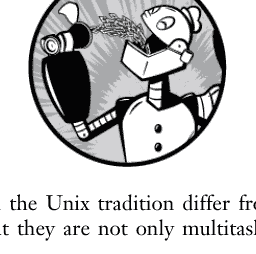

Unix 传统的操作系统与 MS-DOS 传统的操作系统不同，它们不仅是多任务系统，也是多用户系统。

这到底是什么意思？这意味着不止一个人可以同时使用计算机。虽然典型的计算机可能只有一个键盘和显示器，但仍可供多人使用。例如，如果计算机连接到网络或互联网，远程用户可以通过 `ssh`（安全 shell）登录并操作计算机。事实上，远程用户可以执行图形应用程序，并将图形输出显示在远程显示器上。`X Window System` 将此作为其基本设计的一部分支持。

Linux 的多用户功能并不是最近的“创新”，而是深深嵌入到操作系统设计中的功能。考虑到 Unix 创建的环境，这完全合乎逻辑。几年前，在计算机还是“个人”之前，它们是大型、昂贵且集中的。典型的大学计算机系统，例如，由一栋建筑中的大型中央计算机和校园各处连接到该大型中央计算机的终端组成。计算机可以同时支持许多用户。

为了让这变得实用，必须设计一种方法来保护用户免受彼此的干扰。毕竟，一个用户的操作不能被允许导致计算机崩溃，也不能让一个用户干扰另一个用户的文件。

在本章中，我们将研究系统安全的重要组成部分，并介绍以下命令：

- `id` Display user identity
- `chmod` Change a file's mode
- `umask` Set the default file permissions
- `su` Run a shell as another user
- `sudo` Execute a command as another user
- `chown` Change a file's owner
- `chgrp` Change a file's group ownership
- `passwd` Change a user's password

### Owners, Group Members, and Everybody Else

当我们在第 3 章探索系统时，在尝试查看诸如 `/etc/shadow` 这样的文件时，我们可能会遇到问题。

```
[me@linuxbox ~]$ file /etc/shadow
/etc/shadow: regular file, no read permission
[me@linuxbox ~]$ less /etc/shadow
/etc/shadow: Permission denied
```

出现此错误消息的原因是，作为普通用户，我们没有权限读取此文件。

在 Unix 安全模型中，用户可以拥有文件和目录。当用户拥有文件或目录时，用户可以控制其访问权限。用户反过来可以属于一个由一个或多个用户组成的小组，这些用户由其所有者授予对文件和目录的访问权限。除了向组授予访问权限外，所有者还可以向每个人授予一组访问权限，在 Unix 术语中，这被称为

the world. To find out information about your identity, use the `id` command.

```
[me@linuxbox ~]$ id
uid=500(me) gid=500(me) groups=500(me)
```

让我们看一下输出。当用户账户创建时，用户会被分配一个称为用户 ID 的数字，`uid`，然后为了方便人类使用，将其映射到用户名。用户会被分配一个组 ID，`gid`，并且可能属于其他组。前面示例来自 Fedora 系统。在其他系统上，例如 Ubuntu，输出可能看起来略有不同。

```
[me@linuxbox ~]$ id
uid=1000(me) gid=1000(me)
groups=4(admin),20(dialout),24(cdrom),25(floppy),
29(audio),30(dip),44(video),46(plugdev),108(lpadmin),114(admin),1000(me)
```

正如我们所见，Ubuntu 中的 `uid` 和 `gid` 数字不同。这只是因为 Fedora 从 500 开始为普通用户账户编号，而 Ubuntu 从 1,000 开始开始。我们还可以看到 Ubuntu 用户属于很多组。这与 Ubuntu 管理系统设备和服务的权限方式有关。

那么，这些信息来自哪里？与 Linux 中的许多事物一样，它来自几个文本文件。用户账户在 `/etc/passwd` 文件中定义，组在 `/etc/group` 文件中定义。当用户账户和组创建时，这些文件会与 `etc/shadow` 一起修改，后者保存有关用户密码的信息。对于每个用户账户，`/etc/passwd` 文件定义了用户，登录名，`uid`，`gid`，账户的真实姓名，主目录和登录 shell。如果我们检查 `/etc/passwd` 和 `/etc/group` 的内容，我们会注意到除了普通用户账户外，还有超级用户，`uid 0` 的账户以及各种其他系统用户。

在下一章中，当我们介绍进程时，我们将看到其中一些其他“用户”实际上非常忙碌。

虽然许多类 Unix 系统将普通用户分配给 `users` 等公共组，但现代 Linux 做法是创建一个与用户名相同的唯一单成员组。这使得某些类型的权限分配变得更容易。

### Reading, Writing, and Executing

对文件和目录的访问权限以读取访问、写入访问和执行访问来定义。如果我们查看 `ls` 命令的输出，我们可以大致了解其实现方式。

```
[me@linuxbox ~]$ > foo.txt
[me@linuxbox ~]$ ls -l foo.txt
-rw-rw-r-- 1 me 0 2018-03-06 14:52 foo.txt
```

列表的前 10 个字符是 *file attributes*。这些字符中的第一个是 *file type*。表 9-1 描述了你最有可能看到的文件类型，另有其他不太常见类型。

**Table 9-1:** File Types

| Attribute | File type |

|---|---|

| `-` | A regular file. |

| `d` | A directory. |

| `l` | A symbolic link. Notice that with symbolic links, the remaining file attributes are always `rwxrwxrwx` and are dummy values. The real file attributes are those of the file the symbolic link points to. |

| `c` | A *character special file*. This file type refers to a device that handles data as a stream of bytes, such as a terminal or `/dev/null`. |


| `b` | A *block special file*. This file type refers to a device that handles data in blocks, such as a hard drive or DVD drive. |

文件属性的其余九个字符，称为 `file mode`，表示文件所有者、文件组所有者以及其他每个人对文件的读取、写入和执行权限。

| Owner | Group | World |
| --- | --- | --- |
| rwx | rwx | rwx |

表 9-2 记录了 r、w 和 x 模式属性在设置于文件和目录时所产生的影响。

### 表 9-2：权限属性

| Attribute | Files | Directories |
| --- | --- | --- |
| r | 允许打开并读取文件。 | 如果同时设置了执行属性，则允许列出目录的内容。 |
| w | 允许写入文件或截断文件；然而，此属性不允许重命名或删除文件。删除或重命名文件的能力由目录属性决定。 | 如果同时设置了执行属性，则允许在目录内创建、删除和重命名文件。 |
| x | 允许将文件作为程序处理并执行。用脚本语言编写的程序文件还必须设置为可读才能被执行。 | 允许进入目录，例如 `cd directory`。 |

表 9-3 提供了一些文件属性设置的示例。

### 表 9-3：权限属性示例

| File Attributes | Meaning |
| --- | --- |
| `-rwx------` | 一个普通文件，可由文件所有者读取、写入和执行。其他人没有任何访问权限。 |
| `-rw-------` | 一个普通文件，可由文件所有者读取和写入。其他人没有任何访问权限。 |
| `-rw-r--r--` | 一个普通文件，可由文件所有者读取和写入。文件所有者所在组中的成员可以读取文件。文件为世界可读。 |
| `-rwxr-xr-x` | 一个普通文件，可由文件所有者读取、写入和执行。其他人都可以读取和执行该文件。 |
| `-rw-rw----` | 一个普通文件，仅可由文件所有者及其所属组成员读取和写入。 |
| `lrwxrwxrwx` | 一个符号链接。所有符号链接都有“虚拟”权限。真正的权限保存在符号链接指向的实际文件上。 |
| `drwxrwxr-x` | 一个目录。所有者和所有者组中的成员可以进入目录并在目录内创建、重命名和删除文件。 |
| `drwxr-x---` | 一个目录。所有者可以进入目录并在目录内创建、重命名和删除文件。所有者组中的成员可以进入目录但不能创建、删除或重命名文件。 |

## chmod: Change File Mode

要更改文件或目录的模式（权限），请使用 `chmod` 命令。请注意，只有文件的所有者或超级用户才能更改文件或目录的模式。`chmod` 支持两种不同的指定模式更改的方式。

- Octal number representation
- Symbolic representation

我们将首先介绍八进制数字表示法。在八进制表示法中，我们使用八进制数字来设置所需权限的模式。因为每个八进制数字中的一位代表三个二进制位，这与存储文件模式的方案非常契合。表 9-4 显示了我们的意思。

### WHAT THE HECK IS OCTAL?

八进制（基数 8）和它的表亲，十六进制（基数 16），是常用于在计算机上表示数字的数字系统。我们人类，由于我们（或至少我们大多数人）天生有 10 个手指，所以使用基数 10 的数字系统计数。另一方面，计算机天生只有一根手指，因此所有计数都使用二进制（基数 2）。它们的数字系统只有两个数字，0 和 1。因此，二进制计数看起来像这样：

0, 1, 10, 11, 100, 101, 110, 111, 1000, 1001, 1010, 1011...

在八进制中，使用零到七的数字计数，如下所示：

0, 1, 2, 3, 4, 5, 6, 7, 10, 11, 12, 13, 14, 15, 16, 17, 20, 21...

十六进制计数使用零到九的数字加上字母 A 到 F。

0, 1, 2, 3, 4, 5, 6, 7, 8, 9, A, B, C, D, E, F, 10, 11, 12, 13...

虽然我们可以看到二进制的意义（因为计算机只有一根手指），但八进制和十六进制有什么用呢？答案与人类便利性有关。很多时候，计算机上的小数据部分以位模式表示。例如，RGB 颜色。在大多数计算机显示器上，每个像素由三个颜色分量组成：8 位红色、8 位绿色和 8 位蓝色。一个漂亮的中蓝色将是一个 24 位数字。

```
01000011011011111001101
```

你怎么能整天读和写那种数字呢？我也不这么认为。这里另一个数字系统就能派上用场。十六进制中的每一位代表二进制中的四位。在八进制中，每一位代表三位二进制。所以，我们的24位中等蓝色可以压缩为六位十六进制数，436FCD。

因为十六进制数中的“数字”与二进制数中的位“对齐”，我们可以看到我们颜色的红色分量是43，绿色是6F，蓝色是CD。

如今，十六进制表示法（通常读作 hex）比八进制更常见，但正如我们很快就会看到的，八进制表达二进制三位的能力将非常有用……

### 表 9-4：二进制和八进制中的文件模式

| Octal | Binary | File mode |
|---|---|---|
| 0 | 000 | --- |
| 1 | 001 | --x |
| 2 | 010 | -w- |
| 3 | 011 | -wx |
| 4 | 100 | r-- |
| 5 | 101 | r-x |
| 6 | 110 | rw- |
| 7 | 111 | rwx |

通过使用三个八进制数字，我们可以为所有者、组所有者和世界设置文件模式。

```
[me@linuxbox ~]$ > foo.txt
[me@linuxbox ~]$ ls -l foo.txt
-rw-rw-r-- 1 me me 0 2018-03-06 14:52 foo.txt
[me@linuxbox ~]$ chmod 600 foo.txt
[me@linuxbox ~]$ ls -l foo.txt
-rw------ 1 me me 0 2018-03-06 14:52 foo.txt
```

通过传递参数 `600`，我们能够将所有者的权限设置为读和写，同时移除组所有者和世界的全部权限。虽然记住八进制到二进制的映射可能看起来不方便，但你通常只需要使用几种常见的：7（rwx）、6（rw-）、5（r-x）、4（r--）和 0（---）。

`chmod` 还支持使用符号表示法来指定文件模式。符号表示法分为三个部分。

- 将受影响的对象
- 将执行的运算
- 将设置的权限

为了指定受影响的对象，使用字符 `u`、`g`、`o` 和 `a` 的组合，如表 9-5 所示。

### 表 9-5：chmod 符号表示法

| Symbol | Meaning |
|---|---|
| u | 缩写为“user”但表示文件或目录所有者。 |
| g | 组所有者。 |
| o | 缩写为“others”但表示世界。 |
| a | 缩写为“all”。这是 `u`、`g` 和 `o` 的组合。 |

如果未指定字符，则假定为“all”。运算可以是 `+` 表示要添加权限，`-` 表示要移除权限，或 `=` 表示仅应用指定的权限并移除其他所有权限。

权限使用字符 `r`、`w` 和 `x` 指定。表 9-6 提供了符号表示法的一些示例。

### 表 9-6：chmod 符号表示法示例

| Notation | Meaning |
|---|---|
| u+x | 为所有者添加执行权限。 |
| u-x | 从所有者移除执行权限。 |
| +x | 为所有者、组和世界添加执行权限。这等同于 `a+x`。 |
| o-rw | 从除所有者和组所有者之外的任何人移除读和写权限。 |
| go=rw | 将组所有者和除所有者之外的任何人设置为具有读和写权限。如果组所有者或世界之前具有执行权限，则会被移除。 |
| u+x,go=rx | 为所有者添加执行权限并将组和其他人的权限设置为读和执行。多个指定项可以用逗号分隔。 |

有些人更喜欢使用八进制表示法，有些人真的很喜欢符号表示法。符号表示法的优点在于允许你在不干扰其他设置的情况下设置单个属性。

查看 `chmod` 手册页以获取更多详细信息和选项列表。关于 `--recursive` 选项的一个警告：它同时作用于文件和目录，因此并不像我们希望的那样有用，因为我们很少希望文件和目录具有相同的权限。

## 使用 GUI 设置文件模式

现在我们已经了解了如何设置文件和目录的权限，我们可以更好地理解 GUI 中的权限对话框。在 Files（GNOME）和 Dolphin（KDE）中，右键单击文件或目录图标会显示属性对话框。图 9-1 提供了 GNOME 的一个示例。在这里我们可以看到所有者、组和世界的设置。

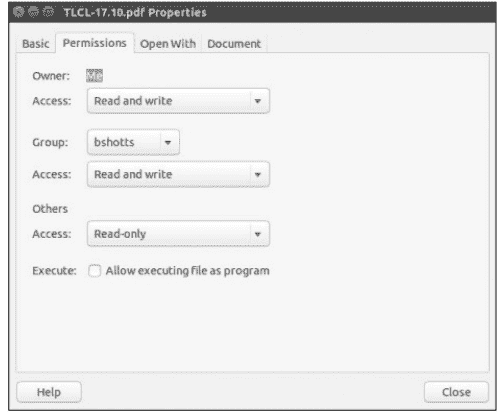

图 9-1：GNOME 文件权限对话框

## umask：设置默认权限


`umask` 命令控制创建文件时赋予文件的默认权限。它使用八进制表示法来表示从文件模式属性中移除的掩码比特位。让我们来看一下。

```
[me@linuxbox ~]$ rm -f foo.txt
[me@linuxbox ~]$ umask
0002
[me@linuxbox ~]$ > foo.txt
[me@linuxbox ~]$ ls -l foo.txt
-rw-rw-r-- 1 me me 0 2018-03-06 14:53 foo.txt
```

首先，我们删除了 `foo.txt` 的旧副本，确保从全新状态开始。接着，我们不带参数地运行了 `umask` 命令，以查看当前值。它返回值 `0002`（`0022` 是另一个常见的默认值），这是我们掩码的八进制表示。接下来，我们创建了一个新的 `foo.txt` 文件实例，并观察它的权限。

可以看到，所有者和组都拥有读写权限，而其他用户只有读权限。其他人没有写权限的原因就在于掩码的值。让我们重复这个示例，这次自己设置掩码。

```
[me@linuxbox ~]$ rm foo.txt
[me@linuxbox ~]$ umask 0000
[me@linuxbox ~]$ > foo.txt
[me@linuxbox ~]$ ls -l foo.txt
-rw-rw-rw- 1 me me 0 2018-03-06 14:58 foo.txt
```

当我们将掩码设置为 `0000`（实际上关闭了掩码），可以看到文件现在对所有人都是可写的。要理解其原理，我们需要再看一下八进制数字。如果我们把掩码展开为二进制，然后与属性进行比较，就能看到发生了什么。

| 原始文件模式 | --- rw- rw- rw- |

| 掩码 | 000 000 000 010 |

| 结果 | --- rw- rw- r-- |

暂时忽略前导零（稍后我们会讨论），注意掩码中出现 `1` 的位置，对应属性被移除——本例中移除了其他人的写权限。这就是掩码的作用。掩码二进制值中每个出现 `1` 的位置，对应的属性都会被取消设置。如果我们查看掩码值 `0022`，可以看到它的效果。

| 原始文件模式 | --- rw- rw- rw- |

| 掩码 | 000 000 010 010 |

| 结果 | --- rw- r-- r-- |

同样，二进制值中出现 `1` 的位置，对应属性会被取消设置。可以尝试一些值（试试几个 `7`）来熟悉它的工作方式。完成后，记得清理。

```
[me@linuxbox ~]$ rm foo.txt; umask 0002
```

大多数情况下，我们不需要更改掩码；你的发行版提供的默认值就足够了。然而，在一些高安全性场合，我们会希望对其进行控制。

### 一些特殊权限

虽然我们通常看到八进制权限掩码表示为三位数，但从技术上讲，用四位数表示更为正确。为什么呢？因为除了读、写和执行权限之外，还有一些其他较少使用的权限设置。

第一个是 `setuid` 位（八进制 `4000`）。当应用于可执行文件时，它会把有效用户 ID 从真实用户（实际运行程序的用户）更改为程序所有者的 ID。最常见的用途是赋予少数由超级用户拥有的程序。当普通用户运行一个 `setuid root` 的程序时，该程序以超级用户的有效权限运行。这允许程序访问普通用户通常被禁止访问的文件和目录。显然，由于这会引发安全问题，`setuid` 程序的数量必须保持在绝对最低限度。

第二个较少使用的设置是 `setgid` 位（八进制 `2000`）。它与 `setuid` 位类似，将有效组 ID 从真实用户的真实组 ID 更改为文件所有者的组 ID。如果 `setgid` 位设置在目录上，那么该目录中新建的文件将拥有该目录的组归属，而不是文件创建者的组归属。这在共享目录中很有用，当共同组的成员需要访问目录中的所有文件时，无论文件所有者的主组是什么，都能访问。

第三个是粘滞位 `sticky bit`（八进制 `1000`）。这是早期 Unix 的遗留物，当时可以将可执行文件标记为“不可交换”。在文件上，Linux 会忽略粘滞位，但如果应用于目录，它可以防止用户删除或重命名文件，除非用户是目录的所有者、文件的所有者，或者是

`superuser`。 这通常用于控制对共享目录的访问，例如 `/tmp`。

以下是使用 `chmod` 的符号表示法设置这些特殊权限的一些示例。首先，这里有一个为程序分配 `setuid` 的示例：

```
chmod u+s program
```

接下来，这里有一个为目录分配 `setgid` 的示例：

```
chmod g+s dir
```

最后，这里有一个为目录分配粘滞位 的示例：

```
chmod +t dir
```

在查看 `ls` 的输出时，可以确定特殊权限。以下是一些示例。首先，一个被设置为 `setuid` 的程序的示例：

```
-rwsr-xr-x
```

下面是一个具有 `setgid` 属性的目录的示例：

```
drwxrwsr-x
```

下面是一个设置了粘滞位的目录的示例：

```
drwxrwxrwt
```

### 更改身份

在某些时候，我们可能需要假冒另一个用户的身份。通常，我们希望获得 `superuser` 权限来执行某些管理任务，但也可以“成为”另一个普通用户，例如测试一个账户。有三种方法可以采用替代身份。

- 1. 注销并以替代用户身份重新登录。
- 2. 使用 `su` 命令。
- 3. 使用 `sudo` 命令。

我们将跳过第一种技术，因为我们知道如何操作，而且它缺乏其他两种的便利性。在我们自己的 shell 会话中，`su` 命令允许你假设另一个用户的身份，并以该用户的 ID 启动一个新的 shell 会话或以该用户身份发出单个命令。`sudo` 命令允许管理员设置一个名为 `/etc/sudoers` 的配置文件，并定义特定用户被允许在假定身份下执行的特定命令。选择使用哪个命令在很大程度上取决于你使用的 Linux 发行版。你的发行版可能包含这两个命令，但其配置会偏向其中一个。我们从 `su` 开始。

#### su: Run a Shell with Substitute User and Group IDs

`su` 命令用于以另一个用户身份启动 shell。命令语法如下所示：

```
su [-l] [user]
```

如果包含 `-l` 选项，则 resulting shell 会话是指定用户的登录 shell。这意味着用户的环境会被加载，并且工作目录会更改为用户的主目录。这通常是我们想要的。如果未指定用户，则假定为 `superuser`。请注意，`-l`（奇怪的是）可以缩写为 `-`，这也是最常用的用法。要为 `superuser` 启动 shell，我们会这样做：

```
[me@linuxbox ~]$ su -
Password:
[root@linuxbox ~]#
```

输入命令后，会提示输入 `superuser` 的密码。如果成功输入，将出现一个新的 shell 提示符，表示该 shell 具有 `superuser` 权限（末尾为 `#` 而不是 `$`），并且当前工作目录现在是 `superuser` 的主目录（通常为 `/root`）。进入新 shell 后，我们可以以 `superuser` 身份执行命令。完成后，输入 `exit` 返回到之前的 shell。

```
[root@linuxbox ~]# exit
[me@linuxbox ~]$
```

也可以通过以下方式使用 `su` 执行单个命令而不是启动新的交互式命令。

```
su -c 'command'
```

使用这种形式，单个命令行会被传递给新 shell 执行。重要的是将命令用引号括起来，因为我们不希望在我们的 shell 中进行展开，而是在新 shell 中进行展开。

```
[me@linuxbox ~]$ su -c 'ls -l /root/*'
Password:
-rw------ 1 root root 754 2007-08-11 03:19 /root/anaconda-ks.cfg

/root/Mail:
total 0
[me@linuxbox ~]$
```

#### sudo: Execute a Command As Another User

`sudo` 命令在许多方面与 `su` 类似，但具有一些重要的额外功能。管理员可以配置 `sudo` 以允许普通用户以受控的方式以不同用户（通常是 `superuser`）身份执行命令。特别是，用户可能仅限于一个或多个特定命令，而不能执行其他命令。另一个重要区别是，使用 `sudo` 不需要访问 `superuser` 的密码。使用 `sudo` 进行身份验证需要用户自己的密码。假设，例如，`sudo` 已被配置为允许我们运行一个名为 `backup_script` 的虚构备份程序，该程序需要 `superuser` 权限。使用 `sudo` 将这样操作：

```
[me@linuxbox ~]$ sudo backup_script
Password:
System Backup Starting...
```


输入命令后，我们会被提示输入密码（不是超级用户的密码），一旦身份验证完成，指定的命令就会被执行。`su` 和 `sudo` 之间一个重要的区别是 `sudo` 不会启动一个新的 shell，也不会加载另一个用户的环境。这意味着命令不需要像不使用 `sudo` 时那样以不同的方式引用。注意，这种行为可以通过指定各种选项来覆盖。还要注意，`sudo` 可以通过指定 `-i` 选项来启动一个交互式的超级用户会话（类似于 `su -`）。详情请参阅 `sudo` 手册页。

要查看 `sudo` 授予了哪些权限，请使用 `-l` 选项列出它们。

```
[me@linuxbox ~]$ sudo -l
User me may run the following commands on this host:
(ALL) ALL
```

### UBUNTU AND SUDO

普通用户反复遇到的问题是如何执行需要超级用户权限的某些任务。这些任务包括安装和更新软件、编辑系统配置文件以及访问设备。在 Windows 世界中，这通常是通过给用户授予管理员权限来完成的。这允许用户执行这些任务。然而，它也使由用户执行的程序具有相同的能力。在大多数情况下这是可取的，但它也允许恶意软件（恶意软件）如病毒自由控制计算机。

在 Unix 世界中，普通用户和管理员之间一直存在更大的分工，这源于 Unix 的多用户传统。Unix 采用的方法是仅在需要时授予超级用户权限。为此，通常使用 `su` 和 `sudo` 命令。

直到几年前，大多数 Linux 发行版都依赖 `su` 来实现此目的。`su` 不需要 `sudo` 所需的配置，并且在 Unix 中拥有 root 账户是传统做法。这带来了一个问题。用户会被诱惑不必要地以 root 身份操作。事实上，一些用户完全以 root 用户身份操作其系统，因为这样就消除了所有那些烦人的“权限被拒绝”消息。这就是将 Linux 系统的安全性降低到 Windows 系统安全性的方式。不是一个好主意。

当 Ubuntu 推出时，其创建者采取了不同的方法。默认情况下，Ubuntu 禁用 root 账户的登录（通过不为该账户设置密码）并改用 `sudo` 来授予超级用户权限。初始用户账户通过 `sudo` 被授予完全的超级用户权限，并且可以向后续用户账户授予类似的权限。

### `chown`: Change File Owner and Group

`chown` 命令用于更改文件或目录的所有者和组所有者。使用此命令需要超级用户权限。`chown` 的语法如下：

```
chown [owner][: [group]] file...
```

`chown` 可以根据命令的第一个参数更改文件所有者和/或文件组所有者。表 9-7 提供了一些示例。

Table 9-7: `chown` Argument Examples

| Argument | Results |
|---|---|
| bob | Changes the ownership of the file from its current owner to user bob. |
| bob:users | Changes the ownership of the file from its current owner to user bob and changes the file group owner to group users. |
| :admins | Changes the group owner to the group admins. The file owner is unchanged. |
| bob: | Changes the file owner from the current owner to user bob and changes the group owner to the login group of user bob. |

假设我们有两个用户：janet，她拥有超级用户权限；tony，他没有。用户 janet 想从她的 home 目录复制一个文件到 tony 的 home 目录。因为 janet 希望 tony 能够编辑该文件，所以 janet 将复制文件的拥有者从 janet 改为 tony。

```
[janet@linuxbox ~]$ sudo cp myfile.txt ~tony
Password:
[janet@linuxbox ~]$ sudo ls -l ~tony/myfile.txt
-rw-r--r-- 1 root root 2018-03-20 14:30 /home/tony/myfile.txt
[janet@linuxbox ~]$ sudo chown tony: ~tony/myfile.txt
[janet@linuxbox ~]$ sudo ls -l ~tony/myfile.txt
-rw-r--r-- 1 tony tony 2018-03-20 14:30 /home/tony/myfile.txt
```

这里我们看到用户 janet 将文件从她的目录复制到用户 tony 的 home 目录。接下来，janet 将文件的拥有者从 root（使用 `sudo` 的结果）更改为 tony。使用第一个参数中的尾随冒号，janet 还将文件的组拥有者更改为 tony 的登录组，正好是组 tony。

注意，在第一次使用 `sudo` 之后，janet 没有被提示输入密码。这是因为在大多数配置中，`sudo` 会在计时器耗尽之前“信任”你数分钟。

### `chgrp`: Change Group Ownership

在旧版本的 Unix 中，`chown` 命令只更改文件拥有者，不更改组拥有者。为此，使用了单独的命令 `chgrp`。它的工作方式与 `chown` 非常相似，只是更受限制。

### 行使我们的特权

既然我们已经了解了权限机制的工作原理，是时候展示一下它的实际应用了。我们将演示一个常见问题的解决方案——设置共享目录。假设我们有两个用户，bill 和 karen。他们都有音乐收藏，并希望设置一个共享目录，将各自的音乐文件以 Ogg Vorbis 或 MP3 格式存放其中。用户 bill 可以通过 `sudo` 获得超级用户权限。

首先需要做的是创建一个组，该组将同时包含 bill 和 karen 作为成员。使用图形化用户管理工具，bill 创建了一个名为 music 的组，并将用户 bill 和 karen 添加进去，如图 9-2 所示。

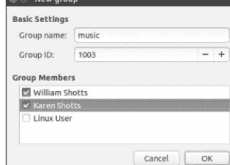

图 9-2. 创建一个新组

接下来，bill 为音乐文件创建目录。

```
[bill@linuxbox ~]$ sudo mkdir /usr/local/share/Music
Password:
```

由于 bill 是在其主目录之外操作文件，因此需要超级用户权限。目录创建后，其所有者和权限如下：

```
[bill@linuxbox ~]$ ls -ld /usr/local/share/Music
drwxr-xr-x 2 root root 4096 2018-03-21 18:05 /usr/local/share/Music
```

正如我们所见，该目录的所有者是 root，权限模式为 755。为了使这个目录可共享，bill 需要更改组所有者和组权限，以允许写入。

```
[bill@linuxbox ~]$ sudo chown :music /usr/local/share/Music
[bill@linuxbox ~]$ sudo chmod 775 /usr/local/share/Music
[bill@linuxbox ~]$ ls -ld /usr/local/share/Music
drwxrwxr-x 2 root music 4096 2018-03-21 18:05 /usr/local/share/Music
```

这意味着什么呢？这意味着我们现在有一个目录 `/usr/local/share/Music`，它的所有者是 root，并允许 music 组进行读写访问。music 组的成员包括 bill 和 karen；因此，bill 和 karen 可以在目录 `/usr/local/share/Music` 中创建文件。其他用户可以列出该目录的内容，但不能在其中创建文件。

但我们仍然有一个问题。使用当前的权限，在 `Music` 目录中创建的文件和目录将具有用户 bill 和 karen 的普通权限。

```
[bill@linuxbox ~]$ > /usr/local/share/Music/test_file
[bill@linuxbox ~]$ ls -l /usr/local/share/Music
-rw-r--r-- 1 bill bill 0 2018-03-24 20:03 test_file
```


实际上有两个问题。首先，系统的默认 `umask` 是 `0022`，这阻止了组成员写入属于其他组成员文件的操作。如果共享目录只包含文件，这可能不是问题，但由于该目录将存储音乐，而音乐通常按艺术家和专辑的层级结构组织，因此组成员需要能够在其他成员创建的目录内创建文件和目录。我们需要将 `bill` 和 `karen` 使用的 `umask` 改为 `0002`。

其次，每个成员创建的文件和目录将被设置为该用户的主组，而不是 `music` 组。这可以通过在目录上设置 `setgid` 位来修复。

```
[bill@linuxbox ~]$ sudo chmod g+s /usr/local/share/Music
[bill@linuxbox ~]$ ls -ld /usr/local/share/Music
drwxrwsr-x 2 root music 4096 2018-03-24 20:03 /usr/local/share/Music
```

现在我们来测试新的权限是否解决了问题。`bill` 将他的 `umask` 设置为 `0002`，删除之前的测试文件，并创建一个新的测试文件和目录。

```
[bill@linuxbox ~]$ umask 0002
[bill@linuxbox ~]$ rm /usr/local/share/Music/test_file
[bill@linuxbox ~]$ > /usr/local/share/Music/test_file
[bill@linuxbox ~]$ mkdir /usr/local/share/Music/test_dir
[bill@linuxbox ~]$ ls -l /usr/local/share/Music
drwxrwxr-x 2 bill music 4096 2018-03-24 20:24 test_dir
-rw-rw-r-- 1 bill music 0 2018-03-24 20:22 test_file
[bill@linuxbox ~]$
```

现在，文件和目录都以正确的权限创建，允许 `music` 组的所有成员在 `Music` 目录内创建文件和目录。

剩下的一个问题就是 `umask`。所需的设置只持续到会话结束，必须重新设置。我们将在第 11 章中讨论如何使 `umask` 的更改永久生效。

### 更改您的密码

本章我们要讨论的最后一个主题是为自己设置密码（如果您有超级用户权限，也可以为其他用户设置）。要设置或更改密码，请使用 `passwd` 命令。命令语法如下：

```
passwd [user]
```

要更改您的密码，只需输入 `passwd` 命令。系统会提示您输入旧密码和新密码。

```
[me@linuxbox ~]$ passwd
(current) UNIX password:
New UNIX password:
```

`passwd` 命令会尝试强制使用“强”密码。这意味着它会拒绝接受太短或太

与之前的密码类似，是字典词，或太容易猜到。

```
[me@linuxbox ~]$ passwd
(current) UNIX password:
New UNIX password:
BAD PASSWORD: is too similar to the old one
New UNIX password:
BAD PASSWORD: it is WAY too short
New UNIX password:
BAD PASSWORD: it is based on a dictionary word
```

如果您拥有超级用户权限，可以将用户名作为参数指定给 `passwd` 命令，以为其他用户设置密码。超级用户还有其他选项可用于允许锁定账户、密码过期等。有关详细信息，请参阅 `passwd` 手册页。

### 总结

在本章中，我们看到了类 Unix 系统（如 Linux）如何管理用户权限以允许对文件和目录进行读取、写入和执行访问。该权限系统的基本思想可以追溯到 Unix 的早期时代，并且经受住了时间的考验。但是类 Unix 系统中的原生权限机制缺乏更现代系统的精细粒度。

# 10

## 进程

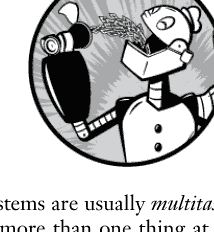

现代操作系统通常是*多任务*的，这意味着它们通过快速在各个正在执行的程序之间切换来制造同时做多件事情的假象。内核通过使用*进程*来管理这一点。进程是 Linux 组织等待 CPU 轮到的不同程序的方式。

有时计算机会变得迟缓或应用程序停止响应。在本章中，我们将查看命令行上可用的一些工具，让我们检查程序正在做什么以及如何终止行为不正常的进程。

本章将介绍以下命令：

- `ps` 报告当前进程的快照
- `top` 显示任务
- `jobs` 列出活动作业
- `bg` 将作业置于后台
- `fg` 将作业置于前台
- `kill` 向进程发送信号
- `killall` 按名称终止进程
- `shutdown` 关闭或重新启动系统

### 进程如何工作

系统启动时，内核以进程的形式启动其自身的几个活动并启动一个名为 `init` 的程序。`init` 又运行一系列位于 `/etc` 的 shell 脚本（称为 `init` 脚本），这些脚本启动所有系统服务。其中许多服务以守护进程程序的形式实现，守护进程程序只是坐在后台做它们的事情而没有任何用户界面。因此，即使我们没有登录，系统也在至少进行一些例行工作。

程序可以启动其他程序这一事实在进程方案中表现为父进程产生子进程。

内核维护有关每个进程的信息以帮助保持组织有序。例如，每个进程都被分配一个称为进程 ID（`PID`）的编号。`PID` 按升序分配，其中 `init` 始终获得 `PID 1`。内核还跟踪分配给每个进程的内存，以及进程恢复执行的就绪情况。与文件一样，进程也有所有者、用户 ID、有效用户 ID 等。

### 查看进程

查看进程的最常用命令（有几个）是 `ps`。`ps` 程序有很多选项，但在最简单的形式下使用如下：

```
[me@linuxbox ~]$ ps
PID TTY          TIME CMD
5198 pts/1    00:00:00 bash
10129 pts/1    00:00:00 ps
```

此示例中的结果列出了两个进程，进程 `5198` 和进程 `10129`，分别是 `bash` 和 `ps`。正如我们所见，默认情况下，`ps` 并没有向我们显示太多内容，只是与当前终端会话关联的进程。要查看更多内容，我们需要添加一些选项；不过，在这样做之前，让我们先看看 `ps` 生成的其他字段。`TTY` 是“电传打字机”的缩写，指进程的控制终端。这里 Unix 显示出它的年代。`TIME` 字段是进程消耗的 CPU 时间。正如我们所见，没有一个进程让计算机工作得很辛苦。

如果我们添加一个选项，我们就可以更全面地了解系统正在做什么。

```
[me@linuxbox ~]$ ps x
PID TTY      STAT   TIME COMMAND
2799 ?        Ss l    0:00 /usr/libexec/bonobo-activation-server -ac
2820 ?        Sl     0:01 /usr/libexec/evolution-data-server-1.10 --
15647 ?       Ss     0:00 /bin/sh /usr/bin/startkde
15751 ?       Ss     0:00 /usr/bin/ssh-agent /usr/bin/dbus-launch --
15754 ?       S      0:00 /usr/bin/dbus-launch --exit-with-session
15755 ?       Ss     0:01 /bin/dbus-daemon --fork --print-pid 4 -pr
15774 ?       Ss     0:02 /usr/bin/gpg-agent -s -daemon
15793 ?       S      0:00 start_kdeinit --new-startup +kcminit_start
15794 ?       Ss     0:00 kdeinit Running...
15797 ?       S      0:00 dcopserver --nosid
-- snip --
```

添加 `x` 选项（注意前面没有破折号）告诉 `ps` 显示我们所有的进程，而不管它们是否受某个终端控制。`TTY` 列中出现 `?` 表示没有控制终端。使用此选项，我们可以看到我们拥有的每个进程。

由于系统运行了大量进程，`ps` 会产生很长的列表。将 `ps` 的输出通过管道传输到 `less` 中以便更轻松地查看通常很有帮助。一些选项组合也会产生很长的输出行，因此最大化终端模拟器窗口可能也是个好主意。

输出中新增了一列名为 `STAT`。`STAT` 是状态的缩写，显示进程的当前状态，如表 10-1 所示。

#### 表 10-1：进程状态

| 状态 | 含义 |
|-------|---------|
| R | 运行中。这意味着进程正在运行或准备运行。 |


| S | 睡眠中。进程未运行；相反，它正在等待事件，例如按键或网络数据包。 |

### 状态含义

| State | Meaning |
|---|---|
| D | 不可中断的睡眠。进程正在等待 I/O，例如磁盘驱动器。 |
| T | 已停止。进程已被指示停止。你将在本章后面学到更多关于此的内容。 |
| Z | 失效或“僵尸”进程。这是已终止但尚未被其父进程清理的子进程。 |
| < | 高优先级进程。可以为进程赋予更高的重要性，让它获得更多 CPU 时间。进程的此属性称为 `nice` 值。 |
| N | 低优先级进程。低优先级进程（`nice` 进程）只有在优先级更高的进程得到服务后才会获得处理器时间。 |

具有高优先级的进程被称为 less nice，因为它占用了更多 CPU 时间，从而给其他进程留下的时间更少。

进程状态后面可能跟随其他字符。这些表示各种奇特的进程特性。有关更多详细信息，请参阅 `ps` 手册页。

另一个流行的选项集是 `aux`（不带前导连字符）。这将为我们提供更多信息。

```
[me@linuxbox ~]$ ps aux
USER       PID %CPU %MEM    VSZ   RSS TTY      STAT START   TIME COMMAND
root         1  0.0  0.0   2136   644 ?        Ss   Mar05   0:31 init
root         2  0.0  0.0      0     0 ?        S<   Mar05   0:00 [kt]
root         3  0.0  0.0      0     0 ?        S<   Mar05   0:00 [mi]
root         4  0.0  0.0      0     0 ?        S<   Mar05   0:00 [ks]
root         5  0.0  0.0      0     0 ?        S<   Mar05   0:06 [wa]
root         6  0.0  0.0      0     0 ?        S<   Mar05   0:36 [ev]
root         7  0.0  0.0      0     0 ?        S<   Mar05   0:00 [kh]
--snip--
```

此选项集显示属于每个用户的进程。使用不带前导连字符的选项会以“BSD 风格”行为调用该命令。Linux 版本的 `ps` 可以模拟在几种不同 Unix 实现中发现的 `ps` 程序的行为。使用这些选项，我们会得到表 10-2 中显示的额外列。

### 表 10-2：BSD 风格 `ps` 列标题

| Header | Meaning |
|---|---|
| USER | 用户 ID。这是进程的所有者。 |
| %CPU | CPU 使用率百分比。 |
| %MEM | 内存使用率百分比。 |
| VSZ | 虚拟内存大小。 |
| RSS | 常驻集大小。这是进程使用的物理内存（RAM）量，以千字节为单位。 |
| START | 进程启动的时间。对于超过 24 小时的值，会使用日期。 |

### 使用 `top` 动态查看进程

虽然 `ps` 命令可以揭示机器正在做什么的很多信息，但它只提供了 `ps` 命令执行时刻机器状态的快照。为了更动态地查看机器的活动，我们使用 `top` 命令。

```
[me@linuxbox ~]$ top
```

`top` 程序以连续更新的方式（默认每三秒）显示系统进程，按进程活动顺序排列。名称 `top` 来源于 `top` 程序用于查看系统上“最顶端”的进程。`top` 显示分为两部分：显示顶部系统的摘要，后跟按 CPU 活动排序的进程表。

```
top - 14:59:20 up 6:30, 2 users, load average: 0.07, 0.02, 0.00
Tasks: 109 total, 1 running, 106 sleeping, 0 stopped, 2 zombie
Cpu(s):  0.7%us,  1.0%sy,  0.0%ni, 98.3%id,  0.0%wa,  0.0%hi,  0.0%si
Mem:    319496k total,   314860k used,   4636k free,   19392k buff
Swap:   875500k total,  149128k used,  726372k free,  114676k cach

    PID USER      PR  NI  VIRT  RES  SHR S %CPU %MEM     TIME+  COMMAND
    6244 me       39  19 31752 3124 2188 S  6.3  1.0 16:24.42 trackerd
    11071 me      20   0 2304 1092  840 R  1.3  0.3  0:00.14 top
    6180 me       20   0 2700 1100  772 S  0.7  0.3  0:03.66 dbus-daemon
    6321 me       20   0 20944 7248 6560 S  0.7  2.3  2:51.38 multiloa
    4955 root     20   0 104m 9668 5776 S  0.3  3.0  2:19.39 Xorg
      1 root     20   0 2976  528  476 S  0.0  0.2  0:03.14 init
      2 root     15  -5    0    0    0 S  0.0  0.0  0:00.00 kthreadd
      3 root     RT  -5    0    0    0 S  0.0  0.0  0:00.00 migration
      4 root     15  -5    0    0    0 S  0.0  0.0  0:00.72 ksoftirq
      5 root     RT  -5    0    0    0 S  0.0  0.0  0:00.04 watchdog
      6 root     15  -5    0    0    0 S  0.0  0.0  0:00.42 events/0
      7 root     15  -5    0    0    0 S  0.0  0.0  0:00.06 khelper
     41 root     15  -5    0    0    0 S  0.0  0.0  0:01.08 kblockd/
     67 root     15  -5    0    0    0 S  0.0  0.0  0:00.00 kseriod
    114 root     20   0    0    0    0 S  0.0  0.0  0:01.62 pdfflush
    116 root     15  -5    0    0    0 S  0.0  0.0  0:02.44 kswapd0
```

系统摘要包含大量有用的信息。表 10-3 提供了说明。

### 表 10-3：`top` 信息字段

| Row Field | Meaning |
|---|---|
| 1 `top` | 这是程序的名称。 |
| 14:59:20 | 这是当前时间。 |
| up 6:30 | 这称为 `uptime`。它是机器自上次启动以来的时间。在此示例中，系统已运行六个半小时。 |
| 2 users | 有两个用户已登录。 |
| load average: | *Load average* 指的是等待运行的进程数；即处于可运行状态并共享 CPU 的进程数。显示三个值，每个值对应不同的时间段。第一个是过去 60 秒的平均值，接下来是之前的 5 分钟，最后是之前的 15 分钟。小于 1.0 的值表示机器不繁忙。 |

| 行字段 | 含义 |
|---|---|
| 2 Tasks: | 这总结了进程的数量及其各种进程状态。 |
| 3 Cpu(s): | 该行描述了 CPU 执行活动的特征。 |
| 0.7%us | 0.7% 的 CPU 用于用户进程。这意味着内核之外的进程。 |
| 1.0%sy | 1.0% 的 CPU 用于系统（内核）进程。 |
| 0.0%ni | 0.0% 的 CPU 被“`nice`”（低优先级）进程使用。 |
| 98.3%id | 98.3% 的 CPU 空闲。 |
| 0.0%wa | 0.0% 的 CPU 在等待 I/O。 |
| 4 Mem: | 这显示了物理 RAM 的使用情况。 |
| 5 Swap: | 这显示了交换空间（虚拟内存）的使用情况。 |

`top` 程序接受多种键盘命令。其中最有趣的两个是 `h`，它显示程序的帮助屏幕，以及 `q`，它退出 `top`。


两个主要桌面环境都提供了显示与 `top` 类似信息的图形应用程序（与 Windows 中的任务管理器工作方式相同），但 `top` 比图形版本更好，因为它更快并且消耗的系统资源要少得多。毕竟，我们的系统监视程序不应该是我们试图追踪的系统变慢的来源。

### 控制进程

现在我们可以看到并监视进程，让我们对它们进行一些控制。对于我们的实验，我们将使用一个名为 `xlogo` 的小程序作为我们的试验品。`xlogo` 程序是 X Window System（使显示器上的图形运行的底层引擎）随附的示例程序，它只是显示一个包含 X 标志的可调整大小的窗口。首先，我们来了解一下我们的测试对象。

```
[me@linuxbox ~]$ xlogo
```

输入命令后，屏幕上某个位置应该会出现一个包含标志的小窗口。在某些系统上，`xlogo` 可能会打印警告信息，但可以安全地忽略。

#### NOTE

> 如果您的系统不包含 `xlogo` 程序，请尝试改用 `gedit` 或 `kwrite`。

我们可以通过调整其窗口大小来验证 `xlogo` 是否正在运行。如果标志以新尺寸重绘，则程序正在运行。

注意我们的 shell 提示符没有返回？这是因为 shell 在等待程序结束，就像我们迄今为止使用的所有其他程序一样。如果我们关闭 `xlogo` 窗口（见图 10-1），提示符就会返回。

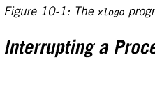

图 10-1：`xlogo` 程序

### 中断一个进程

让我们观察再次运行 `xlogo` 时会发生什么。首先，输入 `xlogo` 命令并验证程序是否正在运行。接下来，返回到终端窗口并按 CTRL-C。

```
[me@linuxbox ~]$ xlogo
[me@linuxbox ~]$
```

在终端中，按 CTRL-C 会中断一个程序。这意味着我们礼貌地要求程序终止。在我们按下 CTRL-C 后，`xlogo` 窗口关闭，shell 提示符返回。

许多（但不是全部）命令行程序都可以通过此技术中断。

### 将进程置于后台

假设我们想在不终止 `xlogo` 程序的情况下取回 shell 提示符。我们可以通过将程序置于后台来实现。把终端想象成有前景（像 shell 提示符一样在表面可见的东西）和背景（像表面后面隐藏的东西）。要启动一个程序使其立即置于后台，我们在命令后跟一个与号（&）字符。

```
[me@linuxbox ~]$ xlogo &
[1] 28236
[me@linuxbox ~]$
```

输入命令后，`xlogo` 窗口出现，shell 提示符返回，但也打印了一些奇怪的数字。这条消息是 shell 功能作业控制的一部分。有了这条消息，shell 正在告诉我们，我们已启动作业编号 1（[1]），它的 PID 为 28236。如果我们运行 `ps`，我们可以看到我们的进程。

```
[me@linuxbox ~]$ ps
PID TTY TIME CMD
10603 pts/1 00:00:00 bash
28236 pts/1 00:00:00 xlogo
28239 pts/1 00:00:00 ps
```

shell 的作业控制功能也为我们提供了一种列出从终端启动的作业的方法。使用 `jobs` 命令，我们可以看到这个列表：

```
[me@linuxbox ~]$ jobs
[1]+ Running          xlogo &
```

结果显示我们有一个作业，编号为 1；它正在运行；并且命令为 `xlogo &`。

### 将进程返回到前台

后台进程不受终端键盘输入的影响，包括尝试使用 CTRL-C 中断它的任何操作。要将进程返回到前台，请按如下方式使用 `fg` 命令：

```
[me@linuxbox ~]$ jobs
[1]+ Running          xlogo &
[me@linuxbox ~]$ fg %1
xlogo
```

`fg` 命令后跟一个百分号和作业编号（称为 `jobspec`）即可实现此操作。如果我们只有一个后台作业，则 `jobspec` 是可选的。要终止 `xlogo`，请按 CTRL-C。

### 停止（暂停）进程

有时我们会想要停止一个进程而不终止它。这通常是为了允许前台进程被移到后台。要停止前台进程并将其置于后台，请按 CTRL-Z。让我们试试。在命令提示符下，输入 `xlogo`，按 ENTER，然后按 CTRL-Z。

```
[me@linuxbox ~]$ xlogo
[1]+ Stopped          xlogo
[me@linuxbox ~]$
```

停止 `xlogo` 后，我们可以通过尝试调整 `xlogo` 窗口的大小来验证程序已停止。我们会看到它看起来相当“死”了。我们可以使用 `fg` 命令在前台继续程序的执行，或使用 `bg` 命令在后台恢复程序的执行。

```
[me@linuxbox ~]$ bg %1
[1]+ xlogo &
[me@linuxbox ~]$
```

与 `fg` 命令一样，如果只有一个作业，`jobspec` 是可选的。

将进程从前台移到后台非常方便，如果我们从命令行启动图形程序但忘记通过附加尾部的 & 将其置于后台。

为什么我们要从命令行启动图形程序呢？有两个原因。

- 你想要运行的程序可能未列在窗口管理器的菜单中（如 `xlogo`）。
- 通过从命令行启动程序，你可能能够看到如果图形方式启动则不可见的错误信息。有时，程序在从图形菜单启动时无法启动。通过改为从命令行启动，我们可能会看到一个错误信息，从而揭示问题所在。此外，一些图形程序具有有趣且有用的命令行选项。

### 信号

`kill` 命令用于“杀死”进程。这使我们能够终止需要被杀死的程序（即某种暂停或终止）。这里有一个例子：

```
[me@linuxbox ~]$ xlogo &
[1] 28401
[me@linuxbox ~]$ kill 28401
[1]+ Terminated xlogo
```

#### Number Name Meaning

| Number | Name | Meaning |
|---|---|---|
| 1 | `HUP` | 挂断。这是旧时代的遗留，当时终端通过电话线和调制解调器连接到远程计算机。该信号用于通知程序控制终端已“挂断”。这种信号的效果可以通过关闭终端会话来演示。终端上运行的前台程序将收到该信号并终止。 |
| 2 | `INT` | 中断。这执行与从终端发送的 CTRL-C 相同的功能。它通常会终止程序。 |
| 9 | `KILL` | 杀死。该信号很特殊。程序可以选择以不同方式处理发送给它们的信号，包括完全忽略它们，而 `KILL` 信号从未真正发送到目标程序。相反，内核会立即终止该进程。以这种方式终止进程时，它没有机会“清理”自身或保存其工作。因此，只有在其他终止信号失败时，`KILL` 信号才应作为最后手段使用。 |
| 15 | `TERM` | 终止。这是 `kill` 命令发送的默认信号。如果程序仍“存活”到足以接收信号，它将终止。 |
| 18 | `CONT` | 继续。这将在 `STOP` 或 `TSTP` 信号后恢复进程。该信号由 `bg` 和 `fg` 命令发送。 |

| 序号 | 名称 | 含义 |
|---|---|---|
| 19 | `STOP` | 停止。此信号会导致进程暂停但不终止。与 `KILL` 信号类似，它不会发送到目标进程，因此无法被忽略。 |
| 20 | `TSTP` | 终端停止。这是终端在按下 CTRL-Z 时发送的信号。与 `STOP` 信号不同，`TSTP` 信号会被程序接收，但程序可以选择忽略它。 |

让我们尝试 `kill` 命令。

```
[me@linuxbox ~]$ xlogo &
[1] 13546
[me@linuxbox ~]$ kill -1 13546
[1]+  Hangup                  xlogo
```

在此示例中，我们在后台启动 `xlogo` 程序，然后使用 `kill` 向其发送 `HUP` 信号。`xlogo` 程序终止，shell 指示后台进程已收到挂断信号。我们可能需要在消息出现前按几次 ENTER。请注意，信号可以通过数字或名称指定，包括以字母 SIG 为前缀的名称。

```
[me@linuxbox ~]$ xlogo &
[1] 13601
[me@linuxbox ~]$ kill -INT 13601
[1]+  Interrupt                xlogo
[me@linuxbox ~]$ xlogo &
[1] 13608
[me@linuxbox ~]$ kill -SIGINT 13608
[1]+  Interrupt                xlogo
```

重复前面的示例并尝试其他信号。请记住，我们也可以使用 `jobspecs` 代替 PIDs。

进程与文件一样有所有者，只有你是进程的所有者（或超级用户）才能使用 `kill` 向其发送信号。

除了迄今为止介绍的、通常与 `kill` 一起使用的信号列表外，系统还经常使用其他信号，如表 10-5 所列。

### 表 10-5：其他常见信号

| 序号 | 名称 | 含义 |
|---|---|---|
| 3 | `QUIT` | 退出。 |


| 11 | SEGV | 段错误。如果程序非法使用内存；即如果它尝试写入不允许写入的位置，则会发送此信号。 |

| 28 | WINCH | 窗口更改。这是系统在窗口大小更改时发送的信号。某些程序，例如 `top` 和 `less`，会响应此信号并重新绘制自身以适应新的窗口尺寸。 |

对于好奇的人，你可以使用以下命令显示完整的信号列表：

```
[me@linuxbox ~]$ kill -l
```

### 使用 `killall` 向多个进程发送信号

还可以使用 `killall` 命令向匹配指定程序或用户名的多个进程发送信号。以下是语法：

```
killall [-u user] [-signal] name...
```

为了演示，我们将启动几个 `xlogo` 程序实例然后终止它们。

```
[me@linuxbox ~]$ xlogo &
[1] 18801
[me@linuxbox ~]$ xlogo &
[2] 18802
[me@linuxbox ~]$ killall xlogo
```

```
[1]- Terminated          xlogo
[2]+ Terminated          xlogo
```

请记住，与 `kill` 一样，你必须具有超级用户权限才能向不属于你的进程发送信号。

### 关闭系统

关闭系统的过程涉及有序终止系统上的所有进程，以及在系统断电前执行一些重要的维护工作（例如同步所有已挂载的文件系统）。有四个命令可以执行此功能：

- `halt`
- `poweroff`
- `reboot`
- `shutdown`

前三个命令解释起来很简单，通常不带任何命令行选项使用。以下是一个示例：

```
[me@linuxbox ~]$ sudo reboot
```

`shutdown` 命令更有趣一些。通过它，我们可以指定要执行的操作（`halt`、关机或重启）并为关机事件提供时间延迟。最常用的是这样来停止系统：

```
[me@linuxbox ~]$ sudo shutdown -h now
```

或这样来重启系统：

```
[me@linuxbox ~]$ sudo shutdown -r now
```

延迟可以用多种方式指定。有关详细信息，请参阅 `shutdown` 手册页。一旦执行 `shutdown` 命令，就会向所有已登录用户“广播”一条消息，警告他们即将发生的事件。

### 更多与进程相关的命令

由于监控进程是重要的系统管理任务，因此有许多相关命令。表 10-6 列出了一些可供尝试的命令。

表 10-6：其他进程相关命令

| 命令 | 描述 |
|---|---|
| `pstree` | 以树状模式输出进程列表，显示进程之间的父子关系。 |
| `vmstat` | 输出系统资源使用情况的快照，包括内存、交换和磁盘 I/O。要查看连续显示，请在命令后跟上更新的时间延迟（以秒为单位）。以下是一个示例：`vmstat 5`。使用 `CTRL-C` 终止输出。 |
| `xload` | 一个图形程序，绘制显示系统负载随时间变化的图表。 |
| `tload` | 与 `xload` 程序类似，但在终端中绘制图表。使用 `CTRL-C` 终止输出。 |

### 小结

大多数现代系统都具有管理多个进程的机制。Linux 为此目的提供了丰富的工具集。鉴于 Linux 是全球部署最广泛的服务器操作系统，这很有意义。然而，与其他一些系统不同，Linux 主要依赖命令行工具进行进程管理。虽然 Linux 也有图形化进程工具，但命令行工具因其速度快和占用资源少而更受青睐。虽然 GUI 工具看起来很漂亮，但它们本身往往会产生大量系统负载，这在某种程度上违背了初衷。

# 第二部分

配置与环境

# 11

### 环境


正如我们之前讨论过的，shell 在会话期间会维护一组信息，称为 *环境*。程序利用环境中存储的数据来确定系统配置的相关信息。虽然大多数程序使用 *配置文件* 来存储程序设置，但有些程序也会查找环境中存储的值来调整自身行为。了解这一点后，我们就可以利用环境来定制我们的 shell 体验。

在本章中，我们将使用以下命令：

- `printenv` 打印部分或全部环境
- `set` 设置 shell 选项
- `export` 将环境导出给后续执行的程序
- `alias` 为命令创建别名

#### 环境中存储了什么？

shell 在环境中存储两种基本类型的数据；不过，对于 `bash` 来说，这两种类型在很大程度上难以区分。它们分别是 *环境变量* 和 *shell 变量*。shell 变量是由 `bash` 放入其中的数据位，而环境变量则是其他所有内容。除了变量之外，shell 还存储一些程序性数据，即 *别名* 和 shell 函数。我们在第 5 章中介绍了别名，并将在本书的第四部分中介绍 shell 函数（与 shell 脚本相关）。

#### 检查环境

要查看环境中存储的内容，我们可以使用 `bash` 的内置命令 `set` 或 `printenv` 程序。`set` 命令会同时显示 shell 变量和环境变量，而 `printenv` 只显示后者。由于环境内容的列表会相当长，最好将任一命令的输出通过管道传递给 `less`。

```
[me@linuxbox ~]$ printenv | less
```

这样做后，我们应该会看到类似这样的内容：

```
USER=me
PAGER=less
LSCOLORS=Gxfxcxdxbxegedabagacad
XDG_CONFIG_DIRS=/etc/xdg/xdg-ubuntu:/usr/share/upstart/xdg:/etc/xdg
PATH=/home/me/bin:/usr/local/sbin:/usr/local/bin:/usr/sbin:/usr/bin:/sbin:/bin:/usr/games:/usr/local/games
DESKTOP_SESSION=ubuntu
QT_IM_MODULE=ibus
QT_QPA_PLATFORMTHEME=appmenu-qt5
JOB=dbus
PWD=/home/me
XMODIFIERS=@im=ibus
GNOME_KEYRING_PID=1850
LANG=en_US.UTF-8
GDM_LANG=en_US
MANDATORY_PATH=/usr/share/gconf/ubuntu.mandatory.path
MASTER_HOST=linuxbox
IM_CONFIG_PHASE=1
COMPIZ_CONFIG_PROFILE=ubuntu
GDMSESSION=ubuntu
SESSIONTYPE=gnome-session
XDG_SEAT=seat0
HOME=/home/me
SHLVL=2
LANGUAGE=en_US
GNOME_DESKTOP_SESSION_ID=this-is-deprecated
LESS=-R
LOGNAME=me
COMPIZ_BIN_PATH=/usr/bin/
```

```
LC_CTYPE=en_US.UTF-8
XDG_DATA_DIRS=/usr/share/ubuntu:/usr/share/gnome:/usr/local/share/:/usr/share/
QT4_IM_MODULE=xim
DBUS_SESSION_BUS_ADDRESS=unix:abstract=/tmp/dbus-IwaesmWaT0
LESSOPEN=| /usr/bin/lesspipe %s
INSTANCE=
```

我们看到的是环境变量及其值的列表。例如，我们看到一个名为 `USER` 的变量，其值为 `me`。`printenv` 命令还可以列出特定变量的值。

```
[me@linuxbox ~]$ printenv USER
me
```

`set` 命令在没有选项或参数的情况下使用时，会显示 shell 变量和环境变量，以及任何已定义的 shell 函数。与 `printenv` 不同，它的输出会按字母顺序整齐地排序。

```
[me@linuxbox ~]$ set | less
```

也可以使用 `echo` 命令查看变量的内容，如下所示：

```
[me@linuxbox ~]$ echo $HOME
/home/me
```

环境中有一种元素既不会由 `set` 也不会由 `printenv` 显示，那就是别名。要查看它们，请在不带参数的情况下输入 `alias` 命令。

```
[me@linuxbox ~]$ alias
alias l.='ls -d .* --color=tty'
alias ll='ls -l --color=tty'
alias ls='ls --color=tty'
alias vi='vim'
alias which='alias | /usr/bin/which --tty-only --read-alias --show-dot --show-tilde'
```

#### 一些有趣的变量

环境中包含相当多的变量，虽然你的环境可能与这里展示的不同，但我们很可能会在自己的环境中看到表 11-1 中列出的变量。


**表 11-1：环境变量**

| 变量 | 内容 |
| --- | --- |
| `DISPLAY` | 如果你正在运行图形环境，这是你的显示器名称。通常为 `:0`，表示 X 服务器生成的第一个显示。 |
| `EDITOR` | 用于文本编辑的程序名称。 |
| `SHELL` | 你的 shell 程序的名称。 |
| `HOME` | 你的主目录的路径名。 |
| `LANG` | 定义你的语言的字符集和排序顺序。 |
| `OLDPWD` | 上一个工作目录。 |
| `PAGER` | 用于分页输出的程序名称。通常设置为 `/usr/bin/less`。 |
| `PATH` | 以冒号分隔的目录列表，当你输入可执行程序的名称时会搜索这些目录。 |
| `PS1` | 代表“提示字符串 1”。它定义了 shell 提示符的内容。稍后我们会看到，它可以被广泛定制。 |
| `PWD` | 当前工作目录。 |
| `TERM` | 你的终端类型名称。类 Unix 系统支持多种终端协议；此变量设置要与终端模拟器使用的协议。 |
| `TZ` | 指定你的时区。大多数类 Unix 系统以协调世界时（UTC）维护计算机的内部时钟，然后通过应用此变量指定的偏移量来显示本地时间。 |
| `USER` | 你的用户名。 |

如果其中某些值缺失，不必担心。它们会因发行版而异。

### 环境是如何建立的？

当我们登录系统时，`bash` 程序启动并读取一系列称为启动文件的配置脚本，这些脚本定义了所有用户共享的默认环境。随后，我们主目录中的更多启动文件会定义我们个人的环境。确切顺序取决于所启动的 shell 会话类型。共有两种类型。

- **登录 shell 会话**：这种会话会提示我们输入用户名和密码。例如，当我们启动虚拟控制台会话时就会出现这种情况。

- **非登录 shell 会话**：这种会话通常在我们于 GUI 中启动终端会话时发生。

登录 shell 会读取一个或多个启动文件，如表 11-2 所示。

**表 11-2：登录 shell 会话的启动文件**

| 文件 | 内容 |
| --- | --- |
| `/etc/profile` | 适用于所有用户的全局配置脚本。 |
| `~/.bash_profile` | 用户的个人启动文件。可用于扩展或覆盖全局配置脚本中的设置。 |
| `~/.bash_login` | 如果找不到 `~/.bash_profile`，`bash` 会尝试读取此脚本。 |
| `~/.profile` | 如果既找不到 `~/.bash_profile` 也找不到 `~/.bash_login`，`bash` 会尝试读取此文件。这是基于 Debian 的发行版（如 Ubuntu）中的默认设置。 |

非登录 shell 会话会读取表 11-3 中列出的启动文件。

**表 11-3：非登录 shell 会话的启动文件**

| 文件 | 内容 |
| --- | --- |
| `/etc/bash.bashrc` | 适用于所有用户的全局配置脚本。 |
| `~/.bashrc` | 用户的个人启动文件。可用于扩展或覆盖全局配置脚本中的设置。 |

除了读取表 11-3 中列出的启动文件外，非登录 shell 还会从其父进程（通常是登录 shell）继承环境。

看一看这些启动文件中哪些已安装。请记住——由于列出的大多数文件名都以句点开头（这意味着它们是隐藏文件），我们在使用 `ls` 时需要用到 `-a` 选项。

从普通用户的角度来看，`~/.bashrc` 文件可能是最重要的启动文件，因为它几乎总是会被读取。非登录 shell 默认会读取它，而且大多数登录 shell 的启动文件在编写时也会读取 `~/.bashrc` 文件。

### 启动文件中有什么？

如果我们查看一个典型的 `.bash_profile`（取自 CentOS 6 系统）的内部，它看起来像这样：

```
### .bash_profile

### Get the aliases and functions
if [ -f ~/.bashrc ]; then
    . ~/.bashrc
fi

### User specific environment and startup programs

PATH=$PATH:$HOME/bin
export PATH
```

以 `#` 开头的行是注释，shell 不会读取它们。它们是为了让人阅读方便。第一件有趣的事情出现在第四行，代码如下：

```
if [ -f ~/.bashrc ]; then
  . ~/.bashrc
fi
```

这称为 `if` 复合命令，我们将在第四部分讨论 shell 脚本时全面介绍它，但现在这里有一个解释：

```
如果文件“~/.bashrc”存在，那么
    读取“~/.bashrc”文件。
```

我们可以看到，这段代码就是登录 shell 获取 `.bashrc` 内容的方式。启动文件中的下一项与 `PATH` 变量有关。

有没有想过当我们在命令行中输入命令时，shell 是如何知道在哪里找到命令的？例如，当我们输入 `ls` 时，shell 不会搜索整个计算机来找到 `/bin/ls`（`ls` 命令的完整路径名）；相反，它会搜索 `PATH` 变量中包含的目录列表。

`PATH` 变量通常（但并非总是，具体取决于发行版）由 `/etc/profile` 启动文件通过以下代码设置：

```
PATH=$PATH:$HOME/bin
```

`PATH` 被修改为在列表末尾添加目录 `$HOME/bin`。这是参数展开的一个例子，我们在第 7 章中曾经提到过。为了演示它是如何工作的，请尝试以下操作：

```
[me@linuxbox ~]$ foo="This is some "
[me@linuxbox ~]$ echo $foo
This is some
[me@linuxbox ~]$ foo=$foo"text."
[me@linuxbox ~]$ echo $foo
This is some text.
```

利用这种技术，我们可以将文本追加到变量内容的末尾。

通过将字符串 `$HOME/bin` 添加到 `PATH` 变量内容的末尾，目录 `$HOME/bin` 就被添加到输入命令时搜索的目录列表中。这意味着当我们想要在自己的主目录中创建一个用于存放我们自己的私有程序的目录时，shell 已经准备好为我们提供便利。我们只需要将其命名为 `bin`，就可以使用了。

> NOTE
>
> 许多发行版默认提供此 `PATH` 设置。基于 Debian 的发行版，例如 Ubuntu，在登录时检查 `~/bin` 目录是否存在，如果找到该目录，则会动态将其添加到 `PATH` 变量中。

最后，我们有这个：

```
export PATH
```

`export` 命令告诉 shell 将 `PATH` 的内容提供给该 shell 的子进程。

### Modifying the Environment

由于我们知道启动文件的位置及其内容，因此我们可以修改它们来自定义我们的环境。

#### Which Files Should We Modify?

作为一般规则，要将目录添加到您的 `PATH` 或定义额外的环境变量，请将这些更改放在 `.bash_profile` 中（或根据您的发行版使用等效文件；例如，Ubuntu 使用 `.profile`）。对于其他所有内容，请将更改放在 `.bashrc` 中。

> NOTE
>
> 除非您是系统管理员并且需要更改系统所有用户的默认值，否则请将您的修改限制在主目录中的文件。确实可以更改 `/etc` 中的文件，例如 `profile`，在许多情况下这样做是合理的，但现在，让我们谨慎行事。

#### Text Editors

要编辑（即修改）shell 的启动文件以及系统上大多数其他配置文件，我们使用一种称为文本编辑器的程序。文本编辑器在某些方面类似于文字处理器，因为它允许我们使用移动光标编辑屏幕上的文字。它与文字处理器的不同之处在于它只支持纯文本，并且通常包含为编写程序而设计的特性。文本编辑器是软件开发人员编写代码和系统管理员管理控制系统的配置文件时使用的核心工具。

Linux 有很多不同的文本编辑器可供使用；大多数系统安装了多个。为什么有这么多不同的编辑器？因为程序员喜欢编写它们，并且因为程序员大量使用它们，所以他们编写编辑器来表达他们对编辑器应该如何工作的个人需求。

文本编辑器大致分为两类：图形化和基于文本的。GNOME 和 KDE 都包含一些流行的图形编辑器。GNOME 附带一个名为 `gedit` 的编辑器，在 GNOME 菜单中通常称为“文本编辑器”。KDE 通常附带三个，按复杂度递增的顺序分别是 `kedit`、`kwrite` 和 `kate`。

基于文本的编辑器有很多。我们会遇到的流行编辑器有 `nano`、`vi` 和 `emacs`。`nano` 编辑器是一个简单易用的编辑器，设计为 PINE 邮件套件提供的 `pico` 编辑器的替代品。`vi` 编辑器（在大多数 Linux 系统上已被名为 `vim` 的程序取代，`vim` 是“vi improved”的缩写）是类 Unix 系统的传统编辑器。它将在第 12 章中介绍。`emacs` 编辑器最初由 Richard Stallman 编写。它是一个庞大、通用的、包罗万象的编程环境。虽然很容易获得，但它很少作为大多数 Linux 系统的默认安装。


### Using a Text Editor

文本编辑器可以通过在命令行中输入编辑器的名称，后跟要编辑的文件名来调用。如果文件尚不存在，编辑器会假定我们想要创建一个新文件。下面是使用 `gedit` 的示例：

```
[me@linuxbox ~]$ gedit some_file
```

此命令将启动 `gedit` 文本编辑器并加载名为 `some_file` 的文件（如果存在）。

图形文本编辑器非常直观，因此我们在这里不介绍它们。相反，我们将集中在我们第一个基于文本的文本编辑器 `nano` 上。让我们启动 `nano` 并编辑 `.bashrc` 文件。但在这样做之前，让我们练习一些“安全计算”。每当我们编辑重要的配置文件时，最好先创建该文件的一个备份副本。这可以在我们编辑时损坏文件的情况下保护我们。要创建 `.bashrc` 文件的备份，请执行以下操作：

```
[me@linuxbox ~]$ cp .bashrc .bashrc.bak
```

我们如何命名备份文件并不重要；只需选择一个易于理解的名称。扩展名 `.bak`、`.sav`、`.old` 和 `.orig` 都是表示备份文件的流行方式。哦，并且请记住 `cp` 会静默覆盖现有文件。

现在我们有了备份文件，我们将启动编辑器。

```
[me@linuxbox ~]$ nano .bashrc
```

一旦 `nano` 启动，我们将看到如下屏幕：

```
GNU nano 2.0.3          File: .bashrc

### .bashrc

### Source global definitions
if [ -f /etc/bashrc ]; then
    . /etc/bashrc
fi
```

### 用户特定的别名和函数

[ Read 8 lines ]

G Get Help O WriteOut R Read Fil Y Prev Pag K Cut Text C Cur Pos

X Exit J Justify W Where Is V Next Pag U UnCut Te T To Spell

#### NOTE

> *如果你的系统没有安装 `nano`，你可以使用图形编辑器代替。*

屏幕由顶部的一个标题、中间正在编辑的文件文本以及底部的一个命令菜单组成。因为 `nano` 是为了取代电子邮件客户端提供的文本编辑器而设计的，所以它的编辑功能相当简陋。

在任何文本编辑器中，你应该首先学习的就是如何退出程序。在 `nano` 中，你按下 `CTRL-X` 即可退出。这在屏幕底部的菜单中有所标示。记号 `^X` 表示 `CTRL-X`。这是许多程序中常用的控制字符记号。

我们需要知道的第二个命令是如何保存工作。在 `nano` 中是 `CTRL-O`。有了这个知识，我们就可以开始编辑了。使用向下箭头键和/或 `PAGE DOWN` 键，将光标移动到文件末尾，然后在 `.bashrc` 文件中添加以下行：

```
umask 0002
export HISTCONTROL=ignoredups
export HISTSIZE=1000
alias l='ls -d .* --color=auto'
alias ll='ls -l --color=auto'
```

#### NOTE

> *你的发行版可能已经包含了其中一些，但重复也不会有任何害处。*

表 11-4 详细说明了我们添加内容的含义。

### Table 11-4: Additions to Our .bashrc

| Line | Meaning |
|---|---|
| `umask 0002` | 设置 `umask` 以解决我们在第 9 章中讨论的共享目录问题。 |
| `export HISTCONTROL=ignoredups` | 使 shell 的历史记录功能在同一命令刚被记录时忽略该命令。 |
| `export HISTSIZE=1000` | 将命令历史的大小从通常默认的 500 行增加到 1,000 行。 |
| `alias l.='ls -d .* --color=auto'` | 创建一个名为 `l.` 的新命令，用于显示所有以点开头的目录条目。 |
| `alias ll='ls -l --color=auto'` | 创建一个名为 `ll` 的新命令，用于显示长格式的目录列表。 |

正如我们所见，我们的许多添加内容都不直观，因此最好在 `.bashrc` 文件中添加一些注释来帮助向人类解释。使用编辑器，将我们的添加内容修改为如下所示：

```
### Change umask to make directory sharing easier
umask 0002

### Ignore duplicates in command history and increase
### history size to 1000 lines
export HISTCONTROL=ignoredups
export HISTSIZE=1000

### Add some helpful aliases
alias l.='ls -d .* --color=auto'
alias ll='ls -l --color=auto'
```

啊，好多了！修改完成后，按下 `CTRL-O` 保存修改后的 `.bashrc` 文件，并按下 `CTRL-X` 退出 `nano`。

### WHY COMMENTS ARE IMPORTANT

每当你修改配置文件时，最好添加一些注释来记录你的更改。当然，你明天可能还会记得你改了什么，但六个月后呢？请善待自己，添加一些注释。同时，保持一份你所做的更改日志也不失为一个好主意。

Shell 脚本和 bash 启动文件使用 `#` 符号开始注释。其他配置文件可能使用其他符号。大多数配置文件都会有注释。将它们用作指南。

你经常会在配置文件中看到被注释掉的行，以防止它们被受影响的程序使用。这是为了向读者提供可能的配置选择建议或正确的配置语法示例。例如，Ubuntu 18.04 的 `.bashrc` 文件包含以下行：

```
### some more ls aliases
#alias ll='ls -l'
#alias la='ls -A'
#alias ls='ls -CF'
```

最后三行是已被注释掉的有效别名定义。如果你删除这三行开头的 `#` 符号，一种称为取消注释的技术，你将激活这些别名。相反，如果你在某行开头添加 `#` 符号，你就可以停用该配置行，同时保留其包含的信息。

### Activating Our Changes

我们对 `.bashrc` 所做的更改在我们关闭终端会话并开始新会话之前不会生效，因为 `.bashrc` 文件只在会话开始时读取一次。然而，我们可以通过以下命令强制 bash 重新读取修改后的 `.bashrc` 文件：

```
[me@linuxbox ~]$ source ~/.bashrc
```

这样做之后，我们应该能够看到更改的效果。尝试使用其中一个新别名。

```
[me@linuxbox ~]$ ll
```

### 总结

在本章中，我们学习了一项基本技能：使用文本编辑器编辑配置文件。继续前进时，当我们阅读命令的手册页时，请注意命令支持的环境变量。其中可能有一两个宝藏。在后面的章节中，我们将学习 shell 函数，这是一个强大的功能，你也可以将其包含在 bash 启动文件中，以增加你的自定义命令 arsenal。

# 12 VI 的温和介绍


有一个关于一位游客在纽约市向路人询问如何前往该市著名古典音乐场地的老笑话。

游客：不好意思，请问怎么去卡内基音乐厅？

路人：练习，练习，再练习！

学习 Linux 命令行，就像成为一名技艺精湛的钢琴家一样，并不是一下午就能学会的。它需要多年的练习。在本章中，我们将介绍 `vi`（读作“vee eye”）文本编辑器，这是 Unix 传统中的核心程序之一。`vi` 因其困难的用户界面而臭名昭著，但当我们看到一位大师坐在键盘前开始“演奏”时，我们确实会见证一些伟大的艺术。我们不会在本章中成为大师，但完成后，我们将知道如何在 `vi` 中演奏相当于“练习曲”的东西。

#### 为什么我们应该学习 vi

在图形编辑器和易于使用的基于文本的编辑器如 `nano` 的现代时代，为什么我们应该学习 `vi`？有三个好理由。

- `vi` 几乎总是可用。如果我们有一个没有图形界面的系统，例如远程服务器或 X 配置损坏的本地系统，这可能就是救命稻草。`nano` 虽然越来越流行，但仍然不是通用的。POSIX，即 Unix 系统上程序兼容性的标准，要求必须提供 `vi`。

- `vi` 轻量且快速。对于许多任务，启动 `vi` 比在菜单中找到图形文本编辑器并等待其数兆字节加载要容易。此外，`vi` 是为打字速度而设计的。正如我们将看到的，熟练的 `vi` 用户在编辑时永远不必将手指从键盘上抬起。

- 我们不想让其他 Linux 和 Unix 用户认为我们是懦夫。

好吧，也许有两个好理由。

#### 一点背景


vi 的第一个版本由比尔·乔伊于 1976 年编写，他是加州大学伯克利分校的学生，后来共同创立了 Sun Microsystems。`vi` 得名于“visual”一词，因为它旨在允许在具有移动光标的视频终端上进行编辑。在可视编辑器之前，有行编辑器，它们一次只操作一行文本。要指定更改，我们告诉行编辑器转到特定行并描述要进行的更改，例如添加或删除文本。随着视频终端（而不是打印机式终端如电传打字机）的出现，可视编辑成为可能。`vi` 实际上包含了一个功能强大的行编辑器 `ex`，我们可以在使用 `vi` 时使用行编辑命令。

大多数 Linux 发行版不包含真正的 `vi`；相反，它们提供了一个增强的替代品 `vim`（是“vi improved”的缩写），由 Bram Moolenaar 编写。`vim` 相对于传统的 Unix `vi` 是一个实质性的改进，并且通常在 Linux 系统上符号链接（或别名）到名称 `vi`。在下面的讨论中，我们将假设我们有一个名为 `vi` 的程序，它实际上是 `vim`。

## 启动和停止 vi

要启动 `vi`，我们只需输入以下内容：

```
[me@linuxbox ~]$ vi
```

应出现如下屏幕。

```
~
~
~                VIM - Vi Improved
~                version 8.0.707
~                by Bram Moolenaar et al.
~                Vim is open source and freely distributable
~                Sponsor Vim development!
~                type :help sponsor<Enter>      for information
~                type :q<Enter>                 to exit
~                type :help<Enter> or <F1>      for on-line help
~                type :help version8<Enter>     for version info
~
~                Running in Vi compatible mode
~                type :set nocomp<Enter>        for Vim defaults
~                type :help cp-default<Enter> for info on this
~
~
~
```

## 兼容模式

在示例启动屏幕中，我们看到文字“Running in Vi compatible mode”。这意味着 `vim` 将以更接近 `vi` 的正常行为而不是 `vim` 的增强行为的模式运行。就本章而言，我们希望以增强行为运行 `vim`。为此，你有几个选择。尝试运行 `vim` 而不是 `vi`。如果可行，请考虑在你的 `.bashrc` 文件中添加 `alias vi='vim'`。或者，使用以下命令向你的 `vim` 配置文件添加一行：

```
echo "set nocomp" >> ~/.vimrc
```

不同的 Linux 发行版以不同的方式打包 `vim`。某些发行版默认安装的是 `vim` 的精简版本，仅支持有限的 `vim` 功能。在进行接下来的练习时，你可能会遇到缺少功能的情况。如果是这样，请安装 `vim` 的完整版本。

就像我们之前对 `nano` 所做的那样，首先要学习的是如何退出。要退出，我们输入以下命令（注意冒号字符是命令的一部分）：

```
:q
```

shell 提示符应该返回。如果由于某种原因 `vi` 无法退出（通常是因为我们对尚未保存的文件进行了更改），我们可以通过在命令后加上感叹号来告诉 `vi` 我们是认真的。

```
:q!
```

TIP

如果你在 `vi` 中“迷路”了，试着按两次 `ESC` 键来重新找到方向。

### 编辑模式

让我们再次启动 `vi`，这次向它传递一个不存在的文件名。这就是我们如何使用 `vi` 创建新文件的方法：

```
[me@linuxbox ~]$ rm -f foo.txt
[me@linuxbox ~]$ vi foo.txt
```

如果一切顺利，我们应该会看到如下屏幕：

```
~
~
```

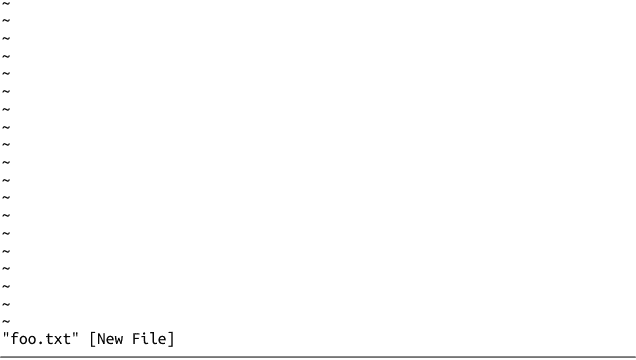

前导的波浪号字符（~）表示该行上不存在文本。这表明我们有一个空文件。暂时不要输入任何内容！

关于 `vi` 最重要的第二件事需要学习（在学会如何退出之后）是 `vi` 是一个*模式编辑器*。当 `vi` 启动时，它开始于*命令模式*。在此模式下，几乎每个键都是一个命令，因此如果我们开始输入，`vi` 基本上会发疯并弄出一大堆混乱。

### 进入插入模式

要向我们的文件添加一些文本，我们必须首先进入*插入模式*。为此，我们按下 `i` 键。之后，如果 `vim` 以其通常的增强模式运行，我们应该在屏幕底部看到以下内容（这在 `vi` 兼容模式下不会出现）：

```
-- INSERT --
```

现在我们可以输入一些文本。试试这个：

```
The quick brown fox jumped over the lazy dog.
```

要退出插入模式并返回到命令模式，请按 `ESC` 键。

### 保存我们的工作

要保存我们刚刚对文件所做的更改，我们必须在命令模式下输入一个 `ex` 命令。这很容易做到，只需按下 `:` 键即可。执行此操作后，冒号字符应该出现在屏幕底部。

```
:
```

要写入我们修改过的文件，我们在冒号后跟上 `w` 然后按 `ENTER`。

```
:w
```

文件将被写入硬盘，我们应该在屏幕底部看到确认消息，如下所示：

```
"foo.txt" [New] 1L, 46C written
```

TIP

如果你阅读 `vi` 文档，你会注意到（令人困惑的是）命令模式被称为普通模式，而 `ex` 命令被称为命令模式。注意这一点。

### 移动光标

在命令模式下，`vi` 提供了大量移动命令，其中一些与 `less` 共享。表 12-1 列出了其中一部分。

Table 12-1: Cursor Movement Keys

| Key | Moves the cursor |
|---|---|
| l or right arrow | Right one character. |
| h or left arrow | Left one character. |
| j or down arrow | Down one line. |
| k or up arrow | Up one line. |
| 0 (zero) | To the beginning of the current line. |
| ^ | To the first non-whitespace character on the current line. |
| $ | To the end of the current line. |
| w | To the beginning of the next word or punctuation character. |
| W | To the beginning of the next word, ignoring punctuation characters. |
| b | To the beginning of the previous word or punctuation character. |
| B | To the beginning of the previous word, ignoring punctuation characters. |
| CTRL-F or PAGE DOWN | Down one page. |
| CTRL-B or PAGE UP | Up one page. |
| numberG | To line number. For example, 1G moves to the first line of the file. |
| G | To the last line of the file. |

为什么使用 `h`、`j`、`k` 和 `l` 键进行光标移动？当 `vi` 最初编写时，并非所有视频终端都有方向键，而熟练的打字员可以使用常规键盘键移动光标，而无需将手指从键盘上抬起。

`vi` 中的许多命令都可以加上数字前缀，就像表 12-1 中列出的 `G` 命令一样。通过在命令前加上数字，我们可以指定命令执行的次数。例如，命令 `5j` 会使 `vi` 将光标向下移动五行。

### 基本编辑

大多数编辑操作都由几个基本操作组成，例如插入文本、删除文本，以及通过剪切和粘贴移动文本。`vi` 当然以其独特的方式支持所有这些操作。`vi` 还提供了一种有限形式的撤销。如果我们在命令模式下按下 `u` 键，`vi` 将撤销你所做的最后一次更改。在我们尝试一些基本编辑命令时，这会很有用。

### 追加文本

`vi` 有几种不同的进入插入模式的方式。我们已经使用过 `i` 命令来插入文本。


让我们回到`foo.txt`文件片刻。

```
The quick brown fox jumped over the lazy dog.
```

如果我们想在这句话末尾添加一些文本，就会发现`i`命令做不到，因为我们无法将光标移动到行尾之外。vi 提供了一个用于追加文本的命令，即合理命名的`a`命令。如果我们将光标移动到行尾并输入`a`，光标将移过行尾，vi 将进入插入模式。这将允许我们添加更多文本。

```
The quick brown fox jumped over the lazy dog. It was cool.
```

记得按下`ESC`键退出插入模式。

由于我们几乎总是希望将文本追加到行尾，vi 提供了一个快捷方式来移动到当前行的末尾并开始追加。它就是`A`命令。让我们试试并在我们的文件中添加更多行。

首先，我们将使用`0`（零）命令将光标移动到行的开头。现在我们输入`A`并添加以下文本行：

```
The quick brown fox jumped over the lazy dog. It was cool.
Line 2
Line 3
```

再次按下`ESC`键退出插入模式。

正如我们所见，`A`命令更有用，因为它在开始插入模式之前会将光标移动到行尾。

### 打开一行

我们插入文本的另一种方式是通过“打开”一行。这会在两行现有行之间插入一个空白行并进入插入模式。这有两个变体，如表 12-2 所描述。

表 12-2：行打开键

| Command | Opens |
|---|---|
| `o` | The line below the current line |
| `O` | The line above the current line |

我们可以按如下方式演示：光标放在第 3 行，然后输入`o`。

```
The quick brown fox jumped over the lazy dog. It was cool.
Line 2
Line 3

Line 4
Line 5
```

在第三行下方打开了一个新行，我们进入了插入模式。通过按下`ESC`键退出插入模式。按下`u`撤销我们的更改。

输入`O`在光标上方打开一行。

```
The quick brown fox jumped over the lazy dog. It was cool.
Line 2

Line 3
```

通过按下`ESC`退出插入模式，并通过输入`u`撤销我们的更改。

### 删除文本

正如我们所期望的，vi 提供了多种删除文本的方式，所有这些方式都包含两个按键之一。首先，`x`命令将删除光标位置处的字符。`x`可以前面加上一个数字，指定要删除的字符数。`d`命令更通用。与`x`类似，它前面也可以加上一个数字，指定删除执行的次数。此外，`d`总是后面跟随一个移动命令，该命令控制删除的大小。表 12-3 提供了一些示例。

表 12-3：文本删除命令

| Command | Deletes |
|---|---|
| `x` | The current character |
| `3x` | The current character and the next two characters |
| `dd` | The current line |
| `5dd` | The current line and the next four lines |
| `dw` | From the current cursor position to the beginning of the next word |
| `d$` | From the current cursor location to the end of the current line |
| `d0` | From the current cursor location to the beginning of the line |
| `d^` | From the current cursor location to the first non-whitespace character in the line |
| `dG` | From the current line to the end of the file |
| `d20G` | From the current line to the twentieth line of the file |

将光标放在我们文本第一行的单词 It 上。反复按下`x`键，直到句子其余部分被删除。接下来，反复按下`u`键，直到删除被撤销。

#### NOTE

* Real vi supports only a single level of undo. vim supports multiple levels.

让我们再次尝试删除，这次使用`d`命令。再次将光标移动到单词 It 并输入`dw`以删除该单词。

```
The quick brown fox jumped over the lazy dog. was cool.
Line 2
Line 3
Line 4
Line 5
```

输入`d$`以从光标位置删除到行尾。

```
The quick brown fox jumped over the lazy dog.
Line 2
Line 3
Line 4
Line 5
```

输入`dG`以从当前行删除到文件末尾。

```
~
~
~
~
```

输入`u`三次以撤销删除。

### 剪切、复制和粘贴文本

`d`命令不仅删除文本，还“剪切”文本。每次使用`d`命令时，删除的内容都会被复制到粘贴缓冲区（想想 clipboard）我们可以稍后使用`p`命令来粘贴缓冲区的内容到光标之前或之后。

`y`命令用于“拉取”（复制）文本，其使用方式与`d`命令用于剪切文本类似。表 12-4 提供了将`y`命令与各种移动命令组合使用的一些示例。

表 12-4：拉取命令

| Command | Copies |
|---|---|
| `yy` | The current line |
| `5yy` | The current line and the next four lines |
| `yw` | From the current cursor position to the beginning of the next word |
| `y$` | From the current cursor location to the end of the current line |
| `y0` | From the current cursor location to the beginning of the line |
| `y^` | From the current cursor location to the first non-whitespace character in the line |
| `yG` | From the current line to the end of the file |
| `y20G` | From the current line to the twentieth line of the file |

让我们试试复制和粘贴。将光标放在文本的第一行并输入`yy`以复制当前行。接下来，将光标移动到最后一行（`G`）并输入`p`以在当前行下方粘贴该行。

```
The quick brown fox jumped over the lazy dog. It was cool.
Line 2
Line 3
Line 4
Line 5
The quick brown fox jumped over the lazy dog. It was cool.
```

就像之前一样，`u`命令会撤销我们的更改。将光标仍定位在文件的最后一行，输入`P`以在当前行上方粘贴文本。

```
The quick brown fox jumped over the lazy dog. It was cool.
Line 2
Line 3
Line 4
The quick brown fox jumped over the lazy dog. It was cool.
Line 5
```

尝试表 12-4 中的其他一些`y`命令，并熟悉`p`和`P`命令的行为。完成后，将文件恢复到原始状态。

### 连接行

vi 对行的概念相当严格。通常，不可能将光标移动到一行的末尾并删除换行符以将一行与下一行连接起来。正因如此，vi 提供了特定的命令`J`（不要与用于光标移动的`j`混淆）来将行连接在一起。

如果我们将光标放在第 3 行并输入`J`命令，会发生以下情况：

```
The quick brown fox jumped over the lazy dog. It was cool.
Line 2
Line 3 Line 4
Line 5
```

### 搜索和替换

vi 具有根据搜索结果移动光标位置的能力。它可以在单行或整个文件上执行此操作。它还可以有或无用户确认地执行文本替换。

#### 在一行内搜索

`f`命令搜索一行并将光标移动到指定字符的下一个实例。例如，命令`fa`将


将光标移动到当前行中字符 `a` 的下一个出现位置。在一行内执行字符搜索后，可以通过输入分号来重复搜索。

### 搜索整个文件

要将光标移动到单词或短语的下一个出现位置，则使用 `/` 命令。这与我们在 `less` 程序中早期学到的用法相同。当你输入 `/` 命令时，屏幕底部会出现一个 `/`。接下来，输入要搜索的单词或短语，然后按 `ENTER` 键。光标将移动到包含搜索字符串的下一个位置。可以使用 `n` 命令并使用之前的搜索字符串重复搜索。以下是一个示例：

```
The quick brown fox jumped over the lazy dog. It was cool.
Line 2
Line 3
Line 4
Line 5
```

将光标放在文件的第一行。输入以下内容并按 `ENTER`：

```
/Line
```

光标将移动到第 2 行。接下来，输入 `n`，光标将移动到第 3 行。重复 `n` 命令将使光标向下移动文件，直到用完匹配项为止。虽然到目前为止我们只使用单词和短语作为搜索模式，但 `vi` 允许使用正则表达式，这是一种表达复杂文本模式的强大方法。我们将在第 19 章全面介绍正则表达式。

### 全局搜索和替换

`vi` 使用 `ex` 命令对一系列行或整个文件执行搜索和替换操作（在 `vi` 中称为替换）。要将整个文件中的单词 `Line` 更改为 `line`，我们将输入以下命令：

```
: %s/Line/line/g
```

让我们将这个命令分解为单独的项目，看看每个部分的作用（参见表 12-5）。

#### 表 12-5：全局搜索和替换语法的示例

| 项目 | 含义 |
|------|---------|
| `:` | 冒号字符开始一个 `ex` 命令。 |
| `%` | 这指定了操作的范围。`%` 是从第一行到最后一行的快捷方式。或者，范围也可以指定为 `1,5`（因为我们的文件有五行）或 `1,$`，意思为“从第 1 行到文件中的最后一行”。如果省略行范围，则操作仅在当前行上执行。 |
| `s` | 这指定了操作。在这种情况下，是替换（搜索和替换）。 |
| `/Line/line/` | 这指定了搜索模式和替换文本。 |
| `g` | 这意味着“全局”，即在行的每个搜索字符串实例上执行搜索和替换。如果省略，则仅替换每行中搜索字符串的第一个实例。 |

执行我们的搜索和替换命令后，我们的文件如下所示：

```
The quick brown fox jumped over the lazy dog. It was cool.
line 2
line 3
line 4
line 5
```

我们也可以指定一个带用户确认的替换命令。这是通过在命令末尾添加 `c` 来完成的。以下是示例：

```
: %s/line/Line/gc
```

此命令将把我们的文件改回之前的格式；然而，在每次替换之前，`vi` 会停止并要求我们通过以下消息确认替换：

```
replace with Line (y/n/a/q/l/^E/^Y)?
```

括号内的每个字符都是一个可能的选项，如表 12-6 中所述。

#### 表 12-6：替换确认键

| 键 | 操作 |
| --- | --- |
| `y` | 执行替换。 |
| `n` | 跳过此模式的实例。 |
| `a` | 对此及此后所有模式实例执行替换。 |
| `q` or `ESC` | 停止替换。 |
| `l` | 执行此替换然后退出。这代表“last”。 |
| `CTRL-E`, `CTRL-Y` | 分别向下滚动和向上滚动。这对于查看拟议替换的上下文很有用。 |

如果输入 `y`，则会执行替换。`n` 会导致 `vi` 跳过此实例并转到下一个实例。

### 编辑多个文件

同时编辑多个文件通常很有用。你可能需要对多个文件进行更改，或者可能需要将内容从一个文件复制到另一个文件。使用 `vi`，我们可以通过在命令行上指定它们来打开多个文件进行编辑。

```
vi file1 file2 file3 . . .
```

让我们退出现有的 `vi` 会话并创建一个新的文件进行编辑。输入 `:wq` 退出 `vi`，保存我们修改后的文本。接下来，我们将在主目录中创建一个额外的文件供我们使用。我们将通过捕获 `ls` 命令的输出来创建该文件。

```
[me@linuxbox ~]$ ls -l /usr/bin > ls-output.txt
```

让我们用 `vi` 编辑我们旧的文件和新文件。

```
[me@linuxbox ~]$ vi foo.txt ls-output.txt
```

`vi` 将启动，我们将看到屏幕上的第一个文件。

```
The quick brown fox jumped over the lazy dog. It was cool.
Line 2
Line 3
Line 4
Line 5
```

### 在文件之间切换

要从一个文件切换到下一个文件，使用此 `ex` 命令：

```
:bn
```

要返回到上一个文件，使用以下命令：

```
:bp
```

虽然我们可以从一个文件移动到另一个文件，但 `vi` 强制执行一项策略，防止在当前文件有未保存更改时切换文件。要强制 `vi` 切换文件并放弃你的更改，在命令中添加感叹号（`!`）。

除了前面描述的切换方法外，`vim`（以及某些版本的 `vi`）还提供了一些 `ex` 命令，使多个文件更容易管理。我们可以使用 `:buffers` 命令查看正在编辑的文件列表。执行此操作将在显示底部显示文件列表。

```
:buffers
1 %a  "foo.txt"          line 1
2     "ls-output.txt"    line 0
Press ENTER or type command to continue
```

要切换到另一个缓冲区（文件），输入 `:buffer` 后跟你想要编辑的缓冲区的编号。例如，要从包含文件 `foo.txt` 的缓冲区 1 切换到包含文件 `ls-output.txt` 的缓冲区 2，我们将输入以下内容：

```
:buffer 2
```

我们的屏幕现在显示第二个文件。更改缓冲区的另一种方法是使用前面提到的 `:bn`（buffer next 的缩写）和 `:bp`（buffer previous 的缩写）命令。

### 打开额外的文件进行编辑

也可以将文件添加到我们当前的编辑会话中。`ex` 命令 `:e`（“edit”的缩写）后跟文件名将打开一个额外的文件。让我们结束当前编辑会话并返回到命令行。

再次启动 `vi`，只打开一个文件。

```
[me@linuxbox ~]$ vi foo.txt
```

要添加第二个文件，输入以下内容：

```
:e ls-output.txt
```

它应该出现在屏幕上。第一个文件仍然存在，我们可以通过以下方式验证。

```
:buffers
1 #  "foo.txt"          line 1
```

### 从一个文件复制内容到另一个文件

在同时编辑多个文件时，我们经常会想要把一个文件中的某部分内容复制到正在编辑的另一个文件中。这可以通过我们之前使用过的常规 `yank` 和 `paste` 命令轻松完成。我们可以按如下方式演示。首先，使用我们的两个文件，通过输入以下命令切换到缓冲区 1（`foo.txt`）：

```
:buffer 1
```

该命令应显示如下内容：

```
The quick brown fox jumped over the lazy dog. It was cool.
Line 2
Line 3
Line 4
Line 5
```

接下来，将光标移动到第一行，并输入 `yy` 以 `yank`（复制）该行。

通过输入以下命令切换到第二个缓冲区：

```
:buffer 2
```

屏幕现在将显示类似以下的文件列表（此处仅显示一部分）：

```
Total 343700
-rwxr-xr-x 1 root root 31316 2017-12-05 08:58 [
-rwxr-xr-x 1 root root 8240 2017-12-09 13:39 411toppm
-rwxr-xr-x 1 root root 111276 2018-01-31 13:36 a2p
-rwxr-xr-x 1 root root 25368 2017-12-06 20:16 a52dec
-rwxr-xr-x 1 root root 11532 2017-05-04 17:43 aafire
-rwxr-xr-x 1 root root 7292 2017-05-04 17:43 aainfo
```

将光标移动到第一行并通过输入 `p` 命令粘贴我们从前一个文件复制的行。


```
total 343700
The quick brown fox jumped over the lazy dog. It was cool.
-rwxr-xr-x 1 root root      31316 2017-12-05 08:58 [
-rwxr-xr-x 1 root root       8240 2017-12-09 13:39 411toppm
-rwxr-xr-x 1 root root      111276 2018-01-31 13:36 a2p
-rwxr-xr-x 1 root root      25368 2016-10-06 20:16 a52dec
-rwxr-xr-x 1 root root      11532 2017-05-04 17:43 aafire
-rwxr-xr-x 1 root root       7292 2017-05-04 17:43 aainfo
```

### 将整个文件插入到另一个文件中

也可以将整个文件插入到正在编辑的文件中。为了演示这一点，让我们结束当前的 `vi` 会话并用单个文件启动一个新的会话。

```
[me@linuxbox ~]$ vi ls-output.txt
```

我们将再次看到文件列表。

```
total 343700
-rwxr-xr-x 1 root root      31316 2017-12-05 08:58 [
-rwxr-xr-x 1 root root       8240 2017-12-09 13:39 411toppm
-rwxr-xr-x 1 root root      111276 2018-01-31 13:36 a2p
-rwxr-xr-x 1 root root      25368 2016-10-06 20:16 a52dec
-rwxr-xr-x 1 root root      11532 2017-05-04 17:43 aafire
-rwxr-xr-x 1 root root       7292 2017-05-04 17:43 aainfo
```

将光标移动到第三行，然后输入以下 `ex` 命令：

```
:r foo.txt
```

`:r` 命令（`read` 的缩写）会在光标位置下方插入指定的文件。我们的屏幕现在应如下所示：

```
total 343700
-rwxr-xr-x 1 root root      31316 2017-12-05 08:58 [
-rwxr-xr-x 1 root root       8240 2017-12-09 13:39 411toppm
The quick brown fox jumped over the lazy dog. It was cool.
Line 2
Line 3
Line 4
Line 5
```

```
-rwxr-xr-x 1 root root     111276 2018-01-31 13:36 a2p
-rwxr-xr-x 1 root root      25368 2016-10-06 20:16 a52dec
-rwxr-xr-x 1 root root      11532 2017-05-04 17:43 aafire
-rwxr-xr-x 1 root root       7292 2017-05-04 17:43 aainfo
```

### 保存我们的工作

与 `vi` 中的其他一切一样，保存编辑文件有多种不同方法。我们已经介绍过 `ex` 命令 `:w`，但还有一些其他可能有用的命令。

在命令模式下，输入 `zz` 将保存当前文件并退出 `vi`。同样，`ex` 命令 `:wq` 将 `:w` 和 `:q` 命令合并为一个，既保存文件又退出。

`:w` 命令还可以指定可选的文件名。这相当于另存为。例如，如果我们正在编辑 `foo.txt` 并想保存一个名为 `foo1.txt` 的替代版本，我们将输入以下内容：

```
:w foo1.txt
```

#### NOTE

> 虽然此命令会以新名称保存文件，但它不会更改你正在编辑的文件名。随着你继续编辑，你仍然在编辑 `foo.txt`，而不是 `foo1.txt`。

### 小结

凭借这套基本技能，我们现在可以执行维护典型 Linux 系统所需的大多数文本编辑任务。定期学习使用 `vim` 将会带来长期的回报。由于 `vi` 风格的编辑器在 Unix 文化中根深蒂固，我们会看到许多受其设计影响的其他程序。`less` 就是这种影响的一个很好的例子。

#### 注意

如果你的结果与本示例不同也不必担心。每种 Linux 发行版都会以略有不同的方式定义提示符字符串，有些甚至相当奇特。

从结果中，我们可以看到 `PS1` 包含了我们在提示符中看到的一些字符，例如方括号、at 符号和美元符号，但其余部分则是个谜。细心的读者会认出这些是我们在第 7 章中见过的反斜杠转义特殊字符。表 13-1 列出了 `bash` 在提示符字符串中特殊处理的字符的部分列表。

#### 表 13-1：Shell 提示符中使用的转义代码

| 序列 | 显示的值 |
|---|---|
| `\a` | ASCII 铃声。遇到时计算机将会蜂鸣。 |
| `\d` | 当前日期，格式为星期、月份、日期。例如，“Mon May 26”。 |
| `\h` | 本地主机的主机名，去掉尾部的域名。 |
| `\H` | 完整的主机名。 |
| `\j` | 当前 shell 会话中运行的作业数。 |
| `\l` | 当前终端设备的名称。 |
| `\n` | 一个换行字符。 |
| `\r` | 一个回车。 |
| `\s` | shell 程序的名称。 |
| `\t` | 当前时间，格式为 24 小时制 小时:分钟:秒。 |
| `\T` | 当前时间，格式为 12 小时制。 |
| `\@` | 当前时间，格式为 12 小时制 AM/PM。 |
| `\A` | 当前时间，格式为 24 小时制 小时:分钟。 |
| `\u` | 当前用户的用户名。 |
| `\v` | shell 的版本号。 |
| `\V` | shell 的版本号和发行版号。 |
| `\w` | 当前工作目录的名称。 |
| `\W` | 当前工作目录名称的最后一部分。 |
| `\!` | 当前命令的历史编号。 |
| `\#` | 本次 shell 会话中输入的命令数。 |
| `\$` | 如果我们没有超级用户权限，则显示一个 $ 字符。如果有超级用户权限，则显示一个 # 代替。 |
| `\[` | 表示一个或多个非打印字符的开始。这用于嵌入非打印控制字符，以某种方式操纵终端模拟器，例如移动光标或更改文本颜色。 |
| `\]` | 表示非打印字符序列的结束。 |

#### 尝试一些替代提示符设计

有了这个特殊字符列表，我们就可以更改提示符来查看效果。首先，我们将备份现有的提示符字符串，以便以后可以恢复。为此，我们将把现有字符串复制到我们自己创建的另一个 shell 变量中。

```
[me@linuxbox ~]$ ps1_old="$PS1"
```

我们创建一个名为 `ps1_old` 的新变量并将 `PS1` 的值赋给它。我们可以使用 `echo` 命令验证字符串是否已复制。

```
[me@linuxbox ~]$ echo $ps1_old
[\u@\h \W]\$
```

在终端会话期间的任何时候，我们都可以通过简单地反转该过程来恢复原始提示符。

```
[me@linuxbox ~]$ PS1="$ps1_old"
```

现在我们准备继续，让我们看看如果提示符字符串为空会发生什么。

```
[me@linuxbox ~]$ PS1=
```

如果我们不对提示符字符串赋值，我们将得到空值。根本没有提示符字符串！提示符仍然在那里，但显示为空，正如我们要求的那样。因为这样看起来有点令人不安，我们将用一个最小的提示符替换它。

```
PS1="\$ "
```

这样好多了。至少现在我们可以看清自己在做什么。注意双引号内的尾随空格。这提供了提示符显示时美元符号与光标之间的空格。

让我们在提示符中添加一个铃声。

```
$ PS1="\[\a\]\$ "
```

现在每次显示提示符时我们都应该听到一声蜂鸣，尽管某些系统会禁用此“功能”。这可能会让人厌烦，但在执行了特别耗时的命令后需要通知时可能会有用。请注意我们包含了 `\[` 和 `\]` 序列。由于 ASCII 铃声 `\a` 不“打印”，即不会移动光标，我们需要告诉 `bash` 这样它才能正确确定提示符的长度。

接下来，让我们尝试制作一个包含主机名和时间信息的提示符。

```
$ PS1="\A \h \$ "
17:33 linuxbox $
```

如果我们需要跟踪执行某些任务的时间，向提示符中添加一天中的时间将很有用。最后，我们将制作一个与原始提示符类似的新提示符。

```
17:37 linuxbox $ PS1="\u@\h \w\$ "
<me@linuxbox ~>$
```

尝试表 13-1 中列出的其他序列，看看你是否能想出一个精彩的新提示符。

### 添加颜色

大多数终端仿真程序会响应某些不可打印的字符序列来控制诸如字符属性（例如颜色、粗体文本和令人讨厌的闪烁文本）以及光标位置等内容。我们稍后会介绍光标位置，但首先我们来看颜色。

### 终端混淆


在古老的时代，终端连接到远程计算机时，存在许多竞争的终端品牌，它们的工作方式各不相同。它们有不同的键盘，并且对控制信息的解释方式也各不相同。Unix 和类 Unix 系统有两个相当复杂的子系统来处理终端控制的巴别塔（称为 `termcap` 和 `terminfo`）。如果你查看终端仿真程序设置的深处，你可能会找到终端仿真类型的设置。

为了使终端使用某种通用语言，美国国家标准学会（ANSI）制定了一套控制视频终端的字符序列标准。老派的 DOS 用户会记得用于启用这些代码解释的 `ANSI.SYS` 文件。

字符颜色是通过向终端仿真程序发送嵌入在要显示的字符流中的 *ANSI 转义码* 来控制的。控制代码不会在显示器上“打印出来”；相反，它会被终端解释为指令。正如我们在表 13-1 中看到的，\[ 和 \] 序列用于封装不可打印的字符。ANSI 转义码以八进制 033 开头（ESC 键生成的代码），后跟可选的字符属性，然后是指令。例如，将文本颜色设置为普通（属性 = 0）、黑色文本的代码如下：

```
\033[0;30m
```

### 表 13-2：用于设置文本颜色的转义序列

| Sequence | Text color | Sequence | Text color |
|---|---|---|---|
| \033[0;30m | Black | \033[1;30m | Dark gray |
| \033[0;31m | Red | \033[1;31m | Light red |
| \033[0;32m | Green | \033[1;32m | Light green |
| \033[0;33m | Brown | \033[1;33m | Yellow |
| \033[0;34m | Blue | \033[1;34m | Light blue |
| \033[0;35m | Purple | \033[1;35m | Light purple |
| \033[0;36m | Cyan | \033[1;36m | Light cyan |
| \033[0;37m | Light gray | \033[1;37m | White |

让我们尝试制作一个红色提示符（此处显示为灰色）。我们将在开头插入转义码。

```
<me@linuxbox ~>$ PS1="\[\033[0;31m\]\u@\h \W\$ "
<me@linuxbox ~>$
```

除了普通（0）和粗体（1）字符属性外，文本还可以具有下划线（4）、闪烁（5）和反转（7）属性。出于品味考虑，许多终端仿真程序拒绝遵守闪烁属性。

### 移动光标

转义码可用于定位光标。这通常用于在屏幕的不同位置提供时钟或其他类型的信息，例如每次绘制提示符时在左上角。表 13-4 列出了定位光标的转义码。

### 表 13-4：光标移动转义序列

| Escape code | Action |
|---|---|
| \033[l;cH | Move the cursor to line l and column c |
| \033[nA | Move the cursor up n lines |
| \033[nB | Move the cursor down n lines |
| \033[nC | Move the cursor forward n characters |
| \033[nD | Move the cursor backward n characters |
| \033[2J | Clear the screen and move the cursor to the upper-left corner (line 0, column 0) |
| \033[K | Clear from the cursor position to the end of the current line |
| \033[s | Store the current cursor position |
| \033[u | Recall the stored cursor position |

使用表 13-4 中的代码，我们将构建一个提示符，每次显示提示符时都在屏幕顶部绘制一个红色条，包含一个时钟（以黄色文本呈现）。提示符的代码是这个看起来令人生畏的字符串：

```
PS1="\[\033[s\033[0;0H\033[0;41m\033[K\033[1;33m\t\033[0m\033[u\]\u@\h\W\$ "
```

表 13-5 概述了字符串中每个部分的作用。

### 表 13-5：复杂提示字符串的分解

| 序列 | 动作 |
|---|---|
| \[ | 开始一个非打印字符序列。其目的是让 bash 能够正确计算可见提示的大小。如果没有准确的计算，命令行编辑功能就无法正确定位光标。 |
| \033[s | 保存光标位置。这是为了在顶部屏幕绘制条形和时钟后返回到提示位置而需要的。请注意，并非所有终端模拟器都识别此代码。 |
| \033[0;0H | 将光标移动到左上角，即第 0 行第 0 列。 |
| \033[0;41m | 将背景颜色设置为红色。 |
| \033[K | 从当前光标位置（左上角）清除到行尾。由于背景颜色现在是红色，行将被清除为该颜色，从而创建我们的条形。请注意，清除到行尾不会改变光标位置，光标仍停留在左上角。 |
| \033[1;33m | 将文本颜色设置为黄色。 |
| \t | 显示当前时间。虽然这是一个“打印”元素，但我们仍然将其包含在提示的非打印部分，因为我们不希望 bash 在计算显示提示的真实大小时包含时钟。 |
| \033[0m | 关闭颜色。这会影响文本和背景。 |
| \033[u | 恢复之前保存的光标位置。 |
| \] | 结束非打印字符序列。 |
| 序列 | 动作 |
|---|---|
| <\u@\h \W>\$ | 提示字符串。 |

### 保存提示

显然，我们不想每次都输入那个怪物，所以我们希望将其存储在某个地方。我们可以通过将其添加到 `.bashrc` 文件中来使提示永久化。为此，将以下两行添加到文件中：

```
PS1="\033[s\033[0;0H\033[0;41m\033[K\033[1;33m\t\033[0m\033[u]\<\u@\h \W>\$ "
export PS1
```

### 小结

信不信由你，使用 shell 函数和脚本可以做更多关于提示的事情，我们在这里没有涉及，但这是一个良好的开端。并非每个人都关心更改提示，因为默认提示通常已经令人满意。但对于我们这些喜欢摆弄的人来说，shell 提供了许多小时的休闲乐趣机会。

# 第三部分

常见任务和必备工具

# 14

### 包管理

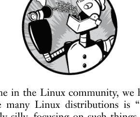

如果我们在 Linux 社区待一段时间，就会听到许多关于哪种 Linux 发行版“最好”的意见。通常，这些讨论变得非常荒谬，关注诸如桌面背景的美观程度之类的事情（有些人因为默认配色方案就不使用 Ubuntu！）以及其他琐碎的事情。

决定发行版质量的最重要因素是 *打包系统* 以及发行版支持社区的活力。随着我们使用 Linux 的时间越长，就会发现其软件生态极其动态。事物不断变化。大部分顶级 Linux 发行版每六个月发布新版本，许多单个程序每天都有更新。为了跟上这场软件暴风雪，我们需要良好的 *包管理* 工具。

包管理是一种在系统上安装和维护软件的方法。如今，大多数人可以通过从 Linux 发行商处安装 *软件包* 来满足所有的软件需求。这与 Linux 早期的情况形成对比，当时人们必须下载并编译 *源代码* 才能安装软件。编译源代码并没有什么问题；事实上，能够访问源代码是 Linux 的伟大奇迹。它赋予我们（以及其他每个人）检查和改进系统的能力。只是预编译的软件包更快、更容易处理。

在本章中，我们将研究用于包管理的一些命令行工具。虽然所有主要发行版都提供功能强大且复杂的图形程序来维护系统，但了解命令行程序也很重要。它们可以执行图形对应程序难以（或不可能）完成的许多任务。

### 打包系统

不同的发行版使用不同的打包系统，并且通常情况下，专为一个发行版设计的软件包与另一个发行版不兼容。大多数发行版属于两种打包技术阵营之一：Debian `.deb` 阵营和 Red Hat `.rpm` 阵营。Gentoo、Slackware 和 Arch 等有一些重要例外，但大多数其他发行版使用这两种基本系统之一，如表 14-1 所示。

表 14-1：主要打包系统家族

| 打包系统 | 发行版（部分列出） |
|---|---|
| Debian 风格（.deb） | Debian、Ubuntu、Linux Mint、Raspbian |
| Red Hat 风格（.rpm） | Fedora、CentOS、Red Hat Enterprise Linux、OpenSUSE |

### 包系统的工作原理

专有软件行业中常见的软件分发方法通常是购买安装介质，例如“安装盘”，或访问每个供应商的网站下载产品，然后运行“安装向导”在系统上安装新应用程序。


Linux 并非如此运作。几乎所有 Linux 系统的软件都可以在互联网上找到。其中大部分将以软件包文件的形式提供给发行版厂商，其余部分将以源代码形式提供，可手动安装。我们将在第 23 章讨论如何通过编译源代码来安装软件。

## 软件包文件

在打包系统中，软件的基本单元是软件包文件。软件包文件是构成软件包的文件的压缩集合。一个软件包可能包含众多程序和支持这些程序的数据文件。除了要安装的文件外，软件包文件还包含有关软件包的元数据，例如软件包及其内容的文本描述。此外，许多软件包还包含在软件包安装之前和之后执行配置任务的预安装和后安装脚本。

软件包文件由被称为软件包维护者的人创建，通常（但不总是）是发行版厂商的员工。软件包维护者从上游提供者（程序的作者）处以源代码形式获取软件，编译它，并创建软件包元数据和任何必要的安装脚本。通常，软件包维护者会对原始源代码进行修改，以改善程序与 Linux 发行版其他部分的集成。

## 仓库

虽然一些软件项目选择自行进行打包和分发，但如今大多数软件包都是由发行版厂商和感兴趣的第三方创建的。软件包以中央仓库的形式提供给发行版的用户，这些仓库可能包含数千个软件包，每个软件包都是专门为该发行版构建和维护的。

一个发行版可能会为软件开发生命周期的不同阶段维护多个不同的仓库。例如，通常会有一个“测试”仓库，其中包含刚刚构建且 intended for 勇敢的灵魂在软件包公开发行前寻找错误使用的软件包。发行版通常还会有“开发”仓库，其中存放着正在进行的工作软件包，这些软件包 destined for 纳入发行版的下一个主要版本。

发行版还可能拥有相关的第三方仓库。这些通常是必需的，以提供因专利或 DRM 反规避等问题而在法律上无法随发行版一起提供的软件。也许最著名的案例就是加密 DVD 支持，这在美国是非法的。第三方仓库在软件专利和反规避法律不适用的国家运营。这些仓库通常完全独立于它们所支持的发行版，要使用它们，必须知道它们并手动将它们包含在软件包管理系统配置文件中。

## 依赖关系

程序很少是“独立”的；相反，它们依赖于其他软件组件来完成工作。例如，输入/输出等常见活动由许多程序共享的例程处理。这些例程存储在共享库中，为多个程序提供基本服务。如果一个软件包需要共享资源（如共享库），则称其具有依赖关系。现代软件包管理系统都提供某种依赖关系解析方法，以确保在安装软件包时，其所有依赖项也一并安装。

## 高级和低级软件包工具

软件包管理系统通常由两种类型的工具组成。

- 处理安装和删除软件包文件等任务的低级工具

- 执行元数据搜索和依赖关系解析的高级工具

在本章中，我们将查看 Debian 风格系统（如 Ubuntu 和许多其他系统）提供的工具以及 Red Hat 产品使用的工具。虽然所有 Red Hat 风格的发行版都依赖于相同的低级程序（`rpm`），但它们使用不同的高级工具。对于我们的讨论，我们将介绍由 Red Hat Enterprise Linux 和 CentOS 使用的高级程序 `yum`。其他 Red Hat 风格的发行版提供具有可比功能的高级工具（见表 14-2）。

表 14-2：打包系统工具

| 发行版 | 低级工具 | 高级工具 |
|---|---|---|
| Debian 风格 | `dpkg` | `apt-get`, `apt`, `aptitude` |
| Fedora, Red Hat Enterprise Linux, CentOS | `rpm` | `yum`, `dnf` |

## 常见软件包管理任务

可以使用命令行软件包管理工具执行许多操作。我们将介绍最常见的操作。请注意，低级工具还支持创建软件包文件，这超出了本书的范围。

在下面的讨论中，术语 `package_name` 指的是软件包的实际名称，而不是术语 `package_file`，即包含软件包的文件的名称。

### 在仓库中查找软件包

使用高级工具搜索仓库元数据，可以根据软件包的名称或描述找到软件包（见表 14-3）。

表 14-3：软件包搜索命令

| 风格 | 命令 |
|---|---|
| Debian | `apt-get update`<br>`apt-cache search search_string` |
| Red Hat | `yum search search_string` |

例如，要在 `yum` 仓库中搜索 `emacs` 文本编辑器，我们可以使用以下命令：

```
yum search emacs
```

### 从仓库安装软件包

高级工具允许从仓库下载软件包并安装，同时进行完整的依赖解析（参见表 14-4）。

表 14-4：软件包安装命令

| 风格 | 命令 |
|---|---|
| Debian | `apt-get update`<br>`apt-get install package_name` |
| Red Hat | `yum install package_name` |

例如，要从 Debian 系统上的 `apt` 仓库安装 `emacs` 文本编辑器，我们可以使用以下命令：

```
apt-get update; apt-get install emacs
```

### 从软件包文件安装软件包

如果软件包文件是从仓库以外的来源下载的，可以使用低级工具直接安装（尽管没有依赖解析）[参见表 14-5]。

表 14-5：低级软件包安装命令

| 风格 | 命令 |
|---|---|
| Debian | `dpkg -i package_file` |
| Red Hat | `rpm -i package_file` |

例如，如果 `emacs-22.1-7.fc7-i386.rpm` 软件包文件是从非仓库站点下载的，则安装方式如下：

```
rpm -i emacs-22.1-7.fc7-i386.rpm
```

#### 注意

由于此技术使用低级 `rpm` 程序执行安装，因此不会执行依赖解析。如果 `rpm` 发现缺少依赖项，`rpm` 将会报错退出。

### 移除软件包

软件包可以使用高级或低级工具卸载。表 14-6 列出了高级工具。

表 14-6：软件包移除命令

| 风格 | 命令 |
|---|---|
| Debian | `apt-get remove package_name` |
| Red Hat | `yum erase package_name` |

例如，要从 Debian 风格的系统上卸载 `emacs` 软件包，我们可以使用以下命令：

```
apt-get remove emacs
```

### 从仓库更新软件包

最常见的软件包管理任务是使用软件包的最新版本使系统保持最新。高级工具可以在单一步骤中执行此重要任务（参见表 14-7）。

表 14-7：软件包更新命令

| 风格 | 命令 |
|---|---|
| Debian | `apt-get update; apt-get upgrade` |
| Red Hat | `yum update` |

例如，要将 Debian 风格系统上已安装的软件包应用所有可用更新，我们可以使用以下命令：

```
apt-get update; apt-get upgrade
```

### 从软件包文件升级软件包

如果从非仓库源下载了软件包的更新版本，可以安装它以替换之前的版本（参见表 14-8）。

表 14-8：低级软件包升级命令

| 风格 | 命令 |
|---|---|
| Debian | `dpkg -i package_file` |
| Red Hat | `rpm -U package_file` |

例如，要在 Red Hat 系统上将 `emacs` 的现有安装更新为软件包文件 `emacs-22.1-7.fc7-i386.rpm` 中包含的版本，我们可以使用以下命令：

```
rpm -U emacs-22.1-7.fc7-i386.rpm
```

> `dpkg` 没有像 `rpm` 那样专门用于升级软件包与安装的区别选项。

### 列出已安装的软件包

表 14-9 列出了我们可用于显示系统上所有已安装软件包的命令。

表 14-9：软件包列出命令

| 风格 | 命令 |
| --- | --- |
| Debian | `dpkg -l` |
| Red Hat | `rpm -qa` |

### 确定是否已安装软件包

表 14-10 列出了我们可用于显示指定软件包是否已安装的低级工具。

表 14-10：软件包状态命令

| 风格 | 命令 |
| --- | --- |
| Debian | `dpkg -s package_name` |
| Red Hat | `rpm -q package_name` |

例如，要确定 Debian 风格的系统上是否已安装 `emacs` 软件包，我们可以使用以下命令：

```
dpkg -s emacs
```

### 显示已安装软件包的信息

如果已知已安装软件包的名称，我们可以使用表 14-11 中的命令来显示软件包的描述。

表 14-11：软件包信息命令


| 风格 | 命令 |
| --- | --- |
| Debian | `apt-cache show package_name` |
| Red Hat | `yum info package_name` |

例如，要在 Debian 风格的系统上查看 `emacs` 包的描述，我们可以使用以下命令：

```
apt-cache show emacs
```

### 查找安装文件的包

要确定哪个包负责安装某个特定文件，我们可以使用表 14-12 中的命令。

表 14-12：包文件识别命令

| 风格 | 命令 |
| --- | --- |
| Debian | `dpkg -S file_name` |
| Red Hat | `rpm -qf file_name` |

要查看 Red Hat 系统上 `/usr/bin/vim` 文件是由哪个包安装的，我们可以使用以下命令：

```
rpm -qf /usr/bin/vim
```

### 小结

在接下来的章节中，我们将探索许多不同类型的程序，涵盖广泛的应用领域。虽然大多数这些程序通常默认已安装，但如果系统上尚未安装必要的程序，我们可能需要安装额外的包。有了我们新获得的知识和对包管理的认识，我们应该能够毫无问题地安装和管理所需的程序。

### Linux 软件安装的神话

从其他平台迁移过来的用户有时会陷入这样一个神话：认为在 Linux 下安装软件 somehow 很困难，并且不同发行版使用的各种打包方案是阻碍。嗯，这确实是阻碍，但只对那些想要分发仅二进制版本的秘密软件的专有软件厂商而言。

Linux 软件生态系统基于开源代码的理念。如果程序开发者发布了程序的源代码，那么很可能与某个发行版相关的人员会打包该程序并将其包含在其仓库中。这种方法确保程序能很好地集成到发行版中，并且用户可以享受“软件一站式购物”的便利，而不必为每个程序搜索其网站。最近，主要的专有平台厂商开始构建模仿这一想法的应用商店。

设备驱动程序的处理方式大致相同，只是它们不是发行版仓库中的独立条目，而是成为 Linux 内核的一部分。一般来说，在 Linux 中不存在“驱动盘”这种东西。内核要么支持某个设备，要么不支持，而 Linux 内核支持的设备非常多——事实上，比 Windows 支持的还要多。当然，如果你需要的特定设备不受支持，这就毫无安慰了。当这种情况发生时，你需要查看原因。缺乏驱动支持通常由以下三种原因之一造成。

- **设备太新了。** 由于许多硬件厂商并不积极支持 Linux 开发，因此编写内核驱动代码的工作就落在了 Linux 社区成员身上。这需要时间。

- **设备太冷门了。** 并非所有发行版都包含每一种可能的设备驱动。每个发行版都构建自己的内核，而由于内核是可配置的（这使得 Linux 能够运行在从手表到大型机等各种设备上），它们可能忽略了某个特定设备。通过定位并下载驱动的源代码，你（没错，就是你）可以自行编译并安装驱动。这个过程并不过于困难，但相当繁琐。我们将在后面的章节中讨论编译软件。

- **硬件厂商在隐瞒某些东西。** 它既没有发布 Linux 驱动的源代码，也没有发布技术文档供他人为其创建。这意味着硬件厂商试图将设备编程接口保密。由于我们不希望在电脑中存在秘密设备，最好避免此类产品。

`genisoimage` (`mkisofs`) 创建 ISO 9660 映像文件

`wodim` (`cdrecord`) 将数据写入光学存储介质

`md5sum` 计算 MD5 校验和

### 挂载和卸载存储设备

Linux 桌面的最新进展使得桌面用户对存储设备的管理变得极其简单。大多数情况下，我们将设备连接到系统，它就能“即插即用”。在旧时代（比如 2004 年），这些操作必须手动完成。在非桌面系统（即服务器）上，这仍然是一个主要的手工操作，因为服务器通常有极端的存储需求和复杂的配置要求。

管理存储设备的第一步是将设备附加到文件系统树中。这个过程称为挂载，允许设备与操作系统交互。正如我们在第 2 章中所回忆的那样，类 Unix 操作系统（如 Linux）维护着一棵单一的文件系统树，设备附加在各个点上。这与 Windows 等其他操作系统形成对比，后者为每个设备维护单独的文件系统树（例如 C:\、D:\ 等）。

一个名为 `/etc/fstab` 的文件（“file system table”的缩写）列出了在启动时要挂载的设备（通常是硬盘分区）。以下是早期 Fedora 系统的一个 `/etc/fstab` 文件示例：

| LABEL=/12 | / | ext4 | defaults | 1 | 1 |
| LABEL=/home | /home | ext4 | defaults | 1 | 2 |
| LABEL=/boot | /boot | ext4 | defaults | 1 | 2 |
| tmpfs | /dev/shm | tmpfs | defaults | 0 | 0 |
| devpts | /dev/pts | devpts | gid=5,mode=620 | 0 | 0 |
| sysfs | /sys | sysfs | defaults | 0 | 0 |
| proc | /proc | proc | defaults | 0 | 0 |
| LABEL=SWAP-sda3 | swap | swap | defaults | 0 | 0 |

这个示例文件中列出的大多数文件系统是虚拟的，与我们的讨论不适用。对我们而言，有趣的是前三个。

| LABEL=/12 | / | ext4 | defaults | 1 | 1 |
| LABEL=/home | /home | ext4 | defaults | 1 | 2 |

| 字段 | 内容 | 描述 |
|---|---|---|
| 5 | Frequency | 一个数字，用于指定是否以及何时使用 `dump` 命令备份文件系统。 |
| 6 | Order | 一个数字，用于指定应以何种顺序使用 `fsck` 命令检查文件系统。 |

### 查看已挂载文件系统列表

`mount` 命令用于挂载文件系统。不带参数输入该命令将显示当前已挂载的文件系统列表。

```
[me@linuxbox ~]$ mount
/dev/sda2 on / type ext4 (rw)
proc on /proc type proc (rw)
sysfs on /sys type sysfs (rw)
devpts on /dev/pts type devpts (rw,gid=5,mode=620)
/dev/sda5 on /home type ext4 (rw)
/dev/sda1 on /boot type ext4 (rw)
tmpfs on /dev/shm type tmpfs (rw)
none on /proc/sys/fs/binfmt_misc type binfmt_misc (rw)
sunrpc on /var/lib/nfs/rpc_pipefs type rpc_pipefs (rw)
fusectl on /sys/fs/fuse/connections type fusectl (rw)
/dev/sdd1 on /media/disk type vfat (rw,nosuid,nodev,noatime,uhelper=hal,uid=500,utf8,shortname=lower)
twin4:/musicbox on /misc/musicbox type nfs4 (rw,addr=192.168.1.4)
```

列表的格式如下：`device on mount_point type filesystem_type (options)`。例如，第一行显示设备 `/dev/sda2` 已挂载为根文件系统，类型为 `ext4`，且可读可写（选项 `rw`）。该列表在底部还有两个有趣的条目。倒数第二个条目显示一个 2GB SD 存储卡在读卡器中挂载在 `/media/disk`，而最后一个条目是挂载在 `/misc/musicbox` 的网络驱动器。

在我们的第一个实验中，我们将使用 CD-ROM。首先，让我们查看在插入 CD-ROM 之前系统的状态。

```
[me@linuxbox ~]$ mount
/dev/mapper/VolGroup00-LogVol00 on / type ext4 (rw)
```

```
proc on /proc type proc (rw)
sysfs on /sys type sysfs (rw)
devpts on /dev/pts type devpts (rw,gid=5,mode=620)
/dev/sda1 on /boot type ext4 (rw)
tmpfs on /dev/shm type tmpfs (rw)
none on /proc/sys/fs/binfmt_misc type binfmt_misc (rw)
sunrpc on /var/lib/nfs/rpc_pipefs type rpc_pipefs (rw)
```


此列表来自 CentOS 系统，该系统使用 LVM（逻辑卷管理器）创建其根文件系统。像许多现代 Linux 发行版一样，该系统在插入后会尝试自动挂载 CD-ROM。插入光盘后，我们看到以下内容：

```
[me@linuxbox ~]$ mount
/dev/mapper/VolGroup00-LogVol00 on / type ext4 (rw)
proc on /proc type proc (rw)
sysfs on /sys type sysfs (rw)
devpts on /dev/pts type devpts (rw,gid=5,mode=620)
/dev/hda1 on /boot type ext4 (rw)
tmpfs on /dev/shm type tmpfs (rw)
none on /proc/sys/fs/binfmt_misc type binfmt_misc (rw)
sunrpc on /var/lib/nfs/rpc_pipefs type rpc_pipefs (rw)
/dev/sdc on /media/live-1.0.10-8 type iso9660 (ro,noexec,nosuid,nodev,uid=500)
```

插入光盘后，我们看到与之前相同的列表，只多了一个条目。在列表末尾我们看到 CD-ROM（在此系统上设备为 `/dev/sdc`）已挂载在 `/media/live-1.0.10-8`，类型为 `iso9660`（CD-ROM）。对于我们的实验目的，我们感兴趣的是设备名称。当你自己进行此实验时，设备名称很可能不同。

### 警告

在下面的示例中，至关重要的是你必须密切注意系统上实际使用的设备名称，不要使用本文中使用的名称！另请注意，音频 CD 与 CD-ROM 不同。音频 CD 不包含文件系统，因此通常意义上无法挂载。

现在我们已经知道了 CD-ROM 驱动器的设备名称，让我们卸载光盘并将其重新挂载到文件系统树中的另一个位置。为此，我们成为超级用户（使用适用于我们系统的命令）并使用 `umount`（注意拼写）命令卸载光盘。

```
[me@linuxbox ~]$ su -
Password:
[root@linuxbox ~]# umount /dev/sdc
```

下一步是为磁盘创建新的挂载点。挂载点只是在文件系统树中的某个目录。没有什么特别之处。它甚至不必是空目录，尽管如果你在非空目录上挂载设备，在卸载设备之前将无法看到该目录之前的內容。为了我们的目的，我们将创建一个新目录。

```
[root@linuxbox ~]# mkdir /mnt/cdrom
```

最后，我们将 CD-ROM 挂载到新的挂载点。`-t` 选项用于指定文件系统类型。

```
[root@linuxbox ~]# mount -t iso9660 /dev/sdc /mnt/cdrom
```

之后，我们可以通过新的挂载点检查 CD-ROM 的内容。

```
[root@linuxbox ~]# cd /mnt/cdrom
[root@linuxbox cdrom]# ls
```

注意当我们尝试卸载 CD-ROM 时会发生什么。

```
[root@linuxbox cdrom]# umount /dev/sdc
umount: /mnt/cdrom: device is busy
```

为什么会这样？原因是我们不能在设备正被某人或某个进程使用时卸载设备。在这种情况下，我们将工作目录更改为 CD-ROM 的挂载点，这会导致设备处于忙碌状态。我们可以通过将工作目录更改为挂载点之外的其他位置来轻松解决此问题。

```
[root@linuxbox cdrom]# cd
[root@linuxbox ~]# umount /dev/hdc
```

现在设备成功卸载。

### 为什么卸载很重要

如果查看 `free` 命令的输出，该命令显示内存使用统计信息，你会看到一个名为 `buffers` 的统计项。计算机系统设计为尽可能快地运行。系统速度受阻的原因之一是慢速设备。打印机就是一个很好的例子。即使是最快的打印机，按计算机标准来说也极其缓慢。如果计算机必须停下来等待打印机完成打印一页，那么计算机确实会非常缓慢。在 PC 的早期时代（在多任务处理之前），这是一个真正的问题。如果你正在处理电子表格或文本文档，每次打印时计算机都会停止并变得不可用。计算机会尽可能快地将数据发送给打印机，但速度非常慢，因为打印机打印速度并不快。这个问题随着打印机缓冲区的出现而得到解决，打印机缓冲区是一种包含一些 RAM 内存的设备，它位于计算机和打印机之间。有了打印机缓冲区，计算机就会将打印机输出发送到缓冲区，并迅速存储在快速 RAM 中，以便计算机可以返回工作而无需等待。与此同时，打印机缓冲区会以打印机能够接受的速度，从缓冲区的内存中缓慢地将数据传输到打印机。

这种缓冲思想在计算机中被广泛使用，以使其更快运行。不要让偶尔需要从慢速设备读取或写入数据的需求阻碍系统的速度。操作系统会将已从存储设备读取并将要写入存储设备的数据尽可能长时间地存储在内存中，然后才真正与较慢的设备交互。例如，在 Linux 系统上，你会注意到系统使用时间越长，内存似乎就填满得越多。这并不意味着 Linux 在“使用”所有内存；它意味着 Linux 利用所有可用内存进行尽可能多的缓冲。

这种缓冲使得写入存储设备变得非常快，因为对物理设备的写入被推迟到未来某个时间。与此同时，目标设备的数据正在内存中堆积。随着时间的推移，操作系统会将这些数据写入物理设备。

卸载设备意味着将所有剩余数据写入设备，以便可以安全地移除。如果在先卸载之前就移除设备，就有可能并非所有目标设备的数据都已传输。在某些情况下，这些数据可能包括至关重要的目录更新，这将导致 `文件系统损坏`，这是计算机上可能发生的最糟糕的事情之一。

### 确定设备名称

有时确定设备名称很困难。在过去，这并不太难。设备始终位于相同的位置，并且不会改变。类 Unix 系统就是这样喜欢的。当 Unix 被开发时，“更换磁盘驱动器”涉及使用叉车从计算机房移除一台洗衣机大小的设备。近年来，典型的桌面硬件配置变得相当动态，Linux 已发展得比其祖先更灵活。

在上一节的示例中，我们利用了现代 Linux 桌面的能力，即“自动”挂载设备，然后事后确定其名称。但如果我们管理的是服务器或其他不会发生这种情况的环境怎么办？我们如何才能弄清楚？

首先，让我们看看系统如何命名设备。如果我们列出 `/dev` 目录的内容（所有设备都位于此处），我们可以看到有大量设备。

```
[me@linuxbox ~]$ ls /dev
```

此列表的内容揭示了一些设备命名模式。表 15-2 概述了其中一些模式。

#### 表 15-2：Linux 存储设备名称

| 模式 | 描述 |
|---|---|
| `/dev/fd*` | 软盘驱动器。 |
| `/dev/hd*` | 旧系统上的 IDE（PATA）磁盘。典型的主板包含两个 IDE 连接器或通道，每个连接器都有一根电缆，电缆上有两个用于驱动器的连接点。电缆上的第一个驱动器称为主设备，第二个称为从设备。设备名称的顺序为 `/dev/hda` 指第一个通道上的主设备，`/dev/hdb` 是第一个通道上的从设备；`/dev/hdc` 是第二个通道上的主设备，以此类推。末尾的数字表示设备上的分区号。例如，`/dev/hda1` 指系统上第一块硬盘上的第一个分区，而 `/dev/hda` 指整个驱动器。 |
| `/dev/lp*` | 打印机。 |
| `/dev/sd*` | SCSI 磁盘。在现代 Linux 系统上，内核将所有类似磁盘的设备（包括 PATA/SATA 硬盘、闪存驱动器以及便携式音乐播放器和数码相机等 USB 大容量存储设备）都视为 SCSI 磁盘。其余的命名系统与前面描述的旧 `/dev/hd*` 命名方案类似。 |
| `/dev/sr*` | 光驱（CD/DVD 读卡器和刻录机）。 |

此外，我们经常会看到诸如 `/dev/cdrom`、`/dev/dvd` 和 `/dev/floppy` 之类的符号链接，它们指向实际的设备文件，是为了方便使用而提供的。

如果你所使用的系统不会自动挂载可移动设备，可以使用以下技巧来确定可移动设备在接入时是如何命名的。首先，实时查看 `/var/log/messages` 或 `/var/log/syslog` 文件（你可能需要超级用户权限才能执行此操作）。

```
[me@linuxbox ~]$ sudo tail -f /var/log/messages
```

文件的最后几行会显示出来，然后暂停等待。接下来，插入可移动设备。在本例中，我们将使用一个 16MB 的闪存盘。几乎立刻，内核就会检测到该设备并对其进行探测。


```
Jul 23 10:07:53 linuxbox kernel: usb 3-2: new full speed USB device using uhci_hcd and address 2
Jul 23 10:07:53 linuxbox kernel: usb 3-2: configuration #1 chosen from 1 choice
Jul 23 10:07:53 linuxbox kernel: scsi3 : SCSI emulation for USB Mass Storage devices
Jul 23 10:07:58 linuxbox kernel: scsi scan: INQUIRY result too short (5), using 36
Jul 23 10:07:58 linuxbox kernel: scsi 3:0:0:0: Direct-Access Easy Disk .00 PQ: 0 ANSI: 2
Jul 23 10:07:59 linuxbox kernel: sd 3:0:0:0: [sdb] 31263 512-byte hardware sectors (16 MB)
Jul 23 10:07:59 linuxbox kernel: sd 3:0:0:0: [sdb] Write Protect is off
Jul 23 10:07:59 linuxbox kernel: sd 3:0:0:0: [sdb] Assuming drive cache: write through
Jul 23 10:07:59 linuxbox kernel: sd 3:0:0:0: [sdb] 31263 512-byte hardware sectors (16 MB)
Jul 23 10:07:59 linuxbox kernel: sd 3:0:0:0: [sdb] Write Protect is off
Jul 23 10:07:59 linuxbox kernel: sd 3:0:0:0: [sdb] Assuming drive cache: write through
Jul 23 10:07:59 linuxbox kernel: sdb: sdb1
Jul 23 10:07:59 linuxbox kernel: sd 3:0:0:0: [sdb] Attached SCSI removable disk
Jul 23 10:07:59 linuxbox kernel: sd 3:0:0:0: Attached scsi generic sg3 type 0
```

当显示再次暂停后，按下 CTRL-C 返回提示符。输出中值得关注的部分是反复出现的 [sdb]，这与我们对 SCSI 磁盘设备名称的预期相符。知道了这一点，下面这两行就格外具有启发性：

```
Jul 23 10:07:59 linuxbox kernel:  sdb: sdb1
Jul 23 10:07:59 linuxbox kernel:  sd 3:0:0:0: [sdb] Attached SCSI
removable disk
```

这告诉我们，整个设备的设备名称是 `/dev/sdb`，设备上第一个分区的设备名称是 `/dev/sdb1`。正如我们所看到的，使用 Linux 充满了有趣的侦探式探索！

### 提示

使用 `tail -f /var/log/messages` 这种技巧，是近乎实时地观察系统动态的好方法。

既然已经知道了设备名称，我们现在就可以挂载闪存盘了。

```
[me@linuxbox ~]$ sudo mkdir /mnt/flash
[me@linuxbox ~]$ sudo mount /dev/sdb1 /mnt/flash
[me@linuxbox ~]$ df
Filesystem     1K-blocks    Used Available Use% Mounted on
/dev/sda2      15115452  5186944   9775164  35% /
/dev/sda5      59631908 31777376  24776480  57% /home
/dev/sda1       147764    17277   122858  13% /boot
tmpfs           776808       0    776808   0% /dev/shm
/dev/sdb1        15560       0     15560   0% /mnt/flash
```

只要设备一直物理连接到计算机，且计算机未重启，设备名称就会保持不变。

### 创建新文件系统

假设我们想用 Linux 原生的文件系统来重新格式化闪存盘，而不是它当前使用的 FAT32 文件系统。这需要两个步骤。

- 1.（可选）如果现有分区布局不合意，则创建新的分区布局。

- 2. 在驱动器上创建一个新的空文件系统。

#### 警告

在接下来的练习中，我们将格式化一个闪存盘。请使用一块不包含任何你关心内容的驱动器，因为它将被擦除！再次强调，请绝对确保你指定的是你系统的正确设备名称，而不是文中显示的那个。如果不理会这一警告，可能会导致你格式化（即擦除）错误的驱动器！

### 使用 fdisk 操作分区

`fdisk` 是众多可用程序之一（包括命令行和图形界面程序），它让我们能够在非常底层的层面上直接与类磁盘设备（如硬盘驱动器和闪存盘）交互。借助这一工具，我们可以编辑、删除和创建设备上的分区。要操作我们的闪存盘，我们必须先卸载它（如果需要），然后按如下方式调用 `fdisk` 程序：

```
[me@linuxbox ~]$ sudo umount /dev/sdb1
[me@linuxbox ~]$ sudo fdisk /dev/sdb
```

请注意，我们必须指定整个设备，而不是按分区号指定。程序启动后，我们会看到以下提示符：

```
Command (m for help):
```

输入 `m` 将显示程序菜单。

```
Command action
a   toggle a bootable flag
b   edit bsd disklabel
c   toggle the dos compatibility flag
d   delete a partition
l   list known partition types
m   print this menu
```

如果我们在提示符下输入 `l`，就会显示一个可能类型的长列表。其中我们看到 `b` 代表我们现有的分区类型，以及 `83` 代表 Linux。返回菜单后，我们看到这个用于更改分区 ID 的选项：

```
t    change a partition's system id
```

我们在提示符下输入 `t` 并输入新的 ID。

```
Command (m for help): t
Selected partition 1
Hex code (type L to list codes): 83
Changed system type of partition 1 to 83 (Linux)
```

这就完成了我们需要做的所有更改。直到此时，设备都未被触及（所有更改都存储在内存中，而非物理设备上），因此我们将修改后的分区表写入设备并退出。为此，我们在提示符下输入 `w`。

```
Command (m for help): w
The partition table has been altered!

Calling ioctl() to re-read partition table.

WARNING: If you have created or modified any DOS 6.x partitions, please see the fdisk manual page for additional information.
Syncing disks.
[me@linuxbox ~]$
```

如果我们决定不更改设备，也可以输入 `q` 退出提示符，这将退出程序而不写入更改。我们可以安全地忽略这个听起来不祥的警告信息。

### 使用 mkfs 创建新的文件系统

分区编辑工作完成后（尽管可能很轻量），现在是时候在我们的闪存驱动器上创建新的文件系统了。为此，我们将使用 `mkfs`（“make file system”的缩写），它可以创建多种格式的文件系统。要在设备上创建 ext4 文件系统，我们使用 `-t` 选项指定 “ext4” 系统类型，然后跟上包含我们要格式化的分区的设备名称。


进入`/path/to/xxx`目录，找到`xxx.json`。

在表达式`cvar = avar + bvar`中，加法运算符（`+`）将`avar`与`bvar`相加，得到它们的和`cvar`。

在`List.of(arg0, arg1, arg2)`中，`List`接口的工厂方法`of()`接受一系列的元素，返回包含它们的只读列表。

之后我们这样调用`cmd`命令：`cmd arg0 arg1 arg2`。

```
if (condVar > someVal) {console.log("xxx")}
```


```
wodim dev=/dev/cdrw blank=fast
```

## 写入映像

要写入映像，我们再次使用 `wodim`，指定光学介质写入设备的名称和映像文件的名称。

```
wodim dev=/dev/cdrw image.iso
```

除了设备名称和映像文件外，`wodim` 还支持大量选项。其中两个常见选项是 `-v` 用于详细输出，以及 `-dao`，它以一次刻盘模式写入光盘。如果您准备光盘用于商业复制，则应使用此模式。`wodim` 的默认模式是一次刻轨模式，这对于录制音乐音轨很有用。

### 总结

在本章中，我们查看了基本存储管理任务。当然，还有更多。Linux 支持大量存储设备和文件系统方案。它还提供许多与其他系统互操作的功能。

### 额外学分

验证我们下载的 ISO 映像的完整性通常很有用。在大多数情况下，ISO 映像的分发者也会提供校验和文件。校验和是奇异数学计算的结果，产生一个代表目标文件内容的数字。如果文件内容即使只改变一个位，结果校验和也会大不相同。校验和生成的最常见方法使用 `md5sum` 程序。当您使用 `md5sum` 时，它会产生一个唯一的十六进制数字。

```
md5sum image.iso
34e354760f9bb7fbf85c96f6a3f94ece  image.iso
```

下载映像后，您应该对其运行 `md5sum` 并将结果与发布者提供的 `md5sum` 值进行比较。

除了检查下载文件的完整性外，我们还可以使用 `md5sum` 来验证新写入的光学介质。为此，我们首先计算映像文件的校验和，然后计算介质的校验和。验证介质的诀窍是仅将计算限制在包含映像的光学介质的部分。我们通过确定映像包含的 2,048 字节块数来实现这一点（光学介质始终以 2,048 字节块写入），并从介质中读取相同数量的块。在某些类型的介质上，这不是必需的。以一次刻盘模式写入的 CD-R 和 CD-RW 光盘可以用这种方式检查。

```
md5sum /dev/cdrom
34e354760f9bb7fbf85c96f6a3f94ece  /dev/cdrom
```

许多类型的介质，例如 DVD，需要精确计算块数。在以下示例中，我们检查映像文件 `dvd-image.iso` 的完整性以及 DVD 读卡器 `/dev/dvd` 中的光盘。你能弄清楚这是如何工作的吗？

```
md5sum dvd-image.iso; dd if=/dev/dvd bs=2048 count=$(($(stat -c "%s" dvd-image.iso) / 2048 )) | md5sum
```

# 16 网络


在网络方面，Linux 可能无所不能。Linux 用于构建各种网络系统和设备，包括防火墙、路由器、名称服务器、网络附加存储（NAS）设备等等。

正如网络主题非常广泛一样，可用于配置和控制它的命令数量也很多。我们将注意力集中在其中几个最常用的命令上。所选用于检查的命令包括用于监控网络的命令和用于传输文件的命令。此外，我们将探索用于执行远程登录的 `ssh` 程序。本章将涵盖以下命令：

- `ping` 向网络主机发送 ICMP ECHO_REQUEST
- `traceroute` 打印数据包跟踪到网络主机的路由
- `ip` 显示/操作路由、设备、策略路由和隧道
- `netstat` 打印网络连接、路由表、接口统计信息、伪装连接和多播成员资格
- `ftp` Internet 文件传输程序
- `wget` 非交互式网络下载器
- `ssh` OpenSSH SSH 客户端（远程登录程序）

我们将假设读者具备一定的网络基础知识。在这个互联网时代，每个人使用计算机都需要对网络概念有基本的了解。为了充分利用本章内容，我们应熟悉以下术语：

- Internet Protocol (IP) 地址
- 主机和域名
- Uniform Resource Identifier (URI)

> NOTE
>
> 我们将要介绍的一些命令（取决于你的发行版）可能需要从发行版的软件仓库安装额外的软件包，并且其中一些命令需要超级用户权限才能执行。

## 检查和监控网络

即使你不是系统管理员，了解网络的性能和运行情况也常常很有帮助。

### ping

最基本的网络命令是 `ping`。`ping` 命令会向指定主机发送一个特殊的网络数据包，称为 ICMP ECHO_REQUEST。大多数接收到此数据包的网络设备都会对其作出回复，从而可以验证网络连接。

> NOTE
>
> 可以配置大多数网络设备（包括 Linux 主机）忽略这些数据包。这通常出于安全原因而进行，以部分隐藏主机免受潜在攻击者的探测。防火墙通常也会被配置为阻止 ICMP 流量。

例如，要查看我们是否可以访问 linuxcommand.org（我们最喜欢的网站之一），我们可以使用 `ping` 如下：

```
[me@linuxbox ~]$ ping linuxcommand.org
```

启动后，`ping` 会以指定的间隔（默认是一秒）持续发送数据包，直到被中断。

```
[me@linuxbox ~]$ ping linuxcommand.org
PING linuxcommand.org (66.35.250.210) 56(84) bytes of data.
64 bytes from vhost.sourceforge.net (66.35.250.210): icmp_seq=1 ttl=43
time=107 ms
64 bytes from vhost.sourceforge.net (66.35.250.210): icmp_seq=2 ttl=43
time=108 ms
64 bytes from vhost.sourceforge.net (66.35.250.210): icmp_seq=3 ttl=43
time=106 ms
64 bytes from vhost.sourceforge.net (66.35.250.210): icmp_seq=4 ttl=43
time=106 ms
64 bytes from vhost.sourceforge.net (66.35.250.210): icmp_seq=5 ttl=43
time=105 ms
64 bytes from vhost.sourceforge.net (66.35.250.210): icmp_seq=6 ttl=43
time=107 ms

--- linuxcommand.org ping statistics ---
6 packets transmitted, 6 received, 0% packet loss, time 6010ms
rtt min/avg/max/mdev = 105.647/107.052/108.118/0.824 ms
```

中断后（本例中在第六个数据包后通过按 CTRL-C 中断），`ping` 会打印性能统计信息。网络正常运行时的丢包率为 0%。一次成功的`ping`将表明网络的各个元素（其接口卡、布线、路由和网关）总体上工作正常。

### traceroute

`traceroute` 程序（某些系统改用类似的 `tracepath` 程序）列出了网络流量从本地系统到指定主机所经过的所有“跳数”。例如，要查看到达 slashdot.org 的路由，我们可以这样做：

```
[me@linuxbox ~]$ traceroute slashdot.org
```

输出如下所示：


```traceroute to slashdot.org (216.34.181.45), 30 hops max, 40 byte packets
1  ipcop.localdomain (192.168.1.1)  1.066 ms  1.366 ms  1.720 ms
2  * * *
3  ge-4-13-ur01.rockville.md.bad.comcast.net (68.87.130.9)  14.622 ms  14.885 ms  15.169 ms
4  po-30-ur02.rockville.md.bad.comcast.net (68.87.129.154)  17.634 ms  17.626 ms  17.899 ms
5  po-60-ur03.rockville.md.bad.comcast.net (68.87.129.158)  15.992 ms  15.983 ms  16.256 ms
6  po-30-ar01.howardcounty.md.bad.comcast.net (68.87.136.5)  22.835 ms  14.233 ms  14.405 ms
7  po-10-ar02.whitmarsh.md.bad.comcast.net (68.87.129.34)  16.154 ms  13.600 ms  18.867 ms
8  te-0-3-0-1-cr01.philadelphia.pa.ibone.comcast.net (68.86.90.77)  21.951 ms  21.073 ms  21.557 ms
9  pos-0-8-0-0-cr01.newyork.ny.tbone.comcast.net (68.86.85.10)  22.917 ms  21.884 ms  22.126 ms
10  204.70.144.1 (204.70.144.1)  43.110 ms  21.248 ms  21.264 ms
11  cr1-pos-0-7-3-1.newyork.savvis.net (204.70.195.93)  21.857 ms cr2-pos-0-0-3-1.newyork.savvis.net (204.70.204.238)  19.556 ms cr1-pos-0-7-3-1.newyork.savvis.net (204.70.195.93)  19.634 ms
12  cr2-pos-0-7-3-0.chicago.savvis.net (204.70.192.109)  41.586 ms  42.843 ms cr2-tengig-0-0-2-0.chicago.savvis.net (204.70.196.242)  43.115 ms
13  hr2-tengigabitether-12-1.elkgrovech3.savvis.net (204.70.195.122)  44.215 ms  41.833 ms  45.658 ms
14  csr1-ve241.elkgrovech3.savvis.net (216.64.194.42)  46.840 ms  43.372 ms  47.041 ms
15  64.27.160.194 (64.27.160.194)  56.137 ms  55.887 ms  52.810 ms
16  slashdot.org (216.34.181.45)  42.727 ms  42.016 ms  41.437 ms
```

在输出中，我们可以看到从测试系统连接到 `slashdot.org` 需要经过 16 个路由器。对于提供识别信息的路由器，我们可以看到它们的主机名、IP地址和性能数据，其中包括从本地系统到路由器的往返时间的三个样本。对于不提供识别信息的路由器（由于路由器配置、网络拥塞、防火墙等），我们会看到星号，如第 2 跳的行所示。在路由信息被阻止的情况下，我们有时可以通过在 `traceroute` 命令中添加 `-T` 或 `-I` 选项来克服这个问题。

## ip

`ip` 程序是一个多用途的网络配置工具，它利用了现代 Linux 内核中可用的全套网络功能。它取代了早期的 `ifconfig` 程序，现已弃用。使用 `ip`，我们可以检查系统的网络接口和路由表。

```
[me@linuxbox ~]$ ip a
1: lo: <LOOPBACK,UP,LOWER_UP> mtu 65536 qdisc noqueue state UNKNOWN
   group default
   link/loopback 00:00:00:00:00:00 brd 00:00:00:00:00:00
   inet 127.0.0.1/8 scope host lo
       valid_lft forever preferred_lft forever
   inet6 ::1/128 scope host
       valid_lft forever preferred_lft forever
2: eth0: <BROADCAST,MULTICAST,UP,LOWER_UP> mtu 1500 qdisc pfifo_fast state UP
   group default qlen 1000
   link/ether ac:22:0b:52:cf:84 brd ff:ff:ff:ff:ff:ff
   inet 192.168.1.14/24 brd 192.168.1.255 scope global eth0
       valid_lft forever preferred_lft forever
   inet6 fe80::ae22:bff:fe52:cf84/64 scope link
       valid_lft forever preferred_lft forever
```

在前面的示例中，我们看到测试系统有两个网络接口。第一个名为 `lo`，是环回接口，一个虚拟接口，系统用它来“自说自话”，第二个名为 `eth0`，是以太网接口。

在进行非正式的网络诊断时，需要注意的重要事项是每个接口的第一行中是否存在单词 `UP`，表示网络接口已启用，以及第三行的 `inet` 字段中是否存在有效的 IP 地址。对于使用动态主机配置协议（`DHCP`）的系统，该字段中的有效 IP 地址将验证 `DHCP` 是否正常工作。

## netstat

`netstat` 程序用于检查各种网络设置和统计信息。通过使用其众多选项，我们可以查看网络设置中的各种功能。使用 `-ie` 选项，我们可以检查系统中的网络接口。

```
[me@linuxbox ~]$ netstat -ie
eth0      Link encap:Ethernet  HWaddr 00:1d:09:9b:99:67
          inet addr:192.168.1.2  Bcast:192.168.1.255  Mask:255.255.255.0
          inet6 addr: fe80::21d:9ff:fe9b:9967/64 Scope:Link
          UP BROADCAST RUNNING MULTICAST  MTU:1500  Metric:1
          RX packets:238488  errors:0  dropped:0  overruns:0  frame:0
          TX packets:403217  errors:0  dropped:0  overruns:0  carrier:0
          collisions:0  txqueuelen:100 
          RX bytes:153098921 (146.0 MB)  TX bytes:261035246 (248.9 MB)
          Memory:fdfc0000-fdfe0000

lo        Link encap:Local Loopback
          inet addr:127.0.0.1  Mask:255.0.0.0
          inet6 addr: ::1/128 Scope:Host
          UP LOOPBACK RUNNING  MTU:16436  Metric:1
          RX packets:2208  errors:0  dropped:0  overruns:0  frame:0
          TX packets:2208  errors:0  dropped:0  overruns:0  carrier:0
          collisions:0  txqueuelen:0 
          RX bytes:111490 (108.8 KB)  TX bytes:111490 (108.8 KB)
```

使用 `-r` 选项将显示内核的网络路由表。这显示了网络如何配置以在网络之间发送数据包：


```
[me@linuxbox ~]$ netstat -r
Kernel IP routing table
Destination     Gateway         Genmask         Flags   MSS Window  irtt Iface
192.168.1.0     *               255.255.255.0   U       0   0       0   eth0
default         192.168.1.1     0.0.0.0         UG      0   0       0   eth0
```

在这个简单的示例中，我们看到防火墙/路由器后面局域网（LAN）上客户端机器的典型路由表。列表的第一行显示目标为 192.168.1.0。以零结尾的 IP 地址指的是网络而不是单个主机，因此此目标表示 LAN 上的任何主机。下一个字段 `Gateway` 是用于从当前主机到目标网络的网关（路由器）的名称或 IP 地址。此字段中的星号表示不需要网关。

最后一行包含目标 `default`。这意味着发往表中未列出的任何网络的流量。在我们的示例中，我们看到网关被定义为地址为 192.168.1.1 的路由器，它 presumably 知道如何处理目标流量。

与 `ip` 类似，`netstat` 程序有许多选项，我们只查看了其中几个。查看 `ip` 和 `netstat` 手册页以获取完整列表。

## 在网络上传输文件

如果不能在网络上传输文件，网络有什么用呢？有许多程序可以在网络上传输数据。我们现在将介绍其中两个，并在后面的章节中介绍更多。

## ftp

`ftp` 是真正的“经典”程序之一，它的名字来源于它使用的协议，即文件传输协议。FTP 曾经是互联网上下载文件的最广泛使用的方法。大多数，如果不是全部，网络浏览器都支持它，你经常会看到以协议 `ftp://` 开头的 URI。

在有网络浏览器之前，就有 `ftp` 程序。`ftp` 用于与 FTP 服务器通信，这些机器包含可以通过网络上传和下载的文件。

FTP（在其原始形式中）是不安全的，因为它以明文形式发送账户名和密码。这意味着它们未加密，任何嗅探网络的人都可以看到它们。正因为如此，几乎所有通过互联网进行的 FTP 都是通过匿名 FTP 服务器进行的。匿名服务器允许任何人使用登录名“anonymous”和无意义的密码登录。

`/pub/cd_images/ubuntu-18.04` 目录是匿名 FTP 服务器 `fileserver` 的文件：

```
[me@linuxbox ~]$ ftp fileserver
Connected to fileserver.localdomain.
220 (vsFTPd 2.0.1)
Name (fileserver:me): anonymous
331 Please specify the password.
Password:
230 Login successful.
Remote system type is UNIX.
Using binary mode to transfer files.
ftp> cd pub/cd_images/ubuntu-18.04
250 Directory successfully changed.
ftp> ls
200 PORT command successful. Consider using PASV.
150 Here comes the directory listing.
-rw-rw-r--   1 500      500     733079552 Apr 25 03:53 ubuntu-18.04-desktop-amd64.iso
226 Directory send OK.
ftp> lcd Desktop
Local directory now /home/me/Desktop
ftp> get ubuntu-18.04-desktop-amd64.iso
local: ubuntu-18.04-desktop-amd64.iso remote: ubuntu-18.04-desktop-amd64.iso
200 PORT command successful. Consider using PASV.
150 Opening BINARY mode data connection for ubuntu-18.04-desktop-amd64.iso (733079552 bytes).
226 File send OK.
733079552 bytes received in 68.56 secs (10441.5 kB/s)
ftp> bye
```

表 16-1 提供了本次会话中输入的命令的解释。

表 16-1：交互式 `ftp` 命令示例

| 命令 | 含义 |
|---|---|
| `ftp fileserver` | 调用 `ftp` 程序并使其连接到 FTP 服务器 `fileserver`。 |
| `anonymous` | 登录名。在登录提示后会出现密码提示。某些服务器会接受空白密码；其他服务器需要以电子邮件地址形式输入密码。在这种情况下，可以尝试类似 `user@example.com` 的格式。 |
| `cd pub/cd_images/ubuntu-18.04` | 切换到远程系统上包含所需文件的目录。请注意，在大多数匿名 FTP 服务器上，供公众下载的文件都位于 `pub` 目录下。 |
| `ls` | 列出远程系统的目录。 |
| `lcd Desktop` | 将本地系统的目录更改为 `~/Desktop`。在示例中，`ftp` 程序是在工作目录为 `~` 时被调用的。此命令将工作目录更改为 `~/Desktop`。 |
| `get ubuntu-18.04-desktop-amd64.iso` | 指示远程系统将文件 `ubuntu-18.04-desktop-amd64.iso` 传输到本地系统。由于本地系统的工作目录已更改为 `~/Desktop`，因此文件将被下载到那里。 |
| `bye` | 注销远程服务器并结束 `ftp` 程序会话。命令 `quit` 和 `exit` 也可以使用。 |

在 `ftp>` 提示符下输入 `help` 将显示受支持命令的列表。在获得足够权限的服务器上使用 `ftp`，可以执行许多普通的文件管理任务。它很笨拙，但确实有效。

## lftp——更好的 ftp

`ftp` 并不是唯一的命令行 FTP 客户端。事实上，有很多。其中之一是 Alexander Lukyanov 的 `lftp`，它更好且更受欢迎。它与传统的 `ftp` 程序工作方式类似，但具有许多额外的便利功能，包括多协议支持（包括 HTTP）、失败下载自动重试、后台进程、路径名标签补全等。

## wget

另一个流行的用于文件下载的命令行程序是 `wget`。它可用于从 Web 和 FTP 站点下载内容。可以下载单个文件、多个文件，甚至整个站点。要下载 `linuxcommand.org` 的首页，我们可以这样做：

```
[me@linuxbox ~]$ wget http://linuxcommand.org/index.php
--11:02:51--  http://linuxcommand.org/index.php
=> 'index.php'
Resolving linuxcommand.org... 66.35.250.210
Connecting to linuxcommand.org|66.35.250.210|:80... connected.
HTTP request sent, awaiting response... 200 OK
Length: unspecified [text/html]

[ <=> ] 3,120      ---.-K/s

11:02:51 (161.75 MB/s) - 'index.php' saved [3120]
```

该程序的众多选项允许 `wget` 递归下载、在后台下载文件（允许你在下载继续的同时注销），以及完成部分下载的文件的下载。这些功能在其优于平均水平的 man 手册中有详细记录。

## 与远程主机的安全通信

多年来类 Unix 操作系统一直具有通过网络远程管理的 capability。在互联网广泛采用的早期，有几个流行的程序用于登录远程主机。这些是 `rlogin` 和 `telnet` 程序。然而，这些程序都存在同样的致命

`ftp` 程序的缺陷；它们以明文传输所有通信内容（包括登录名和密码）。这使得它们在互联网时代完全不适合使用。

## ssh

为了解决这个问题，开发了一种名为安全外壳（Secure Shell，SSH）的新协议。SSH 解决了与远程主机安全通信的两个基本问题。

- 它验证远程主机确实是它所声称的那台主机（从而防止所谓的中间人攻击）。

- 它加密本地主机与远程主机之间的所有通信。

SSH 由两部分组成。SSH 服务器在远程主机上运行，默认情况下在端口 22 上监听传入连接，而 SSH 客户端则在本地系统上使用以与远程服务器通信。


大多数 Linux 发行版都提供来自 OpenBSD 项目的 OpenSSH 实现。一些发行版默认包含客户端和服务器包（例如 Red Hat），而另一些发行版（如 Ubuntu）仅提供客户端。要使系统能够接收远程连接，它必须安装、配置并运行 `OpenSSH-server` 包，并且（如果系统正在运行或位于防火墙后面）必须允许在 TCP 端口 22 上进行传入网络连接。

### TIP

如果你没有可连接的远程系统但想尝试这些示例，请确保你的系统上已安装 `OpenSSH-server` 包，并将 `localhost` 用作远程主机的名称。这样，你的机器将与自身建立网络连接。

用于连接远程 SSH 服务器的 SSH 客户端程序恰当地命名为 `ssh`。要连接到名为 `remote-sys` 的远程主机，我们将像这样使用 `ssh` 客户端程序：

```
[me@linuxbox ~]$ ssh remote-sys
The authenticity of host 'remote-sys (192.168.1.4)' can't be established.
RSA key fingerprint is 41:ed:7a:df:23:19:bf:3c:a5:17:bc:61:b3:7f:d9:bb.
Are you sure you want to continue connecting (yes/no)?
```

第一次尝试连接时，会显示一条消息，指出无法建立远程主机的真实性。这是因为客户端程序从未见过此远程主机。要接受远程主机的凭据，请在提示时输入 yes。连接建立后，会提示用户输入密码。

```
Warning: Permanently added 'remote-sys,192.168.1.4' (RSA) to the list of known hosts.
me@remote-sys's password:
```

成功输入密码后，我们会收到来自远程系统的 shell 提示符。

```
Last login: Sat Aug 25 13:00:48 2018
[me@remote-sys ~]$
```

远程 shell 会话一直持续到用户在远程 shell 提示符下输入 `exit` 命令，从而关闭远程连接。此时，本地 shell 会话恢复，本地 shell 提示符重新出现。

也可以使用不同的用户名连接到远程系统。例如，如果本地用户 `me` 在远程系统上有一个名为 `bob` 的账户，用户 `me` 可以按如下方式登录到远程系统上的 `bob` 账户：

```
[me@linuxbox ~]$ ssh bob@remote-sys
bob@remote-sys's password:
Last login: Sat Aug 25 13:03:21 2018
[bob@remote-sys ~]$
```

如前所述，`ssh` 会验证远程主机的真实性。如果远程主机未成功通过身份验证，则会出现以下消息：

```
[me@linuxbox ~]$ ssh remote-sys
@@@@@@@@@@@@@@@@@@@@@@@@@@@@@@@@@@@@@@@@@@@@@@@@@@@@@@@@@@@@@@
@    WARNING: REMOTE HOST IDENTIFICATION HAS CHANGED!     @
@@@@@@@@@@@@@@@@@@@@@@@@@@@@@@@@@@@@@@@@@@@@@@@@@@@@@@@@@@@@@@
IT IS POSSIBLE THAT SOMEONE IS DOING SOMETHING NASTY!
Someone could be eavesdropping on you right now (man-in-the-middle
attack)!
It is also possible that the RSA host key has just been changed.
The fingerprint for the RSA key sent by the remote host is
41:ed:7a:df:23:19:bf:3c:a5:17:bc:61:b3:7f:d9:bb.
Please contact your system administrator.
Add correct host key in /home/me/.ssh/known_hosts to get rid of this
message.
Offending key in /home/me/.ssh/known_hosts:1
RSA host key for remote-sys has changed and you have requested strict
checking.
Host key verification failed.
```

此消息由两种可能情况之一引起。首先，攻击者可能正在尝试中间人攻击。由于每个人都知道 `ssh` 会提醒用户这种情况，因此这种情况很少见。更可能的原因是远程系统以某种方式发生了变化；例如，其操作系统或 SSH 服务器已被重新安装。然而，出于安全和保障的考虑，不应轻易排除第一个可能性。当此消息出现时，务必与远程系统的管理员核实。

在确定消息是由于良性原因引起后，可以在客户端修复该问题。这是通过使用文本编辑器（也许是 `vim`）从 `~/.ssh/known_hosts` 文件中删除过时的密钥来完成的。在前面的示例消息中，我们看到：

```
Offending key in /home/me/.ssh/known_hosts:1
```

这意味着 `known_hosts` 文件的第一行包含有问题的密钥。从文件中删除此行，`ssh` 程序将能够接受来自远程系统的新身份验证凭据。

除了在远程系统上打开一个 shell 会话，`ssh` 还允许我们在远程系统上执行单个命令。例如，要在名为 `remote-sys` 的远程主机上执行 `free` 命令并将结果显示在本地系统上，使用如下命令：

```
[me@linuxbox ~]$ ssh remote-sys free
me@remote-sys's password:
             total       used       free     shared    buffers     cached
Mem:       775536     507184     268352          0     110068     154596
-/+ buffers/cache:     242520     533016
Swap:      1572856          0      1572856
[me@linuxbox ~]$
```

这种技术也可以以更有趣的方式使用，例如下面的例子中我们在远程系统上执行 `ls` 并将输出重定向到本地系统上的文件：

```
[me@linuxbox ~]$ ssh remote-sys 'ls *' > dirlist.txt
me@remote-sys's password:
[me@linuxbox ~]$
```

注意前一个命令中使用了单引号。这样做是因为我们不希望在本地机器上进行路径名展开；而是希望在远程系统上进行。同样，如果我们希望将输出重定向到远程机器上的文件，我们可以将重定向操作符和文件名放在单引号内。

```
[me@linuxbox ~]$ ssh remote-sys 'ls * > dirlist.txt'
```

## 使用 SSH 进行隧道传输

当你通过 SSH 与远程主机建立连接时，会在本地和远程系统之间创建一个加密隧道。通常，这个隧道用于允许在本地系统输入的命令安全地传输到远程系统，并将结果安全地传回。除此基本功能外，SSH 协议还允许大多数类型的网络流量通过加密隧道发送，在本地和远程系统之间创建一种虚拟专用网络（VPN）。

这种功能最常见的用途是允许 X Window 系统流量进行传输。在运行 X 服务器的系统上（即显示 GUI 的机器），可以启动并在远程系统上运行 X 客户端程序（图形应用程序），并使其显示出现在本地系统上。操作很简单；这里有一个例子。假设我们坐在名为 `linuxbox` 的 Linux 系统上，该系统正在运行 X 服务器，我们想在名为 `remote-sys` 的远程系统上运行 `xload` 程序，以便在本地系统上看到该程序的图形输出。我们可以这样做：

```
[me@linuxbox ~]$ ssh -X remote-sys
me@remote-sys's password:
Last login: Mon Sep 10 13:23:11 2018
[me@remote-sys ~]$ xload
```

在远程系统上执行 `xload` 命令后，其窗口会出现在本地系统上。在某些系统上，你可能需要使用 `-Y` 选项而不是 `-X` 选项来实现此功能。

## scp 和 sftp


OpenSSH 包还包含两个可以利用 SSH 加密隧道在网络间复制文件的程序。第一个是 `scp`（secure copy，安全复制），它与熟悉的 `cp` 程序的使用方式类似。最显著的区别是，源或目标路径名前面可以加上远程主机名，后跟冒号字符。例如，如果我们想将远程系统 `remote-sys` 上家目录中的名为 `document.txt` 的文档复制到本地系统的当前工作目录，我们可以这样做：

```
[me@linuxbox ~]$ scp remote-sys:document.txt .
me@remote-sys's password:

document.txt                 100% 5581    5.5KB/s   00:00
[me@linuxbox ~]$
```

与 `ssh` 一样，如果期望的远程主机账户名与本地系统不匹配，你可以在远程主机名开头加上用户名。

```
[me@linuxbox ~]$ scp bob@remote-sys:document.txt .
```

第二个 SSH 文件复制程序是 `sftp`，顾名思义，它是 `ftp` 程序的安全替代品。`sftp` 的工作方式与我们之前使用过的原始 `ftp` 程序非常相似；然而，它不是以明文传输所有内容，而是使用 SSH 加密隧道。`sftp` 相对于传统 `ftp` 的一个重要优势是，它不需要在远程主机上运行 FTP 服务器。它只需要 SSH 服务器。这意味着任何可以与 SSH 客户端连接的远程机器也可以用作类似 FTP 的服务器。以下是一个示例会话。

```
[me@linuxbox ~]$ sftp remote-sys
Connecting to remote-sys...
me@remote-sys's password:
sftp> ls
ubuntu-8.04-desktop-i386.iso
sftp> lcd Desktop
sftp> get ubuntu-8.04-desktop-i386.iso
Fetching /home/me/ubuntu-8.04-desktop-i386.iso to ubuntu-8.04-desktop-i386.iso
/home/me/ubuntu-8.04-desktop-i386.iso 100% 699MB  7.4MB/s  01:35
sftp> bye
```

### TIP

> `SFTP` 协议受 Linux 发行版中许多图形文件管理器支持。使用 GNOME 或 KDE，我们可以在位置栏中输入以 `sftp://` 开头的 URI 并操作运行 SSH 服务器的远程系统上的文件。

# Windows 的 SSH 客户端？

假设你坐在 Windows 机器前，但需要登录你的 Linux 服务器并进行一些实际工作；你会怎么做？当然是为你的 Windows 电脑获取一个 SSH 客户端程序！这类程序有很多。其中最流行的大概是 Simon Tatham 及其团队开发的 PuTTY。PuTTY 程序显示一个终端窗口，允许 Windows 用户在远程主机上打开 SSH（或 telnet）会话。该程序还提供了 `scp` 和 `sftp` 程序的类似物。

PuTTY 可在 www.chiark.greenend.org.uk/~sgtatham/putty/ 获取。

### 总结

在本章中，我们调查了在大多数 Linux 系统上找到的网络工具领域。由于 Linux 在服务器和网络设备中被广泛使用，可以通过安装额外的软件添加更多工具。但即使使用基本工具集，也能够执行许多有用的网络相关任务。

# 17 搜索文件

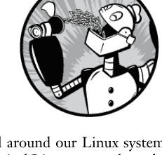

随着我们漫游 Linux 系统，一件事变得非常清楚：典型的 Linux 系统有很多文件！这就提出了一个问题：“我们如何找到东西？”我们已经知道 Linux 文件系统是根据从一代 Unix-like 系统传到下一代的约定来良好组织的，但 sheer 的文件数量可能带来令人望而生畏的问题。

在本章中，我们将介绍两种用于在系统上查找文件的工具。

- `locate` 按名称查找文件
- `find` 在目录层次结构中搜索文件

我们还将介绍一个通常与文件搜索命令一起使用的命令，用于处理 resulting 的文件列表。

- `xargs` 从标准输入构建并执行命令行

此外，我们将介绍几个帮助我们探索的命令。

- `touch` 更改文件时间
- `stat` 显示文件或文件系统状态

## locate—轻松查找文件

`locate` 程序对路径名执行快速数据库搜索，然后输出与给定子字符串匹配的每个名称。举例来说，我们想要找到所有名称以 zip 开头的程序。因为我们正在寻找程序，可以假设包含程序的目录名称会以 `bin/` 结尾。因此，我们可以这样尝试使用 `locate` 来查找文件：

```
[me@linuxbox ~]$ locate bin/zip
```

`locate` 将搜索其路径名数据库并输出包含字符串 `bin/zip` 的任何路径名。

```
/usr/bin/zip
/usr/bin/zipcloak
/usr/bin/zipgrep
/usr/bin/zipinfo
/usr/bin/zipnote
/usr/bin/zipsplit
```

如果搜索要求不那么简单，我们可以结合 `locate` 与其他工具如 `grep` 来设计更有趣的搜索。

```
[me@linuxbox ~]$ locate zip | grep bin
```

```
/bin/bunzip2
/bin/bzip2
/bin/bzip2recover
/bin/gunzip
/bin/gzip
/usr/bin/funzip
/usr/bin/gpg-zip
/usr/bin/preunzip
/usr/bin/prezip
/usr/bin/prezip-bin
/usr/bin/unzip
/usr/bin/unzipsfx
/usr/bin/zip
/usr/bin/zipcloak
/usr/bin/zipgrep
/usr/bin/zipinfo
/usr/bin/zipnote
/usr/bin/zipsplit
```

`locate` 程序已经存在多年，常见的使用变体有几种。在现代 Linux 发行版中最常见的两个是 `slocate` 和 `mlocate`，尽管它们通常通过名为 `locate` 的符号链接访问。`locate` 的不同版本具有重叠的选项集。一些版本包括正则表达式匹配（我们将在第 19 章介绍）和通配符支持。检查 `locate` 的 man 手册以确定安装了哪个版本的 `locate`。

### LOCATE 数据库从何而来？

你可能会注意到，在某些发行版上，系统刚安装后 `locate` 无法工作，但如果第二天再试，它就能正常工作。怎么回事？`locate` 数据库是由另一个名为 `updatedb` 的程序创建的。通常，它作为 `cron` 作业定期运行，即由 `cron` 守护进程在固定间隔执行的任务。配备 `locate` 的大多数系统每天运行一次 `updatedb`。由于数据库不会持续更新，你会注意到使用 `locate` 时非常新的文件不会显示出来。为克服这一点，可以通过成为超级用户并在提示符下手动运行 `updatedb` 来手动运行 `updatedb` 程序。

## find—艰难地查找文件

虽然 `locate` 程序可以根据文件名称单独找到文件，但 `find` 程序会根据多种属性在给定目录（及其子目录）中搜索文件。我们将花费大量时间使用 `find`，因为它具有许多有趣的功能，我们在后续章节开始介绍编程概念时将一遍又一遍地看到。

在最简单的使用中，`find` 会给出一个或多个要搜索的目录名称。例如，要列出我们的主目录，我们可以使用以下命令：

```
[me@linuxbox ~]$ find ~
```

## 测试

在大多数活跃的用户账户上，这会产生一个很长的列表。由于列表被发送到标准输出，我们可以将列表通过管道传递给其他程序。让我们使用 `wc` 来统计文件数量。

```
[me@linuxbox ~]$ find ~ | wc -l
47068
```

哇，我们忙得很！`find` 的美妙之处在于它可以用来识别符合特定条件的 文件。它通过（有点奇怪的）选项、测试和动作的应用来实现这一点。我们先来看测试。

假设我们想要从搜索结果中获取目录列表。为此，我们可以添加以下测试：

```
[me@linuxbox ~]$ find ~ -type d | wc -l
1695
```

添加测试 `-type d` 将搜索限制为目录。相反，我们也可以用此测试将搜索限制为普通文件：

```
[me@linuxbox ~]$ find ~ -type f | wc -l
38737
```

表 17-1 列出了 `find` 支持的常见文件类型测试。

### 表 17-1：find 文件类型

| 文件类型 | 描述 |
|---|---|
| b | 块特殊设备文件 |
| c | 字符特殊设备文件 |
| d | 目录 |
| f | 普通文件 |
| l | 符号链接 |


我们还可以通过添加一些额外的测试按文件大小和文件名进行搜索。让我们查找所有匹配通配符模式 `*.JPG` 且大于一兆字节的普通文件。

```
[me@linuxbox ~]$ find ~ -type f -name "*.JPG" -size +1M | wc -l
840
```

在此示例中，我们添加 `-name` 测试，后跟通配符模式。注意我们将其用引号括起来以防止 shell 进行路径名展开。接下来，我们添加 `-size` 测试，后跟字符串 `+1M`。开头的加号表示我们正在查找大于指定数字的文件。开头的减号会将字符串的含义改为小于指定数字。不使用符号则表示“精确匹配该值”。尾部的字母 `M` 表示度量单位为兆字节。表 17-2 列出了可用于指定单位的字符。

### 表 17-2：find 大小单位

| 字符 | 单位 |
|---|---|
| `b` | 512 字节块。这是未指定单位时的默认值。 |
| `c` | 字节。 |
| `w` | 2 字节字。 |
| `k` | 千字节（单位为 1,024 字节）。 |
| `M` | 兆字节（单位为 1,048,576 字节）。 |
| `G` | 千兆字节（单位为 1,073,741,824 字节）。 |

`find` 支持大量测试。表 17-3 提供了其中常见的测试的概述。请注意，在需要数值参数的情况下，可以应用前面讨论过的 `+` 和 `-` 记法。

### 表 17-3：find 测试

| 测试 | 描述 |
|---|---|
| `-cmin n` | 匹配内容或属性最后修改恰好 *n* 分钟前的 文件或目录。要指定早于 *n* 分钟，使用 `-n`，要指定晚于 *n* 分钟，使用 `+n`。 |
| `-cnewer file` | 匹配内容或属性最后修改时间比 *file* 更近的文件或目录。 |
| `-ctime n` | 匹配内容或属性最后修改 *n*24 小时前的 文件或目录。 |
| `-empty` | 匹配空文件和目录。 |
| `-group name` | 匹配属于组 *name* 的文件或目录。*name* 可以表示为组名或数字组 ID。 |
| `-iname pattern` | 类似于 `-name` 测试，但不区分大小写。 |
| `-inum n` | 匹配具有 inode 编号 *n* 的文件。这对于查找特定 inode 的所有硬链接很有帮助。 |
| `-mmin n` | 匹配内容最后修改 *n* 分钟前的 文件或目录。 |
| `-mtime n` | 匹配内容最后修改 *n*24 小时前的 文件或目录。 |
| `-name pattern` | 匹配具有指定通配符 *pattern* 的文件和目录。 |
| `-newer file` | 匹配内容比指定 *file* 修改得更近的文件和目录。这在编写执行文件备份的 shell 脚本时很有用。每次备份时，更新一个文件（例如日志），然后使用 `find` 来确定自上次更新以来哪些文件已更改。 |
| `-nouser` | 匹配不属于有效用户的文件和目录。这可用于查找属于已删除账户的文件或检测攻击者的活动。 |
| `-nogroup` | 匹配不属于有效组的文件和目录。 |
| Test | Description |
|---|---|
| `-perm mode` | 匹配权限设置为指定模式的文件或目录。`mode` 可以用八进制或符号表示法表示。 |
| `-samefile name` | 类似于 `-inum` 测试。匹配与文件 `name` 共享相同 inode 数字的文件。 |
| `-size n` | 匹配大小为 `n` 的文件。 |
| `-type c` | 匹配类型为 `c` 的文件。 |
| `-user name` | 匹配属于用户 `name` 的文件或目录。用户可以用用户名或数字用户 ID 表示。 |

这不是一个完整的列表。`find` 手册页包含所有细节。

## Operators

即使 `find` 提供了所有测试，我们可能仍然需要更好的方法来描述测试之间的逻辑关系。例如，如果我们需要确定目录中的所有文件和子目录是否具有安全的权限怎么办？我们将查找权限不是 `0600` 的所有文件以及权限不是 `0700` 的目录。幸运的是，`find` 提供了使用逻辑运算符组合测试的方法，以创建更复杂的逻辑关系。要表达上述测试，我们可以这样做：

```
[me@linuxbox ~]$ find ~ \( -type f -not -perm 0600 \) -or \( -type d -not -perm 0700 \)
```

哇！这看起来很奇怪。这一切是什么？实际上，一旦你熟悉它们，运算符并不那么复杂。表 17-4 描述了与 `find` 一起使用的逻辑运算符。

Table 17-4: find Logical Operators

| Operator | Description |

## Operator Description

| Operator | Description |
|---|---|
| `-and` | 如果运算符两侧的测试都为真则匹配。这可以缩短为 `-a`。注意当没有运算符时，`-and` 默认隐含。 |
| `-or` | 如果运算符任一侧的测试为真则匹配。这可以缩短为 `-o`。 |
| `-not` | 如果运算符后面的测试为假则匹配。这可以用感叹号 `!` 缩写。 |
| `( )` | 将测试和运算符组合在一起形成更大的表达式。这用于控制逻辑求值的优先级。默认情况下，`find` 从左到右求值。通常有必要覆盖默认的求值顺序以获得所需的结果。即使不是必需的，有时包含分组字符也有助于提高命令的可读性。请注意，由于括号对 shell 具有特殊含义，因此在使用它们作为命令行参数时必须引用它们以允许它们作为参数传递给 `find`。通常使用反斜杠字符来转义它们。 |

有了这个运算符列表，让我们来分解我们的 `find` 命令。从最高层来看，我们看到我们的测试被安排为两个分组，由 `-or` 运算符分隔。

```
( expression 1 ) -or ( expression 2 )
```

这很有意义，因为我们正在搜索具有一组权限的文件和具有另一组权限的目录。如果我们同时查找文件和目录，为什么使用 `-or` 而不是 `-and`？当 `find` 扫描文件和目录时，每个文件都会被评估以查看它是否匹配指定的测试。我们想知道它是否是一个具有不良权限的文件或一个具有不良权限的目录。它不能同时是两者。所以如果我们展开分组表达式，我们可以这样看：

```
( file with bad perms ) -or ( directory with bad perms )
```

我们的下一个挑战是如何测试“不良权限”。我们如何做到这一点？实际上，我们不会这样做。我们将测试“不是良好权限”，因为我们知道什么是“良好权限”。对于文件，我们将良好定义为 `0600`，对于目录，我们将其定义为 `0700`。测试文件“不是良好”权限的表达式如下：

```
-type f -and -not -perm 0600
```

对于目录如下：

```
-type d -and -not -perm 0700
```

如表 17-4 中所述，`-and` 运算符可以安全地删除，因为它默认隐含。因此，如果我们把这一切重新组合起来，我们就得到了最终的命令。

```
find ~ ( -type f -not -perm 0600 ) -or ( -type d -not -perm 0700 )
```

然而，由于括号对 shell 具有特殊含义，我们必须转义它们以防止 shell 尝试解释它们。在每个括号前加上反斜杠字符即可。

逻辑运算符的另一个重要特性需要理解。假设我们有两个表达式由逻辑运算符分隔。

```
expr1 -operator expr2
```

在所有情况下，`expr1` 总是会执行；然而，运算符将决定是否执行 `expr2`。表 17-5 概述了其工作原理。

## Table 17-5: find AND/OR Logic

Results of expr1 Operator expr2 is . . .

| expr1 的结果 | 运算符 | expr2 是否执行 |
|---|---|---|
| True | `-and` | 总是执行 |
| False | `-and` | 从不执行 |
| True | `-or` | 从不执行 |
| False | `-or` | 总是执行 |

为什么会这样？这是为了提高性能。以 `-and` 为例，我们知道表达式 `expr1 -and expr2` 在 `expr1` 的结果为 false 时不可能为 true，因此没有必要执行 `expr2`。同样，如果我们有表达式 `expr1 -or expr2` 且 `expr1` 的结果为 true，就没有必要执行 `expr2`，因为我们已经知道表达式 `expr1 -or expr2` 为 true。

好吧，这有助于加快速度。为什么这很重要？这很重要，因为我们可以依赖这种行为来控制操作的执行方式，正如我们即将看到的那样。

## 预定义操作


让我们开始工作吧！从`find`命令获得的结果列表很有用，但我们真正想做的是对列表中的项目采取行动。幸运的是，`find`允许根据搜索结果执行操作。有一些预定义的操作和几种应用用户定义操作的方法。首先，让我们看一下表 17-6 中列出的几个预定义操作。

表 17-6：预定义的`find`操作

| 操作 | 描述 |
|---|---|
| `-delete` | 删除当前匹配的文件。 |
| `-ls` | 对匹配的文件执行相当于`ls -dTls`的操作。输出发送到标准输出。 |
| `-print` | 将匹配文件的完整路径名输出到标准输出。如果未指定其他操作，则这是默认操作。 |
| `-quit` | 一旦匹配成功就退出。 |

与测试一样，还有许多其他操作。请参阅`find`手册页以获取完整详细信息。

在第一个示例中，我们执行了以下操作：

```
find ~
```

这会生成我们主目录中包含的每个文件和子目录的列表。它会生成列表，因为如果未指定其他操作，则隐含`-print`操作。因此，我们的命令也可以表示如下：

```
find ~ -print
```

我们可以使用`find`删除符合特定条件的文件。例如，要删除文件扩展名为`.bak`的文件（通常用于指定备份文件），我们可以使用以下命令：

```
find ~ -type f -name '*.bak' -delete
```

在此示例中，会搜索用户主目录（及其子目录）中所有文件名以`.bak`结尾的文件。找到后，它们将被删除。

> **WARNING**
>
> 显而易见的是，使用`-delete`操作时应格外谨慎。始终先通过将`-delete`替换为`-print`操作来测试命令，以确认搜索结果。

在继续之前，让我们再看看逻辑运算符如何影响操作。考虑以下命令：

```
find ~ -type f -name '*.bak' -print
```

正如我们所见，此命令将查找每个常规文件（`-type f`），其名称以 `.bak` 结尾（`-name '*.bak'`），并将每个匹配文件的相对路径名输出到标准输出（`-print`）。然而，命令执行的方式是由各个测试和操作之间的逻辑关系决定的。记住，默认情况下，每个测试和操作之间都存在隐含的 `-and` 关系。我们也可以这样表达命令，以便更清楚地看到逻辑关系：

```
find ~ -type f -and -name '*.bak' -and -print
```

在完整表达了命令之后，让我们看看逻辑运算符如何影响其执行：

| 测试/操作 | 仅在以下情况下执行... |
|---|---|
| `-print` | `-type f` 和 `-name '*.bak'` 为 true |
| `-name '*.bak'` | `-type f` 为 true |
| `-type f` | 总是执行，因为它是 `-and` 关系中的第一个测试/操作。 |

由于测试和操作之间的逻辑关系决定了哪些操作会被执行，我们可以看到测试和操作的顺序很重要。例如，如果我们重新排列测试和操作，使 `-print` 操作成为第一个，命令的行为会大不相同。

```
find ~ -print -and -type f -and -name '*.bak'
```

此版本的命令将打印每个文件（`-print` 操作始终计算为 true），然后测试文件类型和指定的文件扩展名。

## 用户定义操作

除了预定义的动作之外，我们还可以调用任意命令。传统的做法是使用`-exec`动作。该动作的工作方式如下：

```
-exec command {} ;
```

这里，`command`是命令的名称，`{}`是当前路径名的符号表示，而分号是必需的分隔符，表示命令的结束。以下是使用`-exec`来模拟前面讨论过的`-delete`动作的示例：

```
-exec rm '{}' ';'
```

再次，由于大括号和分号字符对`shell`具有特殊含义，因此必须对其进行引用或转义。

也可以交互式地执行用户定义的动作。通过使用`-ok`动作代替`-exec`，可以在执行每个指定命令之前提示用户。

```
find ~ -type f -name 'foo*' -ok ls -l '{}' ';'
< ls ... /home/me/bin/foo > ? y
-rwxr-xr-x 1 me me 224 2007-10-29 18:44 /home/me/bin/foo
< ls ... /home/me/foo.txt > ? y
-rw-r--r-- 1 me me 0 2016-09-19 12:53 /home/me/foo.txt
```

在此示例中，我们搜索以字符串`foo`开头的文件名，并在找到时每次执行命令`ls -l`。使用`-ok`动作会在执行`ls`命令之前提示用户。

## 提高效率

当使用`-exec`动作时，每次找到匹配的文件时都会启动指定命令的新实例。有时我们可能更愿意将所有搜索结果合并并启动命令的单个实例。例如，而不是像这样执行命令：

```
ls -l file1
ls -l file2
```

我们可能更愿意这样执行：

```
ls -l file1 file2
```

这会导致命令只执行一次而不是多次。我们可以通过两种方式实现这一点：传统方式，使用外部命令`xargs`；以及另一种方式，使用`find`本身的新功能。我们先谈谈另一种方式。

通过将尾部的分号字符更改为加号，我们激活了`find`将搜索结果组合成所需命令单次执行的参数列表的能力。回到我们的示例，这将在每次找到匹配文件时执行`ls`：

```
find ~ -type f -name 'foo*' -exec ls -l '{}' ';'
-rwxr-xr-x 1 me me 224 2007-10-29 18:44 /home/me/bin/foo
-rw-r--r-- 1 me me 0 2016-09-19 12:53 /home/me/foo.txt
```

通过将命令更改为以下内容：

```
find ~ -type f -name 'foo*' -exec ls -l '{}' +
-rwxr-xr-x 1 me me 224 2007-10-29 18:44 /home/me/bin/foo
-rw-r--r-- 1 me me 0 2016-09-19 12:53 /home/me/foo.txt
```

我们得到相同的结果，但系统只需执行一次`ls`命令。

## `xargs`

`xargs`命令执行一个有趣的功能。它从标准输入接受输入并将其转换为指定命令的参数列表。以我们的示例为例，我们会这样使用它：

```
find ~ -type f -name 'foo*' -print | xargs ls -l
-rwxr-xr-x 1 me me 224 2007-10-29 18:44 /home/me/bin/foo
-rw-r--r-- 1 me me 0 2016-09-19 12:53 /home/me/foo.txt
```

在这里，我们看到`find`命令的输出被管道传输到`xargs`，后者构建`ls`命令的参数列表然后执行它。

### NOTE

虽然可以放入命令行中的参数数量相当大，但并非无限。创建的命令可能过长而`shell`无法接受。当命令行超过系统支持的最大长度时，`xargs`会使用尽可能多的最大参数执行指定命令，然后重复此过程，直到标准输入耗尽。要查看命令行的最大大小，请使用`--show-limits`选项执行`xargs`。

## 处理奇怪的文件名

类 Unix 系统允许在文件名中嵌入空格（甚至换行符！）。这会导致像`xargs`这样为其他程序构建参数列表的程序出现问题。嵌入的空格将被视为分隔符，结果命令会将每个空格分隔的词解释为单独的参数。为克服此问题，`find`和`xargs`允许可选地使用空字符作为参数分隔符。空字符在 ASCII 中定义为数字零表示的字符（与例如空格字符不同，空格字符在 ASCII 中定义为数字 32 表示的字符）。`find`命令提供`-print0`动作，可生成以空字符分隔的输出，而`xargs`命令具有`--null`（或`-0`）选项，可接受以空字符分隔的输入。以下是一个示例：

```
find ~ -iname '*.jpg' -print0 | xargs --null ls -l
```

使用此技术，我们可以确保所有文件，即使名称中包含嵌入空格的文件，也能得到正确处理。

## 回到游乐场

是时候把`find`用到一些（几乎）实际的用途上了。我们将创建一个游乐场并尝试一些我们学过的内容。

首先，让我们创建一个包含大量子目录和文件的游乐场。

```
[me@linuxbox ~]$ mkdir -p playground/dir-{001..100}
[me@linuxbox ~]$ touch playground/dir-{001..100}/file-{A..Z}
```

惊叹于命令行的强大！通过这两行，我们创建了一个包含 100 个子目录的游乐场目录，每个子目录包含 26 个空文件。用 GUI 试试看！


我们用来完成这项魔术的方法涉及一个熟悉的命令（`mkdir`）、一种奇特的 shell 展开（大括号），以及一个新命令 `touch`。通过将 `mkdir` 与 `-p` 选项（使 `mkdir` 创建指定路径的父目录）结合使用，再加上大括号展开，我们得以创建 100 个子目录。

`touch` 命令通常用于设置或更新文件的访问、更改和修改时间。但是，如果文件名参数是不存在的文件，则会创建一个空文件。

在我们的游乐场中，我们创建了 100 个 `file-A` 的实例。让我们找到它们。

```
[me@linuxbox ~]$ find playground -type f -name 'file-A'
```

请注意，与 `ls` 不同，`find` 不会按排序顺序产生结果。它的顺序由存储设备的布局决定。我们可以通过这种方式确认我们确实有 100 个该文件的实例。

```
[me@linuxbox ~]$ find playground -type f -name 'file-A' | wc -l
100
```

接下来，让我们看看如何根据文件的修改时间来查找文件。这在创建备份或按时间顺序组织文件时很有帮助。为此，我们将首先创建一个参考文件，以便与之比较修改时间。

```
[me@linuxbox ~]$ touch playground/timestamp
```

这会创建一个名为 `timestamp` 的空文件，并将其修改时间设置为当前时间。我们可以使用另一个方便的命令 `stat` 来验证这一点，`stat` 是一种增强版的 `ls`。`stat` 命令揭示了系统对文件及其属性的全部理解。

```
[me@linuxbox ~]$ stat playground/timestamp
File: 'playground/timestamp'
  Size: 0          Blocks: 0        IO Block: 4096 regular empty file
Device: 803h/2051d Inode: 14265061 Links: 1
Access: (0644/-rw-r--r--)  Uid: ( 1001/ me)   Gid: ( 1001/ me)
Access: 2018-10-08 15:15:39.000000000 -0400
Modify: 2018-10-08 15:15:39.000000000 -0400
Change: 2018-10-08 15:15:39.000000000 -0400
```

如果我们再次使用 `touch`，然后用 `stat` 检查文件，我们会看到文件的时间已被更新。

```
[me@linuxbox ~]$ touch playground/timestamp
[me@linuxbox ~]$ stat playground/timestamp
File: 'playground/timestamp'
  Size: 0          Blocks: 0        IO Block: 4096 regular empty file
Device: 803h/2051d Inode: 14265061 Links: 1
Access: (0644/-rw-r--r--)  Uid: ( 1001/ me)   Gid: ( 1001/ me)
Access: 2018-10-08 15:23:33.000000000 -0400
Modify: 2018-10-08 15:23:33.000000000 -0400
Change: 2018-10-08 15:23:33.000000000 -0400
```

接下来，让我们使用 `find` 来更新一些游乐场文件。

```
[me@linuxbox ~]$ find playground -type f -name 'file-B' -exec touch '{}' ';'
```

这会更新所有名为 `file-B` 的游乐场文件。我们将使用 `find` 通过将所有文件与参考文件 `timestamp` 进行比较来识别已更新的文件。

```
[me@linuxbox ~]$ find playground -type f -newer playground/timestamp
```

结果包含所有 100 个 `file-B` 的实例。由于我们在更新 `timestamp` 之后对游乐场中所有名为 `file-B` 的文件执行了 `touch`，因此它们现在比 `timestamp` “更新”，因此可以用 `-newer` 测试来识别。

最后，让我们回到前面执行的坏权限测试，并将其应用于 `playground`。

```
[me@linuxbox ~]$ find playground \( -type f -not -perm 0600 \) -or \( -type d -not -perm 0700 \)
```

此命令列出了 `playground` 中的全部 100 个目录和 2,600 个文件（以及 `timestamp` 和 `playground` 本身，总共 2,702 个），因为其中没有一个符合我们对“良好权限”的定义。凭借我们对运算符和操作的了解，我们可以向此命令添加操作，以将新权限应用于游乐场中的文件和目录。

```
[me@linuxbox ~]$ find playground \( -type f -not -perm 0600 -exec chmod 0600 '{}' ';' \) -or \( -type d -not -perm 0700 -exec chmod 0700 '{}' ';' \)
```

在日常使用中，我们可能更方便地分别发出两个命令，一个用于目录，一个用于文件，而不是这个庞大的复合命令，但很高兴知道我们可以用这种方式来做。重要的是要理解运算符和操作如何结合使用以执行有用的任务。

## `find` 选项

最后，我们有选项，它们用于控制 `find` 搜索的范围。它们可以在构造 `find` 表达式时与其他测试和操作一起使用。表 17-7 列出了最常用的 `find` 选项。

**表 17-7：常用的 find 选项**

| 选项 | 说明 |
|---|---|
| `-depth` | 直接查找以在处理目录本身之前处理目录的文件。此选项在指定 `-delete` 操作时会自动应用。 |
| `-maxdepth levels` | 设置 `find` 在执行测试和操作时将下降到目录树中的最大层数。 |
| `-mindepth levels` | 设置 `find` 在应用测试和操作之前将下降到目录树中的最小层数。 |
| `-mount` | 指示 `find` 不要遍历安装在其他文件系统上的目录。 |
| `-noleaf` | 指示 `find` 不要基于其正在搜索类 Unix 文件系统的假设来优化其搜索。在扫描 DOS/Windows 文件系统和 CD-ROM 时需要此选项。 |

### 总结

很容易看出 `locate` 与 `find` 一样简单而 `find` 复杂。它们各有用途。花时间探索 `find` 的众多功能。它可以通过常规使用来提高你对 Linux 文件系统操作的理解。

# 18 归档与备份


计算机系统管理员的主要任务之一是保持系统数据安全。实现这一目标的一种方式是通过及时备份系统文件。即使你不是系统管理员，复制东西并将大量文件从一个地方移动到另一个地方、从一个设备移动到另一个设备也经常很有用。

在本章中，我们将介绍几种用于管理文件集合的常用程序。这些是文件压缩程序：

- `gzip` 压缩或扩展文件

- `bzip2` 一种块排序文件压缩器

这些是归档程序：

- `tar` 磁带归档实用程序

- `zip` 打包并压缩文件

这是文件同步程序：

- `rsync` 远程文件和目录同步

## 压缩文件

在计算历史的整个过程中，一直存在着将尽可能多的数据放入最小可用空间的斗争，无论该空间是内存、存储设备还是网络带宽。我们今天习以为常的许多数据服务，如手机服务、高清电视或宽带互联网，都得益于有效的数据压缩技术而存在。

数据压缩是从数据中去除冗余的过程。让我们考虑一个想象中的例子。假设我们有一个完全黑色的图片文件，尺寸为 100 像素乘以 100 像素。就数据存储而言（假设每个像素 24 位，即 3 字节），图像将占用 30,000 字节的存储空间。

```
100 × 100 × 3 = 30,000
```

全为一种颜色的图像包含完全冗余的数据。如果我们足够聪明，我们可以以这样的方式编码数据，即我们只需描述我们有一个由 10,000 个黑色像素组成的块。因此，而不是存储包含 30,000 个零的数据块（黑色通常在图像文件中表示为零），我们可以将数据压缩为数字 10,000，后跟一个零来表示我们的数据。这种数据压缩方案称为游程编码，是最基础的压缩技术之一。今天的技术要先进和复杂得多，但基本目标保持不变——消除冗余数据。压缩算法（用于执行压缩的数学技术）可分为两大类。

- 无损。无损压缩保留原始数据中包含的所有数据。这意味着当文件从压缩版本恢复时，恢复的文件与原始未压缩版本完全相同。


有损。另一方面，有损压缩在压缩过程中删除数据以允许应用更多压缩。当有损文件被恢复时，它与原始版本不匹配；相反，它是一个接近的近似。`JPEG`（用于图像）和 `MP3`（用于音乐）是有损压缩的例子。

在我们的讨论中，我们将只关注无损压缩，因为计算机上的大多数数据都不能容忍任何数据丢失。

## gzip

`gzip` 程序用于压缩一个或多个文件。执行时，它会用原始文件的压缩版本替换原始文件。相应的 `gunzip` 程序用于将压缩文件恢复为原始的未压缩形式。下面是一个示例：

```
[me@linuxbox ~]$ ls -l /etc > foo.txt
[me@linuxbox ~]$ ls -l foo.*
-rw-r--r-- 1 me me 15738 2018-10-14 07:15 foo.txt
[me@linuxbox ~]$ gzip foo.txt
[me@linuxbox ~]$ ls -l foo.*
-rw-r--r-- 1 me me 3230 2018-10-14 07:15 foo.txt.gz
[me@linuxbox ~]$ gunzip foo.txt
[me@linuxbox ~]$ ls -l foo.*
-rw-r--r-- 1 me me 15738 2018-10-14 07:15 foo.txt
```

在这个示例中，我们从目录列表创建了一个名为 `foo.txt` 的文本文件。接下来，我们运行 `gzip`，它用名为 `foo.txt.gz` 的压缩版本替换了原始文件。在 `foo.*` 的目录列表中，我们可以看到原始文件已被压缩版本替换，并且压缩版本的大小约为原始文件的五分之一。我们还可以看到压缩文件具有与原始文件相同的权限和时间戳。

接下来，我们运行 `gunzip` 程序来解压缩文件。之后，我们可以看到文件的压缩版本已被原始文件替换，权限和时间戳同样得以保留。

`gzip` 有许多选项，如表 18-1 所描述。

表 18-1：`gzip` 选项

| Option | Long option | Description |

|---|---|---|

| -c | --stdout --to-stdout | Write output to standard output and keep the original files. |

| -d | --decompress --uncompress | Decompress. This causes gzip to act like gunzip. |

| -f | --force | Force compression even if a compressed version of the original file already exists. |

| -h | --help | Display usage information. |

| -l | --list | List compression statistics for each file compressed. |

| -r | --recursive | If one or more arguments on the command line is a directory, recursively compress files contained within them. |

| -t | --test | Test the integrity of a compressed file. |

| -v | --verbose | Display verbose messages while compressing. |

| -number |  | Set amount of compression. number is an integer in the range of 1 (fastest, least compression) to 9 (slowest, most compression). The values 1 and 9 may also be expressed as --fast and --best, respectively. The default value is 6. |

让我们回到之前的示例。

```
[me@linuxbox ~]$ gzip foo.txt
[me@linuxbox ~]$ gzip -tv foo.txt.gz
foo.txt.gz: OK
[me@linuxbox ~]$ gzip -d foo.txt.gz
```

在这里，我们用名为 `foo.txt.gz` 的压缩版本替换了 `foo.txt`。接下来，我们使用 `-t` 和 `-v` 选项测试了压缩版本的完整性。最后，我们将文件解压缩为原始形式。

`gzip` 还可以通过标准输入和输出以有趣的方式使用。

```
[me@linuxbox ~]$ ls -l /etc | gzip > foo.txt.gz
```

此命令创建了目录列表的压缩版本。

`gunzip` 程序用于解压缩 `gzip` 文件，它假定文件名以扩展名 `.gz` 结尾，因此无需指定它，只要指定的名称不与现有未压缩文件冲突即可。

```
[me@linuxbox ~]$ gunzip foo.txt
```

如果我们的目标只是查看压缩文本文件的内容，我们可以这样做：

```
[me@linuxbox ~]$ gunzip -c foo.txt | less
```

另外，`gzip` 随附有一个名为 `zcat` 的程序，它等同于带 `-c` 选项的 `gunzip`。它可以像 `cat` 命令一样用于 `gzip` 压缩文件。

```
[me@linuxbox ~]$ zcat foo.txt.gz | less
```

## TIP

*There is a zless program, too. It performs the same function as the previous pipeline.*

## bzip2

`bzip2` 程序由 Julian Seward 编写，与 `gzip` 类似，但使用不同的压缩算法，在压缩速度的代价下实现了更高的压缩率。在大多数方面，它的工作方式与 `gzip` 相同的方式。 用 `bzip2` 压缩的文件使用 `.bz2` 作为扩展名。

```
[me@linuxbox ~]$ ls -l /etc > foo.txt
[me@linuxbox ~]$ ls -l foo.txt
-rw-r--r-- 1 me me 15738 2018-10-17 13:51 foo.txt
[me@linuxbox ~]$ bzip2 foo.txt
[me@linuxbox ~]$ ls -l foo.txt.bz2
-rw-r--r-- 1 me me 2792 2018-10-17 13:51 foo.txt.bz2
[me@linuxbox ~]$ bunzip2 foo.txt.bz2
```

正如我们所见，`bzip2` 可以像 `gzip` 一样使用。 我们为 `gzip` 讨论过的所有选项（`-r` 除外）也在 `bzip2` 中受支持。 需要注意的是，压缩级别选项（`-number`）对 `bzip2` 来说含义略有不同。 `bzip2` 带有 `bunzip2` 和 `bzip2` 用于解压缩文件。

`bzip2` 还附带 `bzip2recover` 程序，它会尝试恢复损坏的 `.bz2` 文件。

## 不要成为压缩强迫症

我偶尔会看到有人尝试对已经使用有效压缩算法压缩过的文件进行压缩，比如这样做：

```
$ gzip picture.jpg
```

不要这样做。 你很可能只是在浪费时间和空间！ 如果你对已经压缩的文件应用压缩，通常会得到一个更大的文件。 这是因为所有压缩技术都会在文件中添加一些开销来描述压缩。 如果你尝试压缩一个已经不包含冗余信息的文件，压缩通常不会产生任何节省来抵消额外的开销。

## 归档文件

与压缩经常一起使用的常见文件管理任务是归档。 归档是将许多文件收集起来捆绑到单个大文件中的过程。 归档通常作为系统备份的一部分进行。 它也用于将旧数据从系统移动到某种长期存储。

## tar

在类 Unix 的软件世界中，`tar` 程序是归档文件的经典工具。 它的名字，缩写自 tape archive，揭示了它作为制作备份磁带的工具的根源。 虽然它仍然用于该传统任务，但在其他存储设备上同样擅长。 我们经常看到以 `.tar` 或 `.tgz` 结尾的文件名，分别表示“普通”`tar` 归档和 `gzipped` 归档。 `tar` 归档可以由一组单独的文件、一个或多个目录层次结构，或两者的混合组成。 命令语法如下：

```
tar mode[options] pathname...
```

这里，`mode` 是表 18-2 中列出的操作模式之一（此处仅显示部分列表；请参阅 `tar` 手册页以获取完整列表）。

Table 18-2: `tar` Modes

| Mode | Description |

|------|-------------|

| c | Create an archive from a list of files and/or directories. |

| x | Extract an archive. |


| `r` | Append specified pathnames to the end of an archive. |
| `t` | List the contents of an archive. |

`tar` 使用一种略显奇怪的方式来表达选项，因此我们需要一些示例来展示其工作原理。首先，让我们重新创建上一章中的 `playground`。

```
[me@linuxbox ~]$ mkdir -p playground/dir-{001..100}
[me@linuxbox ~]$ touch playground/dir-{001..100}/file-{A..Z}
```

接下来，让我们创建整个 `playground` 的 `tar` 归档。

```
[me@linuxbox ~]$ tar cf playground.tar playground
```

此命令创建一个名为 `playground.tar` 的 `tar` 归档，其中包含整个 `playground` 目录层次结构。我们可以看到 `mode` 和用于指定 `tar` 归档名称的 `f` 选项可以合并在一起，并且不需要前导连字符。需要注意的是，`mode` 必须始终首先指定，在任何其他选项之前。

要列出归档的内容，我们可以这样做：

```
[me@linuxbox ~]$ tar tf playground.tar
```

为了获得更详细的列表，我们可以添加 `v`（verbose）选项。

```
[me@linuxbox ~]$ tar tvf playground.tar
```

现在，让我们在新位置提取 `playground`。我们将通过创建一个名为 `foo` 的新目录、更改目录并提取 `tar` 归档来实现。

```
[me@linuxbox ~]$ mkdir foo
[me@linuxbox ~]$ cd foo
[me@linuxbox foo]$ tar xf ../playground.tar
[me@linuxbox foo]$ ls
playground
```

如果我们检查 `~/foo/playground` 的内容，我们会看到归档已成功安装，创建了原始文件的精确复制。然而，有一个需要注意的地方。除非我们以超级用户身份操作，否则从归档中提取的文件和目录将采用执行恢复的用户的所有权，而不是原始所有者。

`tar` 的另一个有趣行为是它处理归档中路径名的方式。路径名的默认值是相对的，而不是绝对的。`tar` 通过简单地删除路径名中的前导斜杠来实现这一点

when creating the archive. To demonstrate, we will re-create our archive, this time specifying an absolute pathname.

```
[me@linuxbox foo]$ cd
[me@linuxbox ~]$ tar cf playground2.tar ~/playground
```

Remember, `~/playground` will expand into `/home/me/playground` when we press ENTER, so we will get an absolute pathname for our demonstration. Next, we will extract the archive as before and watch what happens.

```
[me@linuxbox ~]$ cd foo
[me@linuxbox foo]$ tar xf ../playground2.tar
[me@linuxbox foo]$ ls
home  playground
[me@linuxbox foo]$ ls home
me
[me@linuxbox foo]$ ls home/me
playground
```

Here we can see that when we extracted our second archive, it recreated the directory `home/me/playground` relative to our current working directory, `~/foo`, not relative to the root directory, as would have been the case with an absolute pathname. This might seem like an odd way for it to work, but it’s actually more useful this way because it allows us to extract archives to any location rather than being forced to extract them to their original locations. Repeating the exercise with the inclusion of the verbose option (`v`) will give a clearer picture of what’s going on.

### 实际示例

Let’s consider a hypothetical, yet practical, example of `tar` in action. Imagine we want to copy the home directory and its contents from one system to another and we have a large USB hard drive that we can use for the transfer. On our modern Linux system, the drive is “automagically” mounted in the `/media` directory. Let’s also imagine that the disk has a volume name of `BigDisk` when we attach it. To make the `tar` archive, we can do the following:

```
[me@linuxbox ~]$ sudo tar cf /media/BigDisk/home.tar /home
```

After the `tar` file is written, we unmount the drive and attach it to the second computer. Again, it is mounted at `/media/BigDisk`. To extract the archive, we do this:

```
[me@linuxbox2 ~]$ cd /
[me@linuxbox2 /]$ sudo tar xf /media/BigDisk/home.tar
```

What’s important to see here is that we must first change directory to `/` so that the extraction is relative to the root directory since all pathnames within the archive are relative.

### 选择性提取

When extracting an archive, it’s possible to limit what is extracted from the archive. For example, if we wanted to extract a single file from an archive, it could be done like this:

```
tar xf archive.tar pathname
```

By adding the trailing `pathname` to the command, `tar` will restore only the specified file. Multiple pathnames may be specified. Note that the `pathname` must be the full, exact relative pathname as stored in the archive. When specifying pathnames, wildcards are not normally supported; however, the GNU version of `tar` (which is the version most often found in Linux distributions) supports them with the `--wildcards` option. Here is an example using our previous `playground.tar` file:


# tar 使用示例

```
[me@linuxbox ~]$ cd foo
[me@linuxbox foo]$ tar xf ../playground2.tar --wildcards
'home/me/playground/dir-*/file-A'
```

此命令将仅提取与指定路径名匹配的文件，包括通配符 `dir-*`。

`tar` 通常与 `find` 结合使用来生成归档文件。在此示例中，我们将使用 `find` 来生成要包含在归档中的文件集。

```
[me@linuxbox ~]$ find playground -name 'file-A' -exec tar rf playground.tar '{}' '+'
```

在此，我们使用 `find` 匹配 `playground` 中所有名为 `file-A` 的文件，然后使用 `-exec` 动作调用 `tar` 以追加模式 `r` 将匹配的文件添加到归档 `playground.tar` 中。

使用 `tar` 与 `find` 是创建目录树或整个系统的增量备份的好方法。通过使用 `find` 匹配比时间戳文件更新的文件，我们可以创建仅包含自上次归档以来更新的文件的归档，前提是时间戳文件在每次归档创建后立即更新。

`tar` 还可以同时使用标准输入和输出。以下是综合示例：

```
[me@linuxbox foo]$ cd
[me@linuxbox ~]$ find playground -name 'file-A' | tar cf - --files-from=- | gzip > playground.tgz
```

在此示例中，我们使用 `find` 程序生成匹配文件的列表并将其通过管道传输到 `tar`。如果指定文件名 `-`，则表示标准输入或输出，具体取决于需要。顺便说一下，使用 `-` 表示标准输入/输出的约定也被许多其他程序使用。`--files-from` 选项（也可以指定为 `-T`）使 `tar` 从文件而不是命令行读取路径名列表。最后，`tar` 生成的归档被通过管道传输到 `gzip` 以创建压缩归档 `playground.tgz`。`.tgz` 扩展名是 `gzip` 压缩的 `tar` 文件的常规扩展名。`.tar.gz` 扩展名有时也使用。

虽然我们使用外部的 `gzip` 程序来生成压缩归档，但现代版本的 GNU `tar` 使用 `z` 和 `j` 选项分别直接支持 `gzip` 和 `bzip2` 压缩。以之前的示例为基础，我们可以这样简化：

```
[me@linuxbox ~]$ find playground -name 'file-A' | tar czf playground.tgz -T -
```

如果我们想创建 `bzip2` 压缩的归档，则可以这样做：

`writes .zip files.` 在 Linux 中，`gzip` 是主要的压缩程序，`bzip2` 紧随其后。

# zip 使用示例

在最基本的使用中，`zip` 的调用方式如下：

```
zip options zipfile file...
```

例如，要制作 `playground` 的 `zip` 归档，我们可以这样做：

```
[me@linuxbox ~]$ zip -r playground.zip playground
```

除非包含 `-r` 选项用于递归，否则仅存储 `playground` 目录本身，而不包含其内容。虽然 `.zip` 扩展名的添加是自动的，但我们为清晰起见仍包含文件扩展名。

在创建 `zip` 归档期间，`zip` 通常会显示如下一系列消息：

```
adding: playground/dir-020/file-Z (stored 0%)
adding: playground/dir-020/file-Y (stored 0%)
adding: playground/dir-020/file-X (stored 0%)
adding: playground/dir-087/ (stored 0%)
adding: playground/dir-087/file-S (stored 0%)
```

这些消息显示添加到归档中的每个文件的状态。`zip` 会使用两种存储方法之一将文件添加到归档中：要么“存储”文件而不压缩，如此处所示，要么“deflate”文件以执行压缩。存储方法后显示的数值表示实现的压缩量。由于我们的 `playground` 仅包含空文件，因此其内容不会被压缩。

使用 `unzip` 程序提取 `zip` 文件的内容非常简单。

```
[me@linuxbox ~]$ cd foo
[me@linuxbox foo]$ unzip ../playground.zip
```


## Zip Archive Update and Selective Extraction

One thing to note about `zip` (as opposed to `tar`) is that if an existing archive is specified, it is updated rather than replaced. This means the existing archive is preserved, but new files are added, and matching files are replaced.

We can list and extract files selectively from a `zip` archive by specifying them to `unzip`.

```
[me@linuxbox ~]$ unzip -l playground.zip playground/dir-087/file-Z
Archive:  ../playground.zip
  Length      Date    Time    Name
---------  ---------- -----   ----
        0  10-05-18 09:25   playground/dir-087/file-Z
---------                     -------
        0                     1 file
[me@linuxbox ~]$ cd foo
[me@linuxbox foo]$ unzip ../playground.zip playground/dir-087/file-Z
Archive:  ../playground.zip
replace playground/dir-087/file-Z? [y]es, [n]o, [A]ll, [N]one, [r]ename:
y
extracting: playground/dir-087/file-Z
```

Using the `-l` option causes `unzip` to merely list the contents of the archive without extracting the file. If no files are specified, `unzip` will list all files in the archive. The `-v` option can be added to increase the verbosity of the listing. Note that when the archive extraction conflicts with an existing file, the user is prompted before the file is replaced.

Like `tar`, `zip` can make use of standard input and output, though its implementation is somewhat less useful. It is possible to pipe a list of filenames to `zip` via the `-@` option.

```
[me@linuxbox foo]$ cd
[me@linuxbox ~]$ find playground -name "file-A" | zip -@ file-A.zip
```

Here we use `find` to generate a list of files matching the test `-name "file-A"` and then pipe the list into `zip`, which creates the archive `file-A.zip` containing the selected files.

`zip` also supports writing its output to standard output, but its use is limited because few programs can make use of the output. Unfortunately, the `unzip` program does not accept standard input. This prevents `zip` and `unzip` from being used together to perform network file copying like `tar`.

`zip` can, however, accept standard input, so it can be used to compress the output of other programs.

```
[me@linuxbox ~]$ ls -l /etc/ | zip ls-etc.zip -
adding: - (deflated 80%)
```

In this example, we pipe the output of `ls` into `zip`. Like `tar`, `zip` interprets the trailing dash as “use standard input for the input file.”

The `unzip` program allows its output to be sent to standard output when the `-p` (for pipe) option is specified.

```
[me@linuxbox ~]$ unzip -p ls-etc.zip | less
```

We touched on some of the basic things that `zip`/`unzip` can do. They both have a lot of options that add to their flexibility, though some are platform specific to other systems. The man pages for both `zip` and `unzip` are pretty good and contain useful examples; however, the main use of these programs is for exchanging files with Windows systems, rather than performing compression and archiving on Linux, where `tar` and `gzip` are greatly preferred.

## Synchronizing Files and Directories

A common strategy for maintaining a backup copy of a system involves keeping one or more directories synchronized with another directory (or directories) located on either the local system (usually a removable storage device of some kind) or a remote system. We might, for example, have a local copy of a website under development and synchronize it from time to time with the “live” copy on a remote web server.

In the Unix-like world, the preferred tool for this task is `rsync`. This program can synchronize both local and remote directories by using the `rsync` remote-update protocol, which allows `rsync` to quickly detect the differences between two directories and perform the minimum amount of copying required to bring them into sync. This makes `rsync` very fast and economical to use, compared to other kinds of copy programs.

`rsync` is invoked like this:

```
rsync options source destination
```

where `source` and `destination` are one of the following:

- A local file or directory
- A remote file or directory in the form of `[user@]host:path`


- A remote `rsync` server specified with a URI of `rsync://[user@]host[:port]/path`

Note that either the source or the destination must be a local file. Remote-to-remote copying is not supported.

Let’s try `rsync` on some local files. First, let’s clean out our `foo` directory.

```
[me@linuxbox ~]$ rm -rf foo/*
```

Next, we’ll synchronize the `playground` directory with a corresponding copy in `foo`.

```
[me@linuxbox ~]$ rsync -av playground foo
```

We’ve included both the `-a` option (for archiving—causes recursion and preservation of file attributes) and the `-v` option (verbose output) to make a mirror of the `playground` directory within `foo`. While the command runs, we will see a list of the files and directories being copied. At the end, we will see a summary message like this indicating the amount of copying performed:

```
sent 135759 bytes  received 57870 bytes  387258.00 bytes/sec
total size is 3230  speedup is 0.02
```

If we run the command again, we will see a different result.

```
[me@linuxbox ~]$ rsync -av playground foo
building file list ... done

sent 22635 bytes  received 20 bytes  45310.00 bytes/sec
total size is 3230  speedup is 0.14
```

Notice that there was no listing of files. This is because `rsync` detected that there were no differences between `~/playground` and `~/foo/playground`, and therefore it didn’t need to copy anything. If we modify a file in `playground` and run `rsync` again:

```
[me@linuxbox ~]$ touch playground/dir-099/file-Z
[me@linuxbox ~]$ rsync -av playground foo
building file list ... done
playground/dir-099/file-Z
sent 22685 bytes  received 42 bytes  45454.00 bytes/sec
total size is 3230  speedup is 0.14
```

we see that `rsync` detected the change and copied only the updated file.

There is a subtle but useful feature we can use when we specify an `rsync` source. Let’s consider two directories.

```
[me@linuxbox ~]$ ls
source      destination
```

Directory `source` contains one file named `file1`, and directory `destination` is empty. If we perform a copy of `source` to `destination` like so:

```
[me@linuxbox ~]$ rsync source destination
```

then `rsync` copies the directory `source` into `destination`.

```
[me@linuxbox ~]$ ls destination
source
```

However, if we append a trailing `/` to the `source` directory name, `rsync` will copy only the contents of the source directory and not the directory itself.

```
[me@linuxbox ~]$ rsync source/ destination
[me@linuxbox ~]$ ls destination
file1
```

This is handy if we want only the contents of a directory copied without creating another level of directories within the destination. We can think of it as being like `source/*` in its outcome, but this method will copy all of the source directory’s content including the hidden files.

As a practical example, let’s consider the imaginary external hard drive that we used earlier with `tar`. If we attach the drive to our system and, once again, it is mounted at `/media/BigDisk`, we can perform a useful system backup by first creating a directory named `/backup` on the external drive and then using `rsync` to copy the most important stuff from our system to the external drive.

```
[me@linuxbox ~]$ mkdir /media/BigDisk/backup
[me@linuxbox ~]$ sudo rsync -av --delete /etc /home /usr/local /media/BigDisk/backup
```

In this example, we copied the `/etc`, `/home`, and `/usr/local` directories from our system to our imaginary storage device. We included the `--delete` option to remove files that may have existed on the backup device that no longer existed on the source device (this is irrelevant the first time we make a backup but will be useful on subsequent copies). Repeating the procedure of attaching the external drive and running this `rsync` command would be a useful (though not ideal) way of keeping a small system backed up. Of course, an alias would be helpful here, too. We could create an alias and add it to our `.bashrc` file to provide this feature.

```
alias backup='sudo rsync -av --delete /etc /home /usr/local /media/BigDisk/backup'
```


Now all we have to do is attach our external drive and run the backup command to do the job.

## Using rsync over a Network

`rsync` 的真正美妙之处之一在于它可以用于通过网络复制文件。毕竟，`rsync` 中的 `r` 代表 “remote”（远程）。远程复制可以通过两种方式完成。第一种方式是使用另一台已安装 `rsync` 以及远程 shell 程序（如 `ssh`）的系统。假设我们在本地网络上有一台硬盘空间充足的系统，并且我们想使用远程系统而不是外部驱动器来执行备份操作。假设该系统上已经有一个名为 `/backup` 的目录，我们可以在其中存放文件，我们可以这样做：

```
[me@linuxbox ~]$ sudo rsync -av --delete --rsh=ssh /etc /home /usr/local remote-sys:/backup
```

我们对命令做了两处修改以便于网络复制。首先，我们添加了 `--rsh=ssh` 选项，这指示 `rsync` 使用 `ssh` 程序作为其远程 shell。这样，我们就能使用 `ssh` 加密隧道安全地将数据从本地系统传输到远程主机。其次，我们通过在其名称前加上远程主机名（在本例中远程主机名为 `remote-sys`）来指定远程主机。

`rsync` 用于通过网络同步文件的第二种方式是使用 `rsync` 服务器。`rsync` 可以配置为作为守护进程运行并监听同步请求的传入连接。这通常用于允许远程系统的镜像。例如，Red Hat Software 在其 Fedora 发行版的开发软件包下维护了一个庞大的软件仓库。在发行版发布周期的测试阶段，让软件测试人员镜像此集合非常有用。由于仓库中的文件经常更改（通常每天多次），因此通过定期同步而不是通过批量复制仓库来维护本地镜像是可取的。其中一个仓库保存在杜克大学；我们可以使用本地的 `rsync` 副本和他们的 `rsync` 服务器像这样进行镜像：

```
[me@linuxbox ~]$ mkdir fedora-devel
[me@linuxbox ~]$ rsync -av --delete
rsync://archive.linux.duke.edu/fedora/
linux/development/rawhide/Everything/x86_64/os/ fedora-devel
```

在此示例中，我们使用远程 `rsync` 服务器的 URI，它由协议（`rsync://`）组成，后跟远程主机名（`archive.linux.duke.edu`），后跟仓库的路径名。

### Summing Up

我们已经查看了 Linux 和其他类 Unix 操作系统上常用的压缩和归档程序。对于归档文件，`tar/gzip` 组合是类 Unix 系统上的首选方法，而 `zip/unzip` 则用于与 Windows 系统的互操作性。最后，我们查看了 `rsync` 程序（个人最爱），它非常适合在系统之间高效同步文件和目录。

## 19

## REGULAR EXPRESSIONS


在接下来的几章中，我们将研究用于操作文本的工具。正如我们所见，文本数据在所有类 Unix 系统（如 Linux）上都发挥着重要作用。但在我们充分欣赏这些工具提供的所有功能之前，首先必须研究一种经常与这些工具的最复杂用法相关联的技术——*regular expressions*。

在我们浏览命令行提供的众多功能和设施时，我们遇到了一些真正晦涩的功能，例如 shell 展开和引用、键盘快捷键和命令历史，更不用说 `vi` 编辑器了。正则表达式延续了这一“传统”，可能是其中（可以说）最晦涩的功能。这并不意味着学习它们所需的时间不值得付出。恰恰相反。良好的理解将使我们能够完成惊人的壮举，尽管其全部价值可能并不立即显现。

## What Are Regular Expressions?

简单来说，正则表达式是用于识别文本中模式的符号表示。在某种程度上，它们类似于 shell 的通配符

method of matching file and pathnames but on a much grander scale. Regular expressions are supported by many command line tools and by most programming languages to facilitate the solution of text manipulation problems. However, to further confuse things, not all regular expressions are the same; they vary slightly from tool to tool and from programming language to language. For our discussion, we will limit ourselves to regular expressions as described in the POSIX standard (which will cover most of the command line tools), as opposed to many programming languages (most notably Perl), which use slightly larger and richer sets of notations.

## grep

The main program we will use to work with regular expressions is our old pal `grep`. The name `grep` is actually derived from the phrase “global regular expression print,” so we can see that `grep` has something to do with regular expressions. In essence, `grep` searches text files for text matching a specified regular expression and outputs any line containing a match to standard output.

So far, we have used `grep` with fixed strings, like so:

```
[me@linuxbox ~]$ ls /usr/bin | grep zip
```

This will list all the files in the `/usr/bin` directory whose names contain the substring `zip`.

The `grep` program accepts options and arguments this way, where `regex` is a regular expression:

```
grep [options] regex [file...]
```

Table 19-1 describes the commonly used `grep` options.

Table 19-1: grep Options

| Option | Long option | Description |

|---|---|---|

| `-i` | `--ignore-case` | Ignore case. Do not distinguish between uppercase and lowercase characters. |

| `-v` | `--invert-match` | Invert match. Normally, `grep` prints lines that contain a match. This option causes `grep` to print every line that does not contain a match. |

| `-c` | `--count` | Print the number of matches (or non-matches if the `-v` option is also specified) instead of the lines themselves. |

| `-l` | `--files-with-matches` | Print the name of each file that contains a match instead of the lines themselves. |

| `-L` | `--files-without-match` | Like the `-l` option, but print only the names of files that do not contain matches. |


| `-n` | `--line-number` | Prefix each matching line with the number of the line within the file. |
| `-h` | `--no-filename` | For multifile searches, suppress the output of filenames. |

To more fully explore `grep`, let’s create some text files to search.

```
[me@linuxbox ~]$ ls /bin > dirlist-bin.txt
[me@linuxbox ~]$ ls /usr/bin > dirlist-usr-bin.txt
[me@linuxbox ~]$ ls /sbin > dirlist-sbin.txt
[me@linuxbox ~]$ ls /usr/sbin > dirlist-usr-sbin.txt
[me@linuxbox ~]$ ls dirlist*.txt
dirlist-bin.txt  dirlist-sbin.txt  dirlist-usr-sbin.txt
dirlist-usr-bin.txt
```

We can perform a simple search of our list of files like this:

```
[me@linuxbox ~]$ grep bzip dirlist*.txt
dirlist-bin.txt:bzip2
```

```
dirlist-bin.txt:bzip2recover
```

In this example, `grep` searches all the listed files for the string `bzip` and finds two matches, both in the file `dirlist-bin.txt`. If we were interested only in the list of files that contained matches rather than the matches themselves, we could specify the `-l` option.

```
[me@linuxbox ~]$ grep -l bzip dirlist*.txt
dirlist-bin.txt
```

Conversely, if we wanted to see only a list of the files that did not contain a match, we could do this:

```
[me@linuxbox ~]$ grep -L bzip dirlist*.txt
dirlist-sbin.txt
dirlist-usr-bin.txt
dirlist-usr-sbin.txt
```

## Metacharacters and Literals

While it might not seem apparent, our `grep` searches have been using regular expressions all along, albeit very simple ones. The regular expression `bzip` is taken to mean that a match will occur only if the line in the file contains at least four characters and that somewhere in the line the characters `b`, `z`, `i`, and `p` are found in that order, with no other characters in between. The characters in the string `bzip` are all literal characters, in that they match themselves. In addition to literals, regular expressions may also include metacharacters that are used to specify more complex matches. Regular expression metacharacters consist of the following:

```
^ $ . [ ] { } - ? * + ( ) | \
```

All other characters are considered literals, though the backslash character is used in a few cases to create metasequences, as well as allowing the metacharacters to be escaped and treated as literals instead of being interpreted as metacharacters.

### NOTE

正如我们所见，许多正则表达式元字符也是在展开时对 shell 具有意义的字符。当我们在命令行上传递包含元字符的正则表达式时，必须将其用引号括起来，以防止 shell 尝试展开它们。

## The Any Character

我们要看的第一个元字符是点 `(.)` 或句点字符，用于匹配任意字符。如果我们将其包含在正则表达式中，它将匹配该字符位置中的任意字符。以下是一个示例：

```
[me@linuxbox ~]$ grep -h '.zip' dirlist*.txt
bunzip2
bzip2
bzip2recover
gunzip
gzip
funzip
gpg-zip
preunzip
prezip
prezip-bin
unzip
unzipsfx
```

我们搜索了文件中与正则表达式 `.zip` 匹配的任意行。关于结果，有几件有趣的事情需要注意。请注意，`zip` 程序未被找到。这是因为我们在正则表达式中包含点元字符，使所需匹配的长度增加到四个字符，而名称 `zip` 仅包含三个字符，因此不匹配。此外，如果我们的列表中包含任何文件扩展名为 `.zip` 的文件，它们也会被匹配，因为文件扩展名中的句点字符也会被“任意字符”匹配。

## Anchors

插入号 (`^`) 和美元符号 (`$`) 在正则表达式中被视为 *锚点*。这意味着它们仅在正则表达式出现在行首 (`^`) 或行尾 (`$`) 时才导致匹配发生。

```
[me@linuxbox ~]$ grep -h '^zip' dirlist*.txt
zip
zipcloak
zipgrep
zipinfo
zipnote
zipsplit
[me@linuxbox ~]$ grep -h 'zip$' dirlist*.txt
gunzip
gzip
funzip
gpg-zip
preunzip
prezip
unzip
zip
[me@linuxbox ~]$ grep -h '^zip$' dirlist*.txt
zip
```

在这里，我们搜索文件列表中位于行首、行尾以及同时位于行首和行尾的字符串 `zip`（即单独一行）。请注意，正则表达式 `^$`（开头和结尾之间没有任何内容）将匹配空白行。

## A CROSSWORD PUZZLE HELPER

即使我们目前对正则表达式的了解有限，我们也可以做一些有用的事情。

我妻子喜欢填字游戏，她有时会请我帮忙解答某个问题。比如，“第三个字母是 `j`、最后一个字母是 `r` 的五字母单词是什么意思……？” 这类问题让我思考。

你知道你的 Linux 系统包含一个词典吗？确实如此。查看 `/usr/share/dict` 目录，你可能会找到一个或多个词典。那里的词典文件只是按字母顺序排列的长单词列表，每行一个单词。在我的系统上，`words` 文件包含略多于 98,500 个单词。要找到上面填字游戏问题的可能答案，我们可以这样做：

```
[me@linuxbox ~]$ grep -i '^..j.r$' /usr/share/dict/words
Major
major
```

使用此正则表达式，我们可以找到词典文件中所有长度为五个字母、第三个位置为 `j`、最后一个位置为 `r` 的单词。

## Bracket Expressions and Character Classes

除了在正则表达式的给定位置匹配任意字符外，我们还可以通过使用括号表达式来匹配来自指定字符集的单个字符。使用括号表达式，我们可以指定一组字符（包括否则会被解释为元字符的字符）以进行匹配。在此示例中，使用一个包含两个字符的集合，我们匹配包含字符串 `bzip` 或 `gzip` 的任意行：

```
[me@linuxbox ~]$ grep -h '[bg]zip' dirlist*.txt
bzip2
bzip2recover
gzip
```

一个集合可以包含任意数量的字符，并且元字符在放在括号内时会失去其特殊含义。然而，在括号表达式中使用元字符并具有不同含义的情况有两种。第一种是插入号 (`^`)，它用于


表示否定；第二个是连字符 (`-`)，用于表示字符范围。

## 否定

如果方括号表达式中的第一个字符是插入符号 (`^`)，则剩余字符将被视为在给定字符位置上不得出现的字符集。我们通过修改之前的示例来实现这一点，如下所示：

```
[me@linuxbox ~]$ grep -h '[ ^bg]zip' dirlist*.txt
bunzip2
gunzip
funzip
gpg-zip
preunzip
prezip
prezip-bin
unzip
unzipsfx
```

启用否定后，我们得到的文件列表包含以除 `b` 或 `g` 之外的任意字符开头的字符串 `zip`。请注意，文件 `zip` 未被找到。否定的字符集仍然需要在给定位置有一个字符，但该字符不得是否定集合的成员。

插入符号字符仅在它是方括号表达式中的第一个字符时才调用否定；否则，它会失去其特殊含义并成为集合中的普通字符。

## 传统字符范围

如果我们想构造一个正则表达式来查找列表中以大写字母开头的所有文件，可以这样做：

```
[me@linuxbox ~]$ grep -h '^[A BCDEFGHIJKLMNOPQRSTUVWXYZ]' dirlist*.txt
```

这只是将全部 26 个大写字母放在方括号表达式中即可。但想到要输入这么多内容令人深感不安，所以这里是另一种方法。

```
[me@linuxbox ~]$ grep -h '^\[A-Z\]' dirlist*.txt
```

- `MAKEDEV`
- `ControlPanel`
- `GET`
- `HEAD`
- `POST`
- `X`
- `X11`
- `Xorg`
- `MAKEFLOPPY`
- `NetworkManager`
- `NetworkManagerDispatcher`

通过使用三个字符的范围，我们可以缩写 26 个字母。任何字符范围都可以用这种方式表示，包括多个范围，例如此表达式匹配以字母和数字开头的所有文件名：

```
[me@linuxbox ~]$ grep -h '^\[A-Za-z0-9\]' dirlist*.txt
```

在字符范围中，我们看到连字符被特殊处理，那么如何在方括号表达式中实际包含连字符字符呢？方法是将其作为表达式中的第一个字符。考虑以下两个示例：

```
[me@linuxbox ~]$ grep -h '[A-Z]' dirlist*.txt
```

这将匹配包含大写字母的每个文件名。以下内容将匹配包含连字符或大写字母 `A` 或大写字母 `Z` 的每个文件名：

```
[me@linuxbox ~]$ grep -h '[\-AZ]' dirlist*.txt
```

## POSIX 字符类

传统字符范围是一种易于理解且有效的方法来处理快速指定字符集的问题。不幸的是，它们并不总是有效。虽然我们迄今为止使用 `grep` 时尚未遇到任何问题，但在使用其他程序时可能会遇到问题。

在第 4 章中，我们研究了如何使用通配符执行路径名展开。在那次讨论中，我们说字符范围可以以几乎与在正则表达式中相同的方式使用，但问题如下：

```
[me@linuxbox ~]$ ls /usr/sbin/[ABCDEFGHIJKLMNOPQRSTUVWXYZ]*
/usr/sbin/ModemManager
/usr/sbin/NetworkManager
```

（根据 Linux 发行版的不同，我们会得到不同的文件列表，可能为空列表。此示例来自 Ubuntu。）此命令产生预期结果——仅列出名称以大写字母开头的文件，但使用以下命令我们会得到完全不同的结果（仅显示部分结果）：

```
[me@linuxbox ~]$ ls /usr/sbin/[A-Z]*
/usr/sbin/biosdecode
/usr/sbin/chat
/usr/sbin/chgpasswd
/usr/sbin/chpasswd
/usr/sbin/chroot
/usr/sbin/cleanup-info
/usr/sbin/complain
/usr/sbin/console-kit-daemon
```

为什么会这样？这是一个长故事，但简短版本如下：

在 Unix 最初开发时，它只知道 ASCII 字符，此功能反映了这一事实。在 ASCII 中，前 32 个字符（数字 0–31）是控制代码（例如制表符、退格和回车）。接下来的 32 个（32–63）包含可打印字符，包括大多数标点字符和数字 0–9。接下来的 32 个（数字 64–95）包含大写字母和一些更多标点符号。最后的 31 个（数字 96–127）包含小写字母和更多标点符号。基于这种排列，使用 ASCII 的系统使用如下所示的排序顺序：

`ABCDEFGHIJKLMNOPQRSTUVWXYZabcdefghijklmnopqrstuvwxyz`

这与正确的字典顺序不同，字典顺序是这样的：

```
aAbBcCdDeEfFgGhHiIjJkKlLmMnNoOpPqQrRsStTuUvVwWxXyYzZ
```

随着 Unix 的流行在美国之外传播，出现了对美国英语中找不到的字符提供支持的需求。ASCII 表被扩展为使用完整的八位，添加了 128–255 的字符，从而容纳了更多语言。为了支持这一功能，POSIX 标准引入了称为 locale 的概念，可以根据特定位置的需求调整字符集。我们可以使用以下命令查看系统的语言设置。

```
[me@linuxbox ~]$ echo $LANG
en_US.UTF-8
```

使用此设置，符合 POSIX 的应用程序将使用字典排序顺序而不是 ASCII 顺序。这解释了之前命令的行为。在字典顺序中解释的 `[A-Z]` 范围包括除小写 `a` 之外的所有字母字符，因此我们得到了这样的结果。

为部分解决此问题，POSIX 标准包含了一些字符类，提供有用的字符范围，如表 19-2 所描述。

## 表 19-2：POSIX 字符类

| 字符类 | 描述 |
|---|---|
| `[:alnum:]` | 字母数字字符。在 ASCII 中，等价于：`[A-Za-z0-9]` |
| `[:word:]` | 与 `[:alnum:]` 相同，并额外添加下划线 (`_`) 字符。 |
| `[:alpha:]` | 字母字符。在 ASCII 中，等价于：`[A-Za-z]` |
| `[:blank:]` | 包含空格和制表符字符。 |
| `[:cntrl:]` | ASCII 控制代码。包含 ASCII 字符 0 到 31 和 127。 |
| `[:digit:]` | 数字 0 到 9。 |
| `[:graph:]` | 可见字符。在 ASCII 中，包含字符 33 到 126。 |
| `[:lower:]` | 小写字母。 |
| `[:punct:]` | 标点字符。在 ASCII 中，等价于：`` [-!"#$%&'()*+,./:;<=>?@[\]^_`{\|}~] `` |
| `[:print:]` | 可打印字符。`[:graph:]` 中的所有字符加上空格字符。 |
| `[:space:]` | 空白字符，包括空格、制表符、回车、换行、垂直制表符和换页符。在 ASCII 中，等价于：`[ \t\r\n\v\f]` |
| `[:upper:]` | 大写字符。 |
| `[:xdigit:]` | 用于表示十六进制数字的字符。在 ASCII 中，等价于：`[0-9A-Fa-f]` |

即使有了字符类，仍然没有方便的方法来表达部分范围，例如 `[A-M]`。

使用字符类，我们可以重复目录列表并看到改进的结果。

```
[me@linuxbox ~]$ ls /usr/sbin/[[ :upper: ]]*
/usr/sbin/MAKEFLOPPYIES
/usr/sbin/NetworkManagerDispatcher
/usr/sbin/NetworkManager
```

在 1980 年代，Unix 成为非常流行的商业操作系统，但到 1988 年，Unix 世界陷入动荡。许多计算机制造商已从其创建者 AT&T 许可了 Unix 源代码，并将其各种版本的系统与自己的系统一起提供。然而，在为产品差异化而努力的过程中，每个制造商都添加了专有的更改和扩展。这开始限制了软件的兼容性。正如专有厂商一贯的做法，每个厂商都在试图与客户玩“锁定”的游戏。Unix 历史上这一黑暗时期今天被称为巴尔干化。

电气和电子工程师学会 IEEE 登场。在 1980 年代中期，IEEE 开始制定一套标准，定义 Unix（和类 Unix）系统应如何运行。这些标准正式称为 IEEE 1003，定义了标准类 Unix 系统上应有的应用程序编程接口（APIs）、shell 和实用程序。POSIX 这个名字，代表 Portable Operating System Interface（在末尾加上 X 以增加吸引力），由 Richard Stallman（没错，就是那位 Richard Stallman）提出，并被 IEEE 采用。

## 交替

我们将讨论的第一个扩展正则表达式功能称为交替，它允许从一组表达式中进行匹配。正如括号表达式允许单个字符从一组指定字符中匹配一样，交替允许从一组字符串或其他正则表达式中匹配。

为了演示，我们将使用 `grep` 与 `echo` 结合。首先，让我们尝试一个普通的旧字符串匹配。


```
[me@linuxbox ~]$ echo "AAA" | grep AAA
AAA
```

```
[me@linuxbox ~]$ echo "BBB" | grep AAA
[me@linuxbox ~]$
```

这是一个相当直接的例子，我们将 `echo` 的输出通过管道传递给 `grep` 并查看结果。当匹配发生时，我们会看到它被打印出来；当没有匹配发生时，我们看不到任何结果。

现在我们将添加交替，交替由垂直线元字符表示。

```
[me@linuxbox ~]$ echo "AAA" | grep -E 'AAA|BBB'
AAA
[me@linuxbox ~]$ echo "BBB" | grep -E 'AAA|BBB'
BBB
[me@linuxbox ~]$ echo "CCC" | grep -E 'AAA|BBB'
[me@linuxbox ~]$
```

这里我们看到正则表达式 `'AAA|BBB'`，其含义是“匹配字符串 AAA 或字符串 BBB 中的任意一个”。请注意，由于这是一个扩展功能，我们为 `grep` 添加了 `-E` 选项（尽管我们也可以直接使用 `egrep` 程序），并且我们用引号将正则表达式括起来以防止 shell 将垂直线元字符解释为管道操作符。交替不限于两种选择。

```
[me@linuxbox ~]$ echo "AAA" | grep -E 'AAA|BBB|CCC'
AAA
```

要将交替与其他正则表达式元素结合使用，我们可以使用 `()` 来分隔交替。

```
[me@linuxbox ~]$ grep -Eh '^(bz|gz|zip)' dirlist*.txt
```

此表达式将匹配我们的列表中以 bz、gz 或 zip 开头的文件名。如果我们去掉括号，此正则表达式的含义就会改变，匹配以 bz 开头或包含 gz 或包含 zip 的任何文件名：

```
[me@linuxbox ~]$ grep -Eh '^bz|gz|zip' dirlist*.txt
```

## 量词

扩展正则表达式支持多种指定元素匹配次数的方式，如以下各节所述。

### ?—匹配一个元素零次或一次

此量词的含义相当于“使前面的元素可选”。假设我们想检查电话号码的有效性，并且我们认为电话号码在符合以下两种形式之一时有效，其中 n 为数字：

- - `(nnn) nnn-nnnn`
- - `nnn nnn-nnnn`

我们可以构造如下正则表达式：

```
^\(\?[0-9][0-9][0-9]\)? [0-9][0-9][0-9]-[0-9][0-9][0-9][0-9]$
```

在此表达式中，我们在括号字符后跟问号以表示它们应匹配零次或一次。同样，由于括号在 ERE 中通常是元字符，我们在它们前面加上反斜杠以使其被视为字面量。

让我们试试。

```
[me@linuxbox ~]$ echo "(555) 123-4567" | grep -E '^\(\?[0-9][0-9][0-9]\)? [0-9][0-9][0-9]-[0-9][0-9][0-9][0-9]$'
(555) 123-4567
[me@linuxbox ~]$ echo "555 123-4567" | grep -E '^\(\?[0-9][0-9][0-9]\)? [0-9][0-9][0-9]-[0-9][0-9][0-9][0-9]$'
555 123-4567
[me@linuxbox ~]$ echo "AAA 123-4567" | grep -E '^\(\?[0-9][0-9][0-9]\)? [0-9][0-9][0-9]-[0-9][0-9][0-9][0-9]$'
[me@linuxbox ~]$
```

这里我们看到该表达式匹配电话号码的两种形式，但不匹配包含非数字字符的一种。

此表达式并不完美，因为它仍然允许区号周围的括号不匹配，但它可以执行验证的第一阶段。

### *—匹配一个元素零次或多次

与 `?` 元字符类似，`*` 用于表示可选项；然而，与 `?` 不同的是，该项可以出现任意次数，而不仅仅是一次。假设我们想查看一个字符串是否为句子；即它以大写字母开头，然后包含任意数量的大写字母、小写字母和空格，并以句号结尾。要匹配这种（粗略的）句子定义，我们可以使用如下正则表达式：

```
[[ :upper: ]][[ :upper: ][ :lower: ] ]*\.
```

该表达式由三部分组成：包含 `[:upper:]` 字符类的括号表达式、包含 `[:upper:]` 和 `[:lower:]` 字符类以及空格的括号表达式，以及用反斜杠转义的句号。第二元素后跟 `*` 量词，因此在句子中的首字母大写字母之后，任意数量的大写字母、小写字母和空格都可以跟随它并仍然匹配。

```
[me@linuxbox ~]$ echo "This works." | grep -E '[[ :upper: ]][[ :upper: ][ :lower: ] ]*\.'
This works.
[me@linuxbox ~]$ echo "This Works." | grep -E '[[ :upper: ]][[ :upper: ][ :lower: ] ]*\.'
This Works.
[me@linuxbox ~]$ echo "this does not" | grep -E '[[ :upper: ]][[ :upper: ][ :lower: ] ]*\.'
[me@linuxbox ~]$
```

该表达式匹配前两个测试，但不匹配第三个，因为它缺少所需的前导大写字符和尾随句号。

### +—匹配一个元素一次或多次

`+` 元字符的工作方式与 `*` 非常相似，只是它要求前一个元素至少出现一次才会匹配。以下是只匹配由一个或多个字母字符组成的组并以单个空格分隔的行 的正则表达式：

```
^([[:alpha:]]+ ?)+$
```

让我们试试。

```
[me@linuxbox ~]$ echo "This that" | grep -E '^([[:alpha:]]+ ?)+$'
This that
[me@linuxbox ~]$ echo "a b c" | grep -E '^([[:alpha:]]+ ?)+$'
a b c
[me@linuxbox ~]$ echo "a b 9" | grep -E '^([[:alpha:]]+ ?)+$'
[me@linuxbox ~]$ echo "abc  d" | grep -E '^([[:alpha:]]+ ?)+$'
[me@linuxbox ~]$
```

我们看到该表达式不匹配行 `a b 9`，因为它包含非字母字符；也不匹配 `abc  d`，因为字符 c 和 d 之间分隔了多个空格字符。

## { }—匹配元素特定次数

`{` 和 `}` 元字符用于表达所需匹配的最小和最大次数。它们可以按表 19-3 中概述的四种可能方式指定。

表 19-3：指定匹配次数

| 指定符 | 含义 |
|---|---|
| `{n}` | 如果前一个元素恰好出现 n 次则匹配。 |
| `{n,m}` | 如果前一个元素至少出现 n 次但不超过 m 次则匹配。 |
| `{n,}` | 如果前一个元素出现 n 次或更多次则匹配。 |
| `{,m}` | 如果前一个元素出现不超过 m 次则匹配。 |

回到我们之前关于电话号码的示例，我们可以使用这种指定重复的方法将原始正则表达式从以下内容简化：

```
^\(?[0-9][0-9][0-9]\)?  [0-9][0-9][0-9]-[0-9][0-9][0-9][0-9]$
```

简化为以下内容：

```
^\(?[0-9]{3}\)?  [0-9]{3}-[0-9]{4}$
```

让我们试试。

```
[me@linuxbox ~]$ echo "(555) 123-4567" | grep -E '^\(?[0-9]{3}\)? [0-9]{3}-[0-9]{4}$'
(555) 123-4567
[me@linuxbox ~]$ echo "555 123-4567" | grep -E '^\(?[0-9]{3}\)? [0-9]{3}-[0-9]{4}$'
555 123-4567
[me@linuxbox ~]$ echo "5555 123-4567" | grep -E '^\(?[0-9]{3}\)? [0-9]{3}-[0-9]{4}$'
[me@linuxbox ~]$
```

正如我们所见，我们修改后的表达式可以成功验证带括号和不带括号的号码，同时拒绝格式不正确的号码。

## 将正则表达式付诸实践

让我们看看我们已经了解的一些命令，并看看它们如何与正则表达式一起使用。

## 使用 grep 验证电话号码列表

在我们之前的示例中，我们查看了单个电话号码并检查其格式是否正确。更现实的场景将是检查号码列表，因此让我们制作一个列表。我们将通过向命令行念出一段神奇的咒语来实现。它之所以神奇，是因为我们尚未涵盖其中大部分命令，但不用担心。我们将在未来的章节中学习到。以下是咒语。


此命令将生成一个名为 `phonelist.txt` 的文件，其中包含 10 个电话号码。每次重复该命令时，列表中会再添加 10 个号码。我们也可以更改命令开头附近的值 `10` 来生成更多或更少的电话号码。如果我们检查文件的内容，就会发现我们有一个问题。

```
[me@linuxbox ~]$ cat phonelist.txt
(232) 298-2265
(624) 381-1078
(540) 126-1980
(874) 163-2885
(286) 254-2860
(292) 108-518
(129) 44-1379
(458) 273-1642
(686) 299-8268
(198) 307-2440
```

其中一些号码格式错误，这正好符合我们的目的，因为我们将使用 `grep` 来验证它们。

一种有用的验证方法是扫描文件查找无效号码并显示结果列表。

```
[me@linuxbox ~]$ grep -Ev '^\([0-9]{3}\) [0-9]{3}-[0-9]{4}$' phonelist.txt
(292) 108-518
(129) 44-1379
[me@linuxbox ~]$
```

这里我们使用 `-v` 选项生成反向匹配，以便只输出列表中与指定表达式不匹配的行。表达式本身在两端都包含锚定元字符，以确保号码在两端都没有额外字符。该表达式还要求有效号码中必须存在括号，这与我们之前的电话号码示例不同。

## 使用 `find` 查找丑陋的文件名

`find` 命令支持基于正则表达式的测试。在 `find` 与 `grep` 中使用正则表达式时，有一个重要的注意事项需要牢记。`grep` 会在行包含匹配表达式的字符串时打印该行，而 `find` 要求路径名必须与正则表达式完全匹配。在下面的示例中，我们将使用 `find` 配合正则表达式，查找所有路径名，其中包含的任意字符不属于以下集合：

```
[ -._/0-9a-zA-Z]
```

这样的扫描会揭示包含嵌入空格和其他潜在不受欢迎字符的路径名。

```
[me@linuxbox ~]$ find . -regex '.*[^ -._/0-9a-zA-Z].*'
```

由于要求整个路径名完全匹配，我们在表达式的两端使用 `.*` 来匹配零次或多次出现的任意字符。在表达式中间，我们使用一个否定方括号表达式，其中包含可接受的路径名字符集。

## 使用 `locate` 搜索文件

`locate` 程序同时支持基本正则表达式 `--regexp` 选项和扩展正则表达式 `--regex` 选项。使用它，我们可以执行许多之前用 `dirlist` 文件进行过的相同操作。

```
[me@linuxbox ~]$ locate --regex 'bin/(bz|gz|zip)'
/bin/bzcat
/bin/bzcmp
/bin/bzdiff
/bin/bzegrep
/bin/bzexe
/bin/bzfgrep
/bin/bzgrep
/bin/bzip2
/bin/bzip2recover
```

```
(540) 126-1980
(874) 163-2885
(286) 254-2860
(292) 108-518
(129) 44-1379
(458) 273-1642
(686) 299-8268
(198) 307-2440
~
~
~
(END)
```

另一方面，`vim` 支持基本正则表达式，所以我们的搜索表达式看起来像这样：

/[\(0-9\)\{3\}] [0-9]\{3\}-[0-9]\{4\}

我们可以看到，表达式大体相同；然而，许多在扩展表达式中被视为元字符的字符，在基本表达式中被视为字面量。只有用反斜杠转义后，它们才会被当作元字符。根据系统上 `vim` 的具体配置，匹配部分会被高亮显示。如果没有，请尝试使用这个命令模式命令来激活搜索高亮：

```
:hlsearch
```

#### 注意

取决于你的发行版，`vim` 可能支持也可能不支持文本搜索高亮。特别是 Ubuntu 默认提供的是精简版 `vim`。在这样的系统上，你可能需要使用包管理器来安装更完整的 `vim` 版本。

### 总结

在本章中，我们看到了正则表达式众多用途中的几个。我们可以使用正则表达式来搜索

使用它们的其他应用程序，从而发现更多。我们可以通过搜索手册页来做到这一点。

```
[me@linuxbox ~]$ cd /usr/share/man/man1
[me@linuxbox man1]$ zgrep -El 'regex|regular expression' *.gz
```

`zgrep` 程序为 `grep` 提供了前端，使其能够读取压缩文件。在我们的示例中，我们搜索了通常位置下压缩的第 1 节手册页文件。此命令的结果是一个文件列表，其中包含字符串 `regex` 或 `regular expression`。正如我们所看到的，正则表达式出现在许多程序中。

基本正则表达式有一个我们未涉及的特性。这个特性称为反向引用，将在下一章中讨论。

## 20

# 文本处理


所有类 Unix 操作系统都非常依赖文本文件来存储数据。因此，有许多工具用于操作文本也就不足为奇了。在本章中，我们将介绍用于“分割和切块”文本的程序。在下一章中，我们将研究更多文本处理，重点介绍用于排版文本以供打印和其他人类消费用途的程序。

本章将重新审视一些老朋友，并介绍一些新朋友：

- `cat` 连接文件并打印到标准输出
- `sort` 对文本文件的行进行排序
- `uniq` 报告或忽略重复行
- `cut` 移除文件中每一行的部分内容
- `paste` 合并文件的行
- `join` 基于公共字段连接两个文件的行
- `comm` 逐行比较两个已排序的文件
- `diff` 逐行比较文件
- `patch` 将 `diff` 文件应用到原始文件
- `tr` 转换或删除字符
- `sed` 用于过滤和转换文本的流编辑器
- `aspell` 交互式拼写检查器

## 文本的应用

到目前为止，我们已经学习了几个文本编辑器 `nano` 和 `vim`，查看了大量配置文件，并见证了数十条命令的输出，全都是文本。但文本还用在什么地方呢？原来用在很多地方。

### 文档

许多人使用纯文本格式编写文档。虽然很容易看出一个小的文本文件对于保存简单笔记很有用，但也可以用文本格式编写大型文档。一种流行的方法是使用文本格式编写大型文档，然后嵌入一种标记语言来描述最终文档的格式。许多科学论文都是采用这种方法编写的，因为基于 Unix 的文本处理系统是首批支持技术学科作者所需的高级排版布局的系统之一。

### 网页

世界上最流行的电子文档类型可能是网页。网页是使用超文本标记语言 `HTML` 或可扩展标记语言 `XML` 作为标记语言来描述文档视觉格式的文本文档。

### 电子邮件

电子邮件本质上是一种基于文本的媒介。即使是非文本附件，在传输时也会被转换为文本表示。我们可以通过下载一封电子邮件消息然后在 `less` 中查看它来亲眼看到这一点。我们会看到消息以描述消息来源及其在旅途中接受的处理的头部开始，后面跟着包含其内容的正文。

### 打印机输出

在类 Unix 系统上，发送到打印机的输出以纯文本形式发送，或者如果页面包含图形，则会转换为文本格式的 *页面描述语言*，称为 *PostScript*，然后发送到生成要打印的图形点的程序。

### 程序源代码

类 Unix 系统上找到的许多命令行程序都是为支持系统管理和软件开发而创建的，文本处理程序也不例外。其中许多程序旨在解决软件开发问题。文本处理对软件开发者很重要的原因是所有软件都始于文本。*源代码*，即程序员实际编写的部分，始终以文本格式存在。

## 重温一些老朋友

在第 6 章中，我们学习了一些能够接受标准输入以及命令行参数的命令。当时我们只是简要提及它们，但现在我们将更仔细地研究它们如何用于执行文本处理。

## `cat`

`cat` 程序有许多有趣的选项。其中许多选项用于更好地可视化文本内容。一个例子是 `-A` 选项，用于在文本中显示不可打印字符。有时我们想知道控制字符是否嵌入在我们 otherwise 可见的文本中。其中最常见的是制表符 `tab` 与空格相对和回车符，通常作为 MS-DOS 风格文本文件中的行尾字符存在。另一种常见情况是包含行尾带空格的文本的文件。

让我们使用 `cat` 作为原始的文字处理器创建一个测试文件。为此，我们只需输入命令 `cat` 并指定重定向输出的文件并输入我们的文本，然后按 `ENTER` 正确结束该行，然后按 `CTRL-D` 指示 `cat` 我们已到达文件末尾。在此示例中，我们输入一个前导制表符，并在该行后跟一些尾随空格：

```
[me@linuxbox ~]$ cat > foo.txt
    The quick brown fox jumped over the lazy dog.
[me@linuxbox ~]$
```


接下来，我们使用`-A`选项的`cat`来显示文本。

```
[me@linuxbox ~]$ cat -A foo.txt
^IThe quick brown fox jumped over the lazy dog.  $
[me@linuxbox ~]$
```

正如结果所示，我们文本中的制表符由`^I`表示。这是一种常见的表示法，意思是`CTRL-I`，而事实证明，这与制表符相同。我们还看到`$`出现在行的真正末尾，表明我们的文本包含尾随空格。

## MS-DOS 文本 VS. UNIX 文本

你可能想要使用`cat`来查找文本中的不可打印字符的一个原因是发现隐藏的回车符。隐藏的回车符从哪里来？来自 DOS 和 Windows！Unix 和 DOS 在文本文件中定义行尾的方式不同。Unix 用换行符（ASCII 10）结束一行，而 MS-DOS 及其衍生系统则使用回车（ASCII 13）和换行序列来终止每一行文本。

有几种方法可以将文件从 DOS 格式转换为 Unix 格式。在许多 Linux 系统上，有名为`dos2unix`和`unix2dos`的程序，可以在 DOS 格式和 Unix 格式之间转换文本文件。但是，如果你的系统上没有`dos2unix`，也不用担心。将文本从 DOS 转换为 Unix 格式的过程很简单；它涉及删除有问题的回车符。这可以很容易地通过本章后面讨论的几个程序来完成。

`cat`也有用于修改文本的选项。其中最突出的两个是`-n`，用于给行编号，以及`-s`，用于抑制多个空行的输出。我们可以这样演示：

```
[me@linuxbox ~]$ cat > foo.txt
The quick brown fox

jumped over the lazy dog.
[me@linuxbox ~]$ cat -ns foo.txt
    1      The quick brown fox
    2
    3      jumped over the lazy dog.
[me@linuxbox ~]$
```

在此示例中，我们创建了`foo.txt`测试文件的新版本，其中包含两行文本，中间隔着两行空行。经过`cat`使用`-ns`选项处理后，多余的空行被删除，剩余的行被编号。虽然这并不是对文本进行的大量处理，但它确实是一种处理。

## sort

`sort`程序对标准输入或命令行上指定的一个或多个文件的内容进行排序，并将结果发送到标准输出。使用与`cat`相同的方法，我们可以直接从键盘演示对标准输入的处理，如下所示：

```
[me@linuxbox ~]$ sort > foo.txt
c
b
a
[me@linuxbox ~]$ cat foo.txt
a
b
c
```

输入命令后，我们输入字母`c`、`b`和`a`，然后按`CTRL-D`表示文件结束。然后我们查看生成的文件，可以看到行现在按排序顺序出现。

由于`sort`可以在命令行参数中接受多个文件，因此可以将多个文件*合并*成一个排序后的整体。例如，如果我们有三个文本文件并希望将它们合并为一个排序文件，可以这样做：

`sort file1.txt file2.txt file3.txt > final_sorted_list.txt`

`sort`有几个有趣的选项。表 20-1 提供了部分列表。

**表 20-1：** 常见的`sort`选项

| 选项 | 长选项 | 描述 |
|---|---|---|
| `-b` | `--ignore-leading-blanks` | 默认情况下，排序在整行上进行，从行的第一个字符开始。此选项使`sort`忽略行首的空格，并根据行上的第一个非空白字符计算排序。 |
| `-f` | `--ignore-case` | 使排序不区分大小写。 |
| `-n` | `--numeric-sort` | 基于字符串的数值评估进行排序。使用此选项可以对数值而不是字母值进行排序。 |
| `-r` | `--reverse` | 按降序排序。结果为降序而不是升序。 |
| `-k` | `--key=field1[,field2]` | 基于从`field1`到`field2`所在的关键字段进行排序，而不是整行。参见以下讨论。 |
| `-m` | `--merge` | 将每个参数视为预排序文件的名称。将多个文件合并为单个排序结果，而不执行任何额外排序。 |
| `-o` | `--output=file` | 将排序后的输出发送到文件而不是标准输出。 |
| `-t` | `--field-separator=char` | 定义字段分隔符字符。默认情况下字段由空格或制表符分隔。 |

虽然大多数这些选项都很容易理解，但有些则不然。首先，让我们看一下`-n`选项，用于数值排序。有了此选项，就可以在数值基础上而不是按字典顺序对值进行排序。我们可以通过对`du`命令的结果进行排序来演示这一点，以确定磁盘空间的最大使用者。通常，`du`命令按路径名顺序列出摘要结果。

```
[me@linuxbox ~]$ du -s /usr/share/* | head
252	/usr/share/aclocal
96	/usr/share/acpi-support
8	/usr/share/adduser
196	/usr/share/alacarte
344	/usr/share/alsa
8	/usr/share/alsa-base
12488	/usr/share/anthy
8	/usr/share/apmdq
21440	/usr/share/app-install
48	/usr/share/application-registry
```

在此示例中，我们将结果通过管道传递给`head`以将结果限制为前 10 行。我们可以通过以下方式生成按数值排序的列表，以显示 10 个最大的空间使用者。

```
[me@linuxbox ~]$ du -s /usr/share/* | sort -nr | head
509940	/usr/share/locale-langpack
242660	/usr/share/doc
197560	/usr/share/fonts
179144	/usr/share/gnome
146764	/usr/share/myspell
144304	/usr/share/gimp
135880	/usr/share/dict
76508	/usr/share/icons
68072	/usr/share/apps
62844	/usr/share/foomatic
```

通过使用`n`和`r`选项，我们生成了反向数值排序，最大的值首先出现在结果中。此排序有效，因为数值出现在每一行的开头。但是如果我们想根据行内找到的某个值对列表进行排序呢？例如，这里是`ls -l`的结果：

```bash
[me@linuxbox ~]$ ls -l /usr/bin | head
total 152948
-rwxr-xr-x 1 root root 34824 2016-04-04 02:42 [
-rwxr-xr-x 1 root root 101556 2007-11-27 06:08 a2p
-rwxr-xr-x 1 root root 13036 2016-02-27 08:22 aconnect
-rwxr-xr-x 1 root root 10552 2007-08-15 10:34 acpi
-rwxr-xr-x 1 root root 3800 2016-04-14 03:51 acpi_fakekey
-rwxr-xr-x 1 root root 7536 2016-04-19 00:19 acpi_listen
-rwxr-xr-x 1 root root 3576 2016-04-29 07:57 addpart
-rwxr-xr-x 1 root root 20808 2016-01-03 18:02 addr2line
-rwxr-xr-x 1 root root 489704 2016-10-09 17:02 adept_batch
```

暂时忽略`ls`本身可以按大小排序其结果这一事实，我们也可以使用`sort`按文件大小对这个列表进行排序。


```bash
[me@linuxbox ~]$ ls -l /usr/bin | sort -nrk 5 | head
-rwxr-xr-x 1 root root 8324216 2016-04-07 17:42 inkscape
-rwxr-xr-x 1 root root 8222692 2016-04-07 17:42 inkview
-rwxr-xr-x 1 root root 3746508 2016-03-07 23:45 gimp-2.4
-rwxr-xr-x 1 root root 3654020 2016-08-26 16:16 quanta
-rwxr-xr-x 1 root root 2928760 2016-09-10 14:31 gdbtui
-rwxr-xr-x 1 root root 2928756 2016-09-10 14:31 gdb
-rwxr-xr-x 1 root root 2602236 2016-10-10 12:56 net
-rwxr-xr-x 1 root root 2304684 2016-10-10 12:56 rpcclient
-rwxr-xr-x 1 root root 2241832 2016-04-04 05:56 aptitude
-rwxr-xr-x 1 root root 2202476 2016-10-10 12:56 smbcacls
```

`sort` 的许多用法都涉及 *表格数据* 的处理，例如前面 `ls` 命令的结果。如果我们将数据库术语应用于前面的表格，我们会说每一行是一个 *记录*，并且每个记录由多个 *字段* 组成，例如文件属性、链接计数、文件名、文件大小等等。`sort` 能够处理单个字段。用数据库术语来说，我们能够指定一个或多个 *键字段* 作为 *排序键*。在前面的例子中，我们指定 `n` 和 `r` 选项以执行反向数值排序，并指定 `-k 5` 使 `sort` 使用第五个字段作为排序键。

`k` 选项很有趣并且具有许多特性，但在首先我们需要讨论 `sort` 如何定义字段。让我们考虑以下简单文本文件，它包含一行作者姓名：

```
William Shotts
```

默认情况下，`sort` 将此行视为有两个字段。第一个字段包含这些字符："William"。第二个字段包含这些字符："Shotts"。

这意味着空白字符（空格和制表符）用作字段之间的分隔符，并且在排序时分隔符包含在字段中。

再次查看我们 `ls` 输出中的一行，如下所示，我们可以看到一行包含八个字段，并且第五个字段是文件大小：

```
-rwxr-xr-x 1 root root 8324216 2016-04-07 17:42 inkscape
```

对于我们接下来的系列实验，让我们考虑以下包含 2006 年至 2008 年发布的三个流行 Linux 发行版历史的文件。文件中的每一行有三个字段：发行版名称、版本号以及 MM/DD/YYYY 格式的发布日期。

| Distribution | Version | Date |
|---|---|---|
| SUSE | 10.2 | 12/07/2006 |
| Fedora | 10 | 11/25/2008 |
| SUSE | 11.0 | 06/19/2008 |
| Ubuntu | 8.04 | 04/24/2008 |
| Fedora | 8 | 11/08/2007 |
| SUSE | 10.3 | 10/04/2007 |
| Ubuntu | 6.10 | 10/26/2006 |
| Fedora | 7 | 05/31/2007 |
| Ubuntu | 7.10 | 10/18/2007 |
| Ubuntu | 7.04 | 04/19/2007 |
| SUSE | 10.1 | 05/11/2006 |
| Fedora | 6 | 10/24/2006 |
| Fedora | 9 | 05/13/2008 |
| Ubuntu | 6.06 | 06/01/2006 |
| Ubuntu | 8.10 | 10/30/2008 |
| Fedora | 5 | 03/20/2006 |

使用文本编辑器（也许是 `vi`），我们将输入这些数据并将 resulting 文件命名为 `distros.txt`。

接下来，我们将尝试对文件进行排序并观察这些结果：

```
[me@linuxbox ~]$ sort distros.txt
Fedora      10      11/25/2008
Fedora      5       03/20/2006
Fedora      6       10/24/2006
Fedora      7       05/31/2007
Fedora      8       11/08/2007
Fedora      9       05/13/2008
SUSE        10.1    05/11/2006
SUSE        10.2    12/07/2006
SUSE        10.3    10/04/2007
SUSE        11.0    06/19/2008
Ubuntu      6.06    06/01/2006
Ubuntu      6.10    10/26/2006
Ubuntu      7.04    04/19/2007
Ubuntu      7.10    10/18/2007
Ubuntu      8.04    04/24/2008
Ubuntu      8.10    10/30/2008
```

嗯，大部分工作正常。问题出现在 Fedora 版本号的排序上。因为在字符集中 1 在 5 之前，所以版本 10 排在顶部而版本 9 掉到底部。

为了解决这个问题，我们将不得不按多个键进行排序。我们希望对第一个字段进行字母排序，然后对第二个字段进行数值排序。`sort` 允许多次使用 `-k` 选项以便指定多个排序键。事实上，一个键可以包含一系列字段。如果没有指定范围（正如我们在之前的例子中所做的那样），`sort` 使用一个从指定字段开始并延伸到行尾的键。以下是我们多键排序的语法：

```
[me@linuxbox ~]$ sort --key=1,1 --key=2n distros.txt
Fedora      5       03/20/2006
Fedora      6       10/24/2006
Fedora      7       05/31/2007
Fedora      8       11/08/2007
Fedora      9       05/13/2008
Fedora      10      11/25/2008
SUSE        10.1    05/11/2006
SUSE        10.2    12/07/2006
SUSE        10.3    10/04/2007
SUSE        11.0    06/19/2008
Ubuntu      6.06    06/01/2006
Ubuntu      6.10    10/26/2006
Ubuntu      7.04    04/19/2007
```

Ubuntu  7.10      10/18/2007

Ubuntu  8.04      04/24/2008

Ubuntu  8.10      10/30/2008

尽管我们使用了长形式的选项以提高清晰度，`-k 1,1 -k 2n` 与之完全等价。在第一次使用 key 选项时，我们指定了一个字段范围作为第一个键。因为我们只想将排序限制在第一个字段，所以指定了 `1,1`，这意味着“从第 1 个字段开始，到第 1 个字段结束”。在第二次使用时，我们指定了 `2n`，这意味着第 2 个字段是排序键，并且排序应为数值排序。可以在键说明符末尾包含一个选项字母，以指示要执行的排序类型。这些选项字母与 `sort` 程序的全局选项相同：`b`（忽略前导空白）、`n`（数值排序）、`r`（反向排序）等等。

我们列表中的第三个字段包含一个不便于排序的日期格式。在计算机上，日期通常采用 YYYY-MM-DD 格式以便于按时间顺序排序，但我们的日期采用的是美国格式 MM/DD/YYYY。我们如何按时间顺序对这个列表进行排序？

幸运的是，`sort` 提供了方法。`key` 选项允许在字段内指定偏移量，因此我们可以定义字段内的键。


```
[me@linuxbox ~]$ sort -k 3.7nbr -k 3.1nbr -k 3.4nbr distros.txt
Fedora  10        11/25/2008
Ubuntu  8.10      10/30/2008
SUSE   11.0       06/19/2008
Fedora  9         05/13/2008
Ubuntu  8.04      04/24/2008
Fedora  8         11/08/2007
Ubuntu  7.10      10/18/2007
SUSE   10.3       10/04/2007
Fedora  7         05/31/2007
Ubuntu  7.04      04/19/2007
SUSE   10.2       12/07/2006
Ubuntu  6.10      10/26/2006
Fedora  6         10/24/2006
Ubuntu  6.06      06/01/2006
SUSE   10.1       05/11/2006
Fedora  5         03/20/2006
```

通过指定 `-k 3.7`，我们指示 `sort` 使用从第三个字段第 7 个字符开始的排序键，这对应于年份的开始。同样，我们指定 `-k 3.1` 和 `-k 3.4` 来分离日期的月份和日期部分。我们还添加了 `n` 和 `r` 选项以实现反向数值排序。`b` 选项用于抑制日期字段中的前导空格（其数量因行而异，从而影响排序结果）。

有些文件不使用制表符和空格作为字段分隔符；例如，这里是 `/etc/passwd` 文件：

```
[me@linuxbox ~]$ head /etc/passwd
root:x:0:0:root:/root:/bin/bash
daemon:x:1:1:daemon:/usr/sbin:/bin/sh
bin:x:2:2:bin:/bin:/bin/sh
sys:x:3:3:sys:/dev:/bin/sh
sync:x:4:65534:sync:/bin:/bin/sync
games:x:5:60:games:/usr/games:/bin/sh
man:x:6:12:man:/var/cache/man:/bin/sh
lp:x:7:7:lp:/var/spool/lpd:/bin/sh
mail:x:8:8:mail:/var/mail:/bin/sh
news:x:9:9:news:/var/spool/news:/bin/sh
```

该文件中的字段以冒号 (`:`) 分隔，那么我们如何使用键字段对该文件进行排序？`sort` 提供了 `-t` 选项来定义字段分隔符字符。要按第七个字段（账户的默认 shell）对 `passwd` 文件进行排序，我们可以这样做：

```
[me@linuxbox ~]$ sort -t ':' -k 7 /etc/passwd | head
me:x:1001:1001::/home/me:/bin/bash
root:x:0:0:root:/root:/bin/bash
dhcp:x:101:102::/nonexistent:/bin/false
gdm:x:106:114:Gnome Display Manager:/var/lib/gdm:/bin/false
hplip:x:104:7:HPLIP system user,,,:/var/run/hplip:/bin/false
klog:x:103:104::/home/klog:/bin/false
messagebus:x:108:119::/var/run/dbus:/bin/false
polkituser:x:110:122:PolicyKit,,,:/var/run/PolicyKit:/bin/false
pulse:x:107:116:PulseAudio daemon,,,:/var/run/pulse:/bin/false
```

通过指定冒号字符作为字段分隔符，我们可以按第七个字段进行排序。

## uniq

与 `sort` 相比，`uniq` 程序非常轻量。`uniq` 执行一项看似微不足道的任务。给定一个已排序的文件（或标准输入），它会删除任何重复的行并将结果发送到标准输出。它通常与 `sort` 结合使用，以清理输出中的重复项。

> **提示**
> 
> *虽然 `uniq` 是传统上常与 `sort` 一起使用的 Unix 工具，但 GNU 版本的 `sort` 支持 `-u` 选项，可从排序输出中删除重复项。*

让我们创建一个文本文件来尝试一下，如下所示：

```
[me@linuxbox ~]$ cat > foo.txt
a
b
c
a
b
c
```

请记住输入 `CTRL-D` 以终止标准输入。现在，如果我们对文本文件运行 `uniq`，我们得到以下结果：

```
[me@linuxbox ~]$ uniq foo.txt
a
b
c
a
b
c
```

结果与原始文件没有区别；重复项未被删除。对于 `uniq` 完成其工作，输入必须先排序。

```
[me@linuxbox ~]$ sort foo.txt | uniq
a
b
c
```

这是因为 `uniq` 仅移除彼此相邻的重复行。

`uniq` 有多个选项。表 20-2 列出了常见的选项。

**Table 20-2:** Common `uniq` Options

| Option | Long option | Description |
|---|---|---|
| `-c` | `--count` | Output a list of duplicate lines preceded by the number of times the line occurs. |
| `-d` | `--repeated` | Output only repeated lines, rather than unique lines. |
| `-f n` | `--skip-fields=n` | Ignore n leading fields in each line. Fields are separated by whitespace as they are in sort; however, unlike sort, `uniq` has no option for setting an alternate field separator. |
| `-i` | `--ignore-case` | Ignore case during the line comparisons. |
| `-s n` | `--skip-chars=n` | Skip (ignore) the leading n characters of each line. |
| `-u` | `--unique` | Output only unique lines. Lines with duplicates are ignored. |

这里我们看到 `uniq` 用于报告文本文件中找到的重复次数，使用 `-c` 选项：

```
```text

[me@linuxbox ~]$ sort foo.txt | uniq -c

    2 a

    2 b

    2 c

```
```

## Slicing and Dicing

我们接下来要讨论的三个程序用于从文件中剥离文本列并以有用的方式重新组合它们。

## cut—Remove Sections from Each Line of Files

`cut` 程序用于从一行中提取一段文本并将其输出到标准输出。它可以接受多个文件参数或从标准输入读取。

指定要提取的行段的方式有些笨拙，使用表 20-3 中列出的选项指定。

Table 20-3: cut Selection Options

| Option | Long option | Description |
|---|---|---|
| `-c list` | `--characters=list` | Extract the portion of the line defined by list. The list may consist of one or more comma-separated numerical ranges. |
| `-f list` | `--fields=list` | Extract one or more fields from the line as defined by list. The list may contain one or more fields or field ranges separated by commas. |
| `-d delim` | `--delimiter=delim` | When `-f` is specified, use delim as the field delimiting character. By default, fields must be separated by a single tab character. |


|  | --complement | Extract the entire line of text, except for those portions specified by -c and/or -f. |

正如我们所见，`cut` 提取文本的方式相当不灵活。`cut` 最好用于从其他程序产生的
文件 中提取文本，而不是直接由人类输入的文本。我们来看一下我们的 `distros.txt` 文件，看看它是否“干净”到足以成为我们 `cut` 示例的良好样本。如果我们使用 `cat` 并带 `-A` 选项，我们就可以看到文件是否满足我们对制表符分隔字段的要求。

```
[me@linuxbox ~]$ cat -A distros.txt
SUSE^I10.2^I12/07/2006$
Fedora^I10^I11/25/2008$
```

```
SUSE^I11.0^I06/19/2008$
Ubuntu^I8.04^I04/24/2008$
Fedora^I8^I11/08/2007$
SUSE^I10.3^I10/04/2007$
Ubuntu^I6.10^I10/26/2006$
Fedora^I7^I05/31/2007$
Ubuntu^I7.10^I10/18/2007$
Ubuntu^I7.04^I04/19/2007$
SUSE^I10.1^I05/11/2006$
Fedora^I6^I10/24/2006$
Fedora^I9^I05/13/2008$
Ubuntu^I6.06^I06/01/2006$
Ubuntu^I8.10^I10/30/2008$
Fedora^I5^I03/20/2006$
```

看起来不错。没有嵌入的空格，只有字段之间的单个制表符。因为文件使用的是制表符而不是空格，所以我们将使用 `-f` 选项来提取字段。

```
[me@linuxbox ~]$ cut -f 3 distros.txt
12/07/2006
11/25/2008
06/19/2008
04/24/2008
11/08/2007
10/04/2007
10/26/2006
05/31/2007
10/18/2007
04/19/2007
05/11/2006
10/24/2006
05/13/2008
06/01/2006
10/30/2008
03/20/2006
```

由于我们的 `distros` 文件是制表符分隔的，因此最好使用 `cut` 来提取字段而不是字符。这是因为当文件是制表符分隔时，很可能每行包含的字符数不同，这使得计算行内的字符位置变得困难或不可能。在我们之前的示例中，我们现在已经提取了一个字段，该字段恰好包含长度相同的数据，因此我们可以展示字符提取的工作原理，通过从每一行中提取年份。

```
[me@linuxbox ~]$ cut -f 3 distros.txt | cut -c 7-10
2006
2008
2008
2008
2007
2007
2006
2007
2007
2007
2006
2006
2008
2008
2006
2008
2006
```

通过第二次对列表运行 `cut`，我们能够提取字符位置 7 到 10，这对应于日期字段中的年份。`7-10` 记法是范围的一个示例。`cut` 手册页包含有关如何指定范围的完整描述。

在处理字段时，可以指定除制表符之外的不同字段分隔符。这里我们将从 `/etc/passwd` 文件中提取第一个字段：

```
[me@linuxbox ~]$ cut -d ':' -f 1 /etc/passwd | head
root
daemon
bin
sys
sync
games
man
lp
mail
news
```

使用 `-d` 选项，我们能够指定冒号字符作为字段分隔符。

### EXPANDING TABS

我们的 `distros.txt` 文件非常适合使用 `cut` 按字段提取。但如果我们想要一个可以用 `cut` 按字符完全操作的文件呢？这就要求我们用相应数量的空格替换文件中的制表符。幸运的是，GNU Coreutils 包包含一个用于此目的的工具。名为 `expand` 的程序接受一个或多个文件参数或标准输入，并将修改后的文本输出到标准输出。

如果我们用 `expand` 处理 `distros.txt` 文件，就可以使用 `cut -c` 从文件中提取任意字符范围。例如，我们可以使用以下命令通过扩展文件并使用 `cut` 提取从第 23 个位置到行尾的每个字符来从列表中提取发布年份：

```
[me@linuxbox ~]$ expand distros.txt | cut -c 23-
```

Coreutils 还提供了 `unexpand` 程序来用制表符替换空格。

### paste—Merge Lines of Files

`paste` 命令与 `cut` 相反。`cut` 是从文件中提取文本列，而 `paste` 则向文件添加一个或多个文本列。它通过读取多个文件并将每个文件中找到的字段合并为标准输出上的单个流来实现。像 `cut` 一样，`paste` 接受多个文件参数和/或标准输入。为了演示 `paste` 的操作，我们将对 `distros.txt` 文件进行一些处理，以生成一个按时间顺序排列的发行版列表。

根据我们之前使用 `sort` 的工作，我们首先按日期对发行版进行排序，并将结果存储在名为 `distros-by-date.txt` 的文件中。

```
[me@linuxbox ~]$ sort -k 3.7nbr -k 3.1nbr -k 3.4nbr distros.txt > distros-by-date.txt
```

接下来，我们将使用 `cut` 从文件中提取前两个字段（发行版名称和版本），并将该结果存储在名为 `distro-versions.txt` 的文件中。

```
[me@linuxbox ~]$ cut -f 1,2 distros-by-date.txt > distros-versions.txt
[me@linuxbox ~]$ head distros-versions.txt
Fedora      10
Ubuntu      8.10
SUSE        11.0
Fedora      9
Ubuntu      8.04
Fedora      8
Ubuntu      7.10
SUSE        10.3
Fedora      7
Ubuntu      7.04
```

最后一步准备工作是提取发布日期并将它们存储在名为 `distro-dates.txt` 的文件中。

```
[me@linuxbox ~]$ cut -f 3 distros-by-date.txt > distros-dates.txt
[me@linuxbox ~]$ head distros-dates.txt
11/25/2008
10/30/2008
06/19/2008
05/13/2008
04/24/2008
11/08/2007
10/18/2007
10/04/2007
05/31/2007
04/19/2007
```

我们现在有了所需的部分。要完成该过程，请使用 `paste` 将日期列放在发行版名称和版本之前，从而创建按时间顺序排列的列表。这只需使用 `paste` 并按所需排列顺序其参数即可完成。

```
[me@linuxbox ~]$ paste distros-dates.txt distros-versions.txt
11/25/2008  Fedora      10
10/30/2008  Ubuntu      8.10
06/19/2008  SUSE        11.0
05/13/2008  Fedora      9
04/24/2008  Ubuntu      8.04
11/08/2007  Fedora      8
```

执行 `join` 操作将允许我们组合两个表中的字段以实现有用的结果，例如准备发票。使用两个表中 `CUSTNUM` 字段中的匹配值，`join` 操作可以产生以下结果：

| FNAME | LNAME | QUAN | ITEM |

| ===== | ===== | ==== | ==== |

| John | Smith | 1 | Blue Widget |

为了演示 `join` 程序，我们需要制作几个具有共享键的文件。为此，我们将使用 `distros-by-date.txt` 文件。从该文件中，我们将构建另外两个文件。其中一个包含发布日期（这将是我们演示的共享键）和发布名称，如下所示：


```
[me@linuxbox ~]$ cut -f 1,1 distros-by-date.txt > distros-names.txt
[me@linuxbox ~]$ paste distros-dates.txt distros-names.txt > distros-key-names.txt
[me@linuxbox ~]$ head distros-key-names.txt
11/25/2008    Fedora
10/30/2008    Ubuntu
06/19/2008    SUSE
05/13/2008    Fedora
04/24/2008    Ubuntu
11/08/2007    Fedora
10/18/2007    Ubuntu
10/04/2007    SUSE
05/31/2007    Fedora
04/19/2007    Ubuntu
```

第二个文件包含发布日期和版本号，如下所示。

```
[me@linuxbox ~]$ cut -f 2,2 distros-by-date.txt > distros-vernums.txt
[me@linuxbox ~]$ paste distros-dates.txt distros-vernums.txt > distros-key-vernums.txt
[me@linuxbox ~]$ head distros-key-vernums.txt
11/25/2008    10
10/30/2008    8.10
06/19/2008    11.0
05/13/2008    9
04/24/2008    8.04
11/08/2007    8
10/18/2007    7.10
```

10/04/2007    10.3

05/31/2007    7

04/19/2007    7.04

我们现在有两个文件共享同一个键（“release date”字段）。需要指出的是，文件必须按键字段排序，`join` 才能正常工作。

```
[me@linuxbox ~]$ join distros-key-names.txt distros-key-vernums.txt |
head
11/25/2008 Fedora 10
10/30/2008 Ubuntu 8.10
06/19/2008 SUSE 11.0
05/13/2008 Fedora 9
04/24/2008 Ubuntu 8.04
11/08/2007 Fedora 8
10/18/2007 Ubuntu 7.10
10/04/2007 SUSE 10.3
05/31/2007 Fedora 7
04/19/2007 Ubuntu 7.04
```

还要注意，默认情况下，`join` 使用空白作为输入字段分隔符，使用单个空格作为输出字段分隔符。此行为可以通过指定选项来修改。有关详细信息，请参阅 `join` 手册页。

## 比较文本

比较文本文件版本通常很有用。对于系统管理员和软件开发人员来说，这尤其重要。例如，系统管理员可能需要将现有配置文件与以前的版本进行比较以诊断系统问题。同样，程序员经常需要查看程序随时间的变化。

### `comm`—逐行比较两个已排序文件

`comm` 程序比较两个文本文件并显示每个文件中独有的行以及它们共有的行。为了演示，我们将使用 `cat` 创建两个几乎相同的文本文件。

```
[me@linuxbox ~]$ cat > file1.txt
a
b
c
d
[me@linuxbox ~]$ cat > file2.txt
b
c
d
e
```

接下来，我们将使用 `comm` 比较这两个文件。

```
[me@linuxbox ~]$ comm file1.txt file2.txt
a
      b
      c
      d
      e
```

正如我们所见，`comm` 生成三列输出。第一列包含仅存在于第一个文件参数中的行，第二列包含仅存在于第二个文件参数中的行，第三列包含两个文件共有的行。`comm` 支持形式为 `-n` 的选项，其中 `n` 为 1、2 或 3。使用时，这些选项指定要抑制的列。例如，如果我们只想输出两个文件共有的行，我们将抑制第一列和第二列的输出。

```
[me@linuxbox ~]$ comm -12 file1.txt file2.txt
b
c
d
```

### `diff`—逐行比较文件

与 `comm` 程序一样，`diff` 也用于检测文件之间的差异。然而，`diff` 是一个更复杂的工具，支持多种输出格式，并且能够一次处理大量文本文件。`diff` 通常由软件开发人员用来检查程序源代码不同版本之间的变化，因此它能够递归检查源代码目录，通常称为源树。`diff` 的一个常见用途是创建 `diff` 文件或补丁，这些文件由 `patch` 等程序使用（我们稍后会讨论），用于将一个文件（或文件）的一个版本转换为另一个版本。

如果我们使用 `diff` 查看之前的示例文件：

```
[me@linuxbox ~]$ diff file1.txt file2.txt
1d0
< a
4a4
> e
```

我们可以看到其默认的输出样式：对两个文件之间差异的简洁描述。在默认格式中，每组更改前都有一条更改命令，形式为 `range operation range`，用于描述将第一个文件转换为第二个文件所需更改的位置和类型，如表 20-4 所概述。

#### 表 20-4：`diff` 更改命令

| 更改描述 |

|---|

| r1a r2 | 将第二个文件中位置 r2 处的行追加到第一个文件中位置 r1 处。 |

| r1c r2 | 更改（替换）第一个文件中位置 r1 处的行，使用第二个文件中位置 r2 处的行。 |

| r1d r2 | 删除第一个文件中位置 r1 处的行，这些行本应出现在第二个文件的范围 r2 中 |

在此格式中，范围是起始行和结束行的以逗号分隔的列表。虽然此格式是默认格式（主要是为了 POSIX 兼容性和与传统 Unix 版本 `diff` 的向后兼容），但它不如其他可选格式常用。两种更受欢迎的格式是上下文格式和统一格式。

使用上下文格式（`-c` 选项）查看时，我们会看到以下内容：

```
[me@linuxbox ~]$ diff -c file1.txt file2.txt
*** file1.txt  2008-12-23 06:40:13.000000000 -0500
--- file2.txt  2008-12-23 06:40:34.000000000 -0500
********************
*** 1,4 ****
- a
  b
  c
  d
--- 1,4 ----
  b
  c
  d
+ e
```

输出以两个文件名称及其时间戳开头。第一个文件用星号标记，第二个文件用破折号标记。在其余列表中，这些标记将表示各自的文件。接下来，我们看到包含默认上下文行数的更改组。在第一个组中，我们看到这个：

```
*** 1,4 ***
```

它表示第一个文件中从第 1 行到第 4 行。稍后我们看到这个：

```
--- 1,4 ---
```

它表示第二个文件中从第 1 行到第 4 行。在更改组内，行以表 20-5 中描述的四个指示符之一开头。

#### 表 20-5：`diff` 上下文格式更改指示符

| 指示符 | 含义 |

|---|---|

| blank | 用于上下文显示的行。它不表示两个文件之间的差异。 |

| - | 已删除的行。该行会出现在第一个文件中，但不会出现在第二个文件中。 |

### `patch`—将 `diff` 应用于原始文件

`patch` 程序用于将更改应用到文本文件。它接受 `diff` 的输出，通常用于将旧版本文件转换为新版本。让我们考虑一个著名的例子。Linux 内核由一个庞大且松散组织的贡献者团队开发，他们不断提交源代码的少量更改。Linux 内核包含数百万行代码，而某位贡献者一次所做的更改则非常小。让贡献者每次进行少量更改时都向每个开发者发送整个内核源代码树是没有意义的。相反，会提交一个 `diff` 文件。`diff` 文件包含从内核的先前版本到包含贡献者更改的新版本的更改。接收者然后使用 `patch` 程序将更改应用到自己的源代码树。使用 `diff`/`patch` 有两个显著优势。

- `diff` 文件很小，与源代码树的完整大小相比。

- `diff` 文件简洁地显示了所做的更改，使补丁的审阅者能够快速评估它。

当然，`diff`/`patch` 可用于任何文本文件，而不仅仅是源代码。它同样适用于配置文件或其他任何文本。

为了准备可用于 `patch` 的 `diff` 文件，GNU 文档建议按如下方式使用 `diff`：

```
diff -Naur *old_file* *new_file* > *diff_file*
```

其中 `*old_file*` 和 `*new_file*` 是单个文件或包含文件的目录。`r` 选项支持目录树的递归。

一旦 `diff` 文件创建完成，我们就可以将其应用到 `patch`，将旧文件修补为新文件。

```
patch < *diff_file*
```

我们将用测试文件来演示。


```
[me@linuxbox ~]$ diff -Naur file1.txt file2.txt > patchfile.txt
[me@linuxbox ~]$ patch < patchfile.txt
patching file file1.txt
[me@linuxbox ~]$ cat file1.txt
b
c
d
e
```

在这个例子中，我们创建了一个名为 `patchfile.txt` 的 diff 文件，然后使用 `patch` 程序应用补丁。请注意，我们不必指定要修补的目标文件，因为 diff 文件（采用统一格式）已在头部包含文件名。应用补丁后，我们可以看到 `file1.txt` 现在与 `file2.txt` 匹配。

`patch` 有大量选项，还有其他实用程序可用于分析和编辑补丁。

## 实时编辑

我们使用文本编辑器的经验在很大程度上是交互式的，这意味着我们手动移动光标然后输入更改。然而，编辑文本也有 *非交互式* 的方法。例如，可以使用单个命令将一组更改应用到多个文件。

## tr—转写或删除字符

`tr` 程序用于 *转写* 字符。我们可以将其视为一种基于字符的搜索和替换操作。转写是将字符从一种字母表更改为另一种字母表的过程。例如，将字符从小写转换为大写就是转写。我们可以用 `tr` 执行此类转换如下：

```
[me@linuxbox ~]$ echo "lowercase letters" | tr a-z A-Z
LOWERCASE LETTERS
```

正如我们所见，`tr` 在标准输入上操作并将结果输出到标准输出。`tr` 接受两个参数：要转换的字符集和对应的要转换成的字符集。字符集可以用三种方式之一表示。

- 一个枚举列表。例如，`ABCDEFGHIJKLMNOPQRSTUVWXYZ`。
- 一个字符范围。例如，`A-Z`。请注意，由于区域设置的排序顺序，此方法有时会受到与其他命令相同问题的困扰，因此应谨慎使用。
- POSIX 字符类。例如，`[:upper:]`。

在大多数情况下，两个字符集应长度相等；然而，第一组字符大于第二组字符也是可能的，特别是当我们想将多个字符转换为单个字符时。

```
[me@linuxbox ~]$ echo "lowercase letters" | tr [:lower:] A
AAAAAAAAA AAAAAAA
```

除了转写之外，`tr` 还允许从输入流中简单地删除字符。本章前面我们讨论了将 MS-DOS 文本文件转换为 Unix 风格文本的问题。要执行此转换，需要从每一行的末尾删除回车字符。这可以用 `tr` 如下执行：

```
tr -d '\r' < dos_file > unix_file
```

其中 `dos_file` 是要转换的文件，`unix_file` 是结果。此形式的命令使用转义序列 `\r` 来表示回车字符。要查看 `tr` 支持的序列和字符类的完整列表，请尝试以下操作：

```
[me@linuxbox ~]$ tr --help
```

`tr` 还可以执行另一个技巧。使用 `-s` 选项，`tr` 可以“压缩”重复的字符实例。

```
[me@linuxbox ~]$ echo "aaabbbccc" | tr -s ab
abccc
```

这里我们有一个包含重复字符的字符串。通过将集合 `ab` 指定给 `tr`，我们消除了该集合中字母的重复实例，而将缺失于该集合的字符（`c`）保持不变。请注意，重复的字符必须是相邻的。如果不是，压缩将不会产生任何效果。

```
[me@linuxbox ~]$ echo "abcabcabc" | tr -s ab
abcabcabc
```

## ROT13：并非如此神秘的解码环

`tr` 的一个有趣用途是对文本执行 ROT13 编码。ROT13 是一种基于简单替换密码的平凡加密类型。称 ROT13 为加密有点慷慨；文本混淆更准确。它有时用于使可能冒犯的内容变得模糊。该方法只是将每个字符沿字母表向上移动 13 个位置。因为这是 26 个可能字符的一半，所以对文本第二次执行该算法会将其恢复为原始形式。使用以下命令通过 `tr` 执行此编码：

```
echo "secret text" | tr a-zA-Z n-za-mN-ZA-M
frperg grkg
```

第二次执行相同过程会得到以下翻译：

```
echo "frperg grkg" | tr a-zA-Z n-za-mN-ZA-M
secret text
```

许多电子邮件程序和 Usenet 新闻阅读器支持 ROT13 编码。Wikipedia 在 http://en.wikipedia.org/wiki/ROT13 上有关于该主题的良好文章。

## sed—用于过滤和转换文本的流编辑器

名称 `sed` 是 `stream editor` 的缩写。它对文本流进行文本编辑，该文本流可以是一组指定的文件或标准输入。`sed` 是一个功能强大且有些复杂的程序（有整本书专门介绍它），因此我们在这里不会完全介绍它。

一般来说，`sed` 的工作方式是，它被赋予单个编辑命令（在命令行上）或包含多个命令的脚本文件的名称，然后它对文本流中的每一行执行这些命令。以下是 `sed` 运行的简单示例：

```
[me@linuxbox ~]$ echo "front" | sed 's/front/back/'
back
```

在此示例中，我们使用 `echo` 生成一个单字文本流并将其通过管道传输到 `sed`。`sed` 反过来对流中的文本执行指令 `s/front/back/` 并产生输出 `back` 作为结果。我们也可以将此命令识别为类似于 `vi` 中的“替换”（搜索和替换）命令。

`sed` 中的命令以单个字母开头。在前面的示例中，替换命令由字母 `s` 表示，后跟搜索和替换字符串，以斜杠字符作为分隔符分隔。分隔符字符的选择是任意的。按惯例，斜杠字符经常被使用，但 `sed` 会接受命令后立即跟随的任何字符作为分隔符。我们也可以这样执行相同的命令：

```
[me@linuxbox ~]$ echo "front" | sed 's_front_back_'
back
```

通过在命令后立即使用下划线字符，它就成为分隔符。设置分隔符的能力可用于使命令更易读，正如我们将看到的那样。

`sed` 中的大多数命令前面可以加上一个地址，该地址指定输入流中的哪一行将被编辑。如果省略地址，则编辑命令将在

input stream. 地址的最简单形式是行号。我们可以在示例中添加一个。

```
[me@linuxbox ~]$ echo "front" | sed '1s/front/back/'
back
```

在命令中添加地址 `1` 会导致我们的替换在单行输入流的第一行执行。如果我们指定另一个数字，我们会看到编辑没有被执行，因为我们的输入流没有第 2 行。

```
[me@linuxbox ~]$ echo "front" | sed '2s/front/back/'
front
```

地址可以用多种方式表示。表 20-7 列出了最常见的形式。

## Table 20-7: sed Address Notation

| Address | Description |
|---|---|
| n | 行号，其中 n 为正整数。 |
| $ | 最后一行。 |
| /regexp/ | 匹配 POSIX 基本正则表达式的行。请注意，正则表达式由斜杠字符分隔。可选地，正则表达式可以用替代字符分隔，通过指定表达式 `\cregexpc`，其中 c 为替代字符。 |
| addr1,addr2 | 从 addr1 到 addr2 的行范围，包含两端。地址可以是前面列出的任何单地址形式。 |
| first~step | 匹配由数字 first 表示的行，然后每隔 step 行匹配其后的一行。例如，1~2 指每行奇数行，5~5 指第五行及其后每第五行。 |
| addr1,+n | 匹配 addr1 及其后 n 行。 |
| `addr!` | 匹配除 `addr` 之外的所有行，`addr` 可以是前面列出的任何形式。 |

我们将使用本章前面出现的 `distros.txt` 文件来演示不同类型的地址。首先，这里有一个行号范围：

```text
[me@linuxbox ~]$ sed -n '1,5p' distros.txt
SUSE            10.2    12/07/2006
Fedora          10      11/25/2008
SUSE            11.0    06/19/2008
Ubuntu          8.04    04/24/2008
Fedora          8       11/08/2007
```

在此示例中，我们打印一行范围，从第 1 行开始，持续到第 5 行。为此，我们使用 `p` 命令，它只是导致匹配的行被打印。但是，为了使其有效，我们必须包含选项 `-n`（“无自动打印”选项），以使 `sed` 默认不打印每一行。

接下来，我们将尝试一个正则表达式。

```text
[me@linuxbox ~]$ sed -n '/SUSE/p' distros.txt
SUSE            10.2    12/07/2006
```


```text
SUSE            11.0    06/19/2008
SUSE            10.3    10/04/2007
SUSE            10.1    05/11/2006
```

通过包含斜杠分隔的正则表达式 `/SUSE/`，我们能够以与 `grep` 类似的方式隔离包含它的行。

最后，我们将通过在地址后添加感叹号 (`!`) 来尝试否定。

```text
[me@linuxbox ~]$ sed -n '/SUSE/!p' distros.txt

Fedora          10      11/25/2008
Ubuntu          8.04    04/24/2008
Fedora          8       11/08/2007
Ubuntu          6.10    10/26/2006
Fedora          7       05/31/2007
Ubuntu          7.10    10/18/2007
Ubuntu          7.04    04/19/2007

Fedora 6 10/24/2006
Fedora 9 05/13/2008
Ubuntu 6.06 06/01/2006
Ubuntu 8.10 10/30/2008
Fedora 5 03/20/2006
```

在这里我们看到了预期的结果：文件中除正则表达式匹配的行之外的所有行。

到目前为止，我们已经查看了 `sed` 编辑命令 `s` 和 `p` 中的两个。表 20-8 提供了基本编辑命令的更完整列表。

## Table 20-8: `sed` Basic Editing Commands

| Command | Description |
|---|---|
| `=` | 输出当前行号。 |
| `a` | 在当前行后追加文本。 |
| `d` | 删除当前行。 |
| `i` | 在当前行前插入文本。 |
| `p` | 打印当前行。默认情况下，`sed` 打印每一行，并且仅编辑文件中匹配指定地址的行。默认行为可以通过指定 `-n` 选项来覆盖。 |
| `q` | 在不处理更多行情况下退出 `sed`。如果未指定 `-n` 选项，则输出当前行。 |
| `Q` | 在不处理更多行情况下退出 `sed`。 |

| 命令 | 描述 |
|---|---|
| `s/regexp/replacement/` | 用 `replacement` 的内容替换找到的 `regexp` 的位置。`replacement` 可包含特殊字符 `&`，它等价于被 `regexp` 匹配的文本。此外，`replacement` 还可包含序列 `\1` 到 `\9`，它们是 `regexp` 中对应子表达式的内容。有关此内容的更多信息，请参阅下面关于 *反向引用* 的讨论。在 `replacement` 后的尾部斜杠之后，可指定一个可选标志来修改 `s` 命令的行为。 |
| `y/set1/set2` | 通过将 `set1` 中的字符转换为 `set2` 中对应的字符来执行转写。请注意，与 `tr` 不同，`sed` 要求两个集合的长度相同。 |

`s` 命令是使用最频繁的编辑命令。我们将通过对 `distros.txt` 文件进行编辑来展示其部分威力。我们之前讨论过，`distros.txt` 中的日期字段并不处于“计算机友好”的格式。虽然日期的格式为 MM/DD/YYYY，但如果格式为 YYYY-MM-DD 会更好，以便于排序。手工对文件进行此更改既耗时又容易出错，但使用 `sed`，可以一步完成此更改。

```text
[me@linuxbox ~]$ sed 's/\([0-9]\{2\}\)\/\([0-9]\{2\}\)\/\([0-9]\{4\}\)/\3-\1-\2/' distros.txt

SUSE        10.2    2006-12-07
Fedora      10      2008-11-25
SUSE        11.0    2008-06-19
Ubuntu      8.04    2008-04-24
Fedora      8       2007-11-08
SUSE        10.3    2007-10-04
Ubuntu      6.10    2006-10-26
Fedora      7       2007-05-31
Ubuntu      7.10    2007-10-18
Ubuntu      7.04    2007-04-19
SUSE        10.1    2006-05-11
Fedora    6    2006-10-24
Fedora    9    2008-05-13
Ubuntu    6.06  2006-06-01
Ubuntu    8.10  2008-10-30
Fedora    5    2006-03-20
```

哇！这条命令看起来丑陋极了。但它有效。只需一步，我们就更改了文件中日期的格式。这也是为什么正则表达式有时被戏称为 *只写* 媒介的完美例子。我们可以写它们，但有时却读不懂它们。在我们被诱惑因这条命令而惊恐逃跑之前，让我们看看它是如何构造的。首先，我们知道命令将具有以下基本结构：

```text
sed 's/regexp/replacement/' distros.txt
```

下一步是找出一个正则表达式来隔离日期。因为它采用 MM/DD/YYYY 格式并出现在行尾，我们可以使用如下表达式：

```text
[0-9]{2}/[0-9]{2}/[0-9]{4}$
```

这匹配两位数字、斜杠、两位数字、斜杠、四位数字以及行尾。这样就处理了 `regexp`，但 `replacement` 呢？为此，我们必须引入一个在某些使用 BRE 的应用中出现的新的正则表达式特性。此特性称为 *反向引用*，工作原理如下：如果 `replacement` 中出现序列 `\n`，其中 `n` 是 1 到 9 之间的数字，该序列将引用前一个正则表达式中对应的子表达式。要创建子表达式，我们只需像这样用括号将其括起来：

```text
([0-9]{2})/([0-9]{2})/([0-9]{4})$
```

我们现在有三个子表达式。第一个包含月份，第二个包含月份中的日期，第三个包含年份。现在我们可以按如下方式构造 `replacement`：

这给出了年份、一个连字符、月份、一个连字符和日期。

现在，我们的命令看起来像这样：

```text
sed 's/([0-9]{2})/([0-9]{2})/([0-9]{4})S/\3-\1-\2/' distros.txt
```

我们还有两个剩余问题。第一个是正则表达式中额外的斜杠会让 `sed` 在尝试解释 `s` 命令时感到困惑。第二个是由于 `sed` 默认只接受基本正则表达式，我们正则表达式中的若干字符会被当作字面量处理，而不是元字符。我们可以通过对有问题的字符慷慨地使用反斜杠转义来同时解决这两个问题。

```text
sed 's/\([0-9]\{2\}\)\/\([0-9]\{2\}\)\/\([0-9]\{4\}\)$/\3-\1-\2/' distros.txt
```

就这样！

`s` 命令的另一个特性是可在替换字符串后使用可选标志。其中最重要的是 `g` 标志，它指示 `sed` 将搜索并替换全局应用于一行，而不仅仅是默认情况下的第一个实例。以下是一个示例：

```text
[me@linuxbox ~]$ echo "aaabbbccc" | sed 's/b/B/'
aaaBbbccc
```

我们看到替换已执行，但仅针对字母 `b` 的第一个实例，而其余实例保持不变。通过添加 `g` 标志，我们能够更改所有实例。

```text
[me@linuxbox ~]$ echo "aaabbbccc" | sed 's/b/B/g'
aaaBBBccc
```

到目前为止，我们仅通过命令行向 `sed` 提供单个命令。也可以在脚本中构造更复杂的命令，使用 `-f` 选项。为了演示，我们将使用 `sed` 处理我们的 `distros.txt` 文件来构建一份报告。报告顶部将有一个标题，包含我们修改过的日期，并且所有发行版名称将转换为大写。为此，我们需要编写一个脚本，所以打开文本编辑器并输入以下内容：

```text
# sed script to produce Linux distributions report

1 i\
\
Linux Distributions Report\

s/\([0-9]\{2\}\)\/\([0-9]\{2\}\)\/\([0-9]\{4\}\)$/\3-\1-\2/
y/abcdefghijklmnopqrstuvwxyz/ABCDEFGHIJKLMNOPQRSTUVWXYZ/
```

我们将 `sed` 脚本保存为 `distros.sed`，并按如下方式运行：


```text
[me@linuxbox ~]$ sed -f distros.sed distros.txt

Linux Distributions Report

SUSE           10.2      2006-12-07
FEDORA         10        2008-11-25
SUSE           11.0      2008-06-19
UBUNTU         8.04      2008-04-24
FEDORA         8         2007-11-08
SUSE           10.3      2007-10-04
UBUNTU         6.10      2006-10-26
FEDORA         7         2007-05-31
UBUNTU         7.10      2007-10-18
UBUNTU         7.04      2007-04-19
SUSE           10.1      2006-05-11
FEDORA         6         2006-10-24
FEDORA         9         2008-05-13
UBUNTU         6.06      2006-06-01
UBUNTU         8.10      2008-10-30
FEDORA         5         2006-03-20
```

正如我们所见，脚本产生了预期的结果，但它是如何做到的呢？我们再来看一下脚本，使用 `cat` 给行编号。

```text
[me@linuxbox ~]$ cat -n distros.sed
     1 # sed script to produce Linux distributions report
     2
```

```
3 1 i\
4 \
5 Linux Distributions Report\
6
7 s/\([0-9]\{2\}\)\/\([0-9]\{2\}\)\/\([0-9]\{4\}\)/$\3-\1-\2/
8 y/abcdefghijklmnopqrstuvwxyz/ABCDEFGHIJKLMNOPQRSTUVWXYZ/
```

脚本的第 1 行是注释。与 Linux 系统中的许多配置文件和编程语言一样，注释以 `#` 字符开头，后跟人类可读的文本。注释可以放在脚本的任何位置（尽管不能放在命令本身内部），并且对任何可能需要识别和/或维护脚本的人来说都是有帮助的。

第 2 行是空行。与注释一样，可以添加空行以提高可读性。

许多 `sed` 命令支持行地址。这些地址用于指定要对输入的哪些行进行操作。行地址可以表示为单行行号、行号范围和特殊的行号 `$`，后者表示输入的最后一行。

第 3、4、5 和 6 行包含要插入到地址 1（输入的第一行）的文本。`i` 命令后面跟着一个反斜杠加一个回车符的序列，以生成一个转义的回车符，也就是所谓的行继续符。这个序列可用于包括 shell 脚本在内的许多情况，它允许在文本流中嵌入回车符，而不会向解释器（此处即 `sed`）发出行已结束的信号。`i` 和 `a`（用于追加文本而非插入）以及 `c`（用于替换文本）命令允许多行文本，只要除最后一行之外，每行都以行继续符结尾。脚本的第 6 行实际上是我们插入文本的结尾，它以普通回车符而不是行继续符结尾，表示 `i` 命令结束。

#### 注意

> 行继续符由一个反斜杠后紧跟着一个回车符构成。不允许出现中间空格。

第 7 行是我们的查找并替换命令。由于它前面没有地址，因此输入流中的每一行都会受其影响。

第 8 行执行将小写字母转换为大写字母的换位。请注意，与 `tr` 不同，`sed` 中的 `y` 命令不支持字符范围（例如 `[a-z]`），也不支持 POSIX。同样，由于 `y` 命令前面没有地址，它适用于输入流中的每一行。

## 喜欢 SED 的人还喜欢...

`sed` 是一个功能强大的程序，能够对文本流执行相当复杂的编辑任务。它最常用于简单的单行任务，而不是长篇脚本。对于较大的任务，许多用户更喜欢其他工具。其中最常见的是 `awk` 和 `perl`。这些工具超越了这里介绍的程序等简单工具，扩展到了完整编程语言的领域。尤其是 `perl`，它经常在许多系统管理和维护任务中代替 shell 脚本使用，也是 Web 开发中流行的媒介。`awk` 则更为专门化。它的特定优势在于能够处理表格数据。它与 `sed` 相似，因为 `awk` 程序通常逐行处理文本文件，使用类似于 `sed` 的地址后跟操作的概念。虽然 `awk` 和 `perl` 都不在本书的范围之内，但它们对于 Linux 命令行用户来说都是值得学习的好技能。

## aspell——交互式拼写检查器

最后要介绍的工具是 `aspell`，这是一个交互式拼写检查器。`aspell` 程序是早期名为 `ispell` 的程序的继承者，并且在大多数情况下可以作为一个直接的替代品。虽然 `aspell` 程序主要被其他需要拼写检查功能的程序使用，但它也可以作为命令行下的独立工具有效使用。它能够智能地检查

各种类型文本文件，包括 HTML 文档、C 或 C++ 程序、电子邮件消息以及其他类型的专业文本。

要拼写检查包含简单散文的文本文件，可以这样使用：

```
aspell check textfile
```

其中 `textfile` 是要检查的文件名。作为实际示例，让我们创建一个名为 `foo.txt` 的简单文本文件，其中包含一些故意的拼写错误。

```
[me@linuxbox ~]$ cat > foo.txt
The quick brown fox jimped over the lazy dog.
```

接下来我们使用 `aspell` 检查该文件。

```
[me@linuxbox ~]$ aspell check foo.txt
```

`aspell` 在检查模式下是交互式的，我们会看到类似这样的屏幕。

```
The quick brown fox jimped over the lazy dog.
1) jumped          6) wimped
2) gimped          7) camped
3) comped          8) humped
4) limped          9) impede
5) pimped          0) umped
i) Ignore          I) Ignore all
r) Replace         R) Replace all
a) Add             l) Add Lower
b) Abort           x) Exit
?
```

在显示顶部，我们看到文本，其中可疑拼写的单词被高亮显示。在中间，我们看到编号为 0 到 9 的 10 个拼写建议，然后是其他可能操作的列表。最后，在底部，我们看到一个提示，准备接受我们的选择。

如果我们按下 1 键，`aspell` 会用单词 `jumped` 替换有问题的单词，然后继续下一个拼写错误的单词，即 `laxy`。如果我们选择替换词 `lazy`，`aspell` 会替换它并终止。一旦 `aspell` 完成，我们可以检查文件，看看拼写错误是否已更正。

```text

[me@linuxbox ~]$ cat foo.txt

The quick brown fox jumped over the lazy dog.

```

除非通过命令行选项 `--dont-backup` 另行说明，否则 `aspell` 会通过在文件名后追加扩展名 `*.bak*` 来创建包含原始文本的备份文件。

展示我们的 `sed` 编辑技巧，我们将把拼写错误放回去，以便重用文件。

```sh

[me@linuxbox ~]$ sed -i 's/lazy/laxy/; s/jumped/jimped/' foo.txt

```

`sed` 选项 `-i` 告诉 `sed` “就地”编辑文件，这意味着它不会将编辑后的输出发送到标准输出，而是会用更改后的内容重写文件。我们还看到可以通过分号分隔在一行上放置多个编辑命令的能力。

接下来，我们将看看 `aspell` 如何处理不同类型的文本文件。使用诸如 `vim` 之类的文本编辑器（大胆者可以尝试 `sed`），我们将在文件中添加一些 HTML 标记。

```html

<html>

    <head>

        <title>Mispelled HTML file</title>

    </head>

    <body>

        <p>The quick brown fox jimped over the laxy dog.</p>

    </body>

</html>

```

现在，如果我们尝试拼写检查修改后的文件，就会遇到问题。如果我们这样做：

```sh

[me@linuxbox ~]$ aspell check foo.txt

```

我们会得到这个：


```
< html>
    <head>
        <title>Mispelled HTML file</title>
    </head>
    <body>
        <p>The quick brown fox jimped over the lazy dog.</p>
    </body>
</html>
```

+   1) HTML
+   2) ht ml
+   3) ht-ml
+   i) Ignore
+   r) Replace
+   a) Add
+   b) Abort
+   4) Hamel
+   5) Hamil
+   6) hotel
+   I) Ignore all
+   R) Replace all
+   l) Add Lower
+   x) Exit
+   ?

`aspell` 会将 HTML 标签的内容视为拼写错误。可以通过包含 `-H`（HTML）检查模式选项来克服这个问题，如下所示：

```
[me@linuxbox ~]$ aspell -H check foo.txt
```

这将导致以下结果：

```
<html>
    <head>
        <title>Mispelled HTML file</title>
    </head>
    <body>
        <p>The quick brown fox jimped over the lazy dog.</p>
    </body>
</html>
```

+   1) Mi spelled
+   2) Mi-spelled
+   3) Misspelled
+   4) Disspelled
+   5) Spelled
+   i) Ignore
+   6) Misapplied
+   7) Miscalled
+   8) Respelled
+   9) Misspell
+   0) Misled
+   I) Ignore all

```
r) Replace
 a) Add
 b) Abort
 R) Replace all
 l) Add Lower
 x) Exit
 ?
```

HTML 被忽略，只有文件的非标记部分会被检查。在此模式下，HTML 标签的内容将被忽略，不进行拼写检查。但是，ALT 标签的内容会受益于检查，在此模式下会被检查。

#### NOTE

> 默认情况下，`aspell` 会忽略文本中的 URL 和电子邮件地址。此行为可以通过命令行选项覆盖。也可以指定要检查和跳过的标记标签。请参阅 `aspell` 手册页了解详细信息。

### Summing Up

在本章中，我们查看了许多在文本上操作的命令行工具中的几个。在下一章中，我们将查看更多工具。坦率地说，可能并不立即明显你如何在日常使用中如何或为何使用其中一些工具，尽管我们已尝试展示其使用的一些实际示例。我们将在后面的章节中发现，这些工具构成了用于解决大量实际问题的工具集的基础。当我们进入 shell 脚本编写时，这一点尤其正确，在那里这些工具将真正显示其价值。

## Extra Credit

还有一些值得研究的更有趣的文本处理命令。其中包括 `split`（将文件拆分为块）、`csplit`（根据上下文将文件拆分为块）以及 `sdiff`（并排合并文件差异）。

# 21

# 输出格式


在本章中，我们继续探讨与文本相关的工具，重点关注用于格式化文本输出而非更改文本本身的程序。这些工具通常用于为最终打印做准备，而打印是我们将在下一章中介绍的内容。本章将介绍以下程序：

- `nl` 给行编号
- `fold` 将每行换行到指定长度
- `fmt` 简单的文本格式化程序
- `pr` 为打印准备文本
- `printf` 格式化并打印数据
- `groff` 文档格式化系统

## 简单的格式化工具

我们先来看一些简单的格式化工具。这些大多是单一用途的程序，在功能上有点不成熟，但可以用于小型任务，以及作为管道和脚本的一部分。

## nl—给行编号

`nl` 程序是一个相当古老的工具，用于执行一个简单的任务：给行编号。在最简单的使用中，它类似于 `cat -n`。

```
[me@linuxbox ~]$ nl distros.txt | head
1  SUSE      10.2  12/07/2006
2  Fedora    10    11/25/2008
3  SUSE      11.0  06/19/2008
4  Ubuntu    8.04  04/24/2008
5  Fedora    8     11/08/2007
6  SUSE      10.3  10/04/2007
7  Ubuntu    6.10  10/26/2006
8  Fedora    7     05/31/2007
9  Ubuntu    7.10  10/18/2007
10 Ubuntu    7.04  04/19/2007
```

与 `cat` 类似，`nl` 可以接受命令行参数中的多个文件或标准输入。然而，`nl` 有许多选项，并支持一种原始的标记形式，以允许更复杂的编号方式。

`nl` 支持一种称为逻辑页的概念来进行编号。这允许 `nl` 在编号时重置（重新开始）数字序列。使用选项，可以将起始编号设置为特定值，并在一定程度上设置其格式。逻辑页进一步细分为页眉、正文和页脚。在这些各部分中，行号可以重置和/或分配不同的样式。如果 `nl` 被赋予多个文件，它会将它们视为单个文本流。文本流中的各部分由文本中添加的某些看起来很奇怪的标记指示，如表 21-1 所描述。

## 表 21-1：nl 标记

| 标记 | 含义 |
|---|---|
| `\:\:\:` | 逻辑页页眉的开始 |
| `\:\:` | 逻辑页正文的开始 |
| `\: ` | 逻辑页页脚的开始 |

表 21-1 中列出的每个标记元素必须单独占一行。处理完标记元素后，`nl` 会将其从文本流中删除。

## 表 21-2：常用的 nl 选项

| 选项 | 含义 |
|---|---|
| `-b style` | 将正文编号设置为 `style`，其中 `style` 为以下之一：`a` = 编号所有行。`t` = 仅编号非空白行。这是默认值。`n` = 无。`pregexp` = 仅编号匹配基本正则表达式 `regexp` 的行。 |
| `-f style` | 将页脚编号设置为 `style`。默认值为 `n`（无）。 |
| `-h style` | 将页眉编号设置为 `style`。默认值为 `n`（无）。 |
| `-i number` | 将页编号增量设置为 `number`。默认值为 1。 |
| `-n format` | 将编号格式设置为 `format`，其中 `format` 为以下之一：`ln` = 左对齐，无前导零。`rn` = 右对齐，无前导零。这是默认值。`rz` = 右对齐，有前导零。 |
| `-p` | 不要在每个逻辑页开始时重置页编号。 |
| `-s string` | 在每个行号末尾添加 `string` 以创建分隔符。默认值为单个制表符。 |
| `-v number` | 将每个逻辑页的第一行号设置为 `number`。默认值为 1。 |
| `-w width` | 将行号字段的宽度设置为 `width`。默认值为 6。 |

 admittedly，我们可能不会经常给行编号，但我们可以使用 `nl` 来查看如何组合多个工具来执行更复杂的任务。我们将在上一章的工作基础上生成一份 Linux 发行版报告。由于我们将使用 `nl`，将其页眉/正文/页脚标记包含进来会很有用。为此，我们将把它添加到上一章的 `sed` 脚本中。使用文本编辑器，我们将按如下方式更改脚本并将其保存为 `distros-nl.sed`：

```
# sed script to produce Linux distributions report
1 i\
\\:\\:\\:\\
\
Linux Distributions Report\
\
Name      Ver.  Released\
----      ----  --------\
\\:\\:
s/\([0-9]\{2\}\)\/\([0-9]\{2\}\)\/\([0-9]\{4\}\)$/3-1-\2/ $ a\
\:\\
\
End Of Report
```

脚本现在插入了 `nl` 逻辑页标记，并在报告末尾添加了页脚。请注意，我们必须将标记中的反斜杠加倍，因为它们通常会被 `sed` 解释为转义字符。

接下来，我们将通过组合 `sort`、`sed` 和 `nl` 来生成增强的报告。


```
[me@linuxbox ~]$ sort -k 1,1 -k 2n distros.txt | sed -f distros-nl.sed | nl

    Linux Distributions Report

      Name      Ver.  Released
      ----      ----  --------
1   Fedora  5     2006-03-20
2   Fedora  6     2006-10-24
3   Fedora  7     2007-05-31
4   Fedora  8     2007-11-08
5   Fedora  9     2008-05-13
```

6 Fedora 10 2008-11-25

7 SUSE 10.1 2006-05-11

8 SUSE 10.2 2006-12-07

9 SUSE 10.3 2007-10-04

10 SUSE 11.0 2008-06-19

11 Ubuntu 6.06 2006-06-01

12 Ubuntu 6.10 2006-10-26

13 Ubuntu 7.04 2007-04-19

14 Ubuntu 7.10 2007-10-18

15 Ubuntu 8.04 2008-04-24

16 Ubuntu 8.10 2008-10-30

我们的报告是命令管道的结果。首先，我们按发行版名称和版本号（第 1 和第 2 字段）对列表进行排序，然后使用 `sed` 处理结果，添加报告头（包括 `nl` 的逻辑分页标记）和页脚。最后，我们使用 `nl` 处理结果，默认情况下，`nl` 仅对属于逻辑页面正文部分的文本流行进行编号。

我们可以重复该命令并尝试 `nl` 的不同选项。其中一些有趣的选项如下：

```
nl -n rz
```

以及以下：

```
nl -w 3 -s ' '
```

## fold—将每行换行到指定长度

折叠是将文本行在指定宽度处断开的过程。与其他命令一样，`fold` 接受一个或多个文本文件或标准输入。如果我们向 `fold` 发送简单的文本流，就可以看到它的工作原理。

```
[me@linuxbox ~]$ echo "The quick brown fox jumped over the lazy dog." | fold -w 12
The quick br
own fox jump
ed over the
lazy dog.
```

这里我们看到 `fold` 的运行情况。`echo` 命令发送的文本被 `-w` 选项指定的段落分割。在此示例中，我们指定行宽为 12 个字符。如果未指定宽度，则默认值为 80 个字符。请注意行是如何在不考虑单词边界的情况下被断开的。添加 `-s` 选项将导致 `fold` 在达到行宽之前在最后一个可用空格处断开行。

```
[me@linuxbox ~]$ echo "The quick brown fox jumped over the lazy dog." | fold -w 12 -s
The quick
brown fox
jumped over
the lazy
dog.
```

## fmt—一个简单的文本格式化程序

`fmt` 程序也进行折叠，还能做更多。它接受文件或标准输入，并对文本流执行段落格式化。基本上，它在填充和连接文本行时保留空行和缩进。

为了演示，我们需要一些文本。让我们从 `fmt` 信息页中取一些。

```
'fmt' reads from the specified FILE arguments (or standard input if none are given), and writes to standard output.

By default, blank lines, spaces between words, and indentation are preserved in the output; successive input lines with different indentation are not joined; tabs are expanded on input and introduced on output.

'fmt' prefers breaking lines at the end of a sentence, and tries to avoid line breaks after the first word of a sentence or before the last word of a sentence. A "sentence break" is defined as either the end of a paragraph or a word ending in any of '.?!', followed by two spaces or end of line,
```

忽略任何中间的括号或引号。与 TeX 类似，`fmt` 在选择换行符之前会读取整个“段落”；该算法是 Donald E. Knuth 和 Michael F. Plass 在 "Breaking Paragraphs Into Lines", `Software--Practice & Experience` 11, 11 (November 1981), 1119-1184 中给出的算法的一个变体。

我们将把这段文本复制到文本编辑器中并将文件保存为 `fmt-info.txt`。现在，假设我们想将此文本重新格式化为适合 50 个字符宽的列。我们可以通过使用 `fmt` 和 `-w` 选项处理文件来实现。

```
[me@linuxbox ~]$ fmt -w 50 fmt-info.txt | head
`fmt' reads from the specified FILE arguments
(or standard input if
none are given), and writes to standard output.

By default, blank lines, spaces between words,
and indentation are
preserved in the output; successive input lines
with different indentation are not joined; tabs
are expanded on input and introduced on output.
```

嗯，这是一个别扭的结果。也许我们应该实际阅读这段文本，因为它解释了正在发生的事情。

默认情况下，空行、单词之间的空格和缩进在输出中得以保留；缩进不同的连续输入行不会被连接；输入时制表符会被扩展，输出时会被引入。

因此，`fmt` 保留了第一行的缩进。幸运的是，`fmt` 提供了纠正此问题的选项。

```
[me@linuxbox ~]$ fmt -cw 50 fmt-info.txt
`fmt' reads from the specified FILE arguments
(or standard input if none are given), and writes
to standard output.

By default, blank lines, spaces between words,
and indentation are preserved in the output;
successive input lines with different indentation
are not joined; tabs are expanded on input and
```

introduced on output.

`'fmt' prefers breaking lines at the end of a sentence, and tries to avoid line breaks after the first word of a sentence or before the last word of a sentence. A "sentence break" is defined as either the end of a paragraph or a word ending in any of `.?!`, followed by two spaces or end of line, ignoring any intervening parentheses or quotes. Like TeX, `fmt' reads entire "paragraphs" before choosing line breaks; the algorithm is a variant of that given by Donald E. Knuth and Michael F. Plass in "Breaking Paragraphs Into Lines", `Software--Practice & Experience' 11, 11 (November 1981), 1119-1184.


That’s much better. By adding the `-c` option, we now have the desired result.

`fmt` has some interesting options, as described in Table 21-3.

## Table 21-3: `fmt` Options

| Option | Description |
|---|---|
| `-c` | Operate in crown margin mode. This preserves the indentation of the first two lines of a paragraph. Subsequent lines are aligned with the indentation of the second line. |
| `-p string` | Format only those lines beginning with the prefix string. After formatting, the contents of `string` are prefixed to each reformatted line. This option can be used to format text in source code comments. For example, any programming language or configuration file that uses a # character to delineate a comment could be formatted by specifying `-p '# '` so that only the comments will be formatted. See the example that follows. |
| `-s` | Split-only mode. In this mode, lines will only be split to fit the specified column width. Short lines will not be joined to fill lines. This mode is useful when formatting text such as code where joining is not desired. |
| `-u` | Perform uniform spacing. This will apply traditional “typewriter-style” formatting to the text. This means a single space between words and two spaces between sentences. This mode is useful for removing justification, that is, text that has been padded with spaces to force alignment on both the left and right margins. |
| `-w width` | Format text to fit within a column width characters wide. The default is 75 characters. Note: `fmt` actually formats lines slightly shorter than the specified width to allow for line balancing. |

The `-p` option is particularly interesting. With it, we can format selected portions of a file, provided that the lines to be formatted all begin with the same sequence of characters. Many programming languages use the pound sign (#) to indicate the beginning of a comment and thus can be formatted using this option. Let’s create a file that simulates a program that uses comments.

```
[me@linuxbox ~]$ cat > fmt-code.txt
# This file contains code with comments.

# This line is a comment.
# Followed by another comment line.
# And another.

This, on the other hand, is a line of code.
And another line of code.
And another.
```

Our sample file contains comments that begin with the string # (a # followed by a space) and lines of “code” that do not. Now, using `fmt`, we can format the comments and leave the code untouched.

```
[me@linuxbox ~]$ fmt -w 50 -p '# ' fmt-code.txt
# This file contains code with comments.
# This line is a comment. Followed by another
# comment line. And another.

This, on the other hand, is a line of code.
```

```
And another line of code.
And another.
```

Notice that the adjoining comment lines are joined, while the blank lines and the lines that do not begin with the specified prefix are preserved.

## `pr`—Format Text for Printing

The `pr` program is used to paginate text. When printing text, it is often desirable to separate the pages of output with several lines of whitespace to provide a top margin and a bottom margin for each page. Further, this whitespace can be used to insert a header and footer on each page.

We'll demonstrate `pr` by formatting our `distros.txt` file into a series of short pages (only the first two pages are shown).

```
[me@linuxbox ~]$ pr -l 15 -w 65 distros.txt
```

```
2016-12-11 18:27                 distros.txt                 Page 1

SUSE      10.2    12/07/2006
Fedora    10      11/25/2008
SUSE      11.0    06/19/2008
Ubuntu    8.04    04/24/2008
Fedora    8       11/08/2007

2016-12-11 18:27                 distros.txt                 Page 2

SUSE      10.3    10/04/2007
Ubuntu    6.10    10/26/2006
Fedora    7       05/31/2007
Ubuntu    7.10    10/18/2007
Ubuntu    7.04    04/19/2007
```

在这个示例中，我们使用 `-l` 选项（页面长度）和 `-w` 选项（页面宽度）来定义一个“页面”，该页面宽 65 列，高 15 行。`pr` 对 `distros.txt` 文件的内容进行分页，用数行空白分隔每个页面，并创建包含文件修改时间、文件名和页码的默认页眉。`pr` 程序提供了许多用于控制页面布局的选项，我们将在第 22 章中看到。

## `printf`—格式化并打印数据


与本章中的其他命令不同，`printf`命令不用于管道（它不接受标准输入），也不常直接在命令行上使用（它主要用于脚本）。那么它为什么重要呢？因为它被广泛使用。

`printf`（取自 print formatted 的短语）最初是为 C 编程语言开发的，已在包括 shell 在内的许多编程语言中实现。事实上，在 bash 中，`printf`是一个内置命令。

`printf`的工作方式如下：

```
printf "format" arguments
```

命令会接收一个包含格式描述的字符串，然后将其应用于一组参数。格式化后的结果发送到标准输出。下面是一个简单的示例：

```
[me@linuxbox ~]$ printf "I formatted the string: %s\n" foo
I formatted the string: foo
```

格式字符串可能包含文本（例如“I formatted the string:”）、转义序列（如 `\n`，即换行字符）以及以 `%` 字符开头的序列，这些序列称为转换说明符。在前面的示例中，转换说明符 `%s` 用于格式化字符串“foo”并将其放入命令的输出中。再看一次：

```
[me@linuxbox ~]$ printf "I formatted '%s' as a string.\n" foo
I formatted 'foo' as a string.
```

正如我们所见，`%s`转换说明符在命令的输出中被字符串“foo”替换。`s`转换用于格式化字符串数据。还有其他说明符用于其他类型的数据。表 21-4 列出了常用的数据类型。

### 表 21-4：常用的 printf 数据类型说明符

| 说明符 | 描述 |
|---|---|
| `d` | 将数字格式化为有符号十进制整数。 |
| `f` | 格式化并输出浮点数。 |
| `o` | 将整数格式化为八进制数。 |
| `s` | 格式化字符串。 |
| `x` | 将整数格式化为十六进制数，使用小写 a 到 f 视需要。 |
| `X` | 与 `x` 相同但使用大写字母。 |
| `%` | 打印字面 `%` 符号（即指定 `%`）。 |

我们将演示每个转换说明符对字符串 380 的效果。

```
[me@linuxbox ~]$ printf "%d, %f, %o, %s, %x, %X\n" 380 380 380 380 380 380
380, 380.000000, 574, 380, 17c, 17C
```

因为我们指定了六个转换说明符，所以必须为 `printf` 提供六个参数进行处理。这六个结果显示了每个说明符的效果。

可以在转换说明符中添加多个可选组件来调整其输出。完整的转换说明可能由以下内容组成：

```
%[flags][width][.precision]conversion_specification
```

当使用多个可选组件时，必须按前面指定的顺序出现才能被正确解释。表 21-5 描述了每个组件。

### 表 21-5：printf 转换说明组件

| 组件 | 描述 |
|---|---|
| `*flags*` | 有五种不同的标志：
`#`：使用输出的 *alternate format*。这因数据类型而异。对于 `o`（八进制数）转换，输出以 0 为前缀。对于 `x` 和 `X`（十六进制数）转换，输出分别以 0x 或 0X 为前缀。
`0`（零）：用零填充输出。这意味着字段将用前导零填充，如 000380。
`-`（破折号）：左对齐输出。默认情况下，`printf` 右对齐输出。
`' '`（空格）：为正数产生前导空格。
`+`（加号）：为正数加上符号。默认情况下，`printf` 仅对负数加上符号。 |
| `*width*` | 指定最小字段宽度的数字。 |
| `*.precision*` | 对于浮点数，指定小数点后输出的位数。对于字符串转换，`*precision*` 指定要输出的字符数。 |

表 21-6 列出了不同格式的一些示例。

### 表 21-6：printf 转换说明示例

| 参数 | 格式 | 结果 | 注释 |
|---|---|---|---|
| 380 | `"%d"` | 380 | 整数的简单格式化。 |
| 380 | `"%#x"` | 0x17c | 使用“alternate format”标志将整数格式化为十六进制数。 |
| 380 | `"%05d"` | 00380 | 使用前导零（填充）并将最小字段宽度设为五个字符来格式化整数。 |
| 380 | `"%05.5f"` | 380.00000 | 将数字格式化为带填充且小数点后精度为五位的浮点数。由于指定的最小字段宽度（5）小于格式化后数字的实际宽度，因此填充无效。 |
| 380 | `"%010.5f"` | 0380.00000 | 将最小字段宽度增加到 10 后，填充现在可见。 |
| 380 | `"%+d"` | +380 | `+` 标志为正数加上符号。 |
| 380 | `"%-d"` | 380 | `-` 标志使格式化左对齐。 |
| abcdefghijk | `"%5s"` | abcdefghijk | 使用最小字段宽度格式化字符串。 |
| abcdefghijk | `"%.5s"` | abcde | 对字符串应用精度时，会被截断。 |

再次说明，`printf` 主要在脚本中使用，用于格式化表格数据，而不是直接在命令行中使用。但我们仍然可以展示它如何用于解决各种格式化问题。首先，让我们输出一些用制表符分隔的字段。

```
[me@linuxbox ~]$ printf "%s\t%s\t%s\n" str1 str2 str3
str1    str2    str3
```

通过插入 `\t`（制表符的转义序列），我们实现了所需的效果。接下来，这里有一些格式整齐的数字：

```
[me@linuxbox ~]$ printf "Line: %05d %15.3f Result: %+15d\n" 1071 3.14156295 32589
Line: 01071      3.142 Result:          +32589
```

这展示了最小字段宽度对字段间距的影响。或者如何格式化一个微小的网页？

```
[me@linuxbox ~]$ printf "
<html>\n\t<head>\n\t\t<title>%s</title>\n\t</head>\n\t<body>\n\t\t<p>%s</p>\n\t</body>\n</html>\n" "Page Title" "Page Content"
<html>
    <head>
        <title>Page Title</title>
    </head>
    <body>
        <p>Page Content</p>
    </body>
</html>
```

## 文档格式化系统

到目前为止，我们已经研究了简单的文本格式化工具。这些工具对于小型、简单的任务来说很好，但对于更大的工作呢？Unix 成为技术和科学用户中流行操作系统的其中一个原因（除了为各种软件开发提供强大的多任务、多用户环境之外）是它提供了可用于生成许多类型文档的工具，特别是科学和学术出版物。事实上，正如 GNU 文档所述，文档准备对 Unix 的发展起到了关键作用。

UNIX 的第一个版本是在贝尔实验室的一台 PDP-7 上开发的。1971 年，开发人员希望为操作系统做进一步工作而获得一台 PDP-11。为了证明该系统的成本合理，他们提议为 AT&T 专利部门实现一个文档格式化系统。这个第一个格式化程序是 McIlroy 的 roff 的重新实现，由 J. F. Ossanna 编写。

目前主导该领域的主要有两大家族的文档格式化程序：源自原始 roff 程序的那些，包括 `nroff` 和 `troff`，以及基于 Donald Knuth 的 TEX（发音为“tek”）排版系统的那些。是的，中间省略的 E 是其名称的一部分。

名称 roff 源自术语 run off，意思是“我为你复印一份”。`nroff` 程序用于将文档格式化为输出到使用等宽字体的设备，例如字符终端和打字机式打印机。在其引入时，这包括几乎所有连接到计算机的打印设备。后来的 `troff` 程序将文档格式化为输出到排版机，用于生产商业印刷的“照相排版”字体。如今大多数计算机打印机都能够模拟排版机的输出。roff 家族还包括一些用于准备文档部分的程序。这些包括 `eqn`（用于数学方程）和 `tbl`（用于表格）。

TEX 系统（稳定形式）首次出现在 1989 年，并在某种程度上取代了 `troff` 成为排版输出的首选工具。我们这里不会介绍 TEX，既因为其复杂性（有整本书专门介绍它），也因为它未默认安装在大多数现代 Linux 系统上。

## TIP

对于有兴趣安装 TEX 的人，请查看 `texlive` 包，它可以在大多数发行版仓库中找到，以及 LyX 图形内容编辑器。

## groff

`groff` 是包含 `troff` 的 GNU 实现的一组程序。它还包含一个用于模拟 `nroff` 和其余 roff 家族的脚本。


虽然 `roff` 及其后继程序用于制作格式化的文档，但它们的方式对现代用户来说相当陌生。

大多数文档今天都是使用文字处理器生成的，这些处理器能够在一遍操作中完成文档的排版和布局。在图形化文字处理器出现之前，文档通常采用两步流程生成：使用文本编辑器进行撰写，再使用 `troff` 之类的处理器进行格式化。格式化程序的指令通过标记语言嵌入到撰写好的文本中。这种过程的现代类比是网页，它使用某种文本编辑器撰写，然后由网页浏览器使用 HTML 作为标记语言来描述最终页面布局进行渲染。

我们不会完整介绍 `groff`，因为其标记语言的许多元素涉及排版的相当晦涩的细节。相反，我们将集中在一套仍然广泛使用的宏包上。这些宏包将许多低级命令压缩成更小的高级命令集，使得使用 `groff` 变得容易得多。

让我们暂时考虑一下谦逊的 `man` 手册页。它以 `gzip` 压缩的文本文件形式存放在 `/usr/share/man` 目录中。如果我们查看其解压后的内容，会看到以下内容（节 1 中的 `ls` 手册页）：

```
[me@linuxbox ~]$ zcat /usr/share/man/man1/ls.1.gz | head
." DO NOT MODIFY THIS FILE!  It was generated by help2man 1.47.3.
.TH LS "1" "January 2018" "GNU coreutils 8.28" "User Commands"
.SH NAME
ls \- list directory contents
.SH SYNOPSIS
.B ls
[\fI\,OPTION\fR]... [\fI\,FILE\fR]...
.SH DESCRIPTION
." Add any additional description here
.PP
```

与 `man` 手册页的正常呈现相比，我们可以开始看到标记语言与其结果之间的关联。

```
[me@linuxbox ~]$ man ls | head
LS(1)                          User Commands                          LS(1)

NAME
    ls - list directory contents

SYNOPSIS
    ls [OPTION]... [FILE]...
```

之所以感兴趣的原因是 `man` 手册页由 `groff` 渲染，使用 `mandoc` 宏包。事实上，我们可以用以下管道模拟 `man` 命令：

```
[me@linuxbox ~]$ zcat /usr/share/man/man1/ls.1.gz | groff -mandoc -T ascii | head
LS(1)                          User Commands                          LS(1)

NAME
    ls - list directory contents

SYNOPSIS
    ls [OPTION]... [FILE]...
```

这里我们使用 `groff` 程序，并设置选项以指定 `mandoc` 宏包和用于 ASCII 的输出驱动。`groff` 可以生成多种格式的输出。如果未指定格式，则默认输出 PostScript。

```
[me@linuxbox ~]$ zcat /usr/share/man/man1/ls.1.gz | groff -mandoc | head
%!PS-Adobe-3.0
%%Creator: groff version 1.18.1
%%CreationDate: Thu Feb 5 13:44:37 2009
%%DocumentNeededResources: font Times-Roman
%%+ font Times-Bold
%%+ font Times-Italic
%%DocumentSuppliedResources: procset grops 1.18 1
%%Pages: 4
%%PageOrder: Ascend
%%Orientation: Portrait
```

图 21-1：使用 GNOME 中的页面查看器查看 PostScript 输出

## TIP

Linux 系统通常包含许多用于文件格式转换的命令行程序。它们通常使用 `format2format` 的命名约定命名。尝试使用命令 `ls /usr/bin/*[:alpha:]2[:alpha:]*` 来识别它们。也可以尝试搜索名为 `formattoformat` 的程序。

对于我们最后一次使用 `groff` 的练习，我们将重访我们的老朋友 `distros.txt`。这次，我们将使用 `tbl` 程序，该程序用于格式化表格，以排版我们的 Linux 发行版列表。为此，我们将使用我们之前的 `sed` 脚本来向将馈送给 `groff` 的文本流添加标记。

```
LS(1) User Commands LS(1)

NAME

ls - list directory contents

SYNOPSIS

ls [OPTION]... [FILE]...

DESCRIPTION

List information about the files (the current directory by default). Sort entries alphabetically if none of --ctorSUX nor --sort is specified.

Mandatory arguments to long options are mandatory for short options too.

-a --all

do not ignore entries starting with .

-A --almost-all

do not list implied . and ..

--author

with -l, print the author of each file

-b --escape

print C-style escapes for nongraphic characters

--block-size=SIZE

scale sizes by SIZE before printing them; e.g., '--block-size=M' prints sizes in units of 1,048,576 bytes; see SIZE format below

-B --ignore-backups

do not list implied entries ending with ~

-c with -lt, sort by, and show, ctime (time of last modification of file status information); with -l show ctime and sort by name; otherwise: sort by ctime, newest first

-C list entries by columns

--color[=WHEN]

colorize the output. WHEN can be 'always' (default if omitted), 'auto', or 'never'; more info below

-d, --directory

list directories themselves, not their contents

-D --dired

generate output designed for Emacs' dired mode

-f do not sort, enable -aL, disable -l --color
```

首先，我们需要修改 `sed` 脚本来添加 `tbl` 所需的必要标记元素（在 `groff` 中称为请求）。使用文本编辑器，我们将把 `distros.sed` 改为如下内容：

```
# sed script to produce Linux distributions report

1 i\
.TS\
center box;\
cb s s\
cb cb cb\
l n c.\
Linux Distributions Report\
=\
Name      Version   Released\
\
s/\([0-9]\{2\}\)\/\([0-9]\{2\}\)\/\([0-9]\{4\}\)$/\3-\1-\2/\
$ a\
.TE
```

请注意，为了使脚本正常工作，必须注意 `Name Version Released` 这几个词之间用的是制表符分隔，而不是空格。我们将保存 resulting 文件为 `distros-tbl.sed`。`tbl` 使用 `.TS` 和 `.TE` 请求来开始和结束表格。`.TS` 请求之后的各行定义表格的全局属性，对于我们的示例而言，表格在页面上水平居中并被框线包围。定义中剩余的行描述每个表格行的布局。现在，如果我们再次使用新的 `sed` 脚本运行报告生成管道，我们将得到以下结果：


```
[me@linuxbox ~]$ sort -k 1,1 -k 2n distros.txt | sed -f distros-tbl.sed
| groff -t -T ascii
+-------------------------------+
| Linux Distributions Report    |
+-------------------------------+
| Name      Version   Released  |
+--------------------------------+
|Fedora     5         2006-03-20 |
|Fedora     6         2006-10-24 |
|Fedora     7         2007-05-31 |
|Fedora     8         2007-11-08 |
|Fedora     9         2008-05-13 |
|Fedora     10        2008-11-25 |
|SUSE       10.1      2006-05-11 |
|SUSE      10.2    2006-12-07 |
|SUSE      10.3    2007-10-04 |
|SUSE      11.0    2008-06-19 |
|Ubuntu    6.06    2006-06-01 |
|Ubuntu    6.10    2006-10-26 |
|Ubuntu    7.04    2007-04-19 |
|Ubuntu    7.10    2007-10-18 |
|Ubuntu    8.04    2008-04-24 |
|Ubuntu    8.10    2008-10-30 |
+--------------------------+
```

向 `groff` 添加 `-t` 选项指示它使用 `tbl` 预处理文本流。同样，`-T` 选项用于输出到 ASCII 而不是默认的输出介质 PostScript。

输出的格式是我们如果受限于终端屏幕或打字机式打印机的功能所能期望的最好结果。如果我们指定 PostScript 输出并以图形方式查看输出，我们会得到更令人满意的结果，如图 21-2 所示。

```
[me@linuxbox ~]$ sort -k 1,1 -k 2n distros.txt | sed -f distros-tbl.sed | groff -t > ~/Desktop/distros.ps
```

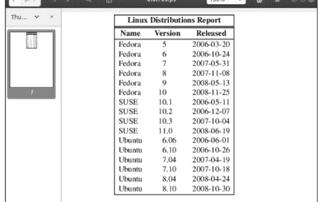

图 21-2：查看完成的表格

### Summing Up

鉴于文本对于类 Unix 操作系统的特性如此核心，很有道理会有许多用于操作和格式化文本的工具。正如我们所见，确实如此！像 `fmt` 和 `pr` 这样的简单格式化工具将在生成简短文档的脚本中找到许多用途，而 `groff`（及其朋友）可用于编写书籍。我们可能永远不会使用命令行工具编写技术论文（尽管有些人确实会！），但知道我们能够做到是件好事。

## 22. PRINTING

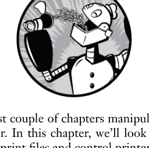

在花了过去几章处理文本之后，是时候把这些文本放到纸上了。在本章中，我们将查看用于打印文件和控制打印机操作的命令行工具。我们不会讨论如何配置打印，因为这因发行版而异，通常在安装期间自动设置。请注意，我们需要一个可工作的打印机配置来执行本章中的练习。

我们将讨论以下命令：

- `pr` Convert text files for printing
- `lpr` Print files
- `a2ps` Format files for printing on a PostScript printer
- `lpstat` Show printer status information
- `lpq` Show printer queue status
- `lprm` Cancel print jobs

### A Brief History of Printing

要充分理解类 Unix 操作系统中发现的打印功能，我们必须首先学习一些历史。在类 Unix 系统上打印可以追溯到操作系统的开始。在那个年代，打印机及其使用方式与今天大不相同。

#### 打印的黑暗时代

与计算机一样，前 PC 时代的打印机往往体积庞大、昂贵且集中化。1980 年的典型计算机用户在一台终端前工作，该终端连接着远处的计算机。打印机位于计算机附近，并处于计算机操作员的监视之下。

在打印机昂贵且集中的早期 Unix 时代，多个用户共享一台打印机的做法很常见。为了识别属于特定用户的打印作业，通常会在每个打印作业的开头打印一页横幅，显示用户名。然后计算机支持人员会装载一辆装有当天打印作业的手推车，并将其送给各个用户。

#### 基于字符的打印机

1980 年代的打印机技术与今天相比在两个方面大不相同。首先，当时几乎所有的打印机都是击打式打印机。击打式打印机使用机械机构将色带敲击在纸上，在页面上形成字符印痕。当时两种流行的技术是菊花针打印和点阵打印。

早期打印机的第二个、更重要的特点是，打印机使用固有的、固定的字符集。例如，菊花针打印机只能打印实际模制在菊花针花瓣上的字符。这使得打印机很像高速打字机。与大多数打字机一样，它们使用等宽（定宽）字体打印。这意味着每个字符的宽度相同。打印是在页面上的固定位置进行的，页面的可打印区域包含固定数量的字符。大多数打印机水平打印每英寸 10 个字符（CPI），垂直打印每英寸 6 行（LPI）。使用这种方案，一张美国信纸宽 85 个字符，高 66 行。考虑到每侧的一点点边距，80 个字符被认为是打印行的最大宽度。这就解释了为什么终端显示（以及我们的终端模拟器）通常宽 80 个字符。使用等宽字体和宽 80 字符的终端可以提供所见即所得（WYSIWYG，读作“whizzy-wig”）的打印输出视图。

数据以包含要打印字符的简单字节流形式发送到类似打字机的打印机。例如，要打印一个 `a`，就发送 ASCII 字符代码 97。此外，低编号的 ASCII 控制代码提供了移动打印机打印头和纸张的手段，使用回车、换行、换页等代码。通过控制代码，可以实现一些有限的字体效果，例如粗体，通过让打印机打印一个字符、退格，然后再次打印该字符以在页面上获得更深的打印效果。我们实际上可以使用 `nroff` 渲染手册页并使用 `cat -A` 检查输出来观察到这一点。

```
[me@linuxbox ~]$ zcat /usr/share/man/man1/ls.1.gz | nroff -man | cat -A | head
LS(1)                          User Commands                         LS(1)
$
$
$
N^HNA^HAM^HME^HE$
        ls - list directory contents$
S^HSY^HYN^HNO^HOP^HPS^HSI^HIS^HS$
\^H\ls^Hs [_^HO_^HP_^HT_^HI_^HO_^HN]... [_^HF_^HI_^HL_^HE]...
```

`^H`（CTRL-H）字符是用于创建粗体效果的退格。同理，我们也可以看到用于产生下划线的退格/下划线序列。

#### 图形打印机

图形用户界面的发展导致打印机技术发生了重大变化。随着计算机转向更基于图像的显示，打印从基于字符转向了图形技术。这得益于低成本激光打印机的出现，它与打印固定字符不同，可以在页面的可打印区域的任何位置打印微小的点。这使得打印比例字体（像排版员使用的那种）、甚至照片和高品质图表成为可能。

然而，从基于字符的方案转向图形方案带来了一个巨大的技术挑战。原因如下：使用基于字符的打印机填充一页所需的字节数可以这样计算（假设每页 60 行，每行 80 个字符）：

`60 × 80 = 4,800 bytes`

相比之下，一台 300 点每英寸（DPI）的激光打印机（假设每页 8 英寸 × 10 英寸的打印区域）需要这么多字节：

`(8 × 300) × (10 × 300) / 8 = 900,000 bytes`

许多缓慢的 PC 网络根本无法处理打印一页激光打印机所需的近 1MB 数据，因此很明显需要一个巧妙的发明。

这个发明最终是页面描述语言（PDL）。页面描述语言是一种描述页面内容的编程语言。基本上它说：“去到这个位置，用 10 点 Helvetica 打印字符 a，去到这个位置……”，直到页面上的所有内容都被描述完为止。第一个主要的 PDL 是 Adobe Systems 的 PostScript，它至今仍被广泛使用。PostScript 语言是一种完整的编程语言，专门用于排版和其他类型的图形和成像。它内置支持 35 种标准高质量字体，外加在运行时接受额外字体定义的能力。起初，PostScript 的支持内置于打印机本身。这解决了数据传输问题。虽然典型的 PostScript 程序与基于字符打印机的简单字节流相比非常冗长，但它比表示整个打印页所需的字节数要小得多。


PostScript 打印机接受 PostScript 程序作为输入。打印机包含自己的处理器和内存（通常使打印机成为比其连接的计算机更强大的计算机）并执行了一个名为 *PostScript interpreter* 的特殊程序，该程序读取传入的 PostScript 程序并将其 *rendered* 到打印机内部内存中，从而形成将被转移到纸上的位模式（点）。将某物渲染为大型位模式（称为 *bitmap*）的通用名称是光栅图像处理器（RIP）。

随着时间的推移，计算机和网络变得越来越快。这使得 RIP 可以从打印机移动到主机计算机，进而使高质量打印机变得便宜得多。

许多打印机今天仍然接受基于字符的数据流，但许多低成本打印机不接受。它们依赖主机计算机的 RIP 提供要打印为点的位流。仍然有一些 PostScript 打印机。

## 使用 Linux 打印

现代 Linux 系统采用两套软件套件来执行和管理打印。第一个是通用 Unix 打印系统（CUPS），它提供打印驱动程序和打印作业管理，第二个是 Ghostscript，一个 PostScript 解释器，充当 RIP。

CUPS 通过创建和维护 *print queues* 来管理打印机。正如我们在之前的历史课中讨论的那样，Unix 打印最初设计用于管理由多个用户共享的集中式打印机。由于打印机本质上比为其提供数据的计算机慢，打印系统需要一种方式来调度多个打印作业并保持有序。CUPS 还具有识别不同类型数据（在合理范围内）的能力，并可以将文件转换为可打印形式。

## 准备打印文件

作为命令行用户，我们主要对打印文本感兴趣，尽管打印其他数据格式也是完全可能的。

### pr—Convert Text Files for Printing

我们在上一章中稍微了解了 `pr`。现在我们将研究其与打印结合使用的许多选项。在我们打印的历史中，我们看到基于字符的打印机使用等宽字体，导致每行和每页的字符数固定。`pr` 用于调整文本以适应特定页面大小，可选页面页眉和边距。表 22-1 总结了其最常用的选项。

**表 22-1：常见的 `pr` 选项**

| Option | Description |
|---|---|
| `+first[:last]` | Output a range of pages starting with `first` and, optionally, ending with `last`. |
| `-columns` | Organize the content of the page into the number of columns specified by `columns`. |
| `-a` | By default, multicolumn output is listed vertically. By adding the `-a` (across) option, content is listed horizontally. |
| `-d` | Double-space output. |
| `-D format` | Format the date displayed in page headers using `format`. See the man page for the `date` command for a description of the format string. |
| `-f` | Use form feeds rather than carriage returns to separate pages. |
| `-h header` | In the center portion of the page header, use `header` rather than the name of the file being processed. |
| `-l length` | Set page length to `length`. The default is 66 (US letter at 6 lines per inch). |
| `-n` | Number lines. |
| `-o offset` | Create a left margin `offset` characters wide. |
| `-w width` | Set the page width to `width`. The default is 72. |

`pr` 通常在管道中用作过滤器。在此示例中，我们将生成 `/usr/bin` 的目录列表并使用 `pr` 格式化为分页的三列输出：

```
[me@linuxbox ~]$ ls /usr/bin | pr -3 -w 65 | head
```

```
2016-02-18 14:00                                      Page 1
[						]
411toppm					apturl				bsd-write
a2p					ar				bsh
a2ps					arecord				btclflash
a2ps-lpr-wrapper			arecordmidi			bug-buddy
					ark				buildhash
```

## 发送打印作业到打印机

CUPS 打印套件支持在类 Unix 系统上历史上使用的两种打印方法。一种方法称为 Berkeley 或 LPD（用于 Berkeley Software Distribution 版本的 Unix），使用 `lpr` 程序，而另一种方法称为 SysV（来自 System V 版本的 Unix），使用 `lp` 程序。两个程序大致做同样的事情。选择其中一个是个人喜好的问题。

### lpr—Print Files (Berkeley Style)

`lpr` 程序可用于将文件发送到打印机。它也可以在管道中使用，因为它接受标准输入。例如，要打印我们之前的多列目录列表的结果，我们可以这样做：

```
[me@linuxbox ~]$ ls /usr/bin | pr -3 | lpr
```

报告将被发送到系统的默认打印机。要将文件发送到不同的打印机，可以使用 `-P` 选项，如下所示：

```
lpr -P *printer_name*
```

这里，*printer_name* 是所需打印机的名称。要查看系统已知的打印机列表，请使用以下命令：

```
[me@linuxbox ~]$ lpstat -a
```

### TIP

许多 Linux 发行版允许你定义一个“打印机”，它将文件输出为 PDF，而不是打印到物理打印机。这对于试验打印命令非常方便。检查你的打印机配置程序，看看它是否支持此配置。在某些发行版中，你可能需要安装额外的软件包（如 `cups-pdf`）来启用此功能。

表 22-2 描述了 `lpr` 的一些常用选项。

**Table 22-2: Common `lpr` Options**

| Option | Description |
|---|---|
| `-# number` | 将副本数设置为 `number`。 |
| `-p` | 打印时在每页上加上带阴影的页眉，包含日期、时间、作业名称和页码。这种所谓的精美打印选项可用于打印文本文件。 |
| `-P printer` | 指定用于输出的打印机名称。如果未指定打印机，则使用系统的默认打印机。 |
| `-r` | 打印后删除文件。这对于生成临时打印输出文件的程序很有用。 |

### lp—Print Files (System V Style)

与 `lpr` 类似，`lp` 接受文件或标准输入进行打印。它与 `lpr` 的不同之处在于它支持不同的（且略微更复杂）选项集。表 22-3 描述了常用选项。

**Table 22-3: Common `lp` Options**

| Option | Description |
|---|---|
| `-d printer` | 将目标（打印机）设置为 `printer`。如果未指定 `d` 选项，则使用系统默认打印机。 |
| `-n number` | 将副本数设置为 `number`。 |
| `-o landscape` | 将输出设置为横向方向。 |
| `-o fitplot` | 将文件缩放以适应页面。这在打印图像（如 JPEG 文件）时很有用。 |
| `-o scaling=number` | 将文件缩放为 `number`。100 的值填满页面。小于 100 的值会缩小，而大于 100 的值会导致文件跨多页打印。 |
| `-o cpi=number` | 将输出每英寸字符数设置为 `number`。默认值为 10。 |
| `-o lpi=number` | 将输出每英寸行数设置为 `number`。默认值为 6。 |
| `-o page-bottom=points` | 设置页面边距。值以 `points` 表示，`points` 是排版测量单位。每英寸 72 `points`。 |
| `-o page-left=points` |  |
| `-o page-right=points` |  |
| `-o page-top=points` |  |
| `-P pages` | 指定页码列表。`pages` 可以表示为逗号分隔的列表和/或范围，例如 1,3,5,7-10。 |


我们再次生成目录列表，这次以 12 CPI 和 8 LPI 打印，并将左页边距设置为半英寸。请注意，我们必须调整`pr`选项以适应新的页面大小。

```
[me@linuxbox ~]$ ls /usr/bin | pr -4 -w 90 -l 88 | lp -o page-left=36 -o cpi=12 -o lpi=8
```

此管道使用比默认更小的字体生成四列列表。增加的每英寸字符数使我们能够在页面上容纳更多列。

## Another Option: `a2ps`

`a2ps`程序（可在大多数发行版仓库中获得）很有趣。正如其名称所示，它是一个格式转换程序，但它远不止于此。其名称最初意为“ASCII to PostScript”，用于将文本文件准备好在 PostScript 打印机上打印。随着时间的推移，该程序的功能不断增长，现在其名称意为“Anything to PostScript”。虽然其名称暗示这是一个格式转换程序，但它实际上是一个打印程序。它将默认输出发送到系统的默认打印机而不是标准输出。该程序的默认行为是“精美打印机”，意味着它改善了输出的外观。我们可以使用该程序在桌面上创建 PostScript 文件。

```
[me@linuxbox ~]$ ls /usr/bin | pr -3 -t | a2ps -o ~/Desktop/ls.ps -L 66
[stdin (plain): 11 pages on 6 sheets]
[Total: 11 pages on 6 sheets] saved into the file
'/home/me/Desktop/ls.ps'
```

这里我们使用`pr`过滤流，使用`-t`选项（省略页眉和页脚），然后使用`a2ps`，指定输出文件（`-o`选项）和每页 66 行（`-L`选项）以匹配`pr`的输出分页。如果我们使用合适的文档查看器查看生成的文档，我们将在图 22-1 中看到输出。

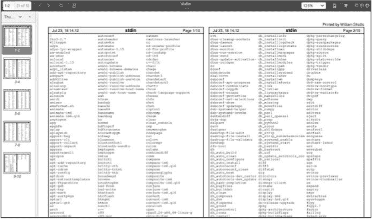

*图 22-1：查看`a2ps`输出*

正如我们所见，默认输出布局为“两页一页”格式。这会导致每张纸上打印两页的内容。`a2ps`也会应用漂亮的页眉和页脚。

`a2ps`有很多选项。表 22-4 提供了摘要。

**表 22-4：`a2ps` 选项**

| Option | Description |
|---|---|
| `--center-title=text` | 将居中页标题设为`text`。 |
| `--columns=number` | 将页面排列成`number`列。默认值为 2。 |
| `--footer=text` | 将页脚设为`text`。 |
| `--guess` | 报告作为参数给出的文件类型。由于`a2ps`尝试转换和格式化所有类型的数据，因此此选项可用于预测`a2ps`在给定特定文件时会做什么。 |
| `--left-footer=text` | 将左页页脚设为`text`。 |
| `--left-title=text` | 将左页标题设为`text`。 |
| `--line-numbers=interval` | 每`interval`行对输出的行进行编号。 |
| `--list=defaults` | 显示默认设置。 |
| `--pages=range` | 打印范围内的页面。 |
| `--right-footer=text` | 将右页页脚设为`text`。 |
| `--right-title=text` | 将右页标题设为`text`。 |
| `--rows=number` | 将页面排列成`number`行。默认值为 1。 |
| `-B` | 无页眉。 |
| `-b text` | 将页眉设为`text`。 |
| `-f size` | 使用`size`点字体。 |
| `-l number` | 将每行字符数设为`number`。此选项和`-L`选项（见下一项）可用于使使用`pr`等其他程序分页的文件在页面上正确显示。 |
| `-L number` | 将每页行数设为`number`。 |
| `-M name` | 使用媒体`name`，例如 A4。 |
| `-n number` | 输出每个页面的`number`份副本。 |
| `-o file` | 将输出发送到`file`。如果`file`指定为`-`，则使用标准输出。 |
| `-P printer` | 使用`printer`。如果未指定打印机，则使用系统默认打印机。 |
| `-R` | 纵向方向。 |
| `-r` | 横向方向。 |
| `-T number` | 将制表符停止位置设为每`number`个字符。 |
| `-u text` | 用文字在页面上加底纹（水印）。 |

这只是摘要。`a2ps`还有更多选项。

**NOTE**

> 还有另一种输出格式化程序可用于将文本转换为 PostScript。名为`enscript`，它可以执行许多相同的格式化和打印技巧，但与`a2ps`不同，它只接受文本输入。

## Monitoring and Controlling Print Jobs

由于 Unix 打印系统设计为处理来自多个用户的多个打印作业，因此 CUPS 也设计为执行相同的操作。每个打印机都分配一个打印队列，作业在其中停放，直到可以 spool 到打印机。CUPS 提供了多个命令行程序，用于管理打印机状态和打印队列。与`lpr`和`lp`程序一样，这些管理程序模仿了 Berkeley 和 System V 打印系统中的相应程序。

### `lpstat`—Display Print System Status

`lpstat`程序对于确定系统上打印机名称和可用性很有用。例如，如果我们有一个系统同时具有物理打印机（名为`printer`）和 PDF 虚拟打印机（名为`PDF`），我们可以这样检查它们的状态：

```
[me@linuxbox ~]$ lpstat -a
PDF accepting requests since Mon 08 Dec 2017 03:05:59 PM EST
printer accepting requests since Tue 24 Feb 2018 08:43:22 AM EST
```

此外，我们可以通过以下方式确定打印系统配置的更详细描述：

```
[me@linuxbox ~]$ lpstat -s
system default destination: printer
device for PDF: cups-pdf://
device for printer: ipp://print-server:631/printers/printer
```

在此示例中，我们看到`printer`是系统的默认打印机，并且它是通过 Internet Printing Protocol（ipp://）连接到名为`print-server`的系统的网络打印机。

表 22-5 描述了一些常用的有用选项。

**表 22-5：常用的 `lpstat` 选项**

| Option | Description |
|---|---|
| `-a [printer...]` | 显示`printer`打印队列的状态。请注意，这是打印队列接受作业的能力状态，而不是物理打印机的状态。如果未指定打印机，则显示所有打印队列。 |
| `-d` | 显示系统默认打印机的名称。 |
| `-p [printer...]` | 显示指定打印机的状态。如果未指定打印机，则显示所有打印机。 |
| `-r` | 显示打印服务器的状态。 |
| `-s` | 显示状态摘要。 |
| `-t` | 显示完整状态报告。 |

### `lpq`—Display Printer Queue Status

要查看打印队列的状态，使用`lpq`程序。这使我们能够查看队列的状态及其包含的打印作业。以下是名为`printer`的系统默认打印机的空队列示例：

```
[me@linuxbox ~]$ lpq
printer is ready
```

如果我们没有指定打印机（使用`-P`选项），系统会显示默认打印机。如果我们向打印机发送作业然后查看队列，我们会看到它被列出。

```
[me@linuxbox ~]$ ls *.txt | pr -3 | lp
request id is printer-603 (1 file(s))
[me@linuxbox ~]$ lpq
printer is ready and printing
Rank Owner Job File(s)              Total Size
active me   603  (stdin)             1024 bytes
```

### `lprm`/`cancel`—取消打印作业

CUPS 提供了两个用于终止打印作业并将其从打印队列中移除的程序。一个是 Berkeley 风格（`lprm`），另一个是 System V（`cancel`）。它们在支持的选项上略有不同，但基本上做的是同一件事。以我们之前的打印作业为例，我们可以这样停止作业并将其移除：


```
[me@linuxbox ~]$ cancel 603
[me@linuxbox ~]$ lpq
printer is ready
no entries
```

每个命令都有用于移除特定用户、特定打印机以及多个作业编号的所有作业的选项。它们各自的手册页包含了所有细节。

### 小结

在本章中，我们看到了过去的打印机如何影响了类 Unix 机器上打印系统的设计。我们还探索了命令行上可用的控制程度，不仅可以控制打印作业的调度和执行，还可以控制各种输出选项。

## 23 编译程序


在本章中，我们将了解如何通过编译源代码来构建程序。源代码的可用性是使 Linux 成为可能的本质自由。整个 Linux 开发生态系统依赖于开发者之间的自由交流。对于许多桌面用户来说，编译是一门失传的艺术。过去这很常见，但今天，发行版提供商维护着庞大的预编译二进制仓库，可供下载使用。截至出版时，Debian 仓库（是所有发行版中最大的之一）包含超过 68,000 个软件包。

那么为什么要编译软件呢？有两个原因。

- **可用性。** 尽管发行版仓库中预编译程序数量众多，但某些发行版可能不包含所有期望的应用。在这种情况下，获取所需程序的唯一方法就是从源代码编译。
- **时效性。** 虽然一些发行版专注于提供程序的尖端版本，但许多发行版并不如此。这意味着要获得程序的最新版本，就需要编译。

从源代码编译软件可能会变得相当复杂和技术化，超出许多用户的能力范围。然而，许多编译任务都很简单，只涉及几个步骤。一切都取决于软件包。我们将看一个非常简单的案例，以提供该过程的概述，并作为那些希望进一步研究的起点。

我们将介绍一个新命令。

`make` 维护程序的实用工具

### 什么是编译？

简单来说，编译是将 *源代码*（程序员编写的、人类可读的程序描述）翻译成计算机处理器原生语言的过程。

计算机的处理器（或 *CPU*）在基本层面上工作，以所谓的 *机器语言* 执行程序。这是一种数字代码，描述了极小的操作，例如“添加这个字节”、“指向内存中的这个位置”或“复制这个字节”。每条指令都以二进制（1 和 0）表示。最早的计算机程序就是使用这种数字代码编写的，这也许可以解释为什么编写它的程序员据说抽很多烟、喝加仑咖啡并戴厚眼镜。

这个问题随着 *汇编语言* 的出现而得到解决，它用（稍）更易用的字符 *助记符* 替代了数字代码，例如 `CPY`（复制）和 `MOV`（移动）。汇编语言编写的程序由一个名为 *汇编器* 的程序处理成机器语言。汇编语言至今仍用于某些专门的编程任务，例如 *设备驱动程序* 和 *嵌入式系统*。

接下来我们来到所谓的 *高级编程语言*，它们允许程序员更少关注处理器正在做什么，而更多关注手头问题的解决。早期的语言（开发于 1950 年代）包括 *FORTRAN*（为科学和技术任务设计）和 *COBOL*（为商业应用设计）。两者至今仍在有限使用。

虽然存在许多流行的编程语言，但其中两种占主导地位。大多数为现代系统编写的程序都是用 C 或 C++ 编写的。在下面的示例中，我们将编译一个 C 程序。

用高级编程语言编写的程序通过使用另一个程序进行处理将其转换为机器语言，该程序称为编译器。某些编译器将高级指令翻译成汇编语言，然后使用汇编器执行最终的翻译阶段，将其转换为机器语言。

编译时经常使用的一种过程称为链接。程序执行的常见任务有很多。例如打开一个文件。许多程序都会执行此任务，但让每个程序都实现自己的打开文件例程是浪费的。更合理的做法是有一个单一的编程片段知道如何打开文件，并允许所有需要它的程序共享它。通过所谓的库来实现对常见任务的支持。它们包含多个例程，每个例程执行多个程序可以共享的某个常见任务。如果我们查看 `/lib` 和 `/usr/lib` 目录，我们可以看到其中许多库的位置。程序链接器用于在编译器的输出和编译后的程序所需的库之间形成连接。此过程的最终结果是可执行的程序文件，准备使用。

### 所有程序都需要编译吗？

不是的。正如我们所见，有 shell 脚本等程序不需要编译。它们是直接执行的。这些是用所谓的脚本或解释型语言编写的。这些语言近年来变得越来越流行，其中包括 Perl、Python、PHP、Ruby 等。

脚本语言由一个名为解释器的特殊程序执行。解释器输入程序文件并读取并执行其中包含的每条指令。一般来说，解释型程序的执行速度比编译型程序慢得多。这是因为解释型程序中的每条源代码指令在执行时都会被翻译，而对于编译型程序，源代码指令只翻译一次，并且这种翻译永久记录在最终的可执行文件中。

为什么解释型语言如此受欢迎？对于许多编程任务，结果“足够快”，但真正的优势在于，通常开发解释型程序比编译型程序更快、更容易。程序通常在代码、编译、测试的重复循环中开发。随着程序规模的增长，循环中的编译阶段可能变得相当长。解释型语言去除了编译步骤，从而加快了程序开发速度。

### 编译一个 C 程序

让我们编译一些东西。在此之前，我们需要一些工具，如编译器、链接器和 `make`。在 Linux 环境中几乎通用使用的 C 编译器称为 `gcc`（GNU C 编译器），最初由 Richard Stallman 编写。大多数发行版默认不安装 `gcc`。我们可以通过以下方式检查编译器是否存在：

```
[me@linuxbox ~]$ which gcc
/usr/bin/gcc
```

本示例中的结果表明编译器已安装。

#### TIP

您的发行版可能有一个元包（包的集合）用于软件开发。如果是这样，如果您打算在系统上编译程序，请考虑安装它。如果您的系统不提供元包，请尝试安装 `gcc` 和 `make` 包。在许多发行版上，这足以进行以下练习。

### 获取源代码

对于我们的编译练习，我们将从 GNU 项目编译一个名为 `diction` 的程序。这个方便的小程序会检查文本文件的写作质量和风格。作为程序而言，它相当小，易于构建。

按照惯例，我们首先将创建一个名为 `src` 的源代码目录，然后使用 `ftp` 将源代码下载到其中。

```
[me@linuxbox ~]$ mkdir src
[me@linuxbox ~]$ cd src
[me@linuxbox src]$ ftp ftp.gnu.org
Connected to ftp.gnu.org.
220 GNU FTP server ready.
Name (ftp.gnu.org:me): anonymous
230 Login successful.
Remote system type is UNIX.
Using binary mode to transfer files.
ftp> cd gnu/diction
250 Directory successfully changed.
ftp> ls
200 PORT command successful. Consider using PASV.
150 Here comes the directory listing.
-rw-r--r--   1 1003  65534   68940 Aug 28  1998 diction-0.7.tar.gz
-rw-r--r--   1 1003  65534   90957 Mar 04  2002 diction-1.02.tar.gz
-rw-r--r--   1 1003  65534  141062 Sep 17  2007 diction-1.11.tar.gz
226 Directory send OK.
ftp> get diction-1.11.tar.gz
local: diction-1.11.tar.gz remote: diction-1.11.tar.gz
200 PORT command successful. Consider using PASV.
150 Opening BINARY mode data connection for diction-1.11.tar.gz (141062 bytes).
226 File send OK.
141062 bytes received in 0.16 secs (847.4 kB/s)
ftp> bye
221 Goodbye.
[me@linuxbox src]$ ls
diction-1.11.tar.gz
```

虽然我们在前面的示例中使用了 `ftp`，这是传统做法，但下载源代码还有其他方法。例如，GNU 项目也支持使用 HTTPS 下载。我们可以使用 `wget` 程序下载 `diction` 源代码。

`diction` 程序，像所有 GNU 项目软件一样，遵循源代码打包的某些标准。Linux 生态系统中大多数其他可用的源代码也遵循此标准。标准的一个要素是，当源代码 tar 文件被解包时，会创建一个包含源代码树的目录，并且该目录将被命名为 `project-x.xx`，从而同时包含项目的名称和其版本号。此方案允许轻松安装同一程序的多个版本。然而，在解包之前检查树的布局通常是个好主意。某些项目不会创建目录，而是直接将文件交付到当前目录。这会在我们原本井然有序的 `src` 目录中造成混乱。为避免这种情况，使用以下命令检查 tar 文件的内容：

`tar tzvf tarfile | head`

### 检查源代码树


# 解包 tar 文件

解包 `tar` 文件会导致创建一个名为 `diction-1.11` 的新目录。该目录包含源代码树。让我们看一下内部。

```
[me@linuxbox src]$ cd diction-1.11
[me@linuxbox diction-1.11]$ ls
config.guess   diction.c      getopt.c       nl
config.h.in    diction.pot    getopt.h       nl.po
config.sub     diction.spec   getopt_int.h   README
configure      diction.spec.in INSTALL        sentence.c
configure.in   diction.texi.in install-sh     sentence.h
COPYING        en             Makefile.in    style.1.in
de             en_GB          misc.c         style.c
de.po          en_GB.po       misc.h         test
diction.1.in   getopt1.c      NEWS
```

其中，我们看到许多文件。属于 GNU 项目的程序，以及许多其他程序，会提供文档文件 `README`、`INSTALL`、`NEWS` 和 `COPYING`。这些文件包含程序的描述、如何构建和安装的信息，以及许可条款。在尝试构建程序之前，仔细阅读 `README` 和 `INSTALL` 文件始终是个好主意。

该目录中其他有趣的文件是那些以 `.c` 和 `.h` 结尾的文件。

```
[me@linuxbox diction-1.11]$ ls *.c
diction.c getopt1.c getopt.c misc.c sentence.c style.c
[me@linuxbox diction-1.11]$ ls *.h
getopt.h getopt_int.h misc.h sentence.h
```

`.c` 文件包含包提供的两个 C 程序（`style` 和 `diction`），分为模块。对于大型程序，将其拆分为更小、更易于管理的部分是常见做法。源代码文件是普通文本，可以使用 `less` 进行检查。

```
[me@linuxbox diction-1.11]$ less diction.c
```

`.h` 文件被称为头文件。这些也是普通文本。头文件包含源代码文件或库中包含的例程的描述。为了使编译器连接模块，它必须接收完成整个程序所需的所有模块的描述。在 `diction.c` 文件的开头附近，我们看到这一行：

```
#include "getopt.h"
```

这指示编译器在读取 `diction.c` 中的源代码时读取文件 `getopt.h`，以“了解” `getopt.c` 中的内容。`getopt.c` 文件提供了 `style` 和 `diction` 两个程序共享的例程。

在 `getopt.h` 的 `include` 语句之前，我们看到其他一些 `include` 语句，例如这些：

```
#include <regex.h>
#include <stdio.h>
#include <stdlib.h>
#include <string.h>
#include <unistd.h>
```

这些也引用头文件，但它们引用的是位于当前源代码树之外的头文件。它们由系统提供以支持每个程序的编译。如果我们查看 `/usr/include`，我们可以看到它们。

```
[me@linuxbox diction-1.11]$ ls /usr/include
```

该目录中的头文件是在我们安装编译器时安装的。

## 构建程序

大多数程序都使用简单的两条命令序列进行构建。

```
./configure
make
```

`configure` 程序是随源代码树提供的 shell 脚本。它的工作是分析构建环境。大多数源代码旨在可移植。即，它旨在构建在不止一种类 Unix 系统上。但为此，源代码在构建期间可能需要进行轻微调整以适应系统之间的差异。`configure` 还会检查必要的外部工具和组件是否已安装。

让我们运行 `configure`。由于 `configure` 不位于 shell 通常期望程序所在的位置，因此我们必须通过在命令前加上 `./` 来明确告诉 shell 其位置，以指示程序位于当前工作目录中。

```
[me@linuxbox diction-1.11]$ ./configure
```

`configure` 在测试和配置构建时会输出大量消息。当它完成时，它看起来会像这样：

```
checking libintl.h presence... yes
checking for libintl.h... yes
checking for library containing gettext... none required
configure: creating ./config.status
config.status: creating Makefile
config.status: creating diction.1
config.status: creating diction.texi
```

```
config.status: creating diction.spec
config.status: creating style.1
config.status: creating test/rundiction
config.status: creating config.h
[me@linuxbox diction-1.11]$
```

这里重要的是没有错误信息。如果有错误，配置就会失败，直到错误被修正，程序都无法构建。

我们看到 `configure` 在源代码目录中创建了几个新文件。其中最重要的是 `makefile`。`makefile` 是一个配置文件，它指示 `make` 程序如何精确地构建程序。没有它，`make` 将拒绝运行。`makefile` 是一个普通文本文件，所以我们可以查看它。

```
[me@linuxbox diction-1.11]$ less Makefile
```

`make` 程序以 `makefile` 作为输入（通常命名为 `Makefile`），它描述了构成最终程序的各个组件之间的关系和依赖。

`makefile` 的第一部分定义了在 `makefile` 后续部分中被替换的变量。例如我们看到以下行：

```
CC= gcc
```

这定义 C 编译器为 `gcc`。稍后在 `makefile` 中，我们看到它被使用的一个实例。

```
diction: diction.o sentence.o misc.o getopt.o getopt1.o
$(CC) -o $@ $(LDFLAGS) diction.o sentence.o misc.o \
getopt.o getopt1.o $(LIBS)
```

`diction`（最终产品之一）依赖于 `diction.o`、`sentence.o`、`misc.o`、`getopt.o` 和 `getopt1.o` 的存在。稍后在 `makefile` 中，我们看到对这些目标各自的定义。

```
diction.o:    diction.c config.h getopt.h misc.h sentence.h
getopt.o:    getopt.c getopt.h getopt_int.h
getopt1.o:   getopt1.c getopt.h getopt_int.h
misc.o:      misc.c config.h misc.h
sentence.o:  sentence.c config.h misc.h sentence.h
style.o:     style.c config.h getopt.h misc.h sentence.h
```

然而，我们没有看到为它们指定的任何命令。这由文件中更早的一个通用目标来处理，该目标描述了将任何 `.c` 文件编译为 `.o` 文件时使用的命令。

```
.c.o:
	$(CC) -c $(CPPFLAGS) $(CFLAGS) $<
```

这看起来很复杂。为什么不简单地列出编译各部分的步骤就完事呢？这个问题的答案很快就会变得清楚。在此期间，让我们运行 `make` 并构建我们的程序。

```
[me@linuxbox diction-1.11]$ make
```

`make` 程序将运行，使用 `Makefile` 的内容来指导其操作。它会产生很多信息。

完成后，我们会看到所有目标现在都已存在于我们的目录中。


```
[me@linuxbox diction-1.11]$ ls
config.guess  de.po        en           install-sh   sentence.c
config.h      diction      en_GB        Makefile     sentence.h
config.h.in   diction.1    en_GB.mo     Makefile.in  sentence.o
config.log    diction.1.in en_GB.po     misc.c       style
config.status diction.c    getopt1.c    misc.h       style.1
config.sub    diction.o    getopt1.o    misc.o       style.1.in
configure     diction.pot  getopt.c     NEWS         style.c
configure.in  diction.spec getopt.h     nl           style.o
COPYING       diction.spec.in getopt_int.h nl.mo      test
de            diction.texi getopt.o     nl.po
de.mo         diction.texi.in INSTALL      README
```

在这些文件当中，我们看到了`diction`和`style`，也就是我们打算构建的程序。恭喜！我们刚刚从源代码编译了第一个程序！

但只是出于好奇，让我们再次运行`make`。

```
[me@linuxbox diction-1.11]$ make
make: Nothing to be done for 'all'.
```

它只产生这条奇怪的信息。发生了什么？为什么它没有再次构建程序？啊，这就是`make`的魔力。与其再次构建所有东西，`make`只构建需要构建的部分。所有目标都已存在时，`make`确定没有事情可做。我们可以通过删除其中一个目标然后再次运行`make`来演示这一点，看看它会做什么。让我们去掉一个中间目标。

```
[me@linuxbox diction-1.11]$ rm getopt.o
[me@linuxbox diction-1.11]$ make
```

我们看到`make`重新构建它并重新链接`diction`和`style`程序，因为它们依赖于缺失的模块。这种行为也指出了`make`的另一个重要特性：它保持目标是最新的。`make`坚持目标必须比其依赖项更新。这完全合理，因为程序员经常会更新一些源代码，然后使用`make`来构建最终产品的新的版本。`make`确保基于更新后的代码需要构建的一切都被构建。如果我们使用`touch`程序来“更新”其中一个源代码文件，我们就可以看到这种情况发生：

```
[me@linuxbox diction-1.11]$ ls -l diction getopt.c
-rwxr-xr-x 1 me me 37164 2009-03-05 06:14 diction
-rw-r--r-- 1 me me 33125 2007-03-30 17:45 getopt.c
[me@linuxbox diction-1.11]$ touch getopt.c
[me@linuxbox diction-1.11]$ ls -l diction getopt.c
-rwxr-xr-x 1 me me 37164 2009-03-05 06:14 diction
-rw-r--r-- 1 me me 33125 2009-03-05 06:23 getopt.c
[me@linuxbox diction-1.11]$ make
```

`make`运行后，我们看到它已将目标恢复为比依赖项更新。

```
[me@linuxbox diction-1.11]$ ls -l diction getopt.c
-rwxr-xr-x 1 me me 37164 2009-03-05 06:24 diction
-rw-r--r-- 1 me me 33125 2009-03-05 06:23 getopt.c
```

`make`能够智能地只构建需要构建的部分，这对程序员来说是一个巨大的好处。虽然在我们的小项目中，节省的时间可能不明显，但在更大的项目中却非常显著。请记住，Linux 内核（一个不断修改和改进的程序）包含数百万行代码。

## 安装程序

打包良好的源代码通常会包含一个特殊的`make`目标，称为`install`。该目标会将最终产品安装到系统目录中以供使用。通常，这个目录是`/usr/local/bin`，这是本地构建软件的传统位置。然而，这个目录通常不能由普通用户写入，因此我们必须成为超级用户才能执行安装。

```
[me@linuxbox diction-1.11]$ sudo make install
```

在我们执行安装后，我们可以检查程序是否已准备就绪。

```
[me@linuxbox diction-1.11]$ which diction
/usr/local/bin/diction
[me@linuxbox diction-1.11]$ man diction
```

就这样！

### 小结

在本章中，我们看到了如何使用三个简单的命令——`./configure`、`make`和`make install`来构建许多源代码包。我们还看到了`make`在程序维护中的重要作用。`make`程序可用于任何需要维护目标/依赖关系的任务，而不仅仅是编译源代码。

## 第四部分 编写 Shell 脚本

## 24 编写你的第一个脚本


在前面的章节中，我们组装了一套命令行工具。虽然这些工具可以解决许多类型的计算问题，但我们仍然局限于在命令行上手动逐一使用它们。如果我们能让 shell 做更多的工作，不是很好吗？我们可以！通过将我们的工具组合成我们自己设计的程序，shell 可以完全自主地执行复杂的任务序列。我们可以通过编写 shell 脚本来实现这一点。

### 什么是 Shell 脚本？

最简单地说，shell 脚本是一个包含一系列命令的文件。shell 读取此文件并执行命令，就好像它们已直接在命令行中输入一样。

shell 有点独特，因为它既是系统强大的命令行界面，也是脚本语言解释器。正如我们将看到的那样，大多数可以在命令行上完成的事情都可以在脚本中完成，而大多数可以在脚本中完成的事情都可以在命令行上完成。

我们已经涵盖了许多 shell 功能，但我们专注于那些最常直接在命令行上使用的功能。shell 还提供了一组通常（但不总是）在编写程序时使用的功能。

### 如何编写 Shell 脚本

要成功创建和运行 shell 脚本，我们需要做三件事。

- 1. **编写脚本。** Shell 脚本是普通文本文件。因此，我们需要一个文本编辑器来编写它们。最好的文本编辑器会提供 *语法高亮*，让我们可以看到脚本元素的彩色编码视图。语法高亮将帮助我们发现某些常见错误。`vim`、`gedit`、`kate` 和许多其他编辑器都是编写脚本的良好选择。

- 2. **使脚本可执行。** 系统对不让任何旧文本文件被当作程序处理非常挑剔，这是有充分理由的！我们需要设置脚本文件的权限以允许执行。

- 3. **将脚本放在 shell 可以找到的地方。** 当未指定显式路径名时，shell 会自动搜索某些目录中的可执行文件。为了最大程度的方便，我们将把脚本放在这些目录中。

## 脚本文件格式

遵循编程传统，我们将创建一个“Hello World”程序来演示一个极其简单的脚本。让我们启动我们的文本编辑器并输入以下脚本：

```
#!/bin/bash

# This is our first script.

echo 'Hello World!'
```

我们脚本的最后一行很熟悉；它只是一个带有字符串参数的`echo`命令。第二行也很熟悉。它看起来像我们在许多配置文件中看到过的注释，我们 have examined and edited. One thing about comments in shell scripts is that they may also appear at the ends of lines provided they are preceded by at least one whitespace character, like so:

```
echo 'Hello World!'  # This is a comment too
```

Everything from the `#` symbol onward on the line is ignored.

Like many things, this works on the command line, too.


```
[me@linuxbox ~]$ echo 'Hello World!'  # This is a comment too
Hello World!
```

Though comments are of little use on the command line, they will work.

The first line of our script is a little mysterious. It looks as if it should be a comment since it starts with `#`, but it looks too purposeful to be just that. The `#!` character sequence is, in fact, a special construct called a shebang. The shebang is used to tell the kernel the name of the interpreter that should be used to execute the script that follows. Every shell script should include this as its first line.

Let's save our script file as `hello_world`.

## Executable Permissions

The next thing we have to do is make our script executable. This is easily done using `chmod`.

```
[me@linuxbox ~]$ ls -l hello_world
-rw-r--r-- 1 me me 63 2018-03-07 10:10 hello_world
[me@linuxbox ~]$ chmod 755 hello_world
[me@linuxbox ~]$ ls -l hello_world
-rwxr-xr-x 1 me me 63 2018-03-07 10:10 hello_world
```

There are two common permission settings for scripts: `755` for scripts that everyone can execute and `700` for scripts that only the owner can execute. Note that scripts must be readable to be executed.

## Script File Location

With the permissions set, we can now execute our script.

```
[me@linuxbox ~]$ ./hello_world
Hello World!
```

For the script to run, we must precede the script name with an explicit path. If we don't, we get this:

```
[me@linuxbox ~]$ hello_world
bash: hello_world: command not found
```

Why is this? What makes our script different from other programs? As it turns out, nothing. Our script is fine. Its location is the problem. In Chapter 11, we discussed the `PATH` environment variable and its effect on how the system searches for executable programs. To recap, the system searches a list of directories each time it needs to find an executable program, if no explicit path is specified. This is how the system knows to execute `/bin/ls` when we type `ls` at the command line. The `/bin` directory is one of the directories that the system automatically searches. The list of directories is held within an environment variable named `PATH`. The `PATH` variable contains a colon-separated list of directories to be searched. We can view the contents of `PATH`.

```
[me@linuxbox ~]$ echo $PATH
/home/me/bin:/usr/local/sbin:/usr/local/bin:/usr/sbin:/usr/bin:/sbin:/bin:/usr/games
```

Here we see our list of directories. If our script were located in any of the directories in the list, our problem would be solved. Notice the first directory in the list, `/home/me/bin`. Most Linux distributions configure the `PATH` variable to contain a `bin` directory in the user's home directory to allow users to execute their own programs. So, if we create the `bin` directory and place our script within it, it should start to work like other programs.

```
[me@linuxbox ~]$ mkdir bin
[me@linuxbox ~]$ mv hello_world bin
[me@linuxbox ~]$ hello_world
Hello World!
```

And so it does.

If the `PATH` variable does not contain the directory, we can easily add it by including this line in our `.bashrc` file:

```
export PATH=~/bin:"$PATH"
```

After this change is made, it will take effect in each new terminal session. To apply the change to the current terminal session, we must have the shell reread the `.bashrc` file. This can be done by "sourcing" it.

```
[me@linuxbox ~]$ . .bashrc
```

The dot `.` command is a synonym for the `source` command, a shell builtin that reads a specified file of shell commands and treats it like input from the keyboard.

### NOTE

`Ubuntu` and most other Debian-based distributions automatically adds the `~/bin` directory to the `PATH` variable if the `~/bin` directory exists when the user's `.bashrc` file is executed. So, on Ubuntu systems, if we create the `~/bin` directory and then log out and log in again, everything works.

## Good Locations for Scripts


The `~/bin` directory is a good place to put scripts intended for personal use. If we write a script that everyone on a system is allowed to use, the traditional location is `/usr/local/bin`. Scripts intended for use by the system administrator are often located in `/usr/local/sbin`. In most cases, locally supplied software, whether scripts or compiled programs, should be placed in the `/usr/local` hierarchy and not in `/bin` or `/usr/bin`. These directories are specified by the Linux Filesystem Hierarchy Standard to contain only files supplied and maintained by the Linux distributor.

## More Formatting Tricks

严肃的脚本编写的一个关键目标是易于维护；也就是说，脚本可以被其作者或其他人轻松修改以适应不断变化的需求。使脚本易于阅读和理解是促进易于维护的一种方式。

### 长选项名称

我们研究过的大多数命令都具有短选项名称和长选项名称。例如，`ls` 命令有许多选项可以用短格式或长格式表示。例如，以下内容：

```
[me@linuxbox ~]$ ls -ad
```

等同于以下内容：

```
[me@linuxbox ~]$ ls --all --directory
```

出于减少输入量的考虑，在命令行输入选项时更喜欢使用短选项，但在编写脚本时，长选项可以提供更好的可读性。

### 缩进和行 continuation

在使用长命令时，通过将命令分散到多行可以增强可读性。在第 17 章中，我们看过 `find` 命令的一个特别长的示例。

```
[me@linuxbox ~]$ find playground \( -type f -not -perm 0600 -exec chmod 0600 '{}' ; \ ) -or \( -type d -not -perm 0700 -exec chmod 0700 '{}' ; \ )
```

显然，这个命令乍一看有点难以理解。在脚本中，如果这样编写，该命令可能更容易理解：

```
find playground \
    \( \
        -type f \
        -not -perm 0600 \
```

```
-exec chmod 0600 '{}' ';' \
\) ) \
-or \
\( ( \
-type d \
-not -perm 0700 \
-exec chmod 0700 '{}' ';' \
\)
```

通过使用行 continuation（反斜杠-换行符序列）和缩进，这个复杂命令的逻辑对读者来说描述得更清晰。这种技术在命令行上也有效，尽管很少使用，因为它打字和编辑起来很别扭。脚本和命令行之间的一点不同是，脚本可以使用制表符来实现缩进，而命令行不能，因为制表符用于激活补全。

### 为脚本编写配置 VIM

`vim` 文本编辑器有许多、许多配置设置。有几个常见的选项可以促进脚本编写。

以下命令打开语法高亮：

```
:syntax on
```

使用此设置，在查看脚本时，shell 语法的不同元素将以不同颜色显示。这有助于识别某些类型的编程错误。它看起来也很酷。请注意，要使此功能正常工作，您必须安装完整的 `vim` 版本，并且您正在编辑的文件必须有 shebang 表明该文件是 shell 脚本。如果对前一个命令有困难，请尝试 `:set syntax=sh` 代替。

这会打开高亮搜索结果的选项：

```
:set hlsearch
```

假设我们搜索单词 `echo`。启用此选项后，每个实例的单词都会被高亮显示。

以下设置了制表符占用的列数：

```
:set tabstop=4
```

默认值是八列。将值设置为 4（这是常见做法）可以让长行更易于在屏幕上显示。

以下打开“自动缩进”功能：

```
:set autoindent
```

这会导致 `vim` 将新行缩进与刚输入的行相同。这可以加快许多编程结构类型的输入速度。要停止缩进，请按 CTRL-D。

这些更改可以通过将这些命令（不带前导冒号字符）添加到您的 `~/.vimrc` 文件中使其永久生效。

### 总结

在本脚本编写的第一章中，我们了解了脚本是如何编写的以及如何使其在我们的系统上轻松执行。我们还看到了如何使用各种格式技术来提高脚本的可读性（从而提高可维护性）。在未来的章节中，易于维护将一再成为良好脚本编写的核心原则。

## 25 开始一个项目


从本章开始，我们将开始构建一个程序。该项目的目的是了解各种 shell 功能如何用于创建程序，更重要的是创建良好的程序。

我们将编写的程序是一个报告生成器。它将展示有关我们系统及其状态的各种统计信息，并将以 HTML 格式生成此报告，以便我们可以使用 Firefox 或 Chrome 等网络浏览器查看它。

程序通常以一系列阶段构建，每个阶段都增加功能和能力。我们程序的第一阶段将生成一个最小的 HTML 文档，其中不包含任何系统信息。那将在后面添加。

### 第一阶段：最小文档

我们需要知道的第一件事是格式良好的 HTML 文档的格式。它看起来像这样：

```
<html>
  <head>
    <title>Page Title</title>
  </head>
  <body>

Page body.

</body>

</html>
```

如果我们将此内容输入到文本编辑器中并将文件保存为 `foo.html`，我们就可以在 Firefox 中使用以下 URL 查看该文件：`file:///home/username/foo.html`。

我们程序的第一阶段将能够将此 HTML 文件输出到标准输出。我们可以很容易地编写一个程序来实现这一点。让我们启动文本编辑器并创建一个名为 `~/bin/sys_info_page` 的新文件。

```
[me@linuxbox ~]$ vim ~/bin/sys_info_page
```

输入以下程序：

```
#!/bin/bash

# Program to output a system information page

echo "<html>"
echo "    <head>"
echo "        <title>Page Title</title>"
echo "    </head>"
echo "    <body>"
echo "        Page body."
echo "    </body>"
echo "</html>"
```

我们对该问题的第一次尝试包含一个 shebang、一个注释（始终是个好主意），以及一系列 `echo` 命令，每行输出对应一个命令。在保存文件后，我们将使其可执行并尝试运行它。

```
[me@linuxbox ~]$ chmod 755 ~/bin/sys_info_page
[me@linuxbox ~]$ sys_info_page
```

当程序运行时，我们应该在屏幕上看到 HTML 文档的文本，因为脚本中的 `echo` 命令将其输出发送到标准输出。我们将再次运行程序，并将程序的输出重定向到文件 `sys_info_page.html`，以便我们可以使用网络浏览器查看结果。

```
[me@linuxbox ~]$ sys_info_page > sys_info_page.html
[me@linuxbox ~]$ firefox sys_info_page.html
```

到目前为止，一切顺利。

在编写程序时，始终努力追求简洁和清晰是个好主意。当程序易于阅读和理解时，维护会更容易，而且它还可以使程序更容易编写，减少输入量。我们当前版本的程序运行良好，但可以更简单。我们实际上可以将所有 `echo` 命令合并为一个，这肯定会使向程序输出添加更多行变得更容易。因此，让我们将程序更改为以下内容：

```
#!/bin/bash

# Program to output a system information page
echo "<html>
<head>
<title>Page Title</title>
</head>
<body>
Page body.
</body>
</html>"
```

带引号的字符串可以包含换行符，因此可以包含多行文本。shell 会一直读取文本，直到遇到闭合引号为止。在命令行上也是如此：


```
[me@linuxbox ~]$ echo "<html>
> <head>
> <title>Page Title</title>
> </head>
> <body> Page body.
> </body>
> </html>"
```

前导 `>` 字符是包含在 `PS2` shell 变量中的 shell 提示符。每当我们向 shell 输入多行语句时，它就会出现。这个功能现在有点晦涩难懂，但稍后，当我们介绍多行编程语句时，它会变得非常方便。

## 第二阶段：添加一些数据

现在我们的程序可以生成最小的文档，让我们在报告中放入一些数据。为此，我们将进行以下更改：

```
#!/bin/bash

# Program to output a system information page
echo "<html>
    <head>
        <title>System Information Report</title>
    </head>
    <body>
        <h1>System Information Report</h1>
    </body>
</html>"
```

我们在报告的标题和正文中添加了一个页面标题和一个标题。

### 变量和常量

然而，我们的脚本存在一个问题。注意到字符串 `System Information Report` 是重复的吗？对于我们这个微小的脚本来说这不是问题，但让我们想象一下，如果我们的脚本非常长并且包含该字符串的多个实例。如果我们想将标题更改为其他内容，我们就必须在多个位置进行更改，这可能需要大量工作。如果我们能安排脚本使字符串只出现一次而不是多次会怎样？这将使脚本的未来维护变得容易得多。我们可以这样做：

```
#!/bin/bash

# Program to output a system information page
```

```
title="System Information Report"
echo "<html>"
    <head>
        <title>$title</title>
    </head>
    <body>
        <h1>$title</h1>
    </body>
</html>"
```

通过创建一个名为 `title` 的变量并为其分配值 `System Information Report`，我们可以利用参数扩展并将字符串放置在多个位置。

那么，我们如何创建变量呢？很简单，我们直接使用它。当 shell 遇到变量时，它会自动创建它。这与许多编程语言不同，在这些语言中，变量必须在使用前显式声明或定义。shell 对此非常宽松，这可能导致一些问题。例如，考虑在命令行上发生的以下场景：

```
[me@linuxbox ~]$ foo="yes"
[me@linuxbox ~]$ echo $foo
yes
[me@linuxbox ~]$ echo $foo1
[me@linuxbox ~]$
```

我们首先将值 `yes` 分配给变量 `foo`，然后使用 `echo` 显示其值。接下来我们以 `foo1` 的形式拼写错误地显示变量的值，结果为空白。这是因为 shell 在遇到它时愉快地创建了变量 `foo1`，并为其赋予了默认值，即空。从中我们了解到，我们必须密切注意拼写！也很重要的是要理解在这个例子中到底发生了什么。从我们之前对 shell 如何执行扩展的了解中，我们知道以下命令：

```
[me@linuxbox ~]$ echo $foo
```

会进行参数扩展并产生以下结果：

```
[me@linuxbox ~]$ echo yes
```

相比之下，下面这个命令：

```
[me@linuxbox ~]$ echo $foo1
```

会展开成这样：

```
[me@linuxbox ~]$ echo
```

空变量会展开为空！这会让需要参数的命令陷入混乱。下面是一个例子：

```
[me@linuxbox ~]$ foo=foo.txt
[me@linuxbox ~]$ foo1=foo1.txt
[me@linuxbox ~]$ cp $foo $fool
cp: missing destination file operand after `foo.txt'
Try `cp --help' for more information.
```

我们为两个变量 `foo` 和 `foo1` 分配了值。然后执行 `cp` 但拼错了第二个参数的名称。展开后，`cp` 命令只收到一个参数，而它需要两个。

关于变量名的规则如下：

- 变量名可以由字母数字字符（字母和数字）和下划线字符组成。
- 变量名的第一个字符必须是字母或下划线。
- 不允许使用空格和标点符号。

单词“变量”意味着一个会变化的值，在许多应用中，变量就是这样使用的。然而，在我们的应用中，变量 `title` 被用作常量。常量就像变量一样，它有名称并包含一个值。不同之处在于常量的值不会改变。在执行几何计算的应用中，我们可能会将 `π` 定义为常量并赋值为 `3.1415`，而不是在整个程序中直接使用该数字。shell 并不会区分变量和常量；它们主要为了程序员的方便。一个常见的约定是使用大写字母来表示常量，而小写字母用于真正的变量。我们将修改脚本以符合这一约定：

```
#!/bin/bash

# Program to output a system information page

TITLE="System Information Report For $HOSTNAME"

echo "<html>
    <head>
        <title>$TITLE</title>
    </head>
    <body>
        <h1>$TITLE</h1>
    </body>
</html>"
```

我们还借此机会通过添加 shell 变量 `HOSTNAME` 的值来美化标题。这就是机器的网络名称。

#### NOTE

`shell` 实际上确实提供了一种通过使用带有 `-r`（只读）选项的 `declare` 内置命令来强制常量不可变的方式。如果我们这样为 `TITLE` 赋值：

```
declare -r TITLE="Page Title"
```

`shell` 将会阻止对 `TITLE` 的任何后续赋值。这一特性很少使用，但在非常正式的脚本中存在。

## Assigning Values to Variables and Constants

这里是我们关于展开的知识真正开始发挥作用的地方。正如我们所见，变量的赋值方式如下：

`variable=value`

其中 `variable` 是变量名，`value` 是一个字符串。与某些其他编程语言不同，shell 不关心分配给变量的数据类型；它将所有数据都视为字符串。你可以通过使用带有 `-i` 选项的 `declare` 命令来强制 shell 将赋值限制为整数，但与将变量设为只读一样，这很少被执行。

请注意，在赋值中，变量名、等号和值之间不能有空格。那么值可以包含什么呢？它可以包含任何可以展开为字符串的内容。

```
a=z                  # Assign the string "z" to variable a.
b="a string"        # Embedded spaces must be within quotes.
c="a string and $b" # Other expansions such as variables can be
                      # expanded into the assignment.
d="$(ls -l foo.txt)" # Results of a command.
e=$(($5 * 7))         # Arithmetic expansion.
f="\t\ta string\n" # Escape sequences such as tabs and newlines.
```

可以在单行上进行多个变量赋值。

```
a=5 b="a string"
```

在展开期间，变量名可以被可选的大括号 `{}` 包围。这在变量名因其周围上下文而变得模糊时很有用。这里，我们尝试使用变量将文件 `myfile` 的名称更改为 `myfile1`：

```
[me@linuxbox ~]$ filename="myfile"
[me@linuxbox ~]$ touch "$filename"
[me@linuxbox ~]$ mv "$filename" "$filename1"
mv: missing destination file operand after `myfile'
Try `mv --help' for more information.
```

此尝试失败，因为 shell 将 `mv` 命令的第二个参数解释为一个新（且为空）的变量。问题可以通过以下方式克服：

```
[me@linuxbox ~]$ mv "$filename" "${filename}1"
```

通过添加包围的大括号，shell 不再将尾随的 `1` 解释为变量名的一部分。

#### NOTE


> 将变量和命令替换用双引号括起来是一种良好的实践，以限制 shell 进行单词分割的影响。引用在变量可能包含文件名时尤其重要。

我们将借此机会向我们的报告中添加一些数据：即报告创建的日期和时间以及创建者的用户名。

```bash
#!/bin/bash

# Program to output a system information page

TITLE="System Information Report For $HOSTNAME"
CURRENT_TIME="$(date +"%x %r %Z")"
TIMESTAMP="Generated $CURRENT_TIME, by $USER"

echo "<html>
    <head>
        <title>$TITLE</title>
    </head>
    <body>
        <h1>$TITLE</h1>
        <p>$TIMESTAMP</p>
    </body>
</html>"
```

## Here Documents

我们已经看了两种输出文本的不同方法，都使用了 `echo` 命令。还有第三种方法称为 here document 或 here script。Here document 是 I/O 重定向的另一种形式，我们在其中将一段文本嵌入到脚本中并将其馈送到命令的标准输入。它工作如下：

```bash
> \$foo
> _EOF_
some text
"some text"
'some text'
$foo
```

正如我们所见，shell 对引号不予理会。它将它们视为普通字符。这允许我们在 here document 中自由嵌入引号。这对于我们的报告程序来说可能很方便。

Here document 可以与接受标准输入的任何命令一起使用。在此示例中，我们使用 here document 将一系列命令传递给 `ftp` 程序，以从远程 FTP 服务器检索文件：

```bash
#!/bin/bash

# Script to retrieve a file via FTP

FTP_SERVER=ftp.nl.debian.org
FTP_PATH=/debian/dists/stretch/main/installer-amd64/current/images/cdrom
REMOTE_FILE=debian-cd_info.tar.gz

ftp -n << _EOF_
open $FTP_SERVER
user anonymous me@linuxbox
cd $FTP_PATH
hash
get $REMOTE_FILE
bye
_EOF_
ls -l "$REMOTE_FILE"
```

如果我们将重定向运算符从 `<<` 改为 `<<-`，shell 将忽略 here document 中行首的制表符（但不忽略空格）。这允许 here document 被缩进，从而可以提高可读性。

```bash
#!/bin/bash

# Script to retrieve a file via FTP

FTP_SERVER=ftp.nl.debian.org
FTP_PATH=/debian/dists/stretch/main/installer-amd64/current/images/cdrom
REMOTE_FILE=debian-cd_info.tar.gz

ftp -n << _EOF_
	open $FTP_SERVER
	user anonymous me@linuxbox
	cd $FTP_PATH
	hash
	get $REMOTE_FILE
	bye
_EOF_

ls -l "$REMOTE_FILE"
```

此功能可能有些问题，因为许多文本编辑器（以及程序员本人）更喜欢使用空格而不是制表符来实现脚本中的缩进。

### Summing Up

在本章中，我们启动了一个项目，该项目将贯穿我们构建成功脚本的过程。我们介绍了变量和常量的概念以及它们如何被使用。它们是我们将为参数扩展找到的众多应用中的第一个。我们还查看了如何从脚本中生成输出以及嵌入文本块的各种方法。

# 26

## TOP-DOWN DESIGN


随着程序变得更大、更复杂，它们的设计、编码和维护变得更加困难。如同任何大型项目一样，将大型复杂任务分解为一系列小型简单任务通常是一个好主意。让我们想象我们正试图向火星人描述一个常见、日常的任务，即去市场买食物。我们可能会将整体过程描述为以下一系列步骤：

1. 上车。
2. 开车去市场。
3. 停车。
4. 进入市场。
5. 购买食物。
6. 返回车上。
7. 开车回家。
8. 停车。
9. 进入房子。

然而，火星人可能需要更多细节。我们可以进一步将子任务“停车”分解为以下一系列步骤：

1. 找停车位。
2. 将车驶入车位。
3. 关闭发动机。
4. 拉紧手刹。
5. 下车。
6. 上锁。

“关闭发动机”子任务可以进一步分解为包括“关闭点火”“拔出点火钥匙”等步骤，直到前往市场的整个过程的每一步都被完全定义。

识别顶层步骤并逐步细化这些步骤的视图的过程称为*自顶向下设计*。这种技术使我们能够将大型复杂任务分解为许多小型简单任务。自顶向下设计是设计程序的常见方法，尤其适用于 shell 编程。

在本章中，我们将使用自顶向下设计来进一步开发我们的报表生成脚本。

### Shell 函数

我们的脚本目前执行以下步骤来生成 HTML 文档：

1. 打开页面。
2. 打开页面头部。
3. 设置页面标题。
4. 关闭页面头部。
5. 打开页面主体。
6. 输出页面标题。
7. 输出时间戳。
8. 关闭页面主体。
9. 关闭页面。

在下一个开发阶段，我们将在步骤 7 和 8 之间添加一些任务。这些将包括以下内容：

- **系统运行时间和负载。** 这是自上次关机或重启以来的时间，以及处理器在多个时间间隔内当前运行任务的平均数量。
- **磁盘空间。** 这是系统存储设备上的总体空间使用情况。
- **主目录空间。** 这是每个用户正在使用的存储空间量。

如果我们为其中每个任务都有一个命令，我们就可以通过命令替换简单地将它们添加到我们的脚本中。

```bash
#!/bin/bash

# Program to output a system information page

TITLE="System Information Report For $HOSTNAME"
CURRENT_TIME="$(date +"%x %r %Z")"
TIMESTAMP="Generated $CURRENT_TIME, by $USER"

cat << _EOF_
<html>
    <head>
        <title>$TITLE</title>
    </head>
    <body>
        <h1>$TITLE</h1>
        <p>$TIMESTAMP</p>
        $(report_uptime)
        $(report_disk_space)
        $(report_home_space)
    </body>
</html>
_EOF_
```

我们可以以两种方式创建这些附加命令。我们可以编写三个单独的脚本并将它们放在 `PATH` 中列出的目录中，或者我们可以将脚本作为 shell 函数嵌入到我们的程序中。正如我们所提到的，shell 函数是“迷你脚本”，位于其他脚本内部，可以作为自主程序运行。Shell 函数有两种语法形式。首先，这里是更正式的形式：

```bash
function name {
    commands
    return
}
```

这里是更简单（通常更受青睐）的形式：

```bash
name () {
    commands
    return
}
```

其中 `name` 是函数的名称，`commands` 是函数内部包含的一系列命令。两种形式是等效的，可以互换使用。以下是一个演示 shell 函数使用的脚本：

```bash
1  #!/bin/bash
2
3  # Shell function demo
4
5  function step2 {
6      echo "Step 2"
7      return
8  }
9
10 # Main program starts here
11
12 echo "Step 1"
13 step2
14 echo "Step 3"
```

当 shell 读取脚本时，它会跳过第 1 行到第 11 行，因为这些行由注释和函数定义组成。执行从第 12 行开始，使用 `echo` 命令。第 13 行调用 shell 函数 `step2`，shell 就像执行任何其他命令一样执行该函数。程序控制随后移动到第 6 行，并执行第二个 `echo` 命令。接下来执行第 7 行。它的 `return` 命令终止函数并将控制权返回到程序的下一行


### 局部变量

在我们迄今为止编写的脚本中，所有变量（包括常量）都是*全局变量*。全局变量在整个程序中保持存在。这对许多情况来说是可以的，但在 shell 函数中使用时有时会变得复杂。在 shell 函数内部，通常希望有*局部变量*。局部变量只能在定义它的 shell 函数内访问，并在 shell 函数终止后停止存在。

拥有局部变量允许程序员使用可能已在脚本全局或在其他 shell 函数中存在的名称的变量，而不必担心潜在的名称冲突。

下面是一个演示局部变量如何定义和使用的示例脚本：

```bash
#!/bin/bash

# local-vars: script to demonstrate local variables

foo=0    # global variable foo

funct_1 () {

        local foo      # variable foo local to funct_1

        foo=1

        echo "funct_1: foo = $foo"

}

funct_2 () {

        local foo      # variable foo local to funct_2

        foo=2

        echo "funct_2: foo = $foo"

}

echo "global:  foo = $foo"

funct_1

echo "global:  foo = $foo"

funct_2

echo "global:  foo = $foo"
```

正如我们所见，局部变量是通过在变量名前加上 `local` 这个词来定义的。这会创建一个仅在定义它的 shell 函数内部有效的变量。一旦离开 shell 函数，该变量就不再存在。当我们运行此脚本时，会看到以下结果：

```text
[me@linuxbox ~]$ local-vars
global:  foo = 0
funct_1:  foo = 1
global:  foo = 0
funct_2:  foo = 2
global:  foo = 0
```

我们可以看到，在两个 shell 函数内部对局部变量 `foo` 的赋值，对函数外部定义的 `foo` 的值没有任何影响。

此功能允许 shell 函数被编写为彼此独立，并且与它们出现的脚本也独立。这很有价值，因为它有助于防止程序的一个部分干扰另一个部分。它还允许 shell 函数被编写为可移植的。也就是说，它们可以根据需要从一个脚本剪切并粘贴到另一个脚本中。

### 保持脚本运行

在开发程序时，保持程序处于可运行状态很有用。通过这样做并频繁测试，我们可以在开发过程的早期阶段发现错误。这将使调试问题变得容易得多。例如，如果我们运行程序，做一个小的更改，然后再次运行程序并发现问题，那么最近的更改很可能是问题的来源。通过添加空函数，在程序员术语中称为存根，我们可以在早期阶段验证程序的逻辑流程。在构建存根时，最好包含一些为程序员提供反馈的内容，以显示逻辑流程正在被执行。如果我们现在查看脚本的输出：

```text
[me@linuxbox ~]$ sys_info_page
<html>
<head>
    <title>System Information Report For twin2</title>
</head>
<body>
    <h1>System Information Report For linuxbox</h1>
    <p>Generated 03/19/2018 04:02:10 PM EDT, by me</p>
</body>
</html>
```

我们可以看到在时间戳之后输出中有一些空行，但我们不能确定原因。如果我们更改函数以包含一些反馈：

```bash
report_uptime () {
    echo "Function report_uptime executed."
    return
}

report_disk_space () {
    echo "Function report_disk_space executed."
    return
}

report_home_space () {
    echo "Function report_home_space executed."
    return
}
```

并再次运行脚本：

```text
[me@linuxbox ~]$ sys_info_page
<html>
    <head>
        <title>System Information Report For linuxbox</title>
    </head>
    <body>
        <h1>System Information Report For linuxbox</h1>
        <p>Generated 03/20/2018 05:17:26 AM EDT, by me</p>
        Function report_uptime executed.
        Function report_disk_space executed.
        Function report_home_space executed.
    </body>
</html>
```

我们现在可以看到，事实上，我们的三个函数正在被执行。

在我们的函数框架就位并正常工作后，是时候完善一些函数代码了。首先，这里是 `report_uptime` 函数：

```bash
report_uptime () {
    cat <<- _EOF_
        <h2>System Uptime</h2>
        <pre>$(uptime)</pre>
    _EOF_
    return
}
```

它相当直接。我们使用一个 here 文档来输出一个章节标题和 `uptime` 命令的输出，并用 `<pre>` 标签包围以保留命令的格式。`report_disk_space` 函数类似。

```bash
report_disk_space () {
    cat <<- _EOF_
        <h2>Disk Space Utilization</h2>
        <pre>$(df -h)</pre>
    _EOF_
    return
}
```

此函数使用 `df -h` 命令来确定磁盘空间的使用量。最后，我们将构建 `report_home_space` 函数。

```bash
report_home_space () {
    cat <<- _EOF_
        <h2>Home Space Utilization</h2>
        <pre>$(du -sh /home/*)</pre>
    _EOF_
    return
}
```

我们使用带有 `-sh` 选项的 `du` 命令来执行此任务。然而，这并不是解决问题的完整方案。虽然它在某些系统上有效，例如 Ubuntu，但在其他系统上则无效。原因在于许多系统将主目录的权限设置为防止其被世界可读，这是一个合理的 function 按原样编写的话，只有在以超级用户权限运行脚本时才会工作。更好的解决方案是让脚本根据用户的权限调整其行为。我们将在下一章讨论这个问题。

## `.BASHRC` 文件中的 SHELL 函数

Shell 函数是别名的优秀替代品，也是创建个人使用的小型命令的首选方法。别名在支持的命令和 shell 功能方面有限，而 shell 函数允许任何可以脚本化的内容。例如，如果我们喜欢为脚本开发的 `report_disk_space` shell 函数，我们可以在 `.bashrc` 文件中创建一个名为 `ds` 的类似函数：

```bash
ds () {
    echo "Disk Space Utilization For $HOSTNAME"
    df -h
}
```

### 小结

在本章中，我们介绍了一种称为自顶向下设计的常见程序设计方法，并看到了 shell 函数如何用于构建其所需的逐步细化。我们还看到了如何使用局部变量使 shell 函数彼此独立以及与它们所在的程序独立。这使得 shell 函数能够以可移植的方式编写，并可通过将其放置在多个程序中而被重用；这是一种节省大量时间的方法。

## 27

## 流程控制：使用 IF 进行分支


在上一章中，我们遇到了一个问题。如何使我们的报告生成脚本适应运行脚本的用户权限？解决这个问题需要我们找到一种根据测试结果在脚本内部“改变方向”的方法。在编程术语中，我们需要程序进行分支。

让我们考虑用伪代码表达的一个简单逻辑示例，伪代码是一种面向人类的计算机语言模拟。

- `X = 5`
- 如果 `X = 5`，则：
- 说“`X` 等于 5。”
- 否则：
- 说“`X` 不等于 5。”

这是一个分支的例子。根据条件“`X = 5` 吗？”做一件事，“说 `X` 等于 5”，否则做另一件事，“说 `X` 不等于 5。”

### `if` 语句


## 使用 Shell

使用 shell，我们可以按如下方式编写之前的逻辑：

```sh
x=5

if [ "$x" -eq 5 ]; then
    echo "x equals 5."
else
    echo "x does not equal 5."
fi
```

或者我们可以直接在命令行中输入它（稍微缩短）。

```text
[me@linuxbox ~]$ x=5
[me@linuxbox ~]$ if [ "$x" -eq 5 ]; then echo "equals 5"; else echo
"does not equal 5";
fi
equals 5
[me@linuxbox ~]$ x=0
[me@linuxbox ~]$ if [ "$x" -eq 5 ]; then echo "equals 5"; else echo
"does not equal 5";
fi
does not equal 5
```

在这个例子中，我们执行命令两次：第一次将 `x` 的值设置为 5，结果输出字符串“equals 5”，第二次将 `x` 的值设置为 0，结果输出字符串“does not equal 5”。

`if` 语句的语法如下：

```sh
if commands; then
    commands
[elif commands; then
    commands...]
[else
    commands]
fi
```

其中 `commands` 是命令列表。乍一看这有点令人困惑。但在澄清之前，我们必须先看看 shell 如何评估命令的成功或失败。

### 退出状态

命令（包括我们编写的脚本和 shell 函数）在终止时会向系统发出一个值，称为退出状态。该值是一个介于 0 到 255 之间的整数，表示命令执行成功或失败。根据惯例，值为零表示成功，任何其他值表示失败。shell 提供了一个参数供我们检查退出状态。这里我们看到它的实际应用：

```
[me@linuxbox ~]$ ls -d /usr/bin
/usr/bin
[me@linuxbox ~]$ echo $?
0
[me@linuxbox ~]$ ls -d /bin/usr
ls: cannot access /bin/usr: No such file or directory
[me@linuxbox ~]$ echo $?
2
```

在这个例子中，我们执行 `ls` 命令两次。第一次，命令执行成功。如果我们显示参数 `$?` 的值，我们会看到它为零。我们第二次执行 `ls` 命令（指定一个不存在的目录），产生错误，并再次检查参数 `$?`。这次它包含 2，表示命令遇到错误。一些命令使用不同的退出状态值来提供错误诊断，而许多命令在失败时简单地以 1 退出。手册页通常包含一个名为“Exit Status”的部分，描述了使用的代码。然而，零始终表示成功。

shell 提供了两个极其简单的内置命令，它们除了以 0 或 1 的退出状态终止外什么都不做。`true` 命令总是执行成功，而 `false` 命令总是执行不成功。

```
[me@linuxbox ~]$ true
[me@linuxbox ~]$ echo $?
0
[me@linuxbox ~]$ false
[me@linuxbox ~]$ echo $?
1
```

我们可以使用这些命令来查看 `if` 语句的工作原理。`if` 语句真正做的是评估命令的成功或失败。

```
[me@linuxbox ~]$ if true; then echo "It's true."; fi
It's true.
[me@linuxbox ~]$ if false; then echo "It's true."; fi
[me@linuxbox ~]$
```

当 `if` 之后执行的命令成功执行时，命令 `echo "It's true."` 会被执行，而当 `if` 之后执行的命令未成功执行时则不会被执行。如果 `if` 之后跟随一组命令，则评估该列表中的最后一个命令。

```
[me@linuxbox ~]$ if false; true; then echo "It's true."; fi
It's true.
[me@linuxbox ~]$ if true; false; then echo "It's true."; fi
[me@linuxbox ~]$
```

### 使用 `test`

迄今为止，与 `if` 一起使用最频繁的命令是 `test`。`test` 命令执行各种检查和比较。它有两种等价形式。第一种，如下所示：

```
test expression
```

第二种，更受欢迎的形式，如下所示：

```
[ expression ]
```

其中 `expression` 是一个被评估为 `true` 或 `false` 的表达式。`test` 命令在表达式为 `true` 时返回退出状态 0，在表达式为 `false` 时返回状态 1。

值得注意的是，`test` 和 `[` 实际上都是命令。在 `bash` 中它们是内置命令，但在 `/usr/bin` 中也存在作为程序以供其他 shell 使用。表达式实际上只是其参数，其中 `[` 命令要求 `]` 字符作为其最后一个参数提供。

`test` 和 `[` 命令支持各种有用的表达式和测试。

### 文件表达式

表 27-1 列出了用于评估文件状态的表达式。

**Table 27-1:** `test` File Expressions

| Expression | Is true if: |
|---|---|
| `file1 -ef file2` | `file1` 和 `file2` 具有相同的 inode 编号（这两个文件名通过硬链接引用同一个文件）。 |
| `file1 -nt file2` | `file1` 比 `file2` 新。 |
| `file1 -ot file2` | `file1` 比 `file2` 老。 |
| `-b file` | `file` 存在且为块特殊（设备）文件。 |
| `-c file` | `file` 存在且为字符特殊（设备）文件。 |
| `-d file` | `file` 存在且为目录。 |
| `-e file` | `file` 存在。 |
| `-f file` | `file` 存在且为普通文件。 |
| `-g file` | `file` 存在且设置了组 ID。 |
| `-G file` | `file` 存在且由有效组 ID 拥有。 |
| `-k file` | `file` 存在且其“粘滞位”已设置。 |
| `-L file` | `file` 存在且为符号链接。 |
| `-O file` | `file` 存在且由有效用户 ID 拥有。 |
| `-p file` | `file` 存在且为命名管道。 |
| `-r file` | `file` 存在且可读（对有效用户具有可读权限）。 |
| `-s file` | `file` 存在且长度大于零。 |
| `-S file` | `file` 存在且为网络套接字。 |
| `-t fd` | `fd` 是指向/来自终端的文件描述符。这可用于确定标准输入/输出/错误是否被重定向。 |
| `-u file` | `file` 存在且设置了 setuid。 |
| `-w file` | `file` 存在且可写（对有效用户具有写权限）。 |
| `-x file` | `file` 存在且可执行（对有效用户具有执行/搜索权限）。 |

下面是一个演示部分文件表达式的脚本：

```bash
#!/bin/bash

# test-file: Evaluate the status of a file

FILE=~/.bashrc

if [ -e "$FILE" ]; then
    if [ -f "$FILE" ]; then
        echo "$FILE is a regular file."
    fi
    if [ -d "$FILE" ]; then
        echo "$FILE is a directory."
    fi
    if [ -r "$FILE" ]; then
        echo "$FILE is readable."
    fi
    if [ -w "$FILE" ]; then
        echo "$FILE is writable."
    fi
    if [ -x "$FILE" ]; then
        echo "$FILE is executable/searchable."
    fi
else
    echo "$FILE does not exist"
    exit 1
fi
```


该脚本评估分配给常量 `FILE` 的文件，并在评估过程中显示其结果。关于此脚本，有两点值得注意。首先，注意参数 `$FILE` 在表达式中是如何被引用的。这不是为了在语法上完成表达式所必需的；而是为了防止参数为空或仅包含空白。如果 `$FILE` 的参数扩展导致空值，将会导致错误（运算符将被解释为非空字符串而不是运算符）。在参数周围使用引号可确保运算符始终跟随一个字符串，即使该字符串为空。其次，注意脚本末尾附近的 `exit` 命令的存在。`exit` 命令接受一个单一的可选参数，该参数成为脚本的退出状态。当未传递参数时，退出状态默认为最后执行的命令的退出状态。以这种方式使用 `exit` 允许脚本在 `$FILE` 扩展为不存在的文件名时指示失败。脚本最后一行的 `exit` 命令只是出于形式。当脚本“运行到末尾”（到达文件末尾）时，它将以最后执行的命令的退出状态终止。

类似地，shell 函数可以通过在 `return` 命令中包含整数参数来返回退出状态。如果我们将之前的脚本转换为 shell 函数以包含在更大的程序中，我们可以将 `exit` 命令替换为 `return` 语句并获得所需的行为。

```
test_file () {
    # test-file: Evaluate the status of a file
    
    FILE=~/.bashrc
    
    if [ -e "$FILE" ]; then
        if [ -f "$FILE" ]; then
            echo "$FILE is a regular file."
        fi
        if [ -d "$FILE" ]; then
echo "$FILE is a directory."
fi
if [ -r "$FILE" ]; then
    echo "$FILE is readable."
fi
if [ -w "$FILE" ]; then
    echo "$FILE is writable."
fi
if [ -x "$FILE" ]; then
    echo "$FILE is executable/searchable."
fi
else
    echo "$FILE does not exist"
    return 1
fi
}
```

### 字符串表达式

表 27-2 列出了用于评估字符串的表达式。

表 27-2：`test` 字符串表达式

| 表达式 | 在以下情况下为真： |
|---|---|
| `string` | `string` 不为空。 |
| `-n string` | `string` 的长度大于零。 |
| `-z string` | `string` 的长度为零。 |
| `string1 = string2`<br>`string1 == string2` | `string1` 和 `string2` 相等。可使用单等号或双等号。强烈建议使用双等号，但它不符合 POSIX 标准。 |
| `string1 != string2` | `string1` 和 `string2` 不相等。 |
| `string1 > string2` | `string1` 在排序中位于 `string2` 之后。 |
| `string1 < string2` | `string1` 在排序中位于 `string2` 之前。 |

#### 警告

使用 `test` 时，`>` 和 `<` 表达式操作符必须加引号（或使用反斜杠转义）。如果不这样做，它们将被 shell 解释为重定向操作符，可能导致破坏性结果。另请注意，虽然 `bash` 文档说明排序顺序符合当前区域设置的排序顺序，但实际上并非如此。在 `bash` 4.0 及更早版本中，使用的是 ASCII（POSIX）顺序。该问题在 4.1 版本中已修复。

下面是一个包含字符串表达式的脚本：

```
#!/bin/bash

# test-string: evaluate the value of a string

ANSWER=maybe

if [ -z "$ANSWER" ]; then
    echo "There is no answer." >&2
    exit 1
fi

if [ "$ANSWER" = "yes" ]; then
    echo "The answer is YES."
elif [ "$ANSWER" = "no" ]; then
    echo "The answer is NO."
elif [ "$ANSWER" = "maybe" ]; then
    echo "The answer is MAYBE."
else
    echo "The answer is UNKNOWN."
fi
```

在此脚本中，我们评估常量 `ANSWER`。我们首先确定字符串是否为空。如果为空，我们终止脚本并将退出状态设置为 1。请注意应用于 `echo` 命令的重定向。这会将错误消息“ There is no answer.”重定向到标准错误，这是处理错误消息的正确做法。如果字符串不为空，我们将评估字符串的值，查看它是否等于“yes”、“no”或“maybe”。我们通过

使用 `elif`，即“else if”的缩写。通过使用 `elif`，我们能够构建更复杂的逻辑测试。

### 整数表达式

要将值作为整数而不是字符串进行比较，我们可以使用表 27-3 中列出的表达式。

表 27-3：`test` 整数表达式

| 表达式 | 在以下情况下为真： |
|---|---|
| `integer1 -eq integer2` | `integer1` 等于 `integer2`。 |
| `integer1 -ne integer2` | `integer1` 不等于 `integer2`。 |
| `integer1 -le integer2` | `integer1` 小于或等于 `integer2`。 |
| `integer1 -lt integer2` | `integer1` 小于 `integer2`。 |
| `integer1 -ge integer2` | `integer1` 大于或等于 `integer2`。 |
| `integer1 -gt integer2` | `integer1` 大于 `integer2`。 |

下面是一个演示它们的脚本：

```
#!/bin/bash

# test-integer: evaluate the value of an integer.

INT=-5

if [ -z "$INT" ]; then
    echo "INT is empty." >&2
    exit 1
fi

if [ "$INT" -eq 0 ]; then
    echo "INT is zero."
else
    if [ "$INT" -lt 0 ]; then
        echo "INT is negative."
    else
        echo "INT is positive."
    fi
fi
if [ $((INT % 2)) -eq 0 ]; then
else  echo "INT is even."
fi  echo "INT is odd."
fi
```

脚本有趣的部分在于它如何确定整数是偶数还是奇数。通过对数字执行取模 2 操作，该操作将数字除以 2 并返回余数，它可以判断数字是奇数还是偶数。

### test 的更现代版本

现代版本的 `bash` 包含一个复合命令，可作为 `test` 的增强替代品。它使用以下语法：

```
[[ expression ]]
```

其中，与 `test` 类似，`expression` 是一个求值为真或假结果的表达式。`[[ ]]` 命令与 `test` 类似（它支持所有表达式），但增加了重要的新字符串表达式。

```
string1 =~ regex
```

如果 `string1` 与扩展正则表达式 `regex` 匹配，则返回 true。这为执行诸如数据验证等任务提供了许多可能性。在我们之前整数表达式的示例中，如果常量 `INT` 包含除整数以外的任何内容，脚本就会失败。脚本需要一种方法来验证常量是否包含整数。使用 `[[ ]]` 与 `=~` 字符串表达式操作符，我们可以这样改进脚本：

```
#!/bin/bash

# test-integer2: evaluate the value of an integer.

INT=-5

if [[ "$INT" =~ ^-?[0-9]+$ ]]; then
    if [ "$INT" -eq 0 ]; then
echo "INT is zero."
else
  if [ "$INT" -lt 0 ]; then
    echo "INT is negative."
  else
    echo "INT is positive."
  fi
  if [ $((INT % 2)) -eq 0 ]; then
    echo "INT is even."
  else
    echo "INT is odd."
  fi
fi
else
  echo "INT is not an integer." >&2
  exit 1
fi
```


通过应用正则表达式，我们可以将`INT`的值限制为仅包含以可选减号开头、后跟一个或多个数字的字符串。该表达式还排除了空值的可能性。

`[[ ]]`的另一个附加功能是，`==`运算符支持与路径名展开相同方式的模式匹配。这里有一个示例：

```
[me@linuxbox ~]$ FILE=foo.bar
[me@linuxbox ~]$ if [[ $FILE == foo.* ]]; then
> echo "$FILE matches pattern 'foo.*'"
> fi
foo.bar matches pattern 'foo.*'
```

这使得`[[ ]]`在评估文件和路径名时非常有用。

## `(( ))` — 专为整数设计

`(( ))`用于执行算术真值测试。如果算术求值的结果为非零，则算术真值测试的结果为真。

```
[me@linuxbox ~]$ if ((1)); then echo "It is true."; fi
It is true.
[me@linuxbox ~]$ if ((0)); then echo "It is true."; fi
[me@linuxbox ~]$
```

使用`(( ))`，我们可以稍微简化`test-integer2`脚本，如下所示：

```
#!/bin/bash

# test-integer2a: evaluate the value of an integer.

INT=-5

if [[ "$INT" =~ ^-?[0-9]+$ ]]; then
    if ((INT == 0)); then
        echo "INT is zero."
    else
        if ((INT < 0)); then
            echo "INT is negative."
        else
            echo "INT is positive."
        fi
        if (( ((INT % 2)) == 0)); then
            echo "INT is even."
        else
            echo "INT is odd."
        fi
    fi
else
    echo "INT is not an integer." >&2
    exit 1
fi
```

注意，我们使用了小于号和大于号，并使用`==`来测试相等性。对于处理整数来说，这是一种更自然的语法。还要注意，由于复合命令`(( ))`是 shell 语法的一部分，而非普通命令，并且它只处理整数，因此它能够按名称识别变量，并且不需要执行展开。我们将在第 34 章进一步讨论`(( ))`及相关算术展开。

### 组合表达式

也可以组合表达式以创建更复杂的求值。表达式通过使用逻辑运算符来组合。我们在第 17 章学习`find`命令时见过这些运算符。`test`和`[[ ]]`有三种逻辑运算，即 AND、OR 和 NOT。`test`和`[[ ]]`使用不同的运算符来表示这些操作，如表 27-4 所示。

表 27-4：逻辑运算符

| 运算 | `test` | `[[ ]]` 和 `(( ))` |
| --- | --- | --- |
| AND | `-a` | `&&` |
| OR | `-o` | `\|\|` |
| NOT | `!` | `!` |

下面是一个 AND 运算的示例。以下脚本确定一个整数是否在某个值范围内：

```
#!/bin/bash

# test-integer3: determine if an integer is within a
# specified range of values.

MIN_VAL=1
MAX_VAL=100

INT=50
if [[ "$INT" =~ ^-?[0-9]+$ ]]; then
    if [[ "$INT" -ge "$MIN_VAL" && "$INT" -le "$MAX_VAL" ]]; then
        echo "$INT is within $MIN_VAL to $MAX_VAL."
    else
        echo "$INT is out of range."
    fi
else
    echo "INT is not an integer." >&2
    exit 1
fi
```

在此脚本中，我们确定整数`INT`的值是否介于`MIN_VAL`和`MAX_VAL`之间。这是通过单次使用`[[ ]]`来完成的，其中包含两个由`&&`运算符分隔的表达式。我们也可以使用`test`来编写：

```
if [ "$INT" -ge "$MIN_VAL" -a "$INT" -le "$MAX_VAL" ]; then
    echo "$INT is within $MIN_VAL to $MAX_VAL."
else
    echo "$INT is out of range."
fi
```

`!`否定运算符会反转表达式的结果。如果表达式为假，则返回真；如果表达式为真，则返回假。在以下脚本中，我们修改了求值逻辑，以找出指定范围之外的`INT`值：

```
#!/bin/bash

# test-integer4: determine if an integer is outside a
# specified range of values.

MIN_VAL=1
MAX_VAL=100

INT=50

if [[ "$INT" =~ ^-?[0-9]+$ ]]; then
    if [[ ! ( "$INT" -ge "$MIN_VAL" && "$INT" -le "$MAX_VAL" ) ]]; then
        echo "$INT is outside $MIN_VAL to $MAX_VAL."
    else
        echo "$INT is in range."
    fi
else
    echo "INT is not an integer." >&2
    exit 1
fi
```

我们还在表达式周围加上括号，以便进行分组。如果不加这些括号，否定将只应用于第一个表达式，而不是两个表达式的组合。使用`test`编写此代码的方式如下：

```
if [ ! \( "$INT" -ge "$MIN_VAL" -a "$INT" -le "$MAX_VAL" \) ]; then
    echo "$INT is outside $MIN_VAL to $MAX_VAL."
else
    echo "$INT is in range."
fi
```

由于 `test` 使用的所有表达式和运算符都被 shell 当作命令参数处理（不像 `[[ ]]` 和 `(( ))`），对 `bash` 具有特殊含义的字符，例如 `<`、`>`、`(` 和 `)`，必须加引号或转义。

既然 `test` 和 `[[ ]]` 做的事情大致相同，哪一个更可取？`test` 是传统的（并且是 POSIX 标准 shell 规范的一部分，常用于系统启动脚本），而 `[[ ]]` 是 `bash` 特有的（以及少数其他现代 shell）。了解如何使用 `test` 很重要，因为它被广泛使用，但 `[[ ]]` 明显更有用且更容易编码，因此在现代脚本中更受青睐。

> **可移植性是小人之心**
> 
> 如果你和“真正的”Unix 人交谈，你很快就会发现他们中的许多人不怎么喜欢 Linux。他们认为它不纯洁、不干净。Unix 用户的一个信条是，一切都应该是“可移植的”。这意味着你写的任何脚本都应该能够在任何类 Unix 系统上不加修改地运行。
> 
> Unix 人之所以这样认为是有充分理由的。在见识到 POSIX 之前，命令和 shell 的专有扩展对 Unix 世界造成的破坏后，他们自然对 Linux 对他们钟爱的系统的影響保持警惕。
> 
> 但 *可移植性* 有一个严重的缺点。它阻碍了进步。它要求一切都必须使用“最低公分母”技术来完成。在 shell 编程中，这意味着要与 `sh`，即原始的 Bourne shell 保持兼容。
> 
> 这个缺点正是专有软件供应商用来为其专有扩展辩护的借口，他们只是称之为“创新”。但它们实际上只是锁定客户的手段。

GNU 工具，如 `bash`，并没有这样的限制。它们通过支持标准并普遍可用来鼓励可移植性。你可以在几乎任何系统上，甚至 Windows 上免费安装 `bash` 和其他 GNU 工具。因此，请随意使用 `bash` 的所有功能。它真的很可移植。

### 控制运算符：另一种分支方式

`bash`提供了两个可以执行分支的控制运算符。`&&`（AND）和`||`（OR）运算符的工作方式与`[[ ]]`复合命令中的逻辑运算符类似。下面是`&&`的语法：

```
command1 && command2
```

下面是`||`的语法：

```
command1 || command2
```


了解这些运算符的行为很重要。对于 `&&` 运算符，`command1` 会被执行，并且只有当 `command1` 成功时，`command2` 才会执行。对于 `||` 运算符，`command1` 会被执行，并且只有当 `command1` 失败时，`command2` 才会执行。

在实际应用中，这意味着我们可以这样做：

```
[me@linuxbox ~]$ mkdir temp && cd temp
```

这将创建一个名为 `temp` 的目录，如果成功，则当前工作目录将更改为 `temp`。只有在 `mkdir` 命令成功时，才会尝试第二个命令。同样，像这样的命令：

```
[me@linuxbox ~]$ [[ -d temp ]] || mkdir temp
```

会测试 `temp` 目录是否存在，只有在测试失败时才会创建该目录。这种构造对于处理脚本中的错误非常有用，我们将在后面的章节中更详细地讨论。例如，我们可以在脚本中这样做：

```sh
[ -d temp ] || exit 1
```

如果脚本需要 *temp* 目录而它不存在，则脚本将以退出状态 1 终止。

### 总结

我们从一个问题开始本章。如何让我们的 `sys_info_page` 脚本检测用户是否有权限读取所有主目录？有了对 `if` 的了解，我们可以通过向 `report_home_space` 函数添加以下代码来解决这个问题：

```sh
report_home_space () {
    if [[ "$(id -u)" -eq 0 ]]; then
        cat <<-_EOF_
            <h2>Home Space Utilization (All Users)</h2>
            <pre>$(du -sh /home/*)</pre>
            _EOF_
    else
        cat <<-_EOF_
            <h2>Home Space Utilization ($USER)</h2>
            <pre>$(du -sh $HOME)</pre>
            _EOF_
    fi
    return
}
```

我们评估 `id` 命令的输出。使用 `-u` 选项，`id` 输出有效用户的数字用户 ID。超级用户始终为 ID 零，而每个其他用户都是大于零的数字。知道这一点后，我们可以构建两个不同的文档，一个利用超级用户权限，另一个仅限于用户自己的主目录。

我们将暂时离开 `sys_info_page` 程序，但不用担心。它会回来的。在此期间，我们将介绍一些在恢复工作时需要的主题。

## 28 读取键盘输入


我们迄今为止编写的脚本缺少大多数计算机程序中常见的功能：*交互性*，即程序与用户交互的能力。虽然许多程序不需要交互，但一些程序从能够直接接受用户输入中受益。例如，上一章中的这个脚本：

```
#!/bin/bash
# test-integer2: evaluate the value of an integer.
INT=-5
if [[ "$INT" =~ ^-?[0-9]+$ ]]; then
    if [ "$INT" -eq 0 ]; then
        echo "INT is zero."
    else
        if [ "$INT" -lt 0 ]; then
            echo "INT is negative."
        else
            echo "INT is positive."
        fi
        if [ $((INT % 2)) -eq 0 ]; then
            echo "INT is even."
        else
            echo "INT is odd."
        fi
    fi
fi
else
  echo "INT is not an integer." >&2
  exit 1
fi
```

每次我们想要更改 `INT` 的值时，都必须编辑脚本。如果脚本能够询问用户输入值会更有用。在本章中，我们将开始研究如何为我们的程序添加交互性。

## read—从标准输入读取值

`read` 内置命令用于读取标准输入的一行。此命令可用于读取键盘输入，或在重定向使用时，从文件中读取一行数据。该命令具有以下语法：

```
read [-options] [variable...]
```

其中 `options` 是稍后在表 28-1 中列出的可用选项中的一个或多个，`variable` 是用于保存输入值的一个或多个变量的名称。如果没有提供变量名，则 shell 变量 `REPLY` 包含数据行。

基本上，`read` 将标准输入的字段分配给指定的变量。如果我们修改整数评估脚本以使用 `read`，它可能看起来像这样：

```
#!/bin/bash
# read-integer: evaluate the value of an integer.
echo -n "Please enter an integer -> "
read int
if [[ "$int" =~ ^-?[0-9]+$ ]]; then
  if [ "$int" -eq 0 ]; then
    echo "$int is zero."
  else
    if [ "$int" -lt 0 ]; then
      echo "$int is negative."
    else
      echo "$int is positive."
    fi
    if [ $((int % 2)) -eq 0 ]; then
      echo "$int is even."
    else
      echo "$int is odd."
    fi
  fi
else
    echo "Input value is not an integer." >&2
    exit 1
fi
```

我们使用带有 `-n` 选项的 `echo`（该选项抑制输出末尾的换行符）来显示提示，然后使用 `read` 为变量 `int` 输入值。运行此脚本的结果如下：

```
[me@linuxbox ~]$ read-integer
Please enter an integer -> 5
5 is positive.
5 is odd.
```

`read` 可以将输入分配给多个变量，如本脚本所示：

```
#!/bin/bash
# read-multiple: read multiple values from keyboard
echo -n "Enter one or more values > "
read var1 var2 var3 var4 var5
echo "var1 = '$var1'"
echo "var2 = '$var2'"
echo "var3 = '$var3'"
echo "var4 = '$var4'"
echo "var5 = '$var5'"
```

在本脚本中，我们分配并显示最多五个值。请注意 `read` 在给定不同数量的值时的行为，如下所示：

```
[me@linuxbox ~]$ read-multiple
Enter one or more values > a b c d e
var1 = 'a'
var2 = 'b'
var3 = 'c'
var4 = 'd'
var5 = 'e'
[me@linuxbox ~]$ read-multiple
Enter one or more values > a
var1 = 'a'
var2 = ''
var3 = ''
var4 = ''
var5 = ''
[me@linuxbox ~]$ read-multiple
Enter one or more values > a b c d e f g
var1 = 'a'
var2 = 'b'
var3 = 'c'
var4 = 'd'
var5 = 'e f g'
```

如果 `read` 接收到的值少于预期数量，多余的变量为空，而过多的输入会导致最终变量包含所有额外输入。

如果 `read` 命令后没有列出变量，则 shell 变量 `REPLY` 将被分配所有输入。

```
#!/bin/bash
# read-single: read multiple values into default variable
echo -n "Enter one or more values > "
read
echo "REPLY = '$REPLY'"
```

运行此脚本的结果如下：

```
[me@linuxbox ~]$ read-single
Enter one or more values > a b c d
REPLY = 'a b c d'
```

### 选项

`read` 支持表 28-1 中描述的选项。

表 28-1: `read` 选项

| 选项 | 描述 |


|---|---|

| `-a array` | 将输入赋值给数组，从索引零开始。我们将在第 35 章讨论数组。 |

| `-d` | 字符串分隔符中的第一个字符用于表示输入的结束，而不是换行符。 |

| `-e` | 使用 `Readline` 处理输入。这样可以在输入时像命令行一样进行编辑。 |

| `-i string` | 如果用户只是按下 `ENTER`，则使用 `string` 作为默认回复。需要 `-e` 选项。 |

| `-n num` | 读取 `num` 个输入字符，而不是整行。 |

| `-p prompt` | 使用 `string` 作为提示符显示输入提示。 |

| `-r` | 原始模式。不将反斜杠字符解释为转义字符。 |

| `-s` | 静默模式。输入时不在显示器上回显字符。这适用于输入密码和其他机密信息。 |

| `-t seconds` | 超时。在 `seconds` 秒后终止输入。如果输入超时，`read` 返回非零退出状态。 |

| `-u fd` | 使用文件描述符 `fd` 的输入，而不是标准输入。 |

使用这些不同的选项，我们可以用 `read` 做一些有趣的事情。例如，使用 `-p` 选项，我们可以提供一个提示字符串。

```bash
#!/bin/bash

# read-single: read multiple values into default variable

read -p "Enter one or more values > "

echo "REPLY = '$REPLY'"
```

使用 `-t` 和 `-s` 选项，我们可以编写一个脚本，读取“秘密”输入，如果未在指定时间内完成输入，则超时。

```bash
#!/bin/bash

# read-secret: input a secret passphrase

if read -t 10 -sp "Enter secret passphrase > " secret_pass; then
    echo -e "\nSecret passphrase = '$secret_pass'"
else
    echo -e "\nInput timed out" >&2
    exit 1
fi
```

该脚本提示用户输入机密口令，并等待 10 秒。如果在指定时间内未完成输入，脚本将以错误退出。由于包含了 `-s` 选项，输入口令时不会在显示器上回显字符。

我们可以将 `-e` 和 `-i` 选项一起使用，为用户提供一个默认回复。

```bash
#!/bin/bash

# read-default: supply a default value if user presses Enter key.

read -e -p "What is your user name? " -i $USER
echo "You answered: '$REPLY'"
```

在这个脚本中，我们提示用户输入用户名，并使用环境变量 `USER` 提供默认值。运行脚本时，它会显示默认字符串，如果用户只是按下 `ENTER`，`read` 就会将默认字符串赋值给 `REPLY` 变量。

```
[me@linuxbox ~]$ read-default
What is your user name? me
You answered: 'me'
```

### IFS

通常，shell 会对提供给 `read` 的输入执行分词。正如我们所见，这意味着由一个或多个空格分隔的多个单词会成为输入行中的独立项，并由 `read` 分配给不同的变量。此行为由名为 `IFS`（Internal Field Separator，内部字段分隔符）的 shell 变量配置。`IFS` 的默认值包含一个空格、一个制表符和一个换行符，它们会将各项彼此分隔。

我们可以调整 `IFS` 的值来控制 `read` 输入的字段分隔。例如，`/etc/passwd` 文件包含使用冒号字符作为字段分隔符的数据行。通过将 `IFS` 的值改为单个冒号，我们可以使用 `read` 输入 `/etc/passwd` 的内容，并成功将字段分隔到不同的变量中。这里有一个脚本就实现了这一点：

```bash
#!/bin/bash

# read-ifs: read fields from a file

FILE=/etc/passwd

read -p "Enter a username > " user_name

file_info=$(grep "^$user_name:" $FILE)

if [ -n "$file_info" ]; then
IFS=":" read user pw uid gid name home shell <<< "$file_info"
echo "User =      '$user'"
echo "UID =       '$uid'"
echo "GID =       '$gid'"
echo "Full Name = '$name'"
echo "Home Dir. = '$home'"
echo "Shell =     '$shell'"
else
echo "No such user '$user_name'" >&2
exit 1
fi
```

该脚本提示用户输入系统上某个账户的用户名，然后显示在 `/etc/passwd` 文件中该用户记录中找到的不同字段。此脚本包含两行有趣的代码。第一行如下：

```
file_info=$(grep "^$user_name:" $FILE)
```

这行将 `grep` 命令的结果赋值给变量 `file_info`。`grep` 使用的正则表达式确保用户名

will match only a single line in the `/etc/passwd` file.

The second interesting line is this one:

```
IFS=":" read user pw uid gid name home shell <<< "$file_info"
```

The line consists of three parts: a variable assignment, a `read` command with a list of variable names as arguments, and a strange new redirection operator. We’ll look at the variable assignment first.

The shell allows one or more variable assignments to take place immediately before a command. These assignments alter the environment for the command that follows. The effect of the assignment is temporary, changing the environment only for the duration of the command. In our case, the value of `IFS` is changed to a colon character. Alternately, we could have coded it this way:

```
OLD_IFS="$IFS"
IFS=":"
read user pw uid gid name home shell <<< "$file_info"
IFS="$OLD_IFS"
```

where we store the value of `IFS`, assign a new value, perform the `read` command, and then restore `IFS` to its original value. Clearly, placing the variable assignment in front of the command is a more concise way of doing the same thing.

The `<<<` operator indicates a here string. A here string is like a here document, only shorter, consisting of a single string. In our example, the line of data from the `/etc/passwd` file is fed to the standard input of the `read` command. We might wonder why this rather oblique method was chosen rather than this:

```
echo "$file_info" | IFS=":" read user pw uid gid name home shell
```

Well, there’s a reason . . .


While the `read` command normally takes input from standard input, you cannot do this:

```
echo "foo" | read
```

We would expect this to work, but it does not. The command will appear to succeed, but the `REPLY` variable will always be empty. Why is this?

The explanation has to do with the way the shell handles pipelines. In `bash` (and other shells such as `sh`), pipelines create subshells. These are copies of the shell and its environment that are used to execute the command in the pipeline. In the previous example, `read` is executed in a subshell.

Subshells in Unix-like systems create copies of the environment for the processes to use while they execute. When the processes finishes, the copy of the environment is destroyed. This means that a subshell can never alter the environment of its parent process. `read` assigns variables, which then become part of the environment. In the previous example, `read` assigns the value `foo` to the variable `REPLY` in its subshell's environment, but when the command exits, the subshell and its environment are destroyed, and the effect of the assignment is lost.

Using here strings is one way to work around this behavior. Another method is discussed in Chapter 36.

## Validating Input

With our new ability to have keyboard input comes an additional programming challenge: validating input. Often the difference between a well-written program and a poorly written one lies in the program's ability to deal with the unexpected. Frequently, the unexpected appears in the form of bad input. We've done a little of this with our evaluation programs in the previous chapter, where we checked the values of integers and screened out empty values and non-numeric characters. It

```
else
    echo "'$REPLY' is not an integer."
fi
else
echo "The string '$REPLY' is not a valid filename."
fi
```

This script prompts the user to enter an item. The item is subsequently analyzed to determine its contents. As we can see, the script makes use of many of the concepts that we have covered thus far, including shell functions, `[[ ]]`, `(( ))`, the control operator `&&`, and `if`, as well as a healthy dose of regular expressions.

## Menus

A common type of interactivity is called *menu-driven*. In menu-driven programs, the user is presented with a list of choices and is asked to choose one. For example, we could imagine a program that presented the following:

```
Please Select:

1. Display System Information
2. Display Disk Space
3. Display Home Space Utilization
0. Quit

Enter selection [0-3] >
```

Using what we learned from writing our `sys_info_page` program, we can construct a menu-driven program to perform the tasks on the previous menu.

```
#!/bin/bash

# read-menu: a menu driven system information program

clear
echo "
Please Select:

1. Display System Information
```

```
2. Display Disk Space
3. Display Home Space Utilization
0. Quit
"

read -p "Enter selection [0-3] > "

if [[ "$REPLY" =~ ^[0-3]$ ]]; then
    if [[ "$REPLY" == 0 ]]; then
        echo "Program terminated."
        exit
    fi
    if [[ "$REPLY" == 1 ]]; then
        echo "Hostname: $HOSTNAME"
        uptime
        exit
    fi
    if [[ "$REPLY" == 2 ]]; then
        df -h
        exit
    fi
    if [[ "$REPLY" == 3 ]]; then
        if [[ "$(id -u)" -eq 0 ]]; then
            echo "Home Space Utilization (All Users)"
            du -sh /home/*
        else
            echo "Home Space Utilization ($USER)"
            du -sh "$HOME"
        fi
        exit
    fi
else
    echo "Invalid entry." >&2
    exit 1
fi
```

该脚本在逻辑上分为两个部分。第一部分显示菜单并输入用户的响应。第二部分识别响应并执行所选操作。注意本脚本中使用了 `exit` 命令。在这里使用它是为了防止脚本在操作执行后继续执行不必要的代码。在程序中存在多个退出点通常是不好的做法（它使程序逻辑更难理解），但在本脚本中它可行。

### 总结

在本章中，我们迈出了实现交互性的第一步，允许用户通过键盘向我们的程序输入数据。利用迄今为止介绍的技术，可以编写许多有用的程序，例如专用计算程序和用于深奥命令行工具的易于使用的前端。在下一章中，我们将在菜单驱动程序概念的基础上进行扩展，使其变得更好。

### 额外学分

仔细研究本章中的程序并完全理解它们的逻辑结构非常重要，因为接下来的程序会越来越复杂。作为练习，请使用 `test` 命令而不是 `[[ ]]` 复合命令重写本章中的程序。提示：使用 `grep` 来评估正则表达式并评估退出状态。这将是一个很好的练习。

## 29

## 流程控制：使用 while/until 进行循环


在上一章中，我们开发了一个菜单驱动程序来生成各种系统信息。该程序可以工作，但仍然存在一个显著的可用性问题。它只执行一次选择然后终止。更糟糕的是，如果做出无效选择，程序会带着错误终止，而不给用户重试的机会。如果我们能以某种方式构建程序，使其能够重复显示菜单和选择，直到用户选择退出程序，那就更好了。

在本章中，我们将研究一个称为循环的编程概念，可用于使程序的某些部分重复。`shell`提供了三个用于循环的复合命令。我们将在本章中介绍其中两个，第三个将在后面的章节中介绍。

### 循环

日常生活充满了重复的活动。每天去上班、遛狗和切胡萝卜都是涉及重复一系列步骤的任务。让我们考虑切胡萝卜。如果我们用伪代码表达这种活动，它可能看起来像这样：

- 1. 拿切菜板。
- 2. 拿刀。
- 3. 将胡萝卜放在切菜板上。
- 4. 举起刀。
- 5. 推进胡萝卜。
- 6. 切胡萝卜。
- 7. 如果整个胡萝卜都被切了，则退出；否则转到步骤 4。

步骤 4 到 7 形成了一个循环。循环内的操作会重复执行，直到满足“整个胡萝卜被切”这一条件。

### while

`bash`可以表达类似的想法。假设我们想按顺序从 1 到 5 显示五个数字。一个 `bash`脚本可以构造如下：

```
#!/bin/bash

# while-count: display a series of numbers

count=1

while [[ "$count" -le 5 ]]; do
    echo "$count"
    count=$((count + 1))
done
echo "Finished."
```

执行时，该脚本显示如下内容：

```
[me@linuxbox ~]$ while-count
1
2
3
4
5
Finished.
```

`while`命令的语法如下：

```
while commands; do commands; done
```

与 `if`类似，`while`会评估一组命令的退出状态。只要退出状态为零，它就会执行循环内部的命令。在之前的脚本中，变量 `count`被创建并赋值为初始值 1。`while`命令会评估 `[[ ]]`复合命令的退出状态。只要 `[[ ]]`命令返回的退出状态为零，循环内的命令就会被执行。在每次循环结束时，`[[ ]]`命令会重复执行。经过 5 次循环迭代后，`count`的值增加到 6，`[[ ]]`命令不再返回零的退出状态，循环终止。程序继续执行循环之后的那条语句。

我们可以使用 `while`循环来改进上一章中的 `read-menu`程序。

```
#!/bin/bash

# while-menu: a menu driven system information program

DELAY=3 # Number of seconds to display results

while [[ "$REPLY" != 0 ]]; do
    clear
    cat << _EOF_
Please Select:

    1. Display System Information
    2. Display Disk Space
    3. Display Home Space Utilization
    0. Quit

_EOF_
    read -p "Enter selection [0-3] > "
    if [[ "$REPLY" =~ ^[0-3]$ ]]; then
        if [[ $REPLY == 1 ]]; then
            echo "Hostname: $HOSTNAME"
            uptime
            sleep "$DELAY"
        fi
        if [[ "$REPLY" == 2 ]]; then
            df -h
            sleep "$DELAY"
        fi
```

```
if [[ "$REPLY" == 3 ]]; then
    if [[ "$(id -u)" -eq 0 ]]; then
        echo "Home Space Utilization (All Users)"
        du -sh /home/*
    else
        echo "Home Space Utilization ($USER)"
        du -sh "$HOME"
    fi
    sleep "$DELAY"
fi
else
    echo "Invalid entry."
    sleep "$DELAY"
fi
done
echo "Program terminated."
```

通过将菜单放在 `while`循环中，我们可以让程序在每次选择后重复显示菜单。只要 `REPLY`不等于 0，循环就会继续，菜单会再次显示，给用户再次选择的機會。在每次操作结束时，都会执行 `sleep`命令，因此程序会暂停几秒钟，以便在屏幕被清除并重新显示菜单之前查看选择的結果。一旦 `REPLY`等于 0，表示“退出”选择，循环终止，执行继续进行 `done`之后的那一行。

## Breaking Out of a Loop

`bash`提供了两个内置命令，可用于控制循环内部的程序流程。`break`命令会立即终止循环，程序控制将恢复到循环之后的那条语句。`continue`命令会导致跳过循环的剩余部分，程序控制将恢复到循环的下一次迭代。在这里我们看到一个结合了 `break`和 `continue`的 `while-menu`程序版本：

```
#!/bin/bash

# while-menu2: a menu driven system information program
```

```
DELAY=3 # Number of seconds to display results

while true; do
    clear
    cat <<-_EOF_
        Please Select:

        1. Display System Information
        2. Display Disk Space
        3. Display Home Space Utilization
        0. Quit

    _EOF_
    read -p "Enter selection [0-3] > "

    if [[ "$REPLY" =~ ^[0-3]$ ]]; then
        if [[ "$REPLY" == 1 ]]; then
            echo "Hostname: $HOSTNAME"
            uptime
            sleep "$DELAY"
            continue
        fi
        if [[ "$REPLY" == 2 ]]; then
            df -h
            sleep "$DELAY"
            continue
        fi
        if [[ "$REPLY" == 3 ]]; then
            if [[ "$(id -u)" -eq 0 ]]; then
                echo "Home Space Utilization (All Users)"
                du -sh /home/*
            else
                echo "Home Space Utilization ($USER)"
                du -sh "$HOME"
            fi
            sleep "$DELAY"
            continue
        fi
        if [[ "$REPLY" == 0 ]]; then
            break
        fi
    else
        echo "Invalid entry."
        sleep "$DELAY"
    fi
done
echo "Program terminated."
```

在本版本的脚本中，我们通过使用 `true`命令为 `while`提供退出状态，从而设置了一个 *无限循环*（自行永远不会终止的循环）。由于 `true`总是以零的退出状态退出，循环将永远不会结束。这是一种出人意料的常见脚本技术。由于循环不会自行结束，因此程序员需要提供在适当时机跳出循环的方法。在此脚本中，当选择 0 时，使用 `break`命令退出循环。`continue`命令已包含在其他脚本选择的末尾，以实现更高效的执行。通过使用 `continue`，脚本在识别出选择后会跳过不需要的代码。例如，如果选择 1 被选中并被识别，就没有理由再测试其他选择。

## until


`until` 复合命令与 `while` 非常相似，只是它在遇到非零退出状态时不会退出循环，而是做相反的操作。*until 循环* 会一直继续，直到收到零退出状态为止。在我们的 `while-count` 脚本中，只要计数变量的值小于或等于 5，我们就继续循环。我们可以通过使用 `until` 编写脚本来获得相同的结果。

```
#!/bin/bash

# until-count: display a series of numbers

count=1

until [[ "$count" -gt 5 ]]; do
    echo "$count"
    count=$((count + 1))
done
echo "Finished."
```

通过将测试表达式更改为 `$count -gt 5`，`until` 将在正确的时间终止循环。是否使用 `while` 或 `until` 循环的决定通常取决于选择哪一个可以写出更清晰的测试。

## 使用循环读取文件

`while` 和 `until` 可以处理标准输入。这使得文件可以用 `while` 和 `until` 循环进行处理。在下面的示例中，我们将显示在前几章中使用的 `distros.txt` 文件的内容：

```
#!/bin/bash

# while-read: read lines from a file

while read distro version release; do
    printf "Distro: %s\tVersion: %s\tReleased: %s\n" \
        "$distro" \
        "$version" \
        "$release"
done < distros.txt
```

要将文件重定向到循环，我们将重定向运算符放在 `done` 语句之后。循环将使用 `read` 从重定向的文件中输入字段。`read` 命令将在读取完每一行后退出，直到到达文件末尾时才以零退出状态退出。此时，它将以非零退出状态退出，从而终止循环。也可以将标准输入通过管道传输到循环中。

```
#!/bin/bash

# while-read2: read lines from a file

sort -k 1,1 -k 2n distros.txt | while read distro version release; do
    printf "Distro: %s\tVersion: %s\tReleased: %s\n" \
        "$distro" \
        "$version" \
        "$release"
done
```

在这里，我们获取 `sort` 命令的输出并显示文本流。然而，重要的是要记住，由于管道会将循环在子 shell 中执行，循环内创建或赋值的任何变量在循环终止时都会丢失。

### 总结

通过引入循环以及我们之前遇到的分支、子程序和序列，我们已经涵盖了程序中使用的主要类型的流程控制。`bash` 还有一些其他技巧，但它们是对这些基本概念的改进。

## 30

故障排除


现在我们的脚本变得更复杂了，是时候看看当出现问题时会发生什么了。在本章中，我们将研究脚本中出现的一些常见错误类型，并检查一些可用于追踪和消除问题的有用技术。

### 语法错误

一类常见的错误是语法错误。语法错误涉及 shell 语法元素的误输入。当 shell 遇到此类错误时，它会停止执行脚本。

在下面的讨论中，我们将使用此脚本来演示常见的错误类型。

```
#!/bin/bash

# trouble: script to demonstrate common errors

number=1

if [ $number = 1 ]; then
    echo "Number is equal to 1."
else
```

```
echo "Number is not equal to 1."
fi
```

如上所写，该脚本可以成功运行。

```
[me@linuxbox ~]$ trouble
Number is equal to 1.
```

## 缺少引号

让我们编辑脚本，删除第一条 `echo` 命令后面参数末尾的引号。

```
#!/bin/bash

# trouble: script to demonstrate common errors

number=1

if [ $number = 1 ]; then
    echo "Number is equal to 1.
else
    echo "Number is not equal to 1."
fi
```

以下是运行结果：

```
[me@linuxbox ~]$ trouble
/home/me/bin/trouble: line 10: unexpected EOF while looking for matching `"'
/home/me/bin/trouble: line 13: syntax error: unexpected end of file
```

它产生了两个错误。有趣的是，错误消息报告的行号并不是缺少引号的位置，而是在程序中更靠后的位置。如果我们从缺少引号的地方继续跟踪程序，就能明白其中的原因。`bash` 会继续寻找结束引号，直到找到为止；而它确实找到了，就在第二条 `echo` 命令之后。之后，`bash` 就完全陷入混乱。后续 `if` 命令的语法被破坏了，因为 `fi` 语句现在位于一个带引号的（但尚未闭合的）字符串内部。

在较长的脚本中，这类错误可能很难查找。使用带语法高亮功能的编辑器会有所帮助，因为在大多数情况下，它会以区别于其他 shell 语法的方式显示带引号的字符串。如果安装了完整版本的 `vim`，可以输入以下命令启用语法高亮：

```
:syntax on
```

## 缺少或意外的标记

另一个常见错误是忘记补全复合命令，例如 `if` 或 `while`。让我们看看，如果删除 `if` 命令中 `test` 后面的分号，会发生什么：

```
#!/bin/bash

# trouble: script to demonstrate common errors

number=1

if [ $number = 1 ] then
    echo "Number is equal to 1."
else
    echo "Number is not equal to 1."
fi
```

结果如下：

```
[me@linuxbox ~]$ trouble
/home/me/bin/trouble: line 9: syntax error near unexpected token `else'
/home/me/bin/trouble: line 9: `else'
```

同样，错误消息指向的位置晚于实际发生问题的位置。实际发生的情况相当有意思。正如我们所知，`if` 接受一个命令列表，并计算列表中最后一条命令的退出代码。在我们的程序中，我们原本希望这个列表只包含一条命令，即 `[`，它是 `test` 的同义词。`[` 命令会将其后面的内容作为参数列表；在本例中，这四个参数分别是：`$number`、`=`、`1` 和 `]`。删除分号后，单词 `then` 被添加到参数列表中，而这在语法上是合法的。后面的 `echo` 命令同样合法。它会被解释为命令列表中的另一条命令，而 `if` 将根据该列表计算退出代码。接下来遇到了 `else`，但它出现的位置不正确，因为 shell 将其识别为保留字（对 shell 具有特殊含义的单词），而不是命令名称，这就是产生该错误消息的原因。

## 未预料到的展开

脚本中的错误可能只会间歇性地发生。有时脚本运行正常，有时却会因为展开结果而失败。如果我们恢复缺少的分号，并将 `number` 的值改为空变量，就可以演示这种情况。

```
#!/bin/bash

# trouble: script to demonstrate common errors

number=

if [ $number = 1 ]; then
    echo "Number is equal to 1."
else
    echo "Number is not equal to 1."
fi
```

使用这一修改运行脚本，会产生以下输出：

```
[me@linuxbox ~]$ trouble
/home/me/bin/trouble: line 7: [: =: unary operator expected
Number is not equal to 1.
```

我们得到了一条相当晦涩的错误消息，随后是第二条 `echo` 命令的输出。问题出在 `test` 命令中 `number` 变量的展开上。当下面的命令：

```
[ $number = 1 ]
```

在 `number` 为空的情况下进行展开时，结果是：

```
[ = 1 ]
```


which is invalid and the error is generated. The `=` operator is a binary operator (it requires a value on each side), but the first value is missing, so the test command expects a unary operator (such as `-z`) instead. Further, since the test failed (because of the error), the `if` command receives a non-zero exit code and acts accordingly, and the second `echo` command is executed.

This problem can be corrected by adding quotes around the first argument in the test command.

```
[ "$number" = 1 ]
```

Then when expansion occurs, the result will be this:

```
[ "" = 1 ]
```

This yields the correct number of arguments. In addition to empty strings, quotes should be used in cases where a value could expand into multiword strings, as with filenames containing embedded spaces.

NOTE

*Make it a rule to always enclose variables and command substitutions in double quotes unless word splitting is needed.*

## Logical Errors

Unlike syntactic errors, logical errors do not prevent a script from running. The script will run, but it will not produce the desired result because of a problem with its logic. There are countless numbers of possible logical errors, but here are a few of the most common kinds found in scripts:

- **Incorrect conditional expressions.** It’s easy to incorrectly code an `if/then/else` expression and have the wrong logic carried out. Sometimes the logic will be reversed, or it will be incomplete.

- **“Off by one” errors.** When coding loops that employ counters, it is possible to overlook that the loop may require that the counting start with zero, rather than one, for the count to conclude at the correct point. These kinds of errors result in either a loop “going off the end” by counting too far or a loop missing the last iteration by terminating one iteration too soon.

- **Unanticipated situations.** Most logic errors result from a program encountering data or situations that were unforeseen by the programmer. As we have seen, this can also include unanticipated expansions, such as a filename that contains embedded spaces that expands into multiple command arguments rather than a single filename.

## Defensive Programming

It is important to verify assumptions when programming. This means a careful evaluation of the exit status of programs and commands that are used by a script. Here is an example, based on a true story. An unfortunate system administrator wrote a script to perform a maintenance task on an important server. The script contained the following two lines of code:

```
cd $dir_name
rm *
```

There is nothing intrinsically wrong with these two lines, as long as the directory named in the variable, `dir_name`, exists. But what happens if it does not? In that case, the `cd` command fails, and the script continues to the next line and deletes the files in the current working directory. Not the desired outcome at all! The hapless administrator destroyed an important part of the server because of this design decision.

Let’s look at some ways this design could be improved. First, it might be wise to ensure that the `dir_name` variable expands into only one word by quoting it and make the execution of `rm` contingent on the success of `cd`.

```
cd "$dir_name" && rm *
```

This way, if the `cd` command fails, the `rm` command is not carried out. This is better but still leaves open the possibility that the variable, `dir_name`, is unset or empty, which would result in the files in the user’s home directory being deleted. This could also be avoided by checking to see that `dir_name` actually contains the name of an existing directory.

```
[[ -d "$dir_name" ]] && cd "$dir_name" && rm *
```

Often, it is best to include logic to terminate the script and report an error when a situation such as the one shown previously occurs.


```
# Delete files in directory $dir_name
if [[ ! -d "$dir_name" ]]; then
    echo "No such directory: '$dir_name'" >&2
    exit 1
fi
if ! cd "$dir_name"; then
    echo "Cannot cd to '$dir_name'" >&2
    exit 1
fi
if ! rm *; then
    echo "File deletion failed. Check results" >&2
    exit 1
fi
```

Here, we check both the name, to see that it is an existing directory, and the success of the `cd` command. If either fails, a descriptive error message is sent to standard error, and the script terminates with an exit status of one to indicate a failure.

## Watch Out for Filenames

There is another problem with this file deletion script that is more obscure but could be very dangerous. Unix (and Unix-like operating systems) has, in the opinion of many, a serious design flaw when it comes to filenames. Unix is extremely permissive about them. In fact, there are only two characters that cannot be included in a filename. The first is the / character since it is used to separate elements of a pathname，以及第二个是空字符（零字节），它在内部用于标记字符串的结束。其他所有内容都是合法的，包括空格、制表符、换行符、前导连字符、回车符等等。

特别令人担忧的是前导连字符。例如，完全合法地拥有一个名为`-rf ~`的文件。想一想当该文件名被传递给`rm`时会发生什么。

为了防御这个问题，我们希望将文件删除脚本中的`rm`命令从以下内容更改：

```
rm *
```

改为以下内容：

```
rm ./ *
```

这样可以防止以连字符开头的文件名被解释为命令选项。作为一般规则，始终在通配符（例如`*`和`?`）前加上`./`以防止被命令误解。这包括诸如`*.pdf`和`???.mp3`之类的内容，例如。

## 可移植文件名

为了确保文件名在多个平台之间可移植（即不同类型的计算机和操作系统），必须注意限制文件名中包含的字符。有一种名为 POSIX 可移植文件名字符集 的标准可用于最大化文件名在不同系统上工作的机会。该标准非常简单。唯一允许的字符是大写字母 A–Z、小写字母 a–z、数字 0–9、句点 (.)、连字符 (-) 和下划线 (_) 。该标准进一步建议文件名不要以连字符开头。

### 验证输入

良好的编程的一个通用规则是，如果程序接受输入，它必须能够处理收到的任何内容。这通常意味着输入必须经过仔细筛选，以确保只有有效输入才会被接受进行进一步处理。我们在上一章研究`read`命令时看到了一个例子。其中一个脚本包含以下测试来验证菜单选择：

```
[[ $REPLY =~ ^[0-3]$ ]]
```

这个测试非常具体。只有当用户输入的字符串是零到三之间的数字时，它才会返回零退出状态。其他任何内容都不会被接受。有时编写这种类型的测试可能具有挑战性，但为了制作高质量的脚本，这种努力是必要的。

## 设计是时间的函数

当我还是在大学学习工业设计的学生时，一位睿智的教授指出，项目上的设计量由给予设计师的时间量决定。如果你有五分钟时间设计一个“杀苍蝇”的装置，你会设计一个苍蝇拍。如果你有五个月的时间，你可能会设计出一个激光引导的“防蝇系统”。

同样的原则适用于编程。有时“快速而粗糙”的脚本就足够了，如果它只会被使用一次并且仅由程序员使用。这种类型的脚本很常见，应该快速开发以使工作经济高效。这种脚本不需要太多注释和防御性检查。另一方面，如果脚本 intended for production use，即将反复用于重要任务或由多个用户使用的脚本，则需要更仔细的开发。

## 测试

测试是每种软件开发的重要步骤，包括脚本。开源世界中有一句谚语，“尽早发布，经常发布”，反映了这一事实。通过尽早、经常发布，软件会得到更多使用和测试的曝光。经验表明，如果在开发周期的早期发现错误，错误会更容易找到，并且修复成本更低。

在第 26 章中，我们看到了如何使用存根来验证程序流程。从脚本开发的最早阶段开始，它们就是检查我们工作进展的有价值的技术。

让我们看一下前面显示的文件删除问题，看看它如何被编码以便于测试。测试原始代码片段会很危险，因为其目的是删除文件，但我们可以修改代码以使测试安全。

```
if [[ -d $dir_name ]]; then
    if cd $dir_name; then
        echo rm * # TESTING
    else
        echo "cannot cd to '$dir_name'" >&2
        exit 1
    fi
else
    echo "no such directory: '$dir_name'" >&2
    exit 1
fi
exit # TESTING
```

由于错误条件已经输出有用的消息，因此我们不必添加任何内容。最重要的更改是在`rm`命令之前放置一个`echo`命令，以允许显示命令及其扩展的参数列表，而不是实际执行命令。此更改允许安全执行代码。在代码片段末尾，我们放置一个`exit`命令以结束测试并防止脚本的任何其他部分被执行。这种需求会根据脚本的设计而变化。

我们还包含了一些充当“标记”的注释，用于我们的测试相关更改。这些可用于帮助查找和删除更改，测试完成后。

## 测试用例

要进行有用的测试，重要的是开发并应用良好的 *测试用例*。这是通过仔细选择反映 *边界* 和 *角落* 情况的输入数据或操作条件来完成的。在我们的代码片段中（它很简单），我们想知道代码在三种特定条件下的表现如何。

- `dir_name` 包含现有目录的名称。

- `dir_name` 包含不存在的目录的名称。

- `dir_name` 为空。

通过在每种条件下执行测试，可以实现良好的 *测试覆盖率*。

与设计一样，测试也是时间的函数。并非每个脚本功能都需要进行广泛测试。这实际上是确定什么最重要的问题。由于如果出现故障可能会造成极大的破坏，我们的代码片段在设计和测试期间都值得仔细考虑。

## 调试

如果测试揭示了脚本的问题，下一步就是调试。“问题”通常意味着脚本在某种程度上没有达到程序员的预期。如果是这种情况，我们需要仔细确定脚本实际在做什么以及为什么。查找错误有时需要大量的侦探工作。

设计良好的脚本会尝试提供帮助。它应该以防御性方式编程，以检测异常条件并向用户提供有用的反馈。然而，有时问题却很奇怪且出乎意料，需要更复杂的技术。

## 查找问题区域

在某些脚本中，特别是较长的脚本，有时将脚本与问题相关的区域隔离是有用的。这不一定总是实际错误，但隔离通常会提供对实际原因的见解。用于隔离代码的一种技术是“注释掉”脚本的某些部分。例如，我们的文件删除片段可以被修改以确定被删除的部分是否与错误相关。

```
if [[ -d $dir_name ]]; then
    if cd $dir_name; then
        rm *
    else
        echo "cannot cd to '$dir_name'" >&2
        exit 1
    fi
# else
#     echo "no such directory: '$dir_name'" >&2
#     exit 1
fi
```

通过在脚本逻辑部分的每一行开头放置注释符号，我们可以防止该部分被执行。然后可以再次进行测试，以查看删除代码是否对错误的行为有任何影响。

## 跟踪

错误通常是脚本中意外逻辑流的情况。也就是说，脚本的某些部分要么从未被执行，要么以错误的顺序或错误的时间被执行。为了查看程序的实际流程，我们使用一种称为跟踪的技术。

一种跟踪方法是在脚本中放置信息性消息以显示执行位置。我们可以向我们的代码片段添加消息。

```
echo "preparing to delete files" >&2
if [[ -d $dir_name ]]; then
    if cd $dir_name; then
    echo "deleting files" >&2
        rm *
    else
```


```
echo "cannot cd to '$dir_name'" >&2
exit 1
fi
else
    echo "no such directory: '$dir_name'" >&2
    exit 1
fi
echo "file deletion complete" >&2
```

我们将消息发送到标准错误以将其与正常输出分开。我们还不对包含消息的行进行缩进，这样在需要删除它们时更容易找到。

现在执行脚本时，可以看到文件删除已执行。

```
[me@linuxbox ~]$ deletion-script
preparing to delete files
deleting files
file deletion complete
[me@linuxbox ~]$
```

`bash` 还提供了一种跟踪方法，通过 `-x` 选项和带有 `-x` 选项的 `set` 命令实现。使用我们之前的故障脚本，我们可以通过在第一行添加 `-x` 选项来为整个脚本激活跟踪。

```
#!/bin/bash -x

# trouble: script to demonstrate common errors

number=1

if [ $number = 1 ]; then
    echo "Number is equal to 1."
else
    echo "Number is not equal to 1."
fi
```

执行时，结果如下所示：

```
[me@linuxbox ~]$ trouble
+ number=1
+ '[' 1 = 1 ']'
+ echo 'Number is equal to 1.'
Number is equal to 1.
```

启用跟踪时，我们可以看到已执行的命令以及应用的展开。开头的加号表示跟踪的显示，以便将其与常规输出的行区分开。加号是跟踪输出的默认字符。它包含在 `PS4`（提示符字符串 4）shell 变量中。可以调整此变量的内容以使提示更有用。在这里，我们修改变量的内容以包含脚本中执行跟踪时的当前行号。请注意，需要单引号以防止在提示符实际使用之前进行展开。

```
[me@linuxbox ~]$ export PS4='$LINENO + '
[me@linuxbox ~]$ trouble
5 + number=1
7 + '[' '1' = '1' ']'
8 + echo 'Number is equal to 1.'
Number is equal to 1.
```

要对脚本的选定部分而不是整个脚本执行跟踪，我们可以使用带有 `-x` 选项的 `set` 命令。

```
#!/bin/bash

# trouble: script to demonstrate common errors

number=1

set -x # Turn on tracing
if [ $number = 1 ]; then
    echo "Number is equal to 1."
else
    echo "Number is not equal to 1."
fi
set +x # Turn off tracing
```

我们使用带有 `-x` 选项的 `set` 命令来激活跟踪，使用 `+x` 选项来停用跟踪。此技术可用于检查有问题的脚本的多个部分。

## 执行期间检查值

在跟踪的同时，通常很有用的是显示变量的内容，以便在脚本执行时查看其内部工作。添加额外的 `echo` 语句通常可以解决问题。

```
#!/bin/bash

# trouble: script to demonstrate common errors

number=1
echo "number=$number" # DEBUG
set -x # Turn on tracing
if [ $number = 1 ]; then
    echo "Number is equal to 1."
else
    echo "Number is not equal to 1."
fi
set +x # Turn off tracing
```

在这个简单的示例中，我们只是显示变量 `number` 的值，并用注释标记添加的行以便于以后识别和删除。当观察脚本中循环和算术的行为时，此技术特别有用。

### 总结

在本章中，我们查看了脚本开发过程中可能出现的一小部分问题。当然，还有更多问题。这里描述的技术将能够找到大多数常见错误。调试是一门精细的艺术，通过经验发展而成，既包括如何避免错误（在整个开发过程中不断测试），也包括如何找到错误（有效使用跟踪）。

# 31 流程控制：使用 `case` 分支


在本章中，我们将继续研究流程控制。在第 28 章中，我们构建了一些简单的菜单并构建了用于对用户选择做出反应的逻辑。为此，我们使用了一系列 `if` 命令来识别所选择的可能选项中的哪一个。这种类型的逻辑结构在程序中经常出现——频繁到许多编程语言（包括 shell）为多项选择决策提供特殊的流程控制机制。

## `case` 命令

在 `bash` 中，多项选择复合命令称为 `case`。它的语法如下。

```
case word in
  [pattern [| pattern]...) commands ;;]...
esac
```

如果我们查看第 28 章中的 `read-menu` 程序，我们可以看到用于对用户选择做出反应的逻辑。

```bash
#!/bin/bash

# read-menu: a menu driven system information program

clear

echo "

Please Select:

1. Display System Information

2. Display Disk Space

3. Display Home Space Utilization

0. Quit

"

read -p "Enter selection [0-3] > "

if [[ "$REPLY" =~ ^[0-3]$ ]]; then

    if [[ "$REPLY" == 0 ]]; then

        echo "Program terminated."

        exit

    fi

    if [[ "$REPLY" == 1 ]]; then

        echo "Hostname: $HOSTNAME"

        uptime

        exit

    fi

    if [[ "$REPLY" == 2 ]]; then

        df -h

        exit

    fi

    if [[ "$REPLY" == 3 ]]; then

        if [[ "$(id -u)" -eq 0 ]]; then

            echo "Home Space Utilization (All Users)"

            du -sh /home/*

        else

            echo "Home Space Utilization ($USER)"

            du -sh "$HOME"

        fi

        exit

    fi

else

    echo "Invalid entry." >&2

    exit 1

fi
```

使用 `case`，我们可以用更简单的东西替换此逻辑。

```bash
#!/bin/bash

# case-menu: a menu driven system information program

clear

echo "

请选择：

1. 显示系统信息

2. 显示磁盘空间

3. 显示主目录空间使用情况

0. 退出

"

read -p "输入选项 [0-3] > "

case "$REPLY" in

    0)      echo "程序已终止。"

            exit

            ;;

    1)      echo "主机名：$HOSTNAME"

            uptime

            ;;

    2)      df -h

            ;;

    3)      if [[ "$(id -u)" -eq 0 ]]; then

                echo "主目录空间使用情况（所有用户）"

                du -sh /home/*

            else

                echo "主目录空间使用情况（$USER）"

                du -sh "$HOME"

            fi

            ;;

    *)      echo "无效输入" >&2

            exit 1

            ;;

esac
```


`case`命令检查 `word` 的值，在本例中就是 `REPLY` 变量的值，然后尝试将其与指定的某个模式进行匹配。找到匹配项后，就会执行与该模式关联的命令。找到匹配项后，不会再继续尝试其他匹配。

## 模式

`case` 使用的模式与路径名扩展使用的模式相同。模式以 `)` 字符结尾。表 31-1 描述了一些有效模式。

### 表 31-1：`case` 模式示例

| 模式 | 描述 |
|---|---|
| a) | 如果 *word* 等于 a，则匹配。 |
| [[[:alpha:]]] | 如果 *word* 是单个字母字符，则匹配。 |
| ??? ) | 如果 *word* 的长度恰好为三个字符，则匹配。 |
| *.txt) | 如果 *word* 以 `.txt` 字符结尾，则匹配。 |
| *) | 匹配 *word* 的任意值。在 `case` 命令中，通常建议将其作为最后一个模式，以捕获未与前面模式匹配的 *word* 值，也就是捕获所有可能的无效值。 |

下面是一个模式实际运行的示例：

```bash
#!/bin/bash

read -p "输入单词 > "

case "$REPLY" in

  [[[:alpha:]]] )  echo "是单个字母字符。" ;;

  [ABC][0-9])      echo "是 A、B 或 C 后跟一个数字。" ;;

  ??? )            echo "长度为三个字符。" ;;

  *.txt)           echo "是一个以“.txt”结尾的单词" ;;

  *)               echo "是其他内容。" ;;

esac
```

还可以使用竖线字符作为分隔符来组合多个模式。这样可以创建一个“或”条件模式。这对于同时处理大写和小写字符等情况非常有用。下面是一个示例：

```bash
#!/bin/bash

# case-menu：菜单驱动的系统信息程序

clear

echo "

请选择：

A. 显示系统信息

B. 显示磁盘空间

C. 显示主目录空间使用情况

Q. 退出

"

read -p "输入选项 [A、B、C 或 Q] > "

case "$REPLY" in

  q|Q) echo "程序已终止。"
       exit
       ;;

  a|A) echo "主机名：$HOSTNAME"
       uptime
       ;;

  b|B) df -h
       ;;

  c|C) if [[ "$(id -u)" -eq 0 ]]; then
           echo "主目录空间使用情况（所有用户）"
           du -sh /home/*
       else
           echo "主目录空间使用情况（$USER）"
           du -sh "$HOME"
       fi
       ;;

  *)   echo "无效输入" >&2
       exit 1
       ;;

esac
```

在这里，我们修改了 `case-menu` 程序，用字母代替数字进行菜单选择。请注意，新的模式允许输入大写和小写字母。

## 执行多个操作

在 4.0 之前的 `bash` 版本中，`case` 在成功匹配后只能执行一个操作。成功匹配后，命令就会终止。下面是一个用于测试字符的脚本：

```bash
#!/bin/bash

# case4-1：测试一个字符

read -n 1 -p "输入一个字符 > "

echo

case "$REPLY" in

[[:upper:]])		echo "'$REPLY' 是大写字母。" ;;

[[:lower:]])		echo "'$REPLY' 是小写字母。" ;;

[[:alpha:]])		echo "'$REPLY' 是字母字符。" ;;

[[:digit:]])		echo "'$REPLY' 是数字。" ;;

[[:graph:]])		echo "'$REPLY' 是可见字符。" ;;

[[:punct:]])		echo "'$REPLY' 是标点符号。" ;;

[[:space:]])		echo "'$REPLY' 是空白字符" ;;

[[:xdigit:]])		echo "'$REPLY' 是十六进制数字。" ;;

esac
```

### 运行此脚本会产生以下结果：

```text
[me@linuxbox ~]$ case4-1
输入一个字符 > a
'a' 是小写字母。
```

该脚本在大多数情况下都能正常工作，但如果某个字符匹配多个 POSIX 字符类，就会失败。例如，字符 `a` 既是小写字母，也是字母字符，同时还是十六进制数字。在 4.0 之前的 `bash` 版本中，`case` 无法匹配多个测试条件。现代版本的 `bash` 增加了 `;;&` 表示法，用于结束每个操作，因此现在可以这样做：

```bash
#!/bin/bash

# case4-2：测试一个字符

read -n 1 -p "输入一个字符 > "

echo

case "$REPLY" in

[[:upper:]])		echo "'$REPLY' 是大写字母。" ;;&

[[:lower:]])		echo "'$REPLY' 是小写字母。" ;;&

[[:alpha:]])		echo "'$REPLY' 是字母字符。" ;;&

[[:digit:]])		echo "'$REPLY' 是数字。" ;;&

[[:graph:]])		echo "'$REPLY' 是可见字符。" ;;&

[[:punct:]])		echo "'$REPLY' 是标点符号。" ;;&

[[:space:]])		echo "'$REPLY' 是空白字符。" ;;&

[[:xdigit:]])		echo "'$REPLY' 是十六进制数字。" ;;&

esac
```

### 运行此脚本时，会得到以下结果：

```text
[me@linuxbox ~]$ case4-2
输入一个字符 > a
'a' 是小写字母。
```

```text
'a' is alphabetic.
'a' is a visible character.
'a' is a hexadecimal digit.
```

添加 `;;&` 语法允许 `case` 继续进行到下一个测试，而不是简单地终止。

### 总结

`case` 命令是我们编程技巧包中的一个方便的补充。正如我们将在下一章看到的，它是处理某些类型问题的完美工具。

## 32 位置参数

到目前为止，我们的程序中缺少的一个功能是接受和处理命令行选项和参数的能力。在本章中，我们将研究 shell 的特性，这些特性允许我们的程序访问命令行内容。

### 访问命令行

shell 提供了一组称为 *位置参数* 的变量，其中包含命令行上的各个单词。变量命名为 0 到 9。它们可以通过以下方式演示：

```bash
#!/bin/bash

# posit-param: script to view command line parameters

echo "
\$0 = $0
\$1 = $1
\$2 = $2
\$3 = $3
\$4 = $4
\$5 = $5
\$6 = $6
\$7 = $7
\$8 = $8
\$9 = $9
"
```

这是一个简单的脚本，用于显示变量 `$0`–`$9` 的值。当不带命令行参数执行时，结果如下：

```text
[me@linuxbox ~]$ posit-param
$0 = /home/me/bin/posit-param
$1 =
$2 =
$3 =
$4 =
$5 =
$6 =
$7 =
$8 =
$9 =
```

即使没有提供参数，`$0` 也始终包含出现在命令行上的第一项，即正在执行的程序的路径名。当提供参数时，我们看到以下结果：

```text
[me@linuxbox ~]$ posit-param a b c d
$0 = /home/me/bin/posit-param
$1 = a
$2 = b
$3 = c
$4 = d
$5 =
$6 =
$7 =
$8 =
$9 =
```

#### NOTE

你实际上可以使用参数扩展访问超过九个参数。要指定大于九的数字，请用大括号括住该数字，如 `${10}`、` ${55}`、` ${211}` 等。

### 确定参数数量

shell 还提供了一个变量 `$#`，其中包含命令行上的参数数量。

```bash
#!/bin/bash

# posit-param: script to view command line parameters

echo "
Number of arguments: $#
\$0 = $0
\$1 = $1
\$2 = $2
\$3 = $3
\$4 = $4
```


`$5` = `$5`

`$6` = `$6`

`$7` = `$7`

`$8` = `$8`

`$9` = `$9`

"

```

结果如下：

```text

[me@linuxbox ~]$ posit-param a b c d

Number of arguments: 4

$0 = /home/me/bin/posit-param

$1 = a

$2 = b

$3 = c

$4 = d

$5 =

$6 =

$7 =

$8 =

$9 =

```

### shift—获取对多个参数的访问

但当我们给程序大量参数时会发生什么，例如以下情况？

```text

[me@linuxbox ~]$ posit-param *

Number of arguments: 82

$0 = /home/me/bin/posit-param

$1 = addresses.ldif

$2 = bin

$3 = bookmarks.html

$4 = debian-500-i386-netinst.iso

$5 = debian-500-i386-netinst.jigdo

$6 = debian-500-i386-netinst.template

$7 = debian-cd_info.tar.gz

$8 = Desktop

$9 = dirlist-bin.txt

```

在这个示例系统中，通配符 `*` 展开为 82 个参数。我们如何处理这么多？shell 提供了一种方法，尽管有点笨拙，可以做到这一点。`shift` 命令会导致每次执行时所有参数都“向下移动一位”。事实上，通过使用 `shift`，只需一个参数（除了永远不变的 `$0`）即可。

```bash

#!/bin/bash

# posit-param2: script to display all arguments

count=1

while [[ $# -gt 0 ]]; do

    echo "Argument $count = $1"

    count=$((count + 1))

    shift

done

```

每次执行 `shift` 时，`$2` 的值会移动到 `$1`，`$3` 的值会移动到 `$2`，依此类推。`$#` 的值也会减少一。

在 `posit-param2` 程序中，我们创建一个循环来评估剩余参数的数量，只要至少有一个参数就继续。我们显示当前参数，每次循环迭代时递增变量 `count` 以提供已处理参数的运行计数，最后执行 `shift` 以将下一个参数加载到 `$1` 中。以下是程序运行的情况：

```

[me@linuxbox ~]$ posit-param2 a b c d

Argument 1 = a

Argument 2 = b

Argument 3 = c

Argument 4 = d

```

### 简单应用

即使不使用 `shift`，也可以使用位置参数编写有用的应用程序。举例来说，这里有一个简单的文件信息程序：

```
#!/bin/bash

# file-info: simple file information program

PROGNAME="$(basename "$0")"

if [[ -e "$1" ]]; then

    echo -e "\nFile Type:"

    file "$1"

    echo -e "\nFile Status:"

    stat "$1"

else

    echo "$PROGNAME: usage: $PROGNAME file" >&2

    exit 1

fi
```

该程序显示指定文件的文件类型（由 `file` 命令确定）和文件状态（来自 `stat` 命令）。该程序的一个有趣特性是 `PROGNAME` 变量。它被赋予 `basename "$0"` 命令的结果值。`basename` 命令删除路径名的前导部分，只保留文件的基名。在我们的示例中，`basename` 删除了 `$0` 参数中包含的路径名的前导部分，即我们示例程序的完整路径名。此值在构造诸如程序末尾的用法消息之类的消息时很有用。通过这种方式编码，脚本可以重命名，并且消息会自动调整为包含程序的名称。

## 使用位置参数与 Shell 函数

正如位置参数用于向 shell 脚本传递参数一样，它们也可以用于向 shell 函数传递参数。为了演示，我们将 `file_info` 脚本转换为 shell 函数。

```
file_info () {

    # file_info: function to display file information

    if [[ -e "$1" ]]; then

        echo -e "\nFile Type:"

        file "$1"

        echo -e "\nFile Status:"

        stat "$1"

    else

        echo "$FUNCNAME: usage: $FUNCNAME file" >&2

        return 1

    fi

}
```

现在，如果包含 `file_info` shell 函数的脚本使用文件名参数调用该函数，则参数将被传递给函数。

借助此功能，我们可以编写许多有用的 shell 函数，这些函数不仅可以在脚本中使用，还可以在我们的 `.bashrc` 文件中使用。

请注意，`PROGNAME` 变量已更改为 shell 变量 `FUNCNAME`。shell 会自动更新此变量以跟踪当前执行的 shell 函数。请注意，`$0` 始终包含命令行上的第一项的完整路径名（即程序的名称），并且不包含我们可能期望的 shell 函数的名称。

### 批量处理位置参数

有时将所有位置参数作为一组进行管理很有用。例如，我们可能想要为另一个程序编写一个“包装器”。这意味着我们创建一个脚本或 shell 函数来简化对另一个程序的调用。在这种情况下，包装器提供了一系列神秘的命令行选项，然后将一组参数传递给底层程序。

shell 为此目的提供了两个特殊参数。它们都扩展为完整的位置参数列表，但在某些微妙方面有所不同。表 32-1 描述了这些参数。

### 表 32-1：* 和 @ 特殊参数

| 参数 | 描述 |
|---|---|
| `$*` | 扩展为位置参数列表，从 1 开始。当被双引号包围时，它扩展为一个双引号字符串，包含所有位置参数，每个参数由 `IFS` shell 变量的第一个字符分隔（默认为空格字符）。 |
| `$@` | 扩展为位置参数列表，从 1 开始。当被双引号包围时，它将每个位置参数扩展为一个单独的词，就好像它被双引号包围一样。 |

下面是一个展示这些特殊参数的脚本：

```
#!/bin/bash

# posit-params3: script to demonstrate $* and $@

print_params () {

    echo "$1 = $1"

    echo "$2 = $2"

    echo "\$3 = $3"

    echo "\$4 = $4"

}

pass_params () {

    echo -e "\n" '$* :';  print_params $*

    echo -e "\n" '"$*" :'; print_params "$*"

    echo -e "\n" '$@ :';  print_params $@

    echo -e "\n" '"$@" :'; print_params "$@"

}

pass_params "word" "words with spaces"
```

在这个相当复杂的程序中，我们创建了两个参数，名为“word”和“words with spaces”，并将它们传递给 `pass_params` 函数。该函数又使用特殊参数 `$*` 和 `$@` 可用的四种方法，将它们传递给 `print_params` 函数。执行时，脚本会揭示这些差异。

```
[me@linuxbox ~]$ posit-param3

$* :

$1 = word

$2 = words

$3 = with

$4 = spaces

"$*" :

$1 = word words with spaces

$2 =

$3 =

$4 =

$@ :

$1 = word

$2 = words

$3 = with

$4 = spaces

"$@" :

$1 = word

$2 = words with spaces

$3 =

$4 =

```

对于我们的参数，`$*` 和 `$@` 都会生成一个包含四个单词的结果。

```
word words with spaces
```

`"$*"` 会产生一个单词的结果。

```
"word words with spaces"
```

`"$@"` 会产生一个包含两个单词的结果。

```
"word" "words with spaces"
```


这与我们的实际意图相符。从中得到的教训是，尽管 shell 提供了四种不同的方式来获取位置参数列表，但在大多数情况下，`"$@"` 是目前最有用的，因为它保持了每个位置参数的完整性。为了确保安全，应始终使用它，除非我们有充分的理由不使用它。

## 一个更完整的应用

经过一段长时间的间断后，我们将继续之前在第27章中见过的 `sys_info_page` 程序的工作。我们的下一个新增功能将为程序添加几个命令行选项，如下所示：

- **输出文件** 我们将添加一个选项，用于指定包含程序输出的文件名。它可以指定为 `-f file` 或 `--file file`。
- **交互模式** 此选项将提示用户输入输出文件名，并确定指定的文件是否已存在。如果文件已存在，则在覆盖现有文件之前提示用户。此选项可由 `-i` 或 `--interactive` 指定。
- **帮助** 可以指定 `-h` 或 `--help` 来使程序输出一条信息丰富的用法消息。

以下是实现命令行处理所需的代码：

```sh
usage () {

    echo "$PROGNAME: usage: $PROGNAME [-f file | -i]"

    return

}

# process command line options

interactive=
filename=

while [[ -n "$1" ]]; do

    case "$1" in

        -f | --file)        shift

                            filename="$1"

                            ;;

        -i | --interactive) interactive=1
```

```sh
-h | --help)
    ;;
    usage
    exit
    ;;
*)
    usage >&2
    exit 1
    ;;
esac
shift
done
```

首先，我们添加一个名为 `usage` 的 shell 函数，用于在调用帮助选项或尝试未知选项时显示消息。

接下来，我们开始处理循环。当位置参数 `$1` 不为空时，此循环持续进行。在循环末尾，我们有一个 `shift` 命令来推进位置参数，以确保循环最终会终止。

在循环内，我们有一个 `case` 语句，检查当前的位置参数是否与任何支持的选项匹配。如果找到支持的参数，则对其执行操作。如果找到未知选项，则显示用法消息，脚本将以错误终止。

`-f` 参数的处理方式很有趣。检测到时，它会导致额外的 `shift` 发生，从而将位置参数 `$1` 推进到提供给 `-f` 选项的文件名参数。

接下来，我们添加代码来实现交互模式。

```sh
# interactive mode

if [[ -n "$interactive" ]]; then
    while true; do
        read -p "Enter name of output file: " filename
        if [[ -e "$filename" ]]; then
            read -p "'$filename' exists. Overwrite? [y/n/q] > "
            case "$REPLY" in
                Y|y)    break
                        ;;
                Q|q)    echo "Program terminated."
                        exit
                        ;;
                *)      continue
                        ;;
            esac
        fi
    done
```

```sh
esac
elif [[ -z "$filename" ]]; then
    continue
else
    break
fi
done
fi
```

如果 `interactive` 变量不为空，则启动一个无限循环，其中包含文件名提示和后续的现有文件处理代码。如果所需的输出文件已存在，系统会提示用户覆盖、选择另一个文件名或退出程序。如果用户选择覆盖现有文件，将执行 `break` 以终止循环。注意 `case` 语句如何仅检测用户是选择覆盖还是退出。任何其他选择都会导致循环继续并再次提示用户。

为了实现输出文件名功能，我们必须首先将现有的页面编写代码转换为一个 shell 函数，原因稍后就会明白。

```sh
write_html_page () {
    cat << _EOF_
    <html>
        <head>
            <title>$TITLE</title>
        </head>
        <body>
            <h1>$TITLE</h1>
            <p>$TIMESTAMP</p>
            $(report_uptime)
            $(report_disk_space)
            $(report_home_space)
        </body>
    </html>
    _EOF_
    return
}
```

```sh
# output html page

if [[ -n "$filename" ]]; then
    if touch "$filename" && [[ -f "$filename" ]]; then
        write_html_page > "$filename"
    else
```

```sh
echo "$PROGNAME: Cannot write file '$filename'" >&2
exit 1
else
fi
write_html_page
fi
```

处理 `-f` 选项逻辑的代码出现在上一段列表的末尾。在其中，我们测试文件名的存在性，如果找到文件名，则会进行测试以查看文件是否确实可写。为此，会执行一次 `touch`，然后测试生成的是否是普通文件。这两个测试可以处理输入无效路径名的情况（`touch` 将失败），并且如果文件已存在，则确保它是一个普通文件。

正如我们所见，`write_html_page` 函数被调用来执行页面的实际生成。其输出要么定向到标准输出（如果变量 `filename` 为空），要么重定向到指定的文件。由于 HTML 代码有两个可能的目的地，将 `write_html_page` 例程转换为 shell 函数以避免冗余代码是有意义的。

### 总结

有了位置参数的加入，我们现在可以编写功能相当完善的脚本了。对于简单重复的任务，位置参数使得可以编写非常有用的 shell 函数，并将其放置在用户的 `.bashrc` 文件中。

我们的 `sys_info_page` 程序在复杂性和精 sophistication 上有所增长。以下是完整列表，其中最近的更改已突出显示：

```sh
#!/bin/bash

# sys_info_page: program to output a system information page

PROGNAME="$(basename "$0")"
TITLE="System Information Report For $HOSTNAME"
CURRENT_TIME="$(date +"%x %r %Z")"
TIMESTAMP="Generated $CURRENT_TIME, by $USER"
```


```bash
report_uptime () {
    cat <<- _EOF_
        <h2>System Uptime</h2>
        <pre>$(uptime)</pre>
    _EOF_
    return
}

report_disk_space () {
    cat <<- _EOF_
        <h2>Disk Space Utilization</h2>
        <pre>$(df -h)</pre>
    _EOF_
    return
}

report_home_space () {
    if [[ "$(id -u)" -eq 0 ]]; then
        cat <<- _EOF_
            <h2>Home Space Utilization (All Users)</h2>
            <pre>$(du -sh /home/*)</pre>
        _EOF_
    else
        cat <<- _EOF_
            <h2>Home Space Utilization ($USER)</h2>
            <pre>$(du -sh "$HOME")</pre>
        _EOF_
    fi
    return
}

usage () {
    echo "$PROGNAME: usage: $PROGNAME [-f file | -i]"
    return
}

write_html_page () {
    cat <<- _EOF_
<html>
    <head>
        <title>$TITLE</title>
    </head>
    <body>
        <h1>$TITLE</h1>
        <p>$TIMESTAMP</p>
        $(report_uptime)
        $(report_disk_space)
        $(report_home_space)
</body>
```

```
</html>
_EOF_
    return
}
```

```bash
# process command line options

interactive=
filename=

while [[ -n "$1" ]]; do
    case "$1" in
        -f | --file)        shift
                            filename="$1"
                            ;;
        -i | --interactive) interactive=1
                            ;;
        -h | --help)        usage
                            exit
                            ;;
        *)                  usage >&2
                            exit 1
                            ;;
    esac
    shift
done

# interactive mode

if [[ -n "$interactive" ]]; then
    while true; do
        read -p "Enter name of output file: " filename
        if [[ -e "$filename" ]]; then
            read -p "$filename exists. Overwrite? [y/n/q] > " $REPLY in
                Y|y) break
                    ;;
                Q|q) echo "Program terminated."
                    exit
                    ;;
                *) continue
                    ;;
            esac
        elif [[ -z "$filename" ]]; then
            continue
        else
            break
        fi
    done
fi
```

```bash
# output html page
if [[ -n "$filename" ]]; then
    if touch "$filename" && [[ -f "$filename" ]]; then
        write_html_page > "$filename"
    else
        echo "$PROGNAME: Cannot write file '$filename'" >&2
        exit 1
    fi
else
    write_html_page
fi
```

我们还没有完成。仍然还有几件事可以做，还有一些改进可以进行。

## 33 流程控制：使用 FOR 进行循环

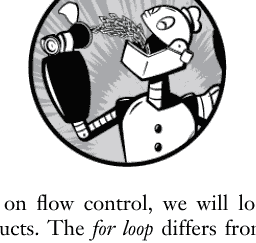

在本章关于流程控制的最后一章中，我们将介绍 shell 的另一种循环结构。`for` 循环与 `while` 和 `until` 循环不同之处在于，它提供了一种在循环期间处理序列的方法。这在编程时证明非常有用。因此，`for` 循环是 bash 脚本中一种流行的结构。

`for` 循环自然地使用 `for` 复合命令实现。在 bash 中，`for` 有两种形式。

### for：传统 Shell 形式

原始 `for` 命令的语法如下：

```
for variable [in words]; do
    commands
done
```

其中 `variable` 是在循环执行期间会递增的变量名，`words` 是可选的项目列表，将按顺序分配给 `variable`，而 `commands` 是在循环的每次迭代中要执行的命令。

`for` 命令在命令行上很有用。我们可以轻松演示它的工作原理。

```
[me@linuxbox ~]$ for i in A B C D; do echo $i; done
A
B
C
D
```

在这个例子中，`for` 被赋予了一个包含四个单词的列表：A、B、C 和 D。拥有四个单词的列表，循环执行四次。每次执行循环时，一个单词会被分配给变量 `i`。在循环内部，我们有一个 `echo` 命令，它显示 `i` 的值以展示分配情况。与 `while` 和 `until` 循环一样，`done` 关键字关闭循环。

`for` 的真正强大之处在于我们可以创建单词列表的多种有趣方式。例如，我们可以通过大括号展开来完成，如下所示：

```
[me@linuxbox ~]$ for i in {A..D}; do echo $i; done
A
B
C
D
```

或者我们也可以使用路径名展开，如下所示：

```
[me@linuxbox ~]$ for i in distros*.txt; do echo "$i"; done
distros-by-date.txt
distros-dates.txt
distros-key-names.txt
distros-key-vernums.txt
distros-names.txt
distros.txt
distros-vernums.txt
distros-versions.txt
```

路径名展开提供了一个干净整洁的路径名列表，可在循环中处理。唯一需要注意的预防措施是检查展开是否确实匹配了某些内容。默认情况下，如果展开未能匹配任何文件，通配符本身（`distros*.txt` 在

引号中。这是因为我们实际上希望进行单词分割以获得我们的列表。如果我们用引号将命令替换括起来，它将只产生一个包含文件中每个字符串的单词。这并不是我们想要的。

如果省略 `for` 命令的可选 `in words` 部分，`for` 默认处理位置参数。我们将修改我们的最长单词脚本以使用此方法：


```bash
#!/bin/bash

# longest-word2: find longest string in a file

for i; do
    if [[ -r "$i" ]]; then
        max_word=
        max_len=0
        for j in $(strings "$i"); do
            len=$(echo -n "$j" | wc -c)
            if (( len > max_len )); then
                max_len="$len"
                max_word="$j"
            fi
        done
        echo "$i: '$max_word' ($max_len characters)"
    fi
done
```

正如我们所见，我们已将最外层的循环改为使用 `for` 代替 `while`。通过省略 `for` 命令中的单词列表，位置参数将被使用。循环内部，变量 `i` 的先前实例已被更改为变量 `j`。`shift` 的使用也被消除了。

### 为什么是 `I`？

你可能已经注意到，在之前的每个 `for` 循环示例中都选择了变量 `i`。为什么？实际上没有特定原因，除了传统。`for` 中使用的变量可以是任何有效变量，但 `i` 最常见，其次是 `j` 和 `k`。

这一传统的根源来自 Fortran 编程语言。在 Fortran 中，以字母 `I`、`J`、`K`、`L` 和 `M` 开头的未声明变量会自动被类型化为整数，而以其他字母开头的变量则被类型化为实数（带小数部分的数字）。这种行为导致程序员使用变量 `I`、`J` 和 `K` 作为循环变量，因为当需要临时变量（循环变量通常如此）时，使用它们的工作量更少。

它还导致了以下基于 Fortran 的俏皮话：“GOD 是真实的，除非声明为 integer。”

### `for`：C 语言形式

`bash` 的最新版本添加了 `for` 命令语法的第二种形式，其形式类似于 C 编程语言中的形式。许多其他语言也支持这种形式。

```
for (( expression1; expression2; expression3 )); do
    commands
done
```

这里，`expression1`、`expression2` 和 `expression3` 是算术表达式，而 `commands` 是在循环的每次迭代期间要执行的命令。

就行为而言，这种形式等同于以下结构。

```
(( expression1 ))
while (( expression2 )); do
    commands
    (( expression3 ))
done
```

`expression1` 用于初始化循环的条件，`expression2` 用于确定循环何时结束，而 `expression3` 在循环的每次迭代结束时执行。

**这是一个典型的应用：**

```bash
#!/bin/bash

# simple_counter: demo of C style for command
for (( i=0; i<5; i=i+1 )); do
    echo $i
done
```

**执行时，它会产生以下输出：**

```text
[me@linuxbox ~]$ simple_counter
0
1
2
3
4
```

在此示例中，`expression1` 将变量 `i` 初始化为零值，`expression2` 允许循环在 `i` 的值小于 5 时继续执行，而 `expression3` 每次循环重复时将 `i` 的值递增 1。

C 语言形式的 `for` 在需要数字序列时非常有用。我们将在接下来的两章中看到它的几个应用。

### 总结

有了对 `for` 命令的了解，我们现在将对 `sys_info_page` 脚本进行最后的改进。目前，`report_home_space()` 函数如下所示：

```bash
report_home_space () {
    if [[ "$(id -u)" -eq 0 ]]; then
        cat <<- _EOF_
            <h2>Home Space Utilization (All Users)</h2>
            <pre>$(du -sh /home/*)</pre>
        _EOF_
    else
        cat <<- _EOF_
            <h2>Home Space Utilization ($USER)</h2>
            <pre>$(du -sh "$HOME")</pre>
        _EOF_
    fi
    return
}
```

接下来，我们将重写它，以为每个用户的 home 目录提供更多详细信息，并包含每个目录中的文件和子目录总数。

```bash
report_home_space () {

    local format="%8s%10s%10s\n"
    local i dir_list total_files total_dirs total_size user_name

    if [[ "$(id -u)" -eq 0 ]]; then
        dir_list=/home/*
        user_name="All Users"
    else
        dir_list="$HOME"
        user_name="$USER"
    fi

    echo "<h2>Home Space Utilization ($user_name)</h2>"

    for i in $dir_list; do
        total_files="$(find "$i" -type f | wc -l)"
        total_dirs="$(find "$i" -type d | wc -l)"
        total_size="$(du -sh "$i" | cut -f 1)"

        echo "<h3>$i</h3>"
        echo "<pre>"
        printf "$format" "Dirs" "Files" "Size"
        printf "$format" "----" "-----" "----"
        printf "$format" "$total_dirs" "$total_files" "$total_size"
        echo "</pre>"
    done
    return
}
```

此重写应用了我们迄今为止学到的许多内容。我们仍然测试超级用户，但不是将完整的一组操作作为 `if` 的一部分执行，而是设置稍后在 `for` 循环中使用的一些变量。我们向函数添加了几个局部变量，并使用 `printf` 来格式化部分输出。

# 34 字符串和数字


计算机程序都是关于处理数据的。在过去的章节中，我们专注于文件级别的数据处理。然而，许多编程问题需要使用字符串和数字等较小的数据单元来解决。

在本章中，我们将介绍 shell 中用于操作字符串和数字的几个特性。shell 提供了多种参数扩展来执行字符串操作。除了算术扩展之外，我们在第 7 章中已经涉及过，还有一个众所周知的命令行程序 `bc`，它执行更高级别的数学运算。

## 参数扩展

尽管参数扩展在第 7 章中出现过，但我们没有详细介绍它，因为大多数参数扩展用于脚本而不是命令行。我们已经使用了一些参数扩展形式，例如 shell 变量。shell 还提供了更多。

**NOTE**

### 管理空变量的扩展

有几个参数扩展旨在处理不存在和空的变量。这些扩展对于处理缺失的位置参数和为参数分配默认值非常有用。这里有一个这样的扩展：

```bash
${parameter:-word}
```

如果 `parameter` 未设置，即不存在或为空，则此扩展的结果为 `word` 的值。如果 `parameter` 不为空，则扩展结果为 `parameter` 的值。

```text
[me@linuxbox ~]$ foo=
[me@linuxbox ~]$ echo ${foo:-'substitute value if unset'}
substitute value if unset
[me@linuxbox ~]$ echo $foo

[me@linuxbox ~]$ foo=bar
[me@linuxbox ~]$ echo ${foo:-'substitute value if unset'}
bar
[me@linuxbox ~]$ echo $foo
bar
```

这里是另一个扩展，我们使用等号代替连字符：

```bash
${parameter:=word}
```


如果 `parameter` 未设置或为空，则此扩展的结果为 `word` 的值。此外，`word` 的值将被赋给 `parameter`。如果 `parameter` 不为空，则扩展结果为 `parameter` 的值。

```text
[me@linuxbox ~]$ foo=
[me@linuxbox ~]$ echo ${foo:="default value if unset"}
default value if unset
[me@linuxbox ~]$ echo $foo
default value if unset
[me@linuxbox ~]$ foo=bar
[me@linuxbox ~]$ echo ${foo:="default value if unset"}
bar
```

### 返回变量名的展开

Shell 具有返回变量名称的能力。这在一些相当奇特的情况下使用。

```
${!prefix*}
${!prefix@}
```

此展开返回名称以 `prefix` 开头的现有变量的名称。根据 bash 文档，两种形式的展开执行效果相同。下面，我们列出环境中所有名称以 BASH 开头的变量：

```
[me@linuxbox ~]$ echo ${!BASH*}
BASH BASH_ARGC BASH_ARGV BASH_COMMAND BASH_COMPLETION
BASH_COMPLETION_DIR
BASH_LINENO BASH_SOURCE BASH_SUBSHELL BASH_VERSINFO BASH_VERSION
```

### 字符串操作

有一组很大的展开可用于对字符串进行操作。其中许多展开特别适合对路径名进行操作。以下展开：

```
${#parameter}
```

展开为 `parameter` 中包含的字符串的长度。通常，`parameter` 是一个字符串；然而，如果 `parameter` 是 `@` 或 `*`，则展开结果为位置参数的数量。

```
[me@linuxbox ~]$ foo="This string is long."
[me@linuxbox ~]$ echo "$foo" is ${#foo} characters long.
'This string is long.' is 20 characters long.
```

以下展开用于提取 `parameter` 中包含的字符串的一部分：

```
${parameter:offset}
${parameter:offset:length}
```

提取从字符串开头 *offset* 个字符处开始，直到字符串末尾，除非指定了 *length*。

```
[me@linuxbox ~]$ foo="This string is long."
[me@linuxbox ~]$ echo ${foo:5}
string is long.
[me@linuxbox ~]$ echo ${foo:5:6}
string
```

如果 *offset* 的值为负，则表示它从字符串末尾开始而不是从开头开始。注意，负值必须前面加一个空格以防止与 `${parameter:-word}` 展开混淆。*length*，如果存在，必须不小于零。

如果 *parameter* 是 `@`，则展开的结果是 *length* 个从 *offset* 开始的位置参数。

```
[me@linuxbox ~]$ foo="This string is long."
[me@linuxbox ~]$ echo ${foo: -5}
long.
[me@linuxbox ~]$ echo ${foo: -5:2}
lo
```

以下展开删除由 *pattern* 定义的 *parameter* 中包含的字符串的前导部分。

```
${parameter#pattern}
${parameter##pattern}
```

*pattern* 是像路径名展开中使用的那种通配符模式。两种形式的区别在于 `#` 形式删除最短的匹配，而 `##` 形式删除最长的匹配。

```
[me@linuxbox ~]$ foo=file.txt.zip
[me@linuxbox ~]$ echo ${foo#*.}
txt.zip
[me@linuxbox ~]$ echo ${foo##*.}
zip
```

以下与之前的 `#` 和 `##` 展开相同，只是它们从字符串末尾删除文本

通过消除外部程序的使用来简化脚本。作为示例，我们将修改上一章中讨论的最长单词程序，使其使用参数展开 `${#j}` 代替命令替换 `$(echo -n $j | wc -c)` 及其产生的子 shell，如下所示：

```
#!/bin/bash

# longest-word3: find longest string in a file

for i; do
    if [[ -r "$i" ]]; then
        max_word=
        max_len=0
        for j in $(strings $i); do
            len="${#j}"
            if (( len > max_len )); then
                max_len="$len"
                max_word="$j"
            fi
        done
        echo "$i: '$max_word' ($max_len characters)"
    fi
done
```

接下来，我们将使用 `time` 命令比较两个版本的效率。

```
[me@linuxbox ~]$ time longest-word2 dirlist-usr-bin.txt
dirlist-usr-bin.txt: 'scrollkeeper-get-extended-content-list' (38 characters)

real    0m3.618s
user    0m1.544s
sys     0m1.768s
[me@linuxbox ~]$ time longest-word3 dirlist-usr-bin.txt
dirlist-usr-bin.txt: 'scrollkeeper-get-extended-content-list' (38 characters)

real    0m0.060s
user    0m0.056s
sys     0m0.008s
```

原始脚本扫描文本文件需要 3.618 秒，而使用参数展开的新版本仅需 0.06 秒，这是一个显著的改进。

### 大小写转换

`bash` 有四种参数扩展和两个 `declare` 命令选项来支持字符串的大小写转换。

那么大小写转换有什么用呢？除了明显的美观价值外，它在编程中也有重要作用。让我们考虑数据库查找的例子。假设用户在数据输入字段中输入了一个字符串，我们想在数据库中查找它。用户可能会以全大写字母或小写字母或两者组合输入该值。我们当然不想用每一种大小写拼写的排列来填充数据库。那怎么办？

解决这个问题的常见方法是规范化用户的输入。也就是说，在尝试数据库查找之前将其转换为标准形式。我们可以通过将用户输入中的所有字符转换为小写或大写来实现这一点，并确保数据库条目以相同的方式进行规范化。

`declare` 命令可用于将字符串规范化为大写或小写。使用 `declare`，我们可以强制变量始终包含所需格式，无论分配给它的内容是什么。

```
#!/bin/bash

# ul-declare: demonstrate case conversion via declare

declare -u upper
declare -l lower

if [[ $1 ]]; then
    upper="$1"
    lower="$1"
    echo "$upper"
    echo "$lower"
fi
```

在前面的脚本中，我们使用 `declare` 创建了两个变量 `upper` 和 `lower`。我们将第一个命令行参数（位置参数 1）的值赋给这两个变量，然后在屏幕上显示它们。

```
[me@linuxbox ~]$ ul-declare aBc
ABC
abc
```

正如我们所见，命令行参数（aBc）已被规范化。

除了 `declare` 之外，还有四种参数扩展执行大小写转换，如表 34-1 所描述。

## 表 34-1：大小写转换参数扩展

| 格式 | 结果 |
|---|---|
| `${parameter,,pattern}` | 将 `parameter` 的值扩展为全小写。`pattern` 是可选的 shell 模式，将限制哪些字符（例如 `[A-F]`）将被转换。有关模式的完整描述，请参阅 bash 手册页。 |
| `${parameter,pattern}` | 将 `parameter` 的值扩展，仅将第一个字符改为小写。 |
| `${parameter^^pattern}` | 将 `parameter` 的值扩展为全大写字母。 |
| `${parameter^pattern}` | 将 `parameter` 的值扩展，仅将第一个字符改为大写。 |

下面是一个演示这些扩展的脚本：


```
#!/bin/bash

# ul-param: demonstrate case conversion via parameter expansion

if [[ "$1" ]]; then
    echo "${1,,}"
    echo "${1,}"
    echo "${1^^}"
    echo "${1^}"
fi
```

以下是脚本的运行情况：

```
[me@linuxbox ~]$ ul-param aBc
abc
aBc
ABC
ABc
```

再次，我们处理第一个命令行参数并输出参数扩展支持的四种变体。虽然此脚本使用第一个位置参数，但 `parameter` 可以是任何字符串、变量或字符串表达式。

### 算术求值和展开

我们在第 7 章中研究了算术展开。它用于对整数执行各种算术运算。其基本形式如下：

```
$((expression))
```

其中 `expression` 是一个有效的算术表达式。

这与我们在第 27 章中遇到的用于算术求值（真值测试）的复合命令 `(( ))` 相关。

在之前的章节中，我们看到了一些常见的表达式和运算符类型。在这里，我们将查看更完整的列表。

### 数字进制

在第 9 章中，我们了解了八进制（基数 8）和十六进制（基数 16）数字。在算术表达式中，`shell` 支持任意进制的整数常量。表 34-2 显示了用于指定进制的记法。

#### 表 34-2：指定不同数字进制

| 记法 | 描述 |
|---|---|
| `number` | 默认情况下，没有任何记法的数字被视为十进制（基数 10）整数。 |
| `0number` | 在算术表达式中，以零开头的数字被视为八进制。 |
| `0xnumber` | 十六进制记法。 |
| `base#number` | `number` 以 `base` 为基数。 |

以下是一些示例：

```
[me@linuxbox ~]$ echo $((0xff))
255
[me@linuxbox ~]$ echo $((2#11111111))
255
```

在前面的示例中，我们打印十六进制数 `ff` 的值（最大的两位数字）和最大的八位二进制（基数 2）数。

### 一元运算符

有两个一元运算符，`+` 和 `-`，分别用于表示一个数字是正数还是负数。示例为 `-5`。

### 简单算术

表 34-3 列出了普通的算术运算符。

#### 表 34-3：算术运算符

| 运算符 | 描述 |
|---|---|
| `+` | 加法 |
| `-` | 减法 |
| `*` | 乘法 |
| `/` | 整数除法 |
| `**` | 指数运算 |
| `%` | 取模（余数） |

### 赋值

虽然其用途可能并不立即显而易见，但算术表达式可以执行赋值。我们已经在不同的上下文中多次执行过赋值。每次给变量赋一个值时，我们都在执行赋值。我们也可以在算术表达式中执行它。

```
[me@linuxbox ~]$ foo=
[me@linuxbox ~]$ echo $foo

[me@linuxbox ~]$ if (( foo = 5 )); then echo "It is true."; fi
It is true.
[me@linuxbox ~]$ echo $foo
5
```

在前面的示例中，我们首先给变量 `foo` 赋一个空值并验证它确实为空。接下来，我们使用复合命令 `(( foo = 5 ))` 执行一个 `if`。此过程做了两件有趣的事情：它将值 `5` 赋给变量 `foo`，并且求值为 `true`，因为 `foo` 被赋了一个非零值。

#### NOTE

重要的是要记住前一个表达式中 `=` 的确切含义。单个 `=` 执行赋值。`foo = 5` 表示“使 `foo` 等于 `5`”，而 `==` 评估等价性。`foo == 5` 表示“`foo` 是否等于 `5`？”这是许多编程语言中的常见特性。在 `shell` 中，这可能有点令人困惑，因为 `test` 命令接受单个 `=` 用于字符串等价性。这又是使用更现代的 `[[ ]]` 和 `(( ))` 复合命令代替 `test` 的另一个原因。

除了 `=` 记法之外，`shell` 还提供了执行一些非常有用的赋值的记法，如表 34-4 所描述的。

#### 表 34-4：赋值运算符

| 记号 | 描述 |
|---|---|
| `parameter = value` | 简单赋值。将 `value` 赋给 `parameter`。 |
| `parameter += value` | 加法。等价于 `parameter = parameter + value`。 |
| `parameter -= value` | 减法。等价于 `parameter = parameter - value`。 |
| `parameter *= value` | 乘法。等价于 `parameter = parameter * value`。 |
| `parameter /= value` | 整数除法。等价于 `parameter = parameter / value`。 |
| `parameter %= value` | 取模。等价于 `parameter = parameter % value`。 |
| `parameter++` | 变量后递增。等价于 `parameter = parameter + 1`（然而，参见以下讨论）。 |
| `parameter--` | 变量后递减。等价于 `parameter = parameter - 1`。 |
| `++parameter` | 变量前递增。等价于 `parameter = parameter + 1`。 |
| `--parameter` | 变量前递减。等价于 `parameter = parameter - 1`。 |

这些赋值运算符为许多常见的算术任务提供了方便的简写。特别有趣的是递增（`++`）和递减（`--`）运算符，它们将参数的值增加或减少一。这种记法取自 C 编程语言，已被纳入 `bash` 包括在内的许多其他编程语言中。

运算符可以出现在参数的前面或后面。虽然它们都将参数递增或递减一，但这两种位置有细微的差别。如果放在参数的前面，则在返回参数之前先递增（或递减）参数。如果放在后面，则在返回参数 *之后* 执行操作。这相当奇怪，但这是预期行为。以下是演示：

```
[me@linuxbox ~]$ foo=1
[me@linuxbox ~]$ echo $((foo++))
1
[me@linuxbox ~]$ echo $foo
2
```

如果我们将值 `1` 赋给变量 `foo`，然后使用放在参数名后面的 `++` 运算符递增它，`foo` 将以值 `1` 返回。然而，如果我们第二次查看变量的值，我们会看到递增后的值。如果我们将 `++` 运算符放在参数前面，我们会得到更预期的行为。

```
[me@linuxbox ~]$ foo=1
[me@linuxbox ~]$ echo $((++foo))
2
[me@linuxbox ~]$ echo $foo
2
```

对于大多数 `shell` 应用，前缀运算符将是最有用的。

`++` 和 `--` 运算符通常与循环一起使用。我们将对我们的取模脚本进行一些改进，使其更加紧凑。

```
#!/bin/bash

# modulo2: demonstrate the modulo operator

for ((i = 0; i <= 20; ++i )); do
    if (((i % 5) == 0 )); then
        printf "%d" "$i"
    else
        printf "%d " "$i"
    fi
done
printf "\n"
```

### 位运算

有一类运算符以一种不寻常的方式操作数字。这些运算符在位级别上工作。它们用于某些低层任务，通常涉及设置或读取位标志（请参见表34-5）。

#### 表 34-5：位运算符

| 运算符 | 描述 |
|---|---|
| `~` | 按位取反。对一个数字中的所有位取反。 |
| `<<` | 左位移位。将一个数字中的所有位向左移动。 |
| `>>` | 右位移位。将一个数字中的所有位向右移动。 |
| `&` | 按位与。对两个数字中的所有位执行与操作。 |
| `|` | 按位或。对两个数字中的所有位执行或操作。 |
| `^` | 按位异或。对两个数字中的所有位执行异或操作。 |

请注意，除按位取反外，所有位运算符都有相应的赋值运算符（例如 `<<=`）。

此处我们将演示如何使用左位移位运算符生成2的幂列表：

```shell
[me@linuxbox ~]$ for ((i=0;i<8;++i)); do echo $((1<<i)); done
1
2
4
8
16
32
64
128
```

### 逻辑

正如我们在第27章中发现的，`(( ))` 复合命令支持多种比较运算符。还有几个可用于逻辑求值的运算符。表34-6提供了完整列表。

#### 表 34-6：比较运算符

| 运算符 | 描述 |
|---|---|
| `<=` | 小于或等于。 |
| `>=` | 大于或等于。 |
| `<` | 小于。 |


| `>` | 大于。 |

| `==` | 等于。 |

| `!=` | 不等于。 |

| `&&` | 逻辑与。 |

| `||` | 逻辑或。 |

| `expr1?expr2:expr3` | 比较（三元）运算符。如果表达式 `expr1` 的值为非零（算术真），则执行 `expr2`；否则执行 `expr3`。 |

用于逻辑运算时，表达式遵循算术逻辑规则；也就是说，计算结果为零的表达式被视为假，非零的表达式被视为真。`(( ))` 复合命令将结果映射到 shell 的正常退出码中。

```
[me@linuxbox ~]$ if ((1)); then echo "true"; else echo "false"; fi
true
[me@linuxbox ~]$ if ((0)); then echo "true"; else echo "false"; fi
false
```

逻辑运算符中最奇怪的是三元运算符。此运算符（模仿C编程语言中的相应运算符）执行一个独立的逻辑测试。它可以用作一种 `if/then/else` 语句。它作用于三个算术表达式（字符串无效），如果第一个表达式为真（或非零），则执行第二个表达式。否则，执行第三个表达式。我们可以在命令行中尝试一下：

```
[me@linuxbox ~]$ a=0
[me@linuxbox ~]$ ((a<1?++a:--a))
[me@linuxbox ~]$ echo $a
1
[me@linuxbox ~]$ ((a<1?++a:--a))
[me@linuxbox ~]$ echo $a
0
```

这里我们看到一个三元运算符的运作。此示例实现了一个切换（toggle）。每次执行该运算符时，变量 `a` 的值在零和一之间切换，反之亦然。

请注意，在表达式中直接进行赋值并不容易。如果尝试这样做，`bash` 会声明一个错误。

```
[me@linuxbox ~]$ a=0
[me@linuxbox ~]$ ((a<1?a+=1:a-=1))
bash: ((: a<1?a+=1:a-=1: attempted assignment to non-variable (error token is "-=1")
```

这个问题可以通过将赋值表达式用括号括起来来缓解。

```
[me@linuxbox ~]$ ((a<1?(a+=1):(a-=1)))
```

接下来是一个更完整的示例，在脚本中使用算术运算符生成一个简单的数字表：

```bash
#!/bin/bash

# arith-loop: script to demonstrate arithmetic operators

finished=0
a=0
printf "a\ta**2\ta**3\n"
printf "=\t===\t====\n"

until ((finished)); do
    b=$(($a**2))
    c=$(($a**3))
    printf "%d\t%d\t%d\n" "$a" "$b" "$c"
    ((a<10?++a:(finished=1)))
done
```

在此脚本中，我们基于 `finished` 变量的值实现了一个 `until` 循环。最初，该变量设置为零（算术假），我们继续循环直到它变为非零。在循环内部，我们计算计数器变量 `a` 的平方和立方。在循环结束时，对计数器变量的值进行求值。如果它小于10（最大迭代次数），则将其加一；否则将变量 `finished` 的值设置为1，使 `finished` 在算术上为真，从而终止循环。运行该脚本会得到以下结果：

```
[me@linuxbox ~]$ arith-loop
a       a**2    a**3
=       ===     ====
0       0       0
1       1       1
2       4       8
3       9       27
4       16      64
5       25      125
6       36      216
7       49      343
8       64      512
9       81      729
10      100     1000
```

### bc——任意精度计算器语言

我们已经看到 shell 如何处理许多类型的整数算术，但如果我们需要进行更高的数学运算，甚至只是使用浮点数，该怎么办？答案是，我们做不到。至少不能直接使用 shell。为此，我们需要使用一个外部程序。我们可以采用几种方法。嵌入 Perl 或 AWK 程序是一种可能的解决方案，但不幸的是，这超出了本书的范围。

另一种方法是使用专用的计算器程序。许多 Linux 系统上的一个此类程序叫做 `bc`。

`bc` 程序读取用其自身类似 C 的语言编写的文件并执行它。`bc` 脚本可以是一个单独的文件，也可以从标准输入读取。`bc` 语言支持不少功能，包括变量、循环和程序员自定义函数。我们不会在这里完整介绍 `bc`，只介绍一些基本内容。`bc` 的 man 手册页对其有详细说明。

让我们从一个简单的例子开始。我们将编写一个 `bc` 脚本，计算 2 加 2。

```
/* A very simple bc script */

2 + 2
```

脚本的第一行是注释。`bc` 使用与 C 编程语言相同的注释语法。注释可以跨越多行，以 `/*` 开头，以 `*/` 结尾。

### 使用 bc

如果将之前的 `bc` 脚本保存为 `foo.bc`，我们可以这样运行它：

```
[me@linuxbox ~]$ bc foo.bc
bc 1.06.94
Copyright 1991-1994, 1997, 1998, 2000, 2004, 2006 Free Software Foundation, Inc.
This is free software with ABSOLUTELY NO WARRANTY.
For details type `warranty'.
4
```

如果我们仔细查看，可以在版权信息之后的最底部看到结果。可以使用 `-q`（quiet，安静）选项来抑制这条信息。

`bc` 也可以交互式使用。

```
[me@linuxbox ~]$ bc -q
2 + 2
4
quit
```

以交互方式使用 `bc` 时，我们只需输入要执行的计算，结果会立即显示。`bc` 命令 `quit` 结束交互会话。

也可以通过标准输入将脚本传递给 `bc`。

```
[me@linuxbox ~]$ bc < foo.bc
4
```

能够接受标准输入意味着我们可以使用 here documents、here strings 和管道来传递脚本。下面是一个 here string 示例：

```
[me@linuxbox ~]$ bc <<< "2+2"
4
```

## 示例脚本

作为实际示例，我们将构建一个执行常见计算（每月贷款还款额）的脚本。在下面的脚本中，我们使用 here document 将脚本传递给 `bc`：

```
#!/bin/bash

# loan-calc: script to calculate monthly loan payments

PROGNAME="${0##*/}" # Use parameter expansion to get basename

usage () {
    cat <<- EOF
Usage: $PROGNAME PRINCIPAL INTEREST MONTHS

Where:

PRINCIPAL is the amount of the loan.
INTEREST is the APR as a number (7% = 0.07).
MONTHS is the length of the loan's term.

EOF
}

if (( $# != 3)); then
    usage
    exit 1
fi

principal=$1
interest=$2
months=$3

bc <<- EOF
    scale = 10
    i = $interest / 12
    p = $principal
    n = $months
    a = p * ((i * ((1 + i) ^ n)) / (((1 + i) ^ n) - 1))
    print a, "\n"
EOF
```

执行时，结果如下所示：

```
[me@linuxbox ~]$ loan-calc 135000 0.0775 180
1270.72249000
```

此示例计算的是 180 个月（15 年）期、年利率 7.75% 的 135,000 美元贷款的每月还款额。请注意答案的精度。这取决于 `bc` 脚本中为特殊 `scale` 变量赋予的值。`bc` 脚本语言的完整描述由 `bc` 的 man 手册页提供。虽然其数学符号与 shell 的略有不同（`bc` 更接近 C），但基于我们目前所学，其中大部分内容会相当熟悉。

### 小结


在本章中，我们学习了许多可用于在脚本中完成“实际工作”的小技巧。随着我们编写脚本的经验不断增长，有效操作字符串和数字的能力将变得极其宝贵。我们的 `loan-calc` 脚本证明了即使简单的脚本也能完成一些非常有用的事情。

## 附加练习

虽然 `loan-calc` 脚本的基本功能已经具备，但该脚本还远未完成。作为附加练习，尝试使用以下功能改进 `loan-calc` 脚本：

- 对命令行参数进行完整验证
- 一个命令行选项，用于实现“交互式”模式，提示用户输入贷款本金、利率和期限
- 更好的输出格式

## 35 数组

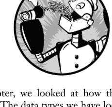

在上一章中，我们了解了 shell 如何操作字符串和数字。到目前为止，我们讨论的数据类型在计算机科学领域被称为标量变量；也就是说，它们是包含单个值的变量。

在本章中，我们将介绍另一种称为数组的数据结构，它可以保存多个值。数组几乎是每种编程语言都具有的特性。`shell` 也支持数组，尽管其支持方式相当有限。即便如此，它们对于解决某些类型的编程问题仍然非常有用。

### 什么是数组？

数组是同时保存多个值的变量。数组像表格一样组织。我们以电子表格为例。电子表格就像一个二维数组。它既有行又有列，电子表格中的单个单元格可以根据其行和列地址来确定位置。数组的行为方式相同。数组有单元格，称为元素，每个元素包含数据。可以使用称为索引或下标的地址来访问单个数组元素。

大多数编程语言都支持*多维数组*。电子表格就是一个具有两个维度（宽度和高度）的多维数组的例子。许多语言支持任意数量维度的数组，不过二维和三维数组可能是使用最广泛的。

`bash` 中的数组仅限于单一维度。我们可以将其视为只有一列的电子表格。即使有此限制，它们也有许多应用。数组支持首次出现在 `bash` 2 版本中。原始的 Unix shell 程序 `sh` 完全不支持数组。

## 创建数组

数组变量的命名方式与其它 `bash` 变量相同，并在被访问时自动创建。以下是一个示例：

```
[me@linuxbox ~]$ a[1]=foo
[me@linuxbox ~]$ echo ${a[1]}
foo
```

这里我们看到了数组元素的赋值和访问的例子。在第一个命令中，数组 `a` 的元素 1 被赋值为 `foo`。第二个命令显示元素 1 的存储值。在第二个命令中使用大括号是必需的，以防止 shell 尝试对数组元素名称进行路径名展开。

数组也可以使用 `declare` 命令创建。

```
[me@linuxbox ~]$ declare -a a
```

使用 `-a` 选项，此 `declare` 示例创建了数组 `a`。

## 为数组赋值

值可以通过两种方式之一进行赋值。单个值可以使用以下语法进行赋值：

```
name[subscript]=value
```

其中 `name` 是数组的名称，`subscript` 是大于或等于零的整数（或算术表达式）。请注意，数组的第一个元素的下标为零，而不是一。`value` 是分配给数组元素的字符串或整数。

多个值可以使用以下语法进行赋值：

```
name=(value1 value2 ...)
```

其中 `name` 是数组的名称，值占位符按顺序分配给数组的元素，从元素零开始。例如，如果我们想将一周的缩写星期几分配给数组 `days`，我们可以这样做：

```
[me@linuxbox ~]$ days=(Sun Mon Tue Wed Thu Fri Sat)
```

也可以通过为每个值指定下标来为特定元素赋值。

```
[me@linuxbox ~]$ days=([0]=Sun [1]=Mon [2]=Tue [3]=Wed [4]=Thu [5]=Fri [6]=Sat)
```

## 访问数组元素

那么，数组有什么用呢？正如许多数据管理任务可以用电子表格程序完成，许多编程任务也可以用数组完成。

让我们考虑一个简单的数据收集和展示示例。我们将构建一个脚本来检查指定目录中文件的修改时间。根据这些数据，我们的脚本将输出一个表格，显示文件最后修改的日期小时。这样的脚本可用于确定系统最活跃的时间。此脚本名为 `hours`，产生以下结果：

```
[me@linuxbox ~]$ hours .
Hour  Files  Hour  Files
----  -----  ----  -----
00    0      12    11
01    1      13    7
02    0      14    1
03    0      15    7
04    1      16    6
05    1      17    5
06    6      18    4
07    3      19    4
08    1      20    1
09    14     21    0
10    2      22    0
11    5      23    0

Total files = 80
```

我们执行 `hours` 程序，指定当前目录作为目标。它生成一个表格，显示一天中每个小时（0–23）有多少文件最后被修改。生成此结果的代码如下：

```
#!/bin/bash

# hours: script to count files by modification time

usage () {
    echo "usage: ${0##*/} directory" >&2
}

# Check that argument is a directory
if [[ ! -d "$1" ]]; then
    usage
    exit 1
fi

# Initialize array
for i in {0..23}; do hours[i]=0; done

# Collect data
for i in $(stat -c %y "$1"/* | cut -c 12-13); do
    j="${i#0}"
    ((hours[j]++))
    ((++count))
done
```

```
# Display data
echo -e "Hour\tFiles\tHour\tFiles"
echo -e "----\t-----\t----\t-----"
for i in {0..11}; do
    j=$(($i + 12))
    printf "%02d\t%02d\t%d\n" \
        "$i" \
        "${hours[i]}" \
        "$j" \
        "${hours[j]}"
done
printf "\nTotal files = %d\n" $count
```

该脚本由一个函数（`usage`）和一个包含四个部分的主体组成。在第一部分中，我们检查是否有命令行参数并且它是一个目录。如果不是，我们显示用法消息并退出。

第二部分初始化数组 `hours`。它通过为每个元素分配零值来实现。在使用数组之前没有特殊的准备要求，但我们的脚本需要确保没有任何元素为空。请注意循环构造的有趣方式。通过使用大括号展开（`{0..23}`），我们能够轻松地为 `for` 命令生成一系列单词。

下一部分通过在目录中对每个文件运行 `stat` 程序来收集数据。我们使用 `cut` 从结果中提取两位数的小时。在循环内部，我们需要从小时字段中删除前导零，因为 shell 会尝试（最终失败）将 00 到 09 的值解释为八进制数（参见表 34-2）。接下来，我们递增与当天小时对应的数组元素的值。最后，我们递增一个计数器（`count`）以跟踪目录中的文件总数。

脚本的最后一部分显示数组的内容。我们首先输出几行标题，然后进入一个循环来生成四列输出。最后，我们输出文件的最终总数。

## 数组操作

有很多常见的数组操作。诸如删除数组、确定其大小、排序等，在脚本编写中有许多应用。

## 输出数组的全部内容

下标 `*` 和 `@` 可用于访问数组中的每个元素。与位置参数一样，`@` 记法是两者中更有用的记法。以下是演示：

```
[me@linuxbox ~]$ animals=("a dog" "a cat" "a fish")
[me@linuxbox ~]$ for i in ${animals[*]}; do echo $i; done
a
dog
a
cat
a
fish
[me@linuxbox ~]$ for i in ${animals[@]}; do echo $i; done
a
dog
a
cat
a
fish
[me@linuxbox ~]$ for i in "${animals[*]}"; do echo $i; done
a dog a cat a fish
[me@linuxbox ~]$ for i in "${animals[@]}"; do echo $i; done
a dog
a cat
a fish
```


我们创建数组 `animals` 并为其分配三个由两个词组成的字符串。然后我们执行四个循环来观察词分割对数组内容的影响。记法 `${animals[*]}` 和 `${animals[@]}` 的行为在未加引号时是相同的。`*` 记法会产生一个包含数组内容的单个词，而 `@` 记法会产生三个由两个词组成的字符串，这与数组的“真实”内容相匹配。

## 确定数组元素的数量

使用参数扩展，我们可以以与查找字符串长度类似的方式确定数组中的元素数量。以下是一个示例：

```
[me@linuxbox ~]$ a[100]=foo
[me@linuxbox ~]$ echo ${#a[@]}  # number of array elements
1
[me@linuxbox ~]$ echo ${#a[100]}  # length of element 100
3
```

我们创建数组 `a` 并将字符串 `foo` 分配给元素 `100`。接下来，我们使用参数扩展来检查数组的长度，使用 `@` 记法。最后，我们查看元素 `100` 的长度，其中包含字符串 `foo`。有趣的是，虽然我们将字符串分配给了元素 `100`，但 bash 报告数组中只有一个元素。这与某些其他语言的行为不同，在那些语言中，数组中未使用的元素（元素 0–99）会被初始化为空值并计入总数。在 bash 中，数组元素只有在被赋予值时才存在，无论其下标如何。

## 查找数组使用的下标

由于 bash 允许数组在下标分配上存在“空隙”，因此有时需要确定哪些元素实际存在。这可以通过使用以下形式的 参数扩展来完成：

```
${!array[*]}
${!array[@]}
```

其中 `array` 是数组变量的名称。与使用 `*` 和 `@` 的其他扩展一样，用引号括起来的 `@` 形式是最有用的，因为它会扩展为单独的词。

```
[me@linuxbox ~]$ foo=([2]=a [4]=b [6]=c)
[me@linuxbox ~]$ for i in "${foo[@]}"; do echo $i; done
a
b
c
[me@linuxbox ~]$ for i in "${!foo[@]}"; do echo $i; done
2
```

## 向数组末尾添加元素

如果我们需要向数组末尾追加值，仅知道数组中的元素数量是没有帮助的，因为 `*` 和 `@` 记法返回的值并不能告诉我们当前使用的最大数组索引。幸运的是，shell 为我们提供了解决方案。通过使用 `+=` 赋值运算符，我们可以自动向数组末尾追加值。在这里，我们将三个值分配给数组 `foo`，然后再追加三个值：

```
[me@linuxbox ~]$ foo=(a b c)
[me@linuxbox ~]$ echo ${foo[@]}
a b c
[me@linuxbox ~]$ foo+=(d e f)
[me@linuxbox ~]$ echo ${foo[@]}
a b c d e f
```

## 排序数组

与电子表格一样，通常需要对数据列中的值进行排序。shell 没有直接的方法来执行此操作，但通过一点编码并不难做到。

```
#!/bin/bash

# array-sort: Sort an array

a=(f e d c b a)

echo "Original array: ${a[@]}"
a_sorted=($(for i in "${a[@]}"; do echo $i; done | sort))
echo "Sorted array:  ${a_sorted[@]}"
```

执行脚本时，会产生以下输出：

```
[me@linuxbox ~]$ array-sort
Original array: f e d c b a
Sorted array:   a b c d e f
```

脚本通过使用巧妙的命令替换将原始数组（`a`）的内容复制到第二个数组（`a_sorted`）来工作。这种基本技术可以通过更改管道的设计来对数组执行许多种操作。

## 删除数组

要删除数组，请使用 `unset` 命令。

```
[me@linuxbox ~]$ foo=(a b c d e f)
[me@linuxbox ~]$ echo ${foo[@]}
a b c d e f
[me@linuxbox ~]$ unset foo
[me@linuxbox ~]$ echo ${foo[@]}

[me@linuxbox ~]$
```

`unset` 也可用于删除单个数组元素。

```
[me@linuxbox ~]$ foo=(a b c d e f)
[me@linuxbox ~]$ echo ${foo[@]}
a b c d e f
[me@linuxbox ~]$ unset 'foo[2]'
[me@linuxbox ~]$ echo ${foo[@]}
a b d e f
```

在此示例中，我们删除了数组的第三个元素，下标为 `2`。记住，数组从下标零开始，而不是一！另请注意，数组元素必须加引号以防止 shell 执行路径名扩展。

有趣的是，将空值赋给数组并不会清空其内容。

```
[me@linuxbox ~]$ foo=(a b c d e f)
[me@linuxbox ~]$ foo=
[me@linuxbox ~]$ echo ${foo[@]}
b c d e f
```

对数组变量的任何不带下标的引用都指的是数组的零号元素。

```
[me@linuxbox ~]$ foo=(a b c d e f)
[me@linuxbox ~]$ echo ${foo[@]}
a b c d e f
[me@linuxbox ~]$ foo=A
[me@linuxbox ~]$ echo ${foo[@]}
A b c d e f
```

## 关联数组

`bash` 4.0 及更高版本支持 *关联数组*。关联数组使用字符串而不是整数作为数组索引。这种功能允许以有趣的新方法管理数据。例如，我们可以创建一个名为 `colors` 的数组并使用颜色名称作为索引。

```
declare -A colors
colors["red"]="#ff0000"
colors["green"]="#00ff00"
colors["blue"]="#0000ff"
```

与仅通过引用它们即可创建的整数索引数组不同，关联数组必须使用 `declare` 命令并使用新的 `-A` 选项创建。关联数组元素的访问方式与整数索引数组非常相似。

```
echo ${colors["blue"]}
```

在下一章中，我们将研究一个脚本，该脚本很好地利用了关联数组来生成有趣的报告。

### 总结

如果我们在 `bash` 手册页中搜索单词 *array*，我们会发现 `bash` 使用数组变量的许多实例。其中大多数相当晦涩，但在某些特殊情况下可能偶尔有用。事实上，整个数组主题在 shell 编程中利用不足，这在很大程度上是由于传统的 Unix shell 程序（如 `sh`）缺乏对数组的任何支持。这种缺乏流行是不幸的，因为数组在其他编程语言中被广泛使用，并且为解决许多编程问题提供了强大的工具。

数组和循环具有天然的亲和力，通常一起使用。以下形式的循环特别适合计算数组下标：

```
for ((expr; expr; expr))
```

## 36

### EXOTICA


在我们旅程的最后一章中，我们将研究一些零碎内容。虽然我们在前几章中确实涵盖了很多内容，但仍有许多 `bash` 功能我们尚未涵盖。其中大多数相当晦涩，主要对将 `bash` 集成到 Linux 发行版的人有用。然而，其中有一些虽然不常用，但对某些编程问题很有帮助。我们将在此处介绍它们。

## 命令组和子 shell

`bash` 允许将命令组合在一起。这可以通过两种方式完成，要么使用 *命令组*，要么使用 *子 shell*。

以下是命令组的语法：

```
{ command1; command2; [command3; ...] }
```

以下是子 shell 的语法：

```
(command1; command2; [command3;...])
```

这两种形式的区别在于命令组用大括号包围其命令，而子 shell 使用括号。需要注意的是，由于 `bash` 实现命令组的方式，大括号必须与命令之间用空格分隔，并且最后一个命令必须在闭合大括号之前以分号或换行符终止。

那么，命令组和子 shell 有什么用？虽然它们有一个重要的区别（我们稍后会提到），但它们都用于管理重定向。让我们考虑一个对多个命令执行重定向的脚本片段。

```
ls -l > output.txt
echo "Listing of foo.txt" >> output.txt
cat foo.txt >> output.txt
```

这很简单。三条命令的输出都被重定向到名为 `output.txt` 的文件。使用命令组，我们可以按如下方式编写：

```
{ ls -l; echo "Listing of foo.txt"; cat foo.txt; } > output.txt
```

使用子 shell 类似。


```
(ls -l; echo "Listing of foo.txt"; cat foo.txt) > output.txt
```

使用这种技术，我们节省了一些输入，但命令组或子 shell 真正发挥作用的地方在于管道。在构建命令管道时，通常需要将多个命令的结果合并为单个流。命令组和子 shell 使此操作变得简单。

```
{ ls -l; echo "Listing of foo.txt"; cat foo.txt; } | lpr
```

在这里，我们将三个命令的输出合并并将其通过管道传输到 `lpr` 的输入中以生成打印报告。

在下面的脚本中，我们将使用命令组并查看可以结合使用的几种编程技术

使用关联数组。这个名为 `array-2` 的脚本，当给定一个目录名时，会打印该目录中文件的列表，同时显示每个文件的所有者和组所有者。在列表末尾，脚本会打印属于每个所有者和组的文件数量统计。以下是脚本给定目录 `/usr/bin` 时的结果（为简洁起见已缩减）：

```
[me@linuxbox ~]$ array-2 /usr/bin
/usr/bin/2to3-2.6          root    root
/usr/bin/2to3             root    root
/usr/bin/a2p              root    root
/usr/bin/abrowser         root    root
/usr/bin/aconnect         root    root
/usr/bin/acpi_fake_key    root    root
/usr/bin/acpi_listen      root    root
/usr/bin/add-apt-repository root root
-- snip --
/usr/bin/zipgrep          root    root
/usr/bin/zipinfo          root    root
/usr/bin/zipnote          root    root
/usr/bin/zip              root    root
/usr/bin/zipsplit         root    root
/usr/bin/zsdecode         root    root
/usr/bin/zsoelim          root    root

File owners:
daemon  :   1 file(s)
root    : 1394 file(s)

File group owners:
crontab :   1 file(s)
daemon  :   1 file(s)
lpadmin :   1 file(s)
mail    :   4 file(s)
mlocate :   1 file(s)
root    : 1380 file(s)
shadow  :   2 file(s)
ssh     :   1 file(s)
tty     :   2 file(s)
utmp    :   2 file(s)
```

以下是该脚本的列表（带行号）：

```
1   #!/bin/bash
2
3   # array-2: Use arrays to tally file owners
4
5 declare -A files file_group file_owner groups owners
6
7 if [[ ! -d "$1" ]]; then
8     echo "Usage: array-2 dir" >&2
9     exit 1
10 fi
11
12 for i in "$1/*"; do
13     owner="$(stat -c %U "$i")"
14     group="$(stat -c %G "$i")"
15     files["$i"]="$i"
16     file_owner["$i"]="$owner"
17     file_group["$i"]="$group"
18     ((++owners[$owner]))
19     ((++groups[$group]))
20 done
21
22 # List the collected files
23 { for i in "${files[@]}"; do
24     printf "%-40s %-10s %-10s\n" \
25         "$i" "${file_owner["$i"]}" "${file_group["$i"]}"
26 done } | sort
27 echo
28
29 # List owners
30 echo "File owners:"
31 { for i in "${!owners[@]}"; do
32     printf "%-10s: %5d file(s)\n" "$i" "${owners["$i"]}"
33 done } | sort
34 echo
35
36 # List groups
37 echo "File group owners:"
38 { for i in "${!groups[@]}"; do
39     printf "%-10s: %5d file(s)\n" "$i" "${groups["$i"]}"
40 done } | sort
```

让我们看一下这个脚本的机制。

第 5 行：关联数组必须使用带 `-A` 选项的 `declare` 命令创建。在本脚本中，我们创建了如下五个数组：

- `files` 包含目录中的文件名，以文件名为索引。
- `file_group` 包含每个文件的组所有者，以文件名为索引。
- `file_owner` 包含每个文件的所有者，以文件名为索引。
- `groups` 包含属于该索引组的文件数量。
- `owners` 包含属于该索引所有者的文件数量。

**第 7–10 行：** 这些行检查是否传入了有效的目录名作为位置参数。如果没有，则显示一条用法消息，并以退出状态 1 退出脚本。

**第 12–20 行：** 这些行循环遍历目录中的文件。使用 `stat` 命令，第 13 和 14 行提取文件所有者和组所有者的名称，并使用文件名作为数组索引，将这些值赋给对应的数组（第 16 和 17 行）。同样，文件名本身也被赋给 `files` 数组（第 15 行）。

**第 18–19 行：** 属于文件所有者和组所有者的文件计数各增加一。

**第 22–27 行：** 输出文件列表。这是通过 `"${array[@]}"` 参数展开实现的，它将展开为整个数组元素列表，每个元素被视为一个单独的词。这样文件名即使包含嵌入空格也能处理。还要注意，整个循环被括在大括号内，构成一个组命令。这允许将循环的全部输出通过管道传给 `sort` 命令。这是必要的，因为数组元素展开后并未排序。

**第 29–40 行：** 这两个循环与文件列表循环类似，不同之处在于它们使用 `"${!array[@]}"` 展开，该展开扩展为数组索引列表，而不是数组元素列表。

## 进程替换

虽然它们看起来相似，并且都可以用于组合重定向流，但组命令和子 shell 之间有一个重要区别。组命令在当前 shell 中执行其所有命令，而子 shell（顾名思义）在当前 shell 的子副本中执行其命令。这意味着环境被复制并交给一个新的 shell 实例。当子 shell 退出时，环境的副本会丢失，因此任何更改对子 shell 环境（包括变量赋值）所做的修改也会丢失。因此，在大多数情况下，除非脚本需要子 shell，否则使用命令分组比使用子 shell 更可取。命令分组既更快，也更省内存。

我们在第 28 章中看到了子 shell 环境问题的例子，当时我们发现管道中的 `read` 命令并不像我们直觉期望的那样工作。回顾一下，如果我们构造如下管道：

```
echo "foo" | read
echo $REPLY
```

`REPLY` 变量的内容始终为空，因为 `read` 命令是在子 shell 中执行的，而其 `REPLY` 的副本在子 shell 终止时被销毁。

由于管道中的命令总是以子 shell 的形式执行，任何执行变量赋值的命令都会遇到此问题。幸运的是，shell 提供了一种称为进程替换的特殊形式的展开，可以用来解决这个问题。

进程替换有两种表达方式。

对于产生标准输出的进程，它看起来像这样：

```
<(list)
```

对于接收标准输入的进程，它看起来像这样：

```
>(list)
```

其中 `list` 是一个命令列表。

要解决我们遇到的 `read` 问题，我们可以像这样使用进程替换。

```
read < <(echo "foo")
echo $REPLY
```

进程替换允许我们将子 shell 的输出视为普通文件以用于重定向。事实上，由于它是一种形式


```
Filename:  bin
Size:      4096
Owner:     me
Group:     me
Modified:  2009-07-10 07:31
Links:     2
Attributes: drwxr-xr-x

Filename:  bookmarks.html
Size:      394213
Owner:     me
Group:     me
```

## Traps

在第 10 章中，我们看到了程序如何响应信号。我们也可以为脚本添加此功能。虽然我们迄今为止编写的脚本不需要此功能（因为它们执行时间很短且不创建临时文件），但更大更复杂的脚本可能从拥有信号处理例程中受益。

当我们设计一个大型复杂的脚本时，考虑如果用户在脚本运行时注销或关闭计算机时会发生什么情况非常重要。当此类事件发生时，信号将被发送到所有受影响的进程。反过来，表示这些进程的程序可以执行操作以确保程序的正确有序终止。假设，例如，我们编写了一个脚本，在其执行过程中创建了一个临时文件。在良好的设计过程中，我们会让脚本在完成工作后删除该文件。如果收到信号表明程序将被提前终止，聪明的做法是让脚本删除该文件。

`bash` 为此目的提供了一种称为 `trap` 的机制。`trap` 使用同名内置命令 `trap` 实现。`trap` 使用以下语法：

```
trap argument signal [signal...]
```

其中 *argument* 是一个将被读取并作为命令处理的字符串，而 *signal* 是将触发解释命令执行的信号的指定。

这里有一个简单的例子：

```
#!/bin/bash

# trap-demo: simple signal handling demo

trap "echo 'I am ignoring you.'" SIGINT SIGTERM

for i in {1..5}; do
    echo "Iteration $i of 5"
    sleep 5
done
```

此脚本定义了一个 `trap`，每当脚本运行时收到 `SIGINT` 或 `SIGTERM` 信号时都会执行 `echo` 命令。

当用户尝试通过按 CTRL-C 停止脚本时，程序的执行如下所示：

```
[me@linuxbox ~]$ trap-demo
Iteration 1 of 5
Iteration 2 of 5
^CI am ignoring you.
Iteration 3 of 5
^CI am ignoring you.
Iteration 4 of 5
Iteration 5 of 5
```

正如我们所见，每当用户尝试中断程序时，都会打印消息而不是中断。

构造一个字符串以形成有用的命令序列可能很笨拙，因此常见的做法是将 shell 函数指定为命令。在此示例中，为要处理的每个信号指定了单独的 shell 函数：

```
#!/bin/bash

# trap-demo2: simple signal handling demo
```

```
exit_on_signal_SIGINT () {
    echo "Script interrupted." 2>&1
    exit 0
}

exit_on_signal_SIGTERM () {
    echo "Script terminated." 2>&1
    exit 0
}

trap exit_on_signal_SIGINT SIGINT
trap exit_on_signal_SIGTERM SIGTERM

for i in {1..5}; do
    echo "Iteration $i of 5"
    sleep 5
done
```

该脚本包含两个 `trap` 命令，每个信号各一个。每个 `trap` 反过来指定一个 shell 函数，在接收到特定信号时执行该函数。请注意，每个信号处理函数中都包含 `exit` 命令。如果没有 `exit`，脚本在完成函数后会继续执行。

当用户在执行此脚本期间按下 CTRL-C 时，结果如下所示：

```
[me@linuxbox ~]$ trap-demo2
Iteration 1 of 5
Iteration 2 of 5
^CScript interrupted.
```

## 临时文件

脚本中包含信号处理程序的一个原因是为了删除脚本在执行期间可能创建的用于保存中间结果的临时文件。命名临时文件有一定的技巧。传统上，类 Unix 系统上的程序会在 `/tmp` 目录中创建临时文件，`/tmp` 是一个用于此类文件的共享目录。然而，由于该目录是共享的，这会带来一定的安全问题，特别是对于以超级用户权限运行的程序。除了为系统所有用户公开的文件设置适当的权限这一显而易见的步骤外，给临时文件一个不可预测的文件名也很重要。这可以避免一种称为 *temp race attack* 的攻击。一种创建不可预测但仍具描述性的名称的方法是这样做：

```
tempfile=/tmp/$(basename $0).$$.$RANDOM
```

这将创建一个由程序名称、其进程 ID（PID）以及一个随机整数组成的文件名。需要注意的是，`$RANDOM` shell 变量返回的值仅在 1–32767 范围内，在计算机术语中这不是一个很大的范围，因此变量的单个实例不足以抵御有决心的攻击者。

更好的方法是使用 `mktemp` 程序（不要与 `mktemp` 标准库函数混淆）来命名并创建临时文件。`mktemp` 程序接受一个用作构建文件名的模板作为参数。模板应包含一系列 `x` 字符，它们将被相应数量的随机字母和数字替换。`x` 字符序列越长，随机字符序列就越长。以下是一个示例：

```
tempfile=$(mktemp /tmp/foobar.$$.XXXXXXXXXX)
```

这会创建一个临时文件并将其名称赋给变量 `tempfile`。模板中的 `x` 字符会被随机字母和数字替换，因此最终的文件名（在此示例中，还包括特殊参数 `$$` 的展开值以获得 PID）可能类似于这样：

```
/tmp/foobar.6593.UOZuvM6654
```

对于由普通用户执行的脚本，避免使用 */tmp* 目录并在用户的主目录内创建临时文件目录可能是明智的，使用如下代码行：

```
[[ -d $HOME/tmp ]] || mkdir $HOME/tmp
```

## 使用 wait 进行异步执行

有时希望同时执行多个任务。我们已经看到所有现代操作系统至少是多任务的，如果不是多用户的话。脚本可以构建成多任务行为。

通常这涉及启动一个脚本，该脚本反过来启动一个或多个子脚本以执行额外任务，同时父脚本继续运行。然而，当一系列脚本以这种方式运行时，保持父进程和子进程协调可能会出现问题。也就是说，如果父进程或子进程依赖于对方，并且一个脚本必须等待另一个脚本完成其任务后才能完成自己的任务，该怎么办？

`bash` 有一个内置命令可以帮助管理此类异步执行。`wait` 命令会导致父脚本暂停，直到指定的进程（即子脚本）完成为止。为了演示这一点，我们需要两个脚本。第一个是父脚本。

```
#!/bin/bash

# async-parent: Asynchronous execution demo (parent)

echo "Parent: starting..."

echo "Parent: launching child script..."
async-child &
pid=$!
echo "Parent: child (PID= $pid) launched."

echo "Parent: continuing..."
sleep 2

echo "Parent: pausing to wait for child to finish..."
wait "$pid"
```

```
echo "Parent: child is finished. Continuing..."
echo "Parent: parent is done. Exiting."
```

这是第二个子脚本。

```
#!/bin/bash

# async-child: Asynchronous execution demo (child)

echo "Child: child is running..."
sleep 5
echo "Child: child is done. Exiting."
```

在这个示例中，我们看到子脚本很简单。真正的动作是由父脚本执行的。在父脚本中，子脚本被启动并放到后台。子脚本的进程 ID 通过将 `pid` 变量赋值为 `$!` shell 参数的值来记录，该参数始终包含最后放入后台的作业的进程 ID。

父脚本继续执行，然后使用子进程的 PID 执行 `wait` 命令。这会导致父脚本暂停，直到子脚本退出，此时父脚本结束。

执行时，父脚本和子脚本产生以下输出：


```
[me@linuxbox ~]$ async-parent
Parent: starting...
Parent: launching child script...
Parent: child (PID= 6741) launched.
Parent: continuing...
Child: child is running...
Parent: pausing to wait for child to finish...
Child: child is done. Exiting.
Parent: child is finished. Continuing...
Parent: parent is done. Exiting.
```

## 命名管道

在大多数类 Unix 系统中，可以创建一种特殊类型的文件，称为命名管道。命名管道用于在两个进程之间创建连接，并且可以像其他类型的文件一样使用。它们并不那么流行，但了解它们是很有用的。

有一种常见的编程架构称为客户端-服务器，它可以使用命名管道等通信方法，以及网络连接等其他类型的进程间通信。

最广泛使用的客户端-服务器系统类型，当然是 Web 浏览器与 Web 服务器的通信。Web 浏览器充当客户端，向服务器发出请求，服务器则向浏览器响应网页。

命名管道表现得像文件，但实际上形成了先进先出 FIFO 缓冲区。与普通 无名 管道一样，数据从一端进入，从另一端出来。使用命名管道，可以设置如下内容：

```
process1 > named_pipe
```

以及这样：

```
process2 < named_pipe
```

它将表现得像这样：

```
process1 | process2
```

## 设置命名管道

首先，我们必须创建一个命名管道。这是通过使用 `mkfifo` 命令完成的。

```
[me@linuxbox ~]$ mkfifo pipe1
[me@linuxbox ~]$ ls -l pipe1
prw-r--r-- 1 me me 0 2018-07-17 06:41 pipe1
```

在这里，我们使用 `mkfifo` 创建一个名为 `pipe1` 的命名管道。使用 `ls` 检查文件，我们看到属性字段中的第一个字母是 `p`，表示它是一个命名管道。

## 使用命名管道

为了演示命名管道的工作方式，我们需要两个终端窗口 或 两个虚拟控制台。在第一个终端中，我们输入一个简单命令并将其输出重定向到命名管道。

```
[me@linuxbox ~]$ ls -l > pipe1
```

按下 ENTER 后，命令似乎会挂起。这是因为目前还没有东西从管道的另一端接收数据。当这种情况发生时，称管道被阻塞。一旦我们在另一端附加一个进程并开始从管道读取输入，此状况就会清除。使用第二个终端窗口，我们输入此命令：

```
[me@linuxbox ~]$ cat < pipe1
```

从第一个终端窗口产生的目录列表会作为 `cat` 命令的输出出现在第二个终端中。第一个终端中的 `ls` 命令在不再被阻塞后成功完成。

### 总结

好吧，我们已经完成了我们的旅程。现在唯一要做的就是练习、练习、再练习。尽管我们在旅途中覆盖了很多内容，但就命令行而言，我们才刚刚触及表面。还有数千个命令行程序等待被发现和享受。开始在 `/usr/bin` 中挖掘，你就会看到了！

## 索引

### 符号

- `$*`, 406
- `$@`, 406
- `${[!array[*]]}`, 442
- `${[!array[@]]}`, 442
- `${[!prefix*]}`, 422
- `${[!prefix@]}`, 422
- `${#parameter}`, 422
- `${parameter'}`, 426
- `${parameter^}`, 426
- `${parameter:-word}`, 420
  - `:?word}`, 421
  - `:+word}`, 422
  - `:word}`, 421
- `${parameter,}`, 426
- `${parameter,,}`, 426
- `${parameter/pattern/string}`, 424
- `${parameter//pattern/string}`, 424
- `${parameter/#pattern/string}`, 424
- `${parameter/%pattern/string}`, 424
- `${parameter#pattern}`, 423
- `${parameter##pattern}`, 423
- `${parameter%pattern}`, 424
- `${parameter%%pattern}`, 424
- `$!`, 457
- `$#`, 402
- `$((expression))`, 427
- `$0`, 405
- `/`, 19
- `(( ))` 复合命令, 427, 432
- `[` 命令, 385
- `[[ ]]` 复合命令, 377

### A

- `a2ps` 命令, 303
- 绝对路径名, 9
- `alias` 命令, 46, 117
- 别名, 40, 46
- 美国国家标准学会 ANSI, 148
- 美国信息交换标准代码。参见 ASCII
- 锚点, 228
- 匿名 FTP 服务器, 186
- ANSI 美国国家标准学会, 148
- ANSI 转义码, 148
- `ANSI.SYS`, 148
- Apache Web 服务器, 108
- `apropos` 命令, 44
- `apt-cache` 命令, 158
- `apt-get` 命令, 158
- 数组
  - 在末尾追加值, 442
  - 分配值, 438
  - 关联式, 448
  - 创建, 438
  - 删除, 443
  - 确定元素数量, 441
  - 查找使用的下标, 442
  - 索引, 438
  - 多维, 438
  - 读入变量, 366
  - 排序, 443
  - 下标, 438
  - 二维, 437
- ASCII 美国信息交换标准代码, 70, 75, 206, 232, 303
  - 铃字符, 146
  - 排序顺序, 232
  - 控制码, 70, 232, 298
  - `groff` 输出驱动, 292
  - 空字符, 206
  - 文本, 17
- `aspell` 命令, 275
- 汇编器, 310
- 汇编语言, 310
- 赋值运算符, 430
- 关联数组, 444
- 异步执行, 456
- 音频 CD, 178
- `AWK` 编程语言, 275, 434
- 反向引用, 271
- 反斜杠转义特殊字符, 146
- 反斜杠转义序列, 70
- 增量备份, 216
- `basename` 命令, 405
- `.bash_history`, 77
- `.bash_login`, 119
- `.bash_profile`, 119
- `.bashrc`, 119–121, 326, 347, 405
- `bash` shell, 3, 116
  - 手册页, 44
- 基本正则表达式, 234, 242–243, 273
- `bc` 命令, 434
- 伯克利软件发行版 BSD, 301
- `bg` 命令, 106
- `/bin`, 19
- 二进制, 85, 86, 90, 310, 428
- 位掩码, 89
- 位运算符, 431
- `/boot`, 19
- `/boot/grub/grub.conf`, 19
- `/boot/vmlinuz`, 19
- Bourne, Steve, 3
- 大括号展开, 65, 68, 414
- 分支, 349
- `break` 命令, 378, 409
- 损坏的链接, 36
- BSD 伯克利软件发行版, 301
- BSD 风格, 102
- 缓冲, 170
- 错误, 390–391
- 构建环境, 315
- `bzip2` 命令, 212

### C

- `C++`, 310
- `cal` 命令, 5
- `cancel` 命令, 307
- 回车, 17, 70, 146, 232–233, 247, 274–275, 301
- `case` 复合命令, 396
- 大小写转换, 425
- `cat` 命令, 53, 247
- `cd` 命令, 9, 11
- `cdrecord` 命令, 178
- CD-ROM, 168–169, 177
- `cdrtools` 软件包, 178
- 字符类, 24–26, 230–231, 237, 267, 275
- 字符范围, 26, 230–231, 275
- `chgrp` 命令, 95
- 子进程, 100
- `chmod` 命令, 85, 96, 325
- `chown` 命令, 94–96
- Chrome, 329
- 时间排序, 253
- 明文, 186, 188
- 客户端-服务器架构, 457
- `COBOL` 编程语言, 310
- 排序顺序, 118, 234, 267
  - ASCII, 234, 355
  - 传统, 234
- 命令历史, 4, 77
  - 命令行
    - 参数, 402
    - 编辑, 4, 74


+ 展开, 61

+ 历史, 4, 77

+ 接口, xxvi, 25

+ 命令选项, 14

+ 命令

+ 参数, 14, 402

+ 确定类型, 40

+ 文档, 41

+ 可执行程序文件, 40, 311

+ 以另一用户执行, 92

+ 长选项, 14

+ 选项, 14

+ 命令替换, 67, 68, 415

+ `comm` 命令, 262

+ 注释, 120, 124, 274, 324, 392

+ 通用 Unix 打印系统 CUPS, 300

+ 比较运算符, 432

+ 编译器, 311

+ 编译, 310

+ 复合命令

+ `(( ))`, 358, 371, 427

+ `[[ ]]`, 357, 371

+ `case`, 396

+ `for`, 413

+ `if`, 350

+ `until`, 379

+ `while`, 376

+ 压缩算法, 210

+ 条件表达式, 387

配置文件，17，20，115

`./configure`，315

`configure` 命令，315

常量，333

`continue` 命令，378

控制字符，146，247

控制终端，100

控制操作符

`&&`，361，371

`||`，361

`COPYING`（文档文件），314

复制和粘贴

在 vi 中，135

在命令行中，75

使用 X Windows 系统，5

`coreutils` 软件包，45，258

统计文件中的单词数，57

`cp` 命令，26，31，122，192

C 编程语言，310，416，430，432

CPU，99–100，310

`cron` 作业，197

填字游戏，229

`csplit` 命令，278

CUPS（通用 Unix 打印系统），300

光标移动，74

`cut` 命令，256，424

在命令行上剪切和粘贴，75

## D

守护进程，100，108

- 数据压缩，210

- 数据冗余，210

- 数据验证，357

- `date` 命令，5

- 日期格式，253

- `dd` 命令，177

- Debian，156

- Debian 风格（.deb），156

- 调试，344，391

- `declare` 命令，426

- 防御性编程，387，391

- 分隔符，69，251，254

- 依赖关系，157，318

- 设计，390–391

- `/dev/cdrom`，171

- `/dev/dvd`，171

- `/dev/floppy`，171

- 设备驱动程序，163，310

- 设备名称，170

- 设备节点，19

- `/dev/null`，53

- `df` 命令，6，346

- DHCP（动态主机配置协议），184

- 字典排序顺序，232

- `diction` 程序，312

- `diff` 命令，263

- 数字版权管理（DRM），157

- 目录，91

  - 复制，26

  - 创建，26，31

  - 当前工作目录，8

- 边界和角落情况，391

- `EDITOR` 变量，118

- `elif` 语句，356

- 电子邮件，246

- 嵌入式系统，310

- 空变量，420

- 加密隧道，191

- 加密，268

- 文件结束，54，336

- `enscript` 命令，305

- 环境，115–116，370

  - 别名，116

  - 建立，118

  - 检查，116

  - shell 函数，116

  - 子 shell，451

  - 变量，116

- `eqn` 命令，290

- `/etc`，20

- `/etc/bash.bashrc`，119

- `/etc/crontab`，20

- `/etc/fstab`，20，166，176

- `/etc/group`，83

- `/etc/passwd`，20，254，258，369

- `/etc/profile`，119–120

- `/etc/shadow`，83

- `/etc/sudoers`，92

- 可执行文件，316

- 可执行程序，40，311

  - 确定位置，41

- `PATH` 变量，118

`exit` 命令，6，354，373

退出状态，350–351，354

`expand` 命令，258

展开，61

算术，64，335，419，427

大括号，65，68，414

命令替换，67

导致错误，386

历史，78–79

参数，66，333，338

路径名，68，414

波浪号，63，68

单词拆分，68

表达式

算术，64，427，438

`ext4` 文件系统，175

扩展正则表达式，234

可扩展标记语言（XML），246

## F

`false` 命令，351

`fg` 命令，106

FIFO（先进先出），457

`file` 命令，16

文件描述符，52

文件名，206

区分大小写，11

嵌入空格，11，240

引导连字符，389

POSIX 可移植文件名字符集，389

问题，388

## 文件

- 访问，82

- 归档，217

- 属性，83

- 块特殊，84

- 块特殊设备，198

- 更改文件模式，85

- 更改所有者和组所有者，94

- 字符特殊，84

- 字符特殊设备，198

- 配置，17，246

- 复制，31

- 通过网络复制，185

- 创建空文件，51

- .deb，156

- 删除，28，35，203

- 确定内容，16

- 设备节点，19

- 执行访问，83

- 表达式，352

- 查找，195

- 隐藏，11

- ISO 映像，177–179

- 列出，13

- 模式，84

- 移动，27，32

- 所有者，85

- 权限，82

- 读取访问，83

- 普通，198

- 删除，28，35

- 重命名，27，32

- .rpm，156

- 共享库文件，20

- 符号链接，198

- 同步，219

- 临时，455

- 文本，17

- 通过网络传输，185，217，219

- 截断，51

- 类型，83

- 查看内容，17

- 写入访问，83

- 文件系统损坏，170

- 文件传输协议（FTP），186

- 过滤器，55

- `find` 命令，197，216

- Firefox，329

- 先进先出（FIFO），457

- 软盘，171

- 流程控制

  - 分支，349

  - `case` 复合命令，396

  - `elif` 语句，356

  - 无限循环，379

  - `for` 复合命令，413

  - `for` 循环，413

  - 函数语句，342

  - `if` 复合命令，350

  - 菜单驱动，372

  - 使用 `while` 和 `until` 循环读取文件，380

  - 终止循环，378

  - 陷阱，453

  - `until` 循环，379

  - `while` 循环，377

图形用户界面 (GUI)，xxvi, 5, 25, 37, 74, 88, 118

`grep` 命令，57, 226, 369

`groff` 命令，290

`group` 命令，447

`groups`，82

有效组 ID (`gid`)，91

`setgid`，91

GUI (图形用户界面)，xxvi, 5, 25, 37, 74, 88, 118

`gunzip` 命令，211

`gzip` 命令，46, 210

## H

`halt` 命令，110

硬盘，165

硬链接，22, 30, 33

创建，33

列出，34

井号 (`#`)，4

`head` 命令，58

头文件，314

“hello world” 程序，324

`help` 命令，41

此处文档，336

此处字符串，369

十六进制，86, 427

隐藏文件，11, 63

高级编程语言，310

`history`

扩展，78–79

搜索，78

`history` 命令，77

`/home`，20

主目录，20, 83

`root` 账户，20

主目录，8, 11, 63, 92, 118

`HOME` 变量，118

`hostname`，146

超文本标记语言 (HTML)，246, 275, 291, 329, 340

## I

ICMP ECHO_REQUEST，182

`id` 命令，82

IDE，171

`if` 复合命令，120, 385, 395

`ifconfig` 命令，184

`IFS` (内部字段分隔符) 变量，368

增量备份，216

`info` 文件，45

`init` 程序，100

`init` 脚本，100

索引节点，34

`INSTALL` (文档文件)，314

安装向导，156

整数

算术，64, 434

除法，65, 428

表达式，356

交互性，363

内部字段分隔符 (`IFS`) 变量，368

解释型语言，311

解释型程序，311

解释器，311


I/O 重定向，49. *另见* 重定向

`ip` 命令，184

`iso9660` (设备类型)，168, 179

ISO 镜像，177–179

## J

作业编号，105

jobspec，106

`join` 命令，260

Joliet 扩展，178

Joy, Bill，128

## K

`kate` 命令，121

KDE，3, 25, 37, 88, 121, 192

`kedit` 命令，121

内核，xxix, 19, 108, 171

关键字字段，251

`killall` 命令，109

`kill` 命令，107

杀死文本，75

kill-ring，75

Knuth, Donald，290

Konqueror，25

konsole (终端模拟器)，3

`kwrite` 命令，104, 121

## L

- `LANG` 变量，118, 232, 234
- `less` 命令，17, 55, 219, 241
- `lftp` 命令，187
- `/lib`，20
- 库，311
- LibreOffice Writer，17
- 行续行字符，327
- 行续行字符，274
- 行编辑器，128
- 链接器 (程序)，311
- 链接 (过程)，311
- 链接
  - 损坏的，36
  - 创建，30
  - 硬链接，22, 30
  - 符号链接，21, 31
- Linux 社区，155
- Linux 发行版，155
  - Arch，156
  - CentOS，156
  - Debian，156, 309
  - Fedora，xxviii, 83, 156
  - Gentoo，156
  - Linux Mint，156
  - OpenSUSE，xxviii, 156
  - 打包系统，155
  - Raspbian，156
  - Red Hat Enterprise Linux，156
  - Ubuntu，xxviii, 156
- Linux 文件系统层次结构标准，18, 326
- Linux 内核，xxv, 19, 108, 163, 171, 265, 318
- 设备驱动程序，163
- 字面字符，227
- 元数据，157–158
- meta 键，75
- meta 序列，228
- `mkdir` 命令，26, 31
- `mkfifo` 命令，458
- `mkfs` 命令，175
- `mkisofs` 命令，178
- `mktemp` 命令，455
- 记忆术，310
- `/mnt`，20
- 模态编辑器，130
- 等宽字体，300
- Moolenaar，Bram，128
- `more` 命令，18
- `mount` 命令，167，179
- 挂载，166
- 挂载点，20，167–169
- MP3 文件，95
- 多项选择决策，395
- 多任务处理，81，99，456
- 多用户系统，81
- `mv` 命令，27，32

## N

- 命名管道，457
- `nano` 命令，128
- Nautilus，25，88
- `netstat` 命令，184
- 网络，181
  - 默认路由，185
  - 动态主机配置协议 (DHCP)，184
  - 加密隧道，191
  - 检查网络设置和统计信息，184
  - 文件传输协议 (FTP)，186
  - 防火墙，182
  - 局域网 (LAN)，185
  - 中间人攻击，188
  - 路由器，183
  - 追踪到主机的路由，183
  - 传输文件，219
  - 传输文件，185
  - 虚拟专用网络 (VPN)，191
- 换行字符，146
- 换行符，69
- NEWS（文档文件），314
- `nl` 命令，280
- `nroff` 命令，290
- 空字符，206
- 数字进制，427

## O

八进制，86，427，440

Ogg Vorbis，95

`OLDPWD` 变量，118

OpenOffice.org Writer，xxiii

OpenSSH，189

运算符

赋值，430

二进制，386

比较，432

`/opt`，20

拥有文件，82

## P

软件包文件，156

软件包维护者，157

- 查找软件包，158
- 高级工具，158
- 安装软件包，159
- 低级工具，158
- 软件包仓库，157
- Red Hat 风格（.rpm），156
- 移除软件包，160
- 更新软件包，160
- 打包系统，155
- 页面描述语言，246，292，299
- 分页器，18
- `PAGER` 变量，118
- 参数扩展，66，68，419
- 父进程，100
- `passwd` 命令，97
- 密码，97
- `paste` 命令，258
- PATA 硬盘，171
- `patch` 命令，265
- 补丁，263
- 路径名扩展，62，68，414
- 路径名，240
  - 补全，76
- `PATH` 变量，118，120，325，341
- PDF（便携式文档格式），292，302
- Perl 编程语言，40，226，275，311，434
- 权限，324
- PHP 编程语言，311
- PID（进程 ID），100
- `ping` 命令，182
- 管道，55，370
  - 在命令替换中，67
- 可移植性，315，361
- 可移植的，347
- 便携式文档格式 (PDF)，292，302
- 可移植操作系统接口 (POSIX)。参见 POSIX（可移植操作系统接口）
- 位置参数，401，420–423
- POSIX（可移植操作系统接口），178，232–235，361
  - 字符类，24–26，231–233
- PostScript，246，292，299，303
- `poweroff` 命令，110
- `pr` 命令，286，300
- 主组 ID (gid)，83
- 可打印字符，232
- `printenv` 命令，66，116
- 打印机缓冲区，170
- 打印机，170，171
  - 缓冲输出，170
  - 控制代码，298
  - 针式轮转，298
  - 设备名称，171
  - 点阵，298
  - 驱动程序，300
  - 图形，299
  - 击打式，298
  - 激光，299
- `printf` 命令，287，418
- 打印
  - 确定系统状态，306
  - 历史，298
  - Internet Printing Protocol，306
  - 等宽字体，298
- `PS4` 变量，393
- `ps` 命令，100
- 伪代码，349，376
- `pstree` 命令，111
- PuTTY，193
- `pwd` 命令，8
- `PWD` 变量，118
- Python 编程语言，311

## Q

引用，67

双引号，68

转义字符，70

缺少引号，384

## R

RAID（独立磁盘冗余阵列），165

光栅图像处理器 (RIP)，300

`read` 命令，364，380，389

重定向运算符

  `&>`，53

  `&>>`，53

  `<`，55

  `<<`，336–337

  `<<-`，337

  `<<<`，369

  `>`，50

  `>>`，51

  `|`，55

  `<(list)`，451

  `>(list)`，451

独立磁盘冗余阵列 (RAID)，165

正则表达式，57，225，272，357，369


反向引用，243

基本，269，281

关系数据库，260

相对路径名，9

“尽早发布，经常发布”，390

删除文件中的重复行，56

`REPLY` 变量，364，451

报表生成器，329

仓库，157

`reset` 命令，19

`return` 命令，342，354

可重用，347

RIP（光栅图像处理器），300

`rlogin` 命令，188

`rm` 命令，28，35

Rock Ridge 扩展，178

`roff` 命令，290

`/root`, 20, 92

ROT13 编码, 268

`rpm` 命令, 158

`rsync` 命令, 219

`rsync` 远程更新协议, 220

Ruby 编程语言, 311

## S

- `/sbin`, 20
- 标量变量, 437
- Schilling, Jörg, 178
- `scp` 命令, 192
- `script` 命令, 80
- 脚本语言, 40, 311
- `sdiff` 命令, 278
- 在文件中搜索模式, 57
- 搜索历史, 78
- 安全外壳 (SSH), 188
- `sed` 命令, 268, 293, 424
- `set` 命令, 116, 393
- `setuid`, 90, 353
- Seward, Julian, 212
- `sftp` 命令, 192
- 共享库, 20, 157
- `shebang`, 325
- `shell` 内建命令, 40
- `shell` 函数, 40, 341, 405
- `shell` 提示符, 4, 9, 79, 92, 104, 118, 145, 189, 331
- `shell` 脚本, 323
- `SHELL` 变量, 118
`shift` 命令, 404, 408
`shutdown` 命令, 110
信号, 453
单引号, 69
Slackware, 156
`sleep` 命令, 378
软链接, 21
`sort` 命令, 56, 248
排序键, 251
源代码, 156, 162, 247, 309
`source` 命令, 125, 326
源码树, 313
特殊参数, 406, 421
`split` 命令, 278
SSH (安全外壳), 188
`ssh` 命令, 189, 217
`.ssh/known_hosts`, 190
`ssh` 程序, 81
Stallman, Richard, xxv, xxix, 122, 235, 312
标准错误, 50–52
处理, 53
重定向到文件, 52
标准输入, 50, 337, 364
重定向, 53
标准输出, 50
追加到文件, 51
处理, 53
将标准错误重定向到, 52
重定向到文件, 50
启动文件, 118
`stat` 命令, 207
存储设备, 165
音频 CD, 169, 178
CD-ROM, 168, 177
创建文件系统, 173
设备名称, 170
磁盘分区, 167
FAT32, 173
软盘, 171
格式化, 173
LVM (逻辑卷管理器), 168
挂载点, 167–169
分区, 173
直接读写, 177
修复文件系统, 176
卸载, 169
USB 闪存驱动器, 177
流编辑器, 268
字符串
`${parameter:offset}`, 423
`${parameter:offset:length}`, 423
表达式, 354
提取一部分, 423
长度, 422
执行搜索和替换, 424
移除开头部分, 423
移除末尾部分, 424
`strings` 命令, 415
存根, 344, 390
样式 (程序文件), 314
子 shell, 370, 447
`su` 命令, 92
`sudo` 命令, 92–93
Sun Microsystems, 128
超级用户, 4, 83, 92, 110
符号链接, 21, 31, 34
创建, 34, 37
`symlink`, 21
语法错误, 383
语法高亮, 324

## T

表格, 260
表格数据, 251, 289
`tail` 命令, 58
磁带归档, 213
`tar` 包, 313
`tar` 命令, 213
目标, 316
任务管理器, 104
Tatham, Simon, 193
`tbl` 命令, 290, 293
`tee` 命令, 59
Teletype, 100
`telnet` 命令, 188
终端, 75, 80, 82, 148, 290, 298
终端会话, 118
`.bashrc` 的效果, 326
环境, 92
退出, 6
登录 shell, 92
`TERM` 变量, 118
使用命名管道, 458
虚拟, 6
与远程系统, 81
`TERM` 变量, 118
三元运算符, 432
测试用例, 391
`test` 命令, 352, 357, 386
测试覆盖率, 391
测试, 390–391
TEX, 290
文本, 17
调整行长度, 282–283
ASCII, 17
回车符, 248
比较, 262
将 MS-DOS 转换为 Unix, 267
统计单词数, 57
剪切, 256
删除重复行, 254
删除多个空行, 248
检测差异, 263
显示共同行, 262
DOS 格式, 248
编辑器, 121
`EDITOR` 变量, 118
展开制表符, 258
文件, 17
过滤, 55
折叠, 282–283
格式化, 280
为排字工格式化, 290
格式化表格, 293
连接, 260

## U

- `top` 命令, 102
- 自顶向下设计, 340
- Torvalds, Linus, xxvii
- `touch` 命令, 206–207, 221, 318, 410
- `traceroute` 命令, 183
- 跟踪, 392
- 音译字符, 266
- 陷阱, 453
- `tr` 命令, 266
- `troff` 命令, 290
- `true` 命令, 351
- TTY, 100
- `type` 命令, 40
- 排字工, 290, 299
- `TZ` 变量, 118
- Ubuntu, 83, 94, 155, 232, 326
- `umask` 命令, 89, 96
- `umount` 命令, 169
- `unalias` 命令, 47
- 期望一元运算符 (错误信息), 386
- 一元运算符, 428
- `unexpand` 命令, 258
- 意外标记, 385
- `uniq` 命令, 56, 254
- Unix, xxvi
- `unix2dos` 命令, 248
- Unix System V, 301
- `unset` 命令, 443

## U

- `until` 复合命令，379
- `unzip` 命令，218
- `updatedb` 命令，197
- 上游提供商，157
- `uptime`，341
- `uptime` 命令，346
- USB 闪存驱动器，165, 177
- Usenet，268
- 用户
    - 账户，82
    - 更改身份，91
    - 更改密码，97
    - 有效用户 ID，90, 100
    - 主目录，83
    - 身份，82
    - 密码，83
    - 设置默认权限，89
    - 超级用户，85, 90, 91, 98
- `USER` 变量，117, 118
- `/usr`，20
- `/usr/bin`，20
- `/usr/lib`，20
- `/usr/local`，21
- `/usr/local/bin`，21, 318, 326
- `/usr/local/sbin`，326
- `/usr/sbin`，21
- `/usr/share`，21
- `/usr/share/dict`，229
- `/usr/share/doc`，21, 46
- UUID，167

## V

- 验证输入，370
- `/var`，21
- 变量，66, 332, 420
    - 赋值，334, 429
    - 常量，333
    - 声明，332, 334
    - 环境，116
    - 名称，333, 422
- `/var/log`，21
- `/var/log/messages`，21, 58, 171
- `/var/log/syslog`，21, 58, 171
- `vfat` 文件系统，175
- `vi` 命令，127
- `vim` 命令，242, 328
- 虚拟专用网络（VPN），191
- 虚拟终端，6
- 可视编辑器，128
- `vmstat` 命令，111
- VPN（虚拟专用网络），191

## W

- `wc` 命令，57
- 网页，246
- `wget` 命令，188
- `whatis` 命令，44
- 所见即所得（WYSIWYG），298


- `which` 命令，41, 67
- `while` 复合命令，376
- 通配符，24, 54, 62, 226, 231
- `wodim` 命令，179
- 单词拆分，69
- world（其他用户），82
- WYSIWYG（所见即所得），298

## X

- `xargs` 命令，205
- `xload` 命令，111
- `xlogo` 命令，104
- XML（可扩展标记语言），246
- X Window 系统，5, 81, 191

## Y

- yank 文本，75
- `yum` 命令，158

## Z

- `zgrep` 命令，243
- `zip` 命令，217
- `zless` 命令，46

## RESOURCES

访问 https://www.nostarch.com/tlcd2/ 获取资源、勘误和更多信息。

来自 NO STARCH PRESS 的更多实用书籍


## 《Linux 是怎样工作的（第2版）》

每个超级用户都应该知道的事

作者：BRIAN WARD

2014年11月，392页，39.95美元

ISBN 978-1-59327-567-9


## 《用树莓派学习机器人技术》

构建并编写你自己的移动、感知、思考机器人

作者：MATT TIMMONS-BROWN

2019年1月，240页，24.95美元

ISBN 978-1-59327-920-2

全彩


## 《超酷 Shell 脚本（第2版）》

适用于 Linux、OS X 和 UNIX 系统的 101 个脚本

作者：DAVE TAYLOR 和 BRANDON PERRY

2016年10月，392页，34.95美元

ISBN 978-1-59327-602-7


## 《JavaScript 编程精解（第3版）》

现代编程导论

作者：MARIJN HAVERBEKE

2018年12月，472页，39.95美元

ISBN 978-1-59327-950-9


## 《C++ 速成课程》

C++ 编程实战入门

作者：JOSH LOSPINOSO

2019年春季，800页，59.95美元

ISBN 978-1-59327-888-5


## 《黑客的 Linux 基础》

Kali 中的网络、脚本和安全入门

作者：OCCUPYTHEWEB

2018年12月，248页，34.95美元

ISBN 978-1-59327-855-7

电话：800.420.7240 或 415.863.9900

电子邮件：SALES@NOSTARCH.COM

网址：WWW.NOSTARCH.COM

## 告别鼠标


### 销量超过 100,000 册

*《Linux 命令行大全》*将带你从第一次按键输入终端命令，到使用最新版 `bash`（最流行的 Linux shell）编写完整程序。

这本全球畅销书的第二版涵盖了 `bash` 4.x 的特性，如新的重定向运算符和 shell 展开。更新后的 shell 脚本部分讨论了现代、健壮的 shell 脚本编写实践，以及如何避免常见类型的潜在危险故障。

与第一版一样，你将学习永不过时的命令行技能，如文件导航、环境配置、命令链以及使用正则表达式进行模式匹配。你甚至将探索众多命令行工具背后的哲学，以及你的 Linux 机器从昔日 Unix 超级计算机继承的丰富遗产——这些都由一代代避开鼠标的大师们传承下来。

当你通读本书简短、易于理解的章节时，你将学会如何：

- 创建和删除文件、目录和符号链接
- 管理系统，从网络和软件包安装到进程管理
- 使用标准输入和输出、重定向和管道
- 使用 `vi`（世界上最流行的文本编辑器）编辑文件
- 编写 shell 脚本来自动化常见或枯燥的任务
- 使用 `cut`、`paste`、`grep`、`patch` 和 `sed` 对文本文件进行切片和切块

一旦你克服了最初的“shell 休克”，你就会发现命令行是一种与计算机交流的自然而富有表现力的方式。

## 关于作者

William Shotts 是一位软件专业人士，也是 Linux 的狂热用户，已有超过 15 年的经验。他在软件开发方面有着丰富的背景，包括技术支持、质量保证和文档编写。他还是 LinuxCommand.org 的创建者，这是一个 Linux 教育和推广网站，提供新闻、评论以及对使用 Linux 命令行的广泛支持。


*顶级极客娱乐™*

www.nostarch.com
