# Linux 命令行入门指南

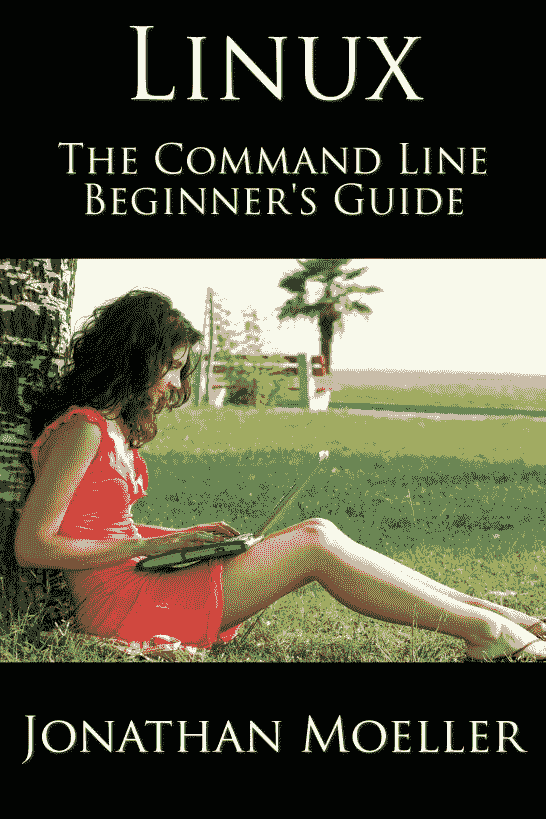

## 描述

《Linux 命令行入门指南》为 Linux 新手介绍了命令行环境。

在本指南中，你将学习如何：

- 复制、移动和删除文件及目录。
- 创建、删除和管理用户。
- 创建、删除和管理组。
- 使用虚拟终端。
- 使用`bash`壳。
- 使用`su`和`sudo`安全地使用 root 账户。
- 修改文件和目录的权限和所有权。
- 从命令行创建并编辑文本文件，而无需使用图形化编辑器。
- 诊断网络连接问题。
- 以及许多其他主题。

***

Linux 命令行入门指南

Jonathan Moeller

***

### 引言

欢迎阅读《Linux 命令行入门指南》！如果你正在阅读这本书，说明你对学习使用 Linux 操作系统中的命令行界面感兴趣。幸运的是，你来对地方了。《Linux 命令行入门指南》将教你 Linux 命令行的底层概念和原理，并向你展示强大的命令，以充分利用 Linux。

### 什么是 Linux？

然而，“Linux”究竟是什么？无疑，你用过或听过许多版本的 Linux —— Ubuntu Linux、Linux Mint，亦或是红帽 Linux（Red Hat Linux）。自称为“Linux”的操作系统多到令人眼花缭——Distrowatch.org 是一个流行的 Linux 网站，在其首页跟踪一百个不同 Linux 版本的流行程度，此外还有成百上千个。有了这么多不同的种类，究竟什么构成了“Linux”操作系统？

“Linux”通常指的是一组基于 Linux 内核的自由操作系统（内核是计算机操作系统的核心组件）。Linux 内核是免费供下载和修改的，任何运行在 Linux 内核上的操作系统都可以称自己为 Linux 操作系统。因为它是免费的，而且用户有权按照自己的意愿对其进行修改，Linux 已被广泛应用于各种实际领域。

Linux 的历史悠久而复杂，但我们在这里提供一个快速概览。在 20 世纪 60 年代后期和 70 年代，AT&T 实验室开发了 UNIX 操作系统。UNIX 是一个强大的操作系统，美国各地的大学很快在他们的计算机实验室使用了它。

然而，大学无法修改 UNIX 来满足他们各自的需求。AT&T 保留了源代码的权利，这禁止对 UNIX 进行任何更改。作为回应，计算机程序员理查·斯尔曼（Richard Stallman）于 1983 年启动了 GNU 项目。（GNU 代表“GNU Is Not UNIX”）。斯尔曼希望通过 GNU 项目创建一个与 UNIX 相似的操作系统，但根据“自由软件”原则可以自由修改和分发，这种哲学立场主张所有软件都应该在没有法律限制的情况下自由分发和修改。GNU 项目和斯尔曼本人产生了大量的软件程序。遗憾的是，GNU 项目缺乏一个可行的内核，这是任何操作系统所必需的核心。

这种情况在 1991 年发生了变化，当时一位名为 Linux Torvald（林纳·托瓦尔斯）的芬兰大学生对 Minix（一种仅限于教育使用的类 UNIX 操作系统）的学术许可感到沮丧。托瓦尔斯编写了自己的内核，将其命名为 Linux，并在 GNU 自由许可下发布了它。与 GNU 项目结合，Linux 内核提供了一个免费的操作系统 —— 一个人们可以根据喜意修改、使用和分发的操作系统。

Linux 出生了。

（许多人认为 Linux 的正式名称实际上应该是 GNULinux，以承认 GNU 的关键作用，而且至今仍有许多 GNU 程序在 Linux 中使用。）由于任何人都可以使用或分发 Linux，如今 Linux 和 Linux 变体运行在各种想象得到的计算机平台上，从智能手机到桌面电脑再到高端服务器系统。你可以在你的个人桌面电脑或笔记本电脑上运行 Linux。它还可以驱动高端服务器集群，或像手机或 MP3 播放器一样小的设备。即使是电子阅读器，如亚马逊的 Kindle 或巴恩斯与利的 Nook，也是使用自定义版本的 Linux 运行的。

这些不同类型的 Linux 通常被称为 Linux “发行版”（distributions）。无论个人还是组织，任何人都可以创建 Linux 发行版。某些发行版是商业支持的项目，如红帽 Linux（Red Hat Linux）或 SuSE。另一些如 Knoppix 或 Fedora 是免费且受社区支持的。有些如 Ubuntu 则介于之间，向公众免费提供并由组织支持。

如果你需要完成一项计算任务，很可能有一个 Linux 发行版可以实现该任务。

### 什么是命令行？

这是一本关于 Linux 命令行的书。但命令行究竟是什么呢？

“命令行”（command line）一词通常作为更准确的术语“命令行界面”（command-line interface，简称 CLI）的缩写。大多数现代计算机系统使用所谓的图形用户界面（GUI），无论是带有图标和鼠标的电脑，还是像 iPad 这样的平板电脑的触摸界面。另一方面，命令行界面完全摒弃了图形元素。在命令行界面中，用户看到的不是图形图标和窗口，而是一个文本提示符，可以在其中输入命令。要启动程序，用户必须在提示符中输入相应的命令并按下回 键。

大多数供终端用户在家庭电脑使用的 Linux 发行版使用某种 GUI，通常是 GNOME 或 KDE 桌面环境。用于服务器或作为网络设备的 Linux 发行版几乎总是启动到命令行界面。然而，即使在图形 Linux 环境中，你也可以终端模拟器、虚拟控制台或只需将计算机启动到命令行界面来轻松进入命令行界面。（如果 GUI 恰好坏了，熟悉命令行将大有用武！）

因此，无论你使用哪个版本的 Linux，Linux 命令行的知识都是价值的。

### 本书的目的

这本书旨在让读者彻底掌握 Linux 命令行的基础知识。它并非设计为无完备的研究，而是提供了足够的信息让你开始基础学习，并希望给你足够的信心让你开始自己尝试。

相反，我决定将这本书分为“概念”章节和“命令”章节。“概念”章节将解释 Linux 命令行的一些底层概念——例如，文件系统，或者用户账户的工作原理。在每个“概念”章节之后，会紧跟一个或多个“命令”章节，描述处理该概念的各个命令。关于文件系统的章节之后，是一个描述移动、复制和删除文件及文件夹的命令的章节。希望这种方法能让读者理解命令行的底层概念，并掌握相关 Linux 命令的实操知识。

# 我为什么要写这本书

我开始写关于计算机和技术的内容几乎完全是个偶然。我的写作生涯始于成为一名奇幻小说作家，具体来说是写剑与与魔法小说。（现在我所有的书籍都提供所有主流的电子书格式；请参阅“作者的其他书籍”部分查看链接。）像每一个优秀的奇幻作家一样，我有一个博客，试图在其中推销我的书籍，正如你所预料的，那个博客每月只能吸引三十或四十次访问。

有一天，我碰巧写了一篇文章，关于我在 Ubuntu Linux 8.04 上使用 Samba 文件共享服务器的一个问题。让我非常惊讶的是，第二天我看到那篇文章通过人们在 Google 上搜索 Ubuntu 的 Samba 问题收到了近六十次访问。从那里开始，转向定期写技术博客（并通过网络广告获利）只有一步之遥，接着当我 2010 年开始使用 Kindle 时，我开始编写技术主题的短篇电子书。

我决定写这本书是因为我看到许多人尝试学习 Linux，却因为对命令行感到沮丧而放弃了。在我之前的一一书《Ubuntu 初学者指南》（THE UBUNTU BEGINNER'S GUIDE）中，我专门用了几个章节讲解命令行，但那本书主要侧重于将 Ubuntu 配置为服务器。通过这本书，我希望帮助新用户学习 Linux 命令行界面，无论是尝试 Linux 的家庭用户，还是寻求新技能的 IT 专业人员。

# 关于 Linux 版本的说明

如上所述，有许多不同的 Linux 发行版。书中描述的大多数命令在大多数不同的 Linux 发行版都可以运行。尽管如此，有时特定的 Linux 发行版会以特定的方式配置命令，因此有时在一个 Linux 发行版上有效的命令或选项在另一个发行版上可能无法运行。这种情况通常只发生在那些更奇特或冷门的命令和工具上，但确实会发生。查看发行版的文档和帮助手册（man pages）以获取精确信息始终是一个好主意（我们将在书的最后一章向你展示如何这样做）。

本书截图是在 Ubuntu 11.10、Linux Mint 12 和 Fedora 16 上截取的。

## 第 1 章 - 概念：终端与虚拟控制

在从命令行执行任何操作之前，你必须先实际访问命令行界面。当你启动 Ubuntu、Linux Mint 或另一个带有图形界面的 Linux 发行版时，你可能会好奇如何进入命令行。在本章中，我们将讨论如何从基于 GUI 的 Linux 发行版和基于 CLI 的发行版进入命令行界面。我们还将向你展示如何在 GUI 或纯 CLI 环境中同时打开多个命令行窗口。

### 从从基于 CLI 的发行版中访问命令行

某些 Linux 发行版（如 Ubuntu Server）不包含 GUI。对于此类发行版，进入命令行并不困难。你只需要启动计算机或服务器，系统就会进入登录提示符。输入你的用户名和密码，你就会登录系统并到达命令行提示符，也称为终端会话（terminal session）。“终端”一词可以追溯到 UNIX 运行在大型主机机上的时代，当时通过远程终端进行访问。

有时，你可能会在已开启的 CLI Linux 机器上看到空白屏幕。这不需要恐慌——为了节省电源，系统通常被配置为在活动一段时间后关闭显示器。只需按下空格键即可再次唤醒显示器。

### 从基于 GUI 的发行版中访问命令行

从基于 GUI 的 Linux 发行版访问命令行稍微复杂一点。默认情况下，基于 GUI 的发行版会进入图形界面。即使在 GUI 内部，访问命令行提示符也很简单。有两种常用方法。

第一种最常见的方法是名为“终端模拟器”（terminal emulator）的应用程序。顾其名，终端模拟器会在你的 GUI 窗口内重建命令行环境。你可以从终端模拟器应用程序访问全范围的 Linux 命令，但你仍然可以使用 GUI 的益处——鼠标、菜单栏以及复制与粘贴。（复制与粘贴特别有用，因为你可以将复杂且长篇大论的命令复制并粘贴到终端模拟器中，而无需费力输入它们。）

几乎所有的桌面 Linux 发行版都包含一个终端模拟器应用程序。你通常可以通过进入“应用程序”菜单，然后进入“附件”类别，最后点击“终端”图标来启动它。如果你的发行版带有快速启动栏（如 Ubuntu 的 Unity 启动器），终端模拟器的图标经常被固定在启动器上。

在 Linux GUI 中访问命令的第二种方法是通过“虚拟控制台”（virtual console）。我们将在本章讨论虚拟控制台，但首先我们先描述如何打开多个终端窗口。

### 在 GUI 中打开多个终端窗口

在 GUI 中使用终端模拟器应用程序的一个很棒的功能是能够打开多个终端窗口。运行多个终端窗口有几个优势——如果你运行一个显示实时输出的命令（如`top`监控命令），你可以打开一个新窗口来执行额外的命令。或者如果你正在运行一个处理时间很长的命令（例如复制几个 GB 的文件），你可以打开一个新窗口，并在第一个命令完成运行时运行另一个命令。

大多数终端模拟器应用程序都支持打开新的终端窗口。为此，你通常进入“文件”菜单并选择“新窗口”（New Window）或“新终端”（New Terminal）。一个新的终端窗口就会弹出。

如果你不想让桌面堆满许多窗口，大多数终端应用程序现在都提供了标签页（tabs），就像 Mozilla Firefox 和 Google Chrome 浏览器允许你为不同的网页打开新标签页一样。如果你在终端模拟器中打开新标签页，菜单栏下方会出现一排标签页，每个标签包含一个独立的终端会话。通常，你可以通过进入“文件”菜单并点击“新标签页”（New Tab）来打开。

显然，图形终端应用程序无法在命令行环境中运行。尽管如此，仍然可以使用“虚拟控制台”从命令行运行多个终端窗口，我们将在下一节讨论这一点。

### 虚拟控制台

虚拟控制台本质上是对同一台计算机的第二次连接。记住 Linux 是基于 UNIX 的，而早期的 UNIX 机器大多数是大型主机。为了连接到这些主机，用户使用远程控制台或哑终端。由于 UNIX 是一个多用户操作系统，多个用户可以从不同的控制台同时登录到主机。

虚拟控制台是那些主机的遗留。大多数 Linux 版本支持最多七个“虚拟”控制台，这些是构建在操作系统中的软件控制台，模拟了那些旧哑终端的功能。基本上，用户可以使用其中一个虚拟控制台登录操作系统，然后第二个用户可以切换到另一个虚拟控制台并登录，而不会影响第一个用户的会话（尽管他们当然必须共享键盘和鼠标）。

正如我们所提到的，Linux 支持七个虚拟控制台。要在虚拟控制台之间切换，请同时按下`CTRL-ALT-FUNCTION#`键。因此，要切换到虚拟控制台 1，按下`CTRL-ALT-F1`；切换到虚拟控制台 2，按下`CTRL-ALT-F2`，以此此类推。当你切换到一个新的虚拟控制台时，你会看到一个标准的登录提示。你（或另一个用户）可以登录该虚拟控制台而不会影响你的原始会话。

如果你运行带有 GUI 的 Linux 版本，也可以使用虚拟控制台。默认情况下，GUI 运行在虚拟控制台 7 上（`CTRL-ALT-F7`）。你可以切换到其他六个虚拟控制台中的任何一个。完成后，你可以按下`CTRL-ALT-F7`返回 GUI。

***

## 第 2 章 - 概念：bash shell 

当你使用 Linux 命令行时，你几乎肯定正在使用一个名为`bash`的 shell 程序。在读完本章后，你将理解什么是 shell，以及它是如何与 Linux 命令行相关的。你还将学习一些技巧和窍门，以充分发挥`bash` shell 的功能。

### 什么是 shell？

在计算领域，“shell”（外壳）不是指软壳动物的硬壳、某种面条或某种炮弹药。相反，“shell”一词通常指的是作为用户与计算机操作系统之间接口的程序。当你使用计算机时，你并不是直接与操作系统通信。相反，你通过 shell 发出命令，然后由 shell 将指令传递给操作系统进行处理。

图形用户界面和命令行界面都算作 shell 的范畴。Linux 有许多不同的命令行 shell 可用——`sh` shell、`zsh` shell、`c` shell 等。到目前最常见的 shell 绝对是`bash` shell，我们将在下一节中讨论它。

### BASH shell

程序员 Brian Fox 在 20 世纪 80 年代后期作为 GNU 项目的一部分编写了`bash` shell 的第一个版本。“bash”这个名字是一个双关——它代表 Bourne-again shell（再次出生的 Bourne shell）。Bourne shell 是最受欢迎的 UNIX shell 之一，但因为它不是免费软件，用户无法合法地修改和分发它。GNU 项目和自由软件基金会都想创建一个 Bourne shell 的免费替代品——因此有了“Bourne-again shell”，即`bash` shell。

`bash` shell 是远胜于其他的最常见的 Linux shell。大多数 Linux 发行版都使用`bash` shell 作为它们的默认命令行 shell，甚至 Mac OS X（技术上是 UNIX 的一个版本）也使用`bash` shell 作为其默认的终端模拟器。熟悉`bash` shell 将证明在各种不同的 Linux 发行版中甚至在 Mac 上都是非常有用的。

在接下来的几节中，我们将介绍`bash` shell 的一些实用功能。

### 命令行提示符

首先，我们将检查命令提示符本身。如果你启动到 CLI 环境，或者启动终端模拟器应用程序，你看到的第一个东西就是提示符。（这个名字是因为它在“提示”你输入命令。）提示符本身看起来可能是一串无意义的单词和符号，但它传达了很多有用信息。

通常，提示符看起来像这样：

```bash
jmoeller@yourlinuxmachine:~$
```

让我们检查提示符每个部分的含义。

提示符中`@`符号之前的部分（在本例中为“jmoeller”）是当前登录用户的用户名。很自然地，这会根据登录到终端会话的用户不同而改变。`@`符号之后但冒号之前的部分（在本例中为“yourlinuxmachine”）是你正在使用的机器的名称。从这个提示符中，你可以看到你正在名为“yourlinuxmachine”的机器上使用账户“jmoeller”。

提示符的下一部分，在冒号标记之后但美元符号之前，显示的是工作目录。在`bash` shell 中，“工作目录”是当前选定的目录。波浪号符号（`~`）看起来可能没什么信息量，但在`bash` shell 中，它是当前登录用户主目录的简写字符。在我们示例的提示符中，波浪字符代表 jmoeller 的主目录`/home/jmoeller`。当你更改工作目录时，提示符会随之变化以反映这一点。如果你将当前目录更改为`/etc`，提示符看起来像这样：

```bash
jmoeller@yourlinuxmachine:/etc$
```

美元符号表示提示符的结束。你的命令将出现在美元符号之后。

### 命令/文件名补全

虽然你从命令行执行某些任务比从 GUI 执行更高效、更快速，但这确实涉及大量的输入，这可能会变得乏味。但使用一种称为“命令/文件名补全”的功能可以减少大量的重复输入。命令补全的工作原理是：你输入文件名的一部分，然后按下`TAB`键。然后`bash` shell 将根据其最佳猜测进行填充。

bash shell 的行为由位于你主目录下的若干隐藏文件控制。（在 Linux 中，当文件名称以点字符开头时，它们就是“隐藏”的。虽然这并不能保护它们免受删除或修改，但它们不会出现在常规目录列表中。）对于新用户来说，通常最好的做法是避免修改这些文件。一旦你有了更多经验，你可能想要尝试修改它们。

第一个文件是`~/.bash_history`。这是 bash 存储用于命令历史功能中所用信息的地方。它是一个纯文本文件，因此你可以使用第 16 章中将讨论的许多命令来查看它。

第二个文件是`~/.bash_profile`。它存储了你 bash 设置的个人配置，包括提示符文本本身的配置。如果你想自定义你的 bash 提示符，可以在这里进行。

## 输出管道与重定向


bash shell 还提供了两个名为“输出管道”（output piping）和“输出重定向”（output redirects）的功能。基本上，这允许你获取命令的输出，并将其交给另一个命令进行处理，或者将其存储在文本文件中。这可能会变得相当复杂，但我们将查看一些常见的用法。

### 管道 (Piping)

管道允许你获取一个命令的输出并将其移动到第二个命令中处理。例如，假设你想使用 `ls` 命令来查看当前工作目录的内容。此外，你想使用 `grep` 文本排序命令来查找目录中每个名为“cheese”的文件。要使用命令管道，你会使用管道字符（`|`）将 `ls` 命令的输出管道到 `grep` 命令：

```
ls | grep cheese
```

### 输出重定向 (Output Redirection)

输出重定向允许你使用大于号（`>`）将命令的输出重定向到不同的位置，通常是一个文本文件。例如，假设你想使用 `ls` 命令查看工作目录的内容，但你想将命令的输出保存起来，以备日后查看。你可以通过使用 `ls` 命令配合大于号来重定向输出来实现这一点：

```
ls > list
```

这将把命令的输出重定向到名为 `list` 的纯文本文件中。如果该文件不存在，命令将在当前工作目录下即时创建它。然而，如果文件已存在，命令将用新信息完全覆盖它。如果你不小心，可能会导致数据丢失。

这种数据丢失很容易避免。如果你使用双大于号（`>>`），则命令的输出将追加到现有文件中，而不会覆盖它。扩展我们之前的例子：

```
ls >> list
```

此版本的命令会将 `ls` 命令的输出追加到 `list` 文件中，保持任何数据不被覆盖。

## 带有空格的文件名 (FILE NAMES WITH SPACES)

命令行处理文件名中的空格的能力并不理想——假设你尝试使用 `rm` 命令删除一个名为“Joe's Term Paper”的文件。

```
rm Joe's Term Paper
```

此命令将失败，因为命令行会将命令中的每个单词解释为一个单独的文件。要强制命令行正确地查看文件，请将任何带有空格的文件名包含在引号内：

```
rm “Joe's Term Paper”
```

这一次 `rm` 将删除该文件。

## 大小写敏感 (CASE SENSITIVITY)

我们将用一个重要的提醒结束本章：始终记住，Linux 命令行界面是区分大小写的。这意味着 bash shell 能够区分大写字母和小写字母。它会将名为 `Caina.doc`、`caina.doc` 和 `CAINA.doc` 的三个文件视为三个不同的文件。此外，几乎所有的 Linux 命令都是小写的。如果你打算输入 `ls` 来查看当前目录的内容，但不小心输入了 `Ls`，那么 shell 将无法识别该命令并返回错误消息。

这通常会让新的 Linux 用户困惑，尤其是那些有 DOS 或 Microsoft Windows 背景的用户。DOS 和 Windows 中的 Command Prompt 都不区分大小写——与 Linux 不同，Windows Command Prompt 应用程序会将 `Caina.doc`、`caina.doc` 和 `CAINA.doc` 视为同一个文件，你也可以用大写或小写输入 Windows 命令。

在 Linux 中并非如此。始终记住 Linux 命令行界面是区分大小写的。

***

## 第 3 章 - 概念：Linux 文件系统 (The Linux Filesystem)

要有效使用 Linux 命令行，你必须首先掌握底层的 Linux 文件系统。不知道如何从命令行复制、移动、删除和创建文件及目录，Linux 命令行界面将毫无用处。在本章中，我们将解释 Linux 文件系统的工作原理。在之后的章节中，我们将演示管理文件和目录所需的命令。

### 什么是 Linux 文件系统？ (WHAT IS THE LINUX FILESYSTEM?)

如果你足够老，可能还记得“文件系统”一词是指办公室如何组织它的牛皮纸文件夹集合。对于计算机而言，“文件系统”指的是存储在磁盘上的信息组织方式，无论是在硬盘、USB 闪盘还是像 CD-ROM 或 DVD-ROM 这样的光盘上。（如果你不幸地有一台那么老的电脑，也可能是软盘。）在 Linux 中，当人们谈论“文件系统”时，通常指的是 Linux 系统主硬盘上的文件和目录结构。事实上，在最新版本的 Ubuntu Linux 中，点击 Nautilus 文件管理器外壳中的“文件系统”图标将带你进入主驱动器的根顶层目录。

Linux 文件系统分为文件和目录，我们将在下一节中讨论。

### 文件和目录 (FILES AND DIRECTORIES)

如果你使用计算机有一段时间了，你已经熟悉“文件”这个词了。计算机文件基本上是保存到磁盘长期存储中的信息。你的文档、图片和音乐轨道都是文件，你运行的所有程序和应用程序也是如此（一个复杂的应用程序有时由成百上千的文件组成）。有趣的是，在 Linux 文件系统中，各种硬件设备也被表示为文件，全部存储在`/dev`目录。

现代 Linux 系统包含成千上万个文件，保持这些文件的有序被证明是一个巨大的挑战。这就是目录概念派上用场的地方。目录允许将文件分离到不同的虚拟容器中。就像纸质文件夹曾允许办公室人员将一大堆纸整理成整齐的系统一样，目录允许你（以及操作系统）跟踪文件。

（顺便说一下，目录（directory）和文件夹（folder）的意思相同。所以当你听某人谈论访问他们的 Documents 文件夹时，他们指的是 Documents 目录。由于大多数现代 GUI 使用文件夹图标来表示目录，使用文件夹来指代目录已成为常见做法。）

当然，你可以将目录放在其他目录中。这些嵌套的目录通常被称为子目录，它们也可以拥有自己的子目录。

你可以通过使用 `tree` 命令来更好地可视化文件系统的结构：

```
tree
```

这将以树的形式显示文件系统，从顶层目录开始，一直向下延伸各个子目录。

Linux 的标准子目录多年来定义得相当完善，但我们将首先讨论文件系统中最重要的目录。

### 根目录 (THE ROOT DIRECTORY)

#### 引言

目录可以包含子目录，而这些子目录还可以包含更多的子目录。这些目录形成了一个复杂的层级结构，而该结构的起点就是根目录。根目录是该结构中的顶层目录，是整个文件系统的第一个目录。系统中的任何其他目录在技术上都是根目录的子目录，无论你需要深入到多少层（在复杂的 Linux 安装中，你的子目录可能嵌套了十层甚至更多）。

在命令行中，根目录用正斜杠（`/`）符号表示。因此，如果你在文件系统中看到一个位置，例如`/home/jmoeller`，那么左侧的正斜杠就代表根目录。这意味着主目录位于根目录之中，而`jmoeller`目录又存储在主目录之中。

通常情况下，保持根目录尽可能整洁是一个好主意。这使得在文件系统中定位文件变得更加容易，同时也防止由于未经授权的软件在根目录中运行而导致潜在的安全漏洞。（在 Windows 早期，懒惰的用户习惯于将所有内容都存储在硬盘的根目录下，这往往会导致各种问题。）

无论你使用的是哪种 Linux 发行版，你可能会在文件系统的根目录中看到相同的子目录。Linux 目录结构多年来一直保持标准，在下一节中，我们将查看一些常见的子目录。

#### 常见子目录

如果你查看根目录下的子目录列表，它看起来可能像这样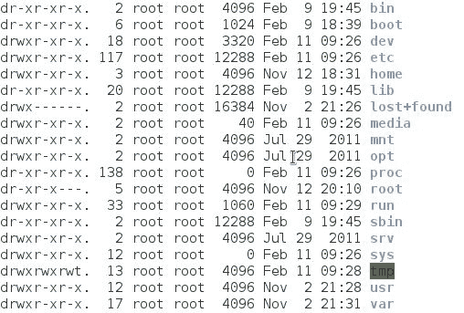

让我们在这里讨论一些更重要的目录。由于 Linux 发行版可以随心所欲修改 Linux，请注意某些目录的用途可能会在 Linux 版本之间发生变化。

- `/bin`目录的名字代表系统二进制文件（system binaries），包含了许多 Linux 的系统文件。我们在书中讨论的许多命令实际上都存储在这里。

- `/boot`目录存储 Linux 启动所需的文件。名为`vmlinuz-VERSION NUMBER`的 Linux 内核文件位于这里。

- `/dev`目录包含代表系统上各种硬件设备的文件。

- `/etc`目录存放了 Linux 上运行的各种服务和程序的大部分配置文件。如果你管理 Linux 系统，你将花费大量时间在`/etc`目录中工作。

- `/home`目录包含系统中所有用户的主目录。每个登录系统的用户都会在这里有一个主目录。通常，主目录包含一组标准文件夹——桌面、文档、图片等，以及用户可能创建的任何其他个人文件夹。

- `/media`和`/mnt`文件夹都用于存储可移动介质。我们将在第 20 和第 21 章详细讨论，但当你将可移动磁盘插入电脑时，Linux 会将其挂载为文件系统中的文件夹。（这与 DOS 和 Windows 不同，后者使用字母来表示连接到系统的不同驱动器。）取决于发行版，挂载的驱动器可能会出现在`/media`或`/mnt`中。偶尔某些发行版会使用`/Volumes`目录，但这很罕见。

- `/root`子目录包含根用户的家目录。注意，根用户不等同于根目录！我们将在第 7 章和第 8 章详细讨论根用户，但总结来说，根用户是 Linux 系统上最强大的用户，拥有运行任何程序以及删除或修改任何文件的权限。因此，`/root`子目录是根用户的家目录，与`/home`目录中的主目录分开。

- `/sbin`目录与`/bin`目录一样持有系统命令。然而，`/sbin`目录通常存储只有根用户才能运行的命令，因为这些命令会影响整个系统。

- `/tmp`目录存储临时文件，无论是来自应用程序还是用户。注意，在`/tmp`中存储重要数据是一个坏主意，因为某些发行版在关机或注销用户时会定期删除`/tmp`目录的内容。

- `/usr`目录存储多用户应用程序。虽然`/sbin`中的工具往往仅限于根用户，但任何人都可以使用的应用程序通常位于`/usr`目录及其子目录中。因此，安装在 Linux 系统上的大多数用户应用程序（Firefox 浏览器、LibreOffice 办公套件等）都存储在这里。

- 最后，`/var`目录代表“变量”（variable），用于存储系统运行期间更改的数据。你电脑的所有日志文件都存储在这里，还有如打印缓存程序、用户邮箱（如果你的 Linux 系统上有邮件服务器的话）和临时文件等项目。在某些发行版上，如果你的 Linux 系统正在运行 Web 服务器，网站文件也存储在这里。

### 绝对路径与相对路径

关于文件系统的最后一点需要了解的是相对路径和绝对路径之间的区别。

“文件路径”指的是文件在文件系统中的位置，具体来说是在目录层次结构中的位置。如果`jmoeller`用户在他的文档文件夹中有一个名为`Caina1.doc`的文件，那么该文件的绝对路径就是`/home/jmoeller/Documents/Caina1.doc`。因此，如果你想删除该文件，`rm /home/jmoeller/Documents/Caina1.doc`命令就会为你删除该文件。

相对路径与当前工作目录有关。当你使用文件名启动命令时，命令首先会在你的工作目录中查找。如果你在`/home/jmoeller/Documents`为你的工作目录时使用了`rm Caina1.doc`命令，该命令将在工作目录查找，找到文件并将其删除。如果你的工作目录是根目录，命令将无法找到该文件并导致失败。

记住，如果你打算操作的文件或目录在你的当前工作目录中，你可以使用相对路径。如果不是，你应该使用绝对路径。

## 第 4 章 - 用于处理文件和目录的命令

在上一章中，我们解释了 Linux 文件系统的底层概念。在本章中，我们将查看让你处理文件和目录的命令。你将学习如何从命令行创建和修改目录以及文件。你还将学习如何删除文件和移除目录。

### 查找工作目录

正如我们在第 2 章提到的，bash shell 通常配置为在提示符中显示当前工作目录。这并不总是如此，如果提示符没有配置为显示工作目录，很容易对当前位置感到困惑。你可以通过`pwd`命令避免这种情况。输入此命令：

```
pwd
```

bash shell 将返回你的当前工作目录。

### 更改工作目录

我们讨论了许多关于工作目录的内容，还没有提到如何更改工作目录。要做到这一点，你需要使用`cd`命令。（“cd”代表“change directory”）`cd`命令使用绝对文件路径工作。如果你在根目录下，并想切换到`/var/www`目录，可以使用此命令：

```
cd /var/www
```

工作目录将从`/`变为`/var/www`。

`cd`命令也可以用于工作目录中的相对文件名。在我们之前的示例中，你是从根目录开始的。你可以切换到根目录的任何一个子目录，而无需使用绝对文件路径。要切换到`/etc`目录，你只需要输入此命令：

```bash
cd /etc
```

`cd`命令还支持另一个实用的快捷方式。在`bash` shell 中，两个点字符（`..`）代表当前目录的上级目录——换句话说，就是当前工作子目录的父目录。所以，如果你使用`cd /etc`从根目录移动到`/etc`，你可以使用此命令直接返回：

```bash
cd ..
```

最后，还有另一个可以在`cd`命令中使用的实用技巧。还记得波浪字符（`~`）代表当前用户的家目录吗？无论你在文件系统的哪个位置，都始终可以使用这个短命令返回你的家目录：

```bash
cd ~
```

### 创建新目录

在某个时刻，你将创建新目录，无论是为了更好地组织文件，还是作为安装应用程序的一部分。要创建一个新目录，你将使用`mkdir`命令。此示例命令将在工作目录中创建一个名为“ghosts”的新目录：

```bash
mkdir ghosts
```

在默认情况下，`mkdir`在当前工作目录中创建新目录。要在不同的位置创建目录，可以将工作目录更改到目标位置，或者配合绝对文件路径使用`mkdir`。如果你想在用户`jmoeller`的`Documents`目录中创建“ghosts”目录，你将使用此命令：

```bash
mkdir /home/jmoeller/Documents/ghosts
```

### 删除目录

你偶尔需要删除一个未使用的目录。你可以通过`rmdir`命令来实现。删除我们上面创建的“ghosts”目录：

```bash
rmdir ghosts
```

与`mkdir`一样，`rmdir`默认在当前工作目录查找要删除的目录。与`mkdir`一样，你可以配合绝对文件路径使用`rmdir`：

```bash
rmdir /home/jmoeller/Documents/ghosts
```

一个注意事项——`rmdir`仅在目标目录没有任何文件或子目录时才起作用。如果你想使用`rmdir`删除目录，必须先删除该目录的内容。要删除包含文件或额外目录的目录，你需要使用`rm`命令，我们将在本章稍后部分讨论它。

### 列出目录内容

目录的目的是存储文件，但如果你看不到这些目录的内容，那么它们对你没太大帮助。`ls`命令让你查看当前工作目录的内容。只需在提示符处使用`ls`命令且不带任何选项即可：

```bash
ls
```

输出可能看起来像：

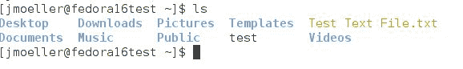

默认情况下，`ls`列出工作目录的内容。你也可以配合绝对文件路径使用`ls`。例如，如果你想查看`/etc`目录的内容：

```bash
ls /etc
```

在默认模式下，`ls`显示的信息并不多，只有工作目录中文件和目录的名字。目录的名字通常用蓝色编码显示，但并非所有的发行版都这样做。那么，你如何通过`ls`命令获取更多信息呢？

你可以通过配合`-l`选项使用`ls`来做到。“选项”是改变命令行为的修饰符。它们通常（但并非总是）是添加连字符后面的单个字母。要配合`-l`选项使用`ls`，输入此命令：

```bash
ls -l
```

结果输出可能看起来如下：

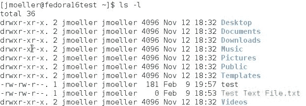

`-l`选项代表“长列表”，它显示的信息比基础`ls`命令多得多。在输出中，你可以看到文件的权限和所有权（我们将在第 11 到 14 章讨论权限和所有权），以及它们的字节大小、最后修改的日期和时间。

`ls -l`命令在配合`-h`选项时更加有用：

```bash
ls -lh
```

该命令将产生类似这样的输出：

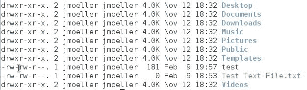

这与`ls -l`的输出相同，不同之处文件大小现在以 KB 和 MB 为单位而不是字节，这使得输出更易读。

在第 3 章中，我们提到了隐藏文件。在 Linux 中，隐藏文件通过在文件开头加上一个点字符（`.`）创建。通过配合`-a`开关使用`ls`，你可以查看隐藏文件：


### 复制文件

现在你已经知道如何创建目录，可能想将文件放入这些目录中。有很多命令可以移动文件，我们将从`cp`命令开始。`cp`是“copy”的缩写，允许你将文件从一个位置复制到另一个位置。当你选择想要复制的文件时，可以使用相对文件路径。

正如我们在`rmdir`命令章节中提到的，你可以使用`rm`命令来删除仍然包含文件和子目录的目录。你可以通过为`rm`加上`-R`选项来实现。如果你想删除一个名为`/home/jmoeller/storage`且仍含有文件的目录，可以使用此命令：

```
rm -R /home/jmoeller/storage
```


`rm` 命令将删除`/home/jmoeller/storage`及其包含的任何文件。该命令还会删除`/home/jmoeller/storage`包含的所有子目录，以及这些子目录中的任何子目录。不需说，在使用带有`-R`选项的`rm`时一定要小心！如果不小心，你可能会抹掉文件系统的整个分支并丢失重要数据。

（注意，`-R`选项也适用于`cp`命令，因此你同样可以一次性复制文件系统的大部分。）

`rm`命令还可以配合通配符，我们将在本章末尾讨论这一点。

## 文件归档与压缩

管理大量的文件和目录可能会非常棘手，特别是当它们分散在几个目录中时。将这些文件收集并创建一个单一归档要简单得多——归档是由许多小文件创建的一个大文件，你之后可以将其解压回各个文件。压缩文件也很有用——压缩文件以这种方式打包，使其在硬盘上占用的空间更小。现代硬盘容量巨大，因此压缩文件可能没有以前那么关键了。然而，你从网上下载的许多文件都是压缩过的，所以你需要知道如何解压缩它们。当你将文件上传到互联网或将其作为邮件正文发送时，你可能需要压缩它们以节省空间。

你可以使用`tar`命令从命令行创建归档。使用`tar`工具创建的归档通常具有`.tar`扩展名，通常被称为“tar 包”（tarballs）。要使用`tar`创建归档，你需要同时使用`-c`选项（创建归档）和`-f`选项（指定归档名称）。以下命令将在当前工作目录下为你的`~/Documents`文件夹创建一个名为`storage.tar`的归档：

```
tar -cf storage.tar ~/Documents
```

（使用包含文件的目录而不是许多单独的文件来创建 tar 归档被认为是一个习惯。这样归档解压后会形成单一目录，而不是许多单独的文件。）

这将在当前目录下创建`storage.tar`文件。在使用`tar`时，务必记住为你创建的归档指定`.tar`扩展名，因为`tar`不会自动这样做。（注意，`tar`不会任何方式更改原始文件——它只是创建了文件的归档副本。）

然而，这个新的归档文件并没有压缩，占用的空间与你的`~/Documents`文件夹完全相同。要对其压缩，你需要使用带有`-z`选项的`tar`，它使用`gzip`压缩进行归档。以下命令将创建一个压缩归档：

```
tar -czf storage.tar.gz ~/Documents
```

你可能还想添加`-v`选项，用于“详细”输出，这意味着`tar`会告诉你是它正在做什么，并在出错时通知你：

```
tar -czvf storage.tar.gz ~/Documents
```

现在你已经将文件整齐地打包进归档中，你可能想要解压它们。要从`tar`归档解压文件，你使用`-x`选项进行提取（eXtract），而不是使用`-c`选项进行压缩：

```
tar -xvf storage.tar
```

如果`tar`归档是用`gzip`压缩过的，当你想要解压缩时，确保在命令中添加`-z`选项：

```
tar -xzvf storage.tar.gz
```

`tar`命令在各种情况下都用，但它相当复杂。归档和压缩文件的更简单方法是使用`zip`和`unzip`命令。参考我们之前的示例，如果你想为你的`~/Documents`目录创建一个 zip 文件，可以使用此命令：

```
zip -r backup.zip ~/Documents
```

这将在当前工作目录下创建`backup.zip`文件。

要解压缩 zip 归档，你将使用`unzip`命令：

```
unzip backup.zip
```

注意，文件解压在工作目录。或者，如果你配合绝对文件路径使用`unzip`，文件将解压在源 zip 文件所在的目录中。

## 通配符

我们讨论了复制文件、移动文件、重命名文件和删除文件，现在我们将描述 shell 的一项功能，它能让你的文件操作命令变得强大得多。通常，当你使用`cp`或`rm`命令时，它们一次只影响一个文件。但如果你在文件操作命令中使用通配符，你就可以同时影响成百甚至数千个文件。

什么是通配符？“通配符”是代表多个其他字符、甚至是所有其他可能字符的特殊字符。第一个通配符字符问号（`?`）代表一个潜在的字符。例如，假设你的当前工作目录下有七个名为`Caina1.doc`、`Caina2.doc`等的文件。如果你想删除它们，可以使用`rm`命令一个一个删除。或者，你可以配合通配符使用`rm`：

```
rm Caina?.doc
```

这将删除工作目录下所有以 “Caina” 开头、以`.doc`为扩展名且在 “Caina” 之后跟有单个字符的文件。你也可以将该字符用于`cp`、`mv`、`ls`和其他命令——你可以复制`Caina?.doc`文件，或移动它们，或者配合`ls`使用来仅查看这些文件。

第二个通配符字符星号（`*`）更加强大。问号通配符只代表单个字符。星号代表任意数量的字符。例如，如果你想删除当前目录下所有的`.doc`文件，你可以一个一个删除。或者，你可以配合星号通配符使用`rm`：

```
rm *.doc
```

这将删除工作目录下所有扩展名为`.doc`的文件。不需说，在使用`rm`命令配合通配符时一定要小心！

在大多数类型的 Linux 系统中，你会看到两种用户：标准用户和管理员用户（admin）。

标准用户是系统上的普通用户。他们对自己的家主目录拥有完全访问权限，并可以运行指定的普通用户程序。他们不能查看其他用户的家主目录，也不能修改或更改系统设置或已安装的程序。例如，会计部门的员工通常就是标准用户——他们可以访问工作所需的文件和程序，但不能更改系统。

管理员用户和普通用户一样，但有一个例外。他们有权使用或借用 root 用户（超级用户）的权限（通过名为`sudo`的命令，我们将在第 8 章中描述）来对系统设置和程序进行更改。继续我们之前的例子，支持会计部门的 IT 专业人员通常就是管理员用户。

## 控制用户账户的文件

在 Linux 中，用户账户存储在一个文件中，而密码存储在另一个文件中。

你系统中的用户账户定义在`/etc/passwd`文件中。尽管名称如此，但密码实际上并没有实际存储在`/etc/passwd`文件中。旧版本的 Linux 曾经将密码存储在那里，但这带来了安全风险，因此密码被加密并移动到了另一个文件中。该文件中仍然包含很多有用信息。如果你从命令行查看它（我们将在第 16 章教你如何操作），条目看起来像这样：


冒号分隔条目中的特定字段。

第一部分信息是用户名（在这种情况下为`jmoeller`）。第二个字段仅有一个`x`。在旧版本的 Linux 中，密码会放在这里，但密码不再存储在`/etc/passwd`中。第三字段是用户账户的数值用户 ID（通常简写为`UID`）。在这种情况下，`UID`是`1000`。大多数 Linux 发行版为系统上的第一个新账户分配`1000`的`UID`，然后从那里递增。

第四字段包含账户的组 ID 数字（通常简写为`GID`）。通常，出于安全考虑，每个新账户都会获得自己的组（称为主组）。我们将在第 9 章和第 10 章详细讨论组。

第五字段持有用户的全名（在这种情况下为`Jonathan Moeller`），第六个字段持有用户家主目录的位置，第七个字段存储用户默认 shell 的位置。大多数 Linux 发行版使用`bash` shell 作为默认 shell，因此这个最后的条目几乎总是`/bin/bash`。

你可能想通过手动编辑`/etc/passwd`来向你的系统添加账户。千万不要这样做！错误配置`/etc/passwd`可能会给你的系统带来严重问题。请始终使用适当的命令行工具向系统添加用户账户，我们将在下一章讨论这些。

如果用户账户存储在`/etc/passwd`中，那么用户密码实际上存储在`/etc/shadow`文件。你需要 root 权限才能查看`/etc/shadow`文件，但如果你查看它，每个条目看起来都会像这样：

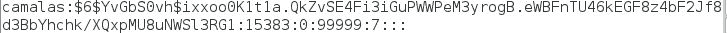

与`/etc/passwd`文件一样，`/etc/shadow`中的每个条目都通过冒号分成单独字段。第一个字段包含用户名（在这种情况下为`camalas`）。

第二个字段包含加密哈形式的密码，因此有一长串数字和字母。如果第二个字段中只有一个星号`*`，这意味着该账户实际上不被允许登录系统。你通常会在系统用户账户（系统服务访问系统的账户）或被锁定的普通用户账户看到这种情况。

第三字段包含自 1970 年 1 月 1 日以来上次更改密码所需的天数。在这个例子中，天数是`15,383`，这意味着距离上次更改密码已经过了大约 42 年。如果你算一下，这个例子中的密码最后设置在 2012 年 2 月 12 日。这种处理方式非常繁琐，但请记住 Linux 是源自 UNIX，且 Linux 继承了 UNIX 的密码系统。

第四字段是更改密码前的最少天数。这是为了增强密码安全策略——如果强制用户更改密码，这可以防止他们立即又改回来。如果该字段中有`0`（如本例所示），则该功能被禁用。

第五字段设置了密码过期必须更改的最大天数。将其设置为`99,999`（如本例所示）会禁用此功能。（因为 99,999 天大约是 273 年，这个问题就没意义了！）因此，`camalas`用户账户的密码永远不会过期。

第六个字段指定了密码过期前发出警告的天数。默认设置为七天，所以如果密码被设置为过期，用户在登录时会在七天内都会收到警告。

第七个字段指定了自 1970 年 1 月 1 日以来等待多少天，在密码过期后锁定账户。如果该字段值为`-1`（如本例所示），则该功能已禁用。如果该字段为空（如本例所示），意味着设置为永不锁定。

Linux 中的 root 用户可以访问任何文件并删除任何目录。不言而喻，以 root 身份登录应该谨慎，因为你可能会损坏系统。我们将在第 7 章和第 8 章讨论如何安全地使用 root 账户。

---

## 第 6 章 - 用户账户操作命令

现在你理解了用户账户的原理，我们将解释如何使用命令行工具来管理它们。在本章中，你将学习如何创建、修改和删除用户账户。你还将学习如何重置密码和锁定账户。

### 创建用户账户

正如我们在上一章提到的，通过手动编辑`/etc/passwd`和`/etc/shadow`文件来添加用户账户是一个坏主意。幸运的是，你可以使用`useradd`命令从命令行向系统添加账户。假设你想为系统一个名为 Caina Amalas 的女性添加一个账户，并决定为她分配用户名`camalas`。

（毫无羞耻的作者推销：Caina Amalas 是我的 GHOSTS 系列幻想小说和短故事中主角的名字。）

要向你的系统添加`camalas`账户，你可以使用以下命令：

```
useradd camalas
```

（注意，你需要 root 权限才能向系统添加用户账户，我们将在第 6 章和第 7 章详细讨论使用 root 权限。）

此命令将添加`camalas`用户账户。然而，不带任何选项的`useradd`命令并没有大用。该命令创建了`camalas`用户账户，但它没有为其分配显示名称，没有为`camalas`创建家目录，也没有设置其他重要选项——例如，它忽略了为该账户分配默认 shell。

我们需要添加一些选项使`useradd`更加有效。首先，使用`-m`选项为`camalas`账户创建一个家目录：

```
useradd -m camalas
```

`-m`选项将在`/home`目录下为`camalas`添加一个家目录。接下来，你可能想使用`-s`选项为该账户设置默认 shell：

```
useradd -m -s "/bin/bash" camalas
```

这将`bash` shell 设置为`camalas`账户的默认 shell。`useradd`账户还有一个最后一个开关——`-c`选项，用于将账户的显示名称设置为“Caina Amalas”。

```
useradd -c "Caina Amalas" -m -s "/bin/bash" camalas
```

通过这三个选项，`useradd`命令创建了一个名为`camalas`的新账户，将账户的显示名称设置为 Caina Amalas，在`/home`中为该账户创建了家目录，并将`bash`设置为账户的默认 shell。最后，你只需要使用`passwd`命令为账户设置密码：

```
passwd camalas
```

（那不是拼写错误——正确的命令实际上是`passwd`，而不是`password.`。）

`camalas`账户现在准备好使用了。请注意，要更改另一个用户的密码，你需要以 root 身份或具有 root 级权限运行`passwd`。

### 修改用户账户

一旦你创建了用户账户，你可能需要对其进行修改。在本节中，我们将首先描述如何更改用户账户密码，以及如何修改、锁定和其他更改现有的用户账户。

### 修改密码

更改你自己的用户账户密码非常简单。只需输入`passwd`命令即可：

```
passwd
```

你将收到一个提示，要求输入当前密码。输入密码后，命令将提示你输入新密码，然后再次提示确认。你的新密码将被设置。

要重置另一个用户的密码，你仍然使用`passwd`命令。请注意，为了更改另一个用户的密码，你必须是 root 用户或以 root 级权限运行程序。正如我们在上一节中提到的，要更改`camalas`账户的密码，你会使用此命令：

```
passwd camalas
```

你不需要知道`camalas`的当前密码。只需在提示时输入两次新密码，命令就会更改`camalas`账户的密码。

### 锁定和解锁账户

有时你可能会发现有必要锁定账户以防止用户登录。这在用户行为不当或滥用其计算机权限时经常发生。从不那么负面的角度来说，如果你的一位合同工合同到期，但公司计划在几个月后重新雇用，也会发生这种情况。要这样做，你将使用`usermod`命令，它就像用户账户管理中的瑞士军刀。要锁定`camalas`用户账户，请使用带有`-L`开关的`usermod`：

```
usermod -L camalas
```

（再次提醒，要使用`usermod`命令的任何功能，你都需要 root 权限。另请注意`-L`开关必须大写——记住 Linux 命令行是区分大小写的。）

这将锁定账户，使`camalas`无法登录。要解锁账户，请使用带有`-U`开关的`usermod`。（注意`-U`必须大写。）

```
usermod -U camalas
```

`camalas`账户将被解锁。

### 修改用户名

对个人用户账户需要进行的另一个常见更改（除了更改其组组成外，我们将在第 9 章和第 10 章中讨论）是更改用户账户名称。最常见的原因是女性结婚后更改姓氏。继续我们之前的例子，假设 Caina Amalas 嫁给了一个姓 Maraeus 的男人，并将名字改为 Caina Maraeus。她现在想将用户名更改为`cmaraeus`，并将显示名称更改为 Caina Maraeus。

你可以通过`usermod`命令完成这两项任务。

要将账户用户名从`camalas`更改为`cmaraeus`，请使用带有以下选项的`usermod`：

```
usermod -l cmaraeus camalas
```

这将账户的用户名从`camalas`更改为`cmaraeus`。将`cmaraeus`放在`camalas`之前似乎很奇怪，但否则命令将不起。

要更改`camalas`账户的显示名称，使用带有`-c`开关的`usermod`命令：

```
usermod -c "Caina Maraeus" camalas
```

（注意，如果你已经将账户更改为`cmaraeus`，请确保使用该名称。）

账户的显示名称将变为 Caina Maraeus。

### 删除用户账户

最后，有时你可能会发现有必要删除用户账户。也许某个员工永久地离开了公司，或者某个员工不再需要访问系统。大多数情况下，锁定用户账户比完全删除它是更好的主意，毕竟也许该员工未来还会回来。但如果你必须删除用户账户，可以使用`userdel`命令。如果你想删除`camalas`账户，命令如下：

```
userdel camalas
```

（注意你必须以 root 登录才能删除账户。）

这将删除`camalas`账户，但不会删除家目录。如果你确定不再需要该账户或其文件，可以使用此命令删除账户及其文件夹：

```
userdel -r camalas
```

---

## 第 7 章 - 概念：root 用户

我们已经多次提到 root 用户。在本章中，我们将仔细查看 root 用户及其功能。在接下来的章节中，我们将展示如何安全地使用 root 而损坏系统。

### 什么是 root 账户？

root 账户被称为超级用户账户，是 Linux 系统中权限账户。root 权限访问、修改和删除任何文件。root 用户还可以安装和卸载程序、修改系统设置并更改文件的所有权（我们将在第 11 章和第 12 章详细讨论所有权）。

这个名字源于早期 UNIX——root 用户是唯一可以更改根目录的用户，因此这个术语沿到了超级用户。

root 用户在`/etc/passwd`中的项通常如下：


root 账户的`UID`始终为 0，组 ID 为 0。root 的直接目录通常是`/root`。

### 安全使用 root 账户


如果你是 Linux 系统的管理员，将 `root` 账户作为日常账户可能很有诱惑。毕竟，如果你在执行系统任务，迟早会需要 `root`，那么为什么不把它作为主账户呢？不要屈服这种诱惑。超级用户账户对系统的每个方面都有控制权，即使是 `root` 发出的命令中一个简单的拼写错误可能是毁灭性的。最好的做法是创建一个标准用户账户，仅在需要时使用 `root`。

当然，每次需要执行管理任务时注销并重新登录会很快变得非常繁琐。为了解决这个问题，一个名为 `su` 的命令允许你从自己的账户内部以 `root` 身份登录。一旦你完成了 `root` 会话的操作，只需要输入 `exit` 即可返回你自己的用户账户。

如果你在一个有多个用户需要访问该用户账户的系统上工作，会发生什么呢？将 `root` 密码共享给多个人是一个安全风险（因为这些人可能反过来又将密码分享给其他人）。这也会让审计和跟踪系统更改变得更加困难。如果 `root` 用户对系统进行了更改，而有五个不同的人知道 `root` 密码，那么很难确定该由谁负责。

为了解决这个问题，Linux 提供了 `sudo` 命令的使用。`sudo` 命令允许你临时“借用” `root` 用户的权限来执行任务。只有属于特定组（通常是 `admin` 组）的用户才能使用 `sudo` 命令，他们的操作会被记录在日志文件中。

事实上，通过 `sudo` 命令，你甚至可以保持 `root` 账户禁用状态而仍使用 `root` 级权限。保持 `root` 账户激活状态具有某种安全风险，因为如果攻击者猜中了你的 `root` 密码，他就对你的整个系统的完全控制。某些发行版（如 Ubuntu）默认禁用 `root` 账户，并建议管理员使用 `sudo` 命令执行管理任务。

在下一章中，我们将仔细查看 `su` 和 `sudo` 命令的使用。

## 第 8 章 - 使用 Root 账户的命令

在本章中，我们将解释如何通过 `su` 和 `sudo` 命令安全地使用 `root` 权限。

### SU 命令

`su` 命令代表“切换用户”（switch user）。在默认状态下，它提示你登录 `root` 账户。然而，你实际上可以使用 `su` 切换到系统中任何你知道密码的账户。

不过首先，我们将讨论 `root`。要切换到 `root` 账户，只需输入不带任何参数的 `su`：

```
su
```

输入 `root` 密码，`su` 将将你切换到 `root` 账户，而不会终止你在原有账户下的会话。一旦你完成了 `root` 账户的使用，输入 `exit` 命令。你将注销 `root` 并返回你自己的会话。

你也可以使用 `su` 登录系统中的任何其他用户（假设你知道他们的密码——如果你不知道，则必须先使用 `passwd` 命令更改他们的密码）。例如，如果你想使用上一章中的 `camalas` 账户登录，请使用此命令：

```
su camalas
```

输入 `camalas` 的密码，你将使用该账户登录。完成后，你可以使用 `exit` 命令关闭 `camalas` 的会话。

### SUDO 命令

`sudo` 命令提供了一种更高级的 `root` 权限的方式。`sudo` 命令代表“切换用户执行”（switch user do）——尽管因为它经常用于管理任务，它通常被称为“超级用户执行”（superuser do）命令。使用 `su` 时，你必须完全登录 `root`。`sudo` 命令只短时间“借用” `root` 的权限来完成特定任务，然后结束。这意味着只要你的账户有使用 `sudo` 的权限，就可以从你的普通用户账户执行管理任务。

例如，假设你想从标准账户的会话中使用 `usermod` 命令锁定 `camalas` 账户。输入此命令：

```
usermod -L camalas
```

你将收到拒绝访问的错误消息。

然而，如果你在命令前加上 `sudo`，你将获得更好的结果：

```
sudo usermod -L camalas
```

在执行命令之前，`sudo` 会要求输入你的密码。输入密码后，`sudo` 将检查你的密码是否在允许使用 `sudo` 的账户列表中。如果是，`sudo` 将以 `root` 身份执行命令。

我们在本书前面提到过“admin”组。在大多数 Linux 发行版中，`admin` 组是拥有权使用 `sudo` 调用 `root` 权限的组。接受的 `sudo` 用户列表定义在 `/etc/sudoers` 文件中。（恰好，你需要 `root` 权限才能查看 `/etc/sudoers` 文件）。在大多数发行版中，`sudoers` 列表由 `admin` 组组成，没有别的。）

使用 `sudo` 也会记录在日志文件中。在大多数发行版中，`sudo` 的使用记录在 `/var/log/auth.log` 文件中。扫描此文件将让你看到谁在使用 `sudo` 以及用于执行什么任务。

这是一本关于命令行的书，但有时你可能需要以 `root` 身份运行图形化应用程序。你可以使用 `gksudo` 命令来实现——在终端模拟器应用程序中使用 `gksudo` 命令，你用 `gksudo` 启动的应用程序将出现在 GUI 窗口中。

## 第 9 章 - 概念：组

最后四章应该让你牢练掌握了从 Linux 命令行操作用户账户的知识。但用户账户只是管理用户账户的一个方面。当你将各种用户账户分类为组时，可以更容易地分配相应的权限。在本章中，我们将解释 Linux 组的底层原理。

### 什么是组？

在 Linux（以及许多其他操作系统）中，“组”通常指的是一组用户账户。组的基本目的是简化对文件和文件夹的权限管理。例如，假设你有一个名为 `BUDGET.DOC` 的文件，财务部门的每个成员都需要访问。你可以为财务部门的每个成员都分配权限，但这很快就会变得繁琐，而且对于大型机构（财务部门可能有数百人），这种手动方法很快就会变得无法管理。

组提供了一种简化这种混乱的方法。你只需要创建一个名为“accounting”的组，并将部门的所有成员分配其中。然后如果你将 `BUDGET.DOC` 的权限分配给财务组，那么财务组里有多少用户，都可以访问该文件。因此，如果有百个不同的人都需要访问某个文件，与其分配百次权限，不如一次分配给他们的组简单得多。

### 主组

当你向系统添加账户时，你很快会发现，每当你创建一个账户时，系统也会创建一个同名的组。此外，新用户账户总是被添加到同名的组中，并且通常是该组的唯一成员。这些组通常被称为“主组”，因为每个 Linux 用户必须至少属于一个组，但这样做是为了安全考虑。我们将在接下来的四章中详细讨论所有权和权限，但 Linux 中的每个文件和目录都分配有一个“所有者”用户和一个“所有者”组。（“所有权”在 Linux 中意味着文件或目录的所有者对其拥有完全控制权。）你通常会有只想让单个用户控制和修改的文件。如果文件的所有权设置为该用户账户和包含系统中所有组的“users”组，安全性就会变成问题。但通过将所有权分配给用户账户和用户的主组，只有该用户（当然还有 `root`）才能访问该文件或目录。

### 用户组和管理员组

大多数 Linux 发行版对用户账户有两个默认组——`users` 组和 `admin` 组。`users` 组将包含系统中所有的标准用户账户。如果你想让系统上的每个用户都能访问某个文件或目录，你就会组所有权分配给 `users` 组。（我们将在第 12 章讨论如何操作。）

我们已经结合 `sudo` 命令和超级用户账户提到过 `admin` 组。在使用 `sudo` 的 Linux 发行版中，`admin` 组是获得使用 `sudo` 权限的组。通常，`admin` 组会被添加到 `/etc/sudoers` 文件。（这是一个使用组进行简单管理的示例——与其手动将用户添加到 `/etc/sudoers` 文件中，你只需要将他们添加到 `admin` 组即可。）

大多数 Linux 系统会有许多与其他系统功能相关的其他组。例如，有一个 `cdrom` 组，它指定了谁有权使用系统上的光驱器。还有许多与系统服务和后台程序相关的组。通常，如果你是 Linux 命令行的新手，除非你确定自己在做什么，否则最好避免动这些这些组。

## 组 ID 和配置文件

用户账户会获得一个用户 ID（`UID`）数字，组同样也会接收一个 `GID`——一个组 ID 数字。与 `UID` 类似，`GIDs` 也遵循一些标准约定。

`root` 用户组通常接收为 `0` 的 `GID`。标准用户组将接收为 `100` 的 `GID`。主组的 `GIDs`（类似于用户账户的 `UIDs`）从 `1000` 开始并递增——系统上的第一个主组将具有 `1000` 的 `GID`，第二个具有 `1001` 的 `GID`，依此类推。`1000` 以下的 `GIDs` 留给各种系统组。

就像用户账户定义在 `/etc/passwd` 文件中一样，组定义在 `/etc/group` 文件中。`/etc/group` 文件中的典型条目看起来所示：


与 `/etc/passwd` 一样，`/etc/group` 中的各个字段是用冒号分隔的。第一个字段表示组名。第二个字段存储组密码——类似于 `/etc/passwd`，组密码实际上以加密形式存储在 `/etc/gshadow` 文件中。第三字段显示 `GUID`。第四个也是最后一个字段显示该组的成员。取决于分配给该组的用户数量，此字段可能会变得很长。

与 `/etc/passwd` 一样，手动编辑 `/etc/group` 文件是一个坏主意，可能会搞乱你的系统。相反，使用命令行工具来添加组、将用户添加到组、从组中删除用户以及删除组更好。我们将在章介绍如何这样做。

## 第 10 章 组管理命令

在上一章之后，你应该理解了 Linux 组的底层机制。在本章中，我们将向你展示创建组和将用户添加到组的命令。我们还会解释如何从组删除用户以及删除不需要的组。注意，所有组相关的命令都需要以 `root` 权限运行，无论是直接以 `root` 身份登录还是使用 `sudo`。

你会发现处理组的命令非常简单。虽然组可以简化复杂的权限管理，但管理组本身是一项简单的任务。

### 创建新组

要创建一个新组，你将使用 `groupadd` 命令。如果你想创建一个名为 `ghosts` 的新组，命令看起来如下：

```
groupadd ghosts
```

就这样！该命令将把 `ghosts` 组添加到你的系统中。`groupadd` 有许多不同的选项可用。如果你愿意，可以使用 `-g` 切换开关来指定 `GID`。在大多数情况下，默认选项可以正常工作。

### 将用户添加到组

现在你已经创建了一个新组，你可能想向其添加一个或多个账户。你可以使用用户账户命令的“瑞士军刀” `usermod` 命令来实现。通过 `-G` 切换开关，`usermod` 将你选择的用户账户添加到指定的组。如果你想将 `camalas` 用户账户添加到我们在上一节中创建的 `ghosts` 组，你将使用此命令：

```bash
usermod -G ghosts camalas
```

这将把 `camalas` 账户添加到 `ghosts` 组。

### 从组中删除用户

从组中删除用户同样是一项简单任务。要从组中删除用户，你将使用 `gpasswd` 命令。以下命令将从 `ghosts` 组中移除 `camalas` 账户：

```bash
gpasswd -d camalas ghosts
```

命令完成后，`camalas` 将不再是 `ghosts` 组的成员。

### 删除组

要删除一个组，你将使用 `groupdel` 命令。例如，删除我们在前面的节中创建的 `ghosts` 组，使用此命令：

```bash
groupdel ghosts
```

你可能记得 `rmdir` 命令要求在删除目录之前必须是空的。`groupdel` 命令的工作方式并不相同——你可以删除一个仍然包含用户账户的组。然而，注意的是，删除组不会删除组内包含的用户账户。（这是一个非常有用的功能，因为在大型系统中不小心删除了错误的组可能会无意中抹掉数百个用户账户。）所以，你可以安全删除包含成员的组而不必担心删除任何用户账户。

在上一章之后，你应该理解了 Linux 组的底层机制。在本章中，我们将向你展示创建组和将用户添加到组的命令。我们还会解释如何从组删除用户以及删除不需要的组。注意，所有组相关的命令都需要以 `root` 权限运行，无论是直接以 `root` 身份登录还是使用 `sudo`。

你会发现处理组的命令非常简单。虽然组可以简化复杂的权限管理，但管理组本身是一项简单的任务。

### 创建新组

要创建一个新组，你将使用 `groupadd` 命令。如果你想创建一个名为 `ghosts` 的新组，命令看起来如下：

```
groupadd ghosts
```

就那样！该命令将把 `ghosts` 组添加到你的系统中。`groupadd` 有许多不同的选项可用。如果你愿意，可以使用 `-g` 切换开关来指定 `GID`。在大多数情况下，默认选项可以正常工作。

### 将用户添加到组

现在你已经创建了一个新组，你可能想向其添加一个或多个账户。你可以使用用户账户命令的“瑞士军刀” `usermod` 命令来实现。通过 `-G` 切换开关，`usermod` 将你选择的用户账户添加到指定的组。如果你想将 `camalas` 用户账户添加到我们在上一节中创建的 `ghosts` 组，你将使用此命令：

```bash
usermod -G ghosts camalas
```

这将把 `camalas` 账户添加到 `ghosts` 组。

### 从组中删除用户

从组中删除用户同样是一项简单任务。要从组中删除用户，你将使用 `gpasswd` 命令。以下命令将从 `ghosts` 组中移除 `camalas` 账户：

```bash
gpasswd -d camalas ghosts
```

命令完成后，`camalas` 将不再是 `ghosts` 组的成员。

### 删除组

要删除一个组，你将使用 `groupdel` 命令。例如，删除我们在前面的节中创建的 `ghosts` 组，使用此命令：

```bash
groupdel ghosts
```

你可能记得 `rmdir` 命令要求在删除目录之前必须是空的。`groupdel` 命令的工作方式并不相同——你可以删除一个仍然包含用户账户的组。然而，注意的是，删除组不会删除组内包含的用户账户。（这是一个非常有用的功能，因为在大型系统中不小心删除了错误的组可能会无意中抹掉数百个用户账户。）所以，你可以安全删除包含成员的组而不必担心删除任何用户账户。

***

## 第 11 章 概念：所有权

在之前的章节中，我们已经触及了目录所有权的概念。在本章中，我们将解释所有权后的思想，并解释它们如何应用于权限。所有权可能看起来复杂，但结合权限，它提供了一种优雅的方法。

### 什么是所有权？

什么是文件所有权？我们不是在谈论拥有计算机的人，指的是支付计算机硬件的人或组织。相反，当我们谈论 Linux 中谁拥有文件时，我们描述的是对文件具有完全控制的用户。基本上，该用户“拥有”该文件，并有权更改其权限。用户拥有他们主目录下的文件。系统文件和配置文件通常由 `root` 用户拥有，这就是你需要 `root` 权限来更改许多设置。有时所有权会被分配给系统服务的账户，如果它们需要经常访问相关的文件或目录。

所有权会配合权限生效。基本上，Linux 系统上的每个文件或文件夹都可以被三个不同的用户访问——所有者、所有者相关的组以及系统上的所有其他用户。对文件的访问权限基于此分配的——例如，你可以赋予所有者对文件的完全控制权，但只赋予相关组读取权限，并拒绝对所有其他账户的访问。

理解所有权是分配文件分配权限的关键。因为每个文件都有三组权限——分配给所有者的权限、分配给组的权限以及分配给系统中所有其他账户的权限——你可以通过更改所有者或所属组来快速更改文件的权限。

我们将在第 13 和第 14 章更详细地描述权限。在下一章中，我们将描述更改文件和文件夹所有权的命令。

处理文件所有权的第一步是确定当前是谁拥有这些文件。你可以使用 `ls` 命令来实现这一点。请记住，不带任何选项的 `ls` 命令不会显示很多信息，但如果你在使用 `ls` 命令时带有 `-l` 选项，就会显示更多信息：


具体来说，`ls -l` 命令显示权限、所有者用户、关联组、文件大小、最后修改时间以及文件名。所有者列在第一个（在本例中为“jmoeller”），接下来是关联组（在本例中，是 `jmoeller` 用户账户的主组）。

只要你对文件或目录具有读取权限，就可以使用 `ls -l` 命令查看所有者。如果你对某个文件或目录没有任何权限，在尝试使用 `ls -l` 时将将收到拒绝访问的错误消息。

### 更改所有者

有时，你可能需要获取文件的所有权，或将其分配给不同的所有者。回到我们之前的例子，如果一个员工离开了公司，你需要将他的文件的所有权分配给另一个用户（并且可能还需要将这些文件移动到一个新的主目录）。或者，一个员工可能会转到组织内的另一个部门，你需要更改与其旧工作相关的文件所有权。

要更改文件所有权，你使用 `chown` 命令——“chown”代表 change owner（更改所有者）。注意，要更改文件或目录的所有者，你需要以 `root` 用户身份登录，或者通过 `sudo` 命令拥有 `root` 权限。例如，如果你想将当前工作目录下名为 `test.txt` 的文件的所有权分配给 `camalas` 账户，可以使用此命令：

```
chown camalas test.txt
```

与许多其他命令一样，`chown` 同时支持相对路径和绝对文件路径。如果你想要修改的文件位于当前工作目录下，可以使用相对路径。如果你想对绝对文件路径使用 `chown`，你也可以这样做：

```
chown camalas /home/camalas/test.txt
```

你会发现 `chown` 一次只影响一个文件或目录。你如何一次性更改大量文件的所有权呢？就像 `rm` 或 `cp` 命令一样，所有管理权限和所有权的命令都支持递归的 `-R` 选项和通配符。例如，将 `/test` 目录下每个 `.doc` 文件的所有权分配给 `camalas`：


```bash
chown camalas /test/*.doc
```

通常情况下，你可能想一次性分配整个目录及其子目录的所有权。要将`/test`目录及其所有文件和子目录的所有权分配给`camalas`：

```bash
sudo chown -R camalas /test
```

通过`chown`，你可以快速管理 Linux 系统上的所有权。

### 更改组所有权

正如我们提到的，每个文件和目录都分配有一个所有组，并且权限被分配给该组。你可能会发现自己更改所有组得比更改所有者更频繁。你可能在关于组的章节中记得，将用户账户加入一个组然后根据组分配权限，比逐个给每个用户账户分配权限容易得多。

要更改文件的组所有权，请使用`chgrp`命令。例如，如果你想将`test.txt`文件的组所有权更改为`ghosts`组：

```bash
chgrp ghosts test.txt
```

像`chown`一样，`chgrp`支持绝对或相对文件路径。如果文件在当前工作目录下，`chgrp`可以找到它，否则你需要使用绝对文件路径：

```bash
chgrp ghosts /home/camalas/test.txt
```

和`chown`一样，`chgrp`也支持通配符和递归`-R`开关。要更改`/test`目录及其所有文件和子目录的组所有权，请使用此命令：

```bash
sudo chgrp -R ghosts /test
```

使用`chown`和`chgrp`可以让你从 Linux 命令行轻松更改文件和目录的用户和组所有权。然而，一旦你设置了所有权，你就需要为所有者组分配权限。我们将在下一章中详细解释这些概念。

***

## 第 13 章：概念——文件和目录权限

在过去的章节中，我们经常提到了权限的概念。在接下来的两个章节中，我们将首先解释 Linux 文件系统中的权限概念。你将学习每个文件和目录都可以分配的三种主要权限——读、写和执行。你还将学习这些权限的数字代码以及修改权限所需的命令。

### 什么是权限？

“权限”，也称为“访问控制”，是定义哪些用户可以访问哪些文件，以及这些用户在获得这些文件权限后可以做什么的规则。权限对于保护你的 Linux 系统是绝对必要的，特别是当你有多个用户登录同一台机器时。结合用户和组所有权，正确分配权限可以防止普通用户篡改重要的系统文件和目录，并阻止普通用户查看彼此的文件。

### 权限是如何分配的？

为了分配权限，Linux 用户分为三类：所有用户、所有组以及系统上的所有账户。这意味着你可以为这三类用户设置不同的权限级别——你可以允许所有者修改文件，允许所有组仅读取，并完全阻止所有账户查看。这就是为什么理解所有权非常重要——如果你不知道要把权限分配给谁，分配权限就没有意义。

在下一节中，我们将检查分配给文件的三种权限。

### 三种权限

可以分配给每类用户的三种权限是读权限、写权限和执行权限。

读权限允许你访问文件，但不能删除或更改它。例如，你可以使用读权限打开文档，但不能编辑它，不能删除它。如果读权限分配给目录，你可以列出目录中的文件（但除非对文件本身也有读权限，否则你无法读取它们）。注意，拥有目录的读权限允许你查看文件名，但无法查看它们的其他信息。

写权限允许你更改或删除文件。回到我们的示例文档，如果你拥有写权限，就可以删除它或对其进行更改。如果你对目录拥有写权限，你可以在其中创建文件。（讽刺的是，如果你对目录没有读权限但拥有写权限，你可以在目录中创建文件，但无法读取它们）。

执行权限允许你作为程序运行文件。任何应用程序或程序文件都需要此权限，否则它们将无法工作。如果你对目录拥有执行权限，你可以跨越它来查看子目录的内容。

这些权限组合成了文件或目录的总权限。记住，每个文件或目录都会获得三组权限——所有所有者的权限、所有组的权限以及系统上所有其他账户的权限。

在下一章中，我们将向你展示如何查看和更改文件文件夹的权限。

上一章解释了 Linux 文件权限的概念。在本章中，你将学习如何使用命令行来查看和修改文件权限。我们将向你展示如何查找文件的权限以及如何更改它们。

### 确定文件的权限

与确定文件的所有者和组所有权一样，你可以使用`ls`命令来查找文件的权限。在不带任何选项的情况下，`ls`命令不会提供很多有用的信息。但通过`-l`选项，该命令可以让你看到文件的权限。输出结果看起来像这样：


各种文件和目录的权限位于命令输出的左侧——那些看起来是随机的`r`、`w`和`x`字符字符串。然而，一旦你知道了这些字符的含义，你就能一眼看出文件的权限。

列表开头的`-`字符表示该项属于一个文件；如果那里是`d`，则它属于一个目录。至于其他字符，`r`代表读取（Read），`w`代表写入（Write），`x`代表执行（Execute）。权限被重复三次可能看起来很奇怪，但并非如此——请记住，每个文件都为三类用户分配了权限。例如，如下所示权限字符串：

`rwxrwxrwx camalas users`

第一组`rwx`意味着文件的所有者（在此例下为`camalas`）拥有读取、写入和执行权限。第二组`rwx`意味着所属组（`users`组）拥有读取、写入和执行权限，而第三组则意味着其他人也获得了读取、写入和执行权限。简而言之，Linux 系统上的每个人都可以读取、写入和执行该文件。

让我们来看另一个例子：

`-rwxrw-r-- 6 camalas users 4096 Dec 9 14:56 test.txt`

在这个例子中，我们看到`test.txt`的所有者（用户账户`camalas`）获得了读取、写入和执行权限。组获得了读取和写入权限，而其他人则只获得读取权限。

如果权限冲突了怎么办？例如，如果`camalas`对某个文件只有读取权限，而其他人都有读取、写入和执行权限呢？在这种情况下，`camalas`将获得该文件的全部读取、写入和执行权限。权限是“累加”的——这意味着你对文件的权限是由所有者权限、组权限以及其他其他账户权限“相加”而成的。即使你不是文件的所有者，也不是所属组的成员，只要最终权限类别具有读取和写入权限，你仍然可以查看和更改文件。

### 修改权限

那么，如何更改文件的权限呢？这是通过`chmod`命令完成的。（在 Linux 中，一个文件的总权限被称为“模式”，因此`chmod`的意思是“更改模式”。）一如往常一样，如果你想更改文件的权限，你需要是 root 用户或使用`sudo`来借用 root 权限。`chmod`命令同时使用字母和数字简写来表示各种权限。

如果你想为文件的所有者添加执行权限，你可以像这样使用`chmod`（注意在`chmod`中，`u`代表所有者，`x`代表执行权限）：

```bash
chmod u+x test.txt
```

如果你想为所属组添加执行权限，在`chmod`中用`g`表示：

```bash
chmod g+x test.txt
```

最后，如果你想为系统上的所有用户添加执行权限：

```bash
chmod o+x test.txt
```

（在`chmod`中，`o`代表其他人（Others），即系统上的所有其他账户。）

同时执行这三操作：

```bash
chmod u+x,g+x,o+x test.txt
```

或者，要移除权限，请将`+`替换为`-`符号：

```bash
chmod u-x,g-x,o-x test.txt
```

所有这些输入相当繁琐，不是吗？幸运的是，Linux 中的文件权限有数字代码——如果说是数学简写吧。读取权限分配数字`4`，写入权限分配数字`2`，执行权限分配数字`1`。没有权限用零表示。然后你通过加这些数字来计算权限。看这个例子：

`-rwxrw-r-- 6 camalas users 4096 Dec 9 14:56 test.txt`

文件的所有者（`camalas`）获得读取、写入和执行权限，所属组获得读取和写入权限，其他人获得读取权限。由于读取是`4`，写入是`2`，执行是`1`，`camalas`获得的权限为`7`。所属组`users`获得总计`6`，其他人获得`4`。权限随后可以用数字形式表示为：

`764`

要将权限设置为`764`，你将使用`chmod`命令：

```bash
chmod 764 test.txt
```

这比输入`764`要简单得多，不是吗？

或者要给所有者完全权限，同时拒绝组和所有人的权限，使用此命令：

```bash
chmod 700 test.txt
```

无需多说，这使得`chmod`命令的使用变得简单。让所有者读取、写入但不执行。

***

## 第 15 章：概念——文本文件

在任何 Linux 系统上，你遇到的很多文件文本文件。在本章中，我们将解释什么是文本文件，以及为什么了解它们很重要。

### 什么是文本文件？

文本文件正如其名，是一个包含纯文本且不再包含其他内容的文件。如果你从命令行查看该文件，你将能够读取它。

系统上的许多文件要复杂得多。例如，`.doc`文件是微软文档格式。它包含了数字形式的 Word 文。如果不使用 Word（或 LibreOffice 或可以读取 Word 格式的程序）来打开 Word 文件，你只会看到垃圾。

其他类型的文件也包含可读文本，但也包含大量的其他代码和格式。HTML 文件（网页文件）是这种文件的很好的例子。如果你从命令行查看 HTML 文件，你将能够读取它，但实际文本会包含大量的 HTML 代码。毕竟，该文件设计用于在网络浏览器中显示，HTML 代码告诉浏览器文件应该长什么样。

相比之下，纯文本文件不包含任何额外的格式或代码。只有纯的、未装饰的文本。

### 配置文件

文本文件之所以重要，是因为几乎所有的配置文件（控制 Linux 操作系统及其系统服务行为的文件）都是纯文本文件。

我们已经讨论过`/etc/passwd`和`/etc/group`文件，这两个控制 Linux 用户账户和组的组。这两个文件都是纯文本文件。使用某些命令，你可以从命令行查看它们。你甚至可以编辑它们，尽管编辑这些特定文件并不是好主意。

然而，尽管`/etc/passwd`和`/etc/group`有限制，但在 Linux 上你仍然可以通过编辑文本文件来更改大多数其他系统设置。如果你正在运行 GUI 界面，可以通过图形化界面更改系统设置，而且服务器系统通常会为其程序提供 Web 界面。根结底，这些程序只是为你编辑文本文件的图形化工具——你完全可以自己去编辑这些文本文件。

我们已经提到过主目录下的隐藏 bash shell 配置文件。如果你在主目录下运行`ls -a`命令，你将看到几个隐藏文件和文件夹。这些（几乎）都是控制你命令行会话的基于文本的配置文件。

大多数系统级配置文件都位于`/etc`目录。我们已经提到过`/etc/passwd`、`/etc/shadow`、`/etc/group`和`/etc/gshadow`文件，它们都控制用户账户和组，并且都位于`/etc`。你可以在`/etc`中找到绝大多数系统服务和应用程序的配置文件——这些文件要么在`/etc`本，要么在`/etc`的子目录中。

用户应用程序通常不会将配置文件存储在`/etc`中——它们倾向于存放在`/usr/lib`中。然而，大多数系统配置文件和服务系统配置文件都是存储在`/etc`中的纯文本文件。这使得了解如何查看以及如何编辑纯文本文件变得非常重要。

在接下来的章节中，我们将向你展示如何操作。

## 第 16 章：查看文本文件的命令

在本章中，我们将向你展示如何从命令行查看文本文件。Linux 带有许多用于查看文本文件的命令。它们都能显示文本，但每个命令的工作方式略有不同，某些在特定情况下比其他的效果更好。在本章结束时，你将熟悉最常用的几个命令。

### 创建空文件

你可能偶尔需要创建一个空文件，稍后向其中写入某些文本。如果你需要更详细地分析某个命令或工具的输出，或者为了将其保存以备后后参考，这样做很常见。使用特殊的输出重定向符号——大于号字符（`>`），你可以将命令的输出移动到文件中。例如，要将`ls -l`命令的输出重定向到名为`data`的文件，命令看起来如下：

```bash
ls -l >> data
```

不过，你可能想先创建该文件。要在命令行中创建一个完全空的文件，请使用`touch`命令：

```bash
touch data
```

这将在当前工作目录下创建一个名为`data`的文件。

### 使用`cat`命令查看文本文件

查看文本文件的基本命令是`cat`命令——它将文件内容显示在屏幕上，如果内容太长无法在一个屏幕内显示，命令将向下滚动直到到达文件末尾。要查看当前工作目录下名为`document.txt`的文本文件，只需像这样使用`cat`命令：

```bash
cat document.txt
```

输出将显示`document.txt`的内容。

你也可以使用绝对路径而非相对路径配合`cat`命令。如果当前工作目录是你的家目录，而你想查看位于`/etc`目录下的`config.txt`文件，你将使用此命令：

```bash
cat /etc/config.txt
```

这将显示`config.txt`文件的内容。

很多时候，文本文件的内容太大，无法显示在一个屏幕内，并且在你读完所有内容之前它就会滚出顶部。这时`more`命令就派上用场了。你可以将`cat`命令的输出通过到`more`命令，这将让你一次查看一个屏幕的信息。例如，如果你想一次一个屏幕查看`document.txt`的内容：

```bash
cat document.txt | more
```

这将显示`document.txt`，并在每页信息处暂停（你可以按任意键继续）。

你还可以通过将`cat`的输出通过到`grep`命令来搜索输出中的任何特定术语。`grep`命令允许你在文本流输出中搜索特定术语。假设你想在`document.txt`中搜索任何出现的“cheese”单词的实例。要这样做，你将`cat`的输出通过到`grep`：

```bash
cat document.txt | grep cheese
```

这将列出`document.txt`文件中每一个出现的“cheese”单词。

`cat`命令还有几个实用的开关。如果你想让`cat`的输出按行编号显示，你将使用`--b`开关：

```bash
cat –b document.txt
```

`cat`命令结合`more`和`grep`命令，可以让你快速从命令行查看文件，并在文件中找到所需的搜索术语。

### 查看文本文件的开头

`cat`命令显示文本文件的全部内容，但有时你只想看到文件的开头。要这样做，你可以使用`head`命令，它默认只显示文本文件的前五行。例如，要查看当前工作目录下名为`test.txt`的文本文件的前五行，你将使用此命令：

```bash
head test.txt
```

输出将显示文件的前五行。

`head`命令也支持绝对路径。要查看位于`/etc`的`test.txt`文件的前五行，你将使用此命令：

```bash
head /etc/test.txt
```

`head`命令还允许你选择显示的行数。假设你只想查看`test.txt`的前三行：

```bash
head -3 test.txt
```

通过该选项，你可以使用`head`查看文本文件的开头。

### 查看文本文件的结尾

如果`head`命令让你查看文件的开头，那么有时你可能只想查看文件的结尾。`tail`命令的作用恰好相反——它显示文件的最后五行。例如，要查看当前工作目录下名为`test.txt`的文本文件的最后五行，你将使用此命令：

```bash
tail test.txt
```

输出将显示文件的最后五行。

`tail`命令也支持绝对路径。要查看位于`/etc`的`test.txt`文件的最后五行，你将使用此命令：

```bash
tail /etc/test.txt
```

`tail`命令还允许你选择显示的行数。假设你只想查看`test.txt`的最后三行：

```bash
tail -3 test.txt
```

通过该选项，你可以使用`tail`查看文本文件的结尾。

### 滚动查看文件

`cat`、`head`和`less`命令都有一个共同点——它们显示文本文件的内容，然后退出。即使你将`cat`的输出通过到`more`命令，你可以一次一个屏幕地向下滚动——但你无法跳回查看之前过的屏幕。如果你正在使用终端模拟器应用程序，你可以向上滚动，但如果你在 CLI 界面下，文本就消失了。

这时`less`命令就派上用场了。要回到之前的示例文件`test.txt`，这是你使用`less`查看它的命令：

```bash
less test.txt
```

在显示文件时，`less`在第一个完整屏幕处暂停。通过按下向下箭头键，你可以一次向下滚动一行。按下 Page Down 键可以向下移动整个屏幕。

与其他查看文本文件的命令不同，`less`允许你向上移动并返回已显示的文本。按下向上箭头键可以一次向后移动。按下 Page Up 键可以向上一个屏幕。

你可以通过按下斜杠（`/`）键在`less`中搜索术。按下斜杠键后，屏幕底部会出现提示。输入你的搜索术语并按回车。`less`命令将高亮输出中的每个术语实例，你可以通过按下`n`键在实例之间跳转。

当你完成文件查看后，可以按下`q`键返回命令行界面。

`cat`、`head`、`tail`和`less`命令可以让你查看文本文件，但它们不会允许你对这些文件进行任何更改。我们将在下一章教你如何编辑文本文件。

## 第 17 章：编辑文本文件


上一章向你展示了如何从命令行查看文本文件。本章将解释如何从命令行编辑文本文件。要做到这一点，你需要使用一个名为“文本编辑器”的程序在 CLI 中运行。通常，当你想到文本编辑器时，会想到像 Microsoft Word 或 LibreOffice Writer 这样的文字处理器。而真正的“文本编辑器”要简陋得多，专门用于编辑文本文件。

有许多不同的文本编辑器可用，它们各有自己的优缺点。在本章中，我们将关注一个名为 `vi` 的文本编辑器，它几乎包含了所有的 Linux 发行版。`vi` 编辑器对于新用户来说也相当容易，这就是为什么我们在这里讨论它。

## 什么是 vi？

`vi` 编辑器已经存在很久了。它诞生于 20 世纪 60 年代和 70 年代的一系列早期 UNIX 编辑器，第一个版本由程序员 Bill Joy 在 70 年代后期开发的。后来，`vi` 因其极小的内存占用而受到赞誉，这意味着它可以在可用内存较少的系统上运行。

大多数 Linux 版本包含的 `vi` 变体实际上是 `vim`，全意思是“vi Improved”（改进版 vi）。Vim 是一个名为 Bram Moolenaar 的程序员在 20 世纪 90 年代初开发的。今天，`vim` 通常是 vi 最流行的变体。

然而，`vi` 命令仍然链接到 `vim`，因此在 Linux 命令行中输入 `vi` 将启动 `vim`。

## 启动 vi

启动 `vi` 只需要输入命令即可：

```
vi
```

这将带你进入一个空文件，你可以从这里创建文本文件。

不过，你经常会使用 `vi` 查看或编辑现有的文本文件。如果你想使用 `vi` 打开一个名为 `test.txt` 的文件：

```
vi test.txt
```

`vi` 编辑器将启动并打开 `test.txt` 文件。

你也可以用 `vi` 创建新文件。例如，如果你想用 `vi` 创建一个名为 `newfile.txt` 的文本文件：

```
vi newfile.txt
```

但请注意，在保存之前，该文件并没有实际写入磁盘（因此不会永久存在）。我们将在下一节讨论如何操作。

## vi 模式

`vi` 不像图形化的文字处理器，你不能简单地坐下来、启动它并开始打字。`vi` 有不同的运行模式，每种模式都有不同的功能。如果你把 `vi` 看作一把瑞士军刀，那么这些模式就是刀内不同的刀刃和附件。

`vi` 有四种模式：

- 普通模式（Normal mode）：`vi` 默认在此模式启动，你可以在普通模式下删除文本。
- 命令模式（Command mode）：这让你能够保存文本文件。
- 插入模式（Insert mode）：这让你能够向文件中输入新文本。
- 替换模式（Replace mode）：这与插入模式类似，但你可以覆盖文本，而这在插入模式下是无法做到的。

让我们仔细观察每种模式。

## 普通模式 (NORMAL MODE)

`vi` 从普通模式启动。普通模式允许你通过使用上下方向键、以及 Page Up 和 Page Down 键移动光标，在文本文件中导航。按下 `HOME` 键带你回到文件开头，按下 `END` 键将带你到文件末尾。你也可以使用普通模式删除文件内的文本，从单个字符到整行。普通模式还提供了搜索功能，允许你快速在文件中定位特定的搜索词。

首先，让我们来看普通模式下删除文本的命令：

- 按 `dw` 删除光标后的后一个单词。该命令还会删除单词后的空格。
- 按 `de` 也会删除光标后的后一个单词。但与 `dw` 不同，它不会删除单词后的空格。
- 按 `d$` 删除从光标到当前行末尾的内容。
- 按 `dd` 删除整个当前行。
- 按 `p` 将上一次删除的内容插入到光标当前位置之后。本质上，结合删除命令，这让你可以在 `vi` 中进行剪切和粘贴。
- 按 `u` 撤销上操作。相信我，如果你在使用 `vi` 编辑文本文件时犯了错误，这绝对非常有用。
- 按 `CTRL-G`（同时按下 `CTRL` 和 `G` 键）会在屏幕底部显示状态栏。状态栏将显示文件名、自上次保存以来是否已修改过、光标当前所在的行和列，以及你处于文件的百分比位置。
- 按 `/`（斜杠）激活搜索功能。输入搜索词并按回车，`vi` 将带你到该搜索词的首次出现处。你可以按 `N` 键跳转到该词的下一个出现处。

一旦你删除了内容，你可能需要保存更改。我们将在插入模式介绍如何操作。

## 命令模式 (COMMAND MODE)

普通模式允许你移动光标在文件中导航并删除部分，但命令模式可以让你保存文件。命令模式还可以让你退出 `vi`，无论是否保存。

要进入命令模式，必须先处于普通模式。按下冒号键（`:`），即可进入命令模式。当你在屏幕底部看到 `:` 提示符时，你可以在命令模式使用的命令（注意输入后需要按回车）：

- `w` 将当前文本文件写入磁盘。基本上这意味着文件已保存。如果你用 `vi` 创建了一个新文件，它会被写入磁盘。如果你正在编辑文件，任何更改都将写入磁盘。因此，只有当你确定要保存更改时才使用 `w` 命令。
- `q` 退出 `vi` 并返回提示符。注意，如果你没有做任何更改，或者做了更改但未保存，`q` 命令将生效。
- `q!` 强制退出 `vi`，即使你还没有将文本文件写入磁盘。这通常用于编辑文件时犯严重错误并想从头开始。记住，任何更改都会被丢弃，所以只有在你不想保存更改时才使用 `q!`。
- `wq` 正如你预期的，结合了 `w` 和 `q` 命令。该命令将文件写入磁盘并退出 `vi`。
- 输入 `exit` 然后按回车键的效果与 `wq` 相同。

## 插入模式 (INSERT MODE)

正如名称所示，在普通模式下按下 `INSERT` 键进入插入模式。你也可以在普通模式下通过 `I` 键或 `S` 键进入插入模式。

插入模式的工作非常像大多数预期文字处理器的方式——你打字，文字就会显示在屏幕上。即使在插入模式下，你也可以使用方向键以及 Page Up 和 Page Down 键在文件中导航。

文本插入在光标右侧。注意，在插入模式下打字时不会覆盖文本。当你添加新文本时，任何现有文本都会向右移动。

要从插入模式返回普通模式，按下 `ESC` 键。注意你不能从插入模式内部进入命令模式，因为插入模式会将冒号字符（`:`）解释为普通的文本字符并添加到文件中。

## 替换模式 (REPLACE MODE)

`vi` 的最后一种模式是替换模式，它的工作方式与插入模式几乎一样，但有一个关键区别。替换模式会在你打字时覆盖现有文本。

要进入替换模式（Replace mode），请在插入模式下按下 `INSERT` 键。这将把你切换到替换模式。当你打字时，你会发现现有的文本会被覆盖，而不是向右移动。

一旦你完成了替换模式下的工作，可以按下 `ESC` 键返回普通模式（Normal mode）。

注意，你无法从替换模式内部进入命令模式（Command mode），因为替换模式将冒号字符（`:`）视为普通的文本字符并将其添加到文件中。

## 为什么要学习 vi？

与 LibreOffice 或 AbiWord 这样的图形化文字处理器相比，`vi` 看起来极其复杂。为什么要学习它？

因为正如我们上面提到的，当你在没有图形用户界面（GUI）的环境中通过命令行工作时，你会需要它。如果你想从命令行使用 Linux，你就需要学习 `vi`（或其他命令行编辑器）。此外，`vi` 实际上非常容易学习。经过练习，你就能轻而易举地编辑文本文件。

---

## 第 18 章 - 概念：网络

单机家用电脑的时代早已远去。现代服务器和工作站几乎总是连接到互联网，或者至少连接到局域网。为了从命令行有效地使用 Linux 系统，你至少需要具备 TCP/IP 计算机网络的基础知识，以及提示符可用的网络命令。在本章中，我们将为你提供有关网络的基本概述。

### 什么是 IP 地址？

首先，我们应该讨论一下 IP 地址。在解释 Linux 命令行提示符的网络命令之前，牢固掌握 IP 地址的基础知识是一个好主意。

字母“IP”代表互联网协议（Internet Protocol），而互联网协议是 `TCP/IP`（传输控制协议/互联网协议）套件的一部分，这是一组相关的协议，它们规定了计算机在网络（包括局域网 LAN 和更广泛的互联网）上进行通信的规则。因此，IP 地址是（理论上）分配给计算机的唯一地址。它有点像街道地址——它允许其他计算机向你的系统发送流量并从你的系统接收流量。IP 地址由四组用点分隔的数字组成：

`192.168.1.1`

这些数字实际上是二进制数字的数值形式。这些数字中的任何一个都不超过 `255`。（看侦探剧时，偶尔看到警察使用一个荒谬且不可信的 IP 地址，如 `689.34.385.339` 来追踪罪犯会觉得搞笑。）

IP 协议的主导版本是第 4 版，通常被称为 `IPv4`。在 `IPv4` 下，只有 46 亿个 IP 地址可用，而可用 IP 地址在 2011 年底已经耗尽。（`IPv6` 拥有更多的可用地址，最终将取代 `IPv4`，但目前 `IPv4` 仍然占据主导）。世界上计算机、手机、路由器、交换机和其他网络设备显然远于 46 亿，那么所有设备是如何获取 IP 地址的呢？

答案是“私有 IP 地址”。某些 IP 地址块被预留用于私有网络。这些地址块使用名为网络地址转换（`NAT`）的技术被“翻译”为公网 IP 地址。这使得可用的 `IPv4` 地址空间寿命延长了几十年。预留私有地址的范围是：

`10.0.0.0 - 10.255.255.255`

`172.16.0.0 - 172.31.255.255`

`192.168.0.0 - 192.168.255.255`

很有可能，你的计算机在私有网络中拥有这些范围内的一个 IP 地址（即使它只是由无线路由器生成的私有网络）。

### 子网掩码

IP 地址还有一个“子网掩码”（subnet mask）。子网掩码定义了 IP 地址的哪部分指定网络，哪部分指定单台计算机。假设上述 `192.168.1.1` IP 地址的子网掩码如下：

`255.255.255.0`

这意味着地址的 `192.168.1` 部分表示网络，而最后的 `1` 表示计算机。

IP 地址通常（但并不总是）包含一个“广播”地址。任何发送到广播地址的流量都会定向到局域网中的每一台计算机。广播地址的最后一个数字是“255”，因此具有 `192.168.1.1` 地址的计算机其广播地址为 `192.168.1.255`。

### 默认网关

最后，IP 地址通常（但并不总是）带有一个“默认网关”。默认网关是你的计算机发送往局域网段之外任何地方流量的地址。例如，假设你想用浏览器访问 Google。你的计算机识别出 Google 不在 `192.168.1.*` 网络上，因此将请求转发到默认网关，然后由网关将流量发送到 Google。（这是一种简化，但对于我们的目的已经足够。）

### DNS

基础网络的最后一个重要部分是域名系统（Domain Name System），即 `DNS`。

正如我们上面提到的，互联网上的每个网站在理论上都有自己唯一的网页地址。记住所有这些 IP 地址可能是不切实际的。有些人的记忆力非常好，能记住 `microsoft.com` 的 IP 地址是 `206.46.232.182`（至少在写作时如此）。`DNS` 将每个地址映射到域名。`DNS` 为查找网站提供了更方便的方法。

---

## 第 19 章 网络命令

上一章解释了网络基础。在本章中，我们将向你展示处理网络的命令。

### 查找你的 IP 地址

在大多数 Linux 发行版中，从命令行查找 IP 地址实际上比从 GUI 简单得多。只需在提示符输入此命令：

```
ifconfig
```

`ifconfig` 命令将生成类似下面的输出：这里有很多信息，但大部分都是有用的。`eth0` 指系统上的第一个以太网连接。`inet addr` 显示系统的 IP 地址，而 `Mask` 显示子网掩码。`HWaddr` 显示以太网适配器的 MAC（介质访问控制）地址，该地址理论上是唯一的。（某些无线网络在允许系统连接之前要求提供 MAC 地址。）

你可以将 `ifconfig` 命令的输出通过给 `grep` 来快速找到你需要的特定项目。假设你只想查找 IP 地址：

```
ifconfig | grep inet
```

这次输出将看起来像这样，你可以从中从中快速选出你的 IP 地址。同样，你可以通过 `ifconfig` 和 `grep` 快速找到计算机的 MAC 地址。（MAC 地址代表介质访问控制，理论上对每个网络适配器都是唯一的。）

```
ifconfig | grep HWaddr
```

### 查找你的默认网关

`ifconfig` 命令生成了大量有用的输出，但它不包含默认网关的地址。要做到这一点，你可以使用 `ip` 命令配合 `route` 选项：

```
ip route
```

该命令将生成类似下面的输出：

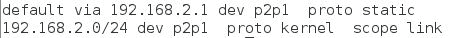

寻找以“default via”开头的行。你系统的默认网关就是这两个单词后面的 IP 地址。在示例截图中，默认网关为 `192.168.2.1`。

### 获取 IP 地址

大多数情况下，你的 Linux 系统将从 `DHCP` 服务器接收 IP 地址。

`DHCP` 代表“动态主机配置协议”（Dynamic Host Configuration Protocol），它是一种服务器，当客户端计算机连接到 `DHCP` 服务器的网络时，它会为计算机分配 IP 地址。手动为每台计算机配置 IP 地址 既耗时又容易出错；如果一台或多台计算机接收到相同的 IP 地址，将由于地址冲突而无法连接。`DHCP` 消除了这一过程中的猜测。当计算机插到以太网网络（或连接到无线网络）时，它会向 `DHCP` 服务器发送请求。如果网络上有 `DHCP` 服务器，它将为计算机提供 IP 地址，并且 `DHCP` 服务器会确保没有两台计算机接收到相同的 IP 地址。

大多数情况下，当你接入一个新网络时，会自动获得一个 `DHCP` 地址。但是，如果没有获得，请尝试此命令：

```bash
dhclient
```

注意，你需要以 root 权限运行 `dhclient`，无论是以 root 身份登录还是通过 `sudo` 借 root 权限。

这将手动告诉你的系统搜索 `DHCP` 服务器并接受地址。如果此命令不起作用，说明要么你使用的网络没有运行正常的 `DHCP` 服务器，要么是某些阻止了 `DHCP` 服务器与你的计算机通信。

### 释放 IP 地址

`DHCP` 地址带有“租期”，这意味着你的计算机允许保留该地址的时间。通常，你的计算机会在租期过期前一半时联系 `DHCP` 服务器，并请求保留该地址，`DHCP` 服务器几乎总是授予该许可。

有时你想提前释放已租约的 IP 地址——例如你的网络 `DHCP` 服务器发生了变化，或者你的计算机拒绝释放其 IP 地址。你可以使用 `dhclient` 命令和 `-r` 选项来实现：

```bash
dhclient -r
```

这会释放你的 IP 地址，然后你可以使用 `dhclient` 联系 `DHCP` 服务器以接收新地址。

### 测试你的 DNS 服务器

如我们上面所述，如果你的 `DNS` 服务器停止响应，你可能会遇到各种网络问题。当它正常工作时，你会完全忘记它的存在。但一旦它故障，一切都会停滞。没有它，你无法在网络浏览器的地址栏中输入地址，也无法使用任何依赖 `DNS` 的网络资源。

要诊断你的 `DNS` 服务器，你可以使用名为 `nslookup` 的命令。`nslookup` 命令提供你当前 `DNS` 服务器的 IP 地址，并对该服务器进行测试查询以检查其运行情况。例如，如果你想确定你的 `DNS` 服务器是否运行正常，可以使用此命令：

```bash
nslookup distrowatch.org
```

输出将类似所示：

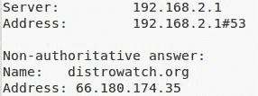

前两行列出了你的计算机正在使用的 `DNS` 服务器。在这种情况下，我们使用的是 IP 地址为 `192.168.2.1` 的 `DNS` 服务器。第二组行显示了我们执行的查询结果——`distrowatch.org` 的 IP 地址。在这种情况下，你可以看到 `distrowatch.org` 的 IP 地址为 `66.180.174.35`。由于 `nslookup` 成功返回了 `distrowatch.org` 的 IP 地址，你知道你的 `DNS` 服务器运行正常。

### 测试连接性

如果你曾经修理过电脑（甚至用过电脑），你就知道网络和互联网连接问题是令人沮丧的常见现象。幸运的是，命令行工具对于获取有关任何网络问题的价值信息有用。

第一个且最常用的网络诊断命令是 `ping` 命令。“ping”代表“数据包互联网探测者”（Packet Internet Groper），它依赖于 `ICMP` 协议，即互联网控制消息协议。基本上，`PING` 命令向网络目标（如服务器或其他 PC）发送一个数据包，如果目标处于激活状态，它会回一个确认包。例如，如果你想 `ping` IP 地址为 `192.168.1.2` 的 PC，将使用此命令：

```bash
ping 10.10.11.254
```

如果 `10.10.11.254` 正常，`ping` 命令将生成类似下面的输出：

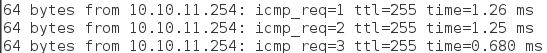

`ping` 命令会持续 ping 目标直到你按下 `CTRL-C` 取消命令。

该命令还有一些可以更改性能的选项。`-c` 告诉 `ping` 发送指定的数据包然后停止。例如，如果你只想 `ping` `192.168.1.2` 六次，请使用：

```bash
ping -c 6 192.168.1.2
```

### 追踪路径


有时网络是通的，但你无法访问目标。在这种情况下，`traceroute` 变得很有用。`traceroute` 命令映射到目的地的路径，并向每个设备发送 ICMP 数据包。例如，要追踪 `google.com`，你可以这样使用 `traceroute`：

```bash
traceroute google.com
```

输出将类似所示，每行代表一个“跳数”（链中的另一个设备）：

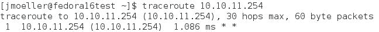

`traceroute` 命令默认运行到三十跳。

当连接可移动驱动器时，Linux 会为该驱动器创建一个“挂载点”（mount point）。挂载点是在文件系统中为可移动驱动器创建的虚拟目录。该目录通常以驱动器卷标标签的命名。因此，如果你向电脑插入一个卷标标签为 `USBDRIVE` 的闪盘，Linux 将为它创建一个名为 `USBDRIVE` 的目录。`USBDRIVE` 目录将对应闪盘上的根目录，你可以像对待其他其他目录一样向其中移动文件或从那里复制文件。

这些挂载点位于文件系统中的什么位置？大多数 Linux 发行版都有一个 `/media` 目录来存储挂载的外部驱动器。回到之前的例子，`USBDRIVE` 闪盘将在文件系统中显示为 `/media/USBDRIVE`。对于图形用户界面（GUI），桌面上会出现一个代表可移动驱动器的图标，但该图标将引导你进入 `/media` 中的可移动驱动器挂载点。

某些 Linux 发行版使用 `/mnt` 目录，少数甚至使用 `/Volumes`，但大多数发行版都使用 `/media` 目录作为挂载点。

## 不同类型的文件系统

你是否可以读取或写入可移动介质取决于驱动器上安装的文件系统类型。

我们已经描述过文件系统是组织磁盘上信息的一种手段，并注意到“文件系统”通常是描述 Linux 系统中硬盘的简称为法。虽然文件系统可能是组织磁盘上信息的方法，但仍然存在不同类型的文件系统。我们将在本节中查看其中几种。

Linux 系统中的硬盘最常用的格式是 `ext3` 或 `ext4` 文件系统。`ext3` 和 `ext4` 都是日志文件系统，这意味着它们在将更改写入磁盘之前会跟踪这些更改，这有助于防止错误。`ext3` 文件系统支持最大容量为 32 TB 的卷，单个文件的最大大小限制为 2 TB。`ext4` 文件系统支持最大可达 1 EB（艾字节）的卷和最大可达 16 TiB（二进制太字节）的文件。

如果你向 Linux 系统插入一个外部硬盘，它可能是以 `NTFS` 文件系统格式化的。`NTFS` 是 Windows 电脑默认的文件系统。大多数 Linux 发行版都有读取 `NTFS` 卷上文件的能力，但无法向其写入。如果你向 Linux 电脑插入一个 `NTFS` 卷，你可能能够从中复制文件，但无法向其写入文件。

你可能遇到的另一个主要文件系统是 `FAT` 文件系统。`FAT` 是一种旧的文件系统，通常不再用于内部硬盘，因为它的最大可能只有 4 TB，并且不支持任何大于 4 GB 的文件。然而，Linux 和 Windows 都可以读取和写入 `FAT` 磁盘。因此，较小的外部硬盘和 USB 闪盘格式化为 `FAT` 是常见的。

## 不同类型的可移动介质

你会遇到几种不同的可移动介质。

在 21 世纪初，软盘仍然相当常见。大多数软盘是 3 ½ 英寸硬塑料磁盘，可以存储 1.44 MB 的数据。按现代标准来说，这些数据并不多，而且软盘相对脆弱且细小。从那以后它们被外部硬盘、USB 闪盘和基于互联网的存储系统取代并过时，不再生产。

外部硬盘已变得非常普遍且相对廉价。它们通常通过 USB 线连接到你的电脑。它们带有 `NTFS` 或 `FAT` 文件系统格式化。你可以将 `NTFS` 硬盘重新格式化为 `FAT`、`ext3` 或 `ext4`，尽管这意味着 Windows 系统将无法识别该驱动器。

USB 闪盘是最常见的可移动介质——它们廉价、易于携带，并且可以存放大量的文档（尽管包含的音乐或视频文件不多）。它们几乎总是格式化为 `FAT`，因此你在 Linux 系统中读写这些文件时不会遇到困难。

# 第 21 章：用于处理可移动介质的命令

可移动介质的主要用途是在你的电脑上移动文件。大多数你实际上想与可移动介质一起使用的命令——`cp`、`rm`、`mkdir` 等——我们已经在书中涵盖了。有少数命令专门用于分析磁盘和空间使用，这些命令在处理可移动介质时会被证明非常有用。在本章中，我们将向你如何使用这些命令。

## 查找磁盘空间使用

你经常需要计算磁盘上剩余多少空空间，无论是你的可移动介质还是系统的主硬盘。诚然，对于家用电脑来说，监控硬盘空间使用情况并不像以前那样关键了。现代硬盘非常巨大，并且不断变大。尽管如此，某些类型的多媒体文件（如视频文件）可以迅速填满硬盘，而 USB 闪盘通常只有几 GB 的空间。

幸运的是，通过 `df` 命令有一种快速简单的方法可以计算你的磁盘上还剩多少空间。要使用它，只需在提示符处输入 `df` 即可：

```bash
df
```

输出看起来类似于这样：

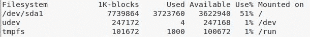

正如你所见，`df` 命令显示了挂载到系统的每个文件系统的使用情况。主硬盘将显示为 `/dev/sda1`。任何分区（无论是硬盘还是 USB 磁盘）显示为 `/dev/sdb1`、`/dev/sdc1`。

默认情况下，`df` 以字节显示。除非你非常擅长心算，否则这种计算空间的方法非常困难。为了获得更易读的显示，请使用 `-h` 参数使用 `df`：

```bash
df -h
```

输出现在像这样：


通过 `-h` 参数，`df` 以 GB 或 MB 显示输出，取决于磁盘的大小。

你还可以使用 `df` 命令找出磁盘上的文件系统类型。要这样做，请使用 `df -h` 并加上 `-T` 参数：

```bash
df -th
```

这将在输出中包含文件系统的类型：


你可以看到 `df` 现在位于“类型”列下方。

## 查找文件和文件夹的大小

现在你已经知道如何查找系统磁盘的使用情况，你可能想知道具体是什么占据了硬盘上的所有空间。你可能记得 `ls -l` 命令列出当前目录的文件大小，而 `ls -lh` 以 MB 和 GB 显示文件大小。然而，`ls -l` 或 `ls -lh` 并不显示目录的大小（以及其中包含的文件）。因为目录在 Linux 文件系统中也是文件，`ls -l` 命令只显示标记目录的存在的文件大小，这始终是四 KB。

要找到目录及其所有子目录的精确大小，请使用 `du` 命令。在默认状态，`du` 命令显示当前工作目录下所有文件的大小。然而，结合 `-s` 和 `-h` 参数，`du` 将显示整个目录的大小。例如，要计算 `/var` 目录及其所有子目录的大小，你将使用以下参数使用 `du`：

```bash
du -sh /var
```

注意，要让 `du` 正常工作，你需要拥有目标文件和目录的权限，这可能意味着你需要以 `root` 用户或具有 root 权限运行 `du`。

## 卸载可移动磁盘

通常，在现代 Linux 系统上，你不需要担心挂载 USB 驱动器。如果你插入一个 USB 驱动器，系统通常会检测到（即使在基于 CLI 的系统中）并自动挂载。卸载驱动器并没有那么简单。在图形界面（GUI）中，你只需要右键点击驱动器图标并点击“安全删除”，但在命令行界面中这种方法是不行的。直接从 USB 端口拔出驱动器并不是一个选择，因为这可能会导致数据损坏。

答案是 `umount` 命令。注意，该命令的拼写实际上是“umount”，而不是“unmount”（在 Linux 命令行中，混淆这两者是一个常见的拼写错误）。回到我们上一章的示例，如果你想卸载 `/media/USBDRIVE` 闪存驱动，可以在提示符处使用此命令：

```bash
umount /media/USBDRIVE
```

注意，你需要 root 权限才能卸载已挂载的文件系统。

`umount` 命令可能会失败。如果你在 USB 驱动器上打开了一个文件，`umount` 命令将拒绝卸载文件系统。或者如果你开了另一个终端会话，并且该会话的工作目录位于要卸载的驱动器上，`umount` 命令将失败。基本上，如果驱动器上有任何文件处于打开状态，你就无法卸载它。不过，你可以尝试使用 `-f` 选项强制卸载：

```bash
umount -f /media/USBDRIVE
```

注意，如果你确实在驱动器上打开了文件，这可能会导致数据丢失。

# 第 22 章：概念：进程与守护进程

在你阅读了关于 Linux 的内容后，你可能遇到过人们讨论“进程（processes）”和“守护进程（daemons）”。在接下来的几章中，我们将讨论这两者。在本章中，我们将描述进程和守护进程究竟是什么，然后在接下来的章节中，我们将向你展示一些监控和控制进程的命令。

## 什么是进程？

在 Linux 中，“进程”并不是指你执行某操作时使用的特定程序，也不是执行任务的标准方法。相反，进程被定义为计算机程序的活动实例。例如，如果你运行了 Firefox 浏览器，Firefox 就是一个正在运行的进程。一旦你退出 Firefox 并关闭浏览会话，该进程就会退出并消失。

因此，运行在你的计算机上的每个程序在技术上都是一个进程。如果你有 GUI，构成图形用户界面的各种程序都是进程。如果你运行一个终端模拟器应用程序，那也是一个进程。你从命令行执行的命令（无论是在纯 CLI 环境中还是从终端模拟器应用程序中）也是进程。即使是像 `ls` 这样快速显示输出后就结束的命令，也是一个进程，尽管它是短命的。

然而，你 Linux 系统上的程序比你个人亲自执行的要多得多，我们接下来将讨论这些。

## 守护进程（DAEMONS）

人们有时会将进程称为“守护进程”，但这两个术并不是可以互换的。虽然所有的守护进程确实都是进程，但守护进程是其他东西。“守护进程”一词意味着在后台运行的系统进程。系统进程是由操作系统控制并启动的进程，不需要实际使用电脑的人员干预。例如，控制 Linux 笔记本电脑电源设置的程序就是一个守护进程，像 Web 服务器或 MySQL 这样的服务器应用也是如此。

（“daemon”一词并非源于基督教或伊斯兰教的恶魔，而是源于希腊神话。在古希腊宗教中，“daemons”是执行希腊众神不愿亲自动处理的任务的小灵。在 UNIX 早期，程序员们将“daemon”一词用于系统将执行且不会打扰用户的进程。）

通常，命令行初学者倾向于不频繁使用守护进程。一旦你的技能更加，并且开始安装服务器应用程序，你就会开始更多地使用和控制守护进程。

## 进程 ID 数字（PID）

你可能记得在用户和组的章节中，每个用户都有自己的用户 ID（UID）数字，每个组都有自己的组 ID（GID）数字。进程也不一样。在 Linux 系统上启动的每个进程都会获得自己的进程 ID（PID）数字。即使是像 `ls` 命令这样短命的进程在运行时也会获得自己的 PID。

进程运行后，它（在理论上）会将进程 ID 数字释放回可用进程池中。该数字随后就可以重新分配给任何新进程。

理解 PID 如何工作非常重要，因为许多控制进程的命令都使用 PID 来标识命令的目标。

## 父进程 ID 数字（PPID）

每个进程也有一个 PPID —— 即父进程 ID 数字。

什么是父进程？Linux 系统上的每个进程都由另一个进程启动。如果你运行一个终端模拟器并从该应用程序启动一个命令，终端模拟器进程就会启动该命令的进程。或者，如果你启动一个 Web 浏览器应用程序，并通过浏览器打开一个 PDF 文件，浏览器进程就会启动 PDF 阅读器应用程序。

这种关系被称为父进程和子进程，类似于目录和子目录之间的关系。父进程是第一个进程，它启动了子进程。因此，每个进程都有一个 PPID —— 即启动它的进程的 PID 数字。

## INIT 进程

当然，如果每个进程都是由用户或另一个进程启动的，那么第一个进程是什么呢？

`init` 进程在启动序列期间运行，并启动所有系统进程。它的 PID 为 1，是第一个进程。所有系统进程最终由 `init` 启动。

在下一章中我们将为你展示一些管理进程的命令。

# 第 23 章：管理进程命令

在本章中，我们将展示如何从命令行查看进程。我们还将展示如何关闭挂起或冻结的进程。

## 查看运行进程

查看系统中运行进程的最简单方法之一是经典的 `ps` 命令。要使用 `ps` 命令，只需在提示符处输入：

```bash
ps
```

然而，在没有任何选项的情况下，`ps` 并不十分有用。默认输出如下：


在默认状态下，`ps` 只显示当前运行的进程 —— 也就是你正在使用的 shell。幸运的是，你可以通过 `-e` 让 `ps` 变得有用得多：

```bash
ps -e
```

`-e` 代表扩展（Extended），并生成系统上运行的所有进程的列表：


但是，这显示的信息仍然有限，特别是与 `top` 命令（我们将在本章晚些时候讨论）相比。你可以通过 `-l` 告诉 `ps` 命令显示更多信息：

```bash
ps -el
```

输出如下：


就像 `ls` 命令一样，`-l` 选项代表长列表（Long Listing），并产生相当多的信息。具体来说，你可以看到启动进程的用户 UID（用户 ID）、子进程的父进程的 PPID（父进程 PID）、进程的优先级以及许多其他有用信息。要获取更多信息，配合 `-f` 选项使用 `ps`：

```bash
ps -elf
```

使用这些选项后，`ps` 的输出如下：


除了 `-l` 选项提供的信息外，添加 `-f` 选项还会让 `ps` 命令显示进程启动的日期及其可执行文件在文件系统中的位置。

即使是 `ps -elf` 也只是系统当前运行进程的静态快照。在 Linux 系统上，运行的进程变化非常快，你可能希望实时监控它们。这时 `top` 命令就派上用场了。

## 使用 `top` 命令监控进程

`top` 命令已经存在很长时间了，几乎包含在每一个 Linux 变体中。它显示了各种有统计数据，包括 CPU 时间占用“前列”的用户（这也是该命令命名的由来）、运行进程占用的内存量、使用的虚拟内存、进程优先级、进程所属用户以及许多其他有用信息。要启动 `top`，只需在命令行提示符处输入该命令即可：

```bash
top
```

该命令的输出看起来如下：

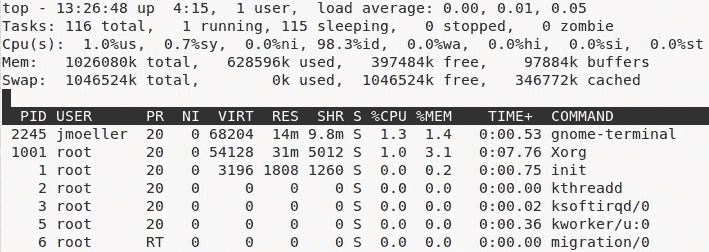

一旦启动，`top` 将保持运行并实时显示统计数据。进程按进程 ID（PID）列出，以及启动该进程的命令名称。

`top` 中列出了很多信息，让我们来看一下这些统计数据：

- **PID**：进程的进程 ID 数字。
- **USER**：进程的所有者。由 `root` 拥进程通常是系统进程，除非它们引起问题，否则应该放不管。
- **PR**：进程的优先级，决定了 CPU 对该进程与其他进程相比关注程度。数字越小，优先级越高。
- **NI**：进程的 nice 值，它会影响其优先级。
- **VIRT**：进程使用的虚拟内存量。
- **RES**：进程使用的物理内存量，以 KB 为单位。
- **SHR**：进程使用的共享内存量。
- **S**：进程当前的状态（僵尸、睡眠、运行、不中断睡眠或跟踪中）。
- **%CPU**：进程占用处理器的时间百分比。
- **%MEM**：进程占用物理内存的百分比。
- **TIME+**：进程已使用的处理器时间。
- **COMMAND**：启动进程的命令名称。

当然，你可能想按某个类别从到到大对显示进行排序。当你想要找出哪个进程占用了最多的 CPU 时间或内存时，这特别有用。按“t”键将按 CPU 时间对进程排序。按“l”键按平均负载排序，按“m”键按内存信息排序。

你还可以使用 `top` 来杀死不配合的进程。要做到这一点，你需要记住想要杀死的进程 ID。在 `top` 运行时按“k”键，该实用程序会要求你输入进程 ID 数字。输入数字后按 `Enter`，当询问你是否要杀死该进程时再次按 `Enter`（`top` 假设当你按回车时意味着“是”）。随后 `top` 实用程序将杀死进程。

完成 `top` 操作后，按 `q` 键退出并返回命令行。

大多数情况下，你会使用 `top` 和 `ps` 命令来追踪引起问题的进程。在下一节中，我们将讨论如何使用（名之过其实的）`kill` 命令来终止麻烦的进程。

## 停止进程

`kill` 命令正如你从名称中推测的那样，让你能够杀死运行中的进程。

技术上，`kill` 命令向运行的进程发送信号。然而，该命令最常被用于发送杀死运行进程的信号。在大多数情况下，你会使用此命令来终止冻结、拒绝优雅退出或运行异常的进程。

请注意，要使用 `kill`，你需要知道想要终止的进程的 `PID`（进程识别码）。你可以使用 `ps` 或 `top` 命令找到 `PID`（在本章前面的部分已详细介绍）。此外，除非你是你启动了某个特定进程，否则你需要 `root` 权限来杀死它。

要使用 `kill`，只需输入带有目标进程 `PID` 的命令。例如，要终止 PID 为 2589 的进程：

```bash
kill 2589
```


与其他命令一样，`kill` 可以通过许多选项进行修改。记住，`kill` 是通过向指定进程发送信号来操作的。`kill` 命令使用 64 个单独信号，你可以通过 `-l` 选项列出这些信号：

```
kill -l
```

在这 64 个信号中，有四个是常用的。你通过使用信号数字作为命令选项来告诉 `kill` 发送哪个信号——例如，`kill -9 2589`。

15 号信号是默认的 `kill` 信号。15 告诉目标进程立即停止，但仅在优雅关闭之后。由于 15 是默认 `kill` 信号，你通常不需要显式指定它，但如果你确实指定了，向目标进程 `PID` 2589 发送 15 号信号的命令看起来如下：

```
kill -15 2589
```

1 号信号没那么激进。它只是告诉进程重启，同时保持相同的 `PID`。使用 1 号信号：

```
kill -1 2589
```

2 号信号会将 `CTRL+C` 组合键发送给进程，这通常用于退出运行中的进程（例如 `ping` 命令）。向进程发送 2 号信号：

```
kill -2 2589
```

最后，最激进的信号是 9。9 号信号立即杀死进程，而不给它优雅关闭或自我清理的机会。通常情况下，只有当其他方法都无效时，你才应该使用信号 9 来终止进程：

```
kill -9 2589
```

使用 `ps`、`top` 和 `kill`，你可以管理 Linux 系统上运行的进程。

预装软件极大减少了在 Linux 系统上安装软件的猜测性。通常，包好的软件已经为针对特定的 Linux 发行版准备就绪，如果你使用包管理器来安装它，该程序知道自己需要哪些依赖项。

“包管理器”是一种专门设计用于安装软件包的应用程序。Linux 中有两种主要的软件包管理工具，这取决于你的发行版是源自 Debian 还是 Red Hat/Fedora（这是两个最有影响力的 Linux 发行版）。源自 Red Hat/Fedora 的发行版倾向于使用 RPM 包管理器，通常简称为 `RPM`。源自 Debian 的发行版经常使用高级软件包工具，通常缩写为 `apt`。包管理器之所以有用，是因为它们知道已安装软件需要哪些依赖项，并会在安装所选应用程序的同时自动安装这些依赖。

## 软件仓库

包管理器通常与软件仓库紧密配合。

基本上，软件仓库是互联网上的一个服务器，用于存储特定发行版的包好的软件。仓库通常由特定发行版的制作者维护。例如，Ubuntu 背后的公司 Canonical 维护着 Ubuntu 使用的软件仓库。创建 Red Hat Linux 和 Fedora Linux 的公司 Red Hat 则运行着这两个发行版的仓库。

软件仓库提供了许多优势。由于由发行版背后的公司维护，你可以找到专门测试并批准可在你的发行版上运行的软件。这意味着获取已安装软件的更新也变得容易，因为更新在测试通过与发行版兼容后就会被添加到仓库中。仓库的缺点是使用它时需要访问互联网。

在下一章中，我们将展示如何从命令行安装软件。

---

## 第 25 章：安装软件的命令

在本章中，我们将解释如何从命令行安装软件。我们将重点介绍两个主要的包管理器——高级软件包工具和 `RPM`。我们还将向你展示如何在不使用软件仓库的情况下安装预装软件。

### 在 Debian 系统上安装预装软件

Debian 是最老且最受尊敬的 Linux 发行版之一，许多其他发行版也基于它——Ubuntu、Kubuntu、Xubuntu、Linux Mint、Knoppix 和 Xandros 仅仅是基于 Debian 的 Linux 发行版的一部分。为基于 Debian 的发行版封装的软件通常以 `.deb` 文件的形式出现。你可以在 GUI 环境下通过双击来安装软件包，也可以从命令行安装。

请注意，要安装或卸载任何软件（无论通过 GUI 还是 CLI），你都需要 root 权限。

要从命令行安装 `.deb` 包，你将使用 `dpkg` 命令。如果你有一个名为 `installer.deb` 的预装安装文件，可以使用此命令进行安装：

```
dpkg -i installer.deb
```

根据程序的不同，你可能需要或不需要遵循安装向导或输入额外信息。按照提示操作，`dpkg` 将会为你安装软件。

同样，你也可以使用 `dpkg` 配合 `-r` 选项来卸载软件：

```
dpkg -r installer.deb
```

请注意，为了通过 `dpkg` 卸载软件，你需要保留原始安装文件，因为其中包含了卸载指令。此外，`dpkg` 命令不会计算任何依赖关系，如果你缺少该软件所需的依赖项，安装将失败。

### 使用高级软件包工具安装软件

大多数基于 Debian 的发行版都使用高级软件包工具进行软件管理。高级软件包工具具有多个图形前端——Synaptic 包管理器，或者 Ubuntu 中的 Ubuntu 软件中心。然而，要使用高级软件包工具从命令行安装软件，你将使用它的命令行实用 `apt` 命令。`apt` 命令与软件仓库紧密配合，并从仓库下载已安装软件。

例如，要安装远程桌面连接应用 `Remmina`，你可以使用此命令：

```
apt-get install remmina
```

通常在基于 Debian 的系统上，你会使用 `sudo` 配合 `apt` 来获取安装所需的 root 权限。你还需要知道想要安装的包名。输入命令后，`apt` 将检查仓库，列出 `Remmina` 可能需要的任何依赖项，并列出所需的总磁盘空间。按 `Y` 继续，`apt` 将为你下载并安装 `Remmina`。

使用 `apt` 移除 `Remmina`，可以使用此命令：

```
apt-get remove remmina
```

同样按照提示操作，`apt` 将从你的系统中移除 `Remmina` 及其所有依赖项。注意，如果另一个应用程序需要 `Remmina` 的某个依赖项，`apt` 将其移除。

### 使用 RPM 包管理器安装预装软件

与 Debian 类似，Red Hat Linux（及其免费版本 Fedora）是最老且最受尊敬的 Linux 发行版之一，许多其他发行版也基于 Fedora。为基于 Fedora 的发行版封装的软件通常以 `.rpm` 文件的形式出现，因为 Red Hat、Fedora 及其衍生品都使用 `RPM` 包管理器而不是高级软件包工具。你可以在 GUI 环境下通过双击来安装软件包，也可以从命令行安装。

要从命令行安装 `.rpm` 包，你将使用 `rpm` 命令。如果你有一个名为 `installer.rpm` 的预装安装文件，可以使用此命令进行安装：

```
rpm -i installer.rpm
```

根据程序的不同，你可能需要或不需要遵循安装向导或输入额外信息。按照提示操作，`rpm` 将为你安装软件。

同样，你也可以使用 `rpm` 配合 `-e` 选项来卸载软件：

```
rpm -e installer.rpm
```

请注意，为了通过 `rpm` 卸载软件，你需要保留原始安装文件，因为其中包含了卸载指令。此外，`rpm` 命令不会计算任何依赖关系，如果你缺少该软件所需的依赖项，安装将失败。

### 使用 YELLOW DOG UPDATER 安装软件

大多数基于 Fedora 的发行版使用 Yellowdog Updater Modified（`yum`）进行软件管理。相比 `rpm` 命令，Yellowdog 具有许多优势——它与仓库紧密配合，并自动计算和下载依赖项。Yellowdog 使用 `yum` 命令行工具安装软件。

例如，要安装远程桌面连接应用 `Remmina`，你可以使用此命令：

```
yum install remmina
```

Linux 命令行是一个复杂的环境。我们已经尽力向你展示基础知识，但无法在这里涵盖每一个选项和场景。随着你经验和知识的增长，你将希望执行比本书所涵盖的更高级的任务。幸运的是，Linux 自带了一套全面的内置帮助系统，我们将在本章向你展示如何使用它。

### APROPOS

使用帮助系统的第一步是使用 `apropos` 命令。

有时你知道想在命令行中执行什么任务，但不知道应该使用什么命令。这时，`apropos` 命令就派上用场了，因为它允许你通过主题或关键词进行搜索。例如，假设你想执行一项涉及 `ext3` 文件系统的任务，但无法想起精确的命令。你可以使用 `apropos` 命令进行搜索：

```bash
apropos ext3
```

该命令将生成如下所示输出：

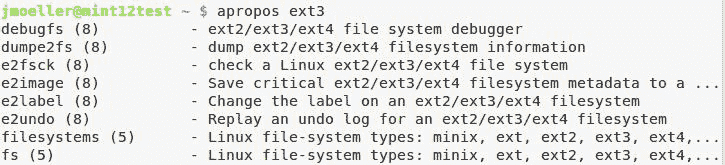

输出将列出所有描述中包含“ext3”的命令，帮助你唤起记忆。

`apropos` 从哪里获取信息？该命令的输出来源于 Linux 的内置手册页（manual pages），我们将在下一节中描述它们。

### MAN PAGES（手册页）

Linux 中的每个命令（至少在理论上）都有一个相应的“手册页”，通常简称为“man page”。手册页是一个描述该命令的文本文档，详细列出其选项并提供使用示例。手册页最早于 20 世纪 70 年代包含在 UNIX 中，出现在几乎每个 Linux 发行版中。

如何访问特定命令的手页？你通过 `man` 命令，后跟想要查看手册页的命令名称来实现。例如，如果你想查看 `nslookup` 命令的手页，可以使用以下命令：

```bash
man nslookup
```

这将打开 `nslookup` 命令的手页。

一旦打开手册页，它的运行方式非常像 `less` 命令。你可以使用向上和向下方向键逐行滚动文本，并配合 `PAGE UP` 和 `PAGE DOWN` 键一次翻一页。与 `less` 命令一样，`man` 工具支持搜索。按下正斜杠（`/`）键输入搜索术语，`man` 工具将跳转到文本中该术语首次出现的地方。然后你可以按 `N` 键在实例之间跳转。

读完手册页后，可以按 `Q` 键退出并返回提示符。

在手册页中可以哪些信息？手册页的实际布局会因发行版而异，但通常有几个标准部分：

- 第一部分是标题（title），将列出命令名称。
- 第二部分是名称（name），将再次显示命令名称，并提供其功能的简要总结。
- 第三部分是提纲（synopsis），提供命令语法的简要描述。
- 第四部分是描述（description），这是手册页的核心内容。在描述中，你将详细列出命令的选项和功能。这里通常还有命令使用的示例。
- 手册页的最后几个部分显示命令本身的编写者、报告 Bug 的地址、版权信息以及可能相关的其他手册页。

通过 `man` 工具，你可以获取你 Linux 系统上任何命令的有用信息。

---

## 作者的其他书籍

### Ubuntu 初学者指南（The Ubuntu Beginner’s Guide）

《Ubuntu 初学者指南》为 Ubuntu Linux 的新用户提供了操作系统的概览，从简单的命令行任务到高级服务器配置。在指南中，你将学习如何从命令行工作、编辑系统配置、管理网络设置、安装和使用强大的应用程序，以及使用 Ubuntu 托管健壮的服务器应用程序。

点击此链接阅读 [Ubuntu 学者指南](http://computerbeginnersguides.com/blog/books/the-ubuntu-beginners-guide/)（http://computerbeginnersguides.com/blog/books/the-ubuntu-beginners-guide/）。

#### Windows 命令行初学者指南（The Windows Command Line Beginner’s Guide）

《Windows 命令行初学者指南》为 Windows 命令行的新用户提供了命令提示符（Command Prompt）的概述，从简单任务到网络配置。在指南中，你将学习如何管理命令提示符、控制文件和目录、分配权限、管理文件共享、管理磁盘设置、创建批处理以及许多其他主题。

点击此链接阅读 [Windows 命令行初学者指南](http://computerbeginnersguides.com/blog/books/the-windows-command-line-beginners-guide/)（http://computerbeginnersguides.com/blog/books/the-windows-command-line-beginners-guide/）。

#### Linux 命令行初学者指南（The Linux Command Line Beginner’s Guide）

《Linux 命令行初学者指南》为 Linux 新用户提供了命令行环境的介绍。在指南中，你将学习如何使用 `bash` shell、管理 Linux 文件系统、创建和删除用户及组、获取和分配文件所有权、妥善使用 `root` 账户、编辑文本文件、诊断网络问题以及许多其他任务。

点击此链接阅读 [Linux 命令行初学者指南](http://computerbeginnersguides.com/blog/books/the-linux-command-line-beginners-guide/)（http://computerbeginnersguides.com/blog/books/the-linux-command-line-beginners-guide/）。

### Ubuntu 桌面新手指南（The Ubuntu Desktop Beginner’s Guide）

想在不学习命令行的情况下使用 Ubuntu 吗？那么这本书适合你！《Ubuntu 新手指南》将教你如何使用桌面界面。在指南中，你将学习如何安装和更新 Ubuntu、配置和使用桌面环境、管理文件系统、连接网络、安装应用程序以及许多其他任务。

点击此链接阅读 [Ubuntu 桌面指南](http://computerbeginnersguides.com/blog/books/the-ubuntu-beginners-guide/)（the-beginners-guide/）。

### Linux Mint 初学者指南（The Linux Mint Beginner’s Guide）

《Linux Mint 初学者指南》将教你如何充分利用 Linux Mint，从使用 `Cinnamon` 桌面环境到高级命令行任务。在指南中，你将学习如何安装 Linux Mint、使用桌面环境、从命令行工作、编辑系统配置、管理网络设置、安装和使用强大的应用程序，以及使用 Linux Mint 托管健壮的服务器应用程序。

点击此链接阅读 [Linux Mint 初学者指南](http://computerbeginnersguides.com/blog/books/the-linux-mint-beginners-guide/)（http://computerbeginnersguides.com/blog/books/the-linux-mint-beginners-guide/）。

### Windows 8 初学者指南（The Windows 8 Beginner’s Guide）

这本书为 Windows 8 新用户提供了微软新款平板操作系统的概述。书中配插了 200 多张截图，将解释 Windows 8 不同版本的区别、如何充分利用开始屏幕、如何使用 Windows 8 桌面、从商店安装应用的最佳方法以及许多其他有用项目。

点击此链接阅读 [Windows 8 初学者指南](http://computerbeginnersguides.com/blog/books/the-windows-8-beginners-guide/)（http://computerbeginnersguides.com/blog/books/the-windows-8-beginners-guide/）。

---

## 关于作者

Jonathan Moeller 身高六英尺以上，拥有西米利亚柯南般深邃的蓝色眼睛、如日西哥特战士王般的铜色头发，以及如人类指挥官般严严的面容，可惜的是，这些对他作为电脑维修员的职业来说毫无用处。

他写过 `DEMONSOULED` 系列剑奇与魔法小说，并持续创作着关于刺客和间谍 Caina Amalas 的 `THE GHOSTS` 系列、`COMPUTER BEGINNER'S GUIDE` 系列计算机书籍，以及许多其他作品。

访问他的个人网站：

[`www.jonathanmoeller.com`](http://www.jonathanmoeller.com/)

访问他的技术博客：

[`www.computerbeginnersguides.com`](http://www.computerbeginnersguides.com/)

通过以下邮箱联系他：

jmcontact@jonathanmoeller.com

你可以[在此处订阅他的邮件通讯](http://www.jonathanmoeller.com/writer/?page_id=1854)（http://www.jonathanmoeller.com/writer/?page_id=1854），或者关注他的 [Facebook 页面](http://www.facebook.com/pages/Jonathan-Moeller/328773987230189)（http://www.facebook.com/pages/Jonathan-Moeller/328773987230189）。

加入我们的 Telegram 闭门社区，你可以在那里订购或讨论任何电子书：[`t.me/ebook_community`](https://t.me/ebook_community)
