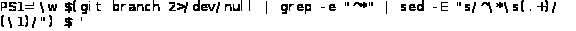

# Linux 命令行手册：深度解析


虽> 尽管在本书的准备过程中已采取了一切预防措施，但出版商对错误或遗漏，或因使用本文所含的信息而导致的损害不承担任何责任。

# Linux 命令行手册：深度剖析

第一版。2023 年 7 月 20 日。

版权所有 © 2023 Elena Alexandrov。

由 Elena Alexandrov 编写。

## 目录

- 引言
- 为什么要使用命令行？
- 本书主要介绍了什么？
- 如何阅读这本书
- 1 – 学习 Shell
- 什么是 Shell？
- 终端模拟器
- 尝试一些简单命令
- 结束终端会
- 2 – 导航
- 理解文件系统树
- 当前工作目录
- 列出目录内容
- 更改当前工作目录
- 绝对路径
- 相对路径
- 实用的快捷键
- 3 – 探索系统
- 选项与参数
- 长格式
- 使用 file Determine 文件类型
- 使用 less 查看文件内容
- 符号链接
- 硬链接
- 字符范围
- 通配符在 GUI 中同样有效
- mkdir – 创建目录
- cp – 复制文件和目录
- mv – 移动并重命名文件
- rm – 删除文件和目录
- ln – 创建链接
- 5 – 使用命令
- 识别命令
- type – 显示命令类型
- which – 显示可执行文件位置
- help – 获取 Shell 内置命令帮助
- —help – 显示用法信息
- man – 显示程序手册页
- apropos – 显示适当的命令
- whatis – 显示命令的极简描述
- info – 显示程序的信息条目
- 使用 alias 创建自定义命令
- 6 – 重定向
- 标准输入、输出和错误
- 重定向标准输出
- 重定向标准错误
- 将标准输出和标准错误重定向到一个文件
- 处理不需要的输出
- Unix 文化中的 /dev/null
- 重定向标准输入
- cat – 连接文件
- 管道
- > 和 | 的区别
- 过滤器
- uniq - 报告或省略重复行
- wc – 打印行、字、字节数
- grep – 打印匹配模式的行
- head / tail – 打印文件的开头/结尾部分
- tee – 从 stdin 读取并输出到 stdout 和文件
- 7 – 以 Shell 的视角看世界
- 路径扩展
- 隐藏文件的路径扩展
- 波浪号扩展
- 算术扩展
- 大括号扩展
- 参数扩展
- 命令替换
- 引用
- 双引号
- 单引号
- 转义
- 反斜杠序列
- 8 – 高级键盘技巧
- 命令行编辑
- 光标移动
- 补全
- 历史记录
- 搜索
- 历史
- 9 – 权限
- 读取、写入和执行
- chmod – 修改模式
- 在 GUI 中设置
- umask – 设置默认
- 身份
- su – 以用户身份运行
- sudo – 以用户身份执行
- chown – 修改所有者
- chgrp – 修改组
- 10 – 进程
- 查看进程
- 使用 top 动态查看
- 控制进程
- 中断进程
- 放入后台运行
- 返回前台
- 暂停进程
- 信号
- 使用 kill 发送信号
- 使用 killall 向多个进程发送信号
- 更多进程相关的
- 11 – 环境
- 环境变量存储了什么
- 检查环境变量
- 环境是如何建立的
- 启动文件
- 我们应该修改哪些文件
- 12 – vi 入门
- 为什么我们需要学习 vi
- 启动和停止 vi
- 编辑模式
- 光标移动
- 添加文本
- 打开行
- 删除文本
- 剪切、复制和粘贴文本
- 合并行
- 查找与替换
- 编辑多个文件
- 13 – 自定义提示符
- 提示符的结构
- 尝试一些提示符设计
- 添加颜色
- 终端混乱
- 移动光标
- 保存提示符
- 14 – 存储媒体
- 挂载和卸载存储设备
- 查看挂载的文件系统列表
- 确定设备名称
- 创建新的文件系统
- 使用 fdisk 调整分区
- 使用 mkfs 创建新的文件系统
- 测试和修复文件系统
- 格式化软磁盘
- 直接在设备间传输数据
- 创建 CD-ROM 镜像
- 写入 CD-ROM 镜像


Linux 命令行是一个多功能且强大的工具，它允许你执行广泛的任务，从简单的文件管理到复杂的系统管理功能应有。通过正确的知识和专业技能，你可以定制并优化你的 Linux 系统，自动化任务，甚至开发你自己的软件。

在本书中，我们将从命令行操作的基础知识开始，包括如何导航目录和管理文件。从那里开始，我们将深入探讨更高级的主题，如进程管理、网络配置和 Shell 脚本编写。当你读完这本书时，你将对 Linux 命令行的工作原理有坚实的理解，并能够使用它来解决各种类型的问题。

因此，无论你是学生、专业人士，还是仅仅想要扩展 Linux 知识的奇奇个人，本书都是你的完美资源。让我们开启通往 Linux 命令行的之旅吧！


## 为什么使用命令行？


命令行界面 (`CLI`) 已经存在了几十年，仍然是 Linux 操作系统的核心部分。它提供了一种基于文本的方式与计算机操作系统交互，允许用户输入命令并以文本响应的形式接收计算机的反馈。虽然许多人倾向于使用图形用户界面 (`GUI`) 与计算机交互，但命令行界面提供了许多优势，使其成为某些任务中极具吸引力的选择：

**速度**：使用命令行界面可能比使用 `GUI` 更快，因为你输入命令的速度比浏览一系列菜单和选项要快。当你需要执行重复性任务或快速完成任务时，这特别有用。

**控制**：比起 `GUI`，命令行界面赋予了你对计算机更大的控制。你可以执行复杂的命令，编写脚本自动化任务，并以更高的精度修改系统设置。

**可访问性**：命令行界面可以远程访问，这使其成为系统管理员和开发人员 Essential 工具。通过使用命令行界面，他们可以在远程位置管理服务器和计算机集群。

**故障排除**：当计算机出现问题时，命令行界面通常是诊断和修复问题的最佳方法。可以从命令行查看和监控系统日志及进程，允许用户识别并快速解决问题。

**学习**：学习使用命令行界面对于任何想要从事 Linux 系统工作的人来说都是一项基本技能。它可以帮助用户更深入地理解操作系统的工作原理，并开发宝贵的编程和自动化技能。

总而言之，虽然使用命令行界面可能不是与计算机交互最简单的方法，但对于愿意学习并投入时间有效使用它的用户来说，它提供了许多好处。


## 本书关于什么


本书是 Linux 命令行界面的全面指南，旨在帮助读者开发精通这一核心工具所需的技能和知识。

在整书中，读者将学习如何使用 Linux 命令行执行各种任务，从基础文件管理到高级系统管理功能。书中涵盖的主题包括导航目录、操作文件和目录、进程管理、网络配置和 Shell 脚本编写。

除了提供关于如何使用 Linux 命令行的实用指导外，本书还解释了管理 Linux 操作系统的底层概念和原理。读者将学习 Linux 中可用的各种命令行工具，以及使 Linux 成为如此强大且多功能平台的系统架构和文件系统结构。

无论你是刚开始接触 Linux 的初学者，还是想要扩展知识的资深专业人士，本书对于任何想要精通 Linux 命令行界面的人来说都是完美的资源。通过清晰的解释、真实世界的示例和实用的技巧，本书将帮助读者获得有效且高效使用 Linux 命令行所需的信心和技能。


## 如何阅读本书

image

为了从书中获得最多，我们建议你按照章节的顺序从头读到尾。每一章都建立在前章节涵盖的概念和技能之上，因此按顺序阅读书籍将帮助你在 Linux 命令行界面基础方面建立坚实的基础。

在阅读每一章时，我们鼓励你跟随文中提供的示例和练习。这些练习旨在帮助你加强对本章涵盖概念的理解，并开发你的实践技能。

除了阅读文本和完成练习外，我们还建议你在自己的系统上亲自尝试 Linux 命令行。这将让你获得书中涵盖的命令和技术的实践经验，并帮助你对 Linux 操作系统的工作原理有更深入的理解。

最后，我们鼓励你在继续使用 Linux 命令行时将本书作为参考指南。书中包含了详尽的索引和术语表，让你需要时轻松找到所需的信息。

通过遵循这些指南并利用文中提供的练习和示例，你将走在通往精通 Linux 命令行界面并成为更高效 Linux 用户的道路上。


## 1 – 学习 Shell

image

在本书的范围内，你将学习如何导航目录、操作文件和目录、使用 `ls`、`cd` 和 `mkdir` 等基本命令。你还将学习使用重定向和管道来管理输入输出，以及如何使用通配符和正则表达式更高效地处理文件和目录。

在完成第一部分之后，你将对 Linux Shell 的基础有坚实的理解，并能够使用它执行各种任务。这将为书中后续部分涵盖的高级主题奠定基础。


### 什么是 Shell？


在 Linux 语文中，Shell 是一个提供命令行界面 (`CLI`) 让用户与操作系统交互的程序。它是一个基于文本的界面，允许用户输入命令并以文本响应的形式接收系统的反馈。

Shell 解释用户输入的命令并与操作系统通信以执行请求的操作。它为用户提供了导航目录、创建和删除文件、管理系统进程以及执行各种其他任务的方法。

Linux 中有几种不同的 Shell，包括 Bourne-Again SHell (`bash`)、Z SHell (`zsh`) 和 Korn SHell (`ksh`) 等。每个 Shell 都有其的一系列功能和能力，但它们都提供了一种用户使用命令行界面与操作系统交互的方式。

学习使用 Shell 是任何从事 Linux 工作的人来说的一项基本技能。它提供了一种强大且灵活的方式来管理操作系统，并用于执行复杂任务、自动化流程和开发软件。


终端模拟器（Terminal emulator）是一种允许用户通过图形用户界面（GUI）访问 shell 并运行命令行实用程序的程序。它模拟了终端或控制台，这是传统上用于与 shell 交互的基于文本的接口。

与传统终端相比，终端模拟器具有许多优势，包括调整窗口大小、使用多个标签页或窗口，以及自定义终端的外观和行为。

Linux 提供了多种可可用的终端模拟器，包括 `GNOME Terminal`、`Konsole`、`xterm` 和 `Terminator` 等。每个模拟器都有其独特的功能和能力，但它们都为用户提供了一种通过图形界面与 shell 交互的方法。

除了提供对 shell 的访问外，终端模拟器还可以用于运行其他命令行实用程序，例如文本编辑器、网络实用程序和系统管理工具。这使得它们成为处理 Linux 时多功能且强大的工具。


### 尝试一些简单命令


当然，这里有一些你可以在 Linux shell 或终端模拟器中尝试的简单命令：

- `pwd` - 此命令将当前工作目录打印到屏幕上。
- `ls` - 此命令列出当前目录的内容。
- `cd` - 此命令将当前目录更改到指定的目录。
- `mkdir` - 此命令创建一个指定名称的新目录。
- `touch` - 此命令创建一个指定名称的新空文件。
- `cat` - 此命令在屏幕上显示文件的内容。
- `echo` - 此命令在屏幕上显示消息。
- `clear` - 此命令清空屏幕。

要使用这些命令，请打开 shell 或终端模拟器，并输入命令后跟接任何所需的参数。例如，要列出当前目录的内容，你可以输入 `ls` 并按回车。

请记住，Linux 命令是区分大小写的，因此请确保按照所示的内容准确输入它们。此外，在使用如 `rm`（删除文件）或 `sudo`（授予管理员权限）等命令时要小心，因为如果使用不当可能会导致严重后果。


### 结束终端会话


要在 Linux 中结束终端会话，可以使用 `exit` 命令。此命令终止当前的 shell 会话并返回到父级 shell。

要使用 `exit` 命令，只需在命令提示符处输入 `exit` 并按回车。这将关闭当前的 shell 会话以及与之关联的任何打开的终端模拟器窗口。

如果你打开了多个终端会话，可以使用 `logout` 命令一次性结束所有会话。此命令将你退出当前 shell 并终止所有活跃的 shell 会话。

在某些情况下，你也可以通过点击窗口右上角的“X”按钮来关闭终端窗口。然而，这只会关闭窗口而不一定终止运行在内部的 shell 会话。为了确保会话被正确终止，最好始终使用 `exit` 或 `logout` 命令。


## 2 – 导航


### 理解文件系统树


在 Linux 中，文件系统被组织为层次树形结构，根目录位于树的顶部。根目录由正斜杠（`/`）字符表示，系统中的所有其他目录和文件位于此树结构中的某处。

文件系统树组织为若干个标准目录，每个目录都有特定的用途。文件系统中最常用的目录包括：

- `/bin` - 此目录包含基本系统运行所需的必用系统实用程序和程序。
- `/etc` - 此目录包含系统配置文件，例如网络设置、用户账户和系统启动脚本。
- `/home` - 此目录包含系统上单个用户的家目录。
- `/lib` - 此目录包含系统程序和实用程序使用的共享库。
- `/opt` - 此目录包含不属于系统核心的可选软件包。
- `/tmp` - 此目录用于存放程序和实用程序创建的临时文件。
- `/usr` - 此目录包含额外的系统实用程序和程序，以及用户文档。
- `/var` - 此目录包含可变数据文件，例如系统日志和打印文件。

理解文件系统树的组织结构是处理 Linux 的一项基本技能，它提供了在系统中导航和管理文件与目录的框架。

### 当前工作目录


在 Linux 中，当前工作目录是指你当前所在的目录。当你打开一个新的 shell 或终端模拟器窗口时，默认目录是你的家目录。

你可以使用 `pwd` 命令显示当前目录的完整路径。例如，如果你位于 `/home/user/Documents` 目录，在命令提示符输入 `pwd` 将显示该路径。

你可以使用 `cd` 命令将当前工作目录更改为文件系统树中的另一个目录。例如，如果你想将当前工作目录更改为 `/home/user/Pictures`，你需要输入 `cd /home/user/Pictures`。

在导航文件系统树时，跟踪当前目录是非常重要的，因为许多 shell 命令和实用程序默认对当前目录进行操作。通过理解和管理当前目录，你可以成为更高效的 Linux 用户。

### 列出目录内容


在 Linux 中，你可以使用 `ls` 命令列出目录的内容。默认情况下，`ls` 命令将列出当前目录下的文件和目录。

要列出特定目录的内容，可以将目录路径作为 `ls` 命令的参数。例如，如果你想列出 `/home/user/Documents` 目录的内容，可以在命令提示符输入 `ls /home/user/Documents` 并按回车。

`ls` 命令提供了多种选项，用于修改输出格式或显示有关文件和目录的额外信息。例如，你可以使用 `-l` 选项以长格式显示文件和目录，这包含了权限、所有者和大小额外信息。你可以使用 `-a` 选项显示所有文件和目录，包括隐藏文件。

### 更改当前工作目录

你可以使用 `cd` 命令将当前工作目录更改为文件系统树中的另一个目录。`cd` 命令代表“更改目录”。

要使用 `cd` 命令，只需输入 `cd` 后跟你想要更改的目录路径。例如，要将当前工作目录更改为 `/home/user/Documents` 目录，你可以在命令提示符输入 `cd /home/user/Documents` 并按回车。


你可以使用 `cd` 命令的各种快捷键来使在文件系统树中的导航更加快速和高效。例如，输入 `cd` 后跟一个单连字符（`-`）将把当前工作目录切换到你之前所在的目录，而输入 `cd` 后跟两个点（`..`）将把当前工作目录切换到当前目录的父目录。

在使用 `cd` 命令时，跟踪当前工作目录是非常重要的，因为许多其他 shell 命令和工具默认会在当前目录上操作。通过掌握 `cd` 命令及其各种快捷键的使用，你可以成为一个更高效、更有效的 Linux 用户，能够快速轻松地导航文件系统树。


### 绝对路径


在 Linux 中，绝对路径是一个指定文件或目录在文件系统树中确切位置的完整路径。它从根目录（`/`）开始，包含了通往目标文件或目录的所有目录和子目录。

例如，位于 `/home/user/Documents` 目录下的名为 `example.txt` 的文件的绝对路径为 `/home/user/Documents/example.txt`。

在运行 shell 命令或使用工具时，你可以使用绝对路径来指定文件或目录的确切位置。当你需要指定不在当前工作目录的文件或目录时，绝对路径非常有用。

要在 shell 命令中使用绝对路径，只需输入完整路径，而不仅仅是文件或目录名。例如，要使用绝对路径列出 `/home/user/Documents` 目录的内容，你可以在提示符处输入 `ls /home/user/Documents` 并按回车。


假设你在 `/home/user/Documents` 目录下有一个名为 `example.txt` 的文件。如果你想使用像 `nano` 这样的文本编辑器打开此文件，可以使用以下命令：

```
nano /home/user/Documents/example.txt
```

此命令指定了文件的绝对路径，其中包括通往该文件的完整目录路径。当你运行此命令时，`nano` 将打开位于 `/home/user/Documents` 目录下的 `example.txt` 文件。

注意，你也可以使用相对路径来打开同一个文件，但相对路径取决于你的当前工作目录。使用绝对路径可以确保无论你的当前工作目录在哪里，始终都能找到文件。


### 相对路径


在 Linux 中，相对路径是相对于当前工作目录指定文件或目录位置的路径。它不包含从根目录（`/`）到文件或目录的完整路径。

例如，如果你的当前工作目录是 `/home/user/Documents`，而你想访问位于 `/home/user/Pictures` 目录下的名为 `example.txt` 文件，可以使用相对路径 `../Pictures/example.txt`。`..` 表示当前工作目录的父目录，随后的 `/Pictures/example.txt` 指定了相对于父目录的文件位置。

你可以使用相对路径指定位于当前工作目录附近的文件或目录。当你想要快速高效地在目录之间导航时，相对路径尤为有用。

要在 shell 命令中使用相对路径，只需输入相对于当前工作目录的路径，而不是完整路径。例如，要列出位于当前工作目录父目录下的名为 `images` 的目录的内容，你可以在提示符处输入 `ls ../images` 并按回车。

假设你的当前工作目录是 `/home/user/Documents`，你想打开一个位于名为 `notes` 的子目录下的 `example.txt` 文件。你可以使用以下命令：

```
nano notes/example.txt
```

此命令指定了文件的相对路径，包含了相对于当前工作目录的文件路径。当你运行此命令时，`nano` 将打开位于当前工作目录 `notes` 子目录下的 `example.txt` 文件。


### 一些实快捷键


在 Linux 中，有许多实用的快捷键可以帮助你导航文件系统树并在 shell 中更高效地工作。以下是最常用的快捷键：

-   **Tab 补全**：如果你开始输入文件或目录名称并按 Tab 键，如果该名称是唯一的，shell 将自动为你补全。如果名称不唯一，按两次 Tab 键将显示可能的补全列表。
-   **Ctrl + A**：此快捷键将光标移动到当前命令行的开头。
-   **Ctrl + E**：此快捷键将光标移动到当前命令行的末尾。
-   **Ctrl + U**：此快捷键将删除整个当前命令行。
-   **Ctrl + R**：此快捷键将打开反向搜索历史功能，允许你搜索之前的命令。
-   **Ctrl + C**：此快捷键将中断当前的进程或命令。


### 3 – 探索系统。


### 选项与参数


在 Linux 中，shell 命令通常由命令名、选项和参数组成。选项修改命令的行为，而参数指定命令操作的文件、目录或其他输入。

选项通常以连字符（`-`）或双连字符（`--`）开头且区分大小写。它们可以组合使用也可以单独使用。例如，`ls` 命令有多个选项，包括 `-l` 以长格式显示目录内容，以及 `-a` 显示隐藏文件。

参数通常位于命令和选项之后，其形式取决于命令。例如，在使用 `cp` 命令复制文件时，第一个参数是源文件，第二个参数是目标文件。

某些命令还接受以连字符开头的标志，以特定方式修改命令的行为。

假设你想以长格式列出目录内容并显示隐藏文件。为此你可以使用以下命令：

```bash
ls -la /home/user/Documents
```

在此命令中，`-l` 选项用于长格式显示目录内容，`-a` 选项用于显示隐藏文件。参数 `/home/user/Documents` 指定要列出的目录。当你运行此命令时，shell 将显示 `/home/user/Documents` 目录内容的详细列表，包括隐藏文件。通过使用 `ls` 命令的选项和参数，你可以根据需要自定义输出并对文件系统树的内容有更深入的了解。


### 长格式


在 Linux 中，`ls` 命令的长格式选项（`-l`）以详细且丰富的格式显示目录内容。使用此选项时，`ls` 命令将为目录中的每个文件或目录显示以下信息：

-   **文件权限**：一组十个字符，表示文件类型以及所有者、组和其他用户的权限。
-   **链接数**：指向文件的硬链接数量。
-   **所有者**：文件者的用户名。
-   **组**：所有该文件的组名称。
-   **文件大小**：以字节为单位的文件大小。


### 修改时间与文件名

修改时间 - 文件最后修改的日期时间。

文件名 - 文件或目录的。

以下是 `ls` 命令长格式输出的示例：


在此示例中，文件 `example.txt` 具有以下特征：

- 文件类型：`-rw-r--` 表示该文件是一个普通文件，所有者可以读取和写入该文件，而组用户和其他和其他用户只能读取该文件。
- 链接数：`"1"` 表示该文件只有一个硬链接。
- 所有者：`"user"` 表示该文件属于用户 `user`。
- 组：`"users"` 表示该文件属于 `users` 组。
- 文件大小：`"12345"` 表示文件的大小为 12,345 字节。
- 修改时间：`"Jan 1 10:00"` 表示该文件最后修改于 1 月 1 日上午 10:00。
- 文件名：`"example.txt"` 表示文件的名称。

通过掌握 `ls` 命令的长格式选项，你可以更深入地了解目录内容，并成为一个更高效的 Linux 用户。


### 使用 file 文件类型


在 Linux 中，`file` 命令用于根据文件内容确定文件类型。`file` 命令可以识别多种文件类型，包括文本文件、图像、音频文件、可执行文件等。

要使用 `file` 命令，只需输入 `file` 后跟你想要识别的文件名。例如，要确定名为 `example.jpg` 的文件的类型，可以在命令行提示符处输入 `file example.jpg` 并回车。

`file` 命令将根据文件内容显示文件类型的简要描述。例如，如果 `example.jpg` 是图像文件，`file` 命令可能会显示 `JPEG image data, JFIF standard 1.01`。

当你遇到具有未知或不常见扩展名的文件，需要在打开或操作它之前确定其类型时，`file` 命令特别有用。通过掌握 `file` 命令的使用，你可以成为一个更高效、更有能力的 Linux 用户，能够快速轻松地识别文件并更有效地与其进行工作。


### 使用 less 查看文件内容


在 Linux 中，`less` 命令用于在 shell 中查看文件内容，而无需打开单独的文本编辑器或程序。`less` 命令对于查看大文件或具有长行的文件特别有用。

要使用 `less` 命令，只需输入 `less` 后跟你想查看的文件名。例如，要查看名为 `example.txt` 的文件的内容，可以在命令行提示符处输入 `less example.txt` 并回车。

一旦使用 `less` 打开文件，你可以使用各种键盘快捷键在文件中导航和搜索。一些常用的快捷键包括：

- `Up Arrow`（向上箭头）和 `Down Arrow`（向下箭头）：在文件中向上或向下滚动。
- `Page Up`（上页）和 `Page Down`（下一页）：在文件中向上或向下滚动一屏。
- `/`：在文件中向前搜索特定字符串。
- `?`：在文件中向后搜索特定字符串。
- `q`：退出 `less` 命令并返回 shell。

假设你有一个名为 `example.txt` 的包含大量文本的文件。要使用 `less` 命令在 shell 中查看该文件的内容，你需要输入以下命令：


当你运行此命令时，shell 将使用 `less` 程序在终端窗口中显示 `example.txt` 文件的内容。然后你可以使用方向键在文件中向上或向下滚动，或者使用 `Page Up` 和 `Page Down` 键更快地翻阅文件。

如果你想在文件中搜索特定字符串，可以输入 `/` 后跟你想搜索的字符串。例如，要在文件中搜索单词 `Linux`，你需要输入 `/Linux` 并回车。`less` 命令将高亮显示文件中第一次出现的 `Linux` 单词，你可以使用 `n` 键查找该字符串的下一次出现。


### 符号链接

[image

在 Linux 中，符号链接（或 `symlink`）是一种特殊类型的文件，充当指向另一个文件或目录的引用或指针。可以使用 `ln` 命令配合 `-s` 选项创建符号链接。

以下是如何创建符号链接的示例：


在此示例中，`/path/to/original` 是你想链接的原始文件或目录的路径，而 `/path/to/link` 是你想要创建符号链接的路径。

当你创建符号链接时，链接在文件系统中作为一个单独的文件出现，但它实际上指向原始文件。符号链接用于多种用途，例如为常用文件和目录创建快捷方式。然而，需要注意的是，如果原始文件或目录被移动或删除，符号链接可能会失效，因此在使用它们时需要注意。

### 硬链接


在 Linux 中，硬链接是一种特殊的链接，它指向同一个文件，而不是像符号链接那样创建一个引用。可以使用不带任何特殊选项的 `ln` 命令来创建硬链接。

以下是创建硬链接的示例：


在此示例中，`/path/to/original` 是你想链接的原始文件的路径，而 `/path/to/link` 是你想要创建硬链接的路径。

当你创建硬链接时，链接和原始文件都指向磁盘上的同一位置，对任何一个文件进行的更改都会在两个文件中反映。这意味着硬链接可以从多个位置访问同一个文件，而无需创建文件的副本。

### 字符范围

[image

在 Linux shell 命令中，你可以使用字符范围来指定命令或搜索包含的字符范围。字符范围是一个在方括号内的字符序列，用连字符分隔范围的起始和结束字符。

例如，要列出当前目录下所有以 a 到 f 字母开头的文件，可以使用以下命令：


在此命令中，`[a-f]` 是指定包含的字符范围，而 `*` 指定任何以这些字符开头的文件名都将被包含在内。

这是 Linux shell 命令中使用字符范围的更多示例：

- `[0-9]`：包含从 0 到 9 的所有数字字符。
- `[a-z]`：包含从 a 到 z 的所有小写字母字符。
- `[A-Z]`：包含从 A 到 Z 的所有大写字母字符。
- `[abc]`：包含单个字符 "a"、b" 和 "c"。
- `[!a-z]`：包含所有不是 a 到 z 小写字母的字符。

### 通配符在 GUI 中同样有效


是的，通配符不仅限于命令行，也可以在图形用户界面 (GUI) 中用于搜索文件并对它们执行操作。

例如，在 Linux 的文件管理器中，你可以使用星号 `*` 作为通配符来搜索匹配特定模式的文件或文件夹。假设你想找到文件夹中所有文件名中包含 "report" 的文件，你可以使用以下搜索模式：`"report"`。这将找到所有文件名中包含 "report" 的文件，无论它是在文件名的开头、中间还是结尾。

同样，你还可以使用其他通配符，例如用 `?` 来表示单个字符，或者用 `[ ]` 来表示文件名中的字符范围。

通配符还可以用于在 GUI 中对文件进行批量操作，例如重命名或移动一组匹配特定模式的文件。


### `mkdir` – 创建目录


在 Linux 中，`mkdir` 命令用于在文件系统中创建新目录（文件夹）。该命令的基本语法如下：


例如，要创建一个名为 "my_directory" 的新目录，你可以输入以下命令：


如果你想创建一个包含多级子目录的目录，可以使用 `-p` 选项创建所有必要的父目录。例如，要创建一个名为 "my_directory" 的目录，并在其中包含名为 "my_subdirectory" 的子目录，你需要输入以下命令：


如果 "my_directory" 目录不存在，这将会创建它，然后在其中创建 "my_subdirectory" 目录。

`mkdir` 命令还支持多种用于修改其行为的选项，例如设置权限或创建特定组或所有者的目录。


### `cp` – 复制文件和目录


在 Linux 中，`cp` 命令用于将文件和目录从文件系统中的一个位置复制到另一个位置。该命令的基本语法如下：


例如，要将当前目录下的名为 "file.txt" 的文件复制到名为 "backup" 的目录，你可以输入以下命令：


如果你想将目录及其内容复制到另一个位置，可以使用 `-r` 选项递归复制目录。例如，要将名为 "my_directory" 的目录及其所有内容复制到名为 "backup" 的目录，你需要输入以下命令：


`cp` 命令还支持多种用于修改其行为的选项，例如保留文件属性或仅复制新或修改的文件。


### `mv` – 移动和重命名文件


在 Linux 中，`mv` 命令用于在文件系统中移动或重命名文件和目录。该命令的基本语法如下：


例如，要将当前目录下的名为 "file.txt" 的文件移动到名为 "backup" 的目录，你可以输入以下命令：


如果你想重命名文件，只需指定新名称作为目标文件即可。例如，要将名为 "file.txt" 的文件重命名为 "newfile.txt"，输入以下命令：


如果你想移动或重命名目录及其内容，可以使用 `-r` 选项递归移动或重命名目录。例如，要将名为 "my_directory" 的目录及其所有内容移动到名为 "backup" 的目录，你需要输入以下命令：


`mv` 命令还可以用于将文件或目录从一个位置移动到另一个位置并同时重命名它们。


### `rm` – 删除文件和目录


在 Linux 中，`rm` 命令用于从文件系统中删除文件和目录。该命令的基本语法如下：


例如，要从当前目录删除名为 "file.txt" 的文件，你可以输入以下命令：


如果你想删除一个目录及其所有内容，可以使用 `-r` 选项。例如，要删除名为 "my_directory" 的目录及其所有内容，输入以下命令：


使用 `rm` 命令时需要非常小心，它可以永久删除文件。为了防止误删，可以使用 `-i` 选项进行确认。


### `ln` – 创建链接


在 Linux 中，`ln` 命令用于创建硬链接或软链接。该命令的基本语法如下：


例如，要为 "file.txt" 创建名为 "link" 的链接，输入以下命令：


如果你想创建软链接而不是硬链接，可以使用 `-s` 选项。例如，要为 "file.txt" 创建名为 "link" 的软链接，输入以下命令：


硬链接和软链接的行为有所不同。硬链接仅仅是文件的另一个名称，对其中一个文件的更改会反映在另一个。软链接是一个指向另一个文件或目录的特殊文件，如果原始文件被删除，软链接将失效。


## 5. 使用命令

### 5. 使用命令

Linux 命令是你给计算机执行特定操作或任务的指令。这些命令可以在 shell 环境执行，shell 是允许你与 Linux 操作系统交互的命令行界面。

Linux 中有数以千计的命令，每个命令都有自己的语法、选项和参数。常用的命令用于操作文件和目录、管理资源、监控系统性能以及控制用户访问和权限。

要在 Linux 中使用命令，只需在 shell 环境中输入命令名称以及必要的选项和参数，然后按回车。计算机随后执行该命令，并将任何输出或结果显示在 shell 环境中。

### 识别命令


在 Linux 中，有多种方法识别命令，包括：

使用 `which` 命令 - `which` 命令用于显示命令的可执行文件的路径。例如，要查找 `ls` 命令的路径，输入以下命令：


使用 `type` 命令 - `type` 命令用于显示有关命令的信息，包括它的位置以及它是内置命令还是外部命令。例如，要查找 `ls` 命令的信息，输入以下命令：


使用 `help` 命令 - 许多命令包含内置帮助信息，可以通过 `help` 命令访问。例如，要查看 `ls` 命令的帮助信息，你可以输入以下命令：


使用 `man` 命令 - `man` 命令用于显示命令的帮助页（manual page），其中包含了关于该命令用法、选项（options）和参数（arguments）的详细信息。例如，要查看 `ls` 命令的帮助页，你可以输入以下命令：


### type – 显示命令类型


在 Linux 中，`type` 命令用于显示有关命令的信息，包括它的位置以及它是内置命令还是外部命令。

该命令的基本语法如下：


例如，要显示 `ls` 命令的信息，你可以输入以下命令：


命令的输出将指示 `ls` 是内置命令还是外部命令，如果是外部命令，它将显示命令的可执行文件的位置。

`type` 命令还可以用于显示 shell 关键字、别名（aliases）以及在 shell 环境中定义的函数。


### which – 显示执行文件的位置


在 Linux 中，`which` 命令用于显示与命令关联的可执行文件的位置。

该命令的基本语法如下：


例如，要显示 `ls` 命令的位置，你可以输入以下命令：


命令的输出将显示与 `ls` 命令关联的可执行文件的完整路径。如果你想知道正在运行哪个版本的命令，或者想通过直接编辑可执行文件来修改命令的行为，这将会非常有用。


## help –获取 shell 内置命令的帮助


在 Linux 中，许多 shell 内置命令包含内置帮助，可以通过 `help` 命令访问。

该命令的基本语法如下：


例如，要显示 `cd` 命令的帮助信息，你可以输入以下命令：


命令的输出将显示有关指定内置命令的用法、选项和参数的信息。

注意 `help` 命令仅适用于内置命令，不适用于外部命令。对于外部命令，你通常可以使用 `--help` 或 `-h` 选项访问帮助信息，或者使用 `man` 命令查看命令的帮助页。


### --help – 显示用法信息


在 Linux 中，许多命令包含一个内置选项来显示用法信息和帮助。该选项通常使用 `--help` 或 `-h` 指定。

该命令的基本语法如下：


例如，要显示 `ls` 命令的用法信息，你可以输入以下命令：


命令的输出将显示有关指定命令的用法、选项和参数的信息。

注意并非所有命令包含内置帮助选项，某些命令可能使用不同的选项（如 `-h` 或 `-?`）来显示帮助信息。此外，某些命令可能不提供详细的帮助信息，而是可用选项和参数的简要摘要。


### man – 显示程序的帮助页


在 Linux 中，`man` 命令用于显示程序的帮助页，提供了关于程序用法、选项和参数的详细信息。

该命令的基本语法如下：


例如，要显示 `ls` 命令的帮助页，你可以输入以下命令：


命令的输出将显示关于 `ls` 命令的详细信息，包括它的用法、选项和参数。

### apropos – 显示相关的命令


在 Linux 中，`apropos` 命令用于根据搜索词或关键词显示命令列表。

该命令的基本语法如下：


例如，要显示与压缩相关的命令，可以使用以下命令：


命令的输出将显示命令列表，包括它们的名称及其描述。

### whatis – 显示命令的简要描述


在 Linux 中，`whatis` 命令用于显示命令的简要描述。

该命令的基本语法如下：


例如，要显示 `ls` 命令的简要描述，你可以输入以下命令：


命令的输出将显示 `ls` 命令的简要描述，通常只有几个字。

### info – 显示程序的 Info 条


在 Linux 中，`info` 命令用于显示程序的 Info 条，它以结构化的格式提供了程序用法、选项和参数的详细信息。

该命令的基本语法如下：


例如，要显示 `ls` 命令的 Info 条，你可以输入以下命令：


命令的输出将显示 `ls` 命令的 Info 条，其中包括功能和用用的详细概述，以及指向相关章节和主题的链接。

### 使用 alias 创建自定义命令


在 Linux 中，`alias` 命令用于创建你自己的自定义命令，这对于简化常用任务或为常用命令创建快捷方式非常有用。

该命令的基本语法如下：


例如，创建一个名为 `ll` 的新命令并作为 `ls -l` 命令的别名，你可以输入以下命令：


一旦创建了别名，你就可以像使用其他命令一样使用它。例如，使用 `ll` 命令以长格式列出目录内容，你可以输入以下命令：

```
ll directory_name
```


通过掌握 `alias` 命令的使用，你可以成为一个更高效、更出色的 Linux 用户，能够创建自己的自定义命令来简化并优化你在 shell 环境中的工作流。然而，重要重要的是，别名针对你当前的 shell 会话，除非将它们添加到 shell 配置文件（如 `.bashrc`），否则它们不会在当前会话之后持续。


# 6 – 重定向


### 标准输入、输出和错误


在 Linux 中，有三种标准数据流可以使用重定向运算符进行定向：

标准输入 (`stdin`) - 这是作为命令输入的数据流。默认情况下，`stdin` 从键盘读取，但也可以重定向为读取文件或另一个命令的输出。

标准输出 (`stdout`) - 这是命令产生输出的数据流。默认情况下，`stdout` 写入终端屏幕，但也可以重定向为写入文件或另一个命令的输入。

标准错误 (`stderr`) - 这是命令产生错误输出的数据流。默认情况下，`stderr` 与 `stdout` 一起写入终端屏幕，但也可以重定向写入文件或完全丢弃输出。

重定向运算符 `>` 和 `>>` 用于重定向 `stdout`，`<` 用于重定向 `stdin`，而 `2>` 和 `&>` 分用于重定向 `stderr` 和 `stdout+stderr`。


### 重定向标准输出


在 Linux 中，`>` 和 `>>` 重定向运算符用于将命令的标准输出 (`stdout`) 重定向到文件中。

`>` 运算符的基本语法如下：


例如，要将 `ls` 命令的输出重定向到名为 `directory_contents.txt` 的文件，你可以使用以下命令：

```
ls > directory_contents.txt
```

这将创建一个名为 `directory_contents.txt` 的新文件，其中包含 `ls` 命令的输出。

`>>` 运算符的基本语法与 `>` 运算符类似，但是将输出追加到文件末尾而不是覆盖它：


例如，要将 `ls` 命令的输出追加到已文件 `directory_contents.txt` 中，你可以使用以下命令：

```bash
ls >> directory_contents.txt
```

这将 `ls` 命令的输出添加到 `directory_contents.txt` 文件的末尾。


### 重定向标准错误


在 Linux 中，`2>` 和 `&>` 重定向运算符用于将命令的标准错误 (`stderr`) 重定向到文件中。

`2>` 运算符的基本语法如下：


例如，要将 `ls` 命令的错误输出重定向到名为 `ls_errors.txt` 的文件，你可以使用以下命令：

```bash
ls 2> ls_errors.txt
```

这将创建一个名为 `ls_errors.txt` 的新文件，其中包含 `ls` 命令的错误输出（在这种情况下，是一个指示指定目录不存在的错误消息）。

`&>` 运算符的基本语法与 `2>` 类似，但它将标准输出 (`stdout`) 和标准错误 (`stderr`) 都重定向到同一个文件：


例如，要将 `ls` 命令的输出和错误输出都重定向到名为 `ls_output.txt` 的文件，你可以使用以下命令：

```bash
ls &> ls_output.txt
```

这将创建一个名为 `ls_output.txt` 的新文件，其中包含 `ls` 命令的输出和错误输出。


### 将标准输出和标准错误重定向到一个文件


在 Linux 中，`&>` 重定向运算符用于将命令的标准输出 (`stdout`) 和标准错误 (`stderr`) 都重定向到同一个文件。

`&>` 运算符的基本语法如下：


例如，要将 `ls` 命令的输出和错误输出都重定向到名为 `ls_output.txt` 的文件，你可以使用以下命令：

```bash
ls &> ls_output.txt
```

这将创建一个名为 `ls_output.txt` 的新文件，其中包含 `ls` 命令的输出和错误输出。

### 处理不需要的输出


在 Linux 中，`/dev/null` 设备用于处理不需要的输出。通过将输出重定向到 `/dev/null`，可以防止其显示在终端屏幕上。

将输出重定向到 `/dev/null` 的基本语法为：

```bash
command > /dev/null
```

例如，要丢弃 `ls` 命令的输出而不查看任何结果，你可以使用：

```bash
ls > /dev/null
```

你也可以将标准错误重定向到 `/dev/null`：

```bash
ls 2> /dev/null
```

或者同时重定向标准输出和标准错误：

```bash
ls &> /dev/null
```


在 Linux 中，管道（pipelines）是一项强大的功能，允许你将多个命令连接在一起，以一系列阶段处理数据。

管道通过使用 `|`（管道）符号将一个命令的输出连接到另一个命令的输入来创建。第一个命令的输出通过管道发送到第二个命令的输入，依此类推，直到到达管道的末端。

管道的基本语法如下：


例如，要找到当前目录下所有扩展名为 `.txt` 的文件，按字母顺序对结果进行排序，然后在终端屏幕上显示排序后的列表，你可以使用以下管道：


该管道使用 `ls` 命令列出当前目录下所有文件，使用 `grep` 命令过滤结果以仅包含 `.txt` 扩展名的文件，并使用 `sort` 命令对过滤后的结果进行字母顺序排序。


### `>` 和 `|` 的区别


在 Linux 中，`>` 和 `|` 符号都用于重定向，但它们有不同的用途。

`>` 符号用于将命令的标准输出（stdout）重定向到文件，如果该文件已存在，则会覆盖文件内容。例如，以下命令将 `ls` 命令的输出重定向到名为 `directory_contents.txt` 的文件：


相比之下，`|` 符号用于在管道中将一个命令的输出连接到另一个命令的输入。例如，以下命令找到当前目录下所有扩展名为 `.txt` 的文件，然后按字母顺序对结果进行排序：


在此管道中，`ls` 命令的输出通过管道发送到 `grep` 命令的输入，`grep` 过滤结果以仅包含 `.txt` 扩展名的文件。过滤后的结果再次通过管道发送到 `sort` 命令的输入，`sort` 按字母顺序对结果进行排序。

总而言之，`>` 符号用于将输出重定向到文件，而 `|` 符号用于在管道中将一个命令的输出连接到另一个命令的输入。


### 过滤器 (Filters)


在 Linux 中，过滤器是以某种方式处理和修改输入数据，然后将修改后的数据输出到管道下一阶段的命令。

过滤器可以执行各种数据处理任务，例如在文本数据中搜索特定模式、根据特定标准排序和过滤数据，或将数据从一种格式转换为另一种格式。

Linux 中常用的过滤器包括：

- `grep` - 用于在文本数据中搜索特定模式的命令
- `sort` - 用于按字母或数字顺序排序数据的命令
- `cut` - 用于从数据中提取特定字段或列的命令
- `awk` - 以复杂方式处理处理文本数据的命令
- `sed` - 用于在文本数据中搜索并替换特定模式的命令
- `tr` - 用于翻译或替换文本数据中字符的命令

例如，要搜索文本文件中包含“Linux”单词的所有行，你可以使用以下管道：


该管道使用 `cat` 命令显示 `input.txt` 文件的内容，然后通过管道将输出传递给 `grep` 命令，后者搜索所有包含“Linux”单词的行并将其输出到终端屏幕。


### uniq - 报告或省略重复行


在 Linux 中，`uniq` 命令用于从输入数据中过滤重复行并仅输出唯一的行。

`uniq` 命令的基本语法如下：


例如，要显示名为 `input.txt` 文件中的唯一行，你会使用以下命令：


这将显示 `input.txt` 文件中的唯一行，忽略任何重复行。

`uniq` 命令还可以配合多个选项来修改其行为。例如，`-c` 选项可以用于统计每个唯一行的出现次数，而 `-d` 选项可以用于仅显示输入数据中重复的行。

例如，要统计名为 `input.txt` 文件中每个唯一行的次数，你会使用以下命令：


这将显示 `input.txt` 文件中唯一行的列表，以及每行出现的次数。


### wc – 打印行、字和字节计数


在 Linux 中，`wc` 命令用于统计文件的行数、单词和字节数。

`wc` 命令的基本语法如下：


例如，要显示名为 `input.txt` 文件的行数、单词数和字节数，你会使用以下命令：


这将显示 `input.txt` 文件的行数、单词数和字节数。

### wc 选项

`wc` 命令还可以配合多个选项来修改其行为。例如，`-l` 选项用于仅统计行数，`-w` 选项用于仅统计单词数，`-c` 选项用于仅统计字节数。

例如，要仅显示 `input.txt` 文件的行数，你会使用以下命令：


这将显示 `input.txt` 文件的行数。

### grep – 打印匹配模式的行


在 Linux 中，`grep` 命令用于在文件或输入数据中搜索匹配指定模式或表达式的行。

`grep` 命令的基本语法如下：


例如，要在 `input.txt` 文件搜索包含“Linux”单词的所有行，你会使用以下命令：


这将显示 `input.txt` 文件中包含“Linux”单词的所有行。

### head / tail – 打印文件的开头/结尾部分


在 Linux 中，`head` 和 `tail` 命令分别用于显示文件的开头或最后几行。

`head` 命令的基本语法如下：


例如，要显示 `input.txt` 文件的前 10 行，你会使用以下命令：


这将显示 `input.txt` 文件的前 10 行。


`tail` 命令的基础语法与 `head` 命令相似：


例如，要显示名为 `input.txt` 的文件的最后 10 行，你可以使用以下命令：


这将显示 `input.txt` 文件的最后 10 行。

`tail` 命令也可以配合 `-n` 选项使用，以指定显示的行数。例如，要显示名为 `input.txt` 的文件的最后 5 行，你可以使用以下命令：


### tee – 从标准输入读取并输出到标准输出文件


在 Linux 中，`tee` 命令用于从 `stdin`（标准输入）读取输入数据，并将其输出到 `stdout`（标准输出）以及一个或多个文件中。

`tee` 命令的基础语法如下：


例如，要在终端屏幕上显示 `ls` 命令的输出，同时将其保存到名为 `directory_contents.txt` 的文件中，你可以使用以下命令：


这将终端屏幕上显示 `ls` 命令的输出，并将其保存到 `directory_contents.txt` 文件中。

`tee` 命令还可以配合多个选项来修改其行为。例如，`-a` 选项可将输出追加到现有文件中而不是覆盖它们，而 `-i` 选项可以忽略中断信号。

例如，要将 `ls` 命令的输出追加到名为 `directory_contents.txt` 的现有文件中，你可以使用以下命令：


这将 `ls` 命令的输出追加到 `directory_contents.txt` 文件的末尾，而不是覆盖其内容。


## 7 – 以 Shell 的视角观察世界..


### 路径名扩展


在 Linux 中，“路径名扩展”指的是自动扩展路径中的特殊字符和符号，以匹配文件系统中的文件或目录的过程。对于处理具有共同模式或命名规范的一组文件或目录，这是一个非常强大的工具。

路径名扩展中一些常用的字符包括：

-   `*`（星号）：匹配任何字符字符串，包括空字符串。
-   `?`（问号）：匹配任何单个字符。
-   `[]`（括号）：匹配指定集合中的任何单个字符。例如，`[aeiou]` 会匹配任何元音。
-   `{}`（大）：通过扩展逗号分隔的单词列表生成字符串列表。例如，`{one,two,three}` 将扩展为 "one"、two" 和 "three"。

例如，假设你有一个包含一组名为 "file1"、file2"、file3" 等文件的目录。要列出所有这些文件，你可以使用以下命令：


这将扩展 `file*` 模式以匹配所有以字符串 "file" 开头的文件。

同样，假设你有一个包含一组名为 "image001.jpg"、image002.jpg" 等文件的目录。要列出所有这些文件，你可以使用以下命令：


这将扩展 `image*.jpg` 模式以匹配所有以字符串 "image" 开头并以 `.jpg` 结尾的文件。


### 隐藏文件的路径名扩展


在 Linux 中，路径名扩展也适用于以点（`.`）开头的隐藏文件和目录，这些在列出目录内容时默认不会显示。要使用路径名扩展匹配隐藏文件和目录，可以使用以下语法：


这将匹配当前目录下的所有隐藏文件和目录。

你还可以使用其他路径名扩展字符来匹配特定的隐藏文件或目录。例如，要匹配所有以字母 "a" 开头的隐藏文件和目录，你可以使用以下命令：


这将匹配当前目录下所有以字母 "a" 开头的隐藏文件和目录。


### 波浪号扩展


在 Linux 中，波浪号扩展指的是自动扩展波浪号（~）以代表家目录的过程。这在处理文件和目录时可能非常有用。

例如，假设你的家目录是 `/home/user`。要进入该目录，你可以使用以下命令：

```
cd ~
```

这将进入家目录。

你还可以结合波浪号扩展与路径名扩展来快速引用文件。例如，假设你的家目录下有一个文件 `my_file.txt`。要显示其内容，你可以使用以下命令：

```
cat ~/my_file.txt
```

这将扩展波浪号以代表家目录。

### 算术扩展


在 Linux 中，算术扩展允许你在 Shell 命令或脚本中执行数学运算。这对于计算或处理数据非常有用。

算术扩展的基础语法如下：

```
(( expression ))
```

其中 `expression` 是包含变量、常量和运算符的数学表达式。

例如，假设你有两个变量 `x` 和 `y`，分别包含 5 和 7。你可以使用算术扩展相这些变量并将结果存储在第三个变量 `z` 中：

```
z=$((x + y))
```

这将 z 的设置为 12。

你还可以配合各种运算符和函数进行更复杂的数学运算。例如，以下命令计算 25 的平方根：

```
echo sqrt(25)
```

这将输出值 5。

### 大括号扩展


在 Linux 中，大括号扩展允许通过使用大括号 `{}` 指定模式来生成一系列字符串。这对于生成文件名、目录或任何遵循一致模式的字符串来说都是非常有用的工具。

大括号扩展的基础语法如下：

```
{string1,string2,...stringN}
```

其中 `string1` 到 `stringN` 是要生成的字符串，用逗号分隔。

例如，假设你想创建一组名为 "project1"、"project2" 和 "project3" 的目录。你可以使用大括号扩展来生成目录名：

```
mkdir project{1,2,3}
```

这将生成 "project1"、"project2" 和 "project3" 目录。

你还可以配合复杂的模式使用大括号扩展，包括范围和嵌套括号。例如，以下命令生成一系列格式为 "file001"、file002" 直到 "file100" 的文件名：

```
touch file{001..100}
```

### 参数扩展


在 Linux 中，参数扩展（parameter expansion）允许你在 shell 命令或脚本中以各种方式操作变量的值。这对于处理文本字符串、文件路径和其他类型的数据非常有用。

参数扩展的基本语法如下：


其中“parameter”（参数）是需要要扩展的变量名。

例如，假设你有一个变量 `filename`，其值为 `/home/user/documents/myfile.txt`。你可以使用参数扩展从该变量中提取目录路径，如下：


这将输出目录路径 `/home/user/documents`。

你还可以使用参数扩展来执行其他类型的文本操作，例如替换子字符串或进行大小写转换。例如，以下命令会将变量 `text` 中所有出现的字符串 `"old"` 替换为 `"new"`：


通过掌握参数扩展的使用，你可以成为一个更高效、更有效的 Linux 用户，能够使用命令行快速方便地操作变量和文本数据。


### 命令替换


在 Linux 中，命令替换（command substitution）允许你在 shell 命令或脚本内部执行一个命令，并将该输出作为原始命令的一部分。这对于执行复杂操作或处理来自其他命令的数据非常有用。

命令替换的基本语法如下：


其中“command”（命令）是要执行执行的命令。

例如，假设你想根据当前的日期和时间创建一个目录。你可以结合 `date` 命令使用命令替换来生成名称，如下：


这将创建一个格式为 `"YYYY-MM-DD_HH-MM-SS"` 的当前日期时间目录。

你还可以使用命令替换来执行其他类型的文本操作或数据处理。例如，以下命令会统计当前目录下的文件数量：


这将输出一条指示目录下文件数量的消息。


### 引用


在 Linux 中，引用（quoting）是指将文本字符串封装在特殊字符中的过程，以指示 shell 应如何解释该字符串。Linux 中有三种引用：单引号、双引号和反斜杠。

单引号（single quotes）用于表示包含的字符串应视为字面字符串，不进行变量替换或命令执行。例如，以下命令将字面地打印字符串 `"$HOME"`：


双引号（double quotes）用于表示在包含的字符串内执行变量替换和命令替换。例如，以下命令将环境变量 `HOME` 的值：


反斜杠（backslashes）用于转义字符串中的特殊字符。例如，以下命令将打印包含单引号的字符串 `"I said, 'Hello!'"`：


### 双引号


在 Linux 中，双引号是一种引用类型，允许你在文本字符串中包含变量和命令替换。当文本字符串被封装在双引号中时，字符串内的任何变量名或命令替换在字符串执行之前由 shell 扩展。

例如，假设你有一个变量 `name`，其值为 `"John"`。你可以使用双引号将该变量包含在文本字符串中，如下：


这将输出字符串 `"Hello, John!"`。

双引号允许你在文本字符串中使用某些转义序列，例如用于换行的 `\n` 或用于制表符的 `\t`。例如，以下命令将打印一条带有换行符的消息：


将在第一行输出 `"Hello,"`，在第二行输出 `"World!"`。


### 单引号


在 Linux 中，单引号（single quotes）是一种引用类型，将包含的文本字符串视为字面字符串。当文本字符串被封装在单引号中时，shell 不会在字符串内执行任何变量替换或命令执行。

例如，假设你有一个变量 `name`，其值为 `"John"`。如果你如下所示将变量封装在单引号中：


这将输出字符串 `"Hello, $name!"`，变量名将字面打印而不是被扩展。

当你想要在文本字符串中包含特殊字符（如空格、制表符或其他可能被 shell 解释的字符）时，单引号非常有用。当文本字符串封装在单引号中时，任何特殊字符都被视为字面字符，而不是被 shell 解释。


### 转义字符


在 Linux 中，转义字符（escaping characters）是指使用反斜杠 `\` 表示特殊字符应被视为字面字符的过程。反斜杠告诉 shell 将其随后的字符视为字面字符。

例如，假设你想在封装在单引号的字符串中包含一个单引号。你可以使用反斜杠转义单引号，如下：


这将输出包含单引号的字符串 `"I said, 'Hello!'"`。

同样，你可以使用反斜杠转义字符串中的其他特殊字符，例如双引号、反斜杠或换行符。例如，以下命令将打印一条带有换行符的消息：


将在第一行输出 `"Hello,"`，在第二行输出 `"World!"`。


### 反斜杠转义序列


在 Linux 中，反斜杠转义序列（backslash escape sequences）是以反斜杠 `\` 开头的特殊字符序列，用于表示字符串中的特殊字符或控制代码。反斜杠转义序列通常用于无法直接输入的字符，例如换行符、制表符或其他控制代码。

Linux 中常用的反斜杠转义序列包括：

`\n` - 表示换行符
`\t` - 表示制表符
`\r` - 表示回车符
`'` - 表示字面单引号
`"` - 表示字面双引号

例如，以下命令将打印一条带有换行符的消息：


将在第一行输出 `"Hello,"`，在第二行输出 `"World!"`。


### 命令行编辑


命令行编辑是 Linux 中的一项强大功能，允许你在命令行上输入命令时快速编辑和修改它们。通过使用键盘快捷键和其他技术，你可以移动光标、删除文本并执行其他编辑任务，而无需使用方向键或退格键。


Linux 中用于命令行编辑的一些常用快捷键包括：

- `Ctrl+A` - 将光标移动到行首。
- `Ctrl+E` - 将光标移动到行末尾。
- `Ctrl+U` - 删除从光标到行首的所有文本。
- `Ctrl+K` - 删除从光标到行末尾的所有文本。
- `Ctrl+W` - 删除光标所在的前一个单词。
- `Ctrl+Y` - 粘贴上次使用 `Ctrl+U` 或 `Ctrl+K` 删除的最后文本。

通过使用这些和其他命令行编辑的快捷键，你可以节省时间并简化你在命令行中的工作流。此外，许多 Linux 发行版还允许你自定义这些快捷键，以更好地符合你的偏好和工作流。


### 光标移动


光标移动是 Linux 中的一项基本功能，它允许你在命令行中移动光标，并在移动过程中选择、复制或编辑文本。通过使用快捷键和其他技术，你可以快速方便地导航命令行。

- `Ctrl+B` - 将光标向后移动一个字符。
- `Ctrl+F` - 将光标向前移动一个字符。
- `Alt+B` - 将光标向后移动一个单词。
- `Alt+F` - 将光标向前移动一个单词。

此外，许多 Linux 发行版支持光标移动的“vi 模式”，允许你使用 vi 风格的命令在命令行中移动。这是在命令行中导航和编辑文本的一种强大方法，特别是当你已经熟悉 vi 或其他文本编辑器时。


### 补全


补全是 Linux 中的一项强大功能，允许你快速方便地补全命令和文件名，减少输入并避免错误。通过使用快捷键和其他技术，你可以补全部分命令或文件名，使文件系统和执行命令变得更容易。

Linux 中用于补全的一些常用快捷键包括：

- `Tab` - 补全当前单词或显示可能的补全项。
- `Ctrl+X Ctrl+F` - 补全文件名。
- `Ctrl+X Ctrl+@` - 显示可能的补全项。
- `Alt+/` - 尝试使用当前目录下的文件补全当前单词。

此外，许多 Linux 发行版支持自定义补全，允许你定义自己的补全函数或自定义现有补全函数的行为。通过掌握 Linux 中补全的使用，你可以成为更高效、有效的 Linux 用户，能够快速方便地在命令行导航并执行命令。


### 使用历史


使用命令历史是 Linux 中的一项强大功能，允许你快速回忆并修改之前的命令，减少输入并避免错误。通过使用快捷键和其他技术，你可以查看命令历史、搜索特定命令并回忆或修改之前的命令。

Linux 中使用命令历史的一些常用快捷键包括：

- `Up arrow` - 回忆历史中的上一个命令。
- `Down arrow` - 回忆历史中的下一个命令。
- `Ctrl+R` - 根据部分匹配搜索之前的命令。
- `!!` - 执行历史中的上一个命令。
- `!-n` - 执行历史中向前 `n` 个命令的命令。
- `!string` - 执行以指定字符串开头的最近命令。


### 搜索历史


搜索历史是 Linux 中的一项强大功能，允许你根据搜索词快速找到并执行之前的命令。通过使用快捷键和其他技术，你可以在命令历史中搜索特定命令，允许你快速回忆并执行命令，而无需重新输入。

Linux 中搜索历史的一些常用快捷键包括：

- `Ctrl+R` - 根据部分匹配搜索之前的命令。
- `Ctrl+S` - 根据部分匹配正向搜索之前的命令。
- `Ctrl+G` - 取消当前搜索。
- `Up arrow` - 回忆历史中的上一个命令。
- `Down arrow` - 回忆历史中的下一个命令。


### 历史扩展


历史扩展是 Linux 中的一项高级功能，允许你使用历史命令和操作符来修改和执行之前的命令。通过历史扩展，你可以通过重用和修改以前执行过的命令来节省时间并避免错误。

Linux 中常用的历史扩展操作符包括：

- `!!` - 执行历史中的上一个命令。
- `!-n` - 执行历史中向前 `n` 个命令的命令。
- `!string` - 执行以指定字符串开头的最近命令。
- `!?string` - 执行包含指定字符串的最近命令。
- `!:n` - 使用上一个命令的第 `n` 个单词。
- `!:n-m` - 使用上一个命令中从 `n` 到 `m` 的单词范围。


### script


Linux 中的 `script` 命令是一项强大的工具，允许你将会话的所有输入输出记录到文件中。通过使用 `script` 命令，你可以记录输入到会话的内容以及输出到屏幕的内容。

要启动会话，只需在提示符处输入 `script`，后跟要记录的文件名。例如：

```bash
script my_session.txt
```

一旦启动会话，会话的所有输入输出将被记录。要停止会话，只需在提示符处输入 `exit`。例如：

```bash
exit
```

生成的日志 `my_session.txt` 将包含输入到会话以及输出到屏幕的所有内容。通过使用 `script` 命令，你可以创建会话的详细记录，从而更容易排查问题或重现特定场景。

## 9 – 权限


### 所有者和组成

权限决定了谁可以访问和修改系统上的文件和目录。每个文件和目录都有一组权限，由三种访问类型表示：读、写和执行。有三个级别：所有者、组和其他。所有者是文件或目录的用户，组是共享访问文件或目录的用户集，其他人是指所有既不是所有者也不是组组成的用户。

在 Linux 中查看文件或目录的权限，可以使用 `ls -l` 命令，它以长格式显示权限。例如：

```bash
ls -l
```

在此示例中，第一个字符 `-` 表示这是一个文件，接下来的九个字符表示权限。前三个字符 `rw-` 表示所有者具有读写权限，中间的三个字符 `r--` 表示组只有读取权限，最后的三个字符 `r--` 表示其他用户也只有读取权限。

在 Linux 中修改文件或目录的权限，可以使用 `chmod` 命令。`chmod` 命令允许你为所有者、组或其他用户添加或删除权限。例如，要为所有者添加执行权限，可以使用以下命令：

```bash
chmod u+x filename
```

在此示例中，`u` 代表文件的所有者，`+x` 添加执行权限。

### 所有者和组成员


在 Linux 中，每个文件和目录都有一个所有者和一个组。所有者是拥有该文件或目录的用户，而组是一组共享该文件或目录访问权限的用户。

要查看 Linux 中某个文件或目录的所有者和组，你可以使用 `ls -l` 命令。输出将在第三列和第四列显示文件或目录的所有者和组。例如：


在此示例中，“user”是文件的所有者，“group”是该文件所属的组。

要更改 Linux 中某个文件或目录的所有者或组，你可以分别使用 `chown` 和 `chgrp` 命令。例如，要将文件的所有者更改为“newuser”，你可以使用以下命令：


在此示例中，“newuser”是文件的新所有者。

要将文件的组更改为“newgroup”，你可以使用以下命令：


在此示例中，“newgroup”是该文件所属的新组。


### 读取、写入与执行


在 Linux 中，文件权限控制着谁可以对系统上的文件和目录进行读取、写入和执行。每个文件和目录有一组权限，由三种访问类型表示：读取、写入和执行。

读取权限允许用户查看文件或目录的内容。写入权限允许用户修改文件或目录的内容。执行权限允许用户运行程序或脚本。

访问分为三个级别：所有者、组和其他用户。所有者是拥有该文件或目录的用户，组是一组共享该文件或目录访问权限的用户，而其他人是指所有既不是所有者也不是组组成员的用户。

要修改 Linux 中的文件权限权限，你可以使用 `chmod` 命令。`chmod` 命令允许你为所有者、组或其他用户添加或移除权限。例如，要为文件的所有者添加写入权限，你可以使用以下命令：


在此示例中，“u”代表文件的所有者，`+w` 添加写入权限。

要移除目录其他用户的执行权限，你可以使用以下命令：


在此示例中，“o”代表其他用户，`-x` 移除执行权限。


### chmod – 更改文件模式


在 Linux 中，`chmod` 命令用于更改文件或目录的模式或权限。文件模式或权限指定了谁可以读取、写入和执行该文件或目录。指定文件模式有两种方法：符号模式和绝对模式。

符号模式使用符号来表示文件模式。使用的符号包括：“u”代表用户，“g”代表组，“o”代表其他人，“a”代表所有，“+”表示添加权限，“-”表示移除权限，以及“=”表示设置权限。例如，要为文件的所有者添加写入权限，你可以使用以下命令：


在此示例中，“u”代表文件的所有者，`+w` 添加写入权限。

要移除目录其他用户的执行权限，你可以使用以下命令：


在此示例中，“o”代表其他用户，`-x` 移除执行权限。

绝对模式使用数字来表示文件模式。每种权限都被分配一个数字：读取是 4，写入是 2，执行是 1。这些数字相加即可创建文件模式。例如，要给所有者读取、写入和执行权限，并给组和其他用户仅读取和执行权限，你可以使用以下命令：


在此示例中，第一个数字“7”代表所有者的权限，即读取、写入和执行（4+2+1=7），第二个数字“5”代表组的权限，即读取和执行（4+1=5），第三个数字“5”代表其他用户的权限，同样也是读取和执行（4+1=5）。


### 使用 GUI 设置文件模式


在 Linux 中，也可以使用文件管理器的图形用户界面（GUI）设置文件模式或权限。

使用 GUI 设置文件模式：

1. 打开文件管理器，并到你想要修改模式的文件或目录。
2. 右键点击该文件或目录，从菜单中选择“属性”或“权限”。
3. 在“属性”或“权限”窗口中，你可以看到当前的文件模式或权限。
4. 要修改文件模式，请勾选你想要允许或移除的权限旁边的复选框。
5. 点击“应用”或“确定”保存更改。

请记住，GUI 可能不具备所有选项。如果你需要更高级的操作，建议使用命令行。

### umask – 设置权限


在 Linux 中，`umask` 命令用于设置文件和目录的默认权限。默认模式是在创建文件或目录时自动设置的权限。

`umask` 通过从默认权限减去该值来工作。例如，如果 umask 设置为 022，文件的模式将变为 644，目录变为 755。

要设置 umask，你可以使用以下命令：


在此示例中，umask 设置为 022，这意味着移除了组和其他人的写入权限。

umask 可以可以在 shell 启动文件中（如 `.bashrc` 或 `.bash_profile`），以使其跨会话有效。它也可以在系统级配置文件（`/etc/profile` 或 `/etc/bashrc`）中设置，为所有用户应用默认文件模式。

### 更改身份


在 Linux 中，你可以使用 `su` 和 `sudo` 命令更改进程或命令的身份。当你需要以不同用户或以特权运行命令时，更改身份非常有用。

`su` 命令用于切换用户账户。默认情况下，命令将切换到 root 用户账户。要切换到另一个用户账户，你可以使用以下命令：


在此示例中，“username”是你想要切换到的用户账户。系统会提示输入该用户账户的密码。输入正确密码后，你将切换到该用户，命令行提示符将反映新的身份。

`sudo` 命令用于以特权运行命令。默认情况下，命令将以 root 权限运行。要以另一个用户的身份以特权运行命令，你可以使用以下命令：


在此示例中，“username”是你想要以之运行命令的用户账户名称，“command”是你想要运行的命令。系统会提示你输入自己的密码。输入正确密码后，命令将以指定用户的身份运行。


更改身份可以用于管理任务或运行需要高权限的命令。然而，在切换到另一个用户账户或运行高权限命令时，务必保持谨慎，因为这可能会损害系统的安全性。


### su – 使用替换用户 ID 和组 ID 运行 Shell


在 Linux 中，`su` 命令用于切换到另一个用户账户，或使用替换用户 ID 和组 ID 运行 shell。该命令通常用于以 root 用户身份运行命令，或切换到另一个用户账户执行管理任务。

要使用 `su` 命令，请打开终端窗口并输入：

```
$ su
```

这将切换到 root 用户账户，并提示你输入 root 用户的密码。输入密码后，你将以 root 用户身份登录，命令行提示符将改变以反映新的身份。

要切换到另一个用户账户，可以使用以下命令：


在此示例中，`username` 是你想要切换到的用户账户名称。系统将提示你输入该用户账户的密码。输入正确的密码后，你将切换到该账户，命令行提示符将改变以反映新的身份。

你也可以使用 `su` 命令用替换用户 ID 和组 ID 运行 shell。这对于运行具有不同权限集的 shell 或运行具有高权限的命令非常有用。要使用替换用户 ID 和组 ID 运行 shell，请使用以下命令：


在此示例中，`command` 是你想用替换用户 ID 和组 ID 运行的命令。系统将提示你输入当前用户账户的密码。输入正确的密码后，命令将以替换用户 ID 和组 ID 执行。


### sudo – 以另一个用户执行命令


在 Linux 中，`sudo` 命令用于以另一个用户（通常是 root 用户）身份执行命令。该命令通常用于执行需要高权限的任务。

要使用 `sudo` 命令，请打开终端窗口并输入：


在此示例中，`command` 是你想用高权限运行的命令。系统将提示你输入自己的密码。输入正确的密码后，命令将以高权限运行。

默认情况下，`sudo` 命令将以 root 用户身份运行命令。但你可以通过使用 `-u` 选项指定不同的用户，如下所示：


在此示例中，`username` 是你想以其身份运行命令的用户名称。

`sudo` 命令还可以用于运行具有高权限的 shell，如下所示：


这将打开一个具有高权限的 shell。系统将提示你输入自己的密码。输入正确的密码后，你将以 root 用户身份登录。

`sudo` 命令是一个强大的工具，可用于执行管理任务或运行高权限命令。然而，应谨慎使用它，因为它可能会损害系统的安全性。在必要时才使用 `sudo` 命令，并确保你理解所运行命令的影响，这一点是非常重要的。


### Ubuntu 与 sudo


在 Ubuntu 中，`sudo` 命令被广泛用于执行需要高权限的管理任务。与直接使用 root 账户相比，推荐使用 `sudo`，因为它提供了更好的安全审计。

当你安装 Ubuntu 时，创建的第一个用户账户默认被赋予 sudo 权限。这意味着该用户可以通过在命令前加上 `sudo` 来执行具有高权限的命令。

在 Ubuntu 中使用 `sudo` 命令，请打开终端窗口并输入：


在此示例中，`command` 是你想用高权限运行的命令。系统将提示你输入自己的密码。输入正确的密码后，命令将以高权限运行。

默认情况下，`sudo` 命令每隔 15 分钟会提示你输入密码。但是，你可以通过 `visudo` 命令修改 `/etc/sudoers` 文件来更改此行为。

`sudo` 命令还可以用于运行具有高权限的 shell，如下所示：


这将打开一个具有高权限的 shell。系统将提示你输入自己的密码。输入正确的密码后，你将以 root 用户身份登录。


### chown – 修改文件所有者和组


在 Linux 中，`chown` 命令用于更改文件或目录的所有者和组。当你需要将文件或目录的所有权转移给不同的用户或组时，通常会使用此命令。

要使用 `chown` 命令，请打开终端窗口并输入：


在此示例中，`owner` 是你想设置为文件所有者的用户，`group` 是你想设置为文件组的组，`file` 是你想更改的文件。你需要在命令前加上 `sudo` 以以高权限运行。

要递归地更改目录及其所有内容的所有者，可以使用 `-R` 选项，如下所示：


在此示例中，`directory` 是你想更改所有权的目录。

`chown` 命令是一个强大的工具，可用于转移文件和目录的所有权。然而，应谨慎使用它，因为它可能会损害系统的安全性。在必要时才使用 `chown` 命令，并确保你理解你所做的所有更改的影响，这一点是非常重要的。


### chgrp – 修改组所有权


在 Linux 中，`chgrp` 命令用于更改文件或目录的组所有权。当你需要将文件或目录的组所有权转移给不同的组时，通常会使用此命令。

要使用 `chgrp` 命令，请打开终端窗口并输入：


在此示例中，`group` 是你想设置为文件组的组，`file` 是你想更改组所有权的文件。你需要在命令前加上 `sudo` 以高权限运行。

要递归地更改目录及其所有内容的组所有权，可以使用 `-R` 选项，如下所示：


在此示例中，`directory` 是你想更改组所有权的目录。


### 行使我们的权限


在 Linux 中，某些操作需要高权限才能执行，例如安装软件、修改设置以及访问某些目录。这些权限通常保留给 root 用户或具有管理权限的用户。

要行使这些权限，你可以使用 `sudo` 命令。`sudo` 命令允许你临时提升权限以执行需要高权限的特定操作。


例如，使用 `apt-get` 软件包管理器安装软件包时，你需要以提升后的权限运行命令。要做到这一点，你可以使用 `sudo` 命令，如下所示：


在此示例中，`package-name` 是你想要安装的包名称。

同样，为了修改系统设置，你需要以提升后的权限运行命令。例如，要更改系统时区，你可以使用带有 `sudo` 前缀的 `timedatectl` 命令，如下所示：


在此示例中，`timezone-name` 是你想要设置的时区名称。

访问某些目录可能也需要提升后的权限。例如，要访问系统日志，你需要成为 `adm` 组的成员或拥有 `sudo` 权限。


# 10 – 进程 (Processes)。


在 Linux 中，进程是程序的一个运行实例。当启动启动一个程序时，操作系统会创建一个新进程来运行该程序。进程具有唯一的进程 ID (PID)，用于标识和管理该进程。

一个进程由一个或多个线程组成，线程是进程内部的执行路径。每个线程都与一个栈关联，栈是用于存储局部变量和函数调用的内存区域。

当进程启动时，它会被加载到内存并获得系统资源的访问权限，例如内存、输入/输出设备和 CPU。随后进程就可以执行其指令并与系统交互。

进程可以使用各种进程间通信 (IPC) 机制相互通信，例如管道 (pipes)、套接字 (sockets) 和共享内存。这允许不同的进程交换数据并协作完成复杂任务。

可以使用各种命令和工具管理和控制进程。例如，你可以使用 `ps` 命令列出系统上运行的所有进程，使用 `kill` 命令终止进程，以及使用 `nice` 命令更改进程的优先级。


### 查看进程


在 Linux 中，你可以使用几个命令来查看系统上运行的进程，例如：

- `ps` - 该命令显示运行该命令时系统上正在运行的进程快照。它可以用于显示关于每个进程的各种信息，包括进程 ID (PID)、父进程 ID (PPID)、运行进程的用户、CPU 和内存占用情况，以及启动进程的命令。`ps` 命令可以使用各种选项进行自定义，以仅显示特定信息。


- `top/htop` - 这些命令提供了系统进程的实时视图，并按 CPU 或内存使用率排序。它们可用于监控系统性能并识别消耗过多资源的进程。


或


- `pstree` - 该命令显示进程树，其中每个进程的父进程都显示在其上方。这对于理解进程之间的关系非常有用。


- `pgrep` - 该命令可以用于查找匹配特定名称或模式的进程的进程 ID。当你想要在不使用 `ps` 命令的情况下识别运行进程的 PID 时，它非常有用。


在此示例中，`process-name` 是你想要查找 PID 的进程名称。


### 使用 top 动态查看进程


`top` 是 Linux 中一个强大的命令，允许你动态实时查看系统进程。它显示按 CPU 使用率排序的进程列表，并持续更新此列表。使用 `top` 命令的步骤如下：

1. 打开终端窗口。
2. 输入 `top` 并按回车。
3. 你将看到一个按 CPU 使用率排序的进程列表。顶部的进程是使用 CPU 最多的进程。
4. 你可以随时按 `q` 退出 `top`。
5. 你可以使用各种选项来自定义 `top` 的输出。例如，你可以使用 `-d` 选项指定更新间隔（秒），使用 `-u` 选项仅显示特定用户拥有的进程，以及 `-p` 选项仅显示特定的进程 ID。
6. 你还可以使用各种快捷键与 `top` 交互。例如，你可以按 `k` 向进程发送信号，按 `r` 更改进程的优先级，按 `h` 显示帮助屏幕。
7. 你可以随时按 `h` 显示可用快捷键列表。

总之，`top` 是一个强大的命令，允许你实时动态地查看系统进程。

### 控制进程


在 Linux 中，你可以通过各种命令和工具控制进程。这里是一些常见的方法：

- `kill` - 该命令用于终止进程。你可以指定要终止进程的进程 ID (PID)。例如，要终止特定 PID 的进程，可以使用以下命令：

```

```

- `pkill` - 该命令类似于 `kill`，但允许你指定进程名称而不是 PID。当你想要一次性终止多个进程时，它非常有用。例如，要终止特定名称的进程，可以使用以下命令：

```

```

- `killall` - 该命令类似于 `pkill`，但它终止所有同名进程而不是一个。例如，要终止名为 `process-name` 的所有进程，可以使用以下命令：

```

```

- `renice` - 该命令用于更改进程的优先级。你可以用它增加或减少进程的优先级，决定了分配给它的 CPU 时间。例如，要增加特定 PID 进程的优先级，可以使用以下命令：

```

```

- `fg/bg` - 这些命令用于将进程移动在前台或后台。当进程在前台时，它接收键盘输入；当它在后台时，则不会。例如，要将特定 PID 的进程移动到后台，可以使用以下命令：

```

```

- `jobs` - 该命令用于列出在后台运行的进程。你可以用它来识别后台运行进程的 PID。例如，要列出所有后台进程，可以使用以下命令：

```

```

总之，控制进程是 Linux 系统管理和故障排除的一个重要方面。理解如何使用 `kill`、`pkill`、`killall`、`renice`、`fg/bg` 和 `jobs` 命令可以帮助你管理和控制系统上运行的进程。


### 中断进程


在 Linux 中，你可以使用键盘中断信号 `Ctrl + C` 来断正在运行的进程。该信号向进程发送中断信号，使其优雅地终止。


例如，如果你正在运行一个耗时过长的命令，可以使用 `Ctrl + C` 中断它并停止运行。这在命令卡住或无响应且需要立即终止的情况下非常有用。

需要注意的是，并不是所有进程都可以通过 `Ctrl + C` 中断。某些进程（例如系统服务）可能对此信号没有响应，并且需要其他方法来停止它们。在这种情况下，你可以使用 `kill` 或 `pkill` 等工具来终止进程。


### 将进程放入后台运行


在 Linux 中，你可以使用 `bg` 命令将进程放入后台。当你运行一个命令或启动一个进程时，它会在前台运行，你可以通过终端与其进行交互。然而，如果你想同时运行另一个命令或进程，可以将当前进程移动到后台，这样它就会继续运行，但不需要你关注。

要将进程放入后台，你首先需要使用快捷键 `Ctrl + Z` 将其挂起。这将停止进程并让你返回到 shell 提示符。然后，你可以使用 `bg` 命令将进程移动到后台，如下：


这将在后台启动挂起的命令，你将看到一条显示后台作业 ID（job ID）和进程 ID（process ID）的消息。

你也可以运行命令时使用 `&` 操作符直接在后台启动它，而无需先挂起它。例如：


这将立即在后台启动命令，你可以继续使用终端处理其他任务。


### 将进程返回前台运行


在 Linux 中，你可以使用 `fg` 命令将正在后台运行的进程带回前台。该命令会将最近的一个后台进程带回前台，你可以在那里直接与其交互。

要将后台进程带回前台，你可以使用 `fg` 命令，后面跟着你想带回前台的作业 ID 或进程 ID。例如，如果你有一个作业 ID 为 1 的进程在后台运行，你可以如下将其将其带回前台：


或者，你可以使用后台进程的进程 ID，如下：


这将把后台进程带回前台，你可以通过终端直接与其交互。如果进程目前处于暂停状态，你可以使用 `bg` 命令或带有 `-s` 选项的 `fg` 命令来恢复它，如下：


或者


### 停止（暂停）进程


在 Linux 中，你可以使用 `Ctrl + Z` 快捷键临时停止运行中的进程。这会向进程发送一个信号，将其挂起并让你返回 shell 提示符。进程仍然留在内存中，但其执行会被暂停，直到你恢复它。

要停止一个进程，你可以在进程在前台运行时按下 `Ctrl + Z`。这将挂起进程并显示一条显示挂起进程作业 ID 和进程 ID 的消息。进程并未终止，但其执行被暂停了，它将留在内存中，直到你恢复它或终止它。

你可以使用 `fg` 或 `bg` 命令恢复挂起的进程。`fg` 命令会将最近的挂起进程带回前台，而 `bg` 命令则会在后台启动最近的挂起进程。

要在前台恢复挂起的进程，请使用 `fg` 命令，后面跟着挂起进程的作业 ID 或进程 ID，如下：


或者


要在后台启动挂起的进程，请使用 `bg` 命令，后面跟随挂起进程的作业 ID 或进程 ID，如下：


或者


### 信号 (Signals)


在 Linux 中，信号是操作系统与运行进程通信的一种方式。信号是发送给进程的软件中断，用于指示已发生的事件或动作。信号可以用于请求进程终止、暂停或执行某些其他操作。

发送给进程的信号有许多类型，但最常用的信号包括：

- `SIGTERM`：此信号用于请求进程优雅地终止。当进程接收 `SIGTERM` 信号时，它应该清理正在使用的资源并终止。
- `SIGKILL`：此信号用于强制进程立即终止，而不给其清理的机会。
- `SIGSTOP`：此信号用于暂停进程。当进程接收 `SIGSTOP` 信号时，它会被挂起并让你返回 shell 提示符。
- `SIGCONT`：此信号用于恢复暂停的进程。当进程接收 `SIGCONT` 信号时，它从之前的地方继续执行。
- `SIGINT`：此信号用于中断正在前台运行的进程。当进程接收 `SIGINT` 信号时，它应该优雅地终止。

要向某个进程发送信号，你可以使用 `kill` 命令，后面跟着信号名称和要发送信号的进程 ID。例如，要向进程 ID 1234 发送 `SIGTERM` 信号，你可以使用以下命令：


### 使用 kill 发送信号


在 Linux 中，你可以使用 `kill` 命令向运行进程发送信号。`kill` 命令向指定的 PID 发送信号，执行特定动作或响应特定事件。

`kill` 命令的基本语法如下：


其中 `signal` 是你想发送的信号名称或数字，`PID` 是你想要发送信号的进程 ID。

例如，要向进程 ID 1234 发送 `SIGTERM` 信号，你可以使用以下命令：


以下是你可以配合 `kill` 使用的一些常用信号：

- `SIGTERM`：此信号用于请求进程优雅地终止。当进程接收 `SIGTERM` 信号时，它应该清理正在使用的资源并终止。
- `SIGKILL`：此信号用于强制进程立即终止，而不给其清理的机会。当进程接收 `SIGKILL` 信号时，它会被立即终止，其正在使用的资源会被释放。
- `SIGSTOP`：此信号用于临时暂停进程。当进程接收 `SIGSTOP` 信号时，它会被挂起，其执行被暂停。进程稍后可以使用 `fg` 或 `bg` 命令恢复。
- `SIGCONT`：此信号用于恢复被 `SIGSTOP` 暂停的进程。当进程接收 `SIGCONT` 信号时，其执行从之前的地方继续。

你也可以使用数值值而不是名称来发送信号。例如，要向进程 ID 1234 发送 `SIGKILL` 信号，你可以使用以下命令：


### 使用 killall 向多个进程发送信号


`killall` 命令与 `kill` 命令类似，但它不是向特定的进程 ID (PID) 发送信号，而是向所有匹配给定名称的进程发送信号。当你想要一次性向多个进程发送信号时，这个命令非常有用。

`killall` 命令的基本语法如下：


其中 `[signal]` 是你想要发送的信号名称或数字，`[process_name]` 是你想要目标的进程或进程的名称。

例如，要向所有名为 `myprocess` 的进程发送 `SIGTERM` 信号，可以使用以下命令：


以下是你可以在 `killall` 命令中使用的一些常用信号：


此信号用于请求进程优雅终止。


此信号用于强制进程立即终止。


此信号用于请求进程重新加载配置。

谨慎使用 `killall` 命令非常重要，因为它很容易杀掉非预期的进程。在使用此命令之前，你应该始终双检进程名称和信号类型。


### 更多进程相关命令


除了 `kill` 和 `killall` 命令外，还有其他几个管理 Linux 进程的有用命令：

- `ps`: 此命令用于显示当前运行进程的。。默认情况下，`ps` 显示在当前 shell 会话中运行的进程。你可以使用各种选项来过滤和显示不同类型的信息。
- `top`: 此命令提供系统进程及其资源使用情况的实时视图。`top` 是交互式的，允许你根据各种标准对进程进行排序和过滤，并向单个进程发送信号。
- `nice`: 此命令用于调整进程的调度优先级。默认情况下，进程以优先级 0 运行，但你可以使用 `nice` 来降低或提高进程的优先级，这会影响它接收 CPU 时间多少。
- `renice`: 此命令用于更改已经在运行的进程的优先级。你可以使用 `renice` 调整使用过多 CPU 时间的进程优先级，或为需要更多资源的进程赋予更高的优先级。
- `bg` 和 `fg`: 这些命令用于在前台和后台之间移动进程。当进程在以前台时，它接收来自用户的输入并在屏幕上显示输出。当进程在后台时，它继续运行，但不与用户交互。你可以使用 `bg` 将进程移动到后台，并使用 `fg` 将其移回前台。
- `jobs`: 此命令用于显示后台运行的作业列表。每个作业都被分配了一个作业编号，该编号可以配合 `bg` 和 `fg` 命令在前台和后台之间移动作业。


## 11 – 环境


Linux 环境是指一组系统变量、设置和偏好的集合，这些内容对系统上的所有进程和用户可用。这些变量可以用于配置各种系统工具和应用程序的行为，并自定义用户的工作环境。


### 环境中存储了什么？


Linux 环境是一个对系统中所有进程和用户可用的变量和设置的集合。Linux 中最常用的环境变量包括：

- `PATH`: 此变量指定了系统应从中搜索可执行文件的目录列表。当你在终端中输入命令时，系统会按照 `PATH` 变量中列出的每个目录的顺序查找可执行文件。
- `HOME`: 此变量指定了用户主目录的路径。这是许多程序存储用户特定配置文件和数据的默认位置。
- `USER`: 此变量存储当前用户的名称。
- `SHELL`: 此变量指定了用户默认 shell 的路径。
- `EDITOR`: 此变量指定了用户喜欢的文本编辑器器的路径。
- `LANG`: 此变量指定了用户的默认语言。

除了这些系统级环境变量外，用户还可以定义自己的自定义环境变量，以存储特定于其工作流的数据或设置。例如，开发者可能会定义一个名为 `PROJECT_HOME` 的环境变量来存储项目目录的路径，或者管理员可能会定义一个名为 `SERVER_NAME` 的环境变量来存储其服务器的名称。

默认情况下，在创建新进程时，环境变量会从父进程继承。这意味着在父 shell 会话中设置的环境变量将对该会话派生的任何子进程可用，除非被显式覆盖或取消设置。


### 检查环境。


要检查 Linux 中的环境，你可以使用 `env` 命令。此命令将列出当前 shell 中设置的所有环境变量。

例如，要查看 `PATH` 环境变量的值，你可以运行：

```bash
echo $PATH
```

要查看 shell 中设置的所有环境变量，你可以运行：

```bash
env
```

你还可以使用 `printenv` 命令显示特定环境变量的值。例如：

```bash
printenv HOME
```

此命令将输出 `HOME` 环境变量的值，它指定了用户主目录的路径。


### 环境是如何建立的？


Linux 环境是在用户登录系统时建立的。在登录过程中，系统会读取配置文件并执行脚本以设置用户环境。

有几个文件涉及环境建立：

- `/etc/profile`: 此文件包含适用于所有用户的系统级设置。用户登录时执行，设置默认环境变量和路径。
- `/etc/bashrc`: 此文件包含 `bash` shell 的系统级设置。每当打开一个新的 `bash` shell 时都会执行，设置全局环境变量。
- `~/.bash_profile`: 此文件包含仅适用于文件所有者的用户特定环境设置。用户登录时执行，设置该用户特定的环境变量和路径。
- `~/.bashrc`: 此文件包含 `bash` shell 的用户特定设置。每当打开一个新的 `bash` shell 时都会执行，设置别名和其他用户设置。

除了这些文件外，还有其他 shell 的系统级和用户特定配置文件，例如用于 C shell 的 `/etc/csh.cshrc` 和 `~/.cshrc`，以及用于 Z shell 的 `/etc/zshrc` 和 `~/.zshrc`。


- 设置环境变量：启动文件将设置 shell 和其他程序使用的环境变量。这包括类似于 `PATH` 的变量，它决定了 shell 查找可执行文件的位置。

- 定义别名：启动文件可以定义别名，为频繁使用的命令提供快捷方式。例如，`alias ll='ls -l'` 定义了一个名为 `ll` 的别名，它将执行 `ls -l` 命令。

- 配置 shell 选项：启动文件可以配置 shell 选项，例如是否显示隐藏文件或使用颜色输出。

- 执行其他脚本：启动文件可以执行设置环境所需的其他 shell 脚本或命令。这可能包括设置系统级变量或配置网络设置的脚本。

- 显示消息：启动文件可以向用户显示消息，提供有关环境的信息或提醒用户注意潜在问题。

Linux 中一些常见的启动文件包括 Bash shell 的 `.bash_profile` 和 `.bashrc`，Z shell 的 `.zprofile` 和 `.zshrc`，以及 C shell 的 `.tcshrc` 和 `.cshrc`。


### 我们应该修改哪些文件？


用于设置环境的特定文件取决于所使用的特定 Linux 发行版和 shell。然而，以下是一些经常用于设置环境的常用文件：

`~/.bashrc`：每当 Bash 启动一个新的交互式 shell 时都会执行此文件。它是存放适用于所有 Bash shell 的别名、函数和环境变量的好地方。

`~/.bash_profile` 或 `~/.profile`：这些文件在用户登录时由 Bash 执行。它们是存放适用于所有登录 shell（login shells）环境变量的好地方。

`~/.bash_logout`：此文件在用户注销时由 Bash 执行。它是放置在用户注销时应执行的命令的好地方，例如清理临时文件。

`/etc/environment`：许多 Linux 发行版使用此文件设置系统级环境变量。

`/etc/profile`：此文件在用户登录时由许多 shell（包括 Bash）执行。它是存放系统级环境变量和别名的好地方。

在修改这些文件时必须谨慎，因为错误的修改可能会导致系统问题。建议在修改任何文件之前进行备份，并在部署到实时系统之前，在非生产环境中测试任何修改。


### 使用文本编辑器


可以使用文本编辑器来修改环境文件。Linux 上有许多可用的文本编辑器，从简单的 `nano` 到更高级的 `vim` 或 `emacs` 等。

以下是使用文本编辑器修改文件的基本步骤：

1. 打开终端窗口。
2. 导航到文件所在的目录，根据需要使用 `cd` 和 `ls` 命令。
3. 在文本编辑器中打开文件。例如，要用 `nano` 打开 `~/.bashrc`，你只需运行命令 `nano ~/.bashrc`。
4. 对文件进行必要的修改。
5. 保存更改并退出文本编辑器。在 `nano` 中，你使用组合键 `Ctrl+O` 保存文件，并使用 `Ctrl+X` 退出编辑器。


## 12 – vi 简介


Vi 是一款强大且流行的文本编辑器，包含在大多数基于 Unix 的操作系统（包括 Linux）中。它是一个模式编辑器，这意味着它针对不同的任务有不同的模式，例如插入文本、导航文件和执行命令。对于新用户来说，Vi 可能会令人畏畏，一旦一旦了基础知识，它就是一个能极大提高效率的强大工具。

要在 Vi 中打开文件，只需输入 `vi` 后跟文件名。例如，要打开名为 `example.txt` 的文件，你需要运行命令 `vi example.txt`。Vi 在命令模式下打开文件，这是执行命令的模式。要进入插入模式（插入和编辑文本的模式），按 `i` 键。退出插入模式并返回命令模式，按 `Esc` 键。


### 为什么我们应该学习 vi


学习 vi 对很多原因非常有益。以下是几点：

- Vi 无处不在：vi 包含在几乎每一个基于 Unix 的系统（包括 Linux）中。这意味着学习 vi 可以成为系统管理员、程序员以及任何其他与 Unix 系统工作的人的一项价值性技能。
- Vi 非常强大：vi 拥有许多功能和命令，一旦掌握，可以极大提高生产力。这些包括强大的搜索和替换功能、同时处理多个文件的能力以及对正则表达式的支持。
- Vi 非常轻量：因为 vi 是一个命令行文本编辑器，与图形化编辑器相比，它需要的系统资源非常少。这在处理远程服务器或低功耗设备时尤为重要。
- Vi 可以帮助你学习其他命令行工具：学习 vi 需要熟悉命令行，这可以帮助你更熟悉其他命令行工具和实用程序。
- Vi 有悠久的历史：vi 自 20 世纪 70 代以来一直存在，拥有庞大活跃的用户开发者社区。学习 vi 可以帮助你成为这个社区的一部分。


### 启动和停止 vi


要启动 vi，打开终端并输入 `vi` 后跟你想编辑的文件名。例如，如果你想编辑名为 `myfile.txt` 的文件，你应该输入：

Vi 将打开并显示文件内容。默认情况下，vi 在命令模式下启动，这意味着在切换到插入模式之前你无法编辑文本。

要进入插入模式，按 `i` 键。在插入模式下，你可以通过键盘输入来向文档插入新文本。完成文件编辑后，按 `Esc` 键返回命令模式。现在你可以保存更改并退出 vi 了。

要保存更改并退出 vi，输入 `:wq` 并按 `Enter`。这会将你的更改写入文件并退出 vi。

如果你不想保存更改，可以通过输入 `:q!` 并按 `Enter` 在不保存的情况下退出 vi。这将退出 vi 而保存任何更改。

如果你想保存更改但不想退出 vi，可以通过输入 `:w` 并按 `Enter` 来保存更改。然后你可以继续在 vi 中编辑文件。


在 vi 中，你可以使用各种命令在文档中移动光标。最常用的光标移动命令包括：

- `h`: 将光标向左移动一个字符。
- `j`: 将光标向下移动一行。
- `k`: 将光标向上移动一行。
- `l`: 将光标向右移动一个字符。
- `0`: 将光标移动到当前行的开头。
- `$`: 将光标移动到当前行的末尾。
- `gg`: 将光标移动到文档开头。
- `G`: 将光标移动到文档末尾。
- `<n>G`: 将光标移动到第 n 行开头。

注意，这些命令是在命令模式下使用的。在插入模式下，输入 `h`、`j`、`k` 或 `l` 将会在文档中插入这些字母。返回命令模式，请按下 `Esc` 键。


### 追加文本


在 vi 中，有多种方法向文档追加文本。最常用的方法之一是使用 `a` 命令，它会在当前光标位置之后进入插入模式。使用 `a` 命令追加文本的步骤如下：

1. 将光标移动到文档中你想开始追加文本的位置。
2. 按下 `a` 键，在当前光标位置之后进入插入模式。
3. 输入你想追加到文档的文本。
4. 按下 `Esc` 键返回命令模式。

另一种追加文本的方法是使用 `A` 命令，它会在当前行尾进入插入模式。使用 `A` 命令追加文本的步骤如下：

1. 将光标移动到你想开始追加文本的行末尾。
2. 按下 `A` 键，在行末尾进入插入模式。
3. 输入你想追加到文档的文本。
4. 按下 `Esc` 键返回命令模式。

最后，你还可以使用 `i` 命令追加文本，它会在当前光标位置之前进入插入模式。使用 `i` 命令追加文本的步骤如下：

1. 将光标移动到文档中你想开始追加文本的位置。
2. 按下 `i` 键，在当前光标位置之前进入插入模式。
3. 输入你想追加到文档的文本。
4. 按下 `Esc` 键返回命令模式。


### 打开新行


在 vi 中，你可以分别使用 `o` 和 `O` 命令在当前光标位置上方或下方打开新行。

要在当前光标位置下方打开新行，请遵循以下步骤：

1. 将光标移动到文档中你想添加新行的位置。
2. 按下 `o` 键，在光标位置下方打开一个新行。
3. 输入你想添加到新行的文本。
4. 按下 `Esc` 键返回命令模式。

要在当前光标位置上方打开新行，请遵循以下步骤：

1. 将光标移动到文档中你想添加新行的位置。
2. 按下 `O` 键，在光标位置上方打开一个新行。
3. 输入你想添加到新行的文本。
4. 按下 `Esc` 键返回命令模式。


### 删除文本


在 vi 中，你可以根据删除范围使用各种命令来删除文本。

以下是 vi 中删除文本的一些常用命令：

- `x`: 删除光标下的字符。
- `dd`: 删除当前行。
- `d0`: 删除光标到行首的内容。
- `d$`: 删除光标到行尾的内容。
- `dw`: 删除当前单词。

要使用这些命令中的任何，请先通过按下 `Esc` 键确保你处于命令模式。然后，将光标移动到你想删除的文本开头并按下相应的删除命令。文本将从文档中移除并存储在 vi 缓冲区中，允许你在需要时将其粘贴到其他地方。


### 剪切、复制和粘贴文本


在 vi 中，文本的剪切、复制和粘贴是通过使用 `yank`、`delete` 和 `put` 命令完成的。

剪切或复制文本并将其粘贴到文档其他地方的基本步骤如下：

1. 将光标移动到你想剪切或复制的文本开头。
2. 按下 `v` 键进入可视模式。
3. 将光标移动到你想剪切或复制的文本末尾。这将高亮文本。
4. 按下 `y` 复制（yank）文本或按下 `d` 删除（剪切）文本。
5. 将光标移动到指定的粘贴位置。
6. 按下 `p` 键在光标后粘贴（put）文本，或按下 `P` 粘贴在光标前。

注意，当你使用 `y` 命令复制文本时，它会被存储在 vi 缓冲区中并可以多次粘贴。但是，当你使用 `d` 命令删除文本时，它只存储在缓冲区中，直到下次剪切或复制文本。


## 合并行


在 vi 中，可以使用 `J` 命令实现合并行。该命令将当前行与下一行合并。

将光标移动到你想合并的第一行。按下 `J` 键合并下一行。

或者，你也可以使用范围来合并多行。例如，要合并 3 行，可以使用 `3J`。


### 搜索与替换


在 vi 中，你可以使用 `s` 命令执行搜索并替换操作。该命令的语法为：

`:[range]s/pattern/replacement/[flags]`

其中：
- `[range]` 是可选的行范围。
- `pattern` 是用于搜索的正则表达式。
- `replacement` 是要替换的文本。
- `[flags]` 是修改行为的可选标志。

是一些示例：

- 在当前行中将第一个出现的 "apple" 替换为 "orange"：`:s/apple/orange`
- 在当前行中将所有的 "apple" 替换为 "orange"：`:s/apple/orange/g`
- 在整个文件中将所有的 "apple" 替换为 "orange"：`%s/apple/orange/g`
- 在第 10 到 20 行中将所有的 "apple" 替换为 "orange"：`:10,20s/apple/orange/g`
- 在整个文件中将所有的 "apple" 替换为 "orange"，但在每次替换前提示确认：`%s/apple/orange/gc`

注意，`s` 命令默认只替换每行中模式的第一个出现项。要替换行上的所有出现项，请在命令末尾使用 `g` 标志。此外，如果模式或替换内容包含任何斜杠，你可以使用不同的分隔符，例如 `|` 或 `#`。

### 编辑多个文件


在 vi 中，你可以使用 `:args` 和 `:next` 命令编辑多个文件。`:args` 命令将参数列表设置为指定的文件，而 `:next` 命令跳转到参数列表中的下一个文件。这是一个示例工作流：

1. 使用你想编辑的文件打开 vi：`vi file1 file2 file3`
2. 检查当前参数列表：`:args`。这将显示你打开的文件列表。
3. 转到参数列表中的下一个文件：`:next`。这将打开列表中的下一个文件。


重复步骤 3 和 4 以编辑列表中的剩余文件。

或者，你也可以使用循环来编辑列表中的所有文件：

使用 `vi` 打开你想要编辑的文件：


这将打开所有匹配模式的文件。

编辑第一个文件：


保存并关闭文件：


编辑下一个文件：


重复步骤 3 和 4 以编辑列表中的剩余文件。

请注意，你可以使用任何匹配要编辑文件的模式，例如 `*.txt` 或 `file?.txt`。此外，你还可以使用其他命令如 `:prev` 来进入列表中的上一个文件，或使用 `:args` 设置新的参数列表。


# 13 – 定定义提示符


提示符（prompt）是出现在终端中的文本，表示 shell 已经准备好接受命令。默认情况下，提示符包含用户名、主机名和当前工作目录。然而，你可以使用特殊的转义序列自定义提示符以显示你喜欢的任何信息。


### 提示符的结构


提示符是一个符号或消息，告知用户系统已准备好接收命令。在 Unix 类操作系统中，提示符通常是显示在终端或控制窗口中的文本字符串。常见的提示符是 shell 提示符，它由命令 shell（如 `Bash` 或 `Zsh`）显示，并显示当前工作目录、用户名、主机名以及 shell 符号（如 `$` 或 `#`）。

提示符可以自定义以适应用户的偏好或需求。用户可以更改提示符的外观、添加或删除信息并修改其行为。这种自定义通过设置 `PS1` 环境变量的值来实现，该变量定义了提示符字符串。

`PS1` 字符串可以包含各种代表不同类型信息的转义序列。例如，`\u` 代表用户名，`\h` 代表主机名，`\w` 代表当前工作目录，而 `\n` 代表换行。通过将这些转义序列与其他文本和符号结合，用户可以创建符合他们需求和偏好的提示符。


### 尝试一些替代的提示符设计


当然，让我们尝试使用 `PS1` 环境变量进行一些替代提示符设计。以下是几个示例：

### 仅包含当前目录的基础型提示符：


这将显示当前工作目录，后面跟着一个空格和一个美元符号。

### 包含当前目录和 Git 分支名称（如果适用）：



如果当前目录是 Git 仓库，这将显示当前工作目录，后面跟着 Git 分支名称（在括号内）。

### 带有颜色和用户/主机信息的提示符：


这将以绿色显示用户名和主机名，随后用蓝色显示当前工作目录，以及一个美元符号。

### 带有自定义符号和上一个命令退出状态的提示符：


这将显示一个太阳符号，随后是当前工作目录以及红色的上一个命令的退出状态。


### 添加颜色


当然，为你的提示符添加颜色可以使其更具视觉吸引力且更容易阅读。这里有一个如何为提示符添加颜色的示例：


在这个示例中，提示符以加粗绿色的用户名和主机名开始，随后是一个加粗白色的冒号，然后是加粗蓝色的当前工作目录，最后是默认文本颜色的美元符号。

以下是该示例中使用的颜色代码说明：

- `\033` 是转义序列的开始。
- `1;32m` 将颜色设置为加粗绿色。
- `\u` 显示用户名。
- `@` 显示 `@` 符号。
- `\h` 显示主机名。
- `:` 显示加粗白色的冒号。
- `1;34m` 将颜色设置为加粗蓝色。
- `\w` 显示当前工作目录。
- `\033[0m` 将颜色重置为默认。
- `$` 显示美元符号。


当你同时使用多个窗口或标签页时，可能会忘记哪个终端正在运行哪个命令，从而产生混乱。以下是一些避免这种情况的小贴士：

- 为每个终端使用不同的颜色：这有助于你更容易区分它们。
- 重命名你的终端标签：许多终端模拟器允许你重命名标签，这样你可以快速识别哪个终端正在运行。
- 使用终端复用器：终端复用器（如 `Screen` 或 `tmux`）允许将终端分成多个面板，每个面板运行一个进程。
- 使用作业控制：在终端中，你可以使用作业控制命令管理进程。例如，你可以使用 `jobs` 列出所有进程，使用 `fg` 将进程调至前台，或使用 `bg` 让进程在后台运行。


### 移动光标


移动光标是指更改命令行界面中输入文本的位置。这允许你在特定位置插入或删除文本，而不仅仅是在末尾添加。

在命令行界面中移动光标有几种方法，包括：

- 方向键：在大多数系统中，可以使用上、下、左、右方向键按相应方向移动光标。
- Home/End 键：`Home` 键将光标移动到行首，而 `End` 键将其移动到行尾。
- Ctrl + A/Ctrl + E：在 Unix 系统上，你可以使用 `Ctrl+A` 和 `Ctrl+E` 快捷键分别将光标移动到行首和尾。
- Ctrl + 左/右方向键：此快捷键允许光标向左右移动一个单词，而不是逐个字符。
- 鼠标点击：在某些系统中，你可以使用鼠标点击命令行界面中的特定位置，光标将移动到该位置。


### 保存提示符

保存提示符是指自定义并保存命令提示符，使其在不同的终端会话中持久化。这使得你每当打开新终端窗口或登录系统时，都能看到一个个性化的提示符。

要自定义并保存提示符，你需要修改你的 shell 配置文件。该文件的位置和名称取决于你的操作系统和 shell，但通常被称为 `.bashrc`、`.bash_profile` 或 `.zshrc`。


这是一个关于在运行 `Bash` shell 的 Linux 系统中自定义并保存提示符的示例。

使用文本编辑器打开你的 shell 配置文件。例如，在终端窗口中输入以下命令：：


找到设置 `PS1` 变量的行。该变量控制提示符的格式。`PS1` 的默认值通常设置为 `'\s-\v$ '`，它显示 shell 的名称和版本。

修改 `PS1` 变量以创建自定义提示符。你可以在提示符中添加文本、颜色和特殊字符。这里有一个示例：


此提示符以绿色和蓝色显示用户名、主机名和当前目录。

保存文件并退出文本编辑器。

通过输入以下命令重新加载你的 shell 配置文件：


现在，每当你打开一个新的终端窗口或登录系统时，你都会看到你自定义的提示符。


# 14 – 存储媒体


### 挂载与卸载存储设备


在操作 Linux 系统时，挂载和卸载存储设备是一项基本任务。当你将存储设备（如 USB 闪盘或外部硬盘）连接到计算机时，你需要挂载它才能访问其内容。相反，在拔掉设备之前，你需要卸载它。

`mount` 命令用于挂载设备，`umount` 命令用于卸载设备。要挂载设备，你需要指定设备的文件系统类型、设备文件名以及挂载点（挂载点是文件系统中挂载设备的位置）。

例如，要将具有 `ext4` 文件系统的 USB 闪盘挂载到挂载点 `/mnt/usb`，你可以使用以下命令：


这里，`/dev/sdb1` 是 USB 闪盘的设备文件名，`sudo` 用于以管理员权限运行命令。

要卸载设备，你可以使用以下命令：


这将设备从文件系统中卸载，你可以安全地从计算机上拔掉它。

需要注意的是，在拔掉设备之前应该始终卸载设备，因为这可以确保所有数据已写入设备，并防止数据丢失或损坏。


### 查看挂载的文件系统列表


要在 Linux 中查看已挂载的文件系统列表，你可以不带任何参数使用 `mount` 命令。打开终端并输入以下命令：


这将显示当前挂载的文件系统列表，以及它们的设备名称、挂载点、文件系统类型和其他信息。

如果你想查看有关已挂载文件系统的更详细信息，可以使用 `-v` 选项启用详细输出：


这将显示每个已挂载文件系统的额外信息，例如挂载选项和文件系统标签。

你还可以使用 `-t` 选项过滤输出，仅显示特定类型的文件系统。例如，要仅显示已挂载的 `ext4` 文件系统，你可以使用以下命令：


### 确定设备名称


要在 Linux 中确定存储设备的设备名称，你可以根据设备类型使用不同的命令。

例如，如果你想确定刚刚插入系统的 USB 驱动器的设备名称，可以使用 `dmesg` 命令查看与该设备相关的内核消息。在插入 USB 驱动器后立即打开终端输入以下命令：


这将显示最后几条内核消息，包括关于 USB 驱动器的信息（如其设备名称）。设备名称通常以 `/dev/sd` 开头，后跟着表示驱动器的字母和一个表示分区的数字，例如 `/dev/sdb1`。

或者，你可以使用 `lsblk` 命令列出所有可用存储设备及其关联设备名称。打开终端并输入以下命令：


这将显示所有存储设备及其分区的层级视图，以及它们的设备名称、挂载点和其他信息。

如果你正在寻找已挂载的特定分区的设备名称，可以使用 `df` 命令显示相关信息。


这将显示挂载的文件系统及其使用信息。


### 创建新文件系统


创建新的文件系统涉及几个步骤，包括分区磁盘、创建文件系统以及挂载文件系统。以下是概述：

1. 识别磁盘：使用 `fdisk` 命令识别要分区的磁盘。例如，`fdisk -l` 将列出所有磁盘。
2. 创建新分区：使用 `fdisk` 命令创建新分区。例如，`fdisk /dev/sdb` 将允许你对 `/dev/sdb` 进行分区。
3. 创建文件系统：使用相应的命令在你创建的分区上创建文件系统。例如，如果你想创建一个 `ext4` 文件系统，可以使用 `mkfs.ext4` 命令。命令格式为 `mkfs.<文件系统类型> <设备>`。
4. 挂载文件系统：创建一个作为挂载点的目录，然后在该目录下挂载文件系统。例如，如果你创建了 `/mnt/mydrive`，可以使用 `mount` 命令：`mount /dev/sdb1 /mnt/mydrive`。

### 使用 fdisk 操作分区


`fdisk` 是一个用于在 Linux 系统中创建和操作分区的命令行工具。以下是使用 `fdisk` 创建新分区的示例：

打开终端并运行 `fdisk` 命令，带有要分区设备名称。例如，要分区 `/dev/sdb`，运行命令：


- 使用 `m` 命令显示可用命令列表。这将帮助你导航 `fdisk` 界面。
- 使用 `p` 命令显示设备的分区表。这将显示设备上的任何现有分区。
- 使用 `n` 命令创建新分区。`fdisk` 将提示你输入有关新分区的信息，例如起始和结束扇区。
- 使用 `t` 命令设置分区类型。`fdisk` 将提示你输入分区号和新的分区类型代码。
- 使用 `w` 命令将更改写入分区表并退出 `fdisk`。


请注意，这将破坏设备上的任何现有数据，因此请务必选择正确的设备。此外，您可能希望为 `mkfs` 指定额外的选项以微调文件系统的特性。您可以使用 `man mkfs` 命令来了解更多可用选项。


### 测试与修复文件系统


测试和修复文件系统是存储设备管理的重要方面。以下是用于此目的的一些工具和技术：

- `fsck` - `fsck`（文件系统检查）命令用于检查和修复文件系统。它可以检测并修复各种错误，包括坏块、孤立节点和错误的文件类型。
- `badblocks` - `badblocks` 命令用于扫描设备中的坏块。坏块是磁盘上物理损坏且无法用于存储数据的区域。如果发现坏块，可以将它们标记为不可用，这样文件系统就不会尝试向这些区域写入数据。
- `SMART` - SMART（自我监控、分析和报告技术）是现代硬盘中内置的一种技术，可以提供有关硬盘健康的信息。SMART 可用于在问题导致数据丢失之前尽早检测。
- `ddrescue` - `ddrescue` 命令用于从损坏的磁盘中恢复数据。它通过将磁盘未受损的部分复制到新磁盘或文件，跳过任何损坏区域来实现。这有助于从损坏的磁盘中恢复尽可能的数据。
- `dd` - `dd` 命令是一个强大的工具，可用于各种与磁盘相关的任务。它可以用于复制磁盘或分区、创建磁盘镜像以及将数据写入磁盘的特定区域。然而，它也是一个危险的工具，因为它可以在不发出警告的情况下覆盖数据，因此应谨慎使用。


### 格式化软磁盘


在 Linux 中，可以使用 `mkfs` 命令后跟软磁盘设备名称来格式化软磁盘。Linux 中的软磁盘设备通常为 `/dev/fd0`，但可能会根据系统配置而异。

要格式化软磁盘，首先将其插入软驱动器并确保它未被挂载。然后，运行以下命令：

```

```

这将使用 VFAT 文件系统格式化软磁盘，该系统兼容 Windows 和 Linux。`sudo` 命令用于以特权权限运行 `mkfs` 命令，因为格式化磁盘需要超级用户权限。

一旦格式化过程完成，可以使用 `mount` 命令挂载软磁盘，并像访问任何其他文件系统一样访问它。要卸载软磁盘，请使用 `umount` 命令后跟挂载点。


### 直接向设备/从设备移动数据


直接向设备移动或从设备移动数据是一项低级操作，需要特殊的关注和知识以避免损坏设备或数据。通常，不建议大多数用户这样做，因为有更用户友好且更安全的方法来处理设备。

然而，对于高级用户或系统管理员，在某些情况下可能需要直接向设备/从设备移动数据，例如从损坏的驱动器恢复数据、创建驱动器的备份镜像或测试设备的读写速度。

要直接向设备/从设备移动数据，可以使用 `dd` 命令。`dd` 代表“data duplicator”或“disk duplicator”，它可以逐块将数据从一个位置复制到另一个位置。它还可用于转换数据格式，例如在 ASCII 和 EBCDIC 之间转换。

`dd` 的基本语法如下：

```

```

`if` 指定输入文件或设备，`of` 指定输出文件或设备。`bs` 指定块大小，可用于优化传输速度。

例如，要为位于 `/dev/sda` 的硬盘创建备份镜像并保存到名为 `backup.img` 的文件中，可以使用以下命令：

```

```

该命令将使用 4 兆的块大小将 `/dev/sda` 的所有内容复制到 `backup.img`。


### 创建 CD-ROM 镜像


要创建 CD-ROM 镜像，可以使用 `dd` 命令配合 `if` 和 `of` 选项。例如：

```

```

该命令从设备文件 `/dev/cdrom` 读取 CD-ROM 的内容并将其写入文件 `mycdrom.iso`。然后您可以使用 CD 刻录程序将镜像刻录到 CD-ROM。

请注意，设备文件名 `/dev/cdrom` 可能会根据您的系统配置而异。如果不确定，可以使用 `dmesg` 命令来确定正确的设备文件名。


### 写入 CD-ROM 镜像


要写入 CD-ROM 镜像，您需要刻录机和一个支持写入 CD-ROM 镜像的软件应用程序。其中一个应用程序是 `cdrecord` 命令行工具。

假设有一个名为 `image.iso` 的 CD-ROM 镜像文件，且您的刻录机位于 `/dev/cdrom`，可以使用以下命令将镜像写入 CD：

```


```

该命令指示 `cdrecord` 使用位于 `/dev/cdrom` 的设备作为写入 CD 的目标。`image.iso` 文件被指定为要写入数据的源。

