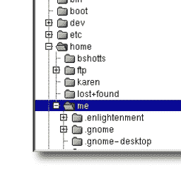
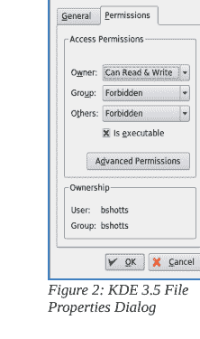
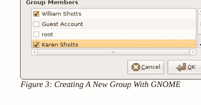
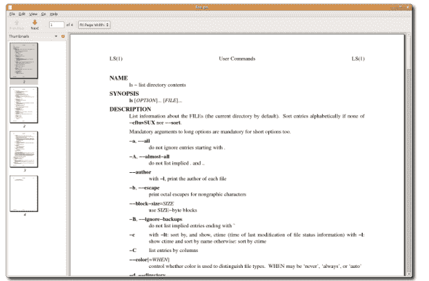
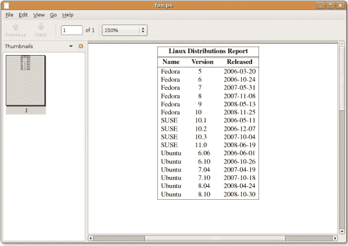

# Linux 命令行

本书是 LinuxCommand.org 项目的一部分，该项目是一个致力于 Linux 教育和推广的网站，旨在帮助传统操作系统的用户迈向未来。您可以通过 `http://linuxcommand.org` 联系 LinuxCommand.org 项目。

本书的印刷版（大号、易读格式）可从 `lulu.com` 购买。订单可通过以下地址下单：

`http://www.lulu.com/content/paperback-book/the-linux-command-line/7594184`

## 发布历史

| 版本 | 日期 | 描述 |
|---|---|---|
| 09.12 | 2009年12月14日 | 第一版。 |
| 09.11 | 2009年11月19日 | 第四稿，已纳入几乎所有审阅者的反馈，并编辑至第37章。 |
| 09.10 | 2009年10月3日 | 第三稿，修订了表格格式，部分采纳了审阅者的反馈，并编辑至第18章。 |
| 09.08 | 2009年8月12日 | 第二稿，纳入了第一轮编辑的成果。 |
| 09.07 | 2009年7月18日 | 完成初稿。 |

- 有史以来最残酷的手册页 53
- README 及其他程序文档文件 55
- 重温老朋友 58
- 标准输入、输出和错误 59
- 重定向标准错误 61
- 处理不需要的输出 63
- 重定向标准输入 63
- 管道 65
- `uniq` – 报告或省略重复行 66
- `grep` – 打印匹配模式的行 67
- `tee` – 从标准输入读取并输出到标准输出和文件 69
- Linux 关乎想象力 70
- 展开 72
- 隐藏文件的路径名展开 74
- 算术展开 75
- 参数展开 77
- 引号 79
- 单引号 81
- 反斜杠转义序列 82
- 进一步阅读 83
- 命令行编辑 84
- 修改文本 85
- Meta 键 86
- 应该修改哪些文件？........................................................................134
- 使用文本编辑器........................................................................135
- 激活我们的更改........................................................................139
- 进一步阅读........................................................................139
- 为什么我们应该学习 vi........................................................................140
- 启动和停止 vi........................................................................141
- 编辑模式........................................................................143
- 保存我们的工作........................................................................144
- 基本编辑........................................................................146
- 打开一行........................................................................147
- 剪切、复制和粘贴文本........................................................................149
- 搜索和替换........................................................................151
- 搜索整个文件........................................................................151
- 编辑多个文件........................................................................154
- 打开其他文件进行编辑........................................................................155
- 将整个文件插入到另一个文件中........................................................................157
- 进一步阅读........................................................................159
- 提示的构成........................................................................160
- 添加颜色........................................................................163
- 移动光标........................................................................166
- 小结........................................................................167

### How A Package System Works................................................................................................................171
- Repositories................................................................................................................171
- High And Low-level Package Tools................................................................................................................172
- Finding A Package In A Repository................................................................................................................173
- Installing A Package From A Package File................................................................................................................174
- Updating Packages From A Repository................................................................................................................175
- Listing Installed Packages................................................................................................................176
- Displaying Info About An Installed Package................................................................................................................177

### Summing Up................................................................................................................177


### Further Reading................................................................................................................179

### Mounting And Unmounting Storage Devices................................................................................................................180

- Why Unmounting Is Important................................................................................................................185

### Creating New File Systems................................................................................................................189

- Creating A New File System With `mkfs`................................................................................................................192

- What The `fsck`?................................................................................................................193

### Moving Data Directly To/From Devices................................................................................................................194

- Creating An Image Copy Of A CD-ROM................................................................................................................195

- A Program By Any Other Name................................................................................................................196

- Mounting An ISO Image Directly................................................................................................................196

- Writing An Image................................................................................................................197

### Extra Credit................................................................................................................197

### Examining And Monitoring A Network................................................................................................................200

- `traceroute`................................................................................................................201

### Transporting Files Over A Network................................................................................................................203

- `locate` – 轻松查找文件 213

- `find` – 困难的方式查找文件 215

- 运算符 218

- 用户自定义操作 223

- `xargs` 224

- 重返游乐场 226

- 进一步阅读 229

- 压缩文件 230

- `bzip2` 233

- 归档文件 234

- `zip` 240

- 通过网络使用 `rsync` 245

- 什么是正则表达式？ 247

- 元字符与字面量 249

- 锚点 251

- 括号表达式与字符类 252

- 传统字符范围 253

- 恢复到传统排序顺序 257

- POSIX 258

- 量词 260

- * - 匹配元素零次或多次 261

- {} - 匹配元素特定次数 262

- 使用 `grep` 验证电话号码列表 263

- 使用 `locate` 搜索文件 265

- 小结 267

`ftp` 204

`lftp` – 更好的 `ftp` 206

`wget` 206

与远程主机安全通信 206

`ssh` 207

使用 SSH 进行隧道传输 210

`scp` 和 `sftp` 211

Windows 的 SSH 客户端？ 212

进一步阅读 212

## 21 – 文本处理 268

- 文本的应用 268

- 文档 269

- 网页 269

- 电子邮件 269

- 打印机输出 269

- 程序源代码 269

- 重温老朋友 270

- `cat` 270

- MS-DOS 文本与 Unix 文本 271

- `sort` 271

- `uniq` 279

- 切分与处理 280

- `cut` 280

- 扩展制表符 283

- `paste` 284

- `join` 285

- 比较文本 287

- `comm` 288

- `diff` 288

- `patch` 291

- 即时编辑 292

- `tr` 292

- ROT13：并非如此神秘的解码环 294

- `sed` 295

- 喜欢 `sed` 的人也喜欢 303

- `aspell` 303

- 小结 307

- 进一步阅读 307

- 额外学分 308

## 22 – 格式化输出 309

- 简单的格式化工具 309

- `nl` – 给行编号 309

- `fold` – 将每行换行到指定长度 313

- `fmt` – 简单文本格式化器...................................................313

- `pr` – 格式化文本以便打印....................................................317

- `printf` – 格式化并打印数据...................................................318

- 文档格式化系统......................................................321

- `groff`...........................................................................322

- 总结....................................................................328

- 进一步阅读...............................................................328

## 23 – 打印...................................................................330

- 印刷简史......................................................330

- 印刷的黑暗时代.......................................................330

- 基于字符的打印机........................................................331


### 图形打印机 332
### 使用 Linux 打印 333
### 准备打印文件 333
### pr – 将文本文件转换为打印格式 333
### 将打印作业发送到打印机 335
### lpr – 打印文件（伯克利风格） 335
### lp – 打印文件（System V 风格） 336
### 另一个选项：a2ps 337
### 监控和控制打印作业 340
### lpstat – 显示打印系统状态 340
### lpq – 显示打印机队列状态 341
### lprm / cancel – 取消打印作业 342
### 总结 342
### 进一步阅读 342

## 24 – 编译程序 344
### 什么是编译？ 344
### 所有程序都编译吗？ 345
### 编译 C 程序 346
### 获取源代码 346
### 检查源代码树 348
### 构建程序 350
### 安装程序 354
### 总结 354
### 进一步阅读 355

## 第 5 部分 – 编写 Shell 脚本 357

## 25 – 编写你的第一个脚本 358
### 什么是 Shell 脚本？ 358
### 如何编写 Shell 脚本 358
### 脚本文件格式 359
### 可执行权限 360
### 脚本文件位置 360
### 脚本的良好位置 362
### 更多格式化技巧 362
### 长选项名称 362
### 缩进和行 continuation 362
### 为脚本编写配置 vim 363
### 总结 364
### 进一步阅读 364

## 26 – 开始一个项目 365
### 第一阶段：最小文档 365
### 第二阶段：添加少量数据 367
### 变量和常量 368
### 为变量和常量赋值 371
### Here 文档 372
### 总结 375
### 进一步阅读 375

## 27 – 自顶向下设计 376
### Shell 函数 377
### 局部变量 380
### 保持脚本运行 381
### 在你的 .bashrc 文件中使用 Shell 函数 384
### 总结 384


- 进一步阅读…384

## 28 – 流程控制：使用 `if` 分支…385

- `if`…385
- 退出状态…386
- `test`…388
  - 文件表达式…388
  - 字符串表达式…391
  - 整数表达式…392
- `test` 的更现代版本…393
- `(( ))` – 专为整数设计…395
- 组合表达式…396
- 可移植性是小人之心…398
- 控制运算符：另一种分支方式…399
- 总结…399
- 进一步阅读…400

## 29 – 读取键盘输入…401

- `read` – 从标准输入读取值…402
  - 选项…404
  - `IFS`…406
  - 你不能管道 `read`…407
- 验证输入…408
- 菜单…409
- 总结…411
- 额外学分…411
- 进一步阅读…411

## 30 – 流程控制：使用 `while` / `until` 循环…412

- 循环…412
- `while`…412
  - 跳出循环…415
- `until`…416
- 使用循环读取文件…417
- 总结…418
- 进一步阅读…418

## 31 – 故障排除

- 语法错误…419
- 缺少引号…420
- 缺少或意外的标记…420
- 意外的展开…421
- 逻辑错误…423
- 防御性编程…423
  - 验证输入…425
  - 设计是时间的函数…425
- 测试…425
  - 测试用例…426
- 调试…427
  - 找到问题区域…427
  - 跟踪…427
  - 在执行期间检查值…430
- 总结…430
- 进一步阅读…431

## 32 – 流程控制：使用 `case` 分支

- `case`…432
  - 模式…434
- 总结…436
- 进一步阅读…436

## 33 – 位置参数

- 访问命令行…437
  - 确定参数数量…438
- `shift` – 获取对多个参数的访问…439
- 简单应用…440
- 使用 Shell 函数的位置参数…441
- 批量处理位置参数…442
- 更完整的应用程序…444


总结.................................................447

进一步阅读............................................450

### 34 – 流程控制：使用 for 循环

for：传统 Shell 形式...............................451

为什么是 i？.....................................................453

for：C 语言形式.......................................454

总结.................................................455

进一步阅读............................................456

## 35 – 字符串和数字....................................................................457

参数扩展........................................................................457

基本参数...........................................................................457

管理空变量的扩展.......................................................458

返回变量名的扩展.......................................................460

字符串操作..........................................................................460

算术求值和扩展...........................................................463

数字进制..............................................................................464

一元运算符..........................................................................464

简单算术........................................................................464

赋值...............................................................................466

位操作...........................................................................468

逻辑....................................................................................469

bc – 一种任意精度计算器语言..............................................472

使用 bc...............................................................................473

示例脚本.......................................................................473

总结.............................................................................475

额外学分............................................................................475

进一步阅读.........................................................................475

## 36 – 数组...............................................................................476

什么是数组？.........................................................................476

创建数组........................................................................476

为数组赋值...............................................................477

访问数组元素...............................................................478

数组操作........................................................................480

输出数组的全部内容...............................................480

确定数组元素数量...............................................480

## 37 – 奇技淫巧...............................................................................485

命令组和子 shell..............................................................485

进程替换....................................................................486

陷阱...................................................................................488

临时文件........................................................................491

异步执行...............................................................492

索引......................................................................................496

## Part 1 – Introduction

### 1 – Introduction

我想告诉你一个故事。

不，不是讲1991年林纳斯·托瓦兹编写Linux内核第一个版本的故事。你可以在很多Linux书里读到那个故事。我也不会讲若干年前理查德·斯托曼发起GNU项目以创建自由的类Unix操作系统的故事。那也是一个重要的故事，但大多数其他Linux书也都有这个故事。

不，我想告诉你的，是你如何重新夺回对自己电脑控制权的故事。

我在上世纪70年代末作为大学生开始使用电脑时，正值一场革命。微处理器的发明让像你我这样的普通人真正拥有了一台电脑。对今天很多人来说，很难想象在只有大企业和大政府掌控所有电脑的那个世界是什么样的。简单说，你几乎什么也做不成。

今天，世界已大不相同。电脑无处不在，从微小的手表到庞大的数据中心，无所不包。除了无处不在的电脑，我们还有一个无处不在的网络将它们连接起来。这创造了一个奇妙的全新个人赋权和创作自由时代，但过去几十年里还发生着另一件事。一家庞大的巨型公司对世界上大多数电脑施加了控制，决定你能对它们做什么、不能做什么。幸运的是，来自世界各地的人们正在为此做些什么。他们通过编写自己的软件来努力维持对电脑的控制。他们正在构建Linux。

很多人谈论Linux的“自由”，但我认为大多数人并不真正知道这种自由意味着什么。自由就是决定你的电脑做什么的权力，而拥有这种自由的唯一方式就是知道你的电脑在做什么。自由是一台没有秘密的电脑，只要你愿意去了解，一切都可以被知晓。

#### Why Use The Command Line?

你有没有注意到在电影里，当“超级黑客”——你知道，就是那个能在三十秒内黑进超安全军事电脑的家伙——坐到电脑前时，他从不碰鼠标？这是因为电影制作人意识到我们人类本能地知道，要在电脑上真正做成事情，唯一的方法就是敲键盘。


今天大多数电脑用户只熟悉图形用户界面 `GUI`，并且被厂商和评论家教导说命令行界面 `CLI` 是令人恐惧的过去式。这很遗憾，因为一个好的命令行界面是与电脑交流的一种极富表现力的方式，就像书面文字之于人类一样。有人说过“图形用户界面让简单任务变得简单，而命令行界面让困难任务成为可能”，这在今天依然非常正确。

由于 `Linux`

# Part 1 – Introduction

## 1 – Introduction

我想告诉你一个故事。

不，不是讲1991年林纳斯·托瓦兹编写 `Linux` 内核第一个版本的故事。你可以在很多 `Linux` 书里读到那个故事。我也不会讲若干年前理查德·斯托曼发起 `GNU` 项目以创建自由的类 `Unix` 操作系统的故事。那也是一个重要的故事，但大多数其他 `Linux` 书也都有这个故事。

不，我想告诉你的，是你如何重新夺回对自己电脑控制权的故事。

我在上世纪70年代末作为大学生开始使用电脑时，正值一场革命。微处理器的发明让像你我这样的普通人真正拥有了一台电脑。对今天很多人来说，很难想象在只有大企业和大政府掌控所有电脑的那个世界是什么样的。简单说，你几乎什么也做不成。

今天，世界已大不相同。电脑无处不在，从微小的手表到庞大的数据中心，无所不包。除了无处不在的电脑，我们还有一个无处不在的网络将它们连接起来。这创造了一个奇妙的全新个人赋权和创作自由时代，但过去几十年里还发生着另一件事。一家庞大的巨型公司对世界上大多数电脑施加了控制，决定你能对它们做什么、不能做什么。幸运的是，来自世界各地的人们正在为此做些什么。他们通过编写自己的软件来努力维持对电脑的控制。他们正在构建 `Linux`。

很多人谈论“自由”与 `Linux` 有关，但我认为大多数人并不真正知道这种自由意味着什么。自由是你决定电脑做什么的权力，而拥有这种自由的唯一方式就是知道你的电脑在做什么。自由是一台没有秘密的电脑，只要你愿意去了解，一切都可以被知晓。

### Why Use The Command Line?

你有没有注意到在电影里，当“超级黑客”——你知道，就是那个能在三十秒内黑进超安全军事电脑的家伙——坐到电脑前时，他从不碰鼠标？这是因为电影制作人意识到我们人类本能地知道，要在电脑上真正做成事情，唯一的方法就是敲键盘。

今天大多数电脑用户只熟悉图形用户界面 `GUI`，并且被厂商和评论家教导说命令行界面 `CLI` 是令人恐惧的过去式。这很遗憾，因为一个好的命令行界面是与电脑交流的一种极富表现力的方式，就像书面文字之于人类一样。有人说过“图形用户界面让简单任务变得简单，而命令行界面让困难任务成为可能”，这在今天依然非常正确。

由于 `Linux` 是基于 `Unix` 家族的操作系统，它继承了 `Unix` 同样的丰富命令行工具传统。`Unix` 在20世纪80年代初崭露头角（尽管早十年就已开发），在图形用户界面广泛普及之前，因此发展出了庞大的命令行界面。事实上，早期 `Linux` 采用者选择它而不是比如 `Windows NT` 的最强理由之一，就是强大的命令行界面让“困难任务成为可能”。

### What This Book Is About

本书是对 `Linux` 命令行“生活”的一种广泛概述。与只集中于单一程序、比如 shell 程序 `bash` 的某些书籍不同，本书将尝试传达如何在更广义上与命令行界面相处。它是如何工作的？它能做什么？最好的使用方式是什么？

这不是一本关于 `Linux` 系统管理的书。虽然任何严肃的命令行讨论不可避免地会涉及系统管理主题，但本书只触及了几个管理问题。它将为读者做好进一步学习的准备，通过提供命令行使用的坚实基础，而命令行是任何严肃系统管理任务必不可少的工具。

本书非常以 `Linux` 为中心。许多其他书籍试图通过加入其他平台如通用 `Unix` 和 `MacOS X` 来扩大吸引力，在此过程中，它们“稀释”了内容，只保留通用主题。相比之下，本书只涵盖当代 `Linux` 发行版。95%的内容对其他类 `Unix` 系统的用户也有用，但本书高度针对现代 `Linux` 命令行用户。

### Who Should Read This Book

本书面向从其他平台迁移过来的新 `Linux` 用户。你很可能是一个微软 `Windows` 某个版本的“高级用户”。也许你的老板告诉你要管理一台 `Linux` 服务器，或者也许你只是一个桌面用户，厌倦了所有安全问题并想尝试 `Linux`。没问题。这里欢迎所有人。

话虽如此，通往 `Linux` 顿悟之路并没有捷径。学习命令行具有挑战性，需要真正的努力。并不是说它很难，而是它太庞大了。平均的 `Linux` 系统在命令行上 literally 有数千个程序可供使用。请自行注意；学习命令行不是一件随意的尝试。

另一方面，学习 `Linux` 命令行极其有回报。如果你现在认为自己是“高级用户”，那就再等等。你还不知道什么是真正的力量——现在还不知道。而且，与许多其他计算机技能不同，命令行知识经久不衰。今天学到的技能十年后仍然有用。命令行经受住了时间的考验。

同时也假设你没有任何编程经验，但不用担心，我们也会引导你走上这条道路。

### 本书内容

本材料以精心选择的顺序呈现，就像一位导师坐在你旁边引导你一样。许多作者以“系统化”的方式处理这些材料，这从作者的角度看是有道理的，但对新用户来说可能非常令人困惑。

另一个目标是让你熟悉 `Unix` 式的思维方式，这与 `Windows` 式的思维方式不同。在此过程中，我们会进行几次小小的偏离，帮助你理解某些事物为何以这种方式工作以及它们是如何演变而来的。`Linux` 不仅仅是一块软件，它也是更大 `Unix` 文化的一部分，`Unix` 文化有自己的语言和历史。我可能会偶尔发点牢骚。

本书分为五部分，每部分涵盖命令行体验的某个方面。除了你现在正在阅读的第一部分外，本书还包含：

- **第 2 部分 – 学习 Shell** 开始我们对命令行基本语言的探索，包括命令的结构、文件系统导航、命令行编辑，以及如何为命令查找帮助和文档等内容。
- **第 3 部分 – 配置与环境** 涵盖从命令行编辑控制计算机操作的配置文件。
- **第 4 部分 – 常见任务与必备工具** 探索从命令行执行的许多普通任务。类 `Unix` 操作系统，如 `Linux`，包含许多用于对数据执行强大操作的“经典”命令行程序。
- **第 5 部分 – 编写 Shell 脚本** 介绍 shell 编程，这是一种公认的基础但易于学习的用于自动化许多常见计算任务的技术。通过学习 shell 编程，你将熟悉可应用于许多其他编程语言的概念。

### 如何阅读本书

从本书开头开始阅读并一直读到结尾。它不是写成参考书，更像是一个有开头、中间和结尾的故事。

### 先决条件

要使用本书，你只需要一个可用的 `Linux` 安装。你可以通过以下两种方式获得：

1. **在（不太新的）计算机上安装 Linux。** 你选择的发行版并不重要，不过大多数人今天从 `Ubuntu`、`Fedora` 或 `OpenSUSE` 开始。如果拿不准，先试试 `Ubuntu`。安装现代 `Linux` 发行版可能非常简单，也可能非常困难，这取决于你的硬件。我建议使用一台几年前生产的台式机，至少有 256 兆字节的 `RAM` 和 6 千兆字节的可用硬盘空间。尽可能避免使用笔记本电脑和无线网络，因为这些通常更难配置。
2. **使用“Live CD”。** 使用许多 `Linux` 发行版可以做的一件很酷的事情是直接从 `CDROM` 运行它们，而完全不安装。只需进入你的 `BIOS` 设置并将计算机设置为“从 `CDROM` 启动”，插入 live `CD`，然后重新启动。使用 live `CD` 是在安装前测试计算机 `Linux` 兼容性的好方法。使用 live `CD` 的缺点是它可能比将 `Linux` 安装在硬盘上要慢得多。`Ubuntu` 和 `Fedora`（以及其他发行版）都有 live `CD` 版本。

无论你如何安装 `Linux`，你都需要偶尔拥有超级用户（即管理员）权限来完成本书中的练习。

在你拥有可用的安装后，开始阅读并在自己的计算机上跟随操作。本书的大部分内容都是“动手”的，所以坐下来开始打字吧！

### 我为什么不称之为“GNU/Linux”

在某些圈子里，政治上正确的做法是将 `Linux` 操作系统称为“`GNU/Linux` 操作系统”。“`Linux`”的问题在于没有完全正确的方式来命名它，因为它是许多不同的人编写的在庞大而分散的开发工作中，人们共同努力。严格来说，`Linux` 是操作系统的内核的名称，仅此而已。内核当然非常重要，因为它让操作系统运行起来，但它不足以构成一个完整的操作系统。

于是理查德·斯托曼登场了，这位天才哲学家创立了自由软件运动，发起自由软件基金会，组建了 `GNU` 项目，编写了 `GNU C` 编译器（`gcc`）的第一个版本，创建了 `GNU` 通用公共许可证（`GPL`），等等，等等，等等。他坚持你应该称之为“`GNU/Linux`”，以正确反映 `GNU` 项目的贡献。虽然 `GNU` 项目早于 `Linux` 内核，并且该项目的贡献极其值得认可，但在名称中体现它们对其他所有做出重大贡献的人是不公平的。此外，我认为“`Linux/GNU`”在技术上会更准确，因为内核先启动，其它一切都在其之上运行。


在流行用法中，“Linux”指的是内核以及典型的 Linux 发行版中发现的所有其他自由和开源软件；也就是说，整个 Linux 生态系统，而不仅仅是 GNU 组件。操作系统市场似乎更偏爱诸如 DOS、Windows、MacOS、Solaris、Irix、AIX 之类的一词名称。我选择使用这种流行格式。如果你更喜欢使用“GNU/Linux”，请在阅读本书时在脑海中进行搜索和替换。我不会介意的。

### 致谢

我想感谢以下帮助使本书成为可能的人：

Jenny Watson，Wiley Publishing 的收购编辑，最初建议我写一本 shell 脚本书籍。

John C. Dvorak，著名专栏作家和评论家。在他的视频播客《Cranky Geeks》的一集中，Dvorak 先生描述了写作过程：“地狱。每天写 200 字，一年后，你就有一部小说了。”这条建议促使我每天写一页，直到写成一本书。

Dmitri Popov 在《Free Software Magazine》上撰写了一篇题为“使用 Writer 创建书籍模板”的文章，这启发我使用 OpenOffice.org Writer 来撰写文本。事实证明，它效果非常好。

Mark Polesky 对文本进行了非凡的审阅和测试。

Jesse Becker、Tomasz Chrzczonowicz、Michael Levin、Spence Miner 也测试并审阅了文本的部分内容。

Karen M. Shotts 贡献了大量时间，通过编辑文本来润色我所谓的英语。

最后，LinuxCommand.org 的读者们，他们给我发送了许多友好的电子邮件。他们的鼓励给了我一个想法，让我觉得我真的在做一件有意义的事情！

### 需要您的反馈！

本书是一个持续进行的项目，就像许多开源软件项目一样。如果你发现技术错误，请发邮件给我：

bshotts@users.sourceforge.net

你的更改和建议可能会进入未来的版本。

### 进一步阅读

- 这里有一些本章提到的著名人物的维基百科文章：

  - http://en.wikipedia.org/wiki/Linux_Torvalds

  - http://en.wikipedia.org/wiki/Richard_Stallman

- 自由软件基金会和 GNU 项目：

  - http://en.wikipedia.org/wiki/Free_Software_Foundation

  - http://www.fsf.org

  - http://www.gnu.org

- Richard Stallman extensively 撰写了关于“GNU/Linux”命名问题的文章：

  - http://www.gnu.org/gnu/why-gnu-linux.html

  - http://www.gnu.org/gnu/gnu-linux-faq.html#tools

### 序言

本书使用 OpenOffice.org Writer 在 Liberation Serif 和 Sans 字体上，于出厂配置为 Ubuntu 8.04 的 Dell Inspiron 530N 上编写。文本的 PDF 版本直接由 OpenOffice.org Writer 生成。封面使用 Inkscape 制作。封面设计由 William E. Shotts, Jr. 完成。作者封面照片由 Karen M. Shotts 拍摄。

# 第 2 部分 – 学习 Shell

## 2 – 什么是 Shell？

当我们谈论命令行时，我们实际上指的是 `shell`。`Shell` 是一个程序，它接收键盘命令并将其传递给操作系统执行。几乎所有 Linux 发行版都提供来自 GNU 项目的 shell 程序 `bash`。名称“bash”是“Bourne Again SHell”的缩写，指的是 `bash` 是对 `sh` 的增强替代品，而 `sh` 是由 Steve Bourne 编写的原始 Unix shell 程序。

### 终端模拟器

在使用图形用户界面时，我们需要另一个名为 `terminal emulator` 的程序来与 shell 交互。如果我们查看桌面菜单，我们很可能会找到一个。KDE 使用 `konsole`，GNOME 使用 `gnome-terminal`，尽管在我们的菜单上它可能简单地称为“terminal”。Linux 上有许多其他终端模拟器可用，但它们基本上都做同样的事情；让我们访问 shell。你可能会根据它拥有的铃铛和哨声数量而偏爱其中一个或另一个。

### 你的第一次按键

那么让我们开始吧。启动终端模拟器！一旦它启动，我们应该会看到类似这样的内容：

```
[me@linuxbox ~]$
```

这被称为 `shell prompt`，每当 shell 准备接受输入时就会出现。虽然它在外观上可能因发行版而略有不同，但它通常会包括你的 `username@machinename`，后面跟着当前工作目录（稍后会详细介绍）和一个美元符号。

如果提示符的最后一个字符是井号（“#”）而不是美元符号，则终端会话具有 `superuser` 权限。这意味着我们要么以 root 用户身份登录，要么我们选择了一个提供 `superuser`（管理）特权。

假设到目前为止一切顺利，让我们试着输入一些内容。在提示符下输入一些无意义的字符，如下所示：

```
[me@linuxbox ~]$ kaekfjaeifj
```

由于该命令毫无意义，shell 会告诉我们，并给我们另一个机会：

```
bash: kaekfjaeifj: command not found
[me@linuxbox ~]$
```

### 命令历史

如果我们按下上箭头键，会看到之前的命令 “kaekfjaeifj” 在提示符后重新出现。这就是命令历史。大多数 Linux 发行版默认会记住最近的五百条命令。按下下箭头键，之前的命令就会消失。

### 光标移动

再次使用上箭头键调出之前的命令。现在试试左右箭头键。看看我们能否将光标定位在命令行上的任意位置？这使得编辑命令变得很容易。

### 关于鼠标和焦点的一些话

虽然 shell 主要是关于键盘的，但你也可以在终端模拟器中使用鼠标。X Window 系统（使 GUI 运行的底层引擎）内置了一种机制，支持快速的复制和粘贴技术。如果你按住鼠标左键并将鼠标拖过文本进行高亮（或双击一个词），它就会被复制到 X 维护的一个缓冲区中。按下鼠标中键会将文本粘贴到光标位置。试试看。

注意：不要试图在终端窗口中使用 `Ctrl - c` 和 `Ctrl - v` 来执行复制和粘贴。它们不起作用。这些控制代码对 shell 有不同的含义，并且是在微软 Windows 出现多年之前就被分配的。

你的图形桌面环境（很可能是 KDE 或 GNOME），为了像 Windows 一样行为，可能将焦点策略设置为“单击聚焦”。这意味着要使一个窗口获得焦点（变为活动状态），你需要单击它。这与传统的 X 行为“焦点跟随鼠标”相反，后者意味着只要将鼠标移过窗口，窗口就会获得焦点。窗口不会在你单击之前进入前台，但它能够接收输入。将焦点策略设置为“焦点跟随鼠标”会使复制和粘贴技术更加有用。试试看。我认为如果你给它一个机会，你会更喜欢它。你可以在窗口管理器的配置程序中找到此设置。

### 试试一些简单命令

现在我们已经学会了输入，让我们试试几个简单命令。第一个是 `date`。该命令显示当前时间和日期。

```
[me@linuxbox ~]$ date
Thu Oct 25 13:51:54 EDT 2007
```

一个相关的命令是 `cal`，默认情况下它会显示当前月份的日历。

```
[me@linuxbox ~]$ cal
    October 2007
Su Mo Tu We Th Fr Sa
      1  2  3  4  5  6
 7  8  9 10 11 12 13
14 15 16 17 18 19 20
21 22 23 24 25 26 27
28 29 30 31
```

要查看磁盘驱动器上当前剩余多少空间，输入 `df`：

```
[me@linuxbox ~]$ df
Filesystem     1K-blocks    Used Available Use% Mounted on
/dev/sda2      15115452  5012392   9949716  34% /
/dev/sda5       59631908 26545424  30008432  47% /home
/dev/sda1        147764    17370    122765  13% /boot
tmpfs            256856        0    256856   0% /dev/shm
```

同样，要显示可用内存量，输入 `free` 命令。


```
[me@linuxbox ~]$ free
              total       used       free     shared    buffers     cached
Mem:        513712     503976      9736          0       5312     122916
-/+ buffers/cache:     375748     137964
Swap:      1052248     104712     947536
```

#### 结束终端会话

我们可以通过关闭终端模拟器窗口，或在 shell 提示符下输入`exit`命令来结束终端会话：

```
[me@linuxbox ~]$ exit
```

#### 幕后的控制台

即使我们没有运行终端模拟器，仍有多个终端会话在图形桌面后面持续运行。称为虚拟终端或虚拟控制台，这些会话可以在大多数 Linux 发行版上通过按 Ctrl-Alt-F1 到 Ctrl-Alt-F6 访问。大多数系统上，当会话被访问时，它会显示登录提示，我们可以在其中输入用户名和密码。要从一个虚拟控制台切换到另一个，按 Alt 和 F1-F6。要返回图形桌面，按 Alt-F7。

#### 进一步阅读

- 要了解更多关于 Bourne Shell 之父 Steve Bourne 的信息，请参阅这篇维基百科文章：

  http://en.wikipedia.org/wiki/Steve_Bourne

- 这里有一篇关于计算中 shell 概念的文章：

  http://en.wikipedia.org/wiki/Shell_(computing)

### 3 – 导航

我们需要学习的第一件事（除了打字之外）是如何在 Linux 系统上导航文件系统。在本章中，我们将介绍以下命令：

- `pwd` - 打印当前工作目录的名称

- `cd` - 更改目录

- `ls` - 列出目录内容

#### 理解文件系统树

与 Windows 类似，类 Unix 操作系统如 Linux 将其文件组织在称为分层目录结构的结构中。这意味着它们以树状的目录模式（在其他系统中有时称为文件夹）组织，这些目录可能包含文件和其他目录。文件系统中的第一个目录称为根目录。根目录包含文件和子目录，这些子目录又包含更多文件和子目录，依此类推。

请注意，与 Windows 不同，Windows 为每个存储设备都有单独的文件系统树，而类 Unix 系统如 Linux 无论连接到计算机的驱动器或存储设备有多少，始终只有一个文件系统树。存储设备被附加（更准确地说，是挂载）在树上的各个点上，这取决于系统管理员的喜好，系统管理员是负责系统维护的人员（或人员）。

#### 当前工作目录

我们大多数人可能都熟悉图形文件管理器，它将文件系统树表示为图 1 所示。请注意，树通常是倒置显示的，即根在顶部，各个分支向下延伸。

然而，命令行没有图片，因此为了导航文件系统树，我们需要以不同的方式思考它。

想象文件系统是一个倒置的树形迷宫，我们能够



图 1：图形文件管理器显示的文件系统树

站在其中。任何时候，我们都位于单个目录内，我们可以看到该目录中包含的文件、通往我们上方目录（称为父目录）的路径以及我们下方的任何子目录。我们所站的目录称为当前工作目录。要显示当前工作目录，我们使用`pwd`（打印工作目录）命令。

```
[me@linuxbox ~]$ pwd
/home/me
```

当我们首次登录系统（或启动终端模拟器会话）时，我们的当前工作目录被设置为我们的主目录。每个用户账户都有自己的主目录，并且在以普通用户身份操作时，主目录是用户唯一允许写入文件的地点。

#### 列出目录的内容

要列出当前工作目录中的文件和目录，我们使用`ls`命令。

```
[me@linuxbox ~]$ ls
Desktop  Documents  Music  Pictures  Public  Templates  Videos
```

`/usr/bin` 再次：

```
[me@linuxbox ~]$ cd /usr/bin
[me@linuxbox bin]$ pwd
/usr/bin
```

好的，现在假设我们想要将工作目录更改为`/usr/bin`的父目录，即`/usr`。我们可以用两种不同的方法做到这一点。或者使用绝对路径名：

```
[me@linuxbox bin]$ cd /usr
[me@linuxbox usr]$ pwd
/usr
```

或者，使用相对路径名：

```
[me@linuxbox bin]$ cd ..
[me@linuxbox usr]$ pwd
/usr
```

两种不同的方法，结果相同。我们应该使用哪一种？使用打字最少的那一种！

同样，我们也可以以两种不同的方式将工作目录从`/usr`更改为`/usr/bin`。或者使用绝对路径名：

```
[me@linuxbox usr]$ cd /usr/bin
[me@linuxbox bin]$ pwd
/usr/bin
```

或者，使用相对路径名：

```
[me@linuxbox usr]$ cd ./bin
[me@linuxbox bin]$ pwd
/usr/bin
```

现在，有一件重要的事情我必须在这里指出。在几乎所有情况下，你都可以省略`./`。它是隐含的。输入：

```
[me@linuxbox usr]$ cd bin
```

会做同样的事情。一般来说，如果你没有指定某物的路径名，则会假定为工作目录。

#### 有用的快捷方式

在表 3-1 中，我们看到一些可以快速更改当前工作目录的有用方法。

表 3-1：`cd` 快捷方式

| 快捷方式 | 结果 |
|---|---|
| `cd` | 将工作目录更改为你的主目录。 |
| `cd -` | 将工作目录更改为上一个工作目录。 |
| `cd ~user_name` | 将工作目录更改为`user_name`的主目录。例如，`cd ~bob`将目录更改为用户“bob”的主目录。 |

#### 关于文件名的一些重要事实

- 1. 以句点字符开头的`filename`是隐藏的。这仅意味着`ls`不会列出它们，除非你使用`ls -a`。当你的账户创建时，几个隐藏文件被放置在你的主目录中以配置你的账户设置。稍后我们将更仔细地查看其中一些文件，以了解如何自定义你的环境。此外，一些应用程序会将其配置和设置文件作为隐藏文件放置在你的主目录中。

- 2. Linux 中的文件名和命令，像 Unix 一样，是区分大小写的。文件名`File1`和`file1`指的是不同的文件。

- 3. Linux 没有像某些其他操作系统那样的“文件扩展名”概念。你可以随意命名文件。文件的内容/用途通过其他方式确定。尽管类 Unix 操作系统不使用文件扩展名来确定文件的内容/用途，但某些应用程序确实会使用扩展名。

- 4. 虽然 Linux 支持包含嵌入空格和标点字符的长文件名，但请将你所创建文件名中的标点字符限制为句点、短划线和下划线。*最重要的是，不要在文件名中嵌入空格。* 如果你想在文件名中表示单词之间的空格，请使用下划线字符。以后你会感谢自己的。

### 4 – 探索系统

现在我们知道了如何在文件系统中移动，是时候对 Linux 系统进行一番导览了。不过，在开始之前，我们还要学习一些沿途有用的命令：

- `ls` – 列出目录内容

- `file` – 确定文件类型

- `less` – 查看文件内容

#### 更有趣的 ls 操作

`ls`命令可能是最常用的命令，而且理由充分。借助它，我们可以查看目录内容，并确定各种重要的文件和目录属性。正如我们所见，只需输入`ls`就能看到当前工作目录中包含的文件和子目录列表：

```
[me@linuxbox ~]$ ls
Desktop  Documents  Music  Pictures  Public  Templates  Videos
```

除了当前工作目录，我们还可以指定要列出的目录，如下所示：

```
[me@linuxbox ~]$ ls /usr
bin  games  kerberos  libexec  sbin  src
etc  include  lib  local  share  tmp
```

甚至可以指定多个目录。在本示例中，我们将同时列出用户的主目录（用“~”字符表示）和`/usr`目录：

```
[me@linuxbox ~]$ ls ~ /usr
/home/me:
```

```
Desktop  Documents  Music  Pictures  Public  Templates  Videos

/usr:
bin  games  kerberos  libexec  sbin  src
etc  include  lib  local  share  tmp
```

我们还可以更改输出格式以显示更多细节：


```
[me@linuxbox ~]$ ls -l
total 56
drwxrwxr-x 2 me me 4096 2007-10-26 17:20 Desktop
drwxrwxr-x 2 me me 4096 2007-10-26 17:20 Documents
drwxrwxr-x 2 me me 4096 2007-10-26 17:20 Music
drwxrwxr-x 2 me me 4096 2007-10-26 17:20 Pictures
drwxrwxr-x 2 me me 4096 2007-10-26 17:20 Public
drwxrwxr-x 2 me me 4096 2007-10-26 17:20 Templates
drwxrwxr-x 2 me me 4096 2007-10-26 17:20 Videos
```

通过向命令添加`-l`，我们将输出改为了长格式。

## 选项和参数

这引出了关于大多数命令工作方式的一个非常重要的要点。命令后面通常跟有一个或多个修改其行为的选项，此外还有一个或多个参数，即命令所操作的对象。因此大多数命令的形式如下：

```
command -options arguments
```

大多数命令使用的选项由单个字符组成，前面加一个短划线，例如`-l`。但许多命令（包括 GNU 项目的命令）也支持长选项，即由两个短划线开头的一个单词。此外，许多命令允许将多个短选项串在一起。在本示例中，`ls`命令使用了两个选项：`l`选项用于生成长格式输出，`t`选项用于按文件的修改时间对结果排序。

```
[me@linuxbox ~]$ ls -lt
```

我们再加上长选项`--reverse`来反转排序顺序：

```
[me@linuxbox ~]$ ls -lt --reverse
```

`ls`命令有大量可用的选项。最常见的选项列在表 4-1 中。

表 4-1：常见的`ls`选项

| 选项 | 长选项 | 描述 |
| --- | --- | --- |
| `-a` | `--all` | 列出所有文件，即使是以句点开头的文件（通常不会列出，即隐藏文件）也列出。 |
| `-d` | `--directory` | 通常，如果指定了目录，`ls`会列出目录的内容，而不是目录本身。将此选项与`-l`选项结合使用，可查看目录本身的详细信息，而不是其内容。 |
| `-F` | `--classify` | 此选项会在每个列出的名称末尾附加一个指示字符。例如，如果名称是目录，则附加“/”。 |
| `-h` | `--human-readable` | 在长格式列表中，以人类可读的格式显示文件大小，而不是以字节为单位。 |
| `-l` |  | 以长格式显示结果。 |
| `-r` | `--reverse` | 以相反顺序显示结果。通常，`ls`会按字母升序显示结果。 |
| `-S` |  | 按文件大小排序结果。 |
| `-t` |  | 按修改时间排序。 |

## 更深入地了解长格式

正如我们之前所见，`-l`选项使`ls`以长格式显示其结果。这种格式包含大量有用的信息。下面是一个 Ubuntu 系统中的 Examples 目录：

```
-rw-r--r-- 1 root root 3576296 2007-04-03 11:05 Experience ubuntu.ogg
-rw-r--r-- 1 root root 1186219 2007-04-03 11:05 kubuntu-leaflet.png
-rw-r--r-- 1 root root 47584 2007-04-03 11:05 logo-Edubuntu.png
-rw-r--r-- 1 root root 44355 2007-04-03 11:05 logo-Kubuntu.png
-rw-r--r-- 1 root root 34391 2007-04-03 11:05 logo-Ubuntu.png
-rw-r--r-- 1 root root 32059 2007-04-03 11:05 oo-cd-cover.odf
-rw-r--r-- 1 root root 159744 2007-04-03 11:05 oo-derivatives.doc
-rw-r--r-- 1 root root 27837 2007-04-03 11:05 oo-maxwell.odt
-rw-r--r-- 1 root root 98816 2007-04-03 11:05 oo-trig.xls
-rw-r--r-- 1 root root 453764 2007-04-03 11:05 oo-welcome.odt
-rw-r--r-- 1 root root 358374 2007-04-03 11:05 ubuntu Sax.ogg
```

让我们从其中一个文件中的不同字段着手，并检查它们的含义：

Table 4-2: `ls` Long Listing Fields

| Field | Meaning |
| --- | --- |
| `-rw-r--r--` | 文件的访问权限。第一个字符表示文件的类型。在不同类型中，以连字符开头表示普通文件，而`d`表示目录。接下来的三个字符是文件所有者的访问权限，之后的三个字符是文件所属组成员的访问权限，最后三个字符是其他所有人的访问权限。其完整含义在第10章 – 权限中讨论。 |
| 1 | 文件的硬链接数。参见本章后面关于链接的讨论。 |
| root | 文件所有者的用户名。 |
| root | 文件所属组的名称。 |
| 32059 | 文件的大小，以字节为单位。 |
| 2007-04-03 11:05 | 文件最后修改的日期和时间。 |
| `oo-cd-cover.odf` | 文件名。 |

## Determining A File's Type With `file`

随着我们探索系统，了解文件包含的内容将很有用。为此我们将使用`file`命令来确定文件的类型。正如我们之前讨论的，Linux 中文件名并不要求反映文件的内容。虽然像`picture.jpg`这样文件名通常预期包含 JPEG 压缩图像，但在 Linux 中并非必需。我们可以这样调用`file`命令：

```
file filename
```

调用时，`file`命令会打印出文件内容的简要描述。例如：

```
[me@linuxbox ~]$ file picture.jpg
picture.jpg: JPEG image data, JFIF standard 1.01
```

文件种类繁多。事实上，Linux 等类 Unix 操作系统中的一个常见观点是“一切皆文件”。随着我们继续学习，我们将看到这一说法有多么正确。

虽然系统上的许多文件都很熟悉，例如 MP3 和 JPEG，但也有许多种类不太明显，还有一些相当奇怪。

## Viewing File Contents With `less`

`less`命令是一个用于查看文本文件的程序。在整个 Linux 系统中，有许多文件包含人类可读的文本。`less`程序提供了一种方便的方式来检查它们。

### What Is “Text”?

在计算机上表示信息有许多方法。所有方法都涉及在信息与用于表示它的数字之间定义关系。毕竟，计算机只理解数字，所有数据都会被转换为数字表示。

其中一些表示系统非常复杂（如压缩视频文件），而另一些则相当简单。其中最早和最简单的一种称为 ASCII 文本。ASCII 发音为 "As-Key"，是 American Standard Code for Information Interchange 的缩写。这是一种简单的编码方案，最初在电传打字机上使用，用于将键盘字符映射到数字。

文本是字符到数字的简单一对一映射。它非常紧凑。五十个字符的文本转换为五十字节的数据。重要的是要理解，文本只包含字符到数字的简单映射。它与 Microsoft Word 或 OpenOffice.org Writer 创建的字处理文档不同。与简单的 ASCII 文本相比，这些文件包含许多非文本元素，用于描述其结构和格式。纯 ASCII 文本文件只包含字符本身和一些基本控制代码，如制表符、回车符和换行符。

在整个 Linux 系统中，许多文件以文本格式存储，并且有许多 Linux 工具可用于处理文本文件。即使 Windows 也认识到这种格式的重要性。众所周知的`NOTEPAD.EXE`程序就是一个纯 ASCII 文本文件编辑器。

为什么我们要检查文本文件？因为许多包含系统设置的文件（称为配置文件）以这种格式存储，能够读取它们可以让我们深入了解系统的工作方式。此外，系统使用的许多实际程序（称为脚本）也以这种格式存储。在后面的章节中，我们将学习如何编辑文本文件以修改系统设置和编写自己的脚本，但现在我们只查看其内容。

`less`命令的使用方式如下：

```
less filename
```

启动后，`less`程序允许你向前和向后滚动文本文件。例如，要检查定义系统中所有用户账户的文件，输入以下命令：

```
[me@linuxbox ~]$ less /etc/passwd
```

一旦`less`程序启动，我们就可以查看文件内容。如果文件长于一页，我们可以上下滚动。要退出`less`，请按`q`键。


下表列出了 `less` 最常用的键盘命令。

### Table 4-3: less Commands

| Command | Action |
|---|---|
| Page Up or b | 向后滚动一页 |
| Page Down or space | 向前滚动一页 |
| Up Arrow | 向上滚动一行 |
| 下箭头 | 向下滚动一行 |
| G | 移动到文本文件的末尾 |
| 1G 或 g | 移动到文本文件的开头 |
| /字符 | 向前搜索下一个出现的字符 |
| n | 搜索上一次搜索的下一个出现位置 |
| h | 显示帮助屏幕 |
| q | 退出 `less` |

## Less 越少越好

`less` 程序被设计为对早期 Unix 程序 `more` 的改进替代品。名称“`less`”是对短语“less is more”的戏仿——这是现代主义建筑师和设计师的座右铭。

`less` 属于一类称为“分页器”的程序，这类程序允许以分页方式轻松查看长文本文档。而 `more` 程序只能向前分页，`less` 程序则允许向前和向后分页，并且还有许多其他功能。

## 引导游览

你的 Linux 系统上的文件系统布局与其它类 Unix 系统上找到的布局非常相似。该设计实际上在名为 Linux 文件系统层次标准 的已发布标准中进行了规范。并非所有 Linux 发行版都完全符合该标准，但大多数都相当接近。

接下来，我们将自己在文件系统中漫游，看看我们的 Linux 系统是如何运行的。这将给你练习导航技能的机会。我们将发现的其中一件事是，许多有趣的文件都是纯人类可读的文本。在我们进行游览时，请尝试以下操作：

- 1. `cd` 进入给定目录
- 2. 使用 `ls -l` 列出目录内容
- 3. 如果看到有趣的文件，使用 `file` 确定其内容
- 4. 如果看起来像是文本，尝试使用 `less` 查看它

**记住复制和粘贴技巧！** 如果你使用鼠标，可以双击文件名来复制它，然后中键单击将其粘贴到命令中。

在我们漫游时，不要害怕查看东西。普通用户在很大程度上被禁止搞乱东西。那是系统管理员的工作！如果某个命令抱怨什么，只需继续做其他事情。花一些时间到处看看。系统是我们探索的。记住，在 Linux 中，没有秘密！

表 4-4 列出了我们在 Linux 系统上可以探索的几个目录。随意尝试更多！

### 表 4-4：Linux 系统上找到的目录

| 目录 | 注释 |
|---|---|
| `/` | 根目录。一切的开始。 |
| `/bin` | 包含系统启动和运行所必需的二进制文件（程序）。 |
| `/boot` | 包含 Linux 内核、初始 RAM 磁盘映像（启动时所需的驱动程序）以及引导加载程序。 |
|  | 有趣的文件： |
|  | - `/boot/grub/grub.conf` 或 `menu.lst`，用于配置引导加载程序。 |
|  | - `/boot/vmlinuz`，Linux 内核 |
| `/dev` | 这是一个特殊目录，其中包含 *设备节点*。“一切皆文件”也适用于设备。这里是内核维护其理解的所有设备列表的地方。 |
| `/etc` | `/etc` 目录包含所有系统范围的配置文件。它还包含在启动时启动每个系统服务的 shell 脚本集合。此目录中的所有内容都应为可读文本。 |
|  | 有趣的文件：虽然 `/etc` 中的所有内容都很有趣，但以下是我的最爱： |
|  | - `/etc/crontab`，定义自动化作业何时运行的文件。 |
|  | - `/etc/fstab`，存储设备及其相关挂载点的表。 |
|  | - `/etc/passwd`，用户账户列表。 |
| `/home` | 在正常配置中，每个用户在 `/home` 中都有一个目录。普通用户只能在其主目录中写入文件。这种限制可以保护系统免受用户误操作的侵害。 |
| `/lib` | 包含核心系统程序使用的共享库文件。这些类似于 Windows 中的 DLL。 |
| `/lost+found` | 每个使用 Linux 文件系统（如 ext3）格式化的分区或设备都将具有此目录。它在文件系统损坏事件的部分恢复情况下使用。除非你的系统发生了非常严重的问题，否则此目录将保持为空。 |
| `/media` | 在现代 Linux 系统上，`/media` 目录将包含可移动媒体的挂载点，例如在插入时自动挂载的 USB 驱动器、CD-ROM 等。 |
| `/mnt` | 在旧的 Linux 系统上，`/mnt` 目录包含手动挂载的可移动设备的挂载点。 |
| `/opt` | `/opt` 目录用于安装“可选”软件。这主要用于存放可能安装在系统上的商业软件产品。 |
| `/proc` | `/proc` 目录很特殊。它不是以存储在硬盘上的文件为意义的真正文件系统。相反，它是由 Linux 内核维护的虚拟文件系统。其包含的“文件”是窥视内核本身的窗口。这些文件可读，会让你了解内核如何看待你的计算机。 |
| `/root` | 这是 `root` 账户的主目录。 |
| `/sbin` | 此目录包含“系统”二进制文件。这些是执行关键系统任务的程序，通常保留给超级用户。 |
| `/tmp` | `/tmp` 目录用于存储各种程序创建的临时、短暂文件。某些配置会导致系统每次重新启动时清空此目录。 |
| 目录 | 注释 |
|---|---|
| `/usr` | `/usr` 目录树可能是 Linux 系统上最大的一个。它包含所有普通用户使用的程序和支持文件。 |
| `/usr/bin` | `/usr/bin` 包含由你的 Linux 发行版安装的可执行程序。这个目录包含数千个程序是很常见的情况。 |
| `/usr/lib` | `/usr/bin` 中程序的共享库。 |
| `/usr/local` | `/usr/local` 树是安装那些未随发行版提供但 intended 用于系统范围使用的程序的位置。从源代码编译的程序通常安装在 `/usr/local/bin` 中。在新安装的 Linux 系统上，该树存在，但直到系统管理员放入内容之前它将是空的。 |
| `/usr/sbin` | 包含更多系统管理程序。 |
| `/usr/share` | `/usr/share` 包含 `/usr/bin` 中程序使用的所有共享数据。这包括默认配置文件、图标、屏幕背景、声音文件等。 |
| `/usr/share/doc` | 系统上安装的大多数软件包都会包含某种文档。在 `/usr/share/doc` 中，我们会找到按软件包组织的文档文件。 |
| `/var` | 除了 `/tmp` 和 `/home` 之外，我们迄今为止查看的目录相对静态，也就是说，其内容不会改变。`/var` 目录树是存储可能发生变化的数据的位置。各种数据库、spool 文件、用户邮件等都位于此处。 |
| `/var/log` | `/var/log` 包含日志文件，即各种系统活动的记录。这些非常重要，应不时进行监控。其中最有用的是 `/var/log/messages`。请注意，出于安全原因，在某些系统上，你必须是超级用户才能查看日志文件。 |

## 符号链接

在我们四处查看时，我们很可能会看到一个目录列表，其中包含这样的条目：

```
lrwxrwxrwx 1 root root 11 2007-08-11 07:34 libc.so.6 -> libc-2.6.so
```

注意列表的第一个字母是 "l"，并且该条目似乎有两个文件名？这是一种特殊类型的文件，称为 *符号链接*（也称为 *软链接* 或 *symlink.*）在大多数类 Unix 系统中，可以让一个文件被多个名称引用。虽然这种价值可能并不明显，但它确实是一个非常有用的功能。

设想这个场景：一个程序需要使用某种包含在名为 "foo" 的文件中的共享资源，但 "foo" 经常有版本变更。将版本号包含在文件名中会很好，这样管理员或其他感兴趣的人就可以看到安装了哪个版本的 "foo"。这就产生了一个问题。如果我们更改共享资源的名字，我们就必须找到可能使用它的每个程序，并在每次安装新版本的资源时更改它以查找新的资源名称。这听起来一点也不有趣。

这就是符号链接发挥作用的地方。假设我们安装了 "foo" 的 2.6 版本，其文件名是 "foo-2.6"，然后创建一个简单称为 "foo" 的符号链接指向 "foo-2.6"。这意味着当程序打开文件 "foo" 时，它实际上是在打开文件 "foo-2.6"。现在大家都满意了。依赖 "foo" 的程序可以找到它，我们仍然可以看到实际安装的版本是什么。当是时候升级到 "foo-2.7" 时，我们只需将文件添加到系统中，删除符号链接 "foo"，并创建一个指向新版本的新链接。不仅如此，这还解决了版本升级的问题，而且还允许我们在机器上保留两个版本。想象一下，"foo-2.7" 有一个 bug（该死的那些开发者！）我们需要恢复到旧版本。同样，我们只需删除指向新版本的符号链接并创建一个指向旧版本的新符号链接即可。


上面的目录列表（来自 Fedora 系统的 `/lib` 目录）显示了一个名为 "`libc.so.6`" 的符号链接，它指向一个名为 "`libc-2.6.so`" 的共享库文件。这意味着查找 "`libc.so.6`" 的程序实际上会得到文件 "`libc-2.6.so`" 。我们将在下一章学习如何创建符号链接。

### 硬链接

既然我们谈到了链接，我们需要提到还有第二种类型的链接，称为硬链接。硬链接也允许文件拥有多个名称，但它们的方式不同。我们将在下一章更详细地讨论符号链接和硬链接之间的差异。

### 进一步阅读

- *Linux 文件系统层次结构标准* 的完整版本可以在这里找到： http://www.pathname.com/fhs/

## 5 – 操作文件和目录

此时，我们准备好做一些实际工作了！本章将介绍以下命令：

- `cp` – 复制文件和目录
- `mv` – 移动/重命名文件和目录
- `mkdir` – 创建目录
- `rm` – 删除文件和目录
- `ln` – 创建硬链接和符号链接

这五个命令是 Linux 中最常用的命令。它们用于操作文件和目录。

现在，坦白地说，这些命令执行的某些任务用图形化文件管理器来做更容易。有了文件管理器，我们可以将文件从一个目录拖放到另一个目录，剪切和粘贴文件，删除文件等等。那么为什么还要使用这些古老的命令行程序呢？

答案是强大和灵活。虽然用图形化文件管理器可以轻松完成简单的文件操作，但复杂的任务用命令行程序可能更容易。例如，我们如何将一个目录中的所有 HTML 文件复制到另一个目录，但只复制那些在目标目录中不存在或比目标目录中的版本更新的文件呢？用文件管理器很难做到。用命令行就很容易：

```
cp -u *.html destination
```

### 通配符

在我们开始使用这些命令之前，需要讨论一个使这些命令如此强大的 shell 特性。由于 shell 大量使用文件名，它提供了特殊字符来帮助你快速指定文件名组。这些特殊字符被称为通配符。使用通配符（也称为 `globbing`）允许你根据字符模式选择文件名。下表列出了这些通配符及其匹配的内容：

### 表 5-1：通配符

| 通配符 | 含义 |
|---|---|
| `*` | 匹配任意字符 |
| `?` | 匹配任意单个字符 |
| `[characters]` | 匹配属于集合*字符*中的任意一个字符 |
| `[!characters]` | 匹配不属于集合*字符*中的任意一个字符 |
| `[:class:]` | 匹配属于指定*类*中的任意一个字符 |

表 5-2 列出了最常用的字符类：

### 表 5-2：常用字符类

| 字符类 | 含义 |
|---|---|
| `[:alnum:]` | 匹配任意字母数字字符 |
| `[:alpha:]` | 匹配任意字母字符 |
| `[:digit:]` | 匹配任意数字 |
| `[:lower:]` | 匹配任意小写字母 |
| `[:upper:]` | 匹配任意大写字母 |

使用通配符可以为文件名构造非常复杂的选择标准。下面是一些模式示例及其匹配内容：

### 表 5-3：通配符示例

| 模式 | 匹配 |
|---|---|
| `*` | 所有文件 |
| `g*` | 以“g”开头的任意文件 |
| `b*.txt` | 以“b”开头、后跟任意字符并以“.txt”结尾的任意文件 |
| `Data???` | 以“Data”开头、后跟恰好三个字符的任意文件 |
| `[abc]*` | 以“a”、“b”或“c”中任意一个开头的任意文件 |
| `BACKUP.[0-9][0-9][0-9]` | 以“BACKUP.”开头、后跟恰好三个数字的任意文件 |
| `[[:upper:]]*` | 以大写字母开头的任意文件 |
| `[![:digit:]]*` | 不以数字开头的任意文件 |
| `*[[ :lower:]123]` | 以小写字母或数字“1”、“2”或“3”结尾的任意文件 |

通配符可以与任何接受文件名作为参数的命令一起使用，但我们将在第8章详细讨论这一点。

### 字符范围

如果你来自其他类 Unix 环境，或者阅读过一些关于这个主题的其他书籍，你可能遇到过 `[A-Z]` 或 `[a-z]` 字符范围表示法。这些是传统的 Unix 表示法，在旧版本的 Linux 中也能使用。它们仍然可以使用，但你必须非常小心，因为如果配置不当，它们不会产生预期的结果。目前，你应该避免使用它们，而改用字符类。

### 通配符在 GUI 中同样有效

通配符尤其有价值，不仅因为它们在命令行中如此频繁地使用，而且还受到一些图形文件管理器的支持。

- 在 Nautilus（GNOME 的文件管理器）中，你可以使用“编辑/选择模式”菜单项选择文件。只需输入带有通配符的文件选择模式，当前查看目录中的文件就会被高亮选中。
- 在 Dolphin 和 Konqueror（KDE 的文件管理器）中，你可以直接在位置栏中输入通配符。例如，如果你想查看 `/usr/bin` 目录中所有以小写字母“u”开头的文件，请在位置栏中输入“`/usr/bin/u*`”，它就会显示结果。

> 许多最初出现在命令行界面中的理念也进入了图形界面。这正是使 Linux 桌面如此强大的众多原因之一。

### `mkdir` – 创建目录

`mkdir` 命令用于创建目录。它的用法如下：

```
mkdir directory...
```

关于符号的说明：在命令描述中，如果参数后面跟着三个句点（如上所示），则表示该参数可以重复，因此：

```
mkdir dir1
```

将创建一个名为 “dir1” 的目录，而

```
mkdir dir1 dir2 dir3
```

将创建三个目录，分别名为 “dir1”、“dir2” 和 “dir3”。

### `cp` – 复制文件和目录

`cp` 命令用于复制文件或目录。它有两种不同的用法：

```
cp item1 item2
```

将单个文件或目录 “item1” 复制到文件或目录 “item2”，以及：

```
cp item... directory
```

将多个项目（文件或目录）复制到一个目录中。

#### 常用选项与示例

以下是 `cp` 的一些常用选项（短选项和对应的长选项）：

### 表 5-4：`cp` 选项

| 选项 | 含义 |
|---|---|
| `-a`, `--archive` | 复制文件和目录及其所有属性，包括所有者和权限。通常情况下，副本会采用执行复制操作的用户所具有的默认属性。 |
| `-i`, `--interactive` | 覆盖现有文件之前，提示用户确认。**如果未指定此选项，`cp` 将静默覆盖文件。** |
| `-r`, `--recursive` | 递归复制目录及其内容。复制目录时需要此选项（或 `-a` 选项）。 |
| `-u`, `--update` | 将文件从一个目录复制到另一个目录时，仅复制目标目录中不存在或比对应现有文件更新的文件。 |
| `-v`, `--verbose` | 执行复制操作时显示详细信息。 |

### 表 5-5：`cp` 示例

| 命令 | 结果 |
|---|---|
| `cp file1 file2` | 将 `file1` 复制到 `file2`。**如果 `file2` 存在，则会被 `file1` 的内容覆盖。**如果 `file2` 不存在，则会创建它。 |
| `cp -i file1 file2` | 与上相同，但如果 `file2` 存在，在覆盖之前会提示用户。 |
| `cp file1 file2 dir1` | 将 `file1` 和 `file2` 复制到目录 `dir1` 中。`dir1` 必须已经存在。 |
| `cp dir1/* dir2` | 使用通配符，将 `dir1` 中的所有文件复制到 `dir2`。`dir2` 必须已经存在。 |

```
cp -r dir1 dir2
```

将目录 `dir1` 的内容复制到目录 `dir2`。如果目录 `dir2` 不存在，则会创建它，复制完成后，它将包含与目录 `dir1` 相同的内容。如果目录 `dir2` 已存在，那么目录 `dir1`（及其内容）将被复制到 `dir2` 中。

### `mv` – 移动和重命名文件

`mv` 命令既可以移动文件，也可以重命名文件，具体取决于它的使用方式。无论哪种情况，操作后原始文件名都不再存在。`mv` 的使用方式与 `cp` 非常相似：

```
mv item1 item2
```

将文件或目录 “item1” 移动或重命名为 “item2”，或者：

```
mv item... directory
```

将一个或多个项目从一个目录移动到另一个目录。

#### 常用选项与示例

`mv` 与 `cp` 共享许多相同的选项：

### 表 5-6：`mv` 选项

| 选项 | 含义 |
|---|---|
| `-i`, `--interactive` | 覆盖现有文件之前，提示用户确认。如果未指定此选项，`mv` 将静默覆盖文件。 |
| `-u`, `--update` | 将文件从一个目录移动到另一个目录时，仅移动目标目录中不存在或比对应现有文件更新的文件。 |
| `-v`, `--verbose` | 执行移动操作时显示详细信息。 |

### 表 5-7：`mv` 示例

| 命令 | 结果 |
|---|---|


| `mv file1 file2` | 将 `file1` 移动到 `file2`。如果 `file2` 存在，则会被 `file1` 的内容覆盖。如果 `file2` 不存在，则会创建它。无论哪种情况，`file1` 都不复存在。 |

| `mv -i file1 file2` | 与上相同，但如果 `file2` 存在，在覆盖之前会提示用户。 |

| `mv file1 file2 dir1` | 将 `file1` 和 `file2` 移动到目录 `dir1` 中。`dir1` 必须已经存在。 |

| `mv dir1 dir2` | 如果目录 `dir2` 不存在，则创建目录 `dir2`，将目录 `dir1` 的内容移动到 `dir2` 中，并删除目录 `dir1`。如果目录 `dir2` 已存在，则将目录 `dir1`（及其内容）移动到目录 `dir2` 中。 |

#### rm – 删除文件和目录

`rm` 命令用于移除（删除）文件和目录：

```
rm item...
```

其中 “item” 是一个或多个文件或目录。

### 常用选项与示例

以下是 `rm` 的一些常见选项：

表 5-8：`rm` 选项

| 选项 | 含义 |

|---|---|

| `-i`, `--interactive` | 删除现有文件之前，提示用户确认。如果未指定此选项，`rm` 将静默删除文件。 |

| `-r`, `--recursive` | 递归删除目录。这意味着如果被删除的目录包含子目录，也会一并删除。要删除目录，必须指定此选项。 |

| `-f`, `--force` | 忽略不存在的文件且不提示。这会覆盖 `--interactive` 选项。 |

| `-v`, `--verbose` | 在执行删除时显示信息性消息。 |

表 5-9：`rm` 示例

| 命令 | 结果 |

| `rm file1` | 静默删除 `file1`。 |

| `rm -i file1` | 同上，但会在执行删除前提示用户确认。 |

| `rm -r file1 dir1` | 删除 `file1` 以及 `dir1` 及其内容。 |

| `rm -rf file1 dir1` | 同上，但如果 `file1` 或 `dir1` 不存在，`rm` 会静默继续。 |

#### 小心使用 rm！

类 Unix 操作系统如 Linux 没有 `undelete` 命令。一旦你用 `rm` 删除了某物，它就消失了。Linux 假定你很聪明且知道自己在做什么。

在使用通配符时要特别小心。考虑这个经典例子。假设你只想删除目录中的 HTML 文件。为此，你输入：

```
rm *.html
```

这是正确的，但如果你不小心在 "*" 和 ".html" 之间加上一个空格，像这样：

```
rm * .html
```

`rm` 命令会删除目录中的所有文件，然后抱怨没有名为 ".html" 的文件。

这里有一个有用的提示。每当你使用通配符与 `rm` 一起使用时（除了仔细检查你的输入！），先用 `ls` 测试通配符。这会让你看到将被删除的文件。然后按上箭头键调出该命令并将 `ls` 替换为 `rm`。

#### ln – 创建链接

`ln` 命令用于创建硬链接或符号链接。它有两种用法：

```
ln file link
```

用于创建硬链接，以及：

```
ln -s item link
```

用于创建符号链接，其中“item”是文件或目录。

#### 硬链接

硬链接是创建链接的原始 Unix 方式，相对于更现代的符号链接。默认情况下，每个文件都有一个硬链接来为文件命名。当我们创建硬链接时，我们为文件创建了一个额外的目录项。硬链接有两个重要的限制：

- 1. 硬链接不能引用其自身文件系统之外的文件。这意味着链接可能不会引用不在与链接本身相同磁盘分区上的文件。

- 2. 硬链接不能引用目录。

硬链接与文件本身无法区分。与符号链接不同，当你列出包含硬链接的目录时，你看不到链接的任何特殊指示。当硬链接被删除时，链接被移除，但文件本身的内容继续存在（即其空间不会被释放），直到指向该文件的所有链接都被删除。

了解硬链接很重要，因为你可能会不时遇到它们，但现代实践更偏好符号链接，我们将在下一节介绍。

both directories with a single command.

#### 复制文件

接下来，让我们把一些数据放到我们的游乐场中。我们将通过复制文件来实现这一点。使用 `cp` 命令，我们将把 `/etc` 目录中的 `passwd` 文件复制到当前工作目录：

```
[me@linuxbox playground]$ cp /etc/passwd .
```

注意我们使用了当前工作目录的简写，即单个尾随句点。现在如果我们执行 `ls`，我们将看到我们的文件：

```
[me@linuxbox playground]$ ls -l
total 12
drwxrwxr-x 2 me me 4096 2008-01-10 16:40 dir1
drwxrwxr-x 2 me me 4096 2008-01-10 16:40 dir2
-rw-r--r-- 1 me me 1650 2008-01-10 16:07 passwd
```

现在，为了好玩，让我们使用 "-v" 选项（详细）重复复制操作，看看它会做什么：

```
[me@linuxbox playground]$ cp -v /etc/passwd .
'/etc/passwd' -> './passwd'
```

`cp` 命令再次执行了复制，但这次显示了一条简洁的消息，说明它正在执行的操作。注意 `cp` 在没有任何警告的情况下覆盖了第一次复制。这再次是 `cp` 假定你知道自己在做什么的情况。要获得警告，我们将包含 "-i"（交互式）选项：

```
[me@linuxbox playground]$ cp -i /etc/passwd .
cp: overwrite './passwd'?
```

通过输入 "y" 响应提示将导致文件被覆盖，任何其他字符（例如 "n"）将导致 `cp` 不动该文件。

#### 移动和重命名文件

现在，“passwd” 这个名字似乎不太好玩，而这里是一个游乐场，所以让我们把它改成别的名称：

```
[me@linuxbox playground]$ mv passwd fun
```

让我们稍微传递一下这个乐趣，把我们重命名过的文件移动到各个目录中再移回来：

```
[me@linuxbox playground]$ mv fun dir1
```

先把它移动到目录 `dir1`，然后：

```
[me@linuxbox playground]$ mv dir1/fun dir2
```

把它从 `dir1` 移动到 `dir2`，然后：

```
[me@linuxbox playground]$ mv dir2/fun .
```

最后把它带回到当前工作目录。接下来，让我们看看 `mv` 对目录的效果。首先我们会再次把数据文件移动到 `dir1` 中：

```
[me@linuxbox playground]$ mv fun dir1
```

然后把 `dir1` 移动到 `dir2` 并用 `ls` 确认：

```
[me@linuxbox playground]$ mv dir1 dir2
[me@linuxbox playground]$ ls -l dir2
total 4
drwxrwxr-x 2 me me 4096 2008-01-11 06:06 dir1
[me@linuxbox playground]$ ls -l dir2/dir1
total 4
-rw-r--r-- 1 me me 1650 2008-01-10 16:33 fun
```

请注意，由于 `dir2` 已经存在，`mv` 将 `dir1` 移入了 `dir2`。如果 `dir2` 不存在，`mv` 就会把 `dir1` 重命名为 `dir2`。最后，让我们把所有东西恢复原状：

```
[me@linuxbox playground]$ mv dir2/dir1 .
[me@linuxbox playground]$ mv dir1/fun .
```

#### 创建硬链接

现在我们来试试链接。首先是硬链接。我们将像这样为数据文件创建一些链接：

```
[me@linuxbox playground]$ ln fun fun-hard
[me@linuxbox playground]$ ln fun dir1/fun-hard
[me@linuxbox playground]$ ln fun dir2/fun-hard
```

这样我们现在就有四个 “fun” 文件的实例。让我们看看我们的游乐场目录：

```
[me@linuxbox playground]$ ls -l
total 16
drwxrwxr-x 2 me me 4096 2008-01-14 16:17 dir1
drwxrwxr-x 2 me me 4096 2008-01-14 16:17 dir2
-rw-r--r-- 4 me me 1650 2008-01-10 16:33 fun
-rw-r--r-- 4 me me 1650 2008-01-10 16:33 fun-hard
```


你会注意到的一点是，`fun` 和 `fun-hard` 的列表中第二个字段都包含一个“4”，这就是现在该文件存在的硬链接数。你会记得一个文件至少总有一个链接，因为文件名称就是由一个链接创建的。那么，我们怎么知道 `fun` 和 `fun-hard` 确实是同一个文件呢？在这种情况下，`ls` 并没有太大帮助。虽然我们可以看出 `fun` 和 `fun-hard` 的大小相同（第 5 个字段），但我们的列表没有办法确定。要解决这个问题，我们需要深入挖掘一下。

在思考硬链接时，有助于想象文件由两部分组成：包含文件内容的数据部分，以及保存文件名称的名称部分。当我们创建硬链接时，我们实际上是创建了额外的名称部分，它们都指向相同的数据部分。系统会为其分配一个磁盘块链，称为 `inode`，然后与名称部分关联。因此，每个硬链接都指向包含文件内容的特定 `inode`。

指向它的文件。

创建符号链接时，你可以使用绝对路径名：

```
ln -s /home/me/playground/fun dir1/fun-sym
```

或者像我们之前的例子那样使用相对路径名。使用相对路径名更可取，因为它允许包含符号链接的目录被重命名和/或移动而不会破坏链接。

除了常规文件之外，符号链接还可以引用目录：

```
[me@linuxbox playground]$ ln -s dir1 dir1-sym
[me@linuxbox playground]$ ls -l
total 16
drwxrwxr-x 2 me me 4096 2008-01-15 15:17 dir1
lrwxrwxrwx 1 me me 4 2008-01-16 14:45 dir1-sym -> dir1
drwxrwxr-x 2 me me 4096 2008-01-15 15:17 dir2
-rw-r--r-- 4 me me 1650 2008-01-10 16:33 fun
-rw-r--r-- 4 me me 1650 2008-01-10 16:33 fun-hard
lrwxrwxrwx 1 me me 3 2008-01-15 15:15 fun-sym -> fun
```

### 删除文件和目录

正如我们之前所介绍的，`rm` 命令用于删除文件和目录。我们将使用它来稍微清理一下我们的游乐场。首先，让我们删除其中一个硬链接：

```
[me@linuxbox playground]$ rm fun-hard
[me@linuxbox playground]$ ls -l
total 12
drwxrwxr-x 2 me me 4096 2008-01-15 15:17 dir1
lrwxrwxrwx 1 me me 4 2008-01-16 14:45 dir1-sym -> dir1
drwxrwxr-x 2 me me 4096 2008-01-15 15:17 dir2
-rw-r--r-- 3 me me 1650 2008-01-10 16:33 fun
lrwxrwxrwx 1 me me 3 2008-01-15 15:15 fun-sym -> fun
```

这按预期工作了。文件 `fun-hard` 不见了，并且 `fun` 显示的链接计数从四个减少到三个，如目录列表的第二个字段所示。接下来，我们将删除文件 `fun`，并且为了好玩，我们将包含“-i”选项来展示它的作用：

```
[me@linuxbox playground]$ rm -i fun
rm: remove regular file `fun'?
```

在提示符后输入“y”，文件就会被删除。不过，我们再看一下 `ls` 的输出。注意 `fun-sym` 发生了什么变化？由于它是一个指向现已不存在文件的符号链接，因此该链接是断开的：

```
[me@linuxbox playground]$ ls -l
total 8
drwxrwxr-x 2 me me 4096 2008-01-15 15:17 dir1
lrwxrwxrwx 1 me me 4 2008-01-16 14:45 dir1-sym -> dir1
drwxrwxr-x 2 me me 4096 2008-01-15 15:17 dir2
lrwxrwxrwx 1 me me 3 2008-01-15 15:15 fun-sym -> fun
```

大多数 Linux 发行版都会配置 `ls` 以显示断开的链接。在 Fedora 系统上，断开的链接会以闪烁的红色文本显示！存在断开的链接本身并不危险，但确实相当凌乱。如果我们尝试使用断开的链接，就会看到这样的信息：

```
[me@linuxbox playground]$ less fun-sym
fun-sym: No such file or directory
```

我们来做一点清理。删除这些符号链接：

```
[me@linuxbox playground]$ rm fun-sym dir1-sym
[me@linuxbox playground]$ ls -l
total 8
drwxrwxr-x 2 me me 4096 2008-01-15 15:17 dir1
drwxrwxr-x 2 me me 4096 2008-01-15 15:17 dir2
```

关于符号链接需要记住的一点是：大多数文件操作都是针对链接的目标进行的，而不是对链接本身。`rm` 是个例外。当你删除一个链接时，被删除的是链接本身，而不是目标。

最后，我们要删除我们的 `playground`。为此，我们返回主目录，并使用带递归选项（`-r`）的 `rm` 删除 `playground` 及其所有内容，包括它的子目录：

```
[me@linuxbox playground]$ cd
```

```
[me@linuxbox ~]$ rm -r playground
```

### 使用 GUI 创建符号链接

`GNOME` 和 `KDE` 中的文件管理器都提供了一种简单而自动的创建符号链接的方法。在 `GNOME` 中，拖动文件时按住 `Ctrl+Shift` 键将创建链接，而不是复制（或移动）文件。在 `KDE` 中，每当放下文件时都会出现一个小菜单，提供复制、移动或链接文件的选项。

### 总结

我们在这里涵盖了大量内容，需要一段时间才能完全消化。反复执行 `playground` 练习，直到理解它为止。充分理解基本的文件操作命令和通配符非常重要。请随意扩展 `playground` 练习，添加更多文件和目录，并使用通配符来指定用于各种操作的文件。链接的概念起初有些令人困惑，但请花时间学习它们的工作原理。它们在关键时刻真的能派上大用场。

### 识别命令

通常，确切知道正在使用的是四种命令中的哪一种很有用，Linux 提供了几种方法来确定这一点。

#### type – 显示命令的类型

`type` 命令是一个 shell 内建命令，在给定特定命令名的情况下，它会显示 shell 将要执行的命令的种类。它的工作方式如下：

```
type command
```

其中“`command`”是你想要检查的命令的名称。下面是一些示例：

```
[me@linuxbox ~]$ type type
type is a shell builtin
[me@linuxbox ~]$ type ls
ls is aliased to `ls --color=tty'
[me@linuxbox ~]$ type cp
cp is /bin/cp
```

这里我们看到了三个不同命令的结果。注意关于 `ls` 的结果（取自 Fedora 系统），以及 `ls` 命令实际上是一个带有“`--color=tty`”选项的 `ls` 命令的别名。现在我们明白了为什么 `ls` 的输出会以彩色显示了！

#### which – 显示可执行程序的位置

有时，系统上安装了不止一个版本的可执行程序。虽然这在桌面系统上并不常见，但在大型服务器上却并不稀奇。要确定某个可执行程序的确切位置，可以使用 `which` 命令：

```
[me@linuxbox ~]$ which ls
/bin/ls
```

`which` 只适用于可执行程序，不适用于内建命令，也不适用于作为实际可执行程序替代品的别名。例如，当我们尝试对 shell 内建命令（如 `cd`）使用 `which` 时，要么没有响应，要么会出现错误信息：

```
[me@linuxbox ~]$ which cd
/usr/bin/which: no cd in (/opt/jre1.6.0_03/bin:/usr/lib/qt-3.3/bin:/usr/kerberos/bin:/opt/jre1.6.0_03/bin:/usr/lib/ccache:/usr/local/bin:/usr/bin:/bin:/home/me/bin)
```

`which` 是“找不到命令”的一种婉转说法。

### 获取命令的文档

了解了命令是什么之后，我们现在可以为每种命令查找可用的文档了。

#### help – 获取 shell 内建命令的帮助

`bash` 为每个 shell 内建命令都提供了一个内建的帮助功能。要使用它，输入“`help`”，后跟 shell 内建命令的名称。例如：


```
[me@linuxbox ~]$ help cd
cd: cd [-L|-P] [dir]
Change the current directory to DIR. The variable $HOME is the default DIR. The variable CDPATH defines the search path for the directory containing DIR. Alternative directory names in CDPATH are separated by a colon (:). A null directory name is the same as the current directory, i.e. ‘..’. If DIR begins with a slash (/), then CDPATH is not used. If the directory is not found, and the shell option ‘cdable_vars’ is set, then try the word as a variable name. If that variable has a value, then cd to the value of that variable. The -P option says to use the physical directory structure instead of following symbolic links; the -L option forces symbolic links to be followed.
```

关于记法的一点说明：当命令语法描述中出现方括号时，它们表示可选项。竖线字符表示互斥的选项。以上面的 `cd` 命令为例：

`cd [-L|-P] [dir]`

这种记法表示 `cd` 命令后面可以可选地跟 `"-L"` 或 `"-P"`，并且还可以可选地跟参数 `"dir"`。

虽然 `help` 对 `cd` 命令的输出简洁而准确，但它绝

means tutorial and as we can see, it also seems to mention a lot of things we haven't talked about yet! Don't worry. We'll get there.

### --help – Display Usage Information

Many executable programs support a `"--help"` option that displays a description of the command's supported syntax and options. For example:

```
[me@linuxbox ~]$ mkdir --help
Usage: mkdir [OPTION] DIRECTORY...
Create the DIRECTORY(ies), if they do not already exist.

  -z, --context=CONTEXT  (SELinux) set security context to CONTEXT
Mandatory arguments to long options are mandatory for short options too.
  -m, --mode=MODE        set file mode (as in chmod), not a=rwx - umask
  -p, --parents          no error if existing, make parent directories as needed
  -v, --verbose          print a message for each created directory
      --help             display this help and exit
      --version          output version information and exit

Report bugs to <bug-coreutils@gnu.org>.
```

Some programs don't support the `"--help"` option, but try it anyway. Often it results in an error message that will reveal the same usage information.

### man – Display A Program's Manual Page

Most executable programs intended for command line use provide a formal piece of documentation called a manual or man page. A special paging program called `man` is used to view them. It is used like this:

```
man program
```

where `"program"` is the name of the command to view.

Man pages vary somewhat in format but generally contain a title, a synopsis of the command's syntax, a description of the command's purpose, and a listing and description of each of the command's options. Man pages, however, do not usually include examples, and are intended as a reference, not a tutorial. As an example, let's try viewing

the man page for the `ls` command:

```
[me@linuxbox ~]$ man ls
```

On most Linux systems, `man` uses `less` to display the manual page, so all of the familiar `less` commands work while displaying the page.

The “manual” that `man` displays is broken into sections and not only covers user commands but also system administration commands, programming interfaces, file formats and more. The table below describes the layout of the manual:

Table 6-1: Man Page Organization

| Section | Contents |
| --- | --- |
| 1 | User commands |
| 2 | Programming interfaces kernel system calls |
| 3 | Programming interfaces to the C library |
| 4 | Special files such as device nodes and drivers |
| 5 | File formats |
| 6 | Games and amusements such as screen savers |
| 7 | Miscellaneous |
| 8 | System administration commands |

Sometimes we need to look in a specific section of the manual to find what we are looking for. This is particularly true if we are looking for a file format that is also the name of a command. Without specifying a section number, we will always get the first instance of a match, probably in section 1. To specify a section number, we use `man` like this:

```
man section search_term
```

For example:

```
[me@linuxbox ~]$ man 5 passwd
```


This will display the man page describing the file format of the `/etc/passwd` file.

## apropos – Display Appropriate Commands

It is also possible to search the list of man pages for possible matches based on a search term. It's very crude but sometimes helpful. Here is an example of a search for man pages using the search term “floppy”:

```
[me@linuxbox ~]$ apropos floppy
create_floppy_devices (8)  - udev callout to create all possible
                            floppy device based on the CMOS type
fdformat                  (8)  - Low-level formats a floppy disk
floppy                    (8)  - format floppy disks
gfloppy                   (1)  - a simple floppy formatter for the GNOME
mbadblocks                (1)  - tests a floppy disk, and marks the bad
                                  blocks in the FAT
mformat                   (1)  - add an MSDOS filesystem to a low-level
                                  formatted floppy disk
```

The first field in each line of output is the name of the man page, the second field shows the section. Note that the `man` command with the “`-k`” option performs the exact same function as `apropos`.

## whatis – Display A Very Brief Description Of A Command

The `whatis` program displays the name and a one line description of a man page matching a specified keyword:

```
[me@linuxbox ~]$ whatis ls
ls                        (1)  - list directory contents
```

## The Most Brutal Man Page Of Them All

As we have seen, the manual pages supplied with Linux and other Unix-like systems are intended as reference documentation and not as tutorials. Many man pages are hard to read, but I think that the grand prize for difficulty has got to go to the man page for `bash`. As I was doing my research for this book, I gave it careful review to ensure that I was covering most of its topics. When printed, it's

over eighty pages long and extremely dense, and its structure makes absolutely no sense to a new user.

On the other hand, it is very accurate and concise, as well as being extremely complete. So check it out if you dare and look forward to the day when you can read it and it all makes sense.

## info – Display A Program's Info Entry

The GNU Project provides an alternative to man pages for their programs, called “info.” Info pages are displayed with a reader program named, appropriately enough, `info`. Info pages are hyperlinked much like web pages. Here is a sample:

```
File: coreutils.info,  Node: ls invocation,  Next: dir invocation,
Up: Directory listing

10.1 `ls': List directory contents
===================================

The `ls' program lists information about files (of any type,
including directories).  Options and file arguments can be intermixed
arbitrarily, as usual.

    For non-option command-line arguments that are directories, by
default `ls' lists the contents of directories, not recursively, and
omitting files with names beginning with '.'.  For other non-option
arguments, by default `ls' lists just the filename.  If no non-option
argument is specified, `ls' operates on the current directory, acting
as if it had been invoked with a single argument of `.'.

    By default, the output is sorted alphabetically, according to the
--zz-Info: (coreutils.info.gz)ls invocation, 63 lines --Top----------
```

The `info` program reads info files, which are tree structured into individual nodes, each containing a single topic. Info files contain hyperlinks that can move you from node to node. A hyperlink can be identified by its leading asterisk, and is activated by placing the cursor upon it and pressing the enter key.

To invoke `info`, type “`info`” followed optionally by the name of a program. Below is a table of commands used to control the reader while displaying an info page:

Table 6-2: info Commands

| Command | Action |
|---|---|
| `?` | Display command help |
| `PgUp` or `Backspace` | Display previous page |
| `PgDn` or `Space` | Display next page |
| `n` | Next - Display the next node |


| p | Previous - Display the previous node |
| u | Up - Display the parent node of the currently displayed node, usually a menu. |
| Enter | Follow the hyperlink at the cursor location |
| q | Quit |

Most of the command line programs we have discussed so far are part of the GNU Project's "coreutils" package, so typing:

```
[me@linuxbox ~]$ info coreutils
```

will display a menu page with hyperlinks to each program contained in the coreutils package.

### README And Other Program Documentation Files

Many software packages installed on your system have documentation files residing in the `/usr/share/doc` directory. Most of these are stored in plain text format and can be viewed with `less`. Some of the files are in HTML format and can be viewed with a web browser. We may encounter some files ending with a `.gz` extension. This indicates that they have been compressed with the `gzip` compression program. The `gzip` package includes a special version of `less` called `zless` that will display the contents of gzip-compressed text files.

### Creating Your Own Commands With alias

Now for our very first experience with programming! We will create a command of our own using the `alias` command. But before we start, we need to reveal a small command line trick. It's possible to put more than one command on a line by separating each command with a semicolon character. It works like this:

```
command1; command2; command3...
```

Here's the example we will use:

```
[me@linuxbox ~]$ cd /usr; ls; cd -
bin games kerberos lib64 local share tmp
etc include lib libexec sbin src
/home/me
[me@linuxbox ~]$
```

As we can see, we have combined three commands on one line. First we change directory to `/usr` then list the directory and finally return to the original directory by using `cd -` so we end up where we started. Now let's turn this sequence into a new command using `alias`. The first thing we have to do is dream up a name for our new command. Let's try "test". Before we do that, it would be a good idea to find out if the name "test" is already being used. To find out, we can use the `type` command again:

```
[me@linuxbox ~]$ type test
test is a shell builtin
```

Oops! The name "test" is already taken. Let's try "foo":

```
[me@linuxbox ~]$ type foo
bash: type: foo: not found
```

Great! "foo" is not taken. So let's create our alias:

```
[me@linuxbox ~]$ alias foo='cd /usr; ls; cd -'
```

注意该命令的结构：

```
alias name='string'
```

在 `alias` 命令之后，我们给别名一个名称，紧接着（不允许有空白）是一个等号，然后紧接着是一个包含要赋予该名称含义的引号字符串。定义别名后，它可以在 shell 期望命令的任何地方使用。我们来试试：

```
[me@linuxbox ~]$ foo
bin  games  kerberos  lib64  local  share  tmp
etc  include  lib  libexec  sbin  src
/home/me
[me@linuxbox ~]$
```

我们也可以再次使用 `type` 命令来查看我们的别名：

```
[me@linuxbox ~]$ type foo
foo is aliased to 'cd /usr; ls ; cd -'
```

要删除别名，使用 `unalias` 命令，如下所示：

```
[me@linuxbox ~]$ unalias foo
[me@linuxbox ~]$ type foo
bash: type: foo: not found
```

虽然我们有意避免使用已存在的命令名称来命名别名，但这样做并不少见。这通常是为了对常用命令的每次调用应用一个常用的期望选项。例如，我们之前看到 `ls` 命令经常被别名化以添加颜色支持：

```
[me@linuxbox ~]$ type ls
ls is aliased to 'ls --color=tty'
```

要查看环境中定义的所有别名，请不带参数使用 `alias` 命令。以下是 Fedora 系统默认定义的一些别名。试着弄清楚它们都做了什么：

```
[me@linuxbox ~]$ alias
alias l='ls -d .* --color=tty'
alias ll='ls -l --color=tty'
alias ls='ls --color=tty'
```

在命令行上定义别名有一个小问题。它们会在你的 shell 会话结束时消失。在后面的章节中，我们将看到如何将我们自己的别名添加到每次登录时建立环境的那些文件中，但现在，请享受我们已经迈出进入 shell 编程世界的第一步，尽管这一步很小！

### 重温老朋友

现在我们已经学会了如何查找命令的文档，去查找我们迄今为止遇到的所有命令的文档。研究有哪些额外的选项可用并尝试使用它们！

### 进一步阅读

Linux 和命令行有许多在线文档来源。以下是一些最好的：

- *Bash 参考手册* 是对 `bash` shell 的参考指南。它仍然是一部参考著作，但包含示例，比 `bash` 手册页更容易阅读。

  http://www.gnu.org/software/bash/manual/bashref.html

- *Bash FAQ* 包含有关 `bash` 的常见问题的答案。该列表面向中级到高级用户，但包含大量有用的信息。

  http://mywiki.wooledg.org/BashFAQ

- GNU 项目为其程序提供了广泛的文档，这些程序构成了 Linux 命令行体验的核心。你可以在这里看到完整列表：

  http://www.gnu.org/manual/manual.html

- Wikipedia 上有一篇关于手册页的有趣文章：

  http://en.wikipedia.org/wiki/Man_page

I/O 重定向允许我们更改输出去向和输入来源。通常，输出发送到屏幕，输入来自键盘，但使用 I/O 重定向，我们可以更改这一点。

### 重定向标准输出


I/O 重定向允许我们重新定义标准输出去向。要将标准输出重定向到屏幕之外的另一个文件，我们使用“`>`”重定向运算符，后跟文件名称。为什么我们要这样做？将命令的输出存储在文件中通常很有用。例如，我们可以告诉 shell 将 `ls` 命令的输出发送到文件 `ls-output.txt` 而不是屏幕：

```
[me@linuxbox ~]$ ls -l /usr/bin > ls-output.txt
```

在这里，我们创建了 `/usr/bin` 目录的长列表，并将结果发送到文件 `ls-output.txt`。让我们检查一下命令的重定向输出：

```
[me@linuxbox ~]$ ls -l ls-output.txt
-rw-rw-r-- 1 me me 167878 2008-02-01 15:07 ls-output.txt
```

很好；一个漂亮的大文本文件。如果我们用 `less` 查看该文件，我们会看到文件 `ls-output.txt` 确实包含了我们 `ls` 命令的结果：

```
[me@linuxbox ~]$ less ls-output.txt
```

现在，让我们重复重定向测试，但这次稍作改变。我们将目录名称改为一个不存在的名称：

```
[me@linuxbox ~]$ ls -l /bin/usr > ls-output.txt
ls: cannot access /bin/usr: No such file or directory
```

我们收到了一个错误消息。这是有道理的，因为我们指定了不存在的目录 `/bin/usr`，但为什么错误消息显示在屏幕上而不是被重定向到文件 `ls-output.txt` 呢？答案是 `ls` 程序不会将其错误消息发送到标准输出。相反，像大多数编写良好的 Unix 程序一样，它会将错误消息发送到标准错误。由于我们只重定向了标准输出而没有重定向标准错误，因此错误消息仍然发送到屏幕。我们将看到

只需一分钟就能学会如何重定向标准错误，但在开始之前，让我们先看看输出文件发生了什么：

```
[me@linuxbox ~]$ ls -l ls-output.txt
-rw-rw-r-- 1 me me 0 2008-02-01 15:08 ls-output.txt
```

文件现在长度为零！这是因为，当我们使用 “`>`” 重定向操作符重定向输出时，目标文件总是从开头开始重写。由于我们的 `ls` 命令没有生成任何结果，只有一个错误信息，重定向操作开始重写文件然后因错误而停止，导致文件被截断。事实上，如果我们确实需要截断一个文件（或创建一个新的空文件），我们可以使用这样的技巧：

```
[me@linuxbox ~]$ > ls-output.txt
```

仅仅使用重定向操作符而不在其前面加上命令，就会截断现有文件或创建一个新的空文件。

那么，我们如何将重定向的输出追加到文件中而不是从开头覆盖文件呢？为此，我们使用 “`>>`” 重定向操作符，如下所示：

```
[me@linuxbox ~]$ ls -l /usr/bin >> ls-output.txt
```

使用 “`>>`” 操作符会使输出被追加到文件中。如果文件尚不存在，它会被创建，就像使用 “`>`” 操作符一样。让我们来测试一下：

```
[me@linuxbox ~]$ ls -l /usr/bin >> ls-output.txt
[me@linuxbox ~]$ ls -l /usr/bin >> ls-output.txt
[me@linuxbox ~]$ ls -l /usr/bin >> ls-output.txt
[me@linuxbox ~]$ ls -l ls-output.txt
-rw-rw-r-- 1 me me 503634 2008-02-01 15:45 ls-output.txt
```

我们重复了三次命令，导致输出文件大小是原来的三倍。

## 重定向标准错误

重定向标准错误不像有专门的重定向操作符那样简单。要重定向标准错误，我们必须引用其*文件描述符*。一个程序可以在多个编号的文件流上产生输出。虽然我们将这前三个文件流称为标准输入、输出和错误，但 shell 在内部将它们引用为文件描述符零、一和二。shell 提供了使用文件描述符编号重定向文件的记法。由于标准错误与文件描述符编号二相同，我们可以使用以下记法重定向标准错误：

```
[me@linuxbox ~]$ ls -l /bin/usr 2> ls-error.txt
```

文件描述符 “`2`” 放在重定向操作符之前，以将标准错误重定向到文件 `ls-error.txt`。

## 将标准输出和标准错误重定向到一个文件

有时我们可能希望将命令的所有输出捕获到单个文件中。为此，我们必须同时重定向标准输出和标准错误。有两种方法可以做到这一点。首先是传统的方法，可与旧版本的 shell 一起使用：

```
[me@linuxbox ~]$ ls -l /bin/usr > ls-output.txt 2>&1
```

使用此方法，我们执行两次重定向。首先将标准输出重定向到文件 `ls-output.txt`，然后使用记法 `2>&1` 将文件描述符二（标准错误）重定向到文件描述符一（标准输出）。

> **请注意重定向的顺序很重要。** 标准错误的重定向必须始终在重定向标准输出之后进行，否则它不起作用。在上面的示例中，
>
> >`ls-output.txt 2>&1`
>
> 将标准错误重定向到文件 `ls-output.txt`，但如果顺序改为
>
> `2>&1 >ls-output.txt`
>
> 标准错误将被定向到屏幕。

`bash` 的最新版本提供了一种第二种、更简洁的方法来执行这种组合重定向：

```
[me@linuxbox ~]$ ls -l /bin/usr >& ls-output.txt
```

在此示例中，我们使用单个记法 `>&` 将标准输出和标准错误都重定向到文件 `ls-output.txt`。

## 丢弃不需要的输出

有时“沉默是金”，我们不想要命令的输出，我们只想把它扔掉。这尤其适用于错误和状态信息。系统提供了一种方法来做到这一点，即将输出重定向到一个名为“`/dev/null`”的特殊文件。该文件是一个名为位桶的系统设备，它接受输入但对它不做任何处理。要抑制命令的错误信息，我们这样做：

```
[me@linuxbox ~]$ ls -l /bin/usr 2> /dev/null
```

## Unix 文化中的 /dev/null

位桶是一个古老的 Unix 概念，由于其通用性，已出现在 Unix 文化的许多部分。当有人说他/她要把你的评论发送到 `/dev/null` 时，现在你知道这是什么意思了。更多示例，请参阅关于“`/dev/null`”的维基百科文章。

## 重定向标准输入

到目前为止，我们还没有遇到任何使用标准输入的命令（实际上我们遇到过，但我们稍后会透露这个惊喜），所以我们需要介绍一个。

## cat – 串联文件

`cat` 命令读取一个或多个文件并将它们复制到标准输出，如下所示：

```
cat [file...]
```

在大多数情况下，你可以将 `cat` 视为 DOS 中的 TYPE 命令。你可以用它来显示文件而不分页，例如：

```
[me@linuxbox ~]$ cat ls-output.txt
```

这将显示文件 `ls-output.txt` 的内容。`cat` 通常用于显示短文本文件。由于 `cat` 可以接受多个文件作为参数，它也可以用来将文件连接在一起。假设我们下载了一个被分割成多个部分的大文件（多媒体文件在 USENET 上经常这样分割），而我们想将它们重新合并。如果这些文件被命名为：

`movie.mpeg.001`  `movie.mpeg.002` ... `movie.mpeg.099`

我们可以用这条命令将它们重新合并：

```
cat movie.mpeg.0* > movie.mpeg
```

由于通配符总是按排序顺序展开，参数会按正确的顺序排列。

这一切都很好，但这与标准输入有什么关系呢？目前还没有，但让我们尝试一些别的东西。如果我们输入不带任何参数的 `cat`，会发生什么：

```
[me@linuxbox ~]$ cat
```

什么也没发生，它只是停在那里，好像卡住了一样。看起来可能是这样，但实际上它正在做它该做的事。

如果 `cat` 没有给定任何参数，它会从标准输入读取，而由于标准输入默认连接到键盘，它正在等待我们输入一些内容！试试这个：

```
[me@linuxbox ~]$ cat
The quick brown fox jumped over the lazy dog.
```

接下来，输入 Ctrl-d（即按住 Ctrl 键并按下“d”）来告诉 `cat` 它在标准输入上已经到达文件末尾（EOF）：

```
[me@linuxbox ~]$ cat
The quick brown fox jumped over the lazy dog.
The quick brown fox jumped over the lazy dog.
```


在没有文件名参数的情况下，`cat` 将标准输入复制到标准输出，所以我们看到我们的文本行被重复了。我们可以利用这个行为来创建短文本文件。假设我们想创建一个名为 `lazy_dog.txt` 的文件，其中包含我们示例中的文本。我们可以这样做：

```
[me@linuxbox ~]$ cat > lazy_dog.txt
The quick brown fox jumped over the lazy dog.
```

输入命令，然后输入我们想要放入文件中的文本。记得在末尾输入 Ctrl-d。使用命令行，我们实现了世界上最笨的文字处理器！为了查看结果，我们可以再次使用 `cat` 将文件复制到标准输出：

```
[me@linuxbox ~]$ cat lazy_dog.txt
The quick brown fox jumped over the lazy dog.
```

现在我们知道了 `cat` 如何接受标准输入以及文件名参数，让我们尝试重定向标准输入：

```
[me@linuxbox ~]$ cat < lazy_dog.txt
The quick brown fox jumped over the lazy dog.
```

使用 `<` 重定向操作符，我们将标准输入的来源从键盘改为文件 `lazy_dog.txt`。我们看到结果与传递单个文件名参数相同。与传递文件名参数相比，这并不特别有用，但它演示了使用文件作为标准输入的来源。其他命令会更好地利用标准输入，我们很快会看到。

在我们继续之前，看看 `cat` 的手册页，因为它有几个有趣的选项。

## 管道

命令从标准输入读取数据并发送到标准输出的能力被一个称为管道的 shell 特性所利用。使用管道操作符 `|`，一个命令的标准输出可以被管道输入到另一个命令的标准输入：

```
command1 | command2
```

为了充分演示这一点，我们需要一些命令。还记得我们说过有一个我们已经知道的命令接受标准输入吗？它就是 `less`。我们可以使用 `less` 来逐页显示任何将结果发送到标准输出的命令的输出：

```
[me@linuxbox ~]$ ls -l /usr/bin | less
```

这非常方便！使用这种技术，我们可以方便地检查任何产生标准输出的命令的输出。

## 过滤器

管道通常用于对数据执行复杂操作。可以将几个命令组合成一个管道。通常，以这种方式使用的命令被称为过滤器。过滤器接受输入，以某种方式改变它，然后输出它。我们将尝试的第一个过滤器是 `sort`。假设我们想生成 `/bin` 和 `/usr/bin` 中所有可执行程序的组合列表，将它们排序并查看：

```
[me@linuxbox ~]$ ls /bin /usr/bin | sort | less
```

由于我们指定了两个目录 `/bin` 和 `/usr/bin`，`ls` 的输出将包含两个排序列表，每个目录一个。通过在我们的管道中加入 `sort`，我们改变了数据，产生了一个单一的排序列表。

### uniq - 报告或省略重复行

`uniq` 命令通常与 `sort` 结合使用。`uniq` 从标准输入或单个文件名参数接受经过排序的数据列表，默认情况下，它会移除列表中的任何重复项。所以，为了确保我们的列表没有重复项，即任何出现在 `/bin` 和 `/usr/bin` 两个目录中的同名程序，我们将 `uniq` 添加到我们的管道中：

```
[me@linuxbox ~]$ ls /bin /usr/bin | sort | uniq | less
```

在此示例中，我们使用 `uniq` 从 `sort` 命令的输出中删除任何重复项。如果我们想查看重复项的列表，则可以在 `uniq` 后添加 `-d` 选项，如下所示：

```
[me@linuxbox ~]$ ls /bin /usr/bin | sort | uniq -d | less
```

### wc – 打印行、词和字节计数

`wc` 命令用于显示文件中包含的行数、词数和字节数。例如：

```
[me@linuxbox ~]$ wc ls-output.txt
7902  64566 503634 ls-output.txt
```

在这种情况下，它打印出三个数字：`ls-output.txt` 中包含的行数、词数和字节数。与之前的命令类似，如果不带命令行参数执行，`wc` 会接受标准输入。`-l` 选项将输出限制为仅报告行数。将它添加到管道中是计数事物的便捷方法。要查看我们排序列表中的程序数量，可以这样做：

```
[me@linuxbox ~]$ ls /bin /usr/bin | sort | uniq | wc -l
2728
```

### grep – 打印匹配模式的行

`grep` 是一个强大的程序，用于在文件中查找文本模式。它的使用方式如下：

```
grep pattern [file...]
```

当 `grep` 在文件中遇到 `pattern` 时，它会打印出包含该模式的行。`grep` 可以匹配的模式可以非常复杂，但目前我们将集中于简单的文本匹配。我们将在后面的章节中介绍高级模式，即正则表达式。

假设我们想在程序列表中找到所有文件名中包含 `zip` 的文件。这样的搜索可能会让我们了解系统中与文件压缩相关的一些程序。我们可以这样做：

```
[me@linuxbox ~]$ ls /bin /usr/bin | sort | uniq | grep zip
bunzip2
bzip2
gunzip
gzip
unzip
zip
zipcloak
zipgrep
zipinfo
zipnote
zipsplit
```

`grep` 有几个有用的选项：`-i` 使 `grep` 在执行搜索时忽略大小写，`-v` 告诉 `grep` 仅打印不匹配模式的行。

### head / tail – 打印文件的开头 / 结尾部分

有时你并不想要命令的所有输出。你可能只想要前几行或最后几行。`head` 命令打印文件的前十行，`tail` 命令打印文件的最后十行。默认情况下，两个命令都打印十行文本，但这可以通过 `-n` 选项进行调整：

```
[me@linuxbox ~]$ head -n 5 ls-output.txt
total 343496
-rwxr-xr-x 1 root root      31316 2007-12-05 08:58 [
-rwxr-xr-x 1 root root       8240 2007-12-09 13:39 41itoppm
-rwxr-xr-x 1 root root     111276 2007-11-26 14:27 a2p
-rwxr-xr-x 1 root root      25368 2006-10-06 20:16 a52dec
[me@linuxbox ~]$ tail -n 5 ls-output.txt
-rwxr-xr-x 1 root root       5234 2007-06-27 10:56 znew
-rwxr-xr-x 1 root root        691 2005-09-10 04:21 zonetab2pot.py
-rw-r--r-- 1 root root        930 2007-11-01 12:23 zonetab2pot.pyc
-rw-r--r-- 1 root root        930 2007-11-01 12:23 zonetab2pot.pyo
lrwxrwxrwx 1 root root          6 2008-01-31 05:22 zsoelim -> soelim
```

这些也可以在管道中使用：

```
[me@linuxbox ~]$ ls /usr/bin | tail -n 5
znew
zonetab2pot.py
zonetab2pot.pyc
zonetab2pot.pyo
zsoelim
```

`tail` 有一个选项允许你实时查看文件。这对于在文件被写入时监视日志文件的进度非常有用。在下面的示例中，我们将查看 `/var/log` 中的 `messages` 文件。在某些 Linux 发行版上需要超级用户权限才能执行此操作，因为 `/var/log/messages` 文件可能包含安全信息：


```
[me@linuxbox ~]$ tail -f /var/log/messages
Feb  8 13:40:05 twin4 dhclient: DHCPACK from 192.168.1.1
Feb  8 13:40:05 twin4 dhclient: bound to 192.168.1.4 -- renewal in 1652 seconds.
Feb  8 13:55:32 twin4 mountd[3953]: /var/NFSv4/musicbox exported to both 192.168.1.0/24 and twin7.localdomain in 192.168.1.0/24,twin7.localdomain
Feb  8 14:07:37 twin4 dhclient: DHCPREQUEST on eth0 to 192.168.1.1 port 67
Feb  8 14:07:37 twin4 dhclient: DHCPACK from 192.168.1.1
Feb  8 14:07:37 twin4 dhclient: bound to 192.168.1.4 -- renewal in 1771 seconds.
Feb  8 14:09:56 twin4 smartd[3468]: Device: /dev/hda, SMART Prefailure Attribute: 8 Seek_Time_Performance changed from 237 to 236
Feb  8 14:10:37 twin4 mountd[3953]: /var/NFSv4/musicbox exported to both 192.168.1.0/24 and twin7.localdomain in 192.168.1.0/24,twin7.localdomain
Feb  8 14:25:07 twin4 sshd(pam_unix)[29234]: session opened for user me by (uid=0)
Feb  8 14:25:36 twin4 su(pam_unix)[29279]: session opened for user root by me(uid=500)
```

使用 `"-f"` 选项，`tail` 会继续监视文件，当有新行追加时，它们会立即显示在屏幕上。这会一直持续到你输入 `Ctrl-C` 为止。

#### `tee` – 从标准输入读取并输出到标准输出和文件

按照我们的管道比喻，Linux 提供了一个名为 `tee` 的命令，它在我们的管道上创建了一个“tee”接头。`tee` 程序读取标准输入并将其复制到标准输出（允许数据继续沿管道传输）以及一个或多个

`files`. 这对于在处理的中间阶段捕获管道的内容非常有用。下面我们重复一个之前的例子，这次使用 `tee` 在 `grep` 过滤管道内容之前，将整个目录列表捕获到文件 `ls.txt` 中：

```
[me@linuxbox ~]$ ls /usr/bin | tee ls.txt | grep zip
bunzip2
bzip2
gunzip
gzip
unzip
zip
zipcloak
zipgrep
zipinfo
zipnote
zipsplit
```

#### 总结

一如既往，请查阅本章中我们所介绍的每个命令的文档。我们只看到了它们最基本的使用方法。它们都有许多有趣的选项。随着我们 Linux 经验的积累，我们会发现命令行重定向功能对于解决专门问题极其有用。有许多命令使用标准输入和输出，而几乎所有命令行程序都使用标准错误来显示其信息性消息。

#### Linux 关乎想象力

当我被问及 Windows 与 Linux 的区别时，我经常用一个玩具的类比来解释。

Windows 就像一台 Game Boy。你去商店买一个全新的、闪亮的盒装游戏机。你把它带回家，打开就玩。漂亮的画面，可爱的音效。然而过了一段时间，你对随附的游戏感到厌倦，于是又回到商店买另一个。这样周而复始。最后，你回到商店对柜台后面的人说：“我要一个能做这个的游戏！”却被告知这样的游戏不存在，因为没有“市场需求”。然后你说：“但我只需要改动这一处！”柜台后面的人说你不能改动。游戏都密封在卡带里。你发现你的玩具仅限于别人决定你需要的游戏，再无其他。

Linux 则像世界上最大的 Erector 积木组。你打开它，里面只是大量零件的集合。许多钢制支架、螺丝、螺母、齿轮、滑轮、马达，以及一些建造建议。所以你开始玩弄它。你先造一个建议，再造另一个。过了一会儿你发现自己有了自己的创意。你永远不必再回商店，因为你已经拥有所需的一切。Erector 积木组会呈现出你想象力的形状。它按你想要的方式工作。

你选择的玩具当然是个人化的，那么你会觉得哪种玩具更令人满意呢？

### 8 – 如 Shell 所见的世界

在本章中，我们将研究在按下回车键时命令行上发生的“魔法”。虽然我们将检查 shell 的几个有趣且复杂的特性，但我们只会使用一个新命令：

- `echo` – 显示一行文本

#### 展开

每次你输入一条命令行并按下回车键时，`bash` 在执行你的命令之前会对文本执行多个处理。我们已经见过一些简单字符序列，例如“*”，对 shell 来说可以具有很多含义的例子。使之发生的过程称为展开。通过展开，你输入的内容在 shell 作用于它之前会被展开为其他内容。为了演示我们所说的含义，让我们来看看 `echo` 命令。`echo` 是 shell 内置命令，执行非常简单的任务。它将文本参数打印到标准输出：

```
[me@linuxbox ~]$ echo this is a test
this is a test
```

这很直接。传递给 `echo` 的任何参数都会被显示。让我们再试一个例子：

```
[me@linuxbox ~]$ echo *
Desktop Documents ls-output.txt Music Pictures Public Templates Videos
```

那么刚才发生了什么？为什么 `echo` 没有打印“*”？正如你从通配符的工作中所回忆的，“*”字符表示匹配文件名中的任意字符，但我们在最初的讨论中没有看到 shell 是如何做到这一点的。简单的答案是 shell 将“*”展开为其他内容（在本例中，为

current working directory) before the `echo` command is executed. When the Enter key is pressed, the shell automatically expands any qualifying characters on the command line before the command is carried out, so the `echo` command never saw the `"*"`, only its expanded result. Knowing this, we can see that `echo` behaved as expected.

#### Pathname Expansion

The mechanism by which wildcards work is called pathname expansion. If we try some of the techniques that we employed in our earlier chapters, we will see that they are really expansions. Given a home directory that looks like this:

```
[me@linuxbox ~]$ ls
Desktop      ls-output.txt  Pictures  Templates
Documents  Music          Public     Videos
```

we could carry out the following expansions:

```
[me@linuxbox ~]$ echo D*
Desktop Documents
```

and:

```
[me@linuxbox ~]$ echo *s
Documents Pictures Templates Videos
```

or even:

```
[me@linuxbox ~]$ echo [[:upper:]]*
Desktop Documents Music Pictures Public Templates Videos
```

and looking beyond our home directory:

```
[me@linuxbox ~]$ echo /usr/*/share
/usr/kerberos/share /usr/local/share
```

#### Pathname Expansion of Hidden Files


As we know, filenames that begin with a period character are hidden. Pathname expansion also respects this behavior. An expansion such as:

```
echo *
```

does not reveal hidden files.

It might appear at first glance that we could include hidden files in an expansion by starting the pattern with a leading period, like this:

```
echo .*
```

It almost works. However, if we examine the results closely, we will see that the names `.` and `..` will also appear in the results. Since these names refer to the current working directory and its parent directory, using this pattern will likely produce an incorrect result. We can see this if we try the command:

```
ls -d .* | less
```

To correctly perform pathname expansion in this situation, we have to employ a more specific pattern. This will work correctly:

```
ls -d .[!.]*
```

This pattern expands into every filename that begins with a period, does not include a second period, contains at least one additional character and can be followed by any other characters.

### Tilde Expansion

As you may recall from our introduction to the `cd` command, the tilde character (`~`) has a special meaning. When used at the beginning of a word, it expands into the name of the home directory of the named user, or if no user is named, the home directory of the current user:

```
[me@linuxbox ~]$ echo ~
/home/me
```

If user `foo` has an account, then:

```
[me@linuxbox ~]$ echo ~foo
/home/foo
```

### Arithmetic Expansion

The shell allows arithmetic to be performed by expansion. This allows us to use the shell prompt as a calculator:

```
[me@linuxbox ~]$ echo $((2 + 2))
4
```

Arithmetic expansion uses the form:

```
$((expression))
```

where `expression` is an arithmetic expression consisting of values and arithmetic operators.

Arithmetic expansion only supports integers (whole numbers, no decimals), but can perform quite a number of different operations. Here are a few of the supported operators:

Table 8-1: Arithmetic Operators

| Operator | Description |
| --- | --- |
| `+` | Addition |
| `-` | Subtraction |
| `*` | Multiplication |
| `/` | Division (but remember, since expansion only supports integer arithmetic, results are integers.) |
| `%` | Modulo, which simply means, "remainder." |
| `**` | Exponentiation |

Spaces are not significant in arithmetic expressions and expressions may be nested. For example, to multiply five squared by three:

```
[me@linuxbox ~]$ echo $(( $((5**2)) * 3 ))
75
```

Single parentheses may be used to group multiple subexpressions. With this technique, we can rewrite the example above and get the same result using a single expansion instead of two:

```
[me@linuxbox ~]$ echo $(((5**2) * 3))
75
```

Here is an example using the division and remainder operators. Notice the effect of integer division:

```
[me@linuxbox ~]$ echo Five divided by two equals $((5/2))
Five divided by two equals 2
[me@linuxbox ~]$ echo with $((5%2)) left over.
with 1 left over.
```

Arithmetic expansion is covered in greater detail in Chapter 35.

### Brace Expansion

Perhaps the strangest expansion is called *brace expansion*. With it, you can create multiple text strings from a pattern containing braces. Here's an example:

```
[me@linuxbox ~]$ echo Front-{A,B,C}-Back
Front-A-Back Front-B-Back Front-C-Back
```

Patterns to be brace expanded may contain a leading portion called a *preamble* and a trailing portion called a *postscript*. The brace expression itself may contain either a comma-separated list of strings, or a range of integers or single characters. The pattern may not contain embedded whitespace. Here is an example using a range of integers:

```
[me@linuxbox ~]$ echo Number_{1..5}
Number_1 Number_2 Number_3 Number_4 Number_5
```

A range of letters in reverse order:

```
[me@linuxbox ~]$ echo {Z..A}
Z Y X W V U T S R Q P O N M L K J I H G F E D C B A
```

大括号展开可以嵌套：

```
[me@linuxbox ~]$ echo a{A{1,2},B{3,4}}b
aA1b aA2b aB3b aB4b
```


那这有什么用呢？最常见的应用是创建文件或目录列表。例如，如果我们是摄影师，拥有大量想要按年份和月份整理的图片，我们首先可能会创建一系列以数字“年-月”格式命名的目录。这样，目录名就会按时间顺序排序。我们可以手动输入完整的目录列表，但这工作量很大而且容易出错。相反，我们可以这样做：

```
[me@linuxbox ~]$ mkdir Pics
[me@linuxbox ~]$ cd Pics
[me@linuxbox Pics]$ mkdir {2007..2009}-{0{1..9},10..12}
[me@linuxbox Pics]$ ls
2007-01  2007-07  2008-01  2008-07  2009-01  2009-07
2007-02  2007-08  2008-02  2008-08  2009-02  2009-08
2007-03  2007-09  2008-03  2008-09  2009-03  2009-09
2007-04  2007-10  2008-04  2008-10  2009-04  2009-10
2007-05  2007-11  2008-05  2008-11  2009-05  2009-11
2007-06  2007-12  2008-06  2008-12  2009-06  2009-12
```

挺 slick 的！

## 参数扩展

我们在本章中只会简要涉及参数扩展，但稍后会深入讲解。它在 shell 脚本中比直接在命令行上更有用。其许多功能都与系统能够存储小块数据并为每块数据命名有关。许多这样的块，更准确地称为变量，可供你查看。例如，名为 `USER` 的变量包含你的用户名。要调用参数扩展并显示 `USER` 的内容，你可以这样做：

```
[me@linuxbox ~]$ echo $USER
me
```

要查看可用变量的列表，可以尝试：

```
[me@linuxbox ~]$ printenv | less
```

你可能已经注意到，对于其他类型的扩展，如果你输入错误，扩展将不会发生，`echo` 命令只会简单地显示输入错误的模式。对于参数扩展，如果你拼错了变量名，扩展仍然会发生，但会得到一个空字符串：

```
[me@linuxbox ~]$ echo $SUER
[me@linuxbox ~]$
```

## 命令替换

命令替换允许我们将命令的输出用作扩展：

```
[me@linuxbox ~]$ echo $(ls)
Desktop Documents ls-output.txt Music Pictures Public Templates Videos
```

我最喜欢的一个大概是这样的：

```
[me@linuxbox ~]$ ls -l $(which cp)
-rwxr-xr-x 1 root root 71516 2007-12-05 08:58 /bin/cp
```

这里我们将 `which cp` 的结果作为参数传递给 `ls` 命令，从而在不知道其完整路径名的情况下获取 `cp` 程序的列表。我们并不局限于简单的命令。整个管道也可以使用（仅显示部分输出）：

```
[me@linuxbox ~]$ file $(ls /usr/bin/* | grep zip)
/usr/bin/bunzip2: symbolic link to `bzip2'
/usr/bin/bzip2: ELF 32-bit LSB executable, Intel 80386, version 1 (SYSV), dynamically linked (uses shared libs), for GNU/Linux 2.6.9, stripped
/usr/bin/bzip2recover: ELF 32-bit LSB executable, Intel 80386, version 1 (SYSV), dynamically linked (uses shared libs), for GNU/Linux 2.6.9, stripped
/usr/bin/funzip:      ELF 32-bit LSB executable, Intel 80386,
version 1 (SYSV), dynamically linked (uses shared libs), for
GNU/Linux 2.6.9, stripped
/usr/bin/gpg-zip:     Bourne shell script text executable
/usr/bin/gunzip:      symbolic link to '../.. /bin/gunzip'
/usr/bin/gzip:        symbolic link to '../.. /bin/gzip'
/usr/bin/mzip:        symbolic link to 'mtools'
```

在这个例子中，管道的结果成为了 `file` 命令的参数列表。

在旧的 shell 程序中，命令替换有一种替代语法，在 `bash` 中也支持。它使用反引号而不是美元符号和括号：

```
[me@linuxbox ~]$ ls -l `which cp`
-rwxr-xr-x 1 root root 71516 2007-12-05 08:58 /bin/cp
```

## 引号

现在我们已经看到了 shell 可以执行扩展的多种方式，是时候学习如何控制它了。例如：

```
[me@linuxbox ~]$ echo this is a    test
this is a test
```

或：

```
[me@linuxbox ~]$ echo The total is $100.00
The total is 00.00
```

在第一个例子中，shell 的词分割移除了 `echo` 命令参数列表中的多余空白。在第二个例子中，参数扩展将空字符串替换为“`$1`”的值，因为它是一个未定义的变量。shell 提供了一种称为引用的机制来有选择地抑制不需要的扩展。

### 双引号

我们要看的第一种引用是双引号。如果你将文本放在双引号内，shell 使用的所有特殊字符都会失去其特殊含义，并且被视为普通字符。例外是 `$`、`\`（反斜杠）和 `` ` ``（反引号）。这意味着单词分割、路径名展开、波浪号展开和大括号展开被抑制，但参数展开、算术展开和命令替换仍然会执行。使用双引号，我们可以处理包含嵌入空格的文件名。假设我们不幸遇到了一个名为 `two words.txt` 的文件。如果我们试图在命令行中使用它，单词分割会使其被当作两个独立的参数，而不是我们想要的单个参数：

```
[me@linuxbox ~]$ ls -l two words.txt
ls: cannot access two: No such file or directory
ls: cannot access words.txt: No such file or directory
```

通过使用双引号，我们阻止了单词分割，得到了期望的结果；此外，我们甚至可以修复损害：

```
[me@linuxbox ~]$ ls -l "two words.txt"
-rw-rw-r-- 1 me me 18 2008-02-20 13:03 two words.txt
[me@linuxbox ~]$ mv "two words.txt" two_words.txt
```

瞧！现在我们不必再输入那些讨厌的双引号了。

请记住，参数展开、算术展开和命令替换在双引号内仍然会发生：

```
[me@linuxbox ~]$ echo "$USER $((2+2)) $(cal)"
me 4 February 2008
Su Mo Tu We Th Fr Sa
      1  2
 3  4  5  6  7  8  9
10 11 12 13 14 15 16
17 18 19 20 21 22 23
24 25 26 27 28 29
```

我们应该花点时间看看双引号对命令替换的影响。首先，让我们更深入地了解一下单词分割是如何运作的。在之前的例子中，我们看到单词分割似乎会移除文本中多余的空格：

```
[me@linuxbox ~]$ echo this is a    test
this is a test
```

默认情况下，单词分割会查找空格、制表符和换行符（换行字符），并将它们视为单词之间的分隔符。这意味着不带引号的空格、制表符和换行符不被视为文本的一部分，它们仅作为分隔符。由于它们将单词分隔成不同的参数，我们的示例命令行包含一个命令和四个独立的参数。如果我们加上双引号：

```
[me@linuxbox ~]$ echo "this is a      test"
this is a      test
```

单词分割被抑制，嵌入的空格不被视为分隔符，而是成为参数的一部分。一旦加上双引号，我们的命令行就包含一个命令和单个参数。

换行符被单词分割机制视为分隔符这一事实，对命令替换产生了一个有趣但微妙的效果。考虑以下例子：


```
[me@linuxbox ~]$ echo $(cal)
February 2008 Su Mo Tu We Th Fr Sa  1  2  3  4  5  6  7  8  9 10 11 12 13 14
15 16 17 18 19 20 21 22 23 24 25 26 27 28 29
[me@linuxbox ~]$ echo "$(cal)"
February 2008
Su Mo Tu We Th Fr Sa
          1  2
 3  4  5  6  7  8  9
10 11 12 13 14 15 16
17 18 19 20 21 22 23
24 25 26 27 28 29
```

在第一个例子中，不带引号的命令替换产生了包含三十八个参数的命令行。在第二个例子中，命令行只有一个参数，其中包含嵌入的空格和换行符。

#### 单引号

如果我们需要抑制所有展开，我们使用单引号。以下是不加引号、双引号和单引号的对比：

```
[me@linuxbox ~]$ echo text ~/*.txt {a,b} $(echo foo) $((2+2)) $USER
text /home/me/ls-output.txt a b foo 4 me
```

```
[me@linuxbox ~]$ echo "text ~/*.txt {a,b} $(echo foo) $((2+2)) $USER"
text ~/*.txt {a,b} foo 4 me
[me@linuxbox ~]$ echo 'text ~/*.txt {a,b} $(echo foo) $((2+2)) $USER'
text ~/*.txt {a,b} $(echo foo) $((2+2)) $USER
```

正如我们所见，随着每一级引用的加深，越来越多的展开被抑制。

#### 转义字符

有时我们只想引用单个字符。为此，我们可以在字符前面加上一个反斜杠，在这种情况下它被称为转义字符。这通常是在双引号内用来有选择地阻止展开：

```
[me@linuxbox ~]$ echo "The balance for user $USER is: \$5.00"
The balance for user me is: $5.00
```

使用转义来消除文件名中字符的特殊含义也是很常见的。例如，可以在文件名中使用通常对 shell 有特殊含义的字符。这些字符包括“$”、“!”、“&”、“ ”（空格）等。要在文件名中包含特殊字符，你可以这样做：

```
[me@linuxbox ~]$ mv bad\&filename good_filename
```

若要允许反斜杠字符出现，可以通过输入“\\”来转义它。请注意，在单引号内，反斜杠会失去其特殊含义，被视为普通字符。

#### 反斜杠转义序列

除了作为转义字符外，反斜杠还用于表示某些称为控制代码的特殊字符的记号。ASCII 编码方案中的前三十二个字符用于向电传打字机类设备传输命令。其中一些代码是熟悉的（制表符、退格、换行和回车），而另一些则不是（空字符、传输结束和确认）。

| 转义序列 | 含义 |
|---|---|
| `\a` | 铃声（"Alert" - 使计算机发出蜂鸣声） |
| `\b` | 退格 |
| `\n` | 换行。在类 Unix 系统上，这会产生换行符。 |
| `\r` | 回车 |
| `\t` | 制表符 |

上表列出了一些常见的反斜杠转义序列。这种使用反斜杠表示法的想法起源于 C 编程语言，并已被许多其他语言采用，包括 shell。

为 `echo` 添加 `"-e"` 选项将启用对转义序列的解释。你也可以将它们放在 `$' '` 中。这里，使用 `sleep` 命令，一个简单的程序，它只是等待指定的秒数然后退出，我们可以创建一个原始的倒计时器：

```
sleep 10; echo -e "Time's up\a"
```

我们也可以这样做：

```
sleep 10; echo "Time's up" $'\a'
```

#### 总结

随着我们继续使用 shell，我们会发现展开和引用会以越来越高的频率被使用，因此了解它们的工作方式是有意义的。事实上，可以说它们是学习 shell 时最重要的主题。如果没有对展开的正确理解，shell 将始终是神秘和困惑的来源，其大部分潜在能力都将被浪费。

#### 进一步阅读

- `bash` 手册页对展开和引用都有主要章节，以更正式的方式涵盖这些主题。
- Bash 参考手册也包含有关展开和引用的章节：http://www.gnu.org/software/bash/manual/bashref.html

### 9 – 高级键盘技巧

我经常开玩笑地描述 Unix 为“喜欢打字的人的操作系统”。当然，它甚至拥有命令行就证明了这一点。但命令行用户并不喜欢打太多字。为什么这么多命令都有 `cp`、`ls`、`mv` 和 `rm` 这样简短的名字？事实上，命令行的最珍贵目标之一就是懒惰；用最少的按键完成最多的工作。另一个目标是永远不必把手指从键盘上抬起，永远不必伸手去拿鼠标。在本章中，我们将查看使键盘使用更快更高效的 bash 功能。

以下命令将会出现：

- `clear` – 清屏
- `history` – 显示历史列表的内容

#### 命令行编辑

`bash` 使用一个库（一个不同的程序可以使用的共享例程集合）称为 `Readline` 来实现命令行编辑。我们已经见过其中的一些。我们知道，例如，箭头键移动光标，但还有许多其他功能。将它们视为我们在工作中可以采用的额外工具。学习全部并不重要，但其中许多非常有用。按需挑选。

> 注意：下面一些键序列（特别是那些使用 Alt 键的）可能会被 GUI 拦截用于其他功能。所有键序列在使用虚拟控制台时都应能正常工作。

#### 光标移动

下表列出了用于移动光标的键：

## 表 9-1：光标移动命令

| 键 | 操作 |
|---|---|
| Ctrl-a | 将光标移动到行首。 |
| Ctrl-e | 将光标移动到行尾。 |
| Ctrl-f | 将光标向前移动一个字符；与右箭头键相同。 |
| Ctrl-b | 将光标向后移动一个字符；与左箭头键相同。 |
| Alt-f | 将光标向前移动一个词。 |
| Alt-b | 将光标向后移动一个词。 |
| Ctrl-l | 清屏并将光标移动到左上角。`clear` 命令做同样的事情。 |

#### 修改文本

表 9-2 列出了用于在命令行上编辑字符的键盘命令。

## 表 9-2：文本编辑命令

| 键 | 操作 |
|---|---|
| Ctrl-d | 删除光标位置的字符 |
| Ctrl-t | 换位（交换）光标位置的字符与其前一个字符。 |
| Alt-t | 换位光标位置的词与其前一个词。 |
| Alt-l | 将光标位置到词尾的字符转换为小写。 |
| Alt-u | 将光标位置到词尾的字符转换为大写。 |

#### 剪切和粘贴（杀死和提取）文本

`Readline` 文档使用 killing 和 yanking 术语来指代我们通常所说的剪切和粘贴。被剪切的项目存储在一个称为 kill-ring 的缓冲区中。

## 表 9-3：剪切和粘贴命令

| Key | Action |
|---|---|
| Ctrl-k | Kill text from the cursor location to the end of line. |
| Ctrl-u | Kill text from the cursor location to the beginning of the line. |
| Alt-d | Kill text from the cursor location to the end of the current word. |
| Alt-Backspace | Kill text from the cursor location to the beginning of the current word. If the cursor is at the beginning of a word, kill the previous word. |
| Ctrl-y | Yank text from the kill-ring and insert it at the cursor location. |

#### The Meta Key

If you venture into the Readline documentation, which can be found in the READLINE section of the bash man page, you will encounter the term “meta key.” On modern keyboards this maps to the Alt key but it wasn’t always so.


Back in the dim times (before PCs but after Unix) not everybody had their own computer. What they might have had was a device called a terminal. A terminal was a communication device that featured a text display screen and a keyboard and just enough electronics inside to display text characters and move the cursor around. It was attached (usually by serial cable) to a larger computer or the communication network of a larger computer. There were many different brands of terminals and they all had different keyboards and display feature sets. Since they all tended to at least understand ASCII, software developers wanting portable applications wrote to the lowest common denominator. Unix systems have a very elaborate way of dealing with terminals and their different display features. Since the developers of Readline could not be sure of the presence of a dedicated extra control key, they invented one and called it `meta`. While the `Alt` key serves as the meta key on modern keyboards, you can also press and release the `Esc` key to get the same effect as holding down the `Alt` key if you’re still using a terminal (which you can still do in Linux!).

## Completion

Another way that the shell can help you is through a mechanism called completion. Completion occurs when you press the tab key while typing a command. Let’s see how this works. Given a home directory that looks like this:

```
[me@linuxbox ~]$ ls
Desktop  ls-output.txt  Pictures  Templates  Videos
Documents  Music  Public
```

Try typing the following but don't press the Enter key:

```
[me@linuxbox ~]$ ls 1
```

Now press the tab key:

```
[me@linuxbox ~]$ ls ls-output.txt
```

See how the shell completed the line for you? Let's try another one. Again, don't press Enter:

```
[me@linuxbox ~]$ ls D
```

Press tab:

```
[me@linuxbox ~]$ ls D
```

No completion, just a beep. This happened because “D” matches more than one entry in the directory. For completion to be successful, the “clue” you give it has to be unambiguous. If we go further:

```
[me@linuxbox ~]$ ls Do
```

Then press tab:

```
[me@linuxbox ~]$ ls Documents
```

The completion is successful.

While this example shows completion of pathnames, which is its most common use, completion will also work on variables (if the beginning of the word is a `"$"`), user names (if the word begins with `"~"`), commands (if the word is the first word on the line.) and host names (if the beginning of the word is `"@"`). Host name completion only works for host names listed in `/etc/hosts`.

There are a number of control and meta key sequences that are associated with completion:

### Table 9-4: Completion Commands

| Key | Action |
| --- | --- |
| Alt + ? | Display list of possible completions. On most systems you can also do this by pressing the tab key a second time, which is much easier. |
| Alt + * | Insert all possible completions. This is useful when you want to use more than one possible match. |

There quite a few more that I find rather obscure. You can see a list in the bash man page under "READLINE".

## Programmable Completion

Recent versions of `bash` have a facility called programmable completion. Programmable completion allows you (or more likely, your distribution provider) to add additional completion rules. Usually this is done to add support for specific applications. For example it is possible to add completions for the option list of a command or match particular file types that an application supports. Ubuntu has a fairly large set defined by default. Programmable completion is implemented by shell functions, a kind of mini shell script that we will cover in later chapters. If you are curious, try:

```
set | less
```

and see if you can find them. Not all distributions include them by default.

## Using History

As we discovered in Chapter 2, `bash` maintains a history of commands that have been entered. This list of commands is kept in your home directory in a file called


`.bash_history` 历史记录功能是一个有用的资源，可以减少你需要输入的字符量，尤其是在与命令行编辑结合使用时。

### 搜索历史记录

在任何时候，我们都可以通过以下方式查看历史记录列表的内容：

```
[me@linuxbox ~]$ history | less
```

默认情况下，`bash` 会存储你输入的最后五百条命令。我们将在后面的章节中了解如何调整此值。假设我们想要查找用于列出 `/usr/bin` 的命令。我们可以这样做：

```
[me@linuxbox ~]$ history | grep /usr/bin
```

假设在我们的结果中，我们得到了一行包含有趣命令的行，如下所示：

```
88  ls -l /usr/bin > ls-output.txt
```

数字“88”是该命令在历史记录列表中的行号。我们可以使用另一种称为历史扩展的扩展形式立即使用它。要使用我们发现的行，我们可以这样做：

```
[me@linuxbox ~]$ !88
```

`bash` 会将`!88`扩展为历史记录列表中第八十八行的内容。稍后我们将介绍其他形式的 history expansion。

`bash` 还提供了增量搜索历史记录列表的能力。这意味着我们可以告诉 `bash` 在我们输入字符时搜索历史记录列表，每输入一个额外的字符就会进一步细化我们的搜索。要开始增量搜索，请键入`Ctrl-r`，然后输入你要查找的文本。当你找到它时，你可以按`Enter`执行命令，或按`Ctrl-j`将该行从历史记录列表复制到当前命令行。要查找文本的下一个出现位置（向上移动历史记录列表），请再次按`Ctrl-r`。要退出搜索，请按`Ctrl-g`或`Ctrl-c`。下面我们看到它的实际操作：

```
[me@linuxbox ~]$
```

首先键入`Ctrl-r`：

```
(reverse-i-search)`'
```

提示符更改以指示我们正在执行反向增量搜索。它是“反向”因为我们是从“现在”搜索到过去某个时间。接下来，我们开始输入搜索文本。在此示例中为“`/usr/bin`”：

```
(reverse-i-search)`/usr/bin': ls -l /usr/bin > ls-output.txt
```

立即，搜索返回了我们的结果。有了结果，我们可以通过按`Enter`执行命令，或者通过键入`Ctrl-j`将命令复制到当前命令行以便进一步编辑。让我们复制它。键入`Ctrl-j`：

```
[me@linuxbox ~]$ ls -l /usr/bin > ls-output.txt
```

我们的 shell 提示符返回，命令行已加载并准备就绪！

下表列出了用于操作历史记录列表的一些按键：

#### 表 9-5：历史命令

| 键 | 操作 |
|---|---|
| `Ctrl-p` | 移动到上一个历史记录条目。与上箭头操作相同。 |
| `Ctrl-n` | 移动到下一个历史记录条目。与下箭头操作相同。 |
| `Alt-<` | 移动到历史记录列表的开头（顶部）。 |
| `Alt->` | 移动到历史记录列表的末尾（底部），即当前命令行。 |
| `Ctrl-r` | 反向增量搜索。从当前命令行向上搜索历史记录列表。 |
| `Alt-p` | 反向搜索，非增量。使用此键，输入搜索字符串并在执行搜索前按回车。 |
| `Alt-n` | 正向搜索，非增量。 |
| `Ctrl-o` | 执行历史记录列表中的当前项并前进到下一个项。如果要重新执行历史记录列表中的一系列命令，这很有用。 |

### 历史扩展

shell 通过使用“`!`”字符为历史记录列表中的项目提供了一种专门的扩展方式。我们已经看到感叹号可以跟随一个数字来插入历史记录列表中的条目。还有许多其他扩展功能：

#### 表 9-6：历史扩展命令

| 序列 | 操作 |
|---|---|
| `!!` | 重复上一个命令。按上箭头然后回车可能更容易。 |
| `!number` | 重复历史记录列表项编号。 |
| `!string` | 重复以 `string` 开头的最后一个历史记录列表项。 |
| `!?string` | 重复包含 `string` 的最后一个历史记录列表项。 |

我会谨慎使用“`!string`”和“`!?string`”形式，除非你绝对确定历史记录列表项的内容。

历史扩展机制中还有许多其他元素，但这个主题已经太过深奥，如果我们继续下去，我们的头可能会爆炸。`bash` 手册页的 HISTORY EXPANSION 部分详细介绍了所有血腥细节。欢迎探索！

> **script**
> 
> 除了 `bash` 中的命令历史记录功能外，大多数 Linux 发行版还包含一个名为 `script` 的程序，可用于记录整个 shell 会话并将其存储在文件中。该命令的基本语法是：
> 
> `script [file]`
> 
> `file` 是用于存储录音的文件名。如果未指定文件，则使用文件 `typescript`。请参阅 `script` 手册页以获取程序选项和功能的完整列表。

### 总结

在本章中，我们介绍了 shell 提供的 *一些* 键盘技巧，帮助硬核打字员减轻工作负担。我怀疑随着时间的推移，当你越来越深入地使用命令行时，你会反复查阅本章以掌握更多这些技巧。目前，请将它们视为可选且可能有帮助的。

### 进一步阅读

- Wikipedia 上有一篇关于计算机终端的良好文章：http://en.wikipedia.org/wiki/Computer_terminal

## 10 – 权限

Unix 传统的操作系统与 MS-DOS 传统的操作系统不同，它们不仅是 *多任务* 系统，也是 *多用户* 系统。

这到底意味着什么？这意味着不止一个人可以同时使用计算机。虽然典型的计算机可能只有一个键盘和显示器，但仍可供多人使用。例如，如果计算机连接到网络或互联网，远程用户可以通过 `ssh`（安全 shell）登录并操作计算机。事实上，远程用户可以执行图形应用程序，并将图形输出显示在远程显示器上。X Window System 将其作为其基本设计的一部分支持。

Linux 的多用户功能并不是最近的“创新”，而是深深嵌入到操作系统设计中的特性。考虑到 Unix 的创建环境，这完全合乎逻辑。几年前，在计算机尚未“个人化”之前，它们是大型、昂贵且集中的。典型的大学计算机系统，例如，由一台位于一栋建筑中的大型中央计算机和分布在整个校园的终端组成，每个终端都连接到这台大型中央计算机。计算机可以同时支持许多用户。

为了使这变得实用，必须设计一种方法来保护用户免受彼此的干扰。毕竟，一个用户的操作不能导致计算机崩溃，也不能让一个用户干扰另一个用户的文件。

在本章中，我们将研究系统安全性的这一基本部分，并介绍以下命令：

- `id` – 显示用户身份
- `chmod` – 更改文件的模式
- `umask` – 设置默认文件权限
- `su` – 以另一用户身份运行 shell
- `sudo` – 以另一用户身份执行命令
- `chown` – 更改文件的所有者
- `chgrp` – 更改文件的组所有权
- `passwd` – 更改用户的密码

### 所有者、组成员和其他人

当我们在第 4 章探索系统时，我们在尝试检查诸如 `/etc/shadow` 的文件时可能遇到问题：

```
[me@linuxbox ~]$ file /etc/shadow
/etc/shadow: regular file, no read permission
[me@linuxbox ~]$ less /etc/shadow
/etc/shadow: Permission denied
```

出现此错误消息的原因是，作为普通用户，我们没有权限读取此文件。

在 Unix 安全模型中，用户可以拥有文件和目录。当用户拥有文件或目录时，用户可以控制其访问权限。用户可以依次属于一个由一个或多个用户组成的组，这些用户由其所有者授予对文件和目录的访问权限。除了向组授予访问权限外，所有者还可以向每个人授予一组访问权限，在 Unix 术语中称为世界。要查找有关您身份的信息，请使用 `id` 命令：

```
[me@linuxbox ~]$ id
uid=500(me) gid=500(me) groups=500(me)
```

让我们看一下输出。当创建用户帐户时，用户会被分配一个称为用户 ID 或 `uid` 的数字，然后为了方便人类，将其映射到用户名。用户会被分配一个主组 ID 或 `gid`，并且可能属于其他组。上面的示例来自 Fedora 系统。在其他系统上，例如 Ubuntu，输出可能看起来有点不同：

```
[me@linuxbox ~]$ id
uid=1000(me) gid=1000(me)
groups=4(adm),20(dialout),24(cdrom),25(floppy),29(audio),30(dip),44(video),46(plugdev),108(lpadmin),114(admin),1000(me)
```

正如我们所见，`uid` 和 `gid` 数字是不同的。这只是因为 Fedora 从 500 开始为普通用户帐户编号，而 Ubuntu 从 1000 开始。我们可以


还注意到 Ubuntu 用户属于许多组。这与 Ubuntu 管理系统设备和服务的权限方式有关。

那么这些信息来自哪里呢？就像 Linux 中的许多事物一样，来自几个文本文件。用户账户定义在 `/etc/passwd` 文件中，组定义在 `/etc/group` 文件中。当创建用户账户和组时，这些文件会与 `/etc/shadow` 一并修改，后者保存有关用户密码的信息。对于每个用户账户，`/etc/passwd` 文件定义了用户（登录）名、`uid`、`gid`、账户的真实姓名、主目录和登录 shell。如果你检查 `/etc/passwd` 和 `/etc/group` 的内容，你会注意到除了常规用户账户外，还有超级用户（`uid 0`）和各种其他系统用户的账户。

在下一章，当我们介绍进程时，你会看到其中一些其他“用户”实际上非常繁忙。

虽然许多类 Unix 系统会将普通用户分配到诸如 `users` 之类的公共组中，但现代 Linux 的做法是为每个用户创建一个唯一的单成员组，其名称与用户相同。这使得某些类型的权限分配变得更容易。

### 读取、写入和执行

对文件和目录的访问权限以读取访问、写入访问和执行访问来定义。如果我们查看 `ls` 命令的输出，我们可以对它是如何实现的有所了解：

```
[me@linuxbox ~]$ > foo.txt
[me@linuxbox ~]$ ls -l foo.txt
-rw-rw-r-- 1 me me 0 2008-03-06 14:52 foo.txt
```

列表的前十个字符是文件属性。其中第一个字符是文件类型。以下是你最有可能看到的文件类型（还有其他不太常见类型）：

#### 表 10-1：文件类型

| 属性 | 文件类型 |
|-----------|-----------|
| - | 一个普通文件。 |
| d | 一个目录。 |
| l | 一个符号链接。请注意，对于符号链接，其余文件属性始终为 "rwxrwxrwx"，并且是虚拟值。真实的文件属性是符号链接指向的文件的属性。 |
| c | 一个 *字符特殊文件*。此文件类型指的是以字节流方式处理数据的设备，例如终端或调制解调器。 |
| b | 一个 *块特殊文件*。此文件类型指的是以块方式处理数据的设备，例如硬盘或 CD-ROM。 |

文件属性中剩下的九个字符，称为 *文件模式*，表示文件所有者、文件组所有者以及其他所有人对文件的读、写和执行权限：

| Owner | Group | World |
| rwx | rwx | rwx |

当设置时，`r`、`w` 和 `x` 模式属性对文件和目录有以下影响：

*表 10-2：权限属性*

| 属性 | Files | Directories |
|-----------|-------|-------------|
| r | 允许打开并读取文件。 | 如果同时设置了执行属性，则允许列出目录的内容。 |
| w | 允许写入文件或截断文件，然而此属性不允许重命名或删除文件。删除或重命名文件的能力由目录属性决定。 | 如果同时设置了执行属性，则允许在目录中创建、删除和重命名文件。 |
| x | 允许将文件作为程序处理并执行。用脚本语言编写的程序文件在执行时还必须设置为可读。 | 允许进入目录，例如 `cd *directory*`。 |

以下是一些文件属性设置的示例：

### 表 10-3：权限属性示例

| File Attributes | Meaning |
|---|---|
| -rwx------ | 一个普通文件，可由文件所有者读取、写入和执行。其他人没有任何访问权限。 |
| -rw------- | 一个普通文件，可由文件所有者读取和写入。其他人没有任何访问权限。 |
| -rw-r--r-- | 一个普通文件，可由文件所有者读取和写入。所有者组成员可以读取文件。文件对所有人可读。 |
| -rwxr-xr-x | 一个普通文件，可由文件所有者读取、写入和执行。其他所有人可以读取和执行文件。 |
| -rw-rw---- | 一个普通文件，可由文件所有者和文件组所有者成员读取和写入。 |
| lrwxrwxrwx | 一个符号链接。所有符号链接都有“虚拟”权限。真实的权限保存在符号链接指向的实际文件上。 |
| drwxrwx--- | 一个目录。所有者和所有者组成员可以进入目录，在目录中创建、重命名和删除文件。 |
| drwxr-x--- | 一个目录。所有者可以进入目录并在目录中创建、重命名和删除文件。所有者组成员可以进入目录但不能创建、删除或重命名文件。 |

### chmod – 更改文件模式

要更改文件或目录的模式（权限），使用 `chmod` 命令。请注意，只有文件的所有者或超级用户才能更改文件或目录的模式。`chmod` 支持两种不同的指定模式更改的方式：八进制数字表示法，或符号表示法。我们将先介绍八进制数字表示法。

每个八进制数中的一位数字代表三个二进制数字，这与用于存储文件模式的方案映射得很好。下表说明了我们的意思：

| Octal | Binary | File Mode |
|---|---|---|
| 0 | 000 | --- |
| 1 | 001 | --x |
| 2 | 010 | -w- |
| 3 | 011 | -wx |
| 4 | 100 | r-- |
| 5 | 101 | r-x |
| 6 | 110 | rw- |
| 7 | 111 | rwx |

通过使用三个八进制数字，我们可以为所有者、组所有者和世界设置文件模式：

```
[me@linuxbox ~]$ > foo.txt
[me@linuxbox ~]$ ls -l foo.txt
-rw-rw-r-- 1 me me 0 2008-03-06 14:52 foo.txt
[me@linuxbox ~]$ chmod 600 foo.txt
[me@linuxbox ~]$ ls -l foo.txt
-rw------- 1 me me 0 2008-03-06 14:52 foo.txt
```

通过传递参数 `600`，我们能够将所有者的权限设置为读写，同时移除组所有者和世界的全部权限。虽然记住八进制到二进制的映射可能看起来不方便，但你通常只需要使用几种常见的：7 (`rwx`)、6 (`rw-`)、5 (`r-x`)、4 (`r--`) 和 0 (`---`)。

`chmod` 还支持使用符号表示法来指定文件模式。符号表示法分为三个部分：更改将影响的对象、将执行的操作以及将设置的权限。要指定受影响的对象，使用字符 `u`、`g`、`o` 和 `a` 的组合，如下所示：

#### Table 10-4: chmod Symbolic Notation

| Symbol | Meaning |
|---|---|
| u | Short for “user” but means the file or directory owner. |
| g | Group owner. |
| o | Short for "others," but means world. |
| a | Short for "all." The combination of "u", "g", and "o". |

如果未指定字符，则默认为 `all`。操作可以是 `+` 表示要添加权限、`-` 表示要移除权限，或 `=` 表示仅应用指定的权限并移除其他所有权限。

权限使用 `r`、`w` 和 `x` 字符指定。以下是符号表示法的一些示例：

*Table 10-5: chmod Symbolic Notation Examples*

| Notation | Meaning |
|---|---|
| u+X | Add execute permission for the owner. |
| u - X | Remove execute permission from the owner. |
| +X | Add execute permission for the owner, group, and world. Equivalent to a+X. |
| o - rw | Remove the read and write permission from anyone besides the owner and group owner. |
| go=rw | Set the group owner and anyone besides the owner to have read and write permission. If either the group owner or world previously had execute permissions, they are removed. |
| u+X, go=rx | Add execute permission for the owner and set the permissions for the group and others to read and execute. Multiple specifications may be separated by commas. |


有些人更喜欢使用八进制表示法，有些人真的喜欢符号表示法。符号表示法的优点在于允许你在不干扰其他设置的情况下设置单个属性。

查看 `chmod` 手册页以获取更多详细信息和选项列表。关于“`--recursive`”选项的一个警告：它同时作用于文件和目录，因此不如人们希望的那样有用，因为我们很少希望文件和目录具有相同的权限。

### Setting File Mode With The GUI

现在我们已经了解了如何设置文件和目录的权限，我们可以更好地理解 GUI 中的权限对话框。在 Nautilus (GNOME) 和 Konqueror (KDE) 中，右键单击文件或目录图标会显示属性对话框。以下是 KDE 3.5 中的一个示例：



Figure 2: KDE 3.5 File Properties Dialog

在这里我们可以看到所有者、组和世界的设置。在 KDE 中，单击“Advanced Permissions”按钮会弹出另一个对话框，允许你单独设置每个模式属性。命令行带给我们的又一次理解的胜利！

### umask – Set Default Permissions

`umask` 命令控制文件创建时赋予的默认权限。它使用八进制表示法来表达要从文件模式属性中移除的一组位掩码。让我们来看一下：

```
[me@linuxbox ~]$ rm -f foo.txt
[me@linuxbox ~]$ umask
0002
[me@linuxbox ~]$ > foo.txt
```

```
[me@linuxbox ~]$ ls -l foo.txt
-rw-rw-r-- 1 me me 0 2008-03-06 14:53 foo.txt
```

我们首先删除了 `foo.txt` 的任何旧副本，以确保从头开始。接下来，我们不带参数地运行 `umask` 命令来查看当前值。它返回的值是 0002（0022 是另一个常见的默认值），这是我们掩码的八进制表示。接下来我们创建文件 `foo.txt` 的新实例并观察其权限。

我们可以看到，所有者和组都获得读和写权限，而其他人只获得读权限。世界（其他用户）没有写权限的原因是掩码的值。让我们重复示例，这次我们自己设置掩码：

```
[me@linuxbox ~]$ rm foo.txt
[me@linuxbox ~]$ umask 0000
[me@linuxbox ~]$ > foo.txt
[me@linuxbox ~]$ ls -l foo.txt
-rw-rw-rw- 1 me me 0 2008-03-06 14:58 foo.txt
```

当我们将掩码设置为 0000（实际上将其关闭）时，我们看到文件现在是世界可写的。要理解其工作原理，我们必须再次查看八进制数。如果我们将掩码扩展为二进制，然后将其与属性进行比较，就能看到发生了什么：

| Original file mode | --- rw- rw- rw- |
| Mask | 000 000 000 010 |
| Result | --- rw- rw- r-- |

暂时忽略前导零（我们稍后会讲到），注意掩码中出现 1 的位置，对应的属性被移除——本例中是“其他用户写”权限。这就是掩码的作用。掩码的二进制值中出现 1 的地方，属性都会被取消设置。如果我们查看掩码值 0022，可以看出它的作用：

| Original file mode | --- rw- rw- rw- |
| Mask | 000 000 010 010 |
| Result | --- rw- rw- r-- |

同样，二进制值中出现 1 的地方，相应的属性会被取消设置。试着用一些值（试试几个 7）来熟悉其运作方式。完成后，记得清理：

```
[me@linuxbox ~]$ rm foo.txt; umask 0002
```

大多数时候你无需更改掩码；你的发行版提供的默认值就足够了。但在某些高安全性情况下，你会想要控制它。

### 一些特殊权限

尽管我们通常看到的八进制权限掩码是三位数，但用四位数来表示在技术上更正确。为什么？因为除了读、写和执行权限之外，还有一些其他较少使用的权限设置。

其中第一个是 setuid 位（八进制 4000）。当应用于可执行文件时，它会把有效用户 ID 从真实用户（实际运行程序的用户）更改为程序所有者的用户 ID。通常，少数由超级用户拥有的程序会设置此位。当普通用户运行“setuid root”程序时，该程序会以超级用户的有效权限运行。这使程序能够访问普通用户通常被禁止访问的文件和目录。显然，由于这会引起安全问题，setuid 程序的数量必须保持在绝对最低限度。

第二个是 setgid 位（八进制 2000）。与 setuid 位类似，它会把有效组 ID 从用户的真实组 ID 更改为文件所有者的组 ID。如果目录设置了 setgid 位，那么在该目录中新建的文件将获得目录的组所有权，而不是文件创建者的组所有权。这在共享目录中很有用，当同一组的成员需要访问目录中的所有文件时，无论文件所有者的主要组是什么。

第三个称为粘滞位（八进制 1000）。这是古代 Unix 的遗留物，当时可以将可执行文件标记为“不可交换”。在文件上，Linux 会忽略粘滞位，但如果应用于目录，它可以防止用户删除或重命名文件，除非用户是目录的所有者、文件的所有者或超级用户。这通常用于控制对共享目录（如 `/tmp`）的访问。

以下是一些使用 `chmod` 和符号表示法设置这些特殊权限的示例。首先，将 setuid 分配给一个程序：

```
chmod u+s program
```

接下来，将 setgid 分配给一个目录：

```
chmod g+s dir
```

最后，将粘滞位分配给一个目录：

```
chmod +t dir
```

在查看 `ls` 的输出时，你可以识别这些特殊权限。以下是一些示例。首先，一个设置了 setuid 的程序：

```
-rwsr-xr-x
```

一个具有 setgid 属性的目录：

```
drwxrwsr-x
```

一个设置了粘滞位的目录：

```
drwxrwxrwt
```

### 更换身份

在某些时候，我们可能需要以另一个用户的身份进行操作。通常我们想获得超级用户权限来执行某些管理任务，但也可以“成为”另一个普通用户，例如测试账户。有四种方式？不，有三种方式可以切换到另一个身份：

- 1. 注销并以另一用户身份重新登录。
- 2. 使用 `su` 命令。
- 3. 使用 `sudo` 命令。

我们将跳过第一种方式，因为我们知道怎么做，而且它没有另外两种方便。在我们自己的 shell 会话中，`su` 命令允许你采用另一个用户的身份，并使用该用户的 ID 启动一个新的 shell 会话，或者以该用户的身份执行单条命令。`sudo` 命令允许管理员设置一个名为 `/etc/sudoers` 的配置文件，并定义特定用户可以在假定身份下执行的特定命令。

选择使用哪个命令在很大程度上取决于你使用的 Linux 发行版。你的发行版可能同时包含这两个命令，但其配置会偏向其中一个。我们先从 `su` 开始。

### su – 以替代用户和组 ID 运行 Shell

`su` 命令用于以另一个用户身份启动 shell。命令语法如下：

```
su [-l] [user]
```

如果包含“-l”选项，则 resulting shell 会话将是指定用户的登录 shell。这意味着用户的环境会被加载，并且工作目录会更改为用户的主目录。这通常是我们想要的。如果未指定用户，则默认为超级用户。注意（奇怪的是）“-l”可以缩写为“-”，这也是最常用的用法。要为超级用户启动 shell，我们可以这样做：

```
[me@linuxbox ~]$ su -
Password:
[root@linuxbox ~]#
```

输入命令后，会提示输入超级用户的密码。如果输入成功，将出现新的 shell 提示符，表明该 shell 具有超级用户权限（末尾为“#”而不是“$”），并且当前工作目录现在是超级用户的主目录（通常为 `/root`）。进入新 shell 后，我们可以以超级用户身份执行命令。完成后，输入“exit”即可返回到之前的 shell：

```
[root@linuxbox ~]# exit
[me@linuxbox ~]$
```

也可以使用 `su` 这种方式执行单个命令而不是启动新的交互式命令：

```
su -c 'command'
```

使用这种形式，单条命令行会被传递给新 shell 执行。重要的是要将命令用引号括起来，因为我们不希望在当前 shell 中进行展开，而是在新 shell 中进行：

```
[me@linuxbox ~]$ su -c 'ls -l /root/*'
Password:
-rw------- 1 root root      754 2007-08-11 03:19 /root/anaconda-ks.cfg

/root/Mail:
total 0
[me@linuxbox ~]$
```

### sudo – 以另一个用户身份执行命令


`sudo` 命令在许多方面与 `su` 类似，但具有一些重要的额外功能。管理员可以配置 `sudo`，使普通用户能够以受控的方式以不同用户（通常是超级用户）身份执行命令。特别是，用户可能仅限于一个或多个特定命令，而不能执行其他命令。另一个重要区别是，使用 `sudo` 不需要访问超级用户的密码。使用 `sudo` 进行身份验证时，用户使用自己的密码。假设，例如，`sudo` 已被配置为允许我们运行一个名为 `"backup_script"` 的虚构备份程序，该程序需要超级用户权限。使用 `sudo` 时操作如下：

```
[me@linuxbox ~]$ sudo backup_script
Password:
System Backup Starting...
```

输入命令后，会提示输入我们的密码（不是超级用户的），一旦身份验证完成，指定的命令就会执行。`su` 与 `sudo` 之间一个重要的区别是，`sudo` 不会启动新的 `shell`，也不会加载另一个用户的环境。这意味着命令无需与不使用 `sudo` 时不同地引用。注意，此行为可以通过指定各种选项来覆盖。详情请参阅 `sudo` 手册页。

要查看 `sudo` 授予的权限，请使用 `"-l"` 选项列出它们：

```
[me@linuxbox ~]$ sudo -l
User me may run the following commands on this host:
```

## Ubuntu 和 sudo

普通用户反复遇到的问题是如何执行需要超级用户权限的某些任务。这些任务包括安装和更新软件、编辑系统配置文件以及访问设备。在 Windows 世界中，这通常是通过给予用户管理员权限来完成的。这允许用户执行这些任务。然而，它也使由用户执行的程序具有相同的能力。在大多数情况下这是可取的，但它也允许恶意软件（如病毒）自由控制计算机。

在 Unix 世界中，普通用户和管理员之间一直存在更大的分歧，这源于 Unix 的多用户传统。Unix 采用的方法是仅在需要时授予超级用户权限。为此，`su` 和 `sudo` 命令被广泛使用。

直到几年前，大多数 Linux 发行版都依赖 `su` 来实现此目的。`su` 不需要 `sudo` 所需的配置，并且在 Unix 中拥有 `root` 账户是传统做法。这带来了一个问题。用户会被诱惑不必要地以 `root` 身份操作。事实上，一些用户完全以 `root` 用户身份运行系统，因为这样可以摆脱所有烦人的“权限被拒绝”消息。这就是将 Linux 系统的安全性降低到 Windows 系统安全性的方式。不是一个好主意。

当 Ubuntu 推出时，其创建者采取了不同的方法。默认情况下，Ubuntu 禁用 `root` 账户的登录（通过不为该账户设置密码），而是使用 `sudo` 来授予超级用户权限。初始用户账户通过 `sudo` 被授予完全的超级用户权限，并且可以向后续用户账户授予类似的权限。

## chown – 更改文件所有者和组

`chown` 命令用于更改文件或目录的所有者和组所有者。使用此命令需要超级用户权限。`chown` 的语法如下：

```
chown [owner][: [group]] file...
```

`chown` 可以根据命令的第一个参数更改文件所有者和/或文件组所有者。以下是一些示例：

Table 10-6: chown Argument Examples

| Argument | Results |
|---|---|
| bob | 将文件的拥有者从当前拥有者更改为用户 `bob`。 |
| bob:users | 将文件的拥有者从当前拥有者更改为用户 `bob`，并将文件组拥有者更改为组 `users`。 |
| :admins | 将组拥有者更改为组 `admins`。文件拥有者保持不变。 |
| bob: | 将文件拥有者从当前拥有者更改为用户 `bob`，并将组拥有者更改为用户 `bob` 的登录组。 |

假设我们有两个用户；`janet`，她拥有超级用户权限，`tony`，他没有。用户 `janet` 想从她的 `home` 目录复制一个文件到用户 `tony` 的 `home` 目录。由于 `janet` 希望 `tony` 能够编辑该文件，`janet` 将复制文件的拥有者从 `janet` 改为 `tony`：

```
[janet@linuxbox ~]$ sudo cp myfile.txt ~tony
Password:
[janet@linuxbox ~]$ sudo ls -l ~tony/myfile.txt
-rw-r--r-- 1 root root 8031 2008-03-20 14:30 /home/tony/myfile.txt
[janet@linuxbox ~]$ sudo chown tony: ~tony/myfile.txt
[janet@linuxbox ~]$ sudo ls -l ~tony/myfile.txt
-rw-r--r-- 1 tony tony 8031 2008-03-20 14:30 /home/tony/myfile.txt
```

这里我们看到用户 `janet` 将文件从他的目录复制到用户 `tony` 的 `home` 目录。接下来，`janet` 将文件的拥有者从 `root`（使用 `sudo` 的结果）更改为 `tony`。使用第一个参数中的尾随冒号，`janet` 还将文件的组拥有者更改为 `tony` 的登录组，正好是组 `tony`。

请注意，在第一次使用 `sudo` 之后，`janet` 没有被提示输入密码？这是因为 `sudo` 在大多数配置中会在其计时器耗尽之前“信任”你数分钟。

## chgrp – Change Group Ownership

在旧版本的 Unix 中，`chown` 命令只更改文件拥有者，不更改组拥有者。为此，使用了单独的命令 `chgrp`。它与 `chown` 工作方式非常相似，只是更受限制。

## Exercising Our Privileges

现在我们已经了解了权限的工作原理，是时候展示一下了。我们将演示一个常见问题的解决方案——设置共享目录。假设我们有两个用户名为 `"bill"` 和 `"karen"`。他们都有音乐 CD 收藏，并希望设置一个共享目录，在那里他们各自存储 Ogg Vorbis 或 MP3 格式的音乐文件。用户 `bill` 可以通过 `sudo` 访问超级用户权限。

首先需要做的是创建一个同时包含 `bill` 和 `karen` 作为成员的组。使用图形用户管理工具，`bill` 创建了一个名为 `music` 的组，并将用户 `bill` 和 `karen` 添加到其中：



接下来，`bill` 创建音乐文件的目录：

```
[bill@linuxbox ~]$ sudo mkdir /usr/local/share/Music
Password:
```

由于 `bill` 在其 `home` 目录之外操作文件，因此需要超级用户权限。目录创建后，其拥有者和权限如下：

```
[bill@linuxbox ~]$ ls -ld /usr/local/share/Music
drwxr-xr-x 2 root root 4096 2008-03-21 18:05 /usr/local/share/Music
```

如我们所见，目录由 `root` 拥有，并且具有 `755` 权限。为了使此目录可共享，`bill` 需要更改组拥有者并将组权限更改为允许写入：

```
[bill@linuxbox ~]$ sudo chown :music /usr/local/share/Music
[bill@linuxbox ~]$ sudo chmod 775 /usr/local/share/Music
[bill@linuxbox ~]$ ls -ld /usr/local/share/Music
drwxrwxr-x 2 root music 4096 2008-03-21 18:05 /usr/local/share/Music
```

这意味着什么？这意味着我们现在有一个目录 `/usr/local/share/Music`，由 `root` 拥有，并允许组 `music` 读取和写入。组 `music` 的成员是 `bill` 和 `karen`，因此 `bill` 和 `karen` 可以在目录 `/usr/local/share/Music` 中创建文件。其他用户可以列出目录的内容，但不能在其中创建文件。

但我们仍然有一个问题。在当前权限下，`Music` 目录内创建的文件和目录将具有用户 `bill` 和 `karen` 的正常权限：

```
[bill@linuxbox ~]$ > /usr/local/share/Music/test_file
[bill@linuxbox ~]$ ls -l /usr/local/share/Music
-rw-r--r-- 1 bill bill 0 2008-03-24 20:03 test_file
```

实际上有两个问题。首先，此系统上的默认 `umask` 为 `0022`，这会阻止组成员写入属于组成员的文件。如果共享目录只包含文件，这就不是问题，但由于此目录将存储音乐，而音乐通常按艺术家和专辑的层次结构组织，组成员需要能够在其他成员创建的目录内创建文件和目录。我们需要更改 `bill` 和

`karen` 改为 `0002`。


第二，每个成员创建的文件和目录将被设置为用户的主组，而不是 `music` 组。这可以通过在目录上设置 `setgid` 位来修复：

```
[bill@linuxbox ~]$ sudo chmod g+s /usr/local/share/Music
[bill@linuxbox ~]$ ls -ld /usr/local/share/Music
drwxrwsr-x 2 root music 4096 2008-03-24 20:03 /usr/local/share/Music
```

现在我们来测试新的权限是否解决了问题。`bill` 将他的 `umask` 设置为 `0002`，删除之前的测试文件，并创建一个新的测试文件和目录：

```
[bill@linuxbox ~]$ umask 0002
[bill@linuxbox ~]$ rm /usr/local/share/Music/test_file
[bill@linuxbox ~]$ > /usr/local/share/Music/test_file
[bill@linuxbox ~]$ mkdir /usr/local/share/Music/test_dir
[bill@linuxbox ~]$ ls -l /usr/local/share/Music
drwxrwsr-x 2 bill music 4096 2008-03-24 20:24 test_dir
-rw-rw-r-- 1 bill music 0 2008-03-24 20:22 test_file
[bill@linuxbox ~]$
```

现在，文件和目录都以正确的权限创建，从而允许 `music` 组的所有成员在 `Music` 目录内创建文件和目录。

剩下的一个问题是 `umask`。必要的设置只会持续到会话结束，之后必须重新设置。在本书的下一部分，我们将讨论如何使 `umask` 的更改永久生效。

### 更改您的密码

本章我们要讨论的最后一个主题是为自己（如果你拥有超级用户权限，也可以为其他用户）设置密码。要设置或更改密码，可使用 `passwd` 命令。命令语法如下：

```
passwd [user]
```

要更改你的密码，只需输入 `passwd` 命令。系统会提示你输入旧密码和新密码：

```
[me@linuxbox ~]$ passwd
(current) UNIX password:
New UNIX password:
```

`passwd` 命令会尝试强制使用“强”密码。这意味着它会拒绝接受太短、与之前密码过于相似、属于字典单词或太容易被猜到的密码：

```
[me@linuxbox ~]$ passwd
(current) UNIX password:
New UNIX password:
BAD PASSWORD: is too similar to the old one
New UNIX password:
BAD PASSWORD: it is WAY too short
New UNIX password:
BAD PASSWORD: it is based on a dictionary word
```

如果你拥有超级用户权限，可以将用户名作为参数传给 `passwd` 命令，为其他用户设置密码。超级用户还有其他选项可用，例如锁定账户、设置密码过期等。详情请参阅 `passwd` 手册页。

### 延伸阅读

- 维基百科上有一篇关于恶意软件的好文章：

  http://en.wikipedia.org/wiki/Malware

有许多用于创建和维护用户与组的命令行程序。有关更多信息，请参阅以下命令的手册页：

- `adduser`
- `useradd`
- `groupadd`

## 11 – 进程

现代操作系统通常是*多任务*的，这意味着它们通过在正在执行的程序之间快速切换，来营造出同时做多件事的错觉。Linux 内核通过使用*进程*来管理这一点。进程是 Linux 组织等待 CPU 轮流运行的不同程序的方式。

有时计算机变得迟缓，或者应用程序停止响应。在本章中，我们将了解命令行中可用的一些工具，这些工具让我们可以检查程序正在做什么，以及如何终止行为异常的进程。

本章将介绍以下命令：

- `ps` – 报告当前进程的快照
- `top` – 显示任务
- `jobs` – 列出活动作业
- `bg` – 将作业置于后台
- `fg` – 将作业置于前台
- `kill` – 向进程发送信号
- `killall` – 按名称终止进程
- `shutdown` – 关闭或重启系统

### 进程如何工作

当系统启动时，内核会将其自身的一些活动初始化为进程，并启动一个名为 `init` 的程序。`init` 依次运行一系列位于 `/etc` 中的 shell 脚本，称为 *init 脚本*，这些脚本会启动所有系统服务。这些服务中有许多是以*守护程序*形式实现的，这些程序只是驻留在后台执行自己的任务，不包含任何用户界面。因此，即使我们没有登录，系统也至少会有点忙碌地执行常规事务。

程序可以启动其他程序这一事实，在进程模型中表述为*父进程*产生*子进程*。

内核维护着关于每个进程的信息，以帮助保持井然有序。例如，每个进程都被分配一个称为 *进程 ID* 或 *PID* 的数字。`PID` 按照升序分配，其中 `init` 始终获得 `PID` 1。内核还跟踪分配给每个进程的内存，以及进程恢复执行的就绪情况。与文件一样，进程也有所有者和用户 ID、有效用户 ID 等。

### 查看进程

查看进程（有几种方法）最常用的命令是 `ps`。`ps` 程序有很多选项，但在最简单的形式下使用如下：

```
[me@linuxbox ~]$ ps
  PID TTY          TIME CMD
 5198 pts/1    00:00:00 bash
10129 pts/1    00:00:00 ps
```

本示例中的结果列出了两个进程，进程 5198 和进程 10129，分别是 `bash` 和 `ps`。正如我们所见，默认情况下，`ps` 并没有向我们展示太多内容，只是当前终端会话相关的进程。要查看更多内容，我们需要添加一些选项，但在这样做之前，让我们先看看 `ps` 产生的其他字段。`TTY` 是“Teletype”的缩写，指进程的 *控制终端*。Unix 在这里显示了它的年代感。`TIME` 字段是进程消耗的 CPU 时间。如我们所见，没有一个进程让计算机工作得很辛苦。

如果我们添加一个选项，我们就可以更全面地了解系统正在做什么：

```
[me@linuxbox ~]$ ps x
  PID TTY      STAT   TIME COMMAND
 2799 ?        Ssl    0:00 /usr/libexec/bonobo-activation-server --ac
 2820 ?        Sl     0:01 /usr/libexec/evolution-data-server-1.10 --
15647 ?        Ss     0:00 /bin/sh /usr/bin/startkde
15751 ?        Ss     0:00 /usr/bin/ssh-agent /usr/bin/dbus-launch --
15754 ?        S      0:00 /usr/bin/dbus-launch --exit-with-session
15755 ?        Ss     0:01 /bin/dbus-daemon --fork --print-pid 4 --pr
15774 ?        Ss     0:02 /usr/bin/gpg-agent -s --daemon
15793 ?        S      0:00 start_kdeinit --new-startup +kcminit_start
15794 ?        Ss     0:00 kdeinit Running...
15797 ?        S      0:00 dcopserver --nosid

and many more...
```


```
[me@linuxbox ~]$ ps aux
USER       PID %CPU %MEM    VSZ   RSS TTY      STAT START   TIME COMMAND
root         1  0.0  0.0  2136   644 ?        Ss   Mar05   0:31 init
root         2  0.0  0.0     0     0 ?        S<   Mar05   0:00 [kthreadd]
root         3  0.0  0.0     0     0 ?        S<   Mar05   0:00 [ksoftirqd/0]
root         4  0.0  0.0     0     0 ?        S<   Mar05   0:00 [kworker/0:0]
root         5  0.0  0.0     0     0 ?        S<   Mar05   0:06 [kworker/0:1]
root         6  0.0  0.0     0     0 ?        S<   Mar05   0:36 [kworker/0:2]
root         7  0.0  0.0     0     0 ?        S<   Mar05   0:00 [khungtaskd]
and many more...
```

这组选项显示了属于每个用户的进程。使用不带前导连字符的选项会以“BSD 风格”行为调用该命令。Linux 版的 `ps` 可以模拟在几种不同的 Unix 实现中发现的 `ps` 程序的行为。使用这些选项，我们会得到以下附加列：

Table 11-2: BSD Style ps Column Headers

| Header | Meaning |
|--------|---------|
| USER | 用户 ID。这是进程的所有者。 |
| %CPU | CPU 使用率百分比。 |
| %MEM | 内存使用率百分比。 |
| VSZ | 虚拟内存大小。 |
| RSS | 常驻集大小。进程使用的物理内存（RAM）量，以千字节为单位。 |
| START | 进程启动的时间。对于超过二十四小时的值，会使用日期。 |

#### 使用 top 动态查看进程

虽然 `ps` 命令可以揭示机器正在做什么的很多信息，但它只提供了在执行 `ps` 命令那一刻机器状态的快照。要看到机器活动更动态的视图，我们使用 `top` 命令：

```
[me@linuxbox ~]$ top
```

`top` 程序显示系统进程的持续更新（默认每 3 秒）显示，按进程活动顺序排列。名称 "top" 来源于 top 程序用于查看系统上“top”进程的事实。`top` 显示由两部分组成：显示顶部系统的摘要，后跟按 CPU 活动排序的进程表：

```
top - 14:59:20 up 6:30, 2 users, load average: 0.07, 0.02, 0.00
Tasks: 109 total, 1 running, 106 sleeping, 0 stopped, 2 zombie
Cpu(s): 0.7%us, 1.0%sy, 0.0%ni, 98.3%id, 0.0%wa, 0.0%hi, 0.0%si
Mem: 319496k total, 314860k used, 4636k free, 19392k buff
Swap: 875500k total, 149128k used, 726372k free, 114676k cach

PID USER PR NI VIRT RES SHR S %CPU %MEM TIME+ COMMAND
6244 me 39 19 31752 3124 2188 R 6.3 1.0 16:24.42 tracker d
11071 me 20 0 2304 1092 840 R 1.3 0.3 0:00.14 top
6180 me 20 0 2700 1100 772 S 0.7 0.3 0:03.66 dbus-da e
6321 me 20 0 20944 7248 6560 S 0.7 2.3 2:51.38 multiload
4955 root 20 0 104m 9668 5776 S 0.3 3.0 2:19.39 Xorg
1 root 20 0 2976 528 476 S 0.0 0.2 0:03.14 init
2 root 15 -5 0 0 0 S 0.0 0.0 0:00.00 kthreadd
3 root RT -5 0 0 0 S 0.0 0.0 0:00.00 migratio
4 root 15 -5 0 0 0 S 0.0 0.0 0:00.72 ksoftirq
5 root RT -5 0 0 0 S 0.0 0.0 0:00.04 watchdog
6 root 15 -5 0 0 0 S 0.0 0.0 0:00.42 events/0
7 root 15 -5 0 0 0 S 0.0 0.0 0:00.06 khelper
41 root 15 -5 0 0 0 S 0.0 0.0 0:01.08 kblockd/
67 root 15 -5 0 0 0 S 0.0 0.0 0:00.00 kseriod
114 root 20 0 0 0 0 S 0.0 0.0 0:01.62 pdflush
116 root 15 -5 0 0 0 S 0.0 0.0 0:02.44 kswapd0
```

系统摘要包含大量有用的信息。以下是概述：

Table 11-3: top Information Fields

| Row | Field | Meaning |
|---|---|---|
| 1 | top | 程序名称。 |
|  | 14:59:20 | 当前时间。 |
|  | up 6:30 | 这称为运行时间。它是机器自上次启动以来的时间。在此示例中，系统已运行六个半小时。 |
|  | 2 users | 有两个用户已登录。 |
|  | load average: | 负载平均值指的是进程数量 |
|  |  |  |
|---|---|---|
|  |  | 等待运行的进程数，也就是处于可运行状态并共享 CPU 的进程数量。这里显示三个数值，分别对应不同时间段。第一个是过去 60 秒的平均值，接下来是前 5 分钟的平均值，最后是前 15 分钟的平均值。数值低于 1.0 表示机器不繁忙。 |
| 2 | Tasks: | 这总结了进程数量及其各种进程状态。 |
| 3 | Cpu(s): | 这一行描述了 CPU 正在执行的活动的特征。 |
|  | 0.7%us | 0.7% 的 CPU 用于*用户进程*，即内核之外的进程。 |
|  | 1.0%sy | 1.0% 的 CPU 用于*系统*（内核）进程。 |
|  | 0.0%ni | 0.0% 的 CPU 被“nice”（低优先级）进程使用。 |
|  | 98.3%id | 98.3% 的 CPU 处于空闲状态。 |
|  | 0.0%wa | 0.0% 的 CPU 正在等待 I/O。 |
| 4 | Mem: | 显示物理 RAM 的使用情况。 |
| 5 | Swap: | 显示交换空间（虚拟内存）的使用情况。 |

`top` 程序接受许多键盘命令。其中两个最有用的是 `h`，用于显示程序的帮助屏幕，以及 `q`，用于退出 `top`。

两种主流桌面环境都提供了显示类似 `top` 信息的图形化应用程序（就像 Windows 中的任务管理器一样），但我发现 `top` 比图形化版本更好，因为它更快，而且消耗的系统资源少得多。毕竟，我们的系统监视程序不应该成为我们试图排查的系统变慢的根源。

#### 控制进程

现在我们已经能够查看和监视进程，接下来让我们学习如何控制它们。在我们的实验中，我们将使用一个名为 `xlogo` 的小程序作为实验对象。`xlogo` 程序是 X Window 系统（驱动显示器图形的底层引擎）附带的一个示例程序，它只是显示一个可调整大小的窗口，其中包含 X 标志。首先，让我们认识一下我们的测试对象：

```
[me@linuxbox ~]$ xlogo
```

输入命令后，一个包含标志的小窗口应该会出现在屏幕上的某个位置。在某些系统上，`xlogo` 可能会打印一条警告信息，但可以放心忽略。

提示：如果你的系统没有 `xlogo` 程序，可以尝试使用 `gedit` 或 `kwrite` 代替。

我们可以通过调整 `xlogo` 窗口的大小来验证它是否在运行。如果标志以新尺寸重新绘制，说明程序正在运行。

注意我们的 shell 提示符为什么没有返回？这是因为 shell 正在等待程序结束，就像我们到目前为止使用的所有其他程序一样。如果我们关闭 `xlogo` 窗口，提示符就会返回。

#### 中断进程

让我们观察再次运行 `xlogo` 时会发生什么。首先，输入 `xlogo` 命令并验证程序正在运行。接下来，返回终端窗口并键入 `Ctrl-c`。

```
[me@linuxbox ~]$ xlogo
[me@linuxbox ~]$
```


在终端中，键入 `Ctrl-c` 会中断程序。这意味着我们礼貌地请求程序终止。键入 `Ctrl-c` 后，`xlogo` 窗口关闭，`shell` 提示符返回。

许多（但不是所有）命令行程序都可以通过这种技术来中断。

### 将进程放入后台

假设我们想在不用终止 `xlogo` 程序的情况下取回 `shell` 提示符。为此，我们将程序放入后台。可以把终端想象成具有前台（表面可见的内容，如 `shell` 提示符）和后台（表面背后隐藏的内容）。要启动一个程序并使其立即放入后台，我们可以在命令后面加上一个“`&`”字符：

```
[me@linuxbox ~]$ xlogo &
[1] 28236
[me@linuxbox ~]$
```

输入命令后，`xlogo` 窗口出现，`shell` 提示符返回，但还打印了一些有趣的数字。这条消息是 `shell` 的一个称为作业控制的功能的一部分。通过这条消息，`shell` 告诉我们已经启动了作业编号 1（“`[1]`”），并且它的 `PID` 是 28236。如果我们运行 `ps`，可以看到我们的进程：

```
[me@linuxbox ~]$ ps
  PID TTY      TIME CMD
10603 pts/1    00:00:00 bash
28236 pts/1    00:00:00 xlogo
28239 pts/1    00:00:00 ps
```

`shell` 的作业控制功能还为我们提供了一种方法来列出从我们的终端启动的作业。使用 `jobs` 命令，我们可以查看这个列表：

```
[me@linuxbox ~]$ jobs
[1]+ Running                 xlogo &
```

结果显示我们有一个作业，编号为“1”，它正在运行，命令是 `xlogo &`。

### 将进程返回到前台

后台进程不受键盘输入的影响，包括任何用 `Ctrl-c` 中断它的尝试。要将进程返回到前台，可以使用 `fg` 命令，如下所示：

```
[me@linuxbox ~]$ jobs
[1]+ Running                 xlogo &
[me@linuxbox ~]$ fg %1
```

`xlogo`

命令 `fg` 后跟百分号和作业号（称为 `jobspec`）即可实现此操作。如果我们只有一个后台作业，则 `jobspec` 是可选的。要终止 `xlogo`，请输入 `Ctrl-c`。

### 停止（暂停）进程

有时我们会想在不终止进程的情况下停止它。这通常是为了允许前台进程移至后台。要停止前台进程，请输入 `Ctrl-z`。我们来试试。在命令提示符下，输入 `xlogo`，回车，然后按 `Ctrl-z`：

```
[me@linuxbox ~]$ xlogo
[1]+ Stopped                  xlogo
[me@linuxbox ~]$
```

停止 `xlogo` 后，我们可以通过尝试调整 `xlogo` 窗口的大小来验证程序是否已停止。我们会发现它看起来完全没有反应。我们可以使用 `fg` 命令将程序恢复到前台，或使用 `bg` 命令将程序移至后台：

```
[me@linuxbox ~]$ bg %1
[1]+ xlogo &
[me@linuxbox ~]$
```

与 `fg` 命令一样，如果只有一个作业，则 `jobspec` 是可选的。

将进程从前台移至后台非常方便，如果我们从命令启动图形程序，但忘记通过附加尾部的 "`&`" 将其置于后台。

为什么要从命令行启动图形程序呢？有两个原因。首先，你想要运行的程序可能未列在窗口管理器的菜单中（如 `xlogo`）。其次，通过从命令行启动程序，你可能能够看到如果图形方式启动则不可见的错误信息。有时，程序在从图形菜单启动时无法启动。通过改为从命令行启动，我们可能会看到揭示问题的错误信息。此外，一些图形程序具有许多有趣且有用的命令行选项。

### 信号

`kill` 命令用于“杀死”程序。这使我们能够终止需要被终止的程序。以下是一个示例：

```
[me@linuxbox ~]$ xlogo &
[1] 28401
[me@linuxbox ~]$ kill 28401
[1]+  Terminated              xlogo
```

我们首先在后台启动 `xlogo`。`shell` 会打印 `jobspec` 和后台进程的 `PID`。接下来，我们使用 `kill` 命令并指定要终止的进程的 `PID`。我们也可以使用 `jobspec`（例如，“`%1`”）而不是 `PID` 来指定进程。

虽然这看起来很简单，但实际上还有更多内容。`kill` 命令并不真正“杀死”程序，而是向它们发送信号。信号是操作系统与程序通信的几种方式之一。我们已经在使用 `Ctrl-c` 和 `Ctrl-z` 时看到了信号的实际效果。当终端接收到这些按键时，它会向前台程序发送信号。在 `Ctrl-c` 的情况下，会发送名为 `INT`（中断）的信号；对于 `Ctrl-z`，则发送名为 `TSTP`（终端停止）的信号。程序反过来会“监听”信号，并在接收到时可能对其采取行动。程序能够监听并对信号采取行动这一事实，使得程序能够在收到终止信号时执行诸如保存正在进行的工作等操作。

#### 使用 kill 向进程发送信号

`kill` 命令用于向程序发送信号。其最常见的语法如下所示：

```
kill [-signal] PID...
```

如果在命令行上未指定信号，则默认发送 `TERM`（终止）信号。`kill` 命令最常用于发送以下信号：

表 11-4：常见信号

| Number | Name | Meaning |
|---|---|---|
| 1 | HUP | Hangup。这是在终端通过电话线和调制解调器连接到远程计算机的旧时代的遗留物。该信号用于指示程序控制终端已“挂断”。该信号的效果可以通过关闭终端会话来演示。终端上运行的前台程序将收到该信号并终止。该信号也由许多守护进程用于触发重新初始化。这意味着当守护进程收到该信号时，它将重新启动并重新读取其配置文件。`Apache` Web 服务器就是以这种方式使用 `HUP` 信号的守护进程的示例。 |
| 2 | INT | Interrupt。执行与从终端发送的 `Ctrl-C` 键相同的功能。它通常会终止程序。 |
| 9 | KILL | Kill。该信号很特殊。虽然程序可以选择以不同方式处理发送给它们的信号，包括完全忽略它们，但 `KILL` 信号实际上从未发送到目标程序。相反，内核会立即终止该进程。当进程以这种方式被终止时，它没有机会“清理”自身或保存其工作。因此，`KILL` 信号应仅在其他终止信号失败时作为最后手段使用。 |
| 15 | TERM | Terminate。这是 `kill` 命令发送的默认信号。如果程序仍“存活”到足以接收信号，则它将终止。 |
| 18 | CONT | Continue。这将在 `STOP` 信号后恢复进程。 |
| 19 | STOP | Stop。该信号导致进程暂停而不终止。与 `KILL` 信号一样，它不会发送到目标进程，因此它无法被忽略。 |

让我们试试 `kill` 命令：

```
[me@linuxbox ~]$ xlogo &
[1] 13546
[me@linuxbox ~]$ kill -1 13546
[1]+  Hangup                  xlogo
```

在这个例子中，我们在后台启动 `xlogo` 程序，然后用 `kill` 向它发送 `HUP` 信号。`xlogo` 程序终止，`shell` 提示后台进程已收到挂断信号。你可能需要在看到消息前按几次回车键。请注意，信号可以用数字或名称指定，包括以字母 “`SIG`” 为前缀的名称：

```
[me@linuxbox ~]$ xlogo &
[1] 13601
[me@linuxbox ~]$ kill -INT 13601
[1]+  Interrupt             xlogo
[me@linuxbox ~]$ xlogo &
[1] 13608
[me@linuxbox ~]$ kill -SIGINT 13608
[1]+  Interrupt             xlogo
```

重复上面的例子并尝试其他信号。记住，你也可以用 `jobspecs` 代替 `PIDs`。

进程与文件一样有所有者，只有你是进程的所有者（或超级用户）时，才能用 `kill` 向其发送信号。

除了上面列出、与 `kill` 最常一起使用的信号外，系统还经常使用其他信号。以下是其他常见信号的列表：

### 表 11-5：其他常见信号

| Number | Name | Meaning |
|---|---|---|
| 3 | QUIT | Quit. |
| 11 | SEGV | Segmentation Violation. This signal is sent if a program makes illegal use of memory, that is, it tried to write somewhere it was not allowed to. |


| 20 | TSTP | Terminal Stop. This is the signal sent by the terminal when the Ctrl-z key is pressed. Unlike the STOP signal, the TSTP signal is received by the process and may be ignored. |

| 28 | WINCH | Window Change. This is a signal sent by the system when a window changes size. Some programs, like `top` and `less` will respond to this signal by redrawing themselves to fit the new window dimensions. |

对于好奇的人，信号的完整列表可以用以下命令查看：

```
[me@linuxbox ~]$ kill -l
```

### 使用 `killall` 向多个进程发送信号

也可以使用 `killall` 命令向匹配指定程序或用户名的多个进程发送信号。以下是语法：

```
killall [-u user] [-signal] name...
```

为了演示，我们将启动几个 `xlogo` 程序实例然后终止它们：

```
[me@linuxbox ~]$ xlogo &
[1] 18801
[me@linuxbox ~]$ xlogo &
[2] 18802
[me@linuxbox ~]$ killall xlogo
[1]- Terminated              xlogo
[2]+ Terminated              xlogo
```

记住，与 `kill` 一样，你必须拥有超级用户权限才能向不属于你的进程发送信号。

### 更多与进程相关的命令

由于监控进程是重要的系统管理任务，因此有许多相关命令。以下是一些可以尝试的命令：

*表 11-6：其他进程相关命令*

| Command | Description |
|---|---|
| `pstree` | Outputs a process list arranged in a tree-like pattern showing the parent/child relationships between processes. |
| `vmstat` | Outputs a snapshot of system resource usage including, memory, swap and disk I/O. To see a continuous display, follow the command with a time delay (in seconds) for updates. For example: `vmstat 5`. Terminate the output with Ctrl-c. |
| `xload` | A graphical program that draws a graph showing system load over time. |
| `tload` | Similar to the `xload` program, but draws the graph in the terminal. Terminate the output with Ctrl-c. |

## 第 3 部分 – 配置与环境

### 12 – 环境

正如我们之前讨论的，shell 在我们的 shell 会话期间维护一个称为 *environment* 的信息集合。存储在环境中的数据被程序用来确定有关我们配置的事实。虽然大多数程序使用 *configuration files* 来存储程序设置，但一些程序也会查找存储在环境中的值以调整其行为。知道这一点后，我们就可以使用环境来自定义我们的 shell 体验。

在本章中，我们将使用以下命令：

+   - `printenv` – Print part or all of the environment
+   - `set` – Set shell options
+   - `export` – Export environment to subsequently executed programs
+   - `alias` – Create an alias for a command

#### 环境中存储了什么？

shell 在环境中存储两种基本类型的数据，不过在 *bash* 中，这些类型在很大程度上无法区分。它们是 *environment variables* 和 *shell variables*。Shell 变量是 *bash* 放置在那里的一些数据，而环境变量基本上是其他所有内容。除了变量之外，shell 还存储一些程序化数据，即 *aliases* 和 *shell functions*。我们在第 6 章中介绍了别名，而 shell 函数（与 shell 脚本相关）将在第 5 部分中介绍。

#### 检查环境

我们可以使用 *bash* 中的 `set` 内建命令或 `printenv` 程序来查看存储在环境中的内容。`set` 命令会显示 shell 和环境变量，而 `printenv` 只会显示后者。由于环境内容的列表会相当长，最好将任一命令的输出通过管道传输到 `less`：

```
[me@linuxbox ~]$ printenv | less
```

这样做，我们应该得到类似这样的内容：

```
KDE_MULTIHEAD=false
SSH_AGENT_PID=6666
HOSTNAME=linuxbox
GPG_AGENT_INFO=/tmp/gpg-Pd0t7g/S.gpg-agent:6689:1
SHELL=/bin/bash
TERM=xterm
XDG_MENU_PREFIX=kde-
HISTSIZE=1000
XDG_SESSION_COOKIE=6d7b05c65846c3eaf3101b0046bd2b00-1208521990.996705-1177056199
GTK2_RC_FILES=/etc/gtk-2.0/gtkrc:/home/me/.gtkrc-2.0:/home/me/.kde/share/config/gtkrc/gtkrc-2.0
GTK_RC_FILES=/etc/gtk/gtkrc:/home/me/.gtkrc:/home/me/.kde/share/config/gtkrc
GS_LIB=/home/me/.fonts
WINDOWID=29360136
QTDIR=/usr/lib/qt-3.3
QTINC=/usr/lib/qt-3.3/include
KDE_FULL_SESSION=true
USER=me
LS_COLORS=no=00:fi=00:di=00;34:ln=00;36:pi=40;33;so=00;35:bd=40;33;01:cd=40;33;01:or=01;05;37;41:mi=01;05;37;41:ex=00;32:* .cmd=00;32:* .exe :
```

我们看到的是环境变量及其值的列表。例如，我们看到一个名为 `USER` 的变量，其值包含“me”。`printenv` 命令也可以列出特定变量的值：

```
[me@linuxbox ~]$ printenv USER
me
```

`set` 命令在不使用选项或参数时，会显示 shell 和环境变量，以及任何已定义的 shell 函数。与 `printenv` 不同，其输出会礼貌地按字母顺序排序：

```
[me@linuxbox ~]$ set | less
```

也可以使用 `echo` 命令查看变量的内容，如下所示：

```
[me@linuxbox ~]$ echo $HOME
/home/me
```

`set` 或 `printenv` 都不会显示环境中的一个元素，那就是别名。要查看它们，请在不带参数的情况下输入 `alias` 命令：

```
[me@linuxbox ~]$ alias
alias l='ls -d .* --color=tty'
alias ll='ls -l --color=tty'
alias ls='ls --color=tty'
alias vi='vim'
alias which='alias | /usr/bin/which --tty-only --read-alias --show-dot --show-tilde'
```

#### 有趣的变量

环境中包含相当多的变量，虽然你的环境可能与此处展示的不同，但你很可能会在环境中看到以下变量：

表 12-1：环境变量

| Variable | Contents |
|---|---|
| `DISPLAY` | 如果你正在运行图形环境，则为显示器的名称。通常这是“:0”，表示 X 服务器生成的第一个显示。 |
| `EDITOR` | 用于文本编辑的程序名称。 |
| `SHELL` | 你的 shell 程序的名称。 |
| `HOME` | 你的主目录的路径名。 |


| 变量 | 描述 |
|------|------|
| `LANG` | 定义你的语言的字符集和排序顺序。 |
| `OLD_PWD` | 上一个工作目录。 |
| `PAGER` | 用于分页输出的程序名称。这通常设置为 `/usr/bin/less`。 |
| `PATH` | 当你输入可执行程序的名称时会被搜索的目录的冒号分隔列表。 |
| `PS1` | 提示符字符串 1。这定义了你的 shell 提示符的内容。正如我们稍后将看到的，这可以被大量自定义。 |
| `PWD` | 当前工作目录。 |
| `TERM` | 你的终端类型的名称。类 Unix 系统支持许多终端协议；此变量设置与你的终端模拟器一起使用的协议。 |
| `TZ` | 指定你的时区。大多数类 Unix 系统以 *协调世界时 (UTC)* 维护计算机的内部时钟，然后通过应用此变量指定的偏移量来显示本地时间。 |
| `USER` | 你的用户名。 |

如果其中一些值缺失也不必担心。它们因发行版而异。

## 环境是如何建立的？

当我们登录系统时，`bash` 程序启动，并读取一系列称为启动文件的配置脚本，这些脚本定义了所有用户共享的默认环境。随后会读取我们主目录中的更多启动文件，以定义我们的个人环境。确切的顺序取决于正在启动的 shell 会话的类型。有两种类型：登录 shell 会话和非登录 shell 会话。

登录 shell 会话是指我们被提示输入用户名和密码的情况；例如，当我们启动一个虚拟控制台会话时。非登录 shell 会话通常发生在 GUI 中启动终端会话时。

登录 shell 会读取如表 12-2 所示的一个或多个启动文件：

**表 12-2：登录 Shell 会话的启动文件**

| 文件 | 内容 |
|------|------|
| `/etc/profile` | 适用于所有用户的全局配置脚本。 |
| `~/.bash_profile` | 用户的个人启动文件。可用于扩展或覆盖全局配置脚本中的设置。 |
| `~/.bash_login` | 如果未找到 `~/.bash_profile`，`bash` 会尝试读取此脚本。 |
| `~/.profile` | 如果既未找到 `~/.bash_profile` 也未找到 `~/.bash_login`，`bash` 会尝试读取此文件。这是基于 Debian 的发行版，例如 Ubuntu 的默认值。 |

非登录 shell 会话读取以下启动文件：

**表 12-3：非登录 Shell 会话的启动文件**

| 文件 | 内容 |
|------|------|
| `/etc/bash.bashrc` | 一个适用于所有用户的全局配置脚本。 |
| `~/.bashrc` | 用户的个人启动文件。可用于扩展或覆盖全局配置脚本中的设置。 |

除了读取上述启动文件外，非登录 Shell 还会继承其父进程的环境，通常是登录 Shell。

查看你的系统，看看你有哪些这些启动文件。记住——由于上面列出的大多数文件名以句点开头（意味着它们是隐藏的），因此在使用 `ls` 时你需要使用“`-a`”选项。

从普通用户角度来看，`~/.bashrc` 文件可能是最重要的启动文件，因为它几乎总是会被读取。非登录 Shell 默认会读取它，而大多数登录 Shell 的启动文件也是以读取 `~/.bashrc` 文件的方式编写的。

## 启动文件里有什么？

如果我们查看一个典型的 `.bash_profile`（取自 CentOS 4 系统），它看起来是这样的：

```
# .bash_profile

# Get the aliases and functions
if [ -f ~/.bashrc ]; then
    . ~/.bashrc
fi

# User specific environment and startup programs

PATH=$PATH:$HOME/bin
export PATH
```

以“#”开头的行是注释，Shell 不会读取它们。这些是为了便于人类阅读而存在的。第一个有趣的事情出现在第四行，代码如下：

```
if [ -f ~/.bashrc ]; then
```

```
fi
    . ~/.bashrc
```

这被称为 `if` 复合命令，我们将在第 5 部分学习 Shell 脚本时全面介绍它，但现在我们先翻译一下：

```
如果文件 "~/.bashrc" 存在，则
    读取 "~/.bashrc" 文件。
```

我们可以看到，这段代码就是登录 Shell 获取 `.bashrc` 内容的方式。我们启动文件中的下一件事与 `PATH` 变量有关。

有没有想过 Shell 是如何知道在命令行输入命令时去哪里查找命令的？例如，当我们输入 `ls` 时，Shell 并不会在整个计算机上搜索 `/bin/ls`（`ls` 命令的完整路径名），而是搜索 `PATH` 变量中包含的目录列表。

`PATH` 变量通常（但并非总是，取决于发行版）由 `/etc/profile` 启动文件设置，并且使用以下代码：

```
PATH=$PATH:$HOME/bin
```

`PATH` 被修改以在列表末尾添加目录 `$HOME/bin`。这是一个参数扩展的例子，我们在第 8 章中提到过它。为了演示其工作原理，请尝试以下操作：

```
[me@linuxbox ~]$ foo="This is some "
[me@linuxbox ~]$ echo $foo
This is some
[me@linuxbox ~]$ foo=$foo"text."
[me@linuxbox ~]$ echo $foo
This is some text.
```

使用这种技术，我们可以将文本附加到变量内容的末尾。

通过将字符串 `$HOME/bin` 添加到 `PATH` 变量内容的末尾，目录 `$HOME/bin` 就被添加到输入命令时搜索的目录列表中。这意味着当我们想在自己的主目录中创建一个用于存放个人私有程序的目录时，Shell 已经准备好为我们提供便利。我们只需将其命名为 `bin`，就可以使用了。

> **注意：** 许多发行版默认提供此 `PATH` 设置。一些基于 Debian 的发行版，例如 Ubuntu，会在登录时检查 `~/bin` 目录是否存在，并在找到该目录时动态将其添加到 `PATH` 变量中。

最后，我们有：

```
export PATH
```

`export` 命令告诉 Shell 将 `PATH` 的内容提供给该 Shell 的子进程。

## 修改环境

既然我们知道启动文件的位置和内容，就可以通过修改它们来自定义我们的环境。

### 我们应该修改哪些文件？

作为一般规则，要将目录添加到你的 `PATH`，或定义额外的环境变量，请将这些更改放在 `.bash_profile` 中（或根据你的发行版使用等效文件。例如，Ubuntu 使用 `.profile`。）对于其他所有内容，请将更改放在 `.bashrc` 中。除非你是系统管理员并且需要更改系统所有用户的默认值，否则请将你的修改限制在主目录中的文件。确实可以更改 `/etc` 中的文件，例如 `profile`，在许多情况下这样做是合理的，但现在，让我们谨慎行事。

### 文本编辑器

要编辑（即修改）Shell 的启动文件以及系统上大多数其他配置文件，我们使用一个名为文本编辑器的程序。文本编辑器在某些方面类似于文字处理器，因为它允许你使用移动光标编辑屏幕上的文字。它与文字处理器的不同之处在于它只支持纯文本，并且通常包含为编写程序而设计的特性。文本编辑器是软件开发人员编写代码以及系统管理员管理控制系统的配置文件时使用的核心工具。

Linux 上有大量不同的文本编辑器可用；你的系统可能安装了好几个。为什么有这么多不同的编辑器？可能是因为程序员喜欢编写它们，并且由于程序员大量使用它们，他们编写编辑器来表达自己希望它们如何工作。

文本编辑器大致分为两大类：图形化和基于文本的。GNOME 和 KDE 都包含一些流行的图形化编辑器。GNOME 附带一个名为 `gedit` 的编辑器，在 GNOME 菜单中通常称为“文本编辑器”。KDE 通常附带三个，按复杂度递增的顺序分别是 `kedit`、`kwrite` 和 `kate`。

基于文本的编辑器有很多。你会遇到的流行编辑器有 `nano`、`vi` 和 `emacs`。`nano` 编辑器是一个简单易用的编辑器，设计为 PINE 邮件套件中提供的 `pico` 编辑器的替代品。`vi` 编辑器（在大多数 Linux 系统上被名为 `vim` 的程序取代，`vim` 是“vi IMproved”的缩写）是类 Unix 系统的传统编辑器。它将是我们下一章的主题。`emacs` 编辑器最初由 Richard Stallman 编写。它是一个庞大、通用的、包罗万象的编程环境。虽然很容易获得，但它很少作为大多数 Linux 系统的默认安装。

### 使用文本编辑器

所有文本编辑器都可以通过在命令行中输入编辑器名称后跟要编辑的文件名来调用。如果文件尚不存在，编辑器会假定你想要创建一个新文件。下面是使用 `gedit` 的示例：

```
[me@linuxbox ~]$ gedit some_file
```

该命令将启动 `gedit` 文本编辑器并加载名为“some_file”的文件（如果存在）。


所有图形化文本编辑器都非常易于理解，因此我们这里不介绍它们。相反，我们将集中在我们的第一个基于文本的文本编辑器`nano`上。让我们启动`nano`并编辑`.bashrc`文件。但在这样做之前，让我们练习一些“安全计算”。每当我们编辑一个重要的配置文件时，最好先为该文件创建一个备份副本。这可以在编辑时损坏文件时保护我们。要创建`.bashrc`文件的备份，请执行以下操作：

```
[me@linuxbox ~]$ cp .bashrc .bashrc.bak
```

备份文件命名无所谓，只要选择一个易于理解的名称即可。扩展名“.bak”、“.sav”、“.old”和“.orig”都是表示备份文件的流行方式。哦，还有记住`cp`会静默覆盖现有文件。

现在我们有了备份文件，我们将启动编辑器：

```
[me@linuxbox ~]$ nano .bashrc
```

一旦`nano`启动，我们会看到如下屏幕：

```
GNU nano 2.0.3          File: .bashrc

# .bashrc

# Source global definitions
if [ -f /etc/bashrc ]; then
    . /etc/bashrc
fi

# User specific aliases and functions

[ Read 8 lines ]

^G Get Help  ^O WriteOut  ^R Read File  ^Y Prev Page  ^K Cut Text  ^C Cur Pos
^X Exit      ^J Justify   ^W Where Is   ^V Next Page  ^U UnCut Text ^T To Spell
```

> 注意：如果你的系统未安装`nano`，你也可以使用图形化编辑器。

屏幕由顶部的一个标题、中间正在编辑的文件文本以及底部的命令菜单组成。由于`nano`是为替代邮件客户端提供的文本编辑器而设计的，因此它的编辑功能相当简陋。

你在任何文本编辑器中应该首先学习的就是如何退出程序。在`nano`的情况下，你输入 Ctrl-X 退出。这在屏幕底部的菜单中有所指示。记号“^X”表示 Ctrl-X。这是许多程序中常用的控制字符表示法。

我们需要知道的第二个命令是如何保存我们的工作。在`nano`中是 Ctrl-O。有了这些知识，我们就可以开始编辑了。使用向下箭头键和/或 PageDown 键，将光标移动到文件末尾，然后在`.bashrc`文件中添加以下行：

```
umask 0002
export HISTCONTROL=ignoredups
export HISTSIZE=1000
alias l.='ls -d .* --color=auto'
alias ll='ls -l --color=auto'
```

注意：你的发行版可能已经包含其中一些内容，但重复也不会造成任何伤害。

以下是我们添加内容的含义：

| 行 | 含义 |
|------|---------|
| `umask 0002` | 设置`umask`以解决我们在第 10 章中讨论的共享目录问题。 |
| `export HISTCONTROL=ignoredups` | 使 shell 的历史记录功能忽略如果同一命令刚被记录过的命令。 |
| `export HISTSIZE=1000` | 将命令历史的大小从默认的 500 行增加到 1000 行。 |
| `alias l.='ls -d .* --color=auto'` | 创建一个名为“`l.`”的新命令，用于显示所有以点开头的目录条目。 |
| `alias ll='ls -l --color=auto'` | 创建一个名为“`ll`”的新命令，用于显示长格式的目录列表。 |

正如我们所见，我们的许多添加内容并不直观，因此最好在`.bashrc`文件中添加一些注释来帮助人类理解。使用编辑器，将我们的添加内容修改为如下所示：

```
# 将 umask 修改为便于目录共享

umask 0002

# 忽略命令历史中的重复项并将

# 历史记录大小增加到 1000 行

export HISTCONTROL=ignoredups

export HISTSIZE=1000

# 添加一些有用的别名

alias l='ls -d .* --color=auto'

alias ll='ls -l --color=auto'
```

啊，好多了！修改完成后，输入 Ctrl-o 保存我们修改过的`.bashrc`文件，并输入 Ctrl-x 退出`nano`。

#### 为什么注释很重要

每当你修改配置文件时，最好添加一些注释来记录你的更改。当然，你明天会记得自己改了什么，但六个月后呢？请善待自己并添加一些注释。顺便说一下，记录你所做的更改日志也不失为一个好主意。

Shell 脚本和`bash`启动文件使用 “#” 符号来开始注释。其他配置文件可能使用其他符号。大多数配置文件都会有注释。将它们用作指南。

你经常会在配置文件中看到被注释掉的行，以防止它们被受影响的程序使用。这是为了向读者提供可能的配置选择建议或正确配置语法的示例。例如，Ubuntu 8.04 的`.bashrc`文件包含以下行：

```
# some more ls aliases
#alias ll='ls -l'
#alias la='ls -A'
#alias l='ls -CF'
```

最后三行是已被注释掉的有效别名定义。如果你删除这三行开头的 “#” 符号，一种称为取消注释的技术，你将激活这些别名。相反，如果你在某行开头添加 “#” 符号，你可以停用配置行，同时保留其包含的信息。

#### 激活我们的更改

我们对`.bashrc`所做的更改在我们关闭终端会话并开始新会话之前不会生效，因为`.bashrc`文件只在会话开始时读取一次。然而，我们可以通过以下命令强制`bash`重新读取修改后的`.bashrc`文件：

```
[me@linuxbox ~]$ source .bashrc
```

执行此操作后，我们应该能够看到更改的效果。试试其中一个新别名：

```
[me@linuxbox ~]$ ll
```

#### 小结

在本章中，我们学习了一项基本技能——使用文本编辑器编辑配置文件。继续前进时，当我们阅读命令的手册页时，请注意命令支持的环境变量。其中可能有一些宝藏。在后面的章节中，我们将学习 shell 函数，这是一种强大的功能，你也可以将其包含在`bash`启动文件中，以增加你的自定义命令库。

#### 进一步阅读

- `bash`手册页的 INVOCATION 部分详细介绍了`bash`启动文件。

### 13 – 对 `vi` 的温和介绍

有一个关于一位游客在纽约市向路人询问如何前往该市著名古典音乐场地的老笑话：

游客：不好意思，请问怎么去卡内基音乐厅？

路人：练习，练习，再练习！

学习 Linux 命令行，就像成为一名技艺精湛的钢琴家一样，并不是一下午就能学会的。它需要多年的练习。在本章中，我们将介绍`vi`文本编辑器，即 “vee eye”，它是 Unix 传统中的核心程序之一。`vi`因其困难的用户界面而臭名昭著，但当我们看到一位大师坐在键盘前开始“演奏”时，我们确实会见证一些伟大的艺术。我们在本章中不会成为大师，但完成后，我们将知道如何在`vi`中演奏“钢琴练习曲”。

#### 为什么我们应该学习 `vi`

在图形编辑器和易于使用的基于文本的编辑器如`nano`的现代时代，为什么我们应该学习`vi`？有三个好理由：

- `vi`总是可用。如果我们有一个没有图形界面的系统，例如远程服务器或 X 配置损坏的本地系统，这可以成为救命稻草。`nano`虽然越来越受欢迎，但仍不是通用的。POSIX，即 Unix 系统程序兼容性的标准，要求`vi`必须存在。

- `vi`轻量且快速。对于许多任务，启动`vi`比在菜单中查找图形文本编辑器并等待其数兆字节加载要容易。此外，`vi`是为打字速度而设计的。正如我们将看到的，熟练的`vi`用户在编辑时永远不必将手指从键盘上抬起。

- 我们不想让其他 Linux 和 Unix 用户认为我们是懦夫。

好吧，也许只有两个好理由。

#### 一点背景

`vi`的第一个版本由比尔·乔伊（Bill Joy）于 1976 年编写，他是加州大学伯克利分校的学生，后来联合创立了 Sun Microsystems。`vi`的名字来源于单词“visual”，因为它旨在允许在带有移动光标的视频终端上进行编辑。在可视化编辑器之前，有行编辑器，一次只对单行文本进行操作。要指定更改，我们告诉行编辑器转到特定行并描述要进行的更改，例如添加或删除文本。随着视频终端（而不是像电传打字机那样基于打印机的终端）的出现，可视化编辑成为可能。`vi`实际上包含了一个称为`ex`的强大行编辑器，我们可以在使用`vi`时使用行编辑命令。

大多数 Linux 发行版并不包含真正的`vi`；相反，它们附带了一个被称为`vim`（“vi improved”的缩写）的增强替代品，由布拉姆·莫勒纳尔（Bram Moolenaar）编写。`vim`是传统 Unix `vi`的重大改进，在 Linux 系统上通常以符号链接（或别名）的方式命名为“`vi`”。在接下来的讨论中，我们将假设我们有一个实际是`vim`的名为“`vi`”的程序。


### 启动和停止 vi

要启动`vi`，我们只需输入以下内容：

```
[me@linuxbox ~]$ vi
```

然后应该会出现这样的屏幕：

```
- -
- -
-                 VIM - Vi Improved
- -
-                     version 7.1.138
-                     by Bram Moolenaar et al.
-                 Vim is open source and freely distributable
- -
-                     Sponsor Vim development!
- -         type  :help sponsor<Enter>      for information
- -         type  :q<Enter>                 to exit
- -         type  :help<Enter>  or  <F1>    for on-line help
- -         type  :help version?<Enter>     for version info
- -
-                     Running in Vi compatible mode
- -         type  :set nocompatible<Enter>  for Vim defaults
```

```
~       type :help cp-default<Enter> for info on this
~       
~       
~       
~
```

就像我们之前使用`nano`一样，首先要学习的是如何退出。要退出，我们输入以下命令（注意冒号字符是命令的一部分）：

```
:q
```

应该会返回到 shell 提示符。如果由于某种原因`vi`无法退出（通常是因为我们修改了尚未保存的文件），我们可以通过在命令中添加感叹号来告诉`vi`我们确实要退出：

```
:q!
```

提示：如果你在`vi`中“迷路”了，试着按两次`Esc`键来找到方向。

### 兼容模式

在上面的示例启动画面中（取自`Ubuntu 8.04`），我们看到“Running in Vi compatible mode.”（以 Vi 兼容模式运行）的文字。这意味着`vim`将以更接近`vi`正常行为而不是`vim`增强行为的模式运行。就本章而言，我们希望以增强行为运行`vim`。为此，你有几个选项：

- 尝试运行`vim`而不是`vi`。
- 如果可行，考虑在`.bashrc`文件中添加`alias vi='vim'`。
- 或者，使用以下命令向`vim`配置文件添加一行：

```
echo "set nocp" >> ~/.vimrc
```

不同的 Linux 发行版以不同方式打包`vim`。有些发行版默认安装最小版本的`vim`，只支持有限的一组`vim`功能。在执行后续课程时，你可能会遇到缺少功能的情况。如果是这种情况，请安装完整版的`vim`。

### 编辑模式

让我们再次启动`vi`，这次向它传递一个不存在的文件名。这是用`vi`创建新文件的方法：

```
[me@linuxbox ~]$ rm -f foo.txt
[me@linuxbox ~]$ vi foo.txt
```

如果一切顺利，我们应该会看到这样的屏幕：

```
~
~
~
~
~
~
~
~
~
~
~
~
~
~
~
"foo.txt" [New File]
```

开头的波浪号字符（`"~"`）表示该行没有文本。这表示我们有一个空文件。现在什么都不要输入！

关于`vi`需要学习的第二重要的事情（在学会退出之后）是`vi`是一个模式编辑器。当`vi`启动时，它开始于命令模式。在此模式下，几乎每个键都是一个命令，因此如果我们开始输入，`vi`基本上会发疯并制造一团乱。

### 进入插入模式

为了向我们的文件添加一些文本，我们必须先进入插入模式。为此，我们按下 “`i`” 键。之后，如果`vim`以其通常的增强模式运行，我们应该在屏幕底部看到以下内容（在`vi`兼容模式下不会出现）：

```
-- INSERT --
```

现在我们可以输入一些文本。试试这个：

```
The quick brown fox jumped over the lazy dog.
```

要退出插入模式并返回命令模式，请按下`Esc`键。

### 保存我们的工作

要保存我们刚刚对文件所做的更改，我们必须在命令模式下输入一个`ex`命令。这很容易，只需按下 “`:`” 键即可。执行此操作后，冒号字符应出现在屏幕底部：

```
:
```

要写入我们修改过的文件，我们在冒号后跟一个 “`w`” 然后按`Enter`：

```
:w
```

文件将被写入硬盘，我们应该在屏幕底部得到一个确认消息，像这样：

```
"foo.txt" [New] 1L, 46C written
```

提示：如果阅读`vim`文档，你会注意到（令人困惑的是）命令模式被称为普通模式，而`ex`命令被称为命令模式。注意。

### 移动光标

在命令模式下，`vi`提供了大量移动命令，其中一些与`less`共享。以下是其中一部分：

表 13-1：光标移动键

| Key | Moves The Cursor |
|---|---|
| `l` or `Right Arrow` | Right one character. |
| `h` or `Left Arrow` | Left one character. |
| `j` or `Down Arrow` | Down one line. |
| `k` or `Up Arrow` | Up one line. |
| `0` (zero) | To the beginning of the current line. |
| `^` | To the first non-whitespace character on the current line. |
| `$` | To the end of the current line. |
| `w` | To the beginning of the next word or punctuation character. |
| `W` | To the beginning of the next word, ignoring punctuation characters. |
| `b` | To the beginning of the previous word or punctuation character. |
| `B` | To the beginning of the previous word, ignoring punctuation characters. |
| `Ctrl-f` or `Page Down` | Down one page. |
| `Ctrl-b` or `Page Up` | Up one page. |
| `number G` | To line number. For example, `1G` moves to the first line of the file. |
| `G` | To the last line of the file. |

为什么使用`h`、`j`、`k`和`l`键进行光标移动？因为`vi`最初编写时，并非所有视频终端都有方向键，而熟练的打字员可以使用常规键盘键移动光标，而无需将手指从键盘上抬起。

`vi`中的许多命令可以前面加上一个数字，如上面列出的 “`G`” 命令。通过在命令前加上数字，我们可以指定命令执行的次数。例如，命令 “`5j`” 会使`vi`将光标向下移动五行。

### 基本编辑

大多数编辑都由几个基本操作组成，例如插入文本、删除文本以及通过剪切和粘贴移动文本。`vi`当然以其独特的方式支持所有这些操作。`vi`还提供了一种有限的撤销形式。如果我们在命令模式下按下 “`u`” 键，`vi`将撤消你所做的最后一次更改。当我们尝试一些基本编辑命令时，这会很有用。

### 追加文本

`vi`有几种进入插入模式的不同方法。我们已经使用过`i`命令来插入文本。

让我们回到我们的`foo.txt`文件片刻：

```
The quick brown fox jumped over the lazy dog.
```

如果我们想在此句末尾添加一些文本，就会发现`i`命令做不到，因为我们无法将光标移至行尾。`vi`提供了一个用于追加文本的命令，即合理命名的 “`a`” 命令。如果我们将光标移动到行尾并输入 “`a`”，光标将移至行尾之外，`vi`将进入插入模式。这将允许我们添加更多文本：

```
The quick brown fox jumped over the lazy dog. **It was cool.**
```

记得按下`Esc`键以退出插入模式。

由于我们几乎总是希望将文本追加到当前行的末尾，`vi`提供了一个快捷方式来移动到当前行末并开始追加。它是 “`A`” 命令。让我们试试。然后向我们的文件添加更多行。

首先，我们使用“`0`”（零）命令将光标移动到行首。现在我们输入“`A`”并添加以下文本行：


```
The quick brown fox jumped over the lazy dog.  It was cool.
Line 2
Line 3
Line 4
Line 5
```

再次按下 ESC 键退出插入模式。

正如我们所见，`A`命令更有用，因为它在进入插入模式之前将光标移动到行尾。

### 打开一行

另一种插入文本的方式是“打开”一行。这会在两行现有文本之间插入一个空行并进入插入模式。这有两种变体：

表 13-2：行打开按键

| 命令 | 打开 |
|---|---|
| `o` | 当前行的下一行。 |
| `O` | 当前行的上一行。 |

我们可以如下演示：将光标放在“Line 3”上，然后按下 `o` 键。

```
The quick brown fox jumped over the lazy dog.  It was cool.
Line 2
Line 3

Line 4
Line 5
```

在第三行下方打开了一个新行，我们进入了插入模式。按下 ESC 键退出插入模式。按下 `u` 键撤销我们的更改。

按下 `O` 键以在光标上方打开一行：

```
The quick brown fox jumped over the lazy dog. It was cool.
Line 2

Line 3
Line 4
Line 5
```

按下 ESC 键退出插入模式，并按 `u` 键撤销我们的更改。

### 删除文本

正如我们可能预料到的，vi 提供了多种删除文本的方式，所有这些方式都包含两个按键之一。首先，`x` 键将删除光标位置的一个字符。`x` 前面可以加上一个数字，指定要删除多少个字符。`d` 键更通用。与 `x` 一样，它前面可以加上一个数字，指定删除操作的执行次数。此外，`d` 后面总是跟随着一个移动命令，用来控制删除的范围。下面是一些示例：

表 13-3：文本删除命令

| 命令 | 删除 |
|---|---|
| `x` | 当前字符。 |
| `3x` | 当前字符及随后两个字符。 |
| `dd` | 当前行。 |
| `5dd` | 当前行及随后四行。 |
| `dW` | 从当前光标位置到下一个单词的开头。 |
| `d$` | 从当前光标位置到当前行的末尾。 |
| `d0` | 从当前光标位置到行首。 |
| `d^` | 从当前光标位置到行中的第一个非空白字符。 |
| `dG` | 从当前行到文件末尾。 |
| `d20G` | 从当前行到文件的第二十行。 |

将光标放在文本第一行的单词“It”上。反复按下 `x` 键，直到句子的其余部分被删除。接下来，反复按下 `u` 键，直到删除被撤销。

**注意：**真正的 vi 只支持单级撤销。vim 支持多级撤销。

让我们再次尝试删除，这次使用 `d` 命令。再次将光标移到单词“It”上，按 `dW` 删除该单词：

```
The quick brown fox jumped over the lazy dog. was cool.
Line 2
Line 3
Line 4
Line 5
```

按下 `d$` 从光标位置删除到行尾：

```
The quick brown fox jumped over the lazy dog.
Line 2
Line 3
Line 4
Line 5
```

按下 `dG` 从当前行删除到文件末尾：

```
-
-
-
-
-
```

按下 `u` 三次以撤销删除。

### 剪切、复制和粘贴文本

`d` 命令不仅删除文本，还会“剪切”文本。每次使用 `d` 命令时，删除的内容都会被复制到一个粘贴缓冲区（可以想象成剪贴板），之后我们可以使用 `p` 命令将缓冲区的内容粘贴到光标之后，或使用 `P` 命令将内容粘贴到光标之前。

`y` 命令用于“拉取”（复制）文本，其使用方式与 `d` 命令用于剪切文本的方式非常相似。下面是一些将 `y` 命令与各种移动命令结合使用的示例：

表 13-4：拉取命令

| 命令 | 复制 |
|---|---|
| `yy` | 当前行。 |
| `5yy` | 当前行及随后四行。 |
| `yW` | 从当前光标位置到下一个单词的开头。 |
| `y$` | 从当前光标位置到当前行的末尾。 |
| `y0` | 从当前光标位置到行首。 |
| `y^` | 从当前光标位置到行中的第一个非空白字符。 |
| `yG` | 从当前行到文件末尾。 |
| `y20G` | 从当前行到文件的第二十行。 |

让我们尝试一些复制和粘贴。将光标放在文本的第一行，输入 `yy` 复制当前行。接下来，将光标移动到最后一行（`G`），输入 `p` 将行粘贴到当前行下方：

```
The quick brown fox jumped over the lazy dog. It was cool.
Line 2
Line 3
Line 4
Line 5
The quick brown fox jumped over the lazy dog. It was cool.
```

和之前一样，`u` 命令将撤销我们的更改。光标仍然位于文件的最后一行时，输入 `P` 将文本粘贴到当前行上方：

```
The quick brown fox jumped over the lazy dog. It was cool.
Line 2
```

```
Line 3
Line 4
The quick brown fox jumped over the lazy dog.  It was cool.
Line 5
```

尝试在上面的表格中试用其他 `y` 命令，并了解 `p` 和 `P` 命令的行为。完成后，将文件恢复到原始状态。

### 连接行

vi 对行的概念相当严格。通常，不可能将光标移动到一行的末尾并删除换行符以将一行与下面的行连接起来。正因为如此，vi 提供了特定的命令 `J`（不要与用于光标移动的 `j` 混淆）来将行连接在一起。

如果我们将光标放在第 3 行并输入 `J` 命令，会发生以下情况：

```
The quick brown fox jumped over the lazy dog.  It was cool.
Line 2
Line 3 Line 4
Line 5
```

### 搜索和替换

vi 具有根据搜索结果移动光标位置的能力。它可以在单行或整个文件上执行此操作。它还可以有或无用户确认地执行文本替换。

#### 在一行内搜索

`f` 命令搜索一行并将光标移动到指定字符的下一个实例。例如，命令 `fa` 将光标移动到当前行中字符“a”的下一个出现位置。在一行内执行字符搜索后，可以通过输入分号来重复搜索。

#### 搜索整个文件

要将光标移动到单词或短语的下一个出现位置，使用 `/` 命令。这与我们在 `less` 程序中早期学到的用法相同。当你输入 `/` 命令时，屏幕底部会出现一个“/”。接下来，输入要搜索的单词或短语，然后按 Enter 键。光标将移动到包含搜索字符串的下一个位置。可以使用 `n` 命令并使用之前的搜索字符串重复搜索。以下是一个示例：

```
The quick brown fox jumped over the lazy dog. It was cool.
Line 2
Line 3
Line 4
Line 5
```

将光标放在文件的第一行。输入：

```
/Line
```

然后按 Enter 键。光标将移动到第 2 行。接下来，输入 `n`，光标将移动到第 3 行。重复 `n` 命令将使光标向下移动文件，直到用完匹配项。虽然到目前为止我们只对搜索模式使用了单词和短语，但 vi 允许使用正则表达式，这是一种表达复杂文本模式的强大方法。我们将在后面的章节中详细介绍正则表达式。

#### 全局搜索和替换

vi 使用 `ex` 命令在一定范围的行或整个文件上执行搜索和替换操作（在 vi 中称为“substitution”）。要将整个文件中的单词“Line”更改为“line”，我们将输入以下命令：

```
:%s/Line/line/g
```

让我们将此命令分解为单独的项目并查看每个项目的作用：

| 项目 | 含义 |
|------|---------|
| `:` | 冒号字符开始一个 ex 命令。 |
| `%` | 指定操作的范围。% 是从第一行到最后一行的快捷方式。或者，范围也可以指定为 1, 5（因为我们的文件有五行长），或 1, $，表示“从第 1 行到文件中的最后一行。”如果省略行范围，则操作仅 |
|  | 在当前行上执行。 |
| `s` | 指定操作。在本例中为替换（搜索和替换）。 |
| `/Line/line/` | 搜索模式和替换文本。 |
| `g` | 这意味着“全局”，即在行的每个搜索字符串实例上执行搜索和替换。如果省略，则仅替换每行中搜索字符串的第一个实例。 |

执行我们的搜索和替换命令后，我们的文件如下所示：

```
The quick brown fox jumped over the lazy dog. It was cool.
line 2
line 3
line 4
line 5
```

我们也可以指定带用户确认的替换命令。这是通过在命令末尾添加`c`来完成的。例如：

```
:%s/line/Line/gc
```

此命令将把我们的文件更改回其先前的形式；然而，在每次替换之前，vi 会停止并要求我们确认替换，显示以下消息：

```
replace with Line (y/n/a/q/l/^E/^Y)?
```


括号内的每个字符都是一个可能的选项，如下所示：

### 表 13-5：替换确认键

| 键 | 操作 |
|-----|--------|
| y | 执行替换。 |
| n | 跳过此模式实例。 |
| a | 对此及所有后续实例执行替换 |

| 命令 | 操作 |
| --- | --- |
| `n` | 跳过该模式的这一匹配项。 |
| `q` 或 `Esc` | 退出替换。 |
| `l` | 执行此次替换并退出。“last”的缩写。 |
| `Ctrl-e`、`Ctrl-y` | 分别向下滚动和向上滚动。在查看待替换内容的上下文时很有用。 |

如果你输入 `y`，将执行替换；输入 `n` 会让 `vi` 跳过此次匹配并继续处理下一处。

#### 编辑多个文件

同时编辑多个文件常常很有用。你可能需要修改多个文件，或者需要将一个文件中的内容复制到另一个文件。使用 `vi` 时，我们可以在命令行中指定多个文件来打开编辑：

```text
vi file1 file2 file3...
```

让我们退出当前的 `vi` 会话并创建一个新文件来编辑。输入 `:wq` 退出 `vi` 并保存我们修改的文本。接下来，我们将在自己的主目录中创建另一个可以用作练习的文件。我们将通过从 `ls` 命令捕获一些输出来创建该文件：

```text
[me@linuxbox ~]$ ls -l /usr/bin > ls-output.txt
```

让我们用 `vi` 同时编辑旧文件和新文件：

```text
[me@linuxbox ~]$ vi foo.txt ls-output.txt
```

`vi` 会启动，我们会在屏幕上看到第一个文件：

```text
The quick brown fox jumped over the lazy dog. It was cool.
Line 2
Line 3
Line 4
Line 5
```

### 在文件之间切换

要从一个文件切换到下一个文件，请使用这个 `ex` 命令：

```text
:n
```

要移回上一个文件，请使用：

```text
:N
```

虽然我们可以在文件之间切换，但 `vi` 强制执行一条策略：如果当前文件有未保存的修改，则禁止切换文件。要强制 `vi` 切换文件并放弃你的修改，请在命令后添加感叹号 `!`。

除了上述切换方法之外，`vim`（以及某些版本的 `vi`）还提供了一些 `ex` 命令，使多个文件更易于管理。我们可以使用 `:buffers` 命令查看正在编辑的文件列表。执行后会在显示器的底部显示文件列表：

```text
:buffers
1 %a "foo.txt" line 1
2 "ls-output.txt" line 0
Press ENTER or type command to continue
```

要切换到另一个缓冲区（文件），输入 `:buffer`，后跟你想编辑的缓冲区编号。例如，要从包含文件 `foo.txt` 的缓冲区 1 切换到包含文件 `ls-output.txt` 的缓冲区 2，我们可以输入：

```text
:buffer 2
```

这样我们的屏幕就会显示第二个文件。

### 打开其他文件进行编辑

还可以将文件添加到当前的编辑会话中。`ex` 命令 `:e`（“edit”的缩写）后跟文件名，即可打开另一个文件。让我们结束当前的编辑会话并返回命令行。

仅用一个文件重新启动 `vi`：

```text
[me@linuxbox ~]$ vi foo.txt
```

要添加第二个文件，请输入：

```text
:e ls-output.txt
```

它应该出现在屏幕上。第一个文件仍然存在，我们可以验证：

```text
:buffers
  1 #  "foo.txt"              line 1
  2 %a  "ls-output.txt"       line 0
Press ENTER or type command to continue
```

> 注意：你不能使用 `:n` 或 `:N` 命令切换到通过 `:e` 命令加载的文件。要切换文件，请使用 `:buffer` 命令，后跟缓冲区编号。

### 将一个文件中的内容复制到另一个文件

在编辑多个文件时，我们常常需要将一个文件的一部分复制到正在编辑的另一个文件中。使用我们之前用过的常规复制（yank）和粘贴（paste）命令就可以轻松完成。我们可以如下演示。首先，在我们的两个文件中，输入以下命令切换到缓冲区 1（`foo.txt`）：

```text
:buffer 1
```

这时我们应看到：

```text
The quick brown fox jumped over the lazy dog. It was cool.
Line 2
Line 3
Line 4
Line 5
```

接下来，将光标移到第一行，输入 `yy` 复制（yank）该行。

输入以下命令切换到第二个缓冲区：

```text
:buffer 2
```

屏幕现在会显示类似这样的文件列表（此处仅显示一部分）：

```text
total 343700
-rwxr-xr-x 1 root root       31316 2007-12-05 08:58 [
-rwxr-xr-x 1 root root        8240 2007-12-09 13:39 411toppm
-rwxr-xr-x 1 root root      111276 2008-01-31 13:36 a2p
-rwxr-xr-x 1 root root       25368 2006-10-06 20:16 a52dec
-rwxr-xr-x 1 root root       11532 2007-05-04 17:43 aafire
-rwxr-xr-x 1 root root        7292 2007-05-04 17:43 aainfo
```

将光标移到第一行，输入 `p` 命令粘贴我们从前一个文件中复制的行：

```text
total 343700
The quick brown fox jumped over the lazy dog. It was cool.
-rwxr-xr-x 1 root root       31316 2007-12-05 08:58 [
-rwxr-xr-x 1 root root        8240 2007-12-09 13:39 411toppm
-rwxr-xr-x 1 root root      111276 2008-01-31 13:36 a2p
-rwxr-xr-x 1 root root       25368 2006-10-06 20:16 a52dec
-rwxr-xr-x 1 root root       11532 2007-05-04 17:43 aafire
-rwxr-xr-x 1 root root        7292 2007-05-04 17:43 aainfo
```

### 将整个文件插入另一个文件

也可以将一个完整的文件插入到我们正在编辑的文件中。为了实际查看这一操作，让我们结束 `vi` 会话，并仅用一个文件启动一个新会话：

```text
[me@linuxbox ~]$ vi ls-output.txt
```

我们将再次看到我们的文件列表：

```text
total 343700
-rw-r--r-x 1 root root     31316 2007-12-05 08:58 [
-rw-r--r-x 1 root root      8240 2007-12-09 13:39 41itoppm
-rw-r--r-x 1 root root    111276 2008-01-31 13:36 a2p
-rw-r--r-x 1 root root     25368 2006-10-06 20:16 a52dec
-rw-r--r-x 1 root root     11532 2007-05-04 17:43 aafire
-rw-r--r-x 1 root root      7292 2007-05-04 17:43 aainfo
```

将光标移动到第三行，然后输入以下 `ex` 命令：

```text
:r foo.txt
```

`:r` 命令（“read”的缩写）在光标位置之前插入指定的文件。我们的屏幕现在应该如下所示：


```
total 343700
-rw-r--r-x 1 root root     31316 2007-12-05 08:58 [
-rw-r--r-x 1 root root      8240 2007-12-09 13:39 41itoppm
The quick brown fox jumped over the lazy dog.  It was cool.
Line 2
Line 3
Line 4
Line 5
-rw-r--r-x 1 root root    111276 2008-01-31 13:36 a2p
-rw-r--r-x 1 root root     25368 2006-10-06 20:16 a52dec
-rw-r--r-x 1 root root     11532 2007-05-04 17:43 aafire
-rw-r--r-x 1 root root      7292 2007-05-04 17:43 aainfo
```

## 保存我们的工作

像 `vi` 中的其他一切一样，保存我们编辑的文件有几种不同的方法。我们已经介绍过 `ex` 命令 `:w`，但还有一些其他方法可能也有帮助。

在命令模式下，输入 `ZZ` 将保存当前文件并退出 `vi`。同样，`ex` 命令 `:wq` 将 `:w` 和 `:q` 命令合并为一个命令，既保存文件又退出。

`:w` 命令也可以指定一个可选的文件名。这相当于“另存为...”。例如，如果我们正在编辑 `foo.txt` 并想保存一个名为 `foo1.txt` 的替代版本，我们将输入以下内容：

```
:w foo1.txt
```

> 注意：虽然上面的命令将文件以新名称保存，但它不会更改您正在编辑的文件的名称。随着您继续编辑，您仍然在编辑 `foo.txt`，而不是 `foo1.txt`。

## 进一步阅读

即使我们在本章中涵盖了所有内容，我们也只是触及了 `vi` 和 `vim` 能力的表面。以下是一些在线资源，您可以用它们继续迈向 `vi` 精通的旅程：

- Learning The vi Editor – 来自 Wikipedia 的一本 Wikibook，提供 `vi` 及其多个类似工具包括 `vim` 的简明指南。它可在以下位置获得：

  `http://en.wikibooks.org/wiki/Vi`

- The Vim Book - `vim` 项目有一本 570 页的书籍，涵盖了 `vim` 中几乎所有的功能。您可以在以下位置找到它：

  `ftp://ftp.vim.org/pub/vim/doc/book/vimbook-OPL.pdf.`

- 关于 `vi` 的创建者 Bill Joy 的 Wikipedia 文章：

  `http://en.wikipedia.org/wiki/Bill_Joy`

- 关于 `vim` 的作者 Bram Moolenaar 的 Wikipedia 文章：

  `http://en.wikipedia.org/wiki/Bram_Moolenaar`

### 14 – 自定义提示符

在本章中，我们将研究一个看似微不足道的细节——我们的 shell 提示符。这项研究将揭示 shell 和终端模拟器程序本身的一些内部工作原理。

像 Linux 中的许多事物一样，shell 提示符高度可配置，虽然我们几乎理所当然地接受了它，但一旦我们学会如何控制它，提示符就是一个非常有用的设备。

#### 提示符的结构

我们的默认提示符看起来像这样：

```
[me@linuxbox ~]$
```

请注意，它包含我们的用户名、主机名和当前工作目录，但它是如何变成这样的呢？非常简单。提示符由一个名为 `PS1` 的环境变量定义（“prompt string one”的缩写）。我们可以使用 `echo` 命令查看 `PS1` 的内容：

```
[me@linuxbox ~]$ echo $PS1
[\u@\h \W]\$
```

> 注意：如果您的结果与上面的示例不完全相同，请不要担心。每个 Linux 发行版都以略有不同的方式定义提示符字符串，有些非常奇特。

从结果中，我们可以看到 `PS1` 包含我们在提示符中看到的一些字符，例如方括号、at 符号和美元符号，但其余的是个谜。细心的读者会认识到这些是反斜杠转义的特殊字符，如

我们将在第 8 章看到的那些字符。以下是 shell 在提示符字符串中视为特殊的字符的部分列表：

## 表 14-1：Shell 提示符中使用的转义代码

| 序列 | 显示的值 |
|---|---|
| `\a` | ASCII 铃声。遇到时计算机发出蜂鸣声。 |
| `\d` | 当前日期，格式为星期几、月份、日期。例如，“Mon May 26”。 |
| `\h` | 本地机器的主机名，去掉尾部的域名。 |
| `\H` | 完整的主机名。 |
| `\j` | 当前 shell 会话中运行的作业数。 |
| `\l` | 当前终端设备的名称。 |
| `\n` | 一个换行字符。 |
| `\r` | 一个回车。 |
| `\s` | shell 程序的名称。 |
| `\t` | 当前时间，格式为 24 小时制 小时:分钟:秒。 |
| `\T` | 当前时间，格式为 12 小时制。 |
| `\@` | 当前时间，格式为 12 小时制 AM/PM。 |
| `\A` | 当前时间，格式为 24 小时制 小时:分钟。 |
| `\u` | 当前用户的用户名。 |
| `\v` | shell 的版本号。 |
| `\V` | shell 的版本和发行号。 |
| `\w` | 当前工作目录的名称。 |
| `\W` | 当前工作目录名称的最后一部分。 |
| `\!` | 当前命令的历史编号。 |
| `\#` | 输入到此 shell 会话中的命令数。 |
| `\$` | 如果你没有超级用户权限，则显示“$”字符。如果有超级用户权限，则显示“#”代替。 |
| `\[` | 标记一个或多个非打印字符序列的开始。这用于嵌入用于以某种方式操作终端模拟器的非打印控制字符，例如移动光标或更改文本颜色。 |
| `\]` | 标记非打印字符序列的结束。 |

#### 尝试一些替代提示符设计

有了这个特殊字符列表，我们可以更改提示符以查看效果。首先，我们将备份现有的字符串，以便以后可以恢复它。为此，我们将把现有字符串复制到我们自己创建的另一个 shell 变量中：

```
[me@linuxbox ~]$ ps1_old="$PS1"
```

我们创建一个名为 `ps1_old` 的新变量并为其赋予 `PS1` 的值。我们可以使用 `echo` 命令验证字符串是否已复制：

```
[me@linuxbox ~]$ echo $ps1_old
[\u@\h \w]\$
```

在终端会话期间的任何时候，我们都可以通过简单地反转该过程来恢复原始提示符：

```
[me@linuxbox ~]$ PS1="$ps1_old"
```

现在我们准备继续，让我们看看如果提示符字符串为空会发生什么：

```
[me@linuxbox ~]$ PS1=
```

如果我们不对提示符字符串赋值，我们将得到空值。根本没有提示符字符串！提示符仍然在那里，但显示为空，正如我们要求的那样。由于这样看起来有点令人不安，我们将用一个最小的提示符替换它：

```
PS1="\$ "
```

这样好多了。至少现在我们可以看到自己在做什么。注意双引号内的尾随空格。这提供了美元符号和光标之间的空格

当提示符显示时。

让我们在提示符中添加一个铃声：

```
$ PS1="\a\$ "
```

现在每次显示提示符时我们都应该听到一声蜂鸣。这可能会变得烦人，但在执行了特别耗时的命令后需要通知时可能很有用。

接下来，让我们尝试制作一个包含主机名和时间信息的提示符：

```
$ PS1="\A \h \$ "
17:33 linuxbox $
```

在提示符中添加时间将有助于我们跟踪执行某些任务的时间。最后，我们将制作一个与原始提示符类似的新提示符：

```
17:37 linuxbox $ PS1="\u@\h \w>\$ "
<me@linuxbox ~>$
```

尝试上面表格中列出的其他序列，看看你是否能想出一个出色的新提示符。

#### 添加颜色

大多数终端模拟器程序响应某些非打印字符序列来控制诸如字符属性（例如颜色、粗体文本和令人讨厌的闪烁文本）以及光标位置之类的内容。我们稍后会介绍光标位置，但首先我们来看颜色。

#### 终端混乱

在古老的时代，终端连接到远程计算机时，有许多竞争的终端品牌，它们的工作方式各不相同。它们有不同的键盘，并且它们对控制

信息。Unix 及类 Unix 系统有两个相当复杂的子系统来处理终端控制的混乱局面（称为 `termcap` 和 `terminfo`）。如果你深入查看终端模拟器的设置，可能会找到一个用于设置终端仿真类型的选项。

为了使终端能够使用某种通用语言，美国国家标准协会（ANSI）制定了一套标准字符序列来控制视频终端。早期的 DOS 用户会记得用于启用这些代码解释的 `ANSI.SYS` 文件。


字符颜色是通过向终端模拟器发送嵌入要显示字符流中的 ANSI 转义序列来控制的。控制码不会在显示器上“打印”出来，而是被终端解释为一条指令。正如我们上面表格中所见，`\[` 和 `\]` 序列用于封装非打印字符。ANSI 转义序列以八进制 `033`（由 `Esc` 键生成的代码）开头，后跟可选字符属性，再跟指令。例如，将文本颜色设置为正常（属性 = `0`）黑色文本的代码如下：

```
\033[0;30m
```

以下是可用文本颜色表。注意颜色分为两组，区别在于是否应用粗体字符属性（`1`），该属性会产生“亮”色的外观：

### 表14-2：用于设置文本颜色的转义序列

| 序列 | 文本颜色 | 序列 | 文本颜色 |
|---|---|---|---|
| `\033[0;30m` | 黑色 | `\033[1;30m` | 深灰色 |
| `\033[0;31m` | 红色 | `\033[1;31m` | 浅红色 |
| `\033[0;32m` | 绿色 | `\033[1;32m` | 浅绿色 |
| `\033[0;33m` | 棕色 | `\033[1;33m` | 黄色 |
| `\033[0;34m` | 蓝色 | `\033[1;34m` | 浅蓝色 |
| `\033[0;35m` | 紫色 | `\033[1;35m` | 浅紫色 |
| `\033[0;36m` | 青色 | `\033[1;36m` | 浅青色 |
| `\033[0;37m` | 浅灰色 | `\033[1;37m` | 白色 |

让我们尝试创建一个红色的提示符。我们在提示符开头插入转义序列：

```
<me@linuxbox ~>$ PS1="\[\033[0;31m\]<\u@\h \W\>$ "
<me@linuxbox ~>$
```

这有效，但请注意，我们输入提示符后的所有文本也都是红色的。为了解决这个问题，我们会在提示符末尾添加另一个转义序列，告诉终端模拟器恢复到之前的颜色：

```
<me@linuxbox ~>$ PS1="\[\033[0;31m\]<\u@\h \W\>$ \[\033[0m\] "
<me@linuxbox ~>$
```

这样好多了！

也可以使用下面列出的代码来设置文本背景颜色。背景颜色不支持粗体属性。

### 表14-3：用于设置背景颜色的转义序列

| 序列 | 背景颜色 | 序列 | 背景颜色 |
|---|---|---|---|
| `\033[0;40m` | 黑色 | `\033[0;44m` | 蓝色 |
| `\033[0;41m` | 红色 | `\033[0;45m` | 紫色 |
| `\033[0;42m` | 绿色 | `\033[0;46m` | 青色 |
| `\033[0;43m` | 棕色 | `\033[0;47m` | 浅灰色 |

我们可以通过对第一个转义序列进行简单修改，创建具有红色背景的提示符：

```
<me@linuxbox ~>$ PS1="\[\033[0;41m\]<\u@\h \W\>$ \[\033[0m\] "
<me@linuxbox ~>$
```

试试这些颜色代码，看看你能创建出什么！

> 注意：除了正常（`0`）和粗体（`1`）字符属性外，文本还可以具有下划线（`4`）、闪烁（`5`）和反显（`7`）属性。然而，为了美观起见，许多终端模拟器拒绝支持闪烁属性。

#### 移动光标

转义序列可用于定位光标。这通常用于在屏幕上的不同位置（例如每次绘制提示符时的上角）显示时钟或其他信息。以下是用于定位光标的转义序列列表：

### 表14-4：光标移动转义序列

| 转义序列 | 操作 |
|---|---|
| `\033[ l ; c H` | 将光标移动到第 `l` 行、第 `c` 列。 |
| `\033[ n A` | 将光标向上移动 `n` 行。 |
| `\033[ n B` | 将光标向下移动 `n` 行。 |
| `\033[ n C` | 将光标向前移动 `n` 个字符。 |
| `\033[ n D` | 将光标向后移动 `n` 个字符。 |
| `\033[ 2 J` | 清除屏幕并将光标移至左上角（第 `0` 行，第 `0` 列）。 |
| `\033[ K` | 从光标位置清除到当前行末尾。 |
| `\033[ s` | 存储当前光标位置。 |
| `\033[ u` | 恢复已存储的光标位置。 |

使用上面的代码，我们将构建一个提示符，每次显示提示符时，它都会在屏幕顶部绘制一个红色条，其中包含一个时钟（以黄色文本渲染）。提示符的代码如下所示，看起来相当复杂：

```
PS1="\033[s\033[0;0H\033[0;41m\033[K\033[1;33m\t\033[0m\033[u\<\u@\h \w>$ "
```

让我们逐部分查看该字符串，了解其作用：

| 序列 | 操作 |
|---|---|
| `\[` | 开始一个非打印字符序列。其实际目的是允许 `bash` 正确计算可见提示符的大小。如果没有这个，命令行编辑功能将错误地定位光标。 |
| `\033[s` | 存储光标位置。这是返回提示符所必需的。 |

屏幕顶部绘制完横幅和时钟后的位置。*请注意某些终端模拟器不遵守此代码。*

|  |  |
|---|---|
| `\033[0;0H` | 将光标移动到左上角，即第零行第零列。 |
| `\033[0;41m` | 将背景颜色设置为红色。 |
| `\033[K` | 从当前光标位置（左上角）清除到行尾。由于背景颜色现在为红色，行被清除为该颜色，从而创建我们的横幅。请注意清除到行尾不会改变光标位置，光标仍保持在左上角。 |
| `\033[1;33m` | 将文本颜色设置为黄色。 |
| `\t` | 显示当前时间。虽然这是一个“打印”元素，但我们仍将其包含在非打印提示部分，因为我们不希望 `bash` 在计算显示提示的真实大小时包含时钟。 |
| `\033[0m` | 关闭颜色。这会影响文本和背景。 |
| `\033[u` | 恢复之前保存的光标位置。 |
| `\]` | 结束非打印字符序列。 |
| `<\u@\h \W>\$` | 提示字符串。 |

#### 保存提示

显然，我们不想每次都输入那个怪物，所以我们希望将其存储在某个地方。我们可以通过将其添加到 `.bashrc` 文件中使提示永久化。为此，将以下两行添加到文件中：

```
PS1="[\033[s\033[0;0H\033[0;41m\033[K\033[1;33m\t\033[0m\033[u]\n<\u@\h \W>\$ "
export PS1
```

#### 总结

信不信由你，使用 shell 函数和脚本可以做更多的事情来处理提示，而我们在这里没有涉及，但这是一个良好的开端。并非每个人都足够关心去更改提示，因为默认提示通常已经令人满意。但对于我们这些喜欢折腾的人来说，shell 提供了许多小时的琐碎乐趣的机会。

#### 进一步阅读

- 来自 [Linux 文档项目](http://tldp.org/HOWTO/Bash-Prompt-HOWTO/) 的 *Bash Prompt HOWTO* 提供了关于 shell 提示可以做什么的相当完整的讨论。它可在以下位置获得：

  http://tldp.org/HOWTO/Bash-Prompt-HOWTO/

- Wikipedia 上有一篇关于 ANSI 转义码 的良好文章：

  http://en.wikipedia.org/wiki/ANSI_escape_code

## 第 4 部分 – 常见任务和必备工具

### 15 – 包管理

如果我们在 Linux 社区待一段时间，我们会听到许多关于哪种 Linux 发行版“最好”的意见。通常，这些讨论变得非常愚蠢，关注诸如桌面背景的美观性之类的事情（有些人不会使用 Ubuntu，因为其默认配色方案是棕色！）以及其他琐碎的事情。

发行版质量的最重要决定因素是 *打包系统* 以及发行版支持社区的活力。随着我们花更多时间使用 Linux，我们会发现其软件生态系统极其动态。事物不断变化。大多数顶级 Linux 发行版每六个月发布新版本，许多单个程序每天更新。为了跟上这场软件暴风雪，我们需要良好的 *包管理* 工具。

包管理是一种在系统上安装和维护软件的方法。如今，大多数人可以通过从其 Linux 发行商安装 *软件包* 来满足所有软件需求。这与 Linux 早期的情况形成对比，当时人们必须下载并编译 *源代码* 才能安装软件。编译源代码并没有什么问题；事实上，能够访问源代码是 Linux 的伟大奇迹。它使我们（以及其他每个人）能够检查和改进系统。只是拥有预编译的 *软件包* 更快、更容易处理。

在本章中，我们将查看用于包管理的一些命令行工具。虽然所有主要发行版都提供功能强大且复杂的图形程序来维护系统，但了解命令行程序也很重要。它们可以执行图形对应程序难以（或不可能）完成的许多任务。

#### 打包系统

不同的发行版使用不同的打包系统，并且作为一般规则，专为一种发行版设计的软件包与另一种发行版不兼容。大多数发行版属于两种打包技术阵营之一：Debian “.deb” 阵营和 Red Hat “.rpm” 阵营。Gentoo、Slackware 和 Foresight 等有一些重要例外，但大多数其他发行版使用这两种基本系统之一。

### 表 15-1：主要打包系统家族

| 打包系统 | 发行版（部分列出） |
|---|---|


- Debian 风格（.deb）：Debian, Ubuntu, Xandros, Linspire
- Red Hat 风格（.rpm）：Fedora, CentOS, Red Hat Enterprise Linux, OpenSUSE, Mandriva, PCLinuxOS

## 包系统的工作原理

专有软件行业中常见的软件分发方式通常是购买一张安装介质，例如“安装光盘”，然后运行“安装向导”在系统上安装新应用程序。

Linux 并非如此运作。几乎所有 Linux 系统的软件都可以在互联网上找到。其中大部分将由发行版厂商以包文件形式提供，其余部分则以源代码形式提供，可手动安装。我们将在后面的章节中讨论如何通过编译源代码来安装软件。

### 包文件

打包系统中的软件基本单元是包文件。包文件是构成软件包的文件的压缩集合。一个包可能包含众多程序以及支持这些程序的数据文件。除了要安装的文件外，包文件还包含有关包的元数据，例如包及其内容的文本描述。此外，许多包还包含在包安装前后执行配置任务的预安装和后安装脚本。

包文件由被称为包维护者的人创建，通常（但不总是）是发行版厂商的员工。包维护者从上游提供者（程序的作者）处以源代码形式获取软件，对其进行编译，并创建包元数据和必要的安装脚本。通常，包维护者会对原始源代码进行修改，以改善程序与 Linux 发行版其他部分的集成。

### 仓库

虽然一些软件项目选择自行进行打包和分发，但如今大多数包都是由发行版厂商和感兴趣的第三方创建的。包会以中央仓库的形式提供给发行版用户，这些仓库可能包含数千个包，每个包都是专门为该发行版构建和维护的。

一个发行版可能会为软件开发生命周期的不同阶段维护多个不同的仓库。例如，通常会有一个“测试”仓库，其中包含刚刚构建的、intended for use by brave souls who are looking for bugs before they are released for general distribution 的包。发行版通常还会有“开发”仓库，其中存放着正在进行中的、destined for inclusion in the distribution’s next major release 的包。

发行版还可能拥有相关的第三方仓库。这些仓库通常是必需的，用于提供因法律原因（如专利或 DRM 反规避问题）而无法随发行版一起提供的软件。也许最著名的案例就是加密 DVD 支持，这在美国是不合法的。第三方仓库在软件专利和反规避法律不适用的国家运营。这些仓库通常完全独立于其支持的发行版，要使用它们，必须了解它们并手动将它们包含在包管理系统的配置文件中。

### 依赖关系

程序很少“独立存在”；相反，它们依赖于其他软件组件来完成工作。常见的活动，例如输入/输出，由许多程序共享的例程处理。这些例程存储在称为共享库中，它们为多个程序提供基本服务。如果一个包需要共享资源，例如共享库，则称其具有依赖关系。现代包管理系统都提供某种依赖关系解析方法，以确保在安装包时，其所有依赖项也会被安装。

### 高级和低级包工具

包管理系统通常由两种工具组成：处理安装和删除包文件等任务的低级工具，以及执行元数据搜索和依赖关系解析的高级工具。本章中，我们将介绍 Debian 风格系统（如 Ubuntu 和许多其他系统）提供的工具，以及近期 Red Hat 产品使用的工具。虽然所有 Red Hat 风格的发行版都依赖于相同的低级程序（`rpm`），但它们使用不同的高级工具。对于我们的讨论，我们将介绍高级程序 `yum`，它被 Fedora、Red Hat Enterprise Linux 和 CentOS 使用。其他 Red Hat 风格的发行版提供具有可比功能的高级工具。

**表 15-2：打包系统工具**

| 发行版 | 低级工具 | 高级工具 |
|---|---|---|
| Debian 风格 | `dpkg` | `apt-get`, `aptitude` |
| Fedora, Red Hat Enterprise Linux, CentOS | `rpm` | `yum` |

## 常见软件包管理任务

命令行软件包管理工具可以执行许多操作。我们将查看最常见的操作。请注意，低级工具还支持创建软件包文件，此活动超出了本书的范围。

在下面的讨论中，术语“`package_name`”指的是软件包的实际名称，而不是“`package_file`”一词，后者是包含软件包的文件的名称。

### 在仓库中查找软件包

使用高级工具搜索仓库元数据，可以根据软件包的名称或描述来定位软件包。

**表 15-3：软件包搜索命令**

| Style | Command(s) |
|-------|------------|
| Debian | `apt-get update`<br>`apt-cache search search_string` |
| Red Hat | `yum search search_string` |

示例：要在 `yum` 仓库中搜索 `emacs` 文本编辑器，可以使用以下命令：

```
yum search emacs
```

### 从仓库安装软件包

高级工具允许从仓库下载软件包并在完整依赖关系解析的情况下进行安装。

**表 15-4：软件包安装命令**

| Style | Command(s) |
|-------|------------|
| Debian | `apt-get update` |
|  | `apt-get install package_name` |
| Red Hat | `yum install package_name` |

示例：从 `apt` 仓库安装 `emacs` 文本编辑器：

```
apt-get update; apt-get install emacs
```

### 从软件包文件安装软件包

如果软件包文件是从仓库以外的来源下载的，可以直接使用低级工具进行安装（尽管不进行依赖关系解析）。

**表 15-5：低级软件包安装命令**

| Style | Command(s) |
|-------|------------|
| Debian | `dpkg --install package_file` |
| Red Hat | `rpm -i package_file` |

示例：如果 `emacs-22.1-7.fc7-i386.rpm` 软件包文件已从非仓库站点下载，则应这样安装：

```
rpm -i emacs-22.1-7.fc7-i386.rpm
```

> 注意：由于此技术使用低级 `rpm` 程序执行安装，因此不会执行依赖关系解析。如果 `rpm` 发现缺少依赖项，`rpm` 将以错误退出。

### 移除软件包

软件包可以使用高级或低级工具卸载。下面显示的是高级工具。

**表 15-6：软件包移除命令**

| Style | Command(s) |
|-------|------------|
| Debian | `apt-get remove package_name` |
| Red Hat | `yum erase package_name` |

示例：从 Debian 风格系统卸载 `emacs` 软件包：

```
apt-get remove emacs
```

### 从仓库更新软件包

最常见的软件包管理任务是使用最新软件包使系统保持最新。高级工具可以在一个步骤中执行此重要任务。

**表 15-7：软件包更新命令**

| Style | Command(s) |
|-------|------------|
| Debian | `apt-get update; apt-get upgrade` |
| Red Hat | `yum update` |

示例：对 Debian 风格系统上已安装的软件包应用任何可用更新：

```
apt-get update; apt-get upgrade
```

### 从软件包文件升级软件包

如果已从非仓库来源下载了软件包的更新版本，则可以安装它以替换以前的版本：

**表 15-8：低级软件包升级命令**

| Style | Command(s) |
|-------|------------|
| Debian | `dpkg --install package_file` |

示例：在 Red Hat 系统上将 `emacs` 的现有安装更新为软件包文件 `emacs-22.1-7.fc7-i386.rpm` 中包含的版本：

```
rpm -U emacs-22.1-7.fc7-i386.rpm
```

> 注意：`dpkg` 没有专门用于升级软件包与安装软件包的选项，如 `rpm` 所做的那样。

### 列出已安装的软件包

可使用以下命令显示系统中安装的所有软件包的列表：

**表 15-9：软件包列出命令**

| Style | Command(s) |
|-------|------------|
| Debian | `dpkg --list` |
| Red Hat | `rpm -qa` |

### 确定是否安装了软件包

可使用这些低级工具显示指定软件包是否已安装：

**表 15-10：软件包状态命令**

| Style | Command(s) |
|-------|------------|
| Debian | `dpkg --status package_name` |
| Red Hat | `rpm -q package_name` |

示例：确定 Debian 风格系统上是否安装了 `emacs` 软件包：


```
dpkg --status emacs
```

#### 显示已安装软件包的信息

如果已知已安装软件包的名称，可以使用以下命令来显示该软件包的描述：

表 15-11：软件包信息命令

| 风格 | 命令 |
|-------|------------|
| Debian | `apt-cache show package_name` |
| Red Hat | `yum info package_name` |

示例：在 Debian 风格的系统上查看 `emacs` 软件包的描述：

```
apt-cache show emacs
```

#### 查找安装了某个文件的是哪个软件包

要确定哪个软件包负责安装特定文件，可以使用以下命令：

表 15-12：软件包文件识别命令

| 风格 | 命令 |
|-------|------------|
| Debian | `dpkg --search file_name` |
| Red Hat | `rpm -qf file_name` |

示例：在 Red Hat 系统上查看 `/usr/bin/vim` 文件是由哪个软件包安装的：

```
rpm -qf /usr/bin/vim
```

#### 小结

在接下来的章节中，我们将探索许多不同领域的各种程序。虽然大多数这些程序默认已常用安装，但如果系统上尚未安装必要的程序，我们可能需要安装额外的软件包。有了我们新获得的知识和对软件包管理的认识，我们应该能够毫无问题地安装和管理所需的程序。

#### Linux 软件安装神话

从其他平台迁移过来的人有时会陷入这样一个神话：Linux 下安装软件似乎很困难，而不同发行版使用的各种打包方案是阻碍。嗯，这确实是阻碍，但只是对希望分发仅二进制版本的秘密软件的专有软件厂商而言。

Linux 软件生态系统基于开源代码的理念。如果程序开发者发布了产品的源代码，那么很可能与某个发行版相关的人员会打包该产品并将其包含在其仓库中。这种方法确保产品与发行版良好集成，并且用户可以享受“ one-stop shopping ”的软件便利，而不是必须为每个产品搜索其网站。

设备驱动程序的处理方式大致相同，只是它们不是发行版仓库中的单独项目，而是成为 Linux 内核本身的一部分。一般来说，Linux 中没有“驱动磁盘”这种东西。要么内核支持该设备，要么不支持，而 Linux 内核支持的设备非常多。事实上，比 Windows 支持的还要多。当然，如果你需要的特定设备不受支持，这就毫无安慰了。当这种情况发生时，你需要查看原因。缺乏驱动支持通常由以下三种原因之一造成：

- 1. **设备太新了。** 由于许多硬件厂商并不积极支持 Linux 开发，因此编写内核驱动代码的重任就落在了 Linux 社区成员身上。这需要时间。
- 2. **设备太冷门了。** 并非所有发行版都包含每一种可能的设备驱动。每个发行版都构建自己的内核，而由于内核非常可配置，这使得 Linux 能够运行在从手表到大型机等各种设备上，因此它们可能忽略了某个特定设备。通过定位并下载驱动的源代码，你可以自己编译并安装驱动。这个过程并不过于困难，但相当繁琐。我们将在后面的章节中讨论编译软件。
- 3. **硬件厂商在隐瞒某些东西。** 他们既没有发布 Linux 驱动的源代码，也没有发布技术文档供他人为其创建。这意味着硬件厂商试图将设备编程接口保密。既然我们不希望在电脑中有秘密设备，我建议你移除有问题的硬件并将其扔进垃圾桶，与其他无用物品一起丢弃。

#### 进一步阅读

花一些时间了解你发行版的软件包管理系统。每个发行版都为其软件包管理工具提供了文档。此外，这里还有一些更通用的资源：

- Debian GNU/Linux FAQ 中关于软件包管理的章节提供了 Debian 系统上软件包管理的概述 : http://www.debian.org/doc/FAQ/ch-pkgtools.en.html
- RPM 项目的主页： http://www.rpm.org
- 杜克大学的 YUM 项目主页： http://linux.duke.edu/projects/yum/
- 想要了解一些背景知识，维基百科有一篇关于元数据的文章： http://en.wikipedia.org/wiki/Metadata

### 16 – 存储介质

在之前的章节中，我们研究了在文件级别操作数据。在本章中，我们将考虑设备级别的数据。Linux 在处理存储设备方面具有惊人的能力，无论是物理存储，如硬盘，还是网络存储，或是 RAID（独立磁盘冗余阵列）和 LVM（逻辑卷管理器）等虚拟存储设备。

然而，由于这不是一本关于系统管理的书籍，我们不会尝试深入涵盖整个主题。我们将尝试做的是介绍一些用于管理存储设备的概念和关键命令。

为了完成本章的练习，我们将使用一个 USB 闪存驱动器、一个 CD-RW 光盘（适用于配备 CD-ROM 刻录机的系统）以及一个软盘（同样，如果系统配备了）。

我们将研究以下命令：

- `mount` – 挂载文件系统
- `umount` – 卸载文件系统
- `fsck` – 检查和修复文件系统
- `fdisk` – 分区表操作工具
- `mkfs` – 创建文件系统
- `fdformat` – 格式化软盘
- `dd` – 直接向设备写入块导向数据
- `genisoimage` (`mkisofs`) – 创建 ISO 9660 映像文件
- `wodim` (`cdrecord`) – 向光学存储介质写入数据
- `md5sum` – 计算 MD5 校验和

#### 挂载和卸载存储设备

Linux 桌面最近的进步使得存储设备管理对桌面用户来说变得极其简单。在大多数情况下，我们将设备连接到系统，它就能“即插即用”。在旧时代（比如 2004 年），这些东西必须手动完成。在非桌面系统（即服务器）上，这仍然是一个主要的手工过程，因为服务器通常有极端的存储需求和复杂的配置要求。

管理存储设备的第一步是将设备连接到文件系统树。这个过程称为挂载，允许设备参与操作系统。正如我们在第 3 章回忆的那样，像 Linux 这样的类 Unix 操作系统维护一个单一的文件系统树，设备在各个点上附加。这与 MS-DOS 和 Windows 等其他操作系统形成对比，后者为每个设备维护单独的树（例如 C:\、D:\ 等）。

有一个名为 `/etc/fstab` 的文件，列出了要在启动时挂载的设备（通常是硬盘分区）。以下是来自 Fedora 7 系统的 `/etc/fstab` 文件示例：

```
LABEL=/12      /           ext3    defaults    1 1
LABEL=/home    /home       ext3    defaults    1 2
LABEL=/boot    /boot       ext3    defaults    1 2
tmpfs          /dev/shm    tmpfs   defaults    0 0
devpts         /dev/pts    devpts  gid=5,mode=620 0 0
sysfs          /sys        sysfs   defaults    0 0
proc           /proc       proc    defaults    0 0
LABEL=SWAP-sda3 swap        swap    defaults    0 0
```

此示例文件中列出的大多数文件系统是虚拟的，与我们的讨论不适用。对我们而言，有趣的是前三个：

```
LABEL=/12      /           ext3    defaults    1 1
LABEL=/home    /home       ext3    defaults    1 2
LABEL=/boot    /boot       ext3    defaults    1 2
```

这些是硬盘分区。文件的每一行由六个字段组成，如下所示：

### 表 16-1: /etc/fstab 字段

| 字段 | 内容 | 描述 |
|---|---|---|
| 1 | 设备 | 传统上，此字段包含与物理设备关联的设备文件的实际名称，例如 `/dev/hda1`（第一个 IDE 通道上主设备的第一个分区）。但在当今的计算机中，有许多热插拔设备（如 USB 驱动器），许多现代 Linux 发行版将设备与文本标签关联。此标签（在格式化存储介质时添加到存储介质上）由操作系统在设备连接到系统时读取。这样，无论实际物理设备分配了哪个设备文件，它仍能被正确识别。 |
| 2 | 挂载点 | 设备连接到文件系统树的目录。 |
| 3 | 文件系统类型 | Linux 允许挂载许多文件系统类型。大多数原生 Linux 文件系统是 `ext3`，但支持许多其他类型，如 `FAT16` (`msdos`)、`FAT32` (`vfat`)、`NTFS` (`ntfs`)、`CD-ROM` (`iso9660`) 等。 |
| 4 | 选项 | 文件系统可以带各种选项挂载。例如，可以将文件系统以只读方式挂载，或防止任何程序从中执行（对于可移动媒体来说这是一个有用的安全功能）。 |
| 5 | 频率 | 一个指定是否以及何时使用 `dump` 命令备份文件系统的数字。 |


| 6 | 顺序 | 一个指定使用 `fsck` 命令检查文件系统的顺序的数字。 |

## 查看已挂载文件系统列表

`mount` 命令用于挂载文件系统。不带参数输入该命令将显示当前已挂载的文件系统列表：

```
[me@linuxbox ~]$ mount
/dev/sda2 on / type ext3 (rw)
proc on /proc type proc (rw)
sysfs on /sys type sysfs (rw)
devpts on /dev/pts type devpts (rw,gid=5,mode=620)
/dev/sda5 on /home type ext3 (rw)
/dev/sda1 on /boot type ext3 (rw)
tmpfs on /dev/shm type tmpfs (rw)
none on /proc/sys/fs/binfmt_misc type binfmt_misc (rw)
sunrpc on /var/lib/nfs/rpc_pipefs type rpc_pipefs (rw)
```

`fusectl on /sys/fs/fuse/connections type fusectl (rw)`

`/dev/sdd1 on /media/disk type vfat (rw,nosuid,nodev,noatime,`

`uhelper=hal,uid=500,utf8,shortname=lower)`

`twin4:/musicbox on /misc/musicbox type nfs4 (rw,addr=192.168.1.4)`

列表的格式为：`device on mount_point type file_system_type (options)`。例如，第一行显示设备 `/dev/sda2` 被挂载为根文件系统，其类型为 `ext3` 且可读可写（选项“`rw`”）。该列表在底部还有两个有趣的条目。倒数第二个条目显示一个 2 GB 的 SD 存储卡在读卡器中挂载于 `/media/disk`，最后一个条目是挂载于 `/misc/musicbox` 的网络驱动器。

对于我们的第一个实验，我们将使用 CD-ROM。首先，让我们看一下在插入 CD-ROM 之前系统的状态：

```
[me@linuxbox ~]$ mount
/dev/mapper/VolGroup00-LogVol00 on / type ext3 (rw)
proc on /proc type proc (rw)
sysfs on /sys type sysfs (rw)
devpts on /dev/pts type devpts (rw,gid=5,mode=620)
/dev/hda1 on /boot type ext3 (rw)
tmpfs on /dev/shm type tmpfs (rw)
none on /proc/sys/fs/binfmt_misc type binfmt_misc (rw)
sunrpc on /var/lib/nfs/rpc_pipefs type rpc_pipefs (rw)
```

此列表来自 CentOS 5 系统，该系统使用 LVM（逻辑卷管理器）创建其根文件系统。与许多现代 Linux 发行版一样，该系统在插入后会尝试自动挂载 CD-ROM。插入光盘后，我们看到以下内容：

```
[me@linuxbox ~]$ mount
/dev/mapper/VolGroup00-LogVol00 on / type ext3 (rw)
proc on /proc type proc (rw)
sysfs on /sys type sysfs (rw)
devpts on /dev/pts type devpts (rw,gid=5,mode=620)
/dev/hda1 on /boot type ext3 (rw)
tmpfs on /dev/shm type tmpfs (rw)
none on /proc/sys/fs/binfmt_misc type binfmt_misc (rw)
sunrpc on /var/lib/nfs/rpc_pipefs type rpc_pipefs (rw)
/dev/hdc on /media/live-1.0.10-8 type iso9660 (ro,noexec,nosuid,
nodev,uid=500)
```

插入光盘后，我们看到与之前相同的列表，只多了一条条目。在

```
[root@linuxbox ~]# cd /mnt/cdrom
[root@linuxbox cdrom]# ls
```

注意当我们尝试卸载 CD-ROM 时会发生什么：

```
[root@linuxbox cdrom]# umount /dev/hdc
umount: /mnt/cdrom: device is busy
```

为什么会这样？原因是我们不能在设备正被某人或某个进程使用时卸载它。在本例中，我们将工作目录更改为 CD-ROM 的挂载点，这导致设备处于忙碌状态。我们可以通过将工作目录更改为挂载点之外的其他位置来轻松解决此问题：

```
[root@linuxbox cdrom]# cd
[root@linuxbox ~]# umount /dev/hdc
```

现在设备成功卸载。

## 为什么卸载很重要

如果查看 `free` 命令的输出，该命令显示内存使用统计信息，你会看到一个名为“buffers”的统计项。计算机系统旨在尽可能快地运行。系统速度的阻碍之一是慢速设备。打印机就是一个很好的例子。即使是最快的打印机，按计算机标准来说也极其缓慢。如果计算机必须停下来等待打印机完成打印一页，那么计算机将非常缓慢。在 PC 的早期时代（在多任务处理之前），这是一个真正的问题。如果你正在处理电子表格或文本文档，每次打印时计算机都会停止并变得不可用。计算机会尽可能快地将数据发送给打印机，但速度非常慢，因为打印机打印速度并不快。这个问题通过打印机缓冲区的出现得以解决，打印机缓冲区是一种包含一些 RAM 内存的设备，位于计算机和打印机之间。有了打印机缓冲区，计算机就会将打印机输出发送到缓冲区，并迅速存储在快速的 RAM 中，以便计算机可以返回工作而无需等待。与此同时，打印机缓冲区会以打印机能够接受的速度，从缓冲区的内存中缓慢地将数据传送到打印机。

这个缓冲的思想在计算机中被广泛使用以使其更快。不要让偶尔需要从慢速设备读取或写入数据的需求阻碍系统的速度。操作系统会将从存储设备读取的数据以及要写入存储设备的数据尽可能长时间地保存在内存中，然后才真正与较慢的设备交互。例如在 Linux 系统上，你会注意到系统使用时间越长，内存似乎越满。这并不意味着 Linux “使用”了所有内存，而是意味着 Linux 利用所有可用内存进行尽可能多的缓冲。

这种缓冲使得向存储设备写入数据可以非常快速，因为对物理设备的写入被推迟到将来某个时间。在此期间，目标设备的数据会堆积在内存中。操作系统会不时地将这些数据写入物理设备。

卸载设备意味着将所有剩余数据写入设备，以便安全移除。如果在先卸载之前就移除设备，就有可能并非所有目标设备的数据都已传输。在某些情况下，这些数据可能包括至关重要的目录更新，这将导致文件系统损坏，这是计算机上可能发生的最糟糕的事情之一。

## 确定设备名称

有时确定设备的名称很困难。在过去的日子里，这并不太难。设备总是位于相同的位置并且不会改变。类 Unix 系统就是喜欢这样。在 Unix 被开发出来时，“更换磁盘驱动器”涉及使用叉车从计算机房移除一台洗衣机大小的设备。近年来，典型的桌面硬件配置变得相当动态，Linux 已发展得比其祖先更灵活。

在上面的示例中，我们利用了现代 Linux 桌面的能力来“自动”挂载设备，然后事后确定其名称。但如果我们管理的是服务器或其他不会发生这种情况的环境怎么办？我们如何才能弄清楚？

首先，让我们看看系统如何命名设备。如果我们列出 `/dev` 目录（所有设备所在的位置）的内容，我们可以看到有大量的设备：

```
[me@linuxbox ~]$ ls /dev
```

此列表的内容揭示了一些设备命名的规律。以下是几个例子：

### 表 16-2：Linux 存储设备名称

| 模式 | 设备 |
|---|---|
| `/dev/fd*` | 软盘驱动器。 |
| `/dev/hd*` | 旧系统上的 IDE（PATA）磁盘。典型的主板包含两个 IDE 连接器或通道，每个通道有一根电缆，电缆上有两个用于驱动器的连接点。电缆上的第一个驱动器称为主设备，第二个称为从设备。设备名称的顺序为 `/dev/hda` 指第一个通道上的主设备，`/dev/hdb` 是第一个通道上的从设备；`/dev/hdc` 是第二个通道上的主设备，以此类推。尾随的数字表示设备上的分区号。例如，`/dev/hda1` 指系统上第一块硬盘的第一个分区，而 `/dev/hda` 指整个驱动器。 |
| `/dev/lp*` | 打印机。 |
| `/dev/sd*` | SCSI 磁盘。在最近的 Linux 系统中，内核将所有类似磁盘的设备（包括 PATA/SATA 硬盘、闪存驱动器和 USB 大容量存储设备，例如便携式音乐播放器和数码相机）都视为 SCSI 磁盘。其余的命名系统与上面描述的旧 `/dev/hd*` 命名方案类似。 |


| `/dev/sr*` | 光驱（CD/DVD 读卡器和刻录机） |

此外，我们经常看到诸如 `/dev/cdrom`、`/dev/dvd` 和 `/dev/floppy` 之类的符号链接，它们指向实际的设备文件，作为一种便利提供。

如果您正在使用一个不会自动挂载可移动设备的系统，您可以使用以下技术来确定可移动设备在连接时的名称。首先，开始实时查看 `/var/log/messages` 文件（您可能需要超级用户权限）：

```
[me@linuxbox ~]$ sudo tail -f /var/log/messages
```

文件的最后几行将被显示，然后暂停。接下来，插入可移动设备。在此示例中，我们将使用一个 16 MB 闪存驱动器。几乎立即，内核将注意到该设备并探测它：

Jul 23 10:07:53 linuxbox kernel: usb 3-2: new full speed USB device using uhci_hcd and address 2

Jul 23 10:07:53 linuxbox kernel: usb 3-2: configuration #1 chosen from 1 choice

Jul 23 10:07:53 linuxbox kernel: scsi3 : SCSI emulation for USB Mass Storage devices

Jul 23 10:07:58 linuxbox kernel: scsi scan: INQUIRY result too short (5), using 36

Jul 23 10:07:58 linuxbox kernel: scsi 3:0:0:0: Direct-Access      Easy Disk               1.00 PQ: 0 ANSI: 2

Jul 23 10:07:59 linuxbox kernel: sd 3:0:0:0: [sdb] 31263 512-byte hardware sectors (16 MB)

Jul 23 10:07:59 linuxbox kernel: sd 3:0:0:0: [sdb] Write Protect is off

Jul 23 10:07:59 linuxbox kernel: sd 3:0:0:0: [sdb] Assuming drive cache: write through

Jul 23 10:07:59 linuxbox kernel: sd 3:0:0:0: [sdb] 31263 512-byte hardware sectors (16 MB)

Jul 23 10:07:59 linuxbox kernel: sd 3:0:0:0: [sdb] Write Protect is off

Jul 23 10:07:59 linuxbox kernel: sd 3:0:0:0: [sdb] Assuming drive cache: write through

Jul 23 10:07:59 linuxbox kernel: sdb: sdb1

Jul 23 10:07:59 linuxbox kernel: sd 3:0:0:0: [sdb] Attached SCSI removable disk

Jul 23 10:07:59 linuxbox kernel: sd 3:0:0:0: Attached scsi generic sg3 type 0

显示再次暂停后，输入 `Ctrl-c` 以返回提示符。输出中有趣的部分是对 “[sdb]” 的重复引用，这与我们对 SCSI 磁盘设备名称的预期相符。已知这一点，以下两行变得特别有启发性：

```
Jul 23 10:07:59 linuxbox kernel: sdb: sdb1
Jul 23 10:07:59 linuxbox kernel: sd 3:0:0:0: [sdb] Attached SCSI removable disk
```

这告诉我们整个设备的设备名为 `/dev/sdb`，而设备上第一个分区的设备名为 `/dev/sdb1`。正如我们所见，使用 Linux 充满了有趣的侦探工作！

提示：使用 `tail -f /var/log/messages` 技术是实时观察系统正在做什么的绝佳方法。

有了设备名，我们现在可以挂载闪存盘：

```
[me@linuxbox ~]$ sudo mkdir /mnt/flash

[me@linuxbox ~]$ sudo mount /dev/sdb1 /mnt/flash

[me@linuxbox ~]$ df

Filesystem              1K-blocks      Used Available Use% Mounted on

/dev/sda2                 15115452   5186944   9776508  35% /

/dev/sda5                 59631908  31777376  24776480  57% /home

/dev/sda1                   147764    172777     122858  57% /boot

tmpfs                       776808         0    776808   0% /dev/shm

/dev/sdb1                    15560         0     15560   0% /mnt/flash
```

只要设备保持物理连接到计算机并且计算机未重新启动，设备名就会保持不变。

#### 创建新的文件系统

假设我们想用 Linux 原生的文件系统重新格式化闪存盘，而不是它现在使用的 FAT32 系统。这涉及两个步骤：1. （可选）如果现有分区布局不合我们意，则创建新的分区布局，以及 2. 在驱动器上创建新的、空的文件系统。

> **警告！** 在下面的练习中，我们将格式化一个闪存盘。请使用其中没有任何你关心的数据的驱动器，因为它将被擦除！再次强调，**务必确保你为系统指定的设备名是正确的，而不是文中所示的名称。忽视此警告可能会导致你格式化（即擦除）错误的驱动器！**

#### 使用 `fdisk` 操作分区

`fdisk` 程序允许我们以非常低的级别直接与类似磁盘的设备（如硬盘驱动器和闪存盘）交互。使用此工具我们可以编辑、删除和创建设备上的分区。要操作我们的闪存盘，我们必须先卸载它（如果需要），然后按如下方式调用 `fdisk` 程序：

```
[me@linuxbox ~]$ sudo umount /dev/sdb1

[me@linuxbox ~]$ sudo fdisk /dev/sdb
```

请注意，我们必须指定整个设备，而不是按分区号。程序启动后，我们将看到以下提示：

```
Command (m for help):
```

输入 “m” 将显示程序菜单：

```
Command action
 a  toggle a bootable flag
 b  edit bsd disklabel
 c  toggle the dos compatibility flag
 d  delete a partition
 l  list known partition types
 m  print this menu
 n  add a new partition
 o  create a new empty DOS partition table
 p  print the partition table
 q  quit without saving changes
 s  create a new empty Sun disklabel
 t  change a partition's system id
 u  change display/entry units
 v  verify the partition table
 w  write table to disk and exit
 x  extra functionality (experts only)

Command (m for help):
```

我们想做的第一件事是检查现有的分区布局。我们通过输入 “p” 来打印设备的分区表来实现这一点：

```
Command (m for help): p

Disk /dev/sdb: 16 MB, 16006656 bytes
1 heads, 31 sectors/track, 1008 cylinders
Units = cylinders of 31 * 512 = 15872 bytes

     Device Boot     Start        End      Blocks   Id  System
/dev/sdb1               2       1008      15608+   b  W95 FAT32
```


在此示例中，我们看到一个 16 MB 的设备，有一个分区（1），使用了设备上 1008 个可用柱面中的 1006 个。分区被标识为 Windows 95 FAT32 分区。一些程序会使用此标识符来限制可以对磁盘执行的操作类型，但大多数情况下更改它并不是关键的。然而，在

为了演示起见，我们将它改为表示一个 Linux 分区。要做到这一点，我们必须首先找出用于标识 Linux 分区的 ID。在上面的列表中，我们看到 ID “b” 用于指定现有分区。要查看可用分区类型的列表，我们回到程序菜单。在那里我们可以看到以下选项：

```
l  list known partition types
```

如果在提示符下输入“l”，会显示一份很大的可能类型列表。其中我们看到“b”代表现有的分区类型，“83”代表 Linux。

回到菜单，我们看到这个用于更改分区 ID 的选项：

```
t  change a partition's system id
```

我们在提示符下输入“t”，然后输入新的 ID：

```
Command (m for help): t
Selected partition 1
Hex code (type L to list codes): 83
Changed system type of partition 1 to 83 (Linux)
```

这就完成了我们需要做的所有更改。到目前为止，设备还未被改动（所有更改都存储在内存中，而不是物理设备上），因此我们将修改后的分区表写入设备并退出。为此，我们在提示符下输入“w”：

```
Command (m for help): w
The partition table has been altered!

Calling ioctl() to re-read partition table.

WARNING: If you have created or modified any DOS 6.x
partitions, please see the fdisk manual page for additional
information.
Syncing disks.
[me@linuxbox ~]$
```

如果我们决定不修改设备，可以在提示符下输入“q”，这样就会在不写入更改的情况下退出程序。我们可以安全地忽略那听起来不祥的警告信息。

### 使用 mkfs 创建新文件系统

完成分区编辑后（尽管可能很轻松），是时候在我们的闪存驱动器上创建新的文件系统了。为此，我们将使用 `mkfs`（“make file system”的缩写），它可以创建多种格式的文件系统。要在设备上创建 `ext3` 文件系统，我们使用 “-t” 选项来指定 “ext3” 系统类型，后面跟上包含我们要格式化分区的设备名称：

```
[me@linuxbox ~]$ sudo mkfs -t ext3 /dev/sdb1
mke2fs 1.40.2 (12-Jul-2007)
Filesystem label=
OS type: Linux
Block size=1024 (log=0)
Fragment size=1024 (log=0)
3904 inodes, 15608 blocks
780 blocks (5.00%) reserved for the super user
First data block=1
Maximum filesystem blocks=15990784
2 block groups
8192 blocks per group, 8192 fragments per group
1952 inodes per group
Superblock backups stored on blocks:
8193

Writing inode tables: done
Creating journal (1024 blocks): done
Writing superblocks and filesystem accounting information: done

This filesystem will be automatically checked every 34 mounts or
180 days, whichever comes first. Use tune2fs -c or -i to override.
[me@linuxbox ~]$
```

当选择的文件系统类型为 `ext3` 时，程序会显示大量信息。要将设备重新格式化为其原始的 FAT32 文件系统，请指定“vfat”作为文件系统类型：

```
[me@linuxbox ~]$ sudo mkfs -t vfat /dev/sdb1
```

每当系统添加额外的存储设备时，都可以使用这种分区和格式化过程。虽然我们使用的是小型闪存驱动器，但同样的过程也适用于内部硬盘和其他可移动存储设备，如 USB 硬盘。

### 测试和修复文件系统

在我们之前对 `/etc/fstab` 文件的讨论中，我们看到每行末尾有一些神秘的数字。系统每次启动时，都会在挂载文件系统之前例行检查其完整性。这是由 `fsck` 程序（“file system check”的缩写）完成的。每个 `fstab` 条目中的最后一个数字指定了设备被检查的顺序。在上面的例子中，我们看到根文件系统首先被检查，然后是 home 和 boot 文件系统。最后一个数字为零的设备不会例行检查。

除了检查文件系统的完整性之外，`fsck` 还可以修复损坏的文件系统，但成功率因损坏程度而异。在类 Unix 文件系统上，恢复的文件部分会被放置在 `lost+found` 目录中，该目录位于每个文件系统的根目录下。

要检查我们的闪存驱动器（应先卸载），可以执行以下操作：

```bash
[me@linuxbox ~]$ sudo fsck /dev/sdb1
fsck 1.40.8 (13-Mar-2008)
e2fsck 1.40.8 (13-Mar-2008)
/dev/sdb1: clean, 11/3904 files, 1661/15608 blocks
```

根据我的经验，文件系统损坏相当罕见，除非存在硬件故障，比如磁盘驱动器损坏。在大多数系统上，启动时检测到文件系统损坏会导致系统停止，并指示你先运行 `fsck` 再继续。

> ### fsck 到底是什么？
>
> 在 Unix 文化中，“fsck”这个词经常被用来替代一个与之共用三个字母的流行词。这一点尤其贴切，因为当你发现自己不得不运行 fsck 时，你很有可能会说出那个词。

### 格式化软盘

对于我们这些仍在使用老到足以配备软盘驱动器的计算机的人来说，

drives, we can manage those devices, too. Preparing a blank floppy for use is a two step process. First, we perform a low-format on the diskette, then create a file system. To accomplish the formatting, we use the `fdformat` program specifying the name of the floppy device (usually `/dev/fd0`);

```
[me@linuxbox ~]$ sudo fdformat /dev/fd0
Double-sided, 80 tracks, 18 sec/track. Total capacity 1440 kB.
Formatting ... done
Verifying ... done
```

Next, we apply a FAT file system to the diskette with `mkfs`:

```
[me@linuxbox ~]$ sudo mkfs -t msdos /dev/fd0
```

Notice that we use the “msdos” file system type to get the older (and smaller) style file allocation tables. After a diskette is prepared, it may be mounted like other devices.

### Moving Data Directly To/From Devices


While we usually think of data on our computers as being organized into files, it is also possible to think of the data in “raw” form. If we look at a disk drive, for example, we see that it consists of a large number of “blocks” of data that the operating system sees as directories and files. However, if we could treat a disk drive as simply a large collection of data blocks, we could perform useful tasks, such as cloning devices.

The `dd` program performs this task. It copies blocks of data from one place to another. It uses a unique syntax (for historical reasons) and is usually used this way:

```
dd if=input_file of=output_file [bs=block_size [count=blocks]]
```

Let’s say we had two USB flash drives of the same size and we wanted to exactly copy the first drive to the second. If we attached both drives to the computer and they are assigned to devices `/dev/sdb` and `/dev/sdc` respectively, we could copy everything on the first drive to the second drive with the following:

```
dd if=/dev/sdb of=/dev/sdc
```

Alternately, if only the first device were attached to the computer, we could copy its contents to an ordinary file for later restoration or copying:

```
dd if=/dev/sdb of=flash_drive.img
```

> **Warning!** The `dd` command is very powerful. Though its name derives from “data definition,” it is sometimes called “destroy disk” because users often mistype either the `if` or `of` specifications. **Always double check your input and output specifications before pressing enter!**

### Creating CD-ROM Images

Writing a recordable CD-ROM (either a CD-R or CD-RW) consists of two steps: first, constructing an *iso image* file that is the exact file system image of the CD-ROM and second, writing the image file onto the CD-ROM media.

#### Creating An Image Copy Of A CD-ROM

If we want to make an iso image of an existing CD-ROM, we can use `dd` to read all the data blocks off the CD-ROM and copy them to a local file. Say we had an Ubuntu CD and we wanted to make an iso file that we could later use to make more copies. After inserting the CD and determining its device name (we’ll assume `/dev/cdrom`), we can make the iso file like so:

```
dd if=/dev/cdrom of=ubuntu.iso
```

This technique works for data DVDs as well, but will not work for audio CDs, as they do not use a file system for storage. For audio CDs, look at the `cddao` command.

#### Creating An Image From A Collection Of Files

To create an iso image file containing the contents of a directory, we use the `genisoimage` program. To do this, we first create a directory containing all the files we wish to include in the image and then execute the `genisoimage` command to create the image file. For example, if we had created a directory called `~/cd-rom-files` and filled it with files for our CD-ROM, we could create an image file named `cd-rom.iso` with the following command:

```
genisoimage -o cd-rom.iso -R -J ~/cd-rom-files
```

The “-R” option adds metadata for the Rock Ridge extensions, which allows the use of long filenames and POSIX style file permissions. Likewise, the “-J” option enables the Joliet extensions, which permit long filenames for Windows.

#### A Program By Any Other Name...

If you look at on-line tutorials for creating and burning optical media like CD-ROMs and DVDs, you will frequently encounter two programs called `mkisofs` and `cdrecord`. These programs were part of a popular package called “cdrtools” authored by Jorg Schilling. In the summer of 2006, Mr. Schilling made a license change to a portion of the cdrtools package which, in the opinion of many in the Linux community, created a license incompatibility with the GNU GPL. As a result, a fork of the cdrtools project was started that now includes replacement programs for `cdrecord` and `mkisofs` named `wodim` and `genisoimage`, respectively.

### Writing CD-ROM Images


After we have an image file, we can burn it onto our optical media. Most of the commands we will discuss below can be applied to both recordable CD-ROM and DVD media.

## Mounting An ISO Image Directly

There is a trick that we can use to mount an iso image while it is still on our hard disk and treat it as though it was already on optical media. By adding the `-o loop` option to `mount` (along with the required `-t iso9660` file system type), we can mount the image file as though it were a device and attach it to the file system tree:

```
mkdir /mnt/iso_image
mount -t iso9660 -o loop image.iso /mnt/iso_image
```

In the example above, we created a mount point named `/mnt/iso_image` and then mounted the image file `image.iso` at that mount point. After the image is mounted, it can be treated just as though it were a real CD-ROM or DVD. Remember to unmount the image when it is no longer needed.

## 擦除可重写 CD-ROM

可重写 CD-RW 介质在重复使用前需要被擦除或 *清空*。为此，我们可以使用 `wodim`，指定 CD 刻录机的设备名称以及要执行的清空类型。`wodim` 程序提供多种类型。最简化的（也是最快的）是 `fast` 类型：

```
wodim dev=/dev/cdrw blank=fast
```

## 写入映像

要写入映像，我们再次使用 `wodim`，指定光学介质写入设备的名称和映像文件的名称：

```
wodim dev=/dev/cdrw image.iso
```

除了设备名称和映像文件外，`wodim` 还支持非常多的选项。其中两个常见选项是用于详细输出的 `-v`，以及写入磁盘为 *一次写盘* 模式的 `-dao`。如果您准备磁盘用于商业复制，则应使用此模式。`wodim` 的默认模式为 *一次写轨*，这对于录制音乐音轨很有用。

## 进一步阅读

我们刚刚触及了命令行可用于管理存储介质的众多方法。请查看我们所涵盖命令的手册页。其中一些命令支持海量的选项和操作。此外，查找有关向 Linux 系统添加硬盘的在线教程（有很多）和使用光学介质的教程。

## 额外学分

验证我们下载的 iso 映像的完整性通常很有用。在大多数情况下，iso 映像的分发者也会提供 *校验和文件*。校验和是 exotic 数学计算的结果，产生一个代表目标文件内容的数字。如果文件的任何一个位发生变化，结果校验和将大不相同。校验和生成最常见的方法使用 `md5sum` 程序。当您使用 `md5sum` 时，它会产生一个唯一的十六进制数字：

```
md5sum image.iso
34e354760f9bb7fbf85c96f6a3f94ece  image.iso
```

下载映像后，您应对其运行 `md5sum` 并将结果与发布者提供的 `md5sum` 值进行比较。

除了检查下载文件的完整性外，我们还可以使用 `md5sum` 来验证新写入的光学介质。为此，我们首先计算映像文件的校验和，然后计算介质的校验和。验证介质的诀窍是仅将计算限制在包含映像的光学介质的部分。我们通过确定映像包含的 2048 字节块数来实现这一点（光学介质始终以 2048 字节块写入），并从介质中读取相同数量的块。在某些类型的介质上，这不是必需的。以一次写盘模式写入的 CD-R 可以这样检查：

```
md5sum /dev/cdrom
34e354760f9bb7fbf85c96f6a3f94ece  /dev/cdrom
```

许多类型的介质，例如 DVD 需要精确计算块数。在下面的示例中，我们检查映像文件 `dvd-image.iso` 的完整性以及 DVD 读卡器 `/dev/dvd` 中的磁盘。你能弄清楚这是如何工作的吗？

```
md5sum dvd-image.iso; dd if=/dev/dvd bs=2048 count=$(($($stat -c "%s" dvd-image.iso) / 2048 )) | md5sum
```

## 检查和监控网络

即使您不是系统管理员，检查网络的性能和操作通常也很有帮助。

### `ping`

最基本的网络命令是 `ping`。`ping` 命令向指定主机发送一个称为 `ICMP ECHO_REQUEST` 的特殊网络数据包。大多数接收到此数据包的网络设备都会回复它，从而可以验证网络连接。

注意：可以配置大多数网络设备（包括 Linux 主机）忽略这些数据包。这通常出于安全原因完成，以部分地使主机对潜在攻击者隐蔽。防火墙通常也会被配置为阻止 ICMP 流量。

例如，要查看我们是否可以访问 `linuxcommand.org`（我们最喜欢的网站之一 ;-)，我们可以这样使用 `ping`：

```
[me@linuxbox ~]$ ping linuxcommand.org
```

一旦启动，`ping` 将以指定间隔（默认为一秒）持续发送数据包，直到被中断：

```
[me@linuxbox ~]$ ping linuxcommand.org
PING linuxcommand.org (66.35.250.210) 56(84) bytes of data.
64 bytes from vhost.sourceforge.net (66.35.250.210): icmp_seq=1
ttl=43 time=107 ms
64 bytes from vhost.sourceforge.net (66.35.250.210): icmp_seq=2
ttl=43 time=108 ms
64 bytes from vhost.sourceforge.net (66.35.250.210): icmp_seq=3
ttl=43 time=106 ms
64 bytes from vhost.sourceforge.net (66.35.250.210): icmp_seq=4
ttl=43 time=106 ms
64 bytes from vhost.sourceforge.net (66.35.250.210): icmp_seq=5
ttl=43 time=105 ms
64 bytes from vhost.sourceforge.net (66.35.250.210): icmp_seq=6
ttl=43 time=107 ms

--- linuxcommand.org ping statistics ---
6 packets transmitted, 6 received, 0% packet loss, time 6010ms
rtt min/avg/max/mdev = 105.647/107.052/108.118/0.824 ms
```

在被中断后（本例中在第六个数据包之后）通过按下 `Ctrl-c`，`ping` 会打印性能统计信息。网络正常运行应表现出零百分比的数据包丢失。一次成功的 `ping` 将表明网络的各个元素（其接口卡、电缆、路由和网关）总体上工作正常。

### `traceroute`

`traceroute` 程序（某些系统改用类似的 `tracepath` 程序）会显示网络流量从本地系统到指定主机所经过的所有“跳数”。例如，要查看到达 `slashdot.org` 的路由，我们可以这样做：

```
[me@linuxbox ~]$ traceroute slashdot.org
```

输出如下所示：


```
traceroute to slashdot.org (216.34.181.45), 30 hops max, 40 byte packets
1  ipcop.localdomain (192.168.1.1)  1.066 ms  1.366 ms  1.720 ms
2  * * *
3  ge-4-13-ur01.rockville.md.bad.comcast.net (68.87.130.9)  14.622 ms 14.885 ms 15.169 ms
4  po-30-ur02.rockville.md.bad.comcast.net (68.87.129.154)  17.634 ms 17.626 ms 17.899 ms
5  po-60-ur03.rockville.md.bad.comcast.net (68.87.129.158)  15.992 ms 15.983 ms 16.256 ms
6  po-30-ar01.howardcounty.md.bad.comcast.net (68.87.136.5)  22.835 ms 14.233 ms 14.405 ms
7  po-10-ar02.whitmarsh.md.bad.comcast.net (68.87.129.34)  16.154 ms 13.600 ms 18.867 ms
8  te-0-3-0-1-cr01.philadelphia.pa.ibone.comcast.net (68.86.90.77) 21.951 ms 21.073 ms 21.557 ms
9  pos-0-8-0-0-cr01.newyork.ny.ibone.comcast.net (68.86.85.10) 22.917 ms 21.884 ms 22.126 ms
10 204.70.144.1 (204.70.144.1)  43.110 ms  21.248 ms  21.264 ms
11 cr1-pos-0-7-3-1.newyork.savvis.net (204.70.195.93)  21.857 ms
cr2-pos-0-0-3-1.newyork.savvis.net (204.70.204.238) 19.556 ms cr1-pos-0-7-3-1.newyork.savvis.net (204.70.195.93) 19.634 ms
12 cr2-pos-0-7-3-0.chicago.savvis.net (204.70.192.109) 41.586 ms 42.843 ms cr2-tengig-0-0-2-0.chicago.savvis.net (204.70.196.242) 43.115 ms
13 hr2-tengigabitethernet-12-1.elkgrovech3.savvis.net (204.70.195.122) 44.215 ms 41.833 ms 45.658 ms
14 csr1-ve241.elkgrovech3.savvis.net (216.64.194.42) 46.840 ms 43.372 ms 47.041 ms
15 64.27.160.194 (64.27.160.194) 56.137 ms 55.887 ms 52.810 ms
16 slashdot.org (216.34.181.45) 42.727 ms 42.016 ms 41.437 ms
```

在输出中，我们可以看到从测试系统连接到 `slashdot.org` 需要经过十六个路由器。对于提供识别信息的路由器，我们可以看到其主机名、IP地址和性能数据，其中包括从本地系统到路由器的往返时间的三个样本。对于不提供识别信息的路由器（由于路由器配置、网络拥塞、防火墙等），我们会看到星号，如跳数二的行所示。

### netstat

`netstat` 程序用于检查各种网络设置和统计信息。通过使用其众多选项，我们可以查看网络设置中的各种功能。使用 `"-ie"` 选项，我们可以检查系统中的网络接口：

```
[me@linuxbox ~]$ netstat -ie
ethe0  Link encap:Ethernet  HWaddr 00:1d:09:9b:99:67
  inet addr:192.168.1.2  Bcast:192.168.1.255  Mask:255.255.255.0
  inet6 addr: fe80::21d:9ff:fe9b:9967/64 Scope:Link
  UP BROADCAST RUNNING MULTICAST  MTU:1500  Metric:1
  RX packets:238488  errors:0  dropped:0  overruns:0  frame:0
  TX packets:403217  errors:0  dropped:0  overruns:0  carrier:0
  collisions:0 txqueuelen:100
  RX bytes:153098921 (146.0 MB)  TX bytes:261035246 (248.9 MB)
          Memory:fdfc0000-fdfe0000

lo    Link encap:Local Loopback
  inet addr:127.0.0.1  Mask:255.0.0.0
  inet6 addr: ::1/128 Scope:Host
  UP LOOPBACK RUNNING  MTU:16436  Metric:1
  RX packets:2208  errors:0  dropped:0  overruns:0  frame:0
  TX packets:2208  errors:0  dropped:0  overruns:0  carrier:0
  collisions:0 txqueuelen:0
  RX bytes:111490 (108.8 KB)  TX bytes:111490 (108.8 KB)
```

在上面的例子中，我们看到测试系统有两个网络接口。第一个名为 `eth0`，是以太网接口；第二个名为 `lo`，是环回接口，一种系统用于“与自身通信”的虚拟接口。

在进行日常网络诊断时，需要关注的重点是每个接口第四行开头是否有 `UP` 字样，表示网络接口已启用；以及第二行的 `inet addr` 字段中是否有有效的 IP 地址。对于使用 `DHCP`（动态主机配置协议）的系统，该字段中的有效 IP 地址将验证 `DHCP` 是否正常工作。

使用 `"-r"` 选项将显示内核的网络路由表。这显示了网络是如何配置以将数据包从一个网络发送到另一个网络的：

```
[me@linuxbox ~]$ netstat -r
Kernel IP routing table
Destination Gateway Genmask Flags MSS Window irtt Iface
192.168.1.0 * 255.255.255.0 U 0 0 0 eth0
default 192.168.1.1 0.0.0.0 UG 0 0 0 eth0
```

在这个简单示例中，我们看到了位于防火墙/路由器后面的 LAN（局域网）上的客户端机器的典型路由表。列表的第一行显示目标地址 `192.168.1.0`。以零结尾的 IP 地址表示网络而非单个主机，因此此目标地址表示局域网上的任何主机。下一个字段 `Gateway` 是用于从当前主机到目标网络的网关（路由器）的名称或 IP 地址。此字段中的星号表示不需要网关。

最后一行包含目标地址 `default`。这意味着所有发往表中未列出的网络的流量都将使用该条目。在我们的示例中，我们看到网关被定义为一个地址为 `192.168.1.1` 的路由器，它应该知道如何处理目标流量。

`netstat` 程序有很多选项，我们只看了几个。请查看 `netstat` 手册页以获取完整列表。

### 通过网络传输文件

如果不知道如何在网络上移动文件，网络还有什么用？有许多程序可以在网络上传输数据。我们现在将介绍其中两个，后面的章节还会介绍更多。

#### ftp

作为真正的“经典”程序之一，`ftp` 因其使用的协议——*文件传输协议（File Transfer Protocol）*而得名。`FTP` 在互联网上广泛用于文件下载。大多数（如果不是全部）网页浏览器都支持它，你经常会看到以协议 `ftp://` 开头的 URI。

在网页浏览器出现之前，就有 `ftp` 程序了。`ftp` 用于与 *FTP 服务器*通信，这些服务器是包含可通过网络上传和下载文件的机器。

`FTP`（最初形式）并不安全，因为它以*明文（cleartext）*形式发送账户名和密码。这意味着它们未加密，任何*嗅探（sniffing）*网络的人都可以看到它们。因此，几乎所有通过互联网进行的 `FTP` 都是由*匿名 FTP 服务器*完成的。匿名服务器允许任何人使用登录名 `anonymous` 和无意义的密码登录。

在下面的示例中，我们展示了使用 `ftp` 程序从匿名 `FTP` 服务器 `fileserver` 的 `/pub/cd_images/Ubuntu-8.04` 目录下载 Ubuntu iso 镜像的典型会话：


``` 
[me@linuxbox ~]$ ftp fileserver
Connected to fileserver.localdomain.
220 (vsFTPd 2.0.1)
Name (fileserver.me): anonymous
331 Please specify the password.
Password:
230 Login successful.
Remote system type is UNIX.
Using binary mode to transfer files.
ftp> cd pub/cd_images/Ubuntu-8.04
250 Directory successfully changed.
ftp> ls
200 PORT command successful. Consider using PASV.
150 Here comes the directory listing.
-rw-rw-r-- 1 500 500 733079552 Apr 25 03:53 ubuntu-8.04-desktop-i386.iso
226 Directory send OK.
ftp> lcd Desktop
Local directory now /home/me/Desktop
ftp> get ubuntu-8.04-desktop-i386.iso
local: ubuntu-8.04-desktop-i386.iso remote: ubuntu-8.04-desktop-i386.iso
200 PORT command successful. Consider using PASV.
150 Opening BINARY mode data connection for ubuntu-8.04-desktop-i386.iso (733079552 bytes).
226 File send OK.
733079552 bytes received in 68.56 secs (10441.5 kB/s)
``` 

``` 
ftp> bye
``` 

以下是本次会话中输入的命令的解释：

| Command | Meaning |
|---|---|
| `ftp fileserver` | 调用 `ftp` 程序并使其连接到 FTP 服务器 `fileserver`。 |
| `anonymous` | 登录名。登录提示后会出现密码提示。某些服务器会接受空白密码，其他服务器则需要以电子邮件地址形式输入密码。在这种情况下，可以尝试类似 "user@example.com" 的内容。 |
| `cd pub/cd_images/Ubuntu-8.04` | 切换到远程系统上包含所需文件的目录。请注意，在大多数匿名 FTP 服务器上，公共下载的文件都位于 `pub` 目录的某个子目录下。 |
| `ls` | 列出远程系统的目录。 |
| `lcd Desktop` | 将本地系统的目录更改为 `~/Desktop`。在示例中，`ftp` 程序是在工作目录为 `~` 时被调用的。此命令将工作目录更改为 `~/Desktop`。 |
| `get ubuntu-8.04-desktop-i386.iso` | 指示远程系统将文件 `ubuntu-8.04-desktop-i386.iso` 传输到本地系统。由于本地系统的工作目录已更改为 `~/Desktop`，因此文件将被下载到那里。 |
| `bye` | 注销远程服务器并结束 `ftp` 程序会话。命令 `quit` 和 `exit` 也可以使用。 |

在`ftp>`提示符下输入`help`将显示支持的命令列表。在获得足够权限的服务器上使用`ftp`，可以执行许多普通的文件管理任务。它很笨拙，但确实有效。

### `lftp` – 一个更好的`ftp`

`ftp`并不是唯一的命令行 FTP 客户端。事实上，有很多。其中一个更好（也更受欢迎）的客户端是 Alexander Lukyanov 编写的`lftp`。它与传统的`ftp`程序类似，但具有许多额外的便利功能，包括多协议支持（包括 HTTP）、失败下载自动重试、后台进程、路径名制表符补全等。

### `wget`

另一个流行的用于文件下载的命令行程序是`wget`。它可用于从 Web 和 FTP 站点下载内容。可以下载单个文件、多个文件，甚至整个站点。要下载 linuxcommand.org 的首页，我们可以这样做：

``` 
[me@linuxbox ~]$ wget http://linuxcommand.org/index.php
--11:02:51--  http://linuxcommand.org/index.php
=> `index.php'
Resolving linuxcommand.org... 66.35.250.210
Connecting to linuxcommand.org|66.35.250.210|:80... connected.
HTTP request sent, awaiting response... 200 OK
Length: unspecified [text/html]

[ <=> ] 3,120      ---.-K/s

11:02:51 (161.75 MB/s) - `index.php' saved [3120]
``` 

该程序的众多选项允许`wget`递归下载、在后台下载文件（允许你在下载继续的同时注销），以及完成部分下载的文件的下载。这些功能在其优于平均水平的 man 手册中有很好的记录。

### 与远程主机的安全通信

多年来类 Unix 操作系统一直具有通过网络远程管理的能力。在互联网普及的早期，有几个流行的程序用于登录远程主机。这些是`rlogin`和`telnet`程序。然而，这些程序与`ftp`程序存在同样的致命缺陷；它们以明文传输所有通信（包括登录名和密码）。这使得它们在互联网时代完全不适合使用。

### `ssh`

为了解决这个问题，开发了一种名为 SSH（Secure Shell）的新协议。SSH 解决了与远程主机安全通信的两个基本问题。首先，它验证远程主机确实是它声称的那台主机（从而防止所谓的“中间人”攻击），其次，它加密本地主机和远程主机之间的所有通信。

SSH 由两部分组成。SSH 服务器在远程主机上运行，监听 22 端口的传入连接，而 SSH 客户端则在本地系统上用于与远程服务器通信。

大多数 Linux 发行版都附带了来自 BSD 项目的 OpenSSH 实现。一些发行版默认包含客户端和服务器包（例如 Red Hat），而其他发行版（如 Ubuntu）仅提供客户端。要使系统能够接收远程连接，它必须安装、配置并运行 OpenSSH-server 包，并且（如果系统正在运行或位于防火墙后面）必须允许 TCP 端口 22 的传入网络连接。

> 提示：如果您没有可连接的远程系统但想尝试这些示例，请确保您的系统上已安装`OpenSSH-server`包，并将`localhost`用作远程主机的名称。这样，您的机器将与自身建立网络连接。

用于连接到远程 SSH 服务器的 SSH 客户端程序恰当地称为`ssh`。要连接到名为 remote-sys 的远程主机，我们将使用`ssh`客户端程序如下：

``` 
[me@linuxbox ~]$ ssh remote-sys
The authenticity of host 'remote-sys (192.168.1.4)' can't be established.
RSA key fingerprint is
41:ed:7a:df:23:19:bf:3c:a5:17:bc:61:b3:7f:d9:bb.
Are you sure you want to continue connecting (yes/no)?
``` 

首次尝试连接时，会显示一条消息，提示无法验证远程主机的真实性。这是因为客户端程序以前从未见过该远程主机。要接受远程主机的凭据，请在提示时输入`yes`。连接建立后，系统会提示用户输入其密码：

``` 
Warning: Permanently added 'remote-sys,192.168.1.4' (RSA) to the list
of known hosts.
me@remote-sys's password:
``` 

输入密码成功后，我们会收到来自远程系统的 shell 提示符：

``` 
Last login: Sat Aug 30 13:00:48 2008
[me@remote-sys ~]$
``` 

远程 shell 会话一直持续到用户在远程 shell 提示符下输入`exit`命令，从而关闭远程连接。此时，本地 shell 会话恢复，本地 shell 提示符重新出现。

也可以使用不同的用户名连接到远程系统。例如，如果本地用户“me”在远程系统上有一个名为“bob”的账户，用户 me 就可以按如下方式登录远程系统上的 bob 账户：

``` 
[me@linuxbox ~]$ ssh bob@remote-sys
bob@remote-sys's password:
Last login: Sat Aug 30 13:03:21 2008
[bob@remote-sys ~]$
``` 


如前所述，`ssh`会验证远程主机的真实性。如果远程主机未能成功通过身份验证，则会出现以下消息：

```
[me@linuxbox ~]$ ssh remote-sys
@@@@@@@@@@@@@@@@@@@@@@@@@@@@@@@@@@@@@@@@@@@@@@@@@@@@@@@@@@@
@    WARNING: REMOTE HOST IDENTIFICATION HAS CHANGED!     @
@@@@@@@@@@@@@@@@@@@@@@@@@@@@@@@@@@@@@@@@@@@@@@@@@@@@@@@@@@@
IT IS POSSIBLE THAT SOMEONE IS DOING SOMETHING NASTY!
Someone could be eavesdropping on you right now (man-in-the-middle
attack)!
```

```
It is also possible that the RSA host key has just been changed.
The fingerprint for the RSA key sent by the remote host is
41:ed:7a:df:23:19:bf:3c:a5:17:bc:61:b3:7f:d9:bb.
Please contact your system administrator.
Add correct host key in /home/me/.ssh/known_hosts to get rid of this message.
Offending key in /home/me/.ssh/known_hosts:1
RSA host key for remote-sys has changed and you have requested strict checking.
Host key verification failed.
```

此消息由两种可能的情况之一引起。首先，攻击者可能正在尝试“中间人”攻击。这很少见，因为大家都知道 `ssh` 会提醒用户这一点。更可能的原因是远程系统以某种方式发生了更改；例如，其操作系统或 SSH 服务器已被重新安装。然而，出于安全和安全考虑，不应轻易排除第一个可能性。当此消息出现时，务必与远程系统的管理员核实。

在确定消息是由良性原因引起后，可以在客户端安全地纠正该问题。这是通过使用文本编辑器（也许是 `vim`）从 `~/.ssh/known_hosts` 文件中删除过时的密钥来完成的。在上面的示例消息中，我们看到：

```
Offending key in /home/me/.ssh/known_hosts:1
```

这意味着 `known_hosts` 文件的第一行包含有问题的密钥。删除文件中的这一行，`ssh` 程序将能够接受来自远程系统的新身份验证凭据。

除了在远程系统上打开 shell 会话外，`ssh` 还允许我们在远程系统上执行单个命令。例如，要在名为 `remote-sys` 的远程主机上执行 `free` 命令并将结果显示在本地系统上：

```
[me@linuxbox ~]$ ssh remote-sys free
me@twin4's password:
             total       used       free     shared    buffers     cached
Mem:       775536     507184     268352          0     110068     154596

-/+ buffers/cache:     242520     533016
Swap:      1572856          0     1572856
```

```
[me@linuxbox ~]$ ssh -X remote-sys
me@remote-sys's password:
Last login: Mon Sep 08 13:23:11 2008
[me@remote-sys ~]$ xload
```

在远程系统上执行 `xload` 命令后，其窗口会出现在本地系统上。在某些系统上，你可能需要使用 `"-Y"` 选项而不是 `"-X"` 选项来实现此功能。

### scp 和 sftp

OpenSSH 包还包含两个可以利用 SSH 加密隧道跨网络复制文件的程序。第一个是 `scp`（secure copy），它与熟悉的 `cp` 程序的使用方式类似。最显著的区别是，源或目标路径名前面可以加上远程主机的名称，后跟冒号字符。例如，如果我们想将文档 `document.txt` 从远程系统 `remote-sys` 上的主目录复制到本地系统的当前工作目录，我们可以这样做：

```
[me@linuxbox ~]$ scp remote-sys:document.txt .
me@remote-sys's password:
document.txt                         100% 5581     5.5KB/s   00:00
[me@linuxbox ~]$
```

与 `ssh` 一样，如果所需的远程主机账户名与本地系统不匹配，可以将用户名应用于远程主机名称的开头：

```
[me@linuxbox ~]$ scp bob@remote-sys:document.txt .
```

第二个 SSH 文件复制程序是 `sftp`，其名称也暗示了这一点，它是 `ftp` 程序的安全替代品。`sftp` 的工作方式与我们之前使用过的原始 `ftp` 程序非常相似；不过，与其以明文传输所有内容，它使用 SSH 加密隧道。`sftp` 相对于传统 `ftp` 的一个重要优势是，它不需要远程主机上运行 FTP 服务器。它只需要 SSH 服务器。这意味着任何可以与 SSH 客户端连接的远程机器也可以用作类似 FTP 的服务器。以下是一个示例会话：

```
[me@linuxbox ~]$ sftp remote-sys
Connecting to remote-sys...
me@remote-sys's password:
sftp> ls
ubuntu-8.04-desktop-i386.iso
sftp> lcd Desktop
sftp> get ubuntu-8.04-desktop-i386.iso
Fetching /home/me/ubuntu-8.04-desktop-i386.iso to ubuntu-8.04-desktop-i386.iso
/home/me/ubuntu-8.04-desktop-i386.iso 100% 699MB 7.4MB/s 01:35
sftp> bye
```

提示：许多 Linux 发行版中提供的图形文件管理器都支持 SFTP 协议。使用 Nautilus（GNOME）或 Konqueror（KDE）时，我们可以在位置栏中输入以 `sftp://` 开头的 URI，并在运行 SSH 服务器的远程系统上操作文件。

### Windows 系统的 SSH 客户端？

假设你坐在 Windows 机器前，但需要登录你的 Linux 服务器并进行一些实际工作，你该怎么办？当然是为你的 Windows 系统安装一个 SSH 客户端程序！这类程序有很多。其中最流行的大概是 Simon Tatham 及其团队开发的 PuTTY。PuTTY 程序显示一个终端窗口，允许 Windows 用户在远程主机上打开 SSH（或 telnet）会话。该程序还提供了 `scp` 和 `sftp` 程序的类似功能。

PuTTY 可在 `http://www.chiark.greenend.org.uk/~sgtatham/putty/` 获取

### 进一步阅读

- 对于网络管理的广泛（尽管有些过时）介绍，Linux 文档项目提供了《Linux 网络管理员指南》：`http://tldp.org/LDP/nag2/index.html`
- Wikipedia 包含许多优秀的网络文章。以下是一些基础内容：`http://en.wikipedia.org/wiki/Internet_protocol_address` `http://en.wikipedia.org/wiki/Host_name` `http://en.wikipedia.org/wiki/Uniform_Resource_Identifier`

## 18 – 搜索文件

随着我们在 Linux 系统中的漫游，有一件事变得非常清楚：典型的 Linux 系统拥有大量文件！这就引出了一个问题：“我们如何找到所需的东西？”我们已经知道 Linux 文件系统是按照代代相传的约定来组织的，但 sheer 的文件数量可能构成一个令人望而生畏的问题。

在本章中，我们将介绍两种用于在系统上查找文件的工具。这些工具是：

- `locate` – 按名称查找文件
- `find` – 在目录层次结构中搜索文件

我们还将介绍一个常与文件搜索命令一起使用的命令，用于处理 resulting 的文件列表：

- `xargs` – 从标准输入构建并执行命令行

此外，我们还将介绍几个帮助我们探索的命令：

- `touch` – 修改文件时间
- `stat` – 显示文件或文件系统状态

### locate – 简单的查找文件方式


`locate` 程序对路径名执行快速数据库搜索，并输出与给定子字符串匹配的每个名称。举例来说，假设我们想找到所有名称以“zip”开头的程序。由于我们要找的是程序，可以假设包含程序的目录会以“bin/”结尾。因此，我们可以这样使用 `locate` 来查找文件：

```
[me@linuxbox ~]$ locate bin/zip
```

`locate` 将搜索其路径名数据库并输出包含字符串 `"bin/zip"` 的内容：

```
/usr/bin/zip
/usr/bin/zipcloak
/usr/bin/zipgrep
/usr/bin/zipinfo
/usr/bin/zipnote
/usr/bin/zipsplit
```

如果搜索要求不那么简单，`locate` 可以与其他工具如 `grep` 结合使用来设计更有趣的搜索：

```
[me@linuxbox ~]$ locate zip | grep bin
/bin/bunzip2
/bin/bzip2
/bin/bzip2recover
/bin/gunzip
/bin/gzip
/usr/bin/funzip
/usr/bin/gpg-zip
/usr/bin/preunzip
/usr/bin/prezip
/usr/bin/prezip-bin
/usr/bin/unzip
/usr/bin/unzipsfx
/usr/bin/zip
/usr/bin/zipcloak
/usr/bin/zipgrep
/usr/bin/zipinfo
/usr/bin/zipnote
/usr/bin/zipsplit
```

`locate` 程序已经存在多年，常见的使用变体有几种。现代 Linux 发行版中最常见的两个是 `slocate` 和 `mlocate`，尽管它们通常通过名为 `locate` 的符号链接访问。`locate` 的不同版本具有重叠的选项集。某些版本包含正则表达式匹配和通配符支持。请查阅 `locate` 的手册页以确定安装了哪个版本的 `locate`。

### locate 数据库从何而来？

你可能会注意到，在某些发行版上，系统刚安装后 `locate` 无法正常工作，但如果第二天再试，就能正常工作了。怎么回事？`locate` 数据库是由另一个名为 `updatedb` 的程序创建的。通常，它会作为 `cron` 任务定期运行；也就是说，由 `cron` 守护进程在固定间隔执行的任务。大多数配备 `locate` 的系统每天运行一次 `updatedb`。由于数据库不会持续更新，你会发现使用 `locate` 时非常新的文件不会显示出来。为了解决这个问题，可以通过成为超级用户并在提示符下手动运行 `updatedb` 来手动运行 `updatedb` 程序。

### find – 以艰难的方式查找文件

虽然 `locate` 程序可以根据文件名单独查找文件，但 `find` 程序会根据多种属性在给定目录及其子目录中搜索文件。我们将花很多时间在 `find` 上，因为它有很多有趣的功能，我们在后面的章节开始介绍编程概念时将一次又一次地看到这些功能。

在最简单的用法中，`find` 会给出一个或多个要搜索的目录名称。例如，要列出我们的主目录：

```
[me@linuxbox ~]$ find ~
```

在大多数活跃的用户账户上，这会产生一个很长的列表。由于列表发送到标准输出，我们可以将列表通过管道传输到其他程序。让我们使用 `wc` 来计数文件数：

```
[me@linuxbox ~]$ find ~ | wc -l
47068
```

哇，我们很忙！`find` 的美妙之处在于它可以用来识别符合特定条件的文件。它通过选项、测试和动作的应用来实现这一点。我们先来看测试。

字符串的含义小于指定的数字。没有符号表示“完全匹配该值”。尾随字母 `M` 表示测量单位为兆字节。可以使用以下字符指定单位：

#### 表 18-2：find 大小单位

| 字符 | 单位 |
|---|---|
| `b` | 512 字节块。这是未指定单位时的默认值。 |
| `c` | 字节 |
| `w` | 双字节字 |
| `k` | 千字节（1024 字节为单位） |
| `M` | 兆字节（1048576 字节为单位） |
| `G` | 千兆字节（1073741824 字节为单位） |

`find` 支持大量不同的测试。下面是常见测试的概述。请注意，在需要数值参数的情况下，可以应用上面讨论的相同的“+”和“−”记法：

#### 表 18-3：find 测试

| 测试 | 描述 |
|---|---|
| `-cmin n` | 匹配内容或属性最后修改恰好 *n* 分钟前的文件或目录。要指定 *n* 分钟前以内，使用 `-n`，要指定 *n* 分钟前以上，使用 `+n`。 |
| `-cnewer file` | 匹配内容或属性最后修改时间比 *file* 更近的文件或目录。 |
| `-ctime n` | 匹配内容或属性最后修改 *n*×24 小时前的文件或目录。 |
| `-empty` | 匹配空文件和目录。 |
| `-group name` | 匹配属于 *group* 的文件或目录。*group* 可以表示为组名或数字组 ID。 |
| `-iname pattern` | 类似于 `-name` 测试但不区分大小写。 |
| `-inum n` | 匹配具有 inode 编号 *n* 的文件。这对于查找特定 inode 的所有硬链接很有帮助。 |
| 选项 | 描述 |
|---|---|
| `-mmin n` | 匹配内容 *n* 分钟前修改过的文件或目录。 |
| `-mtime n` | 匹配内容 *n*×24 小时前修改过的文件或目录。 |
| `-name pattern` | 匹配具有指定通配符 *pattern* 的文件和目录。 |
| `-newer file` | 匹配内容比指定 *file* 修改得更近的文件和目录。这在编写执行文件备份的 shell 脚本时非常有用。每次备份后，更新一个文件（如日志），然后使用 `find` 确定自上次更新以来更改了哪些文件。 |
| `-nouser` | 匹配不属于有效用户的文件和目录。这可用于查找属于已删除账户的文件或检测攻击者的活动。 |
| `-nogroup` | 匹配不属于有效组的文件和目录。 |
| `-perm mode` | 匹配权限设置为指定 *mode* 的文件或目录。*mode* 可以用八进制或符号表示法表示。 |
| `-samefile name` | 类似于 `-inum` 测试。匹配与文件 *name* 共享相同 inode 编号的文件。 |
| `-size n` | 匹配大小为 *n* 的文件。 |
| `-type c` | 匹配类型为 *c* 的文件。 |
| `-user name` | 匹配属于用户 *name* 的文件或目录。用户可以用用户名或数字用户 ID 表示。 |

这不是一个完整列表。`find` 手册页包含所有细节。

### 运算符

即使 `find` 提供了所有测试，我们可能仍然需要更好的方法来描述测试之间的逻辑关系。例如，如果我们需要确定目录中的所有文件和子目录是否具有安全的权限？我们将查找权限不是 `0600` 的所有文件以及权限为并不是 `0700`。幸运的是，`find` 提供了使用逻辑运算符组合测试的方法，以创建更复杂的逻辑关系。要表达上述测试，我们可以这样做：

```
[me@linuxbox ~]$ find ~ \( -type f -not -perm 0600 \) -or \( -type d -not -perm 0700 \)
```

哇！这看起来确实很奇怪。这些东西都是什么？实际上，一旦你熟悉它们，运算符并不那么复杂。以下是列表：

#### 表 18-4：find 逻辑运算符

| 运算符 | 描述 |
|---|---|
| `-and` | 如果运算符两侧的测试都为真则匹配。可以缩写为 `-a`。注意当没有运算符时，默认隐含 `-and`。 |
| `-or` | 如果运算符任一侧的测试为真则匹配。可以缩写为 `-o`。 |
| `-not` | 如果运算符后面的测试为假则匹配。可使用感叹号 `!` 缩写。 |
| `( )` | 将测试和运算符组合在一起形成更大的表达式。这用于控制逻辑求值的优先级。默认情况下，`find` 从左到右求值。通常有必要覆盖默认的求值顺序以获得所需的结果。即使不是必需的，有时包含分组字符也有助于提高命令的可读性。请注意，由于括号字符对 shell 有特殊含义，使用它们在命令行上时必须对其进行引用，以便将它们作为参数传递给 `find`。通常使用反斜杠字符对其进行转义。 |

有了这份运算符列表，让我们来分解我们的 `find` 命令。从最高层来看，我们看到我们的测试被安排为两个分组，由 `-or` 运算符分隔：

```
( expression 1 ) -or ( expression 2 )
```

# 18 – 搜索文件


这是有意义的，因为我们正在搜索具有一组权限的文件和具有另一组权限的目录。如果我们同时查找文件和目录，为什么使用 `-or` 而不是 `-and`？因为当 `find` 扫描文件和目录时，每一个都会被评估以查看是否匹配指定的测试。我们想知道它是否是一个权限不好的文件或一个权限不好的目录。它不能同时两者兼具。因此，如果我们展开分组表达式，我们可以这样看：

```
( file with bad perms ) -or ( directory with bad perms )
```

我们的下一个挑战是如何测试“坏权限”。我们如何做到这一点？实际上我们没有做到。测试的是“不是好权限”，因为我们知道什么是“好权限”。对于文件，我们将好定义为 `0600`，对于目录，则为 `0711`。测试文件“不是好”权限的表达式是：

```
-type f -and -not -perm 0600
```

对于目录：

```
-type d -and -not -perm 0700
```

如上表所述，`-and` 运算符可以安全地移除，因为默认情况下隐含它。因此，如果我们把这一切重新组合起来，我们得到最终的命令：

```
find ~ \( -type f -not -perm 0600 \) -or \( -type d -not -perm 0700 \)
```

然而，由于括号对 shell 有特殊含义，我们必须对其进行转义，以防止 shell 尝试解释它们。在每个括号前加上反斜杠字符即可。

逻辑运算符的另一个重要特性需要理解。假设我们有两个由逻辑运算符分隔的表达式：

```
expr1 -operator expr2
```

在所有情况下，`expr1` 总是会执行；然而运算符将决定是否执行 `expr2`。它的工作原理如下：

### 表 18-5：find AND/OR 逻辑

| expr1 的结果 | 运算符 | expr2 是... |
|---|---|---|
| 真 | `-and` | 总是执行 |
| 假 | `-and` | 从不执行 |
| 真 | `-or` | 从不执行 |
| 假 | `-or` | 总是执行 |

为什么会这样？这是为了提高性能。以 `-and` 为例。我们知道表达式 `expr1 -and expr2` 如果 `expr1` 的结果为假就不能为真，所以没有必要执行 `expr2`。同样，如果我们有表达式 `expr1 -or expr2` 并且 `expr1` 的结果为真，就没有必要执行 `expr2`，因为我们已经知道表达式 `expr1 -or expr2` 为真。

好的，这样可以更快。为什么这很重要？这很重要，因为我们可以依赖这种行为来控制操作的执行方式，正如我们即将看到的那样。。

#### 预定义操作

让我们开始做点工作吧！从我们的 `find` 命令获得结果列表是有用的，但我们真正想做的是对列表中的项目采取行动。幸运的是，`find` 允许基于搜索结果执行操作。有预定义操作集和几种应用用户定义操作的方法。首先让我们看一下几个预定义操作：

### 表 18-6：预定义 find 操作

| 操作 | 描述 |
|---|---|
| `-delete` | 删除当前匹配的文件。 |
| `-ls` | 对匹配的文件执行相当于 `ls -dil s` 的操作。输出发送到标准输出。 |
| `-print` | 将匹配文件的完整路径名输出到标准输出。这是如果未指定其他操作时的默认操作。 |
| `-quit` | 一旦匹配成功就退出。 |

与测试一样，还有许多其他操作。有关完整详细信息，请参阅 `find` 手册页。

在我们第一个例子中，我们这样做：

```
find ~
```

它生成了我们主目录中包含的每个文件和子目录的列表。它生成列表是因为如果未指定其他操作，则隐含 `-print` 操作。因此我们的命令也可以表示为：

```
find ~ -print
```

我们可以使用 `find` 删除符合特定条件的檔案。例如，要删除文件扩展名为 `".BAK"`（通常用于指定备份文件）的文件，我们可以使用以下命令：

```
find ~ -type f -name '*.BAK' -delete
```

在此示例中，会搜索用户主目录及其子目录中所有文件名以 `.BAK` 结尾的文件。找到后，它们将被删除。

> 警告：使用 `-delete` 操作时应格外谨慎。务必先将 `-delete` 替换为 `-print` 操作测试命令，以确认搜索结果。

在继续之前，让我们再回顾一下逻辑运算符如何影响操作。考虑以下命令：

```
find ~ -type f -name '*.BAK' -print
```

正如我们所见，此命令将查找每个常规文件（`-type f`），其名称以 `.BAK` 结尾（`-name '*.BAK'`），并将每个匹配文件的相对路径输出到标准输出（`-print`）。然而，命令执行方式的原因是由每个测试和操作之间的逻辑关系决定的。记住，默认情况下，每个测试和操作之间都隐含着 `-and` 关系。我们也可以这样表达命令，以便更清楚地看到逻辑关系：

```
find ~ -type f -and -name '*.BAK' -and -print
```

在完整表达了命令后，让我们看看逻辑运算符如何影响其执行：

| Test/Action | Is Performed Only If... |
| -print | `-type f` and `-name '*.BAK'` are true |

在此示例中，我们搜索文件名以字符串“foo”开头的文件，并在每次找到时执行命令 `ls -l`。使用 `-ok` 操作会在执行 `ls` 命令前提示用户。

#### Improving Efficiency

当使用 `-exec` 操作时，每次找到匹配文件时都会启动指定命令的新实例。有时我们可能更愿意将所有搜索结果合并并启动命令的单个实例。例如，而不是像这样执行命令：

```
ls -l file1
```

```
ls -l file2
```

我们可能更愿意这样执行：

```
ls -l file1 file2
```

从而使命令仅执行一次而不是多次。我们可以通过两种方式实现这一点。传统方式是使用外部命令 `xargs`，另一种方式是使用 `find` 本身的新功能。我们先谈谈另一种方式。

通过将尾部的分号字符更改为加号，我们激活了 `find` 将搜索结果合并为所需命令单次执行的参数列表的能力。回到我们的示例，这：

```
find ~ -type f -name 'foo*' -exec ls -l '{}' ';'
-rwxr-xr-x 1 me me 224 2007-10-29 18:44 /home/me/bin/foo
-rw-r--r-- 1 me me 0 2008-09-19 12:53 /home/me/foo.txt
```

会在每次找到匹配文件时执行 `ls`。通过将命令更改为：

```
find ~ -type f -name 'foo*' -exec ls -l '{}' +
-rwxr-xr-x 1 me me 224 2007-10-29 18:44 /home/me/bin/foo
-rw-r--r-- 1 me me 0 2008-09-19 12:53 /home/me/foo.txt
```

我们得到相同的结果，但系统只需执行一次 `ls` 命令。

#### xargs

`xargs` 命令执行一个有趣的功能。它从标准输入接受输入并将其转换为指定命令的参数列表。在我们的示例中，我们会这样使用它：

```
find ~ -type f -name 'foo*' -print | xargs ls -l
-rw-xr-xr-x 1 me me 224 2007-10-29 18:44 /home/me/bin/foo
-rw-r--r-- 1 me me 0 2008-09-19 12:53 /home/me/foo.txt
```

在这里，我们看到 `find` 命令的输出被管道传输到 `xargs`，后者构建 `ls` 命令的参数列表然后执行它。

注意：虽然可以放入命令行中的参数数量相当大，但并非无限。可能创建的命令对于 shell 来说太长。当命令行超过系统支持的最大长度时，`xargs` 会使用尽可能多的最大参数执行指定命令，然后重复此过程，直到标准输入耗尽。要查看命令行的最大大小，请使用 `--show-limits` 选项执行 `xargs`。

#### Dealing With Funny Filenames

类 Unix 系统允许文件名中嵌入空格（甚至换行符！）。这会导致像 `xargs` 这样为其他程序构建参数列表的程序出现问题。嵌入的空格将被视为分隔符，结果命令会将每个空格分隔的词解释为单独的参数。为克服此问题，`find` 和 `xarg` 允许可选地使用空字符作为参数分隔符。空字符在 ASCII 中定义为数字零表示的字符（与例如空格字符不同，空格字符在 ASCII 中定义为数字 32 表示的字符）。`find` 命令提供 `-print0` 操作，它产生以空字符分隔的输出，而 `xargs` 命令具有 `--null` 选项，可接受以空字符分隔的输入。以下是一个示例：

```
find ~ -iname '*.jpg' -print0 | xargs --null ls -l
```

使用此技术，我们可以确保所有文件，即使其名称中包含嵌入空格的文件，也能得到正确处理。


## 回到游乐场

现在是时候将 `find` 用于一些（几乎）实际的用途了。我们将创建一个游乐场，并尝试使用我们学到的一些知识。

首先，让我们创建一个包含许多子目录和文件的游乐场：

```
[me@linuxbox ~]$ mkdir -p playground/dir-{00{1..9},0{10..99},100}
[me@linuxbox ~]$ touch playground/dir-{00{1..9},0{10..99},100}/file-{A..Z}
```

惊叹于命令行的威力吧！凭借这两行命令，我们创建了一个游乐场目录，其中包含一百个子目录，每个子目录包含二十六个空文件。试试用图形界面完成这件事！

我们完成这一神奇操作的方法涉及一个熟悉的命令 `mkdir`、一种奇特的 shell 展开（花括号展开）和一个新命令 `touch`。通过将 `mkdir` 的 `-p` 选项（该选项使 `mkdir` 创建指定路径的父目录）与花括号展开相结合，我们能够创建一百个目录。

`touch` 命令通常用于设置或更新文件的访问时间、状态改变时间和修改时间。然而，如果文件名参数对应一个不存在的文件，则会创建一个空文件。

在我们的游乐场中，我们创建了一百个名为 `file-A` 的文件实例。让我们找出它们：

```
[me@linuxbox ~]$ find playground -type f -name 'file-A'
```

注意，与 `ls` 不同，`find` 不会按排序顺序输出结果。其顺序由存储设备的布局决定。为了确认我们确实有一百个该文件的实例，我们可以用下面的方式验证：

```
[me@linuxbox ~]$ find playground -type f -name 'file-A' | wc -l
100
```

接下来，让我们看看如何根据修改时间查找文件。这在创建备份或按时间顺序整理文件时会很有帮助。为此，我们首先创建一个参考文件，以便与之比较修改时间：

```
[me@linuxbox ~]$ touch playground/timestamp
```

这将创建一个名为 `timestamp` 的空文件，并将其修改时间设置为当前时间。我们可以通过另一个方便的命令 `stat` 来验证这一点，`stat` 是 `ls` 的一种增强版。`stat` 命令会显示系统所了解的关于文件及其属性的所有信息：

```
[me@linuxbox ~]$ stat playground/timestamp
  File: `playground/timestamp'
  Size: 0          Blocks: 0          IO Block: 4096 regular empty file
Device: 803h/2051d Inode: 14265061 Links: 1
Access: (0644/-rw-r--r--)  Uid: ( 1001/ me)   Gid: ( 1001/ me)
Access: 2008-10-08 15:15:39.000000000 -0400
Modify: 2008-10-08 15:15:39.000000000 -0400
Change: 2008-10-08 15:15:39.000000000 -0400
```

如果我们再次 `touch` 该文件，然后用 `stat` 检查它，我们会看到文件的时间已经更新：

```
[me@linuxbox ~]$ touch playground/timestamp
[me@linuxbox ~]$ stat playground/timestamp
  File: `playground/timestamp'
  Size: 0          Blocks: 0          IO Block: 4096 regular empty file
Device: 803h/2051d Inode: 14265061 Links: 1
Access: (0644/-rw-r--r--)  Uid: ( 1001/ me)   Gid: ( 1001/ me)
Access: 2008-10-08 15:23:33.000000000 -0400
Modify: 2008-10-08 15:23:33.000000000 -0400
Change: 2008-10-08 15:23:33.000000000 -0400
```

接下来，让我们使用 `find` 更新一些游乐场文件：

```
[me@linuxbox ~]$ find playground -type f -name 'file-B' -exec touch '{}' ';'
```

这会更新游乐场中所有名为 `file-B` 的文件。接下来，我们将使用 `find`，通过将所有文件与参考文件 `timestamp` 进行比较来识别已更新的文件：

```
[me@linuxbox ~]$ find playground -type f -newer playground/timestamp
```

结果包含所有一百个 `file-B` 实例。由于我们在更新 `timestamp` 之后对游乐场中所有名为 `file-B` 的文件执行了 `touch`，它们现在比 `timestamp` “更新”，因此可以通过 `-newer` 测试识别出来。

最后，让我们回到之前执行的不良权限测试，并将其应用于游乐场：

```
[me@linuxbox ~]$ find playground \( -type f -not -perm 0600 \) -or \( -type d -not -perm 0700 \)
```

这条命令列出了游乐场中的所有一百个目录和两千六百个文件（以及 `timestamp` 和游乐场本身，总共 2702 个），因为它们都不符合我们对“良好权限”的定义。凭借我们对操作符和动作的了解，我们可以在该命令中添加动作，为游乐场中的文件和目录应用新的权限：

```
[me@linuxbox ~]$ find playground \( -type f -not -perm 0600 -exec chmod 0600 '{}' ';' \) -or \( -type d -not -perm 0711 -exec chmod 0700 '{}' ';' \)
```

在日常使用中，我们可能会发现发出两条命令（一条用于目录，一条用于文件）比这一条大型复合命令更容易，但知道我们可以这样做也很好。这里的重要之处在于理解操作符和动作如何结合使用以执行有用的任务。

### 选项

最后，我们来说说选项。选项用于控制 `find` 搜索的范围。在构建 `find` 表达式时，它们可以与其他测试和动作一起使用。以下是最常用选项的列表：

表 18-7：`find` 选项

| 选项 | 描述 |
|---|---|
| `-depth` | 指示 `find` 先处理目录中的文件，再处理目录本身。当指定 `-delete` 动作时，此选项会自动应用。 |
| `-maxdepth levels` | 设置 `find` 在执行测试和操作时，在目录树中下降的最大层级数。 |
|  | actions. |
|---|---|
| `-mindepth levels` | 设置 `find` 在对目录树应用测试和操作之前将下降的最小层数。 |
| `-mount` | 指示 `find` 不要遍历安装在其他文件系统上的目录。 |
| `-noleaf` | 指示 `find` 不要基于其正在搜索类 Unix 文件系统的假设来优化其搜索。在扫描 DOS/Windows 文件系统和 CD-ROM 时需要此选项。 |

### Further Reading

- `locate`、`updatedb`、`find` 和 `xargs` 程序都是 GNU 项目的 *findutils* 包的一部分。GNU 项目提供了一个网站，其中包含广泛的在线文档，质量相当不错，如果你在高安全环境中使用这些程序，应该阅读：

- http://www.gnu.org/software/findutils/

## 19 – Archiving And Backup

计算机系统管理员的主要任务之一是保持系统数据安全。一种方法是及时备份系统文件。即使你不是系统管理员，复制东西以及在不同位置和不同设备之间移动大量文件集合也经常很有用。

在本章中，我们将介绍用于管理文件集合的几个常用程序。有文件压缩程序：

- `gzip` – 压缩或扩展文件

- `bzip2` – 一种块排序文件压缩器

归档程序：

- `tar` – 磁带归档实用程序

- `zip` – 打包并压缩文件

以及文件同步程序：

- `rsync` – 远程文件和目录同步

### Compressing Files

在计算历史上，一直在努力将尽可能多的数据放入最小的可用空间中，无论该空间是内存、存储设备还是网络带宽。我们今天习以为常的许多数据服务，例如便携式音乐播放器、高清电视或宽带互联网，都得益于有效的 *数据压缩* 技术。


数据压缩是从数据中去除冗余的过程。让我们考虑一个想象的例子。假设我们有一个完全黑色的图片文件，尺寸为一百像素乘一百像素。就数据存储而言（假设每个像素 24 位，即 3 字节），图像将占用三十千字节的存储空间：

```
100 * 100 * 3 = 30,000
```

全为一种颜色的图像包含完全冗余的数据。如果我们足够聪明，我们可以以这样的方式编码数据，即我们简单地描述我们有一个由三十千个黑色像素组成的块

因此，而不是存储包含三十千个零的数据块（黑色通常在图像文件中表示为零），我们可以将数据压缩为数字 30,000，后跟一个零来表示我们的数据。这种数据压缩方案称为游程编码，是最基础的压缩技术之一。今天的技术要先进和复杂得多，但基本目标保持不变——消除冗余数据。

压缩算法（用于执行压缩的数学技术）大致分为两大类：无损和有损。无损压缩保留原始数据中包含的所有数据。这意味着当文件从压缩版本恢复时，恢复的文件与原始未压缩版本完全相同。另一方面，有损压缩在压缩过程中删除数据，以允许应用更多压缩。当有损文件被恢复时，它与原始版本不匹配；相反，它是一个接近的近似。`JPEG`（用于图像）和 `MP3`（用于音乐）是有损压缩的例子。在我们的讨论中，我们将专门研究无损压缩，因为计算机上的大多数数据都不能容忍任何数据丢失。

### gzip

`gzip` 程序用于压缩一个或多个文件。执行时，它用原始文件的压缩版本替换原始文件。相应的 `gunzip` 程序用于将压缩文件恢复为原始未压缩形式。以下是一个示例：

```
[me@linuxbox ~]$ ls -l /etc > foo.txt
[me@linuxbox ~]$ ls -l foo.*
-rw-r--r-- 1 me me 15738 2008-10-14 07:15 foo.txt
[me@linuxbox ~]$ gzip foo.txt
[me@linuxbox ~]$ ls -l foo.*
-rw-r--r-- 1 me me 3230 2008-10-14 07:15 foo.txt.gz
[me@linuxbox ~]$ gunzip foo.txt
[me@linuxbox ~]$ ls -l foo.*
-rw-r--r-- 1 me me 15738 2008-10-14 07:15 foo.txt
```

在这个例子中，我们从目录列表创建一个名为 `foo.txt` 的文本文件。接下来，我们运行 `gzip`，它用名为 `foo.txt.gz` 的压缩版本替换原始文件。在 `foo.*` 的目录列表中，我们可以看到原始文件已被压缩版本替换，并且压缩版本约为原始大小的五分之一。我们还可以看到压缩文件具有与原始文件相同的权限和时间戳。

接下来，我们运行 `gunzip` 程序来解压缩文件。之后，我们可以看到

the compressed version of the file has been replaced with the original, again with the permissions and time stamp preserved.

`gzip` has many options. Here are a few:

Table 19-1: gzip Options

| Option | Description |
| --- | --- |
| `-c` | Write output to standard output and keep original files. May also be specified with `--stdout` and `--to-stdout`. |
| `-d` | Decompress. This causes gzip to act like gunzip. May also be specified with `--decompress` or `--uncompress`. |
| `-f` | Force compression even if compressed version of the original file already exists. May also be specified with `--force`. |
| `-h` | Display usage information. May also be specified with `--help`. |
| `-l` | List compression statistics for each file compressed. May also be specified with `--list`. |
| `-r` | If one or more arguments on the command line are directories, recursively compress files contained within them. May also be specified with `--recursive`. |
| `-t` | Test the integrity of a compressed file. May also be specified with `--test`. |
| `-v` | Display verbose messages while compressing. May also be specified with `--verbose`. |
| `-number` | Set amount of compression. number is an integer in the range of 1 (fastest, least compression) to 9 (slowest, most compression). The values 1 and 9 may also be expressed as `--fast` and `--best`, respectively. The default value is 6. |

Going back to our earlier example:

```
[me@linuxbox ~]$ gzip foo.txt
[me@linuxbox ~]$ gzip -tv foo.txt.gz
foo.txt.gz: OK
[me@linuxbox ~]$ gzip -d foo.txt.gz
```

Here, we replaced the file `foo.txt` with a compressed version, named `foo.txt.gz`.

Next, we tested the integrity of the compressed version, using the `-t` and `-v` options. Finally, we decompressed the file back to its original form.

`gzip` can also be used in interesting ways via standard input and output:

```
[me@linuxbox ~]$ ls -l /etc | gzip > foo.txt.gz
```

This command creates a compressed version of a directory listing.

The `gunzip` program, which uncompresses gzip files, assumes that filenames end in the extension `.gz`, so it's not necessary to specify it, as long as the specified name is not in conflict with an existing uncompressed file:

```
[me@linuxbox ~]$ gunzip foo.txt
```

If our goal were only to view the contents of a compressed text file, we can do this:

```
[me@linuxbox ~]$ gunzip -c foo.txt | less
```

Alternately, there is a program supplied with gzip, called `zcat`, that is equivalent to `gunzip` with the `-c` option. It can be used like the `cat` command on gzip compressed files:

```
[me@linuxbox ~]$ zcat foo.txt.gz | less
```

> Tip: There is a `zless` program, too. It performs the same function as the pipeline above.

### bzip2


The `bzip2` program, by Julian Seward, is similar to `gzip`, but uses a different compression algorithm that achieves higher levels of compression at the cost of compression speed. In most regards, it works in the same fashion as `gzip`. A file compressed with `bzip2` is denoted with the extension `.bz2`:

```
[me@linuxbox ~]$ ls -l /etc > foo.txt
[me@linuxbox ~]$ ls -l foo.txt
-rw-r--r-- 1 me me 15738 2008-10-17 13:51 foo.txt
[me@linuxbox ~]$ bzip2 foo.txt
[me@linuxbox ~]$ ls -l foo.txt.bz2
-rw-r--r-- 1 me me 2792 2008-10-17 13:51 foo.txt.bz2
[me@linuxbox ~]$ bunzip2 foo.txt.bz2
```

As we can see, `bzip2` can be used the same way as `gzip`. All the options (except for `-r`) that we discussed for `gzip` are also supported in `bzip2`. Note, however, that the compression level option (`-number`) has a somewhat different meaning to `bzip2`. `bzip2` comes with `bunzip2` and `bzcat` for decompressing files.

`bzip2` also comes with the `bzip2recover` program, which will try to recover damaged `.bz2` files.

### Don't Be Compressive Compulsive

I occasionally see people attempting to compress a file, which has been already compressed with an effective compression algorithm, by doing something like this:

```
$ gzip picture.jpg
```

Don't do it. You're probably just wasting time and space! If you apply compression to a file that is already compressed, you will actually end up a larger file. This is because all compression techniques involve some overhead that is added to the file to describe the compression. If you try to compress a file that already contains no redundant information, the compression will not result in any savings to offset the additional overhead.

### Archiving Files

A common file management task used in conjunction with compression is archiving. Archiving is the process of gathering up many files and bundling them together into a single large file. Archiving is often done as a part of system backups. It is also used when old data is moved from a system to some type of long-term storage.

### tar

In the Unix-like world of software, the `tar` program is the classic tool for archiving files.

它的名字，缩写自 *tape archive*，揭示了其作为制作备份磁带的工具的根源。虽然它仍然用于该传统任务，但它在其他存储设备上也同样擅长。我们经常看到以扩展名 `.tar` 或 `.tgz` 结尾的文件名，它们分别表示“普通”的 `tar` 归档文件和 `gzipped` 归档文件。`tar` 归档文件可以由一组单独的文件、一个或多个目录层次结构，或两者的混合组成。命令语法如下：

```
tar mode[options] pathname...
```

其中 `mode` 是以下操作模式之一（此处仅列出部分；请参阅 `tar` 手册页以获取完整列表）：

#### Table 19-2: tar Modes

| Mode | Description |
|------|-------------|
| c | Create an archive from a list of files and/or directories. |
| x | Extract an archive. |
| r | Append specified pathnames to the end of an archive. |
| t | List the contents of an archive. |

`tar` 使用一种略显奇怪的方式来表达选项，因此我们需要一些示例来展示其工作原理。首先，让我们重新创建上一章中的 `playground`：

```
[me@linuxbox ~]$ mkdir -p playground/dir-{00{1..9},0{10..99},100}
[me@linuxbox ~]$ touch playground/dir-{00{1..9},0{10..99},100}/file-{A-Z}
```

接下来，让我们创建整个 `playground` 的 `tar` 归档：

```
[me@linuxbox ~]$ tar cf playground.tar playground
```

此命令创建了一个名为 `playground.tar` 的 `tar` 归档，其中包含整个 `playground` 目录层次结构。我们可以看到模式和用于指定 `tar` 归档文件名的 `f` 选项可以合并在一起，并且不需要前导破折号。需要注意的是，模式必须始终首先指定，在任何其他选项之前。

要列出归档的内容，我们可以这样做：

```
[me@linuxbox ~]$ tar tf playground.tar
```

为了获得更详细的列表，我们可以添加 `v`（verbose）选项：

```
[me@linuxbox ~]$ tar tvf playground.tar
```

现在，让我们在新位置提取 `playground`。我们将通过创建名为 `foo` 的新目录、更改目录并提取 `tar` 归档来实现：

```
[me@linuxbox ~]$ mkdir foo
[me@linuxbox ~]$ cd foo
[me@linuxbox foo]$ tar xf ../playground.tar
[me@linuxbox foo]$ ls
playground
```

如果我们检查 `~/foo/playground` 的内容，我们会看到归档已成功安装，创建了原始文件的精确复制品。然而有一个需要注意的地方：除非你以超级用户身份操作，否则从归档中提取的文件和目录将采用执行恢复操作的用户的所有权，而不是原始所有者。

`tar` 的另一个有趣行为是它处理归档中路径名的方式。路径名的默认值为相对路径，而不是绝对路径。`tar` 通过在创建归档时简单地删除路径名中的前导斜杠来实现这一点。为了演示，我们将重新创建我们的归档，这次指定一个绝对路径名：

```
[me@linuxbox foo]$ cd
[me@linuxbox ~]$ tar cf playground2.tar ~/playground
```

请记住，`~/playground` 在我们按下回车键时会展开为 `/home/me/playground`，因此我们将为演示获得一个绝对路径名。接下来，我们将像之前一样提取归档并观察会发生什么：


```
[me@linuxbox ~]$ cd foo
[me@linuxbox foo]$ tar xf ../playground2.tar
[me@linuxbox foo]$ ls
home  playground
[me@linuxbox foo]$ ls home
me
[me@linuxbox foo]$ ls home/me
playground
```

在这里我们可以看到，当我们提取第二个归档时，它相对于当前工作目录 `~/foo` 重新创建了目录 `home/me/playground`，而不是相对于根目录，就像使用绝对路径名时那样。这看起来可能是一种奇怪的工作方式，但实际上这样更有用，因为它允许我们将归档提取到任何位置，而不是被迫将其提取到原始位置。重复该练习并包含 verbose 选项（`V`）将更清晰地显示正在发生的情况。

让我们考虑一个假设的、但实用的 `tar` 使用示例。假设我们想将 home 目录及其内容从一台系统复制到另一台系统，并且我们有一个可以用于传输的大型 USB 硬盘。在我们的现代 Linux 系统上，该驱动器会“自动”挂载在 `/media` 目录下。让我们也假设当我们连接它时，磁盘的卷名为 BigDisk。要创建 `tar` 归档，我们可以执行以下操作：

```
[me@linuxbox ~]$ sudo tar cf /media/BigDisk/home.tar /home
```

`tar` 文件写入后，我们卸载驱动器并将其连接到第二台计算机。同样，它挂载在 `/media/BigDisk`。要提取归档，我们这样做：

```
[me@linuxbox2 ~]$ cd /
[me@linuxbox2 /]$ sudo tar xf /media/BigDisk/home.tar
```

这里重要的是要看到，我们必须首先更改目录到 `/`，以便提取相对于根目录进行，因为归档中的所有路径名都是相对的。

在提取归档时，可以限制从归档中提取的内容。例如，如果我们只想从归档中提取单个文件，可以这样做：

```
tar xf archive.tar pathname
```

通过在命令中添加尾随的 `pathname`，`tar` 只会恢复指定的文件。可以指定多个 `pathname`。注意，`pathname` 必须是完整、精确的相对路径名在归档中存储的方式。当指定路径名时，通常不支持通配符；然而，GNU 版本的 `tar`（在 Linux 发行版中最常找到的版本）使用 `--wildcards` 选项支持它们。下面是使用我们之前的 `playground.tar` 文件的示例：

```
[me@linuxbox ~]$ cd foo
[me@linuxbox foo]$ tar xf ../playground2.tar --wildcards 'home/me/playground/dir-*/file-A'
```

此命令将仅提取与指定的包含通配符 `dir-*` 的路径名匹配的文件。

`tar` 通常与 `find` 结合使用来生成归档。在此示例中，我们将使用 `find` 来生成要包含在归档中的文件集：

```
[me@linuxbox ~]$ find playground -name 'file-A' -exec tar rf playground.tar '{}' '+'
```

这里我们使用 `find` 匹配 `playground` 中所有名为 `file-A` 的文件，然后使用 `-exec` 动作，我们以追加模式（`r`）调用 `tar` 将匹配的文件添加到归档 `playground.tar` 中。

使用 `tar` 与 `find` 是创建目录树或整个系统的增量备份的好方法。通过使用 `find` 匹配比时间戳文件更新的文件，我们可以创建一个仅包含比上次归档更新的文件的归档，前提是时间戳文件在每次归档创建后立即更新。

`tar` 也可以同时使用标准输入和输出。下面是一个综合示例：

```
[me@linuxbox foo]$ cd
[me@linuxbox ~]$ find playground -name 'file-A' | tar cf - --files-from=- | gzip > playground.tgz
```

在此示例中，我们使用 `find` 程序生成匹配文件的列表并将其通过管道传输到 `tar`。如果指定文件名 `"-"` ，则表示标准输入或输出，根据需要（顺便说一下，使用 `"-"` 表示标准输入/输出的约定也被许多其他程序使用）。`--files-from` 选项（也可以指定为 `-T`）使 `tar` 从文件而不是命令行读取其路径名列表。最后，`tar` 生成的归档被通过管道传输到 `gzip` 以创建压缩归档 `playground.tgz`。`.tgz` 扩展名是 `gzip` 压缩 `tar` 文件的常规扩展名。`.tar.gz` 扩展名有时也使用。

虽然我们使用 `gzip` 程序在外部生成压缩归档，但现代版本的 GNU `tar` 使用 `z` 和 `j` 选项分别直接支持 `gzip` 和 `bzip2` 压缩。以我们之前的示例为基础，我们可以这样简化它：

```
[me@linuxbox ~]$ find playground -name 'file-A' | tar czf playground.tgz -T -
```

如果我们想创建 `bzip2` 压缩归档而不是 `gzip`，我们可以这样做：

```
[me@linuxbox ~]$ find playground -name 'file-A' | tar cjf playground.tbz -T -
```

通过简单地将压缩选项从 `z` 改为 `j`（并将输出文件的扩展名更改为 `.tbz` 以指示 `bzip2` 压缩文件），我们启用了 `bzip2` 压缩。

`tar` 命令与标准输入和输出的另一个有趣用法涉及通过网络在系统之间传输文件。假设我们有两台运行 Unix-like 系统的机器，它们配备了 `tar` 和 `ssh`。在这种情况下，我们可以将目录从远程系统（在此示例中命名为 `remote-sys`）传输到我们的本地系统：

```
[me@linuxbox ~]$ mkdir remote-stuff
[me@linuxbox ~]$ cd remote-stuff
[me@linuxbox remote-stuff]$ ssh remote-sys 'tar cf - Documents' | tar xf -
me@remote-sys's password:
[me@linuxbox remote-stuff]$ ls
Documents
```

在这里，我们能够将名为 `Documents` 的目录从远程系统 `remote-sys` 复制到本地系统上名为 `remote-stuff` 的目录内的目录。我们是如何做到的？首先，我们使用 `ssh` 在远程系统上启动 `tar` 程序。你会记得 `ssh` 允许我们在网络计算机上远程执行程序并“看到”结果在本地系统上——远程系统上产生的标准输出被发送到本地系统进行查看。我们可以利用这一点，让 `tar` 创建归档（`c` 模式）并将其发送到标准输出，而不是文件（`f` 选项带破折号参数），从而通过 `ssh` 提供的加密隧道将归档传输到本地系统。在本地系统上，我们执行 `tar` 并让它从标准输入（同样是 `f` 选项带破折号参数）展开归档。

#### `zip`

`zip` 程序既是压缩工具也是归档器。该程序使用的文件格式 Windows 用户熟悉，因为它读写 `.zip` 文件。在 Linux 中，`gzip` 是主要的压缩程序，`bzip2` 紧随其后。

在最基本的使用中，`zip` 的调用方式如下：

```
zip options zipfile file...
```

例如，要制作我们 `playground` 的 `zip` 归档，我们会这样做：

```
[me@linuxbox ~]$ zip -r playground.zip playground
```

除非我们包含 `-r` 选项用于递归，否则只存储 `playground` 目录（但不包含其内容）。虽然 `.zip` 扩展名的添加是自动的，但我们为了清晰起见会包含文件扩展名。

在创建 `zip` 归档期间，`zip` 通常会显示如下一系列消息：

```
adding: playground/dir-020/file-Z (stored 0%)
adding: playground/dir-020/file-Y (stored 0%)
adding: playground/dir-020/file-X (stored 0%)
adding: playground/dir-087/ (stored 0%)
adding: playground/dir-087/file-S (stored 0%)
```

这些消息显示添加到归档的每个文件的状态。`zip` 会使用两种存储方法之一将文件添加到归档：它要么“存储”文件而不进行压缩，如此处所示，要么“deflate”文件从而执行压缩。存储方法后显示的数值表示实现的压缩量。由于我们的 `playground` 仅包含空文件，因此其内容不会被压缩。

使用 `unzip` 程序提取 `zip` 文件的内容非常简单：

```
[me@linuxbox ~]$ cd foo
[me@linuxbox foo]$ unzip ../playground.zip
```


需要注意的是，与`tar`不同的是，如果指定了已存在的归档文件，则会更新它而不是替换它。这意味着现有归档文件会被保留，但新文件会被添加，匹配的文件会被替换。

可以从`zip`归档中选择性地列出和提取文件，通过指定给`unzip`：

```
[me@linuxbox ~]$ unzip -l playground.zip playground/dir-87/file-Z
Archive:  ../playground.zip
  Length      Date    Time   Name
---------  ---------  ----   ----
        0  10-05-08 09:25  playground/dir-87/file-Z
---------  -------                     -------
        0                     1 file
[me@linuxbox ~]$ cd foo
[me@linuxbox foo]$ unzip ./playground.zip playground/dir-87/file-Z
Archive:  ../playground.zip
replace playground/dir-87/file-Z? [y]es, [n]o, [A]ll, [N]one,
[r]ename: y
extracting:  playground/dir-87/file-Z
```

使用`-l`选项会使`unzip`仅列出归档内容而不提取文件。如果未指定文件，则`unzip`会列出归档中的所有文件。`-v`选项可以添加到增加列表的详细程度。注意当归档提取与现有文件冲突时，在文件被替换前会提示用户。

与`tar`类似，`zip`也可以使用标准输入和输出，尽管其实现不太实用。可以通过`-@`选项将文件名列表通过管道传递给`zip`：

```
[me@linuxbox foo]$ cd
[me@linuxbox ~]$ find playground -name "file-A" | zip -@ file-A.zip
```

这里我们使用`find`生成匹配测试`-name "file-A"`的文件列表，并将列表通过管道输入到`zip`中，后者创建包含所选文件的归档文件`file-A.zip`。

#### `rsync` options `source` `destination`

其中`source`和`destination`是以下之一：

- 一个本地文件或目录

- 远程文件或目录，形式为`[user@]host:path`

- 使用 URI `rsync://[user@]host[:port]/path` 指定的远程`rsync`服务器

请注意，源或目标必须是一个本地文件。不支持远程到远程的复制。

让我们在一些本地文件上试用`rsync`。首先，让我们清空`foo`目录：

```
[me@linuxbox ~]$ rm -rf foo/*
```

接下来，我们将`playground`目录与`foo`中的对应副本同步：

```
[me@linuxbox ~]$ rsync -av playground foo
```

我们同时使用了`-a`选项（用于归档——导致递归并保留文件属性）和`-v`选项（详细输出），以在`foo`中创建`playground`目录的镜像。在命令运行时，我们会看到正在复制的文件和目录列表。最后，我们会看到类似这样的摘要信息：

```
sent 135759 bytes  received 57870 bytes  387258.00 bytes/sec
total size is 3230  speedup is 0.02
```

表示执行的复制量。如果我们再次运行命令，我们会看到不同的结果：

```
[me@linuxbox ~]$ rsync -av playground foo
building file list ... done

sent 22635 bytes  received 20 bytes  45310.00 bytes/sec
total size is 3230  speedup is 0.14
```

请注意，没有文件列表。这是因为`rsync`检测到`~/playground`和`~/foo/playground`之间没有差异，因此它不需要复制任何内容。如果我们修改`playground`中的一个文件并再次运行`rsync`：

```
[me@linuxbox ~]$ touch playground/dir-099/file-Z
[me@linuxbox ~]$ rsync -av playground foo
building file list ... done
playground/dir-099/file-Z
sent 22685 bytes  received 42 bytes  45454.00 bytes/sec
total size is 3230  speedup is 0.14
```

我们可以看到`rsync`检测到更改并仅复制了更新的文件。

作为一个实际示例，让我们考虑前面使用`tar`时使用的那个想象中的外部硬盘。如果我们将驱动器连接到系统，并且再次将其挂载在`/media/BigDisk`，我们可以通过首先在外部驱动器上创建一个名为`/backup`的目录，然后使用`rsync`将系统中最重要的内容复制到外部驱动器，从而执行有用的系统备份：

```
[me@linuxbox ~]$ mkdir /media/BigDisk/backup
[me@linuxbox ~]$ sudo rsync -av --delete /etc /home /usr/local /media/BigDisk/backup
```

在此示例中，我们将`/etc`、`/home`和`/usr/local`目录从系统复制到我们的想象存储设备。我们包含了`--delete`选项，以删除可能存在于备份设备上但在源设备上已不存在的文件（第一次备份时这无关紧要，但在后续复制中会很有用。）重复将外部驱动器连接并运行此`rsync`命令的步骤将是一种有用（尽管不理想）的方式来保持小型系统备份。当然，这里使用别名也会有所帮助。我们可以创建一个别名并将其添加到`.bashrc`文件中以提供此功能：

```
alias backup='sudo rsync -av --delete /etc /home /usr/local /media/BigDisk/backup'
```

现在我们只需连接外部驱动器并运行`backup`命令即可完成任务。

#### 通过网络使用`rsync`

`rsync`的真正美妙之处之一在于它可以用于通过网络复制文件。毕竟，`rsync`中的“r”代表“remote”（远程）。远程复制可以通过两种方式完成。第一种方式是使用安装了`rsync`以及远程 shell 程序（如`ssh`）的另一系统。假设我们在本地网络上有一台硬盘空间充足的另一系统，我们希望使用远程系统而不是外部驱动器来执行备份操作。假设该系统上已经有一个名为`/backup`的目录，我们可以在其中存放文件，我们可以这样做：

```
[me@linuxbox ~]$ sudo rsync -av --delete --rsh=ssh /etc /home /usr/local remote-sys:/backup
```

我们对命令做了两处修改以便于网络复制。首先，我们添加了`--rsh=ssh`选项，该选项指示`rsync`使用`ssh`程序作为其远程 shell。这样，我们就能使用`ssh`加密隧道安全地将数据从本地系统传输到远程主机。其次，我们通过在其名称前加上远程主机名（在本例中远程主机名为`remote-sys`）来指定远程主机。

`rsync`用于通过网络同步文件的第二种方式是使用`rsync`服务器。`rsync`可以配置为作为守护进程运行并监听同步请求的传入连接。这通常用于允许镜像远程系统。例如，Red Hat Software 在其 Fedora 发行版的开发软件包下维护了一个庞大的软件仓库。在发行版发布周期的测试阶段，软件测试人员镜像此集合很有用。由于仓库中的文件经常更改（通常每天多次），因此通过定期同步而不是通过批量复制仓库来维护本地镜像是可取的。其中一个仓库保存在佐治亚理工学院；我们可以使用本地的`rsync`副本和他们的`rsync`服务器像这样镜像它：

```
[me@linuxbox ~]$ mkdir fedora-devel
[me@linuxbox ~]$ rsync -av --delete rsync://rsync.gtlib.gatech.edu/fedora-linux-core/development/i386/os fedora-devel
```

在此示例中，我们使用远程`rsync`服务器的 URI，该 URI 由协议（`rsync://`）组成，后跟远程主机名（`rsync.gtlib.gatech.edu`），后跟仓库的路径名。

### 20 – 正则表达式


在接下来的几章中，我们将研究用于操作文本的工具。正如我们所见，文本数据在所有类 Unix 系统（如 Linux）中都发挥着重要作用。但在我们充分欣赏这些工具提供的所有功能之前，我们必须先研究一种经常与这些工具最复杂的使用相关联的技术——正则表达式。

在我们浏览命令行提供的众多功能和设施时，我们遇到了一些真正神秘的 shell 功能和命令，例如 shell 展开和引用、键盘快捷键和命令历史，更不用说 vi 编辑器了。正则表达式延续了这一“传统”，可能是其中最神秘的功能（可以说）。这并不意味着学习它们所需的时间不值得付出。恰恰相反。良好的理解将使我们能够完成令人惊叹的壮举，尽管其全部价值可能并不立即显现。

### 什么是正则表达式？

简单地说，正则表达式是用于识别文本中模式的符号表示。在某种程度上，它们类似于 shell 的通配符文件和路径名匹配方法，但规模要大得多。正则表达式由许多命令行工具和大多数编程语言支持，以促进文本操作问题的解决。然而，为了进一步混淆问题，并非所有正则表达式都相同；它们在工具之间和编程语言之间略有不同。就我们的讨论而言，我们将把自己限制在 POSIX 标准中描述的正则表达式（这将涵盖大多数命令行工具），而不是许多编程语言（最著名的是 Perl）使用的略大且更丰富的符号集。

### grep

我们用来处理正则表达式的主要程序是我们老朋友 `grep`。名称“`grep`”实际上源自“global regular expression print”这一短语，因此我们可以看出 `grep` 与正则表达式有关。本质上，`grep` 在文本文件中搜索指定正则表达式的出现并输出任何

包含标准输出匹配的行。

到目前为止，我们一直使用 `grep` 进行固定字符串搜索，如下所示：

```
[me@linuxbox ~]$ ls /usr/bin | grep zip
```

这将列出 `/usr/bin` 目录中文件名包含子字符串“`zip`”的所有文件。

`grep` 程序以这种方式接受选项和参数：

```
grep [options] regex [file...]
```

其中 `regex` 是一个正则表达式。

以下是常用的 `grep` 选项列表：

Table20-1: grep Options

| Option | Description |
| --- | --- |
| `-i` | 忽略大小写。不区分大小写字符。也可指定 `--ignore-case`。 |
| `-v` | 反转匹配。正常情况下，`grep` 打印包含匹配的行。此选项会使 `grep` 打印所有不包含匹配的行。也可指定 `--invert-match`。 |
| `-c` | 打印匹配数（如果同时指定了 `-v` 选项，则为不匹配数）而不是行本身。也可指定 `--count`。 |
| `-l` | 打印包含匹配的每个文件的文件名，而不是行本身。也可指定 `--files-with-matches`。 |
| `-L` | 类似 `-l` 选项，但只打印不包含匹配的文件名。也可指定 `--files-without-match`。 |
| `-n` | 在每个匹配行前加上该行在文件中的行号。也可指定 `--line-number`。 |
| `-h` | 对于多文件搜索，抑制文件名输出。也可指定 `--no-filename`。 |

为了更全面地探索 `grep`，让我们创建一些用于搜索的文本文件：

```
[me@linuxbox ~]$ ls /bin > dirlist-bin.txt
[me@linuxbox ~]$ ls /usr/bin > dirlist-usr-bin.txt
[me@linuxbox ~]$ ls /sbin > dirlist-sbin.txt
[me@linuxbox ~]$ ls /usr/sbin > dirlist-usr-sbin.txt
[me@linuxbox ~]$ ls dirlist*.txt
dirlist-bin.txt    dirlist-sbin.txt    dirlist-usr-sbin.txt
dirlist-usr-bin.txt
```

我们可以像这样对文件列表执行简单搜索：

```
[me@linuxbox ~]$ grep bzip dirlist*.txt
dirlist-bin.txt:bzip2
dirlist-bin.txt:bzip2recover
```

在此示例中，`grep` 在所有列出的文件中搜索字符串 `bzip`，并在文件 `dirlist-bin.txt` 中找到了两个匹配项。如果我们只对包含匹配项的文件列表感兴趣，而不是匹配项本身，可以指定 `-l` 选项：

```
[me@linuxbox ~]$ grep -l bzip dirlist*.txt
dirlist-bin.txt
```

相反，如果我们只想查看不包含匹配项的文件列表，可以这样做：

```
[me@linuxbox ~]$ grep -L bzip dirlist*.txt
dirlist-sbin.txt
dirlist-usr-bin.txt
dirlist-usr-sbin.txt
```

### Metacharacters And Literals

虽然可能并不明显，但我们的 `grep` 搜索一直在使用正则表达式，只不过是非常简单的。正则表达式“`bzip`”意味着只有当文件中的行至少包含四个字符，并且在某处按顺序包含字符“`b`”、“`z`”、“`i`”和“`p`”，且中间没有其他字符时，才会发生匹配。字符串“`bzip`”中的字符都是字面字符，因为它们匹配自身。除了字面字符外，正则表达式还可能

包含用于指定更复杂匹配的 *metacharacters*。正则表达式元字符包括以下内容：

`^` `$` `.` `[` `]` `{` `}` `-` `?` `*` `+` `(` `)` `|` `\`

所有其他字符都被视为字面字符，尽管反斜杠字符在某些情况下用于创建 *meta sequences*，以及允许元字符被转义并作为字面字符处理而不是被解释为元字符。

> **Note:** 正如我们所见，许多正则表达式元字符也是在 shell 执行展开时具有含义的字符。当我们在命令行上传递包含元字符的正则表达式时，必须将其用引号括起来，以防止 shell 尝试展开它们。

#### The Any Character

我们要看的第一个元字符是点或句点字符，用于匹配任意字符。如果在正则表达式中包含它，它将匹配该字符位置的任何字符。以下是示例：

```
[me@linuxbox ~]$ grep -h '.zip' dirlist*.txt
bunzip2
bzip2
bzip2recover
gunzip
gzip
funzip
gpg-zip
preunzip
prezip
prezip-bin
unzip
unzipsfx
```

我们搜索了文件中与正则表达式“`.zip`”匹配的任意行。结果有几个有趣的地方需要注意。注意程序 `zip` 并未被找到。这是因为在正则表达式中包含点元字符使所需匹配的长度增加到四个字符，而名称“`zip`”仅包含三个字符，因此不匹配。此外，如果我们的列表中存在任何包含文件扩展名 `.zip` 的文件，它们也会被匹配，因为文件扩展名中的句点字符也被视为“任意字符”。

#### 括号表达式与字符类

除了在正则表达式的给定位置匹配任意字符外，我们还可以通过使用 **括号表达式** 来匹配来自指定字符集的单个字符。通过括号表达式，我们可以指定一组字符（包括原本会被解释为元字符的字符）以便进行匹配。在此示例中，使用一个包含两个字符的集合：

```
[me@linuxbox ~]$ grep -h '[bg]zip' dirlist*.txt
bzip2
bzip2recover
gzip
```

我们匹配包含字符串 “`bzip`” 或 “`gzip`” 的任意行。

一个集合可以包含任意数量的字符，且元字符在括号内放置时将失去其特殊含义。然而，在括号表达式中有两种元字符的使用情况，其含义不同。第一种是插入符（`^`），用于表示否定；第二种是连字符（`-`），用于表示字符范围。

### 否定

如果括号表达式中的第一个字符是插入符（`^`），则剩余的字符将被视为在给定字符位置上必须不存在的字符集合。我们通过修改之前的示例来实现这一点：

```
[me@linuxbox ~]$ grep -h '[^bg]zip' dirlist*.txt
bunzip2
```

```
gunzip
funzip
gpg-zip
preunzip
prezip
prezip-bin
unzip
unzipfsx
```

启用否定后，我们得到一个包含字符串 “`zip`” 且其前面是除 “`b`” 或 “`g`” 以外的任意字符的文件列表。注意，文件 `zip` 并未被找到。被否定的字符集仍然要求在给定位置存在一个字符，但该字符必须是被否定集合的非成员。

插入符字符只有在括号表达式中的第一个位置时才会触发否定；否则，它将失去特殊含义并成为集合中的普通字符。

#### 传统字符范围

如果我们想要构造一个正则表达式来查找列表中以大写字母开头的所有文件，可以这样做：

```
[me@linuxbox ~]$ grep -h '^[ABCDEFGHIJKLMNOPQRSTUVWXYZ]' dirlist*.txt
```

这只是将二十六个大写字母全部放入一个括号表达式的问题。但想到要输入这么多内容令人深感不安，因此还有另一种方法：


## 20 — Regular Expressions

```
[me@linuxbox ~]$ grep -h '^[A-Z]' dirlist*.txt
MAKEDEV
ControlPanel
GET
HEAD
POST
X
X11
Xorg
MAKEFLOPPIES
NetworkManager
NetworkManagerDispatcher
```

通过使用一个包含三个字符的范围，我们可以将二十六个字母缩写。任何字符范围都可以用这种方式表示，包括多个范围，例如此表达式匹配以字母和数字开头的所有文件名：

```
[me@linuxbox ~]$ grep -h '^[A-Za-z0-9]' dirlist*.txt
```

在字符范围中，我们看到连字符被特殊处理，那么我们如何在括号表达式中实际包含一个连字符字符呢？方法是将其作为表达式中的第一个字符。考虑以下两个示例：

```
[me@linuxbox ~]$ grep -h '[A-Z]' dirlist*.txt
```

这将匹配包含大写字母的每个文件名。而：

```
[me@linuxbox ~]$ grep -h '[ -AZ]' dirlist*.txt
```

将匹配包含连字符，或大写 “A” 或大写 “Z” 的每个文件名。

### POSIX 字符类

传统字符范围是一种易于理解且有效的方法来快速指定字符集。不幸的是，它们并不总是有效。虽然我们迄今为止使用 `grep` 时尚未遇到任何问题，但在其他程序中使用时可能会遇到问题。

在第 5 章中，我们研究了通配符如何用于执行路径名展开。在那次讨论中，我们说字符范围可以在与在正则表达式中使用几乎相同的方式中使用，但问题如下：

```
[me@linuxbox ~]$ ls /usr/sbin/[ABCDEFGHIJKLMNOPQRSTUVWXYZ]*
/usr/sbin/MAKEFLOPPY
/usr/sbin/NetworkManagerDispatcher
/usr/sbin/NetworkManager
```

（根据 Linux 发行版的不同，我们会得到不同的文件列表，可能为空。此示例来自 Ubuntu）此命令产生了预期结果——只列出名称以大写字母开头的文件，但：

```
[me@linuxbox ~]$ ls /usr/sbin/[A-Z]*
/usr/sbin/biosdecode
/usr/sbin/chat
/usr/sbin/chgpasswd
/usr/sbin/chpasswd
/usr/sbin/chroot
/usr/sbin/cleanup-info
/usr/sbin/complain
/usr/sbin/console-kit-daemon
```

使用这个命令我们得到完全不同的结果（仅显示部分结果）。为什么会这样？这是一个长故事，但简短的版本是这样的：

在 Unix 最初开发的时候，它只认识 ASCII 字符，这个特性反映了这一事实。在 ASCII 中，前 32 个字符（0-31 号）是控制码（例如制表符、退格符和回车符）。接下来的 32 个（32-63）包含可打印字符，包括大多数标点字符和数字零到九。接下来的 32 个（64-95 号）包含大写字母和一些额外的标点符号。最后的 31 个（96-127 号）包含小写字母和更多的标点符号。基于这种排列，使用 ASCII 的系统采用的排序顺序如下所示：

```
ABCDEFGHIJKLMNOPQRSTUVWXYZabcdefghijklmnopqrstuvwxyz
aAbBcCdDeEfFgGhHiIjJkKlLmMnNoOpPqQrRsStTuUvVwWxXyYzZ
```

随着 Unix 的流行扩展到美国以外，出现了支持美国英语中没有的字符的需求。ASCII 表被扩展为使用完整的 8 位，增加了 128-255 号字符，从而容纳了更多语言。为了支持这一能力，POSIX 标准引入了称为 locale 的概念，可以根据特定位置的需求调整字符集。我们可以使用以下命令查看系统的语言设置：

```
[me@linuxbox ~]$ echo $LANG
en_US.UTF-8
```

使用此设置，POSIX 兼容的应用程序将使用字典排序顺序而不是 ASCII 顺序。这解释了上述命令的行为。在字典顺序中解释的`[A-Z]`范围包括除小写字母 "a" 之外的所有字母字符，因此我们得到了这些结果。

为了部分解决这个问题，POSIX 标准包含了一些字符类，提供有用的字符范围。它们在下表中描述：

| Character Class | Description |
|---|---|
| `[:alnum:]` | The alphanumeric characters. In ASCII, equivalent to: `[A-Za-z0-9]` |
| `[:word:]` | The same as `[:alnum:]`, with the addition of the underscore (`_`) character. |
| `[:alpha:]` | The alphabetic characters. In ASCII, equivalent to: `[A-Za-z]` |
| `[:blank:]` | Includes the space and tab characters. |
| `[:cntrl:]` | The ASCII control codes. Includes the ASCII characters zero through thirty-one and 127. |
| `[:digit:]` | The numerals zero through nine. |
| `[:graph:]` | The visible characters. In ASCII, it includes characters 33 through 126. |
| `[:lower:]` | The lowercase letters. |
| `[:punct:]` | The punctuation characters. In ASCII, equivalent to: `` ``[!"#$%&'()*+,./:;<=>?@[\\\]^_`\{|}~-]`` `` |
| `[:print:]` | The printable characters. All the characters in `[:graph:]` plus the space character. |
| `[:space:]` | The whitespace characters including space, tab, carriage return, newline, vertical tab, and form feed. In ASCII, equivalent to: `[ \t\r\n\v\f]` |
| `[:upper:]` | The upper case characters. |
| `[:xdigit:]` | Characters used to express hexadecimal numbers. In ASCII, equivalent to: `[0-9A-Fa-f]` |

即使有了字符类，仍然没有方便的方法来表达部分范围，例如`[A-M]`。

使用字符类，我们可以重复目录列表并看到改进的结果：

```
[me@linuxbox ~]$ ls /usr/sbin/[:upper:]*
/usr/sbin/MAKEFLOPPY
/usr/sbin/NetworkManagerDispatcher
/usr/sbin/NetworkManager
```

请记住，这并不是正则表达式的示例，而是 shell 执行路径名展开。我们在这里展示它是因为 POSIX 字符类可用于两者。

### Reverting To Traditional Collation Order

你可以选择让系统使用传统的（ASCII）排序顺序，通过更改`LANG`环境变量的值。如上所述，`LANG`变量包含 locale 中使用的语言和字符集的名称。此值最初是在安装 Linux 时选择安装语言时确定的。

要查看 locale 设置，请使用`locale`命令：

```
[me@linuxbox ~]$ locale
LANG=en_US.UTF-8
LC_CTYPE="en_US.UTF-8"
LC_NUMERIC="en_US.UTF-8"
LC_TIME="en_US.UTF-8"
LC_COLLATE="en_US.UTF-8"
LC_MONETARY="en_US.UTF-8"
LC_MESSAGES="en_US.UTF-8"
LC_PAPER="en_US.UTF-8"
LC_NAME="en_US.UTF-8"
LC_ADDRESS="en_US.UTF-8"
LC_TELEPHONE="en_US.UTF-8"
LC_MEASUREMENT="en_US.UTF-8"
LC_IDENTIFICATION="en_US.UTF-8"
LC_ALL=
```


要将 locale 更改为使用传统的 Unix 行为，请将 `LANG` 变量设置为 `POSIX`：

```
[me@linuxbox ~]$ export LANG=POSIX
```

请注意，此更改会将系统转换为使用美国英语（更具体地说是 ASCII）作为其字符集，因此请确保这确实是你想要的。

你可以通过向 `.bashrc` 文件中添加这一行来使此更改永久生效：

```sh
export LANG=POSIX
```

### POSIX 基本与扩展正则表达式

就在我们以为这不会再更令人困惑的时候，我们发现 POSIX 还将正则表达式实现分为两种：*基本正则表达式 (BRE)* 和 *扩展正则表达式 (ERE)*。我们迄今为止所介绍的特性都由任何符合 POSIX 规范并实现 BRE 的应用程序支持。我们的 `grep` 程序就是这样一个程序。

BRE 和 ERE 有什么区别？这是一个元字符的问题。对于 BRE，识别以下元字符：

`^  $  .  [  ]  *`

所有其他字符都被视为字面量。对于 ERE，添加了以下元字符（及其相关功能）：

`(  )  {  }  ?  +  |`

然而（这就是有趣的部分），“(”、“)”、“{”和“}”字符在 BRE 中如果用反斜杠转义则被视为元字符，而在 ERE 中，在任何元字符前加上反斜杠会使其被视为字面量。随之而来的任何怪异之处将在后续讨论中涵盖。

由于我们接下来要讨论的特性是 ERE 的一部分，因此我们需要使用不同的 `grep`。传统上，这由 `egrep` 程序完成，但 GNU 版本的 `grep` 在使用 `-E` 选项时也支持扩展正则表达式。

> ### POSIX
>
> 在 1980 年代，Unix 成为一个非常流行的商业操作系统，但到 1988 年，Unix 世界陷入了动荡。许多计算机制造商已从其创建者 AT&T 处获得了 Unix 源代码许可，并将其系统的各种版本与系统一起提供。然而，在他们努力创造产品差异化的过程中，每个制造商都添加了专有的更改和扩展。这开始限制了软件的兼容性。
>
> 正如专有厂商一贯的做法，每个厂商都在试图与客户玩一场“锁定”的赢家游戏。Unix 历史上这个黑暗时期今天被称为“巴尔干化”。
>
> IEEE（电气和电子工程师学会）登场了。在 1980 年代中期，IEEE 开始制定一套标准，以定义 Unix（和类 Unix）系统将如何运行。这些标准正式称为 IEEE 1003，定义了标准类 Unix 系统上应找到的应用程序编程接口（API）、shell 和实用程序。名称“POSIX”，代表可移植操作系统接口（在末尾加上“X”以增加吸引力），由理查德·斯托曼（是的，就是那位理查德·斯托曼）提出，并被 IEEE 采纳。

#### 选择

我们将要讨论的第一个扩展正则表达式特性称为选择，它允许从一组表达式中进行匹配。正如括号表达式允许单个字符从一组指定字符中匹配一样，选择允许从一组字符串或其他正则表达式中匹配。

为了演示，我们将使用 `grep` 结合 `echo`。首先，让我们尝试一个普通的旧字符串匹配：

```
[me@linuxbox ~]$ echo "AAA" | grep AAA
AAA
[me@linuxbox ~]$ echo "BBB" | grep AAA
[me@linuxbox ~]$
```

一个相当直接的例子，我们将 `echo` 的输出通过管道传输到 `grep` 并查看结果。当匹配发生时，我们会看到它被打印出来；当没有匹配发生时，我们看不到任何结果。

现在我们将添加选择，由垂直条元字符表示：

```
[me@linuxbox ~]$ echo "AAA" | grep -E 'AAA|BBB'
AAA
[me@linuxbox ~]$ echo "BBB" | grep -E 'AAA|BBB'
BBB
[me@linuxbox ~]$ echo "CCC" | grep -E 'AAA|BBB'
[me@linuxbox ~]$
```

这里我们看到正则表达式 `AAA|BBB`，其含义是“匹配字符串 AAA 或字符串 BBB”。请注意，由于这是一个扩展特性，我们向 `grep` 添加了 `-E` 选项（尽管我们也可以改用 `egrep` 程序），并且我们用引号将正则表达式括起来以防止 shell 将垂直条元字符解释为管道操作符。选择不限于两个选项：

```sh
[me@linuxbox ~]$ echo "AAA" | grep -E 'AAA|BBB|CCC'
AAA
```

要将选择与其他正则表达式元素结合使用，我们可以使用 `()` 来分隔选择：

```sh
[me@linuxbox ~]$ grep -Eh '^(bz|gz|zip)' dirlist*.txt
```

此表达式将匹配我们列表中以“bz”、“gz”或“zip”开头的文件名。如果我们省略了括号，此正则表达式的含义：

```sh
[me@linuxbox ~]$ grep -Eh '^bz|gz|zip' dirlist*.txt
```

变为匹配以“bz”开头或包含“gz”或包含“zip”的任何文件名。

## 20 – 正则表达式

### 量词

扩展正则表达式支持几种指定元素匹配次数的方式。

#### ? - 匹配一个元素零次或一次

此量词的含义实际上是“使前一个元素可选”。假设我们想检查电话号码的有效性，并且我们认为电话号码在符合以下两种形式之一时有效：

- `(nnn) nnn-nnnn`
- `nnn nnn-nnnn`

其中“n”是数字。我们可以构造如下正则表达式：

```text
^\([0-9][0-9][0-9]\)? [0-9][0-9][0-9]-[0-9][0-9][0-9][0-9]$
```

在此表达式中，我们在括号字符后跟问号以指示它们应匹配零次或一次。再次，由于括号通常 metacharacters（在 ERE 中），我们用反斜杠为它们加前缀，使其被当作字面量处理。

让我们试试：

```
[me@linuxbox ~]$ echo "(555) 123-4567" | grep -E '^\(?[0-9][0-9][0-9]\)? [0-9][0-9][0-9]-[0-9][0-9]$'
(555) 123-4567
[me@linuxbox ~]$ echo "555 123-4567" | grep -E '^\(?[0-9][0-9][0-9]\)? [0-9][0-9][0-9]-[0-9][0-9][0-9]$'
555 123-4567
[me@linuxbox ~]$ echo "AAA 123-4567" | grep -E '^\(?[0-9][0-9][0-9]\)? [0-9][0-9][0-9]-[0-9][0-9][0-9]$'
[me@linuxbox ~]$
```

这里我们看到该表达式匹配电话号码的两种形式，但不匹配包含非数字字符的号码。

#### * - 匹配一个元素零次或多次

与 `?` 元字符类似，`*` 用于表示可选项；然而，与 `?` 不同的是，该项可以出现任意次数，而不仅仅是一次。假设我们想检查一个字符串是否为句子；即它以大写字母开头，然后包含任意数量的大写和小写字母和空格，并以句号结尾。要匹配这种[非常粗糙的]句子定义，我们可以使用如下正则表达式：

`[[:upper:]][[:upper:][:lower:] ]*\ .`

该表达式由三部分组成：包含 `[:upper:]` 字符类的括号表达式、包含 `[:upper:]` 和 `[:lower:]` 字符类以及空格的括号表达式，以及用反斜杠转义的句号。第二元素后跟 `*` 元字符，因此在句子的首个大写字母之后，任意数量的大写、小写字母和空格都可跟随并且仍匹配：

```
[me@linuxbox ~]$ echo "This works." | grep -E '[[:upper:]][[:upper:][:lower:] ]*\.'
This works.
[me@linuxbox ~]$ echo "This Works." | grep -E '[[:upper:]][[:upper:][:lower:] ]*\.'
This Works.
[me@linuxbox ~]$ echo "this does not" | grep -E '[[:upper:]][[:upper:][:lower:] ]*\.'
[me@linuxbox ~]$
```

该表达式匹配前两个测试，但不匹配第三个，因为它缺少所需的前导大写字符和尾随句号。

#### + - 匹配一个元素一次或多次

`+` 元字符的工作方式与 `*` 非常相似，只是它要求前一个元素至少出现一次才能匹配。这里有一个正则表达式，它只会匹配由一个或多个字母字符组成的组，并由单个空格分隔的行：

```
^([[:alpha:]]+ ?)+$
```


```
[me@linuxbox ~]$ echo "This that" | grep -E '^([[:alpha:]]+ ?)+$'
This that
[me@linuxbox ~]$ echo "a b c" | grep -E '^([[:alpha:]]+ ?)+$'
a b c
[me@linuxbox ~]$ echo "a b 9" | grep -E '^([[:alpha:]]+ ?)+$'
[me@linuxbox ~]$ echo "abc  d" | grep -E '^([[:alpha:]]+ ?)+$'
[me@linuxbox ~]$
```

我们看到该表达式不匹配行“a b 9”，因为它包含非字母字符；也不匹配“abc  d”，因为字符“c”和“d”之间分隔了多个空格字符。

## `{ }` - 匹配一个元素特定次数

`{` 和 `}` 元字符用于表达所需匹配的最小和最大次数。它们可以按四种可能的方式指定：

表 20-3：指定匹配次数

| 指定符 | 含义 |
|---|---|
| `{n}` | 如果前一个元素恰好出现 n 次，则匹配。 |
| `{n,m}` | 如果前一个元素至少出现 n 次，但不超过 m 次，则匹配。 |
| `{n, }` | 如果前一个元素出现 n 次或更多次，则匹配。 |
| `{,m}` | 如果前一个元素出现不超过 m 次，则匹配。 |

回到我们之前的电话号码示例，我们可以使用这种指定重复次数的方法来简化我们最初的正则表达式，从：

`^\(?[0-9][0-9][0-9]\)? [0-9][0-9][0-9]-[0-9][0-9][0-9][0-9]$`

到：

`^\(?[0-9]{3}\)? [0-9]{3}-[0-9]{4}$`

让我们试试：

```
[me@linuxbox ~]$ echo "(555) 123-4567" | grep -E '^\(?[0-9]{3}\)? [0-9]{3}-[0-9]{4}$'
(555) 123-4567
[me@linuxbox ~]$ echo "555 123-4567" | grep -E '^\(?[0-9]{3}\)? [0-9]{3}-[0-9]{4}$'
555 123-4567
[me@linuxbox ~]$ echo "5555 123-4567" | grep -E '^\(?[0-9]{3}\)? [0-9]{3}-[0-9]{4}$'
[me@linuxbox ~]$
```

正如我们所见，我们修改后的表达式可以成功验证带括号和不带括号的号码，同时拒绝格式不正确的号码。

### 将正则表达式付诸实践

让我们看看我们已经了解的一些命令，并看看它们如何与正则表达式一起使用。

#### 使用 `grep` 验证电话号码列表

在我们之前的示例中，我们查看了单个电话号码并检查其格式是否正确。更现实的场景将是检查号码列表，因此让我们制作一个列表。我们将通过向命令行念出一段神奇的咒语来实现。它之所以神奇，是因为我们尚未介绍其中涉及的大多数命令，但不用担心。我们将在未来的章节中学习到。这里是咒语：

```
[me@linuxbox ~]$ for i in {1..10}; do echo "${RANDOM:0:3} ${RANDOM:0:3}-${RANDOM:0:4}" >> phonelist.txt; done
```

此命令将生成一个名为 `phonelist.txt` 的文件，其中包含十个电话号码。每次重复该命令时，列表中会再添加十个号码。我们也可以更改命令开头附近的 10 的值，以生成更多或更少的电话号码。如果我们检查文件的内容，我们会发现我们有一个问题：

```
[me@linuxbox ~]$ cat phonelist.txt
(232) 298-2265
(624) 381-1078
(540) 126-1980
(874) 163-2885
(286) 254-2860
(292) 108-518
(129) 44-1379
(458) 273-1642
(686) 299-8268
(198) 307-2440
```

其中一些号码格式错误，这正好符合我们的目的，因为我们将使用 `grep` 来验证它们。

一种有用的验证方法是扫描文件中的无效号码并将结果列表显示在屏幕上：

```
[me@linuxbox ~]$ grep -Ev '^\([0-9]{3}\) [0-9]{3}-[0-9]{4}$' phonelist.txt
(292) 108-518
(129) 44-1379
[me@linuxbox ~]$
```

这里我们使用 `-v` 选项来产生反向匹配，这样我们只会输出与指定表达式不匹配的列表中的行。表达式本身在两端都包含锚定元字符，以确保号码在两端都没有额外字符。该表达式还要求有效号码中必须存在括号，这与我们之前的电话号码示例不同。

#### 使用 `find` 查找丑陋的文件名

`find` 命令支持基于正则表达式的测试。在使用 `find` 与 `grep` 中的正则表达式时，有一个重要的注意事项。与 `grep` 会在行中包含与表达式匹配的字符串时打印该行不同，`find` 要求路径名完全匹配正则表达式。在下面的示例中，我们将使用 `find` 和正则表达式来查找包含以下集合中任何非成员字符的每个路径名：

`[ -._/0-9a-zA-Z ]`

这样的扫描将揭示包含嵌入空格和其他潜在冒犯性字符的路径名：

```bash
[me@linuxbox ~]$ find . -regex '.*[^._/-0-9a-zA-Z].*'
```

由于要求整个路径名完全匹配，我们在表达式的两端使用 `.*` 来匹配零个或多个任意字符。在表达式中间，我们使用包含我们可接受路径名字符集的否定括号表达式。

#### 使用 `locate` 搜索文件

`locate` 程序同时支持基本（`--regexp` 选项）和扩展（`--regex` 选项）正则表达式。借助它，我们可以执行与之前使用 `dirlist` 文件时所执行的大多数相同操作：

```bash
[me@linuxbox ~]$ locate --regex 'bin/(bz|gz|zip)'
/bin/bzcat
/bin/bzcmp
/bin/bzdiff
/bin/bzegrep
/bin/bzexe
/bin/bzfgrep
/bin/bzgrep
/bin/bzip2
/bin/bzip2recover
/bin/bzless
/bin/bzmore
/bin/gzexe
/bin/gzip
/usr/bin/zip
/usr/bin/zipcloak
/usr/bin/zipgrep
/usr/bin/zipinfo
/usr/bin/zipnote
/usr/bin/zipsplit
```

使用交替，我们搜索包含 `bin/bz`、`bin/gz` 或 `/bin/zip` 的路径名。

#### 在 `less` 和 `vim` 中搜索文本

`less` 和 `vim` 都共享相同的方法来搜索文本。按下 `/` 键后跟一个正则表达式即可执行搜索。如果我们使用 `less` 查看 `phonelist.txt` 文件：

```
[me@linuxbox ~]$ less phonelist.txt
```

然后搜索我们的验证表达式：

```
(232) 298-2265
(624) 381-1078
(540) 126-1980
(874) 163-2885
(286) 254-2860
(292) 108-518
(129) 44-1379
(458) 273-1642
(686) 299-8268
(198) 307-2440
~
~
~
/^\([0-9]{3}\) [0-9]{3}-[0-9]{4}$
```

`less` 将突出显示匹配的字符串，使无效的条目易于发现：

```
(232) 298-2265
(624) 381-1078
(540) 126-1980
(874) 163-2885
(286) 254-2860
(292) 108-518
(129) 44-1379
(458) 273-1642
(686) 299-8268
(198) 307-2440
~
~
(END)
```

另一方面，`vim` 支持基本正则表达式，因此我们的搜索表达式看起来像这样：

```
/([0-9]\{3\}) [0-9]\{3\}-[0-9]\{4\}
```

我们可以看到表达式大部分相同；然而，在扩展表达式中被视为元字符的许多字符在基本表达式中被视为字面量。它们只有在用反斜杠转义时才被视为元字符。

根据系统上 `vim` 的特定配置，匹配将被突出显示。如果没有，尝试此命令模式命令：

```text
:h lsearch
```

以激活搜索高亮。

> **注意：** 根据你的发行版，`vim` 可能支持也可能不支持文本搜索高亮。特别是 Ubuntu 默认提供一个非常精简的 `vim` 版本。在此类系统上，你可能希望使用你的包管理器安装更完整的 `vim` 版本。

### 总结


在本章中，我们看到了正则表达式的众多用途中的几个。如果我们使用正则表达式搜索使用它们的额外应用程序，我们可以找到更多。我们可以通过搜索手册页来做到这一点：

```
[me@linuxbox ~]$ cd /usr/share/man/man1
[me@linuxbox man1]$ zgrep -El 'regex|regular expression' *.gz
```

`zgrep`程序为`grep`提供了一个前端，使其能够读取压缩文件。在我们的示例中，我们搜索位于其通常位置的压缩 section one 手册页文件。此命令的结果是包含字符串“regex”或“regular expression”的文件列表。正如我们所见，正则表达式出现在很多程序中。

基本正则表达式中有一个我们没有涵盖的功能。称为*反向引用*，该功能将在下一章中讨论。

#### 进一步阅读

有许多在线资源可用于学习正则表达式，包括各种教程和速查表。

此外，维基百科对以下背景主题有很好的文章：

- POSIX: http://en.wikipedia.org/wiki/Posix
- ASCII: http://en.wikipedia.org/wiki/Ascii

# 21 – 文本处理

所有类 Unix 操作系统都严重依赖文本文件来存储多种类型的数据。因此，拥有许多用于操作文本的工具是合理的。在本章中，我们将研究用于“切片和切块”文本的程序。在下一章中，我们将研究更多文本处理，重点关注用于将文本格式化为打印和其他人类消费形式的程序。

本章将重温一些老朋友，并向我们介绍一些新朋友：

- `cat` – 连接文件并打印到标准输出
- `sort` – 对文本文件的行进行排序
- `uniq` – 报告或省略重复的行
- `cut` – 从文件的每一行中删除部分内容
- `paste` – 合并文件行
- `join` – 在公共字段上连接两个文件行
- `comm` – 按行比较两个已排序的文件
- `diff` – 按行比较文件
- `patch` – 将 diff 文件应用到原始文件
- `tr` – 翻译或删除字符
- `sed` – 用于过滤和转换文本的流编辑器
- `aspell` – 交互式拼写检查器

## 文本的应用

到目前为止，我们已经学习了几个文本编辑器（`nano`和`vim`），查看了大量配置文件，并见证了数十条命令的输出，所有这些都是文本。但文本还用于什么？用于很多东西。

### 文档

许多人使用纯文本格式编写文档。虽然很容易看出小型文本文件对于保存简单笔记很有用，但也可以用文本格式编写大型文档。一种流行的方法是使用文本格式编写大型文档，然后使用*标记语言*来描述最终文档的格式。许多科学论文都是使用这种方法编写的，因为基于 Unix 的文本处理系统是首批支持技术学科作家所需的先进排版布局的系统之一。

### 网页

世界上最流行的电子文档类型可能是网页。网页是使用*HTML（超文本标记语言）*或*XML（可扩展标记语言）*作为标记语言来描述文档视觉格式的文本文档。

### 电子邮件

电子邮件本质上是一种基于文本的媒介。即使是非文本附件，在传输时也会被转换为文本表示。我们可以通过下载一封电子邮件消息然后在`less`中查看它来亲眼看到这一点。我们会看到消息以描述消息来源及其在旅途中接收的处理的*头部*开始，然后是包含其内容的*正文*。

### 打印机输出

在类 Unix 系统上，destined for a printer的输出以纯文本发送，或者如果页面包含图形，则会转换为文本格式的*页面描述语言*，即*PostScript*，然后发送到生成要打印的图形点的程序。

### 程序源代码

在类 Unix 系统上找到的许多命令行程序都是为支持系统管理和软件开发而创建的，文本处理程序也不例外。其中许多程序旨在解决软件开发问题。文本处理对软件开发人员很重要的原因是所有软件都始于文本。*源代码*，即程序员实际编写的部分，始终以文本格式存在。

## 重温一些老朋友

在第 7 章（重定向）中，我们学习了一些能够除了命令行参数外，还接受标准输入的命令。当时我们只是简单地提及它们，但现在我们将更仔细地研究它们如何用于执行文本处理。

### cat

`cat`程序有许多有趣的选项。其中许多选项用于更好地可视化文本内容。一个例子是`-A`选项，用于在文本中显示不可打印字符。有时我们想知道控制字符是否嵌入在我们 otherwise 可见的文本中。其中最常见的是制表符（与空格相对）和回车符，通常作为 MS-DOS 风格文本文件中的行尾字符存在。另一个常见情况是包含行尾带空格的文本的文件。

让我们使用`cat`作为原始文字处理器创建一个测试文件。为此，我们只需输入命令`cat`（以及指定重定向输出的文件）并输入我们的文本，然后按 Enter 正确结束该行，然后按 Ctrl-d，指示`cat`我们已到达文件末尾。在此示例中，我们输入一个前导制表符，并在该行后跟一些尾随空格：

```
[me@linuxbox ~]$ cat > foo.txt
    The quick brown fox jumped over the lazy dog.
[me@linuxbox ~]$
```

接下来，我们将使用`-A`选项使用`cat`显示文本：

```
[me@linuxbox ~]$ cat -A foo.txt
^IThe quick brown fox jumped over the lazy dog.  $
[me@linuxbox ~]$
```

正如结果所示，我们文本中的制表符由`^I`表示。这是一种常见的表示法，意思是“Control-I”，它恰好与制表符相同。我们还看到`$`出现在行的真正末尾，表明我们的文本包含尾随空格。

### MS-DOS 文本与 Unix 文本

你可能想要使用`cat`来查找文本中的不可打印字符，其中一个原因就是为了发现隐藏的回车符。隐藏的回车符从哪里来？来自 DOS 和 Windows！Unix 和 DOS 在文本文件中定义行尾的方式不同。Unix 用换行符（ASCII 10）结束一行，而 MS-DOS 及其衍生系统则使用回车（ASCII 13）和换行符的序列来终止每一行文本。

有几种方法可以将文本文件从 DOS 格式转换为 Unix 格式。在许多 Linux 系统上，有`dos2unix`和`unix2dos`这样的程序，可以在 DOS 格式和 Unix 格式之间转换文本文件。但是，如果你的系统上没有`dos2unix`，也不用担心。将文本从 DOS 转换为 Unix 格式的过程非常简单；它只是涉及删除有问题的回车符。本章后面讨论的几个程序就能轻松完成此操作。

`cat`也有用于修改文本的选项。其中最突出的是`-n`，用于给行编号，以及`-s`，用于抑制多个空行的输出。我们可以这样演示：

```
[me@linuxbox ~]$ cat > foo.txt
The quick brown fox

jumped over the lazy dog.
[me@linuxbox ~]$ cat -ns foo.txt
1       The quick brown fox
2
3       jumped over the lazy dog.
[me@linuxbox ~]$
```

在这个例子中，我们创建了`foo.txt`测试文件的新版本，其中包含两行文本，中间隔着两行空行。经过`cat`使用`-ns`选项处理后，多余的空行被删除，剩余的行被编号。虽然这对文本来说并不是什么大的处理过程，但它确实是一个处理过程。

### sort

`sort`程序对标准输入的内容，或命令行上指定的一个或多个文件进行排序，并将结果发送到标准输出。使用与`cat`相同的技术，我们可以直接从键盘演示标准输入的处理：

```
[me@linuxbox ~]$ sort > foo.txt
c
b
a
[me@linuxbox ~]$ cat foo.txt
a
b
c
```

输入命令后，我们输入字母“c”、“b”和“a”，再次按 Ctrl-d 表示文件结束。然后我们查看生成的文件，可以看到行现在按排序顺序出现。

由于`sort`可以在命令行参数中接受多个文件，因此可以将多个文件合并为一个排序后的整体。例如，如果我们有三个文本文件，想将它们合并为一个排序文件，可以这样做：

```
sort file1.txt file2.txt file3.txt > final_sorted_list.txt
```

`sort`有几个有趣的选项。以下是部分列表：

*Table 21-1: Common sort Options*

| Option | Long Option | Description |
|---|---|---|
| `-b` | `--ignore-leading-blanks` | 默认情况下，排序是针对整行进行的，从行中的第一个字符开始。此选项使`sort`忽略行首的空格，并根据行上第一个非空白字符计算排序。 |


| `-f` | `--ignore-case` | 使排序不区分大小写。 |
| `-n` | `--numeric-sort` | 基于字符串的数值评估进行排序。使用此选项可以对数值而不是字母值进行排序。 |
| `-r` | `--reverse` | 按降序排序。结果为降序而非升序。 |
| `-k` | `--key=field1[,field2]` | 基于从 `field1` 到 `field2` 所在的关键字段进行排序，而不是整行。见下文讨论。 |
| `-m` | `--merge` | 将每个参数视为预排序文件的名称。将多个文件合并为单个排序结果，而不执行任何额外排序。 |
| `-o` | `--output=file` | 将排序后的输出发送到文件而不是标准输出。 |
| `-t` | `--field-separator=char` | 定义字段分隔符字符。默认情况下字段由空格或制表符分隔。 |

虽然上面的大多数选项都很容易理解，但有些则不然。首先，让我们看看用于数值排序的 `-n` 选项。有了此选项，可以根据数值对值进行排序。我们可以通过对 `du` 命令的结果进行排序来演示这一点，以确定磁盘空间的最大使用者。通常，`du` 命令按路径名顺序列出摘要结果：

```
[me@linuxbox ~]$ du -s /usr/share/* | head
252	/usr/share/aclocal
96	/usr/share/acpi-support
8	/usr/share/adduser
196	/usr/share/alacarte
344	/usr/share/alsa
8	/usr/share/alsa-base
12488	/usr/share/anthy
8	/usr/share/apmd
21440	/usr/share/app-install
48	/usr/share/application-registry
```

在这个例子中，我们将结果通过管道传输到 `head`，以将结果限制为前十行。我们可以这样生成一个按数值排序的列表，以显示十个最大的空间占用者：

```
[me@linuxbox ~]$ du -s /usr/share/* | sort -nr | head
509940      /usr/share/locale-langpack
242660      /usr/share/doc
197560      /usr/share/fonts
179144      /usr/share/gnome
146764      /usr/share/myspell
144304      /usr/share/gimp
135880      /usr/share/dict
76508       /usr/share/icons
68072       /usr/share/apps
62844       /usr/share/foomatic
```

使用 `-nr` 选项，我们执行了反向数值排序，最大的值会排在结果的最前面。这种排序之所以有效，是因为数值出现在每行的开头。但如果我们想根据行中某个内部的值来对列表进行排序怎么办？例如，`ls -l` 的结果：

```
[me@linuxbox ~]$ ls -l /usr/bin | head
total 152948
-rwxr-xr-x 1 root root     34824 2008-04-04 02:42 [
-rwxr-xr-x 1 root root    101556 2007-11-27 06:08 a2p
-rwxr-xr-x 1 root root     13036 2008-02-27 08:22 aconnect
-rwxr-xr-x 1 root root     10552 2007-08-15 10:34 acpi
-rwxr-xr-x 1 root root      3800 2008-04-14 03:51 acpi_fakekey
-rwxr-xr-x 1 root root     7536 2008-04-19 00:19 acpi_listen
-rwxr-xr-x 1 root root     3576 2008-04-29 07:57 addpart
-rwxr-xr-x 1 root root    20808 2008-01-03 18:02 addr2line
-rwxr-xr-x 1 root root    489704 2008-10-09 17:02 adept_batch
```

暂时忽略 `ls` 本身可以按大小排序这一事实，我们也可以使用 `sort` 来按文件大小对这个列表进行排序：

```
[me@linuxbox ~]$ ls -l /usr/bin | sort -nr -k 5 | head
-rwxr-xr-x 1 root root   8234216 2008-04-07 17:42 inkscape
-rwxr-xr-x 1 root root   8222692 2008-04-07 17:42 inkview
-rwxr-xr-x 1 root root   3746058 2008-03-07 23:45 gimp-2.4
-rwxr-xr-x 1 root root   3654020 2008-08-26 16:16 quanta
-rwxr-xr-x 1 root root   2928760 2008-09-10 14:31 gdbtui
-rwxr-xr-x 1 root root   2928756 2008-09-10 14:31 gdb
-rwxr-xr-x 1 root root   2602236 2008-10-10 12:56 net
-rwxr-xr-x 1 root root   2304684 2008-10-10 12:56 rpcclient
-rwxr-xr-x 1 root root   2241832 2008-04-04 05:56 aptitude
-rwxr-xr-x 1 root root   2202476 2008-10-10 12:56 smbacls
```

`sort` 的许多用途都涉及表格数据的处理，例如上面 `ls` 命令的结果。如果我们将数据库术语应用于上面的表格，就会说每一行是一个记录，而每个记录由多个字段组成，例如文件属性、链接数、文件名、文件大小等等。`sort` 能够处理单个字段。用数据库术语来说，我们能够指定一个或多个键字段作为排序键。在上面的示例中，我们指定 `n` 和 `r` 选项以执行反向数值排序，并指定 `-k 5` 使 `sort` 使用第五个字段作为排序键。

`k` 选项非常有趣且功能丰富，但在先谈论 `sort` 如何定义字段之前，我们需要先了解这一点。让我们考虑一个非常简单的文本文件，它包含一行作者的名字：

```
William  Shotts
```

默认情况下，`sort` 将此行视为有两个字段。第一个字段包含字符：

```
"William"
```

第二个字段包含字符：

```
"  Shotts"
```

这意味着空格字符（空格和制表符）用作字段之间的分隔符，并且在排序时分隔符包含在字段中。

再次查看我们 `ls` 输出中的一行，可以看到一行包含八个字段，第五个字段是文件大小：

```
-rwxr-xr-x 1 root  root  8234216 2008-04-07 17:42 inkscape
```

对于我们接下来的系列实验，让我们考虑以下文件，其中包含 2006 年至 2008 年发布的三个流行 Linux 发行版的历史。文件中的每一行有三个字段：发行版名称、版本号以及 `MM/DD/YYYY` 格式的发布日期：

| SUSE | 10.2 | 12/07/2006 |
| Fedora | 10 | 11/25/2008 |
| SUSE | 11.0 | 06/19/2008 |
| Ubuntu | 8.04 | 04/24/2008 |
| Fedora | 8 | 11/08/2007 |
| SUSE | 10.3 | 10/04/2007 |

```
Ubuntu    6.10  10/26/2006
Fedora    7     05/31/2007
Ubuntu    7.10  10/18/2007
Ubuntu    7.04  04/19/2007
SUSE      10.1  05/11/2006
Fedora    6     10/24/2006
Fedora    9     05/13/2008
Ubuntu    6.06  06/01/2006
Ubuntu    8.10  10/30/2008
Fedora    5     03/20/2006
```

使用文本编辑器（也许是 `vim`），我们将输入这些数据并将 resulting 文件命名为 `distros.txt`。

接下来，我们尝试对文件进行排序并观察结果：


```
[me@linuxbox ~]$ sort distros.txt
Fedora    10    11/25/2008
Fedora    5     03/20/2006
Fedora    6     10/24/2006
Fedora    7     05/31/2007
Fedora    8     11/08/2007
Fedora    9     05/13/2008
SUSE      10.1  05/11/2006
SUSE      10.2  12/07/2006
SUSE      10.3  10/04/2007
SUSE      11.0  06/19/2008
Ubuntu    6.06  06/01/2006
Ubuntu    6.10  10/26/2006
Ubuntu    7.04  04/19/2007
Ubuntu    7.10  10/18/2007
Ubuntu    8.04  04/24/2008
Ubuntu    8.10  10/30/2008
```

嗯，大部分是成功的。问题出现在 Fedora 版本号的排序上。由于字符集中 “1” 在 “5” 之前，版本 “10” 排在了最前面，而版本 “9” 却落到了最后。

为了解决这个问题，我们必须按多个键进行排序。我们希望对第一个字段进行字母排序，然后对第三个字段进行数值排序。`sort` 允许多次使用 `-k` 选项以便指定多个排序键。事实上，一个键可以包含一系列字段。如果未指定范围（就像我们在之前的示例中所做的那样），`sort` 使用一个从指定字段开始并延伸到行尾的键。以下是我们多键排序的语法：

```
[me@linuxbox ~]$ sort --key=1,1 --key=2n distros.txt
Fedora      5     03/20/2006
Fedora      6     10/24/2006
Fedora      7     05/31/2007
Fedora      8     11/08/2007
Fedora      9     05/13/2008
Fedora     10     11/25/2008
SUSE       10.1   05/11/2006
SUSE       10.2   12/07/2006
SUSE       10.3   10/04/2007
SUSE       11.0   06/19/2008
Ubuntu     6.06   06/01/2006
Ubuntu     6.10   10/26/2006
Ubuntu     7.04   04/19/2007
Ubuntu     7.10   10/18/2007
Ubuntu     8.04   04/24/2008
Ubuntu     8.10   10/30/2008
```

虽然我们使用了长选项形式以提高清晰度，但 `-k 1,1 -k 2n` 完全等价。在第一次使用 `key` 选项时，我们指定了要包含在第一个键中的字段范围。由于我们希望将排序限制在仅第一个字段，因此指定了 `1,1`，这意味着“从第 1 个字段开始，到第 1 个字段结束”。在第二次使用时，我们指定了 `2n`，这意味着第 2 个字段是排序键，并且排序应为数值排序。可以在键说明符的末尾包含一个选项字母，以指示要执行的排序类型。这些选项字母与 `sort` 程序的全局选项相同：`b`（忽略前导空白）、`n`（数值排序）、`r`（反向排序）等。

我们列表中的第三个字段包含一个不便于排序的日期格式。在计算机上，日期通常以 `YYYY-MM-DD` 的顺序格式化，以便于按时间顺序排序，但我们的日期采用的是美国格式 `MM/DD/YYYY`。我们如何按时间顺序对这个列表进行排序？

幸运的是，`sort` 提供了方法。`key` 选项允许在字段内指定偏移量，因此我们可以定义字段内的键：

```
[me@linuxbox ~]$ sort -k 3.7nbr -k 3.1nbr -k 3.4nbr distros.txt
Fedora     10     11/25/2008
Ubuntu     8.10   10/30/2008
SUSE       11.0   06/19/2008
Fedora      9     05/13/2008
Ubuntu     8.04   04/24/2008
Fedora      8     11/08/2007
Ubuntu     7.10   10/18/2007
SUSE       10.3   10/04/2007
Fedora      7      05/31/2007
Ubuntu      7.04   04/19/2007
SUSE        10.2   12/07/2006
Ubuntu      6.10   10/26/2006
Fedora      6      10/24/2006
Ubuntu      6.06   06/01/2006
SUSE        10.1   05/11/2006
Fedora      5      03/20/2006
```

通过指定 `-k 3.7`，我们指示 `sort` 使用从第三个字段第 7 个字符开始的排序键，这对应于年份的开始。同样，我们指定 `-k 3.1` 和 `-k 3.4` 来分离日期的月份和日期部分。我们还添加了 `n` 和 `r` 选项以实现反向数值排序。`b` 选项用于抑制日期字段中的前导空格（这些空格的数量因行而异，从而影响排序结果）。

某些文件不使用制表符和空格作为字段分隔符；例如，`/etc/passwd` 文件：

```
[me@linuxbox ~]$ head /etc/passwd
root:x:0:0:root:/root:/bin/bash
daemon:x:1:1:daemon:/usr/sbin:/bin/sh
bin:x:2:2:bin:/bin:/bin/sh
sys:x:3:3:sys:/dev:/bin/sh
sync:x:4:65534: sync:/bin:/bin/sync
games:x:5:60:games:/usr/games:/bin/sh
man:x:6:12:man:/var/cache/man:/bin/sh
lp:x:7:7:lp:/var/spool/lpd:/bin/sh
mail:x:8:8:mail:/var/mail:/bin/sh
news:x:9:9:news:/var/spool/news:/bin/sh
```

此文件中的字段以冒号（`:`）分隔，那么我们如何使用键字段对该文件进行排序？`sort` 提供了 `-t` 选项来定义字段分隔符字符。要按第七个字段（账户的默认 shell）对 `passwd` 文件进行排序，我们可以这样做：

```
[me@linuxbox ~]$ sort -t ':' -k 7 /etc/passwd | head
me:x:1001:1001:Myself,,,:/home/me:/bin/bash
root:x:0:0:root:/root:/bin/bash
dhcp:x:101:102::/nonexistent:/bin/false
gdm:x:106:114:Gnome Display Manager:/var/lib/gdm:/bin/false
hplip:x:104:7:HPLIP system user,,,:/var/run/hplip:/bin/false
klog:x:103:104::/home/klog:/bin/false
messagebus:x:108:119::/var/run/dbus:/bin/false
polkituser:x:110:122:PolicyKit,,,:/var/run/PolicyKit:/bin/false
pulse:x:107:116:PulseAudio daemon,,,:/var/run/pulse:/bin/false
```

通过指定冒号字符作为字段分隔符，我们可以按第七个字段进行排序。

#### `uniq`

与 `sort` 相比，`uniq` 程序非常轻量。`uniq` 执行一项看似微不足道的任务。给定一个已排序的文件（包括标准输入），它会删除任何重复的行并将结果发送到标准输出。它通常与 `sort` 结合使用，以清除输出中的重复项。

> 提示：虽然 `uniq` 是传统上常与 `sort` 一起使用的 Unix 工具，但 GNU 版本的 `sort` 支持 `-u` 选项，可从排序输出中删除重复项。

让我们创建一个文本文件来试用：

```
[me@linuxbox ~]$ cat > foo.txt
a
b
c
a
b
c
```

请记住输入 `Ctrl-d` 以终止标准输入。现在，如果我们对文本文件运行 `uniq`：

```
[me@linuxbox ~]$ uniq foo.txt
a
b
c
a
b
c
```

结果与原始文件没有区别；重复项未被删除。对于 `uniq` 实际发挥作用，输入必须先排序：

```
[me@linuxbox ~]$ sort foo.txt | uniq
a
b
c
```

这是因为 `uniq` 仅删除彼此相邻的重复行。

`uniq` 有多个选项。以下是常见的选项：

## Table 21-2: Common `uniq` Options


| Option | Description |
| --- | --- |
| `-c` | 输出重复行的列表，并在前面加上该行出现的次数。 |
| `-d` | 仅输出重复行，而不是唯一行。 |
| `-f n` | 忽略每行开头的 `n` 个字段。字段以与 `sort` 相同的方式由空白分隔；然而，与 `sort` 不同，`uniq` 没有设置备用字段分隔符的选项。 |
| `-i` | 在行比较期间忽略大小写。 |
| `-s n` | 跳过（忽略）每行开头的 `n` 个字符。 |
| `-u` | 仅输出唯一行。这是默认值。 |

下面我们看到 `uniq` 使用 `-c` 选项来报告文本文件中找到的重复次数：

```
[me@linuxbox ~]$ sort foo.txt | uniq -c
  2 a
  2 b
  2 c
```

### Slicing And Dicing

我们接下来要讨论的三个程序用于从文件中剥离文本列并以有用的方式重新组合它们。

#### cut

`cut` 程序用于从一行中提取一段文本并将其输出到标准输出。它可以接受多个文件参数或来自标准输入的输入。

指定要提取的行部分有些 awkward，并使用以下选项指定：

### Table 21-3: cut Selection Options

| Option | Description |
|---|---|
| `-c char_list` | 提取由 `char_list` 定义的行部分。列表可能由一个或多个用逗号分隔的数字范围组成。 |
| `-f field_list` | 提取由 `field_list` 定义的行中的一个或多个字段。列表可能包含一个或多个字段或用逗号分隔的字段范围。 |
| `-d delim_char` | 当指定 `-f` 时，使用 `delim_char` 作为字段分隔字符。默认情况下，字段必须由单个制表符分隔。 |
| `--complement` | 提取整行文本，但排除由 `-c` 和/或 `-f` 指定的那些部分。 |

正如我们所见，`cut` 提取文本的方式相当不灵活。`cut` 最好用于从其他程序生成的文件中提取文本，而不是直接由人类输入的文本。我们来看一下我们的 `distros.txt` 文件，看看它是否“干净”到足以成为我们 `cut` 示例的良好样本。如果我们使用 `cat` 并带 `-A` 选项，我们可以查看文件是否满足我们对制表符分隔字段的要求：

```
[me@linuxbox ~]$ cat -A distros.txt
SUSE^I10.2^I12/07/2006$
Fedora^I10^I11/25/2008$
SUSE^I11.0^I06/19/2008$
Ubuntu^I8.04^I04/24/2008$
Fedora^I8^I11/08/2007$
SUSE^I10.3^I06/04/2007$
Ubuntu^I6.10^I10/26/2006$
Fedora^I7^I05/31/2007$
Ubuntu^I7.10^I10/18/2007$
Ubuntu^I7.04^I04/19/2007$
SUSE^I10.1^I05/11/2006$
Fedora^I6^I10/24/2006$
Fedora^I9^I05/13/2008$
```

```
Ubuntu^I6.06^I06/01/2006$
Ubuntu^I8.10^I10/30/2008$
Fedora^I5^I03/20/2006$
```

看起来不错。没有嵌入的空格，只有字段之间的单个制表符。由于文件使用制表符而不是空格，我们将使用 `-f` 选项来提取字段：

```
[me@linuxbox ~]$ cut -f 3 distros.txt
12/07/2006
11/25/2008
06/19/2008
04/24/2008
11/08/2007
10/04/2007
10/26/2006
05/31/2007
10/18/2007
04/19/2007
05/11/2006
10/24/2006
05/13/2008
06/01/2006
10/30/2008
03/20/2006
```

由于我们的 `distros` 文件是制表符分隔的，因此最好使用 `cut` 来提取字段而不是字符。这是因为当文件是制表符分隔时，很可能每行包含的字符数不同，这使得计算行内的字符位置变得困难或不可能。在上面的示例中，我们现在已经提取了一个字段，该字段幸运地包含长度相同的数据，因此我们可以展示字符提取的工作原理，通过提取每行中的年份：

```
[me@linuxbox ~]$ cut -f 3 distros.txt | cut -c 7-10
2006
2008
2008
2008
2007
2007
2006
2007
2007
2007
2006
2006
2008
2006
2008
2006
```

`man`

`lp`

`mail`

`news`

使用 `-d` 选项，我们可以指定冒号字符作为字段分隔符。

#### paste

`paste` 命令与 `cut` 相反。它不是从文件中提取一列文本，而是向文件添加一列或多列文本。它通过读取多个文件并将每个文件中的字段合并到标准输出上的单个流来实现这一点。与 `cut` 一样，`paste` 接受多个文件参数和/或标准输入。为了演示 `paste` 的操作，我们将对 `distros.txt` 文件进行一些处理，以生成一个按时间顺序排列的发行版列表。

根据我们之前使用 `sort` 的工作，我们将首先生成一个按日期排序的发行版列表，并将结果存储在名为 `distros-by-date.txt` 的文件中：

```
[me@linuxbox ~]$ sort -k 3.7nbr -k 3.1nbr -k 3.4nbr distros.txt > distros-by-date.txt
```

接下来，我们将使用 `cut` 从文件中提取前两个字段（发行版名称和版本），并将结果存储在名为 `distros-versions.txt` 的文件中：

```
[me@linuxbox ~]$ cut -f 1,2 distros-by-date.txt > distros-versions.txt
[me@linuxbox ~]$ head distros-versions.txt
Fedora      10
Ubuntu      8.10
SUSE        11.0
Fedora      9
Ubuntu      8.04
Fedora      8
Ubuntu      7.10
SUSE        10.3
Fedora      7
Ubuntu      7.04
```

最后一步准备工作是提取发布日期并将它们存储在名为 `distros-dates.txt` 的文件中：

```
[me@linuxbox ~]$ cut -f 3 distros-by-date.txt > distros-dates.txt
[me@linuxbox ~]$ head distros-dates.txt
11/25/2008
10/30/2008
06/19/2008
05/13/2008
04/24/2008
11/08/2007
10/18/2007
10/04/2007
05/31/2007
04/19/2007
```

现在我们已经有了所需的部分。为了完成这个过程，使用 `paste` 将日期列放在发行版名称和版本之前，从而创建一个按时间顺序排列的列表。这只需使用 `paste` 并按照所需的顺序排列其参数即可：

```
[me@linuxbox ~]$ paste distros-dates.txt distros-versions.txt
11/25/2008  Fedora      10
10/30/2008  Ubuntu      8.10
06/19/2008  SUSE        11.0
05/13/2008  Fedora      9
04/24/2008  Ubuntu      8.04
11/08/2007  Fedora      8
10/18/2007  Ubuntu      7.10
10/04/2007  SUSE        10.3
05/31/2007  Fedora      7
04/19/2007  Ubuntu      7.04
12/07/2006  SUSE        10.2
10/26/2006  Ubuntu      6.10
10/24/2006  Fedora      6
06/01/2006  Ubuntu      6.06
05/11/2006  SUSE        10.1
03/20/2006  Fedora      5
```

#### join

在某些方面，`join` 与 `paste` 类似，因为它向文件添加列，但它使用一种独特的方式。*连接（join）*是一种通常与*关系数据库*相关的操作，其中来自多个具有共享键字段的表的数据被组合以形成所需的结果。`join` 程序执行相同的操作。它根据共享键字段连接来自多个文件的数据。

为了了解连接操作在关系数据库中的使用方式，让我们想象一个非常小的数据库，它由两个表组成，每个表包含一条记录。第一个表名为 `CUSTOMERS`，包含三个字段：客户编号（`CUSTNUM`）、客户名字（`FNAME`）和客户姓氏（`LNAME`）：


```
CUSTNUM  FNAME  LNAME
======== ====== ======
4681934  John   Smith
```

第二个表名为 `ORDERS`，包含四个字段：订单号（`ORDERNUM`）、客户编号（`CUSTNUM`）、数量（`QUAN`）和订购项目（`ITEM`）。

```
ORDERNUM    CUSTNUM  QUAN ITEM
========    =======  ==== ====
3014953305  4681934  1    Blue Widget
```

请注意，两个表都共享字段 `CUSTNUM`。这一点很重要，因为它允许表之间建立关系。

执行连接操作将使我们能够组合两个表中的字段，以实现有用的结果，例如准备一张发票。使用两个表中 `CUSTNUM` 字段的匹配值，连接操作可以生成以下结果：

```
FNAME  LNAME  QUAN ITEM
=====  =====  ==== ====
John   Smith  1    Blue Widget
```

为了演示 `join` 程序，我们需要创建几个具有共享键的文件。为此，我们将使用 `distros-by-date.txt` 文件。从这个文件中，我们将构造两个额外的文件，一个包含发布日期（在本演示中作为我们的共享键）和发行版名称：

```
[me@linuxbox ~]$ cut -f 1,1 distros-by-date.txt > distros-names.txt
[me@linuxbox ~]$ paste distros-dates.txt distros-names.txt > distros-key-names.txt
[me@linuxbox ~]$ head distros-key-names.txt
11/25/2008  Fedora
10/30/2008  Ubuntu
06/19/2008  SUSE
05/13/2008  Fedora
04/24/2008  Ubuntu
11/08/2007  Fedora
10/18/2007  Ubuntu
10/04/2007  SUSE
05/31/2007  Fedora
04/19/2007  Ubuntu
```

第二个文件包含发布日期和版本号：

```
[me@linuxbox ~]$ cut -f 2,2 distros-by-date.txt > distros-vernums.txt
[me@linuxbox ~]$ paste distros-dates.txt distros-vernums.txt > distros-key-vernums.txt
[me@linuxbox ~]$ head distros-key-vernums.txt
11/25/2008  10
10/30/2008  8.10
06/19/2008  11.0
05/13/2008  9
04/24/2008  8.04
11/08/2007  8
10/18/2007  7.10
10/04/2007  10.3
05/31/2007  7
04/19/2007  7.04
```

我们现在有两个文件，它们共享一个键（“发行日期”字段）。需要指出的是，为了使 `join` 正常工作，文件必须按键字段排序。

```
[me@linuxbox ~]$ join distros-key-names.txt distros-key-vernums.txt
| head
11/25/2008 Fedora 10
10/30/2008 Ubuntu 8.10
06/19/2008 SUSE 11.0
05/13/2008 Fedora 9
04/24/2008 Ubuntu 8.04
11/08/2007 Fedora 8
10/18/2007 Ubuntu 7.10
10/04/2007 SUSE 10.3
05/31/2007 Fedora 7
04/19/2007 Ubuntu 7.04
```

还要注意，默认情况下，`join` 使用空白作为输入字段分隔符，使用单个空格作为输出字段分隔符。此行为可以通过指定选项来修改。有关详细信息，请参阅 `join` 手册页。

### 比较文本

比较文本文件版本通常很有用。对于系统管理员和软件开发人员来说，这尤其重要。例如，系统管理员可能需要将现有配置文件与以前的版本进行比较以诊断系统问题。同样，程序员经常需要查看程序随时间的变化。

#### `comm`

`comm` 程序比较两个文本文件并显示每个文件独有的行以及它们共有的行。为了演示，我们将使用 `cat` 创建两个几乎相同的文本文件：

```
[me@linuxbox ~]$ cat > file1.txt
a
b
c
d
[me@linuxbox ~]$ cat > file2.txt
b
c
d
e
```

接下来，我们将使用 `comm` 比较这两个文件：

```
[me@linuxbox ~]$ comm file1.txt file2.txt
a
    b
    c
    d
      e
```

正如我们所见，`comm` 的输出分为三列。第一列包含仅存在于第一个文件参数中的行；第二列包含仅存在于第二个文件参数中的行；第三列包含两个文件共有的行。`comm` 支持形式为 `-n` 的选项，其中 `n` 为 1、2 或 3。使用时，这些选项指定要抑制的列。例如，如果我们只想输出两个文件共有的行，我们将抑制第一列和第二列的输出：

```
[me@linuxbox ~]$ comm -12 file1.txt file2.txt
b
c
d
```

#### `diff`

与 `comm` 程序类似，`diff` 用于检测文件之间的差异。然而，

`diff` 是一个更复杂的工具，支持多种输出格式，并且能够一次处理大量文本文件。`diff` 通常被软件开发人员用来检查程序源代码不同版本之间的变化，因此它能够递归检查通常称为 *源树* 的源代码目录。`diff` 的一个常见用途是创建 *diff 文件* 或 *补丁*，这些文件可由 `patch` 等程序使用（我们稍后会讨论），以将一个文件（或文件）的一个版本转换为另一个版本。

如果我们使用 `diff` 查看之前的示例文件：

```
[me@linuxbox ~]$ diff file1.txt file2.txt

1d0

< a

4a4

> e
```

我们可以看到其默认的输出样式：对两个文件之间差异的简洁描述。在默认格式中，每个更改组前面都有一个 *更改命令*，形式为 *范围 操作 范围*，用于描述将第一个文件转换为第二个文件所需更改的位置和类型：

### 表 21-4：`diff` 更改命令

| 更改 | 描述 |
|---|---|
| `r1ar2` | 将第二个文件中位置 *r2* 的行追加到第一个文件中位置 *r1*。 |
| `r1cr2` | 更改（替换）第一个文件中位置 *r1* 的行，替换为第二个文件中位置 *r2* 的行。 |
| `r1dr2` | 删除第一个文件中位置 *r1* 的行，这些行本应出现在第二个文件的范围 *r2* 中。 |

在此格式中，范围是起始行和结束行的以逗号分隔的列表。虽然此格式是默认的（主要是为了 POSIX 兼容性和与传统 Unix 版本 `diff` 的向后兼容），但它不如其他可选格式常用。其中两种更流行的格式是 *上下文格式* 和 *统一格式*。

使用上下文格式（`-c` 选项）查看时，我们会看到以下内容：

```
[me@linuxbox ~]$ diff -c file1.txt file2.txt
*** file1.txt      2008-12-23 06:40:13.000000000 -0500
--- file2.txt      2008-12-23 06:40:34.000000000 -0500
***************
*** 1,4 ****
- a
  b
  c
  d
--- 1,4 ----
  b
  c
  d
+ e
```

输出以两个文件名称及其时间戳开头。第一个文件用星号标记，第二个文件用破折号标记。在其余列表中，这些标记将表示各自的文件。接下来，我们看到包含默认上下文行数的更改组。在第一个组中，我们看到：

`*** 1,4 ***`

表示第一个文件中从第一行到第四行的内容。稍后我们看到：

`--- 1,4 ---`

表示第二个文件中从第一行到第四行的内容。在一个更改组内，行以四种指示符之一开头：

### 表 21-5：`diff` 上下文格式更改指示符

| 指示符 | 含义 |
|---|---|
| `blank` | 为上下文显示的行。它不表示两个文件之间的差异。 |
| `-` | 已删除的行。该行会出现在第一个文件中，但不会出现在第二个文件中。 |
| `+` | 已添加的行。该行会出现在第二个文件中，但不会出现在第一个文件中。 |
| `!` | 已更改的行。行的两个版本将在更改组的各自部分中显示。 |

统一格式与上下文格式类似，但更简洁。它使用 `-u` 选项指定：

基于字符的搜索和替换操作。转写是将字符从一种字母表更改为另一种字母表的过程。例如，将字符从小写转换为大写就是转写。我们可以用 `tr` 执行如下转换：


```
[me@linuxbox ~]$ echo "lowercase letters" | tr a-z A-Z
LOWERCASE LETTERS
```

正如我们所见，`tr` 在标准输入上操作，并在标准输出上输出结果。`tr` 接受两个参数：要转换的字符集和对应的要转换到的字符集。字符集可以用三种方式之一表示：

- 1. 枚举列表。例如，`ABCDEFGHIJKLMNOPQRSTUVWXYZ`
- 2. 字符范围。例如，`A-Z`。请注意，由于区域设置的排序顺序，此方法有时会受到与其它命令相同的问题影响，因此应谨慎使用。
- 3. POSIX 字符类。例如，`[:upper:]`。

在大多数情况下，两个字符集应等长；然而，第一个集合大于第二个集合也是可能的，特别是如果我们希望将多个字符转换为单个字符：

```
[me@linuxbox ~]$ echo "lowercase letters" | tr [:lower:] A
AAAAAAAAA AAAAAAA
```

除了转写之外，`tr` 还允许字符简单地从输入流中删除。本章前面我们讨论了将 MS-DOS 文本文件转换为 Unix 风格文本的问题。要执行此转换，需要从每行末尾删除回车字符。这可以用 `tr` 如下执行：

`tr -d '\r' < dos_file > unix_file`

其中 `dos_file` 是要转换的文件，`unix_file` 是结果。此命令形式使用转义序列 `\r` 表示回车字符。要查看 `tr` 支持的序列和字符类的完整列表，请尝试：

```
[me@linuxbox ~]$ tr --help
```

## ROT13：并不那么神秘的解码环

`tr` 的一个有趣用途是对文本执行 ROT13 编码。ROT13 是一种基于简单替换密码的微不足道的加密类型。称 ROT13 为“加密”有点慷慨；“文本混淆”更准确。它有时用于文本以模糊可能冒犯的内容。该方法只是将每个字符沿字母表上移十三位。由于这是可能的二十六个字符的一半，对文本第二次执行该算法会将其恢复为原始形式。要用 `tr` 执行此编码：

```
echo "secret text" | tr a-zA-Z n-za-mN-ZA-M
frperg grkg
```

再次执行相同过程会得到以下翻译：

```
echo "frperg grkg" | tr a-zA-Z n-za-mN-ZA-M
secret text
```

许多电子邮件程序和 USENET 新闻阅读器支持 ROT13 编码。维基百科上有关于该主题的良好文章：

http://en.wikipedia.org/wiki/ROT13

`tr` 还可以执行另一个技巧。使用 `-s` 选项，`tr` 可以“压缩”重复的字符实例：

```
[me@linuxbox ~]$ echo "aaabbbccc" | tr -s ab
abccc
```

这里我们有一个包含重复字符的字符串。通过指定集合“ab”给 `tr`，我们消除了集合中字母的重复实例，而将缺失的字符“c”保持不变。请注意，重复的字符必须是相邻的。如果不是：

```
[me@linuxbox ~]$ echo "abcabcabc" | tr -s ab
abcabcabc
```

压缩将不会产生任何效果。

## sed

`sed` 这个名字是 `stream editor`（流编辑器）的缩写。它对文本流进行文本编辑，该文本流可以是一组指定的文件或标准输入。`sed` 是一个功能强大且有些复杂的程序（甚至有整本书专门介绍它），因此我们在这里不会完全涵盖它。

总的来说，`sed` 的工作方式是：它被赋予一个单一的编辑命令（在命令行上）或包含多个命令的脚本文件的名称，然后它对文本流中的每一行执行这些命令。以下是 `sed` 运行的一个非常简单的例子：

```
[me@linuxbox ~]$ echo "front" | sed 's/front/back/'
back
```

在这个例子中，我们使用 `echo` 生成一个单字文本流并将其通过管道传递给 `sed`。`sed` 随后对流中的文本执行指令 `s/front/back/`，并因此产生输出 "back"。我们也可以将此命令识别为与 `vi` 中 "substitution"（搜索和替换）命令相似。

`sed` 中的命令以单个字母开头。在上面的例子中，替换命令由字母 `s` 表示，后面跟着由斜杠字符作为分隔符分隔的搜索和替换字符串。分隔符字符的选择是任意的。按惯例，经常使用斜杠字符，但 `sed` 会接受命令后紧跟的任何字符作为分隔符。我们也可以这样执行相同的命令：

```
[me@linuxbox ~]$ echo "front" | sed 's_front_back_'
back
```

通过在命令后立即使用下划线字符，它就成为分隔符。设置分隔符的能力可用于使命令更易读，正如我们将看到的那样。

`sed` 中的大多数命令前面可以加上一个地址，该地址指定输入流中的哪一行将被编辑。如果省略地址，则编辑命令将对输入流中的每一行执行。地址最简单的形式是行号。我们可以在示例中添加一个：

```
[me@linuxbox ~]$ echo "front" | sed '1s/front/back/'
back
```

在我们的命令中添加地址 `1` 会导致我们的替换在单行输入流的第一行执行。如果我们指定另一个数字：

```
[me@linuxbox ~]$ echo "front" | sed '2s/front/back/'
front
```

我们会看到编辑未被执行，因为我们的输入流没有第二行。

地址可以用多种方式表示。以下是其中最常见的：

### Table 21-7: sed Address Notation

| Address | Description |
|---|---|
| `n` | 行号，其中 `n` 为正整数。 |
| `$` | 最后一行。 |
| `/regexp/` | 匹配 POSIX 基本正则表达式的行。请注意，正则表达式由斜杠字符分隔。可选地，正则表达式可以用替代字符分隔，通过指定表达式为 `\cregexpc`，其中 `c` 为替代字符。 |
| `addr1,addr2` | 从 `addr1` 到 `addr2` 的行范围，包含两端。地址可以是上面任何一种单地址形式。 |
| `first~step` | 匹配由数字 `first` 表示的行，然后每隔 `step` 行匹配其后继行。例如 `1~2` 指每行奇数行，`5~5` 指第五行及其后每第五行。 |
| `addr1,+n` | 匹配 `addr1` 及其后 `n` 行。 |
| `addr!` | 匹配除 `addr` 之外的所有行，`addr` 可以是上述任何形式。 |

我们将使用本章前面出现的 `distros.txt` 文件来演示不同类型的地址。首先是一个行号范围：

```
[me@linuxbox ~]$ sed -n '1,5p' distros.txt
SUSE 10.2 12/07/2006
Fedora 10 11/25/2008
SUSE 11.0 06/19/2008
```

| Ubuntu | 8.04 | 04/24/2008 |

| Fedora | 8 | 11/08/2007 |

在这个例子中，我们打印一行范围，从第一行开始到第五行结束。为此，我们使用 `p` 命令，该命令只是导致匹配的行被打印。然而，为了使其有效，我们必须包含选项 `-n`（无自动打印选项），以使 `sed` 默认不打印每一行。

接下来，我们尝试一个正则表达式：

```
[me@linuxbox ~]$ sed -n '/SUSE/p' distros.txt
SUSE      10.2   12/07/2006
SUSE      11.0   06/19/2008
SUSE      10.3   10/04/2007
SUSE      10.1   05/11/2006
```

通过包含斜杠分隔的正则表达式 `/SUSE/`，我们能够以与 `grep` 相同的方式隔离包含它的行。

最后，我们通过在地址后添加 `!` 来尝试否定：

```
[me@linuxbox ~]$ sed -n '/SUSE/!p' distros.txt
Fedora    10     11/25/2008
Ubuntu    8.04   04/24/2008
Fedora    8      11/08/2007
Ubuntu    6.10   10/26/2006
Fedora    7      05/31/2007
Ubuntu    7.10   10/18/2007
Ubuntu    7.04   04/19/2007
Fedora    6      10/24/2006
Fedora    9      05/13/2008
Ubuntu    6.06   06/01/2006
Ubuntu    8.10   10/30/2008
Fedora    5      03/20/2006
```

在这里我们看到预期结果：文件中除正则表达式匹配的行之外的所有行。

到目前为止，我们已经查看了 `sed` 编辑命令 `s` 和 `p` 中的两个。以下是基本编辑命令的更完整列表：

### 表 21-8：sed 基本编辑命令

| 命令 | 描述 |
|---|---|
| `=` | 输出当前行号。 |
| `a` | 在当前行后追加文本。 |


| `d` | 删除当前行。 |
| `i` | 在当前行前插入文本。 |
| `p` | 打印当前行。默认情况下，`sed` 会打印每一行，并且只编辑文件中匹配指定地址的行。默认行为可通过指定 `-n` 选项来覆盖。 |
| `q` | 在不处理更多行情况下退出 `sed`。如果未指定 `-n` 选项，则输出当前行。 |
| `Q` | 在不处理更多行情况下退出 `sed`。 |
| `s/regexp/replacement/` | 用 `replacement` 的内容替换 `regexp` 找到的任何位置。`replacement` 可能包含特殊字符 `&`，它等同于 `regexp` 匹配的文本。此外，`replacement` 可能包含序列 `\1` 到 `\9`，它们是 `regexp` 中对应子表达式的内容。有关更多信息，请参阅下文关于反向引用的讨论。在 `replacement` 之后的尾部斜杠后，可指定一个可选标志来修改 `s` 命令的行为。 |
| `y/set1/set2` | 执行转写，将 `set1` 中的字符转换为 `set2` 中对应的字符。请注意，与 `tr` 不同，`sed` 要求两个集合的长度相同。 |

`s` 命令是使用最频繁的编辑命令。我们将通过对 `distros.txt` 文件执行一次编辑来展示其部分威力。我们之前讨论过 `distros.txt` 中的日期字段不在“计算机友好”的格式中。虽然日期格式为 `MM/DD/YYYY`，但如果格式为 `YYYY-MM-DD` 会更好，便于排序。手工对文件执行此更改既耗时又容易出错，但使用 `sed`，可以一步完成此更改：

```
[me@linuxbox ~]$ sed 's/\([0-9]\{2\}\)\/\([0-9]\{2\}\)\/\([0-9]\{4\}\)/\3-\1-\2/' distros.txt
SUSE      10.2  2006-12-07
Fedora    10    2008-11-25
SUSE      11.0  2008-06-19
Ubuntu    8.04  2008-04-24
Fedora    8     2007-11-08
SUSE      10.3  2007-10-04
Ubuntu    6.10  2006-10-26
Fedora    7     2007-05-31
Ubuntu    7.10  2007-10-18
Ubuntu    7.04  2007-04-19
SUSE      10.1  2006-05-11
Fedora    6     2006-10-24
Fedora    9     2008-05-13
Ubuntu    6.06  2006-06-01
Ubuntu    8.10  2008-10-30
Fedora    5     2006-03-20
```

哇！这真是一个难看的命令。但它有效。只需一步，我们就更改了文件中日期的格式。这也是为什么正则表达式有时被戏称为“只写”媒介的完美例子。我们可以写它们，但有时却读不懂它们。在我们被诱惑因这个命令而惊恐逃跑之前，让我们看看它是如何构造的。首先，我们知道命令将具有以下基本结构：

```
sed 's/regexp/replacement/' distros.txt
```

下一步是弄清楚一个正则表达式来隔离日期。由于它采用 `MM/DD/YYYY` 格式并出现在行尾，我们可以使用如下表达式：

```
[0-9]{2}/[0-9]{2}/[0-9]{4}$
```

它匹配两位数字、斜杠、两位数字、斜杠、四位数字以及行尾。这样就解决了 `regexp`，但 `replacement` 呢？为此，我们必须引入一个在某些使用 BRE 的应用程序中出现的新的正则表达式特性。这个特性称为反向引用，工作原理如下：如果 `replacement` 中出现序列 `\n`，其中 `n` 为 1 到 9 之间的数字，该序列将引用前一个正则表达式中对应的子表达式。要创建子表达式，我们只需用括号将其括起来，如下所示：

```
([0-9]{2})/([0-9]{2})/([0-9]{4})$
```

我们现在有三个子表达式。第一个包含月份，第二个包含月份中的日期，第三个包含年份。现在我们可以按如下方式构造 *replacement*：

```
\3-\1-\2
```

它给出年份、一个连字符、月份、一个连字符和日期。

现在，我们的命令看起来像这样：

```
sed 's/([0-9]{2})/([0-9]{2})/([0-9]{4})$/\3-\1-\2/' distros.txt
```

我们还有两个剩余问题。第一个是正则表达式中额外的斜杠会让 `sed` 在尝试解释 `s` 命令时感到困惑。第二个是由于 `sed` 默认只接受基本正则表达式，我们正则表达式中的几个字符将被视为字面量，而不是元字符。我们可以通过大量使用反斜杠来转义这些有问题的字符来同时解决这两个问题：

```
sed 's/\([0-9]\{2\}\)\/\([0-9]\{2\}\)\/\([0-9]\{4\}\)$/\3-\1-\2/' distros.txt
```

就这样！

`s` 命令的另一个特性是可在替换字符串后使用可选标志。其中最重要的是 `g` 标志，它指示 `sed` 将搜索和替换全局应用于一行，而不仅仅是默认情况下的第一个实例。以下是一个示例：

```
[me@linuxbox ~]$ echo "aaabbbccc" | sed 's/b/B/'
aaabbbccc
```

| UBUNTU | 6.06 | 2006-06-01 |
| UBUNTU | 8.10 | 2008-10-30 |
| FEDORA | 5 | 2006-03-20 |

正如我们所见，我们的脚本产生了期望的结果，但它是如何做到的？让我们再仔细看看我们的脚本。我们将使用 `cat` 来为行编号：

```
[me@linuxbox ~]$ cat -n distros.sed
1 # sed script to produce Linux distributions report
2
3 1 i\
4 \
5 Linux Distributions Report\
6
7 s/\([0-9]\{2\}\)\/\([0-9]\{2\}\)\/\([0-9]\{4\}\)$/\3-\1-\2/
8 y/abcdefghijklmnopqrstuvwxyz/ABCDEFGHIJKLMNOPQRSTUVWXYZ/
```

我们脚本的第一行是一个注释。与 Linux 系统上的许多配置文件和编程语言一样，注释以 `#` 字符开头，后跟人类可读的文本。注释可以放置在脚本的任何位置，<|message|>对可能需要识别和/或维护脚本的任何人都有帮助。

第二行是一个空行。与注释一样，空行可以添加以提高可读性。

许多 `sed` 命令支持行地址。这些用于指定输入的哪些行将被操作。行地址可以表示为单个行号、行号范围，以及特殊行号 `"$"`，它表示输入的最后一行。

第三行到第六行包含要在地址 `1` 处插入的文本，即输入的第一行。`i` 命令后跟反斜杠-回车序列，以产生转义回车，即所谓的续行字符。此序列可在许多情况下使用，包括 `shell` 脚本，允许在文本流中嵌入回车，而不会向解释器发出已到达行尾的信号。`i` 命令，以及同样地，`a` 追加文本而不是插入和 `c` 替换文本命令，允许多行文本，只要每行，除了最后一行，以续行字符结尾。我们脚本的第六行实际上是我们插入文本的结尾，以普通回车结束而不是续行字符，标志着 `i` 命令的结束。

**注意：** 续行字符由反斜杠紧跟*立即*回车形成。不允许有中间空格。

第七行是我们搜索和替换命令。由于它前面没有地址，输入流中的每一行都将受到其操作的影响。

第八行执行小写字母到大写字母的转写。请注意，与 `tr` 不同，`sed` 中的 `y` 命令不支持字符范围，例如，`[a-z]`，也不支持 POSIX 字符类。同样，由于 `y` 命令前面没有地址，它适用于输入流中的每一行。

### People Who Like sed Also Like...

`sed` 是一个功能非常强大的程序，能够对文本流执行相当复杂的编辑任务。它最常用于简单的单行任务，而不是长脚本。许多用户更喜欢其他工具来处理更长的任务。其中最流行的是 `awk` 和 `perl`。这些超越了像这里介绍的程序那样的单纯工具，扩展到了完整的编程语言领域。`perl` 尤其常被用作 `shell` 脚本的替代品，用于许多系统管理和管理任务，同时也是 Web 开发的非常流行的媒介。`awk` 则更专业一些。它的特定优势在于处理表格数据的能力。它与 `sed` 相似，因为 `awk` 程序通常逐行处理文本文件，使用类似于 `sed` 中地址后跟动作的概念。虽然 `awk` 和 `perl` 都超出了本书的范围，但它们对于 Linux 命令行用户来说是非常好的技能。

### aspell

我们要查看的最后一个工具是 `aspell`，一个交互式拼写检查器。`aspell` 程序是早期名为 `ispell` 的程序的继任者，并且在很大程度上可以作为即插即用替代品。虽然 `aspell` 程序主要由需要拼写检查功能的其他程序使用，但它也可以非常有效地作为独立工具从命令行使用。它能够智能地检查各种类型文本文件，包括 HTML 文档、C/C++ 程序、电子邮件消息和其他类型的专业文本。

要拼写检查包含简单散文的文本文件，可以这样使用：


`aspell check textfile`

其中 `textfile` 是要检查的文件名。作为一个实际示例，让我们创建一个名为 `foo.txt` 的简单文本文件，其中包含一些故意拼写错误：

```
[me@linuxbox ~]$ cat > foo.txt
The quick brown fox jimped over the lazy dog.
```

接下来我们使用 `aspell` 检查文件：

```
[me@linuxbox ~]$ aspell check foo.txt
```

由于 `aspell` 在检查模式下是交互式的，我们会看到类似这样的屏幕：

```
The quick brown fox jimped over the lazy dog.
1) jumped          6) wimped
2) gimped          7) camped
3) comped          8) humped
4) limped          9) impede
5) pimped          0) umped
i) Ignore          I) Ignore all
r) Replace         R) Replace all
a) Add             l) Add Lower
b) Abort           x) Exit
?
```

在显示顶部，我们看到文本中可疑拼写的单词被高亮显示。中间部分显示了从零到九编号的十个拼写建议，然后是其他可能操作的列表。最后，在最底部，我们看到一个提示，准备接受我们的选择。

如果我们按下 `1` 键，`aspell` 会用单词“jumped”替换有问题的单词，然后继续下一个拼写错误的单词“laxy。”如果我们选择替换词“lazy”，`aspell` 会替换它并结束。`aspell` 完成后，我们可以检查文件，看看拼写错误是否已更正：

```
[me@linuxbox ~]$ cat foo.txt
The quick brown fox jumped over the lazy dog.
```

除非通过命令行选项 `--dont-backup` 另行说明，否则 `aspell` 会通过在文件名后追加扩展名 `.bak` 来创建包含原始文本的备份文件。

展示我们的 `sed` 编辑技巧，我们会把拼写错误放回去，以便重复使用文件：

```
[me@linuxbox ~]$ sed -i 's/lazy/laxy/; s/jumped/jimped/' foo.txt
```

`sed` 选项 `-i` 告诉 `sed` “就地”编辑文件，这意味着它不会将编辑后的输出发送到标准输出，而是会用更改后的内容重写文件。我们还看到可以通过分号分隔在一行上放置多个编辑命令的能力。

接下来，我们将看看 `aspell` 如何处理不同类型的文本文件。使用 `vim` 等文本编辑器，我们将向文件添加一些 HTML 标记：

```
<html>
<head>
<title>Mispelled HTML file</title>
</head>
<body>
<p>The quick brown fox jimped over the laxy dog.</p>
</body>
</html>
```

现在，如果我们尝试拼写检查修改后的文件，就会遇到问题。如果这样做：

```
[me@linuxbox ~]$ aspell check foo.txt
```

我们会得到这个：

```
<html>
<head>
    <title>Mispelled HTML file</title>
</head>
<body>
    <p>The quick brown fox jimped over the lazy dog.</p>
</body>
</html>

1) HTML                4) Hamel
2) ht ml               5) Hamil
3) ht-ml               6) hotel

i) Ignore              I) Ignore all
r) Replace             R) Replace all
a) Add                 l) Add Lower
b) Abort               x) Exit
?
```

`aspell` 会将 HTML 标签的内容视为拼写错误。可以通过包含 `-H`（HTML）检查模式选项来克服这个问题，像这样：

```
[me@linuxbox ~]$ aspell -H check foo.txt
```

这将导致以下结果：

```
<html>
    <head>
        <title>Mispelled HTML file</title>
    </head>
    <body>
        <p>The quick brown fox jimped over the lazy dog.</p>
    </body>
</html>

1) Mi spelled          6) Misapplied
2) Mi-spelled          7) Miscalled
3) Misspelled          8) Respelled
4) Dispelled           9) Misspell
5) Spelled             0) Misled
i) Ignore              I) Ignore all
r) Replace             R) Replace all
a) Add                 l) Add Lower
b) Abort               x) Exit
?
```

HTML 被忽略，只有文件的非标记部分会被检查。在此模式下，HTML 标签的内容会被忽略，不进行拼写检查。但是，ALT 标签的内容会从检查中受益，在此模式下会被检查。

注意：默认情况下，`aspell` 会忽略文本中的 URL 和电子邮件地址。此行为可以通过命令行选项覆盖。也可以指定要检查和跳过的标记标签。请参阅 `aspell` 手册页了解详细信息。

### 总结

在本章中，我们研究了许多在命令行上操作文本的工具中的几个。在下一章中，我们将研究更多工具。坦率地说，可能并不立即明显你如何在日常使用中以及为什么使用这些工具中的一些，尽管我们已尝试展示它们使用的半实际示例。我们将在后面的章节中发现，这些工具构成了用于解决大量实际问题的工具集的基础。当我们进入 shell 脚本编写时，这一点尤其正确，在那里这些工具将真正显示其价值。

### 进一步阅读

GNU 项目网站包含本章讨论的工具的许多在线指南。

- 来自 Coreutils 包：

  - http://www.gnu.org/software/coreutils/manual/coreutils.html#Output-of-entire-files

  - http://www.gnu.org/software/coreutils/manual/coreutils.html#Operating-on-sorted-files

  - http://www.gnu.org/software/coreutils/manual/coreutils.html#Operating-on-fields-within-a-line

  - http://www.gnu.org/software/coreutils/manual/coreutils.html#Operating-on-characters

- 来自 Diffutils 包：

  - http://www.gnu.org/software/diffutils/manual/html_mono/diff.html

- `sed`:

  http://www.gnu.org/software/sed/manual/sed.html

- `aspell`:

  http://aspell.net/man-html/index.html

- 有很多其他关于 `sed` 的在线资源，特别是：

  http://www.grymoire.com/Unix/Sed.html

  http://sed.sourceforge.net/sed1line.txt

- 另外尝试搜索“sed one liners”、“sed cheat sheets”

### Extra Credit

还有一些值得研究的更有趣的文本处理命令。其中包括：`split`（将文件拆分为片段）、`csplit`（根据上下文将文件拆分为片段）以及 `sdiff`（文件差异的并排合并）。

## 22 – Formatting Output

在本章中，我们继续探讨与文本相关的工具，重点关注用于格式化文本输出而不是改变文本本身的程序。这些工具通常用于为最终打印做准备，而打印是我们将在下一章中介绍的主题。本章将介绍的程序包括：

- `nl` – Number lines

- `fold` – Wrap each line to a specified length


- `fmt` – A simple text formatter

- `pr` – Prepare text for printing

- `printf` – Format and print data

- `groff` – A document formatting system

## Simple Formatting Tools

我们先来看一些简单的格式化工具。这些大多是单一用途的程序，在功能上有点不成熟，但可以用于小型任务以及作为管道和脚本的一部分。

### nl – Number Lines

`nl` 程序是一个相当古老的工具，用于执行一个简单的任务：给行编号。在最简单的使用中，它类似于 `cat -n`：

```
[me@linuxbox ~]$ nl distros.txt | head
     1   SUSE      10.2   12/07/2006
     2   Fedora    10     11/25/2008
     3   SUSE      11.0   06/19/2008
     4   Ubuntu    8.04   04/24/2008
     5   Fedora    8      11/08/2007
     6   SUSE      10.3   10/04/2007
     7   Ubuntu    6.10   10/26/2006
```

| 8 | Fedora | 7 | 05/31/2007 |

| 9 | Ubuntu | 7.10 | 10/18/2007 |

| 10 | Ubuntu | 7.04 | 04/19/2007 |

像 `cat` 一样，`nl` 可以接受命令行参数中的多个文件，或标准输入。然而，`nl` 有许多选项并支持一种原始的标记形式，以允许更复杂的编号方式。

`nl` 支持一种称为“逻辑页”的概念来进行编号。这允许 `nl` 在编号时重置（重新开始）数字序列。使用选项，可以将起始编号设置为特定值，并在一定程度上设置其格式。逻辑页进一步细分为页眉、正文和页脚。在这些各部分中，行编号可以重置和/或分配不同的样式。如果 `nl` 被赋予多个文件，它将它们视为单个文本流。文本流中的各部分由添加到文本中的一些看起来很奇怪的标记指示：

### Table 22-1: nl Markup

| Markup | Meaning |

| :---: | :--- |

| \:\:\ | Start of logical page header |

| \:\: | Start of logical page body |

| \: | Start of logical page footer |

上述每个标记元素必须单独占一行。处理完标记元素后，`nl` 会将其从文本流中删除。

以下是 `nl` 的常用选项：

### Table 22-2: Common nl Options

| Option | Meaning |

| -b style | Set body numbering to style, where style is one of the following: a = number all lines t = number only non-blank lines. This is the default. n = none pregexp = number only lines matching basic regular expression regexp. |

| -f style | Set footer numbering to style. Default is n (none). |

| -h style | Set header numbering to style. Default is n (none). |

```
[me@linuxbox ~]$ sort -k 1,1 -k 2n distros.txt | sed -f distros-nl.sed | nl

    Linux Distributions Report

    Name    Ver.    Released
    ----    ---     --------

1   Fedora  5       2006-03-20
2   Fedora  6       2006-10-24
3   Fedora  7       2007-05-31
4   Fedora  8       2007-11-08
5   Fedora  9       2008-05-13
6   Fedora  10      2008-11-25
7   SUSE    10.1    2006-05-11
8   SUSE    10.2    2006-12-07
9   SUSE    10.3    2007-10-04
10  SUSE    11.0    2008-06-19
11  Ubuntu  6.06    2006-06-01
12  Ubuntu  6.10    2006-10-26
13  Ubuntu  7.04    2007-04-19
14  Ubuntu  7.10    2007-10-18
15  Ubuntu  8.04    2008-04-24
16  Ubuntu  8.10    2008-10-30

    End Of Report
```

我们的报告是命令管道的结果。首先，我们按发行版名称和版本（第一和第二字段）对列表进行排序，然后使用 `sed` 处理结果，添加报告页眉（包括 `nl` 的逻辑页标记）和页脚。最后，我们使用 `nl` 处理结果，默认情况下，`nl` 仅对属于逻辑页正文部分的文本流中的行进行编号。

我们可以重复该命令并尝试 `nl` 的不同选项。一些有趣的选项是：

```
nl -n rz
```

和

```
nl -w 3 -s ' '
```

### fold – 将每行折行到指定长度

*折行*是在指定宽度处断开文本行的过程。与我们的其他命令一样，`fold` 接受一个或多个文本文件或标准输入。如果我们向 `fold` 发送一个简单的文本流，就可以看到它的工作方式：

```
[me@linuxbox ~]$ echo "The quick brown fox jumped over the lazy dog." | fold -w 12
The quick br
own fox jump
ed over the
lazy dog.
```

这里我们看到了 `fold` 的实际运行。`echo` 命令发送的文本被 `-w` 选项指定的宽度分割成段。在这个例子中，我们指定行宽为十二个字符。如果未指定宽度，默认值为八十个字符。注意这些行是如何不考虑单词边界而断开的。添加 `-s` 选项将导致 `fold` 在到达行宽前的最后一个可用空格处断行：

```
[me@linuxbox ~]$ echo "The quick brown fox jumped over the lazy dog." | fold -w 12 -s
The quick
brown fox
jumped over
the lazy
dog.
```

### fmt – 一个简单的文本格式化程序

`fmt` 程序也能折行文本，而且还有更多功能。它接受文件或标准输入，并对文本流执行段落格式化。基本上，它会填充和连接文本中的行，同时保留空行和缩进。

为了演示，我们需要一些文本。让我们从 `fmt` 信息页中摘取一些：


`fmt` reads from the specified FILE arguments (or standard input if none are given), and writes to standard output.

By default, blank lines, spaces between words, and indentation are preserved in the output; successive input lines with different indentation are not joined; tabs are expanded on input and introduced on output.

`fmt` prefers breaking lines at the end of a sentence, and tries to avoid line breaks after the first word of a sentence or before the last word of a sentence. A "sentence break" is defined as either the end of a paragraph or a word ending in any of `.?!`, followed by two spaces or end of line, ignoring any intervening parentheses or quotes. Like TeX, `fmt` reads entire "paragraphs" before choosing line breaks; the algorithm is a variant of that given by Donald E. Knuth and Michael F. Plass in "Breaking Paragraphs Into Lines", `Software--Practice & Experience` 11, 11 (November 1981), 1119-1184.

我们将这段文本复制到文本编辑器中，并将其保存为 `fmt-info.txt`。现在，假设我们想重新格式化这段文本，使其适应五十个字符宽的列。我们可以通过用 `fmt` 和 `-w` 选项处理该文件来实现：

```
[me@linuxbox ~]$ fmt -w 50 fmt-info.txt | head
`fmt` reads from the specified FILE arguments
(or standard input if
none are given), and writes to standard output.

By default, blank lines, spaces between words,
and indentation are
preserved in the output; successive input lines
with different indentation are not joined; tabs
are expanded on input and introduced on output.
```

嗯，这个结果看起来有些别扭。也许我们确实应该读一读这段文本，因为它解释了发生了什么：

> “默认情况下，输出中会保留空行、单词之间的空格和缩进；具有不同缩进的连续输入行不会被合并；制表符在输入时展开，在输出时引入。”

所以，`fmt` 保留了第一行的缩进。幸运的是，`fmt` 提供了一个选项来修正这一点：

```
[me@linuxbox ~]$ fmt -cw 50 fmt-info.txt
`fmt` reads from the specified FILE arguments
(or standard input if none are given), and writes
to standard output.

By default, blank lines, spaces between words, and indentation are preserved in the output; successive input lines with different indentation are not joined; tabs are expanded on input and introduced on output.

`fmt` prefers breaking lines at the end of a sentence, and tries to avoid line breaks after the first word of a sentence or before the last word of a sentence. A "sentence break" is defined as either the end of a paragraph or a word ending in any of `.?!`, followed by two spaces or end of line, ignoring any intervening parentheses or quotes. Like TeX, `fmt` reads entire "paragraphs" before choosing line breaks; the algorithm is a variant of that given by Donald E. Knuth and Michael F. Plass in "Breaking Paragraphs Into Lines", `Software--Practice & Experience` 11, 11 (November 1981), 1119-1184.
```

好多了。通过添加 `-c` 选项，我们现在得到了想要的结果。

`fmt` 有一些有趣的选项：

### 表 22-3：`fmt` 选项

| 选项 | 描述 |
|---|---|
| `-c` | 以冠边距模式运行。这会保留段落前两行的缩进。后续行与第二行的缩进对齐。 |
| `-p string` | 仅格式化那些以前缀字符串开头的行。格式化后，`string` 的内容将作为前缀添加到每个重新格式化的行。此选项可用于格式化源代码注释中的文本。例如，任何使用“`#`”字符来标识注释的编程语言或配置文件，都可以通过指定 `-p '# '` 来仅格式化注释。参见下面的示例。 |
| `-s` | 仅拆分模式。在此模式下，只会拆分行以适应指定的列宽。短行不会被连接来填满行。此模式在格式化文本（如代码）时非常有用，因为这种情况下通常不希望进行连接。 |
| `-u` | 执行均匀间距。这将应用传统的“打字机” style” formatting to the text. This means a single space between words and two spaces between sentences. This mode is useful for removing “justification,” that is, text that has been padded with spaces to force alignment on both the left and right margins. |
| `-w width` | Format text to fit within a column width characters wide. The default is 75 characters. Note: `fmt` actually formats lines slightly shorter than the specified width to allow for line balancing. |

The `-p` option is particularly interesting. With it, we can format selected portions of a file, provided that the lines to be formatted all begin with the same sequence of characters. Many programming languages use the pound sign (`#`) to indicate the beginning of a comment and thus can be formatted using this option. Let’s create a file that simulates a program that uses comments:


```
[me@linuxbox ~]$ cat > fmt-code.txt
# This file contains code with comments.

# This line is a comment.
# Followed by another comment line.
# And another.

This, on the other hand, is a line of code.
And another line of code.
And another.
```

Our sample file contains comments which begin the string “# ” (a # followed by a space) and lines of “code” which do not. Now, using `fmt`, we can format the comments and leave the code untouched:

```
[me@linuxbox ~]$ fmt -w 50 -p '# ' fmt-code.txt
# This file contains code with comments.

# This line is a comment. Followed by another
# comment line. And another.

This, on the other hand, is a line of code.
And another line of code.
And another.
```

Notice that the adjoining comment lines are joined, while the blank lines and the lines that do not begin with the specified prefix are preserved.

### pr – Format Text For Printing

The `pr` program is use to paginate text. When printing text, it is often desirable to separate the pages of output with several lines of whitespace, to provide a top and bottom margin for each page. Further, this whitespace can be used to insert a header and footer on each page.

We’ll demonstrate `pr` by formatting our `distros.txt` file into a series of very short pages (only the first two pages shown):

```
[me@linuxbox ~]$ pr -l 15 -w 65 distros.txt

2008-12-11 18:27                 distros.txt                 Page 1

SUSE      10.2   12/07/2006
Fedora    10     11/25/2008
SUSE      11.0   06/19/2008
Ubuntu    8.04   04/24/2008
Fedora    8      11/08/2007

2008-12-11 18:27                 distros.txt                 Page 2

SUSE      10.3   10/04/2007
Ubuntu    6.10   10/26/2006
Fedora    7      05/31/2007
Ubuntu    7.10   10/18/2007
Ubuntu    7.04   04/19/2007
```

In this example, we employ the `-l` option (for page length) and the `-w` option (page width) to define a “page” that is sixty-five columns wide and fifteen lines long. `pr` paginates the contents of the `distros.txt` file, separates each page with several lines of whitespace and creates a default header containing the file modification time, filename, and page number. The `pr` program provides many options to control page layout. We’ll take a look at more of them in the next chapter.

### printf – Format And Print Data

Unlike the other commands in this chapter, the `printf` command is not used for pipelines (it does not accept standard input) nor does it find frequent application directly on the command line (it's mostly used in scripts). So why is it important? Because it is so widely used.

`printf` (from the phrase, “print formatted”) was originally developed for the C programming language and has been implemented in many programming languages including the shell. In fact, in `bash`, `printf` is a builtin.

`printf` works like this:

```
printf "format" arguments
```

The command is given a string containing a format description which is then applied to a list of arguments. The formatted result is sent to standard output. Here is a trivial example:

```
[me@linuxbox ~]$ printf "I formatted the string: %s\n" foo
I formatted the string: foo
```

The format string may contain literal text (like “I formatted the string:”), escape sequences (such as `\n`, a newline character), and sequences beginning with the `%` character, which are called conversion specifications. In the example above, the conversion specification `%s` is used to format the string “foo” and place it in the command’s output. Here it is again:

```
[me@linuxbox ~]$ printf "I formatted '%s' as a string.\n" foo
I formatted 'foo' as a string.
```

As we can see, the `%s` conversion specification is replaced by the string “foo” in the command’s output. The `s` conversion is used to format string data. There are other specifiers for other kinds of data. This table lists the commonly used data types:

Table 22-4: Common printf Data Type Specifiers

| Specifier | Description |
|-----------|-------------|
| d | Format a number as a signed decimal integer. |


# 22 – 格式化输出

| 转换说明 | 描述 |
|---|---|
| `f` | 格式化并输出一个浮点数。 |
| `o` | 将整数格式化为八进制数。 |
|  | 仅为负数添加符号。 |
| `宽度` | 指定最小字段宽度的数字。 |
| `.精度` | 对于浮点数，指定小数点后输出的精度位数。对于字符串转换，`精度`指定要输出的字符数。 |

下面是一些不同格式实际使用的示例：

表22-6：`printf`转换规范示例

| 参数 | 格式 | 结果 | 说明 |
|---|---|---|---|
| 380 | `"%d"` | 380 | 整数的简单格式化。 |
| 380 | `"%#x"` | 0x17c | 使用“替代格式”标志将整数格式化为十六进制数。 |
| 380 | `"%05d"` | 00380 | 整数格式化，带有前导零（填充）和最小字段宽度为五个字符。 |
| 380 | `"%05.5f"` | 380.00000 | 数字格式化为浮点数，带填充和五位小数精度。由于指定的最小字段宽度（5）小于格式化数字的实际宽度，填充没有效果。 |
| 380 | `"%010.5f"` | 0380.00000 | 通过将最小字段宽度增加到10，现在可以看到填充。 |
| 380 | `"%+d"` | +380 | `+` 标志为正数添加符号。 |
| 380 | `"%-d"` | 380 | `-` 标志使格式化结果左对齐。 |
| abcdefghijk | `"5s"` | abcdefghijk | 使用最小字段宽度格式化的字符串。 |
| abcdefghijk | `".5s"` | abcde | 对字符串应用精度后，该字符串会被截断。 |

再有，`printf`主要用于脚本中，用来格式化表格数据，而不是直接在命令行中使用。但我们仍然可以展示如何使用它来解决各种格式化问题。首先，让我们输出一些由制表符分隔的字段：

```
[me@linuxbox ~]$ printf "%s\t%s\t%s\n" str1 str2 str3
str1  str2  str3
```

通过插入`\t`（制表符的转义序列），我们达到了所需的效果。接下来，是一些格式整洁的数字：

```
[me@linuxbox ~]$ printf "Line: %05d %15.3f Result: %+15d\n" 1071 3.14156295 32589
Line: 01071        3.142 Result:           +32589
```

这展示了最小字段宽度对字段间距的影响。或者，格式化一个微小的网页怎么样：

```
[me@linuxbox ~]$ printf "<html>\n\t<head>\n\t\t<title>%s</title>\n\t</head>\n\t<body>\n\t\t<p>%s</p>\n\t</body>\n</html>\n" "Page Title" "Page Content"
<html>
    <head>
        <title>Page Title</title>
    </head>
    <body>
        <p>Page Content</p>
    </body>
</html>
```

## 文档格式化系统

到目前为止，我们已经了解了简单的文本格式化工具。它们适合完成小型、简单的任务，但对于更大的工作呢？Unix 之所以在技术和科学用户中成为受欢迎的操作系统，原因之一（除了为各类软件开发提供强大的多任务、多用户环境之外）在于它提供了可用于制作多种类型文档的工具，尤其是科学和学术出版物。事实上，正如 GNU 文档所描述的那样，文档准备对 Unix 的发展起到了重要作用：

> `UNIX` 的第一个版本是在贝尔实验室闲置的一台 PDP-7 上开发的。1971年，开发者们想要一台 PDP-11 来继续操作系统的开发工作。为了证明这台系统成本的合理性，他们提议为 AT&T 专利部门实现一个文档格式化系统。这第一个格式化程序是对 McIlroy 的 `roff` 的重新实现，由 J. F. Ossanna 编写。

该领域主要有两大文档格式化程序家族：一类是源自原始`roff`程序的`nroff`和`troff`，另一类是基于 Donald Knuth 的`TeX`（发音为“tek”）排版系统的程序。没错，名称中间去掉的“E”正是其名称的一部分。

名称“`roff`”源自“run off”一词，就像“我给你打印一份”。`nroff`程序用于将文档格式化为输出到使用等宽字体的设备，例如字符终端和打字机式打印机。在它推出之时，这几乎包括了所有连接到计算机的打印设备。后来的`troff`程序则将文档格式化输出到排字机，即用于商业印刷制作“照相制版”的设备。如今大多数计算机打印机都能模拟排字机的输出。`roff`家族还包括一些用于准备文档部分的程序，其中包括`eqn`（用于数学公式）和`tbl`（用于表格）。

`TeX`系统（稳定版本）于1989年首次出现，并且在某种程度上已经取代了`troff`，成为排字机输出的首选工具。我们在这里不会介绍`TeX`，这既是因为它的复杂性（关于它的书有很多），也是因为它并没有默认安装在大多数现代 Linux 系统上。

提示：有兴趣安装`TeX`的用户，可以查看`texlive`软件包（在大多数发行版的软件仓库中都能找到它），以及`LyX`图形内容编辑器。

## groff

`groff`是一套程序，包含 GNU 对`troff`的实现。它还包括一个用于模拟`nroff`以及`roff`家族其他成员的脚本。

尽管`roff`及其衍生工具被用于制作格式化文档，但它们的实现方式对现代用户来说相当陌生。如今，大多数文档都是使用文字处理器生成的，这些处理器能够在单一步骤中完成文档的排版和布局。在图形化文字处理器出现之前，文档通常通过两步流程制作：先使用文本编辑器进行排版，再使用`troff`等处理器应用格式。格式化程序的指令通过标记语言嵌入到已排版的文本中。这种流程的现代对应物是网页，它使用某种文本编辑器编写，然后由网页浏览器使用 HTML 作为标记语言来描述最终页面布局并渲染。

我们不打算完整涵盖`groff`，因为其标记语言的许多元素涉及相当深奥的排版细节。相反，我们将重点放在其中一个仍在广泛使用的宏包上。这些宏包将许多底层命令压缩为一组更高级别的命令，使`groff`的使用变得容易得多。

现在，让我们先看看不起眼的`man`手册页。它作为`gzip`压缩的文本文件存放在`/usr/share/man`目录中。如果我们检查其未压缩的内容，会看到以下内容（显示的是第 1 部分中的`ls`手册页）：

```
[me@linuxbox ~]$ zcat /usr/share/man/man1/ls.1.gz | head
.\" DO NOT MODIFY THIS FILE! It was generated by help2man 1.35.
.TH LS "1" "April 2008" "GNU coreutils 6.10" "User Commands"
.SH NAME
ls \- list directory contents
.SH SYNOPSIS
.B ls
[\fIOPTION\fR]... [\fIFILE\fR]...
.SH DESCRIPTION
.\" Add any additional description here
.PP
```

与正常呈现的`man`手册页相比，我们可以开始看到标记语言与其结果之间的对应关系：

```
[me@linuxbox ~]$ man ls | head
LS(1)                          User Commands                         LS(1)

NAME

       ls - list directory contents
```

```
SYNOPSIS
    ls [OPTION]... [FILE]...
```

之所以对此感兴趣，是因为`man`手册页是由`groff`使用`mandoc`宏包渲染的。事实上，我们可以通过以下管道模拟`man`命令：

```
[me@linuxbox ~]$ zcat /usr/share/man/man1/ls.1.gz | groff -mandoc -T ascii | head
LS(1)                                      User Commands                                      LS(1)


NAME
    ls - list directory contents

SYNOPSIS
    ls [OPTION]... [FILE]...
```

这里我们使用带有选项的`groff`程序，指定`mandoc`宏包和 ASCII 输出驱动程序。`groff`可以生成多种格式的输出。如果未指定格式，则默认输出 PostScript：


```
[me@linuxbox ~]$ zcat /usr/share/man/man1/ls.1.gz | groff -mandoc | head
%PS-Adobe-3.0
%%Creator: groff version 1.18.1
%%CreationDate: Thu Feb  5 13:44:37 2009
%%DocumentNeededResources: font Times-Roman
%%+ font Times-Bold
%%+ font Times-Italic
%%DocumentSuppliedResources: procset grops 1.18 1
%%Pages: 4
%%PageOrder: Ascend
%%Orientation: Portrait
```

我们在上一章中简要提到过 `PostScript`，并将在下一章中再次提及。`PostScript` 是一种页面描述语言，用于向类似排字机的设备描述打印页面的内容。如果我们将命令的输出保存到文件（假设我们使用带有 `Desktop` 目录的图形桌面）：

```
[me@linuxbox ~]$ zcat /usr/share/man/man1/ls.1.gz | groff -mandoc > ~/Desktop/foo.ps
```

桌面上应该会出现输出文件的图标。双击该图标，页面查看器应会启动并以渲染形式显示文件：



图 4：在 `GNOME` 中使用页面查看器查看 `PostScript` 输出

我们看到的是一份排版精美的 `ls` 手册页！实际上，可以使用以下命令将 `PostScript` 文件转换为 `PDF`（便携式文档格式）文件：

```
[me@linuxbox ~]$ ps2pdf ~/Desktop/foo.ps ~/Desktop/ls.pdf
```

`ps2pdf` 程序是 `ghostscript` 包的一部分，大多数支持打印的 `Linux` 系统都安装了该软件包。

提示：`Linux` 系统通常包含许多用于文件格式的命令行程序转换。它们通常使用 `*format2format*` 的命名约定来命名。尝试使用命令 `ls /usr/bin/*[[alpha:]]2[[alpha:]]*` 来识别它们。也可以尝试搜索名为 `*formattoformat*` 的程序。

对于我们最后一次使用 `groff` 的练习，我们将再次重访我们的老朋友 `distros.txt`。这次，我们将使用 `tbl` 程序，该程序用于格式化表格，来排版我们的 `Linux` 发行版列表。为此，我们将使用之前的 `sed` 脚本来为我们将提供给 `groff` 的文本流添加标记。

首先，我们需要修改我们的 `sed` 脚本以添加 `tbl` 所需的请求。使用文本编辑器，我们将把 `distros.sed` 改为如下内容：

```sed
# sed script to produce Linux distributions report

1 i\
.TS\
center box;\
cb s s\
cb cb cb\
l n c.\
Linux Distributions Report\
=\
Name  Version     Released\
_\
s/\^([0-9]\{2\})\/\^([0-9]\{2\})\/\^([0-9]\{4\})$/\3-\1-\2/
$ a\
.TE
```

请注意，为了使脚本正常工作，必须注意“`Name Version Released`”这几个词之间用的是制表符分隔，而不是空格。我们将保存 resulting 文件为 `distros-tbl.sed`。`tbl` 使用 `.TS` 和 `.TE` 请求来开始和结束表格。`.TS` 请求之后的各行定义表格的全局属性，对于我们的示例而言，表格在页面上水平居中并被框线包围。定义中剩余的行描述了每个表格行的布局。现在，如果我们再次使用新的 `sed` 脚本运行我们的报告生成管道，我们将得到以下结果：

```text
[me@linuxbox ~]$ sort -k 1,1 -k 2n distros.txt | sed -f distros-tbl.sed | groff -t -T ascii 2>/dev/null
                         +-----------------------------+
                         | Linux Distributions Report  |
                         +-----------------------------+
                         | Name    Version    Released  |
```

+---------------------------+
| Fedora      5   2006-03-20 |
| Fedora      6   2006-10-24 |
| Fedora      7   2007-05-31 |
| Fedora      8   2007-11-08 |
| Fedora      9   2008-05-13 |
| Fedora     10   2008-11-25 |
| SUSE      10.1  2006-05-11 |
| SUSE      10.2  2006-12-07 |
| SUSE      10.3  2007-10-04 |
| SUSE      11.0  2008-06-19 |
| Ubuntu     6.06  2006-06-01 |
| Ubuntu     6.10  2006-10-26 |
| Ubuntu     7.04  2007-04-19 |
| Ubuntu     7.10  2007-10-18 |
| Ubuntu     8.04  2008-04-24 |
| Ubuntu     8.10  2008-10-30 |
+---------------------------+

向 `groff` 添加 `-t` 选项指示它使用 `tbl` 预处理文本流。同样，`-T` 选项用于输出到 `ASCII` 而不是默认的输出介质 `PostScript`。

如果我们仅限于终端屏幕或打字机式打印机的功能，输出的格式是我们能期望的最好的。如果我们指定 `PostScript` 输出并以图形方式查看 resulting 输出，我们会得到更令人满意的结果：

```
[me@linuxbox ~]$ sort -k 1,1 -k 2n distros.txt | sed -f distros-tbl.sed | groff -t > ~/Desktop/foo.ps
```




*Figure 5: Viewing The Finished Table*

#### Summing Up

鉴于文本对于类 Unix 操作系统的特性如此核心，很有道理会有许多用于操作和格式化文本的工具。正如我们所见，确实如此！像 `fmt` 和 `pr` 这样的简单格式化工具将在生成简短文档的脚本中找到许多用途，而 `groff`（及其朋友）可用于撰写书籍。我们可能永远不会使用命令行工具撰写技术论文（尽管有很多人这样做！），但知道我们能够做到是件好事。

#### Further Reading

- `groff` User’s Guide  
- http://www.gnu.org/software/groff/manual/
- Writing Papers With `nroff` Using `-me`:  
- http://docs.freebsd.org/44doc/usd/19.macros/paper.pdf
- `-me` Reference Manual:
- http://docs.freebsd.org/44doc/usd/20.meref/paper.pdf
- `Tbl` – A Program To Format Tables:
- http://plan9.bell-labs.com/10thEdMan/tbl.pdf
- And, of course, try the following articles at Wikipedia:
- http://en.wikipedia.org/wiki/TeX
- http://en.wikipedia.org/wiki/Donald_Knuth
- http://en.wikipedia.org/wiki/Typesetting

### 23 – 打印

在花费了最近几章处理文本之后，是时候将这些文本印到纸上了。在本章中，我们将介绍用于打印文件和控制打印机操作的命令行工具。我们不会讨论如何配置打印，因为那因发行版而异，并且通常在安装期间自动设置。请注意，我们需要一个可用的打印机配置才能执行本章中的练习。

我们将讨论以下命令：

- `pr` – 转换文本文件以便打印
- `lpr` – 打印文件
- `a2ps` – 为在 PostScript 打印机上打印而格式化文件
- `lpstat` – 显示打印机状态信息
- `lpq` – 显示打印机队列状态
- `lprm` – 取消打印任务

#### 打印简史

为了充分理解 Unix 类操作系统中的打印功能，我们必须先了解一些历史。Unix 类系统上的打印可以追溯到操作系统本身的诞生之初。那时，打印机及其使用方式与今天大不相同。

#### 早期打印

与计算机本身一样，PC 时代之前的打印机往往体积庞大、价格昂贵且集中管理。1980 年的典型计算机用户在连接到远处计算机的终端上工作。打印机位于计算机附近，处于计算机操作员的严密监视之下。

在 Unix 早期，打印机通常昂贵且集中，因此多个用户共享一台打印机是常见做法。为了识别属于特定用户的打印任务，通常会在每个打印任务的开头打印一个*标题页*，显示用户的姓名。然后，计算机支持人员会推着装有一整天打印任务的小车，将其分发给各个用户。

#### 基于字符的打印机

80 年代的打印机技术在两个方面与现在大不相同。首先，那个时期的打印机几乎都是*击打式打印机*。击打式打印机使用机械机构将色带撞击到纸上，从而在页面上形成字符印记。当时流行的两种技术是*菊轮打印*和*点阵打印*。

早期打印机的第二个，也是更重要的特点是，打印机使用一组固定字符，这些字符是设备本身固有的。例如，菊轮打印机只能打印实际铸在菊轮花瓣上的字符。这使得打印机很像高速打字机。与大多数打字机一样，它们使用等宽（固定宽度）字体打印。这意味着每个字符具有相同的宽度。打印是在页面的固定位置进行的，页面的可打印区域包含固定数量的字符。大多数打印机水平方向每英寸打印十个字符（CPI），垂直方向每英寸打印六行（LPI）。按照这种模式，一张美国信纸宽八十五个字符，高六十六行。考虑到每边有少量边距，八十个字符被认为是一行打印的最大宽度。这就解释了为什么终端显示器（以及我们的终端模拟器）通常有八十个字符宽。它使用等宽字体，为打印输出提供了*WYSIWYG（所见即所得）*的视图。

数据以包含待打印字符的简单字节流形式发送到类似打字机的打印机。例如，要打印“a”，就会发送 ASCII 字符代码 97。此外，低位 ASCII 控制码提供了一种移动打印机托架和纸张的方法，使用回车、换行、换页等编码。利用控制码，可以实现一些有限的字体效果，例如粗体，方法是让打印机打印一个字符、退格、再打印一次，从而在页面上获得更深的打印印象。如果我们使用 `nroff` 渲染手册页并用 `cat -A` 检查输出，就能亲眼看到这一点：

```
[me@linuxbox ~]$ zcat /usr/share/man/man1/ls.1.gz | nroff -man | cat -A | head

LS(1)                                      User Commands                                      LS(1)

$

$

$

^H^H^H^H^H^H^H^H^H^H^H^H^H^H$

          ls - list directory contents$
```


$
S^HSY^HYN^HNO^HOP^HPS^HSI^HIS^HS$
1^H1s^HS [_^HO_^HP_^HT_^HI_^HO_^HN]... [_^HF_^HI_^HL_^HE]...$

The ^H (Control-h) characters are the backspaces used to create the boldface effect. Likewise, we can also see a backspace/underscore sequence used to produce underlining.

## Graphical Printers

The development of GUIs led to major changes in printer technology. As computers moved to more picture-based displays, printing moved from character-based to graphical techniques. This was facilitated by the advent of the low-cost laser printer which, instead of printing fixed characters, could print tiny dots anywhere in the printable area of the page. This made printing proportional fonts (like those used by typesetters), and even photographs and high quality diagrams, possible.

However, moving from a character-based scheme to a graphical scheme presented a formidable technical challenge. Here’s why: the number of bytes needed to fill a page using a character-based printer can be calculated this way (assuming sixty lines per page each containing eighty characters):

60 X 80 = 4800 bytes

In comparison, a three hundred dot per inch (DPI) laser printer (assuming an eight by ten inch print area per page) requires:

(8 X 300) X (10 X 300) / 8 = 900000 bytes

Many of the slow PC networks simply could not handle the nearly one megabyte of data required to print a full page on a laser printer, so it was clear that a clever invention was needed.

That invention turned out to be the page description language (PDL). A page description language is a programming language that describes the contents of a page. Basically it says, “go to this position, draw the character ‘a’ in ten point Helvetica, go to this position...” until everything on the page is described. The first major PDL was PostScript from Adobe Systems, which is still in wide use today. The PostScript language is a complete programming language tailored for typography and other kinds of graphics and imaging. It includes built-in support for thirty-five standard, high-quality fonts, plus the ability to accept additional font definitions at run time. At first, support for PostScript was built into the printers themselves. This solved the data transmission problem. While the typical PostScript program was very verbose in comparison to the simple byte stream of character-based printers, it was much smaller than the number of bytes required to represent the entire printed page.

A PostScript printer accepted a PostScript program as input. The printer contained its own processor and memory (oftentimes making the printer a more powerful computer than the computer to which it was attached) and executed a special program called a *PostScript interpreter*, which read the incoming PostScript program and *rendered* the results into the printer’s internal memory, thus forming the pattern of bits (dots) that would be transferred to the paper. The generic name for this process of rendering something into a large bit pattern (called a *bitmap*) is *raster image processor* or RIP.

As the years went by, both computers and networks became much faster. This allowed the RIP to move from the printer to the host computer, which, in turn, permitted high quality printers to be much less expensive.

Many printers today still accept character-based streams, but many low-cost printers do not. They rely on the host computer’s RIP to provide a stream of bits to print as dots. There are still some PostScript printers, too.

## Printing With Linux

Modern Linux systems employ two software suites to perform and manage printing. The first, CUPS (Common Unix Printing System) provides print drivers and print job management, and the second, Ghostscript, a PostScript interpreter, acts as a RIP.

CUPS manages printers by creating and maintaining print queues. As we discussed in our history lesson above, Unix printing was originally designed to manage a centralized printer shared by multiple users. Since printers are slow by nature, compared to the computers that are feeding them, printing systems need a way to schedule multiple print jobs and keep things organized. CUPS also has the ability to recognize different types of data (within reason) and can convert files to a printable form.

## Preparing Files For Printing

As command line users, we are mostly interested in printing text, though it is certainly possible to print other data formats as well.

## pr — Convert Text Files For Printing

We looked at `pr` a little in the previous chapter. Now we will examine some of its many options used in conjunction with printing. In our history of printing, we saw how character-based printers use monospaced fonts, resulting in fixed numbers of characters per line and lines per page. `pr` is used to adjust text to fit on a specific page size, with optional page headers and margins. Here is a summary of its most commonly used options:

### 23 — 打印

**表 23-1：常用的 `pr` 选项**

| 选项 | 说明 |
|---|---|
| `+first[:last]` | 输出从 *first* 开始、并可选择以 *last* 结束的页范围。 |
| `-columns` | 将页面的内容组织成 *columns* 指定的列数。 |
| `-a` | 默认情况下，多列输出是垂直排列的。添加 -a（across）选项后，内容将水平排列。 |
| `-d` | 输出双倍行距。 |
| `-D “format”` | 使用 *format* 格式化页眉中显示的日期。有关格式字符串的说明，请参阅 `date` 命令的手册页。 |
| `-f` | 使用换页符而不是回车符来分隔页面。 |
| `-h “header”` | 在页眉的中央部分，使用 *header* 而不是正在处理的的文件名。 |
| `-l length` | 将页面长度设为 *length*。默认为 66（美国信纸，每英寸 6 行） |
| `-n` | 编号行。 |
| `-o offset` | 创建宽度为 *offset* 个字符的左边界。 |
| `-w width` | 将页面宽度设为 *width*。默认为 72。 |

`pr` 通常在管道中用作过滤器。在此示例中，我们将生成 `/usr/bin` 的目录列表，并使用 `pr` 将其格式化为分页的三列输出：
```


```
[me@linuxbox ~]$ ls /usr/bin | pr -3 -w 65 | head

2009-02-18 14:00                                      Page 1

[

411toppm                 apturl                 bsd-write

a2p                     ar                     bsh

a2ps                    arecord                 btflash

a2ps-lpr-wrapper        ark                    bug-buddy
```

## 将打印作业发送到打印机

CUPS 打印套件支持在类 Unix 系统上历史上使用的两种打印方法。一种方法称为 Berkeley 或 LPD（用于 Berkeley Software Distribution 版本的 Unix），使用 `lpr` 程序，而另一种方法称为 SysV（源自 System V 版本的 Unix），使用 `lp` 程序。两个程序大致做同样的事情。选择其中一个是个人喜好的问题。

### `lpr` – 打印文件（Berkeley 风格）

`lpr` 程序可用于将文件发送到打印机。它也可以在管道中使用，因为它接受标准输入。例如，要打印上面多列目录列表的结果，我们可以这样做：

```
[me@linuxbox ~]$ ls /usr/bin | pr -3 | lpr
```

报告将被发送到系统的默认打印机。要将文件发送到不同的打印机，可以使用 `-P` 选项，如下所示：

```
lpr -P printer_name
```

其中 `printer_name` 是所需打印机的名称。要查看系统已知的打印机列表：

```
[me@linuxbox ~]$ lpstat -a
```

> 提示：许多 Linux 发行版允许你定义一个输出文件为 PDF（便携式文档格式）格式的“打印机”，而不是在物理打印机上打印。这对于试验打印命令非常方便。检查你的打印机配置程序，看看是否支持此配置。在某些发行版上，你可能需要安装额外的软件包（如 `cups-pdf`）来启用此功能。

以下是 `lpr` 的一些常用选项：

**表 23-2：常用的 `lpr` 选项**

| 选项 | 说明 |
|---|---|
| `-# number` | 将副本数设为 `number`。 |
| `-p` | 打印时每页都带阴影页眉，其中包含日期、时间、作业名称和页码。此所谓的“漂亮打印”选项可用于打印文本文件。 |
| `-P printer` | 指定用于输出的打印机名称。如果未指定打印机，则使用系统的默认打印机。 |
| `-r` | 打印后删除文件。这对于生成临时打印机输出文件的程序很有用。 |

### `lp` – 打印文件（System V 风格）

与 `lpr` 类似，`lp` 接受文件或标准输入进行打印。它与 `lpr` 的不同之处在于它支持不同的（且稍微更复杂的）选项集。以下是常见选项：

**表 23-3：常用的 `lp` 选项**

| 选项 | 说明 |
|---|---|
| `-d printer` | 将目标（打印机）设为 `printer`。如果未指定 `d` 选项，则使用系统默认打印机。 |
| `-n number` | 将副本数设为 `number`。 |
| `-o landscape` | 将输出设为横向方向。 |
| `-o fitplot` | 将文件缩放以适应页面。这在打印图像（如 JPEG 文件）时很有用。 |
| `-o scaling=number` | 将文件缩放为 `number`。100 的值填满页面。小于 100 的值会缩小，而大于 100 的值会导致文件跨多页打印。 |
| `-o cpi=number` | 将输出每英寸字符数设为 `number`。默认为 10。 |
| `-o lpi=number` | 将输出每英寸行数设为 `number`。默认为 6。 |

| Option | Description |
|---|---|
| `-o page-bottom=points` `-o page-left=points` `-o page-right=points` `-o page-top=points` | 设置页面边距。值以点为单位表示，点是排版测量单位。每英寸有 72 点。 |
| `-P pages` | 指定页码列表。`pages` 可以表示为逗号分隔的列表和/或范围。例如 "1,3,5,7-10" |

我们将再次生成目录列表，这次以每英寸 12 个字符和每英寸 8 行打印，并将左页边距设为半英寸。请注意，我们必须调整 `pr` 选项以适应新的页面大小：

```
[me@linuxbox ~]$ ls /usr/bin | pr -4 -w 90 -l 88 | lp -o page-left=36 -o cpi=12 -o lpi=8
```

该管道使用比默认更小的字体生成四列列表。字符每英寸数的增加使我们能够在页面上容纳更多列。

### 另一个选项：`a2ps`

`a2ps` 程序很有趣。正如其名称所示，它是一个格式转换程序，但它远不止于此。其名称最初意为“ASCII to PostScript”，用于将文本文件准备好在 PostScript 打印机上打印。随着时间的推移，该程序的功能不断增长，现在其名称意为“Anything to PostScript”。虽然其名称暗示这是一个格式转换程序，但它实际上是一个打印程序。它将默认输出发送到系统的默认打印机而不是标准输出。该程序的默认行为是一个“漂亮打印机”，意味着它改善了输出的外观。如果我们使用该程序在桌面上创建一个 PostScript 文件：

```
[me@linuxbox ~]$ ls /usr/bin | pr -3 -t | a2ps -o ~/Desktop/ls.ps -L 66
[stdin (plain): 11 pages on 6 sheets]
[Total: 11 pages on 6 sheets] saved into the file `/home/me/Desktop/ls.ps`
```


这里我们使用 `pr` 过滤流，使用 `-t` 选项（省略页眉和页脚），然后使用 `a2ps`，指定输出文件（`-o` 选项）和每页 66 行（`-L` 选项）

| Option | Description |
|---|---|
| `--footer text` | 将页脚设置为 *text*。 |
| `--guess` | 报告作为参数给出的文件类型。由于 `a2ps` 尝试转换和格式化所有类型的数据，因此此选项可用于预测 `a2ps` 在给定特定文件时会做什么。 |
| `--left-footer text` | 将左页脚设置为 *text*。 |
| `--left-title text` | 将左页标题设置为 *text*。 |
| `--line-numbers=interval` | 每 *interval* 行对输出编号。 |
| `--list=default` | 显示默认设置。 |
| `--list=topic` | 显示 *topic* 的设置，其中 *topic* 是以下之一：delegations（用于转换数据的外部程序）、encodings、features、variables、media（纸张尺寸等）、ppd（PostScript 打印机描述）、printers、prologues（前缀到正常输出的代码部分）、style-sheets 和 user options。 |
| `--pages range` | 打印范围内的页面。 |
| `--right-footer text` | 将右页脚设置为 *text*。 |
| `--right-title text` | 将右页标题设置为 *text*。 |
| `--rows number` | 将页面排列成 *number* 行。默认值为一。 |
| `-B` | 无页眉。 |
| `-b text` | 将页眉设置为 *text*。 |
| `-f size` | 使用 *size* 点字体。 |
| `-l number` | 将每行字符数设置为 *number*。此选项和下面的 `-L` 选项可用于使使用 `pr` 等程序分页的文件正确地适合页面。 |
| `-L number` | 将每页行数设置为 *number*。 |
| `-M name` | 使用媒体名称。例如“A4”。 |
| `-n number` | 输出每页的 *number* 份副本。 |

| Option | Description |
|---|---|
| `-o *file*` | 将输出发送到 *file*。如果 *file* 指定为 "-"，则使用标准输出。 |
| `-P *printer*` | 使用 *printer*。如果未指定打印机，则使用系统默认打印机。 |
| `-R` | 纵向方向。 |
| `-r` | 横向方向。 |
| `-T *number*` | 将制表符设置在每 *number* 个字符处。 |
| `-u *text*` | 用 *text* 在页面上加底纹（水印）。 |

这只是一个摘要。`a2ps` 还有更多选项。

> 注意：`a2ps` 仍在积极开发中。在我的测试中，我注意到在不同发行版上行为不同。在 CentOS 4 上，输出默认始终发送到标准输出。在 CentOS 4 和 Fedora 10 上，输出默认使用 A4 介质，尽管程序默认配置为使用 letter 尺寸介质。我可以通过明确指定所需选项来克服这些问题。在 Ubuntu 8.04 上，它按文档所述执行。

另请注意，还有另一个输出格式化程序可用于将文本转换为 PostScript。名为 `enscript`，它可以执行许多相同的格式化和打印技巧，但与 `a2ps` 不同，它只接受文本输入。

### 监控和控制打印作业

由于 Unix 打印系统设计用于处理来自多个用户的多个打印作业，因此 CUPS 也设计为执行相同的操作。每个打印机都分配一个打印队列，作业在其中停放，直到可以 spool 到打印机。CUPS 提供了几个命令行程序，用于管理打印机状态和打印队列。像 `lpr` 和 `lp` 程序一样，这些管理程序模仿了 Berkeley 和 System V 打印系统中的相应程序。

#### `lpstat` – 显示打印系统状态

`lpstat` 程序对于确定系统上打印机的名称和可用性很有用。例如，如果我们有一个系统同时具有物理打印机（名为 "printer"）和 PDF 虚拟打印机（名为 "PDF"），我们可以这样检查它们的状态：

```
[me@linuxbox ~]$ lpstat -a

PDF accepting requests since Mon 08 Dec 2008 03:05:59 PM EST

printer accepting requests since Tue 24 Feb 2009 08:43:22 AM EST
```

进一步，我们可以通过以下方式确定打印系统配置的更详细描述：

```
[me@linuxbox ~]$ lpstat -s

system default destination: printer

device for PDF: cups-pdf://

device for printer: ipp://print-server:631/printers/printer
```

在此示例中，我们看到“printer”是系统的默认打印机，并且它是一个使用 Internet Printing Protocol（`ipp://`）的网络打印机，连接到名为“print-server”的系统。

常用的选项包括：

Table 23-5: Common `lpstat` Options

| Option | Description |
|---|---|
| `-a [printer...]` | 显示打印机 `printer` 的打印队列状态。请注意，这是指打印队列接受作业的能力状态，而不是物理打印机的状态。如果未指定打印机，则显示所有打印队列。 |
| `-d` | 显示系统默认打印机的名称。 |
| `-p [printer...]` | 显示指定打印机的状态。如果未指定打印机，则显示所有打印机。 |
| `-r` | 显示打印服务器的状态。 |
| `-s` | 显示状态摘要。 |
| `-t` | 显示完整的状态报告。 |

#### `lpq` – Display Printer Queue Status

要查看打印队列的状态，使用 `lpq` 程序。这使我们能够查看队列的状态及其包含的打印作业。以下是系统默认打印机名为“printer”的空队列示例：

```
[me@linuxbox ~]$ lpq

printer is ready

no entries
```

如果我们未指定打印机（使用 `-P` 选项），则显示系统的默认打印机。如果我们向打印机发送作业然后查看队列，我们会看到它被列出：

```
[me@linuxbox ~]$ ls *.txt | pr -3 | lp

request id is printer-603 (1 file(s))

[me@linuxbox ~]$ lpq

printer is ready and printing

Rank Owner Job File(s) Total Size

active me 603 (stdin) 1024 bytes
```

#### `lprm` / `cancel` – Cancel Print Jobs

CUPS 提供了两个用于终止打印作业并将其从打印队列中移除的程序。一个是 Berkeley 风格（`lprm`），另一个是 System V（`cancel`）。它们在支持的选项上略有不同，但基本做同样的事情。以我们上面的打印作业为例，我们可以这样停止作业并将其移除：

```
[me@linuxbox ~]$ cancel 603

[me@linuxbox ~]$ lpq

printer is ready

no entries
```


每个命令都有用于移除特定用户、特定打印机以及多个作业编号的所有作业的选项。它们各自的手册页包含所有细节。

### Summing Up

在本章中，我们看到了过去的打印机如何影响类 Unix 机器上打印系统的设计，以及在命令行上可以获得多少控制，不仅可以控制打印作业的调度和执行，还可以控制各种输出选项。

### Further Reading

- 关于 PostScript 页面描述语言的一篇好文章：
  `http://en.wikipedia.org/wiki/PostScript`
- 通用 Unix 打印系统（CUPS）：
  `http://en.wikipedia.org/wiki/Common_Unix_Printing_System`
  `http://www.cups.org/`
- Berkeley 和 System V 打印系统：
  `http://en.wikipedia.org/wiki/Berkeley_printing_system`
  `http://en.wikipedia.org/wiki/System_V_printing_system`

## 24 – Compiling Programs

在本章中，我们将了解如何通过编译源代码来构建程序。源代码的可用性是使 Linux 成为可能的本质自由。整个 Linux 开发生态系统依赖于开发者之间的自由交流。对于许多桌面用户来说，编译是一门失传的艺术。过去它相当常见，但今天，分发提供商维护着庞大的预编译二进制仓库，准备下载使用。在撰写本文时，Debian 仓库（是所有发行版中最大的之一）包含近两万三千个软件包。

那么为什么要编译软件呢？有两个原因：

- 1. **Availability.** 尽管发行版仓库中预编译程序数量众多，但某些发行版可能不包含所有期望的应用。在这种情况下，获取所需程序的唯一方法是将其从源代码编译。
- 2. **Timeliness.** 虽然一些发行版专注于程序的尖端版本，但许多发行版并非如此。这意味着为了拥有某个程序的最新版本，编译是必要的。

从源代码编译软件可能变得非常复杂和技术化；超出许多用户的能力范围。然而，许多编译任务相当容易，只涉及几个步骤。一切都取决于软件包。我们将看一个非常简单的案例，以便提供该过程的概述，并作为希望进一步研究的起点。

我们将介绍一个新命令：

- `make` – Utility To Maintain Programs

### What Is Compiling?

简单来说，编译是将 `source code`（程序员编写的程序的人类可读描述）翻译成计算机处理器原生语言的过程。

计算机的处理器（或 `CPU`）在非常基础的层面上工作，以所谓的 `machine language` 执行程序。这是一种数字代码，描述非常小的操作，例如“添加这个字节”、“指向内存中的这个位置”或“复制这个”

`byte.` 每条指令都用二进制（1 和 0）表示。最早的计算机程序就是用这种数字代码编写的，这也许可以解释为什么编写它的程序员据说抽很多烟、喝加仑计的咖啡并戴着厚厚的眼镜。

这个问题随着汇编语言的出现而得到解决，汇编语言用（稍微）更易于使用的字符助记符，如 `CPY`（用于复制）和 `MOV`（用于移动）来代替数字代码。用汇编语言编写的程序由一个名为汇编器的程序处理成机器语言。汇编语言至今仍用于某些专门的编程任务，例如设备驱动程序和嵌入式系统。

我们接下来要讨论的是所谓的 高级编程语言。之所以这样称呼，是因为它们允许程序员更少关心处理器正在做什么，而更多地关注手头的解决问题。早期的语言（20 世纪 50 年代开发）包括 `Fortran`（为科学和技术任务而设计）和 `COBOL`（为商业应用而设计）。两者至今仍在有限使用。

虽然有许多流行的编程语言，但有两种占主导地位。大多数为现代系统编写的程序都是用 `C` 或 `C++` 编写的。在下面的示例中，我们将编译一个 `C` 程序。

用高级编程语言编写的程序通过另一个名为编译器的程序转换为机器语言。一些编译器将高级指令翻译成汇编语言，然后使用汇编器执行最终的翻译阶段，将其转换为机器语言。

编译时经常使用的一种过程称为链接。程序执行的许多任务是常见的。例如打开一个文件。许多程序都会执行此任务，但让每个程序都实现自己的打开文件例程是浪费的。更合理的做法是有一个单一的程序片段知道如何打开文件，并允许所有需要它的程序共享它。这就是所谓的库所实现的。它们包含多个例程，每个例程执行多个程序可以共享的某些常见任务。如果我们查看 `/lib` 和 `/usr/lib` 目录，我们可以看到其中许多库的位置。一个名为链接器的程序用于在编译器的输出和编译后的程序所需的库之间形成连接。此过程的最终结果是可执行的程序文件，准备使用。

### 所有程序都需要编译吗？

不。如我们所见，有 shell 脚本等程序不需要编译。它们是直接执行的。这些是用所谓的脚本或解释型语言编写的。这些语言近年来变得越来越流行，其中包括 `Perl`、`Python`、`PHP`、`Ruby` 等。

脚本语言由一个特殊的程序执行，称为解释器。解释器输入程序文件并读取并执行其中包含的每条指令。通常，解释型程序的执行速度比编译型程序慢得多。这是因为解释型程序中的每条源代码指令在执行时都会被翻译，而对于编译型程序，源代码指令只翻译一次，并且这种翻译永久记录在最终的可执行文件中。

那么为什么解释型语言如此受欢迎呢？对于许多编程任务，结果“足够快”，但真正的优势是，与编译型程序相比，开发解释型程序通常更快、更容易。程序通常在代码、编译、测试的重复循环中开发。随着程序规模的增长，循环中的编译阶段可能会变得相当长。解释型语言去除了编译步骤，从而加快了程序开发速度。

### 编译一个 C 程序

让我们编译点东西吧。在此之前，我们需要一些工具，如编译器、链接器和 `make`。在 Linux 环境中几乎通用使用的 C 编译器称为 `gcc`（GNU C 编译器），最初由 Richard Stallman 编写。大多数发行版默认不安装 `gcc`。我们可以这样检查编译器是否存在：

```
[me@linuxbox ~]$ which gcc

/usr/bin/gcc
```

本示例中的结果表明编译器已安装。

> 提示：您的发行版可能有一个元包（一组包）用于软件开发。如果是这样，如果您打算在系统上编译程序，请考虑安装它。如果您的系统不提供元包，请尝试安装 `gcc` 和 `make` 包。在许多发行版上，这足以执行下面的练习。

### 获取源代码

对于我们的编译练习，我们将从 GNU 项目编译一个名为 `diction` 的程序。这是一个方便的小程序，用于检查文本文件的写作质量和风格。就程序而言，它相当小，易于构建。

按照惯例，我们首先要为源代码创建一个名为 `src` 的目录，然后使用 `ftp` 将源代码下载到该目录中：

```
[me@linuxbox ~]$ mkdir src

[me@linuxbox ~]$ cd src

[me@linuxbox src]$ ftp ftp.gnu.org

Connected to ftp.gnu.org.

220 GNU FTP server ready.

Name (ftp.gnu.org:me): anonymous

230 Login successful.

Remote system type is UNIX.

Using binary mode to transfer files.

ftp> cd gnu/diction

250 Directory successfully changed.

ftp> ls

200 PORT command successful. Consider using PASV.

150 Here comes the directory listing.

-rw-r--r-- 1 1003 65534 68940 Aug 28 1998 diction-0.7.tar.gz

-rw-r--r-- 1 1003 65534 90957 Mar 04 2002 diction-1.02.tar.gz

-rw-r--r-- 1 1003 65534 141062 Sep 17 2007 diction-1.11.tar.gz

226 Directory send OK.

ftp> get diction-1.11.tar.gz

local: diction-1.11.tar.gz remote: diction-1.11.tar.gz

200 PORT command successful. Consider using PASV.

150 Opening BINARY mode data connection for diction-1.11.tar.gz (141062 bytes).

226 File send OK.

141062 bytes received in 0.16 secs (847.4 kB/s)

ftp> bye

221 Goodbye.

[me@linuxbox src]$ ls

diction-1.11.tar.gz
```


> 注：由于我们在编译时是该源代码的“维护者”，我们会将其保存在 `~/src` 中。由发行版安装的源代码会安装在 `/usr/src` 中，而供多用户使用的源代码通常安装在 `/usr/local/src`。

正如我们所见，源代码通常以压缩的 `tar` 文件形式提供。有时称为“tarball”，该文件包含源代码树，即构成源代码的目录和文件的层级结构。到达 `ftp` 站点后，我们会查看可用的 `tar` 文件列表并选择最新版本进行下载。使用 `ftp` 中的 `get` 命令，我们将文件从 `ftp` 服务器复制到本地机器。

下载 `tar` 文件后，必须将其解包。这是通过 `tar` 程序完成的：

```
[me@linuxbox src]$ tar xzf diction-1.11.tar.gz

[me@linuxbox src]$ ls

diction-1.11        diction-1.11.tar.gz
```

提示：`diction` 程序像所有 GNU 项目软件一样，遵循一定的源代码打包标准。Linux 生态系统中大多数其他源代码也遵循此标准。标准的一个要素是，通过解包源代码 `tar` 文件，会创建一个包含源代码树的目录，并且该目录将命名为 `project-x.xx`，从而同时包含项目名称和版本号。这种方案允许轻松安装同一程序的多个版本。然而，在解包之前检查树的布局通常是个好主意。某些项目不会创建目录，而是直接将文件交付到当前目录。这会在你原本井然有序的 `src` 目录中造成混乱。为避免这种情况，使用以下命令检查 `tar` 文件的内容：

```
tar tzvf tarfile | head
```

## 检查源代码树

解包 `tar` 文件会创建一个名为 `diction-1.11` 的新目录。该目录包含源代码树。让我们看一下内部：

```
[me@linuxbox src]$ cd diction-1.11

[me@linuxbox diction-1.11]$ ls

config.guess   diction.c      getopt.c       nl
config.h.in    diction.pot    getopt.h       nl.po
config.sub     diction.spec   getopt_int.h   README
configure      diction.spec.in INSTALL        sentence.c
configure.in   diction.texi.in install-sh     sentence.h
COPYING        en             Makefile.in    style.1.in
de             en_GB          misc.c         style.c
de.po          en_GB.po       misc.h         test
diction.1.in   getopt1.c      NEWS
```

其中，我们看到许多文件。GNU 项目的程序以及许多其他程序都会提供文档文件 `README`、`INSTALL`、`NEWS` 和 `COPYING`。这些文件包含程序的描述、如何构建和安装它的信息以及许可条款。在尝试构建程序之前，仔细阅读 `README` 和 `INSTALL` 文件始终是个好主意。

该目录中其他有趣的文件是以 `.c` 和 `.h` 结尾的文件：

```
[me@linuxbox diction-1.11]$ ls *.c

diction.c getopt.c getopt1.c misc.c sentence.c style.c

[me@linuxbox diction-1.11]$ ls *.h

getopt.h getopt_int.h misc.h sentence.h
```

`.c` 文件包含该包提供的两个 C 程序（`style` 和 `diction`），分为多个模块。对于大型程序，将其拆分为更小、更易管理的部分是常见做法。源代码文件是普通文本，可以使用 `less` 进行检查：

```
[me@linuxbox diction-1.11]$ less diction.c
```

`.h` 文件称为头文件。这些也是普通文本。头文件包含源代码文件或库中包含的例程的描述。为了使编译器连接模块，它必须接收完成整个程序所需的所有模块的描述。在 `diction.c` 文件的开头附近，我们看到这一行：

```
#include "getopt.h"
```

这指示编译器在读取 `diction.c` 中的源代码时同时读取 `getopt.h` 文件，以便“知道”`getopt.c` 中的内容。`getopt.c` 文件提供了 `style` 和 `diction` 两个程序共享的例程。

在 `getopt.h` 的 include 语句之上，我们看到其他一些 include 语句，例如：

```
#include <regex.h>
#include <stdio.h>
#include <stdlib.h>
#include <string.h>
#include <unistd.h>
```

这些也引用头文件，但它们引用的是位于当前源树之外的头文件。它们由系统提供，以支持每个程序的编译。如果我们查看 `/usr/include`，可以看到它们：

```
[me@linuxbox diction-1.11]$ ls /usr/include
```

此目录中的头文件是在我们安装编译器时安装的。

## Building The Program

大多数程序都使用简单的两条命令序列进行构建：

```
./configure
make
```

`configure` 程序是随源树提供的 shell 脚本。它的任务是分析构建环境。大多数源代码旨在可移植。即，它旨在构建在不止一种类 Unix 系统上。但为了做到这一点，源代码在构建期间可能需要进行细微调整以适应系统之间的差异。`configure` 还会检查必要的外部工具和组件是否已安装。让我们运行 `configure`。由于 `configure` 不位于 shell 通常期望程序所在的位置，我们必须通过在命令前加上 `./` 来明确告诉 shell 其位置，以指示程序位于当前工作目录中：

```
[me@linuxbox diction-1.11]$ ./configure
```

`configure` 在测试和配置构建时将输出大量消息。完成后，它看起来会像这样：

```
checking libintl.h presence... yes
checking for libintl.h... yes
checking for library containing gettext... none required
configure: creating ./config.status
config.status: creating Makefile
config.status: creating diction.1
config.status: creating diction.texi
config.status: creating diction.spec
config.status: creating style.1
config.status: creating test/rundiction
config.status: creating config.h
[me@linuxbox diction-1.11]$
```

这里重要的是没有错误消息。如果有，配置就会失败，并且在纠正错误之前程序将无法构建。

我们看到 `configure` 在源目录中创建了几个新文件。其中最重要的是 `Makefile`。`Makefile` 是一个配置文件，它指示 `make` 程序如何精确地构建程序。没有它，`make` 将拒绝运行。`Makefile` 是一个普通文本文件，因此我们可以查看它：

```
[me@linuxbox diction-1.11]$ less Makefile
```

`make` 程序以 `makefile` 为输入，通常命名为 `Makefile`，它描述了构成最终程序的各个组件之间的关系和依赖关系。

`makefile` 的第一部分定义了在 `makefile` 后续部分中被替换的变量。例如我们看到这一行：

```
CC=           gcc
```

它定义 C 编译器为 `gcc`。稍后在 `makefile` 中，我们看到它被使用的一个实例：

```
diction:       diction.o sentence.o misc.o getopt.o getopt1.o
              $(CC) -o $@ $(LDFLAGS) diction.o sentence.o misc.o \
              getopt.o getopt1.o $(LIBS)
```


在这里执行了替换，值 `$(CC)` 在运行时被替换为 `gcc`。

`makefile` 的大部分由定义目标的行组成，在本例中是可执行文件 `diction`，以及它所依赖的文件。剩余的行描述了从其组件创建目标所需的命令。我们在此示例中看到

可执行文件 `diction`（最终产品之一）依赖于 `diction.o`、`sentence.o`、`misc.o`、`getopt.o` 和 `getopt1.o` 的存在。稍后在 `makefile` 中，我们看到每个的定义作为目标：

```
diction.o:      diction.c config.h getopt.h misc.h sentence.h

getopt.o:      getopt.c getopt.h getopt_int.h

getopt1.o:     getopt1.c getopt.h getopt_int.h

misc.o:        misc.c config.h misc.h

sentence.o:    sentence.c config.h misc.h sentence.h

style.o:       style.c config.h getopt.h misc.h sentence.h
```

然而，我们没有看到为它们指定的任何命令。这由文件前面更早的通用目标处理，该目标描述了将任何 `.c` 文件编译为 `.o` 文件时使用的命令：

```
.c.o:
	$(CC) -c $(CPPFLAGS) $(CFLAGS) $<
```

这看起来很复杂。为什么不简单地列出编译各部分的步骤然后结束呢？答案很快就会变得清晰。在此期间，让我们运行 `make` 并构建我们的程序：

```
[me@linuxbox diction-1.1]$ make
```

`make` 程序将运行，使用 `Makefile` 的内容指导其操作。它将产生大量消息。

完成后，我们会看到所有目标现在都存在于我们的目录中：

```
[me@linuxbox diction-1.1]$ ls
config.guess  de.po        en           install-sh   sentence.c
config.h      diction       en_GB        Makefile     sentence.h
config.h.in   diction.1     en_GB.mo     Makefile.in  sentence.o
config.log    diction.1.in  en_GB.po     misc.c       style
config.status diction.c     getopt1.c    misc.h       style.1
config.sub    diction.o     getopt1.o    misc.o       style.1.in
configure     diction.pot   getopt.c     NEWS         style.c
configure.in  diction.spec  getopt.h     nl           style.o
COPYING       diction.spec.in getopt_int.h nl.mo        test
de            diction.texi  getopt.o     nl.po
```

```
de.mo      diction.texi.in  INSTALL      README
```

在这些文件中，我们看到了 `diction` 和 `style`，这正是我们要构建的程序。值得祝贺！我们刚刚从源代码编译了第一个程序！

但出于好奇，让我们再次运行 `make`：

```
[me@linuxbox diction-1.11]$ make
make: Nothing to be done for `all'.
```

它只输出了这条奇怪的消息。发生了什么？为什么它没有再次构建程序？啊，这就是 `make` 的魔力。与其简单地重新构建所有内容，`make` 只会构建需要构建的部分。在所有目标都存在的情况下，`make` 判断没有事情可做。我们可以通过删除其中一个目标然后再次运行 `make` 来演示这一点。让我们去掉一个中间目标：

```
[me@linuxbox diction-1.11]$ rm getopt.o
[me@linuxbox diction-1.11]$ make
```

我们看到 `make` 重新构建了它并重新链接了 `diction` 和 `style` 程序，因为它们依赖于缺失的模块。这种行为也指出了 `make` 的另一个重要特性：它会保持目标是最新的。`make` 坚持要求目标比其依赖项更新。这非常合理，因为程序员经常会更新一些源代码，然后使用 `make` 来构建成品的新版本。`make` 确保基于更新后的代码需要构建的一切都被构建。如果我们使用 `touch` 程序来“更新”其中一个源代码文件，我们就可以看到这种情况发生：

```
[me@linuxbox diction-1.11]$ ls -l diction getopt.c
-rwxr-xr-x 1 me     me       37164 2009-03-05 06:14 diction
-rw-r--r-- 1 me     me       33125 2007-03-30 17:45 getopt.c
[me@linuxbox diction-1.11]$ touch getopt.c
[me@linuxbox diction-1.11]$ ls -l diction getopt.c
-rwxr-xr-x 1 me     me       37164 2009-03-05 06:14 diction
-rw-r--r-- 1 me     me       33125 2009-03-05 06:23 getopt.c
[me@linuxbox diction-1.11]$ make
```

`make` 运行后，我们看到它已将目标恢复为比依赖项更新：

```
[me@linuxbox diction-1.11]$ ls -l diction getopt.c
-rwxr-xr-x 1 me me 37164 2009-03-05 06:24 diction
-rw-r--r-- 1 me me 33125 2009-03-05 06:23 getopt.c
```

`make` 能够智能地只构建需要构建的部分，这对程序员来说是一大好处。虽然在我们这个小型项目中节省的时间可能并不明显，但在更大项目中却非常显著。记住，Linux 内核（一个持续修改和改进的程序）包含数百万行代码。

### 安装程序

打包良好的源代码通常会包含一个特殊的 `make` 目标，称为 `install`。该目标会将最终产品安装到系统目录中以供使用。通常，这个目录是 `/usr/local/bin`，这是本地构建软件的传统位置。然而，该目录通常不允许普通用户写入，因此我们必须成为超级用户才能执行安装：

```
[me@linuxbox diction-1.11]$ sudo make install
```

执行安装后，我们可以检查程序是否已准备就绪：

```
[me@linuxbox diction-1.11]$ which diction
/usr/local/bin/diction
[me@linuxbox diction-1.11]$ man diction
```


就这样！

#### 总结

在本章中，我们看到了如何使用三个简单的命令：
`./configure`
`make`
`make install`
来构建许多源代码包。我们也看到了 `make` 在程序维护中的重要作用。`make` 程序可用于任何需要维护目标/依赖关系的任务，而不仅仅是编译源代码。

#### 进一步阅读

- Wikipedia 上有关于编译器和 `make` 程序的优秀文章：
- `http://en.wikipedia.org/wiki/Compiler`
- `http://en.wikipedia.org/wiki/Make_(software)`
- *The GNU Make Manual:*
- `http://www.gnu.org/software/make/manual/html_node/index.html`

## 第 5 部分 – 编写 Shell 脚本

### 25 – 编写你的第一个脚本

在前面的章节中，我们已经组装了一套命令行工具。虽然这些工具可以解决许多计算问题，但我们仍然局限于在命令行上手动逐个使用它们。如果我们能让 shell 做更多的工作，不是很好吗？我们可以做到。通过将我们的工具组合成我们自己设计的程序，shell 可以完全自主地执行复杂的任务序列。我们可以通过编写 shell 脚本来实现这一点。

#### 什么是 Shell 脚本？

最简单地说，shell 脚本是一个包含一系列命令的文件。shell 读取此文件并执行命令，就好像它们是直接在命令行上输入的一样。

shell 有其独特性，它既是系统强大的命令行界面，也是脚本语言解释器。正如我们将看到的，命令行上可以完成的大多数事情都可以在脚本中完成，而脚本中可以完成的大多数事情也可以在命令行上完成。

我们已经涵盖了许多 shell 功能，但我们主要关注那些最常直接在命令行上使用的功能。shell 还提供了一组通常（但不总是）在编写程序时使用的功能。

#### 如何编写 Shell 脚本

要成功创建和运行 shell 脚本，我们需要做三件事：

- 1. **编写脚本。** Shell 脚本是普通的文本文件。因此我们需要一个文本编辑器来编写它们。最好的文本编辑器会提供 *语法高亮*，让我们可以看到脚本元素的彩色编码视图。语法高亮有助于我们发现某些常见错误。`vim`、`gedit`、`kate` 以及许多其他编辑器都是编写脚本的好选择。

- 2. **使脚本可执行。** 系统对不允许任何旧文本文件被当作程序处理非常挑剔，这是有充分理由的！我们需要设置脚本文件的权限以允许执行。

- 3. **将脚本放在 shell 能找到的位置。** 当未指定显式路径名时，shell 会自动搜索某些目录以查找可执行文件。为了最大便利性，我们将把脚本放在这些目录中。

#### 脚本文件格式

遵循编程传统，我们将创建一个“hello world”程序来演示一个极其简单的脚本。让我们启动文本编辑器并输入以下脚本：

```
#!/bin/bash

# This is our first script.

echo 'Hello World!'
```

我们脚本的最后一行很熟悉，只是一个带有字符串参数的 `echo` 命令。第二行也很熟悉。它看起来像是我们在检查和编辑的许多配置文件中看到过的注释。关于 shell 脚本中的注释的一个特点是，它们也可以出现在行尾，像这样：

```
echo 'Hello World!' # This is a comment too
```

从 `#` 符号开始到行尾的所有内容都会被忽略。

像许多事情一样，这在命令行上也适用：

```
[me@linuxbox ~]$ echo 'Hello World!' # This is a comment too

Hello World!
```

尽管注释在命令行上用处不大，但它们仍然有效。

我们脚本的第一行有点神秘。它看起来应该是一个注释，因为它以 `#` 开头，但看起来又太有目的性，不只是一个注释。`#!` 字符序列实际上是一个特殊的构造，称为 shebang。shebang 用于告诉系统应使用哪个解释器来执行后续的脚本。每个 shell 脚本都应将其作为第一行。

让我们将脚本文件保存为 `hello_world`。

#### 可执行权限

接下来要做的是使我们的脚本可执行。这很容易使用 `chmod` 完成：

```
[me@linuxbox ~]$ ls -l hello_world

-rw-r--r-- 1 me me 63 2009-03-07 10:10 hello_world

[me@linuxbox ~]$ chmod 755 hello_world

[me@linuxbox ~]$ ls -l hello_world

-rwxr-xr-x 1 me me 63 2009-03-07 10:10 hello_world
```

脚本有两种常见的权限设置；`755` 表示每个人都可以执行脚本，`700` 表示只有所有者可以执行脚本。请注意，脚本必须可读才能被执行。

#### 脚本文件位置

设置好权限后，我们现在可以执行脚本：

```
[me@linuxbox ~]$ ./hello_world

Hello World!
```

为了让脚本运行，我们必须在脚本名称前加上显式路径。如果不这样做，我们会得到以下结果：

```
[me@linuxbox ~]$ hello_world

bash: hello_world: command not found
```

这是为什么？我们的脚本与其它程序有什么不同？事实证明，没有什么不同。我们的脚本没问题。问题出在位置上。在第 12 章中，我们讨论了 `PATH` 环境变量及其对系统如何搜索可执行程序的影响。回顾一下，如果未指定显式路径，系统每次需要找到可执行程序时都会搜索一系列目录。这就是系统在命令行输入 `ls` 时知道执行 `/bin/ls` 的原因。`/bin` 目录是系统自动搜索的目录之一。目录列表保存在名为 `PATH` 的环境变量中。`PATH` 变量包含一个由冒号分隔的待搜索目录列表。我们可以查看 `PATH` 的内容：

```
[me@linuxbox ~]$ echo $PATH

/home/me/bin:/usr/local/sbin:/usr/local/bin:/usr/sbin:/usr/bin:/sbin:/bin:/usr/games
```

这里我们看到目录列表。如果我们的脚本位于列表中的任何一个目录中，我们的问题就解决了。请注意列表中的第一个目录 `/home/me/bin`。大多数 Linux 发行版会将用户主目录中的 `bin` 目录配置到 `PATH` 变量中，以便用户可以执行自己的程序。因此，如果我们创建 `bin` 目录并将脚本放入其中，它应该像其它程序一样开始工作：

```
[me@linuxbox ~]$ mkdir bin

[me@linuxbox ~]$ mv hello_world bin

[me@linuxbox ~]$ hello_world

Hello World!
```

事实确实如此。

如果 `PATH` 变量不包含该目录，我们可以轻松地通过在 `.bashrc` 文件中加入以下行来添加它：

```
export PATH=~/bin:"$PATH"
```

做出此更改后，它将在每个新的终端会话中生效。要将更改应用于当前终端会话，我们必须让 shell 重新读取 `.bashrc` 文件。这可以通过“source”它来完成：

```
[me@linuxbox ~]$ . .bashrc
```

点号（`.`）命令是 `source` 命令的别名，这是一个 shell 内置命令，它读取指定的 shell 命令文件并将其视为来自键盘的输入。

> 注：Ubuntu 会在用户的 `.bashrc` 文件执行时，如果 `~/bin` 目录存在，则自动将其添加到 `PATH` 变量中。因此，在 Ubuntu 系统上，如果我们创建 `~/bin` 目录然后注销并重新登录，一切就能正常工作。

#### 脚本的良好位置

`~/bin` 目录是存放个人使用脚本的好地方。如果我们编写一个系统上所有人都可以使用脚本，传统的位置是 `/usr/local/bin`。供系统管理员使用的脚本通常位于 `/usr/local/sbin`。在大多数情况下，本地提供的软件，无论是脚本还是编译程序，都应放置在 `/usr/local` 层次结构中，而不是 `/bin` 或 `/usr/bin`。这些目录由 Linux 文件系统层次结构标准指定，仅包含由 Linux 分发商提供和维护的文件。

#### 更多格式技巧

严肃的脚本编写的一个关键目标是易于维护；也就是说，脚本可由其作者或其他人修改以适应不断变化的需求的难易程度。使脚本易于阅读和理解是促进易于维护的一种方法。

#### 长选项名称

我们研究过的许多命令都具有短选项名称和长选项名称。例如，`ls` 命令有许多选项可以用短形式或长形式表示。例如：

```
[me@linuxbox ~]$ ls -ad
```

和：

```
[me@linuxbox ~]$ ls --all --directory
```


是等效命令。出于减少输入量的考虑，在命令行输入选项时首选短选项，但在编写脚本时，长选项可以提供更好的可读性。

#### 缩进和行 continuation

在使用长命令时，通过将命令分散到多行可以增强可读性。在第 18 章中，我们看了一个 `find` 命令的特别长的例子：

```sh
[me@linuxbox ~]$ find playground \( -type f -not -perm 0600 -exec chmod 0600 '{}' ';' \) -or \( -type d -not -perm 0711 -exec chmod 0711 '{}' ';' \)
```

显然，这个命令乍一看有点难以理解。在脚本中，如果这样编写，这个命令可能更容易理解：

```sh
find playground \\
    \( \\
        -type f \\
        -not -perm 0600 \\
        -exec chmod 0600 '{}' ';' \\
    \) \\
    -or \\
    \( \\
        -type d \\
        -not -perm 0711 \\
        -exec chmod 0711 '{}' ';' \\
    \)
```

通过使用行 continuation（反斜杠-换行序列）和缩进，这个复杂命令的逻辑对读者来说描述得更清晰。这种技术在命令行上也有效，尽管很少使用，因为它输入和编辑起来非常笨拙。脚本和命令行之间一个区别是，脚本可以使用制表符来实现缩进，而命令行不能，因为制表符用于激活补全。

> ### 为脚本编写配置 vim
>
> vim 文本编辑器有许多、许多配置设置。有几个常见的选项可以促进脚本编写：
>
> `:syntax on`
>
> 打开语法高亮显示。设置此项后，查看脚本时，shell 语法的不同元素将以不同颜色显示。这有助于识别某些编程错误。它看起来也很酷。请注意，要使此功能正常工作，您必须安装完整的 vim 版本，并且您正在编辑的文件必须具有 shebang 指示该文件是 shell 脚本。如果上面命令有困难，请尝试 `:set syntax=sh` 代替。
>
> `:set hlsearch`
>
> 打开突出显示搜索结果的选项。假设我们搜索单词“echo”。启用此选项后，每个实例的单词都会被突出显示。
>
> `:set tabstop=4`
>
> 设置制表符占用的列数。默认值为八列。将值设置为四（这是常见做法）可以使长行更易于在屏幕上显示。
>
> `:set autoindent`
>
> 打开“自动缩进”功能。这会导致 vim 将新行缩进与刚输入的行相同。这可以加快许多编程构造的输入速度。要停止缩进，键入 Ctrl-d。
>
> 这些更改可以通过将这些命令（不带前导冒号字符）添加到您的 `~/.vimrc` 文件中使其永久生效。

#### 总结

在本脚本编写的第一章中，我们研究了如何编写脚本并使其在系统上轻松执行。我们还看到了如何使用各种格式技术来提高脚本的可读性（从而提高可维护性）。在未来的章节中，易于维护将一再成为良好脚本编写的核心原则。

#### 进一步阅读

- 有关各种编程语言中的“Hello World”程序和示例，请参阅：
  http://en.wikipedia.org/wiki/Hello_world
- 这篇维基百科文章更详细地介绍了 shebang 机制：
  http://en.wikipedia.org/wiki/Shebang_(Unix)

### 26 – 开始一个项目

从本章开始，我们将开始构建一个程序。该项目的目的是了解各种 shell 特性如何用于创建程序，更重要的是，创建优秀的程序。

我们将编写的程序是一个报告生成器。它将展示有关我们系统及其状态的各种统计信息，并以 HTML 格式生成此报告，以便我们可以使用 Firefox 或 Konqueror 等网页浏览器查看。

程序通常以一系列阶段构建，每个阶段都会增加功能和能力。我们程序的第一阶段将生成一个非常简化的 HTML 页面，其中不包含任何系统信息。那将在以后添加。

#### 第一阶段：最小文档

我们首先需要知道的是格式良好的 HTML 文档的格式。它看起来像这样：

```html
<HTML>

    <HEAD>

        <TITLE>Page Title</TITLE>

    </HEAD>

    <BODY>

        Page body.

    </BODY>

</HTML>
```

如果我们将其输入到文本编辑器中并将文件保存为 `foo.html`，我们可以在 Firefox 中使用以下 URL 查看该文件：

`file:///home/username/foo.html`

我们程序的第一阶段将能够将此 HTML 文件输出到标准输出。我们可以很容易地编写一个程序来实现这一点。让我们启动文本编辑器并创建一个名为 `~/bin/sys_info_page` 的新文件：

```sh
[me@linuxbox ~]$ vim ~/bin/sys_info_page
```

并输入以下程序：

```bash
#!/bin/bash

# Program to output a system information page

echo "<HTML>"
echo "    <HEAD>"
echo "        <TITLE>Page Title</TITLE>"
echo "    </HEAD>"
echo "    <BODY>"
echo "        Page body."
echo "    </BODY>"
echo "</HTML>"
```

我们对这个问题的第一次尝试包含一个 shebang、一个注释（总是好主意）以及一系列 `echo` 命令，每个输出行一个。在保存文件后，我们将使其可执行并尝试运行它：

```sh
[me@linuxbox ~]$ chmod 755 ~/bin/sys_info_page
[me@linuxbox ~]$ sys_info_page
```

当程序运行时，我们应该在屏幕上看到 HTML 文档的文本，因为脚本中的 `echo` 命令将其输出发送到标准输出。我们将再次运行程序并将程序的输出重定向到文件 `sys_info_page.html`，以便我们可以用网页浏览器查看结果：

```sh
[me@linuxbox ~]$ sys_info_page > sys_info_page.html
[me@linuxbox ~]$ firefox sys_info_page.html
```

到目前为止，一切顺利。

在编写程序时，始终努力追求简洁和清晰是一个好主意。维护在程序易于阅读和理解时更容易，不用说，它可以通过减少输入量使程序更容易编写。我们当前版本的程序运行良好，但可以更简单。我们实际上可以将所有 `echo` 命令合并为一个，这肯定会使向程序输出添加更多行变得更容易。因此，让我们将程序更改为以下内容：

```bash
#!/bin/bash

# Program to output a system information page

echo "<HTML>

    <HEAD>

        <TITLE>Page Title</TITLE>

    </HEAD>

    <BODY>

        Page body.

    </BODY>

</HTML>"
```

带引号的字符串可以包含换行符，因此包含多行文本。shell 将继续读取文本，直到遇到闭合引号。在命令行上也是如此：

```sh
[me@linuxbox ~]$ echo "<HTML>

>     <HEAD>

>         <TITLE>Page Title</TITLE>

>     </HEAD>

>     <BODY>

>         Page body.

>     </BODY>

> </HTML>"
```

前导“>”字符是包含在 `PS2` shell 变量中的 shell 提示符。每当我们向 shell 输入多行语句时就会出现它。这个功能现在有点晦涩，但稍后，当我们介绍多行编程语句时，它会变得非常方便。

#### 第二阶段：添加一些数据

现在我们的程序可以生成最小文档，让我们在报告中放入一些数据。为此，我们将进行以下更改：

```bash
#!/bin/bash

# Program to output a system information page

echo "<HTML>

    <HEAD>

        <TITLE>System Information Report</TITLE>
```


# System Information Report

```
</HEAD>
<BODY>
<H1>System Information Report</H1>
</BODY>
</HTML>"
```

我们为报告的标题添加了一个页面标题和一个标题。

## 变量和常量

我们的脚本存在一个问题，不过。注意字符串“System Information Report”是如何重复出现的？对于我们这个小脚本来说这不是问题，但让我们想象一下我们的脚本非常长并且有多个该字符串的实例。如果我们想把标题改成其他内容，我们就必须在多个地方进行更改，这可能会很费力。如果我们能安排脚本使字符串只出现一次而不是多次会怎样？那样会使脚本的未来维护变得容易得多。我们可以这样做：

```bash
#!/bin/bash

# Program to output a system information page

title="System Information Report"

echo "<HTML>

<HEAD>

<TITLE>$title</TITLE>

</HEAD>

<BODY> <H1>$title</H1>

</BODY>

</HTML>"
```

通过创建一个名为 `title` 的变量并将其赋值为“System Information Report”，我们可以利用参数扩展并将字符串放在多个位置。

那么，我们如何创建变量呢？很简单，我们直接使用它。当 shell 遇到一个变量时，它会自动创建它。这与许多编程语言不同，在那些语言中变量必须在使用前显式声明或定义。shell 对此非常宽松，这可能导致一些问题。例如，考虑在命令行上发生的这个场景：

```bash
[me@linuxbox ~]$ foo="yes"
[me@linuxbox ~]$ echo $foo
yes
[me@linuxbox ~]$ echo $fool
[me@linuxbox ~]$
```

我们首先将值“yes”赋给变量 `foo`，然后用 `echo` 显示其值。接下来我们显示拼写错误的变量名“fool”的值，结果为空白。这是因为 shell 在遇到它时愉快地创建了变量 `fool`，并赋予它默认值，即空。从中我们了解到必须密切注意拼写！也很重要理解在这个例子中到底发生了什么。从我们之前对 shell 如何执行扩展的了解，我们知道命令：

```bash
[me@linuxbox ~]$ echo $foo
```

经过参数扩展后变为：

```bash
[me@linuxbox ~]$ echo yes
```

而命令：

```bash
[me@linuxbox ~]$ echo $fool
```

扩展为：

```bash
[me@linuxbox ~]$ echo
```

空变量扩展为空！这会让需要参数的命令大乱。这里有一个例子：

```bash
[me@linuxbox ~]$ foo=foo.txt
[me@linuxbox ~]$ fool=fool.txt
[me@linuxbox ~]$ cp $foo $fool
cp: missing destination file operand after `foo.txt'
```

```
Try `cp --help` for more information.
```

我们为两个变量 `foo` 和 `foo1` 赋了值。然后执行 `cp`，但拼错了第二个参数的名称。扩展后，`cp` 命令只收到一个参数，而它需要两个。

变量名有一些规则：

- 1. 变量名可以由字母数字字符（字母和数字）和下划线字符组成。
- 2. 变量名的第一个字符必须是字母或下划线。
- 3. 不允许使用空格和标点符号。

“变量”一词意味着一个会变化的值，在许多应用中变量就是这样使用的。然而，我们应用程序中的变量 `title` 被用作常量。常量就像变量一样，它有一个名称并包含一个值。不同之处在于常量的值不会改变。在执行几何计算的应用程序中，我们可能会将 `PI` 定义为常量，并赋值为 3.1415，而不是在整个程序中字面使用该数字。shell 对变量和常量没有区别；它们主要是为了程序员的方便。一个常见的约定是使用大写字母来表示常量，使用小写字母表示真正的变量。我们将修改脚本以符合此约定：

```bash
#!/bin/bash

# Program to output a system information page

TITLE="System Information Report For $HOSTNAME"

echo "<HTML>
    <HEAD>
        <TITLE>$TITLE</TITLE>
    </HEAD>
    <BODY>
        <H1>$TITLE</H1>
    </BODY>
</HTML>"
```

我们还借此机会通过添加 shell 变量 `HOSTNAME` 的值来美化我们的标题。这就是机器的网络名称。

**注意：** shell 实际上确实提供了一种通过使用 `declare` 内置命令并带 `-r`（只读）选项来强制常量不可变的方式。如果我们这样为 `TITLE` 赋值：

```bash
declare -r TITLE="Page Title"
```

shell 将会阻止对 `TITLE` 的任何后续赋值。此功能很少使用，但在非常正式的脚本中存在。

### 为变量和常量赋值

这里我们的扩展知识真正开始发挥作用了。如我们所见，变量是这样赋值的：
`*variable=value*`

其中 `*variable*` 是变量名，`*value*` 是一个字符串。与某些其他编程语言不同，shell 不关心分配给变量的数据类型；它将所有数据都视为字符串。你可以通过使用带 `-i` 选项的 `declare` 命令来强制 shell 将赋值限制为整数，但与将变量设为只读一样，这很少被执行。

请注意，在赋值中，变量名、等号和值之间不得有空格。那么值可以由什么组成呢？任何可以扩展为字符串的内容：

```bash
a=z                  # Assign the string "z" to variable a.
b="a string"        # Embedded spaces must be within quotes.
c="a string and $b" # Other expansions such as variables can be expanded into the assignment.
d=$(ls -l foo.txt)    # Results of a command.
e=$((5 * 7))          # Arithmetic expansion.
f="\t\ta string\n" # Escape sequences such as tabs and newlines.
```

可以在单行上进行多个变量赋值：

```bash
a=5 b="a string"
```

在扩展期间，变量名可以被可选的大括号 `"{}"` 包围。这在变量名因其周围上下文而变得模糊时很有用。这里，我们尝试使用变量将文件名从 `myfile` 改为 `myfile1`：

```bash
[me@linuxbox ~]$ filename="myfile"
[me@linuxbox ~]$ touch $filename
[me@linuxbox ~]$ mv $filename $filename1
mv: missing destination file operand after `myfile'
Try `mv --help' for more information.
```

此尝试失败，因为 shell 将 `mv` 命令的第二个参数解释为一个新（且为空）的变量。问题可以通过以下方式克服：

```bash
[me@linuxbox ~]$ mv $filename ${filename}1
```

通过添加周围的大括号，shell 不再将尾随的 `1` 解释为变量名的一部分。

我们将借此机会向我们的报告中添加一些数据，即报告的创建日期和时间以及创建者的用户名：

```bash
#!/bin/bash

# Program to output a system information page

TITLE="System Information Report For $HOSTNAME"

CURRENT_TIME=$(date +"%x %r %Z")

TIME_STAMP="Generated $CURRENT_TIME, by $USER"

echo "<HTML>
    <HEAD>
        <TITLE>$TITLE</TITLE>
    </HEAD>
    <BODY>
        <H1>$TITLE</H1>
        <P>$TIME_STAMP</P>
    </BODY>
</HTML>"
```


### Here Documents

我们已经研究了输出文本的两种不同方法，都使用了 `echo` 命令。第三种方法称为 here document 或 here script。Here document 是 I/O 重定向的另一种形式，我们在其中将一段文本嵌入到脚本中并将其馈送到命令的标准输入。它的工作方式如下：

```
command << token

text

token
```

其中 `command` 是接受标准输入的命令的名称，`token` 是用于指示嵌入文本结束的字符串。我们将修改脚本以使用 here document：

```
#!/bin/bash

# Program to output a system information page

TITLE="System Information Report For $HOSTNAME"

CURRENT_TIME=$(date +"%x %r %Z")

TIME_STAMP="Generated $CURRENT_TIME, by $USER"

cat << _EOF_

<HTML>

    <HEAD>

        <TITLE>$TITLE</TITLE>

    </HEAD>

    <BODY>

        <H1>$TITLE</H1>

        <P>$TIME_STAMP</P>

    </BODY>

</HTML>

_EOF_
```

代替使用 `echo`，我们的脚本现在使用 `cat` 和 here document。字符串 `_EOF_`（意为“End Of File”，是一个常见约定）被选为 `token`，并标记嵌入文本的结束。请注意，`token` 必须单独出现，并且该行上不得有尾随空格。

那么使用 here document 的优势是什么？它与 `echo` 大致相同，只是默认情况下，here document 中的单引号和双引号对 shell 来说失去了其特殊含义。这里有一个命令行示例：

```
[me@linuxbox ~]$ foo="some text"
[me@linuxbox ~]$ cat << _EOF_
> $foo
```

> "$foo"
> ' $foo '
> \$foo
> _EOF_
some text
"some text"
'some text'
$foo

正如我们所见，shell 对引号不予理会。它将它们视为普通字符。这使我们能够在 here 文档中自由嵌入引号。这对于我们的报表程序来说可能非常方便。

Here 文档可与接受标准输入的任何命令一起使用。在此示例中，我们使用 here 文档向 `ftp` 程序传递一系列命令，以便从远程 FTP 服务器检索文件：

```
#!/bin/bash

# Script to retrieve a file via FTP

FTP_SERVER=ftp.nl.debian.org

FTP_PATH=/debian/dists/lenny/main/installer-1386/current/images/cdrom

REMOTE_FILE=debian-cd_info.tar.gz

ftp -n << _EOF_

open $FTP_SERVER

user anonymous me@linuxbox

cd $FTP_PATH

hash

get $REMOTE_FILE

bye

_EOF_

ls -l $REMOTE_FILE
```

如果我们将重定向运算符从 `<<` 改为 `<<-`，shell 将忽略 here 文档中行首的制表符。这允许 here 文档被缩进，从而可以提高可读性：

```
#!/bin/bash

# Script to retrieve a file via FTP

FTP_SERVER=ftp.nl.debian.org

FTP_PATH=/debian/dists/lenny/main/installer-i386/current/images/cdrom

REMOTE_FILE=debian-cd_info.tar.gz

ftp -n << _EOF_

    open $FTP_SERVER

    user anonymous me@linuxbox

    cd $FTP_PATH

    hash

    get $REMOTE_FILE

    bye

_EOF_

ls -l $REMOTE_FILE
```

#### 总结

在本章中，我们启动了一个项目，该项目将贯穿构建成功脚本的整个过程。我们介绍了变量和常量的概念以及它们如何被使用。它们是我们将找到的参数扩展的众多应用中的第一个。我们还研究了如何从脚本中产生输出，以及嵌入文本块的各种方法。

#### 进一步阅读

- 有关 HTML 的更多信息，请参阅以下文章和教程：
- http://en.wikipedia.org/wiki/Html
- http://en.wikibooks.org/wiki/HTML_Programming
- http://html.net/tutorials/html/
- `bash` 手册页包含一个名为“HERE DOCUMENTS”的部分，其中对该功能有完整描述。

### 27 – 自顶向下设计

随着程序变得越来越大、更复杂，它们的设计、编码和维护也变得更加困难。与任何大型项目一样，通常将大型复杂任务分解为一系列小型简单任务是个好主意。让我们想象一下，我们正试图向火星人描述一个常见、日常的任务，即去市场买食物。我们可能会将整个过程描述为以下一系列步骤：

- 1. 上车。
- 2. 开车去市场。
- 3. 停车。
- 4. 进入市场。
- 5. 购买食物。
- 6. 返回车上。
- 7. 开车回家。
- 8. 停车。
- 9. 进入房子。

然而，火星人可能需要更多细节。我们可以进一步将子任务“停车”分解为以下一系列步骤：

- 1. 找到停车位。
- 2. 将车驶入车位。
- 3. 关闭发动机。
- 4. 拉紧手刹。
- 5. 下车。
- 6. 上锁。

“关闭发动机”子任务可以进一步分解为包括“关闭点火”“取出点火钥匙”等步骤，直到整个去市场的过程的每一步都得到充分定义。

识别顶层步骤并开发对这些步骤的越来越详细的视图的过程称为*自顶向下设计*。这种技术使我们能够将大型复杂任务分解为许多小型简单任务。自顶向下设计是设计程序的常用方法，尤其适用于 shell 编程。

在本章中，我们将使用自顶向下设计来进一步开发我们的报表生成器脚本。

#### Shell 函数

我们的脚本目前执行以下步骤来生成 HTML 文档：

- 1. 打开页面。
- 2. 打开页面头部。
- 3. 设置页面标题。
- 4. 关闭页面头部。
- 5. 打开页面主体。
- 6. 输出页面标题。
- 7. 输出时间戳。
- 8. 关闭页面主体。
- 9. 关闭页面。

在下一个开发阶段，我们将在步骤 7 和 8 之间添加一些额外任务。这些将包括：

- 系统运行时间和负载。这是自上次关机或重启以来的时间以及处理器在多个时间间隔内当前运行任务的平均数量。
- 磁盘空间。系统存储设备上的总体空间使用情况。
- 主目录空间。每个用户使用的存储空间量。

如果我们为每个任务都有一个命令，我们就可以通过命令替换简单地将它们添加到脚本中：

```
#!/bin/bash

# Program to output a system information page

TITLE="System Information Report For $HOSTNAME"

CURRENT_TIME=$(date "+%X %r %Z")

TIME_STAMP="Generated $CURRENT_TIME, by $USER"

cat << _EOF_

<HTML>    <HEAD>
```

```
<TITLE>$TITLE</TITLE>
</HEAD>
<BODY>
<H1>$TITLE</H1>
<P>$TIME_STAMP</P>
$(report_uptime)
$(report_disk_space)
$(report_home_space)
</BODY>
</HTML>
_EOF_
```

我们可以创建这些额外命令的两种方式。我们可以编写三个独立的脚本并将它们放在 `PATH` 中列出的目录中，或者我们可以将脚本作为 shell 函数嵌入到我们的程序中。正如我们之前提到的，shell 函数是位于其他脚本内部的“迷你脚本”，可以作为自主程序运行。shell 函数有两种语法形式：

```
function name {

    commands

    return

}
```

和

```
name () {

    commands

    return

}
```

其中 `name` 是函数名称，`commands` 是函数内部包含的一系列命令。两种形式是等价的，可以互换使用。下面我们看到一个演示 shell 函数使用的脚本：

```
#!/bin/bash

# Shell function demo

function funct {

    echo "Step 2"
```


7      return

8  }

9

10 # Main program starts here

11

12 echo "Step 1"

```

```

13  funct

14  echo "Step 3"

```

当 shell 读取脚本时，它会跳过第 1 行到第 11 行，因为这些行由注释和函数定义组成。执行从第 12 行开始，使用 `echo` 命令。第 13 行调用 shell 函数 `funct`，shell 就像执行任何其他命令一样执行该函数。然后程序控制转移到第 6 行，并执行第二个 `echo` 命令。接下来执行第 7 行。它的 `return` 命令终止函数并将控制返回到函数调用之后的程序行（第 14 行），然后执行最后的 `echo` 命令。请注意，为了使函数调用被识别为 shell 函数而不是解释为外部程序的名称，shell 函数定义必须出现在脚本中调用它们之前。

我们将向脚本中添加最小的 shell 函数定义：

```
#!/bin/bash

# Program to output a system information page

TITLE="System Information Report For $HOSTNAME"

CURRENT_TIME=$(date +"%x %r %Z")

TIME_STAMP="Generated $CURRENT_TIME, by $USER"

report_uptime () {

    return

}

report_disk_space () {

    return

}

report_home_space () {

    return

}

cat << _EOF_

<HTML>

    <HEAD>

        <TITLE>$TITLE</TITLE>

    </HEAD>

    <BODY>

        <H1>$TITLE</H1>

        <P>$TIME_STAMP</P>

        $(report_uptime)

        $(report_disk_space)

```
```

```sh
funct_1
echo "global:  foo = $foo"
funct_2
echo "global:  foo = $foo"
```

```

正如我们所见，局部变量是通过在变量名前面加上 `local` 这个词来定义的。这会创建一个仅在定义它的 shell 函数中局部的变量。一旦离开 shell 函数，该变量就不再存在。当我们运行此脚本时，我们看到结果：

```
```text
[me@linuxbox ~]$ local-vars
global:  foo = 0
funct_1: foo = 1
global:  foo = 0
funct_2: foo = 2
global:  foo = 0
```
```

我们看到，在两个 shell 函数内部对局部变量 `foo` 的赋值对函数外部定义的 `foo` 的值没有任何影响。

此功能允许 shell 函数以相互独立且与它们出现的脚本无关的方式编写。这非常有价值，因为它有助于防止程序的一个部分干扰另一个部分。它还允许 shell 函数以可移植的方式编写。也就是说，它们可以根据需要从一个脚本剪切并粘贴到另一个脚本中。

#### 保持脚本运行

在开发我们的程序时，保持程序处于可运行状态是有用的。通过这样做并频繁测试，我们可以在开发过程的早期阶段检测错误。这将使调试问题变得容易得多。例如，如果我们运行程序，进行少量更改，然后再次运行程序并发现问题，那么最近的更改很可能是问题的来源。通过添加空函数，即程序员术语中的存根，我们可以在早期阶段验证程序的逻辑流程。在构建存根时，最好包含一些为程序员提供反馈的内容，以显示逻辑流程正在执行。如果我们现在查看脚本的输出：

```
```text
[me@linuxbox ~]$ sys_info_page
<HTML>
        <HEAD>
```
```

```
<TITLE>System Information Report For linuxbox</TITLE>
<HEAD>
<BODY>
<H1>System Information Report For linuxbox</H1>
<P>Generated 03/19/2009 04:02:10 PM EDT, by me</P>

</BODY>
</HTML>
```
```

我们看到，在时间戳之后输出中有一些空行，但我们无法确定原因。如果我们修改这些函数，加入一些反馈信息：

```
report_uptime () {
    echo "Function report_uptime executed."
    return
}

report_disk_space () {
    echo "Function report_disk_space executed."
    return
}

report_home_space () {
    echo "Function report_home_space executed."
    return
}
```

然后再次运行脚本：

```
[me@linuxbox ~]$ sys_info_page
<HTML>
<HEAD>
<TITLE>System Information Report For linuxbox</TITLE>
</HEAD>
<BODY>
<H1>System Information Report For linuxbox</H1>
<P>Generated 03/20/2009 05:17:26 AM EDT, by me</P>
Function report_uptime executed.
Function report_disk_space executed.
Function report_home_space executed.
</BODY>
</HTML>
```

现在我们看到，事实上，我们的三个函数确实都被执行了。

我们的函数框架已经就位并能正常工作，现在是时候充实一些函数代码了。首先是 `report_uptime` 函数：

```
report_uptime () {
    cat <<- _EOF_
    <H2>System Uptime</H2>
    <PRE>$(uptime)</PRE>
    _EOF_
    return
}
```

这非常简单明了。我们使用一个 here 文档来输出一个章节标题以及 `uptime` 命令的输出，并用 `<PRE>` 标签包围以保持命令的输出格式。`report_disk_space` 函数与此类似：

```
report_disk_space () {
    cat <<- _EOF_
    <H2>Disk Space Utilization</H2>
    <PRE>$(df -h)</PRE>
    _EOF_
    return
}
```

该函数使用 `df -h` 命令来确定磁盘空间的使用量。最后，我们将构建 `report_home_space` 函数：

```
report_home_space () {
    cat <<- _EOF_
    <H2>Home Space Utilization</H2>
    <PRE>$(du -sh /home/*)</PRE>
    _EOF_
    return
}
```

我们使用带 `-sh` 选项的 `du` 命令来完成这项任务。然而，这并不是一个完整的问题解决方案。尽管它在某些系统（例如 Ubuntu）上可以工作，但在其他系统上却不行。原因在于，许多系统设置了家目录的权限，以防止它们被所有用户读取，这是一种合理的安 security 措施。在这些系统上，按上述写法实现的 `report_home_space` 函数，

### 28 – 流程控制：使用 if 分支

在上一章中，我们遇到了一个问题：如何让我们的报告生成脚本适应运行脚本的用户的权限？这个问题的解决方案要求我们找到一种方法，根据测试的结果在脚本中“改变方向”。用编程术语来说，我们需要程序进行分支。

让我们来看一个用伪代码表达逻辑的简单示例；伪代码是一种为人类阅读而模拟计算机语言的方式：

```
X = 5
If X = 5, then:
    Say “X equals 5.”
Otherwise:
    Say “X is not equal to 5.”
```

这就是一个分支的例子。基于“X = 5 吗？”这个条件，如果成立，就做一件事：“说 X 等于 5。”否则，就做另一件事：“说 X 不等于 5。”

#### if

使用 shell，我们可以把上面的逻辑写成下面这样：

```
x=5

if [ $x = 5 ]; then
    echo "x equals 5."
else
    echo "x does not equal 5."
fi
```

或者，我们也可以在命令行中直接输入（稍微简化一下）：


```
[me@linuxbox ~]$ x=5
[me@linuxbox ~]$ if [ $x = 5 ]; then echo "equals 5"; else echo "does not equal 5"; fi
equals 5
[me@linuxbox ~]$ x=0
[me@linuxbox ~]$ if [ $x = 5 ]; then echo "equals 5"; else echo "does not equal 5"; fi
does not equal 5
```

在这个例子中，我们执行了该命令两次。第一次将 `x` 的值设为 `5`，结果输出字符串“equals 5”；第二次将 `x` 的值设为 `0`，结果输出字符串“does not equal 5”。

`if` 语句的语法如下：

```
if commands; then
    commands
[elif commands; then
    commands...]
[else
    commands]
fi
```

其中 `commands` 是一个命令列表。乍一看，这会让人有点困惑。但在我们搞清楚这一点之前，必须先看看 shell 是如何判断命令成功或失败的。

## 退出状态

命令（包括我们编写的脚本和 shell 函数）在终止时会给系统发送一个值，称为退出状态。该值是一个 0 到 255 之间的整数，表示命令执行成功还是失败。按照惯例，零表示成功，其他任何值都表示失败。shell 提供了一个参数，我们可以用它来检查退出状态。下面来看它的实际效果：

```
[me@linuxbox ~]$ ls -d /usr/bin
/usr/bin
[me@linuxbox ~]$ echo $?
0
[me@linuxbox ~]$ ls -d /bin/usr
ls: cannot access /bin/usr: No such file or directory
[me@linuxbox ~]$ echo $?
2
```

在这个示例中，我们执行了两次 `ls` 命令。第一次，命令执行成功。如果我们显示参数 `$?` 的值，我们会看到它为零。我们第二次执行 `ls` 命令，产生错误并再次检查参数 `$?`。这次它包含 2，表示命令遇到错误。一些命令使用不同的退出状态值来提供错误诊断，而许多命令在失败时只是以 1 退出。手册页通常包含一个名为“Exit Status”的部分，描述了使用的代码。然而，零始终表示成功。

shell 提供了两个极其简单的内置命令，它们除了以零或一的退出状态终止外什么都不做。`true` 命令总是执行成功，而 `false` 命令总是执行不成功：

```
[me@linuxbox ~]$ true
[me@linuxbox ~]$ echo $?
0
[me@linuxbox ~]$ false
[me@linuxbox ~]$ echo $?
1
```

我们可以使用这些命令来了解 `if` 语句的工作原理。`if` 语句真正做的是评估命令的成功或失败：

```
[me@linuxbox ~]$ if true; then echo "It's true."; fi
It's true.
[me@linuxbox ~]$ if false; then echo "It's true."; fi
[me@linuxbox ~]$
```

当 `if` 之后的命令执行成功时，命令 `echo "It's true."` 会被执行，而当 `if` 之后的命令未执行成功时，则不会被执行。如果 `if` 之后跟随一组命令，则评估该列表中的最后一个命令：

```
[me@linuxbox ~]$ if false; true; then echo "It's true."; fi
It's true.
[me@linuxbox ~]$ if true; false; then echo "It's true."; fi
[me@linuxbox ~]$
```

## test

迄今为止，与 `if` 一起使用最多的命令是 `test`。`test` 命令执行各种检查和比较。它有两种等价形式：

```
test expression
```

以及更受欢迎的：

```
[ expression ]
```

其中 `expression` 是一个被评估为真或假的表达式。`test` 命令在表达式为真时返回零的退出状态，在表达式为假时返回一的状态。

### File Expressions

以下表达式用于评估文件状态：

Table 28-1: test File Expressions

| Expression | Is True If: |
|---|---|
| file1 -ef file2 | file1 和 file2 具有相同的 inode 编号（这两个文件名通过硬链接引用同一个文件）。 |
| file1 -nt file2 | file1 比 file2 新。 |
| file1 -ot file2 | file1 比 file2 老。 |
| -b file | file 存在且是块特殊（设备）文件。 |
| -c file | file 存在且是字符特殊（设备）文件。 |
| -d file | file 存在且是目录。 |
| -e file | file 存在。 |
| -f file | file 存在且是普通文件。 |
| -g file | file 存在且设置了 set-group-ID。 |
| -G file | file 存在且由有效组 ID 拥有。 |
| -k file | file 存在且其“粘滞位”已设置。 |
| -L file | file 存在且是符号链接。 |
| -O file | file 存在且由有效用户 ID 拥有。 |
| -p file | file 存在且是有名管道。 |
| -r file | file 存在且可读（对有效用户具有可读权限）。 |
| `-s file` | *file* 存在且长度大于零。 |
| `-S file` | *file* 存在且是网络套接字。 |
| `-t fd` | *fd* 是指向/来自终端的文件描述符。这可用于确定标准输入/输出/错误是否被重定向。 |
| `-u file` | *file* 存在且设置了 setuid。 |
| `-w file` | *file* 存在且可写（对有效用户具有写权限）。 |
| `-x file` | *file* 存在且可执行（对有效用户具有执行/搜索权限）。 |

下面我们有一个脚本演示了一些文件表达式：

```bash
#!/bin/bash

# test-file: Evaluate the status of a file

FILE=/.bashrc

if [ -e "$FILE" ]; then
    if [ -f "$FILE" ]; then
        echo "$FILE is a regular file."
    fi
    if [ -d "$FILE" ]; then
        echo "$FILE is a directory."
    fi
    if [ -r "$FILE" ]; then
        echo "$FILE is readable."
    fi
    if [ -w "$FILE" ]; then
        echo "$FILE is writable."
    fi
    if [ -x "$FILE" ]; then
        echo "$FILE is executable/searchable."
    fi
else
    echo "$FILE does not exist"
    exit 1
fi

exit
```

该脚本评估分配给常量 `FILE` 的文件，并在评估过程中显示其结果。关于此脚本，有两点值得注意。首先，注意参数 `$FILE` 在表达式中是如何被引用的。这不是必需的，但可以防止参数为空的情况。如果 `$FILE` 的参数展开结果为空值，就会引发错误（运算符将被解释为非空字符串而不是运算符）。在参数周围使用引号可确保运算符始终后跟一个字符串，即使该字符串为空也是如此。其次，注意脚本末尾附近的 `exit` 命令。`exit` 命令接受一个可选的单个参数，该参数成为脚本的退出状态。当未传递参数时，退出状态默认为零。以这种方式使用 `exit` 允许脚本在 `$FILE` 展开为不存在的文件名时指示失败。脚本最后一行的 `exit` 命令只是出于形式上的考虑。当脚本“运行到末尾”（到达文件末尾）时，它默认情况下也会以零退出状态终止。

类似地，shell 函数可以通过在 `return` 命令中包含一个整数参数来返回退出状态。如果我们将上面的脚本转换为 shell 函数以包含在更大的程序中，我们可以用 `return` 语句替换 `exit` 命令并获得所需的行为：


```
test_file () {
    # test-file: Evaluate the status of a file
    
    FILE=~/.bashrc
    
    if [ -e "$FILE" ]; then
        if [ -f "$FILE" ]; then
            echo "$FILE is a regular file."
        fi
        if [ -d "$FILE" ]; then
            echo "$FILE is a directory."
        fi
        if [ -r "$FILE" ]; then
            echo "$FILE is readable."
        fi
        if [ -w "$FILE" ]; then
            echo "$FILE is writable."
        fi
        if [ -x "$FILE" ]; then
            echo "$FILE is executable/searchable."
        fi
    else
        echo "$FILE does not exist"
        return 1
    
}
fi
}
```

## 字符串表达式

以下表达式用于评估字符串：

表 28-2：`test` 字符串表达式

| Expression | Is True If... |
|---|---|
| `string` | `string` is not null. |
| `-n` `string` | The length of `string` is greater than zero. |
| `-z` `string` | The length of `string` is zero. |
| `string1 = string2` <br> `string1 == string2` | `string1` and `string2` are equal. Single or double equal signs may be used, but the use of double equal signs is greatly preferred. |
| `string1 != string2` | `string1` and `string2` are not equal. |
| `string1 > string2` | `string1` sorts after `string2`. |
| `string1 < string2` | `string1` sorts before `string2`. |

**Warning:** the `>` and `<` expression operators must be quoted (or escaped with a backslash) when used with `test`. If they are not, they will be interpreted by the shell as redirection operators, with potentially destructive results. Also note that while the `bash` documentation states that the sorting order conforms to the collation order of the current locale, it does not. ASCII (POSIX) order is used in versions of `bash` up to and including 4.0.

下面是一个包含字符串表达式的脚本：

```
#!/bin/bash

# test-string: evaluate the value of a string

ANSWER=maybe

if [ -z "$ANSWER" ]; then
echo "There is no answer." >&2
exit 1
fi
if [ "$ANSWER" = "yes" ]; then
    echo "The answer is YES."
elif [ "$ANSWER" = "no" ]; then
    echo "The answer is NO."
elif [ "$ANSWER" = "maybe" ]; then
    echo "The answer is MAYBE."
else
    echo "The answer is UNKNOWN."
fi
```

在此脚本中，我们评估常量 `ANSWER`。我们首先确定字符串是否为空。如果为空，我们终止脚本并将退出状态设置为一。注意应用于 `echo` 命令的重定向。这会将错误消息“ There is no answer.”重定向到标准错误，这是处理错误消息的“正确”做法。如果字符串不为空，我们评估字符串的值，查看它是否等于“yes”、“no”或“maybe”。我们通过使用 `elif` 来实现这一点，`elif` 是“else if”的缩写。通过使用 `elif`，我们能够构建更复杂的逻辑测试。

## 整数表达式

以下表达式与整数一起使用：

表 28-3：`test` 整数表达式

| Expression | Is True If... |
|---|---|
| `integer1 -eq integer2` | `integer1` is equal to `integer2`. |
| `integer1 -ne integer2` | `integer1` is not equal to `integer2`. |
| `integer1 -le integer2` | `integer1` is less than or equal to `integer2`. |
| `integer1 -lt integer2` | `integer1` is less than `integer2`. |
| `integer1 -ge integer2` | `integer1` is greater than or equal to `integer2`. |
| `integer1 -gt integer2` | `integer1` is greater than `integer2`. |

下面是一个演示它们的脚本：

```
#!/bin/bash
```

### `test-integer`：评估整数的值。

```
# test-integer: evaluate the value of an integer.

INT=-5

if [ -z "$INT" ]; then
    echo "INT is empty." >&2
    exit 1
fi

if [ $INT -eq 0 ]; then
    echo "INT is zero."
else
    if [ $INT -lt 0 ]; then
        echo "INT is negative."
    else
        echo "INT is positive."
    fi
    if [ $((INT % 2)) -eq 0 ]; then
        echo "INT is even."
    else
        echo "INT is odd."
    fi
fi
```

脚本有趣的部分在于它如何判断一个整数是偶数还是奇数。通过对数字执行取模 2 操作，该操作将数字除以二并返回余数，就能判断出数字是奇数还是偶数。

## `test` 的一个更现代版本

`bash` 的最近版本包含了一个复合命令，它作为 `test` 的增强替代品。其使用以下语法：

`[[ expression ]]`

其中，与 `test` 类似，`expression` 是一个求值为真或假结果的表达式。`[[ ]]` 命令与 `test` 非常相似（它支持 `test` 的所有表达式），但增加了重要的新字符串表达式：

`string1 =~ regex`

如果 `string1` 与扩展正则表达式 `regex` 匹配，则返回 true。这为执行诸如数据验证之类的任务提供了许多可能性。在我们之前整数表达式的示例中，如果常量 `INT` 包含除整数以外的任何内容，脚本就会失败。脚本需要一种方法来验证常量是否包含整数。使用带有 `=~` 字符串表达式运算符的 `[[ ]]`，我们可以这样改进脚本：


```
#!/bin/bash

# test-integer2: evaluate the value of an integer.
INT=-5

if [[ "$INT" =~ ^-?[0-9]+$ ]]; then
    if [ $INT -eq 0 ]; then
        echo "INT is zero."
    else
        if [ $INT -lt 0 ]; then
            echo "INT is negative."
        else
            echo "INT is positive."
        fi
        if [ $((INT % 2)) -eq 0 ]; then
            echo "INT is even."
        else
            echo "INT is odd."
        fi
    fi
else
    echo "INT is not an integer." >&2
    exit 1
fi
```

通过应用正则表达式，我们能够将`INT`的值限制为仅以可选的减号开头，后跟一个或多个数字的字符串。此表达式还排除了空值可能性。

`[[ ]]`的另一个新增功能是`==`运算符支持与路径名展开相同方式的模式匹配。例如：

```
[me@linuxbox ~]$ FILE=foo.bar
[me@linuxbox ~]$ if [[ $FILE == foo.* ]]; then
> echo "$FILE matches pattern 'foo.*'"
> fi
foo.bar matches pattern 'foo.*'
```

这使得`[[ ]]`在评估文件和路径名时非常有用。

#### `(( ))` - 专为整数设计

除了`[[ ]]`复合命令之外，`bash`还提供了`(( ))`复合命令，它对于操作整数很有用。它支持完整的算术求值集，我们将在第 35 章中全面介绍该主题。

`(( ))`用于执行算术真值测试。算术真值测试如果算术求值结果非零则返回 true。

```
[me@linuxbox ~]$ if ((1)); then echo "It is true."; fi
It is true.
[me@linuxbox ~]$ if ((0)); then echo "It is true."; fi
[me@linuxbox ~]$
```

使用`(( ))`，我们可以稍微简化`test-integer2`脚本，如下所示：

```
#!/bin/bash

# test-integer2a: evaluate the value of an integer.

INT=-5

if [[ "$INT" =~ ^-?[0-9]+$ ]]; then
    if ((INT == 0)); then
        echo "INT is zero."
    else
        if ((INT < 0)); then
            echo "INT is negative."
        else
            echo "INT is positive."
        fi
        if (( (INT % 2) == 0)); then
            echo "INT is even."
        else
            echo "INT is odd."
        fi
    fi
else
    echo "INT is not an integer." >&2
    exit 1
fi
```

请注意，我们使用小于号和大于号，并且使用`==`来测试相等性。这是在处理整数时更自然的语法。请注意，因为复合命令`(( ))`是`shell`语法的一部分而不是一个普通的命令，它只处理整数，能够按名称识别变量并且不需要进行展开。我们将在第 35 章进一步讨论`(( ))`以及相关的算术展开。

#### 组合表达式

也可以组合表达式以创建更复杂的求值。表达式是通过使用逻辑运算符组合的。我们在第 18 章学习`find`命令时见过这些。`test`和`[[ ]]`有三种逻辑操作。它们是 AND、OR 和 NOT。`test`和`[[ ]]`使用不同的运算符来表示这些操作：

Table 28-4: Logical Operators

| Operation | `test` | `[[ ]]` and `(( ))` |
|-----------|--------|---------------------|
| AND | `-a` | `&&` |
| OR | `-o` | `||` |
| NOT | `!` | `!` |

下面是一个 AND 操作的示例。以下脚本确定一个整数是否在值范围内：

```
#!/bin/bash

# test-integer3: determine if an integer is within a
# specified range of values.

MIN_VAL=1
MAX_VAL=100

INT=50

if [[ "$INT" =~ ^-?[0-9]+$ ]]; then
    if [[ INT -ge MIN_VAL && INT -le MAX_VAL ]]; then
        echo "$INT is within $MIN_VAL to $MAX_VAL."
    else
        echo "$INT is out of range."
    fi
else
    echo "INT is not an integer." >&2
    exit 1
fi
```

在此脚本中，我们确定整数`INT`的值是否介于`MIN_VAL`和`MAX_VAL`的值之间。这是通过一次使用`[[ ]]`实现的，其中包含两个由`&&`运算符分隔的表达式。我们也可以使用`test`编写此代码：

```
if [ $INT -ge $MIN_VAL -a $INT -le $MAX_VAL ]; then
    echo "$INT is within $MIN_VAL to $MAX_VAL."
else
    echo "$INT is out of range."
fi
```

`!`否定运算符会反转表达式的结果。如果表达式为假，则返回真；如果表达式为真，则返回假。在以下脚本中，我们修改了求值的逻辑以查找`INT`的值位于指定范围之外的情况：

```
#!/bin/bash

# test-integer4: determine if an integer is outside a
# specified range of values.

MIN_VAL=1
MAX_VAL=100

INT=50

if [[ "$INT" =~ ^-?[0-9]+$ ]]; then
    if [[ ! (INT -ge MIN_VAL && INT -le MAX_VAL) ]]; then
        echo "$INT is outside $MIN_VAL to $MAX_VAL."
    else
        echo "$INT is in range."
    fi
else
    echo "INT is not an integer." >&2
    exit 1
fi
```

我们还对表达式加上了括号以进行分组。如果没有包含这些括号，否定只会应用于第一个表达式，而不会应用于两个表达式的组合。使用`test`编写此代码的方式如下：

```
if [ ! \( $INT -ge $MIN_VAL -a $INT -le $MAX_VAL \ ) ]; then
    echo "$INT is outside $MIN_VAL to $MAX_VAL."
else
    echo "$INT is in range."
fi
```

由于`test`使用的所有表达式和运算符都由`shell`作为命令参数处理（不像`[[ ]]`和`(( ))`），对`bash`具有特殊意义的字符，例如`<`、`>`、`(`和`)`，必须加引号或转义。

既然`test`和`[[ ]]`做的事情大致相同，哪一个更可取？`test`是传统的（并且是 POSIX 的一部分），而`[[ ]]`是`bash`特有的。了解如何使用`test`很重要，因为它被广泛使用，但`[[ ]]`显然更有用且更容易编码。

#### 可移植性是小人的恶魔

如果你与“真正的” Unix 人交谈，你很快就会发现他们中的许多人并不太喜欢 Linux。他们认为它是不纯洁和不干净的。Unix 追随者的一项信条是，一切都应该是“可移植的”。这意味着你编写的任何脚本都应该能够在任何类 Unix 系统上不加修改地运行。

Unix 人有充分的理由相信这一点。在见识到 POSIX 之前，命令和 shell 的专有扩展对 Unix 世界造成的破坏后，他们自然会对 Linux 对他们钟爱的 OS 的影响保持警惕。


但可移植性有一个严重的缺点。它阻碍了进步。它要求事物始终使用“最低公分母”技术完成。在 shell 编程的情况下，这意味着使一切与 `sh`，即原始 Bourne shell 兼容。

这个缺点是专有厂商用来为其专有扩展辩解的借口，他们只是称之为“创新”。但它们实际上只是锁定客户的手段。

GNU 工具，如 `bash`，没有此类限制。它们通过支持标准并普遍可用来鼓励可移植性。你可以几乎在任何类型的系统上，甚至 Windows 上，免费安装 `bash` 和其他 GNU 工具。因此，请随意使用 `bash` 的所有功能。它真的很可移植。

## 控制运算符：另一种分支方式

`bash` 提供了两个可以执行分支的控制运算符。`&&`（与）和 `||`（或）运算符的工作方式与 `[ ]` 复合命令中的逻辑运算符类似。其语法如下：

```
command1 && command2
```

以及

```
command1 || command2
```

了解这些运算符的行为非常重要。对于 `&&` 运算符，`command1` 会被执行，并且只有在 `command1` 成功时才会执行 `command2`。对于 `||` 运算符，`command1` 会被执行，并且只有在 `command1` 不成功时才会执行 `command2`。

在实际应用中，这意味着我们可以这样做：

```
[me@linuxbox ~]$ mkdir temp && cd temp
```

这将创建一个名为 `temp` 的目录，如果创建成功，则当前工作目录将更改为 `temp`。只有在 `mkdir` 命令成功时才会尝试第二个命令。同样，像这样的命令：

```
[me@linuxbox ~]$ [ -d temp ] || mkdir temp
```

会测试 `temp` 目录是否存在，并且只有在测试失败时才会创建该目录。这种结构在处理脚本中的错误时非常方便，我们将在后面的章节中更详细地讨论这个问题。例如，我们可以在脚本中这样做：

```
[ -d temp ] || exit 1
```

如果脚本需要 `temp` 目录，而该目录不存在，则脚本将以退出状态 1 终止。

## 总结

本章的开始提出了一个问题。我们如何让 `sys_info_page` 脚本检测用户是否有权限读取所有主目录？有了对 `if` 的了解，我们可以通过向 `report_home_space` 函数添加以下代码来解决这个问题：

```
report_home_space () {
    if [[ $(id -u) -eq 0 ]]; then
        cat <<- _EOF_
<H2>Home Space Utilization (All Users)</H2>
<PRE>$(du -sh /home/*)</PRE>
_EOF_
    else
        cat <<- _EOF_
<H2>Home Space Utilization ($USER)</H2>
<PRE>$(du -sh $HOME)</PRE>
_EOF_
    fi
    return
}
```

我们评估 `id` 命令的输出。使用 `-u` 选项，`id` 输出有效用户的数字用户 ID。超级用户始终为零，而其他每个用户都是大于零的数字。了解这一点后，我们可以构建两个不同的 here 文档，一个利用超级用户权限，另一个仅限于用户自己的主目录。

我们将暂时离开 `sys_info_page` 程序，但不用担心。它会回来的。在此期间，我们将介绍一些在恢复工作时需要的内容。

## 进一步阅读

`bash` 手册页的几个部分提供了本章所涵盖主题的进一步细节：

- `Lists`（涵盖控制运算符 `||` 和 `&&`）
- `Compound Commands`（涵盖 `[[ ]]`、`(( ))` 和 `if`）
- `CONDITIONAL EXPRESSIONS`
- `SHELL BUILTIN COMMANDS`（涵盖 `test`）

此外，维基百科上有一篇关于伪代码概念的良好文章：

`http://en.wikipedia.org/wiki/Pseudocode`

# 29 – 读取键盘输入

到目前为止我们编写的脚本缺少大多数计算机程序共有的一个功能——交互性。也就是说，程序与用户交互的能力。虽然许多程序不需要交互，但一些程序从能够直接接受用户输入中受益。例如，来自上一章的这个脚本：

```
#!/bin/bash

# test-integer2: evaluate the value of an integer.

INT=-5

if [[ "$INT" =~ ^-?[0-9]+$ ]]; then
    if [ $INT -eq 0 ]; then
        echo "INT is zero."
    else
        if [ $INT -lt 0 ]; then
            echo "INT is negative."
        else
            echo "INT is positive."
        fi
        if [ $((INT % 2)) -eq 0 ]; then
            echo "INT is even."
        else
            echo "INT is odd."
        fi
    fi
else
    echo "INT is not an integer." >&2
    exit 1
fi
```

每次我们想要更改 `INT` 的值时，都必须编辑脚本。如果脚本能够询问用户输入值会更有用。在本章中，我们将开始研究如何为我们的程序添加交互性。

## read – 从标准输入读取值

`read` 内置命令用于从标准输入读取一行。 该命令可用于读取键盘输入，或在重定向使用时从文件中读取一行数据。 该命令的语法如下：

```
read [-options] [variable...]
```

其中 `options` 是下面列出的可用选项中的一个或多个，`variable` 是用于保存输入值的变量名的一个或多个。 如果未提供变量名，则 shell 变量 `REPLY` 包含该行数据。

基本上，`read` 会将来自标准输入的字段分配给指定的变量。 如果我们修改整数评估脚本以使用 `read`，它可能看起来像这样：

```
#!/bin/bash

# read-integer: evaluate the value of an integer.

echo -n "Please enter an integer -> "
read int

if [[ "$int" =~ ^-?[0-9]+$ ]]; then
    if [ $int -eq 0 ]; then
        echo "$int is zero."
    else
        if [ $int -lt 0 ]; then
            echo "$int is negative."
        else
            echo "$int is positive."
        fi
        if [ $((int % 2)) -eq 0 ]; then
            echo "$int is even."
        else
            echo "$int is odd."
        fi
    fi
else
    echo "Input value is not an integer." >&2
    exit 1
fi
```

我们使用带有 `-n` 选项的 `echo`（该选项会抑制输出末尾的换行符）来显示提示，然后使用 `read` 为变量 `int` 输入值。 运行此脚本的结果如下：

```
[me@linuxbox ~]$ read-integer
Please enter an integer -> 5
5 is positive.
5 is odd.
```

`read` 可以将输入分配给多个变量，如本脚本所示：

```
#!/bin/bash

# read-multiple: read multiple values from keyboard
echo -n "Enter one or more values > "
read var1 var2 var3 var4 var5
echo "var1 = '$var1'"
echo "var2 = '$var2'"
echo "var3 = '$var3'"
echo "var4 = '$var4'"
echo "var5 = '$var5'"
```

在本脚本中，我们分配并显示最多五个值。 注意 `read` 在给定不同数量的值时的行为：


```
[me@linuxbox ~]$ read-multiple
Enter one or more values > a b c d e
var1 = 'a'
var2 = 'b'
var3 = 'c'
var4 = 'd'
var5 = 'e'
[me@linuxbox ~]$ read-multiple
Enter one or more values > a
var1 = 'a'
var2 = ''
var3 = ''
var4 = ''
var5 = ''
[me@linuxbox ~]$ read-multiple
Enter one or more values > a b c d e f g
var1 = 'a'
var2 = 'b'
var3 = 'c'
var4 = 'd'
var5 = 'e f g'
```

如果 `read` 接收到的值少于预期数量，多余的变量为空，而过多的输入会导致最后一个变量包含所有额外输入。

如果在 `read` 命令之后没有列出变量，则 shell 变量 `REPLY` 将被分配所有输入：

```
#!/bin/bash

# read-single: read multiple values into default variable
echo -n "Enter one or more values > "
read
echo "REPLY = '$REPLY'"
```

运行此脚本的结果如下：

```
[me@linuxbox ~]$ read-single
Enter one or more values > a b c d
REPLY = 'a b c d'
```

### Options

`read` 支持以下选项：

Table 29-1: read Options

| Option | Description |

|---|---|

| `-a array` | 将输入分配给 `array`，从索引零开始。我们将在第 36 章介绍数组。 |

| `-d delimiter` | 字符串 `delimiter` 中的第一个字符用于指示输入结束，而不是换行符。 |

| `-e` | 使用 Readline 处理输入。这允许以与命令行相同的方式编辑输入。 |

| `-n num` | 读取 `num` 个字符的输入，而不是整行。 |

| `-p prompt` | 使用字符串 `prompt` 显示输入提示。 |

| `-r` | 原始模式。不要将反斜杠字符解释为转义字符。 |

| `-s` | 静默模式。输入时不要将字符回显到显示器。这在输入密码和其他机密信息时很有用。 |

| `-t seconds` | 超时。在 `seconds` 后终止输入。如果输入超时，`read` 将返回非零退出状态。 |

| `-u fd` | 使用文件描述符 `fd` 的输入，而不是标准输入。 |

使用各种选项，我们可以对 `read` 做一些有趣的事情。例如，使用 `-p` 选项，我们可以提供提示字符串：

```
#!/bin/bash

# read-single: read multiple values into default variable

read -p "Enter one or more values > "

echo "REPLY = '$REPLY'"
```

使用 `-t` 和 `-s` 选项我们可以编写一个脚本来读取“秘密”输入，并在指定时间内未完成输入时超时：

```
#!/bin/bash

# read-secret: input a secret pass phrase

if read -t 10 -sp "Enter secret pass phrase > " secret_pass; then
    echo -e "\nSecret pass phrase = '$secret_pass'"
else
    echo -e "\nInput timed out" >&2
    exit 1
fi
```

该脚本提示用户输入秘密密码短语并等待十秒钟输入。如果在指定时间内未完成输入，脚本将以错误退出。由于包含 `-s` 选项，密码短语的字符在输入时不会回显到显示器。

在 `/etc/passwd` 文件中。

第二个有趣的行是这行：

```
IFS=":" read user pw uid gid name home shell <<< "$file_info"
```

该行由三部分组成：一个变量赋值、一个带有变量名列表作为参数的 `read` 命令，以及一个奇怪的新的重定向操作符。我们先来看变量赋值。

`shell` 允许在命令之前立即进行一个或多个变量赋值。这些赋值会改变随后命令的环境。赋值的效果是临时的；仅在命令执行期间改变环境。在我们的例子中，`IFS` 的值被更改为冒号字符。或者，我们也可以这样编写：

```
OLD_IFS="$IFS"
IFS=":"
read user pw uid gid name home shell <<< "$file_info"
IFS="$OLD_IFS"
```

其中我们存储 `IFS` 的值，分配一个新值，执行 `read` 命令，然后将 `IFS` 恢复到其原始值。显然，将变量赋值放在命令前面是一种更简洁的做同样事情的方法。

`<<<` 操作符表示 here string。here string 类似于 here document，只是更短，由单个字符串组成。在我们的例子中，来自 `/etc/passwd` 文件的数据行被馈送到 `read` 命令的标准输入。我们可能会想知道为什么选择这种相当迂回的方法而不是：

```
echo "$file_info" | IFS=":" read user pw uid gid name home shell
```

嗯，有原因的...

### You Can’t Pipe read

虽然 `read` 命令通常从标准输入获取输入，但你不能这样做：

```
echo "foo" | read
```

我们期望这能工作，但它不起作用。命令看起来会成功，但 `REPLY` 变量将始终为空。为什么会这样？

解释与 `shell` 处理管道的方式有关。在 `bash` 和其他 `shell` 如 `sh` 中，管道会创建子 `shell`。这些是 `shell` 及其环境的副本，用于执行管道中的命令。在上面的例子中，`read` 在子 `shell` 中执行。

在类 Unix 系统中，子 `shell` 为进程执行时创建环境的副本。当进程结束时，环境的副本会被销毁。这意味着子 `shell` 永远无法更改其父进程的环境。`read` 会分配变量，这些变量随后成为环境的一部分。在上面的例子中，`read` 在其子 `shell` 的环境中将值“foo”分配给变量 `REPLY`，但当命令退出时，子 `shell` 及其环境被销毁，赋值的效果就丢失了。

使用 here string 是规避这种行为的一种方法。另一种方法在第 37 章中讨论。

### Validating Input

有了我们新的键盘输入能力，就带来了一个额外的编程挑战，即验证输入。经常，优秀程序与糟糕程序之间的区别在于程序处理意外的能力。经常，意外以错误输入的形式出现。我们在上一章的求值程序中已经做了一点这方面的事，在那里我们检查了整数的值并筛除了空值和非数字字符。每次程序接收输入时进行这种编程检查都很重要，以防止无效数据。这对于由多个用户共享的程序尤其重要。如果一个程序仅供作者使用一次来执行某些特殊任务，出于经济考虑省略这些保护措施是可以原谅的。即便如此，如果程序执行删除文件等危险任务，包含数据验证也是明智的，以防万一。

这里有一个验证各种输入的示例程序：

```
#!/bin/bash

# read-validate: validate input

invalid_input () {
    echo "Invalid input  $REPLY" >&2
    exit 1
}
```


```bash
read -p "Enter a single item > "

# input is empty (invalid)
[[ -z $REPLY ]] && invalid_input

# input is multiple items (invalid)
(( $(echo $REPLY | wc -w) > 1 )) && invalid_input

# is input a valid filename?
if [[ $REPLY =~ ^[-[:alnum:]_]+$ ]]; then
    echo "$REPLY" is a valid filename."
    if [[ -e $REPLY ]]; then
        echo "And file '$REPLY' exists."
    else
        echo "However, file '$REPLY' does not exist."
    fi

    # is input a floating point number?
    if [[ $REPLY =~ ^-?[[:digit:]]+\.[[:digit:]]+$ ]]; then
        echo "$REPLY" is a floating point number."
    else
        echo "$REPLY" is not a floating point number."
    fi

    # is input an integer?
    if [[ $REPLY =~ ^-?[[:digit:]]+$ ]]; then
        echo "$REPLY" is an integer."
    else
        echo "$REPLY" is not an integer."
    fi
else
    echo "The string '$REPLY' is not a valid filename."
fi
```

该脚本提示用户输入一个项目。该项目随后被分析以确定其内容。正如我们所见，脚本使用了我们迄今为止所涵盖的许多概念，包括 shell 函数、 `[[ ]]`、`(( ))`、控制操作符 `&&`、以及 `if`，还有大量正则表达式。

### Menus

一种常见的交互类型称为菜单驱动。在菜单驱动程序中，用户会看到一个选项列表并被要求选择其中一个。例如，我们可以想象一个程序会显示以下内容：

```
Please Select:
```

1. 显示系统信息

2. 显示磁盘空间

3. 显示主目录空间使用情况

0. 退出

Enter selection [0-3] >

使用我们在编写 `sys_info_page` 程序时学到的知识，我们可以构建一个菜单驱动的程序来执行上述菜单中的任务：

```bash
#!/bin/bash

# read-menu: a menu driven system information program

clear
echo "
Please Select:
1. Display System Information
2. Display Disk Space
3. Display Home Space Utilization
0. Quit
"
read -p "Enter selection [0-3] > "
if [[ $REPLY =~ ^[0-3]$ ]]; then
    if [[ $REPLY == 0 ]]; then
        echo "Program terminated."
        exit
    fi
    if [[ $REPLY == 1 ]]; then
        echo "Hostname: $HOSTNAME"
        uptime
        exit
    fi
    if [[ $REPLY == 2 ]]; then
        df -h
        exit
    fi
    if [[ $REPLY == 3 ]]; then
        if [[ $(id -u) -eq 0 ]]; then
            echo "Home Space Utilization (All Users)"
            du -sh /home/*
        else
            echo "Home Space Utilization ($USER)"
            du -sh $HOME
    fi
    exit
fi
else
    echo "Invalid entry." >&2
    exit 1
fi
```

该脚本在逻辑上分为两部分。第一部分显示菜单并输入用户的响应。第二部分识别响应并执行所选操作。请注意本脚本中使用 `exit` 命令。在这里使用它是为了防止脚本在执行操作后执行不必要的代码。在程序中存在多个退出点通常是不好的做法（它使程序逻辑更难理解），但在本脚本中可行。

### Summing Up

在本章中，我们迈出了实现交互性的第一步；允许用户通过键盘向我们的程序输入数据。利用迄今为止介绍的技术，可以编写许多有用的程序，例如专门的计算程序和用于神秘命令行工具的易于使用的前端。在下一章中，我们将在菜单驱动程序概念的基础上进行改进，使其变得更好。

### Extra Credit

仔细研究本章中的程序并完全理解它们在逻辑上的结构方式非常重要，因为接下来的程序会越来越复杂。作为练习，使用 `test` 命令而不是 `[[ ]]` 复合命令重写本章中的程序。提示：使用 `grep` 来评估正则表达式并评估其退出状态。这将是一个很好的练习。

### Further Reading

- *Bash Reference Manual* 包含一个关于内置命令的章节，其中包括 `read` 命令：

  http://www.gnu.org/software/bash/manual/bashref.html#Bash-Builtins

从一到五的顺序。可以构造一个 bash 脚本如下：

```bash
#!/bin/bash

# while-count: display a series of numbers

count=1

while [ $count -le 5 ]; do
    echo $count
    count=$((count + 1))
done
echo "Finished."
```

执行时，该脚本显示以下内容：

```
[me@linuxbox ~]$ while-count
1
2
3
4
5
Finished.
```

`while` 命令的语法是：

`while commands; do commands; done`

与 `if` 类似，`while` 会评估一系列命令的退出状态。只要退出状态为零，它就会执行循环内的命令。在上面的脚本中，变量 `count` 被创建并赋予初始值 1。`while` 命令评估 `test` 命令的退出状态。只要 `test` 命令返回零退出状态，循环内的命令就会被执行。在每次循环结束时，`test` 命令会重复执行。经过六次循环迭代后，`count` 的值增加到六，`test` 命令不再返回零退出状态，循环终止。程序继续执行循环之后的下一条语句。

我们可以使用 `while` 循环来改进上一章中的 `read-menu` 程序：

```bash
#!/bin/bash

# while-menu: a menu driven system information program
```


```bash
DELAY=3 # Number of seconds to display results

while [[ $REPLY != 0 ]]; do
    clear
    cat <<-_EOF_
Please Select:

    1. Display System Information
    2. Display Disk Space
    3. Display Home Space Utilization
    0. Quit

_EOF_
    read -p "Enter selection [0-3] > "

    if [[ $REPLY =~ ^[0-3]$ ]]; then
        if [[ $REPLY == 1 ]]; then
            echo "Hostname: $HOSTNAME"
            uptime
            sleep $DELAY
        fi
        if [[ $REPLY == 2 ]]; then
            df -h
            sleep $DELAY
        fi
        if [[ $REPLY == 3 ]]; then
            if [[ $(id -u) -eq 0 ]]; then
                echo "Home Space Utilization (All Users)"
                du -sh /home/*
            else
                echo "Home Space Utilization ($USER)"
                du -sh $HOME
            fi
            sleep $DELAY
        fi
    else
        echo "Invalid entry."
        sleep $DELAY
    fi
done
echo "Program terminated."
```

通过将菜单放在 `while` 循环中，我们可以让程序在每次选择后重复显示菜单。只要 `REPLY` 不等于 `"0"`，循环就会继续，菜单会再次显示，让用户有机会进行另一次选择。在每个操作结束时，会执行 `sleep` 命令，以便程序暂停几秒钟，让用户有时间查看选择结果，然后再清除屏幕并重新显示菜单。一旦 `REPLY` 等于 `"0"`，表示选择了“退出”，循环就会终止，执行继续进行到 `done` 之后的那一行。

## 跳出循环

`bash` 提供了两个内置命令，可用于控制循环内部的程序流程。`break` 命令会立即终止循环，程序控制将恢复到循环之后下一个语句。`continue` 命令会跳过循环的剩余部分，程序控制将恢复到循环的下一次迭代。这里我们看到一个结合了 `break` 和 `continue` 的 `while-menu` 程序版本：

```bash
#!/bin/bash

# while-menu2: a menu driven system information program

DELAY=3 # Number of seconds to display results

while true; do
    clear
    cat <<- _EOF_
        Please Select:

        1. Display System Information
        2. Display Disk Space
        3. Display Home Space Utilization
        0. Quit

    _EOF_
    read -p "Enter selection [0-3] > "

    if [[ $REPLY =~ ^[0-3]$ ]]; then
        if [[ $REPLY == 1 ]]; then
            echo "Hostname: $HOSTNAME"
            uptime
            sleep $DELAY
            continue
        fi
        if [[ $REPLY == 2 ]]; then
            df -h
            sleep $DELAY
            continue
        fi
    fi
    if [[ $REPLY == 3 ]]; then
        if [[ $(id -u) -eq 0 ]]; then
            echo "Home Space Utilization (All Users)"
            du -sh /home/*
        else
            echo "Home Space Utilization ($USER)"
            du -sh $HOME
        fi
        sleep $DELAY
        continue
    fi
    if [[ $REPLY == 0 ]]; then
        break
    fi
    else
        echo "Invalid entry."
        sleep $DELAY
    fi
done
echo "Program terminated."
```

在这个脚本版本中，我们通过使用 `true` 命令为 `while` 提供退出状态，从而设置了一个无限循环（自行永远不会终止的循环）。由于 `true` 总是以零的退出状态退出，循环将永远不会结束。这是一种出人意料的常见脚本技术。由于循环不会自行结束，因此程序员必须提供在适当时候跳出循环的方法。在此脚本中，当选择“0”时，使用 `break` 命令退出循环。`continue` 命令已包含在其他脚本选择结束处，以实现更高效的执行。通过使用 `continue`，脚本将在识别出选择后跳过不需要的代码。例如，如果选择了“1”并被识别，就没有理由再测试其他选择。

## until

`until` 命令与 `while` 非常相似，只是它与 `while` 相反：`while` 在遇到非零退出状态时退出循环，而 `until` 则相反。`until` 循环会一直继续，直到收到零退出状态为止。在我们的 `while-count` 脚本中，只要 `count` 变量的值小于或等于五，我们就继续循环。我们也可以使用 `until` 编写脚本来获得相同的结果：

```bash
#!/bin/bash

# until-count: display a series of numbers

count=1

until [ $count -gt 5 ]; do
    echo $count
    count=$(($count + 1))
done
echo "Finished."
```

通过将测试表达式更改为 `$count -gt 5`，`until` 将在正确的时间终止循环。是否使用 `while` 或 `until` 循环的决定通常取决于选择哪一个可以写出最清晰的测试。

## 使用循环读取文件

`while` 和 `until` 可以处理标准输入。这允许使用 `while` 和 `until` 循环处理文件。在下面的示例中，我们将显示在前几章中使用的 `distros.txt` 文件的内容：

```bash
#!/bin/bash

# while-read: read lines from a file
while read distro version release; do
    printf "Distro: %s\tVersion: %s\tReleased: %s\n" \
        $distro \
        $version \
        $release
done < distros.txt
```

要将文件重定向到循环，我们将重定向运算符放在 `done` 语句之后。循环将使用 `read` 从重定向的文件中输入字段。`read` 命令将在读取完每一行后退出，直到到达文件末尾时才返回零退出状态。此时，它将以非零退出状态退出，从而终止循环。也可以将标准输入通过管道传输到循环中：

```bash
#!/bin/bash

# while-read2: read lines from a file
sort -k 1,1 -k 2n distros.txt | while read distro version release; do
    printf "Distro: %s\tVersion: %s\tReleased: %s\n" \
        $distro \
        $version \
        $release
done
```

在这里，我们获取 `sort` 命令的输出并显示文本流。但是，重要的是要记住，由于管道会将循环在子 shell 中执行，循环中创建或赋值的任何变量在循环终止时都会丢失。

## 总结

通过引入循环，以及我们之前遇到的分支、子程序和序列，我们已经涵盖了程序中使用的主要类型的流程控制。`bash` 还有一些技巧，但它们是对这些基本概念的改进。

## 进一步阅读


- Linux 文档项目中的《Bash 初学者指南》提供了更多 `while` 循环的示例：

  http://tldp.org/LDP/Bash-Beginners-Guide/html/sect_09_02.html

- Wikipedia 上有一篇关于循环的文章，这是关于流程控制的更大文章的一部分：

  http://en.wikipedia.org/wiki/Control_flow#Loops

### 31 – 故障排除

随着脚本变得更加复杂，是时候看看当事情出错并且它们没有按我们想要的方式运行时会发生什么了。在本章中，我们将研究脚本中出现的一些常见错误类型，并描述一些可用于追踪和消除问题的有用技术。

#### 语法错误

一类常见的错误是语法错误。语法错误涉及对 shell 语法中的某个元素输入错误。在大多数情况下，这类错误会导致 shell 拒绝执行脚本。

在下面的讨论中，我们将使用此脚本来演示常见类型的错误：

```
#!/bin/bash

# trouble: script to demonstrate common errors

number=1

if [ $number = 1 ]; then
    echo "Number is equal to 1."
else
    echo "Number is not equal to 1."
fi
```

按原样编写，此脚本运行成功：

```
[me@linuxbox ~]$ trouble
Number is equal to 1.
```

#### 缺少引号

如果我们编辑脚本并删除第一个 `echo` 命令后参数的尾部引号：

```
#!/bin/bash

# trouble: script to demonstrate common errors

number=1

if [ $number = 1 ]; then
    echo "Number is equal to 1.
else
    echo "Number is not equal to 1."
fi
```

看看会发生什么：

```
[me@linuxbox ~]$ trouble
/home/me/bin/trouble: line 10: unexpected EOF while looking for matching "'
/home/me/bin/trouble: line 13: syntax error: unexpected end of file
```

它生成了两个错误。有趣的是，报告的行号并不是删除缺失引号的位置，而是在程序中更后面的位置。我们可以看到原因，如果我们在缺失引号之后跟随程序。`bash` 将继续寻找闭合引号，直到找到一个，它在第二个 `echo` 命令之后立即找到。`bash` 在那之后变得非常困惑，并且 `if` 命令的语法被破坏，因为 `fi` 语句现在位于一个被引用的（但未关闭的）字符串内部。

在长脚本中，这种错误可能很难找到。使用具有语法高亮的编辑器会有所帮助。如果安装了完整的 `vim` 版本，可以通过输入命令启用语法高亮：

```
:syntax on
```

#### 缺少或意外的标记

另一种常见错误是忘记完成复合命令，例如 `if` 或

`while`. 让我们看看如果在 `if` 命令的测试后去掉分号会发生什么：

```
#!/bin/bash

# trouble: script to demonstrate common errors

number=1

if [ $number = 1 ] then
    echo "Number is equal to 1."
else
    echo "Number is not equal to 1."
fi
```

结果是这个：

```
[me@linuxbox ~]$ trouble
/home/me/bin/trouble: line 9: syntax error near unexpected token `else'
/home/me/bin/trouble: line 9: `else'
```

再次，错误信息指向的错误发生在实际问题之后。发生的事情其实很有趣。正如我们回忆的，`if` 会接受一个命令列表并评估列表中最后一个命令的退出码。在我们的程序中，我们希望这个列表只包含一个命令，`[`，它是 `test` 的别名。 `[` 命令会把其后的内容作为参数列表。在我们的例子中，有三个参数：`$number`、`=` 和 `]`。去掉分号后，单词 `then` 被添加到参数列表中，这在语法上是合法的。下面的 `echo` 命令也是合法的。它被解释为 `if` 将会评估其退出码的命令列表中的另一个命令。接下来遇到 `else`，但它位置不对，因为 shell 将其识别为保留字（对 shell 有特殊含义的词）而不是命令名，因此出现了错误信息。

#### 意外展开

脚本中可能出现只会间歇性发生的错误。有时脚本运行正常，其他时候则会因为展开的结果而失败。如果我们把丢失的分号加回来并把 `number` 的值改为一个空变量，我们就可以演示：

```
#!/bin/bash

# trouble: script to demonstrate common errors

number=

if [ $number = 1 ]; then
    echo "Number is equal to 1."
else
    echo "Number is not equal to 1."
fi
```

使用此更改运行脚本会得到以下输出：

```
[me@linuxbox ~]$ trouble
/home/me/bin/trouble: line 7: [: =: unary operator expected
Number is not equal to 1.
```

我们得到这个相当晦涩的错误信息，随后是第二个 `echo` 命令的输出。问题出在 `test` 命令中 `number` 变量的展开上。当命令：

```
[ $number = 1 ]
```

在 `number` 为空的情况下进行展开时，结果是：

```
[ = 1 ]
```

这无效并且会生成错误。 `=` 运算符是二元运算符（它需要在两侧都有值），但第一个值缺失了，所以 `test` 命令期望一个一元运算符（例如 `-z`）。此外，由于 `test` 失败（因为错误），`if` 命令会收到非零退出码并据此行动，第二个 `echo` 命令被执行。

这个问题可以通过在 `test` 命令中的第一个参数周围加上引号来纠正：

```
[ "$number" = 1 ]
```

然后展开后结果会是：

```
[ "" = 1 ]
```

这会产生正确数量的参数。除了空字符串外，在值可能展开为多词字符串的情况下也应使用引号，例如包含嵌入空格的文件名。

#### 逻辑错误

与语法错误不同，*逻辑错误* 并不会阻止脚本运行。脚本会运行，但由于其逻辑存在问题，不会产生期望的结果。可能存在无数种逻辑错误，但以下是脚本中最常见的几种类型：

- 1. **错误的条件表达式。** 编写 `if`/`then`/`else` 时很容易写错，导致执行错误的逻辑。有时逻辑会被反转或不完整。

- 2. **“差一”错误。** 在编写使用计数器的循环时，可能会忽略循环可能需要从零开始计数，而不是从一开始，才能在正确的位置结束。这类错误会导致循环“超出末尾”计数过多，或者过早终止而错过循环的最后一次迭代。

- 3. **未预见的情况。** 大多数逻辑错误源于程序遇到程序员未预见的数据或情况。这也包括未预见的展开，例如包含嵌入空格的文件名会展开为多个命令参数而不是单个文件名。

#### 防御性编程

编程时验证假设很重要。这意味着要仔细评估脚本中使用的程序和命令的退出状态。以下是一个基于真实故事的例子。一位不幸的系统管理员编写了一个脚本来对一台重要服务器执行维护任务。脚本包含以下两行代码：

```
cd $dir_name
rm *
```

这两行代码本身并没有问题，只要变量 `dir_name` 所指向的目录存在即可。但如果该目录不存在呢？在这种情况下，`cd` 命令会失败，脚本会继续执行下一行，从而删除当前工作目录中的文件。这根本不是预期的结果！由于这个设计决策，倒霉的管理员毁掉了服务器的重要部分。

让我们看看一些改进这个设计的方法。首先，让 `rm` 的执行取决于 `cd` 的成功也许是明智的：

```
cd $dir_name && rm *
```

这样，如果 `cd` 命令失败，`rm` 命令就不会执行。这更好一些，但仍然存在变量 `dir_name` 未设置或为空的可能性，这会导致用户主目录中的文件被删除。这也可以通过检查 `dir_name` 是否确实包含一个现有目录的名称来避免：

```
[[ -d $dir_name ]] && cd $dir_name && rm *
```

通常，最好在出现上述情况时以错误信息终止脚本：


```
if [[ -d $dir_name ]]; then
  if cd $dir_name; then
    rm *
  else
    echo "cannot cd to '$dir_name'" >&2
    exit 1
  fi
else
  echo "no such directory: '$dir_name'" >&2
  exit 1
fi
```

在这里，我们同时检查了名称（看它是否是一个现有目录的名称）和 `cd` 命令是否成功。如果任何一个失败，一条描述性的错误信息会被发送到标准错误输出，脚本以退出状态 1 终止，表示失败。

### 验证输入

良好编程的一般规则是，如果程序接受输入，它必须能够处理它收到的任何内容。这通常意味着必须仔细筛选输入，以确保只有有效的输入才会被接受进行进一步处理。我们在前一章学习 `read` 命令时看到了一个这样的例子。一个脚本包含以下测试来验证菜单选择：

```
[[ $REPLY =~ ^[0-3]$ ]]
```

这个测试非常具体。只有当用户返回的字符串是 0 到 3 范围内的数字时，它才会返回零退出状态。其他任何内容都不会被接受。有时候这类测试编写起来非常有挑战性，但为了生成高质量的脚本，这种努力是必要的。

### 设计是时间的函数

当我还是工业设计专业的大学生时，一位睿智的教授说过，项目的设计程度取决于给予设计师的时间。如果给你五分钟时间来设计一个“灭蝇”装置，你会设计一个苍蝇拍。如果给你五个月，你可能会想出一个激光制导的“反蝇系统”。

同样的原则也适用于编程。有时候，一个“快速而粗糙”的脚本就足够了，如果它只使用一次且只由程序员自己使用。这类脚本很常见，应该快速开发以保证经济性。这样的脚本不需要很多注释和防御性检查。另一方面，如果脚本是用于生产环境的，也就是说，它将被反复用于重要任务或供多个用户使用，那么它需要更加仔细的开发。

### 测试

测试是各种软件开发中的重要步骤，包括脚本。开源世界有一句谚语：“尽早发布，频繁发布”，这反映了这一事实。通过尽早和频繁地发布，软件可以获得更多的使用和测试机会。经验表明，如果在开发周期的早期发现错误，它们更容易被找到，修复成本也低得多。

在之前的讨论中，我们看到了如何使用桩代码（stubs）来验证程序流程。从脚本开发的最初阶段开始，它们就是检查工作进展的宝贵技术。

让我们看看上面的文件删除问题，看看如何编写代码以便于测试。测试原始代码片段是危险的，因为它的目的是删除文件，但我们可以修改代码以使测试安全：

```
if [[ -d $dir_name ]]; then
    if cd $dir_name; then
        echo rm * # TESTING
    else
        echo "cannot cd to '$dir_name'" >&2
        exit 1
    fi
else
    echo "no such directory: '$dir_name'" >&2
    exit 1
fi
exit # TESTING
```

由于错误条件已经输出了有用的信息，我们不需要添加任何信息。最重要的变化是在 `rm` 命令之前放置一个 `echo` 命令，以显示命令及其展开的参数列表，而不是实际执行命令。这一改变使得代码可以安全地执行。在代码片段的末尾，我们放置了一个 `exit` 命令来结束测试，防止脚本的任何其他部分被执行。这个需求会根据脚本的设计而有所不同。

我们还包括一些用作测试相关更改的“标记”的注释。这些注释可以在测试完成时帮助找到并删除这些更改。

### 测试用例

要进行有效的测试，开发和应用良好的测试用例非常重要。这是通过仔细选择反映边缘和边界情况的输入数据或操作条件来完成的。在我们的代码片段（非常简单）中，我们想知道代码在三种特定条件下如何执行：

- 1. `dir_name` 包含一个现有目录的名称
- 2. `dir_name` 包含一个不存在的目录的名称
- 3. `dir_name` 为空

通过在每种条件下执行测试，就可以实现良好的测试覆盖率。

与设计一样，测试同样是一个时间问题。并非每个脚本功能都需要全面测试。真正的问题在于确定哪些是最重要的。由于我们的代码片段如果出现故障可能会造成极大的破坏性，因此在设计和测试阶段都值得仔细考虑。

### 调试

如果测试揭示了脚本的问题，下一步就是调试。“问题”通常意味着脚本在某种程度上没有达到程序员的预期。如果是这种情况，我们需要仔细确定脚本实际在做什么以及为什么。发现 bug 有时需要大量的排查工作。

设计良好的脚本会尽力提供帮助。它应该进行防御性编程，以检测异常情况并向用户提供有用的反馈。然而，有时问题非常奇怪且出人意料，需要更复杂的技术。

#### 找出问题区域

在一些脚本中，尤其是较长的脚本，有时将脚本中与问题相关的区域隔离出来是很有用的。这不一定是实际的错误，但隔离通常会让我们深入了解实际原因。一种可用于隔离代码的技术是“注释掉”脚本的某些部分。例如，可以修改我们的文件删除片段，以确定被移除的部分是否与错误相关：

```
if [[ -d $dir_name ]]; then
    if cd $dir_name; then
        rm *
    else
        echo "cannot cd to '$dir_name'" >&2
        exit 1
    fi
# else
# echo "no such directory: '$dir_name'" >&2
# exit 1
fi
```

#### 跟踪

Bug 通常是脚本中意外逻辑流程的情况。也就是说，脚本的某些部分要么从未执行，要么以错误的顺序或在错误的时间执行。为了查看程序的实际流程，我们使用一种称为跟踪的技术。

一种跟踪方法是在脚本中放置显示执行位置的信息性消息。我们可以向代码片段中添加消息：

```
echo "preparing to delete files" >&2
if [[ -d $dir_name ]]; then
    if cd $dir_name; then
        echo "deleting files" >&2
            rm *
    else
        echo "cannot cd to '$dir_name'" >&2
        exit 1
    fi
else
    echo "no such directory: '$dir_name'" >&2
    exit 1
fi
echo "file deletion complete" >&2
```

我们将这些消息发送到标准错误，以便与正常输出分开。我们也不缩进包含消息的行，这样在需要删除它们时更容易找到。

现在当脚本执行时，可以看到文件删除已经执行：

```
[me@linuxbox ~]$ deletion-script
preparing to delete files
deleting files
file deletion complete
[me@linuxbox ~]$
```

`bash` 还提供了一种跟踪方法，通过 `-x` 选项和带 `-x` 选项的 `set` 命令实现。使用我们之前的 trouble 脚本，可以通过在第一行添加 `-x` 选项来为整个脚本启用跟踪：

```
#!/bin/bash -x

# trouble: script to demonstrate common errors

number=1
if [ $number = 1 ]; then
    echo "Number is equal to 1."
else
    echo "Number is not equal to 1."
fi
```

执行时，结果如下：

```
[me@linuxbox ~]$ trouble
+ number=1
+ '[' 1 = 1 ']'
+ echo 'Number is equal to 1.'
Number is equal to 1.
```

启用跟踪后，我们可以看到执行了带有展开的命令。前导加号表示跟踪的显示，以区别于常规输出的行。加号是跟踪输出的默认字符。它包含在 `PS4`（提示字符串 4）shell 变量中。可以调整此变量的内容，使提示符更有用。在这里，我们修改变量的内容，使其包含脚本中执行跟踪的当前行号。请注意，需要使用单引号来防止在提示符实际使用之前进行展开：

```
[me@linuxbox ~]$ export PS4='$LINENO + '
[me@linuxbox ~]$ trouble
5 + number=1
7 + '[' 1 = 1 ']'
8 + echo 'Number is equal to 1.'
Number is equal to 1.
```

要对脚本的选定部分（而不是整个脚本）执行跟踪，我们可以使用带 `-x` 选项的 `set` 命令：

```
#!/bin/bash

# trouble: script to demonstrate common errors

number=1

set -x # Turn on tracing
if [ $number = 1 ]; then
```


```
    echo "Number is equal to 1."
else
    echo "Number is not equal to 1."
fi
set +x # Turn off tracing
```

我们使用 `set` 命令配合 `-x` 选项来启用跟踪，配合 `+x` 选项来禁用跟踪。这种技术可用于检查出现问题的脚本的多个部分。

### 在执行期间检查值

在进行跟踪的同时，显示变量的内容以查看脚本执行时的内部工作方式，这通常很有用。添加额外的 `echo` 语句通常可以做到这一点：

```
#!/bin/bash

# trouble: script to demonstrate common errors

number=1

echo "number=$number" # DEBUG
set -x # Turn on tracing
if [ $number = 1 ]; then
    echo "Number is equal to 1."
else
    echo "Number is not equal to 1."
fi
set +x # Turn off tracing
```

在这个简单的示例中，我们仅显示变量 `number` 的值，并用注释标记添加的行，以便日后识别和删除。在观察脚本中循环和算术运算的行为时，这种技术尤其有用。

### 小结

在本章中，我们仅了解了脚本开发过程中可能出现的少数问题。当然，还有更多问题。这里所述的技术能够帮助找出最常见的缺陷。调试是一门可以通过经验培养的精妙艺术，既包括知道如何避免缺陷（在开发过程中持续测试），也包括如何发现缺陷（有效使用跟踪）。

### 延伸阅读

- 维基百科上有几篇关于语法错误和逻辑错误的简短文章：

- http://en.wikipedia.org/wiki/Syntax_error

- http://en.wikipedia.org/wiki/Logic_error

- 关于 `bash` 编程的技术方面，有许多在线资源：

- http://wooledge.org:8000/BashPitfalls

- http://tldp.org/LDP/abs/html/gotchas.html

- http://www.gnu.org/software/bash/manual/html_node/Reserved-Word-Index.html

- 埃里克·雷蒙德的 *《Unix 编程艺术》* 是学习优秀 Unix 程序中基本概念的绝佳资源。其中许多思想也适用于 shell 脚本：

- http://www.faqs.org/docs/artu/

- http://www.faqs.org/docs/artu/ch01s06.html

- 对于真正高强度的调试，可以使用 Bash 调试器：

- http://bashdb.sourceforge.net/

## 32 – 流程控制：使用 case 分支

在本章中，我们将继续研究流程控制。在第 29 章中，我们构建了一些简单菜单，并编写了用于响应用户选择的逻辑。为此，我们使用了一系列 `if` 命令来确定选择了哪些可能的选项。这种结构在程序中经常出现，以至于许多编程语言（包括 shell）都提供了用于多选决策的流程控制机制。

### case

`bash` 的多选复合命令叫做 `case`。其语法如下：

```
case word in
  [pattern [| pattern]...) commands ;]...
esac
```

如果查看第 29 章中的 `read-menu` 程序，我们会看到用于响应用户选择的逻辑：

```
#!/bin/bash

# read-menu: a menu driven system information program

clear
echo "
Please Select:
1. Display System Information
2. Display Disk Space
3. Display Home Space Utilization
0. Quit
"
read -p "Enter selection [0-3] > "
if [[ $REPLY =~ ^[0-3]$ ]]; then
  if [[ $REPLY == 0 ]]; then
```

```
echo "Program terminated."
exit
fi
if [[ $REPLY == 1 ]]; then
    echo "Hostname: $HOSTNAME"
    uptime
    exit
fi
if [[ $REPLY == 2 ]]; then
    df -h
    exit
fi
if [[ $REPLY == 3 ]]; then
    if [[ $(id -u) -eq 0 ]]; then
        echo "Home Space Utilization (All Users)"
        du -sh /home/*
    else
        echo "Home Space Utilization ($USER)"
        du -sh $HOME
    fi
    exit
fi
else
    echo "Invalid entry." >&2
    exit 1
fi
```

使用 `case`，我们可以用更简单的方式替换这一逻辑：

```
#!/bin/bash

# case-menu: a menu driven system information program

clear
echo "
Please Select:

1. Display System Information
2. Display Disk Space
3. Display Home Space Utilization
0. Quit
"
read -p "Enter selection [0-3] > "
case $REPLY in
    0)  echo "Program terminated."
        exit
        ;;
```

```
1)  echo "Hostname: $HOSTNAME"
    uptime
    ;;
2)  df -h
    ;;
3)  if [[ $(id -u) -eq 0 ]]; then
        echo "Home Space Utilization (All Users)"
        du -sh /home/*
      else
        echo "Home Space Utilization ($USER)"
        du -sh $HOME
      fi
    ;;
*)  echo "Invalid entry" >&2
    exit 1
    ;;
esac
```

`case` 命令会查看 `word` 的值，在我们的例子中是 `REPLY` 变量的值，然后尝试将其与指定的模式之一匹配。当找到匹配项时，与指定模式关联的命令将被执行。找到匹配后，不再尝试进一步匹配。

### 模式

`case` 使用的模式与 `pathname expansion` 使用的模式相同。模式以 `")"` 字符终止。以下是一些有效的模式：

Table32-1: case Pattern Examples

| Pattern | Description |

|---|---|

| a) | 如果 `word` 等于 "a"，则匹配。 |

| [[:alpha:]]) | 如果 `word` 是一个单个字母字符，则匹配。 |

| ???) | 如果 `word` 正好长三个字符，则匹配。 |

| *.txt) | 如果 `word` 以字符 ".txt" 结尾，则匹配。 |

| *) | 匹配 `word` 的任何值。最好将其作为 `case` 命令中的最后一个模式，以捕获未匹配之前模式的 `word` 的任何值；即捕获任何可能的无效值。 |

下面是模式工作的示例：

```
#!/bin/bash

read -p "enter word > "

case $REPLY in
  [[:alpha:]])      echo "is a single alphabetic character." ;;
  [ABC][0-9])        echo "is A, B, or C followed by a digit." ;;
  ???)               echo "is three characters long." ;;
  *.txt)             echo "is a word ending in '.txt'" ;;
  *)                 echo "is something else." ;;
esac
```

也可以使用竖线字符作为分隔符来组合多个模式。这会创建一个“或”条件模式。这对于处理大小写字符等很有用。例如：


```bash
#!/bin/bash

# case-menu: a menu driven system information program

clear
echo "
Please Select:

A. Display System Information
B. Display Disk Space
C. Display Home Space Utilization
Q. Quit
"
read -p "Enter selection [A, B, C or Q] > "

case $REPLY in
    q|Q)    echo "Program terminated."
            exit
            ;;
    a|A)    echo "Hostname: $HOSTNAME"
            uptime
            ;;
    b|B)    df -h
            ;;
    c|C)    if [[ $(id -u) -eq 0 ]]; then
                echo "Home Space Utilization (All Users)"
                du -sh /home/*
            else
                echo "Home Space Utilization ($USER)"
                du -sh $HOME
            fi
```

```
    ;;
    *) echo "Invalid entry" >&2
    exit 1
    ;;
esac
```

在这里，我们修改 `case-menu` 程序以使用字母而不是数字进行菜单选择。注意新的模式如何允许输入大写和小写字母。

#### 总结

`case` 命令是我们编程技巧包中的一个方便的补充。正如我们在下一章中将看到的那样，它是处理某些类型问题的完美工具。

#### 进一步阅读

- *Bash Reference Manual* 中关于 Conditional Constructs 的部分详细描述了 `case` 命令：

- http://tiswww.case.edu/php/chet/bash/bashref.html#SEC21

- *Advanced Bash-Scripting Guide* 提供了 `case` 应用的更多示例：

- http://tldp.org/LDP/abs/html/testbranch.html

### 33 – 位置参数

我们程序中缺少的一个功能是接受和处理命令行选项和参数的能力。在本章中，我们将研究 shell 功能，使我们的程序能够访问命令行内容。

#### 访问命令行

shell 提供了一组称为位置参数的变量，其中包含命令行上的各个单词。变量命名为 0 到 9。它们可以这样演示：

```bash
#!/bin/bash

# posit-param: script to view command line parameters
echo "
\$0 = $0
\$1 = $1
\$2 = $2
\$3 = $3
\$4 = $4
\$5 = $5
\$6 = $6
\$7 = $7
\$8 = $8
\$9 = $9
"
```

一个非常简单的脚本，显示变量 `$0-$9` 的值。执行时不带命令行参数：

```
[me@linuxbox ~]$ posit-param

$0 = /home/me/bin/posit-param
```

```
$1 =
$2 =
$3 =
$4 =
$5 =
$6 =
$7 =
$8 =
$9 =
```

即使没有提供参数，`$0` 也始终包含出现在命令行上的第一项，即正在执行的程序的路径名。当提供参数时，我们看到的结果：

```
[me@linuxbox ~]$ posit-param a b c d

$0 = /home/me/bin/posit-param
$1 = a
$2 = b
$3 = c
$4 = d
$5 =
$6 =
$7 =
$8 =
$9 =
```

> **注意：** 你实际上可以使用参数扩展访问超过九个参数。要指定大于九的数字，请用大括号括住该数字。例如 `${10}`、` ${55}`、` ${211}` 等。

#### 确定参数数量

Shell 还提供了一个变量 `$#`，它会给出命令行上的参数数量：

```bash
#!/bin/bash

# posit-param: script to view command line parameters
echo "
Number of arguments: $#
\$0 = $0
\$1 = $1
\$2 = $2
\$3 = $3
\$4 = $4
\$5 = $5
\$6 = $6
\$7 = $7
\$8 = $8
\$9 = $9
"
```

结果：

```
[me@linuxbox ~]$ posit-param a b c d

Number of arguments: 4
$0 = /home/me/bin/posit-param
$1 = a
$2 = b
$3 = c
$4 = d
$5 =
$6 =
$7 =
$8 =
$9 =
```

#### shift – 获取对多个参数的访问

但当我们给程序提供大量参数时，例如这样会怎样：

```
[me@linuxbox ~]$ posit-param *

Number of arguments: 82
$0 = /home/me/bin/posit-param
$1 = addresses.ldif
$2 = bin
$3 = bookmarks.html
$4 = debian-500-i386-netinst.iso
$5 = debian-500-i386-netinst.jigdo
$6 = debian-500-i386-netinst.template
$7 = debian-cd_info.tar.gz
$8 = Desktop
$9 = dirlist-bin.txt
```

在这个示例系统中，通配符 `*` 扩展为八十二个参数。我们如何处理这么多参数？Shell 提供了一种方法，尽管笨拙，可以做到这一点。`shift` 命令每次执行时都会使所有参数“向下移动一位”。事实上，通过使用 `shift`，只需一个参数（除了永远不变的 `$0`）即可：

```bash
#!/bin/bash

# posit-param2: script to display all arguments

count=1

while [[ $# -gt 0 ]]; do
    echo "Argument $count = $1"
    count=$(($count + 1))
    shift
done
```

每次执行 `shift` 时，`$2` 的值会移动到 `$1`，`$3` 的值会移动到 `$2`，依此类推。`$#` 的值也会减少一。

在 `posit-param2` 程序中，我们创建一个循环来评估剩余的参数数量，只要至少有一个参数就继续。我们显示当前参数，每次循环迭代时递增变量 `count` 以提供已处理参数的运行计数，最后执行 `shift` 以将下一个参数加载到 `$1` 中。以下是程序运行的情况：

```
[me@linuxbox ~]$ posit-param2 a b c d
Argument 1 = a
Argument 2 = b
Argument 3 = c
Argument 4 = d
```

#### 简单应用

即使没有 `shift`，也可以使用位置参数编写有用的应用程序。举例来说，这里有一个简单的文件信息程序：

```bash
#!/bin/bash

# file_info: simple file information program

PROGNAME=$(basename $0)

if [[ -e $1 ]]; then
    echo -e "\nFile Type:"
    file $1
    echo -e "\nFile Status:"
    stat $1
else
    echo "$PROGNAME: usage: $PROGNAME file" >&2
    exit 1
fi
```

该程序显示指定文件的类型（由 `file` 命令确定）和文件状态（来自 `stat` 命令）。该程序的一个有趣特性是 `PROGNAME` 变量。它被赋予 `basename $0` 命令的结果值。`basename` 命令删除路径名的前导部分，只留下文件的基名。在我们的示例中，`basename` 删除了 `$0` 参数中包含的路径名的前导部分，即我们示例程序的完整路径名。此值在构造诸如程序末尾的使用消息等消息时很有用。通过这种方式编码，脚本可以重命名，消息会自动调整为包含程序的名称。

#### 使用 Shell 函数的位置参数

正如位置参数用于向 shell 脚本传递参数一样，它们也可以用于向 shell 函数传递参数。为了演示，我们将 `file_info` 脚本转换为 shell 函数：


```
file_info () {

    # file_info: function to display file information

    if [[ -e $1 ]]; then
        echo -e "\nFile Type:"
        file $1
        echo -e "\nFile Status:"
        stat $1
    else
        echo "$FUNCNAME: usage: $FUNCNAME file" >&2
        return 1
}
```

```
        fi
}
```

现在，如果一个脚本包含了 `file_info` shell 函数并用文件名参数调用该函数，参数将被传递给函数。

有了这种能力，我们可以编写许多有用的 shell 函数，这些函数不仅可以在脚本中使用，也可以在 `.bashrc` 文件中使用。

注意 `PROGNAME` 变量被更改为 shell 变量 `FUNCNAME`。shell 会自动更新此变量以跟踪当前执行的 shell 函数。请注意 `$0` 总是包含命令行上第一个项目的完整路径名（即程序的名称），并且不包含我们可能期望的 shell 函数名称。

#### 批量处理位置参数 *En Masse*

有时将所有位置参数作为一组进行管理是有用的。例如，我们可能想要为另一个程序编写一个“包装器”。这意味着我们创建一个脚本或 shell 函数来简化另一个程序的执行。包装器提供了一组神秘的命令行选项，然后将参数列表传递给底层程序。

shell 为此目的提供了两个特殊参数。它们都扩展为完整的位置参数列表，但在某些微妙方面有所不同。它们是：

**Table 33-1: The `$*` And `$@` Special Parameters**

| Parameter | Description |
|---|---|
| `$*` | 扩展为位置参数列表，从 1 开始。当被双引号包围时，它扩展为一个双引号字符串，包含所有位置参数，每个参数由 `IFS` shell 变量的第一个字符分隔（默认为空格字符）。 |
| `$@` | 扩展为位置参数列表，从 1 开始。当被双引号包围时，它将每个位置参数扩展为一个单独的被双引号包围的词。 |

下面是一个展示它们实际效果的脚本：

```
#!/bin/bash

# posit-params3 : script to demonstrate $* and $@

print_params () {
    echo "$1 = $1"
    echo "$2 = $2"
    echo "$3 = $3"
    echo "$4 = $4"
}

pass_params () {
    echo -e "\n" '$* :' ;  print_params $*
    echo -e "\n" "$*" ':' ; print_params "$*"
    echo -e "\n" '$@ :' ; print_params $@
    echo -e "\n" "$@" ':' ; print_params "$@"
}

pass_params "word" "words with spaces"
```

在这个相当复杂的程序中，我们创建了两个参数：“word”和“words with spaces”并将它们传递给 `pass_params` 函数。该函数反过来使用特殊参数 `$*` 和 `$@` 可用的四种方法中的每一种将它们传递给 `print_params` 函数。执行时，脚本揭示了差异：

```
[me@linuxbox ~]$ posit-param3

$* :
$1 = word
$2 = words
$3 = with
$4 = spaces

"$*" :
$1 = word words with spaces
$2 =
$3 =
$4 =

$@ :
$1 = word
$2 = words
$3 = with
$4 = spaces

"$@" :
$1 = word
```

```
$2 = words with spaces
$3 =
$4 =
```

使用我们的参数，`$*` 和 `$@` 都产生了一个四词结果：

```text
word words with spaces
```

`"$*"` 产生一个一词结果：

```text
"word words with spaces"
```

`"$@"` 产生一个两词结果：

```text
"word" "words with spaces"
```

这与我们的实际意图相符。从中可以得到的教训是，尽管 shell 提供了四种获取位置参数列表的不同方法，但 `"$@"` 对于大多数情况来说是最有用的，因为它保留了每个位置参数的完整性。

## 33 – Positional Parameters

#### 更完整的应用程序

经过长时间的中断，我们将继续进行 `sys_info_page` 程序的工作。我们下一个添加的功能将向程序添加几个命令行选项，如下所示：

- **输出文件。** 我们将添加一个选项来指定包含程序输出的文件名。它将指定为 `-f file` 或 `--file file`。

- **交互模式。** 此选项将提示用户输入输出文件名，并确定指定的文件是否已存在。如果存在，将在覆盖现有文件之前提示用户。此选项将通过 `-i` 或 `--interactive` 指定。

- **帮助。** 指定 `-h` 或 `--help` 可使程序输出信息性的使用消息。

以下是实现命令行处理的所需代码：

```
usage () {
        echo "$PROGNAME: usage: $PROGNAME [-f file | -i]"
        return
}

# process command line options

interactive=
```

```
filename=
while [[ -n $1 ]]; do
    case $1 in
        -f | --file)
            shift
            filename=$1
            ;;
        -i | --interactive)
            interactive=1
            ;;
        -h | --help)
            usage
            exit
            ;;
        *)
            usage >&2
            exit 1
            ;;
    esac
    shift
done
```

首先，我们添加一个名为 `usage` 的 shell 函数，用于在调用帮助选项或尝试未知选项时显示消息。

接下来，我们开始处理循环。该循环在位置参数 `$1` 不为空时继续。在循环底部，我们有一个 `shift` 命令，用于推进位置参数，以确保循环最终会终止。

在循环内部，我们有一个 `case` 语句，用于检查当前的位置参数是否匹配任何受支持的选项。如果找到受支持的参数，则对其进行处理。如果没有，则显示 `usage` 消息并以错误退出。

`-f` 参数的处理方式很有趣。当检测到它时，会导致额外的一次 `shift`，从而将位置参数 `$1` 推进到传递给 `-f` 选项的文件名参数。

我们接下来添加实现交互模式的代码：

```
# interactive mode
if [[ -n $interactive ]]; then
    while true; do
        read -p "Enter name of output file: " filename
        if [[ -e $filename ]]; then
            read -p "$filename exists. Overwrite? [y/n/q] > "
            case $REPLY in
```

```
if [[ -n $filename ]]; then
    if touch $filename && [[ -f $filename ]]; then
        write_html_page > $filename
    else
        echo "$PROGNAME: Cannot write file '$filename'" >&2
        exit 1
    fi
else
    write_html_page
fi
```

上述列表末尾的代码处理了 `-f` 选项的逻辑。在其中，我们测试 `filename` 是否存在，如果找到，则进行测试以查看文件是否确实可写。为此，会执行 `touch`，然后测试生成的是否是常规文件。这两个测试可以处理输入无效路径名的情况（`touch` 将失败），以及如果文件已存在，则确保它是一个常规文件。

正如我们所见，`write_html_page` 函数被调用来执行页面的实际生成。其输出要么被导向标准输出（如果变量 `filename` 为空），要么重定向到指定的文件。


#### 总结

通过添加位置参数，我们现在可以编写功能相当完善的脚本。对于简单、重复的任务，位置参数使得可以编写非常有用的 shell 函数，并将其放置在用户的 `.bashrc` 文件中。

我们的 `sys_info_page` 程序在复杂性和精细程度上有所增长。以下是完整列表，其中最近的更改已突出显示：

```bash
#!/bin/bash

# sys_info_page: program to output a system information page

PROGNAME=$(basename $0)
TITLE="System Information Report For $HOSTNAME"
CURRENT_TIME=$(date "+%x %r %Z")
TIME_STAMP="Generated $CURRENT_TIME, by $USER"

report_uptime () {
    cat <<-_EOF_
<H2>System Uptime</H2>
<PRE>$(uptime)</PRE>

```
_EOF_
    return
}

report_disk_space () {
    cat <<- _EOF_
<H2>Disk Space Utilization</H2>
<PRE>$(df -h)</PRE>
_EOF_
    return
}

report_home_space () {
    if [[ $(id -u) -eq 0 ]]; then
        cat <<- _EOF_
<H2>Home Space Utilization (All Users)</H2>
<PRE>$(du -sh /home/*)</PRE>
_EOF_
    else
        cat <<- _EOF_
<H2>Home Space Utilization ($USER)</H2>
<PRE>$(du -sh $HOME)</PRE>
_EOF_
    fi
    return
}

usage () {
    echo "$PROGNAME: usage: $PROGNAME [-f file | -i]"
    return
}

write_html_page () {
    cat <<- _EOF_
<HTML>
    <HEAD>
        <TITLE>$TITLE</TITLE>
    </HEAD>
    <BODY>
        <H1>$TITLE</H1>
        <P>$TIME_STAMP</P>
        $(report_uptime)
        $(report_disk_space)
        $(report_home_space)
    </BODY>
</HTML>
_EOF_
    return
}
```

#### 处理命令行选项

`interactive=` 

`filename=` 

```bash
while [[ -n $1 ]]; do

    case $1 in

        -f | --file)            shift

                                filename=$1

                                ;;

        -i | --interactive)     interactive=1

                                ;;

        -h | --help)            usage

                                exit

                                ;;

        *)                      usage >&2

                                exit 1

                                ;;

    esac

    shift

done
```

# 交互模式

```bash
if [[ -n $interactive ]]; then

    while true; do

        read -p "Enter name of output file: " filename

        if [[ -e $filename ]]; then

            read -p "$filename' exists. Overwrite? [y/n/q] > "

            case $REPLY in

                Y|y)    break

                        ;;

                Q|q)    echo "Program terminated."

                        exit

                        ;;

                *)      continue

                        ;;

            esac

        fi

    done

fi
```

# 输出 HTML 页面

```bash
if [[ -n $filename ]]; then

    if touch $filename && [[ -f $filename ]]; then

        write_html_page > $filename

    else

        echo "$PROGNAME: Cannot write file '$filename'" >&2
```

`for`真正强大的功能在于，我们可以通过许多有趣的方式创建单词列表。例如，使用花括号展开：

```
[me@linuxbox ~]$ for i in {A..D}; do echo $i; done
A
B
C
D
```

或者使用路径名展开：

```
[me@linuxbox ~]$ for i in distros*.txt; do echo $i; done
distros-by-date.txt
distros-dates.txt
distros-key-names.txt
distros-key-vernums.txt
distros-names.txt
distros.txt
distros-vernums.txt
distros-versions.txt
```

或者使用命令替换：

```bash
#!/bin/bash

# longest-word : find longest string in a file

while [[ -n $1 ]]; do
    if [[ -r $1 ]]; then
        max_word=
        max_len=0
        for i in $(strings $1); do
            len=$(echo $i | wc -c)
            if (( len > max_len )); then
                max_len=$len
                max_word=$i
            fi
        done
        echo "$1: '$max_word' ($max_len characters)"
    fi
    shift
done
```

在这个示例中，我们要查找文件中出现的最长字符串。当在命令行中提供一个或多个文件名时，该程序会使用`strings`程序（该程序包含在 GNU binutils 软件包中）为每个文件生成一个可读文本“单词”列表。`for`循环依次处理每个单词，并判断当前单词是否是目前找到的最长单词。循环结束后，程序会显示最长的单词。

如果省略`for`命令中可选的`in words`部分，`for`默认会处理位置参数。我们将修改`longest-word`脚本，以使用这种方法：

```bash
#!/bin/bash

# longest-word2 : find longest string in a file

for i; do
    if [[ -r $i ]]; then
        max_word=
        max_len=0
        for j in $(strings $i); do
            len=$(echo $j | wc -c)
            if (( len > max_len )); then
                max_len=$len
                max_word=$j
            fi
        done
        echo "$i: '$max_word' ($max_len characters)"
    fi
done
```


正如我们所见，我们将最外层的循环从`while`改为了`for`。通过省略`for`命令中的单词列表，程序会使用位置参数。在循环内部，之前使用的变量`i`已改为变量`j`。同时也不再需要使用`shift`。

## 为什么是 i？

你可能已经注意到，上面的每个`for`循环示例都选择了变量`i`。为什么？实际上没有特别的原因，只是传统如此。与`for`一起使用的变量可以是任何有效变量，但`i`最为常见，其次是`j`和`k`。

这一传统源于 Fortran 编程语言。在 Fortran 中，以字母 I、J、K、L 和 M 开头的未声明变量会自动被声明为整数类型，而以其他任何字母开头的变量则会被声明为实数类型（带小数部分的数字）。这种行为促使程序员使用变量 I、J 和 K 作为循环变量，因为在需要临时变量时（循环变量通常就是临时变量），使用它们可以少做一些工作。

这也产生了下面这句基于 Fortran 的俏皮话：

“GOD 是实数，除非声明为整数。”

## for：C 语言形式

较新版本的 bash 增加了`for`命令语法的第二种形式，它类似于 C 编程语言中的形式。许多其他语言也支持这种形式：

```
for (( expression1; expression2; expression3 )); do
    commands
done
```

其中，`expression1`、`expression2`和`expression3`是算术表达式，而`commands`是在循环每次迭代期间执行的命令。

从行为上看，这种形式等价于以下结构：

```
(( expression1 ))
while (( expression2 )); do
    commands
    (( expression3 ))
done
```

`expression1`用于初始化循环条件，`expression2`用于判断循环何时结束，而`expression3`会在每次迭代结束时执行。

下面是一个典型应用：

```
#!/bin/bash

# simple_counter : demo of C style for command
for (( i=0; i<5; i=i+1 )); do
    echo $i
done
```

执行时，它会产生以下输出：

```
[me@linuxbox ~]$ simple_counter
0
1
2
3
4
```

在此示例中，*expression1* 将变量 *i* 初始化为零值，*expression2* 允许循环在 *i* 的值小于五时继续，而 *expression3* 每次循环重复时将 *i* 的值递增一。

C 语言形式的 *for* 在任何需要数字序列时都很有用。我们将在接下来的两章中看到对此的几种应用。

## Summing Up

有了我们对 *for* 命令的了解，我们现在将对 *sys_info_page* 脚本进行最后的改进。目前，*report_home_space* 函数如下所示：

```
report_home_space () {
    if [[ $(id -u) -eq 0 ]]; then
        cat << _EOF_
<H2>Home Space Utilization (All Users)</H2>
<PRE>$(du -sh /home/*)</PRE>
_EOF_
    else
        cat << _EOF_
<H2>Home Space Utilization ($USER)</H2>
<PRE>$(du -sh $HOME)</PRE>
_EOF_
    fi
    return
}
```

接下来，我们将重写它，以为每个用户的 home 目录提供更多详细信息，并包含每个目录中的文件和子目录总数：

```
report_home_space () {
```

### 35 – Strings And Numbers

计算机程序都是关于处理数据。在过去的章节中，我们专注于在文件级别处理数据。然而，许多编程问题需要使用字符串和数字等更小的数据单元来解决。

在本章中，我们将介绍 shell 中用于操作字符串和数字的几个特性。shell 提供了多种参数扩展来执行字符串操作。除了算术扩展（我们在第 8 章中涉及过）之外，还有一个常见的命令行程序称为 `bc`，可执行更高级别的数学运算。

#### Parameter Expansion

尽管参数扩展在第 8 章中出现过，但我们没有详细介绍它，因为大多数参数扩展用在脚本中而不是命令行上。我们已经使用了一些参数扩展形式；例如，shell 变量。shell 提供了更多。

### Basic Parameters

参数扩展的最简单形式反映在变量的普通使用中。例如：

```
$a
```

展开后，成为变量 `a` 的内容。简单参数也可以用大括号括起来：

```
${a}
```

这对展开没有影响，但在变量与可能使 shell 混淆的其他文本相邻时是必需的。在此示例中，我们尝试通过将字符串 "_file" 附加到变量 `a` 的内容来创建文件名。

```
[me@linuxbox ~]$ a="foo"
[me@linuxbox ~]$ echo "$a_file"
```

如果我们执行此序列，结果将为空，因为 shell 将尝试展开名为 `a_file` 的变量而不是 `a`。可以通过添加大括号来解决此问题：

```
[me@linuxbox ~]$ echo "${a}_file"
foo_file
```

我们还看到，编号大于 9 的位置参数可以通过在大括号中括住数字来访问。例如，要访问第十一个位置参数，我们可以这样做：

`${11}`

#### Expansions To Manage Empty Variables

几个参数扩展处理不存在和空变量。这些扩展对于处理缺失的位置参数和为参数分配默认值非常方便。

`${parameter:-word}`

如果 `parameter` 未设置（即不存在）或为空，则此扩展的结果为 `word` 的值。如果 `parameter` 不为空，则扩展结果为 `parameter` 的值。

```
[me@linuxbox ~]$ foo=
[me@linuxbox ~]$ echo ${foo:-"substitute value if unset"}
substitute value if unset
[me@linuxbox ~]$ echo $foo

[me@linuxbox ~]$ foo=bar
[me@linuxbox ~]$ echo ${foo:-"substitute value if unset"}
bar
[me@linuxbox ~]$ echo $foo
bar
```

`${parameter:=word}`

如果 `parameter` 未设置或为空，则此扩展的结果为 `word` 的值。此外，`word` 的值将被赋给 `parameter`。如果 `parameter` 不为空，则扩展结果为 `parameter` 的值。

```
[me@linuxbox ~]$ foo=
[me@linuxbox ~]$ echo ${foo:="default value if unset"}
```
```bash
default value if unset
[me@linuxbox ~]$ echo $foo
default value if unset
[me@linuxbox ~]$ foo=bar
[me@linuxbox ~]$ echo ${foo:="default value if unset"}
bar
[me@linuxbox ~]$ echo $foo
bar
```

注意：位置参数和其他特殊参数不能以这种方式赋值。

#### `${parameter:?word}`

如果 `parameter` 未设置或为空，此展开会使脚本以错误退出，并将 `word` 的内容发送到标准错误。如果 `parameter` 不为空，展开结果为 `parameter` 的值。

```bash
[me@linuxbox ~]$ foo=
[me@linuxbox ~]$ echo ${foo:?"parameter is empty"}
bash: foo: parameter is empty
[me@linuxbox ~]$ echo $?
1
[me@linuxbox ~]$ foo=bar
[me@linuxbox ~]$ echo ${foo:?"parameter is empty"}
bar
[me@linuxbox ~]$ echo $?
0
```

#### `${parameter:+word}`

如果 `parameter` 未设置或为空，展开结果为空。如果 `parameter` 不为空，则用 `word` 的值替换 `parameter`；但是，`parameter` 的值不会被改变。


```bash
[me@linuxbox ~]$ foo=
[me@linuxbox ~]$ echo ${foo:+"substitute value if set"}

[me@linuxbox ~]$ foo=bar
[me@linuxbox ~]$ echo ${foo:+"substitute value if set"}
substitute value if set
```

### 返回变量名的展开

shell 有返回变量名的能力。这在一些相当奇特的情况下使用。

- `${!prefix*}`
- `${!prefix@}`

此展开返回以 *prefix* 开头的现有变量的名称。根据 bash 文档，两种形式的展开执行效果相同。在这里，我们列出环境中以 BASH 开头的变量：

```bash
[me@linuxbox ~]$ echo ${!BASH*}
BASH BASH_ARGC BASH_ARGV BASH_COMMAND BASH_COMPLETION
BASH_COMPLETION_DIR BASH_LINENO BASH_SOURCE BASH_SUBSHELL
BASH_VERSINFO BASH_VERSION
```

### 字符串操作

有一组很大的展开可用于对字符串进行操作。其中许多展开特别适合对路径名进行操作。

`${#parameter}`

展开为 *parameter* 包含的字符串的长度。通常，*parameter* 是一个字符串；但是，如果 *parameter* 是 `@` 或 `*`，则展开结果为位置参数的数量。

```bash
[me@linuxbox ~]$ foo="This string is long."
[me@linuxbox ~]$ echo "$foo" is ${#foo} characters long.
This string is long. is 20 characters long.
```

- `${parameter:offset}`
- `${parameter:offset:length}`

此展开用于提取 *parameter* 中包含的字符串的一部分。提取从字符串开头 *offset* 个字符处开始，除非指定了 *length*，否则一直持续到字符串末尾。

```bash
[me@linuxbox ~]$ foo="This string is long."
[me@linuxbox ~]$ echo ${foo:5}
string is long.
[me@linuxbox ~]$ echo ${foo:5:6}
string
```

如果 `offset` 的值为负，则表示它从字符串末尾开始而不是开头。请注意，负值必须前面加上空格以避免与 `${parameter:-word}` 展开混淆。`length`，如果存在，不得小于零。

如果 `parameter` 为 `@`，则展开结果为从 `offset` 开始的 `length` 个位置参数。

```bash
[me@linuxbox ~]$ foo="This string is long."
[me@linuxbox ~]$ echo ${foo: -5}
long.
[me@linuxbox ~]$ echo ${foo: -5:2}
lo
```

### `${parameter#pattern}`

`${parameter##pattern}`

此展开删除由 `pattern` 定义的 `parameter` 包含的字符串的开头部分。`pattern` 是像路径名展开中使用的那样通配符模式。两种形式的区别在于，`#` 形式删除最短匹配，而 `##` 形式删除最长匹配。

```bash
[me@linuxbox ~]$ foo=file.txt.zip
[me@linuxbox ~]$ echo ${foo#*.}
txt.zip
[me@linuxbox ~]$ echo ${foo##*.}
zip
```

### `${parameter%pattern}`

`${parameter%%pattern}`

这些展开与上面的 `#` 和 `##` 展开相同，只是它们从 `parameter` 包含的字符串末尾删除文本而不是开头。

```bash
[me@linuxbox ~]$ foo=file.txt.zip
[me@linuxbox ~]$ echo ${foo%.*}
file.txt
[me@linuxbox ~]$ echo ${foo%%.*}
```
file

```
${parameter/pattern/string}
${parameter//pattern/string}
${parameter/#pattern/string}
${parameter/%pattern/string}
```

此展开会对 `parameter` 的内容执行搜索和替换。如果找到与通配符 `pattern` 匹配的文本，则用 `string` 的内容替换它。在普通形式中，仅替换 `pattern` 的第一次出现。在 `//` 形式中，替换所有出现。`#` 形式要求匹配发生在字符串的开头，而 `/%` 形式要求匹配发生在字符串的末尾。`/string` 可以省略，这会导致被 `pattern` 匹配的文本被删除。

```bash
[me@linuxbox ~]$ foo.JPG.JPG
[me@linuxbox ~]$ echo ${foo/JPG/jpg}
jpg.JPG
[me@linuxbox ~]$ echo ${foo//JPG/jpg}
jpg.jpg
[me@linuxbox ~]$ echo ${foo/#JPG/jpg}
jpg.JPG
[me@linuxbox ~]$ echo ${foo/%JPG/jpg}
JPG.jpg
```

参数展开是值得了解的好东西。字符串操作展开可以用作 `sed` 和 `cut` 等其他常用命令的替代品。展开通过消除外部程序的使用提高了脚本的效率。作为示例，我们将修改上一章中讨论的最长单词程序，使用参数展开 `${#j}` 代替命令替换 `$(echo $j | wc -c)` 及其产生的子 shell，如下所示：

```bash
#!/bin/bash

# longest-word3 : find longest string in a file

for i; do
  if [[ -r $i ]]; then
    max_word=
    max_len=
    for j in $(strings $i); do
      len=${#j}
      if (( len > max_len )); then
```

```
max_len=$len
max_word=$j
fi
done
echo "$i: '$max_word' ($max_len characters)"
fi
shift
done
```

接下来，我们将使用 `time` 命令比较两个版本的效率：

```bash
[me@linuxbox ~]$ time longest-word2 dirlist-usr-bin.txt
dirlist-usr-bin.txt: 'scrollkeeper-get-extended-content-list' (38 characters)

real    0m3.618s
user    0m1.544s
sys     0m1.768s
[me@linuxbox ~]$ time longest-word3 dirlist-usr-bin.txt
dirlist-usr-bin.txt: 'scrollkeeper-get-extended-content-list' (38 characters)

real    0m0.060s
user    0m0.056s
sys     0m0.008s
```

原始脚本扫描文本文件需要 3.618 秒，而使用参数展开的新版本仅需 0.06 秒——改进非常显著。

### 算术求值与展开

我们在第 8 章中查看了算术展开。它用于对整数执行各种算术运算。其基本形式为：

```
$((expression))
```

其中 `expression` 是一个有效的算术表达式。

这与我们在第 28 章中遇到的用于算术求值（真值测试）的复合命令 `(( ))` 相关。

在之前的章节中，我们看到了一些常见的表达式和运算符类型。在这里，我们将查看更完整的列表。

| `*` | 乘法 |
| `/` | 整数除法 |
| `**` | 指数运算 |
| `%` | 取模（余数） |

其中大多数不言自明，但整数除法和取模需要进一步讨论。

由于 shell 的算术运算仅作用于整数，除法结果始终为整数：

```bash
[me@linuxbox ~]$ echo $(( 5 / 2 ))
2
```

这使得在除法运算中确定余数变得更加重要：

```bash
[me@linuxbox ~]$ echo $(( 5 % 2 ))
1
```

通过使用除法和取模运算符，我们可以确定 5 除以 2 的结果为 2，余数为 1。

计算余数在循环中很有用。它允许在循环执行期间的指定间隔执行操作。在下面的示例中，我们显示一行数字，并突出显示每个 5 的倍数：


```
#!/bin/bash

# modulo : demonstrate the modulo operator

for ((i = 0; i <= 20; i = i + 1)); do
    remainder=$((i % 5))
    if (( remainder == 0 )); then
        printf "<%d> " $i
    else
        printf "%d " $i
    fi
done
printf "\n"
```

执行时，结果如下所示：

```
[me@linuxbox ~]$ modulo
<0> 1 2 3 4 <5> 6 7 8 9 <10> 11 12 13 14 <15> 16 17 18 19 <20>
```

## 赋值

尽管其用途可能并不 immediately 明显，但算术表达式可以执行赋值。我们已经多次执行赋值，尽管是在不同的上下文中。每次给变量赋一个值时，我们都在执行赋值。我们也可以在算术表达式中执行它：

```
[me@linuxbox ~]$ foo=
[me@linuxbox ~]$ echo $foo

[me@linuxbox ~]$ if (( foo = 5 ));then echo "It is true."; fi
It is true.
[me@linuxbox ~]$ echo $foo
5
```

在上面的示例中，我们首先将空值赋给变量 `foo` 并验证它确实为空。接下来，我们使用复合命令 `(( foo = 5 ))` 执行 `if`。此过程做了两件有趣的事情：1) 将值 5 赋给变量 `foo`，2) 因为赋值成功而求值为 true。

> 注意：重要的是要记住上面表达式中 `=` 的确切含义。单个 `=` 执行赋值。`foo = 5` 表示“使 `foo` 等于五”，而 `==` 评估等价性。`foo == 5` 表示“`foo` 是否等于 5？”这可能非常令人困惑，因为 `test` 命令接受单个 `=` 用于字符串等价性。这又是使用更现代的 `[[ ]]` 和 `(( ))` 复合命令代替 `test` 的另一个原因。

除了 `=` 之外，shell 还提供了执行一些非常有用的赋值的记号：

表 35-3：赋值运算符

| 记号 | 描述 |
|---|---|

如果我们将变量 `foo` 的值设为一，然后使用放在参数名之后的 `++` 运算符对其进行递增，`foo` 将以值为一返回。然而，如果我们第二次查看该变量的值，就会看到递增后的值。如果我们将 `++` 运算符放在参数前面，我们会得到更符合预期的行为：

```
[me@linuxbox ~]$ foo=1
[me@linuxbox ~]$ echo $((++foo))
2
[me@linuxbox ~]$ echo $foo
2
```

对于大多数 shell 应用，前缀运算符将是最有用的。

`++` 和 `--` 运算符通常与循环一起使用。我们将对我们的取模脚本进行一些改进，使其更加紧凑：

```
#!/bin/bash

# modulo2 : demonstrate the modulo operator

for ((i = 0; i <= 20; ++i )); do
    if (((i % 5) == 0 )); then
        printf "%d " $i
    else
        printf "%d " $i
    fi
done
printf "\n"
```

## 位运算

有一类运算符以不寻常的方式操作数字。这些运算符在位级别工作。它们用于某些低级任务，通常涉及设置或读取位标志。

表 35-4：位运算符

| 运算符 | 描述 |
|---|---|
| `~` | 按位取反。对数字中的所有位取反。 |
| `<<` | 左位移。将数字中的所有位向左移动。 |
| `>>` | 右位移。将数字中的所有位向右移动。 |
| `&` | 按位与。对两个数字中的所有位执行与操作。 |
| `\|` | 按位或。对两个数字中的所有位执行或操作。 |
| `^` | 按位异或。对两个数字中的所有位执行异或操作。 |

请注意，除了按位取反之外，还有对应的赋值运算符（例如，`<<=`）。

这里我们将演示使用左位移运算符生成一个二的幂列表：

```
[me@linuxbox ~]$ for ((i=0;i<8;++i)); do echo $((1<<i)); done
1
2
4
8
16
32
64
128
```

## 逻辑

正如我们在第 28 章中所发现的，`(( ))` 复合命令支持多种比较运算符。还有一些可以用于评估逻辑的运算符。以下是完整列表：

表 35-5：比较运算符

| 运算符 | 描述 |
|---|---|
| `<=` | 小于或等于 |
| `>=` | 大于或等于 |
| `<` | 小于 |
| `>` | 大于 |
| `==` | 等于 |
| `!=` | 不等于 |
| `&&` | 逻辑与 |
| `\|\|` | 逻辑或 |
| `expr1?expr2:expr3` | 比较（三元）运算符。如果表达式 `expr1` 评估为非零（算术真），则为 `expr2`，否则为 `expr3`。 |

当用于逻辑操作时，表达式遵循算术逻辑的规则；即，评估为零的表达式被视为假，而非零表达式被视为真。`(( ))` 复合命令将结果映射到 shell 的正常退出代码：

```
[me@linuxbox ~]$ if ((1)); then echo "true"; else echo "false"; fi
true
[me@linuxbox ~]$ if ((0)); then echo "true"; else echo "false"; fi
false
```

最奇怪的逻辑运算符是 *三元运算符*。该运算符（模仿 C 编程语言中的运算符）执行独立的逻辑测试。它可以用作一种 if/then/else 语句。它作用于三个算术表达式（字符串不起作用），如果第一个表达式为真（或非零），则执行第二个表达式。否则，执行第三个表达式。我们可以在命令行上尝试一下：

```
[me@linuxbox ~]$ a=0
[me@linuxbox ~]$ ((a<1?++a:--a))
[me@linuxbox ~]$ echo $a
1
[me@linuxbox ~]$ ((a<1?++a:--a))
[me@linuxbox ~]$ echo $a
0
```

这里我们看到三元运算符的实际应用。此示例实现了一个切换。每次执行该运算符时，变量 `a` 的值在零和一之间切换。

请注意，在表达式中执行赋值并不是很直接。尝试时，`bash` 会声明一个错误：

```
[me@linuxbox ~]$ a=0
[me@linuxbox ~]$ ((a<1?a+=1:a-=1))
bash: ((: a<1?a+=1:a-=1: attempted assignment to non-variable (error token is "-=1")
```

这个问题可以通过用括号包围赋值表达式来缓解：

```
[me@linuxbox ~]$ ((a<1?(a+=1):(a-=1)))
```

接下来，我们看到一个更完整的示例，展示如何在脚本中使用算术运算符生成一个简单的数字表：

```
#!/bin/bash

# arith-loop: script to demonstrate arithmetic operators

finished=0
a=0
printf "a\ta*2\ta*3\n"
printf "\t===\t====\n"

until ((finished)); do
  b=$((a**2))
  c=$((a**3))
  printf "%d\t%d\t%d\n" $a $b $c
  ((a<10?a++:(finished=1)))
done
```

在此脚本中，我们基于 `finished` 变量的值实现了一个 `until` 循环。最初，变量被设置为零（算术假），我们继续循环直到它变为非零。在循环内部，我们计算计数器变量 `a` 的平方和立方。在循环末尾，计数器变量的值将被评估。如果它小于十（最大迭代次数），则将其递增一，否则变量 `finished` 被赋值为一，使 `finished` 在算术上为真，从而终止循环。运行脚本会得到以下结果：

```
[me@linuxbox ~]$ arith-loop
a       a**2  a**3
--      ----  ----
0       0     0
1       1     1
2       4     8
3       9     27
4       16    64
5       25    125
6       36    216
7       49    343
8       64    512
9       81    729
10      100   1000
```

| `a` | `a**2` | `a**3` |
|---|---|---|
| 0 | 0 | 0 |
| 1 | 1 | 1 |
| 2 | 4 | 8 |
| 3 | 9 | 27 |
| 4 | 16 | 64 |


| 5 | 25 | 125 |
| 6 | 36 | 216 |
| 7 | 49 | 343 |
| 8 | 64 | 512 |
| 9 | 81 | 729 |
| 10 | 100 | 1000 |

### bc – 一个任意精度计算器语言

我们已经看到 shell 如何处理各种整数运算，但如果我们需要执行更高阶的数学运算，甚至只是使用浮点数怎么办？答案是，我们不能。至少不能直接使用 shell 来完成。为此，我们需要使用外部程序。我们可以采取几种方法。嵌入 Perl 或 AWK 程序是一种可能的解决方案，但不幸的是，这超出了本书的范围。

另一种方法是使用专门的计算器程序。大多数 Linux 系统上都存在这样一个程序，名为 `bc`。

`bc` 程序读取用其自己的类似 C 的语言编写的文件并执行它。`bc` 脚本可以作为文件提供，也可以从标准输入读取。`bc` 语言支持相当多的功能，包括变量、循环和程序员自定义函数。我们在这里不会完全介绍 `bc`，只是介绍足够的内容以一窥究竟。`bc` 由其手册页详细记录。

让我们从一个简单的例子开始。我们将编写一个 `bc` 脚本来计算二加二：

```
```bc

/* A very simple bc script */

2 + 2

```
```

脚本的第一行是注释。`bc` 使用与 C 编程语言相同的注释语法。注释可以跨越多行，以 `/*` 开始，以 `*/` 结束。

#### 使用 bc

如果我们将上面的 `bc` 脚本保存为 `foo.bc`，可以这样运行它：

```
[me@linuxbox ~]$ bc foo.bc
bc 1.06.94
Copyright 1991-1994, 1997, 1998, 2000, 2004, 2006 Free Software Foundation, Inc.
This is free software with ABSOLUTELY NO WARRANTY.
For details type `warranty'.
4
```

如果仔细观察，我们可以在版权信息之后的最底部看到结果。此消息可以用 `-q` 选项抑制。

`bc` 也可以交互使用：

```
[me@linuxbox ~]$ bc -q
2 + 2
4
quit
```

交互使用时，我们只需输入想要执行的计算，结果会立即显示。`bc` 命令 `quit` 结束交互会话。

也可以通过标准输入将脚本传递给 `bc`：

```
[me@linuxbox ~]$ bc < foo.bc
4
```

能够接受标准输入意味着我们可以使用 here 文档、here 字符串和管道来传递脚本。这是一个 here 字符串示例：

```
[me@linuxbox ~]$ bc <<< "2+2"
4
```

#### 一个示例脚本

作为一个实际例子，我们将构建一个执行常见计算的脚本，每月贷款付款。在下面的脚本中，我们使用 here 文档将脚本传递给 `bc`：

```
#!/bin/bash

# loan-calc : script to calculate monthly loan payments

PROGNAME=$(basename $0)

usage () {
cat <<- EOF
Usage: $PROGNAME PRINCIPAL INTEREST MONTHS

Where:

PRINCIPAL is the amount of the loan.
INTEREST is the APR as a number (7% = 0.07).
MONTHS is the length of the loan's term.

EOF
}

if (($# != 3)); then
usage
exit 1
fi

principal=$1
interest=$2
months=$3

bc <<- EOF
scale = 10
i = $interest / 12
p = $principal
n = $months
a = p * ((i * ((1 + i) ^ n)) / (((1 + i) ^ n) - 1))
print a, "\n"
EOF
```

执行时的结果如下所示：

```
[me@linuxbox ~]$ loan-calc 135000 0.0775 180
1270.7222490000
```

此示例计算了一笔 135,000 美元贷款在 7.75% APR 下为期 180 个月（15 年）的月付款额。注意答案的精度。这是由 `bc` 脚本中赋予特殊 `scale` 变量的值决定的。`bc` 脚本语言的完整描述由 `bc` 手册页提供。虽然其数学符号与 shell 略有不同（`bc` 更接近 C），但基于我们迄今为止学到的知识，大部分内容将会非常熟悉。

#### 总结

在本章中，我们学习了许多可以用来在脚本中完成“实际工作”的小技巧。随着我们脚本经验的增长，有效地操作字符串和数字的能力将证明极其宝贵。我们的 `loan-calc` 脚本证明，即使是简单的脚本也可以创建来完成一些真正有用的事情。

#### 额外学分

虽然 `loan-calc` 脚本的基本功能已经就位，但脚本远未完成。作为额外学分，请尝试使用以下功能改进 `loan-calc` 脚本：

- 命令行参数的完整验证
- 一个命令行选项来实现“交互”模式，该模式将提示用户输入贷款本金、利率和期限。
- 更好的输出格式。

#### 进一步阅读

- *Bash Hackers Wiki* 对参数扩展有很好的讨论：http://bash-hackers.org/wiki/doku.php/syntax/pe
- *Bash Reference Manual* 也涵盖了这一点：http://www.gnu.org/software/bash/manual/bashref.html#Shell-Parameter-Expansion
- *Wikipedia* 有一篇描述位操作的良好文章：http://en.wikipedia.org/wiki/Bit_operation
- 以及一篇关于三元运算的文章：http://en.wikipedia.org/wiki/Ternary_operation
- 以及我们 `loan-calc` 脚本中使用的计算贷款付款公式的描述：http://en.wikipedia.org/wiki/Amortization_calculator

```
[me@linuxbox ~]$ a[1]=foo
[me@linuxbox ~]$ echo ${a[1]}
foo
```

这里我们看到数组元素的赋值和访问示例。通过第一个命令，将数组 `a` 的元素 1 赋值为“foo”。第二个命令显示元素 1 的存储值。第二个命令中使用大括号是必需的，以防止 shell 尝试对数组元素名称进行路径名展开。

数组也可以使用 `declare` 命令创建：

```
[me@linuxbox ~]$ declare -a a
```

使用 `-a` 选项，此 `declare` 示例创建数组 `a`。

#### Assigning Values To An Array

值可以通过两种方式之一进行赋值。单个值可以使用以下语法进行赋值：

`name[subscript]=value`

其中 `name` 是数组的名称，`subscript` 是大于或等于零的整数（或算术表达式）。请注意，数组的第一个元素的下标为零，而不是一。`value` 是分配给数组元素的字符串或整数。

多个值可以使用以下语法进行赋值：

`name=(value1 value2 ...)`

其中 `name` 是数组的名称，`value...` 按顺序分配给数组的元素，从元素零开始。例如，如果我们想将一周的缩写星期几分配给数组 `days`，我们可以这样做：

```
[me@linuxbox ~]$ days=(Sun Mon Tue Wed Thu Fri Sat)
```

也可以通过为每个值指定下标来为特定元素赋值：

```
[me@linuxbox ~]$ days=([0]=Sun [1]=Mon [2]=Tue [3]=Wed [4]=Thu
[5]=Fri [6]=Sat
```

那么数组有什么用呢？正如许多数据管理任务可以用电子表格程序完成一样，许多编程任务也可以用数组完成。

让我们考虑一个简单的数据收集和展示示例。我们将构建一个脚本，用于检查指定目录中文件的修改时间。根据这些数据，我们的脚本将输出一个表格，显示文件最后修改是在一天中的哪个小时。这样的脚本可用于确定系统最活跃的时间。此脚本名为 `hours`，产生以下结果：


```
[me@linuxbox ~]$ hours .
Hour  Files Hour  Files
----  ----- ----  -----
00    0     12    11
01    1     13    7
02    0     14    1
03    0     15    7
04    1     16    6
05    1     17    5
06    6     18    4
07    3     19    4
08    1     20    1
09    14    21    0
10    2     22    0
11    5     23    0

Total files = 80
```

我们执行`hours`程序，指定当前目录为目标。它生成一个表格，显示一天中的每个小时（0-23）内有多少文件最后被修改。产生此结果的代码如下：

```bash
#!/bin/bash

# hours : script to count files by modification time

usage () {
        echo "usage: $(basename $0) directory" >&2
}

# Check that argument is a directory
if [[ ! -d $1 ]]; then
    usage
    exit 1
fi

# Initialize array
for i in {0..23}; do hours[i]=0; done

# Collect data
for i in $(stat -c %y "$1"/* | cut -c 12-13); do
    j=${i/#0}
    ((++hours[j]))
    ((++count))
done

# Display data
echo -e "Hour\tFiles\tHour\tFiles"
echo -e "----\t-----\t----\t-----"
for i in {0..11}; do
    j=$((i + 12))
    printf "%02d\t%5d\t%02d\t%5d\n" $i ${hours[i]} $j ${hours[j]}
done
printf "\nTotal files = %d\n" $count
```

脚本由一个函数（`usage`）和一个包含四个部分的主体组成。在第一部分中，我们检查是否有命令行参数并且它是一个目录。如果不是，我们显示用法消息并退出。

第二部分初始化数组`hours`。它通过为每个元素赋值为零来实现。在使用数组之前没有特殊的准备要求，但我们的脚本需要确保没有任何元素为空。请注意循环构造的有趣方式。通过使用大括号展开（`{0..23}`），我们能够轻松地为`for`命令生成一系列单词。

下一部分通过在目录中对每个文件运行`stat`程序来收集数据。我们使用`cut`从结果中提取两位数字的小时。在循环内部，我们需要从小时字段中删除前导零，因为 shell 会尝试（最终失败）将值`00`到`09`解释为八进制数（参见表 35-1）。接下来，我们递增与当天小时对应的数组元素的值。最后，我们递增一个计数器（`count`）以跟踪目录中的文件总数。

脚本的最后一部分显示数组的内容。我们首先输出几行标题，然后进入一个生成两列输出的循环。最后，我们输出文件的最终总数。

## 数组操作

有许多常见的数组操作。诸如删除数组、确定其大小、排序等，在脚本编写中有许多应用。

### 输出数组的全部内容

下标`*`和`@`可用于访问数组中的每个元素。与位置参数一样，`@`记法是两者中更有用的记法。以下是演示：

```
[me@linuxbox ~]$ animals=("a dog" "a cat" "a fish")
[me@linuxbox ~]$ for i in ${animals[*]}; do echo $i; done
a
dog
a
cat
a
fish
[me@linuxbox ~]$ for i in ${animals[@]}; do echo $i; done
a
dog
a
cat
a
fish
[me@linuxbox ~]$ for i in "${animals[*]}"; do echo $i; done
a dog a cat a fish
[me@linuxbox ~]$ for i in "${animals[@]}"; do echo $i; done
a dog
a cat
a fish
```

我们创建数组`animals`并为其分配三个由两个词组成的字符串。然后我们执行四个循环来查看词分割对数组内容的影响。记法`${animals[*]}`和`${animals[@]}`的行为在未加引号时是相同的。`*`记法会产生一个包含数组内容的单个词，而`@`记法会产生三个词，这与数组的“真实”内容相匹配。

### 确定数组元素的数量

使用参数扩展，我们可以以与查找字符串长度类似的方式确定数组中的元素数量。以下是一个示例：

```
[me@linuxbox ~]$ a[100]=foo
[me@linuxbox ~]$ echo ${#a[@]}  # number of array elements
1
[me@linuxbox ~]$ echo ${#a[100]}  # length of element 100
3
```

我们创建数组`a`并将字符串`foo`分配给元素 100。接下来，我们使用参数扩展来检查数组的长度，使用`@`记法。最后，我们查看包含字符串`foo`的元素 100 的长度。有趣的是，虽然我们将字符串分配给了元素 100，但`bash`仅报告数组中有 一个元素。这与某些其他语言的行为不同，在那些语言中，数组中未使用的元素（元素 0-99）会被初始化为空值并计入。

### 查找数组使用的下标

由于`bash`允许数组在下标分配中包含“空隙”，因此有时需要确定哪些元素实际存在。这可以通过使用以下形式的参数扩展来完成：

```
${!array[*]}
${!array[@]}
```

其中`array`是数组变量的名称。与使用`*`和`@`的其他扩展一样，用引号括起来的`@`形式是最有用的，因为它会扩展为单独的词：

```
[me@linuxbox ~]$ foo=([2]=a [4]=b [6]=c)
[me@linuxbox ~]$ for i in "${foo[@]}"; do echo $i; done
a
b
c
[me@linuxbox ~]$ for i in "${!foo[@]}"; do echo $i; done
2
4
6
```

### 向数组末尾添加元素

如果我们需要向数组末尾追加值，仅知道数组中的元素数量是没有帮助的，因为`*`和`@`记法返回的值并不会告诉我们当前使用的最大数组索引。幸运的是，shell 为我们提供了解决方案。通过使用`+=`赋值运算符，我们可以自动向数组末尾追加值。在这里，我们将三个值分配给数组`foo`，然后再追加三个值。

```
[me@linuxbox ~]$ foo=(a b c)
[me@linuxbox ~]$ echo ${foo[@]}
a b c
[me@linuxbox ~]$ foo+=(d e f)
[me@linuxbox ~]$ echo ${foo[@]}
a b c d e f
```

### 排序数组

与电子表格一样，通常需要对数据列中的值进行排序。shell 没有直接的方法来执行此操作，但通过一点编码并不难做到：

```
#!/bin/bash

# array-sort : Sort an array
a=(f e d c b a)
echo "Original array: ${a[@]}"
a_sorted=($(for i in "${a[@]}"; do echo $i; done | sort))
echo "Sorted array:  ${a_sorted[@]}"
```

执行时，脚本会产生以下输出：

```
[me@linuxbox ~]$ array-sort
Original array: f e d c b a
Sorted array:   a b c d e f
```

脚本通过使用巧妙的命令替换将原始数组（`a`）的内容复制到第二个数组（`a_sorted`）来工作。这种基本技术可用于通过更改管道的设计来对数组执行许多种操作。

### 删除数组

要删除数组，请使用`unset`命令：

```
[me@linuxbox ~]$ foo=(a b c d e f)
[me@linuxbox ~]$ echo ${foo[@]}
a b c d e f
```

```
[me@linuxbox ~]$ unset foo
[me@linuxbox ~]$ echo ${foo[@]}
[me@linuxbox ~]$
```

`unset`也可以用来删除数组中的单个元素：


### 数组

```
[me@linuxbox ~]$ foo=(a b c d e f)
[me@linuxbox ~]$ echo ${foo[@]}
a b c d e f
[me@linuxbox ~]$ unset 'foo[2]'
[me@linuxbox ~]$ echo ${foo[@]}
a b d e f
```

在这个例子中，我们删除了数组的第三个元素，下标为 2。请记住，数组是从下标 0 开始的，而不是 1！还要注意，数组元素必须用引号括起来，以防止 shell 执行路径名展开。

有趣的是，给数组赋一个空值并不会清空它的内容：

```
[me@linuxbox ~]$ foo=(a b c d e f)
[me@linuxbox ~]$ foo=
[me@linuxbox ~]$ echo ${foo[@]}
 b c d e f
```

任何对没有下标的数组变量的引用，都指的是数组的第零个元素：

```
[me@linuxbox ~]$ foo=(a b c d e f)
[me@linuxbox ~]$ echo ${foo[@]}
a b c d e f
[me@linuxbox ~]$ foo=A
[me@linuxbox ~]$ echo ${foo[@]}
A b c d e f
```

#### 小结

如果我们在 `bash` 的手册页中搜索“array”这个词，会发现 `bash` 在很多地方都使用了数组变量。这些用法大多相当冷门，但在某些特殊情况下可能会派上用场。事实上，在 shell 编程中，数组这个主题总体上是相当未被充分利用的，这主要是因为传统的 Unix shell 程序（例如 `sh`）根本不支持数组。这种不受欢迎的情况令人遗憾，因为数组在其他编程语言中被广泛使用，并且为解决多种编程问题提供了强大的工具。

数组和循环有着天然的联系，经常一起使用。`for ((expr; expr; expr))` 这种形式的循环特别适合计算数组下标。

#### 延伸阅读

`http://en.wikipedia.org/wiki/Scalar_(computing)`

### 37 – 奇技与杂项

在这段旅程的最后一章中，我们将看一些零碎的知识。虽然在前面的章节中我们已经覆盖了很多内容，但还有很多 `bash` 特性我们没有涉及到。其中大多数都相当冷门，主要对那些将 `bash` 集成到 Linux 发行版中的人有用。不过，也有一些特性虽然不常用，但对某些编程问题很有帮助。我们将在这里介绍它们。

#### 组命令与子 shell

`bash` 允许将命令组合在一起。这可以通过两种方式之一完成：使用组命令（group command）或使用子 shell（subshell）。以下是每种语法的示例：

组命令：

```
{ command1; command2; [command3; ...] }
```

子 shell：

```
(command1; command2; [command3; ...])
```

这两种形式的区别在于，组命令用花括号包围其命令，而子 shell 使用圆括号。需要注意的是，由于 `bash` 实现组命令的方式，花括号必须与命令用空格分隔，并且最后一个命令必须以分号或换行符结束，然后才能到达右花括号。

那么组命令和子 shell 有什么用呢？虽然它们有一个重要的区别（我们稍后会讲到），但两者都用于管理重定向。让我们考虑一个脚本片段，它对多条命令执行重定向：

```
ls -l > output.txt
echo "Listing of foo.txt" >> output.txt
cat foo.txt >> output.txt
```

这相当简单明了。三条命令的输出都被重定向到一个名为 `output.txt` 的文件。使用组命令，我们可以这样编码：

```
{ ls -l; echo "Listing of foo.txt"; cat foo.txt; } > output.txt
```

使用子 shell 类似：

```
(ls -l; echo "Listing of foo.txt"; cat foo.txt) > output.txt
```

使用这种技术，我们省去了一些输入，但组命令或子 shell 真正大放异彩的地方是在管道中。在构建命令管道时，通常需要将几条命令的结果合并成单个数据流。组命令和子 shell 使这变得容易：

```
{ ls -l; echo "Listing of foo.txt"; cat foo.txt; } | lpr
```

这里我们把三条命令的输出合并在一起，并通过管道送入 `lpr` 的输入，以生成一份打印报告。

#### 进程替换

虽然组命令和子 shell 看起来相似，并且都可以用来合并重定向的数据流，但它们之间存在一个重要区别。组命令在当前 shell 中执行其所有命令，而子 shell（顾名思义）在当前 shell 的子副本中执行其命令。这意味着环境被复制并交给一个新的 shell 实例。当子 shell 退出时，环境的副本也随之丢失，因此对子 shell 环境所做的任何更改（包括变量赋值）也都会丢失。因此，在大多数情况下，除非脚本确实需要子 shell，否则组命令比子 shell 更可取。组命令既更快，又需要更少的内存。

我们在第 29 章中看到了子 shell 环境问题的一个例子，当时我们发现管道中的 `read` 命令并不像我们直觉上预期的那样工作。简单回顾一下，如果我们构建这样的管道：

```
echo "foo" | read
echo $REPLY
```

`REPLY` 变量的内容始终为空，因为 `read` 命令是在子 shell 中执行的，而其 `REPLY` 的副本会在子 shell 终止时被销毁。

由于管道中的命令始终在子 shell 中执行，因此任何分配变量的命令都会遇到此问题。幸运的是，shell 提供了一种称为进程替换的奇特扩展形式，可用于解决此问题。

进程替换有两种表达方式：

对于产生标准输出的进程：

```
<(list)
```

或者，对于接收标准输入的进程：

```
>(list)
```

其中 `list` 是一个命令列表。

要解决 `read` 的问题，我们可以这样使用进程替换：

```
read < <(echo "Foo")
echo $REPLY
```

进程替换允许我们将子 shell 的输出视为普通文件用于重定向的目的。事实上，由于它是一种扩展形式，我们可以检查其实际值：

```
[me@linuxbox ~]$ echo <(echo "foo")
/dev/fd/63
```

通过使用 `echo` 查看扩展的结果，我们看到子 shell 的输出由名为 `/dev/fd/63` 的文件提供。

进程替换通常与包含 `read` 的循环一起使用。以下是 `read` 循环处理由子 shell 创建的目录列表内容的示例：

```
#!/bin/bash

# pro-sub : demo of process substitution

while read attr links owner group size date time filename; do
    cat <<- EOF
        Filename:  $filename
```

处理例程。

#### 信号处理（trap）

当我们设计一个大型复杂的脚本时，必须考虑如果用户在脚本运行时注销或关闭计算机会发生什么。当此类事件发生时，信号将被发送到所有受影响的进程，进而代表这些进程的程序可以执行操作以确保程序的正确有序终止。假设，例如，我们编写了一个脚本，在其执行期间创建了一个临时文件。在良好的设计过程中，我们会让脚本在完成工作后删除该文件。如果收到信号表明程序将被提前终止，智能的做法是让脚本删除该文件。

`bash` 为此目的提供了一种称为 `trap` 的机制。`trap` 使用恰当地命名的内置命令 `trap` 实现。`trap` 使用以下语法：`trap argument signal [signal...]`

其中 `argument` 是一个字符串，将被读取并作为命令处理，`signal` 是会触发解释命令执行的信号的规范。

这里有一个简单的例子：

```
#!/bin/bash

# trap-demo : simple signal handling demo

trap "echo 'I am ignoring you.'" SIGINT SIGTERM

for i in {1..5}; do
    echo "Iteration $i of 5"
    sleep 5
done
```

此脚本定义了一个 `trap`，每当在脚本运行时接收到 `SIGINT` 或 `SIGTERM` 信号时都会执行 `echo` 命令。程序的执行如下所示，当用户尝试通过键入 `Ctrl-C` 停止脚本时：

```
[me@linuxbox ~]$ trap-demo
Iteration 1 of 5
Iteration 2 of 5
I am ignoring you.
Iteration 3 of 5
I am ignoring you.
Iteration 4 of 5
Iteration 5 of 5
```

正如我们所见，每当用户尝试中断程序时，都会打印出消息而不是中断。


构造一个字符串以形成有用的命令序列可能很笨拙，因此常见的做法是指定一个 shell 函数作为命令。在此示例中，为每个要处理的信号指定了单独的 shell 函数：

```bash
#!/bin/bash

# trap-demo2 : simple signal handling demo

exit_on_signal_SIGINT () {
    echo "Script interrupted." 2>&1
    exit 0
}

exit_on_signal_SIGTERM () {
    echo "Script terminated." 2>&1
    exit 0
}

trap exit_on_signal_SIGINT SIGINT
trap exit_on_signal_SIGTERM SIGTERM

for i in {1..5}; do
    echo "Iteration $i of 5"
    sleep 5
done
```

此脚本包含两个 `trap` 命令，每个信号一个。每个 `trap` 反过来指定一个 shell 函数，当接收到特定信号时执行该函数。请注意在每个信号处理函数中都包含 `exit` 命令。如果没有 `exit`，脚本将在完成函数后继续执行。

当用户在执行此脚本期间按下 Ctrl-c 时，结果如下所示：

```
[me@linuxbox ~]$ trap-demo2
Iteration 1 of 5
Iteration 2 of 5
Script interrupted.
```

## 临时文件

脚本中包含信号处理程序的一个原因是为了删除脚本在执行期间可能创建的用于保存中间结果的临时文件。命名临时文件多少有些艺术性。传统上，类 Unix 系统上的程序会在 `/tmp` 目录中创建临时文件，这是一个专为此类文件准备的共享目录。然而，由于该目录是共享的，这会带来一定的安全问题，特别是对于以超级用户权限运行的程序。除了明显地为系统所有用户可见的文件设置适当的权限外，给临时文件一个不可预测的文件名也很重要。这可以避免一种称为临时竞争攻击的漏洞。创建一个不可预测的（但仍然具有描述性）名称的一种方法是这样做：

```
tempfile=/tmp/$(basename $0).$$.$RANDOM
```

这将创建一个由程序名称、其进程 ID（PID）以及一个随机整数组成的文件名。需要注意的是，`$RANDOM` shell 变量仅返回 1-32767 范围内的值，在计算机术语中这不是一个很大的范围，因此变量的单个实例不足以抵御有决心的攻击者。

更好的方法是使用 `mktemp` 程序（不要与 `mktemp` 标准库函数混淆）来命名并创建临时文件。`mktemp` 程序接受一个作为参数的模板，用于构建文件名。模板应包含一系列 "X" 字符，这些字符将被相应数量的随机字母和数字替换。"X" 字符序列越长，随机字符序列就越长。以下是一个示例：

```
tempfile=$(mktemp /tmp/foobar.$$.XXXXXXXX)
```

这会创建一个临时文件并将其名称赋给变量 `tempfile`。模板中的 "X" 字符会被随机字母和数字替换，因此最终的文件名（在此示例中，还包括特殊参数 `$$` 的展开值以获取 PID）可能类似于：

```
/tmp/foobar.6593.U0ZuvM6654
```

虽然 `mktemp` 手册页说明 `mktemp` 生成一个临时文件名，但 `mktemp` 也会创建该文件。

对于由普通用户执行的脚本，避免使用 `/tmp` 目录并在用户主目录内创建临时文件目录可能是明智的，使用如下代码行：

```
[[ -d $HOME/tmp ]] || mkdir $HOME/tmp
```

## 异步执行

有时希望同时执行多个任务。我们已经看到所有现代操作系统至少是多任务的，如果不是多用户的话。脚本可以构造为多任务方式运行。

通常这涉及启动一个脚本，该脚本反过来启动一个或多个子脚本来执行额外任务，而父脚本继续运行。然而，当一系列脚本以这种方式运行时，保持父进程和子进程协调可能会出现问题。也就是说，如果父进程或子进程依赖于另一个进程，并且一个脚本必须等待另一个脚本完成其任务后才能完成自己的任务怎么办？

`bash` 有一个内置命令来帮助管理此类异步执行。`wait` 命令会导致父脚本暂停，直到指定的进程（即子脚本）完成。

### `wait`

我们将首先演示 `wait` 命令。为此，我们需要两个脚本，一个父脚本：

```
#!/bin/bash

# async-parent : Asynchronous execution demo (parent)

echo "Parent: starting..."

echo "Parent: launching child script..."
async-child &
pid=$!
echo "Parent: child (PID= $pid) launched."

echo "Parent: continuing..."
sleep 2

echo "Parent: pausing to wait for child to finish..."
wait $pid

echo "Parent: child is finished. Continuing..."
```

尚未有进程从管道另一端接收数据。当这种情况发生时，据说管道是 *阻塞* 的。一旦我们将进程附加到另一端并开始从管道读取输入，此条件就会清除。使用第二个终端窗口，我们输入以下命令：

```
[me@linuxbox ~]$ cat < pipe1
```

然后从第一个终端窗口产生的目录列表出现在第二个终端中作为 `cat` 命令的输出。第一个终端中的 `ls` 命令在不再被阻塞后成功完成。

## 总结

好吧，我们已经完成了我们的旅程。现在唯一要做的就是练习、练习、再练习。尽管我们在旅途中覆盖了很多内容，但就命令行而言，我们才刚刚触及表面。还有数千个命令行程序等待被发现和享受。开始在 `/usr/bin` 中挖掘，你就会看到了！

## 进一步阅读

- `bash` 手册页的“Compound Commands”部分包含了组命令和子 shell 记法的完整描述。

- `bash` 手册页的 EXPANSIONS 部分包含了一个进程替换的子部分。

- *The Advanced Bash-Scripting Guide* 也讨论了进程替换：http://tldp.org/LDP/abs/html/process-sub.html

- *Linux Journal* 有两篇关于命名管道的好文章。第一篇，1997 年 9 月：http://www.linuxjournal.com/article/2156

- 第二篇，2009 年 3 月：http://www.linuxjournal.com/content/using-named-pipes-fifos-bash

# 索引

A

`a2ps` 命令...................................................337

绝对路径名.............................................16

`alias` 命令...............................................56, 130

别名....................................................48, 56, 128

美国国家标准学会（见 ANSI）

...........................................................164

美国信息交换标准代码（见 ASCII）.......................................24

锚点......................................................251

匿名 FTP 服务器.........................................204

ANSI.........................................................164

ANSI 转义码...........................................164, 168

ANSI.SYS.....................................................164

Apache 网页服务器.............................................123

`apropos` 命令..............................................53

`apt-cache` 命令.............................................173

`apt-get` 命令..............................................172


`aptitude` 命令.............................................172

归档....................................................234

算术展开...................................75, 80, 371, 457, 463

算术表达式................................75, 454, 463, 466

算术运算符........................................75, 464

算术真值测试......................................395, 463

数组........................................................

在末尾追加值....................................481

分配值............................................477

创建...................................................476

删除...................................................482

确定元素数量...............................480

查找已使用的下标....................................481

索引......................................................476

多维..................................................476

读入变量.....................................404

排序....................................................482

下标..................................................476

二维....................................................476

ASCII...................................82, 86, 225, 255, 267, 337

铃字符................................................161

回车......................................................271

排序顺序...........................................255, 257, 391

控制码.............................................82, 255, 331

`groff` 输出驱动程序..........................................324

换行字符..........................................271

空字符..............................................225

可打印字符........................................255

文本........................................................24

`aspell` 命令..............................................303

汇编器...................................................345

汇编语言...........................................345

赋值运算符........................................466

异步执行......................................492

音频 CD................................................184, 195

`AWK` 编程语言...............................303, 472

B

反向引用.......................................267, 298

反斜杠转义序列..................................83

反斜杠转义特殊字符.......................160

增量备份........................................238

`basename` 命令............................................441

`bash`........................................................10, 128

`bash`

手册页...................................................53

基本正则表达式 258, 266, 296, 300, 310

`bc` 命令..................................................472

伯克利软件发行版..............................335

`bg` 命令..................................................121

二进制.................................................98, 102, 345, 464

位掩码.....................................................101

位运算符...............................................468

Bourne, Steve...............................................10, 13

大括号展开.......................................76, 80, 452

分支...................................................385

`break` 命令...........................................415, 446

- broken links: 46

- BSD style: 116

- buffering: 186

- bugs: 425, 427

- build environment: 350

- `bzip2` command: 233

## C

- `C` programming language: 345, 454, 467, 470

- `C++`: 345

- `cal` command: 12

- `cancel` command: 342

- carriage return: 25, 82f., 161, 255f., 270, 302f., 334

- `case` compound command: 432

- `cat` command: 63, 270

- `cd` command: 16, 18

- CD-ROMs: 183f., 195

- `cdrecord` command: 196

- `cdrtools`: 196

- character classes: 32f., 252, 254f., 257, 261, 293, 303

- character ranges: 33, 253f., 303

- `chgrp` command: 109

- child process: 113

- `chmod` command: 97, 110, 360

- `chown` command: 107, 110

- chronological sorting: 277

- cleartext: 204, 207

- client-server architecture: 494

- `COBOL` programming language: 345

- collation order: 130, 255, 257, 293, 391

  - ASCII: 257, 391

  - dictionary: 255

  - traditional: 257

- `comm` command: 288

- command history: 11, 88

- command line

  - arguments: 437


- editing: 11, 84
- expansion: 72
- history: 11, 89
- interfaces: 3, 34

- command options: 21
- command substitution: 78, 80, 452
- commands
  - arguments: 21, 437
  - determining type: 49
  - documentation: 50
  - executable program files: 48, 345
  - executing as another user: 104
  - long options: 21
  - options: 21
- comments: 132, 138, 302, 359, 427
- Common Unix Printing System: 333, 343
- comparison operators: 469
- compiler: 345
- compiling: 344
- completions: 86
- compound commands
  - `case`: 432
  - `for`: 451
  - `if`: 385
  - `until`: 416
  - `while`: 413
  - `(())`: 395, 409, 463
  - `[[ ]]`: 393, 409
- compression algorithms: 231
- conditional expressions: 400, 423
- configuration files: 25, 27, 128
- `configure` command: 350
- constants: 370
- `continue` command: 415
- control characters: 161, 270
- control codes: 82, 255
- control operators
  - `&&`: 399, 409
  - `||`: 399
- controlling terminal: 114
- COPYING: 349
- copying and pasting
  - in vim: 149
  - on the command line: 85
  - with X Window System: 11
- coreutils package: 51, 54f., 283, 307
- counting words in a file: 67
- `cp` command: 34, 41, 135, 211
- CPU: 113f., 344
- cron job: 215
- crossword puzzles: 251
- `csplit` command: 308
- CUPS: 333, 343
- current working directory: 15
- cursor movement: 84
- `cut` command: 280, 462

## D

- daemon programs: 113, 123
- data compression: 230
- data redundancy: 230

## Index

- data validation................................................393
- `date` command....................................................12
- date formats...................................................277
- `dd` command.....................................................194
- Debian.......................................................170
- Debian Style (.deb)...........................................171
- debugging................................................381, 427
- defensive programming...................................423, 427
- delimiters...............................................81, 275, 278
- dependencies...........................................172, 353
- design..................................................425, 427
- device drivers..........................................178, 345
- device names................................................186
- device nodes..................................................27
- `df` command.............................................12, 383
- `diction`.......................................................346
- dictionary collation order...................................255
- `diff` command..................................................288
- Digital Restrictions Management (DRM).......................172
- directories
  - archiving..................................................234
  - changing....................................................16
  - copying.....................................................34
  - creating...............................................34, 40
  - current working.............................................15
  - deleting...............................................37, 45
  - hierarchical...............................................14
  - home................................................28, 95, 383
  - listing.....................................................28
  - moving................................................36, 42
  - navigating..................................................14
  - `OLD_PWD` variable...........................................130
  - parent......................................................15
  - `PATH` variable..............................................130
  - `PWD` variable................................................131
  - removing.................................................37, 45
  - renaming.................................................36, 42
  - root........................................................14


- shared.....................................................109

- sticky bit................................................103

- synchronizing.............................................242

- transferring over a network...............................242

- viewing contents............................................15

- disk partitions..............................................181

- `DISPLAY` variable.............................................130

- Dolphin.......................................................33

- `dos2unix` command.............................................271

- double quotes................................................79

- `dpkg` command................................................172

- `du` command..............................................273, 383

- Dynamic Host Configuration Protocol (DHCP)..................203

### E

- `echo` command........................................72, 129, 366

  - `-e` option..................................................83

  - `-n` option.................................................402

- edge and corner cases.......................................426

- `EDITOR` variable.............................................130

- effective group ID..........................................103

- effective user ID.......................................103, 114

- `elif` statement..............................................392

- email.......................................................269

- embedded systems............................................345

- empty variables.............................................458

- encrypted tunnels..........................................210

- encryption..................................................294

- end of file.............................................64, 373

- endless loop................................................416

- `enscript` command............................................340

- environment......................................105, 128, 408

  - aliases...................................................128

  - establishing..............................................131

  - examining.................................................128

  - login shell................................................131

  - shell functions...........................................128

  - shell variables............................................128

  - startup files.............................................131

  - subshells..................................................486

  - variables..................................................128

- `eqn` command................................................322

- executable files............................................351

- executable program files...............................48, 345

- executable programs

  - determining location.......................................49

  - `PATH` variable..............................................130

- `exit` command.........................................13, 390, 411

- exit status............................................386, 390

- `expand` command..............................................283

- expansions....................................................72

  - arithmetic....................................75, 80, 371, 457, 463

  - brace..............................................76, 80, 452

  - command substitution..............................78, 80, 452

  - delimiters..................................................81

  - errors resulting from.....................................421

  - history.................................................89, 91

  - parameter....................................77, 80, 369, 375, 457

  - pathname...........................................73, 80, 452

  - tilde..................................................74, 80

  - word-splitting...........................................79

- expressions


  - arithmetic.............................75, 454, 463, 466, 477

  - conditional........................................400, 423

ext3.................................................192

removing...............................................37, 45

extended regular expressions............................258

renaming...............................................36, 42

Extensible Markup Language..............................269

`rpm`....................................................170

F

shared library..........................................28

`false` command...........................................387

startup................................................131

`fdformat` command........................................194

sticky bit..............................................103

`fdisk` command...........................................189

symbolic links..........................................216

`fg` command..............................................121

synchronizing...........................................242

FIFO...................................................494

temporary...............................................491

`file` command............................................23

text...................................................24

file descriptor.........................................62

transferring over a network...................203, 239, 242

file system corruption..................................186

truncating..............................................61

File Transfer Protocol (FTP)...........................204

`type`...................................................95

filenames...............................................225

viewing contents.......................................24

  case sensitive.......................................18

write access............................................95

  embedded spaces in...........................19, 264

filters................................................66

  extensions............................................19

`find` command....................................215, 238

  hidden................................................18

findutils package......................................229

files..................................................

Firefox................................................365

  access................................................94

firewalls..............................................200

  archiving....................................234, 240

first-in first-out....................................494

  attributes............................................95

floppy disks...................................180, 187, 193

  block special.........................................96

flow control............................................

  branching.............................................385

  changing file mode...................................97

  case compound command...............................432

  changing owner and group owner......................107

  elif statement.......................................392

  character special....................................96

  endless loop..........................................416

  character special device............................216

  for compound command................................451

  compression...........................................230

  for loop..............................................451

  configuration...........................25, 128, 268

  function statement...................................378

  copying.......................................34, 41

  if compound command.................................385

  copying over a network..............................203

  looping...............................................412

  creating empty.......................................61


# 索引

menu-driven...........................................409
deb..................................................170
multiple-choice decisions...........................432
deleting.....................................37, 45, 222
reading files with while and until loops..........417
determining contents................................23
terminating a loop...................................415
device nodes..........................................27
traps................................................489
execution access.....................................95
`until loop`............................................416
expressions...........................................388
`while loop`............................................413
finding...............................................213
`fmt` command...........................................313
hidden................................................18
focus policy..........................................12
iso image.............................................195
`fold` command..........................................313
listing.......................................15, 20
`for compound command`................................451
mode..................................................96
`for loop`..............................................451
moving.......................................36, 42
Foresight.............................................170
owner................................................97
Fortran programming language...................345, 454
permissions...........................................94
`free` command...................................13, 185
read access...........................................95
Free Software Foundation...........................6
regular...............................................216
`fsck` command..........................................193
`ftp` command...........................204, 211, 347, 374
FTP servers...................................204, 374
`FUNCNAME` 变量...................................442
`function statement`...................................378
分层目录结构.......................14
高级编程语言.......................345
历史................................................
  扩展...........................................89, 91
  搜索...........................................89
`history` 命令.......................................89
主目录......................................28
  root 账户........................................28
  `/etc/passwd`.........................................95
主目录........................................15, 18, 74, 105, 130
`HOME` 变量.........................................130
主机名.............................................161
HTML..................................................269, 303, 323, 365, 375, 377
超文本标记语言..............................269

## G

`gcc`....................................................346
`gedit` 命令.........................................119, 135
`genisoimage` 命令..................................195
Gentoo................................................170
`getopts` 命令.......................................450
Ghostscript...........................................333
gid...................................................94
全局变量......................................380
globbing..............................................32
GNOME................................................10, 33, 47, 101, 135, 212
`gnome-terminal`.........................................10
GNU binutils 软件包..................................453
GNU C 编译器........................................346
GNU coreutils 软件包...............................51, 54p., 283, 307
GNU findutils 软件包.................................229
GNU 项目...........................................6p., 21, 229, 307, 346, 348
  `info` 命令........................................54


## GNU/Linux
GNU/Linux.............................................5, 7

## 图形用户界面
图形用户界面..............................3

## grep 命令
`grep` 命令..........................................67, 247, 406

## groff
`groff`.................................................322

## group 命令
`group` 命令........................................485

## groups
`groups`................................................94

  有效组 ID..................................103

## gid
`gid`...................................................94

  主组 ID....................................94

  `setgid`..............................................103

## GUI
GUI...................................................3, 11, 33, 47, 84, 100, 131

## gunzip 命令
`gunzip` 命令........................................231

## gzip 命令
`gzip` 命令..........................................55, 231

## H

## 硬盘
硬盘............................................180

## 硬链接
硬链接...........................................30, 39, 43

  创建............................................43

  列出.............................................44

## head 命令
`head` 命令..........................................68

## 头文件
头文件..........................................349

## hello world 程序
`hello world` 程序..................................359

## help 命令
`help` 命令..........................................50

## here 文档
`here` 文档.......................................373

## here 字符串
`here` 字符串.........................................407

## 十六进制
十六进制..........................................98, 464

## 隐藏文件
隐藏文件.........................................18, 74

## I

## I/O 重定向 (参见 重定向)
I/O 重定向 (参见 重定向)......................59

## id 命令
`id` 命令............................................94

## IDE
IDE...................................................187

## if 复合命令
`if` 复合命令..................................133, 421, 432

## IFS 变量
`IFS` 变量..........................................406

## ICMP ECHO_REQUEST
ICMP ECHO_REQUEST....................................200

## 增量备份
增量备份..................................238

## info 文件
`info` 文件............................................54

## init
`init`.................................................113

## init 脚本
`init` 脚本.........................................113

## 索引节点
索引节点................................................43

## INSTALL
INSTALL................................................349

## 安装向导
安装向导..................................171

## 整数
整数................................................

  算术..........................................75, 472

  除法...........................................76, 465

  表达式........................................392

## 交互性
交互性........................................401

## 内部字段分隔符
内部字段分隔符..............................406

## 解释型语言
解释型语言................................345

## 解释型程序
解释型程序.................................346

## 解释器
解释器...........................................346

## iso 镜像
`iso` 镜像...........................................195p.

## iso9660
`iso9660`................................................184, 196

## J

## 作业控制
作业控制...........................................120

## 作业编号
作业编号...........................................120

## jobspec
`jobspec`................................................121

## join 命令
`join` 命令..........................................285

## Joliet 扩展
Joliet 扩展....................................196

## Joy, Bill
Joy, Bill.............................................141

## K

## kate 命令
`kate` 命令...............................................135

## KDE
KDE................................................10, 33, 47, 101, 135, 212

## kedit 命令
`kedit` 命令...............................................135

## kernel
`kernel`....2, 6, 27, 52, 113, 123, 178, 187, 291, 354

## key 字段
`key` 字段.................................................275

## kill 命令
`kill` 命令...............................................122

## killall 命令
`killall` 命令............................................125

## killing text
`killing text`...............................................85

## Knuth, Donald
Knuth, Donald..............................................322

## Konqueror
Konqueror...................................33, 101, 212, 365

## konsole
`konsole`....................................................10

## kwrite 命令
`kwrite` 命令...........................................119, 135

## L

## LANG 变量
`LANG` 变量...................................130, 255, 257

## less 命令
`less` 命令...................................24, 66, 242, 265

## lftp 命令
`lftp` 命令...............................................206

## libraries
`libraries`..................................................345


line continuation character...................302, 363

line editors...............................................141

linker.....................................................345

linking....................................................345

links......................................................

- broken....................................................46

- creating..................................................39

- hard....................................................30, 39

- symbolic................................................30, 40

Linux community............................................170

Linux distributions........................................170

- CentOS...................................................171, 340

- Debian.............................................170, 344

- Fedora.........................................5, 94, 171, 340

- Freesight................................................170

- Gentoo...................................................170

- Linspire.................................................171

- Mandriva.................................................171

- OpenSUSE...............................................5, 171

- packaging systems........................................170

- PCLinuxOS................................................171

- Red Hat Enterprise Linux................................171

- Slackware................................................170

- Ubuntu...........................................5, 170, 340

- Xandros..................................................171

Linux Filesystem Hierarchy Standard...26, 30, 362

Linux kernel..2, 6, 27, 52, 113, 123, 178, 187, 291, 354

Linux kernel................................................

- device drivers............................................178

literal characters..........................................249

live CDs.....................................................5

`ln` 命令...............................................39, 43

local variables............................................380

locale................................................255, 257, 293, 391

`locale` 命令............................................257

localhost..................................................207

`locate` 命令........................................213, 265

logical errors.............................................423

logical operations.........................................396

logical operators..........................................219

logical relationships.....................................218, 222

login prompt...........................................13, 205

login shell...........................................95, 105, 131

long options................................................21

loopback interface.........................................203

looping....................................................412

loops................................................423, 465, 468, 484, 487

lossless compression.......................................231

lossy compression..........................................231

`lp` 命令.................................................336

`lpq` 命令................................................341

`lpr` 命令................................................335

`lprm` 命令................................................342

`lspci` 命令..............................................340

`ls` 命令...............................................15, 20

- long format................................................22

- viewing file attributes...................................95

Lukyanov, Alexander........................................206

LVM (Logical Volume Manager)....................180, 183

## M

machine language...........................................344

maintenance.....................................362, 366, 368, 376

`make` 命令..............................................351

`Makefile`...................................................351


`man` 命令................................................51

`man` pages...............................................51, 323

markup languages....................................269, 323

memory....................................................

- assigned to each process................................114
- displaying free...........................................13
- Resident Set Size........................................116
- segmentation violation...................................124
- usage.....................................................116
- viewing usage.............................................126
- virtual..................................................116

menu-driven programs......................................409

meta key....................................................86

meta sequences.............................................250

metacharacters.............................................250

## 索引

- metadata: 171, 173
- `mkdir` 命令: 34, 40
- `mkfifo` 命令: 494
- `mkfs` 命令: 192, 194
- `mkisofs` 命令: 196
- `mktemp` 命令: 491
- mnemonics: 345
- modal editor: 144
- monospaced fonts: 333
- Moolenaar, Bram: 141
- `more` 命令: 26
- `mount` 命令: 182, 196
- mount points: 28, 182, 184
- mounting: 181
- MP3: 109
- multi-user systems: 93
- multiple-choice decisions: 432
- multitasking: 93, 113, 492
- `mv` 命令: 36, 42

### N

- named pipes: 493
- `nano` 命令: 140
- Nautilus: 33, 101, 212
- `netstat` 命令: 202
- networking: 199
  - anonymous FTP servers: 204
  - default route: 203
  - Dynamic Host Configuration Protocol (DHCP): 203
  - encrypted tunnels: 210
  - examine network settings and statistics: 202
  - File Transfer Protocol (FTP): 204
  - firewalls: 200
  - FTP servers: 204
  - Local Area Network: 203
  - loopback interface: 203
  - man in the middle attacks: 207
  - routers: 202
  - secure communication with remote hosts: 207
  - testing if a host is alive: 200
  - tracing the route to a host: 201
  - transferring files: 242
  - transporting files: 203
  - Virtual Private Network: 210
- newline character: 161
- newlines: 81
- NEWS: 349
- `nl` 命令: 309
- `nroff` 命令: 322
- null character: 225
- number bases: 464

### O

- octal: 98, 464, 479
- Ogg Vorbis: 109
- `OLD_PWD` 变量: 130
- OpenOffice.org Writer: 6ff., 24
- OpenSSH: 207
- operators:
  - arithmetic: 75, 464
  - assignment: 466
  - binary: 422
  - comparison: 469
  - ternary: 470
- owning files: 94

### P

- package files: 171
- package maintainers: 171
- package management: 170
  - deb: 170
  - Debian Style (.deb): 171
  - finding packages: 173
  - high-level tools: 172
  - installing packages: 173
  - low-level tools: 172
  - package repositories: 171
  - Red Hat Style (.rpm): 171
  - removing packages: 174
  - RPM: 170
  - updating packages: 175
- packaging systems: 170
- page description language: 269, 324, 332
- `PAGER` 变量: 130
- pagers: 26
- parameter expansion: 77, 80, 457
- parent directory: 15
- parent process: 113
- `passwd` 命令: 111
- passwords: 111
- `paste` 命令: 284
- PATA: 187
- `patch` 命令: 291
- patches: 289
- `PATH` 变量: 130, 133, 360, 378
- pathname expansion: 73, 80, 452
- pathnames: 264

## 索引

blocked pipe................................................495

scripting languages........................................48, 345

group commands and subshells..............................485

`diff` command................................................308

here documents.............................................373

searching a file for patterns.............................67

here strings................................................407

searching history..........................................89

standard error.............................................61

Secure Shell................................................207

standard input...................................63, 374

`sed` command...................................295, 326, 462


standard output...........................................60

`set` command...........................................128, 428

redirection operators....................................

  `&>`......................................................63

  `<`......................................................65

  `<(list)`.................................................487

  `<<`.....................................................373

  `<<<`....................................................374

  `>>`.....................................................407

  `>(list)`.................................................487

  `>>`.....................................................61

  `|`......................................................65

regular expressions................67, 247, 299, 393, 406

regular expressions........................................

  anchors..................................................251

  back references...................267, 298

  basic................258, 266, 296, 300, 310

  extended...............................................258

relational databases......................................285

relative pathnames........................................16

release early, release often.............................425

removing duplicate lines in a file.......................66

`REPLY` variable...................................402, 487

report generator........................................365

repositories.............................................171

`return` command...................................379, 390

reusable.................................................384

RIP......................................................333

`rlogin` command...........................................207

`rm` command..............................................37

Rock Ridge extensions...................................196

`roff`....................................................322

ROT13 encoding...........................................294

RPM.....................................................170

`rpm` command.............................................173

`rsync` command...........................................242

rsync remote-update protocol.............................242

Ruby programming language...............................346

S

scalar variables........................................476

Schilling, Jorg.........................................196

`scp` command.............................................211

`script` command..........................................91

setgid..................................................103

setuid..................................................103, 389

Seward, Julian..........................................233

`sftp` command............................................211

shared libraries...................................28, 172

shebang.............................................359, 364

shell builtins..........................................48

shell functions................................48, 128, 378, 441

shell prompts...10, 16, 90, 105, 119, 130, 160, 208, 367

shell scripts...........................................358

`SHELL` variable.........................................130

shell variables........................................128

`shift` command...................................440, 445

SIGINT..................................................489

signals.................................................488

single quotes...........................................81

Slackware..............................................170

`sleep` command..........................................414

soft link................................................30

`sort` command.....................................66, 271

sort keys................................................275

source code................170, 178, 269, 344

`source` command...................................139, 361

source tree............................................347


## S

- special parameters ...... 442, 459
- `split` command ...... 308
- SSH ...... 207
- `ssh` command ...... 207, 239
- `ssh` program ...... 93
- Stallman, Richard ...... 2, 6, 135, 259, 346
- standard error ...... 59, 62
  - disposing of ...... 63
  - redirecting to a file ...... 61
- standard input ...... 59, 374, 402
- standard input
  - redirecting ...... 63
- standard output ...... 59
  - appending to a file ...... 61
  - disposing of ...... 63
  - redirecting standard error to ...... 62
  - redirecting to a file ...... 60
- startup files ...... 131
- `stat` command ...... 227
- sticky bit ...... 103
- storage devices ...... 180
  - audio CDs ...... 184, 195
  - CD-ROMs ...... 183p, 195
  - creating file systems ...... 189
  - device names ...... 186
  - disk partitions ...... 181
  - FAT32 ...... 189
  - floppy disks ...... 187, 193
  - formatting ...... 189
  - LVM (Logical Volume Manager) ...... 183
  - mount points ...... 182, 184
  - partitions ...... 189
  - reading and writing directly ...... 194
  - repairing file systems ...... 193
  - unmounting ...... 185
  - USB flash drives ...... 194
- stream editor ...... 295
- strings
  - expressions ...... 391
  - extract a portion of ...... 460
  - length of ...... 460
  - perform search and replace upon ...... 462
  - remove leading portion of ...... 461
  - remove trailing portion of ...... 461
  - `${parameter:offset:length}` ...... 460
  - `${parameter:offset}` ...... 460
- `strings` command ...... 453
- stubs ...... 381, 425
- style ...... 349
- `su` command ...... 104
- subshells ...... 407, 485
- `sudo` command ...... 104, 106
- Sun Microsystems ...... 141
- superuser ...... 10, 95, 105, 125
- symbolic links ...... 30, 40, 44
  - creating ...... 44, 47
  - listing ...... 44
- symlink ...... 30
- syntax errors ...... 419
- syntax highlighting ...... 358, 363

## T

- tables ...... 285
- tabular data ...... 275, 321


## 索引

`tail` command..................................................68

tape archive..................................................235

`tar` command...................................................234

tarballs......................................................347

targets.......................................................351

Task Manager..................................................118

Tatham, Simon.................................................212

`tbl` command...................................................322, 326

`tee` command...................................................69

Teletype......................................................114

`telnet` command................................................207

`TERM` variable.................................................131

terminal emulators............................................10

terminal sessions.............................................

controlling terminal.........................................114

effect of `.bashrc`............................................361

environment...................................................105

exiting.......................................................13

login shell..................................................105, 131

`TERM` variable................................................131

using named pipes............................................494

virtual.......................................................13

with remote systems..........................................93

terminals....................................................86, 92p, 163, 322, 331

ternary operator.............................................470

test cases...................................................426

`test` command.................................................388, 393, 413, 422

test coverage................................................426

testing......................................................425, 427

TEX...........................................................322

text..........................................................24

adjusting line length........................................313

ASCII.........................................................24

carriage return..............................................271

comparing....................................................287

converting MS-DOS to Unix...................................293

counting words................................................67

cutting......................................................280

deleting duplicate lines....................................279

deleting multiple blank lines...............................271

detecting differences........................................288

displaying common lines.....................................288

displaying control characters...............................270

DOS format...................................................271

`EDITOR` variable..............................................130

editors......................................................134, 268

expanding tabs................................................283

files........................................................24

filtering....................................................66

folding......................................................313

formatting...................................................309

formatting for typesetters..................................322

formatting tables............................................326

joining......................................................285

linefeed character...........................................271

lowercase to uppercase conversion...........................293

numbering lines..................................271, 309

paginating.........................................317

pasting............................................284

preparing for printing............................333


removing duplicate lines..........................66

rendering in PostScript...........................324

ROT13 encoded.....................................294

searching for patterns............................67

sorting...........................................66, 271

spell checking....................................303

substituting......................................298

substituting tabs for spaces......................283

tab-delimited.....................................282

transliterating characters.......................292

Unix format.......................................271

viewing with `less`...............................24, 66

text editors....................................134, 268, 292

`emacs`.............................................135

for writing shell scripts.......................358

`gedit`...........................................135, 358

interactive.......................................292

`kate`...........................................135, 358

`kedit`.............................................135

`kwrite`...........................................135

line..............................................141

`nano`...........................................135, 140

`pico`.............................................135

stream...........................................295

syntax highlighting............................358, 363

`vi`...............................................135

`vim`...........................................135, 358, 363

visual...........................................141

tilde expansion.................................74, 80

`tload` command....................................126

`top` command......................................116

top-down design..................................376

Torvalds, Linus..................................2, 7

`touch` command..............................226p, 244, 353, 447

`tr` command.......................................292

`traceroute` command...............................201

tracing..........................................428

transliterating characters.......................292

traps............................................489

`troff` command....................................322

`true` command.....................................387

TTY..............................................114

`type` command.....................................49

typesetters...................................322, 332

`TZ` variable......................................131

### U

Ubuntu...................................94, 107, 170, 254, 361

`umask` command...................................101, 110

`umount` command...................................185

`unalias` command..................................57

unary operator expected..........................422

unary operators..................................464

`unexpand` command................................283

unexpected token................................421

`uniq` command....................................66, 279

Unix..............................................3

Unix System V....................................335

`unix2dos` command................................271

`unset` command....................................482

until compound command...........................416

until loop.......................................416

`unzip` command....................................241

`updatedb` command................................215

upstream providers...............................171

uptime...........................................377

`uptime` command...................................383

USB flash drives..............................180, 194

USENET...........................................294

`USER` variable..................................129, 131

users............................................

accounts.........................................94

changing identity...............................104

changing passwords..............................111


### V

`effective user ID`.............................103, 114

`home directory`...................................95

`identity`.........................................94

`password`.........................................95

`setting default permissions`.....................101

`setuid`..........................................103

`superuser`...................................95, 97, 103p, 112

`/etc/passwd`......................................95

`/etc/shadow`......................................95

### V

`validating input`................................408

`variables`...................................77, 368, 457

`assigning values`..............................371, 466

`constants`.......................................370

`declaring`...................................368, 371

`environment`.....................................128

`global`...........................................380

`local`............................................380

`names`........................................370, 460

`scalar`...........................................476

`shell`............................................128

## 索引

- `vfat` .......................................................... 192

- `vi` 命令 .................................................... 140

- `vim` 命令 ........................................... 267, 363

- 虚拟控制台 ............................................... 13

- 虚拟专用网络 ..................................... 210

- 虚拟终端 .............................................. 13

- 可视化编辑器 ................................................ 141

- `vmstat` 命令 .............................................. 126

## W

- `wait` 命令 ................................................ 492

- `wc` 命令 ..................................................... 67

- 网页 ........................................................ 269

- `wget` 命令 .................................................. 206

- 所见即所得 ............................ 331

- `whatis` 命令 ................................................ 53

- `which` 命令 ........................................... 49, 78

- `while` 命令 ........................................... 413

- 通配符 ........................................ 32, 64, 72, 247, 254

- `wodim` 命令 .............................................. 197

- 单词切分 ................................................ 79pp.

- 世界 ................................................................ 94

- `WYSIWYG` ........................................................ 331

## X

- `X` 窗口系统 ................................ 11, 93, 210

- `xargs` 命令 ............................................... 224

- `xload` 命令 ............................................... 126

- `xlogo` 命令 ............................................... 119

- `XML` .............................................................. 269

## Y

- 提取文本 ................................................... 85

- `yum` 命令 .................................................. 173

## Z

- `zgrep` 命令 ............................................. 267

- `zip` 命令 .................................................. 240

- `zless` 命令 ................................................ 55

## -

- `--help` 选项 ................................................ 51

## .

- `./configure` ................................................ 350

- `.bash_history` .................................................. 89

- `.bash_login` ................................................ 131

- `.bash_profile` ............................................... 131

- `.bashrc` ........................................ 132, 134, 361, 384, 442

- `.profile` ...................................................... 131

- `.ssh/known_hosts` ............................................ 209

## (

- `(())` 复合命令 .......................... 463, 469

## [

- `[` 命令 .................................................. 421

## /

- `/`.............................................................. 27

- `/bin` ............................................................ 27


- `/boot` ........................................................... 27

- `/boot/grub/grub.conf` ........................................ 27

- `/boot/vmlinuz` ................................................ 27

- `/dev` ............................................................ 27

- `/dev/cdrom` .................................................. 187

- `/dev/dvd` ...................................................... 187

- `/dev/floppy` .................................................. 187

- `/dev/null` ........................................................ 63

- `/etc` ............................................................. 27

- `/etc/bash.bashrc` ............................................ 132

- `/etc/crontab` ................................................... 27

- `/etc/fstab` ........................................ 27, 181, 193

- `/etc/group` ........................................................ 95

- `/etc/passwd` ................................. 27, 95, 278, 283, 406

- `/etc/profile` ............................................. 131, 133

- `/etc/shadow` .................................................... 95

- `/etc/sudoers` ................................................... 104

- `/lib` .............................................................. 28

- `/lost+found` ..................................................... 28

- `/media` .......................................................... 28

- `/mnt` ............................................................. 28

- `/opt` .............................................................. 28

- `/proc` ............................................................. 28

- `/root` ....................................................... 28, 105

- `/sbin` ............................................................ 28

- `/tmp` ......................................................... 28, 491

- `/usr` ............................................................. 29

- `/usr/bin` ........................................................ 29

- `/usr/lib` ........................................................ 29

- `/usr/local` ....................................................... 29

- `/usr/local/bin` ........................................ 29, 354, 362

- `/usr/local/sbin` ................................................ 362

- `/usr/sbin` ........................................................ 29
