# Linux 命令手册


## 前言

《Linux 命令手册》遵循 80/20 法则：用 20% 的时间学习一个主题 80% 的内容。

我发现这种方法可以提供一个全面的概述。

本书并没有试图涵盖所有与 Linux 及其命令相关的所有知识。它侧重于你在 80% 或 90% 的时间内会用到的少量核心命令，并尝试简化那些更复杂命令用法。

所有这些命令都可以在 Linux、macOS、WSL 以及任何你拥有 UNIX 环境的地方运行。

我希望这本书的内容能帮助你实现目标：**熟练掌握 Linux。**

本书由 Flavio 编写。我每天都会我的网站 flavocopes.com 上发布编程教程。

你可以在 Twitter 上通过 @flaviocopes 与我联系。

祝阅读愉快！

## Linux 和 Linux Shell 简介

Linux 是一种操作系统，就像 macOS 或 Windows 一样。

它也是最受欢迎的开源且免费（自由自由）的操作系统。

它驱动着构成互联网的绝大多数服务器。它是构建一切的基础。但不仅如此，Android 也是基于（Linux 的修改版本）的。

Linux 的“核心”（称为内核）于 1991 年在芬兰诞生，从它微小的起点经历了非常长的道路。它后来成为了 GNU 操作系统的内核，创建了 GNU/Linux 这一组合。

关于 Linux 有有一点是微软、苹果、Google 这样的公司永远无法提供的：对你的电脑做任何你想做事的自由。

它们实际上在向相反的方向努力，正在构建围墙花园，特别是在移动端。

Linux 是终极的自由。

它由志愿者开发，有些由依赖它的公司付费，有些是独立开发的，但没有哪家单一的商业公司可以决定 Linux 的内容或项目的优先级。

Linux 也可以作为你的日常电脑使用。我使用 macOS 是因为我非常喜欢它的应用和设计，而且我曾是一名 iOS 和 Mac 应用开发者，但在使用之前，我曾将 Linux 作为我的主操作系统。

没有人可以规定你可以运行哪些程序，或者让那些追踪你、你的位置等信息的程序“返回总部”。

Linux 的特殊之处还在于不存在所谓的“一个 Linux”，就像在 Windows 或 macOS 上那样。相反，我们有不同的发行版。

一个“发行版”（distro）由公司或组织制作，将 Linux 内核与额外的程序和工具打包在一起。

例如，你有 Debian、Red Hat 和 Ubuntu，后者可能是最流行的。

还有很多、非常多。你也可以创建自己的发行版。但你很可能会使用一个流行的、周围有大量用户和社区支持的版本，这样你就可以完成所需的工作，而不会浪费太多时间在重复造轮和寻找常见问题的答案上。

有一些预装了 Linux 的桌面电脑和笔记本电脑。或者你也可以在你的基于 Windows 的电脑或 Mac 上安装它。

但你不需要为了了解 Linux 是如何工作的就扰乱你现有的电脑。

我没有 Linux 电脑。

如果你使用 Mac，你需要知道在底层macOS 是一个 UNIX 操作系统，它共享了许多与 GNU/Linux 系统使用的相同理念和软件，因为 GNU/Linux 是 UNIX 的免费替代方案。

> UNIX 是一个统术语，归类了从 70 年代开始在大型公司和机构使用的许多操作系统。

macOS 终端让你访问我在本手册其余部分将描述的完全相同的命令。

微软有一个官方的 Windows Linux 子系统（WSL），你可以在 Windows 上安装（并且应该！）它。这将使你能够以非常简单的方式在 PC 上运行 Linux。

但大多数时候，你会通过 VPS（虚拟专用服务器）如 DigitalOcean 在云端运行 Linux 。

Shell 是一个命令解释器，向用户提供一个与底层操作系统交互的界面。

它允许你使用文本和命令执行操作，并为用户提供高级功能，如创建脚本。

这很重要：Shell 让你以比 GUI（图形用户界面）可能实现的更优化的方式执行任务。命令行工具可以提供许多不同的配置选项，而使用起来并不会复杂。

有许多不同类型的 Shell。本文关注 Unix Shell，即你在 Linux 和 macOS 电脑上常见的那些。

随着时间的推移，这些系统创建了许多不同种的 Shell，其中几个占据了主导地位：Bash、Csh、Zsh、Fish 等更多！

所有 Shell 都源于 Bourne Shell，称为 `sh`。之所以称为“Bourne”，是因为它的创建者是 Steve Bourne。

Bash 的意思是 `Bourne-again shell`（再次出生的 Bourne Shell）。`sh` 曾是专有的且不是开源的，而 Bash 创建于 1989 年，旨在为 GNU 项目和自由软件基金会创建一个免费的替代方案。由于项目必须付费才能使用 Bourne shell，Bash 变得非常流行。

如果你使用 Mac，尝试打开你的 Mac 终端。默认运行的是 ZSH。（或者，在 Catalina 之前是 Bash）

你可以设置你的系统运行任何种的 Shell，例如我使用 Fish shell。

每个单独的 Shell 都有自己独特的特性和高级用法，但它们都共享一个共同的功能：它们可以让你执行程序，并且它们是可以编程的。

在手册的其余部分，我们将详细介绍你将用到的最常用命令。

## man

我想介绍的第一个命令是一个可以帮助你理解所有其他命令的命令。

每当我不知道如何使用某个命令时，我都会输入 `man <command>` 来获取手册：

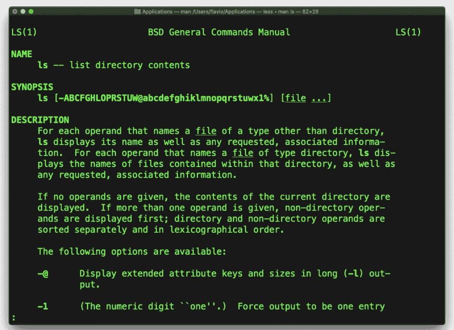

这是一个 man（手册）页面。手册对于开发者来说是必不可少的工具。它们包含的信息非常多，以至于有时让人过载。

上面的截图只是 ls 命令说明的 14 个屏幕之一。

大多数时候当我需要快速学习一个命令时，我会使用这个名为 tldr 的工具：https://tldr.sh/。这是一个你可以安装的命令，然后像这样运行：tldr <command>，它会提供一个非常快速的概述，以及一些常用场景的方便示例：

```tldr ls
ls
列出目录内容。
- 每行一个文件：ls -1
- 列出所有文件（包括隐藏文件）：ls -a
- 所有文件的详细格式列表（权限、所有者、大小和修改日期）：ls -la
 使用人类可读单位（KB, MB, GB）显示大小的详细格式列表：ls -lh
- 按大小（降序）排序的详细格式列表：ls -S
- 按修改日期（最早在前）排序的所有文件详细格式列表：ls -ltr
```这不是 man 的替代品，而是防止在大量信息中迷失的方便工具。然后可以使用 man 页面来探索你可以使用的不同选项和参数。


```bash
~ ls -al /bin
total 5120
drwxr-xr-x 37 root wheel    1184 Feb  4 10:05
drwxr-xr-x 30 root wheel      960 Feb  8 15:32
-rwxr-xr-x 1 root wheel    22704 Jan 16 02:21 [
-rwxr-xr-x 1 root wheel    618416 Jan 16 02:21 bash
-rwxr-xr-x 1 root wheel    23648 Jan 16 02:21 cat
-rwxr-xr-x 1 root wheel    31664 Jan 16 02:21 chmod
-rwxr-xr-x 1 root wheel    29024 Jan 16 02:21 cp
-rwxr-xr-x 1 root wheel    37952 Jan 16 02:21 csh
-rwxr-xr-x 1 root wheel    26808 Jan 16 02:21 date
-rwxr-xr-x 1 root wheel    32000 Jan 16 02:21 dd
-rwxr-xr-x 1 root wheel    23952 Jan 16 02:21 df
-rwxr-xr-x 1 root wheel    18128 Jan 16 02:21 echo
-rwxr-xr-x 1 root wheel    54080 Jan 16 02:21 ed
-rwxr-xr-x 1 root wheel    23104 Jan 16 02:21 expr
-rwxr-xr-x 1 root wheel    18208 Jan 16 02:21 hostname
-rwxr-xr-x 1 root wheel    16836 Jan 16 02:21 kill
-r--xr--r-- 1 root wheel 128264 Jan 16 02:21 ksh
-rwxr-xr-x 1 root wheel    121296 Jan 16 02:21 launchctl
```

与普通的 `ls` 相比，这返回了多得的信息。

从左到右你拥有：

- 文件权限（如果你的系统支持 ACL，你还会获得一个 ACL 标志）
- 指向文件的链接数
- 文件的所有者
- 文件的组
- 以字节为单位的文件大小
- 文件的修改日期
- 文件名

这些数据是由 `l` 选项生成的。而 `a` 选项则显示隐藏文件。

隐藏文件是以点（ . ））开头的文件。

## cd

一旦你有了一个文件夹，就可以使用 `cd` 命令进入其中。`cd` 的意思是“切换目录”（change directory）。你在调用它时指定一个要进入的文件夹。你可以指定文件夹名称，也可以指定路径。

示例：

```bash
mkdir fruits
cd fruits
```

现在你处于 fruits 文件夹中。

你可以使用特殊路径 `..` 来表示父文件夹。

```bash
cd .. #返回到主目录
```

`#` 字符表示注释的开始，在找到它后，该行后续内容都会变为注释。

你可以用它来构建路径：

```bash
mkdir fruits
mkdir cars
cd fruits
cd ../cars
```

另一个特殊路径指示符是 `.` ，它表示当前文件夹。

你也可以使用绝对路径，它从根目录 `/` 开始：

```bash
cd /etc
```

此命令在 Linux、macOS、WSL 以及任何你有 UNIX 环境的地方都有效。

## pwd

每当你觉得在文件系统中迷了路时，调用 `pwd` 命令来确定你所在的位置：

```bash
pwd
```

它将打印当前文件夹路径。

## mkdir

你使用 `mkdir` 命令创建文件夹：

```bash
mkdir fruits
```

你可以一次命令创建多个文件夹：

```bash
mkdir cars
```

你还可以通过添加 `-p` 选项来创建嵌套文件夹：

```bash
mkdir -p fruits/apples
```

UNIX 命令中的选项通常采用这种格式。你将它们放在命令之后，它们会改变命令的行为。你通常也可以组合多个选项。

你可以通过输入 `man <command>` 来查找该命令支持哪些选项。尝试输入 `man mkdir`（按 `q` 键退出 man 页面）。man 页面是 UNIX 的内置帮助。

## rmdir

正如你可以使用 `mkdir` 创建文件夹，你可以使用 `rmdir` 删除文件夹：

```bash
mkdir fruits
rmdir fruits
```

你也可以一次删除多个文件夹：

```bash
mkdir cars
rmdir cars
```

你要删除的文件夹必须是空的。

要删除包含文件的文件夹，我们将使用更通用的 `rm` 命令，它可以删除文件和文件夹，并使用 `-rf` 选项：

```bash
rm -rf fruits
```

注意，此命令不会询问就会立即删除你要求删除的任何内容。从命令行删除文件时，恢复丢失的文件可能是困难的。

## find

每当你觉得在文件系统中迷了路时，调用 `find` 命令确定你所在的位置：

```bash
find .
```

它将列出当前目录下所有的文件和文件夹。你可以按名称搜索文件：

```bash
find . -name "filename*"
```

你还可以按类型搜索，`f` 代表文件，`d` 代表目录：

```bash
find . -type f
```

你还可以按大小搜索，使用 `-size`。例如，搜索大于 100MB 的文件：

```bash
find . -size +100M
```

以及按修改时间搜索，使用 `-mtime`。例如，搜索过去 7 天内修改过的文件：

```bash
find . -mtime -7
```

`find` 命令非常强大，可以用于许多复杂任务。例如，你可以找到所有特定扩展的文件并删除它们：

```bash
find . -name "*.log" -delete
```

## cp

`cp` 命令用于复制文件和目录。语法为：

```bash
cp [options] <source> <destination>
```

示例：复制单个文件：

```bash
cp file.txt file_copy.txt
```

要复制目录，必须使用 `-r` 选项：

```bash
cp -r folder/ folder2/
```

你还可以使用 `-p` 选项来保留文件属性，如所有权和时间戳：

```bash
cp -p file.txt file_copy.txt
```

## rm

`rm` 命令用于删除文件和目录。语法为：

```bash
rm [options] <file or directory>...
```

示例：删除单个文件：

```bash
rm file.txt
```

要删除目录，必须使用 `-r` 选项：

```bash
rm -r folder/
```

`-f` 选项强制删除且不询问：

```bash
rm -f file.txt
```

警告：使用 `rm -rf` 时要极其小心，因为它会永久删除一切。

## mv

`mv` 命令用于移动或重命名文件和目录。语法为：

```bash
mv [options] <source> <destination>
```

示例：重命名文件：

```bash
mv old_name.txt new_name.txt
```

示例：将文件移动到另一个目录：

```bash
mv file.txt /path/to/destination/
```

移动目录的语法相同：

```bash
mv folder/ /path/to/destination/
```

另一个特殊路径指示符是 `.` ，它表示当前文件夹。

你也可以使用绝对路径，它从根目录 `/` 开始：

```bash
mv fruits /etc/
```

此命令在 Linux、macOS、WSL 以及任何你有 UNIX 环境的地方都有效。


你可以使用 `ln` 命令的 `-s` 选项创建软链接：

```
ln -s <original> <link>
```

例如，假设你有一个名为 `recipes.txt` 的文件。你可以使用以下命令为它创建一个软链接：

```
ln -s recipes.txt newrecipes.txt
```

在这种情况下，当你使用 `ls -al` 列出文件时，你会看到有一个特殊的 `-l` 标记，并且文件名末尾有一个 `@` 符号，如果你开启了颜色显示，它的颜色也会与众不同：

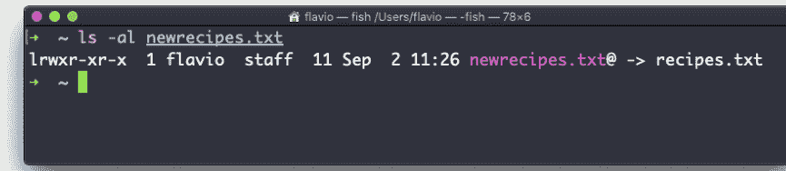

如果你删除了原始文件，链接将失效。当你尝试访问它时，shell 会提示“No such file or directory”（没有此类文件或目录）：

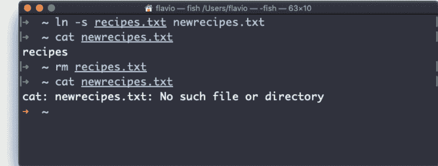

## gzip

你可以使用 `gzip` 命令通过名为 LZ77 的 gzip 压缩协议来压缩文件。

这里是最简单的用法：

```
gzip filename
```

这会压缩文件并为其添加一个 `.gz` 扩展名。原始文件会被删除。为了防止这种情况，你可以使用 `-c` 选项并利用输出重定向将输出写入 `filename.gz` 文件：

```
gzip -c filename > filename.gz
```

> - -c 选项指定输出将流向标准流，保持原始文件完好无损

或者你可以使用 `-k` 选项：

```
gzip -k filename
```

有多种压缩级别。压缩率越高，压缩（以及解压）所需的时间越长。级别范围从 1（最快，压缩率最低）到 9（最慢，压缩率最高），默认级别为 6。

你可以通过 `-<NUMBER>` 选项选择特定级别：

```
gzip -1 filename
```

你可以通过列出多个文件来压缩多个文件：

```
gzip filename1 filename2
```

你可以使用 `-r` 选项递归地压缩目录下的所有文件：

```
gzip -r a_folder
```

`-v` 选项会打印压缩百分比信息。这里是它与 `-k`（保留）选项一起使用的示例：

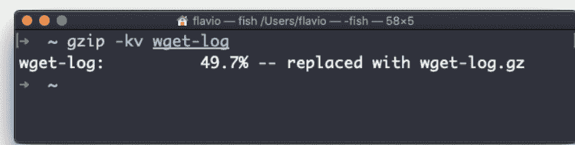

`gzip` 也可以使用 `-d` 选项解压文件：

```
gzip -d filename.gz
```

## gunzip

`gunzip` 命令基本上相当于 `gzip` 命令，区别是 `-d` 选项默认总是开启的。

你可以以这种方式调用该命令：

```
gunzip filename.gz
```

这将解压并移除 `.gz` 扩展名，将结果放入 `filename` 文件中。如果该文件存在，它将覆盖它。

你可以使用 `-c` 选项通过输出重定向提取到不同的文件名：

```
gunzip -c filename.gz > anotherfilename
```

## tar

`tar` 命令用于创建归档，将多个文件分组到一个文件中。

它的名字源于过去，意为 `tape archive`（带带归档）。过去归档存储在磁带上。

此命令创建一个名为 `archive.tar` 的归档，内容包含 `file1` 和 `file2`：

```
tar -cf archive.tar file1 file2
```

`c` 选项代表 `create`（创建）。`f` 选项用于写入文件归档。

要从当前文件夹中的归档中提取文件，请使用：

```
tar -xf archive.tar
```

`x` 选项代表 `extract`（提取），要提取到特定目录，请使用：

```
tar -xf archive.tar -C directory
```

你也可以列出归档中包含的文件：

```
tar -tf archive.tar
file1
file2
```

`tar` 通常用于创建压缩归档，对归档进行 gzip 压缩。

这是通过 `z` 选项实现的：

```
tar -czf archive.tar.gz file1 file2
```

这就像先创建一个 tar 归档，然后对其运行 gzip 一样。

要解压一个 gzip 过的归档，你可以使用 `gunzip` 或 `gzip -d` 然后进行提取，但 `tar -xf` 会识别出这是一个 gzip 过的归档并为你完成完成：

```
tar -xf archive.tar.gz
```

## alias

始终使用一组你喜欢的选项来运行某个程序是很常见的。

例如，以 `ls` 命令为例。默认情况下，它打印的信息很少：

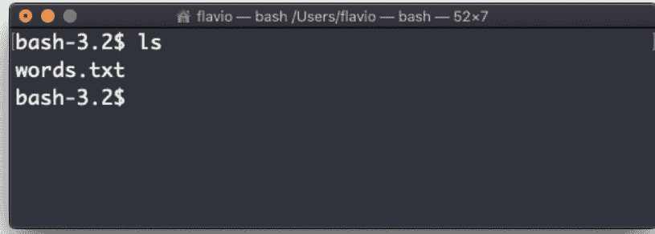

而使用 `-al` 选项时，它会打印更有用的信息，包括文件修改日期、大小、所有者权限，还会列出隐藏文件（以 . 开头的文件）：

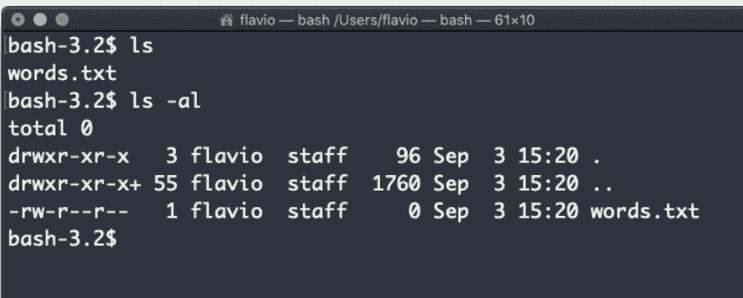

你可以创建一个新命令，例如我喜欢把它命名为 `ll`，它是 `ls -al` 的别名。

操作方法如下：

```
alias ll='ls -al'
```


## tail

在我看来，`tail` 的最佳用例是配合 `-f` 选项调用。它打开文件的末尾并监控文件变化。每当文件有新内容时，它就会打印到窗口中。这非常适合查看日志文件，例如：

```
tail -f /var/log/system.log
```

按下 `ctrl-C` 退出。

你可以打印文件中最后 10 行：

```
tail -n 10 <filename>
```

你可以使用在行号前加 `+` 从特定行开始打印整个文件内容：

```
tail -n +10 <filename>
```

`tail` 还能做很多事情，一如既往，我的建议是查看 `man tail`。

# WC

`wc` 命令为文件或通过管道接收的输入提供有用信息。

```
echo test >> test.txt
wc test.txt
1 1 5 test.txt
```

通过管道示例，我们可以统计运行 `ls -al` 命令的输出：

```
ls -al | wc
6 47 284
```

返回的第一列是行数。第二列是单词数。第三列是字节数。

我们可以让它只统计行数：

```
wc -l test.txt
```

或者只统计单词数：

```
wc -w test.txt
```

或者只统计字节：

```
wc -c test.txt
```

ASCII 字符集中的字节等于字符，但对于非 ASCII 字符，字符数可能会不同，因为某些字符可能占用多个字节，例如在 Unicode 中就是。

在这种情况下，`-m` 标志将帮助获取正确的值：

```
wc -m test.txt
```

## grep

`grep` 命令是一个非常有用的工具，当你掌握了它，将对你的日常生活产生极大帮助。

> 如果你好奇，grep 代表 global regular expression print（全局正则表达式打印）

你可以使用 `grep` 在文件中进行搜索，或结合管道过滤另一个命令的输出。

例如，这里是我们在 `index.md` 文件中查找 `document.getElementById` 出现位置的方法

```
grep document.getElementById index.md
```

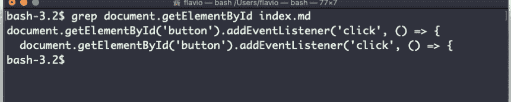

使用 `-n` 选项将显示行号：

```
grep -n document.getElementById index.md
```

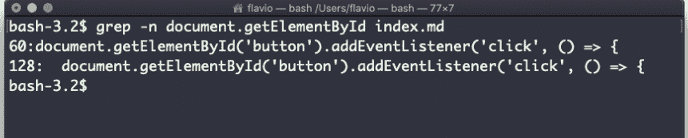

一个非常有用的功能是告诉 grep 打印匹配行之前的 2 行和之后的 2 行，为我们提供更多上下文。这是通过 `-C` 选项实现的，它接受一个行数：

```
grep -nC 2 document.getElementById index.md
```

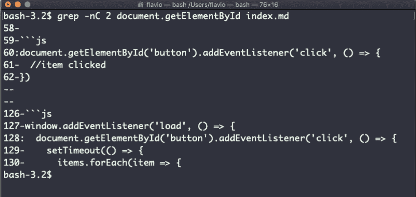

默认情况下搜索区分大小写。使用 `-i` 标志使其不区分大小写。

如所述，你可以使用 `grep` 过滤另一个命令的输出。我们可以使用以下命令实现相同的功能：

```
less index.md | grep -n document.getElementById
```

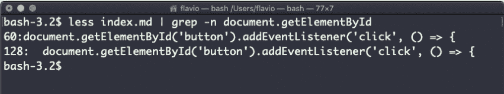

搜索字符串可以是正则表达式，这使得 `grep` 非常强大。

另一个你可能发现非常有用的是反转结果，使用 `-v` 选项排除匹配特定字符串的行：

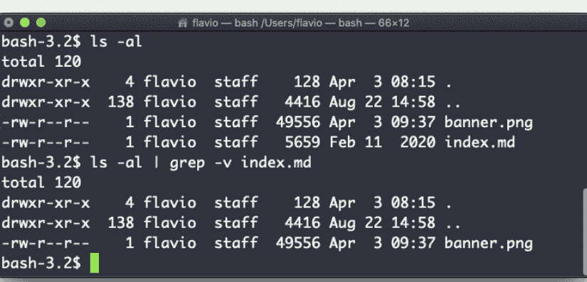

## sort

假设你有一个包含 `dogs` 名字文本文件：

```
Roger
Syd
Vanille
Luna
Ivica
Tina
(END)
```

这个列表是无序的。

`sort` 命令帮助我们按名称排序：

```
sort dogs.txt
Ivica
Luna
Roger
Syd
Tina
Vanille
```

使用 `r` 选项反转顺序：

```
sort -r dogs.txt
Vanille
Tina
Syd
Roger
Luna
Ivica
```

默认排序区分大小写并按字母顺序排序。使用 `--ignore-case` 选项不区分大小写，使用 `-n` 选项按数字顺序排序。

如果文件包含重复行：

```
cat dogs.txt
Roger
Syd
Vanille
Luna
Ivica
Tina
```

你可以使用 `-u` 选项移除它们：

```
sort -u dogs.txt
Ivica
Luna
Roger
Syd
Tina
Vanille
```

`sort` 不仅作用于文件，像许多 UNIX 命令一样也适用于管道，所以你可以将其用于另一个命令的输出，例如对 `ls` 返回的结果排序：

```
ls | sort
```

`sort` 非常强大并有很多更多选项，你可以通过 `man sort` 进行探索。

# SORT(1)

## BSD General Commands Manual

# SORT(1)

NAME

sort -- 文本和二进制文件的行排序

SYNOPSIS

```
sort [-BcfdhMnsuwx] [-k field,field] [-s] [-d] [-c] [-output]
       file...
       --help
       --version
```

DESCRIPTION

sort 工具按行对文本和二进制文件进行排序。行由换行符（默认）或 NULL 字符（-z）分隔。行可以包含任何打印字符和空格，并根据当前 locale 的排序顺序进行处理。每个 sort 命令都有各种命令行选项可以调整实际排序行为。如果输入文件未排序，sort 将它们合并以进行比较。

命令行如下：

- -c, --check-all：检查输入文件是否排序。如果文件未排序，sort 会产生错误并以代码 1退出，否则返回 0。如果指定了 --check-all，sort 不产生输出。这是 -c 的“静默”版本。
- -merge：合并假设已排序的输入文件。如果它们未排序，输出顺序未定义。
- -output=file：将输出到输出文件而不是标准输出。
- -size, --buffer-size：用于内存缓冲区的大小。修饰符 N,D,K,M
- -dir, --directory=dir：将临时文件存储在目录中。如果没有定义 TMPDIR，默认路径为 /tmp。
- -u：唯一。抑制所有具有相同键的行，类似于 -c。
- -s：稳定排序。此选项保持具有相等键记录的原始顺序。这是一个非标准功能，但被广泛接受和使用。
- --version：打印版本并静默退出。

## uniq

`uniq` 是一个用于对文本行排序的命令。

你可以从文件中获取这些行，或通过管道从另一个命令的输出获取：

```
uniq dogs.txt

ls | uniq
```

你需要考虑这一点：`uniq` 只检测相邻的重复行。

这意味着你可能会与 `sort` 一起使用它：

```
sort dogs.txt | uniq
```

`sort` 命令有自己的方法通过 `-u` 选项移除重复。但 `uniq` 更强大。

默认情况下它移除重复行：

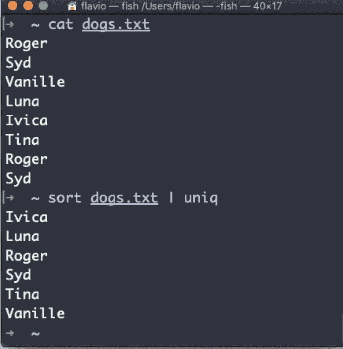

你可以告诉它只显示重复行，例如使用 `-d` 选项：

```
sort dogs.txt | uniq -d
```

你可以使用 `-u` 选项只显示非重复行：

```
sort.txt | uniq -u
Ivica
Luna
Tina
Vanille
```

你可以使用 `-c` 选项统计每行的出现次数：

```
cat dogs.txt
Roger
Syd
Vanille
Luna
Ivica
Tina
sort dogs.txt | uniq -c
  1 Ivica
  1 Luna
  2 Roger
  2 Syd
  1 Tina
  1 Vanille
```

使用特殊组合：

```
sort dogs.txt | uniq -c | sort -nr
```

然后按频率从高到低排序这些行：
50


```
~ sort dogs.txt | uniq -c | sort -nr
2 Syd
2 Roger
1 Vanille
1 Tina
1 Luna
1 Ivica
~
```

## diff

`diff` 是一个非常有用的命令。假设你有两个文件，包含几乎相同的信息，但你找不到它们之间的差异。

`diff` 会处理这些文件并告诉你差异。

假设你有两个文件：`dogs.txt` 和 `moredogs.txt`。区别在于 `moredogs.txt` 包含了一个狗的名字：

```bash
flavio — fish /Users/flavio —fish — 50×8
~ cat dogs.txt
Roger
Syd
~ cat moredogs.txt
Roger
Syd
Vanille
~
```

`diff dogs.txt moredogs.txt` 会告诉你第二个文件多了一行，即第3行内容为 `Vanille`：

```bash
flavio — fish /Users/flavio —fish — 50×5
~ diff dogs.txt moredogs.txt
Za3
> Vanille
~ ~
```

如果你反转文件的顺序，它会告诉你第二个文件缺少了第3行，内容为 `Vanille`：

```bash
flavio --fish /Users/flavio/flavio --fish --50x5
diff moredogs.txt dogs.txt
3d2
< Vanille
~
```

使用 `-y` 选项逐行比较两个文件：

```bash
flavio --fish /Users/flavio/flavio --fish --86x9
diff -y dogs.txt moredogs.txt
Roger
Syd
> Vanille
~
```

然而，`-u` 选项对你来说更加熟悉，因为 Git 版本控制系统也使用它来显示版本之间的差异：

```bash
flavio --fish /Users/flavio/flavio --fish --67x8
~ diff -u dogs.txt moredogs.txt
--- dogs.txt 2020-09-07 08:54:56.0000000000 +0200
+++ moredogs.txt 2020-09-07 08:55:09.0000000000 +0200
@@ -1,2 +1,3 @@
Roger
Syd
+Vanille
~
```

比较目录的方法也是类似的。你必须使用 `-r` 选项进行递归比较（进入子目录）：

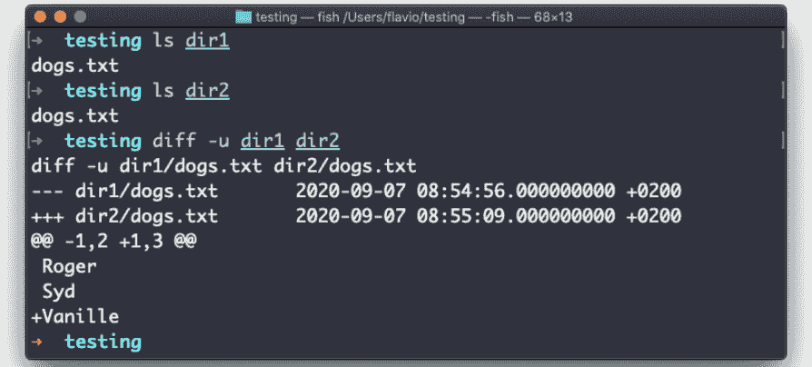

如果你感兴趣的是哪些文件有差异而不是内容，请使用 `r` 和 `q` 选项：

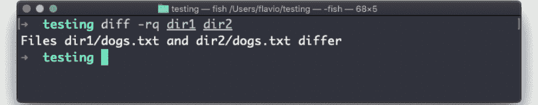

在运行 `diff` 命令的 man 页面中，你可以探索更多选项：

```
diff - compare files line by line
SYNOPSIS
 diff [OPTION]... FILES
逐行比较文件。
 -i --ignore-case
 忽略文件内容中的大小写差异。
 --ignore-file-name-case
 比较文件名时忽略大小写。
 --no-ignore-file-name-case
 比较文件名时考虑大小写。
 -E --ignore-tab-expansion
 忽略因制表符引起的更改。
 -b --ignore-space-change
 忽略空格数量的变化。
 --ignore-all-space
 忽略所有空格。
 -B --ignore-blank-lines
 忽略全为空白行的更改。
 -I --ignore-matching-lines-RE
 忽略所有行都匹配正则表达式 RE 的更改。
 --strip-trailing-cr
 移除输入末尾的的回车符。
 -a --text
 将所有文件视为文本。
 -C NUM --context[--HLM]
 输出 NUM（默认 3）行复制的上下文。
 -u NUM --unified[--HLM]
 输出 NUM（默认 3）行统一上下文。
 --label LABEL
 使用 LABEL 代替文件名。
 -p --show-c-function
 显示每个更改所属的 C 函数。
 -F RE --show-function-line=RE
```

## echo

`echo` 命令只完成一件简单的工作：将传递给它的输出参数打印到输出。

这个示例：

```bash
echo "hello"
```

将在终端打印 `hello`。

我们可以将输出追加到文件：

```bash
echo "hello" >> output.txt
```

我们可以插值环境变量：

```bash
echo "The path variable is $PATH"
```

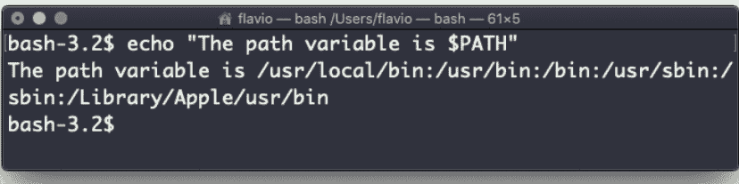

注意特殊字符需要用反斜杠 `\` 转义，例如 `$`：

这只是开始。在与 Shell 特性交互时，我们可以做一些很棒的事情。

我们可以打印当前文件夹下的文件：

```bash
echo *
```

我们可以打印当前文件夹中以字母 `o` 开头的文件：

```bash
echo 0*
```

任何有效的 Bash（或你正在使用的任何 shell）命令和功能都可以使用。

你可以打印你的主目录路径：

```bash
echo ~
```

你还可以执行命令并打印标准输出的结果（或输出到文件，如你所见）：

```bash
echo $ls -al
```

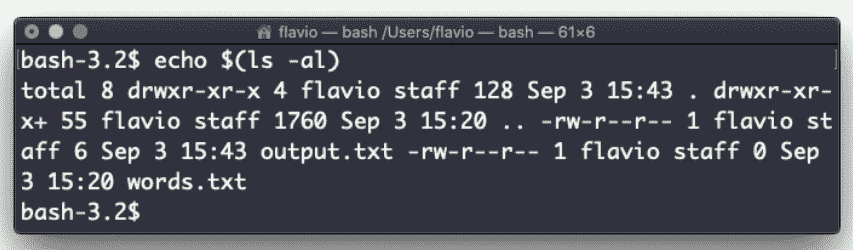

注意，默认不会保留空格。你需要用双引号包裹命令来实现：

你可以生成一个字符串列表，例如：

```bash
echo {1..5}
```

## chown

在像 Linux 或 macOS 这样的操作系统（以及所有类 Unix 系统）中，每个文件/目录都有一个**所有者**。

文件的所有者可以对其进行任何操作。它可以决定该文件的命运。所有者（以及 `root` 用户）可以使用 `chown` 命令将所有者更改另一个用户：

```bash
chown <owner> <file>
```

例如：

```bash
chown flavio test.txt
```

如果你有一个由 `root` 拥的文件，你无法作为另一个用户写入它。你可以使用 `chown` 将所有权转移给你。

(注：原始文本中存在大量重复的错误片段，已按核心逻辑进行翻译)


## umask

当你创建一个文件时，你不需要提前决定权限。
权限有默认值。

可以使用 `umask` 命令来控制和修改这些默认值。
直接输入不带参数的 `umask` 将显示当前的 umask，在此情况下为 `0022`：

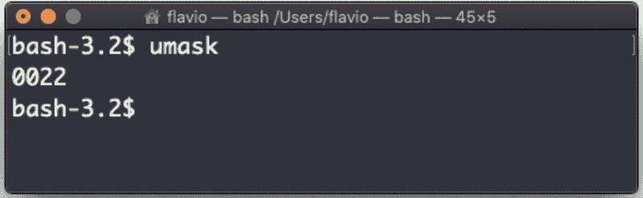

`0022` 代表什么？它是一个表示权限的八进制值。

另一个常见值是 `0002`。

使用 `umask -S` 查看人类可读的表示法：

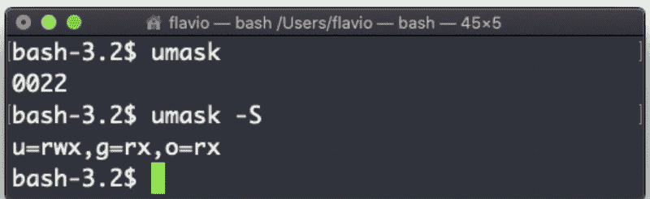

在这种情况下，用户（ u ）即文件的所有者，对文件拥有读、写、执行权限。

属于同一组（ g ）的其他用户具有读取和执行权限，与其他所有用户（ o ）权限相同。

在数字表示法中，我们通常更改最后 3 位数字。

这里有一个数字对应含义的列表：

- 0 读、写、执行
- 1 读和写
- 2 读和执行
- 3 仅读
- 4 写和执行
- 5 仅写
- 6 仅执行
- 7 无权限

注意，这种数字表示法与我们在 `chmod` 中使用的不同。

我们可以通过设置数字格式的值来设置一个新的掩码设置值：

```
umask 002
```

或者你可以更改特定角色的权限：

```
umask g+r
```

## du

du 命令将计算整个目录的大小：

```
flavio — bash /Users/flavio — bash — 38×5
bash-3.2$ du
32
bash-3.2$ 
```

这里的数字 32 是以字节为单位的值。

运行 `du *` 将分别计算每个文件的大小。

```
flavio — bash /Users/flavio — bash — 38×6
bash-3.2$ du *
8 Card.vue
8 CardList.vue
8 Form.vue
8 HelloWorld.vue
bash-3.2$ 
```

你可以使用 `du -m` 设置 du 以兆字节（MegaBytes）显示值，使用 `du -g` 以吉字节（GigaBytes）显示。

`-h` 选项显示人类可读的大小表示法，并根据大小进行调整：

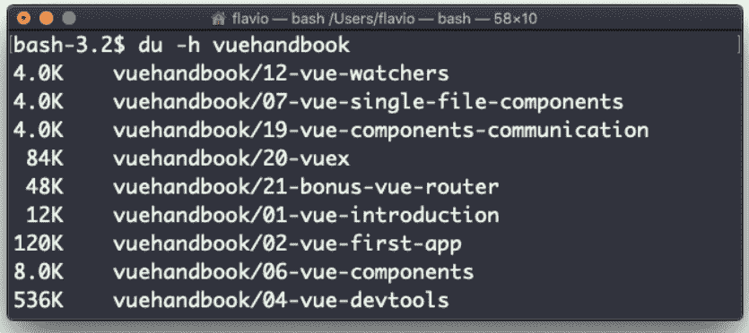

添加 `-a` 选项将目录中每个文件的大小，到：

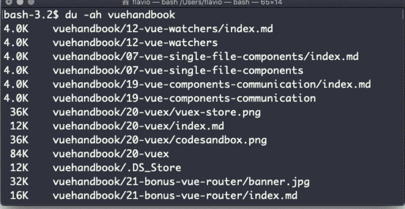

一个方便的方法是按大小对目录排序：

```
du -h <directory> | sort -nr
```

然后通过管道 head 以获取前 10 个结果：

```bash
bash-3.2$ du -h vuehandbook | sort -nr | head
932K vuehandbook/05-vue-code
63K vuehandbook/.git/objects/75
54K vuehandbook/03-vue-cli
536K vuehandbook/04-vue-devtools
120K vuehandbook/02-vue-first-app
88K vuehandbook/.git/objects/pack
88K vuehandbook/.git/objects/b0
84K vuehandbook/20-vux
76K vuehandbook/.git/objects/6f
64K vuehandbook/.git/objects/41
bash-3.2$
```

## df

df 命令用于（` df -h`）将以人类可读的格式显示值。

它的基本形式将打印关于挂载卷的信息：

```
df /home/users/flavier/fish --width=108x
Filesystem      Size Used Available Use% Mounted on
/dev/disk11     976490576 219746708 756743868 23% 48418 481964462 0% /
/devfs            375 0 375 0% 0 100% /dev
/dev/disk12     976490576 454785076 521705500 46% 428795 4878164985 0% /System/Volumes/Data
/dev/disk5     976490576 104854800 871638296 11% 582452875 0% /private/var/vm
map auto_home                               0 0 100% 0 100% /System/Volumes/Data/home
```

使用 `-h` 选项将以人类可读的格式显示这些值：

```
df /home/users/flavier/fish --width=108x
Filesystem      Size Used Available Use% Mounted on
/dev/disk11     976490576 219746708 756743868 23% 48418 481964462 0% /
/devfs            375 0 375 0% 0 100% /dev
/dev/disk12     976490576 454785076 521705500 46% 428795 4878164985 0% /System/Volumes/Data
/dev/disk5     976490576 104854800 871638296 11% 582452875 0% /private/var/vm
map auto_home                               0 0 100% 0 100% /System/Volumes/Data/home
```

## basename

basename 命令用于获取路径中的最后一个部分：

```
basename /home/users/flavier/fish
fish
```

## dirname

dirname 命令用于获取路径中的目录部分：

```bash
dirname /home/users/flavier/fish
/home/users
```

## ps

ps 命令用于查看当前运行的进程：

```
bash-3.2$ ps
```


ps 返回的列表示了一些关键信息。

第一条信息是 PID，即进程 ID。当你想要在另一个命令中引用此进程（例如杀掉它）时，这是至关重要的。

然后是 TT，它告诉我们所使用的终端 ID。

然后 STAT 告诉我们进程的状态：

- I: 进程处于空闲状态（睡眠超过 20 秒）
- R: 可运行状态的进程
- S: 睡眠少于 20 秒的进程
- T: 已停止的进程
- U: 处于不可中断等待的进程
- Z: 死亡进程（僵尸进程）

如果你有多个字母，第二个字母代表进一步的信息，这些信息可能很有技术性。

通常会有 `+` 号，表示进程处于其终端的前台。S 表示该进程是一个会话领导者。

TIME 告诉我们进程已运行了多久。

## top

top 命令快速指南，用于列出系统中正在运行的进程。

`top` 命令用于显示系统运行运行进程的实时信息。

它真的很难理解，你只需要输入它。

它的用法非常简单，只需输入 `top`，终端就会完全沉浸在这个新的视图中：

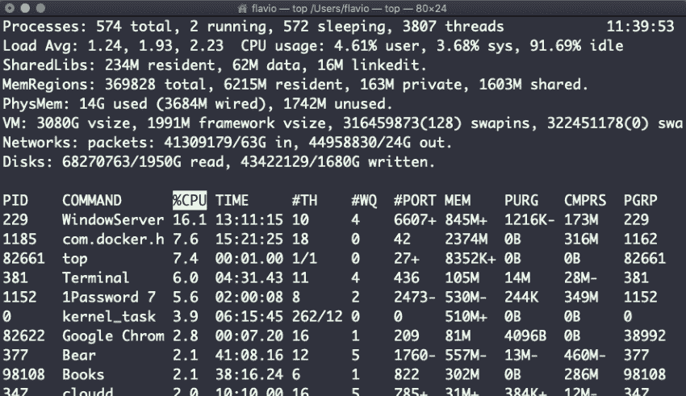

进程是长时间运行的。要退出，你可以输入字母 `q` 或 `ctrl-C`。

它给了我们大量信息：进程数量、多少个进程正在运行或睡眠、系统负载、CPU 使用率等等。

下面，占用内存和 CPU 最高的进程列表不断更新。

默认情况下，如高亮显示的 `%CPU` 列所示，它们按 CPU 使用率进行排序的。

你可以添加一个标志按内存使用率对进程进行排序：

```
top -o mem
```

## kill

Linux 进程可以接收**信号**并对其做出反应。

这是我们与运行程序交互的一种方式。

`kill` 程序可以向程序发送多种信号。

它不仅仅像名称暗示的那样用于终止程序，但那是它的主要工作。

我们这样使用它：

```
kill <PID>
```

默认情况下，这会向指定的进程 ID 发送 `TERM` 信号。

我们可以发送其他信号，包括：

```
kill -HUP <PID>
kill -INT <PID>
kill -KILL <PID>
kill -TERM <PID>
kill -CONT <PID>
kill -STOP <PID>
```

HUP 意味着**挂起**（hang up）。当启动进程的终端窗口在进程终止前关闭时，会自动发送该信号。

INT 意味着**中断**（interrupt），它发送与我们在终端中按下 `ctrl-C` 相同的信号，这会终止进程。

KILL 不是发送给进程的，而是发送给操作系统内核，内核会立即停止并终止该进程。

TERM 意味着**终止**（terminate）。进程将接收它并自终止。它是 `kill` 发送的默认信号。

CONT 意味着**继续**（continue）。它可以用于恢复已停止的进程。

STOP 不是发送给进程的，而是发送给操作系统内核，内核会立即停止（但不终止）进程。

- 1 对应 HUP。
- 2 对应 INT。
- 9 对应 KILL。
- 15 对应 TERM。
- 18 对应 CONT。
- 15 对应 STOP。（注：原文此处可能存在误写）

## killall

与 `kill` 命令类似，`killall` 不是向特定的进程 ID 发送信号，而是一次性向多个进程发送信号。

这是语法：

```
killall <name>
```

其中 `name` 是程序的名称。例如，你可能运行了多个 `top` 程序的实例，`killall top` 将终止它们。

你可以指定信号，像 `kill` 一样（并查看 `kill` 教程以了解更多特定类型的信号），例如：

```
killall -HUP top
```

## jobs

在 Linux / macOS 中运行命令时，通过在命令后使用 `&` 符号可以设置为在后台运行。例如，我们可以在后台运行 `top`：

```
top &
```

这对于长时间运行的程序非常有用。

我们可以使用 `fg` 命令返回该程序。如果后台只有一个作业，这种方法很好；否则需要使用作业号：`fg 1`、`fg 2` 等。要获取作业号，使用 `jobs` 命令。假设我们运行了 `top &` 然后 `top -o mem &`，这样我们就有两个 `top` 实例在运行。`jobs` 会告诉我们：


现在我们可以使用 `fg <jobid>` 切换回其中一个。要再次停止程序，可以按 `cmd-Z`。`jobs -l` 还会打印每个作业的 ID。

## bg

当命令运行时，可以使用 `ctrl-Z` 挂起它。命令会立即停止并返回终端。

可以在后台恢复命令的执行，它将继续运行但不会阻止你在终端进行其他工作。在这个例子中，有两个停止的命令：

```
flavio@bash ~
[1]+ Stopped                 top
[2]- Stopped                 bash
```

我们可以运行 `bg 1` 在后台恢复作业 #1。也可以说 `bg` 选择列表中的作业 #1。

## fg

当命令因为在末尾带有 `&` 在后台运行时，可以使用 `fg` 将其置前台。你也可以传递作业号指定想要恢复哪个作业到前台，这可以通过 `jobs` 命令获取。


运行 `fg 2` 将恢复作业 #2：

```
Processes: 574 total, 2 running, 572 sleeping, 3823 threads
16:12:54 Load: 1.44, 1.60, 1.74
CPU usage: 3.76% user, 2.99% sys, 93.23% idle
Shared: 235M resident, 62M data, 16M linked
Regions: 365072 total, 6752M resident, 166M private, 1835M
PhysMem: 15G used (3692M wired), 738M unused
VM: 3022G vsize, 1991M framework vsize, 3180786(0) swaps
Networks: packets: 434852/666 in, 4274873/256 out.

| PID | COMMAND | %CPU | TIME | TTY | WQ | MEM |
| :--- | :--- | :--- | :--- | :--- | :--- | :--- |
| 1185 | com.docker.him | 9.1 | 15:40:34 | 18 | 0 | 4274M |
| 566 | Code Helper | 0.0 | 93:50:08 | 8 | 1 | 267M |
| 85440 | hugo | 0.0 | 09:19:21 | 20 | 0 | 29M |
| 229 | WindowServer | 16.0 | 13:29:14 | 10 | 4 | 6193M |
| 1152 | Password | 7.9 | 02:10:02 | 2 | 2 | 2400M |
| 377 | Bear | 0.0 | 63:35:69 | 27 | 1 | 1763M |
| 605 | Code Helper | 0.1 | 43:56:57 | 13 | 6 | 1763M |
| 42433 | Photos | 0.0 | 02:37:69 | 1 | 1 | 535M |
| 588 | Figma Helper | 0.0 | 26:13:88 | 1 | 1 | 219M |
| 0 | kernel_task | 3.2 | 06:24:14 | 262/12 | 0 | 0M |
| 38992 | Google Chrome | 0.6 | 02:52:53 | 35 | 2 | 1238M |
| 594 | Code Helper | 0.3 | 54:59:85 | 27 | 1 | 

```

## type

一个命令可以是以下四种类型之一：

- 可执行文件
- shell 内置命令
- shell 函数
- 别名

`type` 命令可以帮助弄清楚这些，当我们想知道或者只是好奇时。它会告诉你命令是如何被解释的。

输出取决于所使用的 shell。这是 Bash：

```
flavio@bash ~
type ls
ls is hashed (/bin/ls)
bash-32$ type cat
cat is /bin/cat
bash-32$ type pwd
pwd is a shell builtin
bash-32$ type ll
ll is aliased to `ls -al'
bash-32$ type top
top is hashed (/usr/bin/top)
bash-32$ type jobs
jobs is a shell builtin
bash-32$ type bg
bg is a shell builtin
bash-32$ type kill
kill is a shell builtin
bash-32$ type top
top is hashed (/usr/bin/top)
bash-32$
```

这是 Zsh：

```
flavio@zsh ~ % type ls
ls is /bin/ls
flavio@zsh ~ % type cat
cat is /bin/cat
flavio@zsh ~ % type pwd
pwd is a shell builtin
flavio@zsh ~ % type ll
ll is not found
flavio@zsh ~ % alias ll='ls -al'
flavio@zsh ~ % type ll
ll is an alias for ls -al
flavio@zsh ~ % type top
top is /usr/bin/top
flavio@zsh ~ % type jobs
jobs is a shell builtin
flavio@zsh ~ % type bg
bg is a shell builtin
flavio@zsh ~ % type kill
kill is a shell builtin
flavio@zsh ~ % type top
top is /usr/bin/top
flavio@zsh ~ ~
```


```
ls
ls is a function with definition
# Defined in /usr/local/Cellar/fish/3.1.0/share/fish/functions/ls.fish @ line 13
function ls --description 'List contents of directory'
    set l -opt g
    isat stdout
    and set -a opt -F
    command ls $opt argv
end
type cat
cat is /bin/cat
pwpd is a builtin
type ll
ll is a function with definition
# Defined in /usr/local/Cellar/fish/3.1.0/share/fish/functions/ll.fish @ line 4
function ll --description 'List contents of directory using long format'
    ls -lh argv
end
type top
top is /usr/bin/top
type jobs
jobs is a builtin
type bg
bg is a function with definition
# Defined in /usr/local/Cellar/fish/3.1.0/share/fish/config.fish @ line 274
function bg
    set l -jobbln bg
    builtin $jobbln (_fish_expand_pid_args $argv)
end
type kill
kill is a function with definition
# Defined in /usr/local/Cellar/fish/3.1.0/share/fish/config.fish @ line 279
function kill
    command kill (_fish_expand_pid_args $argv)
end
type top
top is /usr/bin/top
```

这里最有趣的事情之一是，`alias` 会告诉你别名指向了什么。在 Bash 和 Zsh 中，你可以看到 `ll` 别名，但 Fish 默认提供了它，所以它会告诉你这是一个内置的 shell 函数。

## which

假设你有一个可以执行的命令，因为它在 shell 的搜索路径（path）中，但你想知道它位于何处。

你可以使用 `which`。该命令将返回指定命令的路径：

```
flavio — fish /Users/flavio — -fish — 40x6
→ which ls
/bin/ls
→ which docker
/usr/local/bin/docker
→ ~
```

`which` 仅对存储在磁盘上的可执行文件有效，对别名或内置 shell 函数无效。

## nohup

有时你需要在远程机器上运行一个长时间运行的进程，然后你需要断开连接。

或者你只是想防止命令在你与服务器之间出现任何网络问题时中断。

让命令在你注销或关闭服务器会话后继续运行的方法是使用 `nohup` 命令。

使用 `nohup <command>` 让进程在你注销后继续工作。

## xargs

`xargs` 命令用于 UNIX shell，将来自标准输入的输入转换为命令的参数。

换句话说，通过使用 `xargs`，一个命令的输出被用作另一个命令的输入。

是你将使用的语法：

```
command1 | xargs command2
```

我们使用管道 (|) 将输出传递给 `xargs`。它将处理运行 `command2`，并将 `command1` 的输出作为它的参数。

让我们来看一个简单的例子。你想从目录删除某些特定的文件。这些文件列在一个文本文件中。

我们有 3 个文件：file1, file2, file3。

在 `todelete.txt` 中我们有一个想要删除的文件列表，在本例中是 file1 和 file3：

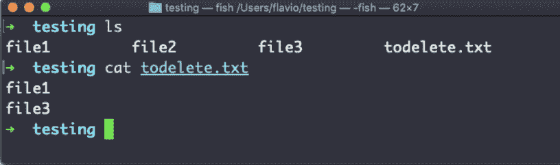

我们将 `cat todelete.txt` 的输出传递给 `rm` 命令

方式如下：

```
cat todelete.txt | xargs rm
```

这样一来，列出的文件被删除了：

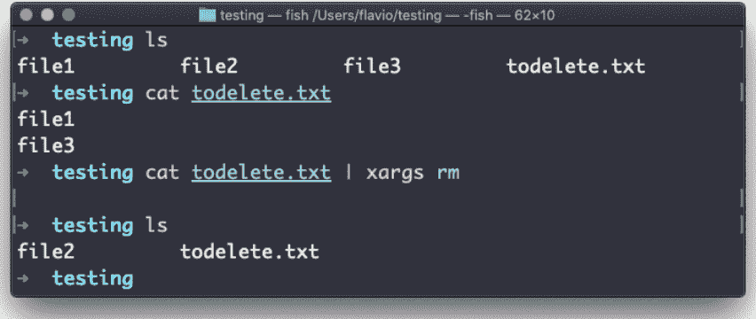

`xargs` 的工作原理是它会为 `cat` 返回的每一行运行一次 `rm`。

这是 `xargs` 最简单的用法。有几个选项可以使用。

在我看来，最有用的之一（特别是刚学习 `xargs` 时）是 `-p`。使用此选项会让 `xargs` 打印它将要执行的操作确认提示：

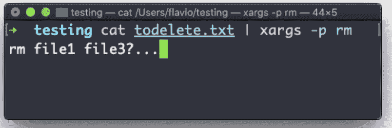

`-n` 选项让你告诉 `xargs` 每次一次，你可以通过 `-p` 逐一确认。这里我们告诉 `xargs` 每次执行一次迭代：

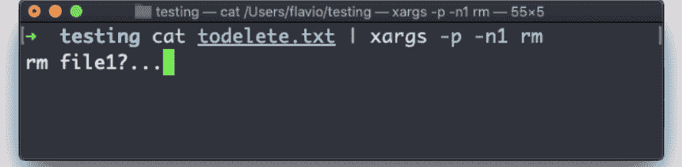

`-I` 选项是另一个广泛使用的选项。它允许将输出放入占位符，然后你可以执行各种操作。其中之一是运行多个命令：

```
command1 | xargs -I % /bin/bash -c 'command2 %; command3 %'
```

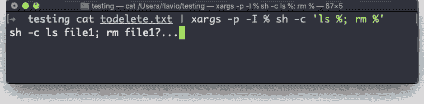

你可以可以将上面的 `%` 符号替换为任何内容，它是一个变量

## vim

vim 是非常流行的编辑器，特别是在程序员中。它开发活跃并频繁更新，周围有一个非常大的社区。甚至还有 Vim 大会！现代系统中的 `vi` 只是 `vim` 的别名，这意味着 vi 被证明了。你通过在命令行运行 `vi` 来启动它。

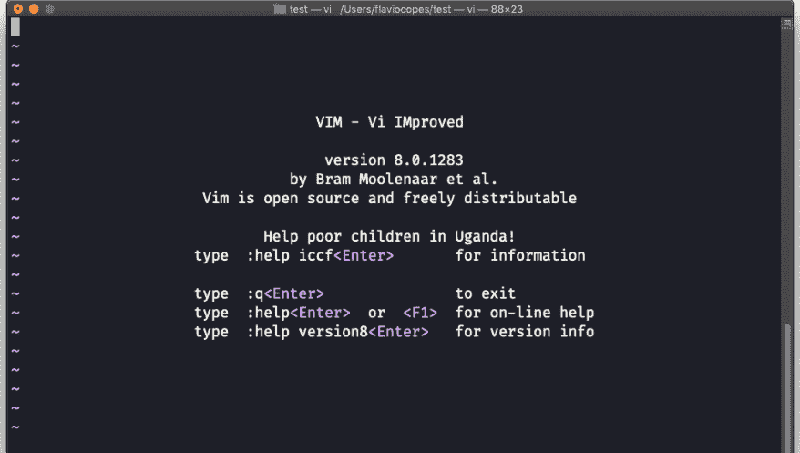

可以在调用时指定文件名来编辑特定文件：

```
vi test.txt
```

你必须知道 Vim 有两种模式：

- 命令模式（或普通模式）
- 插入模式

当你启动编辑器时，你处于命令模式。你无法像在 GUI 编辑器那样输入文本。你必须进入**插入模式**。你可以通过按下 `i` 键来实现。一旦这样做，编辑器底部会显示 INSERT：

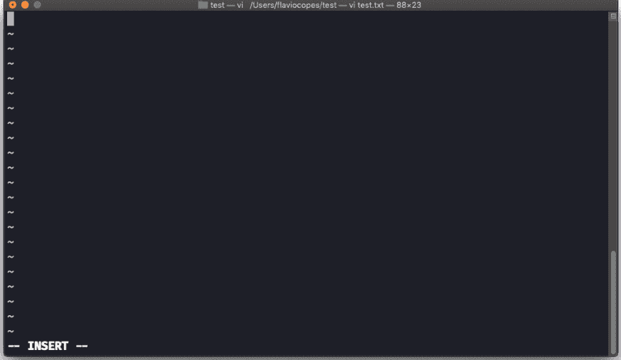

现在你可以开始输入并用内容填充屏幕：

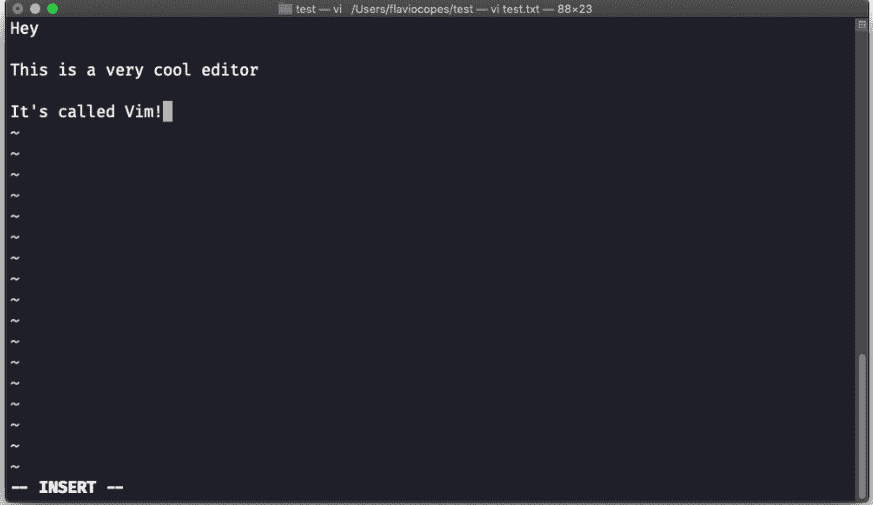

你可以使用方向键在文件中移动，或者使用 `h - j - k - l` 键，`h-l` 代表左右，`j-k` 代表上下。一旦完成编辑，你可以按下 `esc` 键退出插入模式，回到命令模式。

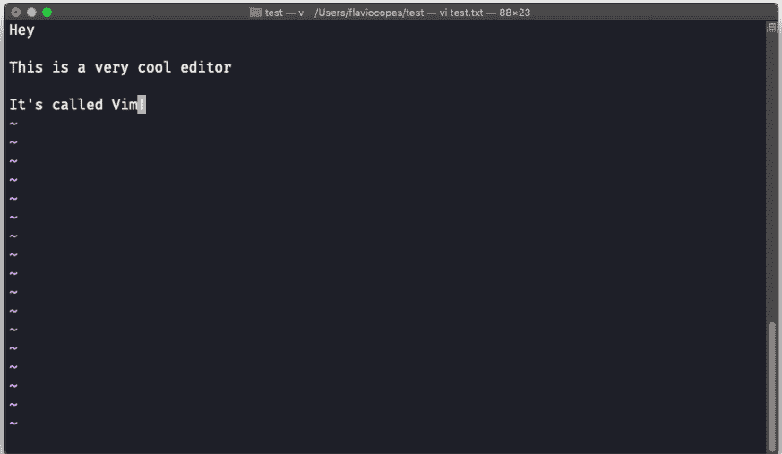

此时你可以导航文件，但你不能向其添加内容（注意你按的是哪些键）。

你现在可能想的事情之一是保存文件。你可以通过 `:w` 实现。

你可以通过 `:wq` 退出并保存。

你可以通过 `:q!` 不保存直接退出。

你可以通过按下 `:u` 撤销编辑。你可以通过 `ctrl-r` 重做（取消撤销）。

这些是使用 Vim 的基础：

- `x` 删除当前高亮的字符
- `A` 跳到行尾
- `0` 跳到行首
- `dw` 删除该单词
- `e` 代替 `w`，保留下一个单词
- 在 `d` 和 `w` 之间使用数字删除多个 1 单词，例如使用 `3w` 删除 3 个单词
- `dd` 删除整行
- `d$` 删除从光标处到行尾的所有行

要了解更多关于 Vim 的信息，我推荐查看 Vim FAQ，特别是运行 `vimutor`，它应该已经安装在你的系统中，并将极大帮助你开始探索。

## emacs

emacs 是一个很棒的编辑器，历史上被视为 UNIX 系统的编辑器。著名的 vi vs emacs 口战和激烈讨论导致了全球开发者浪费了许多无用的时间。

emacs 非常强大。有些人整天将其作为一种操作系统来使用（https://news.ycombinator.com/item?id=1912758）。我们只讨论基础。

你可以通过简单调用 `emacs` 来开启一个 emacs 会话：

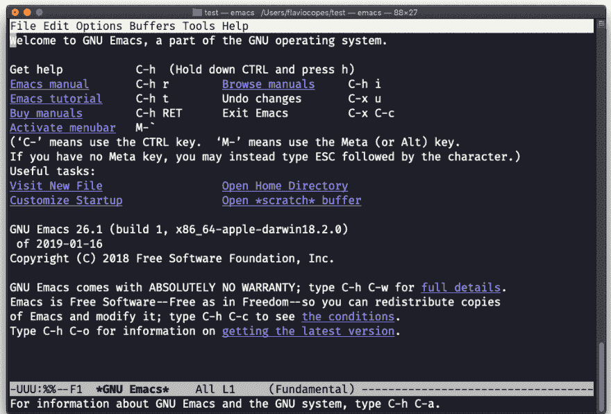

macOS 用户，现在停一下。如果你在 Linux 上，没有问题，但 macOS 不分发使用 GPLv3 的应用程序，而且每个更新到 GPLv3 的内置 UNIX 命令都没有更新。虽然我目前列出的命令存在一点小问题，但在这种情况下，使用 2007 年的 emacs 版本与经过 12 年改进和改变的版本并不完全相同。这对 Vim 来说不是问题，因为它是更新的。要修复这个问题，运行 `brew install emacs`，然后运行 emacs 将使用来自 Homebrew 的新版本（确保你已安装 Homebrew）。

你也可以通过调用 `emacs <filename>` 来编辑现有文件：

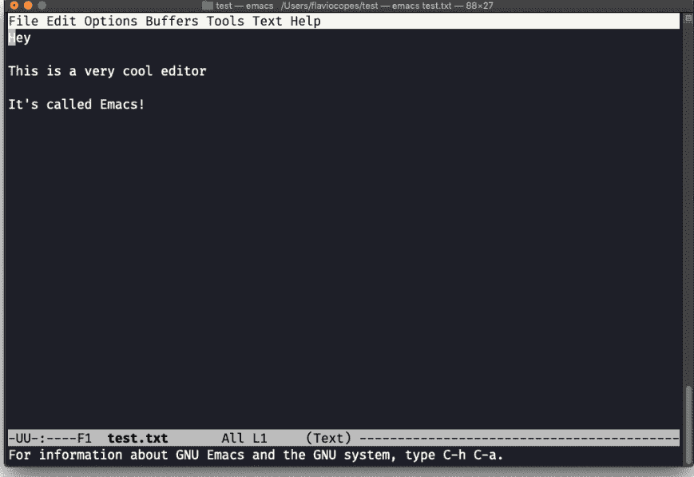

你可以开始编辑，一旦完成，按下 `ctrl-x` 然后按下 `ctrl-w`。你确认文件夹：


```
File Edit Options Buffers Tools Minibuf Help
嘿
这是一个非常酷的编辑器
它叫 Emacs!

--UU:---F1 test.txt      All L7      (Text) ---------------------
写入文件: ~/test/
```

然后 Emacs 会告诉你该文件已存在，并询问你是否覆盖它：

```
File Edit Options Buffers Tools Text Text Help
嘿
这是一个非常酷的编辑器
它叫 Emacs!

--UU:---F1 test.txt      All L7      (Text) ---------------------
文件 './~/test/test.txt' 存在；是否覆盖？ (y 或 n)
```

101

回答 y，你就会收到成功的确认：

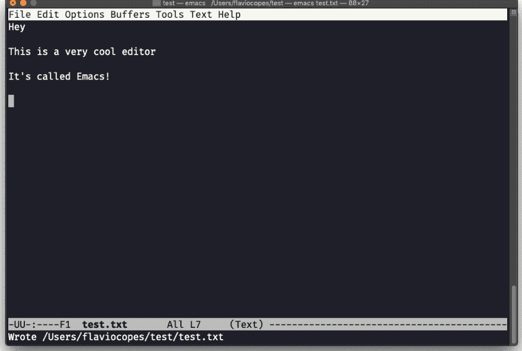

你可以通过按下 `ctrl-x` 后再按下 `ctrl-c` 来退出 Emacs。或者按下 `ctrl-x` 后再按下 `c`（按住 `ctrl` 键）。

关于 Emacs 有很多需要了解的内容。我在这简短的介绍中无法写完。我鼓励你打开 Emacs，并按下 `ctrl-h r` 打开内置手册，按下 `ctrl-h t` 打开官方教程。

## nano

nano 是一个对初学者友好的编辑器。

使用 `nano <filename>` 运行。

你可以直接通过 `ctrl-X` 输入。如果你编辑了文件缓冲区，编辑器会向你请求确认，你可以保存修改，也可以丢弃它们。底部的帮助信息显示了让你能够操作文件的键盘命令：

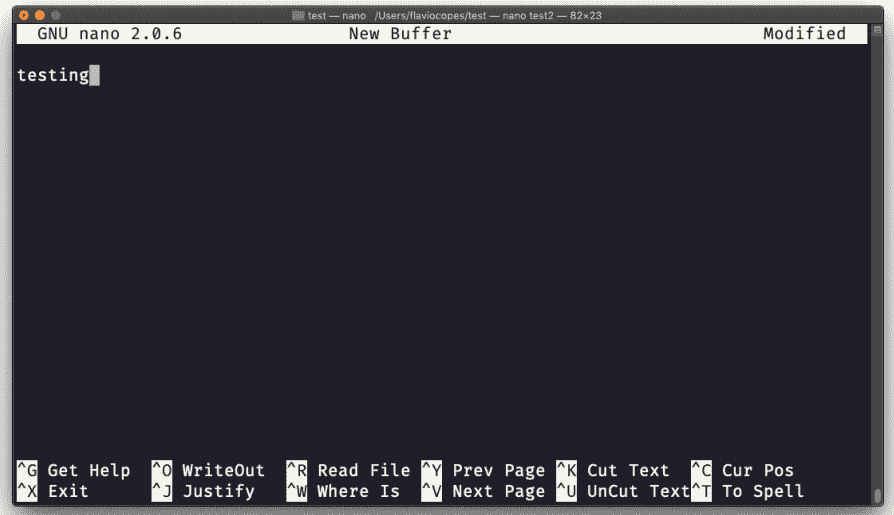

pico 与之大体相同，尽管 nano 是 pico 的 GNU 版本，而 pico 在历史上的某个时期并不是开源的，nano 的克隆版是为了满足 GNU 操作系统的许可证要求而创建的。

## whoami

输入 `whoami` 可以打印当前登录到终端会话的用户名：

```
flavio — fish /Users/flavio — -fish — 35x5
~ whoami
flavio
~ ~
```

> 注意：这与 `who am i` 命令不同，后者会打印更多信息。

## who

`who` 命令显示登录到系统的用户。

除非你正在使用多人可以访问的服务器，否则你可能是唯一的登录用户，且登录了多次：

```bash
flavio - fish /Users/flavio -fish — 53×7
→ ~ who
flavio console Aug 13 12:52
flavio ttys004 Sep 2 12:22
flavio ttys006 Sep 2 12:26
flavio ttys007 Sep 3 11:39
flavio ttys013 Aug 28 16:49
→ ~
```

```为什么会有多次？因为每个打开的 shell 都会被计为一次访问。

你可以看到所使用的终端名称，以及会话启动的时间/日期。

`-aH` 标志告诉 `who` 显示更多信息，包括空闲时间和终端的进程 ID：

| USER | LINE | WHEN | IDLE | PID | COMMENT |
|---|---|---|---|---|---|
| reboot | | Aug 13 12:52 | | 00:01 | |
| flavio | console | Aug 13 12:52 | old | 167 | |
| flavio | ttys000 | Aug 16 18:39 | old | 70258 | term=0 exit=0 |
| flavio | ttys004 | Sep 2 12:22 | | 71365 | |
| flavio | ttys005 | Sep 2 12:26 | 00:41 | 71675 | |
| flavio | ttys007 | Sep 3 11:39 | 00:01 | 82656 | |
| flavio | ttys008 | Aug 21 14:33 | 04:15 | 25883 | term=0 exit=0 |
| flavio | ttys009 | Aug 25 15:36 | old | 52214 | term=0 exit=0 |
| flavio | ttys010 | Aug 23 16:32 | | 38649 | term=0 exit=0 |
| flavio | ttys011 | Aug 21 10:20 | | 18855 | term=0 exit=0 |
| flavio | ttys013 | Aug 28 16:49 | 01:33 | 5086 | |

```特殊的 `who i` 命令将列出当前的终端会话：

```
flavio — fish /Users/flavio —-fish — 45x5
~ who i
flavio ttys004 Sep 2 12:22
```

```
flavio — fish /Users/flavio —-fish — 66x5
~ who -aH i
USER LINE WHEN IDLE PID
flavio ttys004 Sep 2 12:22 71365
```

## su

当你以一个用户的身份登录终端 shell 时，你可能需要切换到另一个用户。

例如，你以 root 身份登录执行某些维护，但然后你想切换到一个用户账户。

你可以通过 `su` 命令做到：

```
su <username>
```

例如：`su flavio`。

如果你以用户身份登录，运行不带其他参数的 `su` 将提示你输入 root 密码，因为那是默认的。

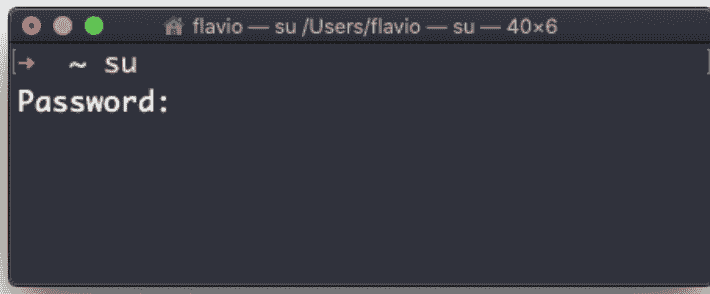 将以另一个用户的身份启动一个新的 shell。

当你完成后，在 shell 中输入 `exit` 将关闭该 shell 并返回到当前用户的 shell。

## sudo

`sudo` 通常用于以 root 身份运行命令。

你必须启用才能使用 `sudo`，一旦启用，你就可以输入用户的密码（不是 root 用户密码）来以 root 身份运行命令。

权限是高度可配置，这在多用户服务器环境中非常棒，某些用户可以通过 `sudo` 被授予运行特定命令的权限。

例如，你可以编辑系统文件：

```
sudo nano /etc/hosts
```

否则由于你没有权限，保存将失败。

你可以运行 `sudo -i` 来启动 root 身份的 shell：

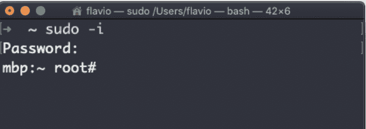

你可以使用 `sudo` 以任何用户的身份运行命令。`root` 是默认的，但使用 `-u` 选项指定另一个用户：

```
sudo -u flavio ls /Users/flavio
```

## passwd

Linux 用户都分配了密码。你可以使用 `passwd` 命令更改密码。

这里有两种情况。

第一种是你想要更改自己的密码。在这种情况下，你输入：

```
passwd
```

交互式提示会要求你输入旧密码，然后要求你输入新密码：

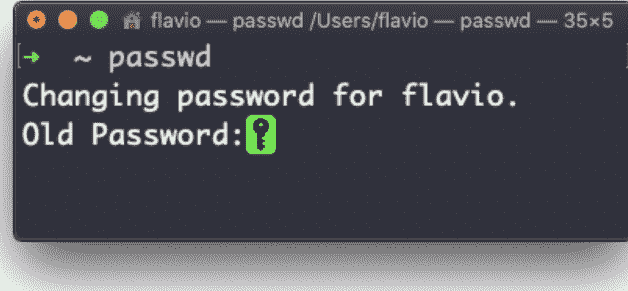

当你是 `root`（或具有超级用户权限）时，可以设置想要更改密码的用户名：

```
passwd <username> <new password>
```

在这种情况下，你不需要输入旧密码。

## ping

`ping` 命令用于 ping 本地网络或互联网上的特定网络主机。

你使用的语法是 `ping <host>`，其中 `<host>` 可以是域名或 IP 地址。

这里有一个 ping `google.com` 的示例：

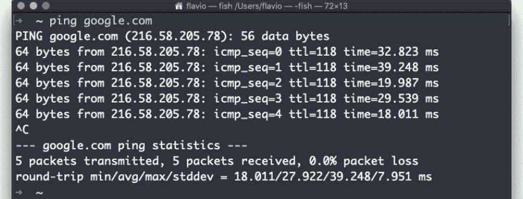

命令向服务器发送请求，服务器返回响应。

`ping` 默认每秒持续发送一次请求，直到你用 `ctrl-C` 停止它，除非你通过 `-c` 选项传递你想要尝试的次数：`ping -c 2 google.com`。

一旦 `ping` 停止，它将打印结果的统计信息：丢包率。

```
ping flavopes.com (167.99.137.12): 56 data bytes
Request timeout for icmp_seq 0
Request timeout for icmp_seq 1
Request timeout for icmp_seq 2
Request timeout for icmp_seq 3
^C
--- flavopes.com ping statistics ---
4 packets transmitted, 0 packets received, 100.0% packet loss
```

有时这样做是有故意的，为了“隐藏”服务器，或者为了减少负载。ping 包也可以被防火墙过滤。

ping 使用 ICMP 协议（互联网控制消息报协议），这是一种类似于 TCP 或 UDP 的网络层协议。

ping 向服务器发送带有 ECHO_REQUEST 消息的包，服务器返回 ECHO_REPLY 消息。我不会详细介绍，但这是基本概念。

## traceroute

当你尝试访问互联网上的主机时，你会经过你的家庭路由器，到达 ISP 网络，然后 ISP 又通过它自己的上游网络路由器，依此类推，直到到达主机。

你是否想知道你的数据包经过了哪些步骤？

`traceroute` 命令正是为此设计的。

你调用：

```
traceroute <host>
```

它将（缓慢地）收集我的博客数据传输的所有信息。

在这个示例中，我尝试通过 `traceroute flavopes` 访问我的博客：

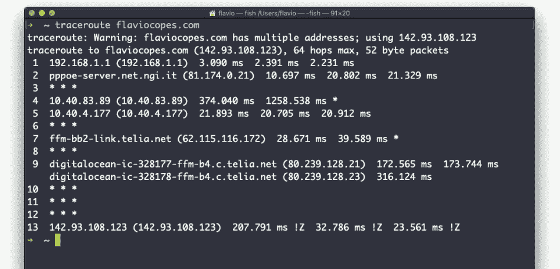

并不是每个经过的路由器都会返回其信息。在这种情况下，`traceroute` 会打印 ***。否则，我们可以看到主机名、IP 地址以及一些性能指标。
```


对于每个路由器我们都能看到 3 个样本，这意味着 `traceroute` 默认会尝试 3 次以获取到达该路由所需的良好指示。这就是为什么执行 `traceroute` 比简单地对该主机执行 `ping` 需要花费的时间。

你可以使用 `-q` 选项自定义这个数字：

```
traceroute -q 1 flaviocopes.com
tracoute: Warning: flaviocopes.com has multiple addresses; using 167.99.137.12
tracoute to flaviocopes.com (167.99.137.12), 64 hops max, 52 byte packets
1 192.168.1.1 (192.168.1.1) 6.441 ms
2 ppoae-server.neg.gi (81.174.0.21) 17.438 ms
3 *
4 10.40.83.89 (10.40.83.89) 30.463 ms
5 10.40.4.177 (10.40.4.177) 22.037 ms
6 mro-b2-link.telia.net (62.115.57.249) 20.573 ms
7 ffm-bb2-link.telia.net (62.115.116.172) 27.682 ms
8 *
9 digitalocean-ic-328178-ffm-b4.c.telia.net (80.239.128.233) 137.439 ms
10 *
11 *
12 *
13 167.99.137.12 (167.99.137.12) 35.460 ms --
~
```

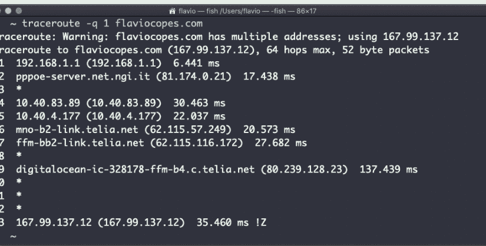

## clear

输入 `clear` 可以清除当前终端中运行的所有先前的命令。

屏幕将清除，你只会看到顶部的提示符：

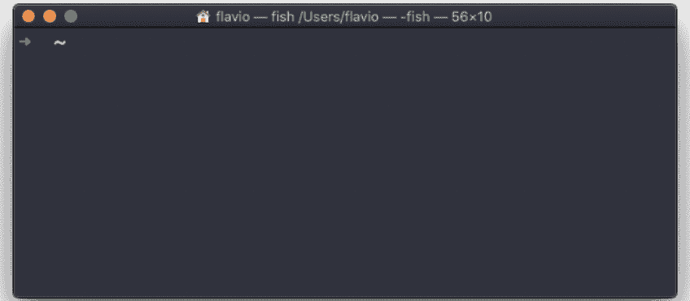

> 注意：此命令有一个实用的快捷键：`ctrl-L`

一旦你执行了该操作，你将失去通过滚动查看之前输入的命令输出的权限。

因此，你可能想使用 `clear -x`，它会清除屏幕，但允许你通过向上滚动来查看之前的工作。

## history

每当我们运行命令时，它都会被记录在历史中。

你可以使用 `history` 显示所有历史：

```
history
```

这会显示带编号的历史记录：

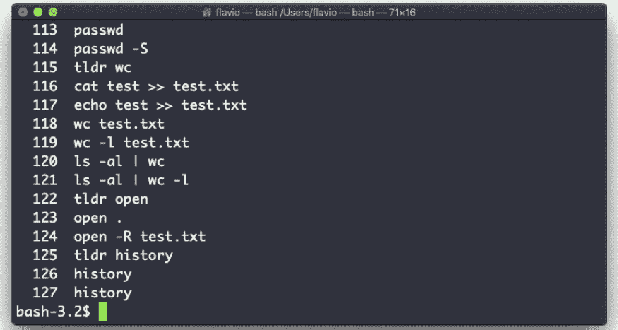

你可以使用 `!command number` 语法来重复历史中存储的命令，在上面的示例中，输入 `!121` 将重复 `ls -al | wc -l` 命令。

通常最后 500 条命令存储在历史记录中。

你可以将其结合 `grep` 来查找你运行过的命令：

```
history | grep docker
```

```
bash-3.2$ history | grep docker
7 git clone https://github.com/docker/getting-started.git
8 git clone https://github.com/docker/getting-started.git
14 docker container stop $(docker container ls)
15 docker container stop $(docker container ls)
16 docker container stop $(docker container ls)
130 history | grep docker
```

要清除历史，运行 `history -c`

## export

`export` 命令用于将变量导出到子进程。

这意味着什么？

假设你如下所示定义了一个变量：

```
TEST="test"
```

你可以使用 `echo $TEST` 打印它的值：


但如果你尝试使用上述命令在 `script.sh` 文件中定义 Bash 脚本：


然后你设置 `chmod +x script.sh` 并通过 `./script.sh` 执行脚本，`echo $TEST` 将什么都不打印！这是因为在 Bash 中 `TEST` 变量是定义在本地的。执行脚本或另一个命令时，启动了子 shell，它不包含当前的本地变量。

为了让那里有变量，我们需要如下定义：

```
TEST="test"
```

而是如下方式：

```
export TEST="test"
```

尝试那样，现在运行 `./script.sh` 应该打印 "test"：


有时你需要向变量添加内容。这通常通过 `PATH` 变量完成：

```
export PATH=$PATH:/new/path
```

在创建新变量时使用 `export` 是很常见的，也用于创建 Bash 的 `.bash_profile` 或 `.bashrc` 文件，或在 Zsh 的 `.zshrc` 中。

移除变量，使用 `-n` 选项：

```
export -n TEST
```

不带任何选项调用 `export` 将列出所有导出的变量。

## crontab

Cron任务是在按特定间隔运行的任务。它们非常强大，特别是在服务器上执行维护和自动化。

`crontab` 命令是处理 cron任务的入口。

你可以做的第一件事是探索定义了哪些 cron任务：

```
crontab -l
```

你可能没有任何，例如：


运行

```
crontab -e
```

来编辑 cron任务并添加新的。默认情况下这会用默认编辑器打开，通常是 `vim`。我更喜欢 `nano`，你可以使用这一行使用不同的编辑器：

```
EDITOR=nano crontab -e
```

现在你可以为每个 cron任务添加一行。定义 cron任务的语法有点吓人。这就是为什么我通常使用网站来生成它以避免错误：https://crontab-generator.org/


Darwin（内核）版本是 macOS 内核的名字。内核是操作系统的“核心”，而整个操作系统被称为 macOS。

你为 cron任务选择一个时间间隔，并输入执行的命令。我选择每 12 小时运行一次位于 /Users/flavio/test.sh 的脚本。这是我需要运行的 crontab 行：

```
* */12 * * * /Users/flavio/test.sh >dev/null 2>&1
```

我运行 `crontab -e`：

```
EDITOR=nano crontab -e
```

添加该行，然后按 `ctrl-X` 并按 `y` 保存。如果一切顺利，cron任务就设置好了：


完成后，你可以通过运行以下命令查看活跃 cron任务的列表：

```
crontab -l
```


你可以再次运行 `crontab -e` 来移除 cron任务，删除该行并退出编辑器：

```
GNU nano 2.0.6 File: /tmp/crontab Modified
Save modified buffer (ANSWERING "No" WILL DESTROY CHANGES?) Y N No ^C Cancel
```

```
bash-3.2$ EDITOR=nano crontab -e
crontab: installing new crontab
bash-3.2$ crontab -l

bash-3.2$
```

## uname

不带任何选项调用 `uname` 将返回操作系统的代号：

```
flavio — fish /Users/flavio —fish —448
→ ~ uname
Darwin
→ ~
```

`-m` 选项显示硬件名称（示例中为 `x86_64`），`-p` 选项打印处理器架构名称（示例中为 `i386`）：

```
flavio — fish /Users/flavio —fish —448
→ ~ uname -mp
x86_64 i386
→ ~
```

`s` 选项打印操作系统名称。`r` 打印发布，`v` 打印版本：

```
flavio — fish /Users/flavio —fish —448
→ ~ uname -srv
Darwin 19.6.0 Kernel Version 19.6.0:
Thu Jun 18 20:49:00 PDT 2020; root:xnu-6153.141
~1/RELEASE_X86_64
→ ~
```

`n` 选项打印节点名称：

```
flavio — fish /Users/flavio —fish —448
→ ~ uname -n
webp.local
→ ~
```

`a` 选项打印所有可用信息：

在 macOS 上你还可以使用 `sw_vers` 命令打印关于 macOS 系统的更多信息。请注意这与 Darwin（内核）版本不同。


你可以传递一个环境变量：

```
env -i NAME=flavio node app.js
```

输出将是：

```
flavio
undefined
```

移除 `-i` 选项将使程序内部再次可以使用 `PATH`：

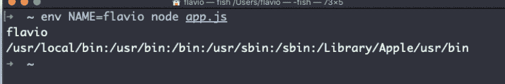

`env` 命令在不带任何选项运行时，也可以用于打印出所有的环境变量：

```
env
```

它将返回一个已设置的环境变量列表，例如：

```
HOME=/Users/flavio
LOGNAME=flavio
PATH=/usr/local/bin:/usr/bin:/bin:/usr/sbin:/sbin:/Library/Apple/bin
PWD=/Users/flavio
SHELL=/usr/local/bin/fish
```

你还可以使用 `-u` 选项让变量在运行的程序内部变得不可访问，例如，这段代码从命令行环境中移除了 `HOME` 变量：

```
env -u HOME node app.js
```

## printenv

关于 `printenv` 命令的快速指南，该命令用于打印环境变量的值。

在任何 shell 中都有大量的环境变量，它们由系统设置，或者由自己的 shell 脚本和配置设置。

你可以使用 `printenv` 命令将它们全部打印到终端。输出大致如下：

```
HOME=/Users/flavio
LOGNAME=flavio
PATH=/usr/local/bin:/usr/bin:/bin:/usr/sbin:/sbin:/Library/Apple/bin/bin
PWD=/Users/flavio
SHELL=/usr/local/bin/fish
```

通常还会多出几行。

你可以将变量名作为参数追加，仅显示该变量的值：

```
printenv PATH
```

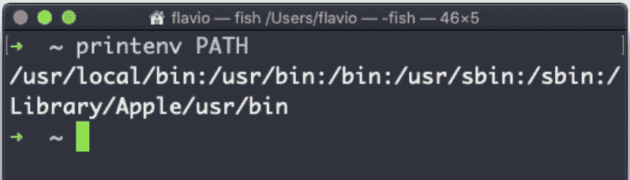

# 结

非常感谢阅读本书。

我希望它能激励你了解更多关于 Linux 及其功能。

想了解更多信息，请访问我的博客 flaviocopes.com。

请向 hey@flaviocopes.com 发送任何反馈、错漏或意见。
