# Linux 秘籍（第2版）：日常使用技巧与技法

旧金山

No Starch Press 及 No Starch Press 徽标是 No Starch Press 的注册商标。Linux 是 Linus Torvalds 的注册商标。本书通篇使用了商标名称。我们并未在每次出现商标名称时都加注商标符号，而是仅以编辑性方式使用这些名称，以尊重商标所有人的权益，并无意侵犯商标。

## 关于本书所用字体的说明

本书使用的字体家族名为 Computer Modern。这些字体由 Donald E. Knuth 为其 TeX 排版系统设计，是自由字体，详见《计算机与排版》系列 E 卷《Computer Modern Typefaces》（Addison-Wesley，1986 年）。

本书是使用它所介绍的自由软件工具撰写和制作的。它由 Texinfo 准备而成，Texinfo 是一种使用 TeX 生成排版输出的文档系统。Texinfo 输入文件在 GNU Emacs 中编写，屏幕截图使用 ImageMagick 工具套件拍摄和处理。DVI 输出通过 Tomas Rokicki 的 Dvips、GNU Ghostscript 和 Angus Duggan 的 PostScript 工具转换为 PostScript 以供打印。所用系统是一台 1,000 MHz 686 个人计算机，运行 Debian GNU/Linux 3.0。

## 更新

请访问 http://www.nostarch.com/1cbk2.htm 获取更新、勘误和其他信息。

## 关于作者

Michael Stutz 是第一个将 Linux 的“开源”方法论应用于非软件作品的人，也是主流媒体中最早报道 Linux 和自由软件运动的记者之一。他十多年来一直只使用 Linux。

## 5. 文件和目录

### 5.1 为文件和目录命名

#### 5.1.1 创建空文件

#### 5.1.2 创建目录

#### 5.1.3 创建目录树

#### 5.1.4 使用名称中包含空格的文件

### 5.2 更改目录

#### 5.2.1 更改到你的主目录

#### 5.2.2 更改到你上次访问的目录

#### 5.2.3 获取当前目录的名称

### 5.3 列出目录

#### 5.3.1 以彩色列出目录

#### 5.3.2 列出文件类型

#### 5.3.3 列出文件属性

#### 5.3.4 列出隐藏文件

#### 5.3.5 以列形式列出目录

#### 5.3.6 按排序顺序列出文件

#### 5.3.7 列出子目录

### 5.4 复制文件和目录

#### 5.4.1 复制文件及其属性

#### 5.4.2 复制子目录

#### 5.4.3 通过唯一父目录复制文件

### 5.5 移动文件和目录

#### 5.5.1 将文件名更改为小写

#### 5.5.2 重命名具有相同扩展名的多个文件

### 5.6 删除文件和目录

#### 5.6.1 删除名称奇怪的文件

#### 5.6.2 交互式删除文件

#### 5.6.3 无需验证即可删除文件

### 5.7 为文件提供多个名称

### 5.8 使用模式指定文件名

### 5.9 列出目录树图

### 5.10 浏览文件和目录

## 6. 分享文件

### 6.1 组内协作

#### 6.1.1 列出可用组

#### 6.1.2 列出用户所属的组

#### 6.1.3 列出组的成员

### 6.2 文件所有权

#### 6.2.1 确定文件的所有者

#### 6.2.2 更改文件的所有者

### 6.3 控制文件访问

#### 6.3.1 列出文件权限

#### 6.3.2 更改文件权限

#### 6.3.3 写保护文件

#### 6.3.4 使文件私有

#### 6.3.5 使文件公开

#### 6.3.6 使文件可执行

## 7. 查找文件

### 7.1 查找匹配模式的所有文件

### 7.2 在目录树中查找文件

#### 7.2.1 按名称在目录树中查找文件

#### 7.2.2 按大小在目录树中查找文件

#### 7.2.3 按访问时间在目录树中查找文件

#### 7.2.4 按更改时间在目录树中查找文件

#### 7.2.5 按修改时间在目录树中查找文件

#### 7.2.6 按所有者在目录树中查找文件

#### 7.2.7 对找到的文件运行命令

#### 7.2.8 按多个条件查找文件

### 7.3 查找目录

### 7.4 在目录列表中查找文件

#### 7.4.1 查找目录中最大的文件

#### 7.4.2 查找目录中最小的文件

#### 7.4.3 查找最小的目录

#### 7.4.4 查找最大的目录

#### 7.4.5 查找列表中的文件数量

### 7.5 查找程序所在位置

## 8. 管理文件

### 8.1 获取文件信息

#### 8.1.1 确定文件的类型和格式

#### 8.1.2 确定程序的类型

#### 8.1.3 列出文件上次修改时间

#### 8.1.4 更改文件的修改时间

### 8.2 将文件拆分为更小的文件

### 8.3 比较文件

#### 8.3.1 确定两个文件是否不同

#### 8.3.2 确定两个目录是否不同

#### 8.3.3 查找文件之间的差异

#### 8.3.4 查看一组文件的差异

#### 8.3.5 查找目录之间的差异

#### 8.3.6 查找两个文件不同的百分比

#### 8.3.7 用差异报告修补文件

### 8.4 使用文件压缩

#### 8.4.1 压缩文件

#### 8.4.2 解压缩文件

#### 8.4.3 查看压缩文件中的内容

### 8.5 管理文件归档

#### 8.5.1 创建文件归档

#### 8.5.2 列出归档内容

#### 8.5.3 从归档中提取文件

### 8.6 跟踪文件的修订

#### 8.6.1 检入文件修订版

#### 8.6.2 检出文件修订版

#### 8.6.3 查看文件的修订日志

#### 8.6.4 检入多个文件

## III. 文本

### 9. 查看文本

#### 9.1 浏览文本

##### 9.1.1 浏览文本文件

##### 9.1.2 带提示浏览文本

##### 9.1.3 从底部浏览文本文件

##### 9.1.4 浏览原始文本

##### 9.1.5 浏览多个文本文件

#### 9.2 显示文本

##### 9.2.1 显示非打印字符

##### 9.2.2 显示文本的开头部分

##### 9.2.3 显示文本的结尾部分

##### 9.2.4 显示文本的中间部分

##### 9.2.5 显示字符串之间的文本

##### 9.2.6 显示文本的字面字符

##### 9.2.7 显示文本的十六进制值

#### 9.3 查看特殊类型的文本

##### 9.3.1 查看 HTML 格式的文本

##### 9.3.2 查看 NROFF 格式的文本

##### 9.3.3 查看 C 程序源代码

##### 9.3.4 查看排序后的文本行

##### 9.3.5 查看带下划线的文本


### 9.3.6 在二进制文件中列出文本 ...................... 228

### 9.3.7 查看字符集 ........................... 228

## 10. 编辑文本 ................................... 231

### 10.1 使用 Emacs ..................................... 232

#### 10.1.1 熟悉 Emacs .................... 232

#### 10.1.2 运行 Emacs 教程 ....................... 237

#### 10.1.3 使用基本的 Emacs 编辑键 .................. 237

#### 10.1.4 在 Emacs 中插入特殊字符 ........... 239

#### 10.1.5 在 Emacs 中创建缩写 ................... 242

#### 10.1.6 在 Emacs 中录制和运行宏 ........... 243

#### 10.1.7 同时查看多个 Emacs 缓冲区 .......... 244

### 10.2 使用 Vi ........................................ 244

#### 10.2.1 熟悉 Vi ...................... 245

#### 10.2.2 运行 Vi 教程 ........................... 247

#### 10.2.3 使用基本的 Vi 编辑键 ..................... 248

#### 10.2.4 在 Vi 中插入特殊字符 .............. 251

#### 10.2.5 在 Vi 中运行命令 ......................... 251

#### 10.2.6 在 Vi 中插入命令输出 .................. 251

#### 10.2.7 自定义 Vi ............................... 252

### 10.3 操作文本选区 .................... 253

#### 10.3.1 剪切文本 .................................. 254

#### 10.3.2 粘贴文本 .................................. 254

### 10.4 使用标记 .................................... 254

### 10.5 编辑文本流 ............................ 255

### 10.6 连接文本 .................................... 256

#### 10.6.1 将文本写入文件 ............................... 258

#### 10.6.2 将文本追加到文件 ............................ 258

#### 10.6.3 在文件开头插入文本 ........... 259

### 10.7 从其他文件包含文本 ....................... 261

### 10.8 使用其他文本编辑器 .............................. 263

## 11. 语法和参考 ............ 275

### 11.1 拼写检查 ........................................ 275

#### 11.1.1 查找单词的正确拼写 ............. 275

#### 11.1.2 列出文本中的拼写错误 .................... 276

#### 11.1.3 维护拼写词表 ....................... 277

#### 11.1.4 交互式拼写检查 ......................... 278

#### 11.1.5 在 Emacs 中进行拼写检查 ............................ 280

### 11.2 使用词典 .................................... 282

#### 11.2.1 列出匹配模式的单词 ................. 283

#### 11.2.2 列出单词的定义 ................... 284

#### 11.2.3 列出单词的同义词 ...................... 284

#### 11.2.4 列出单词的反义词 ...................... 285

#### 11.2.5 列出单词的上位词 ..................... 285

#### 11.2.6 查询在线词典 ....................... 285

### 11.3 检查语法 ...................................... 286

#### 11.3.1 检查文本中误用的短语 ................... 286

#### 11.3.2 检查文本中重复的单词 ..................... 288

#### 11.3.3 检查文本的可读性 ....................... 288

#### 11.3.4 检查文本中困难的句子 ............... 289

#### 11.3.5 检查文本中过长的句子 .................... 289

### 11.4 使用参考文件 ................................. 289

#### 11.4.1 查阅词表和有用的文件 ............ 290

#### 11.4.2 翻译常用缩写 ....................... 292

## 12. 分析文本 ........................ 293

### 12.1 计数文本 ....................................... 293

#### 12.1.1 统计文本中的字符数 .................. 294

#### 12.1.2 统计文本中的单词数 ....................... 294

#### 12.1.3 统计文本中的行数 ....................... 294

#### 12.1.4 统计某物的出现次数 .............. 295

#### 12.1.5 统计文本选区 ....................... 295

## 13. 格式化文本 .................... 305

### 12.2 在文本中列出单词 ........................... 297

#### 12.2.1 列出文本中的所有单词 297

#### 12.2.2 按字母顺序列出文本中的单词 298

#### 12.2.3 仅列出文本中的唯一单词 ........... 298

#### 12.2.4 统计文本中单词出现次数 ........ 299

#### 12.2.5 统计文本中选定单词出现次数 .... 300

### 12.3 在文本中查找相关性 .................... 301

#### 12.3.1 查找相似或相关的文本 ............. 301

#### 12.3.2 在 Emacs 中列出相关文件 ............... 302

### 13.1 调整文本间距 .................................... 305

#### 13.1.1 删除文本中的多余空格 .............. 305

#### 13.1.2 单倍行距文本 .......................... 306

#### 13.1.3 双倍行距文本 .......................... 307

#### 13.1.4 三倍行距文本 .......................... 307

#### 13.1.5 为文本添加换行 ................... 308

#### 13.1.6 为文本添加边距 ....................... 308

#### 13.1.7 交换制表符和空格字符 ............ 309

#### 13.1.8 删除或替换换行字符 ..... 310

#### 13.1.9 删除回车字符 .......... 310

### 13.2 对齐文本 ............................... 311

#### 13.2.1 左对齐文本 ......................... 311


#### 13.2.2 右对齐文本 ........................ 311

#### 13.2.3 居中对齐文本 ....................... 312

### 13.3 分页文本 ............................... 312

#### 13.3.1 使用自定义页长分页 ........ 313

#### 13.3.2 使用自定义页宽分页 ......... 313

#### 13.3.3 使用自定义页眉分页 .............. 314

## 13.6 排序文本 ................................... 320

#### 13.6.1 不考虑间距排序文本 ........... 321

#### 13.6.2 不区分大小写排序文本 .............. 321

#### 13.6.3 按数字顺序排序文本 ................ 322

#### 13.6.4 按目录顺序排序文本 .............. 322

## 13.7 列式化文本 ............................... 322

#### 13.7.1 从单独文件粘贴文本列 ... 322

#### 13.7.2 从单独文件列式化文本 ........ 323

#### 13.7.3 列式化列表 ........................... 323

#### 13.7.4 从文本中删除列 ................... 324

## 13.8 为文本编号行 ......................... 326

## 13.9 下划线文本 ................................ 327

#### 13.9.1 在文本中放置下划线 ................... 328

#### 13.9.2 转换文本中的下划线 ................ 328

#### 13.9.3 从文本中删除下划线 ................ 329

## 13.10 反转文本 ................................. 330

#### 13.10.1 反转文本行 ...................... 330

#### 13.10.2 反转行上的字符 ........... 331

## 14. 搜索文本 ................................... 333

#### 14.1 在文本中搜索单词 ....................... 333

#### 14.2 在文本中搜索短语 ..................... 334

#### 14.3 匹配文本模式 ....................... 335

#### 14.3.1 匹配特定长度的行 ........... 339

- 15.3　使用 TeX ........................................ 372

- 15.3.1　区分 TeX 和 LaTeX 文件 ........ 373

- 15.3.2　处理 TeX 文件 ............................ 374

- 15.3.3　处理 LaTeX 文件 .......................... 374

- 15.3.4　开始使用 TeX 和 LaTeX ............... 375

- 15.3.5　使用 TeX 和 LaTeX 文档模板 ........... 376

- 15.4　使用 LyX ........................................... 378

- 15.4.1　开始使用 LyX ......................... 379

- 15.4.2　了解更多关于 LyX .......................... 381

- 15.5　使用 GROFF ......................................... 383

- 15.5.1　处理 GROFF 文件 .......................... 383

- 15.5.2　确定 GROFF 文件的命令行选项 ... 384

- 15.5.3　运行 GROFF 教程 ......................... 385

- 15.5.4　制作图表或表格 .......................... 385

- 15.6　使用 SGML .......................................... 388

- 15.6.1　编写 SGML 文档 ......................... 389

- 15.6.2　检查 SGML 文档语法 .................... 390

- 15.6.3　从 SGML 生成输出 ...................... 390

- 15.7　使用其他文字处理器和排版系统 .. 391

## 16.　使用字体 ................................. 395

- 16.1　使用 X 字体 ...................................... 395

- 16.1.1　选择 X 字体名称 ........................ 397

- 16.1.2　列出可用的 X 字体 ....................... 397

- 16.1.3　显示 X 字体中的字符 .......... 398

- 16.1.4　调整 Xterm 字体大小 .......................... 398

- 16.2　使用 TeX 字体 ..................................... 398

- 16.2.1　列出可用的 TeX 字体 ..................... 398

- 16.2.2　查看 TeX 字体的示例 .................. 399

- 16.3　使用控制台字体 ................................ 400

- 16.3.1　设置控制台字体 ......................... 400

- 16.3.2　显示控制台字体的字符 ...... 400

- 16.4　使用文本字体 ................................... 400

- 16.4.1　输出水平文本字体 ................. 401

- 16.4.2　输出文本横幅 .......................... 402

- 16.5　使用其他字体工具 .............................. 403

## IV. 图像 ....................................... 405

19.4 将文本转换为图像 . . . . . . . . . . . . . . . . . . . . . . . . . 447

19.5 使用其他图像导入工具 . . . . . . . . . . . . . . . . . . . . . . 449

## 20. PostScript . . . . . . . . . . . . . . . . . . . . . . . . . . . . . . . . . . 451

### 20.1 操作 PostScript 页面 . . . . . . . . . . . . . . . . . . . . . . . . 452

### 20.1.1 将 DVI 页面提取为 PostScript . . . . . . . . . . . . . . . . . . 452

### 20.1.2 从 PostScript 文件中提取页面 . . . . . . . . . . . . . . 452

### 20.1.3 合并 PostScript 页面 . . . . . . . . . . . . . . . . . . . . . . 454

### 20.1.4 将 PostScript 页面排列成印张 . . . . . . . . . . . . 455

### 20.2 操作 PostScript 文档 . . . . . . . . . . . . . . . . . . . 456

### 20.2.1 调整 PostScript 文档大小 . . . . . . . . . . . . . . . . . . . 456

### 20.2.2 合并 PostScript 文档 . . . . . . . . . . . . . . . . . . 457

### 20.2.3 将 PostScript 文档排列成小册子 . . . . . . . . . . 458


### 20.3 转换 PostScript
### 20.3.1 将 PostScript 转换为 PDF
### 20.3.2 将 PostScript 转换为纯文本

## V. SOUND
## 21. 播放和录制声音
### 21.1 调整音频控件
### 21.1.1 列出当前音频设置
### 21.1.2 更改音量级别
### 21.1.3 静音音频设备
### 21.1.4 选择音频录制源
### 21.2 播放声音文件
### 21.2.1 播放 Ogg 文件
### 21.2.2 播放流式 Ogg 音频
### 21.2.3 播放 MIDI 文件
### 21.2.4 播放 MOD 文件
### 21.2.5 播放 MP3 文件
### 21.2.6 播放流式 MP3 音频
### 21.3 显示声音文件信息
### 21.3.1 显示 Ogg 文件信息
### 21.3.2 显示 MP3 文件信息
### 21.4 录制声音文件
### 21.5 使用其他声音工具

## 22. 音频光盘
### 22.1 使用音频 CD
### 22.1.1 播放音频 CD
### 22.1.2 暂停音频 CD
### 22.1.3 停止音频 CD
### 22.1.4 随机播放音频 CD 曲目
### 22.1.5 显示音频 CD 信息
### 22.1.6 弹出音频 CD
### 22.2 从音频 CD 采样
### 22.3 刻录音频 CD-R
### 22.4 使用其他音频光盘工具

## 23. 编辑声音文件
### 23.1 操作声音文件中的选择
### 23.1.1 从声音文件中剪切部分
### 23.1.2 将选择粘贴到声音文件中
### 23.1.3 混合声音文件
### 23.2 应用音效
### 23.2.1 更改声音文件的振幅
### 23.2.2 更改声音文件的采样率
### 23.2.3 为声音文件添加混响
### 23.2.4 为声音文件添加回声
### 23.2.5 为声音文件添加颤音
### 23.2.6 为声音文件添加相位
### 23.2.7 为声音文件添加合唱效果
### 23.2.8 为声音文件添加 Vibro-Champ 效果
### 23.2.9 反转声音文件中的音频
### 23.3 转换声音文件
### 23.3.1 转换 MP3 文件
### 23.3.2 编码 Ogg 文件
### 23.3.3 将 Ogg 转换为其他格式
### 23.4 使用其他声音编辑器

## VI. 生产力
## 24. 磁盘存储
### 24.1 列出磁盘的可用空间
### 24.2 列出文件的磁盘使用情况
### 24.3 使用软盘
#### 24.3.1 格式化软盘
#### 24.3.2 挂载软盘
#### 24.3.3 卸载软盘
### 24.4 使用数据 CD
#### 24.4.1 挂载数据 CD
#### 24.4.2 卸载数据 CD

## 25. 打印
### 25.1 创建和管理打印任务
#### 25.1.1 将打印任务发送到打印机
#### 25.1.2 打印作业的多个副本
#### 25.1.3 列出您的打印任务
#### 25.1.4 取消打印任务
### 25.2 其他可打印的内容
#### 25.2.1 打印打印机测试条
#### 25.2.2 打印 PostScript 文件的特定页面
#### 25.2.3 打印图像
#### 25.2.4 打印网页
#### 25.2.5 打印 DVI 文件
#### 25.2.6 打印 Emacs 缓冲区


#### 25.2.7 打印 Info 节点 .................... 517

## 26. 跨平台转换 ............ 525

### 26.1 使用 DOS 和 Windows 磁盘 .................... 525

#### 26.1.1 列出 DOS 磁盘的内容 .................... 525

#### 26.1.2 在 DOS 磁盘之间复制文件 .................... 526

### 26.2 使用 Macintosh 磁盘 ................................ 527

#### 26.2.1 指定要使用的 Macintosh 磁盘 .................. 527

#### 26.2.2 列出 Macintosh 磁盘的内容 .............. 528

#### 26.2.3 在 Macintosh 磁盘之间复制文件 ..... 528

#### 26.2.4 在 Macintosh 磁盘上删除文件 .................... 528

#### 26.2.5 格式化 Macintosh 磁盘 ....................... 529

### 26.3 挂载 Windows 和 NT 分区 ..................... 529

### 26.4 在 DOS 和 Linux 之间转换文本文件 .............. 530

### 26.5 转换 Microsoft Word 文件....................... 531

#### 26.5.1 将 Word 转换为 LaTeX....................... 532

#### 26.5.2 将 Word 转换为纯文本 ................... 533

### 26.6 从专有格式转换文本 .............. 533

### 26.7 管理 ZIP 归档 ............................... 533

#### 26.7.1 压缩文件 ...................................... 534

#### 26.7.2 解压缩文件 .................................... 535

### 26.8 使用其他跨平台转换工具 ............ 535

## 27. 提醒............................................... 537

### 27.1 显示日期和时间........................... 537

#### 27.1.1 显示一年中的某天................... 538

#### 27.1.2 显示小时中的分钟 ............... 538

### 27.2 播放可听的时间通知 ................... 539

### 27.3 使用日历 ...................................... 539

#### 27.3.1 显示日历 ............................ 539

#### 27.3.2 在 Emacs 中显示日历 ................... 541

### 27.4 管理约会 ............................... 542

#### 27.4.1 创建约会文件 ....................... 543

#### 27.4.2 在提醒中包含假日 ............. 544

#### 27.4.3 自动约会交付 .................. 545

### 27.5 使用联系人管理器 .............................. 546

#### 27.5.1 保留自由格式地址列表................. 546

#### 27.5.2 保留联系人管理器数据库 .............. 548

### 27.6 提醒自己事情 .......................... 549

#### 27.6.1 提醒自己何时必须离开.... 550

#### 27.6.2 发送电子邮件提醒给自己 ................ 550

### 27.7 告知他人您已离开 ........................... 551

### 27.8 回顾您今天所做的事情 .......................... 552

### 27.9 使用其他提醒工具 ........................... 553

## VII. 网络 595

### 31. 通讯 597

#### 31.1 连接到互联网 597

#### 31.1.1 设置 PPP 598

#### 31.1.2 启动 PPP 连接 600

#### 31.1.3 停止 PPP 连接 600

#### 31.1.4 查看 PPP 日志 601

#### 31.2 传真 601

#### 31.2.1 发送传真 601

#### 31.2.2 接收传真 603

#### 31.2.3 自动接收传真 603

#### 31.2.4 在传真格式之间转换 604

#### 31.3 通过调制解调器拨号外线 606

#### 31.4 使用其他通讯工具 608

### 32. 电子邮件 611

#### 32.1 发送邮件 612

#### 32.1.1 向同一系统上的用户发送邮件 613

#### 32.1.2 发送文件或命令输出 613

#### 32.1.3 发送目录 613

#### 32.1.4 发送网页 614

#### 32.1.5 编写邮件 616

#### 32.2 接收邮件 617

#### 32.2.1 显示邮件头列表 618

#### 32.2.2 删除邮件 619

#### 32.2.3 恢复已删除邮件 619

#### 32.2.4 回复邮件 620

#### 32.2.5 将邮件保存到文件 620

#### 32.3 使用远程邮件主机 621

#### 32.3.1 使用 Mozilla 收发邮件 621

#### 32.3.2 获取 POP 邮件 622

#### 32.4 管理邮件 622

#### 32.4.1 查看邮件文件夹 622

#### 32.4.2 设置新邮件通知 624

#### 32.4.3 统计邮件数量 625

#### 32.4.4 查看邮件发件人 626

#### 32.4.5 验证电子邮件地址 627

#### 32.4.6 搜索邮件归档 627

#### 32.5 使用邮件附件 628

#### 32.5.1 读取邮件附件 628

#### 32.5.2 发送邮件附件 629

#### 32.6 使用电子邮件签名 631

#### 32.7 使用其他邮件用户代理 631

### 33. 万维网 637

#### 33.1 使用 Mozilla 638

#### 33.1.1 熟悉 Mozilla 638

#### 33.1.2 使用基本的 Mozilla 浏览键 640

#### 33.1.3 创建新的 Mozilla 窗口 642

#### 33.1.4 从 Mozilla 复制链接到剪贴板 642

#### 33.1.5 从 Mozilla 复制电子邮件地址到剪贴板 642

#### 33.1.6 在 Mozilla 中搜索网页源代码 643

#### 33.2 使用 Lynx 643

#### 33.2.1 使用基本的 Lynx 浏览键 643

#### 33.2.2 从 Lynx 保存网页 645

#### 33.2.3 列出页面中的所有链接 646

#### 33.2.4 将网页文本发送到标准输出 646

#### 33.2.5 查看需要授权的站点 647

#### 33.2.6 查看 HTML 选择内容 647

#### 33.2.7 在 Lynx 中指定键绑定 648

#### 33.2.8 使用鼠标操作 Lynx 648

#### 33.3 在 Emacs 中访问网络 649

#### 33.4 从网络查看图像 651

#### 33.5 从网络获取文件 653

#### 33.5.1 下载 URL 654

#### 33.5.2 归档整个网站 654

#### 33.5.3 归档网站的一部分 655

#### 33.5.4 读取网页的头信息 656

#### 33.6 保留浏览器历史记录 656

#### 33.6.1 查看浏览器历史记录 657

#### 33.6.2 在浏览器历史记录中搜索 657

#### 33.7 设置起始页 658

#### 33.8 在文本中列出 URL 659

#### 33.9 编写 HTML 661

#### 33.9.1 为图像标签添加参数 663

#### 33.9.2 转换 HTML 663


#### 33.9.3 验证 HTML 665

#### 33.10 分析网络流量 666

#### 33.11 使用其他网络浏览器 667

### 34. 其他互联网服务 671

#### 34.1 连接到远程主机 671

#### 34.1.1 挂起与远程主机的连接 672

#### 34.1.2 终止与远程主机的连接 673

#### 34.2 在远程主机之间传输文件 673

#### 34.2.1 向远程主机上传文件 675

#### 34.2.2 从远程主机下载文件 676

#### 34.3 使用安全的互联网服务 676

#### 34.3.1 通过安全 Shell 连接到远程主机 677

## 附录 697

## 附录 A. 管理问题 699

- 34.7 与其他用户聊天 688

- 34.7.1 向另一用户的终端发送消息 689

- 34.7.2 拒绝发送到你的终端的消息 690

- 34.7.3 直接与用户聊天 690

- 34.7.4 在 IRC 上聊天 692

- 34.7.5 在 ICQ 上聊天 693

- 34.7.6 使用即时消息服务 694

- A.1 设置硬件 699

- A.1.1 确定哪些硬件兼容 699

- A.1.2 设置系统日期和时间 700

- A.1.3 为某些设备指定挂载点 701

- A.1.4 制作启动软盘 702

- A.1.5 删除主引导记录 702

- A.1.6 设置打印机 703

- A.2 关闭系统 703

- A.2.1 立即关闭 703

- A.2.2 在特定时间关闭 704

- A.2.3 取消关闭 704

- A.2.4 进入维护模式 705

- A.3 管理软件 705

- A.3.1 获取和安装 Linux 发行版 706

- A.3.2 安装 Linux 发行版的软件包 707

- A.3.3 安装源代码软件包 707

- A.3.4 安装 Shell 脚本 708

- A.4 管理 DEB 软件包 709

- A.4.1 列出 DEB 软件包 710

- A.4.2 安装 DEB 软件包 711

- A.4.3 升级 DEB 软件包 711

- A.4.4 移除 DEB 软件包 713

- A.4.5 获取 DEB 软件包的状态 713

- A.4.6 列出 DEB 软件包中的所有文件 713

- A.4.7 列出文件所属的 DEB 软件包 714

- A.4.8 列出 DEB 软件包的依赖关系 714

### A.5 管理 RPM 软件包 714

- A.5.1 列出 RPM 软件包 715

- A.5.2 安装 RPM 软件包 715

- A.5.3 升级 RPM 软件包 715

- A.5.4 移除 RPM 软件包 716

- A.5.5 获取 RPM 软件包的状态 716

- A.5.6 列出 RPM 软件包中的所有文件 716

- A.5.7 列出文件所属的 RPM 软件包 716

- A.5.8 列出 RPM 软件包的依赖关系 717

### A.6 管理用户 717

- A.6.1 创建用户账户 717

- A.6.2 查看系统中存在哪些用户 717

- A.6.3 允许用户访问硬件外设 718

- A.6.4 允许用户挂载驱动器 718

### A.7 显示有关系统的信息 718

- A.7.1 显示系统已运行的时间 719

- A.7.2 显示 CPU 类型 719

- A.7.3 显示内存使用情况 720

- A.7.4 显示 Linux 版本 720

- A.7.5 显示发行版版本 720

## 附录 B. 常规文件名扩展 723

## 附录 C. 设置你的主目录 727

- C.1 使用目录存放个人二进制文件 727

- C.2 使用目录存放个人列表和数据 728

- C.3 使用目录存放邮件 728

- C.4 使用目录存放项目 729

- C.5 使用目录存放临时文件 729

## 附录 D. 进一步阅读参考资料 731

- D.1 Linux 软件和硬件来源 731

- D.1.1 Linux 发行版 731

- D.1.2 Linux 及相关软件的归档 732

- D.1.3 适用于 Linux 的硬件 732

- D.2 Linux 书籍与指南 733

  - D.2.1 通用 Linux 指南与说明 733

  - D.2.2 Linux 工具与应用指南 734

  - D.2.3 UNIX 与 Linux 历史书籍 736

- D.3 Linux 新闻与评论 737

## 程序索引 739

## 概念索引 747

## 第二修订版前言

这是一本关于如何使用计算机以尽可能最佳、最高效的方式完成工作的书。与烹饪菜谱一样，它为成功制作或完成特定事情提供了经过检验的菜谱。在本书第一版的前言中，我是这样解释的：

我知道 Linux 并不难用，尤其是与其他软件和操作系统相比，但人们需要的是这样一本指南，告诉大家如何使用它来完成事情：“哦，你想做那件事？来，输入这个。”


# I. 使用 Linux

## 1. 引言

在开始“烹饪”之前，我们先在这一章中把一些预备事项讲清楚。本章既说明本书的组织方式，也说明贯穿全书的体例约定。它还会告诉 Linux 新手应从何处入手，以及如果需要更多帮助该如何获取。最后，本章简要介绍了本书主题软件的历史背景。

本书其余部分全部是菜谱，这些菜谱按照它们所执行的任务或处理的对象（如文本、文件、图像等）归类。本书的这一部分介绍使用 Linux 的一般技术和方法，包括如何让系统就绪可用、如何在系统上运行命令、哪些命令是每个 Linux 用户都熟悉的，以及如何使用 Linux 自带的界面。

### 1.1 菜谱

*菜谱*是在 Linux 上完成特定任务的方法。菜谱按章节组织，每一章处理一种特定类型的任务，例如查看文本或编辑图像。章节末尾通常会有提示表，列出与该章主题相关的更多应用程序或工具。

#### 1.1.1 菜谱编号

每份菜谱都通过其*菜谱编号*来引用，编号规则如下：菜谱编号中的第一个数字始终对应章号，第二个数字对应菜谱所属的节或类别。因此，如果第 3 章是 Shell，那么菜谱 3.5 就是关于 Shell 的第五份菜谱。

有时菜谱编号会包含第三个数字。这是为那些范围太广、一份菜谱无法涵盖的主题准备的。例如，菜谱 3.4 [使用你的命令历史]，第 74 页，讲述的是在 shell 中使用命令历史，它被进一步细分为更多菜谱；菜谱 3.4.2 [搜索你的命令历史]，第 75 页，则是关于命令历史的第二份菜谱。

#### 1.1.2 菜谱的准备

每份菜谱描述一种在系统上完成特定任务的方法，而这些任务至少需要一个软件程序。一份菜谱在准备过程中所需的软件程序或文件，就是它的*原料*。

`3.3.6-29.sparc.html` 根据 rpmfind.net 上 XFree86 的页面，该包是 SPARC 平台上 VGA16 显卡的软件包。

这些程序的源代码和二进制文件通常也以未打包的形式提供；如果有的话，其可通过万维网获取的位置已列出。对于既不使用任何一种打包格式的发行版（Slackware 是主要例子），或对于某些程序不存在 DEB 或 RPM 的特殊情况，请使用这些源代码。（有时，主页上仍会以一种或两种打包格式提供源代码。）

网站是短暂的；如果找不到某个程序的源代码包，你始终可以从 Debian 的软件包站点 [`http://packages.debian.org/`] 获取源代码，每个软件包都有自己的页面，其中包含指向其源代码 `.tar.gz` 归档的链接。

- 5. 特殊准备或设置，如有。 如果你必须以超级用户身份运行或需要特殊权限来运行命令，这里会注明。当描述一个可配置的程序时，除非在此另有说明，否则假定使用 Debian 发行版提供的标准设置。

- 6. 适当的“烹饪”方法。

- 7. 关于结果和使用的说明。

- 8. 至少一个在特定上下文中方法的示例，用箭头与正文分隔开。如果示例需要执行多个步骤，则这些步骤将被枚举。当给出多个示例时，每个示例都用项目符号与正文分隔开。

- 9. 标准准备的变体，并附带其他示例。

- 10. 你可能想要接下来执行的额外命令或操作。某些程序接受多个选项来修改其工作方式。有时，工具接受的各种选项会列在表格中。这些列表并不总是详尽无遗；相反，它们包含最流行或有用的选项，或与当前讨论相关的选项。请查阅特定工具的在线手册页以获取完整列表（参见食谱 2.8.4 [从系统手册中读取一页]，第 46 页）。

- 11. 特别的注意事项或兴趣点。

- 12. 进一步信息的来源。

并非所有这些项目都会出现在每条食谱中。

### 1.2 排版约定

在书面作品中展示计算机交互会带来一个特殊问题。在此，描述了本书中使用的约定。

一条食谱通常会给出至少一个动手示例来演示其用法。

⇒ 介绍示例的文字用箭头与正文分开，如下所示。

- - 如果有多个示例，则每个单独的示例都像这样以项目符号列出。

- - 当需要多个独立步骤时，它们会被枚举。

某些食谱中文档或用户名称可能并不总是引用你系统上实际的文档或用户，而是展示所涉及一般原理的示例。因此，当我展示如何打印名为 `resume` 的文件时，你的系统上不一定有该名称的文件，但你应该从中理解如何打印一个文件。

有时，会显示终端屏幕以说明交互式会话：

```
$ 你实际输入的文字以斜体显示，像这样。如果它是要在 shell 提示符下输入的命令，则命令前面会加上一个 $ 字符。

表示程序输出的文字以等宽打字机字体显示，像这样。当有此类输出时，也会给出 shell 提示符以表示程序完成。

$
```

在需要输入的 shell 脚本和其他程序列表周围也会画出边框。

在显示 shell 提示符的示例中，默认当前工作目录在提示符中被省略，仅使用单独的 `$`；当命令输出文本然后退出时，示例的最后一行包含一个 `$` 字符以表示返回到 shell 提示符。别担心，如果这现在听起来很奇怪；所有这些“shell”业务都在第 3 章 [Shell]，第 53 页中进行了说明。

在显示“单行”示例时，不会画出边框，这些示例显示的命令会返回到 shell 提示符而不产生任何输出，或命令

其输出与示例关系不大。这里同样省略了返回的 shell 提示符。

文件或目录的名称在文本中以 `file` 形式出现；命令以 `command` 形式出现，文本字符串排版为“一些文本”；选项、应用程序模式与菜单项、函数名和变量名均使用同一种等宽字体设置。

你应当输入的文本在示例中写作*像这样*。当你需要按下键盘上的某个特定键时，其约定名称会显示在按键框中。例如，⌨ Q 表示键盘上的 Q 键，⌨ RET 表示键盘上用于输入换行的回车键。

因此，当我说“要执行此操作，请输入：”并给出示例命令行时，你实际输入的文本显示为*像这样*，系统输出的文本显示为*像这样*。你需要按下的键（而非字面输入的字符）以按键框形式给出。

⇒ 例如，按 F 键用 ⌨ F 表示，而直接输入大写“F”用 F 表示，输入小写“f”用 f 表示。

在示例中，如果需要同时按下并按住多个键，这些键之间用连字符连接；连字符并不表示需要实际按下。例如，同时按下并按住 ⌨ CTRL、⌨ ALT 和 ⌨ DEL 键，在某些操作系统中具有特定含义（包括 Linux，在该系统中此组合键会关闭系统并重启计算机）；它表示为：

⌨ CTRL - ⌨ ALT - ⌨ DEL

同样，需要依次按下的键之间用空格分隔；空格并不需要实际输入。因此，对于如下按键序列：

⌨ RET ⌨ RET

你需要按一下回车键，然后再按一次回车键，但不要在它们之间输入空格。文本后跟按键时也是如此——例如，在书中，命令与结束命令行的最终 ⌨ RET 之间会出现一个实际的空格，这个空格不应被实际输入（尽管实际输入这个空格通常不会有什么后果）。在明确要求按空格键的地方，该键在示例中表示为 ⌨ SPACEBAR。


在某些键盘上，这个键被标记为“Enter”，而其他一些键盘则只有一个向下然后向左指的箭头，就像老式打字机的回车键。

除少数特殊的三键组合外，`CTRL`（“Control”）键总是与另一个键组合使用。首先按下 `CTRL` 键，在保持按住的同时按下第二个键，然后同时释放两个键。这就是`控制键组合`。控制键在大多数程序中都有特殊含义。例如，“Control-C”组合，即按住 `CTRL` 键再按 `C` 键，是“取消”命令，用于取消或中断正在运行的任何命令。

这些控制键组合在书面表达中有三种表示方式。传统方式是使用脱字符（^）后跟组合中第二个键的大写字母。例如，用这种方式表示“Control-C”就写作 `^C`。这称为`脱字符记法`。

第二种方式是使用 `C-`（表示 `CTRL` 键）后跟第二个键的小写字母。因此，用这种方式表示“Control-C”组合键就写作 `C-c`。GNU Emacs 编辑器及其相应的 GNU 文档使用这种表示法（参见第10.1节 [使用 Emacs]，第232页），所以我称之为`GNU 记法`。

第三种表示控制键组合的方式是直接显示一个 `CTRL` 键，后跟连字符和要按的第二个键。因此，“Control-C”可写作 `CTRL-C`。我称之为`按键记法`，本书通篇使用这种记法。

要输入这些组合键之一，请按住 `CTRL`，按下第二个键，然后同时释放两个键。

⇒ 例如，要输入“Control-D”（可写作 `^D`、`C-d` 或 `CTRL-D`），请按住 `CTRL`，按 `D` 键，然后同时释放两个键。

在某些应用程序中，`META` 键的使用方式与 `CTRL` 相同。GNU 项目程序和文档用 `M-x` 表示 `META` 组合键，其中 x 是组合中的第二个键。当然，当今大多数键盘都没有 `META` 键；当你看到对它的引用时，只需使用 `ALT` 键。在本书中，我会用 `ALT` 而不是 `META` 来表示这些组合键，因为前者才是实际使用中最常见的键。

⇒ 因此，要输入 `M-c`，请按住 `ALT`，按 `C` 键，然后同时释放两个键。

你通常可以通过按下并释放 `⟨ESC⟩`，然后按下第二个键来获得相同的效果。如果你的键盘没有 `⟨ALT⟩` 键，或者你的 `⟨ALT⟩` 没有设置为 `⟨META⟩` 键，就这样做。²

⇒ 若要在不使用 `⟨ALT⟩` 的情况下输入 `M-c`，请按下并释放 `⟨ESC⟩`，然后按下并释放 `⟨C⟩` 键。

`⟨CTRL⟩` 和 `⟨ALT⟩` 序列都不是区分大小写的；也就是说，按大写 C 来执行上一个示例与按下小写 c 是一样的（尽管如果 Caps Lock 关闭，按 c 肯定更容易输入）。在 GNU 记法中，`C-` 或 `M-` 前缀始终以大写字母给出，而其后的键始终以小写字母给出。帽子记法的惯例是控制键始终使用大写字母。

此外，一些程序接受由键组合和序列组合而成的命令，因此连字符和空格表示法可以组合使用。例如，如果一个命令是按下并按住 `⟨CTRL⟩`，按下 `⟨X⟩` 并释放两个键，然后输入小写字母 "q"，这将在文本中表示为：`⟨CTRL⟩-⟨X⟩ q`

最后，关于引号标点的一个说明。在互联网时代，出现了远离美国印刷惯例的趋势，即将尾随标点放在引号之外。理由是计算机无法识别标点是什么，并假设它是被引用的字面字符的一部分。我们操作员不想让机器混淆，所以我们将这个尾随标点放在引号之外。首先它被计算机编程语言采用（据我所知，没有一种语言接受按美国惯例书写的文本），然后在技术手册和计算机书籍中采用，现在它正在其他文献中广泛传播，尤其是在在线出版物中。

但我们人类理解标点，而标点就是为我们而存在的。我们应该建立为我们服务的系统，并按我们打算写的方式打印文字——而不是为了适应齿轮的齿而扭曲我们自己的表达。

## 1.3 本书假设你是谁

本书对你，读者，以及你的 Linux 系统做出了一些假设。

本书假设你对自己的计算机至少有最基本的了解——你知道硬件就是机器本身，而软件就是在上面运行的指令。你不必知道如何拆卸系统之类的，但你应该知道如何操作鼠标，计算机和显示器上的电源按钮在哪里，如何在打印机中装纸等等。如果你需要帮助完成这些任务或理解这些概念，请咨询你的经销商或为你设置计算机的人。

本书还假设你已经安装并正确设置了 Linux，并且在你的系统上设置了自己的用户账户（创建用户账户的说明见 Recipe A.6.1 [Making a User Account]，第 717 页；如果你需要安装和设置的帮助，请参阅 Recipe 1.6 [If You Need More Help]，第 13 页）。本书不假设任何一种 Linux 发行版，文中针对任何一种发行版的特殊性都会被明确指出。

虽然本书可以并且应该被 Linux 新手使用，但我希望我已经对基于 Linux 的系统提供了足够广泛的覆盖，并包含了足够有趣或冷僻的材料，以至于专家、黑客和 Linux 帮派的成员可能会发现其中一些内容新颖有用——并且任何这样的用户都不会为在他的办公桌上或图书馆中拥有一本这本书而感到羞愧。

本书还做出了另一个假设，这对专家和老手来说才重要。正如各位专家所知，`Bash` shell 可以被认为是 Linux 的默认 shell；由于它是这样，因此本书中所有示例都假设使用该 shell。因此，如果你有使用其他 shell 的经验，请注意其中的差异——你可能会发现一些在你喜欢的非 Bash shell 中无法按预期工作的示例（例如，命令 `locate *txt` 在 `Csh` 中将无法按预期工作）。

## 1.4 本书不会向你展示的内容

本书的目的是向人们展示如何使用 Linux 来完成他们所有的日常任务。这是一个广泛的主题，涵盖了大量材料。超出该范围的主题根本不会出现在本书中；其中一些值得提前提及。

本书不会向你展示如何：

1. **安装 Linux。** 没有一本书能做到这一点并保持很长时间的准确性。声称能告诉你如何做的书都是在撒谎。如本章后面所述，Linux 有许多不同的“发行版”，每个发行版都有自己的安装过程。发行版本身也有不同的版本，这些版本一直在变化。而且硬件的千差万别

必须添加到等式中：Dick 在他的戴尔 PC 上安装 Linux 的过程会与 Jane 在她的 Apple iPOD 上安装 Linux 不同，该戴尔 PC 预装了 Windows 2000。如果您是计算机初学者，并且技术上不够熟练，无法安装操作系统并进行必要的硬件调整，那么您的最佳选择如下：

- a. 购买预装 Linux 的计算机。
- b. 请一位精通 Linux 的朋友为您安装。
- c. 将您的系统带到当地的 Linux 用户组（LUG），让他们在您观看的同时为您操作。他们经常为此目的举办“安装节”。

2. **使用专有软件。** 我使用 Linux 并向他人推荐它的原因正是它不是专有的，而是以任何人都可以检查软件、与他人分享并根据自己的需求进行改编的方式发布。我根本不使用专有软件，对它一无所知。因此，本书中不会有任何专有软件。

3. **使用实验性软件。** Linux 可用的软件程序有数千种，我涵盖了其中大部分最流行和重要的软件。我省略的是目前处于“beta”或其他不稳定发布、尚未面向公众的软件包。

4. **保护您的系统。** 安全这一专门主题足够庞大，足以单独成书。

5. **成为系统管理员。** 家庭用户系统管理的基本任务在附录 A [管理问题] 第 699 页中有所描述，这足以让您成功入门；如果需要更详细的说明，您需要一本专门的书籍。我推荐 *Linux System Administrators' Guide*，它应该就在您的系统上可用（有关如何访问它，请参阅 Recipe 2.8.6 [阅读系统文档和帮助文件] 第 50 页）。

6. **管理网络。** 网络种类太多，这通常是技术性的而非用户应用。*Linux Network Administrators Guide* 推荐用于此目的（请参阅附录 D [进一步参考] 第 731 页）。

7. **在软件开发中使用 Linux。** 程序开发、编译和软件项目管理超出了本书的范围。然而，

程序员会发现本书中的许多材料对他的任务很有用。

8. 在其他专业领域使用 Linux。无论您是音乐作曲家、生物化学家、教师、秘书还是其他，本书中的所有内容都应该对您有用。然而，本书不会有“使用 Linux 进行音乐作曲”、“Linux 在生物化学研究中的应用”、“Linux 在课堂上的使用”或“秘书的 Linux 指南”等专门章节，尽管 Linux 在这些领域取得了巨大成功。关于 Linux 在无数特殊领域的使用，已撰写了报告、论文、网站甚至书籍，其应用正在增长。在《食谱》中，我涵盖了使用 Linux 作为通用工具的基础，无论您的具体领域或兴趣如何。

9. 使用非 Linux 系统。本书中描述的大多数自由软件已被移植到其他系统，特别是移植到其他类型的 UNIX。这些食谱在这些系统上或多或少应该有效。然而，这不是《UNIX 食谱》，因此任何非 Linux 用法的特殊性都未涉及——Linux 始终是假定的平台。

## 1.5 首先尝试什么


本书的前四章包含了您开始使用 Linux 所需的所有入门材料。这些是基础知识。初学 Linux 的用户应从这些第一章中描述的概念开始。一旦您学会如何启动系统并登录，您应该浏览一下 shell 章节，至少熟悉在命令提示符下输入；然后，浏览一下称为 X Window System 的图形界面章节，以便您可以启动 X 并从那里运行程序，如果您愿意的话。

一旦您熟悉了 X，您可能想跳到前面阅读文件和目录章节，以了解系统的外观以及如何在其中导航。然后，继续学习如何查看文本，以及如何在编辑器中编辑文本（在查看文本和编辑文本的章节中描述）。在此之后，根据您的需求和兴趣探索本书的其余部分。

⇒ 概括一下，以下是我认为熟悉 Linux 系统基本使用的必备材料：

- 1. 第 1 章 [介绍] 第 3 页（本章）。
- 2. 第 2 章 [每个 Linux 用户都知道的内容] 第 27 页。
- 3. 第 3 章 [Shell]，第 53 页（重点关注前三个部分的主要内容，目前忽略其余部分）。
- 4. 第 4 章 [X Window 系统]，第 95 页（目前忽略配置部分）。
- 5. 第 5 章 [文件和目录]，第 125 页。
- 6. 第 9 章 [查看文本]，第 211 页（主要是关于浏览文本的第一部分）。
- 7. 第 10 章 [编辑文本]，第 231 页（足以选择一个文本编辑器并开始使用它）。

如果您对某个特定程序名称、函数名称或模式名称有疑问，请在程序索引中查找（[程序索引]，第 739 页）。另一个索引，列出配方名称、专有名词和涉及的一般概念，称为概念索引（[概念索引]，第 747 页）。

## 1.6 如果您需要更多帮助

如果您需要的帮助超过本书所能提供的，请记住您还有其他选择。尝试以下获取帮助的步骤：

1. 很可能您并不孤单，有人之前已经问过您的问题；因此，“常见问题解答”汇编中可能有您需要的答案。以下是一些最受欢迎的 Linux 常见问题解答。

`http://faqs.org/faqs/linux/faq/` Linux 常见问题解答。

`http://tinyurl.com/fqe8` 面向 Windows 用户的 Linux 常见问题解答。

`http://debian.org/doc/FAQ/` Debian 常见问题解答。

`http://rhlufaq.synfin.net/` Red Hat Linux 用户常见问题解答。

`http://faqs.org/` Internet 常见问题解答档案馆；包含数百个各种主题的常见问题解答。

2. Linux 文档项目 [`http://linuxdoc.org/`] 是最完整、最及时的 Linux 相关文档的中心；请查看是否有与您需要帮助的主题相关的文档。

3. Usenet 新闻组通常是与其他 Linux 用户讨论问题并获得技术帮助的绝佳场所。（Usenet 在配方 34.4 [`阅读 Usenet`]，第 679 页中有描述）。下表列出了一些可能感兴趣的新闻组。

- `news:comp.os.linux.hardware` 硬件帮助和支持。
- `news:comp.os.linux.help` 通用 Linux 帮助和支持。
- `news:comp.os.linux.setup` Linux 安装帮助。
- `news:alt.os.linux` 主要的 Linux “alt” 新闻组，用于一般帮助（分支包括 Red Hat、Mandrake 和其他发行版的特殊组）。
- `news:linux.debian.user` Debian 用户帮助。

4. 找到您附近的 Linux 用户组（LUG）——参与 LUG 的人员可以成为动手帮助的绝佳来源，而且参与您所在地区其他 Linux 和自由软件爱好者的活动既有趣又有收获。

- `http://www.ssc.com:8080/glue/` GLUE（“世界各地的 Linux 用户组”）
- `http://lugww.counter.li.org/` 全球 Linux 用户组
- `http://www.linux.org/groups/` Linux 用户组

5. 考虑聘请顾问。如果您需要立即完成工作并且愿意为此付费，这可能是一个不错的选择。Linux 顾问 HOWTO 是全球提供 Linux 和开源软件一般支持服务的顾问名单。您的系统上应该有一份副本（请参阅配方 2.8.6 [`阅读系统文档和帮助文件`]，第 50 页）。顾问有各种兴趣和专业领域，他们在该文档中列出了联系信息。

6. 最后，请参阅附录 D [`进一步兴趣参考`]，第 731 页中的建议列表，其中包括可能有帮助的书籍和网站。

## 1.7 Linux 的背景和历史

为了了解 Linux 到底是什么，有助于了解它是如何开始的——Linux 的历史可以追溯到 1991 年 Linus Torvalds 著名地开始着手他的免费操作系统之前。以下是历史概述，简要介绍了本书主题的软件背景。您可以在附录 D [`进一步兴趣参考`]，第 731 页所列的书籍中找到有关此主题的更多信息。

这段历史可以解释 UNIX 的长寿以及为什么它可能以某种形式继续存在——今天是 Linux，明天也许是其他东西。

### 1.7.1 UNIX 的早期岁月

UNIX，Linux 的原始祖先，是一个操作系统。³ 或者至少它曾是一个操作系统；最初被称为 UNIX 本身的系统并不是我们今天所知道和使用的“UNIX”；现在有许多“UNIX 变种”，其中 Linux 已成为最受欢迎的。

UNIX 及其相关软件是 1960 年代的产物，由 Dennis Ritchie、Ken Thompson、Brian W. Kernighan 和 Bell Labs 的其他黑客⁴ 于 1969 年发明；其名称是对当时另一个操作系统 MULTICS 的戏仿。⁵

在 UNIX 的早期，任何有硬件运行它感兴趣的各方都可以从 Bell Labs 以非常 nominal 的费用获得软件磁带，并附带印刷手册。（那是在个人计算时代之前，实际上主要是大学和研究实验室这样做。）当地站点会玩弄软件的源代码（构成

³ 计算机为成功操作所需的软件工具集，包括运行其他程序的手段。

⁴ 虽然术语黑客现在指的是计算机破坏者或入侵者，但最初的计算机含义是指沉迷于编程并因此擅长或善于编程的计算机程序员或技术人员。

⁵ UNIX 这个名字最初写成 UNICS，代表“Uniplex 信息和计算系统”。

software work itself, written in a human-readable language).⁶ 扩展和定制软件以满足他们的需求和喜好。

从 20 世纪 70 年代末开始，加州大学伯克利分校的计算机科学家——UNIX 源代码的被许可方——在研究过程中一直在对 UNIX 源代码进行自己的改进和增强，这些改进包括 TCP/IP 互联网网络的发展。他们的成果被称为 UNIX 的 BSD（“Berkeley Systems Distribution”，伯克利系统发行版）分支。

他们的作品的源代码在许可下公开可用，该许可允许有或无源代码地重新分发，前提是必须注明伯克利对其代码部分的贡献。今天仍有许多原始 BSD 的现代变体在积极开发中，其中一些——例如 NetBSD、OpenBSD 和苹果的 Mac OS X——可以在个人电脑上运行。

## 1.7.2 自由软件运动的起源

多年来，UNIX 的流行度不断增长。但在 AT&T 于 1984 年分拆之后，贝尔实验室提供的源代码磁带成为一种专有商业产品的

software work itself, written in a human-readable language).⁶ extending and customizing the software to their needs and liking.

Beginning in the late 1970s, computer scientists at the University of California, Berkeley, a licensee of the UNIX source code, had been making their own improvements and enhancements to the UNIX source during the course of their research, and those improvements included the development of TCP/IP Internet networking. Their work became known as the BSD ("Berkeley Systems Distribution") flavor of UNIX.


The source code of their work was made publicly available under licensing that permitted redistribution, with source or without, provided that Berkeley was credited for its portion of the code. There are many modern variants of the original `BSD` still actively developed today, and some of them—such as `NetBSD`, `OpenBSD`, and Apple's `Mac OS X`—can run on personal computers.

## 1.7.2 Genesis of the Free Software Movement

Over the years, `UNIX`'s popularity grew. But after the divestiture of `AT&T` in 1984, the tapes of the source code that Bell Labs provided became the basis for a proprietary, commercial product: `AT&T UNIX`. The uppercase word `UNIX` became a trademark of `AT&T` (since transferred to other organizations), to identify its particular operating system.⁷ It was expensive, and didn't come with the source code that showed how it worked and let you fix, extend, or improve it. Even if you paid extra for a copy of the sources, you couldn't share with your programmer colleagues any of the improvements, fixes, or discoveries you made.

By the early 1980s, proprietary software development, by only-for-profit corporations, was quickly becoming the norm—even at the universities. No longer was software source code considered a work of technical literature to be published for an educated public, but these written works were now kept secret and hidden, and in their compiled forms they were put in boxes to be sold as proprietary, commercial products that your system could execute but that you could never read.

⁶ For a computer to make use of these written works, the source code must be run through a compiler, which is a program that uses these writings to output a new file of machine instructions. A software program in compiled form, not readable by man, is called a binary or executable file. Binaries are the files you use when you run a program on the system.

⁷ But today, when people say "`UNIX`," they usually mean "a `UNIX`-like operating system," a generalization that includes Linux.

In 1984, while at the Massachusetts Institute of Technology in Cambridge, Massachusetts, hacker Richard Stallman saw his colleagues gradually move to this proprietary development model. But he could not accept the kind of civilization such proprietism would offer: No sharing your findings with your fellow man, no freedom for anyone to take a look “under the hood” of a published work to understand it or to build upon it, and certainly no general advance. There would not even be a way to improve or extend your own copy of such works, or gain insight from the writings of other programmers. The proprietary model would mean the end of computer software as literature.

Instead of following in the direction that most of computing had taken, Stallman decided to start a project to build and assemble a new `UNIX`-like operating system from scratch, and publish it in written (source code) form. This was the `GNU` Project, whose name stands for itself (“`GNU`’s not `UNIX`”).⁸

Stallman had to devise a way to publish these writings so that others could use them to advance the body of source-code literature, but so that no one could use them as the secret instructions for a software “product.” He could not place them in the public domain, because then he would forfeit all rights given by copyright law, and could not stop others from using this source code in products where the source code is kept secret.


Licensing was developed as a way to expressly give everyone the right to copy, distribute, and modify his copy of the work, though under certain strict terms and conditions. For the GNU Project, Stallman had the General Public License, or GNU GPL,⁹ devised. It formalized through a legal contrivance what had been the common, unspoken practice in the early days of UNIX: Popularly called a copyleft, it permits anyone to copy, distribute, or modify a so-licensed work, provided that all copies are released with the same license, and all changes are documented. Even today it is the most widely used of all such licenses.

This kind of software became known as free software. Stallman formed the Free Software Foundation (FSF), a non-profit corporation, to advance this concept and his GNU Project. The FSF also made copies of the GNU software available for sale as it was developed; individuals and businesses may charge

⁸ No such “official GNU” operating system has yet been released in its entirety, but most people today consider Linux-based free software systems to be the effective realization of Stallman’s goals—hence his famous request for people to call the Linux-based system “GNU/Linux” instead.

⁹ Originally the “Emacs Public License” when first published in 1985; the current GNU GPL is on the Web at `http://www.gnu.org/copyleft/gpl.txt`.

对于自由软件作品的副本，但永远不会有秘密的文字——对于自由软件，任何人都可以阅读源代码。

## 1.7.3 Linux 的到来

在 1990 年代初期，一代新人发现了规模虽小但蓬勃发展的自由软件运动。芬兰计算机科学学生林纳斯·托瓦兹开始对 Minix 进行 hack，Minix 是一种用于个人计算机的迷你类 UNIX 操作系统，当时在大学操作系统课程中使用。^10^ 他决定通过编写自己的内核来改进 Minix 的主要软件组件，内核被称为内核。（内核是任何类 UNIX 操作系统的核心组件。）

10. presumably, they all use Linux now.

1991 年底，托瓦兹在互联网上发布了该内核的第一个版本，并将其命名为“Linux”，这是对 Minix 和他自己名字的双关。^11^

11. This was not the original name, however. Torvalds had originally called it freax, for “free” + “freak” + the obligatory “-x”; while the 1990s were fast becoming the “freaky” alterna decade (at least in fashion), more people seemed to favor “Linux,” and the name stuck.

当托瓦兹发布 Linux 时，他使用了自由软件基金会发布的 copyleft 软件许可证，即 GNU GPL。托瓦兹还邀请其他程序员贡献代码，这些贡献随之而来——起初很缓慢，但随着互联网的增长，来自全球数千名黑客和程序员为他的自由软件项目做出了贡献。

这开启了令人兴奋的开发时期，在整个 1990 年代，Linux 成为计算机世界的热门话题；技术媒体起初忽视了它，而老手们说他们自个人电脑革命开始以来多年未见过类似的东西——它让每个人都有机会工作，并为公共利益做出自己的贡献。换句话说，正如许多观察者所表达的那样，它让计算变得有趣起来！

但即使在这段时间里 Linux 的声誉不断上升，它也并非总是被一些 UNIX 人士和其他怀疑论者认真对待。这可能是部分由于 Linux 运行在配备现成组件的家用电脑上，而 UNIX，像任何“严肃”的操作系统一样，运行在小型计算机和普通人难以企及的强大机器上。

另一个原因可能是，作为“官方” UNIX，Linux 还差一点。POSIX（注册商标，发音为“pahz-icks”）是 IEEE 发布的一项标准，^12^ 它为基本 UNIX 操作系统应具有的特性和功能提供了规范。当 Linux 开始满足这些技术规范，然后最终成为 POSIX 兼容时，Linux 作为一种可行的 UNIX 变体的有效性不容否认，它在过去曾受到强烈抵制的领域获得了认可。

12. The Institute of Electrical and Electronics Engineers, Inc., although everybody just uses the acronym, pronouncing it “I triple E.”

在这些相对较少的几年开发中，Linux 软件得到了极大的扩展和改进，以至于今天基于 Linux 的系统是一个完整、现代的操作系统，与当前可用的任何其他系统相媲美。

## 1.7.4 Debian、Red Hat 和其他 Linux 发行版

仅仅拥有独立的软件程序并不足以让我们在电脑上使用——必须有人把它们全部整合起来。把各个部分组装成一个连贯可用的集合需要时间，进行测试，然后跟上每个软件组件的新发展（其中任何一个的小改动都可能引入新的软件依赖问题或与整体冲突）。Linux 发行版就是这样的集合。你当然可以自己动手，“自制”发行版——由于它都是自由软件，任何人都可以添加或删除内容，并称 resulting concoction 为自己的。大多数人 however 选择将发行版业务留给专家。

发行版有很多，虽然不到半打就构成了所有 Linux 系统的大部分：Debian GNU/Linux、Fedora Linux、Mandrakelinux、Red Hat Enterprise Linux、Slackware Linux 和 SuSE。因此，当人们在谈论 Linux 时提到 Debian、Fedora、Mandrake、Red Hat、Slackware、SuSE 等时，他们谈论的是由这些公司或组织组装和重新包装的 Linux 及相关软件的特定发行版。发行版的核心是相同的——它们都是 Linux 内核、GNU 项目软件以及许多其他自由软件包——但每个发行版都有自己的打包方案、默认值和配置方法。除非另有说明，本书中的配方适用于 Linux 一般，不依赖于特定的发行版。

今天所有主要发行版都是可靠的，你不应在其中任何一个上遇到严重问题。每个都有其忠实用户和拥护者，而一些 Linux 用户喜欢从一个发行版漂移到另一个发行版，尝试它们所有。其中 Debian 具有值得注意的特殊品质。它是唯一一个由志愿者以与 Linux 内核和大多数其他自由软件编写相同开放方式设计和组装的发行版。它也是健壮的（标准 Debian CD-ROM 套装附带的软件比任何其他发行版都多，与

2,500 种不同的软件包），并且在设计上完全致力于自由软件（是的，有一些发行版不是）。在 Debian 的早期，它被称为“黑客发行版”，因为对于 Linux 新手¹³ 来说，安装和管理它非常困难。然而，这已经改变了。

## 1.7.5 企鹅

你肯定在广告和整个网络上都见过“Linux 企鹅”。Larry Ewing 用自由软件 GIMP 图像编辑器制作的企鹅画作已成为 Linux 出现的地方的标志性景象，并且是“官方”的 Linux吉祥物。是的，它有一个名字：Tux。


现在已经存在许多对标准画作的改编。Linus Torvalds 最喜欢的版本实际上与 Linux 内核源代码一起分发，因此如果你的系统已安装 Linux 源代码（它保存在 `/usr/src/linux` 中），你可以在 `/usr/src/linux/Documentation/logo.gif` 看到一个副本；它看起来会像图 1-1。

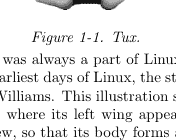

图 1-1. Tux。

虽然看起来他一直是 Linux 的一部分，但 Tux 直到大约 1994 年才出现。在 Linux 的最初日子里，风暴海燕是流行的吉祥物，由 Peter Williams 绘制。这幅插图展示了飞行中的风暴海燕，从一个其左翼看起来抬起而右翼与视线几乎平行的视角绘制，因此其身体形成 L 形。¹⁴

## 1.7.6 开源、自由内容和未来

“开源”一词最早由一些自由软件倡导者在 1998 年作为自由软件的营销术语引入。他们认为一些不熟悉自由软件运动的人——特别是某些大型公司的高管，他们突然对投入十多年工作所产生的软件产生了兴趣——可能会被“自由”这个词吓跑。他们担心这些行业决策者可能会将自由软件与 *freeware* 等无关概念混淆，后者是指免费提供的软件，但仅以可执行形式提供。¹⁵

开放源代码倡议组织（OSI）成立是为了推广符合其公开的“开放源代码定义”的软件，而该定义又源自由 Bruce Perens 为 Debian 编写的软件收录指南“Debian 自由软件指南”（DFSG）。所有自由软件——包括在 GNU 通用公共许可证条款下发布的软件——都符合此定义。

但一些自由软件倡导者和组织，包括自由软件基金会，大声批评“开源”这一术语，认为它掩盖了这一运动中“自由”重要性。

然而，即使是“自由软件”现在也过于局限，因为“运动”本身的范围就是争议和辩论的来源。早在 1994 年，我就指出，仅靠计算机程序源代码不足以构成一个完整且可用的操作系统（非软件元素如文档、图形图标、音频样本和数据库也是必要的），并且随着时间的推移，出现了一些团体来推动特定类型非软件作品的自由复制和修改，例如流行音乐的音频录制。

随后，“开放内容”和“自由内容”等新术语变得流行起来，以区分这些新作品与自由软件。最终，甚至软件组织也开始认识到非软件作品在实现其 stated 目标中的作用，并认可其他类型的作品，例如软件文档，值得获得自由许可。

今天，网络上大量业余的“自由”或“开放”作品自出版的现象表明，许多人显然希望分享——但结果可能并非他们所期望的。由于存在如此多的专门许可和相互冲突的“自由”出版方法，这些作品彼此之间仍然不兼容，被封闭在各自独立的公地中。

其他问题和担忧也迅速出现：许可制定者的目标并不总是与使用此类许可的出版商的目标完全一致；承诺

¹³ Slang for novice, from the English “new boy” at school。

¹⁴ 你仍然可以在信头上看到这个标志，通过查看包中的 PostScript 文件 `letter.ps`，网址为 `http://www.funet.fi/pub/Linux/doc/logos/logo2u.tar.gz`（参见 Recipe 17.4.2 [Previewing a PostScript File], page 414）。

¹⁵ 当然，“自由软件”绝不是指这种意思；“自由”一直是指用户*自由*阅读和使用软件的源代码，而非他为获得它所支付的价格。

对“自由”的随意理解会导致临时用户和业余出版者都轻率地违反许可条款和条件；执法即使并非不可能，也是困难的；由于这种行为发生在传统出版之外，因此毫无援助可言；对于不同作品而言，什么构成开放的“源代码”存在激烈争论；而且，虽然互联网上的作品通常具有跨国性，但尚不清楚国际法还是主权国家的法律适用于这些许可作品及其副本和衍生作品。

计算机使得机器可读的作品能够以这样的方式发布：任何人都可以免费访问、分发、取样或修改这些作品的副本，且不影响原件——但这还只是由个别出版商展示过，他们以独特的许可证发布作品，这些许可证规定了这些权限及授予权限的条款；目前还没有公认的通用标准或公共资源来容纳这类作品，也没有明确的经济模式来取代旧的出版方式——因此这种做法以及所有已经这样出版的作品的未来都不明朗。

## 1.7.7 UNIX 与工具哲学

UNIX 操作系统能存活三十多年，这一事实应该能告诉我们一些关于其设计考量之大胆的信息。其中一个考量——或许也是最讨人喜欢的——就是“工具”哲学。

对这种哲学稍作讨论，将有助于阐明本书作为“菜谱”的角色。我将向你展示如何使用工具在 Linux 上运行命令，以及如何向系统指定要执行的命令是一种语言。

大多数操作系统在设计时都包含文件概念，附带一组用于处理这些文件的实用程序，然后把有趣的工作留给大型*应用程序*去做：文字处理器、电子表格、演示文稿设计器、Web 浏览器。（当其中一些应用程序能识别彼此的文件格式或共享通用界面时，这些应用程序的集合就被称为“套件”。）

这些单体应用程序中的每一个大概都有一个“打开文件”命令，用于从磁盘读取文件并在应用程序中打开；其中大多数还带有搜索和替换文本、检查拼写、打印当前文档等命令。处理所有这些任务的编程代码必须包含在每个应用程序内部——在内存和磁盘上都占用额外空间。这就是反 UNIX 的方法。

在专有软件的情况下，所有实际的程序源代码都不对公众开放——因此其他程序员无法使用、构建或学习

一个无法通过单个工具功能预测的任务。这就是*协同*（synergy）的概念，它构成了 UNIX 工具哲学的基础。¹⁷

这里有一个例子，使用两个工具。第一个工具名为 `who`，输出当前登录到系统的所有用户的列表（参见菜谱 2.6.2 [列出系统上的用户]，第39页）。第二个工具名为 `wc`，代表“字数统计”；它输出你给它的输入的字数（或行数或字符数）统计（参见菜谱 12.1 [统计文本]，第293页）。

通过组合这两个工具，将 `who` 的输出交给 `wc` 命令，你可以构建一个新命令来列出系统中当前的用户数量，如图 1-2 所示。

```text
$ who | wc -l  ↵
      4
$
```

*图 1-2. 列出系统上的用户数量。*

`who` 的输出——即当前系统上所有用户的列表——通过竖线指定的“管道”传递给 `wc` 的输入，`wc` 通过使用 `-l` 选项输出其输入的*行数*。

在此示例中，输出了数字 4，表示当前有四个用户登录到系统。¹⁸

在拼写检查工具出现之前，另一个著名的管道类似图 1-3。

```text
$ tr -cs A-Za-z '\012' | tr A-Z a-z | sort -u |
  comm -23 - /usr/dict/words ↵
```

*图 1-3. 一个早期的拼写检查器。*

这条命令（全打在一长行上）使用 `tr`、`sort` 和 `comm` 工具构建一个拼写检查器——在你输入这条命令后，你输入的文本行（直到你中断它）会通过两次调用 `tr` 被转换为小写单词的单列列表，然后按字母顺序排序

¹⁷ 由于这种方法，以及其许可向所有人开放，我喜欢将 Linux 称为“协同”操作系统，以纪念已故的 R. Buckminster Fuller，他基于这些相同的原理发明了一套新的数学系统。

¹⁸ 以这种方式将 `who` 的输出通过管道传给 `wc` 是工具哲学的经典示例。A.N. Walker 称之为“世界上最常被引用的管道”——二十多年前！参见他的书，附录 D [进一步阅读的参考资料]，第731页。

在剔除所有重复项的同时，所得到的列表随后会与 `/usr/dict/words` 进行比较，后者是系统“词典”，即按字母顺序排列的正确拼写单词列表（参见 Recipe 11.1 [Spell Checking]，第 275 页）。

本书的大部分内容详细介绍了可用于完成各种常见任务所需结果的各种工具组合。某些任务需要不止一个命令序列；其他任务则需要通过大型应用程序执行的精细、复杂的动作。你会发现，对于给定的任务，通常总有一款工具或命令序列能完美运行，但有时在 UNIX 专家手中，不同工具的不同组合也能得到令人满意的甚至完全相同的结果。¹⁹

这种用来完成任务的命令制定方式，与 WYSIWYG²⁰ 系统中你“指向并点击”图形图标的方式截然不同，这就是 UNIX 的语言。在大多数日常使用中，你很少会用到超过二十个单词（工具）的词汇量以及它们各自的几个变体（选项）——但与仅仅指向图片相比，你能用它们表达什么，又有多快！

¹⁹ 这种专家过去被称为巫师；更口语化的说法是 guru，然后就是今天更泛化（而且相当糟糕）的计算机极客。

²⁰ “所见即所得。”

关闭电源可能会导致部分工作丢失或损坏。

系统管理员可以使用一种特殊的关机工具来关闭计算机，如 Recipe A.2 [Shutting Down the System]，第 703 页所述。但无论你是否已登录，你始终可以从控制台关闭系统，只需使用特殊的 `CTRL - ALT - DEL` 组合键（也称为“三个手指敬礼”，源自 DOS 时代）。此组合键会立即开始关机过程，然后重新启动系统。如果你在此重启前切断系统电源，就可以通过这种方式将其关机。


要在未以管理员身份登录时关闭单用户系统，请键入 `CTRL-ALT-DEL`（同时按下这三个键）。¹

¹ 如果你的键盘有两个 `ALT` 和 `CTRL` 键，请使用左侧的那组键。

这样做时，系统会在关机过程中向屏幕显示一些信息；当你看到 “Rebooting...” 行时，就可以安全地拨动电源开关。

**NOTES:** 你不想在看到此信息后等待太久；如果不予理会，系统将重新启动，你又会回到起点！

## 2.2 使用你的账户

Linux 是一个多用户系统，这意味着许多用户可以同时从不同的终端使用同一台 Linux 系统。因此，为了避免混淆（并保持一定的隐私），每个用户的 `workspace` 必须与其他用户分开。

即使某台 Linux 系统是一台没有其他终端物理连接的独立个人电脑，它也可以在不同时间由不同的人共享，因此用户 `workspace` 的分离仍然是一个有效的问题。

这种分离是通过为每个用户在系统上创建账户来实现的。你需要一个账户才能使用系统；有了账户，你将获得一个独立的工作空间供使用，以及一个唯一的用户名，用来向系统和其他用户标识你。用户名是系统（以及使用它的人）将永远用来称呼你的名字；它是一个单词，全为小写字母。

在安装过程中，系统管理员应该为你创建了一个账户。（系统管理员有一个特殊的账户，其用户名为 `root`；该账户可完全访问整个系统，因此通常被称为超级用户。）

直到 1990 年代中期，用户名的常见格式是你的名字首字母加上你的全姓，总共不超过 12 个字符。例如，按此惯例，用户 George Washington 的用户名将是 `gwashington`；然而，这并不是硬性规定，尤其是在家庭系统中，你可能是唯一的用 户。有时，会加上中间名首字母（“`usgrant`”），有时甚至使用昵称或首字母（“`gipper`”，“`jfk`”）。但无论你为自己选择什么用户名，请确保这是一个你能接受的用户名，也是你能忍受被系统和其他用户这样称呼的用户名（你的用户名也会成为你的电子邮件地址的一部分，如你在第 32 章 [Email]，第 611 页所述）。

除了用户名之外，你还应该有一个密码，可以保密以便只有你能使用你的账户。好的密码是别人不太可能猜到的文本字符串，即不是明显的单词如“secret”，或识别性名称如“Ruzki”（如果你恰好有一只宠物猫叫这个名字）。好的密码是你如此容易记住以至于永远不必写下来，但构造又足够复杂以至于别人无法猜到。例如，'t39sAH' 可能是一个不错的密码，适合某人第一次约会时观看电影《第三十九级台阶》，该片由阿尔弗雷德·希区柯克执导。

**NOTES:** 虽然用户名始终为小写，但密码区分大小写；密码 “Secret”、“secret”、“SECReT” 和 “SECRET” 都被视为不同。

### 2.2.1 登录系统

要开始在 Linux 系统上的会话，你需要登录。只需在终端的 `login:` 提示符下输入你的用户名，然后在被要求时输入你的密码。输入用户名和密码后，你就登录到系统了。你可以随后使用系统并运行命令。

典型的 `login:` 提示符如下图 2-1 所示。

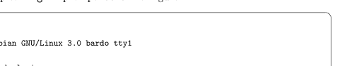

图 2-1. 典型的 Linux `login:` 提示符。

系统启动后，终端上会出现 `login:` 提示。如果你的系统配置为在启动时启动 X Window System，你会看到 X 登录屏幕而不是标准的登录提示。如果发生了这种情况，按 `CTRL-ALT-F2` 切换到文本登录屏幕；这在 Recipe 2.3 [Using Consoles and Terminals]，第 32 页中有进一步说明。

要登录系统，在 `login:` 提示符下输入你的用户名（后跟 `RET`），然后在提示时输入你的密码（也后跟 `RET`）。出于安全原因，输入密码时屏幕上不会显示任何内容；如果你在输入时出错，输入 `CTRL-U` 来擦除输入行并重新开始。

⇒ 要使用用户名为 “kurt” 且密码为 “empathy” 登录系统，输入：

```
Debian GNU/Linux 3.0 bardo tty1

bardo login: kurt RET
Password: empathy RET
Linux bardo 2.4.18 #1 Sat Dec 6 16:05:52 EST 2003 i686 unknown

Copyright (C) 1993-1998 Software in the Public Interest, and others

Most of the programs included with the Debian Linux system are freely redistributable; the exact distribution terms for each program are described in the individual files in /usr/doc/*/copyright

Debian GNU/Linux comes with ABSOLUTELY NO WARRANTY, to the extent permitted by applicable law.
Last login: Tue Apr 5 12:03:47 on tty1.
No mail.
$
```

一旦你登录，系统会显示 `/etc/motd` 的内容，即“每日消息”文件。然后系统会显示你上次登录的时间和日期，并报告你是否有邮件在等待（参见第 32 章 [Email]，第 611 页）。最后，系统将你置于一个 `shell` 中——你在其中与系统交互并向其发出命令。大多数 Linux 系统的默认 `shell` 是 `Bash`，其使用方法在第 3 章 [The Shell]，第 53 页中有讨论。

光标左侧显示的美元符号（`$`）称为 `shell` 提示符；它表示系统已准备好并等待输入。（你可以将此提示符更改为你喜欢的任何文本；要了解如何操作，请参阅 Recipe 3.5.6 [Changing the Shell Prompt]，第 80 页。）许多发行版默认将 `shell` 提示符设置为包含当前目录的名称，并将其放在美元符号左侧。登录时，你位于主目录中，`shell` 用波浪号字符（`~`）表示它。目录在第 5 章 [Files and Directories]，第 125 页中有说明。

NOTES：每个 Linux 系统都有自己的名称，称为系统的主机名；Linux 系统有时被称为主机，它在 `login:` 提示符处用主机名标识自己。为系统命名很重要；就像用户账户的用户名一样，主机名为你使用的系统提供了一个名称（当将系统放到网络上时它变得尤为重要）。系统管理员通常在系统初始配置时为系统命名（主机名可以随时更改；其名称保存在文件 `/etc/hostname` 中）。

与用户名一样，主机名是全部小写字母的单个单词。人们通常会给系统起一个他们喜欢的名字，例如 `darkstar` 或 `shiva`。在前面的示例中，“`bardo`”是这个特定 Linux 系统的主机名，该系统恰好运行的是 Debian 发行版。

你连接的终端名称显示在主机名之后。在此示例中，终端是 `tty1`，这意味着这是该特定系统的第一个终端。顺便说一下，“`tty`”是“teletype”的缩写，历史上这是大多数基于 UNIX 的系统默认使用的终端硬件类型。

### 2.2.2 Logging Out of the System

注销系统会释放你使用的终端——并确保没有人可以从该终端访问你的账户。

要结束你在系统上的会话，在 `shell` 提示符下输入 `logout`。该命令会注销你，终端上会出现新的 `login:` 提示符。

输入 `logout` 命令同样有效的方法是直接输入 `CTRL-D`（按住 `CTRL` 并按 `D`）。你甚至不需要在之后输入 `RET`。许多用户更喜欢这个快速快捷方式。

⇒ 要退出系统，输入：

```
$ logout RET

Debian GNU/Linux 3.0 bardo tty1

bardo login:
```

NOTES: 如果你是系统唯一使用者并且刚刚通过注销结束了一个会话，你可能想要关机系统。参见 Recipe 2.1.2 [Turning Off the System]，第 27 页，本章前面部分。

## 2.3 使用控制台和终端

Linux 终端是一种用于向系统输入数据并获取输出的设备。它可以是与系统通过网络或串行线连接的带有键盘和显示器的物理设备，也可以是运行在计算机上以模拟此类终端的软件程序，称为终端仿真器。有许多终端仿真器可用，尤其是针对图形 X Window 系统 [参见 Recipe 4.5 [Getting a Terminal Window in X]，第 109 页]。

当你使用直接连接到系统的键盘和显示器，通过内置的 Linux 文本终端设备仿真功能访问 Linux 系统时，就称你在使用控制台终端。

Linux 系统具有虚拟控制台，它们作为可同时运行各自登录会话的独立控制台运行，但从同一个物理控制台终端访问。大多数 Linux 系统默认配置为有七个虚拟控制台 [目前最多可达六十三个]。当你在控制台终端时，你可以随时在虚拟控制台之间切换，并且可以从多个虚拟控制台同时登录并使用系统。虚拟控制台有时也称为虚拟终端。


下面的配方解释了操作虚拟控制台以及一般终端的基本方法。

2 专门为此功能而构建的硬件称为哑终端，因为它们本身没有计算能力，只是与它们连接的实际计算机交互的输入和输出设备。

到最高虚拟控制台，如果你在第一个虚拟控制台，则按 `ALT - ←`。要切换到下一个更高的虚拟控制台，按 `ALT - →`）。

⇒ 要从第四个切换到第三个虚拟控制台，按：

`ALT - ←`

此按键切换到第三个虚拟控制台，`'tty3'`：

```
Debian GNU/Linux 3.0 bardo tty3

bardo login:
```

要切换回你上次所在的控制台，按 `ALT - PrtScrn`。

第七个虚拟控制台保留给 X Window 系统。如果安装了 X，此虚拟终端永远不会显示 `login:` 提示符，但当你使用 X 时，你的 X 会话会出现在那里。如果你的系统配置为立即启动 X，此虚拟控制台将显示 X 登录屏幕。

你可以使用 `CTRL` 结合通常的 `ALT` 和功能键从 X Window 系统切换到虚拟控制台。这是 X 中唯一可用的控制台操作按键。

⇒ 要从 X 切换到第一个虚拟控制台，按：

`CTRL - ALT - F1`

### METHOD #2

使用 `chvt` 切换到不同的虚拟控制台。它以要切换到的编号作为参数。

⇒ 要切换到第七个虚拟控制台，输入：

```
$ chvt 7 RET
```

NOTES: 此方法对于放入脚本很有用。

### 2.3.3 在控制台中滚动文本

当你在虚拟控制台登录时，新行文本出现在控制台屏幕底部，而旧行文本从屏幕顶部滚动出去。使用 `SHIFT` 与 `PgUp` 或 `PgDn` 向后 [“向上”] 或向前 [“向下”] 滚动已滚动的文本。

⇒ 这里有两种使用方法。

- 要查看已从屏幕顶部滚动出去的文本行，按 `SHIFT-PgUp` 向后滚动。
- 一旦你向后滚动，按 `SHIFT-PgDn` 向前滚动文本，朝向较新的文本。

你能向后滚动的文本量取决于系统内存。

NOTES: 此技术用于滚动你在 shell 会话中显示的文本 [参见 Chapter 3 [The Shell]，第 53 页]。它不适用于在控制台中工具或应用程序中的文本滚动。换句话说，你不能使用此技术来滚动由用于浏览文本文件的工具显示的文本。要在应用程序中滚动文本，请使用其自身的滚动功能，如果有的话。

### 2.3.4 清除终端屏幕

有两种方法可以清除终端屏幕。

### METHOD #1

输入 `clear` 以清除你正在使用的终端屏幕。屏幕将重新绘制，新的命令行位于顶行，所有其他屏幕内容将被擦除。

⇒ 要清除终端屏幕，输入：

```
$ clear RET
```

这在控制台以及 X 中的终端仿真器中都有效。你可以将此命令放入脚本中。

### METHOD #2

要清除终端屏幕并在顶部重绘当前命令行，输入 `CTRL-L`。

与 `clear` 不同，`clear` 是一个你在命令行输入的完整命令，你可以在包含其他正在输入内容的命令行中的任何位置输入 `CTRL-L`——它会在屏幕顶部重绘你当前的命令行，完整包含其上的所有内容。

⇒ 要清除终端屏幕并在屏幕顶部重绘当前命令行，输入：

```
CTRL-L
```

NOTES: 这个按键在 Bash shell 中有效，下一章将介绍该主题。

## 2.3.5 重置终端屏幕

要将终端屏幕重置为默认设置，请使用 `reset`。这在不小心将二进制文件的内容显示到屏幕上之后很有用，此时输入时只会打印垃圾字符。其他时候，终端只是无法正确清除字符。这会修复它。

发生这种情况时，输入 `reset` 然后按 `RET`，即使你无法在屏幕上读到自己正在输入的内容。这在控制台中以及在 X 中运行的终端中都有效。

- ⇒ 要重置你的终端，输入：
- `$ reset RET`

NOTES: 你可以练习这个，以便知道它真正发生时是什么样子。可以通过将二进制文件的输出发送到终端屏幕来做到这一点——输入 `cat /bin/ls` 看看它对终端做了什么；然后输入 `reset` 来重置它。

## 2.4 运行命令

工具是一个执行特定功能的软件程序——通常是专门的、简单的任务。例如，`hostname` 工具输出系统的主机名，而 `who` 工具输出当前已登录用户的列表。应用程序是一个更大、通常是交互式的程序，用于完成更广泛类型的任务——想想图像编辑器和文字处理器。

工具或应用程序可能接受任意数量的选项（有时称为“标志”），它们指定其默认行为的更改。它也可能接受参数，指定要操作的文件或其他文本。参数通常在任何选项之后指定。

术语 `command` 指工具或应用程序的名称，连同指定的任何选项和参数。由于仅输入工具的名称通常足以完成所需任务，因此工具本身通常被称为命令。

命令区分大小写；工具和应用程序的名称通常为全小写字母。

要在不提供任何选项或参数的情况下运行（或“执行”）工具或应用程序，请在 shell 提示符下输入其名称，然后按 `RET`。

⇒ 要运行 `hostname` 工具，输入：

```
$ hostname RET
camelot
$
```

示例中系统的主机名为 `camelot`。

选项始终以连字符字符 (`-`) 开头，其后通常跟一个字母数字字符。要在命令中包含选项，请在工具或应用程序名称后跟选项。始终用空格字符将工具名称、每个选项和每个参数彼此分开。

长格式选项（有时称为“GNU 风格”选项）以两个连字符字符（`--`）开头，通常是一个英文单词。

有时选项本身可能接受参数。例如，`hostname` 有一个 `-F` 选项，用于指定读取主机名的文件名；它以 `hostname` 应读取的文件名为参数。

⇒ 要运行 `hostname` 并指定文件 `host.info` 为要读取的文件，输入：

```
$ hostname -F host.info RET
```

### 2.4.1 显示工具的可用选项

要获取工具的可用选项和其他帮助列表，请使用 `--help`（长格式）或 `-h` 选项。³ 它通常输出有关工具用法的一些信息，并列出其可用选项。

⇒ 要列出 `hostname` 工具的可用选项，输入：

```
$ hostname --help RET
```

有时可用选项的列表会填满远不止一个屏幕，因此你可能希望将输出通过管道传输到 `less` 以便查阅（参见 Recipe 9.1 [Perusing Text]，第 211 页）。按 `Q` 停止查阅。

⇒ 要查阅 `lynx` 工具的可用选项，输入：

```
$ lynx -? | less RET
```

³ 有些工具没有这两个选项，在这种情况下你应该尝试 `-?` 选项。

### 2.4.2 显示工具的版本

有时知道系统上命令的哪个版本很有用。如果某个选项或功能不能按预期工作，可能是因为你安装的命令是旧版本。

使用 `--version`（长格式）或 `-v` 选项输出特定工具的版本号。

⇒ 要输出 `hostname` 工具的版本，输入：

```
$ hostname --version (RET)
hostname 2.10
$
```

此命令输出文本“`hostname 2.10`”，表示这是 `hostname` 工具的 2.10 版本。

## 2.5 更改你的密码

要更改密码，请使用 `passwd` 工具。它会提示你输入当前密码和要替换它的新密码。出于安全目的，在你输入时，旧密码和新密码都不会在屏幕上显示。为了确保你正确输入新密码，`passwd` 会提示你两次输入新密码。你必须两次以完全相同的方式输入它，否则 `passwd` 不会更改你的密码。

⇒ 要更改你的密码，输入：

```
$ passwd (RET)
Changing password for kurt
Old password: your current password (RET)
Enter the new password (minimum of 8 characters)
Please use a combination of upper and lower case letters and numbers.
New password: your new password (RET)
Re-enter new password: your new password (RET)
Password changed.
$
```

NOTES: 密码可以包含大写和小写字母、数字 0 到 9 以及标点符号；它们应介于五到八

characters long. See Recipe 2.2 [Using Your Account], page 28, for suggestions on choosing a good password.

## 2.6 Listing User Activity

The recipes in this section describe some of the simple commands for finding out who you are currently sharing the system with and what they are doing.

### 2.6.1 Displaying Your Username


Use `whoami` to output the username of the user that is logged in at your terminal. This is not as inutile a command as one might first think—if you’re at a shared terminal, it’s useful to determine whether or not it is your account that you’re messing in, and for those with multiple accounts on a system, it’s useful to see which of them you’re currently logged in with.

To output your username, type:

```
$ whoami [RET]
will
$
```

In this example, the username of the user logged in at this terminal is "will."

## 2.6.2 Listing Who Is on the System

Use `who` to output a list of all the users currently logged in to the system. It outputs a minimum of three columns, listing the username, terminal location, and time of login for all users on the system. A fourth column is displayed if a user is using the X Window System; it lists the window location of the user’s session (see Chapter 4 [The X Window System], page 95).

To see who is currently logged in, type:

```
$ who [RET]
murky    tty1     Oct 20 20:09
dave     tty2     Oct 21 14:37
kurt     tty3     Oct 21 15:04
kurt     ttyp1    Oct 21 15:04 (:0.0)
$
```

The output in this example shows that the user murky is logged in on tty1 (the first virtual console on the system), and has been since 20:09 on 20 October. The user dave is logged in on tty2 (the second virtual console), and has been on since 14:37 on 21 October. The user kurt is logged in twice—on tty3 (the third virtual console), and on ttyp1, which is an X session with a window location of (:0.0).

NOTES: This command is for listing the users on the local system; to list the users connected to a different system on the network, or to see more detailed personal information that a user may have made public, see Recipe 34.5.1 [Checking Whether a User Is Online], page 683.

## 2.6.3 Listing Who Is on and What They’re Doing

The `w` tool is similar to `who`, but it displays more detail. It outputs a header line that contains information about the current system status, including the current time, the amount of time the system has been up and running, and the number of users on the system. It then outputs a list of users currently logged in to the system, giving eight columns of information for each. These columns include username, terminal location, X session (if any), the time of login, the amount of time the user has been idle, and what command the user is running. (It also gives two columns showing the amount of time the system’s CPU has spent on all of the user’s current jobs (JCPU) and foreground processes (PCPU); processes are discussed in Recipe 2.7 [Listing Processes], page 41, and jobs in Recipe 3.3 [Managing Jobs], page 70.)

To see who is currently logged in and what they are doing, type:

```
$ w [RET]
5:27pm up 17:53, 4 users, load average: 0.12, 0.06, 0.01
USER     TTY      FROM     LOGIN    IDLE    JCPU    PCPU  WHAT
murky    tty1              Oct 20 20:09 17:22m 0.32s  0.32s -bash
dave     tty2              14:37   13.00s 2.35s  0.07s  less foo
kurt     tty3              15:04   1:00m  0.41s  0.09s  startx
kurt     ttyp1   :0.0      15:04   0:00s 21.65s 20.96s emacs
$
```

In this example, the command’s output shows that the current system time is 5:27 p.m., the system has been up for 17 hours and 53 minutes, and there are four users currently logged in: murky is logged in at tty1, has been idle for 17 hours and 22 minutes, and is at a Bash shell prompt; dave is logged in at tty2, has been idle for 13 seconds, and is using `less` to peruse a file named foo (see Recipe 9.1 [Perusing Text], page 211); and kurt is logged in at two terminals—tty3 and ttyp1, which is an X session. He ran the `startx` command on tty3 to start his X session, and within his X session, he is currently using Emacs.

## 2.6.4 Listing the Last Time a User Logged In

Use `last` to find out who has recently used the system, which terminals they used, and when they logged in and out.


- 要输出近期系统使用情况列表，请输入：

  ```
  $ last [回车]
  ```

要查明某个特定用户上次登录系统的时间，请将用户名作为参数。

- 要查明用户 `james` 上次登录的时间，请输入：

  ```
  $ last james [回车]
  ```

注意：`last` 工具的数据来自系统文件`/var/log/wtmp`：输出的最后一行表明该文件能回溯多远。有时，输出会回溯数周甚至更久。

## 2.7 列出进程

当你运行命令时，就是在系统上启动一个进程，该进程是当前正在执行的程序。每个进程都有唯一编号，称为进程 ID（PID）。

你可以随时列出系统上正在运行的进程；使用 `ps` 即可。

默认情况下，`ps` 会输出每个进程的五列信息：进程 ID；启动进程的终端名称；进程当前状态（其中 "S" 表示睡眠，即当前处于暂停状态，"R" 表示正在运行，"Z" 表示僵尸进程，即已经死掉的进程）；自进程开始以来 CPU 在该进程上花费的总时间；最后是被运行的命令名称。

以下秘方介绍了 `ps` 的常见用法：下一章将更详细地介绍如何控制你运行的进程。

### 2.7.1 列出当前进程

输入不带参数的 `ps` 命令，即可列出当前 shell 会话中正在运行的进程。

⇒ 要列出当前 shell 会话中的进程，请输入：

```
$ ps [回车]
PID TTY STAT TIME COMMAND
193 1 S 0:01 -bash
204 1 S 0:00 ps
$
```

在此示例中，`ps` 显示有两个进程正在运行：`bash` 和 `ps` 命令。

### 2.7.2 列出某个用户的所有进程

要列出某个特定用户的所有进程，请使用 `ps` 并将用户名作为 `-u` 选项的参数。虽然你无法窥探其他用户的实际活动，但可以列出他们在某一时刻正在运行的命令。

⇒ 要列出用户 `harry` 在系统上运行的所有进程，请输入：

```
$ ps -u harry [回车]
```

注意：此命令对于列出你自己在所有终端和 shell 会话中运行的所有进程非常有用；请将自己的用户名作为参数。

### 2.7.3 列出系统上的所有进程

要列出系统上运行的所有进程，有两种方法需要了解。

#### 方法一

要获取系统上所有用户运行的所有进程列表，请使用带 `aux` 选项的 `ps`。

⇒ 要列出所有进程并显示其用户名，请输入：

```
$ ps aux [回车]
```

注意：输出内容可能很多——即使是单用户的 Linux 系统，通常也会同时运行四十个或更多进程——因此你可能希望通过 `less` 命令查看输出（参见第 211 页的秘方 9.1“查看文本”）。

#### 方法二

使用 `top` 命令以图表形式显示系统上的所有进程，并按其系统资源占用需求排序。该显示会持续更新当前进程信息；按 `Q` 键可停止显示并退出程序。该工具还会显示系统运行时间和内存信息，这些信息也可以通过 `uptime` 和 `free` 命令输出。

⇒ 要查看当前系统进程的持续更新显示，请输入：

```
$ top [回车]
```

### 2.7.4 按名称或编号列出进程

要列出输出中包含你希望匹配的名称或其他特定文本的进程，请列出所有进程并将输出通过管道传递给 `grep`。当你想查看哪些用户在运行某个特定程序或命令时，这非常有用。

⇒ 以下是两种使用方法。

- 要列出命令中包含字符串“sbin”的所有进程，请输入：

  ```
  $ ps aux | grep sbin [回车]
  ```

- 要列出进程 ID 中包含 13 的任何进程，请输入：

  ```
  $ ps aux | grep 13 [回车]
  ```

要列出与特定进程 ID 对应的进程（如果有），请将该 PID 作为 `-p` 选项的参数。

⇒ 要列出 PID 为 344 的进程，请输入：

```
$ ps -p 344 [回车]
```

## 2.8 使用帮助工具

Linux 系统自带大量帮助工具，包括完整的手册（电子文本形式）。事实上，Linux 文档的首要问题不是文档不够多，而是你必须从大量文档中筛选出自己正在寻找的精确信息！

### 2.8.1 找到合适的工具

有几种按关键字查找工具的方法。第一种是常见方法，后两种则更多为中级用户所用（换句话说，并不是每个 Linux 用户都知道它们）。

#### 方法一

当你知道某个工具或应用的功能，但记不住它的名字时，首先应该使用 `apropos`。该工具接受一个关键字作为参数，并输出安装软件中单行描述包含该关键字的列表。它会在系统手册的名称和简短描述中搜索给定文本，并输出匹配的工具列表。这对于查找系统上与“音频”、“声音”、“排序”或其他类似一般概念相关的软件也很有用。

⇒ 要输出与控制台相关的程序列表，请输入：

```
$ apropos console [回车]
```

注意：`apropos` 工具会匹配行中包含你输入的关键字（按精确输入的字词）的行，匹配位置不限。搜索关键字“consoles”可能无法列出搜索关键字“console”所能列出的所有程序；搜索“con”则能匹配更多。因此，最好先尝试单数形式，然后在需要时细化你的搜索词。要想从 `apropos` 获得良好结果，关键在于了解哪些关键字可能出现在你所找内容的描述中。

`apropos` 工具是带 `-k` 选项的 `man` 的别名（参见第 46 页的秘方 2.8.4“阅读系统手册中的一页”）。

#### 方法二

Dpkg

DEB: dpkg

在 Debian 系统上，另一种按关键字查找已安装软件的方法是使用 `dpkg`（Debian 包工具）。使用 `-l` 选项列出所有已安装的包，每个包会单独输出一行，包含其包名和简短描述。

你可以通过将输出通过管道传递给 `grep` 来输出匹配关键字的包列表。使用 `grep` 的 `-i` 选项可以忽略大小写匹配关键字（`grep` 将在第 333 页的第 14 章“搜索文本”中讨论）。

另外，你可以使用 `less` 直接浏览文件 `/var/lib/dpkg/available`（参见技巧9.1 [浏览文本]，第211页）；该文件列出了所有可用的软件包并给出了它们的描述。

⇒ 以下是使用此方法的三种方式。

- 要列出系统中安装的所有 DEB 软件包，输入：

  ```
  $ dpkg -l [回车]
  ```

- 要列出系统中安装的所有名称中包含文本“edit”（不区分大小写）的 DEB 软件包，输入：

  ```
  $ dpkg -l | grep -i edit [回车]
  ```

- 要浏览当前所有可用的 DEB 软件包的描述，输入：

  ```
  $ less /var/lib/dpkg/available [回车]
  ```

**注：** 关于使用 `dpkg` 的更多信息，请参见技巧A.4 [管理DEB软件包]，第709页。

#### 方法 #3

在基于 RPM 的系统（如 Fedora 和 Red Hat Enterprise Linux）上，你可以使用软件包管理工具 `rpm` 按关键字查找已安装的软件。使用 `-qa` 选项输出系统上安装的所有软件包的名称。要查找特定的软件包，请将输出通过管道传递给带有 `-i` 选项和匹配模式的 `grep`（参见技巧14.1 [在文本中搜索单词]，第333页）。再通过管道传递给 `less` 进行浏览。


⇒ 以下是使用它的几种方式。

- 要浏览系统上安装的所有RPM软件包的列表，输入：

  `$ rpm -qa | less` RET

- 要列出所有名称或描述中包含单词“edit”（不区分大小写）的软件包，输入：

  `$ rpm -qa | grep -i edit` RET

- 要列出系统上安装的所有名称中包含文本“1.2”的RPM软件包，输入：

  `$ rpm -qa | grep "1.2"` RET

**注：** 关于使用 `rpm` 的更多信息，请参见技巧A.5 [管理RPM软件包]，第714页。

# 2.8.2 获取程序的描述

使用 `whatis` 获取程序的一行描述。作为参数，给出你想要描述的工具或应用程序的名称。

⇒ 要获取 `who` 工具的描述，输入：

```
$ whatis who [RET]
```

注：`whatis` 工具从给定程序的手册页中获取其描述；本节后面的技巧2.8.4 [阅读系统手册中的页面]（第46页）将介绍手册页。

# 2.8.3 列出工具的用法

许多工具都有一个长选项 `--help`，它会输出工具的用法信息，包括该工具接受的选项和参数。

⇒ 要列出 `whoami` 的可能选项，输入：

```
$ whoami --help [RET]
Usage: whoami [OPTION]...
Print the user name associated with the current effective user id.
Same as id -un.

--help     display this help and exit
--version  output version information and exit

Report bugs to <bug-sh-utils@gnu.org>.
$
```

该命令输出一些关于 `whoami` 工具的用法信息，包括简短描述和可能的选项列表。

注：并非所有工具都接受 `--help` 选项；有些工具接受 `-h` 或 `-?` 选项，其功能相同。

# 2.8.4 阅读系统手册中的页面

在从前，大多数 UNIX 系统随附的硬拷贝参考手册也以电子形式存在于系统本身；系统随附的每个软件程序都有其自己的手册页（通常称为“man页”）来描述它。如今，基于 Linux 的系统仍然如此，只是它们通常不附带硬拷贝手册。

使用 `man` 工具查看系统手册中的某个页面。作为 `man` 的参数，给出你想要查看其手册页的程序名称（所以要查看 `man` 的手册页，你可以输入 `man man`）。

⇒ 要查看 `w` 的手册页，输入：

```
$ man w [RET]
```

该命令显示 `w` 的手册页，如图2-2所示。

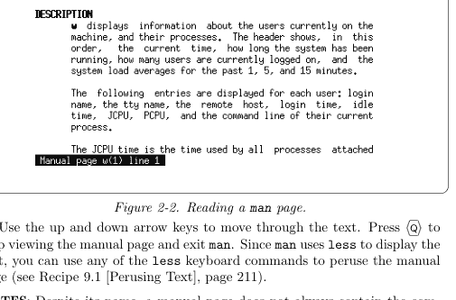

图2-2. 阅读手册页。

使用上下箭头键在文本中移动。按 Q 停止查看手册页并退出 `man`。由于 `man` 使用 `less` 显示文本，你可以使用 `less` 的任何键盘命令来浏览手册页（参见技巧9.1 [浏览文本]，第211页）。

注：尽管名称如此，手册页并不总是包含程序的完整文档；它更像一张快速参考卡。它通常包含程序的简短描述，并列出它接受的选项和参数；有些手册页还包括示例或相关命令列表。（有时，命令的手册页非常完整、详尽，但更常见的是，它们的完整文档要么在随附的其他帮助文件中，要么在 Info 文档中；这些是接下来两个技巧的主题。）

要准备一份手册页以便打印，请参阅配方 25.3.4 [准备打印手册页](第 522 页)。

## 2.8.5 阅读 Info 手册

GNU Info 系统是一个用于查阅以 Info 格式编写的文档的在线超文本参考系统。这类文档通常比典型的手册页更完整，而且对于某个软件包，Info 文档往往就是整本书或整本手册。自由软件基金会发布的所有手册均以 Info 格式提供；这些手册的内容（不含插图）与您直接从自由软件基金会购买的纸质手册完全相同。

有多种方式可以浏览 Info 文档：您可以使用独立的 `info` 工具、在 Emacs 编辑器中阅读 Info 文件（参见配方 10.1 [使用 Emacs](第 232 页)），或使用为此目的设计的其他工具。此外，还有工具可以将 Info 文档转换为 HTML，以便您在 Web 浏览器中阅读（参见配方 5.10 [浏览文件和目录](第 157 页)）。

要使用 `info` 工具阅读某个工具或应用程序的 Info 手册，请将其名称作为参数传入。如果不带参数，`info` 会打开您系统的“顶层”Info 菜单，其中列出了系统上安装的所有手册。

⇒ 要查看系统上所有 Info 手册，请输入：

```
$ info [回车]
```

此命令会在系统的“顶层”菜单启动 `info`，该菜单显示一些 info 按键命令，并列出可用手册的列表，如图 2-3 所示。

使用箭头键在信息的每个“页面”之间移动，这些页面称为 Info 节点。节点按层级排列。每个 Info 文档都有一个“顶层”节点，类似于印刷书籍的前页和目录；它通常包含文档名称以及一个指向各章节的 Info 菜单。章节节点包含一个菜单，其中提供指向其各小节的链接，以此类推。指向其他节点的链接也可能以交叉引用的形式出现在任何节点的文本中。

链接在菜单项和交叉引用中的外观相同：一个星号（`*`）、它所指向的节点名称，以及一个或两个冒号（`:` 或 `::`）。要跟随链接跳转到其指向的节点，请将光标移动到链接中节点名称的任意部分上，然后按 [回车]。

```
file: dir,    Node: Top,    This is the top of the INFO tree

This (the Directory node) gives a menu of major topics.
Typing "q" exits, "?" lists all Info commands, "d" returns here,
"h" gives a primer for first-timers.
"mEmacs<Return>" visits the Emacs manual, etc.

In Emacs, you can click mouse button 2 on a menu item or cross reference
to select it.

* Menu:

Texinfo documentation system
* Info: (info)                Documentation browsing system.
* Texinfo: (texinfo)          The GNU documentation format.
* install-info: (texinfo)Invoking install-info, Updating info/dir entries.
* texi2dvi: (texinfo)Format with text2dvi,  Printing Texinfo documentation.
* texindex: (texinfo)Format with tex/texindex. Sorting Texinfo index files.
* makeinfo: (texinfo)makeinfo Preferred. Translate Texinfo source.
---Info: (dir)Top, 211 lines ---Top--------
Welcome to Info version 2.18, "C-h" for help, "m" for menu item.
```

### 图 2-3. 阅读 Info 节点。

按 (H) 键可运行介绍如何使用 `info` 的教程。按 (Q) 键可停止阅读文档并退出程序。在 `info` 中，您可以随时按下这些键。

要阅读某个特定工具或应用程序的 Info 文档，请将其名称作为参数传递给 `info`；如果该工具没有对应的 Info 手册，`info` 会改而显示该工具的手册页。

⇒ 要阅读 `tar` 工具的 Info 文档，请输入：

```
$ info tar [回车]
```

此命令会打开一份《GNU tar 手册》的 Info 副本。

要阅读以 Info 格式编写的文件内容，请使用 `-f` 选项指定要读取的文件名。这在读取从其他地方获得且不在 `/usr/info` 目录（与其他已安装的 Info 文件放在一起）中的 Info 文件时非常有用。`info` 可以自动识别并展开经过压缩且带有 `.gz` 扩展名的 Info 文件（参见配方 8.4 [压缩文件](第 196 页)）。

⇒ 要读取当前目录中名为 `faq.info` 的 Info 文件，请输入：

```
$ info -f faq.info [回车]
```

此命令会启动 `info` 并打开 Info 文件 `faq.info`，从文件中的顶层节点开始显示。

要读取 Info 文件中的特定节点，请将要显示的节点名称用引号括起来作为 `-n` 选项的参数。

⇒ 要读取当前目录中的 Info 文件 `faq.info`，从节点 Text 开始，输入：


```
$ info -n 'Text' -f faq.info RET
```

NOTES: 你也可以直接从 Emacs 编辑器读取 Info 文档；在 Emacs 中输入 `CTRL-(u) i` 以启动 Emacs Info 阅读器，然后使用与独立 `info` 工具相同的命令（参见 Recipe 10.1.1 [Getting Acquainted with Emacs]，第 232 页）。

Emacs 的“增量”搜索命令 `CTRL-(S)` 在 `info` 中也有效；这是一种非常快速、高效的在整个 Info 文本中搜索单词或短语的方法（如这本整本书）；参见 Recipe 14.9.1 [Searching Incrementally in Emacs]，第 352 页。

有些人把 Info 用来做一切；在 Linux 系统上，Info 被设置为如果工具缺乏 Info 文档，则以 Info 形式显示该工具的手册页。因此，如果 `foofoo` 工具没有任何 Info 手册，输入 `info foofoo` 将会给出它的手册页。

## 2.8.6 读取系统文档和帮助文件

The Linux Documentation Project HOWTOs

- `DEB`: `doc-linux-html`

- `DEB`: `doc-linux-text`

- `RPM`: `howto`

- `WWW`: `http://tldp.org/`

`/usr/doc` 目录用于存放各种文档：HOWTOs、FAQs、发行版特定的文档文件以及命令附带的文档。⁴（要了解更多关于文件和目录的信息，请参见第 5 章 [Files and Directories]，第 125 页。）要浏览这些文件中的任何一个，请使用 `less`，详见 Recipe 9.1 [Perusing Text]，第 211 页。

当软件包被安装时，它可能除手册页和 Info 手册之外的任何额外文档文件都会被放置在此处，在一个以该包名称命名的子目录中。例如，`hostname` 包的额外文档位于 `/usr/doc/hostname`，`passwd` 包的文档位于 `/usr/doc/passwd`。大多数包都有一个名为 `README` 的文件，其中包含相关信息。经常该文件被压缩为 `README.gz`，这种情况下你可以使用 `zless` 代替 `less`。

Linux 文档项目（LDP）监督创建了超过 100 个 HOWTO 文件，每个文件都涵盖 Linux 系统安装或使用的某个特定方面。

LDP HOWTOs 是存储在 `/usr/doc/HOWTO` 目录中的压缩文本文件；要查看它们，请使用 `zless`。文件 `/usr/doc/HOWTO/HOWTO-Index.gz` 包含已安装在系统上的所有 HOWTO 文档的注释索引。

`/usr/doc/FAQ` 目录包含许多关于各种主题的 FAQ（“常见问题”）文件。

最后，一些发行版也在 `/usr/doc` 中保留一个目录用于其自己的文档；例如，Debian 使用 `/usr/doc/debian` 来存放与该发行版相关的文档：组成 Debian FAQ 的文件位于 `/usr/doc/debian/FAQ` 目录，可用 HTML 格式查看，你可以在 Web 浏览器中查看（参见 Recipe 5.10 [Browsing Files and Directories]，第 157 页），也可以作为压缩文本文件查看，可在 `zless` 中查看。

⇒ 这里有两种使用方法。

- 要在 `lynx` Web 浏览器中查看 Debian FAQ 的 HTML 版本，输入：

```
$ lynx /usr/doc/debian/FAQ/debian-faq.html [RET]
```

- 要在 `zless` 中查看 Debian FAQ 的压缩文本版本，输入：

```
$ zless /usr/doc/debian/FAQ/debian-faq.txt.gz [RET]
```

NOTES: 使用 Web 浏览器浏览这些目录中的文档文件通常非常有用——参见 Recipe 5.10 [Browsing Files and Directories]，第 157 页。

## 3. Shell

本章的主题是 shell，即读取你的命令输入并运行指定命令的程序。它之所以得名，是因为它为你提供了一层保护，使你免受系统外部环境的侵扰，就像海洋中软体动物的坚硬保护外壳一样。Shell 是你与系统之间的中介，所有的交互都通过它进行；它既是你的工作环境，也是你的接口。从你成功登录系统的那一刻起，直到你注销的那一刻，你就被认为是在“shell 中”。

位于光标前面的“$”字符称为 shell 提示符；它告诉你系统已准备就绪并等待输入。在 Debian 系统上，默认的 shell 提示符还包括当前目录的名称（参见第 5 章 [文件和目录]，第 125 页）。波浪号字符 (~) 表示你的主目录，登录时你会出现在该目录中。

例如，当用户在其主目录中时，一个典型的用户 shell 提示符可能如下图 3-1 所示。

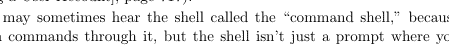

图 3-1. 一个 Bash shell 提示符。

如果你的 shell 提示符显示的是井号 (#) 而不是“$”，这意味着你是以超级用户，即 root 账户登录的。注意：root 账户对系统拥有完全控制权；一个错误的按键就可能意外地将其破坏得非常严重。你需要为自己创建一个不同的用户账户，用于日常活动（参见配方 A.6.1 [创建用户账户]，第 717 页）。

你有时会听到 shell 被称为“命令 shell”，因为你通过它运行命令，但 shell 不仅仅是一个运行其他程序的提示符——它也是一种编程语言。其内置的编写程序的设施非常强大。在本章中，我将向你展示入门的基础知识，但你应该知道，已有许多书籍专门论述 shell 编程。

Linux 上有许多可用的 shell。有些看起来可能相似，但行为却大不相同。我们将介绍 Bash shell，它是 Linux 系统上最常用的 shell，也是几乎总是默认的 Linux shell。（其名称代表“Bourne again shell”——这是对 Steve Bourne 名字的双关，他是传统 UNIX shell，即 Bourne shell 的作者。）

其他推荐的 shell 列表见配方 3.9.5 [使用其他 Shell]，第 92 页。有关超出本章内容的使用 Bash 的更多信息，请查阅 `bash` 的 Info 文档（参见配方 2.8.5 [阅读 Info 手册]，第 48 页）。

### 3.1 在命令行中输入

在配方 2.4 [运行命令]，第 36 页中，你学习了如何通过在 shell 提示符下输入来运行命令。你在 shell 提示符下输入命令的那一行称为命令行（也称为输入行）。在命令行上编写命令的过程称为命令行编辑。

以下各节描述了命令行编辑的一些重要功能，例如引用特殊字符和字符串，让 shell 完成你的输入、重新运行命令以及运行多个命令。

NOTES: 有关 Bash 命令行编辑功能的更多信息，请查阅 `bash` 的 Info 文档（参见配方 2.8.5 [阅读 Info 手册]，第 48 页）。

### 3.1.1 使用基本的命令行编辑键

有特殊的按键用于在输入行中移动和编辑正在输入的行；下表描述了它们。

| 输入命令 | |
|---|---|
| text | 在光标所在位置插入文本；光标右侧已存在的任何文本都会向右移动以容纳新文本。 |
| RET | 将命令行发送给 Bash 执行（换句话说，它运行在 shell 提示符下输入的命令）。你不必位于命令行的最右端才能输入 RET；你可以在光标位于命令行上的任何位置时输入它。 |
| 剪切和粘贴 | |
| BKSP 或 CTRL-H | 删除光标左侧的字符。 |
| DEL 或 CTRL-D | 删除光标下方的字符。 |

(continued)

## Cutting and Pasting

`CTRL-K`

Kill, or "cut," all text on the input line, from the character the cursor is underneath to the end of the line.

`CTRL-U`

Kill everything on the input line to the left of the cursor.

`CTRL-Y`

Yank, or "paste," the text that was last killed. Text is inserted where the cursor is.

## Movement

`CTRL-A`

Move the cursor to the beginning of the input line.

`CTRL-E`

Move the cursor to the end of the input line.

→ or `CTRL-F`

Move the cursor to the right ("forward") one character.

← or `CTRL-B`

Move the cursor to the left ("backward") one character.

`ALT-F`


Move the cursor forward one word.

`ALT-B`

Move the cursor backward one word.

`CTRL-L`

Clear the terminal screen, redrawing the current input line at the top.

**NOTES:** These keyboard commands are the same as those used by the Emacs editor (see Recipe 10.1 [Using Emacs], page 232). Many other Emacs keyboard commands also work on the command line (see Recipe 10.1.3 [Using Basic Emacs Editing Keys], page 237). And, for Vi aficionados, it is possible to configure Bash to recognize Vi-style bindings instead (see Recipe 3.7.3 [Using Shell Startup Files], page 86).

## 3.1.2 Typing a Control Character

Control characters can be typed on the input line by using `CTRL-V`, the shell's verbatim insert function, followed by the control character you want.

⇒ To insert a formfeed character (“Control-L”) at the current location in the input line, type:

```
CTRL-V CTRL-L
```

## 3.1.3 Quoting Reserved Characters

Some characters are reserved and have special meaning to the shell on their own, such as the dollar sign (`$`), single quote (`'`), double quote (`"`), exclamation point (`!`), backslash (`\`), and the newline (`RET`) which sends what you have typed on the command line to the shell for execution. Before you can pass one of these characters as an argument to a command, you must quote it.

There are various ways to quote characters. Each is good for certain purposes, so you should know the differences between them. Sometimes the various methods of quotation are combined in the same argument (see the last example of Method #3 below).

To demonstrate quotation, the examples that follow will use `echo`, a simple tool that displays any text given to it as an argument (technically, this command echoes its arguments to the standard output—see Recipe 3.2 [Redirecting Input and Output], page 67).

### METHOD #1

To quote a reserved character, precede it with a backslash (`\`). The backslash is Bash’s escape character; a character that immediately follows it will be interpreted literally, and not for any reserved meaning. The one exception to this rule is a newline character (see Recipe 3.1.12 [Typing a Long Line], page 66).

⇒ Here are some ways to use this.

- To echo the string “Isn’t this nice?,” type:

```
$ echo Isn\'t this nice? RET
Isn't this nice?
$
```

- To echo the string “It isn’t nice!,” type:

```
$ echo \"It isn\'t nice!\" RET
"It isn't nice!"
$
```

- To echo the string "`$HOSTNAME` is nice!", type:

```
$ echo \$HOSTNAME is nice\! [RET]
$HOSTNAME is nice!
$
```

- To echo the string ""`$HOSTNAME`" is nice!", where `$HOSTNAME` is a shell variable to be expanded, type:

```
$ echo "\$HOSTNAME" is nice\! [RET]
"lucky" is nice!
$
```

The last two examples use the special Bash variable `HOSTNAME`, whose value is always the name of the current host (see Recipe 3.5 [Using Shell Variables], page 77). First, the text `"$HOSTNAME"` is displayed because its `$` is escaped, and then second, the `$HOSTNAME` variable is expanded to the value it contains. In this example, the system's hostname is lucky.

**NOTES:** For only one reserved character, this is the simplest quoting method; while you certainly can quote any complex quotation this way, it is cumbersome to add all the backslashes.

When passing a phrase to a command that takes multiple arguments, you will have to escape spaces, too. So the phrase in the first example becomes "`Isn'\t\ this\ nice?`".

### METHOD #2

Quote a literal phrase by enclosing it in single quote characters (`'`). All characters inside the quotes are taken literally, and not for any reserved meaning—so there's no way to expand variables in single-quoted text. You can even quote newlines with this method. The only character you can't pass in single quotes is a single quote itself.

⇒ 以下是一些使用此方式的方法。

-   要输出反斜杠字符，请键入：

```
$ echo '\' RET
\
$
```

-   要输出字符串 `* ! \" /,`，请键入：

```
$ echo '* ! " /' RET
* ! " /
$
```

-   要输出字符串 `"$HOSTNAME" is nice!`，其中第二个双引号字符后有一个换行符，请键入：

```
$ echo ""$HOSTNAME" RET
> is nice!' RET
"$HOSTNAME"
is nice!
$
```


注意：第二种方法是较简单的引用方法之一。

## 方法 #3

通过将短语括在双引号字符（`"`）中来引用短语，以保留某些字符的特殊含义：美元符号（`$`）、反引号（`` ` ``）、感叹号（`!`）和反斜杠（`\`）。

这意味着：变量会被展开为其值（参见配方 3.5 [使用 Shell 变量]，第 77 页），可以指定命令输出（参见配方 3.1.11 [将命令输出指定为参数]，第 65 页），可以引用命令历史（参见配方 3.4 [使用命令历史]，第 74 页），并且可以转义单个字符，如上面的方法 #1 所述。

你可以传递单引号和换行符；要传递双引号、美元符号、反引号或反斜杠，请先用反斜杠（`\`）转义它们。在双引号之外转义感叹号来进行传递。

⇒ 以下是一些使用此方法的方式。

- 要输出 “Isn’t it great?”，请键入：

```
$ echo "Isn't it great?" RET
Isn't it great?
$
```

- 要输出 “Isn’t $HOSTNAME it?”，请键入：

```
$ echo "Isn't \$HOSTNAME it?" RET
Isn't $HOSTNAME it?
$
```

- 要输出 “Isn’t this $HOSTNAME?”，其中 `$HOSTNAME` 是要展开的 shell 变量，请键入：

```
$ echo "Isn't this $HOSTNAME?" RET
Isn't this lucky?
$
```

- 要输出 “Wow!

  This isn’t "$HOSTNAME"!”，其中第一个感叹号后有一个换行符，请键入：

```
$ echo "Wow!"! RET
> This isn't "\$HOSTNAME"!" RET
Wow!
This isn't "$HOSTNAME"!
$
```

在倒数第二个示例中，系统的主机名是 `lucky`。在第二个和最后一个示例中，文本 “$HOSTNAME” 被字面引用，不会作为变量展开；如果省略紧邻美元符号之前的反斜杠，shell 将展开该变量。

注意：有时你可以侥幸在双引号中引用感叹号，但由于它保留用于引用 Bash 命令历史，在错误的上下文中使用它可能会产生意外结果。除非你只使用单引号方法，否则最安全的方法是在双引号之外转义感叹号。

## 方法 #4

要以字符串形式传递特殊字符，请将其写为 `$'string'`，其中 `string` 是要传递的字符串。这称为“ANSI-C 风格”引用。

某些字符的特殊反斜杠转义序列通常包含在字符串中，如下表所示。

| 转义序列 | 描述 |
|---|---|
| `\a` | 警报（响系统铃）。 |
| `\b` | 退格。 |
| `\e` | 转义。 |
| `\f` | 换页。 |
| `\n` | 换行。 |
| `\r` | 回车。 |
| `\t` | 水平制表符。 |
| `\v` | 垂直制表符。 |
| `\\` | 反斜杠。 |
| `\NNN` | ASCII 码为八进制（基数为 8）NNN 的字符。 |

⇒ 以下是一些使用此方法的方式。

- 要输出字符串 “Hello” 后跟两个换行符，请键入：

```
$ echo Hello$'\n\n' [RET]
Hello
$
```

- 要输出一个段落符号（八进制字符代码 266），请键入：

```
$ echo $'\266' RET
¶
$
```

- 要将一个换行符和一个段落符号（八进制字符代码 266）追加到文件 `draft`，请键入：

```
$ echo $'\n\266' >> draft RET
```

## 3.1.4 让 Shell 补全你所键入的内容

*补全*是指 Bash 尽力替你完成输入。要使用它，请在输入行上按 TAB 键，shell 将尽最大努力*补全*光标左侧的单词。补全功能就是这样一种东西，一旦你开始使用它，你就会想知道没有它你以前是怎么过的。

补全功能既可以用于文件名，也可以用于命令名，具体取决于你按 TAB 键时光标所处的上下文。

当一个单词有不止一种补全方式时，shell 会响铃¹来提醒你；再次按 TAB 键将显示可能的选项，然后重新绘制你的命令行。如果选项很多，shell 会在此时询问你是否真的希望全部显示。

- 要使用补全将 `/usr/lib/emacs/20.7/i386-debian-linux-gnu/` 目录指定为 `ls` 命令的参数，请键入：

```
$ ls /usr/lib/TAB 响铃 TAB
Display all 767 possibilities? (y or n)n
$ ls /usr/lib/e TAB 响铃 TAB
elm-me+ emacs emacs-common entity-map
$ ls /usr/lib/emac TAB 响铃
$ ls /usr/lib/emacs TAB 响铃
$ ls /usr/lib/emacs/ TAB
emacs emacs-common
$ ls /usr/lib/emacs/ TAB 20.7/ TAB i386-debian-linux-gnu/
```

> ¹ UNIX 的说法是命令“响系统铃”。

注意，通过仅键入字母“e”后按两次 (TAB) 会列出一系列文件，而“em”会被补全为“emacs.”，因为该目录下以字母“em”开头的所有选项都至少补全到该词。最后两次 (TAB) 补全时没有响铃，意味着补全结果是唯一可能。

NOTES：许多应用程序也支持命令和/或文件名补全；最著名的例子是 Emacs 文本编辑器（参见 Recipe 10.1 [Using Emacs]，第 232 页）。

## 3.1.5 在命令行中撤销错误

如果你想撤销刚在输入行上键入的内容，键入 (CTRL)-(U)。如果你一直在退格删除内容，shell 会记住你删除的内容并将其放回输入行。你可以连续多次使用此撤销命令，使行恢复到更早的状态。如果你刚键入了一行短文本，此命令会将其完全删除。

你也可以通过键入 (CTRL)-(U) 删除光标左侧的所有内容。

最后，你可以交换字符：使用 (CTRL)-(T) 交换光标前的两个字符，并使用 (ALT)-(T) 交换光标前的两个词。这对于纠正拼写错误很有用。

⇒ 要交换光标前正好是字母“m”和“o”，键入：

```
$ echo frmo(CTRL)-(T)
```

此操作将拼写错误的“frmo”修正为“from”，因此输入行看起来像这样：

```
$ echo from
```

⇒ 要交换词“bash”和“man”，键入：

```
$ bash man(ALT)-(T)
```

此操作正确形成了查看 bash 手册页的命令：

```
$ man bash
```

## 3.1.6 重复上一次键入的命令

键入 (↑) 可将你上一次键入的命令放回输入行。然后你可以键入 (RET) 再次运行该命令，或先编辑该命令。

⇒ 要重复上一次输入的命令，键入：

$ ↑ RET

通过多次键入 ↑，你可以回到更早前键入的命令；这是你的命令历史的功能，在 Recipe 3.4 [Using Your Command History]，第 74 页中有进一步说明。

NOTES：你也可以通过搜索命令历史来重复更早键入的命令；参见 Recipe 3.4.2 [Searching Through Your Command History]，第 75 页。

## 3.1.7 运行一系列命令

有两种方法：一种是在命令行上指定命令，另一种是从文件获取列表。

### METHOD #1

要在输入行上运行多个命令，按你希望它们运行的顺序键入每个命令，用分号 (`;`) 将每个命令与下一个命令分隔开。这有时是按顺序运行多个非交互式命令的快速方法。

⇒ 以下是两种使用方法。

- 要清除屏幕然后退出系统，键入：

  $ `clear`; `logout` RET

- 要运行三次 `hostname` 命令，键入：

```
$ hostname; hostname; hostname RET
figaro
figaro
figaro
$
```

NOTES：以这种方式组合命令可以做很多有用的事情。其中一种流行用法是先运行 `sleep`，然后再运行其他命令，以延迟运行第二个命令。这对于在其他窗口中截屏很有用（参见 Recipe 19.1.1 [Taking a Screen Shot in X]，第 441 页）。

### METHOD #2

你也可以通过将命令放入文件中，每行一个来运行一系列命令。使用特殊的 `.` 命令，并将文件名作为参数给出。这会在当前 shell 中运行文件中所有的命令。

⇒ 要运行文件 `~/lists/nightly` 中的命令，键入：

$ . ~/lists/nightly RET

NOTES：此方法适用于运行具有长参数的许多命令。例如，你可能想运行一个以 URL 为参数的工具，并且有一长串这样的 URL 需要运行它。使用文本编辑器将 URL 复制到文件中，每行一个，然后在每一行的开头插入工具的名称。

内置的 `source` 命令是句点的同义词；使用此方法从文件中运行命令的行为通常被称为“sourcing”一个文件。

## 3.1.8 先运行一个命令然后再运行另一个


正如你可以用分号将命令串联起来以按列表运行它们一样，你也可以指定只有在前一个命令成功运行时才运行一个命令。为此，使用特殊的`&&`控制运算符分隔命令。如果第一个命令成功，则运行第二个命令；如果第一个命令不成功——也就是说，如果命令不存在，或者它返回错误或除零之外的任何退出状态——则不运行第二个命令。

⇒ 以下是两种使用方法。

- 要运行`foo`，然后仅在`foo`存在并成功运行时再运行`bar`，键入：

    ```
    $ foo && bar RET
    ```

- 要不区分大小写地在文件`operations`中搜索词 "planning"，然后仅在该词在其中找到时才查看`operations`，键入：

    ```
    $ grep -i planning operations && less operations RET
    ```

## 3.1.9 运行一个命令或另一个命令

要指定运行其中一个或另一个命令，使用特殊的控制运算符`||`分隔两个命令。如果第一个命令存在，则 shell 将运行它并忽略第二个命令；如果第一个命令不存在、返回错误，或以非零退出状态返回，shell 将运行第二个命令。

⇒ 要运行`w`或`who`，输入：

```
$ w || who [RET]
```

在此示例中，如果`w`存在且运行无误，shell 将运行它并退出；否则，它将运行`who`。

## 3.1.10 自动回答命令提示

有时希望在无需直接与命令交互的情况下回答交互式命令。使用`yes`来实现此目的；默认情况下，它会输出 “y” 后跟换行符，直到被终止。如果您有一个命令会询问任意次数的验证，并且您想自动化回答过程，可以将`yes`的输出通过管道传递给它。

⇒ 要运行命令`barfoo`并自动对其所有提示回答 y，输入：

```
$ yes | barfoo [RET]
```

要输出除 “y” 之外的其他内容，将其作为参数指定。要指定输出的次数，将`yes`通过管道传递给`head`，并将要输出的次数作为选项。

⇒ 以下是两种使用方法。

- 要使用`mv`将当前目录中所有以`.sample`结尾的文件移动到名为`live`的目录，但对覆盖任何现有文件回答 no，输入：

    ```
    $ yes n | mv *.sample live [RET]
    ```

- 要运行命令`farboo`并自动用您的用户名回答五个提示，输入：

    ```
    $ yes `whoami` | head -5 | farboo [RET]
    ```

## 3.1.11 将命令的输出指定为参数

您可以让 shell 用其输出替换给定的命令。这称为命令替换，对于指定某个命令的输出应作为另一个命令的参数很有用。

有两种方法可以实现，如以下方法所述。

NOTES: 您可以嵌套替换，将一个替换放在另一个替换内部。

### METHOD #1

要替换命令的输出，请给出用括号括起来并前面加上美元符号（`$`）的命令。

⇒ 要查找系统上任何文件名中包含您的用户名的文件，输入：

```
$ locate $(whoami) [RET]
```

### METHOD #2

要替换命令的输出，请给出用反引号字符（`` ` ``）括起来的命令。

⇒ 要查找系统上任何文件名中包含您的用户名的文件，输入：

```
$ locate `whoami` [RET]
```

NOTES: 这是旧式的做法。用反引号括起来的任何嵌套替换都必须各自前面加上反斜杠字符（`\`）；还使用反斜杠来指定美元符号或字面反斜杠字符。

## 3.1.12 输入长行

当您输入一个很长的命令并且希望在屏幕上保持整洁的外观时，使用反斜杠（`\`）后跟换行符（`[RET]`）来在此处停止当前行，并在屏幕下一行的开头继续。

shell 会用特殊的 “`>`” 提示符作为新行的前缀，以便您知道此行是从上一行继续的。反斜杠和换行符都将被 shell 忽略，就好像开始行和其后的行的文本无缝连接成一个很长的行一样。

您可以在行的任何位置断开，并且可以使用此方法扩展到任意多行。

⇒ 以下是两种使用方法。

- 要在两行屏幕上分开输入字符串`verylongword`并回显它，输入：

    ```
    $ echo ver\ [RET]
    > ylongword [RET]
    verylongword
    $
    ```

- 要在四行屏幕上分开输入字符串`verylongword`并回显它，输入：

    ```
    $ ech\ [RET]
    > o verylo\ [RET]
    > ngwor\ [RET]
    > d [RET]
    verylongword
    $
    ```

**NOTES:** 可能看起来不总是那么整洁，但您可以在不使用此技术的情况下输入长命令。

## 3.2 重定向输入和输出

shell 在指定的 “流” 中移动文本。*标准输出* 是 shell 流式传输命令文本输出的位置——默认情况下是您终端上的屏幕。*标准输入* 通常是键盘，您在其中为命令输入数据。当命令读取标准输入时，它通常会一直读取文本，直到您在单独的新行上键入`[CTRL]-D`为止。

当命令运行并以错误退出时，错误消息通常会输出到您的屏幕，但它是一个单独的流，称为*标准错误*。

您可以使用*重定向*将这些流重定向到文件，甚至是另一个命令。以下各节描述了可用于重定向它们的 shell 重定向运算符。

## 3.2.1 将输入重定向到文件

要重定向标准输入（有时称为“stdin”），请使用`<`运算符。为此，在命令后跟`<`和它应读取的文件名。输入重定向自文件。例如，与其将关键字列表作为参数传递给`apropos`（参见配方 2.8.1 [查找合适的工具]，第 44 页），不如将标准输入从一个包含待使用关键字列表的文件重定向过来。

⇒ 要将`apropos`的标准输入从名为`keywords`的文件重定向过来，请输入：

```
$ apropos < keywords RET
```

## 3.2.2 将输出重定向到文件

有两个用于将标准输出（或“stdout”）重定向到文件的运算符。如果文件已经存在，`>`运算符会用输出覆盖该文件，而`>>`运算符会将输出追加到文件末尾。如果指定的文件不存在，这两个运算符都会创建该文件。

要使用任一运算符，请在命令后跟上运算符和要写入输出的文件名。

⇒ 以下是两种使用方式。

- 要将命令`apropos shell bash`的标准输出重定向到文件`command.suggestions`；如果该文件已存在，则覆盖它，请输入：

    ```
    $ apropos shell bash > command.suggestions RET
    ```

- 要将`apropos shells`的标准输出追加到现有文件`command.suggestions`，请输入：

    ```
    $ apropos shells >> command.suggestions RET
    ```

## 3.2.3 将错误消息重定向到文件

要重定向标准错误流（有时称为“stderr”），请使用`2>`运算符。在命令后跟上此运算符和要写入错误流的文件名。

⇒ 要将`apropos shell bash`的标准错误重定向到文件`command.error`，请输入：

```
$ apropos shell bash 2> command.error RET
```

与重定向标准输出一样，这里也有两种变体；`2>>`的作用与`2>`完全相同，但如果文件已经存在，它会将标准错误追加到文件末尾。

⇒ 要将`apropos shells`的标准错误追加到现有文件`command.error`，请输入：

```
$ apropos shells 2>> command.error RET
```

要将标准输出和标准错误都重定向到同一个文件，请使用`&>`，而不是 stdout 和 stderr 运算符。

⇒ 要将`apropos shells`的标准输出和标准错误重定向到名为`commands`的文件，请输入：

```
$ apropos shells &> commands RET
```

**注意：**`&>`运算符会覆盖已存在的文件；不存在用于在这种情况下追加标准输出和标准错误的`&>>`运算符。

## 3.2.4 将输出重定向到另一个命令的输入

管道（piping）是指将一个命令的标准输出连接到另一个命令的标准输入。具体做法是按顺序指定两个命令，并用竖线字符（`|`）分隔；竖线有时也称为“管道符”。以这种方式构建的命令称为管道链。

管道通常与过滤器配合使用。过滤器是指接收输入、以某种方式改变输入，并将结果发送到标准输出的工具。你可以使用管道将过滤器和工具连接起来，将每个工具的输出继续传递给下一个工具的输入。管道作为应用和组合过滤器的手段非常强大，以至于我们本可以用整整一章来介绍“文本过滤”；实际上，改变文本格式的过滤器有专门的章节，而其他过滤器则分散介绍在本书各处。

将输出大量文本的命令通过管道传给`less`通常很有用。`less`是一种用于浏览文本的工具（参见配方 9.1 [浏览文本]，第 211 页）。

⇒ 要将`apropos bash shell shells`的输出通过管道传给`less`，请输入：

```
$ apropos bash shell shells | less RET
```


这会将命令 `apropos bash shell shells` 的标准输出重定向到命令 `less` 的标准输入，而 `less` 会将其显示在屏幕上供浏览。

## 3.2.5 将输出重定向到多个位置

使用 `tee` 可以将标准输出重定向到多个位置。`tee` 的名称来源于一种呈 T 形的管道连接件，它们具有相同的分流作用。当你在管道链末尾使用 `tee` 时，它会将输入同时重定向到标准输出和作为参数提供的文件名所指向的文件。

⇒ 要将 `apropos bash shell shells` 的输出副本写入名为 `shell.commands` 的文件，同时使用 `less` 浏览输出，请输入：

```
$ apropos bash shell shells | tee shell.commands | less RET
```

使用 `-a` 选项可以将内容追加到文件，而不是覆盖任何已有数据。要重定向到多个文件，请将多个 `tee` 命令串联起来。

⇒ 要将 `apropos bash shell shells` 的输出副本写入名为 `shell.commands` 的文件，将输出副本追加到名为 `command.suggestions` 的文件，同时使用 `less` 浏览输出，请输入（全部写在同一行中）：

```
$ apropos bash shell shells | tee shell.commands | tee -a command.suggestions | less RET
```

## 3.2.6 将内容重定向到无处

文件 `/dev/null` 是一种特殊的设备文件，称为空设备。它不包含任何内容；可以把它想象成一个巨大而无底的深坑，你永远无法到达或看见它的深处。如果你尝试显示它的内容，你什么也得不到；而发送到那里的内容会消失得无影无踪，你永远无法取回。

这实际上非常有用！可以将任何你不想看到的内容重定向到 `/dev/null`——例如标准错误。你也可以反过来，将 `/dev/null` 的内容写入某个目标；对于那些会询问某种可选输入、而你希望在完全不给出此类输入的情况下运行的命令，这很有用。

⇒ 要运行命令 `errant`，并将所有错误消息定向到 `/dev/null`，请输入：

```
$ errant 2> /dev/null RET
```

**注意：**“发送到 `/dev/null`”是一个常见说法。现在你知道人们这样做时是什么意思了。有些人称它为“位桶”。现在你也知道这个说法的含义了。

## 3.3 管理作业

在特定 shell 中运行的进程称为作业。一个 shell 可以同时运行多个作业；正在读取标准输入并写入标准输出的作业称为前台作业，而其他作业则称为在后台运行。

shell 为每个作业分配一个唯一的作业编号。你可以用它作为参数来指定要对作业执行的命令。方法是：在作业编号前加上百分号 `%`。

要查找正在运行的作业的作业编号，请列出你的作业（参见 Recipe 3.3.4 [列出你的作业]，第 73 页）。

下面的各节描述了用于管理作业的各种命令。

### 3.3.1 挂起一个作业

输入 `CTRL-Z` 以挂起或停止前台作业——当你想在 shell 中做其他事情并稍后返回当前作业时很有用。作业会停止，直到你将其带回前台或使其在后台运行（参见 Recipe 3.3.3 [将作业置于前台]，第 73 页 和 参见 Recipe 3.3.2 [将作业置于后台]，第 72 页）。

例如，如果你正在 `info` 中阅读文档，输入 `CTRL-Z` 将挂起 `info` 程序并将你返回到 shell 提示符，在那里你可以做其他事情（参见 Recipe 2.8.5 [阅读 Info 手册]，第 48 页）。shell 会输出一行，显示挂起作业的作业编号（在括号中）、表示作业已停止的文本 “Stopped” 以及命令本身，如下所示：

```
[1]+  Stopped          info -f manual.info
```

在此示例中，作业编号为 1，已停止的命令为 “`info -f manual.info`”。作业编号旁边的 `+` 字符表示这是最近的作业。

如果你在注销时有任何已停止的作业，shell 将告诉你这一点而不是注销你，如图 3-2 所示。

```
$ logout (RET)
There are stopped jobs.
$
```

图 3-2. 注销时已停止的作业。

此时，你可以列出你的作业（参见 Recipe 3.3.4 [列出你的作业]，第 73 页），停止正在运行的任何作业（参见 Recipe 3.3.5 [停止一个作业]，第 73 页），然后注销。

### 3.3.2 将作业置于后台

除非另有指定，否则新作业都在前台运行。要在后台运行作业，请在输入行末尾加上一个与号 `&`。这对于运行执行大量计算的非交互式程序很有用。

⇒ 要将命令 `apropos shell > shell-commands` 作为后台作业运行，输入：

```
$ apropos shell > shell-commands & RET
[1] 6575
$
```

shell 输出作业编号（在本例中为 1）和进程 ID（在本例中为 6575），然后返回到 shell 提示符。当后台作业完成时，shell 将列出作业编号、命令以及文本 “Done”，表示作业已成功完成。

```
[1]+ Done           apropos shell >shell-commands
```

要将作业从前台移动到后台，首先挂起它（参见 Recipe 3.3.1 [挂起一个作业]，第 71 页），然后输入 `bg`（意为 “background”）。

⇒ 例如，要在前台启动命令 `apropos shell > shell-commands`，挂起它，然后指定它在后台完成，你需要输入：

```
$ apropos shell > shell-commands RET
CTRL - Z
[1]+ Stopped          apropos shell >shell-commands
$ bg RET
[1]+ apropos shell &
$
```

如果你挂起了多个作业，请通过提供其作业编号作为参数来指定要置于后台的作业。

⇒ 要将作业 4 置于后台，输入：

```
$ bg %4 RET
```

NOTES: 将作业置于后台有时被称为 “backgrounding” 或 “amping off” 一个作业。

### 3.3.3 将作业置于前台

输入 `fg` 将后台作业移动到前台。默认情况下，`fg` 作用于最近的后台作业。

⇒ 要将最近的后台作业带到前台，输入：

```
$ fg [RET]
```

当你有多个后台作业时，要移动特定作业到前台，请将作业编号指定为 `fg` 的选项。

⇒ 要将作业 3 带到前台，输入：

```
$ fg %3 [RET]
```

### 3.3.4 列出你的作业

要列出当前 shell 中正在运行的作业，输入 `jobs`。

⇒ 要列出你的作业，输入：

```
$ jobs [RET]
[1]- Stopped        apropos shell >shell-commands
[2]+ Stopped        apropos bash >bash-commands
$
```

此示例显示了两个作业——`apropos shell > shell-commands` 和 `apropos bash > bash-commands`。作业编号旁边的 `+` 字符表示它是最近的作业，而 `-` 字符表示它是最近作业之前的作业。如果你没有当前作业，`jobs` 不会返回任何内容。

要列出你在系统上运行的所有进程，请使用 `ps` 而不是 `jobs`——参见 Recipe 2.7 [列出进程]，第 41 页。

### 3.3.5 停止一个作业

输入 `CTRL-C` 会在作业完成前中断前台作业，从而退出程序。

⇒ 要在前台运行时运行 `cat` 工具然后中断它，输入：

```
$ cat [RET]
[CTRL]-[C] [RET]
$
```

使用 `kill` 来中断（或“杀死”）一个后台作业，将作业号作为参数指定。

⇒ 要杀死作业号 2，输入：

```
$ kill %2 [RET]
```

## 3.4 使用你的命令历史

你的命令历史是你已在当前和之前的 shell 会话中输入的命令的顺序列表。历史列表中的这些命令称为事件。

默认情况下，`Bash` 会记住最后 500 个事件，但这个数字是可配置的（参见 Recipe 3.7.3 [Using Shell Startup Files]，第 86 页）。

你的命令历史存储在你的主目录中的一个名为 `.bash_history` 的文本文件中；你可以像查看或编辑任何其他文本文件一样查看或编辑此文件。

拥有命令历史记录带来的两个非常有用的功能是重复你上次输入的命令，以及（正如本章前面所解释的）对历史进行增量反向搜索。

以下各节解释如何查看你的历史记录并在命令行中指定其中的事件。要了解有关命令历史的更多信息，请参阅 `bash` 的 Info 文档（参见 Recipe 2.8.5 [Reading an Info Manual]，第 48 页）。

### 3.4.1 查看你的命令历史


使用 `history` 来查看你的命令历史。它输出 `.bash_history` 中所有事件的列表，每行一个，从最旧的事件开始。事件前面加上其事件编号和两个空格字符。

⇒ 要查看你的命令历史，输入：

```
$ history RET
$ who
1 who
2 apropos shell >shell-commands
3 apropos bash >bash-commands
4 history
$
```

此命令显示你的命令历史文件的内容，每行列出一个命令，每个命令前面都有其事件编号。使用事件编号来指定历史记录中的该事件（参见 Recipe 3.4.3 [Specifying a Command from Your History]，第 76 页）。

如果你的历史记录很长，这个列表会滚动出屏幕，在这种情况下，你可能希望将输出通过管道传递给 `less` 以便浏览。它也很常见通过管道将输出传递给 `grep` 来搜索过去的命令（参见 Recipe 3.2.4 [Redirecting Output to Another Command's Input]，第 69 页，以及 Recipe 14.1 [Searching Text for a Word]，第 333 页）。

⇒ 要在历史记录中搜索文本“apropos”，输入：

```
$ history | grep apropos RET
2 apropos shell >shell-commands
3 apropos bash >bash-commands
5 history | grep apropos
$
```

此命令将显示历史记录中包含文本“apropos”的事件。（输出的最后一行是你刚刚输入的命令。）

### 3.4.2 搜索你的命令历史

有两种方法可以搜索你的历史记录。

### METHOD #1

你可以使用 Bash 反向增量搜索功能，`CTRL-R`，来反向搜索你的命令历史。如果你记得最近输入过包含“foo”的命令行，并且希望重复该命令而不必重新输入，你会发现这很有用。输入 `CTRL-R` 然后

`((↑)` 会带你回到过去的事件，而向下箭头键 `(↓)` 会带你向前到更近期的事件。当历史事件位于输入行时，你可以像平常一样编辑它，并输入 `RET` 来作为命令运行；它随后将成为历史记录中最新的事件。

⇒ 要指定历史记录中倒数第二个命令，输入：

`$ ↑ ↑`

要通过其事件编号指定历史事件，输入感叹号（`!`，有时称为“bang”）后跟事件编号。（通过查看你的历史记录获取事件编号；参见 Recipe 3.4.1 [Viewing Your Command History]，第 74 页）。

⇒ 要运行历史事件编号 1，输入：

```
$ !1 RET
```

NOTES: 特殊事件编号“`!`”是最后一个事件，因此输入 `!!` 是运行你上次输入的命令的另一种方式。

## 3.5 使用 Shell 变量

Shell 变量是一个存储值并具有唯一名称的符号。当引用其名称时，会给出其包含的值。变量区分大小写，因此 `NAME`、`Name` 和 `name` 都是不同的变量。

你可以分配自己的变量，但也有许多具有对 shell 具有特殊含义的特殊内置变量。其中一个是 `HOME`，它包含你的主目录的名称。变量通常被系统上的脚本和程序使用。

例如，约定是使用 `EDITOR` 变量来保存你首选文本编辑器的名称；启动编辑器的程序通常会检查此变量是否已设置，并运行该编辑器。

变量在使用 shell 脚本时非常有用，shell 脚本将在本章后面描述。

以下配方解释如何使用变量，并展示你可以用 Bash 的一些特殊内置变量做的事情。要获取这些内置变量的完整列表，请参阅 bash 手册页（参见 Recipe 2.8.4 [Reading a Page from the System Manual]，第 46 页）。

### 3.5.1 赋值变量

要赋值一个新变量，输入其名称后跟等号 (`=`) 以及应成为变量值的带引号字符串。务必不要在等号两侧输入任何空格字符。

⇒ 要创建一个名为 `NAME` 的新变量并赋值为“Mary Jones”，输入：

```
$ NAME="Mary Jones" [RET]
```

值本身可能包含变量，在变量赋值时这些变量会被展开。你可以使用任何引号方法来给出值，并且可以指定命令的输出（参见 Recipe 3.1.11 [Specifying the Output of a Command as an Argument], page 65）。

⇒ 以下是两种使用方法。

- 要给名为 `NAME` 的变量赋值为 `FIRSTNAME` 和 `LASTNAME` 变量的内容，中间用空格分隔，输入：

  `$ NAME="$FIRSTNAME $LASTNAME" [RET]`

- 要给名为 `NAME` 的变量赋值为 `whoami` 命令的输出，输入：

  `$ NAME=`whoami` [RET]`

要更改现有变量的内容，只需将其名称作为要使用的变量给出即可。

⇒ 要为现有变量 `NAME` 赋予新值，输入：

```
$ NAME="whoami" [RET]
```

此命令将值“whoami”赋给变量 `NAME`。

### 3.5.2 引用变量

通过在其名称前加上美元符号 (`$`) 在命令中引用变量。当命令执行时，shell 会先用存储在该变量中的值替换变量词（以及美元符号）。此过程称为展开。

⇒ 要将 `NAME` 变量的值作为命令执行，输入：

```
$ $NAME [RET]
mary
$
```

如果 `NAME` 变量的值为“whoami”，将其作为命令引用将运行 `whoami` 工具（参见 Recipe 2.6.1 [Displaying Your Username], page 39）。在此示例中，就是发生了这种情况，并且用户名为 mary。

### 3.5.3 显示变量的内容

当你想查看变量的内容时，使用 `echo` 并将变量作为参数引用。

⇒ 要显示变量 `NAME` 的内容，输入：

```
$ echo $NAME [RET]
whoami
$
```

在此示例中，变量 `NAME` 显示包含字符串“whoami”。

当你想在变量名称后立即输出其他字符时，将变量名用花括号 (`{}`) 括起来，美元符号在外部并紧挨着它。

⇒ 要显示变量 `NAME` 的内容后跟字符串“now”，输入：

```
$ echo ${NAME}now [RET]
whoaminow
$
```

如果没有花括号，shell 会将其视为你正在引用一个名为 `NAME now` 的变量。

### 3.5.4 删除变量

关于变量，你可以删除两件事：其内容，以及变量本身。要删除现有变量的内容，为其赋新值但不提供内容。变量仍会存在，但会被赋值为 null 字符串（有时称为“空字符串”，因为其值为空）。

⇒ 要给名为 `NAME` 的变量赋值为 null 字符串，输入：

```
$ NAME=[RET]
```

要删除变量本身，无论其包含什么值，使用 `unset` 并给出变量的名称。

- ⇒ 要删除名为 `NAME` 的变量，输入：

  `$ unset NAME [RET]`

### 3.5.5 列出变量

使用不带选项的 `set` 来显示当前 shell 中的所有变量及其包含的值。

- ⇒ 要列出当前 shell 中的所有变量，输入：

  `$ set [RET]`

### 3.5.6 更改 Shell 提示符

特殊变量 `PS1` 用于 shell 提示符的文本。要更改 shell 提示符的文本，请更改此变量的内容。

- ⇒ 要将你的 shell 提示符更改为 "Your wish is my command: "，输入：

```
$ PS1="Your wish is my command: " [RET]
Your wish is my command:
```

由于替换文本中包含空格，我已对其进行了引用（参见 Recipe 3.1.3 [Quoting Reserved Characters], page 56）。

你可以在提示符变量中放置特殊字符以输出特殊文本。例如，`PS1` 值中的字符 `"\w"` 将在 shell 提示符文本的该位置列出当前工作目录。

- ⇒ 要将提示符更改为默认的 Bash 提示符——当前工作目录后跟 `"$"` 字符——输入：

```
$ PS1='\w $ ' [RET]
- $
$
```

下表列出了一些特殊字符及其在 shell 提示符处的文本输出。

- `\a` 一个警报或“响铃”字符，用于触发系统响铃（你可以自己按 `CTRL-G` 来触发）。
- `\d` 当前日期。
- `\h` 系统的主机名。
- `\n` 一个换行符。
- `\t` 当前系统时间，24小时制。
- `\@` 当前系统时间，12小时制，带上午/下午。
- `\w` 当前工作目录。
- `\u` 你的用户名。
- `\!` 该命令的历史编号。

你可以将这些特殊字符中的任意数量与普通字符组合，来为 `PS1` 创建值。

→ 要将提示符更改为当前日期后跟一个空格、括号中系统的主机名，以及一个大于号，请键入：

```
$ PS1='\d (\h)' [RET]
14 Dec 1999 (ithaca)>
```

在此示例中，系统的主机名是 ithaca。

### 3.5.7 添加到你的路径


要在路径中添加或删除目录，请使用文本编辑器更改 shell 变量 `PATH`，该变量在 home 目录的 `.bashrc` 文件中定义（见第10章[编辑文本]，第231页）。

例如，假设你的 `.bashrc` 文件中定义 `PATH` 变量的行如下所示：

```
PATH="/usr/bin:/bin:/usr/bin/X11:/usr/games"
```

你可以通过如下方式编辑该行，将目录 `/home/nancy/bin` 添加到该路径：

```
PATH="/usr/bin:/bin:/usr/bin/X11:/usr/games:/home/nancy/bin"
```

注意：有关目录和路径的完整说明，请参见第5章[文件和目录]，第125页。

## 3.5.8 控制 shell 如何检查你的邮件

当有新邮件到达时，shell 会在给你新的 shell 提示符之前通知你。检查之间的间隔秒数保存在 `MAILCHECK` 变量中。默认值是 60。

⇒ 这里有两种使用方式。

- 要让 shell 每五分钟检查一次邮件，请键入：

  `$ MAILCHECK=300 [RET]`

- 要让 shell 每小时检查一次邮件，请键入：

  `$ MAILCHECK=3600 [RET]`

`MAIL` 变量包含你的系统邮件文件的完整路径名，通常是 `/var/spool/mail/` 中的一个目录，其名称与你的用户名相同。这是你的传入邮件到达系统的地方，也是 shell 检查是否有邮件的文件。当新消息被写入该文件时，shell 会在给你另一条输入行之前告诉你，你有邮件在等待。要关闭邮件提醒，请将 `MAIL` 设置为空。

⇒ 要在 shell 中关闭邮件提醒，请键入：

```
$ MAIL= [RET]
```

## 3.5.9 查看你的 shell 已运行了多长时间

特殊变量 `SECONDS` 包含 shell 当前已经运行的秒数。

⇒ 要查看当前 shell 已经运行的秒数，请键入：

```
$ echo $SECONDS [RET]
```

> 注意：要以分钟、小时或其他时间单位查看 shell 运行了多长时间，你可以使用 `units` 转换输出的秒数（参见配方29.5.1[在测量单位之间转换数值]，第567页）。

## 3.6 使用别名词

别名是代表某个其他命令或命令序列的词——也许是工具的名称、一长串命令行，或任何你喜欢的。别名对于为冗长且频繁使用的命令创建短命令名非常有用。

一旦你了解了别名的工作原理，你可能会想为所有东西都创建别名。然而，别名和脚本（将在下一节讨论）之间存在一些你应该知道的差异。

使用别名时，你运行的命令会显示在 shell 历史中，而不是你用来调用它的别名名称；而使用 shell 脚本时，只会显示脚本名称，而不会显示脚本中的命令。只有你可以运行别名；而脚本，如果放在公共 bin 目录中，系统上的每个人都可以运行。

别名最适合以另一个名称来调用某个工具，无论是否带选项或参数。下面展示了如何做到这一点。

### 3.6.1 以其他名称调用命令

使用 `alias` 为命令分配一个别名；在它后面跟别名的名称、等号（`=`），以及该别名词应表示的带引号的字符串。

⇒ 要让“bye”成为 `exit` 命令的别名，请键入：

```
$ alias bye="exit" [RET]
```

该命令使“bye”成为当前 shell 中 `exit` 工具的别名，因此键入 `bye` 将运行 `exit`。

你还可以在别名中包含选项和参数。这样做时，请确保将整个别名用双引号括起来。

⇒ 要让“ls”成为在允许彩色显示的终端上以彩色列出目录的命令别名，请键入：

```
$ alias ls="ls --color=auto" [RET]
```

该命令使“ls”成为 `ls` 文件列表工具及其 `--color=auto` 选项的别名，当输出定向到能够显示彩色的终端时，该选项会设置颜色。

这是一个常见的别名，许多 Linux 系统在默认的 `.bashrc` 文件中预配置了它。通常也会将“l”作为 `ls` 的别名，带有 `-l` 选项（参见配方5.3.3[列出文件属性]，第136页）。

当你定义了此别名后，仍然可以通过指定其他选项来传递给 `ls`；因此在该情况下，键入 `ls -l` 将实际执行 `ls --color=auto -l`。

别名总是在 shell 检查路径之前展开，因此要运行一个名称也是别名的工具或程序，请给出该工具或程序的完整路径名。

要运行的程序（有关路径的更多信息，请参阅第 5 章 [文件和目录]，第 125 页）。

⇒ 当 “ls” 已被定义为别名的某个东西时，要使用 `-l` 选项运行实际的 `ls` 工具，输入：

```
$ /bin/ls -l [RET]
```

NOTES：当你定义一个别名时，它仅在当前 shell 中有效。要使别名在每次运行 shell 时都有效，请将其放入你的 `.bashrc` 启动文件中，该文件是主目录中的一个隐藏文件。

## 3.6.2 列出别名

要列出当前 shell 中已定义的别名，只需不带任何参数使用 `alias` 即可。

⇒ 要列出当前已定义的所有别名，输入：

```
$ alias [RET]
```

## 3.6.3 删除别名

要删除别名，使用 `unalias` 并将要删除的别名的名称作为参数给出。它将在 shell 会话期间被删除，除非你再次将其设为别名。

⇒ 要删除 “ls” 的别名，输入：

```
$ unalias ls [RET]
```

NOTES：如果你在 `.bashrc` 或 `.bash_profile` 文件中设置了别名，这将删除它——但仅限于当前 shell。要从所有未来会话中删除此类别名，请编辑定义它的文件，并删除该特定别名行。

## 3.7 使用 Shell 脚本

你知道 shell 有一种编程语言；构成 Bash 编程语言的一些命令就是本章中我一直在讨论的命令。shell 程序只是 shell 要执行的命令序列；shell 脚本是包含它的文本文件。脚本也是可执行的，因此你可以通过输入其名称作为命令来运行它们（请参阅配方 6.3.6 [使文件可执行]，第 170 页）。

下面的配方展示了如何制作和运行它们，以及如何在启动或停止 shell 时自动运行特殊脚本。

## 3.7.1 创建 Shell 脚本

由于 shell 脚本是文本文件，你使用文本编辑器来创建它（请参阅第 10 章 [编辑文本]，第 231 页）；然后，使文件可执行以便可以运行。为 Bash 编写的脚本都包含第一行，以以下两种方式之一编写：

```
#!/bin/bash
or
#!/bin/sh
```

两个示例中的井号和感叹号 `(!)` 表示 shell 文件包含要执行的命令；其后的完整路径名告诉 shell 用哪个程序来执行命令——这可以是 shell、PERL、SED、AWK 或其他某种命令语言的名称。

第一个示例告诉 Bash 文件应由 `bash` 程序本身（可执行文件 `/bin/bash`）执行，而不是其他程序。

第二个示例告诉 Bash 文件应由 `/bin/sh` 执行，而在现代系统上，`/bin/sh` 是 `bash` 可执行文件的另一个名称。² `sh` 以前是旧的 Bourne shell，而 Bash 取代了它。Bash 可以运行任何 Bourne shell 脚本，你会发现许多人仍在 Bash 脚本中使用 `/bin/sh`。

⇒ 要创建一个名为 `hello` 的 Bash shell 脚本，只输出文本 "Hello, world" 到标准输出，请执行以下操作：

- 1. 使用文本编辑器将以下内容放入名为 `hello` 的文件中：

```
#!/bin/sh
echo Hello, world
```

- 2. 使用 `chmod` 使文件可执行：

```
$ chmod a+x hello [RET]
```

## 3.7.2 运行 Shell 脚本

你通过将其文件名作为命令给出，就像任何其他程序一样来运行（或“执行”）shell 脚本。文件必须具有可执行权限

> 2 技术上讲，`/bin/sh` 是指向 `/bin/bash` 的符号链接，为与旧脚本向后兼容而设置（请参阅配方 5.7 [为文件提供多个名称]，第 152 页）。

设置（请参阅配方 6.3.6 [使文件可执行]，第 170 页）。脚本可以接受参数，就像其他类型的程序一样。

如果脚本存储在路径上的目录中（请参阅配方 3.5.7 [向路径添加内容]，第 81 页），只需键入脚本名称即可运行它。否则，给出脚本的路径名，完整或相对，以运行它（完整和相对路径名在第 5 章 [文件和目录]，第 125 页中讨论）。

⇒ 以下是一些使用方法。

- 要运行保存在路径上目录中的名为 `hello` 的脚本，输入：

```
$ hello [RET]
```

- 要运行保存在当前目录但不在路径上的名为 `hello` 的脚本，输入：

```
$ ./hello [RET]
```

- 要运行保存在目录 `~/input/files/new` 中的名为 `hello` 的脚本，输入：

```
$ ~/input/files/new/hello [RET]
```


NOTES：为了保持整洁，并避免必须通过完整路径名调用脚本，你应考虑将它们保存在自己的二进制目录中，如配方 C.1 [使用目录存放个人二进制文件]，第 727 页所述。

## 3.7.3 使用 Shell 启动文件

每当你登录、注销或启动新的 shell 时，Bash shell 会在你的主目录中查找特殊脚本文件并运行其中包含的命令。这些被称为启动文件，因为在启动（或停止）shell 时会自动运行它们。

登录时，Bash 首先检查文件 `/etc/profile` 是否存在，如果存在，则执行此文件中的命令。这是通用的、系统范围的启动文件，为所有用户运行；只有系统管理员才能添加、删除或更改此文件中的命令。接下来，Bash 读取并执行 `.bash_profile` 中包含的命令，这是主目录中的一个“隐藏”文件（请参阅配方 5.3.4 [列出隐藏文件]，第 138 页）。因此，要使命令在每次登录时运行，请将命令添加到此文件。

对于登录后启动的所有新 shell（即除“登录 shell”之外的所有 shell），Bash 读取并执行主目录中的 `.bashrc` 文件中的命令。此文件中的命令在每次启动新 shell 时运行，但登录 shell 除外。

```
# "Comment" lines in shell scripts begin with a # character.
# They are not executed by Bash, but exist so that you may
# document your file.

# You can insert blank lines in your file to increase
# readability; Bash will not mind.

# Generate a welcome message when you log in.
figlet 'Good day, $USER!'

# Now run the commands in .bashrc
if [ -f ~/.bashrc ]; then . ~/.bashrc; fi
```

图 3-3. 一个简单的 `.bash_profile`。

```
# Alias to make color directory listings the default.
alias ls="ls --color=auto"

# Alias make "l" give a verbose directory listing.
alias l="ls -l"

# Set a custom path.
PATH="/usr/local/bin:/usr/bin:/bin:/usr/bin/X11:~/bin:.

# Set a custom shell prompt.
PS1="[\w] $ "

# Set Vi-style editing mode as the default.
set -o vi

# Make a long history list and history file.
HISTSIZE=20000
HISTFILESIZE=20000

# Check mail every ten minutes.
MAILCHECK=600

# Export the path and prompt variables for all
# variables you define.
export HISTSIZE HISTFILESIZE MAILCHECK PATH PS1
```

图 3-4. 一个简单的 `.bashrc`。

登录 shell 和其他所有 shell 的配置文件是分开的，这样你就可以把仅在首次登录系统时运行的特定自定义设置放在 `.bash_profile` 中。为了避免在想要对所有 shell 都运行相同的命令时，不得不在两个文件中重复输入，将以下内容追加到 `.bash_profile` 文件的末尾：

```
if [ -f ~/.bashrc ]; then . ~/.bashrc; fi
```

这样 Bash 在登录时会运行你主目录中的 `.bashrc` 文件。这样一来，你就可以把 *所有* 自定义设置都放在 `.bashrc` 文件中，它们会在 *登录时* 以及之后的所有 shell 中都被运行。`.bash_profile` 中此行之前的任何自定义设置仅在登录时运行。

例如，一个简单的 `.bash_profile` 可能看起来像图 3-3，而一个简单的 `.bashrc` 文件则可能看起来像图 3-4。

图 3-3 中的 `.bash_profile` 使用 `figlet` 文本字体工具打印欢迎信息（参见配方 16.4.1 [输出水平文本字体]，第 401 页），然后运行用户的 `.bashrc` 文件。

图 3-4 中的 `.bashrc` 设置了一些有用的命令别名，并在每次运行新 shell 时使用自定义路径和 shell 提示符。

当你注销时，如果主目录中存在 `.bash_logout` 文件，Bash 会读取并执行其中的命令。要在注销时运行命令，请将它们放入此文件中。

- ⇒ 要在每次注销时清除屏幕，你的 `.bash_logout` 应包含以下行：

```
clear
```

这会执行 `clear` 命令，清除当前终端的屏幕。

**NOTES：** 某些发行版自带填充了各种有趣内容的默认 shell 启动文件。Debian 用户可能想查看 `/usr/share/doc/bash/examples/startup-files` 中的示例启动文件。

## 3.8 制作 Shell 会话的转录

使用 `script` 创建 shell 会话的 `typescript`，或“捕获日志”——它会将你的会话逐字复制到文件中，包括你输入的命令及其输出。这在你在系统上进行大型操作时很有用——比如安装或升级某些软件，或更改配置。正如其手册页所述，编程讲师经常要求学生提交`script`来记录编译和运行程序时的操作。

文件的第一行和最后一行显示捕获会话的开始和结束时间与日期。要停止记录 `typescript`，请在 shell 提示符下输入 `exit`。默认情况下，`typescript` 保存在当前目录下的名为 `typescript` 的文件中；将文件名作为参数指定。

⇒ 要创建 shell 会话的 `typescript` 并将其保存到文件 `log.19990525`，请输入：

```
$ script log.19990525 RET
Script started, output file is log.19990525
$ hostname RET
erie
$ apropos bash > bash.commands RET
$ exit RET
exit
Script done, output file is log.19990525
$
```

在此示例中，`typescript` 将包含两个命令（`hostname` 和 `apropos`）的 shell 会话记录到名为 `log.19990525` 的文件中。`typescript` 的内容如下图 3-5 所示。

```
Script started on Tue May 25 14:21:52 1999
$ hostname
erie
$ apropos bash > bash.commands
$ exit
exit
Script done on Tue May 25 14:22:30 1999
```

图 3-5. 一个 shell 会话的 `typescript`。

NOTES：如果你记录包含 `Emacs` 或 `Vi` 等交互式程序的会话，你不会对输出感到满意。这是因为此类程序控制显示；它们所有的屏幕操作序列都会被保存到 `typescript` 中，在人眼看来会显示为垃圾字符。

在另一个 `script` 会话中运行 `script` 是可能的，但通常并不理想。这通常发生在你忘记自己正在运行它时，并在当前 `typescript` 中再次运行它，甚至多次 times. As a result, you may end up with multiple sessions “nested” inside each other like a set of Russian dolls.

## 3.9 运行 Shell

有时需要启动另一个 shell。 如果你正在运行一种 shell 并想运行另一种，或者你想在运行命令前更改一些 shell 设置，并在完成后返回到之前的设置，就需要这样做。

下面的配方涉及 shell 的运行。

### 3.9.1 启动一个 Shell

启动 shell 有不同的方法。一种是在当前 shell 内部运行 shell，另一种是用新 shell 替换当前 shell。

METHOD #1

要启动另一个 shell 并稍后返回到当前 shell，只需通过给出其命令的名称来运行新 shell（例如，运行 Bash 的命令是 `bash`）。

这将挂起你的当前 shell 并运行新 shell；当你退出新 shell 时，你将返回到旧 shell。

⇒ 要运行一个新的 Bash shell，输入：

```
$ bash [RET]
```

METHOD #2


要以当前 shell 的位置运行 shell，请使用 `exec`。将新 shell 的命令名称作为参数给出。这会停止你的当前 shell 并用新 shell 替换它。如果你从登录 shell 运行此命令，那么当你退出新 shell 时，你将被注销。

⇒ 要用 Csh 替换当前 shell，输入：

```
$ exec csh [RET]
```

NOTES: 你可以使用 `exec` 在当前 shell 的位置运行任何命令，而不仅仅是另一个 shell。

### 3.9.2 退出一个 Shell

使用 `exit` 退出当前 shell。该命令是 Bash 的“内置”命令。

⇒ 要退出当前 shell，输入：

```
$ exit RET
```

你也可以在 shell 提示符下输入 CTRL - D，这相当于 `exit` 命令的快捷方式。

⇒ 要退出当前 shell，输入：

```
$ CTRL - D
```

NOTES: 退出你的登录 shell 将使你从系统注销（参见 Recipe 2.2.2 [Logging Out of the System], page 31）。

### 3.9.3 获取当前 Shell 的名称

这里有一个显示你当前所在 shell 名称的技巧。特殊的 shell 变量 `0`（零）始终被赋值为当前正在运行的 shell 或脚本的名称（参见 Recipe 3.5 [Using Shell Variables], page 77）。因此，在 shell 提示符下，`0` 的值就是当前 shell 的名称——使用 `echo` 显示其值以确定你当前使用的是什么类型的 shell。

⇒ 要查看你当前使用的是哪个 shell，输入：

```
$ echo $0 RET
ksh
$
```

在此示例中，ksh 是当前 shell。

NOTES: 这在大多数 shell 中会输出当前 shell 的名称，但有罕见的例外。使用 shell 类似的 `tcsh` 和 `wish` 程序时，会输出以下错误信息：“can’t read "0": no such variable。”

### 3.9.4 更改你的默认 Shell

使用 `chsh` 来更改你的默认登录 shell。运行它时，`chsh` 会要求你输入密码（出于安全原因），然后询问你希望用哪个 shell 替换登录 shell。你的答案必须是系统上已安装的 shell。³ 如果你改变主意，只需在它询问时按 RET——那么，你的登录 shell 将不会被更改。

⇒ 要将默认 shell 更改为 `pdmenu`，输入：

```
$ chsh RET
Password: sesame RET
Changing the login shell for suzie
Enter the new value, or press return for the default
    Login Shell [/bin/bash]: pdmenu RET
$
```

在此示例中，用户 suzie 密码为“sesame”将她的登录 shell 更改为 `pdmenu`，这是一个在下一个配方中描述的 shell。

### 3.9.5 使用其他 Shell

本章中的所有内容都是关于 Bash 的，如果有“Linux shell”，那就是它——比任何其他 shell 更多的 Linux 系统都将 Bash 作为默认 shell。但 shell 种类繁多，就像文本编辑器和发行版一样，每个人都有自己最喜欢的，可以做所有事情。你有很多选择，它们都工作方式不同，各有各的魅力（和令人烦恼的地方）。

大多数普通用户没有理由运行 Bash 以外的任何东西，但如果你是程序员或从其他 UNIX 背景转到 Linux，你可能已经有一个最喜欢的 shell。

下表描述了一些替代方案。

#### Ash

NetBSD 的 `ash`（“Almquist shell”）比 Bash 小，具有与原始 Bourne shell 相似的功能。适用于 Linux-on-a-floppy 和小型安装。

DEB: ash

RPM: ash

WWW: http://sources.isc.org/utils/shell/ash.txt

³ 一个列表保存在 `/etc/shells`。

#### Csh

“海壳”的界面类似于 C 编程语言，并且起源于 BSD 版的 UNIX，在这些系统上很受欢迎。

DEB: csh

RPM: tcsh

WW: http://tcshrc.sourceforge.net/

#### Esh

“易壳”是一种小型 shell，使用类似 Lisp 的语法作为主要交互方式。

DEB: esh

RPM: esh

WW: http://olympus.het.brown.edu/doc/esh/esh.html

#### Eshell

一个完整的 Emacs 命令 shell，使用 Emacs Lisp 作为界面。

DEB: eshell

WW: http://www.emacswiki.org/johnw/EmacsShell.html

#### Lsh

受旧 PC 命令解释器的启发，这是一个面向新手的 shell，他们有 DOS 经验但对 UNIX 尚不熟悉。

DEB: lsh

#### Psh

一种使用 PERL 编程语言的语法和特性的 shell。

DEB: psh

RPM: psh

WW: http://sourceforge.net/projects/psh/

#### Pdksh

AT&T 的 Korn shell 以其作者 David Korn 命名，融合了 Csh 和原始 shell 的特性；Pdksh 是这种老式 UNIX 常用工具的公共领域实现。

DEB: pdksh

RPM: pdksh

WW: http://web.cs.mun.ca/~michael/pdksh/

#### Pdmenu

这是一个全屏彩色文本菜单系统，旨在让缺乏经验的用户选择并运行程序。

DEB: pdmenu

RPM: pdmenu

WWW: http://kiternet.net/programs/pdmenu/

#### rc

基于 AT&T Plan 9 shell，这是一种快速 shell，其语法类似于 C 编程语言。

DEB: rc

WWW: http://www.star.le.ac.uk/~tjg/rc/

#### Tcsh

TENEX C shell 是 Csh 的增强版本。

DEB: tcsh

RPM: tcsh

WWW: http://www.tcsh.org/

#### Zsh

类似于 Korn shell，但具有拼写校正和脚本增强等功能。

DEB: zsh

RPM: zsh

WWW: http://www.zsh.org/

## 4. X Window 系统

XFree86

DEB: xserver-common

RPM: XFree86

WWW: http://www.xfree86.org/

X Window 系统，通常称为“X”，1 是一种图形窗口界面，随所有流行的 Linux 发行版一起提供。X 可用于许多基于 UNIX 的操作系统；在 Linux 系统上运行的 X 版本，针对基于 x86 的 CPU，称为“XFree86”。X 的当前版本是 11，修订版 6——或“X11R6”。

所有在控制台中可以运行的命令行工具和大多数应用程序都可以在 X 中运行；还有大量专门为 X 编写的应用程序。

通常，你从控制台运行 X，但也有其他方法可以做到。当你在系统上运行 X 时，可以从远程系统运行某些图形程序，并在你的屏幕上显示；还有专门为 X 设计并集成到主系统中的特殊终端。仅配备键盘、鼠标和显示器但没有处理能力的这些终端就像哑终端一样 [参见配方 2.3《使用控制台和终端》，第 32 页]，但它们是为访问 X Window 系统而设计的，称为 X 终端。

本章向你展示如何在 X 中操作：如何启动和停止它、在其中运行程序、操作窗口以及按自己的喜好自定义 X。有关安装 X 的信息，请参阅 The Linux XFree86 HOWTO [参见配方 2.8.6《阅读系统文档和帮助文件》，第 50 页]。

### 4.1 运行 X

当你启动 X 时，应该会在屏幕上看到鼠标指针出现，显示为一个大大的黑色“X”。如果你的 X 配置为启动任何工具或应用程序，它们应各自启动并出现在独立的窗口中。一个非常简单朴素的 X 会话可能看起来像图 4-1。

根窗口是所有其他窗口后面的背景。它通常设置为一种颜色，但你可以更改它 [参见配方 4.7.3《更改根窗口参数》，第 118 页]。X 中的每个程序或应用程序都在自己的窗口中运行。每个窗口都有装饰性边框围绕其部分或全部边，称为窗口边框；L 形的角，称为框架；顶部窗口栏，称为标题栏，显示窗口名称；以及标题栏左右两侧的几个标题栏按钮 [在配方 4.3《操作 X 客户端窗口》，第 105 页 中描述]。根据窗口管理器及其设置，这些元素中的任何一个都可能不可见。

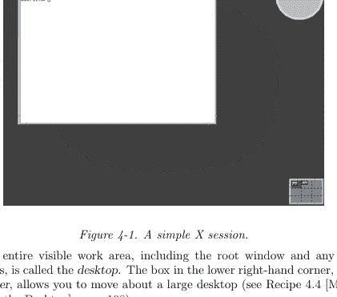

图 4-1. 一个简单的 X 会话。


整个可见的工作区域，包括根窗口和任何其他窗口，被称为桌面。右下角的框，称为分页器，允许你在大型桌面上移动 [参见配方 4.4《在桌面上移动》，第 108 页]。

窗口管理器是一个控制窗口外观和显示方式的程序——可以说是窗口装饰——并且可以提供一些额外的菜单或程序管理功能。窗口管理器在你运行 X 后立即启动。有许多不同的窗口管理器可供选择，每个都有各种功能和能力；开始使用 Linux 的乐趣之一就是尝试它们所有，找到自己喜欢的。有关一些更受欢迎或有趣的窗口管理器的列表，请参阅配方 4.7.5《使用其他窗口管理器》，第 120 页。

1 有时你可能会听到它被称为“X Windows”，但这个术语在技术上是不正确的。

窗口管理器通常允许你自定义用于显示窗口的颜色和边框，以及窗口上出现的按钮的类型和位置（参见 Recipe 4.2 [Running a Program in X]，第 101 页）。例如，在上图中的时钟本身就是 `oclock` 程序，而它上面的标题栏是由 `FVWM2` 窗口管理器绘制的。使用 `AfterStep` 窗口管理器时，标题栏会看起来有点不同，如图 4-2 所示。

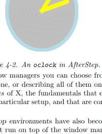

图 4-2. AfterStep 中的一个 oclock。

你可以从中选择的窗口管理器有很多，各不相同；与其只描述其中一个，或对所有窗口管理器都只做肤浅的描述，本章解释了 X 的基础知识，即无论你的具体设置如何使用 X 都必须了解的基本原理，并且所有窗口管理器都通用。

近年来，桌面环境也变得流行起来。这些是在窗口管理器（以及 X）之上运行的应用程序套件，其目的是为你的 X 会话提供标准化的“外观和感觉”；这些套件通常附带一些基本工具，例如时钟和文件管理器。两个主要的桌面环境是 `GNOME`（GNU 项目的“GNU Network Object Model Environment”）和 `KDE`（“K Desktop Environment”）。²

如果你有一款较新的 Linux 发行版并选择了默认安装，很可能你已经安装了 `GNOME` 或 `KDE`，并将 `Window Maker` 或 `FVWM2` 之类的程序指定为默认窗口管理器。（虽然你可以在系统上安装多个窗口管理器，但一次只能运行一个。）

² 桌面环境旨在成为 X 的直观且“用户友好”的界面，因此在本书中我解释了使用 X 本身的基础知识，有关这些桌面环境的更多信息请从其网站了解：http://gnome.org/ 和 http://kde.org/。

## 4.1.1 启动 X

启动 X 主要有两种方法。你在系统上启动它的方式取决于是否安装了 X 显示管理器。

### METHOD #1

```
Xdm
DEB: xdm
RPM: xdm
WWW: http://www.xfree86.org/
```

如果安装了 X 显示管理器 `xdm`，请使用它来管理你的 X 会话。安装了它的系统通常在系统启动时切换到第七个虚拟控制台，因此你会立即看到图形化的 `xdm` 登录屏幕。一些发行版会自定义此登录屏幕——例如，Fedora 会显示“Fedora Core”标志，并在其下方绘制一个用于输入用户名的框。

你可以直接从此屏幕登录到 X 会话，在相应的框中输入用户名和密码。

当 `xdm` 正在运行但系统在启动时未配置为切换到第七个虚拟控制台时，切换到它以便登录到 X 会话。

⇒ 要切换到第七个虚拟控制台，输入：

`ALT - F7`

### METHOD #2

在未运行 `xdm` 的系统上，为 X 保留的虚拟控制台将是空白的，直到你在另一个虚拟控制台中通过运行 `startx` 自己启动 X。`startx` 的消息，包括任何错误消息，都显示在你运行它的控制台中，而 X 本身将在第七个虚拟控制台中运行。

⇒ 这里有两种使用方法。

- 要从另一个虚拟控制台自己启动 X，输入：

  `$ startx RET`

- 要运行 `startx` 并将标准输出和标准错误都重定向到日志文件，输入：

  `$ startx &> /startx.log RET`

这两个示例都在第七个虚拟控制台上启动 X，无论你在运行命令时处于哪个控制台——你的控制台会自动切换到第七控制台上的 X。在你的 X 会话期间，你始终可以切换到另一个控制台（参见 Recipe 2.3 [Using Consoles and Terminals]，第 32 页）。第二个示例将 `startx` 的任何错误消息或输出写入名为 `startx.log` 的文件，该文件位于你的主目录中。

启动 X 时，你可以指定要使用的颜色深度，即用于渲染显示器上每个像素的可能颜色的位数。³ 它以 2 的幂次方表示；因此，8 位颜色意味着一个像素可以是 2⁸ 或 256 种可能颜色中的任意一种，16 位颜色提供 65,536 种可能颜色（2¹⁶），而 24 位颜色（2²⁴）下，像素可以是 16,777,216 种颜色中的任意一种（1 位颜色则是恰好两种颜色）。颜色深度受显示硬件限制。根据你的系统配置和显卡，X 可能以 8 位到 24 位之间的默认颜色深度启动。你可以使用 `startx` 配合特殊的 `-bpp` 选项指定其他颜色深度；在其后跟上表示要使用的颜色深度的数字，并用两个连字符（`--`）作为选项前缀，这会告诉 `startx` 将其后的选项传递给 X 服务器本身。

⇒ 要从虚拟控制台启动 X 并指定 24 位颜色深度，输入：

```
$ startx -- -bpp 24 [RET]
```

**NOTES:** 如果你的系统运行 `xdm`，你始终可以切换到第七个虚拟控制台（或 `xdm` 运行的任何控制台），然后在 `xdm` 登录屏幕登录。

## 4.1.2 停止 X

停止 X 有几种方法。

### METHOD #1

结束 X 会话的正常方式是通过你的窗口管理器完成。大多数窗口管理器都有一个退出 X 的菜单选项或类似功能，你可以用鼠标选择；其他窗口管理器有用于退出 X 的按键命令。

³ 位是计算机最小的信息单位，可以是二进制 0 或 1；像素是构成显示器屏幕的单个彩色点。

## 4.2 在 X 中运行程序

在 X 会话中运行的程序称为 X 客户端。 （X Window 系统本身称为 X 服务器。）要运行 X 中的程序，您将其作为 X 客户端启动——要么从菜单中选择它，要么在 `xterm` shell 窗口中输入运行命令（参见 Recipe 4.5 [在 X 中运行 Shell]，第 109 页），如下所示。

### METHOD #1

大多数窗口管理器都有一类“开始菜单”；它通常通过在根窗口的任何位置单击鼠标左键来访问。要从开始菜单运行 X 客户端，请单击鼠标左键从子菜单中选择客户端的名称。

⇒ 要从开始菜单启动一个方形、模拟表盘的时钟，请执行以下操作：

1. 单击根窗口上的鼠标左键使菜单出现。
2. 通过应用程序菜单单击鼠标左键并单击 `Xclock`（模拟）。

这将启动 `xclock` 客户端，指定显示模拟表盘的选项，如图 4-3 所示。

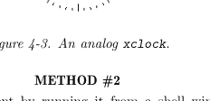

Figure 4-3. An analog xclock.

### METHOD #2

您也可以通过从 shell 窗口运行它来启动客户端——这对于启动不在菜单上的客户端或当您想要指定选项或参数时很有用。当您从 shell 窗口运行 X 客户端时，客户端会在自己的窗口中打开，但作为该 shell 中的前台作业运行；要在客户端运行时使用 shell，请在后台运行客户端（参见 Recipe 3.3.2 [将作业置于后台]，第 72 页）。

⇒ 要从 shell 窗口运行数字时钟，请输入：

```
$ xclock -digital & [RET]
```

此命令从 shell 窗口在后台运行 `xclock`；`digital` 选项指定数字时钟。

以下各节解释如何指定大多数 X 客户端通用的某些命令行选项，例如窗口布局、颜色和字体。

### 4.2.1 指定 X 窗口大小和位置

通过使用 `geometry` 选项给出其窗口几何形状来指定窗口的大小和位置。四个字段控制窗口的宽度和高度，以及窗口与屏幕边缘的距离（“偏移”）。其指定形式为：

```
-geometry WIDTHxHEIGHT+XOFF+YOFF
```

这些四个字段中的值通常以像素为单位给出，尽管某些应用程序以字符为单位测量 `WIDTH` 和 `HEIGHT`。虽然您必须按顺序给出这些值，但您可以省略任一对。例如，要仅指定窗口的大小，只需给出 `WIDTH` 和 `HEIGHT` 的值即可。

⇒ 以下是一些使用方法。

- 要启动一个小 `xclock`，宽 48 像素，高 48 像素，请输入：

  ```
  $ xclock -geometry 48x48 [RET]
  ```

- 要启动一个大 `xclock`，宽 480 像素，高 500 像素，请输入：

  ```
  $ xclock -geometry 480x500 [RET]
  ```

- 要启动一个宽为 48 像素且高度为默认值的 `xclock`，请输入：

  ```
  $ xclock -geometry 48 [RET]
  ```


- 要启动一个高为 48 像素且宽度为默认值的 `xclock`，请输入：

```
$ xclock -geometry x48 [RET]
```

您可以为 `XOFF` 和 `YOFF` 字段给出正数或负数。正 `XOFF` 值指定从屏幕左侧的位置；负值指定从右侧的位置。如果 `YOFF` 为正，则指定从屏幕顶部的位置；如果为负，则指定从屏幕底部的位置。给出这些偏移量时，您必须同时指定 `XOFF` 和 `YOFF` 的值。

要将窗口放置在桌面四个角之一，请为适当的 `XOFF` 和 `YOFF` 值使用零，如下所示：

| Geometry | Position |
| --- | --- |
| `+0+0` | Upper left-hand corner. |
| `+0-0` | Lower left-hand corner. |
| `-0+0` | Upper right-hand corner. |
| `-0-0` | Lower right-hand corner. |

⇒ 要在左下角启动默认大小的 `xclock`，请输入：

```
$ xclock -geometry +0-0 [RET]
```

或者，您可以将所有四个值包含在一行 `geometry` 中，以指定窗口的大小和位置。

⇒ 要启动一个宽 120 像素、高 100 像素、`x` 偏移量为屏幕右侧 250 像素、`y` 偏移量为屏幕顶部 25 像素的 `xclock`，请输入：

```
$ xclock -geometry 120x100-250+25 [RET]
```

使用 `-iconic` 选项以图标形式启动客户端，以便它在运行时立即显示为图标。客户端将启动，但会显示为小图标，直到您单击它为止（参见 Recipe 4.3.5 [取消 X 窗口的图标化]，第 107 页）。

⇒ 要以图标形式启动 `xclock`，但在您最大化它时在右上角打开，请输入：

```
$ xclock -geometry -0+0 -iconic [RET]
```

### 4.2.2 指定 X 窗口颜色

您在 X 会话中可用的窗口颜色取决于您的显示硬件和正在运行的 X 服务器。`xcolors` 工具将显示您 X 服务器上所有可用颜色以及用于指定它们的名称。 （颜色名称不区分大小写。）

⇒ 要列出可用颜色，请输入：

```
$ xcolors [RET]
```

Press ⌘Q to exit `xcolors`.

要指定用于窗口背景、窗口边框以及窗口本身中的文本或图形的颜色，请将颜色名称作为参数给出

to the appropriate option: `-bg` for background color, `-bd` for window border color, and `-fg` for foreground color.

⇒ To start an `xclock` with a light blue window background, type:

```
$ xclock -bg lightblue RET
```

You can specify any combination of these attributes.

⇒ To start an `xclock` with a sea green window background and a turquoise window foreground, type:

```
$ xclock -bg seagreen -fg turquoise RET
```

NOTES: The `-bordercolor`, `-background`, and `-foreground` options are synonymous with `-bd`, `-bg`, and `-fg`.

## 4.2.3 Specifying X Window Font

To specify a font for use in a window, use the `-fn` option followed by the X font name to use. (To get an X font name, use `xfontsel`; see Recipe 16.1 [Using X Fonts], page 395).

⇒ To start an `xclock` with a digital display, and specify that it use a 17-point Helvetica font for text, type:

```
$ xclock -digital -fn -*-helvetica-*-r-*-*-17-*-*-*-*-*-*-* RET
```

This command starts an `xclock` that looks like Figure 4-4.


Figure 4-4. A digital `xclock` with Helvetica type.

NOTES: If you specify the font for a shell window, you can resize it after it's running, as described in Recipe 16.14 [Resizing the Xterm Font], page 398.

The `-font` option is synonymous with `-fn`.

## 4.2.4 Specifying X Window Border Width

To specify the width of the border of an X client, use `-bw` followed by the desired width, in pixels.

⇒ To start an `xclock` with a border width of 30 pixels, type:

```
$ xclock -bw 30 RET
```

NOTES: The `-borderwidth` option is synonymous with `-bw`.

## 4.2.5 Specifying X Window Title

To specify your own title for a client, use `-title` and follow it with a quoted string for the window title. If you use a long title, you might have to specify the client width to make sure the window is long enough.

⇒ Here are two ways to use this.

- To start an `xclock` with a title of “Time,” type:

```
$ xclock -title "Time" RET
```

- To start an `xclock` 225 pixels wide with a title of “As Time Goes By,” type:

```
$ xclock -title "As Time Goes By" -geometry 225 RET
```

## 4.2.6 Specifying Attributes in an X Window

You can specify certain special attributes when an X client is already running in a window.

X applications often have up to three special menus with options for changing certain attributes. To see these menus, press and hold `CTRL` and then click one of the three mouse buttons somewhere in the client’s window. (If you have a mouse with only two buttons, click both buttons simultaneously to emulate the middle button.)

⇒ To display an X client’s third menu, press and hold `CTRL`, move the mouse pointer to somewhere in the X client’s window, and click the third mouse button.

## 4.3 Manipulating X Client Windows


Only one X client can accept keyboard and mouse input at a time, and that client is called the *active client*. To make a client active, move the mouse over the client’s window. When a client is the active client, it is said to be “in focus.” Depending on the window manager, the shape of the mouse pointer may change, or the window border and title bar of the active client may be different (a common default is steel blue for the active client color and gray for all other windows).

Each window has its own set of controls to manipulate that window. These controls differ slightly between various window managers. Here’s how to perform basic window operations with the mouse.

### 4.3.1 Moving an X Window

Move X client windows by dragging the title bar with the mouse.

⇒ To move an X window, do the following:

1. Click and hold the left mouse button on the window’s title bar.

2. Drag its window outline to the desired position.

3. Release the left mouse button.

### 4.3.2 Resizing an X Window

Resize X client windows by dragging any of its frames.

⇒ To resize an X window, do the following:

1. Click and hold the left mouse button on any one of the window’s four frames.

2. Move the mouse to shrink or grow the window outline as desired.

3. Release the left mouse button.

### 4.3.3 Maximizing an X Window

Sometimes you may want to resize an X client window so that the window is as large as it can be, often filling the entire screen. This is called maximizing a window.

⇒ The way to maximize a window depends on your window manager; usually one or more of the following methods work:

- Double-click the left mouse button on the title bar (on a maximized window, this sometimes has the effect of returning the window to its smaller original size).

- Click the left mouse button on a square box button on the title bar.

- Click either the middle or right mouse button anywhere on the root window to pull up a menu whose options include “maximize”; select that option and then click on the title bar of the client window to maximize.

NOTES: If the idea of maximizing all your X client windows appeals to you, I suggest looking at Ion, a window manager with no real concept of “windows” at all, but only clients running maximized to full-screen size (see Recipe 4.7.5 [Using Other Window Managers], page 120).

⇒ 要获取有关客户端窗口的信息，请执行以下操作：

1. 在终端窗口中运行 `xwininfo`：

```
$ xwininfo [回车]

xwininfo: 请点击鼠标选择您想要获取信息的窗口。
```

2. 在您想要获取信息的窗口中的任意位置点击鼠标左键。

该命令会在您输入命令的终端窗口中输出一份关于您用鼠标选中的客户端窗口的信息列表。

### 4.3.7 销毁 X 窗口

当您退出或关闭 X 客户端时，该窗口将不再显示。您也可以在 X 中销毁窗口，此时该窗口中运行的客户端将被终止，窗口也不再显示。

要销毁窗口，请将鼠标左键点击标题栏右上角的“X”按钮。当窗口中运行的程序停止响应且无法正常退出时，此操作非常有用。

## 4.4 在桌面上移动

许多窗口管理器（包括 AfterStep 和 FVWM2）都允许您使用虚拟桌面，这可以让您使用比显示器一次所能显示的更多的屏幕空间。虚拟桌面可以大于显示区域，在这种情况下，您可以用鼠标滚动浏览它。填满显示器的视图称为视口。当您将鼠标移出屏幕并朝向当前（虚拟）桌面延伸的方向时，视图就会向该方向滚动。虚拟桌面对于同时全屏运行多个客户端非常有用，每个客户端各自位于独立的桌面上。

某些配置不允许在桌面之间滚动；在这种情况下，可以使用分页器在桌面之间切换，分页器会显示虚拟桌面的缩略视图，并允许您在桌面之间切换。它是一个粘滞窗口（“粘附在所有其他窗口之上”），并且始终位于屏幕的右下角，即使您在虚拟桌面上滚动也是如此。您当前的桌面和活动的 X 客户端都会在分页器中高亮显示。

默认的 FVWM2 虚拟桌面大小为 3x3 网格的九个桌面，如图 4-5 所示。

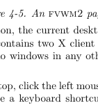

图 4-5. 一个 FVWM2 分页器。

在上面的插图中，当前桌面是顶行中的第二个。第一个桌面包含两个 X 客户端窗口——一个小窗口和一个大窗口——但其他任何桌面（包括当前桌面）中都没有窗口。

要切换到另一个桌面，请在分页器中点击鼠标左键单击其对应的视图，或者如果您的窗口管理器提供了键盘快捷键，则使用键盘快捷键。

⇒ 在 FVWM2 中，用于在桌面之间切换的默认按键是 ALT 键配合方向键；在 AfterStep 中，使用 CTRL 键代替 ALT。

- 在运行 FVWM2 时，要切换到当前桌面左侧的桌面，请键入 ALT + ←。

- 在运行 AfterStep 时，要切换到当前桌面左侧的桌面，请键入 CTRL + ←。

## 4.5 在 X 中获取终端窗口

Xterm

- DEB: `xterm`

- RPM: `xterm`

- WWW: http://dickey.his.com/xterm/

终端模拟器让您可以在 X 客户端窗口中运行 shell。Linux 系统上 X 的标准终端模拟器是 `xterm`，它模拟 DEC vt102/220 和 Tektronix 4014 视频终端。⁴ 您可以像在虚拟控制台中一样在 `xterm` 窗口中运行命令；`xterm` 中的 shell 与虚拟控制台中的 shell 行为相同（参见第 3 章 [Shell]，第 53 页）。

您可以将所有标准的 X 客户端选项与 `xterm` 一起使用（参见方法 4.2 [在 X 中运行程序]，第 101 页），但它也有许多自己的选项，这些选项将在下一个方法中介绍。

⇒ 要打开一个带有 shell 的新窗口，并将文本字体设置为 Lucida Sans Typewriter，正文大小为 18 像素，请键入：

```
$ xterm -fn lucidasanstypewriter-18 [回车]
```

此示例要求您已经有一个正在运行的终端模拟器，并且有一个可以输入命令的 shell 提示符。如果您没有，则必须通过窗口管理器提供的应用程序菜单选择 `xterm` 来启动它。


⇒ 要在使用 Ion 窗口管理器时打开一个带有 shell 的新窗口，并将文本字体设置为 Lucida Sans Typewriter，正文大小为 18 像素，请键入：

```
[F3]

运行: xterm -fn lucidasanstypewriter-18 [回车]
```

您可以从 `xterm` 中剪切和粘贴文本到另一个 X 客户端（参见方法 10.3 [操作文本选择]，第 253 页）。

要滚动查看已经滚动到屏幕顶部的文本，请键入 [SHIFT]-[PgUp]。您可以滚动的行数取决于滚动缓冲区的大小，该大小由 `-sl` 选项指定；其默认值为 64。

### 4.5.1 更改默认 X 终端行为

有许多命令行选项可用于控制 `xterm` 的模拟特性；下表列出了其中一些。

请注意，这些选项有点特殊；有时 `-` 选项会开启某项功能，而其他时候 `+` 选项则会开启。默认行为已注明，尽管某些 Linux 发行版可能会更改这些默认值。

> ⁴ 要查看原始硬件的外观，请参阅以下内容：
>
> http://www.cs.utk.edu/~shuford/terminal/dec.html 和
>
> http://www.cs.utk.edu/~shuford/terminal/various.html#tek。

`+ah`

始终高亮显示光标，即使窗口不再处于焦点状态。

`-ah`

当窗口未处于焦点时，使光标变空心（默认值）。

`-aw`

打开自动换行，使超出右边界的文本换到下一行（默认值）。

`+aw`

关闭自动换行；超出右边界的文本会被删除，使得一行的最后一个字符打印为边界前的最后一个字符。

`-b pixels`

指定内部边框的大小，以像素为单位（默认值为两像素）。

`-bdc`

关闭粗体字符的颜色显示，而以粗体显示（默认值）。

`+bdc`

以颜色显示粗体字符。

`-cm`

禁用 ANSI 控制序列的识别。

`+cm`

启用 ANSI 控制序列的识别（默认值）。

`-cr color`

指定用于文本光标的颜色。

`-fb font`

指定粗体文本使用的字体（默认是对正常文本字体进行重叠。）您提供的值必须与正常文本使用的高度和宽度相同。

`-hc color`

设置高亮或选定文本背景使用的颜色（默认使用正常文本颜色的反色）。

`-j`

打开跳跃滚动，快速流动的文本会一次跳过多行滚动，而不是逐行滚动屏幕；推荐在浏览大量文本时提高速度（默认值）。

`-rw`

允许反向换行，当编辑长命令行时，光标可以从一行退回到上一行的右边界（默认值）。

`+rw`

不允许反向换行。

`-sb`

启用滚动条，以便通过在条上向上滚动来查看滚动到窗口顶部的行。

`+sb`

禁用滚动条（默认值）。

`-sk`

指定在使用滚动条查看先前文本时按下键后，窗口显示会向前移动到当前输入行（默认值）。

`+sk`

指定在使用滚动条查看先前文本时按下键后，窗口显示不会向前移动到当前输入行。

`-sl number`

指定应保存多少行以便通过滚动条查看，这些行是从屏幕顶部滚动出去的。

`-ulc`

指定下划线字符不应以颜色显示（默认值）。

`+ulc`

指定下划线字符应以颜色显示而不是下划线。

`-vb`

指定使用视觉提示铃而非可听提示铃（窗口会快速闪烁）。

`+vb`

禁用任何视觉提示铃（默认值）。

还有比这更多的选项；请参阅 `xterm` 手册页以获取完整列表（参见 Recipe 2.8.4 [Reading a Page from the System Manual]，第 46 页）。

## 4.5.2 在 X 窗口中运行命令

`xterm` 工具默认会运行一个 shell，但您可以使用它来运行任何交互式终端程序；使用 `-e` 选项即可，并将要运行的命令名称作为参数给出。`xterm` 将打开该命令，并在其自己的窗口中运行；当该命令退出时，`xterm` 窗口将关闭。这在您只想在自己的窗口中运行特定命令，但不需要 shell 时非常方便。

⇒ 要在自己的 X 窗口中运行 `bc`，请输入：

    $ xterm -e bc [RET]

当您退出命令时，shell 将退出，窗口将关闭。您也可以向命令传递参数。

⇒ 要使用 URL `file:/usr/local/` 运行 `lynx`，请输入：

    $ xterm -e lynx file:/usr/local/ [RET]

在此示例中，`lynx` 在其自己的窗口中打开给定的 URL，直到您关闭窗口或退出 Lynx。

NOTES: 如果使用其他选项调用 `xterm`，`-e` 选项必须是命令行中指定的最后一个选项。

## 4.5.3 使用其他终端模拟器

虽然 `xterm` 是标准的 Linux 终端模拟器，但它 certainly 不是唯一的；可供选择的有很多，都具有特殊功能。下表列出了其中一些更好的终端模拟器。

| Terminal Emulator | Description | DEB | RPM | WWW |
|---|---|---|---|---|
| AfterStep XVT | 这个彩色 VT102 终端模拟器是为 AfterStep 窗口管理器制作的，但也可以与其他管理器一起使用；具有许多特殊效果，如着色和阴影，但比 `xterm` 更小——而且使用的交换空间也更少。 | aterm | aterm | http://aterm.sourceforge.net/ |
| Enlightened Terminal Emulator | 这个彩色 VT102 终端模拟器是为 Enlightenment 窗口管理器制作的，但也可以与其他管理器一起使用；支持主题并具有许多控制其外观的功能。 | eterm | Eterm | http://www.eterm.org/ |

Konsole

这个用于 KDE 的图形终端仿真器允许你在单个窗口中运行多个终端。

DEB: konsole

RPM: konsole

WWW: http://konsole.kde.org/

Multi Gnome Terminal

这个用于 GNOME 的图形终端仿真器具有受 Konsole 启发的增强功能，允许在单个窗口中拥有多个终端。

DEB: multi-gnome-terminal

RPM: multi-gnome-terminal

WWW: http://multignometerm.sourceforge.net/

Multi Lingual TERMINal

顾名思义，这个终端仿真器支持各种外语编码。

DEB: mlterm

RPM: mlterm

WWW: http://mlterm.sourceforge.net/

PowerShell

这个彩色终端仿真器允许在同一窗口中拥有多个终端，你可以通过点击“标签”按钮在它们之间切换。

DEB: powershell

RPM: powershell

WWW: http://powershell.sourceforge.net/

our XVT

人人皆知的命令名为 `rxvt`，这是一个彩色 vt102 终端仿真器，旨在作为 `xterm` 的替代品，比后者更小、占用内存更少，但仿真选项和可配置性较少。

DEB: rxvt

RPM: rxvt

WWW: http://sourceforge.net/projects/rxvt/

Unicode

这是带有 Unicode 支持的 `xterm`。

DEB: xterm

RPM: xterm

WWW: http://dickey.his.com/xterm/

Wterm

这基于我们的 XVT，但针对 Window Maker 窗口管理器进行了优化。其功能包括透明度、着色和背景图像。

DEB: wterm

RPM: wterm

WWW: http://largo.windowmaker.org/files.php?wterm

## 4.6 放大 X 桌面的某一部分

使用 `xmag` 放大 X 桌面的某一部分。它将打开一个新窗口，显示你选择的桌面部分，并放大到更大的尺寸。

运行时，X 指针将变为左上角的角标。有两种方法可以选择要放大的桌面区域：在屏幕上的任何位置单击一次鼠标左键，即可放大以你单击的位置为左上角的区域。你也可以选择特定的区域进行放大——方法是按下并按住鼠标中键于左上角，然后将指针拖动到你想要放大的区域的右下角。

以下是两种使用方法。

- 要放大桌面区域，请执行以下操作：
  1. 启动 `xmag`：
     ```
     $ xmag [RET]
     ```
  2. 在要放大的区域的左上角单击鼠标中键。
  3. 将指针移动到该区域的右下角，然后释放鼠标中键。
- 要在三秒延迟后运行 `xmag`，以便在它运行时有时间切换到另一个桌面窗口，输入：
  ```
  $ sleep 3; xmag [RET]
  ```

单击 Close 或输入 [Q] 即可退出程序并关闭放大的窗口。

## 4.7 配置 X


人们通常希望立即配置 X 的某些方面。本节讨论其中最受欢迎的方面，包括更改视频模式、自动在启动时运行客户端，以及选择窗口管理器。你可以在《The X Window User HOWTO》和《The Configuration HOWTO》中找到更多相关信息（关于如何阅读它们，请参阅 Recipe 2.8.6 [Reading System Documentation and Help Files]，第 50 页）。

### 4.7.1 在视频模式之间切换

视频模式是显示分辨率，以像素表示水平和垂直值，例如 640x480。X 服务器可以在硬件允许且管理员设置的情况下在视频模式之间切换；运行 X 的机器提供多种视频模式的情况并不少见，因此 640x480、800x600 和 1024x768 显示分辨率都是可能的。

要切换到另一种视频模式，请使用小键盘上的 ⊕ 和 ⊖ 键配合左 CTRL 和 ALT 键。⊕ 键切换到分辨率更低的下一个模式，而 ⊖ 键切换到分辨率更高的下一个模式。

以下是两种使用方法。

- 要切换到下一个最低视频模式，输入：`CTRL-ALT-⊕`
- 要切换到下一个最高视频模式，输入：`CTRL-ALT-⊖`

要循环浏览所有可用的视频模式，请重复输入其中任意一种键组合。

NOTES: 有关视频模式的更多信息，请参阅 The XF86 Video Timings HOWTO（请参阅 Recipe 2.8.6 [Reading System Documentation and Help Files]，第 50 页）。

### 4.7.2 自动运行 X 客户端

`.xsession` 文件是主目录中的一个隐藏文件，指定在 X 会话首次启动时自动运行的客户端（“隐藏”文件在第 5 章 [Files and Directories]，第 125 页中有说明）。它只是一个 shell 脚本，通常包含要运行的客户端列表。你可以在文本编辑器中编辑你的 `.xsession` 文件，如果该文件不存在，你可以创建它。

客户端按列出的顺序启动，最后一条行应指定要使用的窗口管理器。以下示例 `.xsession` 文件启动一个 `xterm`，背景为黑色、文字为白色、光标为棕色且无滚动条，将一个 `xclock` 放在左上角（受 AfterStep 启发的时钟，灵感来自 NEXTSTEP 的“撕下式”日历时钟），启动 Emacs 文本编辑器，并在其自己的缓冲区中打开文件 `"~/TODO"`，然后启动 AfterStep 窗口管理器：

```
#!/bin/sh

#
# A sample .xsession file.
xterm +sb -bg black -fg white -cr brown &
asclock -geometry +0+0 &
emacs ~/TODO &
exec /usr/bin/afterstep
```

所有客户端都作为后台任务启动，除了最后一行的窗口管理器，因为当此文件运行时，X 会话在前台运行（参见 Recipe 3.3 [Managing Jobs], page 70）。请始终在 `.xsession` 文件中放入的任何命令行的末尾加上一个与号（`&`）字符，除了最后一行指定窗口管理器的行。

### 4.7.3 Changing the Root Window Parameters

默认情况下，根窗口背景为灰色并带有织纹图案。为了绘制这些图案，X 会用位图平铺根窗口，该位图是一种以特殊文件格式存储的黑白图像。X 在 `/usr/X11R6/include/bitmaps/` 目录中自带了一些位图；默认位图文件是 `root_weave`（你可以用 `bitmap` 工具制作自己的图案；参见 Recipe 18.4 [Using Other Image Editors], page 435）。

使用 `xsetroot` 来更改根窗口的颜色和位图图案。

要更改颜色，请使用 `-solid` 选项，并将要使用的颜色名称作为参数给出。（使用 `xcolors` 获取可能的颜色名称列表，如 Recipe 4.2.2 [Specifying X Window Colors], page 103 中所述。）

⇒ 要将根窗口颜色更改为蓝紫色，请输入：

```
$ xsetroot -solid blueviolet [RET]
```

要更改根窗口图案，请使用 `-bitmap` 选项，并给出要使用的位图文件名。

⇒ 要用星形图案平铺根窗口，请输入：

```
$ xsetroot -bitmap /usr/X11R6/include/bitmaps/star [RET]
```

指定图案时，使用 `-fg` 和 `-bg` 选项指定前景色和背景色。

⇒ 要用浅板岩灰色的星形图案在黑色背景上平铺根窗口，请输入（全部在一行上）：

```
$ xsetroot -fg slategray2 -bg black -bitmap /usr/X11R6/include/bitmaps/star [RET]
```

使用 `xsetroot` 的特殊 `-gray` 选项将根窗口更改为一种对眼睛友好的灰色调，且无图案。

⇒ 要使根窗口变为无图案的灰色，请输入：

```
$ xsetroot -gray [RET]
```

NOTES: 你也可以在根窗口中放置一幅图像（尽管这会消耗本可节省给内存占用型 Web 浏览器的内存；但参见 Recipe 17.1.2 [Putting an Image in the Root Window], page 410，了解如何操作）。

### 4.7.4 Controlling the System Bell in X

X 有一个用于控制用户偏好的实用程序 `xset`，你可以用它来控制系统的各个方面——例如，你可以用它来控制屏幕保护程序时间、LED 灯的设置方式、按键音量级别等等。

要关闭系统蜂鸣器的响铃，请使用 `xset` 并将 `off` 作为 `b` 选项的参数给出。

⇒ 要在 X 中关闭系统蜂鸣器，请输入：

```
$ xset b off [RET]
```

你可以用 `on` 参数重新打开蜂鸣器。

你可以通过向 `b` 选项提供三个数字作为参数来控制蜂鸣器的音量、音调和持续时间：第一个是其最大值的百分比音量，第二个是赫兹的音调，第三个是毫秒的持续时间。运行 `xset` 并带 `b` 选项但不带参数会将蜂鸣器恢复为默认值。

⇒ 以下是两种使用方法：

- 要将蜂鸣器设置为最大音量的 75%，以 440 Hz 响铃一秒钟，请输入：

  ```
  $ xset 75 440 1000 [RET]
  ```
- 要将系统蜂鸣器恢复为默认值，请输入：

  ```
  $ xset b [RET]
  ```

NOTES: 要使 `xset` 设置永久生效，影响你运行的每个 X 会话，你需要将该命令放入你的 `.xsession` 文件中（参见 Recipe 4.7.2 [Running X Clients Automatically], page 117）。

当你启动终端模拟器时，你可以使用 `-vb` 选项仅在该终端窗口中关闭可听见的蜂鸣器（参见 Recipe 4.5.1 [Changing the Default X Terminal Behavior], page 110）。

### 4.7.5 Using Other Window Managers

是的，有很多窗口管理器可供选择。有些人喜欢 Enlightenment 的华丽效果，配合 KDE 或 GNOME 运行，而其他人则更喜欢简朴的 WM2 或 Ion 的反窗口化方法，或是模拟其他操作系统环境的窗口管理器——选择权在你。

下表描述了一些目前较为流行的窗口管理器。

| Window Manager | Description |
|---|---|
| 9wm | 9wm 是一款受 AT&T Plan 9 窗口管理器启发的简单窗口管理器——它不使用标题栏或图标。它应该会吸引那些喜欢 Wily 文本编辑器的人（参见 Recipe 10.8 [Using Other Text Editors], page 263）。 DEB: 9wm RPM: 9wm WWW: http://www.plig.org/xwinman/archive/9wm/ |
| AfterStep | AfterStep 的灵感来自 NeXTSTEP 界面的外观和感觉。 DEB: afterstep RPM: AfterStep WWW: http://www.afterstep.org/ |
| BlackBox | BlackBox 是一款快速、轻量级的窗口管理器，具有现代化的外观和感觉。 DEB: blackbox RPM: blackbox WWW: http://blackboxwm.sourceforge.net/ |
| Enlightenment | Enlightenment 是一款图形密集型的窗口管理器，使用桌面“主题”来装饰 X 会话的各种控件。 DEB: enlightenment RPM: enlightenment WWW: http://www.enlightenment.org/ |

## Fluxbox

Fluxbox 基于 BlackBox，增加新功能包括窗口标签、键盘快捷键和图标栏。

DEB: fluxbox

RPM: fluxbox

WWW: http://www.plig.org/xwinman/fluxbox.html

## FVWM95


# FVWM95
让 X 看起来像 1995 年左右的某个专有“桌面”操作系统。

DEB: `fvwm95`

WWW: ftp://ftp.plig.org/pub/fvwm95/

## Ion
Ion 设计为可通过键盘导航，将应用程序和客户端窗口保持在全屏框架中，Ion 正在成为那些重视速度和效率且通常不太在意窗口系统的人的宠儿。

DEB: `ion`

RPM: `ion`

WWW: http://modeemi.cs.tut.fi/~tuomov/ion/

## TWM
Tab Window Manager 是一个较老、简单的窗口管理器，几乎在每个系统上都可用。 （它有时也被称为 Tom's Window Manager，以其主要作者 Tom LaStrange 命名。）

DEB: `twm`

RPM: `twm`

WWW: http://www.plig.org/xwinman/vtwm.html

## WM2
`wm2` 是一个极简、无需配置的窗口管理器。

DEB: `wm2`

RPM: `wm2`

WWW: http://www.all-day-breakfast.com/wm2/

## Window Maker
GNU 项目的首选窗口管理器，Window Maker 可通过简单菜单进行配置，并且常与 NeXTSTEP 相比较。

DEB: `wmaker`

`wmaker-data`

RPM: `wmaker`

WWW: http://www.windowmaker.org/

要尝试其中一个窗口管理器，请从当前窗口管理器提供的应用程序菜单中选择它。这将退出你的窗口管理器并启动新的窗口管理器。如果你喜欢其中一个并希望将其设为默认，请编辑你的 `.xsession` 文件，使其最后一行包含 `exec` 后跟要使用的窗口管理器的完整路径名（参见 Recipe 4.7.2 [Running X Clients Automatically], page 117）。

⇒ 要将 AfterStep 设为你的默认窗口管理器，请在你的 `.xsession` 文件中将以下内容作为最后一行：

```
exec /usr/bin/X11/afterstep
```

**NOTES:** 一些窗口管理器（如 `twm` 和 `wm2`）没有应用程序菜单，因此如果你运行此类窗口管理器，你将无法在该会话期间轻松切换到另一个——你必须退出 X 并重新启动它。

# II. FILES

## 5. Files and Directories
本章讨论用于操作文件和目录的基本工具——这些工具是 Linux 系统上最基本且最重要的工具。

文件是存储在磁盘上并可通过其名称作为单个单元进行操作的数据集合。

目录是一个充当其他文件的文件夹的文件。目录也可以包含其他目录（在此上下文中称为子目录）；包含另一个目录的目录称为其包含的子目录的父目录。

你可以把普通文件想象成文件柜抽屉里的文件夹。文件夹有一个名称，它保存放入其中的信息，并且该信息可以重新排列；你可以随时调出文件，也可以销毁它。然后文件柜的抽屉就是目录，每个文件都必须保存在其中一个抽屉里。

到此为止比喻就结束了。文件夹可以被完全复制，并且可以存在指向你某个真实文件夹内容的幻影文件夹，这样当你查看幻影时，你实际上是在查看别处的某个文件夹的内容。你可以拥有任意多的目录，与物理文件柜不同，你可以在其他抽屉内放置抽屉，这些抽屉又可以拥有自己的抽屉，层层递进。事实上，有一个“主”抽屉，即根目录，它内部包含所有其他抽屉——每个抽屉都必须保存在另一个抽屉内。

将系统上的目录想象成一棵树及其所有分支也很 helpful，因为目录形成分支层次结构——并且树形比喻经常被用来描述它们：目录树包括一个目录及其所有文件，包括所有子目录的内容。 （每个目录都是“树”中的一个“分支”。）单独的斜杠字符（`/`）是目录树层次结构基部的根目录的名称；可以把它想象成形成根部和树干的部分，所有其他文件或目录都由此得到支持并由此不可避免地分支出来。

图 5-1 显示了根目录树的简略版本。

要表示目录在文件层次结构中的位置，请指定它与根目录之间的所有目录，使用斜杠（`/`）作为分隔符来分隔目录。因此，如前图所示的目录 `dict` 将表示为 `/usr/dict`。

每个用户在 `/home` 目录下都有一个分支用于存放自己的文件，称为其主目录。上一幅图中的层级结构有两个主目录：`joe` 和 `jon`，它们都是 `/home` 的子目录。

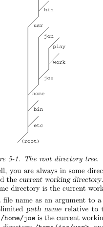

Figure 5-1. The root directory tree.

当你在使用 shell 时，你始终位于系统上的某个目录中，该目录称为当前工作目录。当你首次登录系统时，你的主目录就是当前工作目录。

在向工具或应用程序指定文件名作为参数时，你可以给出相对于当前工作目录的以斜杠分隔的路径名。例如，如果 `/home/joe` 是当前工作目录，你可以使用 `"work"` 来指定目录 `/home/joe/work`，而使用 `"work/schedule"` 来指定 `/home/joe/work` 目录中的文件 `schedule`。

每个目录都有两个特殊文件，其名称由一个和两个句点组成：`..` 指的是当前工作目录的父目录，而 `.` 指的是当前工作目录本身。如果当前工作目录是 `/home/joe`，你可以使用 `.` 来指定 `/home/joe`，而使用 `..` 来指定 `/home`。此外，你可以指定 `/home/jon` 目录为 `../jon`。

指定文件名的另一种方法是指定从根目录（`/`）开始，一直到要指定的文件为止的所有目录分支的以斜杠分隔的列表。从根目录到文件的这种唯一、特定的路径称为文件的 *full path name*。 （当引用一个不是目录的文件时，这有时被称为 *absolute file name*）。

你可以通过给出其完整路径名来指定系统上的任何文件或目录。文件可以与系统上不同目录中的其他文件同名，但没有两个文件或目录可以共享相同的完整路径名。例如，用户 `joe` 可以在其 `/home/joe/work` 目录中有一个文件 `schedule`，也可以在其 `/home/joe/play` 目录中有一个文件 `schedule`。虽然这两个文件同名（`schedule`），但它们位于不同的目录中，因此每个都有唯一的完整路径名——`/home/joe/work/schedule` 和 `/home/joe/play/schedule`。

然而，你不必键入工具或应用程序的完整路径名即可启动它。shell 维护一个目录列表，称为 *path*，它会在其中搜索程序。如果程序“在你的路径中”，即位于这些目录之一中，你只需键入其名称即可运行它。

默认情况下，路径包括 `/bin` 和 `/usr/bin`。例如，`who` 命令位于 `/usr/bin` 目录中，因此其完整路径名为 `/usr/bin/who`。由于 `/usr/bin` 目录在路径中，你可以键入 `who` 来运行 `/usr/bin/who`，无论当前工作目录是什么。

下表描述了 Linux 系统上的一些标准目录。

| Directory | Description |
|---|---|
| `/` | 系统上所有目录的祖先；所有其他目录都是此目录的子目录，无论是直接还是通过其他子目录。 |
| `/bin` | 基本工具和其他程序（或 *binaries*）。 |
| `/dev` | 表示系统各种硬件 *devices* 的文件。例如，你使用文件 `/dev/cdrom` 来访问 CD-ROM 驱动器。 |
| `/etc` | 各种系统配置文件、启动文件，*et cetera*。 |
| `/home` | 系统所有用户的 *home* 目录。 |
| `/lib` | `/bin` 中工具使用的基本系统 *library* 文件。 |
| `/proc` | 提供有关当前系统 *processes* 信息的文件。 |
| `/root` | 超级用户的家目录，其用户名为 `root`。 （过去，超级用户的主目录只是 `/`；后来采用 `/root` 用于此目的，以减少 `/` 中的杂乱。） |
| `/sbin` | 基本系统管理员工具，或系统二进制文件。 |
| `/tmp` | 临时文件。 |
| `/usr` | 与用户工具和应用程序相关的子目录中的文件。 |
| `/usr/X11R6` | 与 X Window System 相关的文件，包括仅在 X 下运行的那些程序（在 `/usr/X11R6/bin` 中）。 |
| `/usr/bin` | 用户的工具和应用程序。 |
| `/usr/dict` | 词典和词表（正逐渐被 `/usr/share/dict` 取代）。 |
| `/usr/doc` | 各种系统文档。 |
| `/usr/games` | 游戏和娱乐。 |
| `/usr/info` | Gnu Info 超文本系统（见 Recipe 2.8.5 [Reading an Info Manual], page 48）的文件。 |
| `/usr/lib` | `/usr/bin` 中工具使用的库。 |


- `/usr/local`：本地文件——特定于单个系统的文件——包括本地文档（在 `/usr/local/doc` 中）和程序（在 `/usr/local/bin` 中）。
- `/usr/man`：在线手册，可通过 `man` 命令阅读（见 Recipe 2.8.4 [Reading a Page from the System Manual], page 46）。
- `/usr/share`：已安装应用程序的数据，其与体系结构无关且可在系统之间共享。这里出现了许多与 `/usr` 中等价的子目录，包括 `/usr/share/doc`、`/usr/share/info` 和 `/usr/share/icons`。
- `/usr/src`：程序源代码，供系统上编译的软件使用。
- `/usr/tmp`：另一个用于临时文件的目录。
- `/var`：可变数据文件，例如 spool 队列和日志文件。

有关基于 Linux 系统的目录结构的更多信息，请参阅文件系统层次结构标准 [http://www.pathname.com/fhs/]。

在 Debian 系统上，您还可以在 `/usr/doc/debian-policy/fsstnd/` 目录中的压缩文件中查看此信息（请参阅 Recipe 9.1 [Perusing Text]，第 211 页）。

## 5.1 命名文件和目录

文件名可以由大写和小写字母、数字、句点 (.)、连字符 (-) 和下划线 (_) 的任意组合组成。¹ 文件名也是区分大小写的——`foo`、`Foo` 和 `FOO` 都是不同的文件名，它们可以同时存在于同一个目录中（同名文件不能共存）。按照惯例，文件名几乎总是全小写字母。

Linux 不强制您使用文件扩展名，但为文件提供适当的扩展名很方便且有用，因为它们可以帮助您一目了然地识别文件类型。

扩展名没有特殊要求；点只是旧的约定——您可以为任何文件使用您喜欢的任何系统：

```
Penny_Parker-20031103.letter
```

文件根本不需要任何扩展名，像 `myfile` 这样，而且文件也可以有多个扩展名，像 `long.file.with.many.extensions`。例如，JPEG 格式的图像文件不必具有 `.jpg` 或 `.jpeg` 扩展名，程序文件也不需要特殊扩展名才能工作。

如果您要将文件发送给其他计算机上的用户，扩展名尤其有用，特别是那些需要扩展名的系统——如果不先给文件加上 `.doc` 扩展名就将 Microsoft Word 格式的文件发送给 Windows 用户，您很可能会被告知文件无法使用。

1 从技术上讲，您可以使用其他字符——但这样做可能会在以后给您带来麻烦。

文件名中在任何文件扩展名之前，但不包括路径的部分称为基本文件名。例如，`/home/lisa/house.jpeg` 的基本文件名是 `house`，不带点或后面的 `.jpeg`，也不带路径。

有关常用文件扩展名及其含义的列表，请参阅附录 B [Conventional File Name Extensions]，第 723 页。

以下各节展示如何创建新文件。要重命名现有文件，只需将其移动到具有新名称的文件即可——请参阅 Recipe 5.5 [Moving Files and Directories]，第 144 页。

### 5.1.1 创建空文件

您有时可能想要创建一个新的空文件作为一种“占位符”。为此，将您想要为文件使用的名称作为参数传递给 `touch`。

⇒ 以下是一些使用方法。

- 要在当前目录中创建文件 `a_fresh_start`，请输入：

  ```
  $ touch a_fresh_start [RET]
  ```

- 要在当前目录的 `work/completed` 子目录中创建文件 `another_empty_file`，请输入：

  ```
  $ touch work/completed/another_empty_file [RET]
  ```

此工具“触摸”您提供的作为参数的文件。如果文件不存在，它会创建它；如果文件已存在，它会将文件的修改时间戳更改为当前日期和时间，就好像您使用了该文件一样。

**NOTES:** 通常，您在编辑文件时创建文件，例如使用文本或图像或声音编辑器；在这种情况下，您无需先创建文件。

### 5.1.2 创建目录

使用 `mkdir`（“make directory”）创建新目录，将新目录的路径名作为参数给出。目录名遵循与其他文件相同的约定——即，不建议使用空格、斜杠或其他不寻常的字符。

⇒ 以下是一些使用方法。

- 要在当前工作目录中创建名为 `work` 的新目录，请输入：

  ```
  $ mkdir work [RET]
  ```

- 要在 `/tmp` 目录中创建名为 `work` 的新目录，请输入：

  ```
  $ mkdir /tmp/work [RET]
  ```

### 5.1.3 创建目录树

使用带 `-p` 选项的 `mkdir` 来创建子目录及其尚未存在的任何父目录。当您想从头开始创建相当复杂的目录树并且不想逐个创建每个目录时，这很有用。

⇒ 要创建 `work/completed/2001` 目录——当前目录中 `work` 目录的子目录 `completed` 的子目录，请输入：

```
$ mkdir -p work/completed/2001 [RET]
```

这会在名为 `completed` 的目录中创建 `2001` 子目录，而 `completed` 又位于当前目录中名为 `work` 的目录中；如果 `completed` 或 `work` 目录尚不存在，它们也会被创建。如果您知道 `work` 和 `completed` 都存在，上一个命令在没有 `-p` 选项的情况下也能正常工作。

### 5.1.4 使用文件名中包含空格的文件

虽然在命名文件时空格字符并不被禁止，但它确实使文件难以使用。有时您可能会在运行 MacOS 的系统上创建这样一个文件，其中文件名中包含空格很常见。如果目录或文件名中包含空格，则有两种方法可以在命令行中指定名称。

要引用文件名中包含空格字符的文件，请引用名称（请参阅 Recipe 3.1.3 [Quoting Reserved Characters]，第 56 页）。以下方法是对此的变体。

#### METHOD #1

要使用文件名中包含空格的文件，请用单引号字符（`'`）将文件括起来。

⇒ 要列出名为 `Top Secret` 的目录的内容，请输入：

```
$ ls 'Top Secret' [RET]
```

您也可以使用双引号字符（`"`）来引用；如果文件名包含一种引号，请使用另一种。

⇒ 要列出名为 `McHale's Restaurant` 的目录的内容，请输入：

```
$ ls "McHale's Restaurant" [RET]
```

#### 方法 #2

要使用文件名中包含空格字符的文件，请在每个空格字符前加上反斜杠字符（`\`）。

⇒ 要切换到名为 `Newspaper Photo Archive` 的目录，输入：

```
$ cd Newspaper\ Photo\ Archive [RET]
```

使用反斜杠来转义其他特殊字符，包括引号。

⇒ 要删除名为 `A "tough" one` 的文件，输入：

```
$ rm -i A \"tough\" one [RET]
```

在此示例中，`rm` 使用 `-i` 选项调用，该选项以交互方式删除文件，在每次删除之前都会请求确认（参见配方 5.6.2 [交互式删除文件]，第 150 页）。

**NOTES：** 如果你不希望文件名中出现空格，但希望其名称中的单词被分隔开，你可以将文件名中的空格更改为下划线字符（`_`）。这是常见的 UNIX 惯例。

## 5.2 更改目录

使用 `cd` 更改当前工作目录；作为参数给出要更改到的目录的相对或完整路径名。

⇒ 以下是一些使用方法。

- 要将当前工作目录更改为当前目录中的子目录 `work`，输入：

  ```
  $ cd work [RET]
  ```

- 要更改为当前目录的父目录，输入：

  ```
  $ cd .. [RET]
  ```

- 要将当前工作目录更改为 `/usr/doc`，输入：

  ```
  $ cd /usr/doc [RET]
  ```

以下配方展示了 `cd` 的特殊用法。

### 5.2.1 更改到你的主目录

不带参数时，`cd` 会将你的主目录设为当前工作目录。

⇒ 要将主目录设为当前工作目录，输入：

```
$ cd [RET]
```

### 5.2.2 更改到上次访问的目录

要返回上次所在的目录，使用 `cd` 并将 `-` 作为目录名。例如，如果你位于 `/home/mrs/work/samples` 目录，并使用 `cd` 更改到其他目录，那么在你处于该其他目录的任何时候都可以输入 `cd -` 来将当前工作目录返回到 `/home/mrs/work/samples`。

⇒ 要返回上次所在的目录，输入：

```
$ cd - [RET]
```

### 5.2.3 获取当前目录的名称

大多数人将 shell 提示符设置为显示当前目录的名称；这是大多数 Linux 发行版的默认设置。但你始终可以使用 `pwd`（“print working directory”，打印工作目录）来获取当前目录的名称，它会列出当前工作目录的完整路径名。

⇒ 要输出当前工作目录的名称，输入：

```
$ pwd [RET]
/home/mrs
$
```


在此示例中，`pwd` 输出文本 `/home/mrs`，表示当前工作目录是 `/home/mrs`。

## 5.3 列出目录

使用 `ls` 列出目录的内容。它接受要列出的目录的名称作为参数。不带参数时，`ls` 会列出当前工作目录的内容。

⇒ 以下是一些使用方法。

- 要列出当前工作目录的内容，输入：

```
$ ls [RET]
apple   cherry   orange
$
```

- 要列出当前目录中子目录 `work` 的内容，输入：

```
$ ls work [RET]
```

- 要列出 `/usr/doc` 目录的内容，输入：

```
$ ls /usr/doc [RET]
```

在第一个示例中，当前工作目录包含三个文件：`apple`、`cherry` 和 `orange`。

以下小节描述了一些常用的选项，用于控制 `ls` 列出哪些文件，以及 `ls` 输出有关这些文件的哪些信息。你可以组合这些选项以获得其组合效果；指定选项的顺序无关紧要。这里给出的选项甚至还不止这些；`ls` 的 Info 文档值得查阅。它是 UNIX 系统上最常用的文件命令之一。

**NOTES：** 还有几种常见的列出目录内容的方法。当在 X 中使用，并且想要浏览这些目录中的图像文件时，常见的方法是使用 Mozilla 或其他 Web 浏览器作为本地文件浏览器。使用前缀² `file:/` 来查看本地文件。单独使用时，它会打开根目录的目录列表；`file:/home/joe` 打开用户 `joe` 的主目录列表，`file:/usr/local/src` 打开本地源代码目录，等等。目录列表几乎在所有浏览器中都会即时以 HTML 渲染，因此你可以单击子目录以遍历到它们，并单击文件以在浏览器中打开它们。这些和其他文件浏览方法在配方 5.10 [浏览文件和目录]，第 157 页中有描述。

### 5.3.1 以彩色列出目录

使用 `ls` 配合 `--color` 选项以彩色列出目录内容；文件会根据其内容以不同颜色显示。一些默认颜色设置包括以蓝色显示目录名、以白色显示文本文件、以绿色显示可执行文件、以青色显示链接。

- ⇒ 要以彩色列出根目录中的文件，输入：

```
$ ls --color / [RET]
```

此命令以彩色列出根目录，如图 5-2 所示。（虽然此插图为黑白，但实际的目录列表是彩色的。）

> ² 称为 URN，或“统一资源名称。”

```
$ ls --color /
System.map  etc        man        usr
System.old  floppy     mnt        var
bin         home       proc       vmlinuz
boot        initrd     root       vmlinuz.old
cdrom       lib        sbin
dev         lost+found tmp
$
```

图 5-2. 彩色目录列表。

NOTES：许多系统默认设置了此标志，因此使用不带选项的`ls`会以彩色列出。如果你的系统未如此设置，而你希望它如此，你始终可以将`ls`设置为`ls --color`的 shell 别名词，写入你的`.bashrc`启动文件（参见 Recipe 6.1 [Calling a Command by Some Other Name]，第 83 页 和 参见 Recipe 3.7.3 [Using Shell Startup Files]，第 86 页）。

### 5.3.2 列出文件类型

要显示文件类型以及文件名称，请使用带`-F`选项的`ls`。设置此选项后，普通文件按通常方式显示，而`ls`会在其他文件后附加以下类型的指示符：

| Indicator | Description |
|---|---|
| / | File is a directory. |
| * | File is executable. |
| @ | File is a symbolic link (see Recipe 5.7 [Giving a File More Than One Name], page 152). |
| \| | File is a FIFO (also called a named pipe), a special file that processes use for reading from and writing to. |
| = | File is a socket, a special file that provides a connecting point through which processes may communicate. |

⇒ 要列出目录内容，使目录、可执行文件和特殊文件与所有其他文件区分开来，输入：

```
$ ls -F [RET]
repeat* test1 test2 words/
$
```

在此示例中，当前目录包含一个名为`repeat`的可执行文件、一个名为`words`的目录，以及一些名为`test1`和`'test2'`的其他普通文件。

### 5.3.3 列出文件属性

使用带`-l`（“长”）选项的`ls`输出更详细的目录列表——包含每个文件的字节大小、上次修改时间、文件类型、所有权和权限（参见 Recipe 6.2 [File Ownership]，第 166 页）。

⇒ 要输出`/usr/share/doc/bash`目录的详细列表，输入：

```
$ ls -l /usr/share/doc/bash [RET]
```

此命令输出`/usr/share/doc/bash`中文件的详细列表，如图 5-3 所示。

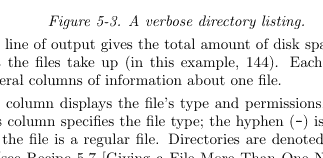

图 5-3. 详细目录列表。

输出的第一行给出文件占用的磁盘空间总量，以 1024 字节块为单位（在此示例中为 144）。每个后续行显示关于一个文件的若干列信息。

第一列显示文件的类型和权限。此列中的第一个字符指定文件类型；连字符（-）为默认值，表示文件是普通文件。目录用 d 表示，符号链接（参见 Recipe 5.7 [Giving a File More Than One Name]，第 152 页）用 l 表示。第一列的其余九个字符显示文件权限（参见 Recipe 6.3 [Controlling Access to Files]，第 167 页）。第二列列出指向该文件的硬链接数。第三列和第四列给出文件所属的用户和组名称。第五列给出文件的大小（字节），第六列给出上次修改日期，最后一个列给出文件名。

其他选项会更改长格式输出的默认值。

要将修改日期从简写的月份、日期然后年份输出更改为显示完整时间和日期（像`date`的默认值那样，如所述见 Recipe 27.1 [Displaying the Date and Time]，第 537 页），请使用特殊的`--full-time`选项。

⇒ 要输出`/usr/share/doc/bash`目录的详细列表，给出上次修改的完整时间和日期，输入：

```
$ ls -l --full-time /usr/share/doc/bash [RET]
```

此命令输出`/usr/share/doc/bash`目录中文件的详细列表，显示上次修改的完整时间和日期，如图 5-4 所示。

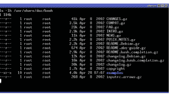

图 5-4. 显示修改时间的详细目录。


图 5-5. 显示人类可读数字的详细目录。

要指定输出中的数字应以“人类可读”形式显示，而不是以块为单位，请使用`-h`选项。与`-l`结合使用时，这将以字节、千字节（后跟 k）或兆字节（后跟 M）显示磁盘空间总量和每个文件的大小。

⇒ 要以可读形式输出`/usr/share/doc/bash`目录的详细列表，给出所有数字的易读形式，输入：

```
$ ls -lh /usr/share/doc/bash [RET]
```

该命令输出`/usr/share/doc/bash`目录中文件的详细列表，以易读形式给出所有数字，如图 5-5 所示。

### 5.3.4 列出隐藏文件

默认情况下，`ls`不会输出以句点字符 (.) 开头的文件。为了减少杂乱，许多应用程序通过给它们起以句点开头的名字来在你的主目录中“隐藏”配置文件；这些被称为点文件，或有时称为“隐藏”文件。如前所述，每个目录都有两个特殊的点文件：`..`，父目录，和`.`，目录本身。

要列出目录的所有内容，包括这些点文件，请使用`-a`选项。

⇒ 要列出当前目录中的所有文件，输入：

```
$ ls -a [RET]
```

使用`-A`选项列出目录中几乎所有文件：它列出所有文件，包括点文件——但除外`..`和`.`目录文件。

⇒ 要列出当前目录中除`.`和`..`之外的所有文件，输入：

```
$ ls -A [RET]
```

### 5.3.5 按列列出目录


使用`-1`选项以单列列出目录。文件将按一行一个列出。这对于剪切和粘贴很有用。

⇒ 要以单列列出`/usr/bin`的内容，输入：

```
$ ls -1 /usr/bin [RET]
```

当`ls`的输出被管道传输到终端以外的地方时，`ls`使用这种单列格式。

通常，`ls`以垂直方式按列列出文件——首先填充最左边的列，然后是下一列，一直延伸到屏幕右侧。使用`-x`使列改为水平列出——这样先填充第一行的文件名，然后是下一行，直到列出所有文件。

⇒ 要以水平打印的列列出`/usr/bin`的内容，输入：

```
$ ls -x /usr/bin [RET]
```

使用`-m`选项以单行水平输出文件，而不是按列输出，用逗号分隔。

⇒ 要以单行输出`/usr/bin`的内容，文件名用逗号分隔，输入：

```
$ ls -m /usr/bin [RET]
```

## 5.3.6 按排序顺序列出文件

默认情况下，`ls`输出的文件列表按字母顺序排序，即字符顺序——也就是说，文件按从最小到最大 ASCII 码的顺序列出（参见配方 9.3.7 [查看字符集]，第 228 页），因此，例如，以大写字母开头的文件在以小写字母的文件之前列出。有几个选项可以控制输出的排序方式；其中一些如下所示。

### METHOD #1

要按大小排序文件，请使用`-S`选项。文件按从大到小排序。

⇒ 要按大小列出`/usr/bin`目录中的所有文件，按从大到小排序，输入：

```
$ ls -S /usr/bin [RET]
```

### METHOD #2

使用`ls`的`-t`选项按时间对目录列表进行排序，以便文件按最后修改时间列出，最近修改的文件排在最前面。

⇒ 要按修改时间列出`/usr/tmp`目录中的所有文件，按最近修改的文件在前排序，输入：

```
$ ls -t /usr/tmp [RET]
```

### METHOD #3

要按扩展名对文件进行排序，请使用`-X`选项。没有扩展名的文件先列出。

⇒ 要按扩展名列出当前目录中的所有文件，输入：

```
$ ls -X [RET]
```

### METHOD #4

使用`-v`进行版本排序，其中文件名不是按字符排序，而是按编号方式排序，因此`file-2`会出现在`file-1`和`file-10`之间，而不是像正常字符排序那样出现在两个文件之后。这对于对文件名以某种方式编号的文件进行排序很有用，例如按版本、索引或日期。

⇒ 要列出当前目录中以`.jpeg`结尾并按版本排序的所有文件，输入：

```
$ ls -v *.jpeg [RET]
```

### METHOD #5

使用`-r`反转排序输出的顺序。这适用于所有其他排序选项。

⇒ 这里有一些使用方法。

- 要按从最高 ASCII 字符值到最低的顺序列出当前目录中的文件，输入：

  ```
  $ ls -r [RET]
  ```

- 要按大小列出`/usr/bin`目录中的所有文件，按从小到大排序，输入：

  ```
  $ ls -Sr /usr/bin [RET]
  ```

- 要按修改日期列出当前目录中的所有文件，按最近修改的文件在后排序，输入：

  ```
  $ ls -tr [RET]
  ```

### METHOD #6

使用`-U`选项关闭所有排序并以未排序的顺序输出文件——它们在磁盘上出现的顺序。

⇒ 要按它们在磁盘上出现的顺序输出当前目录中的所有文件，输入：

```
$ ls -U [RET]
```

## 5.3.7 列出子目录

通常当你列出目录的内容时，任何子目录都只是按其名称列出——其内容不会列出。要列出目录可能包含的所有子目录的内容，请使用`-R`选项。这会递归输出目录的内容，列出该目录以及其所有子目录的列表。

⇒ 要输出当前目录的递归目录列表，输入：

```
$ ls -R [RET]
play    work

play:
notes

work:
notes
$
```

在此示例中，当前工作目录包含两个子目录`work`和`play`，且没有其他文件。每个子目录都包含一个名为`notes`的文件。

⇒ 要列出系统上的所有文件，输入：

```
$ ls -R / [RET]
```

此命令递归列出根目录`/`以及其所有子目录的内容。通常将其与属性选项`-l`结合使用，以输出系统上所有文件的详细列表：

```
$ ls -lR / [RET]
```

NOTES：如果你没有权限，则无法列出系统上的某些目录的内容（参见 Recipe 6.3 [Controlling Access to Files]，第 167 页）。

## 5.4 复制文件和目录

使用`cp`（“copy”）来复制文件。它接受两个参数：源文件，即要复制的现有文件，以及目标文件，即新副本的文件名。`cp`命令随后会制作源文件的完全相同副本，并赋予指定的目标名称。如果目标名称的文件已存在，`cp`会覆盖它。它不会更改源文件。

⇒ 要将文件`my-copy`复制到文件`neighbor-copy`，输入：

```
$ cp my-copy neighbor-copy [RET]
```

此命令创建一个名为`neighbor-copy`的新文件，它在各方面都与`my-copy`完全相同，只是名称、所有者、组和时间戳除外——新文件具有显示复制时间的时间戳。文件`my-copy`未被更改。

使用`-v`（“verbose”）选项可在复制时列出文件。这对于大量文件复制很有用，以便你可以监控进度。

⇒ 要将`~/workgroup/final`目录中的所有文件复制到`~/workgroup/backup`目录，并指定详细输出以便在复制时列出每个文件，输入：

```
$ cp -v ~/workgroup/final/* ~/workgroup/backup [RET]
```

### 5.4.1 复制文件及其属性

复制文件时，属性（如时间戳和文件所有权）在原文件和副本之间会有所不同。使用带有`-p`选项的`cp`来尽可能保留原始文件的全部属性，包括其时间戳、所有者、组和权限。

⇒ 要将文件`my-copy`复制到文件`neighbor-copy`，并保留源文件在目标文件中的所有属性，输入：

```
$ cp -p my-copy neighbor-copy [RET]
```

此命令将文件`my-copy`复制到名为`neighbor-copy`的新文件，该文件在各方面都与`my-copy`完全相同，只是名称除外。

虽然`-p`不会复制目录可能包含的任何子目录，但你可以使用`-a`（“archive”）选项代替，它在尽可能保留属性的同时也会复制任何子目录以及符号链接（参见 Recipe 5.7 [Giving a File More than One Name]，第 152 页）。这对于将一个目录树归档备份到另一个目录很有用。

⇒ 要将`/cdrom`的内容归档复制到当前目录，输入：

```
$ cp -a /cdrom . [RET]
```

此命令将`/cdrom`复制到当前目录，包括它可能包含的任何子目录。原始文件属性在副本中得以保留。

NOTES：快照是显示目录树在特定时间点样子的副本。快照通常在软件开发项目中在每次发布时制作——“拍摄当前版本的快照”意味着对包含源代码的目录树进行归档复制。

要制作目录树的快照，请使用`cp`并使用`-a`选项，如上所述。

### 5.4.2 复制子目录

要连同文件和子目录一起复制目录，请使用`-R`选项——它会递归复制指定的目录及其全部内容。

⇒ 要将目录`public_html`及其所有文件和子目录复制到名为`private_html`的新目录，输入：

```
$ cp -R public_html private_html [RET]
```

`-R`选项不会复制符号链接文件（参见 Recipe 5.7 [Giving a File More Than One Name]，第 152 页），并且不会保留所有原始权限。要递归复制目录，包括链接，并保留其所有权限，请使用`-a`（“archive”）选项。这对于制作大型目录树的备份副本很有用。

⇒ 要将目录树`public_html`的归档副本制作到目录`private_html`，输入：

```
$ cp -a public_html private_html [RET]
```

### 5.4.3 通过唯一父目录复制文件

有时希望复制或重命名一组文件，这些文件都有一个共同名称，以便新名称与每个原始文件的唯一父目录相匹配。要做到这一点，请使用`basename`获取`cp`命令的每个唯一路径的名称。遍历所有文件，使用 Bash 的内置`for`构造对每个文件运行此命令行（有关此内置的更多信息，请参阅 Bash Info 文档）。

例如，假设你在主目录中有名为`photographs`的目录，其中包含多个子目录，每个子目录都以唯一数字命名，并且每个子目录都包含多个目录，包括一个名为`src`的目录，如图 5-6 所示。

假设你只想复制`src`目录及其内容，但希望这些复制目录的名称为`src`之前的唯一路径（01、02 等）。使用`basename`将唯一路径传递给`cp`。


```
~/photographs/01/
~/photographs/01/640x480
~/photographs/01/320x280
~/photographs/01/src
~/photographs/02
~/photographs/02/640x480
~/photographs/02/320x280
~/photographs/02/src
~/photographs/03
~/photographs/03/640x480
~/photographs/03/320x280
~/photographs/03/src
```

图 5-6. 具有唯一父目录的子目录。

⇒ 要将所有 `src` 目录复制到 `/mnt` 目录，并为每个文件赋予 `~/photographs` 中其父目录的唯一名称，请输入：

```
$ for i in ~/photographs/*
> do
> cp -a $i/src /mnt/`basename $i`
> done
$
```

此命令复制 `~/photographs` 中的所有 `src` 目录，并为其赋予其父目录的唯一名称——因此 `~/photographs/01/src` 变为 `/mnt/01`，`~/photographs/02/src` 变为 `/mnt/02`，以此类推。

你可以使用分号字符 (;) 将其全部作为单个命令在一行命令中运行（参见 3.1.7 配方 [运行一系列命令]，第 63 页）。以下命令等同于前面的示例：

``for i in ~/photographs/*; do cp -a $i/src /mnt/`basename $i`; done``

**注意：** 要通过此方法重命名文件，请使用 `mv` 而不是 `cp`（参见 5.5 配方 [移动文件和目录]，第 144 页）。

## 5.5 移动文件和目录

使用 `mv`（“移动”）工具将文件或目录移动或重命名到不同位置。它接受两个参数：要移动的文件或目录的名称，后跟要移动到的路径名。如果你将文件移动到包含同名文件的目录中，该文件将被覆盖。

- ⇒ 要将当前工作目录中的文件 `notes` 移动到 `../play`，请输入：

  ```
  $ mv notes ../play
  ```

  此命令将当前目录中的文件 `notes` 移动到 `play`，即当前工作目录父目录的子目录。如果 `play` 中已存在文件 `notes`，则该文件将被覆盖。如果子目录 `play` 不存在，此命令将文件 `notes` 从当前目录移动到其父目录，并将文件重命名为 `play`。

要移动不在当前目录中的文件或目录，请将其完整路径名作为参数给出。

- ⇒ 要将文件 `/usr/tmp/notes` 移动到当前工作目录，请输入：

  ```
  $ mv /usr/tmp/notes .
  ```

  此命令将文件 `/usr/tmp/notes` 移动到当前工作目录。

要移动目录，请给出要移动的目录的路径名和要移动到的路径名作为参数。

- ⇒ 要将当前工作目录中的目录 `work` 移动到 `play`，请输入：

  ```
  $ mv work play
  ```

  此命令将当前目录中的目录 `work` 移动到目录 `play`。如果目录 `play` 已存在，`mv` 会将 `work` 放入 `play` 中——它不会覆盖目录。

重命名文件与移动它相同；只需将要重命名的文件作为参数指定，后跟新文件名。

- ⇒ 要将文件 `notes` 重命名为 `notes.old`，请输入：

  ```
  $ mv notes notes.old
  ```

以下配方描述了其他移动和重命名文件的方法。

### 5.5.1 将文件名改为小写

有两种好方法可以将文件名中的大写字母改为小写字母。

#### 方法 #1

使用 `rename` 工具，该工具是 Perl 编程语言的一部分，来重命名一组文件。它接受两个参数：描述要进行的更改的引用的 Perl 表达式，以及要对其进行更改的文件。如果文件已存在，`rename` 将输出警告并且不会重命名该文件，但其他文件仍会被重命名。

要使用 `rename` 将文件名中的大写字母改为小写，请使用 `tr/A-Z/a-z/` 作为表达式。

⇒ 要将当前目录中所有文件的文件名改为小写字母，请输入：

```
$ rename 'tr/A-Z/a-z/' *
```

你可以指定要操作的文件，并且可以指定仅更改文件名的某些部分。

⇒ 以下是一些使用方法。

- 要将当前目录中以 `.MP3` 结尾的所有文件重命名为同名的小写字母文件，请输入：

  ```
  $ rename 'tr/A-Z/a-z/' *.MP3
  ```

- 要将当前目录中以 `.MP3` 结尾的所有文件重命名为同名且扩展名为小写字母的文件，请输入：

  ```
  $ rename 's/\.MP3/.mp3/' *.MP3
  ```

在第一个示例中，像 `Music-Recording.MP3` 或 `ANOTHER-MUSIC-RECORDING.MP3` 这样的文件将被重命名为 `music-recording.mp3` 和 `another-music-recording.mp3`，而在第二个示例中，这些文件将被重命名为 `Music-Recording.mp3` 和 `ANOTHER-MUSIC-RECORDING.mp3`。

#### 方法 #2

要将一组文件名中的大写字母改为小写，请使用 `mv` 并带 `-i` 选项以交互方式移动文件，通过 `tr` 过滤器管道传输旧名称来派生小写文件名（参见 13.4 配方 [在文本中转置字符]，第 316 页）。遍历当前目录中的所有文件，对每个文件运行此命令行，使用 Bash 内置的 `for` 结构（有关此内置的更多信息，请参阅 `bash` Info 文档）。

⇒ 要将当前目录中的所有文件重命名为全小写字母，请输入：

```
$ for i in *
> do
> mv -i $i `echo $i | tr '[A-Z]' '[a-z]'`
> done
$
```

你可以使用分号字符（;）将所有内容作为单个命令在一行命令行中运行。以下命令等同于前面的示例：

```
for i in *; { mv -i $i `echo $i | tr '[A-Z]' '[a-z]'`; }
```

使用 `-i` 选项配合 `mv` 是因为否则此命令可能会无意中删除文件——例如，如果你有名为 `CAT`、`Cat` 和 `cat` 的文件，则不带 `-i` 的此命令会删除其中两个。

此外，对于不受小写转换影响的文件（例如名为 `dog` 的文件），此命令将不执行任何操作，并会输出一条消息，指出原始文件名和新文件名相同。

⇒ 要将当前目录中所有扩展名为 `.JPG` 的文件名改为小写，输入：

```
$ for i in *.JPG; { mv -i $i `echo $i | tr '[A-Z]' '[a-z]'`; } [RET]
```

你可以使用 `tr` 对一组文件执行任意数量的转换，例如将所有小写字母转换为大写，或删除某些字符。

⇒ 以下是一些使用方法。

- 要将当前目录中所有扩展名为 `.jpg` 的文件名改为大写，输入（全部在一行）：

  ```
  $ for i in *.jpg; { mv -i $i `echo $i | tr '[a-z]' '[A-Z]'`; } [RET]
  ```

- 要重命名当前目录中名称中包含 386 的所有文件，并从名称中删除 386，输入：

  ```
  $ for i in *386*; { mv -i $i `echo $i | tr -d '386'`; } [RET]
  ```

### 5.5.2 使用相同扩展名重命名多个文件

有三种可靠的方法可以将一组具有相同扩展名的文件全部重命名为其他扩展名。前两种方法与前面示例中的方法相同。

#### 方法 #1

使用 `rename` 工具，它是 PERL 编程语言的一部分。它接受两个参数：一个描述要进行更改的引号括起的 PERL 表达式，以及要进行更改的文件。

⇒ 要将当前目录中所有以 `.JPG` 结尾的文件重命名为以 `.jpeg` 结尾的文件，输入：

```
$ rename 's/.JPG/.jpeg/' *.JPG [RET]
```

#### 方法 #2

使用 `mv` 移动文件，并使用 `basename` 工具推导出新的文件名。遍历所有文件，对每个文件运行此命令行，使用 Bash 内置的 `for` 构造（有关此内置功能的更多信息，请参阅 `bash` Info 文档）。

⇒ 要将当前目录中所有以 `.JPG` 结尾的文件重命名为以 `.jpeg` 结尾的文件，输入：

```
$ for i in *.JPG [RET]
> { [RET]
> mv -i $i `basename $i JPG`.jpeg [RET]
> } [RET]
$
```

你可以使用分号字符（;）在一行命令行中运行这些命令。以下命令等同于前面的示例：

```
for i in *.JPG; { mv -i $i `basename $i JPG`.jpeg; }
```

#### 方法 #3

要将一组文件从一个扩展名重命名为另一个扩展名，请使用 `mv` 和 `for` 循环，如方法 #2 所述，但不要使用 `basename`，而是使用 Bash shell 参数扩展功能指定新扩展名。³


⇒ 要将当前目录中的所有 `.jpg` 文件重命名，使其全部具有 `.jpeg` 文件扩展名，输入：

```
$ for i in *.jpg [RET]
> { [RET]
> mv $i "${i%.jpg}.jpeg" [RET]
> } [RET]
$
```

> ³ 有关此功能的更多信息，请参阅 `bash` 的 `Info` 文档（见配方 2.8.5 [阅读 Info 手册]，第 48 页）。

注意：一次重命名多个文件是常见的请求。

## 5.6 删除文件和目录

使用 `rm`（“remove”）删除文件并将其从系统中移除。将要删除的文件名作为参数给出。

⇒ 要删除当前工作目录中的文件 `notes`，输入：

```
$ rm notes RET
```

要删除目录及其包含的所有文件和子目录，请使用 `-R`（“递归”）选项。

⇒ 要删除目录 `waste` 及其所有内容，输入：

```
$ rm -R waste RET
```

要删除空目录，请使用 `rmdir`；它会删除你指定的空目录。如果指定了包含文件或子目录的目录，`rmdir` 会报告错误。

⇒ 要删除目录 `empty`，输入：

```
$ rmdir empty RET
```

### 5.6.1 删除名称奇怪的文件

名称中包含奇怪字符的文件（例如空白、控制字符和开头连字符）在你想删除它们时会出现问题。解决此问题有几种方法。

### 方法 #1

一种方法是使用制表符补全来补全文件名（见配方 3.1.4 [让 Shell 补全你输入的内容]，第 61 页）。当你想删除的文件名有足够多的字符使其能够唯一标识，从而补全可以工作时，此方法有效。

⇒ 要使用制表符补全删除当前目录中的文件 `No Way`，输入：

```
$ rm No TAB Way RET
```

在此示例中，一旦输入了 TAB，shell 就填入了剩余的文件名（“Way”）。

### 方法 #2

当文件名以控制字符或其他特殊字符开头时，你可以使用一个能够唯一标识该文件的文件名模式来指定它（有关构建文件名模式的技巧，请参阅方法 5.8 [使用模式指定文件名]，第 153 页）。先使用 `-i` 选项确认删除操作。

⇒ 要删除一个目录中的文件 `^Acat`（该目录还包含文件 `cat` 和 `dog`），请键入：

```
$ rm -i ?cat RET
rm: remove '^Acat'? y RET
$
```

在上例中，扩展模式 `?cat` 匹配文件 `^Acat`，而不匹配该目录中的任何其他文件。使用 `-i` 选项是因为在某些情况下无法为文件建立唯一模式——例如，如果该目录中还包含一个名为 `1cat` 的文件，则示例中的上述 `rm` 命令也会尝试删除它；使用 `-i` 选项，你可以对它回答 n。

### 方法 #3

前两种方法不适用于以连字符开头的文件，因为 `rm` 会将此类文件名解释为选项；要删除这样的文件，请使用 `--` 选项——它指定其后的内容是参数而非选项。

⇒ 要从当前目录删除文件 `-cat`，请键入：

```
$ rm -- -cat RET
```

### 5.6.2 交互式删除文件

文件一旦被删除，就会被永久删除，并且没有任何命令可以恢复它；你无法“撤销删除”它。（不过，如果在删除文件后立即卸载包含该文件的文件系统，专家或许可以使用 `grep` 搜索文件系统设备文件，来帮助你重建丢失的文件。）

更安全的删除文件方式是使用带 `-i` 选项的 `rm`，该选项指定 `rm` 以交互模式运行，它会要求你确认对每个文件的删除操作。

⇒ 要以交互方式删除 `~/tmp` 目录中的文件，请键入：

```
$ rm -i ~/tmp RET
```

在上例中，`rm` 在删除 `~/tmp` 中的任何文件之前都会提示确认。

你可以考虑为带 `-i` 选项的 `rm` 创建一个别名词，例如 `del`，并养成使用该词代替 `rm` 的习惯（请参阅方法 3.6.1 [以其他名称调用命令]，第 83 页）。

你也可以创建下面这个两行 shell 脚本来获得与别名相同的效果，可以将其写入名为 `del` 的文件中，并放入你的个人 `bin` 目录（请参阅方法 A.3.4 [安装 Shell 脚本]，第 708 页，以及方法 C.1 [使用目录存放个人二进制文件]，第 727 页）：

```
#!/bin/sh
/bin/rm -i $*
```

注意：UNIX FAQ 中的问题 3.6⁴ 讨论了这个问题，并提供了一个名为 `can` 的 shell 脚本，你可以用它代替 `rm`——它会把文件放入“垃圾桶”目录而不是删除它们；之后你可以定期用 `rm` 清空垃圾桶。

### 5.6.3 不经确认删除文件

如果文件受写保护，在你尝试删除它时，`rm` 总会先要求你确认删除。当你要删除大量文件时，这会很麻烦。这种情况下，可用 `yes` 通过管道将自动的“y”回答传给带 `-R` 选项的 `rm`（请参阅方法 3.1.10 [自动应答命令提示符]，第 65 页）。

⇒ 要删除 `scrap` 目录及其所有内容，包括任何受写保护的文件，请键入：

```
$ yes | rm -R scrap RET
```

注意：这是一个危险的操作！此命令会永久删除你指定的所有文件和目录，因此在运行它之前，务必确定要删除它们！

⁴ 参见文件 `/usr/doc/FAQ/unix-faq-part3`，或上网查看：`http://www.faqs.org/faqs/unix-faq/faq/`。

## 5.7 为一个文件赋予多个名称

*链接*是指向其他文件的特殊文件；当你对某个作为链接的文件进行操作时，实际上是在操作它所指向的文件。链接有两种：符号链接和硬链接。

*符号链接*（有时也称为“symlink”或“软链接”）会将大多数操作（如读取和写入）传递给它所指向的文件。在文件列表中，符号链接通过第一列的第一个字符为“l”来识别，并在彩色列表中默认以青色显示。

如果你删除一个符号链接，你只是删除了符号链接本身，而*不是*原始文件。但是，如果你删除原始文件并用其他文件替换它，符号链接将指向新文件的内容。你可以为目录创建符号链接，也可以跨文件系统创建符号链接（请参阅第 24 章 [磁盘存储]，第 501 页）。

*硬链接*是现有文件的另一个名称，并且与它所链接的文件无法区分。如果你修改一个文件，任何指向它的硬链接也会被修改；反过来，修改任何一个硬链接也会修改原始文件以及它可能拥有的任何其他硬链接。因此，如果你从文件 `foo` 创建到文件 `bar` 的硬链接，然后修改文件 `bar`，文件 `foo` 也会同样被修改。

因此，符号链接指向它所链接的文件，而硬链接则是该文件的另一个实例。如果你更改原始文件，所有硬链接也会一并更改。如果你更改任何一个硬链接，原始文件和其他所有硬链接都会更改。但如果你*删除*原始文件，任何硬链接仍会保留原始文件所包含的内容。

与符号链接不同，你不能创建指向目录的硬链接，也不能跨文件系统创建硬链接。

系统上的每个文件都至少有一个硬链接，即原始文件名本身。目录总是至少有*两个*硬链接——目录名称本身（出现在其父目录中）以及该目录内的特殊文件 `.`。同样，当你新建一个子目录时，父目录会因为新子目录内的特殊文件 `..` 而获得一个新的硬链接。

如果你删除一个硬链接，不会删除它所链接的文件，也不会删除指向它的任何其他硬链接；反之，删除文件本身也不会删除该文件的任何硬链接。

### 方法 #1

使用 `ln`（“链接”）来创建指向文件的链接。参数依次为要链接到的现有文件的名称，以及用于该链接的名称。默认情况下，`ln` 创建的是硬链接。

### 方法 #2

要创建符号链接，请使用带有 `-s` 选项的 `ln`。

⇒ 要从 `seattle` 创建到 `emerald-city` 的符号链接，请输入：

```
$ ln -s seattle emerald-city [RET]
```

此命令从现有文件 `seattle` 创建到新文件 `emerald-city` 的符号链接。如果你删除文件 `emerald-city`，文件 `seattle` 不会被删除，但如果删除 `seattle` 文件，`emerald-city` 则会变成一个损坏的链接，直到再次在其位置存在另一个名为 `seattle` 的文件——此时 `emerald-city` 将指向该新文件。

NOTES：此配方也可能被称为“将文件链接到另一个文件”。

## 5.8 使用模式指定文件名

当你在命令中指定文件或文件的名称时，你提供的是文件规范，通常简写为 filespec。

这些 filespec 不必是特定文件的字面名称。shell 提供了一种强大的构造模式的方法，称为文件名展开，用于指定一组路径名和文件。在 UNIX 用语中，以这种方式指定文件称为 globbing。

你可以在将文件和目录名称作为任何工具或应用程序的参数指定时使用这些模式；shell 将你的模式展开（或“glob”）为符合模式的文件名称，并将该展开结果传递给工具或应用程序。给定的模式是一个 glob 表达式。

下表列出了各种文件展开字符并描述了它们在形成 glob 表达式时的含义。

⇒ 要从 `seattle` 创建到 `emerald-city` 的硬链接，请输入：

```
$ ln seattle emerald-city [RET]
```


此命令从现有文件 `seattle` 创建到新文件 `emerald-city` 的硬链接。你可以像 `seattle` 一样读取和编辑 `emerald-city` 文件；你对 `emerald-city` 所做的任何更改也会写入 `seattle`（反之亦然）。但如果你删除 `emerald-city` 文件，`seattle` 文件不会被删除（反之亦然）。

### `*`

星号匹配零个或多个字符，有时被称为“通配符”字符。例如，“*”单独使用会展开为给定目录中的所有文件名，“a*”会展开为以“a”字符开头后跟零个或多个字符的所有文件名，而“a*b”会展开为以“a”字符开头并以“b”字符结尾的所有文件名，中间可以有任意（或没有）字符。

### `?`

问号匹配恰好一个字符。因此，“?”单独使用会展开为恰好一个字符的所有文件名，“??”会展开为恰好两个字符的所有文件名，而“a?”会展开为以“a”字符开头后跟恰好一个字符的所有文件名。

### `{string1,string2,...}`

大括号将以逗号分隔的字符串集合分组，所有这些字符串都将被匹配。因此“{a,b}c”会展开为“ac”和“bc”。

### `[list]`

方括号匹配列表中的一个字符。例如，“[ab]”匹配恰好两个文件名：“a”和“b”。模式“c[io]”匹配“ci”和“co”，但不匹配其他文件名。

### `~`

波浪号字符会展开为你的主目录（`HOME` 变量的值；参见 Recipe 3.5 [Using Shell Variables]，第 77 页）。例如，如果你的用户名是 `mary`，你的主目录因此是 `/home/mary`，那么 `~` 会展开为 `/home/mary`。你可以在波浪号后跟路径来指定主目录中的文件——例如，`~/work` 会展开为 `/home/mary/work`。

方括号在与其他字符结合使用时也有特殊含义，如下表所述。

- 方括号列表中的连字符表示要匹配的字符范围——因此 “[a-m]” 匹配从“a”到“m”的任何小写字母。要匹配字面连字符字符，请将其用作列表中的第一个或最后一个字符。例如，“a[-b]c”匹配两个文件：a-c 和 a-bc。
- 在方括号列表开头放置感叹号以匹配除所列字符外的所有字符。例如，“a[!b]c”匹配以“a”字符开头、以“c”字符结尾、中间有一个字符（但不是“b”字符）的所有文件；它匹配文件 aac、a-c、adc 等。

你可以以任何组合使用这些特殊展开字符，并且可以作为多个参数指定多个模式。

⇒ 以下示例展示了文件展开的实际应用，使用本章前面描述的命令

- 要列出 `/usr/bin` 目录中名称中包含“tex”文本的所有文件，请输入：

  ```
  $ ls /usr/bin/*tex* RET
  ```

- 要将所有文件名以 `.txt`、`.text`、`.doc` 或 `.info` 结尾的文件复制到 `doc` 子目录，请输入：

  ```
  $ cp *.txt,text,doc,info doc RET
  ```

- 要输出所有文件名以三字符扩展名结尾的文件的详细列表，并按较新的文件先列出的方式排序列表，请输入：

  ```
  $ ls -lt *??? RET
  ```

- 要将 `/usr/tmp` 目录中所有名称由文本“song”后跟 0 到 9 的整数以及 `.cdda` 扩展名组成的文件移动到你主目录中的 `music` 目录，请输入：

  ```
  $ mv /usr/tmp/song[0-9].cdda ~/music RET
  ```

- 要删除当前工作目录下以连字符开头且文件名中其他位置包含文本“out”的所有文件，输入：

  ```
  $ rm -- --*out* [RET]
  ```

- 要将所有文件名由一个“a”字符后跟两个或更多字符组成的文件连接起来，输入：

  ```
  $ cat a??* [RET]
  ```

## 5.9 列出目录树图

`Tree`

DEB: `tree`

RPM: `tree`

WWW: `ftp://mama.indstate.edu/linux/tree/`

使用 `tree` 输出给定目录树的 ASCII 文本树图。

⇒ 要输出当前目录及其所有子目录的树图，输入：

```
$ tree [RET]
.
|-- projects
|   |-- current
|   `-- old
|   |-- 1
|   `-- 2
`-- trip
    `-- schedule.txt

4 directories, 3 files
$
```

在前面的示例中，绘制了一棵树图，显示当前目录，其中包含两个目录 `projects` 和 `trip`；`projects` 目录又包含 `current` 和 `old` 目录。

要输出特定目录树的树图，将该目录树的名称作为参数给出。

⇒ 要输出你的主目录及其所有子目录的树图，输入：

```
$ tree ~ [RET]
```

要仅输出包含目录名称的目录树图，使用 `-d` 选项。这对于输出整个系统的目录树，或获取特定目录树的概览很有用。

⇒ 这里有一些使用方法。

- 要将整个系统的树图输出到文件 `tree`，输入：

  ```
  $ tree -d / > tree [RET]
  ```

- 要浏览 `/usr/local` 目录树的树图，输入：

  ```
  $ tree -d /usr/local | less [RET]
  ```

NOTES: 另一个用于输出目录树的工具在 Recipe 24.2 [Listing a File's Disk Usage]，第 502 页 中描述。

## 5.10 浏览文件和目录

有几种方法可以浏览系统上的文件。以下是三种我推荐的方法。

### METHOD #1

`Midnight Commander`

DEB: `mc-common`

`mc`

RPM: `mc`

WWW: `http://www.ibiblio.org/mc/`

浏览系统文件最简单的方法是使用为此目的而制作的“文件管理器”工具。Linux 上除了 GNOME 和 KDE5 自带的文件管理器外，至少还有几种；最受欢迎的独立文件管理器可能是久负盛名的“Midnight Commander”。

输入 `mc` 以运行它。将要浏览的目录名称作为参数给出，相对于当前目录或使用其完整路径名。如果不给出任何参数，`mc` 将使用当前工作目录。

⇒ 要使用 Midnight Commander 浏览 `/usr/local/` 目录，输入：

```
$ mc /usr/local [RET]
```

浏览目录时，`mc` 提供两个显示窗口，称为 *目录面板*。使用鼠标访问顶部菜单栏上的下拉菜单。功能键提供帮助和其他菜单；它们列在屏幕最底部。它们上方是一个 Bash 命令行，你可以像在 shell 中通常那样使用它。输入 `(F10)` 以退出 `mc` 并返回你运行它的 shell。

图 5-7 给出了 Midnight Commander 在浏览典型系统的根目录时的外观示例。

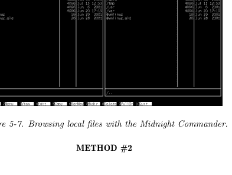

*Figure 5-7. Browsing local files with the Midnight Commander.*

### METHOD #2

`Lynx`

DEB: `lynx`

RPM: `lynx`

WWW: `http://lynx.browser.org/`

你可以在 Web 浏览器中查看和浏览本地文件，例如纯文本浏览器 `lynx` 或用于 X 的图形化 Mozilla 浏览器。

`lynx` 工具非常适合浏览系统上的文件——将要浏览的目录名称作为参数给出，`lynx` 将显示该目录中可用的文件和目录列表。

你可以使用光标键浏览并按 RET 进入子目录。⁶ 你可以使用 `lynx` 显示纯文本文件、压缩文本文件以及用 HTML 编写的文件；它对于浏览 `/usr/doc` 和 `/usr/share/doc` 目录中的系统文档很有用，许多软件包在这些目录中附带用 HTML 编写的帮助文件和手册。

使用 `-localhost` 选项禁用指向远程主机的任何 URL。

⇒ 这里有两种使用方法。

- 要浏览 `/usr/doc` 目录中的系统文档文件，并禁用所有指向其他主机的链接，输入：

  ```
  $ lynx -localhost /usr/doc RET
  ```

- 要浏览当前目录中的文件和子目录，输入：

  ```
  $ lynx . RET
  ```

图 5-8 给出了 Lynx 在浏览典型系统的根目录时的外观示例。

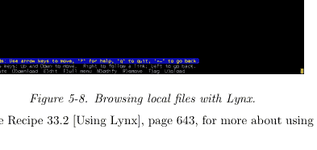

Figure 5-8. Browsing local files with Lynx.

NOTES: 有关使用 Lynx 的更多信息，请参阅 Recipe 33.2 [Using Lynx]，第 643 页。

### 方法 #3

`Mozilla`

DEB: `mozilla-browser`

RPM: `mozilla`

WWW: `http://www.mozilla.org/`

使用 Mozilla 浏览文件的方式与方法 #2 中描述的 Lynx 类似，将完整路径名作为参数给出。

⇒ 要在 Mozilla 中浏览 `/usr/share/doc` 目录中的系统文档文件，请在 Mozilla 的位置窗口中输入以下内容，或将其作为参数传递给 `mozilla`：

`/usr/share/doc`

图 5-9 给出了 Mozilla 在浏览典型系统的根目录时的外观示例。


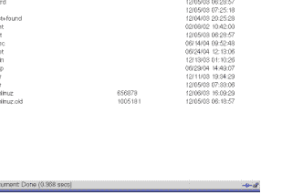

**注释：** 其他 Web 浏览器也以这种方式工作。有关推荐使用的其他浏览器，请参阅配方 33.11 [使用其他 Web 浏览器] 中的表格，第 667 页。

## 6. 共享文件

组、文件所有权和访问权限是 Linux 的功能，可使用户相互共享文件。但即使你不打算在系统上与其他用户共享文件，了解这个主题也很重要；这些概念将帮助你理解 Linux 中文件访问和安全的工作原理，并使你能够控制文件可能被访问的方式。通过更改文件的访问权限，文件可以处于一种状态，使得某些用户——包括你自己——无法修改、复制甚至查看它们！

### 6.1 在组中工作

组是一组用户，为共享文件和促进协作而创建。所有组都有唯一的名称，并分配有唯一的组 ID，称为 `GID`。组的每个成员都可以处理组的 files 并创建属于该组的新文件。系统管理员可以根据用户的组织需求添加新组并为用户分配不同组的成员资格。例如，一艘船的船员使用的系统可能有 `galley`、`deck`、`bridge` 和 `crew` 等特殊组；用户 `captain` 可能是所有组的成员，但用户 `steward` 可能仅是 `galley` 和 `crew` 组的成员。

在 Linux 系统上，你始终至少是其中一个组的成员：你的登录组。它的名称与你的用户名相同，并且你是其唯一的成员。

以下配方展示如何列出组及其成员。

### 6.1.1 列出可用组

系统中所有可用组的列表保存在文件 `/etc/group` 中，该文件称为用户组文件。这是一个文本文件，其中包含组的列表，每行一个组，字段以冒号字符 (`:`) 分隔：组名、加密密码（今天的系统采用所谓的影子密码，这意味着实际的加密密码保存在其他地方，这里显示一个 "x" 字符作为占位符）、`GID`，以及属于该组的所有用户的以逗号分隔的列表。

要列出系统上可用的组，请列出此文件的内容。

⇒ 要列出文件 `/etc/group` 的内容，请输入：

```
$ cat /etc/group [RET]
```

此命令使用 `cat` 工具输出文件的全部内容（参见配方 9.2 [显示文本]，第 216 页），列出所有字段。使用 `cut` 来仅输出某些字段（参见配方 13.7.4 [从文本中删除列]，第 324 页）。

⇒ 要输出系统上所有组名的列表，请输入：

```
$ cut -d : -f1 /etc/group [RET]
```

注释：有关用户组文件的更多信息，请参阅 `group` 手册页。

### 6.1.2 列出用户所属的组

要列出用户的组成员资格，请使用 `groups` 工具。将任意数量的用户名作为参数给出，`groups` 将为每个用户输出一行，包含用户所属的所有组的列表，以用户名和冒号字符 (`:`) 为前缀。不带参数时，`groups` 列出你自己的组成员资格。

⇒ 要列出你的组成员资格，请输入：

```
$ groups [RET]
steward galley crew
$
```

在此示例中，输出了三个组：`steward`（用户的登录组）、`galley` 和 `crew`。

⇒ 要列出用户 `marlow` 的组成员资格，请输入：

```
$ groups marlow [RET]
marlow : marlow
$
```

在此示例中，命令输出给定的用户名 `marlow`，后跟一个组名 `marlow`，表示用户 `marlow` 只属于一个组：他的登录组。

## 6.1.3 列出组的成员

列出特定组的成员有两种方法。

### 方法 #1

`Members`

`DEB: members`

使用 `members` 工具列出特定组的成员。将特定组的名称作为参数给出。

⇒ 要输出 `galley` 组的成员列表，输入：

```
$ members galley [RET]
captain steward pete
$
```

在此示例中，输出了三个用户名，表示这三位用户是 `galley` 组的成员。

NOTES: `members` 工具目前在 Debian 发行版之外尚未广泛可用；如果找不到副本，您始终可以从 Debian 软件包安装源代码（参见 Recipe 1.1.2 [Preparation of Recipes]，第 3 页）。

### 方法 #2

在未方便安装 `members` 的系统上，可以使用 `grep` 结合 `cut` 列出特定组的成员。首先，使用 `grep` 输出 `/etc/group` 中第一个字段匹配特定组名的行，并将输出通过管道传递给 `cut`，只输出最后一个字段，其中包含属于该组的用户列表。

⇒ 要列出 `crew` 组的所有成员，输入：

```
$ grep ^crew: /etc/group | cut -d : -f 4 [RET]
```

NOTES: 有关 `grep` 和 `cut` 的更多信息，请分别参阅 Recipe 14.1 [Searching Text for a Word]，第 333 页和 Recipe 13.7.4 [Removing Columns from Text]，第 324 页。

⇒ 要将 `maps` 目录及其包含的所有文件的所有权赋给 `bridge` 组，输入：

```
$ chgrp -R bridge maps [RET]
```

## 6.3 控制对文件的访问

每个文件都有一组权限，指定不同用户对该文件拥有的访问类型。有三种类型的权限：读、写和执行。你需要对文件具有读权限才能读取其内容，需要写权限才能写入更改或删除文件，需要执行权限才能将文件作为程序运行。

通常，用户只有在其自己的主目录中的文件具有写权限。只有超级用户对重要目录（如 `/bin` 和 `/etc`）中的文件具有写权限——因此作为普通用户，你永远不必担心意外写入或删除重要的系统文件。

权限对目录的工作方式与其他类型文件不同。对目录的读权限意味着你可以查看目录中的文件；写权限允许你在目录中创建、移动或删除文件；执行权限允许你在使用路径时使用目录名（参见 Chapter 5 [Files and Directories]，第 125 页）。

如果你对目录只有读权限而没有执行权限，你只能读取该目录中文件的名称——你无法读取它们的其它属性、检查其内容、写入它们或执行它们。对于目录具有执行权限但没有读权限，你可以读取、写入或执行目录中的任何文件，前提是你知道其名称并且你对该文件具有适当的权限。

每个文件对三类用户具有单独的权限：拥有该文件的用户、拥有该文件的组的所有其他成员，以及系统上的所有其他用户。如果你是拥有文件组的成员，则该文件的组权限适用于你（除非你是该文件的拥有者，在这种情况下用户权限适用于你）。

当你创建新文件时，它具有默认的一组权限——通常是用户可读可写，组和其他用户可读。（在某些系统上，默认权限是用户和组均可读可写，其他用户可读。）

文件的访问权限统称为其访问模式。以下各节描述如何列出和更改文件访问模式，包括如何设置最常用的访问模式。

**NOTES:** 超级用户 `root` 总是可以访问系统上的任何文件，而不管其访问权限如何。

有关文件权限和访问模式的更多信息，请参阅 `fileutils` Info 文档（参见 Recipe 2.8.5 [Reading an Info Manual]，第 48 页）。

### 6.3.1 列出文件的权限

要列出文件的访问权限，请使用带有 `-l` 选项的 `ls`（参见 Recipe 5.3.3 [Listing File Attributes]，第 136 页）。文件访问权限出现在输出的第一列，文件类型字符之后。

例如，考虑文件 `cruise` 的详细列表：

```
-rwxrwxr--  1 captain  crew  8,420 Jan 12 21:42 cruise
```

第一个字符 (`-`) 是文件类型；接下来的三个字符 (`rwx`) 指定拥有该文件的用户的权限；接下来的三个 (`rw-`) 指定除拥有该文件的用户之外的文件所属组的所有成员的权限。列中最后三个字符 (`r--`) 指定系统上所有其他用户的权限。

所有三个权限部分格式相同，从左到右表示读、写和执行权限，分别用 "r"、"w" 和 "x" 字符表示。用连字符 (`-`) 替代其中一个字母表示未授予该权限。

在此示例中，列表表明拥有该文件的用户 `captain` 具有读、写和执行权限，拥有该文件的组 `crew` 具有读和写权限。系统上所有其他用户只有读权限。

### 6.3.2 更改文件的权限

要更改你拥有的任何文件的访问模式，请使用 `chmod`（"change mode"）工具。它接受两个参数：一个操作，指定为某些用户授予或撤销的权限，以及要操作的文件名。

要构建一个操作，首先指定用户类别或类别的组合，使用以下字符：

- `u` 拥有该文件的用户。
- `g` 文件所属组的所有其他成员。
- `o` 系统上的所有其他用户。
- `a` 系统上的所有用户；这与 `ugo` 相同。

接下来使用操作符表示要执行的操作：

- `+` 向用户的现有权限添加权限。
- `-` 从用户的现有权限中移除权限。
- `=` 使这些成为用户对此文件拥有的唯一权限。

最后，使用特殊字符指定权限本身：

- `r` 设置读权限。
- `w` 设置写权限。
- `x` 设置执行权限。


例如，使用 `u+w` 为拥有该文件的所有者添加写权限到现有权限中，并使用 `a+rw` 为所有用户向其现有权限添加读和写权限。（你也可以使用 `ugo+rw` 代替 `a+rw`。）

## 6.3.3 写保护文件

如果撤销用户对文件的写权限，他们就不能再写入或删除该文件。这有效地“写保护”了一个文件，防止对其进行意外更改。写保护的文件有时被称为“只读”文件。

要写保护文件，使除你自己之外的所有用户都无法写入它，请使用 `chmod` 并将 `go-w` 作为操作。

⇒ 要写保护文件 `cruise` 使其他用户无法更改它，输入：

```
$ chmod go-w cruise [RET]
```

## 6.3.4 使文件私有

要使文件对系统上的所有其他用户私有，请使用 `chmod` 并将 `go=` 作为操作。这会撤销所有组和其他访问权限。

⇒ 要使文件 `cruise` 对除你自己之外的所有用户私有，输入：

```
$ chmod go= cruise [RET]
```

## 6.3.5 使文件公开

要允许系统上拥有账户的任何人读取和更改文件，请使用 `chmod` 并将 `a+rw` 作为操作。这会向所有用户授予读和写权限，使文件“公开”。当文件对所有用户设置了读权限时，它被称为世界可读，而当文件对所有用户设置了写权限时，它被称为世界可写。

⇒ 要使文件 `cruise` 同时具有世界可读和世界可写，输入：

```
$ chmod a+rw cruise [RET]
```

## 6.3.6 使文件可执行

可执行文件是可以作为程序运行的文件。要更改文件的权限，使所有用户都可以将其作为程序运行，请使用 `chmod` 并将 `a+x` 作为操作。

⇒ 要为文件 `myscript` 的所有用户授予执行权限，输入：

```
$ chmod a+x myscript [RET]
```

NOTES: 通常，你自己获取或编写的 shell 脚本没有设置执行权限，你必须自己设置。

### 7. 查找文件

有时你可能想要在系统中定位符合给定条件的文件，例如特定的名称或文件大小。本章将向你展示如何在只知道部分文件名的情况下找到文件，以及如何找到名称匹配给定模式的文件。你还将学习如何按大小列出文件和目录，以及如何找到命令的位置。

这些不是搜索匹配文件内容。这一类活动在第 14 章 [Searching Text]，第 333 页中有描述。找到文件后搜索其内容的方法在 Recipe 7.2.7 [Running Commands on the Files You Find]，第 178 页中给出。

有关查找文件的更多信息，请参阅 `find` Info 文档（参见 Recipe 2.8.5 [Reading an Info Manual]，第 48 页）。

## 7.1 查找所有匹配模式的文件

查找文件最简单的方法是使用 GNU `locate`。在你想要列出系统中完整路径名匹配特定模式的所有文件时使用它——例如，完整路径名中包含特定字符串的所有文件，或以某扩展名结尾的所有文件。`locate` 工具输出与你作为参数给出的模式匹配的系统中所有文件的列表，每个文件都以其完整路径名列出，每行一个。

指定模式时，你可以使用任何文件名扩展字符（参见 Recipe 5.8 [Specifying File Names with Patterns]，第 153 页）。

⇒ 以下是一些使用方法。

- 要查找系统中完整路径名中任何位置包含文本 `audio` 的所有文件，输入：

  `$ locate audio (RET)`

- 要查找系统中文件名以 `.c` 扩展名结尾的所有文件，输入：

  `$ locate *.c (RET)`

- 要查找系统上的所有隐藏“点文件”，输入：

  `$ locate /*. (RET)`

有时，`locate` 搜索会产生大量输出。将输出通过管道传递给 `less` 以便浏览（参见 Recipe 9.1 [Perusing Text]，第 211 页）。

⇒ 要浏览系统中所有 `.cfg` 文件的列表，输入：

  `$ locate .cfg | less (RET)`

NOTES: 搜索区分大小写。因此，搜索 `*history*` 将匹配 `~/.bash_history` 和 `/usr/local/history_data/README`，但不会匹配 `~/History_of_a_nation`。

#### 7.2 在目录树中查找文件

使用 `find` 在特定目录树中查找特定文件，将其完整路径名输出到标准输出，每行一个。首先指定要搜索的目录树名称，然后给出用于匹配的选项，以及如果需要，对找到的文件执行的操作。 （与大多数其他工具不同，您必须在任何其他选项之前指定目录树参数。）

您可以在一个命令中指定多个搜索条件，并且可以以各种方式格式化输出。以下各节包含最常用的 `find` 命令的配方；请参阅 Info 文档以完整了解 `find` 工具的众多选项。

以下配方中描述的选项的数字参数有三种形式：当数字前面有加号 `+` 时，它匹配所有大于给定数字的文件；当前面有连字符或减号 `-` 时，它匹配所有小于给定数字的文件；如果没有前缀，则匹配所有数字完全与指定值相同的文件。

### 7.2.1 按名称在目录树中查找文件

要按名称在目录树中查找文件，请使用 `find`，首先给出要搜索的目录树名称，然后是 `-name` 选项，后跟您要查找的名称。

⇒ 要列出系统中文件名是 `top` 的所有文件，请输入：

    `$ find / -name top [RET]`

此命令将搜索您有权访问的所有系统目录；如果您对某个目录没有执行权限，`find` 将报告无权限搜索该目录。

`-name` 选项区分大小写；使用类似的 `-iname` 选项来查找与大小写无关的名称。

⇒ 要列出系统中文件名是 `top` 的所有文件，不区分大小写，请输入：

    `$ find / -iname top [RET]`

此命令将匹配名称由字母 `top` 组成的文件，不区分大小写——包括 `Top`、`top` 和 `TOP`。

使用文件扩展字符（参见 Recipe 5.8 [Specifying File Names with Patterns]，第 153 页）来查找名称与模式匹配的文件。将这些文件名模式放在单引号之间。

⇒ 以下是一些使用方法。

- 要列出系统中名称以字符 `top` 开头的所有文件，请输入：

  `$ find / -name 'top*' RET`

- 要列出名称以三个字符 `top` 开头后跟恰好三个字符的所有文件，请输入：

  `$ find / -name 'top???' RET`

- 要列出名称以三个字符 `top` 开头后跟五个或更多字符的所有文件，请输入：

  `$ find / -name 'top?????*' RET`

- 要列出您主目录树中以 `.tex` 结尾的所有文件，不区分大小写，请输入：

  `$ find ~ -iname '*.tex' RET`

- 要列出 `/usr/share` 目录树中以 `.jpg` 或 `.jpeg` 结尾的所有文件，不区分大小写，请输入：¹

  `$ find /usr/share -iname '*.jpg*' RET`

- 要列出 `/usr/share` 目录树中名称中包含文本 `farm` 的所有文件，请输入：

  `$ find /usr/share -name '*farm*' RET`

使用 `-regex` 代替 `-name` 来搜索其完整或相对路径名与正则表达式匹配的文件，正则表达式描述了一组字符串（参见 Recipe 14.3 [Matching Patterns of Text]，第 335 页）。

⇒ 以下是两种使用方法。

- 要列出当前目录树中相对路径名中包含字符串 `net` 或 `comm` 的所有文件，请输入：

  `$ find . -regex '.*\(net\|comm\).* ' RET`

- 要列出 `/usr/share` 目录树中仅以 `.jpg` 或 `.jpeg` 结尾的所有文件，不区分大小写，请输入：

  `$ find /usr/share -iregex '.*\.\(jpg\|jpeg\)' RET`

¹ 此模式还匹配在 "e" 位置包含其他字符或字符的文件——例如 `.jpg` 或 `.jp123g`。要仅匹配以 `.jpg` 或 `.jpeg` 结尾的文件，请使用下面描述的 `-regex` 或 `-iregex` 搜索。

`-regex` 选项匹配的是相对于你指定的目录树的完整路径名，而不仅仅是文件名；因此，前面示例中的正则表达式都以 `.*` 开头，这样构成路径的字符会首先被匹配。若要在搜索某个单词或短语时只匹配文件名，请在所搜索字符串后面排除斜杠字符 `/`，并使用 `! -type d` 排除目录名（参见 7.4.5 节 [查找列表中的文件数量]，第 184 页）。

⇒ 要列出当前目录树中所有文件名中任意位置包含字符串 `net` 或 `comm` 的文件，请键入：

```
$ find . -regex '.*\(net\|comm\)\./.*' ! -type d [RET]
```

## 7.2.2 按大小查找目录树中的文件

要查找特定大小的文件，请使用 `-size` 选项，并在后面跟上要匹配的文件大小。默认单位是 512 字节的块；在大小后面加上 `k` 表示千字节，或加上 `b` 表示字节。

⇒ 以下是一些用法示例。


- 要列出 `/usr/local` 目录树中大于 10,000 千字节的所有文件，请键入：

```
$ find /usr/local -size +10000k [RET]
```

- 要列出主目录树中小于 300 字节的所有文件，请键入：

```
$ find ~ -size -300b [RET]
```

- 要列出系统上大小恰好为 42 个 512 字节块的所有文件，请键入：

```
$ find / -size 42 [RET]
```

使用 `-empty` 选项可以查找空文件——即大小为 0 字节的文件。这有助于找出你可能不需要并可以删除的文件。

⇒ 要查找主目录树中的所有空文件，请键入：

```
$ find ~ -empty [RET]
```

注：若要查找给定目录中最大或最小的文件，请输出该目录的排序列表（参见 7.4 节 [在目录列表中查找文件]，第 182 页）。

## 7.2.3 按访问时间查找目录树中的文件

要查找在指定时间内最后访问过的文件，请将 `find` 与 `-amin`、`-anewer` 或 `-atime` 选项中的任何一个一起使用。你为 `-amin` 提供的参数指定文件在多少分钟前被访问；你还可以查找比 `-anewer` 参数中给出的文件名修改时间更近被访问的文件。最后，`-atime` 指定文件最后一次访问是在多少个 24 小时周期之前。

⇒ 以下是一些用法示例。

- 要查找主目录树中一小时前最后访问的所有文件，请键入：

```
$ find ~ -amin 60 [RET]
```

- 要查找主目录树中过去六十分钟内最后访问的所有文件，请键入：

```
$ find ~ -amin -60 [RET]
```

- 要查找 `/usr/share` 目录树中二十四小时前最后访问的所有文件，请键入：

```
$ find /usr/share -atime 1 [RET]
```

- 要查找 `/usr/share` 目录树中最后访问时间比文件 `/template` 的修改时间更近的所有文件，请键入：

```
$ find /usr/share -anewer /template [RET]
```

加入 `-daystart` 选项以从当天开始计算时间，而不是从 24 小时前开始。此选项必须位于它所作用的时间表达式之前。

⇒ 要查找 `/usr/share` 目录树中两天前最后访问的所有文件，请键入：

```
$ find /usr/share -daystart -atime 2 [RET]
```

## 7.2.4 按更改时间查找目录树中的文件

要查找状态在指定时间最后更改的文件（即其权限而非内容发生变化），请将 `find` 与 `-ctime`、`-cmin` 或 `-cnewer` 选项一起使用；你为 `-ctime` 提供的参数指定 24 小时周期的数量，而为 `-cmin` 提供的参数指定分钟数。作为 `-anewer` 参数给出的文件名指定状态更改比该特定文件修改时间更近的文件。

⇒ 以下是一些用法示例。

- 要查找主目录树中状态在最近十分钟内发生更改的所有文件，请键入：

```
$ find ~ -cmin -10 [RET]
```

- 要查找系统上状态更改比文件 `/etc/inittab` 修改时间更近的所有文件，请键入：

```
$ find / -cnewer /etc/inittab [RET]
```

- 要查找当前目录树中状态恰好二十四小时前更改的所有文件，请键入：

```
$ find . -ctime 1 [RET]
```

- 要查找当前目录树中状态在最近二十四小时内发生更改的所有文件，请键入：

```
$ find . -ctime -1 [RET]
```

加入 `-daystart` 选项以从当天开始计算时间，而不是从 24 小时前开始。此选项必须位于它所作用的时间表达式之前。

⇒ 要查找当前目录树中状态在一周前最后更改的所有文件，请键入：

```
$ find . -daystart -ctime 7 [RET]
```

## 7.2.5 按修改时间查找目录树中的文件

要查找在指定时间最后修改的文件，请将 `find` 与 `-mtime` 或 `-mmin` 选项一起使用；你为 `-mtime` 提供的参数指定 24 小时周期的数量，而为 `-mmin` 提供的参数指定分钟数。

⇒ 以下是一些用法示例。

- 要列出当前目录树中内容在最近十分钟内被修改的所有文件，请键入：

```
$ find . -mmin -10 [RET]
```

- 要列出 `/usr/local` 目录树中恰好 24 小时前修改过的文件，请键入：

```
$ find /usr/local -mtime 1 [RET]
```

- 要列出 `/usr` 目录树中恰好五分钟前修改过的文件，请键入：

```
$ find /usr -mmin 5 [RET]
```

- 要列出 `/usr/local` 目录树中过去 24 小时内修改过的文件，请键入：

```
$ find /usr/local -mtime -1 [RET]
```

- 要列出在过去五分钟内被修改的 `/usr` 目录树中的文件，输入：

```
$ find /usr -mmin -5 [RET]
```

使用 `-daystart` 选项可使时间从当前日的开始计算，而不是从 24 小时前开始。此选项必须置于其作用的时间表达式之前。

- 要列出在昨日被修改的家目录树中的所有文件，输入：

```
$ find ~ -daystart -mtime 1 [RET]
```

- 要列出在一年或更久以前被修改的 `/usr` 目录树中的所有文件，输入：

```
$ find /usr -daystart -mtime +365 [RET]
```

- 要列出在两天至四天前被修改的家目录树中的所有文件，输入：

```
$ find ~ -daystart -daystart -mtime +2 -mtime -4 [RET]
```

在前面的示例中，`-mtime +2` 和 `-mtime -4` 两个选项均以 `-daystart` 选项为前缀，匹配的是在两天至四天前被修改的文件。

要查找比给定文件更新的文件，将该文件的名称作为参数传递给 `-newer` 选项。

- 要查找 `/etc` 目录树中比文件 `/etc/motd` 更新的文件，输入：

```
$ find /etc -newer /etc/motd [RET]
```

要查找比给定日期更新的文件，使用 `find` Info 文档中描述的技巧：在 `/tmp` 中使用 `touch` 创建一个临时文件，将其时间戳设置为你想要搜索的日期，然后将该临时文件指定为 `-newer` 的参数。

- 要列出家目录树中在当年 5 月 4 日之后被修改的所有文件，输入：

```
$ touch -t 05040000 /tmp/timestamp [RET]
$ find ~ -newer /tmp/timestamp [RET]
```

在此示例中，创建了一个名为 `/tmp/timestamp` 的临时文件；搜索完成后，你可以将其删除（参见 Recipe 5.6 [Removing Files and Directories]，第 149 页）。

NOTES: 你也可以通过将该数字作为 `-used` 选项的参数，来查找最后访问时间比修改时间晚若干天的文件。这对于查找使用率低的文件很有用——例如匹配 `-used +100` 的文件是在最后一次修改后 100 天或更久才被访问的。

## 7.2.6 按所有者在目录树中查找文件

要查找由特定用户拥有的文件，将要搜索的用户名作为参数传递给 `-user` 选项。

⇒ 要列出 `/usr/local/fonts` 目录树中由用户 warwick 拥有的所有文件，输入：

```
$ find /usr/local/fonts -user warwick [RET]
```

`-group` 选项类似，但它匹配的是组所有权而不是用户所有权。

⇒ 要列出 `/dev` 目录树中由 audio 组拥有的所有文件，输入：

```
$ find /dev -group audio [RET]
```

## 7.2.7 对找到的文件运行命令

你也可以使用 `find` 对每个找到的文件执行指定的命令，通过将命令作为 `-exec` 选项的参数给出。如果在命令中使用字符串 `"{}"`，该字符串在命令执行时会被替换为当前找到的文件名。用单引号括起的分号字符（`;`）标记命令的结束。

⇒ 要查找 `~/html/` 目录树中扩展名为 `.html` 的所有文件，然后输出这些文件中包含字符串 `"organic"` 的行，输入（全部在一行）：

```
$ find ~/html/ -name '*.html' -exec grep organic '{}' ';' [RET]
```

在此示例中，对于 `find` 找到的每个文件，都会执行命令 `grep organic file`，其中 `file` 依次为每个文件的名称。

要让 `find` 在找到每个文件时暂停并确认执行，请使用 `-ok` 而不是 `-exec`。


⇒ 要删除家目录树中在最后一次修改后超过一年才被访问的文件，并在每次删除前暂停确认，输入：

```
$ find ~ -used +365 -ok rm '{}' ';' [RET]
```

## 7.2.8 按多个条件查找文件

你可以组合 `find` 的许多选项来查找符合多个条件的文件。

⇒ 以下是两种使用方法。

- 要列出家目录树中文件名以字符串 `top` 开头，并且比文件 `/etc/motd` 更新的文件，输入：

    ```
    $ find ~ -name 'top*' -newer /etc/motd [RET]
    ```

- 要压缩家目录树中大小为两兆字节或更大的、且尚未使用 `gzip` 压缩（没有 `.gz` 文件名扩展名）的所有文件，输入（全部在一行）：

    ```
    $ find ~ -size +200000c -regex '.*[^.gz]' -exec gzip '{' ';' [RET]
    ```

由于所有选项都可以组合使用，你可以多次调用同一选项。因此，你可以组合多个相同的时间选项来获取时间范围。

⇒ 要查找家目录中内容今天被修改、但至少在 120 分钟之前的文件，输入：

```
$ find ~ -daystart -mtime 0 -mmin +120 [RET]
```

使用特殊的 `-o` 选项（`OR` 运算符）来分隔两个选项，当其中任一选项匹配时即可。例如，你可以用它配合多个 `-name` 选项来查找同一目录树中的不同文件名。

⇒ 要查找当前目录树中以 `.ps`、`.pdf` 或 `.dvi` 结尾的所有文件，输入（全部在一行）：

```
$ find . -name '*.ps' -o -name '*.pdf' -o -name '*.dvi' [RET]
```

下面的表格描述了可与 `find` 一起使用的众多选项中的一些。第一个表格列出了并描述了 `find` 的通用选项，用于指定其行为。

| Option | Description |
|---|---|
| `-daystart` | 使用今天的开始时间而不是 24 小时前作为时间条件。 |
| `-depth` | 在处理每个目录之前先搜索其子目录。 |
| `-maxdepth levels` | 指定在指定目录树中下降的最大目录层数。 |
| `-mount or -xdev` | 不进入挂载有其他磁盘的目录。 |

以三种方式之一指定这些选项的数字参数：在参数前加上加号（`+`）以匹配等于或大于给定参数的值；在参数前加上连字符或减号（`-`）以匹配等于或小于给定参数的值；或单独列出该数字以精确匹配该值。

下表列出了并描述了 `find` 用于指定要查找哪些文件的选项。

| Option | Description |
|---|---|
| `-amin minutes` | 文件上次被访问以来经过的时间，单位为分钟。 |
| `-anewer file` | 文件比 `file` 访问得更近。 |
| `-atime days` | 文件上次被访问以来经过的时间，单位为天。 |
| `-cmin minutes` | 文件上次被更改以来经过的时间，单位为分钟。 |
| `-cnewer file` | 文件比 `file` 更改得更近。 |
| `-ctime days` | 文件上次被更改以来经过的天数。 |
| `-empty` | 文件为空。 |
| `-group group` | 文件所属组的名称。 |
| `-iname pattern` | 不区分大小写的文件名模式匹配（`"report"` 匹配文件 `Report`、`report`、`REPORT` 等）。 |
| `-ipath pattern` | 文件的完整路径名与模式 `pattern` 匹配，不区分大小写（`"/r*r"` 匹配 `./records/report` 和 `./Record-Labels/ART`）。 |
| `-iregex regexp` | 文件的路径名，相对于指定的目录树，与正则表达式 `regexp` 匹配，不区分大小写（`"t?p"` 匹配 `TIP` 和 `top`）。 |
| `-links links` | 文件的链接数（参见 Recipe 5.7 [Giving a File More Than One Name]，第 152 页）。 |
| `-mmin minutes` | 文件数据上次被更改以来经过的分钟数。 |
| `-mtime days` | 文件数据上次被更改以来经过的天数。 |
| `-name pattern` | 文件的基本名称与模式 `pattern` 匹配。 |

| Option | Description |
|---|---|
| `-newer file` | 文件比 `file` 修改得更近。 |
| `-path pattern` | 文件的完整路径名与模式 `pattern` 匹配（`"./r*rt"` 匹配 `./records/report`）。 |
| `-perm access mode` | 文件的权限恰好为 `access mode`（参见 Recipe 6.3 [Controlling Access to Files]，第 167 页）。 |
| `-regex regexp` | 文件的路径名，相对于指定的目录树，与正则表达式 `regexp` 匹配。 |
| `-size size` | 文件使用 `size` 空间，以 512 字节块计。可在 `size` 后附加 `b` 表示字节或 `k` 表示千字节。 |
| `-type type` | 文件的类型为 `type`；其中 `type` 可以是 `d` 表示目录，`f` 表示普通文件，或 `l` 表示符号链接。 |
| `-user user` | 文件由 `user` 所拥有。 |

下表列出了并描述了 `find` 用于指定对其找到的文件执行什么操作的选项。

| Option | Description |
|---|---|
| `-exec commands` | 指定以分号分隔的命令，对匹配的文件执行。要指定当前文件名作为命令的参数，请使用 `{}`。 |
| `-ok commands` | 与 `-exec` 类似，但在执行 `commands` 之前会提示确认。 |
| `-print` | 将找到的文件名输出到标准输出，每个文件名后跟一个换行符，以便每个文件单独显示在一行上（默认）。 |
| `-printf format` | 使用 “C 风格” 输出（与 C 编程语言中 `printf` 函数使用的相同），由字符串 `format` 指定。 |

下表描述了可在 `-printf` 选项使用的 `format` 字符串中使用的变量。

| Variable | Description |
|---|---|
| `\a` | 响铃系统蜂鸣器（在旧系统上称为“报警”）。 |
| `\b` | 输出退格字符。 |
| `\f` | 输出换页字符。 |
| `\n` | 输出换行字符。 |
| `\r` | 输出回车。 |
| `\t` | 输出水平制表符。 |
| `\\` | 输出反斜杠字符。 |
| `%%` | 输出百分号字符。 |
| `%b` | 输出文件大小，按 512 字节块向上取整。 |
| `%f` | 输出基本文件名。 |
| `%h` | 输出文件名的前导目录。 |
| `%k` | 输出文件大小，按 1 K 块向上取整。 |
| `%s` | 输出文件大小，单位为字节。 |

## 7.3 查找目录

要查找具有特定名称的目录，请使用 `find` 并使用 `-name` 选项给出要匹配的 glob 表达式，并同时给出 `-type` 选项并使用 `d` 参数，这指定只有目录才是应搜索的文件。

⇒ 这里有两种使用方法。

- 要查找主目录树中所有名称为 `audio` 的目录，请输入：

    ```
    $ find ~ -name audio -type d RET
    ```

- 要查找主目录树中名称中包含字符串 `"audio"` 的所有目录，请输入：

    ```
    $ find ~ -name *audio* -type d RET
    ```

## 7.4 在目录列表中查找文件

以下配方展示了如何通过按大小列出它们来查找给定目录或树中最大和最小的文件和目录。它们还展示了如何查找给定目录中的文件数。

### 7.4.1 查找目录中的最大文件

要查找给定目录中的最大文件，请使用 `-S` 选项列出其内容，该选项按文件大小以降序排序文件（通常，`ls` outputs files sorted alphabetically). Include the `-l` option to output the size and other file attributes.

⇒ To list the files in the current directory, with their attributes, sorted with the largest files first, type:

```
$ ls -lS [RET]
```

**NOTES:** Pipe the output to `less` to peruse it (see Recipe 9.1 [Perusing Text], page 211).

### 7.4.2 Finding the Smallest Files in a Directory


To list the contents of a directory with the smallest files first, use `ls` with both the `-S` and `-r` options, which reverses the sorting order of the listing.

+   ⇒ To list the files in the current directory with their attributes, sorted from smallest to largest, type:

    ```
    $ ls -lSr [RET]
    ```

## 7.4.3 Finding the Smallest Directories

To output a list of directories sorted by their size—the size of all the files they contain—use `du` and `sort`. The `du` tool outputs directories in ascending order with the smallest first; the `-S` option puts the size in kilobytes of each directory in the first column of output. Give the directory tree you want to output as an option, and pipe the output to `sort` with the `-n` option, which sorts the input numerically.

+   ⇒ To output a list of the subdirectories of the current directory tree, sorted in ascending order by size, type:

    ```
    $ du -S . | sort -n [RET]
    ```

## 7.4.4 Finding the Largest Directories

Use the `-r` option with `sort` to reverse the listing and output the largest directories first.

+   ⇒ Here are some ways to use this.

    - To output a list of the subdirectories in the current directory tree, sorted in descending order by size, type:

      ```
      $ du -S . | sort -n [RET]
      ```

    - To output a list of the subdirectories in the `/usr/local` directory tree, sorted in descending order by size, type:

      ```
      $ du -S /usr/local | sort -nr [RET]
      ```

## 7.4.5 Finding the Number of Files in a Listing

To find the number of files in a directory, use `ls` and pipe the output to `wc -l`, which outputs the number of lines in its input (see Recipe 12.1 [Counting Text], page 293).

+   ⇒ To output the number of files in the current directory, type:

    ```
    $ ls | wc -l [RET]
    19
    $
    ```

In this example, the command outputs the numeral “19,” indicating that there are 19 files in the current directory.

Since `ls` does not list hidden files by default (see Recipe 5.3.4 [Listing Hidden Files], page 138), the preceding command does not count them. Use `ls`’s `-A` option to count dot files as well.

⇒ To count the number of files—including dot files—in the current directory, type:

```
$ ls -A | wc -l [RET]
81
$
```

This command outputs the numeral “81,” indicating that there are 81 files, including hidden files, in the current directory.

To list the number of files in a given directory tree, and not just a single directory, use `find` instead of `ls`, giving the special `find` predicate `\! -type d` to exclude the listing (and therefore, the counting) of directories.

⇒ Here are some ways to use this.

    - To list the number of files in the `/usr/share` directory tree, type:

      ```
      $ find /usr/share \! -type d | wc -l [RET]
      ```

    - To list the number of files and directories in the `/usr/share` directory tree, type:

      ```
      $ find /usr/share | wc -l [RET]
      ```

    - To list the number of directories in the `/usr/share` directory tree, type:

      ```
      $ find /usr/share \! -type f | wc -l [RET]
      ```

## 7.5 Finding Where a Program Is Located

Use `which` to find the full path name of a tool or application from its base file name; when you give the base file name as an option, `which` outputs the absolute file name of the command that would have run had you typed it. This is useful when you are not sure whether or not a particular command is installed on the system.

⇒ To find out whether the `perl` program is installed on your system, and, if so, where it resides, type:

```
$ which perl [RET]
/usr/bin/perl
```

In this example, `which` output “`/usr/bin/perl`,” indicating that the `perl` binary is installed in the `/usr/bin` directory.

NOTES: This is also useful for determining “which” binary would execute, should you type the name, because some systems may have different binaries of the same file name located in different directories. In that case, you can use `which` to find which one would execute.

## 8. 管理文件

文件管理工具包括用于分割、比较和压缩文件、制作备份归档以及跟踪文件修订的工具。其他管理工具用于确定文件的内容，以及更改其时间戳。

### 8.1 获取有关文件的信息

以下配方描述了获取有关文件信息的方法：如何确定其文件类型和格式，以及如何显示和更改其时间戳。


#### 8.1.1 确定文件的类型和格式

当我们谈论文件的类型时，我们指的是它包含的数据种类，可能包括文本、可执行命令或其他数据；这些数据在文件中以特定方式组织，这种组织称为其格式。例如，图像文件可能包含 JPEG 图像格式的数据，或文本文件可能包含英语中的未格式文本或 TeX 标记语言格式的文本。

`file` 工具分析其输入文件，指示其类型——如果已知——以及它们包含的数据格式。将文件名作为参数提供给 `file`，它会输出文件名，后跟对其格式和类型的描述。

⇒ 要确定文件 `/usr/doc/HOWTO/README.gz` 的格式，输入：

```
$ file /usr/doc/HOWTO/README.gz [RET]
/usr/doc/HOWTO/README.gz: gzip compressed data, deflated, original filename, last modified: Sun Apr 26 02:51:48 1998, os: Unix
$
```

此命令报告文件 `/usr/doc/HOWTO/README.gz` 包含使用 `gzip` 工具压缩的数据。

要确定压缩文件中数据的原始格式，请使用 `-z` 选项。

⇒ 要确定文件 `/usr/doc/HOWTO/README.gz` 中包含的压缩数据的格式，输入：

```
$ file -z /usr/doc/HOWTO/README.gz [RET]
/usr/doc/HOWTO/README.gz: English text (gzip compressed data, deflated,
original filename, last modified: Sun Apr 26 02:51:48 1998, os: Unix)
$
```

此命令报告 `/usr/doc/HOWTO/README.gz` 中数据，即压缩文件，是英语文本。

NOTES：目前，`file` 在一百多种不同的数据格式之间进行区分，包括几种人类语言、许多声音和图形格式，以及适用于许多不同操作系统的可执行文件。

有关文件格式的更多信息，请参阅附录 B [常规文件名扩展]，第 723 页。

#### 8.1.2 确定程序的类型

使用 `type`，即 Bash shell 的内置函数，来确定给定程序是什么类型的命令：某些其他命令的别名字、shell 关键字、内置函数（如 `type` 本身），或常规文件（如存储在 `/usr/bin` 目录中的任何工具）。将程序名称作为参数给出。

这对于确定特定命令是直接运行工具还是先运行别名很有用。例如，`ls` 命令经常被别名为 `ls --color`，以便默认以彩色模式运行。

⇒ 要查看你在 shell 提示符下输入的 `ls` 是别名还是工具本身，输入：

```
$ type ls [RET]
ls is aliased to 'ls --color=auto'
$
```

#### 8.1.3 列出文件上次修改的时间

要显示文件的时间戳，请使用带 `-r` 选项的 `date`，并将文件名作为参数给出。

⇒ 要显示文件 `/vmlinuz` 的时间戳，输入：

```
$ date -r /vmlinuz [RET]
```

#### 8.1.4 更改文件的修改时间

使用 `touch` 在不修改其内容的情况下更改文件的时间戳。将要更改的文件名作为参数给出。默认操作是将时间戳更改为当前时间。

⇒ 要将文件 `pizzicato` 的时间戳更改为当前日期和时间，输入：

```
$ touch pizzicato [RET]
```

要指定除当前系统时间之外的其他时间戳，请使用 `-d` 选项，后跟应使用的日期和时间，用引号字符括起来。你可以只指定日期、只指定时间，或两者都指定。

⇒ 以下是一些使用方法。

- 要将文件 `pizzicato` 的时间戳更改为 1990 年 5 月 17 日下午 2:16，输入：

  ```
  $ touch -d '17 May 1990 14:16' pizzicato [RET]
  ```

- 要将文件 `pizzicato` 的时间戳更改为本年度的 5 月 17 日，输入：

  ```
  $ touch -d '17 May' pizzicato [RET]
  ```

- 要将文件 `pizzicato` 的时间戳更改为当天的下午 2:16，输入：

  ```
  $ touch -d '14:16' pizzicato [RET]
  ```

NOTES：当只给出时间时，日期设置为当前日期；当只给出日期时，时间设置为“0:00”。当只给出年份时，使用当前日和月；当给出日和月但没有年份时，使用当前年份。

有关日期输入格式的更多信息，请查阅 `date` 的 Info 文档（请参阅配方 2.8.5 [阅读 Info 手册]，第 48 页）。

#### 8.2 将文件拆分为更小的文件

有时有必要将一个文件拆分为多个较小的文件。例如，假设你有一个非常大的接近 CD 质量的音

MPEG2 第 3 层（MP3）格式。你的文件 `large.mp3` 大小为 4,394,422 字节，你想把它从台式机传输到笔记本电脑，但笔记本电脑和台式机没有连接网络——两者之间传输文件的唯一方式是软盘。由于这个文件太大，无法放进一张软盘，所以你使用 `split`。¹

`split` 工具会复制文件，并将副本分割成指定大小的多个文件。它接受可选参数：输入文件的文件名（如果未指定则使用标准输入）以及写入输出文件时使用的文件名前缀（如果未指定则使用“x”）。输出文件的名称由文件前缀加一组字母组成：aa、ab、ac，依此类推——默认输出文件名将是 `xaa`、`xab` 等。

使用 `-l` 选项指定每个输出文件中包含的行数，或使用 `-b` 选项指定每个输出文件中包含的字节数。要以千字节或兆字节为单位指定输出文件的大小，请使用 `-b` 选项，并在提供的值后分别附加“k”或“m”。如果既不使用 `-l` 也不使用 `-b`，`split` 默认每个输出文件包含 1,000 行。

⇒ 要将 `large.mp3` 分割成每个一兆字节的多个文件，且文件名以 `large.mp3.` 开头，请输入：

```
$ split -b1m large.mp3 large.mp3. [RET]
```

此命令会创建五个以 `large.mp3.` 开头的新文件。前四个文件大小为一兆字节，而最后一个文件为 200,118 字节——即原始文件的剩余部分。`large.mp3` 不会被修改。

然后你可以将这五个文件复制到四张软盘上（最后一个文件可与某个较大的文件一起放在一张软盘上），将它们全部复制到笔记本电脑上，然后用 `cat` 重新构建原始文件（参见食谱 10.6 [拼接文本]，第 256 页）。

⇒ 要从分割文件中重新构建原始文件，请输入：

```
$ cat large.mp3.* > large.mp3 [RET]
$ rm large.mp3.* [RET]
```

在此示例中，`rm` 工具用于在重新构建原始文件后删除所有分割文件。

¹ 另一种分割文件的方法是使用 GNU shar，即 shell 归档器，它可以将文件打包成专门用于电子邮件传输的归档文件。它可以在归档时分割并压缩文件。

#### 8.3 比较文件

有多个工具可以以不同方式比较文件内容；这些食谱展示了如何使用其中一些工具。这些工具在比较文件中的文本段落时尤其有用，但并非唯一用途。

#### 8.3.1 判断两个文件是否不同

使用 `cmp` 判断两个文本文件是否不同。它以两个文件名作为参数，如果文件包含相同的数据，`cmp` 不输出任何内容。然而，如果文件不同，`cmp` 会输出文件中第一次出现差异处的字节位置和行号。

⇒ 要判断 `master` 和 `backup` 文件是否不同，请输入：

```
$ cmp master backup
```

#### 8.3.2 判断两个目录是否不同

有两种方法可以判断两个目录是否彼此不同。

**方法 #1**

- Midnight Commander
  - DEB: mc-common
  - RPM: mc
  - WWW: http://www.ibiblio.org/mc/

判断两个整个目录是否不同的最快且简单的方法是使用 `mc`，即 Midnight Commander。默认情况下，`mc` 启动时会绘制两个目录列；选择两个目录，每列一个，然后使用目录比较命令 `CTRL-\`（按下 `CTRL-\` 然后输入 `d`）对它们进行比较。

你可以通过三种方式以这种方式比较文件：快速方法仅比较文件大小和日期（如果文件内容不同但大小相同，它们仍会显示为不不同）；仅限大小的比较；以及“彻底”方法，即逐字节比较所有文件。

⇒ 要使用 `mc` 比较两个目录，请执行以下操作：

1. 使用光标键在当前列中选择要比较的第一个目录。

2. 输入 `TAB` 移动到另一列。

3. 使用光标键选择第二个目录。

4. 输入 `CTRL-X d` 比较两个选定的目录，并从弹出菜单中选择要使用的方法。

在总的不同文件数中，差异的字节数显示在第一列底部；两个目录中相同文件的字节数显示在第二列底部。

**方法 #2**

第二种方法是对每个目录中的所有文件使用 `cmp`。循环遍历所有文件，对每个文件运行此命令，使用 Bash 内置的 `for` 结构（有关此内置命令的更多信息，请参阅 `bash` Info 文档）。


⇒ 要比较 `~/site/current` 目录中的所有文件与 `~/development/latest` 目录中的所有文件，请输入：

```
$ for i in ~/site/current/*; { cmp $i ~/development/latest/$i; }
```

注意：此 `cmp` 方法仅适用于包含常规文件的目录；如果目录包含子目录，此方法将失败。

### 8.3.3 查找文件之间的差异

使用 `diff` 比较两个文件并输出差异报告（有时称为“diff”），其中包含两个文件之间不同的文本。差异报告的格式使得其他工具（即 `patch`——参见食谱 8.3.7 [使用差异报告修补文件]，第 196 页）可以使用它来使文件与所比较的文件相同。

要比较两个文件并输出差异报告，请将它们的文件名作为参数传递给 `diff`。差异报告写入标准输出；若要将其保存到文件，请重定向标准输出。

⇒ 以下是一些使用方式。

- 要比较 `manuscript.old` 和 `manuscript.new` 文件，请输入：
  ```
  $ diff manuscript.old manuscript.new RET
  ```
- 要比较文件 `manuscript.old` 和 `manuscript.new`，并将差异报告写入名为 `manuscript.diff` 的文件，输入：
  ```
  $ diff manuscript.old manuscript.new > manuscript.diff [RET]
  ```

差异报告旨在与诸如 `patch` 之类的命令一起使用，以便将差异应用到文件中。有关 `diff` 的更多信息及其输出格式，请参阅其 Info 文档（参见 Recipe 2.8.5 [Reading an Info Manual]，第 48 页）。

要更清晰地查看两个文件之间的差异，请使用 `sdiff` 而不是 `diff`：它不会给出差异报告，而是将文件以两列并排输出，中间用空格分隔。文件中不同的行用竖线字符（`|`）分隔；仅出现在第一个文件中的行以小于号（`<`）结尾，而仅出现在第二个文件中的行以大于号（`>`）开头。

⇒ 要在屏幕上并排浏览文件 `laurel` 和 `hardy`，并在列间标示出任何差异，输入：
```
$ sdiff laurel hardy | less [RET]
```

要输出三个独立文件之间的差异，请使用 `diff3`。

⇒ 要为文件 `larry`、`curly` 和 `moe` 输出差异报告并将其输出到名为 `stooges` 的文件中，输入：
```
$ diff3 larry curly moe > stooges [RET]
```

### 8.3.4 浏览一组文件中的差异

要浏览两组文件之间的差异，请使用 shell `for` 指令指定要与 `diff` 比较的文件，并将输出通过管道传递给 `less`。

⇒ 要浏览当前目录中所有 `.news` 文件与其在 `../archive` 目录中的对应文件之间的差异，输入：
```
$ for i in *.news [RET]
> { [RET]
> diff $i ../archive/$i | less [RET]
> } [RET]
```

在此示例中，每个目录中的每个文件与其在另一个目录中的对应文件之间的差异会依次显示；按 `[N]` 移动到下一个文件，按 `[P]` 移动到上一个文件。

### 8.3.5 查找目录之间的差异

你可以使用 `diff` 比较两个目录及其所有内容。这对于制作文本文件目录的补丁很有用，例如计算机程序源代码目录或写作集合。为此，将要比较的目录名称作为参数传递给 `diff`。

要检查整个目录树之间的差异，其中每个目录可能包含子目录，请使用 `-r` 选项递归搜索，并使用 `-N` 选项使 `diff` 在一个目录中不存在时写入整个新文件（并在另一个目录中存在文件时删除整个文件）。由于目录差异往往很大，请使用 `-u` 选项指定统一补丁格式，该格式消除了一些冗余，比普通补丁格式更紧凑。

⇒ 这里有两种使用方法。

- 要制作一个补丁，将 `~/apples` 目录更改为与 `~/oranges` 目录匹配，指定 `~/apples` 中的所有文件都更改为 `~/oranges` 中的等价文件，并将补丁写入当前目录中的名为 `fruit-patch.diff` 的文件中，输入：
  ```
  $ diff -N apples oranges > fruit-patch.diff RET
  ```
- 要制作一个补丁，将 `~/apples` 目录树更改，指定 `~/apples` 及其子目录中的所有文件都更改为 `~/oranges` 树中的等价文件，并以统一格式将补丁写入当前目录中名为 `fruit-patch.diff` 的文件中，输入：
  ```
  $ diff -r -u -N apples oranges > fruit-patch.diff RET
  ```

要应用其中一个补丁，请使用 `-p1` 选项使用 `patch`，该选项会消除文件名中的前导斜杠。将补丁文件放在要修补的目录中，并从该目录运行补丁工具。使用 `-s` 选项静默工作，省略对标准输出的任何输出。

⇒ 要静默地将补丁文件 `fruit-patch.diff` 应用到 `~/apples` 目录，输入：
```
$ mv fruit-patch.diff ~/apples RET
$ cd ~/apples RET
$ patch -p1 -s < fruit-patch.diff RET
```

### 8.3.6 查找两个文件差异的百分比

**Wdiff**

| Package | Value |
| --- | --- |
| DEB | wdiff |
| RPM | wdiff |
| WWW | http://www.gnu.org/software/wdiff/wdiff.html |

`wdiff` 工具是 `diff` 的前端。它查找并显示你作为参数提供的两个文本文件中单词之间的差异。它输出第二个文件的带注释版本，显示使其与第一个文件 identical 所需的更改：单词删除标记为 "[- this -]"，添加标记为 "[+ this +]"，更改标记为 "{+ this +}。"

⇒ 要浏览文件 `story_draft.1` 的带注释副本，显示使其与文件 `story_draft.2` identical 所需的更改，输入：
```
$ wdiff story_draft.2 story_draft.1 | less RET
```

要放弃默认注释并改为使用适合发送到打印机注释，请使用 `-p` 选项；已删除的文本加下划线，已插入的文本以粗体输出。

⇒ 这里有两种使用方法。

- 要打印文件 `story_draft.1` 的带注释副本，显示使其与文件 `story_draft.2` identical 所需的更改，输入：
  ```
  $ wdiff -p story_draft.2 story_draft.1 | lpr RET
  ```
- 要浏览文件 `story_draft.1` 的带注释副本，显示使其与文件 `story_draft.2` identical 所需的更改，并使用下划线和粗体字母，输入：
  ```
  $ wdiff -p story_draft.2 story_draft.1 | less RET
  ```

使用 `-s` 选项使用 `wdiff` 以显示有关差异的统计数据：总单词数；共同单词数及其相对于总数的百分比；删除或插入的单词数及其相对于总数的百分比；以及更改的单词数及其相对于总数的百分比。这些统计数据在第二个文件的注释输出之后作为最后两行输出。

⇒ 这里有两种使用方式。

- 要以单词为单位输出文件 `story_draft.1` 和 `story_draft.2` 之间的差异，并显示差异统计信息，请输入：
  ```
  $ wdiff -s story_draft.1 story_draft.2 [RET]
  ```
- 要输出文件 `story_draft.1` 和 `story_draft.2` 之间单词差异的两行统计信息，请输入：
  ```
  $ wdiff -s story_draft.1 story_draft.2 | tail -2 [RET]
  ```

**注意：** 并非所有 Linux 发行版都包含 `wdiff` 命令。

## 8.3.7 使用差异报告修补文件

要将差异报告中的差异应用到报告中所比较的原始文件，请使用 `patch`。它接受两个参数：要修补的文件名和差异报告文件（或“补丁文件”）的名称。然后，它会将补丁文件中指定的更改应用到原始文件中。这对于分发同一文件的不同版本尤其有用——小的补丁文件比大的源文件更容易通过网络传输。

⇒ 要用补丁文件 `manuscript.diff` 更新原始文件 `manuscript.old`，请输入：
```
$ patch manuscript.old manuscript.diff [RET]
```

### 8.4 使用文件压缩


文件压缩对于存储或传输大型文件非常有用。当你*压缩*文件时，可以缩小文件体积并节省磁盘空间。文件压缩使用一种算法来改变文件中的数据，使其变小；要使用压缩文件中的数据，你必须先*解压*它以恢复原始数据（以及原始文件大小）。

### 8.4.1 压缩文件

压缩文件有两种方法。追求速度和兼容性时使用 `gzip`；压缩比最重要时使用 `bzip2`。

### 方法 #1

使用 `gzip`（“GNU zip”）工具，将要压缩的任何文件的名称作为参数；它会写出指定文件的压缩版本，在文件名后追加 `.gz` 扩展名，然后删除原始文件。

⇒ 要压缩文件 `war-and-peace`，请输入：

```
$ gzip war-and-peace [RET]
```

此命令会压缩文件 `war-and-peace`，将其放入一个名为 `war-and-peace.gz` 的新文件中；然后 `gzip` 会删除原始文件 `war-and-peace`。

注意：可以通过在选项中以 1 到 9 范围内的数字来指定压缩程度，其中 1 表示最小压缩、压缩速度最快，9 表示最佳压缩，但花费的压缩时间最长。默认行为设置为使用值 6。

解压时无需指定压缩比；无论数据的压缩比如何，文件解压速度都是相同的。

特殊选项 `-fast` 和 `-best` 分别与 `-1` 和 `-9` 同义。

### 方法 #2

`Bzip2`

DEB： `bzip2`

RPM： `bzip2`

WWW： `http://sources.redhat.com/bzip2/`

使用 `bzip2` 工具，将要压缩的任何文件的名称作为参数；它会写出指定文件的压缩版本，在文件名后追加 `.bz2` 扩展名，然后删除原始文件。

⇒ 要压缩文件 `war-and-peace`，请输入：

```
$ bzip2 war-and-peace [RET]
```

此命令会压缩文件 `war-and-peace`，将其放入一个名为 `war-and-peace.bz2` 的新文件中；随后原始文件 `war-and-peace` 会被删除。

与 `bzip2` 一样，`bunzip2` 将要操作的一个或多个文件名作为参数。它会展开指定文件，将输出写入没有 `.bz2` 扩展名的新文件，然后删除压缩文件。

⇒ 要展开文件 `war-and-peace.bz2`，请输入：

`$ bunzip2 war-and-peace.bz2 [RET]`

此命令会展开文件 `war-and-peace.bz2`，并将其放入一个名为 `war-and-peace` 的新文件中；然后 `bunzip2` 会删除压缩文件 `war-and-peace.bz2`。

### 8.4.3 查看压缩文件中的内容

`Run-mailcap`

DEB： `mime-support`

要在不将磁盘上的文件解压的情况下查看压缩文件中的内容，请使用 `see`，并将文件名作为参数。当你想读取或查看压缩文件的内容，但又希望在查看后保持其压缩状态时，这很方便。

`see` 可以读取由 `gzip` 或 `bzip2` 压缩的文件；如果是文本文件，`see` 会使用 `less` 来显示该文件（参见技巧 9.1 [浏览文本]，第 211 页）；如果是 DVI 文件，`see` 会用 `xdvi` 显示；PostScript、EPS 和 PDF 文件如果已安装 `gv`，则都会在 `gv` 中查看。

⇒ 要查看 `full_dossier.pdf.bz2` 的内容，请输入：

`$ see full_dossier.pdf.bz2 [RET]`

注意：`see` 不适用于压缩图像；要在不解压的情况下查看其内容，请使用 `display`。它可以查看压缩的图像文件格式（参见技巧 17.1 [在 X 中查看图像]，第 407 页）。

`see` 命令并非某些 Linux 发行版通常自带。你可以从其 Debian 软件包页面的来源安装副本（参见技巧 A.4 [管理 DEB 软件包]，第 709 页）。

#### 8.5 管理文件归档

归档是一个包含其他文件集合（通常还包括目录）的单个文件。归档通常用于传输或备份一组文件和目录——这样，你只需处理一个文件，而不是多个文件。这个单一文件可以很容易地按前面说明的方法进行压缩。

在上一节中，归档中的文件保留了原始文件的结构和权限。

使用 `tar` 工具创建、列出和从归档中提取文件。² 用 `tar` 创建的归档有时被称为“tar 文件”、“tar 归档”，或——因为所有归档文件都被卷入一个大文件中——“tarball”。

下面的配方展示了如何使用 `tar` 创建归档、列出归档内容以及从归档中提取文件。 在这三种操作中常用的两个选项是 `-f` 和 `-v`：要指定归档文件名，请使用 `-f` 后跟文件名，并使用 `-v`（“verbose”）选项让 `tar` 在处理文件时输出文件名。 虽然 `-v` 选项不是必需的，但它可以让你观察 tar 操作的进度。

**NOTES:** 该工具的名称来自“tape archive”，因为它最初是用来直接将归档写入磁带设备的。 它仍用于此目的，但今天，归档几乎总是保存在磁盘上的文件中。

有关使用 `tar` 管理归档的更多信息，请参阅其 Info 文档（参见 Recipe 2.8.5 [Reading an Info Manual]，第 48 页）。

## 8.5.1 Making a File Archive

要使用 `tar` 创建归档，请使用 `-c`（“create”）选项，并使用 `-f` 选项指定要创建的归档文件名。 通常使用 `.tar` 扩展名的名称，例如 `my-backup.tar`。

将要归档的文件名作为参数给出；要创建包含目录及其所有文件和子目录的归档，请将目录名作为参数给出。

+   ⇒ 要从 `project` 目录的内容创建名为 `project.tar` 的归档，请键入：

```
$ tar -cvf project.tar project
```

此命令创建名为 `project.tar` 的归档文件，其中包含 `project` 目录及其所有内容。 原始 `project` 目录保持不变。

使用 `-z` 选项在写入时压缩归档。 这产生的输出与创建未压缩归档然后使用 `gzip` 压缩它相同，但它消除了额外的步骤。

² 在其他操作系统上流行的 ZIP 归档，讨论在 Recipe 26.7 [Managing ZIP Archives]，第 533 页。

⇒ 要从 `project` 目录的内容创建名为 `project.tar.gz` 的压缩归档，请键入：

```
$ tar -zcvf project.tar.gz project [RET]
```

此命令创建压缩归档文件 `project.tar.gz`，其中包含 `project` 目录及其所有内容。 原始 `project` 目录保持不变。

NOTES: 当你使用 `-z` 选项时，你应该使用 `.tar.gz` 扩展名而不是 `.tar` 扩展名来指定归档名称，这样文件名就显示归档已压缩。 这不是要求，但它作为提醒，并且是标准做法。

## 8.5.2 Listing the Contents of an Archive

要列出 `tar` 归档的内容而不提取它们，请使用带有 `-t` 选项的 `tar`。

⇒ 要列出名为 `project.tar` 的归档的内容，请键入：

```
$ tar -tvf project.tar [RET]
```

此命令列出 `project.tar` 归档的内容。 使用 `-v` 选项与 `-t` 选项一起使用会导致 `tar` 输出每个文件的权限和修改时间，以及其文件名——与使用 `-l` 选项的 `ls` 命令使用的格式相同（参见 Recipe 5.3.3 [Listing File Attributes]，第 136 页）。

包含 `-z` 选项以列出压缩归档的内容。

⇒ 要列出名为 `project.tar.gz` 的压缩归档的内容，请键入：

```
$ tar -ztvf project.tar.gz [RET]
```

## 8.5.3 Extracting Files from an Archive

要提取（或解包）`tar` 归档的内容，请使用带有 `-x` ("extract") 选项的 `tar`。

⇒ 要提取名为 `project.tar` 的归档的内容，请键入：

```
$ tar -xvf project.tar [RET]
```

此命令将 `project.tar` 归档的内容提取到当前目录。

如果归档已压缩，通常意味着它将具有 `.tar.gz` 或 `.tgz` 扩展名，请包含 `-z` 选项。

⇒ 要解压名为 `project.tar.gz` 的压缩归档文件，输入：

```
$ tar -zxvf project.tar.gz [RET]
```

NOTES: 如果当前目录中存在与归档中文件同名的文件或子目录，在解压归档时这些文件将被覆盖。如果您不知道归档中包含哪些文件，请先考虑先列出归档的内容，如前一菜谱所示。

在解压之前先列出归档内容另一个原因是确定归档中的文件是否包含在某个目录中。如果不是，并且当前目录包含许多不相关的文件，您可能会将它们与从归档中解压出来的文件混淆。

要将文件解压到它们自己的目录中，请新建一个目录，将归档移动到该目录中，然后切换到该目录，在此目录中即可从归档中解压文件。

#### 8.6 跟踪文件的修订

修订控制系统（RCS）是一组用于管理单个文件的多个修订的工具。


要存储 RCS 能够跟踪的文件修订，您需要使用 RCS 将文件检入。这会将文件的修订存放在 RCS 仓库中——RCS 用于存储该文件所有更改的文件。RCS 会创建一个与您检入的文件同名的仓库文件，但会在名称后加上 `,v` 扩展名。例如，使用 RCS 检入文件 `foo.text` 会创建一个名为 `foo.text,v` 的仓库文件

每次您希望 RCS 记住文件的某个修订时，您运行一个命令来检入该文件，RCS 会将该文件与仓库中记录的上一个修订之间的差异写入该文件的 RCS 仓库中。

要访问文件的某个修订，您可以从 RCS 检出该修订。修订会从文件的仓库中获取并写入当前目录。

尽管 RCS 最常用于文本文件，您也可以使用它来跟踪对其他类型文件（如图像文件和声音文件）所做的修订。

另一种修订控制系统 Concurrent Versions System（`cvs`）用于跟踪由多个作者并发修改的多个文件的集合。虽然它不像 RCS 那样简单，但它在互联网上管理自由软件项目时非常流行。有关使用 `cvs` 的信息，请参阅其 Info 文档（参见菜谱 2.8.5 [阅读 Info 手册]，第 48 页）。

## 8.6.1 检入文件修订

当您有一个想要跟踪的版本的文件时，使用 `ci` 将该文件与 RCS 检入。

输入 `ci` 后跟文件名即可将该文件存入 RCS 仓库。如果该文件从未被检入过，`ci` 会提示输入该文件的描述；每次后续检入该文件时，`ci` 会提示输入要包含在文件修订日志中的文本（参见菜谱 8.6.3 [查看文件的修订日志]，第 205 页）。日志消息可以包含多行文本；单独一行输入一个句点（`.`）即可结束条目。

例如，假设您有一个名为 `novel` 的文本文件，如图 8-1 所示。

```
This is a tale about many things, including a long voyage across America.
```

图 8-1. `novel` 的第一个修订。

⇒ 要使用 RCS 检入文件 `novel`，输入：

```
$ ci novel [RET]
 novel,v <-- novel
 enter description, terminated with single '.' or
 end of file:
 NOTE: This is NOT the log message!
 >> The Great American Novel. [RET]
 >> . [RET]
 $
```

此命令会将文件存入名为 `novel,v` 的 RCS 仓库文件，并删除原始文件 `novel`。要再次编辑或访问该文件，您必须从 RCS 检出该文件的某个修订以进行工作（请参阅下一菜谱了解如何执行此操作）。

每当您有新的想要保存的修订时，再次使用 `ci` 检入该文件。这会重新开始整个过程。

例如，假设您已检出 `novel` 的第一个修订并更改了文件，使其现在看起来像图 8-2。

```
This is a very long tale about a great many things, including my long voyage across America, and back home again.
```

图 8-2. `novel` 的一个新修订。

⇒ 要将此修订存入 RCS，输入：

```
$ ci novel [RET]
 novel,v <-- novel
 new revision: 1.2; previous revision: 1.1
 enter log message, terminated with single '.' or end of file:
 >> Second draft. [RET]
 >> . [RET]
 $
```

如果您在当前目录中创建一个名为 `RCS`（全大写）的子目录，RCS 会识别这个特殊命名的目录，而不是当前目录，作为存储 `,v` 修订文件的地点。这有助于减少工作目录中的杂乱。

如果您要存入的文件是文本文件，您可以让 RCS 在每次检出文件时在文件中插入一行文本，其中包含文件名、修订号、UTC（协调世界时）中的日期和时间，以及作者的用户 ID。要做到这一点，请在您希望写入此文本的文件位置放置文本 `"$Id$"`。您只需做一次；每次检出文件时，RCS 都会用标题文本替换文件中的此字符串。

例如，本章是写到文件 `managing-files.texinfo` 中，其修订由 RCS 跟踪；该文件中的 `"$Id$"` 字符串目前读为：

```
$Id: managing-files.texinfo,v 2.11 2004/07/03 18:54:01 m Exp m $
```

NOTES: 您应始终使日志消息足够描述性，以便日后不会对您对文件所做的更改感到困惑。

## 8.6.2 检出文件修订

使用 `co` 从 RCS 仓库检出文件的某个修订。

要检出你打算编辑（并稍后作为新版本检入）的文件的最新版本，请使用 `-l`（“lock”锁定）选项。以这种方式锁定版本可以防止在该版本检入之前，另一个版本被意外检出而导致对文件进行重叠更改。

- ⇒ 要检出文件 `novel` 的最新版本以进行编辑，请输入：

```
$ co -l novel ⟨RET⟩
```

此命令从 `novel,v` 仓库中检出文件 `novel` 的最新版本，并将其写入当前目录下的名为‘`novel`’的文件中。 （如果当前目录中已存在同名文件，`co` 会询问是否覆盖该文件。）你可以对该文件进行更改，然后将其作为新版本检入（参见上一条配方）。

你也可以以 *只读* 的方式检出文件版本，此时无法对其进行写入更改。 在只想查看版本而不想编辑时可这样做。

要检出文件的当前版本以供检查，请输入 `co` 后跟文件名。

- ⇒ 要检出文件 `novel` 的当前版本，但不允许对其进行更改，请输入：

```
$ co novel ⟨RET⟩
```

此命令从 RCS 仓库 `novel,v` 中检出文件 `novel` 的最新版本（来自当前目录或名为 `RCS` 的子目录）。

要检出除最新版本之外的其他版本，请使用 `-r` 选项指定要检出的版本号。 同样，使用 `-l` 选项以允许对该版本进行编辑。

- ⇒ 要检出文件 `novel` 的 1.14 版，请输入：

```
$ co -l -r1.14 novel ⟨RET⟩
```

**NOTES：** 在检出文件的旧版本之前，请记得先检入最新更改，否则它们可能会丢失。

可以创建 *分支* 版本；否则，你的旧更改版本将被检入为主“分支”上的最新版本（有关 `rcs` 中分支的更多信息，请参阅 `rcs man` 手册页）。

## 8.6.3 查看文件的修订日志

使用 `rlog` 查看文件的 RCS 修订日志——输入 `rlog` 后跟文件名即可列出该文件的所有修订版本。

⇒ 要查看文件‘`novel`’的修订日志，请输入：

```
$ rlog novel ⟨RET⟩

RCS file: novel,v
Working file: novel
head: 1.2
branch:
locks: strict
access list:
symbolic names:
keyword substitution: kv
total revisions: 2;      selected revisions: 2
description:
The Great American Novel.
--------------------------------
revision 1.2
date: 1991/06/20 15:31:44;  author: leo;  state: Exp;
lines: +2 -2
Second draft.
--------------------------------
revision 1.1
date: 1991/06/21 19:03:58;  author: leo;  state: Exp;
Initial revision
================================
$
```

此命令输出文件 `novel` 的修订日志；它列出了有关 RCS 仓库的信息，包括其名称（`novel,v`）和实际文件名称（`novel`）。 它还显示有两个修订版本——第一个于 1991 年 6 月 20 日检入 RCS，第二个于次日 1991 年 6 月 21 日检入 RCS。

## 8.6.4 检入多个文件

一次检入大量文件时有几点需要考虑。

有时你可能想检入一组文件并指定要使用的特定版本号。 这可以通过将要使用的版本号作为 `-r` 选项的参数给出来实现。 `ci` 命令不接受选项与其参数之间的空格字符，因此请确保紧跟在选项后面就是版本号。

如果文件未更改，`ci` 通常会恢复到上一个版本；要强制检入，可使用 `-f` 选项，这在你可能想为一组文件指定特定版本号而其中一些文件可能未更改时很有用。

你可以使用 Bash `for` 指令，以便一次检入所有文件，而不必逐个进行。 使用 `-m` 选项为它们指定一个共同的消息——将引用的日志消息作为参数给出，并且同样确保选项与参数之间没有空格。


⇒ 要一次检入当前目录下的所有 `.html` 文件，为每个文件提供日志消息“Updated for new product release”并指定版本号 `3.0`，即使文件未更改，然后检出并锁定最新版本，请输入：

```
$ for i in *.html ⟨RET⟩
> { ⟨RET⟩
> ci -f -r3.0 -m"Updated for new product release" $i ⟨RET⟩
> co -l $i ⟨RET⟩
> }
... log messages ...
$
```

你也可以将前面的命令写成一行，如下所示：

```
for i in *.html; { ci -f -r3.0 -m"Updated for new product release" $i; co -l $i; }
```

# III. TEXT

## 9. Viewing Text

处理文本是 Linux（以及大多数计算）的核心，因此将会有许多章节介绍文本的各个方面。本书这一部分的第一个章节展示了如何在显示屏上查看文本。

文本文件有各种格式，从某种特定语言的格式文本——例如英语或 C 编程语言——到保存的电子邮件消息或 HTML 文件。纯文本文件不必具有 `.txt` 或 `.text` 文件名扩展名，尽管它们通常确实如此（参见附录 B [Conventional File Name Extensions]，第 723 页）。

如果您不确定文件的內容是文本还是不是，请使用 `file` 来查找，如 Recipe 8.1.1 [Determining a File’s Type and Format]，第 187 页所述。

一种仅允许您在屏幕上查看文本但不能编辑的工具称为分页器。当大多数人查看文本而不编辑时，他们使用 `less`，其在以下配方中进行了描述。

有许多方法可以查看或以其他方式输出文本。例如，您可以在浏览文件及其内容时查看文本，如 Recipe 5.10 [Browsing Files and Directories]，第 157 页所述。当您的意图是编辑文件文本时，您应该在文本编辑器中打开它，如 Chapter 10 [Editing Text]，第 231 页所述。`Vi` 编辑器附带一个特殊命令 `view`，用于以只读模式用 Vi 打开文件，以便只能查看——如果您使用此命令，在文件打开时，您将无法意外或故意对其进行任何更改。

某些类型的文件——例如 PostScript、DVI 和 PDF 文件——通常包含其中的文本，但它们在技术上不是文本文件。这些是图像格式文件，我在 Recipe 17.4 [Previewing Print Files]，第 413 页中描述了查看它们的方法。

### 9.1 Perusing Text

使用 `less` 来浏览文本，一次查看一个屏幕（或“页面”）。`less` 工具适用于文件或标准输出——它通常用作管道上的最后一个命令，以便您可以分页浏览某些命令的文本输出。示例请参见 Recipe 3.2.4 [Redirecting Output to Another Command’s Input]，第 69 页。以下配方描述了使用 `less` 的各种方法。

另一个工具，`zless`，与 `less` 相同，但您使用它来查看压缩的文本文件；它允许您在不必先解压缩文件的情况下读取压缩文本文件的内容（参见 Recipe 8.4 [Using File Compression]，第 196 页）。例如，`/usr/doc` 和 `/usr/share/doc` 目录中的大部分系统文档都由压缩的文本文件组成。

您有时可能会遇到一个用于分页文本的命令的引用，称为 `more`。它曾是分页文本的标准工具，直到 1990 年代初至中期被 `less` 取代；`less` 带有更多选项——其最显著的优势是能够向后滚动文件——但代价是其大小几乎是 `more` 的三倍。因此，“less is more”这句话有两种含义。

下表总结了在 `less` 中分页浏览文本时最基本的键盘命令。它列出了按键并描述了命令。

| Keystroke | Description |
|---|---|
| `↑` | 向后滚动文本（“向上”）一行。 |
| `↓` | 向前滚动文本（“向下”）一行。 |
| `←` or `→` | 水平滚动（左或右）一个制表位；对于包含长行的文件进行浏览很有用。 |
| `PgUp` or `SPACEBAR` | 向后滚动文本（“向上”）一个屏幕。 |
| `PgDn` | 向前滚动文本（“向下”）一个屏幕。 |
| `←` | 移至文件的开头。 |
| `→` | 移至文件的末尾。 |
| `/pattern` | 向前搜索文件中包含 *pattern* 的行。 |
| `?pattern` | 向后搜索文件中包含 *pattern* 的行。 |

### Cursor Movement

### Searching Text

# 杂项

`R` 或 `CTRL-L`

重绘（或“重画”）屏幕。

`H`

显示帮助屏幕。

`V`

在 `Vi` 编辑器中打开文件，以便您可以编辑它。（然后，当您使用 `:wq` 写入并保存或仅使用 `:q` 退出时，您将返回到 `less`。）

`Q`

退出文件查看并退出 `less`。

NOTES: `less` 也有许多命令行选项以及运行时的按键命令，您可以用它做各种各样的技巧——几乎足够写一整章了。如果您对这类事情感兴趣，值得阅读 `less` 手册页。

## 9.1.1 浏览文本文件

要浏览或分页查看文本文件，将文件名作为参数传递给 `less`。

⇒ 要分页浏览文本文件 `README`，输入：

```
$ less README RET
```

此命令启动 `less` 并在屏幕上显示文件 `README`。

您可以通过输入 `↓` 一次一行地向前移动文档，也可以通过输入 `PgDn` 一次一屏地向前移动文档。要逐行向后移动，输入 `↑`，并输入 `PgUp` 逐屏向后移动。

您也可以搜索当前正在浏览的文本——这在 Recipe 14.11 [Searching the Text You’re Perusing]，第 354 页中有描述。要停止查看文件并退出 `less`，请按 `Q`。

## 9.1.2 带提示的浏览文本

当您使用 `less` 浏览文本文件时，它会在屏幕底部显示一个默认提示，以反显方式显示文件名。一旦您按下任意键，提示就会消失。

使用 `-M` 选项显示一个长提示行，其中包含文件名、当前行号和总行数，以及当前行在文件中的百分比。此提示在您浏览文本时保持不变。

⇒ 要带长提示浏览文件 `boardreport`，输入：

```
$ less -M boardreport [RET]
```

NOTES: 您可以创建自己的自定义提示，利用保存文件信息的多个变量；有关如何执行此操作的信息，请参阅 `less` 手册页。

## 9.1.3 从底部浏览文本文件

在 `less` 中输入 `F` 可移动到正在显示的文本底部，并使 `less` 继续从其输入中读取。这在您浏览的文件正由其他命令写入时很有用，或者当您将某个命令的输出通过管道传递给 `less` 时也很实用。

当您输入 `F` 时，`less` 将尝试无限期地继续从其输入中读取，如果出现任何新文本，`less` 将显示它。输入 `[CTRL]-C` 中断此命令并使 `less` 停止从底部读取。正常浏览将恢复。

## 9.1.4 浏览原始文本

默认情况下，`less` 以帽子表示法显示不可打印的控制字符（因此，文件中 `[CTRL]-[L]` 组合显示为 "^L"），除了用于影响间距的控制字符，如制表符，该字符为 `[CTRL]-I`。

但有时希望显示原始文本，即未经过其他方法处理且未为屏幕格式化的文本。显示原始文本将显示任何不可打印或控制字符，而不会显示它们所代表的屏幕格式。

因此，例如，当 `[CTRL]-[L]` 组合出现在文本中时，您希望显示字面换页，而非表示 "^L"

有两种方法可以做到这一点。

### METHOD #1

要显示文本中的原始控制字符，请使用 `-r` 选项运行 `less`。这当然可能会导致屏幕显示出现各种问题，因为原始字符可能会影响它。

⇒ 要浏览文件 `live.transcript` 并显示其中的任何原始控制字符，输入：

```
$ less -r live.transcript [RET]
```

### METHOD #2

要显示文本中的原始控制字符，但尽量保持屏幕外观，请使用 `-R` 选项运行 `less`。这会显示原始控制字符，但控制字符可能造成的屏幕差异在可能的情况下会被控制。

- ⇒ 要浏览文件 `live.transcript` 并显示其中的任何原始控制字符，但尝试保持屏幕整洁，输入：

```
`$ less -R live.transcript` (RET)
```

## 9.1.5 浏览多个文本文件

有两种方法可以浏览多个文本文件。

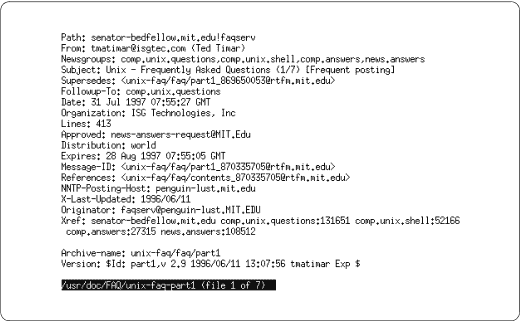

*Figure 9-1. Viewing multiple files in less.*

### METHOD #1

您可以指定多个文件让 `less` 分页浏览，并且可以指定文件模式以打开所有匹配该模式的文件。文件将按顺序显示——`less` 会依次显示每个文件，从您指定的第一个文件或与给定


pattern. 要移动到下一个文件，按 N；要移动到上一个文件，按 P。

⇒ 要分页浏览 `/usr/doc/FAQ` 中的所有 UNIX FAQ 文件，输入：

```
$ less /usr/doc/FAQ/unix-faq-part* RET
```

该命令启动 `less`，然后打开与给定模式 `/usr/doc/FAQ/unix-faq-part*` 匹配的所有文件，并开始显示第一个文件，如图 9-1 所示。

### METHOD #2

另一种方法是使用 `cat` 将所有文件连接起来，并将该输出通过管道传递给 `less`。这样不会有指示符来标记一个文件何时结束、另一个文件何时开始，但你可以干净地滚动浏览整个文本，而无需按按钮在文件之间移动。

⇒ 要一次性分页浏览 `/usr/doc/FAQ` 中的所有 UNIX FAQ 文件，输入：

```
$ cat /usr/doc/FAQ/unix-faq-part* | less RET
```

一个文件何时结束、下一个文件何时开始没有指示符，而是所有文件都被视为一个长文件，按给定顺序处理。 （在这种情况下，使用了通配符，它们按 shell 将 “*” 扩展为所有名称的顺序显示。）

## 9.2 Displaying Text

查看文本最简单的方法是将其发送到标准输出。这对于显示文本的一部分，或将文本的一部分传递给命令行中的其他工具很有用。

许多人仍然使用 `cat` 来查看文本文件，尤其是当它是一个非常小的文件时。要将文件的全部内容输出到屏幕上，使用 `cat` 并将文件名作为参数给出。

⇒ 要输出文件 `notes` 的内容，输入：

```
$ cat notes RET
```

如果你有一个想查看的小文本文件，你只需将其 `cat` 到屏幕上。速度很快，完成任务，不需要考虑。但虽然它对于连接文本很有用（参见 Recipe 10.6 [Concatenating Text], page 256），但它并不是浏览或阅读文本的最好方法——例如，非常大的文本会从屏幕顶部滚动出去。

有时，简单地输出文本是相当合适的，例如当你只想显示文件的一行，或当你想显示文件的前面或后面部分时。

本节描述了用于此类目的的工具。这些工具最好用作过滤器，通常位于管道的末端，从其他命令的输出中获取输入。要以字体显示文本，首先将其转换为 PostScript 并查看（参见 Recipe 15.2 [Outputting Text to PostScript], page 359）。

### 9.2.1 Displaying Non-Printing Characters

使用 `cat` 的 `-v` 选项以可视化的方式输出非打印字符，例如控制字符。通过此选项，`cat` 以帽符号表示法输出这些字符，其中它们由插入符号（`^`）和对应于实际控制字符的字母或其他字符表示（例如，“Control-G” 或铃声字符将输出为 “^G”）。

⇒ 要以帽符号表示法显示所有非打印字符的方式输出文件 `translation`，输入：

```
$ cat -v translation [RET]
```

要可视化显示每行的末尾，使用 `-E` 选项；它指定在每行末尾输出一个 “$”。这对于确定行是否包含尾随空格字符很有用。 （你也可以使用 `grep` 来输出包含尾随空格的行。）

同样有用的是 `-T` 选项，它将制表符字符作为其字面控制字符输出，以帽符号表示法写为 “^I”。

`-A` 选项组合了这三个选项——它等同于指定 `-vET`。

⇒ 以下是一些使用方法。

- 要以每行末尾显示 “$” 字符的方式输出文件 `translation`，输入：

  `$ cat -E translation [RET]`

- 要以所有制表符字符写为 “^I” 而不是字面制表符的方式输出文件 `translation`，输入：

  `$ cat -T translation [RET]`

- 要以非打印字符，包括制表符，以帽符号表示法显示，并以每行末尾显示 “$” 字符的方式输出文件 `translation`，输入：

  `$ cat -A translation [RET]`

⇒ 这里有两种使用方法。

- 要输出文件 `placement-list` 的末尾部分，从第三行开始，输入：

  `$ tail +3 placement-list [RET]`

- 要输出文件 `placement-list` 的末尾部分，从第100个字符开始，输入：

  `$ tail -c +100 placement-list [RET]`

有时持续查看文件的末尾是有用的；这对于“增长中”的文件很有用，即正在被另一个进程写入的文件。要持续查看此类文件的末尾，请使用带有 `-f`（“跟随”）选项的 `tail`。输入 `CTRL-C` 以停止查看文件。

⇒ 要跟随文件 `access_log` 的末尾，输入：

  `$ tail -f access_log [RET]`

注意：你也可以使用 `less` 实现相同的结果；为此，在浏览文本时输入 `F`（参见 Recipe 9.1 [Perusing Text]，第 211 页）。

### 9.2.4 显示文本的中间部分

有几种方法可以只输出文本的中间部分。

#### METHOD #1

要输出文件的某一行，使用 `sed`（参见 Recipe 10.5 [Editing Streams of Text]，第 255 页）。将要输出的行号后跟 `!d` 作为 `sed` 的引号参数；将要输出的文件名作为第二个参数给出。

⇒ 要输出文件 `placement-list` 的第 47 行，输入：

  `$ sed '47!d' placement-list [RET]`

要输出多于一行的区域，请给出起始和结束行号，用逗号分隔。

⇒ 要输出文件 `placement-list` 的第 47 到 108 行，输入：

  `$ sed '47,108!d' placement-list [RET]`

#### METHOD #2

要输出某些文本的中间部分，你也可以在管道上组合多个 `head` 或 `tail` 命令（参见 Recipe 3.2.4 [Redirecting Output to Another Command’s Input]，第 69 页）。

⇒ 这里有一些使用方法。

- 要输出文件 `placement-list` 中的第10行，输入：

  `$ head placement-list | tail -1 [RET]`

- 要输出文件 `placement-list` 末尾的第五和第四行，输入：

  `$ tail -5 placement-list | head -2 [RET]`

- 要输出 `placement-list` 中的第500个字符，输入：

  `$ head -c500 placement-list | tail -c1 [RET]`

- 要输出文件 `placement-list` 第五行上的第一个字符，输入：

  `$ head -5 placement-list | tail -1 | head -c1 [RET]`

在前面的示例中，使用了三个命令：文件 `placement-list` 的前五行被传递给 `tail`，它输出输出中的最后一行（文件中的第五行）；然后，最后一个 `head` 命令输出该最后一行中的第一个字符，从而达到所需结果。

### 9.2.5 显示字符串之间的文本

使用 `sed` 选择字符串之间的文本行，并输出仅该文本段，或除该段之外的所有文本行。字符串可以是单词甚至正则表达式（参见 Recipe 14.3 [Matching Patterns of Text]，第 335 页）。

使用 `-n` 选项运行 `sed`，后跟 `'/first/,/last/p'` 以仅输出字符串 `first` 和 `last` 之间的文本，包含两者。这对于输出文本文件中的某一章或某一节很有用，当你知道用于开始各节的文本时。

⇒ 要输出文件 `book-draft` 中从“Chapter 3”到“Chapter 4”的所有文本，输入：

```
$ sed -n '/Chapter 3/,/Chapter 4/p' book-draft [RET]
```

要输出除两个模式之间的所有文本行之外的内容，请省略 `-n` 选项。

⇒ 要输出文件 `book-draft` 的所有文本，除了位于文本“Chapter 3”和“Chapter 4”之间的部分，输入：

```
$ sed '/Chapter 3/,/Chapter 4/d' book-draft [RET]
```

注意：有关 `SED` 的更多信息，请参见 Recipe 10.5 [Editing Streams of Text]，第 255 页。

### 9.2.6 显示文本的字面字符

有工具可以显示字面字符——文本格式化的方式，使你能够清晰且无歧义地看到每个字符及其在文件中的位置。以下方法展示了如何使用这些工具。

#### METHOD #1


使用 `od`，即“八进制转储”工具，并带 `-c` 选项来显示某些文本中的 ASCII 字符。这会将字符每行分组 16 个，用空格分隔，并在可能的情况下为控制字符提供反斜杠转义。左侧显示一列，包含该行中第一个字符的偏移量（文件中的字节数）。使用 `-A` 选项并给出 `d` 作为参数，以十进制而不是默认的八进制输出这些数字。

⇒ 这里有一些使用方法。

- 要以每行 16 个字符分组显示文件 `details` 中的字面字符，并以偏移号作为每行前缀，输入：

  ```
  $ od -Ad -c details [RET]
  ```

- 要输出文件 `details` 的最后一行中的字面字符，输入：

  ```
  $ tail -1 details | od -Ad -c [RET]
  ```

### METHOD #2

你可以用 `hexdump` 获得与 `od` 相同的效果。使用 `-c` 选项，它会将文件中的每个字节显示为其代表的字符。与方法 #1 相同，每行显示 16 个输入字符，用空格分隔，并在左侧写入一列显示文件的偏移值，不同之处在于此处偏移以十六进制给出。

⇒ 要以每行 16 个字符分组显示文件 `exam` 中的字面字符，并以十六进制偏移号作为每行前缀，输入：

```
$ hexdump -c exam [RET]
```

#### 9.2.7 显示文本的十六进制值

所有文本字符都以磁盘上的数值形式存储（参见 Recipe 9.3.7 [Viewing a Character Set]，第 228 页）。有时你可能想显示文本字符的值，而不是这些值所代表的字符。这对于检查包含非打印字符的文本文件的字面内容，或显示构成二进制文件的字面字符很有用。

有几种方法可以做到这一点，每种方法都有自己的输出格式。它们都能够以十六进制（或简称为“hex”）输出；这些输出有时被称为十六进制转储。

### METHOD #1

`hexdump` 过滤器可以以多种格式转储其输入，每行显示来自文件的一定数量的字符，并在前面加上一个数字，表示该行中第一个字符在文件中的位置。

要以十六进制显示文本，首先使用 `tr` 过滤器从输入中消除回车符，并将此文本传递给带有 `-C` 选项的 `hexdump`，该选项以十六进制显示其输入，每个字符一个字节。每行显示输入的 16 个字符，用空格分隔，并在左侧写入一列，显示文件的偏移值，以十六进制表示。

⇒ 要以十六进制查看文件 `tarpon` 的内容，输入：

```
$ tr -d '\r' < tarpon | hexdump -C | less [RET]
```

### METHOD #2

使用 `od`，“八进制转储”，对某些文本进行文字性和无歧义的转储。它可以作为过滤器工作，也可以将文件名作为参数，并可以以八进制、十六进制或其他格式输出。

使用 `-t` 选项指定输出的格式类型，并给出 `x1` 作为参数以指定显示应为十六进制，每个整数一个字节（如果参数为 `x2`，则每两个字节的输入显示一个十六进制整数）。

⇒ 要以十六进制查看文件 `details` 的内容，输入：

```
$ od -t x1 details | less [RET]
```

此命令以十六进制输出文件 `details` 的每个文字字符的值，每行 16 个字符，用空格分隔。每行前面都有一个偏移值（以八进制表示），表示该行中第一个字符在文件中的偏移量。要将偏移显示从八进制更改为十进制，请使用 `-A` 选项并给出 `d` 作为参数（如果想要十六进制，则给出 `x`）。

要在屏幕右侧的新列中显示可打印字符，请在 `-t` 选项的参数末尾添加 `z`。该列的每一行都将以大于号 (`>`) 开头，以小于号 (`<`) 结尾。

⇒ 要以十六进制查看文件 `details` 的内容，同时在单独的列中显示文件中的可打印字符，输入：

```
$ od -t x1z details | less [RET]
```

### METHOD #3

Midnight Commander

DEB: `mc-common`

`mc`

RPM: `mc`

WWW: http://www.ibiblio.org/mc/

当你在 `mc` 中查看文件时，可以切换十六进制值的显示。要执行此操作，在目录列表中对文件按 `[F3]` 查看文件，然后在查看文件时按 `[F4]` 在查看 ASCII 字符或其十六进制值之间切换；按 `[F10]` 退出文件查看，再按 `[F10]` 退出 `mc`。

### METHOD #4

要在 Emacs 中查看缓冲区的十六进制转储，请使用 `hexl-mode`。

⇒ 要查看当前缓冲区的十六进制转储，输入：

```
[ALT]-X hexl-mode [RET]
```

NOTES: 此模式适用于在 Emacs 中查看和编辑二进制文件。

## 9.3 Viewing Special Types of Text

这些是用于查看以特殊方式格式化的文本或用某些语言编写的文本的配方。

### 9.3.1 Viewing HTML-Formatted Text

有两种通用方法可以查看 HTML 格式的文本，具体取决于你是要查看 HTML 源代码（格式化的文本本身），还是渲染后的 HTML（应用了 HTML 格式命令的文本）。

**Method #1**

要查看 HTML 格式的文本本身，只需像查看任何文本文件一样使用 `less` 查看它，如 Recipe 9.1 [Perusing Text]，第 211 页所述。

⇒ 要将 HTML 格式的文本文件 `homepage.html` 作为 HTML 源代码查看，输入：

```
$ less homepage.html [RET]
```

**Method #2**

要查看应用了 HTML 格式的 HTML 格式文本文件，请在 Web 浏览器中打开该文件，如 Recipe 5.10 [Browsing Files and Directories]，第 157 页的 Method #2 和 #3 所述。

⇒ 要将 HTML 格式的文本文件 `homepage.html` 作为渲染后的 HTML 查看，输入：

```
$ mozilla homepage.html [RET]
```

### 9.3.2 Viewing NROFF-Formatted Text

要查看以 NROFF 格式编写的文本，该格式 intended for use with the TROFF 或 GROFF 文本处理器，请使用带有 `-l` 选项的 `man`。给出要查看的文件名作为参数（使用 `"-"` 作为文件参数以查看标准输入）。默认情况下，`man` 将其输出发送到 `less`，以便你浏览它。

⇒ 以下是两种使用方法。

- 要查看 NROFF 文件 `program.1`，输入：

  ```
  $ man -l program.1 [RET]
  ```

- 要将 NROFF 文件 `program.1` 转换为文本，并将该文本写入新文件 `program.txt`，输入：

  ```
  $ man -l program.1 > program.txt [RET]
  ```

在此最后一个示例中，新文件 `program.txt` 将包含用于粗体文本的 overstrike 字符。原始文件 `program.1` 未被更改。

NOTES: 所有 `man` 页面都是以 NROFF 格式编写的，因此使用该命令来查看它。

### 9.3.3 Viewing C Program Source Code

至少有两种方法可以查看 C 程序源代码。

#### 方法 #1

Cutils

DEB: `cutils`

WWW: http://www.sigala.it/sandro/software.html#cutils

使用作为 Cutils 软件包一部分分发的 `chilight` 过滤器，以带语言高亮的方式查看 C 程序源代码。给定文件名作为参数（如果省略文件名则使用标准输入），`chilight` 输出 C 程序源代码，以多种格式之一高亮显示。通过向 `-f` 选项提供以下其中之一来指定高亮格式；默认值是 `tty`。

+   `ansi_color`      带 ANSI 颜色的 ASCII 文本。
+   `ansi_bold`       带 ANSI 粗体的 ASCII 文本。
+   `html_color`      带颜色高亮的 HTML。
+   `html_font`       使用粗体和斜体高亮的单色 HTML。
+   `roff`            TROFF 输入文本。
+   `tty`             带重击的 ASCII 文本（默认值）。

由于文本中的 ANSI 高亮由不可打印的控制序列组成，因此要浏览此类输出，请使用带 `-R` 选项的 `less`（参见 9.1.4 配方 [浏览原始文本]，第 214 页）。

⇒ 要以彩色语言高亮的方式浏览文件 `myprog.c` 中的 C 程序源代码，请键入：

```
$ chilight -f ansi_color myprog.c | less -R [RET]
```

默认情况下，`chilight` 将其输出发送到标准输出。要写入文件而不是标准输出，请将要写入的文件名作为参数提供给 `-o` 选项。


⇒ 要将文件`myprog.c`中的 C 程序源代码格式化为带颜色高亮的 HTML 并将输出写入文件`myprog.html`，请键入：

```
$ chilight -f color_html -o myprog.html myprog.c [RET]
```

#### 方法 #2

要以高亮方式查看 C 程序源代码，请使用`ensript`对其进行“漂亮打印”，如 15.2.4 配方 [使用语言高亮输出文本]，第 365 页所述。

此方法以 PostScript 输出文本，然后你再查看或打印它。它也适用于许多其他语言和格式，而不仅仅是 C——请参阅上述配方中的表格。

⇒ 要以带语言高亮的 PostScript 形式显示文件`myprog.c`中的 C 程序源代码，请键入：

```
$ ensript -Ec -o i myprog.c | gv - <RET>
```

在此示例中，使用`gv`命令来显示`ensript`的输出。

### 9.3.4 查看排序文本的行

使用`look`来显示排序文本文件中的某些行。它对排序文件执行快速搜索，因此特别适用于从大型排序列表中查看行。将要匹配的行开头的文本作为参数给出，并给出要读取的文件名。

⇒ 要显示排序文件`catalog`中以文本 “DOT” 开头的所有行，请键入：

```
$ look DOT catalog <RET>
```

如果要匹配的文本包含空格，请对其加引号。

⇒ 要显示排序文件`parts-list`中以文本 “Part No. 42” 开头的所有行，请键入：

```
$ look "Part No. 42" parts-list <RET>
```

注意：没有第二个参数时，`look`使用系统词典。这在 11.2.1 配方 [列出匹配模式的单词]，第 283 页中有描述。

### 9.3.5 查看带下划线的文本

纯文本可以通过在每个要加下划线的字符后插入退格字符（`Control-H`），后跟下划线字符（_）来加下划线。当发送到打印机时，打印机将首先打印原始字符，然后退格覆盖它并在其下方打印下划线。这种类型的下划线称为重击式下划线，或退格下划线（参见 13.9 配方 [下划线文本]，第 327 页）。

如果你使用像`cat`这样的工具将此类文本输出到标准输出，你将在显示器上看到下划线字符，但看不到它们本应加下划线的字符——退格字符已经将其擦除。（但如果你将`cat`的标准输出通过管道传输到文件或其他命令，所有原始输入中的字符都会被保留。）

有几种方法可以以不同方式查看包含退格下划线的文本。

#### 方法 #1

使用`less`来浏览包含退格下划线的文本（参见 9.1 配方 [浏览文本]，第 211 页）。

⇒ 要浏览文件`term-paper`，以便你可以查看其中包含的任何退格下划线，请键入：

```
$ less term-paper [RET]
```

#### 方法 #2

使用`ul`工具输出包含退格下划线的文本，以便这些下划线在你的终端上正确显示。

⇒ 要输出文件`term-paper`，以便你可以查看带下划线的文本，请键入：

```
$ ul term-paper [RET]
```

此命令将`term-paper`中的任何退格下划线转换为你的终端可以显示的字符序列；因此，如果你在管道中进一步使用`cat`或其他命令，文本将在你的屏幕上正确显示。

⇒ 要使用`cat`输出文件`term-paper`，在终端上显示任何带下划线的文本，请键入：

```
$ ul term-paper | cat [RET]
```

#### 方法 #3

使用`colcrt`将退格下划线转换为破折号（在带下划线的文本下方绘制的一行连字符，如 "-------"）。

⇒ 要输出文件`term-paper`，将所有退格下划线转换为破折号，请键入：

```
$ colcrt term-paper [RET]
```

破折号会在带下划线的文本正下方插入新行，这并不总是理想的。使用 "-" 选项完全抑制下划线，并将任何带下划线的文本显示为纯文本。

⇒ 要输出文件`term-paper`，删除所有退格下划线，请键入：

```
$ colcrt - term-paper [RET]
```

### 9.3.6 在二进制文件中列出文本

使用`strings`输出二进制文件中包含的任何可打印文本。将要搜索的文件名作为参数给出，所有文本字符串都发送到标准输出。有时，将文本通过`fmt`过滤可以改善显示。

⇒ 这里有一些使用方法。

- 要将文件`table.com`中的任何文本字符串保存到文件`table.txt`，输入：

  ```
  $ strings table.com > table.txt RET
  ```

- 要浏览文件`table.com`中的任何文本字符串，输入：

  ```
  $ strings table.com | less RET
  ```

- 要浏览文件`table.com`中任何文本字符串的格式化输出，输入：

  ```
  $ strings table.com | fmt | less RET
  ```

### 9.3.7 查看字符集

字符集是一种规范，显示代表该字符集中每个字符的数字编码。ASCII，即美国信息交换标准代码，自 1968 年以来一直在使用，并且至今仍是计算中使用的标准字符集。其他字符集也可用。默认的 Linux 字符集，ISO 8859-1（“Latin 1”）字符集，是 ASCII 的一种“方言”，包含所有标准 ASCII 字符集加上另外 128 个字符。这些附加字符有时被称为扩展字符。

几个字符集有自己的手册页；要查看其中一个字符集，请查看其对应的手册页（参见 Recipe 2.8.4 [Reading a Page from the System Manual]，第 46 页）。

要查看列出 ASCII 字符集中所有有效字符以及用于输入它们的字符代码的图表，请查看`ascii`手册页。

⇒ 要查看 ASCII 字符集，输入：

```
$ man ascii RET
```

这会以八进制、十进制和十六进制显示每个字符的值，并显示它们的转义代码。这些值对于引用特殊字符很有用。

`iso_8859_1`手册页包含整个 ISO 8859-1 字符集，包括标准 127 个 ASCII 字符之上的所有扩展字符。

⇒ 要查看 ISO 8859-1 字符集，输入：

```
$ man iso_8859_1 RET
```

你可以使用此页面查看此字符集中的所有字符以及如何输入它们。

**NOTES:** 在 Emacs 中“引用”这些字符有一种特殊方法；该技术在 Recipe 10.1.4 [Inserting Special Characters in Emacs]，第 239 页中描述。

`miscfiles`包还包含这些字符集的图表，如 Recipe 11.4 [Using Word Lists and Reference Files]，第 289 页中所述。

### 10. 编辑文本

编辑文本是 Linux 系统上，或几乎任何计算机上最基本的活动之一。我们在编写文档、发送电子邮件、制作网页、为 Usenet 发布文章、编程时编辑文本——列表还在继续。

大多数文本编辑都是在文本编辑器中完成的，文本编辑器是一种通常打开包含一些文本的文件并让你重新排列、插入、删除以及以其他方式编辑该文本的应用程序。人们花费了大量计算时间使用文本编辑器应用程序编辑文本。

在本章中，我介绍了目前最流行的两个文本编辑器。我还介绍了在没有编辑器的情况下编辑文本的其他基本或方便的方法，包括连接、文件包含以及使用鼠标剪切和粘贴。

可以选择的文本编辑器有很多，但大家都知道实际上只有两个选择：Emacs 和 Vi。大多数编辑器都属于这两个主要分支之一；可能有比任何其他应用程序更多受 Emacs 影响的程序，并且世界上几乎每个 UNIX 系统都安装了一些版本的 Vi。大多数用户更喜欢其中之一；很少有人精通两者。许多工具和应用程序都有特殊模式，在这些模式中识别 Emacs 和 Vi 的按键命令，包括 Bash shell（参见第 3 章 [The Shell]，第 53 页）。

本章各节都专门讨论两者。新手，花半小时时间使用每个编辑器，留出时间尝试内置教程。然后，选择与你产生共鸣的那一个。

Emacs 和 Vi 不像你可能熟悉的那种程序，新手乍一看可能会感到困惑——但它们实际上并不难使用，而且体验回报很大。任何有使用其中之一经验的人都知道，在这样的编辑器中可以做更多、更快的事情，比其他系统上的任何“文字处理器”都要多。如果你运行 Emacs 和 Vi 的教程，你可以感受它们的工作方式，并看看哪一个适合你（运行它们的方法在 Recipe 10.1.2 [Running an Emacs Tutorial]，第 237 页和 Recipe 10.2.2 [Running a Vi Tutorial]，第 247 页中解释）。


当然，还有其他编辑器，许多都有虔诚的追随者；值得看看有什么可用的。如果你习惯于在其他系统上使用某种特定编辑器，很大可能 Linux 上存在它的“克隆”。例如，有一些编辑器的工作方式类似于 DOS 中的 `EDIT` 程序，或旧的 `WordStar` 文字处理器（有一种特殊 mode in Emacs, `wordstar-mode`, which emulates its key bindings)。A list of other recommended editors concludes the chapter.

### 10.1 使用 Emacs

`GNU Emacs`

`DEB`: `emacs-common`

`emacs21`

`RPM`: `emacs`

`WWW`: `http://www.emacs.org/`

称 Emacs 只是一个文本编辑器是不公平的——它是一个功能强大的应用程序，能够执行许多功能，包括阅读电子邮件和 Usenet 新闻、浏览万维网，甚至进行肤浅的心理分析（证明请参见 `Recipe 30.7 [Undergoing Psychoanalysis]`, page 594）。

Emacs 有两个主要变体，还有一些次要分支和替代版本。`GNU Emacs` 由 `FSF` 作为其“`GNU 系统`”的一部分分发，是原始的 Emacs。`XEmacs`（以前称为 `Lucid Emacs`）是另一种版本。它提供与 `GNU Emacs` 基本相同的功能，但还包含用于 X Window System 的自身功能（在某些细节上它也与 `GNU Emacs` 的行为不同）。

`GNU Emacs` 和 `XEmacs` 是最受欢迎的 emacs en（它们在数量上被称为 emacs）；其他变体包括 `JED`（参见 `Recipe 10.8 [Using Other Text Editors]`, page 263）和由 Case Western Reserve University 的一名程序员开发的 `Chet's Emacs`（`ce`）。以下食谱中假设的 Emacs 变体是 `GNU Emacs`，但原则上它们应该适用于大多数 Emacs 变体。

首先是对使用 Emacs 的简要介绍，其中穿插了必要的 Emacs 术语；随后是描述如何使用 Emacs 某些独特编辑功能的食谱。

#### 10.1.1 熟悉 Emacs

熟悉 Emacs 的最快方法是启动它并尝试进行一些基本编辑。

你以通常的方式启动 Emacs，要么在 X 中从窗口管理器提供的菜单中选择它，要么在 shell 提示符下输入其名称（小写字母）。将任何文件的名称作为参数给出以在 Emacs 中打开它们进行编辑。

⇒ 这里有两种方法可以做到这一点。

- 要在 shell 提示符下启动 `GNU Emacs`，输入：

  ```
  $ emacs
  ```

- 要在 shell 提示符下启动 `XEmacs` 并打开名为 `journal` 的文件，输入：

  ```
  $ xemacs journal
  ```

在 X 中启动时，典型的 `GNU Emacs` 窗口看起来像图 10-1（客户端窗口会根据你的窗口管理器而有所不同）：

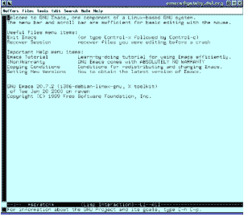

*Figure 10-1. Emacs upon startup.*

欢迎信息在 Emacs 第一次启动时出现，它告诉你其中其他事情，如何运行教程（我们马上就会看）。沿着窗口整个左侧运行的条称为 *scroll bar*。显示 Emacs 会话的 X 客户端窗口（或在非 X 窗口运行时终端屏幕）称为 *frame*。请注意，侧面没有边框（如果你仔细看，你会发现即使有滚动条的那一侧也没有边框）；这是因为当今的许多窗口管理器，包括插图中的那个，只在窗口的顶部和底部绘制边框。

顶部条称为 *menu bar*，你可以用鼠标左键点击菜单然后向下拖动来展开其菜单。当你在终端中运行 Emacs 时，你不能用鼠标展开菜单，但

你可以通过输入 `(F10)`¹ 在文本菜单窗口中访问和选择相同的菜单项。

在 Emacs 中打开的文件或其他文本保存在其自己的区域中，称为 *buffer*。默认情况下，当前缓冲区出现在菜单栏下方的较大区域中。要在缓冲区中写入文本，只需输入即可。光标在缓冲区中的位置称为 *point*，并且被许多 Emacs 命令引用。

滚动条上的填充区域表示窗口中显示的文本相对于缓冲区其余部分的比例。因此，在新的、小型或空缓冲区中，滚动条会被完全填满（如插图所示），而当你在非常大的缓冲区的底部附近时，只有滚动条底部附近的一小部分会被填满。

Emacs 窗口底部附近的水平条，直接位于当前缓冲区下方，称为 *mode line*；它提供有关当前缓冲区的信息，包括其名称、多少百分比的缓冲区适合屏幕、point 所在的哪一行，以及缓冲区是否已保存到文件。

模式行还列出缓冲区中激活的模式。Emacs *modes* 是控制 Emacs 行为的一般状态——例如，当 *overwrite-mode* 设置时，你输入的文本会 *overwrite* point 处的文本；在 *insert-mode*（默认）中，你输入的文本会在 point 处 *insert*。通常会列出 *fundamental-mode*（默认）或 *text-mode*。

在模式行正下方是 *echo area*，Emacs 在此处写入简短的状态消息，例如错误消息；它是 Emacs 窗口中的最后一行。当你输入需要输入的命令时，该输入会在此区域请求（并且当这种情况发生时，你输入输入的位置，在 echo area 中，然后称为 *minibuffer*）。如果你仔细看，你会发现它也有自己的滚动条。

Emacs 大量使用 `(CTRL)` 和 `(ALT)` 键组合。因为 Emacs 在文化上与 Microsoft Windows 和 Apple MacOS 世界的编辑器和方式不同，所以在那些地方它获得了相当没有根据的名声，认为它很奇怪且难以使用。这不是真的。运行其各种功能的键盘命令是为易用性和易记性而设计的——一旦你习惯了这个概念，你就可以非常快速地输入这些键组合。

在 Emacs 记法中，这些按键以某种方式书写。许多命令都是通过输入 `(CTRL)-(X)` 开始的，写成“C-x”（例如，退出 Emacs 的命令是 `(CTRL)-(X) (CTRL)-(C)`，写成“C-x C-c.”）

函数前面加上 ⟨ALT⟩-⟨X⟩，在 Emacs 中写作 “M-x。”² 你可以通过函数来打开或关闭各种模式。

例如，你可以通过切换 `menu-bar-mode` 来使菜单栏出现或消失。无论 `menu-bar-mode` 是否开启，输入 ⟨F10⟩ 来激活菜单下拉都有效；如果它关闭，菜单选项会出现在一个新的缓冲区窗口中。

你可以通过输入 ⟨ALT⟩-⟨X⟩ 后跟函数名并按下 ⟨RET⟩ 来运行任何 Emacs 函数。

- ⇒ 要运行 `menu-bar-mode` 函数，从而关闭顶部的菜单栏，输入：

- ⟨ALT⟩-⟨X⟩ `menu-bar-mode` ⟨RET⟩

（如果菜单栏已经关闭，运行此函数会将其重新打开。）

在 Emacs 中输入 ⟨CTRL⟩-⟨G⟩ 可退出你正在输入的函数或命令；如果你在输入命令时出错，这对于取消和中止键盘输入很有用。

`find-file` 函数会提示输入文件名并在新缓冲区中打开该文件副本；其键盘加速键是 ⟨CTRL⟩-⟨X⟩ ⟨CTRL⟩-⟨F⟩（你可以在按下并释放 ⟨X⟩ 和 ⟨F⟩ 键的同时保持 ⟨CTRL⟩ 按下）。

- ⇒ 要运行 `find-file` 函数，输入：

- ⟨ALT⟩-⟨X⟩ `find-file` ⟨RET⟩

此命令运行 `find-file` 函数，该函数会提示输入文件名并在新缓冲区中打开该文件副本。

Emacs 可以同时打开多个缓冲区。 你作为参数传递给 `emacs` 的任何文件名都将在单独的缓冲区中打开：

```
$ emacs diary etc/todo etc/rolo
```

（当然，你也可以稍后创建新缓冲区并在其中打开文件。）

正如函数前面加上 ⟨ALT⟩-⟨X⟩ 键组合一样，许多命令前面也加上类似的 ⟨CTRL⟩-⟨X⟩ 键组合，特别是那些作用于缓冲区、文件或与退出 Emacs 有关的命令。

要切换缓冲区，输入 ⟨CTRL⟩-⟨X⟩ ⟨CTRL⟩-⟨B⟩。 然后，输入要切换到的缓冲区名称，后跟 ⟨RET⟩；或者，不带缓冲区名称直接输入 ⟨RET⟩ 以切换到上次访问的缓冲区。 （在 Emacs 中查看缓冲区称为访问该缓冲区。）

> ² 从技术上讲，这指的是 ⟨META⟩ 键。 你的键盘很可能有 ⟨ALT⟩ 键而没有 ⟨META⟩ 键，在这种情况下你使用 ⟨ALT⟩ 来输入它，所以我用 ⟨ALT⟩ 来表示此键（参见 `Recipe 1.2 [Typographical Conventions]`，第 6 页）。

⇒ 要切换到名为 `todo` 的缓冲区，输入：

`<CTRL>-X <CTRL>-B todo <RET>`

如果缓冲区不存在，Emacs 将创建一个具有你指定名称的新缓冲区。

当你启动 Emacs 时，会存在一个名为 `*scratch*` 的特殊缓冲区，你可以用它来写笔记和其他不想保存的东西；其内容不会被保存，下次运行 Emacs 时 `*scratch*` 缓冲区会再次变空。


⇒ 要切换到 `*scratch*` 缓冲区，输入：

`<CTRL>-X <CTRL>-B *scratch* <RET>`

要在当前缓冲区中写入一些文本，只需输入即可。你输入的文本会在光标处插入。

⇒ 要在当前缓冲区光标处插入一行文本，输入：

`*This is how to type in Emacs.*` `<RET>`

通过 `<CTRL>-X k` 命令杀死缓冲区来关闭缓冲区。Emacs 会在迷你缓冲区中询问要杀死的缓冲区名称。默认是当前缓冲区；直接按 `<RET>` 即可杀死它。如果缓冲区的內容来自文件，并且缓冲区包含未保存的工作，Emacs 会要求你确认杀死缓冲区。如果是 `*scratch*` 缓冲区或从未写入过文件的新缓冲区，C 命令会直接杀死它而不询问。

⇒ 要在它是当前缓冲区时杀死 `*scratch*`，输入：

`<CTRL>-X k <RET>`

`Kill buffer: (default *scratch*) <RET>`

现在我们已经介绍了基本的 Emacs 术语，我将向你展示如何退出程序。

要杀死 Emacs，使用 `<CTRL>-X <CTRL>-C`，它也会给你机会在 Emacs 被杀死前保存任何未保存的缓冲区。你也可以输入 `<CTRL>-Z` 将 Emacs 挂起到后台作业，以便稍后返回（参见 Recipe 3.3.3 [Putting a Job in the Foreground]，第 73 页）。在 X 中，`<CTRL>-Z` 不会挂起 Emacs，而是将其窗口图标化。对其取消图标化即可将其带回（参见 Recipe 4.3.5 [Deiconifying an X Window]，第 107 页）。

⇒ 以下是一些使用方法。

- 要杀死 Emacs，在此之前有机会保存任何未保存的缓冲区，输入：

  `<CTRL>-X <CTRL>-C <RET>`

- 要在控制台中运行 Emacs 时将其挂起，输入：

  `<CTRL>-Z`

+   • 在 X 中运行 Emacs 时，要将其图标化，输入：

+     `⟨CTRL⟩-⟨Z⟩`

##### 10.1.2 运行 Emacs 教程

Emacs 附带一个交互式、自定进度的教程，可教你如何使用基础功能。根据我的经验，花 25 分钟完成该教程是你计算生涯中可以做的最好的事情之一。即使你最终决定不太喜欢 Emacs，许许多多其他应用程序都使用 Emacs 风格的键盘命令和启发式方法，因此熟悉它们总是有回报的。任何时候，只要你在 Emacs 中，都可以使用 `⟨CTRL⟩-⟨H⟩ t` 命令启动教程。

⇒ 要启动 Emacs 教程，输入：

  `⟨CTRL⟩-⟨H⟩ t`

该命令会打开教程，一个特殊的只读文件，放入其自己的缓冲区中。

NOTES：顺便说一下，`⟨CTRL⟩-⟨H⟩` 是 Emacs 的帮助键；所有与帮助相关的命令都以此键开头。例如，要阅读 Emacs FAQ，输入 `⟨CTRL⟩-⟨H⟩ F`，要运行 Info 文档浏览器（其中包含《GNU Emacs 手册》），输入 `⟨CTRL⟩-⟨H⟩ i`。

##### 10.1.3 使用基本的 Emacs 编辑键

你在 Emacs 中输入的任何内容都称为键序列，当你输入一个绑定到命令的序列时，它会运行该命令。

下表列出了基本编辑键并描述了其功能。如果某个功能有两种常见的按键，两者都会给出。

### Moving Point

`⟨↑⟩` or `⟨CTRL⟩-⟨P⟩`    将光标上移至上一行。

`⟨↓⟩` or `⟨CTRL⟩-⟨N⟩`    将光标下移至下一行。

`⟨←⟩` or `⟨CTRL⟩-⟨B⟩`    将光标向后（向左）移动一个字符。

`⟨→⟩` or `⟨CTRL⟩-⟨F⟩`    将光标向前（向右）移动一个字符。

`⟨ALT⟩-⟨F⟩`            将光标向前移动一个词。

`ALT - ←`

将光标向后移动一个词。

`ALT - ↑`

将光标移回下一个段落开头。

`ALT - ↓`

将光标向前移动到下一个段落结尾。

`PgUp` or `CTRL - V`

将光标向前通过缓冲区移动一屏。

`PgDn` or `ALT - V`

将光标向后通过缓冲区移动一屏。

`CTRL - A`

将光标移动到当前行的开头。

`CTRL - E`

将光标移动到当前行的末尾。

`CTRL - L`

重新居中 Emacs 窗口中的文本，将光标所在的行置于屏幕中央。

### Inserting and Deleting

`INS`

切换覆盖模式。

`CTRL - T`

交换光标处的字符与光标左侧的字符。

`ALT - T`

交换光标处的词与光标左侧的词。

`BKSP` or `CTRL - H`

删除光标左侧的字符。

`DEL` or `CTRL - D`

删除光标右侧的字符。

### Cutting and Pasting

`SHIFT - INS` or `CTRL - Y`

在光标处粘贴剪贴环中的文本（参见 Recipe 10.3.2 [Pasting Text], page 254）。

`CTRL - SPACEBAR`

设置标记（参见 Recipe 10.3.1 [Cutting Text], page 254）。

`CTRL - _`

撤销上一个操作（control-underscore）。

`CTRL - K`

从光标处杀死文本到行尾。

`CTRL - W`

从标记处杀死文本到光标处。

### Getting Help

`CTRL-(H) t`  启动 Emacs 教程。

`CTRL-(H) k keystroke`  描述按键。

`CTRL-(H) a function RET`  列出与函数相关的所有 Emacs 命令。

`CTRL-(H) F`  在新缓冲区中打开 Emacs FAQ 的副本。

`CTRL-(H) i`  启动 Info。

### Command Operations

`CTRL-(G)`  取消当前命令。

`CTRL-(U) number`  重复你接下来输入的命令或按键 `number` 次。

### File Operations

`CTRL-(X) CTRL-(C)`  保存 Emacs 中打开的所有缓冲区，然后退出程序。

`CTRL-(X) CTRL-(F) file RET`  在新缓冲区中打开文件进行编辑。要创建尚不存在的新文件，只需指定你想要的文件名。要浏览你的文件，输入 TAB 而不是文件名。

### Special Menus

`CTRL-left-click`  显示按主要模式排序的所有打开缓冲区的菜单（仅在 X 中有效）。

`SHIFT-left-click`  显示字体选择菜单（仅在 X 中有效）。

##### 10.1.4 在 Emacs 中插入特殊字符

有些字符你不能正常地输入到 Emacs 缓冲区中。例如，在文本文件中，你可以通过插入换页字符，即 ASCII `CTRL-(L)` 或八进制代码 `014` 来指定分页；当你打印带有换页符的文件时，当前页会在此字符处被弹出，打印将在新页上继续。

然而，`CTRL-(L)` 作为 Emacs 命令有其含义。要插入此类字符，请使用 `quoted-insert` 函数，`CTRL-(Q)`。它接受你想要插入的字符的字面按键，或该字符的八进制代码。它在光标处插入字符。

⇒ 这里有两种使用方法。

- 要通过指定其实际按键 `((CTRL-↵))` 在点处插入换页符，输入： `CTRL-Q CTRL-↵`

- 要通过指定其八进制字符代码在点处插入换页符，输入： `CTRL-Q 014 RET`

前面的两个示例都做同样的事情：它们在点处插入一个换页符。

`CTRL-Q` 的一个有趣用法是下划线文本。要做到这一点，在你想要下划线的每个字符之后插入一个字面上的 `CTRL-H` 字符，后跟下划线 (`_`)。

⇒ 要下划线点之前的字符，输入： `CTRL-Q CTRL-H _`

然后你可以使用 `u1` 将文本输出到屏幕（参见 Recipe 13.9 [Underlining Text], page 327）。

你可能想要做的另一种特殊字符插入是带重音的字符和其他各种语言中使用的字符。

在缓冲区中插入它们有两种方法。

## METHOD #1

要插入带重音的字符，请使用 `iso-accents-mode`。当此模式处于活动状态时，你可以输入一个特殊的重音字符，后跟要加重音的字符，正确的带重音字符将被插入到点处。

下表显示了特殊重音字符以及要使用的键组合。

| Prefix ... | Plus This Letter | Yields This Result |
|---|---|---|
| `"` | a | ä |
| `"` | e | ë |
| `"` | i | ï |
| `"` | o | ö |
| `"` | u | ü |
| `"` | s | ß |
| `'` | a | á |
| `'` | e | é |
| `'` | i | í |
| `'` | o | ó |


| ' | u | ú |
| ` | a | à |
| ` | e | è |
| ` | i | ì |
| ` | o | ò |
| ` | u | ù |
| ~ | a | ã |
| ~ | c | ç |
| ~ | d | d̃ |
| ~ | n | ñ |
| ~ | t | t̃ |
| ~ | u | ũ |
| ~ | < | << |
| ~ | > | >> |
| ~ | ! | ¡ |
| ~ | ? | ¿ |
| ^ | a | â |
| ^ | e | ê |
| ^ | i | î |
| ^ | o | ô |
| ^ | u | û |
| / | a | å |
| / | e | æ |
| / | o | ø |

⇒ 要在当前缓冲区点处写出文本 “Emacs ist spaß!”，输入：

`ALT-X iso-accents-mode RET`

*Emacs ist spaß!*

如果在缓冲区中启用了 `iso-accents-mode`，你想输入组成带重音字符的字面键组合，请键入前缀字符两次。

⇒ 要在 `iso-accents-mode` 打开的缓冲区中输入文本 “i o”（而不是重音字符 ó），输入：

`''o`

## METHOD #2

要在不进入 `iso-accents-mode` 的情况下在缓冲区中插入带重音字符和其他特殊语言字符，请使用 `⟨CTRL⟩-⟨X⟩ ⟨8⟩` 后跟特殊键组合，即重音前缀和字符，如前表所述。

非字母字符在此方法中不需要重音前缀。

⇒ 要在当前缓冲区点处写出文本 ‘¡Hasta Mañana!’，输入： `⟨CTRL⟩-⟨X⟩ ⟨8⟩ ⟨!⟩`Hasta Ma`⟨CTRL⟩-⟨X⟩ ⟨8⟩ ⟨-⟩`nana!

NOTES: 当缓冲区包含带重音字符时，它就不能再保存为纯 ASCII 文本，而必须保存为 ISO-8859-1 字符集中的文本（参见 Recipe 9.3.7 [Viewing a Character Set], page 228）。当你保存缓冲区时，Emacs 会通知你必须这样做。

最近，一系列国际化函数已添加到 GNU Emacs。它们使用的完整讨论超出了本书的范围；有关此主题的更多信息，请参阅 The GNU Emacs Manual 的“International Character Set Support”部分。

### 10.1.5 Making Abbreviations in Emacs

An abbrev is a word that is an abbreviation of a (usually) longer word or phrase. Abbrevs exist as a convenience to you—you can define abbrevs to expand to a long phrase that is inconvenient to you to type, or you can define a misspelling that you tend to make to expand to its correct spelling. Abbrevs only expand when you have `abbrev-mode` enabled.

⇒ 要打开 `abbrev-mode`，输入： `⟨ALT⟩-⟨X⟩ abbrev-mode ⟨RET⟩`

要定义一个 abbrev，输入你想要使用的 abbrev，然后输入 `⟨CTRL⟩-⟨X⟩ aig`。Emacs 将在 minibuffer 中提示你输入 abbrev 要扩展到的文本；输入该文本然后输入 `⟨RET⟩`。

- 要将 “ww” 定义为 ‘Walla Walla, Washington,’ 的 abbrev，请执行以下操作：
  1. 首先，输入 abbrev 本身：
     `ww`
  2. 接下来，指定此文本为 abbrev；输入： `⟨CTRL⟩-⟨X⟩ aig`
  3. 现在输入文本将其扩展为：
     `Global expansion for "ww": Walla Walla, Washington RET`

现在，每当你在当前缓冲区中输入文本 "ww" 后跟一个空白字符或标点字符时，该文本将扩展为文本 "Walla Walla, Washington。"

要保存你已定义的 abbrevs 以便以后使用，请使用 `write-abbrev-file` 函数。这会将当前定义的所有 abbrevs 保存到一个文件中，你可以在未来的 Emacs 会话中读取该文件。 （你也可以在缓冲区中打开该文件并编辑 abbrevs。）

⇒ 要将你当前定义好的 abbrevs 保存到文件 `"~/.abbrevs"`，请输入：
`ALT-X write-abrev-file RET ~/.abbrevs RET`

然后，在未来的 Emacs 会话中，你可以使用 `read-abbrev-file` 函数为该会话定义这些 abbrevs。

⇒ 要从文件 `"~/.abbrevs"` 读取 abbrevs 并为当前会话定义它们，请输入：
`ALT-X read-abbrev-file RET ~/.abbrevs RET`

**NOTES:** Emacs 模式命令是切换式的。因此，要在缓冲区中关闭 `abbrev-mode`，只需再次输入 `ALT-X abbrev-mode RET`。如果你在该 Emacs 会话期间稍后在该缓冲区中打开 `abbrev-mode`，abbrevs 将被记住并再次展开。

#### 10.1.6 在 Emacs 中录制和运行宏

*macro* 就像是一段按键序列的录制——当你运行宏时，Emacs 会执行该按键序列，就像你亲自输入了一样。

要开始录制宏，请输入 `CTRL-X (`。然后，你输入的所有内容都会被记录为宏，直到你通过输入 `CTRL-X )` 停止录制。录制宏后，你可以在 Emacs 会话期间的任何时间通过输入 `CTRL-X e` 播放它。你可以在前面加上 `universal-argument` 命令 `CTRL-U` 来指定播放次数。

⇒ 以下是一些使用方法。
- 要录制一个宏，将当前行的第一个单词大写（`ALT-C` 将光标右侧的单词大写），然后前进到下一行，请输入：
  ```
  CTRL-X ( CTRL-A ALT-C
  CTRL-N CTRL-X )
  ```
- 要播放该宏 20 次，请输入：
  `CTRL-U 20 CTRL-X e`

NOTES: 宏是 Emacs 工作方式的基础——事实上，Emacs 这个名字来源于 "Editing MACRos"，因为 1976 年的第一个 Emacs 版本实际上是为另一文本编辑器编写的一组这样的宏。

#### 10.1.7 同时查看多个 Emacs 缓冲区

你可以将 Emacs 框架分成多个窗口，每个窗口显示自己的缓冲区。这对于同时查看多个缓冲区的不同部分很有用。当你有一个很长的缓冲区，想在编辑另一部分的同时查看其中一部分时也很方便——如果将框架分成两部分，你可以在一个窗口中移动到要查看的文本，在另一个窗口中编辑不同的部分。

使用 `CTRL-X 2` 将当前框架上下分成两个窗口，使用 `CTRL-X 3` 垂直分割它，使其左右并排。默认情况下，当前缓冲区显示在两个窗口中，但你可以随时更改任何窗口中显示的缓冲区。在 X 中，使用鼠标调整任一窗口的大小——在窗口的模式行上左键单击并拖动以调整该窗口的大小。

通过使用鼠标指针定位光标然后左键单击，或通过输入 `CTRL-X o` 来在不同窗口之间切换，后者会切换到另一个窗口。当你需要从长文件的一个部分反复剪切文本选择到另一个部分时，这非常方便：在一个窗口中剪切文本，在另一个窗口中将其粘贴到合适位置。当有许多选择需要剪切和粘贴时，这种方法可以节省时间。

使用 `CTRL-X 1` 删除多个窗口并使框架再次成为单个窗口。

### 10.2 使用 Vi

Nvi

DEB: `nvi`

RPM: `nvi`

WWW: http://www.bostic.com/vi/

WWW: http://vasc.ri.cmu.edu/old_help/Editors/Vi/

以下配方适用于 Vi 编辑器。它的名字发音为 "vye"，有时也读作 "vee-eye"，是 visual 的缩写；当它首次发明时，它是

是早期能够在整个屏幕上可视化显示文本以进行交互式编辑的文本编辑器之一（当时其他交互式编辑器通常逐行显示文件）。

与 Emacs 类似，Vi 也有许多变体；其中较为流行的几个是 Vim 和 Elvis，它们都是更新的实现，比原始 Vi 具有更多功能。本节将假设使用 Nvi，即为 BSD 实现的原始 Vi 的新实现，目前在大多数 Linux 系统上都能找到。

#### 10.2.1 熟悉 Vi

与 Emacs 一样，熟悉 Vi 的方法是启动它，并尝试一些基本编辑。

你可以通过在 X 中从窗口管理器提供的菜单中选择它，或在 shell 提示符下输入其名称（小写字母）来启动 Vi。提供一个文件名以开始编辑文件。

⇒ 这里有两种方法可以做到这一点。
- 要在 shell 提示符下启动 Vi，输入：
  ```
  $ vi ⟨RET⟩
  ```


要在 Vi 中打开文件名为 `journal` 进行编辑，输入：

```
$ vi journal ⟨RET⟩
```

`Vi` 是一个模式编辑器，其含义取决于编辑器当前所在的编辑模式。当你启动时，`Vi` 处于命令模式，这意味着你输入的文本被解释为字面 `Vi` 命令。

一个典型的 `Vi` 会话，在命令模式下启动新文件时，看起来像图 10-2。

光标位于右上角。`Vi` 用波浪号字符 (`~`) 填充屏幕上文件末尾之后的各行；因此当你在新文件中时，例如在不带参数启动 `Vi` 时，屏幕会被波浪号填满，因为文件中还没有任何内容。

屏幕的底行称为命令行，是 `Vi` 显示重要消息和有关你正在编辑的文件的信息的地方。当 `Vi` 启动时，命令行会显示三件事：首先，是为此文件使用的恢复文件名。³ 其次，`Vi` 显示正在编辑的文件名；在这种情况下，文件还没有名字，所以在命令行上写着 "new file"。命令行上显示的第三件事是光标所在的文件行号。

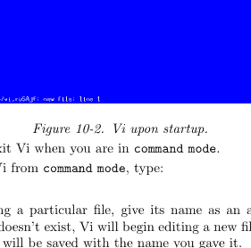

图 10-2. 启动时的 Vi。

⇒ 在命令模式下输入 `ZZ` 以退出 `Vi`。

要从命令模式退出 `Vi`，输入：

`zz`

要开始编辑特定文件，将其名称作为参数给出；如果你指定一个不存在的文件，`Vi` 将开始编辑一个新文件，并在你将其写入磁盘时，以你给定的名称保存它。

⇒ 要启动 `Vi` 并打开名为 `planner` 的文件，输入：

```
$ vi planner [RET]
```

在命令模式下，通过输入来执行命令。要取消你已开始输入的命令，按下 `[ESC]`。一些命令，特别是用于写入文件的命令，以冒号字符 (`:`) 为前缀；从技术上讲，按下冒号会带你进入一种新模式，即命令行模式。

要切换到插入模式，在此模式下你输入的文本会被插入到正在编辑的文件中，¹ 你可以使用其中几个命令；`i` 命令在光标当前位置进入插入模式，并允许你在该点插入你输入的文本。要退出插入模式并转到命令模式，输入 `[ESC]`。

¹ 这也称为输入模式。

⇒ 要在 `Vi` 中插入一行文本然后转到命令模式，输入：

`i Hello, world. RET`

`ESC`

这会从命令模式切换到插入模式，在当前文件中的光标位置插入文本 "Hello, world." 和一个换行符，然后将 `Vi` 带回命令模式。

获取帮助的命令是 `:help`，要获取命令列表及其用法，运行 `:viusage` 命令。

⇒ 要获取 `Vi` 命令及其用法的列表，输入：

`:viusage RET`

当你在 `Vi` 中打开文件时，文件的内容会被放置在其自己的缓冲区中，如同 `Emacs` 一样。直到你写入它们，磁盘上的文件才会被修改。

要将缓冲区写入文件，使用 `:w` 并给出要写入的文件名。使用 `:wq` 代替以将文件写入磁盘并退出，并使用 `:q!` 放弃所有未保存的编辑并退出 `Vi`。

⇒ 这里有两种使用方法。

- 要将缓冲区的 `contents` 写入文件 `my_practice_file`，然后退出 `Vi`，输入：

`:wq my_practice_file RET`

- 要放弃任何未保存的编辑并退出 `Vi`，输入：

`:q! RET`

**NOTES:** 你也可以输入 `ZZ` 来将更改写入当前文件并退出。

### 10.2.2 运行 Vi 教程

`Vi` 编辑器附带一个动手操作的、自主进度的教程，你可以在不到一个小时内完成。与 `Emacs` 教程一样，它只是一个只读文本文件，在 `Vi` 中打开。它旨在通过向你展示各种命令及其对文本的影响来教你如何使用 `Vi`。它以压缩文件形式存储在 `/usr/doc/nvi` 目录中；将此文件复制到你的主目录，解压缩，然后用 `vi` 打开以开始教程。

⇒ 要运行 `vi` 教程，请从你的主目录输入以下命令：

```
$ cp /usr/doc/nvi/vi.beginner.gz . RET
$ gunzip vi.beginner.gz RET
$ vi vi.beginner RET
```

**NOTES:** 在 `/usr/doc/nvi` 中也提供了一个高级教程。

`vim` 编辑器有一个交互式教程，你可以将其作为独立命令运行，`vimtutor`。

### 10.2.3 使用基本的 Vi 编辑键

编辑键取决于你所在的模式。在插入模式下，你输入的任何文本都会插入到文件中，直到你输入 `ESC` 切回命令模式。

下表描述了在命令模式下可用的命令。

*Cursor Movement*

| Key | Description |
|---|---|
| `CTRL-(F)` | 将文本向下滚动一整屏。 |
| `CTRL-(B)` | 将文本向上滚动一整屏。 |
| `CTRL-(D)` | 将文本向下滚动半屏。 |
| `CTRL-(U)` | 将文本向上滚动半屏。 |
| `↓ or j` | 向下移动一个字符。 |
| `↑ or k` | 向上移动一个字符。 |
| `← or h` | 向左移动一个字符。 |
| `→ or l` | 向右移动一个字符。 |
| `H` | 移动到屏幕顶部。 |
| `L` | 移动到屏幕底部。 |
| `w` | 向前移动一个词。 |
| `b` | 向后移动一个词。 |
| `(` | 向前移动一个句子。 |

### Moving to Insert Mode

`a`

在光标后追加文本。

`A`

在光标所在行的末尾追加文本。

`i`

在光标前插入文本。

`I`

在光标所在行的开头插入文本。

`o`

在光标所在行的下方打开一个新行，并在那里开始插入文本。

`O`

在光标所在行的上方打开一个新行，并在那里开始插入文本。

`r`

用你输入的字符替换光标所在的字符。

`R`

用你输入的文本替换现有文本。

`s`

用你输入的文本替换光标下的字符，删除该字符并在该点插入文本。

`S`

用你输入的文本替换光标所在的行，删除该行并在该点插入文本。

### Quitting Vi

`:q [RET]`

仅在没有未保存的编辑时退出 `Vi`。

`:q! [RET]`

即使文件有更改也退出且不保存。

`:w name [RET]`

将文件写入磁盘；如果给出 `name`，则写入该文件名。

`:wq name [RET]`

将文件写入磁盘并退出 `Vi`；如果给出 `name`，则写入该文件名。

`ZZ`

写入文件并退出 `Vi`。

### 10.2.4 在 Vi 中插入特殊字符

要在 `Vi` 中逐字插入控制字符，请在输入模式下输入 `CTRL-V`，然后输入控制字符。

⇒ 这里有两种使用方法。

- 要在命令模式下在光标前插入换页字符（“Control-L”），请输入：

`1 CTRL-V CTRL-L`

- 要在已经处于输入模式时在光标前插入换页字符（“Control-L”），请输入：

`CTRL-V CTRL-L`

### 10.2.5 在 Vi 中运行命令

要在 `Vi` 中运行 shell 命令，请在命令模式下使用 `:!`，然后跟上命令的名称。输出会显示在屏幕上，同时你的编辑会话被挂起；按 `RET` 返回编辑会话。

⇒ 这里有两种使用方法。

- 要在命令模式下从 `Vi` 运行 `date` 命令，请输入：

`:!date RET`

- 要在输入模式下从 `Vi` 运行 `date` 命令，请输入：

`ESC :!date RET`

NOTES: 在此最后一个示例之后，你可以通过输入诸如 `i` 之类的命令返回到输入模式。

### 10.2.6 在 Vi 中插入命令输出

你可以在 `Vi` 中将命令的输出插入到正在编辑的文件中。为此，请使用 `:r!` 后跟命令。输出会插入到光标所在的位置。

⇒ 要在 `Vi` 中在光标所在位置将当前日期和时间插入到当前文件中，请输入：

```
:r!date RET
```

### 10.2.7 自定义 Vi

你可以在 `Vi` 中设置许多选项；使用 `set` 命令后跟选项名称来设置它。单独给出时，`set` 会列出所有已从默认值更改的选项，而给出 `all` 选项时，`set` 会列出所有可用选项。

⇒ 这里有两种使用方法。

- 要显示所有已从默认行为更改的选项，请输入：

`:set` RET

- 要显示所有可用选项，请输入：

`:set all` RET

下表列出了一些 `set` 选项并描述了其作用。

| Option | Action |
|---|---|
| `autoindent` | 自动缩进新行。 |
| `autowrite` | 切换到另一个文件时自动将文件写入磁盘。 |
| `beautify` | 不显示控制字符。 |
| `columns=number` | 设置列数（默认 80，在 X 中有时更大）。 |
| `flash` | 闪烁屏幕而不是响起系统蜂鸣声（默认）。 |
| `leftright` | 允许向左和向右滚动。 |
| `lines=number` | 设置一次在屏幕上显示的行数（默认是 24，在 X 中有时更大）。 |
| `list` | 文本以无歧义的方式显示，因此制表符显示为“^I”而不是八个空格，并且每行末尾都有一个“$”。 |
| `nonumber` | 行不以行号为前缀（默认）。 |
| `number` | 行以行号为前缀。 |
| `ruler` | 在命令行上绘制“标尺”，显示当前行号和列号。 |
| `showmatch` |  |


注意在关闭括号或大括号时与其对应的开启符号是否匹配。

`showmode`

在命令行右侧显示当前编辑模式的名称，并在文件被修改时显示一个星号 (`*`)。

`verbose`

给出详细的错误信息。

NOTES: 如需完整的选项列表，请参阅 vi 手册页。

## 10.3 操作文本选择

你可以在 X 中和在终端中对文本执行“剪切和粘贴”操作。

在 X 中，你可以在不同的窗口之间剪切和粘贴文本，包括 Xterm 和 Emacs 窗口。最近一次选中的文本称为 X 选择。

在终端中，你可以在同一个虚拟控制台或不同的虚拟控制台之间剪切和粘贴文本。为此，你需要安装并为鼠标设置 `gpm` 包（大多数系统上这是默认设置）。

本节描述的操作在 X 和虚拟控制台中工作方式相同。你目前无法在 X 和虚拟控制台之间剪切和粘贴文本。

剪切和粘贴使用鼠标上的三个按钮。如果你的鼠标是两个按钮的，你的管理员可以将其设置为模拟三个按钮，此时你同时按下左右按钮来指定中间按钮。

点击鼠标左键并拖动鼠标经过文本以选中它。你也可以双击鼠标左键选中一个词，或三击鼠标左键选中整行。此外，你可以先在想要选中的文本段的一端点击鼠标左键，然后在另一端点击鼠标右键，以选中两点之间的所有文本。

NOTES: 在 `xterm` 窗口中，当你在 shell 中本地运行某个工具或应用程序（如 Lynx Web 浏览器）时，单独使用鼠标左键将不起作用。这种情况下，请在用鼠标选择文本时按住 (`SHIFT`)。

### 10.3.1 剪切文本

你不必先选中文本再剪切它。在 shell 提示符或 Emacs 中，输入 `CTRL–K` 可剪切从光标到行尾的文本。

在 Emacs 用语中，剪切文本被称为杀死文本。

⇒ Emacs 还有额外的杀死文本命令：

- 当你已按前述描述用鼠标选中一段文本时，你可以输入 `SHIFT–DEL` 来删除它。
- 你也可以先在一段文本的一端点击鼠标左键，然后在另一端双击鼠标右键，以杀死该段文本。
- 要在 Emacs 缓冲区中杀死大段文本，请将光标移至该文本一端并输入 `CTRL–SPACEBAR` 来设置标记。然后，将光标移至文本的另一端，并输入 `CTRL–W` 来杀死它。

### 10.3.2 粘贴文本

```
XPaste
DEB: xpaste
RPM: xpaste
WWW: http://www.seindal.dk/rene/software/xpaste/
```

要粘贴最后一次用鼠标选中的文本，请在想要粘贴的位置点击鼠标中键。你也可以使用键盘，将光标移至想要粘贴的位置然后输入 `SHIFT–INS`。这些命令在 X 和终端中均可工作。

在 X 中，要在独立窗口中显示 X 选择的内容，请运行 `xpaste` X 客户端；它的唯一用途就是在其窗口中显示此文本。

在 Emacs 中，粘贴文本称为取出文本。Emacs 提供了一个额外的按键 `CTRL–Y`（“yank”），用于取出最后一次选中或杀死的文本。此键在 Bash shell 中也有效，其中它会粘贴在该 shell 会话中用 `CTRL–K` 杀死的最后一段文本（如果有）。

#### 10.4 使用标记

一种方便但鲜为人知的文本编辑方法涉及使用标记。标记只不过是你放置在某处的一小段文本，它代表一个占位符或稍后要添加的其他文本。

标记的用处在于，当你离开该段文本时，你可以通过搜索标记字符串快速返回到它。

你用于标记的字符串必须是文本正文中独一无二且不会出现的，并且是你能够识别的东西。用它来在正在编辑的文本中做书签，标记一个点，以便当你需要移至文本其他地方做其他事情时，但打算稍后返回此位置。它在编辑文本时需要暂时留出空白也很方便，例如某人的姓名，你将在稍后得知后添加。

当你想返回用标记标记的位置时，只需使用编辑器的搜索功能搜索该标记。（在 Vi 中，你可以使用 `m` 命令在光标所在位置的文件中设置一个命名标记。）

我最喜欢的标记是“tk”，即印刷标记。这个两个字母的组合在英语文本中很少出现，而且非常简短，因此非常适合此类用途。⁵

有些人使用一个愚蠢的无意义词来记忆，还有些人使用“***”或“###”或其他东西。

#### 10.5 编辑文本流

本书中用于过滤文本的一些配方使用了 SED，即“流编辑器”。它不是通常意义上的文本编辑器——你不会在 SED 中打开文件并交互式编辑它；相反，它对发送到其标准输入流的文本流执行给定的编辑操作列表，并将结果写入标准输出流。这更像是一个过滤器而不是编辑器；SED 有自己的编程语言，是格式化和搜索文本的有用工具。它经常作为管道中的过滤器使用。

该命令本身称为 `sed`；通常通过提供一组 SED 命令作为参数，以及可选的工作文件规范来运行它。如果没有 `filespec`，则从标准输入读取。

使用 SED 最简单的事情就是将其用作过滤器，以某种方式编辑输入流并将其发送到输出。例如，SED 命令用于在输入中搜索某个模式的所有实例

⁵ 在印刷中，该标记起源于此，它代表“to kum”，意思是该标记放置处的文本将在稍后到来。作者会故意将此标记和其他标记拼写错误地提交到副本中，以便排版员知道它们是给他们的指令，而不是要排版的文本的文字部分。

stream and replace it with some other pattern in the output stream is “`s/searchpattern/replacepattern/g`”；to filter the output of a command, you can quote this command as an argument to `sed` and put it on a pipeline.

⇒ 要输出当前月份的日历，并将所有“1”字符替换为“1”字符，输入：

```
$ cal | sed 's/1/1/g' [RET]
```

此示例使用 `cal` 显示日历（参见 Recipe 27.3.1 [Displaying a Calendar], page 539）。`cal` 的输出由 `sed` 编辑，然后发送到标准输出。

你也可以通过将某个 `filespec` 作为第二个参数给出，使用 `sed` 编辑文件的内容；文件的內容会连同指定的编辑更改一起发送到标准输出，而原始文件不会被更改。

⇒ 以下是两种使用方法。

- 要输出文件 `remarks` 的内容，将其中“quite pleased;”的每个实例替换为“absolutely delighted,”，输入（全部在一行上）：

  `$ sed 's/quite pleased/absolutely delighted/g' remarks` [RET]

- 要输出当前目录中所有文件名以 `remarks` 结尾的文件的内容，将其中“surprised”和“nearly shocked”的每个实例替换为“utterly astounded,”，输入（全部在一行上）：

  `$ sed 's/surprised\|nearly shocked/utterly astounded/g' *remarks` [RET]

**NOTES:** 有关 `sed` 的更多信息，请参阅附录 D [References for Further Interest], page 731。

## 10.6 串联文本

`cat` 工具之所以得名，是因为它会将提供给它的所有文本串联起来，并将合并后的结果输出到标准输出。可以把它看作是将一段文本链接到另一段文本的方式；你可以创建任意长度的链条。这对于将文本文件串联成新文件非常有用。

例如，假设你有两个文件，`early` 和 `later`。文件 `early` 看起来像 Figure 10-3，而文件 `later` 看起来像 Figure 10-4。

### Figure 10-3. The early file.

```
This Side of Paradise
The Beautiful and Damned
```

### Figure 10-4. The later file.

```
The Great Gatsby
Tender Is the Night
The Love of the Last Tycoon
```

⇒ 要将这些文件串联到一个新文件 `novels` 中，输入：

`$ cat early later > novels [RET]`

此命令将标准输出重定向到一个新文件 `novels`，其内容将看起来像 Figure 10-5。文件 `early` 和 `later` 未被更改。

### Figure 10-5. The novels file.

```
This Side of Paradise
The Beautiful and Damned
The Great Gatsby
Tender Is the Night
The Love of the Last Tycoon
```

如果你改为运行 `cat later early > novels`，则文件会以相反的顺序串联，从 `later` 开始；因此文件 `novels` 将看起来像 Figure 10-6。

### Figure 10-6. The novels file reversed.


```
The Great Gatsby
Tender Is the Night
The Love of the Last Tycoon
This Side of Paradise
The Beautiful and Damned
```

以下各节提供了串联文本的其他配方。

NOTES: 你也可以使用 `cat` 串联非文本文件，但它最流行的用法是与文本文件一起使用。另一种以自动化方式串联文本文件的方法是使用文件包含——参见 Recipe 10.7 [Including Text from Other Files], page 261。

一个类似的工具，`zcat`，可用于压缩文件的内容。

### 10.6.1 写入文件中的文本

有时，调用文本编辑器来完成特定任务太麻烦了——你只想用两行内容创建一个文本文件，或者只想向文本文件追加一行。有很好的方法可以在没有文本编辑器的情况下完成这类微编辑工作。

要不使用文本编辑器写入文本文件，请将 `cat` 的标准输出重定向到要写入的文件。然后你可以输入文本，在单独的一行上输入 `CTRL-D` 以结束文件。这在你想快速创建一个小型文本文件时很有用，仅此而已；通常，你会在文本编辑器中打开或创建文本文件，如本章前几节所述。

⇒ 要创建一个包含一些文本的文件 `novels`，输入：

```
$ cat > novels RET
This Side of Paradise RET
The Beautiful and Damned RET
The Great Gatsby RET
Tender Is the Night RET
CTRL-D
$
```

在此示例中，文本文件 `novels` 被创建并包含四行文本（带 `CTRL-D` 的最后一行永远不会成为文件的一部分）。

在没有编辑器的情况下输入文本有时可以应付，但如果你犯了错误，几乎没有补救办法——你可以输入 `CTRL-U` 来删除当前行，并输入 `CTRL-C` 来中止整个操作，根本不将文本写入文件，但就这些了。

### 10.6.2 向文件追加文本

要不打开文件在文本编辑器中向文本文件添加文本，请使用 `cat` 和追加操作符 `>>`。 （使用 `>` 则会覆盖文件。）

⇒ 要在文件 `novels` 底部添加一行文本，输入：

```
$ cat >> novels RET
The Love of the Last Tycoon RET
CTRL-D
```

在这个示例中，没有为 `cat` 指定输入文件，所以 `cat` 使用了标准输入；然后，输入了一行文本，并将此文本追加到文件 `novels` 中，即上一条配方中使用的文件。因此现在该文件看起来像图 10-5。

#### 10.6.3 在文件开头插入文本

在不调用文本编辑器的情况下在文本文件开头插入文本，比在文件末尾追加文本要棘手一些——但这是可能的。有几种方法可以做到这一点。

### 方法 #1

图 10-7 中给出的 shell 脚本会将你提供给它的行插入到作为参数指定的文件中。

将其放入名为 `ins` 的文件中，并将其安装为 shell 脚本（参见配方 A.3.4 [安装 Shell 脚本]，第 708 页）。

```sh
#!/bin/sh
/bin/ed $1 <<EOF
0a
`cat -`
.
w
q
EOF
```

图 10-7. `ins` 文件。

要在文件开头插入一行或多行文本，将要插入文本的文件名作为参数传递给 `ins`；`ins` 将从标准输入读取文本行并将其插入到文件开头。（它通过在 `ed` 中打开文件来实现，`ed` 是一个简单的行编辑器。）

输入 `EOF`——即在单独一行上键入 `CTRL-D`——以表示要插入的文本行的结束。

要在文件 `novels` 开头插入几行文本，输入：

```text
$ ins novels [RET]
The Novels of F. Scott Fitzgerald [RET]
------------------------------ [RET]
[CTRL]-[D]
$
```

此命令在 `novels` 文件开头插入两行文本，该文件用于本节之前的示例。现在该文件看起来像图 10-8。

```text
The Novels of F. Scott Fitzgerald
------------------------------
This Side of Paradise
The Beautiful and Damned
The Great Gatsby
Tender Is the Night
The Love of the Last Tycoon
```

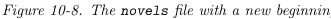

### 方法 #2

要使用 `cat` 在文件开头插入文本，使用 `cat` 将标准输入和文件连接起来；将此结果重定向到一个新文件名，该文件将包含在开头插入了文本的文件。

要在文件 `novels` 开头插入几行文本，输入：

```text
$ cat - novels > novels.tmp [RET]
The Novels of F. Scott Fitzgerald [RET]
------------------------------ [RET]
[CTRL]-[D]
$
```

此命令写入一个新文件 `novels.tmp`，其中包含你键入的行，然后是 `novels` 的内容。要保留此插入文本的文件，将 `novels.tmp` 移动到 `novels`。

#### 10.7 从其他文件包含文本

- M4

- DEB: m4

- RPM: m4

- WWW: http://www.gnu.org/software/m4/m4.html

文件包含是指通过在另一个文件中的特定位置指定文件名，就将一个文件的内容包含在另一个文件中的某个位置。

如果需要或想要频繁重新排列文档的各个部分或章节，如果需要以多种排列方式保存文档，或者如果你有一些经常在多个文档中插入的文本段落，则此方法很有用。对于这些情况，你可以将每个部分保存在单独的文件中，并构建一个包含文件，其中包含各个部分的文件名，按你希望该文件的顺序排列。

要在文本文件中包含一个文件，将要包含的文件单独放在一行中，如下所示：

```text
include(file)
```

当你对该文件进行包含处理时，包含 `include` 语句的那一行将被文件 `file` 的内容替换（其路径相对于包含文件的当前目录）。

使用 `m4` 工具，即 GNU 宏处理器，来处理包含文件。它以包含文件名作为参数，并将包含结果输出到标准输出。你可以使用重定向将输出重定向到文件。

例如，假设你有三个文件：`soups` 如图 10-9 所示，`sandwiches` 如图 10-10 所示，以及 `menu` 如图 10-11 所示。

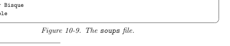

图 10-9. `soups` 文件。

6 这是对 `m4` 的一个相当简单的使用；它可以做更多的事情，包括运行命令、操作文本和运行自定义宏。有关更多信息，请参阅其 Info 文档（参见配方 2.8.5 [阅读 Info 手册]，第 48 页）。

```
BLT
Ham on Rye
Roast Beef
```

图 10-10。 三明治文件。

```
Diner Menu for Today

Soups
-----

include(soups)

Sandwiches
-----------

include(sandwiches)
```

图 10-11。 菜单文件。

⇒ 要处理该文件并将其写入文件 `monday.txt`，请输入：

```
$ m4 menu > monday.txt [RET]
```

该命令会写入一个新文件 `monday.txt`，如图 10-12 所示。

```
Diner Menu for Today

Soups
-----

Clam Chowder
Lobster Bisque
Vegetable

Sandwiches
-----------

BLT
Ham on Rye
Roast Beef
```

图 10-12。 `monday.txt` 文件。

**NOTES:** 你可以编写多个包含文件来使用你的文件——这些包含文件本身也可以有自己的包含。

#### 10.8 使用其他文本编辑器

下表描述了一些 Linux 上更受欢迎或更有趣的文本编辑器，并包括了它们特殊特性和特征的信息以及屏幕截图。

### AEE

高级易用编辑器具有弹出菜单界面，旨在无需事先指导即可使用；包含用于在 X 中使用的界面，`xae`。

```
DEB: aee
RPM: aee
WWW: http://mahon.cwx.net/
```

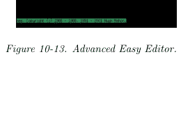

图 10-13。 高级易用编辑器。

### Cooledit


### Cooledit

Cooledit 是一款流行的、快速的 X 下文本编辑器；其功能包括抗锯齿字体、Unicode 支持，以及通过 Python 编程语言实现的扩展性。它基于 Midnight Commander 的终端编辑器，并且独一无二，因为它既不像 Emacs 也不像 Vi。

```
DEB: cooledit
RPM: cooledit
WWW: http://cooledit.sourceforge.net/
```

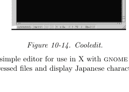

图 10-14。 Cooledit。

### DEdit

DEdit 是在安装了 GNOME 的情况下用于 X 的简单编辑器。它可以读取压缩文件并显示日文字符。

```
DEB: dedit
```


图 10-15。 DEdit。

### E3

一个微型编辑器（大小为 10 KB），提供可用的键盘绑定，可模拟 Emacs、Vi、PICO、Nedit 和 WordStar。

```
DEB: e3
RPM: e3
WWW: http://www.sax.de/~adlibit/
```

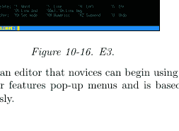

图 10-16。 E3。

### EE

旨在成为初学者可以立即开始使用的编辑器，易用编辑器具有弹出菜单，并基于前面描述的`aee`。

```
DEB: ee
WWW: http://mahon.cwx.net/
```


图 10-17。 易用编辑器。

### Elvis

Elvis 是 Vi 的现代实现，附带许多新功能和扩展。

```
DEB: elvis
RPM: elvis
WWW: http://elvis.vi-editor.org/
```

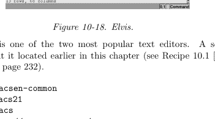

图 10-18。 Elvis。

### Emacs

Emacs 是两款最受欢迎的文本编辑器之一。本章前面有一节专门介绍它（参见配方 10.1 [使用 Emacs]，第 232 页）。

```
DEB: emacs-en-common
emacs21
RPM: emacs
WWW: http://www.emacs.org/
```

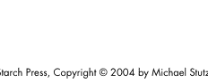

图 10-19。 Emacs。

### Glimmer

专为计算机编程语言而设计，它具有许多吸引程序员的功能。

```
DEB: glimmer
RPM: glimmer
WWW: http://glimmer.sourceforge.net/
```

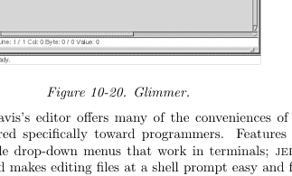

### JED

John E. Davis 的编辑器提供了 Emacs 的许多便利，并专门针对程序员设计。其独特功能包括在终端中工作的下拉菜单；JED 加载速度快，使在 shell 提示符下编辑文件变得简单快捷。

```
DEB: jed
RPM: jed
WWW: http://www.jedsoft.org/jed/
```

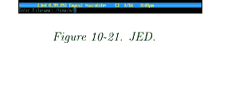

### JOE

Joe's Own Editor，`joe`，是一款全屏编辑器，其外观和感觉让人想起旧的 DOS 文本编辑器，如 EDIT。

```
DEB: joe
RPM: joe
WWW: http://sourceforge.net/projects/joe-editor/
```

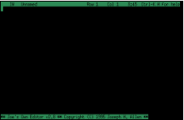

图 10-22。 Joe's Own Editor。

### Le

Le 是一款用于终端的多语言编辑器，支持对文本矩形块进行操作。

```
DEB: le
RPM: le
WWW: http://tinyurl.com/23325
```

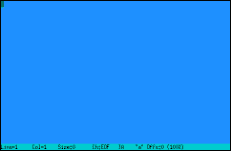

图 10-23。 Le。

### MCedit

这是随 Midnight Commander 一起提供的全屏终端编辑器。

```
DEB: mc-common
mc
RPM: mc
WWW: http://www.ibiblio.org/mc/
```

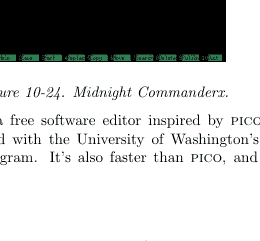

图 10-24. X 中的 Midnight Commander。

### Nano

GNU Nano 是一款免费软件编辑器，其灵感来源于 PICO 编辑器，而 PICO 编辑器是包含在华盛顿大学专有 PINE 邮件程序中的编辑器。它也比 PICO 更快，并且功能更多。

```
DEB: nano
RPM: nano
WWW: http://www.nano-editor.org/
```


图 10-25. Nano。

### Ted

Ted 是一款 WYSIWYG、类似打字机的文本编辑器，用于 X。它读取和写入 RTF 文件，即 Microsoft 的“富文本格式”。

```
DEB: ted
RPM: ted
WWW: http://www.nllgg.nl/Ted/
```

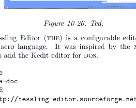

图 10-26. Ted。

### THE

Hessling 编辑器（THE）是一款可配置的编辑器，使用 Rexx 宏语言。它受到了 VM/CMS 的 XEDIT 编辑器和 DOS 的 Kedit 编辑器的启发。

```
DEB: the
the-doc
RPM: the
WWW: http://hessling-editor.sourceforge.net/
```


图 10-27. Hessling 编辑器。

### Vi

Vi 是一款可视化或全屏编辑器。它可能是 Linux 上最流行的编辑器，也是基于 UNIX 的系统中最流行的编辑器之一。触摸打字员经常发现其按键命令能够实现非常快速的编辑。本章前面有一节专门介绍它，请参见配方 10.2 [使用 Vi]，第 244 页。

```
DEB: nvi
RPM: nvi
WWW: http://www.bostic.com/vi/
```

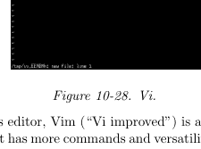

图 10-28. Vi。

### Vim

与 Elvis 编辑器一样，Vim（“Vi 改进版”）是 Vi 的现代实现；它具有更多命令和灵活性，新增功能包括语法着色、滚动条和菜单、鼠标支持以及内置帮助。

```
DEB: vim
RPM: vim
WWW: http://www.vim.org/
```

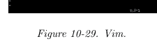

图 10-29. Vim。

### Wily

Wily 是一款有趣的以鼠标为中心的编辑器，其灵感来源于 AT&T Plan 9 实验操作系统的 Acme 编辑器。Wily 命令由三个鼠标按钮的各种组合组成，称为 chords。

```
DEB: wily
WWW: http://www.cs.yorku.ca/~oz/wily/
```

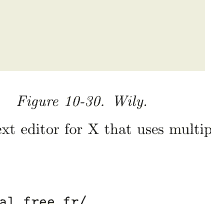

图 10-30. Wily。

### Xcoral

Xcoral 是一款用于 X 的以鼠标为中心的文本编辑器，使用多个窗口。

```
DEB: xcoral
RPM: xcoral
WWW: http://xcoral.free.fr/
```

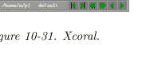

图 10-31. Xcoral。

### Xedit

Xedit 是一款简单的文本编辑器，随 X 一起提供并在 X 中运行。它允许您插入、删除、复制和粘贴文本以及打开和保存文件——这些都是最基本的功能。

```
DEB: xbase-clients
RPM: XFree86
WWW: http://www.xfree86.org/
```

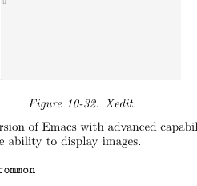

图 10-32. Xedit。

### XEmacs


XEmacs 是 Emacs 的一个版本，具有在 X 中使用的高级功能，包括显示图像的能力。

```
DEB: emacs-common
xemacs21
RPM: xemacs
WWW: http://www.xemacs.org/
```


图 10-33. XEmacs。

## 11. Grammar and Reference

用于在基于 Linux 的系统上写作和编辑的工具和资源包括拼写检查器、词典和参考文件。本章展示了使用它们的方法。

### 11.1 Spell Checking

在 Linux 上有几种拼写检查文本和文件的方法；以下配方展示了如何查找特定单词的正确拼写以及如何执行批处理、交互式和基于 Emacs 的拼写检查。

系统词典文件 `/usr/dict/words` 只不过是一个词表，尽管非常庞大，按字母顺序排序，每行一个词。不分大小写的正确单词以全小写字母出现，而依赖某种形式的资本化才能正确的单词（如专有名词）则以该形式出现。所有 Linux 拼写工具都使用此文本文件来检查拼写；如果某个单词未出现在词典文件中，则被视为拼写错误。

⇒ 要了解用户词典在您的系统上包含多少个单词，请输入：

```
$ wc -l /usr/dict/words
```

注意：如果一开始使用的就是错误的词，那么任何计算机化拼写检查工具都无法纠正此错误——例如，如果您写的是“there”而实际意思是“their”，计算机目前无法捕捉到这一点。

#### 11.1.1 Finding the Correct Spelling of a Word

如果您不确定是否使用了单词的正确拼写，请使用 `spell` 来查找。`spell` 从标准输入读取并输出在系统词典中找不到的任何单词——因此如果某个单词拼写错误，您在输入后它会回显到屏幕上。

⇒ 例如，要检查单词 “occurance” 是否拼写错误，输入：

```
$ spell [RET]
occurance [RET]
occurance
[CTRL]-[D]
$
```

在此示例中，`spell` 回显了单词 “occurance。” 这意味着该单词不在系统词典中，因此很可能拼写错误。然后，输入了 `[CTRL]-[D]` 以退出 `spell`。

##### 11.1.2 列出文本中的拼写错误

要输出文件中拼写错误的单词列表，将要检查的文件名作为参数传递给 `spell`。文件中任何拼写错误的单词都会被输出，每个单词独占一行，并按其在文件中的出现顺序排列。

⇒ 要拼写检查文件 `fall-lecture.draft`，输入：

```
$ spell fall-lecture.draft [RET]
occurance
willl
occurance
$
```

在此示例中，输出了三个单词：“occurance”、“willl” 和再次出现的 “occurance”，这意味着这三个单词按此顺序出现在 `fall-lecture.draft` 中，并且不在系统词典中（因此很可能拼写错误）。请注意，拼写错误 “occurance” 在文件中出现了两次。

要纠正拼写错误，您可以打开文件并在您喜欢的文本编辑器中编辑它。本节后面我将描述一个交互式拼写检查器，允许您在发现拼写错误时立即纠正它。另一种选择是使用内置拼写检查功能的文本编辑器，例如 Emacs。

⇒ 要拼写检查文件 `fall-lecture.draft`，并将可能拼写的错误单词输出到文件 `fall-lecture.spelling`，输入：

```
$ spell fall-lecture.draft > fall-lecture.spelling [RET]
```

在此示例中，使用了标准输出重定向运算符（`>`）将输出重定向到文件（参见 Recipe 3.2.2 [Redirecting Output to a File]，第 68 页）。

要输出拼写错误单词的字母顺序列表，将输出通过管道传递给 `sort`；然后将排序后的输出通过管道传递给 `uniq` 过滤器，以从列表中删除重复项（`uniq` 从其输入中删除重复的相邻行，输出“唯一”的行）。

⇒ 要输出文件中 `fall-lecture.draft` 的拼写错误单词的排序列表，输入：

```
$ spell fall-lecture.draft | sort | uniq [RET]
```

### 11.1.3 保留拼写词列表

随 Linux 系统安装的标准美式英语词典包含超过 45,000 个单词。尽管这个数字看起来很大，但不可避免地会遗漏很多单词——包括俚语、行话和一些专有名词。

您可以像查看任何其他文本文件一样查看系统词典，但用户永远不会编辑此文件以添加单词到其中。³ 相反，您将新单词添加到您自己的个人词典中，一个与系统词典格式相同的文件，但保存在您的主目录中作为文件 `~/.ispell_default`。⁴

用户可以拥有自己的个人词典；本章讨论的拼写命令会自动使用您的个人词典（如果您有的话），除了系统词典之外。

您使用 `ispell` 的 `i` 和 `u` 选项构建个人词典，这些选项将单词插入到您的个人词典中。使用这些选项时，可以使用独立工具或各种 `ispell` Emacs 函数（参见 Recipe 11.1.4 [Interactive Spell Checking]，第 278 页，和 Recipe 11.1.5 [Spell Checking in Emacs]，第 280 页）。

⇒ 要了解您个人词典中有多少个单词，输入：

```
$ wc -l ~/.ispell_default [RET]
```

NOTES: 您也可以通过使用文本编辑器手动编辑文件来添加（或删除）单词，但请注意保持列表按字母顺序排列！

> ³ 如果一个单词是相当通用的，您当然可以联系 venglish 或其他适当包的全球维护者，并尝试说服他们应该包含该单词。

> ⁴ 在较新的系统上，此文件有时会被 `~/.aspell_default` 取代。

随着时间的推移，个人词典开始看起来非常个人化，作为其所有者的反映；Gregory Cosmo Haun 通过拍摄十二位用户的肖像叠加其个人词典的列表制作了一件概念艺术作品 [http://www.reed.edu/~cosmo/art/DictPort.html]。

#### 11.1.4 交互式拼写检查

GNU Aspell

DEB: `aspell`

RPM: `aspell`

WWW: http://aspell.net/

或

Ispell

DEB: `ispell`

RPM: `ispell`

WWW: http://fmg-www.cs.ucla.edu/geoff/ispell.html

使用 `ispell` 交互式地拼写检查文件，这样每次发现拼写错误时，您都有机会立即替换它。⁵

⇒ 要交互式拼写检查 `fall-lecture.notes`，输入：

```
$ ispell fall-lecture.notes [RET]
```

当您输入此命令时，`ispell` 开始检查文件。它在找到的第一个拼写错误处停止，如图 11-1 所示。

在屏幕顶行，`ispell` 显示拼写错误的单词，后跟文件名。其下是出现拼写错误的句子，其中相关单词被高亮显示。接下来是一个建议单词的列表，每个单词前面都有一个数字——在此示例中，`ispell` 只有一个建议：“lectures。”

要将拼写错误替换为建议的单词，输入对应于建议单词的数字（在此示例中，您将输入 0 以将拼写错误替换为“lectures”）。您只需要输入选择的数字——不需要按 `[RET]`。

> ⁵ `aspell` 设计为 `ispell` 的即插即用替代品，具有大大改进的建议算法。如果您的系统有 `aspell`，请改用它；它否则的工作方式与 `ispell` 相同。

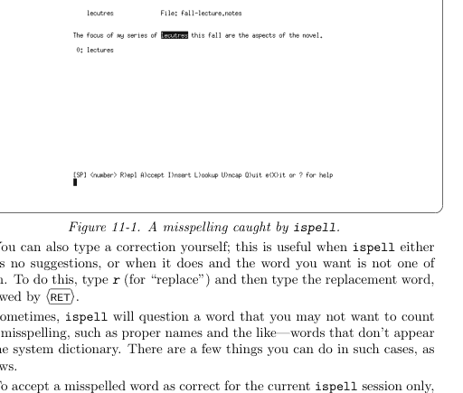

## Figure 11-1. A misspelling caught by ispell.

你也可以自行输入更正；当 `ispell` 没有提供建议，或者提供了建议但其中没有你想要的词时，这很有用。要做到这一点，输入 `r`（表示 "replace"）然后输入替换词，后跟 `RET`。

有时，`ispell` 会质疑一些你可能不想计为拼写错误的词，例如专有名词之类的——这些词不会出现在系统词典中。在这种情况下，你可以做以下几件事。

要仅在当前 `ispell` 会话中将一个拼写错误的词接受为正确，输入 `a`；从此以后，在当前会话中，该词将被视为正确。

如果，你希望 `ispell`（以及 `spell`，以及所有访问系统词典的其他工具）记住该词在本次及今后所有会话中都是正确的，请将该词插入到你自己的个人词典中。输入 `u` 以插入该词的副本并转为小写字母——这样，即使该词在句子开头被大写，保存的也是该词的小写版本。从此以后，在当前 `ispell` 会话中以及今后的会话中，无论该词完全以小写字母出现、大写还是完全大写，都会被视为正确。

当拼写的大小写很重要时——例如在专有名词 "Seattle" 这样的词中，或大小写混合的词，如 "deSalle"——输入 `i` 以按其出现的大小写将该词的副本插入到你的个人词典中；这样，用相同字母但大小写不同的词将被视为拼写错误。


当 `ispell` 完成对文件的拼写检查后，它会将更改保存到文件中然后退出。它还会制作一份原始文件的副本，未应用更改：该文件与原始文件同名，但在末尾加上 `.bak`——在我们的例子中，备份文件名为 `fall-lecture.notes.bak`。这在你后悔所做的更改并想将文件恢复到搞砸之前的样子时很有用——只需删除已拼写检查的文件，然后将 `.bak` 文件重命名为其原始名称即可。

| Key | Action |
|---|---|
| SPACEBAR | Accept misspelled word as correct, but only for this particular instance. |
| number | Replace misspelled word with the suggestion that corresponds to the given number. |
| ? | Display a help screen. |
| a | Accept misspelled word as correct for the remainder of this `ispell` session. |
| i | Accept misspelled word as correct and add it to your private dictionary with the capitalization as it appears. |
| l | Look up words in the system dictionary according to a pattern you give. |
| q | Quit checking and restore the file to how it was before this session. |
| r | Replace misspelled word with a word you type. |
| u | Accept misspelled word as correct and add it to your private dictionary in all lowercase letters. |
| x | Save changes made so far, and then stop checking this file. |

## 11.1.5 Spell Checking in Emacs

Emacs 有几个有用的拼写检查命令。`ispell-word`、`ispell-region` 和 `ispell-buffer` 函数，如其名称所示，使用 `ispell` 命令在 Emacs 内部检查当前缓冲区的一部分。⁶

⁶ 在许多较新的系统上，`aspell` 被用作 `ispell` 的替代。

第一个命令，`ispell-word`，检查光标处的单词拼写；如果光标处没有单词，则检查光标左侧的第一个单词。该命令有一个键盘快捷键，`ALT-§`。第二个命令，`ispell-region`，检查当前选定文本区域中的所有单词拼写。第三个命令，`ispell-buffer`，检查整个缓冲区的拼写。

⇒ 这里有一些使用方法。

- 要检查光标处单词的拼写，输入：

  `ALT-X` `ispell-word` `RET`

- 要检查当前选定文本区域中所有单词的拼写，输入：

  `ALT-X` `ispell-region` `RET`

- 要检查当前缓冲区中所有单词的拼写，输入：

  `ALT-X` `ispell-buffer` `RET`

另一个有用的 Emacs 拼写功能是 `flyspell-mode`。当该模式在缓冲区中设置时，缓冲区中的任何拼写错误词都会被高亮显示。该模式在你撰写初稿时很有用，因为它允许你在输入时捕获拼写错误。

⇒ 要在缓冲区中打开 `flyspell-mode`，输入：

`ALT-X` `flyspell-mode` `RET`

### NOTES: This mode is a toggle; run it again to turn it off.

要在 `flyspell-mode` 中更正一个词，点击并释放该词上的中键鼠标按钮以调出建议菜单；然后你使用鼠标选择替换词或将其添加到你的个人词典中。

如果有你经常拼写错误的词，你可以为它们定义 abbrevs（参见 Recipe 10.1.5 [Making Abbreviations in Emacs], page 242）。然后，当你输入拼写错误的词时，Emacs 会自动将其替换为正确的拼写。

最后，如果你更喜欢 `spell` 的简洁、非交互式界面，你也可以使用该命令的 Emacs 接口：`spell-word`、`spell-region` 和 `spell-buffer`。当这些函数发现拼写错误时，它们会在 minibuffer 中提示替换，但不会提供建议或提供 `ispell` 的其他任何功能。

## 11.2 使用词典

WordNet

DEB: `wordnet`

`wordnet-base`

WWW: `http://www.cogsci.princeton.edu/~wn/`

在 Linux 系统中，术语 dictionary 通常指两种事物之一：传统的 Unix 风格词典，它是一个按字母顺序排列的单词列表，不包含实际释义；以及较新的数据库风格词典，它包含词头及其释义。后者是大多数人在谈论词典时所指的类型。 （不过，当大多数 Unix 用户谈论词典时，他们几乎总是指前者。）

WordNet 是一个以数据库形式存在的词汇参考系统，其中包含成千上万按同义词集合排列的单词。您可以使用 `wn` 工具或 `wnb` X 客户端（“WordNet 浏览器”）搜索数据库并以文本形式输出结果。

X 客户端的使用相当直接——在屏幕顶部对话框中输入一个单词，然后按 `<RET>`，即可获取其释义，释义会显示在对话框下方的较大输出窗口中。

例如，当您搜索单词 “browse” 的释义时，WordNet 浏览器将如下图 11-2 所示。

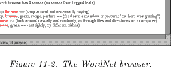

图 11-2. WordNet 浏览器。

在对话框和输出窗口之间，有用于搜索同义词和其他词义的菜单。每个词可能具有的词性都有一个单独的菜单；在前面的示例中，单词 “browse” 可以是名词或动词，因此显示了两个菜单。

要获取给定单词可用的所有词义信息列表，请使用该单词作为参数运行 `wn`。这将输出该单词可用的所有词义信息列表，每个可能的词义前面都有用于输出它的选项名称。

⇒ 要输出单词 “browse” 可用的词义列表，请输入：

```
$ wn browse [RET]
```

以下各节展示了如何在命令行上使用 `wn`。

NOTES: 有关 WordNet 的更多信息，请参阅 `wnintro` 手册页（请参阅配方 2.8.4 [从系统手册中读取一页]，第 46 页）。

### 11.2.1 列出匹配模式的单词

有几种方法可以搜索并输出系统词典中的单词。

使用 `look` 输出系统词典中以给定字符串开头的单词列表——这对于查找以特定短语或前缀开头的单词很有用。将字符串作为参数给出；它不区分大小写。

⇒ 要输出词典中以字符串 “homew” 开头的单词列表，请输入：

```
$ look homew [RET]
```

此命令会输出诸如 “homeward” 和 “homework” 之类的单词。

由于系统词典是一个普通文本文件，因此您也可以使用 `grep` 在其中搜索匹配给定模式或正则表达式的单词（请参阅配方 14.3 [匹配文本模式]，第 335 页）。

⇒ 以下是一些使用方法。

- 要列出词典中包含字符串 “dont” 的所有单词，不区分大小写，请输入：

  ```
  $ grep -i dont /usr/dict/words [RET]
  ```

- 要列出词典中以 “ing” 结尾的所有单词，请输入：

  ```
  $ grep ing$ /usr/dict/words [RET]
  ```

- 要列出仅由元音组成的单词，请输入：

  ```
  $ grep -i "^[aeiou]*$" /usr/dict/words [RET]
  ```

要查找与给定单词押韵的某些单词，请使用 `grep` 在 `/usr/dict/words` 中搜索以与应押韵的单词相同的最后几个字符结尾的单词（请参阅配方 14.4.2 [匹配以特定文本结尾的行]，第 343 页）。

⇒ 要输出与 “friend” 押韵的单词列表，请在 `/usr/dict/words` 中搜索以 “end” 结尾的行：

```
$ grep 'end$' /usr/dict/words [RET]
```

最后，要在 WordNet 词典上进行搜索，请使用 `wn` 并使用其中一个 `-grep` 选项。当您将要搜索的文本作为参数给出时，此命令会执行与 `look` 等效的搜索，但只搜索您指定的特定类型的词义：`-grepn` 搜索名词，`-grepv` 搜索动词，`-grepa` 搜索形容词，`-grepr` 搜索副词。您可以组合选项以搜索多个词义。

⇒ 以下是两种使用方法。


### 在 WordNet 词典中搜索以 “homew” 开头的名词

要在 WordNet 词典中搜索以 “homew” 开头的名词，请输入：

```
$ wn homew -grepn [RET]
```

### 在 WordNet 词典中搜索以 “homew” 开头的名词和形容词

要在 WordNet 词典中搜索以 “homew” 开头的名词和形容词，请输入：

```
$ wn homew -grepn -grepa [RET]
```

## 11.2.2 列出单词的释义

要列出单词的释义，请将单词作为参数传递给 `wn`，后跟 `-over` 选项。

⇒ 要列出单词 “slope” 的释义，请输入：

```
$ wn slope -over [RET]
```

NOTES: 如果您经常查找词典释义，将 `def` 定义为 `wn $1 -over` 的别名会很方便（请参阅配方 3.6.1 [使用其他名称调用命令]，第 83 页）。

### 11.2.3 列出单词的同义词

单词的同义词是指在某些上下文中可以替代第一个单词的含义相似的不同单词。要使用 `wn` 输出单词的同义词，请将单词作为参数给出，后跟以下选项之一：`-synsn` 表示名词，`-synsv` 表示动词，`-synsa` 表示形容词，或 `-synsr` 表示副词。

⇒ 这里有两种使用方法。

- 要输出名词“break”的所有同义词，输入：

```
$ wn break -synsn [RET]
```

- 要输出动词“break”的所有同义词，输入：

```
$ wn break -synsv [RET]
```

### 11.2.4 列出单词的反义词

一个词的反义词是在某些上下文中含义相反的另一个词。要使用 `wn` 输出某个词的反义词，将该词作为参数给出，然后加上以下选项之一：动词用 `-antsv`，形容词用 `-antsa`，或副词用 `-antar`。

⇒ 要输出形容词“sad”的所有反义词，输入：

```
$ wn sad -antsa [RET]
```

### 11.2.5 列出单词的上位词

一个词的上位词是一个相关术语，其含义比给定词更通用。例如，单词“mammal”和“animal”都是单词“cat”的上位词。

要使用 `wn` 输出某个词的上位词，使用以下选项之一：名词用 `-hyper` 或动词用 `-hypev`。

⇒ 要输出名词“cat”的所有上位词，输入：

```
$ wn cat -hyper [RET]
```

## 11.2.6 检查在线词典

`Dict`

DEB: `dict`

RPM: `dict`

WWW: `http://www.dict.org/`

DICT 开发小组在其网站 [`http://www.dict.org/`] 上提供了一系列免费词典。在该页面上，你可以从包含超过 300,000 个词头的词典中查找单词（包括使用同义词库和其他搜索），或复制其词典供在自己的系统上使用。用于访问 DICT 服务器并在本地输出释义的 `dict` 客户端存在；该工具可在 `dict` 包中使用。

DICT 开发小组还提供了许多专业词典。这些词典是纯文本文件。其中一个词典称为 FILE，即 The Free Internet Lexicon and Encyclopedia。它是构建现代词汇、习语和行话词典的免费开源集合的努力。FILE 是一个志愿者项目，依赖于学者和词典编纂者的支持；DICT 页面包含有关如何帮助贡献这一值得的项目的相关信息。

### 11.3 检查语法

`Diction`

DEB: `diction`

WWW: `http://www.gnu.org/software/diction/diction.html`

有两种久负盛名的 UNIX 写作检查工具最近已为基于 Linux 的系统提供：`style` 和 `diction`。

老用户可能还记得这些名字——原版随 AT&T UNIX 一起提供，作为 20 世纪 70 年代末和 80 年代初备受喜爱的“Writer’s Workbench”工具套件的一部分。

AT&T 将 Writer’s Workbench 从其 UNIX 第 7 版产品中“拆分”出来，随着多年来各种 UNIX 的蓬勃发展，这些工具逐渐被遗忘——最终成为 UNIX 传说的组成部分。

1997 年，Michael Haardt 从头开始编写了这些工具的新 Linux 版本。它们支持英语和德语，并且现在是 GNU 项目的一部分。

Writer’s Workbench 的另外两个命令长期以来一直是 Linux 的标准：`look` 和 `spell`，本章前面已描述过。

下面是使用 `diction` 或 `style` 的配方。

#### 11.3.1 检查文本中误用的短语

使用 `diction` 检查文本中冗长、陈词滥调、陈腐或误用的短语。它检查 William Strunk 在其《风格要素》[`http://www.bartleby.com/141/`] 中警告我们的所有类型的表达。

还有一套用于格式化文本的工具，称为“Documenter’s Workbench”，并且计划有一个“Reader’s Workbench”；今天，我们只能猜测它可能是什么。

根据《The UNIX Environment》，参见附录 D [References for Further Interest]，第 731 页，随旧 Writer's Workbench 提供的 `diction` 工具只是查找短语，而一个单独的命令 called `suggest` 会输出建议。在适用于 Linux 系统的 GNU 版本中，这两个功能已合并到单个 `diction` 命令中。

在 GNU `diction` 中，单词或短语用方括号 "[like this]" 括起来。如果 `diction` 有任何建议的替换，它会以右箭头 "-> like this" 为前缀给出。

当检查不止一屏的文本时，你会希望将输出通过管道传输到 `less`，以便在屏幕上浏览它（参见 Recipe 9.1 [Perusing Text]，第 211 页），或将输出通过管道传输到文件以便稍后检查。

⇒ 这里有两种使用方法。

- 要检查文件 `dissertation` 中的陈词滥调或其他误用短语，输入：

```
$ diction dissertation | less [RET]
```

- 要检查文件 `dissertation` 中的陈词滥调或其他误用短语，并将输出写入名为 `dissertation.diction` 的文件，输入：

```
$ diction dissertation > dissertation.diction [RET]
```

如果不指定文件名，`diction` 会从标准输入读取文本，直到你在单独一行输入 `<CTRL>-D`。这在你想检查单个句子时特别有用，如图 11-3 所示。

```
$ diction [RET]
Let us ask the question we wish to state. [RET]
(stdin):1: Let us [ask the question -> ask]
[we wish to state -> (cliche, avoid)].
<CTRL>-D
$
```

图 11-3. 使用 `diction` 检查句子。

要检查网页的文本，使用 `lynx` 的 `-dump` 和 `-nolist` 选项输出给定 URL 的纯文本，并将此输出通过管道传输到 `diction`。（如果预计输出很多，在末尾再加一个管道到 `less` 以便浏览。）

要浏览 URL `http://www.westegg.com/cliche/random.cgi` 并标记可能冗长和误用的短语，输入（全部在一行）：

```
$ lynx -dump -nolist http://www.westegg.com/cliche/random.cgi | diction | less [RET]
```

**注释。** 要检查文本中是否过度使用词语，请使用第 12.2.4 节 [Counting Word Occurrences in Text] 中描述的方法，第 299 页。

### 11.3.2 检查文本中的重复词

`diction` 查找的内容之一是重复词——连续重复两次的词。如果它发现这样的序列，它会将重复对的第二个成员用方括号括起来，后面跟着一个右箭头和文本“Double word”，例如“this [<i>th</i>is → Double word.]”

要仅检查文本文件中的重复词，而不检查 `diction` 检查的其他任何内容，请使用 `grep` 仅查找 `diction` 输出中包含文本“Double word”的行（如果有）。

⇒ 要输出文件 `dissertation` 中包含重复词的所有行，输入：

```shell
$ diction dissertation | grep 'Double word' [RET]
```

### 11.3.3 检查文本的可读性

`style` 命令分析给定文本的写作风格。它对文本执行一系列可读性测试并输出其结果，并提供有关文本句子的统计信息。将要检查的文本文件名作为参数给出。

⇒ 要检查文件 `dissertation` 的可读性，输入：

```shell
$ style dissertation [RET]
```


与 `diction` 类似，如果未给出文本，`style` 会从标准输入读取文本——这对于管道的末尾很有用，或者用于检查你输入的特定句子或其他文本的写作风格。

`style` 输出的文本句子特征如下：

- 字符数
- 单词数、其平均长度和平均音节数
- 句子数和平均长度（以词为单位）
- 短句和长句的数量
- 段落数和平均长度（以句为单位）
- 问题句和祈使句的数量

`style` 使用并输出的各种可读性公式如下：

- Kincaid 公式，最初为海军培训手册开发；对技术文档来说是一个良好的可读性测试
- Automated Readability Index (`ARI`)
- Coleman-Liau 公式
- Flesch Reading Ease Score，它给出从 0（困难）到 100（容易）的可读性近似值
- Fog Index，它给出一个学校年级阅读水平
- wSTF Index，德语文档的可读性指标
- Wheeler-Smith Index、Lix 公式和 SMOG-Grading 测试，所有这些都是给出学校年级阅读水平的指标

### 11.3.4 检查文本中的困难句子

要仅输出文本的“困难”句子，请使用 `-r` 选项并跟上一个数字；`style` 将仅输出其 Automated Readability Index (`ARI`) 大于你给出数字的句子。

⇒ 要输出文件 `dissertation` 中 `ARI` 大于 20 的所有句子，输入：

```
$ style -r 20 dissertation [RET]
```

### 11.3.5 检查文本中的长句子

使用 `style` 输出长于特定长度的句子，将单词数作为 `-l` 选项的参数给出。

⇒ 要输出文件 `dissertation` 中长于 14 个词的所有句子，输入：

```
$ style -l 14 dissertation [RET]
```

#### 11.4 使用参考文件

你可以将参考作品和其他信息性文本文件安装在你的系统上；以下食谱描述了一些更有趣且有用的、 readily available 的文件。

要了解 `ARI` 如何对文本进行排名，请参阅其对各种流行网站的排名，网址为 http://www.readability.info/commonscores.shtml。

##### 11.4.1 查阅词表和有用的文件

Miscfiles

DEB: `miscfiles`

WWW: `ftp://ftp.gnu.org/pub/gnu/miscfiles/miscfiles-1.1.tar.gz`

GNU Miscfiles 集合是一组包含各种事实和参考资料的文本文件，例如常用缩写、电话区号和英语连接短语。

文件存储在 `/usr/share/misc` 目录中，并且全部被压缩；使用 `zless` 来浏览它们（参见 Recipe 9.1 [Perusing Text]，第 211 页）。

下表列出了 `/usr/share/misc` 中出现的这些文件及其内容描述。

| GNU-manifesto.gz | The GNU Manifesto. |
| abbrevs.talk.gz | Collections of common abbreviations used in electronic communication. |
| abbrevs.gen.gz | (This is the place to look to find the secrets of TTYL and LOL.) |
| airport.gz | List of three-letter city codes for some of the major airports. The city code is useful for querying the National Weather Service computers to get the latest weather report for your region. |
| ascii.gz | A chart of the ASCII character set. |
| birthtoken.gz | The traditional stone and flower tokens for each month. |
| cities.dat.gz | The population, political coordinates (nation, region), and geographic coordinates (latitude, longitude) of many major cities. |
| inter.phone.gz | International country and city telephone codes. |
| languages.gz | Two-letter codes for languages, from ISO 639. |
| latin1.gz | A chart of the extended ASCII character set, also known as the ISO 8859 ("Latin-1") character set. |
| mailinglists.gz | Description of all the public GNU Project mailing lists. |

`na.phone.gz`

北美（+1）电话区号。

`operator.gz`

C 编程语言中运算符的优先级表。

`postal.codes.gz`

美国和墨西哥各州以及加拿大各省的邮政编码。

`us-constitution.gz`

美利坚合众国宪法及其二十七条修正案（前十条即《权利法案》）。在 Debian 系统中，该文件位于名为 `/usr/share/state` 的目录中。

`us-declaration.gz`

十三殖民地的《独立宣言》。在 Debian 系统中，该文件位于名为 `/usr/share/state` 的目录中。

`rfc-index.txt`

互联网标准化的“征求意见”（RFC）文档的索引。在 Debian 系统中，该文件位于 `/usr/share/rfc` 中。

`zipcodes.gz`

美国五位数的邮政编码。

但 `miscfiles` 并不是 Linux 唯一可用的参考软件包；其他相关软件包包括：

`doc-iana`

由互联网号码分配局发布的互联网协议参数注册文档。

DEB: `doc-iana`

Jargon File

“Jargon File”是黑客俚语的权威词典，其历史可追溯到几十年前。如今可能被认为有些过时；不再作为单个文件分发。

DEB: `jargon-text`

RPM: `jargon`

WWW: http://www.jargon.org/

V.E.R.A.

内容广泛的计算机缩略语列表。

DEB: `vera`

RPM: `vera`

WWW: `ftp://ftp.gnu.org/gnu/vera/`

### 12. 分析文本

使用命令行工具分析文本的方法有很多，例如查找词频、从文本中生成单词列表，以及判断哪些文本可能与给定文本相似或相关。

本章将涵盖所有这些主题。文本分析的两个重要主题在别处介绍：确定给定文本格式的方法见方案 8.1.1 [确定文件的类型和格式]，第 187 页；关于如何比较文本以查看它们是否不同（以及可选地在何处不同），请参阅方案 8.3 [比较文件]，第 191 页。

### 12.1 统计文本

使用“字数统计”工具 `wc` 来统计文本中的字符数、单词数和行数。

将文件名作为参数；如果未给出，`wc` 将处理标准输入。默认情况下，`wc` 输出三列，显示文本中的行数、单词数和字符数。

⇒ 若要输出文件 `outline` 中的行数、单词数和字符数，请输入：

```
$ wc outline [RET]
```

当指定多个文件时，`wc` 会列出每个文件的计数，然后给出所有文件的总计数。

⇒ 若要输出当前目录中所有扩展名为 `.txt` 的文件的行数、单词数和字符数，请输入：

```
$ wc -w *.txt [RET]
```

##### 12.1.1 统计文本中的字符数

使用 `wc` 的 `-c` 选项，指定只统计并输出字符数。

⇒ 若要输出文件 `classified.ad,` 中的字符数，请输入：

```
$ wc -c classified.ad [RET]
```

##### 12.1.2 统计文本中的单词数

使用 `wc` 的 `-w` 选项，指定只统计并输出单词数。

⇒ 若要输出文件 `story` 中的单词数，请输入：

```
$ wc -w story [RET]
```

注意：这里统计的是文本中的单词数量；若要统计某个单词出现的次数，请参阅方案 12.2 [列出文本中的单词]，第 297 页。

##### 12.1.3 统计文本中的行数

有两种方法：第一种使用 `wc` 统计整个文本中的行数，第二种使用 Emacs 统计文本中某一页的行数。

# 方法 #1

使用 `wc` 的 `-l` 选项，指定只统计并输出行数。

⇒ 若要输出文件 `outline` 中的行数，请输入：

```
$ wc -l outline [RET]
```


# 方法 #2

Emacs 中的 `count-lines-page` 函数会在小缓冲区中输出当前页的行数（如果有分页符，则以分页符为界——见方案 13.3 [对文本分页]，第 312 页），随后输出缓冲区中光标所在行之前的行数，然后输出缓冲区中光标之后的行数。

⇒ 若要在 Emacs 中统计当前缓冲区中每页的行数，请输入：

```
[CTRL]-[X] 1
```

Emacs 在回显区输出当前缓冲区每页的行数。

例如，假设迷你缓冲区中的输出如下：

```
Page has 351 lines (69 + 283)
```

这意味着当前页包含 351 行，光标位于第 70 行——该行之前有 69 行，之后有 283 行。

## 12.1.4 计数某物的出现次数

要查找文件中或多个文件中文本字符串或模式的出现次数，请使用 `grep` 在文件(们)中搜索该文本字符串，并将输出通过管道传递给带 `-l` 选项的 `wc`。

以下是两种使用方法。

- 要查找文件`outline`中包含字符串 “chapter” 的行数，输入：

  ```
  $ grep chapter outline | wc -l RET
  ```

- 要查找`/usr/share/doc/`目录树中所有扩展名为 `.txt` 的文件中包含字符串 “chapter” 的行数，不区分大小写，输入：

  ```
  $ grep -r -i chapter /usr/share/doc/ | wc -l RET
  ```

NOTES：此方法快速简便，但不会统计同一行中超过一次的出现次数，也找不到被行尾中断的出现。

有关搜索文本的更多配方，以及关于 `grep` 的更多信息，请参阅第 14 章 [Searching Text]，第 333 页。

## 12.1.5 计数一段文本

一种有用的技巧是计算在某个窗口或终端中显示的文本中有多少个词——例如在 Web 浏览器中显示的文本——方法是选择该文本（参见 Recipe 10.3 [Manipulating Selections of Text]，第 253 页），然后按如下方式计数： 在另一个终端中运行 `wc`，将文本选择粘贴到该终端中，然后输入 CTRL-D 结束输入。它将给出该选择的计数。

以下是两种使用方法。

- 要计算第一个虚拟控制台中一段文本的选择中的字符数、行数和词数，请执行以下操作：

  1. 切换到第二个虚拟控制台：

     ⌥ALT⌥ - ⌥F2⌥

  2. 登录到此控制台，并在 shell 提示符下启动 `wc`：

     ```
     $ wc ⌥RET⌥
     ```

  3. 切回第一个虚拟控制台：

     ⌥ALT⌥ - ⌥F1⌥

  4. 通过将鼠标指针移动到文本的开头，按住左键并将指针拖动到文本的末尾，然后松开鼠标按钮来选择要计数的文本。

  5. 切回第二个虚拟控制台：

     ⌥ALT⌥ - ⌥F2⌥

  6. 单击鼠标中键。

  7. 输入 ⌥CTRL⌥ - ⌥D⌥ 以停止向 `wc` 输入文本。

- 要在 X 中计算 Web 页面上文本选择的词数，请执行以下操作：

  1. 在终端窗口中启动 `wc`：

     ```
     $ wc -w ⌥RET⌥
     ```

  2. 通过将鼠标指针移动到浏览器窗口中文本的开头，按住左键并将指针拖动到文本的末尾，然后松开鼠标按钮来选择要计数的文本。

  3. 将鼠标指针移动到终端窗口中光标所在的位置，然后单击鼠标中键。（如果您没有三键鼠标，请同时单击左右键。）

  4. 在终端窗口中输入 ⌥CTRL⌥ - ⌥D⌥。

## 12.2 列出文本中的词

在分析文本时，“词”可以是任何由空白或换行符与其他词分隔的字符组合。它们可以是英文单词、数字、符号等等。

制作出现在某段文本中的词的列表——无论是文件还是标准输入——只要使用 `tr`、`sort` 和 `uniq` 的流行组合就很简单，这些都是用于格式化文本的工具，将在下一章中讨论（参见第 13 章 [Formatting Text]，第 305 页）。

您可以按字母顺序对这些列表进行排序，删除重复的词，并列出每个词在原始文本中出现的频率。这些按字母顺序排列的词频列表类似于 concordance，即文本中所有词的索引，连同其上下文。

由于 `tr` 是一个过滤器，这些配方使用重定向将文件发送到 `tr` 的标准输入（参见 Recipe 3.2.1 [Redirecting Input to a File]，第 67 页）。输出通常通过管道传递给 `less` 以便查阅。如果您想打印或查阅这些配方的输出，我建议您将它们通过管道传递给 `pr` 以分页输出并将其置于列中（参见 Recipe 13.3 [Paginating Text]，第 312 页）。进一步的改进是使用 `enscript` 以漂亮的字体打印它们（参见 Recipe 15.2.1 [Outputting Text in a Font]，第 361 页）。

### 12.2.1 列出文本中的所有词

要输出某段文本中所有词的列表，按其在文本中出现的顺序，使用 `tr` 过滤器将所有水平空白（例如制表符和空格字符）转换为换行符，并压缩空白行。

- 要查阅包含文本文件`book`中所有词的列表，按其在文本中出现的顺序，输入：

  ```
  $ tr -s '[[:blank:]]' '\n' < book | less RET
  ```

- 要从列出的词中删除所有标点符号，将输出通过管道传递给另一个删除它的 `tr`。

- 要查阅包含文本文件`book`中所有词的列表，按其在文本中出现的顺序，但已删除标点符号，输入：

  ```
  $ tr -s '[[:blank:]]' '\n' < book | tr -d '[[:punct:]]' | less RET
  ```

破折号不会随标点符号一起被删除。如果要过滤的文本包含由两个连字符（--）组成的破折号，且破折号两侧的词之间没有空格，则首先使用 `SED` 将其过滤掉，用空格字符替换它们（参见 Recipe 10.5 [Editing Streams of Text]，第 255 页）。然后将该过滤后的文本传递给 `tr`。

⇒ 要浏览包含文本文件 `book` 中所有单词的列表，按其在文本中出现的顺序排列，但去掉标点符号，输入（全部在一行）：

```
$ sed 's/--//g' book | tr -s '[:blank:]' '\n' | tr -d '[:punct:]' | less [RET]
```

NOTES: 如果输入中第一个单词前有任何空白字符，此方法会在输出开头插入一个换行符。要将其删除，请在管道末尾但在浏览或打印之前加上 `tail +2`（参见 Recipe 9.2.3 [Displaying the End Part of Text]，第 218 页）。

### 12.2.2 按字母顺序列出文本中的单词

要输出某文本单词的排序列表，使用上一条配方中描述的方法并将输出通过管道传递给 `sort`（参见 Recipe 13.6 [Sorting Text]，第 320 页）。

⇒ 这里有两种使用方法。

- 要浏览包含文本文件 `book` 中所有单词的列表，去掉标点符号，按字母顺序排序，输入（全部在一行）：

  ```
  $ tr -s '[:blank:]' '\n' < book | tr -d '[:punct:]' | sort | less [RET]
  ```

- 要浏览包含文本文件 `book` 中所有单词按数字排序的列表，输入：

  ```
  $ tr -s '[:blank:]' '\n' < book | sort -n | less [RET]
  ```

此方法区分大小写。要不区分大小写地排序单词，请先将所有大写字母转换为小写，通过管道再次传递给 `tr` 再进行 `sort`（参见 Recipe 13.4.1 [Changing Characters in Text]，第 317 页）。

⇒ 要浏览包含文本文件 `book` 中所有单词的列表，去掉标点符号，不区分大小写地按字母顺序排序，输入（全部在一行）：

```
$ tr -s '[:blank:]' '\n' < book | tr -d '[:punct:]' | tr '[:upper:]' '[:lower:]' | sort | less [RET]
```

### 12.2.3 列出文本中仅有的唯一单词

要列出某文本中的单词，省略单词的多次出现，使用上一条配方中描述的方法并将输出通过管道传递给 `uniq`（参见 Recipe 13.5 [Filtering Out Duplicate Lines of Text]，第 319 页）。

- 要浏览文本文件 `book` 中所有单词的列表，去掉标点符号，按不区分大小写的出现频率排序，并列出其出现次数且从最频繁的开始，输入（全部在一行）：

  ```
  $ tr -s '[:blank:]' '\n' < book | tr -d '[:punct:]' | tr '[:upper:]' '[:lower:]' | sort | uniq -c | sort -n -r | less [RET]
  ```

#### METHOD #2

要获取文本中不同单词的总数，使用上一条配方中描述的列出唯一单词的方法，并将输出通过管道传递给带 `-l` 选项的 `wc`。这会计算其输入的所有行——在这种情况下将是唯一单词的列表，每行一个。


⇒ 要输出文本文件 `book` 中唯一单词数量的总数，输入（全部在一行）：

```
$ tr -s '[:blank:]' '\n' < book | tr -d '[:punct:]' | sort | uniq | wc -l [RET]
```

## 12.2.5 统计文本中选定单词的出现次数

要获取某文本中仅选定单词的频率计数，使用上一条配方中描述的 `Method #1` 并将输出通过管道传递给 `grep`，搜索你想要的特定单词或单词（参见 `Recipe 14.1 [Searching Text for a Word]`，第 333 页）。

⇒ 这里有一些方法可以做到。

- 要列出单词“chapter”在文本文件 `book` 中出现的频率，去掉标点符号，输入（全部在一行）：

```
$ tr -s '[:blank:]' '\n' < book | tr -d '[:punct:]' | sort | uniq -c | sort -n -r | grep chapter [RET]
```

- 要列出单词“contents”和“index”在文本文件 `book` 中出现的频率，去掉标点符号，输入：

```
$ tr -s '[:blank:]' '\n' < book | tr -d '[:punct:]' | sort | uniq -c | sort -n -r | grep 'contents\|index' [RET]
```

- 要列出以“ing”结尾的单词在文本文件 `book` 中出现的频率，去掉标点符号，输入：

```
$ tr -s '[:blank:]' '\n' < book | tr -d '[:punct:]' | sort | uniq -c | sort -n -r | grep 'ing$' [RET]
```

完全由完全相同的行组成）。要指定阈值，给出两个文件名后的 0 到 100 之间的数字作为选项。

要忽略完全重复项，请给出第四个选项。这可以是任何值或字符，只要存在即可。

⇒ 以下是一些使用方法。

+   - 要输出文件 `invitations` 和 `addresses` 中彼此相似的任何行的列表，输入：

+     `$ compare invitations addresses [RET]`

+   - 要输出文件 `weddings` 和 `parties` 中匹配度达到 85% 相似度阈值的任何行的列表，输入：

+     `$ compare weddings parties 85 [RET]`

+   - 要输出文件 `invitations` 和 `addresses` 中彼此相似的任何行的列表，但不输出完全重复项，输入：

+     `$ compare invitations addresses 50 1 [RET]`

**NOTES:** 此工具有很多方便的用途。只要你可能需要在两个文本样本中搜索接近的相似性，但不一定是完全相同的字符串，就可以使用它。例如，将目录或销售清单与收藏家愿望清单进行比较；检测抄袭和作者身份；以及比较阅读清单。其作者用它来查找和识别文学作品中的典故。

##### 12.3.2 在 Emacs 中列出相关文件

`Remembrance Agent`

`DEB`: `remembrance-agent`

`RPM`: `remem`

`WWW`: `http://www.remem.org/`

`Emacs` 中特殊的 `remembrance-agent` 模式的目的是分析你输入的文本，并在后台查找你其他文件中相似或相关的文本段落。然后它会在一个较小的窗口中输出建议列表——它找到的那些文件，你可以在新缓冲区中打开它们。

安装 `remembrance-agent` 模式时，你会创建三个文件数据库，用于在进行相关性建议时使用；当 `remembrance-agent` 模式运行时，它会并行搜索这三个数据库，寻找相关文本。例如，你可以创建一个保存的电子邮件数据库，一个你自己的作品数据库，和一个保存的文档数据库。

⇒ 要在当前缓冲区中切换 `remembrance-agent` 模式，输入：

`<CTRL>-<C> r t`

### 13. 格式化文本

在准备文本打印时，用于更改文本排列或呈现方式的方法和工具通常很有用。本章讨论了更改文本间距和设置页面、下划线和排序以及反转文本，以及对文本行进行编号的方法。

这些工具中的大多数是过滤器（参见 `Recipe 3.2.4 [Redirecting Output to Another Command's Input]`，第 69 页）。

### 13.1 间距文本

这些配方用于更改文本的间距——单词、行和段落之间存在的空白。

本节描述的过滤器默认将输出发送到标准输出；要将输出保存到文件，请使用 shell 重定向（参见 `Recipe 3.2.2 [Redirecting Output to a File]`，第 68 页）。

##### 13.1.1 删除文本中的多余空格

有几种方法可以做到这一点。要消除文本行内的多余空白，请使用 `fmt` 过滤器；要消除文本行之间的多余空白，请使用 `cat`。

### METHOD #1

使用带 `-u` 选项的 `fmt` 来输出具有“统一间距”的文本，其中单词之间的空格减少为一个空格字符，句子之间的空格减少为两个空格字符。

⇒ 要以统一间距输出文件 `term-paper`，输入：

```
$ fmt -u term-paper [RET]
```

### METHOD #2

使用带 `-s` 选项的 `cat` 将多个相邻的空行“压缩”为一行。

⇒ 要以多行空行输出为仅一个空行的方式输出文件 `term-paper`，输入：

```
$ cat -s term-paper [RET]
```

### METHOD #3

你可以将这两个命令结合起来，以输出删除了多个相邻行并具有单词之间统一间距的文本。以下示例将组合命令的输出发送到 `less`，以便在屏幕上浏览。

⇒ 要浏览文本文件 `term-paper`，删除多行空行并使单词之间具有统一间距，输入：

```
$ cat -s term-paper | fmt -u | less [RET]
```

请注意，在此示例中，`fmt` 和 `less` 都在标准输入上工作而不是在文件上——`cat` 的标准输出（`term-paper` 的内容，已压缩多余空行）被传递给 `fmt` 的标准输入；其标准输出（已压缩空格的 `term-paper`，现在具有统一间距）被发送到 `less` 的标准输入，后者在屏幕上显示它。

##### 13.1.2 单倍行距文本

单倍行距文本的方法有很多。这些是我最喜欢的。

### METHOD #1

要从文本输出中删除所有空行，请使用 `grep` 并使用正则表达式 `"."` 来匹配任何字符，因此它将匹配任何非空的行（参见 `Recipe 14.3 [Matching Patterns of Text]`，第 335 页）。然后你可以将此输出重定向到文件，或通过管道传递给其他命令。原始文件不会被更改。

⇒ 要输出文件 `term-paper` 中的所有非空行，输入：

```
$ grep . term-paper [RET]
```

此命令输出所有非空行——因此仅包含不可打印字符的行，例如空格和制表符，仍会被输出。

### METHOD #2

要从输出中删除所有空行，以及仅由空格字符组成的行，请使用 `grep` 并使用 `"[^ ]."` 作为要搜索的 `regexp`。

⇒ 要仅输出文件 `term-paper` 中包含的不只是空格字符的行，输入：

```
$ grep '[^ ].' term-paper [RET]
```

`NOTES`: 此正则表达式仍会输出仅包含制表符的行。

## METHOD #3

要从输出中删除所有空行，以及仅包含制表符或空格字符组合的行，请使用 `grep` 并以 `"^[[:space:]]."` 作为要搜索的正则表达式。它使用特殊的预定义 `"[:space:]"` 正则表达式类，可匹配任何类型的空格字符，包括制表符。

⇒ 要仅输出文件 `term-paper` 中包含不止空格或制表符字符的行，请键入：

```
$ grep '^[[:space:]].' term-paper RET
```

## METHOD #4

如果文件是双倍行距，其中所有偶数行都是空白，则可以使用 `sed` 并使用 `"n;d"` 表达式从输出中删除这些行。

⇒ 要仅输出文件 `term-paper` 的奇数行，请键入：

```
$ sed 'n;d' term-paper RET
```

## 13.1.3 Double-Spacing Text

要双倍行距文本，在原始文本的每行之间插入一行空白行，请使用带有 `-d` 选项的 `pr` 工具。默认情况下，`pr` 会分页文本，并在每页顶部加上当前日期、时间和页码的页眉；使用 `-t` 选项可省略此页眉。

⇒ 以下是两种使用方法。

- 要对文件 `term-paper` 进行双倍行距并将输出写入文件 `term-paper.print`，请键入：

  `$ pr -d -t term-paper > term-paper.print RET`

- 要对文件 `term-paper` 进行双倍行距并将输出直接发送到打印机进行打印，请键入：


$ pr -d -t term-paper | lpr RET

NOTES: `pr`（"print"）工具是文本预格式化工具，常用于分页和以其他方式准备文本文件以便打印；有关此工具使用的更多讨论，请参阅 Recipe 13.3 [Paginating Text]，第 312 页。

## 13.1.4 Triple-Spacing Text

要三倍行距文本，在原始文本的每行之间插入两行空白行，请使用带有 "`G;G`" 表达式的 `sed`。

⇒ 要对文件 `term-paper` 进行三倍行距并将输出写入文件 `term-paper.print`，请键入：

```
$ sed 'G;G' term-paper > term-paper.print [RET]
```

"`G`" 表达式会在 `sed` 输出的每一行后附加一行空白行；使用 `";"` 你可以指定要附加的空白行数（但你必须引用此命令，因为分号 (`;`) 对 shell 有意义——请参阅 Recipe 3.1.3 [Quoting Reserved Characters]，第 56 页）。你可以使用多个 "`G`" 字符来输出具有双倍或三倍以上行距的文本。

⇒ 要对文件 `term-paper` 进行四倍行距，并将输出写入文件 `term-paper.print`，请键入：

```
$ sed 'G;G;G' term-paper > term-paper.print [RET]
```

NOTES: `SED` 的说明见 Recipe 10.5 [Editing Streams of Text]，第 255 页。

## 13.1.5 Adding Line Breaks to Text

有时文件在每行末尾没有换行符（这在文件在操作系统之间转换时很常见）。要为没有换行符的文件添加换行符，请使用文本格式化程序 `fmt`。它输出按指定宽度排列的文本；如果未指定宽度，则格式化文本的宽度为每行 75 个字符。

⇒ 要输出文件 `term-paper`，使行长不超过 75 个字符，请键入：

```
$ fmt term-paper [RET]
```

使用 `-w` 选项指定最大行宽，以字符为单位。

⇒ 要输出文件 `term-paper`，使行长不超过 80 个字符，请键入：

```
$ fmt -w 80 term-paper [RET]
```

## 13.1.6 Adding Margins to Text

为文本提供更大的左边界在你想打印一份副本并打孔以用于三孔活页夹时尤其好。

要输出具有更大左边界的文本文件，请使用 `pr` 并将文件名作为参数；给出 `-t` 选项（以禁用页眉和页脚），并作为 `-o` 选项的参数给出偏移文本的空格数。将空格数添加到页面宽度（默认值为 72）并将此新宽度指定为 `-w` 选项的参数。

⇒ 以下是两种使用方法。

- 要将文件 `list2` 中每八个前导空格字符转换为制表符，并将输出写入 `list`，请键入：

```
$ unexpand -t 8 list2 > list [RET]
```

- 要将文件 `list2` 中所有八个空格字符出现的位置转换为制表符，并将输出写入标准输出，请键入：

```
$ unexpand -a list2 [RET]
```

要指定要转换为制表符的空格数，请将该数字作为 `-t` 选项的参数给出。

⇒ 要将 `list2` 中的每个前导空格字符转换为制表符，并将输出写入标准输出，请键入：

```
$ unexpand -t 1 list2 [RET]
```

NOTES: 你也可以使用带有 `-x` 选项的 `col` 将其输入中的所有制表符转换为空格。

## 13.1.8 Removing or Replacing Newline Characters

换行符，由许多命令表示为 `"\n"` 反斜杠转义序列，是终止每一行的字符。使用 `tr` 来删除它或将其替换为其他内容。

要删除换行符，请使用 `-d` 选项并给出要删除的引号集中的换行符。

⇒ 要从文件 `many` 中的文本中删除任何换行符，然后将其写入文件 `single`，请键入：

```
$ tr -d '\n' < many > single [RET]
```

要将换行符替换为其他字符，请使用 `tr`，将换行符作为第一个引号集，将要替换它的字符作为第二个。

⇒ 要从文件 `many` 中的文本中将任何换行符替换为换页符，然后将输出发送到打印机，请键入：

```
$ tr '\n' '\f' < many | lpr [RET]
```

## 13.1.9 Removing Carriage Return Characters

在 Linux 中，与所有类 Unix 系统一样，文本文件中的行仅以换行符结束，表示为 `"\n"`（因此当你按下 [RET] 键时，就是这个字符

### 13.2.3 居中对齐文本

使用 `fold` 来居中对齐文本，将列宽作为 `-w` 选项的参数。你也可以使用 `tr` 来删除文本中的换行符，然后将输出管道传输给 `fold`。

⇒ 以下是一些使用方法。

- 要使用四十列居中对齐文件 `log` 中的文本，并在屏幕上查看，输入：

```
$ fold -w40 log | less [RET]
```

- 要使用八十列居中对齐文件 `log` 中的文本，并将其写入名为 `log2` 的新文件，输入：

```
$ tr -d '\n' < log | fold -w80 > log2 [RET]
```

NOTES: 此方法会在行间拆分单词。

#### 13.3 分页文本

文本文件中的分页符只是一个换页字符（“Control-L”，或八进制代码 014），你可以在文本编辑器中将其插入到文件中的想要一页结束另一页开始的位置。当你将包含换页字符的文本发送到打印机时，当前打印的页面将被弹出并开始新页面——因此，你可以通过在想要分页的位置插入换页字符来对文本文件进行分页。

你也可以通过手动插入换页字符在文本编辑器中对文本进行分页，但也有工具可以自动完成此操作，在文本中按设定的增量插入换页符，并可选择以其他方式处理文件以使其分页。

`pr` 过滤器就是这样一种工具。它是一个通用页面格式化程序和打印准备实用程序。默认情况下，它按每页 66 行的长度进行分页，并在每页上放置页眉和页脚。页眉包含一行日期、文件名和当前页码，并在其前后各有两行空白；页脚由三行空白组成以分隔页面。因此，默认情况下每页有 56 行输入文本，其余三行是页眉和页脚。文本中的任何换页符都会在该点强制分页，除常规分页外。

⇒ 要使用默认的 `pr` 准备打印文件 `duchess`，输入：

```
$ pr duchess | lpr [RET]
```

你可以使用许多选项来自定义分页文本的输出。

NOTES: 使用 `pr` 来更改文本间距也很常见（参见配方 13.1 [间距文本]，第 305 页）。

##### 13.3.1 使用自定义页长分页

默认情况下，`pr` 输出每页 66 行的页面。你可以将页长指定为 `-l` 选项的参数。如果给出的值小于或等于 10，则不打印页眉或页脚，并且文件中的任何换页符将被忽略。

⇒ 要将文件 `listings` 分页为 43 行的页面，并将输出写入名为 `listings.page` 的文件，输入：

```
$ pr -f -h "" -l 43 listings > listings.page [RET]
```

NOTES: 如果一页的行数超过打印机能容纳在物理纸张上的行数，它也会在该行以及文本中存在换页字符的位置自动拆分文本。

##### 13.3.2 使用自定义页宽分页

默认情况下，`pr` 输出的文本每行宽度为 72 个字符。要指定不同的宽度，请使用 `-w` 并将新宽度作为参数给出。

⇒ 要将文件 `miscellania` 中的文本分页并以每行 80 个字符的宽度输出，输入：

```
$ pr -w 80 miscellania [RET]
```

##### 13.3.3 使用自定义页眉分页

你可以更改默认的 `pr` 页眉，也可以完全消除它们。

使用 `-f` 选项省略页脚并使用换页字符分隔输出页面。使用 `-h` 选项为页眉带的中间部分指定新标题；将其作为选项的参数引用，确保在它和选项之间保留一个空格。要指定没有标题的页眉，请在引号之间留空。

⇒ 要将文件 `listings` 分页并将输出写入名为 `listings.page` 的文件，输入：

```
$ pr -f -h "" listings > listings.page
```

使用 `-t` 选项完全省略每页的页眉和页脚，并使用 `-T` 省略页眉、页脚以及文件中的任何换页字符。

⇒ 要在文件列表中分页显示文本，且不带页眉或页脚，但保留现有的换页符，请输入：

```
$ pr -t listings [RET]
```

NOTES: 目前 `pr` 没有选项可以将页眉放在除第一页之外的所有页面上，因此如果您需要以这种常见约定格式化文本，请先使用 `pr` 将输出写入文件且不带页眉，然后再使用 `pr` 将输出写入另一个文件，并在剩余页面上加上您想要的页眉。然后，使用文本编辑器将前者的第一页与后者的剩余页面合并。

## 13.3.4 将文本放置在分页列中

您也可以使用 `pr` 将文本放入列中——将要输出的列数作为参数给出。使用 `-t` 选项省略默认页眉和页脚的打印。

⇒ 要以四列打印文件 `news.update` 且不带页眉或页脚，请输入：

```
$ pr -4 -t news.update | lpr [RET]
```

要从多个文件分页列，请使用 `-m`。给定为参数的文件内容将一起输出，每个文件占据一列。


⇒ 要将 `col.1`、`col.2` 和 `col.3` 中的文本以分页列输出，且不带页眉，并以换页符分隔页面，输出到名为 `comparisons` 的文件，请输入：

```
$ pr -t -f -m col.1 col.2 col.3 > comparisons [RET]
```

列是按 72 字符行宽的页面制作的；列会被截断以适应此大小，除非您给出 `-J` 选项，该选项会使列足够大以容纳文本，而不管行宽如何。

⇒ 要以六列打印文件 `results.data` 且不截断长行，请输入：

```
$ pr -6 -t -J results.data | lpr [RET]
```

要使列适应 72 到 79 字符之间的行宽，请先通过将行宽除以要使用的列数来计算单个列的字符长度。使用 `fmt` 格式化整个文本以适应该长度，将您计算出的列长度作为 `-w` 选项的参数。将该命令的输出通过管道传递给 `pr`。

⇒ 要将文件 `editorial` 的内容以两列打印以适应 72 字符行，请输入：

```
$ fmt -w 36 editorial | pr -2 | lpr [RET]
```

使用 `-a` 选项按行输出（列横向跨页）而不是纵向排列的列。

⇒ 要将 `col.1`、`col.2` 和 `col.3` 中的文本以横向分页列输出，输出到名为 `comparisons` 的文件，请输入：

```
$ pr -a -m col.1 col.2 col.3 > comparisons [RET]
```

### 13.3.5 仅分页部分文本

要仅分页文本输入的一部分，请给出 `"+first:last"` 作为选项，其中 `first` 表示要输出的第一页，`last` 表示要输出的最后一页。如果您想从 `first` 打印到文本末尾，请省略 `last`。

⇒ 这里有两种方法可以做到这一点。

- 要仅将输入文件 `sales.feb` 的第 7 页到第 14 页输出到打印机，请输入：

```
$ pr +7:14 sales.feb | lpr [RET]
```

- 要将文件 `sales.feb` 的分页内容从第 80 页开始输出到打印机，并带有包含文本 "DRAFT COPY" 的页眉，请输入：

```
$ pr +80 -h "DRAFT COPY" sales.feb | lpr [RET]
```

NOTES: 您也可以使用 `head` 或 `tail` 显示文本的特定部分，例如结尾或中间部分，并将其通过管道传递给 `pr` 以进行分页（请参阅 Recipe 9.2 [Displaying Text]，第 216 页）。

### 13.3.6 使用非打印字符分页文本

`pr` 的两个选项控制非打印字符在输出中的表示方式。

使用 `-v` 将所有非打印字符以八进制反斜杠表示法输出，其中打印一个反斜杠，后跟字符的 ASCII 字符代码，以八进制表示。

使用 `-c` 将控制字符以帽表示法输出，并将所有其他非打印字符以八进制反斜杠表示。

⇒ 这里有两种方法可以做到这一点。

- 要分页 `figures` 且所有非打印字符均以八进制表示法输出，请输入：

```
$ pr -v figures [RET]
```

- 要分页 `figures` 且控制字符以帽表示法输出，所有非打印字符以八进制表示法输出，请输入：

```
$ pr -c figures [RET]
```

### 13.3.7 在文本中放置换页符

您可以在某些文本中放置自己的换页符。使用允许引用特殊字符的文本编辑器插入它们，例如 Emacs 或 Vi。您在文本中放置换页符的位置，打印时就会发生分页。

将某些文本中的其他字符转换为换页符可能很有用。这在您处理要以特定方式打印的文件时可能会出现。为此，使用 `sed` 将字符转换为 `CTRL-(L)` 字符。

⇒ 要将文件 `design` 中的三个连续换行符转换为单个换页符字符，并将输出写入名为 `design.paged` 的文件，请输入（全部在一行上）：

```
$ sed -ne '/./{s/.*/\n/;.../CTRL-(V)
CTRL-(L)/;p;s/*//;}' -e 's;p;d;' -e H design > design.paged [RET]
```

## 13.4 转置文本中的字符

使用 `tr`，即转置过滤器，来更改其输入文本中的某些字符，要么删除它们，压缩重复字符，或将某些指定字符转置为其他字符。没有文件参数；`tr` 读取其标准输入，进行这些更改，然后将更改后的文本写入其标准输出——`tr` 是经典的文本过滤器（请参阅 Recipe 3.2.4 [Redirecting Output to Another Command’s Input]，第 69 页）。

您将要操作的一组字符指定为参数，这只是一个引用的字符列表。例如，使用 `tr` 删除字符时，给定集合中的任何字符都会从其输入中过滤掉。

在集合中使用连字符字符（`-`）表示字符范围——例如，`A-Z` 表示大写字母 `A` 到 `Z`。要给出字面上的连字符字符，请将其指定为集合中的最后一个。

请记住 `tr` 仅作用于字符，而不是字符串——因此 `"cat"` 指定三个字母 `"c"`、`"a"` 和 `"t"`，而不是动物的名称。

使用反斜杠表示法指定控制字符或保留的 shell 字符——但如果这样做，请确保引用该集合。

一个集合可以是一个字符类，即预定义的一组字符，如下表所述。要在集合中指定一个字符类，请使用 `[[:class:]],` 其中 `class` 是该类的名称。

| 字符类 | 描述 |
| --- | --- |
| `alnum` | 所有字母和数字。 |
| `alpha` | 所有字母。 |
| `blank` | 空白字符——制表符和空格字符。 |
| `cntrl` | 控制字符。 |
| `digit` | 数字。 |
| `graph` | 所有可打印字符，除空白字符外。 |
| `lower` | 所有小写字母。 |
| `print` | 所有可打印字符，包括空白字符。 |
| `punct` | 标点符号。 |
| `space` | 空白字符。 |
| `upper` | 所有大写字母。 |
| `xdigit` | 所有十六进制数字。 |

本章其他地方以及整本书中到处都有 `tr` 的许多示例，并且 `tr` 可以与其他工具结合使用的方式有很多。下面的配方描述了它的基本功能。

### 13.4.1 更改文本中的字符

要将文本中的一组字符更改为另一组给定字符，请使用 `tr` 并将两个集合作为参数给出。

⇒ 这里有一些使用方法。

- 要输出文件 `scanner-copy` 的内容，将输出中所有大写 `O` 字符翻译为零 (`0`)，请输入：

  `$ tr O 0 < scanner-copy RET`

- 要输出文件 `CAPS` 的内容，将所有大写字母翻译为其小写等价形式，请输入：

  `$ tr A-Z a-z < CAPS RET`

## 13.5 过滤出重复的文本行

过滤出重复的文本行有两种方法。

### METHOD #1

`uniq` 工具仅输出其输入的唯一行——任何出现多次的行仅输出一次。输入必须已排序；也就是说，重复的行必须相邻（参见 Recipe 13.6 [Sorting Text]，第 320 页）。

⇒ 要输出文件 `options` 的内容，过滤掉所有重复行，请输入：

```
$ uniq options [RET]
```

使用 `-i` 选项可在比较时忽略大小写。

⇒ 要输出文件 `options` 的内容，忽略大小写地过滤掉所有重复行，请输入：

```
$ uniq -i options [RET]
```

要仅输出有重复的行，请使用 `-d` 选项。要输出有重复的行以及每个重复行的每个实例，请改用 `-D`。

⇒ 这里有两种使用方法。

- 要仅输出文件 `options` 中有重复的行，但不输出重复项本身，请输入：

```
$ uniq -d options [RET]
```

- 要输出文件 `options` 中所有有重复的行以及重复项本身，请输入：

```
$ uniq -D options [RET]
```

要输出前面带有计数的行，该计数说明该行存在多少个实例，请使用 `-c` 选项。

⇒ 要输出文件 `options` 中的所有行，每行前面都加上该行实例数量的计数，请输入：

```
$ uniq -c options [RET]
```

### METHOD #2

要过滤未排序文本中的唯一行，请使用带有 `-u` 选项的 `sort`。这会按字母顺序对输入行进行排序并对其运行 `uniq`。

⇒ 要仅输出未排序文件 `points-of-interest` 中的唯一行，请输入：

```
$ sort -u points-of-interest [RET]
```

NOTES: `sort` 工具在下一个配方中进行了描述。

## 13.6 排序文本

你可以使用 `sort` 对保存在文件中的列表或从标准输入获取的列表进行排序。

默认情况下，它按升序字母顺序输出文本；使用 `-r` 选项反转排序并按降序字母顺序输出文本。

例如，假设你有一个文件 `provinces`，其内容如下图 13-1 所示。

```
Shantung
Honan
Szechwan
Hunan
Kiangsu
Kwangtung
Fukien
```

图 13-1. `provinces` 文件。

⇒ 这里有两种使用方法。

- 要对文件 `provinces` 进行排序并按升序输出所有行，请输入：


```
$ sort provinces [RET]
Fukien
Honan
Hunan
Kiangsu
Kwangtung
Shantung
Szechwan
$
```

#### 13.6.3 按数字顺序排序文本

要按数字顺序而不是按每个字符的 ASCII 值进行排序，请使用带有 `-n` 选项的 `sort`。使用此排序，非数字文本的值为零。

这里有两种使用方法。

- 要按升序数字顺序对文件 `answers` 中的文本进行排序，请输入：

  ```
  $ sort -n answers [RET]
  ```

- 要按降序数字顺序对文件 `answers` 中的文本进行排序，请输入：

  ```
  $ sort -r -n answers [RET]
  ```

#### 13.6.4 按目录顺序排序文本

要对文本行进行排序，使只有字母、数字和空白字符参与排序，请使用 `-d` 选项。这有时被称为按“电话目录顺序”排序，因为这种排序顺序与电话簿中姓名的排列方式相同。

要按目录顺序对文件 `contacts` 中的行进行排序，请输入：

```
$ sort -d contacts [RET]
```

## 13.7 列化文本

以下配方展示了如何将文本放入列中以及从列中取出。

有关在分页文本时将文本放入列中的方法，请参阅 Recipe 13.3.4 [Placing Text in Paginated Columns]，第 314 页。

### 13.7.1 从单独的文件粘贴文本列

使用 `paste` 从单独的文件粘贴文本列。给定一些文件作为参数，`paste` 会将每个文件的内容输出到单独的列中，使得每一行输出都由每个文件的输入行组成，以 `[TAB]` 字符分隔。使用 `-` 指定标准输入。

要将 `causes` 和 `effects` 的内容按列粘贴在一起，写入名为 `table` 的新文件，请输入：

```
$ paste causes effects > table [RET]
```

要指定不同的分隔符，请将其作为 `-d` 选项的参数给出。

要将文件 `bases` 和 `reactants` 的内容按列粘贴在一起，以加号 (`+`) 分隔，请输入：

```
$ paste -d "+" bases reactants [RET]
```

### 13.7.2 从不同文件合并列

要根据相似的列（称为字段）合并两个文件中的已排序文本，可使用 `join` 命令，并将文件名作为输入，若使用标准输入则用 `-` 表示。

对于每一行，`join` 先输出两个文件共有的字段（称为连接字段），然后输出第一个文件中该行的其余内容，再输出第二个文件中该行的其余内容。如果没有共有字段，则对应行不输出任何内容。

⇒ 要按第一个列合并已排序文件 `march.stats` 和 `april.stats` 的内容，输入：

```
$ join march.stats april.stats [RET]
```

默认情况下，两个文件都使用第一个字段。若要指定第一个文件的字段，可使用 `-1` 选项并将字段编号作为参数；若要指定第二个文件的字段，则使用 `-2`。

⇒ 要按第一个文件的第三列和第二个文件的第二列合并已排序文件 `march.stats` 和 `april.stats` 的内容，输入：

```
$ join -1 3 -2 2 march.stats april.stats [RET]
```

### 13.7.3 将列表分列输出

使用 `column` 命令以列的形式输出列表。这在将列表分列并发送到行式打印机时有时很有用。默认情况下，`column` 按 80 个字符宽进行格式化（以适应标准终端窗口的大小），并尽可能多地写入列。

⇒ 要将文件 `years.list` 的内容写入名为 `years` 的文件中，且以不超过 80 个字符的列格式输出，输入：

```
$ column years.list > years [RET]
```

列在行之前填满。也就是说，输入行先向下填满第一列，再填下一列，依此类推。若要让输入行改为按行横向填充，可使用 `-x` 选项。²

² 某些版本的文档对此效果的描述相反，但程序实际运行方式如此。

### 方法 #1

⇒ 要仅输出文件 `bank-statement` 中的第二个字段（字段以空格字符分隔），并抑制不包含该字段的行的输出，输入：

```
$ cut -d " " -f2 bank-statement [RET]
```

字段输出时使用与输入时相同的分隔符。若要为输出指定不同的分隔符，可将其作为长选项 `--output-delimiter` 的参数。

⇒ 要从文件 `bank-statement` 中提取第三个到第五个字段（字段以空格字符分隔），并以制表符分隔输出，输入：

```
$ cut -d " " -f3-5 --output-delimiter CTRL-V TAB
bank-statement [RET]
```

若要指定字节或字符而非字段，可分别使用 `-b` 和 `-c` 选项。

⇒ 要输出文件 `bank-statement` 中每行的第一、三、五和七个字符，输入：

```
$ cut -c1,3,5,7 bank-statement [RET]
```

### 方法 #2

使用 `colrm` 按字符位置删除文本中的列。给定一个数字作为参数，`colrm` 将从每行的该字符位置开始删除所有文本。

⇒ 要仅输出文件 `percentages` 中每行的前两个字符，输入：

```
$ colrm 3 < percentages [RET]
```

如果提供结束列作为第二个参数，`colrm` 将删除从第一个参数到第二个参数（含）之间的所有列。结束列右侧的列会被移动过来，连接到第一个参数之前的列。

⇒ 要输出文件 `amounts` 的内容，删除每行文字的第 10 到第 60 个字符，并写入名为 `markdown` 的文件，输入：

```
$ colrm 10 60 < amounts > markdown [RET]
```

## 13.8 给文本行编号

有几种方法可以为文本行添加编号。下面是其中两种最佳方法。

### 方法 #1

一种给文本编号的方法是使用 `nl`（“number lines”）工具。其默认操作是将输入（作为参数给出的文件名，或标准输入）写入标准输出，并带有缩进，所有非空行前都加上行号。

⇒ 要浏览文件 `report` 且每行前带行号，输入：

```
$ nl report | less [RET]
```

可以使用 `-b` 选项后跟参数来设置编号样式。下表列出了可能的参数并说明了它们所选的编号样式。

| 参数 | 效果 |
|------|------|
| `a` | 对所有行编号。 |
| `t` | 仅对非空行编号。（这是默认设置。） |
| `n` | 不编号。 |
| `pregexp` | 仅对包含正则表达式 `regexp` 的行编号（参见配方 14.3 [匹配文本模式]，第 335 页）。 |

默认情况下，行号从 1 开始，每次递增 1。可通过给 `-v` 选项提供参数来设置初始行号，通过给 `-i` 选项提供参数来设置递增步长。

⇒ 以下是两种使用方式。

- 要输出文件 `review` 且每行前带行号，从数字 2 开始，每次递增 4，输入：

  ```
  $ nl -v 2 -i 4 review [RET]
  ```

- 仅对文件 `cantos` 中以句点（`.`）开头的行编号，从 0 开始编号，递增步长为 5，并将输出写入 `cantos.numbered`，输入：

  ```
  $ nl -i 5 -v 0 -b p'^\.' cantos > cantos.numbered [RET]
  ```

### 方法 #2

另一种给行编号的方法是使用 `cat` 命令配合以下两种选项之一：`-n` 选项为其输入文本的每一行编号，而 `-b` 选项仅为非空白行编号。

⇒ 以下是两种使用方法。

- 若要逐行查看文本文件 `citations` 并为文件中的每一行编号，请输入：

  ```
  $ cat -n citations | less [RET]
  ```

- 若要逐行查看文本文件 `citations` 并仅为文件中的非空白行编号，请输入：

  ```
  $ cat -b citations | less [RET]
  ```

在前面的示例中，`cat` 的输出通过管道传递给 `less` 以供查看；原始文件未被更改。

要读取一个输入文件，为其行编号，然后将编号后的版本写入新文件，请将 `cat` 命令的标准输出发送到新文件以写入。

⇒ 若要将文件 `report` 的行编号版本写入文件 `report.lines`，请输入：

```
$ cat -n report > report.lines [RET]
```

## 13.9 下划线文本

在打字机时代，用斜体字排版的文本是通过用下划线字符在文本下划线来表示的。如今，在纯文本中表示斜体词的常见做法是在文本文件中的词前和后输入下划线字符（`_`），例如 `_this_`。我称之为 etext 风格下划线。

另一种下划线文本的方法是重写风格或退格下划线，其中每个要下划线的字符后面立即跟一个退格字符（“Control-H”）和一个下划线字符（`_`）。

关于特殊查看下划线文本的方法，请参见配方 9.3.5 [查看下划线文本]，第 226 页。

3 一种打印带有此标记的文件的方法在配方 25.3.5 [准备文本打印]，第 522 页中描述。


4 另一种变化，虽然流行程度低得多，是使用正斜杠字符，如 `" /this/ "`。

以下配方用于在文本中放置、转换或删除这些不同类型的下划线。

### 13.9.1 在文本中放置下划线

在文本中放置下划线的方法不同，具体取决于它们是 etext 风格还是 overstrike 风格下划线。

#### 方法 #1

要放置 `_etext-style_` 下划线，只需在要下划线的文本前和后输入下划线字符即可。（另一种变化是在下划线文本内的任何空格字符中使用下划线，`_just_like_this_`）

#### 方法 #2

要在某些文本中放置 overstrike 风格下划线，你需要在想要下划线的字符后插入一个字面退格字符（“Control-H”），然后跟一个下划线字符（`_`）。

⇒ 以下是两种使用方法。

- 要在 Emacs 缓冲区中以 overstrike 风格下划线写出单词“END”，请输入（全部在一行上）：

  `E⌃Q ⌃H _ ⌃Q`

  `⌃H _ D ⌃Q ⌃H _`

- 当你在 Vi 中处于输入模式时，要以 overstrike 风格下划线写出单词“stress”，请输入（全部在一行上）：

  `E⌃V ⌃H _ ⌃V`

  `⌃H _ D ⌃V ⌃H _`

注意：有关在 Emacs 和 Vi 中插入控制字符的更多信息，请分别参阅配方 10.1.4 [在 Emacs 中插入特殊字符]，第 239 页和配方 10.2.4 [在 Vi 中插入特殊字符]，第 251 页。

### 13.9.2 转换文本中的下划线

文本标记语言使用不同的方法来表示斜体；例如，在 TeX 或 LaTeX 文件中，斜体文本通常用括号和 `\it` 命令表示，如 `"{\it this}"`。（LaTeX 文件使用相同的格式，但通常使用 `\emph` 代替 `\it`。）

你可以通过使用 Emacs 的 `replace-regular-expression` 函数并指定要替换的文本作为 regexp 来将一种形式转换为另一种形式（请参阅配方 14.3 [正则表达式—匹配文本模式]，第 335 页）。

⇒ 以下是一些使用方法。

- 要用 TeX `\it` 命令替换纯文本风格斜体，请输入：

  `⟨ALT⟩-(X) replace-regular-expression ⟨RET⟩`

  `_\(...\)_` `⟨RET⟩`

  `{\it \1}` `⟨RET⟩`

- 要用 etext 风格下划线替换 TeX 风格斜体，请输入：

  `⟨ALT⟩-(X) replace-regular-expression ⟨RET⟩`

  `{\it \(...\)}` `⟨RET⟩`

  `_\1_` `⟨RET⟩`

这两个示例都使用了特殊的 regexp 符号 `"\1"`，它匹配前一个 regexp 中第一个 `"\( ... \)"` 结构匹配的相同文本。

注意：有关 Emacs 中 regexp 语法的更多信息，请查阅其 Info 文档（请参阅配方 2.8.5 [阅读 Info 手册]，第 48 页）。

### 13.9.3 从文本中删除下划线

有两种方法可以从文本中删除下划线——第一种删除下划线，第二种删除要下划线的字符，但不删除下划线本身。

#### 方法 #1

要从文本中删除退格下划线，请使用带有 `-` 选项的 `colcrt`，如配方 9.3.5 [查看下划线文本]，第 226 页的方法 #3 中所述。

⇒ 要输出包含退格下划线的文件 `zim.bibliography`，并写入名为 `zimbib.txt` 的新文件且完全没有下划线，请输入：

```
$ colcrt - zim.bibliography > zimbib.txt ⟨RET⟩
```

#### 方法 #2

要删除任何用下划线标记的文本而不删除下划线本身，请将文本发送给带有 `-b` 选项的 `col`。这会删除所有要下划线的字符以及每个字符后面的退格字符（“Control-H”）。下划线字符（`_`）被保留。

⇒ 要输出文件 `zim.bibliography` 并删除所有下划线字符但保留下划线，请输入：

```
$ col -b < zim.bibliography [RET]
```

NOTES: 这对于从文本中删除重叠字符也很有用，其中字符如 `"X"` 被用作下划线。

### 13.10 反转文本

这些配方展示了反转文本行顺序以及反转每行字符顺序的方法。

#### 13.10.1 反转文本行

`tac` 命令类似于 `cat`，但它以相反顺序输出文本。也就是说，它先输出输入的最后一行，最后输出输入的第一行。

还有另一个区别——`tac` 操作的是记录，即由分隔符字符串分隔的文本段，而不是文本行。其默认分隔符字符串是换行符，因此默认情况下 `tac` 以逐行反转顺序输出文件。

⇒ 要以逐行反转顺序输出文件 `prizes`，请输入：

```
$ tac prizes [RET]
```

使用 `-s` 选项指定不同的分隔符。这在指定非打印字符时经常很有用，例如分页符。要指定此类字符，请使用 ANSI-C 引号方法 [参见 Recipe 3.1.3 [Quoting Reserved Characters]，第 56 页]。

⇒ 要以逐页反转顺序输出 `prizes`，请输入：

```
$ tac -s $'\f' prizes [RET]
```

前面的示例使用分页符或换页符作为分隔符，因此它以逐页反转顺序输出文件 `prizes`，最后的页面先输出。

使用 `-r` 选项使用正则表达式作为分隔符字符串 [参见 Recipe 14.3 [Regular Expressions—Matching Patterns of Text]，第 335 页]。你可以构建正则表达式以按单词反转和按字符反转输出文本：

⇒ 这里有两种使用方法：

- 要以逐词反转顺序输出 `prizes`，请输入：

```
$ tac -r -s '[^-a-ZA-Z0-9-]' prizes [RET]
```

- 要以逐字符反转顺序输出 `prizes`，请输入：

```
$ tac -r -s '.'
' [RET]
' prizes [RET]
```

#### 13.10.2 反转行上的字符

要反转每行 `line` 上的字符顺序，请使用 `rev`。它接受要反转的文件名作为输入，并写入标准输出。没有选项时，它从标准输入读取。

⇒ 要输出 `prizes` 并反转每行上的字符，请输入：

```
$ rev prizes [RET]
```

### 14. 搜索文本

在文本中搜索给定字符序列 [例如单词或短语]，称为 `string`，甚至是描述此类字符串 `set` 的模式，这很常见；本章包含执行此类操作的配方。

#### 14.1 搜索文本中的单词

用于搜索文本的主要工具是 `grep`，其类似青蛙的名字常被用作动词来描述搜索文本的过程，如“你 `grep` 列表查找他的名字了吗？”它输出包含给定字符串或模式的输入行。

要搜索单词，将该单词作为第一个参数给出。默认情况下，`grep` 搜索标准输入；给出要搜索的文件名作为第二个参数。

- ⇒ 要输出文件 `catalog` 中包含单词 “CD” 的行，请输入：

  `$ grep CD catalog RET`

使用 `-i` 选项忽略匹配时的大小写。

- ⇒ 要输出文件 `catalog` 中包含 “cd” 的行，不区分大小写，请输入：

  `$ grep -i cd catalog RET`

此搜索匹配 `catalog` 中任何包含模式 “cd” 的行，不区分大小写。因此它将匹配包含 “CD” 和 “cd” 的行，以及大小写其他变化，如 “Cd”。

然而，此搜索也匹配包含例如单词 “anecdote” 的行，以及像 “CDROM” 或 “CDR” 这样的词，因为 `grep` 在行的任何位置匹配模式。

要指定只有整个 `words` 才算作匹配，请使用 `-w` 选项的 `grep`。这会忽略单词中间出现的匹配。只有整个单词才会被计为模式匹配，这意味着模式的位置必须满足两个条件：一，它必须位于行首，或直接由非字母和非数字字符前置；二，它必须直接由非字母或非数字字符跟随，或位于行尾。

- ⇒ 要输出文件 `catalog` 中包含单词 “CD” 的行，请输入：

  `$ grep -w CD catalog RET`

1 其名称的来源在 Recipe 14.3 [Regular Expressions—Matching Patterns of Text]，第 335 页 中有解释，在那里讨论了其高级用法。

在本例中，只有包含单词“CD”的行会被打印；包含“CDROM”或“anecdote”等单词的行不会被打印，除非它们包含单词“CD。”²

> ² 然而，单词“CD-ROM”会被视为匹配；`grep` 将连字符视为单词分隔符，因此会把“CD-ROM”看作两个单词。

#### 14.2 搜索文本中的短语

要搜索文本中的短语，请用引号将其括起来。

- ⇒ 要输出文件 `catalog` 中包含单词“Compact Disc”的行，请输入：

  `$ grep 'Compact Disc' catalog [RET]`


前面的示例会输出文件`catalog`中包含确切字符串“Compact Disc”的所有行；然而，它不会匹配包含“compact disc”或搜索模式中字母大小写有任何变化的行。使用`-i`选项可指定不区分大小写地进行匹配。

- ⇒ 要输出文件`catalog`中包含字符串“compact disc”的行，而不考虑字母的大小写，请输入：

  ```
  $ grep -i 'compact disc' catalog [RET]
  ```

该命令会输出文件`catalog`中包含“compact disc”模式的任何变体形式的行，包括“Compact Disc”、“COMPACT DISC”和“comPact dISC”。

需要注意的是，`grep`只匹配出现在单行上的模式，因此在前面的示例中，如果`catalog`中的一行以单词“compact”结尾，而下一行以“disc”开头，则该命令不会匹配这两行。`grep`有一种方法可以绕过这个问题（参见配方 14.4.3 [忽略间距查找短语]，第 343 页），Emacs 中也有一种方法可以做到（参见配方 14.9.2 [在 Emacs 中搜索短语]，第 353 页）。

搜索字符串中可以包含制表符以及空格字符。要在引号字符串中输入制表符，先输入`[CTRL]-(V)`，然后输入`[TAB]`（参见配方 3.1.2 [输入控制字符]，第 55 页）。

- ⇒ 要输出`screenplay`中仅在直接前面有制表符时才包含文本“In the beginning”的行，请输入：

  ```
  $ grep '[CTRL]-(V)[TAB]In the beginning' screenplay [RET]
  ```

某些特殊字符具有保留含义，若要搜索它们，必须以特殊方式指定，如下一配方所述。

句点字符（`.`）就是此类字符之一。尽管如此，当仅搜索字符串时，你可以使用`-F`选项指定给出的模式是一个固定字符串，其中完全不包含特殊字符。

`fgrep`等同于带`-F`选项的`grep`。它是分配用于执行特殊用途的`grep`的两种变体之一（另一种将在下面讨论）。

- ⇒ 以下是两种使用方法。

  - 要不区分大小写地在文件`screenplay`中搜索短语“the end.”，请输入：

    ```
    $ grep -F 'the end.' screenplay RET
    ```

  - 要不区分大小写地在文件`screenplay`中搜索短语“the end.”，请输入：

    ```
    $ fgrep 'the end.' screenplay RET
    ```

前面两个示例的结果是相同的。

要搜索包含双引号字符的字符串，请使用单引号将其括起来，反之亦然。当你要搜索的文本同时包含两种引号字符时，不要对字符串加引号，而是用反斜杠字符（`\`）为字符串中的每个引号和空格字符加上前缀。

- ⇒ 以下是一些使用方法。

  - 要输出文件`screenplay`中包含字符串 `"Frankly, Scarlett," he said,` 的所有行，请输入：

    ```
    $ grep '"Frankly, Scarlett," he said,' screenplay RET
    ```

  - 要输出文件`screenplay`中包含字符串“I don’t give,” 的所有行，请输入：

    ```
    $ grep "I don’t give" screenplay RET
    ```

  - 要输出文件`screenplay`中包含字符串“Don’t say “Goodbye”；” 的所有行，请输入：

    ```
    $ grep Don\'t\ say\ \"Goodbye\" screenplay RET
    ```

## 14.3 匹配文本模式

除了单词和短语搜索之外，你还可以使用`grep`查找复杂的文本模式。称为正则表达式（或简称为“regexps”），它是一个指定要匹配的模式集的文本字符串。正则表达式是 UNIX 世界中的一个基本概念，也是用计算机搜索文本的最强大的方式。

从技术上讲，前几配方中描述的单词或短语模式是正则表达式——只是非常简单的正则表达式。它们指定给定的单词或短语作为要匹配的模式集。

在正则表达式中，大多数字符（包括字母和数字）仅表示它们自身。例如，正则表达式模式`1`只匹配字符串`1`，不匹配其他内容；模式`bee`只匹配字符串`bee`。模式“”不包含任何字符，被称为空集；它不匹配任何内容。[^3] 这些正则表达式都指定了一个精确模式集合，用于匹配。

然而，有一些保留字符，称为元字符（metacharacters），它们在正则表达式中并不表示自身。相反，它们具有特殊含义，用于构建复杂模式。这些元字符是：

```
. * [ ] ^ $ \
```

为了避免shell扩展带来的麻烦，你应该对包含这些元字符的正则表达式加上引号。

若要指定这些字面字符之一的正则表达式，请在该字符前加上“`\`”。[^4]

⇒ 下面是一些用法示例。

- 要输出文件`catalog`中包含字面“`$`”字符的行，输入：

  ```
  $ grep '\$' catalog RET
  ```

- 要输出文件`catalog`中包含字符串“`$1.99,`”的行，输入：

  ```
  $ grep '\$1\.99' catalog RET
  ```

- 要输出文件`catalog`中包含“`\`”字符的行，输入：

  ```
  $ grep '\\' catalog RET
  ```

下表描述了元字符的特殊含义并给出了使用示例。

| 元字符 | 含义 |
|---------------|---------|
| `.` | 匹配任意一个字符，但换行符除外。例如，“.”匹配“a”“1”“?”“.”（字面句点）等。 |
| `\|` | 称为替换运算符（alternation operator），匹配其两侧任一正则表达式——用于连接两个独立正则表达式，匹配其中任意一个。例如，"a\|b"匹配"a"或"b"。 |
| `\+` | 尽可能多次地匹配前面的正则表达式，但至少一次。因此"a\+"匹配一个或多个相邻的"a"字符，如"aaa""aa""a"。 |
| `\?` | 匹配其前面的正则表达式零次或一次。因此"a\?"匹配"a"或空集——空集匹配每一行。 |
| `\{number\}` | 匹配前面的正则表达式（此构造左侧指定的那个）指定次数——因此"a\{4\}"匹配"aaaa"。使用"\{number,\}"匹配前面的正则表达式至少number次，使用"\{,number\}"匹配前面的正则表达式零到number次，使用"\{number1,number2\}"匹配前面的正则表达式从number1到number2次。 |
| `\(regexp\)` | 将正则表达式分组以用于备选，这对组合正则表达式很有用。例如，"moo\?"只匹配"mo"或"moo"，而"(moo)\?"只匹配"moo"或空集。 |

注意：名称“`grep`”源自现已过时的 UNIX `ed` 行编辑器工具中的一条命令。在 `ed` 中，用于在文件中全局搜索正则表达式并打印出包含匹配项的那些行的命令是“`g/re/p`”，其中 `re` 是你要使用的正则表达式。最终，`grep` 命令被编写出来，用于在不使用 `ed` 时对文件执行此搜索。

`grep`的变体`egrep`（“extended grep”）识别所有扩展元字符，而无需前面的“`\`”。在普通`grep`中使用`-E`选项可以获得相同效果。

以下章节介绍一些用于常见搜索模式的正则表达式配方。[^5]

⇒ 要输出`playlist`中同时包含模式“the sea”和“cake”（不分大小写）的所有行，输入：

```
$ grep -i 'the sea' playlist | grep -i cake [RET]
```

注意：要匹配按特定顺序包含某些正则表达式的行，请参阅下面的配方14.3.6 [针对常见情况使用流行正则表达式]。

### 14.3.4 匹配不包含某个正则表达式的行

要输出文本中不包含给定模式的所有行，请使用带`-v`选项的`grep`——该选项反转匹配的含义，选择所有不匹配的行。

⇒ 下面有两种用法。

- 要输出`/usr/dict/words`中不是三个字符宽的所有行，输入：

  ```
  $ grep -v '...' [RET]
  ```

- 要输出`access_log`中不包含字符串"http"的所有行，输入：

  ```
  $ grep -v http access_log [RET]
  ```

### 14.3.5 匹配仅包含某些字符的行

要匹配仅包含某些字符的行，请使用正则表达式“`^[characters]*$`”，其中`characters`列出要匹配的字符。

⇒ 要输出`/usr/dict/words`中仅包含元音的行，输入：

```
$ grep -i '^[aeiou]*$' /usr/dict/words [RET]
```

`-i`选项匹配字符时不分大小写；因此，在此示例中，所有元音字符均不分大小写匹配。

### 14.3.6 针对常见情况使用流行正则表达式

下表列出了示例正则表达式并描述了它们匹配的行。在构建自己的用于搜索文本的正则表达式时，可将这些正则表达式用作样板。请记住，正则表达式要全部输入在一行上，并加上引号（参见配方3.1.3 [引用保留字符]，第56页）。


[^3]: 由于“nothing”可以在任意两个字符之间的空白处找到，因此空集匹配其输入的每一行，这在某些场景下可能很有用。

[^4]: 你也可以使用`fgrep`进行搜索，如配方14.2 [搜索文本中的短语]（第334页）所述，但那样你的正则表达式就不能包含任何元字符了。

[^5]: `ed`命令在几乎所有Unix系统（包括Linux）上仍然可用，旧的`'g/re/p'`仍然有效。也许一个如今仅在某个应用程序中可用的常用功能，将来会成为新的工具之一。

| 要匹配的内容 | 使用此正则表达式 |
|---|---|
| 任意数字 | `[0-9]` |
| 不含任何数字的行 | `^[^0-9]*$` |
| 至少三个连续的大写字母 | `[A-Z][A-Z][A-Z]` |
| 一行中任意位置的连续九个零 | `0\{9\}` |
| 恰好四个字符的行 | `^....$` 或 `^.{4}$` |
| 恰好 70 个字符的行 | `^.{70}$` |
| 以星号字符开头的行 | `^\*` |
| 以“tow”开头并以“ing”结尾的行 | `^tow.*ing$` |
| 一行中包含“.txt”或“.text” | `\.te\?xt` |
| 同一单词中“cat”后面跟着“gory” | `cat\.\+gory` |
| “cat”后面跟着“gory” | `cat\.\+?gory` |
| “cat”后面不跟“e” | `cat[^e]` |
| 后面不跟“u”的“q” | `q[^u]` |
| “N”“T”“K”，且每两个之间可以有零个或多个字符 | `N.*T.*K` |
| 任意 ftp://、gopher:// 或 http:// URL | `\(ftp\|gopher\|http\)://.*\.*` |
| 1991 至 1995 间的年份 | `199[1-5]` |
| 1957 至 1969 间的年份 | `\(195[7-9]\)\|\(196[0-9]\)` |
| 匹配以下任一格式的日期：<br>*月, 日 年*<br>*月. 日, 年*<br>*月. 日, '年*<br>（用双引号引用） | `[A-Za-z]{3,10}\.\.? [0-9]\(1,2\), \([0-9]\{4\}\)\|' [0-9]\{2\}\)` |

## 14.4.1 匹配以特定文本开头的行

在正则表达式中使用 `^` 表示一行的开头。

⇒ 以下是两种用法。

- 要输出 `/usr/dict/words` 中以“pre”开头的所有行，请输入：

```
$ grep '^pre' /usr/dict/words [RET]
```

- 要输出文件 `book` 中以文本“in the beginning”开头的所有行（不区分大小写），请输入：

```
$ grep -i '^in the beginning' book [RET]
```

注意：这些正则表达式使用了单引号括起来；这是因为有些 shell 否则会将 `^` 字符视为特殊的“元字符”（参见第 56 页的技巧 3.1.3 [引用保留字符]）。

## 14.4.2 匹配以特定文本结尾的行

使用 `$` 作为引用的正则表达式的最后一个字符，以仅当该文本位于行尾时进行匹配。

⇒ 要输出文件 `sayings` 中以感叹号结尾的行，请输入：

```
$ grep '!s' sayings [RET]
```

注意：若要在正则表达式中使用 `$` 来查找与给定单词押韵的单词，请参见第 283 页的技巧 11.2.1 [列出匹配模式的单词]。

## 14.4.3 在文本中查找短语（不考虑间距）

若要搜索一个短语，而该短语可能在单词之间有多余空格，或跨行/跨页出现，一种方法是先从输入中移除所有换行符和多余空格，然后对该内容进行 `grep`。

为此，将输入⁶ 通过管道传给 `tr`，并将 `"[\r\n:]\|"` 作为 `-d` 选项的参数（移除输入中的所有换行符）；然后将其通过管道传给带有 `-u` 选项的 `fmt` 过滤器（输出具有统一间距的文本）；再将其通过管道传给带有待搜索模式的 `grep`。

⇒ 要在文件 `notes` 中跨换行搜索字符串“at the same time as”，请输入（全部在一行内）：

```
$ cat notes | tr -d '[\r\n:]\|' | fmt -u | grep
'at the same time as' [RET]
```

⁶ 如果输入是文件，请像示例中那样使用 `cat`。

注意：`Emacs` 编辑器有自己特殊的搜索方法——参见第 353 页的技巧 14.9.2 [在 Emacs 中搜索短语]。

## 14.4.4 仅在特定位置查找模式

要仅在行中的特定位置查找模式或字符串，请使用 `grep`，并设置模式为 `"^.\number\pattern"`，其中 `number` 是要跳过的行内字符数，`pattern` 是要搜索的模式。

你也可以使用相同的模式配合 `egrep`——只需省略大括号前的斜杠。

⇒ 这里有两种用法。

- 要查找文件 `treasure` 中一行第 50 个字符处的 X，请输入：

```
$ grep '.*\(49\)X' treasure RET
```

- 要查找文件 `treasure` 中一行第 50 个字符处的 X，请输入：

```
$ egrep '.*(49)X' treasure RET
```

以上两个示例是等效的。

## 14.5 在上下文中显示匹配

若要搜索仅出现在特定上下文中的模式，请先 `grep` 该模式应出现的上下文，并将输出通过管道传给另一个 `grep` 以搜索实际模式。

例如，当某个模式在电子邮件中被大于号 `>` 引用时，此方法对于仅在该情况下搜索该模式非常有用。

⇒ 要列出文件 `email-archive` 中仅在被引用时包含单词“narrative”的行，请输入：

```
$ grep '>' email-archive | grep narrative RET
```

你也可以颠倒顺序，并使用 `-v` 选项来输出包含给定模式但不在给定上下文中的所有行。

⇒ 要列出文件 `email-archive` 中包含单词“narrative”但未被引用时的行，请输入：

```
$ grep narrative email-archive | grep -v '>' RET
```

以下技巧展示了如何在不同上下文中输出匹配内容。

### 14.5.1 在上下文中显示匹配的行

有时在文件中查看匹配行所在的上下文是有用的——也就是说，查看其周围的一些行。

使用 `grep` 的 `-C` 选项来以上下文输出结果——它会在每个匹配前后输出两行“上下文”。要指定在匹配行前后输出的上下文行数，请使用该数字作为选项代替 `-C`。

⇒ 这里有两种使用方法。

- 要在 `/usr/dict/words` 中搜索匹配 `"tsch"` 的行并在每行输出前后输出两行上下文，输入：`$ grep -C tsch /usr/dict/words RET`

- 要在 `/usr/dict/words` 中搜索匹配 `"tsch"` 的行并在每行输出前后输出六行上下文，输入：`$ grep -6 tsch /usr/dict/words RET`

要输出匹配行及其前两行，使用 `-B`；要输出匹配行及其后两行，使用 `-A`。用任一选项给出数值以指定上下文行数而不是默认值。

⇒ 这里有一些使用方法。

- 要在 `/usr/dict/words` 中搜索匹配 `"tsch"` 的行并在每行输出前输出两行上下文，输入：`$ grep -B tsch /usr/dict/words RET`

- 要在 `/usr/dict/words` 中搜索匹配 `"tsch"` 的行并在每行输出后输出六行上下文，输入：`$ grep -A6 tsch /usr/dict/words RET`

- 要在 `/usr/dict/words` 中搜索匹配 `"tsch"` 的行并在每行输出前输出十行上下文、后输出三行上下文，输入：`$ grep -B10 -A3 tsch /usr/dict/words RET`

### 14.5.2 突出显示行上的匹配项

突出显示行上的匹配项对于学习编写自己的 regexp 以及在上下文中浏览输入文本并高亮显示匹配模式非常有用。有几种方法，均不使用 `grep` 进行搜索。

#### 方法 #1

在 `less` 中搜索 regexp 时，所有匹配项默认都会被高亮显示。这对于浏览包含要搜索行的文件非常有用，例如邮件归档或 Web 日志文件。

⇒ 要在 `less` 中浏览的文件中高亮显示所有邮件消息的主题行，输入：`/^Subject: .* RET`

注意：要在 `vim` 中高亮搜索，在命令模式下输入 `:set hls`。

#### 方法 #2

你可以使用 `sed` 输出匹配 regexp 的行（参见 Recipe 10.5 [Editing Streams of Text]，第 255 页）。`sed` 的搜索和替换功能使其能够搜索 regexp 并用显示文本颜色所需的 ANSI 转义序列将其包围。此方法适用于彩色终端。


⇒ 要搜索文件 `itinerary` 中的模式 `"Paris"`，并以红色输出该模式的内容，输入（全部在一行）：`$ sed 's/Paris/\033[31m&\033[37m/g' itinerary RET`

高亮文本的颜色由第一个转义序列中的数字指定。在前面的示例中，该数字为 `31`（第二个数字将文本颜色重置为白色，使用数字 `37`，用于匹配后的文本）。下表列出了可用数字及其设置的颜色。

| Number | Color |
|--------|-------|
| 30 | Black |
| 31 | Red |
| 32 | Green |
| 33 | Yellow |
| 34 | Blue |
| 35 | Purple |
| 36 | Cyan |
| 37 | White |

注意：如果要将输出通过管道传递给分页器以便浏览，你应该使用带 `-R` 选项的 `less` 或使用 `more`，因为控制字符默认在 `less` 中不会被“转义”（参见 Recipe 9.1.4 [Perusing Raw Text]，第 214 页）。

## 14.5.3 仅显示输入中的匹配模式

仅显示匹配项而不显示它们所属的整行，对于从文本中收集模式、保存到文件或通过管道传递给其他工具，以及学习 `regexp` 非常有用。有两种方法可以做到这一点。

### 方法 #1

使用 `grep` 的 `-o` 选项仅显示匹配项，而不显示包含匹配项的整行。

⇒ 要输出文件 `access.log` 中包含的所有 IP 地址，输入（全部在一行）：`$ grep -o '[0-9]\{1,3\}\.[0-9]\{1,3\}\.[0-9]\{1,3\}\.[0-9]\{1,3\}' access.log RET`

注意：此选项是 `grep` 的新选项，从 GNU `grep` 版本 `2.5` 开始提供。

### 方法 #2

你也可以使用 `sed` 仅输出搜索到的匹配模式，而不输出包含它们的行。为此，使用 `-n` 选项运行 `sed` 并使用表达式 `"s/.*\(PATTERN\).*/\1/p"`，其中 `PATTERN` 是要搜索的模式。最后，将要搜索的文件名作为参数给出。

⇒ 要输出文件 `dialogue` 中包含的所有双引号内容（包括引号本身），输入：`$ sed -n 's/.*\(".*"\).*/\1/p' dialogue RET`

## 14.5.4 显示包含匹配行的文件

要显示包含搜索匹配的文件，请使用 `grep` 的 `-l` 选项。它不输出匹配模式的行，而只列出包含匹配的文件。这对于搜索一组文件以查看哪些文件包含某个字符串或模式非常有用。

⇒ 要输出当前目录中包含字符串 `RECALL` 的所有文件列表，输入：`$ grep -l RECALL * RET`

## 14.6 保留一个用于搜索的模式文件

你可以在一个文件中保存一组正则表达式，并使用 `grep` 来搜索文本中是否包含这些模式中的任意一个。要做到这一点，将包含要搜索的正则表达式的文件名作为 `-f` 选项的参数指定。

例如，如果你需要搜索给定文本中的多个单词——只需将每个单词单独放在正则表达式文件的一行中即可。

⇒ 这里有两种使用方法。

- 要输出 `/usr/dict/words` 中包含 `forbidden-words` 文件中列出的任意单词的所有行，输入：
  ```
  $ grep -f forbidden-words /usr/dict/words RET
  ```
- 要输出 `/usr/dict/words` 中不包含 `forbidden-words` 中列出的任意单词的所有行，且不区分大小写，输入：
  ```
  $ grep -v -i -f forbidden-words /usr/dict/words RET
  ```

## 14.7 搜索超出纯文本文件的内容

以下配方用于在纯文本文件之外的地方搜索文本。

### 14.7.1 在多个文件中匹配行

你可以使用 `grep` 搜索不仅仅是单个文件；你指定的任何文件名扩展都将由 `shell` 进行 `glob` 处理，并将该文件列表传递给 `grep`（参见配方 5.8 [使用模式指定文件名]，第 153 页）。

⇒ 这里有两种使用方法。

- 要搜索当前目录中所有文件中的模式 `"peaches"`，输入：
  ```
  $ grep peaches * RET
  ```
- 要搜索当前目录中文件名包含 `"produce"` 或 `"inventory"` 的所有文件，输入：
  ```
  $ grep peaches *produce,inventory* RET
  ```

当你搜索多个文件时，`grep` 输出的每个匹配项前面都会加上其所在的文件名；使用 `-h` 选项可抑制此输出。

⇒ 这里有两种使用方法。

- 要输出当前目录中所有文件包含单词 `"CD"` 的行，输入：
  ```
  $ grep CD * [RET]
  ```
- 要输出 `~/doc` 目录中所有 `.txt` 文件包含单词 `"CD"` 的行，并抑制输出中文件名的列出，输入：
  ```
  $ grep -h CD ~/doc/*.txt [RET]
  ```

使用 `-r` 选项可递归搜索给定目录，搜索其包含的所有子目录。

⇒ 要输出 `~/doc` 目录及其所有子目录中所有 `.txt` 文件包含单词 `"CD"` 的行，输入：
```
$ grep -r CD ~/doc/*.txt [RET]
```

### 14.7.2 在压缩文件中匹配行

使用 `zgrep` 在使用 `gzip` 压缩工具压缩的文件中搜索文本。这些文件通常具有 `.gz` 文件名扩展名，在不先解压缩文件的情况下，无法被其他工具搜索或读取（有关压缩文件的更多信息，请参见配方 8.4 [使用文件压缩]，第 196 页）。

`zgrep` 工具的工作方式与 `grep` 相同，只是它可以搜索压缩文件中的文本（它也可以搜索未压缩文件）。它输出与模式匹配的内容，就像你搜索普通未压缩文件一样。它在退出时保持文件处于压缩状态。

⇒ 这里有一些使用方法。

- 要在压缩文件 `README.gz` 中搜索文本 `"Linux"`，输入：
  ```
  $ zgrep Linux README.gz [RET]
  ```
- 要在当前目录中所有文件（压缩或未压缩）中搜索文本 `"Linux"`，输入：
  ```
  $ zgrep Linux * [RET]
  ```
- 要递归搜索当前目录树中所有文件（压缩或未压缩）中的文本 `"Linux"`，输入：
  ```
  $ zgrep -r Linux * [RET]
  ```

### 14.7.3 在网页中匹配行

根据所使用的方法，你可以在网页的内容（它显示的文本）或网页的源代码中匹配行——其内容加上 HTML 格式代码。

#### 方法 #1

`Lynx`

DEB: `lynx`

RPM: `lynx`

WWW: `http://lynx.browser.org/`

你可以通过使用 `-dump` 和 `-nolist` 选项将 URL 传递给 `lynx`，并将输出通过管道传递给 `grep`，来 `grep` 网页或其他 URL 的内容。

⇒ 要搜索 URL `http://example.com/bingo` 的内容中包含文本 `"bango"` 或 `"bongo"` 的行，输入（全部在一行上）：
```
$ lynx -dump -nolist http://example.com/bingo | grep b[a o]ngo [RET]
```

#### 方法 #2

`Wget`

DEB: `wget`

RPM: `wget`

WWW: `http://www.gnu.org/software/wget/wget.html`

要 `grep` 网页的实际 HTML 源代码，请使用 `wget` 并将 `"-"` 作为 `-O` 选项的参数，输出通过管道传递给 `grep`。

⇒ 要搜索 URL `http://example.com/bingo` 的 HTML 源代码中包含五个连续数字的行，输入（全部在一行上）：
```
$ wget -O- http://example.com/bingo | grep '[0-9]\{5\}' [RET]
```

### 14.7.4 在二进制文件中匹配行

`strings` 工具输出二进制文件中的所有文本字符串。要在这样的文件中搜索某些文本，请将 `strings` 的输出通过管道传递给 `grep`。

⇒ 要输出二进制文件 `netrun` 中包含字符串 `"http"` 的所有文本行，输入：
```
$ strings netrun | grep http [RET]
```

⇒ 若要输出 `marketing` 文件的内容，将文本 `"television"`（无论是否大写）替换为 `"Internet"`，但不替换包含文本 `"radio"` 的行，请输入：
```
$ sed '/radio/!s/[Tt]elevision/Internet/g' marketing RET
```

## 14.9 在 Emacs 中搜索文本

以下方法展示了在 `Emacs` 中搜索文本的各种方式——增量搜索、搜索单词或短语、搜索模式——以及搜索后替换文本。

### 14.9.1 在 Emacs 中增量搜索


输入 `CTRL–S` 可使用 Emacs 的增量搜索功能。它会在迷你缓冲区中接收文本输入，并从当前点向当前缓冲区末尾搜索该文本。再次输入 `CTRL–S` 可搜索你要查找的文本的下一次出现位置；此操作可持续到不再有匹配项为止。然后 Emacs 会在迷你缓冲区中报告 "Failing I-search"；再次输入 `CTRL–S` 可回绕到缓冲区开头并从那里继续搜索。

它之所以被称为"增量"搜索，是因为你一开始输入文本它就会立即开始搜索，因此搜索字符串是逐步构建的。例如，如果你想在当前缓冲区中搜索单词 "sunflower"，你可以开始输入：

```
CTRL–S s
```

此时，Emacs 会从点开始向前搜索缓冲区，直到第一个 "s" 字符并将其高亮显示。然后，当你输入 u 时，它会向前搜索缓冲区中第一个 "su" 并将其高亮显示（如果 "u" 紧跟在它第一次停下的 "s" 之后，它会停在那里并高亮显示 "s" 和 "u"）。只要你继续输入，并且当前缓冲区中存在匹配项，它就会一直这样进行下去。一旦你输入的内容在缓冲区中不存在，Emacs 就会发出蜂鸣声，并在迷你缓冲区中出现一条消息，说明搜索失败。

要搜索你上次输入的字符串的下一个实例，请再次输入 `CTRL–S`；如果你一直按住 `CTRL`，那么每次按下 `S` 键，Emacs 都会前进到缓冲区中的下一个匹配项。

⇒ 若要搜索当前缓冲区中从点反向到缓冲区开头的文本 "moon"，请输入：

`CTRL-(R) moon`

### 14.9.2 在 Emacs 中搜索短语

与 `grep` 一样，Emacs 的增量搜索只能作用于文本行，因此它只能找到同一行中的短语。如果你使用增量搜索搜索 "hello, world"，而文本 "hello," 出现在一行的末尾，"world" 出现在下一行的开头，它将无法找到。

要跨换行符查找多词短语，请使用 `word-search-forward` 函数。无论标点或空格如何，它都能搜索到短语或单词。

⇒ 若要在当前缓冲区中向前搜索短语 "join me"，请输入：

`ALT-(X) word-search-forward RET join me RET`

注意：`word-search-backward` 函数与 `word-search-forward` 功能相同，只是它会从点开始向缓冲区开头反向搜索。

### 14.9.3 在 Emacs 中搜索正则表达式

使用 `search-forward-regexp` 函数可从当前点向当前缓冲区末尾搜索正则表达式。

⇒ 若要在当前缓冲区中向前搜索正则表达式 "@.*\.org"，请输入：

`ALT-(X) search-forward-regexp RET @.*\.org RET`

此命令的键盘快捷键是 `ALT-(CTRL)-(S)`。要重复你上次进行的正则表达式搜索，请输入 `ALT-(CTRL)-(S) CTRL-(S)`；然后，只要你按住 `CTRL`，就可以持续输入 `s` 前进到下一个匹配项，就像增量搜索一样。

注意：还有一个 `search-backward-regexp` 函数，功能完全相同，但会从点向缓冲区顶部反向搜索。

### 14.9.4 在 Emacs 中搜索并替换

你也可以在 Emacs 缓冲区中搜索并替换文本；为此，请使用 `replace-regexp` 函数，并同时提供要搜索的表达式和要替换成的表达式。正则表达式会从点向缓冲区末尾进行匹配；要搜索并替换缓冲区中所有匹配项，请在点位于缓冲区开头时运行此函数。

⇒ 若要将当前缓冲区中的文本 "day" 替换为文本 "night"，请输入：

```
ALT - X replace-regexp RET
Replace regexp: day RET
Replace regexp day with: night RET
Replaced 7 occurrences
```

在上面的示例中，正则表达式 "day" 从点向缓冲区末尾被找到了七次（并被替换为正则表达式 "night"）。

此函数特别适用于将控制字符替换为文本，或将文本替换为控制字符。你可以使用 `CTRL - Q`（即 `quoted-insert` 函数）来指定这些控制字符（参见方法 10.1.4 [在 Emacs 中插入特殊字符]，第 239 页）。

⇒ 若要将当前缓冲区中的所有 "Control-M" 字符替换为普通换行符，请输入：

```
ALT - X replace-regexp RET
Replace regexp: CTRL - Q CTRL - M RET
Replace regexp "M" with: CTRL - Q 012 RET RET
Replaced 101 occurrences
```

在此示例中，从点向缓冲区末尾共找到（并替换了）101 个 "Control-M" 字符。

## 14.10 在 Vi 中搜索文本

要在 Vi 中搜索文本，请使用与 `less` 中搜索文本相同的方法，该方法在下一个方法中给出。

## 14.11 搜索正在阅读的文本

使用 `less` 浏览文本时，你可以搜索文本。`less` 中有两个用于搜索文本的有用命令：`/` 和 `?`。要向前搜索

## 合同模板

甲方：示例公司

乙方：示例个人

签订日期：2025年3月1日

| 名称 | 数量 | 单价 |
|------|------|------|
| 产品A | 10 | 100 |
| 产品B | 5 | 200 |

总金额：2000 元

甲方签字：____________

乙方签字：____________

## 15.排版与文字处理

如果你是从 Microsoft Windows 或 Apple Macintosh 背景，或来自其他非 UNIX 计算环境转到 Linux，你可能习惯于一种“文字处理”的方式。在这些环境中，大多数写作都是在文字处理器中完成的——这些程序提供大量格式选项并将输出存储在专有文件格式中。无论预期输出将去往何处，大多数人都使用文字处理器，甚至只是购物清单或秘密日记。

从完整的套件如 StarOffice 到商业热门产品如 WordPerfect，文字处理器可用于 Linux 并且已经多年可用。然而，标准个人计算范式“文字处理”在 Linux 上从未真正流行起来——或者说，在类 UNIX 操作系统上总体而言也是如此。在 Linux 上，大多数写作都是在文本编辑器中完成的，文件以纯文本保存。

事实证明，这种方法对用户来说在许多方面是有利的。当你将文件保存在纯文本中时，你可以使用命令行工具来格式化页面和段落、添加页码和页眉、检查拼写、风格和用词、统计其包含的行数、字数和字符数、将其转换为 HTML 和其他格式，甚至以你选择的字体打印文本——所有这些操作都在本书的配方中描述。文本可以被格式化、分析、剪切、切分、切片、切丁，并通过 Linux 命令行工具的庞大阵列进行其他处理，这些工具处理文本——在平均安装中超过 750 个。

这种方法乍一看几乎显得原始——尤其是对于那些在计算环境中长大、认为所有写作必须从创建之初就设定字体的用户来说——但与 Linux 为文本提供的功能相比，文字处理方法可能过于繁琐和浪费时间。你可以，如果你愿意，轻松地以字体查看或打印纯文本——这本来就是 90% 的人 90% 的时间想要对文字处理器做的事情；要使用单个命令执行此操作，请参阅配方 15.2 [将文本输出为 PostScript]，第 359 页。

我认为文字处理并不是处理文本的前瞻性方向，尤其是在 Linux 系统上，尤其是在文本不再总是 destined for 打印输出的今天：文本可能出现在网页上、在“电子书”中，1 在电子邮件消息中，或可能在印刷品中。这些格式的最佳通用源是纯文本。文字处理程序及其生成的特殊

> 1 这是现在流行的术语，用于指内容恰好是一本书的文件，无论是纯文本还是其他、通常专有的格式。

文件格式，是对 UNIX 和 Linux 的通用化、基于工具和纯文本哲学的厌恶 [参见配方 1.7.7 [UNIX 与工具哲学]，第 22 页]。“文字处理”本身可能是 1980 年代个人计算环境的过时观念，在互联网时代可能不再是必需品——互联网是一种纯文本数据流动自然且为原生格式、且可在所有机器上访问的媒介。

如果你确实需要为硬拷贝打印设计特殊版面，你可以排版文本。关于 Linux 排版的主题完全可以写一本书；不幸的是，还没有这样的书被写出来。然而，本章包含配方来帮助你开始生成排版输出。这些配方被选为准备最容易或对其目的最有效。

有关 Linux 上可用的其他流行工具的列表，包括传统文字处理器，请参阅配方 15.7 [使用其他文字处理器和排版系统]，第 391 页，关于此主题的更多信息，我推荐 Christopher B. Browne 的概述，“Linux Word Processing” [http://www.cbbrowne.com/info/wp.html]。

### 15.1 为工作选择排版系统

当你即将开始一个项目时，选择合适的排版系统可能令人望而生畏。每种系统都有其自身的缺点和能力，对于经验不足的人来说，可能并不立即清楚哪一种最适合特定文档或项目。


如果你真的不需要排版文档，那就不要费心！只要将其作为纯文本文件，并使用文本编辑器编辑它 [参见第 10 章 [编辑文本]，第 231 页]。对于笔记、日记、电子邮件消息、网页、Usenet 文章等这样做。如果你以后确实需要排版此类文档，你仍然可以这样做。而且，如果你愿意，你可以以漂亮的字体查看或打印纯文本 [参见配方 15.2.1 [以字体输出文本]，第 361 页]。

有时最好以纯文本编写文档，当你需要为某种目的排版它时，复制文件并将其导入排版器或以其他方式将副本转换为你想要使用的排版语言。

下面的表格可以帮助你确定哪种排版系统最适合特定任务。当然，做事不止一种方法——这些只是我的建议。第一列列出你想要创建的输出类型，第二列给出示例文档，第三部分建议使用的排版系统。这些系统在本章的剩余部分中进行了描述。

| 输出格式 | 示例 | 使用的系统 |
|---|---|---|
| 印刷排版输出和电子 HTML 或文本文件 | Internet FAQ、白皮书、论文 | Enscript、LaTeX、Texinfo、Linuxdoc-Tools |
| 印刷排版输出和文本文件 | man 页面、命令参考卡 | GROFF |
| 印刷排版输出 | 信件或其他通信、报告、书籍手稿 | LaTeX、LyX、TeX |
| 印刷排版输出 | 带有多列和图像的小册子或通讯 | LyX、TeX |
| 印刷排版输出 | 信封、邮件标签或其他专用文档 | TeX |
| 印刷排版输出或文本文件 | 图表或表格 | GNUPLOT、Tbl |
| 印刷文本输出，使用特定字体 | 购物清单、保存的电子邮件、待办事项清单 | Enscript |
| 印刷排版输出 | 海报、标牌 | Enscript、HTML、LyX、TeX |
| 适合展示的大型印刷文本输出 | 生日派对横幅 | Banner |

# 15.2 将文本输出为 PostScript

## Enscript

```
DEB: enscript
RPM: enscript
WWW: http://www.iki.fi/~mtr/genscript/
```

将纯文本排版的最简单方法是将其转换为 PostScript。这通常是为了准备打印文本而进行的；原始源文本文件仍保持为未格式化的文本，但打印输出的文本以基本方式进行格式化，例如设置字体。你也可以使用 `gv` 或 `ghostview` 等 PostScript 预览器在屏幕上查看它。此外，你可以将 PostScript 转换为 PDF 或其他图像格式，如 JPEG 图像文件。事实上，一旦你从文本输入制作了 PostScript 文件，你就可以使用任何工具来格式化这个新的 PostScript 文件，包括重新排列和调整其页面的大小（参见第 20 章 [PostScript]，第 451 页）。

有几种方法可以将文本转换为 PostScript 输出，但最好使用 `enscript`。这是一种快速有效的方法，可以从纯文本制作出美观的输出。它将作为参数指定的文本文件转换为 PostScript，中间进行任意数量的格式更改。它非常适合从纯文本文件快速制作漂亮的输出——你可以用它来做诸如以你选择的字体输出文本，或在每页顶部加上图形页眉分页等事情。

默认情况下，`enscript` 对其输入进行分页，以 10 点 Courier 字体输出，并在每页顶部放置一个简单的页眉，其中包含文件名、日期和时间以及**粗体**的页码。使用 `-B` 选项可省略此页眉。

如果你的系统已连接 PostScript 打印机，`enscript` 可以设置直接将输出 spool 到打印机。你可以通过查看 `enscript` 配置文件 `/etc/enscript.cfg` 来检查你的系统是否已这样设置。行

`DefaultOutputMethod: printer`

指定输出直接 spool 到打印机。将 `"printer"` 改为 `"stdout"` 则将输出发送到标准输出。

即使你的默认打印机本身并不原生理解 PostScript，它也可能能够接受 `enscript` 的输出。现在大多数 Linux 安装都设置了打印过滤器，以便为打印而 spool 的 PostScript 会自动转换为打印机所理解的格式。如果你的系统出于某种原因没有此设置，请使用 `gs` 工具将 PostScript 转换为打印机识别的格式，然后再打印——参见 Recipe 20.3 [Converting PostScript]，第 459 页。

⇒ 要将保存为 `saved-mail` 的文本文件以默认格式转换为 PostScript，并直接将输出 spool 到打印机，请输入：

```
$ enscript saved-mail [RET]
```

要选择要发送到的特定打印机，请在 `-d` 选项后跟其名称。

⇒ 要将文本文件 `memo` 转换为 PostScript，并发送到名为 `salesroom` 的打印机，请输入：

```
$ enscript -d salesroom memo [RET]
```

要将输出写入文件而不是 spool 它，请将你想要输出的文件名作为 `-p` 选项的参数给出。这在你没有 PostScript 打印机并且需要先转换输出时很有用，或者当你只是想从某些文本制作 PostScript 图像文件时，或在打印前预览输出时。在后一种情况下，你可以使用 PostScript 查看器应用程序（如 `ghostview`）在显示屏上查看它（参见 Recipe 17.4.2 [Previewing a PostScript File]，第 414 页）。

⇒ 要将文本文件 `saved-mail` 写入 PostScript 文件 `saved-mail.ps`，然后在 X 中预览它，请输入：

```
$ enscript -p report.ps saved-mail [RET]
$ ghostview saved-mail.ps [RET]
```

要将其发送到标准输出，请将 `"-"` 指定为文件；这对于在管道中将 PostScript 传递给其他命令，而根本不将其写入文件非常有用。

⇒ 要在 `gv` 查看器中将文本文件 `saved-mail` 预览为 PostScript 文件，请输入：

```
$ enscript -p - saved-mail | gv - [RET]
```

下面的配方展示了如何使用 `enscript` 以不同的效果和属性输出文本。你可以组合这些选项，其中一些配方会演示这一点。

### 15.2.1 以特定字体输出文本

要以特定的 PostScript 字体输出文本，请使用 `enscript` 并将你想要使用的字体名称作为 `-f` 选项的带引号参数给出。

以点为单位指定字体族和大小：给出字体族的大写名称（用连字符表示单词之间的空格），后跟以点为单位的大小。例如，`"Courier14"` 以 14 点的 Courier 字体输出文本，而 `"Times-Roman12.2"` 以 12.2 点的 Times Roman 字体输出文本。一些可用的字体名称列在文件 `/usr/share/enscript/afm/font.map` 中；`enscript` 手册页描述了如何使用可能安装在你的系统上的额外字体。

`text in vertical slices` (see Recipe 15.2.8 [Outputting Text in Vertical Slices], page 369).

⇒ 将文件 `program.output` 写入默认打印机，并截断长行，输入：

```
$ enscript -c program.output [RET]
```

使用 `"--margins=LEFT:RIGHT:TOP:BOTTOM,"` 指定边距，其中 `LEFT`、`RIGHT`、`TOP` 和 `BOTTOM` 为相应边距的值。这些值以 PostScript 点为单位，1/72 英寸为一个点。你可以省略其中任意一项。

⇒ 将文件 `sci.article` 打印到默认打印机，并将底部边距设为 50 个 PostScript 点，输入：

```
$ enscript --margins=::50 sci.article [RET]
```

你甚至可以将多页打印在一页上。要指定每页输出上要打印的逻辑页数，将该数字作为 `-U` 选项的参数。

⇒ 将文件 `tipsheet` 打印到默认打印机，文本使用 24 点 Times Roman 字体，每页打印四页逻辑页，输入：

```
$ enscript -U4 -f "Times-Roman24" tipsheet [RET]
```

### 15.2.3 将文本作为海报或标牌输出

你可以省略输入文件名，直接将键入的任何文本输出到打印机（或 PostScript 文件）；`enscript` 将从标准输入读取文本，直到你在新行输入 `[CTRL]-D`。

这对于快速打印标牌或海报尤其有用——为此，请指定较大的文本字体，例如 72 点 Helvetica 粗体，并省略默认页眉的显示。使用空行来分隔文本。

⇒ 要将 72 点 Helvetica 粗体字体的标牌打印到 PostScript 打印机，输入：

```
$ enscript -B -f "Helvetica-Bold72" RET
RET
RET
CAUTION RET
RET
RET
WET PAINT RET
CTRL -D
```


使用 `-j` 选项在页面周围绘制边框。

⇒ 要将 72 点 Helvetica 粗体字体的标牌打印到 PostScript 打印机，输入：

```
$ enscript -B -j -f "Helvetica-Bold72" RET
RET
RET
CAUTION RET
RET
RET
WET PAINT RET
CTRL -D
```

此示例中的文本前面加上了几个空格字符，以将其与边框区分开。

由于 72 点字体非常大，对于较长的文本行，你可能希望使用 `--word-wrap` 选项在单词边界处换行。你可能需要此选项，因为在这些较大的字体大小下，你可能会创建比页面宽度更长的行。你也可以使用 `-r` 选项以横向打印文本，如 Recipe 15.2.7 [Outputting Text in Landscape Orientation], page 369 中所述。

⇒ 要将 63 点 Helvetica 粗体字体的标牌横向打印在页面的长边上，输入：

```
$ enscript -B -r --word-wrap -f "Helvetica-Bold63" RET
RET
RET
CAUTION -- WET PAINT RET
CTRL -D
```

NOTES: 要制作更精美或更详细的标语或标牌，请在文本编辑器中创建一个文件，并在文件中按所需打印方式对每行文字进行对齐，并在必要处留出空行。如果你有如此大的野心，最好使用 `-p` 选项先输出到文件，并在打印前预览该文件（参见 Recipe 17.4.2 [Previewing a PostScript File], page 414）。

## 15.2.4 使用语言高亮输出文本

`enscript` 工具目前识别超过四十种语言和格式的格式，从 PERL 和 C 编程语言到 HTML、电子邮件和 Usenet 新闻文章；`enscript` 可以根据语法高亮文本的某些部分。在 UNIX 术语中，这称为 pretty-printing。

下表列出了截至本书撰写时可用的一些语言过滤器的名称，并描述了它们所使用的格式或语言。

| Filter Name | Format or Language |
|---|---|
| ada | Ada95 programming language |
| asm | Assembler listings |
| awk | AWK programming language |
| bash | Bash shell programming language |
| c | C programming language |
| changelog | ChangeLog files |
| cpp | C++ programming language |
| csh | Csh script language |
| delphi | Delphi programming language |
| diff | Normal "difference reports" made from diff |
| diffu | Unified "difference reports" made from diff |
| elisp | Emacs Lisp programming language |
| fortran | FORTRAN 77 programming language |
| haskell | Haskell programming language |
| html | HyperText Markup Language (HTML) |
| idl | IDL (CORBA Interface Definition Language) |
| java | Java programming language |
| javascript | Javascript programming language |
| ksh | Ksh programming language |
| *(continued)* |  |
| m4 | m4 macro processor programming language |
| mail | Electronic mail and Usenet news articles |
| makefile | Rule files for make |
| nroff | Manual pages formatted with NROFF |
| objc | Objective-C programming language |
| pascal | Pascal programming language |
| perl | PERL programming language |
| postscript | PostScript programming language |
| python | Python programming language |
| scheme | Scheme programming language |
| sh | Bourne shell programming language |
| skill | Cadence Design Systems Lisp-like language |
| sql | Sybase 11 SQL |
- `states` `states` 的定义文件
- `synopsys` Synopsys dc shell 脚本语言
- `tcl` TCL 编程语言
- `tcsh` Tcsh shell 脚本语言
- `vba` Microsoft 的 Visual Basic for Applications 语言
- `verilog` Verilog 硬件描述语言
- `vhdl` VHDL 硬件描述语言 (VHDL)
- `vrml` Virtual Reality Modeling Language (VRML97)
- `zsh` Zsh 编程语言

要美化打印一个文件，请将要使用的过滤器的名称作为 `-E` 选项的参数给出，且选项与参数之间不要有任何空白。

⇒ 以下是一些使用方法。

- 要美化打印 HTML 文件 `index.html`，输入：

  `$ enscript -Ehtml index.html [RET]`

- 要美化打印保存到文件 `important-mail` 中的电子邮件消息，并将其无头输出到名为 `important-mail.ps` 的文件，输入：

  `$ enscript -B -Email -p important-mail.ps important-mail [RET]`

- 要美化打印保存到文件 `important-mail` 中的电子邮件消息，并使用花哨的页眉打印到默认打印机，输入：

  `$ enscript -G -Email important-mail [RET]`

使用特殊的 `--help-pretty-print` 选项来列出你所拥有的 `enscript` 副本支持的语言。

⇒ 要浏览当前支持的语言列表，输入：

`$ enscript --help-pretty-print | less [RET]`

## 15.2.5 使用底纹输出文本

你可以指定一个文本 *underlay*，这是一种印刷水印，会出现在文本页上。要做到这一点，请将文本作为 `-u` 选项的参数给出，确保选项与文本之间不要跳过任何空格。如果文本多于一个词，请将其引用。

⇒ 要使用默认的 enscript 格式打印文件 `intelligence.report`，并带有“TOP SECRET”的底纹，输入：

```
$ enscript -u"TOP SECRET" intelligence.report [RET]
```

有许多选项用于指定底纹的属性，如下表所述。

| Option | Description |
|---|---|
| --ul-angle=angle | 指定底纹的角度，单位为度（默认为两个变量的反正切：负的页面高度和其宽度）。 |
| --ul-font=name | 指定底纹的字体和磅值（默认为 200 磅的 Times Roman）。 |
| --ul-gray=number | 指定用于着色底纹的灰度值，取值范围在 0 到 1 之间（默认为 0.8）。 |
| --ul-position=position | 指定底纹的起始位置，以 PostScript 坐标表示。X 位置给出，其前面加上“+”或“-”，后面跟随 Y 位置，Y 位置以同样方式给出（例如，左上角为“+0-0”）。 |
| --ul-style=style | 指定文本样式，要么是“outline”仅打印字符轮廓（默认值），要么是“filled”，字符用灰色填充。 |

## 15.2.6 使用花哨页眉输出文本

要使用花哨的图形页眉输出文本，其中页眉文本以不同灰度块设置，请使用 `-G` 选项运行 `enscript`。

⇒ 以下是两种使用方法。

- 要将文本文件 `saved-mail` 的内容打印到 PostScript 打印机，输入：


$ enscript -G saved-mail [RET]

- 要制作一个名为 `saved-mail.ps` 的 PostScript 文件，其中包含文本文件 `saved-mail` 的内容，并带有花哨页眉，输入：

  `$ enscript -G -p saved-mail.ps saved-mail [RET]`

没有 `-G` 选项时，`enscript` 会输出带有纯文本页眉的文本，页眉以粗体文本打印文件名和最后修改时间。`-B` 选项，如前所述，会省略所有页眉。

你可以通过将想要使用的文本引用后作为 `-b` 选项的参数来自定义页眉文本。使用特殊符号 `"%` 在页眉文本中指定当前页码。

⇒ 要打印文本文件 `saved-mail` 的内容，并在自定义页眉标签中包含当前页码，输入（全部在一行）：

```
$ enscript -b "Page % of the saved email archive" saved-mail [RET]
```

NOTES: 目前没有选项可以将页眉放在除第一页之外的所有页面上，因此如果你需要以这种常见方式格式化文本，首先使用 `enscript` 输出到没有页眉的文件，然后使用 `enscript` 输出另一个带页眉的文件，并使用 `psselect` 将前者的第一页与后者的剩余页面合并（参见 Recipe 20.1.2 [Extracting Pages from a PostScript File], page 452）。

你也可以创建自己的自定义花哨页眉——这在 `enscript` 手册页的 "CUSTOMIZATION" 部分有描述。

## 15.2.7 以横向方向输出文本

要以横向方向输出文本，即文本逆时针旋转 90 度，请使用 `-r` 选项。

⇒ 要将文本文件 `saved-mail` 的内容打印到 PostScript 打印机，并将文本设置为 28 磅 Times Roman 且为横向方向，输入：

```
$ enscript -f "Times-Roman28" -r saved-mail [RET]
```

`-r` 选项对于通过将 `figlet` 工具的输出传递给 `enscript` 来制作水平横幅很有用（参见 Recipe 16.4.1 [Horizontal Text Fonts], page 401）。

⇒ 要以 `figlet` 字体输出文本 "Quite a long banner" 并将其写入默认打印机，文本设置为 18 磅 Courier 且为横向方向，输入：

```
$ figlet "Quite a long banner" | enscript -B -r -f "Courier18" [RET]
```

## 15.2.8 以垂直切片输出文本

当文本超出右边界时，除非你使用 `-c` 选项指定在右边界处截断，否则 `enscript` 会将其换行到下一行。你还可以指定要输出的垂直区域；这些区域称为切片，每个切片从页面的左侧延伸到右侧边界，在此点开始下一个切片。Use `--slice=`

### 15.2.9 输出带缩进的文本

要对使用 `enscript` 处理的文本进行缩进，请将要缩进的字符数作为 `-i` 的参数，注意选项与其参数之间不要留有空格。若要指定字符以外的单位，请在数字后跟随以下单位之一：`"i"` 表示英寸，`"c"` 表示厘米，`"p"` 表示 PostScript 点。

⇒ 要将文件 `installment.007` 的内容以 `enscript` 的默认设置打印到默认打印机，并将行缩进半英寸，请键入：

```
$ enscript -i .5i installment.007 [RET]
```

### 15.2.10 输出文本的多份副本

当使用 `enscript` 将文本发送到打印机时，要输出多份副本，请将份数作为 `-#` 选项的参数。此选项在发送到文件时不起作用，但请注意 `lpr` 也接受相同的选项（参见第25.1.2节[打印作业的多份副本]，第510页）。

⇒ 要将文本文件 `saved-mail` 的三份副本打印到 PostScript 打印机，并带有默认的 `enscript` 页眉，请键入：

```
$ enscript -#3 saved-mail [RET]
```

### 15.2.11 分栏输出文本

要指定文本应以分栏形式输出，请将栏数作为 `-columns=` 选项的参数。

⇒ 要将文件 `payroll-data` 发送到默认打印机，使用 `enscript` 的默认处理，并将文本设置为每页四栏，请键入：

```
$ enscript -columns=4 payroll-data [RET]
```

如果栏数为 1 或 2，您也可以直接将数字本身作为选项。使用 `-j` 选项可在每栏周围绘制边框。

⇒ 要将文件 `payroll-data` 发送到默认打印机，使用 `enscript` 的默认处理，并将文本设置为每页两栏，且每栏周围都绘制边框，请键入：

```
$ enscript -j -2 payroll-data [RET]
```

注意：您也可以使用 `pr` 将文本放入分页栏中，然后将其发送到 `enscript`（参见第13.3.4节[将文本放置到分页栏中]，第314页）。

### 15.2.12 输出文本的选定页面

要指定 `enscript` 输出文本中的哪些页面，请将页码范围作为 `-a` 选项的参数。您可以按编号指定单个页面，指定以逗号分隔的页面列表，也可以通过给出范围内第一页和最后一页的页码（以连字符 `-` 分隔）来指定一个页面范围。

⇒ 要使用默认的 `enscript` 页眉打印文件 `saved-mail` 的第 2 至第 10 页，请键入：

```
$ enscript -a2-10 saved-mail [RET]
```

要仅打印奇数页或偶数页，请使用特殊的 `"odd"` 和 `"even"` 参数。这适用于双面打印：先打印奇数页，然后将输出的页面重新送入打印机，再打印偶数页。

⇒ 以下是使用此功能的两种方式。

- 要使用默认页眉打印文件 `saved-mail` 的奇数页，请键入：

  ```
  $ enscript -a odd saved-mail [RET]
  ```

- 要使用默认页眉打印文件 `saved-mail` 的偶数页，请键入：

  ```
  $ enscript -a even saved-mail [RET]
  ```

### 15.2.13 通过过滤器输出文本

您可以在 `enscript` 将输入文本转换为 PostScript 之前，将其传递到外部过滤器中。该过滤器可以是一个工具，也可以是一个带引号的命令。将过滤器作为 `-I` 选项的参数，注意确保选项与其参数之间不留空格。

⇒ 要使用 `enscript` 的默认设置，将文件 `sensitivity_training` 打印到默认过滤器，但首先要将输入文本传递到 `newspeak` 过滤器，请键入：

```
$ enscript -Inewspeak sensitivity_training [RET]
```

## 15.3 使用 TeX

| 项目 | 值 |
|------|-------|
| teTeX | |
| DEB | tetex-base, tetex-bin, tetex-doc, tetex-extra |
| RPM | tetex |
| WWW | http://www.tug.org/teTeX/ |

基于 Linux 的系统上最强大的排版工具是 TeX 排版系统及相关软件。它是最优秀的计算机排版系统——其输出至今仍超越或与所有其他系统相媲美。它能执行先进的行与段落分隔、断字、字距调整以及其他字体特性策略和算法，而且其执行精度在文字处理器中尚无匹敌者。

TeX 系统本身——不是文字处理器或单个程序，而是一个由大量文件和数据组成的集合——以发行版的形式打包；`teTeX` 就是为 Linux 设计的 TeX 发行版。

TeX 输入文档是以 TeX 排版语言编写的纯文本文件，TeX 工具可以处理这些文件并写入用于打印或查看的输出文件。这种方法对作者有极大的好处：纯文本输入文件可以在许多不同的计算机系统上编写和交换，无论操作系统或编辑软件如何，而且这些输入文件不会随着 TeX 软件的新版本而过时或无法使用。

唐纳德·E·克努斯（Donald E. Knuth），全球最权威的算法专家，于1984年²编写了TeX，用于排版他的书籍³，因为他对当时可用系统的质量不满意。自其首次发布以来，TeX 格式化语言已经有许多扩展——最著名的是莱斯利·兰波特（Leslie Lamport）的 LaTeX，它是一组用 TeX 格式化语言编写的高阶宏，旨在促进结构化文档的排版。

documents.（LaTeX 可能比纯 TeX 格式的日常使用更频繁，但在我的经验中，每种格式在不同情况下都有用。）

“TeX”不是读作牛仔的名字，“LaTeX”也不是读作一种油漆：字母“T”、“E”和“X”代表希腊字符 tau、epsilon 和 chi（源自希腊语 techne，意为“艺术与科学”）。因此“TeX”中的最后一个音与“Bach”中的最后一个音相同，而“LaTeX”根据当地口音，发音为“lay-tek”或“lah-tek”。那些精通使用该系统的人 Knuth 称之为 TeXnicians。


TeX 及相关程序（包括 Metafont；参见 Recipe 16.5 [Using Other Font Tools]，第 403 页）的集体家族有时被称为“TeX and friends”，它们总是保存在名为 `texmf` 的目录中。例如，随裸 TeX 系统提供的补充文件保存在 `/usr/lib/texmf` 目录树中。

下面的配方描述了如何开始为 TeX 编写输入以及如何处理这些文件以便查看和打印。虽然不是每个人都想或需要用 TeX 和 LaTeX 编写文档，但这些格式被广泛使用——尤其是在 Linux 系统上——因此每个 Linux 用户都有可能遇到其中一个文件，并且应该知道如何处理它们。

## 15.3.1 Distinguishing Between TeX and LaTeX Files

处理 TeX 和 LaTeX 文件的命令是分开的，而且不可互换，因此当你想处理 TeX 或 LaTeX 输入文件时，应首先确定其格式。

按照惯例，TeX 文件始终具有 `.tex` 文件名扩展名。LaTeX 输入文件有时具有 `.latex` 或 `.ltx` 文件名扩展名，但并非总是如此——判断一个 `.tex` 文件是否实际上是 LaTeX 格式的一种方法是使用 `grep` 在文件中搜索文本 `"\document"`，每个 LaTeX（而非 TeX）文档都会有它。因此，如果搜索输出任何匹配的行，你就有一个 LaTeX 文件。（与 `grep` 一起使用的正则表达式是 `"\document"`，因为反斜杠字符必须用两个反斜杠指定。）

⇒ 要确定文件 `smith.tex` 是 TeX 还是 LaTeX 文件，输入：

```
$ grep '\document' smith.tex [RET]
\documentclassletter
$
```

在此示例中，`grep` 返回了一个匹配项，因此可以安全地假设 `smith.tex` 是一个 LaTeX 文件（“letter”文档类），而不是 TeX 文件。

NOTES：有关正则表达式和用 `grep` 搜索的更多信息，请参阅 Recipe 14.3 [Regular Expressions—Matching Text Patterns]，第 335 页。

## 15.3.2 Processing a TeX File

使用 `tex` 处理 TeX 文件。它以要处理的 TeX 源文件名作为参数，并以与源文件相同的基文件名写入输出文件，但扩展名为 `.dvi`，格式为 DVI（“DeVice Independent”）。

⇒ 要处理文件 `gentle.tex`，输入：

```
$ tex gentle.tex [RET]
```

一旦你用此方法生成了 DVI 输出文件，你可以对其执行以下任何操作：

- 使用 `xdvi` 在屏幕上预览它；参见 Recipe 17.4.1 [Previewing a DVI File]，第 413 页。
- 使用 `dvips` 或 `lpr` 打印它；参见 Recipe 25.2.5 [Printing a DVI File]，第 515 页。
- 使用 `dvips` 将其转换为 PostScript；参见 Recipe 25.3.2 [Preparing a DVI File for Printing]，第 520 页；然后，你还可以将 PostScript 输出转换为 PDF 或纯文本。

## 15.3.3 Processing a LaTeX File

`latex` 工具的工作方式与 `tex` 相同，但用于处理 LaTeX 文件。

⇒ 要处理 LaTeX 文件 `lshort.tex`，输入：

```
$ latex lshort.tex [RET]
```

此命令会写入一个名为 `lshort.dvi` 的 DVI 输出文件。

你可能需要连续多次运行 `latex` 处理一个文件。LaTeX 文档有时会有索引和交叉引用，由于 LaTeX 的工作方式，需要经过 `latex` 两次（在极少数情况下三次或更多次）处理才能完全处理。如果需要多次运行文件以生成正确的引用，你将在 `latex` 处理输出中看到一条消息，指示你再次处理它。

⇒ 为确保 `lshort.tex` 中的所有交叉引用都已正确生成，请再次运行输入文件通过 `latex`：

```
$ latex lshort.tex [RET]
```

`lshort.dvi` 文件将被重写为包含交叉引用和索引条目中正确页码的更新版本。然后你可以像前一节处理 TeX 文件的配方中所述那样查看、打印或转换此 DVI 文件。

## 15.3.4 开始使用 TeX 和 LaTeX

要使用 TeX 或 LaTeX 创建文档，你通常使用自己喜欢的文本编辑器编写包含 TeX 或 LaTeX 格式文本的输入文件。然后，你处理此 TeX 或 LaTeX 输入文件以创建 DVI 格式的输出文件，你可以预览、转换或打印它。

程序员在介绍一种编程语言时，引入一个简单的程序只是向屏幕输出文本“Hello, world”是一种古老的传统；这样的程序通常只是足够详细，让不熟悉该语言的人感受到其基本语法。

我们可以用文档处理语言 TeX 和 LaTeX 做同样的事情。图 15-1 包含 TeX 文档的“Hello, world”。

```
Hello, world
\end
```

图 15-1. 一个 TeX “Hello, world。”

如果你用 `tex` 处理图 15-1 中显示的输入文件，它将输出一个 DVI 文件，其中以默认 TeX 字体、默认页面大小和默认边距显示文本“Hello, world”。

图 15-2 包含相同的“Hello, world”，但适用于 LaTeX。

```
\documentclass{article}
\begin{document}
Hello, world
\end{document}
```

图 15-2. 一个 LaTeX “Hello, world。”

尽管图 15-1 中的 TeX 示例比 LaTeX 示例简单得多，但 LaTeX 通常“开箱即用”更容易用于编写某些结构化文档——例如通信和文章——因为它带有预定义的 *文档类*，控制文档包含的结构元素的标记。⁴ 相反，Plain TeX 更适合不太随意的出版项目，包括自定义布局和专用文档。

TeX 和 LaTeX 标记语言各值一本书，提供其使用的介绍已远远超出了本文的范围。要学习如何为它们编写输入，我建议两个入门教程：Michael Doob 的 *A Gentle Introduction to TeX*，以及 Tobias Oetiker 的 *The Not So Short Introduction to LaTeX*。两者都可在附录 D [References for Further Interest]，第 731 页列出的网址上通过网络获取。这些教程均采用它们所描述的格式；为了阅读它们，你必须先 *处理* 它们，如前两个配方所述。

格式良好的 LaTeX 文档可在许多 Linux 系统上安装在 `/usr/share/texmf/doc/latex/latex2e-html/` 目录中；请随意浏览这些文件（参见配方 5.10 [Browsing Files and Directories]，第 157 页）。

一些其他排版系统，如 LyX、Linuxdoc-Tools 和 Texinfo（本章其他地方均有描述），也编写 TeX 或 LaTeX 输出——因此你可以使用这些系统生成所述输出，而无需实际学习 TeX 和 LaTeX 输入格式。（本书以 Emacs 中的 Texinfo 格式编写，后来由 TeX 生成排版输出。）

**NOTES:** Oetiker 文本由 `lshort` 目录中的多个单独 LaTeX 文件组成；下载并保存所有这些文件。

## 15.3.5 使用 TeX 和 LaTeX 文档模板

TeX 和 LaTeX 模板

WWW: http://dsl.org/comp/templates/

在上述列出的 URL 可以找到用于在 TeX 和 LaTeX 中排版某些类型文档的示例模板集合。这些模板包括用于创建信件和通信、文章和学期论文、信封和邮件标签、⁵ 以及传真封面页的模板。如果你有兴趣使用 TeX 和 LaTeX 制作排版输出，这些模板非常值得探索。

⁴ LyX 本质上是 LaTeX 的图形前端，使用相同的文档类。

⁵ 此外，用于打印多种不同类型的运输和包裹标签的更高级 LaTeX 样式通常安装在 `/usr/share/texmf/tex/latex/labels/`。

要使用模板编写文档，请将模板文件的内容插入到具有 `.tex` 或 `.ltx` 扩展名的新文件中，然后通过对该文件进行修改来编写您的文档。（使用您最喜欢的文本编辑器来执行此操作。）

为了确保您不会意外覆盖实际的模板文件，您可以对其设置写保护（参见配方 6.3.3 [对文件写保护]，第 169 页）：

```
$ chmod a-w template-file-names RET
```

在模板本身中，方括号内的大写文本解释了该位置应放置的文本类型；用您自己的文本填写这些行，并删除不需要的行。然后，根据情况使用 `latex` 或 `tex` 处理您的新文件，您就能得到一份外观漂亮的文档！


下表列出了 TeX 模板的文件名及其用途。使用 `tex` 处理您通过这些模板创建的文件（参见前面的配方）。

|    |    |
|---|---|
| `fax.tex` | 用于发送传真信件的封面页。 |

|    |    |
|---|---|
| `envelope.tex` | 一个 10 号邮寄信封。 |

|    |    |
|---|---|
| `label.tex` | 用于在标准 15 联纸上打印的单个邮寄标签。 |

下表列出了 LaTeX 模板的文件名及其用途。⁶ 使用 `latex` 处理您通过这些模板创建的文件（参见配方 15.3.3 [处理 LaTeX 文件]，第 374 页）。

|    |    |
|---|---|
| `letter.ltx` | 一封信件或其他信函。 |
| `article.ltx` | 一篇文章或研究论文或学期论文。 |
| `manuscript.ltx` | 一本书籍手稿。 |

网络上还有更复杂的模板包，您可能想了解一下：

- 互联网上最大的 LaTeX 和 TeX 模板及样式文件（以及其他相关软件和文档）列表是可搜索的 TeX 在线目录 [http://www.ctan.org/tex-archive/help/Catalogue/hier.html]。

⁶ 手稿模板要求您的系统具有名为 `manuscript.sty` 的 LaTeX 样式文件；大多数 TeX 发行版已将其安装在 `/usr/share/texmf/tex/latex/misc/manuscript.sty`。

在 LyX 中，可以完成在 LaTeX 中难以完成的文档，例如带插图的多栏新闻简报版面。

您还可以将 LaTeX 文件（以及纯文本）导入 LyX，以进行进一步的布局或操作。

以下配方介绍如何开始使用 LyX，以及去哪里了解更多信息。

在 LyX 中编辑时，您会看到它拥有您期望文字处理器具有的所有命令——例如，“编辑”菜单中的一些命令包括剪切、复制、粘贴、查找和替换以及拼写检查。

以下是它的一些主要功能：

- 自动生成目录、嵌套列表和节标题编号。
- 轻松插入 PostScript 图形和插图，这些图形和插图可以旋转、缩放和添加标题。
- 所见即所得（WYSIWYG）的表格构建。
- 能够撤销和重做任何操作或操作序列。
- 所有 LyX 功能均可通过键盘命令和下拉菜单使用。
- 用于命令的所有按键均可配置。

## 15.4.1 开始使用 LyX

LyX 在 X 下运行，您可以像平常一样启动它——通过窗口管理器提供的应用程序菜单选择它，或者在 xterm 窗口中输入 `lyx`。（有关在 X 中启动程序的更多信息，参见配方 4.2 [在 X 中运行程序]，第 101 页）。

要从零开始创建新文档，请从“文件”菜单中选择“新建”。您也可以使用 LyX 附带的众多模板之一创建文档，这些模板已为特定类型的文档设置了基本布局和设置——只需填写实际文档的元素即可。要从模板创建新文档，请从“文件”菜单中选择“从模板新建”，然后选择要使用的模板名称。

下表列出了部分随附模板的名称及其通常用途。

|    |    |
|---|---|
| `aapaper.lyx` | 适合投稿至 *《天文学与天体物理学》* 的论文格式。 |
| `dinbrief.lyx` | 按照德语惯例排版的信函格式。 |
| `docbook_template.lyx` | 用于以 SGML DocBook DTD 编写的文档的格式。 |
| `hollywood.lyx` | 按照美国电影业格式编排的电影剧本格式。 |
| `iletter.lyx` | 按照意大利惯例排版的信函格式。 |
| `latex8.lyx` | 适合向 IEEE 会议投稿的文章格式。 |
| `letter.lyx` | 信件和信函的基本格式。 |
| `linuxdoctemplate.lyx` | 用于以 SGML LinuxDoc DTD 编写的文档的格式，Linux 文档项目以前曾使用该 DTD。 |
| `revtex.lyx` | 适合向美国物理学会（APS）、美国物理研究所（AIP）和美国光学学会（OSA）的出版物投稿的文章格式。 |
| `slides.lyx` | 用于制作幻灯片和透明胶片的格式。 |

要查看文档打印时的外观，请从“文件”菜单中选择“查看 DVI”。此命令会启动 `xdvi` 工具，在屏幕上预览输出。（有关使用 `xdvi` 的更多信息，参见配方 17.4.1 [预览 DVI 文件]，第 413 页）。

要打印文档，请从“文件”菜单中选择“打印”。您还可以将其导出为 LaTeX、PostScript、DVI 或纯文本格式；为此，请从“文件”菜单中选择“导出”，然后选择要导出的格式。

**注意：** 如果您打算在 LyX 中再次编辑文档，请务必保存实际的 `.lyx` 文档文件。

## 15.4.2 了解更多关于 LyX 的信息

LyX 文档项目监督了大量 LyX 免费文档的创建，包括动手教程、用户手册和示例文档。

LyX 图形化导览⁷ 是一个基于 Web 的教程，展示如何创建和编辑一个简单的 LyX 文件。

LyX 拥有一个全面的内置手册集，你可以在 LyX 编辑器中像阅读任何 LyX 文档一样阅读它们，也可以将它们打印出来。所有手册都可通过帮助菜单获得。

⇒ 要运行 LyX 的内置教程，请从帮助菜单中选择教程。

此命令打开 LyX 教程，然后你可以在屏幕上阅读它，或通过从文件菜单中选择打印来打印它。

下表列出了帮助菜单上显示的可用手册名称，并描述了每个手册的内容：

|    |    |
|---|---|
| Introduction | An introduction to using the LyX manuals, describing their contents and how to view and print them. |
| Tutorial | A hands-on tutorial to writing documents with LyX. |
| User's Guide | The main LyX usage manual, describing all of the commonly used commands, options, and features. |
| Extended Features | "Part II" of the User's Guide, describing advanced features such as bibliographies, indices, documents with multiple files, and techniques used in special-case situations, such as fax support, SGML-Tools support, and using version control with LyX documents. |
| Customization | An explanation of the elements of LyX that can be customized, and how to do so. |
| Reference Manual | A description of all the menu entries and internal functions. |
| Known Bugs | A list of bugs. LyX is in active development, and as with any large application, bugs have been found. |

⁷ See http://www.lyx.org/about/lgt-1.0/lgt.html.

LaTeX Configuration — An inventory of your LaTeX configuration, including the version of LaTeX in use, available fonts, available document classes, and other related packages that may be installed on your system. This document is automatically generated by LyX when it is installed on your system.

最后，LyX 在 `/usr/X11R6/share/lyx/examples` 目录中包含了一些示例文档。以下是这些文件的部分列表以及每个文件包含内容的描述：

| File | Description |
|---|---|
| `Foils.lyx` | Description of how to make foils—slides or overhead transparencies—with the FoilTeX package. |
| `ItemizeBullets.lyx` | Examples of the various bullet styles for itemized lists. |
| `Literate.lyx` | An example of using LyX as a composition environment for “literate programming.” |


| `MathLabeling.lyx` | Techniques for numbering and labeling equations. |
| `Math_macros.lyx` | Explanation of how to make macros in Math mode. |
| `Minipage.lyx` | Explanation of how to write two-column bilingual documents. |
| `TableExamples.lyx` | Examples of using tables in LyX. |
| `aa_head.lyx`<br>`aa_paper.lyx`<br>`aas_sample.lyx` | Files discussing and showing the use of LyX in the field of astronomy. |
| `amsart-test.lyx`<br>`amsbook-test.lyx` | Examples of documents written in the format used by the American Mathematical Society. |
| `docbook_example.lyx` | Example of a DocBook document. |
| `multicol.lyx` | Example of a multi-column format. |
| `scriptone.lyx` | Example of a Hollywood script. |

## 15.5 使用 GROFF

```
Groff
DEB: groff
RPM: groff
WWW: http://www.gnu.org/software/groff/groff.html
```

GNU TROFF（也称为 GROFF）是 UNIX 系统上多年来可用的照排系统系列中的最新产品；该系列的最初产品是 ROFF（“runoff”，意为可将文件输出到打印机）。GROFF 用于手册页的排版，但也可以用来排版许多种类的文档。它产生非常高质量的输出，并且有一批忠实的拥护者。

与 TeX 类似，GROFF 是一种排版系统，其输入以使用特殊格式语言的纯文本文件编写。因此，在这方面 GROFF 共享了 TeX 的优点——二十五年前用 GROFF 编写的文档今天仍可在读取纯文本的每台计算机上阅读，并且可以在任何安装了 GROFF 实现的系统上处理（与 TeX 一样，几乎是今天使用的每台计算机和操作系统）。

你与 groff 一起使用的源文件通常具有 `.ms` 或（当使用 `me` 宏时） `.me` 文件名扩展名。

### 15.5.1 处理 GROFF 文件

使用 `groff` 处理 GROFF 源文件。给定源文件名称作为参数，`groff` 会从中生成排版输出，默认情况下以 PostScript 格式写入标准输出。

⇒ 要在 PostScript 阅读器 `gv` 中预览 GROFF 文件 `doc.ms` 的内容，请输入：

```
$ groff doc.ms | gv - [RET]
```

`groff` 可以写入多种输出格式。要指定格式，请将其作为 `-T` 选项的参数给出。下表列出了参数并描述了它们指定的格式

| `ps` | PostScript |
| `dvi` | DVI ("DeVice Independent") format |
| `X75` | DVI preview in X at 75 dpi (no output file necessary) |
| `X100` | 在 X 中以 100 dpi 预览 DVI（无需输出文件） |
| `ascii` | 纯文本 |
| `latin1` | ISO Latin-1 字符集中的纯文本（扩展 ASCII） |
| `lj4` | PCL5 打印机格式，适用于 HP LaserJet 4 打印机及兼容机 |
| `html` | HTML |

默认情况下，`groff` 将写入标准输出；要将其保存到文件，请重定向输出。

⇒ 以下是一些使用方法。

- 要在新的 X 窗口中以 100 dpi 预览 GROFF 文件 `doc.ms` 的内容，输入：

```
$ groff -T X100 doc.ms RET
```

- 要处理 GROFF 文件 `doc.ms` 并将输出发送到名为 `frontoffice` 的 HP LaserJet 4 打印机，输入：

```
$ groff -T lj4 doc.ms | lpr -Pfrontoffice RET
```

- 要显示 GROFF 文件 `doc.ms` 中包含的文档的前 20 行，忽略任何错误消息，输入：

```
$ groff -T ascii doc.ms 2> /dev/null | head -20 RET
```

- 要将 GROFF 文件 `doc.ms` 的内容作为纯文本通过电子邮件发送到电子邮件地址 `home@example.net`，输入：

```
$ groff -T ascii doc.ms | mail home@example.net RET
```

### 15.5.2 确定 GROFF 文件的命令行选项

某些 GROFF 输入文件需要在处理它们时将命令行选项传递给 `groff`。这些选项设置各种预处理标志，并以其他方式控制 `groff` 将如何排版文档。

要确定应与特定 GROFF 文件一起使用的命令行选项，请将文件名作为参数传递给 `grog`，即“GROFF 选项生成器”。该工具是 GROFF 系统的一部分，其目的是确定并输出用于特定文件的正确 `groff` 命令行。

⇒ 要查看应与文件 `meintro.me` 上的 `groff` 一起使用的选项，输入：

```
$ grog meintro.me [RET]
```

### 15.5.3 运行 GROFF 教程

`groff` 的发行版中包含了一个使用 `groff` 的教程，一个压缩的 `groff` 文件，名为 `/usr/doc/groff` 目录中的 `meintro.me.gz`。由于该文件本身就是一个 `groff` 文件，因此必须由 `groff` 处理才能获得输出文件。

⇒ 要将 `groff` 发行版中包含的教程文件输出到名为 `intro.dvi` 的 DVI 文件，输入（全部在一行上）：

```
$ zcat /usr/doc/groff/me-intro.me.gz | groff -me -T dvi > intro.dvi [RET]
```

在此示例中，未压缩的文件内容通过 `zcat` 发送到标准输出（参见 Recipe 10.6 [Concatenating Text]，第 256 页）。你可以使用 `xdvi` 预览生成的 DVI 输出，或使用 `dvips` 打印它。

此文件使用的命令选项由 `grog` 确定（如前一配方所述）。

NOTES：同一目录中包含的另外两个 GROFF 文档文件是完整的参考手册 `meref.me.gz`，以及使用 PIC 扩展制作方框和箭头图的指南 `pic.ms.gz`。

更多关于学习 GROFF 的推荐资源可在 See Appendix D [References for Further Interest]，第 731 页 中找到。

### 15.5.4 制作图表或表格

GROFF 中有制作各种图表和表格的设施。一旦你学习了最少的格式命令，就很容易排版专业的表格。表格的数据保存在一个纯文本文件中，其中包含 GROFF 命令来指定如何格式化它；使用 `tbl` 处理此类文件。它以包含表格 GROFF 格式的文本文件作为输入，默认输出 PostScript。

每个表格都写在自己的文件中，第一行以 `.TS` 命令（“table start”）开头。其后是用于排版表格的格式命令、数据本身，最后在文件最后一行以 `.TE` 命令（“table end”）结束。

例如，假设你有一个名为 `zones` 的文件，如图 15-3 所示。


```
.TS
allbox;
 c s s
 c c c
 n n l.
Plant Hardiness Zones
Zone   Min. Temp.   Example Cities
1   Below -50 F   Fairbanks, Alaska; Resolute, Northwest Territories (Canada)
2a   -50 to -45 F   Prudhoe Bay, Alaska; Flin Flon, Manitoba (Canada)
2b   -45 to -40 F   Unalakleet, Alaska; Pinecreek, Minnesota
3a   -40 to -35 F   International Falls, Minnesota; St. Michael, Alaska
3b   -35 to -30 F   Tomahawk, Wisconsin; Sidney, Montana
4a   -30 to -25 F   Minneapolis/St.Paul, Minnesota; Lewistown, Montana
4b   -25 to -20 F   Northwood, Iowa; Nebraska
5a   -20 to -15 F   Des Moines, Iowa; Illinois
5b   -15 to -10 F   Columbia, Missouri; Mansfield, Pennsylvania
6a   -10 to -5 F   St. Louis, Missouri; Lebanon, Pennsylvania
6b   -5 to 0 F   McMinnville, Tennessee; Branson, Missouri
7a   0 to 5 F   Oklahoma City, Oklahoma; South Boston, Virginia
7b   5 to 10 F   Little Rock, Arkansas; Griffin, Georgia
8a   10 to 15 F   Tifton, Georgia; Dallas, Texas
8b   15 to 20 F   Austin, Texas; Gainesville, Florida
9a   20 to 25 F   Houston, Texas; St. Augustine, Florida
9b   25 to 30 F   Brownsville, Texas; Fort Pierce, Florida
10a   30 to 35 F   Naples, Florida; Victorville, California
10b   35 to 40 F   Miami, Florida; Coral Gables, Florida
11   above 40 F   Honolulu, Hawaii; Mazatlan, Mexico
.TE
```

# 图 15-3. zones 文件。

要从此类 GROFF 输入文件制作表格，请使用 `tbl` 并将文件名作为参数给出。此命令输出 GROFF 用于排版表格的原始输入文本；要查看它或将其保存到文件，请将输出通过管道传递给 `groff`，并使用 `-T` 选项的正确参数指定所需输出格式，如 `Recipe 15.5.1 [Processing a GROFF File]`，第 383 页 所述。

⇒ 以下是两种使用方法。

- 要在新的 X 窗口中以 100 dpi 预览从文件 `zones` 制作的排版表格，输入：

`$ tbl zones | groff -TX100 RET`

- 要将从文件 `zones` 制作的排版表格输出到名为 `zones.ps` 的 PostScript 文件，输入：

`$ tbl zones | groff -Tps > zones.ps RET`

前面的示例文本会生成一个看起来像图 15-4 的表格。

| 植物耐寒区 |  |  |
|---|---|---|
| 区 | 最低温度 | 示例城市 |
| 1 | -50 F 以下 | 费尔班克斯，阿拉斯加；雷索卢特，西北地区（加拿大） |
| 2a | -50 至 -45 F | 普鲁多湾，阿拉斯加；弗林弗隆，马尼托巴（加拿大） |
| 2b | -45 至 -40 F | 乌纳拉克利特，阿拉斯加；派恩溪，明尼苏达 |
| 3a | -40 至 -35 F | 国际瀑布，明尼苏达；圣迈克尔，阿拉斯加 |
| 3b | -35 至 -30 F | 托马霍克，威斯康星；锡达尼，蒙大拿 |
| 4a | -30 至 -25 F | 明尼阿波利斯/圣保罗，明尼苏达；刘易斯敦，蒙大拿 |
| 4b | -25 至 -20 F | 北伍德，爱荷华；内布拉斯加 |
| 5a | -20 至 -15 F | 得梅因，爱荷华；伊利诺伊 |
| 5b | -15 至 -10 F | 哥伦比亚，密苏里；曼斯菲尔德，宾夕法尼亚 |
| 6a | -10 至 -5 F | 圣路易斯，密苏里；勒巴嫩，宾夕法尼亚 |
| 6b | -5 至 0 F | 麦克明维尔，田纳西；布兰森，密苏里 |
| 7a | 0 至 5 F | 俄克拉荷马城，俄克拉荷马；南波士顿，弗吉尼亚 |
| 7b | 5 至 10 F | 小石城，阿肯色；格里芬，佐治亚 |
| 8a | 10 至 15 F | 蒂夫顿，佐治亚；达拉斯，得克萨斯 |
| 8b | 15 至 20 F | 奥斯汀，得克萨斯；盖恩斯维尔，佛罗里达 |
| 9a | 20 至 25 F | 休斯顿，得克萨斯；圣奥古斯丁，佛罗里达 |
| 9b | 25 至 30 F | 布朗斯维尔，得克萨斯；福特皮尔斯，佛罗里达 |
| 10a | 30 至 35 F | 那不勒斯，佛罗里达；维克托维尔，加利福尼亚 |
| 10b | 35 至 40 F | 迈阿密，佛罗里达；科勒尔盖布尔斯，佛罗里达 |
| 11 | 40 F 以上 | 檀香山，夏威夷；马萨特兰，墨西哥 |

图 15-4. 由 `zones` 文件生成的表格。

使用 `groff` 的 `ascii` 选项会输出一个漂亮的 ASCII 字符表格，而 `html` 选项会输出一个 PNG 格式的图像文件以及一个包含该文件图像标签的 HTML 文件。

注意：有关使用 `tbl` 的更多信息，请参阅附录 D [`进一步参考资料`]，第 731 页。

你也可以用 LaTeX 制作漂亮的表格。有关一个不错的教程，请参阅《The LaTeX Environment》第 5 章（见附录 D [`进一步参考资料`]，第 731 页）。

## 15.6 使用 SGML

```
Linuxdoc-Tools
DEB: linuxdoc-tools
    linuxdoc-tools-info
    linuxdoc-tools-latex
    linuxdoc-tools-text
RPM: linuxdoc
```

标准通用标记语言，或 SGML，并不是一种实际的格式，而是一种用于编写标记语言的规范；标记语言“格式”本身被称为 DTD（“文档类型定义”）。当你用 SGML DTD 编写文档时，你以带有标记标签的纯文本文件形式编写输入。

Linux 上的各种 SGML 包目前正处于过渡状态，并且已经持续了一段时间。

原始的 SGML-Tools 包（在另一个时期被称为 LinuxDoc-SGML；然后是 SGMLtools v1）已不再开发。然而，更新的 SGMLtools v2（又名“SGMLtools 下一代”和“SGMLtools ’98”）在本书记第一次出版时仍是 alpha 软件，SGMLtools-lite 也是如此，它是 SGMLtools 的另一个新子集。旧的 LinuxDoc-Tools 包及其原始的（且易于使用）DTD 仍然存在，并且似乎仍在持续使用。

如果你想深入并开始使用 LinuxDoc DTD 制作文档，做起来并不难。虽然更新的 DocBook DTD 已成为制作技术书籍和相关项目的流行选择，但 LinuxDoc DTD 对于由个人作者撰写的较小文档，例如多部分论文、常见问题解答或白皮书，仍然工作良好。

使用 Linuxdoc-Tools 包，你可以编写文档并生成多种不同格式的输出——包括 HTML、纯文本、PDF 和 PostScript——全部来自同一个纯文本输入文件。

该包的名称源自旧的 Linux 文档项目，该项目在其文档中使用了这种格式。在鼎盛时期，Linux HOWTOs 和更大的指南都是用 LinuxDoc 编写的。

Linuxdoc-Tools 用户指南随 `linuxdoc-tools` 包一起安装，并且以多种格式提供在 `/usr/share/doc/linuxdoc-tools` 目录中。这些文件是压缩的；

> 8 如果你找不到副本，你始终可以从 Debian 包安装源代码（见配方 `1.1 [配方的格式]`，第 3 页）。

如果你想打印或转换它们，首先必须先解压缩（参见配方 `8.4 [使用文件压缩]`，第 196 页）。

⇒ 这里有两种使用方法。

- 要浏览 Linuxdoc-Tools 手册的压缩文本版本，输入：


```
$ zless /usr/share/doc/linuxdoc-tools/guide.txt.gz [RET]
```

- 要将 Linuxdoc-Tools 手册的 PostScript 版本打印到默认打印机，输入：

  ```
  $ zcat /usr/share/doc/linuxdoc-tools/guide.ps.gz | lpr [RET]
  ```

下面的配方使用 Linuxdoc-Tools 包并演示了使用 LinuxDoc DTD 编写的文档的使用。

## 15.6.1 编写 SGML 文档

用 SGML DTD 编写的文档看起来很像 HTML，这不足为奇，因为 HTML 是 SGML 的子集。LinuxDoc DTD 中一个非常简单的“Hello, world”示例可能看起来像图 15-5。

```
<!doctype linuxdoc system>
<article>
<title>An Example Document
<author>Ann Author
<date>4 May 2000
<abstract>
This is an example LinuxDoc document.
</abstract>

<sect>Introduction

<p>Hello, world.

</article>
```

图 15-5. 一个 LinuxDoc “Hello, world。”

NOTES: Linuxdoc-Tools 包还附带一个简单的示例文件 `example.sgml.gz`，已安装在 `/usr/share/doc/linuxdoc-tools/example` 目录中。

## 15.6.2 检查 SGML 文档语法

要确保 SGML 文档的语法正确，请使用 `linuxdoc` 并将 `check` 作为 `-B` 选项的参数。这会输出它在作为参数指定的文档中发现的任何错误。

⇒ 要检查 SGML 文件 `myfile.sgml`，输入：

```
$ linuxdoc -B check myfile.sgml [RET]
```

## 15.6.3 从 SGML 生成输出

使用 `linuxdoc` 从 SGML 源文件制作排版输出。

将要生成的输出格式指定为 `-B` 选项的参数。这些命令会写入一个新文件，其基本文件名与作为参数给出的 SGML 文件相同，但文件扩展名为其输出格式。

下表列出了各种格式参数并描述了它们生成的输出类型。

| Format | Description |
|--------|-------------|
| `html` | Generates HTML files. |
| `info` | Generates a GNU Info file. |
| `lyx` | Generates a LyX input file. |
| `latex` | Generates a LaTeX input file (useful for printing; first process as in Recipe 15.3.3 [Processing a LaTeX File], page 374, and then print the resultant DVI or PostScript output file). |
| `rtf` | Generates a file in Microsoft’s “Rich Text Format.” |
| `txt` | Generates plain text. |

⇒ 要从 `myfile.sgml` 制作纯文本文件，输入：

```
$ linuxdoc -B txt myfile.sgml [RET]
```

此命令写入一个名为 `myfile.txt` 的纯文本文件。

要从 SGML 文件制作 PostScript 或 PDF 文件，首先生成一个 LaTeX 输入文件，通过 `latex` 运行它以制作 DVI 输出文件，然后用 `dvips` 处理该文件以制作最终输出。

⇒ 要从 `myfile.sgml` 制作 PostScript 文件，输入：

```
$ linuxdoc -B latex myfile.sgml [RET]
$ latex myfile.latex [RET]
$ dvips -t letter -o myfile.ps myfile.dvi [RET]
$
```

在此示例中，`linuxdoc` 从 SGML 源文件写入 LaTeX 输入文件，然后 `latex` 工具处理 LaTeX 文件以制作 DVI 输出，该输出用 `dvips` 处理以获得最终输出：一个名为 `myfile.ps` 的 PostScript 文件，纸张大小为“美国信纸” (8.5 in×11 in)。

要从 PostScript 文件制作 PDF 文件，你需要再多做一步，使用 `ps2pdf`，这是 `gs` (Ghostscript) 包的一部分；它将 PostScript 转换为 PDF。

⇒ 要从 PostScript 文件 `myfile.ps` 制作 PDF 文件，输入：

```
$ ps2pdf myfile.ps myfile.pdf [RET]
```

## 15.7 使用其他文字处理器和排版系统

下表描述了适用于 Linux 的其他建议文字处理器和排版工具。

### AbiWord

Linux 系统的图形化、WYSIWYG 风格文字处理器。它可以读取 Microsoft Word 文件，据报道在某些方面与那个著名的文字处理器相似。

DEB: abiword-common

RPM: abiword

WWW: http://www.abisource.com/

### ImPress

功能齐全的 WYSIWYG 布局和桌面出版系统。

DEB: impress

RPM: impress

WWW: http://www.ntlug.org/~ccox/impress/index.html

### LilyPond

一种用于排版乐谱的系统。

DEB: lilypond

RPM: lilypond

WWW: http://lilypond.org/web/

### Maxwell

一种用于 X 的图形化文字处理器。

WWW: http://sourceforge.net/projects/maxwellwp

### OpenOffice.org

一个基于图形、窗口的“办公套件”，其中包含一个名为 WRITER 的文字处理器（以及电子表格、演示文稿、图表和数据库应用程序）。

DEB: openoffice

RPM: openoffice

WWW: http://www.openoffice.org/

### PostScript

PostScript 语言本身。PostScript 通常被认为是由软件生成的格式，但有些人会直接编写 PostScript！第 15.2 节 [将文本输出到 PostScript]，第 359 页，提供了从文本创建 PostScript 输出的配方，包括以特定字体输出文本。人们还编写了 PostScript 模板文件来创建各种各样的文档——从桌面日历到冥想用的曼陀罗。Debian 的 cdlabelgen 和 cd-circleprint 软件包包含用于为光盘编写标签的工具。以下用于打印视频和音频磁带标签内页的模板也很有趣；在文本编辑器中编辑文件，然后像查看或打印任何 PostScript 文件一样查看或打印它们。

WWW: http://www.jwz.org/hacks/audio-tape.ps

WWW: http://www.jwz.org/hacks/video-tape.ps

### Scribus

一种简单的版面和桌面出版系统，使用 Type 1 字体。

DEB: scribus

RPM: scribus

WWW: http://web2.altmuehlnet.de/fschmid/

### Texinfo

Texinfo 是 GNU 项目的文档系统，对于编写某些类型的技术手册非常出色。虽然开箱即用时不足以用于生产严肃的非技术出版物，但它确实允许包含内联 EPS 图像，并且可以生成基于 TeX、HTML 和 Info 的输出。如果这符合你的需求，请使用它。

DEB: tetex-base

RPM: texinfo

WWW: http://www.gnu.org/software/texinfo/

### Txt2tex

一个将纯文本转换为 LaTeX 的脚本。

WWW: http://www.tex.ac.uk/CTAN/support/txt2tex/

## 16. 使用字体

字体是一组用于显示文本的字符，通常具有相同的字体样式和相同的大小、粗细和斜度。

本章讨论了 Linux 系统上最流行的字体类型：用于 X Window System 的显示字体、TeX 字体、用于终端的字体，以及在 Usenet 和电子邮件中常见、完全由 ASCII 字符组成的“字体”。

要仅以某种字体打印文本文件，请参阅第 15.2.1 节 [以字体输出文本]，第 361 页。

有关字体及其使用工具的更多信息，请参阅 Font HOWTO（请参阅第 2.8.6 节 [阅读系统文档和帮助文件]，第 50 页）。

### 16.1 使用 X 字体


你可以将字体指定为大多数 X 客户端的选项，以便客户端中的任何文本都以给定字体显示。操作方法在第 4.2.3 节 [指定 X Window 字体]，第 104 页中描述。

当你将字体指定为选项时，你必须给出 X 字体名称，即在 X 中指定特定字体的确切名称。（获取 X 字体名称的简便方法在该节的第一个配方中描述。）X 字体名称由 14 个字段组成，以连字符分隔并以连字符开头。所有字段都必须指定，并且允许空字段：

```
-fndry-fmly-wght-slant-swdth-adstyl-pxlsz
-ptsz-resx-resy-spc-avgwdth-rgstry-encdg
```

上一行因长度而被拆分，但 X 字体名称始终在一行中给出。

下表描述了每个字段的含义。

`fndry` 数字化并提供字体数据的字体铸造厂。

`fmly` 字体样式的名称，例如“courier”。

`wght` 字体的粗细，或其名义黑色程度，即其字符的粗体或厚度程度。值包括“heavy”、“bold”、“medium”、“light”和“thin”。

`slant` 字体的姿态，通常为“r”（罗马体或直立）、“i”（斜体，向右上方倾斜且形状与罗马体对应字不同）或“o”（斜体，倾斜但形状与罗马体对应字相同）。

`swdth` 字体中字符的比例宽度，或其名义宽度，例如“normal”、“condensed”、“extended”、“narrow”和“wide”。

`adstyle` 特定字体采用的任何附加样式描述，例如“serif”（字体在每个字符线条末端带有小笔画）或“sans serif”（字体省略衬线）。

`pxlsiz` 字体的高度，以像素为单位。也称为字身大小。

`ptsz` 字体的高度，以磅为单位。

`resx` 字体设计的水平屏幕分辨率，以 dpi（每英寸点数）为单位。

`resy` 字体设计的垂直屏幕分辨率，以 dpi 为单位。

`spc` 字体使用的间距类型（其字距类别）；“p”（比例字体，字符间距各不相同）、“m”（等宽字体，字符间距恒定）或“c”（字符单元字体，字符间距和高度恒定）之一。

`avgwdth` 字体中使用的字符的平均宽度，以 1/10 像素单位计。

`rgstry` 拥有该编码的国际标准机构，或注册机构。

`encdng` 该字符集的注册名称，或其编码。

NOTES: 有关在 X 中使用字体的更多信息，请参阅 XFree86 Font De-uglification HOWTO（请参阅第 2.8.6 节 [阅读系统文档和帮助文件]，第 50 页）。

# 16.1.1 选择 X 字体名称

X 字体名称可能很长且难以输入；为了方便起见，请使用 `xfontsel` 客户端，这是一个用于挑选 X 字体并获取其 X 字体名称的交互式工具。

启动 `xfontsel` 后，其外观如图 16-1 所示（窗口边框会因窗口管理器不同而有所差异）。

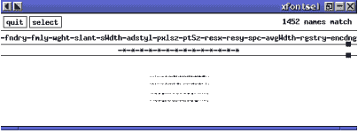

*图 16-1：启动 xfontsel。*

那一排按钮是下拉菜单，包含系统中 X 字体名称每个字段可用的选项。使用鼠标从每个菜单中选择项目，所选中的 X 字体就会显示在主窗口中。其上方显示它的 X 字体名称。

⇒ 若要将该 X 字体名称设为 X 选择内容，请点击标记为 `select` 的按钮。

此示例将 X 字体名称设为 X 选择内容，从而允许你将其粘贴到命令行或另一个窗口中（见第 254 页的技巧 10.3.2 [粘贴文本]）。

## 16.1.2 列出可用的 X 字体

使用 `xlsfonts` 列出系统中可用的 X 字体族、字号和字重。将带引号的模式作为参数传入，它就会输出系统中所有与该模式匹配的已安装 X 字体的名称；默认情况下，它会列出所有字体。

⇒ 以下是一些使用方法。

- 要列出系统上的所有 X 字体，请键入：

  ```
  $ xlsfonts
  ```

- 要列出系统上名称包含文本“rea”的所有 X 字体，请键入：

  ```
  $ xlsfonts '*rea*' RET
  ```

- 要列出系统上所有粗体 X 字体，请键入：

  ```
  $ xlsfonts '*bold*' RET
  ```

注意：此方法不用于显示字体中的字符；如需显示字符，请使用下一节所述的 `xfd`。此外，若要浏览可用的 X 字体，可以使用上一节中的 `xfontsel`。

## 16.1.3 显示 X 字体中的字符

使用 `xfd`（“X 字体显示”）工具可以显示指定 X 字体中的所有字符。将要显示的 X 字体名称用引号括起来，作为 `-fn` 选项的参数。

⇒ 要显示中等粗细的 Courier X 字体中的字符，请键入：

```
$ xfd -fn '-*-courier-medium-r-normal-*-100-*-*-*-*-iso8859-1' RET
```

## 16.1.4 调整 Xterm 字体大小

关于为 X 客户端窗口指定字体的信息，请参见第 104 页的技巧 4.2.3 [指定 X 窗口字体]。最有必要为其指定字体的工具之一是 `xterm`，它通常用于在 X 中运行 shell；许多人喜欢为这个窗口指定所用字体（见第 109 页的技巧 4.5 [在 X 中获取终端窗口]）。

要在 `xterm` 运行时调整当前字体大小，请按住 CTRL 并在 `xterm` 窗口中的任意位置单击鼠标右键。此时会出现一个菜单，提供从 Unreadable（无法阅读）、Tiny（极小）到 Huge（巨大）的大小选项。若要将字体恢复为原始大小，请选择 Default（默认）。

# 16.2 使用 TeX 字体

以下技巧专门针对 TeX 字体。

## 16.2.1 列出可用的 TeX 字体

新 TeX 用户常问的一个问题是如何列出系统上安装的所有 TeX 字体——大多数安装都带有大量字体，如果能轻松列出并显示它们会大有帮助。遗憾的是，没有一种统一且万无一失的方法可以做到这一点。TeX 可以使用多种类型的字体，而实际安装的字体又会因系统而异。TeX 字体通常存储在 `/usr/share/texmf/fonts/` 和 `/usr/local/share/texmf/fonts/` 目录树中。

要获取系统上的 TeX 字体列表，可使用 `locate` 命令列出扩展名为 `.tfm` 的文件。这些是 TeX 字体度量文件。并非所有 TeX 字体都有 `.tfm` 文件，也并非所有 `.tfm` 文件都是可用的字体，但通过这种方法，你可以大致了解系统上安装了哪些 TeX 字体。

⇒ 要列出系统上可用的 `.tfm` 字体，请键入：

```
$ locate .tfm RET
```

注意：你可能希望将输出重定向到文件中，或者在单独的终端窗口中使用 `less` 仔细阅读，同时使用此输出来显示下一节所述的字体样例。

## 16.2.2 查看 TeX 字体样例

TeX 自带的文件 `/usr/share/texmf/tex/plain/base/testfont.tex` 是一个特殊的 TeX 文件，可用于显示任意 `.tfm` 字体的样例。

处理此文件时，它会要求输入要显示的字体名称。请给出基本文件名——即省略其路径和扩展名。然后单独成行输入 `\sample` 和 `\end`，这两个 TeX 命令会先打印样例，然后结束 TeX 文件。该命令会在当前目录中创建一个名为 `testfont.dvi` 的 DVI 文件，其中包含指定字体字符集的样例。

⇒ 要查看 `plu10` 字体的样例，请键入：

```
$ tex /usr/share/texmf/tex/plain/base/testfont.tex RET
This is TeX, Version 3.14159 (Web2C 7.3.1)
(/usr/share/texmf/tex/plain/base/testfont.tex
Name of the font to test = plu10 RET
Now type a test command (\help for help):)
* \sample RET
[1]
* \bye RET
[2]
Output written on testfont.dvi (2 pages, 12344 bytes).
Transcript written on testfont.log.
$ xdvi testfont.dvi RET
```

# 16.3 使用控制台字体

*Console fonts* 是用于在 Linux 控制台上显示文本的屏幕字体（而不是在 X Window System 中）。

控制台字体存储在 `/usr/share/consolefonts` 目录中，文件为压缩格式；要安装新的控制台字体，请让系统管理员创建 `/usr/local/share/consolefonts` 目录并将字体文件放入其中。

以下配方展示如何设置控制台字体，以及如何显示当前字体中所有字符的表格。

### 16.3.1 设置控制台字体

使用 `consolechars` 设置当前控制台字体；将控制台字体基本文件名作为 `-f` 选项的参数给出。

⇒ 要将控制台字体设置为 `scrawl_w` 字体，输入：

```
$ consolechars -f scrawl_w [RET]
```


某些字体文件包含该字体的多个高度（或大小）。如果字体包含不同高度的多种编码，请将要使用的高度作为 `-H` 选项的参数给出。（如果尝试在不使用高度选项的情况下指定此类字体，`consolechars` 将输出可用尺寸列表。）

常见的控制台字体高度包括 8（用于 8x8 字体）、14（用于 8x14 字体）和 16（用于 8x16 字体）。

⇒ 要将控制台字体设置为 sc 字体的 8x8 大小，输入：

```
$ consolechars -H 8 -f sc [RET]
```

### 16.3.2 显示控制台字体的字符

使用 `showfont` 显示当前控制台字体中的所有字符。

⇒ 要列出当前控制台字体中的所有字符，输入：

```
$ showfont [RET]
```

## 16.4 使用文本字体

*Text fonts* 是由屏幕上 ASCII 字符的排列创建的字体；它们常出现在 Usenet 文章和电子邮件消息中，作为文本文件中的装饰或标题元素出现，并用于在打印机上打印简单的横幅或海报。

从 ASCII 字符的排列制作“字体”（甚至图片）被称为 ascii art。以下配方描述了在这些字体中输出文本的方法。

### 16.4.1 输出水平文本字体

Figlet

DEB: figlet

RPM: figlet

WWW: http://www.figlet.org/

`figlet` 过滤器以给定的文本字体输出文本。将要输出的文本作为参数给出，对包含 shell 元字符的文本进行引用（参见 Recipe 3.1.3 [Quoting Reserved Characters]，第 56 页）。

⇒ 要以默认 figlet 字体输出文本“news alert”，输入：

```
$ figlet news alert [RET]
```

该命令以 ASCII 文本字体输出文本，如图 16-2 所示。

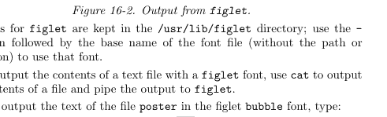

图 16-2. `figlet` 的输出。

`figlet` 的字体保存在 `/usr/lib/figlet` 目录中；使用 `-f` 选项后跟字体文件的基本名称（不含路径或扩展名）来使用该字体。

要以 `figlet` 字体输出文本文件的内容，请使用 `cat` 输出文件内容并将输出通过管道传递给 `figlet`。

⇒ 要以 `figlet` bubble 字体输出文件 `poster` 的文本，输入：

```
$ cat poster | figlet -f bubble [RET]
```

NOTES: `bubble` 字体安装在 `/usr/lib/figlet/bubble.flf`。

### 16.4.2 输出文本横幅

Bsd-games

DEB: bsdmainutils

RPM: bsd-games

WWW: ftp://metalab.unc.edu/pub/Linux/games/

在 Linux 系统上打印长垂直文本横幅的最简单方法是使用旧的 UNIX `banner` 工具。

将文本消息作为参数引用，`banner` 会将该消息的大型垂直“横幅”发送到标准输出。消息本身以由 ASCII 文本字符组成的“字体”输出，与 `figlet` 使用的类似，只是消息是垂直输出以便打印，并且你不能更改字体。要将 `banner` 的输出发送到打印机，请将其通过管道传递给 `lpr`。

⇒ 以下是两种使用方法。

- 要制作横幅“Happy Birthday Susan”，输入：

  `$ banner 'Happy Birthday Susan' RET`

- 要将横幅“Happy Birthday Susan”打印到默认打印机，输入：

  `$ banner 'Happy Birthday Susan' | lpr RET`

不幸的是，`banner` 理解的字符范围有点有限——以下字符不能在横幅消息中使用：

< > [ ] \ _ ~ { } | ^

要制作文本文件内容的横幅，请通过重定向标准输入将其内容发送到 `banner`（参见 Recipe 3.2.1 [Redirecting Input to a File]，第 67 页）。

要制作文件 `/etc/hostname` 内容的横幅，输入：

```
$ banner < /etc/hostname RET
```

横幅的默认宽度为 132 文本列；你可以通过将要使用的宽度作为 `-w` 选项的参数来指定不同的宽度。如果在不带数字的情况下给出 `-w` 选项，`banner` 将以 80 文本列输出。

⇒ 以下是两种使用方法。

- 要制作包含文本“Happy Birthday Susan”且宽度为 23 文本列的横幅，输入：

  `$ banner -w 23 'Happy Birthday Susan' RET`

+   • 要制作一个宽度为 80 个文本列、包含文字 “Happy Birthday Susan” 的横幅，输入：

+   

+       `$ banner -w 'Happy Birthday Susan' [RET]`

NOTES: 在 Recipe 15.2.7 [Outputting Text in Landscape Orientation]，第 369 页中描述了一种使用 `figlet` 制作水平文本横幅的方法。

## 16.5 使用其他字体工具

下表描述了 Linux 可用的一些其他字体工具。

Console Font Editor    Linux 控制台字体编辑器（cse），一种较旧的用于在屏幕上编辑字体字符的控制台字体工具。

DEB: cfe

RPM: cfe

WWW: http://lrn.ru/~osgene/

Debian Font Manager    用于在 Debian 系统上配置字体的工具。

DEB: defoma

    defoma-doc

    psfontmgr

Fonter    一个控制台字体编辑器。

DEB: fonter

WWW: ftp://metalab.unc.edu/pub/Linux/apps/misc/

FontForge    一个字体编辑器，可识别多种格式，包括 PostScript、TrueType 和 OpenType。

DEB: fontforge

RPM: fontforge

WWW: http://fontforge.sourceforge.net/

Font Viewer    用于查看 Adobe Type 1 和 TrueType 字体的工具。

DEB: gfontview

RPM: gfontview

WWW: http://gfontview.sourceforge.net/

Gozer

一个将作为参数给出的文本渲染为抗锯齿 TrueType 字体的工具。

DEB: gozer

WWW: http://www.linuxbrit.co.uk/gozer/

Metafont

Donald E. Knuth 设计字体和标志的语言（随 TeX 分发）。

DEB: tetex-base

    tetex-bin

    tetex-doc

    tetex-extra

RPM: tetex

WWW: http://www.tug.org/teTeX/

PkTrace

一个将使用 Metafont 制作的字体转换为 Type 1 字体的工具。

DEB: pktrace

RPM: mftrace

## IV. 图像

## 17. 查看图像

有许多用于查看图像的工具，与文本一样，既有查看工具也有编辑图像的工具。本章描述了一些查看图像的最佳方法；图像编辑将在下一章讨论。虽然你可以用图像编辑器查看图像，但如果你不打算编辑它，使用查看器更安全（也更快！）。

### 17.1 在 X 中查看图像

ImageMagick

DEB: imagemagick

RPM: ImageMagick

WWW: http://www.imagemagick.org/

要在 X 中查看图像，请使用 `display`，它是 ImageMagick 工具套件的一部分。它可以识别许多图像格式，包括 FlashPix、GIF/GIF87、Group 3 传真、JPEG、PBM/PNM/PPM、PhotoCD、TGA、TIFF、TransFig 和 XBM。它还可以查看使用 `gzip` 或 `bzip2` 压缩的图像，而无需你先解压缩，并且还提供基本的编辑功能。

`display` 工具以要查看的图像文件名作为参数，并在其自己的新窗口中显示图像。

⇒ 要查看文件 `sailboat.jpeg`，输入：

```
$ display sailboat.jpeg [RET]
```

该命令在新窗口中显示图像文件，如图 17-1 所示。


图 17-1. `display` 中的图像。

鼠标按钮在 `display` 中具有特殊含义。左键单击图像窗口以在新窗口中打开 `display` 命令菜单。`display` 命令菜单看起来像图 17-2。

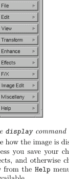


图 17.2. `display` 命令菜单。

菜单项让你更改图像的显示方式（除非你将其保存到文件中，否则不会更改实际的图像文件）。你可以更改图像大小、应用效果，并以其他方式更改或转换图像显示。从 Help 菜单中选择 Overview 以了解可用的各种命令的说明。

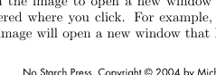

图 17-3. `display` 中的图像放大。

中键单击图像以打开一个新窗口，其中显示以你单击的位置为中心的图像放大视图。例如，中键单击之前的帆船图像将打开一个看起来像图 17-3 的新窗口。

最后，右键单击图像窗口以显示包含一些最常用的命令的弹出菜单；要选择其中一个命令，将鼠标指针拖动到该命令上并释放右键。弹出菜单中的命令包括 `Quit`，退出 `display`，以及 `Image Info`，显示有关图像文件本身的信息，包括颜色数、图像深度和分辨率。

下表描述了在 `display` 中显示图像时可使用的一些键盘命令。

|  |  |
|---|---|
| `SPACEBAR` | 显示命令行上指定的下一张图像。 |
| `BKSP` | 显示命令行上指定的上一张图像。 |
| `CTRL - Q` | 退出图像显示并退出 `display`。 |
| `CTRL - S` | 将图像写入文件。 |
| `<` | 将图像大小减半。 |
| `>` | 将图像大小加倍。 |
| `-` | 将图像恢复到原始大小。 |
| `/` | 将图像顺时针旋转 90 度。 |
| `\` | 将图像逆时针旋转 90 度。 |
| `?` | 打开一个新窗口，显示图像信息，包括分辨率、颜色深度、格式和注释（如有）。 |
| `h` | 切换水平镜像图像。 |
| `v` | 切换垂直镜像图像。 |

以下配方描述了 `display` 的一些特殊用途。它还可以用于查看 Web 上的图像——参见 Recipe 33.4 [Viewing an Image from the Web]，第 651 页。

### 17.1.1 在 X 中浏览图像集合

`display` 工具提供了一个浏览图像集合的功能——将 `vid:` 作为文件参数给出，后跟文件名或匹配模式，将它们放在引号中。`display` 会生成指定图像的缩略图，并在一个新窗口中显示，该窗口被称为可视化图像目录。

⇒ 以下是两种使用方式。

- 要浏览 `/usr/doc/imagemagick/examples` 目录下具有 `.gif` 扩展名的图像文件，请键入：

    `$ display 'vid:/usr/doc/imagemagick/examples/*.gif' [RET]`

- 要浏览当前目录中的所有图像文件，请键入：

    `$ display 'vid:*' [RET]`

在前面的示例中，只会读取并显示那些 `display` 所支持的图像格式的文件。

注意：如果标题栏显示可视化图像目录有多页，请按 `[SPACEBAR]` 前进到下一页（在最后一页按 `[SPACEBAR]` 会循环回到开头）。

要以正常大小打开图像，请右键单击图像并选择“加载”：缩略图将被其全尺寸图像替换。要返回缩略图目录，请按 `[SPACEBAR]`。

### 17.1.2 将图像放入根窗口

将图像放入根窗口（所有其他窗口后面的背景）的一种方法是使用 `display`，并将 `'root'` 作为 `-window` 选项的参数。

⇒ 要将图像 `tetra.jpeg` 放入根窗口，请键入：

`$ display -window root tetra.jpeg [RET]`

## 17.2 在控制台中浏览图像

Zgv  
DEB: `zgv`  
RPM: `zgv`  
WWW: http://freshmeat.net/projects/zgv/

使用 `zgv` 在虚拟控制台（而非 X 窗口系统）中查看图像。你可以使用 `zgv` 浏览文件系统并选择要查看的图像，也可以将特定图像文件的名称作为参数给出。它能识别多种图像格式，包括 GIF、JPEG、PNG、PBM/PNM/PPM、TGA 和 PCX；它最好的特性之一是能将图像填满整个屏幕。

当你不带选项运行 `zgv` 时，它会显示当前目录中所有图像的图标，并将任何子目录显示为文件夹图标。你也可以将目录名称作为参数，以便浏览该目录中的图像。

⇒ 以下是两种使用方式。

- 要浏览当前目录中的图像，请键入：

    `$ zgv [RET]`

- 要浏览 `/usr/share/gimp/scripts` 目录中的图像，请键入：

    `$ zgv /usr/share/gimp/scripts [RET]`

使用方向键在文件显示中导航；图像或目录图标周围的红色边框表示当前选中的图像或子目录。键入 `[RET]` 可查看选中的图像或进入选中的目录。

你可以通过多种方式操作所查看的图像——放大和缩小图像，调整亮度和颜色，甚至自动播放图像的“幻灯片”。下表描述了 `zgv` 的一些命令行选项。

|  |  |
|---|---|
| `-c` | 切换图像居中。默认情况下图像在屏幕上居中；指定此选项将关闭居中。 |
| `-i` | 忽略由于文件损坏而产生的错误，并显示文件中可显示的部分。 |
| `-l` | 以幻灯片模式启动 `zgv`，它会循环显示所有作为参数指定的图像，直到你中断它。 |
| `-M` | 切换鼠标支持。鼠标支持默认关闭；此选项将其开启。 |
| `-r` *整数* | 每 *整数* 秒重新读取并重新显示每个图像。适用于查看网络摄像头图像或其他不断变化的图像文件。 |

## 17.3 在 Web 浏览器中查看图像

Lynx  
DEB: `lynx`  
RPM: `lynx`  
WWW: http://lynx.browser.org/

或

Mozilla  
DEB: `mozilla-browser`  
RPM: `mozilla`  
WWW: http://www.mozilla.org/

浏览器非常适合浏览文件和目录，它们同样擅长显示图像。你可以在运行于 X 环境中的 Web 浏览器中浏览本地图像，就像浏览任何文件一样（参见第 5.10 节“浏览文件和目录”，第 157 页）。如果你在 X 环境中想要查看图像文件，并且有 Web 浏览器正在运行，这会是一种快速简便的方法。

你可以使用图形浏览器（如 Mozilla），或在终端窗口中使用基于文本的浏览器 Lynx 以这种方式查看图像，在这种情况下，图像会通过“辅助”应用程序在新窗口中显示。¹ 退出辅助应用程序将返回 Lynx。

要在 Mozilla 或其他图形 Web 浏览器中查看图像文件，请在浏览器的“位置”字段中指定图像文件的完整路径名。要在 Lynx 中查看图像文件，只需将图像的完整或相对路径名作为参数给出，或者在 Lynx 中键入 `g` 以获取提示，然后键入完整路径名。

⇒ 以下是几种使用方式。

- 要使用文件 `/usr/share/doc/texmf/pdftex/base/pic.png` 启动 Mozilla，请键入：

    `mozilla /usr/share/doc/texmf/pdftex/base/pic.png`

- 要在 Mozilla 中查看文件 `/usr/share/doc/texmf/pdftex/base/pic.png`，请在其“位置”字段中键入：

    `/usr/share/doc/texmf/pdftex/base/pic.png`

> `display` 工具通常是查看图像的默认应用程序。

- 要用 Lynx 打开文件 `/usr/share/doc/texmf/pdftex/base/pic.png`，请输入：

    `lynx /usr/share/doc/texmf/pdftex/base/pic.png RET`

- 要在 Lynx 中查看文件 `/usr/share/doc/texmf/pdftex/base/pic.png`，请输入：

    ```
    g

    URL to open: /usr/share/doc/texmf/pdftex/base/pic.png RET
    ```

注意：提供给 Mozilla 的 `file:` URL 只有一个前导斜杠（指向根目录），而不是像任何 `http://` URL 那样有两个斜杠。

## 17.4 预览打印文件

DVI（“DeVice Independent”，设备无关）、PostScript 和 PDF（“Portable Document Format”，便携式文档格式）文件格式可由多种应用程序生成。它们是常用于打印的图形图像格式；以下方法将讨论如何在显示屏幕上预览这些文件。

注意：如果你要预览的文件经过压缩，且带有 `.gz` 或 `.bz2` 扩展名，你仍然可以使用 `see` 预览它（参见方法 8.4.3 [查看压缩文件中的内容]，第 199 页）。

### 17.4.1 预览 DVI 文件

在 X 中，使用 `xdvi` 工具预览 DVI 文件。将需要预览的文件名作为参数传入。`xdvi` 会显示文档打印时的外观，你可以以不同的放大倍数查看它。

⇒ 要预览 `gentle.dvi` 文件，请输入：

`$ xdvi gentle.dvi RET`


要放大文档视图，请左键单击带有百分比标签的按钮，例如 `17%`；它们会按该百分比放大视图。

⇒ 要放大 `33%`，请左键单击标有 `33%` 的按钮。

下表列出了使用 `xdvi` 预览时最重要的按键命令。

| Q | 退出 `xdvi` 并停止预览文件。 |

| N 或 F | 前进到下一页。 |

| P 或 B | 后退到上一页。 |

| CTRL-C | 与 Q 相同。 |

| CTRL-D | 与 Q 相同。 |

| SPACEBAR | 向下滚动页面；如果已接近页面底部，则前进到下一页。 |

| CTRL-L | 重新显示当前页。 |

| R | 重新读取 DVI 文件。 |

### 17.4.2 预览 PostScript 文件

`Ghostview`

DEB: `ghostview`

RPM: `ghostview`

WWW: `http://www.cs.wisc.edu/~ghost/index.html`

或

`GV`

DEB: `gv`

RPM: `gv`

WWW: `http://wwwthep.physik.uni-mainz.de/~plass/gv/`

在 X 中预览 PostScript 或 EPS 图像文件时，可以使用 `ghostview` 或 `gv`。两者都将文件名作为参数，并在窗口中预览文件内容，从第一页开始。

⇒ 要预览文件 `/usr/doc/gs/examples/tiger.ps`，请输入：

```
$ gv /usr/doc/gs/examples/tiger.ps [RET]
```

按 `SPACEBAR` 向下滚动页面（如果有下一页，则继续前进到下一页），按 `Q` 打开新文件，按 `Q` 退出。

注意：刚才介绍的按键在 `ghostview` 和 `gv` 中都有效，但现在许多人更喜欢使用较新的 `gv`。`gv` 基于 `ghostview`，但界面更好，而且也能预览 PDF 文件。

### 17.4.3 预览 PDF 文件

`Xpdf`

DEB: `xpdf-common`

    `xpdf-reader`

RPM: `xpdf`

WWW: `http://www.foolabs.com/xpdf/`

使用 `xpdf` 预览 PDF 文件。将需要预览的 PDF 文件名作为参数传入。

⇒ 要预览 PDF 文件 `flyer.pdf`，请输入：

```
    $ xpdf flyer.pdf [RET]
```

要退出 `xpdf`，请按 `@q`；使用两个放大镜按钮可以放大（`+`）或缩小（`-`）视图；点击左右箭头按钮可移动到上一页或下一页（如果有）。你还可以用鼠标选择文本：单击鼠标左键并在文本块上拖动以选中；这些文本在 X 选择缓冲区中会成为纯 ASCII 文本，你可以将其粘贴到另一个窗口中（例如文本编辑器，或正在使用 `cat` 将标准输入重定向到文件的 `xterm` shell 中）。

注意：你也可以使用 `gv` 预览 PDF 文件（参见前面的方法）。

## 17.5 浏览 PhotoCD 存档

有两种方法可以浏览 Kodak PhotoCD 存档。

### 方法 #1

`Xpcd`

DEB: `xpcd`

    `xpcd-gimp`

RPM: `xpcd`

WWW: `http://bytesex.org/xpcd.html`

`xpcd` 工具是一个 X 客户端，用于查看和浏览 Kodak PhotoCD 图像集。要浏览 Kodak PhotoCD 上的图像，请先挂载 CD-ROM（参见方法 24.4.1 [挂载数据 CD]，第 506 页），然后将挂载点作为参数传给 `xpcd`。

⇒ 要浏览挂载在 `/cdrom` 上的 PhotoCD 光盘中的图像，请输入：

```
$ xpcd /cdrom [RET]
```

前面的示例会打开两个新窗口——一个小型 `xpcd` 命令栏窗口，以及一个较大的窗口，其中包含光盘上所有 PhotoCD 图像的缩略图。

要在新窗口中打开图像的副本，请左键单击其缩略图。这样做时，`xpcd` 会以 PhotoCD 第二小的分辨率 `256x384` 打开该图像；要以其他大小查看，请右键单击图像并选择要查看的大小。新窗口显示后，你可以右键单击该新图像，将其保存为 JPEG、PPM 或 TIFF 格式的图像。

要使用 `xpcd` 查看单个 `.pcd` 文件，请将文件名作为参数传入。

⇒ 要查看 PhotoCD 文件 `hawaii-001.pcd`，请输入：

```
$ xpcd hawaii-001.pcd [RET]
```

注意：虽然 `xpcd` 的开发已经停止，但它仍是一个有用的查看器，并且随附了 PhotoCD 转换工具 `pcdtoppm`。

有关提取 PhotoCD 图像的另一种方法，请参见方法 19.3 [提取 PhotoCD 图像]，第 445 页。

### 方法 #2

要浏览 PhotoCD 存档，请使用 `display` 查看与该存档关联的 `overview.pcd` 文件，该文件位于存档的顶层目录中（有关如何使用 `display`，请参见方法 17.1 [在 X 中查看图像]，第 407 页）。

⇒ 要浏览挂载在 `/cdrom` 上的 PhotoCD 光盘中的图像，请输入：

```
$ display /cdrom/overview.pcd [RET]
```

要查看 PhotoCD 存档中的特定图像，请将该图像对应的文件名作为参数传给 `display`。

⇒ 要查看挂载在 `/cdrom` 上的 PhotoCD 光盘中的第十二幅图像，请输入：

```
$ display /cdrom/images/img0012.pcd [RET]
```

# 17.6 查看动画或幻灯片放映

`ImageMagick`

DEB: `imagemagick`

RPM: `ImageMagick`

WWW: `http://www.imagemagick.org/`

使用 ImageMagick 套件中的 `animate` 查看动画，以及查看或制作幻灯片放映。

要查看动画图像文件，请将文件名作为参数给出。

⇒ 要查看动画图像 `earth.gif`，请键入：

```
$ animate earth.gif [RET]
```

要制作多张图像的幻灯片放映，请将要显示的每幅图像的时间（以百分之一秒为单位，默认为 6/100 秒）作为 `-delay` 选项的参数，并将所有图像文件的名称作为参数。

⇒ 这里有两种使用方法。

+   - 要显示 `~/photos/vacation2003/roll11/640` 目录中所有文件的幻灯片放映，每张图像显示十秒后再切换到下一张，请键入：

+     `$ animate -delay 1000 ~/photos/vacation2003/roll11/640 [RET]`

+   - 要显示四个文件 `sample.jpg`、`120.tif`、`sampleb.jpg` 和 `122.tif` 的动画，每幅图像显示 1/5 秒，请键入：

+     `$ animate -delay 20 sample.jpg 120.tif sampleb.jpg 122.tif [RET]`

当 `animate` 显示完所有给定图像后，它会循环回到开头。要设置在重新开始之前暂停的时间，请给 `-delay` 选项提供第二个参数，格式为“xnumber”，其中 number 是再次循环前暂停的秒数。

⇒ 要显示当前目录中所有 `.jpeg` 文件的幻灯片放映，每幅图像以默认的 6/100 秒显示，并在重复前暂停一秒钟，请键入：

```
$ animate -delay x1 *.jpeg [RET]
```

使用 `-backdrop` 选项可将动画显示为全屏背景。

⇒ 要显示 `our-hawaii-vacation` 目录中所有文件的全屏背景幻灯片，每幅图像显示 30 秒，并在从头重复之前暂停一分钟，请键入：

```
$ animate -backdrop -delay 30000x60 our-hawaii-vacation/* [RET]
```

注意：与所有 ImageMagick 工具一样，按 `CTRL-Q` 退出。

要制作自己的动画图像文件，请使用同样属于 ImageMagick 的 `convert`（参见技巧 18.2 [转换图像文件]，第 432 页）。

# 17.7 使用其他图像查看器

下表列出了其他用于查看图像的工具。

| 工具 | 描述 |

|------|-------------|

| Avview | 将图像显示为“ASCII 艺术”。该工具可以读取 `pbmplus` 工具套件支持的任何图像格式，并具有流畅的缩放功能，以及您期望从世界级查看器中获得的所有渲染选项。DEB: `aview` RPM: `aview` WWW: `http://aa-project.sourceforge.net/aview/` |

| Aatv | 在任何文本终端上将电视调谐器输出显示为 ASCII 字符。DEB: `aatv` WWW: `http://n00n.free.fr/aatv/` |

| ChBg | 更改 X 背景图像。支持幻灯片放映和其他效果。DEB: `chbg` RPM: `chbg` WWW: `http://chbg.sourceforge.net/` |

| Fbi | 在 Linux 帧缓冲控制台上显示图像。DEB: `fbi` RPM: `fbi` WWW: `http://bytesex.org/fbi/` |


- `Fbtv`：在 Linux 帧缓冲控制台上显示电视调谐器图像。DEB: `fbtv` RPM: `xawtv` WWW: http://bytesex.org/xawtv/
- `Feh`：快速的图像查看器，具有许多功能，包括显示不断变化的网络摄像头图像的能力。DEB: `feh` WWW: http://www.linuxbrit.co.uk/feh/
- `Ida`：图像查看器、浏览器和简易编辑器，以其速度快和体积小著称。DEB: `ida` WWW: http://bytesex.org/ida/
- `Ogle`：显示 DVD。包括 DVD 菜单支持。DEB: `ogle` RPM: `ogle` WWW: http://www.dtek.chalmers.se/groups/dvd/
- Quick Image Viewer：在 X 中显示图像；专注于快速加载时间。DEB: `qiv` RPM: `qiv` WWW: http://www.klografx.net/qiv/
- `ShowImg`：在 X 中显示图像，具有全屏模式和许多选项。DEB: `showing` RPM: `showing`
- `Showpicture`：显示电子邮件附件中的图像；需要 `xloadimage` 且仅在 X 中工作。DEB: `metamail` RPM: `metamail` WWW: http://tinyurl.com/323w7
- `VideoLAN`：播放来自网络源的 MPEG、MPEG2 和 DVD 视频。DEB: `vlc` RPM: `vlc` WWW: http://www.videolan.org/
- `Xli`：在 X 中显示图像。DEB: `xli` RPM: `xli` WWW: http://pantransit.reptiles.org/prog/
- `Xloadimage`：在 X 中显示图像；可以将图像放置在根窗口中。DEB: `xloadimage` RPM: `xloadimage` WWW: http://world.std.com/~jmf/xloadimage.html
- `Xwud`：以特殊的 X Window Dump 文件格式显示文件，该格式由 `xwd` 创建。DEB: `xbase-clients` RPM: `XFree86-progs` WWW: http://www.xfree86.org/

# 18. 编辑图像

当你对一个图像文件——例如包含数字化照片或用图形程序绘制的图片——进行修改时，你就是在编辑图像。

本章包含编辑和修改图像的配方，包括在图像文件格式之间转换。它还概述了你可能会觉得有用的其他图像相关应用程序，包括功能强大的 GIMP 图像编辑器。

## 18.1 转换图像

```
ImageMagick
DEB: imagemagick
RPM: ImageMagick
WWW: http://www.imagemagick.org/
```

许多 Linux 工具可用于以各种方式转换或操作图像。在此描述的是 ImageMagick 图像工具套件，其中 `mogrify` 工具对于执行快速命令行图像转换特别有用；用它来改变图像的大小、旋转或减少颜色。

`mogrify` 工具总是将要处理的文件名作为参数，并将更改写入该文件。使用连字符（`-`）指定标准输入，在这种情况下 `mogrify` 将其输出写入标准输出。


图 18-1. `phoenix.jpeg` 图像。

我将在下面的示例中使用图 18-1 所示的图像 `phoenix.jpeg`，以便让你了解如何使用 `mogrify`。

**NOTES:** 你也可以使用 GIMP 交互式地执行以下各节中描述的许多图像转换（参见配方 18.3 [使用 GIMP 编辑图像]，第 434 页）；另一个既可用于转换图像又可在图像格式之间转换的非常有用的软件包是 `netpbm` 实用程序套件（参见配方 19.2 [扫描图像]，第 443 页）。


*图 18-2. 缩放到大约 480x320 像素的 `phoenix.jpeg` 图像。*

### 18.1.1 更改图像大小

使用 `mogrify` 调整图像大小有三种好方法，如下所示。

**NOTES:** 放大后的图像会显得块状或模糊。

要*查看*特定比例的图像而不修改文件，请使用 `display`；当你调整其窗口大小时，仅在屏幕上调整图像大小，除非你选择保存它（参见配方 4.3.2 [调整 X 窗口大小]，第 106 页）。


*图 18-3. 缩放到恰好 640x480 像素的* `phoenix.jpeg` *图像。*

#### METHOD #1

要调整图像大小但保持其*纵横比*，使宽度与高度之比保持不变，请使用 `mogrify` 并使用 `-geometry` 选项，并以像素为单位给出理想的宽度和高度值作为参数。

⇒ 要将 `phoenix.jpeg` 调整为 480x320 像素，请输入：

```
$ mogrify -geometry 480x320 phoenix.jpeg [RET]
```

⇒ 要将 `phoenix.jpeg` 的高度增加 25%，宽度减少 50%，请输入：

```
$ mogrify -geometry 125%x50% phoenix.jpeg [RET]
```

此命令将原始 `phoenix.jpeg` 转换为高度增加 25%、宽度增加 50% 的图像，如图 18-4 所示。

### 18.1.2 旋转图像

要旋转图像，请使用 `mogrify` 并使用 `-rotate` 选项，后跟要旋转的度数。如果图像宽度超过其高度，请在此数字后加上 `">"`，如果高度超过宽度，请加上 `"<"`。 （由于 `<` 和 `>` 都是 shell 重定向运算符，请将此参数用引号括起来，如果图像高度和宽度相同则省略其中一个。）

⇒ 要将高度超过宽度的 `phoenix.jpeg` 旋转 90 度，请输入：

```
$ mogrify -rotate '90<' phoenix.jpeg [RET]
```

此命令将原始 `phoenix.jpeg` 转换使其旋转 90 度，如图 18-5 所示。

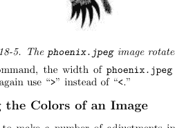

图 18-5. 旋转后的 `phoenix.jpeg` 图像。

**NOTES:** 执行此命令后，`phoenix.jpeg` 的宽度现在超过其高度，因此再次旋转它时请使用 `">"` 而不是 `"<"`。

### 18.1.3 调整图像颜色

你可以使用 `mogrify` 对图像的颜色进行多种调整。要减少图像中的颜色数量，请使用 `-colors` 选项，后跟要使用的颜色数。

⇒ 要将 `phoenix.jpeg` 中的颜色减少到两种，请键入：

```
$ mogrify -colors 2 phoenix.jpeg [RET]
```

此命令将原始 `phoenix.jpeg` 转换为黑白图像，如图 18-6 所示。

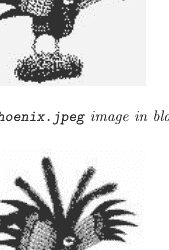

图 18-6：`phoenix.jpeg` 图像的黑白版本。

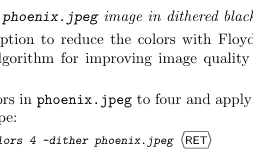

图 18-7：`phoenix.jpeg` 图像的抖动黑白版本。

使用 `-dither` 选项可通过 Floyd-Steinberg 误差扩散来减少颜色，这是一种在颜色缩减过程中提高图像质量的常用算法。

⇒ 要将 `phoenix.jpeg` 中的颜色减少到四种并应用 Floyd-Steinberg 误差扩散，请键入：

```
$ mogrify -colors 4 -dither phoenix.jpeg [RET]
```

此命令将原始 `phoenix.jpeg` 转换为抖动黑白图像，如图 18-7 所示。

使用 `-map` 选项并传入第二个文件名作为参数，可从第二个图像读取*颜色映射*（颜色集合），并在第一个图像中使用它们。

- ⇒ 要将文件 `rainbow.jpeg` 中的颜色更改为文件 `prism.jpeg` 中使用的颜色，请键入：

```
$ mogrify -map prism.jpeg rainbow.jpeg [RET]
```

使用 `-monochrome` 选项可将彩色图像变为黑白图像。

- ⇒ 要将彩色图像 `rainbow.jpeg` 变为黑白图像，请键入：

```
$ mogrify -monochrome rainbow.jpeg [RET]
```

如果你有一个 PPM 文件，可以使用 `ppmquant` 来*量化*，也就是将图像中的颜色减少到指定数量——详见 `ppmquant` 手册页（参见方案 2.8.4 [从系统手册读取页面]，第 46 页）。


由于显示硬件的差异，图像的亮度可能因计算机系统而异。例如，在 Macintosh 上创建的图像在其他系统上通常会显得更暗。调整图像亮度时，称为`伽马校正`。

要调整图像亮度，请将所需的校正数值作为参数传递给 `-gamma` 选项。大多数 PC 显示器的伽马值为 2.5，而 Macintosh 显示器的伽马值较低，为 1.4。

- ⇒ 要将图像 `rainbow.jpeg` 的伽马校正设置为 .8，请键入：

```
$ mogrify -gamma .8 rainbow.jpeg [RET]
```

## 18.1.4 为图像添加注释

Independent JPEG Group 的 JPEG 软件

```
DEB: libjpeg-progs
RPM: libjpeg-progs
WWW: http://www.ijg.org/
```

有几种方法可以在图像文件中读写注释。这种做法对于向图像添加版权声明或使用 URL 标注图像文件非常有用。并非所有图像格式都支持注释；JPEG 是最常用的一种。

查看图像时你不会看到注释；它被添加到文件的图像头部信息中。不过，你可以使用显示图像文件信息的工具（如 `display` 或 GIMP）来读取图像注释。下面介绍另一种输出注释文本的方法。

### 方法 #1

使用 `wrjpgcom` 在 JPEG 文件中写入注释。将注释内容用引号引起来，作为 `-comment` 选项的参数，并给出输入文件的名称作为参数。默认情况下，会将新的 JPEG 文件写入标准输出。

- ⇒ 要用文本“地图未按完整比例绘制”标注文件 `map.jpeg` 中的图像，并将其写入文件 `warmap.jpeg`，请键入（全部在一行内）：

```sh
$ wrjpgcom -comment "Map not drawn to full scale" map.jpeg > warmap.jpeg
```

使用 Bash `for` 循环在一组文件中添加相同的注释（有关此内建命令的更多信息，请参阅 Bash Info 文档）。

- ⇒ 要为当前目录中的所有 `.jpg` 文件添加注释“图片由 Rick Blaine 提供”，并写入具有相同基本名称但扩展名为 `.jpeg` 的新文件，请键入：

```sh
$ for i in *.jpg [RET]
> { [RET]
> wrjpgcom -comment "Image courtesy Rick Blaine" $i `basename $i jpg`.jpeg [RET]
> } [RET]
$
```

上一个示例也可以写在单行输入中，省略 `for` 循环，如下所示：

```sh
for i in *.jpg; { wrjpgcom -comment "Image courtesy Rick Blaine" $i `basename $i jpg`.jpeg; } [RET]
```

### 方法 #2

使用 `mogrify` 搭配 `-comment` 选项为图像文件添加注释。将注释内容用引号括起来，作为该选项的参数。

- ⇒ 要为图像文件 `phoenix.jpeg` 添加注释，请键入（全部在一行内）：

```sh
$ mogrify -comment "If you can read this,
you're too close!" phoenix.jpeg [RET]
```

### 方法 #3

要读取 JPEG 文件中的注释，请使用 `rdjpgcom` 工具——它会输出作为参数给出的 JPEG 文件中的任何注释。

+   ⇒ 要读取图像文件 `phoenix.jpeg` 中的任何注释，输入：

```
$ rdjpgcom phoenix.jpeg [RET]
If you can read this, you're too close!
$
```

## 18.1.5 为图像添加边框

要为图像绘制边框，请使用 `mogrify` 并使用 `-border` 选项，后跟边框的宽度和高度（以像素为单位）。

+   ⇒ 要为 `phoenix.jpeg` 添加宽两像素高四像素的边框，输入：

```
$ mogrify -border 2x4 phoenix.jpeg [RET]
```

此命令将原始的 `phoenix.jpeg` 转换为带有 2x4 像素边框的图像，如图 18-8 所示。


*图 18-8. 带边框的 phoenix.jpeg 图像。*

`-frame` 选项的工作方式与 `-border` 类似，但它为图像添加更装饰性的边框。

+   ⇒ 要为 `phoenix.jpeg` 添加宽八像素高八像素的装饰性边框，输入：

```
$ mogrify -frame 8x8 phoenix.jpeg [RET]
```

此命令将原始的 `phoenix.jpeg` 转换为带有 8x8 装饰性边框的图像，如图 18-9 所示。

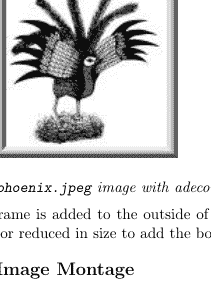

*图 18-9. 带装饰性边框的 phoenix.jpeg 图像。*

**注释：** 边框或边框被添加到现有图像的外部；图像不会被裁剪或缩小以添加边框。

## 18.1.6 创建图像蒙太奇

要制作多个图像的蒙太奇，请使用 `montage`。它将要使用的图像名称作为参数，后跟要写入蒙太奇图像的输出文件名。

蒙太奇图像是通过将所有输入图像缩放以适应最大可能尺寸，最高为 120x120 像素，并将这些图像以每行五列、四列的方式平铺而成的。

⇒ 要从文件 `owl.jpeg`、`thrush.jpeg` 和 `warbler.jpeg` 创建蒙太奇并将其写入 `ohio-birds.png`，输入：

```
$ montage owl.jpeg thrush.jpeg warbler.jpeg ohio-birds.png [RET]
```

**注释：** 在此示例中，读取了三个 JPEG 并输出到 PNG 文件；要在输出中指定使用的格式，请在输出文件名中给出适当的扩展名。

## 18.1.7 合并图像

使用 `composite` 将两幅图像合并为一幅新图像——将两个源图像文件和要写入的新文件的名称作为参数给出。没有任何选项时，`composite` 通过将两幅图像中较小的那一幅叠加在较大的那一幅之上，从左上角开始，创建新的图像文件；如果两幅图像大小相同，则只有第二幅图像可见。

+   ⇒ 要将两幅图像 `ashes.jpeg` 和 `phoenix.jpeg` 合并到新文件 `picture.jpeg` 中，输入：

```
$ composite ashes.jpeg phoenix.jpeg picture.jpeg [RET]
```

您可以使用 `-dissolve` 选项指定将两幅图像混合的百分比。将要“溶解”第一幅图像进入第二幅图像的百分比作为该选项的参数给出。

+   ⇒ 要将图像文件 `ashes.jpeg` 和 `phoenix.jpeg` 合并，使新图像包含 70% 的第一幅图像溶解到第二幅图像中，输入：

```
$ composite -dissolve 70 ashes.jpeg phoenix.jpeg picture.jpeg [RET]
```

此命令合并两幅图像并写入新的图像文件 `picture.jpeg`，其内容包含第一幅图像的 70%。

注释：使用 `-dissolve 50` 可使两个源文件混合均匀。

## 18.1.8 将两幅图像变形融合

变形是一种计算机成像方法，用于查找两幅图像中形状之间的差异；它常用于特效中，将两个生物的特征结合起来，例如人类和动物的面部。

您可以使用 `convert` 通过使用 `-morph` 选项，使用两个文件获得类似变形的效果。将要在两个文件之间的转换中使用的中间序列帧数作为该选项的参数给出。

当指定两个输入图像和一个输出文件时，此命令会取两个图像中对应像素之间的差异。效果就像“变形”后的图像。

如果您指定支持动画的文件格式，例如 MIFF，输出将写入单个动画图像文件。否则，输出将写入一系列文件，每个文件在其名称后附加其在系列中的编号。

您还可以指定在显示动画图像的每一帧时使用的延迟；为此，请使用 `-delay` 选项并给出时间，以百分之一秒为单位。

+   ⇒ 要将文件 `ashes.jpeg` 和 `phoenix.jpeg` 变形，制作一个名称以 `morph.png` 开头的三幅图像序列，输入：

```
$ convert -morph 3 ashes.jpeg phoenix.jpeg morph.png [RET]
```

此命令会写入五个新的 PNG 格式文件：`morph.png.0` 与 `ashes.jpeg` 完全相同；`morph.png.4` 与 `phoenix.jpeg` 完全相同；`morph.png.1`、`morph.png.2` 和 `morph.png.3` 则包含第一张与最后一张图像之间的变换结果。


⇒ 要对 `ashes.jpeg` 和 `phoenix.jpeg` 这两个文件执行变形操作，生成一个名为 `morph.miff` 的新文件，其中包含 25 个变换步骤的动画序列，且序列中的每一帧显示五分之一秒，请输入：

```
$ convert -morph 25 -delay 20 ashes.jpeg phoenix.jpeg morph.miff [RET]
```

此命令会生成一个新文件 `morph.miff`，其中包含一个由 27 幅图像组成的动画序列。序列中的每幅图像显示五分之一秒。序列播放完毕后会重复播放。可使用类似 `animate` 的工具查看该动画（参见技巧17.6 [查看动画或幻灯片]，第417页）。

注意：另一个工具 `xmorph` 是一个用于图像变形的特殊 X 应用程序；参见技巧18.4 [使用其他图像编辑器]，第435页。

## 18.2 转换图像文件

ImageMagick

DEB：`imagemagick`

RPM：`ImageMagick`

WWW：http://www.imagemagick.org/

使用 `convert`（同样属于技巧18.1 [转换图像]，第421页中介绍的 ImageMagick 工具套件）来转换图像的文件格式。将待转换文件的名称作为第一个参数，目标文件作为第二个参数。转换文件时，原始文件不会被更改。

要指定转换后的文件类型，请在转换后文件的文件名中使用该文件类型的标准扩展名。

⇒ 要将 JPEG 文件 `phoenix.jpeg` 转换为 PNG 图像，请输入：

```
$ convert phoenix.jpeg phoenix.png [RET]
```

此命令会将 JPEG 图像 `phoenix.jpeg` 转换为 PNG 格式，并写入新文件 `phoenix.png`。

将文件转换为 JPEG 格式时，务必使用 `-interlace NONE` 选项，以确保生成的 JPEG 图像是非隔行扫描的——当然，除非你确实想要隔行扫描图像。隔行扫描图像会分多次绘制，常用于 Web：读者可能在整幅图像下载完成之前，先看到由前面几次扫描组成的低分辨率图像。非隔行扫描图像则一次绘制完成。

⇒ 要将 PNM 文件 `pike.pnm` 转换为非隔行的 JPEG，同时将图像锐化 50%、添加 2x2 边框并加入版权注释，请输入（全部在一行内）：

```
$ convert -interlace NONE -sharpen 50 -border 2x2 -comment 'Copyright 2008 Toby Smith' pike.pnm pike.jpeg [RET]
```

此命令会将其输出写入文件 `pike.jpeg`。请注意，`-border` 和 `-comment` 选项之前已在介绍 `mogrify` 工具时说明过。某些 ImageMagick 工具会共享常用选项，这在你需要一次性对图像文件进行多项更改时会很方便；只需一个工具即可完成该任务。

你可以转换为 ImageMagick 可识别的任何图像格式，也可以从这些格式转换，包括动画。要制作动画，请按你希望它们出现的顺序，将所有单独帧的文件名作为参数，并将新文件名作为最后一个参数。支持动画的格式包括 MIFF 和 GIF。

使用 `-delay` 选项指定帧之间的延迟，单位为百分之一秒。

⇒ 要从 `drive1.jpg`、`drive2.jpg`、`drive3.jpg`、`drive4.jpg` 和 `drive5.jpg` 这些文件制作一个动画 MIFF 文件 `driving.miff`，帧之间延迟为五分之一秒，请输入（全部在一行内）：

```
$ convert -delay 20 drive1.jpg drive2.jpg drive3.jpg drive4.jpg drive5.jpg driving.miff [RET]
```

注意：某些图像格式是有损的，这意味着转换为这些格式时会丢失一些图像信息。例如，JPEG 格式就是一种有损格式，通常用于照片图像。如果将一个文件从原始 PNM 格式转换为 JPEG，再转换回 PNM，得到的 PNM 将与原始 PNM 不完全相同。

要以交互方式转换图像文件，请在 GIMP 中打开图像，然后从“文件”菜单中选择“另存为”，再选择要使用的文件类型；更多信息请参见下一个技巧。

## 18.3 使用 GIMP

GIMP

DEB: `gimp1.2`

`gimp-manual`

RPM: `gimp`

WWW: http://www.gimp.org/

如果你打算进行哪怕最轻微或最偶尔的图像编辑，比如对图像应用滤镜或特效、润饰、调整大小或裁剪数码照片，你都会希望花些时间熟悉 GIMP（“GNU 图像处理程序”）。

它是基于 Linux 的系统上的旗舰级图像编辑器，是一个功能全面的图像处理程序，可用于以复杂方式绘画、绘制、创建和编辑图像。你也可以用它转换图像文件、润饰和编辑照片、浏览图像集合。

GIMP 自带数百种工具、滤镜、字体和其他实用功能。以下是其核心功能的部分列表：

- 包含一整套绘图工具，包括画笔、铅笔、喷枪和克隆工具。
- 支持自定义画笔和图案。
- 包含一整套图像选择、变换和处理工具，包括渐变编辑器、颜色混合和特殊效果。
- 支持动画。
- 允许使用图层和通道。
- 支持大型图像，其大小仅受可用磁盘空间限制。
- 提供高质量字体抗锯齿。
- 支持完整的 Alpha 通道。
- 支持命令脚本。
- 允许多次撤销和重做，仅受可用磁盘空间限制。
- 允许同时打开多个图像。
- 支持所有主流图像文件格式，包括 JPEG、PNG、XPM、TIFF、TGA、MPEG、PS、PDF、PCX 和 BMP。
- 可以轻松添加 100 多个插件，以支持新的文件格式和新的特效滤镜。

GIMP 在 X Window 系统下运行，可通过运行 `gimp` 命令或从窗口管理器的菜单中选择它来启动。将要打开的图像文件的名称作为参数传入。

⇒ 要在 shell 提示符下于后台启动 GIMP，请输入：

```
$ gimp & [RET]
```

启动时，你作为参数传入的任何图像文件都会在各自的窗口中打开。主 GIMP 面板会在其自己的窗口中打开，如图 18-10 所示。

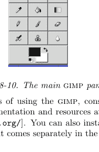

图 18-10：GIMP 主面板。

注意：若要了解使用 GIMP 的基础知识，请查阅《GIMP 用户手册》以及可从 GIMP 网站 [http://www.gimp.org/] 获取的其他文档和资源。你也可以在系统上安装该手册；在 Debian 系统上，它随 `gimp-manual` 软件包单独提供。

## 18.4 使用其他图像编辑器

Linux 上有各种各样的图像编辑应用程序——制作和编辑图像的方式与可用的工具同样多。

下表列出了一些你可能想探索的其他常用图像制作和编辑工具与应用程序。该列表并不详尽。

Aa3d

生成“ASCII 艺术”立体图。

DEB: `aa3d`

RPM: `aa3d`

WWW: http://aa-project.sourceforge.net/aa3d/

AutoTrace

将位图图像转换为矢量图形格式。

DEB: `autotrace`

RPM: `autotrace`

WWW: http://autotrace.sourceforge.net/

Barcode

生成条形码图像；支持所有商业标准。

DEB: `barcode`

RPM: `barcode`

WWW: http://tinyurl.com/36s28

Bitmap

用于位图文件的编辑器，位图文件在 X Window 系统中用于图标和平铺图案（参见技巧 4.7.3 [更改根窗口参数]，第 118 页）。

DEB: `xbase-clients`

RPM: `XFree86-progs`

WWW: http://www.xfree86.org/

Blender

广受欢迎的 3D 建模、渲染、动画和游戏设计软件。

DEB: `blender`

RPM: `blender`

WWW: http://www.blender.org/

CADUBI

绘制“ASCII 艺术”。

DEB: `cadubi`

WWW: http://langworth.com/CadubiProject

Drgenius

Drgeo

两个用于绘制交互式几何图形的相关工具。

DEB: `drgenius`

RPM: `drgenius`

WWW: http://ofset.sourceforge.net/drgenius/

WWW: http://ofset.sourceforge.net/drgeo/

Dia

用于绘制简单图表和示意图的工具。可将文件导出为 EPS（参见第 20 章 [PostScript]，第 451 页）。

DEB: `dia`

`dia-common`

RPM: `dia`

WWW: http://www.gnome.org/projects/dia/

Effectv

通过各种特殊效果处理电视输入。

DEB: `effectv`

Electric

用于设计电路图、原理图等图像的 CAD 系统。

DEB: `electric`

RPM: `electric`


WWW: http://tinyurl.com/3yzbf

Figurine

矢量图形编辑器，旨在比经典的 Xfig（见下文）更容易上手，同时保持与 Xfig 的文件格式兼容。

DEB: figurine

RPM: figurine

WWW: http://figurine.sourceforge.net/

Findimagedupes

对两个图像文件执行“视觉差异比较”；给定一组文件，它会找出相似或重复的图像。

DEB: findimagedupes

WWW: http://www.kudla.org/raindog/perl/

Gnuplot

功能强大的非交互式函数绘图工具。根据数据文件和公式生成图表和图形（参见技巧 29.8 [绘制数据]，第 575 页）。

DEB: gnuplot

RPM: gnuplot

WWW: http://www.gnuplot.info/

Innovation3d

3D 建模程序。

DEB: innovation3d

innovation3d-plugins

WWW: http://innovation3d.sourceforge.net/

### ivtools

一套绘图编辑器，包括 idraw，一个矢量图形编辑器。

DEB: ivtools-bin

RPM: ivtools

WW: http://www.ivtools.org/ivtools/

### Kali

用于绘制图案和镶嵌的工具，包括壁纸图案以及受 M.C. Escher 启发的无限或递归瓷砖。

DEB: kali

### Kino

数字视频编辑器，同时具有从数码电影摄像机导入的功能。

DEB: kino

RPM: kino

WW: http://kino.schirmacher.de/

### LignumCAD

用于设计家具的 3D CAD 系统。

WW: http://tinyurl.com/ys1so

### Moonlight3d

原名为 Moonlight Creator，此工具是用于建模、照明和渲染 3D 场景的 X 客户端。

WW: http://moonlight3d.net/

### QCad

专业的 2D CAD 系统，其文件以行业标准的 DXF 格式保存。

DEB: qcad

RPM: qcad

WW: http://www.ribbonsoft.com/qcad.html

### Sced

用于创建 3D 场景的工具。

DEB: sced

RPM: sced

WW: http://tinyurl.com/2g4oy

### Skencil

功能齐全的矢量绘图程序（原名 Sketch），支持贝塞尔曲线、渐变、混合以及此类应用程序应有的所有其他功能。

DEB: sketch

RPM: sketch

WW: http://sketch.sourceforge.net/

### Sodipodi

功能强大的矢量绘图程序，使用 svg 格式。

DEB: sodipodi

RPM: sodipodi

WWW: http://sodipodi.sourceforge.net/

### Tgif

X 的交互式 2D 绘图工具。

DEB: tgif

RPM: tgif

WWW: http://bourbon.usc.edu:8001/tgif/

### TKpaint

用于绘制图表、图解和演示文稿中使用的图形的工具。

DEB: tkpaint

RPM: tkpaint

WWW: http://mars.netanya.ac.il/~samy/tkpaint.html

### Xfig

用于绘制图形的久负盛名应用程序——复杂的图表、平面图、地图、流程图等。它以自己的格式保存文件（默认扩展名为 `.fig`）；通常的做法是导出为 EPS 格式。

DEB: xfig

RPM: xfig

WWW: http://xfig.org/

### Xmorph

将两幅图像融合在一起（有时称为“扭曲”），从而生成新图像。输入图像必须为 TrueVision Targa 文件格式，并且在每个文件中具有相同的大小、形状和像素数。（如果要使用 ImageMagick 套件快速轻松地融合两幅图像，请参阅 Recipe 18.1.8 [Morphing Two Images Together], page 431。）

DEB: xmorph

WWW: http://xmorph.sourceforge.net/

### Xpaint

简单的颜色“画笔”工具，早于 GIMP。它包含原型计算机绘画程序应有的所有基本功能。如果您不需要 GIMP 的高级功能，请考虑运行体积更小的 xpaint。

DEB: xpaint

RPM: xpaint

WWW: http://sf-xpaint.sourceforge.net/

⇒ 要捕获特定窗口，包括其窗口管理器框架，并将其写入 PNG 格式文件，请执行以下操作：

- 1. 运行 `import`：

```
$ import -frame session-1.png RET
```

- 2. 在要捕获的窗口上左键单击。

在此示例中，屏幕截图保存到名为 `session-1.png` 的文件。

如果要捕获的窗口或区域位于另一个 X 桌面中，或以其他方式与运行 `import` 命令的终端窗口有些分离，您可以先使用 `sleep` 来延迟命令几秒钟，同时将鼠标指针定位好。

⇒ 要运行 `import` 在五秒后制作 EPS 屏幕截图并保存为名为 `historic_moment.eps` 的文件，请输入：

```
$ sleep 5; import historic_moment.eps RET
```

该命令将在您键入 `RET` 后五秒运行 `import`，这应该能给您足够的时间将鼠标指针移动到所需位置。

NOTES: 系统蜂鸣声在屏幕捕获开始时响一次，捕获完成时响两次。

## 19.1.2 在控制台中截取屏幕截图

要在虚拟控制台中截取屏幕截图，请使用 `cat` 保存对应于该虚拟控制台的设备文件的内容；这些文件位于 `/dev` 目录中，格式为 `vcsnumber`，其中 `number` 为虚拟控制台的编号。

例如，如果目标控制台是第一个虚拟控制台（您可以通过键入 ALT - F1 来查看），则要 `cat` 的设备为 `/dev/vcs1`。

⇒ 要截取第四个虚拟控制台的屏幕截图并保存到名为 `screenshot` 的文件，请输入：

```
$ cat /dev/vcs4 > screenshot RET
```

NOTES: 您必须具有超级用户权限才能访问这些文件（请参阅 Appendix A [Administrative Issues], page 699）。

从您想要截取的虚拟控制台以外的虚拟控制台截取屏幕截图；如果您尝试从要捕获的同一控制台截取，输入的命令行也会包含在截图中！（有点像拍照时用拇指挡在镜头前。）

按本教程所示，虚拟控制台的屏幕截图会保存为文本文件；当显示图形时，无法对虚拟控制台进行屏幕截图。

## 19.2 扫描图像

SANE

DEB: sane

RPM: sane

WWW: http://www.sane-project.org/

SANE（“Scanner Access Now Easy”）是 Linux 事实上的扫描仪接口；使用它可以通过扫描仪扫描图像并将其保存到文件中。

SANE 支持多种扫描硬件，但请确保您要使用的扫描硬件是兼容的，可查阅 Linux 硬件兼容性 HOWTO [http://en.tldp.org/HOWTO/Hardware-HOWTO/] 以及 SANE 官方的受支持扫描仪列表 [http://www.sane-project.org/sane-backends.html]。

一旦 SANE 运行起来，您就可以使用支持 SANE 的应用程序（如 GIMP）来扫描图像（参见第 434 页的教程 18.3 [使用 GIMP]）。

以下教程介绍如何使用 SANE 包自带的命令行工具 `scanimage`。

注意：正如其缩写所暗示的，让扫描仪在 Linux 系统上工作并非总是一帆风顺。SANE 接口完全开放，其开发人员正在确保其足够通用，以便在任何硬件或操作系统上实现。

### 19.2.1 列出可用的扫描仪设备

在使用扫描仪之前，您需要知道其设备名称。要获取该名称，请使用带 `--list-devices` 选项的 `scanimage`。

⇒ 要列出可用的扫描仪设备，请输入：

```
$ scanimage --list-devices [RET]
device `umax:/dev/sgb' is a UMAX Astra 1220S flatbed scanner
$
```

在此示例中，系统上有一个扫描设备，一台 UMAX 品牌的扫描仪，可以通过将其设备名称 `umax:/dev/sgb` 作为 `-d` 选项的参数来指定给 `scanimage`。

要列出特定设备支持的分辨率和操作，请使用 `--help` 选项以及 `-d` 选项，后跟设备名称。

⇒ 要列出前面示例中设备支持的可用选项，请输入：

```
$ scanimage --help -d 'umax:/dev/sgb' [RET]
```


注意：对于所有 `scanimage` 命令，请通过包含带设备名称的 `-d` 选项来指定您要使用的扫描仪设备。

### 19.2.2 测试扫描仪

要对扫描仪运行诊断测试，以确保其能够正常读取，请使用带 `--test` 选项的 `scanimage`。

⇒ 要测试前面列出的 UMAX 扫描仪，请输入：

```
$ scanimage --test -d 'umax:/dev/sgb' [RET]
```

### 19.2.3 扫描图像

Netpbm

DEB: `netpbm`

RPM: `netpbm`

WWW: http://netpbm.sourceforge.net/

使用 `scanimage` 扫描图像。大多数扫描仪允许您指定要扫描的图像尺寸的 x 和 y 值（以像素为单位），从扫描仪玻璃面板的左上角开始。将这些坐标作为 `-x` 和 `-y` 选项的参数。另外，使用 `--resolution` 选项指定扫描分辨率，参数以 dpi（“每英寸点数”）给出。常见的分辨率值包括 72、120、204、300 和 600 dpi；72 dpi 是用于网页或屏幕查看的最常用分辨率，204 dpi 通常用于要通过传真机发送的图像。

扫描输出发送到标准输出，因此要将图像扫描到文件，请重定向标准输出。

`scanimage` 以 PNM（“可移植任意图”）格式输出图像，因此请确保您拥有 `netpbm` 包（大多数 Linux 系统默认安装）；这是一个有用的工具集合，用于转换和处理这些常见格式。`scanimage` 输出的三种 PNM 格式如下：

| PPM | 彩色图像 |
| PBM | 黑白图像 |
| PGM | 灰度图像 |

使用 `--mode` 选项指定输出格式，后跟以下参数之一：彩色 PPM 使用 `color`，PGM 灰度使用 `gray`，黑白 PBM 使用 `lineart`。每台扫描仪都有默认模式；对于大多数彩色扫描仪，默认模式将是 `color`。

⇒ 这里有两种使用方式。

- 使用前面示例中的 UMAX 扫描仪，以 72 dpi 扫描一张宽 200 像素、高 100 像素的彩色图像，并写入名为 `scan.ppm` 的文件，请输入（全部在一行内）：

```
$ scanimage -d umax:/dev/sgb --resolution 72 -x 200 -y 100 > scan.ppm [RET]
```

- 使用前面示例中的 UMAX 扫描仪，以 300 dpi 扫描一张宽 180 像素、高 225 像素的黑白图像，并写入名为 `scan.pbm` 的文件，请输入（全部在一行内）：

```
$ scanimage -d umax:/dev/sgb --resolution 300 --mode lineart -x 180 -y 225 > scan.pbm [RET]
```

注意：本教程中的命令行因太长而无法在一行内显示，因此分成了两行，但请在输入时将这些命令放在一个长行中。

图像扫描并写入文件后，您就可以像处理任何图像一样对其进行编辑。

## 19.3 提取 PhotoCD 图像

Xpcd

DEB: `xpcd`

`xpcd-gimp`

RPM: `xpcd`

WWW: http://bytesex.org/xpcd.html

有两种方法可以从柯达 PhotoCD 格式中提取图像 `file¹`（也称为 PCD）。如果你正在使用 `xpcd` 工具浏览 PhotoCD 文件，那么选择一张图像，以所需的分辨率提取副本，并按照 Recipe 17.5 [Browsing PhotoCD Archives]，第 415 页所述将其保存到文件中。

你也可以直接对 PCD 文件使用 `pcdtoppm` 来提取指定分辨率的图像并将其保存为 PPM 格式的文件。使用 `-r` 选项指定要提取的分辨率，以 1（最低分辨率）到 5（最高分辨率）的数字参数给出；如果省略此选项，则假定值为 3。还需给出要读取的 PCD 文件名和要写入的 PPM 文件名作为参数。

⇒ 要从文件 `sharp.pcd` 中提取最高分辨率图像并将其保存为名为 `sharp.ppm` 的 PNM 文件，请输入：

```
$ pcdtoppm -r5 sharp.pcd sharp.ppm [RET]
```

### 19.3.1 转换 PhotoCD 图像

一旦你提取了 PhotoCD 图像并将其写入 PPM 格式文件，就可以使用 `convert` 将其转换为其他格式并调整或改进图像（参见 Recipe 18.2 [Converting Image Files]，第 432 页）。

要在将其转换为 JPEG 格式的同时改进图像，请使用 `-interlace` 选项指定不进行交错，使用 `-sharpen` 选项指定 50% 的图像锐化，并使用 `-border` 和 `-comment` 选项为图像添加可选边框和注释。

⇒ 要将文件 `sharp.ppm` 转换为非交错 JPEG、锐化图像、添加 2 像素乘 2 像素的边框并对图像进行注释，请输入（全部在一行上）：

```
$ convert -interlace NONE -sharpen 50 -border 2x2 -comment 'This is a sharper image' sharp.ppm sharp.jpeg [RET]
```

### 19.3.2 去除 PhotoCD 雾霾

GIMP

DEB: `gimp1.2`

RPM: `gimp`

WWW: http://www.gimp.org/

> 1 这是柯达的一种专有扫描图像格式，目前是扫描胶片图像到数字格式的标准。
> 2 在某些系统上，命令是 `hpcdtoppm`，而不是 `pcdtoppm`。

提取的 PhotoCD 图像有时会出现一种“绿色雾霾”；要去除它，请在 GIMP 中打开图像并使用自动色阶功能调整颜色级别。这种技术对于改进任何扫描或导入的图像都很有效。

⇒ 要从 PhotoCD 图像中去除绿色雾霾，请执行以下操作：

1. 在 GIMP 中打开提取的图像（参见 Recipe 18.3 [Using the GIMP]，第 434 页）。
2. 通过 Image 菜单进入 Colors 子菜单，然后进入 Levels 子菜单，选择 Auto Levels。
3. 在 Levels 窗口中单击 OK 以接受更改。

## 19.4 将文本转换为图像

有时你可能想要一个文本的图像文件——例如用作网页的页眉。你总可以在图像编辑器中制作文本图像，但还有几种其他快速简便的方法，例如使用 `convert`、或 `import`、或 `pnmtext` 过滤器，这里都描述了这些方法。制作纯文本图像的另一个工具是 Gozer，见 Recipe 16.5 [Using Other Font Tools]，第 403 页。

### METHOD #1

Enscript

DEB: `enscript`

RPM: `enscript`

WWW: http://www.iki.fi/~mtr/genscript/

ImageMagick

DEB: `imagemagick`

RPM: `ImageMagick`

WWW: http://www.imagemagick.org/

一种制作文本图像的方法是将文本转换为 PostScript（参见 Recipe 15.2 [Outputting Text to PostScript]，第 359 页），然后使用 `convert` 将 PostScript 转换为你选择的图像格式，在其中可以按需裁剪和编辑。

你可以使用 `echo` 将文本发送到 `enscript`，并将输出直接管道传输到 `convert`。使用 `"0x0"` 作为 `-crop` 选项的参数，可自动将此图像裁剪到文本周围。

⇒ 要制作 Times Roman Bold 字体 42 磅的文本 “Amateur Radio History Page” 的 PNG 图像，请输入（全部在一行上）：

```
$ echo "Amateur Radio History Page" | enscript -o - -B -f "Times-Bold42" | convert -crop 0x0 - arhp.png [RET]
```

此命令制作了一个 PNG 图像文件 `arhp.png`，如图 19-1 所示。

# Amateur Radio History Page

Figure 19-1. An image made from text.

使用 `-border` 和 `-bordercolor` 选项绘制边框（作为第一个选项的 “widthxheight” 参数给出）和任意颜色（作为第二个选项的参数给出）。

⇒ 要制作 Times Roman Bold 字体 42 磅的文本 “Amateur Radio History Page” 的 PNG 图像，并带有宽 5 像素高 5 像素的蓝色边框，请输入（全部在一行上）：

```
$ echo "Amateur Radio History Page" | enscript -o - -B -f "Times-Bold42" | convert -crop 0x0 -border 5x5 -bordercolor blue - newarhp.png [RET]
```


此命令制作了一个 PNG 图像文件 `newarhp.png`，如图 19-2 所示。（虽然印刷插图为黑白，但此命令实际创建的图像具有蓝色边框。）


Figure 19-2. A bordered image made from text.

NOTES: 此方法也适用于将 `GROFF` 表输出转换为图像。

### METHOD #2

如果文本在 X 中显示在屏幕上，请使用 `import` 将其作为图像捕获，如 Recipe 19.1.1 [Taking a Screen Shot in X]，第 441 页所述。

### METHOD #3

要从文本制作位图图像，请使用 `pbmtext` 过滤器。它接受发送给它的任何文本作为输入，并输出 PBM 格式的图像文件。

⇒ 要将文本“Recommended Reading”制作成 PBM 图像，并将新文件写入 `header.pbm`，请输入：

```
$ pbmtext Recommended Reading > header.pbm [RET]
```

这对于制作大型文本的图像文件很有用，例如将该文本作为插图包含在内。要向 `pbmtext` 发送压缩文件，请使用 `zcat`（否则，`<` 重定向操作符也可以正常工作）。

⇒ 要制作一个包含压缩文件 `/usr/share/state/us-constitution.gz` 内容的 JPEG 图像，并写入名为 `constitution.jpeg` 的文件，请输入（全部在一行上）：

```
$ zcat /usr/share/state/us-constitution.gz | pbmtext |
convert - constitution.jpeg [RET]
```

## 19.5 使用其他图像导入工具

有许多其他工具可用于从各种来源导入图像。该领域一直在不断变化，随着新硬件设备和用于从中导入的新工具的引入。下面的表格描述了一些目前广受欢迎的工具。

| Tool | Description | DEB | RPM | WWW |
|------|-------------|-----|-----|-----|
| `Camediaplay` | 从任何使用 Sanyo 固件的数码相机下载图像，包括 Olympus Camedia 系列。 | `camediaplay` | `camediaplay` |  |
| `Cqcam` | 从 Color QuickCams 捕获图像。 | `cqcam` | `cqcam` | http://www.cs.duke.edu/~reynolds/cqcam/ |
| `Dvgrab` | 从使用 IEEE1394 链接（也称为 FireWire）的数码摄像机捕获音频和视频，并将输出写入 AVI 文件。 | `dvgrab` | `dvgrab` | http://kino.schirmacher.de |
| `Fuji` | 从富士数码相机导入图像（并进行其他操作）。 | `fujiplay` |  |  |
| `GOCR` | 命令行 OCR 工具，可从扫描图像输出纯文本。 | `gocr` | `gocr` | http://jocr.sourceforge.net/ |
| `gPhoto` | 从数码相机导入图像。 | `gphoto` | `gphoto` | http://www.gphoto.org/ |
| `Grunch` | 将部分扫描合并在一起形成更大的图像。 | `grunch` |  | http://www.radagast.org/~dplatt/ |
| `Gsumi` | 从压力敏感输入设备（如绘图板）导入黑白图像。 | `gsumi` |  |  |
| `Pencam` | 从使用 STV0680B-001 芯片的数码相机导入图像。 | `pencam` |  | http://stv0680-usb.sourceforge.net/ |
| `Streamer` | 从 `video4linux` 设备捕获图像。 | `streamer` | `xawtv-streamer` | http://bytesex.org/xawtv/ |

# 20. PostScript

PostScript 编程语言由 Adobe Systems 的 John Warnock 在 20 世纪 80 年代初设计并实现，用于描述“页面”应如何显示。页面通常是物理纸张（PostScript 通常用于向打印机硬件发送文档），但也可以是任何类型的输出显示。¹ PostScript 文件是包含用于在页面上绘制图像以供打印的 PostScript 语言命令的文本文件。

与纯文本文件一样，PostScript 文件在互联网上也很常见（并被商业打印机使用），因为与纯文本一样，它们可以在不同平台和硬件之间轻松共享。相同的 PostScript 文件可以在高端显示器上输出，也可以在低端打印机上打印，以该硬件的最佳能力为准。PostScript 是一种紧凑而优雅的格式。

虽然可以直接用 PostScript 语言编写（有些人已熟练掌握 PostScript 编程），但有如此多的工具和应用程序在 PostScript 之间进行文件转换，以至于你不必自己编写它。参见 Recipe 15.2 [Outputting Text to PostScript]，第 359 页，了解将纯文本转换为 PostScript 的方法。

GNU Ghostscript 是 PostScript 语言的免费解释器。² 它附带 `gs` 工具，该工具用于将 PostScript 或 PDF 文件转换为其他格式。它通常用于向非 PostScript 打印机打印（参见 Recipe 25.3.1 [Preparing a PostScript File for Printing]，第 518 页）。`ghostview` 工具用于在屏幕上预览 PostScript 文件（参见 Recipe 17.4.2 [Previewing a PostScript File]，第 414 页）。

EPS，或 Encapsulated PostScript，是一种描述页面中一个框内容的格式。EPS 文件可以嵌入到 PostScript 文件的页面中，因此在将插图插入文档时很常见（例如，Cookbook 中印刷的所有插图都是 EPS 格式文件）。你可以像查看和打印 PostScript 文件一样查看和打印 EPS 文件。

本章包含格式化和操作 PostScript 文件的配方。配方根据它们是作用于 PostScript 文件中的单个逻辑页面（文件中编号的页面，不一定是输出的物理页面），还是作用于整个文件作为整体来进行区分。

> 1 PostScript 最初是为 Apple LaserWriter 打印机设计的；NEWS 是 Sun Microsystems 的一个旧 UNIX 窗口系统，它使用 PostScript 来绘制显示。

> 2 它也是 Adobe 便携式文档格式（PDF）语言的解释器。

本章中使用的许多工具都来自 Angus Duggan 的 `psutils`（“PostScript Utilities”）软件包。这些工具可用于本章所述以外的其他用途；有关更多详细信息，请参阅各自的手册页。

## 20.1 操作 PostScript 页面

这些配方作用于 PostScript 文件的单个页面，而不是整个文件本身。

### 20.1.1 将 DVI 页面提取为 PostScript

`DVIPS`

DEB: `tetex-bin`

RPM: `tetex-dvips`

WWW: http://www.radicaleye.com/dvips.html

要将 DVI（“DeVice Independent”）文件的特定页面提取为 PostScript，请使用 `dvips` 并使用 `-pp` 选项指定要输出的页面或带连字符的页码范围。

⇒ 要仅从文件 `abstract.dvi` 中提取第一页并将 PostScript 输出发送到打印机，请键入：

```
+       $ dvips -pp1 abstract.dvi [RET]
```

默认情况下，`dvips` 会将输出发送到打印机；要将 PostScript 输出保存到文件，请将 `-o` 选项指定为输出所使用的文件名作为参数。

⇒ 要将文件 `abstract.dvi` 的 137 到 146 页输出为 PostScript，并将它们写入文件 `abstract.ps`，请键入：

```
+       $ dvips -pp137-146 -o abstract.ps abstract.dvi [RET]
```

### 20.1.2 从 PostScript 文件中提取页面

`PSUtils`

DEB: `psutils`

RPM: `psutils`

WWW: http://www.ctan.org/tex-archive/support/psutils/

使用 `psselect` 从 PostScript 文件中选择页面；当你提供输入文件时，它会输出一个包含指定页面的新 PostScript 文件。输出发送到标准输出或作为第二个参数指定的文件。


将要选择的页面作为 `-p` 选项的参数给出；你可以列出用逗号分隔的单个页面和页面范围。将范围指定为用连字符分隔的两个数字；因此，`4-6` 指定从第四页到第六页，包含两端。如果在一对中省略第一个数字，则假定为第一页，如果省略最后一个数字，则假定为最后一页。页面按指定的顺序写入新文件。

### 使用方法

- 要从 PostScript 文件 `newsletter.ps` 中选择第 47 页并将其输出到文件 `selection.ps`，请键入：

```
$ psselect -p47 newsletter.ps selection.ps [RET]
```

- 要从文件 `newsletter.ps` 中选择前十页、第 104 页、第 23 到 28 页以及第 2 页并将它们写入文件 `selection.ps`，请键入：

```
$ psselect -p1-10,104,23-28,2 newsletter.ps selection.ps [RET]
```

- 要从 PostScript 文件 `newsletter.ps` 中选择第 47 页并将其输出到文件 `selection.ps`，请键入：

```
$ psselect -p47 newsletter.ps selection.ps [RET]
```

在上面的第二个示例中，第 2 页被选择了两次——首先在选择 1-10 页时，然后单独选择。

你可以指定反向范围，将较高的页码列在范围的首位，以输出从该页向较低页运行的页面。你也可以通过在数字前加上下划线 `_` 来按其相对于文档最后一页的位置指定页面，这表示给定的页码是向第一页倒数。

### 使用方法

- 要从 PostScript 文件 `newsletter.ps` 中选择 30 到 25 页并将它们输出到文件 `selection.ps`，请键入：

```
$ psselect -p30-25 newsletter.ps selection.ps [RET]
```

- 要从 PostScript 文件 `newsletter.ps` 中选择最后一页并将其输出到文件 `end-notes.ps`，请键入：

```
$ psselect -p_1 newsletter.ps end-notes.ps [RET]
```

- 要从 PostScript 文件 `newsletter.ps` 中选择倒数第二页到倒数第十页并将它们输出到文件 `selection.ps`，请键入：

```
$ psselect -p_2-_10 newsletter.ps selection.ps [RET]
```

- 要从 PostScript 文件 `newsletter.ps` 中选择倒数第二页到第 10 页并将它们输出到文件 `selection.ps`，请键入：

```
$ psselect -p2-10 newsletter.ps selection.ps [RET]
```

如果文件 `newsletter.ps` 在最后一个示例中仅包含 12 页，则该示例相当于使用 `-p12-10` 运行 `psselect`。

使用 `-e` 选项选择所有偶数页，使用 `-o` 选项选择所有奇数页。

### 使用方法

- 要选择文件 `newsletter.ps` 中的所有偶数页并将它们写入新文件 `even.ps`，请键入：

```
$ psselect -e newsletter.ps even.ps [RET]
```

- 要选择文件 `newsletter.ps` 中的所有奇数页并将它们写入新文件 `odd.ps`，请键入：

```
$ psselect -o newsletter.ps odd.ps [RET]
```

使用单独的下划线 `_` 插入空白页，并使用 `-r` 反向输出页面。

### 使用方法

- 要选择文件 `newsletter.ps` 的最后十页，后跟一个空白页，再后跟前十页，并将它们输出到新文件 `selection.ps`，请键入：

```
$ psselect -p-1_10,_-1-10 newsletter.ps selection.ps [RET]
```

- 要选择文件 `newsletter.ps` 中的第 59、79 和 99 页，并以反向顺序输出它们（第 99 页在前）到新文件 `selection.ps`，请键入：

```
$ psselect -p59,79,99 -r newsletter.ps selection.ps [RET]
```

与最后一个示例相同的结果也可以通过省略 `-r` 选项并仅按相反顺序列出这三个页面来获得，如下所示：

```
$ psselect -p99,79,59 newsletter.ps selection.ps [RET]
```

## 20.1.3 合并 PostScript 页面

`PSUtils`

`DEB: psutils`

`RPM: psutils`

`WWW: http://www.ctan.org/tex-archive/support/psutils/`

使用 `psnup` 在一张纸上打印多个 PostScript 页面；在选项中指定要合并（或“up”）到每张纸上的页面数量。

要生成一个新的 PostScript 文件 `double.ps`，将文件 `single.ps` 中的两页放在每一页上，输入：

```
$ psnup -2 single.ps double.ps ⟨RET⟩
```

要指定纸张尺寸，请将标准纸张尺寸的名称作为 `-p` 选项的参数：`a3`、`a4`、`a5`、`b5`、`letter`、`legal`、`tabloid`、`statement`、`executive`、`folio`、`quarto` 或 `10x14`。你也可以使用 `-h` 和 `-w` 选项指定任意高度和宽度；单位可以指定为厘米（后跟 `cm`）或英寸（后跟 `in`）。如果未指定尺寸，`psnup` 默认使用 `a4` 纸张尺寸。

当页面为横向（从纵向逆时针旋转 90 度）时，使用 `-l` 选项；当页面为横向反向（从纵向顺时针旋转 90 度）时，使用 `-r` 选项。

页面在输出文件中按“行优先”布局放置，即逻辑页面按行排列在页面中。使用 `-c` 选项指定“列优先”布局，即逻辑页面按列排列在页面中。通过给 `-s` 选项一个百分比参数来缩放页面大小，该百分比为页面尺寸的倍数；例如，`-s .5` 将页面缩放为原始大小的 50%。

要在每页周围绘制边框，请将边框宽度（以点为单位）作为 `-d` 选项的参数指定（如果未指定宽度，则假定值为 1）。

## 20.1.4 按折页方式排列 PostScript 页面

```
PSUtils
DEB: psutils
RPM: psutils
WWW: http://www.ctan.org/tex-archive/support/psutils/
```

*折页（signature）* 是文档中对应于折叠并装订的纸张的一组页面；这些页面在文档中通常不是按顺序排列的（例如，在具有八页折页的文档中，第 8 页和第 1 页可能打印在同一张纸上）。

要按折页方式重新排列 PostScript 文件的页面——通常用于将文件打印为书籍或小册子——可使用 `psbook`。参数为要读取的 PostScript 文件的名称和用于输出文件的名称；

`psbook` 读取第一个文件的内容，重新排列页面，然后将 PostScript 输出写入第二个文件。

要将文件 `newsletter.ps` 的页面重新排列为折页并写入文件 `newsletter.bound.ps`，输入：

```
$ psbook newsletter.ps newsletter.bound.ps [RET]
```

默认情况下，`psbook` 将整个文件作为一个折页。如果文件页数不是四的倍数，它会在末尾添加空白页。

要指定使用的折页大小——换句话说，即一张纸上将出现的页面数量——请将该数字作为 `-s` 选项的参数。折页大小始终是四的倍数。

要将文件 `newsletter.ps` 的页面重新排列为八面折页并写入 `newsletter.bound.ps`，输入：

```
$ psbook -s8 newsletter.ps newsletter.bound.ps [RET]
```

## 20.2 操作 PostScript 文档

这些方法针对整个 PostScript 文档进行操作。

### 20.2.1 调整 PostScript 文档大小

`PSUtils`

```
DEB: psutils
RPM: psutils
WWW: http://www.ctan.org/tex-archive/support/psutils/
```

使用 `psresize` 调整 PostScript 文档的大小。它接受要调整大小的文件和要写入的输出文件作为参数；否则，它从标准输入读取并写入标准输出。如果指定了输出文件名，则还必须指定要使用的纸张尺寸，其格式与 `psnup` 工具相同：使用 `-p` 或 `-h` 和 `-w` 指定输出文件的大小，使用 `-P` 指定输入文件的大小（参见方法 20.1.3 [合并 PostScript 页面]，第 454 页）。

要将 PostScript 文件 `double.ps` 调整为美国信纸大小的纸张，并将输出写入新文件 `doublet.ps`，输入：

```
$ psresize -p letter double.ps doublet.ps [RET]
```

### 20.2.2 合并 PostScript 文档


有两种值得一提的方法可以将多个PostScript文件合并或串联成一个文件。一种方法更稳健，另一种更容易输入。我将从首选方法开始，这是我在合并本书的PostScript页面时发现的。

## 方法 #1

**Ghostscript**

DEB: `gs-common` `gs`

RPM: `ghostscript`

WWW: `http://www.cs.wisc.edu/~ghost/`

你可以使用 `gs` 将许多PostScript文件合并为一个。使用 `-q`、`-dNOPAUSE` 和 `-dBATCH` 标志，使其安静且无暂停地工作，并使用 `pswrite` 作为写入设备，将其作为 `-sDEVICE=` 选项的参数。使用特殊的 `-sOutputFile=` 选项指定输出文件的名称，最后按你希望合并的顺序指定要合并的文件。

⇒ 要按顺序合并PostScript文件 `part1.ps`、`part2.ps` 和 `part3.ps`，并写入新的PostScript文件 `program.ps`，输入（全部在同一行）：

```
$ gs -q -dNOPAUSE -dBATCH -sDEVICE=pswrite -sOutputFile=program.ps part1.ps part2.ps part3.ps [RET]
```

注意：如果你打算经常进行此类操作，可以将以下内容放入一个shell脚本中（参见方法3.7 [使用Shell脚本]，第84页），你可以将其命名为 `pscat`：

```
#!/bin/sh
gs -q -dNOPAUSE -dBATCH -sDEVICE=pswrite -sOutputFile=$*
```

然后，以要写入的文件名作为第一个参数调用该脚本，后面按你希望合并的顺序给出要合并的文件名。

3 如果要处理PDF文件，请改用 `pdfwrite` 作为选项。

## METHOD #2

**PSUtils**

DEB: `psutils`

RPM: `psutils`

WWW: `http://www.ctan.org/tex-archive/support/psutils/`

使用 `psmerge` 将PostScript文件合并为一个。把要合并的文件名作为参数给出，`psmerge` 会按给定顺序将它们输出到标准输出。你也可以使用 `-o` 选项指定输出文件名（不要在文件名和选项之间留空格）。

⇒ 要将文件 `slide1.ps`、`slide2.ps` 和 `slide3.ps` 合并到新的PostScript文件 `slideshow.ps` 中，输入：

```
$ psmerge -oslideshow.ps slide1.ps slide2.ps slide3.ps [RET]
```

**NOTES:** `gs` 方法其实更可取；`psmerge` 仅适用于用同一应用程序生成的PostScript文件。例如，`psmerge` 可以合并多个用TeX生成的文件，或多个用Xfig生成的文件，但不能合并两者的组合。

## 20.2.3 Arranging a PostScript Document in a Booklet

**PSUtils**

DEB: `psutils`

RPM: `psutils`

WWW: `http://www.ctan.org/tex-archive/support/psutils/`

要将PostScript文件中的页面排列成小册子，先用 `psbook` 将文件重新排列成签名，然后用 `psnup` 将页面排列（每张打印页横向放置两页），最后用 `pstops` 先输出奇数页再输出偶数页。

正确操作的诀窍是首先确定需要做什么，然后为 `pstops` 计算合适的测量值。

⇒ 要从文件 `newsletter.ps` 制作小册子，请执行以下操作：

1. 将页面重新排列成签名：

```
$ psbook newsletter.ps newsletter.signature.ps [RET]
```

2. 将页面以横向方式两页合一，缩小至原始大小的 70%（全部在一行输入）：

```
$ psnup -1 -p letter -2 -s.7 newsletter.signature.ps > newsletter.2up.ps [RET]
```

3. 输出奇数页：

```
$ pstops "2:0(1in,0in)" newsletter.2up.ps > odd.ps [RET]
```

4. 输出偶数页：

```
$ pstops "2:-1(1in,0in)" newsletter.2up.ps > even.ps [RET]
```

然后，要打印小册子，将 `odd.ps` 发送到打印机，重新将打印好的页面放入手动进纸盘，然后发送 `even.ps` 到打印机。这样可在纸张的正反两面打印奇数页和偶数页。

⇒ 要从一个使用letter大小纵向方向的文件制作letter大小纸张横向方向的双倍大小小册子，输入：

```
$ psbook input.ps > temp1.ps [RET]
...processing messages...
$ psnup -1 -p letter -2 -s.7 temp1.ps > temp2.ps [RET]
...processing messages...
$ pstops "2:0(1in,0in)" temp2.ps > odd.ps [RET]
...processing messages...
$ pstops "2:-1(1in,0in)" temp2.ps > even.ps [RET]
...processing messages...
$
```

**NOTES:** 如果你要经常做这个操作，你可能想看看 `ps2book` 实用程序，它是一个脚本，可帮助使用 `PSutils` 制作小册子 [`http://www.kis.uni-freiburg.de/~dobler/utils/ps2book.html`]。

## 20.3 Converting PostScript

这些配方展示如何将PostScript文件转换为其他格式。另请参阅准备PostScript文件以便打印的配方，Recipe 25.3.1 [Preparing a PostScript File for Printing]，第 518 页。

### 20.3.1 Converting PostScript to PDF

**Ghostscript**

DEB: `gs-common` `gs`

RPM: `ghostscript`

WWW: `http://www.cs.wisc.edu/~ghost/`

要将PostScript文件转换为PDF，请使用 `ps2pdf`，它是Ghostscript软件包的一部分。将要读取的PostScript文件名和要写入的PDF文件名作为参数给出。

⇒ 要从输入文件 `sutra.ps` 写入PDF文件 `sutra.pdf`，输入：

```
$ ps2pdf sutra.ps sutra.pdf [RET]
```

此命令写入一个名为 `sutra.pdf` 的新PDF格式文件。原始文件 `sutra.ps` 未被更改。

**NOTES:** 要进行正确的PDF转换，请确保已安装Ghostscript 6.01或更高版本；使用 `gs` 的 `-v` 选项输出已安装的版本。

### 20.3.2 Converting PostScript to Plain Text

**Ghostscript**

DEB: `gs-common` `gs`

RPM: `ghostscript`

WWW: `http://www.cs.wisc.edu/~ghost/`

要将PostScript文件转换为纯文本，请使用 `ps2ascii`，它是Ghostscript软件包的一部分。将要读取的PostScript文件名和要写入的文本文件名作为参数给出。

⇒ 要从输入文件 `sutra.ps` 制作文本文件 `sutra.txt`，输入：

```
$ ps2ascii sutra.ps sutra.txt [RET]
```

此命令写入一个名为 `sutra.txt` 的文本文件。原始文件 `sutra.ps` 未被更改。

# V.SOUND

## 21. 播放和录制声音

本章介绍Linux声音系统的基本控制，包括如何调整音频混音器以及如何使用基本工具播放和录制声音文件。你也可以使用 `snd`（参见第 23 章 [编辑声音文件]，第 487 页）以及许多其他声音应用程序来播放和录制音频。

要使系统发出声音，你需要为你的声卡安装并配置声音驱动程序。这是控制声卡的软件，也是Linux声音系统的一部分。

在若干年里，独立的ALSA（“高级 Linux 声音架构”）一直是音频爱好者中流行的声音系统选择，优于随Linux内核提供的较旧的OSS/Free（开放声音系统）。

从 2.6 内核开始，ALSA已包含在Linux中。如果你的Linux内核版本早于该版本，你需要让管理员安装ALSA，或者只使用较旧的OSS/Free驱动程序。

大多数系统都配置为只有超级用户才能使用声音设备，包括音频CD。如果你的系统也是这种情况，请让管理员授予你对这些设备的访问权限，通常是通过将你添加到 `audio` 组（参见配方 6.1 [在组中工作]，第 163 页）。

### 21.1 调整音频控件


# ALSA 工具

```
DEB: alsa-utils
```

```
RPM: alsa-utils
```

```
WWW: http://www.alsa-project.org/
```

混音器程序用于调整各种音频设置，例如音量和录音电平，也用于打开或静音麦克风或其他输入设备。在播放或录制声音之前，你必须使用混音器调整音频设置。

录制前，请务必将除输入源外的所有通道静音——但之后不要忘记你已将它们静音，当你想听到它们的音效时！

ALSA 的默认混音器称为 `amixer`，下面的配方将展示其用法。还有其他混音器，其中一些比 `amixer` 更容易使用。我的建议是安装 `aumix`。有关其他建议，包括可在 X 中使用的图形混音器，请参见本章末尾的配方 21.5 [使用其他声音工具]，第 474 页。

## 21.1.1 列出当前的音频设置

要列出所有音频输入和输出设备及其设置，请在不带任何选项的情况下输入 `amixer`。

你的声卡的组件按组组织，从包含主左右音量设置的 Master 组，到音频光盘和数字声音文件的各个组。（这些组与配方 6.1 [在组中工作]，第 163 页中描述的文件访问组无关。）

⇒ 若要浏览当前的混音器设置，请输入：

```
$ amixer | less [RET]
```

下表描述了 `amixer` 列出的一些重要声音组。

| Master | 主音量设置。 |

| PCM | 用于播放声音文件的数字音频；第一个通道是组 PCM,0，第二个是 PCM,1。 |

| CD | 音频光盘播放器（必须从 CD 驱动器连接到声卡的电缆）。 |

| Synth | 用于 MIDI 的合成器设备。 |

| Line | 声音输入设备（声卡背面的插孔通常标记为 LINE IN）。 |

| MIC | 麦克风设备（声卡背面的插孔通常标记为 MIC）。 |

要仅列出一个组的设置，请使用 `get` 选项，后跟要列出的组的名称。组名区分大小写——因此给出 MIC 指定麦克风组，而 Mic 和 mic 根本不是有效的组。

⇒ 以下是两种使用方法。

- 要输出麦克风设置，请输入：

  `$ amixer get MIC [RET]`

- 要输出第二个 PCM 设备的设置，请输入：

  `$ amixer get PCM,1 [RET]`

## 21.1.2 更改音量级别

要更改混音器设置，请将 `amixer set` 命令作为选项给出，后跟要更改的组和设置作为参数。要更改设备的音量级别，请给出音量级别的数值或百分比。

⇒ 以下是一些使用方法。

- 要将主音量设置为 75%，请输入：

  `$ amixer set Master 75% RET`

- 要将 PCM 设备音量设置为 30，请输入：

  `$ amixer set PCM 30 RET`

## 21.1.3 静音音频设备

特殊的“mute”和“unmute”参数用于静音给定设备的音量。在你录制某物之前，必须取消静音你想要录制的输入设备。录制完成后，请记住也将麦克风静音，以避免在调高扬声器时产生回授。

⇒ 以下是一些使用方法。

- 要取消静音麦克风并将其打开以进行录制，请输入：

  `$ amixer set MIC unmute capture RET`

- 要静音麦克风，请输入：

  `$ amixer set MIC mute RET`

- 要取消静音主音量并将其设置为 80% 音量，请输入：

  `$ amixer set Master 80% unmute RET`

## 21.1.4 选择音频录制源

要选择录制设备，请使用 `set` 后跟设备名称和“capture”参数，该参数指定指定的组为录制时捕获声音的组。

⇒ 以下是两种使用方法。

- 要将 LINE IN 插孔选为录制源，请输入：

  `$ amixer set Line capture RET`

- 要将麦克风插孔选为录制源，请输入：

  `$ amixer set MIC capture RET`

**注意：** 每次只能选择一个组进行捕获，并且当你将一个组选为录音的输入源时，你只是打开了麦克风或其他输入设备；只有在使用录音工具时才会开始录音。

## 21.2 播放声音文件

SOund eXchange

DEB: sox

RPM: sox

WWW: http://sox.sourceforge.net/

随 “SOund eXchange” 分发的 `play` 工具（一种声音文件转换工具）可以识别并播放许多音频格式，包括 OGG、WAV、VOC、AU、AIFF 和 SND 格式文件，以及音频 CD 格式文件和各种原始二进制格式。唯一几乎无法处理的常见音频格式是 MIDI 和 MP3，这将在后面的章节中讨论。将文件名作为参数给出即可播放。

⇒ 要播放文件 `sousa.aiff`，请输入：

```shell
$ play sousa.aiff RET
```

**注意：** 在开始播放声音之前，请确保你已使用混音器设置了主音量和 PCM 音量级别（参见 21.1 配方 [调整音频控件]，第 463 页）。尝试播放声音时没有声音输出的最常见原因是音量未打开！

ALSA 附带了 `aplay`，这是一种用于播放声音文件的工具，与 `play` 类似，但识别的格式较少。

### 21.2.1 播放 Ogg 文件

Ogg123

DEB: vorbis-tools

RPM: vorbis-tools

WWW: http://www.vorbis.com/

使用 `ogg123` 播放 Ogg Vorbis 文件，将文件名作为参数给出。

⇒ 要播放文件 `track1.ogg`，请输入：

```shell
$ ogg123 track1.ogg RET
```

默认情况下，`ogg123` 发送到标准声音设备。你可以通过使用 `-d` 选项指定声音设备，这在系统安装了多个设备时很有用，后面跟着以下表格中描述的特殊参数。

| 设备 | 描述 |

|---|---|

| `null` | 空驱动，用于测试目的。 |

| `oss` | Open Sound System（OSS/Free）驱动。 |

| `alsa` | Advanced Linux Sound Architecture（ALSA）驱动。 |

| `esd` | Enlightened Sound Daemon 驱动。 |

| `wav` | WAV 格式音频输出。 |

⇒ 要使用 OSS 驱动播放文件 `archive.ogg`，请输入：

```sh
$ ogg123 -d oss archive.ogg
```

使用 `-k` 选项跳过录音开头的部分。将要跳过的秒数作为该选项的参数给出。

⇒ 要播放文件 `archive.ogg`，从录音开始的整整一分钟开始播放并使用 ALSA 驱动，请输入：

```sh
$ ogg123 -k 60 -d alsa archive.ogg
```

要随机顺序播放文件，请给出 `-z` 选项。这在你想要打乱音频档案的音轨时很有用。

⇒ 要按打乱的顺序播放 `~/audio/incoming` 目录中的所有 `.ogg` 音频文件，请输入：

```sh
$ ogg123 -z "~/audio/incoming/*.ogg"
```

### 21.2.2 播放流式 Ogg 音频

要播放“流式”Ogg Vorbis 音频，例如直接从互联网访问的 Ogg 文件，将文件的 URL 作为参数传递给 `ogg123`。

⇒ 要播放 `http://auggie.wclv.com/lo.ogg` 处的 Ogg 流，请输入：

```sh
$ ogg123 http://auggie.wclv.com/lo.ogg
```

### 21.2.3 播放 MIDI 文件

播放 MIDI 文件有两种通用方法。你应该使用的方法取决于你的声卡是否内置了 MIDI 序列器。

#### 方法 #1

Playmidi

DEB: playmidi

RPM: playmidi

WWW: http://sourceforge.net/projects/playmidi/

如果你的声卡具有 MIDI 序列器，请使用 `playmidi` 播放 MIDI 文件；将要播放的 MIDI 文件名作为参数给出。

⇒ 要播放 MIDI 文件 `copacabana.mid`，请输入：

```
$ playmidi copacabana.mid
```

#### 方法 #2

Playmidi

DEB: playmidi

RPM: playmidi

WWW: http://sourceforge.net/projects/playmidi/

或

TiMidity++

DEB: timidity

RPM: timidity

WWW: http://www.onicos.com/staff/iz/timidity/

如果你的声卡是非 MIDI 声卡，你仍然可以通过使用 `timidity` 播放 MIDI 文件，它将 MIDI 格式转换为 WAV 格式，然后播放它。

⇒ 要通过将其转换为 WAV 格式在非 MIDI 声卡上播放 MIDI 文件 `copacabana.mid`，请输入：

```
$ timidity copa-cabana.mid
```


在某些非 MIDI 声卡系统上，你也可以使用 `-f` 选项使用 `playmidi`。这指定 MIDI 输出将发送到声卡上的 FM 合成器，后者使用随 `playmidi` 分发一起提供的 FM 补丁来播放它。

⇒ 要使用 FM 补丁在非 MIDI 声卡上播放 MIDI 文件 `copacabana.mid`，请输入：

```
$ playmidi -f copacabana.mid
```

## 21.2.4 播放 MOD 文件

MikMod

- DEB: `mikmod`
- RPM: `mikmod`
- WWW: http://www.tfn.net/~amstpi/mikmod.html

MOD（“module”）文件是由称为“tracker”的音乐软件制作的音轨音乐文件。流行的 tracker 包括 SoundTracker 和 Impulse Tracker；使用 `mikmod` 播放由它们制作的音频文件。支持的格式包括 IT、MOD、MTM、STM、S3M、ULT、UNI 和 XM。

⇒ 要播放 MOD 文件 `demo.it`，请输入：

```
$ mikmod demo.it [RET]
```

当 `mikmod` 正在播放时，按 `[F1]` 显示帮助面板，或按 `[Q]` 退出。

## 21.2.5 播放 MP3 文件

Mpg321

- DEB: `mpg321`
- RPM: `mpg321`
- WWW: http://mpg321.sourceforge.net/

有许多工具可用于播放 MP3 文件；其中一些列在本章末尾（参见技巧 21.5 [使用其他声音工具]，第 474 页）。

`mpg321` 就是其中之一；使用它播放 MP3 文件时，将文件名作为参数给出。

⇒ 要播放 MP3 文件 `lili-marleen.mp3`，请输入：

```
$ mpg321 lili-marleen.mp3 [RET]
```

要“缓冲”音频（当系统运行许多进程或其他活动较多时很有用），请以千字节为单位，将缓冲区大小作为 `-b` 选项的参数给出。默认值为 0（无缓冲）；如果需要此选项，请使用至少 1024 KB（即 1 MB）的大小，大约相当于六秒的 MP3 音频。

注意：`mpg321` 是 `mpg123` 的自由软件替代品，`mpg123` 是另一款非自由软件的命令行 MP3 播放器。

随着 Ogg Vorbis 的兴起，MP3 格式的使用正在减少；Ogg Vorbis 是一种音频质量更好、文件更小的格式，最重要的是，它不像 MP3 格式那样受专利保护。即使在 MP3 仍然流行的 Linux 世界之外，硬件供应商、广播电台和音响发烧友对 Ogg Vorbis 的支持也在增长。

## 21.2.6 播放流式 MP3 音频

有几种方法可以播放“流式”MP3 音频，例如直接从 Internet 访问的 MP3 文件，或通过某个 URL 访问的 MPEG 音频流。

### 方法 #1

Mpg321

- DEB: `mpg321`
- RPM: `mpg321`
- WWW: http://mpg321.sourceforge.net/

要使用 `mpg321` 播放来自 Web 的“流式”MP3 音频，只需将 MP3 流的 URL 作为参数给出。

⇒ 以下是两种用法。

- 要播放 `http://example.net/broadcast/live.mp3` 作为 MP3 流，请输入：

  ```
  $ mpg321 http://example.net/broadcast/live.mp3 [RET]
  ```

- 要使用 2MB 音频缓冲区播放 `http://example.net/broadcast/live.mp3` 作为 MP3 流，请输入：

  ```
  $ mpg321 -b 2048 http://example.net/broadcast/live.mp3 [RET]
  ```

### 方法 #2

Splay

- DEB: `splay`
- RPM: `splay`
- WWW: http://splay.sourceforge.net/

Wget

- DEB: `wget`
- RPM: `wget`
- WWW: http://www.gnu.org/software/wget/wget.html

要使用不接受 URL 作为选项的 MP3 播放器播放流式 MPEG 音频，首先使用带 `-O-` 选项的 `wget` 获取流并将其发送到标准输出，然后将此输出通过管道传递给 MP3 播放器。确保 MP3 播放器是

## 21.3.1 显示 Ogg 文件信息

Ogginfo

- DEB: `vorbis-tools`
- RPM: `vorbis-tools`
- WWW: http://www.vorbis.com/

使用 `ogginfo` 输出关于 Ogg Vorbis 音频文件的信息。将相关文件的文件说明作为参数给出。对于每个文件，它输出文件名、标题、艺术家、专辑、音轨号、以秒为单位的总长度，以及以分钟和秒表示的播放时间。

⇒ 要输出 Ogg Vorbis 音频文件 `mystery.ogg` 的信息，请输入：

```
$ ogginfo mystery.ogg [RET]
```

## 21.3.2 显示 MP3 文件信息

MP3info

- DEB: `mp3info`
- RPM: `mp3info`
- WWW: http://www.ibiblio.org/mp3info/

使用 `mp3info` 获取 MP3 文件的信息，包括标题和艺术家。将文件名作为参数给出。

⇒ 要输出 MP3 文件 `concerto.mp3` 的信息，请输入：

```
$ mp3info concerto.mp3 [RET]
```

## 21.4 录制声音文件

SOund eXchange

- DEB: `sox`
- RPM: `sox`
- WWW: http://sox.sourceforge.net/

要录制声音，首先选择一个输入设备作为录音源。声卡可能有 MIC 和 LINE IN 插孔，以及连接到 CD 驱动器的接口，这些都是可用于录音的声音输入源。当你选择设备进行采集时，录音将来自该源。

录制来自当前活动的输入（如果有），必须使用混音器设置；开始录制前请将其取消静音并设置音量级别。（请务必将扬声器的音量调至最低，否则会产生回授。）

要将音频录制到文件中，请使用 `rec` 工具。它可以写入多种音频文件格式，要么使用 `-t` 选项指定格式，要么根据输出文件名提供的扩展名确定使用的格式（参见附录 B [常规文件名扩展名]，第 723 页）。输入 `CTRL - C` 以停止录制。

将要录制的声音文件名作为参数给出；如果指定了 `.wav` 文件，则默认情况下会录制简单的单声道、低保真声音样本。

⇒ 要从麦克风录制简单的 WAV 样本并保存到名为 `hello.wav` 的文件中，请输入：

```
$ rec hello.wav [RET]
```

此命令开始以 8,000 Hz、单声道、8 位 WAV 格式向文件 `hello.wav` 录制，并会一直录制直到你使用 `CTRL - C` 中断。默认情况下会制作低保真录制——8,000 Hz、单声道、8 位采样——你可以指定制作高保真录制。（请记住，高保真录制会占用更多磁盘空间。）

要制作立体声录制，请使用 `-c` 选项指定声道数，将 2 作为参数。要制作 16 位录制，请将 `w`（“wide”）作为参数传递给 `-s`（“sample size”）选项。

通过将每秒使用的采样数作为参数传递给 `-r` 选项来设置录制采样率。对于 44,100 Hz 的 CD 质量音频，请使用 `-r 44100`。

最后，要以特定格式录制文件，要么将格式名称作为参数传递给 `-f` 选项，要么在输出文件名中使用该格式的传统文件扩展名（参见附录 B [常规文件名扩展名]，第 723 页）。

⇒ 以下是两种使用方法。

- 要从麦克风制作高保真录制并将其保存为名为 `goodbye.wav` 的 WAV 格式文件，请输入：

  ```
  $ rec -s w -c 2 -r 44100 goodbye.wav [RET]
  ```

- 要以 CD 音频格式制作声音录制并将输出写入名为 `goodbye.cdr` 的文件，请输入：

  ```
  $ rec goodbye.cdr [RET]
  ```

NOTES：当你不录制声音时，请保持输入静音（参见配方 21.1.3 [静音音频设备]，第 465 页）；这样，你可以在播放声音时插入麦克风而不会产生回授。此外，请确保录制时的音量级别不要设置得过高或过低；为麦克风或其他输入设备获得合适的电平可能需要进行一些初始调整。

与 `play` 类似，`rec` 是“SOund eXchange”工具包的一部分。

还存在更高级的选项。使用下一配方中描述的 `GramoFile`，可以通过菜单界面录制高质量音频。

## 21.5 使用其他声音工具

有许多混音器、播放和录制工具可用。下面的表格列出了其中一些更好的工具。

- Aumix

  简单的音频混音工具，可以在终端中交互使用，也可以在命令行和脚本中使用——如果你对 `amixer` 太过沮丧，就使用它。许多系统上的标准混音器。

  - DEB: `aumix`
  - RPM: `aumix`
  - WW: http://www.jpj.net/~trevor/aumix.html

- GramoFile


将声音从黑胶唱片传输到 CD 质量音频文件，也可以从麦克风和其他输入录制。其用于改善从黑胶取样的音频的处理滤镜尤其有用，可过滤掉爆裂声、嘶嘶声和其他表面噪声。`GramoFile` 可以自动检测并将唱片一面上的每个音轨分割为自己的 WAV 文件，这一功能也适用于以相同方式处理或录制长时间的口语或现场音乐。

`DEB`: `gramofile`

`RPM`: `gramofile`

`WW`: http://panic.et.tudelft.nl/~costar/gramofile/

- `Krecord`

`KDE` 环境下的简单 WAV 文件播放器和录制器。

`DEB`: `krecord`

`RPM`: `krecord`

`WW`: http://bytesex.org/krecord.html

## 22. 音频光盘

如果系统安装了 CD 驱动器¹ 和声卡，则可以播放音频光盘。你可以用与传统 CD 播放器相同的方式控制音频 CD 的播放，只是说在 Linux 系统上你使用命令行上的软件工具进行控制。还有用于从 CD 读取音频数据并写入文件（稍后可将其写入 CD-R 光盘或转换为 Ogg 格式）的工具。

如果播放音频 CD 时没有声音，请确保混音器中的 CD 设置为“REC”（这会取消静音）。

操作数据 CD 的工具和技术在配方 24.4 [使用数据 CD]，第 506 页中给出。

### 22.1 使用音频 CD

```
CDTOOL
DEB: cdtool
RPM: cdtool
WWW: http://www.hitsquad.com/smm/programs/CDTOOL/
```

这些配方描述了使用 `cdtool` 工具包中优雅的命令行工具集合以各种方式操作音频 CD 的方法。所有这些工具实际上都是指向单个程序 `cdtool` 的符号链接：其功能取决于运行时的名称。其他 CD 音频工具，包括 X 客户端，列在配方 22.4 [使用其他音频光盘工具]，第 484 页。

#### 22.1.1 播放音频 CD

使用 `cdplay` 在 CD 驱动器中播放音频 CD；声音通过连接到声卡 `LINE OUT` 插孔的扬声器输出。（你可能需要使用音频混音器来调整音量级别和其他设置；参见配方 21.1 [调整音频控件]，第 463 页。）

⇒ 要播放音频 CD，请输入：

```
$ cdplay [RET]
```

要从特定音轨开始播放，请将音轨号作为参数给出。

> 1 任何能够播放音频光盘的驱动器——DVD 驱动器、CD-ROM 驱动器或 CDR 或 CDRW 驱动器。

#### 22.1.3 停止音频 CD

要停止音频 CD 的播放，请使用 `cdstop`。

⇒ 要停止当前 CD 播放，输入：

```
$ cdstop ⟨RET⟩
```

#### 22.1.4 随机播放音频 CD 曲目

使用 `cdplay` 并带上“shuffle”参数来以随机顺序播放 CD 曲目。

⇒ 要随机播放 CD，输入：

```
$ cdplay shuffle ⟨RET⟩
```

#### 22.1.5 显示音频 CD 的信息

有几种方法可以显示音频 CD 的信息。

##### 方法 #1

使用 `cdinfo` 显示音频 CD 的信息，包括播放状态和曲目时间。无选项时，它输出播放状态：“play”表示 CD 正在播放；“paused”表示 CD 处于暂停状态；“no-status”表示 CD 未播放；“nodisc”表示驱动器中没有光盘。

⇒ 要查看 CD 驱动器中音频 CD 的当前状态，输入：

```
$ cdinfo ⟨RET⟩
```

此外，`cdinfo` 识别以下选项：

| `-a` | 输出绝对光盘时间。 |
| `-r` | 输出相对曲目时间。 |
| `-s` | 输出播放状态（默认操作）。 |
| `-t` | 输出当前曲目。 |
| `-v` | 输出所有可用信息：绝对光盘时间、相对曲目时间、播放状态和当前曲目。 |

##### 方法 #2

要以类似目录的格式显示音频 CD 上所有曲目的长度，请使用 `cdir`。该工具还会显示标题和艺术家名称（如果已知），但要使其工作，必须设置音频 CD 数据库（有关详细信息，请参阅 `cdtool man` 页面——配方 2.8.4 [从系统手册读取一页]，第 46 页）。

⇒ 要显示曲目列表，输入：

```
$ cdir RET
unknown cd - 43:14 in 8 tracks
5:15.00  1
5:50.40  2
5:29.08  3
3:50.70  4
4:17.00  5
5:56.15  6
7:13.40  7
5:19.22  8
$
```

在此示例中，CD 包含八首曲目，总播放时间为 43 分钟 14 秒。

#### 22.1.6 弹出音频 CD

使用 `cdeject` 弹出 CD 驱动器中的光盘。如果光盘当前正在播放，播放将停止并弹出光盘。

⇒ 要弹出 CD，输入：

```
$ cdeject RET
```

注意：此命令也会弹出数据 CD，前提是数据 CD 当前未挂载（请参阅配方 24.4 [使用数据 CD]，第 506 页）。

## 22.2 从音频 CD 采样

`Cdda2wav`

`DEB`: `cdda2wav`

`RPM`: `cdda2wav`

`WWW`: http://www.escape.de/users/colossus/cdda2wav.html

或

`Cdparanoia`

`DEB`: `cdparanoia`

`RPM`: `cdparanoia`

`WWW`: http://www.xiph.org/paranoia/

用于从音频 CD 采样（有时称为“抓取”）数据的两个工具是 `cdda2wav` 和 `cdparanoia`。两者都可以采样单个曲目或整个磁盘。`cdda2wav` 是 Linux 的典型 CD 音频采样工具，当速度比音质更重要时应使用它。`cdparanoia` 会进行各种额外的检查以供偏执者使用，当需要绝对完美的拷贝时应使用它（以牺牲速度为代价）。在正常条件下，`cdda2wav` 完全能够创建数字完美的音频样本；`cdparanoia` 在原始 CD 有划痕时很有用（其划痕检测功能可尝试在划痕处“保持同步”），或当你使用质量不佳的 CD 驱动器时很有用。

使用 `cdda2wav`，你将要检索的曲目号指定为 `-t` 选项的参数；使用 `-x` 选项指定 CD 质量检索，并使用 `-D` 选项给出 CD 设备名称——除非安装了多个 CD 驱动器，否则这几乎肯定是 `/dev/cdrom`。

默认情况下，文件以 WAV 格式写入；使用 `-o` 选项后跟“cdr”将文件写入 CD 音频格式。CD 音频格式文件可用于刻录包含这些文件作为曲目的音频 CD（在下一节中讨论），而 `.wav` 文件可用于转换为 Ogg 格式（请参阅配方 23.3.2 [编码 Ogg 文件]，第 495 页）。你可以在以后使用 `sox` 将任一格式转换为另一种格式——请参阅配方 23.3 [转换声音文件]，第 493 页。

⇒ 以下是两种使用方法。

- 要将音频 CD 的第七首曲目复制到当前目录中的 CD 质量 WAV 文件，输入：

  ```
  $ cdda2wav -t7 -d0 -x -D /dev/cdrom
  ```

- 要将音频 CD 上的所有曲目复制到单独的 CD 音频格式文件，输入：

  ```
  $ cdda2wav -D /dev/cdrom -x -o cdr -d0 -B
  ```

为了更可靠的采样，请使用 `cdparanoia`。将要采样的音频曲目范围作为参数给出，从第一个要采样的曲目到最后一个；如果不给出参数，它将采样整个光盘。使用 `-w` 选项指定 WAV 格式输出。

⇒ 以下是一些使用方法。

- 要使用“偏执”数据验证从划伤的音频 CD 的默认 CD 驱动器中采样第一到第三首曲目，并将输出作为原始音频格式文件写入当前目录，输入：

  ```
  $ cdparanoia 1-3
  ```

- 要仅使用“偏执”数据校验采样音频 CD 的第三轨，并将输出写入当前目录的 WAV 格式文件，输入：

  ```
  $ cdparanoia -w 3-3 [RET]
  ```

- 要使用“偏执”数据校验采样整张音频 CD，输入：

  ```
  $ cdparanoia -w -B [RET]
  ```

- 要使用低于最大值的“偏执”数据校验采样整张音频 CD，不检查划痕，并将每首歌曲保存为当前目录中的单独原始音频格式文件，输入：

  ```
  $ cdparanoia -B -Y -X [RET]
  ```

`NOTES`: 采样整张音频 CD 会占用大量磁盘空间；大多数人在制作出 Oggs 或从数据刻录音频 CD-R 后会立即删除 `.cdr` 或 `.wav` 文件。

## 22.3 刻录音频 CD-R

### Cdrecord

`DEB`: `cdrecord`

`RPM`: `cdrecord`

`WWW`: http://tinyurl.com/2s6a

使用 `cdrecord` 将音频文件写入空白 CD-R 光盘。你需要一个 CD-R 驱动器²，并且音频文件必须采用 CD-DA CD 音频格式（它们通常具有 `.cdda` 或 `.cdr` 文件名扩展名）。

使用特殊的“dev”参数指定 CD-R 驱动器，其格式如下：

```
dev=scsibus,target,lun
```


其中 `scsibus` 是 SCSI 总线的编号（主总线为 0），`target` 是 SCSI 目标 ID（通常为 1 到 6 之间的数字），`lun` 是其 LUN 编号（几乎总是 0）。

使用 `speed` 参数设置写入数据的速度系数：输入 `speed=2` 指定双倍速度，或输入 `speed=4` 指定四倍速度。

使用 `-dummy` 选项在关闭驱动器激光的情况下运行，因此不会进行实际刻录；这在你首次使用 CD-R 驱动器时很有用，并且

> ² 你也可以使用此工具配合 CD-RW 驱动器并写入 CD-RW 光盘。

需要测试你的配置以确保设置正确。另一个有用的选项是 `-v`，它提供更详细的输出信息。

将要刻录的音频文件名作为 `-audio` 选项的参数给出，按其应出现在光盘上的顺序排列。文件以 CD-DA CD 音频格式写入，并且应包含 16 位立体声，每秒 44,100 个采样（`.cdr` 或 `x.cdda` 文件满足此标准）。

### 使用方法

- 要将文件 `symphony.cdr` 刻录到主 SCSI 总线上目标 ID 为 2 的 CD-R 驱动器中的光盘，输入：

```
$ cdrecord dev=0,2,0 -audio symphony.cdr [RET]
```

- 要以双倍速度将当前目录中以 `.cdr` 扩展名结尾的所有文件刻录到主 SCSI 总线上目标 ID 为 2 的 CD-R 驱动器中，并给出详细输出，输入：

```
$ cdrecord dev=0,2,0 speed=2 -v -audio *.cdr [RET]
```

- 要对文件 `symphony.cdr` 在主 SCSI 总线上目标 ID 为 6（LUN 1）的 CD-R 驱动器中进行测试刻录，输入：

```
$ cdrecord dev=0,6,1 -dummy -audio symphony.cdr [RET]
```

当你为文件使用通配符时，如上面的第二个示例，shell 会按字母顺序展开文件。要按特定顺序写入一组音轨而不指定所有名称作为参数，请重命名它们，使其名称以对应你想要写入顺序的数字开头（参见 Recipe 5.5 [Moving Files and Directories]，第 144 页）。

例如，如果你有三个文件 `morning-song.cdr`、`midday-song.cdr` 和 `evening-song.cdr`，并且你想按该顺序写入它们，请将文件重命名为 `01-morning-song.cdr`、`02-midday-song.cdr` 和 `03-evening-song.cdr`。否则，如果你将它们指定为 `*.cdr`，shell 会对其名称进行排序，因此它们将被刻录到 CD-R 的顺序为 `evening-song.cdr`、`midday-song.cdr` 和 `morning-song.cdr`——这与预期完全相反！

要写入包含数据和音频音轨的光盘，首先指定数据音轨的文件（它应包含采用 ISO 9660 或 Rock Ridge 格式的文件系统映像），然后使用 `-audio` 选项跟上要使用的音频音轨的名称。 resulting CD-R 既可作为数据 CD 挂载，也可在音频 CD 播放器上播放（光盘上的第一音轨，即数据音轨，在播放音频时将被跳过）。

### 数据与音频混合刻录示例

要将数据轨道的 `band-info` 以及当前目录下所有扩展名为 `.cdda` 的音频轨道刻录到主 SCSI 总线上的目标 ID 为 2 的 CD-R 驱动器，请键入：

```
$ cdrecord dev=0,2,0 band-info -audio *.cdda [RET]
```

**NOTES**：刻录音频 CD 时，应尽可能减少正在运行的进程。如果 `cdrecord` 即使短暂地暂停以让系统调度其他进程，CD-R 可能会被毁坏！因此，在 CD-R 刻录过程中，建议避免在控制台之间切换——或在运行 X 时在窗口之间切换。

## 22.4 使用其他音频光盘工具

下表列出了一些可用于音频光盘的其他工具和应用程序。

- `Ccdcd` 从命令行播放 CD。

  DEB: `cccd`

  RPM: `cccd`

  WWW: http://cccd.undergrid.net/

- `Cdinfo` 显示有关音频 CD 的信息。

  WWW: http://bytesex.org/misc.html

- `CDlabelgen` 为光盘生成标签和正面插页卡。

  DEB: `cdlabelgen`

  RPM: `cdlabelgen`

  WWW: http://tinyurl.com/3bty3

- `Cdp` 在终端中播放音频 CD；它包含命令行和全屏控制台模式。

  RPM: `cdp`

  WWW: http://cdp.sourceforge.net/

- `Groovy CD Player` 播放音频 CD，配有圆润的“groovy”显示数字面板，瞬间吸引那些怀念 70 年代流行文化的用户。

  DEB: `groovycd`

- `Player`

  控制台 CD 播放器，可以读取 WorkMan 或 CDDB 数据库并输出 PostScript CD 音频封面。

  WWW: http://bytesex.org/misc.html

- `WorkBone`

  在终端中播放音频 CD，并允许你在曲目播放时向前或向后跳过曲目。

  DEB: `workbone`

  WWW: http://tinyurl.com/2ul7j

- `WorkMan`

  在 X 中播放音频 CD，具有图形界面，模仿物理 CD 播放器的前面板。

  DEB: `workman`

  RPM: `workman`

  WWW: http://tinyurl.com/26eof

- `XCDRoast`

  `cdrecord` 工具的图形前端，用于在 X 中使用。

  DEB: `xcdroast`

  RPM: `xcdroast`

  WWW: http://www.xcdroast.org/

## 23. 编辑声音文件

存在各种各样的工具和应用程序来编辑声音文件。本章描述了一些此类工具，并给出剪切和粘贴声音文件、应用效果和滤镜以及在格式之间转换声音文件的方法。

### 23.1 操作声音文件中的选区

`Snd`

DEB: `snd`

RPM: `snd`

WWW: http://www-ccrma.stanford.edu/software/snd/

`Snd` 是 X 的声音文件编辑环境，其目标是让声音如同 Emacs 之于文本。（它也使用 Emacs 风格的键绑定。）

你可以在 `/usr/doc/snd` 目录中找到它的完整手册；本节解释如何使用 `Snd` 来处理声音文件中的选区。

要打开 `Snd` 中的声音文件，将要打开的文件名作为参数传递给 `snd`。

要打开声音文件 `mixdown.wav`，请键入：

```
$ snd mixdown.wav RET
```

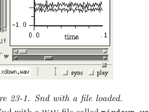

图 23-1. `Snd` 中加载了文件。

此命令以 `mixdown.wav` 这一 WAV 文件启动 `Snd`，如图 23-1 所示。

在 `Snd` 中选择声音文件的一部分与在 Emacs 中选择文本类似；你可以通过在鼠标上左键单击并拖动跨越区域来标记 `Snd` 中声音文件或录音的一部分。你拖过的区域会被着色并称为选区。一旦你选择了声音的一部分，你选择的任何效果都将作用于该选区。你还可以将正在编辑的声音的选区剪切并粘贴到其他声音缓冲区中。

`xwave` 工具（以及许多其他工具，很可能）具有类似的功能和能力（参见食谱 23.4 [使用其他声音编辑器]，第 496 页）。

#### 23.1.1 剪切声音文件的一部分

要在 `Snd` 中编辑的声音文件中剪切出一部分，首先通过左键单击并拖动来选择该部分，然后从 `Edit` 菜单中选择 `Cut`，有点像裁剪图像文件。

#### 23.1.2 将选区粘贴到声音文件中

在 `Snd` 中将剪切的声音选区粘贴到不同的声音缓冲区中，方法是打开新缓冲区，在目标缓冲区中左键单击，然后从 `Edit` 菜单中选择 `Paste`。你的最近选区将被粘贴到你在声音缓冲区中单击的位置。

#### 23.1.3 将声音文件混合在一起

要在 `Snd` 中将不同的音频文件作为多轨混合在一起，从 `File` 菜单中选择 `Mix` 并指定用作各个音轨的文件。

### 23.2 应用声音效果

`SOund eXchange`

DEB: `sox`

RPM: `sox`

WWW: http://sox.sourceforge.net/

“Sound eXchange” 工具 `sox` 是一个声音样本转换器。它读取声音作为文件或标准输入，并将声音输出到文件或标准输出，同时在两者之间进行转换。你可以使用 `sox` 将声音文件从一种格式转换为另一种格式，或对声音应用特殊效果。本节描述了你可以用 `sox` 对声音文件应用的一些特殊效果。

应用效果时，原文件永远不会被更改。你必须指定输出文件，或使用连字符（`-`）来表示标准输出。将输出格式指定为 `-t` 选项的参数。你只能用每个 `sox` 命令应用一种效果；因此，要给声音文件同时添加回声和混响，你就需要发出两个 `sox` 命令。


对于每种效果应用的量和电平会因情况而异。因此，请将以下配方仅视为使用选项的指南；对于任何特定的声音文件，你可能需要做一些实验才能达到预期的效果。

几乎所有的声音效果都是通过指定输入和输出文件参数，然后指定要使用的效果名称以及该效果所接受的任何选项来应用的（有值得注意的例外，例如用于更改文件振幅的 `-v` 选项）。

**NOTES:** 有关 `sox` 可以应用的声音效果的更多信息，请参阅 `/usr/doc/sox/` 中的各种文件，并阅读 `sox` 手册页（参见 Recipe 2.8.4 [Reading a Page from the System Manual]，第 46 页）。

## 23.2.1 更改声音文件的振幅

要更改声音文件的音量或振幅，请使用带有 `-v` 选项的 `sox`，并将音量电平作为参数给出。低于 1.0 的电平会降低振幅，而较高的数字会提高它。

⇒ 这里有两种使用方法。
- 要将文件 `old.wav` 的音量提高两倍并将输出写入 `new.wav`，请输入：

```sh
$ sox -v3 old.wav new.wav
```
- 要将文件 `old.wav` 的音量降低一半并将输出写入 `new.wav`，请输入：

```sh
$ sox -v.5 old.wav new.wav
```

使用 `sox` 的 `stat` 选项和 `-v` 来确定在失真或削波发生之前可以使用的最大可能值（它对文件进行统计分析并输出一个数值）。当你想在不破坏其保真度的情况下尽可能提高文件的音量时，这个值非常有用。

⇒ 要在不失真的情况下尽可能提高文件 `quiet.cdr` 的音量，请输入：

```
$ sox quiet.cdr loud.cdr stat -v RET
3.125
$ sox -v 3.125 quiet.cdr loud.cdr RET
$
```

前面的示例写入了一个新文件 `loud.cdr`。

## 23.2.2 更改声音文件的采样率

要更改声音文件的采样率，请使用 `-r` 选项，后跟要使用的采样率，以赫兹为单位。与 `-v` 选项一样，在给出输出文件的名称之前指定此选项。

⇒ 要将文件 `old.wav` 的采样率更改为 7,000 Hz 并将输出写入 `new.wav`，请输入：

```
$ sox old.wav -r 7000 new.wav RET
```

你可以使用此效果来提高或降低声音文件的音调。为此，请将期望的音调指定为 `-r` 选项的参数，并为输入文件指定此选项；然后，将原始采样率指定为输出文件的 `-r` 参数。

⇒ 要减慢采样率为 44,100 Hz 的声音文件 `bell.wav` 的音调，并将其写入名为 `slowbell.wav` 的新文件，也为 44,100 Hz，请输入：

```
$ sox -r 30000 bell.wav -r 44100 slowbell.wav RET
```

在此示例中，采样率为 44,100 Hz 的 `bell.wav` 中的声音以较慢的 30,000 Hz 播放。然后将其重新采样到输出文件，恢复到 44,100 Hz 的采样率，但音调现在与原始不同。

## 23.2.3 为声音文件添加混响

要为声音文件添加混响，请使用 `reverb` 效果。`reverb` 需要三个参数：输出的音量（其“gain-out”）；混响时间（以毫秒为单位）；以及延迟长度（以毫秒为单位）。你可以指定多个延迟；指定的越多，混响的叠加回声就越多。

⇒ 这里有一些使用方法。
- 要为文件 `old.wav` 添加基本的混响并将输出写入文件 `new.wav`，请输入：

```
$ sox old.wav new.wav reverb .5 1000 100  [RET]
```
- 要为文件 `old.wav` 添加空间感、带回声的混响并将输出写入 `new.wav`，请输入：

```
$ sox old.wav new.wav reverb 1 1000 333 333 333 333  [RET]
```

**NOTES:** 这个最后一个示例产生的声音类似于乐队 Flying Saucer Attack 的一些录音。（你知道他们是谁，对吧？）

## 23.2.4 为声音文件添加回声

要为声音文件添加回声，请使用 `echo` 效果。它以 `gain-in` 和 `gain-out` 音量电平作为参数，以及延迟和衰减，均以毫秒为单位。

⇒ 这里有一些使用方法。
- 要为声音文件 `old.wav` 添加多毫秒回声并将输出写入 `new.wav`，请输入：

```
$ sox old.wav new.wav echo .5 .5 1000 .5  [RET]
```
- 要为声音文件 `old.wav` 添加一秒回声并将输出写入 `new.wav`，请输入：

```
$ sox old.wav new.wav echo .5 .5 1000 .5  [RET]
```
- 要为 `old.wav` 添加“铁罐”回声效果并将输出写入 `new.wav`，请输入：

```
$ sox old.wav new.wav echo 1 .5 5 .5  [RET]
```

**NOTES:** `echos` 效果的工作方式与 `echo` 相同，但会在声音文件中添加一系列回声。

## 23.2.5 为声音文件添加 Flange

`flanger` 效果为声音文件添加 flange。它以 `gain-in` 和 `gain-out` 音量电平作为参数，以及以毫秒为单位的延迟和衰减，以及 flange 的速度以赫兹为单位。使用 `-s`（正弦波）或 `-t`（三角波）指定调制类型。

⇒ 这里有两种使用方法。
- 要为文件 `old.wav` 添加“水下”颤音效果并将输出写入 `new.wav`，输入：

```
$ sox old.wav new.wav flanger .5 .5 .4 .5 1 -t
```
- 要为文件 `old.wav` 添加听起来有点像“哇哇”效果踏板的颤音效果并将输出写入 `new.wav`，输入：

```
$ sox old.wav new.wav flanger .5 .5 .5 1 2 -t
```

## 23.2.6 为声音文件添加相位

`phaser` 效果为声音文件添加相位。它使用与 `flanger` 效果相同的参数。

⇒ 这里有两种使用方法。
- 要为文件 `old.wav` 添加相位并将输出写入 `new.wav`，输入：

```
$ sox old.wav new.wav phaser 1 .5 4 .5 1 -s
```
- 要为文件 `old.wav` 添加带“呼吸”效果的相位并将输出写入 `new.wav`，输入：

```
$ sox old.wav new.wav phaser .5 .5 .5 .9 .5 -t
```

**NOTES:** 使用大于 .5 的衰减可能会导致反馈。

## 23.2.7 为声音文件添加合唱效果

要为声音文件添加合唱效果，使用 `chorus`。其选项为音量的 `输入增益` 和 `输出增益`、以毫秒为单位的延迟和衰减、以赫兹为单位的速度，以及以毫秒为单位的合唱深度。指定 `-s` 或 `-t` 用于正弦或三角调制。

⇒ 这里有两种使用方法。
- 要为文件 `old.wav` 添加 100 毫秒的合唱效果并将输出写入 `new.wav`，输入：

```
$ sox old.wav new.wav chorus 1 .5 100 1 1 1 -t
```
- 要为文件 `old.wav` 添加深沉、“外星人般声音”的合唱效果并将输出写入 `new.wav`，输入：

```
$ sox old.wav new.wav chorus 1 .5 100 1 5 9 -t
```

## 23.2.8 为声音文件添加 Vibro-Champ 效果

`vibro` 效果模仿老式 Fender Vibro-Champ 放大器的效果。将其选项设为以赫兹为单位的速度（最大 30），并指定 0 到 1 之间的可选深度值（默认为 .5）。

⇒ 这里有一些使用方法。
- 要为文件 `old.wav` 添加微妙的 Vibro-Champ 效果并将输出写入 `new.wav`，输入：

```
$ sox old.wav new.wav vibro 1 [RET]
```
- 要为文件 `old.wav` 添加最大化 Vibro-Champ 的效果并将输出写入 `new.wav`，输入：

```
$ sox old.wav new.wav vibro 30 1 [RET]
```

## 23.2.9 反转声音文件中的音频

使用 `reverse` 效果反转声音文件中的声音。

⇒ 要反转文件 `old.wav` 中的声音并将输出写入 `new.wav`，输入：

```
$ sox old.wav new.wav reverse [RET]
```

## 23.3 转换声音文件

Sound eXchange

DEB: `sox`

RPM: `sox`


WWW: http://sox.sourceforge.net/  

使用 `sox` 进行大多数声音文件转换。作为参数给出输入文件名和要写入的输出文件名；使用指定输出文件声音格式的文件名扩展名（参见附录 B [常规文件名扩展名]，第 723 页）。

⇒ 要将文件 `new.wav` 转换为音频 CD 格式文件，输入：

```
$ sox new.wav new.cdr [RET]
```

此命令写入一个新文件 `new.cdr`，采用音频 CD 格式；原始文件 `new.wav` 未被更改。

有时你可能需要指定额外的选项，例如对于原始音频文件，其中采样率和其他属性必须指定。

⇒ 要将当前目录中的所有原始音频文件转换为音频 CD 格式文件，输入：

```
$ for i in *.raw [RET]
{ [RET]
sox -s -w -c2 -r 44100 $i -x $i.cdr [RET]
} [RET]
```

此命令将所有 `.raw` 文件写入同名但扩展名为 `.cdr` 的新文件。你随后可以使用 `cdrecord` 来刻录包含 `.cdr` 文件的音频 CD（参见菜谱 22.3 [写入音频 CD-R]，第 482 页）。

要将文件转换为特定格式而不使用标准扩展名，请使用 `-t` 选项指定要写入的格式。

⇒ 要将文件 `new.wav` 转换为音频 CD 格式并将输出写入名为 `cd-single` 的文件，输入：

```
$ sox new.wav -t cdr cd-single [RET]
```

## 23.3.1 转换 MP3 文件

Sound eXchange  
DEB: `sox`  
RPM: `sox`  
WWW: http://sox.sourceforge.net/  

Mpg123  
DEB: `mpg321`  
RPM: `mpg321`  
WWW: http://mpg321.sourceforge.net/  

要将 MP3 文件转换为其他格式，使用 `mpg321`（或其他命令行 MP3 播放器）将文件播放到标准输出，然后使用 `sox` 读取由此产生的原始音频并将其写入指定输入格式的另一个文件。

⇒ 要将 MP3 文件 `remix.mp3` 转换为 WAV 文件 `remix.wav`，输入（全部在一行上）：

```
$ mpg321 -b 10000 -s remix.mp3 | sox -t raw -r 44100 -s -w -c 2 - remix.wav [RET]
```

**NOTES:** 从原始音频或 WAV 格式音频文件制作 MP3 文件的过程称为编码（有时也称为“抓轨”）MP3 文件；程序执行此操作的软件是 MP3 编码器。这与其说是录制过程，不如说是转换过程：将现有音频转换为 MPEG 音频格式。遗憾的是，MP3 编码算法已获得专利，所有使用该算法的软件都必须支付许可费。这一限制意味着，未经许可编写 MP3 编码软件程序是违法的。这也是 MP3 如今逐渐失去人气、被 Ogg Vorbis 音频格式取代的主要原因。与许多计算趋势一样，这一趋势的早期采用者来自 Linux 世界。

## 23.3.2 编码 Ogg 文件

```
Oggenc
DEB: vorbis-tools
RPM: vorbis-tools
WWW: http://www.vorbis.com/
```

使用 `oggenc` 编码 Ogg Vorbis 音频文件。它接受一个音频文件作为参数，并写入一个具有相同基本文件名和 `.ogg` 扩展名的新文件。若要指定不同的文件名，请将所需名称作为 `-o` 选项的参数提供。

⇒ 要从 WAV 文件 `interview.wav` 制作 Ogg Vorbis 文件，请输入：

```
$ oggenc interview.wav [RET]
```

此命令会创建一个新文件 `interview.ogg`。

## 23.3.3 将 Ogg 转换为其他格式

要将 Ogg Vorbis 音频文件转换为其他格式，请使用 `ogg123` 并通过 `-d` 选项指定“wav”驱动程序。你作为参数提供给此命令的 Ogg Vorbis 文件将被写入当前目录下名为 `output.wav` 的 WAV 格式文件。

⇒ 要将 Ogg Vorbis 文件 `bobhopehour.ogg` 转换为 WAV 格式，请输入：

```
$ ogg123 -d wav bobhopehour.ogg [RET]
```

此命令会在当前目录中写入一个新文件 `output.wav`。通过将输出文件名作为 `-o` 选项的参数来指定输出文件。

⇒ 要将 Ogg Vorbis 文件 `bobhopehour.ogg` 转换为 WAV 格式，并写入名为 `hope1.wav` 的文件，请输入：

```
$ ogg123 -d wav -o hope1.wav bobhopehour.ogg [RET]
```

注意：WAV 输出可以使用传统方法进一步转换为其他格式（例如，参见前面的方法）。

如果你想在转换的同时收听文件，可以通过为你所使用的音频系统驱动程序添加额外的 `-d` 选项来实现。

## 23.4 使用其他声音编辑器

Linux 中的声音软件发展迅速，纸质书籍不可能跟上其步伐；你可以通过查看 Dave Phillips 的“Linux 声音与 MIDI 软件”来了解最新进展。该资源提供了最全面、最新的 Linux 相关声音软件列表（参见附录 D [进一步阅读的参考资料]，第 731 页）。

与文本编辑器一样，声音编辑器也种类繁多，从简单的编辑器到高级环境应有尽有。下表列出了一些最流行的编辑器。

### Audacity

带有频谱图显示的音频编辑器。以其速度著称。

DEB: `audacity`  
RPM: `audacity`  
WWW: http://audacity.sourceforge.net/

### Brahms

适用于 KDE 的图形化音乐编辑器，其功能包括乐谱和钢琴卷帘记谱。

DEB: `brahms`  
RPM: `brahms`  
WWW: http://brahms.sourceforge.net/

### DAP

用于编辑声音文件的图形化工具。

RPM: `dap`  
WWW: http://www.cee.hw.ac.uk/~richardk/

### Festival

语音合成系统，可读取英语（英式和美式）、西班牙语和威尔士语的纯文本输入，并将语音输出为声音。

DEB: `festival`  
RPM: `festival`  
WWW: http://www.cstr.ed.ac.uk/projects/festival/

### Freebirth

音序器、低音合成器和采样播放器。

DEB: `freebirth`  
RPM: `freebirth`  
WWW: http://www.hitsquad.com/smm/programs/Freebirth/

### GLAME

被描述为“音频界的 GIMP”的音频编辑器。GLAME 是“GNU/Linux Audio Mechanics”的首字母缩写。

DEB: `glame`  
RPM: `glame`  
WWW: http://glame.sourceforge.net/

### Pure Data

用于实时音频编程的强大系统。

DEB: `pd`  
WWW: http://www-crca.ucsd.edu/~msp/software.html

### Rosegarden

MIDI 音序器、音乐记谱（乐谱）编辑器和音乐作曲编辑器。

DEB: `rosegarden`  
RPM: `rosegarden`  
WWW: http://www.rosegardenmusic.com/

### Tapiir

受老式磁带延迟效果启发的图形化实时音频效果处理器。

DEB: `tapiir`  
WWW: http://www.iua.upf.es/~mdeboer/projects/tapiir/

### XWave

一个简单的声音编辑器，可执行你在 WAV 文件编辑器中预期的基本功能。

DEB: `xwave`  
WWW: http://www.ibiblio.org/pub/linux/apps/sound/editors/

## VI. 生产力

## 24. 磁盘存储

Linux 系统上的所有文件和目录都存储在 Linux 文件系统上，Linux 文件系统是一种磁盘设备（如硬盘），其格式用于存储目录树（参见第 5 章《文件和目录》，第 125 页）。

Linux 系统上的磁盘存储分为两类：固定式和可移动式。固定存储是指牢固地连接到计算机系统且不打算随意拆卸（除升级外）的磁盘。你的硬盘（有时称为“硬盘”或“固定磁盘”），它存储操作系统、应用程序软件和用户数据，是固定存储的典型例子。

第二种磁盘存储是可移动存储，即旨在用于归档或传输到另一系统的磁盘。可移动存储的常见例子是软盘（或“磁盘片”）和 CD-ROM——使用完毕后你通常会将存储介质从其驱动器托架中取出。


在 Linux 系统上，磁盘通过将其挂载到目录来使用，这使得磁盘包含的目录树在该给定目录挂载点可用。磁盘可以挂载在系统上的任何目录上，但磁盘之间的划分是透明的。这意味着具有单独的物理硬盘用于 `/home`、`/usr` 和 `/usr/local` 目录树的系统，看起来和感觉上与只有一个物理硬盘的系统没有区别。

系统管理员经常将大容量驱动器挂载到将包含大量数据的目录树上（如拥有大量用户的系统的 `/home` 目录树），出于容错目的，管理员经常在同一系统上使用多个物理硬盘——如果发生磁盘故障，只有该磁盘上的数据会丢失（尽管理想情况下可以从备份中恢复）。

本章描述了操作磁盘和存储介质的工具和技术。

### 24.1 列出磁盘的可用空间

要查看磁盘上剩余多少可用空间，请使用 `df`。不带任何选项时，`df` 会输出所有已挂载文件系统的列表。输出六列，显示每个磁盘的信息：其在 `/dev` 中的设备文件名；系统使用的 1024 字节块数；已使用的块数；可用的块数；设备使用百分比；以及设备挂载的目录树名称。

⇒ 要查看系统磁盘上剩余多少可用空间，输入：

```
$ df RET
Filesystem          1024-blocks  Used Available Capacity Mounted on
/dev/hda1           195167     43405   141684   23%    /
/dev/hda2           2783807    688916  1950949  26%    /usr
/dev/hdb1           2039559    1675652 258472   87%    /home/webb
$
```

此示例显示系统上挂载了三个文件系统——挂载在 `/` 上的文件系统使用率为 23%，挂载在 `/usr` 上的文件系统使用率为 26%，挂载在 `/home/webb` 上的文件系统，即一个主目录，使用率为 87%。

### 24.2 列出文件的磁盘使用情况

使用 `du` 列出文件占用的磁盘空间。要指定特定文件名或目录树，将其作为参数给出。不带参数时，`du` 对当前目录操作。

它为树中的每个子目录输出一行，列出使用的空间和子目录名称；最后一行列出整个目录树使用的总空间量。

⇒ 要输出以当前目录为根的目录树的磁盘使用情况，输入：

```
$ du RET
8   ./projects/documentation
12  ./projects/source
4   ./projects/etc
24  ./projects
3   ./tmp
27  . 
$
```

此示例显示目录树中有两个子目录：`projects` 和 `tmp`。`projects` 子目录包含另外三个目录。各个目录使用的磁盘空间总量为最后一行的 27 kB。

默认情况下，输出以 1 KB 块为单位，但你可以通过选项指定其他单位：`-k` 表示千字节，`-m` 表示兆字节。

⇒ 以下是两种使用方法。

- 要以千字节为单位输出 `/usr/local` 目录树的磁盘使用情况，输入：

  ```
  $ du -k /usr/local RET
  ```

- 要显示文件 `/tmp/cache` 使用的兆字节数，输入：

  ```
  $ du -m /tmp/cache RET
  ```

使用 `-s` 选项（“汇总”）仅输出包含整个目录树总量的最后一行。当你只关心目录树的总磁盘使用情况时，这很有用。

⇒ 以下是两种使用方法。

- 要仅输出 `/usr/local` 目录树的总磁盘使用情况，输入：

  ```
  $ du -s /usr/local RET
  ```

- 要仅以千字节为单位输出 `/usr/local` 目录树的总磁盘使用情况，输入：

  ```
  $ du -s -k /usr/local RET
  ```

### 24.3 使用软盘

在使用软盘之前，必须先对其进行格式化，这会在磁盘上创建空的文件系统。

要读取或写入格式化磁盘上的文件，你需要将软盘挂载到空目录，使其文件系统在指定目录中可用。通常，Linux 系统为此目的设有空的 `/floppy` 目录。（另一个用于挂载文件系统的通用目录是 `/mnt` 目录。）

虽然你不能将文件系统挂载到包含其他文件的目录上，但你始终可以在某处创建新目录来挂载文件系统。

当你将磁盘挂载到目录上时，该目录包含磁盘文件系统的所有文件和目录；当你稍后卸载磁盘时，该目录将为空——磁盘上的所有文件和目录仍在磁盘的文件系统上，但文件系统不再挂载。

使用完软盘后，必须在将其从驱动器中取出之前卸载它。如果不这样做，你可能会损坏或删除其中的一些 files on it—Linux may still be using the mounted files when you remove the disk (see Recipe 2.1.2 [Turning Off the System], page 27).

The following sections show you how to format, mount, and unmount floppies. On many systems, you need superuser privileges to do any of these actions.

NOTES: For recipes describing the use of MS-DOS (and Microsoft Windows) formatted disks under Linux, see Recipe 26.1 [Using DOS and Windows Disks], page 525.

#### 24.3.1 Formatting a Floppy Disk

You can use `fdformat` to do a low-level format on a floppy disk device that you give as an argument. To format a 1.44 MB floppy in the first floppy drive, use the `/dev/fd0H1440` device as the argument to use.

⇒ To perform a low-level format on a 1.44 MB floppy disk in the first removable floppy drive, type:

```
$ fdformat /dev/fd0H1440 [RET]
```

This will erase all the information on the disk.

Once a disk is formatted, you need to make a Linux filesystem on the disk.¹ Use `mke2fs` to do this. Give the name of the device file of the floppy drive as an argument—usually the first removable disk drive, `/dev/fd0`. The floppy disk must be in the drive when you give this command, and any data already on it will be lost.

⇒ To make a Linux filesystem on the floppy disk in the first removable floppy drive, type:

```
$ mke2fs /dev/fd0 [RET]
```

NOTES: You can make 2 MB high-capacity formats with `superformat`. This formats a floppy disk beyond its normal carrying capacity; it is a lengthy process, but if you need to store extra data on your disk, you might consider it.

¹ Technically, this filesystem is a second extended file system (ext2fs), the native filesystem currently used with Linux.

#### 24.3.2 Mounting a Floppy Disk

To mount a floppy disk, use `mount` with the `/floppy` option.²

⇒ To mount a floppy, type:

```
$ mount /floppy [RET]
```

² This works if your administrator has set up the floppy drive filesystem for user access—see Recipe A.6.3 [Letting Users Access Hardware Peripherals], page 718.


To mount a floppy disk to a specific directory, use `mount` and give as arguments the device name of the floppy drive (usually `/dev/fd0` for one-floppy systems) and the name of the directory to mount to.

⇒ To mount the floppy in the first floppy drive to `~/tmp`, type:

```
$ mount /dev/fd0 ~/tmp [RET]
```

Once you have mounted a floppy, its contents appear in the directory you specify, and you can use any file command on them.

⇒ Here are two ways to use this.

- To list the contents of the base directory of the floppy mounted on `/floppy`, type:

  ```
  $ ls /floppy [RET]
  ```

- To list the contents of the entire directory tree on the floppy mounted on `/floppy`, type:

  ```
  $ ls -iR /floppy [RET]
  ```

NOTES: You can copy files to and from the directory tree that the floppy is mounted on, make and remove directories, and do anything else you could on any other directory tree. But remember, before you remove it, you must first unmount it.

### 24.3.3 Unmounting a Floppy Disk

Use `umount` to unmount a floppy disk, using the name of the directory it is mounted on as an argument.

⇒ To unmount the floppy that is mounted on `/floppy`, type:

```
$ umount /floppy [RET]
```

NOTES: You can't unmount a disk if your current working directory, the directory you are in, is somewhere in that disk's directory tree.³ In this case, trying to unmount the disk will give the error that the `/floppy` filesystem is in use; change to a different directory that isn't in the `/floppy` directory tree, and then you can unmount the disk.

Sometimes when you unmount a floppy, the light on the floppy drive will go on and remain on for a few seconds after it has been unmounted. This is because Linux sometimes keeps changes to files in memory before it writes them to disk; it’s making sure that the files on the floppy are up-to-date. Simply wait until the light goes off before you remove the floppy from the drive.

## 24.4 Using Data CDs

As with a floppy disk, before you can use a data CD (“compact disc”) on your system, you must first mount it on an empty directory. You then unmount it from the directory before you can eject the CD from the CD drive (you can also eject the disc using software—see Recipe 22.1.6 [Ejecting an Audio CD], page 480).

**NOTES:** To use audio CDs, see Chapter 22 [Audio Compact Discs], page 477.

### 24.4.1 Mounting a Data CD

To mount a data CD on the system, use `mount` with the `/cdrom` option.⁴

⇒ To mount a data CD on the system, type:

```
$ mount /cdrom [RET]
```

This command makes the contents of the data CD available from the `/cdrom` directory tree. You can use any Linux file command on the files and directories on a data CD, but you can only write to one if it is a CDRW disc.

Like the `/floppy` directory, the use of the `/cdrom` directory is a standard practice and convenient, but not necessary—you can mount disks in whatever empty directory you like. (You could even, for example, mount discs from the CD drive to `/floppy` and mount floppy disks to `/cdrom`, but why would anyone do that!)

To mount a data CD to a specific directory, use `mount` and give as arguments the name of the device file in `/dev` corresponding to the CD drive, and the name of the directory to mount to. This directory must already exist on the filesystem, and it must be empty. If it doesn’t exist, use `mkdir` to create it first (see Recipe 5.1.2 [Making a Directory], page 130).

Most Linux systems are set up so that the device file of the first CD drive is `/dev/cdrom`, but the name of the device file may be different, especially if you have a SCSI CD-ROM drive.

⁴ This works if your administrator has set up the CD drive filesystem for user access—see Recipe A.6.3 [Letting Users Access Hardware Peripherals], page 718.

⇒ 要将 CD 驱动器中的光盘挂载到 `/usr/local/share/clipart` 目录，请键入：

```
$ mount /dev/cdrom /usr/local/share/clipart [RET]
```

CD 驱动器中光盘的内容随后将可在 `/usr/local/share/clipart` 目录树中使用，然后你就可以像使用其他任何文件一样使用数据 CD 上的文件和目录。

⇒ 以下是一些使用方法。

- 要浏览数据 CD 内容的目录树图，请键入：


$ tree `/usr/local/share/clipart` | less `[RET]`

- 要切换到数据 CD 上的根目录，请键入：

  `$ cd /usr/local/share/clipart [RET]`

- 要列出数据 CD 上根目录的内容，请键入：

  `$ ls /usr/local/share/clipart [RET]`

## 24.4.2 卸载数据 CD

使用 `umount` 卸载数据 CD；以其挂载的目录名作为参数给出。

⇒ 要卸载挂载在 `/cdrom` 上的 CD 驱动器中的光盘，请键入：

`$ umount /cdrom [RET]`

NOTES: 与卸载任何类型的文件系统一样，确保光盘上的文件没有被使用，否则你将无法卸载它。例如，如果 shell 中的当前工作目录位于 `/cdrom` 目录树内部，那么在你切换到其他目录之前将无法卸载数据 CD。

# 25. 打印

在 Linux 系统上通常的打印方式是使用 `lpr` 将打印作业发送到打印机，如 Recipe 25.1.1 [Sending a Print Job to the Printer]，第 510 页所述。

但你并不总是会直接将文件发送到打印机——有时你可能希望在打印前先向其中添加特殊内容，例如页眉或图形装饰。或者你可能希望将文本文件拆分为页面，并在每一页顶部添加包含文件名和页码的页眉；所有这些内容都在第 13 章 [Formatting Text]，第 305 页中描述。

有时你可能需要转换或以其他方式准备文件，以便能够在你的特定打印机上打印，因为并非所有打印硬件都能打印相同类型的文件格式。本章中的配方展示了如何做到这一点，例如如何转换 PostScript 文件以便在非 PostScript 打印机上正确打印（参见 Recipe 25.3 [Preparing Files for Printing]，第 518 页）。

本章还展示了如何格式化 PostScript 文件以便打印。要将纯文本转换为 PostScript 并通过添加字体、图形页眉等来增强其打印效果，请参见 Recipe 15.2 [Outputting Text to PostScript]，第 359 页。

本章不在书籍的文件部分，因为你可以打印不在文件中的内容——例如，你可以将其他工具或一系列工具的输出通过管道传输到 `lpr`，它会将该命令输出 spool 到打印机。这种用法实际上非常常见。

## 25.1 制作和管理打印作业

在基于 Linux 的系统上传统打印方式是将要打印的文件或数据打印作业发送到相关打印机的 spool 队列。spool 队列包含所有用户发送到该队列的所有打印作业；这些作业会依次在打印机可用时释放到打印机设备。这样，Linux 可以同时处理发送到同一打印机的多个打印作业。

以下配方展示了如何制作和管理打印作业。实际上，你可能会经常发送打印作业——因为这是 Linux 中大多数打印的方式——并且很少使用列出或取消打印作业的工具。但有时确实会出现问题，了解出现问题时该怎么做会很有帮助。

### 25.1.1 发送打印作业到打印机

使用 `lpr` 发送打印作业到打印机——将要打印的文件名作为参数给出。（你也可以将命令的输出通过管道传输到 `lpr`。）

`lpr` 会将指定文件或文本的副本写入指定打印机的 spool 队列，以便在打印机可用时发送到打印机。

⇒ 以下是一些使用方法。

- 要打印文件 `invoice`，请键入：

```
$ lpr invoice (RET)
```

- 要键入带横幅的消息并将其发送到打印机，请键入：

```
$ banner "Bon voyage!" | lpr (RET)
```

- 要打印 `/usr/doc/HOWTO` 目录的详细递归列表，请键入：

```
$ ls -lR /usr/doc/HOWTO | lpr (RET)
```

如果你的系统连接了多个打印机，请将要发送到的打印机指定为 `-P` 选项的参数。（打印机有名称，就像用户账户和主机一样，命名是管理员的特权；默认打印机通常称为 `lp`，即“行式打印机”。）

⇒ 要将文件 `nightly-report` 发送到名为 `statomatic` 的打印机，请键入：

```
$ lpr -P statomatic nightly-report (RET)
```

NOTES: `lpr` 工具的名称来自“line printer”，这是该程序首次开发时流行的打印机硬件类型。

### 25.1.2 打印作业的多个副本

要打印一份打印作业的多个副本，请将要打印的副本数作为 `lpr` 的 `-#` 选项的参数给出。

⇒ 要打印文件 `nightly-report` 的十二份副本，请键入：

`$ lpr -#12 nightly-report (RET)`

### 25.1.3 列出你的打印作业

要列出你的打印作业，请使用 `lpq`，即“line printer queue”工具。它输出当前在默认打印机 spool 队列中的所有打印作业的列表，每行一个，给出其在队列中的排名、发送作业的用户名、打印作业编号、作业中的文件名以及要打印的数据大小，以字节为单位。

⇒ 要查看默认打印机的 spool 队列，输入：

```
$ lpq [RET]
lp is ready and printing
Rank  Owner    Job  Files                Total Size
active groucho 83 cigar.ps            1739030 bytes
1st   harpo   84 harp.ps             499 bytes
2nd   chico    85 love.ps             45576 bytes
$
```

在此示例中，默认打印机有三个排队作业——用户 `groucho` 的 `cigar.ps` 文件、用户 `harpo` 的 `harp.ps` 文件，以及用户 `chico` 打印的文件 `love.ps`。

用户 `groucho` 的作业是活动作业；这是当前正在打印机上打印的作业。其他作业必须等待此文件打印完成，然后按排名顺序打印。

与 `lpr` 一样，你可以用 `-P` 选项的参数指定打印机名称。

⇒ 要查看名为 `statomatic` 的打印机的 spool 队列，输入：

```
$ lpq -P statomatic [RET]
```

要仅列出特定用户的作业，请将用户名作为参数给出。

⇒ 要列出用户 `harpo` 的打印作业，输入：

```
$ lpq harpo [RET]
```

NOTES：当没有打印作业时，`lpq` 输出文本“no entries。”

### 25.1.4 取消打印作业

要取消打印作业并将其从 spool 队列中移除，请使用 `lprm`，即“行式打印机移除”工具。如果你不小心将内容发送到打印机（或在某些应用程序中不小心按下了“打印”按钮），只需运行不带选项的 `lprm` 即可阻止其打印。这会移除你的活动作业。

⇒ 要取消当前打印作业，输入：

```
$ lprm [RET]
```

当 `lprm` 取消作业时，它会输出已被取消排队并移除的任何打印文件的名称（单个打印作业通常列在两行中）。如果你没有要取消的打印作业，`lprm` 将不会报告任何内容。

你也可以通过作业号取消打印作业。为此，将要移除的打印作业的编号作为参数给出。

⇒ 要取消打印作业 83，输入：

```
$ lprm 83 [RET]
```

要取消 spool 队列中你的所有打印作业，请使用连字符代替打印作业的编号。当你向打印机发送了多个作业但想取消它们时，这很有用。

⇒ 要取消你的所有打印作业，输入：

```
$ lprm - [RET]
```

NOTES：如果尝试取消活动作业——即已 spool 到打印机的作业——请不要惊慌，如果仍有部分页面打印出来；打印机可能已将作业的一部分缓存在其内部打印缓冲区中。在这种情况下要停止打印，请将打印机脱机、重置它，然后再将其重新联机（打印机通常在其前面控制面板上有这些命令的按钮）。

## 25.2 其他可打印的内容

除了创建打印作业之外，另一种打印方式是从应用程序内部打印。

并非所有应用程序都有打印控件，但有些应用程序有，包括 Emacs 和 LyX（参见 Recipe 15.4 [Using LyX]，第 378 页）。它们的打印命令本质上是通过 `lpr` 将打印作业发送到打印机，可能在发送前对要打印的数据进行格式化或其他准备。如果你正在使用此类应用程序并想打印你的工作，使用内置的打印控件可能比去 shell 运行 `lpr` 更方便。

例如，要在 LyX 文档处理应用程序中打印当前文档，请从文件菜单中选择打印；它会为你的打印机创建适当的输出并制作包含此输出的打印作业（参见 Recipe 15.4 [Using LyX]，第 378 页）。

一些工具，如 `dvips` 和 `enscript`（参见 Recipe 15.2 [Outputting Text to PostScript]，第 359 页），也配置为将输出 spool 到打印机。

你可以在 spool 队列中查看这些打印作业，也可以取消它们，就像任何打印作业一样。

### 25.2.1 打印打印机测试条


有时测试打印机设置很有用，既包括打印系统的配置，也包括打印机硬件本身。使用`lptest`来执行此操作。它生成一个传统的打印机测试图案，由全部 96 个可打印 ASCII 字符组成，每行宽 79 个字符。该图案重复 200 多行，并且字符从一行到下一行错开一个空格。效果就像波浪或带状涟漪，因此被称为涟漪图案。

默认情况下，`lptest`输出到标准输出。最好先运行一次以查看其生成的输出，这样你就知道打印机输出的预期内容。

⇒ 以下是一些使用方法。

- 要查看`lptest`输出的涟漪图案，输入：

  `$ lptest` RET

- 要将测试图案发送到默认打印机，输入：

  `$ lptest | lpr` RET

- 要将测试图案发送到名为 production 的打印机，输入：

  `$ lptest | lpr -Pproduction` RET

要自定义行宽，请将新宽度作为参数给出。

⇒ 要以每行 120 个字符的宽度将测试图案发送到名为 machine_room 的打印机，输入：

`$ lptest 120 | lpr -Pmachine_room` RET

你也可以指定要输出的行数；通过将新数字作为第二个参数给出即可。这在你需要写入一些“虚拟”数据到文件时很有用。

⇒ 要将每行 25 个字符、长十行的涟漪图案写入文件 testing，输入：

`$ lptest 25 10 > testing` RET

### 25.2.2 打印 PostScript 文件的某些页面

PSUtils

DEB: psutils

RPM: psutils

WWW: http://www.ctan.org/tex-archive/support/psutils/

要仅打印 PostScript 文件的某些页面，请使用`psselect`并将输出通过管道传递给`lpr`（参见技巧20.1.2 [从PostScript文件中提取页面]，第452页）。当你有一个非常大的文件需要打印，并且希望分节发送到打印机时，这个功能非常有用。

- 要从文件`input.ps`打印第1页到第100页，输入：

  `$ psselect -p1-100 input.ps | lpr` [回车]

- 要从文件`input.ps`打印第1页到第100页的四份副本，输入：

  `$ psselect -p1-100 input.ps | lpr -#4` [回车]

### 25.2.3 打印图像

打印图像文件最可靠的方法是在GIMP中查看该文件，然后选择文件菜单中的“打印”选项。这能让你在打印时获得最大的控制权：你可以调整页面大小和方向、亮度以及其他选项。你也可以将其打印到文件（参见技巧18.3 [使用GIMP]，第434页）。

### 25.2.4 打印网页

有几种不错的网页打印方法。

#### 方法 #1

打印网页通常使用Mozilla或其他图形化网络浏览器完成。

在Mozilla中，从文件菜单中选择“打印”，或在Mozilla显示你要打印的页面时按ALT-P。你可以选择纸张大小、颜色、页面顺序和页边距；也可以选择打印机设备，或将页面打印到PostScript文件（参见技巧33.1 [使用Mozilla]，第638页）。

这是常用方法。

#### 方法 #2

要用`lpr`打印网页内容，可以使用带`-dump`选项的`lynx`将内容直接传递给`lpr`，或者可选地通过其他过滤器或命令处理。

以下是一些使用方法。

- 要打印URL `http://chem.example.edu/polymer99.ps`（这是一个PostScript文件），输入：

  `$ lynx -dump http://chem.example.edu/polymer99.ps | lpr` [回车]

- 要打印URL `http://chem.example.edu/info.txt`（这是一个文本文件），输入：

  `$ lynx -dump http://chem.example.edu/info.txt | lpr` [回车]

- 要打印URL `http://chem.example.edu/schedule.txt`（一个文本文件），使用Palatino粗体、字号为20点宽和10点高，输入（全部在一行内）：

  `$ lynx -dump http://chem.example.edu/schedule.txt | enscript -B -f Palatino-Bold@20/10 -o - | lpr` [回车]

注意：这也是将网页内容通过任意数量的过滤器或管道进行处理的通用好方法。

#### 方法 #3

在`lynx`中，当你要打印的页面显示时，按P键。这将打开一个新页面，显示你正在查看的页面的URL，并告诉你它包含多少行以及打印时占用的物理页数。你还会看到四个选项：保存到本地文件、邮件发送该文件、打印到屏幕，以及打印到连接到vt100终端的打印机。最后一个选项会将其发送到打印机。

如果保存到本地文件，会在当前目录写入一个纯文本文件，名称由你指定。然后你可以处理并打印该文件。

### 25.2.5 打印DVI文件

DVIPS

DEB：tetex-bin

RPM：tetex-dvips

WWW：http://www.radicaleye.com/dvips.html

你可以直接用`dvips`工具打印DVI文件——省略用于指定输出文件的`-o`选项，它会将PostScript输出直接发送到默认打印机的假脱机队列。

要打印DVI文件`list.dvi`，输入：

```
$ dvips list.dvi [回车]
```

下表列出了`dvips`用于控制打印输出的一些选项。

| 选项 | 说明 |
| --- | --- |
| `-A` | 仅打印奇数页（此选项要求DVI文件必须由TeX生成）。 |
| `-B` | 仅打印偶数页（此选项要求DVI文件必须由TeX生成）。 |
| `-b copies` | 指定要打印的份数——适合打印多份传单、海报、标志等。 |
| `-k` | 打印裁切标记。 |
| `-l last` | 指定要打印的最后一页页码。 |
| `-m` | 使用手动进纸盒。 |
| `-p first` | 指定开始打印的第一页。 |
| `-r` | 反转页面顺序。 |
| `-t format` | 指定纸张大小和格式；有效选项包括“letter”、“legal”、“a4”和“landscape”。（你可以使用此选项两次，例如同时指定“legal”和“landscape”。） |

使用`-m`选项，并通过`-t`选项指定纸张格式为横向，对于在信封上打印非常有用。

要在默认打印机的手动进纸盒中装入的信封上打印文件`envelope.dvi`，输入：

```
$ dvips -m -t landscape envelope.dvi [回车]
```

注意：你也可以使用带`-d`选项的`lpr`打印DVI文件。

### 25.2.6 打印Emacs缓冲区

你可以在Emacs中打印缓冲区，既可以打印整个缓冲区，也可以只打印区域。有几种方法。

#### 方法 #1

要在Emacs中打印当前缓冲区，请从菜单栏“工具”菜单中的“打印”子菜单中选择“打印缓冲区”。另一个选项在打印子菜单是“打印区域”，它只打印点和标记之间的文本（参见技巧10.1.1 [初识Emacs]，第232页）。这两个命令都会将硬拷贝输出分页打印，每页顶部带有显示文件名和当前页码的页眉。

#### 方法 #2

若要生成并打印缓冲区的 PostScript 图像，可使用 `ps-print-buffer` 函数，该函数在“打印”子菜单中也可用。相关的函数 `ps-print-region` 则打印区域的 PostScript 图像。这些命令对于将缓冲区文本发送到 PostScript 打印机非常有用。

⇒ 要将当前 Emacs 缓冲区作为 PostScript 文件发送到默认打印机，请键入：

```
ALT-X ps-print-buffer RET
```

#### 方法 #3

你也可以通过 `ALT`-`X` 命令指定并运行上述任一打印函数。此外，`lpr-buffer` 和 `lpr-region` 函数会将缓冲区和区域发送到 lpr，而不会对文本进行分页或插入页眉。

⇒ 以下是一些使用方式。

- 要打印带页码和页眉的当前缓冲区，请键入：

  `ALT-X print-buffer RET`

- 要打印当前缓冲区而不对文本进行任何附加打印格式处理，请键入：

  `ALT-X lpr-buffer RET`

- 要打印当前缓冲区的 PostScript 图像，请键入：

  `ALT-X ps-print-buffer RET`

### 25.2.7 打印 Info 节点

当您运行超文本 Info 查看器 `info` 时，可以通过运行 `print-node` 函数打印当前节点。

⇒ 要在 Info 中打印当前节点，请键入：

```
ALT-X print-node RET
```

### 25.2.8 打印终端窗口的内容


要在 X 中打印 xterm 窗口的内容，请按住 `CTRL` 并在窗口内任意位置左键单击，然后选择“打印窗口”选项。此命令会将当前窗口中的所有文本副本发送到默认打印机。

## 25.3 准备打印文件

严格来说，这些是文件转换，但最常用于打印到特定设备。并非所有打印机都能识别所有输出格式，因此有时需要在打印前转换文件。

通常，您可以在任何打印机上打印纯文本。但是，大多数图形或图像文件必须转换为 PostScript 或 EPS（“封装的 PostScript”）。某些应用程序（如 TeX）会生成 DVI 输出；在这种情况下，您应将其转换为 PostScript 以便打印。

如果您有 PostScript 打印机，则可以直接将 PostScript 文件打印到它。如果没有，则需要将 PostScript 输出转换为打印机使用的格式。像 `magicfilter` 这样的过滤器程序会为您完成这项工作，使转换更容易，但它们并非万能药，因为您的系统可能使用众多打印过滤器之一。因此，需要以下技巧。

### 25.3.1 准备用于打印的 PostScript 文件

```
Ghostscript
DEB: gs-common
  gs
RPM: ghostscript
WWW: http://www.cs.wisc.edu/~ghost/
```

如果没有 PostScript 打印机，可以使用 `Ghostscript`（`gs`）将 PostScript 转换为打印机可以理解的输出格式。

使用 `-?` 选项列出您系统上安装的 `gs` 版本可以为其编写输出的打印机。

⇒ 要列出可用的打印机格式，请键入：

```
$ gs -? [RET]
GNU Ghostscript 5.10 (1998-12-17)
...更多输出消息...
Input formats: PostScript PostScriptLevel1 PostScriptLevel2 PDF
Available devices:
x11 x11alpha x11cmyx x11gray2 x11mono lvga256 vgalib
t4693de t4696m appledmp cpr lp2563 lp8 lpis3 m8510
oki182 okiibm ias0 ia70 la75 la75plus sxlcrt deskjet
djet500 laserjet ljetplus ljet2p ljet3 ljet3 ljet4 decj250
cdeskjet cjc color cjmmono cdj500 cdj500 cdj5000 cdj6000
hpd unip rint epson eps9mid epsHigh epsonc lq850
ap3250 ibmpro bj10e bj200 bj600 bj c800 ljet3d faxg3
faxg32d faxg4 dfaxhigh dfaxlow pcmmono pcmgray pbm
pbmraw pgm pgmraw pgnm pgmraw pmn pmraw ppm ppmraw
pkm pkmraw tiffcrle tiffg3 tiffg32d tiffg4 psmono
psgray jpeg
...更多输出消息...
$
```

典型的 `gs` 安装可以写入超过 100 种不同的打印设备，包括 HP LaserJet 4 打印机（“`ljet4`”）、HP Color Deskjet 打印机（“`cdeskjet`”）和 Group 4 传真机（“`tiffg4`”）。较新版本的 `gs` 将对较新的打印机提供更好的支持，因此如果您有新型号的打印机，请确保安装了较新的版本。

`gs` 将要转换的文件作为参数；将输出设备指定为 `-sDEVICE=` 选项的参数，并将要写入的文件名指定为 `-sOutputFile=` 选项的参数。

另外两个常用选项是：`-dSAFER`，用于防止意外删除或覆盖文件；以及 `-dNOPAUSE`，用于关闭页面之间的暂停。

转换完成后，您将看到 `gs` 提示符；键入 `quit` 退出。

⇒ 要将文件 `tiger.ps` 转换为适合在 HP Color Deskjet 500 打印机上打印的格式，请键入（全部在一行内）：

```
$ gs -sDEVICE=cdj500 -sOutputFile=tiger.dj -dSAFER -dNOPAUSE tiger.ps < /dev/null [RET]
```

此命令将输出写入文件 `tiger.dvi`，你可以用 `lpr` 将其作为打印作业发送以进行打印。

### 25.3.2 为打印准备 DVI 文件

`DVIPS`

- DEB: `tetex-bin`
- RPM: `tetex-dvips`
- WWW: http://www.radicaleye.com/dvips.html

要将文件从 DVI 格式转换为 PostScript，请使用 `dvips`。它将要转换的文件作为参数接收；将要写入的 PostScript 文件名作为 `-o` 选项的参数给出。

⇒ 要将文件 `abstract.dvi` 转换为 PostScript，输入：

```
$ dvips -o abstract.ps abstract.dvi [RET]
```

此命令读取 DVI 文件 `abstract.dvi` 并将其实体版本写入文件 `abstract.ps`；原始文件不会被更改。

要仅将 DVI 文件的某些页面写入 PostScript 输出，请将页面或页面作为参数提供给 `-pp` 选项。

⇒ 以下是一些使用方法。

- 要仅从文件 `abstract.dvi` 输出第 14 页和第 36 页到 PostScript 文件 `abstract.ps`，输入：

  ```
  $ dvips -pp14,36 -o abstract.ps abstract.dvi [RET]
  ```

- 要从文件 `abstract.dvi` 输出第 2 页到第 100 页到 PostScript 文件 `abstract.ps`，输入：

  ```
  $ dvips -pp2-100 -o abstract.ps abstract.dvi [RET]
  ```

- 要从文件 `abstract.dvi` 输出第 1 页和第 5 页到第 20 页到 PostScript 文件 `abstract.ps`，输入：

  ```
  $ dvips -pp1,5-20 -o abstract.ps abstract.dvi [RET]
  ```

要指定输出纸张尺寸，请将其作为 `-t` 选项的参数给出；如果您有 PostScript 打印机，您还可以直接将输出发送到打印机（请参阅 Recipe 25.2.5 [Printing a DVI File]，第 515 页）。

⇒ 以下是两种使用方法。

- 要以纸张尺寸为 "`legal`" 的方式将文件 `abstract.dvi` 输出为 PostScript 文件 `abstract.ps`，输入：

  ```
  $ dvips -t legal -o abstract.ps abstract.dvi [RET]
  ```

- 要以横向模式将文件 `abstract.dvi` 打印到默认打印机，输入：

  ```
  $ dvips -t landscape abstract.dvi [RET]
  ```

使用 `-P` 选项与 `dvips` 指定要写入输出的打印机名称——使用此选项可为非 PostScript 打印机制作输出。例如，要将 TeX 和 LaTeX 文件转换为 PDF，请使用 `dvips` 并将 "`pdf`" 作为 `-P` 选项的参数给出。

⇒ 要从 DVI 文件 `abstract.dvi` 生成 PDF 文件，输入：

```
$ dvips -Ppdf -o abstract.pdf abstract.dvi [RET]
```

此命令以 PDF 格式写入新文件 `abstract.pdf`。

**NOTES:** 这种类型的转换不仅对打印准备有用。一旦 DVI 文件转换为 PostScript，您就可以将 PostScript 转换为其他格式，例如纯文本或 PDF——请参阅 Recipe 20.3 [Converting PostScript]，第 459 页。

### 25.3.3 为打印准备 PDF 文件

`Xpdf`

- DEB: `xpdf-common`, `xpdf-reader`
- RPM: `xpdf`
- WWW: http://www.foolabs.com/xpdf/

`Ghostscript`

- DEB: `gs-common`, `gs`
- RPM: `ghostscript`
- WWW: http://www.cs.wisc.edu/~ghost/

至少有两种方法可以转换和打印 Adobe 便携式文档格式（PDF）的文件，通常以 `.pdf` 文件名扩展名标记。


第一种方法是在 `xpdf`（PDF 文件查看器）中查看文件，然后左键单击打印机图标。这实际上不会将文件发送到打印机，但会在同一目录中写入一个 PostScript 文件，其基本文件名与 PDF 文件相同，但扩展名为 `.ps`。然后你可以用 `lpr` 打印此文件或将其转换为其他格式（请参阅 Recipe 25.3.1 [Preparing a PostScript File for Printing]，第 518 页）。

第二种方法是用 `'gs'` 包中的 `pdf2ps` 将 PDF 文件转换为 PostScript（然后按上述 `xpdf` 的描述打印 PostScript 输出）。`pdf2ps` 接受两个参数：要转换的 PDF 文件名，以及要写入的 PostScript 文件名。

⇒ 要转换 PDF 文件 `pricelist.pdf`，输入：

```
$ pdf2ps pricelist.pdf pricelist.ps [RET]
```

此命令在当前目录中写入 PostScript 文件 `pricelist.ps`。

## 25.3.4 为打印准备手册页

要将 man 页面转换为适合打印的输出，请使用 `man` 并使用 `-T` 选项，给出 `"ps"` 作为参数以输出 PostScript。或者将输出通过管道传输到 `lpr`（如果您有 PostScript 打印机），或者将其保存到文件中，然后可以将其转换为打印机格式。

⇒ 以下是一些使用方法。

- 要将 `convert` 的 man 页面打印到 PostScript 打印机，输入：

  ```
  $ man -Tps convert | lpr [RET]
  ```

- 要预览 `convert` 的 man 页面为 PostScript，输入：

  ```
  $ man -Tps convert | gv - [RET]
  ```

- 要将 `psbook` 的 man 页面输出到文件 `psbook.ps`，输入：

  ```
  $ man -Tps psbook > psbook.ps [RET]
  ```

在最后一个示例中，您然后可以使用 `gs` 将文件转换为非 PostScript 打印机理解的格式（请参阅 Recipe 25.3.1 [Preparing a PostScript File for Printing]，第 518 页）。

`NOTES:` 手册 "page" 实际上可能包含多个物理页面；输出将具有打印所需的所有页面。

## 25.3.5 为打印准备文本

有许多方法可以为打印准备文本。您可以分页文本并控制其他格式，如第 13 章 [Formatting Text]，第 305 页所述。然后您可以使用 `enscript` 将文本转换为 PostScript，并打印它。这对于以字体打印文本很有用；您还可以选择要打印的某些页面，包括页码范围或仅偶数或奇数页。

## 26. 跨平台转换

有时候，这不可避免——出于无奈，你必须处理来自其他操作系统的磁盘，或来自这些系统中以专有格式存储数据的文件。

本章的示例涉及从其他平台转换数据——读取 DOS、Windows 和 MacOS 系统的磁盘，以及转换 DOS 文本和 Microsoft Word 文件。

如需在不同格式之间转换图像文件，请参见第432页的示例18.2 [转换图像文件]；如需在不同格式之间转换音频文件，请参见第493页的示例23.3 [转换声音文件]。

### 26.1 使用 DOS 和 Windows 磁盘

`Mtools`

DEB: `mtools`

RPM: `mtools`

WWW: http://mtools.linux.lu/

`mtools` 软件包提供了一套工具，用于方便地操作 MS-DOS 文件。这些工具允许你在不挂载的情况下使用和操作 MS-DOS 磁盘（通常是软盘，但也支持 Jaz 和 Zip 驱动器）；它们能够处理不同 Microsoft Windows 操作系统（包括 Windows NT）所使用的 MS-DOS 格式扩展。

以下示例描述了如何使用该软件包中的一些工具来获取 MS-DOS 磁盘的目录列表、在磁盘间复制文件、删除磁盘上的文件，甚至格式化磁盘。它们的使用方法和语法与等效的 MS-DOS 命令类似。

你也可以挂载 DOS 和 Windows 磁盘（参见第529页的示例26.3 [挂载 Windows 和 NT 分区]）。

#### 26.1.1 列出 DOS 磁盘的内容

使用 `mdir` 获取 DOS 磁盘的目录列表。将磁盘的“盘符”作为参数给出，与 DOS 使用的盘符一致。例如，要指定主软驱，请使用 `"A:"` 作为要读取的驱动器，使用 `"B:"` 指定副软驱。

⇒ 要格式化主软驱中的软盘，使其可用于 MS-DOS，请键入：

```
$ mformat a: [回车]
```

注意：如果你想将软盘用于 Linux 系统且不需要 DOS 兼容性，不必使用这种 MS-DOS 格式——Linux 原生格式效率更高（参见第504页的示例24.3.1 [格式化软盘]）。如果你知道 DOS 格式化需要多长时间，你会惊讶于 Linux 格式化速度之快——快得让你以为它根本没运行！

### 26.2 使用 Macintosh 磁盘

`Hfsutils`

DEB: `hfsutils`

RPM: `hfsutils`

WWW: http://www.mars.org/home/rob/proj/hfs/

Apple Macintosh 计算机使用一种称为“分层文件系统”（Hierarchical File System，简称 HFS）的文件系统。如果你的内核支持 HFS 文件系统，你可以使用 `mount` 命令并指定 `"hfs"` 作为 `-t` 选项的参数来挂载这些系统的磁盘（参见第504页的示例24.3.2 [挂载软盘]）。

你也可以使用 `hfsutils` 软件包来使用这些磁盘，该软件包包含一套用于读写 HFS 文件系统的工具。以下示例描述了该软件包中各工具的使用方法。

#### 26.2.1 指定要使用的 Macintosh 磁盘

要将 Macintosh 磁盘与任何 `hfsutils` 命令一起使用，必须先使用 `hmount` 指定 HFS 文件系统的位置。将 HFS 文件系统所在的 Linux 设备文件名作为参数给出；这会虚拟地“挂载”该磁盘，供本节描述的其他命令使用。

第一个软驱的设备文件是 `/dev/fd0`，第二个软驱的是 `/dev/fd1`。任何有效的设备名称，如 SCSI 设备或 Zip 磁盘，都可以给出。

⇒ 要将第一个软驱中的软盘作为 HFS 卷引入给 `hfsutils`，请键入：

```
$ hmount /dev/fd0 [回车]
```

运行此命令后，`hfsutils` 软件包中的其他工具将作用于第一个软驱中的 Macintosh 磁盘。

#### 26.2.2 列出 Macintosh 磁盘的内容

使用 `hls` 获取当前通过 `hmount` 指定的 Macintosh 磁盘的目录列表（参见前面的示例）。

⇒ 要获取当前指定 Macintosh 磁盘的目录列表，请键入：

```
$ hls [回车]
```

将目录名作为带引号的参数给出，以仅列出该目录。

⇒ 要获取当前指定 Macintosh 磁盘中 `Desktop Folder` 目录的目录列表，请键入：

```
$ hls 'Desktop Folder' [回车]
```

#### 26.2.3 向 Macintosh 磁盘复制文件或从中复制文件

使用 `hcopy` 向当前通过 `hmount` 指定的 Macintosh 磁盘复制文件或从中复制文件（参见第527页的示例26.2.1 [指定要使用的 Macintosh 磁盘]）。

要将文件复制到 Macintosh 磁盘，请给出要复制的源文件名以及 Macintosh 磁盘上带引号的目标目录名作为参数。

⇒ 要将文件 `readme.txt` 复制到当前 Macintosh 磁盘的 `Desktop Folder` 目录中，请键入：

```
$ hcopy readme.txt 'Desktop Folder' [回车]
```

要从 Macintosh 磁盘复制文件，请给出两个参数：目录名和要复制的文件名（作为带引号的参数），以及要复制到的 Linux 目标目录名。请记住，MacOS 使用冒号字符（:`）作为路径上的分隔符。

⇒ 要将文件 `Desktop Folder:Readme` 从当前 Mac 磁盘复制到当前目录，请键入：

```
$ hcopy 'Desktop Folder:Readme' . [回车]
```

#### 26.2.4 删除 Macintosh 磁盘上的文件

使用 `hdel` 删除当前通过 `hmount` 指定的 Macintosh 磁盘上的文件（参见第527页的示例26.2.1 [指定要使用的 Macintosh 磁盘]）。将要删除文件的路径名作为带引号的参数给出。它会同时删除你指定文件的资源分支和数据分支。

⇒ 要删除当前 Macintosh 磁盘上的文件 `Desktop Folder:Readme`，请键入：

```
$ hdel 'Desktop Folder:Readme' [回车]
```

## 26.2.5 格式化 Macintosh 磁盘


要格式化 Macintosh 磁盘，即将空的 HFS 文件系统写入磁盘，可使用 `hformat`。将磁盘驱动器的 Linux 设备文件作为参数给出；例如，第一个软盘驱动器的设备文件是 `/dev/fd0`，第二个驱动器是 `/dev/fd1`。

⇒ 要格式化第一个软盘驱动器中的磁盘为 Macintosh HFS 文件系统，请键入：

```
$ hformat /dev/fd0 [RET]
```

如果磁盘当前已有分区，此命令将无法工作；请使用 `-f` 选项强制格式化，从而擦除磁盘上现有的任何分区和数据。

使用 `-l` 选项时，以带引号的参数形式为驱动器指定卷标。卷标名不能包含冒号字符（`:`）。

⇒ 以下是两种用法示例。

- 要格式化第一个软盘驱动器中的磁盘为 Macintosh HFS 文件系统，覆盖任何现有的 Macintosh 文件系统，请键入：

```
$ hformat -f /dev/fd0 [RET]
```

- 要格式化第二个软盘驱动器中的磁盘为 Macintosh HFS 文件系统，并将其卷标设为“Work Disk”，请键入：

```
$ hformat -l 'Work Disk' /dev/fd1 [RET]
```

当磁盘有多个分区时，请额外给出要格式化的分区编号作为参数。若要格式化整个介质，请将分区编号指定为“0”。

⇒ 以下是两种用法示例。

- 要格式化位于 `/dev/sd2` 的 SCSI 磁盘的第二个分区为 Macintosh HFS 文件系统，请键入：

```
$ hformat /dev/sd2 2 [RET]
```

- 要格式化位于 `/dev/sd2` 的整个 SCSI 磁盘为 Macintosh HFS 文件系统，覆盖任何现有的 Macintosh 文件系统，并将其卷标设为“Joe's Work Disk”，请键入：

```
$ hformat -f -l "Joe's Work Disk" /dev/sd2 0 [RET]
```

## 26.3 挂载 Windows 和 NT 分区

如果你的 Linux 内核支持 `vfat` 文件系统，则可以挂载 Windows 分区；如果你的内核支持 `ntfs` 文件系统，则可以挂载 NT 分区（只读）。

⇒ 以下是两种用法示例。

- 要从文本文件 `autoexec.bat` 中移除换行字符，请键入：

```
$ fromdos autoexec.bat [RET]
```

- 要为当前目录下所有扩展名为 `.tex` 的文本文件添加换行字符，请键入：

```
$ todos *.tex [RET]
```

**注意：** 这两个命令都会直接写入你指定的文件。若要备份原始文件，请使用 `-b` 选项；在执行转换前，该选项会为每个指定文件写入一份带有 `.bak` 扩展名的副本。

### 方法 #2

使用 `col` 过滤器从文本中滤除回车字符，如第 310 页的配方 13.19 [去除回车字符] 所述。

⇒ 要从文件 `README.TXT` 中滤除回车字符，并写入一个名为 `readme.txt` 的新文件，请键入：

```
$ col < README.TXT > readme.txt [RET]
```

### 方法 #3

另一种转换 DOS 文本的方法是使用 `tr` 过滤器删除回车字符（见第 316 页的配方 13.4 [转换文本中的字符]）。

⇒ 要从文件 `dos-version.txt` 中滤除回车字符，并写入一个新的文件 `unix-version.txt`，请键入：

```
$ tr -d '\r' < dos-version.txt > unix-version.txt [RET]
```

**注意：** 若要执行相反的操作——将文本从 UNIX 转换为 DOS——据我所知，只需在名为 `EDIT` 的 DOS 文本编辑程序中打开该文件，然后保存文件并退出即可。这将自动在每行末尾添加所需的回车字符。

## 26.5 转换 Microsoft Word 文件

`word2x`：

DEB: `word2x`

RPM: `word2x`

WWW: `http://word2x.sourceforge.net/`

使用 `word2x` 将 Microsoft Word 文件转换为你可以阅读的格式。它可以将文件转换为两种不同的格式：LaTeX 和纯文本。

当原始文档的布局（包括其格式和字体特征）很重要时，请转换为 LaTeX。当你只需要文档的完整文本时，请将其转换为纯文本。`word2x` 可以将输出发送到标准输出，因此后一种转换对于添加到管道中非常有用。

Word 文件通常具有 `.doc` 或 `.DOC` 扩展名，你不必指定它。例如，如果要转换的 Word 文件名为 `resume.doc`，你可以直接给出 `resume` 作为源文件。（但如果同一目录下存在另一个名为 `resume` 的文件，则此技巧无效）。

如果你不指定输出文件，`word2x` 会将输出写入一个文件名相同但扩展名与输出格式匹配的新文件。这对于转换同一目录中的大量 Word 文件非常有用——指定通配符如 `*.doc` 作为输入，并且不指定输出名称，即可全部转换。

你还可以设置输出文件中使用的最大行宽；将宽度作为 `-w` 选项的参数指定。

以下配方的内容包括如何使用 `word2x` 将 Word 文件转换为 LaTeX 和纯文本格式。

注意：虽然 `word2x` 的转换效果相当不错，但它不会转换 Word 文档中嵌入的任何图片。

还有其他阅读或转换 Word 文件的方法；参见第 535 页的配方 26.8 [使用其他跨平台转换工具]，了解可用于此目的的其他工具列表。

### 26.5.1 将 Word 转换为 LaTeX

要将 Word 文件转换为 LaTeX 格式，请使用 `word2x`，并将“latex”作为 `-f` 选项的参数。

⇒ 要将 Word 文件 `resume.doc` 转换为 LaTeX，请键入：

```
$ word2x -f latex resume.doc [RET]
```

此命令会写入一个新文件 `resume.ltx`，采用 LaTeX 格式。然后你可以查看、打印或将该文件转换为其他格式——参见第 374 页的配方 15.3.3 [处理 LaTeX 文件]。原始的 `resume.doc` 文件保持不变。

⇒ 将当前目录下所有 `.DOC` Word 文件转换为最大行宽为 40 个字符的 `\LaTeX` 文件，输入：

```
$ word2x -f latex -w 40 *.DOC [RET]
```

### 26.5.2 将 Word 转换为纯文本

要将 Word 文件转换为纯文本，请使用 `word2x` 并将 “text” 作为 `-format` 选项的参数给出。

⇒ 要将 Word 文件 `resume.doc` 转换为名为 `resume` 的纯文本文件，输入：

```
$ word2x -f text resume.doc resume [RET]
```

要将转换结果发送到标准输出，请将连字符字符 `-` 作为要使用的输出文件。这对于将纯文本转换通过管道传递给处理文本的其他工具很有用，例如 `grep`，这是一个用于搜索文本的工具（参见 Recipe 14.1 [Searching Text for a Word]，第 333 页）。

⇒ 要不区分大小写地在 Word 文件 `resume.doc` 的文本中搜索字符串 “linux”，输入：

```
$ word2x resume.doc - | grep -i linux [RET]
```

这些命令将 Word 文件 `resume.doc` 转换为文本并输出该文本中所有包含字符串 “linux” 的行（如果有），且不区分大小写。原始 `resume.doc` 文件保持不变。

## 26.6 从专有格式转换文本

使用 Recipe 9.3.6 [Listing Text in Binary Files]，第 228 页，来输出保存在专有格式文件中的任何文本字符串。这并不总是有效，因为并非所有专有格式都以 ASCII 字符串保存文本，但通常值得尝试。

⇒ 要查看文件 `HCX1010A.BIN` 中的所有 ASCII 字符串，输入：

```
$ strings HCX1010A.BIN | less [RET]
```

## 26.7 管理 ZIP 归档

`Unzip`

DEB: `unzip`

RPM: `unzip`

WWW: `http://www.info-zip.org/`

ZIP 文件压缩将一个或多个文件压缩成一个带有 `.zip` 扩展名的单一新文件。这就是大多数刚接触 Linux 或 UNIX 的人想到“文件归档”时的想法。但在 UNIX 世界中，文件归档和压缩是独立的工具，尽管它们通常相辅相成。我们制作压缩的 `tar` 归档（参见 Recipe 8.5 [Managing File Archives]，第 199 页）。然后我们可以用 `gzip` 或 `bzip2` 压缩这些归档或任何其他文件（参见 Recipe 8.4 [Using File Compression]，第 196 页）。

在与其他操作系统用户发送和接收文件组时，通常使用 ZIP 归档格式。`zip` 和 `unzip` 工具可以像其他操作系统的流行 PKZIP 工具一样创建和提取 ZIP 归档。

以下配方展示了如何使用这些工具。

### 26.7.1 压缩文件


## 26.7 使用 `zip` 制作 ZIP 归档

使用 `zip` 来制作文件或文件组的 ZIP 归档。它以要创建的 ZIP 归档的名称和要放入归档中的文件规范作为参数。

为归档名称指定 `.zip` 扩展名是可选的；如果归档已存在，则给定的文件将被添加到归档中。

这里有两种使用方法。

- 要制作一个包含当前目录下所有 `.png` 文件的 ZIP 归档文件 `zippy.zip`，输入：

  ```sh
  $ zip zippy *.png [RET]
  ```

- 要将当前目录下所有 `.tiff` 文件添加到已存在的 ZIP 归档文件 `zippy.zip` 中，输入：

  ```sh
  $ zip zippy *.tiff [RET]
  ```

指定目录时，如果只给出目录名，则只有该目录（而不是其内容）会被包含在归档中。在目录中指定通配符将包含其包含的文件和任何子目录名，但不会进入这些子目录以包含其中可能包含的任何文件。使用 `-r` 选项可递归进入指定的目录，从而包含其全部内容。

要制作一个包含当前目录下所有文件的 ZIP 归档 `zippy.zip`，输入：

```sh
$ zip zippy * [RET]
```

如果当前目录包含任何目录，则这些目录名会被包含在 ZIP 归档中，但不会包含其任何内容。

要制作一个包含当前目录下所有文件以及 `addons` 目录下所有文件的 ZIP 归档 `zippy.zip`，输入：

```sh
$ zip zippy * addons/* [RET]
```

此命令将当前目录中的所有文件放入名为 `zippy.zip` 的归档中，同时也添加 `addons` 目录中的所有文件，但不会添加 `addons` 可能包含的任何子目录的内容。

要制作一个包含整个 `addons` 目录树的 ZIP 归档 `zippy.zip`，输入：

```sh
$ zip zippy -r addons/* [RET]
```

### 26.7.2 解压缩文件

使用 `unzip` 解压缩存储在 ZIP 归档中的文件。给定归档的名称作为参数时，它会提取该归档包含的所有文件。与 `zip` 一样，给出 `.zip` 扩展名是可选的。

要解压缩 ZIP 归档 `blueprints.zip` 中的所有文件，输入：

```sh
$ unzip blueprints.zip [RET]
```

有时在真正解压缩之前先查看 ZIP 归档内部是个好主意，以了解解压缩会带来什么——如果一个 ZIP 归档包含一百个文件而你并不期望它们，先解压缩可能会很不方便。

这就是 `-t` 选项派上用场的地方，我在真正解压缩归档之前总是使用它。这只是测试归档中包含的文件，以确保归档文件没有损坏。随着 `unzip` 运行测试，它会列出归档中的每个文件。此命令不会解压缩任何文件。

要测试 ZIP 归档 `blueprints.zip` 是否有错误，从而列出其包含的所有文件，输入：

```sh
$ unzip -t blueprints.zip [RET]
```

## 26.8 使用其他跨平台转换工具

有更多工具可用于将来自其他平台的文件转换为可在 Linux 上使用的格式；下表描述了其中一些。

## 27. 提醒

当你花费大量时间在系统上工作时，提醒自己该做其他事情会非常有用。你可以让系统为你完成此项工作，本章将告诉你如何操作。它描述了提供各种提醒的软件工具——时钟、日历、地址簿以及用于跟踪约会的工具。

### 27.1 显示日期和时间

使用 `date` 输出当前系统日期和时间。

要输出当前系统日期和时间，请输入：

```sh
$ date [RET]
Thu Jul  1 10:09:57 EDT 2004
$
```

输出的默认格式为显示星期几；月份名称；月份中的日期；24 小时制的小时、分钟和秒；时区；以及年份。

使用 `-u` 选项以格林威治标准时间“Greenwich Mean Time”，今天也称为“协调世界时”，或 UTC 输出当前日期和时间。

要以 UTC 输出当前日期和时间，请输入：

```sh
$ date -u [RET]
Thu,  1 Jul 2004 10:09:57 -0400
$
```

使用 `-R` 选项以 RFC822 中描述的格式输出日期（参见 Recipe 11.4 [Word Lists and Reference Files]，第 289 页）：星期几后跟月份中的日期、月份名称、年份、时间以及数字格式的时区。这是电子邮件消息中使用的日期格式。

要以 RFC822 格式输出当前日期和时间，请输入：

```sh
$ date -R [RET]
Fri, 11 May 2001 11:10:29 -0400
$
```

你也可以使用 `-d` 选项来指定要输出的确切字段以及输出的顺序。下一個配方中给出了一个有用的示例；有关更多信息，请参阅 `date` 手册页（参见 Recipe 2.8.4 [Reading a Page from the System Manual]，第 46 页）。

`date` 工具有很多用于格式化输出的参数，所有参数都以 `+` 开头。它们有时用于放入脚本中。以下配方描述了其中几个。

**NOTES：** 为了确保系统时钟上的时间尽可能准确，系统管理员应安装 `chrony` 软件包；它会定期根据通过“网络时间协议”从互联网上的时间服务服务器获得的测量结果调整系统时钟上的时间。

#### 27.1.1 显示一年中的某天

使用 `date` 和 `%j` 格式参数输出一年中的某天。

要显示当前一年中的某天，请输入：

```sh
$ date '+%j' [RET]
```

要输出特定日期在一年中的天数，请使用 `-d` 和 `"DD MMM" +%j`，其中 `DD` 是月份中的日期，`MMM` 是月份的名称。

要输出 6 月 21 日在当前年份的数字天数，请输入：

```sh
$ date -d '21 Jun' +%j [RET]
172
$
```

此命令输出数字 172，表示当前年份的 6 月 21 日是当前日历年的第 172 天。

#### 27.1.2 显示小时的分钟

要输出小时的分钟，请使用 `date` 和 `"%M"` 格式参数。

要输出小时的分钟，请输入：

```sh
$ date '+%M' [RET]
```

### 27.2 播放可听的时间公告

Saytime

`DEB: saytime`

`WWW: http://www.acme.com/software/saytime/`

使用 `saytime` 命令以男性声音以可听消息的形式输出当前系统时间。你的系统上必须安装声卡，并且必须使用扬声器或其他输出机制以适当的音量级别设置，以便你能听到它（参见 Recipe 21.1 [Adjusting the Audio Controls]，第 463 页）。

要听到当前系统时间，请输入：

```sh
$ saytime <RET>
```

**NOTES：** 如果你感觉冒险，你可以录制另一种声音——比如你自己的——并改用该声音代替默认声音；使用的声音文件是 Sun `.au` 文件，它们保存在 `/usr/share/saytime` 目录中。

### 27.3 使用日历

以下配方描述了在 Linux 中显示日历的一些基本工具。

#### 27.3.1 显示日历

`cal` 工具将日历输出到标准输出。默认情况下，它输出当前月份的日历。

要输出当前月份的日历，请输入：

```sh
$ cal <RET>
```

使用 `-y` 选项输出当前年份的日历。

这里有两种使用方法。

- 要输出当前年份的日历，请输入：

  ```sh
  $ cal -y <RET>
  ```

- 要将当前年份的日历打印到默认打印机，请输入：

  ```sh
  cal -y | lpr <RET>
  ```

要输出特定年份的日历，只需将年份作为选项给出。

要输出 2012 年的日历，请输入：


```
$ cal 2012 RET

2012

January          February         March
Su Mo Tu We Th Fr Sa  Su Mo Tu We Th Fr Sa  Su Mo Tu We Th Fr Sa
1  2  3  4  5  6  7       1  2  3  4          1  2  3
8  9 10 11 12 13 14     5  6  7  8  9 10 11   4  5  6  7  8  9 10
15 16 17 18 19 20 21   12 13 14 15 16 17 18  11 12 13 14 15 16 17
22 23 24 25 26 27 28   19 20 21 22 23 24 25  18 19 20 21 22 23 24
29 30 31               26 27 28 29           25 26 27 28 29 30 31

April            May              June
Su Mo Tu We Th Fr Sa  Su Mo Tu We Th Fr Sa  Su Mo Tu We Th Fr Sa
1  2  3  4  5  6  7       1  2  3  4  5        1  2
8  9 10 11 12 13 14     6  7  8  9 10 11 12   3  4  5  6  7  8  9
15 16 17 18 19 20 21   13 14 15 16 17 18 19  10 11 12 13 14 15 16
22 23 24 25 26 27 28   20 21 22 23 24 25 26  17 18 19 20 21 22 23
29 30                 27 28 29 30 31         24 25 26 27 28 29 30

July             August           September
Su Mo Tu We Th Fr Sa  Su Mo Tu We Th Fr Sa  Su Mo Tu We Th Fr Sa
1  2  3  4  5  6  7       1  2  3  4          1
8  9 10 11 12 13 14     5  6  7  8  9 10 11   2  3  4  5  6  7  8
15 16 17 18 19 20 21   12 13 14 15 16 17 18  9 10 11 12 13 14 15
22 23 24 25 26 27 28   19 20 21 22 23 24 25  16 17 18 19 20 21 22
29 30 31               26 27 28 29 30 31    23 24 25 26 27 28 29
                                            30

October          November         December
Su Mo Tu We Th Fr Sa  Su Mo Tu We Th Fr Sa  Su Mo Tu We Th Fr Sa
1  2  3  4  5  6        1  2  3              1
7  8  9 10 11 12 13    4  5  6  7  8  9 10   2  3  4  5  6  7  8
14 15 16 17 18 19 20  11 12 13 14 15 16 17  9 10 11 12 13 14 15
21 22 23 24 25 26 27  18 19 20 21 22 23 24  16 17 18 19 20 21 22
28 29 30 31           25 26 27 28 29 30     23 24 25 26 27 28 29
                                            30 31
$
```

`-j` 选项显示儒略日（Julian dates），即从 1 月 1 日起按年份连续编号的日期。

⇒ 要输出当前月份的儒略日日历，请输入：

```
$ cal -j [RET]
```

要输出指定月份的日历，请同时给出数字月份和年份作为参数。

⇒ 要输出 1945 年 4 月的日历，请输入：

```
$ cal 04 1945 [RET]
April 1945
Su Mo Tu We Th Fr Sa
 1  2  3  4  5  6  7
 8  9 10 11 12 13 14
15 16 17 18 19 20 21
22 23 24 25 26 27 28
29 30
$
```

## 27.3.2 在 Emacs 中显示日历

Emacs 自带日历服务。`calendar` 函数会在一个新缓冲区中显示三个月的日历——它显示当前、前一个和后一个月份，并将光标置于当前日期上。要选择显示的月份和年份，请在 `calendar` 函数前加上通用参数命令 `[CTRL]-[U]`。

⇒ 以下有两种使用方法。

- 在 Emacs 中，要显示当前月份的三个月日历，请输入：

    ```
    $ [ALT]-[X] calendar [RET]
    ```

- 在 Emacs 中，要显示 2000 年 8 月的三个月日历，请输入：

    ```
    [CTRL]-[U] [ALT]-[X] calendar [RET]
    Year (<0>): 2010 [BKSP] [BKSP] 00 [RET]
    Month name: Aug [RET]
    ```

**注意：** 当你显示指定月份和年份的日历时，Emacs 会在小缓冲区中填入当前年份。在前面的示例中，当前年份是 2010 年，输入了两次 `BKSP` 来删除最后两位数字，并将其替换为“`00`”，使其成为 2000 年。

## 27.4 管理约会

`calendar` 工具是一项提醒服务，可用于管理你的约会。它读取一个日历文件，该文件是当前目录中的一个文本文件，包含约会和提醒列表；然后输出该文件中日期为今天或明天的条目。（如果是星期五，它会输出该周末和下周一的条目。）

例如，如果今天是 6 月 16 日星期五，并且你在日历文件所在的同一目录中运行 `calendar`，典型的输出可能如图 27-1 所示。

```
$ calendar [RET]
6/16    Finish draft of book
        Party at Jack's
Fri     Lunch with Kim and Jim, 12:30
Mon     Book manuscript due
$
```

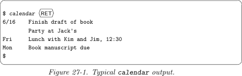

以下是一些编写日历文件的技巧，包括在你的日历文件中包含其他日历文件，以及自动投递提醒的方法。

**注意：** `calendar` 工具曾是 UNIX 系统的一次性标配，据称最早出现在 AT&T UNIX 的第 7 版中。它早期被重写用于 BSD 系列 UNIX。尽管这个 BSD 衍生版本是 Debian 系统的标准包含项，但 `calendar` 尚未成为所有 Linux 发行版的标准功能，其他发行版的用户可能难以找到该工具的源代码或二进制文件。我建议这些用户下载 Debian `bsdmainutils` 包的源代码，并从中安装 `calendar`。

Emacs 有自己的等效工具，称为“`Diary`”。有关此功能的更多信息，请参阅 Emacs Info 文档（参见方法 2.8.5 [阅读 Info 手册]，第 48 页）。

### 27.4.1 创建预约文件

要开始使用 `calendar`，你需要创建一个“日历文件”来输入你的预约。它只是一个纯文本文件，可以命名为 `calendar` 或 `.calendar`；后者使其成为“隐藏”文件，如 Recipe 5.3.4 [Listing Hidden Files]，第 138 页所述。

将每个预约或日历条目单独写在一行；文件中的空行将被忽略。当预约结束时，从此文件中删除其条目。日历条目的格式如下：

```
date    tab or spaces    text of reminder itself
```

几乎所有常见的日期样式都被识别。例如，图 27-2 显示了七月四日的有效日期列表。

```
7/4
July 4
4 July
Jul. 4
Jul 4
4 Jul.
4 Jul
```

*Figure 27-2. Valid dates for the fourth of July.*

条目也不限于某一天；你也可以为一周中的某一天或某个特定月份设置条目——“`Mon`”或“`Monday`”表示每周的每个星期一；“`Jun`”或“`June`”表示每个六月的第一天。你可以使用星号作为通配符：“`*/13`”会在每个月的 13 号提醒你某事。当一行中省略日期时，则假定为前一个预约的日期。

例如，假设你在主目录中有名为 `calendar` 的文件，其内容如下图 27-3 所示。


```
6/16    Finish draft of book
        Party at Jack's
6/20    Gallery reading
Fri     Lunch with Kim and Jim, 12:30
Mon     Book manuscript due
```

*Figure 27-3. Typical calendar file.*

如果当前日期是 6 月 16 日，星期五，并且你在主目录中运行 `calendar`，你将得到与图 27-1 相同的输出。

**NOTES:** 在前面的示例中，派对的条目没有日期——它使用了前一个条目的日期，“6/16。”

## 27.4.2 在提醒中包含假日

`calendar` 包附带了许多种假日和其他场合的预制日历文件集合，你可以在自己的日历文件中引用它们，以将它们的条目包含在自己的提醒中。这些预制文件存储在 `/usr/share/calendar` 中。下表给出了每个日历文件的名称并描述了其内容。

| File | Description |
|---|---|
| `calendar.birthday` | Births and deaths of famous people |
| `calendar.christian` | Christian holidays |
| `calendar.computer` | Significant dates in the history of computing |
| `calendar.history` | Dates of U.S. historical events |
| `calendar.holiday` | Standard and obscure holidays |
| `calendar.judaic` | Jewish holidays |
| `calendar.music` | Dates related to music, almost entirely rock and roll of the Baby Boomer generation |
| `calendar.usholiday` | U.S. holidays |
| `calendar.hindu` | Hindu holidays |

要让 `calendar` 在输出你的常规预约的同时输出其中一个文件中的日期，请在你的日历文件中加入以下行，其中 *file* 是你想要包含的特定日历文件的名称：

```
#include <file>
```

这些被称为 *includes.*

```
#include <calendar.usholiday>
#include <calendar.birthday>
```

*Figure 27-4. Includes for calendar.*

例如，要在运行 `calendar` 时同时输出美国假日和著名出生与逝世日期，你的日历文件将包含图 27-4 中给出的两行。

**NOTES:** 你当然可以将自己的日历文件与其他用户共享；这对于为某个团体或组织制作专用日历很有用。如果日历文件位于当前目录或 `/usr/share/calendar` 中，你只需给出文件名；否则，在 `include` 语句中给出其完整路径名。

## 27.4.3 自动预约投递

你可以将预约服务自动化，以便每次登录或启动新 shell 时都会投递你的预约和提醒，或者你可以让当天的提醒每天早上通过电子邮件发送给你。

将 `calendar` 添加到你的 `.bashrc` 文件中，以便每次登录或启动新 shell 时输出当天的预约和提醒（参见 Recipe 3.7.3 [Using Shell Startup Files]，第 86 页）。

如果你将日历文件保存在主目录以外的目录中，请确保 `calendar`（工具）是从该目录调用的。例如，如果你的日历文件在 `/doc/etc` 目录中，你将在 `.bashrc` 文件中加入以下行：

```
cd "/doc/etc; calendar; cd
```

要让系统通过电子邮件向你发送当天的预约，请使用 `crontab` 安排一个每日 CRON 作业运行 `calendar`，如果有输出，则使用 `mail` 将其发送给你（参见 Recipe 28.3 [Scheduling Commands]，第 557 页）。

为此，将以下行添加到你的 `crontab` 文件中（如果你没有，可以将此行放在主目录树中某个位置名为 `crontab` 的文本文件中）：

```
45 05 * * 1-5 calendar | mail -s 'Your Appointments' joe@example.org
```

“45 05 * * 1-5”指定这些命令在每个工作日的上午 5:45 运行。行的其余部分是实际运行的命令序列：`calendar` 工具在你的个人日历文件上运行，如果有输出，则将其发送到 joe@example.org（将其替换为你的实际电子邮件地址，或替换为你在本地系统上检查邮件时使用的用户名）。

通过运行 `crontab` 工具并将你的 `crontab` 文件名作为参数，将此新条目添加到计划中。

⇒ 要将文件 crontab 中的任何新条目添加到 CRON 计划中，请键入：

    $ crontab crontab RET

注意：命令名称 `crontab` 与其使用的文件 `crontab` 相同。

## 27.5 使用联系人管理器

粗略地说，联系人管理器是一种软件，可以帮助你跟踪未来可能需要联系的人的信息。在过去，人们常把这类东西的物理实体称为“rolodex”，顺便提一下，这是此类联系人管理器中的“凯迪拉克”的商标品牌名，即20世纪每个成功商人桌上都有的圆形旋转名片盒。我听说即使今天，许多人仍在使用它。

有许多可用的联系人管理器程序；以下方法展示了在 Linux 中管理联系人信息的两种最佳且最简单的方法。

### 27.5.1 维护自由格式的地址列表

在 Linux 中保存姓名和地址的最简单方法是将它们以文本文件的形式保存为自由格式的地址列表；要查找条目，请使用 `grep`、`less` 和 `Emacs` 等工具的搜索功能。

当你需要跟踪许多人的姓名和地址信息，但不一定为每个人都保存相同类型的信息时——有时是姓名和电话号码，有时只是邮寄地址，有时是姓名和电子邮件地址——这种方法很有用。使用自由格式的地址列表，每个条目都包含你拥有的任何信息，格式也可以随意。用你喜欢的定界行将条目分隔开。我碰巧使用“###”，但你可以使用任何你觉得舒服的字符——只要确保它是不会出现在任何条目的文本中的组合即可。

“字段”；你甚至可以将电子邮件、网页或其他窗口中的文本剪切并粘贴到其中（参见方法 10.3 [操作文本选择]，第 253 页）。

```
Mary Smith
14 Elm St
Centerville, New York

###

Susan Jones – 602 555 1803
(don't call after eight)

###

Prof. Jenkins, 25 College St, Uptown, New York
555-2011 jenkins@example.edu
```


有几种方法可以在此类文件中查找文本。例如，假设你想联系你的朋友 Susan，并且需要她的电话号码。

⇒ 要输出文件中包含文本“susan”的行（不区分大小写），请键入：

```
$ grep -i susan rolo ⏎
Susan Jones – 602 555 1803
$
```

当所需信息与搜索信息位于同一行时，这种方法效果很好——这里，Susan 的名字与电话号码在同一行；然而，输出没有显示文件中下一行出现的警告。那么，当搜索的词和需要的信息位于相邻行时，该怎么办？

使用 `grep` 的 `-C` 选项，输出匹配行前后的几行上下文。

⇒ 要输出与文本“Jenkins”匹配的行周围的几行，请键入：

```shell
$ grep -C Jenkins rolo RET

Prof. Jenkins, 25 College St, Uptown, New York
(914) 555-2011 jenkins@example.edu
$
```

另一种搜索此类文件的方法是将其作为缓冲区在 `Emacs` 中打开，并使用任何 `Emacs` 搜索功能。`Emacs` 的增量搜索功能 `CTRL-S` 对这类文件非常有用——即使是非常大的文件。如果你在大型文件上执行此类搜索，而第一个结果没有找到正确的记录，只需继续键入 `CTRL-S`，直到正确记录出现。如果你全部使用小写字母键入要搜索的字母，`Emacs` 将不区分大小写地匹配这些字母。

⇒ 以下有两种使用方法。

- 要在 `Emacs` 中搜索当前缓冲区中第一个包含文本“纽约”的条目（不区分大小写），请键入：

  `CTRL-S new york`

- 要搜索下一个包含文本“纽约”的条目（不区分大小写），请键入：

  `CTRL-S`


你可以根据需要多次重复此按键，以显示整个缓冲区中所有包含文本“纽约”的条目。一旦到达缓冲区末尾，再次键入 `CTRL-S` 即可循环回到缓冲区开头，并继续搜索。（迷你缓冲区会告诉你何时到达缓冲区末尾，如果你想循环搜索，它会提醒你键入此按键。）

**注意：** 使用 `less` 来细读和搜索这类文件也很有用——参见方法 14.11 [搜索你正在查阅的文本]，第 354 页。

### 27.5.2 维护联系人管理器数据库

```text
BBdb
  DEB: bbdb
  RPM: bbdb
  WWW: http://bbdb.sourceforge.net/
```

## 27.6.1 提醒自己何时必须离开

```
Leave
DEB: leave
RPM: leave
WWW: ftp://ftp.netbsd.org/pub/NetBSD/NetBSD-current/src/usr.bin/
```

使用 `leave` 工具来提醒自己何时必须离开。将你必须离开的时间作为参数给出，使用 `hhmm` 格式，其中 `hh` 为 24 小时制小时，`mm` 为分钟。

⇒ 若要提醒自己在晚上 8:05 离开，输入：

`$ leave 2005 [RET]`

当不带参数运行 `leave` 时，它会提示你输入时间；如果你只输入 `[RET]`，`leave` 将退出且不设置提醒。这种方法适用于将 `leave` 添加到脚本或你的 `.bashrc` 中，这样脚本运行时你可以按需交互式地给出离开时间（参见配方 3.7.3 [使用 Shell 启动文件]，第 86 页）。

`NOTES:` `leave` 将在给定时间前五分钟、提前一分钟、在时间本身以及之后每分钟向终端屏幕输出提醒，直到用户注销为止。

## 27.6.2 给自己发送电子邮件提醒

给自己发送一条简短的电子邮件信息通常是提醒自己在下一次工作日或下次阅读邮件时做某事的有效方法；将一条消息保留在收件箱中可作为完成某事的持续提醒——前提是你不要滥用它并用大量这些“紧急”邮件填满收件箱！

要快速发送电子邮件提醒，将你的电子邮件地址（或仅在本地系统上检查邮件时的用户名）作为参数传递给 `mail` 工具。你将被提示为消息提供主题，如果这不足以容纳提醒，你可以在其下方作为消息正文文本写入所需的任意多行。单独一行输入 `[CTRL]-[D]` 以发送邮件。

⇒ 例如，如果你在本地系统的用户名是 `joe`，要给自己发送电子邮件提醒，你将输入：

```
```text

$ mail joe ⏎

Subject: Bring files to meeting ⏎

⌃D

Cc: ⏎

Null message body; hope that's ok

$
```
```

**NOTES:** 有关使用 `mail` 工具的更多信息，请参阅配方 32.1 [发送邮件]，第 612 页。

## 27.7 告知他人你已离开

如果你使用的是直接连接到 Internet 的系统，可以设置对传入邮件的自动回复消息，以便人们知道你不在。

为此，使用 `vacation` 工具。在主目录中名为 `.vacation.msg` 的隐藏文件中编写你想要发送的消息，包含完整的“From:”和“Subject:”行。例如，如果你的电子邮件地址是 `cpeterson@example.edu`，你的 `~/vacation.msg` 可能包含如下内容，如图 27-6 所示。

```
```text

From: Dr. Constance Peterson <cpeterson@example.edu>

Subject: Regarding your message to Dr. Peterson

Precedence: bulk

I am away from the University for the first week of February. I will

return on February 8th and will address your mail then. If your business

is urgent, please address Dr. Edwards, at edwards@example.edu.

```
```

*Figure 27-6. The .vacation.msg file.*

然后，编辑主目录中另一个名为 `.forward` 的隐藏文件，并在其中放入以下行：

```
```text

\cpeterson, | /usr/bin/vacation cpeterson

```
```

这将保存所有传入邮件的副本到你的收件箱，并使用 `vacation` 回复发送给用户名 `cpeterson` 的邮件；回复邮件即为你在 `.vacation.msg` 中编写的内容。

⇒ 若要找出你在 2001 年 9 月 11 日做了什么，输入：

```
$ touch -d "Sep 11 2001" /tmp/911 [RET]
$ touch -d "Sep 12 2001" /tmp/912 [RET]
$ find ~ -daystart -newer /tmp/911 \! -daystart -newer /tmp/912 [RET]
```

这将列出最后修改时间为 2001 年 9 月 11 日的所有文件。使用 `-anewer` 列出最后访问时间为当天的，使用 `-cnewer` 列出最后更改时间为当天的 files。创建了两个具有特殊时间戳的临时文件，`/tmp/911` 和 `/tmp/912`。

## 27.9 使用其他提醒工具

下表列出了可用于生成提醒的额外工具，包括日历和约会管理器。

- Ccal

可输出彩色日历的 `cal` 替代品。

DEB: `ccal`

- Evolution

包含日历和地址功能的“Groupware”套件。

DEB: `evolution`

RPM: `evolution`

WWW: http://ximian.com/products/evolution/

- Gcal

可输出多种类型日历的工具，包括天文日历。

DEB: `gcal`

RPM: `gcal`

WWW: http://www.gnu.org/software/gcal/gcal.html

- KOrganizer

KDE 的约会管理器，内置日历和调度程序；使用 vCalendar 文件格式。

DEB: `korganizer`

RPM: `korganizer`

WWW: http://www.kde.org/

## Jpilot

在 Palm 桌面上保存姓名和地址，并包含日历、地址簿、待办事项清单以及制作备忘录的功能；为其开发了大量插件。

DEB: `jpilot`

RPM: `jpilot`

WWW: http://jpilot.org/

## Our CLOCK

X 的模拟时钟，当有新邮件等待时会反转颜色；内置预约功能。

DEB: `rxvt`

RPM: `rxvt`

WWW: http://sourceforge.net/projects/rxvt/

## Plan

图形化日程规划器。

DEB: `plan`

RPM: `plan`

WWW: http://me.in-berlin.de/~bitrot/plan.html

## QuickList

跟踪你能列出清单的任何事物。

DEB: `quicklist`

RPM: `quicklist`

WWW: http://tinyurl.com/2a9d5

## Remind

带 WWW 功能的提醒服务。

DEB: `remind`

## Wmdate

在窗口管理器（如 Window Maker）的“停靠栏”中打印日历。

DEB: `wmdate`

RPM: `wmdate`

## Xwrits

提醒你停止打字休息一下。

DEB: `xwrits`

## Xcal

X 的原始图形日历。具有可编程闹钟以及预约和备忘录功能。

DEB: `xcal`

## 28. Scheduling

有时将命令或一组命令指定为并非立即运行，而是在其他时间运行是有用的。本章描述了处理此类功能的技巧，以及监控当前正在运行的命令的技巧。

### 28.1 Running a Command on a Delay

`sleep` 工具除了等待（或“睡眠”）作为参数指定的秒数外什么都不做。这对于在短暂延迟后在终端上响铃、播放声音文件或运行其他命令很有用。

为此，将要“睡眠”的秒数作为 `sleep` 的参数给出，后跟分号字符（`;`）¹ 和要运行的命令。这样只有在 `sleep` 等待了指定秒数后才会运行给定的命令。

由于你在其中输入此命令的 shell 在你提供的命令执行完毕（或直到你中断整个操作）之前将无法使用，请在除你正在工作的窗口之外的 `xterm` 或虚拟控制台窗口（参见 Recipe 2.3 [Using Consoles and Terminals], page 32）中输入此命令。

以下是两种使用方法。

- 要在五秒后响铃，输入：

  `$ sleep 5; echo -e '\a' RET`

- 要在 30 秒后报时，输入：

  `$ sleep 30; saytime RET`

你也可以以分钟、小时或天为单位给出时间。为此，在参数后加上单位，如下表所列。

| s | 秒 |

| m | 分钟 |


- `h`：小时
- `d`：天

要在恰好五分钟后报时，输入：

```
$ sleep 5m; saytime & RET
```

## 28.2 Running a Command on a Timer

使用`at`在计时器上运行命令。它接受你想要运行命令的确切时间作为参数，然后从“`at`”提示符开始从标准输入读取命令，并在你单独一行输入`CTRL-D`时结束。它为你提供的命令安排一个作业，并在指定时间运行它们（参见 Recipe 3.3 [Managing Jobs], page 70）。命令由`/bin/sh`执行，即默认 shell；作为提醒，`at`在你指定命令时会警告你这一事实。

要在今天下午 5 点后五分钟时给自己发送提醒邮件，输入：

```
$ at 17:05 RET
warning: commands will be executed using /bin/sh
at> mail chuck -s "IT'S TIME TO GO!" < /dev/null RET
at> CTRL-D <EOT>
job 5 at 2003-08-09 17:05
$
```

在此示例中，用户名为 chuck，`at`调度的作业编号为 5。

`at`工具理解许多时间格式，从月份、日期和年份到小时和分钟（可选使用军用时间，或后跟“AM”或“PM”），以及特殊词语“midnight”、“noon”和“teatime”（最后一个翻译为下午 4 点）。你可以使用后缀“today”或“tomorrow”，并且可以在时间后使用“+”加上分钟、小时、天或周数——例如，“8pm + 2 days”表示从今晚 8 点起两天后运行。因此，要在一周后的午夜运行命令，使用“midnight + 1 week”。

要安排`~/bin/clean`和`~/bin/tidy`在明天晚上 9 点运行，输入：

```
$ at 9pm tomorrow RET
warning: commands will be executed using /bin/sh
at> ~/bin/clean RET
at> ~/bin/tidy RET
at> CTRL-D <EOT>
job 6 at 2003-08-09 17:10
$
```

从某个可能值到该字段的最后一个可能值（含）。时间和日期字段也可以包含数字范围，各个数字可以用逗号分隔。

要在`crontab`文件中编写注释，请以井号（#）开头；系统将忽略该行。空行同样会被忽略。

例如，一个简单的`crontab`文件可能如图 28-1 所示。

```
# This is my sample crontab file.

# Runs the 'foo' command at noon every single day.
0 12 * * * foo

# Runs the 'bar' command at 1:23 in the morning on every day in June.
23 1 * Jun * bar

# Runs the 'foobar' command at half-past four and five p.m. every Monday
# through Wednesday whose day of the month is between 1 and 14.
30 16,17 1-14 * Mon-Wed foobar
```

图 28-1. 一个简单的`crontab`文件。

接下来的技巧展示如何管理 CRON 任务。

### 28.3.1 添加 CRON 任务

要添加或更改 CRON 任务，请对`crontab`文件进行相应修改，然后以该文件名作为参数运行`crontab`。此命令会用`crontab`文件中的内容替换现有的 CRON 表。

⇒ 要添加`crontab`文件`cron.txt`中包含的新 CRON 任务，请键入：

```
$ crontab cron.txt [RET]
```

### 28.3.2 删除 CRON 任务

你可以通过删除 CRON 表来移除 CRON 中的任务。方法是使用带`-r`选项的`crontab`命令。

⇒ 要删除 CRON 表，请键入：

```
$ crontab -r [RET]
```

注意：如果只想删除部分 CRON 任务，或更改 CRON 任务，只需修改`crontab`文件，删除或修改所需的条目，然后重新添加 CRON 表（如上一技巧所述）。

### 28.3.3 列出 CRON 任务

要列出你已计划的所有 CRON 任务，请使用带`-l`选项的`crontab`命令。

⇒ 要列出 CRON 任务，请键入：

```
$ crontab -l [RET]
```

## 28.4 定时查看命令输出

使用`watch`可以观察命令的输出，并定时查看其运行情况。它会反复运行你作为参数给出的命令，每两秒一次，直到被中断。每当命令运行时，显示内容都会用新结果更新。当你需要密切监视某个目录中的文件并注意发生的变化时，这一点特别有用。

⇒ 要查看当前目录的详细内容，请键入：

```
$ watch ls -l [RET]
```

该命令会在你运行它的终端中显示当前目录的内容，并且每两秒持续更新。要更改间隔时间，请将其作为`-n`选项的参数提供。

⇒ 要每秒更新并查看当前目录的详细内容，请键入：

```
$ watch -n 1 ls -l [RET]
```

使用`-d`标志可以高亮显示更新中的差异。

⇒ 要每十秒更新并高亮所有差异地查看当前目录的详细内容，请键入：

```
$ watch -d -n 10 ls -l [RET]
```

注意：有时你可能会觉得在独立的`xterm`小窗口中运行`watch`会话很不错。如果你不在 X 环境中，不妨专门用一个控制台终端来运行。

## 29. 数学

本章的主题是处理数字的工具和技术：按顺序或随机列出数字、进行算术计算、加密解密以及单位换算。此外还会提到一些大型应用程序，如电子表格和绘图工具。

### 29.1 进行算术计算

正如你所预料的那样，Linux 中有许多工具可以进行算术计算。以下技巧介绍如何在两种常见场景中使用其中两个工具；其他计算器工具（包括可视化计算器）的列表见本章末尾（参见技巧 29.9 [使用其他数学工具]，第 579 页）。

#### 29.1.1 进行快速算术计算

要快速进行仅涉及加法、减法、乘法或除法的计算，你可以使用`Bash`内置的算术求值功能，直接在 shell 提示符下执行计算。如果编写一个名为`calc`的 shell 脚本，操作会更加简便，如图 29-1 所示。

```
#!/bin/sh
echo $(( expression = $ ))
```

图 29-1. `calc`脚本。

安装好此脚本后（参见技巧 A.3.4 [安装 Shell 脚本]，第 708 页），你就可以在 shell 提示符下使用它来获得任何简单算术计算的结果。

为此，请将要求值的表达式作为`calc`的参数。使用星号（`*`）表示乘法符号，使用正斜杠（`/`）表示除法；若要输出余数，请使用百分号（`%`）代替斜杠。你可以使用括号对表达式分组——但在这样做时，一定要用引号将括号括起来（参见技巧 3.1.3 [引用保留字符]，第 56 页）。

⇒ 这里有一些使用方法。

- 要输出 50 乘以 10 的结果，输入：

```
$ calc 50*10 RET
500
$
```

- 要输出 100 乘以 4 加 420 的和的结果，输入：

```
$ calc '100*(4+420)' RET
42400
$
```

- 要输出 10 除以 3 的余数，输入：

```
$ calc 10%3 RET
1
$
```

**NOTES:** 这是一种提速的方法。它对于在 shell 提示符下快速计算简单的算术方程很有用，但也有几个缺点：它只输出整数；其运算符有限；复杂的表达式必须加引号。尽管如此，如果你在 shell 提示符下需要知道 12,342 和 587 的乘积，我想没有更快的方法了。但对于做任何超过最简单操作的事情，请参阅下一条配方，其中描述了`bc`。

#### 29.1.2 使用计算器

`bc`

DEB: `bc`

RPM: `bc`

WWW: http://www.gnu.org/software/bc/

有很多计算器，可用于 X 或任何终端。其中一个历史悠久的常用工具是`bc`，它是一种计算语言，支持任意精度数字、脚本、变量、函数和代数语句。当你需要进行大量计算，或必须计算带小数点的数字时使用它。

输入`bc`以启动它；然后你可以像使用桌面计算器或算盘一样交互式地执行算术运算。

运行`bc`时，你在单独一行输入要计算的每个语句，并在语句末尾输入`[RET]`；你输入的内容的求值结果会在下一行输出。你输入的每一行都将被`bc`评估为算术表达式。要退出，在单独一行输入`quit`。

⇒ 要用`bc`将 42 乘以 17，输入：


```
$ bc [RET]
bc 1.06
Copyright 1991, 1992, 1993, 1994, 1997, 1998, 2000 Free Software Foundation, Inc.
This is free software with ABSOLUTELY NO WARRANTY.
For details type 'warranty'.
42 * 17 [RET]
714
quit [RET]
$
```

在此示例中，`bc`启动时输出其版本号和许可信息；然后，用户输入语句“`42 * 17`”，`bc`输出结果“`714`”，然后用户输入`quit`退出`bc`。

默认情况下，小数点右侧的数字会被从输出中截断——因此 10 除以 3 的结果会输出“3”，并且通过输入“`10%3`”输出此操作的余数会输出“1”。但由于`bc`是任意精度计算器，你可以指定小数点后使用的位数。方法是指定`scale`变量的值；其默认值是 0。

⇒ 要用`bc`计算 10 除以 3 的结果，小数点后使用 20 位数字，输入：

```
$ bc [RET]
bc 1.06
Copyright 1991, 1992, 1993, 1994, 1997, 1998, 2000 Free Software Foundation, Inc.
This is free software with ABSOLUTELY NO WARRANTY.
For details type 'warranty'.
scale=20 [RET]
10 / 3 [RET]
3.333333333333333333
quit [RET]
$
```

使用`-l`选项启动`bc`，`scale`为 20，并加载以下表格中描述的若干数学函数。

|  |  |
| --- | --- |
| `s(x)` | 输出`x`的正弦值（`x`以弧度给出）。 |
| `c(x)` | 输出`x`的余弦值（`x`以弧度给出）。 |
| `a(x)` | 输出`x`的反正切值，以弧度表示。 |
| `l(x)` | 输出`x`的对数。 |
| `e(x)` | 输出`e`的`x`次幂的指数函数。 |
| `j(n,x)` | 输出`x`的整数阶`n`的贝塞尔函数。 |

下表描述了可用于指定数学运算的符号。

|  |  |
| --- | --- |
| `expression + expression` | 加法：输出两个表达式的和。 |
| `expression - expression` | 减法：输出两个表达式的差。 |
| `expression * expression` | 乘法：输出两个表达式的乘积。 |
| `expression / expression` | 除法：输出两个表达式的商。 |
| `expression % expression` | 余数：输出将两个表达式相除所得的余数。 |
| `expression ^ expression` | 幂运算：将第一个表达式提升到第二个表达式的幂。 |
| `(expressions)` | 将一个或多个表达式组合在一起，改变执行运算的标准优先级。 |
| `sqrt(expression)` | 输出`expression`的平方根。 |

`-q`选项很不错——它会抑制启动时的版权和许可信息。在启动`bc`时同时使用此选项和`-l`选项是一种很好的运行方式，你可能想要为带有这两个选项的`bc`创建一个别名（参见 Recipe 3.6 [Using Alias Words]，第 82 页）：

```
alias bc='/usr/bin/bc -ql'
```

## 29.2 输出随机数

要获取随机数，显示`RANDOM`变量的内容。它是一个特殊的 shell 变量，输出 0 到 32,767 之间的随机整数。

⇒ 要输出随机数，输入：

```
$ echo $RANDOM [RET]
```

要输出从零开始但小于某个数的范围内的随机数，使用`RANDOM`与 Bash 算术求值表达式``$(($RANDOM % number))``，其中`number`是输出应小于的整数。

⇒ 要输出 0 到 9 的随机数，输入：

```
$ echo $(($RANDOM % 10)) [RET]
```

## 29.3 列出数字序列

使用`seq`打印数字序列。这对于获取用作参数的数字列表，或将数字序列传递给命令非常有用。

要输出从 1 到任意数字的序列，将该数字作为参数给出。

⇒ 这里有两种使用方法。

- 要输出从 1 到 7 的数字序列，请输入：

  `$ seq 7 [RET]`

- 要输出从 1 到 -7 的数字序列，请输入：

  `$ seq -7 [RET]`

要输出从任意一个数字到另一个数字的序列，请将这些数字作为参数给出。

⇒ 这里有两种使用方法。

- 要输出从 9 到 0 的数字序列，请输入：

  `$ seq 9 0 [RET]`

- 要输出从 -1 到 -20 的数字序列，请输入：

  `$ seq -1 -20 [RET]`

要指定除 1 以外的增量，请将其作为第二个参数，放在起始数字和结束数字之间。

⇒ 要输出从 -1 到 14、增量为 3 的数字序列，请输入：

```
$ seq -1 3 14 [RET]
```

使用`-w`选项可以用前导零填充数字，使所有输出数字具有相同的宽度。

将要在数字之间输出的分隔字符串作为`-s`选项的参数；默认值是换行符，这样序列中的每个数字都会单独占一行输出。

⇒ 这里有两种使用方法。

- 要输出从 9 到 999、增量为 23、用零填充数字使所有数字宽度相等的序列，请输入：

  `$ seq -w 9 23 999 [RET]`

- 要输出从 1 到 23、每个数字之间用一个空格分隔的序列，请输入：

  `$ seq -s ' ' 1 23 [RET]`

要将数字序列作为参数传递给命令，请使用空格字符作为分隔符，通过管道传递`seq`的输出。

⇒ 要将当前目录中所有文件名为数字 25 到 75 的文件连接到一个名为`selected-mail`的新文件中，请输入：

```
$ cat `seq -s " " 25 75` > selected-mail [RET]
```

上面的示例将`seq`的输出作为`cat`的参数（参见方案 3.1.11 [将命令的输出指定为参数]，第 65 页）。

## 29.4 查找质因数

`factor`工具会计算并输出作为参数传入的数字的质因数。

⇒ 要输出 2000 的质因数，请输入：

```
$ factor 2000 [RET]
2000: 2 2 2 2 5 5 5
$
```

注意：如果未给出数字，`factor`会从标准输入读取数字；数字应以空格、制表符或换行符分隔。

## 29.5 转换计量值和数字

以下方案用于以各种方式转换数字。

### 29.5.1 在不同测量单位之间转换量值

Units

DEB: units

RPM: units

WWW: http://www.gnu.org/software/units/

使用`units`工具可以将一个测量值从一种测量刻度转换为另一种。给出两个带引号的参数：数值及其单位名称，以及要转换到的单位名称。它会输出两个值：转换后的新单位值，以及多少原始测量值相当于一个新单位。

⇒ 要输出 50 克对应的盎司数，请输入：

```
$ units '50 grams' 'ounces' [RET]
    * 1.7636981
    / 0.56699046
$
```

在此示例中，输出表明 50 克中约有 1.7636981 盎司，反之，1 盎司约等于 50 克的 0.56699046 倍。

`units`工具支持非常多种类的单位——从摄氏度和华氏度到磅、公顷、光速，以及“面包师的一打”。所有受支持的单位都保存在文本文件数据库中；使用`-V`选项可输出该数据库在您的系统上的位置，然后浏览或搜索该文件，查看您的版本支持哪些单位。

⇒ 要确定`units`数据库的位置，请输入：

```
$ units -V [RET]
units version 1.55 with readline, units database in
/usr/share/misc/units.dat
$
```

在此示例中，`units`数据库位于文件`/usr/share/misc/units.dat`中，您可以浏览该文件以列出所有单位数据。

注意：不带参数时，`units`以交互方式运行，首先询问您有什么单位，然后询问您想要什么单位。

更多测量单位可参见《计量单位词典》[http://www.unc.edu/~rowlett/units/]。

### 29.5.2 将阿拉伯数字转换为英文

Bsd-games

DEB: bsdgames

RPM: bsd-games

WWW: http://www.ibiblio.org/pub/Linux/games/

使用`number`命令将阿拉伯数字转换为英文文本。给出一个数字作为 argument; with no argument, `number` reads a numeral from the standard input.

⇒ 要输出 100,000 的英文文本等价物，输入：

```
$ number 100000 [RET]
```


## 29.6 使用 ROT13 加密

你可能会时不时地看到 ROT13 的提及。或者你可能会遇到一条消息——尤其是在 Usenet 上，或在旧的邮件存档中——ybxf yvxv gvff。

这是用 ROT13 加密编码的文本，因此得名，因为字母表中每个字母都向后旋转十三位，所以在 26 个字母的字母表中，前 13 个字母被后 13 个字母替换，反之亦然。因此，在 ROT13 中，“A”（字母表的第一个字母）变成“N”（字母表的第 13 个字母），“B”变成“O”，“C”变成“P”，依此类推一直到：

A B C D E F G H I J K L M N O P Q R S T U V W X Y Z

变成

N O P Q R S T U V W X Y Z A B C D E F G H I J K L M

这种通过根据某个偏移量旋转整个字母表来替换字母的密码，今天被称为 Julius Caesar's cipher，以其最著名的采用者命名。¹

有两种主要方法，都使用过滤器，用于对文本进行 ROT13 编码和解码。其中一种传统方法是使用 `tr` 来转置字符，给出要转置的第一个和最后 13 个字母的集合，以及要转置到的最后和第一个 13 个字母的集合。

第二种方法使用名为 `rot13` 的工具自动化此过程，该工具是 `bsd-games` 包的一部分。该包还包括 `caesar`，这是一个用于通过对输入进行统计分析来解码一般 Caesar 密码的工具。

ROT13 并非作为通用加密方法而设计——它太容易破解了——但它适用于你想暂时隐藏一些文本时，例如笑话的 punch line 或电影评论的“剧透”部分。要编码一些文本，在 X 中将其设为选择，然后将其通过其中一个编码过滤器发送，或直接将其作为输入键入到任一过滤器。要解码文本中的 ROT13 行，做同样的事情：选择编码的文本，然后将其通过任一过滤器传递（参见 Recipe 10.3 [Manipulating Selections of Text]，第 253 页）；按 `CTRL-D` 终止并退出过滤器。

> ¹ 根据 Suetonius 的说法，Caesar 的密码偏移量为 4。

⇒ 以下是一些使用方法。

- 要将 `message` 中的文本用 ROT13 编码并输出到名为 `secret_message` 的新文件，输入：

  `$ rot13 < message > secret_message RET`

- 要键入一些文本并将其用 ROT13 编码，输入：

  ```
  $ rot13 RET
  Hello, world. RET
  Uryyb, jbeyq.
  CTRL - D
  ```

- 要将当前文本选择用 ROT13 编码，输入：

  ```
  $ rot13 RET
  SHIFT - INS RET
  This is a secret message. RET
  Guvf vf n frperg zrffntr.
  CTRL - D
  ```

**NOTES:** 要使用鼠标插入文本选择，请按中间鼠标按钮而不是 `SHIFT - INS`。

### 29.6.2 解码 ROT13 中的文本

解码 ROT13 文本的方法与编码方法完全相同，因为转换在两种情况下完全相同。

#### METHOD #1

使用与编码 ROT13 时相同的 `tr` 过滤器方法来解码 ROT13 编码的文本。

⇒ 以下是一些使用方法。

- 要解码 `secret_message` 中的 ROT13 编码文本，将解码后的文本发送到标准输出，输入：

  `$ tr [a-mn-za-mN-Z] [n-za-mN-ZA-M] < secret_message RET`

- 要解码 `secret.script` 中的 ROT13 编码文本，将解码后的文本写入名为 `script` 的文件，输入：

  `$ tr [a-mn-za-mN-ZA-M] [n-za-mN-ZA-M] < secret.script > script RET`

- 要解码 ROT13 编码的文本选择，输入：

  ```
  $ tr [a-mn-za-nN-ZA-M] [n-za-mN-ZA-M] RET
  SHIFT - INS RET
  Guvf vf n frperg zrffntr. RET
  This is a secret message.
  CTRL - D
  ```

#### METHOD #2

Bsd-games

DEB: `bsdgames`

RPM: `bsd-games`

WWW: http://www.ibiblio.org/pub/Linux/games/

使用 `rot13` 过滤器解码 ROT13 编码的文本。

⇒ 以下是一些使用方法。

- 要解码 `secret_message` 中的 ROT13 编码文本，将解码后的文本发送到标准输出，输入：

  `$ rot13 < secret_message RET`

- 要解码 `secret_message` 中的 ROT13 编码文本，将解码后的文本写入名为 `message` 的文件，输入：

  `$ rot13 < secret_message > message RET`

- 要解码 ROT13 编码的文本选择，输入：

  ```
  $ rot13 RET
  SHIFT - INS RET
  Guvf vf n frperg zrffntr. RET
  This is a secret message.
  CTRL - D
  ```

## 29.7 使用 GPG 加密

GnuPG

DEB: `gnupg`

RPM: `gnupg`

WWW: http://www.gnupg.org/

GNU Privacy Guard（GPG）是一种公钥加密系统。它是 PGP（“Pretty Good Privacy”，相当好的隐私）² 的自由开源替代品，并且与较新的 PGP 版本基本兼容。

公钥加密的工作原理如下。每个使用它的人首先运行程序，以获取自己的一组密钥，这些密钥是由公钥加密系统中内置的特定数学函数生成的一串数字。系统会生成两个密钥：一个公钥，你可以向任何你想要发送加密数据的人公开；一个私钥，只有你自己可以访问。两者都是唯一的数据序列，由你在生成密钥时输入的密码短语生成。

当公钥由 `gpg` 工具处理时，它会输出一个独特的函数，并以一种无法解密的方式对其输入数据进行编码，除非在调用 `gpg` 时使用私钥。使用 GPG 的人会公开自己的公钥，因此其他使用 GPG 的人就可以通过某人的公钥为特定的人加密数据。一旦加密，除了收件人之外，没有人能解密这些数据，即使是发件人也不能。只有使用与特定公钥对应的私钥，才能解密文本。

因此，要开始使用 GPG，你必须首先生成自己的一组密钥。可以通过运行带有特殊 `--gen-key` 选项的 `gpg` 来完成。

- ⇒ 要生成自己的一组密钥，请输入：

  ```
  $ gpg --gen-key [RET]
  ```

运行此命令时，系统会要求你指定一些内容：所使用的算法（建议使用 DSA/ElGamal）、密钥长度（较长的密钥更安全，但计算时间更长；许多人建议不少于 2,048 位，而较旧的标准是 1,024 位）、你想与之交换加密数据的一些个人姓名和电子邮件地址（之后随时可以添加更多），最后是一个特殊的密码短语。这个密码短语就是你的私钥在加密锁中的钥匙：每次你想解开任何用你的公钥为你加密的内容时，都要使用它。

密码短语至少应有 32 个字符长，字符要有变化（使用数字、符号以及大小写字母），并且应该是别人无法猜到的内容。

> 2 PGP 在 20 世纪 90 年代初的互联网热潮中普及，它使用专利算法，因此不能成为自由软件；GPG 则没有此类限制。

生成密钥需要一些时间。为了让其他人可以使用你的密钥，请使用 `-a` 和 `--export` 选项将其导出到 ASCII 文件。

- ⇒ 要将你的公钥导出到名为 `alice.key` 的文件中，请输入：

  ```
  $ gpg -a --export > alice.key [RET]
  ```

你可以将这份数据提供给你希望通过 GPG 与之通信的任何人——你可以通过电子邮件发送给某人、放在网站上等等。

要开始通过 GPG 与他人进行安全通信，你还需要导入他的公钥。使用带有 `--import` 选项的 `gpg`，并将包含其公钥的文件作为参数传入即可。

- ⇒ 要导入你放入文件 `bill.key` 中的朋友 Bill 的公钥，请输入：

  ```
  $ gpg --import bill.key [RET]
  ```

此命令会将你的朋友 Bill 添加到你的密钥环中，密钥环是 `gpg` 已知并可以为其加密的接收者列表。使用 `--list-keys` 选项可以列出你密钥环中的人。

- ⇒ 要列出 `gpg` 已知的密钥，请输入：

  ```
  $ gpg --list-keys [RET]
  ```

### 29.7.1 使用 GPG 加密数据

要使用 `gpg` 加密文件，请将收件人的电子邮件地址作为 `-e` 选项的参数，并将文件内容发送到其标准输入。

- ⇒ 要为你的同事 Bill（电子邮件为 `bill@example.net`）加密 `mission` 的内容，请输入：

  ```
  $ gpg -e bill@example.net < mission [RET]
  ```


此命令会写入一个名为 `mission.gpg` 的加密二进制文件，只有 Bill 才能解密该文件。

使用 `--armor` 选项可以生成装甲（armored）文件，即只使用 7 位 ASCII 字符的文件。此类文件的长度会更长，但更容易在电子邮件正文中传输，或通过其他二进制文件无法实现的方式传输。

- ⇒ 要为你的同事 Bill 加密 `mission` 的内容，并输出一个装甲文本文件，请输入：

```
$ gpg --armor -e bill@example.net < mission [RET]
```

## 29.7.2 使用 GPG 解密数据

使用带 `-d` 选项的 `gpg` 来解密用你的公钥加密的数据。将数据发送到 `gpg` 的标准输入；解密结果写入标准输出。

⇒ 这里有两种使用方法。

- 要将文件 `secret.and.urgent` 中的数据解码到标准输出，输入：

```
$ gpg -d < secret.and.urgent RET
```

- 要将文件 `message.gpg` 中的数据解码并写入新文件 `message.txt`，输入：

```
$ gpg -d < message.gpg > message.txt RET
```

## 29.8 绘制数据

Gnuplot

DEB: `gnuplot`

RPM: `gnuplot`

WWW: http://www.gnuplot.info/

`gnuplot` 工具是一个多功能程序，可用于数据可视化，绘制二维和三维图形，以及绘制等高线、曲面和函数。它以一组命令的形式接收输入，这些命令要么在文件中，要么在 `gnuplot` 命令提示符下输入，并为这些命令输出一个绘图。它可以从外部文本文件读取数据，并将输出显示在新窗口中或写入 PostScript 文件。输出样式高度可配置。

这是一个功能丰富的程序，我们不会详细介绍；下面的配方将演示几种使用 `gnuplot` 绘制简单图形的方法。有关使用 `gnuplot` 绘制数据的更多信息，请参阅其 Info 文档（参见配方 2.8.5 [阅读 Info 手册]，第 48 页）。

### 29.8.1 使用单个数据集制作图形

要将单个数据集作为图形绘制，请在数据文件中给出 X 轴和 Y 轴的值，并在运行 `gnuplot` 时以如下方式使用 `plot` 命令：

```
plot "inputfile" using 1:2 with plotstyle
```

在运行 `gnuplot` 后可以交互式输入，也可写入文件作为参数调用。

例如，假设你有一个文件 `temperature.data`，其中包含两列文本，以制表符分隔，如图 29-2 所示。

```
January      68.9
February     68.7
March        69.0
April        70.2
May          72.0
June         73.4
July         74.3
August       75.8
September    74.6
October      73.8
November     71.8
December     70.1
```

图 29-2. `temperature.data` 文件。

```
set title "Mean Monthly Temperatures for Hawaii, 1905-1938"
set xlabel "Month"
set ylabel "Temperature"
set nokey
set xdata time
set timefmt "%B"
set format x "%b"
set nomxtics
set terminal postscript color
set output "temps.ps"
plot "temperature.data" using 1:2 with linespoints
```

图 29-3. `temperature.gnuplot` 文件。

假设你还有一个文件 `temperature.gnuplot`，如图 29-3 所示，其中包含一组用于绘制图形的 `gnuplot` 命令。它包含多行设置，影响或更改默认行为，包括设置图形标题和 X 轴、Y 轴的标签。

文件中的最后一行包含实际绘图的命令。它从文件 `temperature.data` 读取绘图数据，使用第一列作为图形 x 轴的月份数据，第二列作为沿 y 轴绘制的数据，使用 `linespoints` 样式。

⇒ 要处理 `temperature.gnuplot` 中的命令，输入：

```
$ gnuplot temperature.gnuplot (RET)
```

此命令启动 `gnuplot` 并运行文件 `temperature.gnuplot` 中的命令。会写入一个新的 PostScript 文件 `temps.ps`，其外观如图 29-4 所示。（虽然印刷插图为黑白，但此命令实际创建的图像具有红色绘图。）

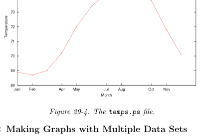

图 29-4. `temps.ps` 文件。

### 29.8.2 使用多个数据集制作图形

要在一个图形上绘制多个数据集，方法与单个数据集相同，但有以下例外：给出 x 轴的值和沿 y 轴的多个绘图值在数据文件中，使用 `plot` 命令以如下方式运行 `gnuplot`：

```
plot "inputfile" using 1:plot title titlename with plotstyle
```

其中 `inputfile` 是输入文件的名称，对于每个绘图，`plot` 是包含该绘图的列号，`titlename` 是其在图例中的标题名称，`plotstyle` 是要使用的绘制样式。每个 `using` 语句可以跟随逗号和下一个绘图的 `using` 语句，直到全部指定。

例如，假设你有一个文件 `temperature2.data`，如图 29-5 所示。

```
#Month	Honolulu	Tampa	New York
January	73	60	32
February	73	61	33
March	74	66	41
April	76	72	53
May	78	77	62
June	79	81	71
July	80	82	77
August	81	82	75
September	81	81	68
October	80	74	58
November	77	67	47
December	74	61	36
```

图 29-5. `temperature2.data` 文件。

该文件包含四个由制表符分隔的文本列。第一行是注释——在输入数据或 `gnuplot` 命令文件中，以井号字符 `#` 开头的任何行都被视为注释，并会被 `gnuplot` 忽略。

现在假设你还有一个文件 `temperature2.gnuplot`，如图 29-6 所示。

```
set title "Mean Monthly Temperatures for Company Locations"
set xlabel "Month"
set ylabel "Temperature"
set xdata time
set timefmt "%B"
set format x "%b"
set nomxtics
set terminal postscript landscape color
set output "temps2.ps"
plot "temperature2.data" using 1:2 title "Honolulu" with linespoints, "" using 1:3 title "Tampa" with linespoints, "" using 1:4 title "New York" with linespoints
```

图 29-6. `temperature2.gnuplot` 文件。

这与前一个示例中的命令文件非常相似，只是存在以下差异：标题已更改；关闭图例的命令未打印；输出文件的名称不同；并且在冗长的最后一行 `plot` 中，列二到列三分别与输入文件中的第一列（月份名称）一起绘制，每条都使用与之前相同的 `linespoints` 样式，但各自带有图例标签。

⇒ 要处理 `temperature2.gnuplot` 中的命令，输入：

```
$ gnuplot temperature.gnuplot [RET]
```

该命令启动 `gnuplot` 并运行 `temperature2.gnuplot` 文件中的命令。会写入一个新的 PostScript 文件 `temps2.ps`，其外观如图 29-7 所示。 （虽然印刷插图为黑白，但从该命令创建的实际图像具有彩色绘图。）

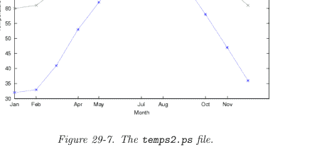

图 29-7. `temps2.ps` 文件。

## 29.9 使用其他数学工具

下表列出了 Linux 可用的一些其他更受欢迎的数学相关工具。

### Calc

Emacs 的科学计算器工具。

DEB: `calc`

RPM: `calc`

WWW: http://www.isthe.com/chongo/tech/comp/calc/

### Desk Calculator


任意精度计算器，从标准输入读取并向标准输出写入。`DC`是一种逆波兰计算器；也就是说，数字被推入一个称为栈的后进先出`LIFO`列表中。当你给出一个算术操作符时，`DC`会从栈中弹出数字作为操作数，然后将求值结果推回栈中。在脚本和命令行中获取求值结果非常有用。

`DEB`: `dc`

`WWW`: http://www.cypherspace.org/~adam/rsa/dc.html

### Dome

计算`geodesic dome`的属性——弦因子、球面顶点坐标等。支持“Buckyball”结构和椭圆形`geodesic`，并生成纯文本输出以及用于电子表格、`CAD`和光线追踪工具的格式。

`DEB`: `dome`

`WWW`: http://tinyurl.com/2p5b4

### GnuCash

直观的个人理财应用程序，用于管理财务（包括银行账户、股票、收入和支出）；它“基于专业会计原则”，以确保计算和报告的准确性。

`DEB`: `gnucash`

`RPM`: `gnucash`

`WWW`: http://www.gnucash.org/

### Gnumeric

`GNOME`的功能强大的电子表格应用程序，有点类似于`Excel`。

`DEB`: `gnumeric`

`RPM`: `gnumeric`

`WWW`: http://www.gnome.org/projects/gnumeric/

### Oleo

小型`GNU`电子表格应用程序，可在`X`窗口和终端中运行，具有类`Emacs`的键绑定，并可生成`PostScript`输出。

`DEB`: `oleo`

`RPM`: `oleo`

`WWW`: http://www.gnu.org/software/oleo/

### Piechart

便于使用`GNU`绘图工具（见下文）制作图形饼图。

`WWW`: http://tinyurl.com/jdi6

### Plotutils

用于绘图数据的`GNU`程序包，包括对旧`UNIX`常用工具`graph`、`plot`和`spline`的`GNU`替代品。

`DEB`: `plotutils`

`RPM`: `plotutils`

`WWW`: http://tinyurl.com/3eygd

### Sc

在控制台中运行的电子表格工具；比`Oleo`更小，它提供了公式和其他你期望从最小化电子表格中获得的基本功能。

`DEB`: `sc`

### Sieb

用于计算素数的快速`C`程序。

`WWW`: http://bytesex.org/misc.html

### Xcalc

`X Window System`的可视科学计算器——它在屏幕上绘制一个计算器，你可以使用鼠标或键盘来操作它。它能够模拟`TI-30`和`HP-10C`计算器。

`DEB`: `xbase-clients`

`RPM`: `XFree86-tools`

### Xspread

`sc`的`X`客户端前端。

`RPM`: `xspread`

## 30. 娱乐

没有关于如何管理额外时间的章节，生产力又是什么？

本章中的配方描述了那些传统上在`UNIX`系统上找到的经典游戏和奇思妙想，现在可在`Linux`上使用。它还包括使用系统解决文字游戏以及其他保证让你忙碌的娱乐的配方。

### 30.1 玩经典 UNIX 游戏

```
Bsd-games
DEB: bsdgames
RPM: bsd-games
WW: ftp://metalab.unc.edu/pub/Linux/games/
```

这是一套久负盛名的纸牌游戏、动作和冒险游戏、棋盘游戏以及屏幕娱乐。

按当代标准来看，它们在感官刺激方面提供的很少。但它们是经典，在过去的年代里曾是大学校园和各地计算机实验室的主流，而且仍然可以在任何终端上游玩。它们可能同样能娱乐儿童和老一辈。

下表列出了此软件包中包含的各种游戏和程序，给出了其系统名称和描述。

| Command | Description |
|---|---|
| `adventure` | 基于肯塔基州一个名为巨洞的实际洞穴的基于文本的模拟游戏。由`William Crowther`和`Don Woods`在1970年代编写，早于`PC`时代的`ZORK`。有关此游戏历史的更多信息可在网上查阅 http://www.rickadams.org/adventure/. |
| `arithmetic` | 对一组基础加法和减法问题进行测验并计时你的答题速度。 |
| `atc` | 空中交通管制模拟。 |
| `backgammon` | 一人或两人玩的双陆棋游戏，附带规则。 |
| `banner` | 以长垂直文本字体输出文本，适合打印大型横幅。（参见 Recipe 16.4 [Outputting Text Banners], page 402. 在 Debian 系统上，`banner`包含在`bsdmainutils`软件包中。） |
| `battlestar` | 具有奇幻主题的基于文本的冒险游戏。由`David Riggle`于1979年编写。 |
| `bcd` | 将文本过滤为纸带打孔卡输出。 |
| `boggle` | 流行的文字游戏。 |
| `caesar` | 解密 Julius Caesar 的密码（参见 Recipe 29.6 [Using ROT13 Encryption], page 569）。 |
| `canfield` | 扑克纸牌接龙的一种变体。 |
| `cfscores` | 显示你的`canfield`分数。 |
| `countmail` | 告诉你有多少邮件，但以“相当令人讨厌”的方式。 |
| `cribbage` | 纸牌游戏`cribbage`。 |
| `fish` | 儿童纸牌游戏 Go Fish。 |
| `gomoku` | 两人玩的五子棋游戏。 |
| `hangman` | 经典的“猜词”游戏。 |
| `hunt` | 多人网络游戏，其目标是猎杀并消灭所有其他玩家。 |
| `mille` | `Mille Bornes`，一种双手纸牌游戏。 |
| `monop` | `Monopoly`，一种财产管理游戏，类似于著名的棋盘游戏。 |
| `morse` | 将文本过滤为摩尔斯电码。默认情况下写出“dit”和“daw”这两个词；使用`-s`输出点和划而不是单词。要将摩尔斯电码解码为明文，请使用`-d`选项。 |
| `number` | 将阿拉伯数字转换为英文（参见 Recipe 29.5.2 [Converting an Arabic Numeral to English], page 568）。 |
| `phantasia` | 角色扮演奇幻游戏。 |
| `pig` | 将文本过滤为`Pig Latin`。目前没有可用的反向过滤器。 |
| `pom` | 告诉你月亮的当前相位。 |
| `ppt` | 将文本过滤为纸带输出。 |
| `primes` | 输出质数，从0开始，停止在4,294,967,295或标准输入中给出的数字；你也可以将起始和停止值作为参数给出。例如，要输出1到10之间的质数，运行的命令是`primes 1 10`。 |
| `quiz` | 对来自各种主题的事实和琐事进行测验。 |
| `rot13` | 加密和解密`ROT13`密码（参见 Recipe 29.6 [Using ROT13 Encryption], page 569）。 |
| `rain` | 在屏幕上显示雨滴下落的动画。通过将以毫秒为单位的值作为`-d`选项的参数来控制延迟。例如，`rain -d 160`是一个不错的设置可尝试。 |
| `random` | 从其输入中输出随机行。 |
| `robots` | 射击游戏，你在其中与杀人机器人战斗。 |
| `sail` | 旧式海战角色扮演游戏。 |
| `snake` | 避开蛇的同时收集金钱。 |
| `snscore` | 显示`snake`的最高分。 |
| `teachgammon` | 双陆棋游戏的说明。 |
| `tetris-bsd` | 著名的俄罗斯电子游戏`Tetris`。 |
| `trek` | 太空冒险游戏。 |
| `wargames` | 受电影《战争游戏》启发的全球热核战争游戏：“我们来玩个游戏吧？” |
| `worm` | “成长的蠕虫”游戏。 |
| `worms` | 显示蠕虫在显示屏上蠕动的动画。 |
| `wtf` | 解释在线交流中使用的缩写。它并不太先进（例如，它甚至不知道`FAQs`是什么），但它知道`LOL`是什么。如果它不知道该缩写，它会查看`whatis`是否能提供帮助（参见配方11.4.2 [翻译常见缩写]，第292页）。 |
| `wump` | “猎杀武姆普斯”冒险游戏，也许是最著名的经典计算机游戏之一。 |

`NOTES`: 在`DEB`包中，所有包含程序的原始作者列表位于`usr/share/doc/bsdgames/AUTHORS`。

## 30.2 通过方言过滤文本

`Talk Filters`

`DEB`: `filters`

`WWW`: http://www.gnu.org/directory/games/GNUTalkFilters.html

一般来说，过滤器是一种在标准输入上工作的工具，以某种方式改变它，然后将其传递到标准输出。


有各种各样的工具可以用作文本过滤器；本配方描述了一组特定的过滤器——那些过滤其标准输入以使文本具有口音或方言并旨在产生幽默效果的过滤器。它们被收集在一个名为 `Gnu Talk Filters` 的包中。

⇒ 要将 `kraut` 过滤器应用于文件 `/etc/motd` 中的文本，输入：

`$ kraut < /etc/motd [RET]`

此命令将文件 `/etc/motd` 的内容传递给 `kraut` 过滤器，其输出随后发送到标准输出。`/etc/motd` 的内容不会被更改。

`NOTES:` 一些可用的方言过滤器包括 `nyc`，它为文本赋予“纽约客”方言，以及 `newspeak`，它将真正说的话

翻译成思想警察批准的、政治正确的语言，正如乔治·奥威尔的小说 *1984* 中所描述的那样。战争即和平！自由即奴役！

各种过滤器中示例文本及其显示方式保存在文件 `/usr/share/doc/filters/SAMPLES.` 中。

虽然所有给定的过滤器都是幽默的，但可以编写自己的过滤器来更改其输入中的文本模式，以实现某种严肃目的，例如为出版物的“内部风格”过滤文本。

## 30.3 测试你的打字速度

你可以通过组合几个工具来测试你的打字速度。要在 shell 提示符下测试你的打字速度，运行 `cat` 并输入一些文本，将输出通过管道传递给 `wc` 以获取你输入的词数。在测试之前和之后立即运行 `date`，方法是按列表运行所有这些命令（参见配方 3.1.7 [运行命令列表]，第 63 页）。

⇒ 要测试你的打字速度，输入：

```
$ date; cat | wc -w; date RET
Mon Aug 11 15:14:06 EDT 2003
The quick brown fox jumped over the lazy dog. RET
CTRL-D
9
Mon Aug 11 15:14:12 EDT 2003
$
```

在此示例中，输出“9”表示用户输入了九个词（在真正的打字测试中，你希望输入的时间更长——至少几百个词才能得到准确的计数）。测试前后列出的日期显示，用户输入这九个词花了六秒钟。

使用 `bc` 或任何其他计算器将词数除以输入它们所需的时间（以分钟或秒为单位）。

**`NOTES:`** 你可以在 Emacs 中通过在打字前后运行 `time` 函数来测试打字；然后选择已输入的文本并将其发送到 `wc` 以获取词数。

## 30.4 显示随机引语

在 Linux 中获取随机引语至少有两种方法。

### METHOD #1

`Fortune`

`DEB:` `fortune-mod`

`fortune-min`

`RPM:` `fortune-mod`

`WWW:` http://www.ibiblio.org/pub/Linux/games/amusements/fortune/

使用 `fortune` 将“幸运饼干”输出到标准输出。

⇒ 要获取一个 `fortune`，输入：

```
$ fortune [RET]
```

`NOTES:` 这个久负盛名的程序很早就存在于 UNIX 系统上，并且有几种专门的 `fortune` 数据库可用。你甚至可以制作自己的 `fortune` 文件，其中包含你自己选择的引语——这些文件是用 `strfile` 命令制作的。

### METHOD #2

在 Emacs 中，你可以从漫画人物 Zippy the Pinhead 那里获取随机引语。当你运行 `yow` 函数时，一个 Zippy 引语会被写入 minibufffer。

⇒ 要获取 Zippy 的一句台词，输入：

```
[ALT]-(X) yow [RET]
```

## 30.5 寻找文字游戏的匹配项

以下配方描述了使用各种工具来寻找文字游戏可能用到的单词的方法：字母重排、回文和用于填字游戏的单词。

### 30.5.1 在文本中寻找字母重排

`An`

`DEB:` `an`

字母重排是一个词或短语，其字符完全由另一个给定词或短语的所有字符组成——例如，“stop”和“tops”都是“pots”的字母重排。

使用 `an` 来查找并输出字母重排。将要使用的词或带引号的短语作为参数给出；`an` 将其结果写入标准输出。

⇒ 这里有两种使用方法。

- 要输出单词 “lake” 的所有变位词，输入：

  `$ an lake RET`

- 要输出短语 “lakes and oceans” 的所有变位词，输入：

  `$ an 'lakes and oceans' RET`

要将输出的变位词限制为包含给定字符串的变位词，请使用 `-c` 选项指定该字符串。

⇒ 要仅输出包含字符串 “seas” 的短语 “lakes and oceans” 的变位词，输入：

`$ an -c seas 'lakes and oceans' RET`

要打印可以用给定单词或短语中的部分或全部字母组成的全部单词，请使用 `-w` 选项。这会输出非变位词，因为变位词必须包含另一个单词或短语的所有字母。

⇒ 要输出可以用单词 “seas” 的字母组成的所有单词，输入：

`$ an -w seas RET`

该命令输出可以用 “seas” 中全部或部分字符形成的所有单词，包括 “see” 和 “as”。

`NOTES：` 有其他用于查找变位词的工具，但这个是最好的。不幸的是，它在 Debian 发行版之外并不广泛可用；如果找不到副本，你始终可以从 Debian 软件包安装源代码（见 Recipe 1.1.2 [Preparation of Recipes]，第 3 页）。

## 30.5.2 Finding Palindromes in Text

回文是正读反读都相同的单词或短语；例如，“Mom”、“nun” 和 “Madam, I’m Adam” 都是回文。

以下是用于查找回文的几个 `PERL` “一行代码”。

### METHOD #1

要输出文件中所有是回文的行，使用这个简单的 `PERL` 一行代码，并将要检查的文件名替换为 `file`：

```
perl -ne 'map { print if $_ eq reverse } split' file
```

这会输出 `file` 中所有是回文的行。要检查标准输入中的回文，请将要检查的文件名指定为 `-`。这在管道末尾很有用。

⇒ 要输出系统词典中的所有回文，输入：

```
$ perl -ne 'print if $_ eq reverse' /usr/dict/words [RET]
```

### METHOD #2

要输出文件中所有是回文的行，而不考虑空白、标点和大小写，请改用以下一行代码，而不是方法 #1 中给出的一行代码：

```
perl -ne '{ $_ = lc; $_ =~ s/\W//g; $_ = reverse; print if $_ eq reverse }' file
```

这会输出 `file` 中所有是回文的行（所有空白和标点将被删除，所有字母将被转换为小写）。

⇒ 要输出文件 `riddles` 中所有不考虑空白、标点和大小写的回文行，输入（全部在一行）：

```
$ perl -ne '{ $_ = lc; $_ =~ s/\W//g; $_ = reverse; print if $_ eq reverse }' riddles [RET]
```

## 30.5.3 Finding Crossword Puzzle Words

你可以用 Linux 系统做几件事来帮助解决填字游戏。

### METHOD #1

查找填字游戏单词的一种方法是浏览系统词典文件 `/usr/dict/words`，查找你要找的单词。使用 `less` 的 `-p` 选项从某个点开始浏览——例如一个字母或单词前缀。

⇒ 这里有两种使用方法。

- 要从模式 "dog" 的第一个匹配处开始浏览系统词典，输入：

  `$ less -pdog /usr/dict/words [RET]`

- 要从单词 "cat" 开始浏览系统词典，输入：

  `$ less -p"cat" /usr/dict/words [RET]`

在最后一个例子中，系统词典将被加载并从单词 "cat" 开始，并且该字符串将在文本中高亮显示。

你也可以使用 `look` 来输出以给定字符串开头的全部单词（见 Recipe 11.2.1 [Listing Words That Match a Pattern]，第 283 页）。

⇒ 要列出所有以 “anti” 开头的单词，输入：

```
$ look anti [RET]
```

### METHOD #2

查找填字游戏单词的另一种方法是 `grep` 词典中你需要的模式——如果你知道一个单词有这么多字符长，或在某些位置有字符，你可以搜索符合该模式的所有单词。使用 `-i` 选项进行不区分大小写的搜索。

⇒ 这里有一些使用方法：

- 要输出系统词典中所有四个字符长、以字母 “z” 开头、以 “a” 结尾的单词，不区分大小写，输入：

  `$ grep -i '^z..a$' /usr/dict/words [RET]`

- 要输出系统词典中所有六个字符长、第二个位置为字母 “e”、第四个位置为 “s” 或 “o” 的单词，输入：

  `$ grep -i '..e.[so].' /usr/dict/words [RET]`


NOTES：这些方法对于 Scrabble 和其他字游戏也很好。

在某些系统上，`/usr/share/dict/words`是系统词典存放的位置。

## 30.6 Cutting Up Text

*cut-up*是文本物理布局的随机重新排列，目的是在重新排列中找到独特或有趣的短语。用于随机重新排列文本的软件自最早的文本处理工具以来就已存在；这些工具的流行永远不会消失。

文学中的 cut-up 技术由画家 Brion Gysin 和美国作家 William S. Burroughs 于 1959 年发现；他们认为它将绘画的蒙太奇技术带到了书面文字。

> “所有写作事实上都是 cut-ups。” Burroughs 写道。¹ “一堆被阅读、被听到的词语……[u]使用剪刀使这一过程变得明确并可扩展和变化。”

这些食谱描述了制作文本 cut-up 的几种常见方法。

¹ In *The Third Mind*, by William S. Burroughs and Brion Gysin (Viking Press, 1978).

### 30.6.1 制作简单的文本剪切拼接

你可以编写一个 shell 脚本来对文本进行简单的剪切拼接。它演示了 `head`、`tail` 和 `paste` 的组合使用。创建一个名为 `cutup` 的 shell 脚本，如图 30-1 所示（参见技巧 3.7 [使用 Shell 脚本]，第 84 页）。

```sh
#!/bin/sh
count=`wc -l < $1`
half=`expr $count / 2`
middle=`awk " if (length($0) > max) max = length($0)
END { OFMT = \"%.0f\" }
print max / 2" $1`
end=`expr $middle + 1`
head -$half $1|cut -b0-$middle > $1.1
tail -$half $1|cut -b0-$middle > $1.3
head -$half $1|cut -b$end-80 > $1.2
tail -$half $1|cut -b$end-80 > $1.4
paste -d "" $1.4 $1.3
paste -d "" $1.2 $1.1
rm $1.1 $1.2 $1.3 $1.4
```


该脚本将文件名作为输入，沿水平和垂直方向的中线将其剪切，将四个部分重新排列到各自的对角位置，然后将剪切拼接后的结果输出到标准输出。原始文件不会被修改。

- ⇒ 要对名为 `nova` 的文件进行剪切拼接，请输入：

```sh
$ cutup nova
```

### 30.6.2 制作随机单词剪切拼接

Dadadodo

DEB: `dadadodo`

RPM: `dadadodo`

WWW: http://www.jwz.org/dadadodo/

杰米·扎温斯基（Jamie Zawinski）的 `dadadodo` 并非简单的剪切拼接过滤器，它利用计算机更进一步——生成随机文本段落，其结构和人物与您输入的文本相似。该程序在较大的文本上效果更好，因为可以分析更多细微之处，从而输出更逼真的文本。

将要用作文本的文件的名称作为参数传入；默认情况下，`dadadodo` 会将文本输出到标准输出，直到您通过键入 ⌃(CTRL)-C 中断它。

⇒ 要根据文件 `nova` 中的文本输出随机文本，请输入：

    $ dadadodo nova RET

此命令将根据文件 `nova` 中的文本输出随机文本段落，直到被用户中断为止。

您可以分析文本并将分析结果保存到编译数据文件中；当原始输入文本不可用时，可以使用此分析结果生成随机文本。下表描述了此项功能及其他 `dadadodo` 选项。

| `-c integer` | 生成 `integer` 个句子（默认为 0，表示“无限生成直到被中断”）。 |
| `-l filename` | 加载文件中的编译数据，并使用它生成文本。 |
| `-o filename` | 将编译数据输出到文件中，以供以后使用。 |
| `-p integer` | 在段落之间暂停 `integer` 秒。 |

### 30.6.3 在 Emacs 中制作剪切拼接

Emacs 中的 `dissociated-press` 函数会在一个名为 *Dissociation* 的新缓冲区中，对当前缓冲区生成随机剪切拼接；原始缓冲区不会被修改。新缓冲区中的文本是通过将缓冲区的随机部分按重叠字符或单词组合而生成的，因此（通常）会产生听起来合理的句子。它会不时暂停，并询问您是否要继续解离。

⇒ 要从当前缓冲区生成 Dissociated Press 剪切拼接，请输入：

    ALT-X dissociated-press RET

给 `dissociated-press` 函数一个正参数来指定用于重叠的字符数；给一个负参数来指定用于重叠的单词数。

⇒ 以下是使用此功能的两种方法。

- - 要从当前缓冲区生成 Dissociated Press 剪切拼接，始终重叠三个字符，请输入：

        CTRL-U 3 ALT-X dissociated-press RET

- • 要从当前缓冲区生成 Dissociated Press 剪切拼接，始终重叠一个单词，请输入：

        CTRL-U -1 ALT-X dissociated-press RET

### 30.7 进行精神分析

Emacs 有一种名为 `doctor` 的特殊模式，它是著名的 ELIZA 程序的一种实现。与“真正的”精神分析一样，您倾诉自己的烦恼，医生会要求您多说一些——只不过在这种情况下，它不会花费那么多钱，而且疗程可以持续您想要的任意时长。而且由于“疗程”是一个 Emacs 缓冲区，您可以将其保存到文件中，以留待后人。

⇒ 要在 Emacs 中开始一次精神分析疗程，请输入：

  ALT-X doctor RET

## VII. 网络

## 31. 通信

你几乎肯定希望上网或以其他方式与其他计算机系统通信。如今大多数系统在销售时都配备了连接其他系统所需的硬件，例如调制解调器或网卡。你可以通过电话线或网络连接将该硬件连接到外部世界。

本章提供了以下方法：通过 ISP 将 Linux 系统连接到互联网、使用传真服务，以及通过调制解调器进行串行连接。

关于此主题的更多信息，请参阅《Linux 网络管理员指南》[http://metalab.unc.edu/mdw/LDP/nag/nag.html]。

### 31.1 连接到互联网

PPP

DEB: `ppp`

RPM: `ppp`

WWW: ftp://cs.anu.edu.au/pub/software/ppp/

将 Linux 机器¹连接到互联网有几种方式。数字用户线路（DSL）服务、电缆调制解调器以及使用 ISDN 或模拟调制解调器的拨号连接是目前最流行的方法。这些服务各有其硬件和软件要求。通常，你需要从互联网服务提供商（ISP）订阅这些服务。

关于在基于 Linux 的系统上使用这些服务的最新详细说明，由 Linux 文档项目 [http://tldp.org/] 发布的相关 HOWTO 文档仍然是最权威的指南（参见方法 2.8.6 [阅读系统文档和帮助文件]，第 50 页）：

- ISP 连接 HOWTO，作者：Egil Kvaleberg

  http://tldp.org/HOWTO/ISP-Hookup-HOWTO.html

- Linux 的 DSL HOWTO，作者：David Fannin 等人

  http://en.tldp.org/HOWTO/DSL-HOWTO/

¹ 计算机有时被称为 box（盒子），特别是在描述它的某一方面时；因此当你听到“Linux box”时，你就知道它只是一台运行 Linux 的计算机。这种俚语在 UNIX 类用户中特别流行，但人们也会说“Windows box”。

- *有线调制解调器提供商 HOWTO*，作者：Vladimir Vuksan

  http://en.tldp.org/HOWTO/Cable-Modem/

以下方法展示了如何设置和使用 PPP（“点对点协议”）拨号连接，长期以来，这是通过拨号线路将计算机连接到互联网的事实标准方式。

#### 31.1.1 设置 PPP

要为常规拨号连接配置 PPP（你的系统被分配一个动态 IP 地址，这是家庭互联网接入的常态），你需要以 root（超级用户）身份编辑 PPP 配置文件，并且需要 ISP 提供的标准连接信息：要使用的拨号号码、其名称服务器的 IP 地址，以及用户名和密码。

使用这些信息自定义文件 `/etc/chatscripts/provider`，如图 31-1 所示。


```
ABORT      BUSY
ABORT      "NO CARRIER"
ABORT      VOICE
ABORT      "NO DIALTONE"
""         "\p\p+++\p"
""         "at"
""         "at"
OK         "ath0"
""         "atdt5551010,"
ost        ppp
ogin       smith
word       \qsecret\q
```

图 31-1. 一个示例 `/etc/chatscripts/provider` 文件。

在图 31-1 中，经过八行调制解调器初始化字符串后，调制解调器被指示拨叫 ISP 的拨号号码 555-1010。有些系统需要在号码后加一两个逗号来表示调制解调器的暂停；只有当你仅使用此处的电话号码无法获得良好连接时，才需要这样做。

接下来是几行，显示 ISP 预计会发送的提示符，以及应作为响应给出的字符串。传统上，只显示部分字符串以匹配提示符，部分原因在于不同系统之间的各种提示符大小写不同。这就是为什么文件中有“`ost`”、“`ogin`”和“`word`”，而不是通常你可能预期的完整提示符“`host:`”、“`login:`”和“`Password:`”。

“`host:`”提示符是可选的，一些 ISP 使用它，因为其连接线路包含服务选择，你必须在输入用户名和密码之前从中做出选择（例如，有些 ISP 在标准 PPP 之外还提供 SLIP 和 shell 访问）。请按照 ISP 的指示自定义这一行及后续行。如果你的 ISP 没有“`host`”提示符，则删除这一行。

在此示例中，用户名 `smith` 作为对“`login:`”提示符的响应发送，然后发送密码“`secret`”作为密码。密码在此文件中出现在两个“`\q`”字符串之间，出于安全目的，这指示 `ppp` 在系统日志文件或其他入侵者可能看到的地方显示问号字符（?）而不是实际密码。

接下来，编辑文件 `/etc/ppp/peers/provider`，使其看起来如图 31-2 所示。

```
connect "/usr/sbin/chat -v -f /etc/chatscripts/provider"
defaultroute /dev/modem 115200 persist
```

图 31-2. `/etc/ppp/peers/provider` 文件。

该文件中的最后一行²应包含你所使用调制解调器的设备名称和要尝试的最大连接速度；图 31-2 以 `/dev/modem` 作为调制解调器的设备名称，以 115,200 BPS 作为最大连接速度，这对于典型的 56K 调制解调器来说是一个很好的值（经验法则是使用你的调制解调器支持的最高连接速度；当建立连接时你始终可以降低速度，但绝不能将速度提高到超过此处给定的值）。

最后，编辑文件 `/etc/resolv.conf`，使其看起来如图 31-3 所示，使用 ISP 提供给你的两个名称服务器 IP 地址。

```
search .
nameserver   nameserver address 1
nameserver   nameserver address 2
```

图 31-3. `/etc/resolv.conf` 文件。

² 在一些较新的 PPP 实现中，这些词并不都在同一行上，而是各自占一行。

对于两个 `nameserver address` 值，使用由你的 ISP 提供的 nameserver 机器的 IP 地址。第二项是可选的——大多数 ISP 有多个指定的 nameserver 作为备份，以防第一个系统变得不可用。

确保你的用户账户拥有 `dialout` 组的成员资格；否则，超级用户账户将不得不启动和停止 PPP，这是不推荐的（参见 Recipe A.6.3 [Letting Users Access Hardware Peripherals]，第 718 页）。

完成这些操作后，你应该能够启动和停止到 Internet 的 PPP 连接。设置 PPP 的完整文档位于 `/usr/share/doc/ppp` 目录中。

## 31.1.2 Starting a PPP Connection

一旦 PPP 已安装并配置好，使用 `pon` 工具启动到 Internet 的 PPP 连接。它会用你的调制解调器拨打 ISP 的号码，发送适当的登录信息，并启动 PPP 连接。

建立 PPP 连接后，你可以访问 WWW 或其他网络服务，如以下章节所述。

⇒ 要启动 PPP 连接，输入：

```
$ pon [RET]
```

**NOTES:** 要使 PPP 在系统首次启动时自动启动，将文件 `/etc/ppp/no_ppp_on_boot` 重命名为 `/etc/ppp/ppp_on_boot`。 （你必须是 `root`，即超级用户，才能执行此操作。）

## 31.1.3 Stopping a PPP Connection

使用 `poff` 工具停止 PPP 连接。它会断开你的计算机与 ISP 的连接并挂断调制解调器。

⇒ 要停止 PPP 连接，输入：

```
$ poff [RET]
```

如果你不小心在 PPP 连接已经建立时运行了 `pon`（这种情况会发生），`poff` 将不会按预期工作，因为有多个 PPP 连接正在运行。使用 `-a` 选项停止所有 PPP 连接。

⇒ 要停止所有 PPP 连接，输入：

```
$ poff -a [RET]
```

## 31.1.4 Viewing the PPP Log

使用 `plog` 输出 PPP 日志文件的最后几行。这对于检查 PPP 连接首次拨号时的进度很有用。

⇒ 要查看 PPP 日志文件中的最新条目，输入：

```
$ plog [RET]
```

NOTES: 你需要是 `adm` 组的成员才能查看日志文件（参见 Recipe A.6.3 [Letting Users Access Hardware Peripherals]，第 718 页）。

## 31.2 Faxing

Efax

DEB: `efax`

RPM: `efax`

WWW: `http://www.cce.com/efax/`

如果你有一个 Class 1 或 2 的传真调制解调器，你可以用 Linux 系统发送和接收传真（“facsimile”）消息。下面的配方展示了如何使用 `efax` 包来做到这一点，该包专为单用户系统或相对简单的传真配置而设计（存在更复杂的传真工具，但超出了本书的范围）。

要为传真设置 `efax`，编辑文件 `/etc/efax.rc`（你必须以 `root` 身份执行此操作）。在此文件中需要指定的重要内容是 “`DEV`” 的值，即 `/dev` 中传真或调制解调器设备的设备名称（这几乎总是“`modem`”），以及 “`FROM`” 和 “`NAME`” 的值——出现在传真上的传真号码和组织名称。

NOTES: 除非你拥有 `dialout` 组的成员资格，否则在使用它之前必须向系统管理员申请访问调制解调器硬件的权限（参见 Recipe A.6.3 [Letting Users Access Hardware Peripherals]，第 718 页）。

有关传真的更多信息包含在 Fax Server mini-HOWTO 中（参见 Recipe 2.8.6 [Reading System Documentation and Help Files]，第 50 页）。

### 31.2.1 Sending a Fax

使用 `efax` 发送传真。它会拨打你提供的电话号码并传真你指定的文件或文件的内容。你可以发送纯文本文件或 TIFF Group 3 格式的文件。你也可以发送其他格式的文件，但你必须先将它们转换为 TIFFG3 格式——参见 Recipe 31.2.4 [Converting to and from Fax Format]，第 604 页。

使用 `-d` 选项指定传真设备的完整路径名（通常是 `/dev/modem`，如果你使用的是连接到系统的调制解调器），并使用 `-t` 选项后跟电话号码来指定要发送传真的号码。要指定 DTMF 音频拨号，请在电话号码前加上 “`T`”；用逗号字符（, ）指定拨号序列中的暂停——特别适用于从 PBX 或办公电话系统外拨。

⇒ 要使用 DTMF 音频拨号将文件 `resume.txt` 的副本传真到号码 555-9099，输入：

```
$ efax -d /dev/modem -t T555-9099 resume.txt [RET]
```


要发送多个文件，请按发送顺序将它们指定为参数。你也可以使用通配符字符指定它们，但要小心——它们是按 `shell` 展开文件名的顺序发送的，即字母顺序。如果你有很多文件需要按特定顺序发送，请重命名它们，使其文件名以它们对应的页码开头。但请确保为每个文件编号使用相同数量的数字——例如，如果你有 11 个文件要传真，不要将它们命名为 `1.fax`、`2.fax`，等等，直到 `10.fax` 和 `11.fax`，因为 `shell` 会按 `1.fax`、`10.fax`、`11.fax`、`2.fax`、`3.fax` 的顺序展开，等等，直到 `9.fax`。在这种情况下，你应将它们编号为 `01.fax`、`02.fax`，等等，以便文件 1 到 9 的文件名中的数字位数与 `10.fax` 和 `11.fax` 相同。

⇒ 要使用 DTMF 音频拨号将当前目录中所有扩展名为 `.fax` 的文件传真到号码 555-9099，输入：

```
$ efax -d /dev/modem -t T555-9099 *.fax [RET]
```

另一种方法是制作一个包含要传真文件列表的文本文件，每行一个文件名，按你希望发送的顺序排列。如果要发送的文件不在当前目录中，请确保以相对于当前目录的路径名编写文件名——例如，如果你想发送位于主目录中的文件 `header.fax`，而当前目录是 `~/documents/faxes`，则文件应指定为 `~/header.fax`。

⇒ 要将文件 `fax.list` 中列出的所有文件传真到号码 555-9099，先拨 9 获取外线，并使用 DTMF 音频拨号，输入：

```
$ efax -d /dev/modem -t T9,555-9099 $(cat fax.list) [RET]
```

NOTES: `efax` 工具不会删除它传真的文件。

## 31.2.2 接收传真

要接收传真，请使用带 `-w` 选项的 `efax`。你可能还必须使用 `-iS0=1` 向调制解调器发送 `S0=1` 命令以将其设置为自动应答，并在 `efax` 退出后使用 `-kZ` 向调制解调器发送 `ATZ` 复位请求。

与发送传真一样，使用 `-d` 选项指定要使用的设备文件的完整路径名。

默认情况下，`efax` 会将“会话日志”输出到标准错误，其中包含接收到的传真消息的状态信息；使用重定向将其重定向到文件（参见 Recipe 3.2.3 [Redirecting Error Messages to a File]，第 68 页）。

- ⇒ 要设置 `efax` 以接收传入传真并将会话日志保存到文件 `faxlog` 中，输入：

```
$ efax -d /dev/modem -kZ -w -iS0=1 2>&1 >> faxlog RET
```

此命令启动 `efax` 并设置调制解调器等待传入传真。传真接收后，`efax` 退出。你可以在它接收传真之前通过键入 `CTRL-C` 或杀死 `efax` 作业来停止 `efax`（参见 Recipe 3.3.5 [Stopping a Job]，第 73 页）。

当传真被接收时，它会被写入当前目录中的一个文件，其基本名称由当前数字日期和 `efax` 生成的会话号组成；每一页都会写入到一个单独的文件中，其三位数字文件扩展名为页码。接收到的传真文件采用 TIFF Group 3 传真格式；使用 `display` 查看它们（参见 Recipe 17.1 [Viewing an Image in X]，第 407 页），或将其转换为 PostScript 或其他格式以便打印（参见 Recipe 31.2.4 [Converting to and from Fax Format]，第 604 页）。

## 31.2.3 自动接收传真

上一节中描述的命令只能接收一个传真；一旦传真被接收，`efax` 就会退出。要运行 `efax` 以便自动接收所有传入传真消息，请使用 Bash `while` 循环，以便在传真接收后，`efax` 重新启动并继续，直到你中断它（有关此内置功能的更多信息，请参阅 Bash Info 文档）。

⇒ 要自动接收任何传入传真消息，输入：

```
$ while true ; do efax answer ; done [RET]
efax: Wed Feb 24 08:38:52 1999 efax v 0.8a (Debian release 08a-6)
Copyright 1996 Ed Casas
efax: 38:52 opened /dev/modem
efax: 38:53 waiting for activity
```

此命令使用 `efax` 包的所有默认设置，你可以对其进行配置。旧的 spool 文件将被删除，任何接收到的传真都会被邮件发送给你。

如果你需要为 `efax` 设置更多开关，并且不想每次想要设置传真机时都输入这些内容，你可以编写一个 shell 脚本来执行更多操作并将其保存到名为 `faxon` 的文件中，如图 31-4 所示。将其放在你的个人 `bin` 目录中（参见 Recipe C.1 [Using a Directory for Personal Binaries]，第 727 页）。每次接收到传真并保存后，`efax` 会重新启动，等待另一个传真。会话日志会写入你主目录中的文件 `faxlog`。

```
#!/bin/sh
while :
    do
        trap break 2;
        efax -d /dev/modem -kZ -u -iS0=1 2>&1 >> ~/faxlog;
    done
```

图 31-4. `faxon` 文件。

如果有传入的传真消息到达，`efax` 将接收它并以文件形式将消息写入当前目录中，文件名约定如前所述；然后 `efax` 重新启动，准备接收另一份传真。键入 `CTRL-C` 以停止脚本并退出 `efax`。

## 31.2.4 在传真格式之间转换

为了查看或打印接收到的传真，或传真你拥有的文件，你必须先将文件转换为或从 TIFF Group 3（TIFFG3）传真格式，这是在发送传真文件时的标准格式。 （不过，你可以使用 `GIMP` 或 `display` 查看 TIFFG3 文件——参见 Recipe 17.1 [Viewing an Image in X]，第 407 页）。因此，通过传真接收到的文件将采用此格式，你可能希望将其转换为其他格式。

有几种方法可以做到这一点。

### 方法 #1

使用 `efix` 来转换（或“修复”）用于传真的文件；它会将你想要传真的文件转换为 TIFFG3 格式。你也可以使用它将接收到的传真文件转换为你可以查看或打印的另一种格式。`efix` 工具写入标准输出，但你可以重定向其输出以保存到文件。

要转换用于传真的文件，输入 `efix` 后跟要转换的文件名，并将标准输出重定向到你希望包含传真图像的文件。`efix` 可以读取纯文本、PBM 和 TIFF 文件。

⇒ 要将文件 `chart.pbm` 转换为传真格式，输入：

```
$ efix -i pbm chart.pbm > chart.fax [RET]
```

此命令将文件 `chart.pbm` 的副本转换为 TIFFG3 传真格式，并将其写入名为 `chart.fax` 的文件。原始 PBM 文件不会被更改。

### 方法 #2

要将接收到的传真文件转换为你可以预览（参见 Recipe 17.4.2 [Previewing a PostScript File]，第 414 页）或打印（参见 Recipe 25.1.1 [Sending a Print Job to the Printer]，第 510 页）的 PostScript 文件，请使用带 `-o ps` 选项的 `efix`。

⇒ 要将接收到的传真文件 `19990325.001` 转换为 PostScript 文件，输入：

```
$ efix -o ps 19990325.001 > received.ps [RET]
```

此命令将传真文件转换为 PostScript，并将输出写入名为 `received.ps` 的文件。原始传真文件不会被更改。

### 方法 #3

Ghostscript

DEB: `gs-common` `gs`

RPM: `ghostscript`

WWW: http://www.cs.wisc.edu/~ghost/

要将 PostScript 文件转换为传真格式，请使用 `gs` 并指定 `tiffg3` 作为输出设备进行写入。

⇒ 要将 PostScript 文件 `resume.ps` 转换为传真格式，请键入（全部在一行）：

```
$ gs -q -sDEVICE=tiffg3 -dSAFER -dNOPAUSE
-sOutputFile=resume.fax resume.ps < /dev/null [RET]
```

该命令会将 `resume.ps` 文件的副本以 TIFFG3 格式写入 `resume.fax` 文件，然后您可以将其作为传真发送。原始 PostScript 文件不会被改动。

注意：关于使用 `gs` 的更多信息，请参阅 Recipe 25.3.1 [准备用于打印的 PostScript 文件]，第 518 页。

### 方法 #4

#### teTeX

DEB: `tetex-base` `tetex-bin` `tetex-doc` `tetex-extra`

RPM: `tetex`


WWW: http://www.tug.org/teTeX/

使用 `dvi2fax` 将 TeX 生成的 DVI 文件转换为 'tiffg3' 格式以便传真。

它的选项可以是 `'-hi'`（高分辨率，默认输出 204x196 dpi），或 `'-lo'`（低分辨率，输出 204x98 dpi）。

将待转换的 DVI 文件名作为参数给出；'.dvi' 扩展名可有可无。

⇒ 要将文件 'proposal.let.dvi' 转换为低分辨率传真格式文件，请键入：

```
$ dvi2fax -lo proposal.let [RET]
```

输入的每一页都会写入各自对应的文件，按顺序编号，并带有 '.fax' 扩展名。

## 31.3 通过调制解调器拨出

### Minicom

DEB: `minicom`

RPM: `minicom`

使用 `Minicom` 通过调制解调器拨出并连接到另一个系统，例如当您想要连接到一个 BBS（“电子公告栏系统”）时。它是用于 X 或控制台的串行通信工具；与 DOS 世界中的一些通信工具（如 Telix 和 Procomm）相似。

输入 `minicom` 运行 Minicom。Minicom 启动后，您会看到一个连接界面，如图 31-5 所示。


图 31-5. minicom 连接界面。

底部行包含一个状态栏，显示一条消息来说明如何获取帮助、当前调制解调器设置（本例中为 57,600 BPS、8 个数据位、无校验位、1 个停止位）、光标键是否可用（神秘的“NOR”消息）、程序版本（“1.82”）、当前设置的终端仿真类型（“VT102”），以及当前是否建立了在线连接。

要在连接界面中获取帮助菜单，请在连接界面中键入 CTRL-(A) Z；在帮助菜单中，您可以按 (P) 设置通信参数，(T) 设置终端设置，(O) 配置 minicom，或 (D) 进入拨号目录。

要从连接界面拨号，请键入 ATDT 后跟要拨打的号码。

### Lrzsz

提供 Xmodem、Ymodem 和 Zmodem 协议，用于在串行线路上进行文件传输；基于 UNIX 系统上的旧 rzsz 软件包。

DEB: `lrzsz`

RPM: `lrzsz`

WWW: http://www.ohse.de/uwe/software/lrzsz.html

### Seyon

X 的经典电信工具，与 Minicom 类似，支持 Zmodem 协议并具有脚本能力。

DEB: `seyon`

WWW: ftp://sipb.mit.edu/pub/seyon/

## 32. 电子邮件

在计算机网络上的用户之间发送纯文本消息（或附件文件中的二进制数据）的主要方式被称为电子邮件（electronic mail），或 email（如今通常干脆就叫“mail”）。

邮件是在一种称为邮件用户代理（mail user agent，MUA）¹的特殊应用程序中发送和接收的。

它们中的大多数都遵循相同的通用原则：启动时，收到的邮件列表会按接收顺序像一种堆栈一样显示出来，每个邮件以带编号的一行表示，上面包含作者姓名、主题和日期。选择一个编号会在屏幕上显示其内容，并提供用您自己的邮件回复的途径，以及撰写新邮件的功能。

Linux 可用的电子邮件应用程序数量很多，您可能会花许多小时去探索它们的所有细节。本章并不从展示这些应用开始，而是做三件事：简要介绍如何使用默认邮件代理；展示无论使用哪种 MUA，您如何利用系统上的其他工具处理邮件；并概述最流行、支持最完善的邮件代理，以及提供到何处获取更多信息的指引。

与其他基于 UNIX 的系统一样，Linux 上的默认邮件代理是 `mail` 工具。² 本章将使用这个工具来演示如何发送和接收邮件。

它没有许多较新的 MUA 标配的附加功能，任何不只是偶尔收发邮件的人肯定都会想学习更先进的系统（参见 Recipe 32.7 [使用其他邮件用户代理]，第 631 页）。

然而，几乎所有基于 UNIX 的系统上都提供 `mail`，它具备一些其他应用程序无法完成的强大技巧，而且在紧要关头总能派上用场——学会使用它，您就能在遇到的任何基于 Linux 或 UNIX 的系统上收发电子邮件。

1 UNIX 世界之外的人可能会将其中一个称为“电子邮件应用”或邮件程序。

2 在许多 Linux 系统上，Mail 是该工具的同义名称。而在某些 UNIX 系统（如 AIX）上，该工具名为 `mailx`；Linux 也提供该名称作为附加的同义词。

## 32.1 发送邮件

要使用 `mail` 发送电子邮件，请将收件人的电子邮件地址作为参数传入，然后在提示时输入主题和正文；在单独一行输入 CTRL–D 表示正文结束并发送邮件。

⇒ 要向 `lisa@example.com` 发送一封电子邮件，请键入：

```
$ mail lisa@example.com RET
Subject: Hello RET
Hi there, long time no talk! I'm just learning how to use RET
Linux and thought I'd show you how easy it is to send email! RET
CTRL–D
Cc: RET
```

你在 `Subject:` 行输入的文字会作为邮件主题显示，之后输入的文本行则是邮件正文。发送电子邮件有多种风格；有些模仿纸质信件，带有称呼、结尾敬语和签名；有些只给出签名；还有一些则三者都省略。电子邮件并不总是用于正式信函；有时它并不比电报或便笺更高级，仅用于快速传递简短的非正式消息。

编写邮件时可用的各种命令在配方 32.1.5 [编写邮件]，第 616 页 中介绍。

在单独一行输入 CTRL–D 即可结束邮件。然后，`mail` 会提示输入 `Cc:` 地址——如果有的话，邮件的“抄送”会发送到你在这里给出的任何地址。多个地址用逗号分隔，如果没有地址，直接按 RET 即可。

在你输入时，`mail` 和其他命令行工具一样只是读取标准输入，因此这个基本电子邮件服务几乎没有直接编辑能力——使用 CTRL–U 删除当前行，使用 CTRL–C CTRL–C（即按两次 CTRL–C）取消输入并完全中止邮件。

就是这样！没有花哨的功能——但也没有浪费时间的多余操作。

### 32.1.1 向同一系统上的用户发送邮件

要向同一系统上的其他用户发送电子邮件，请给出该系统上的用户名而不是电子邮件地址。³

⇒ 要向本地系统上的用户 `mrs` 发送电子邮件，请键入：

```
$ mail mrs RET
Subject: Are you going to the party tonight? RET
CTRL - D
Cc: RET
Null message body; hope that's ok
$
```

此命令向本地系统上的用户 `mrs` 发送一封电子邮件。邮件正文为空，但主题是一个简短便条，询问用户 `mrs` 是否会参加聚会。

注意：`mail` 除了适合向你可能共用系统的用户发送邮件外，还适合向自己发送邮件，作为在终端上给自己提醒的一种方式（参见配方 27.6.2 [向自己发送邮件提醒]，第 550 页）。

### 32.1.2 发送文件或命令的输出

`mail` 工具也适用于发送文本文件的内容或命令的文本输出。为此，请将想要发送到的电子邮件地址作为参数传给 `mail`，并使用标准输入重定向运算符将文本重定向为邮件正文（参见配方 3.2 [重定向输入和输出]，第 67 页）。

⇒ 要将文本文件 `traderoutes` 的内容发送到电子邮件地址 `sofala@example.com`，请键入：

```
$ mail sofala@example.com < traderoutes RET
```

### 32.1.3 发送目录

有几种不同的方法可以通过电子邮件发送目录中的文件。

³ 严格来说，你仍然是在给出电子邮件地址，因为电子邮件地址采用 `username@hostname` 的形式；当省略 `hostname` 时，默认使用 `localhost`。

### 方法 #1

要使用 MUA 发送目录中的文件，可以将目录的副本放入归档文件（参见配方 8.5 [管理文件归档]，第 199 页），用 `gzip` 压缩归档文件，然后将该压缩归档文件作为附件发送。这是通常的做法。

### 方法 #2

GNU Shar 工具

DEB: `sharutils`

RPM: `sharutils`

网址: http://www.gnu.org/software/sharutils/sharutils.html

你还可以创建一个长管道来通过邮件发送目录：使用 `tar` 将目录的副本放入压缩归档中，并将 `tar` 的输出通过管道传给 `uuencode`，`uuencode` 将二进制文件编码为可以通过纯文本邮件传输的 ASCII 文本。然后，将该编码文本通过管道传给 `mail`。

- ⇒ 要将 `~/proj/latest` 目录树的副本发送到 `fred@example.org`，请键入（全部在同一行）：


```
$ tar -czf - ~/proj/latest | uuencode latest.tar.gz | mail -s "Here is the latest" fred@example.org [RET]
```

此命令会将目录树作为 `uuencode` 编码的压缩 `tar` 文件放在邮件正文中发送。收到后，`fred@example.org` 应将邮件内容写入文件，并对其运行 `uudecode`。`uudecode` 以 `uuencode` 编码的文件为参数，并将解码后的文件写入当前目录。

⇒ 要解码 `latest.uu` 的内容，请键入：

```
$ uudecode latest.uu [RET]
```

此命令会在当前目录中写入一个压缩 `tar` 文件 `latest.tar.gz`；要解压它，你需要运行 `tar zxvf latest.tar.gz`。

### 32.1.4 发送网页

前一个配方的变体是利用 `mail` 和 shell 重定向，将某个命令的输出通过电子邮件发送到某个地址。以下方法展示了如何使用这一技术，以渲染文本或 HTML 源代码的形式发送网页。

#### 方法 #1

`Lynx`

`DEB`: `lynx`

`RPM`: `lynx`

`WWW`: `http://lynx.browser.org/`

要将网页作为带注释的文本文件发送，请将 `Lynx` 网页浏览器的输出通过管道与 `-dump` 选项一起传递给 `mail`（参见配方 33.2 [使用 Lynx]，第 643 页）。由于输出为纯文本，因此在发送邮件之前无需对其进行编码。

⇒ 这里有两种使用方法。

- 要向地址 `reader@example.com` 发送邮件，其内容为 `http://gutenberg.net/etext98/rnmis10.txt`，输入（全部在一行上）：

  ```
  $ lynx -dump http://gutenberg.net/etext98/rnmis10.txt | mail reader@example.com [RET]
  ```

- 要向地址 `reader@example.com` 发送邮件，其内容为 `http://gutenberg.net/etext98/rnmis10.txt` 且主题为 "Some Reminiscences"，输入（全部在一行上）：

  ```
  $ lynx -dump http://gutenberg.net/etext98/rnmis10.txt | mail -s "Some Reminiscences" reader@example.com [RET]
  ```

#### 方法 #2

`Wget`

`DEB`: `wget`

`RPM`: `wget`

`WWW`: `http://www.gnu.org/software/wget/wget.html`

要发送网页的 HTML 源代码，请使用 `wget` 检索源代码，使用 `-q` 选项抑制消息并通过将 `"-"` 作为 `-O` 选项的参数发送到标准输出；将其通过管道传递给 `mail`（参见配方 33.5 [从网络获取文件]，第 653 页）。

⇒ 这里有两种使用方法。

- 要向地址 `reader@example.com` 发送邮件，其内容为 `http://gutenberg.net/etext98/`，输入（全部在一行上）：

  ```
  $ wget -q -O - http://gutenberg.net/etext98/ | mail reader@example.com [RET]
  ```

- 要向地址 `reader@example.com` 发送邮件，其内容为 `http://gutenberg.net/etext98/` 且主题为 "Directory Listing"，输入（全部在一行上）：

  ```
  $ wget -q -O - http://gutenberg.net/etext98/ | mail -s "Directory Listing" reader@example.com [RET]
  ```

### 32.1.5 编写邮件

在编写邮件消息时，有许多特殊按键可用。下表列出了它们，并描述了其功能。

| 按键 | 功能 |
|---|---|
| `<CTRL>-<C> <CTRL>-<C>` | 放弃当前消息并退出 `mail` 而不发送它。 |
| `. [RET]` 或 `<CTRL>-<D>` | 在空白行上，任一命令都会发送消息然后退出 `mail`。 |
| `<CTRL>-<U>` | 删除当前行并将光标移动到行首。 |

在编写消息正文时，您还可以使用一些特殊命令。它们被称为波浪号转义，因为您通过输入波浪号字符 (`~`) 来指定它们。

下表列出了其中一些命令并描述了其功能。

| 命令 | 描述 |
|---|---|
| `~!command` | 在 shell 中运行命令。 |
| `~|filter` | 将邮件正文通过 `filter` 管道传输。 |
| `~baddress` | 向用户名或电子邮件地址发送密送，地址以逗号分隔。 |
| `~d` | 将主目录中的 `dead.letter` 文件复制到消息正文中。 |
| `~e` | 在默认文本编辑器程序中编辑消息。 （退出文本编辑器后，您将返回到 `mail`。） |

`~f number` 将指定的已接收消息的副本插入到消息正文中。消息按编号或范围指定（例如，“2-4”插入消息二至四，包含两者）；如果未给出编号，则插入当前已接收消息。

`~F` 与 `~f` 相同，但以完整头读取消息。

`~r file` 将文件 `file` 的副本插入到消息中。

`~w file` 将正文文本的副本写入文件 `file`。

这些命令应各自分行输入。

⇒ 要将当前已接收消息的副本插入到您正在编写的消息正文中，然后在默认文本编辑器中打开该消息，输入：

    `~f` [RET]

    `~e` [RET]

### 32.2 接收邮件

在基于 Linux 的系统上，收件箱是系统上的一个文本文件，您的传入邮件写入其中。其位置始终由 `$MAIL` 给出，这是一个特殊的 shell 变量（参见配方 3.5.6 [更改 Shell 提示符]，第 80 页）。

⇒ 要输出收件箱的位置，输入：

    $ echo $MAIL [RET]

通常，收件箱位置位于 `/var/spool/mail` 目录中，并且与您的用户名同名——因此如果您的用户名是 `mrs`，则您的收件箱很可能是 `/var/spool/mail/mrs`。您不应直接编辑此文件，因为这样做可能会无意中导致您丢失传入邮件。

运行 `mail` 以读取收件箱中等待的任何新邮件。如果收件箱中没有新邮件，`mail` 将指示此情况并退出；如果您有新邮件等待，`mail` 会输出消息头列表，每条消息一行，每行包含消息的状态（“N”表示新消息，空白表示先前已读消息）、消息编号、发件人姓名、消息接收日期和时间，以及消息的行数和字符数。

⇒ 要查看是否有邮件，输入：

```
$ mail [RET]
Mail version 8.1 6/6/93. Type ? for help.
/var/spool/mail/m: 3 messages 3 new
>N 1 mrs          Mon Sep 6 17:29 13/345 "Re: A modest proposal"
N 2 Ray           Tue Sep 7 04:20 15/694 "Latest news"
N 3 lisa@example.com Tue Sep 7 09:35 19/869 "Re: Hello"
&
```

在此示例中，用户有三封待处理的邮件——一封来自 `mrs`，一封来自 `Ray`，还有一封来自 `lisa@example.com`。

邮件提示符是一个和号字符（`&`）；从这里，你可以阅读、删除、回复和保存邮件。

当你在“`&`”提示符下输入 `[RET]` 时，`mail` 会将下一封未读邮件输出到屏幕。你也可以输入一个数字来输出该邮件。

⇒ 这里有两种使用方法。

- 要阅读 `mail` 中下一个未读邮件，输入：

  & [RET]

- 要阅读 `mail` 中第三封邮件，输入：

  & 3 [RET]

有两种退出 `mail` 的方法：输入 `q` 退出 `mail` 并将你所给出的删除命令应用到收件箱；输入 `x` 退出 `mail` 并将收件箱的状态恢复到运行 `mail` 之前的状态。

⇒ 要退出 `mail` 并将收件箱恢复到开始使用 `mail` 之前的状态，输入：

  & x [RET]

你始终可以通过在提示符下输入 `?` 来获取帮助；它会列出可用的 `mail` 命令。下面的配方描述了其中一些。

NOTES：默认情况下，只有你（以及始终的超级用户）有权读取你的收件箱。虽然有可用的工具（例如 `mail`，以及其他 MUAs）以特殊方式读取此文件，但你也可以像任何其他文本文件一样查看此文件（参见第 9 章 [Viewing Text]，第 211 页）。

#### 32.2.1 Showing a List of Mail Headers

使用 `headers` 命令（或仅 `h`）来输出邮件消息的标题列表。默认情况下，它列出 18 条邮件，从当前邮件开始。

你可以指定一系列邮件或要开始的特定邮件编号；给出 `-` 或 `+` 分别显示前 18 条或后 18 条邮件。

⇒ 这里有一些使用方法。


## 列出邮件标题

- 要列出从当前邮件开始的 18 条邮件的标题，输入：

  `& headers RET`

- 要列出接下来的 18 条邮件的标题，输入：

  `& h + RET`

- 要列出 101 到 200 号邮件的标题，输入：

  `& h 101-200 RET`

## 32.2.2 Deleting Mail

要在 `mail` 中删除邮件，请使用 `delete` 命令（或简写 `d`）。不带参数时，它会删除最后显示的邮件；你也可以通过提供其编号作为参数来指定邮件，或者删除一系列邮件。

⇒ 这里有一些使用方法。

- 要删除你刚读的邮件，输入：

  `& d RET`

- 要删除第三封邮件，输入：

  `& d 3 RET`

- 要删除 10 到 14 号邮件，输入：

  `& d 10-14 RET`

## 32.2.3 Undeleting Mail

使用 `undelete`（或简写 `u`）命令来恢复之前标记为删除的邮件。这将移除在列出邮件标题时显示的删除标记。与 `delete` 类似，你可以给出单个数字或范围来恢复特定邮件；否则，它将作用于你最后阅读的邮件。

⇒ 要恢复最后阅读的邮件，输入：

  `u RET`

NOTES：此命令仅对当前 `mail` 会话中标记为删除的邮件有效。一旦退出 `mail`，任何标记为删除的邮件将被永久移除且无法恢复。

## 32.2.4 Replying to Mail

使用 `reply`（或简写 `r`）来回复邮件。这会创建一个新的邮件消息，从你发送给收件箱中某封邮件的发件人及所有收件人。不带参数时，它会回复当前邮件，例如你最后阅读的邮件；你也可以给出邮件编号作为参数来回复该邮件编号。

⇒ 这里有两种使用方法。

- 要回复当前邮件，输入：

  `& reply [RET]`

- 要回复第 14 号邮件，输入：

  `& r 14 [RET]`

当你回复邮件时，使用 Recipe 32.1.5 [Composing Mail]，第 616 页中描述的撰写邮件的键盘命令。

## 32.2.5 Saving Mail to a File

使用 `save`（或简写 `s`）将邮件保存到文件。默认情况下，它作用于当前邮件，但你也可以指定编号或范围。此外，给出要保存到的文件名称作为参数；如果文件已存在，邮件将被追加。

⇒ 这里有一些使用方法。

- 要将当前邮件保存到名为 `saved-mail` 的新文件，输入：

  `& s saved-mail [RET]`

- 要将 18 到 24 号邮件保存到名为 `conference-reflections.2004` 的新文件，输入：

  `& save 18-24 conference-reflections.2004 [RET]`

- 要将 2 到 7 号邮件保存到名为 `correspondence` 的新文件，输入：

  `& save 2-7 correspondence [RET]`

- 要将当前邮件保存到名为 `conference-ideas` 的新文件，输入：

  `& save conference-ideas [RET]`

- 要将 214 号邮件追加到已存在的名为 `saved-mail` 的文件，输入：

  `& save 214 saved-mail [RET]`

## 32.3 使用远程邮件主机

大多数拥有家用系统的人都通过 ISP 连接到互联网，并使用该系统发送和接收个人邮件。

如果你通过 ISP 使用电子邮件，你很可能有一个远程邮件主机。在这种情况下，来信不会直接发送到你的系统，而是发送到 ISP 的邮件主机；因此，你的系统必须配置为从该主机取回邮件，并将其存储到系统上预期的位置。

这种安排称为 POP 邮件（POP 是“Post Office Protocol”的缩写）；它是用于将你的来信从 ISP 的邮件主机批量传输到本地机器的协议。你的 ISP 会为你提供配置本地系统以使用 POP 邮件所需的信息：其邮件服务器的名称和 IP 地址、你在该服务器上的用户名、你的 ISP 电子邮件地址以及你的 ISP 密码。

另一方面，如果你使用的是网络上的系统——例如在办公室、学校或其他组织场所——你可能有一位网络管理员已为你设置了互联网连接，而这一切都会“自动”发生。

下面介绍的方法描述了使用远程邮件主机阅读邮件的几种方式。

### 32.3.1 使用 Mozilla 处理邮件

`Mozilla`

DEB: `mozilla-browser`

RPM: `mozilla`

WWW: `http://www.mozilla.org/`

很容易将 `Mozilla` 设置为从远程邮件主机检索电子邮件。为此，从“任务”菜单栏中选择“邮件”，并为你的 ISP 电子邮件账户和服务器提供 ISP 设置。（在“编辑”菜单栏中有一个选项：“邮件/新闻账户设置”。）

然后，要从邮件主机获取邮件，请在主邮件窗口中单击“获取”按钮。它会要求你输入 ISP 密码，然后邮件主机上等待的邮件将被下载。

> 要通过 ISP 发送邮件，你还需要知道 ISP 的 SMTP 服务器的名称或 IP 地址，该服务器负责处理和发送所有外发邮件。这同样是在本地设置的，既可以通过你的 Web 浏览器，也可以通过本地 MTA（邮件传输代理，如 `Sendmail`）进行设置。

### 32.3.2 获取 POP 邮件

`Fetchmail`

DEB: `fetchmail`

`fetchmail-common`

`fetchmailconf`

RPM: `fetchmail`

`fetchmailconf`

WWW: `http://catb.org/~esr/fetchmail/`

如果你不想使用 Web 浏览器阅读邮件，而是希望运行一个 MUA（包括 `mail` 工具）来阅读互联网电子邮件，那么你需要运行 `fetchmail`。`fetchmail` 会从你的 ISP 的 POP 服务器获取邮件，并将其放到本地邮件假脱机目录中应有的位置，也就是你的收件箱中。然后你就可以从本地 MUA 阅读邮件了。

配置通过 `.fetchmailrc` 完成，它是主目录中的一个隐藏文件。然后，你只需设置 `fetchmail`，使其在互联网连接启动时以正确的选项运行，并在互联网连接停止时停止运行。（对于 PPP，可以通过在 `/etc/ppp/ip-up.d` 和 `/etc/ppp/ip-down.d` 目录中放置 shell 脚本来实现。）

你可以使用单独软件包中的 `fetchmailconf` 来帮助配置上述设置。

⇒ 要配置 `fetchmail`，请输入：

`$ fetchmailconf [RET]`

## 32.4 管理邮件

本节介绍的工具和技术对于管理或以其他方式操作邮件非常有用，无论你使用哪种 MUA。这是因为邮件文件夹只不过是一个文本文件，其内容由已保存的邮件消息组成；任何处理文本的工具都可以用于邮件文件夹。

下面介绍的方法描述了管理和修改已保存邮件的常见方式。

### 32.4.1 查看邮件文件夹

除了在 MUA 中查看邮件文件夹之外，还有其他几种方式可以查看和阅读其内容。某些方法还允许编辑或以其他方式修改文件夹。

#### 方法 #1

你可以在 `less` 中查看邮件文件夹，也可以在文本编辑器中编辑它们，尽管该文件夹会显示为一个包含其中所有邮件的长滚动页面。

⇒ 要在 `less` 中查看邮件文件夹 `~/Mail/rachel`，请输入：

```
$ less ~/Mail/rachel [RET]
```

#### 方法 #2

你可以通过在 `mail` 命令中为 `-f` 选项指定邮件文件夹作为参数来查看它；它将以不带选项运行 `mail` 时收件箱的显示方式出现。

⇒ 要在 `mail` 中查看邮件文件夹 `~/Mail/rachel`，请输入：

```
$ mail -f ~/Mail/rachel [RET]
```

#### 方法 #3

`Elm`

RPM: `elm`

WWW: `http://www.instinct.org/elm/`

你可以通过将邮件文件夹的名称作为 `-f` 选项的参数，在 `elm` 中查看它（参见方法 32.7 [使用其他邮件用户代理]，第 631 页）。与 `mail` 一样，该文件夹将以 `elm` 中收件箱的常规方式显示。

⇒ 要在 `elm` 中查看邮件文件夹 `~/Mail/rachel`，请输入：

```
$ elm -f ~/Mail/rachel [RET]
```

如果你将邮件保存在许多独立文件夹中，可以通过将 `cat` 与 `elm` 结合使用来查看所有文件中所有邮件的排序列表。使用 `cat` 将所有文件夹合并为一个，然后像查看任何文件夹一样在 `elm` 中查看该文件。

⇒ 要查看 `~/Mail` 目录中所有电子邮件文件夹的内容，请输入：

```
$ cat ~/Mail/* > allmessages [RET]
```

```
$ elm -f allmessages [RET]
```

这些命令会在当前目录中写入一个新文件 `allmessages`，其中包含 `~/Mail` 中所有电子邮件文件夹的内容；然后，在 `elm` 中查看该文件。

NOTES: 要查看文件夹中所有邮件的发件人列表，请使用 `frm`；请参阅 Recipe 32.4.4 [查看邮件发件人]，第 626 页。

## 32.4.2 设置新邮件通知


```
Biff
DEB: biff
RPM: biff
WWW: ftp://ftp.uk.linux.org/pub/linux/Networking/mail/
```

`biff` 工具会在新邮件到达时通过打印邮件消息的头部和前几行来通知你。

要打开 `biff`，请使用 `y` 作为选项。要关闭 `biff`，以便停止在新邮件到达时收到通知，请使用 `n` 作为选项。与大多数工具不同，`biff` 选项不需要加连字符。

⇒ 要打开 `biff`，输入：

```
$ biff y [RET]
```

有些人会将上一行放入他们的 `.bashrc` 文件中，这样 `biff` 在所有 shell 中都会始终处于开启状态（请参阅 Recipe 3.5.6 [更改 Shell 提示符]，第 80 页）。

单独输入 `biff` 且不带任何选项会告诉你 `biff` 是设置为 `y` 还是 `n`。

⇒ 要查看 `biff` 的设置，输入：

```
$ biff [RET]
```

配套工具 `xbiff` 仅在 X Window System 中工作（你也可以在 X 中使用常规的 `biff`）。

启动 `xbiff` 时，它会绘制一个包含邮箱的窗口，看起来像图 32-1。当邮件到达时，`xbiff` 会响起系统铃声，窗口图标颜色反转，邮箱标志会升起，如图 32-2⁵ 所示

⁵ Noah Friedman 提供了一套可用的替代“Spam”图像，可从 http://www.splode.com/~friedman/software/packages/index.html 获取。

NOTES: `biff` 的原始版本是以一只狗的名字命名的。在 20 世纪 80 年代初，在 UC Berkeley 的一个计算机实验室里，一个女孩在去使用电脑时会带上她的狗 Biff。Biff 以在邮递员送来当天的邮件时对邮递员狂吠而闻名。Biff 在伯克利的 BSD UNIX 黑客中也很受欢迎，当其中一位黑客编写了邮件通知工具时，他想到了 Biff 和邮递员——因此得名。（Biff 这只狗于 1993 年 8 月去世。）


图 32-1. 一个 `xbiff` 窗口。


图 32-2. 当邮件等待时 `xbiff` 窗口。

## 32.4.3 统计你有多少封邮件

```
Elm
DEB: mailutils
RPM: elm
WWW: http://www.instinct.org/elm/
```

使用随 `Elm`⁶ 分发的 `messages` 工具来统计文件夹或文件中的邮件数量。将邮件文件夹的名称作为参数给出；不带参数时，它会统计你收件箱中等待的邮件数量。

⁶ 在 Debian 系统上，`messages` 随 GNU Mailutils 包一起提供。

⇒ 以下是两种使用方法。

- 要查看你等待的电子邮件数量，输入：`$ messages [RET]`

- 要统计邮件文件夹 `~/email/saved` 中的电子邮件数量，输入：`$ messages ~/email/saved [RET]`

## 32.4.4 查看邮件发件人

查看邮件发件人有两种方法，它们使用两个名称相似的不同工具。

### METHOD #1

```
Elm
DEB: mailutils
RPM: elm
WWW: http://www.instinct.org/elm/
```

使用随 `Elm`⁷ 分发的 `frm` 来输出邮件的发件人姓名和主题列表。将邮件文件夹的名称作为选项给出；不带选项时，`frm` 会读取你的收件箱。

⇒ 以下是两种使用方法。

- 要输出显示传入邮件发件人姓名和主题的列表，输入：`$ frm [RET]`

- 要输出显示文件 `~/email/saved` 中邮件的发件人姓名和主题的列表，输入：`$ frm ~/email/saved [RET]`

如果没有邮件，`frm` 会告诉你。

### METHOD #2

`from` 工具的工作方式与 `frm` 类似，但它不输出主题行；相反，它输出发件人的姓名和邮件接收时间。

⇒ 要输出传入邮件消息的列表，显示发件人姓名以及接收时间和日期，输入：

```
$ from [RET]
```

如果没有邮件，`from` 不会输出任何内容。

## 32.4.5 验证电子邮件地址

```
vrfy
DEB: vrfy
RPM: vrfy
```

使用 `vrfy` 来确定给定的电子邮件地址是否有效。当你不确定是否拥有某人的正确电子邮件地址时，这很有用。如果地址有效，`vrfy` 会输出一条消息表明收件人存在；如果地址无效，`vrfy` 会输出一条消息说用户未知。

⇒ 要验证电子邮件地址 `user@example.edu` 是否有效，输入：

```
$ vrfy user@example.edu [RET]
```

使用 `-f` 选项指定包含电子邮件地址的文本文件；`vrfy` 会尝试验证文件中包含的所有电子邮件地址。

⇒ 要验证文件 `net-legends-faq` 中包含的所有电子邮件地址，输入：

```
$ vrfy -f net-legends-faq [RET]
```

NOTES: `vrfy` 依赖于远程系统来获取此信息；在当今高度企业化的互联网时代，越来越多的站点不再向公众提供此类信息。然而，它仍然足够有用，值得提及。

## 32.4.6 搜索邮件归档

你可以像搜索任何文本文件一样搜索邮件归档的内容：使用 `grep` 输出匹配模式的行，或在文本查看器或编辑器中浏览归档并在上下文中显示搜索文本。

### METHOD #1

要搜索邮件归档的文本，请以通常的方式使用 `grep`（请参阅第 14 章 [搜索文本]，第 333 页）。

⇒ 要输出 "~/Mail/emily" 中包含文本 "password" 的所有行，不区分大小写，输入：

```
$ grep -i password ~/Mail/emily [RET]
```

### METHOD #2

使用文本查看器或编辑器浏览邮件归档并搜索文本，如第 9 章 [Viewing Text] 第 211 页和第 10 章 [Editing Text] 第 231 页所述。

通过主题搜索邮件归档是一种不错的方法；`less` 工具特别有用，因为搜索词会被高亮显示。

⇒ 要在 `less` 中高亮当前正在浏览的文件中的所有主题行，并将光标移动到下一条，输入：

```
/Subject:.* [RET]
```

## 32.5 使用邮件附件

MIME（"Multipurpose Internet Mail Extensions"）是用于编码和将文件附加到邮件消息的 Internet 标准。它在通过电子邮件发送图像、音频或其他非纯文本数据时使用。

通常，你使用 MUA 读取和发送 MIME 邮件。以下配方展示了在命令行上发送和接收 MIME 邮件的方法，当你只是使用 `mail` 工具偶尔读取和发送带附件的邮件时很有用，但任何合理的 MUA 中内置的处理 MIME 邮件的方法无疑会比这里描述的技术更容易、更方便（参见配方 32.7 [Using Other Mail User Agents] 第 631 页）。

### 32.5.1 读取邮件附件

除了使用你的 MUA 外，读取附件有两种方法。

### METHOD #1

```
Metamail

DEB: metamail

RPM: metamail

WWW: http://bmrc.berkeley.edu/~trey/emacs/metamail.html
```

要读取邮件附件，将消息写入文件然后运行 `metamail`。

## Balsa

在安装了 GNOME 的 X 中工作的图形邮件客户端；其界面在某种程度上受到了专有的 Eudora 的启发。


```
DEB: balsa
RPM: balsa
WWW: http://www.balsa.net/
```

## Elm

菜单驱动的 MUA，在 1990 年代初期在经验丰富的用户中很受欢迎——它有一些有趣的功能，包括以批处理模式向多个地址同时发送邮件的方式，并附带一个将备忘录作为电子邮件消息发送的工具。多年来人们对 `Elm` 的兴趣大大减弱，大多数新手被建议改用 `Mutt`。


```
RPM: elm
WWW: http://www.instinct.org/elm/
```

## Gnus

`Emacs` 新闻阅读器（随 `XEmacs` 预装）也可用于读取和发送邮件。它功能众多，应该会吸引 `Emacs` 爱好者——但警告：有些人会觉得它令人望而生畏！


*Figure 32-5. Gnus.*

```
DEB: gnus
RPM: gnus
WWW: http://gnus.org/
```

## MEW


## MEW

在日本开发的 Emacs 邮件和新闻设施，“Messaging in the Emacs World” 具有以复杂方式处理邮件的许多功能。


*Figure 32-6. MEW.*

```
DEB: mew
RPM: mew
WWW: http://www.mew.org/
```

## MH-E

NMH 的 Emacs 前端。功能强大，易于使用。


```
DEB: emacs-mh-common
RPM: emacs-21
WWW: http://www.emacs.org/
```

## Mozilla Mail

该流行 Web 浏览器的熟悉邮件界面。在 X Window System 中运行，并受新手青睐。


```
DEB: mozilla-browser
RPM: mozilla
WWW: http://www.mozilla.org/
```

## Mutt

目前在许多 Vi 用户中流行的 MUA，也是当今 Linux 上最受欢迎的 MUA 之一。


*Figure 32-9. Mutt.*

```
DEB: mutt
RPM: mutt
WWW: http://www.mutt.org/
```

## Nmh

Rand Mail Handling system, MH；不是邮件的单一应用程序，而是用于操作邮件文件夹和消息的一组小型工具，安装在 `/usr/bin/mh`。它应该会吸引那些擅长从简单工具和操作符的组合中构建复杂命令的人。NMH 是 *new* “Mail Handling” 系统，包含 MH 工具的重写和改进版本。大多数 Linux 系统会将此安装在旧的 MH 之上。


*Figure 32-10. NMH.*

```
DEB: nmh
RPM: nmh
WWW: http://www.nongnu.org/nmh/
```

## VM

“View Mail”是 Emacs 的一个较老 MUA，可配置性很强。


图 32-11. VM。

- DEB: vm
- RPM: vm
- WW: http://www.wonderworks.com/vm/

## Wanderlust

为方便在多台计算机上阅读邮件而设计的 Emacs MUA。


图 32-12. Wanderlust。

- DEB: wl
- RPM: wl
- WW: http://www.gohome.org/wl/

# 33. 万维网

除了电子邮件之外，互联网上最有用的服务就是万维网（WWW，通常简称为“Web”）。你一定知道它；它是通过超文本传输协议（HTTP）提供的庞大的超文本文档和服务网络。任何人都可以向 Web 发布内容，任何拥有互联网连接的计算机都可以阅读 Web 上几乎所有内容。十多年来，它以瞬息万变的速度增长。它是新的大众媒体，也可能是世界上最大的公共信息存储库。

人们在 Web 上做的事就是“浏览”它，这意味着使用 Web 浏览器访问 Web 上某处发布的文件。用 HTML（“超文本标记语言”）编写的文本文件是 Web 的原生文件格式，被称为页面；这些网页中包含超文本链接，指向 Web 上其他地方的另一个文件、网页或网页中的某个位置；当你点击一个链接时，你的浏览器会检索并显示它引用的文件。几年前，过度使用的流行口号是“冲浪”Web，这与浏览的意思相同。

指定特定文档的唯一地址称为统一资源定位符，或 URL。[^1] URL 可以指定网页、本地文件以及通过 FTP 等其他互联网服务提供的文档。

在将 URL 作为参数指定时，除非 URL 非常简单，否则一定要对其加引号！URL 中有时包含 shell 保留的字符，例如和号字符（`&`）。如果 `&` 未加引号，`Bash` 会将其解释为命令的结束，`&` 表示将输入行到该点为止在后台运行；`&` 之后的所有文本将作为下一条命令在前台运行——两者都不是预期效果。

在浏览器中，Mozilla 是最受欢迎的，可以说是“王者”。Lynx 是一个快速的纯文本浏览器，可以说是命令行中最强大的浏览器。本章将展示如何使用两者，然后描述访问和使用 Web 的其他实用工具，包括用于用 HTML 编写网页的工具。

## 33.1 使用 Mozilla

Mozilla

- DEB: mozilla-browser
- RPM: mozilla
- WWW: http://www.mozilla.org/

当大多数人想到浏览或冲浪 Web 时，他们会想到图形化操作——他们脑海中浮现的通常是著名的 Netscape 浏览器形象。如今大多数网站大量使用图形图像，商业网站通常针对 Netscape 兼容浏览器进行优化——其中许多甚至无法使用其他浏览器访问。这意味着你需要使用此应用程序来浏览此类网站。

1998 年作为免费开源软件发布并引起轰动的 Netscape Navigator 浏览器版本被称为 Mozilla。[^2] 它包含浏览器（Mozilla Navigator）、MUA 和新闻组阅读器（Mozilla Mail）、网页编辑器（Mozilla Composer）以及联系人管理器（Mozilla Address Book）。首次发布时，Mozilla 应用程序是“仅限开发者”版本，但它早已达到可供普通用户使用的状态。

以下配方将帮助你充分利用 Mozilla。

### 33.1.1 熟悉 Mozilla

安装 Mozilla 后，可以在 X 中运行 Mozilla Navigator，要么在 shell 中输入 `mozilla`，要么按照窗口管理器通常的方式从菜单中选择它。

你可以选择性地将 URL 作为参数给出，以使用该 URL 启动 Mozilla；否则，Mozilla 将加载一个预定的起始页，[^3] 你也可以自定义它——请参阅配方 33.7 [设置起始页]，第 658 页。

[^1]: 有些人将其读作“earl”，而另一些人坚持只能读作“yoo-are-ell”。

[^2]: Netscape 的浏览器，从最早的 Navigator 版本到后来的 Communicator 系列，在公司内部一直被称为 Mozilla；这是一个对 Mosaic 名称的俚语式双关，Mosaic 是 20 世纪 90 年代初第一个流行的图形 Web 浏览器——Netscape 的目标是制造“Mosaic 杀手”。

[^3]: 这个术语是我创造的。Mozilla 称其为主页，但这会造成混淆，因为该术语主要指个人或组织发布的网站的主页。

*follow it*，用该链接的内容替换浏览器窗口的主内容。

右键单击会打开一个特殊的选项菜单，其内容取决于鼠标指针的上下文。如果在链接上右键单击，您将看到处理该链接的多个选项，包括在新窗口中打开它、为其添加书签以及显示其属性。如果在图像上右键单击，您将看到处理该图像的选项，包括查看它（浏览器将其作为自己的“页面”显示）、将其保存到文件以及为其添加书签。如果在空白处、纯文本或页面上的其他位置右键单击，您将看到处理当前页面的选项，包括为其添加书签、查看其 HTML 源代码或页面信息、重新加载它以及保存它。

### 33.1.2 使用基本的 Mozilla 浏览键

下表列出了 Mozilla 中的基本导航键。

| Key | Action |
|---|---|
| `ALT` + `←` | Go back to the last URL you visited |
| `ALT` + `→` | Go forward to the next URL in your history. |
| `CTRL` + `H` | Open your browser history. |
| `ALT` + `HOME` | Go to your pre-defined Mozilla start (or “home”) page. |
| `SHIFT` + `CTRL` + `L` | Open a URL. |
| `CTRL` + `B` | Open your bookmarks file in a new window. |
| `CTRL` + `D` | Add page with current properties to the bottom of your bookmarks file. |


| `SHIFT` + `CTRL` + `D` | Add page to a particular place in your bookmarks file while optionally editing its properties. |
| `CTRL` + `N` | Open a new Mozilla window (see the following recipe). |

### Window Operations

- `CTRL + W`  Close current Mozilla window.

- `CTRL + Q`  Quit and exit Mozilla.

### Viewing Pages

- `ESC`  Stop loading current page.

- `CTRL + R`  Reload current page.

- `CTRL + U`  View HTML source of current page.

- `CTRL + I`  View file and server information of current page.

- `CTRL + -`  Decrease size of text.

- `CTRL + +`  Increase size of text.

- `CTRL + E`  Edit current page.

- `CTRL + P`  Print current page.

### Text Selections

- `CTRL + A`  Select all text on page.

- `CTRL + X`  Cut text selection.

- `CTRL + C`  Copy text selection.

- `CTRL + V`  Paste text selection.

- `DEL`  Delete text selection.

- `CTRL + Z`  Undo last text operation.

- `CTRL + Y`  Redo last text operation.

### File Operations

- `CTRL + O`  Open a file for viewing.

- `CTRL + S`  Save current page as a file.

NOTES: These keys may not have the desired effect in some window managers; if they don’t work for you, try using the `CTRL` key instead of the `ALT` key.

## 33.1.6 Searching the Source of a Web Page in Mozilla

Find in This Page 命令（参见 Recipe 33.1.2 [Using Basic Mozilla Browsing Keys]，第 640 页）可在 Mozilla 中显示的任何页面上使用，包括 HTML 源代码视图。这对于在 HTML 源代码中搜索链接或其他在渲染显示中不可见的文本非常有用。

⇒ 要搜索网页的源代码，请执行以下操作：

- 1. 在网页上键入 `CTRL-U` 以查看其源代码。

- 2. 使用鼠标指针移动到页面源代码窗口。

- 3. 键入 `CTRL-F` 在源代码中查找文本。

- 4. 输入要搜索的文本并键入 `RET`。

- 5. 键入 `CTRL-G` 重复搜索。

## 33.2 Using Lynx

Lynx

DEB: `lynx`

RPM: `lynx`

WWW: `http://lynx.browser.org/`

截至本文撰写时，久负盛名的 Lynx 仍是许多 Linux 系统上使用的标准 Web 浏览器；它也是首批可供一般使用的 Web 浏览器之一。¹ 它不显示图形，但它是阅读超文本的良好界面。

键入`lynx`启动它。如果定义了起始页，它将加载（参见 Recipe 33.7 [Setting Up a Start Page]，第 658 页）。

要打开 URL，请将其作为参数给出。

⇒ 要查看 URL `http://www.whitehouse.gov/` 的内容，键入：

```
$ lynx http://www.whitehouse.gov/ RET
```

以下 Lynx 配方包含使用 Lynx 的各种方式的提示和建议。

### 33.2.1 Using Basic Lynx Browsing Keys

下表描述了一些在 Lynx 中可用的键盘命令。

4 Like many of my generation, it was through Lynx that I had my first view of the Web.

#### 文档内导航

↑ 在当前文档中向上（向后）浏览链接。

↓ 在当前文档中向下（向前）浏览链接。

`CTRL - N` 在当前文档中向下移动到下一行。

`CTRL - P` 在当前文档中向上移动到上一行。

`PgDn` 或 `CTRL - F` 或 `SPACEBAR` 或 `+` 向下滚动（向前）到当前文档的下一屏。

`PgUp` 或 `CTRL - B` 或 `-` 向上滚动（向后）到当前文档的上一屏。

`CTRL - A` 移动到当前文档的开头（顶部）。

`CTRL - E` 移动到当前文档的末尾（底部）。

#### 文档间导航

`g` 转到一个 URL；Lynx 会提示你输入要访问的 URL。输入 ↑ 可在该行插入上次访问的 URL；插入后可以编辑它。

`G` 通过编辑当前 URL 来转到 URL；Lynx 会显示当前 URL 并允许你编辑它。

→ 或 `RET` 跟随光标当前选中的超链接。

← 返回到上一个文档。

`DEL` 查看本次会话中访问过的所有文档的历史记录。

`Z` 停止下载当前页面。

#### 信息和帮助

`H` 或 `?` 显示 Lynx 帮助文件。

`(K)` 显示完整的按键命令列表。

`=` 显示当前文档的信息（对于 Lynx 中显示的所有文档，输入 ← 可返回到上一个文档）。

`\` 在当前页面的渲染 HTML 和源代码显示之间切换。

`(BKSP)` 显示本次会话中访问过的链接历史记录。

#### 退出 Lynx

`!` 暂时转到 shell（`CTRL-D` 返回）。

`q` 退出浏览并退出程序；Lynx 会要求验证此操作。

`Q` 或 `CTRL-D` 退出浏览并退出程序，无需验证。

### 33.2.2 从 Lynx 保存网页

使用“打印到本地文件”选项保存 Lynx 中网页的渲染内容或 HTML 源文件。

⇒ 这里有两种使用方法。

- 要保存 Lynx 中显示的网页的渲染内容，请执行以下操作：

  1. 输入 Ⓟ（打印选项）以打开打印选项页面。

  2. 选择 Print to local file 并按 `RET`。

- 要保存 Lynx 中显示的网页的 HTML 源代码，请执行以下操作：

  1. 输入 `\` 以查看源代码。

  2. 输入 `p` 以打开打印选项页面。

  3. 选择 Print to local file。

⇒ 要以 Times Roman 字体打印上一个 URL 的纯文本，将下划线转换为斜体，行宽为 40 个字符，请输入（全部在一行）：

```
$ lynx -dump -width=40 -nolist -underscore
http://scd.edu/fitzgerald/winterd/winter.html | enscript -B
-Etext -f "Times-Roman12"
```

**NOTES:** 要浏览删除了 HTML 标签且未对文本进行格式化的 URL 的纯文本，请参阅 Recipe 33.9.2 [Converting HTML]，第 663 页。

你也可以使用 `-dump` 选项打印网页（请参阅 Recipe 25.2.4 [Printing a Web Page]，第 514 页），或将网页上的某些文件传递给另一个命令，例如将 WAV 音频文件传递给 `sox` 音频处理工具。

### 33.2.5 查看需要授权的站点

要查看需要注册的站点或网页，请使用 `lynx` 并带上 `-auth` 选项，将用户名和密码作为参数给出，用冒号字符 (`:`) 分隔。

- ⇒ 要使用用户名和密码 “guest” 查看 URL `http://www.example.com/archive/`，请输入：

```
$ lynx -auth=guest http://www.example.com/archive/
```

通常会将此与保存到文件的选项结合使用，以便从通常需要注册的站点检索带注释的文本副本。

- ⇒ 要将 URL `http://www.example.com/archive/` 保存为带注释的文本文件，请输入（全部在一行）：

```
$ lynx -dump -number_links -auth=guest

http://www.example.com/archive/ > mynews
```


**NOTES:** 你在命令行上提供的用户名和密码参数将被记录在你的 shell 历史记录日志中（请参阅 Recipe 3.4 [Using Your Command History]，第 74 页），并且如果其他系统用户查看你正在运行的进程，他们将可以看到它（请参阅 Recipe 2.7.2 [Listing All of a User’s Processes]，第 42 页）。

## 33.2.6 查看 HTML 选择

要查看在 `Lynx` 中渲染的 HTML 源代码选择，请选择源代码，然后使用 `lynx` 并带上 `-stdin` 选项从标准输入读取其起始页面。然后，将选择粘贴到 `lynx` 的标准输入。

如果你有朋友给你发送 HTML 格式的邮件，而你无法方便地用你的 MUA 阅读，那么这个鲜为人知的技巧会让你感到高兴。

⇒ 要将选定的 HTML 源代码作为渲染后的文本查看，请执行以下操作：

1. 通过左键单击并拖动鼠标指针来选择要渲染的源代码（参见 Recipe 10.3 [Manipulating Selections of Text]，第 253 页）。

2. 在终端中启动 `Lynx`，使其从标准输入读取：

   `$ lynx -stdin RET`

3. 通过在该终端中单击鼠标中键，将文本粘贴到正在运行 `Lynx` 的终端中。

4. 通过在该终端中输入 `CTRL-D` 来结束向 `Lynx` 的输入。

这样做时，`Lynx` 将渲染并显示 HTML 代码。

NOTES：`Lynx` 在显示代码后仍会继续运行，然后你必须输入 `Q` 退出并退出 `Lynx`。或者，包含 `-dump` 选项以使 `Lynx` 将渲染后的 HTML 显示到其标准输出然后立即退出。

每当 HTML 代码从流中输出时，你都可以将其通过管道传输到 `lynx -stdin -dump` 以将渲染后的代码显示到标准输出。

这种技术也适用于测试任意选择的 HTML 代码。

## 33.2.7 Specifying Key Bindings in Lynx

你可以在 `Lynx` 中指定特殊的键绑定，以便移动命令就像在你最喜欢的编辑器中一样工作：使用 `-emacskeys` 选项启用 `Emacs` 风格的键绑定，并使用 `-vikeys` 选项启用 `Vi` 风格的键绑定。

⇒ 要使用 `Vi` 风格的键绑定用于移动来启动 `Lynx` 并打开 URL `http://nostarch.com/`，请输入：

```
$ lynx -vikeys http://nostarch.com/ RET
```

## 33.2.8 Using Lynx with a Mouse

要使用鼠标使用 `Lynx`，请向 `lynx` 提供 `-use_mouse` 选项。如果你的 `Lynx` 版本启用了鼠标支持，提供此选项将允许你仅通过左键单击即可跟随链接；右键单击窗口中的任意位置即可返回到上次访问的页面。

⇒ 要使用鼠标浏览 `/usr/share/doc` 目录中的文件，请使用 `lynx` 输入：

```
$ lynx --use_mouse /usr/share/doc RET
```

## 33.3 Accessing the Web in Emacs

W3  
DEB: `w3-el-e21`  
RPM: `w3`  
WWW: `http://www.cs.indiana.edu/elisp/w3/docs.html`

你可以在 `Emacs` 中获取网络。目前速度相当慢，但它可能有其用途。为此，使用 `w3-mode`。它的功能很多——你可能唯一会错过的是 ssl 支持（尽管这可能即将到来）和 JavaScript 和 Java 支持（好吧，你可能不会错过它，但它会使一些网站变得有点难以使用）。它可以处理框架、表格、样式表以及许多其他 HTML 功能。


Figure 33-2. w3-mode in Emacs.

⇒ 要在 `Emacs` 中加载 `w3-mode`，请输入：`ALT -X w3 RET`

要在一个新缓冲区中打开 URL，请输入 `CTRL -O`，并在 minibuff er 中给出要打开的 URL（留空则打开 `w3-mode` 主页）。中键单击链接以跟随它，在新缓冲区中打开 URL。

⇒ 以下是两种使用方法。

- 要打开 URL `http://emacs.org/`，请输入：`<CTRL>-<Q> http://emacs.org/ <RET>`

- 要打开 `w3-mode` 主页的 URL，请输入：`<CTRL>-<Q> <RET>`

最后一个示例在自己的缓冲区中打开 `w3-mode` 主页，如 Figure 33-2 所示。

下表描述了在 `w3-mode` 中使用时一些特殊命令。

| Command | Description |
|---|---|
| `<RET>` | Follow the link at point. |
| `<SPACEBAR>` | Scroll down in the current buffer. |
| `<BKSP>` | Scroll up in the current buffer. |
| `<ALT>-<TAB>` | Insert the URL of the current document into another buffer. |
| `<ALT>-<S>` | Save a document to the local disk (you can choose from HTML Source, Formatted Text, LaTeX Source, or Binary). |
| `<CTRL>-<O>` | Open an URL. |
| `B` | Move backward in the history stack of visited URLs. |
| `F` | Move forward in the history stack of visited URLs. |
| `i` | View information about the document in the current buffer (the information opens in new buffer called Document Information). |
| `I` | View information about the link at point in the current buffer (the information opens in new buffer called Document Information). |

## 方法 #1

Lynx  
DEB: `lynx`  
RPM: `lynx`  
WWW: `http://lynx.browser.org/`

你可以通过将图像的 URL 作为参数传递给 `lynx` 来在 Web 上查看图像（参见配方 33.2 [使用 Lynx]，第 643 页）。图像将通过为 `lynx` 设置的任何“辅助”应用程序显示。

⇒ 要查看 URL 为 `ftp://garbo.uwasa.fi/garbo-gifs/garbo01.gif` 的图像，输入：

```
$ lynx ftp://garbo.uwasa.fi/garbo-gifs/garbo01.gif [RET]
```

注意：此方法仅在 X 下有效。

你也可以以这种方式将图像的 URL 作为参数传递给其他浏览器，例如 `Mozilla`（参见配方 33.1 [使用 Mozilla]，第 638 页）。

## 方法 #2

ImageMagick  
DEB: `imagemagick`  
RPM: `ImageMagick`  
WWW: `http://www.imagemagick.org/`

Libwww-perl  
DEB: `libwww-perl`  
RPM: `perl-libwww`  
WWW: `http://ftp.ics.uci.edu/pub/websoft/libwww-perl/`

如果你只是想查看来自 Web 的图像文件，你完全不必使用 Web 浏览器——相反，你可以使用 `display`，将要查看的 URL 作为参数给出。它使用 `GET`（有时是 `get`），这是 `libwww-perl` 包的一部分，来获取 URL。

此方法特别适合查看你喜欢的网络摄像头图像、查看 FTP 站点上的图像，或用于脚本——你不必启动浏览器、登录或输入任何其他命令。

比浏览器更小更快，使用时速度更快，并且显示下载进度的视觉显示。

要从 Web 检索 HTML 文件并将其保存为渲染后的文本，请改用 `Lynx`——参见配方 33.2.4 [将文本从 Web 发送到标准输出]，第 646 页。

以下小节包含使用 `wget` 从 Web 检索信息的配方。要了解有关使用 `wget` 可以做什么的更多示例，请查阅其 `Info` 文档（参见配方 2.8.5 [阅读 Info 手册]，第 48 页）。

### 33.5.1 下载一个 URL

要从 Web 下载单个文件，将文件的 URL 作为参数传递给 `wget`。

⇒ 要将 `ftp://garbo.uwasa.fi/garbo-gifs/garbo20.gif` 下载到一个文件，输入：


```
$ wget ftp://garbo.uwasa.fi/garbo-gifs/garbo20.gif [RET]
```

此命令下载给定的 URL，将其写入当前工作目录中的文件，文件名与原始 URL 相同，`garbo20.gif`。

如果你在下载完成前中断下载，你正在检索的文件的内容将只包含 `wget` 在中断前检索到的文件部分。使用 `wget` 的 `-c` 选项可从中断处继续下载。

⇒ 要恢复上一个示例中 URL 的下载，输入：

```
$ wget -c ftp://garbo.uwasa.fi/garbo-gifs/garbo20.gif [RET]
```

注意：要使 `-c` 选项产生预期效果，你应该从之前运行 `wget` 的同一目录运行，在该目录中，部分检索到的文件仍应存在。

### 33.5.2 归档整个网站

要归档单个网站，使用 `wget` 的 `-m`（“镜像”）选项，它尽可能使用原始的精确时间戳保存文件，并将“递归检索”选项设置为下载所有内容。要指定检索出错时使用的重试次数，使用 `-t` 选项并带有一个数字参数——`t3` 通常足以安全地在网络上检索；使用 `-t0` 指定无限次重试，这在网络连接非常糟糕但你真的想归档某些东西时很有用，无论需要多长时间。最后，使用 `-o` 选项并带有一个文件名作为参数，将进度日志写入文件——如果归档过程中出现问题，检查它会很有用；在归档过程完成后并且你确定它成功后，可以删除日志文件。

⇒ 要镜像 `http://www.example.org/` 上的网站，最多重试三次检索文件并将错误消息放入名为 `mirror.log` 的日志文件中，输入：

```
$ wget -m -t3 http://www.example.org/ -o mirror.log [RET]
```

此命令在当前目录中名为 `www.example.org` 的子目录中创建 `http://www.example.org/` 网站的归档。日志消息写入当前目录中的名为 `mirror.log` 的文件。

要继续已中断的归档，使用 `-nc`（“不覆盖”）选项；它不会检索已下载的文件。为了使此选项按你期望的方式工作，请确保你位于开始归档该网站时所在的同一目录。

⇒ 要继续对 `http://www.example.org/` 网站的中断镜像并确保现有文件不会被下载，最多重试三次检索文件，并将错误消息放入名为 `mirror.log` 的日志文件中，输入：

```
$ wget -nc -m -t3 http://www.example.org/ -o mirror.log [RET]
```

### 33.5.3 归档网站的一部分

要仅归档网站的一部分——例如，说，一个用户的个人主页——使用 `-I` 选项，后跟要归档的目录的绝对路径名列表；站点上的所有其他目录将被忽略。

⇒ 要归档 `http://example.edu/~jim/` 上的网站，仅归档 `/~jim` 目录，并将日志消息写入名为 `jim.log` 的文件，输入：

```
$ wget -m -t3 -I /~jim http://example.edu/~jim/ -o jim.log [RET]
```

此命令归档 `http://example.edu/~jim/` 网站上所有目录名以 `/~jim` 开头的文件。

要仅获取给定目录中的文件，使用 `-r` 和 `-l` 选项（`-l` 选项以从给定级别下降的层数作为参数）。要仅下载给定目录中的文件，将这些选项与 `--no-parent` 选项结合使用，该选项指定不上升到父目录。

使用 `-A` 选项来指定要接受的确切文件名扩展名——例如，使用 `-A txt,tex,tex` 仅下载文件名以 `.txt`、`.text` 和 `.tex` 扩展名结尾的文件。`-R` 选项的工作方式类似，但指定要拒绝且不下载的文件扩展名。

⇒ 要仅下载 `example.org` 上给定目录 `/~jim/papers/` 中以 `.gz` 扩展名结尾的文件，输入（全部在一行上）：

```
$ wget -m -r -l1 --no-parent -A.gz
http://www.example.org/~jim/papers/ [RET]
```

### 33.5.4 读取网页的头部

所有 Web 服务器在页面请求开始时都会输出特殊的头部，但你通常在用 Web 浏览器检索 URL 时看不到它们。这些头部包含诸如 Web 服务器主机的当前系统日期以及 Web 服务器和操作系统软件的名称和版本等信息。

使用 `wget` 的 `-S` 选项在检索文件时输出这些头部；头部输出到标准输出，或如果使用，则输出到日志文件。

⇒ 要检索 `http://google.com/` 上的文件并输出头部，输入：

```
$ wget -S http://google.com/ [RET]
```

此命令将服务器响应头部写入标准输出，并将 `http://google.com/` 的内容保存到当前目录中的文件中，其名称与原始文件相同。

## 33.6 保留浏览器历史记录

```
browser-history
DEB: browser-history
RPM: browser-history
WWW: http://www.inria.fr/koala/colas/browser-history/
```

许多 Web 浏览器都有“历史记录”功能，可保留你访问的站点列表以及访问时间和日期，但没有一个像 `browser-history` 工具那样好。如果你现在保留一个 weblog（或“blog”）以记住找到的好链接，一旦安装此工具，你就不再需要这样做了。

使用 `browser-history` 来维护你访问的所有网站的历史日志。

你在后台启动它，每次你在 Web 浏览器中访问一个 URL 时（截至本文撰写时，它适用于 Netscape、Arena 和 Amaya 浏览器，但不适用于 Mozilla），它会将名称和 URL 写入其当前历史日志，你可以随时查看。

⇒ 要在每次启动 X 时启动 `browser-history`，将以下行放入你的 `.xsession` 文件中：

```
browser-history &
```

以下配方展示了使用历史日志的方法。

### 33.6.1 查看你的浏览器历史记录

浏览器历史日志保存在你的主目录中一个名为 `.browser-history` 的隐藏目录中。当前周的历史日志始终称为 `history-log.html`；它是一个 HTML 文件，你可以在 Web 浏览器中查看。

⇒ 要使用 `lynx` 查看当前历史日志，输入：

```
$ lynx ~/.browser-history/history-log.html [RET]
```

过去的历史日志在其文件名后附加了年份、月份和周，并且已压缩（参见配方 8.4 [使用文件压缩]，第 196 页）。如果你在浏览器中查看它们，你应该只需将文件名作为参数给出而无需解压缩——大多数浏览器会自动处理。

NOTES：如果你有一个起始页面，将链接添加到你的当前历史日志文件 `"~/.browser-history/history-log.html"` 会很有用（参见配方 33.7 [设置起始页面]，在下一页）。

### 33.6.2 在你的浏览器历史记录中搜索

你也可以使用 `zgrep` 在旧的浏览器历史日志中搜索。日志保留了你访问的每个站点的 URL 和标题，因此你可以搜索其中任何一个——然后当有人问，“还记得那篇关于某事的好文章吗？”时，你可以在 `~/.browser-history` 目录中的文件上执行 `zgrep` 来找到它。

⇒ 要查找你在 2000 年访问的列表中标题包含单词 `"Confessions"` 的任何 URL，输入：

```
$ zgrep Confessions ~/.browser-history/history-log-2000* [RET]
```

此命令搜索你 2000 年的所有日志中是否包含文本 `"Confessions"`，并输出这些行。

## METHOD #2

Lynx

DEB: lynx

RPM: lynx

WWW: http://lynx.browser.org/

Lynx 的起始页面定义为 `/etc/lynx.cfg` 中的 `STARTFILE`，它可以是任何 URL，包括指向系统上本地文件的 `file://` URL。你需要超级用户权限来编辑此文件。

- 要将 Lynx 起始页面更改为 url `http://localhost/start/`，使用文本编辑器编辑 `/etc/lynx.cfg`，使其包含以下行：

  `STARTFILE:http://localhost/start/`

**NOTES.** Linux 发行版通常预定义 Lynx 起始页面为发行版的主页。例如，在 Debian 系统上，起始文件被定义为 Debian 主页 [`http://www.debian.org/`]。

## 33.8 在文本中列出 URL

使用这两种方法之一来列出文本中的 URL——网页的 HTML 源代码、网页的文本或任何文本文件。

要列出某些网页源代码中的 URL，首先使用 `wget` 的 `-q` 和 `-O` 选项将源转储到标准输出（参见配方 33.5 [从 Web 获取文件]，第 653 页），然后将其管道传输到其中一种方法。


要列出网页的 *文本* 中的 URL，而不是其源代码，首先使用 `lynx` 的 `-dump` 选项将页面的内容转储到标准输出，然后将其管道传输到其中一种方法。

为了确保不列出重复的 URL，将输出传递给 `sort` 以仅输出唯一行（参见方法 #2 in 参见配方 13.5 [过滤出文本的重复行]，第 319 页）。

一种方法使用 `grep`，另一种使用 `sed`，两者都使用相同的正则表达式来查找 URL。此 regexp 相当长，并且包含两个字面空格和两个字面制表符；如果你经常使用其中任何一种方法，你肯定希望将运行它的命令放入脚本中（参见配方 3.7 [使用 Shell 脚本]，第 84 页）。

# 方法 #1

要输出文本中的 URL 列表（每行一个），请将 `grep` 与 `-o` 选项一起使用，⁶，并给出一个正则表达式作为参数来匹配 URL。要搜索文本文件，请将文件名作为第二个参数给出。

⇒ 下面是一些用法示例。

+   - 要输出文件 `/etc/lynx.cfg` 中包含的所有 URL 列表，请键入（全部在一行内）：

```
$ grep -o '\(\(http(s)?\|ftp\|gopher\|telnet\|news\):\/\|mailto:\)\.\[^SPACEBAR\];,\<CTRL\>-\<V\>\<TAB\><*>\]<-\[^SPACEBAR\>\..,\<CTRL\>-\<V\>\<TAB\><*>\]'. /etc/lynx.cfg \<RET\>
```

+   - 要输出 URL `http://news.example.com/` 的文本中包含的所有 URL 列表，请键入（全部在一行内）：

```
$ lynx -dump -nolist http://news.example.com/ | grep -o '\(\(http(s)?\|ftp\|gopher\|telnet\|news\):\/\|mailto:\)\.\[^SPACEBAR\];,\<CTRL\>-\<V\>\<TAB\><*>\]<-\[^SPACEBAR\>\..,\<CTRL\>-\<V\>\<TAB\><*>\]'. \<RET\>
```

+   - 要输出 `http://news.example.com/` 的 HTML 源文件中包含的 URL 列表，请键入（全部在一行内）：

```
$ wget -q -O - http://news.example.com/ | grep -o '\(\(http(s)?\|ftp\|gopher\|telnet\|news\):\/\|mailto:\)\.\[^SPACEBAR\];,\<CTRL\>-\<V\>\<TAB\><*>\]<-\[^SPACEBAR\>\..,\<CTRL\>-\<V\>\<TAB\><*>\]'. \<RET\>
```

# 方法 #2

要输出文本中的 URL 列表（每行一个），请将 `sed` 与以下命令行一起使用。要搜索文本文件，请将文件名作为参数给出。

⇒ 下面是一些用法示例。

+   - 要输出文件 `/etc/lynx.cfg` 中包含的所有 URL 列表，请键入（全部在一行内）：

```
$ sed -n '/s.*\(\(http(s)?\|ftp\|gopher\|telnet\|news\):\/\|mailto:\)\.\[^SPACEBAR\];,\<CTRL\>-\<V\>\<TAB\><*>\]<-\[^SPACEBAR\>\..,\<CTRL\>-\<V\>\<TAB\><*>\]'. */p' /etc/lynx.cfg \<RET\>
```

> ⁶ 适用于 GNU `grep` 2.5 及更高版本。

+   要输出 URL `http://news.example.com/` 的文本中包含的所有 URL 列表，请键入（全部在一行内）：

```
$ lynx -dump -nolist http://news.example.com/ | sed -n
's.*/\(\(http(s)?\|ftp\|gopher\|telnet\|news\):\/\/\|mailto:\)\([^ SPACEBAR ,;\<CTRL>-\(V\) TAB\<*>*\[^ SPACEBAR ,;\<CTRL>-\(V\) TAB\<*>\).*\/l1p' RET
```

+   要输出 `http://news.example.com/` 的 HTML 源文件中包含的 URL 列表，请键入（全部在一行内）：

```
$ wget -q -O - http://news.example.com/ | sed -n
's.*/\(\(http(s)?\|ftp\|gopher\|telnet\|news\):\/\/\|mailto:\)\([^ SPACEBAR ,;\<CTRL>-\(V\) TAB\<*>*\[^ SPACEBAR ,;\<CTRL>-\(V\) TAB\<*>\).*\/l1p' RET
```

注意：这些方法中使用的正则表达式虽然复杂，但并非详尽无遗——它无法找出每一个可能的 URL，但在大多数情况下都能完美胜任。

能匹配所有可能 URL 的 PERL 正则表达式在“URL 正则表达式 [http://www.foad.org/~abigail/Perl/url2.html]”中有说明，你也可以在这里查看：`http://www.foad.org/~abigail/Perl/url.regexp`。

# 33.9 编写 HTML

超文本标记语言（HTML）是 Web 的标记语言；HTML 文件只是用这种标记语言编写的纯文本文件。你可以使用任何文本编辑器编辑 HTML 文件，这与编辑其他类型的文本文件没有区别（参见第 10 章 [编辑文本]，第 231 页）。

以下是完成此任务的一些特殊方法。

## 方法 #1

Mozilla

DEB: `mozilla-browser`

RPM: `mozilla`

WWW: `http://www.mozilla.org/`

使用 Mozilla Composer 编写 HTML。它是最流行的所见即所得 HTML 编辑器之一。在 Mozilla 中，你可以从“窗口”菜单中选择 Composer，或按 `CTRL-(4)` 来启动它。

并且不要写入它们打开的 HTML 文件，这样你就可以在 Emacs 中一边创建文档，一边在浏览器中查看渲染后的结果。当你在 Emacs 缓冲区中修改并保存后，在浏览器中重新加载该文件，即可立即看到更改生效。

### 33.9.1 为图像标签添加参数

Imgsizer

DEB: `imgsizer`

WWW: `http://www.catb.org/~esr/imgsizer/`

为了可用性，HTML 图像源标签应包含 `HEIGHT` 和 `WIDTH` 参数，它们指定标签所描述的图像的尺寸。通过在一页的所有图像标签中指定这些参数，该页面中的文本将在图像加载之前显示在浏览器窗口中。如果没有这些参数，浏览器必须先加载所有图像，然后页面上的任何文本才会显示。

使用 `imgsizer` 自动确定适当的值并将它们插入到 HTML 文件中。将要修复的 HTML 文件名作为参数给出。

⇒ 要为文件 `index.html` 添加 `HEIGHT` 和 `WIDTH` 参数，请键入：

```
$ imgsizer index.html [RET]
```

### 33.9.2 转换 HTML

有几种方法可以将 HTML 文件转换为其他格式。你可以将 HTML 转换为纯文本，以供阅读、处理或进一步转换为其他格式；你也可以将 HTML 转换为 PostScript，以便查看、打印或转换为其他格式，包括 PDF。

## 方法 #1

Unhml

DEB: `unhtml`

WWW: `http://linux.maruhn.com/sec/unhtml.html`

要简单地从文本中移除 HTML 格式，请使用 `unhtml`。它从标准输入（或指定的文件名）读取，并将其输出写入标准输出。

⇒ 这里有两种使用方法。

- 要浏览已移除 HTML 标签的 file `index.html`，请输入：

```
$ unhtml index.html | less [RET]
```

- 要从 file `index.html` 中移除 HTML 标签并将输出写入名为 `index.txt` 的文件，请输入：

```
$ unhtml index.html > index.txt [RET]
```

**NOTES:** 当你使用 `unhtml` 从文件中移除 HTML 标签时，文本不会进行任何进一步的格式化。此外，它仅适用于文件本身，而不适用于 URL。

### METHOD #2

| Package | DEB | RPM | WWW |
| --- | --- | --- | --- |
| Lynx | `lynx` | `lynx` | `http://lynx.browser.org/` |


使用 `lynx` 将 HTML 文件或 URL 保存为格式化的文本文件，使生成的文本在 `lynx` 中查看时看起来像原始 HTML。它还可以保留原始 HTML 中的斜体和超链接信息。参见 Recipe 33.2.4 [Sending Text from the Web to Standard Output]，第 646 页。

你可以对这个 `lynx` 输出做的一件事是将其管道到用于排版文本的工具，然后发送到 `enscript` 以设置字体。这对于以打字稿“手稿”形式打印网页很有用，其中图像和图形被移除，文本以 Courier 字体双倍行距设置。

⇒ 要以打字稿手稿形式打印 URL `http://example.com/essay/` 的副本，请输入（全部在一行上）：

```
$ lynx -dump -underscore -nolist http://example.com/essay/ | pr -d | enscript -B [RET]
```

**NOTES:** 在某些情况下，你可能希望在打印前编辑文件，例如当网页包含文本导航栏或其他你希望在将其转换为手稿前移除的文本时。在这种情况下，你可以将 `lynx` 输出管道到一个文件，编辑该文件，然后对该文件使用 `pr` 并将输出管道到 `enscript` 以进行打印。

### METHOD #3

| Package | DEB | RPM | WWW |
| --- | --- | --- | --- |
| Html2ps | html2ps | html2ps | http://www.tdb.uu.se/~jan/html2ps.html |

使用 `html2ps` 将 HTML 文件转换为 PostScript；这在你想打印带有全部图形和图像的网页，或想将整个或部分网站转换为 PDF 时很有用。将要转换的 HTML 文件的 URL 或文件名作为选项给出。使用 `-u` 选项以在超文本链接的锚文本下划线；指定要写入的文件名作为 `-o` 选项的参数。默认是不为链接下划线并写入标准输出。

⇒ 这里有两种使用方法。

- 要将 URL `http://example.com/essay/` 上的文档的 PostScript 副本打印到默认打印机，请输入：

```
$ html2ps http://example.com/essay/ | lpr [RET]
```

- 要将 URL `http://example.com/essay/` 上的文档的副本写入 PostScript 文件 `submission.ps` 并将所有超文本链接下划线，请输入：

```
$ html2ps -u -o submission.ps http://example.com/essay/ [RET]
```

## 33.9.3 Validating HTML

| Package | DEB | RPM | WWW |
| --- | --- | --- | --- |
| Weblint | weblint | weblint | http://www.webmaster.bham.ac.uk/weblint/ |

使用 `weblint` 验证 HTML 文件的基本结构和语法。将要检查的文件名作为参数给出，`weblint` 会将它对文件的任何抱怨输出到标准输出，例如 `IMG` 元素是否缺少 `ALT` 描述，或嵌套元素是否重叠。

⇒ 要验证文件 `index.html` 中的 HTML，请输入：

```
$ weblint index.html [RET]
```

## 33.10 Analyzing Your Web Traffic

如果你有一个网站，你无疑会对分析你的网络流量感兴趣：知道哪些页面受欢迎，谁在查看它们，何时查看以及来自何处。通过从托管你网站的服务器检索 Web 日志来实现这一点——这些是由服务器编写的纯文本文件，包含你网站每次访问的数据，每行一条。存在用于分析这些日志的工具；以下是执行此操作的两种最简单方法。

### METHOD #1

| Package | DEB | RPM | WWW |
| --- | --- | --- | --- |
| Analog | analog | analog | http://www.analog.cx/ |

用于分析 Web 日志的最流行工具是 `analog`，它生成全面的报告集，包括以下内容：

- 人们在搜索引擎中使用来查找你网站的热门关键词。
- *referrers*，即请求计算机为到达你的页面而跟随的包含链接的页面。
- 请求你的页面的计算机的顶级组织。
- 请求你的页面的计算机的操作系统。
- 你网站上最受欢迎的目录。
- 你网站上最受欢迎的文件。

将要分析的日志文件的 filespec 作为参数传递给 `analog`。此命令读取你提供的日志文件并将报告输出到标准输出。输出为 HTML 格式；要么将其管道到 Web 浏览器的标准输入以查看，要么将其重定向到文件以保存。日志文件必须采用 `analog` 能够识别的日志格式，例如流行的 Apache Web 服务器使用的格式；它们也可以被压缩。

⇒ 这里有一些使用方法。

- 要查看对 `~/web/logs/2005/www.20050408.gz`，一个 Web 日志文件，分析结果，请输入：

```
$ analog ~/web/logs/2005/www.20050408.gz | lynx -stdin
```

- 要将 `/web/logs/2005/` 目录中所有 Web 日志文件的分析结果保存为当前目录下名为 `analog.html` 的 HTML 文件，请键入：

```
$ analog ~/web/logs/2005/* > analog.html
```

### 方法 #2

你也可以使用 `grep` 处理日志文件。如果日志文件遵循标准格式，你可以使用 `cut` 来剔除你不感兴趣的字段，从而输出所需字段。这在查找访问过你某个目录或页面的唯一域名数量时很有用，你可以通过 `grep` 将结果传给 `cut`。

⇒ 要根据 `/private_html/logs/2006` 目录中的日志，列出访问过你 reviews 页面的唯一域名数量，请键入（所有内容在同一行）：

```
$ grep reviews ~/private_html/logs/2006/* | cut -f2 -d':' | cut -f1 -d' ' | sort -u | wc -l
```

**注意：** 如果有任何日志文件是压缩的，请使用 `zgrep`，或使用带 `-z` 选项的 `grep`。

## 33.11 使用其他 Web 浏览器

令人惊讶的是，Linux 的 Web 浏览器数量远不及文本编辑器——甚至文本查看器。任何操作系统皆如此，我也常常思考原因；或许“浏览网页”这一相对较新的活动很快就会被 Web 阅读器和其他工具取代。无论如何，下表列出了当前适用于 Linux 系统的其他浏览器。

| 浏览器 | 描述 |
|---|---|
| Amaya | 由万维网联盟开发；既是图形化 Web 浏览器，也是用于编写 HTML 的所见即所得（WYSIWYG）编辑器。DEB: amaya RPM: amaya WWW: http://www.w3.org/Amaya/ |
| Arena | 由万维网联盟开发；一个非常紧凑、符合 HTML 3.0 规范的 X 平台 Web 浏览器。RPM: arena WWW: http://www.w3.org/Arena/ |
| Dillo | 非常快速且小巧，但仍是图形化的 Web 浏览器。DEB: dillo RPM: dillo WWW: http://www.dillo.org/ |
| Express | 在安装了 GNOME 的 X 环境中运行的小型浏览器。WWW: http://tinyurl.com/32p4d |
| Galeon | 基于 Mozilla 的 GNOME 浏览器。DEB: galeon-common galeon RPM: galeon WWW: http://galeon.sourceforge.net/ |
| Gzilla | 用于 X 的图形化浏览器，目前处于早期开发阶段。RPM: gzilla WWW: http://www.levien.com/gzilla/ |
| Links | 较新的纯文本浏览器，有些人比 Lynx 更喜欢它。DEB: links RPM: links WWW: http://artax.karlin.mff.cuni.cz/~mikulas/links/ |
| Skipstone | 基于 Mozilla 的图形化浏览器，但移除了许多多余组件。RPM: skipstone WWW: http://www.muhri.net/skipstone/ |

## 34. 其他 Internet 服务

除了电子邮件和 Web 之外，还有许多 Internet 服务；本章介绍如何使用许多其他流行（和不太流行）的服务，包括 `telnet`、`ftp` 和 `finger`。

### 34.1 连接到远程主机


使用 `telnet` 连接到远程系统。将你要连接的系统名称作为参数，指定其名称或数字 IP 地址。如果该系统可达，你将连接到它，并看到 `login:` 或其他连接提示符（该网络并非 Linux 系统独有），就像你坐在连接到该系统的终端前一样。如果你在该系统上有账户，就可以登录（参见技巧 2.2.1 [登录系统]，第 29 页）。

⇒ 要连接到系统 `lab1.example.edu`，请键入：

```
$ telnet lab1.example.edu  RET
Trying 127.0.0.1...
Connected to lab1.example.edu.
Escape character is '^]'.

Welcome to the Chemistry Department Computer Lab!

login:
```

在此示例中，用户连接到位于 `lab1.example.edu` 的远程系统；显示的 `login:` 提示符来自该系统。此时，输入对 `lab1.example.edu` 有效的用户名和密码，你将登录到该系统；你将获得一个 shell 提示符，并且可以通过终端在该系统上运行命令，就如同你在该系统的控制台上登录一样。¹

> ¹ 可以通过 `telnet` 从一个系统依次连接到下一个系统，再下一个系统，而不与前一系统断开，从而“嵌套”多层 `telnet` 会话（虽然通常并不推荐这样做）。要避免这种情况，请在准备 `telnet` 到另一台主机之前，确保自己知道正在离开哪台主机；`hostname` 工具对此很有用（参见技巧 2.2.1 [登录系统]，第 29 页）。

要断开与系统的连接，请遵循您所连接系统的正常注销流程（有关在 Linux 系统上如何操作，请参阅 Recipe 2.2.2 [Logging Out of the System]，第 31 页）。

⇒ 要断开与远程 Linux 系统的连接，输入：

```text
$ Ctrl-D
Connection closed.
$
```

在前面的示例中，第一个 shell 提示符位于远程系统上，第二个提示符位于本地系统上；巧合的是，两个系统的提示符都是默认的——美元符号（`$`）。

一旦您通过 `telnet` 连接到远程系统，您在终端中输入的所有内容都会发送到远程系统，直到您与该系统断开连接。有时需要暂时返回到本地系统上的本地 shell，您可以通过输入转义字符来实现，该字符是一个由 `telnet` 在到达远程系统之前解释的键序列。默认的转义字符是序列 `Ctrl-]`。

输入该序列后，您将被带到 `telnet` 命令提示符，在那里您可以执行许多有用的操作，包括暂时挂起连接或完全终止连接——两者都在以下配方中描述。

### 34.1.1 挂起与远程主机的连接

要暂时挂起与远程主机的连接，输入转义字符，然后在 `telnet` 命令提示符下给出 `z` 命令。

⇒ 要暂时返回到本地 shell 提示符，输入：

```text
faraway-system$ Ctrl-]
telnet> z [RET]
[2]+ Stopped               telnet
$
```

要返回到远程系统，请将 `telnet` 作业带回前台（请参阅 Recipe 3.3.3 [Putting a Job in the Foreground]，第 73 页）。

⇒ 要向 `ftp.example.org` 建立匿名 `ftp` 连接，输入：

```text
$ ftp ftp.example.org [RET]
Connected to ftp.example.org.
220-Welcome to EXAMPLE.ORG.
220-See file README for more information about this archive.
220-
220 FTP server example.org ready.
Name (ftp.example.org:tom): anonymous [RET]
331 Guest login ok, send your email address as password.
Password: tom@example.edu [RET]
230-
Remote system type is UNIX.
Using binary mode to transfer files.
ftp>
```

连接并登录后，使用 `cd` 和 `ls` 命令在远程系统上更改目录并列出文件。

公共系统在 FTP 主机上通常有一个 `/pub` 目录，其中包含供公众使用的所有文件和资源。

⇒ 要更改到远程系统上的 `/pub` 目录并查看其中的文件，输入：

```text
ftp> cd /pub [RET]
250 Directory changed to /pub.
ftp> ls [RET]
200 PORT command successful.
150 Opening ASCII connection for file (918 bytes)
total 52048
-rw-rw-r-- 1 ftpadmin ftpadmin 1095772 Sep 28 06:32 INDEX.gz
-rw-rw-r-- 1 ftpadmin ftpadmin 9521446 Sep 28 06:42 ls-1R.gz
drwxr-xr-x 2 ftpadmin ftpadmin 512 Sep 17 18:23 rec
drwxr-xr-x 3 ftpadmin ftpadmin 512 Sep 17 18:23 sci
drwxr-xr-x 5 ftpadmin ftpadmin 512 Sep 17 18:23 text
226 Transfer completed with 918 Bytes/s.
ftp>
```

### 34.2.1 向远程主机上传文件

在此示例中，`/pub` 目录包含三个子目录（`rec`、`sci` 和 `text`）和两个文件（`INDEX.gz` 和 `ls-1R.gz`）；许多公共系统在其 `/pub` 目录中都有类似的文件——`INDEX.gz` 是其 `ftp` 站点上所有文件的列表，附带描述，而 `ls-1R.gz` 是在 `ftp` 服务器的目录树上运行命令 `ls -1R` 的输出。

以下小节描述如何上传和下载文件。使用 `quit` 命令退出 `ftp` 并关闭与远程系统的连接。

使用 `put` 命令上传文件；将文件名作为参数给出。`put` 会在本地系统的当前目录中获取该文件，并将其副本放入远程系统的当前目录中。

- ⇒ 要将本地系统当前目录中的文件 `latest.rcp` 的副本上传到远程系统的当前目录，输入：

  ```text
  ftp> put latest.rcp [RET]
  ```

本地系统的当前目录默认为您运行 `ftp` 命令的目录。要更改本地系统的目录，请使用 `lcd`；它与 `cd` 命令的工作方式相同，但它会更改本地目录。

- ⇒ 要更改到本地系统当前目录的父目录，输入：

  ```text
  ftp> lcd .. [RET]
  Local directory now /home/james/demos
  ftp>
  ```

在此示例中，本地当前目录现在是 `/home/james/demos`。

还有其他重要的用于下载文件的命令——使用 `i` 指定文件以二进制方式传输；通常，传输设置为文本文件。当您想要传输程序、归档文件、压缩文件或任何其他非文本文件时，请先将传输类型设置为 `i`。

近年来，大多数公共系统都增加了安全措施，禁止匿名用户上传到 `/incoming` 或 `/pub/incoming` 目录以外的任何位置。

`mput` 命令的工作方式与 `put` 类似，但它允许您指定通配符。默认情况下，`mput` 会询问您是否要上传每个文件；要关闭此文件提示，请在给出 `mput` 命令之前输入 `prompt`。

此命令为切换——再次输入 `prompt` 即可为本次会话重新打开文件提示。

## 34.2.2 从远程主机下载文件

`get` 命令的工作方式与 `put` 类似，但方向相反——指定远程系统上的文件，`get` 会将其副本保存到本地系统的当前目录中。同样，在下载非文本文件时请先使用 `binary`。 （你也可以使用 `i` 下载文本文件，因此在传输文件前始终使用它是一个好习惯；大多数 Linux 系统在连接后会立即将类型设置为 `i`）。

⇒ 要下载远程系统当前目录中的文件 `INDEX.gz`，并将其保存到你的 `/tmp` 目录，输入：

```
ftp> lcd ~/tmp [RET]
Local directory now /home/james/tmp
ftp> get INDEX.gz [RET]
local: INDEX.gz remote: INDEX.gz
Transferred 10942677 bytes
ftp>
```

**NOTES:** `mget` 命令的工作方式与 `get` 类似，但允许使用通配符；与 `mput` 一样，除非你先使用 `prompt` 命令将其关闭，否则在传输每个文件前都会提示你进行验证。

## 34.3 使用安全 Internet 服务


```
OpenSSH
  DEB: ssh
  RPM: openssh
  WWW: http://www.openssh.com/
```

这些涉及安全加密连接的新方法取代了前面食谱中描述的用于连接到远程系统以及在远程系统之间传输文件的旧方法。当需要或要求增强安全性时，请改用它们代替 `telnet` 和 `ftp`。

你仍然可以使用旧方法，对于本地网络来说可能足够好，但在 Internet 上，安全变体已在大多数地方成为标准——Net 已不再是十年前的安全港湾，实际上，很少有站点再允许 `telnet` 访问。

以下食谱描述了如何使用 `openssh` 实现的著名 `ssh`（“Secure Shell”）协议。`OpenSSH` 包含对旧的 `rlogin`、`rsh` 和 `rcp` 安全连接工具的当代替代品。

NOTES: 第一次使用其中一个工具连接到远程系统时，你可能会收到一条消息，告知“主机密钥”未在已知主机列表中找到，并询问是否继续连接——回答“yes”。

### 34.3.1 通过安全 Shell 连接到远程主机

使用 `ssh` 安全地连接到远程系统。它在你作为参数给出的主机名上的远程系统上打开登录连接。

⇒ 要打开到 `arctic.example.org` 的安全连接，输入：

```
$ ssh arctic.example.org [RET]
ernie@arctic.example.org's password: snowshoe [RET]
Last login: Wed Aug 13 11:39:29 EDT 2003

Welcome to arctic.example.org!

[ernie@arctic ~]
```

在此示例中，用户名 `ernie` 通过 `SSH` 连接到系统 `arctic.example.org`，其密码为“snowshoe”。“~ $”是该系统上的 shell 提示符，他可以在此运行命令，直到通过运行 `exit` 命令或在 shell 提示符下输入 `CTRL-D` 退出为止。

如果你在远程系统上的用户名与本地系统上的用户名不同，请使用 `-l` 选项指定不同的用户名。

⇒ 要使用远程用户名 `scout` 打开到 `arctic.example.org` 的安全连接，输入：

```
$ ssh -l scout arctic.example.org [RET]
scout@arctic.example.org's password: igloo [RET]
Last login: Wed Aug 13 13:14:53 EDT 2003

Welcome to arctic.example.org!

You have new mail.
[scout@arctic ~]
```

在此示例中，用户以用户名 `scout` 登录到 `arctic.example.org`，其密码为“igloo”。

### 34.3.2 向远程主机进行安全文件复制

使用 `scp` 在本地系统和远程主机之间进行安全文件复制。它以要复制的文件名和要复制到的文件名作为参数。对于本地系统上的文件，只需像平常一样给出文件名；以以下格式指定远程系统上的文件名：

```
user@remote:filename
```

对于 `user`，给出你在远程系统上的用户名（如果与本地系统相同，则省略它以及后面的 at 符号 `@`）。对于 `remote`，给出要连接到的远程系统的主机名，对于 `filename` 给出文件在 `user` 的主目录中应出现的名称。

⇒ 要将 `local_html` 目录中的文件 `index.html` 复制到系统 `arctic.example.org` 上你的账户中的 `public_html` 目录，输入（全部在一行）：

```
$ scp local_html/index.html arctic.example.org:public_html/index.html [RET]
ernie@arctic.example.org's password: snowshoe [RET]
index.html 100% |********************************| 2365 00:00
$
```

在此示例中，用户在两个系统上的用户名均为 `ernie`；在 `scp` 退出前，复制进度会显示在屏幕上。

使用 `-r` 选项复制整个目录树。

新闻组按层次命名和组织，层次可以有任意数量的分支。每个分支由句点字符（`.`）分隔；例如，`comp.os.linux` 新闻组是 `comp` 层次中 `comp.os` 分支的一部分。

下表列出了“八大” Usenet 层次，并给出了每个层次中一些新闻组的示例。

| Hierarchy | Description and examples |
|---|---|
| `comp` | 计算<br>`news:comp.os.linux.advocacy,`<br>`news:comp.text.tex` |
| `humanities` | 人文学科<br>`news:humanities.music.composers.wagner` |
| `misc` | 杂项<br>`news:misc.consumers.frugal-living` |
| `news` | 与 Usenet 本身相关的新闻组<br>`news:news.groups.questions` |
| `rec` | 娱乐<br>`news:rec.music.marketplace.vinyl,`<br>`news:rec.food.cooking` |
| `sci` | 科学<br>`news:sci.math, news:sci.cognitive` |
| `soc` | 社会群体和文化<br>`news:soc.culture.usa,`<br>`news:soc.college` |
| `talk` | 谈话和闲聊<br>`news:talk.environment,`<br>`news:talk.politics.guns` |

还有许多其他层次，但这八个在技术上是被认为属于真正的 Usenet 的唯一新闻组。虽然 *netnews* 是指包括 Usenet 在内的所有新闻组的集合，但这些术语经常被互换使用。

“另类”层次 `alt`，也许是最受欢迎的层次——几乎所有你可能想要讨论的主题（以及相当多你可能不想讨论的主题）在这里都有合适的新闻组。它甚至为不相干内容提供了位置。

还有用于特定地理区域主题的层次：例如，`cmh.` 层次用于哥伦布、俄亥俄州大都会区相关主题；`seattle` 用于华盛顿州西雅图市。因此，虽然 `cmh.forsale` 涉及在哥伦布地区发布的待售物品，`seattle.forsale` 则是用于在西雅图及其周边发布的待售物品。层次也可以存在于某些组织；例如，`gnu` 层次用于关于 GNU 项目的新闻组，而 `bit` 用于流行的 Bitnet LISTSERV 邮件列表的新闻组再分发。

以下配方描述了用于阅读和发布 netnews 文章的工具。

## 34.4.1 选择新闻阅读器

用于阅读和发布新闻组文章的应用程序称为新闻阅读器。以下是适用于基于 Linux 系统的一些最佳新闻阅读器。

Gnus

非常强大且功能丰富的用于 Emacs 的新闻阅读器；也可以用于阅读邮件。

DEB: `gnus`

RPM: `gnus`

WWW: http://gnus.org/

Knews

用于 X 的图形新闻阅读器，其功能包括以图形树形式显示文章线程以及在慢速连接上阅读新闻的选项。

DEB: `knews`

RPM: `knews`

WWW: http://www.matematik.su.se/~kjj/

Mozilla News

内置于 Mozilla 浏览器的新闻阅读器（历史上，商业 Web 浏览器内置了邮件和新闻阅读器，而该功能在 Mozilla 浏览器中得以保留。）

DEB: `mozilla-browser`

RPM: `mozilla`

WWW: http://mozilla.org/

NN

较旧的（且非常受欢迎）新闻阅读器，旨在以最少的时间阅读最多的新闻；其座右铭是“无新闻是好事，但 NN 更好。”

DEB: `nn`

RPM: `nn`

WWW: http://www.nndev.org/

PAN

为速度而设计且旨在让初学者易用的 GNOME 新闻阅读器。

DEB: `pan`

RPM: `pan`

WWW: http://pan.rebelbase.com/

News Peruser

用于 X 的小型工具套件，可在离线时方便阅读和撰写新闻文章，通过在系统在线时批量下载新闻。

DEB: `peruser`

WWW: http://ibiblio.org/pub/Linux/system/news/readers/

SLRN

针对慢速连接（例如家庭拨号连接）进行了优化。基于 RN，是最古老的新闻阅读器之一。

DEB: `slrn`

RPM: `slrn`

WWW: http://www.slrn.org/

## 34.4.2 查找主题的新闻组

NN

DEB: `nn`

RPM: `nn`

WWW: http://www.nndev.org/

使用 `nngrep` 查找匹配模式的新闻组名称。这对于查找特定主题的组很有用。


⇒ 要输出所有匹配模式“society”的新闻组列表，请输入：

```
$ nngrep society [RET]
```

使用 `-u` 选项仅搜索未订阅的组。如果您订阅了许多组，并且只想查找尚未订阅的组，这很有用。

⇒ 要输出所有匹配模式“society”的未订阅新闻组列表，输入：

```
$ nngrep society RET
```

在前面的示例中，如果你已经订阅了组 `alt.society.neutopia`，该组将不会显示，但其他匹配模式“society”且你未订阅的组将被列出。

`NOTES:` `nngrep` 使用你的 `~/.newsrc` 文件来获取你订阅的组列表。

## 34.5 显示用户的信息

以下工具用于列出 Internet 上其他用户和系统的活动情况，显示他们是否当前在线，并可能显示更多关于他们的信息。

### 34.5.1 检查用户是否在线

使用 `finger` 来检查给定用户是否在线。作为参数给出该用户的用户名（如果在本地系统上）或他的电子邮件地址（如果在远程系统上）。

如果他使用的系统启用了 `finger`（大多数基于 UNIX 的系统都应启用，但由于安全问题，今天通常被迫关闭），该命令会告诉你以下信息：他上次登录的日期和时间；他是否当前已登录；他的全名；他的办公室房间和电话号码；他主目录的完整路径名；他使用的 shell；他是否有待处理的邮件；他上次阅读邮件的时间；最后，他的“plan”，如下所述。

⇒ 要 `finger` 用户 `joe@home.example.org`，输入：

```
$ finger joe@home.example.org RET
[home.example.org]
Login: joe                     Name: Joe Smith
Directory: /spl/joe           Shell: /bin/tcsh
Last login Fri Jan 20 16:38 1989 (PST) on ttypb from work.example.com
No mail.
No plan.
$
```

在此示例中，系统 `home.example.org` 上的用户 `joe` 当前未登录，最后登录于一月 20 日，并使用 `tcsh` shell。

**`NOTES:`** 在基于 unix 的系统上，你可以在主目录中放置一个名为 `.plan` 的隐藏文件，其中的文本将在有人 `finger` 你时输出。有些人会在他们的 `.plan` 文件中放置详细的信息；在 1990 年代初期，拥有冗长、啰嗦的 `.plan` 非常流行。有时，人们会在 `.plan` 文件中放置特殊事件的信息——例如，下周末要举办派对的人可能会在他的 `.plan` 文件中放置他家的 directions。

### 34.5.2 列出登录到系统的用户

要获取当前登录到给定系统的所有用户的列表，使用 `finger` 并指定系统的名称（或数字 IP 地址），前面加上 at 符号 (`@`)。

这会列出当前登录到该系统的所有用户。它不会输出每个人的 `.plans`，但输出包括每个用户空闲了多长时间、他从哪里连接、以及（有时）他正在运行什么命令。（输出的具体信息取决于远程系统的操作系统和配置。）

⇒ 要输出当前登录到系统 `ap.example.org` 的用户，输入：

```
$ finger @ap.example.org (RET)
[ap.example.org]
Login      Name            Tty  Idle  Login Time  Office
joe        Joe Smith       *q2  16:23 Sep 27 17:22 (work.example.com)
gopherd    Gopher Client   *r4  1:01  Sep 28 08:29 (gopherd)
friday     Hildy Johnson   *r1  14   Sep 28 09:35 (ap.example.org)
sysop      Admin Account   t2   2    Sep 28 08:42 (console)
$
```

## 34.6 显示主机信息

这些都是显示连接到 Internet 的主机的信息的方法。

### 34.6.1 确定主机是否在线

使用 `ping` 来确定特定系统是否当前连接到 Internet。它会告诉 IP 数据包从你的系统到另一个系统往返所需的时间。

输入 `ping` 后跟你想要检查的系统的主机名或数字 IP 地址；如果你的系统在线并且要检查的系统也在线，`ping` 应该会不断输出行，告诉两个系统之间的延迟为多少毫秒。输入 `CTRL-C` 来中断它并停止 `ping`。

⇒ 要 `ping` 主机 `bfi.org`，输入：

```
$ ping bfi.org RET
PING bfi.org (209.196.135.250): 56 data bytes
64 bytes from 209.196.135.250: icmp_seq=0 ttl=63 time=190.0 ms
64 bytes from 209.196.135.250: icmp_seq=1 ttl=63 time=159.9 ms
64 bytes from 209.196.135.250: icmp_seq=2 ttl=63 time=160.5 ms
CTRL-C
--- bfi.org ping statistics ---
3 packets transmitted, 3 packets received, 0% packet loss
round-trip min/avg/max = 159.9/170.1/190.0 ms
$
```

在此示例中，主机 `bfi.org` 被 `ping` 了，并在用户输入 `CTRL-C` 中断之前总共发送并接收了三次 ping。只要这些 ping 行被输出，你就知道另一台机器已连接到 Internet（或至少连接到你的本地主机所连接的同一网络）。

你真的不需要分析 `ping` 消息的每一行的信息——唯一有用的信息是行末的数字，它告诉你出去到 Internet，触碰或“ping”该主机并返回花费了多少毫秒。越快越好——ping 为四或五位数（或更大）的意味着两台机器之间的连接很慢。当你中断 `ping` 时，会输出一些统计信息，包括 `ping` 所需的毫秒数的最小值、平均值和最大值

> 4 "我以声纳发出的声音命名，受到了整个回声定位原理的启发，" `ping` 的原始作者 Mike Muss 说。他于 2000 年 11 月在一次汽车事故中去世。

the given host. In the previous example, the high was 190 and the low was 159.9 milliseconds, with an average of 170.1 milliseconds to make the trip.

**`NOTES:`** If your own system is not online, `ping` will report that either the network is unreachable or that the host isn’t found.

### 34.6.2 Tracing the Path to Another Host

Use `traceroute` to trace the path from your host to another. Give the name of the remote host as an argument, and `traceroute` will show a list of all the systems connected between yours and that host. This is good for checking what ISP or type of connectivity a particular host has, for checking the route traveled between you and the host, and for seeing if a host is online at all.

⇒ To trace the path between your host and `whitehouse.gov`, type:

```
$ traceroute whitehouse.gov [RET]
```

**`NOTES:`** On some systems, `traceroute` is kept in `/usr/sbin/`. When so, it’s not on the path of regular users, although such users can still run it—just specify the full path name when you run it, such as `/usr/sbin/traceroute`.

### 34.6.3 Getting the IP Address of a Hostname


When you know the name of a particular host, and you want to find the IP address that corresponds to it, there are a few things you can do.

### METHOD #1

To get the IP address of a host, `ping` the host in question; this will output the IP address of the host in parentheses (see Recipe 34.6.1 [Determining Whether a Host is Online], page 685).

### METHOD #2

Use `host` to get the IP address of the host whose name you give as an argument.

⇒ To get the IP address of `linart.net`, type:

```
$ host linart.net [RET]
```

**NOTES:** Depending on how the remote host is set up, this method may not work.

### METHOD #3

Use `dig`, the “domain information groper” tool, to get the IP address of a host. Give a hostname as an argument to output information about that host, including its IP address, in a section labeled `ANSWER SECTION`.

⇒ To find the IP address of the host `linart.net`, type:

```
$ dig linart.net [RET]
...output messages...
;; ANSWER SECTION:
linart.net.      1D IN A       64.240.156.195
...output messages...
$
```

In this example, `dig` output the IP address of `64.240.156.195` as the IP address for the host `linart.net`.

## 34.6.4 Getting the Hostname of an IP Address

When you know the IP address of a system, you can determine its full network name, or FQDN (“fully qualified domain name”). There are a few methods for this.

### METHOD #1

Use `host` to get the hostname of the system whose IP address you give as an argument.

⇒ To get the hostname of `127.0.0.1`, type:

```
$ host 127.0.0.1 [RET]
```

NOTES: Depending on how the remote host is set up, this method may not work.

### METHOD #2

To find the hostname for a given IP address, use `dig` with the `-x` option. Give an IP address as an argument to output information about that address, including its hostname in a section labeled `ANSWER SECTION`.

⇒ To find the hostname that corresponds to the IP address `152.2.210.81`, type:

```
$ dig -x 152.2.210.81 [RET]
...output messages...
;; ANSWER SECTION:
81.210.2.152.in-addr.arpa. 1D IN PTR metalab.unc.edu.
...output messages...
$
```

In this example, `dig` output that the FQDN corresponding to the given IP address was `metalab.unc.edu`.

## 34.6.5 Listing the Owner of a Domain Name

An Internet domain name's domain record contains contact information for the organization or individual that has registered that domain. Use the `whois` command to view the domain records for the common `.com`, `.org`, `.net`, and `.edu` top-level domains.

With only a domain name as an argument, `whois` outputs the name of the "Whois Server" that has that particular domain record. To output the domain record, specify the Whois Server to use as an argument to the `-h` option.

⇒ Here are two ways to use this.

- To output the name of the Whois Server for `columbia.edu`, type:

    ```
    $ whois columbia.edu [RET]
    ```

- To view the domain record for `columbia.edu`, using the `whois.educause.net` Whois Server, type:

    ```
    $ whois -h whois.educause.net columbia.edu [RET]
    ```

NOTES: This command also outputs the names of the nameservers that handle the given domain—this is useful to get an idea of where a particular Web site is hosted.

## 34.7 Chatting with Other Users

There are several ways to interactively chat with other users on the Internet, regardless of their platforms or operating systems. The following recipes describe the most popular tools and methods for doing this.

## 34.7.1 向另一用户的终端发送消息

有几种方法可以做到这一点，具体取决于你是向特定用户发送还是向所有用户发送。

### METHOD #1

使用 `write` 向另一用户的终端写入消息。将你想要写入的用户名作为参数给出。此命令会写入你提供的消息，并在前面加上一个标题行，表明以下内容是你发来的消息，并给出当前系统时间。它还会响起用户终端的铃声。

⇒ 要向用户 `sleepy` 登录的终端发送消息“Wake up!”，请输入：

```
$ write sleepy
Wake up!
^D
$
```

另一用户可以通过运行 `write` 并给出你的用户名作为参数来回复你。传统上，用户会在 `write` 消息末尾加上 `-o`，这表示他所说的内容“结束”了，现在轮到对方说话了。当用户认为对话已完成时，他会在一行末尾加上“oo”，意思是“结束并退出”。

### METHOD #2

类似的命令 `wall` 会将文本消息写入本地系统上的所有其他用户。它接受一个文本文件作为参数并输出该文件的内容；如果没有参数，则输出你输入的内容，直到你在单独一行输入 `CTRL-/D` 为止。它会在消息前加上文本“Broadcast message from username”（其中 username 是你的用户名），后跟当前系统时间，并响起它广播到的所有终端的铃声。

⇒ 以下是两种使用方法。


- - 要将 `/etc/motd` 的内容输出到所有已登录终端，请输入：

  ```text
  $ wall /etc/motd
  ```

- 要向所有已登录终端输出文本 "Who wants to go out for Chinese food?"，请输入：

  $ wall [RET]

  Who wants to go out for Chinese food? [RET]

  [CTRL]-D

## 34.7.2 拒绝向你的终端发送消息

你可以使用 `mesg` 来控制 `write` 和 `wall` 等命令对你的终端的写访问权限，以免被打扰。它的工作方式类似于 `biff`（参见 Recipe 32.4.2 [Setting Notification for New Mail]，第 624 页）：不带参数时，它会输出是否已设置；参数为 y 时，允许向你的终端发送消息；参数为 n 时，则禁止发送。

所有用户的默认设置都是允许向其终端写入消息；不合群的人通常会在他们的 `.bashrc` 文件中加入 `mesg n` 这一行（参见 Recipe 3.7.3 [Using Shell Startup Files]，第 86 页）。

- 要禁止向你的终端写入消息，请输入：

  $ mesg n [RET]

- 要输出你的终端当前访问状态，请输入：

```
$ mesg [RET]
is n
$
```

在前面的示例中，`mesg` 表明目前禁止向你的终端写入消息。

## 34.7.3 直接与用户聊天

`Ytalk`

DEB: `ytalk`

RPM: `ytalk`

WWW: http://www.iagora.com/~espel/ytalk/ytalk.html

使用 `talk` 可以与另一用户实时交互聊天。将你想要聊天的用户（或电子邮件地址）的用户名作为参数给出；一条消息将被发送到该用户的终端，表明请求连接

如果那个人随后运行 `talk`，并给出你的用户名作为参数，你们两人将被连接到一个 `talk` 会话中——屏幕将被清除，然后你输入的内容会出现在屏幕顶部；另一用户输入的内容会出现在屏幕底部。

⇒ 要请求与用户 `watson@example.edu` 聊天，请输入：

```
$ talk watson@example.edu [RET]
```

此命令向用户 `watson@example.edu` 发送连接请求。如果该用户未登录或拒绝消息，`talk` 将输出相应的提示消息；但如果该用户可用，`talk` 会向该用户发送一条消息请求完成连接，并会告诉你它正在呼叫你的方。

如果该用户未登录，你将被告知此情况，然后 `talk` 将退出。如果用户已登录并随后输入 `talk bell@myers.example.org`（如果在此示例中，这是你的电子邮件地址），`talk` 连接将在你之间建立。此时，你的屏幕将被清除并显示如下 Figure 34-1。


Figure 34-1. Beginning a talk session.

然后你可以输入，你输入的内容会同时出现在你的屏幕和该用户的屏幕上；该用户也可以在你输入的同时输入——你输入的内容会出现在双方屏幕的另一半上，如 Figure 34-2 所示。


图 34-2. 正在进行的谈话会话。

通常约定通过输入 RET RET 来表示你已经说完，从而将光标移至屏幕你那一半的空白行下方。有些用户在交谈过程中一旦打字打到自己屏幕区域的底部，就会反复输入 RET 来“清除”自己那半屏的显示，从而将光标带回空白半屏的顶部。

输入 CTRL-C 来结束一次 `talk` 会话。

当你打字时，双方用户都能实时看到字符出现；我于 1991 年首次演示互联网的交互性时，就是与地球另一端的澳大利亚用户进行了一场实时聊天——那天感受到的魔力至今仍在每次运行此命令时存在！

NOTES: 类似的命令 `ytalk` 允许多用户同时连接，并且还包含其他功能；它通常被认为是 `talk` 的更优秀继任者，但它尚未在所有基于 UNIX 的系统上可用或成为标准。

## 34.7.4 在 IRC 上聊天

Internet Relay Chat（IRC）是一个全球聊天系统，很可能是互联网上最古老且最大的聊天系统。IRC 是一种在互联网上实时认识并与人交谈的好方法；历史上它在 Linux 用户中非常流行。

有多个 IRC 网络，每个网络都有自己的服务器和数万用户；要“进入”IRC，你需要使用 IRC 客户端程序连接到 IRC 服务器。像 CB 无线电一样，IRC 网络有频道，通常基于特定主题，你加入频道即可与该频道中的其他用户聊天（你也可以向其他用户发送私信）。

下表列出了 Linux 可用的一些 IRC 客户端。

| Client | Description |
|---|---|
| BitchX | IRC 客户端，其功能包括 ANSI 颜色转义，因此可以显示 IRC 上为特殊效果而流行使用的所有字符转义代码。尽管从其名称可能推断出，它实际上并不需要 X 即可运行。<br>DEB: bitchx<br>RPM: BitchX<br>WWW: http://www.bitchx.org/ |
| EPIC | 功能丰富的 IRC 客户端。<br>DEB: epic<br>RPM: epic<br>WWW: http://www.epicsol.org/ |
| Irssi | 模块化 IRC 客户端；请注意某些版本只能在 X 中使用 GNOME 运行。<br>DEB: irssi-common<br>RPM: irssi<br>WWW: http://irssi.org/ |
| Xchat | 用于在 X 中使用的图形 IRC 聊天客户端。<br>DEB: xchat<br>RPM: xchat<br>WWW: http://www.xchat.org/ |
| ZenIRC | 极简且无花哨（但完全可扩展）的 Emacs IRC 模式。<br>DEB: zenirc<br>WWW: http://www.zenirc.org/ |

## 34.7.5 在 ICQ 上聊天

在 1990 年代末，一家名为 Mirabilis 的公司发布了一款名为 ICQ（“I Seek You”）的专有 PC 程序，用于实时向其他用户发送文本消息。此后，许多使用 ICQ 协议的免费软件聊天工具被编写出来。

ICQ 的一个不错功能是你可以维护一个“好友列表”电子邮件地址，并且当你运行 ICQ 客户端时，它会告诉你你的好友是否在线。但与 `talk` 不同，你无法实时观看对方打字——消息只有在你发送后才会在对方的 ICQ 客户端中显示。

下表列出了当前可用的一些免费软件 ICQ 客户端。

| Client | Description |
|---|---|
| LICQ | 用于在 X 中使用的 ICQ 客户端。<br>DEB: licq<br>RPM: licq<br>WWW: http://www.licq.org/ |
| MICQ | “Matt’s ICQ clone”，一个易于使用的可在 shell 中使用的 ICQ 客户端。<br>DEB: micq<br>RPM: micq<br>WWW: http://www.micq.org/ |
| ZICQ | 具有修改用户界面的 MICQ。<br>RPM: zicq |

## 34.7.6 使用 IM 服务

AOL 的 Instant Messenger（AIM）与 `write` 类似，专为在互联网上工作而设计——它向用户的终端发送消息，并且借助“好友列表”功能，它会告诉你你的朋友是否在线。最初，AIM 和类似服务采用专有格式，但现在有各种免费软件工具可与 AIM 一起使用（尽管你仍需在 AOL 的 AIM 网站注册才能使用它们），并且还有其他新的 IM 服务。

下表描述了一些现在可用于 Linux 的各种 IM 工具。

## 附录

## 附录 A. 管理问题

每个 Linux 系统都有一个管理员——负责安装硬件和软件、维护系统并确保一切顺利运行的人。对于安装并运行后的一台单用户家庭 Linux 系统，几乎不需要管理——但偶尔的升级或维护任务是必要的。

本附录作为参考，供那些将同时承担系统管理职责的用户使用。虽然完整的管理员指南超出了本书的范围，但本附录的目标是指引新的 Linux 管理员走向正确的方向，提供有关如何选择用于 Linux 的计算机、如何在其上安装 Linux 并使其准备就绪的建议。

与本书其余部分不同，本章包含由 `root` 超级用户账户运行的命令配方。其中许多命令不能由普通用户运行。与本书其余部分示例中使用的普通“$” shell 提示符不同，这些配方中的示例使用井号（#），它是 `root` 账户的默认提示符。

如果你是 Linux 管理新手，你可能希望查阅 Recipe 1.6 [If You Need More Help]，第 13 页 中列出的帮助资源。

### A.1 设置硬件


在过去的日子里，Linux 爱好者不得不从单个组件拼凑计算机系统，因为电脑商店的销售员甚至从未听说过 Linux 或自由软件运动。但现在不再如此。今天，许多经销商销售预装 Linux 的完整系统，包括 Dell Computers 和 IBM 等公司。¹

### A.1.1 确定哪些硬件兼容

由于 Linux 运行在许多不同的计算机上并支持广泛的硬件，而且每个人需求不同，我不会对购买哪些具体硬件做出太多推荐。（系统变化太快，这样的列表无论如何也永远不会有用。）

不过，在你购买硬件之前，请确保它与 Linux 兼容——如果它具有只能与某个非自由操作系统一起工作的专有接口，那么那块划算的视频采集板将毫无用处。

要了解你的硬件是否能在 Linux 下工作，请尝试以下方法：

- 1. 阅读 *Linux Hardware Compatibility HOWTO*（参见 Recipe 2.8.6 [Reading System Documentation and Help Files]，第 50 页），一份与 Linux 兼容的硬件的最新列表。
- 2. 在提供有关与 Linux 兼容硬件的评论和信息的两个网站上搜索它，`http://www.linuxhardware.net/` 和 `http://www.linuxhardware.org/`。
- 3. 在互联网上搜索——特别是 Usenet 新闻和 linux.com 网站——以获取你打算购买的硬件的信息。阅读人们可能撰写的关于使其与 Linux 配合工作的故障报告，这样 *你* 就不必为它写下一篇了。

### A.1.2 设置系统日期和时间

设置系统日期和时间有几种方法。第一种方法简单且适用于所有系统，但它依赖操作员输入准确、正确的時間；如果你需要或想要更高的准确度，请使用第二种方法中描述的工具之一。

#### 方法 #1

使用 `date` 并带 `-s` 选项来设置系统日期。将要使用的时间和日期作为参数给出——系统日期在命令运行的那一刻就被设置为此日期。对长格式日期加引号。

⇒ 以下是两种使用方法。

- • 要将系统日期设置为 1994 年 3 月 4 日中午，输入：

```
# date -s "Mar 4 12:00 1994" [RET]
```

- • 要将系统日期设置为下午 4:15，输入：

```
# date -s 16:15 [RET]
```

在上面的第二个示例中，日、月和年未被设置，保持在运行此命令之前的数值。

#### 方法 #2

使用以下工具之一将系统日期和时间设置为互联网上远程主机提供的时间。这对于使你的时间与各种公共时间服务器保持一致很有用，例如美国海军运行的服务器。

¹ 完整列表请参阅 `http://www.linux.org/hardware/`。

`Chrony`

根据互联网上可用的时间服务器设置日期，并通过定期从这些服务器重新调整系统时间来校正“漂移”。

DEB: `chrony`

RPM: `chrony`

WW: `http://chrony.sunsite.dk/index.php`

`Rdate`

根据远程主机给出的时间和日期设置系统日期。

DEB: `rdate`

RPM: `rdate`

### A.1.3 为特定设备指定挂载点

有时，为某个设备设置特殊挂载点会很方便，例如你一直在用的 CD 或软驱，这样当你将该挂载点作为 `mount` 的参数时，该设备就会被自动挂载。

为此，请编辑 `/etc/fstab`，让该特定挂载点有一个条目，并在第一列给出设备名称。例如，你可能希望在图 A-1 给出的两行基础上，在 `/etc/fstab` 的某处做一点变化。

```
/dev/fd0    /floppy    auto    defaults,user,noauto    0    0
/dev/cdrom  /cdrom    iso9660 defaults,ro,user,noauto    0    0
```

图 A-1. `/etc/fstab` 中可由用户挂载的设备。

这意味着每当任何用户（因为这两个挂载点都允许用户访问）输入 `mount /floppy` 时，与 `/dev/fd0` 设备（第一个软驱）对应的磁盘将被挂载到 `/floppy`，其文件系统类型会被自动检测。如果用户输入 `mount /cdrom`，则与 `/dev/cdrom` 设备对应的光驱中的数据 CD 将以 ISO 9660 文件系统的形式挂载到 `/cdrom`。

注意：如果你确实在 `/etc/fstab` 中为某个设备指定了特定的挂载点，该设备将挂载在你指定的位置——这种方法不会将你的挂载点限制为文件中指定的设备。

### A.1.4 制作启动软盘

启动软盘是一张包含可引导 Linux 内核的软盘。如果你的根分区——即硬盘上包含可引导 Linux 内核的分区——意外损坏，拥有一张启动软盘会非常有用。在紧急情况下，你可以从软盘启动系统，然后挂载其他分区。如果没有启动软盘，你就会被困住。这也是启动软盘有时被称为“救援盘”的原因。

要制作启动软盘，首先需要找到系统上包含你想要放入软盘的 Linux 内核镜像的文件。通常在 `/boot` 目录下有一个 `vmlinuz` 压缩内核启动镜像文件。你也可以从发行版中获得启动镜像。

以下是两种使用方式。

- 对于 Debian 系统，你始终可以从以下 URL（全部写在一行上）获取最新的 x86 版本的救援镜像：

  `ftp://debian.crosslink.net/debian/dists/stable/main/disks-i386/current/images-1.44/rescue.bin`

- 对于 Red Hat 系统，x86 启动镜像可通过 FTP（参见 34.2 [在远程主机之间传输文件]，第 673 页）从主机 `ftp.redhat.com` 获取。它保存在名为 `/pub/redhat/linux/version/en/os/i386/images,` 的目录中，其中 `version` 是你的 Red Hat 版本号，文件名称为 `boot.img`（在旧版本上）或 `bootdisk.img`。

要从 Linux 内核镜像制作启动软盘，请使用 `dd`，将内核镜像的名称作为输入文件，并将软盘设备名称作为输出文件。

要将第一个软驱中的软盘制作成包含启动镜像文件 `bootdisk.img` 的启动盘，请输入：

```
# dd if=bootdisk.img of=/dev/fd0 [RET]
```

### A.1.5 删除主引导记录

要删除磁盘的主引导记录（MBR），请使用 `dd` 将 `/dev/zero` 的内容写入磁盘的前 512 个字节。

要删除 `/dev/hda` 的主引导记录，请输入：

```
# dd if=/dev/zero of=/dev/hda bs=512 count=1 [RET]
```

注意：请谨慎使用此命令。如果你擦除了用于引导的磁盘上的 MBR，在向该 MBR 写入新的可引导镜像之前，你将无法用它引导系统。

### A.1.6 设置打印机

`Magicfilter`

DEB: `magicfilter`

RPM: `magicfilter`

WWW: `http://www.pell.portland.or.us/~orc/Code/magicfilter/`

当打印机在 Linux 上配置得当时，使用起来非常愉快，但配置不当的打印机可能会引发各种麻烦——包括令人头疼的“阶梯效应”，即文本文件打印时，后续每一行输出都会相对于前一行偏移一行的长度。

如果你的系统上还没有配置打印服务，我强烈建议安装 `magicfilter` 软件包；它包含自动检测文件类型的过滤器——当你打印文件时，它会自动将其转换为适合打印机的格式。

关于打印资源设置的详细信息，可以参阅 Printing HOWTO 和 Printing Usage HOWTO（参见 2.8.6 [阅读系统文档和帮助文件]，第 50 页）。更多关于 Linux 打印的信息，请访问 `http://linuxprinting.org/` 网站。

### A.2 关闭系统

关闭系统最正确的方式是使用 `shutdown`，该命令只能由 `root` 执行。此命令会通知所有用户和进程系统即将关闭，阻止新的登录，并干净地关闭系统。你可以通过选项在关闭时停机，或在关闭后重启系统。

要在关闭完成后停机，请使用 `-h` 选项；要在关闭后重启系统，请使用 `-r` 选项。

以下方法描述了使用 `shutdown` 完成有用操作的方式。

注意：你也可以在控制台终端上键入 `(CTRL)-(ALT)-(DEL)` 来关闭系统并重启；按下该组合键时，关闭过程会立即开始（参见 2.1.2 [关闭系统]，第 27 页）。

#### A.2.1 立即关闭系统

通常，你会通过给出时间参数来命令系统执行 `shutdown`；使用特殊的 `now` 参数可立即开始该过程。

⇒ 这里有两种使用方法。

- 要立即关闭并停止系统，输入：

  `# shutdown -h now [RET]`

- 要立即关闭系统，然后重新启动，输入：

  `# shutdown -r now [RET]`

你可以在 `now` 参数后加上一个引号消息，该消息将显示在所有当前登录用户的所有终端上。

⇒ 要立即关闭并停止系统，并向所有用户发送警告消息，输入：


```
# shutdown -h now "The system is being shut down now!" [RET]
```

## A.2.2 在特定时间关机

要使系统在特定时间关机，请以 24 小时格式给出该时间作为参数。

⇒ 这里有两种使用方法。

- 要在凌晨 4:23 关机然后重新启动系统，输入：

  `# shutdown -r 4:23 [RET]`

- 要在晚上 8:00 关机并停止系统，输入：

  `# shutdown -h 20:00 [RET]`

要使系统在一定分钟数后关机，请在数字前加上加号（`+`）。

⇒ 要在五分钟后关机并停止系统，输入：

```
# shutdown -h +5 [RET]
```

在时间后加上一个引号消息，以便显示在所有已登录用户的终端上。

⇒ 要在午夜关机并停止系统，并向所有已登录用户发送警告消息，输入（全部在一行上）：

```
# shutdown -h 00:00 "The system is going down for maintenance at midnight" [RET]
```

## A.2.3 取消关机

如果你已下达关机指令，但最终决定并不想关机，可以再次运行 `shutdown` 并使用 `-c` 选项。此命令会停止正在进行的任何关机。

⇒ 要取消任何待处理的关机，输入：

`# shutdown -c RET`

与正常系统关机一样，你可以在取消时发送解释性消息以显示给所有用户。

⇒ 要取消任何待处理的关机并向所有已登录用户发送解释性消息，输入：

`# shutdown -c "Sorry, I hit the wrong key!" RET`

此命令会取消任何待处理的系统关机，并在所有已登录用户的终端上显示消息“Sorry, I hit the wrong key!”。

NOTES： 如果关机过程已进行到所有终端都停止的程度，你将无法运行此命令。

## A.2.4 进入维护模式

有时进入单用户维护模式很有用——也许是为了在硬盘分区上运行 `e2fsck` 或执行其他系统诊断。通过关闭系统，然后提供 `root` 密码进入维护模式即可实现。

⇒ 要进入维护模式，输入：

```
# shutdown now RET
... shutdown messages ...
Give root password for maintenance: abracadabra RET
#
```

此命令会将你置于控制台上的 `root` shell 中，在那里你可以运行 `e2fsck` 或执行你打算做的事情。在示例中，`root` 用户的密码很简单，为 "abracadabra"。

要退出 shell，输入 `CTRL-D`；根据你所做操作，你可能希望再次使用 `CTRL-ALT-DEL` 重启。

## A.3 管理软件

所有 Linux 发行版都附带大量软件程序（也称为二进制文件，因为程序通常包含在一个可执行二进制文件中）。

## A.3.2 为你的 Linux 发行版安装软件包

Linux 发行版将软件程序放在软件包中，软件包是单个文件，通常是压缩的，包含该特定程序所需的所有文件的归档。发行版具有用于安装和维护软件包的软件管理系统；在安装时，软件包首先会检查它可能依赖的其他软件包以正确运行（其依赖项）。这样，你可以确保安装在系统上的软件能够正常运行。

Linux 世界中有两种主要的软件包格式：Debian 的 `DEB` 格式，以及 Red Hat 的 Package Manager 格式 `RPM`。前者被 Debian 和 Knoppix 发行版使用；后者被 Red Hat、Mandrake、SuSE 等使用。还有其他发行版可能根本不使用软件包，或使用源软件包（请参阅以下配方）。

你系统所需的大多数软件将采用你发行版的软件包格式，但你并不局限于此。你始终可以安装源软件包，甚至安装以其他发行版格式打包的软件：Debian 很早就能够通过特殊软件读取和安装 `RPM` 软件包，而默认使用 `RPM` 的发行版（包括 Fedora 和 Red Hat Enterprise）同样具有使用 `DEB` 的工具。我有点老派，不喜欢将打包系统与发行版混合，但有些人可能需要这样做。

这些软件包格式的管理在本文档附录的后面部分有描述：Recipe A.4 [Managing DEB Packages]，第 709 页 和 Recipe A.5 [Managing RPM Packages]，第 714 页。

## A.3.3 安装源软件包

通常源软件包以压缩的 tar 归档形式分发，作为单个文件，其文件名扩展名为 `.tar.gz` 或 `.tgz`。² 这个文件集合通常被称为计算机程序的源代码。

这些文件通常放在 `/usr/local/src` 中并解压到各自的目录中。如果它们是源代码分发，则软件必须进行编译。通常，软件包目录中的名为 `INSTALL` 或 `README` 的文件会指示你如何操作。许多源软件包附带一个名为 `configure` 的脚本，用于配置编译过程

2 这就像任何文件名一样，只是约定。除了约定（和常识）之外，没有任何东西能阻止你将压缩的 tar 文件命名为 `.EXE` 扩展名，或将 Debian `DEB` 格式文件命名为 `.rpm`，或完全省略文件扩展名。

your system, and then `make` is run with either `install` or `all` as an argument, depending on what the package’s particular documentation instructs.

⇒ To compile and install a software package from its source directory, you generally type:

```shell
# ./configure RET

... configuration messages ...

# make install RET

... compilation messages ...

... installation messages ...

#
```

当你在系统上安装源码包时，就称之为安装本地软件——文件保存在 `/usr/local` 目录树中。二进制文件放在 `/usr/local/bin`，库放在 `/usr/local/lib`，手册页放在 `/usr/local/man`，文档放在 `/usr/local/doc` 或 `/usr/local/share/doc`。

## A.3.4 Installing a Shell Script

当你有一个想要安装到系统上的 shell 脚本时，你首先要确保该脚本文件是可执行的（参见 Recipe 6.3.6 [Making a File Executable], page 170）。

通常，管理员会将新的 shell 脚本安装在 `/usr/local/bin` 目录中。如果你在一个多用户系统上，并且你是有可能运行某个特定脚本的唯一用户，你可以将其放在你的主目录树中的一个特殊目录——这里的标准建议是 `~/bin` 目录——然后将该目录添加到你的路径中（参见 Recipe 3.5.7 [Adding to Your Path], page 81）。

并非所有可执行的脚本文件都是 shell 脚本。脚本的第一行包含用于解释和执行脚本的 shell 或其他程序的完整路径名；有时该路径在你的系统上可能与脚本编写时的路径不同，因此你可能需要更改这一行。

例如，一个脚本可能以以下行开头：

```shell
#!/usr/local/bin/perl
```

这一行意味着脚本是用 `perl` 语言编写的；“#!”之后的内容是 `perl` 程序的完整路径名，在本例中为 `/usr/local/bin/perl`。如果脚本第一行中工具的位置与你系统上的位置不同，它将无法工作（参见 Recipe 7.5 [Finding Where a Program Is Located], page 185）。例如，如果 `perl` 在你的系统上位于 `/usr/bin/perl`，你将不得不编辑此脚本的第一行，使其与该实际位置相匹配。

如果你尝试执行此脚本，并且系统报告找不到文件错误，你将不得不更改该第一行以对应系统上 `perl` 二进制文件的位置。`which` 工具会输出此位置。

⇒ 要找出 `perl` 在你的系统上安装在哪里，输入：

```
# which perl [RET]
```

如果此命令返回 `/usr/bin/perl` 或除 `/usr/local/bin/perl` 之外的某个路径名，你将不得不将脚本第一行中的位置更改为给出的路径名：

```
#!/usr/bin/perl
```

NOTES: 如果 `which` 命令的输出为空，这意味着 `perl` 程序根本未安装在你的系统上；在这种情况下，你应该安装 `perl` 软件以便运行脚本。

## A.4 Managing DEB Packages

+ Dpkg

+ DEB: `dpkg`

+ or

+ Apt

+ DEB: `apt`

`DEB` 是 Debian 系统上的原生包格式。这些包可在 `http://packages.debian.org/` 上通过网络获取。


有许多工具可用于 DEB 包管理。传统上，`dselect` 是安装和删除系统软件的工具，你可以在菜单中选择包。其界面独特，因此需要学习。不幸的是，正确使用是一种后天习得的技能。³ 鼓励安装新系统的管理员至少运行几次 `dselect` 并重启，以确保所有必要的包及其依赖项都已安装。

`dpkg` 工具是 Debian 的主要命令行包管理工具（事实上，`dselect` 只是它的前端界面），它可以在命令行上单独使用。以下食谱将描述其使用方法。还将描述使用 Debian“高级打包工具”系统的一部分的较新的 `apt-get` 工具的方法；大多数经验丰富的用户更喜欢 `apt-get`。

NOTES: 以下所有操作也可以使用 `dselect` 应用程序完成，但该方法将不予描述。

### A.4.1 Listing DEB Packages

使用 `dpkg` 并带 `-l` 选项来列出已安装的 DEB 包。单独使用时，它会列出系统上当前安装的所有包并描述其状态；你可以提供一个带引号的 glob 表达式作为参数来列出匹配该模式的包（参见 Recipe 5.8 [Specifying File Names with Patterns], page 153）。

以下是一些使用方法。

- 要浏览系统上的所有 DEB 包，输入：

```
# dpkg -l | less (RET)
```

- 要列出所有已知名称以 "gimp" 开头的 DEB 包，输入：

```
# dpkg -l gimp* (RET)
```

- 要列出系统上名称中包含 "gimp" 的所有 DEB 包，输入：

```
# dpkg -l '*gimp*' (RET)
```

要列出特定包，请给出其名称。要在已安装的包中搜索模式，请将 `dpkg -l` 的输出通过管道传递给 `grep`。

以下是两种使用方法。

- 要确定 `gimp` 包是否已安装，输入：

```
# dpkg -l gimp (RET)
```

- 要列出名称中包含 "gimp" 的所有已安装 DEB 包，输入：

```
# dpkg -l | grep gimp (RET)
```

你也可以通过将包作为参数提供给带 `show` 选项的 `apt-cache` 来获取特定 DEB 包的摘要。

要获取 `gimp` 包的摘要，输入：

```
# apt-cache show gimp (RET)
```

> ³ 即使它的 man 手册也提到这一点：“`dselect` 包选择界面对新用户来说令人困惑甚至令人不安。”

## A.4.2 安装 DEB 包

安装 DEB 包有两种方法。

### 方法 #1

使用 `dpkg` 安装 DEB 包时，将要安装的包文件名作为参数传递给 `-i` 选项。

要安装 DEB 文件 `gimp1.2_1.2.3-2_i386.deb`，请输入：

```
# dpkg -i gimp1.2_1.2.3-2_i386.deb
```

**注意：** 任何冲突或依赖关系都必须在包安装之前由你自行解决。如果检测到问题，`dpkg` 将报告并退出，而不安装该包。

你也可以将 `-i` 与 `--no-act` 标志结合使用，以测试安装。这将完成安装的所有步骤，但不会实际安装任何文件。

### 方法 #2

要使用 `apt-get` 获取并安装包，请使用 `install` 选项并将包的基本名称作为参数给出。

运行此命令时，请确保你的 Debian 发行版已准备就绪。如果从 CD-ROM 安装，请将第一张 Debian CD-ROM 光盘放入 CD 驱动器；如果通过 Internet 安装，请确保你的系统已在线。

要获取并安装 `hello` DEB 包的正确文件，请输入：

```
# apt-get install hello
```

**注意：** 如果存在任何依赖关系，或该包与已安装的其他包冲突，将会提出一个操作来修复此问题，并且会提示你确认或中止操作。

## A.4.3 升级 DEB 包

要升级 DEB 包，只需安装更新的包文件即可。根据使用的包管理工具，有两种方法可以执行此操作。

### 方法 #1

要使用 `dpkg` 升级 DEB 包，只需再次使用 `-i` 选项安装即可；如果你要安装的包文件更新，Debian 将自动升级；如果它更旧，则会自动降级。

要使用 DEB 文件 `gimp1.2_1.2.4_i386.deb` 升级 `gimp1.2` 包，请输入：

```
# dpkg -i gimp1.2_1.2.4_i386.deb [RET]
```

### 方法 #2

使用 `apt-get` 升级单个包或整个系统。

要使用 `apt-get` 升级单个包，只需再次使用 `install` 选项安装，并跟上要升级的包的名称。

要升级 `hello` 包，请输入：

```
# apt-get install hello [RET]
```

此命令将把 `hello` 包升级到你在 Debian 发行版源上可用的最新版本，如果该版本高于已安装在系统上的版本。如果必须先升级其他包才能使此次新包升级正常运行，此命令也会获取并升级这些包。在下载任何包之前，`apt-get` 会显示将要安装、替换或以其他方式更改的包列表，并会先等待确认。

要使整个 Debian 系统保持最新，请使用 `apt-get` 工具并使用以下命令参数。首先，使用 `update` 参数更新系统可用的软件包列表。然后再次运行 `apt-get`，使用 `upgrade` 参数将所有已安装的包升级到最新可用版本，或在宣布 Debian 系统新版本时使用 `dist-upgrade` 参数升级到该新版本。

以下是两种使用方法。

- 要将系统上的所有软件升级到最新版本，请输入：

```
# apt-get update [RET]
...processing messages...
# apt-get upgrade [RET]
...processing messages...
#
```

- 要将你的 Debian 系统升级到最新发行版，请输入：

```
# apt-get update RET
...processing messages...
# apt-get dist-upgrade RET
...processing messages...
#
```

## A.4.4 删除 DEB 包

要删除 DEB 包，请使用 `dpkg` 并使用 `-r` 选项，并给出要删除的包的名称（不是包文件）。

要删除 `gimp1.2` 包，请输入：

```
# dpkg -r gimp1.2 RET
```

这会删除包但保留任何配置文件。使用 `--purge` 选项可完全消除与包相关的所有内容，包括所有配置和设置文件。

要清除 `gimp1.2` 包，请输入：

```
# dpkg --purge gimp1.2 RET
```

注意：如果清除包会破坏依赖关系，`dpkg` 将不允许你这样做。不过你可以强制执行；要获取“force”选项列表，请使用 `--force-help` 选项运行 `dpkg`。

## A.4.5 获取 DEB 包的状态

要获取 DEB 包的状态，请使用 `dpkg` 并使用 `-s` 选项，并将包的名称（不是其文件名）作为参数给出。

这会告诉你包名称、安装状态、Debian“优先级”级别和部分。如果包已安装，`dpkg` 还会给出描述和其他信息。

要输出 `gimp1.2` 包的状态，请输入：

```
# dpkg -s gimp1.2 RET
```

## A.4.6 列出 DEB 包中的所有文件

使用 `dpkg` 并使用 `-L` 选项列出系统中随特定已安装包一起提供的所有文件。将包名称（不是其文件名）作为参数给出。

要浏览 `gimp1.2` 软件包中的所有文件，请输入：

```
# dpkg -L gimp1.2 [RET]
```

注意：如果某个软件包未安装，`dpkg` 会提示。

## A.4.7 列出文件所属的 DEB 软件包

要确定某个文件属于哪个软件包，请将该文件作为参数与 `-S` 选项一起提供给 `dpkg`。

要列出文件 `/bin/ls` 所属的软件包名称，请输入：

```
# dpkg -S /bin/ls [RET]
```

## A.4.8 列出 DEB 软件包的依赖关系

要了解 DEB 软件包具有哪些依赖关系，请使用带 `-s` 选项的 `dpkg`，并将软件包名称作为参数。然后使用 `grep` 显示包含 “Depends” 的行。这将输出给定软件包为了正常工作所依赖的其他软件包列表。

要列出 `gimp-1.2` 软件包的依赖关系，请输入：

```
# dpkg -s gimp-1.2 | grep Depends [RET]
```

## A.5 管理 RPM 软件包

RPM 软件包管理器

RPM: `rpm`

WWW: `http://www.rpm.org/`

RPM，即 RPM 软件包管理器，⁴ 是 Red Hat 发行版以及包括 Mandrake 和 SuSE 在内的许多其他流行的 Linux 发行版的原生软件包格式。


你可以从 `http://rpmfind.net/` 和 `http://freshrpms.net/` 这两个可搜索的软件包数据库在网络上获取 RPM 软件包。

RPM 软件包的管理通过命令行工具 `rpm` 完成；下面的方法描述了它的用法。

⁴ 像 GNU 一样，这是一个递归缩写。

## A.5.1 列出 RPM 软件包

使用带 `-qa` 选项的 `rpm` 列出系统上安装的所有 RPM 软件包。你可以将此输出通过管道传递给 `grep` 以搜索特定的软件包名称。

⇒ 以下是两种使用方式。

- 要浏览系统上安装的所有 RPM 软件包，请输入：

```
# rpm -qa | less [RET]
```

- 要列出名称中包含字符串 “gimp” 的所有 RPM 软件包，不区分大小写，请输入：

```
# rpm -qa | grep -i gimp [RET]
```

要列出特定的软件包，请使用带 `-q` 选项的 `rpm`，并提供软件包名称。

⇒ 要查看 `gimp` 软件包是否已安装，请输入：

```
# rpm -q gimp [RET]
```

## A.5.2 安装 RPM 软件包

要安装 RPM 软件包，请使用带 `-i` 选项的 `rpm`，并提供要安装的软件包名称。

⇒ 要安装 `gimp-1.2.3-9.i386.rpm` 软件包，请输入：

```
# rpm -i gimp-1.2.3-9.i386.rpm [RET]
```

如果软件包有未满足的依赖关系，`rpm` 将不会安装它；如果已安装当前版本或更新版本，它也不会安装该软件包。将 `-i` 与 `--nodeps` 标志结合使用，可以在依赖关系未满足的情况下安装软件包。

⇒ 要安装 `gimp-1.2.3-9.i386.rpm` 软件包，忽略未满足的依赖关系，请输入：

```
# rpm -i --nodeps gimp-1.2.3-9.i386.rpm [RET]
```

## A.5.3 升级 RPM 软件包

要升级 RPM 软件包，请使用 `-U` 选项，并提供要安装的较新软件包文件的名称。

⇒ 要升级到 `gimp-1.2.3-10.i386.rpm` 软件包，请输入：

```
# rpm -U gimp-1.2.3-10.i386.rpm [RET]
```

## A.5.4 移除 RPM 软件包

要移除当前已安装的 RPM 软件包，请使用 `-e`（“erase”）选项，并将软件包名称（而不是文件名）作为参数。

⇒ 要移除 `gimp` 软件包，请输入：

```
# rpm -e gimp
```

如果其他软件包依赖该软件包，`rpm` 将不会移除它；使用 `--nodeps` 可覆盖此行为。

⇒ 要移除 `gimp` 软件包，忽略任何依赖关系，请输入：

```
# rpm -e --nodeps gimp
```

## A.5.5 获取 RPM 软件包的状态

使用带 `-q` 选项的 `rpm` 查看 RPM 软件包是否已安装。将软件包名称（而不是文件名）作为参数。这将显示已安装软件包的版本号。

⇒ 要确定 `gimp` 软件包是否已安装，请输入：

```
# rpm -q gimp
```

要获取有关软件包的一些基本信息（包括简要说明），请使用带 `-qi` 选项的 `rpm`，并将软件包名称作为参数。

⇒ 要显示有关 `gimp` 软件包的一些信息，请输入：

```
# rpm -qi gimp
```

## A.5.6 列出 RPM 软件包中的所有文件

使用带 `-ql` 选项的 `rpm` 列出作为 RPM 软件包一部分的文件。将软件包名称作为参数。

⇒ 要列出 `gimp` 软件包中包含的所有文件，请输入：

```
# rpm -ql gimp
```

## A.5.7 列出文件所属的 RPM 软件包

要确定某个特定文件属于哪个软件包，请将文件名作为参数与 `-qf` 选项一起提供给 `rpm`。

⇒ 要列出文件 `/bin/ls` 所属的软件包，请输入：

```
# rpm -qf /bin/ls
```

### A.5.8 列出 RPM 包的依赖项

使用 `-qR` 选项运行 `rpm` 来列出特定 RPM 包的依赖项。将包名作为参数给出。

⇒ 要列出 `gimp` 包的依赖项，输入：

```
# rpm -qR gimp [RET]
```

## A.6 管理用户

本节描述了系统管理员在管理系统的用户时需要做的事情。所有这些命令都必须由超级用户使用 `root` 账户运行——这些命令会编辑系统文件。

### A.6.1 创建用户账户

要创建新的用户账户，使用 `adduser`。它以新账户要使用的用户名作为参数。它会提示输入默认设置信息，包括用户的全名和初始密码。

⇒ 要创建一个用户名为 `mary` 的新用户，输入：

```
# adduser mary [RET]
```

NOTES: 默认情况下，用户的主目录名将与用户名相同。例如，用户 `mary` 的主目录为 `/home/mary`。

### A.6.2 查看系统中存在哪些用户

`/etc/passwd` 文件包含系统中所有用户的列表，包括“特殊”用户，如守护进程，它们是作为后台进程运行的系统程序，不对应正常的登录账户。

此文件中的信息以每行一个用户的方式书写，每行由冒号字符 (`:`) 分隔的多个字段组成。字段如下：用户名；加密密码（或更常见的是“x”，表示系统使用 `shadow` 密码文件以增加安全性）；用户 ID（UID）；组 ID（GID）；完整用户名；主目录；以及登录时运行的 `shell` 或解释器。

要仅输出用户名列表，将其通过 `cut` 过滤，以冒号字符作为字段分隔符，并指定仅输出第一个字段。

## A.7.1 显示系统运行时间

要了解系统运行了多长时间，使用 `uptime` 工具。当你将其作为命令运行时，它会输出当前时间、系统运行时间、已登录用户数以及过去 1、5 和 15 分钟的系统“负载平均值”。

⇒ 要了解系统运行了多长时间，输入：

```
# uptime [RET]
3:34pm  up 4:31,  4 users,  load average: 0.01, 0.05, 0.07
#
```

要获取系统最近重启的时间和日期列表，将 `reboot` 作为参数传递给 `last`（参见 Recipe 2.6.4，“列出用户最后一次登录时间”，第 41 页）。

⇒ 要输出系统重启时间的列表，输入：

```
# last reboot [RET]
```

NOTES: 一个能够长时间不断运行而不崩溃或冻结的操作系统是优秀的，因此拥有较高的运行时间对许多 Linux 用户来说是值得自豪的。听说系统连续运行数月甚至数年并不罕见——一位 Linux 管理员曾在互联网上报告说，他的工作系统之一已连续运行三年未重启！

## A.7.2 显示 CPU 类型

有几种方法可以显示 CPU 类型。

#### METHOD #1

文件 `/proc/cpuinfo` 包含有关系统中央处理单元的信息，包括其制造商和型号，以及以 MHz 为单位的速度。使用 `cat` 输出此文件的内容。

⇒ 要显示系统 CPU 的信息，输入：

```
# cat /proc/cpuinfo [RET]
```

NOTES: 这要求特殊的 `/proc` 文件系统已安装，但这已是 Linux 的长期标准。

#### METHOD #2

你也可以使用 GNU `uname` 输出系统的 CPU 处理器类型（如 `i686`、`PowerPC` 等）；使用 `-m` 选项指定此项。

⇒ 要输出系统的 CPU 处理器类型，输入：

```
# uname -m [RET]
```

## A.7.3 显示内存使用情况

使用 `free` 显示系统内存使用情况。它同时显示物理内存和交换内存，给出系统上可用内存总量、已使用量和空闲量。输出以千字节显示；使用 `-b` 以字节显示，使用 `-m` 以兆字节显示。`-t` 开关还将显示系统上所有类型内存的总计列表。

⇒ 要以兆字节为单位输出当前系统内存使用情况报告，并附带计算后的总计行，输入：

```
# free -m -t [RET]
```

## A.7.4 显示 Linux 版本

使用 GNU `uname` 工具查看你运行的是哪个版本的 Linux。默认情况下，它输出操作系统的名称。

⇒ 要输出操作系统的名称，输入：

```
# uname [RET]
```

使用 `-r` 选项输出操作系统发行版本号。

⇒ 要输出操作系统的发行版本号，输入：

```
# uname -r [RET]
```

`-a` 选项很有用；它输出它能提供的有关系统的所有信息，包括操作系统名称和发行版本号、CPU 类型，以及操作系统的版本日期和编号以及机器的主机名。

⇒ 要输出你所在系统的所有 `uname` 信息，输入：

```
# uname -a [RET]
```

## A.7.5 显示发行版版本

已安装发行版的版本保存在 `/etc` 中的特定文件中，其名称取决于发行版。这些在下表中列出。使用 `cat` 显示此文件的内容。

| 文件 | 发行版 |
|---|---|
| `/etc/debian-version` | Debian |


| `/etc/fedora-release` | Fedora |

| `/etc/mandrake-release` | Mandrake |

| `/etc/redhat-release` | Red Hat |

| `/etc/SuSE-release` | SuSE |

| `/etc/slackware-version` | Slackware |

⇒ 要在 Fedora 系统上输出发行版版本，请输入：

```
# cat /etc/fedora-release [RET]
```

## 附录 B. 常规文件扩展名

文件类型指示文件中数据的类型，通常为文本、图像、音频或二进制之一。你随时可以使用 `file` 命令来确定文件包含哪种类型的数据（参见第 8.1.1 节 [确定文件的类型和格式]，第 187 页）。

| 扩展名 | 类型 | 描述 |
|---|---|---|
| `.aiff` | AUDIO | Apple Macintosh 音频文件。 |
| `.au` | AUDIO | Sun Microsystems 音频文件（8,000 Hz，u-law 压缩）。 |
| `.bmp` | IMAGE | Microsoft Windows 位图图像。 |
| `.bz` | BINARY | 使用（已过时的）bzip 压缩的文件。 |
| `.bz2` | BINARY | 使用 bzip2 压缩的文件。 |
| `.cdda` | AUDIO | 音频光盘格式，用于刻录音频 CD-R 和 CD-RW（44.1 kHz 原始立体声）。 |
| `.cdr` |  |  |
| `.cgm` | IMAGE | 计算机图形元文件格式。 |
| `.cmyk` | IMAGE | 原始青色、品红色、黄色和黑色字节。 |
| `.eps` | IMAGE | Adobe Encapsulated PostScript。 |
| `.fax` | IMAGE | 三类传真格式。 |
| `.fig` | IMAGE | TransFig 图像格式。 |
| `.flc` | IMAGE | ASCII 艺术动画。 |
| `.fli` |  |  |
| `.fpix` | IMAGE | FlashPix 格式。 |
| `.gif` | IMAGE | CompuServe 图形交换格式，版本 GIF89A（通常发音为“giff”，与“biff”押韵）。 |
| `.gpg` | DATA | GNU Privacy Guard 加密数据。 |
| `.gray` | IMAGE | 原始灰度字节。 |
| `.gsm` | AUDIO | 全球移动通信系统（GSM）语音文件格式，用于某些语音邮件应用。 |
| `.gz` | BINARY | 使用 gzip 压缩的文件。 |
| `.htm` | TEXT | HTML（“超文本标记语言”）格式。 |
| `.html` | TEXT | HTML（“超文本标记语言”）格式。 |
| `.it` | AUDIO | Impulse Tracker MOD 文件。 |
| `.jpeg` | IMAGE | 联合图像专家组（JPEG）文件交换格式（JFIF）格式（通常发音为“jay-peg”）。 |
| `.jpg` | IMAGE | 联合图像专家组（JPEG）文件交换格式（JFIF）格式（通常发音为“jay-peg”）。 |
| `.latex` | TEXT | LaTeX 文档。 |
| `.ltx` | TEXT | LaTeX 文档。 |
| `.me` | TEXT | Troff 输入文件。 |
| `.mid` | AUDIO | MIDI 文件的标准扩展名。 |
| `.midi` | AUDIO | MIDI 文件的标准扩展名。 |
| `.miff` | IMAGE | ImageMagick MIFF（Magick 图像格式文件）格式。 |
| `.mod` | AUDIO | MOD（跟踪器“模块”）文件。 |
| `.mp3` | AUDIO | MPEG-1 或 -2，第三层文件。 |
| `.ms` | TEXT | Troff 输入文件。 |
| `.mtm` | AUDIO | MOD 文件。 |
| `.ogg` | AUDIO | Ogg Vorbis 文件。 |
| `.pbm` | IMAGE | 黑白便携位图格式。 |
| `.pcd` | IMAGE | Kodak PhotoCD 格式，最大分辨率 512x768 像素。 |
| `.pcl` | IMAGE | 页面控制语言格式。 |
| `.pcx` | IMAGE | ZSoft IBM PC Paintbrush 格式。 |
| `.pdf` | IMAGE | Adobe 便携式文档格式。 |
| `.pict` | IMAGE | Apple Macintosh QuickDraw 格式。 |
| `.png` | IMAGE | 便携式网络图形格式（通常发音为“ping”）。 |
| `.pnm` | IMAGE | 便携式“anymap”格式。 |
| `.ppm` | IMAGE | 彩色便携式像素图格式。 |
| `.ps` | IMAGE | Adobe PostScript 格式。 |
| `.ra` | AUDIO | RealAudio 文件。 |
| `.raw` | AUDIO | 原始音频数据。 |
| `.rgb` | IMAGE | 原始红色、绿色和蓝色字节。 |
| `.s3m` | AUDIO | MOD 文件。 |
| `.sf` | AUDIO | IRCAM SoundFile 格式，用于某些音乐创作软件，如 CSound 和 MIXVIEWs。 |
| `.sgml` | TEXT | SGML（“标准通用标记语言”）格式。 |
| `.stm` | AUDIO | MOD 文件。 |
| `.tex` | TEXT | TeX 或 LaTeX 文档。 |
| `.text` | TEXT | 纯文本，无格式文本。 |
| `.tga` | IMAGE | TrueVision Targa 图像格式。 |
| `.tif` | IMAGE | 标记图像文件格式。 |
| `.tiff` | IMAGE |  |
| `.txt` | TEXT | 纯文本，无格式文本。 |
| `.ult` | AUDIO | MOD 文件。 |
| `.uni` | AUDIO | MOD 文件。 |
| `.voc` | AUDIO | SoundBlaster VOC 文件。 |
| `.wav` | AUDIO | Microsoft RIFF 格式（又称 WAV）。 |
| `.xbm` | IMAGE | X Window System 位图格式。 |
| `.xm` | AUDIO | MOD 文件。 |
| `.xml` | TEXT | XML（“扩展标记语言”）格式。 |
| `.xpm` | IMAGE | 彩色 X Window 系统位图格式。 |
| `.xwd` | IMAGE | 彩色 X Window 系统窗口“转储”文件格式。 |

## 附录 C. 设置你的主目录

你的主目录是你存放个人文件的地方。良好的组织技能和一些前瞻性思维将有助于保持你的“家”井然有序。本附录的全部内容都是关于组织主目录的提示。

你会发现，这里概述的主目录在许多方面都镜像了 `/usr/local` 目录树，而后者本身在某种程度上又镜像了系统根目录 `/`；这绝非巧合。Linux 目录树结构组织良好，非常适合此目的；我发现主目录，以及任何特定项目或“事物”的目录，通常都有一些相似的目录和文件：`bin`、`doc`、`etc`、`src`、`tmp`、`THANKS`、`passwd` 等等。

你可以按任何你喜欢的方式配置你的主目录，当然也可以随时更改它。并没有规定说，“你必须将这种类型的文件存储在此目录中”，“你必须有一个 `etc`”，或类似的东西。下面是我所做的。

### C.1 使用目录存放个人二进制文件

二进制目录只是一个存放可执行文件的目录。为了让 shell 识别它，将此目录添加到你的 `PATH` 变量中，如在你的 `~/.bashrc` 文件中定义的那样。该目录可以有任何名称。我更喜欢坚持使用 `bin` 惯例并将其直接放在主目录中：`~/bin`。

⇒ 要创建自己的 `bin` 目录并将其添加到路径中，请执行以下操作：

1. 使用 `mkdir` 在你的主目录中创建 `bin` 目录：

   `$ mkdir ~/bin [RET]`

2. 使用文本编辑器编辑你的 `.bashrc`，并更改路径以包含 `~/bin`（参见配方 3.5.7 [将路径添加到你的路径]，第 81 页）。它是一个带引号的、以逗号分隔的列表。例如：

   `PATH="/usr/local/bin:/usr/bin:/bin:/usr/bin/X11:/usr/games:~/bin:."`

在你的个人 `bin` 中，你可以放置自己设计的脚本和工具。它们将可由你执行，但系统上其他用户无法执行。要使文件可被所有用户执行，超级用户必须将文件放在 `/usr/local/bin` 中，即系统范围的本地二进制目录。

NOTES：当前 shell 不会识别你在 `.bashrc` 中所做的任何更改；你必须第一次手动运行它，或者直接退出并启动一个新的 shell。

### C.2 使用目录存放个人列表和数据


每个人都有自己的一套包含列表、数据和其他“配置”的个人文件，例如密码、账户和口令短语、账户信息、地址等等。将这些放在名为 `etc` 的目录中是个好主意。有些人可能更喜欢对这个目录使用 `personal` 或 `per`，但无论名称如何，我发现专门为此目的设立一个目录非常方便。

这是存放以下表格中列出的类型文件的好地方。

| address or addr or contacts | 地址簿（参见配方 27.5.1 [保留自由格式地址列表]，第 546 页）。 |
| appointments or todo or TODO | 待办事项清单。大写的文件名在目录列表中排在前面。 |
| birthdays | 生日列表。 |
| calendar | 个人日历文件。你可以为你的兴趣保留专门的日历，例如 `calendar.birthdays` 或 `calendar.wwii`。 |
| crontab | 个人 cron 表文件（参见配方 28.3 [安排命令]，第 557 页）。 |
| passwd or passwords | 个人密码文件。请确保更改其权限，使其他人无法查看它（参见配方 6.3.4 [使文件私有]，第 169 页）。 |
| quotes | 最喜欢的引言。 |

### C.3 使用目录存放邮件

你可能想要一个目录来保存你所有的电子邮件通信，包括收件和发件邮件。大多数人使用 `Mail` 或 `mail` 作为此目录的名称；许多电子邮件应用程序使用其中一个名称作为存储消息的默认值。你可以在这里建立子目录，以便将消息更整齐地存放在文件夹中，例如 `outgoing` 用于发件邮件，`family` 用于家庭通信，以及 `projects` 用于项目邮件。

## C.4 使用目录管理项目

在进行某种项目工作时，有时希望将一组文件放在一起。视你的工作和企业而定，你可能想为你的项目创建一个目录——比如 `jobs`、`projects`、`work`、`drafts` 或 `research`，取决于你的工作方式，并在其中为正在进行的任何特定项目或工作创建子目录。

程序员通常会有 `src` 目录用于计算机程序源代码；其他常见的用于特殊工作的目录，你可能想要考虑的有 `photos` 或 `photographs`、`art` 或 `images`、`books`，以及 `music` 或 `recordings`。业余爱好者可能会保留 `scrapbook` 或 `craft` 目录。

这些主要类别反过来可能包含特定项目的目录，而这些项目目录可能包含自己的 `src` 目录用于源文件、`doc` 用于文档、`THANKS` 文件用于致谢，等等。

## C.5 使用目录存放临时文件

你可能想要有一个目录用作一种“暂存区”，用来存放那些也许很快需要处理但并非立即处理的新文件。我不喜欢让我的主目录杂乱无章，所以拥有一个 `~/tmp` 目录来存放这些东西可以保持整洁有序。

当然，你也可以将文件保存在系统范围的临时目录 `/tmp` 中，但该目录会定期被系统清空，而且如果你使用的是多用户系统，你可能仍然希望拥有一个私人的临时目录（所有用户通常对 `/tmp` 都有读写权限）。

## 附录 D. 进一步阅读参考

本附录列出了你应该了解的重要 Linux 软件和信息来源。

### D.1 Linux 软件和硬件来源

这些是获取软件的来源，包括完整的 Linux 发行版，以及与 Linux 兼容的硬件信息。

#### D.1.1 Linux 发行版

以下是最受欢迎的 Linux 发行版之一。更长的列表可在 DistroWatch 在线找到 [http://www.distrowatch.com/]，该网站提供比较其特性的图表。

**Debian GNU/Linux** 由致力于自由软件理念的志愿者开发。[http://debian.org/]

**Fedora Core** 是旧 Red Hat Linux 发行版的两个当代后继者之一（另一个是 Red Hat Enterprise Linux）。[http://fedora.redhat.com/]

**Gentoo Linux** 与其他发行版不同，仅以源代码形式分发——所有二进制文件都为宿主系统编译，从而获得最高效率。[http://www.gentoo.org/]

**KNOPPIX** 是可在引导 CD-ROM 上使用的德国发行版。它使用 DEB 作为软件包格式。[http://www.knoppix.com/]

**MandrakeLinux** 拥有简便的安装方式，并允许你在硬盘分区上保留你现有的操作系统。[http://www.mandrakeLinux.com/en/]

**muLinux** 是一个小型发行版，专为老式计算机设计。[http://mulinix sunsite.dk/]

**Red Hat Enterprise Linux** 是 Red Hat, Inc. 对其流行且久经考验的发行版的继任者。[http://redhat.com/]

**Run Up to date Linux Everywhere (RULE)** 专为需要现代 Linux 但买不起现代计算机的用户设计。它基于最新的 Fedora Core，但可在内存低、CPU 小的系统上运行。[http://www.rule-project.org/]

**Slackware Linux** 是仍在发布的 Linux 最古老的发行版。[http://slackware.com/]

**SuSE Linux** 由德国设计，现由 Novell 所有，在欧洲很受欢迎。[http://suse.com/]

**Turbolinux** 是 UnitedLinux 发行版的一种变体，是中国最受欢迎的发行版。[http://www.turbolinux.com/]

**Yellow Dog Linux** 专门为 PowerPC 计算机制作，例如某些 Apple Macintosh 电脑（Debian 等发行版也有此类版本）。[http://www.yellowdoglinux.com/]

#### D.1.2 Linux 及相关软件档案

这些是 Linux 免费软件和整个 Linux 发行版的在线来源。

**Freshmeat** 包含可搜索的描述和数千个免费软件包的链接。它还包括桌面 GUI“主题”存储库。[http://freshmeat.net/ and http://themes.freshmeat.net/]

**FSP/UNESCO Free Software Directory** 是一个按类别排序的大型软件包目录。[http://www.gnu.org/directory/]

**Ibibilio Linux Archive**（前称 SUNsite）是一个非常大的 Linux 软件档案库，可能也是持续运营时间最长的。它包括可供下载的完整发行版公共档案。[http://www.ibiblio.org/pub/Linux/]

**Savannah** 托管的软件包不属于 GNU 项目，但仍是自由软件。[http://savannah.nongnu.org/]

**Scientific Applications on Linux (SAL)** 是在 Linux 系统上运行的科学软件的权威列表。[http://ftp.llp.fu-berlin.de/lsoft/]

**Sound and MIDI Software for Linux** 是 Linux 系统声音和音频的综合指南。[http://linux-sound.org/]

**SourceForge** 是免费软件开发者的最大互联网社区；它为免费软件开发者提供免费资源。[http://sourceforge.net/]

**Sweetcode** 追踪的是 *创新* 的免费软件——不仅仅是某些旧专有应用的最新免费克隆，而那些应用起初本就没那么有趣。[http://sweetcode.org/]

#### D.1.3 Linux 硬件

这些在线资源将帮助你挑选和获取与 Linux 兼容的硬件。

**LinuxHardware.net** 是一个由用户贡献的、记录与 Linux 兼容的硬件的数据库。 [http://www.linuxhardware.net/]

**LinuxHardware.org** 提供与 Linux 兼容的硬件新闻和评测内容。 [http://linuxhardware.org/]

**Linux on Laptops** 拥有最新的笔记本和便携式电脑型号数据库，并记录了它们对 Linux 的支持程度。 [http://www.linux-laptop.net/]

**ResellerRatings** 是一个消费者硬件经销商数据库，包含评分和评论。 [http://resellerratings.com/]

**Price Watch** 是一个实时更新的经销商库存及其价格数据库。 可按组件或品牌搜索以获取当前在售清单。 [http://pricewatch.com/]

## D.2 Linux 书籍和指南

这些是对特定主题的完整指南，通常是全长书籍。

### D.2.1 通用 Linux 指南和教程

这些书籍和在线资源用于学习一般性地使用 Linux 系统。


Kirch, Olaf, and Terry Dawson, LINUX NETWORK ADMINISTRATORS' GUIDE, SECOND EDITION, Linux Documentation Project, 2000. 一本关于管理 Linux 网络的经典早期 90 年代教材，由 O'Reilly & Associates 于 2000 年修订。 [`http://tldp.org/LDP/nag2/`]

LINUX GAZETTE. 一份月度网络杂志，致力于“让 Linux 变得更有趣一点”，由 SSC 出版多年。 其“More 2-Cent Tips”专栏很有名。 [`http://linuxgazette.com/`]

LINUX HOWTOS AND MINI-HOWTOS, The Linux Documentation Project. 关于使用 Linux 的各个方面的著名文档集合。 LDP 还托管了许多更大的、书长的 GUIDES。 [`http://tldp.org/HOWTO/HOWTO-INDEX/`]

Merrill, David C., The Linux FAQ, 2003. 包含关于 Linux 的最常见问题的答案。 [`http://tldp.org/FAQ/Linux-FAQ/`]

Sheer, Paul, LINUX: RUTE USERS TUTORIAL AND EXPOSITION, Prentice Hall PTR, 2001. 一本完整的 Linux 指南，包括大量关于编程和网络的技术材料。 与 Cookbook 类似，它使用 TeX 在 Linux 系统上排版（附带 CD-ROM）。 [`http://rute.sourceforge.net/`]

Wirzenius, Lars, et al., LINUX SYSTEM ADMINISTRATOR'S GUIDE, Linux Documentation Project, 1993. 一本关于管理 Linux 系统的经典教材。 [`http://tldp.org/LDP/sag/`]

### D.2.2 Linux 工具和应用程序指南

这些文档描述特定的软件程序。

#### AWK

Robbins, Arnold D., THE GNU AWK USER'S GUIDE, Free Software Foundation, 1997. [`http://gnu.org/software/gawk/manual/`]

#### Dselect

Bortzmeyer, Stéphane, DSELECT DOCUMENTATION FOR BEGINNERS, Debian Documentation Project, 1999. 推荐给 dselect 的首次使用者。 [`http://debian.org/releases/2.1/1386/dselect-beginner.en.html`]

#### GROFF

MY GROFF RESOURCES, Web site, 2002. 文档和链接的集合。 [`http://www.neverland.ch/groff/`]

Corderoy, Ralph, THE TEXT PROCESSOR FOR TYPESETTERS, Web site, 2001. [`http://troff.org/`]

Collver, Ben, ONLINE GROFF RESOURCES, Web site, undated. 大量的文档列表。 [`http://tylx.tripod.com/groff-resources.html`]

Lesk, M.E., TBL—A PROGRAM TO FORMAT TABLES, Bell Laboratories, 1976. 使用 tbl 的宝贵入门介绍。 [`http://www.neverland.ch/groff/tbl.ps.gz`]

Provins, Dean Allen, THE GROFF AND FRIENDS HOWTO. 使用 GROFF 的入门介绍。 [`http://www.neverland.ch/groff/TheGroffFriendsHowto.ps.gz`]

Hahn, Jane, LaTeX FOR EVERYONE, PTR Prentice-Hall Inc., 1993. 一本精彩的书籍，适合那些希望使用 TeX 的强大功能排版信件、论文、文章和报告的人。

Knuth, Donald E., THE TeXBOOK, Addison-Wesley, 1984. 由 TeX 作者撰写的原版 TeX 书籍。

Oetiker, Tobias, et al., THE NOT SO SHORT INTRODUCTION TO LaTeX, Web site, 1999. 使用 LaTeX 的推荐入门。 [`ftp://ctan.tug.org/tex-archive/documentation/lshort/`]

Robbins, Arnold, "What’s GNU: Texinfo," LINUX JOURNAL, issue 6, October 1994. 一个入门教程。 [`http://www.linuxjournal.com/article.php?sid=2840`]

Underwood, Rebecca, et al., LaTeX AND BibTeX TUTORIALS AND ASSIGNMENT, Web site, 1996. 一个很好的 LaTeX 教程，展示如何排版文章。 可在线以 DVI 格式获取。 [`http://www.soe.ucsc.edu/~karplus/80k/latex-tutorial-new.dvi`]

### D.2.3 UNIX 和 Linux 历史书籍

这些是关于系统及其软件历史的书籍。

Finseth, Craig A., THE CRAFT OF TEXT EDITING, Springer-Verlag and Co., 1991. 文本编辑的理论；文本编辑器技术的技术描述。 [`http://www.finseth.com/~fin/craft`]

Hauben, Michael and Ronda Hauben, NETIZENS: ON THE HISTORY AND IMPACT OF THE NET, IEEE Computer Society Press, 1997. 网络的全面社会历史，其中包含大量关于 UNIX 历史的材料。 [`http://www.columbia.edu/~hauben/netbook/`]

Kernighan, Brian W. and Rob Pike, THE UNIX PROGRAMMING ENVIRONMENT, Prentice Hall Computer Books, 1984. 描述了 UNIX 的 UNIX 哲学以及它为程序员提供的便利。 [`http://cm.bell-labs.com/cm/cs/upe/`]

Salus, Peter H., A QUARTER CENTURY OF UNIX, Addison-Wesley, 1994. UNIX 操作系统的完整历史。

Walker, A.N., THE UNIX ENVIRONMENT, John Wiley and Sons Ltd., 1984. 对系统的愉快游览；它在如此陈旧的设备上进行这一事实只证明了这些工具的顽强生命力。

## D.3 Linux 新闻与评论

这些是有关 Linux 和自由软件新闻与观点的重要来源。

`自由软件基金会`的网站既提供哲学读物，也提供有关 GNU 项目（其自由软件操作系统）的新闻。

[`http://gnu.org/`]

`Linux.Com` 提供专题报道、链接以及 Linux 用户组（LUG）数据库。[`http://linux.com/`]

`Linux Journal` 是最早专注于 Linux 的印刷杂志。月刊。[`http://linuxjournal.com/`]

`Linux Today` 聚合并发布“互联网时代的 Linux 新闻”。

[`http://linuxtoday.com/`]

`Linux Weekly News` 自 1998 年以来一直报道 Linux 和自由软件运动。[`http://lwn.net/`]

`Slashdot` 是 Linux 和自由软件爱好者的热门新闻与讨论网站；新闻迷通常每天会多次查看 Slashdot。

[`http://slashdot.org/`]

## 程序索引

`atrm` ................................... 557

`audacity` ................................ 496

`aumix` ................................... 474

`a view` .................................. 418

`!` ....................................... 77


`&` ....................................... 72, 118

`&&` ...................................... 64

`&>` ...................................... 69, 98

`;` ....................................... 63, 144

`:` ....................................... 64

`|` ....................................... 69

`||` ...................................... 64

`>` ....................................... 68, 258, 276

`>>` ...................................... 68, 258

`<` ....................................... 67, 449

`2>` ...................................... 68

`9wm` ..................................... 120

## B

`backgammon` .............................. 583
`balsa` ................................... 632
`banner` .................................. 402, 583
`basename` ............................... 143, 148
`bash` .................................... 42, 53, 54, 62, 74, 77, 85, 90, 148, 343
`battlestar` .............................. 584
`bbdb` .................................... 548
`bc` ...................................... 114, 562
`bcd` ..................................... 584
`bg` ...................................... 72
`biff` .................................... 624, 690
`bit chx` ................................. 693
`bitmap` .................................. 118, 436
`blackbox` ............................... 120
`blender` ................................. 436
`bluefish` ............................... 662
`boggle` .................................. 584
`browser-history` ....................... 656
`bunz ip2` ............................... 198
`bye` ..................................... 83
`bzip2` ................................... 196, 197, 198, 407

## A

`abbrev-mode` ............................. 242
`abivord` ................................. 535
`addgroup` ............................... 718
`adduser` ................................. 717
`adventure` .............................. 583
`aee` ..................................... 263
`afterstep` .............................. 117, 120
`alias` .................................. 83, 84, 87
`amaya` ................................... 667
`amixer` .................................. 463, 474
`an` ...................................... 588
`analog` .................................. 666
`animate` ................................. 417
`antiword` ............................... 536
`aplay` ................................... 466
`apropos` ............................... 44, 67, 68, 69, 72
`apt-get` ............................... 709, 711, 712
`arena` ................................... 667
`arithmetic` ............................. 583
`ascii` ................................... 228
`asclock` ................................. 117
`ash` ..................................... 92
`aspell` .................................. 278, 280
`at` ...................................... 556
`atc` ..................................... 583
`aterm` ................................... 114, 117
`atq` ..................................... 557

## C

`caesar` .................................. 569, 584
`cal` ..................................... 256, 539
`calc` .................................... 561
`calendar` ............................... 541, 542, 543, 544, 545
`can` ..................................... 151
`canfield` ............................... 584
`cat` ..................................... 153, 163, 190, 216, 217, 226, 256, 260, 294, 305, 327, 343, 401, 442, 566, 586, 587, 719, 720
`catdoc` .................................. 536
`ccal` .................................... 553
`cd` ...................................... 132, 133

## D

- `cdcd` ................................ 484
- `cut` ........................... 164, 324, 667, 717
- `cdda2wav` ........................... 480
- `cutup` ........................... 592
- `cdeject` ........................... 480
- `cvs` ........................... 202
- `cdinfo` ........................... 479
- `cdir` ........................... 479
- `cdparanoia` ........................... 480
- `cdpause` ........................... 478


- `cdplay` ....................... 477, 479
- `dadadodo` ........................... 592
- `date` ................ 137, 188, 251, 537, 587, 700
- `cdrecord` ................... 482, 485
- `dc` ........................... 367, 580
- `cdstop` ........................... 479
- `dd` ........................... 702
- `cdtool` ........................... 477
- `dedit` ........................... 264
- `ce` ........................... 232
- `def` ........................... 284
- `cfscores` ........................... 584
- `del` ........................... 150
- `chbg` ........................... 418
- `df` ........................... 501
- `chcase` ........................... 147
- `dia` ........................... 436
- `chgrp` ........................... 166
- `diction` ................... 286, 288
- `chilight` ........................... 224
- `diff` ................... 192, 301, 366
- `chmod` ........ 85, 168, 169, 170
- `diff3` ........................... 193
- `chrony` ................... 538, 701
- `dig` ........................... 687
- `chsh` ........................... 91
- `dillo` ........................... 668
- `chvt` ........................... 34
- `display` .. 407, 412, 416, 427, 603, 604, 651
- `ci` ........................... 203
- `dissociated-press` ................... 593
- `doc` ................... 63, 88
- `doctor` ........................... 594
- `cmp` ................... 191, 192
- `dome` ........................... 580
- `co` ........................... 204
- `dpkg` ................ 44, 709, 711, 713
- `col` ................ 310, 311, 329, 531
- `du` ........................... 183, 502
- `colcrt` ................... 227, 329
- `dvi2fax` ........................... 606
- `colrm` ........................... 325
- `dvips` ........ 374, 390, 452, 512, 515
- `column` ........................... 323
- `comm` ........................... 24
- 命令模式 ........... 245, 248, 251, 346
- `compare` ........................... 301
- `composite` ................... 430
- `consolechars` ........................... 400
- `convert` ........... 431, 432, 446, 447
- `cooledit` ........................... 263
- `count-lines-page` ................... 294
- `countmail` ........................... 584
- `cp` ................ 141, 143, 153
- `cribbage` ........................... 584
- `cron` ........................... 557
- `crontab` ........... 545, 558, 559
- `cse` ........................... 403
- `csh` ........................... 90, 92

## E
- `e2fsck` ........................... 705
- `e3` ........................... 264
- `echo` ........ 56, 79, 82, 91, 146, 447, 617
- `ed` ................... 259, 338
- `ee` ........................... 265
- `efax` ........................... 601
- `efix` ........................... 605
- `egrep` ................... 338, 342
- `elm` ........................... 622, 632
- `elvis` ........................... 265
- `emacs` ........ 232, 233, 266, 280, 542
- `enlightenment` ................... 120

## F
- `enscript` .... 225, 297, 359, 361, 363, 368, 369, 370, 371, 447, 512, 523, 646, 663
- `esh` .................... 93
- `eshell` ................... 93
- `eterm` .................... 114
- `everybody` ............... 694
- `evolution` ................ 553
- `exec` ................ 90, 118, 121
- `exit` ................... 83, 91
- `expand` .................. 309
- `export` .................. 87
- `factor` ................... 567
- `faxon` .................... 604
- `fdformat` ................. 504
- `feh` ...................... 419
- `festival` ................. 496
- `fetchmail` ................ 622
- `fg` ....................... 73
- `fgconsole` ................ 33
- `fgrep` ................ 335, 336
- `figlet` ........... 86, 369, 401, 402
- `file` .............. 187, 211, 471
- 过滤器 .................. 586
- `find` ............ 172, 179, 182, 184, 552
- `find-file` ................ 235
- `finger` ................ 683, 684
- `fish` ..................... 584
- `fluxbox` .................. 120
- `flyspell-mode` ............ 281
- `fmt` .............. 228, 305, 308, 343


## F

- `fold` ..................... 312
- `fonter` ................... 403
- `for` ........ 143, 146, 148, 192, 193, 207, 428
- `fortune` .................. 588
- `freax` .................... 18
- `free` ................ 43, 720
- `freebirth` ................ 496
- `frm` ...................... 626
- `from` ................. 62, 626
- `fromdos` .................. 530
- `ftp` ...................... 673
- `fundamental-mode` ................. 234
- `fvwm95` ....................... 121

## G

- `gain` ....................... 695
- `gcal` ....................... 553
- `ghostview` ........... 359, 414, 451
- `gimp` .................. 434, 446
- `glame` ...................... 497
- `glimmer` .................... 266
- `gnumeric` ................... 580
- `gnuplot` .............. 437, 575
- `gnus` ................ 632, 681
- `gomoku` ..................... 584
- `gpg` .................. 572, 574
- `gpm` ....................... 253
- `gramofile` .................. 474
- `graph` ...................... 581
- `grep` .... 43, 44, 45, 75, 150, 171, 178, 283, 288, 295, 300, 306, 307, 333, 335, 343, 344, 347, 348, 350, 373, 533, 546, 591, 627, 659, 667
- `groff` .................. 383, 385
- `grog` ...................... 384
- `groups` ..................... 164
- `grunch` ..................... 450
- `gs` .... 391, 451, 457, 460, 518, 521, 522, 605
- `gunzip` ..................... 198
- `gv` ............ 226, 359, 383, 414, 415
- `gzip` .... 179, 196, 197, 198, 349, 407, 614

## H

- `hangman` .................... 584
- `hcopy` ...................... 528
- `hdal` ....................... 528
- `head` ............ 65, 218, 219, 592
- `hello` ...................... 85
- `hexdump` ................ 221, 222
- `hexl-mode` .................. 223
- `hformat` .................... 529
- `hfsutils` ................... 527
- `history` .................... 74

## M

- `mcopy`........................... 526
- `mdel`............................ 526
- `mdir`............................ 525
- `members`.......................... 165
- `menu-bar-mode`.................... 235
- `mesg`............................. 690
- `messages`......................... 625
- `metamail`......................... 628
- `metasend`......................... 629
- `mf`............................... 404
- `mformat`........................... 526
- `mhshow`........................... 629
- `micq`............................. 694
- `mikmod`........................... 469
- `millie`........................... 584
- `minicom`.......................... 606
- `miscfiles`........................ 290
- `mkdir`........................... 130, 131, 727
- `mkisofs`.......................... 504
- `mlterm`........................... 115
- `mogrify`..................... 421, 422, 425, 427, 429
- `monop`............................ 584
- `montage`.......................... 430
- `more`............................ 211, 346
- `morse`............................ 584
- `mount`....................... 504, 506, 529
- `mozilla`................... 160, 224, 412, 638, 661
- `mp3info`.......................... 472
- `mpg321`...................... 469, 470, 494
- `mtools`........................... 525
- `multi-gnome-terminal`............. 115
- `mutt`............................. 634
- `mv`..................... 65, 144, 146, 148, 153

## N

- `nano`............................ 269
- `netpbm`........................... 421
- `newspeak`....................... 371, 586
- `nl`............................... 326
- `nn`............................... 681
- `ngrep`............................ 682
- `number`....................... 568, 584
- `nyc`.............................. 586

## O

- `oclock`........................... 96
- `od`............................. 221, 222
- `ogg123`....................... 466, 467, 495
- `oggenc`........................... 495
- `ogginfo`.......................... 472
- `oleo`............................. 580
- `overwrite-mode`................. 234, 238

## P

- `pan`............................. 682
- `passwd`........................... 38
- `paste`....................... 322, 592
- `patch`.......................... 192, 196
- `pbmtext`....................... 447, 448


`pcdtoppm`...................... 416, 445
`pd`.............................. 497
`pdf2ps`.......................... 521
`pdksh`........................... 93
`pdmmenu`....................... 91, 93
`perl`.......................... 351, 589
`phantasia`........................ 585
`pig`............................. 585
`ping`........................... 685, 686
`plan`............................ 554
`play`............................ 466
`player`.......................... 485
`playmidi`........................ 468
`plog`............................ 601
`plot`............................ 581
`poff`............................ 600
`pom`............................. 585
`powershell`...................... 115
`ppmquant`........................ 427
`ppt`............................. 585
`pr`................... 297, 307, 308, 312, 663
`primes`.......................... 585
`print-node`...................... 517
`ps`........................... 41, 42, 73
`ps-print-buffer`................. 517
`ps-print-region`................. 517
`ps2book`......................... 459

## S

## Q

## R

`ps2pdf` ........................... 391, 460
`psbook` ............................ 455
`pscat` ............................. 457
`psh` ............................... 93
`psmerge` ........................... 458
`psnup` ............................. 454
`psresize` .......................... 456
`psselect` .......................... 452, 513
`psoascii` .......................... 460
`pwd` ............................... 132, 133
`quiz` .............................. 585
`quoted-insert` ..................... 354
`rain` .............................. 585
`random` ............................ 585
`rc` ............................... 94
`rclock` ............................ 554
`rcp` ............................... 677
`rcs` ............................... 202
`rdate` ............................. 701
`rdjpgcom` .......................... 427
`rec` ............................... 472
`remembrance-agent` ................. 302
`rename` ............................ 145, 147
`replace-regexp` .................... 353
`replace-regular-expression` ....... 328
`reset` ............................. 36
`rev` ............................... 331
`rlog` .............................. 205
`rlogin` ............................ 677
`rm` ............................... 149, 153, 178, 190
`rmdir` ............................. 149
`rn` ............................... 682
`robots` ............................ 585
`rosegarden` ....................... 497
`rot13` ............................ 569, 585
`rpm` ............................... 45, 714
`rsh` ............................... 677
`rxvt` .............................. 115
`rzsz` .............................. 608
`sail` .............................. 585
`saytime` ........................... 539, 555
`sc` ............................... 581
`scanimage` ......................... 443, 444
`scp` ............................... 678
`script` ............................ 88
`sdiff` ............................. 193
`search-backward-regexp` ............ 353
`search-forward-regexp` ............. 353
`sed` .............................. 219, 220, 255, 307, 311, 316, 346, 347, 351, 660
`see` ............................... 198, 199, 413
`seq` ............................... 565
`set` ............................... 80, 87, 252
`seyon` ............................. 609
`sh` ............................... 85
`shar` .............................. 189
`showfont` .......................... 400
`showing` ........................... 419
`showpicture` ....................... 419
`shutdown` .......................... 28, 703, 704
`sigrot` ............................ 631
`sleep` ............................. 442, 555
`slrn` .............................. 682
`snake` ............................. 585
`snd` ............................... 487
`sns core` .......................... 585
`sort` .............................. 24, 183, 277, 297, 298, 299, 319, 320
`sox` ............................... 466, 481, 488, 493, 494


`spell` ............................. 275, 281, 286

`splay` ............................. 470, 474

`spline` ............................ 581

`split` ............................. 189

`ssh` ............................... 677

`startx` ............................ 98

`states` ............................ 366

`strftime` .......................... 588

`strings` ........................... 228, 350, 533

`style` ............................. 286, 288, 289, 293

`suggest` ........................... 286

## T

`tac` ............................... 330

`tail` ........................... 218, 219, 298, 592

`talk` ........................... 690, 694

`tapir` ........................... 497

`tar` ........................... 199, 614

`tbl` ............................... 385

`tclsh` ............................. 91

`tcsh` .............................. 94

`teachgamon` ....................... 585

`Ted` ............................... 269

`tee` ........................... 69, 471

`telnet` ........................ 671, 672

`tetris-bsd` ....................... 585

`tex` ........................ 372, 374, 375, 377, 399

`text-mode` ....................... 234

`the` .............................. 270

`tik` ............................. 695

`time` ............................. 587

`timidity` ....................... 468

`todos` ............................ 530

`top` ............................... 43

`touch` ....................... 130, 176, 189

`tr` ... 24, 146, 222, 297, 310, 312, 316, 343, 531, 569

`traceroute` ....................... 686

`tree` ............................. 156

`trek` ............................. 585

`trivia games` ..................... 585

`tvm` .............................. 121

`txt2html` ....................... 523

`txt2tex` ....................... 659

`txt2tex` .......................... 393

`type` ............................. 188

## U

`ul` ............................... 227

`umount` ....................... 505, 507

`unalias` .......................... 84

`uname` ............................ 720

`unexpand` ....................... 309

## V

`vacation` ....................... 551

`vi` ........................... 245, 247

`Vi` ............................... 270

`view` ............................. 211

`vim` ........................ 248, 346

`vimtutor` ....................... 248

`vrfy` ............................. 627

## W

`w` ............................... 40, 64

`w3-mode` .......................... 649

`w3m` .............................. 668

`wall` ........................ 689, 690

`wargames` ....................... 585

`watch` ....................... 559, 653

`wc` ... 24, 184, 275, 293, 294, 295, 300, 587

`wdiff` ............................ 195

`weblint` ....................... 665

`wenglish` ....................... 277

`wget` ... 350, 470, 615, 653, 654, 655, 656, 659

`whatis` ........................ 46, 586

`which` ....................... 185, 708

`while` ............................ 603

`who` ................... 24, 36, 39, 64

`whoami` ................ 39, 46, 65, 78, 79

`whois` ............................ 688

`wily` ............................. 271

`wish` .............................. 91

`wm2` .............................. 121

`wmaker` ........................... 121

`wmdate`................................... 554

`wn` ................................... 282, 284

`wnb` ................................... 282

`wnintro` ................................... 283

`word-search-backward` ................... 353

`word-search-forward` ................... 353

`word2x` ................................... 531, 532, 533

`wordstar-mode` ........................... 231

`workbone` ................................... 485

`workman` ................................... 485

`worm` ................................... 586

`worms` ................................... 586

`wp2x` ................................... 536

`write` ................................... 689, 690, 694

`WRITER` ................................... 392

`wripjcom` ................................... 427

`wterm` ................................... 115


`utf` ................................... 586

`wump` ................................... 586

`wv` ................................... 536

`Xfig` ................................... 458

`xfontsel` ................................... 104, 397

`xli` ................................... 419

`xloadimage` ................................... 419, 420

`xls2csv` ................................... 536

`xlsfonts` ................................... 397

`xmag` ................................... 116

`xmms` ................................... 475

`xpaint` ................................... 439

`xpaste` ................................... 254

`xpcd` ................................... 415, 445

`xpdf` ................................... 415, 521

`xset` ................................... 119

`xsetroot` ................................... 118

`xspread` ................................... 581

`xterm` ................................... 101, 109, 295, 398, 518, 555, 559

`xwave` ................................... 497

`xwd` ................................... 420

`xwud` ................................... 420

## X

`X11R6` ................................... 95

`xae` ................................... 263

`xbiff` ................................... 624

`xcal` ................................... 554

`xcalc` ................................... 581

`xcdroast` ................................... 485

`xclock` ................................... 101, 102, 105

`xcolors` ................................... 103, 118

`xcoral` ................................... 272

`xdm` ................................... 27, 98

`xdvi` ................................... 374, 399, 413

`xedit` ................................... 272

`xemacs` ................................... 233, 273

`xfd` ................................... 398

## Y

`yes` ................................... 65, 151

`yow` ................................... 588

`ytalk` ................................... 690

## Z

`zcat` ................................... 257, 385, 449

`zgrep` ................................... 349, 656, 657

`zgv` ................................... 410

`zicq` ................................... 694

`zinfo` ................................... 475

`zip` ................................... 533, 534

`zless` ................................... 50, 198, 211

`zsh` ................................... 94

## 概念索引

- `#` ................................ 53

- `#!` ............................... 85

- `###` ............................. 255

- `$` ................................ 53

- `$0` ............................... 91

- `$` ............................... 218

- `$1d$` ............................ 203

- `***255` .......................... 255

- `*scratch*` ........................ 236

- `.` .......................... 126, 138

- `..` ......................... 126, 138

- `.bash_history` .................... 74

- `.bash_logout` ..................... 88

- `.bash_profile` ............... 84, 86, 112

- `.bashrc` ..................... 81, 84, 86, 550

- `.forward` ........................ 551

- `.newsrc` ........................ 683

- `.xsession` .................. 117, 656

- `[:space:]` ....................... 307

- 1984 ............................ 586

- 39 Steps, The .................... 29

- `9wm` ............................. 120

### A

- `Aa3d` ............................ 435

- `Aatv` ............................ 418

- abbreviations, a list of common .. 290

- abbreviations, making in Emacs ... 242

- `AbiWord` ...................... 391, 535

- absolute file name ............... 126

- accent characters, inserting in Emacs ... 239

- access mode ...................... 167

- accessing the Web in Emacs ....... 649

- account .......................... 28

- `Acme` ............................. 271

- acronyms, translating common ..... 292

- active client .................... 105

- active job ....................... 510

- `Ada95` ............................ 365

- adding a CRON job ................ 558

- adding borders to an image ....... 429


- adding chorus to a sound file .... 492

- adding echo to a sound file ............ 491

- adding flange to a sound file .......... 491

- adding line breaks to text ............ 308

- adding margins to text ................ 308

- adding members to a group ............. 718

- adding parameters to image tags ....... 663

- adding phase to a sound file .......... 492

- adding reverb to a sound file ......... 490

- adding to your path ................... 81

- adding Vibro-Champ effects to a sound file ... 493

- Address Book, Mozilla ................ 638

- adjusting the audio controls .......... 463

- adjusting the colors of an image ...... 425

- administrating a network .............. 11

- administrating users ................ 717

- administrative issues ................. 699

- Adobe Systems ........................ 451

- Adobe Type 1 fonts ................ 362, 403

- Advanced Easy Editor (AEE) ........... 263

- Advanced Linux Sound Architecture (ALSA) .......................... 463, 467

- Advanced Package Tool (APT) .......... 709

- AEE .................................. 263

- AfterStep .................. 96, 100, 108, 117, 120

- AfterStep XYT ........................ 114

- AIM .................................. 694

- AIP .................................. 380

- Air Traffic Controller simulation .... 583

- airport city codes ................... 290

- AIX .................................. 611

- alias words, using ................... 82

- alias, removing an ................... 84

- aliases, listing ..................... 84

- Almquist shell (`Ash`) ................. 92

- ALSA .............................. 463, 467

- alternation operator ................ 337

- alternative .......................... 338

- Amaya ......................... 656, 667

- America On-Line Instant Messenger (AIM) ................................... 694

- American Institute of Physics (AIP) .. 380

- American Mathematical Society (AMS) ................................... 382

### B

- backgammon ... 583

- background and history of linux ... 15

- background jobs ... 70

- background, putting a job in the ... 72

- backspace underlines ... 329

- backspace underlining ... 226, 327

- backups, making ... 200

- Balsa ... 632

- bang ... 77

- Banner ... 358

- banners, outputting text ... 402

- Barcode ... 436

- base file name ... 129

- `Bash` ... 10, 30, 36, 53, 112, 143, 146, 148, 188, 192, 207, 231, 254, 365, 428, 478, 501, 565, 603

- basic commands and concepts ... 27

- bass, adjusting ... 463

- Battlestar ... 584

- BBS, connecting to a ... 606

- bell character ... 80

- Bell Labs ... 15, 16

- bell, margin ... 112

- bell, visual ... 113

- Berkeley Systems Distribution ... 16

- `Biff` ... 624

- Big Eight hierarchies ... 680

- Bill of Rights ... 291

- binaries ... 705

- binaries, using a directory for personal ... 727

- binary ... 15

- binary files, listing text in ... 228

- binary files, matching lines in ... 350

- bindings, key ... 237

- bit ... 99

- bit bucket ... 70

- BitchX ... 693

- Bitmap ... 436

- bitmaps ... 118

- Bitnet ... 680

- black and white, transforming color images to ... 427

- BlackBox ... 120

- Blender ... 436

- blog ... 656

- Bluefish ... 662

- body size ... 396

- Boggle ... 584

- Bonzini, Paolo ... 735

- booklet, arranging a PostScript document in a ... 458

- booklets, printing ... 371

- books and guides, Linux ... 733

- books, UNIX and Linux history ... 736

- boot disk ... 706

- boot floppy, making a ... 702

- booting up ... 27

- borders, adding to images ... 429

- Bortzmeyer, Stéphane ... 734

- Bourne shell ... 53, 85, 92

- Bourne, Steve ... 53

- Brahms ... 496

- Browne, Christopher B. ... 358

- browser history, keeping a ... 656


- browser history, searching through your ... 657

- browser history, viewing your ... 657

- browsing files ... 157

- browsing image collections in X ... 409

- browsing images in a console ... 410

- browsing PhotoCD archives ... 415

- browsing the Web ... 637

- BSD ... 16, 92, 245, 542

- Buckyballs ... 580

- buddy list ... 694

- buffer ... 234

buffer，杀死一个 .................... 236

buffer，访问一个 ................... 235

buffers，同时查看多个 ........... 244

Bulletin Board System (BBS) ......... 606

burning audio to CD-R ................ 482

Burroughs, William S. ................ 591

## C

C ........................... 92, 94, 291, 365

C program source code，查看 ..... 224

C++ ............................... 365

Cable Modem Providers HOWTO ......... 597

cable modem，使用一个 ................ 597

CADUBI ............................. 436

Caesar, Julius ...................... 569

Calc ............................... 579

calculating arithmetic .............. 561

calculator，使用一个 ................. 562

calendar clock ...................... 117

calendar file ....................... 542

calendar file，制作 ............... 543

calendar files，包含 ........... 544

calendar，显示一个 .............. 539

calendar，在 Emacs 中显示 ....... 541

calendars，使用 .................... 539

calling a command by some other name

................................... 83

calling out on a modem .............. 606

Camediaplay ....................... 449

cameras，下载图像 from .... 449

cancel command ...................... 7

canceling a print job ............... 511

canceling a shutdown ................ 704

canfield ........................... 584

Capella Archive .................... 735

capture logs ....................... 88

Caraballo, David ................... 735

carbon copies，发送 .............. 612

caret，在正则表达式中 ................ 343

carriage return characters，删除 .. 310

carriage returns，用换行符替换

................................... 353

Case Western Reserve University ..... 232

case，忽略大小写排序文本 ...... 321

Caesar, Julius ...................... 584

Ccal ............................... 553

CD drives，让用户挂载 ...... 718

cd，挂载一个 ...................... 506

CD-ROM ............................. 501

CD-ROM drive ....................... 477

Cdd ................................ 484

Cdfinfo ............................ 484

CDlabelgen ......................... 484

Cdp ............................... 484

CDP drive .......................... 477

CDRW drive ......................... 477

cds，使用数据 ..................... 506

CDTOOL ............................. 477

center-justifying text .............. 312

ChangeLog files ..................... 365

changing a file's modification time ... 189

changing characters in text ......... 317

changing directories ............... 132

changing file names to lowercase .... 145

changing the amplitude of a sound file

................................... 489

changing the default X terminal behavior

................................... 110

changing the ownership of a file ..... 166

changing the permissions of a file .... 168

changing the root window parameters

................................... 118

changing the sampling rate of a sound file

................................... 490

changing the shell prompt ........... 80

changing the size of an image ....... 422

changing the volume level ........... 465

changing to the last directory you visited

................................... 133

changing to your home directory ..... 132

changing your default shell ......... 91

changing your password .............. 38

channels ........................... 692

character cell font ................. 396

character class ..................... 316

character set，查看一个 ............ 228

characters，改变文本中的 ........ 317

characters，统计文本中的 ........ 294

characters，删除文本中的 ........... 318

characters，扩展 ................... 228

characters，引用保留字符 ........... 56

characters，反转行上的 ......... 331

characters，压缩文本中的重复字符


................................... 318

characters，交换 ................. 62

characters，交换文本中的 ........ 316

chart，制作一个 ....................... 385

chatting directly with a user .......... 690

chatting on ICQ ....................... 693

chatting with other users .............. 688

chatting with users on IRC ............. 692

ChBg ............................... 418

Cheap*Bytes ........................... 706

check in .............................. 202

check out ............................. 202

checking grammar ...................... 286

checking in a file revision ........... 203

checking in many files ................ 206

checking online dictionaries .......... 285

checking out a file revision .......... 204

checking SGML document syntax ......... 390

checking text for difficult sentences .. 289

checking text for doubled words ....... 288

checking text for long sentences ...... 289

checking text for misused phrases ..... 286

checking text for readability ......... 288

checking whether a user is online ..... 683

Chet's Emacs .......................... 232

child directory ....................... 125

choosing a newsreader ................. 681

chords，鼠标 ......................... 271

chorus，添加到声音文件 ........ 492

Chrony ............................... 701

classes，文档 ..................... 378

clear ............................... 35

clearing the screen .................. 54, 86

clearing the terminal screen .......... 35

clients，X ........................... 101

Clinton, William Jefferson ............ 22

clock，calendar ....................... 117

Coleman-Liau formula .................. 289

Collver, Ben .......................... 734

color depth ........................... 99

color directory listing ............... 134

color map ............................. 426

Color QuickCams，捕获图像 from

................................... 449

color reduction ...................... 426

colors，窗口 ........................ 103

Colossal Cave ......................... 583

columnating a list .................... 323

columnating text ...................... 322

columnating text from separate files .. 323

columns of text，粘贴 from separate files

................................... 322

columns，列出目录 in ....... 138

columns，输出文本 in ........... 370

columns，放置文本 in .............. 314

columns，删除文本中的 ........ 324

combining images ..................... 430

combining PostScript documents ........ 457

combining PostScript pages ............ 454

command line .......................... 54

command line editing，keys for ....... 54

command line mode ..................... 246

command line，在 Vi 中 ................ 245

command line，在 ........... 54

command line，撤销错误 at the

................................... 62

command line，使用基本编辑键

................................... 54

command output，插入 in Vi ...... 251

command prompt，自动回答

a ................................... 65

Command Run On (CRON) ................. 557

command shell ......................... 53

command substitution .................. 65

command，调用 by some other name .. 83

command，邮件输出 of a ..... 613

command，重复上一个 ........... 62

command，运行一个 ................ 36

command，在 X 窗口中运行 ....... 113

command，在 Vi 中运行 ................ 251

command，延迟运行 ................ 555

command，定时运行 ................ 556

command，时不时观看一个 ................. 559

commands，列出用法 ................. 46

commands，管道 ................. 69

commands，运行一系列 ................. 63

commands，运行在找到的文件上 ................. 178

commands，运行一个然后另一个 ................. 64

commands，运行一个或另一个 ..... 64

commands，调度 ................. 557

commands，指定来自你的历史记录 ................. 76

communications ................. 597

communications tools，使用其他 ..... 608

compact discs，音频 ................. 477

comparing files ................. 191

compiler ................. 15

completion，tab ................. 61, 149

Composer，Mozilla ................. 638, 661

composing mail ................. 616


compressed file，查看其中的内容 ..... 199

compressed files ................. 196

compressed files，匹配其中的行 ..... 349

compressing a file ................. 197

compression speed，指定 ................. 197

computer geek ................. 25

concatenating text ................. 256

Concurrent Versions System (cvs) ..... 202

configuring X ................. 116

connecting to a remote host ................. 671

connecting to the Internet ................. 597

console ................. 32

Console Font Editor ................. 403

console font，显示字符 ................. 400

console font，设置 ................. 400

console fonts，使用 ................. 400

console number，获取 ................. 33

console，在其中浏览图像 ................. 410

console，在 X 中模拟 ................. 109

console，在其中滚动文本 ................. 34

consoles and terminals，使用 ................. 32

consoles，在之间切换 ................. 33

consoles，虚拟 ................. 32

Constitution of the United States of America, The ................. 291

consulting word lists and helpful files ................. 290

contact manager database，维护一个 ................. 548

contact managers，使用 ................. 546

context，显示匹配行的上下文 ................. 345

context，显示匹配结果的上下文 ................. 344

control character，输入一个 ................. 55

control characters，显示 ................. 217

control characters，在 Emacs 中插入 ................. 239

control characters，在 Vi 中插入 ................. 251

control keys ................. 7

controlling access to files ................. 167

controlling how the shell checks your mail ................. 82

controlling power to the system ................. 27

controlling the system bell in X ................. 119

conventional file name extensions ................. 723

conventions，排版 ................. 6

conversions，跨平台 ................. 525

converting a PhotoCD image ................. 446

converting amounts and numbers ................. 567

converting an amount between units of measurement ................. 567

converting an Arabic numeral to English ................. 568

converting an MP3 file ................. 494

converting HTML ................. 663

converting image files ................. 432

converting Microsoft Word files ................. 531

converting ogg to another format ................. 495

converting PostScript ................. 459

converting PostScript to PDF ................. 460

converting PostScript to plain text ................. 460

converting sound files ................. 493

converting text files between DOS and Linux ................. 530

converting text from proprietary formats ................. 533

converting to and from fax format ................. 604

converting underlines in text ................. 328

## Concept Index

converting Word to LaTeX ................. 532

converting Word to plain text ........ 533

Coledit .................................. 263

Coordinated Universal Time (UTC) ... 204, 537

copying a link to the clipboard from Mozilla ................. 642

copying an email address to the clipboard from Mozilla ........ 642

copying files and directories ........... 141

copying files by a unique parent directory ................. 143

copying files to and from a DOS disk ... 526

copying files to and from a Macintosh disk ................. 528

copying files with their attributes ... 142

copying subdirectories ................. 143

copyleft .................................. 17

CORBA Interface Definition Language (IDL) ................. 366

Corderoy, Ralph ....................... 734

counting a selection of text ........... 295

counting how many messages you have ................. 584, 625

counting lines per page in Emacs ...... 294

counting selected word occurrences in text ................. 300

counting text .......................... 293

counting the characters in a text .... 294

counting the lines in a text .......... 294

counting the occurrences of something ................. 295


counting the words in a text .......... 294

counting word occurrences in text .... 299

CPU type，显示 ................... 719

`Cqcam` ..................................... 449

Craft of Text Editing, The ............ 736

cribbage ................................ 584

`CRON` ..................................... 557

`CRON` job，添加一个 ..................... 558

`CRON` job，移除一个 ..................... 558

`CRON` jobs，列出你的 .................... 559

`CRON` table ............................. 557

`crontab` file ........................... 557

cross-platform conversion，使用其他工具 ................. 535

cross-platform conversions ............. 525

crossword puzzle words，查找 ........ 590

Crowther, William ...................... 583

`Csh` ...................................... 10, 92, 365

current directory，获取名称 ................. 133

current shell，获取你的名称 ... 91

current working directory .............. 126

custom headers，分页时使用 ..... 313

custom page length，分页时使用 ................. 313

custom page width，分页时使用 ................. 313

customizing `Vi` ......................... 252

cut and paste operations ............... 253

cut-ups，在 `emacs` 中制作 ............... 593

cut-ups，制作随机词 ............ 592

cut-ups，制作简单文本 ............ 592

cut-ups，文本 ........................ 591

Cutils ................................... 225

cutting out part of a sound file ....... 488

cutting text ........................... 254

`CVS` .................................. 202

## D

daemon ................................... 717

DAP ...................................... 496

dashing .................................. 227

data CD，卸载一个 ................... 507

data CDs ................................ 506

data，绘图 ......................... 575

`date`，显示 .................... 537

`date`，设置系统 ....................... 700

Davis, John E. ......................... 267

Dawson, Terry .......................... 733

day of the year，显示 ........ 538

`DC` ....................................... 580

DEB package，获取状态 ................... 713

DEB package，安装 ...................... 711

DEB package，列出所有文件 ................... 713

- DEB 包，列出依赖关系 .................... 714

- DEB 包，列出文件所属的包 .............. 714

- DEB 包，移除一个 ....................................... 713

- DEB 包，升级一个 ...................................... 711

- DEB 包 ................................................... 707

- DEB 包，列出 .......................................... 710

- DEB 包，管理 ......................................... 709

- Debian ........................................ 4, 19, 542, 731

- Debian 字体管理器 ............................................ 403

- Debian 自由软件指导原则 (DFSG) .......................... 21

- Debian、Red Hat 和其他 Linux 发行版 .................. 19

- DEC VT102/220 ................................................... 109

- 《十三殖民地独立宣言》 ....... 291

- 在 ROT13 中解码文本 ......................................... 571

- 解压缩文件 ........................................... 198

- 使用 `GPG` 解密数据 ....................................... 575

- `DEdit` .......................................................... 264

- 默认 shell，更改你的 .................................. 91

- 单词的定义 .......................................... 284

- 去图标化一个 X 窗口 ....................................... 107

- 延迟运行命令 .................................. 555

- 删除计划运行的作业 ................................. 557

- 删除文本中的字符 .................................... 318

- 删除文件和目录 .................................. 149

- 在 DOS 磁盘上删除文件 ................................... 526

- 在 Macintosh 磁盘上删除文件 .............................. 528

- 删除邮件 .................................................. 619

- Dell Computer Corporation ....................................... 699

- Delphi ......................................................... 365

- 拒绝消息发送到你的终端 ............................... 690

- 桌面计算器 (`DC`) ............................................ 580

- 桌面 ......................................................... 96

- 桌面环境 ............................................. 97


- 桌面主题 .................................................. 732

- 放大桌面的一部分 ............................ 116

- 在桌面上移动 ...................................... 108

- 销毁一个 X 窗口 ........................................... 108

- 确定程序的类型 .................................... 188

- 确定文件类型和格式 ................................. 187

- 确定主机是否在线 ............................... 685

- 确定 GROFF 文件的命令行选项 ........... 384

- 确定文件的归属 ............................ 166

- 确定两个目录是否不同 ..................... 191

- 确定两个文件是否不同 ........................... 191

- 确定哪些硬件兼容 ........................ 699

- DFSG ........................................................... 21

- DIA ............................................................ 436

- 输出文本方言 ................................... 586

- 日记 .......................................................... 542

- DICT 开发组 .......................................... 285

- 检查用词 .............................................. 286

- 在线检查词典 .................................. 285

- 使用词典 ............................................ 282

- 个人词典 ........................................... 277

- 在词典中搜索单词 .......................... 283

- 差异报告 .................................. 192, 366

- 使用差异报告修补文件 ....................... 196

- 视觉差异 .................................................. 437

- 数字音频处理器 (DAP) .................................. 496

- 从数码相机下载图像 ........................ 449

- 《数字千年版权法》(DMCA) .......................... 22

- 数字用户线路 (DSL) ................................ 597

- Dillo ........................................................... 668

- 目录 ..................................................... 125

- 目录，更改 ........................................... 132

- 目录，复制 ........................................... 141

- 目录，确定两个是否不同 ..................... 191

- 目录，查找 ........................................... 182

- 目录，查找差异 .................... 194

- 目录，查找最大的 ................................. 183

- 目录，查找最小的 ............................... 183

- 目录，列出 ............................................ 133

- 目录，列出隐藏项 ..................................... 138

- 目录，以颜色列出 ................................... 134

- 目录，以列形式列出 ................................ 138

directories, listing tree graphs of . . . . 156

directories, making . . . . . . . . . . . . . 130

directories, moving . . . . . . . . . . . . . 144

directories, naming . . . . . . . . . . . . . 129

directories, removing . . . . . . . . . . . . 149

directories, renaming . . . . . . . . . . . . 144

directory listings, finding files in . . . . 182

directory order, sorting text in . . . . . . 322

directory panels . . . . . . . . . . . . . . . 158

directory tree . . . . . . . . . . . . . . . . . 125

directory tree, finding files in a . . . . . 172

directory tree, making a . . . . . . . . . . 131

directory, changing to the last one you visited . . . . . . . . . . . . . . . . . . . 133

directory, finding the largest files in a . . 182

directory, finding the smallest files in a . 183

directory, mailing a . . . . . . . . . . . . . 613

disk storage . . . . . . . . . . . . . . . . . . 501

disk usage, listing a file's . . . . . . . . . 502

disk, listing the free space on a . . . . . . 501

diskette . . . . . . . . . . . . . . . . . . . . 501

diskettes . . . . . . . . . . . . . . . . . . . 503

disks, floppy . . . . . . . . . . . . . . . . . 503

displaying a calendar . . . . . . . . . . . . 539

displaying a calendar in Emacs . . . . . . . 541

displaying a tool's available options . . . . 37

displaying CPU type . . . . . . . . . . . . . 719

displaying how long the system has been up . . . . . . . . . . . . . . . . . . . . 719

displaying information about a host . . . . 684

displaying information about a sound file . . . . . . . . . . . . . . . . . . . . . 471

displaying information about an audio CD . . . . . . . . . . . . . . . . . . . . . . 479

displaying information about an mp3 file . . . . . . . . . . . . . . . . . . . . . . 472


- displaying information about an ogg file . . . . . . . . . . . . . . . . . . . . . . 472
- displaying information about the system . . . . . . . . . . . . . . . . . . . . . . 718
- displaying information about users . . . . 683
- displaying memory usage . . . . . . . . . 720
- displaying non-printing characters . . . . 217
- displaying random quotations . . . . . . . . 587
- displaying text . . . . . . . . . . . . . . . . 216
- displaying the beginning part of text . . . 218
- displaying the characters in a console font . . . . . . . . . . . . . . . . . . . . 400
- displaying the characters in an X font . . . 398
- displaying the contents of a variable . . . . 79
- displaying the date and time . . . . . . . 537
- displaying the day of the year . . . . . . 538
- displaying the distribution version . . . . 720
- displaying the end part of text . . . . . . 218
- displaying the hex values of text . . . . . 221
- displaying the Linux version . . . . . . . . 720
- displaying the literal characters of text . . . . . . . . . . . . . . . . . . . . . 221
- displaying the middle part of text . . . . . 219
- displaying the minute of the hour . . . . . 538
- displaying the text between strings . . . . 220
- displaying the version of a tool . . . . . . 38
- displaying your username . . . . . . . . . . 39
- distinguishing between TeX and LaTeX files . . . . . . . . . . . . . . . . . . . 373
- distribution, displaying the version . . . . 720
- distribution, installing packages for your . . . . . . . . . . . . . . . . . . . . 707
- distributions of Linux . . . . . . . . . . . . 19
- distributions, Linux . . . . . . . . . . . . . 731
- distroWatch . . . . . . . . . . . . . . . . . . 731
- DMCA . . . . . . . . . . . . . . . . . . . . . . 22
- docBook DTD . . . . . . . . . . . . . . . . . . 380, 382
- document classes . . . . . . . . . . . . . . . 375
- document Type Definition (DTD) . . . . . . . 388
- documentation, system . . . . . . . . . . . . 50
- documenter's Workbench (DWB) . . . . . . . 286
- domain name, listing the owner of a . . . . 688
- domain record . . . . . . . . . . . . . . . . . 688
- dome . . . . . . . . . . . . . . . . . . . . . . 580
- doob, Michael . . . . . . . . . . . . . . . . . 376, 735
- dos . . . . . . . . . . . . . . . . . . . . . . . 28, 93, 231, 267, 270, 525
- dos disk, copying files to and from a . . . 526
- dos disk, deleting files on a . . . . . . . . 526
- dos disk, formatting a . . . . . . . . . . . . 526
- dos disk, listing the contents of a . . . . . 525
- DOS 磁盘，使用 ................................ 525
- DOS 文本文件，转换 ....................... 530
- 点文件 ....................................... 138
- 每英寸点数（dpi） .............................. 396, 444
- 双倍行距文本 .............................. 307
- 重复词，检查文本 ................ 288
- 从远程主机下载文件 ............ 676
- 下载 URL ............................... 654
- dpi ............................................. 396, 444
- 绘图板 ................................. 450
- Drgenius ....................................... 436
- Drgeo ........................................... 436
- DOS 磁盘的驱动器号 ...................... 526
- 驱动程序，空 .................................... 467
- 驱动程序，声音 ................................... 463
- 驱动器，让用户挂载 ...................... 718
- DSA/ElGamal ..................................... 573
- `dselect` ....................................... 709
- `Dselect` ....................................... 734
- `Dselect` 初学者文档 ............. 734
- DSL ............................................. 597
- Linux 的 DSL HOWTO ............................. 597
- DTD ............................................. 388
- DTMFdial ....................................... 608
- Duggan, Angus ................................... 451
- 哑终端 ................................... 32
- 哑终端 .................................. 95
- 虚拟数据，写入文件 .................... 513
- 重复的文本行，过滤掉 .......... 319
- DVD 驱动器 ...................................... 477
- DVD，观看 .................................. 419
- `Dvgrab` ....................................... 449


DVI 文件，准备打印 ................ 520

DVI 文件，预览 .................. 413

DVI 文件，打印 .................... 515

DVI 页面，提取为 PostScript ............. 452

DWB ............................................. 286

DXF 格式 ..................................... 438

E

E2fs ........................................... 504

E3 ............................................. 264

UNIX 的早期历史 .............................. 15

Easy Editor（EE） ............................... 265

易用 shell（Esh） ............................... 93

电子书 .......................................... 357

回显区 ...................................... 234

回显，添加到声音文件 .................... 491

EDIT ........................................... 231, 267, 531

编辑图像 ................................. 421

编辑 MACros ................................. 244

编辑声音文件 ......................... 487

编辑文本流 ......................... 255

编辑文本 ................................... 231

EDITOR ......................................... 77

EE ............................................. 265

效果，声音 ................................. 488

Effectv ....................................... 437

弹出音频 CD ............................. 480

Electric ....................................... 437

电子邮件 ................................ 611

《风格要素》 ............................... 286

消除文本中的多余空格 ............... 305

ELIZA .......................................... 594

Elm ............................................. 632

Elvis .......................................... 245, 265

破折号 ...................................... 297

Emacs ... 8, 54, 93, 223, 231, 247, 253, 264, 266, 311, 328, 487, 542, 546, 579, 648, 662

Emacs 缓冲区，打印 ....................... 516

Emacs 缓冲区，同时查看多个 ......... 244

Emacs 日记 .................................... 542

Emacs Lisp ..................................... 93, 366

Emacs 公共许可证 ............................ 17

Emacs 教程，运行 ...................... 237

Emacs，在其中访问 Web ..................... 649

Emacs，统计每页行数 ...................... 294

Emacs，在其中显示日历 ................. 541

Emacs，熟悉 .................. 232

Emacs，在其中插入特殊字符 ......... 239

Emacs，列出相关文件 ....................... 302

Emacs，Lucid ................................... 232

Emacs，创建缩写 .................. 242

Emacs，制作剪切拼贴 ....................... 593

## CONCEPT INDEX

- Emacs，录制和运行宏在 ............... 243
- Emacs，在其中搜索和替换 ...... 353
- Emacs，搜索短语 .......... 353
- Emacs，搜索正则表达式 .......... 353
- Emacs，增量搜索 ........ 352
- Emacs，在其中搜索文本 .............. 352
- Emacs，在其中拼写检查 .............. 280
- Emacs，使用 .......................... 232
- Emacs，使用基本编辑键 ....... 237
- email ................................ 611
- email 地址，从 Mozilla 复制到剪贴板 ........ 642
- email 地址，验证 ........... 627
- email 提醒，发送给自己 .... 550
- email 签名，制作一个 ........... 631
- empty 文件，制作一个 ................. 130
- empty 文件，在目录树中查找 ........ 174
- empty 集合 ............................ 335, 336
- empty 字符串 ......................... 79
- Encapsulated PostScript (EPS) ........ 451
- encoding ............................. 396
- encoding ogg 文件 ................. 495
- encoding MP3 ........................ 494
- encoding 文本为 ROT13 .............. 570
- encrypting 使用 GPG 加密数据 ............ 574
- end of file (EOF) ................... 259
- Enlightened Sound Daemon ............ 467
- Enlightened Terminal Emulator ....... 114
- Enlightenment ........................ 120
- Enscript ............................. 358
- envelopes，打印 .................. 515
- EOF .................................. 259
- EPIC ................................. 693
- EPS ................................. 451
- EPS 文件，预览 ................. 414
- error 消息，重定向到文件 68
- escape 字符 ..................... 56, 672
- escapement 类 ..................... 396
- Escher, M.C. ......................... 438
- Esh .................................. 93
- Eshell ............................... 93
- etext-style 下划线 .............. 327
- Eudora .............................. 632


- event 数字 ........................ 74
- events，历史 ..................... 74
- Everybody ........................... 694
- Evolution ........................... 553
- Ewing, Larry ........................ 20
- Excel ............................... 580
- Excel, Microsoft .................... 536
- exclamation point，引用 .......... 59
- executable ........................... 15
- execute 权限 .................. 167
- executing 一个命令 .................. 36
- exiting 一个 shell ...................... 91
- expansion，变量 .................. 78
- extensions，文件名称 ................ 153
- Express .............................. 668
- extended 字符 .................. 228
- extensions，常规文件名称 ... 723
- extracting DVI 页面到 PostScript ... 452
- extracting 从归档中提取文件 ..... 201
- extracting 从 PostScript 文件中提取页面 ........ 452
- extracting PhotoCD 图像 ............ 445

### F

- fancy headers，使用输出文本 .. 368
- Fannin, David ....................... 597
- FAQ .................................. 586
- FAQs ................................. 50
- FAQs, linux .......................... 13
- fax 格式，转换到和从 ... 604
- fax，接收一个 ..................... 603
- fax，发送 ......................... 601
- faxes，自动接收 ....... 603
- faxing ............................... 601
- Fbi .................................. 418
- Fbiv ................................. 418
- Fedora ............................... 19, 98, 731
- Feh .................................. 419
- Fender Vibro-Champ ................... 493
- Festival ............................. 496
- fetching POP 邮件 .................... 622
- fields，文本 ........................ 323, 324
- FIFO .................................... 135
- 人偶 ................................... 437
- FILE ....................................... 285
- 制作文件归档 .............................. 200
- 管理文件归档 ............................. 199
- 列出文件属性 ............................ 136
- 使用文件压缩 ............................. 196
- 文件格式 ............................... 723
- 更改文件修改时间 ....................... 189
- 文件名的常规扩展名 ..................... 723
- 将文件名改为小写 ....................... 145
- 使用模式指定文件名 ................... 153
- 文件权限 .............................. 167
- 检入文件修订版 ....................... 203
- 检出文件修订版 ....................... 204
- 文件规范 .............................. 153
- 文件传输协议（FTP） ............... 673
- 列出文件类型 ........................... 135
- 向文件追加文本 ....................... 258
- 装甲文件 ............................... 574
- 更改文件的拥有者 ................... 166
- 更改文件的权限 ..................... 168
- 确定文件的拥有者 ........... 166
- 获取有关文件的信息 ........... 187
- 在文件开头插入文本 259
- 保留一个用于搜索的模式的文件 348
- 列出文件的磁盘使用情况 ............... 502
- 列出文件的权限 ................... 168
- 列出文件上次修改时间 ..... 188
- 邮件发送文件 ..................... 613
- 使文件可执行 ..................... 170
- 使文件私有 ....................... 169
- 使文件公开 ......................... 170
- 浏览文件 ............................ 213
- 将错误消息重定向到文件 ..... 68
- 将输入重定向到文件 ................ 67
- 将输出重定向到文件 ............... 68
- 将邮件保存到文件 ...................... 620
- 源文件 ............................... 141
- 目标文件 ........................... 141
- 使用名称中带空格的文件 131
- 文件 ..................................... 123, 125
- 文件和目录 ....................... 125
- 归档文件 ............................ 199
- 浏览文件 ............................. 157
- 检入多个文件 ..................... 206
- 从单独文件分列文本 .. 323
- 比较文件 ............................ 191
- 压缩文件 .......................... 197
- 控制对文件的访问 ................ 167
- 转换 Microsoft Word 文件 ....... 531
- 复制文件 .............................. 141
- 按唯一父目录复制文件 143
- 复制文件及其属性 ..... 142
- 创建文件 ............................. 189
- 解压缩文件 ....................... 198
- 确定文件类型和格式 .. 187
- 确定两个文件是否不同 ... 191
- 点文件 ................................ 138
- 可执行文件 ........................... 170
- 查找文件 .............................. 171
- 查找匹配模式的所有文件 .. 171
- 在目录树中查找文件 ......... 172
- 按访问时间在目录树中查找文件 ................. 174
- 按更改时间在目录树中查找文件 ................. 175
- 按修改时间在目录树中查找文件 ........... 176
- 按名称在目录树中查找文件 172
- 按所有者在目录树中查找文件 178
- 按大小在目录树中查找文件 174
- 在列表中查找文件 .................. 182


查找文件之间的差异 ... 192

查找目录中最大的文件 .. 182

查找列表中的文件数 184

查找两个文件差异的百分比 195

查找最小的文件 ................. 183

在文件中查找单词 ..................... 333

## 概念索引

- 从 Web 获取文件 ............ 653
- 为文件提供多个名称 ........ 152
- 隐藏文件 ........................... 138
- 包含来自其他文件的文本 ........ 261
- 链接文件 .......................... 152
- 按排序顺序列出文件 .......... 139
- 递归列出文件 ............. 140
- 列出文件中的拼写错误 ...... 276
- 创建空文件 ..................... 130
- 管理文件 ........................ 187
- 在多个文件中匹配行 ........... 348
- 移动文件 .......................... 144
- 命名文件 .......................... 129
- 文件所有权 ........................ 166
- 从单独文件粘贴文本列 ......................................... 322
- 浏览多个文本文件 ........... 215
- 浏览一组文件的差异 ......................................... 193
- 为打印准备文件 ........... 518
- 预览打印 ................. 413
- 打印文件 ........................ 509
- 只读文件 ........................ 169
- 参考文件 ........................ 289
- 删除文件 ........................ 149
- 交互式删除文件 ........... 150
- 删除名称奇怪的文件 ......................................... 149
- 无需验证删除文件 .... 151
- 重命名文件 ........................ 144
- 重命名多个文件 ................ 147
- 搜索超出纯文本的内容 ... 348
- 共享文件 ........................ 163
- 显示包含匹配行的文件 ......................................... 347
- 将文件拆分为更小的文件 ........ 189
- 触摸文件 ........................ 189
- 跟踪文件的修订 ............ 202
- 传输大文件 ............... 189
- 恢复删除的文件 ........................ 150
- 解压文件 ........................ 535
- 世界可读文件 ................... 170
- 世界可写文件 ................... 170
- 写保护文件 ................... 169
- 向文件写入文本 258
- 压缩文件 534
- `filespec` ................................. 153
- 文件系统 .............................. 501
- 文件系统层次结构标准 ........... 129
- 过滤器 .................................. 69
- 过滤器，定义 ......................... 586
- 过滤器，通过 awk 输出文本 ...... 371
- 过滤掉重复的文本行 ... 319
- 管理财务 ...................... 580
- Findimages .............................. 437
- 查找匹配模式的所有文件 .. 171
- 在文本中查找字母异位词 ................ 588
- 查找填字游戏单词 .......... 590
- 查找目录 ..................... 182
- 查找文件 ........................... 171
- 按多个条件查找文件 ...... 179
- 在目录树中查找文件 ....... 172
- 按访问时间在目录树中查找文件 ................................ 174
- 按更改时间在目录树中查找文件 ................................ 175
- 按修改时间在目录树中查找文件 ................... 176
- 按名称在目录树中查找文件 ......................................... 172
- 按所有者在目录树中查找文件 ......................................... 178
- 按大小在目录树中查找文件 .. 174
- 在目录列表中查找文件 ..... 182
- 查找文字游戏的匹配项 .......... 588
- 为主题查找新闻组 .......... 682
- 在文本中查找回文 ............. 589
- 在特定位置查找模式 ...... 342
- 仅在特定位置查找模式 ......................................... 344
- 不论间距在文本中查找短语 ......................................... 343
- 查找质因数 ................... 567
- 在文本中查找相关性 ............ 301
- 查找相似或相关的文本 ........ 301
- 查找单词的正确拼写 .. 275
- 查找目录之间的差异 ......................................... 194
查找文件之间的差异…… 192

查找最大的目录…… 183

查找目录中最大的文件…… 182

查找列表中的文件数量…… 184

查找两个文件的差异百分比…… 195

为任务找到合适的工具…… 44

查找最小的目录…… 183

查找目录中最小的文件…… 183

查找程序所在位置…… 185

Finseth, Craig A. …… 736

FireWire …… 449

五子棋 …… 584

固定磁盘 …… 501

固定存储 …… 501

标志 …… 36

火焰 …… 679

向声音文件添加法兰…… 491

FlashPix …… 407

Flesch 阅读易读性评分…… 289

软盘 …… 501

格式化软盘…… 504

挂载软盘…… 504

卸载软盘…… 505

软盘 …… 503

让用户挂载软盘驱动器…… 718

允许用户访问软盘…… 718

Floyd-Steinberg 误差扩散…… 426

Fluxbox …… 120

Flying Saucer Attack …… 490

窗口焦点…… 105

迷雾指数…… 289

箔片 …… 382

FoilTeX …… 382

跟随链接…… 639

使用其他字体工具…… 403

字体查看器…… 403

以某种字体输出文本…… 361

在 xterm 中调整字体大小…… 398

在 X 中选择字体…… 397

窗口字体…… 104

Founter …… 403

FontForge …… 403

控制台字体…… 400

文本字体…… 400

使用字体…… 395

前台作业…… 70

将作业置于前台…… 73

配方的格式…… 4

确定文件格式…… 187

文件格式…… 723

格式化 DOS 磁盘…… 526

格式化软盘…… 504

格式化 Macintosh 磁盘…… 529

格式化文本…… 305

换页符…… 312

在文本文件中插入换页符…… 239

在文本中放置换页符…… 316

Fortran 77 …… 366

获取幸运饼干…… 588

FQDN …… 687

帧 …… 233

拆分帧…… 244

窗口帧…… 95, 106

免费音频音乐播放器 (FreeAmp)…… 475

自由内容…… 21

免费互联网词典与百科全书 (FILE)…… 285

自由软件…… 17, 20

自由软件基金会…… 737

自由软件基金会 (FSF)…… 17, 18, 21, 48, 232

自由软件运动的起源…… 16

保持自由格式地址列表…… 546


Free-Net …… 608

FreeAmp …… 475

Freebird …… 496

免费软件…… 20

常见问题…… 50

常见问题 (FAQ)…… 13

Freshmeat …… 732

Friedman, Noah …… 624

FSF …… 17, 18, 21, 48, 232

FSF/UNESCO 自由软件目录…… 732

FTP …… 673

匿名 ftp…… 673

富士数码相机…… 449

## 概念索引

- 完整路径名…… 126
- Fuller, R. Buckminster…… 23
- 完全限定域名 (FQDN)…… 687
- Emacs 函数…… 234
- 设计家具…… 438
- FVMv2 …… 96, 100, 108
- FVMv95 …… 121

## G

- Gaim …… 695
- Galeon …… 668
- 寻找单词匹配的游戏…… 588
- 伽马校正…… 427
- Gcal …… 553
- 计算机极客…… 25
- 一般 Linux 指南与说明…… 733
- GNU 通用公共许可证 (GNU GPL)…… 17
- 从 SGML 生成输出…… 390
- 自由软件运动的起源…… 16
- 《TeX 入门指南》…… 376, 735
- Gentoo …… 731
- 测地穹顶…… 580
- 窗口几何属性…… 102
- 获取程序描述…… 46
- 在 X 中打开终端窗口…… 109
- 熟悉 Emacs…… 232
- 熟悉 Mozilla…… 638
- 熟悉 Windows…… 245
- 获取并安装 Linux 发行版…… 706
- 从 Web 获取文件…… 653
- 获取文件信息…… 187
- 获取 X 窗口信息…… 107
- LyX 入门…… 379
- TeX 和 LaTeX 入门…… 375
- 获取 IP 地址的主机名…… 687
- 获取主机名的 IP 地址…… 686
- 获取当前目录名…… 133
- 获取当前 shell 的名称…… 91
- 获取 DEB 包状态…… 713
- 获取 RPM 包状态…… 716
- 获取虚拟控制台编号…… 33
- Ghostscript …… 391, 451, 457, 460, 605
- GID …… 163, 717
- GIMP …… 20, 427, 433, 446, 514
- 使用 GIMP…… 434
- 为一个文件赋予多个名称…… 152
- GLAME …… 497
- Glimmer …… 266
- glob 表达式…… 153
- 全球移动通信系统 (GSM)…… 723
- 全球热核战争…… 585
- 通配符展开…… 153
- GLUE …… 14
- GMT …… 537
- GNOME …… 97, 115, 157, 264, 580, 632, 638, 668, 682
- 《GNU Awk 用户指南》…… 734
- GNU Emacs …… 8
- GNU 文件工具…… 23
- GNU 通用公共许可证 (GNU GPL)…… 18, 21
- GNU GPL …… 17, 18, 21
- GNU 图像处理程序 (GIMP)…… 434
- GNU 宣言…… 290
- GNU 网络对象模型环境 (GNOME)…… 97, 580, 632, 668, 682
- GNU 记号…… 8
- GNU 隐私保护 (GPG)…… 572
- GNU 计划…… 17, 19, 97, 121, 286, 680, 737
- GNU 文本工具…… 23
- GNU 风格选项…… 37
- GNU/Linux …… 17
- GnuCash …… 580
- Gnumeric …… 580
- Gnuplot …… 437
- Gnus …… 632, 681
- 钓鱼游戏…… 584
- GOCR …… 449
- 进入维护模式…… 705
- Google Groups …… 679
- Gopher …… 646
- Gozer .................................. 403, 447
- 使用 GPG 进行加密 .................... 572
- 使用 GPG 解密数据 ....................... 575
- 使用 GPG 加密数据 ....................... 574
- gPhoto .................................. 450
- GPL，GNU ............................... 17, 18, 21
- 语法和参考 .................... 275
- 语法，检查 ....................... 286
- GramoFile ............................... 474
- Grandsire，Christophe .................... 735
- 图形文件，查看 ................... 407
- 图表，使用单个数据集制作 .. 575
- 图表，使用多个数据集制作 ........................................ 577
- 格林威治标准时间 GMT ............... 537
- grep .................................... 76
- GROFF .................................. 358, 448, 734
- GROFF 和朋友 HOWTO，The ............ 734
- GROFF 文件，确定其命令行选项 ........................... 384
- GROFF 文件，处理一个 ................ 383
- 运行 GROFF 教程 .............. 385
- 使用 GROFF ............................ 383
- Groovy CD Player ........................ 484
- 组 ID (GID) .......................... 163, 717
- 组，列出其成员 .................. 165
- 组，登录 ............................ 163
- 世界各地的 Linux 用户组 (GLUE) ........................................ 14
- 组，添加成员 ....................... 718
- 组，列出 .......................... 163
- 组，列出用户的 ................. 164
- 组，工作在 ....................... 163
- 群件 ............................... 553
- Grunch .................................. 450
- GSM ..................................... 723
- Gsuni ................................... 450
- guru .................................... 25
- Gysin，Brion ............................ 591
- Gzilla .................................. 668

## H

- Haardt，Michael .......................... 286
- hacker .................................. 15
- Hahn，Jane .............................. 735
- SED 的便捷单行命令 ................ 735
- Hangman ................................. 584
- 硬盘 ............................... 501
- 硬链接 .............................. 152
- 硬件 ............................... 9
- Linux 的硬件 ...................... 732
- 硬件外设，让用户访问 ........................................ 718
- 硬件，确定哪些兼容 ........................................ 699
- 硬件，设置 .................... 699
- 硬件，来源 .................... 731


Haskell ................................. 366

帽子符号 ............................ 8, 214, 217

Hauben，Michael .......................... 736

Hauben，Ronda ............................ 736

Haun，Gregory Cosmo ...................... 277

页眉，读取网页的 ..... 656

帮助设施，使用 ...................... 43

帮助文件 .............................. 50

帮助文件，阅读 ..................... 50

帮助，如果你需要更多 .................. 13

Hessling 编辑器，The (THE) .............. 270

十六进制转储 ........................ 221

十六进制值，显示文本的 ..... 221

HFS ..................................... 527

隐藏文件，列出 ................... 138

隐藏链接，查看 ................... 646

分层文件系统 (HFS) .......... 527

突出显示其行上的匹配项 ..... 345

HISTFILESIZE ............................ 87

历史 ................................. 62

历史，保存访问过的网站
........................................ 656

历史，Linux 和自由软件的 ..... 15

历史，搜索 ...................... 75

历史，从你的历史中指定一个命令
........................................ 76

历史，使用命令 .................. 74

历史，查看 ....................... 74

缩进，输出带缩进的文本 ........ 370

Info ................................... 237, 390

Info 手册，阅读一个 .................. 48

Info 节，打印一个 ................... 517

配料 .............................. 3

Innovation3d ............................. 437

输入设备，压力敏感的 ........ 450

输入文件 ............................... 375

输入电平，为音频设置 .......... 463

输入行 ............................... 54

输入，重定向 ....................... 67

输入，将输出重定向到另一个命令的 ................. 69

在 Vi 中插入命令输出 ........... 251

在 Emacs 中插入特殊字符 ... 239

在 Vi 中插入特殊字符 ...... 251

在文件开头插入文本 .. 259

InstallFests ............................. 11, 706

安装一个 DEB 包 ................ 711

安装一个 shell 脚本 ................ 708

安装一个源码包 .............. 707

安装一个 RPM 包 ................ 715

为你的 Linux 发行版安装包 ................. 707

即时通讯，America On-Line .. 694

电气和电子工程师学会，Inc. (IEEE) ........ 18

综合业务数字网 (ISDN) ................. 597

交互式拼写检查 .............. 278

交错图像 ....................... 432

互联网 ............................... 16

互联网号码分配机构 (IANA) ................. 291

互联网中继聊天 (IRC) ............... 692

互联网服务提供商 (ISP) ........ 597

其他互联网服务， ............... 671

互联网，连接到 ............ 597

介绍 ........................... 3

Ion ..................................... 100, 106, 121

IP 地址，获取其主机名 ... 687

IRC .................................... 692, 735

IRC Prelude，The ....................... 735

irc，与用户聊天 ............. 692

Irssi .................................. 693

ISDN ................................... 597

ISO 639 ............................... 290

ISO 8859-1 字符集，查看 ...... 228

ISO 9660 ............................... 483

ISP .................................... 597

ISP Hookup HOWTO ....................... 597

斜体字体 ............................ 395

Ivtools ............................... 437

## J

Jabber ............................... 695

日文字符，显示 ........ 264

术语文件 ............................ 291

Java ................................... 366

Javascript ............................. 366

Jaz 驱动器 ............................. 525

JED .................................... 267

JFIF ................................... 724

作业编号 ............................. 70

作业，删除一个计划运行的 ..... 557

作业，打印多份 .............. 510

作业，后台 ....................... 72

作业，CRON ............................. 557

作业，前台 ....................... 73

作业，杀死 .......................... 74

作业，列出计划运行的 ... 557

作业，列出你的 ................. 73

作业，管理 ......................... 70

作业，挂起 ....................... 71

JOE .................................... 267

Joe's Own Editor (JOE) ................. 267

John E.Davis' 编辑器 (JED) ............. 267

连接字段 ............................. 323

联合图像专家组 (JPEG) .. 724

Joy，Bill .............................. 624

JPEG ................................... 724

Jpilot ............................... 553

朱利叶斯·凯撒密码 ...................... 569, 584

跳转滚动 ....................... 111

## 概念索引

### K

- 对齐文本 ........................ 311
- K桌面环境 (KDE) ... 97, 474, 496, 553


- Kali ........................................ 438

- KDE .............. 97, 114, 157, 474, 496, 553

- Kedit ....................................... 270

- 保留浏览器历史记录 ............... 656

- 保留联系人管理器数据库 ... 548

- 保留要搜索的模式文件 ... 348

- 保留自由格式地址列表 ...... 546

- 保留拼写词列表 ............ 277

- 内核 ........................................ 18

- Kernighan, Brian W. ............ 15, 736

- 键表示法 ................................. 8

- 键序列 .............................. 237

- 钥匙环 ...................................... 574

- 命令行编辑的键 ........ 54

- 加密的键 ........................ 573

- 终止一个作业 .................................. 74

- 终止缓冲区 .............................. 236

- 删除文本 ................................... 254

- Kincaid 公式 ........................... 288

- Kino ........................................... 438

- Kirch, Olaf .................................. 733

- Knews ......................................... 681

- KNOPPIX .................................... 731

- Knuth, Donald E. .............. 372, 404, 736

- Kodak PhotoCD ............................. 724

- Kodak PhotoCD (PCD) ................... 445

- Konqueror .................................... 157

- Konsole ........................................ 114

- KOrganizer ................................... 553

- Korn, David .................................. 93

- Krecord ........................................ 474

- `Ksh` .............................................. 366

- Kuhn, Bradley M. .......................... 735

- Kvaleberg, Egil ............................. 597

### L

- Lamport, Leslie ......................... 372

- 横向输出文本 ............................................. 369

- 横向 PostScript 页面 ............................................. 454

- 输出带语言高亮的文本 ............................................. 365

- LASER ....................................... 292

- 后进先出 (LIFO) .................. 580

- LaStrange, Tom ............................ 121

- `LaTeX` ........................ 328, 358, 372, 387

- `LaTeX` 和 `BibTeX` 教程与作业 ............................. 736

- 使用 `LaTeX` 文档模板 ..... 376

- `LaTeX` 环境, The ................. 387

- 确定 `LaTeX` 文件的格式 .... 373

- 处理一个 `LaTeX` 文件 .................. 374

- `LaTeX` for Everyone ........................ 735

- 将纯文本转换为 `LaTeX` ......... 393

- 开始使用 `LaTeX` ............. 375

- LDP ......................... 13, 50, 380, 733

- `Le` ............................................. 268

- 了解更多关于 LyX ................. 381

- 提醒自己何时需要离开 ............................................. 550

- 左对齐文本 .......................... 311

- Lesk, M.E. .................................... 734

- `less` ............................................... 76

- 在 `less` 中搜索文本 .................... 354

- 让 shell 补全你输入的内容 ............................................... 61

- 让用户访问硬件外设 ............................................. 718

- 让用户挂载驱动器 ............... 718

- 词典 ......................................... 285

- `LILO` ............................................. 694

- LIFO ............................................. 580

- LignumCAD ................................... 438

- LilyPond ........................................ 391

- 向文本添加换行符 ............... 308

- 行式打印机 ...................................... 510

- 输入长行 ........................... 66

| 索引条目 | 页码 |
|---|---|
| 以特定文本开头的行，匹配 | 343 |
| 以特定文本结尾的行，匹配 | 343 |
| 具有特定长度的行，匹配 | 339 |
| 已排序文本的行，查看 | 226 |
| 每页行数，在 `Emacs` 中计数 | 294 |
| 行，在文本中计数 | 294 |
| 行，匹配仅包含特定字符的行 | 340 |
| 行，从中输出 | 585 |
| 行，显示行尾 | 217 |
| 链接，从 Mozilla 复制到剪贴板 | 642 |
| 链接，在新窗口中打开 | 642 |
| 链接 | 152 |
| 链接 | 668 |
| 链接，跟随 | 639 |
| 链接，列出页面中的所有链接 | 646 |
| 链接，查看隐藏的 | 646 |
| Linux 及相关软件，存档 | 732 |
| Linux 书籍和指南 | 733 |
| Linux 发行版，获取和安装 | 706 |
| Linux 发行版 | 731 |
| Linux 文档项目 (LDP) | 13, 50, 380, 733 |
| Linux FAQ | 733 |
| Linux Gazette | 733 |
| Linux 指南和指导，通用 | 733 |
| Linux Journal | 737 |
| Linux 网络管理员指南 | 597 |
| Linux 网络管理员指南 | 11 |
| Linux 网络管理员指南，第二版 | 733 |
| Linux 新闻和评论 | 737 |


# L

| Linux on Laptops | 733 |
| Linux 软件和硬件，来源 | 731 |
| Linux 系统管理员指南 | 11, 734 |
| Linux Today | 737 |
| Linux 工具和应用程序指南 | 734 |
| Linux 用户组 (LUG) | 11, 737 |
| Linux 用户组 (LUGs) | 14 |
| Linux Weekly News | 737 |
| Linux，背景和历史 | 15 |
| Linux，显示版本 | 720 |
| Linux，发行版 | 19 |
| Linux，硬件 | 732 |
| Linux 在专业领域 | 12 |
| Linux，安装 | 10 |
| Linux，诞生 | 18 |
| Linux.Com | 737 |
| Linux: Rute 用户教程和介绍 | 733 |
| LinuxDoc DTD | 380 |
| LinuxDoc-Tools | 358, 376, 388 |
| LinuxHardware.net | 700, 732 |
| LinuxHardware.org | 700, 733 |
| Lisp | 93 |
| 列表，以...收尾 | 323 |
| 列出磁盘的可用空间 | 501 |
| 列出文件的磁盘使用量 | 502 |
| 列出数字序列 | 565 |
| 列出别名 | 84 |
| 列出 DEB 包中的所有文件 | 713 |
| 列出 RPM 包中的所有文件 | 716 |
| 列出用户的所有进程 | 42 |
| 列出文本中的所有单词 | 297 |
| 列出系统上的所有进程 | 42 |
| 列出页面中的所有链接 | 646 |
| 列出可用组 | 163 |
| 列出可用扫描仪设备 | 443 |
| 列出所有可用的 TeX 字体 | 398 |
| 列出可用的 X 字体 | 397 |
| 列出 DEB 包 | 710 |
| 列出 DEB 包的依赖项 | 714 |
| 列出 RPM 包的依赖项 | 717 |
| 列出目录 | 133 |
| 以颜色列出目录 | 134 |
| 以列形式列出目录 | 138 |
| 列出目录树图 | 156 |
| 列出文件属性 | 136 |
| 列出文件类型 | 135 |
| 按排序顺序列出文件 | 139 |
| 列出隐藏文件 | 138 |
| 列出文本中仅有的唯一单词 | 298 |
| 列出进程 | 41 |
| 按名称或编号列出进程 | 43 |
| 在 Emacs 中列出相关文件 | 302 |
| 列出 RPM 包 | 715 |
| 列出子目录 | 140 |
| 列出系统活动 | 41 |
| 在二进制文件中列出文本 | 228 |
| 列出单词的反义词 | 285 |
| 列出 DOS 磁盘的内容 | 525 |
| 列出 Macintosh 磁盘的内容 | 528 |
| 列出归档的内容 | 201 |
| 列出当前音频设置 | 464 |
| 列出文件所属的 DEB 包 | 714 |
| 列出单词的定义 | 284 |
| 列出用户所属的组 | 164 |
| 列出单词的上位词 | 285 |
| 列出计划运行的作业 | 557 |
| 列出用户上次登录时间 | 41 |
| 列出组的成员 | 165 |
| 列出文本中的拼写错误 | 276 |
| 列出域名所有者 | 688 |
| 列出文件的权限 | 168 |
| 列出文件所属的 RPM 包 | 716 |
| 列出单词的同义词 | 284 |
| 列出文本中的 URL | 659 |
| 列出工具的使用方法 | 46 |
| 按字母顺序列出文本中的单词 | 298 |
| 列出用户活动 | 39 |
| 列出变量 | 80 |
| 列出文件上次修改时间 | 188 |
| 列出谁登录到系统 | 684 |
| 列出谁在线以及他们在做什么 | 40 |
| 列出系统上的用户 | 39 |
| 列出文本中的单词 | 297 |
| 列出匹配模式的单词 | 283 |
| 列出你的 CRON 作业 | 559 |
| 列出你当前的进程 | 42 |
| 列出你的作业 | 73 |
| 列出你的打印作业 | 510 |
| 列表和数据，使用目录作为个人 | 728 |
| LISTSERV 邮件列表 | 680 |
| 文本的字面字符，显示 | 221 |
| 文献编程 | 382 |
| Lix 公式 | 289 |
| Lo, Joseph | 735 |
| 登录到系统 | 29 |
| 从系统注销 | 31 |
| 逻辑页 | 451 |
| 登录组 | 163 |
| 日志，Web | 666 |
| LOL | 290, 292, 586 |
| 长行，输入 | 66 |
| 长格式选项 | 37 |
| 有损图像格式 | 433 |
| lp | 510 |
| Lrzsz | 608 |
| Lsh | 93 |
| Lucid Emacs | 232 |
| LUG | 11, 737 |
| LUGS | 14 |
| Lynch, Jack | 301 |
| Lynx | 158, 253, 615, 637, 654, 658 |
| Lynx，基本浏览键 | 643 |
| Lynx，从中保存网页 | 645 |
| Lynx，在中指定键绑定 | 648 |
| Lynx，使用 | 643 |
| Lynx，使用鼠标 | 648 |
| LyX | 358, 375, 376, 390 |
| LyX 文档项目 | 381 |
| LyX 图形化导览 | 381 |
| LyX，入门 | 379 |
| LyX，深入学习 | 381 |
| LyX，使用 | 378 |

# M

M4 ................................ 366
Mac OS X ............................ 16
Macintosh 磁盘，复制文件到和从 ........... 528
Macintosh 磁盘，删除文件 ........ 528
Macintosh 磁盘，格式化 ........... 529
Macintosh 磁盘，列出内容 ........... 528
Macintosh 磁盘，指定 ........... 527
Macintosh 磁盘，使用 ........... 527
macos ........................ 131, 234, 525
宏，在 Emacs 中录制和运行 ........... 243
Magick 图像格式文件 (MIFF) ........ 724
放大 X 桌面的一部分 ........... 116
MAIL ........................ 82, 617
邮件和新闻，Mozilla ........... 638
邮件归档，搜索 ........... 627
邮件附件，读取 ........... 628
邮件附件，发送 ........... 629
邮件附件，使用 ........... 628
邮件文件夹 ................... 622
邮件文件夹，查看 ........... 622
邮件头，显示列表 ........... 618
邮件主机，使用远程 ........... 621
邮件通知，设置 ........... 624
邮件传输代理 (MTA) ........... 621
邮件用户代理 (MUA) ........... 611
邮件用户代理，使用其他 ........... 631
邮件，撰写 ........... 616
邮件，控制 shell 如何检查 .. 82
邮件，计数 ........... 584, 625
邮件，删除 ........... 619
邮件，电子 ........... 611
邮件，管理 ........... 622
邮件，Mozilla ........... 634
邮件，接收 ........... 617
邮件，回复 ........... 620
邮件，保存到文件 ........... 620
邮件，查看发件人 ........... 626
邮件，发送 ........... 612
邮件，取消删除 ........... 619
邮件，使用目录 ........... 728
邮件，使用 mozilla ........... 621
MAILCHECK ................... 82, 87
邮件发送目录 ........... 613
邮件发送同一系统的用户 ........... 613
邮件发送网页 ........... 614
邮件发送文件或命令输出 ........... 613
维护已访问网站列表 ........... 656


维护模式，进入 ........... 705

make，规则文件 ........... 366

制作启动软盘 ........... 702

制作图表或表格 ........... 385

创建目录 ........... 130

创建目录树 ........... 131

创建文件归档 ........... 200

使文件可执行 ........... 170

使文件私有 ........... 169

使文件公开 ........... 170

创建新的 Mozilla 窗口 ........... 642

进行快速算术计算 ........... 561

向远程主机安全复制文件 ........... 678

向远程主机建立安全 shell 连接 ........... 677

制作 shell 脚本 ........... 85

制作 shell 会话的 typescript ........... 88

创建用户账户 ........... 717

在 Emacs 中创建缩写 ........... 242

创建约会文件 ........... 543

创建电子邮件签名 ........... 631

创建空文件 ........... 130

创建图像蒙太奇 ........... 430

创建和管理打印作业 ........... 509

在 Emacs 中制作剪切 ........... 583

使用单数据集制作图表 ........... 575

使用多数据集制作图表 ........... 577

制作随机词剪切 ........... 592

制作简单文本剪切 ........... 592

man 手册页 ........... 46

man 手册页，准备打印 ........... 522

管理约会................. 542

管理 DEB 包................. 709

管理文件归档................ 199

管理文件....................... 187

管理作业....................... 70

管理邮件....................... 622

管理 RPM 包............... 714

管理软件................... 705

管理 ZIP 归档............... 533

Mandrake................... 19, 731

操作 PostScript 文档... 456

操作 PostScript 页面....... 452

操作来自声音文件的选择................................... 487

操作文本选择..... 253

操作 X 客户端窗口....... 105

手动进纸托盘.................... 516

阅读手册页............... 46

搜索手册页............. 44

Maplay.............................. 474

边距铃......................... 112

向文本添加边距............. 308

标记............................... 254

麻省理工学院
(MIT)............................... 16

主引导记录，删除...... 702

在上下文中显示匹配行................................... 345

仅显示匹配模式...................................... 347

在行上高亮匹配... 345

在上下文中显示匹配......... 344

匹配以特定文本开头的行................................... 343

匹配以特定文本结尾的行................................... 343

在二进制文件中匹配行...... 350

在压缩文件中匹配行... 349

在多个文件中匹配行........ 348

在网页中匹配行......... 350

匹配特定长度的行... 339

匹配包含所有正则表达式的行................................... 339

匹配包含任一正则表达式的行................................... 339

匹配不包含正则表达式的行................................... 340

匹配仅包含特定字符的行................................... 340

匹配行，显示包含的文件................................... 347

匹配文本模式........... 335

数学......................... 561

使用其他数学工具...... 579

Matt 的 ICQ 克隆 (MICQ)............. 694

最大化 X 窗口.............. 106

Maxwell............................. 392

MBR................................. 702

MCedit.............................. 268

测量，在单位之间转换数量................................... 567

列出组成员......... 165

显示内存使用情况............ 720

菜单............................... 48

菜单栏............................ 233

Merill, David C.................... 733

每日信息.................. 30

消息，计数你有多少................................... 584, 625

消息，拒绝发送到你的终端... 690

消息，发送到另一个用户的终端................................... 689

Emacs 世界中的消息传递 (MEW)................................... 633

元键........................... 8

METAFONT............................ 735

MetaFont............................ 373, 404

MetaFont 和 TeX/LaTeX 资源页，The................................. 735

MEW................................. 633

MH.................................. 635

MH-E................................ 633

MICQ................................ 694

微编辑，文本................. 258

麦克风，选择............... 465

Microsoft Excel..................... 536

Microsoft PowerPoint................ 536

Microsoft Windows................... 129, 234, 357

Microsoft Word...................... 129, 391, 525, 535

Microsoft Word 文件，转换 ........ 531

挂载磁盘 ....................... 501

MIDI 文件，播放 ............... 467

挂载 Windows 和 NT 分区.................................... 529

Midnight Commander . 157, 191, 223, 263, 268

鼠标指针 ......................... 105

Midnight Macros ...................... 378

鼠标，使用 Lynx ................ 648

MIFF ................................... 724

鼠标，使用 Mozilla .............. 640

Mille Bornes .......................... 584

电影摄像机，导入 ............... 438


- MIME 628
- 电影脚本 380
- 迷你缓冲区 234
- 移动 X 窗口 106
- Minicom 606
- 在桌面上移动 108
- 最小化 X 窗口 107
- 移动文件和目录 144
- Minix 18
- Mozilla 160, 412, 514, 656, 658, 668
- 小时的分钟，显示 538
- Mozilla Composer 661
- Mirabilis 693
- Mozilla Mail 634
- 镜像整个网站 654
- Mozilla News 681
- 错误，在命令行中撤销 62
- Mozilla，从中复制链接到剪贴板 from 642
- MIT 16
- Mozilla，从中复制电子邮件地址到剪贴板 642
- 混音器，音频 463
- Mozilla，熟悉使用 638
- 混合音频文件 488
- Mozilla，打开新窗口 642
- MOD 文件，播放 469
- Mozilla，在其中搜索网页源 in 643
- 模态编辑器 245
- Mozilla，使用 638
- 模式行 234
- Mozilla，使用基本浏览键 640
- 调制解调器，在其上呼出 606
- Mozilla，用于邮件 621
- 调制解调器，允许用户访问 718
- MP3 编码器 494
- 模式，Emacs 234
- MP3 文件，转换 494
- 单色，转换彩色图像为 427
- MP3 文件，显示信息 472
- 大富翁 584
- MP3 文件，播放 469
- 等宽字体 396
- MP3，播放流媒体 470
- 蒙太奇，制作图像 430
- MPEG 视频，查看 419
- 月亮，获取当前相位 585
- MTA 621
- Moonlight Creator 438
- MUA 611
- Moonlight3d 438
- muLinux 731
- More 2-Cent Tips 733
- Multi GNOME Terminal 115
- 融合两张图像 431
- Multi Lingual TERMinimal 115
- 摩尔斯电码，过滤文本为 584
- MULTICS 15
- Mosaic 638
- 多用途互联网邮件扩展 (MIME) 628
- motd 30
- 多会话 CD-RS，刻录 482
- 挂载点 501
- Muss, Mike 685
- 挂载点，为特定设备指定 701
- 挂载数据 CD 506
- 挂载软盘 504

## N

- 静音音频设备 465
- Mutt 634
- My GROFF Resources 734
- 命名管道 135
- 命名文件和目录 129
- Nano 269
- 国家气象局，城市代码 290
- Nautilus 157
- Navigator, Mozilla 638
- 美国海军 288, 700
- NBD 292
- Nedit 264
- netBSD 16, 92
- Netizens: On the History and Impact of the Net 736
- 网络新闻 680
- Netscape 638, 656
- 网络管理 11
- 网络时间协议 538
- 联网 595
- 纽约 586
- 新手 19
- 换行字符，删除或替换 310
- 新闻 451
- 新闻和评论，Linux 737
- News Peruser 682
- 新闻，Mozilla 681
- 新闻组 679
- 新闻组，为主题查找 682
- 新闻阅读器，选择 681
- NEXTSTEP 117, 120, 121
- NMH 635
- NN 681
- 节点 48
- 噪声词 301
- 标称黑度 395
- 标称宽度 396
- 非隔行图像 432


非打印字符，显示 .. 217

非打印字符，分页文本 ... 315

Not So Short Introduction to LaTeX, The ... 376, 736

通知新邮件，设置 ... 624

Novell .............................. 731

NROFF .............................. 366

NROFF 格式文本，查看 ....... 224

NT 分区，挂载 ............. 529

ntfs 文件系统 ..................... 529

空设备 ......................... 70

空驱动 ......................... 467

空字符串 ........................ 79

编号文本行 ............. 326

数字，转换 ................. 567

数字，列出序列 ........ 565

数字，配方 ..................... 3

数字，将阿拉伯数字转换为英文 ... 568

数字顺序，排序文本 ..... 322

Nvi ............................... 245

## O

O'Reilly & Associates ............... 733

光学字符识别 (OCR) ... 449

Objective-C ....................... 366

斜体字体 ....................... 395

出现次数，计数 ........ 295

OCR，工具 ..................... 449

Oetiker, Tobias ..................... 376, 736

偏移 ............................. 221

ogg 音频，播放流媒体 ........ 467

ogg 文件，显示信息 ........ 472

ogg 文件，编码 ............... 495

Ogg 文件，播放 ............... 466

ogg，转换为其他格式 ... 495

Ogle ............................... 419

Oleo ............................... 580

Olympus Camedia ..................... 449

在线词典，检查 ....... 285

Online GROFF Resources .............. 734

online, going ................................ 597

open content ................................... 21

Open Sound System (OSS/FREE) .. 463, 467

open source .................................... 20

Open Source Initiative (OSI) ........... 21

open source, free content and the future ................. 20

OpenBSD ....................................... 16

OpenOffice.org ............................... 392

openssh ....................................... 676

OpenType ...................................... 403

operating system .............................. 15

operation ..................................... 168

Optical Society of America (OSA) ........ 380

options, displaying a tool's available .... 37

options, long-style .......................... 37

Orwell, George ............................... 586

OSA ........................................... 380

osi ........................................... 21

OSS/FREE ..................................... 467

OSS/Free ..................................... 463

other internet services ...................... 671

other things you can print ................... 512

ouR CLOCK .................................... 554

ouR XVT ...................................... 115

output, redirecting ........................... 68

output, redirecting to more than one place ................. 69

outputting a random number ................... 565

outputting horizontal text fonts ........... 401

outputting multiple copies of text ........ 370

outputting selected pages of text .......... 371

outputting text as a poster or sign ....... 363

outputting text banners ..................... 402

outputting text in a dialect ................ 586

outputting text in a font ................... 361

outputting text in columns .................. 370

outputting text in custom pages ............ 362

outputting text in landscape orientation ............... 369

outputting text in vertical slices ......... 369

outputting text through a filter ........... 371

outputting text to PostScript .............. 359

outputting text with an underlay ........... 367

outputting text with fancy headers .... 368

outputting text with indentation ......... 370

outputting text with language highlighting ........ 365

overstrike-style underlining ........ 226, 327

overstriked text ............................ 330

owner, finding files in a directory tree by ............ 178

ownership of a file, changing the ...... 166

ownership of a file, determining the .... 166

owning files ................................ 166

## P

packages, DEB ............................... 4

packages, installing for your Linux distribution ................. 707

packages, RPM ............................... 4

page breaks, in text ........................ 312


page breaks, inserting in a text file .... 239
page, listing all the links in a .......... 646
pager ....................................... 96, 108, 211
pages, extracting from a PostScript file ........ 452
pages, logical .............................. 451
pages, outputting selected ................. 371
pages, outputting text in custom ...... 382
pages, Web .................................. 637
paginated columns, placing text in .... 314
paginating only part of some text ..... 315
paginating text ............................ 312
paginating text with non-printing characters ................. 315
paginating with a custom page length ........ 313
paginating with a custom page width ... 313
paginating with custom headers .......... 313
paging through a file ...................... 213
paging through multiple files ............. 215
palindromes, finding in text .............. 589
Palm ........................................ 553
PAN ......................................... 682
panels, directory .......................... 158
paper punch cards .......................... 584
paper tape ribbons .................... 585
personal dictionary .................... 277
parent directory ....................... 125
perusing a text file ................... 213
parent directory, copying files by a unique ........................................ 143
perusing a text file from the bottom .. 214
Pascal .................................. 366
perusing multiple text files ........... 215
password, changing your ................ 38
perusing raw text ...................... 214
password, choosing a ................... 29
perusing text .......................... 211
password, shadow ....................... 717
perusing text with a prompt ............ 213
pasting a selection into a sound file .. 488
perusing the differences in a group of files ........................................ 193
pasting columns of text from separate files ........................................ 322
PGP ..................................... 572
pasting text ........................... 254
Phantasia .............................. 585
patching a file with a difference report ........................................ 196
phase of the Moon, getting the current ........................................ 585
path .................................... 127
phase, adding to a sound file .......... 492
PATH ................................... 81, 87
Phillips, Dave ......................... 496
path name .............................. 126
PhotoCD archives, browsing ............. 415
path, adding to your ................... 81
PhotoCD image, converting a ............ 446
pattern, finding all files that match a .. 171
PhotoCD image, removing haze from .... 446
patterns of text, matching ............. 335
PhotoCD images, extracting ............ 445
patterns, file name .................... 153
PhotoCD, Kodak ......................... 724
patterns, finding in certain places .... 342
phrase, searching text for a ........... 334
patterns, finding only in certain positions ........................................ 344
phrases, checking text for misused .... 286
patterns, keeping a file of ............ 348
phrases, finding in text regardless of spacing ............................... 343
pausing an audio CD .................... 478
piano-roll notation .................... 496
PCD .................................... 445
Picking Up Perl ........................ 735
PDF .................................... 451
PICO ................................... 264, 269
PDF file, preparing for printing ....... 521
PID .................................... 41
PDF file, previewing a ................. 415
Piechart ............................... 581
PDF, converting from ................... 521
Pig Latin, filtering text into ......... 585
PDF, converting to ..................... 521
Pike, Rob .............................. 736


PDF, from PostScript input ............. 460

`PINE` ................................... 269

`Pdksh` .................................. 93

pipe ................................... 69

`Pdmenu` ................................. 93

pipeline ............................... 69

Pement, Eric ........................... 735

pipelines .............................. 23

Pencam ................................. 450

pixel .................................. 99

penguin, the ........................... 20

Pizzini, Ken ........................... 735

penguin, the Linux ..................... 20

`PKTrace` ............................... 404

Perens, Bruce .......................... 21

placing formfeeds in text .............. 316

`PERL` ................................... 85, 93, 145, 147, 366, 589, 735

placing text in paginated columns ..... 314

permissions, changing .................. 168

placing underlines in text ............. 328

permissions, file ...................... 167

plain text files, searching more than .. 348

permissions, listing ................... 168

plain text, converting Word to ......... 533

Plan ................................... 554

Plan 9 ................................ 94, 120, 271

plans, viewing ........................... 683

Player ................................... 485

playing a MIDI file ....................... 467

playing a MOD file ....................... 469

playing a sound file ..................... 466

playing an audible time announcement ...... 539

playing an audio CD ...................... 477

playing an MP3 file ...................... 469

playing an Ogg file ...................... 466

playing and recording sound .............. 463

playing classic UNIX games ............... 583

playing streaming MP3 audio .............. 470

playing streaming ogg audio .............. 467

plotting data ............................ 575

Plotutils ............................... 581

PNM ...................................... 444

point .................................... 234

Point-to-Point Protocol (PPP) ............ 598

pointer cursor ........................... 112

points, PostScript ....................... 363

POP mail ................................. 621

POP mail, fetching ....................... 622

portable anymap (PNM) .................... 444

Portable Document Format (PDF) ........... 451

POSIX .................................... 18

Post Office Protocol (POP) ............... 621

postal codes ............................. 291

posters, outputting from text ............ 363

PostScript ........................ 366, 392, 403, 451, 735

PostScript document, arranging in a booklet . 458

PostScript document, resizing a .......... 456

PostScript documents, combining .......... 457

PostScript documents, manipulating ....... 456

PostScript file, converting to fax format . 605

PostScript file, preparing for printing .. 518

PostScript file, previewing a ............. 414

PostScript file, printing certain pages of a . 513

PostScript pages, arranging in signatures . 455

PostScript pages, combining .............. 454

PostScript pages, extracting from DVI ..... 452

PostScript pages, manipulating ........... 452

PostScript points ....................... 363

PostScript Utilities (psutils) ........... 451

PostScript, converting ................... 459

PostScript, converting to PDF ............ 460

PostScript, converting to plain text ..... 460

PostScript, extracting pages ............ 452

PostScript, outputting text to ........... 359

power, controlling to the system ......... 27

powering up the system ................... 27

PowerPC .................................. 720, 732

PowerPoint, Microsoft .................... 536

`PowerShell` ............................... 115

PPP ...................................... 598

PPP connection, starting a ............... 600

PPP connection, stopping a ............... 600

PPP log, viewing the ..................... 601


PPP, setting up .......................... 598
preparation of recipes ................... 3
preparing a DVI file for printing ........ 520
preparing a manual page for printing ..... 522
preparing a PDF file for printing ........ 521
preparing a PostScript file for printing . 518
preparing files for printing ............. 518
preparing text for printing .............. 522
pressure-sensitive input devices ......... 450
Pretty Good Privacy (PGP) ............... 572
pretty-printing .......................... 225, 365
previewing a DVI file .................... 413
previewing a PDF file .................... 415
previewing a PostScript file ............. 414
previewing print files ................... 413
Price Watch .............................. 733
prime factors, finding ................... 567
prime numbers, outputting ................ 585
print files, previewing .................. 413
print job, canceling a ................... 511
print job, sending to the printer ........ 510
print jobs, listing your ................. 510
print jobs, making and managing .......... 509
printer test strip, printing a ........... 513
printer, setting up a ..................... 703
printing ............................... 509, 510
printing a dvi file ...................... 515
printing a printer test strip ............ 513
printing a Web page ...................... 514
printing an Emacs buffer ................. 516
printing an image ....................... 514
printing an Info node .................... 517
printing certain pages of a PostScript file
.................................... 513
printing multiple copies of a job ....... 510
printing the contents of a terminal window
.................................... 518
printing, more recipes for .............. 512
printing, preparing files for ........... 518
private key ............................. 573
privileges, user ........................ 28
process ID (PID) ........................ 41
process, sleeping ....................... 41
process, zombie ......................... 41
processes ............................... 70
processes, listing ...................... 41
processes, listing all of a user's ...... 42
processes, listing all on the system .... 42
processes, listing by name or number ... 43
processes, listing your current ......... 42
processing a GROFF file ................. 383
processing a LaTeX file ................. 374
processing a TeX file ................... 374
Procomm ................................ 606
productivity ............................ 499
program, determining type of ............ 188
program, finding the location of a ..... 185
program, getting a description of a .... 46
programs, starting in X ................. 101
projects, using a directory for ......... 729
prompt, perusing text with a ........... 213
proportional font ....................... 396
proprietary formats, converting data from
.................................... 525
proprietary formats, converting text from
.................................... 533
proprietary software .................... 11, 16
Provins, Dean Allen ..................... 734
PS1 ..................................... 80, 87
Psh ..................................... 93
psutils ................................ 451, 459
psychoanalysis, undergoing .............. 594
public domain ........................... 17
public key .............................. 573
punctuation, quoting .................... 9
Pure Data ............................... 497
putting a job in the background ......... 72
putting a job in the foreground ......... 73
putting an image in the root window .... 410
Python .................................. 263, 366

## Q
QCad .................................... 438
quantizing images ....................... 427
Quarter Century of UNIX, A .............. 736
Quick Image Viewer ...................... 419
QuickList ............................... 554


quiz games .............................. 583

quotations, displaying random ........... 587

quotes, in file names ................... 132

quoting reserved characters ............. 56

quoting, ANSI-C ......................... 60

## R

Rand Mail Handling system (MH) .......... 635

RANDOM .................................. 565

random lines, outputting ................ 585

random number, outputting a ............. 565

range, character ........................ 316

raw text, perusing ...................... 214

RCS ..................................... 202

Rdate ................................... 701

read permission ......................... 167

read-abbrev-file ........................ 243

readability, checking text for ......... 288

Reader's Workbench ...................... 286

reading a mail attachment ............... 628

reading a page from the system manual ... 46

阅读 Info 手册 ................. 48

阅读系统文档和帮助文件 ....................... 50

读取 Web 页面的头部 ..................... 656

阅读 Usenet ....................... 679

接收传真 ...................... 603

自动接收传真 ........ 603

接收邮件 ....................... 617

菜谱编号 ....................... 3

菜谱 .............................. 3

菜谱，格式 ................... 4

菜谱，准备 ............... 3

录制 shell 会话 ............ 88

录制声音文件 ............... 472

在 Emacs 中录制和运行宏 ............................... 243

录制声音 ...................... 463

选择音频源，录制 .......... 465

记录，文本 ....................... 330

记录，黑胶唱片 ...................... 474

Red Hat ........................ 4, 19, 731

将错误消息重定向到文件 .... 68

重定向输入和输出 ........ 67

将输入重定向到文件 .......... 67

将输出重定向到文件 ......... 68

将输出重定向到另一命令的输入 ............................... 69

将输出重定向到多个位置 ............................... 69

将某内容重定向到空 ................. 70

使用参考文件 ............... 289

参考工具 ................ 275

参考文献 .......................... 646

感兴趣的进一步参考 ...... 731

引用变量 ....................... 78

引用来源 ........................... 666

正则表达式，匹配不包含某个...的行 ............................... 340

在 Emacs 中搜索正则表达式 ...... 353

正则表达式 ............................. 335

正则表达式，匹配包含某些全部内容的行 ............................... 339

正则表达式，匹配包含某些任一内容的行 ............................... 339

常见情况下常用的正则表达式 ............................... 340

注册表 ............................ 396

正则表达式 ...................... 335

在文本中查找相关性 ....... 301

记忆代理 .................... 302

Remind .............................. 554

使用其他提醒工具 ......... 553

提醒 ........................... 537

提醒，包括您的假期 .. 544

提醒自己事情 ........ 549

提醒自己在何时必须离开 ............................... 550

连接到远程主机 ......... 671

从远程主机下载文件 ............................... 676

向远程主机安全复制文件 ............................... 678

与远程主机建立安全 shell 连接 ............................... 677

挂起与远程主机的连接 .............................. 672

终止与远程主机的连接 .............................. 673

与远程主机间传输文件 .............................. 673

将文件上传到远程主机 .... 675

可移动存储 .................... 501

删除 CRON 作业 .................. 558

删除 DEB 包 ............... 713

删除名称奇怪的文件 ... 149

删除主引导记录 ........ 702

删除变量 ...................... 79

删除别名 .................... 84

删除 RPM 包 .............. 716

删除回车符 ... 310

从文本中删除列 ........... 324

删除文件和目录 ....... 149

交互式删除文件 ........ 150

不验证删除文件 ... 151

删除或替换换行符 ............................... 310

移除 PhotoCD 雾霾 ............... 446

删除文本中的下划线 ....... 329

重命名文件 ................................ 144

批量重命名具有相同扩展名的多个文件 ................. 147

渲染后的 HTML ................................... 223

检查文本中的重复单词 ........ 288

重复您上次输入的命令.. 62

替换文本 ................................ 351

回复邮件 ............................. 620

RCS 仓库 .............................. 202

请求评论（RFC） ............. 291

救援盘 ................................... 702

经销商评级 ............................. 733

重置终端屏幕 ............. 36

调整 PostScript 文档大小 ............ 456

调整 X 窗口大小 ....................... 106

调整 xterm 字体大小 .................... 398

向声音文件添加混响 ............ 490

反向增量搜索 ............... 62

逆波兰 ............................. 580


# 索引

在 `xterm` 中反向环绕 ....... 112

反转文本行 ................... 330

反转文本 ............................. 330

反转声音文件中的音频 .... 493

反转行上的字符 ....... 331

查看您今天做了什么 ............. 552

修订控制系统（`RCS`） ........... 202

查看文件的修订日志 ........... 205

跟踪文件的修订 .............. 202

`Rexx` ........................................... 270

`RFC` ............................................ 291

`RFC822` ....................................... 537

列出押韵的词 ................ 283

富文本格式（`RTF`） .... 269, 390, 536

`Riggle, David` .............................. 584

右对齐文本 ..................... 311

从音频 CD 抓取数据 ........... 480

抓取 `MP3` ............................... 494

波纹图案 ............................ 513

`Ritchie, Dennis` ........................... 15

`RN` ............................................ 682

`Robbins, Arnold` ........................... 736

`Robbins, Arnold D.` ....................... 734

`Rock Ridge` ............................... 483

`ROFF` ........................................ 383

`Rolodex` ...................................... 546

罗马字体 .............................. 395

根 ................................ 28, 167, 703, 717

根账户 ............................. 699

根目录 ........................... 125

根分区 ........................... 702

根提示符 .............................. 53

根窗口 .............................. 95

更改根窗口参数 ........... 118

在根窗口中放置图像 .. 410

`RoseGarden` ............................... 497

`ROT13` ...................................... 585

使用 `ROT13` 加密 ................. 569

解码 `ROT13` 文本 ................. 571

编码 `ROT13` 文本 ................. 570

旋转图像 ........................ 425

获取 `RPM` 包的状态 .. 716

安装 `RPM` 包 .............. 715

列出 `RPM` 包中的所有文件 ... 716

列出 `RPM` 包的依赖关系 ... 717

列出文件所属的 `RPM` 包 ............. 716

删除 `RPM` 包 ............... 716

升级 `RPM` 包 .............. 715

`RPM` 包 ........................... 4, 707

列出 `RPM` 包 ................... 715

管理 `RPM` 包 ................. 714

`RTF` ........................................ 292

`RULE` ....................................... 731

随处运行最新的 Linux（`RULE`） 731

运行命令 ........................ 36

在 X 窗口中运行命令 ..... 113

在 Vi 中运行命令 ................. 251

延迟运行命令 ........... 555

定时运行命令 ........... 556

运行 `GROFF` 教程 ................ 385

运行命令列表 ............. 63

在 X 中运行程序 .................. 101

在 X 中运行 shell ................ 109

运行 shell 脚本 .................. 85

- 运行 Vi 教程 — 247
- 运行 Emacs 教程 — 237
- 对找到的文件运行命令 — 178
- 先运行一个命令然后再运行另一个 — 64
- 运行一个命令或另一个 — 64
- 运行 shell — 90
- 运行 X — 95
- 自动运行 x 客户端 — 117
- `RUTE` — 733
- `Rutten, Rob` — 377

## S

- `SAL` — 732
- `Salus, Peter H` — 736
- 从音频 CD 采样 — 480
- 更改声音文件的采样率 — 490
- `SANE` — 443
- `Sanyo` 固件 — 449
- `Savannah` — 732
- 从 `Lynx` 保存网页 — 645
- 将邮件保存到文件 — 620
- `Sc` — 581
- `scale` — 563
- 缩放图像大小 — 422
- 扫描仪访问现在轻松 (`SANE`) — 443
- 列出扫描仪设备 — 443
- 测试扫描仪 — 444
- 扫描图像 — 444
- 扫描图像 — 443
- `Seed` — 438
- 调度 — 555
- 调度命令 — 557
- `Scheme` — 366
- Linux 上的科学应用 (`SAL`) — 732
- `Scrabble` — 591
- 在控制台中截屏 — 442
- 在 X 中截屏 — 441
- 截屏 — 441
- 清屏 — 35, 54
- 重置屏幕 — 36
- `Scribus` — 392
- 电影脚本 — 380
- shell 脚本 — 84
- 滚动条 — 233
- 在控制台中滚动文本 — 34
- 在 Emacs 中搜索和替换 — 353
- 搜索和替换文本 — 351
- 在 Emacs 中搜索短语 — 353
- 在 Emacs 中搜索正则表达式 — 353
- 在 Emacs 中增量搜索 — 352
- 搜索邮件归档 — 627
- 搜索超出纯文本文件 — 348
- 搜索文本 — 333
- 搜索文本中的短语 — 334
- 搜索文本中的单词 — 333
- 在 Emacs 中搜索文本 — 352
- 在 Vi 中搜索文本 — 354
- 在 `Mozilla` 中搜索网页源代码 — 643
- 搜索你正在阅读的文本 — 354
- 搜索你的浏览器历史记录 — 657
- 搜索你的命令历史记录 — 75
- 海景方向的 PostScript 页面 — 454
- 第二扩展文件系统 (`ext2fs`) — 504
- `SECONDS` — 82
- 使用安全的互联网服务 — 676
- 安全 — 11
- `SED` — 85, 255, 297, 316, 346
- `SED`，一个流编辑器 — 735
- `SED` 者的 Grab-Bag — 735
- 查看你的 shell 运行了多久 — 82
- 查看压缩文件中的内容 — 199
- 查看系统上存在哪些用户 — 717
- 查看你的邮件来自谁 — 626
- 选择音频录制源 — 465
- 选择 X 字体名称 — 397
- 为作业选择排版系统 — 358
- 操作文本选择 — 253
- 发送传真 — 601
- 发送邮件附件 — 629
- 向另一用户的终端发送消息 — 689
- 将打印作业发送到打印机 — 510
- 发送邮件 — 612
- 向同一系统上的用户发送邮件 — 613
- 将网页上的文本发送到标准输出 — 646
- 发送电子邮件提醒给自己 — 550
- `Sendmail` — 621
- 检查文本中困难的句子 — 289
- 检查文本中长的句子 — 289
- 键序列 — 237
- 音频音序器 — 496
- 会话，录制 — 88
- 设置新邮件通知 — 624


- 设置控制台字体 — 400
- 设置系统日期和时间 — 700
- 设置打印机 — 703
- 设置起始页 — 658
- 设置硬件 — 699
- 设置 PPP — 598
- 设置你的主目录 — 727
- Seyon — 609
- 检查 SGML 文档语法 — 390
- 编写 SGML 文档 — 389
- 从 SGML 生成输出 — 390
- 使用 SGML — 388
- shadow 密码 — 717
- shadow 密码 — 163
- 共享文件 — 163
- Sheer, Paul — 733
- 乐谱排版 — 391
- shell 提示符 — 6, 53, 54
- 更改 shell 提示符 — 80
- shell 重定向 — 67
- 安装 shell 脚本 — 708
- 创建 shell 脚本 — 85
- 运行 shell 脚本 — 85
- shell 脚本 — 86
- 使用 shell 脚本 — 84
- 制作 shell 会话的 typescript — 88
- 使用 shell 变量 — 77
- shell，更改你的默认 — 91
- shell，定义 — 30
- shell，退出 — 91
- shell，获取你当前 shell 的名称 — 91
- shell，在 X 中运行 — 109
- shell，查看它运行了多久 — 82
- shell，启动 — 90
- shell，the — 53
- shells，运行 — 90
- shells，使用其他 — 92
- ShowImg — 419
- 在其上下文中显示邮件头列表 — 618
- 在其上下文中显示匹配的行 — 345
- 在上下文中显示匹配项 — 344
- 仅显示输入中的匹配模式 — 347
- 显示包含匹配行的文件 — 347
- Showpicture — 419
- 洗牌音频 CD 曲目 — 479
- 取消关机 — 704
- 在特定时间关机 — 704
- 立即关机 — 703
- 关机系统 — 703
- Sieb — 581
- 签名文件 — 631
- PostScript 签名 — 455
- 从文本输出符号 — 363
- 空中交通管制模拟 — 583
- 单倍行距文本 — 306
- Skencil — 438
- Sketch — 438
- Skipstone — 668
- Slackware — 5, 19, 731
- Slashdot — 737
- 睡眠进程 — 41
- slices — 369
- 查看幻灯片放映 — 417
- slides — 380
- SLRN — 682
- 将文件拆分为更小的文件 ........ 189
- 打印队列 ................................ 509
- 电子表格，转换 ................... 536
- SQL ....................................... 366
- 在文本中压缩重复字符 ........ 318
- SSC ....................................... 733
- 堆栈 ...................................... 580
- 阶梯效应 ............................ 703
- 斯塔尔曼，理查德 ............................ 16
- 标准错误 ............................... 67
- 标准通用标记语言（SGML） ..................................... 388
- 标准输入 ............................... 67
- 标准输出 .............................. 67, 68
- StarOffice .................................. 357
- 开始菜单 .................................. 101
- 起始页 .................................. 638, 643
- 起始页，设置 ..................... 658
- STARTFILE ................................... 659
- 启动 PPP 连接 .................... 600
- 启动 shell ............................. 90
- 启动 X ................................... 98
- 使用启动文件 ......................... 86
- 状态，定义文件 ................. 366
- 立体图，ASCII ............................ 435
- 斯泰特纳，海蒂 ............................... 624
- 粘性窗口 ............................... 108
- 停止作业 ............................... 73
- 停止 PPP 连接 .................... 600
- 停止音频 CD .......................... 479
- 停止 X ................................... 99
- 存储，磁盘 ................................ 501
- 风暴海燕 ................................. 20
- 流式磁带机 ..................................... 450
- 流式传输 MP3，播放 ....................... 470
- 流 ...................................... 67
- 流，文本 ................................ 255
- 字符串，显示文本之间的 ......... 220
- 字符串，文本 ................................ 333
- 斯特伦克，威廉 .............................. 286
- STV0680B-001 芯片 ............................ 450
- 风格，检查 .............................. 288
- 子目录 ............................... 125
- 子目录，复制 ...................... 143
- 替换，命令 ....................... 65
- 苏埃托尼乌斯 .................................... 569
- 套件 ....................................... 22
- Sun Microsystems ............................. 451
- SUNsite ...................................... 732
- 超级用户 .................................... 28, 167
- 超级用户账户 ............................ 699
- 超级用户提示符 ............................. 53
- 冲浪网络 .............................. 637
- SuSE ......................................... 731
- SuSE Linux ................................... 19
- 暂停与远程主机的连接 ........................................ 672
- 暂停作业 ............................. 71
- SVG 格式 ................................... 438
- 交换制表符和空格字符 ............ 309
- Sweetcode .................................... 732
- 在控制台之间切换 ................... 33
- 在视频模式之间切换 ................ 117
- 符号链接 ............................... 135


- 符号链接 .............................. 152
- 符号链接 ..................................... 152
- 协同作用 ...................................... 23
- 同义词，单词的 ........................... 284
- Synopsys ..................................... 367
- 系统活动，列出 ..................... 41
- 系统蜂鸣器 ................................ 80
- 系统蜂鸣器，在 X 中控制 ................ 119
- 系统词典 ............................ 275
- 系统手册，阅读一页 ........ 46
- 系统，控制电源 ..................... 27
- 系统，显示已运行时间 .... 719
- 系统，显示有关的信息 ...... 718
- 系统，列出已登录的用户 ........ 684
- 系统，列出在线用户 ................ 39
- 系统，登录 .................... 29
- 系统，注销 ................... 31
- 系统，启动电源 ................ 27
- 系统，立即关闭 ............ 703
- 系统，关闭 .................... 703
- 关闭系统：27

### T

| 主题 | 页码 |
|---|---|
| 交换制表符和空格字符 | 309 |
| 显示制表符 | 217 |
| 制表符补全 | 61, 149 |
| Tab Window Manager (TWM) | 121 |
| 创建表格 | 385 |
| 在控制台中截屏 | 442 |
| 在 X 中截屏 | 441 |
| 截屏 | 441 |
| Talk Filters | 586 |
| 磁带归档 | 200 |
| Tapir | 497 |
| tarballs | 200 |
| 目标文件 | 141 |
| Tbl—A Program to Format Tables | 734 |
| tcl | 367 |
| TCP/IP | 16 |
| Tclsh | 94, 367 |
| techne | 373 |
| Ted | 269 |
| Tektronix 4014 | 109 |
| 电话代码 | 290 |
| 电传打字机 | 31 |
| 以 ASCII 形式查看电视调谐器输出 | 418 |
| Telix | 606 |
| 告知他人你已离开 | 551 |
| 使用目录存放临时文件 | 729 |
| TENEX C shell | 94 |
| 终端 | 32 |
| 终端仿真器 | 109 |
| 使用其他终端仿真器 | 114 |
| 清除终端屏幕 | 35 |
| 重置终端屏幕 | 36 |
| 在 X 中获取终端窗口 | 109 |
| 打印终端窗口的内容 | 518 |
| 清除终端 | 54 |
| 拒绝向你的终端发送消息 | 690 |
| 虚拟终端 | 32 |
| 终止与远程主机的连接 | 673 |
| 测试扫描仪 | 444 |
| 测试你的打字速度 | 587 |
| Tetris | 585 |
| TeX | 328, 358, 372, 458, 733, 735 |
| 区分 TeX 和 LaTeX 文件 | 373 |
| TeX Catalogue Online | 377 |
| 使用 TeX 文档模板 | 376 |
| 确定 TeX 文件的格式 | 373 |
| 处理 TeX 文件 | 374 |
| 查看 TeX 字体样本 | 399 |
| 列出可用的 TeX 字体 | 398 |
| 使用 TeX 字体 | 398 |
| 开始使用 TeX | 375 |
| 使用 TeX | 372 |
| TeXbook, The | 372, 736 |
| TeXnician | 373 |
| Texinfo | 358, 376, 392 |
| 文本 | 209 |
| 输出文本横幅 | 402 |
| 显示字符串之间的文本 | 220 |
| 文本剪切 | 591 |
| 制作简单的文本剪切 | 592 |
| 文本编辑器 | 231 |
| 使用其他文本编辑器 | 263 |
| 浏览文本文件 | 213 |
| 从底部浏览文本文件 | 214 |
| 在 DOS 和 Linux 之间转换文本文件 | 530 |
| 包含多个文本文件 | 261 |
| 浏览多个文本文件 | 215 |
| 输出水平文本字体 | 401 |
| 使用文本字体 | 400 |
| Text Processor for Typesetters, The | 734 |
| 为文本添加换行 | 308 |
| 为文本添加边距 | 308 |
| 分析文本 | 293 |
| 将文本追加到文件 | 258 |
| 文本居中对齐 | 312 |
| 更改文本中的字符 | 317 |
| 检查难以理解的句子 | 289 |
| 检查重复的词 | 288 |
| 检查长句子 | 289 |
| 检查误用短语 | 286 |
| 检查可读性 | 288 |
| 文本分栏 | 322 |
| 从单独文件连接文本 | 323 |
| 连接文本 | 256 |
| 从专有格式转换文本 | 533 |
| 将文本转换为 LaTeX | 393 |
| 转换文本中的下划线 | 328 |
| 计数文本 | 293 |
| 计数所选文本 | 295 |
| 计数文本中选定词的出现次数 | 300 |
| 计数文本中的字符数 | 294 |
| 计数文本中的行数 | 294 |
| 计数文本中的词数 | 294 |
| 计数文本中词的出现次数 | 299 |
| 剪切文本 | 254 |
| 用 ROT13 解码文本 | 571 |
| 删除文本中的字符 | 318 |
| 确定两个文本是否不同 | 191 |
| 显示文本 | 216 |
| 显示文本中的不可打印字符 | 217 |
| 显示文本的开头部分 | 218 |
| 显示文本的结尾部分 | 218 |
| 显示文本的十六进制值 | 221 |
| 显示文本的字面字符 | 221 |
| 显示文本的中间部分 | 219 |
| 双倍行距文本 | 307 |
| 编辑文本流 | 255 |
| 删除文本中的多余空格 | 305 |
| 用 ROT13 编码文本 | 570 |
| 将文本过滤为摩尔斯电码 | 584 |
| 将文本过滤为 Pig Latin | 585 |
| 过滤掉文本的重复行 | 319 |
| 在文本中查找字母异位词 | 588 |
| 在文本中查找回文 | 589 |
| 在文本中查找相关性 | 301 |
| 查找相似或相关的文本 | 301 |
| 格式化文本 | 305 |
| 来自 PostScript 的文本 | 460 |
| 在文件开头插入文本 | 259 |
| 文本对齐 | 311 |
| 文本左对齐 | 311 |
| 列出文本中的所有词 | 297 |
| 在二进制文件中列出文本 | 228 |
| 仅列出文本中的唯一词 | 298 |
| 列出文本中的拼写错误 | 276 |
| 列出文本中的 URL | 659 |
| 列出文本中的词 | 297 |
| 按字母顺序列出文本中的词 | 298 |
| 操作所选文本 | 253 |
| 匹配以特定内容开头的行 | 343 |
| 匹配以特定内容结尾的行 | 343 |
| 匹配文本模式 | 335 |
| 为文本编号行 | 326 |
| 输出文本的视觉图像 | 362 |
| 以方言输出文本 | 586 |
| 以字体输出文本 | 361 |
| 以列形式输出文本 | 370 |
| 以自定义页面输出文本 | 362 |
| 以横向方向输出文本 | 369 |
| 以垂直切片输出文本 | 369 |
| 输出文本的多个副本 | 370 |
| 输出文本的选定页面 | 371 |
| 通过过滤器输出文本 | 371 |
| 输出为 PostScript 的文本 | 359 |
| 带底纹输出文本 | 367 |
| 带花哨页眉输出文本 | 368 |
| 缩进输出文本 | 370 |
| 带语言高亮输出文本 | 365 |
| 重叠文本 | 330 |
| 分页文本 | 312 |
| 仅分页部分文本 | 315 |
| 带不可打印字符分页文本 | 315 |
| 粘贴文本 | 254 |
| 浏览文本 | 211 |
| 原始浏览文本 | 214

## T


- 三倍间距文本 .................... 307

- TROFF ............................... 383

- TrueType 字体 ....................... 403

- tty ............................... 31

- TTYl ............................... 290

- Turbolinux ........................... 732

- 关闭系统 ............... 27

- 将文本转换为图像 ........... 447

- Tux ............................... 20

- TWM ............................... 121

- type，确定程序的 ........ 188

- type，确定文件 ............... 187

- typescript，制作 ................ 88

- typescripts ....................... 88

- 排版和文字处理 ...... 357

- 排版乐谱 .............. 391

- 排版系统，选择 ........ 358

- 使用其他排版系统 ..... 391

- 输入控制字符 ........... 55

- 输入长行 ................... 66

- 在命令行输入 ........... 54

- 输入速度，测试你的 ........ 587

- 排版约定 ............ 6

## U

- UID ............................... 717

- UMAX ............................... 443

- 恢复已删除文件 .................... 150

- 恢复已删除邮件 ..................... 619

- 接受精神分析 ........... 594

- underlay，输出带下衬的文本 ... 367

- 查看下划线文本 ............ 226

- 在文本中转换下划线 ...... 328

- 在文本中放置下划线 ......... 328

- 从文本中删除下划线 ...... 329

- 下划线文本 .................... 239, 327

- 下划线，退格 .............. 226, 327

- 下划线，etext 风格 ........ 327

- 下划线，重叠风格 ....... 226, 327

- 下划线 ....................... 646

- Underwood，Rebecca .................. 736

- 在命令行撤销错误 .. 62

- Unicode ............................ 115, 263

- UNICS .............................. 15

- 统一资源定位符 (URL) ....... 637

- 统一资源名称 (URN) .......... 134

- Uniplex 信息和计算系统 (UNICS) ........ 15

- 美国海军 .................. 288, 700

- UnitedLinux ....................... 732

- 单位换算，在两者之间转换数量 ........ 567

- 南加州大学-伯克利分校 ........ 16, 624

- 华盛顿大学 ............ 269

- UNIX ........................ 16, 18, 92, 93, 286, 338, 357, 542

- UNIX 和 Linux 历史书籍 ........ 736

- UNIX 和工具哲学 ....... 22

- UNIX 环境，The ............... 286, 736

- UNIX 游戏，玩经典 ......... 583

- UNIX 编程环境，The .... 736

- UNIX，早期时期 ................ 15

- 卸载数据 CD ................ 507

- 卸载软盘 ............ 505

- Unrtf .............................. 536

- 未使用文件，在目录树中查找 ........ 176

- 解压文件 .................... 535

- 升级 DEB 包 ............. 711

- 升级 RPM 包 ............ 715

- 上传文件到远程主机 ... 675

- URL ............................... 637

- URL，下载 ................. 654

- URLs，在文本中列出 .............. 659

- URN ............................... 134

- Usenet，阅读 .................... 679

- 用户账户，创建 .............. 717

- 用户账户 ...................... 28

- 用户活动，列出 ............. 39

- 用户组文件 .................... 163

- 用户组，适用于 Linux ............. 14

- 用户 ID (UID) ...................... 717

- 用户权限 .................... 28

- 用户，直接与之聊天 ..... 690

- 用户，检查是否在线 ... 683

- 用户名 ................................ 28

- 用户名，显示你的 ............... 39

- 用户，管理 ................... 717

- 用户，使用 IRC 聊天 ................. 692

- 用户，与其他用户聊天 ............... 688

- 用户，显示有关其的信息 ...... 683

- 用户，列出在线用户 .............. 684

- 用户，列出他们正在做什么 ....... 40

- 用户，列出他们上次登录时间 .. 41

- 用户，列出哪些用户在线 .............. 39

- 用户，查看系统中存在哪些用户 .. 717

- 使用计算器 ....................... 562

- 使用目录用于邮件 .............. 728

- 使用目录用于个人二进制文件 .. 727

- 使用目录用于个人列表和数据 728

- 使用目录用于项目 ........... 729

- 使用目录用于临时文件 .... 729

- 使用文件名中带空格的文件 ..... 131

- 使用远程邮件主机 ................ 621

- 使用令牌 ............................ 254

- 使用别名词 ........................ 82

- 使用音频 CD .......................... 477

- 使用基本命令行编辑键 .... 54

- 使用基本 Emacs 编辑键 ........... 237

- 使用基本 Lynx 浏览键 ........... 643

- 使用基本 Mozilla 浏览键 ........ 640

- 使用基本 Vi 编辑键 .............. 248

- 使用日历 .......................... 539

- 使用命令历史 .................... 74

- 使用控制台字体 ...................... 400

- 使用控制台和终端 ............. 32

- 使用联系人管理器 ................... 546

- 使用数据 CD ........................... 506

- 使用词典 ....................... 282

- 使用 DOS 和 Windows 磁盘 .............. 525

- 使用 Emacs .............................. 232

- 使用文件压缩 ................... 196

- 使用字体 .............................. 395

- 使用 GPG 加密 ................... 572

- 使用 GROFF .............................. 383


## 使用

- 使用 IM 服务 ......................... 694
- 使用 Lynx ............................... 643
- 使用带鼠标的 Lynx .................. 648
- 使用 LyX ................................ 378
- 使用 Macintosh 磁盘 .................... 527
- 使用邮件附件 ................... 628
- 使用 Mozilla ........................... 638
- 使用 mozilla 收发邮件 ................... 621
- 使用其他音频光盘工具 .... 484
- 使用其他通信工具 ........ 608
- 使用其他跨平台转换工具 535
- 使用其他字体工具 ................... 403
- 使用其他图像编辑器 ................ 435
- 使用其他图像导入工具 ........... 449
- 使用其他图像查看器 ................ 418
- 使用其他邮件用户代理 ............. 631
- 使用其他数学工具 ........... 579
- 使用其他提醒工具 ................ 553
- 使用其他 shell ........................ 92
- 使用其他声音编辑器 ................. 496
- 使用其他声音工具 .................. 474
- 使用其他终端模拟器 ........... 114
- 使用其他文本编辑器 .................. 263
- 使用其他 Web 浏览器 ................ 667
- 使用其他窗口管理器 .............. 120
- 使用其他文字处理器和排版系统 391
- 使用常见情况的常用正则表达式 340
- 使用参考文件 ................... 289
- 使用 ROT13 加密 ................... 569
- 使用安全 Internet 服务 ........... 676
- 使用 SGML ............................... 388
- 使用 shell 脚本 ...................... 84
- 使用 shell 启动文件 ................ 86
- 使用 shell 变量 .................... 77
- 使用 TeX ................................ 372
- 使用 TeX 和 LaTeX 文档模板 .. 376
- 使用 TeX 字体 ........................ 398
- 使用文本字体 ........................ 400
- 使用 GIMP ........................... 434
- 使用帮助设施 ................... 43
- 使用 Vi ................................ 244

## W

- W3m ... 668
- Walker, A.N. ... 24, 736
- Wanderlust ... 636
- WarGames ... 585
- Warnock, John ... 451
- warping images ... 439
- Washington, George ... 29
- watching a command from time to time ... 559
- Web browser ... 637
- Web browser, viewing an image in a ... 412
- Web browsers, using other ... 667
- Web logs ... 666
- Web page ... 637
- Web page, mailing a ... 614
- Web page, printing a ... 514
- Web page, reading the headers of a ... 656
- Web page, saving from Lynx ... 645
- Web page, searching the source of a ... 643
- Web pages, matching lines in ... 350
- Web site, archiving an entire ... 654
- Web site, archiving part of a ... 655
- Web site, mirroring an entire ... 654
- Web sites, maintaining a history list of ... 656
- Web traffic, analyzing your ... 666
- Web, accessing in Emacs ... 649
- Web, getting files from the ... 653
- Web, the ... 637
- Web, viewing an image from the ... 651
- weblog ... 656
- what every Linux user knows ... 27
- what this book won’t show you ... 10
- what to try first ... 12
- What You See Is What You Get (WYSIWYG) ... 25
- What’s GNU: Texinfo ... 736
- Wheeler-Smith Index ... 289
- who this book assumes you are ... 9
- wildcard character ... 153
- Williams, Peter ... 20
- Wily ... 120, 271
- Winamp ... 475
- window border ... 95, 105
- window border width, specifying ... 104
- window colors, specifying ... 103
- window font, specifying ... 104
- window geometry ... 102
- Window Maker ... 115, 121, 554
- window manager ... 96
- window managers, using other ... 120
- window outline ... 106
- window size and location, specifying ... 102
- window title, specifying ... 105
- window, deiconifying a ... 107
- window, destroying a ... 108
- window, getting information about a ... 107
- window, iconifying a ... 107
- window, maximizing a ... 106
- window, minimizing a ... 107
- window, moving a ... 106
- window, resizing a ... 106
- window, specifying attributes in ... 105
- Windows disk, using ... 525
- Windows key ... 8
- Windows partitions, mounting ... 529
- windows, in Emacs ... 244
- windows, manipulating ... 105
- Windows, Microsoft ... 129, 357
- windows, sticky ... 108
- Wirzenius, Lars ... 734
- wizard ... 25
- WM2 ... 121
- Wmdates ... 554
- Woods, Don ... 583
- word games, finding matches for ... 588
- word lists and helpful files, consulting ... 290
- word lists, for spelling ... 277
- word processing ... 357
- word processors, using other ... 391


## X

- word search, in Emacs ... 353
- World Wide Web Consortium ... 667
- Word, converting to LaTeX ... 532
- Word, converting to plain text ... 533
- word, finding the correct spelling of a ... 275
- word, listing the antonyms of a ... 285
- word, listing the definitions of a ... 284
- word, listing the hypernyms of a ... 285
- word, listing the synonyms of a ... 284
- Word, Microsoft ... 129, 391, 525, 531, 535
- word, searching text for a ... 333
- WordNet ... 282
- WordPerfect ... 357, 536
- words, counting in a text ... 294
- words, listing all in text ... 297
- words, listing in text ... 297
- words, listing in text sorted alphabetically ... 298
- words, listing only the unique in text ... 298
- words, listing that match a pattern ... 283
- WordStar ... 231, 264
- workbench ... 23
- WorkBone ... 485
- working in groups ... 163
- working with Linux ... 1
- WorkMan ... 485
- world readable files ... 170
- World Wide Web (www) ... 637
- world writable files ... 170
- wraparound, in an xterm ... 112
- write permission ... 167
- write protection ... 169
- write-abbrev-file ... 243
- write-protecting a file ... 169
- Writer's Workbench (WWB) ... 23, 286
- writing an audio cd-r ... 482
- writing an SGML document ... 389
- writing HTML ... 661
- writing text to files ... 258
- WSTF Index ... 289
- wtf ... 292
- wvWare ... 536
- WWB ... 23, 286
- WWW ... 637
- WYSIWYG ... 25, 391
- WYSIWYM ... 378

## X

- X client ... 101
- X clients, manipulating windows of ... 105
- X clients, running automatically ... 117
- X desktop, magnifying a portion of the ... 116
- X Display Manager ... 98
- X font name ... 395
- X font name, selecting ... 397
- X font, displaying the characters in an ... 398
- X fonts, listing available ... 397
- X fonts, using ... 395
- X MultiMedia System (XMMS) ... 475
- X selection ... 397
- X server ... 101
- X terminal behavior, changing the default ... 110
- X terminals ... 95
- X Window Dump files, viewing ... 420
- X Window System ... 95
- X, configuring ... 116
- X, running ... 95
- X, running a program in ... 101
- X, starting ... 98
- X, stopping ... 99
- Xawtv-Tools ... 475
- Xcalc ... 554, 581
- XCDRoast ... 485
- Xchat ... 693
- Xcoral ... 272
- XEDIT ... 270
- Xedit ... 272
- XEmacs ... 232, 273, 632, 649
- Xfig ... 439
- XFree86 ... 95
- Xli ... 419
- Xloadimage ... 420
- XML ... 695
- XMMS ... 475
- Xmodem ... 608
- Xmorph ... 439
- Xpaint ... 439

## X

- Xspread ................................... 581
- Xterm ...................................... 253
- xterm font, resizing ....................... 398
- XWave ...................................... 497
- Xwrits ..................................... 554
- Xwud ....................................... 420

## Y

- yanking text .............................. 254
- Yellow Dog ................................. 732
- YMMV ....................................... 292
- Ymodem ..................................... 608

## Z

- Zawinski, Jamie ........................... 592
- ZenIRC ..................................... 693
- zicq ....................................... 694
- Zinf ....................................... 475
- ZIP archives, managing .................... 533
- Zip codes .................................. 291
- Zip drives ................................. 525
- zipping files ............................. 534
- Zippy the Pinhead .......................... 588
- Zmodem ..................................... 608
- zombie process ............................. 41
- ZORK ....................................... 583
- Zsh ....................................... 94, 367
