# Linux 秘籍：日常使用的技巧与诀窍


本书通篇使用了商标名称。为了避免在每次出现商标名称时都使用商标符号，我们仅以编辑方式使用这些名称，并以商标所有者的利益为目的使用，无任何侵犯商标的意图。

# 前言

由于其稳健和稳定的特性，基于 Linux 的系统已成为今天数百万人的选择。但有些人可能不知道的是，Linux 所属的自由软件运动，本身就是一种反文化的现象：其生产和发布的设计方式，与长期以来主导主流文化的专有、知识产权观念背道而驰。一些程序员将他们的研究成果转化为由企业支持的软件，你无法公开更改、共享或检查，只能购买并在系统上运行，而 Linux 和其他自由软件则是许多个人勇敢地公开分享其研究和工作成果的产物，供所有人受益。

我写这本书是因为我希望每个人都知道如何使用这个软件，因为我认为每个人都应享有随之而来的自由。我不情愿使用专有软件——不是因为它总是*劣于*自由软件，而是因为使用它排除了我认为无法没有的自由……这些自由在自由、开放的社会中本应是每个人的默认权利。（参见 [简介](Introduction)。）

我知道 Linux 并不是难以使用，尤其与其它软件和操作系统相比，但人们需要的是一个指南来展示如何使用它来完成任务：“哦，你想做*那个*？来，输入这个。”

这就解释了本书的前提——它是一本动手指南，教你如何在 Linux 系统上完成任务，专为并非计算机程序员的日常用户设计。

传统上处理该主题的方法，要么是提供所有可用命令和应用程序的清单，要么侧重于在编程或其他技术环境中的使用。本书采取不同的方法，展示艺术家、设计师、商人、学者或科学家等日常用户如何使用这些工具和应用程序来完成任务。当我说“事情”时，我指的是（希望是）你——可能部分被上述描述的人——可能想用现代计算机系统做的事情：查看文本和图像、播放和录制声音、执行数学运算、向打印机打印、格式化文本、访问互联网、检查语法等等。

就像烹饪食谱书一样，本书为准备或完成某一特定、具体的事情提供了“配方”。我挑选了我认为完成特定任务最简单、最有效的方法，并按主题将这些配方安排在一般章节中——本书的第一部分全部关于入门，包含你使用 Linux 需要知道的最基本信息；其余章节涉及一般的使用类别：文件、文本、图像、声音、生产力和网络。

| 章节 | 描述 |
|---|---|
| [1.0 配方格式](#) | 配方的组织方式。 |
| [1.1 假设、范围和排除](#) | 假设、范围和排除。 |
| [1.2 排版约定](#) | 排版约定。 |
| [1.3 版本、最新版和勘误](#) | 版本、最新版和勘误。 |
| [1.4 致谢](#) | 帮助本书的人们。 |


## 1.0 食谱格式

每个食谱都至少用两个数字编号。这些数字的构成如下：第一个数字始终对应章节号，第二个数字对应食谱的节。例如，第3章是 Shell，食谱编号 3.5 是关于 shell 的第五个食谱，[Recording a Shell Session](#)。

有时食谱会细分为子节，第三个数字指定具体的食谱——例如，食谱编号 3.4 的主题是 shell 中的命令历史，并进一步细分为子节；食谱编号 3.4.2 是关于命令历史的第二个食谱，[Specifying a Command from Your History](#)。

每个食谱都描述了一种在系统上完成特定任务的方法；这些任务至少需要一个软件程序。食谱所调用的软件程序或文件就是其 *配料*。

食谱的结构如下：

- 1. 食谱编号和食谱标题。
- 2. 特殊配料，如有。Debian 软件包和/或可以获取程序的 URL 将在此列出，如果有的话。
- Debian 将软件包分为不同重要级别，从所有系统 *必须* 运行的 `required` 必需包，到你只在需要时才安装的 `optional` 可选包和 `extra` 额外包。如果所描述的软件包属于前两类——`required` 和 `important`——那么我假设你已安装它，且在此不列出包名。
- 在极少数情况下，我所描述的软件包尚未作为 Debian 软件包提供，我只给出获取该软件源代码包的 URL；请让你的系统管理员安装它。
- 3. 特殊准备方法或说明，如有。当描述可配置程序时，除非在此另有说明，否则假定使用 Debian 发行版提供的标准设置。
- 4. 食谱的描述和“烹饪”方法本身。
- 5. 关于结果和使用的说明。
- 6. 在特定上下文中方法的要点示例。
- 7. 你可能想接下来执行的额外命令或操作。
- 8. 食谱的变体，附带其他示例。

9. 特别说明或进一步信息的参考。

并非所有这些项目都一定出现在某个食谱中。

## 1.1 假设、范围和排除

本书对你，读者，以及你的 Linux 系统，有一些假设。

本书假设你对自己的计算机硬件至少有最基本的了解——你不必知道如何拆卸它之类的，但你应该知道如何操作鼠标，电脑和显示器的电源按钮在哪里，如何在打印机中装纸等等。如果你需要帮助完成这些任务或理解这些概念，请咨询你的经销商或为你设置电脑的人。

本书还假设你已安装并正确设置了 Linux，并且在你的系统上设置了自己的用户账户。如果你需要这方面的帮助，请参阅 If You Need More Help。

虽然本书可以而且应该被 Linux 新手使用，但我希望我对基于 Linux 的系统提供了足够广泛的覆盖，并包含了足够有趣或冷僻的内容，以至于巫师、黑客和 Linux 帮派的成员也能从中受益——并且这些用户不会为在自己的办公桌上或图书馆中放一本这本书而感到羞愧。

最后，关于 Cookbook 中未涵盖的内容说明。

本书仅描述在 Linux 系统上运行的自由软件（有时称为“开源”软件）。(1) 专有软件被省略，同样被省略的大多数软件包目前处于“beta”或其他不稳定发布阶段，尚未打算供一般用户使用。

一些程序接受多个选项来修改其工作方式。有时，工具接受的各种选项会列在表格中。这些列表并非详尽无遗；相反，它们包含最流行或最有用的选项，或与当前讨论相关的选项。请查阅特定工具的在线手册页以获取完整列表（参见 section Reading a Page from the System Manual）。

这是一本用户手册；不讨论任何计算机编程活动，例如程序编译。与系统管理相关的话题也被省略——因此你不会在本文中找到有关管理账户、系统维护、设置硬件和配置网络等事项的内容。

正如任何规则一样，你总能找到例外——只要你足够努力去寻找。如果你在家用电脑上以单用户系统运行 Linux，你就是该系统的管理员，也是确保任何管理任务完成的责任方；Administrative Issues 作为参考存在，供那些将管理自己的系统的用户使用。


## 1.2 排版约定

所有菜谱至少有一个示例来演示它。

- 描述示例作用的文字出现在示例本身之前，并以项目符号从正文中偏移，如下所示。
- 某个菜谱可能有几种变体；每种都以自己的项目符号偏移。
- 在某些菜谱中使用的文档或用户名称可能并不总是引用你系统上实际的文档或用户，而是演示所涉及的一般原则。因此，当我展示如何打印名为 `resume` 的文件时，你的系统上不一定有该名称的文件，但你应该理解该菜谱所演示的思路。

有时，会显示一个终端屏幕以说明交互式会话：

```
$ Text that you actually type is displayed in a slanted font, like this. If it is a command to be typed at a shell prompt, the command is preceded with a `$` character.
```

```
Text that denotes program output is displayed in a monospaced Courier font like this.
```

```
$
```

在显示 shell 提示符的示例中，默认当前工作目录在提示符中被省略，只使用 `$`；当命令输出文本然后退出时，示例的最后一行包含一个 ` $` 字符以表示返回到 shell 提示符。如果这现在听起来很奇怪也不用担心；所有这些“shell”相关的内容都在 The Shell 中进行了说明。

当命令退出并返回到 shell 提示符而不输出文本时，最终的 shell 提示符字符会被省略，并且示例周围不会绘制卡通边框；这纯粹是一个美学上的决定。

文件名或目录名在文本中显示为 `file`；命令显示为 command，而文本字符串则排版为 `some text`。GNU INFO BUG：请注意，在 Info 版本中，字体和外观的差异大多丢失了。

你输入的文本写成这样，就像在示例中一样，并且当提到键盘上的特定键时，其惯用名称会显示在一个方框中。例如，RET 表示键盘上的 `Return` 键。(2)

在示例中，当需要同时按下并按住多个键时，键之间用连字符分隔；连字符并非要实际按下。例如，同时按下并按住 CTRL、ALT 和 DEL 键是一种在某些操作系统中具有意义的组合（包括 Linux，在 Linux 中此键组合表示关闭系统并重新启动计算机）；它表示如下：

# CTRL-ALT-DEL

CTRL (`Control`) 键始终与其他键组合使用；这些组合用 C-X 表示，其中 X 是第二个键。这些组合读作 `control-X`，其中 X 是第二个键的名称。要输入其中一个组合，请按住 CTRL，按下第二个键，然后松开两个键。

- 例如，要输入 C-d（读作 `control d`），请按住 CTRL，输入 D 键，然后松开两个键。

在某些应用程序中（尤其是 Emacs 编辑器；参见 Emacs 部分），META 键与另一个键一起使用，方式与 SHIFT 相同；这些组合用 M-X 表示，其中 X 是第二个键。如今大多数键盘都没有 META 键，尽管该术语仍在使用；相反，按下并松开 ESC，然后输入第二个键。

- 要输入 M-c，请按下并松开 ESC，然后按下并松开 C 键。

你有时也可以使用 ALT 键代替 META 键。这在 X Window System 中通常不起作用，但在控制台中你可以按住 ALT 然后输入第二个键，就像使用 CTRL 键序列一样。

- 因此，要使用 ALT 键输入 M-c，请按住 ALT，按下 C 键，然后松开两个键。

CTRL 和 META 序列都不区分大小写；也就是说，按下上一个示例中的 X 与按下 x 相同（尽管 x 肯定更容易输入）。按照惯例，C- 或 M- 前缀始终以大写字母给出，而其后的键始终以小写字母给出。

应用程序中的菜单项写成 Menu Item；命令函数名称写成 Function。

出于美观目的，命令与结束命令行的最终 RET 之间在文本中会出现一个物理空格，不应实际输入（尽管如果实际输入此空格也不会有任何坏事发生）。在明确需要按下空格键的地方，该键在示例中由 SPC 表示。

### 1.3 版本、最新版和勘误

@sf {WWW} : http://dsl.org/cookbook/

The Linux Cookbook 以印刷版和机器可读文件两种形式提供。该书的最新电子文本版始终可从其在 World Wide Web 上的分发站点获取。该站点包含最新、最完整的文本（HTML 和 GNU Info 格式），并提供以优惠价格购买最新印刷版的方法。


我们已尽一切努力，只为收录以最简单、最有效的方式完成各项任务的最佳自由软件菜谱，并相信这些菜谱是正确的。我们始终欢迎各种建议、评论和错误报告；您可以通过电子邮件 stutz@dsl.org 与作者联系。

### 1.4 致谢

这本书并非轻易诞生的。构思只花了片刻工夫——但一旦这个想法在我心中扎根，我便处处遇到阻力和挫折。正是在以下各位的帮助下，这本封面印有我名字的书才最终得以诞生，并如今呈现在你面前。

No Starch Press 所有参与本书的人员都值得衷心感谢。比尔·波洛克（Bill Pollock）完全按照作者的愿景出版了这本书，并且凭借其洞察力和远见，允许在纸质书出版的同时，提供一份附有相应源数据的 Copyleft 版本。项目经理卡罗尔·尤拉多（Karol Jurado）不辞辛劳地推动制作流程，同时处理我的输入文件，并且每当我突然需要了解某些晦涩难懂的知识时，她都会提供意见与建议。伊丽莎白·贝勒（Elisabeth Beller）和安迪·卡罗尔（Andy Carroll）都对文本的改进做出了贡献。

史蒂夫·特纳（Steve Turner）和全国作家工会（National Writers Union）在确保本书能够完成、以 Copyleft 形式发布并送到像你这样的 Linux 用户手中方面发挥了重要作用。卡罗尔·克里科（Carol Cricow）提供了宝贵的法律协助，NWU 的乔安·卡韦尔（JoAnn Kawell）、菲利普·马特拉（Philip Mattera）、朱迪·海姆（Judy Heim）和邦妮·布里特（Bonnie Britt）也提供了各种建议与帮助。

哈佛法学院伯克曼互联网与社会研究中心的研究员温迪·塞尔策（Wendy Seltzer）协助构思了本书所使用的“设计科学许可证”（Design Science License, DSL）。她对许可证草案进行了初步审查，并在整个过程中提供了专业知识和建议。

感谢戴维·西姆斯（David Sims）、克里斯·科尔曼（Chris Coleman）和特里·施魏策尔（Terrie Schweitzer），他们都是在 O'Reilly Network 上共事的好伙伴，我的“Living Linux”专栏就在那里运行。

我感激杨步伟（Buwei Yang Chao），她的《中国食谱》（How To Cook and Eat In Chinese，John Day Company，1945 年）在很大程度上启发了我这本书的语气与结构。我对两位前辈作者也怀有同样的敬意，他们的作品直接影响了我写作这本书——李苏然博士（Dr. Lee Su Jan，《中国烹饪的精致艺术》（The Fine Art of Chinese Cooking），Gramercy Publishing，1962 年）和安德鲁·沃克（Andrew Walker，《UNIX 环境》（The UNIX Environment），Wiley，1984 年）。

同样感谢肯尼斯·W·梅尔文（Kenneth W. Melvin）以及 WELL 上“Byline”论坛的成员；他们都在项目早期提供了建议和反馈。linart 邮件列表的艺术黑客们在本书想法最初出现时进行了热烈的讨论，而“前辈”安（Ann）和沃尔特（Walt）给予了各种支持，我对此深表感激。

最后，我必须感谢杰克·安杰洛塔（Jack Angelotta）、乔恩·康拉特（Jon Konrath）、史蒂文·斯内德克（Steven Snedker）和夫人玛丽·斯图茨（Marie Stutz），他们都在那些难以置信的事情发生时倾听我的诉说，并始终陪伴左右——即使在惊恐的时刻。

## 第一部分：使用 Linux

2. 引言
本书简介。
3. 每个 Linux 用户都应知道的事
首先要学习的命令。
4. Shell
关于使用 bash shell 的一切。
5. X Window 系统
X Window 系统简介。

## 2. 引言

在我们进入“烹饪”和真正的菜谱之前，本书的第一部分讲述的是预备知识，解释使用 Linux 的一般技巧和方法——包括如何让系统准备好使用，以及如何在系统上运行命令。

本书其余部分全是菜谱，按照它们完成的任务或处理的对象（如文本、文件、图像等）分节编排。

- 2.1 背景与历史
  背景历史。
- 2.2 首先尝试什么
  首先尝试什么。
- 2.3 如果需要更多帮助
  如果需要更多帮助……

### 2.1 背景与历史

要理解 Linux 到底是什么，了解一下这一切是如何开始的会很有帮助。因此下面是一个历史概述，简要介绍本书主题软件的背景。

- 2.1.1 什么是 Unix？
- 2.1.2 什么是自由软件？
- 2.1.3 什么是开源？
- 2.1.4 什么是 Linux？
- 2.1.5 什么是 Debian？
- 2.1.6 Unix 与工具哲学
  Unix 与工具哲学。

#### 2.1.1 什么是 Unix？

@sf (WWW) : http://www.bell-labs.com/history/unix/
@sf (WWW) : http://internet-history.org/archives/early_history_of_unix.html

Unix 是 Linux 的最初祖先，是一个操作系统。至少它曾经是一个操作系统；被称为严格意义上的 Unix 的原始系统并不是我们今天所知道和使用的“Unix”；如今已有许多


"Unix" 的各种 "flavors"，其中 Linux 已成为最受欢迎的一种。

Unix 及其相关软件是 1960 年代的产物，由 Dennis Ritchie、Ken Thompson、Brian Kernighan 以及贝尔实验室在 1969 年的其他黑客发明；其名称是对当时另一操作系统 "Multics" 的戏仿。[3]

在 Unix 的早期，任何对它感兴趣且拥有运行硬件的团体都可以从贝尔实验室以非常名义上的费用获得软件磁带，并附带印刷手册。 （那是在个人计算时代之前，实际上主要是大学和研究实验室才会这样做）。各本地站点会玩弄软件的源代码，根据自己的需求和喜好对系统进行扩展和定制。

从 1970 年代后期开始，加州大学伯克利分校的计算机科学家——Unix 源代码的被许可方——在研究过程中一直在对 Unix 源代码进行自己的改进和增强，其中包括 TCP/IP 网络的开发。他们的成果被称为 BSD（"Berkeley Systems Distribution"）版 Unix。

他们的工作源代码在许可下被公开发布，允许有源或无源地重新分发，前提是必须注明伯克利对其代码部分的贡献。今天仍有许多原始 BSD 的现代变体在积极开发中，其中一些——例如 NetBSD 和 OpenBSD——可以在个人电脑上运行。

**NOTE：** 大写单词 `UNIX` 成为 AT&T 的商标（此后转让给其他组织），指代其特定的操作系统。但今天，当人们说 "Unix" 时，他们通常指的是 "类 Unix 操作系统"，这一概括包括了 Linux。

如果你想进一步了解这个主题，你可能有兴趣查阅 Peter H. Salus 所著的 *A Quarter Century of UNIX*（Addison–Wesley 1994），该书已成为该主题的标准著作。

#### 2.1.2 什么是自由软件？

```
@sf{WWW}: http://www.gnu.org/philosophy/free-sw.html
```

多年来，Unix 的流行度不断增长。在 AT&T 分拆之后，贝尔实验室提供的源代码磁带成为一种专有商业产品：AT&T UNIX。但它价格昂贵，而且不附带使其运行的源代码。即使你额外付费获得源代码副本，你也不能与程序员同事分享你所做的任何改进或发现。

到 1980 年代初，专有软件开发——仅由营利性公司进行——正迅速成为常态——甚至在大学也是如此。比以往任何时候都更多的软件是以不带源代码的形式分发的。

1984 年，在马萨诸塞州剑桥的麻省理工学院，黑客 Richard Stallman 看到他的同事逐渐接受并转向这种专有开发模式。他不接受这种专有主义所提供的那种世界：不能与同伴分享你的发现，任何人都无法自由地查看已出版作品的 "内部构造" 以了解其工作原理，以便理解它或在此基础上构建；这意味着没有自由去改进你拥有的此类作品的副本，或随心所欲地使用你的副本——包括与他人分享。

因此，Stallman 决定不屈服于非自由计算的世界，而是启动一个项目，从头开始构建和组装一个新的类 Unix 操作系统，并使其源代码对任何人自由复制和修改。这就是 GNU 项目（"GNU's Not Unix"）。(4)

GNU 项目的软件将以这样的方式许可，以便每个人都被赋予复制、分发和修改其软件副本的自由；因此，这种软件被称为自由软件。

个人和企业可以对自由软件收费，但任何人都可以自由地与邻居分享副本、更改它，或查看其源代码以了解其工作原理。自由软件中没有秘密；它是赋予所有用户应有自由的软件。

专有软件严格限制了这些自由——根据版权法，其制定于作品通常以物理形式设定和操作、而非作为计算机复制和修改的非物理数据的时代。

自由软件许可是在版权法的缺陷下发展起来的一种方法，通过允许任何人复制和修改作品，尽管在某些严格的条款和条件下。GNU 项目的 GNU 通用公共许可证，或 GNU GPL，是所有自由软件许可证中最广泛使用的。通俗地称为 "copyleft"，它允许任何人复制或修改在其条款下发布的任何软件——前提是所有衍生作品或修改都必须在相同条款下发布，并且所有更改都必须有文档记录。

#### 2.1.3 什么是开源？

@sf (WWW): http://www.opensource.org/
@sf (WWW): http://www.gnu.org/philosophy/free-software-for-freedom.html

术语 open source 最初由一些自由软件黑客于 1998 年引入，作为 "自由软件" 的营销术语。他们认为一些不熟悉自由软件运动的人——尤其是突然对十多年来的工作产生兴趣的大型企业——可能会被 "free" 这个词吓到。他们担心这些企业中的决策者可能会将自由软件与 freeware 混淆，后者是免费提供的软件，仅以可执行形式提供。 （当然，自由软件并非如此；"自由软件" 中的 "free" 一直指的是自由，而非价格。）

开放源代码倡议组织（OSI）成立是为了推广符合其公开的 "开放源代码定义" 的软件，该定义源自 "Debian 自由软件指导方针"（DFSG），最初由 Bruce Perens 撰写，作为 Debian 软件纳入的指导方针。所有自由软件——包括根据 GNU 通用公共许可证条款发布的软件——都符合该定义。

但一些自由软件倡导者和组织，包括 GNU 项目，根本不认可 "开源" 这一术语，认为它掩盖了这一运动中 "自由" 的重要性。(5)

无论你称之为自由软件、开源软件，还是其他什么，都存在一个根本的


difference between this kind of software and proprietary, non-free software—and that is that free software always ensures that everyone is granted certain fundamental freedoms with respect to that software.

#### 2.1.4 What's Linux?

In the early 1990s, Finnish computer science student Linus Torvalds began hacking on Minix, a small, Unix-like operating system for personal computers then used in college operating systems courses.(6) He decided to improve the main software component underlying Minix, called the kernel, by writing his own. (The kernel is the central component of any Unix-like operating system.)

In late 1991, Torvalds published the first version of this kernel on the Internet, calling it "Linux" (a play on both Minix and his own name).(7)

When Torvalds published Linux, he used the copyleft software license published by the GNU Project, the GNU General Public License. Doing so made his software free to use, copy, and modify by anyone—provided any copies or variations were kept equally free. Torvalds also invited contributions by other programmers, and these contributions came; slowly at first but, as the Internet grew, thousands of hackers and programmers from around the globe contributed to his free software project. The Linux software was immensely extended and improved so that the Linux-based system of today is a complete, modern operating system, which can be used by programmers and non-programmers alike; hence this book.

#### 2.1.5 What's Debian?

```
@sf (WWW) : http://debian.org/
```

It takes more than individual software programs to make something that we can use on our computers—someone has to put it all together. It takes time to assemble the pieces into a cohesive, usable collection, and test it all, and then keep up to date with the new developments of each piece of software (a small change in any one of which may introduce a new software dependency problem or conflict with the rest). A Linux distribution is such an assemblage. You can do it yourself, of course, and "roll your own" distribution—since it's all free software, anyone can add to it or remove from it and call the resulting concoction their own. Most people, however, choose to leave the distribution business to the experts.

For the purposes of this book, I will assume that you are using the Debian GNU/Linux distribution, which, of all the major distributions, is the only one designed and assembled in the same manner that the Linux kernel and most other free software is written—by individuals.

And when I say "Linux" anywhere in this book (including in the title), unless noted, I am not referring to the bare kernel itself, but to the entire working free software system as a whole. Some people call this "GNU/Linux."(8)

There are many other distributions, and some of them are quite acceptable—many users swear by Red Hat Linux, for example, which is certainly popular, and reportedly easy to install. The SuSE distribution is very well-received in Europe. So when people speak of Debian, Red Hat, SuSE, and the like in terms of Linux, they're talking about the specific distribution of Linux and related software, as assembled and repackaged by these companies or organizations (see section Linux Resources on the Web). The core of the distributions are the same—they're all the Linux kernel, the GNU Project software, and various other free software—but each distribution has its own packaging schemes, defaults, and configuration methods. It is by no means wrong to install and use any of these other distributions, and every recipe in this book should work with all of them (with the exception of variations that are specific to Debian systems, and are labelled as such in the text).

In Debian's early days, it was referred to as the "hacker's distro," because it could be very difficult for a newbie to install and manage. However, that has changed—any Linux newbie can install and use today's Debian painlessly.

NOTE: I recommend Debian because it is non-corporate, openly developed, robust (the standard Debian CD-ROM set comes with more than 2,500 different software packages!), and it is entirely committed to free software by design (yes, there are distributions which are not).

#### 2.1.6 Unix and the Tools Philosophy

```
@sf (WWW): http://cm.bell-labs.com/cm/cs/ure/
@sf (WWW): http://www.cs.bell-labs.com/cm/cs/pearls/
```

To understand the way tasks are performed in Linux, some discussion on the philosophy behind the software that Linux is built upon is in order. A dip in these inviting waters will help clarify the rôle of this book as "cookbook."

The fact that the Unix operating system has survived for more than thirty years should tell us something about the temerity of its design considerations. One of these considerations—perhaps its most endearing—is the "tools" philosophy.

Most operating systems are designed with a concept of files, come with a set of utility programs for handling these files, and then leave it to the large applications to do the interesting work: a word processor, a spreadsheet, a presentation designer, a Web browser. (When a few of these applications recognize each other's file formats, or share a common interface, the group of applications is called a "suite.")

Each of these monolithic applications presumably has an "open file" command to read a file from disk and open it in the application; most of them, too, come with commands for searching and replacing text, checking spelling, printing the current document, and so on. The program source code for handling all of these tasks must be accounted for separately, inside each application—taking up extra space both in memory and on disk. This is the anti-Unix approach.

And in the case of proprietary software, all of the actual program source code is kept from the public—so other programmers can't use, build on, or learn from any of it. This kind of closed-source software is presented to the world as a kind of magic trick: if you buy a copy of the program, you may use it, but you can never learn how the program actually works.


其结果是，处理本质上相同功能在所有这些不同应用程序中的代码，必须由程序员每次都从零开始、分别且独立地开发——因此整个社会的进步被拖慢了，因为程序员必须浪费无数的人工时和精力，以低效的方式一次又一次地重新发明执行相同任务的相同软件功能。

类 Unix 操作系统并不把太多重量放在应用程序上。相反，它们附带了许多名为工具的小程序。每个工具通常都能够执行非常简单、特定的任务，并且执行得很好——一个工具只负责输出传递给它的文件或数据，一个工具将输入发送到打印队列，一个工具对输入的行进行排序，等等。

Unix 中的一个重要早期发展是“管道”的发明，这是一种将一个工具的输出传递给另一个工具输入的方式。通过了解各个工具的作用以及它们是如何组合的，用户现在可以构建强大的命令“串”。

正如钢材的抗拉强度大于其组成部分——镍、镉和铁——的总和一样，多个工具也可以组合起来执行由单个工具功能无法预见的任务。这就是协同作用的概念，它构成了 Unix 工具哲学的基石。（9）

下面是一个使用两个工具的例子。第一个工具名为 who，输出当前登录到系统上的用户列表（参见“列出系统上有哪些用户”部分）。第二个工具名为 wc，代表“word count”（词数统计）；它输出你提供给它的输入的单词（或行或字符）数量（参见“计数文本”部分）。

通过组合这两个工具，将 who 的输出作为 wc 命令的参数，你可以构建一个新命令来列出当前系统上的用户数量：

```
$ who | wc -l RET
    4
$
```

who 的输出通过“管道”——由竖线（' | '）字符指定的——传递到 wc 的输入，wc 通过使用 '-l' 选项输出其输入的行数。

在这个例子中，显示的数字 4 表示目前有四名用户登录到系统上。顺便说一下，以这种方式将 who 的输出管道传输到 wc 是经典的工具示例，Andrew Walker 在 1984 年出版的《The UNIX Environment》一书中称其为“世界上引用最多的管道”。

另一个来自拼写检查工具出现之前的著名管道大致如下：

```
$ tr -cs A-Za-z '\012' | tr A-Z a-z | sort -u | comm -23 - /usr/dict/words RET
```

这个命令（在一行中输入）使用 tr、sort 和 comm 工具制作一个拼写检查器——在你输入此命令后，你输入的行（直到你中断它）会被 tr 的两次调用转换为单列的小写单词列表，按字母顺序排序并剔除所有重复项，然后由此产生的列表与 '/usr/dict/words' 进行比较，后者是系统“词典”，即按字母顺序保存的正确拼写单词列表（参见“拼写”部分）。

在旧的 Unix 系统上，围绕某种特定字段或概念设计的工具集合被称为“工作台”；例如，用于检查其文本输入的拼写、写作风格和语法的工具是“作家工作台”包的一部分（参见“检查语法”部分）。

今天 GNU 项目在某些通用主题下发布工具集合，例如“GNU 文本实用程序”和“GNU 文件实用程序”，但“工作台”的概念通常已不再是当今基于 Unix 系统的习惯用语。毋庸置疑，我们仍然为各种目的使用各种各样的工具；本书的大部分内容详细说明了各种工具组合以获得各种常见任务所需结果。

你会发现，通常有一个工具或命令序列非常适合某个任务，但有时通过不同工具的不同组合也能获得令人满意甚至完全相同的结果——尤其是在 Unix 专家手中。（传统上，这样的专家被称为巫师。）

一些任务需要不止一个工具或命令序列。是的，有些任务需要超出这些简单手工工具或手工具所能提供的能力。一些任务需要更工业化的生产技术，目前这些技术由应用程序提供。因此我们仍然完全没有避免应用程序；在千禧年之交，基于 Linux 的系统仍然拥有它们，从编辑器到浏览器。但我们的应用程序使用开放的文件格式，我们可以用所有工具处理这些数据文件。

随着基于 Linux 系统的日益普及，新型工具的发明也在增加。在撰写本文时，我的 Linux 系统的两个主要工具目录（`/bin` 和 `/usr/bin`）中共有 1,190 个工具。这些工具与必要的应用程序相结合，使得自由、开源软件——也许是其历史上首次——成为一个完整、健壮的通用系统。

### 2.2 首先尝试什么

本书的前四章包含了开始使用 Linux 所需的所有入门材料。这些都是基础。

初学 Linux 的用户应从这些第一章中描述的概念开始。一旦你学会如何启动系统电源并登录，你应该浏览有关 shell 的章节，以便熟悉在命令提示符下输入，然后阅读有关名为 X Window System 的图形窗口界面的章节，以便你可以启动 X 并从那里运行程序，如果你愿意的话。

如果你是 Linux 初学者并且急于上手，你可能想跳到前面阅读有关文件和目录的章节，以了解系统的外观以及如何在其中导航。然后，继续学习如何查看文本，以及如何在编辑器中编辑它（分别在“查看文本”和“文本编辑”章节中描述）。在此之后，根据你的需求和兴趣探索本书的其余部分。

因此，为了概括，这里是我认为熟悉 Linux 系统基本使用的必备材料：

- 1. 引言（本章）。


# 《Linux 实用手册：日常使用的技巧与方法》：

+   2. 每个 Linux 用户都知道的内容。
+   3. Shell（暂时忽略定制部分）。
+   4. X Window 系统（暂时忽略配置部分）。
+   5. 文件和目录。
+   6. 查看文本（主要是第一部分，浏览文本）。
+   7. 文本编辑（足以选择一个文本编辑器并开始使用它）。

如果你对某个工具或应用程序有疑问，请在程序索引中查找（参见章节 Program Index）。真正的索引，列出菜谱名称和涉及的一般概念，称为概念索引（参见章节 Concept Index）。

### 2.3 如果你需要更多帮助

如果这本书提供的帮助还不够，请记住你还有其他选择。尝试以下获取帮助的步骤：

-   很可能你并不是唯一有此疑问的人，有人之前已经问过；因此，“常见问题解答”汇编可能就有你需要的答案：Debian FAQ 和 Linux FAQ。
-   Linux 文档项目是目前最完整、最及时的 Linux 相关文档中心；看看是否有与你需要帮助的主题相关的文档。
-   Usenet 新闻组 news:comp.os.linux.help 和 news:linux.debian.user 通常是与其他 Linux 用户讨论问题的绝佳场所。（Usenet 在 Reading Usenet 中有描述）。
-   查看 http://linux.com/lug/ 以找到离你最近的 Linux 用户组（“LUG”）——参与 LUG 的人员可以成为动手帮助的绝佳来源，而且参与你所在地区其他 Linux 和自由软件爱好者的活动会很有趣且令人满意。
-   最后，你可以聘请顾问。如果需要立即完成工作并且愿意为此付费，这可能是一个不错的选择。

Linux Consultants HOWTO 是全球提供各种 Linux 和开源软件一般支持服务的顾问名单（参见章节 Reading System Documentation and Help Files）。顾问有不同的兴趣和专业领域，他们在该文档中列出了联系信息。

## 3. 每个 Linux 用户都知道的内容

本章涉及每个 Linux 用户都知道的概念和命令——如何启动和停止系统，如何登录和注销，如何更改密码，如何查看系统上发生的情况，以及如何使用系统帮助设施。掌握这些基本概念对于以任何程度的成功使用 Linux 至关重要。

其中一些菜谱提到了文件和目录；这些概念在 Files and Directories 中有解释。

-   3.1 控制系统电源
  如何启动和停止系统。
-   3.2 账户和权限
  使用你的账户访问系统。
-   3.3 控制台基础
  Linux 控制台的基础知识。
-   3.4 运行命令
  命令及其运行方式。
-   3.5 更改你的密码
  如何更改你的密码。
-   3.6 列出用户活动
  查看系统的用户。
-   3.7 列出系统活动
  查看系统进程。
-   3.8 帮助设施
  系统帮助设施。

### 3.1 控制系统电源

这些菜谱展示了如何启动和停止系统电源——如何打开和关闭它。这不仅仅是按下机箱上的按钮；特别是，关闭系统有正确的方法，做错了可能会导致丢失部分工作。幸运的是，并没有黑魔法，如我们很快将看到的那样——正确关闭系统很容易！

-   3.1.1 启动系统电源
  启动系统。
-   3.1.2 关闭系统
  关闭系统。

#### 3.1.1 启动系统电源

你开始使用系统的第一件事就是为其供电。要启动系统电源，只需将其打开即可。这称为 *booting* 系统。

随着 Linux 内核启动，屏幕上会出现许多消息。过了一会儿，系统会显示 `login:` 提示符。你现在可以登录了。参见章节 Logging In to the System。

某些系统配置为在启动时启动 xdm（参见章节 Starting X）。如果你的系统是这样配置的，那么你将不会看到上面描述的 `login:` 提示符，而会看到一个图形屏幕，中间有一个框，包含 `login:` 和 `Password:` 提示符。输入 **CTRL-ALT-F1** 切换到第一个虚拟控制台，在那里你可以用通常的方式登录系统（参见章节 Console Basics）。

#### 3.1.2 关闭系统

你不能在完成使用计算机后直接关闭电源开关，因为 Linux 不断向磁盘写入数据。（它还将数据保存在内存中，即使它似乎已将该数据写入磁盘。）简单地关闭电源可能会导致部分工作丢失或损坏。

以下描述了一种可以由普通用户完成的方法来关闭系统；传统的关机方式只能由超级用户执行，并在 Shutting Down the System 中描述。

要关闭单用户系统，首先退出所有控制台（在 Console Basics 中讨论）。然后，输入 **CTRL-ALT-DEL**（同时按下这三个键）。(10)

系统在关闭时会打印一些消息，当你看到 `Rebooting...` 行时，就可以安全地关闭机器电源了。

*NOTE:* 你不想在看到此消息后等待 *too* 长时间；如果不加干预，系统将重新启动，你将回到起点！

### 3.2 账户和权限

Linux 是一个多用户系统，意味着许多用户可以同时从不同的终端使用一台 Linux 系统。因此，为了避免混淆（并保持隐私的表象），每个用户的 workspace 必须与其他用户分开。

即使特定的 Linux 系统是一台没有其他物理终端的独立个人计算机


# 《Linux  cookbook：日常使用的技巧与技术》：

连接到它，它可以被不同的人在不同时间共享，使得用户工作区的分离仍然是一个有效的问题。

这种分离是通过为每个个人用户在系统上分配一个*账户*来实现的。你需要一个账户才能使用系统；有了账户，你将获得一个单独的工作区供使用，以及一个唯一的*用户名*来标识你自己给系统和其他人。它是系统（以及使用它的人）将永远认识你的名字；它是一个单词，全为小写字母。

在安装过程中，系统管理员应该为你创建了一个账户。（系统管理员有一个特殊的账户，其用户名为 `root`；该账户可以完全访问整个系统，因此通常被称为 *超级用户*。）

直到 1990 年代中期，用户名通常由你的名字首字母加上你的全姓组成，总共不超过 12 个字符。例如，按照这种约定，用户 Samuel Clemens 的用户名将是 sclemens；然而，这并不是硬性规定，尤其是在家庭系统上，你可能是唯一的系统用户。有时可能会使用中间名首字母（`djkohnson`），有时甚至使用昵称或首字母（`zenboy`，`xibo`）。但无论你为自己选择什么用户名，请确保这是你能接受的，并且你能忍受系统和其他用户这样称呼你（你的用户名也将成为你的电子邮件地址的一部分，如我们在 [Email](#) 中将看到的）。

除了用户名之外，你还应该有一个*密码*，你可以保密以便只有你能使用你的账户。好的密码是别人不太可能猜到的文本字符串（即不是像 `secret` 这样明显的词，或像 `Ruski` 这样具有识别性的名字，如果那恰好是你的宠物猫的名字）。好的密码是你自己非常容易记住的，这样你就不必写下来，但在构造上足够复杂，以至于其他人永远无法猜到。例如，`t39sAH` 可能是一个不错的密码，对于某个人来说，他的第一次约会是去看阿尔弗雷德·希区柯克执导的电影 *《第三十九级台阶》*。

**NOTE：** 虽然用户名始终为小写，但密码区分大小写；密码 `Secret`、`secret` 和 `SECRET` 都被视为不同。

- [3.2.1 Logging In to the System](#) — How to log in to the system.
- [3.2.2 Logging Out of the System](#) — How to log out of the system.


+ [<] [>] [<<] [Up] [>>] [Top] [Contents] [Index] [?]

#### 3.2.1 Logging In to the System

要开始在 Linux 系统上的会话，你需要 *登录*。在终端的 `login:` 提示符下输入你的用户名，然后在被要求时输入你的密码即可完成此操作。

系统启动后，`login:` 提示符会出现在终端上。如果你的系统配置为在启动时启动 X Window System，你将看到 X 登录屏幕而不是标准的登录提示。如果发生这种情况，请按 **CTRL–ALT–F1** 切换到文本登录屏幕；这在 [Console Basics](#) 中有进一步解释。

典型的 `login:` 提示符如下所示：

```
Debian GNU/Linux 2.2 bardo tty1

bardo login:
```

每个 Linux 系统都有自己的名称，称为系统的 *主机名*；Linux 系统有时被称为 *主机*，它在 `login:` 提示符处用其主机名标识自己。给你的系统命名很重要——与用户账户的用户名不同，主机会为你使用的系统命名（当将系统放到网络上时它变得尤其重要）。系统管理员通常在系统初始配置时为系统命名（主机名可以随时更改；其名称保存在文件 `/etc/hostname` 中）。与用户名一样，主主机名是一个全小写字母的单词。人们通常会给他们的系统起一个他们喜欢的名字，例如 `darkstar` 或 `shiva`。

在此示例中，`bardo` 是此特定 Linux 系统的主机名。

你连接的终端的名称显示在主机名之后。在此示例中，终端是 `tty1`，这意味着这是该特定系统的第一个终端。（顺便说一下，`tty` 是 “teletype” 的缩写，历史上这是大多数基于 Unix 的系统默认使用的终端硬件类型。）

要登录系统，请在 `login:` 提示符下输入你的用户名（后跟 **RET**），然后在被要求时输入你的密码（也后跟 **RET**）；出于安全原因，输入密码时屏幕上不会显示。

- 要使用用户名为 `kurt` 且密码为 `empathy` 登录系统，请输入：

```
Debian GNU/Linux 2.2 bardo tty1

bardo login: kurt RET
Password: empathy RET
Linux bardo 2.0.30 #1 Tue Jul 29 10:01:26 EDT 1997 i586 unknown

Copyright (C) 1993-1998 Software in the Public Interest, and others

Most of the programs included with the Debian Linux system are
freely redistributable; the exact distribution terms for each
program are described in the individual files in
/usr/doc/*/copyright

Debian GNU/Linux comes with ABSOLUTELY NO WARRANTY, to the extent
permitted by applicable law.
Last login: Tue Apr  5 12:03:47 on tty1.
No mail.
~ $ 
```

一旦你输入了用户名和密码，你就“登录”到系统了。你可以随后使用系统并运行命令。

一旦你登录，系统会显示 `/etc/motd` 的内容，即“每日消息”文件。然后系统会显示你上次登录的时间和日期，并报告你是否有电子


mail 等着你（参见章节 Email）。最后，系统会将你置入一个 shell——在其中你与系统交互并向其发出命令。大多数 Linux 系统上默认 shell bash 的使用情况在《The Shell》中有所讨论。

光标左侧显示的美元符号（` $ `）称为 shell 提示符；它表示系统已准备好并等待输入。（你可以将此提示符更改为任何你喜欢的文本；要了解如何操作，请参见章节 Changing the Shell Prompt。）默认情况下，shell 提示符包含当前目录的名称，它会放在 ` $ ` 字符的左侧。波浪号字符（` ~ `）是 shell 符号，表示用户的主目录——当你登录时，你就在主目录中（这些术语在 Files and Directories 中有定义）。

#### 3.2.2 Logging Out of the System

要结束你在系统上的会话，请在 shell 提示符下输入 logout。此命令会将你从系统注销，并在终端上显示新的 login: 提示符。

- 要注销系统，请输入：

```
$ logout RET

Debian GNU/Linux 2.2 bardo tty1

bardo login:
```

与输入 logout 命令同样有效的做法是直接输入 C-d（按住 CTRL 并按下 D）。你甚至不需要随后输入 RET。许多用户更喜欢这个快速快捷方式。

注销系统会释放你正在使用的终端——并确保没有人可以从该终端访问你的账户。

如果你是系统唯一使用者并且刚刚通过注销结束了会话，你可能想要关闭系统电源。参见本章前文的章节 Turning Off the System。

### 3.3 Console Basics

Linux 终端是向系统输入并从系统获取输出的地方，通常至少有一个键盘和显示器。

## The Linux Cookbook: Tips and Techniques for Everyday Use:

当你通过直接连接到 Linux 系统的键盘和显示器访问 Linux 系统时，就称你在使用控制台终端。（Linux 系统可以通过其他方式访问，例如通过网络或通过连接到串行线的另一终端；参见章节 Communications）。

Linux 系统具有虚拟控制台，它们充当可运行单独登录会话的独立控制台显示，但从同一个物理控制台终端访问。Linux 系统默认配置为有七个虚拟控制台。当你在控制台终端时，你可以随时在虚拟控制台之间切换，并且可以同时从多个虚拟控制台登录并使用系统。

以下配方解释了你将需要对虚拟控制台执行的基本操作。

- 3.3.1 Switching between Consoles 在控制台之间切换。
- 3.3.2 Scrolling the Console Text 滚动屏幕上的文本。
- 3.3.3 Keys for Console Manipulation 用于操作控制台的按键。

#### 3.3.1 Switching between Consoles

要切换到不同的虚拟控制台，请按 ALT-Fn，其中 n 是要切换到的控制台编号。

- 要切换到第四个虚拟控制台，请按 ALT-F4。

此命令切换到用 `tty4` 表示的第四个虚拟控制台：

```
Debian GNU/Linux 2.2 bardo tty4

bardo login:
```

你也可以使用左右箭头键在不同的虚拟控制台之间循环。要切换到下一个较低的虚拟控制台（或如果你在第一个虚拟控制台，则回绕到最高虚拟控制台），请按 ALT-LeftArrow。要切换到下一个较高的虚拟控制台，请按 ALT-RightArrow。 [GNU INFO BUG: any <> in the preceding line should be the one of the cursor arrow keys.]

- 要从第四个切换到第三个虚拟控制台，请按：

```
ALT-LeftArrow
[GNU INFO BUG: any 60;62; in the preceding line should be the one of the cursor arrow ke
```

此按键切换到第三个虚拟控制台，`tty3`：

## The Linux Cookbook: Tips and Techniques for Everyday Use:

```
Debian GNU/Linux 2.2 bardo tty3
```

```
bardo login:
```

第七个虚拟控制台保留给 X Window System。如果安装了 X，此虚拟终端永远不会显示 login: 提示符，但在你使用 X 时，你的 X 会话会出现在那里。如果你的系统配置为立即启动 X，则此虚拟控制台会显示 X 登录屏幕。

你可以使用 CTRL 结合通常的 ALT 和功能键从 X Window System 切换到虚拟控制台。这是 X 中唯一可用的控制台操作按键。

- 要从 X 切换到第一个虚拟控制台，请按：

```
CTRL-ALT-F1
```

#### 3.3.2 Scrolling the Console Text

当你在虚拟控制台登录时，新行文本出现在控制台屏幕底部，而旧行文本则从屏幕顶部滚动出去。

- 要查看这些旧文本，请按 SHIFT-PgUp 向后滚动。

- 一旦你向后滚动，请按 SHIFT-PgDn 向前滚动文本，朝向控制台上显示的最新的文本。

你能向后滚动的文本量取决于系统内存。

> NOTE: 此技术用于滚动在你的 shell 会话中显示的文本（参见章节 The Shell）。它不适用于在控制台中滚动工具或应用程序中的文本——换句话说，你不能使用此技术来滚动由用于浏览文本文件的工具显示的文本。要在应用程序中滚动文本，请使用其自身的滚动功能（如果有的话）。

#### 3.3.3 Keys for Console Manipulation

用于操作控制台显示的一些按键，包括在虚拟控制台之间切换的按键，下面有描述。最好在你感到熟悉之前尝试这些命令，因为知道如何使用虚拟控制台是使用 Linux 的基础。


### 3.4 运行命令

| 按键 | 说明 |
|---|---|
| ALT-Fn | 切换到虚拟控制台 *n*，其中 *n* 为 1 到 7 之间的数字（默认最大值）。 |
| CTRL-ALT-Fn | 在 X 中时，切换到虚拟控制台 *n*，其中 *n* 为 1 到 6。 |
| ALT-← | 切换到下一个较低的虚拟控制台。例如，在虚拟控制台 4 中输入此组合键会切换到虚拟控制台 3。在最低控制台按下此按键时会循环到最高控制台。 [GNU INFO BUG: 前一行中的任何 <> 都应为光标方向键之一。] |
| ALT-→ | 切换到下一个较高的虚拟控制台。例如，在虚拟控制台 4 中输入此组合键会切换到虚拟控制台 5。在最高控制台按下此按键时会循环到最低控制台。 [GNU INFO BUG: 前一行中的任何 <> 都应为光标方向键之一。] |
| SHIFT-PgUp | 向后滚动一屏以查看先前显示的文本。 |
| SHIFT-PgDn | 在查看先前显示的文本时，向前滚动一屏。 |

*工具* 是一种执行特定功能的软件程序——通常是专门的、简单的任务。例如，`hostname` 工具输出系统的主机名，而 `who` 工具输出当前已登录用户的列表。*应用程序* 是指用于完成更广泛任务的较大、通常交互式的程序的名称——例如图像编辑或文字处理程序。

工具或应用程序可能接受任意数量的 *选项*（有时称为“标志”），用于指定其默认行为的更改。它也可能接受 *参数*，用于指定要操作的文件或某些其他文本。参数通常在任何选项之后指定。

*命令* 是工具或应用程序的名称以及你想要使用的选项和参数（如果有）。由于仅键入工具的名称通常就足以完成所需任务，因此工具本身通常被称为命令。

命令区分大小写；工具和应用程序的名称通常为全小写字母。

要在不提供任何选项或参数的情况下运行（或“执行”）工具或应用程序，请在 shell 提示符下键入其名称，然后按 RET。

- 要运行 `hostname` 工具，键入：

```
$ hostname RET
bardo
$
```

示例中系统的主机名为 `bardo`。

## The Linux Cookbook: Tips and Techniques for Everyday Use:

选项始终以连字符字符 ` - ` 开头，其后通常跟一个字母数字字符。要在命令中包含选项，请在工具或应用程序名称后跟上该选项。始终用空格字符分隔工具名称、每个选项和每个参数。

长格式选项（有时称为“GNU 风格”选项）以两个连字符字符（` -- `）开头，通常是一个英文单词。

例如，许多工具都有一个选项 `--version`，用于输出该工具的版本号。 （许多工具还具有 `--help` 选项，用于输出该工具接受的选项列表；请参阅“列出工具的用法”一节。）

- 要输出 hostname 工具的版本，键入：

```
$ hostname --version RET
hostname 2.10
$
```

此命令输出文本 `hostname 2.10`，表示这是 hostname 工具的 2.10 版本。

有时，选项本身可能需要一个参数。例如，hostname 有一个用于指定要从中读取主机名的文件名的选项 `-F`；它以文件名作为参数，即 hostname 应从中读取的文件名。

- 要运行 hostname 并指定文件 `host.info` 为要读取的文件，键入：

```
$ hostname -F host.info RET
```

### 3.5 更改密码

要更改密码，请使用 passwd 工具。它会提示你输入当前密码和要替换的新密码。出于安全目的，在你输入时，旧密码和新密码都不会回显到屏幕上。为了确保你正确输入新密码，passwd 会提示你两次输入新密码。你必须两次以完全相同的方式输入，否则 passwd 将不会更改你的密码。

- 要更改密码，键入：

```
$ passwd RET
Changing password for kurt
```


旧密码：您当前的密码 RET  
输入新密码（最少 5 个字符，最多 8 个字符）  
请使用大小写字母和数字的组合。  
新密码：您的新密码 RET  
重新输入新密码：您的新密码 RET  
密码已更改。  
$

注意：密码可以包含大写和小写字母、数字 0 到 9 以及标点符号；长度应在 5 到 8 个字符之间。关于选择好密码的建议，请参阅“账户和权限”一节。

### 3.6 列出用户活动

本节中的操作说明介绍了一些简单命令，用于了解当前与您共用该系统的人是谁，以及他们在做什么。

#### 3.6.1 列出您的用户名
找出您是谁。
#### 3.6.2 列出谁在系统上
列出谁在系统上。
#### 3.6.3 列出谁在系统上以及他们在做什么
列出谁在系统上以及他们在做什么。
#### 3.6.4 列出用户最近登录的时间
列出用户上次登录的时间。

#### 3.6.1 列出您的用户名

使用 whoami 可以输出在您的终端上登录的用户的用户名。这条命令并不像人们乍一看可能认为的那样无用——如果您在共享终端上，它有助于确定您正在操作的账户是否是您自己的；对于在系统上拥有多个账户的人来说，它有助于查看您当前使用的是哪个账户。

- 要输出您的用户名，请输入：

```
$ whoami RET
kurt
$
```

在此示例中，登录到该终端的用户的用户名是 `kurt`。

#### 3.6.2 列出谁在系统上

使用 who 可以输出当前登录到系统的所有用户的列表。它至少输出三列，列出系统上所有用户的用户名、终端位置和登录时间。如果用户正在使用 X Window System，还会显示第四列；该列列出用户会话的窗口位置（参见“X Window System”一节）。

- 要查看当前登录的用户，请输入：

```
$ who RET
murky     tty1     Oct 20 20:09
dave      tty2     Oct 21 14:37
kurt      tty3     Oct 21 15:04
kurt      ttyP1     Oct 21 15:04 (:0.0)
$
```

此示例中的输出显示，用户 murky 登录在 tty1（系统上的第一个虚拟控制台）上，自 10 月 20 日 20:09 起在线。用户 dave 登录在 tty2（第二个虚拟控制台）上，自 10 月 21 日 14:37 起在线。用户 kurt 登录了两次——一次在 tty3（第三个虚拟控制台），一次在 ttyP1，这是一个窗口位置为 `(:0.0)` 的 X 会话。

注意：此命令用于列出本地系统上的用户；若要列出网络上连接到另一系统的用户，或查看某个用户可能公开的更多详细信息，请参阅“检查用户是否在线”一节。

#### 3.6.3 列出谁在系统上以及他们在做什么

w 工具与 who 类似，但显示更多细节。它输出一个包含当前系统状态信息的标题行，包括当前时间、系统已运行的时间和系统上的用户数。然后输出当前登录到系统的用户列表，为每个用户提供八列信息。这些列包括用户名、终端位置、X 会话（如果有）、登录时间、用户空闲时间以及用户正在运行的命令。（它还提供两列，显示系统 CPU 花费在用户所有当前作业（“JCPU”）和前台进程（“PCPU”）上的时间；进程将在“列出系统活动”一节中讨论，作业在“管理作业”一节中讨论。）

- 要查看当前登录的用户以及他们在做什么，请输入：

```
$ w RET
    5:27pm  up 17:53,  4 users,  load average: 0.12, 0.06, 0.01
USER     TTY      FROM             LOGIN@   IDLE   JCPU   PCPU  WHAT
murky    tty1     Oct 20 20:09  17:22m  0.32s  0.32s  -bash
dave     tty2                14:37   13.00s  2:35   0.07s  less foo
kurt     tty3                15:04   1:00m   0.41s  0.09s  startx
kurt     ttypl   :0.0            15:04   0:00s  21.65s 20.96s emacs
$
```

在此示例中，命令输出显示当前系统时间为下午 5:27，系统已运行 17 小时 53 分钟，当前有四个用户登录：murky 登录在 tty1，已空闲 17 小时 22 分钟，处于 bash shell 提示符下；dave 登录在 tty2，已空闲 13 秒，正在使用 less 阅读一个名为 `foo` 的文件（参见“阅读文本”一节）；kurt 登录在两个终端上——tty3 和 ttypl，其中 ttypl 是一个 X 会话。他在 tty3 上运行了 startx 命令来启动 X 会话，并在该 X 会话中当前正在使用 Emacs。

#### 3.6.4 列出用户最近登录的时间

使用 last 可找出最近谁使用过系统、他们使用了哪些终端，以及他们的登录和注销时间。

- 要输出近期系统使用列表，请输入：

```
$ last RET
```

要找出某个特定用户上次登录系统的时间，请将他的用户名作为参数提供。

- 要找出用户 kurt 上次登录的时间，请输入：

```
$ last kurt RET
```

注意：last 工具从系统文件 `/var/log/wtmp` 中获取数据；输出的最后一行说明该文件回溯到了多久以前。有时，输出可以回溯数周或更久。


### 3.7 列出系统活动

当你运行一个命令时，你就在系统上启动了一个进程，该进程是当前正在执行的程序。每个进程都被赋予一个唯一的编号，称为进程 ID，或“PID”。

使用 ps 列出系统上的进程。它可以显示的进程信息包括进程 ID、正在运行的命令名称、运行命令的用户名，以及进程已运行的时间长短。默认情况下，ps 输出 5 列：进程 ID、进程启动的终端名称、进程的当前状态（包括 `S` 表示睡眠，即当前处于挂起状态，`R` 表示正在运行，`Z` 表示僵尸进程，即已死亡的进程）、自进程启动以来 CPU 在该进程上花费的总时间，最后是正在运行的命令名称。

以下配方描述了 ps 的流行用法。

- 3.7.1 列出你的当前进程
- 列出你的进程。
- 3.7.2 列出某个用户的所有进程
- 列出其他人的进程。
- 3.7.3 列出系统上的所有进程
- 列出系统上的所有进程。
- 3.7.4 按名称或编号列出进程
- 按名称或编号列出进程。

#### 3.7.1 列出你的当前进程

输入不带参数的 ps 以列出你在当前 shell 会话中正在运行的进程。

- 要列出当前 shell 会话中的进程，输入：

```
$ ps RET
  PID TTY STAT TIME COMMAND
  193  1 S  0:01 -bash
  204  1 S  0:00 ps
$
```

在此示例中，ps 显示有两个进程正在运行：bash 和 ps 命令。

#### 3.7.2 列出某个用户的所有进程

要列出特定用户的所有进程，使用 ps 并将要列出的用户名作为 `-u` 选项的参数。虽然你无法窥探其他用户的实际活动，但你可以列出他们在某一时刻正在运行的命令。

- 要列出用户 hst 在系统上运行的所有进程，输入：

```
$ ps -u hst RET
```

> 注意：此命令对于列出你自己的所有进程很有用，涵盖所有终端和 shell 会话；将你自己的用户名作为参数给出。

#### 3.7.3 列出系统上的所有进程

要列出系统上所有用户的所有进程，使用 `aux` 选项。

- 要列出所有进程并显示其用户名，输入：

```
$ ps aux RET
```

> 注意：输出可能很多——即使是单用户 Linux 系统通常一次也有五十个以上的进程在运行——因此你可能希望将此命令的输出通过 less 管道传输以便查阅（参见“浏览文本”部分）。

此外，使用 top 显示按系统资源需求排序的所有系统进程的显示。显示会不断更新当前进程信息；按 Q 停止显示并退出程序。此工具还显示可通过 uptime 和 free 命令输出的系统运行时间和内存信息。

- 要显示当前系统进程的不断更新的显示，输入：

```
$ top RET
```

#### 3.7.4 按名称或编号列出进程

要列出输出包含要匹配的名称或其他文本的进程，列出所有进程并将输出通过管道传输到 grep。这在你想查看哪些用户正在运行特定程序或命令时很有用。

- 要列出命令中包含对 `sbin` 目录的引用的所有进程，输入：

```
$ ps aux | grep sbin RET
```

- 要列出进程 ID 中包含 13 的任何进程，输入：

```
$ ps aux | grep 13 RET
```

要列出与进程 ID 对应的进程（如果有），将该 PID 作为 `-p` 选项的参数给出。

- 要列出 PID 为 344 的进程，输入：

```
$ ps -p 344 RET
```

### 3.8 帮助设施

Linux 系统附带了许多帮助设施，包括完整的电子文本形式的手册。事实上，Linux 文档的主要问题并不是不够，而是你必须筛选大量的文档，试图找到你正在寻找的确切信息！

我在以下各节中描述了帮助设施；它们对于你正在寻找的特定类型信息的相对有用性已作说明。

如果你发现你需要更多帮助，不要惊慌——还有其他选择。它们在“如果你需要更多帮助”中进行了描述。

- 3.8.1 找到适合工作的正确工具
- 找到要使用的正确工具。
- 3.8.2 列出程序的描述
- 获取工具的描述。
- 3.8.3 列出工具的用法
- 获取工具的使用帮助。
- 3.8.4 阅读系统手册中的一页
- 在线手册。


# Linux 菜谱：日常使用技巧与方法：

- 要列出系统中的所有软件包，请输入：

```sh
$ dpkg -l RET
```

- 要列出其名称或描述中包含文本“edit”（不区分大小写）的所有软件包，请输入：

```sh
$ dpkg -l | grep -i edit RET
```

- 要仔细阅读可用软件包的描述，请输入：

```sh
$ less /var/lib/dpkg/available RET
```

#### 3.8.2 列出程序的描述

使用 whatis 可以列出一个程序的一行描述。将要列出的工具或应用程序的名称作为参数给出。

- 要获取 who 工具的描述，请输入：

```sh
$ whatis who RET
```

> **注意：** `whatis` 工具从给定程序的*手册页*中获取描述；本节后面的[读取系统手册中的页面](#)会介绍手册页。

#### 3.8.3 列出工具的使用信息

许多工具都有一个长选项 `--help`，用于输出工具的使用信息，包括该工具可接受的选项和参数。

- 要列出 whoami 的可能选项，请输入：

```text
$ whoami --help RET
Usage: whoami [OPTION]...
```

```
Print the user name associated with the current effective user id.
Same as id -un.

--help      display this help and exit
--version   output version information and exit

Report bugs to sh-utils-bugs@gnu.ai.mit.edu
$
```

该命令会输出一些关于 whoami 工具的使用信息，包括简短描述和可能的选项列表。

*注意：* 并非所有工具都支持 `--help` 选项；有些工具改为支持 `-h` 或 `-?` 选项，其功能相同。

#### 3.8.4 读取系统手册中的页面

在过去，大多数 Unix 系统附带的纸质参考手册也以电子形式存在于系统本身；系统中附带的每个软件程序都有其自己的手册页（通常称为“man page”）来描述它。如今在基于 Linux 的系统上仍然如此，只是它们并不总是附带纸质手册。

使用 man 工具可以查看系统手册中的页面。将你想要查看其手册页的程序名称作为 man 的参数（因此，要查看 man 的手册页，你可以输入 man man）。

- 要查看 w 的手册页，请输入：

```
$ man w RET
```

该命令显示 w 的手册页：

# W(1) Linux 程序员手册 W(1)

# 名称

w - 显示谁已登录以及他们在做什么。

# 概要

```
w = [husfV] [user]
```

# 描述

w 显示有关当前登录到该计算机上的用户及其进程的信息。头部依次显示当前时间、系统已运行时间、当前登录用户数，以及过去 1、5、15 分钟的系统负载平均值。

对于每个用户，显示以下条目：登录名、tty 名称、远程主机、登录时间、空闲时间、JCPU、PCPU 以及其当前进程的命令行。

JCPU 时间是所有附加进程使用的时间

Manual page W(1) line 1

使用上下方向键在文本中移动。按 Q 停止查看手册页并退出 man。由于 man 使用 less 来显示文本，你可以使用任何 less 键盘命令来仔细阅读手册页（参见“细读文本”一节）。

尽管名字如此，手册页并不总是包含程序的完整文档，它更像一个快速参考。它通常给出程序的简短描述，并列出所用选项和参数；有些手册页还包括示例或相关命令列表。（有时，命令有非常完整、详尽的手册页，但更常见的是，其完整文档要么在随附的其他帮助文件中，要么在其 Info 文档中；这些是接下来两个技巧的主题。）

要准备打印手册页，请参见“准备打印手册页”。

+ [ < ] [ > ] [ << ] [ Up ] [ >> ] [Top] [Contents] [Index] [ ? ]

#### 3.8.5 使用 GNU Info 系统

GNU Info 系统是一个面向以 Info 格式编制的文档的在线超文本参考系统。这类文档通常比典型的手册页更完整，而且对于给定的软件包，其 Info 文档往往是一整本书或一整本手册。自由软件基金会发布的所有手册都以 Info 格式发布；这些手册包含与直接向自由软件基金会购买的纸质手册相同的文本（不含插图）。

有多种方式可以阅读 Info 文档：你可以使用独立的 info 工具，在 Emacs 编辑器中读取 Info 文件（参见“Emacs”一节），或使用为此目的设计的其他工具之一。此外，还有用于将 Info 文档转换为 HTML 的工具，你可以在 Web 浏览器中阅读这些 HTML（参见“浏览文件”一节）。

要使用 info 工具读取某个工具或应用程序的 Info 手册，请将其名称作为参数。如果没有


当提供参数时，info 会打开系统的顶层 Info 菜单，其中列出了系统上安装的所有可用手册。

+   要查看系统上的所有 Info 手册，请输入：

```
$ info RET
```

该命令会在系统的顶层菜单中启动 info，该菜单显示一些 info 按键命令，并列出可用手册：

```
File: dir,    Node: Top,    This is the top of the INFO tree

This (the Directory node) gives a menu of major topics.
Typing "q" exits, "?" lists all Info commands, "d" returns here,
"h" gives a primer for first-timers,
"M-emacs<Return>" visits the Emacs manual, etc.

In Emacs, you can click mouse button 2 on a menu item or cross reference
to select it.

* Menu:

Texinfo documentation system
* Info (info),          Documentation browsing system.
* Texinfo (texinfo),    The GNU documentation format.
* install-info (texinfo)Invoking install-info. Updating info/dir entries.
* texi2dvi (texinfo)Format with texi2dvi.  Printing Texinfo documentation.
* texindex (texinfo)Format with texindex.  Sorting Texinfo index files.
* makeinfo (texinfo)makeinfo Preferred.  Translate Texinfo source.
------Info: (dir)Top, 211 lines --Top------
Welcome to Info version 2.18, "C-h" for help, "m" for menu item,
```

使用箭头键在每一“页”信息（称为 Info 节点）中移动。节点是 Info 中信息的基本单位，并且按层级排列——手册的顶层节点包含一个 Info 菜单，其中包含指向其各个章节的链接，而章节节点则包含一个菜单，其中有指向其各节的链接，依此类推。链接也以文本中的交叉引用形式出现。

链接在菜单项和交叉引用中看起来相同：一个星号（ * ）、它所链接的节点名称，以及一个或两个冒号字符（ : ）。要跟随链接跳转到它指向的节点，请将光标移到链接中节点名称的任意部分并按 RET。

要运行一个介绍如何使用 info 的教程，请按 H 键。随时按 Q 可停止阅读文档并退出 info。

要阅读某个工具或应用程序的 Info 文档，请将其名称作为参数传递给 info；如果该工具没有对应的 Info 手册，info 会转而显示该工具的手册页。

+   要阅读 tar 工具的 Info 文档，请输入：

```
$ info tar RET
```

该命令会在 info 中打开一份 *GNU tar 手册* 的副本。

要读取以 Info 格式编写的文件内容，请使用 `-f` 选项给出要读取的文件名。这对于读取从其他地方获得的、并不与其余已安装 Info 文件一起位于 `/usr/info` 目录中的 Info 文件非常有用。Info 可以自动识别并解压已压缩且带有 `.gz` 文件扩展名的 Info 文件（参见“压缩文件”一节）。

+   - 要读取当前目录中的 Info 文件 `faq.info`，请输入：

```
$ info -f faq.info RET
```

该命令会启动 info 并打开 Info 文件 `faq.info`，从文件中的顶层节点开始。

要读取 Info 文件中的特定节点，请将要用引号括起来的节点名称作为 `-n` 选项的参数。

+   - 要读取当前目录中的 Info 文件 `faq.info`，从 Text 节点开始，请输入：

```
$ info -n 'Text' -f faq.info RET
```

> 注意：你也可以直接从 Emacs 编辑器阅读 Info 文档；在 Emacs 中键入 C-h i 即可启动 Info 阅读器，然后使用与独立 info 工具相同的命令（参见“熟悉 Emacs”一节）。

Emacs 的“增量式”搜索命令 C-s 在 info 中同样有效；这是在整篇 Info 文本（比如整本书）中搜索单词或短语的一种非常快速、高效的方法；参见“在 Emacs 中增量搜索”。

## Linux 菜谱：日常使用技巧和技术

#### 3.8.6 阅读系统文档和帮助文件

```
@sf(Debian): 'doc-linux-text'
@sf(WWW): http://linuxdoc.org/
```

`/usr/doc` 目录用于存放杂项文档：HOWTO、FAQ、Debian 特有的文档文件以及随命令附带的文档文件。（要了解有关文件和目录的更多信息，请参见“文件和目录”。）要仔细阅读这些文件中的任何一个，可以使用 less，完整介绍见“阅读文本”。

当安装了一个软件包时，它除手册页和 Info 手册之外可能还有的任何附加文档文件都会放在此处，放在以该软件包命名的子目录中。例如，hostname 软件包的附加文档位于 `/usr/doc/hostname`，而 passwd 软件包的文档位于 `/usr/doc/passwd`。大多数软件包都有一个名为 `README` 的文件，其中通常包含相关信息。通常该文件会被压缩为 `README.gz`，在这种情况下你


## 《Linux  cookbook》：日常使用的技巧与技术：

可以使用 zless 代替 less。

Linux 文档项目（LDP）监督创建了超过 100 个 “HOWTO” 文件，每个文件都涵盖 Linux 系统安装或使用的某个特定方面。

LDP HOWTO 文件是存储在 `/usr/doc/HOWTO` 目录中的压缩文本文件；要查看它们，请使用 zless。文件 `/usr/doc/HOWTO/HOWTO-Index.gz` 包含已安装在系统上的所有 HOWTO 文档的带注释索引。[1]

最后，`/usr/doc/FAQ` 目录包含许多关于各种主题的常见问题解答（FAQ）文件，而 Debian FAQ 的文件位于 `/usr/doc/debian/FAQ` 目录中。Debian FAQ 既有 HTML 格式，可在 Web 浏览器中查看（见 Browsing Files 部分），也有压缩文本文件格式，可在 zless 中查看。

- 要在 lynx Web 浏览器中查看 Debian FAQ 的 HTML 版本，请输入：

```
$ lynx /usr/doc/debian/FAQ/debian-faq.html RET
```

- 要在 zless 中查看 Debian FAQ 的压缩文本版本，请输入：

```
$ zless /usr/doc/debian/FAQ/debian-faq.txt.gz RET
```

NOTE: 通常使用 Web 浏览器浏览这些目录中的文档文件非常有用——见 Browsing Files。

在某些系统上，`/usr/doc` 已被 `/usr/share/doc` 目录取代。

## 4. Shell

本章的主题是 shell，即读取你的命令输入并运行指定命令的程序。Shell 环境是与系统交互的最基本方式——从你成功登录系统那一刻起，你就被认为“在”一个 shell 中。

光标前面的 ` $ ` 字符称为 shell 提示符；它告诉你系统已准备好并等待输入。在 Debian 系统上，默认的 shell 提示符还包括当前目录的名称（见 Files and Directories 部分）。波浪号字符（` ~ `）表示你的主目录，你在登录时就会位于该目录。

例如，一个典型用户的 shell 提示符可能如下所示：

```
~ $ _
```

如果你的 shell 提示符显示的是数字符号（` # `）而不是 ` $ `，这意味着你是以超级用户或 root 账户登录的。注意：root 账户对系统具有完全控制权；一个错误的按键就可能意外地将其破坏得非常严重。你需要为自己创建一个不同的用户账户，并使用该账户进行常规操作（见 Making a User Account 部分）。

每个 Linux 系统至少有一个 shell 程序，大多数系统有多个。我们将介绍 bash，它是大多数 Linux 系统上的标准 shell。 （其名称代表 “Bourne again shell”——这是对 Steve Bourne 名字的双关，他是传统 Unix shell，即 Bourne shell 的作者。）

> NOTE: 有关使用 bash 的更多信息，请参阅 Info 文件 `bashref.info`，节点 `Top`。

- 4.1 Keys for Command Line Editing
- 使用命令行。
- 4.2 Redirecting Input and Output
- 如何重定向输入和输出。
- 4.3 Managing Jobs
- 管理你的任务。
- 4.4 Command History
- 使用命令历史。
- 4.5 Recording a Shell Session
- 制作 shell 会话的 typescript。
- 4.6 Customizing Your Shell
- 自定义 shell 的流行方式。

### 4.1 Keys for Command Line Editing

在 Running a Command 中，你学习了如何在 shell 提示符下输入命令来运行命令。你在 shell 提示符下输入的文本称为命令行（也称为输入行）。

下表描述了用于输入命令行的按键。

| KEYSTROKES | DESCRIPTION |
|---|---|
| *text* | 在光标所在位置插入 *text*；如果光标右侧有文本，则会向右移动。 |
| **BKSP** | 删除光标左侧的字符。 |
| **DEL** | 删除光标下方的字符。 |
| **RET** | 将命令行发送给 bash 执行（换句话说，它运行在 shell 提示符下输入的命令）。你不必位于命令行的最右端才能输入 **RET**；你可以在光标位于命令行上的任何位置时输入它。 |
| `C-a` | 将光标移动到输入行的开头。 |
| `C-d` | 与 **DEL** 相同（这是 Emacs 的等价方式）。 |
| `C-e` | 将光标移动到输入行的末尾。 |
| `C-k` | 杀死，或“剪切”，输入行上从光标下方字符到行尾的所有文本。 |
| `C-l` | 清除终端屏幕。 |
| `C-u` | 杀死整个输入行。 |
| `C-y` | 提取，或“粘贴”，最后一次被杀死的文本。文本插入在光标所在位置。 |
| `C-_` | 撤消在此命令行上输入的最后一次操作。 |
| `@leftarrow` | 将光标向左移动一个字符。 [GNU INFO BUG: 前一行中的任何 <> 应该是 ← 方向键。] |
| `@rightarrow` | 将光标向右移动一个字符。 [GNU INFO BUG: 前一行中的任何 <> 应该是 → 方向键。] |
| `@uparrowanddownarrow` | 在命令历史中循环（见 section [Command History](#command-history)）。 [GNU INFO BUG: 前一行中的任何 <> 应该是 上下 方向键。] |

**NOTE:** 这些键盘命令与 Emacs 编辑器（见 section [Emacs](#emacs)）使用的命令相同。许多其他 Emacs 键盘命令在命令行上也有效（见 section [Basic Emacs Editing Keys](#basic-emacs-editing-keys)）。而且，对于 Vi 爱好者，可以配置 bash 以识别 Vi 风格的绑定。

以下各节描述了命令行编辑的一些重要功能，例如引用特殊字符和字符串，让 shell 完成你的输入，重新运行命令，以及运行多个命令。有关 bash 命令行编辑功能的更多信息，请参阅 Info 文件 'bashref.info'，节点 'Command Line Editing'。

- [4.1.1 Passing Special Characters to Commands](#4.1.1) — 引用特殊字符和字符串。
- [4.1.2 Letting the Shell Complete What You Type](#4.1.2) — 让 bash 完成你输入的内容。
- [4.1.3 Repeating the Last Command You Typed](#4.1.3) — 多次运行一个命令。


#### 4.1.1 将特殊字符传递给命令

某些字符在 shell 中被保留并具有特殊含义。在将这些字符传递给命令之前，必须通过用单引号 (' ') 将整个参数括起来对其进行引用。

例如，以下是如何将 'Please Stop!' 传递给命令：

```
'Please Stop!'
```

当要传递的参数中包含一个或多个单引号字符时，将其用双引号括起来，如下所示：

```
"Please Don't Stop!"
```

要将特殊字符作为字符串传递，请按如下方式给出：

```
$ 'string'
```

其中 string 是要传递的字符字符串。某些字符的特殊反斜杠转义序列通常包含在字符串中，如下表所列。

| 转义序列 | 描述 |
|---|---|
| \a | 警报（响铃系统蜂鸣器）。 |
| \b | 退格。 |
| \e | 转义。 |
| \f | 换页。 |
| \n | 换行。 |
| \r | 回车。 |
| \t | 水平制表符。 |
| \v | 垂直制表符。 |
| \\ | 反斜杠。 |
| \NNN | ASCII 码为 NNN 的字符，八进制（基数 8）。 |

为了演示将特殊字符序列传递给工具，以下示例将使用 figlet 工具，该工具以由文本字符组成的“字体”形式显示您作为参数给出的文本（参见章节 水平文本字体）。

- 要将反斜杠字符作为参数传递给 figlet，请输入：

```
$ figlet $'\\' RET
```

- 要将换页字符后跟分段符号字符（八进制字符代码 266）传递给 figlet，请输入：

```
$ echo $'\f266' RET
```

#### 4.1.2 让 Shell 完成您输入的内容

补全是 bash 最擅长完成您输入内容的功能。要使用它，请在输入行上按 TAB，shell 将尽力补全光标左侧的单词。补全是那种一旦开始使用，您就会想知道自己以前如何在没有它帮助的情况下完成工作的功能。

补全在文件名和命令名上都有效，具体取决于您按 TAB 时光标的上下文。

例如，假设您想将 `/usr/lib/emacs/20.4/i386-debian-linux-gnu/` 目录指定为 ls 命令的参数——这太长了，难以输入。因此，与其输入整个目录名，您可以按 TAB 让它为您补全。注意我们第一次尝试，只在 `/e` 中输入字母 `e`，会列出一系列文件；而第二次尝试，输入 `em`，则进一步细化了搜索：

```
$ ls /usr/lib/eTAB
elm-me+   emacs   emacs-common   entity-map   expect5.30
$ ls /usr/lib/emTAB
```

此时，系统会发出蜂鸣声(12)，并且 shell 将单词补全为 `emacs`，因为该目录下以字母 `em` 开头的所有选项至少都补全到该单词。按 TAB 访问此单词并继续，shell 会补全子目录 `20.4`，因为它是 `emacs` 子目录中唯一的目录或文件：

```
$ ls /usr/lib/emacs/TAB20.4/
```

再次按 TAB，shell 会补全 `20.4` 中唯一的子目录：

```
$ ls /usr/lib/emacs/20.4/TABi386-debian-linux-gnu/
```

#### 4.1.3 重复您上次输入的命令

注意：许多应用程序也支持命令和/或文件名补全；其中最著名的例子是 Emacs 文本编辑器（参见章节 Emacs）。

[ < ] [ > ]   [ << ] [ Up ] [ >> ]                [Top] [Contents] [Index] [ ? ]

输入 ↑ 可将您上次输入的命令放回输入行。然后您可以输入 RET 再次运行该命令，或先编辑该命令。 [GNU INFO BUG: 前一行中的任何 <> 应该是光标方向键之一。]

- 要重复上次输入的命令，请输入：

```
$ ↑ RET
[GNU INFO BUG: any <> in the preceding line should be the one of the cursor arrow keys.]
```

↑ 键会将您上次输入的命令移回输入行，RET 会执行它。 [GNU INFO BUG: any <> in the preceding line should be the one of the cursor arrow keys.]

通过多次输入 ↑，您可以返回到更早输入的命令；这是您的命令历史的功能，完整的说明见 命令历史。 [GNU INFO BUG: any <> in the preceding line should be the one of the cursor arrow keys.]

此外，您可以使用 bash 的反向增量搜索功能 C-r，反向搜索您的命令历史。如果您记得最近输入过包含 `foo' 的命令行，并且希望重复该命令而无需重新输入，这将很有用。输入 C-r 后跟文本 foo，最后一个包含 `foo' 的命令将出现在输入行上。

与同名的 Emacs 命令一样（参见章节 在 Emacs 中增量搜索），这称为增量搜索，因为它在您输入时以字符为增量构建搜索字符串。输入字符串 `cat' 会首先搜索（并显示）最后一个包含 `c' 的输入行，然后是 `ca'，最后是 `cat'，随着您输入搜索字符串的各个字符。再次输入 C-r 会检索下一个之前的命令行，该行与搜索字符串匹配。

- 要将上次输入的包含字符串 `grep' 的命令放回输入行，请输入：

```
$ C-r
(reverse-i-search)`': grep
```

- 要将倒数第三个包含字符串 grep 的命令放回输入行，请输入：

```
$ C-r
```


当命令行上显示一条命令时，按 **回车** 即可运行它。你也可以像平时一样编辑该命令行。

#### 4.1.4 运行命令列表

要在输入行上运行多条命令，请按你想要运行的顺序依次键入每条命令，并用分号（`;`）将每条命令与下一条命令隔开。当你想按顺序运行多个非交互式命令时，你会发现这有时很有用。

- 要清除屏幕然后注销系统，请键入：

```sh
$ clear; logout RET
```

- 要运行三次 `hostname` 命令，请键入：

```sh
$ hostname; hostname; hostname RET
figaro
figaro
figaro
$
```

### 4.2 重定向输入和输出

Shell 在指定的“流”中传送文本。*标准输出* 是 shell 流式输出命令文本的地方——默认情况下，就是你终端上的屏幕。*标准输入* 通常是键盘，是你为命令输入数据的地方。当命令读取标准输入时，它通常会一直读取文本，直到你在新的一行上单独键入 **C-d** 为止。

当命令运行并以错误退出时，错误消息通常会输出到你的屏幕上，但会作为一个称为 *标准错误* 的独立流输出。

你可以通过 *重定向* 将这些流重定向到文件，甚至重定向到另一个命令。以下各节将介绍可用于重定向标准输入和输出的 shell 重定向运算符。

#### 4.2.1 从文件重定向输入

要从文件重定向标准输入，请使用 `<` 运算符。为此，请在命令后跟上 `<` 以及它应从其获取输入的文件名。例如，与其将一列关键字作为参数传递给 `apropos`（参见 寻找合适的工具 一节），不如将标准输入重定向到一个包含要使用的关键字列表的文件。

- 要从文件 `keywords` 重定向 `apropos` 的标准输入，请键入：

```sh
$ apropos < keywords RET
```

#### 4.2.2 将输出重定向到文件

使用 `>` 运算符将标准输出重定向到文件。要使用它，请在命令后跟上 `>` 以及输出应写入的文件名。

- 要将命令 `apropos shell bash` 的标准输出重定向到文件 `commands`，请键入：

```sh
$ apropos shell bash > commands RET
```

如果将标准输出重定向到已存在的文件，则会覆盖该文件，除非你使用 `>>` 运算符将标准输出追加到现有文件的内容中。

- 要将 `apropos shells` 的标准输出追加到现有文件 `commands`，请键入：

```sh
$ apropos shells >> commands RET
```

```sh
$ apropos bash shell shells | less RET
```

这会将命令 `apropos bash shell shells` 的标准输出重定向到命令 `less` 的标准输入，`less` 会将其显示在屏幕上。

### 4.3 管理作业

你在某个特定 shell 中运行的进程称为你的作业。你可以同时从一个 shell 运行多个作业，但终端上只能有一个作业处于活动状态，它读取标准输入并写入标准输出。这个作业就是前台作业，而其他任何作业则称为在后台运行。

Shell 为每个作业分配一个唯一的作业编号。使用作业编号作为参数来向命令指定作业。操作方法是：在作业编号前面加上一个 “%” 字符。

要查找正在运行的作业的作业编号，请列出你的作业（参见 列出你的作业 一节）。

以下各节介绍用于管理作业的各种命令。

- 4.3.1 挂起作业
  - 挂起作业，以便处理其他事情。
- 4.3.2 将作业置于后台
  - 让作业在后台运行。
- 4.3.3 将作业置于前台
  - 将作业放到前台。
- 4.3.4 列出你的作业
  - 列出你的作业。
- 4.3.5 停止作业
  - 在作业完成前将其停止。

#### 4.3.1 挂起作业

按 C-z 以挂起或停止前台作业——当你想要在 shell 中做其他事情并稍后返回当前作业时，这很有用。作业会停止，直到你将其带回前台或让它在后台运行（参见 将作业置于前台 一节和 将作业置于后台 一节）。

例如，如果你正在 info 中阅读文档，按 C-z 将挂起 info 程序并返回到 shell 提示符，你可以在那里做其他事情（参见 使用 GNU Info 系统 一节）。Shell 会输出一行，给出挂起作业的作业编号（放在括号中）、表示作业已停止的文本 “Stopped”，以及命令行本身，如下所示：


[1]+  Stopped                  info -f cookbook.info

在此示例中，作业编号为 1，停止的命令是 `info -f cookbook.info`。作业编号旁边的 `+` 字符表示这是最近的作业。

如果在注销时有任何停止的作业，shell 将不会注销你，而是这样告诉你：

```
$ logout RET
There are stopped jobs.
$
```

此时你可以列出你的作业（参见章节 [Listing Your Jobs]），停止正在运行的任何作业（参见章节 [Stopping a Job]），然后注销。

#### 4.3.2 Putting a Job in the Background

新作业默认在前台运行，除非另有指定。要在后台运行作业，请在输入行末尾加上一个和号（`&`）。这对于运行执行大量计算的非交互式程序很有用。

- 要将命令 **apropos shell > shell-commands** 作为后台作业运行，请输入：

```
$ apropos shell > shell-commands &
[1] 6575
$
```

shell 会输出作业编号（本例中为 1）和进程 ID（本例中为 6575），然后返回到 shell 提示符。当后台作业完成时，shell 会列出作业编号、命令，然后是文本 `Done`，表示作业已成功完成：

```
[1]+  Done                  apropos shell > shell-commands
```

要将作业从前台移动到后台，首先挂起它（参见章节 [Suspending a Job]），然后输入 **bg**（意为“background”）。

- 例如，要在前台启动命令 **apropos shell > shell-commands**，挂起它，然后指定它在后台完成，你需要输入：

```
$ apropos shell > shell-commands RET
C-z
```
```
[1]+  Stopped
apropos shell > shell-commands
$ bg RET
[1]+ apropos shell > shell-commands &
$
```

如果已挂起多个作业，请通过提供其作业编号作为参数来指定要放入后台的作业。

- 要将作业 4 置于后台，请输入：

```
$ bg %4 RET
```

> NOTE: 将作业置于后台有时被称为“backgrounding”或“amping off”一个作业。

#### 4.3.3 Putting a Job in the Foreground

输入 fg 可将后台作业移动到前台。默认情况下，fg 作用于最近的后台作业。

- 要将最近的后台作业带到前台，请输入：

```
$ fg RET
```

当有多个后台作业时，要移动特定作业到前台，请将作业编号作为选项指定给 fg。

- 要将作业 3 带到前台，请输入：

```
$ fg %3 RET
```

#### 4.3.4 Listing Your Jobs

要列出当前 shell 中正在运行的作业，请输入 jobs。

- 要列出你的作业，请输入：

```
$ jobs RET
[1]- Stopped          apropos shell > shell-commands
[2]+ Stopped          apropos bash > bash-commands
$
```

此示例显示了两个作业——apropos shell > shell-commands 和 apropos bash > bash-commands。作业编号旁边的 `+` 字符表示它是最近的作业，而 `-` 字符表示它是最近作业之前的作业。如果没有当前作业，jobs 不会返回任何内容。

要列出你在系统上运行的所有进程，请使用 ps 而不是 jobs——参见 Listing System Activity。

#### 4.3.5 Stopping a Job

输入 C-C 会在作业完成前中断前台作业，从而退出程序。

- 要中断正在前台运行的 cat，请输入：

```
$ cat RET
C-c RET
$
```

使用 kill 中断（“kill”）后台作业，并指定作业编号作为参数。

- 要杀死作业编号 2，请输入：

```
$ kill %2 RET
```

### 4.4 Command History

你的命令历史是你在当前或之前的 shell 会话中输入的命令的顺序列表。这些历史列表中的命令称为事件。

## The Linux Cookbook: Tips and Techniques for Everyday Use:

默认情况下，`bash` 会记住最后 500 个事件，但这个数字是可配置的（参见章节 [Customizing Future Shells](#)）。

你的命令历史存储在你主目录中的一个名为 `.bash_history` 的文本文件中；你可以像查看或编辑任何其他文本文件一样查看或编辑此文件。

拥有命令历史记录让你可以做两件非常有用的事情：重复你上次输入的命令，以及（正如本章前面所解释的那样）对历史进行增量反向搜索。

以下各节解释了如何查看你的历史记录并在命令行中指定其中的事件。有关命令历史的更多信息，请参阅 Info 文件 `bashref.info`，节点 `Bash History Facilities`。

- [4.4.1 Viewing Your Command History](#) — 查看你输入的历史记录。
- [4.4.2 Specifying a Command from Your History](#) — 从你的历史记录中替换命令。

[<](#) [>](#) [<<](#) [Up](#) [>>](#) [Top](#) [Contents](#) [Index](#) [?](#)

#### 4.4.1 Viewing Your Command History

使用 `history` 查看你的命令历史。

- 要查看你的命令历史，请输入：

```
$ history RET
1 who
2 apropos shell > shell-commands
3 apropos bash > bash-commands
4 history
$
```

此命令显示你的命令历史文件的内容，每行列出一个命令，并在前面加上其 *event number*。使用事件编号来指定历史记录中的该事件（参见章节 [Specifying a Command from Your History](#)）。

如果你的历史记录很长，这个列表会滚动出屏幕，在这种情况下，你可能希望将输出通过管道传递给 `less` 以便浏览。它也很常见通过将输出通过管道传递给 `grep` 来搜索过去的命令（参见章节 [Redirecting Output to Another Command's Input](#) 和 [Searching for a Word or Phrase](#)）。

- 要在历史记录中搜索文本 `apropos`，请输入：

```
$ history | grep apropos RET
```


# Linux 实用手册：日常使用的技巧与方法：

```
2 apropos shell 62;shell-commands
3 apropos bash 62;bash-commands
5 history | grep apropos
$
```

该命令将显示历史记录中包含文本 `apropos` 的事件。 （输出的最后一行是你刚刚输入的命令。）

#### 4.4.2 从历史记录中指定命令

你可以在输入行中指定历史记录中的过去事件，以便再次运行它。

指定历史事件最简单的方法是在 shell 提示符下使用上、下箭头键浏览历史记录。上箭头键会带你回到过去的事件，下箭头键会带你向前进入最近的历史记录。当历史事件位于输入行时，你可以像平常一样编辑它，并输入 RET 来作为命令运行；它随后将成为历史记录中最新的事件。

- 要指定历史记录中倒数第二个命令，请输入：

```
$ ↑ ↑
```

要通过事件编号运行历史事件，请输入感叹号（`!`，有时称为“bang”）后跟事件编号。 （通过查看历史记录获取事件编号；请参阅“查看命令历史记录”部分。）

- 要运行历史事件编号 1，请输入：

```
$ !1 RET
```

### 4.5 记录 Shell 会话

使用 script 创建 shell 会话的类型脚本，或“捕获日志”，它会将你的会话逐字复制到文件中，包括你输入的命令及其输出。文件的第一行和最后一行显示捕获会话的开始和结束时间与日期。要停止记录类型脚本，请在 shell 提示符下输入 exit。默认情况下，类型脚本保存在当前目录下的名为 `typescript` 的文件中；将要使用的文件名作为参数指定。

- 要创建 shell 会话的类型脚本并将其保存到文件 `log.19990817`，请输入：

```
$ script log.19990817 RET
Script started, output file is log.19990817
$ hostname RET
erie
$ apropos bash 62; bash.commands RET
$ exit RET
exit
Script done, output file is log.19990817
$
```

在此示例中，类型脚本将由两个命令（hostname 和 apropos）组成的 shell 会话记录到名为 `log.19990817` 的文件中。类型脚本如下所示：

```
Script started on Tue May 25 14:21:52 1999
$ hostname
erie
$ apropos bash 62; bash.commands
$ exit
exit

Script done on Tue May 25 14:22:30 1999
```

注意：可以，但通常不希望在另一个脚本会话中运行 script。这通常发生在你忘记自己正在运行它时，并在当前类型脚本内部再次运行它，甚至多次运行——结果，你可能会得到多个会话像一套俄罗斯套娃一样“嵌套”在彼此内部。

### 4.6 自定义你的 Shell

以下各节描述了自定义 shell 的最常见方法——包括更改 shell 提示符的文本以及为其他命令创建别名。这些自定义将适用于当前 shell 会话的其余部分，除非你再次更改它们。最终，你希望它们一直生效，例如在你登录或启动新 shell 时——如何做到这一点将在下面讨论。

- 4.6.1 更改 Shell 提示符
- 指定要放在 shell 提示符中的文本。
- 4.6.2 创建命令别名
- 为命令序列创建别名。
- 4.6.3 向你的路径添加内容
- 向你的路径添加内容。

- \t 当前系统时间，采用 24 小时格式。
- \@ 当前系统时间，采用 12 小时 a.m./p.m. 格式。
- \w 当前工作目录。
- \u 你的用户名。
- \! 此命令的历史编号。

你可以在为 PS1 创建值时将任意数量的这些特殊字符与普通字符组合使用。

- 要将提示符更改为当前日期后跟一个空格字符、系统的主机名用括号括起来，以及一个大于号，请输入：

```
$ PS1='\d (\h) >' RET
14 Dec 1999 (ithaca) >
```

#### 4.6.2 创建命令别名

使用 alias 为别名分配名称，该名称代表另一个命令或多个命令。别名对于为冗长且经常使用的命令创建简短的命令名非常有用。

- 要为 exit 命令创建别名 bye，请输入：

```
$ alias bye="exit" RET
```

此命令在当前 shell 中将 `bye` 设置为 `exit` 的别名，因此输入 bye 就会运行 exit。

你也可以在别名中包含选项和参数。

- 要为命令 apropos shell bash shells 创建别名 `ap`，请输入：

```
$ alias ap="apropos shell bash shells" RET
```

此命令在当前 shell 中将 `ap` 设置为 `apropos shell bash shells` 的别名，因此输入 ap 就会运行 apropos shell bash shells。


#### 4.6.3 将目录添加到 PATH

要向你的路径中添加或删除一个目录，请使用文本编辑器更改位于你主目录中的 `.bashrc` 文件里的 shell 变量 `PATH`（参见章节 文本编辑）。

例如，假设你在 `.bashrc` 文件中定义 `PATH` 变量的那一行看起来像这样：

```
PATH="/usr/bin:/bin:/usr/bin/X11:/usr/games"
```

你可以通过这样编辑该行来将目录 `/home/nancy/bin` 添加到此路径中：

```
PATH="/usr/bin:/bin:/usr/bin/X11:/usr/games:/home/nancy/bin"
```

*NOTE:* 参见 文件和目录 以获取有关目录和路径的完整描述。

#### 4.6.4 自定义未来的 Shell

你的主目录中有许多配置启动文件，你可以编辑它们以使配置永久生效。你也可以编辑这些文件来指定在首次登录、注销或启动新 shell 时运行的命令。这些配置文件是文本文件，可以用任何文本编辑器编辑（参见章节 文本编辑）。

当你登录时，bash 首先检查文件 `/etc/profile` 是否存在，如果存在，则执行该文件中的命令。这是一个通用的、系统范围的启动文件，对所有用户运行；只有系统管理员才能向此文件添加或删除命令。

接下来，bash 读取并执行 `.bash_profile` 中的命令，这是一个位于你主目录中的“隐藏”文件（参见章节 列出隐藏文件）。因此，要使某个命令在每次登录时运行，请将该命令添加到此文件中。

登录后启动的所有新 shell（即除“登录 shell”之外的所有 shell），bash 都会读取并执行你主目录中的 `.bashrc` 文件中的命令。此文件中的命令在每次启动新 shell 时运行，但登录 shell 除外。

登录 shell 和其他所有 shell 有单独的配置文件，这样你就可以将特定的自定义项放在 `.bash_profile` 中，仅在首次登录系统时运行。为了避免在想要对所有 shell 运行相同命令时不得不在两个文件中都放置命令，请将以下内容追加到你的 `.bash_profile` 文件末尾：

```
if [ -f ~/.bashrc ]; then . ~/.bashrc; fi
```

这样 bash 在你登录时会运行你主目录中的 `.bashrc` 文件。这样，你可以将所有自定义项放在 `.bashrc` 文件中，它们将在登录时以及所有后续 shell 中运行。`.bash_profile` 中此行之前的任何自定义项仅在登录时运行。

例如，一个简单的 `.bash_profile` 可能看起来像这样：

```
# "Comment" lines in shell scripts begin with a # character.
# They are not executed by bash, but exist so that you may
# document your file.

# You can insert blank lines in your file to increase readability;
# bash will not mind.

# Generate a welcome message when you log in.
figlet 'Good day, $USER!'

# Now run the commands in .bashrc
if [ -f ~/.bashrc ]; then . ~/.bashrc; fi
```

此 `.bash_profile` 使用 figlet 文本字体工具打印欢迎信息（参见章节 水平文本字体），然后运行 `.bashrc` 文件中的命令。

一个简单的 .bashrc 文件可能看起来像这样：

```
# Make color directory listings the default.
alias ls="ls --color=auto"

# Make "l" give a verbose directory listing.
alias l="ls -l"

# Set a custom path.
PATH="/usr/local/bin:/usr/bin:/bin:/usr/bin/X11:/usr/games:~:/bin:."

# Set a custom shell prompt.
PS1="[\w] $ "

# Make a long history list and history file.
HISTSIZE=20000
HISTFILESIZE=20000

# Export the path and prompt variables for all
# variables you define.
export HISTSIZE HISTFILESIZE PATH PS1
```

此 `.bashrc` 设置了一些有用的命令别名，并在每次运行新 shell 时使用自定义路径和 shell 提示符；配合前面的 `.bash_profile`，此 `.bashrc` 也会在登录时运行。

当你注销时，如果存在，bash 会读取并执行你主目录中的 `.bash_logout` 文件中的命令。要在注销时运行命令，请将它们放在此文件中。

- 要在每次注销时清除屏幕，你的 `.bash_logout` 将包含以下行：


## 《Linux  cookbook：日常使用的技巧与技术》：

```
clear
```

这会执行 `clear` 命令，它会清除当前终端的屏幕，例如你在其中输入的 `xterm` 窗口，或虚拟控制台。

*NOTE:* 某些发行版自带的默认 shell 启动文件里填满了各种有趣的东西。Debian 用户可能想查看 `/usr/share/doc/bash/examples/startup-files` 中的示例启动文件。

*root window* 是所有其他窗口后面的背景。它通常设为一种颜色，但你可以更改它（参见章节 [Changing the Root Window Parameters](Changing the Root Window Parameters)）。X 中的每个程序或应用程序都在自己的窗口中运行。每个窗口都有四面装饰性边框，称为 *window border*；L 形的角，称为 *frames*；顶部窗口栏，称为 *title bar*，显示窗口名称；以及标题栏左右两侧的几个标题栏按钮（在 [Manipulating X Client Windows](Manipulating X Client Windows) 中描述）。

整个可见的工作区域，包括 root window 和任何其他窗口，都称为 *desktop*。右下角的框，称为 *pager*，允许你在大型桌面上移动（参见章节 [Moving around the Desktop](Moving around the Desktop)）。

*window manager* 控制窗口的外观和显示方式——可以说是窗口装饰——并且可以提供一些额外的菜单或程序管理功能。有许多不同的窗口管理器可供选择，具有各种功能和能力。（参见章节 [Choosing a Window Manager](Choosing a Window Manager)，以帮助你选择适合自己的窗口管理器。）

## 《Linux  cookbook：日常使用的技巧与技术》：

窗口管理器通常允许你自定义用于显示窗口的颜色和边框，以及窗口上按钮的类型和位置（参见章节 Running a Program in X）。例如，在上图中的钟表图像本身就是 oclock 程序；它周围的蓝色轮廓是窗口边框，由 fvwm2 窗口管理器绘制。使用 afterstep 窗口管理器时，窗口边框会看起来大不相同：

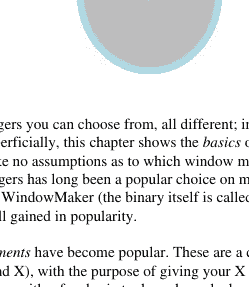

你可以从中选择的窗口管理器有很多，各不相同；与其只描述一个，或对所有窗口管理器都只做肤浅描述，本章展示了 X 的基础知识，这些基础知识对所有窗口管理器都是共通的。我尽量不假设你使用的是哪个窗口管理器；虽然 fvwm 系列窗口管理器长期以来在大多数基于 Linux 的系统上都很受欢迎，但今天其他窗口管理器——包括 WindowMaker（二进制文件本身称为 wmaker）、Enlightenment、AfterStep 等——都变得越来越流行。

最近，桌面环境变得流行起来。这些是在窗口管理器（和 X）之上运行的一组应用程序，其目的是为你的 X 会话提供标准化的“外观和感觉”；这些套件通常附带一些基本工具，如时钟和文件管理器。两个流行的分别是 GNOME 和 KDE，虽然它们因其图形化特性而在今天获得了大量关注，但两者都在非常快速地变化，并且在撰写本文时尚未准备好广泛、普遍使用（并且它们可能导致你的系统崩溃）。

如果你有一个最近的 Linux 发行版并选择了默认安装，很可能你已经安装了 GNOME 或 KDE，并将 fvwm2 或 wmaker 窗口管理器指定为默认。（虽然你可以在系统上安装多个窗口管理器，但一次只能运行一个。）

- 5.1.1 Starting X    如何启动 X。
- 5.1.2 Stopping X    如何停止 X。

## 5.1.1 Starting X

启动 X 有两种方法。某些系统在系统启动时运行 X 显示管理器 xdm，此时会出现图形化的 xdm 登录屏幕；你可以使用它直接登录到 X 会话。在未运行 xdm 的系统上，为 X 保留的虚拟控制台将保持空白，直到你通过运行 startx 命令启动 X 为止。

- 要从虚拟控制台启动 X，输入：

```
$ startx RET
```

- 要运行 startx 并将其输出重定向到日志文件，输入：

```
$ startx 62:;$HOME/startx.log 262;38;1 RET
```

这两个示例都在第七个虚拟控制台上启动 X，无论你在运行命令时处于哪个控制台——你的控制台会自动切换到 X。你始终可以在 X 会话期间切换到另一个控制台（参见章节 Console Basics）。第二个示例将 startx 的任何错误消息或输出写入你主目录中名为 `startx.log` 的文件。

在某些系统上，X 默认以 8 位颜色深度启动。使用 startx 的特殊 `-bpp` 选项来指定颜色深度。在选项后跟上表示要使用的颜色深度的数字，并在选项前加上两个连字符（`--`），这会告诉 startx 将其后的选项传递给 X 服务器本身。

- 要从虚拟控制台启动 X，并指定 16 位颜色深度，输入：

```
$ startx -- -bpp 16 RET
```

NOTE: 如果你的系统运行 xdm，你始终可以切换到第七个虚拟控制台（或 xdm 运行所在的任何控制台），然后在 xdm 登录屏幕登录。

## 5.1.2 Stopping X

要结束 X 会话，你通常从窗口管理器的菜单中选择退出 X 选项。

- 如果你正在运行 fvwm2 窗口管理器，要结束你的 X 会话，请在 root window 中单击鼠标左键调出开始菜单，然后从 Exit 中选择 Really quit?


Fvwm 子菜单。

+   如果你正在运行 afterstep 窗口管理器，要结束你的 X 会话，请在根窗口中单击鼠标左键调出开始菜单，然后从 Exit Fvwm 子菜单中选择 Really quit？。

如果你使用 startx 启动了 X 会话，这些命令会将你返回到在虚拟控制台中输入命令的 shell 提示符。如果另一方面，你是通过在第七个虚拟控制台登录 xdm 来启动 X 会话的，你将被注销出 X 会话并出现 xdm 登录屏幕；然后你可以切换到另一个虚拟控制台或再次登录 X。

要立即退出 X 并终止所有 X 进程，请按 CTRL-ALT-BKSP 组合键（如果你的键盘有两个 ALT 和 CTRL 键，请按左侧的键）。你将丢失任何未保存的应用程序数据，但当你无法正常退出 X 会话时——例如系统冻结或其他问题——这很有用。

+   要立即退出 X，输入：

```
CTRL-ALT-BKSP
```

### 5.2 在 X 中运行程序

在 X 会话中运行的程序称为 X 客户端。（X Window 系统本身称为 X 服务器）。要在 X 中运行程序，你将其作为 X 客户端启动——要么从菜单中选择它，要么在 xterm shell 窗口中输入运行命令（参见章节 在 X 中运行 Shell）。大多数窗口管理器都有一类“开始菜单”；它通常通过在根窗口的任何位置单击鼠标左键来访问。要从开始菜单运行 X 客户端，请单击鼠标左键从子菜单中选择客户端的名称。

例如，要从开始菜单启动一个方形、模拟表盘的时钟，请在根窗口上单击鼠标左键使菜单出现，然后通过应用程序菜单单击鼠标左键并单击 `xclock (analog)`。这将启动 xclock 客户端，指定选项以显示模拟表盘：


你也可以通过从 shell 窗口运行它来启动客户端——这对于启动不在菜单上的客户端，或当你想要指定选项或参数时很有用。当你从 shell 窗口运行 X 客户端时，它会在自己的窗口中打开；将客户端在后台运行以释放 shell 窗口中的 shell 提示符（参见章节 将作业置于后台）。

+   - 要从 shell 窗口运行数字时钟，输入：

```
$ xclock -digital 38; RET
```

该命令从 shell 窗口在后台运行 xclock；`digital` 选项指定数字时钟。

以下各节解释如何指定大多数 X 客户端通用的某些命令行选项——例如窗口布局、颜色和字体。

+   5.2.1 指定窗口大小和位置
+   指定窗口的大小和位置。
+   5.2.2 指定窗口颜色
+   指定窗口的颜色。
+   5.2.3 指定窗口字体
+   指定窗口的字体。
+   5.2.4 指定附加窗口属性
+   可指定的窗口属性列表。

#### 5.2.1 指定窗口大小和位置

通过使用 `geometry` 选项给出其窗口几何形状来指定窗口的大小和位置。四个字段控制窗口的宽度和高度，以及窗口与屏幕边缘的距离（“偏移”）。其指定形式为：

```
-geometry WIDTHxHEIGHT+XOFF+YOFF
```

这些四个字段中的值通常以像素为单位给出，尽管某些应用程序以字符为单位测量 WIDTH 和 HEIGHT。虽然你必须按顺序给出这些值，但你可以省略任一对。例如，要仅指定窗口的大小，只需给出 WIDTH 和 HEIGHT 的值。

+   - 要启动一个小的 xclock，宽 48 像素，高 48 像素，输入：

```
$ xclock -geometry 48x48 RET
```

+   • 要启动一个大的 xclock，宽 480 像素，高 500 像素，输入：

```
$ xclock -geometry 480x500 RET
```

+   • 要启动一个宽为 48 像素且高度为默认值的 xclock，输入：

```
$ xclock -geometry 48 RET
```

+   • 要启动一个高为 48 像素且宽度为默认值的 xclock，输入：

```
$ xclock -geometry x48 RET
```

你可以为 XOFF 和 YOFF 字段给出正数或负数。正 XOFF 值指定从屏幕左侧的位置；负值指定从右侧的位置。如果 YOFF 为正，则指定从屏幕顶部的位置；如果为负，则指定从屏幕底部的位置。给出这些偏移量时，你必须同时指定 XOFF 和 YOFF 的值。

要将窗口放置在桌面四个角之一，请按如下方式对适当的 XOFF 和 YOFF 值使用零：

| XOFF AND YOFF VALUES | WINDOW POSITION |
| +0+0 | Upper left corner. |
| +0-0 | Lower left corner. |
| -0+0 | Upper right corner. |
| -0-0 | Lower right corner. |

+   • 要在左下角启动默认大小的 xclock，输入：

```
$ xclock -geometry +0-0 RET
```

或者，你可以将所有内容组合在一起，使用包含全部四个值的单个 geometry 行来指定窗口的大小和位置。

+   • 要启动一个宽 120 像素、高 100 像素、x 偏移量为从屏幕右侧 250 像素、y 偏移量为从屏幕顶部 25 像素的 xclock，输入：

```
$ xclock -geometry 120x100-250+25 RET
```


#### 5.2.2 指定窗口颜色

在你的 X 会话中可用的窗口颜色取决于你的显示硬件和正在运行的 X 服务器。xcolors 工具会显示在你的 X 服务器上可用的所有颜色以及指定它们的名称。 （颜色名称不区分大小写。）

- 要列出可用的颜色，输入：

```
$ xcolors RET
```

按 Q 退出 xcolors。

要指定用于窗口背景、窗口边框以及窗口本身中的文本或图形的颜色，请将颜色名称作为参数传递给相应的选项：`-bg` 用于背景颜色，`-bd` 用于窗口边框颜色，`-fg` 用于前景颜色。

- 要启动一个窗口背景为浅蓝色的 xclock，输入：

```
$ xclock -bg lightblue RET
```

你可以指定这些属性的任意组合。

- 要启动一个窗口背景为海绿色、窗口前景为绿松石色的 xclock，输入：

```
$ xclock -bg seagreen -fg turquoise RET
```

#### 5.2.3 指定窗口字体

要获取 X 字体名称，请使用 xfontsel（参见章节 X Fonts）。要为窗口指定使用的字体，请使用 `-fn` 选项后跟要使用的 X 字体名称。

- 要启动一个数字显示的 xclock，并指定其使用 17 点 Helvetica 字体显示文本，输入：

```
$ xclock -digital -fn -*-helvetica-*-r-*-*-17-*-*-*-*-*-*-* RET
```

## The Linux Cookbook: Tips and Techniques for Everyday Use:

此命令启动的 xclock 看起来像这样：

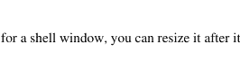

注意：如果为 shell 窗口指定字体，可以在运行后按 Resizing the Xterm Font 中所述调整其大小。

[ < ] [ > ] [ << ] [ Up ] [ >> ] [Top] [Contents] [Index] [ ? ]

#### 5.2.4 指定附加窗口属性

X 应用程序通常有最多三个特殊菜单，用于更改某些属性。要查看这些菜单，请按住 CTRL 并单击三个鼠标按钮之一。 （14）下表列出了并描述了大多数 X 感知应用程序通用的各种窗口属性。

| WINDOW OPTIONS | DESCRIPTION |
|---|---|
| -bd color<br>-bordercolor color | 使用 color 作为窗口边框颜色。 |
| -bg color<br>-background color | 使用 color 作为窗口背景颜色。 |
| -bw number<br>-borderwidth number | 以像素为单位指定窗口边框宽度。 |
| -fg color<br>-foreground color | 使用 color 作为窗口前景文本或图形。 |
| -fn font<br>-font font | 使用 font 作为要使用的字体。 |
| -geometry geometry | 指定窗口几何形状。 |
| -iconic | 立即图标化程序（参见章节 Minimizing a Window）。 |
| -title string | 使用 string 作为窗口标题。 |

[ < ] [ > ] [ << ] [ Up ] [ >> ] [Top] [Contents] [Index] [ ? ]

### 5.3 操作 X 客户端窗口

一次只有一个 X 客户端可以接受键盘和鼠标输入，该客户端称为活动客户端。要使客户端处于活动状态，将鼠标移至该客户端的窗口上。当客户端为活动客户端时，称其为“获得焦点”。根据窗口管理器，鼠标指针的形状可能会改变，或者活动客户端的窗口边框和标题栏可能不同（常见默认设置是活动客户端颜色为钢蓝色，其他所有窗口为灰色）。

每个窗口都有自己的控件来操作该窗口。以下是如何使用鼠标执行基本窗口操作。

- 5.3.1 移动窗口
- 移动窗口。
- 5.3.2 调整窗口大小
- 调整窗口大小。
- 5.3.3 销毁窗口
- 当你不再需要窗口时。
- 5.3.4 最小化窗口
- 将窗口变成图标。
- 5.3.5 最大化窗口
- 从图标恢复窗口。

#### 5.3.1 移动窗口

要移动窗口，在窗口的标题栏上单击并按住鼠标左键，然后拖动其窗口轮廓到新位置。当轮廓就位时，释放鼠标左键，窗口将移动到窗口轮廓所在的位置。

#### 5.3.2 调整窗口大小

要调整窗口大小，在窗口的四个边框中的任意一个上单击并按住鼠标左键，并移动鼠标以缩小或放大窗口轮廓。释放鼠标左键即可将窗口调整为窗口轮廓的大小。

#### 5.3.3 销毁窗口

要销毁窗口并停止其显示的程序，在标题栏右上角的“X”按钮上单击鼠标左键。这在窗口中运行的程序停止响应时很有用。 （当然，如果窗口中的程序有正常停止的选项，你始终可以使用它来停止程序并关闭其窗口。）


#### 5.3.4 最小化窗口

要 *最小化* 一个窗口，使其消失并在桌面上放置一个代表正在运行程序的图标，请在标题栏右上角的 ` _ ` 按钮上单击鼠标左键。这也称为 *图标化* 一个窗口。

#### 5.3.5 最大化窗口

要将图标 *最大化* 为窗口（或“取消图标化”），请在图标本身正下方的图标名称上双击鼠标左键。图标将消失，窗口将返回到其先前的位置。

### 5.4 在桌面上移动

许多窗口管理器（包括 `afterstep` 和 `fvwm2`）允许你使用 *虚拟桌面*，这让你使用的屏幕空间比显示器一次能显示的更多。虚拟桌面可以大于显示区域，在这种情况下，你可以用鼠标滚动浏览。填充显示器的视图称为 *视口*。当你在当前（虚拟）桌面延伸的方向将鼠标移出屏幕时，视图会向该方向滚动。虚拟桌面对于同时全屏运行多个客户端很有用，每个客户端都在其自己的独立桌面中。

某些配置不允许在桌面之间滚动；在这种情况下，使用 *分页器* 在它们之间切换，分页器显示虚拟桌面的微型视图，并允许你在桌面之间切换。它是一个 *粘性窗口*（它“粘在玻璃上”高于所有其他窗口），并且始终位于屏幕的右下角，即使你在虚拟桌面上滚动时也是如此。分页器中同时突出显示你的当前桌面和活动 X 客户端。

默认的 `fvwm2` 虚拟桌面大小为 3x3 网格中的九个桌面：


## 《Linux Cookbook：日常使用的技巧和技术》：

在前面的插图中，当前桌面是顶行中的第二个桌面。第一个桌面包含两个 X 客户端窗口——一个小的一个和一个大的——但在任何其他桌面（包括当前桌面）中都没有窗口。

要切换到另一个桌面，请在分页器中单击其对应的视图上的鼠标左键，或使用键盘快捷键。在 `fvwm2` 中，切换桌面默认的键是 **ALT** 配合方向键；在 `afterstep` 中，使用 **CTRL** 键代替 **ALT**。

- 要在运行 `fvwm2` 时切换到当前桌面左侧的桌面，输入 **ALT-{leftarrow}**。 [GNU INFO BUG: 前一行中的任何 <> 都应为 ← 和/或 → 方向键。]
- 要在运行 `afterstep` 时切换到当前桌面正左侧的桌面，输入 **CTRL-{leftarrow}**。 [GNU INFO BUG: 前一行中的任何 <> 都应为 ← 和/或 → 方向键。]

### 5.5 在 X 中运行 Shell

使用 `xterm` 在窗口中运行 shell。你可以在 xterm 窗口中运行命令，就像在虚拟控制台中一样；xterm 中的 shell 与虚拟控制台中的 shell 作用相同（参见章节 [The Shell]）。

与控制台中的 shell 不同，你可以从 xterm 剪切并粘贴文本到另一个 X 客户端（参见章节 [Selecting Text]）。

要滚动浏览已滚动到屏幕顶部的文本，输入 **Shift-PgUp**。你能回滚的行数取决于回滚缓冲区的大小，由 `-sl` 选项指定；其默认值是 64。

`xterm` 的仿真特性有许多选项可供控制；请参阅 `xterm` 手册页以获取完整列表（参见章节 [Reading a Page from the System Manual]）。

**NOTE:** `xterm` 可能是最流行的终端仿真器 X 客户端，但它不是唯一的；其他可供选择的包括 `wterm` 和 `rxvt`，它们各有自己的特殊功能——试试所有，找到你喜欢的一个。

### 5.6 配置 X

X 有一些方面人们通常希望立即配置。本节讨论一些最受欢迎的方面，包括更改视频模式、启动时自动运行客户端，以及选择窗口管理器。你可以在 *The X Window User HOWTO* 和 *The Configuration HOWTO* 中找到更多相关信息（关于如何阅读它们，参见 [Reading System Documentation and Help Files]）。

- 5.6.1 切换视频模式  更改视频模式和分辨率。
- 5.6.2 自动运行 X 客户端  自动运行某些客户端。
- 5.6.3 更改根窗口参数  更改根窗口参数。
- 5.6.4 选择窗口管理器  窗口管理器的选择由你决定！

#### 5.6.1 切换视频模式

*视频模式* 是以像素为单位的显示分辨率，例如 640x480。X 服务器可以在硬件允许且管理员设置的情况下在视频模式之间切换；运行 X 的机器提供几种视频模式并不罕见，因此 640x480、800x600 和 1024x768 显示分辨率都是可能的。

要切换到另一个视频模式，请使用小键盘上的 **+** 和 **–** 键配合左 **CTRL** 和 **ALT** 键。 **+** 键切换到下一个分辨率更低的模式， **–** 键切换到下一个分辨率更高的模式。

- 要切换到下一个最低视频模式，输入：

```
CTRL-ALT-+
```

- 要切换到下一个最高视频模式，输入：

```
CTRL-ALT--
```

重复输入上述任一键组合以循环浏览所有可用模式。

*NOTE:* 有关视频模式的更多信息，请参阅 *The XFree86 Video Timings HOWTO*（参见章节 [Reading System Documentation and Help Files]）。


#### 5.6.2 自动运行 X 客户端

`.xsession` 文件是位于你主目录中的一个隐藏文件，它指定了在 X 会话首次启动时自动运行的客户端（“隐藏”文件的说明见 文件和目录）。它只是一个 shell 脚本，通常包含要运行的客户端列表。你可以在文本编辑器中编辑你的 `.xsession` 文件，如果该文件不存在，也可以创建它。

客户端按照列出的顺序启动，最后一条行应指定要使用的窗口管理器。下面的示例 `.xsession` 文件启动了一个背景为黑色、文字为白色的 xterm，将一个 `oclock`（圆形时钟）窗口放在左上角，启动 Emacs 文本编辑器，然后启动 fvwm2 窗口管理器：

```
#!/bin/sh
#
# A sample .xsession file.

xterm -bg black -fg white 3&
oclock -geometry +0+0 3&
emacs 3&
exec /usr/bin/X11/fvwm2
```

所有客户端都作为后台作业启动，除了最后一行的窗口管理器，因为当此文件运行时，X 会话在前台运行（见章节 管理作业）。始终在 `.xsession` 文件中放入的任何命令行的末尾加上一个与号（`&`），除了最后一行指定窗口管理器的行。

#### 5.6.3 更改根窗口参数

默认情况下，根窗口背景为灰色并带有编织图案。为了绘制这些图案，X 使用位图对根窗口进行平铺，位图是一种以特殊文件格式存储的黑白图像。X 在 `/usr/X11R6/include/bitmaps/` 目录中安装了一些位图；默认位图文件是 `root_weave`（你可以用位图工具制作自己的图案；见 交互式图像编辑器和工具）。

使用 xsetroot 来更改根窗口的颜色和位图图案。

要更改颜色，使用 `-solid` 选项，并给出要使用的颜色名称作为参数。（使用 xcolors 获取可能的颜色名称列表；见章节 指定窗口颜色。）

- 要将根窗口颜色更改为蓝紫色，输入：

```
$ xsetroot -solid blueviolet RET
```

要更改根窗口图案，使用 `-bitmap` 选项，并给出要使用的位图文件名。

- 要用星形图案平铺根窗口，输入：

```
$ xsetroot -bitmap /usr/X11R6/include/bitmaps/star RET
```

指定图案时，使用 `-fg` 和 `-bg` 选项指定前景色和背景色。

- 要用黑色背景在根窗口上平铺浅板岩灰星形图案，输入（全部在一行上）：

```
$ xsetroot -fg slategray2 -bg black -bitmap
/usr/X11R6/include/bitmaps/star RET
```

使用 xsetroot 的特殊 `-gray` 选项将根窗口更改为一种易于眼睛接受的灰色调，且无图案。

- 要使根窗口变为无图案的灰色，输入：

```
$ xsetroot -gray RET
```

注意：你也可以在窗口中放置一幅图像（尽管这会消耗本可节省给内存占用型 Web 浏览器的内存；但见 在根窗口中放置图像，了解如何操作）。

#### 5.6.4 选择窗口管理器

是的，有很多窗口管理器可供选择。有些人喜欢 Enlightenment 的花哨效果，与 KDE 或 GNOME 一起运行，而其他人则更喜欢简朴的 wm2——选择权在你。

下表描述了一些目前较为流行的窗口管理器。

| WINDOW MANAGER | DESCRIPTION |
|---|---|
| 9wm | 9wm 是一个简单的窗口管理器，受 AT&T 的 Plan 9 窗口管理器启发——它不使用标题栏或图标。它应该会吸引那些喜欢 wily 文本编辑器的人（见章节 选择完美的文本编辑器）。{@sf{Debian}}： |
| 9wm {@sf{WWW}}: ftp://ftp.cs.su.oz.au/dhog/9wm/ |  |
| afterstep | AfterStep 受 NeXTSTEP 界面的外观和感觉启发。{@sf{Debian}}: `afterstep` {@sf{WWW}}: http://www.afterstep.org/ |
| enlightenment | Enlightenment 是一个图形密集型的窗口管理器，使用桌面“主题”来装饰 X 会话的各种控件。{@sf{Debian}}: `enlightenment` {@sf{WWW}}: http://www.enlightenment.org/ |
| fvwm95 | fvwm95 让 X 看起来像 1995 年左右的某个专有企业操作系统。{@sf{Debian}}: `fvwm95` {@sf{WWW}}: http://www.foxproject.org/sclass/fvwm95.html |
| twm | Tab Window Manager 是一个较老、简单的窗口管理器，几乎在每个系统上都可用。（它有时也被称为 Tom's Window Manager，以其主要作者 Tom LaStrange 命名。）{@sf{Debian}}: `twm` |
| wm2 | wm2 是一个极简主义、无需配置的窗口管理器。{@sf{Debian}}: `wm2` {@sf{WWW}}: http://www.all-day-breakfast.com/wm2/ |

[ < ] [ > ] [ << ] [ Up ] [ >> ] [Top] [Contents] [Index] [ ? ]


## 第二部分：文件

- 6. 文件与目录
- 面向所有人的基本命令。
- 7. 共享文件
- 在用户之间共享文件。
- 8. 查找文件
- 查找文件的方法不止一种。
- 9. 管理文件
- 如何管理你的文件。

## 6. 文件与目录

本章讨论操作文件和目录的基本工具——这些工具是 Linux 系统中最基本的一些工具。

文件是存储在磁盘上的数据集合，可以按其名称作为单一单元进行操作。

目录是一种文件，充当其他文件的文件夹。目录还可以包含其他目录（子目录）；包含另一个目录的目录被称为其所含目录的父目录。

目录树包括一个目录及其所有文件，以及所有子目录的内容。（每个目录都是“树”中的一个“分支”。）单独一个斜杠字符（‘ / ’）是目录树层级底部的根目录的名称；它是所有其他文件或目录分支出来的主干。

下图展示了目录层级结构的简化版本。

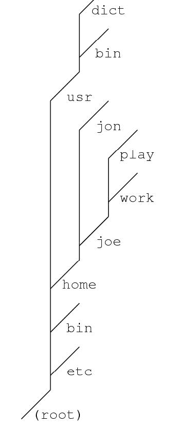

要表示目录在文件层级中的位置，需要指定它和根目录之间的所有目录，并使用斜杠（`/`）作为分隔符来分隔各个目录。因此，目录 `dict` 在前面的插图中可表示为 `/usr/dict`。

每个用户都在 `/home` 目录中有一个属于自己的分支，用于存放个人文件，称为*主目录*。前一幅插图所示的层级结构中就有两个主目录：`joe` 和 `jon`，它们都是 `/home` 的子目录。

当你在 shell 中时，你总是处于系统上的某个目录中，该目录称为*当前工作目录*。当你首次登录系统时，你的主目录就是当前工作目录。

每当将文件名作为工具或应用程序的参数时，你可以给出相对于当前工作目录的、以斜杠分隔的*路径名*。例如，如果当前工作目录是 `/home/joe`，你可以使用 `work` 来指定目录 `/home/joe/work`，使用 `work/schedule` 来指定 `/home/joe/work` 目录中的文件 `schedule`。

每个目录都有两个特殊文件，其名称分别由一个点和两个点组成：`..` 表示当前工作目录的父目录，`.` 表示当前工作目录本身。如果当前工作目录是 `/home/joe`，你可以用 `.` 指定 `/home/joe`，用 `..` 指定 `/home`。此外，你还可以将 `/home/jon` 目录指定为 `../jon`。

指定文件名的另一种方法是，给出从根目录（`/`）一直到该文件的、以斜杠分隔的所有目录分支列表。从根目录到文件的这个唯一而具体的路径称为文件的*完整路径名*。（当所指对象不是目录时，有时也称之为*绝对文件名*）。

你可以通过给出完整路径名来指定系统中的任何文件或目录。系统中的不同目录里可以存在同名文件，但任何两个文件或目录都不能共享同一个完整路径名。例如，用户 `joe` 可以在其 `/home/joe/work` 目录下有一个文件 `schedule`，也可以在其 `/home/joe/play` 目录下有一个文件 `schedule`。虽然这两个文件同名（`schedule`），但它们位于不同的目录中，各自都有唯一的完整路径名——`/home/joe/work/schedule` 和 `/home/joe/play/schedule`。

不过，你不需要输入工具或应用程序的完整路径名就能启动它。shell 维护着一个目录列表，称为*路径*，shell 会在这些目录中查找程序。如果某个程序“在你的路径中”，即位于这些目录之一，你只需输入其名称即可运行它。

默认情况下，路径包含 `/bin` 和 `/usr/bin`。例如，`who` 命令位于 `/usr/bin` 目录中，因此其完整路径名是 `/usr/bin/who`。由于 `/usr/bin` 目录在路径中，无论当前工作目录是什么，你都可以输入 `who` 来运行 `/usr/bin/who`。

下表描述了 Linux 系统上的一些标准目录。

| 目录 | 描述 |
|---|---|
| / | 系统中所有目录的祖先目录；所有其他目录都是该目录的子目录，要么直接子目录，要么通过其他子目录间接成为子目录。 |
| /bin | 基本工具和其他程序（或*二进制文件*）。 |
| /dev | 表示系统各种硬件*设备*的文件。例如，使用文件 `/dev/cdrom` 访问光盘驱动器。 |
| /etc | 各种系统配置文件、启动文件，*等等*。 |
| /home | 系统中所有用户的*主*目录。 |


# 《Linux  cookbook：日常使用的技巧与技术》

/lib 用于 `/bin` 中工具的必备系统库文件。

/proc 提供当前系统进程信息的 文件。

/root 超级用户的家目录，其用户名为 root。 （过去，超级用户的家目录只是 `/`；后来采用 `/root` 来实现此目的，以减少 `/` 中的杂乱。）

/sbin 必备的系统管理员工具，或系统二进制文件。

/tmp 临时文件。

/usr 与用户工具和应用程序相关的子目录中的文件。

/usr/X11R6 与 X Window 系统相关的文件，包括那些仅在 X 下运行的程序（位于 `/usr/X11R6/bin`）。

/usr/bin 用户的工具和应用程序。

/usr/dict 词典和单词列表（正逐渐被 `/usr/share/dict` 取代）。

/usr/doc 各种系统文档。

/usr/games 游戏和娱乐。

/usr/info GNU Info 超文本系统的文件。

/usr/lib 用于 `/usr/bin` 中工具的库。

/usr/local 本地文件——特定于单个系统的文件——包括本地文档（位于 `/usr/local/doc`）和程序（位于 `/usr/local/bin`）。

/usr/man 在线手册，可通过 man 命令阅读（参见章节 阅读系统手册中的一页）。

/usr/share 已安装应用程序的数据，其与体系结构无关且可在系统之间共享。 这里还出现了许多与 `/usr` 中等价的子目录，包括 `/usr/share/doc`、`/usr/share/info` 和 `/usr/share/icons`。

/usr/src 在系统上编译的软件的程序源代码。

/usr/tmp 另一个临时文件目录。

/var 可变数据文件，例如 spool 队列和日志文件。

注意：有关基于 Linux 系统的目录结构的更多信息，请查看 `/usr/doc/debian-policy/fsstnd/` 目录中的压缩文件（参见章节 浏览文本）。

- 6.1 命名文件和目录 如何为文件和目录命名。
- 6.2 更改目录 如何在文件系统中移动。
- 6.3 列出目录 列出目录的内容。
- 6.4 复制文件和目录 复制文件。
- 6.5 移动文件和目录 将文件移动到不同位置。
- 6.6 删除文件和目录 删除不需要的文件和目录。
- 6.7 为文件提供多个名称 在文件之间创建链接。
- 6.8 使用模式指定文件名 指定文件名的快捷方式。
- 6.9 浏览文件 在系统上浏览文件。

### 6.1.1 创建空文件

有时你可能想要创建一个新的空文件作为一种“占位符”。 为此，将你想要用于该文件的名称作为参数传递给 touch。

- 要在当前目录中创建文件 `a_fresh_start`，请输入：

```
$ touch a_fresh_start RET
```

- 要在当前目录的 `work/completed` 子目录中创建文件 `another_empty_file`，请输入：

```
$ touch work/completed/another_empty_file RET
```

此工具“触摸”你提供的作为参数的文件。 如果文件不存在，它会创建它；如果文件已存在，它会将文件的修改时间戳更改为当前日期和时间，就好像你使用了该文件一样。

> 注意：通常，当你编辑文件时，例如在文本或图像或声音编辑器中； 在这种情况下，你不需要先创建文件。

### 6.1.2 创建目录

使用 mkdir（“make directory”）创建新目录，将新目录的路径名作为参数给出。 目录名称遵循与使用其他文件相同的约定——即，不建议使用空格、斜杠或其他不寻常的字符。

- 要在当前工作目录中创建一个名为 `work` 的新目录，请输入：

```
$ mkdir work RET
```

- 要在 `/tmp` 目录中创建一个名为 `work` 的新目录，请输入：

```
$ mkdir /tmp/work RET
```

### 6.1.3 创建目录树

使用 `-p` 选项的 `mkdir` 来创建子目录及其尚未存在的任何父目录。 当你想从头开始创建一个相当复杂的目录树，并且不想逐个创建每个目录时，这很有用。

- 要创建 `work/completed/2001` 目录——当前目录中 `work` 目录的子目录 `completed` 的子目录，请输入：

```shell
$ mkdir -p work/completed/2001
```

这会在名为 `completed` 的目录中创建一个 `2001` 子目录，而 `completed` 又位于当前目录中名为 `work` 的目录中； 如果 `completed` 或 `work` 目录尚不存在，它们也会被创建（如果你知道 `work` 和 `completed` 都存在，上述命令在没有 `-p` 选项的情况下也能正常工作）。

### 6.2 更改目录

使用 cd 更改当前工作目录；将新目录的名称作为参数给出。

- 要将当前工作目录更改为当前目录中的子目录 `work`，请输入：

```shell
$ cd work
```

- 要更改为当前目录的父目录，请输入：

```shell
$ cd ..
```

你也可以给出目录的完整路径名。

- 要将当前工作目录更改为 `/usr/doc`，请输入：

```shell
$ cd /usr/doc
```

此命令将 `/usr/doc` 设为当前工作目录。


#### 6.2.1 切换到您的主目录

不带参数使用 `cd` 时，会将您的主目录设为当前工作目录。

-   要将您的主目录设为当前工作目录，请输入：

```
$ cd RET
```

#### 6.2.2 切换到您上一个访问的目录

要返回您上一个所在的目录，请使用 `cd` 并指定 `-` 作为目录名。例如，如果您当前位于 `/home/mrs/work/samples` 目录，并使用 `cd` 切换到其他目录，那么在此其他目录中的任意时刻，您都可以输入 `cd -` 将当前工作目录返回到 `/home/mrs/work/samples`。

-   要返回您上一次所在的目录，请输入：

```
$ cd - RET
```

#### 6.2.3 获取当前目录的名称

要确定当前工作目录是什么，请使用 `pwd`（意为“打印工作目录”），它会列出当前工作目录的完整路径名。

《Linux Cookbook：日常使用的技巧与技术》：

-   要确定当前工作目录是什么，请输入：

```
$ pwd RET
/home/mrs
$
```

在此示例中，`pwd` 输出文本 `/home/mrs`，表示当前工作目录是 `/home/mrs`。

[ < ] [ > ] [ << ] [ Up ] [ >> ] [Top] [Contents] [Index] [ ? ]

### 6.3 列出目录

```
@sf(Debian): `mc`
@sf(Debian): `mozilla`
@sf(WWW): http://www.gnome.org/mc/
@sf(WWW): http://www.mozilla.org/
```

使用 `ls` 列出目录的内容。它接受要列出的目录名称作为参数。不带参数时，`ls` 会列出当前工作目录的内容。

-   要列出当前工作目录的内容，请输入：

```
$ ls RET
apple  cherry  orange
$
```

在此示例中，当前工作目录包含三个文件：`apple`、`cherry` 和 `orange`。

-   要列出当前目录中的子目录 `work` 的内容，请输入：

```
$ ls work RET
```

-   要列出 `/usr/doc` 目录的内容，请输入：

```
$ ls /usr/doc RET
```

您无法从默认列表中辨别文件类型；目录和可执行文件与其他所有文件无法区分。但是，使用 `-F` 选项可以让 `ls` 在子目录名称后添加 `/` 字符，并在可执行文件名后添加 `*` 字符。

-   要列出目录内容，使目录和可执行文件与其他文件区分开。

《Linux Cookbook：日常使用的技巧与技术》：

文件，请输入：

```
$ ls -F RET
repeat* test1  test2  words/
$
```

在此示例中，当前目录包含一个名为 `repeat` 的可执行文件、一个名为 `words` 的目录，以及一些名为 `test1` 和 `test2` 的其他文件。

另一种列出目录内容的方式——也是我在使用 X 窗口系统并希望同时查看这些目录中的图像文件时经常使用的方式——是使用 Mozilla 或其他 Web 浏览器作为本地文件浏览器。使用前缀 `file://` 来查看本地文件。单独使用该前缀会打开根目录的目录列表；`file://home/joe` 会打开用户 joe 的主目录的目录列表，`file://usr/local/src` 会打开本地源代码目录，依此类推。几乎所有的浏览器都会动态地将目录列表渲染为 HTML，因此您可以点击子目录进行导航，并点击文件在浏览器中打开它们。

还有一种列出目录内容的方式是使用“文件管理器”工具，Linux 上至少有几种此类工具；其中最流行的可能是“Midnight Commander”，即 `mc`。

以下小节介绍一些常用选项，用于控制 `ls` 列出哪些文件以及 `ls` 输出这些文件的哪些信息。在类 Unix 系统上，这是最常用的文件命令之一。

-   6.3.1 列出文件属性
-   6.3.2 递归列出目录
-   6.3.3 最新文件优先列出
-   6.3.4 列出隐藏文件
-   6.3.5 彩色列出目录
-   6.3.6 列出目录树图
-   6.3.7 其他目录列出选项

-   列出文件属性。
-   列出目录及其子目录。
-   最新文件优先列出。
-   列出隐藏或特殊文件。
-   彩色目录列表。
-   列出整个目录树。
-   `ls` 命令的常用选项。

#### 6.3.1 列出文件属性

使用 `ls` 配合 `-l`（“long”）选项，可以输出更详细的目录列表——其中包含每个文件的大小（以字节为单位）、最后修改时间、文件类型，以及所有权和权限（参见“文件所有权”一节）。

-   要输出 `/usr/doc/bash` 目录的详细列表，请输入：


# Linux 实用手册：日常使用的技巧与方法：

```
$ ls -l /usr/doc/bash RET
total 72
-rw-r--r--  1 root    root     13744 Oct 19 22:57 CHANGES.gz
-rw-r--r--  1 root    root      1816 Oct 19 22:57 COMPAT.gz
-rw-r--r--  1 root    root     16398 Oct 19 22:57 FAQ.gz
-rw-r--r--  1 root    root      2928 Oct 19 22:57 INTRO.gz
-rw-r--r--  1 root    root      4751 Oct 19 22:57 NEWS.gz
-rw-r--r--  1 root    root      1588 Oct 19 22:57 POSIX.NOTES.gz
-rw-r--r--  1 root    root      2718 Oct 19 22:57 README.Debian.gz
-rw-r--r--  1 root    root     19596 Oct 19 22:57 changelog.gz
-rw-r--r--  1 root    root      1446 Oct 19 22:57 copyright
 drwxr-xr-x  9 root    root      1024 Jul 25  1997 examples
$
```

该命令输出 `/usr/doc/bash` 中文件的详细列表。输出的第一行给出文件占用的磁盘空间总量，以 1024 字节块为单位（在此示例中为 72）。每一后续行显示一个文件的信息，包含多列。

第一列显示文件类型和权限。该列的第一个字符指定文件类型；连字符 (`-`) 为默认值，表示该文件是普通文件。目录用 `d` 表示，符号链接（参见章节 [为文件提供多个名称](#)）用 `l` 表示。第一列的其余九个字符显示文件权限（参见章节 [控制文件访问](#)）。第二列列出指向该文件的硬链接数。第三列和第四列给出文件所属的用户和组名称。第五列给出文件的大小（字节），第六列给出最后修改的日期和时间，最后一个列给出文件名。

[<] [>]   [<<] [Up] [>>]   [Top] [Contents] [Index] [?]

#### 6.3.2 递归列出目录

使用 `-R` 选项递归列出目录，该选项会输出该目录及其所有子目录的列表。

- 要输出当前目录的递归目录列表，输入：

```
$ ls -R RET
play    work

play:
notes

work:
notes
$
```

在此示例中，当前工作目录包含两个子目录 `work` 和 `play`，且没有其他文件。每个子目录都包含一个名为 `notes` 的文件。

- 要列出系统上的所有文件，输入：

```
$ ls -R / RET
```

该命令递归列出根目录 `/` 及其所有子目录的内容。通常会将此选项与属性选项 `-l` 结合使用，以输出系统上所有文件的详细列表：

```
$ ls -lR / RET
```

*NOTE:* 如果你没有权限，则无法列出系统上某些目录的内容（参见章节 Controlling Access to Files）。

#### 6.3.3 按最新文件优先列出

使用 `-t` 选项与 ls 结合，可对目录列表进行排序，使最新文件优先列出。

- 要按最新优先列出 `/usr/tmp` 目录中的所有文件，输入：

```
$ ls -t /usr/tmp RET
```

#### 6.3.4 列出隐藏文件

默认情况下，ls 不会输出以句点字符 (`.`) 开头的文件。为了减少杂乱，许多应用程序通过给文件名以句点开头的方式在你的主目录中“隐藏”配置文件；这些被称为点文件，或有时称为“隐藏”文件。如前所述，每个目录都有两个特殊的点文件：`..`，父目录，和 `.`，目录本身。

要列出目录的所有内容，包括这些点文件，请使用 `-a` 选项。

- 要列出当前目录中的所有文件，输入：

```
$ ls -a RET
```

使用 `-A` 选项可列出目录中几乎所有文件：它会列出所有文件，包括点文件，但除外 `.` 和 `..`。

- 要列出当前目录中除 `.` 和 `..` 之外的所有文件，输入：

```
$ ls -A RET
```

#### 6.3.5 以颜色列出目录

使用 ls 配合 `--color` 选项可以颜色列出目录内容；文件会根据其内容以不同颜色显示。部分默认颜色设置包括用蓝色显示目录名、用白色显示文本文件、用绿色显示可执行文件、用青色显示链接。

- 要以颜色列出根目录中的文件，输入：

```
$ ls --color /
System.map  etc        man        usr
System.old  floppy     mnt        var
bin         home       proc       vmlinuz
boot        initrd     root       vmlinuz.old
cdrom       lib        sbin
dev         lost+found tmp
$
```

NOTE: 通常的做法是创建一个命令别名，将 `ls --color` 替换为 `ls`，这样仅输入 ls 即可输出彩色列表。要了解有关创建别名的更多信息，请参阅 Making a Command Alias。

#### 6.3.6 列出目录树图

```
@sf(Debian): `tree`
@sf(WWW): http://mama.indstate.edu/linux/tree/
```

使用 tree 可输出给定目录树的 ASCII 树形图。


# 《Linux 实用手册：日常使用的技巧与技术》：

- 要输出当前目录及其所有子目录的树形图，输入：

```
$ tree RET
|--- projects
|   |--- current
|   `-- old
|       |--- 1
|       `-- 2
`-- trip
    `-- schedule.txt

4 directories, 3 files
$
```

在前面的示例中，绘制了一棵树形图，显示当前目录，其中包含两个目录 `projects` 和 `trip`；`projects` 目录又包含 `current` 和 `old` 目录。

要输出特定目录树的树形图，将该目录树的名称作为参数给出。

- 要输出你的主目录及其所有子目录的树形图，输入：

```
$ tree ~ RET
```

要仅输出包含目录名称的目录树图形，使用 `-d` 选项。这对于输出整个系统的目录树，或获取特定目录树的概览很有用。

- 要将整个系统的树形图输出到文件 `tree`，输入：

```
$ tree -d / 62; tree RET
```

- 要浏览 `/usr/local` 目录树的树形图，输入：

```
$ tree -d /usr/local | less RET
```

注意：用于输出目录树的另一种工具在 列出文件的磁盘使用情况 中有描述。

#### 6.3.7 其他目录列表选项

ls 工具有很多选项来控制列出的文件以及为每个文件提供的信息；下表描述了其中一些。 （选项区分大小写。）

### 选项说明

| 选项 | 说明 |
|---|---|
| `--color` | 根据文件类型对文件名着色。 |
| `-R` | 生成递归列表。 |
| `-a` | 列出目录中的所有文件，包括隐藏的或“点”文件。 |
| `-d` | 按名称列出目录而不是列出其内容。 |
| `-f` | 不对目录内容排序；按其在磁盘上的写入顺序列出。 |
| `-l` | 生成详细列表。 |
| `-r` | 按相反顺序对目录内容排序。 |
| `-s` | 在文件名左侧输出每个文件的大小——以 1K 块为整数。 |
| `-t` | 按时间戳而不是按字母顺序排序输出，因此最新的文件最先列出。 |

> *注意：* 你可以组合这些选项中的任意多个；例如，要按最新顺序列出目录的内容并显示所有属性，使用 `-lt`。要递归列出所有隐藏文件并显示所有属性，使用 `-lRa`。选项的顺序无关紧要——因此 `-lRa` 与 `-aIR` 等相同。

### 6.4 复制文件和目录

使用 cp（“复制”）来复制文件。它接受两个参数：源文件，即要复制的现有文件，以及目标文件，即新副本的文件名。cp 然后制作源文件的完全相同副本，并赋予指定的目标名称。如果目标名称的文件已存在，cp 会覆盖它。它不会更改源文件。

- 要将文件 `my-copy` 复制到文件 `neighbor-copy`，输入：

```
$ cp my-copy neighbor-copy RET
```

此命令创建一个名为 `neighbor-copy` 的新文件，它在名称、所有者、组和时间戳之外与 `my-copy` 完全相同——新文件具有显示其被复制时间的 时间戳。文件 `my-copy` 未被更改。

使用 `-p`（“保留”）选项来保留原始文件的所有属性，包括其时间戳、所有者、组和权限。

- 要将文件 `my-copy` 复制到文件 `neighbor-copy`，并在目标文件中保留源文件的所有属性，输入：

```
$ cp -p my-copy neighbor-copy RET
```

# 《Linux 实用手册：日常使用的技巧与技术》：

- 要将文件 `/usr/tmp/notes` 移动到当前工作目录，输入：

```
$ mv /usr/tmp/notes . RET
```

此命令将文件 `/usr/tmp/notes` 移动到当前工作目录。

要移动目录，将要移动的目录的路径名和要移动到的路径名作为参数给出。

- 要将当前工作目录中的目录 `work` 移动到 `play`，输入：

```
$ mv work play RET
```

此命令将当前目录中的目录 `work` 移动到目录 `play`。如果目录 `play` 已存在，mv 会将 `work` 放入 `play` 中——它不会覆盖目录。

重命名文件与移动它相同；只需将要重命名的文件作为参数指定，后跟新文件名。

- 要将文件 `notes` 重命名为 `notes.old`，输入：

```
$ mv notes notes.old RET
```

#### 6.5.1 将文件名更改为小写

#### 6.5.2 使用相同扩展名重命名多个文件

更改文件大小写。

一次重命名多个文件。

#### 6.5.1 将文件名更改为小写

@sf (WWW): http://eternity.2y.net/chcase

要将文件名中的大写字母更改为小写（或反之），使用 chcase。它将文件名应更改的文件作为参数。

- 要将当前目录中所有文件的文件名更改为小写字母，输入：

```
$ chcase * RET
```


使用 `-u` 选项将文件名更改为全大写字母。

- 要将 `~/tmp` 目录中所有具有 `.dos` 扩展名的文件的文件名更改为全大写字母，请输入：

  ```
  $ chcase -u ~/tmp/*.dos RET
  ```

默认情况下，chcase 不重命名目录；使用 `-d` 选项可同时重命名目录和其他文件。`-r` 选项会递归进入任何子目录并重命名其中的文件。

- 要将当前目录中的所有文件和子目录名称更改为全小写字母，请输入：

  ```
  $ chcase -d * RET
  ```

- 要将当前目录中的所有文件和子目录名称更改为全大写字母，并递归进入所有子目录，请输入：

  ```
  $ chcase -d -r -u * RET
  ```

- 要将当前目录中的所有文件更改为全小写字母，并递归进入所有子目录（但不更改任何目录名称），请输入：

  ```
  $ chcase -r * RET
  ```

#### 6.5.2 使用相同扩展名重命名多个文件

@sf (WWW): http://eternity.2y.net/chcase

要为一组共享相同文件扩展名的文件赋予不同的文件扩展名，请使用 chcase 并使用 `-x` 选项指定 Perl 表达式；将匹配源文件和目标文件的模式作为带引号的参数给出。

例如，您可以通过提供 `s/htm/html/` 作为要使用的表达式，将所有以 `.htm` 结尾的文件名重命名为以 `.html` 结尾。

- 要将当前目录中所有具有 `.htm` 扩展名的文件重命名为 `.html`，请输入：

  ```
  $ chcase -x 's/htm/html/' '*.htm' RET
  ```

默认情况下，chcase 不会覆盖文件；因此，如果您想将 `index.htm` 重命名为 `index.html`，并且当前目录中已存在这两个文件，则上述示例将不执行任何操作。使用 `-o` 选项指定允许覆盖现有文件。

- 要将当前目录中所有具有 `.htm` 扩展名的文件重命名为 `.html` 并覆盖任何现有文件，请输入：

  ```
  $ chcase -o -x 's/htm/html/' '*.htm' RET
  ```

> 注意：一次重命名多个文件是常见的请求。

### 6.6 删除文件和目录

使用 rm（“remove”）删除文件并将其从系统中移除。将要删除的文件名作为参数给出。

- 要删除当前工作目录中的文件 `notes`，请输入：

  ```
  $ rm notes RET
  ```

要删除目录及其包含的所有文件和子目录，请使用 `-R`（“recursive”）选项。

- 要删除目录 `waste` 及其所有内容，请输入：

  ```
  $ rm -R waste RET
  ```

要删除空目录，请使用 rmdir；它会删除您指定的空目录。如果您指定包含文件或子目录的目录，rmdir 会报告错误。

- 要删除目录 `empty`，请输入：

  ```
  $ rmdir empty RET
  ```

#### 6.6.1 删除名称奇怪的文件

文件名中包含奇怪字符的文件（如空格、控制字符、开头连字符等）在您想要删除它们时会出现问题。解决此问题有几种方法。

一种方法是使用制表符补全来补全文件名（参见章节 让 Shell 补全您输入的内容）。当您要删除的文件名有足够多的字符可以唯一标识它以使补全工作时，这会奏效。

- 要使用制表符补全删除当前目录中的文件 `No Way`，请输入：

  ```
  $ rm NoTAB Way RET
  ```

在上面的示例中，在键入 TAB 后，shell 填入了文件名的其余部分（` Way`）。

当文件名以控制字符或其他奇怪字符开头时，请使用唯一标识它的文件名模式指定文件名（参见章节 使用模式指定文件名，了解构建文件名模式的提示）。使用 `-i` 选项验证删除操作。

- 要删除同时包含文件 `cat` 和 `dog` 的目录中的文件 `^Acat`，请输入：

  ```
  $ rm -i ?cat RET
  rm: remove "^Acat"? y RET
  $
  ```

在上面的示例中，扩展模式 `?cat` 匹配文件 `^Acat`，并且目录中没有其他文件。使用了 `-i` 选项，因为在某些情况下无法为文件制作唯一模式——例如，如果该目录还包含一个名为 `^cat` 的文件，则上述 rm 命令也会尝试删除它；使用 `-i` 选项，您可以对其回答 n。

这两种方法对于以连字符字符开头的文件不起作用，因为 rm 会将此类文件名解释为选项；要删除此类文件，请使用 `--` 选项——它指定其后的是参数而不是选项。

- 要从当前目录删除文件 `-cat`，请输入：

  ```
  $ rm -- -cat RET
  ```

#### 6.6.2 安全删除文件的一种方法

一种更安全地删除文件的方法。


@sf (WWW): ftp://ftp.wa.omron.co.jp/pub/unix-faq/docs
@sf (WWW): http://ds1.org/comp/tinyutils/

## 6.6.2 安全删除文件的方法

一旦文件被删除，它就被永久删除了，没有任何命令可以用来恢复它；你无法“取消删除”它。（不过，如果你能在删除文件后立即卸载包含该文件的文件系统，也许能借助 grep 搜索文件系统设备文件，让高手帮你重建丢失的文件。）

一种更安全的删除文件方式是使用 del，它只是 rm 加 `-i` 选项的别名。这让 rm 以交互模式运行，并逐一确认每个文件的删除。养成一直使用 del 的习惯也许是个好做法，这样你就不会一时失手，用 rm 删掉重要文件。

注意：Unix FAQ 中的问题 3.6（参见 `/usr/doc/FAQ/unix-faq-part3`）讨论了这个问题，并提供了一个名为 can 的 shell 脚本，你可以用它代替 rm——它把文件放入“垃圾箱”目录而不是删除它们；随后你可以定期用 rm 清空垃圾箱。

### 6.7 为一个文件赋予多个名称

链接是特殊文件，指向其他文件；当你对作为链接的文件进行操作时，实际上操作的是它所指向的文件。链接有两种：硬链接和符号链接。硬链接是现有文件的另一个名字；链接和原文件之间没有区别。因此，如果你从文件 `foo` 到文件 `bar` 建立一个硬链接，然后删除文件 `bar`，文件 `foo` 也会被删除。每个文件至少有一个硬链接，即原文件名本身。目录总是至少有两个硬链接——目录名本身（出现在其父目录中）和目录内的特殊文件 `.`。同样，当你新建一个子目录时，父目录会因新子目录内的特殊文件 `..` 而获得一个新的硬链接。

符号链接（有时称为“symlink”或“软链接”）将大多数操作——如读写——传递给它所指向的文件，就像硬链接一样。然而，如果你删除一个符号链接，你只是删除了符号链接本身，而不会删除原文件。

使用 ln（“链接”）在文件之间建立链接。参数指定要链接的源文件名和要链接到的新文件名。默认情况下，ln 创建硬链接。

- 若要从 `seattle` 创建到 `emerald-city` 的硬链接，请键入：

    ```
    $ ln seattle emerald-city RET
    ```

此命令会从现有文件 `seattle` 创建一个到新文件 `emerald-city` 的硬链接。你可以像对待 `seattle` 一样读取和编辑 `emerald-city`；你对 `emerald-city` 所做的任何修改也都会写入 `seattle`（反之亦然）。如果删除 `emerald-city` 文件，`seattle` 文件也会被删除。

若要创建符号链接而不是硬链接，请使用 `-s` 选项。

- 若要从 `seattle` 创建到 `emerald-city` 的符号链接，请键入：

    ```
    $ ln -s seattle emerald-city RET
    ```

运行此命令后，你可以读取和编辑 `emerald-city`；你对 `emerald-city` 所做的任何修改都会写入 `seattle`（反之亦然）。但如果删除 `emerald-city` 文件，`seattle` 文件不会被删除。

### 6.8 使用模式指定文件名

shell 提供了一种构造模式的方法，称为文件名展开，用于指定一组文件。在向任何工具或应用程序指定文件和目录名作为参数时，你可以使用它们。

下表列出了各种文件展开字符及其含义。

| 字符 | 描述 |
| --- | --- |
| * | 星号匹配零个或多个字符的序列，有时被称为“通配符”字符。例如，仅一个 * 匹配所有文件名，a* 匹配所有由一个 `a` 字符后跟零个或多个字符组成的文件名，而 a*b 匹配所有以 `a` 字符开头并以 `b` 字符结尾的文件名，中间可以有任意字符（也可以没有字符）。 |
| ? | 问号恰好匹配一个字符。因此，单独一个 ? 匹配所有恰好包含一个字符的文件名，?? 匹配所有恰好包含两个字符的文件名，而 a? 匹配任何以 `a` 字符开头且后面恰好跟一个字符的文件名。 |
| [list] | 方括号匹配列表中的一个字符。例如，[ab] 恰好匹配两个文件名：`a` 和 `b`。模式 c[i o] 匹配 `ci` 和 `co`，但不匹配其他文件名。 |
| ~ | 波浪号字符会展开为你的主目录。例如，如果你的用户名是 joe，因此你的主目录是 `/home/joe`，那么 `~` 会展开为 `/home/joe`。你可以在波浪号后跟一个路径来指定主目录中的文件——例如，`~/work` 会展开为 `/home/joe/work`。 |


# Linux 实用手册：日常使用的技巧与技术：

方括号与其它字符结合使用时也有特殊含义，如下表所述。

# 字符 描述

–
方括号列表中的连字符表示要匹配的字符范围——因此 `[a-m]` 匹配从 `a` 到 `m` 的任何小写字母。要匹配字面上的连字符字符，请将其用作列表中的第一个或最后一个字符。例如，`a[-b]c` 匹配文件 `a-c` 和 `abc`。

!
在方括号列表开头放置一个感叹号以匹配除所列字符外的所有字符。例如，`a[!b]c` 匹配所有以 `a` 字符开头、以 `c` 字符结尾、中间有一个字符但不是 `b` 字符的文件；它匹配 `aac`、`a-c`、`adc` 等。

你可以以任意组合使用这些特殊扩展字符，并且可以指定多个模式作为多个参数。以下示例展示了使用本章所述命令进行文件扩展的实际操作。

- 要列出 `/usr/bin` 目录中名称中包含文本 `tex` 的所有文件，输入：
  
  `$ ls /usr/bin/*tex* RET`

- 要将所有名称以 `.txt` 结尾的文件复制到 `doc` 子目录，输入：
  
  `$ cp *.txt doc RET`

- 要输出所有名称以 `.txt` 或 `.text` 扩展名结尾的文件的详细列表，并按较新的文件优先排序，输入：
  
  `$ ls -lt *.txt *.text RET`

- 要将 `/usr/tmp` 目录中名称由文本 `song`  followed by 0 到 9 的整数以及 `.cdda` 扩展名组成的所有文件移动到你主目录中的 `music` 目录，输入：
  
  `$ mv /usr/tmp/song[0-9].cdda ~/music RET`

- 要删除当前工作目录中以连字符开头且文件名其他位置包含文本 `out` 的所有文件，输入：
  
  `$ rm -- -*out* RET`

- 要连接所有名称由 `a` 字符后跟两个或更多字符组成的文件，输入：

## 7. 分享文件

组、文件所有权和访问权限是 Linux 允许用户相互共享文件的功能。即使你不打算与系统上的其他用户共享文件，熟悉这些概念也有助于你理解 Linux 中文件访问和安全的工作原理。

- 7.1 组以及如何在其中工作
  用户如何在组中协作。
- 7.2 文件所有权
  谁拥有一个文件？
- 7.3 控制对文件的访问
  谁有权访问文件？

### 7.1 组以及如何在其中工作

组是一组用户，为共享文件和促进协作而创建。组的每个成员都可以操作组的 files 并创建属于该组的新文件。系统管理员可以根据用户的组织需求添加新组并为用户分配不同组的成员资格。例如，一艘船船员使用的系统可能有 galley、deck、bridge 和 crew 等组；用户 captain 可能是所有组的成员，但用户 steward 可能只是 galley 和 crew 组的成员。

在 Linux 系统上，你始终至少是其中一个组的成员：你的登录组。你是该组的唯一成员，其组名与你的用户名相同。

让我们看看如何管理你的组成员身份。

- 7.1.1 列出用户所属的组
  列出用户是其成员的组。
- 7.1.2 列出组的成员
  列出一个组的成员。

#### 7.1.1 列出用户所属的组

要列出用户的组成员身份，请使用 groups 工具。提供用户名作为参数，groups 会输出一行包含该用户名及其所属的所有组。如果没有参数，groups 会列出你自己的用户名和组成员身份。

- 要列出你的组成员身份，输入：

```
$ groups RET
steward galley crew
$
```

在此示例中，输出了三个组：`steward`（用户的登录组）、`galley` 和 `crew`。

- 要列出用户 `blackbeard` 的组成员身份，输入：

```
$ groups blackbeard RET
blackbeard : blackbeard
$
```

在此示例中，命令输出给定用户名 `blackbeard`，后跟一个组名 `blackbeard`，表示用户 `blackbeard` 只属于一个组：他的登录组。

---

[<] [>] [<<] [Up] [>>] [Top] [Contents] [Index] [?]

#### 7.1.2 列出组的成员

@sf(Debian): `members`

要列出特定组的成员，请使用 members 工具，将特定组名作为参数给出。

- 要输出 `galley` 组的成员列表，输入：

```
$ members galley RET
captain steward pete
$
```

在此示例中，输出了三个用户名，表示这三个用户是 `galley` 组的成员。

---

[<] [>] [<<] [Up] [>>] [Top] [Contents] [Index] [?]


### 7.2 文件所有权

每个文件都同时属于一个用户和一个组——通常是创建该文件的用户，以及用户当时所处的组（几乎总是用户的登录组）。文件所有权决定了用户对特定文件拥有的访问类型（参见章节 控制对文件的访问）。

- [7.2.1 确定文件的所有权](#) — 谁拥有一个文件？
- [7.2.2 更改文件的所有权](#) — 更改文件所有权。

#### 7.2.1 确定文件的所有权

要找出哪个用户和哪个组拥有某个特定文件，请使用带有 `--l` 选项的 ls 来列出文件的属性（参见章节 列出文件属性）。文件所有者的名称出现在输出的第三列中，而文件所属组的名称出现在第四列中。

例如，假设名为 `cruise` 的文件的详细列表如下所示：

```
 -rwxrw-r--      1 captain   crew       8,420 Jan 12 21:42 cruise
```

拥有此文件的是用户 `captain`，拥有它的组是 `crew`。

> **注意：** 当你创建文件时，它通常属于你和你的登录组，但你可以更改其所有权，如下一节所述。你通常拥有主目录中的所有文件。

#### 7.2.2 更改文件的所有权

你不能把文件赠送给其他用户，但其他用户可以在他们对该文件具有读权限的情况下复制属于你的文件（参见章节 控制对文件的访问）。当你复制其他用户的文件时，你拥有该副本。

你也可以更改你拥有的任何文件的组所有权。为此，使用 chgrp；它以要转移所有权的组名和要操作的文件名作为参数。你必须是你要授予所有权的组的成员。

- 要将文件 `cruise` 的组所有权更改为 bridge，请键入：

```
$ chgrp bridge cruise RET
```

此命令将 `cruise` 的组所有权转移给 bridge；文件的组访问权限（参见章节 控制对文件的访问）现在适用于 bridge 组的成员。

使用 `-R` 选项可递归更改目录及其所有内容的所有权。

- 要将 `maps` 目录及其包含的所有文件的所有权授予 bridge 组，请键入：

```
$ chgrp -R bridge maps RET
```

### 7.3 控制对文件的访问

每个文件都有权限，指定用户对该文件拥有的访问类型。有三种类型的权限：读、写和执行。你需要对文件具有读权限才能读取其内容，需要写权限才能写入更改或删除它，需要执行权限才能将其作为程序运行。

通常，用户只有对其主目录中文件的写权限。只有超级用户对重要目录（如 `/bin` 和 `/etc`）中的文件具有写权限——因此作为普通用户，你永远不必担心意外写入或删除重要的系统文件。

权限对目录的工作方式与其他类型文件不同。对目录的读权限意味着你可以查看目录中的文件；写权限让你可以在目录中创建、移动或删除文件；执行权限让你可以在路径中使用目录名（参见章节 文件和目录）。

如果你对目录只有读权限而没有执行权限，你只能读取该目录中文件的名称——你无法读取它们的其它属性、检查其内容、写入它们或执行它们。如果对目录只有执行权限而没有读权限，只要你知道其名称并且对该文件具有适当的权限，你就可以读取、写入或执行目录中的任何文件。

每个文件对三类用户具有单独的权限：拥有该文件的用户、拥有该文件的组中的所有其他成员，以及系统上的所有其他用户。如果你是拥有文件组的成员，则该文件的组权限适用于你（除非你是文件的所有者，在这种情况下用户权限适用于你）。

当你创建新文件时，它具有默认的一组权限——通常是用户可读可写，组和其他用户只读。（在某些系统上，默认权限是用户和组都可读可写，其他用户只读。）


文件的访问权限统称为其*访问模式*。以下各节描述如何列出和更改文件的访问模式，包括如何设置最常用的访问模式。

> *注意：* 超级用户，`root`，无论其访问权限如何，都可以访问系统上的任何文件。

有关文件权限和访问模式的更多信息，请参阅 Info 文件 `fileutils.info`，节点 `File permissions`。

- 7.3.1 Listing the Permissions of a File  列出文件拥有的权限。
- 7.3.2 Changing the Permissions of a File  更改文件的权限。
- 7.3.3 Write-Protecting a File  对文件进行写保护。
- 7.3.4 Making a File Private  使文件供私人使用。
- 7.3.5 Making a File Public  使文件供公众使用。
- 7.3.6 Making a File Executable  使文件可执行。

#### 7.3.1 Listing the Permissions of a File

要列出文件的访问权限，请使用带有 `-l` 选项的 `ls` 命令（参见部分 Listing File Attributes）。文件访问权限出现在输出的第一列，文件类型字符之后。

例如，考虑文件 `cruise` 的详细列表：

```
-rwxrwxr--  1 captain  crew  8,420 Jan 12 21:42 cruise
```

第一个字符 (`-`) 是文件类型；接下来的三个字符 (`rwx`) 指定拥有该文件的用户权限；接下来的三个 (`rw-`) 指定拥有该文件所属组的所有成员的权限，但不包括拥有该文件的用户。列中最后三个字符 (`r--`) 指定系统上所有其他用户的权限。

所有三个权限部分格式相同，从左到右表示读取、写入和执行权限，分别用 `r`、`w` 和 `x` 字符表示。字母之一位置的连字符 (`-`) 表示未授予该权限。

在此示例中，列表表明拥有该文件的用户 `captain` 具有读、写和执行权限，而拥有该文件的组 `crew` 具有读和写权限。系统上所有其他用户只有读权限。

#### 7.3.2 Changing the Permissions of a File

要更改你拥有的任何文件的访问模式，请使用 chmod（“change mode”）工具。它接受两个参数：一个操作，指定为某些用户授予或撤销的权限，以及要操作的文件名。

要构建一个操作，首先指定用户类别或类别，作为以下字符的组合：

### CHARACTER CATEGORY

| CHARACTER | CATEGORY |
|-----------|----------|
| u | 拥有该文件的用户。 |
| g | 文件所属组中的其他所有成员。 |
| o | 系统上的所有其他用户。 |
| a | 系统上的所有用户；这与 `ugo` 相同。 |

然后跟上表示要采取的操作的操作符：

### OPERATOR ACTION

| OPERATOR | ACTION |
|----------|--------|
| + | 向用户的现有权限添加权限。 |
| - | 从用户的现有权限中移除权限。 |
| = | 使这些成为用户对此文件的唯一权限。 |

最后，指定权限本身：

### CHARACTER PERMISSION

| CHARACTER | PERMISSION |
|-----------|------------|
| r | 设置读权限。 |
| w | 设置写权限。 |
| x | 设置执行权限。 |

例如，使用 `u+w` 为拥有该文件的用户向其现有权限添加写权限，并使用 `a+rw` 为所有用户向其现有权限添加读和写权限。 （你也可以使用 `ugo+rw` 代替 `a+rw`。）

#### 7.3.3 Write-Protecting a File

如果你撤销用户对文件的写权限，他们就不能再写入或删除该文件。这有效地“写保护”了文件，防止对其进行意外更改。写保护的文件有时称为“只读”文件。

要对文件进行写保护，使除你自己以外的所有用户都无法写入它，请使用 `go-w` 作为操作使用 chmod。

- 要对文件 `cruise` 进行写保护，使其他用户无法更改它，请输入：

```
$ chmod go-w cruise RET
```

#### 7.3.4 Making a File Private

要使文件对系统上的所有其他用户私有，请使用 `go=` 作为操作使用 chmod。这会撤销所有组和其他访问权限。

- 要使文件 `cruise` 对除你自己以外的所有用户私有，请输入：

```
$ chmod go= cruise RET
```

#### 7.3.5 Making a File Public

要允许系统上拥有账户的任何人读取和更改文件，请使用 `a+rw` 作为操作使用 chmod。这会向所有用户授予读和写权限，使文件“公开”。当文件为所有用户设置了读权限时，它被称为 world readable，而当文件为所有用户设置了写权限时，它被称为 world writable。

- 要使文件 `cruise` 既 world readable 又 world writable，请输入：

```
$ chmod a+rw cruise RET
```


#### 7.3.6 使文件可执行

*可执行文件* 是可以作为程序运行的文件。要更改文件的权限，使所有用户都可以将其作为程序运行，请使用 `chmod` 并将 `a+x` 作为操作。

- 要为文件 `myscript` 赋予所有用户的执行权限，请输入：

```
$ chmod a+x myscript RET
```

*注意：* 通常，你自己获取或编写的 shell 脚本未设置执行权限，你必须自行设置。

## 8. 查找文件

有时你需要在系统上查找符合给定条件的文件，例如名称和文件大小。本章将向你展示如何在只知道部分文件名时查找文件，以及如何查找名称匹配给定模式的文件。你还将学习如何按大小列出文件和目录，以及如何找到命令的位置。

**注意：** 当你想在目录中查找内容匹配特定模式的文件时，请使用 `grep` 搜索文件——参见 [搜索文本](#)。在不同目录的文件内容中搜索给定模式的方法在 [对找到的文件运行命令](#) 中给出。

有关查找文件的更多信息，请参阅 Info 文件 `find.info`，节点 ‘Top’。

| 章节 | 描述 |
|---|---|
| [8.1 按模式查找所有文件](#) | 快速定位匹配模式的文件。 |
| [8.2 在目录树中查找文件](#) | find 工具用于查找文件。 |
| [8.3 在目录列表中查找文件](#) | 在目录列表中查找文件。 |
| [8.4 查找命令所在位置](#) | 定位命令。 |

[<] [>]   [<<] [Up] [>>]   [Top] [Contents] [Index] [?]

### 8.1 按模式查找所有文件

查找文件的最简单方法是使用 GNU `locate`。当你想列出系统中完整路径名匹配特定模式的所有文件时使用它——例如，所有完整路径名中包含文本 `audio` 的文件，或所有以 `ogg` 结尾的文件；`locate` 输出系统中匹配模式的所有文件列表，给出其完整路径名。指定模式时，你可以使用任何文件名扩展字符（参见章节 [使用模式指定文件名](#)）。

- 要查找系统中名称任何位置包含文本 `audio` 的所有文件，请输入：

```
$ locate audio RET
```

- 要查找系统中文件名以文本 `ogg` 结尾的所有文件，请输入：

```
$ locate *ogg RET
```

- 要查找系统中所有隐藏的“点文件”，请输入：

The Linux Cookbook: Tips and Techniques for Everyday Use:

```
$ locate / . RET
```

**注意：** `locate` 搜索不区分大小写。

有时，locate 搜索会产生大量输出。将输出通过管道传递给 `less` 以便浏览（参见章节 [浏览文本]）。

### 8.2 在目录树中查找文件

使用 `find` 在特定目录树中查找特定文件，指定要搜索的目录树名称、匹配条件，以及——可选地——对找到的文件执行的操作。（与大多数其他工具不同，你必须在任何其他选项**之前**指定目录树参数。）

你可以指定多种搜索条件，并以各种方式格式化输出；以下各节包含最常用的 `find` 命令的配方，以及 `find` 最受欢迎选项的列表。

| 章节 | 描述 |
|---|---|
| [8.2.1 按名称在目录树中查找文件](#) | 基本的 find 选项。 |
| [8.2.2 按大小在目录树中查找文件](#) | 按大小查找文件。 |
| [8.2.3 按修改时间在目录树中查找文件](#) | 按日期查找文件。 |
| [8.2.4 按所有者在目录树中查找文件](#) | 按所有者查找文件。 |
| [8.2.5 对找到的文件运行命令](#) | 对找到的文件运行命令。 |
| [8.2.6 按多个条件查找文件](#) | find 的众多选项列表。 |

#### 8.2.1 按名称在目录树中查找文件

使用 `find` 按名称在目录树中查找文件。给出要搜索的目录树名称，并使用 `-name` 选项后跟要查找的名称。

- 要列出系统中文件名是 `top` 的所有文件，请输入：

```
$ find / -name top RET
```


# Linux 实用手册：日常使用的技巧与技术：

此命令将搜索你有访问权限的系统上所有目录；如果对某个目录没有 `execute` 权限，`find` 将报告无权限搜索该目录。

`-name` 选项区分大小写；使用类似的 `-iname` 选项可在不区分大小写的情况下查找名称。

+   - 要列出系统上所有文件名不区分大小写为 `top` 的文件，输入：

```
$ find / -iname top RET
```

此命令将匹配任何由字母 `top` 组成的文件名，不区分大小写——包括 `Top`、`top` 和 `TOP`。

使用文件扩展字符（参见章节 Specifying File Names with Patterns）来查找名称匹配模式的文件。将这些文件名模式放在单引号之间。

+   - 要列出系统上所有文件名以字符 `top` 开头的文件，输入：

```
$ find / -name 'top*' RET
```

+   - 要列出所有文件名以三个字符 `top` 开头后跟恰好三个字符的文件，输入：

```
$ find / -name 'top???' RET
```

+   - 要列出所有文件名以三个字符 `top` 开头后跟五个或更多字符的文件，输入：

```
$ find / -name 'top????*' RET
```

+   - 要列出你主目录树中所有不区分大小写以 `.tex` 结尾的文件，输入：

```
$ find ~ -iname '*.tex' RET
```

+   - 要列出 `/usr/share` 目录树中文件名中包含文本 `farm` 的所有文件，输入：

```
$ find /usr/share -name '*farm*' RET
```

使用 `-regex` 代替 `-name` 来搜索文件名匹配正则表达式的文件，或描述一组字符串的模式（参见章节 Regular Expressions—Matching Text Patterns）。

+   - 要列出当前目录树中文件名中包含字符串 `net` 或
`comm` 的所有文件，输入：

```
$ find . -regex '.*(\net\|comm).*’ RET
```

> *NOTE:* `-regex` 选项匹配相对于你指定的目录树的整个路径名，而不仅仅是文件名。

#### 8.2.2 按大小在目录树中查找文件

要查找特定大小的文件，使用 `-size` 选项，并在其后跟要匹配的文件大小。文件大小有三种形式：前面加上加号 (`+`) 时，匹配大于给定大小的所有文件；前面加上连字符或减号 (`-`) 时，匹配小于给定大小的所有文件；不带前缀时，匹配大小恰好与指定值相同的所有文件。 （默认单位为 512 字节块；在大小后加上 `k` 表示千字节，或加上 `b` 表示字节。）

+   - 要列出 `/usr/local` 目录树中大小大于 10,000 千字节的所有文件，输入：

```
$ find /usr/local -size +10000k RET
```

+   - 要列出你主目录树中小于 300 字节的所有文件，输入：

```
$ find ~ -size -300b RET
```

+   - 要列出系统上大小恰好为 42 个 512 字节块的所有文件，输入：

```
$ find / -size 42 RET
```

使用 `-empty` 选项查找空文件——大小为 0 字节的文件。这对于查找你可能不需要并可以删除的文件很有用。

+   - 要查找你主目录树中的所有空文件，输入：

```
$ find ~ -empty RET
```

> *NOTE:* 要查找给定目录中最大或最小的文件，输出该目录的排序列表（参见章节 Finding Files in Directory Listings）。

#### 8.2.3 按修改时间在目录树中查找文件

要查找在指定时间最后修改过的文件，使用带有 `-mtime` 或 `-mmin` 选项的 find；与 `-mtime` 一起给出的参数指定 24 小时期的数量，而与 `-mmin` 一起给出时指定分钟数。

+   - 要列出 `/usr/local` 目录树中恰好在 24 小时前修改过的文件，输入：

```
$ find /usr/local -mtime 1 RET
```

+   - 要列出 `/usr` 目录树中恰好在五分钟前修改过的文件，输入：

```
$ find /usr -mmin 5 RET
```

要指定时间范围，在给出的数字前加上加号 (`+`) 以匹配等于或大于给定参数的时间，或加上连字符或减号 (`-`) 以匹配等于或小于给定参数的时间。

+   - 要列出 `/usr/local` 目录树中在过去 24 小时内修改过的文件，输入：

```
$ find /usr/local -mtime -1 RET
```

+   - 要列出 `/usr` 目录树中在过去五分钟内修改过的文件，输入：

```
$ find /usr -mmin -5 RET
```

包含 `-daystart` 选项以从当前日的开始而不是 24 小时前开始计算时间。

+   - 要列出你主目录树中昨天修改过的所有文件，输入：

```
$ find ~ -mtime 1 -daystart RET
```

+   - 要列出 `/usr` 目录树中修改时间在一周年或更早之前的所有文件，输入：

```
$ find /usr -mtime +356 -daystart RET
```


#### 8.2.4 按所有者在目录树中查找文件

要查找由特定用户拥有的文件，请将要搜索的用户名作为参数传递给 `-user` 选项。

- 要列出 `/usr/local/fonts` 目录树中由用户 warwick 拥有的所有文件，请输入：

```
$ find /usr/local/fonts -user warwick RET
```

`-group` 选项类似，但它匹配的是组所有权而不是用户所有权。

要列出在过去两到四天内被修改过的主目录树中的所有文件，请输入：

```
$ find ~ -mtime 2 -mtime -4 -daystart RET
```

在前面的示例中，组合选项 `-mtime 2` 和 `-mtime -4` 匹配在两到四天前被修改过的文件。

要查找比给定文件更新的文件，请将该文件的名称作为参数传递给 `-newer` 选项。

- 要查找 `/etc` 目录树中比文件 `/etc/motd` 更新的文件，请输入：

```
$ find /etc -newer /etc/motd RET
```

要查找比给定日期更新的文件，请使用 find Info 文档中描述的技巧：在 `/tmp` 中使用 touch 创建一个临时文件，将其时间戳设置为你想要搜索的日期，然后将该临时文件指定为 `-newer` 的参数。

- 要列出主目录树中在当年 5 月 4 日之后被修改过的所有文件，请输入：

```
$ touch -t 05040000 /tmp/timestamp RET
$ find ~ -newer /tmp/timestamp RET
```

在此示例中，创建了一个名为 `/tmp/timestamp` 的临时文件；搜索后，你可以将其删除（参见 删除文件和目录 部分）。

> NOTE: 你也可以通过将该数字作为参数传递给 `-used` 选项来查找最后访问时间比修改时间晚了若干天的文件。这对于查找使用率低的文件很有用——例如匹配 `-used +100` 的文件是在上次修改后 100 天或更长时间才被访问的。

#### 8.2.5 对找到的文件运行命令

你还可以使用 find 对每个找到的文件执行指定的命令，通过将命令作为参数传递给 `-exec` 选项。如果在命令中使用字符串 `{ }`，则在命令执行时该字符串会被替换为当前找到的文件名。用字符串 `;` 标记命令的结束。

- 要查找 `~/html/` 目录树中扩展名为 `.html` 的所有文件，并输出这些文件中包含字符串 `organic` 的行，请输入：

```
$ find ~/html/ -name '*.html' -exec grep organic '{}' ';' RET
```

在此示例中，对于 find 找到的每个文件，都会执行命令 grep organic file，其中 file 依次为每个文件的名称。

要让 find 在执行每个找到的文件之前暂停并确认，请使用 `-ok` 代替 `-exec`。

- 要从主目录树中删除上次修改后超过一年才被访问的文件，并在每次删除前暂停确认，请输入：

```
$ find ~ -used +365 -ok rm '{}' ';' RET
```

#### 8.2.6 按多个条件查找文件

你可以组合 find 的许多选项来查找符合多个条件的文件。

- 要列出主目录树中文件名以字符串 `top` 开头，并且比文件 `/etc/motd` 更新的文件，请输入：

```
$ find ~ -name 'top*' -newer /etc/motd RET
```

## The Linux Cookbook: Tips and Techniques for Everyday Use:

- 要压缩主目录树中所有大小为两兆字节或更大的文件，并且尚未使用 gzip 压缩的文件（文件名扩展名为 `.gz`），请输入：

```
$ find ~ -size +2000000c -regex '.*[^gz]' -exec gzip '{}' ';' RET
```

下表描述了你可以用 find 使用的许多其他选项。第一个表列出了并描述了 find 的通用选项，用于指定其行为。正如你所见，find 可以接受许多不同的选项；请参阅其手册页或 info 文档以获取全部选项。

| OPTION | DESCRIPTION |
|---|---|
| -daystart | 使用今天的开始时间而不是 24 小时前作为时间条件。 |
| -depth | 在每个目录之前先搜索其子目录。 |
| -help | 输出帮助信息并退出。 |
| -maxdepth levels | 指定在指定目录树中下降的最大目录层数。 |
| -mount or -xdev | 不下降挂载有其他磁盘的目录。 |
| -version | 输出版本号并退出。 |

下表列出了并描述了 find 的选项，用于指定要查找哪些文件。

以三种方式之一指定这些选项的数字参数：前面加上加号 (`+`) 以匹配大于或等于给定参数的值；前面加上连字符或减号 (`-`) 以匹配小于或等于给定参数的值；或单独给出数字以精确匹配该值。

| OPTION | DESCRIPTION |
|---|---|
| -amin minutes | 文件上次被访问以来的分钟数。 |
| -anewer file | 文件比 file 访问得更近。 |
| -atime days | 文件上次被访问以来的天数。 |
| -cmin minutes | 文件上次被更改以来的分钟数。 |
| -cnewer file | 文件比 file 更改得更近。 |
| -ctime days | 文件上次被更改以来的天数。 |
| -empty | 文件为空。 |
| -group group | 文件所属组的名称。 |
| -iname pattern | 不区分大小写的文件名模式匹配（`report` 匹配文件 `Report`、`report`、`REPORT` 等）。 |
| -ipath pattern | 文件的完整路径名与模式 pattern 匹配，不区分大小写（`./r*rt` 匹配 `./records/report` 和 `./Record-Labels/ART`）。 |


# Linux 实用手册：日常使用的技巧与技术：

-iregex regexp 相对于指定目录树的路径名文件，与正则表达式 regexp 匹配，不区分大小写（`t?p' 匹配 `TIP' 和 `top'）。

-links links 文件的链接数（参见章节 Giving a File More than One Name）。

-mmin minutes 自文件数据上次更改以来经过的分钟数。

-mtime days 自文件数据上次更改以来经过的天数。

-name pattern 文件的基名与模式 pattern 匹配。

-newer file 文件的修改时间比 file 更晚。

-path pattern 文件的完整路径名与模式 pattern 匹配（`./r*r t' 匹配 `./records/report'）。

-perm access mode 文件的权限恰好为 access mode（参见章节 Controlling Access to Files）。

-regex regexp 相对于指定目录树的路径名文件，与正则表达式 regexp 匹配。

-size size 文件使用 size 空间，以 512 字节块为单位。以 `b' 后缀表示字节，以 `k' 后缀表示千字节。

-type type 文件的类型为 type type，其中 type 可以是 `d' 表示目录，`f' 表示普通文件，或 `l' 表示符号链接。

-user user 文件由 user 拥有。

下表列出并描述了 find 用于指定对其找到的文件执行什么操作的选项。

| OPTION | DESCRIPTION |
|---|---|
| -exec commands | 指定以分号分隔的命令，在匹配的文件上执行。要指定当前文件名作为命令的参数，请使用 `{}`。 |
| -ok commands | 类似于 `-exec`，但在执行命令前会提示确认。 |
| -print | 将找到的文件名输出到标准输出，每个名称后跟一个换行符，以便每个名称单独显示在一行上。默认开启。 |
| -printf format | 使用“C 风格”输出（与 C 编程语言中的 printf 函数所使用的相同），由字符串 format 指定。 |

下表描述了可在 `-printf` 选项使用的格式字符串中使用的变量。

| VARIABLE | DESCRIPTION |
|---|---|
| \a | 响铃系统蜂鸣器（在旧系统上称为“alarm”）。 |
| \b | 输出退格字符。 |
| \f | 输出换页字符。 |
| \n | 输出换行字符。 |
| \r | 输出回车。 |
| \t | 输出水平制表符。 |
| \\ | 输出反斜杠字符。 |
| % % | 输出百分号字符。 |
| %b | 输出文件大小，按 512 字节块向上取整。 |
| %f | 输出基本文件名。 |
| %h | 输出文件名的前导目录。 |
| %k | 输出文件大小，按 1K 块向上取整。 |
| %s | 输出文件大小，以字节为单位。 |

### 8.3 在目录列表中查找文件

以下食谱展示了如何通过按大小列出它们来找到给定目录或树中最大和最小的文件和目录。它们还展示了如何找到给定目录中的文件数量。

- 8.3.1 Finding the Largest Files in a Directory 查找最大文件。
- 8.3.2 Finding the Smallest Files in a Directory 查找最小文件。
- 8.3.3 Finding the Smallest Directories 查找最大目录。
- 8.3.4 Finding the Largest Directories 查找最小目录。
- 8.3.5 Finding the Number of Files in a Listing 统计找到的文件数量。

#### 8.3.1 Finding the Largest Files in a Directory

要查找给定目录中的最大文件，请使用 ls 列出其内容，并使用 `-S` 选项，该选项按文件大小以降序排序文件（通常，ls 按字母顺序输出文件）。包含 `-1` 选项以输出大小和其他文件属性。

- 要列出当前目录中的文件及其属性，按最大文件在前排序，请输入：

```
$ ls -1S RET
```

#### 8.3.2 Finding the Smallest Files in a Directory

要按最小文件在先列出目录的内容，请使用 `ls` 同时使用 `-S` 和 `-r` 选项，后者会反转列表的排序顺序。

- 要列出当前目录中的文件及其属性，按从小到大排序，请输入：

```sh
$ ls -lSr RET
```

#### 8.3.3 Finding the Smallest Directories

要按大小输出 *目录* 列表——它们包含的所有文件的大小——请使用 `du` 和 `sort`。`du` 工具按升序输出目录，最小在前；`-S` 选项将每个目录的大小以千字节为单位放在输出的第一列。指定要输出的目录树作为选项，并将输出通过管道传递给使用 `-n` 选项的 `sort`，该选项按数字排序其输入。

- 要按大小升序输出当前目录树的子目录列表，请输入：

```sh
$ du -S . | sort -n RET
```

#### 8.3.4 Finding the Largest Directories

使用 `sort` 的 `-r` 选项来 *反转* 列表并先输出最大目录。

- 要按大小降序输出当前目录树中的子目录列表，请输入：


#### 8.3.5 在列表中查找文件数量

要查找目录中的文件数量，使用 ls 并将输出通过管道传递给 `wc -l`，它会输出其输入中的行数（参见 Counting Text 部分）。

- 要输出当前目录中的文件数量，输入：

```
$ ls | wc -l RET
    19
$
```

在此示例中，命令输出文本 `19`，表示当前目录中有 19 个文件。

由于 ls 默认不列出隐藏文件（参见 Listing Hidden Files 部分），因此前面的命令不会统计它们。使用 ls 的 `-A` 选项也可以统计点文件。

- 要统计当前目录中包括点文件在内的文件数量，输入：

```
$ ls -A | wc -l RET
    81
$
```

此命令输出文本 `81`，表示当前目录中共有 81 个文件，包括隐藏文件。

要列出给定目录树中的文件数量，而不仅仅是单个目录，请改用 find，而不是 ls，并给出特殊的 find 谓词 `! -type d` 以排除目录的列出（因此不计入）。

- 要列出 `/usr/share` 目录树中的文件数量，输入：

```
$ find /usr/share \! -type d | wc -l RET
```

- 要按大小降序输出 `/usr/local` 目录树中的子目录列表，输入：

```
$ du -s /usr/local | sort -nr RET
```

- 要列出 `/usr/share` 目录树中的文件和目录数量，输入：

```
$ find /usr/share | wc -l RET
```

- 要列出 `/usr/share` 目录树中的目录数量，输入：

```
$ find /usr/share \! -type f | wc -l RET
```

### 8.4 查找命令所在位置

使用 which 来查找工具或应用程序的完整路径名，其依据是其基本文件名；当你将基本文件名作为选项给出时，which 会输出如果输入该名称将要运行的命令的绝对文件名。这在你不确定特定命令是否已安装在系统上时很有用。

- 要查明 perl 是否已安装在你的系统上，以及如果已安装其位置，输入：

```
$ which perl RET
/usr/bin/perl
```

在此示例中，which 输出 `/usr/bin/perl`，表示 perl 二进制文件已安装在 `/usr/bin` 目录中。

NOTE: 这对于确定如果输入名称将执行哪个二进制文件也很实用，因为某些系统可能在不同目录中有同名但不同的二进制文件。在这种情况下，你可以使用 which 来查找将要执行的是哪一个。

## 9. 管理文件

文件管理工具包括用于分割、比较和压缩文件、制作备份归档以及跟踪文件修订的工具。其他管理工具用于确定文件的内容，以及更改其时间戳。

- 9.1 Determining File Type and Format
确定文件中包含何种类型的数据。
- 9.2 Changing File Modification Time
更改文件时间戳。
- 9.3 Splitting a File into Smaller Ones
将文件拆分为更小的文件。
- 9.4 Comparing Files
比较一组文件的相似性。
- 9.5 Compressed Files
压缩和扩展文件。
- 9.6 File Archives
关于文件归档的一切。
- 9.7 Tracking Revisions to a File
跟踪对文件所做的修订。

### 9.1 Determining File Type and Format

当我们谈论文件类型时，我们指的是它包含的数据种类，可能包括文本、可执行命令或其他数据；这些数据在文件中以特定方式组织，这种组织称为其格式。例如，图像文件可能包含 JPEG 图像格式的数据，或文本文件可能包含英语中的未格式文本或 TeX 标记语言格式化的文本。

file 工具分析文件并指示其类型以及——如果已知——其所含数据的格式。将文件名作为参数提供给 file，它会输出文件名，后跟对其格式和类型的描述。

- 要确定文件 `/usr/doc/HOWTO/README.gz` 的格式，输入：

```
$ file /usr/doc/HOWTO/README.gz
/usr/doc/HOWTO/README.gz: gzip compressed data, deflated, original filename, last modified: Sun Apr 26 02:51:48 1998, os: Unix
$
```

此命令报告文件 `/usr/doc/HOWTO/README.gz` 包含使用 gzip 工具压缩的数据。

要确定压缩文件中数据的原始格式，请使用 `-z` 选项。


《Linux Cookbook：日常使用的技巧与技术》：

- 要确定文件 `/usr/doc/HOWTO/README.gz` 中包含的压缩数据的格式，输入：

```
$ file -z /usr/doc/HOWTO/README.gz RET
/usr/doc/HOWTO/README.gz: English text (gzip compressed data, deflated,
original filename, last modified: Sun Apr 26 02:51:48 1998, os: Unix)
$
```

该命令报告 `/usr/doc/HOWTO/README.gz` 中的数据，一个压缩文件，是英文文本。

> **注意：** 目前，file 可以区分超过 100 种不同的数据格式，包括几种人类语言、许多声音和图形格式，以及许多不同操作系统的可执行文件。

### 9.2 更改文件修改时间

使用 touch 在不修改其内容的情况下更改文件的<|message|> 时间。将要更改的文件名作为参数给出。默认操作是将时间戳更改为当前时间。

- 要将文件 `pizzicato` 的时间戳更改为当前日期和时间，输入：

```
$ touch pizzicato RET
```

要指定除当前系统时间之外的其他时间戳，请使用 `-d` 选项，后跟应使用的日期和时间，用引号括起来。您可以只指定日期、只指定时间或两者都指定。

- 要将文件 `pizzicato` 的时间戳更改为 `17 May 1999 14:16`，输入：

```
$ touch -d '17 May 1999 14:16' pizzicato RET
```

- 要将文件 `pizzicato` 的时间戳更改为 `14 May`，输入：

```
$ touch -d '14 May' pizzicato RET
```

- 要将文件 `pizzicato` 的时间戳更改为 `14:16`，输入：

```
$ touch -d '14:16' pizzicato RET
```

> **注意：** 当只给出日期时，时间设置为 `00:00`；当未给出年份时，使用当前年份。

有关日期输入格式的更多信息，请参阅 Info 文件 `fileutils.info`，节点 `Date input formats`。

### 9.3 将文件拆分为更小的文件

有时有必要将一个文件拆分为多个较小的文件。例如，假设你有一个非常大的近 CD 质量 MPEG2、级别 3（“MP3”）格式的声音文件。你的文件 `large.mp3` 大小为 4,394,422 字节，你想将其从桌面传输到笔记本电脑，但你的笔记本电脑和桌面未连接到网络——在它们之间传输文件的唯一方法是使用软盘。由于此文件太大而无法放入一张软盘，因此你使用 `split`。

`split` 工具复制一个文件，将副本切分为指定大小的单独文件。它将输入文件名的名称作为可选参数（如果未给出则使用标准输入），以及写入输出文件时使用的文件名前缀（如果未给出则使用 `x`）。输出文件的名称将由文件前缀后跟一组字母组成：`xaa`、`xab`、`xac`，等等——默认输出文件名将为 `xaa`、`xab`，等等。

使用 `-l` 选项指定每个输出文件中的行数，或使用 `-b` 选项指定每个输出文件中的字节数。要以千字节或兆字节为单位指定输出文件的大小，请使用 `-b` 选项并在提供的数值后附加 `k` 或 `m`。如果既未使用 `-l` 也未使用 `-b`，`split` 默认使用每个输出文件 1,000 行。

- 要将 `large.mp3` 拆分为每个大小为一兆字节、以 `large.mp3.` 开头的文件，输入：

```sh
$ split -b1m large.mp3 large.mp3. RET
```

此命令创建五个以 `large.mp3.` 开头的新文件。前四个文件大小为一兆字节，而最后一个文件为 200,118 字节——原始文件的剩余部分。`large.mp3` 未被更改。

然后你可以将这五个文件复制到四张软盘上（最后一个文件可以与其中一个较大的文件一起放入软盘），全部复制到你的笔记本电脑，然后使用 `cat` 重建原始文件（参见章节 [Concatenating Text](#)）。

- 要从拆分的文件中重建原始文件，输入：

```sh
$ cat large.mp3.* > large.mp3 RET
$ rm large.mp3.* RET
```


### 9.4 比较文件

有许多工具可以以不同的方式比较文件的內容；这些配方展示了如何使用其中的一些工具。这些工具对于比较文件中的文本段落尤其有用，但这并不是你唯一能使用它们的方式。

- [9.4.1 判断两个文件是否不同](#) — 比较两个文件以查看它们是否不同。
- [9.4.2 查找文件之间的差异](#) — 显示文件之间的差异。
- [9.4.3 使用差异报告修补文件](#) — 将差异报告应用到文件中。

#### 9.4.1 判断两个文件是否不同

使用 cmp 来确定两个文本文件是否不同。它接受两个文件名为参数，如果文件包含相同的数据，cmp 不会输出任何内容。如果文件不同，cmp 会输出文件中的字节位置和行号，即第一次出现差异的位置。

- 要确定文件 `master` 和 `backup` 是否不同，输入：

```
cmp master backup RET
```

#### 9.4.2 查找文件之间的差异

使用 `diff` 比较两个文件并输出 *差异报告*（有时称为“diff”），其中包含两个文件之间 *不同* 的文本。差异报告的格式使得其他工具（即 `patch`——参见章节 [Patching a File with a Difference Report](#)）可以使用它使文件与被比较的文件相同。

要比较两个文件并输出差异报告，将其名称作为参数传递给 `diff`。

The Linux Cookbook: Tips and Techniques for Everyday Use:

- 要比较文件 `manuscript.old` 和 `manuscript.new`，输入：

```
$ diff manuscript.old manuscript.new RET
```

差异报告输出到标准输出；要将其保存到文件中，将输出重定向到要保存的文件：

```
$ diff manuscript.old manuscript.new > manuscript.diff RET
```

在前面的示例中，差异报告保存到名为 `manuscript.diff` 的文件中。

差异报告旨在与 patch 等命令一起使用，以便将差异应用到文件中。有关 diff 和其输出格式的更多信息，请参阅 Info 文件 `diff.info`，节点 `Top`。

为了更清楚地看到两个文件之间的差异，使用 sdiff 而不是 diff；它不会给出差异报告，而是将文件以两列并排输出，中间用空格分隔。文件中不同的行用 `|` 分隔；仅出现在第一个文件中的行以 `<` 结尾，而仅出现在第二个文件中的行前面带有 `>`。

- 要在屏幕上并排浏览文件 `laurel` 和 `hardy`，并在列之间标示任何差异，输入：

```
$ sdiff laurel hardy | less RET
```

要输出三个单独文件之间的差异，使用 diff3。

- 要为文件 `larry`、`curly` 和 `moe` 输出差异报告并将其输出到名为 `stooges` 的文件中，输入：

```
$ diff3 larry curly moe > stooges RET
```

#### 9.4.3 使用差异报告修补文件

要将差异报告中的差异应用到报告中比较的原始文件，使用 patch。它接受要修补的文件名和差异报告文件（或“补丁文件”）名为参数。然后它将补丁文件中指定的更改应用到原始文件。这对于分发文件的不同版本特别有用——小的补丁文件比大的源文件更容易在网络上传输。

- 要使用补丁文件 `manuscript.diff` 更新原始文件 `manuscript.new`，输入：

### 9.5 压缩文件

文件压缩对于存储或传输大型文件很有用。当你压缩文件时，你可以缩小它并节省磁盘空间。文件压缩使用算法来更改文件中的数据；要使用压缩文件中的数据，你必须先对其进行解压缩以恢复原始数据（和原始文件大小）。

以下配方解释了如何压缩和解压缩文件。

- 9.5.1 压缩文件
- 使文件变小。
- 9.5.2 解压缩文件
- 使文件变大。

#### 9.5.1 压缩文件

使用 gzip（“GNU zip”）工具来压缩文件。它接受要压缩的文件或文件名为参数；它写入指定文件的压缩版本，将 `.gz` 扩展名附加到其文件名，然后删除原始文件。

- 要压缩文件 `war-and-peace`，输入：

```
$ gzip war-and-peace RET
```

此命令压缩文件 `war-and-peace`，将其放入名为 `war-and-peace.gz` 的新文件中；gzip 然后删除原始文件 `war-and-peace`。

#### 9.5.2 解压缩文件

要访问压缩文件的内容，使用 gunzip 来解压缩（或“uncompress”）它。


与 gzip 一样，gunzip 将要处理的单个或多个文件的文件名作为参数。它会解压缩指定文件，将输出写入不带 `.gz` 扩展名的新文件，然后删除压缩文件。

-   要解压缩 `war-and-peace.gz` 文件，请键入：

```
$ gunzip war-and-peace.gz RET
```

此命令会解压缩 `war-and-peace.gz`，并将内容放入名为 `war-and-peace` 的新文件中；随后 gunzip 会删除压缩文件 `war-and-peace.gz`。

注意：你可以使用 zless 在不解压缩的情况下查看压缩的文本文件。当你只想查看压缩文件而不想将更改写入它时，这非常有用。（有关 zless 的更多信息，请参阅“浏览文本”一节。）

### 9.6 文件归档

归档（archive）是一个包含其他文件集合（通常还包含目录）的单个文件。归档通常用于传输一组文件和目录或创建其备份副本——这样，你只需处理一个文件，而不是许多文件。如上一节所述，这个单一文件可以轻松压缩，而且归档中的文件会保留原始文件的结构和权限。

使用 tar 工具可以创建归档、列出归档内容以及从归档中提取文件。使用 tar 制作的归档有时被称为“tar 文件”、“tar 归档”，又因为所有被归档的文件都合并成一个文件，所以也被称为“tar 包”（tarball）。

下面的示例演示如何使用 tar 创建归档、列出归档内容以及从归档中提取文件。这三个操作都会用到两个常用选项：`-f` 和 `-v`。要指定归档文件的名称，请使用 `-f` 后跟文件名；使用 `-v`（“详细输出”）选项可让 tar 在处理文件时输出文件名。虽然 `-v` 选项不是必需的，但它可以让你观察 tar 操作的进度。

注意：该工具的名称来源于“tape archive”（磁带归档），因为它最初是为了将归档直接写入磁带设备而制作的。它仍被用于此目的，但如今归档几乎总是保存为磁盘上的一个文件。

有关使用 tar 管理归档的更多信息，请参阅 Info 文件 `tar.info` 的 `Top` 节点。

-   9.6.1 创建文件归档
    -   创建文件归档。
-   9.6.2 列出归档内容
    -   列出归档内容。
-   9.6.3 从归档中提取文件
    -   从归档中提取文件。

#### 9.6.1 创建文件归档

要使用 tar 创建归档，请使用 `-c`（“创建”）选项，并使用 `-f` 选项指定要创建的归档文件名。通常的做法是使用带有 `.tar` 扩展名的名称，例如 `my-backup.tar`。

将需要归档的文件名作为参数给出；要创建包含某个目录及其所有文件和子目录的归档，请将该目录名作为参数。

-   要根据 `project` 目录的内容创建名为 `project.tar` 的归档，请键入：

```
$ tar -cvf project.tar project RET
```

此命令创建名为 `project.tar` 的归档文件，其中包含 `project` 目录及其所有内容。原始 `project` 目录保持不变。

使用 `-z` 选项可以在写入归档时对其进行压缩。这与先创建未压缩的归档再使用 gzip 压缩的效果相同，但省去了额外的步骤。

-   要根据 `project` 目录的内容创建名为 `project.tar.gz` 的压缩归档，请键入：

```
$ tar -zcvf project.tar.gz project RET
```

此命令创建压缩归档文件 `project.tar.gz`，其中包含 `project` 目录及其所有内容。原始 `project` 目录保持不变。

注意：使用 `-z` 选项时，应使用 `.tar.gz` 扩展名而不是 `.tar` 扩展名来指定归档名称，这样文件名就能表明该归档已压缩。这并非强制要求，但可以起到提示作用，也是标准做法。

#### 9.6.2 列出归档内容

要列出 tar 归档中的内容而不提取它们，请使用带 `-t` 选项的 tar。


要列出名为 `project.tar` 的归档内容，输入：

```
$ tar -tvf project.tar RET
```

此命令列出 `project.tar` 归档的内容。使用 `-v` 选项与 `-t` 选项一起使用会导致 tar 输出每个文件的权限和修改时间，以及文件名——与使用 `-l` 选项的 ls 命令使用的格式相同（参见部分 Listing File Attributes）。

包含 `-z` 选项以列出压缩归档的内容。

- 要列出名为 `project.tar.gz` 的压缩归档的内容，输入：

```
$ tar -ztvf project.tar RET
```

#### 9.6.3 Extracting Files from an Archive

要提取（或解包）tar 归档的内容，使用带有 `-x`（“extract”）选项的 tar。

- 要提取名为 `project.tar` 的归档的内容，输入：

```
$ tar -xvf project.tar RET
```

此命令将 `project.tar` 归档的内容提取到当前目录。

如果归档是压缩的，通常意味着它将具有 `.tar.gz` 或 `.tgz` 扩展名，请包含 `-z` 选项。

- 要提取名为 `project.tar.gz` 的压缩归档的内容，输入：

```
$ tar -zxvf project.tar.gz RET
```

NOTE: 如果当前目录中存在与归档中任何文件同名的文件或子目录，在提取归档时这些文件将被覆盖。如果您不知道归档中包含哪些文件，请考虑先列出归档的内容（参见部分 Listing the Contents of an Archive）。

在提取之前列出归档内容的另一个原因是确定归档中的文件是否包含在某个目录中。如果不是，并且当前目录包含许多不相关的文件，您可能会将它们与从归档中提取的文件混淆。

要将文件提取到它们自己的目录中，请新建一个目录，将归档移动到该目录，然后切换到该目录，在那里您可以从归档中提取文件。

### 9.7 Tracking Revisions to a File

修订控制系统 Revision Control System (RCS) 是一组用于管理单个文件的多个修订的工具。

要存储 RCS 可以跟踪的文件修订，您需要使用 RCS 检查入该文件。这会将文件的修订存放在 RCS 仓库中——RCS 用于存储该文件所有更改的文件。RCS 创建的仓库文件与您检查入的文件名相同，但名称后附加了 `,v` 扩展名。例如，使用 RCS 检查入文件 `foo.text` 会创建一个名为 `foo.text,v` 的仓库文件。

每次您希望 RCS 记住文件的某个修订时，您都检查入该文件，RCS 会将该文件与仓库中记录的最后一次修订之间的差异写入该文件的 RCS 仓库。

要访问文件的某个修订，您需要从 RCS 检查出该修订。修订会从文件的仓库中获取并写入当前目录。

尽管 RCS 最常用于文本文件，您也可以使用它来跟踪对其他类型文件（如图像文件和声音文件）所做的修订。

另一个修订控制系统 Concurrent Versions System (CVS) 用于跟踪由多个作者并发修改的多个文件集合。虽然比 RCS 复杂得多，但它在互联网上管理自由软件项目时非常流行。有关使用 CVS 的信息，请参阅 Info 文件 `cvs.info', 节点 `Top'。

- 9.7.1 Checking In a File Revision  使用 RCS 检查入文件。
- 9.7.2 Checking Out a File Revision  从 RCS 检查出文件。
- 9.7.3 Viewing a File's Revision Log  查看文件的修订日志。

#### 9.7.1 Checking In a File Revision

当您有一个想要跟踪的版本的文件时，使用 ci 将该文件与 RCS 检查入。

输入 ci 后跟文件名以将该文件存入 RCS 仓库。如果该文件从未被检查入过，ci 会提示输入该文件的描述；每次随后检查入该文件时


已签入，ci 会提示输入要包含在文件修订日志中的文本（参见“查看文件的修订日志”部分）。日志消息可以包含多行文本；单独一行输入一个句点（“.”）即可结束条目。

例如，假设文件 `novel` 包含以下文本：

```
This is a tale about many things, including a long voyage across
America.
```

- 要使用 RCS 签入文件 `novel`，请输入：

```
$ ci novel RET
novel,v  60:-- novel
enter description, terminated with single '.' or end of file:
NOTE: This is NOT the log message!
62;62; The Great American Novel. RET
62;62; . RET
$
```

此命令将文件存入名为 `novel,v` 的 RCS 仓库文件，并删除原始文件 `novel`。要再次编辑或访问该文件，必须从 RCS 中签出该文件的某个修订版本以供工作（参见“签出文件修订版本”部分）。

每当你有新的修订版本想要保存时，就像之前一样使用 ci 进行签入。这会重新开始整个过程。

例如，假设你已签出 `novel` 的第一个修订版本并修改了文件，使其现在看起来像这样：

```
This is a very long tale about a great many things, including my long
voyage across America, and back home again.
```

- 要将此修订版本存入 RCS，请输入：

```
$ ci novel RET
novel,v  60:-- novel
new revision: 1.2; previous revision: 1.1
enter log message, terminated with single '.' or end of file:
62;62; Second draft. RET
62;62; . RET
$
```

如果在当前目录下创建一个名为 `RCS` 的子目录（全大写），RCS 会特别识别此命名目录，而不是当前目录，作为存放 `,v` 修订文件的地点。这有助于减少你在工作目录中的杂乱。

如果要存入的文件是文本文件，你可以让 RCS 在每次签出文件时插入一行文本，其中包含文件名、修订号、UTC（协调世界时）时区的日期和时间，以及作者的用户 ID。要做到这一点，请在文件中想要写入此文本的位置放置文本 ` $ Id $`。你只需做一次；每次签出文件时，RCS 都会用标题文本替换文件中的此字符串。

例如，本章被写入文件 `managing-files.texinfo`，其修订版本由 RCS 跟踪；该文件中的 ` $ Id $` 字符串目前读作：

```
$Id: managing-files.texinfo,v 1.32 2001/05/16 16:57:58 m Exp m $
```

[ < ] [ > ] [ << ] [ Up ] [ >> ] [Top] [Contents] [Index] [ ? ]

#### 9.7.2 签出文件修订版本

使用 co 从 RCS 仓库签出文件的修订版本。

要签出你打算编辑（并稍后作为新修订版本签入）的最新修订版本，请使用 -l（“锁定”）选项。以这种方式锁定修订版本可防止在该修订版本签入之前意外签出另一个修订版本而导致对文件进行重叠更改。

- 要签出文件 `novel` 的最新修订版本以供编辑，请输入：

```
$ co -l novel RET
```

此命令从 `novel,v` 仓库签出文件 `novel` 的最新修订版本，并将其写入当前目录中的名为 `novel` 的文件。（如果当前目录中已存在同名文件，co 会询问是否覆盖该文件。）你可以对该文件进行更改，然后将其作为新修订版本签入（参见“签入文件修订版本”部分）。

你也可以以只读方式签出文件的版本，无法对其进行写入更改。这样做是为了仅查看版本而不进行编辑。

要签出当前版本的文件以供检查，请输入 co 后跟文件名。

- 要签出文件 `novel` 的当前修订版本，但不允许对其进行更改，请输入：

```
$ co novel RET
```

此命令从 RCS 仓库 `novel,v`（位于当前目录或名为 `RCS` 的子目录中）签出文件 `novel` 的最新修订版本。

要签出除最新版本之外的其他版本，请使用 `-r` 选项指定要签出的版本号。同样，使用 `-l` 选项以允许对修订版本进行编辑。


# Linux 实用手册：日常使用的技巧与技术：

• 要检出文件 `novel` 的 1.14 版，输入：

```
$ co -l -r1.14 novel RET
```

*NOTE:* 在检出文件的旧版本之前，请记得先检入最新更改，否则它们可能会丢失。

#### 9.7.3 查看文件的修订日志

使用 rlog 查看文件的 RCS 修订日志——输入 rlog 后跟文件名即可列出该文件的所有修订版本。

• 要查看文件 `novel` 的修订日志，输入：

```
$ rlog novel RET
RCS file: novel,v
Working file: novel
head: 1.2
branch:
locks: strict
access list:
symbolic names:
keyword substitution: kv
total revisions: 2;      selected revisions: 2
description:
The Great American Novel.
----------------------------------------
revision 1.2
date: 1991/06/20 15:31:44;  author: leo;  state: Exp;  lines: +2 -2
Second draft.
----------------------------------------
revision 1.1
date: 1991/06/21 19:03:58;  author: leo;  state: Exp;
Initial revision
============================================================
$
```

该命令输出文件 `novel` 的修订日志；它列出了有关 RCS 仓库的信息，包括其名称（`novel,v`）和实际文件名称（`novel`）。它还显示有两个修订版本——第一个于 1991 年 6 月 20 日检入 RCS，第二个于次日，即 1991 年 6 月 21 日检入 RCS。

## 第三部分：文本

- 10. 查看文本
- 如何在显示器上查看文本。
- 11. 文本编辑
- 编辑文本，这项永恒的消遣。
- 12. 语法和参考
- 语法和参考工具。
- 13. 分析文本
- 文本分析技术。
- 14. 格式化文本
- 纯文本的格式化方式。
- 15. 搜索文本
- 在文本中搜索单词和模式。
- 16. 排版和文字处理
- 输出排版文本。
- 17. 字体
- 字体和字形。

## 10. 查看文本

处理文本是 Linux（以及大多数计算）的核心，因此会有许多章节介绍文本的各个方面。本书这一部分的第一个章节展示了如何在显示屏上查看文本。

有许多种查看或以其他方式输出文本的方法。当你的意图是编辑文件文本时，以 文本编辑 中所述的方式在文本编辑器中打开它。

某些类型的文件——例如 PostScript、DVI 和 PDF 文件——通常包含文本，但它们在技术上并不是文本文件。这些是图像格式文件，我在 预览打印文件 中描述了查看它们的方法。

> NOTE: 要了解如何在 Web 浏览器中浏览文件及其内容，请参阅 浏览文件。

- 10.1 浏览文本
- 在显示器上浏览文本。
- 10.2 输出文本
- 输出文本文件的一部分。
- 10.3 流式文本
- 读取文本流。
- 10.4 查看字符表
- 查看字符表。

### 10.1 浏览文本

使用 less 浏览文本，一次查看一个屏幕（或“页”）。less 工具可处理文件或标准输出——它常被用作管道的最后一个命令，以便你可以分页浏览某些命令的文本输出。有关示例，请参阅 将输出重定向到另一个命令的输入。

zless 与 less 相同，但你用它来查看压缩的文本文件；它允许你在不先解压缩的情况下读取压缩文本文件的内容（参见 压缩文件 部分）。例如，`/usr/doc` 和 `/usr/share/doc` 目录中的大部分系统文档都由压缩的文本文件组成。

你有时可能会遇到一个用于分页文本的命令的引用，称为 more。它是分页文本的标准工具，直到 1990 年代初至中期被 less 取代；less 带有更多选项——其最显著的优势是能够向后滚动文件——但代价是其大小几乎是 more 的三倍。因此，“less is more”这句话有两种含义。

- 10.1.1 浏览文本文件
- 浏览文件。


#### 10.1.1 浏览文本文件

要浏览或分页查看文本文件，将文件名作为参数传递给 less。

- 要分页查看文本文件 `README`，输入：

```
$ less README RET
```

该命令启动 less 并在屏幕上显示文件 `README`。

你可以通过输入 @downarrow 一次一行地向前移动文档，也可以通过输入 PgDn 一次一屏地向前移动文档。要向后移动一行，输入 @uparrow，并输入 PgUp 向后移动一屏。 [GNU INFO BUG: 前一行中的任何 <> 应该是 <-- 和/或 --> 箭头键。]

你也可以搜索当前正在浏览的文本——这在 Less 中的搜索文本 中有描述。

要停止查看并退出 less，按 Q。

#### 10.1.2 浏览多个文本文件

你可以使用 less 指定多个文件进行分页浏览，并且可以指定文件模式以打开所有匹配该模式的文件。

- 要分页查看 `/usr/doc/FAQ` 中的所有 Unix FAQ 文件，输入：

```
$ less /usr/doc/FAQ/unix-faq-part* RET
```

该命令启动 less，在其中打开所有匹配给定模式 `/usr/doc/FAQ/unix-faq-part*` 的文件，并开始显示第一个文件：

Path: senator-bedfellow.mit.edu:faqserv
From: tmatimar@isgte.com (Ted Timmar)
Newsgroups: comp.unix.questions,comp.unix.shell.comp.answers.news.answers
Subject: Unix - Frequently Asked Questions (1/7) [Frequent posting]
Supersedes: <unix-faq/faq/part1_869650053@rtfm.mit.edu>
Followup-To: comp.unix.questions
Date: 31 Jul 1997 07:55:27 GMT
Organization: ISG Technologies, Inc
Lines: 413
Approved: news-answers-request@MIT.Edu
Distribution: world
Expires: 28 Aug 1997 07:55:05 GMT
Message-ID: <unix-faq/faq/part1.8702357050@rtfm.mit.edu>
References: <unix-faq/Faq/contents.8703357059@rtfm.mit.edu>
NNTP-Posting-Host: penguin-lust.mit.edu
X-Last-Updated: 1996/06/11
Originator: faqserv@penguin-lust.MIT.EDU
Xref: senator-bedfellow.mit.edu:comp.unix.questions:131651 comp.unix.shell:52166 comp.answers:27315 news.answers:108512

Archive-name: unix-faq/faq/part1
Version: $Id: part1,v 2.9 1996/06/11 13:07:56 tmatimar Exp $
/usr/doc/FAQ/unix-faq-part1 (File 1 of 7)

> 注意：当你指定多个文件进行分页时，less 会依次显示每个文件，从你指定的第一个文件或匹配给定模式的第一个文件开始。要移动到下一个文件，按 N；要移动到上一个文件，按 P。

[ < ] [ > ]   [ << ] [ Up ] [ >> ]
[Top] [Contents] [Index] [ 2 ]

#### 10.1.3 浏览文本时可用的命令

下表总结了在 less 中分页浏览文本时可用的键盘命令。它列出了按键并描述了命令。

| 按键 | 命令 |
|---|---|
| @uparrow | 向后滚动文本（“上”）一行。 [GNU INFO BUG: 前一行中的任何 <> 应该是 <- 和/或 -> 箭头键。] |
| @downarrow | 向前滚动文本（“下”）一行。 [GNU INFO BUG: 前一行中的任何 <> 应该是 <- 和/或 -> 箭头键。] |
| @leftarrow or @rightarrow | 水平滚动（左或右）一个制表位；对于包含长行的文件很有用。 [GNU INFO BUG: 前一行中的任何 <> 应该是 <- 和/或 -> 箭头键。] |
| PgUp/SPC | 一次一屏向前滚动文本。 |
| PgDn | 一次一屏向后滚动文本。 |
| C-l | 重新绘制屏幕。 |
| /pattern | 向前搜索文件中包含 pattern 的行。 |
| ?pattern | 向后搜索文件中包含 pattern 的行。 |
| < | 移动到文件开头。 |

### 10.2 输出文本

查看文本最简单的方法是将其输出到标准输出。这对于快速查看文本的一部分，或将文本的一部分传递给命令行中的其他工具很有用。

许多人仍然使用 cat 来查看文本文件，尤其是在文件非常小的情况下。要将文件的所有内容输出到屏幕，使用 cat 并将文件名作为参数给出。

这并不是浏览或阅读文本的最好方法——例如，非常大的文本会从屏幕顶部滚动出去——但有时简单地输出文本是相当合适的，例如当你只想输出文件的一行，或当你想将多个文件输出到一个新文件时。

本节描述了用于此类目的的工具。这些工具最好用作过滤器，通常位于管道的末端，输出来自其他命令的标准输入。

注意：用于打印输出文本的工具和方法，例如以字体输出文本，描述在 将纯文本转换为输出 中。

- 10.2.1 显示非打印字符
- 10.2.2 输出文本的开头部分
- 10.2.3 输出文本的结尾部分
- 10.2.4 输出文本的中间部分
- 10.2.5 输出字符串之间的文本
- 10.2.6 输出方言中的文本

- 显示非打印字符。
- 输出文本的开头部分。
- 输出文本的结尾部分。
- 输出文本的中间部分。
- 输出字符串之间的文本。
- 输出方言中的文本。

#### 10.2.1 显示非打印字符

使用 cat 的 `-v` 选项来输出非打印字符，例如控制字符，以便你可以看见它们。使用此选项时，cat 会以帽子表示法输出这些字符，其中它们由 `^` 和对应于实际控制字符的字符表示（例如，铃声字符将输出为 `^G`）。


#### 10.2.3 输出文本的结尾部分

tail 工具的工作方式与 head 类似，但输出其输入的最后一部分。与 head 一样，默认输出十行。

- 要输出文件 `placement-list` 的最后十行，输入：

```
$ tail placement-list RET
```

- 要输出文件 `placement-list` 的最后十四行，输入：

```
$ tail -14 placement-list RET
```

有时持续查看文件的末尾是有用的；这对于“增长”文件很有用，即正在被另一个进程写入的文件。要持续查看此类文件的末尾，请使用带 `-f`（“跟随”）选项的 tail。输入 C-c 以停止查看文件。

- 要跟随文件 `access_log` 的末尾，输入：

```
$ tail -f access_log RET
```

注意：你也可以使用 less 实现相同的结果；为此，在浏览文本时输入 F（参见章节 Perusing Text）。

#### 10.2.4 输出文本的中间部分

有几种方法可以只输出文本的中间部分。

要输出文件的特定行，请使用 sed 工具（参见章节 Editing Streams of Text）。将要输出的行号后跟 '!d' 作为带引号的参数给出。将文件名作为第二个参数给出。

- 要输出文件 `placement-list` 的第 47 行，输入：

## The Linux Cookbook: Tips and Techniques for Everyday Use:

使用 `-n` 选项后跟 `'/first/,/last/p'` 来仅输出字符串 *first* 和 *last* 之间的文本，包含两者。这对于输出文本文件中的某一章或某一节很有用，当你知道用于开始各节的文本时。

- 要输出文件 `book-draft` 中从 `Chapter 3` 到 `Chapter 4` 之间的所有文本，输入：

```
$ sed -n '/Chapter 3/,/Chapter 4/p' book-draft RET
```

要输出除两模式之间的文本外的所有行，请省略 `-n` 选项。

- 要输出文件 `book-draft` 的所有文本，除了位于文本 `Chapter 3` 和 `Chapter 4` 之间的部分，输入：

```
$ sed '/Chapter 3/,/Chapter 4/p' book-draft RET
```

*注意：* 要更全面地介绍 sed，请参见 Editing Streams of Text。

[ < ] [ > ] [ << ] [ Up ] [ >> ] [Top] [Contents] [Index] [ ? ]

#### 10.2.6 以方言输出文本

```
@sf(Debian): 'filters'
@sf(WWW): http://www.princeton.edu/~mkporwit/pub_links/davido/slang/
@sf(WWW): http://www.mathlab.sunysb.edu/~elijah/src.html
```

有各种各样的工具可以作为文本过滤器工作；本配方描述了一组特定的过滤器——那些过滤标准输入以给文本加上口音或方言，并且旨在具有幽默性的过滤器。

一般来说，*filter* 是一种在标准输入上工作的工具，以某种方式改变它，然后将其传递到标准输出。

- 要将 kraut 过滤器应用于文件 `/etc/motd` 中的文本，输入：

```
$ cat /etc/motd | kraut RET
```

这些命令将文件 `/etc/motd` 的内容传递给 kraut 过滤器，其输出随后发送到标准输出。`/etc/motd` 的内容不会被更改。

一些可用的方言过滤器包括 nyc，它给文本赋予“纽约客”方言，以及 newspeak，它将文本翻译成乔治·奥威尔小说《1984》中思想警察批准的语言。万岁，大哥！

### 10.3 流式传输文本

@sf (WWW): http://www.maurer-it.com/open-source/sview/

已经证明，人们阅读和理解印刷文本的速度比阅读和理解计算机显示屏上显示的文本更快。快速串行视觉呈现，或 RSVP，是一种旨在利用计算机显示屏提高阅读速度和理解力的技术。通过这种技术，文本以流式方式在屏幕上显示，每次一个词，词与标点之间有停顿。使用这种技术，平均阅读时间降低，理解力显著提高。

GNOME sview 是 X 的“流式查看器”；它以每分钟 450 词的默认速率将文本逐词流式传输到屏幕上。用它来阅读文本文件和 X 选择，即你用鼠标选择的文本（参见章节 Selecting Text）。

要打开 sview 中的文件，要么将其指定为命令的参数，要么在 sview 中从文件菜单中选择打开，然后从那里选择文件。

- 要在 sview 中查看文本文件 `alice-in-wonderland` 的内容，输入：

```
$ sview alice-in-wonderland RET
```

要开始流式传输文本，要么按一次 S，要么在标记为 RSVP 的按钮上左键单击。S 和 RSVP 按钮都切换流式传输；左右箭头键控制速度。

使用 sview 流式传输的文本看起来像这样：


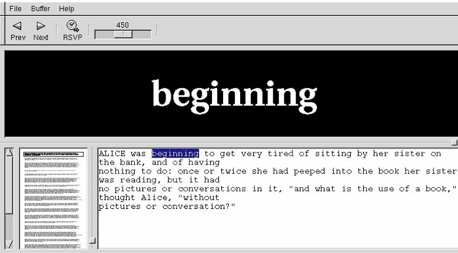

带有 `beginning` 字的较大区域是文本正在流式传输的位置。左下角窗口中的文本是整个文件的缩小视图，右下角窗口中的文本是当前单词所在的段落。

要打开另一个文件，请从菜单中选择它；你可以在 sview 中同时打开多个文件。sview 将每个文件放在其自己的缓冲区中。你也可以将 X 选择内容粘贴到其自己的缓冲区中——要切换到不同的缓冲区，请从 Buffer 菜单中选择其名称。

输入 Q 以退出阅读并退出 sview。

下表列出了 sview 中使用的键盘命令并描述了其含义。

| KEYSTROKE | DESCRIPTION |
|---|---|
| @leftarrow | 降低流速。 [GNU INFO BUG: 前一行中的任何 <> 应该是 <- 箭头键。] |
| @rightarrow | 增加流速。 [GNU INFO BUG: 前一行中的任何 <> 应该是 -> 箭头键。] |
| C-o | 打开一个文件。 |
| C-q | 退出文本查看并退出 sview。 |
| C-w | 擦除当前文本缓冲区。 |
| M-n | 向前移动到下一个单词。 |
| M-p | 向后移动到上一个单词。 |
| S | 切换文本的流式传输。 |

### 10.4 查看字符表

要查看包含 ASCII 字符集中所有有效字符的列表以及用于输入它们的字符代码的字符表，请查看 asciiman 页面。

- 要查看 ASCII 字符集，请输入：

```
$ man ascii RET
```

你可以使用为每个字符列出的八进制代码在 Emacs 中输入它们——参见 Emacs 中的插入特殊字符。

默认的 Linux 字符集，ISO 8859-1（“Latin 1”）字符集，包含所有标准 ASCII 字符集加上另外 128 个字符。

要查看 ISO 8859-1 字符集，该字符集包含标准 127 个 ASCII 字符之上的扩展字符集，请查看 iso_8859_1man 页面。

- 要查看 ISO 8859-1 字符集，请输入：

```
$ man iso_8859_1 RET
```

你可以使用此页面查看此字符集中的所有字符以及如何输入它们。

注意：Emacs 中有一种特殊的“引用”这些字符的方法；该技术在 Emacs 中的插入特殊字符中进行了描述。

`miscfiles' 包还包含这些字符集的图表，如 Word Lists and Reference Files 中所述。

## 11. 文本编辑

文本编辑是 Linux 系统上，或几乎任何计算机上最基本的活动之一。我们在编写文档、发送电子邮件、制作网页、为 Usenet 发布文章、编程时编辑文本——列表还在继续。大多数人花费大量计算时间使用文本编辑器应用程序编辑文本。

Linux 系统上有许多文本编辑器可供选择，正如本章第一个配方所示，但大多数编辑器属于两大家族之一：Emacs 和 Vi。大多数用户更喜欢其中之一；很少有人同时精通两者。我对 Emacs 进行了更多介绍，不仅因为它是我的首选编辑器——其击键命令默认被许多其他工具和应用程序使用，包括 bash shell（参见 The Shell 部分）。

- 11.1 选择完美的文本编辑器
- 文本编辑器的概述。
- 11.2 Emacs
- 介绍 Emacs 编辑器。
- 11.3 运行 Vi 教程
- 学习使用 Vi 编辑器。
- 11.4 选择文本
- 选择文本。
- 11.5 编辑文本流
- 批量编辑文本流。
- 11.6 串联文本
- 串联文本。
- 11.7 包含文本文件
- 将文本文件包含到新文件中。

### 11.1 选择完美的文本编辑器

下表描述了一些更有趣的可用文本编辑器，并包括了它们特殊特性和特征的信息。

| TEXT EDITOR | DESCRIPTION |
|---|---|
| ae | Anthony's Editor，ae，是一个简单易用的文本编辑器。它具有模拟其他文本编辑器行为的模式。 {@sf{Debian}}: `ae` {@sf{WWW}}: http://dmz.org/Computers/Software/Editors/Vi/ |
| cooledit | Cooledit 是在 X 中使用的流行、快速的文本编辑器；其功能包括抗锯齿字体、Unicode 支持，以及通过 Python 编程语言进行扩展。 {@sf{Debian}}: `cooledit` {@sf{WWW}}: http://cooledit.sourceforge.net/ |
| dedit | DEdit 是在安装了 GNOME 的 X 中使用的简单编辑器。它可以读取压缩文件并显示日文字符。 {@sf{Debian}}: `dedit` |
| ee | Easy Editor 旨在成为新手可以立即开始使用的编辑器，具有弹出菜单功能。 {@sf{Debian}}: `ee` {@sf{WWW}}: http://mahon.cwx.net/ |


elvis Elvis 是 Vi 的现代实现，附带了许多新功能和扩展。{@sf{Debian}: `elvis`} {@sf{WWW}: http://elvis-vi-editor.org}

emacs Emacs 是两款最受欢迎的文本编辑器之一。我在本书中专门为它设立了一个章节：Emacs。{@sf{Debian}: `emacs-common`} {@sf{Debian}: `emacs20`} {@sf{WWW}: `http://www.emacs.org/`}

jed John E. Davis 的 jed 提供了 Emacs 的许多便利功能，并且专门针对程序员。它的独特功能包括在控制台中工作的下拉菜单；jed 加载速度快，使在 shell 提示符下编辑文件变得简单快捷。{@sf{Debian}: `jed`} {@sf{WWW}: http://space.mit.edu/~davis/jed.html}

joe Joe's Own Editor，joe，是一款全屏编辑器，其外观和感觉让人想起旧的 DOS 文本编辑器如 EDIT。{@sf{Debian}: `joe`} {@sf{WWW}: ftp://ftp.std.com/src/editors/}

nano Nano 是一款受 Pico 启发的自由软件编辑器，Pico 是华盛顿大学专有 Pine 邮件程序中包含的编辑器。它也比 Pico 更快，并且功能更多。{@sf{Debian}: `nano`} {@sf{WWW}: http://www.nano-editor.org/}

ted Ted 是一款用于 X 的 WYSIWYG 文本编辑器，可读取和写入 Microsoft “Rich Text Format” 中的 `.rtf` 文件。{@sf{Debian}: `ted`} {@sf{WWW}: http://www.nllgg.nl/Ted/}

the The Hesselink Editor 是一款可配置的编辑器，使用 Rexx 宏语言。它受到了 VM/CMS 的 XEDIT 编辑器和 DOS 的 Kedit 编辑器的启发。{@sf{Debian}: `the`} {@sf{Debian}: `the-doc`} {@sf{WWW}: http://www.lightlink.com/hessling/THE/}

vi Vi（发音为“vee”，有时也读作“vee-eye”）是一款可视化或全屏编辑器。触摸打字者常常发现其按键命令能够实现非常快速的编辑。与 Emacs 一起，Vi 在 Linux 和 Unix 类系统上共同占据着最受欢迎编辑器的主导地位。两者最初都是在同一时期编写的，并且都有坚定的拥护者。如需运行实践教程，请参阅 Running a Vi Tutorial。{@sf{Debian}: `nvi`} {@sf{WWW}: ftp://mongoose.bostic.com/pub/nvi.tar.gz}

vim 与 Elvis 编辑器类似，Vim（“Vi improved”）是 Vi 的现代实现，其新功能包括语法着色、滚动条和菜单、鼠标支持以及内置帮助。{@sf{Debian}: `vim`} {@sf{WWW}: http://www.vim.org/}

wily Wily 是一款有趣的以鼠标为中心的编辑器，其灵感来自 AT&T Plan 9 实验操作系统的 Acme 编辑器。Wily 命令由三个鼠标按钮的各种组合组成，称为 chords，掌握起来可能很棘手。{@sf{Debian}: `wily`} {@sf{WWW}: http://www.cs.su.oz.au/~gary/wily/}

xedit Xedit 是一款简单的文本编辑器，随 X 一起提供并在 X 中运行。它允许你插入、删除、复制和粘贴文本，以及打开和保存文件——这些都是最基本的功能。{@sf{Debian}: `xcontrib`}

xemacs XEmacs 是 Emacs 的一个版本，具有在 X 中使用的高级功能，包括显示图像的能力。{@sf{Debian}: `emacs-common`} {@sf{Debian}: `xemacs`} {@sf{WWW}: http://www.xemacs.org/}

### 11.2 Emacs

```
@sf(Debian): 'emacs-common'
@sf(WWW): 'http://www.emacs.org/'
```

把 Emacs 称为文本编辑器并不足以体现其价值——它是一款功能强大的应用程序，能够执行许多功能，包括阅读电子邮件和 Usenet 新闻、浏览万维网，甚至进行肤浅的心理分析。

Emacs 有不止一个版本。GNU Emacs 是在 Richard Stallman 主持下发布的 Emacs，他在 1970 年代编写了原始的 Emacs 前身。XEmacs（以前称为 Lucid Emacs）基本上提供了 GNU Emacs 的相同功能，但也包含其自己的用于 X Window System 的功能（在某些小方面也与 GNU Emacs 的行为不同）。

GNU Emacs 和 XEmacs 是最受欢迎的 emacsen（它们在数量上被称为 emacsen）；其他变种包括 jed（在上一节中描述）和由 Case Western Reserve University 的一名程序员开发的 Chet’s Emacs，ce。

以下是使用 Emacs 的简要介绍，其中穿插了必要的 Emacs 术语；之后是描述如何使用 Emacs 的一些高级编辑功能的配方。

- 11.2.1 Getting Acquainted with Emacs
- 如何学习 Emacs。
- 11.2.2 Basic Emacs Editing Keys
- 基本的 Emacs 编辑键。
- 11.2.3 Making Abbreviations in Emacs
- 在 Emacs 中创建缩写以节省时间。
- 11.2.4 Recording and Running Macros in Emacs
- 在 Emacs 中录制和运行宏以节省时间。
- 11.2.5 Inserting Special Characters in Emacs
- 在 Emacs 中插入特殊字符。

#### 11.2.1 Getting Acquainted with Emacs

以通常的方式启动 Emacs，要么在 X 中从窗口管理器提供的菜单中选择它，要么在 shell 提示符下输入其名称（小写字母）。

- 要在 shell 提示符下启动 GNU Emacs，输入：

```
$ emacs RET
```

- 要在 shell 提示符下启动 XEmacs，输入：


## Linux 实用手册：日常使用的技巧与方法：

```
$ xemacs RET
```

在 X 中启动时，典型的 GNU Emacs 窗口看起来像这样（窗口框架会根据你的窗口管理器而有所不同）：

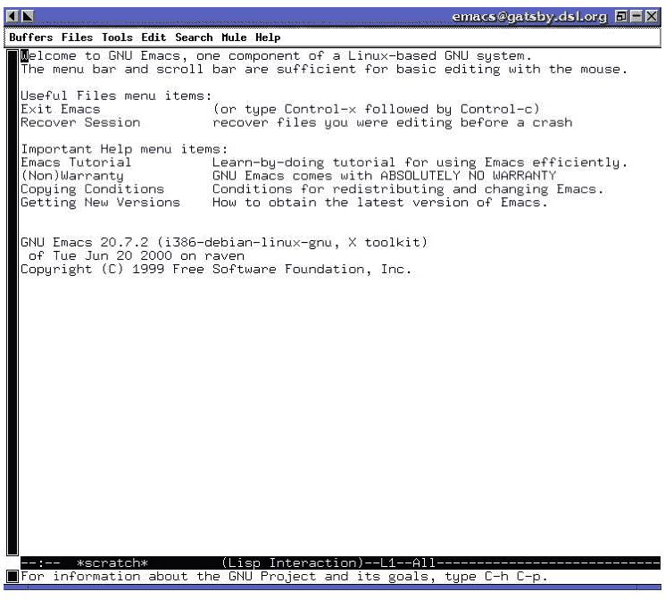

欢迎信息在 Emacs 第一次启动时出现，其中告诉你其他信息，例如如何运行教程（我们马上就会看到）。

顶部栏称为菜单栏，你可以通过鼠标左键单击菜单然后向下拖动来展开其菜单。当你在控制台中运行 Emacs 时，不能使用鼠标下拉菜单，但你可以通过输入 F10 在文本菜单中访问并选择相同的菜单项。(17)

在 Emacs 中打开的文件或其他文本都保存在各自的区域中，称为 *buffer*。默认情况下，当前缓冲区显示在菜单栏下方的较大区域中。要在缓冲区中写文本，只需输入即可。缓冲区中光标所在的位置称为 *point*，许多 Emacs 命令都会引用它。

Emacs 窗口底部附近、当前缓冲区正下方的水平栏称为 *mode line*；它提供有关当前缓冲区的信息，包括其名称、多少百分比的缓冲区适合屏幕、point 位于哪一行，以及缓冲区是否已保存到文件中。

mode line 还列出缓冲区中激活的模式。Emacs 的 *modes* 是控制 Emacs 行为的一般状态——例如，当 *Overwrite* 模式被设置时，你输入的文本会 *overwrites* point 处的文本；在 *Insert* 模式（默认）下，你输入的文本会在 point 处 *inserted*。通常会列出 *Fundamental* 模式（默认）或 *Text* 模式。

你可以通过切换 *Menu bar* 模式来使菜单栏出现或消失。输入 **F10** 以激活菜单下拉功能，无论 *Menu bar* 模式是否开启都有效；如果关闭，菜单选项将出现在新的缓冲区窗口中。

- 要关闭顶部的菜单栏，输入：

```
M-x menu-bar-mode RET
```

（如果菜单栏已关闭，此命令会将其打开。）

*echo area* 是 Emacs 写入简短状态消息的地方，例如错误消息；它是 Emacs 窗口的最后一行。当你输入需要输入的命令时，该输入会在此区域请求（此时你在 echo area 中输入的位置称为 *minibuffer*）。

Emacs 命令通常以 Control 或 Meta（Escape）键序列开头；许多命令以 **C-x** 序列开头，你可以通过按住 **CTRL** 键然后按下 **X** 键来输入（参见章节 *Typographical Conventions*）。

由于 Emacs 在文化上与 Microsoft Windows 和 Apple MacOS 世界的编辑器和操作方法不同，它在那些领域中获得了相当不合理的声誉，认为它很奇怪且难以使用。事实并非如此。运行其各种功能的键盘命令是为易用性和易于回忆而设计的。

例如，*find-file* 函数会提示输入文件名并在新缓冲区中打开文件的副本；其键盘快捷键是 **C-x C-f**（你可以在按住 **CTRL** 的同时按下并释放 **X** 和 **F** 键）。

你可以通过输入 **M-x** 然后输入函数名并按下 **RET** 来运行任何 Emacs 函数。

- 要运行 *find-file* 函数，输入：

```
M-x find-file RET
```

此命令运行 *find-file* 函数，该函数会提示输入文件名并在新缓冲区中打开文件的副本。

在 Emacs 中输入 C-g 可退出某个函数或命令；如果你在输入命令时出错，这对于取消和中止键盘输入非常有用。

现在我们已经介绍了基本的 Emacs 术语，我将向你展示如何退出程序——只需输入 C-x C-c。

Emacs 可以同时打开多个缓冲区。要在缓冲区之间切换，输入 C-x C-b。然后，输入要切换到的缓冲区的名称，后跟 RET；或者，不带缓冲区名称输入 RET 以切换到上次访问的缓冲区。（在 Emacs 中查看缓冲区称为访问缓冲区。）

- 要切换到名为 `rolo` 的缓冲区，输入：

```
C-x C-b rolo RET
```

一个特殊的缓冲区称为 `*scratch*`，用于笔记和你不想保存的内容；它始终存在于 Emacs 中。

- 要切换到 `*scratch*` 缓冲区，输入：

```
C-x C-b *scratch* RET
```

作为参数传递给 emacs 的任何文件名都将在单独的缓冲区中打开：

```
$ emacs todo rolo /usr/local/src/nirvarna/README RET
```

（当然，你也可以稍后创建新缓冲区并在其中打开文件。）

Emacs 附带一个交互式、自定进度的教程，可教你如何使用基础知识。根据我的经验，花 25 分钟时间完成教程是你计算生涯中可以做的最好的事情之一——即使你决定自己不太喜欢 Emacs，也有很多其他应用程序使用 Emacs 风格的键盘命令和启发式方法，因此熟悉它们总是有回报的。

要在 Emacs 中随时启动教程，输入 C-h t。

顺便说一下，C-h 是 Emacs 的帮助键；所有帮助相关命令都以此键开头。例如，要阅读 Emacs FAQ，输入 C-h F，要运行 Info 文档浏览器（其中包含 The GNU Emacs Manual），输入 C-h i。


#### 11.2.2 基本 Emacs 编辑键

下表列出了基本编辑键并描述了其功能。如果某个功能有两种常用的按键，两者都会给出。

| KEYS | DESCRIPTION |
|---|---|
| @uparrow or C-p | 将光标上移至上一行。 [GNU INFO BUG: any <> in the preceding line should be the one of the cursor arrow keys.] |
| @downarrow or C-n | 将光标下移至下一行。 [GNU INFO BUG: any <> in the preceding line should be the one of the cursor arrow keys.] |
| @leftarrow or C-b | 将光标在缓冲区中向左移动一个字符。 [GNU INFO BUG: any <> in the preceding line should be the one of the cursor arrow keys.] |
| @rightarrow or C-f | 将光标在缓冲区中向右移动一个字符。 [GNU INFO BUG: any <> in the preceding line should be the one of the cursor arrow keys.] |
| PgUp or C-v | 将光标在缓冲区中向前移动一屏。 |
| PgDn or M-v | 将光标在缓冲区中向后移动一屏。 |
| BKSP or C-h | 删除光标左侧的字符。 |
| DEL or C-d | 删除光标右侧的字符。 |
| INS | 在插入模式和覆盖模式之间切换。 |
| Shift-INS or C-y | 在光标处粘贴剪贴环中的文本（参见 Pasting Text 部分）。 |
| C-SPC | 设置标记（参见 Cutting Text 部分）。 |
| C-_ | 撤销上一个操作（control-underscore）。 |
| C-a | 将光标移动到当前行的开头。 |
| C-e | 将光标移动到当前行的末尾。 |
| C-g | 取消当前命令。 |
| C-h F | 在新缓冲区中打开一份 Emacs FAQ 副本。 |
| C-h a function RET | 列出与该函数相关的所有 Emacs 命令。 |
| C-h i | 启动 Info。 |
| C-h k key | 描述按键。 |
| C-h t | 启动 Emacs 教程。 |
| C-k | 从光标处删除文本至行尾。 |
| C-l | 重新居中 Emacs 窗口中的文本，将光标所在行置于屏幕中央。 |
| C-t | 将光标处的字符与光标左侧的字符互换。 |
| C-u number | 重复你接下来输入的命令或按键 number 次。 |
| C-w | 从标记处删除文本至光标处。 |
| C-x C-c | 保存 Emacs 中打开的所有缓冲区，然后退出程序。 |
| C-x C-f file RET | 在新缓冲区中打开文件进行编辑。若要创建尚不存在的新文件，只需指定你想要的文件名。若要浏览文件，输入 TAB 而不是文件名。 |
| C-left-click | 显示按主要模式排序的所有打开缓冲区的菜单（仅在 X 下有效）。 |

#### 11.2.3 在 Emacs 中创建缩写

一个 abbrev 是一个单词，是（通常）较长单词或短语的缩写。缩写是为了方便你而存在——你可以定义缩写以扩展为不方便输入的长短语，或者你可以定义你常犯的拼写错误以扩展为其正确拼写。缩写仅在启用 Abbrev 模式时才会扩展。

- 要打开 Abbrev 模式，输入：

```
M-x abbrev-mode RET
```

要定义一个缩写，输入你想要使用的缩写，然后输入 C-x a i g。Emacs 将在 minibuffer 中提示你要缩写扩展为的文本；输入该文本然后输入 RET。

- 要将 `rbf' 定义为 `R. Buckminster Fuller' 的缩写，请执行以下操作：

- 首先，输入缩写本身：

```
rbf
```

- 接下来，指定此文本为缩写；输入：

```
C-x a i g
```

- 现在输入要扩展为的文本：

```
Global expansion for "rbf": R. Buckminster Fuller RET
```

现在，只要你在当前缓冲区中输入 `rbf' 后跟空白或标点字符，该文本就会扩展为文本 `R. Buckminster Fuller'。

要保存你已定义的缩写以便以后使用，请使用 write-abbrev-file 函数。这会将当前定义的所有缩写保存到一个文件中，你可以在未来的 Emacs 会话中读取该文件。 （你也可以打开该文件在缓冲区中编辑缩写。）

- 要将当前已定义的缩写保存到文件 `~/.misspelling-abbrevs`，输入：

```
M-x write-abbrev-file RET ~/.misspelling-abbrevs RET
```

然后，在未来的 Emacs 会话中，你可以使用 `read-abbrev-file` 函数为该会话定义这些缩写。

- 要从文件 `~/.misspelling-abbrevs` 读取缩写并为当前会话定义它们，输入：

```
M-x read-abbrev-file RET ~/.misspelling-abbrevs RET
```

*NOTE:* Emacs 模式命令是切换。 因此，要在缓冲区中关闭 Abbrev 模式，只需再次输入 **M-x abbrev-mode RET**。 如果你在 Emacs 会话期间稍后在该缓冲区中打开 Abbrev 模式，缩写将被记住并再次扩展。

#### 11.2.4 在 Emacs 中录制和运行宏

一个 *macro* 就像是一段按键序列的录制——当你运行宏时，Emacs 会执行该按键序列，就像你亲自输入它们一样。

要开始录制宏，输入 **C-x (** 。 然后，你输入的所有内容都会被记录为宏，直到你通过输入 **C-x )** 停止录制。 录制宏后，你可以在 Emacs 会话期间随时通过输入 **C-x e** 回放它。 你可以在前面加上 `universal-argument` 命令 **C-u** 来指定回放次数。

- 要录制一个宏，使其大写当前行的第一个单词（**M-c** 将光标右侧的单词大写）然后前进到下一行，输入：

```
C-x ( C-a M-c C-n C-x )
```

- 要回放该宏 20 次，输入：

```
C-u 20 C-x e
```

宏是 Emacs 工作方式的核心——事实上，Emacs 这个名字来源于 `Editing MACroS`，因为 1976 年的第一个 Emacs 版本实际上是为另一文本编辑器编写的一组此类宏。


#### 11.2.5 在 Emacs 中插入特殊字符

有些字符你通常无法直接输入到 Emacs 缓冲区中。例如，在文本文件中，你可以通过插入换页符来指定分页，该字符是 ASCII C-l 或八进制代码 014；当你打印带有换页符的文件时，当前页会在此字符处被弹出，并换到新的一页继续打印。

然而，C-l 在 Emacs 中是一个命令。要插入这样的字符，请使用 quoted-insert 函数，即 C-q。它既可以接受要插入的字面按键，也可以接受要插入字符的八进制代码。它会在光标处插入该字符。

- 要通过指定实际按键（C-l）在光标处插入换页符，请键入：

    ```
    C-q C-l
    ```

- 要通过指定八进制字符代码在光标处插入换页符，请键入：

    ```
    C-q 014 RET
    ```

上述两个示例完成的是同一件事：它们在光标处插入一个换页符。

C-q 的一个有趣用途是给文本添加下划线。要做到这一点，请在要加下划线的每个字符后插入一个原义的 C-h 字符，再跟一个下划线（`_`）。

- 要给光标前的字符添加下划线，请键入：

    ```
    C-q C-h _
    ```

然后你可以使用 `ul` 将文本输出到屏幕（参见 [为文本添加下划线](#) 一节）。

你可能想要插入的另一类特殊字符是重音字符以及各种语言中使用的其他字符。

要插入重音字符，请使用 ISO Accents 模式。当此模式激活时，你可以先输入一个特殊重音字符，再输入要加重音的字符，然后正确的重音字符就会插入到光标处。

下表显示了特殊重音字符及其要使用的按键组合。

> **GNU INFO 错误：** Info 目前无法正确显示重音字符。

| 前缀... | 加上这个字母 | 产生的结果 |
| ------- | ------------ | ---------- |
| `"` | `a` | `ä` |
| `"` | `e` | `ë` |
| `"` | `i` | `ï` |
| `"` | `o` | `ö` |
| `"` | `u` | `ü` |
| `"` | `s` | `ß` |
| `'` | `a` | `á` |
| `'` | `e` | `é` |
| `'` | `i` | `í` |
| `'` | `o` | `ó` |
| `'` | `u` | `ú` |
| `` ` `` | `a` | `à` |
| `` ` `` | `e` | `è` |
| `` ` `` | `i` | `ì` |
| `` ` `` | `o` | `ò` |
| `` ` `` | `u` | `ù` |
| `~` | `a` | `ã` |
| `~` | `c` | `ç` |
| `~` | `d` | `đ` |
| `~` | `n` | `ñ` |
| `~` | `t` | `ţ` |
| `~` | `u` | `ũ` |
| `~` | `<` | `<<` |
| `~` | `>` | `>>` |
| `~` | `!` | `¡` |
| `~` | `?` | `¿` |
| `^` | `a` | `â` |
| `^` | `e` | `ê` |
| `^` | `i` | `î` |
| `^` | `o` | `ô` |
| `^` | `u` | `û` |
| `/` | `a` | `å` |
| `/` | `e` | `æ` |
| `/` | `o` | `ø` |

当缓冲区包含重音字符时，它不能再以纯 ASCII 文本形式保存，而必须以 ISO-8859-1 字符集中的文本形式保存（参见“查看字符图表”一节）。当你保存缓冲区时，Emacs 会通知你它必须这样做。

- 要在当前缓冲区中输入 `Emacs ist spaß!` 这一行，请键入：

    ```
    M-x iso-accents-mode RET
    Emacs ist spa"ss!
    ```

如果你在开启了 ISO Accents 模式的缓冲区中想要输入构成重音字符的字面按键组合，那么请将前缀字符输入两次。

- 要在 ISO Accents 模式开启的缓冲区中输入文本 `'o`（而不是重音字符 `ó`），请键入：

    ```
    ' ' o
    ```

*注意：* GNU Emacs 最近增加了许多国际化函数。完整讨论它们的用法超出了本书的范围；有关此主题的更多信息，请参见*《GNU Emacs 手册》*中的“国际字符集支持”一节。

### 11.3 运行 Vi 教程

- Debian: `nvi`
- WWW: `ftp://mongoose.bostic.com/pub/nvi.tar.gz`
- WWW: `http://www.cs.cmu.edu/~vaschelp/Editors/Vi/`

Vi 编辑器附带一个动手实践的、自定进度的教程，你可以在 vi 中使用它来学习如何使用 vi。它作为压缩文件存储在 `/usr/doc/nvi` 目录中；请将此文件复制到你的主目录，解压，然后用 vi 打开它即可开始教程。

- 要运行 vi 教程，请在你的主目录下键入以下命令：

    ```
    $ cp /usr/doc/nvi/vi.beginner.gz . RET
    $ gunzip vi.beginner RET
    $ vi vi.beginner RET
    ```

*注意：* `/usr/doc/nvi` 中还提供了一个高级教程。


### 11.4 选择文本

在 X 中，你可以在其他窗口之间剪切和粘贴文本，包括 xterm 和 Emacs 窗口。最近选择的文本称为 X 选择。

在控制台中，你可以在同一个虚拟控制台或不同的虚拟控制台之间剪切和粘贴文本。为此，你需要安装并为你的鼠标设置 gpm 包（它是默认的、推荐的包）。

本节描述的操作在 X 和虚拟控制台中工作方式相同。你目前无法在 X 和虚拟控制台之间剪切和粘贴文本。

剪切和粘贴使用鼠标上的三个按钮。如果你有一个双按钮鼠标，你的管理员可以将其设置为模拟三个按钮——要指定中间按钮，同时按下左右按钮。

单击鼠标左键并拖动鼠标经过文本以选择它。你也可以双击鼠标左键在一个词上以选择该词，并三击鼠标左键在一行上以选择该行。此外，你可以在要选择的文本部分的一端单击鼠标左键，然后在另一端单击鼠标右键，以选择两点之间的所有文本。

> 注意：在 xterm 窗口中，当你在 shell 中本地运行工具或应用程序（例如 lynx Web 浏览器）时，仅使用鼠标左键将不起作用。这种情况下，按住 SHIFT 键同时使用鼠标来选择文本。

- 11.4.1 剪切文本    剪切一段选中的文本。
- 11.4.2 粘贴文本    粘贴一段选中的文本。

#### 11.4.1 剪切文本

你不必先选择文本再剪切它。在 shell 提示符或 Emacs 中，输入 C-k 以剪切从光标到行尾的文本。

在 Emacs 用语中，剪切文本称为杀死文本。Emacs 还有额外的杀死文本命令：

- 当你已按前面所述用鼠标选择了一段文本时，你可以输入 Shift-DEL 来删除它。
- 你也可以在一段文本区域的一端单击鼠标左键，然后在该区域的另一端双击鼠标右键来杀死该文本区域。

最后，要在 Emacs 缓冲区中杀死大段文本，将标记设置在文本的一端，将光标移动到该端并输入 C-SPC。然后，将光标移动到文本的另一端，并输入 C-w 来杀死它。

#### 11.4.2 粘贴文本

```
@sf(Debian): `xpaste`
```

要粘贴最后一次用鼠标选择的文本，在你想要粘贴的位置单击鼠标中键。你也可以使用键盘，将光标移动到想要粘贴的位置然后输入 Shift-INS。这些命令在 X 和控制台中都有效。

在 X 中，要在自己的窗口中显示 X 选择的内容，运行 xpaste X 客户端；它的唯一用途就是在其窗口中显示此文本。

在 Emacs 中，粘贴文本称为取出文本。Emacs 提供了额外的键 C-y（“yank”），用于取出最后一次选择或杀死的文本。此键在 bash shell 中也有效，在该 shell 会话中，它会粘贴用 C-k 杀死的最后一段文本（如果有）。

### 11.5 编辑文本流

本书中处理文本的一些配方使用 sed，即“流编辑器”。它不是通常意义上的文本编辑器——你不会在 sed 中打开文件并交互式编辑它；相反，它对发送到其标准输入的文本流执行编辑操作，并将结果写入标准输出。这更像是一个过滤器，而不是编辑器，sed 是格式化和搜索文本的有用工具。

“The seders' grab-bag” 是一个有用的 sed 信息集合，包括常见问题解答和许多示例脚本。

sed “one-liners” 是用于编辑和处理文本的有用命令。

有关 sed 用法的更多信息，请参阅 Info 文件 `sed.info'，节点 `Top'。

其他适合流编辑的工具包括 AWK 和 Perl 编程语言；要了解更多关于使用这些强大语言的信息，我推荐以下书籍：

- The GNU Awk User's Guide
- Picking Up Perl


### 11.6 连接文本

cat 工具之所以得名，是因为它会连接所有提供给它的文本，并将结果输出到标准输出。它对于将文本文件连接在一起很有用。

例如，假设你有两个文件，`early` 和 `later`。文件 `early` 包含以下文本：

```
This Side of Paradise
The Beautiful and Damned
```

而文件 `later` 包含以下文本：

```
The Great Gatsby
Tender Is the Night
The Last Tycoon
```

- 要将这些文件连接成一个新文件 `novels`，请输入：

```
$ cat early later > novels
```

该命令将标准输出重定向到一个新文件 `novels`，该文件随后将包含以下文本：

```
This Side of Paradise
The Beautiful and Damned
The Great Gatsby
Tender Is the Night
The Last Tycoon
```

文件 `early` 和 `later` 不会被修改。

如果你改为输入 cat later early > novels，文件将按相反的顺序连接，以 `later` 开头；因此文件 `novels` 将包含以下内容：

```
The Great Gatsby
Tender Is the Night
The Last Tycoon
This Side of Paradise
The Beautiful and Damned
```

以下各节给出了其他连接文本的方法。

**注意：** 你也可以使用 `cat` 连接*非*文本文件，但它最常用的用途是处理文本文件。另一种自动连接文本文件的方法是使用文件包含——参见[包含文本文件](.)。

一个类似的工具 `zcat` 可以读取压缩文件的内容。

- 11.6.1 将文本写入文件
- 将文本写入文件。
- 11.6.2 将文本追加到文件
- 将文本追加到文件末尾。
- 11.6.3 在文件开头插入文本
- 在文件开头插入文本。

#### 11.6.1 将文本写入文件

有时候，为某个特定任务打开文本编辑器太麻烦了——比如你只想写入一个包含两行的文本文件，或者只想在文本文件中追加一行。有一些方法可以在不使用文本编辑器的情况下完成这类微编辑工作。

要在不使用文本编辑器的情况下写入文本文件，请将 `cat` 的标准输出重定向到要写入的文件。然后你可以输入文本，在单独一行上键入 **C-d** 来结束文件。当你想要快速创建一个小文本文件时，这很有用，但仅此而已；通常，你会按照本章前面各节的描述，在文本编辑器中打开或创建文本文件。

- 要创建一个包含一些文本的文件 `novels`，请输入：

```
$ cat > novels
This Side of Paradise
The Beautiful and Damned
The Great Gatsby
Tender Is the Night
C-d
$
```

在此示例中，创建了文本文件 `novels`，其中包含四行文本（带有 **C-d** 的最后一行永远不会成为文件的一部分）。

像这样在无编辑器的情况下输入文本，有时可以应急，但如果你犯了错误，除了重新开始之外，没有太多补救办法——你可以键入 **C-u** 来删除当前行，键入 **C-c** 来中止整个操作并且根本不将文本写入文件，但仅此而已。

#### 11.6.2 将文本追加到文件

要在不打开文本编辑器的情况下向文本文件添加文本，请使用带追加运算符 `>>` 的 cat。（如果使用 `>` 则会覆盖文件。）

- 要向文件 `novels` 的末尾添加一行文本，请输入：

```
$ cat >> novels
The Last Tycoon
C-d
```

在此示例中，没有为 cat 指定输入文件，因此 cat 使用了标准输入；然后输入了一行文本，该文本被追加到文件 `novels` 中，即上一个示例中使用的文件。所以现在该文件将包含以下内容：

```
This Side of Paradise
The Beautiful and Damned
The Great Gatsby
Tender Is the Night
The Last Tycoon
```

#### 11.6.3 在文件开头插入文本

@sf(WWW): http://dsl.org/comp/tinutils/

在不调用文本编辑器的情况下，在文本文件的开头插入文本比在文件末尾追加文本要棘手一些——但这是可能的。

要在文件开头插入一行或多行文本，请使用 `ins`。将要插入文本的文件名作为参数给出；`ins` 将从标准输入读取文本行，并将它们插入到文件开头。（它通过在 ed（一个简单的行编辑器）中打开文件来工作。）

给出 EOF——即，在单独一行上键入 C-d——来表示要插入的文本行的结束。

- 要在文件 `novels` 的开头插入几行文本，请输入：

```
$ ins novels
The Novels of F. Scott Fitzgerald
----------------------------------------
C-d
$
```


此命令在小说文件开头插入两行文本，该文件即本节前面示例中使用过的文件。此文件现在将包含以下内容：

```
The Novels of F. Scott Fitzgerald
--------------------------------
This Side of Paradise
The Beautiful and Damned
The Great Gatsby
Tender Is the Night
The Last Tycoon
```

### 11.7 包含文本文件

```
@sf(Debian): `m4'
```

文件包含是指可以通过在另一个文件中的特定位置指定文件名，就将一个文件的内容包含到另一个文件中的某个位置。

如果您想要或需要频繁地重新排列文档的各个部分或章节，如果您需要以多种排列方式保存文档，或者如果您有一些文本段落经常需要在多个文档中插入，那么这种方法就很有用。对于这些情况，您可以将每个部分保存在单独的文件中，并创建一个包含文件，其中包含各个部分的文件名，按您希望生成该文件的顺序排列。

要在文本文件中包含一个文件，请在单独的一行中指定要包含的文件，如下所示：

```
include(`file')
```

当您处理此文件以进行包含时，包含 `include'` 语句的那一行将被文件 file 的内容替换（其路径相对于包含文件的当前目录）。

使用 m4 工具，即 GNU 宏处理器，来处理包含文件。它以包含文件的名称作为参数，并将包含结果输出到标准输出。您可以使用重定向将输出重定向到文件。

例如，假设文件 `soups` 包含以下文本：

```
Clam Chowder
Lobster Bisque
Vegetable
```

假设文件 `sandwiches` 包含以下文本：

```
BLT
```

最后，假设文件 `menu` 包含以下文本：

```
Ham on Rye
Roast Beef
```

```
Diner Menu For Today

Soups
-----

include(soups)

Sandwiches
------------

include(sandwiches)
```

- 要处理该文件并写入文件 `monday.txt`，请输入：

```
$ m4 menu > monday.txt
```

此命令写入一个新文件 `monday.txt`，其内容如下所示：

```
Diner Menu For Today

Soups
-----

Clam Chowder
Lobster Bisque
Vegetable

Sandwiches
------------

BLT
Ham on Rye
Roast Beef
```

*注意：* 您可以编写多个包含文件来使用您的文件——而且文件本身也可以有自己的包含文件。

这只是 m4 的一个相当简单的用法；它可以做更多的事情，包括运行命令、操作文本和运行自定义宏。有关此工具的更多信息，请参阅 Info 文件 `m4.info`，节点 `Top`。

## The Linux Cookbook: Tips and Techniques for Everyday Use:

[ < ] [ > ]   [ << ] [ Up ] [ >> ]   [Top] [Contents] [Index] [ ? ]

## 12. Grammar and Reference

在基于 Linux 的系统上进行写作和编辑的工具和资源包括拼写检查器、词典和参考文件。本章展示了使用它们的方法。

- 12.1 Spelling
- 12.2 Dictionaries
- 12.3 Checking Grammar
- 12.4 Word Lists and Reference Files

拼写检查。
语法工具。
词表和参考文件。

### 12.1 Spelling

在 Linux 上有几种拼写检查文本和文件的方法；以下配方展示了如何查找特定单词的正确拼写以及如何执行批处理、交互式和基于 Emacs 的拼写检查。

系统词典文件 `/usr/dict/words` 只是一个词表（尽管非常庞大），按字母顺序排序，每行包含一个单词。与大小写无关而正确的单词以小写字母列出，而依赖某种形式的 capitalization 才能正确的单词（如专有名词）则以该形式出现。所有 Linux 拼写工具都使用此文本文件来检查拼写；如果某个单词未出现在词典文件中，则被视为拼写错误。

> 注意：没有任何计算机化拼写检查工具会在您一开始就使用错误的词时纠正您的写作——例如，如果您写了 `there` 而本意是 `their`，计算机是不会捕捉到的（至少目前不会！）。

- 12.1.1 Finding the Correct Spelling of a Word
- 12.1.2 Listing the Misspellings in a Text
- 12.1.3 Keeping a Spelling Word List
- 12.1.4 Interactive Spell Checking
- 12.1.5 Spell Checking in Emacs

拼写检查一个单词。
拼写检查一个文件。
保留个人词典。
交互式拼写检查。
在 Emacs 中拼写检查。


#### 12.1.1 查找单词的正确拼写

如果你不确定是否使用了单词的正确拼写，可以使用 `spell` 来查询。`spell` 从标准输入读取并输出系统中字典中找不到的任何单词——因此如果一个单词拼写错误，你在输入后它会被回显到屏幕上。

- 例如，要检查单词 `occurance` 是否拼写错误，输入：

```
$ spell RET
occurance RET
occurance
C-d
$
```

在示例中，`spell` 回显了单词 `occurance`，意味着该单词不在系统字典中，因此很可能是一个拼写错误。然后输入 C-d 以退出 `spell`。

#### 12.1.2 列出文本中的拼写错误

要输出文件中拼写错误的单词列表，将要检查的文件名作为参数传递给 `spell`。文件中任何拼写错误的单词都会被输出，每个单词独占一行，并按其在文件中的出现顺序排列。

- 要拼写检查文件 `fall-lecture.draft`，输入：

```
$ spell fall-lecture.draft RET
occurance
willl
occurance
$
```

在此示例中，输出了三个单词：`occurance`、`willl` 和再次出现的 `occurance`，意味着这三个单词按此顺序出现在 `fall-lecture.draft` 中，并且不在系统字典中（因此很可能拼写错误）。请注意，拼写错误 `occurance` 在文件中出现了两次。

要纠正拼写错误，你可以随后在首选文本编辑器中打开文件并编辑它。本节后面我将描述一个交互式拼写检查器，允许你在发现拼写错误时立即纠正它。另一个选择是使用内置拼写检查功能的文本编辑器，例如 Emacs。

- 要拼写检查文件 `fall-lecture.draft`，并将可能拼写错误的单词输出到文件 `fall-lecture.spelling`，输入：

```
$ spell fall-lecture.draft > fall-lecture.spelling RET
```

在此示例中，使用了标准输出重定向字符 `>` 将输出重定向到文件（参见章节 Redirecting Output to a File）。

要输出拼写错误单词的字母顺序列表，将输出通过管道传递给 sort；然后将排序后的输出通过管道传递给 uniq 过滤器，以从列表中删除重复项（uniq 从其输入中删除重复的相邻行，输出“唯一”的行）。

- 要输出文件中 `fall-lecture.draft` 的拼写错误单词的排序列表，输入：

```
$ spell fall-lecture.draft | sort | uniq RET
```

#### 12.1.3 维护拼写词表

随 Linux 系统安装的标准美式英语词典包含超过 45,000 个单词。尽管这个数字看起来很大，但不可避免地会遗漏很多单词——包括俚语、行话以及一些专有名词。

你可以像查看任何其他文本文件一样查看系统词典，但用户永远不会编辑此文件以添加单词到其中。(19) 相反，你将新单词添加到自己的个人词典中，一个格式与系统词典相同的文件，但保存在你的主目录中，文件名为 `~/.ispell_default`。

用户可以拥有自己的个人词典；本章讨论的拼写命令会自动使用你的个人词典（如果你有的话），除系统词典外。

你使用 ispell 的 i 和 u 选项构建个人词典，这些选项将单词插入到个人词典中。使用这些选项时，可以使用独立工具或各种 ispell Emacs 函数（参见 Interactive Spell Checking and Spell Checking in Emacs）。

NOTE: 你也可以通过使用文本编辑器手动编辑文件来添加（或删除）单词，但要小心保持列表按字母顺序排列！

随着时间的推移，个人词典开始看起来非常个人化，反映其所有者；Gregory Cosmo Haun 通过拍摄十二位用户的肖像并叠加其个人词典的列表制作了一件艺术品（可在网上访问 http://www.reed.edu/~cosmo/art/DictPort.html）。

#### 12.1.4 交互式拼写检查

使用 ispell 交互式地拼写检查文件，这样每次发现拼写错误时，你就有机会立即替换它。

- 要交互式拼写检查 `fall-lecture.notes`，输入：

```
$ ispell fall-lecture.notes RET
```

当你输入此命令时，ispell 开始检查文件。它在找到的第一个拼写错误处停止：

```
lecutres          File: fall-lecture.notes

The focus of my series of lecutres this fall are the aspects of the novel.

0: lectures
```

```
[SP] <number> R)epl A)ccept I)nsert L)ookup U)ncap Q)uit e(X)it or ? for help
```

在屏幕顶行，ispell 显示拼写错误的单词，后跟文件名。其下是出现拼写错误的句子，其中相关单词被高亮显示。随后是建议单词的列表，每个单词前面都有一个数字——在此示例中，ispell 只有一个建议：`lectures`。

要将拼写错误替换为建议的单词，输入对应于建议单词的数字（在此示例中，你将输入 0 以将拼写错误替换为 `lectures`）。你只需输入选择的数字——不需要按 RET。

你也可以自行输入更正：这在 ispell 没有提供建议，或提供了建议但你想要的单词不在其中时很有用。要做到这一点，输入 x（表示“替换”），然后输入替换单词，后跟 RET。

有时，ispell 会质疑你可能不想计为拼写错误的单词，例如专有名词等——这些单词不会出现在系统词典中。在这种情况下，你可以做以下几件事。


要仅在当前 ispell 会话中将一个拼写错误的词视为正确，请输入 `a`；从此以后在当前会话中，该词将被视为正确。

如果您希望 ispell（以及 spell 和所有其他访问系统词典的工具）记住该词在本次及所有未来会话中都是正确的，请将其插入到您自己的个人词典中。输入 `u` 以将该词的副本以小写形式插入到个人词典中——这样，即使该词在句子开头被大写，也会保存该词的小写版本。从此以后，在当前 ispell 会话中以及未来的会话中，无论大小写，该词都将被视为正确。

当大小写对拼写很重要时——例如专有名词如 'Seattle'，或大小写混合的词，如 'LaTeX'——请输入 `i` 以将该词的副本按其出现的大小写原样插入到您的个人词典中；这样，用相同字母但大小写不同的词将被视为拼写错误。

当 ispell 完成对文件的拼写检查后，它会将更改保存到文件中，然后退出。它还会制作一份原始文件的副本，未应用更改；该文件与原始文件同名，但在末尾添加了 '.bak'——因此在我们的示例中，备份文件名为 'fall-lecture.notes.bak'。这在您后悔所做的更改并希望将文件恢复到搞砸之前的状态时很有用——只需删除经过拼写检查的文件，然后将 '.bak' 文件重命名为其原始名称即可。

下表是 ispell 键命令的参考。

| KEY | COMMAND |
| --- | --- |
| SPC | 仅接受本次出现的拼写错误词为正确。 |
| number | 用对应编号的建议替换拼写错误的词。 |
| ? | 显示帮助屏幕。 |
| a | 接受拼写错误词为正确，适用于本次 ispell 会话的剩余部分。 |
| i | 接受拼写错误词为正确并以其出现的大小写形式添加到您的私人词典中。 |
| l | 根据您随后给出的模式在系统词典中查找词。 |
| q | 退出检查并将文件恢复为本次会话之前的样子。 |
| r | 用您输入的词替换拼写错误的词。 |
| u | 接受拼写错误词为正确并以全小写字母形式添加到您的私人词典中。 |
| x | 保存所做的更改，然后停止检查此文件。 |

#### 12.1.5 Emacs 中的拼写检查

Emacs 有几个有用的拼写检查命令。`ispell-word`、`ispell-region` 和 `ispell-buffer` 函数，正如其名称所示，在 Emacs 内部使用 ispell 命令检查当前缓冲区的一部分。

第一个命令，`ispell-word`，检查光标处的词的拼写；如果光标处没有词，则检查光标左侧的第一个词。此命令有键盘快捷键，`M-$`。第二个命令，`ispell-region`，检查当前选定文本区域中所有词的拼写。第三个命令，`ispell-buffer`，检查整个缓冲区的拼写。

- 要检查光标处词的拼写，请输入：

  ```
  M-x ispell-word RET
  ```

- 要检查当前选定文本区域中所有词的拼写，请输入：

  ```
  M-x ispell-region RET
  ```

- 要检查当前缓冲区中所有词的拼写，请输入：

  ```
  M-x ispell-buffer RET
  ```

`Flyspell` 模式是另一个有用的 Emacs 拼写命令，当在缓冲区中设置时，它会突出显示拼写错误的词。当您在缓冲区中撰写初稿时，此功能很有用，因为它允许您在输入时捕获拼写错误。

- 要在缓冲区中打开 Flyspell 模式，请输入：

  ```
  M-x flyspell-mode RET
  ```

*NOTE:* 此命令为切换；再次运行即可关闭。

要在 Flyspell 模式下更正一个词，请在该词上单击并释放中键鼠标按钮以调出建议菜单；然后您使用鼠标选择替换词或将其添加到您的个人词典中。

如果有您经常拼写错误的词，您可以为它们定义缩写（参见章节 Emacs 中的制作缩写）。然后，当您输入拼写错误的词时，Emacs 会自动将其替换为正确的拼写。

最后，如果您更喜欢 `spell` 的简洁、非交互式界面，您也可以使用 Emacs 对该命令的接口：`spell-word`、`spell-region` 和 `spell-buffer`。当这些命令中的任何一个发现拼写错误时，它们会在迷你缓冲区中提示替换，但不会提供建议或提供 `ispell` 的其他任何功能。


### 12.2 词典

```
@sf(Debian): 'wordnet-dev'
```

```
@sf(WWW): http://www.cogsci.princeton.edu/~wn/
```

在 Linux 系统中，术语词典通常指两种事物之一：传统的 Unix 风格词典，它是一个按字母顺序排列的单词列表，不包含实际定义；以及较新的数据库风格词典，它包含词头及其定义。后者是大多数人在谈论词典时所指的类型。 （不过，当大多数 Unix 用户谈论词典时，他们几乎总是指的是前者。）

WordNet 是一种以数据库形式存在的词汇参考系统，其中包含成千上万按同义词集排列的单词。你可以使用 wn 工具或 wnb X 客户端（“WordNet 浏览器”）搜索数据库并以文本形式输出结果。

X 客户端的使用相当直接——在屏幕顶部附近的对话框中输入一个单词，然后按 RET，即可获取其定义，定义会显示在对话框下方的较大输出窗口中。

例如，搜索单词 `browse` 的定义时会出现以下内容：

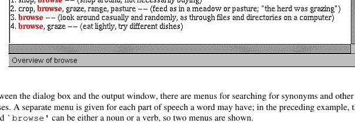

在对话框和输出窗口之间，有用于搜索同义词和其他词义的菜单。每个词可能有的词性都有一个单独的菜单；在前面的例子中，单词 `browse` 可以是名词或动词，因此显示了两个菜单。

要获取给定单词可用的所有词义信息列表，请使用单词名称作为参数运行 wn。这将输出单词可用的所有词义信息列表，每个可能的词义前面都有用于输出它的选项名称。

要输出单词 `browse` 可用的词义列表，请输入：

```
$ wn browse RET
```

以下各节展示了如何在命令行上使用 wn。

注意：有关 WordNet 的更多信息，请参阅 wnintro 手册页（参见“从系统手册中阅读一页”一节）。

- 12.2.1 按模式列出单词 按模式列出单词。
- 12.2.2 列出单词的定义 查找单词的定义。
- 12.2.3 列出单词的同义词 查找同义词。
- 12.2.4 列出单词的反义词 查找反义词。
- 12.2.5 列出单词的上位词 查找上位词。
- 12.2.6 在线词典 WWW 上的免费词典。

#### 12.2.1 按模式列出单词

有几种方法可以从系统词典中搜索和输出单词。

使用 look 输出系统词典中以给定字符串开头的单词列表——这对于查找以特定短语或前缀开头的单词很有用。将字符串作为参数给出；它不区分大小写。

要输出词典中以字符串 `homew` 开头的单词列表，请输入：

```
$ look homew RET
```

此命令输出像 `homeward` 和 `homework` 这样的单词。

由于系统词典是一个普通文本文件，你也可以使用 grep 在其中搜索匹配给定模式或正则表达式的单词（参见“正则表达式——匹配文本模式”一节）。

要列出词典中包含字符串 `dont` 的所有单词，不区分大小写，请输入：

```
$ grep -i dont /usr/dict/words RET
```

### 《Linux Cookbook：日常使用的技巧和技术》：

- 要列出词典中以 `ing` 结尾的所有单词，请输入：

```
$ grep 'ing^' /usr/dict/words RET
```

- 要列出仅由元音组成的单词，请输入：

```
$ grep -i '^[aeiou]*$' /usr/dict/words RET
```

要找到与给定单词押韵的一些单词，请使用 grep 在 `/usr/dict/words` 中搜索以与应押韵的单词相同的最后几个字符结尾的单词（参见“匹配以特定文本结尾的行”一节）。

- 要输出与 `friend` 押韵的单词列表，请在 `/usr/dict/words` 中搜索以 `end` 结尾的行：

```
$ grep 'end$' /usr/dict/words RET
```

最后，要在 WordNet 词典上进行搜索，请使用 wn 并使用其中一个 `--grep` 选项。当你将要搜索的文本作为参数给出时，此命令执行与 look 等效的搜索，只是只搜索你指定的特定类型的词义：`--grepn` 搜索名词，`--grepv` 搜索动词，`--grepa` 搜索形容词，`--grepr` 搜索副词。你可以组合选项以搜索多个词义。

- 要在 WordNet 词典中搜索以 `homew` 开头的名词，请输入：

```
$ wn homew --grepn RET
```

- 要在 WordNet 词典中搜索以 `homew` 开头的名词和形容词，请输入：

```
$ wn homew --grepn --grepa RET
```

#### 12.2.2 列出单词的定义

要列出单词的定义，将单词作为参数传递给 wn，后跟 `-over` 选项。

- 要列出单词 `slope` 的定义，请输入：


#### 12.2.3 列出单词的同义词

一个单词的 *同义词* 是在某些上下文中可以替代该单词的含义相似的不同单词。要使用 `wn` 输出某个单词的同义词，将该单词作为参数给出，然后跟上以下选项之一：`--synsn` 用于名词，`--synsv` 用于动词，`--synsa` 用于形容词，以及 `--synsr` 用于副词。

- 要输出名词 `break` 的所有同义词，输入：
```
$ wn break -synsn RET
```

- 要输出动词 `break` 的所有同义词，输入：
```
$ wn break -synsv RET
```

#### 12.2.4 列出单词的反义词

一个单词的 *反义词* 是在某些上下文中与第一个单词含义相反的不同单词。要使用 `wn` 输出某个单词的反义词，将该单词作为参数给出，然后跟上以下选项之一：`--antsv` 用于动词，`--antsa` 用于形容词，以及 `--antsr` 用于副词。

- 要输出形容词 `sad` 的所有反义词，输入：
```
$ wn sad -antsa RET
```

#### 12.2.5 列出单词的上位词

一个单词的上位词是相关术语，其含义比给定单词更宽泛。（例如，单词 `mammal` 和 `animal` 是单词 `cat` 的上位词。）

要使用 wn 输出单词的上位词，使用以下选项之一：`-hypen` 用于名词和 `-hypev` 用于动词。

- 要输出名词 `cat` 的所有上位词，输入：
```
$ wn cat --hypen RET
```

#### 12.2.6 在线词典

@sf(Debian) `dict`
@sf(WWW): http://www.dict.org/

DICT Development Group 在其网站 http://www.dict.org/ 上提供了一系列免费词典。在该页面上，你可以查找包含超过 300,000 个词头的词典中单词的定义（包括同义词库和其他搜索），或复制他们的词典供在自己的系统上使用。用于访问 DICT 服务器并在本地输出定义的 dict 客户端存在；该工具可在 `dict` 包中使用。

DICT 还有一系列专门的词典，这些是纯文本文件（包括作者的 Free Journalism Dictionary，其中包含新闻和出版行业使用的行话和术语）。他们的 FILE 项目，即 The Free Internet Lexicon and Encyclopedia，是一项建立免费、开源的现代词、习语和行话词典集合的努力。FILE 是一项志愿者工作，依赖学者和词典编纂者的支持；DICT 页面包含有关如何帮助为这一值得的项目做出贡献的信息。

### 12.3 检查语法

@sf(WWW): http://www.gnu.org/software/diction/diction.html

两种久负盛名的用于检查写作的 Unix 工具最近已为基于 Linux 的系统提供：style 和 diction。

# The Linux Cookbook: Tips and Techniques for Everyday Use:

老手可能还记得这些名字——原版随 AT&T UNIX 一起提供，作为深受喜爱的 "Writer's Workbench" 工具套件的一部分，可追溯到 20 世纪 70 年代末和 80 年代初。(20

AT&T 将 Writer's Workbench 从其 UNIX 版本 7 产品中 "拆分" 出来，随着多年 Unix 各类版本的蓬勃发展，这些工具被逐渐遗忘——最终成为 Unix 传说的组成部分。

1997 年，Michael Haardt 从头开始编写了这些工具的新 Linux 版本。它们支持英语和德语，并且现在是 GNU 项目的一部分。

Writer's Workbench 的另外两个命令长期以来一直是 Linux 的标准：look 和 spell，本章前面已描述过。

- 12.3.1 检查文本中误用的短语 检查误用短语。
- 12.3.2 检查文本中重复的单词 检查重复的单词。
- 12.3.3 检查文本的可读性 检查写作风格。
- 12.3.4 检查文本中困难的句子 检查困难的句子。
- 12.3.5 检查文本中冗长的句子 检查冗长的句子。

[<] [>] [<<] [Up] [>>] [Top] [Contents] [Index] [?]

#### 12.3.1 检查文本中误用的短语

使用 diction 检查文本中冗长、陈词滥调、陈腐或误用的短语。它检查 William Strunk 在其《风格要素》中警告我们的所有类型的表达。

根据 Andrew Walker 的《The UNIX Environment》，随旧版 Writer's Workbench 提供的 diction 工具只是查找短语，而一个单独的命令 called suggest 会输出建议。在适用于 Linux 系统的 GNU 版本中，这两个功能已合并到单个 diction 命令中。

在 GNU diction 中，单词或短语用方括号括起来 `[like this]`。如果 diction 有任何建议的替换，它会以右箭头 `-> like this` 为前缀给出。

当检查不止一屏的文本时，你需要将输出通过管道传输到 less，以便在屏幕上浏览它（参见 Perusing Text 部分），或将输出通过管道传输到文件以供以后检查。

- 要检查文件 `dissertation` 中是否存在陈词滥调或其他误用短语，输入：
```
$ diction dissertation | less RET
```

- 要检查文件 `dissertation` 中是否存在陈词滥调或其他误用短语，并将输出写入文件


若要输出到名为 `dissertation.diction` 的文件，请输入：

```
$ diction dissertation 62; dissertation.diction RET
```

如果不指定文件名，diction 会从标准输入读取文本，直到你在单独的一行输入 C-d 为止。当你想检查单个句子时，这尤其有用：

```
$ diction RET
Let us ask the question we wish to state. RET
(stdin):1: Let us [ask the question ~62; ask]
[we wish to state ~62; (cliche, avoid)].
C-d
$
```

要检查网页文本，请使用纯文本网页浏览器 lynx，配合 `-dump` 和 `-nolist` 选项输出指定 URL 的纯文本，并将该输出通过管道送给 diction。（如果你预计输出会很多，可以在末尾再添加一个管道到 less，以便仔细阅读。）

要仔细阅读 http://example.org/1.html 的文本副本，并查看其中可能冗赘和误用的短语标记，请输入：

```
$ lynx -dump -nolist http://example.org/1.html | diction | less RET
```

#### 12.3.2 检查文本中的重复单词

diction 检测的项目之一是重复单词——即连续重复两次的单词。如果发现这样的序列，它会把重复对中的第二个词放在方括号中，后跟一个右箭头和文本 `Double word`，如 `this [<i>this -> Double word.</i>]`。

如果只想检查文本文件中的重复单词，而不检查 diction 检测的其他项目，可以使用 grep 仅找出 diction 输出中包含 `Double word` 文本的行（如果有的话）。

-   要输出文件 `dissertation` 中包含重复单词的所有行，请输入：

```
$ diction dissertation | grep 'Double word' RET
```

#### 12.3.3 检查文本的可读性

`style` 命令分析给定文本的写作风格。它对文本执行若干可读性测试并输出结果，同时还给出文本中句子的统计信息。请将要检查的文本文件名作为参数给出。

-   要检查文件 `dissertation` 的可读性，请输入：

```
$ style dissertation RET
```

与 `diction` 一样，如果没有给出文本，`style` 会从标准输入读取文本——这在管道末尾非常有用，也可用于检查你输入的某个特定句子或其他文本的写作风格。

`style` 输出的文本句子特征如下：

-   字符数
-   单词数、单词平均长度以及平均音节数
-   句子数及以单词计的平均句子长度
-   短句和长句的数量
-   段落数及以句子计的平均段落长度
-   疑问句和祈使句的数量

`style` 使用并输出的各种可读性公式如下：

-   Kincaid 公式，最初为海军训练手册开发；对技术文档具有良好的可读性
-   自动可读性指数（ARI）
-   Coleman–Liau 公式
-   Flesch 阅读易读性评分，可读性近似值从 0（困难）到 100（容易）
-   Fog 指数，给出年级阅读水平
-   WSTF 指数，面向德语文档的可读性指标
-   Wheeler–Smith 指数、Lix 公式和 SMOG–Grading 测试，均为给出年级阅读水平的可读性指标

#### 12.3.4 检查文本中的困难句子

要仅输出文本中的“困难”句子，请使用 `style` 的 `-r` 选项并后跟一个数字；`style` 将只输出自动可读性指数（ARI）大于你所给数字的句子。

-   要输出文件 `dissertation` 中所有 ARI 大于 20 的句子，请输入：

```
$ style -r 20 dissertation RET
```

#### 12.3.5 检查文本中的长句

使用 `style` 时，将最少单词数作为 `-l` 选项的参数，即可输出长度超过特定值的句子。

-   要输出文件 `dissertation` 中所有超过 14 个单词的句子，请输入：

```
$ style -l 14 dissertation RET
```

### 12.4 单词列表和参考文件

@sf(Debian)：`miscfiles`
@sf(WWW)：ftp://ftp.gnu.org/pub/gnu/miscfiles/miscfiles-1.1.tar.gz

GNU Miscfiles 是一组文本文件的集合，包含各种事实资料和参考资料，如常用缩写、电话区号和英语连接性短语。

这些文件存放在 `/usr/share/misc` 目录中，并且都是压缩的；可以使用 zless 仔细阅读它们（参见“浏览文本”一节）。

下表列出了 `/usr/share/misc` 中的文件并描述其内容。


## Linux Cookbook：日常使用的技巧与方法：

**注意：** GNU 官方的 `miscfiles` 发行版中还包含 Jargon 文件和 `/usr/dict/words` 字典文件。在 Debian 中，这两个文件以单独的软件包形式提供，并且已从 Debian 的 `miscfiles` 发行版中移除。`/usr/dict/words` 是标准拼写软件包的一部分，而 Jargon 文件包含在可选的 `jargon` 软件包中，安装在 `/usr/share/jargon`。

## 13. 分析文本

使用命令行工具分析文本的方法有很多，例如统计文本中的单词数量、建立语词索引，以及比较文本来查看它们是否（以及在何处）存在差异。此外，还有一些文本处理技巧也算作分析，例如查找变位词和回文，或者将文本切碎以生成意想不到的词语组合。本章将涵盖所有这些主题。

- **13.1 文本计数** — 统计单词、行和字符。
- **13.2 制作文本语词索引** — 为文本建立语词索引。
- **13.3 文本相关性** — 查找相似或相关文本。
- **13.4 查找文本中的变位词** — 查找变位词。
- **13.5 查找文本中的回文** — 查找回文。
- **13.6 文本切分** — 切碎文本。

### 13.1 文本计数

使用“字数统计”工具 wc 来统计文本中的字符数、单词数和行数。

将文件名作为参数传入；如果没有给出文件名，wc 将从标准输入读取。默认情况下，wc 输出三列，分别显示文本中的行数、单词数和字符数。

- 要输出文件 `outline` 中的行数、单词数和字符数，请输入：

```
$ wc outline RET
```

以下小节介绍如何用 wc 指定只统计某一种数量，以及如何在 Emacs 中统计文本。

**注意：** 你也可以统计文本中有多少个不同的单词——参见“制作文本语词索引”。要统计单词、句子和段落的平均长度，请使用 style（参见“检查文本可读性”一节）。

- **13.1.1 统计文本中的字符数** — 统计字符。
- **13.1.2 统计文本中的单词数** — 统计单词。

#### 13.1.1 统计文本中的字符数

使用 wc 并加上 `-c` 选项，指定只统计并输出字符数。

- 要输出文件 `classified.ad` 中的字符数，请输入：

```
$ wc -c classified.ad RET
```

#### 13.1.2 统计文本中的单词数

使用 wc 并加上 `-w` 选项，指定只统计并输出单词数。

- 要输出文件 `story` 中的单词数，请输入：

```
$ wc -w story RET
```

要输出多个文件的统计结果，先用 cat 连接这些文件，然后将输出通过管道传给 wc。

- 要输出当前目录中所有以 `.txt` 为扩展名的文件的单词总数，请输入：

```
$ cat *.txt | wc -w RET
```

**注意：** 要了解更多使用 cat 连接文本的内容，请参见“连接文本”。

#### 13.1.3 统计文本中的行数

使用 wc 并加上 `-l` 选项，指定只统计并输出行数。

- 要输出文件 `outline` 中的行数，请输入：

```
$ wc -l outline RET
```

#### 13.1.4 统计某个内容的出现次数

要统计某个文本字符串或模式在一个或多个文件中出现的次数，请使用 grep 在文件中搜索该字符串，然后将输出通过管道传给带有 `-l` 选项的 wc。

- 要查找文件 `outline` 中包含字符串 `chapter` 的行数，请输入：

```
$ grep chapter outline | wc -l RET
```

**注意：** 更多关于搜索文本的方法以及 grep 的更多用法，请参见“搜索文本”。

#### 13.1.5 在 Emacs 中统计每页行数

Emacs 中的 count-lines-page 函数会在小缓冲区中输出当前页的行数（以分页符为界，如果有的话——参见“分页文本”一节），随后是缓冲区中光标所在行之前的行数，以及光标之后的行数。

- 要在 Emacs 中统计当前缓冲区的每页行数，请输入：

```
C-x l
```

Emacs 会在回显区输出当前缓冲区每页的行数。

例如，如果小缓冲区中的输出为


### 13.2 制作文本的词频索引

词频索引是对文本中所有单词及其上下文的索引。一种类似词频索引的功能——对文本中所有单词按字母顺序列出及其出现频率——可以用一些基本的 shell 工具很容易地实现：tr、sort 和 uniq。

- 要输出文本文件 `naked_lunch` 的词频列表，输入：

```
$ tr ' ' RET
62; ' 60; naked_lunch | sort | uniq -c RET
```

这些命令将所有空格字符转换为换行符，将文本输出为每行一个单词；然后按字母顺序排序，并将该输出传递给 uniq，uniq 只输出唯一的行——即所有不重复的行——而 `-c` 选项会在每行前加上其计数（在文本中出现的次数）。

要获取词频计数——即文本中不同单词的总数量——只需将词频列表的输出通过管道传递给带 `-l` 选项的 wc。这会计算其输入的所有行，在本例中将是每行一个唯一单词的唯一单词列表。

- 要输出文本文件 `naked_lunch` 中唯一单词数量的计数，输入：

```
$ tr ' ' RET
62; ' 60; naked_lunch | sort | uniq -c | wc -l RET
```

### 13.3 文本相关性

以下配方展示了如何分析给定文本对其相关性与其他文本的相关性，无论是对关键词还是对整个文本文件。

你也可以使用 diff 系列工具来分析文本的差异；这些工具特别适合比较同一文件的不同修订版本（参见章节 比较文件）。

#### 13.3.1 按相关性排序文本

按相关性排序文本。

#### 13.3.2 在 Emacs 中列出相关文件

用于查找相关文本的 Emacs 工具。

#### 13.3.1 按相关性排序文本

```
@sf(Debian): `rel`
@sf(WWW): http://www.johncon.com/
```

使用 rel 分析文本文件与给定一组关键词的相关性。它输出与给定关键词相关的文件名称，按相关性排序；如果文件不符合标准，则不会在相关性列表中输出。

rel 以引号中的要搜索的关键词作为选项；你可以通过在括号中分组多个关键词并在它们之间使用以下任何运算符来构建布尔表达式：

OPERATOR DESCRIPTION
| 逻辑“或”。
& 逻辑“与”。
! 逻辑“非”。

给出要排序的文件名称作为参数。

- 要按与关键词 `saving` 和 `profit` 的相关性对文件 `report.a`、`report.b` 和 `report.c` 进行排序，输入：

```
$ rel "(saving profit)" report.a report.b report.c RET
```

给出目录树的名称以分析目录树中的所有文件。

- 要输出 `~/mail` 目录中包含 `invitation` 或 `request` 的任何文件列表，按相关性排序，输入：

```
$ rel "(invitation | request)" ~/mail RET
```

- 要输出 `~/mail` 目录中包含 `invitation` 且不包含 `wedding` 的任何文件列表，按相关性排序，输入：

```
$ rel "(invitation ! wedding)" ~/mail RET
```

- 要输出 `~/mail` 目录中包含 `invitation` 和 `party` 的任何文件列表，按相关性排序，输入：

```
$ rel "(invitation party)" ~/mail RET
```

#### 13.3.2 在 Emacs 中列出相关文件

@sf(Debian): `remembrance-agent`
@sf(WWW): http://www.media.mit.edu/~rhodes/RA/

Remembrance Agent 的目的是分析你在 Emacs 会话中输入的文本，并在后台查找你其他文件中相似或相关的文本段落。然后它在较小的窗口中输出建议列表——它找到的那些文件——你可以在新缓冲区中打开它们。

安装 Remembrance Agent 时，你会创建三个数据库的文件，用于在进行相关性建议时使用；当 remembrance-agent 运行时，它会并行搜索这三个数据库，寻找相关文本。例如，你可以创建一个保存邮件的数据库，一个你自己的写作的数据库，和一个保存文档的数据库。

- 要在当前缓冲区中切换 Remembrance Agent，输入：

```
C-c r t
```

当 remembrance-agent 运行时，建议的缓冲区将显示在屏幕底部的较小的 `*Remembrance*` 缓冲区中。要在新缓冲区中打开一个建议，输入 C-c r number，其中 number 是建议的编号。

- 要在新缓冲区中打开第二个建议文件，输入：

```
C-c r 2
```


### 13.4 在文本中查找字母异位词

@sf(Debian): `an`
字母异位词是由给定单词或短语的所有字符组成的单词或短语——例如，`stop` 和 `tops` 都是 `pots` 的字母异位词。

使用 an 来查找并输出字母异位词。将要使用的单词或引号短语作为参数给出；an 将其结果写入标准输出。

- 要输出单词 `lake` 的所有字母异位词，输入：
  
  `$ an lake RET`

- 要输出短语 `lakes and oceans` 的所有字母异位词，输入：
  
  `$ an 'lakes and oceans' RET`

要将字母异位词的输出限制为包含给定字符串的那些，请使用 `-c` 选项指定该字符串。

- 要仅输出包含字符串 `seas` 的短语 `lakes and oceans` 的字母异位词，输入：
  
  `$ an -c seas 'lakes and oceans' RET`

要打印给定单词或短语中某些或全部字母可以组成的单词，请使用 `-w` 选项。这会输出非字母异位词，因为字母异位词必须包含另一个单词或短语的所有字母。

- 要输出可由单词 `seas` 的字母组成的单词，输入：
  
  `$ an -w seas RET`

此命令输出可由 `seas` 中的全部或部分字符形成的单词，包括 `see` 和 `as`。

### 13.5 在文本中查找回文

回文是一个正读和反读都相同的单词；例如，“Mom”、“madam” 和 “nun” 都是回文。

要在文件中查找回文，请使用此简单的 Perl “一行代码”，并将 file 替换为要检查的文件名：

```
perl -ne 'print if $_ eq reverse' file
```

要在标准输入中检查回文，请将要检查的文件名指定为 `-`。这对于放在管道末尾很有用。

- 要输出系统词典中的所有回文，输入：

```
$ perl -ne 'print if $_ eq reverse' /usr/dict/words RET
```

### 13.6 文本剪切拼贴

剪切拼贴是对文本物理布局的随机重新排列，目的是在重新排列中找到独特或有趣的短语。自最早的文本处理工具以来，就存在以随机方式重新排列文本的软件；这些工具的流行永远不会消失。

文学中的剪切拼贴技术由画家布里昂·吉辛和美国作家威廉·S·伯勒斯于 1959 年发现；他们认为它将绘画的蒙太奇技术带到了文字中。

> “所有写作事实上都是剪切拼贴，”伯勒斯写道。(21) “一段被阅读、听见、偷听的词语拼贴……[u]使用剪刀使这一过程显性化并可扩展和变化。”

这些食谱描述了制作文本剪切拼贴的几种常见方法；更多用于制作剪切拼贴的自由软件工具列在 http://dsl.org/comp/cutups.shtml。

- 13.6.1 制作简单的文本剪切拼贴
- 简单文本剪切拼贴。
- 13.6.2 制作随机单词剪切拼贴
- 高级文本剪切拼贴。
- 13.6.3 在 Emacs 中制作剪切拼贴
- Emacs 中的剪切拼贴。

#### 13.6.1 制作简单的文本剪切拼贴

@sf(WWW): http://dsi.org/comp/tinyutils/

要对文本执行简单的剪切拼贴，请使用 cutup。它将文件名作为输入，并在中间水平和垂直切割，然后将四个部分重新排列到对角相对的角落，然后将该剪切拼贴写入标准输出。原始文件不会被修改。

- 要从名为 `nova` 的文件制作剪切拼贴，输入：

```
$ cutup nova RET
```

#### 13.6.2 制作随机单词剪切拼贴

@sf(Debian): 'dadadodo'

@sf(WWW): http://www.jwz.org/dadadodo/

没有简单的剪切拼贴过滤器，Jamie Zawinski 的 dadadodo 使用计算机更进一步——它生成随机文本段落，其结构和字符与您提供的输入文本相似。该程序在较大文本上效果更好，在那里可以分析更多细微差别，因此输出更逼真的文本。

将要使用的文本文件名作为参数给出；默认情况下，dadadodo 将文本输出到标准输出，直到您通过输入 C-c 中断它。

- 要基于文件 `nova` 中的文本输出随机文本，输入：

```
$ dadadodo nova RET
```

此命令将基于文件 `nova` 中的文本输出随机文本段落，直到被用户中断。

您可以分析文本并将分析结果保存到编译数据文件中；然后可以使用此分析在没有原始输入文本的情况下生成随机文本。下表描述了此和其他 dadadodo 选项。

OPTION DESCRIPTION
-c 生成整数句子（默认为 0，表示“无限生成直到


#### 13.6.3 在 Emacs 中制作剪切拼贴

Emacs 中的 dissociated-press 函数会在名为 `*Dissociation*` 的新缓冲区中对当前缓冲区进行随机剪切拼贴；原始缓冲区不会被修改。新缓冲区中的文本是通过重叠字符或单词组合缓冲区中的随机部分生成的，从而（通常）创建出听起来合理的句子。它偶尔会暂停并询问是否继续进行解离。

- 要从当前缓冲区生成 Dissociated Press 剪切拼贴，输入：

```
M-x dissociated-press RET
```

给 dissociated-press 函数一个正参数以指定用于重叠的字符数；给一个负参数以指定用于重叠的单词数。

- 要从当前缓冲区生成 Dissociated Press 剪切拼贴，始终以三个字符重叠，输入：

```
C-u 3 M-x dissociated-press RET
```

- 要从当前缓冲区生成 Dissociated Press 剪切拼贴，始终以一个单词重叠，输入：

```
C-u -1 M-x dissociated-press RET
```

## 14. 格式化文本

用于更改文本排列或呈现方式的方法和工具在准备文本打印时通常很有用。本章讨论了更改文本间距和设置页面、以及下划线、排序和反转文本、以及对文本行编号的方法。

- 14.1 间距文本
  更改文本中的间距。
- 14.2 分页文本
  对文本分页。
- 14.3 下划线文本
  对文本加下划线。
- 14.4 排序文本
  对文本排序。
- 14.5 对文本行编号
  对文本编号。
- 14.6 反转文本
  反转文本。

### 14.1 间距文本

这些配方用于更改文本的间距——单词、行和段落之间存在的空白。

本节描述的过滤器默认将输出发送到标准输出；要将输出保存到文件，请使用 shell 重定向（参见章节 将输出重定向到文件）。

- 14.1.1 删除文本中的多余空格
  使空白相同。
- 14.1.2 单倍行距文本
  单倍行距文本。
- 14.1.3 双倍行距文本
  双倍行距文本。
- 14.1.4 三倍行距文本
  三倍行距文本。
- 14.1.5 为文本添加换行
  在文本中添加换行。
- 14.1.6 为文本添加边距
  为文本添加边距。
- 14.1.7 交换制表符和空格字符
  交换制表符和空格字符。

#### 14.1.1 删除文本中的多余空格

要消除文本行内的多余空白，请使用 fmt 过滤器；要消除文本行之间的多余空白，请使用 cat。

使用 `-u` 选项使用 fmt 输出具有“统一间距”的文本，其中单词之间的空格减少为一个空格字符，句子之间的空格减少为两个空格字符。

- 要以统一间距输出文件 `term-paper`，输入：

```
$ fmt -u term-paper RET
```

使用 `-s` 选项使用 cat “压缩”多个相邻的空行到一行。

- 要以多行空行输出为仅一个空行的方式输出文件 `term-paper`，输入：

```
$ cat -s term-paper RET
```

你可以将这两个命令结合起来，以输出删除了多个相邻行并在单词之间具有统一间距的文本。以下示例显示了如何将组合命令的输出发送到 less，以便在屏幕上浏览。

- 要浏览文本文件 `term-paper`，删除多行空行并使文本在单词之间具有统一间距，输入：

```
$ cat -s term-paper | fmt -u | less RET
```

请注意，在此示例中，fmt 和 less 都在标准输入上工作而不是在文件上工作——cat 的标准输出（`term-paper` 的内容，去除了多余的空行）被传递给 fmt 的标准输入，其标准输出（经过压缩空格的 `term-paper`，现在具有统一间距）被发送到 less 的标准输入，less 将其显示在屏幕上。

#### 14.1.2 单倍行距文本

单倍行距文本的方法有很多。要从文本输出中删除所有空行，请使用 grep 并使用正则表达式 `.`，它匹配任何字符，因此匹配任何非空的行（参见章节 正则表达式——匹配文本模式）。然后你可以将此输出重定向到文件，或管道传输到其他命令；原始文件不会被更改。


+   若要输出文件 `term-paper` 中所有非空行，请键入：

```
$ grep . term-paper RET
```

此命令会输出所有非空行——因此仅包含非打印字符（如空格和制表符）的行仍会被输出。

如果想从输出中删除所有空行，以及所有仅由空格字符组成的行，可以使用 `[^ ]` 作为要搜索的正则表达式。但此正则表达式仍会输出仅包含制表符的行；如果想从输出中删除所有空行以及仅包含制表符或空格字符组合的行，可以使用 `[^[:space:]]` 作为要搜索的正则表达式。它使用了特殊预定义的 `[:space:]` 正则表达式字符类，可匹配任何一种空白字符，包括制表符。

+   若要仅输出文件 `term-paper` 中不仅仅包含空格字符的行，请键入：

```
$ grep '[^ ]' term-paper RET
```

若要仅输出文件 `term-paper` 中不仅仅包含空格或制表符的行，请键入：

```
$ grep '[^[:space:]]' term-paper RET
```

如果文件已经是双倍行距，即所有偶数行都是空白行，则可以使用 sed 的 `n;d` 表达式从输出中删除这些行。

+   若要仅输出文件 `term-paper` 中的奇数行，请键入：

```
$ sed 'n;d' term-paper RET
```

#### 14.1.3 将文本设为双倍行距

要将文本设为双倍行距（即在原文每一行之间插入一个空白行），可使用带有 `-d` 选项的 pr 工具。默认情况下，pr 会对文本进行分页，并在每页顶部加上包含当前日期、时间和页码的页眉；加上 `-t` 选项可省略此页眉。

+   若要将文件 `term-paper` 设为双倍行距，并将输出写入文件 `term-paper.print`，请键入：

```
$ pr -d -t term-paper > term-paper.print RET
```

若要将输出直接发送到打印机进行打印，可以将输出通过管道传给 lpr：

```
$ pr -d -t term-paper | lpr RET
```

注意：pr（“print”）工具是一种文本预格式化工具，常用于对文本文件进行分页及其他打印前的准备工作；关于此工具的更多讨论，请参阅“文本分页”。

#### 14.1.4 将文本设为三倍行距

要将文本设为三倍行距（即在原文每一行之间插入两个空白行），可使用 sed 的 `G;G` 表达式。

+    - 若要将文件 `term-paper` 设为三倍行距，并将输出写入文件 `term-paper.print`，请键入：

```
$ sed 'G;G' term-paper > term-paper.print RET
```

`G` 表达式会在 sed 输出的每一行后追加一个空白行；使用 `;` 可以指定要追加的多个空白行（但你必须对该命令加引号，因为分号（`;`）对 shell 具有特殊含义——参见“向命令传递特殊字符”）。你可以使用多个 `G` 字符来输出多于双倍或三倍行距的文本。

+    - 若要将文件 `term-paper` 设为四倍行距，并将输出写入文件 `term-paper.print`，请键入：

```
$ sed 'G;G;G' term-paper > term-paper.print RET
```

关于 sed 的用法，请参阅“编辑文本流”。

#### 14.1.5 为文本添加换行符

有时文件在每一行末尾没有换行符（这种情况常见于操作系统之间的文件转换）。若要为没有换行符的文件添加换行符，可使用文本格式化工具 fmt。它会按指定的宽度排列文本行；如果未指定长度，它默认将每行格式化为最多 75 个字符。

+    - 若要输出文件 `term-paper`，使每行最多 75 个字符，请键入：

```
$ fmt term-paper RET
```

使用 `-w` 选项可以指定最大行宽。

+    - 若要输出文件 `term-paper`，使每行最多 80 个字符，请键入：

```
$ fmt -w 80 term-paper RET
```

#### 14.1.6 为文本添加边距

当你想要打印一份文本并在其上打孔以便装进三孔活页夹时，为文本增加额外的左边距尤其有用。

若要输出左外边距较大的文本文件，请使用 pr，并将文件名作为参数；加上 `-t` 选项可禁用页眉和页脚，并在 `-o` 选项的参数中给出文本偏移的空格数。将这些空格数加到页面宽度（默认值为 72）上，并将这个新宽度指定为 `-w` 选项的参数。

+    - 若要将文件 `owners-manual` 以五个空格（即五列）的边距输出到一个新文件 `owners-manual.pr`，请键入：

```
$ pr -t -o 5 -w 77 owners-manual > owners-manual.pr RET
```

此命令几乎总是用于打印，因此输出通常直接通过管道传给 lpr，而不是保存到文件。许多文本文档的宽度是 80 列，而不是 72 列；如果你要打印这样的文档并希望保持页面上的 80 列宽度，请指定新宽度为 85。如果你的打印机只能打印 80 列文本，请指定宽度为 80；在 5 列边距之后，文本将被重新格式化为 75 列。

+    - 若要以 5 列边距和 80 列文本打印文件 `owners-manual`，请键入：

```
$ pr -t -o 5 -w 85 owners-manual | lpr RET
```

+    - 若要以 5 列边距和 75 列文本打印文件 `owners-manual`，请键入：


#### 14.1.7 交换制表符和空格字符

使用 expand 和 unexpand 工具分别将制表符字符交换为空格字符，以及将空格字符交换为制表符。

这两个工具都接受文件名作为参数并将更改写入标准输出；如果未指定文件，则它们在标准输入上工作。

要将制表符转换为空格，请使用 expand。 要仅转换每行初始或前导的制表符，请使用 `-i` 选项；默认操作是转换所有制表符。

- 要将文件 `list` 中的所有制表符字符转换为空格，并将输出写入 `list2`，请输入：

```
$ expand list > list2
```

- 要仅将文件 `list` 中初始制表符字符转换为空格，并将输出写入标准输出，请输入：

```
$ expand -i list
```

要将多个空格字符转换为制表符，请使用 unexpand。 默认情况下，它仅将前导空格转换为制表符，每个制表符计为八个空格字符。 使用 `-a` 选项指定将所有八个空格字符的实例转换为制表符。

- 要将文件 `list2` 中每八个前导空格字符转换为制表符，并将输出写入 `list`，请输入：

```
$ unexpand list2 > list
```

- 要将文件 `list2` 中所有八个空格字符的出现转换为制表符，并将输出写入标准输出，请输入：

```
$ unexpand -a list2
```

要指定要转换为制表符的空格数，请将该数字作为 `-t` 选项的参数给出。

- 要将 `list2` 中的每个前导空格字符转换为制表符字符，并将输出写入标准输出，请输入：

```
$ unexpand -t 1 list2
```

### 14.2 分页文本

换页字符，ASCII C-l 或八进制代码 014，是用于分页文本的分隔符。 当您将包含换页字符的文本发送到打印机时，正在打印的当前页面将被弹出并开始新页面——因此，您可以通过在想要分页符出现的位置插入换页字符来对文本文件进行分页。

要在文本文件中插入换页字符，请使用 pr 过滤器。

给出 `-f` 选项以省略页脚并用换页字符分隔输出页面，并使用 `-h ""` 输出空白页眉（否则，当前日期和时间、文件名和当前页码将在每页顶部输出）。

- 要对文件 `listings` 进行分页并将输出写入名为 `listings.page` 的文件，请输入：

```
$ pr -f -h "" listings > listings.page
```

默认情况下，pr 输出每页 66 行。 您可以使用 `-l` 选项的参数指定页长。

- 要对文件 `listings` 进行分页，每页 43 行，并将输出写入名为 `listings.page` 的文件，请输入：

```
$ pr -f -h "" -l 43 listings > listings.page
```

注意：如果一页的行数超过打印机能容纳在物理纸张上的行数，它将在该行以及文本中存在换页字符的位置自动换行。

您可以通过手动在想要的位置插入换页字符在 Emacs 中分页文本——请参阅 Emacs 中的插入特殊字符。

#### 14.2.1 在每页上放置页眉
在页面上放置页眉。
#### 14.2.2 将文本放在列中
将文本放在列中。

#### 14.2.1 在每页上放置页眉

pr 工具是通用页面格式化程序和打印准备实用程序。 默认情况下，pr 以每页 66 行输出文本，每页顶部有页眉，包含日期和时间、文件名和页码，页脚包含五行空白。

- 要使用默认的 pr 准备打印文件 `duchess`，请输入：

```
$ pr duchess | lpr
```

#### 14.2.2 将文本放在列中

您也可以使用 pr 将文本放在列中——将要输出的列数作为参数给出。 使用 `-t` 选项省略默认页眉和页脚的打印。

- 要以四列打印文件 `news.update` 且无页眉或页脚，请输入：

```
$ pr -4 -t news.update | lpr
```

#### 14.2.3 分页文本时可用的选项

下表描述了一些 pr 的选项；请参阅 prinfo 以完整描述其功能（请参阅 使用 GNU Info 系统 部分）。

| OPTION | DESCRIPTION |
| --- | --- |
| +first:last | 指定要处理的第一个和最后一个页面；可以省略最后一页，因此 +7 从第七页开始处理并一直持续到文件末尾。 |


### 14.3 下划线文本

在打字机时代，用斜体字排版的文本是通过用下划线字符在文字下方加下划线来表示的；现在，常见的做法是用下划线字符‘_’在纯文本文件中一个词的前后各输入一个，来表示斜体字，如‘_this_’。

一些文本标记语言使用不同的方法来表示斜体；例如，在 TeX 或 LaTeX 文件中，斜体文本通常用括号和‘\it’命令来表示，如‘\it this’。 （LaTeX 文件使用相同的格式，但‘\emph’通常被用来代替‘\it’。）

你可以通过使用 Emacs 的 replace-regular-expression 函数并指定要替换的文本为 regexp 来将一种形式转换为另一种形式（参见章节 Regular Expressions—Matching Text Patterns）。

- 要将纯文本风格的斜体替换为 TeX ‘\it’ 命令，输入：

```
M-x replace-regular-expression RET
```

NOTE: 也很常见使用 pr 来改变文本的间距（参见章节 Spacing Text）。

-column 指定输出文本的列数，使所有列都适合页面宽度。
-a 按横向而不是纵向打印列。
-c 以帽子表示法输出控制字符，并以“八进制反斜杠”表示法打印所有其他不可打印字符。
-d 指定双倍行距输出。
-f 用换页符而不是空白行页脚来分隔输出页面（每页 66 行中 63 行文本，而不是 53 行）。
-h header 指定要使用的页眉，而不是默认页眉；指定 -h "" 以获得空白页眉。
-l length 指定页长为 length 行（默认 66）。如果页长小于 11，则省略页眉和页脚，并且忽略现有的换页符。
-m 在指定多个文件时使用；此选项合并并并行输出它们，每列一个。
-o spaces 设置左边界使用的空格数（默认 0）。
-t 省略每页的页眉和页脚，但保留现有的换页符。
-T 省略每页的页眉和页脚，以及现有的换页符。
-v 以“八进制反斜杠”表示法输出非打印字符。
-w width 指定要使用的页面宽度，以字符为单位（默认 72）。

## The Linux Cookbook: Tips and Techniques for Everyday Use:

```
_\( \[^\^\]+ \)_ RET
\\(\it \1) RET
```

- 要将 TeX 风格的斜体替换为纯文本 _下划线_，输入：

```
M-x replace-regular-expression RET
\\(\it \\(\[^\^\]+\\)\\) RET
_\1_ RET
```

上面的两个示例都使用了特殊的 regexp 符号 `\1`，它匹配前一个 regexp 中第一个 `\( ... \)` 结构所匹配的相同文本。 有关 Emacs 中 regexp 语法的更多信息，请参阅 Info 文件 `emacs-e20.info`，节点 `Regexps`。

要给文本加一个字面意义的下划线，你需要使用文本编辑器在要下划线的每个字符后插入一个 C-h 字符后跟一个下划线（`_`）；你可以在 Emacs 中使用 C-q 函数插入 C-h（参见章节 Inserting Special Characters in Emacs）。

当文本文件包含这些字面下划线时，使用 ul 工具输出该文件，以便你使用的终端可以查看；这对于打印也很有用（将 ul 的输出通过管道传输到 lpr）。

- 要输出文件 `term-paper` 以便你可以查看下划线，输入：

```
$ ul term-paper RET
```

要输出此类文本而不将退格字符 C-h 包含在输出中，请使用带 `-u` 选项的 col。

- 要输出文件 `term-paper` 并删除所有退格字符，输入：

```
$ col -u term-paper RET
```

### 14.4 排序文本

你可以用 sort 对文本文件中的列表进行排序。 默认情况下，它按升序字母顺序输出文本；使用 `-r` 选项反转排序并按降序字母顺序输出文本。

例如，假设文件 `provinces` 包含以下内容：

```
Shantung
Honan
Szechwan
Hunan
Kiangsu
Kwangtung
Fukien
```

- 要对文件 `provinces` 进行排序并按升序输出所有行，输入：

```
$ sort provinces RET
Fukien
Honan
Hunan
Kiangsu
Kwangtung
Shantung
Szechwan
$
```

- 要对文件 `provinces` 进行排序并按降序输出所有行，输入：

```
$ sort -r provinces RET
Szechwan
Shantung
Kwangtung
Kiangsu
Hunan
Honan
Fukien
$
```

下表描述了 sort 的一些选项。

| OPTION | DESCRIPTION |
|---|---|
| -b | 对每行进行排序时忽略前导空格。 |
| -d | 按“电话簿”顺序排序，仅对字母、数字和空格进行排序。 |
| -f | 排序时，将小写字母折叠为其大写等价物，因此不区分大小写。 |
| -i | 排序时忽略所有空格和所有非打字机字符。 |
| -n | 按数值而不是字符值排序。 |
| -o file | 将输出写入文件而不是标准输出。 |


### 14.5 为文本行编号

有几种方法可以为文本行编号。

一种方法是使用 nl（“number lines”）工具。其默认操作是将输入（作为参数给出的文件名，或标准输入）写入标准输出，并添加缩进，且所有非空行前面都带有行号。

- 要查看文件 `report`，且每一行前都带有行号，请输入：

```
$ nl report | less RET
```

你可以使用 `-b` 选项后跟一个参数来设置编号样式。下表列出了可能的参数及其所选择的编号样式。

| 参数 | 编号样式 |
|---|---|
| a | 为所有行编号。 |
| t | 仅为非空行编号。这是默认设置。 |
| n | 不为行编号。 |
| p regexp | 仅为包含正则表达式 regexp 的行编号（参见“正则表达式——匹配文本模式”一节）。 |

默认情况下，行号从 1 开始，每次递增 1。通过给 `-v` 选项提供参数来设置起始行号，通过给 `-i` 选项提供参数来设置增量。

- 要输出文件 `report`，使每一行前都带有行号，从数字 2 开始，按 4 递增，请输入：

```
$ nl -v 2 -i 4 report RET
```

- 要仅为文件 `cantos` 中以句点（`.`）开头的行编号，起始编号为 0，编号增量为 5，并将输出写入 `cantos.numbered`，请输入：

```
$ nl -i 5 -v 0 -b p'^\.' cantos > cantos.numbered RET
```

另一种编号行的方法是使用 cat 的以下两个选项之一：`-n` 选项为输入文本的每一行编号，而 `-b` 选项仅为非空行编号。

- 要查看文本文件 `report`，且文件的每一行都带有编号，请输入：

## Linux 菜谱：日常使用技巧与诀窍：

```
$ cat -n report | less RET
```

- 要查看文本文件 `report`，且文件的每个非空行都带有编号，请输入：

```
$ cat -b report | less RET
```

在前面的示例中，cat 的输出通过管道传递给 less 以便查看；原始文件不会被更改。

若要接收一个输入文件，为其行编号，然后将带行号的版本写入新文件，请将 cat 命令的标准输出发送到该新文件进行写入。

- 要将文件 `report` 的带行号版本写入文件 `report.lines`，请输入：

```
$ cat -n report > report.lines RET
```

### 14.6 反转文本

tac 命令与 cat 类似，但它按相反顺序输出文本。还有一个区别——tac 处理的是记录，即由分隔字符串分隔的文本段，而不是文本行。其默认分隔字符串是换行符，因此默认情况下，tac 按行逆序输出文件。

- 要按行逆序输出文件 `prizes`，请输入：

```
$ tac prizes RET
```

使用 `-s` 选项可以指定不同的分隔符。这在指定诸如换页符之类的非打印字符时通常很有用。要指定此类字符，请使用 ANSI-C 的引用方法（参见“向命令传递特殊字符”一节）。

- 要按页逆序输出 `prizes`，请输入：

```
$ tac -s $'\f' prizes RET
```

前面的示例使用换页符（即分页符）作为分隔符，因此按页逆序输出文件 `prizes`，先输出最后一页。

使用 `-r` 选项可将正则表达式用作分隔字符串（参见“正则表达式——匹配文本模式”一节）。你可以构造正则表达式，以按词逆序和按字符逆序输出文本：

- 要按词逆序输出 `prizes`，请输入：

```
$ tac -r -s '[a-zA-Z0-9\-]' prizes RET
```

- 要按字符逆序输出 `prizes`，请输入：

```
$ tac -r -s '.\|' RET
' prizes RET
```

要反转每行上的字符，请使用 rev。

- 要输出 `prizes`，并反转每行中的字符，请输入：

```
$ rev prizes RET
```


## 15. 搜索文本

在文本中搜索给定的字符序列（例如单词或短语），称为 *string*，甚至是描述 *set* 的模式；本章包含执行此类操作的配方。

### 15.1 搜索单词或短语
查找单词或短语。

### 15.2 正则表达式——匹配文本模式
如何指定和查找模式。

### 15.3 搜索超出纯文本文件
在非文本文件中搜索。

### 15.4 输出搜索的上下文
在特定上下文中搜索。

### 15.5 搜索和替换文本
搜索和替换文本。

### 15.6 在 Emacs 中搜索文本
在 Emacs 中搜索。

### 15.7 在 Less 中搜索文本
在 less 中搜索。

### 15.1 搜索单词或短语

用于搜索文本的主要命令是名为 grep 的工具，其发音相当像青蛙（其名称的由来在 正则表达式——匹配文本模式 中有解释，在那里也讨论了其高级用法）。它输出包含给定字符串或模式的输入行。

要搜索一个单词，将该单词作为第一个参数给出。默认情况下，grep 搜索标准输入；将要搜索的文件名作为第二个参数给出。

- 要输出文件 `catalog` 中包含单词 `CD` 的行，输入：

```
$ grep CD catalog RET
```

要搜索短语，请用引号将其指定。

- 要输出文件 `catalog` 中包含单词 `Compact Disc` 的行，输入：

```
$ grep 'Compact Disc' catalog RET
```

前面的示例输出文件 `catalog` 中包含确切字符串 `Compact Disc` 的所有行；但是，它不会匹配包含 `compact disc` 或搜索模式中字母大小写任何其他变化的行

使用 `-i` 选项指定匹配时忽略大小写。

- 要输出文件 `catalog` 中包含字符串 `compact disc` 的行，而不考虑其字母的大小写，输入：

```
$ grep -i 'compact disc' catalog RET
```

此命令输出文件 `catalog` 中包含模式 `compact disc` 的任何变体的行，包括 `Compact Disc`、`COMPACT DISC` 和 `comPact dIsC`。

需要注意的一点是，grep 仅匹配出现在单行上的模式，因此在前面的示例中，如果 `catalog` 中的一行以单词 `compact` 结尾，而下一行以 `disc` 开头，grep 将不会匹配这两行。grep 有一种方法可以绕过这个问题（参见节 不考虑间距查找短语），或者你可以在 Emacs 中搜索文本（参见节 在 Emacs 中搜索短语）。

你可以指定多个要搜索的文件。当你指定多个文件时，grep 输出的每个匹配项前面都会加上其所在的文件名（你可以用 `-h` 选项抑制此输出。）

- 要输出当前目录中所有文件包含单词 `CD` 的行，输入：

```
$ grep CD * RET
```

- 要输出 `~/doc` 目录中所有 `.txt` 文件包含单词 `CD` 的行，并抑制输出中文件名的列出，输入：

```
$ grep -h CD ~/doc/*.txt RET
```

使用 `-r` 选项递归搜索给定目录，搜索其包含的所有子目录。

- 要输出 `~/doc` 目录及其所有子目录中所有 `.txt` 文件包含单词 `CD` 的行，输入：

```
$ grep -r CD ~/doc/*.txt RET
```

*NOTE:* 可以搜索比简单字符串更复杂的东西，如下一节所述。

## 15.2 正则表达式---匹配文本模式

除了单词和短语搜索之外，你还可以使用 grep 搜索称为正则表达式的复杂文本模式。正则表达式——或“regexp”——是特殊字符组成的文本字符串，指定要匹配的模式集。

从技术上讲，前一节中描述的单词或短语模式是正则表达式——只是非常简单的。正则表达式中，大多数字符——包括字母和数字——代表它们本身。例如，正则表达式模式 `1` 匹配字符串 `1`，模式 `bee` 匹配字符串 `bee`。

有一组称为元字符的保留字符，在正则表达式中不代表它们本身，而是有特殊含义，用于构建复杂模式。这些元字符如下：. , * , [ , ] , ^ , $ , 和 \。

要在正则表达式中指定其中一个字面字符，请在字符前加上 `\`。

- 要输出文件 `catalog` 中包含 `$` 字符的行，输入：

```
$ grep '\$' catalog RET
```

- 要输出文件 `catalog` 中包含字符串 `$1.99` 的行，输入：

```
$ grep '\$1\.99' catalog RET
```

- 要输出文件 `catalog` 中包含 `\` 字符的行，输入：

```
$ grep '\\' catalog RET
```

下表描述了元字符的特殊含义并给出了其用法的示例。

| METACHARACTER | MEANING |
| --- | --- |
| . | 匹配除换行字符外的任意一个字符。例如，`.` 匹配 `a`、`1`、`?`、`.`（字面句点字符）等。 |
| * | 匹配前一个正则表达式零次或多次。例如，`-*` 匹配 `-`、`--`、`---`、`--------` 等。现在想象一行文本，其中有一百万个 `-` 字符排成一列，延伸到地平线之外，穿过蓝天和云层。一百万个 `-` 字符连在一起。此模式将匹配它。现在想象同一个长队伍，但是一百零一万个 `-` 字符——它也匹配。 |
| [] | 包含一个字符集，并匹配该集合中的任何成员——例如，`[abc]` 匹配 `a` 或 `b` 或 `c`。此外， |


连字符 (`-`) 和插入符号 (`^`) 在方括号内使用时具有特殊含义：

连字符指定一个字符范围，按其 ASCII 值排序（参见 Viewing a Character Chart 部分）。例如，[0-9] 与 [0123456789] 同义；[A-Za-z] 匹配一个大写或小写字母。要在列表中包含字面 `-`，请将其指定为列表中的最后一个字符：因此 [0-9-] 匹配单个数字字符或 `-`。

作为列表的第一个字符，插入符号表示应匹配列表中任何字符之外的字符。例如，[^a] 匹配除 `a` 之外的任何字符，而 [^0-9] 匹配除数字以外的任何字符。

匹配行的开头。因此 ^a 仅在它是行上的第一个字符时匹配 `a`。

匹配行的结尾。因此 a$ 仅在它是行上的最后一个字符时匹配 `a`。

在使用元字符表示字面字符时，使用 \。因此 \$ 匹配美元符号字符 (`$`)，而 \\ 匹配单个反斜杠字符 (`\`)。此外，使用 \ 来构建新

称为 `alternation operator`；它

- \| 匹配前面的 regexp 尽可能多次
- \? 匹配其前面的 regexp 零次或
- \{number\} 匹配之前的 regexp
- \(regexp\) 将 regexp 分组以便

注意：名称 `grep` 源自现在已废弃的 Unix ed 行编辑器工具中的一个命令——在文件中全局搜索正则表达式然后打印这些行的 ed 命令为 g/re/p，其中 re 是你使用的正则表达式。最终，grep 命令被编写用于在不使用 ed 的情况下对文件执行此搜索。(22)

以下各节描述了一些用于常见搜索模式的 regexp 配方。

- 15.2.1 Matching Lines Beginning with Certain Text
- Matching text at the beginning of a line.
- 15.2.2 Matching Lines Ending with Certain Text
- Matching text at the end of a line.
- 15.2.3 Matching Lines of a Certain Length
- Matching a line as a pattern.
- 15.2.4 Matching Lines That Contain Any of Some Regexps
- Matching lines containing any of some regexps.
- 15.2.5 Matching Lines That Contain All of Some Regexps
- Matching lines containing all of some regexps.
- 15.2.6 Matching Lines That Don't Contain a Regexp
- Finding lines that don't match.
- 15.2.7 Matching Lines That Only Contain
- Matching lines of a certain length.

## The Linux Cookbook: Tips and Techniques for Everyday Use:

Certain Characters

- 15.2.8 Finding Phrases Regardless of Spacing
- 15.2.9 Finding Patterns in Certain Contexts
- 15.2.10 Using a List of Regexps to Match From
- 15.2.11 Regexps for Common Situations

Matching phrases regardless of spacing.
Matching patterns within a context.
Matching a list of patterns.
Table of sample regular expressions.

## 15.2.1 Matching Lines Beginning with Certain Text

在 regexp 中使用 `^` 表示行的开头。

- 要输出 `/usr/dict/words` 中以 `pre` 开头的所有行，输入：

```
$ grep '^pre' /usr/dict/words RET
```

- 要输出文件 `book` 中以文本 `in the beginning` 开头的所有行，不区分大小写，输入：

```
$ grep -i '^in the beginning' book RET
```

> 注意：这些 regexp 用 ' 字符引起来；这是因为某些 shell 否则会将 `^` 字符视为特殊的“元字符”（参见 Passing Special Characters to Commands 部分）(23)

## 15.2.2 Matching Lines Ending with Certain Text

将 `$` 用作引号文本的最后一个字符，以仅在行尾匹配该文本。

- 要输出文件 `sayings` 中以感叹号结尾的行，输入：

```
$ grep '!$' sayings RET
```

> 注意：要在 regexp 中使用 `$` 查找与给定单词押韵的单词，请参阅 Listing Words that Match a Pattern。

## 15.2.3 Matching Lines of a Certain Length

要匹配特定长度的行，请在 `^` 和 `$` 之间使用该数量的 `.` 字符——例如，要匹配所有宽度为两个字符（或列）的行，使用 `^..$` 作为要搜索的 regexp。

- 要输出 `/usr/dict/words` 中恰好宽两个字符的所有行，输入：

```
$ grep '^..$' /usr/dict/words RET
```

对于更长的行，使用不同的构造更有用：`^\.{number}$`，其中 number 是要匹配的行数。使用 `,` 指定数字范围。

- 要输出 `/usr/dict/words` 中恰好宽十七个字符的所有行，输入：

```
$ grep '^\.{17}$' /usr/dict/words RET
```

- 要输出 `/usr/dict/words` 中宽二十五个字符或更多字符的所有行，输入：

```
$ grep '^\.{25,}$' /usr/dict/words RET
```

## 15.2.4 Matching Lines That Contain Any of Some Regexps

要匹配包含多个 regexp 中的任何一个的行，请在要搜索的 regexp 之间用交替运算符 (`|`) 指定每个要搜索的 regexp。包含给定 regexp 中的任何一个的行将被输出。

- 要输出 `playlist` 中包含模式 `the sea` 或 `cake` 的所有行，输入：

```
$ grep 'the sea\|cake' playlist RET
```

此命令输出 `playlist` 中匹配模式 `the sea` 或 `cake` 的任何行，包括匹配两个模式的行。


## 15.2.5 匹配同时包含多个正则表达式的行

若要输出匹配多个正则表达式的行，请先用 grep 输出包含第一个要匹配的正则表达式的行，再将输出通过管道传递给以第二个正则表达式为参数的 grep。继续添加管道，即可依次用 grep 搜索所有你想要搜索的正则表达式。

- 若要输出 `playlist` 中同时包含模式 `the sea` 和 `cake`（不区分大小写）的所有行，请输入：

```
$ grep -i 'the sea' playlist | grep -i cake RET
```

注意：若要匹配按特定顺序包含某些正则表达式的行，请参阅“常见情况下的正则表达式”。

## 15.2.6 匹配不包含某个正则表达式的行

若要输出文本中不包含给定模式的所有行，请对 grep 使用 `-v` 选项——该选项会反转匹配的含义，选择所有不匹配的行。

- 若要输出 `/usr/dict/words` 中不是三个字符宽的所有行，请输入：

```
$ grep -v '^...$' RET
```

- 若要输出 `access_log` 中不包含字符串 `http` 的所有行，请输入：

```
$ grep -v http access_log RET
```

## 15.2.7 匹配只包含特定字符的行

若要匹配只包含特定字符的行，请使用正则表达式 `^[characters]*$`，其中 characters 为要匹配的字符。

若要输出 `/usr/dict/words` 中只包含元音字母的行，请输入：

```
$ grep -i '^[aeiou]*$' /usr/dict/words RET
```

`-i` 选项会不区分大小写地匹配字符；因此，在本示例中，所有元音字符都会不区分大小写地被匹配。

## 15.2.8 查找不限定间距的短语

若要搜索一个可能在单词之间带有额外空格、或跨行/跨页断行的短语，一种方法是先从输入中删除所有换行符和多余空格，然后再用 grep 搜索。

具体做法是：将输入通过管道传递给 tr，并以 `\r\n;\>|\-` 作为 `-d` 选项的参数（删除输入中的所有换行符）；再将结果通过管道传递给带 `-u` 选项的 fmt 过滤器（以统一间距输出文本）；最后将结果通过管道传递给带待搜索模式的 grep。

若要跨换行符搜索文件 `notes` 中的字符串 `at the same time as`，请输入：

```
$ cat notes | tr -d '\r\n;\>|\-' | fmt -u | grep 'at the same time as' RET
```

注意：Emacs 编辑器有自己专门用于此目的的搜索功能——请参阅“在 Emacs 中搜索短语”。

## 15.2.9 在特定上下文中查找模式

若要搜索只出现在特定上下文中的模式，可先 grep 搜索该模式应出现的上下文，再将输出通过管道传递给另一个 grep 来搜索实际模式。

例如，当某个给定模式在电子邮件中仅以 `>` 字符引用时，这种方法可用于只搜索该模式。

若要列出文件 `email-archive` 中仅在引用时包含单词 `narrative` 的行，请输入：

```
$ grep '^>' email-archive | grep narrative RET
```

## Linux Cookbook：日常使用技巧与方法

你还可以颠倒顺序并使用 `-v` 选项，输出包含给定模式但*不在*给定上下文中的所有行。

- 若要列出文件 `email-archive` 中包含单词 `narrative`、但不是在引用时的行，请输入：

```
$ grep narrative email-archive | grep -v '^>' RET
```

## 15.2.10 使用正则表达式列表进行匹配

你可以将一组正则表达式保存在文件中，并使用 grep 在文本中搜索该文件中的任意模式。为此，请将包含要搜索的正则表达式的文件名作为 `-f` 选项的参数。

例如，如果你需要在给定文本中搜索多个单词，这会很有用——在正则表达式文件中每个单词单独占一行即可。

- 若要输出 `/usr/dict/words` 中包含文件 `forbidden-words` 中列出的任意单词的所有行，请输入：

```
$ grep -f forbidden-words /usr/dict/words RET
```

- 若要输出 `/usr/dict/words` 中*不*包含 `forbidden-words` 中列出的任意单词（不区分大小写）的所有行，请输入：

```
$ grep -v -i -f forbidden-words /usr/dict/words RET
```

## 15.2.11 常见情况下的正则表达式

下表列出了一些示例正则表达式，并说明它们匹配的内容。在构建自己的文本搜索正则表达式时，可以将这些正则表达式用作模板。请记住，正则表达式要用引号括起来。


# 15.3 搜索超出纯文本文件的内容

以下配方用于搜索纯文本文件以外的数据。

## 15.3.1 在压缩文件中匹配行
在压缩文件中匹配行。

## 15.3.2 在网页中匹配行
在网页中匹配行。

### 15.3.1 在压缩文件中匹配行

使用 zgrep 在被压缩的文件中搜索文本。这些文件通常具有 `.gz` 文件名扩展名，在不先解压缩文件的情况下无法被其他工具搜索或读取（有关压缩文件的更多信息，请参阅 Compressed Files 部分）。

zgrep 工具的工作方式与 grep 完全相同，只是它搜索压缩文件中的文本。它将匹配输出到给定模式，就像你搜索普通未压缩文件一样。它在退出时保持文件处于压缩状态。

长度恰好为四个字符 ^....$or^.{4}$
长度恰好为七十个字符 ^.{70}$
以星号字符开头 ^\*
以 `tow' 开头并以 `ing' 结尾 ^tow.*ing$
包含一个数字 [0-9]
不包含数字 ^[^0-9]*$
包含 1991 年至 1995 年之间的年份 199[1-5]
包含 1957 年至 1969 年之间的年份 \(195[7-9]\)\|\(196[0-9]\)
包含 `.txt' 或 `.text' \.te?xt
包含 `cat' 然后在同一个词中包含 `gory' cat\..+gory
包含 `cat' 然后在同一行中包含 `gory' cat\..+\?gory
包含一个不跟随 `u' 的 `q' q[^u]
包含任何 ftp、gopher 或 `http' URL \(ftp\|gopher\|http\)://.*\.*
包含 `N'、 `T' 和 `K'，每个之间有零个或多个字符 N.*T.*K

### 15.3.2 在网页中匹配行

你可以通过将 URL 提供给带 `-dump` 选项的 lynx，然后将输出通过管道传递给 grep 来 grep 一个网页或其他 URL。

- 要搜索 URL http://example.com/ 的内容中包含文本 `gonzo` 或 `hunter` 的行，请输入：

```
$ lynx -dump http://example.com/ | grep 'gonzo\|hunter' RET
```

### 15.4 输出搜索的上下文

有时查看匹配行在文件中的上下文是有用的——也就是说，查看其周围的一些行。

使用 grep 的 `-C` 选项以上下文输出结果——它输出匹配行，并在每个匹配前后输出两行“上下文”。要指定在匹配行前后输出的上下文行数，请使用该数字作为选项而不是 `-C`。

- 要搜索 `/usr/dict/words` 中匹配 `tsch` 的行并在每行输出前后输出两行上下文，请输入：

```
$ grep -C tsch /usr/dict/words RET
```

- 要搜索 `/usr/dict/words` 中匹配 `tsch` 的行并在每行输出前后输出六行上下文，请输入：

```
$ grep -6 tsch /usr/dict/words RET
```

要输出匹配项及其前面的行，使用 `-B`；要输出匹配项及其后面的行，使用

- 要在压缩文件 `README.gz` 中搜索文本 `Linux`，请输入：

```
$ zgrep Linux README.gz RET
```

`-A`。在任一选项中给出数字选项以指定该数量的上下文行。

- 要搜索 `/usr/dict/words` 中匹配 `tsch` 的行并在每行输出前输出两行上下文，请输入：

```
$ grep -B tsch /usr/dict/words RET
```

- 要搜索 `/usr/dict/words` 中匹配 `tsch` 的行并在每行输出后输出六行上下文，请输入：

```
$ grep -A6 tsch /usr/dict/words RET
```

- 要搜索 `/usr/dict/words` 中匹配 `tsch` 的行并在每行输出前输出十行上下文，在其后输出三行上下文，请输入：

```
$ grep -B10 -A3 tsch /usr/dict/words RET
```

### 15.5 搜索和替换文本

搜索和替换文件中某些文本的快速方法是使用以下单行 perl 命令：

```
$ perl -pi -e "s/oldstring/newstring/g;" filespec RET
```

在此示例中，oldstring 是要搜索的字符串，newstring 是要替换它的字符串，filespec 是要操作的文件或文件的名称。你可以对多个文件使用此方法。

- 要将当前目录中所有文件中的字符串 `helpless` 替换为字符串 `helpful`，请输入：

```
$ perl -pi -e "s/helpless/helpful/g;" * RET
```

你也可以在 Emacs 缓冲区中搜索和替换文本；为此，使用 replace-regexp 函数并同时给出要搜索的表达式和要替换它的表达式。

- 要将当前缓冲区中的文本 `helpless` 替换为文本 `helpful`，请输入：


### 15.6 在 Emacs 中搜索文本

以下各节展示了在 Emacs 中搜索文本的方法——增量搜索、搜索单词或短语、搜索模式——以及搜索并替换文本。

- 15.6.1 在 Emacs 中增量搜索
- 增量搜索。
- 15.6.2 在 Emacs 中搜索短语
- 搜索单词或短语。
- 15.6.3 在 Emacs 中搜索正则表达式
- 搜索模式。
- 15.6.4 在 Emacs 中搜索并替换
- 在 Emacs 中替换文本。

### 15.6.1 在 Emacs 中增量搜索

输入 C-s 以使用 Emacs 增量搜索功能。它在 minibuffer 中接收文本作为输入，并从 point 开始向当前缓冲区的末尾搜索该文本。再次输入 C-s 以搜索你正在查找的文本的下一个出现位置；这在仍有匹配项时有效。然后，Emacs 在 minibuffer 中报告 `Failing I-search'`；再次输入 C-s 以回到缓冲区的开头并从那里继续搜索。

它之所以被称为“增量”，是因为在你开始输入文本时就立即开始搜索，因此它以增量的方式构建搜索字符串——例如，如果你想在当前缓冲区中搜索单词 `sunflower'，你开始输入

```
C-s a
```

此时 Emacs 向前搜索缓冲区中的第一个 `s' 字符并高亮显示它。然后，当你输入 u 时，它向前搜索缓冲区中的第一个 `su' 并高亮显示它（如果在它第一次停下的 `s' 之后立即出现 `u'，它会停留在原地，并高亮显示 `s' 和 `u'）。只要你继续输入并且当前缓冲区中存在匹配项，它就会继续这样做。一旦你输入的内容在缓冲区中不存在，Emacs 就会发出蜂鸣声，并在 minibuffer 中显示一条消息，指出搜索失败。

NOTE: 你也可以在大多数文本编辑器中搜索并替换文本，包括 Emacs；请参阅 Searching and Replacing in Emacs。

```
M-x replace-regexp RET helpless RET helpful RET
```

要搜索上次给出的字符串的下一个实例，再次输入 C-s；如果一直按住 CTRL，每次按下 S 键时，Emacs 都会前进到缓冲区中的下一个匹配项。

这通常是你将在 Emacs 中使用的最快、最常见的搜索类型。

你可以使用 isearch-backward 函数 C-r 以反向方式在缓冲区中进行增量搜索——即从 point 到缓冲区的开头。

- 要从 point 反向到缓冲区的开头在当前缓冲区中搜索文本 `moon`，输入：

```
C-r moon
```

### 15.6.2 在 Emacs 中搜索短语

像 grep 一样，Emacs 增量搜索只适用于文本行，因此它只会在单行上查找短语。如果你使用增量搜索搜索 `hello, world`，而文本 `hello,` 出现在行尾，文本 `world` 出现在下一行开头，它就找不到。

要跨行断查找多词短语，请使用 word-search-forward 函数。它会忽略标点或空格搜索短语或单词。

- 要向前搜索当前缓冲区中的短语 `join me`，输入：

```
M-x word-search-forward RET join me RET
```

NOTE: word-search-backward 函数与 word-search-forward 相同，只是它反向搜索缓冲区，从 point 到缓冲区的开头。

### 15.6.3 在 Emacs 中搜索正则表达式

使用 search-forward-regexp 函数从 point 到当前缓冲区的末尾搜索正则表达式。

- 要向前搜索当前缓冲区中的正则表达式 `@.*\.org`，输入：

```
M-x search-forward-regexp RET @.*\.org RET
```

此命令的键盘加速键是 M-C-s ——在大多数键盘上，你按下并释放 ESC，然后在输入 s 时按住 CTRL。要重复上次进行的正则表达式搜索，输入 M-C-s C-s；然后，只要你按住 CTRL，就像增量搜索一样，可以继续输入 s 以前进到下一个匹配项。

> NOTE: 有一个 search-backward-regexp 函数，它是相同的，但反向搜索，从 point 到缓冲区的顶部。

### 15.6.4 在 Emacs 中搜索并替换

要在 Emacs 中搜索并替换文本，请使用 replace-regexp 函数。运行此函数时，Emacs 会要求你输入要搜索的文本或正则表达式，以及要替换成的文本。

- 要在当前缓冲区中将文本 `day' 替换为文本 `night'，输入：

```
M-x replace-regexp RET day RET night RET
```

此函数对于用文本替换控制字符，或用控制字符替换文本特别有用，你可以用 C-q，即 quoted-insert 函数来指定（请参阅 Inserting Special Characters in Emacs 部分）。

- 要用常规换行符替换当前缓冲区中所有的 `^M' 字符，输入：

```
M-x replace-regexp RET C-q C-m RET C-q 012 RET RET
```

### 15.7 在 Less 中搜索文本

less 中有两个用于搜索文本的有用命令：/ 和 ?。要向前搜索文本，输入 / 后跟要搜索的正则表达式；要向后搜索文本，使用 ?。

当你执行搜索时，你搜索的单词或其他正则表达式会在整个文本中高亮显示。


## 16.排版与文字处理

如果你是从 Microsoft Windows 或 Apple MacOS 背景，或其他非 Unix 计算环境转到 Linux，你很可能习惯了一种“文字处理”的方式。在这些环境中，大多数写作都是在文字处理器中完成的——这些程序提供大量的格式选项，并将输出存储在专有文件格式中。大多数人无论预期输出去向何处（即使只是你的日记）都会使用文字处理器。

从 StarOffice 这样的完整套件到 WordPerfect 这样的商业热门产品，文字处理器在 Linux 上可用——而且已经多年了。然而，在 Linux 上——或者更一般地说，在类 Unix 操作系统上——通常所知的“文字处理”个人计算范式从未真正流行起来。在 Linux 上，大多数写作都是在文本编辑器中完成的，文件以纯文本保存。

当你将文件保存在纯文本中时，你可以使用命令行工具来格式化页面和段落；添加页码和页眉；检查拼写、风格和用词；统计其包含的行数、单词数和字符数；将其转换为 HTML 和其他格式；甚至以你选择的字体打印文本——所有这些都在本书的菜谱中有所描述。文本可以被格式化、分析、剪切、切分、切片、切丁，并通过 Linux 上处理文本的庞大命令行工具集以其他方式处理——在平均安装中超过 750 个。

这种方法乍一看可能显得原始——尤其是对那些在计算环境中长大、认为所有写作必须从创建之初就设定字体的用户来说——但与 Linux 所提供相比，文字处理方法可能过于繁琐。如果你愿意，你可以只用一个命令查看或打印纯文本的字体——这本来就是人们 90% 的时间里对文字处理器 90% 的需求；要做到这一点，请参阅 将纯文本转换为输出。

在我看来，文字处理并不是处理文本的前瞻性方向，尤其是在 Linux 系统上，尤其是在文本不再总是 destined for printed output 的今天：文本可能出现在网页上、出现在“电子书”中，（25）在电子邮件消息中，或可能在印刷品中。这些格式的最佳通用来源是纯文本。文字处理程序及其所需的特殊文件格式与 Unix 和 Linux 的通用化、基于工具和纯文本的哲学背道而驰（参见章节 Unix 与工具哲学）。“文字处理”本身可能是 1980 年代个人计算环境的过时观念，在 Web 和电子邮件时代——这些媒介中纯文本内容比专有文字处理器格式更原生——它可能不再是必需的。

如果你确实需要为纸质版设计特殊版面，你可以排版文本。关于 Linux 排版的主题完全可以写一本书；不幸的是，还没有这样的书被写出来，但本章包含了一些制作排版文本的菜谱。它们被选为准备最简单或对其目的最有效。

注意：有关此主题的更多信息，我推荐 Christopher B. Browne 的优秀概述，“Word Processors for Linux”。

- 16.1 选择合适的排版系统
  选择要使用的排版系统。
- 16.2 将纯文本转换为输出
  将纯文本转换为 PostScript。
- 16.3 LyX 文档处理
  LyX，一种文档处理器。
- 16.4 使用 TeX 及相关工具排版
  TeX 及相关工具。
- 16.5 使用 SGMLtools 编写文档
  SGML 和标记语言。
- 16.6 其他文字处理器和排版系统
  其他排版系统。

### 16.1 选择合适的排版系统

当你即将开始一个项目时，选择合适的排版系统可能令人望而生畏：每个系统都有其自身的缺点和能力，对经验不足的人来说，可能并不立即清楚哪一个最适合特定文档或项目。

下面的表格可以帮助你确定哪种系统最适合特定任务。当然没有一种做事方式——这些只是我的建议。第一列列出了你打算的输出类型，第二列给出了文档类型的示例，第三列建议使用的排版系统（s）。这些系统在本章的剩余部分中进行了描述。

| 预期输出 | 示例 | 排版系统 |
|---|---|---|
| 印刷排版输出和电子 HTML 或文本文件 | Internet FAQ、白皮书、论文 | enscript；Texinfo；SGMLtools |
| 印刷排版输出和文本文件 | man 页面、命令参考卡 | groff |
| 印刷排版输出 | 信件或其他通信、报告、书籍手稿 | LaTeX 或 LyX |
| 印刷排版输出 | 带多列和图像的小册子或通讯 | LyX |
| 印刷排版输出 | 信封、邮件标签、其他专用文档 | TeX |
| 以字体打印的文本输出 | 购物清单、保存的电子邮件消息、待办事项清单 | enscript |
| 印刷排版输出 | 海报、标牌 | enscript；HTML；LyX；TeX |
| 大型印刷文本输出 | 用于聚会或其他场合的长横幅 | banner |

注意：如果您真的不需要文档被排版，那就别费心了！只要将其保持为纯文本文件，并使用文本编辑器编辑它（参见章节 文本编辑）。这样做用于写笔记、电子邮件消息、网页、Usenet 文章等。如果你以后确实需要排版它，你仍然可以这样做。而且，如果你愿意，你可以以漂亮的字体查看或打印纯文本（参见章节 以字体输出文本）。


## 16.2 将纯文本转换为输出

@sf(Debian): `enscript`
@sf(WWW): http://www.iki.fi/~mtr/enscript/
将纯文本排版最简单的方法是将其转换为 PostScript。这通常是为了准备打印而进行的；原始源文本文件仍保持为未格式化的文本，但打印输出的文本会被以基本方式格式化，例如使用字体设置。

将文本转换为 PostScript 的主要工具称为 `enscript`；它将作为参数指定的文本文件转换为 PostScript，中间可进行任意数量的格式更改。它非常适合从纯文本文件快速制作漂亮的输出——你可以用它来做诸如以你选择的字体输出文本，或在每页顶部加上图形页眉分页等事情。

默认情况下，`enscript` 会对输入进行分页，以 10 点 Courier 字体输出，并在每页顶部放置一个简单的页眉，其中包含文件名、日期和时间以及**页码**。使用 `-B` 选项可省略此页眉。

如果你的系统已连接 PostScript 打印机，`enscript` 可以设置将其输出直接发送到打印机。你可以通过查看 `enscript` 配置文件 `/etc/enscript.cfg` 来验证系统是否已这样设置。行

```
DefaultOutputMethod: printer
```

指定输出直接发送到打印机；将其改为 `stdout` 而不是 `printer` 则会将输出发送到标准输出。

即使你的默认打印机本身并不原生理解 PostScript，它也可能能够接受 `enscript` 的输出。现今大多数 Linux 安装都已设置打印过滤器，以便排队打印的 PostScript 会自动转换为打印机所理解的格式（如果你的系统出于某种原因没有此设置，请使用 `gs` 工具将 PostScript 转换为打印机识别的格式，然后再打印——参见 Converting PostScript）。

- 要将文本文件 `saved-mail` 转换为 PostScript，采用默认格式并将输出直接发送到打印机，请输入：

```
$ enscript saved-mail RET
```

要将输出写入文件而不是发送到打印机，请将你想要输出的文件名作为参数提供给 `-p` 选项。当你没有 PostScript 打印机且需要先转换输出时，这很有用，或者当你只是想从某些文本制作 PostScript 图像文件，或在打印前预览输出时也很有用。在后一种情况下，你可以使用 PostScript 查看器应用程序（如 `ghostview`）在显示屏上查看它（参见节 Previewing a PostScript File）。

要将文本文件 `saved-mail` 写入 PostScript 文件 `saved-mail.ps`，然后在 X 中预览它，请输入：

```
$ enscript -p report.ps saved-mail RET
$ ghostview saved-mail.ps RET
```

下面的配方展示了如何使用 enscript 以不同的效果和属性输出文本。

> NOTE: 一旦你从文本输入制作了 PostScript 文件，你就可以使用任何工具来格式化这个新的 PostScript 文件，包括重新排列和调整其页面大小（参见节 PostScript）。

- 16.2.1 Outputting Text in a Font
- 16.2.2 Outputting Text as a Poster or Sign
- 16.2.3 Outputting Text with Language Highlighting
- 16.2.4 Outputting Text with Fancy Headers
- 16.2.5 Outputting Text in Landscape Orientation
- 16.2.6 Outputting Multiple Copies of Text
- 16.2.7 Selecting the Pages of Text to Output
- 16.2.8 Additional PostScript Output Options

Outputting text in a font.
Outputting text as posters or signs.
Highlighting text based on syntax.
Making fancy headers.
Outputting text in landscape orientation.
Outputting multiple copies of text.
Selecting which pages of text to output.
More ways to output PostScript from text.

### 16.2.1 Outputting Text in a Font

要以特定的 PostScript 字体输出文本，请使用 enscript 并将你想要使用的字体名称作为带引号的参数提供给 `-f` 选项。

同时指定字体族和磅值大小：给出字体族的大写名称（用连字符表示单词之间的空格），后跟磅值大小。例如，`Courier14` 以 14 磅的 Courier 字体输出文本，而 `Times-Roman12.2` 以 12.2 磅的 Times Roman 字体输出文本。一些可用的字体名称列在文件 `/usr/share/enscript/afm/font.map` 中；enscriptman 页面描述了如何使用可能安装在你的系统上的额外字体。

要在 PostScript 打印机上打印文本文件 `saved-mail` 的内容，并将文本设置为 12 磅的 Helvetica 字体，请输入：


```
$ enscript -B -f "Helvetica12" saved-mail RET
```

-   要生成一个名为 `saved-mail.ps` 的 PostScript 文件，其中包含文本文件 `saved-mail` 的内容，文本使用 12 磅的 Helvetica 字体，请键入：

```
$ enscript -B -f "Helvetica12" -p saved-mail.ps saved-mail RET
```

在上述示例中使用了 `-B` 选项来省略每页页眉的输出。当使用页眉时，它们通常以 10 磅的 Courier Bold 输出；若要为页眉中的文本指定其他字体，请将其名称作为 `-F` 选项的参数。

-   要将文本文件 `saved-mail` 的内容打印到 PostScript 打印机，文本使用 10 磅 Times Roman，页眉文本使用 18 磅 Times Bold，请键入：

```
$ enscript -f "Times-Roman10" -F "Times-Bold18" saved-mail RET
```

-   要生成一个名为 `saved-mail.ps` 的 PostScript 文件，其中包含文本文件 `saved-mail` 的内容，文本和页眉均使用 16 磅 Palatino Roman，请键入：

```
$ enscript -f "Palatino-Roman16" -F "Palatino-Roman16" -p saved-mail.ps saved-mail RET
```

## 16.2.2 将文本输出为海报或标志

您可以省略输入文件名，从而将您直接键入的任何文本输出到打印机（或 PostScript 文件）；enscript 会从标准输入读取文本，直到您在新的一行键入 C-d。

这对于制作快速简易的标志或海报特别有用——要做到这一点，请为文本指定大号字体（例如 72 磅的 Helvetica Bold），并省略默认页眉的显示。

-   要以 72 磅 Helvetica Bold 字体将标志打印到 PostScript 打印机，请键入：

```
$ enscript -B -f "Helvetica-Bold72" RET
RET
CAUTION RET
RET
WET PAINT! RET
C-d
```

72 磅的字体非常大；对于较长的文本行，可在必要时使用 `--word-wrap` 选项按单词边界换行。您可能需要此选项，因为在这些较大的字体大小下，有可能产生超过页面宽度的行。您还可以使用 `-r` 选项以横向方向打印文本，如“以横向方向输出文本”中所述。

-   要以 63 磅 Helvetica Bold 字体沿页面长边打印标志，请键入：

```
$ enscript -B -r --word-wrap -f "Helvetica-Bold63" RET
RET
RET
CAUTION -- WET PAINT! RET
C-d
```

注意：要制作更漂亮或更详细的消息或标志，您可以在文本编辑器中创建文件，并按您希望打印的方式调整文件中每行的单词，必要时插入空行。如果您要处理如此复杂的内容，明智的做法是先用一次 `-p` 选项将输出写入文件，并在打印前预览该文件（参见“预览 PostScript 文件”一节）。

[ < ] [ > ] [ << ] [ Up ] [ >> ] [Top] [Contents] [Index] [ ? ]

## 16.2.3 使用语言高亮输出文本

enscript 工具目前可识别四十多种语言和格式的排版，从 Perl 和 C 编程语言到 HTML、电子邮件和 Usenet 新闻文章；enscript 可以根据文本的语法高亮部分文本。用 Unix 的说法，这称为美化打印。

下表列出了撰写本文时可用的一些语言过滤器的名称，并描述了它们所针对的语言或格式。

| 过滤器 | 语言或格式 |
| --- | --- |
| ada | Ada95 编程语言。 |
| asm | 汇编程序清单。 |
| awk | AWK 编程语言。 |
| bash | Bourne-Again shell 编程语言。 |
| c | C 编程语言。 |
| changelog | ChangeLog 文件。 |
| cpp | C++ 编程语言。 |
| csh | C-Shell 脚本语言。 |
| delphi | Delphi 编程语言。 |
| diff | 由 diff 生成的普通“差异报告”。 |
| diffu | 由 diff 生成的统一“差异报告”。 |
| elisp | Emacs Lisp 编程语言。 |
| fortran | Fortran77 编程语言。 |
| haskell | Haskell 编程语言。 |

### Linux 厨艺：日常使用技巧与诀窍：

| html | 超文本标记语言（HTML）。 |
| idl | IDL（CORBA 接口定义语言）。 |
| java | Java 编程语言。 |
| javascript | JavaScript 编程语言。 |
| ksh | Korn shell 编程语言。 |
| m4 | M4 宏处理器编程语言。 |
| mail | 电子邮件和 Usenet 新闻文章。 |
| makefile | 用于 make 的规则文件。 |
| nroff | 使用 nroff 格式化的手册页。 |
| objc | Objective-C 编程语言。 |
| pascal | Pascal 编程语言。 |
| perl | Perl 编程语言。 |
| postscript | PostScript 编程语言。 |
| python | Python 编程语言。 |
| scheme | Scheme 编程语言。 |
| sh | Bourne shell 编程语言。 |
| skill | Cadence Design Systems 类似 Lisp 的语言。 |
| sql | Sybase 11 SQL。 |
| states | 状态定义文件。 |
| synopsys | Synopsys dc shell 脚本语言。 |
| tcl | Tcl 编程语言。 |
| tcsh | TC-Shell 脚本语言。 |
| vba | Visual Basic（用于应用程序）。 |
| verilog | Verilog 硬件描述语言。 |
| vhdl | VHSIC 硬件描述语言（VHDL）。 |
| vrml | 虚拟现实建模语言（VRML97）。 |
| zsh | Z-shell 编程语言。 |

要对文件进行美化打印，请将所用过滤器的名称作为 `-E` 选项的参数，选项和参数之间不能有任何空格。

-   要对 HTML 文件 `index.html` 进行美化打印，请键入：

```
$ enscript -Ehtml index.html RET
```

-   要对保存到文件 `important-mail` 中的电子邮件消息进行美化打印，并在不输出页眉的情况下将其输出到名为 `important-mail.ps` 的文件，请键入：

```
$ enscript -B -Email -p important-mail.ps important-mail RET
```


使用特殊的 `--help-pretty-print` 选项来列出你所使用的 enscript 版本支持的语言。

- 若要浏览当前支持的语言列表，输入：

```
$ enscript --help-pretty-print | less RET
```

## 16.2.4 使用花哨的页眉输出文本

要输出带有花哨图形页眉的文本，其中页眉文字以不同深浅的灰色块显示，请使用 `-G` 选项配合 enscript。

- 若要在 PostScript 打印机上打印文本文件 `saved-mail` 的内容并带有花哨页眉，输入：

```
$ enscript -G saved-mail RET
```

- 若要制作一个名为 `saved-mail.ps` 的 PostScript 文件，其中包含文本文件 `saved-mail` 的内容，并带有花哨页眉，输入：

```
$ enscript -G -p saved-mail.ps saved-mail RET
```

如果不使用 `-G` 选项，enscript 会输出带有纯文本页眉的文本，页眉以粗体显示文件名和最后修改时间。前面描述过的 `-B` 选项会省略所有页眉。

你可以通过将想要使用的文本作为 `-b` 选项的参数来引用，从而自定义页眉文本。使用特殊符号 ` $% ` 在页眉文本中指定当前页码。

- 若要打印文本文件 `saved-mail` 的内容，并带有包含当前页码的自定义页眉标签，输入：

```
$ enscript -b "Page $% of the saved email archive" saved-mail RET
```

*NOTE:* 你也可以创建自己的自定义花哨页眉——这在 enscript 手册页的 `CUSTOMIZATION` 部分有描述。

## 16.2.5 以横向方向输出文本

要以横向方向输出文本，即文本逆时针旋转 90 度，请使用 `-r` 选项。

- 若要将文本文件 `saved-mail` 的内容打印到 PostScript 打印机上，并以 28 点 Times Roman 字体设置且横向方向，输入：

```
$ enscript -f "Times-Roman28" -r saved-mail RET
```

`-r` 选项对于制作横幅很有用，可以将 figlet 工具的输出传递给 enscript（参见 Horizontal Text Fonts 部分）。

- 若要以 figlet 字体输出文本 `This is a long banner` 并将其写入默认打印机，文本设置为 18 点 Courier 且为横向方向，输入：

```
$ figlet "A long banner" | enscript -B -r -f "Courier18" RET
```

## 16.2.6 输出文本的多个副本

当使用 enscript 发送到打印机时，若要输出文本的多个副本，请将数量作为 `-#` 选项的参数。此选项在发送到文件时不起作用，但请注意 lpr 也接受相同的选项（参见 Printing Multiple Copies of a Job 部分）。

- 若要将文本文件 `saved-mail` 的三份副本打印到 PostScript 打印机上，并使用默认的 enscript 页眉，输入：

```
$ enscript -#3 saved-mail RET
```

## 16.2.7 选择要输出的文本页

要指定使用 enscript 输出文本的哪些页，请将页码范围作为 `-a` 选项的参数。

## The Linux Cookbook: Tips and Techniques for Everyday Use:

- 若要打印文件 `saved-mail` 的第 2 到第 10 页，并使用默认的 enscript 页眉，输入：

```
$ enscript -a2-10 saved-mail RET
```

要仅打印奇数页或偶数页，请使用特殊的 `odd` 和 `even` 参数。这对于打印双面页很有用：首先打印奇数页，然后将输出页重新放入打印机并打印偶数页。

- 若要打印文件 `saved-mail` 的奇数页并使用默认页眉，输入：

```
$ enscript -a odd saved-mail RET
```

- 若要打印文件 `saved-mail` 的偶数页并使用默认页眉，输入：

```
$ enscript -a even saved-mail RET
```

## 16.2.8 其他 PostScript 输出选项

下表描述了 enscript 的一些其他选项。

| OPTION | DESCRIPTION |
| --- | --- |
| -number | 指定每页的列数；例如，要指定每页四列，请使用 `-4`。 |
| -a pages | 指定要打印的页码，其中 pages 是以逗号分隔的页码列表。通过其编号指定单个页码，并通过用连字符 (`-`) 分隔的范围首尾页码指定页码范围。特殊的 `odd` 打印奇数页，`even` 打印偶数页。 |
| -d printer | 将输出分发到名为 printer 的打印机。 |
| -E language | 使用上下文高亮以“漂亮打印”方式打印用指定语言编写的文本。 |
| -H number | 指定高亮条的高度，以行为单位（不指定数字时，使用 2）。 |
| -i number | 将行缩进 number 个字符，或在 number 后跟字母表示使用的单位：`c` 表示厘米，`i` 表示英寸，或 `p` 表示 PostScript 点（1/72 英寸）。 |
| -I filter | 将输入文件通过 filter 传递，filter 可以是工具或引用的命令。 |


## 16.3 LyX 文档处理

```
@sf{Debian:}`lyx'
@sf{WWW}: http://www.lyx.org/
```

LyX 是排版和文字处理领域的一个相对较新的来者，也是该领域最具真正新意的想法之一：它是一种用于编写 LaTeX 输入的文字处理器（参见章节 使用 TeX 及相关工具排版）。它是一个用于 X 的可视化图形编辑器，但它并不直接在显示屏上模拟输出纸张。与指定文档中每个字符的确切外观不同（“将这个词设为 18 磅的 Helvetica 粗体”），你指定所写文本的结构（“将这个词设为章节标题”）。而且，与所见即所得范式不同，其作者称这种新方法为 WYSIWYM——“所见即所得之意”。

LyX 自带许多已定义的文档类——例如 letter、article、report 和 book——包含这些文档类型可能包含的元素定义。你可以更改每个元素的外观以及整个文档的外观，也可以更改单个文本选区的外观，但有了这些元素，通常很少有必要这样做。

由于 LyX 使用 LaTeX 作为后端来执行实际排版，并且 LyX 能够将文档导出为 LaTeX 输入格式，你可以将其视为在图形界面中编写 LaTeX 输入文件的方式，而无需了解 LaTeX 语言命令。

然而，即使是那些确实使用 LaTeX 和相关排版语言的人也可以从 LyX 中获得一些用途：许多人发现使用 LyX 创建某些文档既快速又容易，而这些文档在 LaTeX 中做起来要困难得多，例如带插图的跨栏新闻通讯版面。

（一个极佳的例子是 http://www.bcgs.org/newsletters/bcgs_newsletter-2000-01.pdf）

你也可以将你的 LaTeX 文件（和纯文本）导入 LyX 以进行进一步的版面设计或操作。

下面的配方展示了如何开始使用 LyX，以及去哪里学习更多关于它的内容。

### 16.3.1 LyX 的功能

在 LyX 中编辑时，你会发现它具有文字处理器所期望的所有命令——例如，编辑菜单上的一些命令包括剪切、复制、粘贴、查找和替换，以及拼写检查。

以下是其主要功能：

- 自动生成目录、嵌套列表以及章节标题编号。
- 轻松插入 PostScript 图形和插图，可以旋转、缩放并添加标题。
- 所见即所得的表格构建。
- 任何操作或操作序列的撤销和重做。
- 所有 LyX 功能均可通过键盘命令和下拉菜单使用。
- 用于命令的所有按键均可配置。

### 16.3.2 使用 LyX 编写文档

LyX 在 X 下运行，你以通常的方式启动它——要么从窗口管理器提供的应用程序菜单中选择它，要么在 xterm 窗口中输入 lyx。（有关在 X 中启动程序的更多信息，请参见章节 在 X 中运行程序）。

要从头开始新建文档，请从文件菜单中选择新建。你也可以从 LyX 包含的众多模板之一制作文档，这些模板已为特定类型的文档设置了基本版面和设置——只需填入你实际文档的元素即可。要从模板新建文档，请从文件菜单中选择从模板新建，然后选择要使用的模板名称。

下表列出了一些包含的模板的名称以及它们通常用于的文档类型：

| 模板文件 | 文档格式 |
| aapaper.lyx | 适用于提交给 *天文学与天体物理学* 的论文格式。 |
| dinbrief.lyx | 按照德国惯例排版的信件格式。 |
| docbook_template.lyx | 适用于使用 SGML DocBook DTD 编写的文档的格式。 |
| hollywood.lyx | 按照美国电影工业格式的电影剧本格式。 |
| iletter.lyx | 按照意大利惯例排版的信件格式。 |
| latex8.lyx | 适用于提交给 IEEE 会议的文章格式。 |
| letter.lyx | 信件和通信的基本格式。 |
| linuxdoctemplate.lyx | 适用于使用 SGML LinuxDoc DTD 编写的文档的格式，如 Linux 文档项目以前所用。 |
| revtex.lyx | 适用于提交给美国物理学会（APS）、美国物理学会（AIP）和光学学会（OSA）出版物的文章格式。 |
| slides.lyx | 用于制作幻灯片和透明胶片的格式。 |

要查看打印时文档的外观，请从文件菜单中选择查看 DVI。此命令启动 xdvi 工具，该工具在屏幕上预览输出。（有关使用 xdvi 的更多信息，请参见章节 预览 DVI 文件）。

要打印文档，请从文件菜单中选择打印。你也可以将其导出为 LaTeX、PostScript、DVI 或纯文本格式；为此，请从文件菜单中选择导出，然后选择要导出的格式。

> *注意：* 如果你计划在 LyX 中再次编辑文档，请务必保存实际的 `.lyx` 文档文件。

### 16.3.3 了解更多关于 LyX 的信息

LyX 文档项目监督了大量免费 LyX 文档的创建，包括动手教程、用户手册和示例文档。

LyX 图形化导览 是一个基于 Web 的教程，展示了如何创建和编辑一个简单的 LyX 文件。

LyX 具有一套全面的内置手册，你可以像任何 LyX 文档一样在 LyX 编辑器内部阅读它们，也可以将它们打印出来。所有手册都可从帮助菜单获得。

- 要运行 LyX 的内置教程，请从帮助菜单中选择教程。

此命令打开 LyX 教程，你可以随后在屏幕上阅读或通过从文件菜单中选择打印将其打印出来。


## 《Linux 实用手册：日常使用的技巧与方法》：

下表列出了在“帮助”菜单中显示的手册名称，并描述了每本手册的内容：

| MANUAL | DESCRIPTION |
|---|---|
| Introduction | 介绍如何使用 LyX 手册，描述其内容以及如何查看和打印它们。 |
| Tutorial | 关于使用 LyX 编写文档的实践教程。 |
| User's Guide | LyX 主要使用手册，描述了所有常用命令、选项和功能。 |
| Extended Features | 这是《用户指南》的“第二部分”，描述了高级功能，例如参考文献、索引、多文件文档，以及在特殊情况下使用的技术，例如传真支持、SGML-Tools 支持，以及使用版本控制管理 LyX 文档。 |
| Customization | 显示 LyX 的哪些元素可以自定义以及如何进行自定义。 |
| Reference Manual | 描述所有菜单条目和内部函数。 |
| Known Bugs | LyX 正在积极开发中，像任何大型应用程序一样，已发现了一些错误。它们在此文档中列出并进行了描述。 |
| LaTeX Configuration | 该文档由 LyX 在安装到系统时自动生成。它是您 LaTeX 配置的清单，包括所使用的 LaTeX 版本、可用字体、可用文档类，以及可能安装在系统上的其他相关软件包。 |

最后，LyX 在 `/usr/X11R6/share/lyx/examples` 目录中包含示例文档。以下是这些文件的部分列表，并附带描述其内容：

| DOCUMENT FILE | DESCRIPTION |
|---|---|
| Foils.lyx | 描述如何使用 FoilTeX 包制作幻灯片——幻灯片或投影胶片。 |
| ItemizeBullets.lyx | 项目列表各种项目符号样式的示例。 |
| Literate.lyx | 使用 LyX 作为“ literate programming” 编排环境的示例。 |
| MathLabeling.lyx | 方程编号和标记的技术。 |
| Math_macros.lyx | 展示如何在数学模式中创建宏。 |
| Minipage.lyx | 展示如何编写双语双栏文档。 |
| TableExamples.lyx | LyX 中使用表格的示例。 |
| aa_head.lyx | 讨论并展示 LyX 在天文学领域的使用的文件。 |
| aa_paper.lyx |  |
| aas_sample.lyx |  |
| amsart-test.lyx | 使用美国数学学会格式编写的文档示例。 |
| amsbook-test.lyx |  |
| docbook_example.lyx | DocBook 文档示例。 |
| multicol.lyx | 多栏格式示例。 |
| scriptone.lyx | 好莱坞剧本示例。 |

## 16.4 使用 TeX 和朋友排版

```
@sf(Debian): `tetex-base`
@sf(Debian): `tetex-bin`
@sf(Debian): `tetex-doc`
@sf(Debian): `tetex-extra`
@sf(Debian): `tetex-lib`
@sf(WWW): http://www.tug.org/teTeX/
```

在 Linux 系统上使用最强大的排版工具是 TeX 排版系统及其相关软件。它是首屈一指的计算机排版系统——其输出优于或不逊于迄今为止的所有其他系统。它能够执行的先进的行和段落断行、连字符、字距调整和其他字体特征策略和算法，以及它能够执行的精度水平，至今尚未在文字处理器中得到匹配。

TeX 系统本身——不是文字处理器或单一程序，而是一大集合的文件和数据——以发行版的形式打包；teTeX 是为 Linux 设计的 TeX 发行版。

TeX 输入文档是用 TeX 格式语言编写的纯文本文件，TeX 工具可以处理这些文件并将其写入用于打印或查看的输出文件。这种方法对作者有很大的好处：纯文本输入文件可以用许多不同的计算机系统编写和交换，无论操作系统或编辑软件如何，并且这些输入文件不会因 TeX 软件的新版本而过时或无法使用。

Donald Knuth，世界上算法方面的权威，于 1984 年编写了 TeX，用来排版他的书籍，因为他对当时系统的质量不满意。自首次发布以来，对 TeX 格式语言进行了许多扩展——最著名的是 Leslie Lamport 的 LaTeX，它是用 TeX 格式语言编写的一组复杂的宏，旨在促进结构化文档的排版。LaTeX 可能比纯 TeX 格式的日常使用更多，但在我的经验中，这两种系统对于不同类型的文档都是有用的。

TeX 及相关程序的集合家族有时被称为“TeX 和朋友”，在某些 TeX 参考资料中缩写为 `texmf`；例如，随裸 TeX 系统提供的补充文件保存在 `/usr/lib/texmf` 目录树中。

以下配方描述了如何开始为 TeX 编写输入以及如何处理这些文件以供查看和打印。虽然不是每个人都想或需要用 TeX 和 LaTeX 编写文档，但这些格式被广泛使用——尤其是在 Linux 系统上——因此每个 Linux 用户都有可能遇到其中一个文件，并且应该知道如何处理它们。

注意：“TeX”听起来不像牛仔的名字，也不像“LaTeX”像一种油漆：字母 `T`、`E` 和 `X` 代表希腊字符 tau、epsilon 和 chi（来自希腊语 `techne`，意为艺术和科学）。因此，“TeX”中的最后一个音与 `Bach` 中的 `ch` 相同，而“LaTeX”根据当地方言，发音为 `lay-teck` 或 `lah-teck`。Knuth 将那些精通使用该系统的人称为“TeXnicians”。


## 16.4.1 它是 TeX 还是 LaTeX 文件？

处理 TeX 和 LaTeX 文件的命令是分开的，而且不能互换，所以当你想处理一个 TeX 或 LaTeX 输入文件时，应该先确定其格式。

按照惯例，TeX 文件总是具有 `.tex` 文件名扩展名。LaTeX 输入文件有时会使用 `.latex` 或 `.ltx` 文件名扩展名，但并非总是如此——判断一个 `.tex` 文件是否实际采用 LaTeX 格式的一种方法是使用 grep 在文件中搜索文本 `\document`，每个 LaTeX 文档（而不是 TeX 文档）都会有它。所以如果它输出任何匹配的行，你就有一个 LaTeX 文件。 （与 grep 一起使用的正则表达式是 `\document`，因为反斜杠字符必须用两个反斜杠指定。）

- 要确定文件 `gentle.tex` 是 TeX 还是 LaTeX 文件，输入：

```
$ grep '\\document' gentle.tex RET
$
```

在这个例子中，grep 没有返回任何匹配项，因此可以安全地假设 `gentle.tex` 是一个 TeX 文件而不是 LaTeX 文件。

NOTE: 有关 grep 和搜索正则表达式的更多信息，请参阅 Regular Expressions—Matching Text Patterns。

## 16.4.2 处理 TeX 文件

使用 tex 来处理 TeX 文件。它以要处理的 TeX 源文件名作为参数，并以与源文件相同的基文件名写入 DVI（“DeVice Independent”）格式的输出文件，但扩展名为 `.dvi`。

## 16.4.3 处理 LaTeX 文件

latex 工具的工作方式与 tex 相同，但用于处理 LaTeX 文件。

- 要处理 LaTeX 文件 `lshort.tex`，输入：

```
$ latex lshort.tex RET
```

此命令会写入一个名为 `lshort.dvi` 的 DVI 输出文件。

你可能需要连续多次运行 latex 处理一个文件。LaTeX 文档有时会有索引和交叉引用，由于 LaTeX 的工作方式，需要经过 latex 两次（在极少数情况下三次或更多次）处理才能完全处理。 如果你需要多次运行 latex 处理文件以生成正确的引用，你会在第一次处理后在 latex 处理输出中看到一条消息，指示你再次处理它。

- 为确保 `lshort.tex` 中的所有交叉引用都已正确生成，再次将输入文件通过 latex 运行一次：

```
$ latex lshort.tex RET
```

`lshort.dvi` 文件将被重写为包含交叉引用和索引条目中正确页码的更新版本。然后你可以像前一个处理 TeX 文件的配方中所述那样查看、打印或转换此 DVI 文件。

- 要处理文件 `gentle.tex`，输入：

```
$ tex gentle.tex RET
```

一旦你用此方法生成了 DVI 输出文件，你可以对其执行以下操作：

- 使用 xdvi 在屏幕上预览它；请参阅 Previewing a DVI File
- 使用 dvips 或 lpr 打印它；请参阅 Printing with Dvips
- 使用 dvips 将其转换为 PostScript；请参阅 Preparing a DVI File for Printing； （然后，你还可以将 PostScript 输出转换为 PDF 或纯文本）

## 16.4.4 使用 TeX 和 LaTeX 编写文档

@ssf (WWW): ftp://ctan.tug.org/tex-archive/documentation/gentle.tex
@ssf (WWW): ftp://ctan.tug.org/tex-archive/documentation/lshort/

要使用 TeX 或 LaTeX 创建文档，你通常使用你喜欢的文本编辑器编写包含以 TeX 或 LaTeX 格式化的文本的输入文件。然后，你处理此 TeX 或 LaTeX 输入文件以创建 DVI 格式的输出文件，你可以预览、转换或打印它。

程序员在介绍一种编程语言时，常常会给出一个简单的程序，只输出文本 `Hello, world' 到屏幕；这样的程序通常足够详细，可以让不熟悉该语言的人了解其基本语法。

我们可以用 TeX 和 LaTeX 等文档处理语言做同样的事情。以下是 TeX 文档的“Hello, world”：

```
Hello, world
\end
```

如果你用 tex 处理此输入文件，它将输出一个 DVI 文件，其中以默认 TeX 字体、默认页面大小和默认边距显示文本 `Hello, world'。

以下是 LaTeX 的相同“Hello, world”：

```
\documentclass{article}
\begin{document}
Hello, world
\end{document}
```

尽管 TeX 示例要简单得多，但 LaTeX 通常更容易“开箱即用”地用于编写某些结构化文档——例如通信和文章——因为它附带了预定义的文档类，可控制文档包含的结构元素的标记(27)。另一方面，Plain TeX 更适合更实验性的布局或专用文档。

TeX 和 LaTeX 标记语言各值一本书，提供其使用的介绍已远远超出了本文的范围。要学习如何为它们编写输入，我建议两本优秀的教程，Michael Doob 的 A Gentle Introduction to TeX，以及 Tobias Oetiker 的 The Not So Short Introduction to LaTeX——每本都可在上述 URL 的 WWW 上获得。这些文件分别采用它们所描述的格式；为了阅读它们，你必须首先像前面两个配方中所述那样处理这些文件。

格式良好的 LaTeX 文档可在许多 Linux 系统上安装在 `/usr/share/texmf/doc/latex/latex2e-html/` 目录中找到；使用 lynx 浏览器查看它（请参阅 Browsing Files）。

一些其他排版系统，例如 LyX、SGMLtools 和 Texinfo（都在本书其他地方描述）


chapter)，还可以编写 TeX 或 LaTeX 输出——因此你可以使用这些系统来生成所述输出，而无需真正学习 TeX 和 LaTeX 输入格式。（本书是用 Emacs 以 Texinfo 格式编写的，后来排版输出由 TeX 生成。）

*NOTE:* Oetiker 文本由 `1short` 目录中的多个单独 LaTeX 文件组成；请下载并保存所有这些文件。

## 16.4.5 TeX 和 LaTeX 文档模板

@sf (WWW): http://dsl.org/comp/templates/

在上述列出的 URL 可以找到用于在 TeX 和 LaTeX 中排版特定类型文档的示例模板集合。这些模板包括用于创建信件和通信、文章和学期论文、信封和邮寄标签、(28) 以及传真封面页的模板。如果你有兴趣使用 TeX 和 LaTeX 制作排版输出，这些模板非常值得探索。

要使用模板编写文档，将模板文件的内容插入到具有 `.tex` 或 `.ltx` 扩展名的新文件中，然后编辑该文件。（使用你喜欢的文本编辑器来完成此操作。）

为了确保你不会意外覆盖实际的模板文件，可以对其进行写保护（参见章节 Write--Protecting a File）：

```
$ chmod a-w template-file-names RET
```

在模板本身中，大写括号文本说明应放置何种文本；用你自己的文本填充这些行，并删除不需要的行。然后，使用 latex 或 tex 根据需要处理你的新文件，就得到了一份排版好的文档！

下表列出了 TeX 模板的文件名，并描述了其用途。使用 tex 处理用这些模板制作的文件（参见章节 Processing TeX Files）。

| TEMPLATE FILE | DESCRIPTION |
| fax.tex | 用于发送传真消息的封面页。 |
| envelope.tex | 一个 No. 10 邮寄信封。 |
| label.tex | 用于在标准 15-up 纸张上打印的单个邮寄标签。 |

下表列出了 LaTeX 模板的文件名，并描述了其用途。(29) 使用 latex 处理用这些模板制作的文件（参见章节 Processing LaTeX Files）。

| TEMPLATE FILE | DESCRIPTION |
| letter.ltx | 一封信或其他通信。 |
| article.ltx | 一篇文章或研究或学期论文。 |
| manuscript.ltx | 一本书的手稿。 |

网络上还有更复杂的模板包可供查看：

- Rob Rutten 汇集了一个非常不错的 LaTeX 模板集合，http://www.astro.uu.nl/~rutten/rtex/templates/
- LaTeX 和 TeX 模板和样式文件最大列表位于 TeX Catalogue Online，ftp://ftp.cdrom.com:/21/pub/tex/ctan/help/Catalogue/hier.html
- Midnight Macros 是用于打印小册子、批量信件和提纲的 TeX 宏集合，ftp://ftp.cdrom.com/pub/tex/ctan/macros/generic/midnight/
- Björn Magnusson 的用于文件夹和登记标签的 LaTeX 模板，http://www.ifm.liu.se/~bjmag/latex.shtml

[ < ] [ > ] [ << ] [ Up ] [ >> ] [Top] [Contents] [Index] [ ? ]

## 16.5 使用 SGMLtools 编写文档

```
@sf(Debian): ' sgml-tools'
@sf(WWW): http://www.sgmltools.org/
```

使用 SGMLtools 包，你可以编写文档并从同一个纯文本输入文件生成多种不同格式的输出——包括 HTML、纯文本、PDF 和 PostScript。

SGML（“标准通用标记语言”）并不是一种实际的格式，而是一种用于编写标记语言的规范；标记语言“格式”本身称为 DTD（“文档类型定义”）。当你用 SGML DTD 编写文档时，你将输入作为带有标记标签的纯文本文件编写。

Linux 上的各种 SGML 包目前处于过渡状态。原始的 SGML-Tools 包（在另一个时期被称为 LinuxDoc-SGML；现在是 SGMLtools v1）被认为已过时，不再开发；然而，较新的 SGMLtools v2（又名“SGMLtools Next Generation”和“SGMLtools '98”）仍处于 alpha 软件阶段，SGMLtools-lite 也是如此，它是 SGMLtools 的一个新子集。

在此期间，如果你想深入并开始使用早期 SGMLtools 和 LinuxDoc DTD 制作文档，这并不难。虽然较新的 DocBook DTD 已变得非常流行，但它可能更适合技术书籍和其他非常大的项目——对于由个人作者编写的较小文档，例如多部分论文、FAQ 或白皮书，LinuxDoc DTD 仍然适用。

而且由于 Linux HOWTO 仍以 LinuxDoc 编写，Debian 项目决定独立维护 SGMLtools 1.0 包。

SGML-Tools 用户指南随 `sgml-tools` 包一起安装，并在 `/usr/doc/sgml-tools` 目录中有多种格式可用。这些文件已压缩；如果你想


打印或转换它们之前，必须先解压缩（参见“压缩文件”部分）。

要浏览 SGML-Tools 手册的压缩文本版本，输入：

```
$ zless /usr/doc/sgml-tools/guide.txt.gz RET
```

+   • 要将 SGML-Tools 手册的 PostScript 版本打印到默认打印机，输入：

```
$ zcat /usr/doc/sgml-tools/guide.ps.gz | lpr RET
```

+   16.5.1 SGML 文档的元素
+   SGML 文档的元素。
+   16.5.2 检查 SGML 文档语法
+   检查 SGML 文档语法。
+   16.5.3 从 SGML 生成输出
+   从 SGML 源制作输出。

## 16.5.1 SGML 文档的元素

用 SGML DTD 编写的文档看起来很像 HTML——这并非巧合，因为 HTML 是 SGML 的子集。LinuxDoc DTD 中一个非常简单的“Hello, world”示例可能如下所示：

```
<!doctype linuxdoc system>
<article>
<title>An Example Document
<author>Ann Author
<date>4 May 2000
<abstract>
This is an example LinuxDoc document.
</abstract>

<sect>Introduction

<p>Hello, world.

</article>
```

一个简单的示例文档及其生成的各种输出文件可在 SGMLtools 网站 http://www.sgmltools.org/old-site/example/index.html 上找到。

SGMLtools 包还附带一个简单的示例文件，`example.sgml.gz`，它安装在 `/usr/doc/sgml-tools` 目录中。

## 16.5.2 检查 SGML 文档语法

使用 `sgmlcheck` 确保 SGML 文档的语法正确——它会输出在作为参数指定的文档中发现的任何错误。

- 要检查 SGML 文件 `myfile.sgml`，输入：

```
$ sgmlcheck myfile.sgml RET
```

## 16.5.3 从 SGML 生成输出

下表列出了随 SGMLtools 提供的 SGML 转换工具，并描述了它们生成的输出类型。所有工具都将要处理的 SGML 文件名作为参数，并写入一个新文件，其基本文件名相同，文件扩展名为其输出格式。

| TOOL | DESCRIPTION |
|---|---|
| `sgml2html` | 生成 HTML 文件。 |
| `sgml2info` | 生成 GNU Info 文件。 |
| `sgml2lyx` | 生成 LyX 输入文件。 |
| `sgml2latex` | 生成 LaTeX 输入文件（用于打印；首先按 [Processing LaTeX Files](#) 中的方式处理，然后打印由此产生的 DVI 或 PostScript 输出文件）。 |
| `sgml2rtf` | 生成 Microsoft 的“富文本格式”文件。 |
| `sgml2txt` | 生成纯文本格式。 |
| `sgml2xml` | 生成 XML 格式。 |

- 要从 `myfile.sgml` 制作纯文本文件，输入：

```
$ sgml2txt myfile.sgml RET
```

此命令写入一个名为 `myfile.txt` 的纯文本文件。

要从 SGML 文件制作 PostScript 或 PDF 文件，首先生成 LaTeX 输入文件，通过 LaTeX 运行它以制作 DVI 输出文件，然后处理该文件以制作最终输出。

## Linux Cookbook：日常使用的技巧和技术：

- 要从 `myfile.sgml` 制作 PostScript 文件，输入：

```sh
$ sgml2latex myfile.sgml RET
$ latex myfile.latex RET
$ dvips -t letter -o myfile.ps myfile.dvi RET
$
```

在此示例中，`sgml2latex` 从 SGML 源文件写入 LaTeX 输入文件，然后 `latex` 工具处理 LaTeX 文件以制作 DVI 输出，该输出使用 `dvips` 处理以获得最终输出：一个名为 `myfile.ps` 的 PostScript 文件，纸张大小为美国信纸。

要从 PostScript 文件制作 PDF 文件，你需要再多做一步，使用 `ps2pdf`，它是 gs 或 Ghostscript 包的一部分；它将 PostScript 转换为 PDF。

- 要从 PostScript 文件 `myfile.ps` 制作 PDF 文件，输入：

```sh
$ ps2pdf myfile.ps myfile.pdf RET
```

## 16.6 其他文字处理器和排版系统

下表描述了 Linux 可用的其他流行文字处理器和排版工具。未广泛使用的系统已静默省略。

| SYSTEM | DESCRIPTION |
|---|---|
| AbiWord | Linux 系统的图形化、所见即所得风格的文字处理器。它可以读取 Microsoft Word 文件。 { @sf{WWW} }: http://www.abisource.com/ |
| groff | GROFF 是在 Unix 系统上多年可用的照排系统系列中的最新产品；该系列的原始产品是 `roff`（“runoff”，意思是用于运行到打印机上的文件）。`groff` 用于手册页的排版，但也可以用来创建其他类型的文档，并且有一批忠实的拥护者。要将随 `groff` 发行版提供的教程文件输出到名为 `intro.dvi` 的 DVI 文件，输入：

```sh
$ zcat /usr/doc/groff/me-intro.me.gz | groff -me -T dvi > intro.dvi RET
```

{@sf{Debian}}: `groff` |
| Maxwell | 用于 X 的图形文字处理器。{@sf{WWW}}: http://www.eeyore-mule.demon.co.uk/ |
| PostScript | PostScript 语言通常被认为是由软件生成的格式，但有些人直接编写 PostScript！转换 Plain |


文本输出，包含从文本创建 PostScript 输出的配方，包括以字体输出文本。人们已编写 PostScript 模板文件用于创建各种各样的文档——从桌面日历到冥想用的曼陀罗。Debian 的 `cdlabelgen` 和 `cd-circleprint` 软件包包含用于为光盘编写标签的工具。Jamie Zawinski 的用于打印视频和音频磁带标签插页的模板也很有趣；在文本编辑器中编辑文件，然后像任何 PostScript 文件一样查看或打印它们。{@sf{WWW}}: http://www.jwz.org/audio-tape.ps {@sf{WWW}}: http://www.jwz.org/video-tape.ps

StarWriter
一种传统的 Linux 系统文字处理器，是 StarOffice 应用程序套件的一部分。它也可以读取 Microsoft Word 文件。{@sf{WWW}}: http://www.sun.com/staroffice/

Texinfo
Texinfo 是 GNU 项目的文档系统，是编写常见问题解答或技术手册的优秀系统。它允许包含内联 EPS 图像，并且可以生成基于 TeX、HTML 和 Info 的输出——如果这符合你的需求，就使用它。{@sf{Debian}}: `tetex-base` {@sf{WWW}}: http://www.texinfo.org/

## 17. 字体

*font* 是一组用于显示文本的字符，通常具有相同的字体样式和相同的大小、粗细和斜度。

本章讨论 Linux 系统上最流行的字体类型：用于 X Window System 的显示字体、用于虚拟控制台的字体，以及通常在 Usenet 和完全由 ASCII 字符组成的电子邮件中看到的“字体”。

省略了关于 TeX 使用字体的参考，这类字体是你在使用排版输出时最有可能使用的——本书的范围不足以用所需的篇幅涵盖这个问题。然而，要使用字体打印文本文件，请参阅以字体输出文本。

有关字体及其使用工具的更多信息，请参阅 *Font HOWTO*（参见章节阅读系统文档和帮助文件）。

+   17.1 X 字体
+   X 中的字体。
+   17.2 控制台字体
+   控制台中的字体。
+   17.3 文本字体
+   由 ASCII 文本字符组成的字体。
+   17.4 其他字体工具
+   其他种类的字体。

### 17.1 X 字体

你可以将字体指定为大多数 X 客户端的选项，这样客户端中的任何文本都将以给定字体书写。描述如何执行此操作的配方在指定窗口字体中。

当你将字体指定为选项时，你必须给出 X *font name*，即在 X 中指定特定字体的确切名称。（获取 X 字体名称的简便方法在该节的第一个配方中描述。）X 字体名称由 14 个字段组成，以连字符分隔（并以连字符开头）。所有字段都必须指定，并且允许空字段：

```
-fn d r y -f m l y -w g h t -s l a n t -s w d t h -a d s t y l -p x l s z
-p t s z -r e s x -r e s y -s p c -a v g w d t h -r g s t r y -e n c d n g
```

上一行因长度而被拆分，但 X 字体名称始终在一行中给出。

下表描述了每个字段的含义。

FIELD    DESCRIPTION

# The Linux Cookbook: Tips and Techniques for Everyday Use:

| Name | Description |
|---|---|
| `fndry` | 对字体数据进行数字化并提供字体的字体铸造厂。 |
| `fmly` | 字体样式的名称（例如，`courier`）。 |
| `wght` | 字体的重量，或其 *名义黑度*，即其字符的粗细或粗体程度。值包括 `heavy`、`bold`、`medium`、`light` 和 `thin`。 |
| `slant` | 字体的姿势，通常为 `r`（`roman`，或直立）、`i`（斜体，向上向右倾斜且形状与罗马字体对应不同）或 `o`（斜体，倾斜但形状与罗马字体对应相同）。 |
| `swth` | 字体中字符的 *比例* 宽度，或其 *名义宽度*，如 `normal`、`condensed`、`extended`、`narrow` 和 `wide`。 |
| `adstyl` | 特定字体采用的任何附加样式描述，例如 `serif`（字体在每个字符的线条末端绘制小笔画）或 `sans serif`（字体省略衬线）。 |
| `pxlsz` | 字体类型的高度，以像素为单位。也称为 *字高*。 |
| `ptsz` | 字体类型的高度，以磅为单位。 |
| `resx` | 字体设计的水平屏幕分辨率，以 dpi（每英寸点数）为单位。 |
| `resy` | 字体设计的垂直屏幕分辨率，以 dpi 为单位。 |
| `spc` | 字体使用的间距类型（其 *逃逸类*）；要么是 `p`（*比例* 字体，包含字符间距各异的字体），要么是 `m`（*等宽* 字体，包含字符间距恒定的字体），要么是 `c`（*字符单元* 字体，包含字符间距恒定且高度恒定的字体）。 |
| `avgwdth` | 字体中使用的字符的平均宽度，以 1/10 像素单位计。 |
| `rgstry` | 拥有该编码的国际标准机构，或 *注册表*。 |
| `encdng` | 该字符集的注册名称，或其 *编码*。 |

+   - [17.1.1 选择 X 字体名称](#17.1.1-selecting-an-x-font-name) — 选择 X 字体名称。
+   - [17.1.2 列出可用的 X 字体](#17.1.2-listing-available-x-fonts) — 列出可用字体。
+   - [17.1.3 显示 X 字体中的字符](#17.1.3-displaying-the-characters-in-an-x-font) — 查看字体中的字符集。
+   - [17.1.4 调整 Xterm 字体大小](#17.1.4-resizing-the-xterm-font) — 设置 Xterm 中的字体。

### 17.1.1 选择 X 字体名称

X 字体名称可能很长且难以输入；为了更轻松，使用 `xfontsel` 客户端，这是一个用于选择 X 字体并获取其 X 字体名称的交互式工具。

当你启动 `xfontsel` 时，它看起来像这样（窗口框架会根据你的窗口管理器而有所不同）：


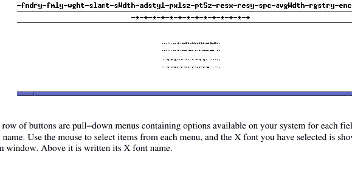

按钮行是下拉菜单，包含系统上针对 X 字体名称中每个字段可用的选项。使用鼠标从每个菜单中选择项目，所选的 X 字体将在主窗口中显示。其上方写有其 X 字体名称。

- 要使 X 字体名称成为 X 选择，请单击标有 select 的按钮。

此示例使 X 字体名称成为 X 选择，这使得可以将 X 字体名称粘贴到命令行或另一个窗口中（参见章节 Pasting Text）。

[ < ] [ > ] [ << ] [ Up ] [ >> ] [Top] [Contents] [Index] [ ? ]

## 17.1.2 Listing Available X Fonts

使用 xlsfonts 列出系统上可用的 X 字体族、大小和粗细。提供引号中的模式作为参数，它会输出系统上安装的所有与该模式匹配的 X 字体名称；默认情况下，它列出所有字体。

- 要列出系统上的所有 X 字体，请输入：

```
$ xlsfonts RET
```

- 要列出系统上名称包含文本 `rea'` 的所有 X 字体，请输入：

```
$ xlsfonts '*rea*' RET
```

- 要列出系统上的所有粗体 X 字体，请输入：

```
$ xlsfonts '*bold*' RET
```

## 17.2.1 Setting the Console Font

## 17.2.2 Displaying the Characters in a Console Font

使用 `consolechars` 设置当前控制台字体；将控制台字体基本文件名作为 `-f` 选项的参数给出。

- 要将控制台字体设置为 `scrawl_w` 字体，请输入：

```
consolechars -f scrawl_w RET
```

某些字体文件包含不止一种高度（或大小）的字体。如果字体包含不同高度的多种编码，请将要使用的高度作为参数提供给 `-H` 选项。 （如果您无论如何尝试不使用该选项，consolechars 将输出可用大小的列表。）

常见的控制台字体高度包括 8（用于 8x8 字体）、14（用于 8x14 字体）和 16（用于 8x16 字体）。

- 要将控制台字体设置为 8x8 大小的 `sc` 字体，请输入：

```
consolechars -H 8 -f sc RET
```

## 17.2.2 Displaying the Characters in a Console Font

使用 `showfont` 显示当前控制台字体中的所有字符。

- 要列出当前控制台字体中的所有字符，请输入：

```
showfont RET
```

## 17.3 Text Fonts

*Text fonts* 是由屏幕上 ASCII 字符的排列创建的字体；它们经常出现在 Usenet 文章和电子邮件消息中，作为文本文件中的装饰或标题元素包含，并用于在打印机上打印简单的横幅或海报。

从 ASCII 字符的排列制作“字体”（甚至图片）被称为 *ascii art*。以下配方描述了以此类字体输出文本的方法。

- 17.3.1 Horizontal Text Fonts
- 水平文本字体。
- 17.3.2 Making a Text Banner
- 制作文本横幅。

## 17.3.1 Horizontal Text Fonts

`figlet` 过滤器以给定的文本字体输出文本。将要输出的文本作为参数给出，对包含 shell 元字符的文本进行引用（参见章节 Passing Special Characters to Commands）。

- 要以默认 figlet 字体输出文本 `news alert`，请输入：

```
$ figlet news alert RET
```

此命令输出以下内容：


`figlet` 的字体保存在 `/usr/lib/figlet` 目录中；使用 `-f` 选项后跟字体文件的基本名称（不带路径或扩展名）来使用该字体。

要使用 `figlet` 字体输出文本文件的内容，请使用 `cat` 输出文件的内容并将输出通过管道传递给 `figlet`。

- 要以 figlet `bubble` 字体输出文件 `poster` 的文本，请输入：

```
$ cat poster | figlet -f bubble RET
```

NOTE: `bubble` 字体安装在 `/usr/lib/figlet/bubble.flf`。

[ < ] [ > ] [ << ] [ Up ] [ >> ] [Top] [Contents] [Index] [ ? ]

## 17.3.2 Making a Text Banner

在 Linux 系统上打印长垂直文本横幅的最简单方法是使用旧的 UNIX banner 工具。

将文本消息作为参数引用，banner 会将该消息的大型垂直“横幅”发送到标准输出。消息本身以由 ASCII 文本字符组成的“字体”输出，类似于 figlet 使用的字体，只是消息是垂直输出以便打印，并且你不能更改字体。要将 banner 的输出发送到打印机，请将其通过管道传递给 lpr。

- 要制作写着 `Happy Birthday Susan` 的横幅，请输入：

```
$ banner 'Happy Birthday Susan' RET
```

- 要将写着 `Happy Birthday Susan` 的横幅打印到默认打印机，请输入：

```
$ banner 'Happy Birthday Susan' | lpr RET
```

不幸的是，banner 理解的字符范围有点有限——以下字符不能在横幅消息中使用：

```
60; 62; [ ] \ ^ _ { } | ~
```

要制作文本文件内容的横幅，请通过重定向标准输入将其内容发送到 banner（参见章节 Redirecting Input to a File）。

要制作文件 `/etc/hostname` 内容的横幅，请输入：

```
$ banner 60; /etc/hostname RET
```

横幅的默认宽度为 132 文本列；你可以通过将要使用的宽度作为 `-w` 选项的参数来指定不同的宽度。如果你在不带数字的情况下给出 `-w` 选项，banner 将以 80 文本列输出。


• 要制作一个包含文本 `Happy Birthday Susan` 且宽度为 23 个文本列的横幅，输入：

```
banner -w 23 'Happy Birthday Susan' RET
```

• 要制作一个包含文本 `Happy Birthday Susan` 且宽度为 80 个文本列的横幅，输入：

```
banner -w 'Happy Birthday Susan' RET
```

**注意：** 使用 `figlet` 制作水平文本横幅的方法在 [以横向方式输出文本](#) 中有描述。

## 17.4 其他字体工具

下表描述了 Linux 可用的一些其他字体工具。

| 工具 | 描述 |
|---|---|
| `cse` | Linux 控制台字体编辑器 cse 是一个较旧的控制台字体编辑器。 { @sf{WWW} }: `http://www.ibiblio.org/pub/Linux/system/keyboards/` |
| `dtm` | Definitive Type Manager 是一个用于向系统添加和删除 Adobe Type 1 字体的工具。 { @sf{Debian} }: `dtm` |
| `fonter` | Fonter 是一个控制台字体编辑器；用它来制作和编辑控制台字体。 { @sf{Debian} }: `fonter` |
| `gfont` | gfont 工具创建 TeX 字体渲染的文本 GIF 图像。 { @sf{Debian} }: `gfont`; { @sf{WWW} }: http://www.engelschall.com/sw/gfont/ |
| `gfontview` | 这是一个用于查看 Adobe Type 1 和 TrueType 字体的工具。 { @sf{Debian} }: `gfontview` |

## 第四部分：图像

+   - [18. 查看图像](18. Viewing Images) 查看图像。
+   - [19. 编辑图像](19. Editing Images) 编辑图像。
+   - [20. 导入图像](20. Importing Images) 将图像导入 Linux。
+   - [21. PostScript](21. PostScript) 关于 PostScript 及相关内容。

[<](<) [>](>) [<<](<<) [Up](Up) [>>](>>)

[Top](Top) [Contents](Contents) [Index](Index) [?](?)

## 18. 查看图像

与文本一样，也有用于查看和编辑图像的工具。本章描述了各种查看图像的方法；图像编辑将在下一章讨论。虽然你可以用图像编辑器查看图像，但如果你不打算编辑它，使用查看器更安全（也更快！）。

+   18.1 预览打印文件 — 预览打印图像文件。
+   18.2 在 X 中查看图像 — 在 X 中显示图像。
+   18.3 在控制台中浏览图像 — 在控制台中显示图像。
+   18.4 在 Web 浏览器中查看图像 — 在 Web 浏览器中查看图像。
+   18.5 浏览 PhotoCD 档案 — 浏览 Kodak PhotoCD。
+   18.6 其他图像查看器 — 用于查看图像的其他工具。

## 18.1 预览打印文件

DVI（“设备无关”）、PostScript 和 PDF（“便携式文档格式”）文件格式可由许多应用程序生成。它们是常用的图形图像格式，用于打印；以下各节讨论了在显示屏上预览这些文件的方法。

+   18.1.1 预览 DVI 文件 — 预览 DVI 文件。
+   18.1.2 预览 PostScript 文件 — 预览 PostScript 文件。
+   18.1.3 预览 PDF 文件 — 预览 PDF 文件。

## 18.1.1 预览 DVI 文件

使用 xdvi 工具在 X 中预览 DVI 文件。将要预览的文件名作为参数给出。xdvi 会显示文档打印时的外观，并允许你以不同放大倍率查看。

+   • 要预览文件 `gentle.dvi`，输入：

## 18.1.3 预览 PDF 文件

@sf(Debian): `xpdf`
@sf(WWW): http://www.foolabs.com/xpdf/
@sf(Debian): `gv`
@sf(WWW): http://wwwthep.physik.uni-mainz.de/~plass/gv/
使用 xpdf 预览 PDF 文件。将要预览的 PDF 文件名作为参数给出。

+   - 要预览 PDF 文件 `flyer.pdf`，输入：

```
$ xpdf flyer.pdf RET
```

要退出 xpdf，按 Q；使用两个放大镜按钮将视图放大（+）或缩小（−），并使用左右箭头按钮在上一页和下一页之间移动（如果有）。

*注意：* 你也可以使用 gv 来预览 PDF 文件。

[ < ] [ > ] [ << ] [ Up ] [ >> ] [Top] [Contents] [Index] [ ? ]

## 18.2 在 X 中查看图像

@sf(Debian): `imagemagick`
@sf(WWW): ftp://ftp.wizards.dupont.com/pub/ImageMagick/
要在 X 中查看图像，请使用 display，它是 ImageMagick 工具套件的一部分。它可以识别许多图像格式，包括 FlashPix、GIF/GIF87、Group 3 传真、JPEG、PBM/PNM/PPM、PhotoCD、TGA、TIFF、TransFig 和 XBM。

display 以要查看的图像文件名作为参数，并在新窗口中显示图像。

+   - 要查看文件 `sailboat.jpeg`，输入：

```
$ display sailboat.jpeg RET
```

此命令在新窗口中显示图像文件：


# Linux 实用手册：日常使用的技巧与技术


在 display 中，鼠标按钮具有特殊含义。左键单击图像窗口即可在新窗口中打开 display 命令菜单。display 命令菜单如下所示：

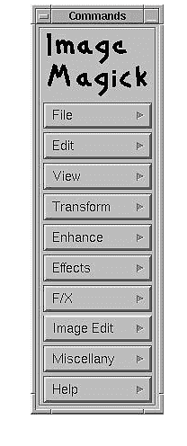

菜单项可让你更改图像大小并以其他方式更改或转换图像显示。选择 Help 菜单中的 Overview 可了解各种可用显示命令的说明。

中键单击图像即可打开一个新窗口，以你单击的位置为中心显示放大的图像。例如，在前一个示例中中键单击帆船图像将打开一个如下所示的新窗口：

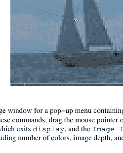

最后，右键单击图像窗口即可弹出一个包含最常用的几个命令的弹出菜单；要选择其中一个命令，请将鼠标指针拖动到该命令上。弹出菜单中的命令包括 Quit，可退出 display，以及 Image Info，可显示有关图像文件本身的信息，包括颜色数、图像深度和分辨率。

下表描述了在 display 中显示图像时可用的一些键盘命令。

| COMMAND | DESCRIPTION |
|---|---|
| SPC | 显示命令行中指定的下一张图像。 |
| BKSP | 显示命令行中指定的上一张图像。 |
| C-q | 退出图像显示并退出 display。 |
| C-s | 将图像写入文件。 |
| < | 将图像大小减半。 |
| > | 将图像大小加倍。 |
| - | 将图像恢复为原始大小。 |
| / | 顺时针旋转图像 90 度。 |
| \ | 逆时针旋转图像 90 度。 |
| ? | 打开一个新窗口，显示有关图像的信息，包括分辨率、颜色深度、格式以及如有的话注释。 |
| h | 切换水平镜像图像。 |
| v | 切换垂直镜像图像。 |

NOTE: display 还可用于查看 World Wide Web 上的图像——请参阅 Viewing an Image from the Web。

## 18.2.1 在 X 中浏览图像集合

`display` 工具提供了一个浏览图像集合的功能——将 `vid:` 作为文件参数给出，后跟要匹配的文件名或模式，用引号括起来。`display` 会为指定的图像制作缩略图，并在新窗口中显示它们，它称之为 *visual image directory*。

- 要浏览 `/usr/doc/imagemagick/examples` 目录中扩展名为 `.gif` 的图像文件，请输入：

```
display 'vid:/usr/doc/imagemagick/examples/*.gif' RET
```

- 要浏览当前目录中的所有图像文件，请输入：

```
display 'vid:*' RET
```

在前面的示例中，只有 `display` 支持的图像格式的文件才会被读取并显示。

> **NOTE:** 要以正常大小打开图像，请右键单击图像并选择 Load；缩略图将被其全尺寸图像替换。要返回缩略图目录，请右键单击图像并选择 Former。

## 18.2.2 将图像放入根窗口

将图像放入根窗口的一种方法是使用 `display` 并将 `root` 作为 `-window` 选项的参数。

- 要将图像 `tetra.jpeg` 放入根窗口，请输入：

```
display -window root tetra.jpeg RET
```

## 18.3 在控制台中浏览图像

使用 zgv 在虚拟控制台中查看图像，而非在 X 中。你可以使用 zgv 浏览文件系统并选择要查看的图像，或将要查看的图像文件名称作为参数给出。它识别许多图像格式，包括 GIF、JPEG、PNG、PBM/PNM/PPM、TGA 和 PCX；其最棒的功能之一是可以将整个屏幕填满图像。

当你不带任何选项运行 zgv 时，它会显示当前目录中任何图像的图像图标，并将任何子目录列为文件夹图标。你也可以给出目录名称作为参数以浏览该目录中的图像。

- 要浏览当前目录中的图像，请输入：

```
$ zgv RET
```

- 要浏览 `/usr/share/gimp/scripts` 目录中的图像，请输入：

```
$ zgv /usr/share/gimp/scripts RET
```

使用箭头键在文件显示中导航；图像或目录图标周围的红色边框表示当前选中的图像或子目录。键入 RET 以查看选中的图像或切换到选中的目录。

你可以用多种方式操作所查看的图像——放大和缩小图像、更改亮度和颜色，甚至制作图像的自动“幻灯片放映”。下表描述了 zgv 的一些选项。

| OPTION | DESCRIPTION |
|---|---|
| -c | 切换图像居中。默认情况下图像在屏幕上居中；指定此选项会关闭居中。 |
| -i | 忽略因文件损坏而产生的错误，并显示文件中可显示的部分。 |
| -l | 以幻灯片放映模式启动 zgv，它会连续循环显示作为参数指定的所有图像，直到你中断为止。 |
| -M | 切换鼠标支持。默认情况下鼠标支持处于关闭状态；此选项将其打开。 |
| -r integer | 每隔 integer 秒重新读取并重新显示每张图像。适用于查看网络摄像头图像或其他不断变化的图像文件。 |


## 18.4 在 Web 浏览器中查看图像

如果你有图形 Web 浏览器，例如 `mozilla`，你可以用它来查看图形图像。虽然在浏览器中查看图像并不提供太多灵活性（你无法放大图像的某一部分，或获取有关图像分辨率和其他细节的信息），但如果你只想在 X 中快速查看一个图像文件，并且你已经运行着一个 Web 浏览器，这可以是一种快速简便的方法。

要在 Web 浏览器中查看图像文件，请在浏览器的 `Location` 字段中指定一个指向图像文件名的 file: URL。

+   要查看文件 `/usr/share/images/mondrian-15.jpeg`，输入：

```
file:/usr/share/images/mondrian-15.jpeg RET
```

请注意，给定的 file: URL 只有一 个前导斜杠，指向根目录，而不是像 http:// 那样的两个。

## 18.5 浏览 PhotoCD 档案

```
@sf(Debian): `xpcd'
@sf(Debian): `xpcd-gimp'
@sf(www): http://user.cs.tu-berlin.de/~kraxel/linux/xpcd/
```

xpcd 工具是用于查看和浏览柯达 PhotoCD 图像集合的 X 客户端。要浏览柯达 PhotoCD 上的图像，请挂载 CD-ROM（参见章节 Mounting a CD-ROM），然后将挂载点作为参数传递给 xpcd。

+   要浏览挂载在 `/cdrom` 上的 PhotoCD 上的图像，输入：

```
$ xpcd /cdrom RET
```

前面的示例将打开两个新窗口——一个小的 xpcd 命令栏窗口，以及一个较大的包含光盘上所有 PhotoCD 图像缩略图的窗口。

要在一个新窗口中打开图像的副本，请左键单击其缩略图图像。当你这样做时，xpcd 将以第二小的 PhotoCD 分辨率 256x384 打开图像；要以其他尺寸查看，请右键单击图像并选择要查看的尺寸。新的窗口绘制完成后，你可以右键单击此新图像，将其保存为 JPEG、PPM 或 TIFF 格式的图像。

要使用 xpcd 查看单个 `.pcd` 文件，请将文件名作为参数给出。

The Linux Cookbook: Tips and Techniques for Everyday Use：

+   - 要查看 PhotoCD 文件 `driveby-001.pcd`，输入：

```
```shell
$ xpcd driveby-001.pcd RET
```
```

> **NOTE:** 你也可以使用 `display` 来查看 `.pcd` PhotoCD 图像文件（参见章节 Viewing an Image in X）。

参见 Extracting PhotoCD images 以获取提取 PhotoCD 图像的另一种配方。

## 18.6 其他图像查看器

下表列出了其他用于查看图像的工具。

| TOOL | DESCRIPTION |
|---|---|
| `animate` | ImageMagick 套件的一部分；使用 animate 在 X 中显示图像的动画幻灯片序列。在 Debian 上：`imagemagick`；ftp://ftp.wizards.dupont.com/pub/ImageMagick/ |
| `xwud` | 显示由 xwd 创建的特殊 X Window Dump 文件格式的文件。在 Debian 上：`xbase-clients`；http://www.xfree86.org/ |
| `showpicture` | 查看作为电子邮件附件发送的图像；需要 xloadimage。在 Debian 上：`metamail`；ftp://ftp.bellcore.com/pub/mb/ |
| `xli` | X 的基本图像查看器。在 Debian 上：`xli` |
| `xloadimage` | X 的漂亮图形查看器，包含用于在根窗口中查看图像的工具。在 Debian 上：`xloadimage` |
| `aview` | 以“ASCII 艺术”形式查看图形。该工具可以查看 pbmplus 实用程序套件支持的任何图像格式，并具有流畅的缩放功能以及你期望的世界级查看器所具有的所有渲染选项。在 Debian 上：`aview`；http://ftp.ta.jcu.cz/pub/aa |

## 19. 编辑图像

当你对一个图像文件——例如包含数字化照片或用图形程序绘制的图片——进行更改时，你就是在编辑图像。

本章包含编辑和修改图像的配方，包括如何在图像文件格式之间转换。它还概述了你可能会觉得有用的其他图像应用程序，包括功能强大的 GIMP 图像编辑器。

+   19.1 Transforming Images
+   Transforming images from the command line.
+   19.2 Converting Images between Formats
+   Converting image formats.
+   19.3 Editing Images with the GIMP
+   The famous GIMP image processor.
+   19.4 Interactive Image Editors and Tools
+   A list of good image editors to try.

## 19.1 转换图像

```
@sf(Debian): `imagemagick`
@sf(WWW): `ftp://ftp.wizards.dupont.com/pub/ImageMagick/`
```

许多 Linux 工具可用于以各种方式转换或操作图像。一个非常有用的用于转换图像和在图像格式之间转换的软件包是 netpbm 套件的实用程序（参见章节 Scanning Images）。另一个是 ImageMagick 套件的成像工具，其中 mogrify 对于执行快速命令行图像转换特别有用；用它来改变图像的大小、旋转或减少颜色。

mogrify 总是把要处理的文件名作为参数，并将更改写入该文件。使用连字符 (`-`) 指定标准输入，在这种情况下 mogrify 将其输出写入标准输出。

我将在下面的示例中使用图像 `phoenix.jpeg` 来让你了解如何使用 mogrify：


# Linux 菜谱：日常使用技巧与诀窍：

> 注意：你也可以使用 GIMP 以交互方式执行以下各节中描述的许多图像变换（参见使用 GIMP 编辑图像一节）。

- 19.1.1 改变图像大小  改变图像的大小。
- 19.1.2 旋转图像  旋转图像。
- 19.1.3 调整图像颜色  减少图像中的颜色。
- 19.1.4 为图像添加注释  为图像添加注释。
- 19.1.5 为图像添加边框  在图像周围加上边框。
- 19.1.6 制作图像蒙太奇  制作图像的蒙太奇。
- 19.1.7 组合图像  组合图像。
- 19.1.8 将两幅图像变形融合  将两幅图像变形融合。

## 19.1.1 改变图像大小

要使用 mogrify 调整图像大小，请使用 `-geometry` 选项，并以像素为单位提供宽度和高度值作为参数。

- 要将 `phoenix.jpeg` 调整为 480x320 像素，请输入：

```
$ mogrify -geometry 480x320 phoenix.jpeg RET
```

这会将原始 `phoenix.jpeg` 文件转换为：


**注意：** 将图像放大到更大尺寸时，图像会显得块状或模糊。

当 `mogrify` 调整图像大小时，它会保持图像的*宽高比*，即宽度和高度之间的比例保持不变。若要强制转换为特定图像大小而不必保留其宽高比，请在几何参数后附加感叹号。

- 要将 `phoenix.jpeg` 调整为*恰好* 480x320 像素，而不考虑宽高比，请输入：

```bash
$ mogrify -geometry 640x480! phoenix.jpeg RET
```

这会将原始 `phoenix.jpeg` 转换为：


你还可以按百分比指定宽度或高度。要按百分比*减小*，请在数值后加上百分号（`%`）。要按百分比*增大*，请给出数值加 100 后再加百分号。例如，要增加 25%，请给出 `125%`。

- 要将 `phoenix.jpeg` 的高度增加 25% 并将其宽度减少 50%，请输入：

```
$ mogrify -geometry 125%x50% phoenix.jpeg RET
```

这会将原始 `phoenix.jpeg` 转换为：

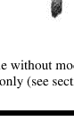

*注意：* 要在不修改图像的情况下按特定比例*查看*图像，请使用 `display`；当你调整其窗口大小时，只会调整屏幕上的图像大小（参见[调整窗口大小]()一节）。

## 19.1.2 旋转图像

要旋转图像，请使用带有 `-rotate` 选项的 mogrify，后跟要旋转的度数。如果图像宽度大于高度，请在此数字后加上 `>`；如果高度大于宽度，则加上 `<`。（由于 `<` 和 `>` 都是 shell 重定向运算符，请将此参数用引号括起来；如果图像高度和宽度相同，则省略两者。）

- 要将高度大于宽度的 `phoenix.jpeg` 旋转 90 度，请输入：

```
$ mogrify -rotate '90<' phoenix.jpeg RET
```

这会将原始 `phoenix.jpeg` 转换为：

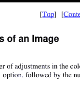

注意：执行此命令后，`phoenix.jpeg` 的宽度现在大于高度，因此要再次旋转它，请使用 `>` 而不是 `<`。

## 19.1.3 调整图像颜色

你可以使用 mogrify 对图像颜色进行多种调整。要减少图像中的颜色数量，请使用 `-colors` 选项，后跟要使用的颜色数量。

- 要将 `phoenix.jpeg` 中的颜色减少为两种，请输入：

```
$ mogrify -colors 2 phoenix.jpeg RET
```

这会将原始 `phoenix.jpeg` 转换为：

使用 `-dither` 选项可通过 Floyd–Steinberg 误差扩散来减少颜色，这是一种在颜色减少过程中提高图像质量的常用算法。

- 要将 `phoenix.jpeg` 中的颜色减少为四种并应用 Floyd–Steinberg 误差扩散，请输入：

```
$ mogrify -colors 4 -dither phoenix.jpeg RET
```

这会将原始 `phoenix.jpeg` 转换为：

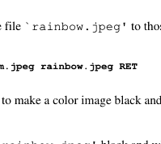

使用 `-map` 选项并以第二个文件名作为参数，可从第二幅图像中读取颜色映射（即颜色集合），并将其用于第一幅图像。

- 要将文件 `rainbow.jpeg` 中的颜色更改为文件 `prism.jpeg` 中使用的颜色，请输入：

```
$ mogrify -map prism.jpeg rainbow.jpeg RET
```

使用 `-monochrome` 选项可将彩色图像转换为黑白图像。

- 要将彩色图像 `rainbow.jpeg` 转换为黑白图像，请输入：

```
$ mogrify -monochrome rainbow.jpeg RET
```

如果你有 PPM 文件，可以使用 ppmquant 来量化，或将图像中的颜色减少到指定数量——有关详细信息，请参见 ppmquant 手册页（参见从系统手册中读取手册页一节）。

由于显示硬件的差异，图像的亮度可能因计算机系统而异

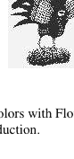


到另一个系统上。例如，在 Macintosh 上创建的图像在其他系统上通常显得更暗。调整图像亮度时，这称为 *伽马校正。*

要调整图像的亮度，请将要应用的数值校正级别作为 `-gamma` 选项的参数。大多数 PC 显示器的伽马值为 2.5，而 Macintosh 显示器的伽马值较低，为 1.4。

- 要将图像 `rainbow.jpeg` 的伽马校正设置为 .8，请输入：

```
$ mogrify -gamma .8 rainbow.jpeg RET
```

## 19.1.4 为图像添加注释

@sf(Debian): 'libjpeg-progs'
@sf(WWW): http://www.ijg.org/

要为图像文件添加注释，请将 mogrify 与 `-comment` 选项一起使用，并将带引号的注释作为选项的参数。这对于在图像中添加版权（或 Copyleft）声明，或使用 URL 注释图像文件非常有用。

- 要为图像文件 `phoenix.jpeg` 添加注释，请输入（全部在一行）：

```
$ mogrify -comment "If you can read this,
 you're too close!" phoenix.jpeg RET
```

查看图像时不会看到注释；它被添加到文件的图像头中。不过，您可以使用显示图像文件信息的工具（如 display 或 GIMP）来读取图像注释。要读取 JPEG 文件中的注释，还可以使用 rdjpgcom 工具——它会输出命令行参数中指定文件名的 JPEG 文件中的所有注释。

- 要读取图像文件 `phoenix.jpeg` 中的任何注释，请输入：

```
$ rdjpgcom phoenix.jpeg RET
If you can read this, you're too close!
$
```

*注意：* 在 JPEG 文件中写入注释的另一种方法是使用 wrjpgcom，它与 rdjpgcom 一起在 `libjpeg-progs` 包中分发。

## 19.1.5 为图像添加边框

要在图像周围绘制边框，请使用带 `-border` 选项的 mogrify，后跟要使用的边框的宽度和高度（以像素为单位）。

- 要为 `phoenix.jpeg` 添加宽两像素、高四像素的边框，请输入：

```
$ mogrify -border 2x4 phoenix.jpeg RET
```

这会将原始 `phoenix.jpeg` 转换为：

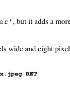

注意：边框会添加到现有图像的外侧；不会裁剪或缩小图像来添加边框。

`-frame` 选项的工作方式与 `-border` 类似，但它会为图像添加更具装饰性的边框。

- 要为 `phoenix.jpeg` 添加宽八像素、高八像素的装饰性边框，请输入：

```
$ mogrify -frame 8x8 phoenix.jpeg RET
```

这会将原始 `phoenix.jpeg` 转换为：


## 19.1.6 制作图像蒙太奇

要制作由其他图像组成的蒙太奇图像，请使用 montage。它将使用的图像文件名以及要写入蒙太奇图像的输出文件名作为参数。

蒙太奇图像的制作方法是：将所有输入图像缩放到最大不超过 120x120 像素的尺寸，然后将这些图像按五行四列平铺。

- 要从文件 `owl.jpeg`、`thrush.jpeg` 和 `warbler.jpeg` 创建蒙太奇，并将其写入 `endangered-birds.png`，请输入：

```
$ montage owl.jpeg thrush.jpeg warbler.jpeg endangered-birds.png RET
```

注意：在此示例中，读取了三个 JPEG 并输出到 PNG 文件；要指定输出使用的格式，请在输出文件名中给出相应的文件扩展名。

## 19.1.7 合并图像

使用 combine 将两个图像合并为一个新图像——将两个源图像文件的名称和要写入的新文件作为参数。不带任何选项时，它会将两个图像中较小的一个覆盖在较大的一个上，从左上角开始，从而生成一个新的图像文件；如果两个图像大小相同，则只能看到第二个图像。

- 要将两个图像 `ashes.jpeg` 和 `phoenix.jpeg` 合并到一个新文件 `picture.jpeg` 中，请输入：

```
$ combine ashes.jpeg phoenix.jpeg picture.jpeg RET
```

您可以使用 `-blend` 选项指定将两个图像混合在一起的百分比。将该选项的参数指定为将第二个图像混合到第一个图像中的量（以百分比表示）。

- 要合并图像文件 `phoenix.jpeg` 和 `ashes.jpeg`，使混合图像包含第二个图像的 70%，请输入：

```
$ combine -blend 70 ashes.jpeg phoenix.jpeg picture.jpeg RET
```


此命令将两张图像合并，并写入一个新的图像文件 `picture.jpeg`，其内容包含第一张图像的70%。

> 注意：使用 `-blend 50` 可将两个源文件等量混合。

## 19.1.8 将两张图像进行变形融合

变形（Morphing）是一种计算机成像方法，用于找出两张图像中形状之间的差异；它通常用于特效中，以转换两种生物的特征，例如人类与某种动物的面部。

你可以通过给 `-compose` 选项指定 `difference` 参数，使用 combine 来获得类似变形的效果。当该命令指定两个输入图像和一个输出文件时，它会计算两张图像对应像素之间的差异；其效果就像一张“变形”后的图像。

- 要将文件 `ashes.jpeg` 和 `phoenix.jpeg` 制作成变形图像，并写入 `picture.jpeg`，请键入：

```
$ combine -compose difference ashes.jpeg phoenix.jpeg picture.jpeg RET
```

文件 `picture.jpeg` 中的结果如下：


> 注意：`x morph` 是用于图像变形的工具；请参阅“交互式图像编辑器与工具”。

## 19.2 在格式之间转换图像

@sf(Debian)：`imagemagick`
@sf(WWW)：`ftp://ftp.wizards.dupont.com/pub/ImageMagick/`

使用 convert 来转换图像的文件格式。将需要转换的文件名作为第一个参数，目标文件作为第二个参数。当你转换文件时，原始文件不会被修改。

要指定转换的目标文件类型，请在转换后的文件名中使用该文件类型的标准文件扩展名。

- 要将 JPEG 文件 `phoenix.jpeg` 转换为 PNG 图像，请键入：

```
$ convert phoenix.jpeg phoenix.png RET
```

此命令将 JPEG 图像 `phoenix.jpeg` 转换为 PNG 格式，并写入新文件 `phoenix.png`。

下表列出了要使用的文件扩展名及其格式描述。（惯例是全部使用小写字母给出扩展名。）

| 文件扩展名 | 图像格式 |
|---|---|
| bmp | Microsoft Windows 位图图像。 |
| cgm | 计算机图形元文件格式。 |
| cmyk | 原始青色、品红色、黄色和黑色字节。 |
| eps | Adobe 封装 PostScript。 |
| fax | Group 3 传真格式。 |
| fig | TransFig 图像格式。 |
| fpx | FlashPix 格式。 |
| gif | CompuServe 图形交换格式，版本 GIF89a（通常读作“giff”，与“biff”押韵）。 |
| gray | 原始灰度字节。 |
| jpeg 和 jpg | 联合图像专家组 JFIF 格式（通常读作“jay-peg”）。 |
| pbm | 黑白可移植位图格式。 |
| pcd | Kodak PhotoCD 格式，最大分辨率 512x768 像素。 |
| pcl | 页面控制语言格式。 |
| pcx | ZSoft IBM PC Paintbrush 格式。 |
| pdf | Adobe 可移植文档格式。 |
| pict | Apple Macintosh QuickDraw 格式。 |
| png | 可移植网络图形格式（通常读作“ping”）。 |
| pnm | 可移植“任意映射”格式。 |
| ppm | 彩色可移植像素图格式。 |
| ps | Adobe PostScript 格式。 |
| rgb | 原始红色、绿色和蓝色字节。 |
| tga | TrueVision Targa 图像格式。 |
| tiff 和 tif | 标签图像文件格式（通常读作“tiff”）。 |
| xbm | X Window System 位图格式。 |
| xpm | 彩色 X Window System 像素图格式。 |
| xwd | 彩色 X Window System 窗口“转储”文件格式。 |

## Linux 烹饪书：日常使用的技巧与诀窍：

将文件转换为 JPEG 格式时，务必使用 `-interlace NONE` 选项，以确保生成的 JPEG 图像是非隔行扫描的——当然，除非你想要隔行扫描的图像；隔行扫描的图像会分多次绘制，通常用于 Web 上，读者可能在完整图像下载完成之前先看到由早期扫描组成的低分辨率图像。非隔行扫描图像则一次绘制完成。

例如，使用 convert 将 PNM 文件转换为非隔行扫描的 JPEG，同时进行锐化、添加边框和添加版权声明。

- 要将 PNM 文件 `pike.pnm` 转换为非隔行扫描的 JPEG，同时将图像锐化 50%，并添加 2x2 边框和版权注释，请键入：

```
$ convert -interlace NONE -sharpen 50 -border 2x2
-comment 'copyright 1999 MS' pike.pnm pike.jpeg RET
```

此命令将其输出写入文件 `pike.jpeg`。注意，`-border` 和 `-comment` 选项之前已在 `mogrify` 工具中介绍过。一些 ImageMagick 工具共享常用选项，如果你要一次性对图像文件进行多种修改，这会很有用；只需一个工具即可完成工作。

注意：某些图像格式是“有损”的，因为转换为该格式时会丢失一些图像信息。例如，JPEG 格式是一种有损格式，通常用于照片图像。如果你将文件从其原始 PNM 格式转换为 JPEG，然后再转换回 PNM，得到的 PNM 将与原始 PNM 不完全相同。

要以交互方式转换图像文件，请使用 GIMP 打开图像，然后从“文件”菜单中选择 `另存为`，并选择要使用的文件类型；请参阅“使用 GIMP 编辑图像”。


## 19.3 使用 GIMP 编辑图像

```
@sf(Debian): 'gimp'
@sf(Debian): 'gimp-manual'
@sf(WWW): http://www.gimp.org/
```

GIMP（GNU Image Manipulation Program，GNU 图像处理程序）是一款功能全面的图像编辑和处理程序，可让你以复杂的方式绘制、绘图、创建和编辑图像。使用 GIMP，你还可以转换图像文件、润饰和编辑照片图像，以及浏览图像集合。

GIMP 附带了数百种工具、滤镜、字体和其他好东西。以下是其功能的 partial 列表：

- 包含完整的绘画工具套件，包括画笔、铅笔、喷枪和克隆。
- 支持自定义画笔和图案。
- 包含完整的图像选择、变换和操作工具套件，包括渐变编辑器、颜色混合和特殊效果。
- 包含动画支持。
- 允许使用图层和通道。
- 允许大尺寸图像，其大小仅受可用磁盘空间限制。
- 提供高质量的抗锯齿。
- 提供完整的 Alpha 通道支持。
- 支持命令脚本。
- 允许多次撤销和重做，仅受可用磁盘空间限制。
- 允许同时打开多个图像。
- 支持所有流行的文件格式，包括 GIF、JPEG、PNG、XPM、TIFF、TGA、MPEG、PS、PDF、PCX 和 BMP。
- 允许轻松添加超过 100 个插件，用于新的文件格式和新的效果滤镜。

GIMP 在 X 下运行，可通过运行 gimp 或从窗口管理器的菜单中选择它来启动。启动后，GIMP 看起来像这样：

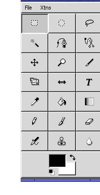

> *注意：* 要学习 GIMP 的基础知识，请参阅 *GIMP 用户手册* 以及 Web 上 http://www.gimp.org/ 的其他文档和资源。你也可以在系统上安装手册；它包含在 Debian `gimp-manual` 包中。

[ < ] [ > ]   [ << ] [ Up ] [ >> ]   [Top] [Contents] [Index] [ ? ]

## 19.4 交互式图像编辑器和工具

Linux 可用的图像编辑软件应用程序种类繁多——制作和编辑图像的方式与可用于此目的的工具一样多。

下表列出了一些其他流行的制作和编辑图像的工具和应用程序——包括 CAD 工程软件——你可能想要探索。列表并不详尽。

| TOOL | DESCRIPTION |
|------|-------------|
| bitmap | 使用 bitmap 编辑器编辑位图文件，这些文件用于 X Window System 中的图标和瓷砖图案。{@sf{Debian}}: `xbase-clients` |
| drgeo | drgeo 是一个用于绘制交互式几何图形的程序。{@sf{Debian}}: `drgeo` {@sf{WWW}}: http://members.xoom.com/FeYiLai/dr_geo/doctor_geo.html |
| dia | 使用 dia 绘制简单的图表和示意图。它以自己的格式保存文件，但你可以将文件导出为 EPS（参见 PostScript 部分）；然而，如果你计划再次编辑图表文件，请确保保留 `.dia` 文件，因为截至本文撰写时，dia 无法导入 EPS 文件。{@sf{Debian}}: `dia` {@sf{WWW}}: http://www.lysator.liu.se/~alla/dia |

electric 使用 electric 设计电子电路的图像。{@sf{WWW}}: http://www.gnu.org/software/electric/electric.html

freedraft FREEdraft 是一款用于精确绘图和草图的 2-D 机械 CAD 工具。{@sf{WWW}}: http://www.freeengineer.org/Freedraft/

gnuplot gnuplot 是一款功能强大的非交互式函数绘图工具。给定一个数据文件和一个公式，gnuplot 可以制作图表和图形。{@sf{Debian}}: `gnuplot` {@sf{WWW}}: ftp://ftp.gnu.org/pub/gnu/gnuplot/

ivtools ivtools 软件套件包括 idraw，这是一款矢量图形编辑器。{@sf{Debian}}: `ivtools-bin` {@sf{WWW}}: http://www.vectaport.com/

kali 使用 kali 绘制图案和镶嵌，包括壁纸图案和无限或递归瓷砖，风格类似于 M.C. Escher。{@sf{Debian}}: `kali`

moonlight Moonlight Creator 是用于建模、照明和渲染 3-D 场景的 X 客户端。{@sf{Debian}}: `moonlight` {@sf{WWW}}: http://www.cybersociety.com/moonlight/

sced sced 是用于创建 3-D 场景的工具。{@sf{Debian}}: `sced` {@sf{WWW}}: http://www.cs.wisc.edu/~schenney/sced/sced.html

xfig 使用久负盛名的 xfig 应用程序绘制图形——复杂的图表、平面图、地图、流程图等。它以自己的格式保存文件（默认情况下扩展名为 `.fig`）；通常的做法是导出为 EPS。{@sf{Debian}}: `xfig` {@sf{WWW}}: http://xfig.org/

xmorph xmorph 是一个将两幅图像融合（有时称为“扭曲”）在一起的工具，从而制作出新图像。图像必须采用 TrueVision Targa 文件格式，且每个文件的大小、形状和像素数相同（另请参阅 Morphing Two Images Together）。{@sf{Debian}}: `xmorph` {@sf{WWW}}: http://www.colorado-research.com/~gourlay/software/

xpaint xpaint 是一款简单的“画图”工具，早于 GIMP，包含你对画图程序所期望的所有基本功能。如果你不需要 GIMP 的高级功能，请考虑改用体积更小的 xpaint。{@sf{Debian}}: `xpaint` {@sf{WWW}}: http://www.danbbs.dk/~torsten/xpaint/index.html


## 20. 导入图像

虽然你总可以自己制作图像，但有时你可能想从其他来源导入并使用现有图像。在本章中，我将展示如何从扫描仪和 Kodak PhotoCD 光盘导入图像。我们将从截屏的配方开始。

### 20.1 截屏
截屏。
### 20.2 扫描图像
使用扫描仪扫描图像。
### 20.3 提取 PhotoCD 图像
从 Kodak PhotoCD 上获取图像。

## 20.1 截屏

截屏是显示屏全部或部分的图片。下面的配方展示了如何在 X 和控制台中截屏。

### 20.1.1 在 X 中截屏
截取 X 屏幕截图。
### 20.1.2 在控制台中截屏
截取控制台屏幕截图。

## 20.1.1 在 X 中截屏

```
@sf(Debian): `imagemagick`
@sf(WWW): `ftp://ftp.wizards.dupont.com/pub/ImageMagick/`
```

使用 ImageMagick 套件的一部分 import 在 X 中截屏。import 可以捕获整个屏幕、单个窗口或任意矩形区域，并将要保存到的文件名作为参数。与其他 ImageMagick 工具一样，输出文件的图像格式取决于你指定的文件扩展名：`.eps` 用于 EPS，`.tiff` 用于 TIFF，`.jpeg` 用于 JPEG，等等。（完整列表请参见 Converting Images between Formats）。

在你发出命令后，鼠标指针会变成一组十字准线。然后你使用鼠标指定要截屏的窗口，如下所示：

## 20.2 扫描图像

```
@sf(Debian): `sane`
@sf(WWW): http://www.mostang.com/sane/
```

SANE，“Scanner Access Now Easy”，是事实上的 Linux 扫描仪接口；使用它可以用扫描仪扫描图像并将其保存到文件中。

SANE 可与各种扫描硬件配合使用，但请确保你想要使用的扫描硬件是兼容的，可以通过检查 Hardware HOWTO 和 SANE 的支持扫描仪列表来确认。

一旦 SANE 运行起来，你就可以使用 SANE 感知的应用程序（如 GIMP（参见 section Editing Images with the GIMP））来扫描图像。

下面的配方描述了命令行 scanimage 工具的使用，该工具随 SANE 包提供。

> 注意：正如缩写所暗示的那样，让扫描仪在 Linux 系统上工作并不总是顺利。SANE 接口完全开放，其开发人员正在确保它足够通用，可以在任何硬件或操作系统上实现。

- 20.2.1 列出可用扫描仪设备 列出可用扫描仪。
- 20.2.2 测试扫描仪 测试扫描仪。
- 20.2.3 扫描图像 扫描图像。

## 20.2.1 列出可用扫描仪设备

在使用扫描仪设备之前，你需要知道其设备名称。要获取此名称，请使用带有 `--list-devices` 选项的 scanimage。

- 要列出可用的扫描仪设备，请输入：

```
$ scanimage --list-devices RET
device `unix:/dev/sgb' is a UMAX Astra 1220S flatbed scanner
$
```

在此示例中，该系统上有一个扫描设备，即 UMAX 品牌的扫描仪，可以通过将其设备名称 `umax:/dev/sgb` 作为 `-d` 选项的参数提供给 scanimage 来指定。

要列出特定设备支持的可用分辨率和选项，请使用 `--help` 选项以及 `-d` 选项后跟其设备名称。

- 要列出前一个示例中列出的设备支持的可用选项，请输入：

```
$ scanimage --help -d 'umax:/dev/sgb' RET
```

> 注意：对于所有 scanimage 命令，请通过包含 `-d` 选项并附上设备名称来指定要使用的扫描仪设备。

## 20.2.2 测试扫描仪

要对扫描仪运行诊断测试以确保可以正确读取它，请使用带有 `--test` 选项的 scanimage。

- 要测试前面列出的 UMAX 扫描仪，请输入：

```
$ scanimage --test -d 'umax:/dev/sgb' RET
```

## 20.2.3 扫描图像

@sf(Debian): `netpbm`
@sf(WWW): http://www.debian.org/Packages/stable/graphics/netpbm.html

使用 scanimage 扫描图像。大多数扫描仪允许你指定图像大小的 x 和 y 值，以像素为单位，从扫描仪平台的左上角开始。将这些坐标作为 `-x` 和 `-y` 选项的参数给出。此外，给 `--resolution` 选项一个参数来指定扫描分辨率，以 dpi（“每英寸点数”）为单位。常见的分辨率值包括 72、120、300 和 600 dpi；72 dpi 是在 Web 上使用或在屏幕上查看时最流行的分辨率，而 204 dpi 通常用于你想要发送到传真机的图像。

扫描输出发送到标准输出，因此要将图像扫描到文件中，请重定向标准输出。

scanimage 以 PNM（“便携式任意图”）格式输出图像，因此请确保你拥有


`netpbm` 包（大多数 Linux 系统默认已安装）；它是一组用于转换和处理这些格式的有用工具。`scanimage` 输出的格式如下：

## 格式说明

- PPM 彩色图像。
- PBM 黑白图像。
- PGM 灰度图像。

使用 `--mode` 选项指定输出的格式，后跟以下参数之一：`color` 表示彩色 PPM，`gray` 表示 PGM 灰度，或 `lineart` 表示黑白 PBM。每个扫描仪都有默认模式；对于大多数彩色扫描仪，默认模式为 `color`。

- 要使用前例中的 UNIX 扫描仪制作一个 72 dpi 的彩色图像扫描，宽 200 像素，高 100 像素，并写入名为 `scan.ppm` 的文件，输入：

```
$ scanimage -d umax:/dev/sgb --resolution 72 -x 200 -y 100 62;
scan.ppm RET
```

- 要使用前例中的 UMAX 扫描仪制作一个 300 dpi 的黑白图像扫描，宽 180 像素，高 225 像素，并写入名为 `scan.pbm` 的文件，输入：

```
$ scanimage -d umax:/dev/sgb --resolution 300 --mode lineart
-x 180 -y 225 62; scan.pbm RET
```

> 注意：本食谱中的命令行因过长而被拆分为两行，但请在一行长命令中输入这些命令。

一旦图像被扫描并写入文件，你就可以像编辑任何图像一样编辑它。

## 20.3 提取 PhotoCD 图像

@sf(Debian): `xpcd`
@sf(WWW): http://user.cs.tu-berlin.de/~kraxer/linux/xpcd/

从柯达 PhotoCD[30]（“PCD”）中提取图像有两种方法。如果您使用 xpcd 工具浏览光盘，则选择一个图像，以所需分辨率提取副本并将其保存到文件中，如 浏览 PhotoCD 归档 中所述。

您也可以直接对 PCD 文件使用 pcdtoppm 来提取指定分辨率的图像并将其保存为 PPM 格式的文件。使用 `-r` 选项指定要提取的分辨率，以 1（最低分辨率）到 5（最高分辨率）的数字参数给出；如果省略此选项，则假定值为 3。还需给出要读取的 PCD 文件名和要写入的 PPM 文件名作为参数。

### 20.3.1 转换 PhotoCD 图像

一旦您提取 PhotoCD 图像并将其写入 PPM 格式文件，请使用 convert 将其转换为其他格式并调整或改进图像（参见章节 在格式之间转换图像）。

要在将图像转换为 JPEG 格式的同时改进图像，请使用 `-interlace` 选项指定不进行交错，使用 `-sharpen` 选项进行 50% 的图像锐化，并使用 `-border` 和 `-comment` 选项为图像添加可选边框和注释。

- 要将文件 `slack.ppm` 转换为非交错 JPEG、锐化图像、添加 2 像素 x 2 像素边框并对图像进行注释，输入（全部在一行）：

```
$ convert -interlace NONE -sharpen 50 -border 2x2 -comment 'Bob was here' slack.pnm slack.jpeg RET
```

### 20.3.2 去除 PhotoCD 雾化

@sf(Debian): `gimp`
@sf(WWW): http://www.gimp.org/
提取的 PhotoCD 图像有时会出现一种“绿色雾化”；要将其去除，请在 GIMP 中打开图像并使用自动色阶功能调整颜色级别。此技术改编自 Philip Greenspun 关于使用 PhotoCD 的提示，对于改进任何扫描或导入的图像都效果良好。

- 要从 PhotoCD 图像中去除“绿色雾化”，请执行以下操作：

要从文件 `slack.pcd` 中提取最高分辨率并将其保存到名为 `slack.ppm` 的 PPM 文件中，输入：

```
$ pcdtoppm -r5 slack.pcd slack.ppm RET
```

- 20.3.1 转换 PhotoCD 图像
- 将 PhotoCD 图像转换为其他格式。
- 20.3.2 去除 PhotoCD 雾化
- 去除 PhotoCD 图像中的“雾化”。

## Linux Cookbook：日常使用的技巧和技术：

- 首先，在 GIMP 中打开提取的图像（参见章节 [使用 GIMP 编辑图像]）。
- 然后，通过 `Image` 菜单进入 `Colors` 子菜单，再进入 `Levels` 子菜单，选择 `Auto Levels`。
- 在 `Levels` 窗口中单击 `OK` 以接受更改。


## 21. PostScript

```
@sf(Debian): 'gs'
@sf(Debian): 'psutils'
@sf(WWW): http://www.gnu.org/pub/gnu/ghostscript/
@sf(WWW): http://ftp.dcs.ed.ac.uk/pub/ajcd/
@sf(WWW): http://www.cappella.demon.co.uk/tinyfiles/tinymenu.html
```

PostScript 是一种编程语言，用于描述“页面”通常是一张物理纸张应该如何显示。PostScript 文件是包含用于绘制要打印到页面上的图像的 PostScript 命令的文本文件。

与纯文本文件一样，PostScript 文件在互联网上很常见，并且被商业打印机使用，因为与纯文本一样，它们可以在不同平台和硬件之间轻松共享。相同的 PostScript 文件可以在高端显示器上输出，也可以在低端打印机上打印，以该硬件的最佳能力为准。PostScript 是一种紧凑而优雅的格式。

虽然可以直接用 PostScript 语言编写，并且有些人已经熟练掌握了编程 PostScript，但有如此多的工具和应用程序可以在文件之间相互转换 PostScript，你不必这样做。参见章节 Converting Plain Text for Output，了解将纯文本转换为 PostScript 的方法。

Ghostscript 是 PostScript 语言的免费实现。gs 工具是 Ghostscript 解释器，用于将文件从 PostScript 转换为其他格式，通常是为了打印到非 PostScript 打印机上参见章节 Preparing a PostScript File for Printing。ghostview 工具用于在屏幕上预览 PostScript 文件参见章节 Previewing a PostScript File。

EPS，即 Encapsulated PostScript，是一种描述页面中一个框内容的的文件格式。EPS 文件可以嵌入到 PostScript 文件的页面中，因此在向文档中插入插图时很常见例如，《食谱》中的所有插图都是 EPS 格式文件。你可以像查看和打印 PostScript 文件一样查看和打印 EPS 文件。

本章包含格式化和操作 PostScript 文件的配方。配方根据它们是作用于 PostScript 文件中的单个逻辑页面还是作用于整个文件作为一个整体而区分开来编号的页面在文件中不一定是输出的物理页面。

除非另有说明，本章中的工具都是 Angus Duggan 的 PSUtils 软件包的一部分。这些工具可用于除下面描述之外的其他用途；请参阅各自的手册页以获取更多详细信息。

- 21.1 Manipulating PostScript Pages 操作 PostScript 文件的页面。
- 21.2 Manipulating PostScript Documents 操作 PostScript 文件作为一个整体。
- 21.3 Converting PostScript 将 PostScript 转换为其他格式。

# The Linux Cookbook: Tips and Techniques for Everyday Use:

将要选择的页面作为参数传递给 `-p` 选项；你可以列出单个页面和用逗号分隔的页面范围。用连字符之间的两个数字给出范围；因此，`4-6` 指定从第 4 页到第 6 页，包含在内。如果在一对数字中省略第一个数字，则假定为第一页，如果省略最后一个数字，则假定为最后一页。页面按指定的顺序写入新文件。

要从 PostScript 文件 `newsletter.ps` 中选择第 47 页并输出到文件 `selection.ps`，请输入：

```
$ psselect -p47 newsletter.ps selection.ps RET
```

- 要从文件 `newsletter.ps` 中选择前十页、第 104 页、第 23 到 28 页以及第 2 页并写入文件 `selection.ps`，请输入：

```
$ psselect -p1-10,104,23-28,2 newsletter.ps selection.ps RET
```

在前面的示例中，第 2 页被选择了两次。

在数字前加上下划线 (`_`) 表示给定的页码是相对于最后一页，从后往前数到第一页。

- 要从 PostScript 文件 `newsletter.ps` 中选择倒数第二页到倒数第十页并输出到文件 `selection.ps`，请输入：

```
$ psselect -p_2-_10 newsletter.ps selection.ps RET
```

- 要从 PostScript 文件 `newsletter.ps` 中选择倒数第二页到第 10 页并输出到文件 `selection.ps`，请输入：

```
$ psselect -p_2-10 newsletter.ps selection.ps RET
```

使用 `-e` 选项选择所有偶数页，使用 `-o` 选项选择所有奇数页。

- 要选择文件 `newsletter.ps` 中的所有偶数页并写入新文件 `even.ps`，请输入：

```
$ psselect -e newsletter.ps even.ps RET
```

- 要选择文件 `newsletter.ps` 中的所有奇数页并写入新文件 `odd.ps`，请输入：

```
$ psselect -o newsletter.ps odd.ps RET
```


## Linux  cookbook：日常使用的技巧与技术：

单独使用下划线（`_`）插入空白页，并使用 `-r` 以相反顺序输出页面。

- 要选择文件 `newsletter.ps` 的最后十页，后跟一个空白页，再跟前十页，并输出到新文件 `selection.ps`，输入：

```
$ psselect -p1-10,_,1-10 newsletter.ps selection.ps RET
```

- 要选择文件 `newsletter.ps` 中的第 59、79 和 99 页，并以相反顺序输出（先输出第 99 页）到新文件 `selection.ps`，输入：

```
$ psselect -p59,79,99 -r newsletter.ps selection.ps RET
```

注意：与前面的示例相同的结果也可以通过省略 `-r` 选项并仅按相反顺序列出这三页来实现：

```
$ psselect -p99,79,59 newsletter.ps selection.ps RET
```

## 21.1.3 合并 PostScript 页面

使用 psnup 在单张纸上打印多个 PostScript 页面；给出要合并（或“向上”）到每张纸上的页面数作为选项。

- 要制作新的 PostScript 文件 `double.ps`，将文件 `single.ps` 中的两页放在每一页上，输入：

```
$ psnup -2 single.ps double.ps RET
```

要指定纸张尺寸，将标准纸张尺寸的名称作为 `-p` 选项的参数给出：a3、a4、a5、b5、letter、legal、tabloid、statement、executive、folio、quarto 或 10x14。您也可以使用 `-h` 和 `-w` 选项指定任意高度和宽度；单位可以用厘米（后跟 `cm`）或英寸（后跟 `in`）指定。如果未指定尺寸，psnup 假定纸张尺寸为 a4。

使用 `-l` 选项时页面为横向方向（相对于纵向逆时针旋转 90 度），使用 `-r` 时页面为海景方向（相对于纵向顺时针旋转 90 度）。

页面在输出文件中以“行优先”布局放置，其中逻辑页面按行横向放置在页面上。使用 `-c` 选项指定“列优先”布局，其中逻辑页面按列纵向放置在页面上。通过将百分比作为 `-s` 选项的参数给出，将页面大小按该百分比缩放；例如，`-s .5` 将页面缩放到原始大小的 50%。

要为每个页面绘制边框，将边框宽度以磅为单位作为 `-d` 选项的参数指定（如果未指定宽度，则假定值为 1）。

## 21.1.4 在签名中排列 PostScript 页面

签名是文档中对应于折叠和装订的纸张的一组页面；这些页面在文档中通常不是按顺序排列的（例如，在八页签名的文档中，第 8 页和第 1 页可能都打印在同一张纸上）。

要按签名重新排列 PostScript 文件的页面——通常用于将文件打印为书籍或小册子——使用 psbook。将要读取的 PostScript 文件的名称和输出文件使用的名称作为参数给出；它读取第一个内容，重新排列页面，然后将 PostScript 输出写入第二个文件。

- 要将文件 `newsletter.ps` 的页面重新排列为签名并写入文件 `newsletter.bound.ps`，输入：

```
$ psbook newsletter.ps newsletter.bound.ps RET
```

默认情况下，psbook 对整个文件使用一个签名。如果文件不包含四的倍数页数，它会在末尾添加空白页。

要指定要使用的签名的大小——换句话说，将出现在单张纸上的页数——将该数字作为 `-s` 选项的参数给出。签名大小始终是四的倍数。

- 要将文件 `newsletter.ps` 的页面重新排列为八页签名并写入 `newsletter.bound.ps`，输入：

```
$ psbook -s8 newsletter.ps newsletter.bound.ps RET
```

## 21.2 操作 PostScript 文档

这些配方对整个 PostScript 文档进行操作。

## 21.2.1 调整 PostScript 文档大小

使用 `psresize` 调整 PostScript 文件的大小。它以要调整大小的文件和要写入的输出文件作为参数；您还必须指定输出文件的页面大小，使用与 `psnup` 工具相同的格式：使用 `-p` 或 `-h` 和 `-w` 指定输出文件的大小，并使用 `-P` 指定输入文件的大小（参见“合并 PostScript 页面”部分）。

- 要将 PostScript 文件 `double.ps` 调整为美国信纸大小的纸张，并将输出写入新文件 `doublet.ps`，输入：

```
$ psresize -p letter double.ps doublet.ps RET
```

## 21.2.2 合并 PostScript 文档

使用 `psmerge` 将多个 PostScript 文件连接并合并为单个文件。将要合并的文件名称作为参数给出，`psmerge` 会按给定顺序将它们输出到标准输出。您也可以使用 `-o` 选项指定输出文件名（不要在文件名和选项之间留空格）。

- 要将文件 `slide1.ps`、`slide2.ps` 和 `slide3.ps` 合并为新的 PostScript 文件 `slideshow.ps`，输入：

```
$ psmerge -oslideshow.ps slide1.ps slide2.ps slide3.ps RET
```


## 21.3 转换 PostScript

这些配方展示了如何将 PostScript 文件转换为其他格式。另请参阅准备 PostScript 文件以便打印的配方。准备 PostScript 文件以便打印。

### 21.3.1 将 PostScript 转换为 PDF

### 21.3.2 将 PostScript 转换为纯文本

将 PostScript 转换为纯文本。

## 21.3.1 将 PostScript 转换为 PDF

使用 ps2pdf 将 PostScript 文件转换为 PDF，它是 gs “Ghostscript” 包的一部分。将要读取的 PostScript 文件名和要写入的 PDF 文件名作为参数给出。

- 要从输入文件 `sutra.ps` 生成 PDF 文件 `sutra.pdf`，请输入：

```
$ ps2pdf sutra.ps sutra.pdf RET
```

此命令会写入一个名为 `sutra.pdf` 的新 PDF 格式文件。原始文件 `sutra.ps` 不会被更改。

注意：要进行正确的 PDF 转换，请确保已安装 gs 版本 6.01 或更高版本：使用 gs 的 `-v` 选项输出已安装的版本。

## 21.3.2 将 PostScript 转换为纯文本

要将 PostScript 文件转换为纯文本，请使用 ps2ascii。将要读取的 PostScript 文件名和要写入的文本文件名为参数给出。

The Linux Cookbook: Tips and Techniques for Everyday Use:

- 要从输入文件 `sutra.ps` 生成文本文件 `sutra.txt`，请输入：

```
$ ps2ascii sutra.ps sutra.txt RET
```

此命令会写入一个名为 `sutra.txt` 的文本文件。原始文件 `sutra.ps` 不会被更改。

[ < ] [ > ]   [ << ] [ Up ] [ >> ]   [Top] [Contents] [Index] [ ? ]

## 第五部分：声音

- 22. [声音文件](#) — 播放和录制声音，以及进行设置。
- 23. [音频光盘](#) — 音频光盘。
- 24. [编辑声音文件](#) — 编辑音频文件。

[<] [>]    [<<] [Up] [>>]    [Top] [Contents] [Index] [?]

The Linux Cookbook: Tips and Techniques for Everyday Use:

| 扩展名 | 描述 |
|---|---|
| `.midi` 或 `.mid` | MIDI 文件的标准扩展名。 |
| `.mod` | MOD 文件。 |
| `.mp3` | MPEG II，Level 3 文件。 |
| `.ogg` | Ogg Vorbis 文件。 |
| `.ra` | RealAudio 文件。 |
| `.raw` | 原始音频数据。 |
| `.sf` | IRCAM SoundFile 格式，由一些音乐作曲软件使用，例如 CSound 和 MIXViews。 |
| `.voc` | SoundBlaster VOC 文件。 |
| `.wav` | Microsoft RIFF 格式（“WAV”）。 |

## 22.2 调整音频控件

混音器程序用于调整各种音频设置，例如音量和录音电平，也用于打开或静音麦克风或其他输入设备。在播放或录制声音之前，您必须使用混音器调整音频设置。

ALSA 的默认混音器称为 `amixer`，以下配方假定使用它。还有其他混音器，其中一些比 `amixer` 更易于使用。如果您想要图形化混音器，请安装 `aumix` 包，或参见本章末尾的其他选项。

- 1. [22.2.1 列出当前音频设置](#22.2.1) — 列出当前音频设置。
- 2. [22.2.2 更改音量级别](#22.2.2) — 更改音量。
- 3. [22.2.3 静音音频设备](#22.2.3) — 静音输入设备。
- 4. [22.2.4 选择音频录制源](#22.2.4) — 指定录制输入源。

## 22.2.1 列出当前音频设置

要列出所有音频输入和输出设备及其设置，请在不带任何选项的情况下输入 `amixer`。

您的声卡组件按组组织，从包含主左右音量设置的 Master 组到音频光盘和数字声音文件的各个组。（这些组与 [组及其工作方式](#groups-and-how-to-work-in-them) 中描述的文件访问组无关。）

要浏览当前的混音器设置，请输入：

```
$ amixer | less RET
```

下表描述了 amixer 列出的一些重要声音组。

| 声音组 | 描述 |
|---|---|
| Master | 主音量设置。 |
| PCM | 用于播放声音文件的数字音频；第一个通道是组 PCM，0，第二个是 PCM，1。 |
| CD | 音频光盘播放器（必须从 CD-ROM 驱动器连接到声卡的电缆）。 |
| Synth | 用于 MIDI 的合成器设备。 |
| Line | 声音输入设备（声卡背面的插孔通常标记为 LINE IN）。 |
| MIC | 麦克风设备（声卡背面的插孔通常标记为 MIC）。 |

要仅列出一个组的设置，请使用 `get` 选项，后跟要列出的组的名称。组名区分大小写——因此给出 MIC 指定麦克风组，而 Mic 和 mic 不是有效组。

要输出麦克风设置，请输入：

```
$ amixer get MIC RET
```

要输出第二个 PCM 设置，请输入：

```
$ amixer get PCM,1 RET
```

## 22.2.2 更改音量级别

要更改混音器设置，请将 amixer `set` 命令作为选项给出，后跟要更改的组和设置作为参数。要更改设备的音量级别，请给出音量级别的数值或百分比。

要将主音量设置为 75%，请输入：


$ amixer set Master 75% RET

+   • 要将 PCM 音量设置为 30，请输入：

```
amixer set PCM 30 RET
```

## 22.2.3 静音音频设备

使用特殊的 `mute` 和 `unmute` 参数来静音给定设备的音量。在你录制之前，必须取消静音你想要录制的输入设备。录制完成后，记得也将麦克风静音，以避免在调高扬声器时产生回授。

+   • 要取消麦克风静音并打开以便录制，请输入：

```
amixer set MIC unmute capture RET
```

+   • 要静音麦克风，请输入：

```
amixer set MIC mute RET
```

+   • 要取消主音量静音并将其设置为 80% 音量，请输入：

```
amixer set Master 80% unmute RET
```

## 22.2.4 选择音频录制源

要选择录制设备，请使用 set 后跟设备名称和 `capture` 参数，后者指定该组为用于录制的捕捉声音的组。

+   • 要将 LINE IN 插孔选为录制源，请输入：

```
amixer set Line capture RET
```

+   • 要将麦克风插孔选为录制源，请输入：

```
$ amixer set MIC capture RET
```

NOTE: 你一次只能选择一个组进行捕捉，并且当你将一个组选为录制输入源时，你只是打开了麦克风或其他输入；直到你使用录制工具，录制才开始。

## 22.3 播放声音文件

@sf(Debian): `sox`
@sf(WWW): http://home.sprynet.com/~cbagwell/sox.html

随 sox 分发的 play 工具（一种声音文件转换工具）可以识别并播放许多音频格式，包括 WAV、VOC、AU、AIFF 和 SND 格式文件，以及音频 CD 格式文件和各种原始二进制文件；它几乎不能处理的唯一常见音频格式是 MP3 和 MIDI 文件，这些将在后面的章节中讨论。

+   • 要播放文件 `pentastar.aiff`，请输入：

```
$ play pentastar.aiff RET
```

NOTE: 在开始播放声音之前，请确保你已使用混音器设置了主音量和 PCM 音量级别（参见章节 调整音频控件）。尝试播放声音时没有声音输出的最常见原因是音量未调高！

ALSA 附带了 aplay，这是一个用于播放声音文件的工具，与 play 类似，但识别的格式较少。

+   22.3.1 播放 MP3 文件    播放 MP3 文件。
+   22.3.2 播放 MIDI 文件    播放 MIDI 文件。

### 22.3.1 播放 MP3 文件

@sf(Debian): `mpg321`
@sf(WWW): http://freshmeat.net/projects/mpg321/

要播放 MP3 文件，将其名称作为参数传递给 mpg321。

+   - 要播放 MP3 文件 `september-wind.mp3`，请输入：

```
$ mpg321 september-wind.mp3 RET
```

要缓冲音频，在系统运行许多进程或活动较多的情况下很有用，请将缓冲大小（以千字节为单位）作为 `-b` 选项的参数。默认值为 0（无缓冲）；如果你需要此选项，请使用至少 1024KB（即 1MB）的大小，或约六秒的 MP3 音频。

你也可以使用 mpg321 播放来自网络的“流式”MP3 音频；只需将 MP3 流的 URL 作为参数给出即可。

+   - 要播放 http://example.net/broadcast/live.mp3 处的 MP3 流，请输入：

```
$ mpg321 http://example.net/broadcast/live.mp3 RET
```

+   - 要使用 2MB 音频缓冲播放 http://example.net/broadcast/live.mp3 处的 MP3 流，请输入：

```
$ mpg321 -b 2048 http://example.net/broadcast/live.mp3 RET
```

NOTE: mpg321 工具是 mpg123 的自由软件替代品，mpg123 是另一个命令行 MP3 播放器，但不是自由软件。

但还有许多其他 MP3 播放器可用；其中一些列在 其他声音文件工具 中。

### 22.3.2 播放 MIDI 文件

@sf(Debian): `playmidi`
@sf(WWW): http://playmidi.openprojects.net/

playmidi 工具用于播放 MIDI 文件；将要播放的 MIDI 文件的名称作为参数给出。

+   - 要播放 MIDI 文件 `copa-cabana.mid`，请输入：

```
$ playmidi copa-cabana.mid RET
```

如果你有非 MIDI 声卡，仍然可以通过给出 `-f` 选项来播放 MIDI 文件，该选项将 MIDI 输出发送到声卡上的 FM 合成器，后者使用随 playmidi 分发提供的 FM 补丁来播放。

+   - 要在非 MIDI 声卡上播放 MIDI 文件 `copa-cabana.mid`，请输入：

```
$ playmidi -f copa-cabana.mid RET
```

## 22.4 录制声音文件

```
@sf(Debian): `sox`
@sf(WWW): http://home.sprynet.com/~cbagwell/sox.html
```

要录制声音，首先选择一个输入设备作为录制源。声卡可能具有 MIC 和 LINE IN 插孔，以及连接到 CD-ROM 驱动器的连接，所有这些都是可以作为录制源的声音输入。当你为捕捉选择一个设备时，你的录制将来自此源。

录制从当前活动的输入开始，如果有的话，必须使用混音器设置；开始录制前取消静音并设置其音量级别。（务必将扬声器的音量调到最低，否则会产生回授。）

要将音频录制到文件，请使用 rec 工具。它可以写入许多音频文件格式，要么使用 `-t` 选项指定的格式，要么根据你为输出文件提供的文件名扩展名确定要使用的格式（参见章节 声音文件格式）。输入 C-C 以停止录制。

给出要录制的声音文件的名称作为参数；如果指定了 `.wav` 文件，则默认情况下会录制简单的单声道、低保真声音样本。

+   - 要从麦克风录制一个简单的 WAV 样本并保存到名为 `hello.wav` 的文件，请输入：

```
$ rec hello.wav RET
```

此命令开始向文件 `hello.wav` 录制 8,000 Hz、单声道 8 位 WAV 录制，直到你使用 C-C 中断它。默认情况下会制作低保真录制——8,000 Hz、单声道 8 位样本——你可以指定制作高保真录制。（但请记住，高保真录制会占用更多磁盘空间。）

要制作立体声录制，请使用 `-c` 选项指定通道数，给出 2 作为


xmms

受 Winamp 启发，XMMS 是一个流行的、功能全面的 X 音频播放器，具有一系列插件、支持多种声音格式（包括 MP3 和 Ogg Vorbis），以及可更改其外观的“皮肤”；它也可以使用 FreeAmp 主题——请参阅之前的列表以获取免费软件。 { ${fDebian}} `xmms` { ${fWWW}}: http://www.xmms.org/

[<] [>]      [<<] [Up] [>>]                                      [Top] [Contents] [Index] [?]

## 23. 音频光盘

如果系统安装了 CD-ROM 驱动器和声卡，则可以播放音频光盘。您可以用与传统 CD 播放器相同的方式控制音频 CD 的播放，只是 Linux 系统上您使用命令行上的软件工具来控制播放。有用于从 CD 读取音频数据并将其写入文件（您以后可以将其写入 CD-R 光盘，或转换为 MP3 格式）的工具。

操作 CD-ROM（数据 CD）的工具和技术在 CD-ROMs 中。

+   23.1 控制 CD 音频
+   控制 CD 音频。
+   23.2 从 CD 采样声音
+   制作音频 CD 的采样。
+   23.3 刻录音频 CD-R
+   刻录 CD-R。
+   23.4 其他音频 CD 应用
+   更多 CD 工具和应用。

### 23.1 控制 CD 音频

```
@sf(Debian): `cdtool`
@sf(WWW): ftp://jaka.cerl.uiuc.edu/pub/tinsel/
```

这些配方描述了使用 `CDTOOL` 套件中命令行工具以各种方式播放音频 CD 的方法。其他 CD 音频工具，包括 X 客户端，列在 其他音频 CD 应用 中。

+   23.1.1 播放音频 CD
+   播放音频 CD。
+   23.1.2 暂停音频 CD
+   暂停音频 CD。
+   23.1.3 停止音频 CD
+   停止音频 CD。
+   23.1.4 随机播放音频 CD 曲目
+   随机播放曲目。
+   23.1.5 显示音频 CD 的信息
+   获取当前 CD 的信息。
+   23.1.6 弹出音频 CD
+   弹出光盘。

### 23.1.1 播放音频 CD

使用 cdplay 在 CD-ROM 驱动器中播放音频 CD；声音通过连接到声卡 LINE OUT 插孔的扬声器输出。 （您可能需要使用音频混音器来调整音量级别和其他设置；请参阅 调整音频控件。）

- 要播放音频 CD，请输入：

```
$ cdplay RET
```

要从特定曲目开始播放，请将曲目号作为参数给出。

- 要从第三首曲目开始播放音频 CD，请输入：

```
$ cdplay 3 RET
```

要以特定曲目结束，请将曲目号作为第二个参数给出。

- 要从第一首曲目开始播放音频 CD，并以第四首曲目结束，请输入：

```
$ cdplay 1 4 RET
```

- 要仅播放音频 CD 的第三首曲目，请输入：

```
$ cdplay 3 3 RET
```

### 23.1.2 暂停音频 CD

使用 cdpause 暂停音频 CD 播放。

- 要暂停当前 CD 播放，请输入：

```
$ cdpause RET
```

使用 cdplay 在暂停的位置开始播放；要从头开始重新播放。

使用 `x` 作为参数的 cdplay。

- 要恢复暂停的 CD，请输入：

```
$ cdplay RET
```

- 要从头开始恢复暂停的 CD，请输入：

```
$ cdplay x RET
```

### 23.1.3 停止音频 CD

要停止音频 CD 的播放，请使用 cdstop。

- 要停止当前 CD 播放，请输入：

```
$ cdstop RET
```

### 23.1.4 随机播放音频 CD 曲目

使用 `shuffle` 参数的 cdplay 以随机顺序播放 CD 曲目。

- 要随机播放 CD，请输入：

```
$ cdplay shuffle RET
```

其中 scsibus 是 SCSI 总线的编号（主总线为 0），target 是 SCSI 目标 ID（通常为 1 到 6 之间的数字），lun 是其 LUN 编号（几乎总是 0）。

使用 `speed` 参数设置写入数据的速度系数：给出 `speed=2` 指定双倍速度或 `speed=4` 指定四倍速度。

使用 `-dummy` 选项在关闭驱动器激光的情况下运行，因此不会进行实际刻录；当您首次使用 CD-R 驱动器并需要测试配置以确保其正确时，这很有用。另一个有用的选项是 `-v`，它提供更详细的输出信息。

将要刻录的音频文件名称，按其应出现在光盘上的顺序，作为 `-audio` 选项的参数给出。文件以 CD-DA CD 音频格式写入，并且应包含 16 位立体声，采样率为 44,100 samples/second（`.cdr` 或 `.cdda` 文件符合此标准）。

- 要将文件 `symphony.cdr` 刻录到目标 ID 为 2 的主 SCSI 总线上的 CD-R 驱动器中的光盘，请输入：

```
$ cdrecord dev=0,2,0 -audio symphony.cdr RET
```

- 要以双倍速度将当前目录中以 `.cdr` 扩展名结尾的所有文件刻录到目标 ID 为 2 的主 SCSI 总线上的 CD-R 驱动器，并给出详细输出，请输入：

```
$ cdrecord dev=0,2,0 speed=2 -v -audio *.cdr RET
```

- 要对目标 ID 为 6（LUN 1）的主 SCSI 总线上的 CD-R 驱动器中的光盘进行文件 `symphony.cdr` 的测试刻录，请输入：

```
$ cdrecord dev=0,6,1 -dummy -audio symphony.cdr RET
```

当您对文件使用通配符时，如倒数第二个示例中所示，shell 会按字母顺序展开文件。要在不指定所有名称作为参数的情况下按特定顺序写入一组曲目，请重命名它们，使其名称以对应于您想要写入的顺序的数字开头（请参阅 移动文件和目录 部分）。

例如，如果您有三个文件 `morning-song.cdr`、`midday-song.cdr` 和 `evening-song.cdr`，并且您想按该顺序写入它们，请将文件重命名为 `01-morning-song.cdr`、`02-midday-song.cdr` 和 `03-evening-song.cdr`；否则，如果您将它们指定为 `*.cdr`，shell 将按字母顺序对它们进行排序，以便它们将按 `evening-song.cdr`、`midday-song.cdr` 和 `morning-song.cdr` 的顺序写入 CD-R——完全与预期相反！

要写入包含数据和音频曲目的光盘，首先指定数据曲目的文件（它应包含 ISO 9660 或 Rock Ridge 格式的文件系统映像），然后跟随 `-audio` 选项和要使用的音频曲目的名称。 resulting CD-R 将可作为数据 CD 挂载，也可在音频 CD 播放器上播放（光盘上的第一首曲目，即数据曲目，在播放音频时将被跳过）。


+   要刻录数据音轨 `band-info` 以及当前目录中所有带有 `.cdda` 扩展名的音频音轨，到主 SCSI 总线上目标 ID 为 2 的 CD-R 刻录机，请键入：

```
$ cdrecord dev=0,2,0 band-info -audio *.cdda RET
```

> 注意：在写入音频 CD 时，应尽量让运行的进程少一些。如果 cdrecord 不得不短暂停顿以让系统调度其他进程，CD-R 可能会被毁坏！因此，在 CD-R 刻录过程中，建议避免在控制台之间切换，或者如果正在运行 X，则避免在窗口之间切换。

## 23.4 其他音频 CD 应用程序

下表列出了用于音频光盘的其他一些可用工具和应用程序。

| 工具 | 描述 |
| dynamic | Project Dynamic 是一个用于播放音频 CD 样本的工具；它的独特之处在于可以反向播放音频 CD。{@sf{WWW}}: http://www.cse.unsw.edu.au/~flatmax/dynamic/ |
| workbone | 一个交互式 CD 播放器，可在控制台或 X 环境中使用；它允许你在播放过程中向前或向后跳转曲目。 |
| workman | 一个用于播放音频 CD 的工具，其图形界面看起来像一个实体 CD 播放器的前面板。 |
| xcdroast | XCDRoast 是 cdrecord 工具在 X 环境下使用的图形前端。{@sf{WWW}}: http://www.xcdroast.org/ |

## 24. 编辑声音文件

编辑声音文件存在各种各样的工具和应用程序。本章介绍其中一些工具，给出剪切和粘贴声音文件、应用效果和滤镜，以及在格式之间转换声音文件的方法。

- 24.1 处理声音文件中的选区
  处理声音文件中的选区。
- 24.2 声音效果
  应用一些命令行声音效果。
- 24.3 转换声音文件
  转换声音文件。
- 24.4 其他声音编辑工具
  不同的音频编辑环境和工具。

### 24.1 处理声音文件中的选区

```
@sf(Debian): `snd`
@sf(WWW): http://ccrma-www.stanford.edu/CCRMA/Software/snd/
```

Snd 是一个用于 X 环境的声音文件编辑环境，其目标是成为声音领域的 Emacs，正如 Emacs 之于文本。（它使用 Emacs 风格的按键绑定。）

你可以在 `/usr/doc/snd` 目录中找到它的完整手册；本节介绍如何使用 Snd 来处理声音文件中的选区。

要在 Snd 中打开声音文件，请将待打开的文件名作为参数传递给 snd。

- 要在 Snd 中打开声音文件 `mixdown.wav`，请键入：

```
$ snd mixdown.wav RET
```

该命令将启动 Snd 并打开名为 `mixdown.wav` 的 WAV 文件：

### 24.1.3 混合声音文件

要在 Snd 中将不同的音频文件作为多个音轨混合在一起，请从“文件”菜单中选择“混合”，并指定要用作各个音轨的文件。

### 24.2 声音效果

```
@sf(Debian): `sox`
@sf(WWW): http://home.sprynet.com/~cqawell/sox.html
```

“Sound eXchange”工具 sox 是一个声音样本转换器。它从文件或标准输入读取声音，并将声音输出到文件或标准输出，同时进行转换。你可以使用 sox 在格式之间转换声音文件，或以特殊效果处理声音。本节介绍可以用 sox 应用于声音文件的一些特殊效果。

应用效果时，原始文件永远不会被改动。你必须指定一个输出文件，或使用 '-' 表示标准输出，并用 `-t` 指定输出格式。每个 sox 命令只能应用一种效果；因此，若要为声音文件同时添加回声和混响，你需要运行两条 sox 命令。

每种效果所应用的量和电平会因情况而异。因此，请将以下方法仅视为使用选项的指南；你很可能需要做一些实验，才能针对特定的声音文件获得想要的效果。

几乎所有声音效果都是通过指定输入和输出文件参数，后跟要使用的效果名称以及该效果所采用的选项来应用的（有少数例外，例如用于改变文件振幅的 `-v` 选项）。

注意：有关 Sox 所能实现效果的更多信息，请参阅 `/usr/doc/sox/` 中的各个文件，并阅读 sox 的手册页（参见从系统手册阅读页面一节）。

+   24.2.1 改变声音文件的振幅  改变声音文件的振幅。
+   24.2.2 改变声音文件的采样率  改变声音文件的采样率。
+   24.2.3 为声音文件添加混响  为声音文件添加混响。
+   24.2.4 为声音文件添加回声  为声音文件添加回声。
+   24.2.5 为声音文件添加镶边效果  为声音文件添加镶边效果。


+   24.2.6 为声音文件添加相位
+   24.2.7 为声音文件添加合唱效果
+   24.2.8 为声音文件添加 Vibro-Champ 效果
+   24.2.9 反转声音文件

## 24.2.1 更改声音文件的振幅

要更改声音文件的音量或振幅，请使用 sox 并使用 `-v` 选项，将音量级别作为参数给出。低于 1.0 的级别会降低振幅，较高的数值会提高它。

- 要将文件 `old.wav` 的音量提高两倍并将输出写入 `new.wav`，请输入：

```
$ sox -v3 old.wav new.wav RET
```

- 要将文件 `old.wav` 的音量降低一半并将输出写入 `new.wav`，请输入：

```
$ sox -v.5 old.wav new.wav RET
```

使用 sox 的 `stat` 选项和 `-v` 来确定在失真或削波发生之前可以使用的最大可能值（它对文件进行统计分析并输出一个数值）。当你想在不破坏其保真度的情况下尽可能提高文件的音量时，这个值非常有用。

- 要在不失真的情况下尽可能提高文件 `quiet.cdr` 的音量，请输入：

```
$ sox quiet.cdr loud.cdr stat -v RET
3.125
$ sox -v 3.125 quiet.cdr loud.cdr RET
$
```

前面的示例写入了一个新文件，`loud.cdr`。

## 24.2.2 更改声音文件的采样率

要更改声音文件的采样率，请使用 `-r` 选项，后跟要使用的采样率，以赫兹为单位。与 `-v` 选项一样，请在给出输出文件的名称之前指定此选项。

- 要将文件 `old.wav` 的采样率更改为 7,000 Hz，并将输出写入 `new.wav`，请输入：

```
$ sox old.wav -r 7000 new.wav RET
```

## 24.2.3 为声音文件添加混响

要为声音文件添加混响，请使用 `reverb` 效果。`reverb` 需要三个参数：输出的音量（其“增益输出”）、混响时间（以毫秒为单位）以及延迟长度（以毫秒为单位）。你可以指定多个延迟；指定的越多，混响的叠加回声就越多。

- 要为文件 `old.wav` 添加基本的混响并将输出写入文件 `new.wav`，请输入：

```
$ sox old.wav new.wav .5 1000 100 RET
```

- 要为文件 `old.wav` 添加空间感、带回声的混响并将输出写入 `new.wav`，请输入：

```
$ sox old.wav new.wav reverb 1 1000 333 333 333 333 RET
```

*注意：* 这个最后一个示例产生的声音类似于乐队 Flying Saucer Attack 的一些录音。你知道他们是谁，对吧？）

## 24.2.4 为声音文件添加回声

要为声音文件添加回声，请使用 `echo` 效果。它以“增益输入”和“增益输出”音量级别作为参数，以及延迟和衰减，均以毫秒为单位。

### The Linux Cookbook: Tips and Techniques for Everyday Use:

- 要为声音文件 `old.wav` 添加 100 毫秒的回声并将输出写入 `new.wav`，请输入：

```
sox old.wav new.wav echo .5 .5 100 .5 RET
```

- 要为声音文件 `old.wav` 添加一秒的回声并将输出写入 `new.wav`，请输入：

```
sox old.wav new.wav echo .5 .5 1000 .5 RET
```

- 要为 `old.wav` 添加“铁罐”回声效果并将输出写入 `new.wav`，请输入：

```
sox old.wav new.wav echo 1 .5 5 .5 RET
```

> **注意：** `echos` 效果的工作方式与 `echo` 相同，但会在声音文件中添加一系列回声。

## 24.2.5 为声音文件添加镶边

`flanger` 效果为声音文件添加镶边。它以“增益输入”和“增益输出”音量级别作为参数，以及以毫秒为单位的延迟和衰减，以及以赫兹为单位的镶边速度。使用 `-s`（正弦波）或 `-t`（三角波）指定调制类型。

- 要为文件 `old.wav` 添加“水下”镶边并将输出写入 `new.wav`，请输入：

```
sox old.wav new.wav flanger .5 .5 4 .5 1 -t RET
```

- 要为文件 `old.wav` 添加听起来有点像“哇哇”效果踏板的镶边并将输出写入 `new.wav`，请输入：

```
sox old.wav new.wav flanger .5 .5 .5 1 2 -t RET
```

## 24.2.6 为声音文件添加相位

`phaser` 效果为声音文件添加相位。它采用的参数与 `flanger` 效果相同。

- 要为文件 `old.wav` 添加重度相位并将输出写入 `new.wav`，请输入：


```
$ sox old.wav new.wav phaser 1 .5 4 .5 1 -s RET
```

- 要为文件 `old.wav` 添加相位“呼吸”效果并将输出写入 `new.wav`，请输入：

```
$ sox old.wav new.wav phaser .5 .5 .5 .9 .5 -t RET
```

> 注意：使用大于 .5 的衰减可能会导致反馈。

## 24.2.7 为声音文件添加合唱效果

要为声音文件添加合唱效果，请使用 `chorus`。其选项为音量的“输入增益”和“输出增益”、以毫秒为单位的延迟和衰减、以赫兹为单位的速度，以及以毫秒为单位的合唱深度。指定 `-s` 或 `-t` 用于正弦或三角调制。

- 要为文件 `old.wav` 添加 100 毫秒的合唱效果并将输出写入 `new.wav`，请输入：

```
$ sox old.wav new.wav chorus 1 .5 100 1 1 -t RET
```

- 要为文件 `old.wav` 添加深沉、“外星人般声音”的合唱效果并将输出写入 `new.wav`，请输入：

```
$ sox old.wav new.wav chorus 1 .5 100 1 5 9 -t RET
```

## 24.2.8 为声音文件添加 Vibro-Champ 效果

`vibro` 效果模仿 Fender Vibro-Champ 放大器的效果。将速度以赫兹为单位作为选项给出，最大为 30，并指定 0 到 1 之间的可选深度值，默认为 .5。

- 要为文件 `old.wav` 添加微妙的 Vibro-Champ 效果并将输出写入 `new.wav`，请输入：

```
$ sox old.wav new.wav vibro 1 RET
```

- 要为文件 `old.wav` 添加最大化的 Vibro-Champ 效果并将输出写入 `new.wav`，请输入：

```
$ sox old.wav new.wav vibro 30 1 RET
```

## 24.2.9 反转声音文件

使用 `reverse` 效果来反转声音文件中的声音。

- 要反转文件 `old.wav` 中的声音并将输出写入 `new.wav`，请输入：

```
$ sox old.wav new.wav reverse RET
```

## 24.3 转换声音文件

@sf(Debian): `sox`
@sf(WWW): http://home.sprynet.com/~cbagwell/sox.html
使用 sox 进行大多数声音文件转换。将输入文件名称和要写入的输出文件名称作为参数给出；使用指定输出文件声音格式的文件名扩展名（参见章节 声音文件格式）。

- 要将文件 `new.wav` 转换为音频 CD 格式文件，请输入：

```
$ sox new.wav new.cdr RET
```

此命令写入一个新文件 `new.cdr`，采用音频 CD 格式；原始文件 `new.wav` 不会被更改。

有时您可能需要指定其他选项，例如对于原始音频文件，其中采样率和其他属性必须指定。

- 要将当前目录中的所有原始音频文件转换为音频 CD 格式文件，请输入：

```
$ for i in *.raw RET
{ RET
sox -s -w -c2 -r 44100 $i -x $i.cdr RET
} RET
```

此命令将所有 `.raw` 文件写入名称相同但扩展名为 `.cdr` 的新文件。然后您可以使用 `cdrecord` 用 `.cdr` 文件刻录音频 CD（参见章节 刻录音频 CD-R）。

要将文件转换为特定格式而不使用标准扩展名，请使用 `-t` 选项指定要写入的格式。

- 要将文件 `new.wav` 转换为音频 CD 格式并将输出写入名为 `cd-single` 的文件，请输入：

```
$ sox new.wav -t cdr cd-single RET
```

### 24.3.1 制作 MP3 文件
编码 MP3 文件。

### 24.3.2 将 MP3 转换为其他格式
将 MP3 文件转换为其他格式。

## 24.3.1 制作 MP3 文件

@sf (WWW): http://www.sulaco.org/mp3/

从原始音频或 WAV 格式音频文件制作 MP3 文件的过程称为“编码” MP3 文件；执行此操作的程序是 MP3 编码器。这与其说是录制过程，不如说是一种转换过程：现有音频被转换为 MP3 文件。 （要从自己的录音制作 MP3 文件，请将录音制作成 CD 质量的 WAV 文件，然后再进行转换。）

不幸的是，编码 MP3 的算法是专利化的，所有使用它的软件都必须支付许可费——包括自由软件。这一限制使得人们难以创建自由软件 MP3 编码器，这也是一些自由软件和开源团体倡导开发高质量压缩音频格式以取代 MP3 的原因。一种变通方法以 LAME 的形式出现，“LAME Ain't an MP3 Encoder”。LAME 不是 MP3 编码器，而是一个自由软件补丁文件（参见章节 使用差异报告修补文件），旨在与专利持有者分发的示例源代码一起使用。

这意味着您可以分别下载两者并将它们组合起来，得到一个名为 `not lame` 的工作 MP3 编码器，也许是目前 Linux 上最快的编码器（是的，编码 MP3 是一个缓慢的过程）。当您访问 http://www.sulaco.org/mp3/ 上的 LAME 项目时，您会找到一个链接，可以从澳大利亚的一个站点下载预组装的 `not lame` 二进制文件，在那里专利法不适用。


lame 编码器接受两个参数：输入文件的名称和输出文件的名称。

+   要从名为 `september-wind.wav` 的 WAV 文件编码 MP3 文件，输入：

```
$ notlame september-wind.wav september-wind.mp3 RET
```

通常编码 MP3 文件需要一些时间；当 not lame 正在编码文件时，它会持续输出当前完成的百分比。

> 注意：下载站点上的脚本展示了如何编码多个 WAV 文件以及如何解码音频 CD 上的所有音轨。

## 24.3.2 将 MP3 转换为其他格式

```
@sf(Debian): 'sox'
@sf(Debian): 'mpg321'
@sf(WWW): http://home.sprynet.com/~cbagwell/sox.html
@sf(WWW): http://freshmeat.net/projects/mpg321/
```

要将 MP3 文件转换为其他格式，使用 mpg321（或其他命令行 MP3 播放器）将文件播放到标准输出，然后使用 sox 读取由此产生的原始音频并将其写入具有指定输入格式的另一个文件。

+   要将 MP3 文件 `remix.mp3` 转换为 WAV 文件 `remix.wav`，输入：

```
$ mpg321 -b 10000 -s remix.mp3 | sox -t raw -r 44100 -s -w -c 2 - remix.wav RET
```

## 24.4 其他声音编辑工具

Linux 中的声音软件是一个快速发展的目标，印刷版书籍不可能跟上其发展；你可以通过查看 Dave Phillips 的“Linux 的 Sound & MIDI 软件”页面 http://www.bright.net/~dlphilip/linuxsound/ 来了解最新发展。该页面是可用的最全面和最新的 Linux 相关声音软件列表。

与文本编辑器一样，有各种各样的声音编辑器，从简单的编辑器到高级环境。下面的表格列出了其中一些最受欢迎的。

| 声音编辑器 | 描述 |
|---|---|
| dap | Richard Kent 的数字音频处理器，DAP，是一个用于编辑声音文件的图形工具。{@sf{WWW}}: http://www.cee.hw.ac.uk/~richardk/ |
| festival | Festival 是一个语音合成系统。它读取英语（英式和美式）、西班牙语和威尔士语的纯文本输入并输出语音声音。{@sf{Debian}}: `festival` {@sf{WWW}}: http://www.cstr.ed.ac.uk/projects/festival/ |
| gramofile | 使用 GramoFile 从黑胶唱片采样声音。它可以使用滤波器和信号处理从声音中去除爆裂声，并经常用于将唱片复制到 CD-R 上。{@sf{Debian}}: `gramofile` {@sf{WWW}}: http://panic.et.tudelft.nl/~costar/gramofile/ |
| mxv | MiXViews 是一个高级声音编辑器。其功能包括交叉淡入淡出、滤波器和各种强大的数据分析工具。{@sf{Debian}}: `mixviews` {@sf{WWW}}: http://www.create.ucsb.edu/~doug/htmls/MiXViews.html |
| xwave | XWave 是一个简单的声音编辑器，包含你在 WAV 文件编辑器中期望的基本功能。{@sf{WWW}}: http://www.ibiblio.org/pub/Linux/apps/sound/editors/ |

## 第六部分：生产力

+   - 25. 磁盘存储
+     有关磁盘存储设备的全部内容。
+   - 26. 打印
+     有关打印的全部内容。
+   - 27. 跨平台转换
+     处理来自外来系统的数据。
+   - 28. 提醒
+   - 29. 数学

## 25. 磁盘存储

Linux 系统上的所有文件和目录都存储在 Linux *文件系统* 上，文件系统是一个磁盘设备（如硬盘），其格式用于存储目录树（参见[文件和目录]部分）。

Linux 系统上有两种磁盘存储：固定式和可移动式。*固定存储*指的是牢固地连接到计算机系统的磁盘，不打算随意移除（除升级外）。你的硬盘（有时称为“硬盘驱动器”），用于存储操作系统、应用程序软件和用户数据，是固定磁盘的典型例子。

第二种磁盘存储是*可移动存储*，磁盘旨在用于归档或转移到另一系统而被移除。可移动存储的常见例子是软盘（或“磁盘片”）和 CD-ROM 驱动器，在使用完毕后你通常会将存储介质从其驱动器托架中取出。

在 Linux 系统中，磁盘是通过*挂载*到目录来使用的，这使得磁盘包含的目录树在该给定目录*挂载点*处可用。磁盘可以挂载在系统上的任何目录上，但磁盘之间的划分是透明的——因此，一个除了根文件系统磁盘挂载在 `/` 外，还有单独的物理硬盘用于 `/home`、`/usr` 和 `/usr/local` 目录树的系统，看起来和感觉上与只有一个物理磁盘的系统没有区别。

系统管理员经常将大容量驱动器挂载在将包含大量数据的目录树上，出于容错目的，管理员经常在同一系统上使用多个物理硬盘——如果发生磁盘故障，只有该磁盘中的数据会丢失。

本章描述了用于操作磁盘和存储介质的工具和技术。

+   25.1 列出磁盘的可用空间  列出可用磁盘空间。
+   25.2 列出文件的磁盘使用情况  列出磁盘使用情况。
+   25.3 软盘  软盘。
+   25.4 CD-ROM

## 25.1 列出磁盘的可用空间

要查看磁盘上剩余多少可用空间，使用 `df`。不带任何选项时，`df` 输出所有已挂载文件系统的列表。输出六列，显示每个磁盘的信息：其在 `/dev` 中的设备文件名；系统使用的 1024 字节块数；已使用的块数；可用的块数；设备使用百分比；以及设备挂载的目录树的名称。


+   • 要查看系统磁盘上剩余多少可用空间，输入：

```
$ df RET
Filesystem      1024-blocks  Used Available Capacity Mounted on
/dev/hda1       195167     43405   141684    23% /
/dev/hda2       2783807    688916   1950949   26% /usr
/dev/hdb1       2039559   1675652   258472    87% /home/webb
$
```

此示例显示系统上挂载了三个文件系统——挂载在 `/` 上的文件系统使用率为 23%，挂载在 `/usr` 上的文件系统使用率为 26%，挂载在 `/home/webb` 上的文件系统，即一个主目录，使用率为 87%。

## 25.2 列出文件的磁盘使用情况

使用 du 列出文件占用的磁盘空间大小。要指定特定文件名或目录树，将其作为参数给出。没有参数时，du 对当前目录操作。

它为树中的每个子目录输出一行，列出使用的空间和子目录名；最后一行列出整个目录树使用的总空间量。

+   • 要输出以当前目录为根的目录树的磁盘使用情况，输入：

```
$ du RET
8       ./projects/documentation
12      ./projects/source
4       ./projects/etc
24      ./projects
3       ./tmp
27      .
$
```

此示例显示目录树中有两个子目录：`projects` 和 `tmp`；`projects` 包含另外三个目录。各个目录使用的磁盘空间量为最后一行的总计，27K。

默认情况下，输出以 1K 块为单位，但你可以通过选项指定其他单位：`-k` 表示千字节，`-m` 表示兆字节。

+   • 要以千字节为单位输出 `/usr/local` 目录树的磁盘使用情况，输入：

```
$ du -k /usr/local RET
```

## 25.3 软盘

+   - 要显示文件 `/tmp/cache` 使用的兆字节数，输入：

```
$ du -m /tmp/cache RET
```

使用 `-s` 选项（“汇总”）仅输出包含整个目录树总计的最后一行。当你只关心目录树的总磁盘使用情况时，这很有用。

+   - 要仅输出 `/usr/local` 目录树的总磁盘使用情况，输入：

```
$ du -s /usr/local RET
```

+   - 要仅以千字节为单位输出 `/usr/local` 目录树的总磁盘使用情况，输入：

```
$ du -s -k /usr/local RET
```

在使用软盘之前，必须先对其进行格式化，这会在磁盘上创建空的文件系统。

要读取或写入格式化磁盘上的文件，你需要将软盘挂载到一个空目录，使其文件系统在指定目录中可用。通常，Linux 系统为此目的有一个空的 `/floppy` 目录。 （另一个用于挂载文件系统的通用目录是 `/mnt` 目录。）

> 注意：虽然你不能将文件系统挂载到包含其他文件的目录上，但你始终可以在某处创建一个新目录来挂载文件系统。

当你将磁盘挂载到目录上时，该目录包含磁盘文件系统的所有文件和目录；当你稍后卸载磁盘时，该目录将为空——磁盘上的所有文件和目录仍在磁盘的文件系统上，但文件系统不再被挂载。

使用完软盘后，必须先卸载它，然后才能将其从驱动器中取出。如果不这样做，你可能会损坏或删除其上的某些文件——当你取出磁盘时，Linux 可能仍在使用已挂载的文件（参见“关闭系统”一节）。

以下各节将向你展示如何格式化、挂载和卸载软盘。在许多系统上，你需要超级用户权限才能执行其中任何一项操作。

> 注意：有关在 Linux 下使用 MS-DOS（和 Microsoft Windows）格式磁盘的配方，请参见“使用 DOS 和 Windows 磁盘”。

### 25.3.1 格式化软盘

使用 mke2fs 格式化软盘并创建 Linux 文件系统。将软盘驱动器的设备文件名作为参数给出——通常是第一个可移动磁盘驱动器 `/dev/fd0`。在发出格式化命令时，软盘必须在驱动器中，并且其上已有的任何数据都将被丢失。

+   - 要格式化第一个可移动软盘驱动器中的软盘，输入：

```
$ mke2fs /dev/fd0 RET
```

### 25.3.2 挂载软盘

要挂载软盘，请使用带有 `/floppy` 选项的 mount。(33)

+   - 要挂载软盘，输入：

```
$ mount /floppy RET
```

要将软盘挂载到特定目录，请使用 mount 并给出软盘驱动器的设备名（通常为单软盘系统的 `/dev/fd0`）和要挂载到的目录名作为参数。

+   - 要将第一个软盘驱动器中的软盘挂载到 `~/tmp`，输入：

```
$ mount /dev/fd0 ~/tmp RET
```

一旦挂载了软盘，其内容就会出现在你指定的目录中，你可以对其使用任何文件命令。


## 25.3.3 卸载软盘

使用 umount 卸载软盘，将其挂载的目录名称作为参数使用。

- 要卸载挂载在 `/floppy` 上的软盘，请输入：

```
$ umount /floppy RET
```

*NOTE:* 如果你的当前工作目录，即你所在的目录，在该磁盘的目录树中的某个位置，则无法卸载磁盘。(34) 在这种情况下，尝试卸载磁盘会给出 `/floppy` 文件系统正在使用的错误；切换到不在 `/floppy` 目录树中的其他目录，然后你就可以卸载磁盘了。

有时在你卸载软盘时，软盘驱动器的灯会亮起，并在卸载后保持亮起几秒钟。这是因为 Linux 有时会将对文件的更改保存在内存中，然后再写入磁盘；它正在确保软盘上的文件是最新的。只需等待灯熄灭后再从驱动器中取出软盘即可。

## 25.4 CD-ROM

与软盘一样，在系统上使用数据 CD（光盘）之前，必须先将其挂载到一个空目录上。然后在从 CD-ROM 驱动器弹出 CD 之前，必须先从该目录卸载它（你也可以使用软件弹出光盘----参见章节 Ejecting an Audio CD）。

*NOTE:* 要使用音频 CD，请参见 Audio Compact Discs。

### 25.4.1 挂载 CD-ROM

### 25.4.2 卸载 CD-ROM

## 25.4.1 挂载 CD-ROM

要将 CD-ROM 挂载到系统上，请使用带有 `/cdrom` 选项的 mount。(35)

- 要将 CD-ROM 挂载到系统上，请输入：

```
$ mount /cdrom RET
```

此命令使 CD-ROM 的内容可从 `/cdrom` 目录树访问。你可以使用任何 Linux 文件命令操作 CD-ROM 上的文件和目录，但你无法写入 CD-ROM——CD-ROM 格式是只读的，因此你可以读取光盘但不能写入。

与 `/floppy` 目录一样，使用 `/cdrom` 目录是一种标准做法且方便，但不是必需的——你可以将磁盘挂载到任何你喜欢的空目录中。（例如，你甚至可以将 CD-ROM 驱动器的光盘挂载到 `/floppy`，并将软盘挂载到 `/cdrom`，但谁会这么做呢！）

要将 CD-ROM 挂载到特定目录，请使用 mount 并给出作为参数的 CD-ROM 驱动器在 `/dev` 中的设备文件名，以及要挂载到的目录名。此目录必须已存在于文件系统中，并且必须为空。如果不存在，请先使用 mkdir 创建它（参见章节 Making a Directory）。

大多数 Linux 系统都设置成第一个 CD-ROM 驱动器的设备文件为 `/dev/cdrom`，但设备文件的名称可能不同，特别是如果你有 SCSI CD-ROM 驱动器。

- 要将 CD-ROM 驱动器中的光盘挂载到 `/usr/local/share/clipart` 目录，请输入：

```
$ mount /dev/cdrom /usr/local/share/clipart RET
```

CD-ROM 驱动器中光盘的内容将可通过 `/usr/local/share/clipart` 目录树访问，然后你就可以像使用其他任何文件一样使用 CD-ROM 上的文件和目录。例如：

The Linux Cookbook: Tips and Techniques for Everyday Use:

- 要浏览 CD-ROM 内容的目录树图，请输入：

```bash
$ tree /usr/local/share/clipart | less RET
```

- 要切换到 CD-ROM 的根目录，请输入：

```bash
$ cd /usr/local/share/clipart RET
```

- 要列出 CD-ROM 根目录的内容，请输入：

```bash
$ ls /usr/local/share/clipart RET
```

## 25.4.2 卸载 CD-ROM

使用 umount 卸载 CD-ROM；给出其挂载的目录名称作为参数。

- 要卸载挂载在 `/cdrom` 上的 CD-ROM 驱动器中的光盘，请输入：

```bash
$ umount /cdrom RET
```

> **NOTE:** 与卸载任何类型的文件系统一样，请确保光盘上的文件没有被使用，否则你将无法卸载它。例如，如果 shell 中的当前工作目录位于 `/cdrom` 目录树内部，你将无法在切换到其他目录之前卸载 CD-ROM。


## 26. 打印

```
@sf(Debian): `magicfilter`
```

在 Linux 系统上打印的通常方式是使用 lpr 将打印作业发送到打印机，如下文“发送打印作业到打印机”所述。

但你并不总是直接将文件发送到打印机——有时你可能希望在打印前先对其进行特殊处理，例如添加页眉或图形裁切。例如，你可能希望将文本文件拆分为页面，并在每一页顶部添加包含文件名和页码的页眉；所有这些内容都在“格式化文本”中进行了描述。

有时你可能需要转换或以其他方式准备文件，以便能够在你的特定打印机上打印，因为并非所有打印硬件都能打印相同类型的文件格式。本章中的配方展示了如何做到这一点，例如如何转换 PostScript 文件以便在非 PostScript 打印机上正确打印（参见“为打印准备文件”一节）。

本章还展示了如何格式化 PostScript 文件以便打印。要将纯文本转换为 PostScript 并通过添加字体、图形页眉等对其进行增强以便打印，请参见“将纯文本转换为输出”。

而且本章不在文件部分，因为你可以打印不在文件中的内容——例如，你可以将另一个工具或一系列工具的输出通过管道传输到 lpr，它会将该命令输出 spool 到打印机。这种用法实际上非常常见。

注意：当打印机在 Linux 上正确配置时，使用起来非常愉快，但配置错误的打印机可能导致各种麻烦——包括令人恐惧的“阶梯效应”，即文本文件打印时每一行输出都向右偏移上一个行的长度。

如果你的系统上尚未配置打印服务，我强烈建议安装 `magicfilter` 软件包；它包含用于自动检测文件类型的过滤器——当你打印文件时，它会自动将其转换为打印机所需的正确格式。

有关打印机资源设置的全面细节，可在《Printing HOWTO》和《Printing Usage HOWTO》中找到（参见“阅读系统文档和帮助文件”一节）。

- 26.1 制作和管理打印作业 发送作业到打印机。
- 26.2 打印的更多配方 某些应用程序中的打印服务。
- 26.3 为打印准备文件 将文件转换为你的打印机格式。

## 26.1 制作和管理打印作业

在基于 Linux 的系统上打印的传统方式是将要打印的文件或数据对应的打印作业发送到相关打印机的 spool 队列。spool 队列包含所有用户发送到该队列的所有打印作业；这些作业会依次在打印机可用时释放到打印机设备。这样，Linux 可以同时处理多个发送到同一打印机的打印作业。

下面的配方展示了如何制作和管理打印作业。实际上，你可能会经常发送打印作业——因为这是 Linux 中大多数打印的方式——并且很少使用列出或取消打印作业的工具。但有时事情确实会出错，了解出现问题时该怎么做会很有帮助。

- 26.1.1 发送打印作业到打印机
- 发送打印作业。
- 26.1.2 打印作业的多个副本
- 打印多于一份的副本。
- 26.1.3 列出你的打印作业
- 列出你的打印作业。
- 26.1.4 取消打印作业
- 取消打印作业。

### 26.1.1 发送打印作业到打印机

使用 lpr 将打印作业发送到打印机——将要打印的文件名作为参数给出。（你也可以将命令的输出通过管道传输到 lpr。）

lpr 会将指定文件或文本的副本写入指定打印机的 spool 队列，以便在打印机可用时发送到打印机。

- 要打印文件 `invoice`，请输入：

```
$ lpr invoice RET
```

- 要键入带横幅的消息并将其发送到打印机，请输入：

```
$ banner "Bon voyage!" | lpr RET
```

- 要打印 `/usr/doc/HOWTO` 目录的详细递归列表，请输入：

```
$ ls -lR /usr/doc/HOWTO | lpr RET
```


如果你的系统连接了不止一台打印机，请将要发送到的打印机作为参数指定给 `-P` 选项。（打印机也有名称，就像用户账户和主机一样，命名是管理员的特权；默认打印机通常称为 lp，即“行式打印机”。）

- 要将文件 `nightly-report` 发送到名为 bossomatic 的打印机，输入：

```
$ lpr -P bossomatic nightly-report RET
```

注意：lpr 工具的名称来源于“line printer”，这是该程序最初开发时流行的打印机硬件类型。

## 26.1.2 打印作业的多个副本

要打印一份打印作业的多个副本，请将要打印的副本数作为参数提供给 lpr 的 `-#` 选项。

- 要打印文件 `nightly-report` 的十二份副本，输入：

```
$ lpr -#12 nightly-report RET
```

## 26.1.3 列出你的打印作业

要列出你的打印作业，请使用 lpq，即“line printer queue”工具。它输出当前在默认打印机 spool 队列中的所有打印作业的列表——每行一个——给出其在队列中的排名、发送作业的用户名、打印作业编号、作业中的文件名以及要打印的数据大小，以字节为单位。

- 要查看默认打印机的 spool 队列，输入：

```
$ lpq RET
lp is ready and printing
Rank Owner Job Files Total Size
active groucho 83 cigar.ps 1739030 bytes
1st harpo 84 harp.ps 499 bytes
2nd chico 85 love.ps 45576 bytes
$
```

在此示例中，有三个作业排队等待默认打印机——一个由用户 groucho 提交，用于文件 `cigar.ps`，一个由用户 harpo 提交，用于文件 `harp.ps`，以及一个由用户 chico 提交，他打印了一个名为 `love.ps` 的文件。

用户 groucho 的作业是活动作业；这是当前正在打印机上打印的作业。其他作业必须等待此文件打印完成，然后按排名顺序打印。

与 lpr 一样，你可以指定打印机名称作为 `-P` 选项的参数。

- 要查看名为 bossomatic 的打印机的 spool 队列，输入：

```
$ lpq -P bossomatic RET
```

要仅列出特定用户的作业，请将用户名作为参数给出。

- 要列出用户 harpo 的打印作业，输入：

```
$ lpq harpo RET
```

注意：当没有打印作业时，lpq 输出文本 `no entries`。

## 26.1.4 取消打印作业

要取消打印作业并将其从 spool 队列中移除，请使用 lprm，即“line printer remove”工具。将要移除的打印作业的编号作为参数给出。

- 要取消打印作业 83，输入：

```
$ lprm 83 RET
```

要取消 spool 队列中你所有的打印作业，请使用连字符代替打印作业的编号。

- 要取消你所有的打印作业，输入：

```
$ lprm - RET
```

注意：如果尝试取消一个活动作业——即已 spool 到打印机的作业——不要惊慌，如果仍有部分页面打印出来；打印机可能已将作业的一部分缓存在其内部打印缓冲区中。要停止

## 26.2 打印的更多配方

除了创建打印作业之外，另一种打印方式是从应用程序内部打印。

并非所有应用程序都有打印控件，但有些应用程序有——包括 Emacs 和 LyX（参见章节 LyX Document Processing）。它们的打印命令本质上是通过 lpr 将打印作业发送到打印机，可能在发送前对要打印的数据进行格式化或其他准备。如果你正在使用此类应用程序并想打印你的工作，使用内置的打印控件可能比去 shell 运行 lpr 更容易。

例如，要在 LyX 文档处理应用程序中打印当前文档，请从文件菜单中选择打印；它会为你的打印机创建适当的输出并制作包含此输出的打印作业（参见章节 LyX Document Processing）。

一些工具，例如 dvips 和 enscript（参见章节 Converting Plain Text for Output），也配置为将输出 spool 到打印机。

你可以在 spool 队列中查看这些打印作业，也可以取消它们，就像任何打印作业一样。

- 26.2.1 Printing in Emacs
- 26.2.2 Printing with Dvips
+ Printing with dvips.
- 26.2.3 Printing the Contents of an Xterm Window
+ Printing an xterm window.

## 26.2.1 Printing in Emacs

要在 Emacs 中打印当前缓冲区，请从菜单栏上的工具菜单下的打印子菜单中选择打印缓冲区。打印子菜单上的另一个选项是打印区域，它仅打印点与标记之间的文本（参见章节 Getting Acquainted with Emacs）。这两个命令都会将硬拷贝输出分页，并为每一页顶部加上页眉，显示文件名和当前页码。

要生成并打印缓冲区的 PostScript 图像，请使用 ps-print-buffer 函数，该函数也在打印子菜单上。相关的函数 ps-print-region 打印区域的 PostScript 图像。这些命令对于将缓冲区的文本发送到 PostScript 打印机很有用。


你也可以通过 M-x 命令指定这些函数来运行它们；此外，lpr-buffer 和 lpr-region 函数会将缓冲区和区域发送到 lpr，而不会对文本进行分页或插入页眉。

- 要打印带页码和页眉的当前缓冲区，输入：
  
  M-x print-buffer RET
- 要打印当前缓冲区且不对文本进行任何额外的打印格式处理，输入：
  
  M-x lpr-buffer RET
- 要打印当前缓冲区的 PostScript 图像，输入：
  
  M-x ps-print-buffer RET

## 26.2.2 使用 Dvips 打印

你可以直接使用 dvips 工具打印 DVI 文件——省略用于指定输出文件的 `-o` 选项，它会将 PostScript 输出直接发送到默认打印机的 spool 队列。

- 要打印 DVI 文件 `list.dvi`，输入：
  
  $ dvips list.dvi RET

下表列出了 dvips 的一些用于控制打印输出的选项。

| OPTION | DESCRIPTION |
|---|---|
| -A | 仅打印奇数页（DVI 文件必须由 TeX 生成）。 |
| -B | 仅打印偶数页（DVI 文件必须由 TeX 生成）。 |
| -b | 指定要打印的份数——适用于打印传单、海报、标牌等多个副本。 |
| -k | 打印裁切标记。 |
| -l last | 指定要打印的最后一页页码。 |
| -m | 使用手动进纸盘。 |
| -p first | 指定开始打印的第一页。 |
| -r | 反转页面的顺序。 |
| -t format | 指定纸张尺寸和格式；有效选项包括 `letter`、`legal`、`a4` 和 `landscape`。 （你可以使用此选项两次，例如同时指定 `legal` 和 `landscape`）。 |

使用 `-m` 选项并通过 `-t` 选项将纸张格式指定为横向，对于在信封上打印非常有用。

- 要在默认打印机的手动进纸盘中装载的信封上打印文件 `envelope.dvi`，输入：

```
$ dvips -m -t landscape envelope.dvi RET
```

NOTE: 你也可以使用 `-d` 选项通过 lpr 打印 DVI 文件。

## 26.2.3 打印 Xterm 窗口的内容

要打印 xterm 窗口的内容，按住 CTRL 并在窗口内任意位置左键单击，然后选择 Print Window 选项。此命令会将当前窗口中的所有文本的副本发送到默认打印机。

## 26.3 为打印准备文件

并非所有打印机都识别所有输出格式，因此有时在打印前需要转换文件。

通常，你可以在任何打印机上打印纯文本。然而，大多数图形或图像文件必须转换为 PostScript 或 EPS（“封装式 PostScript”）。某些应用程序——例如 TeX——会产生 DVI 输出；在这种情况下，你需要将其转换为 PostScript 以便打印。

如果你有 PostScript 打印机，可以直接将 PostScript 文件打印到其上。如果没有，你需要将 PostScript 输出转换为打印机使用的格式。像 `magicfilter` 这样的过滤器程序通过为你完成这项工作使转换变得更容易，但它们并非万能药，因为你的系统可能使用众多过滤器之一。因此，需要以下配方。

- 26.3.1 为打印准备 PostScript 文件
- Preparing PostScript for printing.
- 26.3.2 为打印准备 DVI 文件
- Preparing DVI for printing.

## 26.3.1 为打印准备 PostScript 文件

@sf(Debian): `gs`
@sf(WWW): ftp://www.gnu.org/pub/gnu/ghostscript/

如果你没有 PostScript 打印机，可以使用 Ghostscript，gs，将 PostScript 转换为打印机可理解的输出格式。

使用 `-?` 选项列出你系统上安装的 gs 版本可写入的打印机。

- 要列出可用的打印机格式，输入：

```
$ gs -? RET
GNU Ghostscript 5.10 (1998-12-17)
...more output messages...
Input formats: PostScript PostScriptLevel1 PostScriptLevel2 PDF
Available devices:
x11 x11alpha x11cmyk x11gray2 x11mono lvga256 vgalib
t4693d8 tek4696 appledmp ccr lp2563 lpbp lps3 m8510
oki182 okiib6 la50 la70 la75 lp5plus sxlcrt deskjet
djet500 laserjet ljetplus ljet2p ljet3 ljet4 declj250
cdeskjet cdjcolor cdjmono cdj550 cdj500 djet500c
hpdi unip rint epson eps9mid eps9high epsonc lq850
ap3250 ibmpro bj10e bj200 bj c600 bj c800 ljet3d faxg3
faxg32d faxq4 dfaxhigh dfaxlow pcfaxlow pcfaxmono pcm
pbmraw pgm pgmraw pgnm pgmraw pnm pnmmraw ppm ppmraw
pkm pkmraw tiffcrle tiffg3 tiffg32d tiffg4 psmono
psgray jpeg
...more output messages...
$
```

典型的 gs 安装可以写入 100 多种不同的打印设备，包括 HP LaserJet 4 打印机（`ljet4`）、HP Color DeskJets（`cdeskjet`）和 Group 4 传真（`tiffg4`）。gs 的更新版本将对新打印机提供更好的支持，因此如果你有新型号的打印机，请确保安装了最新版本。

gs 将要转换的文件作为参数接收；将要写入输出的设备作为 `-sDEVICE=` 选项的参数给出，并将要写入的文件名作为 `-sOutputFile=` 选项的参数给出。

另外两个常用选项是：`-dSAFER`，可防止意外删除或覆盖文件，以及 `-dNOPAUSE`，可关闭页面之间的暂停。


转换完成后，你将处于 `gs` 提示符；输入 `quit` 退出。

- 要将文件 `tiger.ps` 转换为适合在 HP Color DeskJet 500 打印机上打印的格式，输入：

```
gs -sDEVICE=cdj500 -sOutputFile=tiger.dj -dSAFER -dNOPAUSE tiger.ps 60 /dev/null RET
```

此命令将输出写入文件 `tiger.dj`，你可以用 lpr 将其作为打印作业发送以进行打印。

## 26.3.2 准备 DVI 文件以便打印

`Debian`: `tetex-bin`
`WWW`: http://www.radicaleye.com/dvips/

要将文件从 DVI 格式转换为 PostScript，请使用 dvips。它以要转换的文件作为参数；将要写入的 PostScript 文件名作为 `-o` 选项的参数给出。

- 要将文件 `abstract.dvi` 转换为 PostScript，输入：

```
dvips -o abstract.ps abstract.dvi RET
```

此命令读取 DVI 文件 `abstract.dvi` 并将其 PostScript 版本写入文件 `abstract.ps`；原始文件不会被更改。

要仅将 DVI 文件的某些页面写入 PostScript 输出，请将页面或页面作为 `-pp` 选项的参数给出。

- 要仅从文件 `abstract.dvi` 输出第 14 页和第 36 页到 PostScript 文件 `abstract.ps`，输入：

```
dvips -pp14,36 -o abstract.ps abstract.dvi RET
```

- 要从文件 `abstract.dvi` 输出第 2 页到第 100 页到 PostScript 文件 `abstract.ps`，输入：

```
dvips -pp2-100 -o abstract.ps abstract.dvi RET
```

## The Linux Cookbook: Tips and Techniques for Everyday Use:

- 要从文件 `abstract.dvi` 输出第 1 页和第 5 页到第 20 页到 PostScript 文件 `abstract.ps`，输入：

```
$ dvips -pp1,5-20 -o abstract.ps abstract.dvi RET
```

要指定输出纸张尺寸，请将其作为 `-t` 选项的参数给出；如果您有 PostScript 打印机，您也可以直接将输出发送到打印机（请参阅 Printing with Dvips 部分）。

- 要以纸张尺寸为 `legal` 的方式将文件 `abstract.dvi` 输出为 PostScript 文件 `abstract.ps`，输入：

```
$ dvips -t legal -o abstract.ps abstract.dvi RET
```

- 要以横向模式将文件 `abstract.dvi` 打印到默认打印机，输入：

```
$ dvips -t landscape abstract.dvi RET
```

NOTE: 这种转换不仅适用于打印准备。一旦 DVI 文件转换为 PostScript，您就可以将 PostScript 转换为其他格式，例如纯文本或 PDF——请参阅 Converting PostScript。

使用 `-P` 选项与 dvips 一起指定要写入输出的打印机名称——使用此选项可为非 PostScript 打印机制作输出。例如，要将 TeX 和 LaTeX 文件转换为 PDF，请使用 dvips 并将 `pdf` 作为 `-P` 选项的参数给出。

- 要从 DVI 文件 `abstract.dvi` 生成 PDF 文件，输入：

```
$ dvips -Ppdf -o abstract.pdf abstract.dvi RET
```

此命令以 PDF 格式写入新文件 `abstract.pdf`。

## 26.3.3 准备 PDF 文件以便打印

`Debian`: `xpdf`
`Debian`: `gs`
`WWW`: http://www.aimnet.com/~derekn/xpdf/
`WWW`: http://www.cs.wisc.edu/~ghost/

至少有两种方法可以将文件从 Adobe 的便携式文档格式（PDF）——通常以 `.pdf` 文件名扩展名标记——转换为并打印。

第一种方法是在 xpdf（PDF 文件查看器）中查看文件，然后左键单击打印机图标。

实际上不会将文件发送到打印机，但它会在同一目录中写入一个 PostScript 文件，其基本文件名与 PDF 文件相同，但扩展名为 `.ps`。然后您可以用 lpr 打印此文件或将其转换为其他格式（请参阅 Preparing a PostScript File for Printing 部分）。

第二种方法是使用 `gs` 软件包的一部分的 pdf2ps，将 PDF 文件转换为 PostScript（然后按上述 xpdf 的描述打印 PostScript 输出）。pdf2ps 接受两个参数：要转换的 PDF 文件名，以及要写入的 PostScript 文件名。

- 要转换 PDF 文件 `pricelist.pdf`，输入：

```
$ pdf2ps pricelist.pdf pricelist.ps RET
```

此命令在当前目录中写入 PostScript 文件 `pricelist.ps`。

## 26.3.4 准备手册页以便打印

要将手册页转换为适合打印的输出，请使用 `-t` 输出 PostScript，并将输出通过管道传输到 lpr（如果您有 PostScript 打印机），或将其保存到文件中，然后可将其转换为打印机格式。

- 要将 psbook 的手册页作为 PostScript 输出并将其作为打印作业发送到默认打印机，输入：

```
$ man -t psbook | lpr RET
```

- 要将 psbook 的手册页输出到文件 `psbook.ps`，输入：

```
$ man -t psbook > psbook.ps RET
```

在前面的示例中，您然后可以使用 gs 将文件转换为您的非 PostScript 打印机理解的格式（请参阅 Preparing a PostScript File for Printing 部分）。

> NOTE: 一个手册“页”实际上可能包含多于一个物理页；输出将有足够多的页面来打印它。


## 27.1.1 列出 DOS 磁盘的内容

使用 mdir 获取 DOS 磁盘的目录列表。将磁盘的“驱动器号”作为参数给出，该驱动器号由 DOS 使用；例如，要指定主软盘驱动器，请使用 `A:` 作为要读取的驱动器，并使用 `B:` 指定辅助软盘驱动器。

- 要获取主软盘驱动器中当前 DOS 磁盘的目录列表，输入：

```
$ mdir a: RET
```

## 27.1.2 复制文件到 DOS 磁盘和从 DOS 磁盘复制文件

使用 mcopy 将文件复制到 DOS 磁盘或从 DOS 磁盘复制文件。

要将文件复制到 DOS 磁盘，请将要复制的源文件名称和要复制到的磁盘的“驱动器号”作为参数给出。

- 要将文件 `readme.txt` 复制到主软盘驱动器中的 DOS 磁盘，输入：

```
$ mcopy readme.txt a: RET
```

要从 DOS 磁盘复制文件，请给出要复制的磁盘的“驱动器号”，后跟要复制的文件名，且没有其他参数；mcopy 将把指定文件复制到当前目录。

- 要将辅助软盘驱动器中 DOS 磁盘上的文件 `resume.doc` 复制到当前目录，输入：

```
$ mcopy b:resume.doc RET
```

要复制 DOS 磁盘上的所有文件，只需给出“驱动器号”而不带任何文件名即可。

- 要将主软盘驱动器中 DOS 磁盘上的所有文件和目录复制到当前目录，输入：

```
$ mcopy a: RET
```

## 27.1.3 在 DOS 磁盘上删除文件

使用 mdel 在 DOS 磁盘上删除文件。将要删除的磁盘的“驱动器号”后跟要删除的文件名作为参数给出。

- 要删除主软盘驱动器中 DOS 磁盘上的文件 `resume.doc`，输入：

```
$ mdel a:resume.doc RET
```

## 27.1.4 格式化 DOS 磁盘

要为 DOS 格式化软盘，在此过程中将空的 MS-DOS 文件系统写入磁盘，请使用 mformat。将要格式化的磁盘的“驱动器号”名称作为参数给出。 （请记住，格式化磁盘时，磁盘上包含的任何现有信息都会丢失。）

- 要格式化主软盘驱动器中的软盘以便与 MS-DOS 一起使用，输入：

```
$ mformat a: RET
```

注意：如果您想使用软盘与 Linux 系统一起使用并且不需要 DOS 兼容性，请不要费心使用这种 MS-DOS 格式——原生的 Linux 格式效率高得多（请参阅 Formatting a Floppy Disk 部分）。如果您知道 DOS 格式需要多长时间，您会惊讶于 Linux 格式的速度有多快——它会快到您会以为它没有工作！

## 27.2 使用 Macintosh 磁盘

```
@sf(Debian): 'hfsutils'
@sf(WWW): http://www.mars.org/home/rob/proj/hfs/
```

Apple Macintosh 计算机使用一种称为“分层文件系统”或 HFS 的文件系统。 hfsutils 包包含一套用于读取和写入 HFS 格式磁盘的工具。

以下配方描述了如何使用该包中的各个工具。

- 27.2.1 指定要使用的 Macintosh 磁盘
- 27.2.2 列出 Macintosh 磁盘的内容
- 27.2.3 复制文件到 Macintosh 磁盘和从 Macintosh 磁盘复制文件
- 27.2.4 在 Macintosh 磁盘上删除文件
- 27.2.5 格式化 Macintosh 磁盘

指定要使用的哪个 Mac 磁盘。
列出 Mac 磁盘的内容。
复制文件到 Mac 磁盘和从 Mac 磁盘复制文件。
在 Mac 磁盘上删除文件。
格式化 Mac 磁盘。

## 27.2.1 指定要使用的 Macintosh 磁盘

要使用 `hfsutils` 命令中的任何一个使用 Macintosh 磁盘，您必须首先使用 hmount 指定 HFS 文件系统的<|message|>


$ hls RET

作为带引号的参数给出目录的名称。

- 要列出当前指定的 Macintosh 磁盘中 `Desktop Folder` 目录的内容，输入：

```
$ hls 'Desktop Folder' RET
```

## 27.2.3 Copying Files to and from a Macintosh Disk

使用 hcopy 将文件复制到使用 hmount 当前指定的 Macintosh 磁盘，或从该磁盘复制文件（参见章节 Specifying the Macintosh Disk to Use）。

要将文件复制到 Mac 磁盘上，将源文件名作为参数给出，并将 Mac 磁盘上的目标目录名作为带引号的参数给出。

- 要将文件 `readme.txt` 复制到当前 Mac 磁盘中的 `Desktop Folder` 目录，输入：

```
$ hcopy readme.txt 'Desktop Folder' RET
```

要从 Mac 磁盘复制文件，将要复制的目录和文件名作为带引号的参数给出，并给出要复制到的目标目录名。

- 要将文件 `Desktop Folder:Readme` 从当前 Mac 磁盘复制到当前目录，输入：

```
$ hcopy 'Desktop Folder:Readme' . RET
```

## 27.2.4 Deleting Files on a Macintosh Disk

使用 hdel 删除使用 hmount 当前指定的 Macintosh 磁盘上的文件（参见章节 Specifying the Macintosh Disk to Use）。将要删除的文件路径名作为带引号的参数给出。它会删除你指定的文件的资源分支和数据分支。

- 要删除当前 Mac 磁盘上的文件 `Desktop Folder:Readme`，输入：

```
$ hdel 'Desktop Folder:Readme' RET
```

## 27.2.5 Formatting a Macintosh Disk

要为 Mac 格式化磁盘，将空的 HFS 文件系统写入磁盘，使用 hformat。将磁盘所在的 Linux 设备文件名作为参数给出；例如，第一个软盘驱动器的设备文件是 `/dev/fd0`，第二个驱动器是 `/dev/fd1`

- 要使用 Macintosh HFS 文件系统格式化第一个软盘驱动器中的磁盘，输入：

```
$ hformat /dev/fd0 RET
```

如果磁盘上当前已有分区，此命令将无法工作；使用 `-f` 选项强制格式化，从而擦除磁盘上任何现有的分区和数据。

将驱动器的标签作为带引号的参数给出给 `-l` 选项。标签名不能包含冒号字符（`:`）。

- 要使用 Mac HFS 文件系统格式化第一个软盘驱动器中的磁盘，覆盖任何现有的 Mac 文件系统，输入：

```
$ hformat -f /dev/fd0 RET
```

- 要使用 Mac HFS 文件系统格式化第二个软盘驱动器中的磁盘，并为其指定卷标为 `Work Disk`，输入：

```
$ hformat -l 'Work Disk' /dev/fd1 RET
```

当磁盘具有多个分区时，将要格式化的分区号作为额外参数给出。要格式化整个介质，将 `0` 作为要使用的分区给出。

- 要使用 Mac HFS 文件系统格式化 SCSI 磁盘 `/dev/sd2` 的第二个分区，输入：

## 27.4 Converting Microsoft Word Files

`@sf{Debian}: `word2x`\
`@sf{WWW}: http://word2x.alcom.co.uk/`

使用 word2x 将 Word 6 文件转换为可读的格式。它可以将文件转换为两种不同的格式：LaTeX 和纯文本。

当原始文档的 *layout*，包括其格式和字体特征很重要时，转换为 LaTeX。当你只需要文档的完整 *text* 时，将其转换为纯文本。`word2x` 可以将其输出发送到标准输出，因此后一种转换对于添加到管道很有用。

Word 文件通常具有 `.doc` 或 `.DOC` 扩展名，你不必指定——例如，如果你要转换的 Word 文件名为 `resume.doc`，你可以简单地给出 `resume` 作为源文件。（但如果同一目录中存在另一个名为 `resume` 的文件，此技巧将不起作用。）

如果不指定输出文件，`word2x` 会将其输出写入具有相同基本文件名的文件，并使用适合输出格式的扩展名。这对于转换同一目录中的大量 Word 文件很有用——指定诸如 `*.doc` 之类的通配符作为输入且不指定输出名称将转换它们全部。

你还可以设置输出文件使用的最大行宽；将宽度作为 `-w` 选项的参数指定。

以下配方描述了如何使用 `word2x` 将 Word 文件转换为 LaTeX 和纯文本格式。

**NOTE:** 虽然 `word2x` 在转换方面做得相当不错，但它不会转换嵌入在 Word 文档中的任何图片。

另一种读取 Word 文件的方法是将其导入 AbiWord 或 StarWriter 文字处理器（参见章节 [Other Word Processors and Typesetting Systems](#)）。

- [27.4.1 Converting Word to LaTeX](#)
- [27.4.2 Converting Word to Plain Text](#) — Converting Word to plain text.

## 27.4.1 Converting Word to LaTeX

要将 Word 文件转换为 LaTeX 格式，使用 `word2x` 并将 `latex` 作为 `-f` 选项的参数使用。


+   • 将 Word 文件 `resume.doc` 转换为 LaTeX，输入：

```
$ word2x -f latex resume.doc RET
```

此命令会写入一个新文件 `resume.ltx`，格式为 LaTeX；然后你可以查看、打印或将其转换为其他格式——参见 Processing LaTeX Files。原始的 `resume.doc` 文件保持不变。

+   • 将当前目录中所有 `.DOC` Word 文件转换为 LaTeX 文件，并将最大行宽设为 40 个字符，输入：

```
$ word2x -f latex -w 40 *.DOC RET
```

## 27.4.2 Converting Word to Plain Text

要将 Word 文件转换为纯文本，请使用 word2x，并将 `text` 作为 `-format` 选项的参数。

+   • 将 Word 文件 `resume.doc` 转换为名为 `resume` 的纯文本文件，输入：

```
$ word2x -f text resume.doc resume RET
```

要将转换结果发送到标准输出，请将输出文件指定为连字符 `-`。这对于将纯文本转换通过管道传递给处理文本的其他工具很有用，例如 grep，这是一个用于搜索文本的工具（参见 section Searching for a Word or Phrase）。

+   • 不区分大小写地在 Word 文件 `resume.doc` 的文本中搜索字符串 `linux`，输入：

```
$ word2x resume.doc - | grep -i linux RET
```

这些命令将 Word 文件 `resume.doc` 转换为文本，并输出其中包含字符串 `linux` 的所有行（如果有），且不区分大小写。原始的 `resume.doc` 文件保持不变。

## 28. Reminders

如果你定期在一台系统上工作，让系统提醒你何时应该做其他事情会非常有用。本章描述了提供提醒的软件工具——时钟、日历、地址簿以及用于跟踪约会的工具。

+   28.1 Displaying the Date and Time
+   Getting the date and time.
+   28.2 Playing an Audible Time Announcement
+   Hearing the current time.
+   28.3 Calendars
+   Displaying a calendar.
+   28.4 Managing Appointments
+   Keeping track of appointments.
+   28.5 Contact Managers
+   Using a contact manager.
+   28.6 Reminding Yourself of Things
+   Reminding yourself

### 28.1 Displaying the Date and Time

@sf {WWW}: http://www.clock.org/
@sf {WWW}: http://www.eecis.udel.edu/~ntp/
使用 date 输出当前系统日期和时间。

+   要输出当前系统日期和时间，输入：

```
$ date RET
Fri May 11 11:10:29 EDT 2001
$
```

输出的默认格式为：显示星期几；月份名称；月份中的日期；24 小时制的时间，包含小时、分钟和秒；时区；以及年份。

使用 `-u` 选项以格林威治标准时间输出当前日期和时间（也称为协调世界时，或 UTC）。

+   要以 UTC 输出当前日期和时间，输入：

```
$ date -u RET
Fri May 11 15:10:29 UTC 2001
$
```

使用 `-R` 选项以 RFC822 中描述的格式输出日期（参见 section Word Lists and Reference Files）：星期几后跟月份中的日期、月份名称、年份、时间以及以数字格式表示的时区。这是电子邮件消息中使用的日期格式。

+   要以 RFC822 格式输出当前日期和时间，输入：

```
$ date -R RET
Fri, 11 May 2001 11:10:29 -0400
$
```

你也可以使用 `-d` 选项来指定要输出的确切字段以及输出顺序。接下来给出了一个有用的示例；有关更多信息，请参阅 dateman 手册页（参见 section Reading a Page from the System Manual）。

要输出某一天在一年中的天数，请使用 `-d` 配合 `DD MMM` + %j，其中 `DD` 为月份中的日期，`MMM` 为月份名称。

+   要输出 6 月 21 日在当前年份中的数字日，输入：

```
$ date -d '21 Jun' +%j RET
172
$
```

此命令输出数字 172，表示当前年份的 6 月 21 日是当前公历年的第 172 天。

> NOTE: 为了确保系统时钟的时间尽可能准确，你的系统管理员应安装 `chrony` 软件包；它会根据通过“网络时间协议”从互联网上其他服务器获得的测量结果定期调整系统时钟的时间。

### 28.2 Playing an Audible Time Announcement

@sf(Debian): `saytime`
@sf(WWW): http://www.acme.com/software/saytime/

使用 saytime 命令以男性声音以可听消息的形式输出当前系统时间。你必须在系统上安装声卡，并且必须使用扬声器或其他输出机制以适当的音量级别设置好，才能听到它（参见 section Adjusting the Audio Controls）。

+   要听到当前系统时间，输入：


```
$ saytime RET
```

> 注意：如果您想冒险尝试，可以录制另一种声音——比如您自己的声音——并使用该声音代替默认声音；使用的声音文件是 Sun `.au` 文件，并保存在 `/usr/share/saytime` 目录中。

## 28.3 日历

以下配方描述了在 Linux 中显示日历的一些基本工具。

- 28.3.1 显示日历
- 显示日历。
- 28.3.2 在 Emacs 中显示日历
- Emacs 日历服务。

### 28.3.1 显示日历

`cal` 工具将日历输出到标准输出。默认情况下，它输出当前月份的日历。

- 要输出当前月份的日历，输入：

```
$ cal RET
```

要输出特定年份的日历，只需将年份作为选项给出。

- 要输出 2001 年的日历，输入：

```
$ cal 2001 RET
```

2001
January February March
S M Tu W Th F S S M Tu W Th F S S M Tu W Th F S
1 2 3 4 5 6 1 2 3 1 2 3
7 8 9 10 11 12 13 4 5 6 7 8 9 10 4 5 6 7 8 9 10
14 15 16 17 18 19 20 11 12 13 14 15 16 17 11 12 13 14 15 16 17
21 22 23 24 25 26 27 18 19 20 21 22 23 24 18 19 20 21 22 23 24
28 29 30 31 25 26 27 28 25 26 27 28 29 30 31

# The Linux Cookbook: Tips and Techniques for Everyday Use:

```
April
S M Tu W Th F S
1 2 3 4 5 6 7
8 9 10 11 12 13 14
15 16 17 18 19 20 21
22 23 24 25 26 27 28
29 30

May
S M Tu W Th F S
1 2 3 4 5
6 7 8 9 10 11 12
13 14 15 16 17 18 19
20 21 22 23 24 25 26
27 28 29 30 31

June
S M Tu W Th F S
1 2
3 4 5 6 7 8 9
10 11 12 13 14 15 16
17 18 19 20 21 22 23
24 25 26 27 28 29 30
```

```
July
S M Tu W Th F S
1 2 3 4 5 6 7
8 9 10 11 12 13 14
15 16 17 18 19 20 21
22 23 24 25 26 27 28
29 30 31

August
S M Tu W Th F S
1 2 3 4
5 6 7 8 9 10 11
12 13 14 15 16 17 18
19 20 21 22 23 24 25
26 27 28 29 30 31

September
S M Tu W Th F S
1
2 3 4 5 6 7 8
9 10 11 12 13 14 15
16 17 18 19 20 21 22
23 24 25 26 27 28 29
30
```

```
October
S M Tu W Th F S
1 2 3 4 5 6
7 8 9 10 11 12 13
14 15 16 17 18 19 20
21 22 23 24 25 26 27
28 29 30 31

November
S M Tu W Th F S
1 2 3
4 5 6 7 8 9 10
11 12 13 14 15 16 17
18 19 20 21 22 23 24
25 26 27 28 29 30

December
S M Tu W Th F S
1
2 3 4 5 6 7 8
9 10 11 12 13 14 15
16 17 18 19 20 21 22
23 24 25 26 27 28 29
30 31
```

```
$
```

使用 `-y` 选项输出当前年份的日历。

- 要输出当前年份的日历，输入：

```
$ cal -y RET
```

- 因此，要将当前年份的日历打印到默认打印机，输入：

```
cal -y | lpr RET
```

要输出特定月份的日历，请将数字月份和年份作为参数给出。

- 要输出 1991 年 6 月的日历，输入：

```
$ cal 06 1991 RET
June 1991
S M Tu W Th F S
1
2 3 4 5 6 7 8
9 10 11 12 13 14 15
16 17 18 19 20 21 22
23 24 25 26 27 28 29
30
$
```

### 28.3.2 在 Emacs 中显示日历

Emacs 自带自己的日历服务。`calendar` 函数在一个新缓冲区中显示三月日历——它显示当前、前一个和下一个月份，并将光标放在当前日期。要选择要显示的月份和年份，请用 `universal-argument` 命令 C-u 为 `calendar` 函数加上前缀。

- 在 Emacs 中，要显示当前月份和年份的三月日历，输入：

```
$ M-x calendar RET
```

- 在 Emacs 中，要显示 2010 年 8 月的三月日历，输入：

```
C-u M-x calendar RET

Year (62;0): 2001 BKSP BKSP 10 RET

Month name: Aug RET
```

*注意：* 当您为特定月份和年份显示日历时，Emacs 会在迷你缓冲区中填入当前年份；在上面的示例中，当前年份为 2001，输入了两次 BKSP 以擦除最后两位数字，然后用 `10` 替换为 2010 年。

## 28.4 管理约会

@sf(Debian): `bsdmainutils`

`calendar` 工具是一个提醒服务，您可以用它来管理您的约会。它读取 `calendar file`，即当前目录中包含约会和提醒列表的文本文件；然后它输出该文件中具有今天或明天日期的条目。 （在星期五，它会输出那个周末以及下一个星期一的条目。）

例如，如果今天是星期五，6 月 16 日，并且您在日历文件所在的同一目录中运行 `calendar`，典型的输出可能如下所示：

```
$ calendar RET
6/16    Finish draft of book
```


Party at Jack's
Fri Lunch with Kim and Jo, 12:30
Mon Book manuscript due

据报道，`calendar` 工具首次出现在 AT&T UNIX 的第 7 版中，并在早期为 BSD 系列的 Unix 重写。虽然 BSD 衍生版本作为 `bsdmntutils` 软件包的一部分可用于 Debian，但该工具尚未成为所有 Linux 发行版的标准。

以下是编写日历文件的配方，包括在自己的日历文件中包含其他日历文件，以及自动提醒交付的方法。

> 注意：Emacs 也有此工具的等效功能，它称之为“日记”。有关此功能的更多信息，请参阅 Info 文件 `emacs-e20.info`，节点 `Diary`。

- 28.4.1 创建预约文件
- 创建输入日历文件。
- 28.4.2 在提醒中包含假日
- 在你的日历中包含其他日历。
- 28.4.3 自动预约交付
- 自动化你的预约交付。

## 28.4.1 创建预约文件

要开始使用 `calendar`，你需要创建一个“日历文件”来输入你的预约。它只是一个纯文本文件，可以命名为 `calendar` 或 `.calendar`；后者使其成为“隐藏”文件，如“列出隐藏文件”中所述。

将每个预约或日历条目单独写在一行；文件中的空行将被忽略。日历条目的格式如下：

```
[date] [tab or spaces] [text of reminder itself]
```

几乎所有常见的日期样式都被识别。例如，以下都是七月四日的有效日期：

```
7/4
July 4
4 July
Jul. 4
Jul 4
```

条目也不限于某一天；你也可以为一周中的某一天或某个月设置条目--- `Mon` 或 `Monday` 表示每周的每个星期一；`Jun` 或 `June` 表示每个六月的第一天。你可以使用星号作为通配符：`*/13` 会提醒你在每个月的十三号。当一行中省略日期时，则假定为前一个预约的日期。

例如，假设你在主目录中有名为 `calendar` 的文件，其内容如下：

```
6/16    Finish draft of book
        Party at Jack's
6/20    Gallery reading
Fri     Lunch with Kim and Jo, 12:30
Mon     Book manuscript due
```

如果当前日期是 6 月 16 日，星期五，并且你在主目录中运行 `calendar`，你将得到与上一节“管理预约”中的示例相同的输出。

> *注意：* 在上面的示例中，聚会的条目没有日期——它使用了前一个条目的日期，`6/16`。

## 28.4.2 在提醒中包含假日

`calendar` 软件包附带了许多种假日和其他场合的预制日历文件，你可以在自己的日历文件中引用它们，以将它们的条目包含在自己的提醒中。

预制文件存储在 `/usr/share/calendar` 中。下表给出了每个日历文件的名称并描述了其内容。

| 日历文件 | 描述 |
|---|---|
| calendar.birthday | 名人的出生和死亡。 |
| calendar.christian | 基督教节日。 |
| calendar.computer | 计算历史上的重要日期。 |
| calendar.history | 美国历史事件的日期。 |
| calendar.holiday | 标准和冷门的假日。 |
| calendar.judaic | 犹太教节日。 |
| calendar.music | 与音乐相关的日期，主要是 1960 年代的摇滚乐。 |
| calendar.usholiday | 美国假日。 |
| calendar.hindu | 印度教节日。 |

要让 `calendar` 在输出你的常规预约时同时输出其中一个文件中的日期，请在你的日历文件中加入以下内容，其中 *file* 是你想要包含的特定日历文件的名称：

```
#include <file>
```

例如，要在运行 calendar 时同时输出美国假日和著名出生与死亡，请在你的日历文件中加入以下几行：

```
#include <calendar.usholiday>
#include <calendar.birthday>
```

注意：当然，你可以将自己的日历文件与其他用户共享；这对于为团体或组织制作特殊日历很有用。如果日历文件在当前目录或 `/usr/share/calendar` 中，你只需给出文件名；否则，在包含语句中给出其完整路径名。

## 28.4.3 自动预约交付

你可以自动化你的预约服务，以便每次登录或启动新 shell 时都会交付你的预约和提醒，或者你可以让当天的提醒每天早上通过电子邮件发送给你。

将 calendar 添加到你的 `.bashrc` 文件中，以便每次登录或启动新 shell 时输出当天的预约和提醒（请参阅“自定义未来 Shell”部分）。

如果你将日历文件保存在主目录以外的目录中，请确保 calendar（该工具）是从该目录调用的。例如，如果你的日历文件在你的 `~/doc/etc` 目录中，你将在 `.bashrc` 文件中加入以下行：

```
cd ~/doc/etc; calendar; cd
```

要让系统通过电子邮件向你发送当天的预约，请使用 crontab 安排一个每天运行的 cron 作业进程，该进程运行 calendar 并在有输出时通过 mail 将其发送给你。


《Linux Cookbook：日常使用的技巧与技术》：

- 要将文件 `crontab` 中的新条目添加到 cron 计划中，输入：

```sh
$ crontab crontab RET
```

> **注意：** 命令的名称 `crontab` 与文件 `crontab` 相同。

## 28.5 联系人管理器

宽泛地说，*联系人管理器* 是一段帮助你跟踪未来可能需要联系的人的信息的软件。过去，人们常把这些东西的实体称为“滚轮卡片盒”，顺便说一下，这是一个品牌名，指代那种 20 世纪每个成功的商人办公桌上都放着的圆形 Rolodex 文件，是这类联系人管理器的顶级产品。我听说很多人至今仍在使用它们；下面的食谱展示了如何在 Linux 中用更少的桌面空间和更快的搜索时间来实现这一点。

| 章节 | 描述 |
|---|---|
| [28.5.1 保留自由格式地址列表](#28.5.1) | 一个自由格式的地址列表。 |
| [28.5.2 保留联系人管理器数据库](#28.5.2) | Emacs 中的联系人管理器数据库。 |

## 28.5.1 保留自由格式地址列表

在 Linux 中保存姓名和地址最简单的方法是将其保存在文本文件中的自由格式地址列表中；要查找条目，请使用 `grep`、`less` 和 Emacs 等工具的搜索功能。

当你需要跟踪许多方的姓名和地址信息，并且并非总是为每个条目保存相同类型的信息时，这种方法很有用——有时是姓名和电话号码，有时只是邮寄地址，有时是姓名和电子邮件地址。使用自由格式地址列表，每个条目包含你拥有的任何信息，采用你想要的格式。

用你偏好的分隔线分隔条目。我碰巧使用 `###`，但你可以使用任何你习惯的字符——只要确保它是一个在任何条目文本中都不会出现的组合即可。

例如，假设你有一个文本文件 `rolo`，包含三个条目：

```text
John Dos Passos
1919 America Ave.
New York City

###

Scott F. - 602 555 1803
(don't call after 12)

###

T. Wolfe's new email has changed.
The new one is: tw@example.com
```

请注意，每个条目包含不同的信息，并且没有任何特定格式。这就是自由格式列表的好处——你不必以任何特定顺序输入条目，也不受给定“字段”集的限制；你甚至可以从电子邮件、网络或其他窗口中剪切并粘贴文本到其中（参见 选择文本 部分）。

有几种方法可以在此类文件中查找文本。例如，假设你想联系你的朋友 Scott，并且需要他的电话号码。

- 要输出文件中包含文本 `scott` 的行，不区分大小写，输入：

```
$ grep -i scott rolo RET
Scott F. - 602 555 1803
$
```

当你需要的信息与你搜索的信息在同一行时，这效果很好——在这里，姓名 Scott 与电话号码在同一行；然而，输出没有显示文件中下一行出现的警告。那如果搜索词和你需要的信息在相邻行怎么办？

使用 grep 的 `-C` 选项来输出匹配行之前和之后的几行上下文。

- 要输出匹配文本 `olfe` 的行周围的几行，输入：

```
$ grep -C olfe rolo RET
T. Wolfe's new email has changed.
The new one is: tw@example.com
$
```

搜索此类文件的另一种方法是将其作为缓冲区在 Emacs 中打开并使用任何 Emacs 搜索。Emacs 的增量搜索功能 C-s 对于此类文件非常有用——即使对于非常大的文件也是如此。如果你在一个大文件上进行此类搜索，而第一个结果没有找到正确的记录，只需继续输入 C-s 直到正确的记录出现。如果你以全小写输入要搜索的字母，Emacs 会不区分大小写地匹配这些字母。

- 要在 Emacs 当前缓冲区中搜索包含文本 `New York` 的第一个条目，


不区分大小写，输入：

```
C-s new york
```

+   若要搜索包含文本 `New York` 的下一条记录，不区分大小写，输入：

```
C-s
```

你可以重复第二个示例任意多次，以显示整个缓冲区中所有包含文本 `New York` 的条目。一旦到达缓冲区的末尾，再次输入 C-s 即可循环回到缓冲区的开头并从那里继续搜索。（迷你缓冲区会在你到达缓冲区末尾时通知你，并提醒你如果想循环搜索则输入此命令。）

NOTE: 使用 less 浏览和搜索这类文件也很方便——请参阅 Searching Text in Less。

## 28.5.2 维护联系人管理器数据库

```
@sf(Debian): 'bbdb'
@sf(WWW): http://pweb.netcom.com/~simmont/bbdb/index.html
```

Insidious Big Brother Database 是一个用于 Emacs 的联系人管理工具。你可以将其与 Emacs 的邮件和新闻阅读器一起使用；它将联系信息存储在记录中，并允许你搜索匹配正则表达式的记录，以及特定字段匹配正则表达式的记录（请参阅章节 Regular Expressions---Matching Text Patterns）。

有几种方法可以将记录添加到数据库中。使用 bbdb-create 函数手动添加记录（运行此命令时，bbdb 会提示你为每个字段输入相关信息）。在 Emacs 内部的邮件阅读器中，输入冒号（` : `）即可显示当前邮件作者的记录；如果没有记录，bbdb 会询问是否应创建一条。

+   要从头创建新的 bbdb 记录，输入：

```
M-x bbdb-create RET
```

+   要为当前邮件消息的作者添加新的 bbdb 记录，输入：

```
:
```

使用 bbdb 函数搜索记录——它接受要搜索的模式或正则表达式作为参数。

• 要输出记录中任何位置包含文本 `scott` 的记录，输入：

```
M-x bbdb RET scott RET
```

还有一些额外的函数可让你将搜索范围缩小到特定字段：`bbdb-name`、`bbdb-company`、`bbdb-net` 和 `bbdb-notes`，它们分别搜索姓名、公司、电子邮件地址和备注字段。

• 要输出电子邮件地址中匹配正则表达式 `*.edu` 的记录，输入：

```
M-x bbdb-net RET ^\\.edu RET
```

## 28.6 提醒自己事情

有时，为自己设置一个提醒很有用，你会在当前登录会话的稍后时间看到它，或在下次登录时看到。这些配方描述了这样做的最佳方法。

*NOTE:* 当你想为未来的约会设置提醒时，使用 `calendar`（请参阅章节 [Managing Appointments](#)）。

+   - [28.6.1 发送邮件提醒给自己](#) — 发送邮件给自己。
+   - [28.6.2 提醒自己何时必须离开](#) — 告诉你该走的时候了。
+   - [28.6.3 延迟运行命令](#) — 延迟运行命令。

### 28.6.1 发送邮件提醒给自己

给自己发送一封简短的电子邮件通常是提醒自己在下一次工作日或下次阅读邮件时做某事的有效方法；将一条消息保留在你的收件箱中可作为持续提醒去完成某事——前提是你不要滥用它并用大量这些“紧急”邮件填满收件箱！

要快速发送邮件提醒，将你的电子邮件地址（或仅在本地系统上检查邮件时使用的用户名）作为参数传递给 `mail` 工具。你将被提示输入邮件主题，如果这不足以容纳提醒，你可以在其下方写下任意多行作为邮件正文；单独一行输入 `C-d` 以发送邮件。

例如，如果你在本地系统的用户名是 joe，要给自己发送邮件提醒，你会输入：

```text
$ mail joe RET
Subject: Bring files to meeting RET
Cc: RET
Null message body; hope that's ok
$
```

**NOTE:** 有关使用 `mail` 工具的更多信息，请参阅 [Sending Mail](#)。

### 28.6.2 提醒自己何时必须离开

```text
@sf(Debian): `leave'
@sf(WWW): http://www.debian.org/packages/stable/utils/leave.html
```

使用 leave 工具提醒自己何时必须离开。将你必须离开的时间作为参数给出，使用 *hhmm* 格式，其中 *hh* 为 24 小时制小时，*mm* 为分钟。

+   - 要提醒自己在晚上 8:05 离开，输入：
+   
+     ```text
+     $ leave 2005 RET
+     ```

当你不带参数运行 `leave` 时，它会提示你输入时间；如果你只输入 **RET**，则 `leave` 会退出而不设置提醒。这种方法适用于将 `leave` 添加到脚本或你的 `.bashrc` 中，以便在脚本运行时可交互地给出离开时间（如果需要）（请参阅章节 [Customizing Future Shells](#)）。

**NOTE:** `leave` 将在给定时间前五分钟、前一分钟、当时以及此后每分钟在终端屏幕上输出提醒，直到用户注销为止。

### 28.6.3 延迟运行命令

`sleep` 工具除了等待（或“睡眠”）作为参数指定的秒数外什么都不做。这对于在短暂延迟后在终端上响铃、播放声音文件或运行其他命令很有用。

为此，将要“睡眠”的秒数作为参数传递给 `sleep`，后跟分号字符（`;`）和要运行的命令。此命令仅在 `sleep` 等待 28 之后运行。


## 《Linux  cookbook》：日常使用的技巧与方法：

the given number of seconds.

由于在该命令执行的 shell 中输入此命令后，该 shell 将无法使用，直到你指定的命令执行完毕（或直到你中断整个操作），请在除正在工作的窗口之外的 xterm 或虚拟控制台窗口中（参见章节 Console Basics）输入此命令。

- 要在五秒后响铃，输入：

```
$ sleep 5; echo -e '\a' RET
```

- 要在三十秒后报时，输入：

```
$ sleep 30; saytime RET
```

你也可以以分钟、小时或天为单位给出时间。为此，请在参数后加上单位，如下表所列。

## 单位说明

| s | 秒。 |
| m | 分钟。 |
| h | 小时。 |
| d | 天。 |

- 要在恰好五分钟后报时，输入：

```
$ sleep 5m; saytime RET
```

## 29. 数学

本章的主题是处理数字的工具和技术：按顺序或随机列出数字、进行算术计算以及在单位之间转换。还提到了更大的应用，例如电子表格和绘图工具。

- [29.1 计算算术](#) — 计算算术。
- [29.2 输出随机数](#) — 输出随机数。
- [29.3 列出数字序列](#) — 列出数字序列。
- [29.4 寻找质因数](#) — 获取质因数。
- [29.5 转换数字](#) — 在量级单位之间转换。
- [29.6 其他数学工具](#) — 其他数学工具。

## 29.1 计算算术

不出所料，Linux 中有许多用于进行算术计算的工具。以下配方描述了如何使用其中两种工具来处理两种常见场景；本章末尾列出了其他计算器工具，包括可视化计算器（参见章节 [Other Math Tools](#)）。

- [29.1.1 进行快速算术计算](#) — 在输入行上进行快速计算。
- [29.1.2 进行大量算术计算](#) — 命令行计算器。

### 29.1.1 进行快速算术计算

§sf{WWW}: http://dsl.org/tinytutils/
要进行仅需要加法、减法、乘法或除法的快速计算，请使用 `calc`。它将一个简单的数学表达式作为参数，并输出答案。

使用 `*` 作为乘号，使用 `/` 进行除法；要输出余数，请使用 `%`。你可以使用括号对表达式进行分组——但在这样做时，请确保对其进行引用（参见章节 [Passing Special Characters to Commands](#)）。

- 要输出 50 乘以 10 的结果，输入：

```
$ calc 50*10 RET
500
$
```

- 要输出 100 乘以 4 加 420 的和的结果，输入：

```
$ calc '100*(4+420)' RET
42400
$
```

- 要输出 10 除以 3 的余数，输入：

```
$ calc 10%3 RET
1
$
```

> *NOTE:* 此工具可用于快速计算简单的算术方程，但它有几个缺点：它仅输出整数，其运算符有限，且复杂表达式必须加引号。要执行除最简单操作之外的任何操作，请参阅下一个配方，其中描述了 bc。

### 29.1.2 进行大量算术计算

@sf(Debian): `bc`
@sf(WWW): ftp://src.doc.ic.ac.uk:/pub/gnu/bc-1.05a.tar.gz

当你需要进行大量计算，或必须计算带小数点的数字时，请使用 bc，这是一种支持任意精度数字的计算语言。输入 bc 以交互方式执行算术运算，就像使用计算器一样。

将要计算的每个语句单独写在一行上，并在语句末尾输入 RET；你输入内容的求值结果将在下一行输出。你输入的每一行都将被 bc 视为算术表达式进行求值。要退出，请单独输入一行 quit。

- 要将 42 和 17 相乘，输入：

```
$ bc RET
bc 1.05
Copyright 1991, 1992, 1993, 1994, 1997, 1998 Free Software Foundation, Inc.
This is free software with ABSOLUTELY NO WARRANTY.
For details type `warranty'`.
42 * 17 RET
```

714
quit RET
$

在此示例中，bc 启动时输出其版本号和保修信息；然后，用户输入语句 42 * 17，bc 输出结果（ `714` ），然后用户输入 quit 退出 bc。

默认情况下，小数点右侧的数字会被从输出中截断——因此 10 除以 3 的输出结果为 `3`，而通过输入 10%3 输出此操作的余数则会输出 `1`。然而 bc 是一个任意精度计算器，你可以通过指定 scale 变量的值来给出小数点后使用的位数；其默认值是 0。

- 要使用 bc 计算 10 除以 3 的结果，小数点后使用 20 位数字，请输入：

```
$ bc RET
bc 1.05
Copyright 1991, 1992, 1993, 1994, 1997, 1998 Free Software Foundation, Inc.
This is free software with ABSOLUTELY NO WARRANTY.
For details type `warranty'.
scale=20 RET
10 / 3 RET
3.333333333333333333
quit RET
$
```

下表描述了可用于指定数学运算的符号。

| SYMBOL | OPERATION |
|---|---|
| expression + expression | Add: output the sum of the two expressions. |
| expression - expression | Subtract: output the difference of the two expressions. |
| expression * expression | Multiply: output the product of the two expressions. |
| expression / expression | Divide: output the quotient of the two expressions. |
| expression % expression | Remainder: output the remainder resulting by dividing the two expressions. |
| expression ^ expression | Power: raise the first expression to the power of the second expression. |
| (expressions) | Group an expression or expressions together, altering the standard precedence of performing operations. |
| sqrt(expression) | Output the square root of expression. |

## 29.2 Outputting a Random Number

@sf (WWW): http://dsl.org/comp/tinvutils/

要输出一个随机数，请使用 random。给出一个表示要输出的数字范围的整数作为参数；random 然后从 0 到你给出的数字减一之间输出一个随机数。

- 要输出 0 到 9 之间的随机数，请输入：

```
$ random 10 RET
```

## 29.3 Listing a Sequence of Numbers

使用 seq 打印数字序列。这对于获取用作参数的数字列表，或将数字序列传递给其他命令非常有用。

要输出从 1 到任意数字的序列，将该数字作为参数给出。

- 要输出从一到七的数字序列，请输入：

```
$ seq 7 RET
```

- 要输出从一到负七的数字序列，请输入：

```
$ seq -7 RET
```

要输出从任意一个数字到另一个数字的序列，将这些数字作为参数给出。

- 要输出从九到零的数字序列，请输入：

```
$ seq 9 0 RET
```

- 要输出从负一到负二十的数字序列，请输入：

```
$ seq -1 -20 RET
```

要指定除 1 以外的增量，将其作为第二个参数给出，位于起始和结束数字之间。

- 要输出从 -1 到 14 的数字序列，以 3 递增，请输入：

```
$ seq -1 3 14 RET
```

使用 `-w` 选项用前导零填充数字，使它们都以相同的宽度输出。

将要输出在数字之间分隔符字符串作为 `-s` 选项的参数指定；默认是换行符，这会使序列中的每个数字单独输出在一行上。

- 要输出从 9 到 999 的数字序列，以 23 递增，并用零填充数字使其宽度相等，请输入：

```
$ seq -w 9 23 999 RET
```

- 要输出从 1 到 23 的数字序列，每个数字之间用空格字符分隔，请输入：

```
$ seq -s ' ' 1 23 RET
```

要将数字序列作为参数传递给命令，使用空格字符作为分隔符将 seq 的输出通过管道传递。

- 要将当前目录中名称为 25 到 75 的数字的所有文件连接成一个名为 `selected-mail` 的新文件，请输入：

```
$ cat `seq -s " " 25 75` > selected-mail RET
```

## 29.4 Finding Prime Factors

factor 工具计算并输出作为参数传递的数字的质因数。

- 要输出 2000 的质因数，请输入：


## Linux 菜谱：日常使用技巧与诀窍

```
$ factor 2000 RET
2000: 2 2 2 2 5 5 5
$
```

> 注意：如果未给出数字，factor 会从标准输入读取数字；数字应以空格、制表符或换行符分隔。

## 29.5 数字转换

以下方法介绍如何进行各种数字转换。

- 29.5.1 在度量单位之间转换数值
- 29.5.2 将阿拉伯数字转换为英文

转换度量单位。

将阿拉伯数字转换为文本。

### 29.5.1 在度量单位之间转换数值

```
@sf(Debian): `units`
@sf(WWW): http://www.gnu.org/software/units/units.html
```

使用 units 工具在度量单位之间进行换算。给出两个带引号的参数：当前单位的数量和名称，以及目标单位的名称。它会输出两个值：换算后目标单位的数量，以及一个目标单位相当于多少你指定的当前单位数量。

- 要输出 50 克等于多少盎司，请输入：

```
$ units '50 grams' 'ounces' RET
* 1.7636981
/ 0.56699046
$
```

在此示例中，输出表明 50 克约等于 1.7636981 盎司；反过来，1 盎司约等于 50 克的 0.56699046 倍。

units 工具支持许多不同类型的单位——从摄氏度、华氏度到磅、公顷、光速，乃至“面包师的一打”（baker's dozen，即 13 个）。所有支持的单位都保存在一个文本文件数据库中；使用 `-V` 选项可以输出该数据库在系统上的位置，随后你可以翻阅或搜索该文件，查看你的版本支持哪些单位。

- 要确定 units 数据库的位置，请输入：

```
$ units -V RET
units version 1.55 with readline, units database in
/usr/share/misc/units.dat
$
```

在此示例中，units 数据库位于文件 `/usr/share/misc/units.dat` 中，这是一个可以翻阅以列出所有单位数据的文件。

### 29.5.2 将阿拉伯数字转换为英文

@sf{Debian}: 'bsdgames'

使用 number 命令将阿拉伯数字转换为英文文本。将一个数字作为参数传入；如果不带参数，number 会从标准输入读取数字。

- 要输出 100,000 对应的英文文本，请输入：

```
$ number 100000 RET
```

## 29.6 其他数学工具

下表列出了 Linux 可用的其他一些数学工具。这绝不是一份完整的列表。

| 工具 | 描述 |
|------|-------------|
| calc | calc 是一款用于 Emacs 的科学计算器工具。{@sf{Debian}: 'calc'} |
| dc | 与 bc 类似，dc 是一种任意精度计算器语言，但它是一种逆波兰计算器，数字被压入堆栈。当你给出算术运算符时，dc 会从堆栈中弹出操作数，然后将计算结果压入堆栈。{@sf{Debian}}: `dc` |
| dome | Richard J. Bono 的 dome 是一个用于计算测地线穹顶对称三角形特性的测地数学工具——它可以计算各种穹顶类型的弦因子、顶点坐标和拓扑丰度，包括“巴基球”结构和椭圆测地线。{@sf{Debian}}: `dome` {@sf{WWW}}: http://www.cris.com/~rj bono/html/domes.html |
| gnucash | GnuCash 是一款直观的个人理财应用程序。用它来管理财务，包括银行账户、股票、收入和支出；它“基于专业会计原则”，以确保计算和报告的准确性。{@sf{Debian}}: `gnucash` {@sf{WWW}}: http://www.gnucash.org/ |
| gnumeric | Gnumeric 是 GNOME 电子表格应用程序。它功能强大，有些让人想起 Excel。{@sf{Debian}}: `gnumeric` {@sf{WWW}}: http://www.gnu.org/software/gnumeric/gnumeric.html |
| gnuplot | gnuplot 工具可用于数据可视化、制作二维和三维图形以及绘制函数曲线。{@sf{Debian}}: `gnuplot` {@sf{WWW}}: ftp://ftp.gnu.org/pub/gnu/gnuplot/ |
| oleo | GNU Oleo 是一款电子表格应用程序。它既可以在 X Window 环境中运行，也可以在控制台中运行，具有类似 Emacs 的键绑定，并且可以生成 PostScript 输出。{@sf{Debian}}: `oleo` {@sf{WWW}}: http://www.gnu.org/software/oleo/oleo.html |
| sc | sc 是一款在控制台中运行的小型电子表格工具；它提供公式和其他基础功能，符合对极简电子表格的预期。 |
| xcalc | xcalc 是用于 X Window System 的可视化科学计算器——它在屏幕上绘制一个计算器，你可以使用鼠标或键盘操作它。它能够模拟 TI-30 和 HP-10C 计算器。 |
| xspread | xspread 是 sc 的 X 客户端前端。{@sf{Debian}}: `xspread` |

[ < ] [ > ] [ << ] [ 向上 ] [ >> ] [ 顶部 ] [ 目录 ] [ 索引 ] [ ? ]


# 第七部分：网络

- 30. 通讯
  将你的系统连接到其他系统。
- 31. 电子邮件
  电子邮件。
- 32. 万维网
  尽显风采的万维网。
- 33. 其他互联网服务
  在互联网上可以做的其他事情。

# 30. 通讯

你几乎肯定想要“在线”，或以其他方式与其他系统通信。如今的大多数系统都随附了必要的硬件，以便能够连接到其他系统，例如调制解调器或网卡。你通过电话线或网络连接将此硬件连接到外部世界。

本章包含使用 ISP 将 Linux 系统连接到 Internet 的配方、使用传真服务以及使用调制解调器进行串行连接。

有关此主题的更多信息，请参阅《Linux 网络管理员指南》。

- 30.1 连接到 Internet
- 30.2 传真
- 30.3 使用调制解调器拨号外线

使用调制解调器拨号外线。

## 30.1 连接到 Internet

```
@sf(Debian): `ppp`
@sf(WWW): `ftp://cs.anu.edu.au/pub/software/ppp/`
```

有几种方法可以将 Linux 主机连接到 Internet。数字用户线路（DSL）服务、有线调制解调器以及使用 ISDN 或模拟调制解调器的拨号连接目前是最流行的方法。这些服务各自有自己的硬件和软件要求。

有关在基于 Linux 的系统上使用这些服务的最新、详细说明，Linux 文档项目发布的相应 HOWTO 仍然是权威指南（请参阅“阅读系统文档和帮助文件”一节）：

- ISP Hookup HOWTO，作者 Egil Kvaleberg
  http://www.linuxdoc.org/HOWTO/ISP-Hookup/
- DSL HOWTO for Linux，作者 David Fannin
  http://www.linuxdoc.org/HOWTO/DSL-HOWTO/
- Cable Modem Providers HOWTO，作者 Vladimir Vuksan
  http://www.linuxdoc.org/HOWTO/Cable-Modem/

### 30.1.1 设置 PPP

要为常规拨号连接配置 PPP，其中你的系统被分配一个动态 IP 地址（家庭 Internet 访问的常态），你需要以 root（超级用户）身份编辑 PPP 配置文件，并且需要来自 ISP 的标准连接信息：使用的拨号号码、其名称服务器的 IP 地址，以及访问其系统的用户名和密码。

使用这些信息来自定义文件 `/etc/chatscripts/provider`：

```
ABORT              BUSY
ABORT              "NO CARRIER"
ABORT              VOICE
ABORT              "NO DIALTONE"
""                 "\p\p++\p\p"
""                 "at"
""                 "at"
OK                  "ath0"
""                 "atdt5551010,,"
ost                 ppp
ogin                smith
word                \qsecret\q
```

在此示例中，在八行调制解调器初始化字符串之后，调制解调器被指示拨打 ISP 拨号号码 `5551010`。某些系统需要在号码后加一个或两个逗号以表示调制解调器的暂停；只有在仅使用此处的电话号码无法获得良好连接时才这样做。

接下来是“host”行：这是一些 ISP 使用的可选行，其连接线路包含可供选择的服务列表，你必须在输入用户名和密码之前做出选择（一些 ISP 除了标准的 PPP 外还提供 SLIP 和 shell 访问，例如）；根据 ISP 的指示自定义此行和以下行。

最后，给出用户名 `smith`，然后是密码 `secret`。密码出现在两个 `\q` 字符串之间，出于安全目的，这指示 ppp 在系统日志文件或其他入侵者可能看到的地方显示问号（`?`）字符而不是实际密码。

接下来，编辑文件 `/etc/ppp/peers/provider` 使其包含以下行：

```
connect "/usr/sbin/chat -v -f /etc/chatscripts/provider"
defaultroute /dev/modem 115200 persist
```

此文件中的最后一行应包含你使用的调制解调器的设备名称和最大


要尝试的连接速度；前面的示例使用 `/dev/modem` 作为调制解调器的设备名，并使用 115,200 bps 作为最大连接速度，这对于典型的 56K 调制解调器来说是一个很好的值（经验法则是使用调制解调器支持的最高连接速度；建立连接时你总是可以降低速度，但绝不能将速度提高到超过这里给定的值）。

最后，编辑 `/etc/resolv.conf` 文件，使其包含以下内容，使用你的 ISP 提供的两个域名服务器 IP 地址：

```
search .
    nameserver    nameserver address 1
    nameserver    nameserver address 2
```

对于这两个域名服务器地址值，请使用 ISP 提供给你的域名服务器机器的 IP 地址。第二个是可选的——大多数 ISP 会指定多个域名服务器，以防第一个系统不可用时作为备份。

确保你的用户帐户是 dialout 组的成员；否则，你将不得不让超级用户帐户启动和停止 PPP，这是不推荐的（参见“让用户访问硬件外设”一节）。

完成这些操作后，你应该能够启动和停止到 Internet 的 PPP 连接。有关设置 PPP 的完整文档位于 `/usr/share/doc/ppp` 目录中。

## 30.1.2 控制 PPP 连接

安装并配置 PPP 后，使用 pon 工具启动到 Internet 的 PPP 连接。它会用你的调制解调器拨打 ISP 的号码，发送相应的登录信息，然后启动 PPP 连接。

- 要启动 PPP 连接，请键入：

```
$ pon RET
```

一旦建立了 PPP 连接，你就可以通过 WWW 或其他网络服务连接到 Internet 上的其他系统，如后续章节所述。

要使 PPP 在系统首次启动时自动启动，请将文件 `/etc/ppp/no_ppp_on_boot` 重命名为 `/etc/ppp/ppp_on_boot`。（为此，你必须以 root（超级用户）身份操作。）

要输出 PPP 日志文件的最后几行，请键入 plog。这对于在 PPP 连接首次拨号时检查其进度非常有用。

使用 poff 工具停止 PPP 会话。它会断开你的计算机与 ISP 的连接，并挂断调制解调器。

- 要停止 PPP 会话，请键入：

```
$ poff RET
```

## 30.2 传真

@sf(Debian): `efax'
@sf(WWW): http://casas.ee.ubc.ca/efax/

如果你有 Class 1 或 Class 2 传真调制解调器，你就可以使用 Linux 系统发送和接收传真（"facsimile"）消息。以下小节介绍如何使用 efax 软件包实现这一点，该软件包专为单用户系统或相对简单的传真配置而设计（还存在更复杂的传真工具，但它们超出了本书的范围）。

要设置 efax 进行传真，请编辑 `/etc/efax.rc` 文件（你必须以 root 身份执行此操作）。此文件中需要指定的重要内容是 `DEV` 的值（即 `/dev` 中传真或调制解调器设备的设备名，几乎总是应为 `modem`），以及 `FROM` 和 `NAME` 的值——显示在外发传真上的传真号码和组织名称。

注意：除非你是 dialout 组的成员，否则在使用调制解调器硬件之前，必须请求系统管理员授予访问权限（参见“让用户访问硬件外设”一节）。

有关传真的更多信息，请参阅 Fax Server mini-HOWTO（参见“阅读系统文档和帮助文件”一节）。

- 30.2.1 发送传真
- 发送传真。
- 30.2.2 接收传真
- 接收传真。
- 30.2.3 自动接收传真
- 自动接收传真。
- 30.2.4 转换传真格式
- 转换传真文件。

## 30.2.1 发送传真

使用 efax 发送传真。它会拨打你提供的电话号码，并传真你指定的一个或多个文件的内容。你可以直接发送纯文本文件或 TIFF Group 3 格式的文件。你也可以发送其他格式的文件，但必须先将其转换为 `tiffg3` 格式——参见“转换传真格式”。

使用 `-d` 选项指定传真设备的完整路径名（如果你使用连接到系统的调制解调器，通常是 `/dev/modem`），使用 `-t` 选项后跟电话号码，指定发送传真的目标号码。要指定 DTMF 音频拨号，请在电话号码前加 `T`；在拨号序列中用逗号（`,`）指定暂停——这对于从 PBX 或办公室电话系统拨出非常有用。

- 要使用 DTMF 音频拨号将文件 `resume.txt` 的副本传真到号码 `555-9099`，请键入：

```
$ efax -d /dev/modem -t T555-9099 resume.txt RET
```

要发送多个文件，请按发送顺序将它们指定为参数。你也可以使用通配符指定它们，但要小心——它们会按 shell 展开文件名的顺序发送，即字母顺序。如果你有许多文件需要按特定顺序发送，请将它们重命名，使文件名以它们对应页码开头。但一定要确保每个文件的编号位数相同——例如，如果你有十一个文件要传真，不要将它们命名为 `1.fax`、`2.fax`，一直到 `10.fax` 和 `11.fax`，因为 shell 会按 `1.fax`、`10.fax`、`11.fax`、`2.fax`、`3.fax` 等一直到 `9.fax` 的顺序展开它们。在这种情况下，你应该将它们编号为 `01.fax`、`02.fax` 等，这样第一到第九个文件名中的位数与 `10.fax` 和 `11.fax` 相同。

- 要使用 DTMF 音频拨号将当前目录中所有具有 `.fax` 扩展名的文件传真到号码 `555-9099`，请键入：

```
$ efax -d /dev/modem -t T555-9099 *.fax RET
```

另一种方法是创建一个文本文件，其中包含要传真的文件列表，每行一个文件名，按你想要发送的顺序排列。如果要发送的文件不在当前目录中，请确保文件名使用相对于当前目录的路径来书写——例如，如果你想发送位于主目录中的文件 `header.fax`，而当前目录是 `~/documents/faxes`，则应将文件指定为 `~/header.fax`。

- 要使用 DTMF 音频拨号，先拨打 `9` 获取外线，然后将 `fax.list` 文件中列出的所有文件传真到号码 `555-9099`，请键入：

```
$ efax -d /dev/modem -t T9,555-9099 $(cat fax.list) RET
```

注意：efax 不会删除它传真过的文件。


## 30.2.2 接收传真

要接收传真，请使用带 `-w` 选项的 efax。你可能还必须使用 `-iSO=1` 向调制解调器发送 `SO=1` 命令以将其设置为自动应答，并在 efax 退出后使用 `-kZ` 向调制解调器发送 `ATZ` 复位请求。

与发送传真一样，使用 `-d` 选项指定要使用的设备文件的完整路径名。

默认情况下，efax 将“会话日志”输出到标准错误，其中包含接收到的传真消息的状态信息；使用重定向将其重定向到文件（参见章节 将错误消息重定向到文件）。

- 要设置 efax 接收传入传真并将会话日志保存到文件 `faxlog`，请输入：

```
efax -d /dev/modem -kZ -w -iSO=1 262;38;1 62;62; faxlog RET
```

此命令启动 efax 并设置调制解调器等待传入传真。传真接收后，efax 退出。你可以在它接收传真之前通过键入 C-c 或杀死 efax 作业来停止 efax（参见章节 停止一个作业）。

当传真被接收时，它会被写入当前目录中的一个文件，其基本名称由当前数字日期和 efax 生成的会话号组成；每页写入到单独的文件中，其三位数字文件扩展名为页码。接收到的传真文件采用 TIFF Group 3 传真格式；使用 `display` 查看它们（参见章节 在 X 中查看图像），或将其转换为 PostScript 或其他格式以便打印（参见章节 转换传真格式）。

## 30.2.3 自动接收传真

@sf{WWW}: http://dldp.org/com/tinyutils/

上一条配方中描述的命令只能接收一个传真；一旦传真被接收，efax 就会退出。要设置你的系统，以便在你中断之前持续自动接收所有传入传真消息，请使用 `faxon`，它是 tinitutils 包的一部分。它启动 efax 以接收传入传真，如前所述，但在接收到传真后，它会再次启动 efax 并继续，直到你中断它。

- 要自动接收任何传入传真消息，请输入：

```
faxon RET
```

```
efax: Wed Feb 24 08:38:52 1999 efax v 0.8a (Debian release 08a-6)
Copyright 1996 Ed Casas
efax: 38:52 opened /dev/modem
efax: 38:53 waiting for activity
```

每次传真被接收并保存后，efax 都会重新启动，等待另一个传真。会话日志会写入你主目录中的文件 `faxlog`。

如果有传入的传真消息到达，efax 将接收它并以文件形式写入当前目录中，文件名约定如前所述；然后 efax 重新启动，准备接收另一份传真。键入 C-c 以停止脚本并退出 efax。

## 30.2.4 转换传真格式

为了查看或打印接收到的传真，或传真你拥有的文件，你必须先将文件转换为或从 TIFF Group 3 (`tiffg3`) 传真格式，这是在发送传真文件时的标准格式。 （不过，你可以使用 GIMP 或 display 查看 `tiffg3` 文件---参见章节 在 X 中查看图像）。

使用 efix 来转换（或“修复”）用于传真的文件；它会将你想要传真的文件转换为 `tiffg3` 格式。你也可以使用它将接收到的传真文件转换为你可以查看或打印的另一种格式。efax 输出到标准输出，但你可以将它的输出重定向到文件以保存它。

要转换用于传真的文件，请键入 efix 后跟要转换的文件名，并将标准输出重定向到你希望包含传真图像的文件。efix 可以读取纯文本、PBM 和 TIFF 文件。

- 要将文件 `chart.pbm` 转换为传真格式，请输入：

```
$ efix -i pbm chart.pbm 62; chart.fax RET
```

此命令将文件 `chart.pbm` 的副本转换为 `tiffg3` 传真格式，写入名为 `chart.fax` 的文件。原始 PBM 文件不会被更改。

要将 PostScript 文件转换为传真格式，请使用 gs 并指定 tiffg3 作为输出设备进行写入---参见 为打印准备 PostScript 文件。

- 要将 PostScript 文件 `resume.ps` 转换为传真格式，请输入：

```
$ gs -q -sDEVICE=tiffg3 -dSAFER -dNOPAUSE -sOutputFile=resume.fax resume.ps 60; /dev/null RET
```

此命令（在一行中输入）将文件 `resume.ps` 的副本写入文件 `resume.fax`，格式为 `tiffg3`，然后你可以将其作为传真发送。原始 PostScript 文件不会被


altered.

要将接收到的传真文件转换为可预览（参见章节 [Previewing a PostScript File](#)）或打印（参见章节 [Sending a Print Job to the Printer](#)）的 PostScript 文件，请使用 `-o ps` 选项。

- 要将接收到的传真文件 `19990325.001` 转换为 PostScript 文件，请输入：

```
efix -o ps 19990325.001 62; received.ps RET
```

该命令将传真文件转换为名为 `received.ps` 的 PostScript 文件。

## 30.3 通过调制解调器拨号外呼

使用 `minicom` 通过调制解调器拨号并与另一系统连接——例如当你想连接到 BBS（“公告板系统”）时。它是 X 或控制台的串行通信工具；它类似于 DOS 世界的一些通信工具，如 Telix 和 Procomm。

启动 `minicom` 时，连接屏幕如下所示：

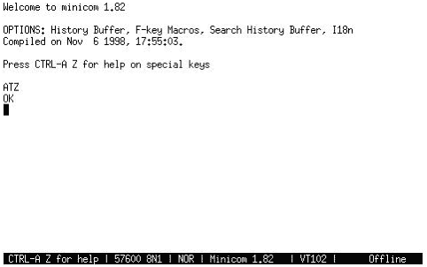

底部一行包含状态栏，显示如何获取帮助的提示信息、当前调制解调器设置（在本例中为 57,600 bps、8 数据位、无奇偶校验、1 停止位）、光标键是否可用（神秘的 `NOR` 消息）、程序版本（`1.82`）、当前设置的终端仿真类型（`VT102`），以及是否已建立在线连接。要获取帮助菜单，请输入

# The Linux Cookbook: Tips and Techniques for Everyday Use:

**C-a z**：从此菜单中，你可以按 **P** 设置通信参数，**T** 设置终端设置，**O** 配置 *minicom*，或 **D** 进入拨号目录。

要在主屏幕拨号，输入 **ATDT** 后跟要拨打的号码。

- 要拨打号码 `368-2208`，请输入：

```
ATDT3682208 RET
```

当你输入 **RET** 时，*minicom* 将开始拨号；按任意键可中断拨号并挂断线路。连接后，输入 **C-a h** 挂断线路并输入 **C-a x** 挂断线路并退出程序。

> *NOTE: minicom* 并不是真正将你的系统连接到互联网的方式；要做到这一点，你通常需要启动 PPP 连接，如本章前面所述。(37)

```
$ mail lisa@example.com RET
Subject: Hello RET
Hi there, long time no talk! I'm just learning how to use RET
Linux and thought I'd show you how easy it is to send email! RET
C-d
Cc: RET
```

你在 `Subject:` 行输入的文本将显示为电子邮件的主题，而之后输入的文本行则是邮件的正文。单独一行输入 C-d 以结束邮件。然后，mail 会提示输入 `Cc:` 地址；“抄送”副本将发送给此处提供的任何地址（如果没有则只需输入 RET，用逗号分隔多个地址）。

当你输入时，mail 就像其他命令行工具一样读取标准输入，因此此基本邮件服务几乎没有直接编辑功能——使用 C-u 删除当前行，使用 C-c C-c（即连续按两次 C-c）取消输入并完全中止邮件。

就这样！没有花哨功能，也没有浪费时间的冗余。

- 31.1.1 Mailing a User on the Same System
- Sending mail to a user on your system.
- 31.1.2 Mailing a File or the Output of a Command
- Emailing a file.
- 31.1.3 Mailing the Contents of a URL
- Emailing the contents of a URL.
- 31.1.4 Special Mail Composition Keystrokes
- Special mail composition keystrokes.

## 31.1.1 Mailing a User on the Same System

要向同一系统上的另一用户发送电子邮件，请提供该系统上的用户名而不是电子邮件地址（从技术上讲，你仍在提供电子邮件地址，因为电子邮件地址的格式为 username@hostname；当省略 hostname 时，默认为本地主机）。

- 要向本地系统上的用户 mrs 发送电子邮件，请输入：

```
$ mail mrs RET
Subject: are you going to the party tonight? RET
C-d
Cc: RET
Null message body; hope that's ok
$
```

该命令向本地系统上的用户 mrs 发送电子邮件。邮件本身为空，但主题是一条简短的便条，询问用户 mrs 是否会参加聚会。


> *注意：* 除了用于向可能与你共享系统的用户发送邮件外，mail 还可用于给自己发送邮件，作为在终端提醒自己的方式（参见章节 发送给自己的邮件提醒）。

## 31.1.2 邮件发送文件或命令的输出

mail 工具也适用于邮件发送文本文件的内容或命令的文本输出。要做到这一点，将你想要发送到的电子邮件地址作为参数传递给 mail，并使用标准输入重定向操作符将文本重定向以用作消息正文（参见章节 重定向输入和输出）。

- 要将文本文件 `trades` 的内容发送到电子邮件地址 terrapin@example.com，输入：

```
$ mail terrapin@example.com 60; trades RET
```

## 31.1.3 邮件发送 URL 的内容

前一菜谱的一个变体是使用 mail 和 shell 重定向将某些命令的输出通过电子邮件发送到某个地址。例如，你可以通过重定向 lynx Web 浏览器（参见章节 从 Web 读取文本）的输出，将 URL 的内容作为带注释的文本文件发送。

- 要将 URL http://etext.org/ 的文本作为带注释的文本发送到电子邮件地址 droneon@example.com，输入：

```
$ mail droneon@example.com 60; lynx -dump --number_links http://etext.org/ RET
```

## 31.1.4 特殊邮件撰写按键

下表列出了在撰写邮件消息时可用的特殊按键，并描述了其功能。

| 按键 | 描述 |
|---|---|
| C-c C-c | 放弃当前消息并退出 mail。 |
| . RET 或 C-d | 在空白行上，任一命令都会发送消息然后退出 mail。 |
| C-u | 删除当前行并将光标移动到行首。 |

在撰写消息正文时，你还可以使用一些特殊命令。它们被称为“波浪号转义”，因为你通过输入波浪号字符（`~`）来指定它们。

下表列出了其中一些命令并描述了其功能。

| 命令 | 描述 |
|---|---|
| ~!command | 在 shell 中运行命令。 |
| ~baddress | 向给定的用户名或电子邮件地址发送密送副本。 |
| ~d | 将你的主目录中的文件 `dead.letter` 复制到消息中。 |
| ~e | 在默认文本编辑器程序中编辑消息。（当你退出文本编辑器时，你将返回到 mail。） |
| ~f number | 将指定的已接收消息的副本插入到消息正文中。消息按编号或范围指定（例如，`2-4` 插入消息二至四 inclusive）；如果未给出编号，则插入当前已接收消息。 |
| ~F | 与 `~f` 相同，但以完整头信息读取消息。 |
| ~r file | 将文件 file 的副本插入到消息中。 |
| ~w file | 将正文文本的副本写入文件 file。 |

这些命令应各自分行输入。

- 要将当前邮件消息的副本插入到你正在撰写的消息正文中，然后在默认文本编辑器中打开该消息，输入：

```
~f RET
~e RET
```

## 31.2 接收邮件

在基于 Linux 的系统上，INBOX 是系统上的一个文本文件，你的传入邮件会被写入其中。其位置始终由 $MAIL 给出，这是一个特殊的 shell 变量（参见章节 更改 Shell 提示符）。

- 要输出你的 INBOX 位置，输入：

```
$ echo $MAIL RET
```

通常，INBOX 位置位于 `/var/spool/mail` 目录中，并与你的用户名同名——因此如果你的用户名是 mrs，你的 INBOX 很可能就是 `/var/spool/mail/mrs`。

你不应直接编辑此文件，因为这样做可能会无意中导致你丢失传入邮件。

要查看你的 INBOX 中是否有等待的邮件，输入 mail。如果没有邮件，mail 会提示并退出；如果有邮件等待，mail 会输出消息头列表，每条消息一行，每行包含消息的状态（'N' 表示新消息，空白表示已读消息）、消息编号、发件人姓名、消息接收日期和时间，以及消息的行数和字符数。

- 要查看是否有邮件，输入：

```
$ mail RET
Mail version 8.1 6/6/93. Type ? for help.
"/var/spool/mail/m": 3 messages 3 new
62;N 1 mrs Mon Sep 6 17:29 13/345 "Re: A modest proposal"
N 2 Ray Tue Sep 7 04:20 15/694 "Latest news"
N 3 lisa@example Tue Sep 7 09:35 19/869 "Re: Hello"
38;
```

在此示例中，用户有三条等待的消息——一条来自 mrs，一条来自 Ray，一条来自 lisa@example.com。

mail 提示符是一个与号（'&'）字符；从那里，你可以阅读、删除、回复和保存消息。

当你在 '&' 提示符下输入 RET 时，mail 会将下一条未读消息输出到屏幕。你也可以输入一个数字来输出该消息。

- 要在 mail 中读取下一条未读消息，输入：

```
38; RET
```

- 要在 mail 中读取第三条消息，输入：


有两种退出 mail 的方式：输入 q 退出 mail 并将你所给出的删除命令（如果有）应用到你的 INBOX；输入 x 退出 mail 并将你的 INBOX 状态恢复到运行 mail 之前的状态。

- 要退出 mail 并将 INBOX 恢复到你开始 mail 之前的状态，输入：

```
38; x RET
```

## 31.2.1 删除邮件
删除电子邮件。

## 31.2.2 阅读邮件时可用的选项
阅读邮件时的命令选项。

## 31.2.1 删除邮件

要在 mail 中删除一条消息，在阅读完该消息后在 ‘&’ 提示符下输入 d。你也可以将要删除的消息或消息范围指定为 d 的选项。

- 要删除你刚刚阅读的消息，输入：

```
38; d RET
```

- 要删除第 3 条消息，输入：

```
38; d3 RET
```

- 要删除第 10 条到第 14 条消息，输入：

```
38; d10-14 RET
```

## 31.2.2 阅读邮件时可用的选项

下表总结了阅读邮件时最常用的 mail 命令；这些命令在 `&` 提示符下有效。

| COMMAND | DESCRIPTION |
| --- | --- |
| ? | 输出一个帮助菜单，其中包含 mail 选项的列表及其含义。 |
| d | 删除一条消息。给出要删除的消息的编号或范围作为参数。 |
| h | 输出邮件消息的标题列表。你可以指定一个范围或要开始的消息编号。 |
| q | 退出 mail 并将本次 mail 会话中对 INBOX 所做的更改应用到 INBOX。 |
| r | 回复你最后阅读的消息；你也可以给出一个消息编号作为参数来回复该消息编号。 |
| u | 取消删除当前 mail 会话中已删除的消息。给出要取消删除的消息的编号或范围作为参数。 |
| x | 退出 mail 并将 INBOX 恢复到本次 mail 会话之前的状态。 |
| s file | 将你最后阅读的消息保存到你主目录中由 file 指定的文件中（如果文件不存在，mail 会询问你是否应创建它）。 |

注意：默认情况下，只有你（以及始终的超级用户）有权读取你的 INBOX。虽然有可用的工具（如 mail 和其他 MUAs）可以以特殊方式读取此文件，但你也可以像任何其他文本文件一样查看此文件（参见 查看文本 部分）。

## 31.3 管理邮件

邮件文件夹只是一个文本文件，其内容由保存的邮件消息组成；任何处理文本的工具都可用于邮件文件夹。

以下小节描述了一些管理以及以其他方式修改保存邮件的常见方法。

- 31.3.1 查看邮件文件夹
查看电子邮件文件夹。
- 31.3.2 设置新邮件通知
宣布邮差已到达。
- 31.3.3 统计你有多少条消息
统计你拥有的邮件。
- 31.3.4 查看你的邮件来自谁
找出你的邮件来自谁。
- 31.3.5 验证电子邮件地址
找出电子邮件地址是否正确。

## 31.3.1 查看邮件文件夹

@sf(Debian): `elm-me+`
@sf(WWW): http://www.instinct.org/elm/

你可以在 less 中查看邮件文件夹或在文本编辑器中编辑它们，尽管文件夹会显示为一个包含文件夹中所有消息的长滚动内容。

你也可以在 elm 中查看它们（参见 选择合适的邮件应用程序 部分）或用 mail 打开它们，它们会像 INBOX 在这些工具中出现的那样正常显示。

要使用 elm 查看邮件文件夹，将文件夹名称作为 `-f` 选项的参数给出。

- 要在 elm 中查看邮件文件夹 `~/email/mrs`，输入：

```
$ elm -f ~/email/mrs RET
```

如果你将邮件消息保存在很多单独的文件夹中，你可以使用 cat 结合 elm 来查看来自所有文件的所有消息的排序列表。用 cat 将所有文件夹连接成一个，然后像查看任何文件夹一样在 elm 中查看该文件。

- 要查看 `~/email` 目录中所有电子邮件文件夹的内容，输入：

```
$ cat ~/email/* 62; allmessages RET
$ elm -f allmessages RET
```

这些命令在当前目录中写入一个新文件 `allmessages`，其中包含 `~/email` 中所有电子邮件文件夹的内容；然后，该文件在 elm 中被查看。

注意：要查看显示文件夹中所有消息来自谁的列表，请使用 frm；参见 查看你的邮件来自谁。

## 31.3.2 设置新邮件通知

@sf(Debian): `biff`
@sf(WWW): ftp://ftp.uk.linux.org/pub/linux/Networking/
@sf(WWW): http://www.splode.com/~friedman/software/packages/index.html


## The Linux Cookbook: Tips and Techniques for Everyday Use:

The biff tool notifies you when new mail arrives, by printing the header and first few lines of a mail message.

To turn biff on, use `y` as an option. To turn biff off, so that you stop being notified when new mail arrives, use `n` as an option. biff options don't take a hyphen.

- To turn biff on, type:

```
$ biff y RET
```

Some people put the above line in their `.bashrc` file so that biff is always set on in all of their shells (see section Changing the Shell Prompt).

Typing biff alone with no options will tell you whether biff is set to `y` or `n`.

- To see what biff is set to, type:

```
$ biff RET
```

A companion tool, xbiff, works only in the X Window System (you can use the regular biff in X, too). When you start it, xbiff draws a window containing a mailbox that looks like this:(38)

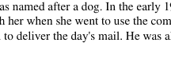

When you have mail, xbiff rings the system bell, the window icon reverses color, and the mailbox flag goes up:


NOTE: The original version of biff was named after a dog. In the early 1980s at a UC Berkeley computer lab, a girl would bring her dog, Biff, with her when she went to use the computers. Biff was known for barking at the mailman when he came in to deliver the day's mail. He was also very popular with all of the BSD UNIX hackers at Berkeley, and when one of them wrote a mail notification tool, he thought of Biff---hence the name. (Biff, the dog, died in August 1993.)

## 31.3.3 Counting How Many Messages You Have

```
@sf(Debian): `elm-me+`
@sf(WWW): ftp://ftp.uu.net/networking/mail/elm
```

Use messages to count the number of mail messages in a folder or file. Give the name of a mail folder as an argument; with no arguments, it counts the mail you have waiting in your INBOX.

- To see how many email messages you have waiting, type:
  $ messages RET

- To count the number of email messages in the mail folder `~/email/saved`, type:
  $ messages ~/email/saved RET

## 31.3.4 Seeing Who Your Mail Is From

```
@sf(Debian): `elm-me+`
@sf(WWW): ftp://ftp.uu.net/networking/mail/elm
```

Use frm to output a list of sender names and subjects for your mail. Give the name of a mail folder as an option; with no options, frm reads your INBOX.

- To output a list showing sender names and subjects of your incoming mail, type:
  $ frm RET

- To output a list showing sender names and subjects of the mail in the file `~/email/saved`, type:
  $ frm ~/email/saved RET

> NOTE: An alternate tool, from, works in similar fashion, but it does not output subject lines; instead, it outputs the names of senders and the time that messages were received.

## 31.3.5 Verifying an Email Address

```
@sf(Debian): 'vrfy'
@sf(WWW): 'ftp://ftp.nikhef.nl/pub/network/'
```

Use vrfy to determine whether or not a given email address works. This is useful when you are unsure whether or not you have the right email address for someone. If the address works, vrfy outputs a message indicating that the recipient exists; if the address is not valid, vrfy outputs a message saying that the user is unknown.

- To verify that the email address user@example.edu is valid, type:

```
$ vrfy user@example.edu RET
```

Use the `-f` option to specify a text file containing email addresses; vrfy attempts to verify all email addresses contained in the file.

- To verify all of the email addresses contained in the file `net-legends-faq`, type:

```
$ vrfy -f net-legends-faq RET
```

> NOTE: vrfy relies on the remote system to get this information; in these days of the heavily corporatized Internet, an increasing number of sites no longer supply this kind of information to the general public. However, it's still useful enough to be worth mentioning.

## 31.4 Mail Attachments

```
@sf(Debian): 'metamail'
@sf(WWW): 'http://hmrc.berkeley.edu/~trev/emacs/metamail.html'
```

MIME ("Multipurpose Internet Mail Extensions") is an Internet standard for encoding and attaching files to mail messages. It's used when sending image, audio, or other non-plain-text data via email.

Normally, you read and send MIME mail with your MUA. The following recipes, which show ways to send


and receive MIME mail on the command line, are useful for when you just use the mail tool to read and send occasional mail with an attachment, but the built-in methods for manipulating MIME mail in any reasonable MUA will invariably be easier and more convenient than the techniques described here (see section Picking the Right Mail Application).

- 31.4.1 Reading a Mail Attachment
- Reading mail attachments.
- 31.4.2 Sending a Mail Attachment
- Sending mail attachments.

## 31.4.1 Reading a Mail Attachment

To read a mail attachment, write the message to a file and then run metamail with the file name as an argument. metamail lists each attachment and prompts you about whether it should display the attachment, write it to a file, or skip it.

To read a mail attachment, type:

```
$ mail RET
Mail version 8.1 6/6/93. Type ? for help.
"/var/spool/mail/m": 1 messages 1 new
62;N 1 Photo Dept. Mon Feb 12 14:37 231/10980 "New Images"
38; w1 image.mail RET
"image.mail" [New file]
38; x RET
$ metamail image.mail RET
```

In this example, the mail tool was used to open the INBOX and write the message to a file called `image.mail`; then, metamail was run with the file name as an argument.

## 31.4.2 Sending a Mail Attachment

To send a file as an email attachment, use metasend. It prompts for the values to use in the `To:`, `Subject:`, and `CC:` header fields, plus the following values for each MIME attachment: its `Content-type:` field, which describes the kind of data the attachment contains; the file name; and the type of encoding to use, if any (usually one is recommended).

- To mail the JPEG file `dream.jpeg` in the current directory to the address dali@example.org, type:

```
$ metasend RET
To: dali@example.org RET
Subject: The image you requested RET
CC: RET
Content-type: image/jpeg RET
Name of file containing image/gif data: dream.jpeg RET
Do you want to encode this data for sending through the mail?
1 -- No, it is already in 7 bit ASCII
2 -- Yes, encode in base64 (most efficient)
3 -- Yes, encode in quoted-printable (less efficient, more readable)
4 -- Yes, encode it using uuencode (not standard, being phased out)
2 RET
Do you want to include another file too (y/n) [n] ? n RET
Delivering mail, please wait... Mail delivery apparently succeeded.
$
```

The following table lists values to use in the MIME `Content-type:` field for various kinds of files.

| VALUE | FILE TYPE |
| --- | --- |
| application/gzip | File compressed with gzip. |
| application/zip | File compressed with zip. |
| application/postscript | PostScript file. |
| image/jpeg | JPEG image file. |
| image/png | PNG image file. |
| audio/basic | Audio file. |
| audio/mpeg3 | MP3 audio file. |
| audio/wav | WAV audio file. |

## 31.5 Making an Email Signature

```
@sf(Debian): `sigrot`
@sf(WWW): `ftp://metalab.unc.edu/pub/linux/system/mail/misc/`
```

A signature file (often called a "dot sig," and written as `.sig`) is a text file containing text that you want to appear at the end of email messages and other online postings.

Sometimes, people put their name, email address, and a small quote, or a piece of ASCII art (such as text written in a figlet font---see section Horizontal Text Fonts); once the World Wide Web became popular, many people started including the URL of their home page in their `.sig`.

The use of signatures goes in and out of vogue with the years; you can decide whether or not you want to use one, but whatever you do, be sure to keep your `.sig` at most four lines in length---to use any more is considered very bad form. A first line consisting only of `-- ` is sometimes used; many applications recognize this text as the beginning of a `.sig` when processing messages.

You create your signature file in a text editor, just like any other text file. Name the file `.signature` or `.sig`, and keep it in your home directory.

If you want to use more than one signature, use sigrot to "rotate" your various signatures—every time you run sigrot, it selects one of the signature files you keep in your `.sigrot` directory and writes it to `.signature`. To change your `.signature` every time you log in, you would run sigrot in your `.bash_login` file (see section The Shell).

## 31.6 Picking the Right Mail Application

The following table lists some of the more popular MUAs that are available for Linux, describing their special features, and listing their Debian package name and URL (when available).

APPLICATION DESCRIPTION

balsa
A graphical email client that works in X with GNOME installed; its interface is inspired somewhat by the proprietary Eudora. {@sf{Debian}}: `balsa` {@sf{WWW}}: http://www.balsa.net/

elm
A menu-driven MUA, elm was popular in the early 1990s among experienced users—it has some interesting features, including ways to send mails in batch mode to many addresses at once, and a tool to send telephone messages as email messages. Interest in elm has waned somewhat over the years, and most novices are advised to try mutt instead. {@sf{Debian}}: `elm me+` {@sf{WWW}}: http://www.instinct.org/elm/

gnus
The gnus newsreader for Emacs(39) can also be used to read and send mail. It has many features and should appeal to Emacs lovers—but a warning: it can be daunting to learn! {@sf{Debian}}: `gnus` {@sf{WWW}}: http://www.gnus.org/

mew
mew is an Emacs mail and news facility developed in Japan. It shows promise as a fairly new MUA and has many features for handling mail in complex ways. {@sf{Debian}}: `mew` {@sf{WWW}}: http://www.mew.org/


## The Linux Cookbook: Tips and Techniques for Everyday Use:

vm

VM ("View Mail") is a facility for reading and sending mail in Emacs. Older than gnus and mew, it is very configurable. { @sf{Debian}}: `vm' { @sf{WWW}}: http://www.underworks.com/vm/

wl

Wanderlust is a MUA for Emacs designed to facilitate reading your mail on multiple computers. { @sf{Debian}}: `wl' { @sf{WWW}}: http://www.gohome.org/wl/

+   [<] [>]
+   
+   [<<] [Up] [>>]
+   
+   [Top] [Contents] [Index] [?]

## 32. The World Wide Web

Next to email, the most useful service on the Internet is the World Wide Web (often written "WWW" or "Web"). It is a giant network of hypertext documents and services, and it keeps growing by the instant—anyone with an Internet-connected computer can read anything on the Web, and anyone can publish to the Web. It could well be the world's largest public repository of information.

This chapter describes tools for accessing and using the Web. It also describes tools for writing text files in HTML ("HyperText Markup Language"), the native document format of the Web.

- [32.1 Browsing the Web](#32.1) — Netscape's famous Web browser.
- [32.2 Viewing an Image from the Web](#32.2) — Viewing images from the Web.
- [32.3 Reading Text from the Web](#32.3) — Reading text from the Web.
- [32.4 Browsing the Web in Emacs](#32.4)
- [32.5 Getting Files from the Web](#32.5) — Getting files from the Web.
- [32.6 Writing HTML](#32.6)
- [32.7 More Web Browsers and Tools](#32.7) — More Web tools to try.

### 32.1 Browsing the Web

```
@sf{Debian}: `mozilla'
@sf{Debian}: `skipstone'
@sf{WWW}: http://www.mozilla.org/
@sf{WWW}: http://www.galeon.sourceforge.net/
@sf{WWW}: http://www.muhri.net/skipstone/
```

When most people think of browsing or surfing the Web, they think of doing it graphically—and the mental image they come up with is usually that of the famous Netscape Web browser. Most Web sites today make heavy use of graphic images; furthermore, commercial Web sites are usually optimized for Netscape-compatible browsers—many of them not even accessible with other alternative browsers. That means you'll want to use this application for browsing this kind of Web site.

The version of Netscape's browser which had been released as free, open source software (see section [What's Open Source?](#)) in 1998 to much fanfare is called Mozilla.(40) When first released, the Mozilla application was a "developer's only" release, but as of this writing it is finally reaching a state where it is ready for general use.

Once the Mozilla browser has been installed, run it in X either by typing `mozilla` in a shell or by selecting it from a menu in the usual fashion, as dictated by your window manager.

Like most graphical Web browsers, its use is fairly self-explanatory; type a URL in the Location dialog box to open that URL, and left-click on a link to follow it, replacing the contents of the browser's main window with the contents of that link. One nice feature for Emacs fans is that you can use Emacs-style keystrokes for cursor movement in Mozilla's dialog boxes (see section Basic Emacs Editing Keys).

A typical Mozilla window looks like this:

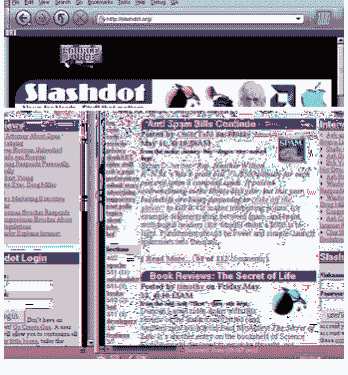

(In this example, the URL http://slashdot.org/ is loaded.)

A criticism of the earlier Netscape Navigator programs is that the browser is a bloated application: it contained its own email client, its own Usenet newsreader, and other functions that are not necessary when one wants to simply browse the Web. Since Mozilla is free software, anyone can take out these excess parts to make a slimmer, faster, smaller application—and that is what some have done. Two of these projects, Galeon and Skipstone, show some promise; see the above URLs for their home pages.(41)

The following recipes will help you get the most out of using a graphical Web browser in Linux.

NOTE: Mozilla development is moving very rapidly these days, and while Mozilla is continually improving at a fantastic rate, some of these recipes may not work as described with the version you have.

Another way to browse the Web is to use Emacs (see section Browsing the Web in Emacs); more alternative browsers are listed in More Web Browsers and Tools.

- 32.1.1 Maintaining a List of Visited Web Sites
Keeping a history of your browsing.
- 32.1.2 Opening a URL from a Script
Running Mozilla from a script.
- 32.1.3 Mozilla Browsing Tips
Tips for using Mozilla.


## 32.1.1 维护已访问网站列表

```
@sf(Debian): `browser-history`
@sf(WWW): http://www.inria.fr/koala/colas/browser-history/
```

使用 browser-history 工具来维护一份你访问过的所有网站的历史日志。

你在后台启动它，每当你用 Web 浏览器访问一个 URL 时（在撰写本文时，它适用于 Netscape、Arena 和 Amaya 浏览器），它就会将名称和 URL 写入当前的历史日志，你可以随时查看该日志。

- 若要在每次启动 X 时都启动 browser-history，请将以下行添加到你的 `.xsession` 文件中：

```
browser-history 38;
```

浏览器历史日志保存在你主目录下一个名为 `.browser-history` 的隐藏目录中。当前历史日志始终名为 `history-log.html`；它是一个 HTML 文件，你可以在 Web 浏览器中查看。

- 要使用 lynx 查看当前历史日志，请输入：

```
$ lynx ~/.browser-history/history-log.html RET
```

过去的历史日志会在名称后附加年份、月份和星期，并且它们是被压缩的（参见“压缩文件”一节）。解压后，你可以像查看当前日志一样查看它们（如果你在 Mozilla 中查看，甚至无需解压——它会自动处理）。

你也可以使用 zgrep 搜索旧的浏览器历史日志。日志中保存了你访问过的每个网站的 URL 和标题，因此你可以搜索其中任意一项——当有人问“还记得那篇关于某某的好文章吗？”时，你可以对 `~/.browser-history` 目录中的文件执行 zgrep 来找到它。

- 要从你在 2000 年访问过的 URL 列表中查找标题包含 `Confessions` 一词的 URL，请输入：

```
$ zgrep Confessions ~/.browser-history/history-log-2000* RET
```

该命令会搜索你 2000 年的所有日志中包含 `Confessions` 文本的行，并输出这些行。

*注意：* 有关 zgrep 的更多信息，请参阅“压缩文件中匹配行”。

## 32.1.2 从脚本打开 URL

要从 shell 脚本在 Mozilla 中打开网页，请使用 `-remote` 选项，后跟文本 `'openURL(URL)'`，其中 URL 是要打开的网址。

- 要从 shell 脚本在 Mozilla 中打开 URL http://www.drudgereport.com/，请使用以下行：

```
mozilla -remote 'openURL(http://www.drudgereport.com/)'
```

## 32.1.3 Mozilla 浏览技巧

以下技巧能让使用 Mozilla 浏览网页更轻松、更高效。

- 许多用户会完全禁用 Java 和 JavaScript；大多数网站并不要求使用它们，而且它们常常带来安全问题或对你的浏览产生其他有害影响。直接拒绝就好。

- 如果你的网络连接较慢，禁用图片自动加载会有所帮助；破损图片图标需要一些时间适应，但你会惊讶于页面加载速度的提升！如果你需要查看页面上的图片，只需左键单击“加载图片”按钮。你也可以右键单击要加载的图片的破损图标，然后选择“打开此图片”。

- 右键单击图片可将其保存到文件；你可以在浏览器窗口中打开图片或将其保存到文件之间进行选择。

- 要在另一个浏览器窗口中打开链接，请中键单击该链接。在多个窗口中打开多个链接，在你进行大量“强力浏览”时可以节省时间。

- 如果某个网站强制链接在新窗口中打开，而你不希望这样，请右键单击要打开的链接，然后选择“打开此链接”；该链接将在当前浏览器窗口中打开。

- 要返回你访问过的上一个 URL，请键入 ALT-左箭头；要前进到历史记录中的下一个 URL，请键入 ALT-右箭头。（在某些窗口管理器中，这些按键可能无法达到预期效果；如果它们不起作用，请尝试使用 CTRL 键代替 ALT 键。）
[GNU INFO 错误：前一行中的任何 <> 都应为 <- 和/或 -> 箭头键。]

- 如果“转到”菜单上的已访问 URL 历史记录非常大，且较早的 URL 被截断，你仍然可以通过以下方式访问它们：左键单击菜单上最底部的条目之一并访问它；然后左键单击“主页”按钮。这会从历史记录列表中删除比你刚刚访问的页面更新的所有 URL，但所有旧页面都会重新出现在列表中。
- 要在新窗口中打开书签文件，请键入 **ALT-b**。
- 要打开新的 Mozilla 窗口，请按 **ALT-n**（同时打开多个窗口通常很有用）。

## 32.2 查看来自 Web 的图像

`@sf{Debian}: `imagemagick'`
`@sf{WWW}: http://ftp.wizards.dupont.com/pub/ImageMagick/`
如果你只是想查看来自 Web 的图像文件，你根本不必使用 Web 浏览器——相反，你可以使用 `display`，并将要查看的 URL 作为参数。这对于查看你最喜欢的网络摄像头图像或查看 ftp 站点上的图像尤其方便——你完全无需登录或输入任何其他命令。

- 要查看 [ftp://garbo.uwasa.fi/garbo-gifs/garbo01.gif](ftp://garbo.uwasa.fi/garbo-gifs/garbo01.gif) 处的图像，请输入：

```
$ display ftp://garbo.uwasa.fi/garbo-gifs/garbo01.gif RET
```

> **注意：** 查看图像时，你可以使用 `display` 支持的所有图像处理命令，包括调整大小和更改图像的放大倍率。有关 display 的更多信息，请参阅[在 X 中查看图像](#)。

## 32.3 从 Web 读取文本

`@sf{Debian}: `lynx'`
`@sf{WWW}: http://lynx.browser.org/`
在撰写本文时，历史悠久的 lynx 仍然是 Debian 系统上使用的标准 Web 浏览器；它也是最早可供大众使用的 Web 浏览器之一。(42) 它完全不能显示图形，但它是一个很好的


用于阅读超文本的界面。

输入 `lynx` 启动它——如果定义了“起始页”，它将会加载。起始页在 `/etc/lynx.cfg` 中定义，可以是指向本地系统文件的 URL，也可以是指向 Web 上的地址；你需要超级用户权限才能编辑此文件。在 Debian 系统上，起始页默认为 Debian 主页，http://www.debian.org/（当然你可以更改；许多经验丰富的用户会编写自己的起始页，其中包含经常访问的 URL 的链接，并将其保存为其主目录树中的本地文件）。

要打开一个 URL，将 URL 作为参数给出。

要查看 URL http://lycaeum.org/，输入：

```
$ lynx http://lycaeum.org/ RET
```

在 lynx 中，以下键盘命令有效：

| COMMAND | DESCRIPTION |
|---|---|
| @uparrow and @downarrow | 在当前文档中向前和向后移动链接。 |
| @rightarrow or RET | 跟随光标当前选中的超链接。 |
| @leftarrow | 返回到之前显示的 URL。 |
| DEL | 查看本次会话中访问过的所有 URL 的历史记录。 |
| PgDn or SPC | 向下滚动到当前文档的下一页。 |
| PgUp | 向上滚动到当前文档的上一页。 |
| = | 显示有关当前文档的信息（与 lynx 中的所有页面一样，输入 @leftarrow 返回到前一个文档）。 |
| g | 转到一个 URL；lynx 会提示你输入要前往的 URL。输入 @uparrow 在此行插入上次访问的 URL；插入后，你可以编辑它。 |
| h | 显示 lynx 帮助文件。 |
| q | 退出浏览并退出程序；lynx 会要求验证此操作。 |

以下是使用 lynx 的一些示例。

注意：Emacs 用户可能希望在启动 lynx 时使用 `-emacskeys` 选项；它启用了用于光标移动的 Emacs 风格按键（参见 基本 Emacs 编辑键 部分）。

- 32.3.1 Perusing Text from the Web 从 Web 上浏览文本。
- 32.3.2 Viewing a Site That Requires Authorization 浏览需要登录的网站。
- 32.3.3 Options Available while Browsing Text Lynx 启动选项。

## 32.3.1 Perusing Text from the Web

要仅浏览 Web 上文章的文本，使用 `--dump` 选项用 `lynx` 输出 URL 的文本。这会将给定 URL 的文本转储到标准输出，你可以将它管道到 `less` 以便浏览，或使用重定向将其保存到文件中。

- 要浏览 http://www.sc.edu/fitzgerald/winterd/winter.html 的文本，输入（全部在一行上）：

```
$ lynx --dump http://www.sc.edu/fitzgerald/winterd/winter.html | less RET
```

在 etext 中，斜体词通常以 `_this_` 这样的下划线显示；使用 `--underscore` 选项以这种方式输出任何斜体文本。

默认情况下，`lynx` 会注释所有超链接，并在屏幕底部生成一个脚注链接列表。如果你不想要它们，添加 `--nolist` 选项，只会返回“纯文本”。

- 要输出上一个 URL 的纯文本，并带下划线，并将其保存到文件 `winter_dreams`，输入（全部在一行上）：

```
$ lynx --dump --nolist --underscore http://www.sc.edu/fitzgerald/winterd/winter.html > winter_dreams RET
```

你可以用纯文本做其他事情，比如将其管道到 `enscript` 以便以字体设置用于打印。

- 要以 Times Roman 字体打印上一个 URL 的纯文本，并带下划线，输入（全部在一行上）：

```
$ lynx --dump --nolist --underscore http://www.sc.edu/fitzgerald/winterd/winter.html | enscript -B -f "Times-Roman10" RET
```

> *注意：* 要浏览删除了 HTML 标签且未对文本进行格式化的 URL 的纯文本，请参阅 将 HTML 转换为其他格式。

## 32.3.2 Viewing a Site That Requires Authorization

要查看需要注册的网站或网页，使用 lynx 的 `-auth` 选项，将用户名和密码作为参数给出，用冒号 (`:`) 字符分隔。

- 要使用用户名和密码均为 `cypherpunks` 查看 URL http://www.nytimes.com/archive/，输入（全部在一行上）：

```
$ lynx -auth=cypherpunks:cypherpunks http://www.nytimes.com/archive/ RET
```

通常将此与保存到文件的选项结合使用，以便从通常需要注册的网站检索带注释的文本副本。

- 要将 URL http://www.nytimes.com/archive/ 保存为带注释的文本文件 `mynews`，输入（全部在一行上）：

```
$ lynx -dump -number_links -auth=cypherpunks:cypherpunks http://www.nytimes.com/archive/ > mynews RET
```

注意：你在命令行上提供的用户名和密码参数将被记录在你的 shell 历史日志中（参见 命令历史 部分），并且如果其他系统用户查看你正在运行的进程，他们将可以看到它（参见 列出所有用户进程 部分）。

## 32.3.3 Options Available while Browsing Text

下表描述了 lynx 接受的一些命令行选项。

| OPTION | DESCRIPTION |
|---|---|
| -anonymous | 在检索 ftp URL 时使用“匿名 ftp”账户。 |
| -auth=user:pass | 对受保护文档使用用户名 user 和密码 pass。 |
| -cache=integer | 在内存中保留 integer 个文档。 |
| -case | 使搜索区分大小写。 |
| -dump | 将 URL 的文本内容转储到标准输出，然后退出。 |
| -emacskeys | 启用用于移动的 Emacs 风格键绑定。 |
| -force_html | 当 URL 没有 `.html` 文件名扩展名时强制渲染 HTML。 |
| -help | 输出显示所有可用选项的帮助消息，然后退出。 |


- `-localhost` 禁用指向远程主机的 URL——在使用 lynx 在 `/usr/doc` 及其他本地文档中读取 HTML 或文本格式文档且未连接互联网时很有用。
- `-nolist` 禁用转储中的注释链接列表。
- `-number_links` 在转储和普通浏览模式中对链接编号。
- `-partial` 在下载时显示部分页面。
- `-pauth=user:pass` 对受保护的代理服务器使用用户名为 user 和密码为 pass。
- `-underscore` 在转储中输出像 _this_ 这样的斜体文本。
- `-use_mouse` 在 xterm 中使用鼠标。
- `-version` 输出 lynx 版本并退出。
- `-vikeys` 启用 vi 风格的键绑定用于移动。
- `-width=integer` 将转储格式化为 integer 列宽（默认 80）。

## 32.4 在 Emacs 中浏览网页

Debian: `w3-el-e20`
WWW: ftp://ftp.cs.indiana.edu/pub/elisp/w3/

Bill Perry 的 Emacs/W3，顾名思义，是 Emacs 的网页浏览器（正如 Bill 所说，给你一个不离开编辑器的理由）。它的功能众多——几乎唯一你可能会想念的东西是 SSL 支持（尽管正在开发中）以及 JavaScript 和 Java 支持（好吧，你可能不会想念它，但它会让那些需要使用它们站点的使用变得有点困难）。它可以处理框架、表格、样式表以及许多其他 HTML 功能。

- 要在 Emacs 中启动 W3，输入：

```
M-x w3 RET
```

要在一个新缓冲区中打开 URL，输入 `C-o`，然后在 minibuffer 中给出要打开的 URL（留空则访问 Emacs/W3 主页）。中键单击链接以跟随它，将 URL 在新缓冲区中打开。

- 要打开 URL http://gnuscape.org/ 输入：

```
C-o http://gnuscape.org/ RET
```

- 要打开 Emacs/W3 主页的 URL，输入：

```
C-o RET
```

前面的示例在单独的缓冲区中打开 Emacs/W3 主页：

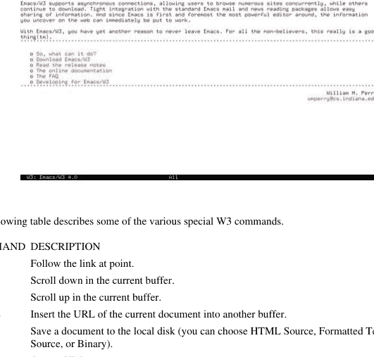

下表描述了一些各种特殊 W3 命令。

| COMMAND | DESCRIPTION |
|---|---|
| RET | 跟随光标处的链接。 |
| SPC | 在当前缓冲区中向下滚动。 |
| BKSP | 在当前缓冲区中向上滚动。 |
| M-TAB | 将当前文档的 URL 插入到另一个缓冲区。 |
| M-s | 将文档保存到本地磁盘（你可以选择 HTML 源、格式化文本、LaTeX 源或二进制）。 |
| C-o | 打开一个 URL。 |
| B | 在已访问 URL 的历史栈中向后移动。 |
| F | 在已访问 URL 的历史栈中向前移动。 |
| i | 查看当前缓冲区中文档的信息（在名为 `Document Information` 的新缓冲区中打开）。 |
| I | 查看当前缓冲区中光标处链接的信息（在名为 `Document Information` 的新缓冲区中打开）。 |
| k | 将文档的 URL 放入 kill ring，并使其成为 X 选择（用于将 URL 复制并粘贴到另一个缓冲区或另一个应用程序；参见 选择文本 部分）。 |
| K | 将光标处链接的 URL 放入 kill ring 并使其成为 X 选择（用于将 URL 复制并粘贴到另一个缓冲区或另一个应用程序；参见 选择文本 部分）。 |
| l | 移动到上次访问的缓冲区。 |
| o | 打开一个本地文件。 |
| q | 退出 W3 模式，杀死当前缓冲区，并转到上次访问的缓冲区。 |
| r | 重新加载当前文档。 |
| s | 查看当前缓冲区中文档的 HTML 源（在以 URL 为名称的新缓冲区中打开）。 |
| S | 查看当前缓冲区中光标处链接的 HTML 源（在以 URL 为名称的新缓冲区中打开）。 |
| v | 显示当前文档的 URL（URL 显示在 minibuffer 中）。 |
| V | 显示当前缓冲区中光标下链接的 URL（URL 显示在 minibuffer 中）。 |

NOTE: 如果你认真使用 Emacs/W3，你几乎肯定会想运行 XEmacs 版本的 Emacs——截至本文撰写时，GNU Emacs 无法显示图像。

## 32.5 从网页获取文件

Debian: `wget`
WWW: http://www.wget.org/

使用 wget，“Web get”，从万维网下载文件。它可以从以 `http` 或 `ftp` 开头的 URL 检索文件。它保留文件的原始时间戳，使用起来比浏览器更小更快，并且显示下载进度的可视显示。

以下小节包含使用 wget 从网页检索信息的配方。有关 wget 可以做什么的更多示例，请参阅 Info 文件 `wget.info`，节点 `Examples`。

NOTE: 要从网页检索 HTML 文件并将其保存为格式化文本，请改用 lynx——参见 从网页浏览文本。

- 32.5.1 将 URL 保存到文件 获取 URL。
- 32.5.2 归档整个网站 归档站点。
- 32.5.3 归档网站的一部分 归档站点的一部分。
- 32.5.4 读取网页的头 查看 Web 服务器头。


## 32.5.1 保存 URL 到文件

要从 Web 下载单个文件，将文件的 URL 作为参数传递给 wget。

- 例如，要下载 ftp://ftp.neuron.net/pub/spiral/septembr.mp3 到一个文件，输入：

```
$ wget ftp://ftp.neuron.net/pub/spiral/septembr.mp3
```

此命令读取给定的 URL，将其内容写入与原始文件同名、即 `septembr.mp3` 的文件，保存在当前工作目录中。

如果在下载完成前中断下载，你正在检索的文件内容将只包含 wget 在被中断前已检索到的部分。使用 `-c` 选项运行 wget 以从中断处恢复下载。

- 要恢复下载上一个示例中的 URL，输入：

```
$ wget -c ftp://ftp.neuron.net/pub/spiral/septembr.mp3
```

> 注意：要使 `-c` 选项产生预期效果，你应从之前运行 wget 的同一目录运行，其中部分检索到的文件应仍然存在。

## 32.5.2 归档整个网站

要归档单个网站，使用 `-m`（“镜像”）选项，该选项尽可能以原始的精确时间戳保存文件，并将“递归检索”选项设置为下载所有内容。要指定检索出错时使用的重试次数，使用 `-t` 选项并带数字参数——`-t 3` 通常足以安全地在网络上检索；使用 `-t 0` 指定无限次重试，适用于网络连接很差但你确实想归档某些内容的情况，无论花费多长时间。最后，使用 `-o` 并带文件名作为参数将进度日志写入文件——在归档过程中出现问题时检查它会很有用；在归档过程完成后并确认其成功后，你可以删除日志文件。

- 要镜像 http://www.bloofga.org/ 网站，对检索文件最多重试三次，并将错误消息写入名为 `mirror.log` 的日志文件，输入：

```
$ wget -m -t3 http://www.bloofga.org/ -o mirror.log
```

此命令在当前目录下名为 `www.bloofga.org` 的子目录中创建 http://www.bloofga.org 网站的归档。日志消息写入当前目录中的文件 `mirror.log`。

要继续已中断的归档，使用 `-nc`（“不覆盖”）选项；它不会检索已下载的文件。为了使此选项按你期望的方式工作，请确保你位于开始归档该网站时所在的同一目录。

- 要继续对 http://www.bloofga.org/ 网站的中断镜像并确保现有文件不被下载，对文件检索最多重试三次并将错误消息写入名为 `mirror.log` 的日志文件，输入：

```
$ wget -nc -m -t3 http://www.bloofga.org/ -o mirror.log
```

## 32.5.3 归档网站的一部分

要仅归档网站的一部分——例如某个用户的个人主页——使用 `-I` 选项后跟要归档的目录的绝对路径名列表；站点上的其他所有目录将被忽略。

- 要归档 http://dougal.bris.ac.uk/~mbt/ 网站，仅归档 `/~mbt` 目录，并将日志消息写入名为 `uk.log` 的文件，输入：

```
$ wget -m -t3 -I /~mbt http://dougal.bris.ac.uk/~mbt/ -o uk.log
```

此命令归档 http://dougal.bris.ac.uk/~mbt/ 网站上目录名以 `/~mbt` 开头的所有文件。

要仅获取给定目录中的文件，使用 `-r` 和 `-l1` 选项（`-l` 选项指定从给定级别下降的层数）。要仅下载给定目录中的文件，将这些选项与 `--no-parent` 选项结合使用，该选项指定不上升到父目录。

使用 `-A` 选项指定要接受的确切文件名扩展名——例如，使用 `-A txt, text, tex` 仅下载文件名以 `.txt`、`.text` 和 `.tex` 扩展名结尾的文件。`-R` 选项工作方式类似，但指定要拒绝且不下载的文件扩展名。

- 要仅下载扩展名为 `.gz` 且仅在 `monash.edu.au` 的给定目录 `/~rj h/indiepop-1/download/` 中的文件，输入：


```
$ wget -m -r -l1 --no-parent -A.gz http://monash.edu.au/~rjh/indiepop-1/download/ RET
```

### 32.5.4 读取网页的头部

所有 Web 服务器在页面请求开始时都会输出特殊的头部信息，但当你用 Web 浏览器检索 URL 时通常看不到它们。这些头部包含诸如 Web 服务器主机的当前系统日期以及 Web 服务器和操作系统软件的名称和版本等信息。

使用 `-S` 选项与 wget 一起使用以在检索文件时输出这些头部；头部会输出到标准输出，或如果使用则输出到日志文件。

- 要检索 http://slashdot.org/ 上的文件并输出头部，请输入：

  ```
  $ wget -S http://slashdot.org/ RET
  ```

此命令将服务器响应头部写入标准输出，并将 http://slashdot.org/ 的内容保存到当前目录中的一个文件中，其名称与原始文件相同。

## 32.6 编写 HTML

```
@sf(Debian): `bluefish'
@sf(WWW): http://bluefish.openoffice.nl/
```

超文本标记语言（HTML）是 Web 的标记语言；HTML 文件只是用这种标记语言编写的纯文本文件。你可以在任何文本编辑器中编写 HTML 文件；然后，在 Web 浏览器中打开该文件以查看 HTML 标记以其生成的超文本外观呈现。

许多人推崇 Bluefish，这是一款功能齐全、用户友好的 X 平台 HTML 编辑器。

Emacs（参见 Emacs 部分）有一个主要模式来方便编辑 HTML 文件；要在缓冲区中启动此模式，请输入：

```
M-x html-mode RET
```

HTML 模式的功能包括插入“骨架”结构。HTML 模式函数的帮助文本包含一个非常简短的 HTML 编写教程——查看该函数的文档以显示教程。

- 要在 Emacs 中阅读简短的 HTML 教程，请输入：

  ```
  C-h f html-mode RET
  ```

> **注意：** 当你在 Emacs 缓冲区中编辑 HTML 文件时，你可以在另一个窗口中在 Web 浏览器中打开同一文件——Web 浏览器只读取而不写入它们打开的 HTML 文件，因此你可以在 Emacs 中创建的同时在浏览器中查看渲染后的文档。当你在 Emacs 缓冲区中进行更改并保存后，重新加载浏览器中的文件即可立即看到更改生效。

- [32.6.1 为图像标签添加参数](#32.6.1) — 为图像标签添加参数。
- [32.6.2 将 HTML 转换为其他格式](#32.6.2) — 将 HTML 转换为文本。
- [32.6.3 验证 HTML 文件](#32.6.3) — 验证 HTML。

### 32.6.1 为图像标签添加参数

```
@sf{Debian}: `imgsizer`
@sf{WWW}: `http://www.tuxedo.org/esr/software.html#imgsizer`
```

为了可用性，HTML 图像源标签应具有 `HEIGHT` 和 `WIDTH` 参数，它们指定该标签描述的图像的尺寸。通过在页面上的所有图像标签中指定这些参数，页面中的文本将在浏览器窗口中在图像加载之前显示。没有它们，浏览器必须在显示页面上的任何文本之前加载所有图像。

使用 imgsizer 自动确定正确的值并将其插入到 HTML 文件中。将要修复的 HTML 文件的名称作为参数给出。

- 要向文件 `index.html` 添加 `HEIGHT` 和 `WIDTH` 参数，请输入：

  ```
  $ imgsizer index.html RET
  ```

### 32.6.2 将 HTML 转换为其他格式

```
@sf(Debian): `unhtml`
@sf(Debian): `html2ps`
@sf(WWW): http://dragon.acadiau.ca/~013639/
@sf(WWW): http://www.tdb.uu.se/~jan/html2ps.html
```

有几种方法可以将 HTML 文件转换为其他格式。你可以将 HTML 转换为纯文本以便阅读、处理或转换为其他格式；你也可以将 HTML 转换为 PostScript，你可以查看、打印它，或将其转换为其他格式，例如 PDF。

要简单地从文本中删除 HTML 格式，请使用 unhtml。它从标准输入（或指定的文件名）读取，并将其输出写入标准输出。

- 要浏览已删除 HTML 标签的 `index.html` 文件，请输入：

  ```
  $ unhtml index.html | less RET
  ```

- 要从文件 `index.html` 中删除 HTML 标签并将输出写入名为 `index.txt` 的文件，请输入：

  ```
  $ unhtml index.html > index.txt RET
  ```

当你用 unhtml 从文件中删除 HTML 标签时，文本不会进行进一步的格式化。此外，它仅适用于文件，而不适用于 URL 本身。

使用 lynx 将 HTML 文件或 URL 保存为格式化的文本文件，以便生成的文本在 lynx 中查看时看起来像原始 HTML。它还可以保留原始 HTML 中的斜体和超链接信息。参见 从 Web 上浏览文本 部分。

你可以做的其中一件事是将此 lynx 输出通过管道传输到用于设置文本间距的工具，然后发送到 enscript 以设置字体。这对于以打字稿“手稿”形式打印网页很有用，其中图像和图形被移除，文本以 Courier 字体双倍行距设置。

- 要以打字稿手稿形式打印 URL http://example.com/essay/ 的副本，请输入：

  ```
  $ lynx -dump -underscore -nolist http://example.com/essay/ | pr -d | enscript -B RET
  ```

> **注意：** 在某些情况下，你可能希望在打印前编辑文件，例如当网页包含文本导航栏或其他你希望在将其转换为手稿前删除的文本时。在这种情况下，你会将 lynx 输出通过管道传输到文件，编辑该文件，然后对文件使用 pr 并将该输出通过管道传输到 enscript 以进行打印。

最后，你可以使用 html2ps 将 HTML 文件转换为 PostScript；这在你想要打印带有所有图形和图像的网页时很有用，或者当你想要将整个网站或其部分转换为 PDF 时很有用。


将要转换的 HTML 文件的 URL 或文件名作为选项给出。使用 `-u` 选项以在超文本链接的锚文本下划线，并将文件名指定为 `-o` 选项的参数以写入。默认情况下不为链接加下划线，并写入标准输出。

- 要将 URL 为 http://example.com/essay/ 的文档打印为 PostScript 副本到默认打印机，输入：

```
$ html2ps http://example.com/essay/ | lpr RET
```

- 要将 URL 为 http://example.com/essay/ 的文档写入 PostScript 文件 `submission.ps` 并将所有超文本链接加下划线，输入：

```
$ html2ps -u -o submission.ps http://example.com/essay/ RET
```

## 32.6.3 验证 HTML 文件

@sf(Debian): `weblint`
@sf(WWW): http://www.weblint.org/

使用 weblint 验证 HTML 文件的基本结构和语法。将要检查的文件名作为参数给出，weblint 会将它对文件的任何抱怨输出到标准输出，例如 IMG 元素是否缺少 ALT 描述，或嵌套元素是否重叠。

- 要验证文件 `index.html` 中的 HTML，输入：

```
$ weblint index.html RET
```

## 32.7 更多 Web 浏览器和工具

令人惊讶的是，Linux 的 Web 浏览器数量远不如文本编辑器——甚至文本查看器那么多。对于任何操作系统来说都是如此，我经常思考为什么会这样；也许“浏览网页”本身就是一项相当新的活动，很快可能会被 Web 阅读器和其他工具所取代。无论如何，以下列出了当前可用于 Linux 系统的其他浏览器。

WEB      描述

### BROWSER

amaya
由万维网联盟开发；既是图形 Web 浏览器，也是用于编写 HTML 的所见即所得编辑器。{@sf{Debian}}: `amaya` {@sf{WWW}}: http://www.w3.org/amaya/

arena
由万维网联盟开发；一种非常紧凑、符合 HTML 3.0 的 X 平台 Web 浏览器。{@sf{Debian}}: `arena` {@sf{WWW}}: http://www.w3.org/arena/

dillo
一种非常快速、小巧的图形 Web 浏览器。{@sf{Debian}}: `dillo` {@sf{WWW}}: http://dillo.sourceforge.net/

express
一种在安装了 GNOME 的 X 中工作的迷你浏览器。{@sf{Debian}}: `express` {@sf{WWW}}: http://www.ca.us.vergenet.net/~conrad/express/

links
一种相对较新的纯文本浏览器。{@sf{WWW}}: http://artax.karlin.mff.cuni.cz/~mikulas/links/

gzilla
一种用于 X 的图形浏览器，目前处于早期开发阶段。{@sf{Debian}}: `gzilla` {@sf{WWW}}: http://www.levien.com/gzilla/

w3m
另一种新的纯文本浏览器，其功能包括表格支持和有趣的自由形式光标控制；有些人发誓要用它。{@sf{Debian}}: `w3m` {@sf{WWW}}: http://ei5nazha.yz.yamagata-u.ac.jp/

## 33. 其他 Internet 服务

除了电子邮件和万维网之外，还有许多 Internet 服务；本章描述了如何使用许多其他流行的服务，包括 telnet、ftp 和 finger。

### 33.1 连接到另一系统
连接到远程系统。

### 33.2 与另一系统传输文件
在系统之间传输文件。

### 33.3 阅读 Usenet
阅读 Usenet 新闻。

### 33.4 列出在线系统和用户活动
检查用户或系统是否在线。

### 33.5 向另一用户的终端发送消息
向其他终端发送消息。

### 33.6 与其他用户聊天
与其他用户聊天。

## 33.1 连接到另一系统

使用 telnet 连接到远程系统。将要连接的系统名称作为参数给出，指定其名称或数字 IP 地址。如果该系统可达，你将连接到它并被提示 login: 或其他连接提示，就像你坐在连接到该系统的终端前一样（网络并不专属于 Linux 系统）。如果你在该系统上有账户，然后可以登录到它（参见章节 登录系统）。

- 要连接到系统 kanga.ins.cwru.edu，输入：

```
$ telnet kanga.ins.cwru.edu RET
Trying 129.22.8.32...
Connected to kanga.INS.CWRU.Edu.
Escape character is '^]'.

BSDI BSD/OS 2.1 (kanga) (ttyp0)

WELCOME TO THE...
```


由以下机构提供

Case Western Reserve University
Office of Information Services

你是：
    1. 已注册用户
    2. 访客

请输入 1 或 2：1 RET

在 Login: 提示符处输入你的用户 ID（小写）。
然后在要求时输入你的密码。请注意，输入时
密码不会在屏幕上显示。

Login:

在此示例中，用户连接到系统 kanga.ins.cwru.edu；底部的 Login: 提示符是远程系统的提示符（如果你不确定自己在哪个系统上，使用 hostname 作为 shell 提示符；参见 运行命令 部分）。

要断开与系统的连接，请遵循与所连接系统的正常注销程序（关于在 Linux 系统上如何操作，请参见 注销系统 部分）。

- 要断开与远程 Linux 系统的连接，输入：

```
$ C-d
Connection closed.
$
```

在前面的示例中，第一个 shell 提示符在远程系统上，第二个提示符在本地系统上。

## 33.1.1 暂停与另一系统的连接

暂停与另一系统的连接。

## 33.1.2 使用加密连接到另一系统

加密与另一系统的连接。

### 33.1.1 暂停与另一系统的连接

你也可以通过输入转义字符暂时返回到本地 shell，该转义字符是一个由 telnet 在到达远程系统之前解释的键序列。然后你将被带到 telnet 命令提示符，在那里你可以使用 `z` 命令暂停；要返回到远程系统，将作业带回前台（参见 将作业置于前台 部分）。

- 要暂时返回到本地 shell 提示符，输入：

```
faraway-system$ C-[
 telnet62; z RET
[2]+ Stopped          telnet
$
```

- 要返回到远程系统，输入：

```
$ fg RET
faraway-system$
```

在前两个示例中的第一个示例中，转义字符 C-[ 在远程系统上输入，其 shell 提示符在此示例中为 `faraway-system$`（你不必在 shell 提示符下输入转义字符；无论你在远程系统上运行什么程序或处于何处，都可以输入它）。然后，给 telnet 输入了 `z` 命令以暂停 telnet 连接。在第二个示例中，挂起的到远程系统的 telnet 连接被带回前台。

> 注意：你应该知道，通过从一个系统连接到下一个系统，再到下一个系统，等等，而不从前一个系统断开连接，完全有可能（尽管通常并不理想）在彼此之上“嵌套”多层 telnet 会话。为了避免这种情况，请确保在即将 telnet 到另一个系统时，你知道自己要离开的是哪个主机；hostname 工具对此很有用（参见 登录系统 部分）。

### 33.1.2 使用加密连接到另一系统

```
@sf[Debian]: 'kerberos4kth-user'
@sf[WWW]: http://web.mit.edu/kerberos/www/
@sf[WWW]: http://www.openssh.com/
```

在某些系统上，你的系统管理员可能会要求你安装并使用 kerberos、openssh 或其他网络安全工具，以便你能够比使用

telnet 更安全地连接到远程系统。这些工具加密在连接会话期间在本地和远程系统之间传递的数据；它们今天在注重安全的管理员中变得非常流行。如果你被要求使用其中一种工具，请按照管理员的说明为你的系统安装和配置它。

> 注意：为了发挥任何作用，本章讨论的服务和工具要求你的系统在线或以其他方式连接到网络；参见 通讯。

## 33.2 与另一系统传输文件

FTP（“文件传输协议”）是一种在系统之间交换文件的方式。使用 ftp 工具通过此协议连接到另一系统，将你要连接到的系统的名称或数字 IP 地址作为参数。一旦连接，你将被提示使用用户名和密码登录（如果你在该系统上有的话）。

许多系统都设置了接受“匿名 ftp”连接，在那里公众可以下载文件；要使用此功能，请使用 anonymous 作为用户名，并提供你的电子邮件地址作为密码。

- 要建立到 ftp.leo.org 的匿名 ftp 连接，输入：

```
$ ftp ftp.leo.org RET
Connected to ftp.leo.org.
220-Welcome to LEO.ORG.
220-See file README for more information about this archive.
220-
220-Your connection class is named: The world outside Germany
220-
220-If you don't connect from inside Munich and login anonymously,
220-your data transfers are limited to a certain bandwidth.
220-
220-If you notice unusual behaviour, drop a note to ftp-admin@leo.org.
220 FTP server leo.org-0.9alpha ready.
Name (ftp.leo.org:m) anonymous RET
331 Guest login ok, send your email address as password.
Password: atl18@po.cwru.edu RET
230-
230-   |_|_|_|_|
230-   |_|_|_|_|_|
230-   LEO - Link Everything Online
230-   Munich University of Technology (TUM)
230-   Department of Computer Science
230-
230-   This Anonymous FTP site is in Munich, Germany, Europe.
230-   It's Tue Sep 28 18:31:43 MET DST 1999.
230-   Please transfer files during non-business hours (1800-0900 CET).
Remote system type is UNIX.
Using binary mode to transfer files.
ftp62;
```

一旦连接并登录后，使用 cd 和 ls 命令来更改目录并列出文件


remote system.

公用系统在 FTP 主机上设置 `/pub` 目录是标准做法，该目录包含所有供公众使用的文件和资源。

- 要切换到远程系统的 `/pub` 目录并查看其中的文件，请输入：

```
ftp62; cd /pub RET
250 Directory changed to /pub.
ftp62; ls RET
ftp62; ls
200 PORT command successful.
150 Opening ASCII connection for file (918 bytes)
total 30258
-rw-rw-r-- 1 ftpadmin ftpadmin 10942767 Sep 28 06:18 INDEX.gz
drwxr-xr-x 5 ftpadmin ftpadmin 512 Sep 17 18:22 comp
-rw-rw-r-- 1 ftpadmin ftpadmin 9512498 Sep 28 06:40 ls-lR.gz
drwxr-xr-x 2 ftpadmin ftpadmin 512 Sep 17 18:22 rec
drwxr-xr-x 3 ftpadmin ftpadmin 512 Sep 17 18:22 science
226 Transfer completed with 918 Bytes/s.
ftp62;
```

在此示例中，`/pub` 目录包含三个子目录（`comp`、`rec` 和 `science`）和两个文件 `INDEX.gz` 和 `ls-lR.gz`；许多公用系统在其 `/pub` 目录中都有类似的文件——`INDEX.gz` 是其 ftp 站点上所有文件的列表，并附有说明，而 `ls-lR.gz` 是在其 ftp 服务器目录树上运行 `ls -lR` 命令的输出。

以下小节描述如何上传和下载文件。使用 quit 命令退出 ftp 并结束与远程系统的连接。

33.2.1 Uploading a File    上传文件。
33.2.2 Downloading a File    下载文件。

### 33.2.1 Uploading a File

使用 put 命令上传文件；将文件名作为参数给出。put 会在本地系统的当前目录中获取该文件，并将其副本放到远程系统的当前目录中。

- 要将本地系统当前目录中的文件 `thyme.rcp` 的副本放到远程系统的当前目录中，请输入：

```
ftp62; put thyme.rcp RET
```

本地系统的当前目录默认为你运行 ftp 命令的目录。要更改本地系统的目录，请使用 lcd；它与 cd 命令类似，但更改的是本地目录。

- 要切换到本地系统当前目录的父目录，请输入：

```
ftp62; lcd .. RET
Local directory now /home/james/demos
ftp62;
```

在此示例中，本地当前目录现在是 `/home/james/demos`。

还有其他用于下载文件的重要命令——使用 `i` 指定文件以二进制方式传输；通常，传输设置为文本文件。当你想要传输程序、归档文件、压缩文件或任何其他非文本文件时，先将传输类型设置为 `i`。

近年来，大多数公用系统都增加了一项安全措施，禁止匿名用户上传到 `/incoming` 或 `/pub/incoming` 目录之外的任何位置。

mput 命令的工作方式与 put 类似，但允许你指定通配符。默认情况下，mput 会询问你是否上传每个文件；要关闭此文件提示，请在给出 mput 命令前输入 prompt。此命令是切换——再次输入 prompt 可在会话中重新打开文件提示。

### 33.2.2 Downloading a File

get 命令的工作方式与 put 类似，但方向相反——指定远程系统上的文件，get 会将其副本保存到本地系统的当前目录中。同样，在下载非文本文件时先使用 i。 （你也可以使用 i 下载文本文件，因此在传输文件前始终设置它是一个好习惯；大多数 Linux 系统在连接后立即将类型设置为 `i`）。

- 要下载远程系统当前目录中的文件 `INDEX.gz` 并将其保存到你的 `~/tmp` 目录，请输入：

```
ftp62; lcd ~/tmp RET
Local directory now /home/james/tmp
ftp get INDEX.gz RET
local: INDEX.gz remote: INDEX.gz
Transferred 10942767 bytes
ftp62;
```

> NOTE: mget 命令的工作方式与 get 类似，但允许使用通配符；与 mput 一样，除非你先使用 prompt 命令关闭它，否则每次都会提示你确认每个文件。

### 33.3 Reading Usenet

@sf(WWW): http://www.faqs.org/usenet/index.html
@sf(WWW): http://www.geocities.com/ResearchTriangle/tab/6892/

Usenet 是一个著名的、庞大的全球讨论版集合，称为新闻组，用户可以在其中阅读消息（称为文章）并公开回复。新闻组按层级命名和组织，每个分支由句点（'.'）分隔；例如，`comp.os.linux` 新闻组是 `comp.os` 分支的 `comp` 层级的一部分。

下表列出了 Usenet 的“八大”层级，并给出了每个层级中的一些新闻组示例。

| USENET HIERARCHY | DESCRIPTION |
|---|---|
| comp | 计算。 news:comp.os.linux.advocacy, news:comp.text.tex |
| humanities | 人文学科。 news:humanities.music.composers.wagner |
| misc | 杂项。 news:misc.consumers.frugal-living |
| news | 与 Usenet 本身相关的新闻组。 news:newusers.questions |
| rec | 娱乐。 news:rec.music.marketplace.vinyl, news:rec.food.cooking |
| sci | 科学。 news:sci.math, news:sci.cognitive |
| soc | 社会群体和文化。 news:soc.culture.usa, news:soc.college |
| talk | 谈天说地。 news:talk.environment, news:talk.politics.guns |

虽然还有许多其他层级，但这八个在技术上是被认为属于 Usenet 本身的唯一新闻组。虽然 netnews 是指包括 Usenet 在内的所有新闻组的集合这一术语，但这两个术语经常被互换使用。

“替代”层级 `alt.` 可能是最受欢迎的层级之一——几乎任何你想讨论的主题在这里都有合适的新闻组，包括不相干的内容。还有针对特定地理区域主题的层级；例如，`cols.` 层级用于哥伦布、俄亥俄州的主题，而 `seattle` 用于华盛顿州西雅图。因此，`cols.forsale` 涉及大哥伦布地区出售的物品，而 `seattle.forsale` 则是西雅图及其周边地区出售的物品。层级也可以存在于某些组织；例如，`gnu` 层级用于关于 GNU 项目的新闻组，而 `bit` 用于流行的 Bitnet LISTSERV 邮件列表的新闻组再分发。


# 《Linux 实用手册：日常使用的技巧与方法》：

以下食谱描述了用于阅读和发布新闻组文章的工具。

## 33.3.1 选择新闻阅读器
选择新闻阅读器。

## 33.3.2 为主题查找新闻组
为主题查找新闻组。

### 33.3.1 选择新闻阅读器

一种让你阅读和发布新闻组文章的应用程序称为新闻阅读器。以下是 Linux 系统可用的最佳新闻阅读器。

| NEWSREADER | DESCRIPTION |
|---|---|
| gnus | Gnus 是一个功能非常强大且功能齐全的用于 Emacs 的新闻阅读器。你也可以用它来阅读邮件。 Debian: `gnus` WWW: http://www.gnus.org/ |
| knews | 一个用于 X 的图形化新闻阅读器。其功能包括以图形树形式显示文章线程，以及为通过慢速连接阅读新闻的人提供的选项。 Debian: `knews` WWW: http://www.matematik.su.se/~kij/ |
| mozilla | 历史上，商业 Web 浏览器也内置了邮件和新闻阅读器，并且该功能保留在 Mozilla 浏览器中。 Debian: `mozilla` WWW: http://www.mozilla.org/ |
| nn | nn 的座右铭是“无新闻是好事，但 nn 更好”；它是一款较老且非常流行的新闻阅读器，旨在以最少的时间阅读最多的新闻。 Debian: `nn` WWW: http://www.math.fu-berlin.de/~guckes/nn/ |
| pan | “Pimp A** Newsreader”是一款新一代图形化新闻阅读器，旨在追求速度。它旨在让初学者易于使用，并且在安装了 GNOME 的 X 中运行。 Debian: `pan` WWW: http://www.superpimp.org/ |
| peruser | News Peruser 是一套用于 X 的小型工具套件，便于在离线时阅读和撰写新闻文章——在系统在线时下载新闻批次。 Debian: `peruser` WWW: http://www.ibiblio.org/pub/Linux/system/news/readers/ |
| slrn | 基于 rn——其中一个最古老的新闻阅读器——slrn 针对通过家用调制解调器拨号等慢速连接的使用进行了优化。 Debian: `slrn` WWW: http://www.slrn.org/ |

### 33.3.2 为主题查找新闻组

Debian: `nn`
WWW: ftp://ftp.uwa.edu.au/pub/nn/beta/

使用 nngrep 查找与模式匹配的新闻组名称。这对于查找特定主题的组很有用。

- 要输出与模式 `society` 匹配的所有新闻组的列表，请输入：

```
$ nngrep society RET
```

使用 `-u` 选项仅搜索未订阅的组。如果您已订阅了多个组，并且只想查找尚未订阅的组，这很有用。

- 要输出与模式 `society` 匹配的所有未订阅新闻组的列表，请输入：

```
$ nngrep -u society RET
```

在前一个示例中，如果您已经订阅了组 alt.society.neutopia，则该组将不会显示；但您未订阅的其他与模式 `society` 匹配的组将被列出。

## 33.4 列出在线系统和用户活动

以下工具用于列出互联网上其他用户和系统的活动——显示他们是否当前在线，并可能显示更多关于他们的信息。

- 33.4.1 检查系统是否在线
- 该系统在线吗？
- 33.4.2 检查用户是否在线
- 该用户在线吗？
- 33.4.3 列出登录到系统的用户
- 谁在该系统上？
- 33.4.4 查找主机名的 IP 地址
- 该系统的 IP 地址是什么？
- 33.4.5 查找 IP 地址的主机名
- 该 IP 地址的名称是什么？
- 33.4.6 列出域名所有者
- 谁在该域名背后？

如果他们使用的系统启用了 finger 大多数基于 Unix 的系统都应启用，命令将告诉你以下信息：他们上次登录的日期和时间；他们是否当前已登录；他们的全名；他们的办公室房间和电话号码；他们的主目录；他们使用的 shell；他们是否有待处理的邮件；他们上次阅读邮件的时间；最后是他们的“计划”，如下所述。

- 要 finger 用户 bradley@ap.spl.org，请输入：

```
$ finger bradley@ap.spl.org RET
[ap.spl.org]
Login: bradley                          Name: Bradley J Milton
Directory: /spl/bradley                 Shell: /bin/tcsh
Last login Wed Jan 20 16:38 1999 (PST) on ttypb from zais.pair.com
No mail.
Plan:
To learn to how use Linux and GNU software.
$
```

在此示例中，系统 ap.spl.org 上的用户 bradley 当前未登录，最后登录于 1 月 20 日，并使用 tcsh shell。

注意：在基于 Unix 的系统上，你可以在主目录中放置一个名为 `.plan` 的隐藏文件，并且该文本将在有人 finger 你时输出。有些人会在他们的 `.plan` 文件中放置详细的信息；在 1990 年代初期，拥有冗长、啰嗦的 .plan 非常流行。有时，人们会在 `.plan` 文件中放置特殊事件的信息——例如，下周末要举办聚会的人可能会在他们的 `.plan` 文件中放置去他们家的路线。

### 33.4.3 列出登录到系统的用户

要获取当前登录到给定系统的所有用户的列表，请使用 finger 并指定系统名称或数字 IP 地址，并在前面加上 at 符号 `@`。

这会列出当前登录到该系统的所有用户。它不会给出每个个人的 `.plan`，但输出包括每个用户空闲了多长时间、他们从哪里连接，有时他们正在运行什么命令。输出的具体信息取决于远程系统的操作系统和配置。

- 要输出当前登录到系统 ap.spl.org 的用户，请输入：

```
$ finger @ap.spl.org RET
[spl.org]
Login      Name                 Tty   Idle  Login Time   Office
allison    Allison Chaynes     *q2   16:23 Sep 27 17:22 (gatel.grayline)
gopherd    Gopher Client       *r4   1:01  Sep 28 08:29 (gopherd)
johnnyzine Johnny McKenna      *q9   15:07 Sep 27 16:02 (johnnyzine)
```


## 33.4.4 查找主机名的 IP 地址

当你知道某个主机的名称，并且想要找到对应的 IP 地址时，可以 ping 该主机；这将输出主机在括号中的 IP 地址（参见章节 检查系统是否在线）。

你也可以使用 dig，即“域名信息查询”工具。将主机名作为参数给出以输出有关该主机的信息，包括其在标有 `ANSWER SECTION` 的部分中的 IP 地址。

- 要查找主机 linart.net 的 IP 地址，输入：

  ```
  $ dig linart.net RET
  ...output messages...
  ;; ANSWER SECTION:
  linart.net.          1D IN A      64.240.156.195
  ...output messages...
  $
  ```

在此示例中，dig 输出了主机 linart.net 的 IP 地址 64.240.156.195。

## 33.4.5 查找 IP 地址的主机名

要查找给定 IP 地址的主机名，请使用带有 `-x` 选项的 dig。将 IP 地址作为参数给出以输出有关该地址的信息，包括其在标有 `ANSWER SECTION` 的部分中的主机名。

- 要查找对应于 IP 地址 216.92.9.215 的主机名，输入：

  ```
  $ dig -x 216.92.9.215 RET
  ...output messages...
  ;; ANSWER SECTION:
  215.9.92.216.in-addr.arpa.  2H IN PTR  rumored.com.
  ...output messages...
  ```

在此示例中，dig 输出了给定 IP 地址对应的主机名为 rumored.com。

## 33.4.6 列出域名所有者

互联网域名记录包含已注册该域名的组织或个人的联系信息。使用 whois 命令查看常见的 .com、.org、.net 和 .edu 顶级域的域名记录。

仅使用域名作为参数时，whois 会输出具有该特定域名记录的“Whois 服务器”名称。要输出域名记录，请将要使用的 Whois 服务器指定为 `-h` 选项的参数。

- 要输出 linart.net 的 Whois 服务器名称，输入：

  ```
  $ whois linart.net RET
  ```

- 要使用 whois.networksolutions.com Whois 服务器查看 linart.net 的域名记录，输入：

  ```
  $ whois -h whois.networksolutions.com linart.net RET
  ```

> 注意：此命令还会输出处理给定域名的名称服务器的名称——这有助于了解特定网站托管的位置。

## 33.5 向另一用户的终端发送消息

使用 write 向另一用户的终端写入消息。将你想要写入的用户名作为参数给出。此命令写入你提供的消息，并在前面加上标头行，指示以下内容是你发送的消息，并给出当前系统时间。它还会响起用户终端的铃声。

- 要向用户 `sleepy` 登录的终端发送消息 `Wake up!`，输入：

  ```
  $ write sleepy RET
  Wake up!
  C-d
  $
  ```

另一用户可以通过运行 write 并给出你的用户名作为参数来回复你。传统上，用户会在 write 消息末尾加上 `-o-`，这表示他们所说的内容“结束”，现在轮到对方说话了。当用户认为对话已完成时，会在行尾加上 `oo`，表示他们“结束并退出”。

类似的命令 wall，会将文本消息写入本地系统上的所有其他用户。它以文本文件作为参数并输出该文件的内容；不带参数时，它会输出你输入的内容，直到你在单独一行输入 C-d 为止。它在消息前加上文本 `Broadcast message from username`（其中 username 为你的用户名），后跟当前系统时间，并响起它广播到的所有终端的铃声。

- 要向所有已登录终端输出 `/etc/motd` 的内容，输入：

  ```
  $ wall /etc/motd RET
  ```

- 要向所有已登录终端输出文本 `Who wants to go out for Chinese food?`，输入：

  ```
  $ wall RET
  Who wants to go out for Chinese food? RET
  C-d
  ```

你可以使用 mesg 控制对你终端的写访问。它与 biff 的工作方式类似（参见章节 设置新邮件通知）：不带参数时，它会输出是否已设置；以 `y` 作为参数时，它允许向你的终端发送消息；以 `n` 作为参数时，它禁止发送消息。

所有用户的默认设置是允许向其终端写入消息；不合群的人通常会在其 `.bashrc` 文件中加入 `mesg n` 行（参见章节 自定义未来 Shell）。

- 要禁止向你的终端写入消息，输入：

  ```
  $ mesg n RET
  ```

- 要输出你终端当前的访问状态，输入：

  ```
  $ mesg RET
  is n
  $
  ```

在前面的示例中，mesg 表明目前不允许向你的终端写入消息。


## 33.6 与其他用户聊天

无论对方使用什么平台或操作系统，都可以通过多种方式在互联网上与他人进行交互式聊天。下面的配方描述了最流行的工具和方法。

- 33.6.1 直接与用户聊天
  直接与用户聊天。
- 33.6.2 在 IRC 上与用户聊天
  在 Internet Relay Chat（IRC）上聊天。
- 33.6.3 使用 ICQ 与用户聊天
  使用 ICQ 工具聊天。

### 33.6.1 直接与用户聊天

```
@sf(Debian): `talk`
@sf(WWW): http://www.jagora.com/~espej/talk/
```

使用 talk 可以实时交互式地与另一用户聊天。将你想要聊天的用户的用户名（或电子邮件地址）作为参数给出；一条消息将被发送到该用户的终端，表明有连接请求。如果那个人随后运行 talk，并以你的用户名作为参数，那么你们两人将被连接到一个 talk 会话中——屏幕将被清除，然后你输入的内容会出现在屏幕顶部；另一用户输入的内容会出现在屏幕底部。

- 要请求与用户 kat@kent.edu 聊天，输入：

```
$ talk kat@kent.edu RET
```

该命令向用户 kat@kent.edu 发送连接请求。如果用户未登录或拒绝消息，talk 将输出相应的提示消息；但如果该用户可用，talk 将向该用户发送一条完成连接的请求消息，并告诉你正在呼叫对方。

如果该用户随后输入 talk stutz@dsl.org（如果在这个例子中你的电子邮件地址是 stutz@dsl.org），那么你的屏幕将被清除，你将看到以下内容：

# The Linux Cookbook: Tips and Techniques for Everyday Use:

```
[Connection established]
█
```

```
L--------------------------------------------------------------------------------J
```

然后你可以输入，你输入的内容会同时出现在你的屏幕和该用户的屏幕上；该用户也可以在你输入时输入——你输入的内容会出现在双方屏幕的另一半：

```
[Connection established]
Hi, I was just wondering whether or not you wanted to get together this weekend
.
Well a new independent bookstore opened up downtown and I wanted to see if they had any interesting new titles about Linux.
█
```

```
L--------------------------------------------------------------------------------J
Sure, what did you have in mind?
Sounds like fun!
;)
```

通常的做法是，通过输入 RET RET 来表明你已经说完，从而在你的屏幕半区制造一个空白行。有些用户在输入到屏幕半区的底部时，有时会重复输入 RET 来“清除”他们的半区并将光标带回顶部。

输入 C-C 结束 talk 会话。

当你输入时，双方用户都能实时看到字符出现；我第一次在 1991 年演示互联网的交互性时，就是与澳大利亚的一位用户进行了实时聊天，在

### 33.6.3 使用 ICQ 与用户聊天

[@sf{WWW}]: [http://www.portup.com/~gvanl/icq/](http://www.portup.com/~gvanl/icq/)

在 1990 年代后期，一家名为 Mirabilis 的公司发布了一个名为 ICQ（“I Seek You”）的专有 PC 程序，用于实时向其他用户发送文本消息。此后，许多使用 ICQ 协议的免费软件聊天工具被编写出来。

ICQ 的一个不错功能是你可以维护一个电子邮件地址的“好友列表”，并且当你运行 ICQ 客户端时，它会告诉你你的好友中是否有在线的。但与 talk 不同，你无法实时观看对方的输入——消息只有在你发送时才会在对方的 ICQ 客户端中显示。

下表列出了当前可用的一些免费软件 ICQ 客户端。

| CLIENT | DESCRIPTION |
|---|---|
| licq | Licq 是一个可在 X 中使用的 ICQ 客户端。 [@sf{Debian}]: `licq` [@sf{WWW}]: [http://www.licq.org/](http://www.licq.org/) |
| micq | Micq（“Matt's ICQ clone”）是一个易于使用的 ICQ 客户端，可在 shell 中使用。 [@sf{Debian}]: `micq` [@sf{WWW}]: [http://phantom.iquist.net/micq/](http://phantom.iquist.net/micq/) |
| zicq | Zicq 是 Micq 的一个版本，具有修改过用户界面的。 [@sf{Debian}]: `zicq` |


## A. 管理问题

每个 Linux 系统都有一个管理员——负责安装硬件和软件、维护系统并确保一切顺利运行的人。对于单用户家庭 Linux 系统，安装并运行后几乎不需要管理——但偶尔的升级或维护任务是必要的。

本附录作为参考，供那些将在其系统上执行管理任务的用户使用。虽然完整的管理员指南超出了本书的范围，但本附录的目标是为新的 Linux 管理员指明正确的方向，提供有关如何选择用于 Linux 的计算机、在其上安装 Debian GNU/Linux 并使其准备就绪的提示。

与本书其余部分不同，本章包含由 root 超级用户账户运行的命令配方。其中许多命令不能由普通用户运行；与其余本书示例中使用的正常 shell 提示符（' $ '）不同，这些配方中的示例使用井号（' # '），它是 root 账户的默认提示符。

如果你是 Linux 管理新手，你可能想查阅 If You Need More Help 中列出的帮助资源。

- A.1 Linux 和硬件兼容性
- 确保你的硬件与 Linux 兼容。
- A.2 关闭系统
- 关闭系统。
- A.3 安装软件
- 关于安装软件的一切。
- A.4 管理用户
- 管理用户。
- A.5 显示系统信息
- 显示系统信息。

### A.1 Linux 和硬件兼容性

@sf(WWW): http://www.thedukeofurl.org/

在过去，Linux 爱好者不得不从单个组件拼凑计算机系统，因为电脑商店的销售员甚至从未听说过 Linux 或自由软件运动。但现在不再如此。今天，许多经销商销售预装 Linux 的完整系统，包括 Dell Computers 和 IBM 等公司。(44)

The Duke of URL 会评测最新硬件在 Linux 上的表现。他的定期“Linux 购买指南”专题列出了在基于 Linux 的系统上运行良好的当前硬件，并提供了从低端预算系统到炽热的双处理器配置的完整系统组装示例配置（附价格和供应商链接）。

### The Linux Cookbook: Tips and Techniques for Everyday Use:

- 要在五分钟后关闭并停止系统，输入：

```
# shutdown -h +5 RET
```

在时间后跟上引号消息，以将其显示在所有已登录用户的终端上。

- 要在午夜关闭并停止系统，并向所有已登录用户发送警告消息，输入：

```
# shutdown -h 00:00 "The system is going down for maintenance at midnight" RET
```

### A.2.3 取消关机

如果你已发出关机命令但决定实际上不想关闭系统，请再次运行 shutdown 并使用 `-c` 选项。此命令会停止正在进行的任何关机。

- 要取消任何待处理的关机，输入：

```
# shutdown -c RET
```

与正常系统关机一样，你可以在取消时发送解释性消息，该消息将显示给所有用户。

- 要取消任何待处理的关机并向所有已登录用户发送解释性消息，输入：

```
# shutdown -c "Sorry, I hit the wrong key!" RET
```

此命令取消任何待处理的系统关机，并在所有已登录用户的终端上显示消息，`Sorry, I hit the wrong key!`。

## A.3 安装软件

所有 Linux 发行版都附带大量软件程序（也称为“二进制文件”）。但迟早，你会想要安装更多程序，或者在有新版本可用时升级现有软件。以下各节讨论安装 Debian GNU/Linux 发行版本身本身、从 Debian 软件包安装和升级软件，以及如何安装独立的 shell 脚本。

- [A.3.1 获取和安装 Debian](#) — 获取和安装 Debian。
- [A.3.2 安装 Debian 软件包](#) — 安装 Debian 软件包。
- [A.3.3 升级 Debian 软件包](#) — 升级 Debian 软件包。
- [A.3.4 安装 Shell 脚本](#) — 安装 shell 脚本。

### A.3.1 获取和安装 Debian

```
${sf{WWW}}: http://www.cheapbytes.com/
${sf{WWW}}: http://www.debian.org/
${sf{WWW}}: http://www.debian.org/releases/stable/
```
你可以在本地或在线供应商处通过 CD-ROM 获取 Debian GNU/Linux 的副本，或从互联网下载安装文件（当然，仅在你有快速互联网连接时推荐）。

如果你选择在本地电脑商店购买 Debian 副本，请确保你获得的是最新版本。如果商店只提供旧版本，软件可能无法与你的全新硬件一起使用！（访问 Debian 网站以查找最新版本的编号。）

如果你更愿意在线购买，Cheap*Bytes 出售价格实惠的 Debian GNU/Linux CD-ROM。Debian 项目在 http://www.debian.org/distrib/vendors/ 维护完整的供应商列表。

安装的确切细节超出了本书的范围，但 Debian 安装指南随 CD-ROM 提供。它包含逐步说明和最新的发行说明。

### A.3.2 安装 Debian 软件包

Debian 以 `.deb` *软件包* 的形式提供软件程序，这些文件包含安装给定软件程序所需的一切。


## 《Linux  cookbook：日常使用的技巧与技术》：

在 Debian 系统上安装软件包有不同的方法：通过 `dselect`，从菜单中选择软件包；`dpkg`，用于安装软件包的命令行工具；以及 `apt-get`，是 Debian 新的“高级软件包工具”系统的一部分。

要安装已知名称的软件包，请挂载你的 Debian 发行版（例如，如果你通过 CD-ROM 安装 Debian，请将第一张 Debian CD-ROM 光盘放入 CD-ROM 驱动器）。然后使用 `install` 命令选项运行 `apt-get`，并将要安装的软件包名称作为参数给出。如果有必须先安装的额外软件包（称为依赖项），或该软件包与已安装的其他软件包冲突，将会提出一个修复操作，并提示你确认或中止操作。

- 要安装 `miscfiles` 软件包，输入：

```
apt-get install miscfiles RET
```

如果你已经有 `.deb` 文件，请使用 dpkg 安装它。使用 `-i` 选项并给出文件名称作为选项。任何冲突或依赖项都必须由你在使用软件包前解决。如果检测到问题，dpkg 将报告它并退出而不安装软件包。

- 要安装 `miscfiles-1.1.7.deb` 文件中的软件包，输入：

```
dpkg -i miscfiles-1.1.7.deb RET
```

最后，要浏览可用软件包并从菜单中选择它们，请使用 dselect，Debian 软件包选择工具。注意：它的菜单界面与你可能遇到的大多数程序不同，其使用方法不幸地是一种需要培养的技能。甚至 man 手册也提到这一点：“dselect 软件包选择界面对新用户来说令人困惑甚至令人不安。”

**NOTE：** 如果你刚开始使用 Debian，我建议查阅 [Dselect 初学者文档](#)。

### A.3.3 升级 Debian 软件包

人们不断为自由软件运动做出贡献。这意味着新的软件程序不断被添加到 Linux 发行版中，而当前软件程序也在不断改进——以匹配新硬件、更快的程序执行、安全性更新等等。因此，Linux 系统需要保持最新状态，以便获得最新自由软件的好处。

要升级单个软件包，请使用 `apt-get` 并使用 `install` 参数，然后跟上要升级的软件包名称。

- 要升级 `sview` 软件包，输入：

```
# apt-get install sview RET
```

此命令将把 `sview` 软件包升级到可用的最新版本，如果该版本高于你系统上已安装的版本。如果为了使此新软件包升级正常运行，必须先升级额外的软件包，此命令也会获取并升级这些软件包。在下载任何软件包之前，apt-get 会显示将要安装、替换或以其他方式更改的软件包列表，并先等待确认。

要使整个 Debian 系统保持最新，请使用以下命令参数使用 apt-get 工具。首先，使用 `update` 参数更新系统可用的软件包列表。然后再次运行 apt-get，使用 `upgrade` 参数将所有已安装软件包升级到最新可用版本，或在宣布 Debian 系统新版本时使用 `dist-upgrade` 参数升级到该新版本。

- 要将系统上的所有软件升级到最新版本，输入：

```
# apt-get update RET
...processing messages...
# apt-get upgrade RET
...processing messages...
#
```

- 要将你的 Debian 系统升级到最新发行版，输入：

```
# apt-get update RET
...processing messages...
# apt-get dist-upgrade RET
...processing messages...
#
```

### A.3.4 安装 Shell 脚本

Shell 脚本是一个包含用 shell 命令语言编写的命令的文件（参见章节 The Shell）。你运行（或“执行”）脚本的方式与运行任何其他命令相同（参见章节 Running a Command）。首先，确保脚本文件是可执行的；如果不是，你将无法执行它（参见章节 Making a File Executable）。

通常，管理员将新的 shell 脚本安装在 `/usr/local/bin` 目录中。如果你在一个多用户系统上，并且你是唯一可能运行某个特定脚本的用户，你可以将其放在主目录树中的一个特殊目录——`~/bin` 目录是这里的标准建议——然后将该目录添加到你的路径中（参见章节 Adding to Your Path）。

并非所有可执行脚本文件都是 shell 脚本。脚本的第一行包含用于解释和执行脚本的 shell 或其他程序的完整路径名；有时，该路径在你的系统上可能不同


# Linux 实用手册：日常使用的技巧与方法：

from the one the script was written on, and so you may have to change this line.

例如，一个脚本可能以以下行开头：

```
#!/usr/local/bin/perl
```

这一行表示脚本是用 perl 语言编写的；`#!` 之后的内容是 perl 程序的完整路径名，在本例中为 `/usr/local/bin/perl`。

如果你尝试执行此脚本而系统报告找不到文件错误，你必须将该第一行更改为与你系统上 perl 二进制文件位置相对应的路径。which 工具会输出此位置。

- 要查找 perl 在你的系统上安装的位置，输入：

```
$ which perl RET
```

如果该命令返回 `/usr/bin/perl` 或除 /usr/local/bin/perl 之外的其他路径名，你必须将脚本第一行中的位置更改为给出的路径名：

```
#!/usr/bin/perl
```

NOTE: 如果 which 命令的输出返回空，这意味着 perl 程序根本未安装在你的系统上；在这种情况下，你应该安装 perl 软件。

## A.4 管理用户

本节描述了系统管理员在管理系统的用户时必须执行的一些操作。

所有这些命令都必须由超级用户使用 root 账户运行——这些命令会编辑系统文件。

### A.4.1 创建用户账户
如何创建新用户账户。

### A.4.2 允许用户访问硬件外设
允许用户访问硬件。

### A.4.3 允许用户挂载驱动器
允许用户挂载驱动器。

## A.4.1 创建用户账户

要创建新用户账户，请使用 adduser。它以要为新账户使用的用户名作为参数。它会提示输入默认设置信息，包括用户的全名和初始密码。

- 要创建一个用户名为 bucky 的新用户，输入：

```
    # adduser bucky RET
```

***NOTE:*** 默认情况下，用户的主目录名称将与用户名相同。因此，例如，用户 bucky 的主目录为 `/home/bucky`。

## A.4.2 允许用户访问硬件外设

某些硬件外设，如 CD-ROM 驱动器和声卡，通常需要超级用户权限才能访问它们。这些设备也有自己的组，因此普通用户也可以通过加入其组来访问它们（参见章节 [Groups and How to Work in Them](#)）。

普通用户可能想要加入的组包括 `floppy`（软盘驱动器）、`audio`（声卡），以及 `dialout` 和 `dip`（调制解调器拨号权限）。

使用 addgroup 将用户添加到与硬件设备关联的组中。将要添加的用户名和要添加到的组名作为参数给出。

- 要将用户 doug 添加到 audio 组，输入：

```
    # addgroup doug audio RET
```

## A.4.3 允许用户挂载驱动器

`/etc/fstab` 文件指定了系统上使用的文件系统的详细信息，包括可能由软盘或 CD-ROM 驱动器挂载的文件系统。为了让用户能够在这些驱动器上挂载磁盘，请确保

`/etc/fstab` 中有软盘和 CD-ROM 驱动器的行，每行都包含 `user` 标志：

```
/dev/fd0      /floppy   auto   defaults,noauto,user   0   0
/dev/cdrom    /cdrom    auto   defaults,noauto,user   0   0
```

## A.5 显示系统信息

以下配方描述了显示你正在运行的系统信息的各种方法。

- A.5.1 系统运行了多久？
- A.5.2 我运行的是哪个版本的 Linux？
- A.5.3 我运行的是哪个版本的 Debian？

系统运行了多久？
我运行的是哪个版本的 Linux？
我运行的是哪个版本的 Debian？

### A.5.1 系统运行了多久？

要了解系统运行了多长时间，请使用 uptime 工具。当你将其作为命令运行时，它会输出当前时间、系统运行时间、已登录用户数，以及过去一分钟、五分钟和十五分钟的系统“负载平均值”。

- 要了解系统运行了多久，输入：

```
$ uptime RET
3:34pm  up 4:31,  4 users,  load average: 0.01, 0.05, 0.07
$
```

要获取系统最近重新启动的时间和日期列表，请将 `reboot` 作为参数传递给 last（参见章节 Listing the Last Times a User Logged In）。

- 要输出系统重新启动时间的列表，输入：

```
$ last reboot RET
```


**注意：** 能够长时间持续运行而不会崩溃或冻结的操作系统是优秀的，因此拥有较高的正常运行时间对许多 Linux 用户来说是值得骄傲的事情。听说系统连续运行数月甚至有时 **数年** 的情况并不罕见——一位 Linux 管理员在互联网上报告了他的其中一台工作系统，该系统已连续运行三年未重启！

## A.5.2 我运行的是哪个版本的 Linux？

使用 GNU `uname` 工具查看你运行的 Linux 版本。默认情况下，它输出操作系统的名称；`-r` 选项输出操作系统的发行版编号。

- 要输出操作系统的名称，请输入：

```
uname RET
```

- 要输出操作系统的发行版编号，请输入：

```
uname -r RET
```

你也可以使用 `uname` 输出系统的 CPU 处理器类型（如 i586、PowerPC 等）；使用 `-m` 选项指定。`-a` 选项也很有用；它输出系统关于其能提供的 *所有* 信息，包括上述所有选项，外加操作系统的版本日期和编号以及机器的主机名。

- 要输出系统的 CPU 处理器类型，请输入：

```
uname -m RET
```

- 要输出你所在系统的所有 `uname` 信息，请输入：

```
uname -a RET
```

## A.5.3 我运行的是哪个版本的 Debian？

在 Debian 系统上，文件 `/etc/debian_version`（参见章节 [Files and Directories]）包含已安装的 Debian 的发行版名称。

使用 `cat` 输出此文件的内容（参见章节 [Concatenating Text]）。

- 要输出你所在 Debian 系统的发行版名称，请输入：

```
$ cat /etc/debian_version RET
```

*注意：* Debian 发行版历史上一直以电影 *Toy Story* 中的角色命名。

## B. Linux 在线资源

要获取与 Linux 和自由软件运动相关的最新新闻、查找新文档并跟上自由软件的最新动态，你需要转向网络。

下表绝不是这些资源的完整列表，但它列出了我认为对 Linux 以及自由软件总体而言最重要的、最有用的网络资源。这些都是每个热衷的 GNU/Linux 爱好者都应该了解的网站。

| WEB RESOURCE | DESCRIPTION |
|---|---|
| http://freshmeat.net/ | Freshmeat 包含数千个自由软件包的描述和链接。 |
| http://www.gnu.org/ | GNU 项目网站列出新软件包成为 GNU 项目一部分时的信息。该网站也是自由软件基金会的家园，是自由软件运动哲学读物和新闻的来源。 |
| http://linux.com/ | 除了最新的 Linux 新闻外，linux.com 还提供专题报道、链接以及 Linux 用户组数据库。 |
| http://linuxdoc.org/ | Linux 文档项目负责 Linux HOWTOs 和其他文档的创建和维护。 |
| http://linuxgazette.com/ | Linux Gazette 是一份月度网络杂志，致力于“让 Linux 变得更有趣一些”，由 SSC 出版多年。其“More 2-Cent Tips”专栏很有名。 |
| http://www.linuxhardware.net/ | 一个用户贡献的与 Linux 兼容的硬件数据库。 |
| http://lwn.net/ | Linux Weekly News 对 Linux 和相关自由软件有很好的报道。 |
| http://mainmatter.com/ | 该网站托管 Linux FAQ。 |
| http://sal.kachinatech.com/ | SAL（“Scientific Applications on Linux”）是可在 Linux 系统上运行的科学软件的权威列表。 |
| http://slashdot.org/ | Slashdot 是 Linux 和自由软件社区成员的热门新闻和讨论网站；许多人通常每天多次查看 Slashdot。 |
| http://sourceforge.net/ | Sourceforge 是自由软件开发者的最大互联网社区之一；它为自由软件开发者提供免费资源。 |
| http://sweetcode.org/ | 跟踪创新性的自由软件——不仅仅是某些旧专有应用的最新自由克隆，而这些应用起初本就没那么有趣。 |
| http://themes.org/ | 你桌面 GUI “主题”的存储库。 |
| http://www.bright.net/ | “Sound and MIDI Software for Linux”是 Linux 系统声音和音频的综合指南。 |

此外，下表列出了一些最受欢迎的 Linux 发行版的主要网站。


## C. 许可证

与构成一个可工作的 Linux 系统的大部分软件（包括 Linux 内核本身）一样，本书的文本也是受 copyleft 保护的。也就是说，其版权持有者以一种特殊的版权许可形式以源形式发布了它，这种许可后来被称为“copyleft”许可。这并不意味着它已进入公共领域；相反，copyleft 是一组特殊的条款和条件，由版权持有者提供，允许任何人复制、分发和修改作品，同时所有后续副本和衍生作品都保持同样开放且对任何人都自由。对于本书，这些条款由随后所述的设计科学许可证描述。

### C.1 设计科学许可证
设计科学许可证。

### C.2 将 Copyleft 应用于你的作品
将 copyleft 应用于你的作品。

## C.1 设计科学许可证

# 复制、分发和修改的条款和条件

Copyright (C) 1999--2001 Michael Stutz <stutz@dsl.org>
允许逐字复制本文档，可在任何媒介中使用。

## 0. 前言。

版权法赋予作品作者某些专有权，包括复制、修改和分发作品的权利（“复制”、“改编”和“分发”权利）。

“copyleft”的概念是有意在某些条款和条件下撤销这些权利的排他性，以便任何人都可以复制和分发作品或正确署名的衍生作品，同时所有副本都保持与原作相同的条款和条件。

(b) 分发中包含一份书面要约，有效期至少三年或分发在印刷中存在的时间（以较长者为准），提供一个公开可访问的地址（如互联网上的 URL），任何人均可通过不高于运输和媒体成本的费用获得根据上述条款分发的作品的源数据副本；或

(c) 分发中包含第三方关于免费获取源数据的书面要约，如上文第 (b) 段所述。此选项仅在你是非商业方且你随附此类要约一起收到作品的对象形式时有效。

你可以免费或收费复制和分发作品，如果需要，你可以为作品提供保修保护。

将作品与其他并非基于该作品的作品聚合在一起——例如但不限于包含在出版物、广播、汇编或其他媒体中——不会使其他作品纳入许可证范围；此类聚合也不会使许可证对作品的条款失效。

## 4. 修改。

允许修改或从作品副本中采样，制作衍生作品，并在上述分发条款所述的条款下分发衍生作品，前提是满足以下条件：

(a) 新的衍生作品以本许可证的条款发布。

(b) 衍生作品被赋予新名称，以便其名称或标题在任何方面都不会与作品或作品的版本混淆。

(c) 给出适当的作者署名：对于作品与新的衍生作品之间的差异，署名归于你，而从作品中采样或使用的材料仍归原作者署名；必须在新作品中包含适当的通知，说明你对作品所做的任何修改的性质和日期。

## 5. 无限制。

## 5. 无限制。

你不得对作品或其任何衍生作品施加超出本许可证所述限制的任何进一步限制。

## 6. 接受。

复制、分发或修改作品（包括但不限于在新作品中对作品进行采样）表示接受这些条款。如果你不遵守本许可证的条款，本许可证授予你的任何权利均无效。超出本许可证所述条款对作品的复制、分发或修改在法律上明确禁止。

如果由于任何原因，对你施加的条件禁止你履行本许可证的条件，你不得复制、分发或修改作品。

如果本许可证的任何部分被发现与法律冲突，该部分应按与法律一致的最宽泛含义解释，且许可证的其他部分不受影响。

## 7. 无担保。


## 程序索引

跳转到：. 9 A B C D E F G H I J K L M N O P R S T U V W X Y Z

| 索引条目 | 章节 |
|---|---|
| . | |
| .bash_logout | 4.6.4 自定义未来 Shell |
| .bash_profile | 4.6.4 自定义未来 Shell |
| .bashrc | 4.6.4 自定义未来 Shell |
| 9 | |
| 9wm | 5.6.4 选择窗口管理器 |
| A | |
| Abbrev_mode | 11.2.3 在 Emacs 中创建缩写 |
| addgroup | A.4.2 让用户访问硬件外设 |
| adduser | 4. Shell |
| adduser | A.4.1 创建用户账户 |
| ae | 11.1 选择完美的文本编辑器 |
| afterstep | 5.6.4 选择窗口管理器 |
| alias | 4.6.2 创建命令别名 |
| amaya | 32.7 更多网页浏览器和工具 |
| amixer | 22.2 调整音频控件 |
| an | 13.4 在文本中查找字母异位词 |
| animate | 18.6 其他图像查看器 |
| aplay | 22.3 播放声音文件 |
| apropos | 3.8.1 找到合适的工具 |
| apropos | 4.2.1 将输入重定向到文件 |
| apropos | 4.2.2 将输出重定向到文件 |
| apropos | 4.2.4 将输出重定向到另一个命令的输入 |
| apropos | 4.3.2 将作业置于后台 |
| apt-get | A.3.2 安装 Debian 软件包 |
| apt-get | A.3.3 升级 Debian 软件包 |
| arena | 32.7 更多网页浏览器和工具 |
| ascii | 10.4 查看字符表 |

## B

- balsa 31.6 选择合适的邮件应用程序
- banner 16.1 为工作选择合适的排版系统
- banner 17.3.2 制作文本横幅
- bash 4. Shell
- bash 15.2.1 匹配以特定文本开头的行
- bbdb 28.5.2 维护联系人管理器数据库
- bc 29.1.2 进行大量算术计算
- biff 31.3.2 设置新邮件通知
- BitchX 33.6.2 通过 IRC 与用户聊天
- bitchx 33.6.2 通过 IRC 与用户聊天
- bitmap 19.4 交互式图像编辑器和工具
- browser-history 32.1.1 维护已访问网站列表

## C

- cal 28.3.1 显示日历
- calc 29.1.1 进行快速算术计算
- calc 29.6 其他数学工具
- calendar 28.4 管理约会
- calendar 28.4.1 创建约会文件
- calendar 28.4.2 在提醒中包含节假日
- calendar 28.4.3 自动约会传递
- can 6.6.2 安全删除文件的一种方法
- cat 6.8 使用模式指定文件名
- cat 10.2 输出文本
- cat 10.2.1 显示不可打印字符
- cat 10.2.6 以方言输出文本
- cat 11.6 串联文本
- cat 13.1.2 统计文本中的单词数
- cat 14.1.1 删除文本中的多余空格
- cat 14.5 为文本编号
- cat 15.2.8 不论间距如何查找短语
- cat 16. 排版和文字处理
- cat 17.3.1 水平文本字体
- cat 20.1.2 在控制台中截屏
- cat 29.3 列出数字序列

## Linux Cookbook: 技巧和日常使用技巧：

- `cat` — [A 5.3 我运行的是哪个版本的 Debian？](#)
- `cd` — [6.2 更改目录](#)
- `cd` — [6.2.1 更改到您的主目录](#)
- `cd` — [6.2.2 更改到您上次访问的目录](#)
- `cd-circleprint` — [16.6 其他文字处理器和排版系统](#)
- `cdda2wav` — [23.2 从 CD 采样声音](#)
- `cdeject` — [23.1.6 弹出音频 CD](#)
- `cdinfo` — [23.1.5 显示音频 CD 的信息](#)
- `cdir` — [23.1.5 显示音频 CD 的信息](#)
- `cdlabelgen` — [16.6 其他文字处理器和排版系统](#)
- `cdparanoia` — [23.2 从 CD 采样声音](#)
- `cdpause` — [23.1.2 暂停音频 CD](#)
- `cdplay` — [23.1.1 播放音频 CD](#)
- `cdrecord` — [23.3 刻录音频 CD-R](#)
- `cdstop` — [23.1.3 停止音频 CD](#)
- `cdtool` — [23.1 控制 CD 音频](#)
- `ce` — [11.1.2 Emacs](#)
- `chcase` — [6.5.1 将文件名更改为小写](#)
- `chcase` — [6.5.2 重命名具有相同扩展名的多个文件](#)
- `chgrp` — [7.2.2 更改文件的所有权](#)
- `chmod` — [7.3.2 更改文件权限](#)
- `chmod` — [7.3.3 写保护文件](#)
- `chmod` — [7.3.4 使文件私有](#)
- `chmod` — [7.3.5 使文件公开](#)
- `chmod` — [7.3.6 使文件可执行](#)
- `chrony` — [28.1 显示日期和时间](#)
- `ci` — [9.7.1 检查入文件修订版](#)
- `clear` — [4.1.4 运行命令列表](#)
- `clear` — [4.6.4 自定义未来 Shell](#)
- `cmp` — [9.4.1 确定两个文件是否不同](#)
- `co` — [9.7.2 检查出文件修订版](#)
- `col` — [14.3 下划线文本](#)
- `combine` — [19.1.7 合并图像](#)
- `combine` — [19.1.8 将两幅图像融合在一起](#)
- `comm` — [2.1.6 Unix 和工具哲学](#)
- `consolechars` — [17.2.1 设置控制台字体](#)
- `convert` — [19.2 在格式之间转换图像](#)
- `convert` — [20.3.1 转换 PhotoCD 图像](#)
- `cooledit` — [11.1.1 选择完美的文本编辑器](#)


## 《Linux 实用手册：日常使用的技巧与方法》：

| 命令 | 主题 |
|---|---|
| `cp` | [6.4 复制文件和目录](#) |
| `cp` | [6.8 使用模式指定文件名](#) |
| `crontab` | [28.4.3 自动预约交付](#) |
| `cse` | [17.4 其他字体工具](#) |
| `cutup` | [13.6.1 制作简单的文本剪贴](#) |
| `cvs` | [9.7 跟踪文件的修订](#) |

## D

| 命令 | 主题 |
|---|---|
| `dadadodo` | [13.6.2 制作随机单词剪贴](#) |
| `dap` | [24.4 其他声音编辑工具](#) |
| `date` | [28.1 显示日期和时间](#) |
| `dc` | [29.6 其他数学工具](#) |
| `dedit` | [11.1 选择完美的文本编辑器](#) |
| `del` | [6.6.2 安全删除文件的方法](#) |
| `df` | [25.1 列出磁盘的可用空间](#) |
| `dia` | [19.4 交互式图像编辑器和工具](#) |
| `diction` | [12.3 检查语法](#) |
| `diction` | [12.3.1 检查文本中用词不当的短语](#) |
| `diction` | [12.3.2 检查文本中重复的单词](#) |
| `diff` | [9.4.2 查找文件之间的差异](#) |
| `diff` | [13.3 文本相关性](#) |
| `diff3` | [9.4.2 查找文件之间的差异](#) |
| `dig` | [33.4.4 查找主机名的 IP 地址](#) |
| `dig` | [33.4.5 查找 IP 地址的主机名](#) |
| `display` | [18.2 在 X 中查看图像](#) |
| `display` | [18.5 浏览 PhotoCD 档案](#) |
| `display` | [19.1.4 为图像添加注释](#) |
| `display` | [30.2.2 接收传真](#) |
| `display` | [30.2.4 在传真格式之间转换](#) |
| `display` | [32.2 从网络查看图像](#) |
| `dissociated-press` | [13.6.3 在 Emacs 中制作剪贴](#) |
| `dome` | [29.6 其他数学工具](#) |
| `dpkg` | [3.8.1 找到适合工作的正确工具](#) |
| `dpkg` | [A.3.2 安装 Debian 软件包](#) |
| `drgeo` | [19.4 交互式图像编辑器和工具](#) |
| `dselect` | [A.3.2 安装 Debian 软件包](#) |
| `dtm` | [17.4 其他字体工具](#) |
| `du` | [8.3.3 查找最小的目录](#) |
| `du` | [8.3.4 查找最大的目录](#) |

## 《Linux 实用手册：日常使用的技巧与方法》：

- `du` — 25.2.1 列出文件的磁盘使用情况
- `dvips` — 16.4.2 处理 TeX 文件
- `dvips` — 16.5.3 从 SGML 生成输出
- `dvips` — 21.1.1 将 DVI 页面提取为 PostScript
- `dvips` — 26.2.2 使用 Dvips 打印
- `dvips` — 23.4 其他音频 CD 应用程序
- `dynamc` — 23.4 其他音频 CD 应用程序

## E

- `echo` — 31.2 接收邮件
- `ed` — 15.2 正则表达式——匹配文本模式
- `ee` — 11.1 选择完美的文本编辑器
- `efax` — 30.2 传真
- `efax` — 30.2.1 发送传真
- `efix` — 30.2.4 在传真格式之间转换
- `electric` — 19.4 交互式图像编辑器和工具
- `elm` — 31.3.1 查看邮件文件夹
- `elm` — 31.6 选择合适的邮件应用程序
- `elvis` — 11.1 选择完美的文本编辑器
- `Emacs` — 13.3.2 在 Emacs 中列出相关文件
- `emacs` — 11.1 选择完美的文本编辑器
- `emacs` — 11.2 Emacs
- `Emacs` — 14.2 分页文本
- `emacs` — 11.2.1 熟悉 Emacs
- `emacs` — 26.2.1 在 Emacs 中打印
- `emacs` — 11.2.2 基本 Emacs 编辑键
- `Emacs` — 32.4 在 Emacs 中浏览网络
- `emacs` — 12.1.5 在 Emacs 中拼写检查
- `emacs` — 13.1.5 在 Emacs 中统计每页行数
- `emacs` — 13.6.3 在 Emacs 中制作剪贴
- `emacs` — 14.3 下划线文本
- `emacs` — 15.6 在 Emacs 中搜索文本
- `emacs` — 28.3.2 在 Emacs 中显示日历
- `emacs` — 28.4 管理预约
- `emacs` — 28.5.1 保留自由形式的地址列表
- `emacs` — 28.5.2 保留联系人管理数据库
- `emacs` — 32.6 编写 HTML
- `enlightenment` — 5.6.4 选择窗口管理器
- `enscript` — 16.1 为工作选择合适的排版系统
- `enscript` — 16.2 将纯文本转换为输出

程序索引


## Linux 菜谱：日常使用技巧与方法：
free 3.7.3 列出系统上的所有进程
freeamp 22.5 其他声音文件工具
freedraft 19.4 交互式图像编辑器与工具
frm 31.3.4 查看邮件发件人
from 31.3.4 查看邮件发件人
fromdos 27.3 在 DOS 与 Linux 之间转换文本文件
ftp 33.2 与其他系统传输文件
fvwm2 5.1 运行 X
fvwm2 5.2 在 X 中运行程序
fvwm2 5.6.2 自动运行 X 客户端
fvwm2 5.6.4 选择窗口管理器
fvwm95 5.6.4 选择窗口管理器

## G
Galeon 32.1 浏览网页
gawk 11.5 编辑文本流
gfont 17.4 其他字体工具
gfontview 17.4 其他字体工具
ghostview 16.2 转换纯文本以供输出
ghostview 18.1.2 预览 PostScript 文件
ghostview 21. PostScript
GIMP 19.1.4 为图像添加注释
gimp 19.3 使用 GIMP 编辑图像
gimp 20.3.2 去除 PhotoCD 朦胧感
GNOME 5.1 运行 X
GNOME 32.1 浏览网页
gnucash 29.6 其他数学工具
gnuplot 19.4 交互式图像编辑器与工具
gnus 31.6 选择正确的邮件应用程序
gnus 33.3.1 选择新闻阅读器
gpm 11.4 选择文本
gramofile 24.4 其他声音编辑工具
grep 3.7.4 按名称或编号列出进程
grep 4.4.1 查看命令历史
grep 6.6.2 安全删除文件的方法
grep 8. 查找文件
grep 8.2.5 在找到的文件上运行命令
grep 12.2.1 列出匹配模式的单词
grep 12.3.2 检查文本中重复的单词

## H
grep 13.1.4 统计某事物出现的次数
grep 14.1.2 将文本设为单倍行距
grep 15.1 搜索单词或短语
grep 15.2 正则表达式——匹配文本模式
grep 15.2.8 查找无视间距的短语
grep 15.3.2 匹配网页中的行
grep 15.4 输出搜索的上下文
grep 16.4.1 是 TeX 还是 LaTeX 文件？
grep 27.4.2 将 Word 转换为纯文本
grep 28.5.1 维护自由格式的地址列表
groff 16.1 为任务选择正确的排版系统
groff 16.6 其他文字处理与排版系统
groups 7.1.1 列出用户所属的组
gs 16.2 转换纯文本以供输出
gs 21. PostScript
gs 21.3.1 将 PostScript 转换为 PDF
gs 26.3.1 准备要打印的 PostScript 文件
gs 26.3.3 准备要打印的 PDF 文件
gs 26.3.4 准备要打印的手册页
gs 30.2.4 传真格式之间的转换
gunzip 9.5.2 解压缩文件
gv 18.1.2 预览 PostScript 文件
gv 18.1.3 预览 PDF 文件
gzip 8.2.6 按多重条件查找文件
gzip 9.5.1 压缩文件
hcopy 27.2.3 在 Macintosh 磁盘间复制文件
hdel 27.2.4 删除 Macintosh 磁盘上的文件
head 10.2.2 输出文本的开头部分
head 10.2.4 输出文本的中间部分
hformat 27.2.5 格式化 Macintosh 磁盘
hfsutils 27.2 使用 Macintosh 磁盘
history 4.4.1 查看命令历史
his 27.2.2 列出 Macintosh 磁盘的内容
hmount 27.2.1 指定要使用的 Macintosh 磁盘
hmount 27.2.2 列出 Macintosh 磁盘的内容
hmount 27.2.3 在 Macintosh 磁盘间复制文件
hmount 27.2.4 删除 Macintosh 磁盘上的文件

## I
- `idraw` 19.4 交互式图像编辑器与工具
- `Image_Magick` 19.1 转换图像
- `imgsizer` 32.6.1 向图像标签添加参数
- `import` 20.1.1 在 X 中截取屏幕
- `info` 3.8.5 使用 GNU Info 系统
- `ins` 11.6.3 在文件开头插入文本
- `irssi` 33.6.2 在 IRC 上与用户聊天
- `ispell` 12.1.3 维护拼写词表
- `ispell` 12.1.4 交互式拼写检查
- `ispell` 12.1.5 在 Emacs 中进行拼写检查
- `ivtools` 19.4 交互式图像编辑器与工具

## J
- `jed` 11.1 选择完美的文本编辑器
- `jobs` 4.3.4 列出你的作业
- `joe` 11.1 选择完美的文本编辑器

## K
- `kali` 19.4 交互式图像编辑器与工具
- `KDE` 5.1 运行 X
- `kerberos` 33.1.2 使用加密方式连接到另一个系统
- `kill` 4.3.5 停止作业
- `knews` 33.3.1 选择新闻阅读器
- `kraut` 10.2.6 以方言输出文本

## L
- `last` 3.6.4 列出用户上次登录的时间
- `last` A.5.1 系统已运行多长时间？
- `latex` 16.4.3 处理 LaTeX 文件
- `latex` 16.4.4 使用 TeX 和 LaTeX 编写文档
- `latex` 16.4.5 TeX 和 LaTeX 文档模板


## Linux 菜谱：日常使用技巧与方法：

| 命令 | 章节与主题 |
|---|---|
| `latex` | 16.5.3 从 SGML 生成输出 |
| `leave` | 28.6.2 提醒自己何时需要离开 |
| `less` | 4.2.4 将输出重定向到另一命令的输入 |
| `less` | 9.4.2 查找文件之间的差异 |
| `less` | 10.1 浏览文本 |
| `less` | 10.1.3 浏览文本时可用的命令 |
| `less` | 10.2.3 输出文本的末尾部分 |
| `less` | 12.3.1 检查文本中误用的短语 |
| `less` | 14.5 为文本行编号 |
| `less` | 15.7 在 less 中搜索文本 |
| `less` | 22.2.1 列出当前音频设置 |
| `less` | 28.5.1 维护自由格式的地址列表 |
| `less` | 31.3.1 查看邮件文件夹 |
| `less` | 32.3.1 浏览来自 Web 的文本 |
| `less` | 32.6.2 将 HTML 转换为其他格式 |
| `licq` | 33.6.3 在 ICQ 上与用户聊天 |
| `linux` | 2.1.4 什么是 Linux？ |
| `ln` | 6.7 给文件多个名称 |
| `locate` | 8.1 查找所有匹配模式的文件 |
| `logout` | 3.2.2 退出系统 |
| `logout` | 4.1.4 运行一系列命令 |
| `look` | 12.2.1 列出匹配模式的单词 |
| `look` | 12.3 检查语法 |
| `lpq` | 26.1.3 列出你的打印任务 |
| `lpr` | 14.1.6 为文本添加页边距 |
| `lpr` | 16.2.6 输出文本的多个副本 |
| `lpr` | 16.4.2 处理 TeX 文件 |
| `lpr` | 16.5 使用 SGMLtools 编写文档 |
| `lpr` | 26.1.1 将打印任务发送到打印机 |
| `lpr` | 26.1.2 打印任务的多个副本 |
| `lpr` | 26.2 更多打印技巧 |
| `lpr` | 26.2.2 使用 Dvips 打印 |
| `lpr` | 26.3.3 准备用于打印的 PDF 文件 |
| `lpr` | 26.3.4 准备用于打印的手册页 |
| `lprm` | 26.1.4 取消打印任务 |
| `ls` | 4.6.2 创建命令别名 |
| `ls` | 6.3 列出目录 |
| `ls` | 6.3.1 列出文件属性 |
| `ls` | 6.3.2 递归列出目录 |
| `ls` | 6.3.3 首先列出最新文件 |
| `ls` | 6.3.7 其他目录列表选项 |
| `ls` | 6.8 使用模式指定文件名 |
| `ls` | 7.2.1 确定文件的所有者 |
| `ls` | 7.3.1 列出文件的权限 |
| `ls` | 8.3.1 查找目录中的最大文件 |
| `ls` | 8.3.5 查找列表中的文件数量 |
| `ls` | 25.3.2 挂载软盘 |
| `lynx` | 6.9 浏览文件 |
| `lynx` | 11.4 选择文本 |
| `lynx` | 12.3.1 检查文本中误用的短语 |
| `lynx` | 15.3.2 匹配 Web 页面中的行 |
| `lynx` | 16.4.4 使用 TeX 和 LaTeX 编写文档 |
| `lynx` | 31.1.3 通过邮件发送 URL 的内容 |
| `lynx` | 32.3 从 Web 阅读文本 |
| `lynx` | 32.3.1 浏览来自 Web 的文本 |
| `lynx` | 32.3.2 查看需要授权的站点 |
| `lynx` | 32.3.3 浏览文本时可用的选项 |
| `lynx` | 32.5 从 Web 获取文件 |
| `lynx` | 32.6.2 将 HTML 转换为其他格式 |
| `lyx` | 16.3 LyX 文档处理 |
| `LyX` | 16.4.4 使用 TeX 和 LaTeX 编写文档 |
| `LyX` | 26.2 更多打印技巧 |

## M

`md` 11.7 包含文本文件
`magicfilter` 26. 打印
`mail` 28.4.3 自动发送预约通知
`mail` 28.6.1 给自己发送电子邮件提醒
`mail` 31. 电子邮件
`mail` 31.1 发送邮件
`mail` 31.1.1 向同一系统上的用户发送邮件
`mail` 31.1.2 发送文件或命令的输出
`mail` 31.1.3 通过邮件发送 URL 的内容
`mail` 31.1.4 特殊的邮件编写按键
`mail` 31.2 接收邮件
`mail` 31.2.1 删除邮件
`mail` 31.2.2 阅读邮件时可用的选项
`mail` 31.3.1 查看邮件文件夹
`mailx` 31. 电子邮件
`man` 3.8.1 为任务找到合适的工具
`man` 3.8.4 阅读系统手册中的页面
`man` 10.4 查看字符表
`man` 16.1 为任务选择合适的排版系统
`man` 26.3.4 准备用于打印的手册页
`maplay` 22.5 其他声音文件工具
`mc` 6.3 列出目录
`mcopy` 27.1.2 复制文件至 DOS 磁盘或从 DOS 磁盘复制文件
`mdel` 27.1.3 删除 DOS 磁盘上的文件
`mdirc` 27.1.1 列出 DOS 磁盘的内容
`members` 7.1.2 列出组成员
`mesg` 33.5 向其他用户的终端发送消息
`messages` 31.3.3 统计你有多少条消息
`metamail` 31.4.1 阅读邮件附件
`metasend` 31.4.2 发送邮件附件
`mew` 31.6 选择合适的邮件应用
`mformat` 27.1.4 格式化 DOS 磁盘
`mh-e` 31.6 选择合适的邮件应用
`micq` 33.6.3 在 ICQ 上与用户聊天
`minicom` 30.3 通过调制解调器拨号
`miscfiles` 12.4 单词列表和参考文件
`mkdir` 6.1.2 创建目录
`mkdir` 6.1.3 创建目录树
`mkisofs` 25.3.1 格式化软盘
`mogrify` 19.1 变换图像
`mogrify` 19.1.1 调整图像大小
`mogrify` 19.1.2 旋转图像
`mogrify` 19.1.3 调整图像颜色
`mogrify` 19.1.4 为图像添加注释
`mogrify` 19.1.5 为图像添加边框
`montage` 19.1.6 制作图像蒙太奇
`moonlight` 19.4 交互式图像编辑器和工具
`more` 10.1 浏览文本
`mount` 25.3.2 挂载软盘
`mount` 25.4.1 挂载 CD-ROM
`mozilla` 6.3 列出目录
`mozilla` 6.9 浏览文件
`mozilla` 18. 查看图像


## 《Linux 实用手册：日常使用的技巧与技术》：

| 命令 | 主题 |
|---|---|
| `mozilla` | [18.4 在 Web 浏览器中查看图像](#) |
| `mozilla` | [31.6 选择合适的邮件应用程序](#) |
| `mozilla` | [32.1 浏览网页](#) |
| `mozilla` | [32.1.2 从脚本中打开 URL](#) |
| `mozilla` | [32.1.3 Mozilla 浏览技巧](#) |
| `mozilla` | [33.3.1 选择新闻阅读器](#) |
| `mp3asm` | [22.5 其他声音文件工具](#) |
| `mpg321` | [22.3.1 播放 MP3 文件](#) |
| `mpg321` | [24.3.2 将 MP3 转换为其他格式](#) |
| `mtools` | [27.1 使用 DOS 和 Windows 磁盘](#) |
| `mutt` | [31.6 选择合适的邮件应用程序](#) |
| `mv` | [6.5 移动文件和目录](#) |
| `mv` | [6.8 使用模式指定文件名](#) |
| `mxv` | [24.4 声音编辑的其他工具](#) |

### N

| 命令 | 主题 |
|---|---|
| `nano` | [11.1 选择完美的文本编辑器](#) |
| `netpbm` | [19.1 转换图像](#) |
| `nl` | [14.5 为文本编号](#) |
| `nmb` | [31.6 选择合适的邮件应用程序](#) |
| `nn` | [33.3.1 选择新闻阅读器](#) |
| `nngrep` | [33.3.2 为主题查找新闻组](#) |
| `notlame` | [24.3.1 制作 MP3 文件](#) |
| `number` | [29.5.2 将阿拉伯数字转换为英文](#) |

### O

| 命令 | 主题 |
|---|---|
| `oclock` | [5.6.2 自动运行 X 客户端](#) |
| `openssh` | [33. 其他 Internet 服务](#) |
| `openssh` | [33.1.2 使用加密连接到另一系统](#) |

### P

| 命令 | 主题 |
|---|---|
| `pan` | [33.3.1 选择新闻阅读器](#) |
| `passwd` | [3.5 更改您的密码](#) |
| `patch` | [9.4.3 使用差异报告修补文件](#) |
| `pcdtopnm` | [20.3 提取 PhotoCD 图像](#) |
| `pdf2ps` | [26.3.3 为打印准备 PDF 文件](#) |
| `perl` | [11.5 编辑文本流](#) |
| `perl` | [13.5 在文本中查找回文](#) |

## 《Linux 实用手册：日常使用的技巧与技术》：

- `perl` — 15.5 搜索和替换文本
- `peruser` — 33.3.1 选择新闻监视
- `ping` — 33.4.1 检查系统是否在线
- `ping` — 33.4.4 查找主机名的 IP 地址
- `play` — 22.3 播放声音文件
- `playmidi` — 22.3.2 播放 MIDI 文件
- `plog` — 30.1.2 控制 PPP 连接
- `poff` — 30.1.2 控制 PPP 连接
- `pon` — 30.1.2 控制 PPP 连接
- `PostScript` — 16.6 其他文字处理器和排版系统
- `ppmquant` — 19.1.3 调整图像的颜色
- `pr` — 14.1.3 双倍间距文本
- `pr` — 14.1.6 为文本添加边距
- `pr` — 14.2 分页文本
- `pr` — 14.2.1 在每页放置页眉
- `pr` — 14.2.2 将文本放置在列中
- `pr` — 14.2.3 分页时可用的选项
- `pr` — 32.6.2 将 HTML 转换为其他格式
- `ps` — 3.7 列出系统活动
- `ps` — 4.3.4 列出您的作业
- `ps2pdf` — 16.5.3 从 SGML 生成输出
- `ps2pdf` — 21.3.1 将 PostScript 转换为 PDF
- `psbook` — 21.1.4 将 PostScript 页面排列成签名
- `psmerge` — 21.2.2 合并 PostScript 文档
- `psnup` — 21.1.3 合并 PostScript 页面
- `psresize` — 21.2.1 调整 PostScript 文档大小
- `psselect` — 21.1.2 从 PostScript 文件中提取页面
- `pstoascii` — 21.3.2 将 PostScript 转换为纯文本
- `psutils` — 21. PostScript
- `pwd` — 6.2 更改目录
- `pwd` — 6.2.3 获取当前目录的名称

### R

- `random` — 29.2 输出随机数
- `rcs` — 9.7 跟踪文件的修订
- `rdjpgcom` — 19.1.4 为图像添加注释
- `rec` — 22.4 录制声音文件
- `rel` — 13.3.1 按相关性排序文本
- `remembrance-agent` — 13.3.2 在 Emacs 中列出相关文件

## 《Linux 实用手册：日常使用的技巧与技术》：

- `shutdown` — A.2.1 立即关机
- `shutdown` — A.2.2 在特定时间关机
- `shutdown` — A.2.3 取消关机
- `sigrot` — 31.5 制作电子邮件签名
- `Skipstone` — 32.1 浏览网页
- `sleep` — 28.6.3 延迟运行命令
- `slrn` — 33.3.1 选择新闻阅读器
- `snd` — 24.1 使用声音文件中的选择
- `sort` — 2.1.6 Unix 和工具哲学
- `sort` — 8.3.3 查找最小的目录
- `sort` — 8.3.4 查找最大的目录
- `sort` — 12.1.2 列出文本中的拼写错误
- `sort` — 13.2 制作文本的词频索引
- `sort` — 14.4 排序文本
- `sox` — 24.2 声音效果
- `sox` — 24.3 转换声音文件
- `sox` — 24.3.2 将 MP3 转换为其他格式
- `spell` — 12.1.1 查找单词的正确拼写
- `spell` — 12.1.5 在 Emacs 中拼写检查
- `spell` — 12.3 检查语法
- `spell` — C.2 将 Copyleft 应用于您的工作
- `split` — 9.3 将文件拆分为较小的部分
- `startx` — 5.1.1 启动 X
- `style` — 12.3 检查语法
- `style` — 12.3.3 检查文本的可读性
- `style` — 12.3.4 检查文本中的困难句子
- `style` — 12.3.5 检查文本中的长句子
- `style` — 13.1 统计文本
- `suggest` — 12.3.1 检查文本中用词不当的短语
- `svlew` — 10.3 流式传输文本

### T

- `tac` — 14.6 反转文本
- `tail` — 10.2.3 输出文本的末尾部分
- `tail` — 10.2.4 输出文本的中间部分
- `talk` — 33.6.1 直接与用户聊天
- `tar` — 9.6 文件归档
- `ted` — 11.1 选择完美的文本编辑器
- `telnet` — 33.1 连接到另一系统


## 《Linux 实用手册：日常使用的技巧与方法》：

- `telnet` — [33.1.1 使用另一系统时挂起连接](#)
- `tex` — [16.4 使用 TeX 和朋友排版](#)
- `tex` — [16.4.2 处理 TeX 文件](#)
- `tex` — [16.4.4 使用 TeX 和 LaTeX 编写文档](#)
- `tex` — [16.4.5 TeX 和 LaTeX 文档模板](#)
- `Texinfo` — [16.4.4 使用 TeX 和 LaTeX 编写文档](#)
- `texinfo` — [16.6 其他文字处理器和排版系统](#)
- `the` — [11.1 选择完美的文本编辑器](#)
- `timidity` — [22.3.2 播放 MIDI 文件](#)
- `todos` — [27.3 在 DOS 和 Linux 之间转换文本文件](#)
- `top` — [3.7.3 列出系统上的所有进程](#)
- `touch` — [6.1.1 创建空文件](#)
- `touch` — [8.2.3 按修改时间在目录树中查找文件](#)
- `touch` — [9.2 更改文件修改时间](#)
- `tr` — [2.1.6 Unix 与工具哲学](#)
- `tr` — [13.2 制作文本的对照表](#)
- `tr` — [15.2.8 无视空格查找短语](#)
- `tree` — [6.3.6 列出目录树图](#)
- `twm` — [5.6.4 选择窗口管理器](#)

## U

- `ul` — [14.3 下划线文本](#)
- `umount` — [25.3.3 卸载软盘](#)
- `umount` — [25.4.2 卸载 CD-ROM](#)
- `uname` — [A.5.2 我运行的是哪个版本的 Linux？](#)
- `unexpand` — [14.1.7 交换制表符和空格字符](#)
- `unhtml` — [32.6.2 将 HTML 转换为其他格式](#)
- `uniq` — [12.1.2 列出文本中的拼写错误](#)
- `uniq` — [13.2 制作文本的对照表](#)
- `units` — [29.5.1 在度量单位之间转换数量](#)
- `uptime` — [3.7.3 列出系统上的所有进程](#)
- `uptime` — [A.5.1 系统已运行多久？](#)

## V

- `vi` — [11.1 选择完美的文本编辑器](#)
- `vi` — [11.3 运行 Vi 教程](#)
- `vim` — [11.1 选择完美的文本编辑器](#)
- `vm` — [31.6 选择合适的邮件应用程序](#)
- `vrfy` — [31.3.5 验证电子邮件地址](#)

## X

workman 23.4 其他音频 CD 应用程序
write 33.5 向另一用户的终端发送消息
wrjpgcom 19.1.4 为图像添加注释
wterm 5.5 在 X 中运行 Shell

X11R6 5. X Window 系统
xbiff 31.3.2 设置新邮件通知
xcalc 29.6 其他数学工具
xcdroast 23.4 其他音频 CD 应用程序
xchat 33.6.2 通过 IRC 与用户聊天
Xchat 33.6.2 通过 IRC 与用户聊天
xclock 5.2 在 X 中运行程序
xclock 5.3 操作 X 客户端窗口
xcolors 5.2.2 指定窗口颜色
xdm 5.1.1 启动 X
xdvi 16.4.2 处理 TeX 文件
xdvi 18.1.1 预览 DVI 文件
xedit 11.1 选择完美的文本编辑器
xemacs 11.2 Emacs
XEmacs 11.2 Emacs
XEmacs 32.4 在 Emacs 中浏览网页
xemacs 11.2.1 熟悉 Emacs
xfd 17.1.3 显示 X 字体的字符
xfig 19.4 交互式图像编辑器和工具
xfontsel 5.2.3 指定窗口字体
xfontsel 17.1.1 选择 X 字体名称
XFree86 5. X Window 系统
xli 18.6 其他图像查看器
xlsfonts 17.1.2 列出可用的 X 字体
xmms 22.5 其他声音文件工具
xmorph 19.4 交互式图像编辑器和工具
xpaint 19.4 交互式图像编辑器和工具
xpaste 11.4.2 粘贴文本
xpcd 18.5 浏览 PhotoCD 档案
xpcd 20.3 提取 PhotoCD 图像
xpdl 18.1.3 预览 PDF 文件
xpdl 26.3.3 为打印准备 PDF 文件
xsetroot 5.6.3 更改根窗口参数

## 概念索引

跳转到：$ * _ . 1_ 3_ A B C D E F G H I J K L M N O P Q R S T U V W X Y Z

索引条目 章节

$
SIDs 9.7.1 检查文件修订
SMAIL 31.2 接收邮件

*
*scratch* 11.2.1 熟悉 Emacs

.
.bashrc 4.6.3 添加到您的路径
.xsession 5.6.2 自动运行 X 客户端
.xsession 32.2.1 维护已访问网站列表

1
1984 10.2.6 以方言输出文本

3
39 Steps, The 3.2 账户和权限

A
a safe way to remove a file 6.6.2 安全删除文件的一种方法
abbreviations, a list of common 12.4 单词列表和参考文件
abbreviations, making in Emacs 11.2.3 在 Emacs 中创建缩写
AbiWord 16.6 其他文字处理器和排版系统
absolute file name 6. 文件和目录
accent characters, inserting in Emacs 11.2.5 在 Emacs 中插入重音字符
access modes 7.3 控制对文件的访问
accounts and privileges 3.2 账户和权限
acknowledgments 1.4 致谢
active client 5.3 操作 X 客户端窗口
active job 26.1.3 列出您的打印作业


# Linux 食谱：日常使用技巧与诀窍：

- 归档文件，提取文件 — 9.6.3 从归档中提取文件
- 归档文件，文件归档 — 9.6 文件归档
- 归档文件，列表 — 9.6.2 列出归档内容
- 归档整个网站 — 32.5.2 归档整个网站
- 归档网站的一部分 — 32.5.3 归档网站的一部分
- Arena — 32.7 更多网页浏览器与工具
- 参数 — 3.4 运行命令
- 算术计算，快速进行 — 29.1.1 进行快速算术计算
- 算术计算，进行多次 — 29.1.2 进行多次算术计算
- 算术，计算 — 29.1 计算算术
- 以折页方式排列 PostScript 页面 — 21.1.4 以折页方式排列 PostScript 页面
- ASCII 艺术 — 17.3 文本字体
- ASCII 艺术，查看 — 18.6 其他图像查看器
- ASCII 字符表，查看 — 10.4 查看字符表
- ASCII 字符集 — 12.4 单词列表和参考文件
- 宽高比 — 19.1.1 更改图像尺寸
- 假设，范围和排除项 — 1.1 假设、范围和排除项
- AT&T — 2.1.1 什么是 Unix？
- AT&T UNIX — 12.3 检查语法
- 在线地图集 — 12.4 单词列表和参考文件
- 附件，邮件 — 3.1.4 邮件附件
- 属性，列出文件 — 6.3.1 列出文件属性
- 音频 — 第五部分：声音
- 音频光盘应用程序 — 23.4 其他音频光盘应用程序
- 音频 CD，显示信息 — 23.1.5 显示音频 CD 的信息
- 音频 CD-R，刻录 — 23.3 刻录音频 CD-R
- 音频 CD，控制 — 23.1 控制 CD 音频
- 音频 CD，弹出 — 23.1.6 弹出音频 CD
- 音频 CD，暂停 — 23.1.2 暂停音频 CD
- 音频 CD，播放 — 23.1.1 播放音频 CD
- 音频 CD，随机播放曲目 — 23.1.4 随机播放音频 CD 曲目
- 音频 CD，停止 — 23.1.3 停止音频 CD
- 音频光盘 — 23. 音频光盘
- 音频控制，调整 — 22.2 调整音频控制
- 音频设备，静音 — 22.2.3 将音频设备静音
- 音频录制源，选择 — 22.2.4 选择音频录制源
- 音频设置，列出当前 — 22.2.1 列出当前音频设置
- 作者，联系 — 1.3 版本、最新版和勘误
- 授权，查看需要授权的站点 — 32.3.2 查看需要授权的站点

# B

- 自动约会投递  28.4.3 自动约会投递
- 背景和历史  2.1 背景和历史
- 后台作业  4.3 管理作业
- 后台，将作业放入  4.3.2 将作业放入后台
- 备份，制作  9.6.1 创建文件归档
- 砰  4.4.2 从历史中指定命令
- 基本文件名  6.1 命名文件和目录
- 基本命令和概念  3. 每个 Linux 用户都知道的
- 基本 Emacs 编辑键  11.2.2 基本 Emacs 编辑键
- 低音，调整  22.2 调整音频控制
- BBS，连接  30.3 通过调制解调器拨出
- 响铃字符  4.6.1 更改 Shell 提示符
- 贝尔实验室  2.1.1 什么是 Unix？
- 贝尔实验室  2.1.1 什么是 Unix？
- Biff  31.3.2 设置新邮件通知
- 二进制文件  A.3 安装软件
- 位图  5.6.3 更改根窗口参数
- Bluefish  32.6 编写 HTML
- 小册子，将 PostScript 文档排列成  21.2.3 将 PostScript 文档排列成小册子
- 小册子，打印  16.2.7 选择要输出的文本页面
- 启动系统  3.1.1 启动系统
- 边框，添加到图像  19.1.5 为图像添加边框
- Bourne, Steve  4. Shell
- Browne, Christopher B.  16. 排版和文字处理
- 浏览目录  6.3 列出目录
- 浏览文件  6.9 浏览文件
- 在 X 中浏览图像集合  18.2.1 在 X 中浏览图像集合
- 在控制台中浏览图像  18.3 在控制台中浏览图像
- 浏览 PhotoCD 存档  18.5 浏览 PhotoCD 存档
- 浏览文本，可用选项  32.2.3 浏览文本时可用的选项
- 浏览网页  32.1 浏览网页
- 在 Emacs 中浏览网页  32.4 在 Emacs 中浏览网页
- 浏览技巧，适用于 Mozilla  32.1.3 Mozilla 浏览技巧
- BSD  2.1.1 什么是 Unix？
- 缓冲区  11.2.1 熟悉 Emacs
- 公告板系统（BBS）  30.3 通过调制解调器拨出
- Burroughs, William S.  13.6 文本拼贴


## C

- Cable Modem Providers HOWTO 30.1 连接到互联网
- calculating arithmetic 29.1 计算算术
- calendar file, making 28.4.1 创建预约文件
- calendar files, including 28.4.2 在提醒中包含假日
- calendar, displaying a 28.3.1 显示日历
- calendar, displaying in Emacs 28.3.2 在 Emacs 中显示日历
- calendars 28.3 日历
- calling out on a modem 30.3 通过调制解调器拨出
- cancelling a print job 26.1.4 取消打印作业
- cancelling a shutdown A.2.3 取消关机
- capture logs 4.5 记录 Shell 会话
- carbon copies, sending in mail 31.1 在邮件中发送抄送
- caret, in regexps 15.2.1 匹配以特定文本开头的行
- carriage returns, replacing with linefeeds 15.6.4 在 Emacs 中搜索和替换
- Case Western Reserve University 11.2 Emacs
- cassette labels, PostScript template for 16.6 其他文字处理器和排版系统
- CD, sampling sound from a 23.2 从 CD 采样声音
- CD–R, writing an audio 23.3 刻录音频 CD–R
- CD–ROM drives, letting users mount A.4.3 允许用户挂载驱动器
- CD–ROM, mounting a 25.4.1 挂载 CD–ROM
- CD–ROM, unmounting a 25.4.2 卸载 CD–ROM
- CD–ROMs 25.4 CD–ROM
- changing directories 6.2 更改目录
- changing file modification time 9.2 更改文件修改时间
- changing file names to lowercase 6.5.1 将文件名更改为小写
- changing the amplitude of a sound file 24.2.1 更改声音文件的振幅
- changing the ownership of a file 7.2.2 更改文件的所有权
- changing the permissions of a file 7.3.2 更改文件权限
- changing the root window parameters 5.6.3 更改根窗口参数
- changing the sampling rate of a sound file 24.2.2 更改声音文件的采样率
- changing the shell prompt 4.6.1 更改 Shell 提示符
- changing the size of an image 19.1.1 更改图像大小
- changing the volume level 22.2.2 更改音量级别
- changing to the last directory you visited 6.2.2 切换到上次访问的目录
- changing to your home directory 6.2.1 切换到你的主目录
- changing your password 3.5 更改你的密码
- Chao, Buwei Yang 1.4 致谢
- character chart, viewing a 10.4 查看字符表
- characters, counting in a text 13.1.1 统计文本中的字符数
- characters, quoting 4.1.1 向命令传递特殊字符
- chatting directly with a user 33.6.1 直接与用户聊天
- chatting with other users 33.6 与其他用户聊天
- chatting with users on ICQ 33.6.3 与 ICQ 用户聊天
- chatting with users on IRC 33.6.2 与 IRC 用户聊天
- CheapBytes A.3.1 获取和安装 Debian
- checking grammar 12.3 检查语法
- checking in a file revision 9.7.1 检入文件修订版
- checking out a file revision 9.7.2 检出文件修订版
- checking SGML document syntax 16.5.2 检查 SGML 文档语法
- checking text for difficult sentences 12.3.4 检查文本中的困难句子
- checking text for doubled words 12.3.2 检查文本中的重复词
- checking text for long sentences 12.3.5 检查文本中的长句子
- checking text for misused phrases 12.3.1 检查文本中误用的短语
- checking text for readability 12.3.3 检查文本的可读性
- checking whether a system is online 33.4.1 检查系统是否在线
- checking whether a user is online 33.4.2 检查用户是否在线
- Chet's Emacs 11.2 Emacs
- choosing a newsreader 33.3.1 选择新闻阅读器
- choosing a window manager 5.6.4 选择窗口管理器
- choosing the perfect text editor 11.1 选择完美的文本编辑器
- choosing the right typesetting system for the job 16.1 为工作选择合适的排版系统
- chorus, adding to a sound file 24.2.7 向声音文件添加合唱效果
- clearing the screen 4.6.4 自定义未来的 Shell
- clients, X 5.2 在 X 中运行程序
- color directory listing 6.3.5 以彩色列出目录
- color map 19.1.3 调整图像颜色
- color reduction 19.1.3 调整图像颜色
- colors, window 5.2.2 指定窗口颜色
- columns, placing text in 14.2.2 将文本放置在列中
- combining images 19.1.7 合并图像
- combining PostScript documents 21.2.2 合并 PostScript 文档
- combining PostScript pages 21.1.3 合并 PostScript 页面
- command history 4.4 命令历史
- command line 4.1 命令行编辑键
- command line editing, keys for 4.1 命令行编辑键
- command, finding the location of a 8.4 查找命令的位置


## Linux 实用手册：日常使用的技巧与方法

| 索引条目 | 章节 |
|---|---|
| command, mailing the output of a | 31.1.2 Mailing a File or the Output of a Command |
| command, repeating the last | 4.1.3 Repeating the Last Command You Typed |
| command, running a | 3.4 Running a Command |
| command, running on a delay | 28.6.3 Running a Command on a Delay |
| commands available while perusing text | 10.1.3 Commands Available While Perusing Text |
| commands, listing usage | 3.8.3 Listing the Usage of a Tool |
| commands, making aliases for | 4.6.2 Making a Command Alias |
| commands, piping | 4.2.4 Redirecting Output to Another Command's Input |
| commands, running a list of | 4.1.4 Running a List of Commands |
| commands, running on the files you find | 2.5.5 Running Commands on the Files You Find |
| commands, specifying from your history | 4.4.2 Specifying a Command from Your History |
| communications | 30. Communications |
| compact discs, audio | 23. Audio Compact Discs |
| comparing files | 9.4 Comparing Files |
| completion, tab | 4.1.2 Letting the Shell Complete What You Type |
| compressed files | 9.5 Compressed Files |
| compressed files, matching lines in | 15.3.1 Matching Lines in Compressed Files |
| compressing a file | 9.5.1 Compressing a File |
| concatenating text | 11.6 Concatenating Text |
| concordance, making of a text | 13.2 Making a Concordance of a Text |
| Concurrent Versions System (CVS) | 9.7 Tracking Revisions to a File |
| configuring X | 5.6 Configuring X |
| connecting to another system | 33.1 Connecting to Another System |
| connecting to another system with encryption | 33.1.2 Connecting to Another System with Encryption |
| connecting to the Internet | 30.1 Connecting to the Internet |
| console basics | 3.3 Console Basics |
| console font, displaying the characters in a | 17.2.2 Displaying the Characters in a Console Font |
| console font, setting the | 17.2.1 Setting the Console Font |
| console fonts | 17.2 Console Fonts |
| console manipulation, keys for | 3.3.3 Keys for Console Manipulation |
| console text, scrolling | 3.3.2 Scrolling the Console Text |
| console, browsing images in a | 18.3 Browsing Images in a Console |
| console, emulating in X | 5.5 Running a Shell in X |
| consoles, switching between | 3.3.1 Switching between Consoles |
| contact manager database, keeping a | 28.5.2 Keeping a Contact Manager Database |
| contact managers | 28.5 Contact Managers |
| contexts, finding patterns in certain | 15.2.9 Finding Patterns in Certain Contexts |
| control characters, inserting in Emacs | 11.2.5 Inserting Special Characters in Emacs |
| control characters, showing | 10.2.1 Showing Non-printing Characters |
| controlling a PPP connection | 30.1.2 Controlling a PPP Connection |
| controlling access to files | 7.3 Controlling Access to Files |
| controlling cd audio | 23.1 Controlling CD Audio |
| controlling power to the system | 3.1 Controlling Power to the System |
| conventions, typographical | 1.2 Typographical Conventions |
| conversions, cross-platform | 27. Cross-Platform Conversions |
| converting a PhotoCD image | 20.3.1 Converting a PhotoCD Image |
| converting an amount between units of measurement | 29.5.1 Converting an Amount between Units of Measurement |
| converting an Arabic numeral to English | 29.5.2 Converting an Arabic Numeral to English |
| converting HTML to another format | 32.6.2 Converting HTML to Another Format |
| converting images between formats | 19.2 Converting Images between Formats |
| converting Microsoft Word files | 27.4 Converting Microsoft Word Files |
| converting MP3 file to another format | 24.3.2 Converting MP3 to Another Format |
| converting numbers | 29.5 Converting Numbers |
| converting plain text for output | 16.2 Converting Plain Text for Output |
| converting PostScript | 21.3 Converting PostScript |
| converting PostScript to PDF | 21.3.1 Converting PostScript to PDF |
| converting PostScript to plain text | 21.3.2 Converting PostScript to Plain Text |
| converting sound files | 24.3 Converting Sound Files |
| converting text files between DOS and Linux | 27.3 Converting Text Files between DOS and Linux |
| converting to and from fax format | 30.2.4 Converting to and from Fax Format |
| converting Word to LaTeX | 27.4.1 Converting Word to LaTeX |
| converting Word to plain text | 27.4.2 Converting Word to Plain Text |
| cookbook approach | Preface |
| Cooledit | 11.1 Choosing the Perfect Text Editor |
| copying files and directories | 6.4 Copying Files and Directories |
| copying files to and from a DOS disk | 27.1.2 Copying Files to and from a DOS Disk |
| copying files to and from a Macintosh disk | 27.2.3 Copying Files to and from a Macintosh Disk |
| copyleft | 2.1.2 What's Free Software? |
| copyleft | C. License |
| copyleft, applying to your work | C.2 Applying Copyleft to Your Work |
| counting how many messages you have | 31.1.3 Counting How Many Messages You Have |
| counting lines per page in Emacs | 13.1.5 Counting Lines per Page in Emacs |
| counting text | 13.1 Counting Text |
| counting the characters in a text | 13.1.1 Counting the Characters in a Text |
| counting the lines in a text | 13.1.3 Counting the Lines in a Text |
| counting the occurrences of something | 13.1.4 Counting the Occurrences of Something |
| counting the words in a text | 13.1.2 Counting the Words in a Text |


## D

创建文件归档
9.6.1 创建文件归档
cron 作业，调度
28.4.3 自动执行预约任务
跨平台转换
27. 跨平台转换
当前目录，获取其名称
6.2.3 获取当前目录的名称
当前工作目录
6. 文件和目录
自定义以后的 shell
4.6.4 自定义以后的 shell
自定义你的 shell
4.6 自定义你的 shell
拼贴，在 Emacs 中制作
13.6.3 在 Emacs 中制作拼贴
拼贴，制作随机单词
13.6.2 制作随机单词拼贴
拼贴，制作简单文本
13.6.1 制作简单文本拼贴
拼贴，文本
13.6 文本拼贴
剪切音频文件的一部分
24.1.1 剪切音频文件的一部分
剪切文本
11.4.1 剪切文本
CVS
9.7 跟踪文件的修订
DAP（数字音频处理器）
24.4 其他音频编辑工具
数据光盘
25.4 CD-ROM
日期，显示
28.1 显示日期和时间
Davis, John E.
11.1 选择完美的文本编辑器
Debian
2.1.5 什么是 Debian？
Debian 自由软件指南（DFSG）
2.1.3 什么是开源？
Debian GNU/Linux
B. 网上的 Linux 资源
Debian 软件包，安装
A.3.2 安装 Debian 软件包
Debian 软件包，升级
A.3.3 升级 Debian 软件包
Debian，获取并安装
A.3.1 获取并安装 Debian
Debian，我运行的是哪个版本？
A.5.3 我运行的是哪个 Debian 版本？
解压文件
9.5.2 解压文件
DEdit
11.1 选择完美的文本编辑器
定义，单词的
12.2.2 列出单词的定义
延迟，在延迟后运行命令
28.6.3 延迟后运行命令
删除文件和目录
6.6 移除文件和目录
删除 DOS 磁盘上的文件
27.1.3 删除 DOS 磁盘上的文件
删除 Macintosh 磁盘上的文件
27.2.4 删除 Macintosh 磁盘上的文件
删除邮件
31.2.1 删除邮件
戴尔计算机公司
A.1 Linux 与硬件兼容性
依赖关系
A.3.2 安装 Debian 软件包
设计科学许可证（DSL）
C.1 设计科学许可证
桌面
5.1 运行 X

## Linux 实用锦囊：日常使用技巧与方法：

文件属性，列出  6.3.1 列出文件属性
文件压缩  9.5 压缩文件
文件格式，音频  22.1 音频文件格式
文件修改时间，更改  9.2 更改文件修改时间
文件名，更改为小写  6.5.1 将文件名更改为小写
文件名，使用模式指定  6.8 使用模式指定文件名
文件所有权  7.2 文件所有权
文件权限  7.3 控制文件的访问权限
文件修订，签入  9.7.1 签入文件修订
文件修订，签出  9.7.2 签出文件修订
文件，向其中追加文本  11.6.2 向文件追加文本
文件，更改其所有权  7.2.2 更改文件的所有权
文件，更改其权限  7.3.2 更改文件的权限
文件，确定其所有权  7.2.1 确定文件的所有权
文件，在开头插入文本  11.6.3 在文件开头插入文本
文件，列出其磁盘占用  25.2 列出文件的磁盘占用
文件，列出其权限  7.3.1 列出文件的权限
文件，用邮件发送  31.1.2 用邮件发送文件或命令输出
文件，设为私有  7.3.4 将文件设为私有
文件，设为公有  7.3.5 将文件设为公有
文件，设为可执行  7.3.6 将文件设为可执行
文件，细读文本  10.0.1 细读文本文件
文件，将错误消息重定向到文件  4.2.3 将错误消息重定向到文件
文件，将输入重定向到文件  4.2.1 将输入重定向到文件
文件，将输出重定向到文件  4.2.2 将输出重定向到文件
文件，将 URL 保存到文件  32.5.1 将 URL 保存到文件
文件  第二部分：文件
文件  6. 文件和目录
文件和目录  6. 文件和目录
文件，归档  9.6 文件归档
文件，浏览  6.9 浏览文件
文件，比较  9.4 比较文件
文件，压缩  9.5.1 压缩文件
文件，控制访问  7.3 控制文件的访问权限
文件，转换 Microsoft Word  27.4 转换 Microsoft Word 文件
文件，复制  6.4 复制文件和目录
文件，创建  9.2 更改文件修改时间
文件，创建归档  9.6.1 创建文件归档
文件，解压  9.5.2 解压文件


## 《Linux 实用手册：日常使用的技巧与方法》：

| files_sharing | 7. 共享文件 |
| files_sound | 22. 声音文件 |
| files_splitting into smaller | 9.3 将文件拆分为更小的文件 |
| files_touching | 9.2 修改文件修改时间 |
| files_tracking revisions to | 9.7 跟踪文件的修订版本 |
| files_transferring large | 9.3 将文件拆分为更小的文件 |
| files_transferring with another system | 33.2 与另一系统传输文件 |
| files_uploading | 33.2.1 上传文件 |
| files_world readable | 7.3.5 使文件公开 |
| files_world writable | 7.3.5 使文件公开 |
| files_write-protecting | 7.3.3 写保护文件 |
| files_writing text to | 11.6.1 向文件写入文本 |
| filesystem | 25. 磁盘存储 |
| filter_defined | 10.2.6 以方言输出文本 |
| finding all files that match a pattern | 8.1 查找所有匹配模式的文件 |
| finding anagrams in text | 13.4 在文本中查找字母异位词 |
| finding files | 8. 查找文件 |
| finding files by multiple criteria | 8.2.6 按多个条件查找文件 |
| finding files in a directory tree | 8.2 在目录树中查找文件 |
| finding files in a directory tree by modification time | 8.2.3 按修改时间在目录树中查找文件 |
| finding files in a directory tree by name | 8.2.1 按名称在目录树中查找文件 |
| finding files in a directory tree by owner | 8.2.4 按所有者在目录树中查找文件 |
| finding files in a directory tree by size | 8.2.2 按大小在目录树中查找文件 |
| finding files in directory listings | 8.3 在目录列表中查找文件 |
| finding newsgroups for a topic | 33.3.2 查找主题的新闻组 |
| finding palindromes in text | 13.5 在文本中查找回文 |
| finding patterns in certain contexts | 15.2.9 在特定上下文中查找模式 |
| finding phrases regardless of spacing | 15.2.8 不论间距查找短语 |
| finding prime factors | 29.4 查找质因数 |
| finding the correct spelling of a word | 12.1.1 查找单词的正确拼写 |
| finding the differences between files | 9.4.2 查找文件之间的差异 |
| finding the host name of an IP address | 33.4.5 查找 IP 地址的主机名 |
| finding the IP address of a host name | 33.4.4 查找主机名的 IP 地址 |
| finding the largest directories | 8.3.4 查找最大的目录 |
| finding the largest files in a directory | 8.3.1 查找目录中最大的文件 |
| finding the number of files in a listing | 8.3.5 查找列表中的文件数 |
| finding the right tool for the job | 3.8.1 找到适合工作的工具 |
| finding the smallest directories | 8.3.3 查找最小的目录 |

包含文本文件 11.7 包含文本文件
包含 11.7 包含文本文件
Info 11.2.1 熟悉 Emacs
食谱的配料 1.0 食谱格式
音频输入电平设置 22.2 调整音频控件
输入行 4.1 命令行编辑的键
输入，重定向 4.2.1 将输入重定向到文件
输入，重定向输出到另一命令的 4.2.4 将输出重定向到另一命令的输入
在 Emacs 中插入特殊字符 11.2.5 在 Emacs 中插入特殊字符
在文件开头插入文本 11.6.3 在文件开头插入文本
安装 Debian 软件包 A.3.2 安装 Debian 软件包
安装 shell 脚本 A.3.4 安装 Shell 脚本
安装软件 A.3 安装软件
交互式图像编辑器和工具 19.4 交互式图像编辑器和工具
交互式拼写检查 12.1.4 交互式拼写检查
Internet Relay Chat 33.6.2 通过 IRC 与用户聊天
其他互联网服务 33. 其他互联网服务
Internet，连接到 30.1 连接到 Internet
介绍 2. 介绍
主机名的 IP 地址，查找 33.4.4 查找主机名的 IP 地址
IP 地址，查找其主机名 33.4.5 查找 IP 地址的主机名
IRC 前奏 33.6.2 通过 IRC 与用户聊天
IRC，通过 IRC 与用户聊天 33.6.2 通过 IRC 与用户聊天
它是 TeX 还是 LaTeX 文件？ 16.4.1 它是 TeX 还是 LaTeX 文件？
ISO 8859-1 字符集 10.4 查看字符表
ISP Hookup HOWTO 30.1 连接到 Internet
问题 3.2.1 登录系统
J
Jan，Dr. Lee Su 1.4 致谢
作业编号 4.3 管理作业
作业，打印多份 26.1.2 打印作业的多个副本
作业，后台 4.3.2 将作业置于后台
作业，前台 4.3.3 将作业置于前台
作业，终止 4.3.5 停止作业
作业，列出你的 4.3.4 列出你的作业
作业，管理 4.3 管理作业
作业，挂起 4.3.1 挂起作业
Joy，Bill 31.3.2 设置新邮件通知


## K
- 保留联系人管理器数据库 — 28.5.2 保留联系人管理器数据库
- 保留自由格式地址列表 — 28.5.1 保留自由格式地址列表
- 保留拼写词列表 — 12.1.3 保留拼写词列表
- 内核 — 2.1.4 什么是 Linux？
- 内核，定义 — 2.1.4 什么是 Linux？
- Kernighan，Brian — 2.1.1 什么是 Unix？
- 命令行编辑的键 — 4.1 命令行编辑的键
- 控制台操作的键 — 3.3.3 控制台操作的键
- 删除文本 — 11.4.1 剪切文本
- Knuth，Donald — 16.4 使用 TeX 和朋友排版
- Kvalberg，Egil — 30.1 连接到互联网

## L
- 横向输出文本 — 16.2.5 横向输出文本
- 输出带语言高亮的文本 — 16.2.3 输出带语言高亮的文本
- 横向的 PostScript 页面 — 21.1.3 合并 PostScript 页面
- LaStrange，Tom — 5.6.4 选择窗口管理器
- LaTeX — 14.3 下划线文本
- LaTeX — 16.1 选择合适的排版系统
- LaTeX — 16.4 使用 TeX 和朋友排版
- LaTeX 文件，处理 — 16.4.3 处理 LaTeX 文件
- LaTeX，确定格式 — 16.4.1 这是 TeX 还是 LaTeX 文件？
- LaTeX，撰写文档 — 16.4.4 使用 TeX 和 LaTeX 撰写文档
- 了解更多关于 LyX — 16.3.3 了解更多关于 LyX
- 提醒自己何时必须离开 — 28.6.2 提醒自己何时必须离开
- 在 less 中搜索文本 — 15.7 在 less 中搜索文本
- 让 shell 补全你输入的内容 — 4.1.2 让 shell 补全你输入的内容
- 让用户访问硬件外设 — A.4.2 让用户访问硬件外设
- 让用户挂载驱动器 — A.4.3 让用户挂载驱动器
- 词典 — 12.2.6 在线词典
- 许可证 — C. 许可证
- Licq — 33.6.3 使用 ICQ 与用户聊天
- 添加文本换行 — 14.1.5 向文本添加换行
- 行式打印机 — 26.1.1 将打印作业发送到打印机
- 匹配以特定文本开头的行 — 15.2.1 匹配以特定文本开头的行
- 匹配以特定文本结尾的行 — 15.2.2 匹配以特定文本结尾的行
- 匹配特定长度的行 — 15.2.3 匹配特定长度的行

## M
- 列出单词的定义 12.2.2 列出单词的定义
- 列出用户所属的组 7.1.1 列出用户所属的组
- 列出单词的上位词 12.2.5 列出单词的上位词
- 列出用户最后登录时间 3.6.4 列出用户最后登录时间
- 列出组的成员 7.1.2 列出组的成员
- 列出文本中的拼写错误 12.1.2 列出文本中的拼写错误
- 列出域名所有者 33.4.6 列出域名所有者
- 列出文件的权限 7.3.1 列出文件的权限
- 列出单词的同义词 12.2.3 列出单词的同义词
- 列出工具的使用方法 3.8.3 列出工具的使用方法
- 列出用户活动 3.6.1 列出用户活动
- 列出谁登录到系统 33.4.3 列出谁登录到系统
- 列出谁在线以及他们在做什么 3.6.3 列出谁在线以及他们在做什么
- 列出系统上的用户 3.6.2 列出系统上的用户
- 列出匹配模式的单词 12.2.1 列出匹配模式的单词
- 列出你的当前进程 3.7.1 列出你的当前进程
- 列出你的作业 4.3.4 列出你的作业
- 列出你的打印作业 26.1.3 列出你的打印作业
- 列出你的用户名 3.6.1 列出你的用户名
- 登录系统 3.2.1 登录系统
- 注销系统 3.2.2 注销系统
- 登录组 7.1 组及如何在其中工作
- Lucid Emacs 11.2 Emacs
- LUGs 2.3 如果你需要更多帮助
- LyX 16.1 选择合适的排版系统
- LyX 文档处理 16.3 LyX 文档处理
- LyX 的功能 16.3.1 LyX 的功能
- LyX，学习更多 16.3.3.1 了解更多关于 LyX
- LyX，撰写文档 16.3.2 使用 LyX 撰写文档
- Macintosh 磁盘，复制文件到和从 27.2.3 复制文件到和从 Macintosh 磁盘
- Macintosh 磁盘，删除文件 27.2.4 在 Macintosh 磁盘上删除文件
- Macintosh 磁盘，格式化 27.2.5 格式化 Macintosh 磁盘
- Macintosh 磁盘，列出内容 27.2.2 列出 Macintosh 磁盘的内容
- Macintosh 磁盘，指定 27.2.1 指定要使用的 Macintosh 磁盘
- Macintosh 磁盘，使用 27.2 使用 Macintosh 磁盘
- 宏，在 Emacs 中录制和运行 11.2.4 在 Emacs 中录制和运行宏
- Magnusson，Björn 16.4.5 TeX 和 LaTeX 文档模板


mail application, picking the right 31.6 选择合适的邮件应用程序
mail attachment, reading a 31.4.1 读取邮件附件
mail attachment, sending a 31.4.2 发送邮件附件
mail attachments 31.4 邮件附件
mail folder 31.3 管理邮件
mail folder, viewing a 31.3.1 查看邮件文件夹
mail notification, setting 31.3.2 设置新邮件通知
mail user agents 31. 邮件
mail, counting 31.3.3 统计你有多少条邮件
mail, deleting 31.2.1 删除邮件
mail, electronic 31. 邮件
mail, managing 31.3 管理邮件
mail, options available while reading 31.2.2 阅读邮件时可用的选项
mail, receiving 31.2 接收邮件
mail, seeing who yours is from 31.3.4 查看你的邮件来自谁
mail, sending 31.1 发送邮件
mail, special composition keystrokes 31.1.4 特殊邮件撰写键入
mailing a user on the same system 31.1.1 向同一系统上的用户发送邮件
mailing files or the output of commands 31.1.2 发送文件或命令输出
mailing the contents of a URL 31.1.3 发送 URL 的内容
maintaining a list of visited Web sites 32.1.1 维护已访问网站列表
making a command alias 4.6.2 创建命令别名
making a concordance of a text 13.2 创建文本 concordance
making a directory 6.1.2 创建目录
making a directory tree 6.1.3 创建目录树
making a file executable 7.3.6 使文件可执行
making a file private 7.3.4 使文件私有
making a file public 7.3.5 使文件公开
making a quick arithmetic calculation 29.1.1 进行快速算术计算
making a text banner 17.3.2 创建文本横幅
making a user account A.4.1 创建用户账户
making abbreviations in Emacs 11.2.3 在 Emacs 中创建缩写
making an appointment file 28.4.1 创建预约文件
making an email signature 31.5 创建电子邮件签名
making an empty file 6.1.1 创建空文件
making an image montage 19.1.6 创建图像蒙太奇
making an MP3 file 24.3.1 创建 MP3 文件
making and managing print jobs 26.1 创建和管理打印任务
making cut-ups in Emacs 13.6.3 在 Emacs 中制作剪贴拼贴
making many arithmetic calculations 29.1.2 进行多次算术计算
making random word cut-ups 13.6.2 制作随机单词剪贴拼贴
making simple text cut-ups 13.6.1 制作简单文本剪贴拼贴
man pages, preparing for printing 26.3.4 为打印准备手册页
managing appointments 28.4 管理预约
managing files 9. 管理文件
managing jobs 4.3 管理作业
managing mail 31.3 管理邮件
manipulating PostScript documents 21.2 操作 PostScript 文档
manipulating PostScript pages 21.1 操作 PostScript 页面
manipulating X client windows 5.3 操作 X 客户端窗口
manual pages, reading 3.8.4 阅读系统手册中的页面
manual pages, searching 3.8.1 找到合适的工具
margins, adding to text 14.1.6 为文本添加边距
mark 11.4.1 剪切文本
Massachusetts Institute of Technology 2.1.2 什么是自由软件？
matching lines beginning with certain text 15.2.1 匹配以特定文本开头的行
matching lines ending with certain text 15.2.2 匹配以特定文本结尾的行
matching lines in compressed files 15.3.1 匹配压缩文件中的行
matching lines in Web pages 15.3.2 匹配网页中的行
matching lines of a certain length 15.2.3 匹配特定长度的行
matching lines that contain all of some regexps 15.2.5 匹配包含所有某些正则表达式的行
matching lines that contain any of some regexps 15.2.4 匹配包含任意某些正则表达式的行
matching lines that don’t contain a regexp 15.2.6 匹配不包含正则表达式的行
matching lines that only contain certain characters 15.2.7 匹配仅包含特定字符的行
matching text patterns with regular expressions 15.2 正则表达式——匹配文本模式
math tools, other 29.6 其他数学工具
mathematics 29. 数学
maximizing a window 5.3.5 最大化窗口
Maxwell 16.6 其他文字处理器和排版系统
measurement, converting an amount between units of 29.5.1 在测量单位之间转换数量
members of a group, listing 7.1.2 列出组成员
menu bar, in Emacs 11.2.1 熟悉 Emacs
message of the day 3.2.1 登录系统
messages, counting how many you have 31.3.3 统计你有多少条消息
messages, sending to another user’s terminal 33.5 向另一用户的终端发送消息


## Footnotes

- (1) 这里的“free”一词指的是自由或自由权，而非价格；这一区别在《导言》中有所解释。
- (2) 在某些键盘上，该键标为 `Enter`。
- (3) “Unix”这个名字最初写成“Unics”，意为“Uniplex Information and Computing System”。
- (4) 尚未发布完整的“官方 GNU”操作系统，但今天大多数人认为基于 Linux 的自由软件系统是其目标的有效实现——因此在“Debian GNU/Linux”中才有“GNU”。
- (5) 你可以将这个“自由软件运动”扩展为更大的“自由信息”或“自由言论”运动，以包括所有 *其他* 类型的自由作品——包括文学和音乐作品。
- (6)  presumably，许多这些课程现在都使用 Linux。
- (7) 这并不是最初的名字。Torvalds 最初将其命名为 freax，取自 "`free` + `freak` + 必不可少的 `-x`”；虽然 1990 年代正迅速成为“怪异”的另类年代（至少在时尚方面），但更多人似乎更喜欢“Linux”，这个名字就保留下来了。
- (8) GNU 项目自己的内核称为 Hurd，仍在开发中；Debian 的实验性 Hurd 为基础的自由软件系统发行版，尚未公开发布，称为 Debian GNU/Hurd。
- (9) 由于这种方法，以及由于其自由和开放的特性，我开始称 Linux 为“协同”操作系统，以纪念已故的 R. Buckminster Fuller，他发明了一种基于相同原理的新数学系统。
- (10) 如果你的键盘有两个 **ALT** 和 **CTRL** 键，请使用 *左* 侧的键。
- (11) LDP 文档也可用其他格式，包括 HTML 和 DVI。
- (12) Unix 说法是该命令“响起系统铃声”。
- (13) 有时你可能会看到它被称为“X Windows”，但这个术语是不正确的。
- (14) 如果你只有两个按钮的鼠标，同时按下两个按钮以模拟中间按钮。
- (15) 从技术上讲，*确实* 还有其他字符可以使用——但这样做可能会在以后给你带来麻烦。
- (16) 称为 URN，或“Uniform Resource Name”。
- (17) 该键在 X 中也有效，并且在控制台中的工作方式相同。
- (18) 在日益增多的系统上，该文件正被 `/usr/share/dict/words` 取代；管理员应从该文件创建一个符号链接到较短、首选的形式。
- (19) 如果一个词相当通用，你当然可以联系 wenglish 或其他适当包的全球维护者，尝试说服他们应该包含该词。
- (20) 当时还有一套用于格式化文本的工具，称为“Documenter's Workbench”（DWB），并且计划有“Reader's Workbench”：我们可以只猜测那可能是什么，但今天我们确实有 Project Gutenberg，一个新的 etext 阅读器。
- (21) 出自 William S. Burroughs 和 Brion Gysin 的《The Third Mind》。
- (22) ed 命令在几乎所有 unices 上仍然可用，包括 Linux，并且旧的 `g/re/p` 仍然有效。
- (23) 大多数 Linux 系统上的默认 shell，bash，不支持——但用插入号引用 regexp 仍然可能是良好的实践。
- (24) 如果输入是一个文件，请使用 cat 来执行此操作，如示例所示。
- (25) 这是目前流行的允许显示和阅读文本的硬件设备的术语。纯文本书籍，无论是否有格式命令，都称为“etext”，但随着更多信息以机器可读形式处理，e- 前缀可能将被去掉。
- (26) `mf` 也代表“Metafont”，它是 TeX 的一部分的字体语言的名称。
- (27) LyX 本质上是 LaTeX 的图形前端，使用相同的文档类。
- (28) 此外，一种更高级的用于打印各种运输和包装标签的 LaTeX 样式通常安装在 `/usr/share/texmf/tex/latex/labels/`。
- (29) 手稿模板要求你的系统具有名为 `manuscript.sty` 的 LaTeX 样式文件；大多数 TeX 发行版已将其安装在 `/usr/share/texmf/tex/latex/misc/manuscript.sty`。
- (30) 这是 Kodak 的专有扫描图像格式，是扫描胶片图像到数字的当前标准。
- (31) 你也可以使用此工具配合 CD-RW 驱动器并写入 CD-RW 光盘。
- (32) Ogg Vorbis 就是这样一种格式；参见 http://www.vorbis.com/。
- (33) 如果你的管理员已为用户访问设置了软盘驱动器文件系统，则此方法有效——参见 Letting Users Access Hardware Peripherals。
- (34) 这有时被称为处于磁盘的“挂载点”之下。
- (35) 如果你的管理员已为用户访问设置了 CD-ROM 驱动器文件系统，则此方法有效——参见 Letting Users Access Hardware Peripherals。
- (36) shell 命令分隔符；参见 Running a List of Commands。


# (37)

从技术上讲，你可以使用 `minicom` 拨号连接到一台已连接互联网的计算机，例如本地的 Free-Net 系统，但你的网络访问将被限制在该 `minicom` 窗口内；使用传统的互联网连接，如 PPP，你的整个系统都可直接访问网络，包括你的网页浏览器、电子邮件软件和其他网络工具。

# (38)

Noah Friedman 提供了一套可供使用的替代 “Spam” 图像，可从 http://www.splode.com/~friedman/software/packages/index.html 获取。

# (39)

它已随 XEmacs 预装。

# (40)

Netscape 的浏览器，从最早的 Navigator 版本到后来的 Communicator 系列，公司一直将其称为 *Mozilla*；这是一个对 Mosaic 的双关语，Mosaic 是 1990 年代初期第一个流行的图形化网页浏览器——Netscape 的目标是打造一个 *monster* Mosaic。

# (41)

精简版的 Mozilla 即将为 Debian 系统提供。

# (42)

和我这一代人一样，我是通过 `lynx` 第一次看到 Web 的。

# (43)

“我是根据声呐发出的声音来命名它的，灵感来自回声定位的整个原理，” `ping` 的原始作者 Mike Muss 说道。他于 2000 年 11 月死于汽车事故。

# (44)

完整列表请访问 Linux 文档项目网站。

## 目录

前言

1.0 食谱格式

1.1 假设、范围和排除

1.2 排版约定

1.3 版本、最新版和勘误

1.4 致谢

第一部分：使用 Linux

2. 引言

2.1 背景和历史

2.1.1 什么是 Unix？

2.1.2 什么是自由软件？

2.1.3 什么是开源？

2.1.4 什么是 Linux？

2.1.5 什么是 Debian？

2.1.6 Unix 与工具哲学

2.2 首先尝试什么

2.3 如果你需要更多帮助

3. 每个 Linux 用户都知道的内容

3.1 控制系统电源

3.1.1 启动系统

3.1.2 关闭系统

3.2 账户和权限

3.2.1 登录系统

3.2.2 从系统注销

3.3 控制台基础

3.3.1 在控制台之间切换

3.3.2 滚动控制台文本

3.3.3 控制台操作的键

3.4 运行命令

3.5 修改你的密码

3.6 列出用户活动

3.6.1 列出你的用户名

3.6.2 列出系统上的用户

3.6.3 列出谁在系统上以及他们在做什么

3.6.4 列出用户上次登录的时间

3.7 列出系统活动

3.7.1 列出你当前的进程

3.7.2 列出某个用户的全部进程

3.7.3 列出系统上的所有进程

3.7.4 按名称或编号列出进程

3.8 帮助设施

3.8.1 找到适合工作的工具

3.8.2 列出程序的描述

3.8.3 列出工具的使用方法

3.8.4 从系统手册中阅读一页

3.8.5 使用 GNU Info 系统

3.8.6 阅读系统文档和帮助文件

## 《Linux Cookbook：日常使用的技巧与技术》：

4. Shell

4.1 命令行编辑键

4.1.1 将特殊字符传递给命令

4.1.2 让 Shell 补全你输入的内容

4.1.3 重复你上次输入的命令

4.1.4 运行一系列命令

4.2 重定向输入和输出

4.2.1 将输入重定向到文件

4.2.2 将输出重定向到文件

4.2.3 将错误信息重定向到文件

4.2.4 将输出重定向到另一个命令的输入

4.3 管理作业

4.3.1 挂起一个作业

4.3.2 将作业放到后台

4.3.3 将作业放到前台

4.3.4 列出你的作业

4.3.5 停止一个作业

4.4 命令历史

4.4.1 查看你的命令历史

4.4.2 从历史中指定一个命令

4.5 记录 Shell 会话

4.6 自定义你的 Shell

- 4.6.1 更改 shell 提示符
- 4.6.2 创建命令别名
- 4.6.3 将路径添加到你的 PATH
- 4.6.4 自定义未来的 Shell
- 5. X Window 系统
- 5.1 运行 X
- 5.1.1 启动 X
- 5.1.2 停止 X
- 5.2 在 X 中运行程序
- 5.2.1 指定窗口大小和位置
- 5.2.2 指定窗口颜色
- 5.2.3 指定窗口字体
- 5.2.4 指定额外的窗口属性
- 5.3 操作 X 客户端窗口
- 5.3.1 移动窗口
- 5.3.2 调整窗口大小
- 5.3.3 销毁窗口
- 5.3.4 最小化窗口
- 5.3.5 最大化窗口
- 5.4 在桌面上移动
- 5.5 在 X 中运行 Shell
- 5.6 配置 X
- 5.6.1 在视频模式之间切换
- 5.6.2 自动运行 X 客户端
- 5.6.3 更改根窗口参数
- 5.6.4 选择窗口管理器
- 第二部分：文件
- 6. 文件和目录
- 6.1 命名文件和目录
- 6.1.1 创建一个空文件
- 6.1.2 创建一个目录
- 6.1.3 创建一个目录树
- 6.2 更改目录
- 6.2.1 更改到你的主目录
- 6.2.2 更改到你上次访问的目录
- 6.2.3 获取当前目录的名称


# Linux 实用手册：日常使用的技巧与方法：

### 6.3 列出目录
#### 6.3.1 列出文件属性
#### 6.3.2 递归列出目录
#### 6.3.3 按最新文件优先列出
#### 6.3.4 列出隐藏文件
### 6.3.5 以彩色列出目录
#### 6.3.6 列出目录树图
### 6.3.7 其他目录列出选项

### 6.4 复制文件和目录

### 6.5 移动文件和目录
#### 6.5.1 将文件名更改为小写
### 6.5.2 重命名具有相同扩展名的多个文件

### 6.6 删除文件和目录
#### 6.6.1 删除名称奇怪的文件
#### 6.6.2 安全删除文件的一种方法

## 6.7 为文件提供多个名称

### 6.8 使用模式指定文件名

## 6.9 浏览文件

## 7. 共享文件
### 7.1 组及其工作方式
#### 7.1.1 列出用户所属的组
#### 7.1.2 列出组的成员

### 7.2 文件所有权
#### 7.2.1 确定文件的所有权
#### 7.2.2 更改文件的所有权

### 7.3 控制对文件的访问
#### 7.3.1 列出文件的权限
#### 7.3.2 更改文件的权限
#### 7.3.3 写保护文件
#### 7.3.4 使文件私有
#### 7.3.5 使文件公开
#### 7.3.6 使文件可执行

## 8. 查找文件
### 8.1 查找匹配模式的所有文件
### 8.2 在目录树中查找文件
#### 8.2.1 按名称在目录树中查找文件
#### 8.2.2 按大小在目录树中查找文件
#### 8.2.3 按修改时间在目录树中查找文件
#### 8.2.4 按所有者在目录树中查找文件
#### 8.2.5 对找到的文件运行命令
#### 8.2.6 按多个条件查找文件

### 8.3 在目录列表中查找文件
#### 8.3.1 查找目录中的最大文件
#### 8.3.2 查找目录中的最小文件
#### 8.3.3 查找最小的目录
#### 8.3.4 查找最大的目录
#### 8.3.5 查找列表中的文件数

### 8.4 查找命令的位置

## 9. 管理文件
### 9.1 确定文件类型和格式
### 9.2 更改文件修改时间
### 9.3 将文件拆分为更小的文件
### 9.4 比较文件
#### 9.4.1 确定两个文件是否不同
#### 9.4.2 查找文件之间的差异
#### 9.4.3 使用差异报告修补文件

### 9.5 压缩文件
#### 9.5.1 压缩文件
#### 9.5.2 解压缩文件

### 9.6 文件归档
#### 9.6.1 创建文件归档
#### 9.6.2 列出归档的内容
#### 9.6.3 从归档中提取文件

### 9.7 跟踪文件的修订
#### 9.7.1 提交文件修订
#### 9.7.2 检出文件修订
#### 9.7.3 查看文件的修订日志

第三部分：文本

## 10. 查看文本
### 10.1 浏览文本
#### 10.1.1 浏览文本文件
#### 10.1.2 浏览多个文本文件
#### 10.1.3 浏览文本时可用的命令

### 10.2 输出文本
#### 10.2.1 显示不可打印字符
#### 10.2.2 输出文本的开头部分
#### 10.2.3 输出文本的结尾部分
#### 10.2.4 输出文本的中间部分
#### 10.2.5 输出字符串之间的文本
#### 10.2.6 以方言输出文本

### 10.3 流式传输文本
### 10.4 查看字符表

## 11. 文本编辑
### 11.1 选择完美的文本编辑器
### 11.2 Emacs
#### 11.2.1 熟悉 Emacs
#### 11.2.2 Emacs 基础编辑键
#### 11.2.3 在 Emacs 中创建缩写
#### 11.2.4 在 Emacs 中录制和运行宏
#### 11.2.5 在 Emacs 中插入特殊字符

### 11.3 运行 Vi 教程
### 11.4 选择文本
#### 11.4.1 剪切文本
#### 11.4.2 粘贴文本

### 11.5 编辑文本流
### 11.6 拼接文本
#### 11.6.1 将文本写入文件
#### 11.6.2 向文件追加文本
#### 11.6.3 在文件开头插入文本

### 11.7 包含文本文件

## 12. 语法和参考
### 12.1 拼写
#### 12.1.1 查找单词的正确拼写
#### 12.1.2 列出文本中的拼写错误
#### 12.1.3 保留拼写词表
#### 12.1.4 交互式拼写检查
#### 12.1.5 在 Emacs 中拼写检查


## Linux 实用手册：日常使用的技巧与技术

### 12.2 词典

- 12.2.1 列出匹配模式的单词
- 12.2.2 列出单词的释义
- 12.2.3 列出单词的同义词
- 12.2.4 列出单词的反义词
- 12.2.5 列出单词的上位词
- 12.2.6 在线词典

### 12.3 检查语法

- 12.3.1 检查文本中误用的短语
- 12.3.2 检查文本中重复的单词
- 12.3.3 检查文本的可读性
- 12.3.4 检查文本中困难的句子
- 12.3.5 检查文本中过长的句子

### 12.4 单词列表和参考文件

## 13. 分析文本

### 13.1 计数文本

- 13.1.1 统计文本中的字符数
- 13.1.2 统计文本中的单词数
- 13.1.3 统计文本中的行数

- 14.1.3 双倍行距文本
- 14.1.4 三倍行距文本
- 14.1.5 为文本添加换行
- 14.1.6 为文本添加边距
- 14.1.7 交换制表符和空格字符

### 14.2 分页文本

- 14.2.1 在每页放置页眉
- 14.2.2 将文本放置在列中
- 14.2.3 分页时可用的选项

### 14.3 下划线文本

### 14.4 排序文本

### 14.5 为文本编号行

### 14.6 反转文本

## 15. 搜索文本

### 15.1 搜索单词或短语

### 15.2 正则表达式——匹配文本模式

- 15.2.1 匹配以某些文本开头的行
- 15.2.2 匹配以某些文本结尾的行
- 15.2.3 匹配特定长度的行
- 15.2.4 匹配包含任意一个正则表达式的行
- 15.2.5 匹配包含所有正则表达式的行
- 15.2.6 匹配不包含正则表达式的行
- 15.2.7 匹配仅包含某些字符的行
- 15.2.8 不论间距如何查找短语
- 15.2.9 在特定上下文中查找模式
- 15.2.10 使用正则表达式列表进行匹配
- 15.2.11 常见情况的正则表达式

### 15.3 搜索超出纯文本文件的内容

- 15.3.1 在压缩文件中匹配行
- 15.3.2 在网页中匹配行

### 15.4 输出搜索的上下文

### 15.5 搜索和替换文本

### 15.6 在 Emacs 中搜索文本

- 15.6.1 在 Emacs 中增量搜索
- 15.6.2 在 Emacs 中搜索短语
- 15.6.3 在 Emacs 中搜索正则表达式
- 15.6.4 在 Emacs 中搜索和替换

### 15.7 在 Less 中搜索文本

## 16. 排版和文字处理

### 16.1 为任务选择合适的排版系统

### 16.2 将纯文本转换为输出

- 16.2.1 以字体输出文本
- 16.2.2 将文本输出为海报或标牌
- 16.2.3 使用语言高亮输出文本
- 16.2.4 使用花哨的页眉输出文本
- 16.2.5 以横向方向输出文本
- 16.2.6 输出文本的多个副本
- 16.2.7 选择要输出的文本页
- 16.2.8 其他 PostScript 输出选项

### 16.3 LyX 文档处理

- 16.3.1 LyX 的功能
- 16.3.2 使用 LyX 编写文档
- 16.3.3 了解更多关于 LyX 的信息

### 16.4 使用 TeX 和相关工具排版

- 16.4.1 它是 TeX 还是 LaTeX 文件？
- 16.4.2 处理 TeX 文件
- 16.4.3 处理 LaTeX 文件
- 16.4.4 使用 TeX 和 LaTeX 编写文档
- 16.4.5 TeX 和 LaTeX 文档模板

### 16.5 使用 SGML 工具编写文档

- 16.5.1 SGML 文档的元素
- 16.5.2 检查 SGML 文档语法
- 16.5.3 从 SGML 生成输出

### 16.6 其他文字处理器和排版系统

## 17. 字体

### 17.1 X 字体

- 17.1.1 选择 X 字体名称
- 17.1.2 列出可用的 X 字体
- 17.1.3 显示 X 字体中的字符
- 17.1.4 调整 Xterm 字体大小

### 17.2 控制台字体

- 17.2.1 设置控制台字体
- 17.2.2 显示控制台字体中的字符

### 17.3 文本字体

- 17.3.1 水平文本字体
- 17.3.2 制作文本横幅

### 17.4 其他字体工具

## 第四部分：图像

## 18. 查看图像

### 18.1 预览打印文件

- 18.1.1 预览 DVI 文件
- 18.1.2 预览 PostScript 文件
- 18.1.3 预览 PDF 文件

### 18.2 在 X 中查看图像

- 18.2.1 在 X 中浏览图像集合
- 18.2.2 将图像置于根窗口

### 18.3 在控制台中浏览图像

### 18.4 在 Web 浏览器中查看图像

### 18.5 浏览 PhotoCD 归档

### 18.6 其他图像查看器

## 19. 编辑图像

### 19.1 转换图像

- 19.1.1 更改图像大小
- 19.1.2 旋转图像
- 19.1.3 调整图像颜色


20.2.3 扫描图像

20.3 提取 PhotoCD 图像

20.3.1 转换 PhotoCD 图像

20.3.2 去除 PhotoCD 雾化

21. PostScript

21.1 操作 PostScript 页面

21.1.1 将 DVI 页面提取为 PostScript

21.1.2 从 PostScript 文件中提取页面

21.1.3 合并 PostScript 页面

21.1.4 将 PostScript 页面排列成印张

21.2 操作 PostScript 文档

21.2.1 调整 PostScript 文档大小

21.2.2 合并 PostScript 文档

21.2.3 将 PostScript 文档排列成小册子

21.3 转换 PostScript

21.3.1 将 PostScript 转换为 PDF

21.3.2 将 PostScript 转换为纯文本

## 第五部分：声音

### 22. 声音文件

22.1 声音文件格式

22.2 调整音频控件

22.2.1 列出当前音频设置

22.2.2 更改音量级别

22.2.3 静音音频设备

22.2.4 选择音频录制源

22.3 播放声音文件

22.3.1 播放 MP3 文件

22.3.2 播放 MIDI 文件

22.4 录制声音文件

22.5 其他声音文件工具

### 23. 音频光盘

23.1 控制 CD 音频

- 23.1.1 播放音频 CD
- 23.1.2 暂停音频 CD
- 23.1.3 停止音频 CD
- 23.1.4 随机播放音频 CD 曲目
- 23.1.5 显示音频 CD 的信息
- 23.1.6 弹出音频 CD
- 23.2 从 CD 采样声音
- 23.3 刻录音频 CD-R
- 23.4 其他音频 CD 应用
- 24. 编辑声音文件

- 24.1 处理声音文件中的选择

- 24.1.1 从声音文件中剪切出部分
- 24.1.2 粘贴声音选择
- 24.1.3 混合声音文件
- 24.2 声音效果

- 24.2.1 更改声音文件的振幅
- 24.2.2 更改声音文件的采样率
- 24.2.3 为声音文件添加混响
- 24.2.4 为声音文件添加回声
- 24.2.5 为声音文件添加颤音
- 24.2.6 为声音文件添加相位效果
- 24.2.7 为声音文件添加合唱效果
- 24.2.8 为声音文件添加 Vibro-Champ 效果
- 24.2.9 反转声音文件
- 24.3 转换声音文件

- 24.3.1 制作 MP3 文件
- 24.3.2 将 MP3 转换为其他格式
- 24.4 其他声音编辑工具

## 第六部分：生产力

### 25. 磁盘存储

- 25.1 列出磁盘的可用空间
- 25.2 列出文件的磁盘使用情况
- 25.3 软盘

- 25.3.1 格式化软盘
- 25.3.2 挂载软盘
- 25.3.3 卸载软盘
- 25.4 CD-ROM

25.4.1 挂载 CD-ROM

25.4.2 卸载 CD-ROM

## 26. 打印

26.1 创建和管理打印作业

26.1.1 将打印作业发送到打印机

26.1.2 打印作业的多个副本

26.1.3 列出您的打印作业

26.1.4 取消打印作业

26.2 更多打印配方

26.2.1 在 Emacs 中打印

26.2.2 使用 Dvips 打印

26.2.3 打印 Xterm 窗口的内容

26.3 为打印准备文件

26.3.1 为打印准备 PostScript 文件

26.3.2 为打印准备 DVI 文件

26.3.3 为打印准备 PDF 文件

26.3.4 为打印准备手册页

## 27. 跨平台转换

27.1 使用 DOS 和 Windows 磁盘

27.1.1 列出 DOS 磁盘的内容

27.1.2 复制文件到 DOS 磁盘和从 DOS 磁盘复制文件

27.1.3 在 DOS 磁盘上删除文件

27.1.4 格式化 DOS 磁盘

27.2 使用 Macintosh 磁盘

27.2.1 指定要使用的 Macintosh 磁盘

27.2.2 列出 Macintosh 磁盘的内容

27.2.3 复制文件到 Macintosh 磁盘和从 Macintosh 磁盘复制文件

27.2.4 在 Macintosh 磁盘上删除文件

27.2.5 格式化 Macintosh 磁盘

27.3 在 DOS 和 Linux 之间转换文本文件

27.4 转换 Microsoft Word 文件

27.4.1 将 Word 转换为 LaTeX

27.4.2 将 Word 转换为纯文本

## 28. 提醒

28.1 显示日期和时间

28.2 播放可听时间播报

28.3 日历

28.3.1 显示日历

28.3.2 在 Emacs 中显示日历

28.4 管理约会

28.4.1 创建约会文件

28.4.2 在提醒中包含节假日

28.4.3 自动约会投递

28.5 联系人管理器

28.5.1 保留自由格式地址列表

28.5.2 保留联系人管理器数据库

28.6 提醒自己事情

28.6.1 发送电子邮件提醒给自己

28.6.2 在您必须离开时提醒自己

28.6.3 延迟运行命令

## 29. 数学

29.1 计算算术

29.1.1 进行快速算术计算

29.1.2 进行多次算术计算

29.2 输出随机数

29.3 列出数字序列

29.4 寻找质因数

29.5 转换数字

29.5.1 在度量单位之间转换数量

29.5.2 将阿拉伯数字转换为英文

29.6 其他数学工具

## 第七部分：网络

### 30. 通讯

30.1 连接到互联网

30.1.1 设置 PPP

30.1.2 控制 PPP 连接

30.2 传真


## Linux 实用手册：日常使用的技巧与技术

- 30.2.1 发送传真
- 30.2.2 接收传真
- 30.2.3 自动接收传真
- 30.2.4 转换传真格式

### 30.3 通过调制解调器拨号

## 31. 电子邮件

### 31.1 发送邮件
- 31.1.1 向同一系统上的用户发送邮件
- 31.1.2 发送文件或命令输出
- 31.1.3 发送 URL 的内容
- 31.1.4 特殊邮件撰写快捷键

### 31.2 接收邮件
- 31.2.1 删除邮件
- 31.2.2 阅读邮件时可用的选项

### 31.3 管理邮件
- 31.3.1 查看邮件文件夹
- 31.3.2 设置新邮件通知
- 31.3.3 统计邮件数量
- 31.3.4 查看邮件发件人
- 31.3.5 验证电子邮件地址

### 31.4 邮件附件
- 31.4.1 阅读邮件附件
- 31.4.2 发送邮件附件

### 31.5 创建电子邮件签名

### 31.6 选择合适的邮件应用程序

## 32. 万维网

### 32.1 浏览网页
- 32.1.1 维护已访问网站列表
- 32.1.2 从脚本打开 URL
- 32.1.3 Mozilla 浏览技巧

### 32.2 查看网页中的图像

### 32.3 阅读网页文本
- 32.3.1 浏览网页文本
- 32.3.2 查看需要授权的网站
- 32.3.3 浏览文本时可用的选项

### 32.4 在 Emacs 中浏览网页

### 32.5 从网页获取文件
- 32.5.1 将 URL 保存到文件
- 32.5.2 归档整个网站
- 32.5.3 归档网站的一部分
- 32.5.4 读取网页的头部信息

### 32.6 编写 HTML
- 32.6.1 为图像标签添加参数
- 32.6.2 将 HTML 转换为其他格式
- 32.6.3 验证 HTML 文件

### 32.7 更多网页浏览器和工具

## 33. 其他互联网服务

### 33.1 连接到另一系统
- 33.1.1 挂起与另一系统的连接
- 33.1.2 使用加密连接到另一系统

### 33.2 与另一系统传输文件
- 33.2.1 上传文件
- 33.2.2 下载文件

### 33.3 阅读 Usenet
- 33.3.1 选择新闻阅读器
- 33.3.2 查找主题的新sgroup

### 33.4 列出在线系统和用户活动
- 33.4.1 检查系统是否在线
- 33.4.2 检查用户是否在线
- 33.4.3 列出登录系统的用户
- 33.4.4 查找主机名的 IP 地址
- 33.4.5 查找 IP 地址的主机名
- 33.4.6 列出域名所有者

### 33.5 向另一用户的终端发送消息

### 33.6 与其他用户聊天
- 33.6.1 直接与用户聊天
- 33.6.2 在 IRC 上与用户聊天
- 33.6.3 在 ICQ 上与用户聊天

## A. 管理问题

### A.1 Linux 与硬件兼容性

### A.2 关闭系统
- A.2.1 立即关闭
- A.2.2 在特定时间关闭
- A.2.3 取消关机

### A.3 安装软件
- A.3.1 获取并安装 Debian
- A.3.2 安装 Debian 软件包
- A.3.3 升级 Debian 软件包
- A.3.4 安装 Shell 脚本

### A.4 管理用户
- A.4.1 创建用户账户
- A.4.2 允许用户访问硬件外设
- A.4.3 允许用户挂载驱动器

### A.5 显示系统信息
- A.5.1 系统已运行多久？
- A.5.2 我运行的是哪个版本的 Linux？
- A.5.3 我运行的是哪个版本的 Debian？

## B. 网上的 Linux 资源

## C. 许可证

### C.1 设计科学许可证

### C.2 将 Copyleft 应用于你的作品

## 程序索引

## 概念索引

## 简明目录

- 前言
- 第一部分：使用 Linux
- 2. 引言
- 3. 每个 Linux 用户都知道的内容
- 4. Shell
- 5. X Window 系统
- 第二部分：文件
- 6. 文件和目录
- 7. 共享文件
- 8. 查找文件
- 9. 管理文件
- 第三部分：文本
- 10. 查看文本
- 11. 文本编辑
- 12. 语法和参考
- 13. 分析文本
- 14. 格式化文本
- 15. 搜索文本
- 16. 排版和文字处理
- 17. 字体
- 第四部分：图像
- 18. 查看图像
- 19. 编辑图像
- 20. 导入图像
- 21. PostScript
- 第五部分：声音
- 22. 声音文件
- 23. 音频光盘
- 24. 编辑声音文件
- 第六部分：生产力
- 25. 磁盘存储
- 26. 打印
- 27. 跨平台转换
- 28. 提醒
- 29. 数学
- 第七部分：网络
- 30. 通讯
- 31. 电子邮件
- 32. 万维网
- 33. 其他互联网服务
- A. 管理问题
- B. 网上的 Linux 资源
- C. 许可证
- 程序索引
- 概念索引


## 关于本文档

本文档由 *Greg Ferguson* 于 *2002年4月12日* 使用 *texi2html* 生成

导航面板中的按钮具有以下含义：

| Button | Name | Go to | From 1.2.3 go to |
|---|---|---|---|
| [ < ] | Back | previous section in reading order | 1.2.2 |
| [ > ] | Forward | next section in reading order | 1.2.4 |
| [ << ] | FastBack | previous or up-and-previous section | 1.1 |
| [ Up ] | Up | up section | 1.2 |
| [ >> ] | FastForward | next or up-and-next section | 1.3 |
| [Top] | Top | cover (top) of document |  |
| [Contents] | Contents | table of contents |  |
| [Index] | Index | concept index |  |
| [ ? ] | About | this page |  |

其中 *Example* 假设当前位于以下结构文档的 *Subsubsection One—Two—Three*：

- 1. Section One
  - 1.1 Subsection One—One
    - ...
  - 1.2 Subsection One—Two
    - 1.2.1 Subsubsection One—Two—One
    - 1.2.2 Subsubsection One—Two—Two
    - 1.2.3 Subsubsection One—Two—Three <= *Current Position*
    - 1.2.4 Subsubsection One—Two—Four
  - 1.3 Subsection One—Three
    - ...
  - 1.4 Subsection One—Four

