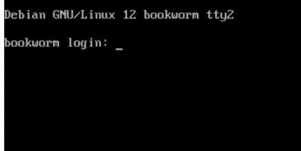
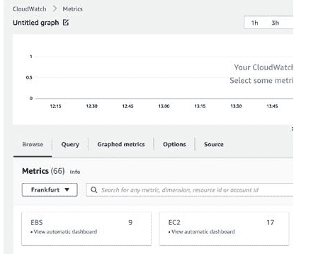
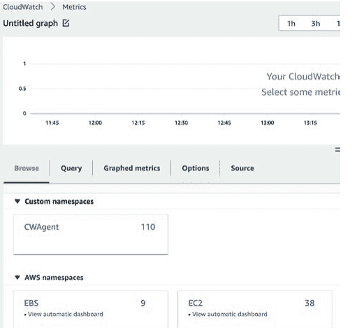
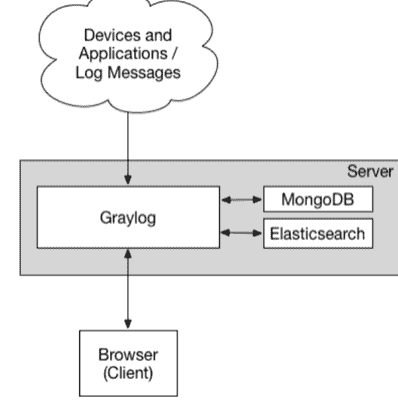
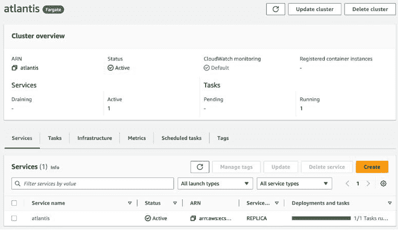

# Linux DevOps way

> 献给我的妻子、孩子，以及所有在我成为更好自己的道路上帮助过我的人。

– Damian Wojsław

> 献给我的父母，他们支持我所有的兴趣，包括计算机。献给我的妻子和女儿，她们是我所有努力最大的支持和动力。

– Grzegorz Adamowicz

# 贡献者

# 关于作者

Damian Wojlaw 自2001年起一直从事IT行业。他专门负责Linux服务器的管理和故障排除。作为系统操作员和支持工程师，他发现 DevOps 哲学是系统运维（SysOps）与开发者及软件团队其他成员工作方式的自然演进。

我想感谢我的妻子和孩子的耐心与支持。

Grzegorz Adamowicz 自2006年起在IT行业担任过多个职位，包括系统管理员、后端开发人员（PHP和Python）、系统架构师和可靠性工程师。在专业领域，他致力于为他参与的项目构建工具和自动化方案。他还通过组织会议和研讨会等活动参与专业社区。Grzegorz 曾在多个行业工作过，包括油气、酒店、金融科技（Fintech）、去中心化金融（DeFi）、汽车和航天。

我想感谢我的妻子 Agnieszka，以及我在职业生涯中有幸合作过的每一个人——我专业领域的大部分知识都是从你们那里学到的。

# 关于评审员

**Marcin Juszkkiewicz** 是一位自2004年开始工作的资深软件工程师。多年来，他一直致力于各种项目的代码构建和优化。他的职业跨越了从嵌入式Linux系统到ARM服务器的领域。在空余时间，Marcin 担任系统管理员的角色，他以与日常工作相同的热情投入这一角色。通过作为软件工程师和兼职系统管理员的丰富历程，Marcin 积累了丰富的知识，并因其严谨的编码和系统优化方法而闻名。

- `docker run` | 168
- `LABEL` | 181

# 第三部分：DevOps 云端工具包

- `Ansible Vault` 277
- 检查 Ansible playbooks 283
- 加速 SSH 连接 285
- 动态清单 286
- 总结 287
- 延伸阅读 287
+ `Ansible Galaxy` 275

## 利用基础架构即代码 289

* `Pulumi` 296
* 重复任务 368
* 手动且易错的任务 369

以工具为中心的方法 375

技术文档 385

用户文档 385

运维文档 386

发布说明与变更日志 386

全面 379

可扩展 380

总结 387

# 索引 389

# 前言

DevOps 已成为现代软件开发的关键组成部分。它不仅是一套工具，更是一种文化和思维方式，改变了我们构建、测试和部署的方式。

## 本书对象

本书适用于已经在 DevOps 领域获得一些知识和经验，并希望通过学习 Linux 技术来构建和管理可靠扩展系统的人士。

我们假设你对 Linux 及其命令行界面有一些基础知识。熟悉 Shell 脚本和基础编程概念也将会有帮助。此外，对 IT 基础设施及其管理方式有一定的了解会更好。

## 本书涵盖内容

第一章：选择合适的 Linux 发行版，介绍了 Linux 历史以及发行版之间的区别。

第二章：命令行基础，引导你使用命令行以及我们在书中使用的常用工具。

第三章：中级 Linux，描述了你会有用用的高级特性。

第四章：使用 Shell 脚本实现自动化，解释了如何开始编写自己的脚本。

第五章：Linux 中的服务管理，讨论了管理服务的不同方式，以及如何使用 systemd 定义自己的服务。

第六章：Linux 网络，描述了网络如何工作，以及如何控制不同的网络配置。

第七章：Git，你的 DevOps 大门，讨论了 Git 是什么以及如何使用版本控制系统，包括不为人知的功能。

第八章：Docker 基础，探索服务的容器化，以及运行和管理容器。

第九章：深度解析 Docker，讨论了 Docker 的高级功能，包括 Docker Compose 和 Docker Swarm。

十章：监控、追踪与分布式日志，讨论了如何监控你的服务、哪些云工具以及如何进行基础设置。

第十一章：使用 Ansible 实现配置即代码，通过使用 Ansible 实现配置即代码；它将引导你完成基础设置和高级功能。

第十二章：利用基础架构即代码，讨论了什么是基础架构即代码 (IaC)、流行的工具有以及如何使用 Terraform 管理你的基础设施。

十三章：使用 Terraform、GitHub 和 Atlantis 进行 CI/CD，通过使用 Terraform 和 Atlantis 实现基础设施的持续集成 (CI) 和持续部署 (CD)，将 IaC 更进一步。

第十四章：避免 DevOps 中的陷阱，讨论了你在 DevOps 工作中可能遇到的挑战。

## 如何充分利用本书

你需要在虚拟机或计算机的主操作系统上安装 Debian Linux 或 Ubuntu。我们使用的其他软件要么作为默认工具安装，要么我们会告诉你从哪里获取并安装到你的系统中。

本书旨在为 DevOps 世界的初学者编写，并假设你渴望学习该领域常用的工具和概念。读完本书后，你将实实地理解如何使用 Terraform 和 Atlantis 等 IaC 工具管理基础设施，以及如何使用 Ansible 和 Bash 脚本自动化重复任务。你还将学习如何设置日志和监控解决方案，以帮助你维护和排查基础设施的故障。

| 本书中涵盖的软件/硬件 | 操作系统要求 |
| :--- | :--- |
| Bash | Linux 操作系统已预装 |
| Ansible | Python 3 或更高版本 |
| Terraform | Linux 操作系统 |
| AWS CLI | Python 3 或更高版本 |
| Docker | Linux 操作系统 |

如果你使用的是本书的电子版，我们建议你自己手动输入代码，或从书的 GitHub 仓库获取代码（下一节将提供链接）。这将帮助你避免任何与复制和粘贴代码相关的潜在错误。

## 下载示例代码文件

你可以从 GitHub `https://github.com/PacktPublishing/The-Linux-DevOps-Handbook` 下载本书的示例代码文件。如果代码有更新，将在 GitHub 仓库中进行更新。

我们还有丰富的书籍和视频目录代码包，可在 `https://github.com/PacktPublishing/` 获取。去看看吧！

## 使用的规范

本书中使用了多种文本规范。

行内代码：表示文本中的代码、数据库表、文件夹名称、文件名、文件扩展名、路径名、虚拟 URL、用户输入和 Twitter 标识。例如：“以 root 身份登录时，你的提示符将以 # 符号结尾。以普通用户身份登录时，它将显示为 $。”

代码块设置如下：

```
docker build [OPTIONS] PATH | URL | -
```

## xviii 前言

当我们希望你注意代码块的特定部分时，相关的行或项目将**加粗**：

```
docker build [OPTIONS] PATH | URL | -
```

任何命令行输入或输出的格式如下：

```
chmod ug=rx testfile
```

**加粗：** 表示新术语。

> 提示或重要说明
> 像这样所示。

## 联系我们

我们随时欢迎读者的反馈。

**一般反馈：** 如果你对本书的任何方面有疑问，请发送邮件至 `customercare@packtub.com` 并在邮件主题中注明书名。

**勘误：** 尽管我们尽力确保内容的准确性，但错误仍然会发生。如果你在书中发现错误，我们将不胜感激你告知。请访问 `www.packtub.com/support/errata` 在表单中提交。

**盗版：** 如果你在互联网上遇到任何形式的我们作品的非法复制版，我们将感谢你提供位置或网站名称。请通过 `copyright@pack.com` 联系我们并提供材料链接。

**如果你感兴趣成为作者：** 如果你在某个领域拥有专长并对编写或贡献书籍感兴趣，请访问 `authors.packt.com`。

## 分享你的想法

一旦读完《The Linux DevOps Handbook》，我们想听听你的想法！请点击此处直接进入本书的 Amazon 评论页面分享你的反馈。

你的评论对我们和技术社区至关重要，并将帮助我们确保交付高质量的内容。

## 下载本书的免费 PDF 版

感谢购买本书！

你是否喜欢随地阅读但无法随身携带纸质书？

你的电子书购买是否与选择的设备不兼容？

别担心，现在购买每本 Packt 书籍，你都可以免费获得一个无 DRM 限制的 PDF 版本。

随时随地、在任何设备上阅读。直接从你喜欢的技术书中搜索、复制并粘贴代码到你的应用程序中。

优惠不仅于此，你每天可以在收件箱中收到独家折扣、通讯和精彩的免费内容。

按照以下简单步骤获取福利：

- 1. 扫描二维码或访问下方链接


`https://packt.link/free-ebook/97818803245669`

- 2. 提交你的购买证明
- 3. 搞定！我们将直接将免费 PDF 和其他福利发送到你的电子邮箱

# 第一部分：Linux 基础

在本书的开头部分，我们将关注 Linux 发行版以及高效使用 Linux 操作系统所需的各种技能。你还将学习 Shell 脚本的基础知识，以自动化日常任务。此部分包含以下章节：

- 第 1 章：选择合适的 Linux 发行版
- 第 2 章：命令行基础
- 第 3 章：中级 Linux
- 第 4 章：使用 Shell 脚本自动化

## 选择合适的 Linux 发行版

在本章中，我们将从零开始深入 Linux 世界。我们将简要介绍 Linux 历史，解释什么是发行版，并解释在选择生产环境使用的版本时需要考虑的因素。你不需要预先了解任何关于 Linux、其管理或如何选择的内容。在本章，我们将涵盖以下主要主题：

- 什么是 Linux 以及什么是发行版？
- 你可以使用什么？
- 相当流行的主要发行版

## 技术要求

我们在书中展示的代码可以在公共仓库找到：`https://github.com/PacktPublishing/The-Linux-DevOps-Handbook`。

## 到底什么是 Linux 发行版？

在它的创始人 Linus Torvalds（林纳·托瓦兹）构思 Linux 很久以前就已经有了 Unix。由于法律原因，Unix 源代码许可给任何购买它的人，这使其在大学中非常流行。20 世纪 80 年代，完全免费的 Unix 实现在 GNU 项目下诞生。它的目标是开发一个让用户获得计算机控制权的操作系统。

1991 年，芬兰学生 Linus Torvalds 著名地宣布了他的爱好内核——Linux。他当时称其为“仅仅是一个爱好——不会像 GNU 那样庞大和专业”。剩下的就是历史了。Linux内核在开发者之间流行起来。Linux 是内核，GNU 工具是所谓的用户态空间（userland），它们共同构成了操作系统。

前面的故事对我们来说很重要，原因有二：

- 虽然 GNU 用户态空间和 Linux 内核是最流行的组合，但你会发现这不是唯一的组合。
- Linux 提供了内核，GNU 项目提供了用户态工具，但它们必须以某种方式准备好安装。

## 发行版之间有何不同？

Linux 和 GNU 项目的开放性质使得几乎任何人都可以创建自己的发行版。让新用户感到眼花缭乱之一是可选操作系统版本之多。在 Linux 用户之间引发“圣战”的最佳方法就是问哪一个是最好的。

我们分组发行版的方式是通过它们交付软件（包）的形式以及用于安装和删除该软件的额外软件（包管理器）。有很多种管理器，但最流行的是 RPM（RPM 包管理器）和 DEB 包。

RPM 发行版家族始于红帽企业级 Linux (`RHEL`)。

DEB 发行版包含了 Debian（DEB 软件包源于此处）——一个技术官治理的社区项目。从 Debian 衍生出了许多基于它的发行版，它们使用了 Debian 大部分的核心组件。其中最著名的是 Ubuntu，这是一个由 Canonical 赞助的服务器和桌面发行版。

还有一些使用最小自动化程度的软件包的发行版，其中最著名的是 Slackware，它是最古老的 Linux 发行版之一。

还有一些发行版为用户提供一组脚本，这些脚本可以在将运行的硬件上编译实际软件——最著名的是 Gentoo。

最后，还有一种发行版实际上是一本书，包含一组指令，用户可以遵循指令手工构建整个操作系统——Linux From Scratch（从零开始 Linux）项目。

区分它们的另一种方法是特定发行版所使用的安全框架。这限制了源代码、二进制文件或其他内容的发布。这可能意味着硬件驱动（例如 NVIDIA 显卡的驱动）以及用户软件（如允许你播放流媒体媒体、DVD 和蓝光光片的视频解码器）。某些发行版让安装和使用它们变得简单，而另一些则变得更加困难，它们认为我们应该努力让所有软件都开源且免费（既指言论的自由，也指啤酒的自由）。

另一个值得关注的是 AppArmor，它主要由 Ubuntu 使用；以及 SELinux（来自美国国家安全局），它被红帽企业级 Linux（及其衍生版）和 Fedora Linux 等系统使用。

值得注意的是，虽然 Linux 发行版使用 GNU 项目作为用户态，但流行的云 Alpine 发行版使用了它自己的一套软件，这些软件在编写时考虑了最小体积。

从发行版的开发方式来看，它可以是社区驱动的（没有任何商业实体是任何部分或软件的所有者——Debian 就是其中一个典型的例子）、商业性的（完全由某家公司拥有——RHEL 是一个例子，SUSE 是另一个），以及介于两者之间的混合模式（Ubuntu 和 Fedora 是拥有大量独立贡献者的商业所有权发行版示例）。

## 选择合适的 Linux 发行版

最后，我们对发行版分类的方法是根据它们促进云工作负载的良好程度。在这里，我们可以从不同方面来看：

- **服务器端**：特定发行版作为我们基础设施、虚拟机和容器的底层操作系统工作表现如何。
- **服务端**：特定发行版多适合作为容器或虚拟机运行我们的软件。

为了让新采用者感到更加困惑，每个发行版都可能有很多许多变体（根据发行版的术语，称为 flavors、variants 或 spins），它们提供不同的软件集或默认配置。

最后让你（读者）彻底感到困惑的是，在桌面或笔记本电脑上，Linux 提供了它能给你的最好的——选择。操作系统的图形界面数量对于经验丰富的用户来说可能非常多：KDE Plasma、GNOME、Cinnamon Desktop、MATE、Unity Desktop（与 Unity 3D 游戏引擎无关）以及 Xfce。这个列表并非详尽的，是主观的，而且非常有限。它们在易用性、配置、内存和 CPU 占用量以及许多其他方面都不相同。

发行版的数量惊人——跟踪 Linux 发行版的权威网站（`https://distrowatch.com/dwres.php?resource=popularity`）在编写时在其发行人气页面上列出了 265 种不同的 Linux 发行版。庞大的数量使得我们必须将本书限制在我们选择的三个上。在大多数情况下，你选择哪一个并没有区别，除非你选择的是商业版，那么在许可和订阅方面会有区别。每当发行版的选择产生差异（特别是技术上的差异）时，我们会指出来。

选择发行版不仅仅是一个务实的选择。Linux 社区深受理想主义驱动。对于某些人来说，这些是他们构建生活最重要的理想。关于哪种文本编辑器更好，他们曾根据其用户界面、发布许可或源代码的质量进行过无数次激烈的言辞争论。在运行 WWW 服务器的软件选择或如何接受新贡献方面，表现出的情感非常强烈。这不可避免地导致 Linux 发行版的安装方式、配置和维护工具的选择，以及开箱即用的软件选择范围。

尽管如此，我们必须提到，尽管他们有坚定的信念，但开源社区（包括 Linux 社区）仍然是一群友好的群体。在大多数情况下，你可以在在线论坛上找到帮助或建议，而且你很有有机会见到他们。

## 到底什么是 Linux 发行版？

要选择你的发行版，你需要注意以下几个因素：

- 你想要运行的软件在该发行版上是否有支持？某些商业软件限制了其发布软件包的发行版数量。你可能可以在不支持的 Linux 版本上运行它们，但这可能很棘手且容易出现中断。
- 你打算运行的软件有哪些版本可用？有时，选定的发行版更新你所需的软件包频率不够高。在云世界，几个月前的软件可能已经过时，并且缺乏重要的功能或安全更新。
- 发行版的许可协议是什么？是免费使用的还是需要订阅计划？
- 你的支持选项有哪些？对于社区驱动的发行版，你的选择限于在线和附近的免费 Linux 社区。对于商业产品，你可以购买各种支持服务。根据你的需求和预算，你可以找到适合你要求和财务资源的支持选项组合。
- 你对编辑配置文件和运行长而复杂的命令的熟练程度如何？某些发行版提供了工具（命令行和图形界面），让配置任务变得更容易且更不容易出错。然而，这些工具大多是特定于发行版的。
- 该发行版的文档支持如何？这不仅包括维护者编写的文档，还包括各种*用户教程*。
- 这种发行版在互联网上支持如何？这将意味着该发行版中的软件。

到为止，你已经了解了 Linux 发行版是什么、它们之间的区别，以及你如何从中选择一个。

### 介绍发行版

在经过了关于 Linux 操作系统的冗长但精炼的历史后，是时候最后探索我们选择的几个了。在下一节中，我们将深入探讨每个发行版以及我们认为在决策时重要的因素。请记住，尽管我们力求提供客观事实和评估，但我们无法避免主观观点。请在选择之前自行评估。

### Debian

Debian (`https://www.debian.org/`) 是最古老的活跃 Linux 发行版之一。它的开发由社区支持的项目领导。它以两点闻名：提供的软件包数量巨大以及稳定版本的发布缓慢。后者在近年来有所改进，每两年发布一次稳定版。软件以软件包的形式交付。

Debian 有三个可用版本（所谓的分支）——稳定（stable）、测试（testing）和不稳定（unstable）。发布版本以《玩具总动员》电影的角色命名。最新的发布版是版本 11——名为 Bullseye。

不稳定分支是开发者、喜欢边缘的人或需要稳定性的人使用的滚动分支。软件被接受不稳定分支时测试非常少。


测试分支是正如其名所示的测试发生地。这里有大量的测试。软件包从不稳定分支进入这里。这里的软件比稳定版新，但没有不稳定版那么新鲜。在新的稳定版发布几个月前，测试分支会被冻结。这意味着不再接受新软件，只有修复了 Bug 的软件包版本才被允许。

几个月后，测试分支变为稳定分支。软件仅进行安全修复更新。

该发行版支持许多硬件平台——Intel、ARM、PowerPC 等。除了非官方端口外，还有许多硬件平台可以在上面安装它。

Debian 被认为是最稳定的发行版，它被用作各种计算集群的平台，因此通常被安装在数据中心机架中某处的裸金属服务器上，并持续使用多年。

根据 `W3Techs` (https://w3techs.com/technologies/details/os-linux) 的数据，Debian 占据了互联网上运行的所有服务器的 16%。它的派生版 Ubuntu 运行了其中的 33%。两者合计占所有服务器的 49%。这使得与 Debian 相关的管理技能具有极高的市场需求。

### Ubuntu Linux

Ubuntu Linux 发行版 (https://ubuntu.com/) 被广泛归功于让 Linux 普及到家用电脑上，这确实实名其实。作为由 Canonical 赞助的项目，它的使命是让大多数人都能轻松地使用 Linux。它是首批（如果不是第一个）分发非自由和非开源二进制驱动及库的 Linux 版本之一，这些内容使得桌面体验变得更加简单和舒适。

众所周知，由 Mark Shuttleworth（Canonical 和 Ubuntu 创始人）为 Ubuntu 发行版报告的第一个 Bug 是：“微软拥有大部分份额。”

该发行版本身基于 Debian Linux，在初期，完全二进制兼容是其主要目标之一。随着开发的进行，这一点的重要性有所下降。

该发行版由社区和 Canonical 共同开发。该公司主要的收入来源是与 Ubuntu Linux 相关的付费服务——支持、培训和咨询。

由于 Debian Linux 和 Ubuntu Linux 之间非常紧密的关系，一个发行版的许多开发者和维护者在另一个发行版中也担任相同的角色。这导致大量软件并行为这两个发行版进行打包。

Ubuntu 有三个主要版本：Desktop（桌面）、Server（服务器）和 Core（针对物联网）。桌面版和服务器版在开箱服务的配置方面可能略有不同，而 Core 版差异很大。

软件以 `.deb` 包的形式分发，与 Debian 相同，源代码实际上是从 Debian 的不稳定分支（unstable）导入的。然而，这并不意味着你可以在 Ubuntu 上安装 Debian 包反之亦然，因为它们并不一定二进制兼容。你应该重新编译并安装你自己的版本。

每个版本有四个软件包仓库——Canonical 官方支持的自由和非自由软件分别称为 `main` 和 `restricted`。社区交付并维护的自由和非自由软件分别称为 `universe` 和 `multiverse`。

## 选择合适的 Linux 发行版

> 重要提示

建议——在主版本之间进行系统升级的一种广泛接受的做法是等待第一个子版本的发布。因此，如果当前安装的发行版版本是 `2.5`，而新版本 `3.0` 发布，明智的做法是等到 `3.1` 甚至 `3.2` 发布后再进行升级。这适用于我们列出的所有发行版。

**长期支持 (LTS)** 版本的支持期为五年。每两年发布一个新的 LTS 版本。可以商议延长支持。这为规划重大升级提供了一个非常好的时间线。Ubuntu 每六个月发布一个新版本。

Ubuntu 在教育和政府项目中被广泛采用。众所周知，慕尼黑市在 2004 年至 2013 年间，将超过 14,000 台市政桌面电脑迁移到了带有 KDE 桌面环境的 Ubuntu 变体上。虽然这次迁移在政治上引起了动荡——其他系统供应商对此表示强烈反对——但在技术上它被认为是成功的。

Ubuntu 是个人电脑的首选 Linux。Canonical 与硬件供应商合作得很好，不仅包括联想和戴，还与 HP 合作，以确保发行版与电脑之间的完全兼容。Dell 销售预装了 Ubuntu 的笔记本电脑。

一些人将 Ubuntu Linux 称为服务器和个人电脑上安装数量最多的发行版。实际数量只能估算，因为 Ubuntu 不需要任何订阅或注册。

作为 Ubuntu Linux 人气的副产品，软件供应商如果发布了 Linux 版本，通常会提供其软件的 `.deb` 包。这对于桌面软件尤为如此。

基于 Ubuntu 的非官方版本、克隆或修改版发行版数量惊人。

Ubuntu 拥有非常活跃的社区，既有组织的也有非组织的。在你所在的城市附近找到一个用户群非常容易。这直接转化为互联网上教程和文档的数量。

Ubuntu Linux（尤其在支持计划下）被作为许多云计算基础设施部署的基础。许多电信、银行和保险公司已选择 Ubuntu 作为它们的服务器基础。

### 红帽企业级 Linux (RHEL)

RHEL (https://www.redhat.com/en/technologies/linux-platforms/enterprise-linux) 是 Red Hat Linux 的精神继承者，由 Red Hat Inc. (https://www.redhat.com/) 开发和维护。它的主要目标是商业实体市场。你可以免费使用 RHEL 进行开发，或在多达 16 台服务器的生产环境中使用（于写作期间）。然而，该发行版的主要优势是拥有大量的解决问题的文章库以及支持工程师的协助，尽管后者只能通过付费支持计划获得。

#发行行版

RHEL 被认为是一个非常稳定且稳固的发行版。它是银行、保险公司和金融市场的主要选择之一。它缺乏许多桌面软件包，但在服务器端，尤其是作为其他商业应用的操作系统时，它是头等公民。

软件以以 `.rpm` 结尾的在线仓库包形式分发，因此名为 RPMs。管理软件包的主要工具是 `RPM`，更高级的工具——**yum** 以及最近的后继者 **dnf**——也可用。

秉着开源公司的真正精神，Red Hat 提供了发行版。这导致了 RHEL 著名的克隆版——CentOS 的诞生。在不久之前，它是想使用 RHEL 但不想付订阅费的人的热门选择。2020 年，Red Hat 宣布 CentOS 版本将不再可用；只有所谓的滚动版本，它不断更新包并不镜像 RHEL。在 CentOS 用户的激烈反应下，CentOS 的创始人 Gregory Kurt 启动了另一个名为 **Rocky Linux** 的 RHEL 克隆版。他的主要目标与原始 CentOS 相同——交付免费、开源、社区驱动且与 RHEL 二进制兼容的发行版。

RHEL 发行版每几年发布一个稳定版本，并支持 10 年。然而，全支持仅提供前几年。在剩余时间里，Red Hat 只提供安全补修复和关键更新，而不引入新的包版本。这种生命周期适用于大型安装或任务关键型系统。

与 Ubuntu 一样，可以商议延长支持。

红帽公司与开源社区的关系非常复杂。虽然该公司大部分时候进展很快，但也出现了一些社区不喜欢的决定。最近，是红帽将 CentOS 模型改为滚动发布。

RHEL 与 Ubuntu 一样，是商业支持云计算部署的基础。

### Fedora Linux

Fedora (https://fedoraproject.org/wiki/Fedora_Project_Wiki) 是与红帽公司相关的一个发行版。虽然超过一半的开发者和维护者是不隶属于红帽的社区成员，但该公司对开发拥有完全所有权。它是 RHEL 的上游，这意味着它是真实的 Fedora 开发前沿。这并不意味着 Fedora 的所有内容都包含在 RHEL 的发布中。然而，密切关注 Fedora 可以洞察 RHEL 发行版的当前方向。

与作为其基础的 RHEL 不同，其新版本每六个月发布一次。它使用与 RHEL 相同的包类型 RPM。

## 选择合适的 Linux 发行版

Fedora 被认为是一个快速迭代的发行版。它会迅速采用最新且前沿版本的软件包。

### CentOS

CentOS (https://centos.org) 曾是 RHEL 的免费版本。该名称是社区企业级操作系统（Community Enterprise Operating System）的缩写。它的主要目标是与 RHEL 完全二进制级兼容，并遵循相同的发布和编号方案。2014年，CentOS 加入了红帽公司（Red Hat），但官方承诺该发行将在保持社区独立性的同时，从开发和测试资源中获益。遗憾的是，红帽在2020年宣布 CentOS 8 将是最后一个版本，从那时起CentOS Stream 将成为唯一的版本。CentOS Stream 是一个中期版本。这意味着它处于前沿且快速迭代的 Fedora 与生产就绪的 RHEL 之间。CentOS Stream 与 CentOS 的区别在于它是开发版本，而 CentOS 仅仅是实际最终产品 RHEL 的重新构建和重新封装的镜像。

在使用 RHEL 时获得的所有知识、技能和经验 100% 适用于 CentOS。根据 W3Techs (https://w3techs.com/technologies/details/os-linux)，CentOS 是服务器上部署第三第三 Linux 发行版，因此这些技能非常有市场价值。

### Rocky Linux

作为对 CentOS 发行版现状的回应，其创始人宣布了 Rocky Linux (https://rockylinux.org/)。其目标与原始 CentOS 相同。发布方案也遵循 RockyHEL。公告发布后，Rocky Linux 的 GitHub 仓库迅速登上了趋势榜（https://web.archive.org/web/20201212220049/https://github.com/trending）。Rocky Linux 与 CentOS 100% 二进制级兼容。该项目发布了一套工具，可以轻松从 CentOS 迁移到 Rocky Linux，而无需重新安装系统。

该发行版非常年轻，成立于 2020 年，其受欢迎程度还有待观察。它在社区中引起了巨大轰动，似乎源源不断的 CentOS 用户已将 Rocky Linux 作为他们的首选方案。

Rocky Linux 项目对开源世界的一个重要贡献是其构建系统。它确保了即使 Rocky Linux 停止运行，社区也能轻松启动一个新的 RHEL 克隆版本。

适用于 RHEL 和 CentOS 的所有技能、知识和文章 100% 适用于 Rocky Linux。所有在 RHEL 和 CentOS 上运行的软件应该在 Rocky Linux 上无需任何修改即可运行。

### Alpine

Alpine Linux (https://alpinelinux.org/) 是一个有趣的发行版。它的主编程库和大多数基础命令行工具并非来自 GNU 项目。此外，服务管理系统（目前常用的 systemd）在这里并不常见。这使得来自其他主流发行版的某些管理技能不再适用。Alpine 的优势在于其体积（非常小）、安全优先的理念以及它是 Linux 发行版中启动速度最快的几个之一。这些特性，加上诚然更重要的启动时间，使其成为容器最流行的选择。如果你运行容器化软件或构建自己的镜像，很可能运行在 Alpine Linux 上。

Alpine 起源于 LEAF（Linux 嵌入式应用框架；参见：https://bering-uclibc.org/wiki/Main_Page）——一种可以放入尺寸软盘的 Linux 发行版。LEAF 目前是嵌入式市场、路由器和防火墙的热门选择。Alpine 是更大的发行版，但必须做出牺牲，因为开发者想要包含有用但体积较大的软件包。

包管理器被称为 `apk`。构建系统借自另一个名为 Gentoo Linux 的发行版。由于 Gentoo 在安装软件时进行编译，因此 portage 包含了许多关于作为操作系统部分进行软件构建的逻辑。Alpine 可以完全从内存中运行。它甚至有一种特殊机制，允许你从启动设备加载几个软件包，这可以通过 Alpine 的本地实用程序包（LBU）来实现。

如前所述，这是容器的首选发行版。你通常不会在大型服务器安装中看到它运行。但当我们转向云端时，你会看到很多 Alpine。尽管如此，这些发行版中的每一个都有云端变体——即一种运行你软件的方法。在本章中，你学习了流行 Linux 发行的基础知识以及它们之间的不同之处。为了让你更好地了解如何与某些系统交互，我们将查看键盘。

## 总结

本章中的列表只是可用 Linux 发行版的一小部分。该列表很大程度上基于技能的流行程度、市场价值以及你多年积累的经验。它们绝不是你拥有的最佳选择。

在下一章中，我们将深入命令行的世界。

## 命令行基础

在本章中，我们将深入命令行。我们将解释为什么它如此强大，为什么它对每位系统管理员和 DevOps 人员都如此重要。更重要的是，我们将开始教你最实用的命令以及如何使用它们。在此过程中，我们将添加理解所需的其他核心 Linux 概念。

在本章中，我们将涵盖以下主题：

- 什么是命令行以及它是如何工作的

- 为什么熟悉它是如此重要

- 用于 Linux 系统管理的基本命令

在单章中介绍所有命令和工具是不可能的。后面是你将需要的最基础工具。管理 Linux 系统是一个独立的课题。

## 技术要求

强烈建议安装并准备好一个 Linux 系统备用。我们建议使用虚拟机或笔记本电脑，万一发生糟糕的错误，你可以安全地从头重新安装。你将遵循书中的示例并执行我们提供的任何练习。

我们不会涵盖安装过程。每个发行版都可能使用自己的安装程序，图形界面或文本形式（取决于你选择的版本）。你需要记录或记住你的用户名（方便地称为 `username` 或 `login`）和密码。如果你有物理访问权限但不知道登录名或密码（或两者），有方法进入系统，但这些超出了本书的范围。

我们在书中主要的发行版是 Debian。不过，只要不是 Alpine，上一章“选择合适的发行版”中涵盖的主型发行版中的任何一个对你来说都应该没。

## Linux 命令行 – shell

系统管理员的自然环境是命令行。然而，你永远不会听到别人称呼它。正确的名称是 `shell`（壳），从现在起，我们在书中将这样称为它。

`shell` 是一个程序，它接受用户的输入（主要是键盘击键，但也有其他方法，你甚至可以使用鼠标指针），对其进行解释，如果这是一个有效命令，它会向用户提供结果；如果出错则提供错误信息。

有几种方法可以访问 `shell`：

- 登录终端（图 2.1）

> 注意

> 你也会看到 **console**。Terminal 和 console 之间是有区别的。console 是一个让你与计算机交互的物理设备。它是物理输入（现在主要是键盘）和输出（现在是显示器，但在最初输出是打印出来的）。Terminal 是一个终端仿真器，一个允许用户执行相同任务的程序。

- 在图形界面中打开终端窗口

- 从另一个设备通过安全连接登录

`shell` 是一个非常强大的环境。起初通过输入命令完成一切可能看起来麻烦，但很快你就会发现，任务越复杂，通过 `shell` 完成就比图形界面容易得多。任何称职的系统管理员都懂得在 `shell` 中执行任务以及如何通过它管理系统，我不会赌他们更倾向于使用 `shell` 而不是任何 GUI。

### 了解你的 shell

`shell` 是一个程序，因此不存在单一的 `shell`。相反，有很多或不那么流行的 `shell`，它们对应该如何处理事情有自己的看法。

在大多数 Linux 发行版中，流行且默认的是 **Bash (Bourne again shell)**。你可能想要关注的其他 `shell`：

- **sh**: 原始的 Bourne shell。它是我们所知的第一个第一个 `shell`。虽然它缺乏用户从其他现代 `shell` 中欣赏的许多交互式功能，但 **sh** 以其脚本执行快和体积小而闻名。

- **ksh**: 作为 Bourne shell 的演进版本，它是其前者的超集。因此，所有为 *sh* 编写的脚本在 *ksh* 中都可以运行。

- **csh**: C shell。它的名字源于它的语法，该语法紧密遵循 C 编程语言。

- **zsh**: Z shell。macOS 用户对它应该很熟悉，因为它是该操作系统的默认 `shell`。它是一个完全现代的 `shell`，提供了许多你预期的功能：命令历史、算术运算、命令补全等等。

我们不会再去扰你 `shell` 的变体和历史了。如果你对 Bash 是如何变成现在这样（一个 Bash shell）的感兴趣，请参考这篇维基百科文章：https://en.wikipedia.org/wiki/Bash_(Unix_shell)。

在我们的书中，我们正在使用 Bash。如前所述，它是大多数 Linux 发行版的默认 `shell`，提供 sh 兼容模式，并具有你对现代 `shell` 所期望的所有功能，而且关于扩展你相关知识的书籍、文章、教程和其他材料数量多得令人惊叹。

我们将执行的第一个任务是登录你的 `shell`。根据你选择的安装方法，你可能需要启动本地虚拟机、你的物理机或云虚拟专用服务器 (VPS)。如果你选择了没有图形界面的服务器安装，你应该能看到类似于以下截图的内容：



图 2.1 – 登录界面

你看到是一个登录界面，可以在其中提供用户名和密码。成功登录后，你会看到一个命令提示符，这确认了你刚刚启动了 `shell`。

提示符的外观是可以配置的，并且可能取决于你选择的发行版。有一件事将保持不变，我们建议你永远不要改变它。在 Linux 世界中，有两种用户：普通用户和超级用户（superuser）。虽然普通用户的登录名只要符合 Linux 命名规范可以是任何内容，但超级用户被称为 `root`。要登录 `root` 账户，你需要输入 `root` 作为用户名/登录名，然后输入它的密码。

超级用户账户之所以命名是有原因的。在大多数 Linux 发行版中，它是全能的用户。一旦以 `root` 身份登录，你可以做任何你想的事，甚至删除包括操作系统在内的所有文件。

## 命令行基础

为了帮助你区分普通用户和 `root` 用户，提示符会向你提供线索。以 `root` 身份登录时，你的提示符将以 `#` 符号结尾。以普通用户身份登录时，它将显示 `$`。


顺便说一下，`#`（井号）符号也是所谓的注释符号。如果你恰好从网上粘贴了一个命令或其代码，如果它以 `#` 或 `$` 开头，它就是关于哪种类型的用户应该运行该命令的线索。你应该省略这个符号，尤其是开头的 `#` 会阻止命令运行。

除了位于提示符结尾的符号外，许多发行版会在其前面加上用户名，以确保你知道自己是谁。假设在一个名为 `myhome` 的 Linux 系统上有一个名为 `admin` 的用户，Debian 11 的默认提示符看起来像所示：

```
$admin@myhome:-$
```

对于 `root` 用户，它看起来像这样：

```
root@myhome:-#
```

记录一下，还有更多检查身份的方法，我们将这些留到第 4 章。

## 我召唤你

到目前为止，一切顺利。你已经登录，知道自己是谁，可以输入，也可以阅读。但你实际上如何运行程序呢？

在 Linux 世界中，运行程序就是执行（`executing`）或调用（`calling`）。实际上，“调用”主要指的是系统命令或内置命令，而“执行”则用于讨论不是发行版的一部分——即所谓的第三方程序或二进制文件。

在告诉该如何执行程序或命令之前，我必须简单解释一下文件系统结构以及一个名为 `PATH` 的重要系统变量。

## 文件系统结构

由于这可能是你的第一次尝试，我们将稍微后退一步，解释文件系统是如何结构的（用文字描述，即在典型的 Linux 中目录是如何组织的）。

Linux 遵循 Unix 哲学，即“一切皆文件”（有例外，但并不多）。结果是操作系统的几乎每个方面都反映为一个文件或目录。内存状态、进程（运行）状态、日志、二进制文件和设备驱动都存在这个结构之中。这意味着你的 Linux 系统的几乎每个方面都可以使用普通的文本编辑器进行编辑或检查。

在目录树中，它的结构始终从 `/` 文件夹开始，称为根目录。每个驱动器、网络共享和系统目录都位于从根目录开始的层次结构中。

### Linux 命令行 - shell

将网络共享或本地驱动器变为系统或用户可用用的称为挂载（`mounting`），可用资源被称为被挂载的。记住，从现在起我们将使用它。与 Microsoft Windows 不同（在 Windows 中，你的驱动器显示为带有单独根目录的独立字母），在 Linux 中，你的硬盘将挂载在目录层次结构中。例如，用户主目录存储在单独的驱动器上，挂载在 `/home/` 目录下。在浏览文件系统结构时，你永远无法分辨它。唯一的办法是使用以下命令检查已挂载的驱动器和分区：

```
$ mount
```

或者

```
$ df
```

我们将在第 3 章详细阐述它们，现在只需知道它们存在即可。

（注：原文后续部分存在大量重复内容，译文已根据要求去重并整合逻辑。）

### Linux 命令行 - shell

对我们目前来说，`/etc` 目录也非常重要。它包含了整个系统的所有配置文件：在线软件包仓库的源、默认 shell 配置、系统主机名、启动时运行的进程、系统用户及其密码，以及基于时间的命令。在一个新安装的 Debian 11 系统上，`/etc/` 目录包含约 150 个子目录和文件，每个子目录可能包含更多文件夹。

`/tmp` 文件夹包含临时文件。它们仅在系统启动时存在，一旦关机或重启就会被删除。这些文件的性质通常是瞬态的；它们可能迅速出现并消失，或者被频繁修改。该目录存在计算机的 RAM 中并不罕见。它是你系统中最快的存储设备，并在重启或断电时自动清理。

如所述，额外的驱动器挂载在此结构下。我们可以为家目录准备一个独立的硬盘。`/home` 文件夹可能存在该硬盘上，甚至存在于网络磁盘阵列上。如前所述，`/tmp` 目录通常挂载在 RAM 中。有时，`/var` 目录（包含系统中经常变化但不应清除的内容，如日志）会挂载在单独驱动器上。原因之一是 `/var` 的内容，特别是 `/var/log`（系统日志所在地），增长非常快，可能会占用所有可用空间，导致系统无法访问或变得非常棘手。

最后，在你访问的任何地方都存在重要且特殊的目录：

- 单点 `.` 表示当前目录。如果你选择进入 `.` 文件夹，你将停留在原地。然而，正如你在第 3 章中看到的，它是很有用的。

- 双点 `..` 表示我们上面的目录——即父目录。如果你选择进入 `..` 文件夹，你将回到起始位置上一层。注意，对于 `/` 目录，`/` 和 `..` 含义相同：`/`。你无法比根目录更高。

## 运行程序

现在我们已经了解关于目录层级的一些知识，让我们简要介绍一下执行程序。

在 shell 中执行程序有三种基本方法：

- 通过名称调用：这要求程序被放置在 `PATH` 变量所在的目录中（第 3 章解释）。

- 通过绝对路径调用：绝对路径以 `/` 开头。使用绝对路径时，你必须列出指向程序的所有目录，包括开头的 `/`。一个执行示例可能如下：

```
/opt/somecompany/importantdir/bin/program
```

## 命令行基础

- 通过相对路径调用：这不会以单点或双点开头。这种执行程序的方法要求你知道自己在文件系统中的位置，以及该程序在文件系统中的位置。如果你与二进制文件在同一个目录或非常接近它，它就很有用：

- 要调用与你相同目录下的程序，在它前面加一个点和冒号：`./`。这个快捷方式表示当前目录。一个示例调用可能是 `./myprogram` 或 `./bin/myprogram`。后者意味着：启动一个名为 `myprogram` 的程序，或者当前目录下的 `bin` 目录中的程序。

- 使用相对路径调用系统其他地方的程序，我们必须使用双点 `..`，即父文件夹。假设你登录在家目录 `/home/admin`，想要执行 `/opt/some/program/bin` 中的程序；你调用 `../opt/some/program/bin/myprogram`。双点和斜杠意味着向上移动。

如果发生这种情况，会有一点复杂。幸运的是，随着书籍的进展，一切都会变得明朗。

## 教你所有命令的命令

每当你遇到问题或困难时，应该养成搜索互联网的习惯。你将遇到的大多数问题已经解决或解释过了。然而，有一个命令可以救命——或者至少可以节省大量时间。即使你确定知道正确的语法，也应该养成使用它的习惯，你可能会发现完成任务更好的方法。该命令如下：

```
$ man
```

`man` 是 `manual`（手册）的缩写，它顾名其义：它是你想学习的任何命令的手手册。要了解更多关于 `man` 命令的信息，只需调用：

```
$ man
```

你看到的输出将类似于所示：

| MAN(1) |

| --- |

| Manual pager utils |

| MAN(1) |

| NAME |

| man - an interface to the system reference manuals |

| SYNOPSIS |

| man [man options] [[section] page ...] |

| man -k [apropos options] regexp ... |

### Linux 命令行 - shell 23

```
man -K [man options] [section] term ...
man -f [whatis options] page ...
man -l [man options] file ...
man -w|-W [man options] page ...
```

### 描述

`man` 是系统的手册分页器。`man` 的每个页面参数通常是程序、工具或函数的名称。然后将找到并显示与这些元素元素关联的手册页。如果提供了章节（section），它将引导 `man` 只查看手册的该章节。默认章节是按照预定义的顺序（见 DEFAULTS）在所有可用章节中搜索，并只显示找到第一个页面，即使该页面在多个章节中存在。

为了简洁起见，我进行了删减。一个编写得良好的 `man` 将有几个章节：

- name：这是命令的名称。如果命令以各种名称存在，它们将列在这里。

- synopsis：这将显示可能的调用方式。

- description：这是命令的目的。

- examples：这将显示命令的几个示例，使语法更清晰并提供思路。

- options：这将显示可用选项及其含义。

- getting help：这是获取命令的简短版本。

- files：如果命令有配置文件或消耗文件，它们将列在这里（对于 man：`/etc/manpath` 和 `/usr/share/man`）。

- bugs：这是哪里查找 bug 并报告新的 bug。

- history：这将显示程序当前和之前的作者。

- see also：这些是与命令相关的程序（对于 man：`apropos(1)`, `groff(1)`, `less(1)`, `manpath(1)`, `nroff(1)`, `troff(1)`, `whatis(1)`, `zsoelim(1)`, `manpath(5)`, `man(7)`, `catman(8)`, `mandb(8)`）。

许多命令将包含针对该程序的额外章节。

## 命令行基础

手册页包含大量知识，有时名称会重复。这就是括号中神秘名称的作用所在。手册页被划分为章节。引用关于 man 的手册：

1. 可执行程序或 shell 命令

2. 系统调用（内核提供的函数）

3. 库调用（程序库中的函数）

4. 特殊文件（通常位于 `/dev` 中）

5. 文件格式和约定，例如 `/etc/passwd`

6. 游戏

7. 杂项（包括宏包和约定），例如 `man (7)`, `groff (7)`

8. 系统管理命令（通常仅限 root）

9. 内核例程 [非标准]

以 `printf` 为例。有几个东西被称为 printf。其中之一是 C 编程语言的库函数。它的手册页将位于第 3 节。

要阅读该库函数，你必须告诉 man 查看第 3 节：

```
admin@myhome:$ man 3 printf
PRINT (3)
Linux Programmer's Manual
PRINT (3)

NAME
printf, fprintf, dprintf, sprintf, snprintf, vprintf, vfprintf,
vprintf, vsprintf, vsnprintf - 格式化输出转换
如果你不想要，得到的是一个用于打印的 shell 函数--在 C 编程中完全没用：
```

### Linux 命令行 - shell 25

大多数命令和 shell 程序都有一个较短的摘要，称为帮助。通常，可以通过运行二进制文件并带有 `-h` 或 `--help` 选项来调用它：

```
admin@myhome:~$ man --help
Usage: [OPTION...] [SECTION] PAGE...

-C, --config-file=FILE    使用此用户配置文件
-d, --debug               输出调试信息
-D, --default             将所有选项重置为默认值
  --warnings=[WARNINGS]    启用 groff 的警告
```

为了简洁，我删减了输出内容，但你明白我的意思。

> 注意

> 短选项前面有一个横杠，而长选项前面有两个横杠。`--help` 并不是一个长横杠，而是两个标准的横杠。

在搜索网上之前，`man` 和 `--help` 命令应该成为你的朋友。通过查看帮助输出（help output），可以快速回答很多问题。如果你是一个经验丰富的管理员，你可以允许忘记命令语法。网上有一个无尽的 Linux 指南来源——Linux 文档项目：`https://tld.org`。将其加入书签。

## 了解你的环境

系统的行为方式由几个因素控制。其中之一就是一组环境变量（variables environment）。它们设置了诸如系统与你交谈时使用的语言、列目录时条目的如何排序、shell 将去哪里查找可执行文件等许多内容。具体的变量集合取决于发行版。

你的 shell 设置的所有变量的完整列表可以使用 `env` 命令打印：

```
admin@myhome:~$ env
SHELL=/bin/Bash
PWD=/
LOGNAME=admin
XDG_SESSION_TYPE=tty
MOTD_SHOWN=pam
HOME=/home/admin
LANG=UTF-8
PATH=/usr/local/bin:/usr/bin:/bin:/usr/local/games:/usr/games
```

如果你知道你想检查的变量，可以使用 `echo` 命令：

```
admin@myhome:$ echo $PATH
/usr/local/bin:/usr/bin:/usr/local/games:/usr/games
```

注意，当你使用变量时，必须在它的名称前面加一个美元符号 `$`，因此是 `$PATH`。

## 我在 PATH 的什么位置？

既然我们提到了 PATH，让我们简单谈谈它。Path 有两个含义：

- 系统中指向某个东西的地方：二进制文件、文件或设备

- 一个环境变量，列出了 shell 在执行程序时将去哪里查找

你已经对第一种路径（path）略有了解。我们解释了绝对路径（absolute path）和相对路径（relative path）。有一个命令可以让你移动位置，它被称为 `cd`（change directory 的缩写）。如果你在不带参数的情况下调用 `cd`，它将带你回到主目录。如果你带上参数调用它，它会将你带到指定的文件夹，前提是该文件夹存在、你指定的路径正确，并且你有访问权限。让我们来看几个例子：

- 检查我们当前处于哪个目录：

```
admin@myhome:-# pwd
/home/admin
```

- 切换目录到 `/home/admin/documents/current`：

```
admin@myhome:-# cd documents/current
admin@myhome:-~/documents/current#
```

- 从当前级别向上切换一级目录：

```
admin@myhome:-~/documents/current# cd ..
admin@myhome:-~/documents#
```

- 切换目录到用户主目录：

```
admin@myhome:-~/documents# cd
admin@myhome:-# pwd
/home/admin
```

## 了解你的权限

Linux 中最基本的安全机制是基于为一组实体定义权限组合。权限如下：

- 读（read）

- 写（write）

- 执行（execute）（在讨论目录时指读取内容）

而实体如下：

- 文件或目录的所有者（owner）

- 拥有文件或目录的组

- 所有用户和组

这是一个粗略的安全系统。对于小型服务器和桌面使用来说足够了，但对于更复杂的配置，它有时会感到束缚。还有其他额外的系统，如访问控制列表（ACL）、AppArmor、SELinux 等。我们不会在书中涵盖这些内容。

通过权限和所有权的使用，我们仍然可以在系统安全方面实现很多事情。

权限和所有权是如何工作的？我们使用 `ls` 命令（列出文件和目录）：

```
admin@myhome:~ ls -ahl
total 36K
drwxr-xr-x 3 admin 4.0K Aug 20 20:21 .
drwxr-xr-x 3 root root 4.0K Aug 20 14:35 .
-rw------- 1 admin 650 Aug 20 20:21 .Bash_history
-rw-r--r-- 1 admin 220 Aug 4 2021 .Bash_logout
-rw-r--r-- 1 admin 3.5K Aug 20 14:47 .bashrc
-rw-r--r-- 1 admin 0 Aug 20 14:40 .cloud-locale-test
-rw-r--r-- 1 admin 228 Aug 26 16:39 .sshlist
-rw-r--r-- 1 admin 807 Aug 4 2021 .profile
drwx-xr-x 2 admin 4.0K Aug 20 14:35 .ssh
-rw-r--r-- 1 admin 1.5K Aug 20 14:47 .viminfo
```

输出以九列的形式呈现。

第一列以简明的方式表示类型类型和权限，但让我们跳转到第三、四列。这些列告诉我们文件的所有者以及所属的组。所有文件和目录都属于一个用户和一个组。在前面的输出中，大多数文件属于用户 `admin` 和 `admin` 组。例外是 `..`，它属于 `root` 用户和 `root` 组。这种组合通常表示为 `user:group`。

接下来的列描述大小（对于目录，描述的是目录本身的大小）、修改日期、修改时间以及项目的名称。

现在，回到第一列。它告诉我们所有者、组以及所有其他用户允许对给文件或目录做什么：

- `d` 表示我们正在处理一个目录。双横杠（`--`）表示文件。

- 接下来是一组九单字母符号，表示谁可以对其做什么。项目：前三个字母表示文件或目录所有者可以对其做什么。`r` 表示他们可以读取，`w` 表示他们可以写入，`x` 表示他们可以作为程序执行。对于带有 `x` 的文本文件，shell 将其作为脚本运行。注意在处理目录时，`x` 表示我们可以切换到该工作目录。我们可能进入一个目录（`x` 已设置）但看不到里面的内容（`r` 未设置）。

`chmod` 命令接受选项、强制性模式、可选的更多模式，以及一个预定要应用这些更改的文件列表。与 `chown` 命令一样，我们可以指定一个引用文件，将其模式复制到目标文件。

在第一种格式中，您将使用以下语法为用户、组、其他人或所有对象指定模式：

```
chmod [ugoa:] [+-=] [perms...] FILE...
```

在这里，适用以下含义：

- `-` `u`: 用户，换句话说，即文件的所有者

- `g`: 拥有该文件的组

- `o`: 其他人——所有其他用户

- `a`: 所有，意味着所有人

- `-` 移除指定的权限

- `+` 添加指定的权限

- `:=` 使权限与指定的完全一致

让我们来看一些示例。

这为 `testfile` 文件的所有者为 `testfile` 添加了读和写权限：

```
chmod urw testfile
```

```
chmod o-x testfile
```

这为用户和组提供了 `testfile` 文件的读取和执行权限：


```
chmod ug=rx testfile
```

在我们粘贴的语法总结中，中间一行很有意思。我们可以通过八进制模式来指定模式。这在脚本中特别有用，处理数字更容易一些。一旦你记住了模式数字，你可能会发现使用八进制 `chmod` 更加方便。

文件模式数值设置的公式非常简单：

- `0`: 无权限 (`---`)
- `1`: 执行模式 (`--x`)
- `2`: 写模式 (`-w-`)
- `4`: 读取模式 (`r--`)

要为文件或目录设置模式，您将使用您想要应用的权限之和，并以领先的 `0` 开头，这会告诉 `chmod` 您正在设置八进制模式。语法如下：

```
chmod [OPTION] ... OCTAL-MODE FILE...
```

这种形式与字母形式之间有一个非常重要的区别——必须为所有实体（用户、组和其它用户）指定模式。您不能省略其中任何一个。这意味着您也将不会使用 `-`、`+` 或 `=` 符号。使用八进制语法，权限将始终与指定的完全一致。

要组合模式，您将把它们的数字相加并将总和作为最终指定符。你会发现没有相同的数字之和（权限组合）。试一下：

- 执行和读取是 `1` 和 `2` = `3`。没有其他模式组合可以产生 `3`。
- 读取和写入是 `2` 和 `4` = `6`。同样，没有其他组合可以产生 `6`。

现在，让我们尝试一些示例。

文件所有者将对文件具有读取和写入权限，而组和其他人将具有读取权限：

```
chmod 0644 testfile
```

文件所有者拥有所有权限（读、写、执行），而组和其他人只能读取和执行：

```
chmod 0755 testfile
```

模式开头的 `0` 并不是强制性的。

我们已经涵盖了文件系统、目录结构以及与用户和组相关的基本文件权限。在下一节中，我们将介绍基础的 Linux 命令。

## 与系统交互

位于硬盘上的程序和脚本是缓慢的。当它们被映射到内存并开始执行其功能时，它们就变成了进程。在这个阶段，你可以安全地假设系统中运行的任何内容都是某种进程。

## 进程处理

Linux 中的进程有几个您需要注意的特征：

- `进程 ID (PID)`：系统范围内的唯一数字标识符。
- `父进程 (PPID)`：Linux 系统中除 `1` 号进程外的每一个进程都有一个父进程。`1` 号进程是 `init` 进程。它是负责启动所有系统服务的程序。启动另一个程序的程序被称为`子进程`。当你登录系统时，你的 `shell` 也是一个进程，它有自己的 `PID`。当你在该 `shell` 中启动程序时，你的命令行 `PID` 将成为该程序的 `PID`。如果一个进程丢失了父进程（即父进程在没有终止其子进程的情况下终止），子进程将被分配一个新的父进程：`1` 号进程。
- 状态：进程可以处于五种状态之一：
  - `R: 可运行或运行中`。运行和可运行之间存在区别，但在统计中它们被归在一起。`运行中`进程是积极占用 CPU 时间和资源的进程。它在我们说话时正在被执行。`可运行`进程是在另一个进程占据其位置时被放在一进程。这就是单核计算机创建多任务幻象的方式——同时执行许多程序；它们在时间片内在 CPU 上轮换每个启动的程序，速度快到人类无法察觉程序何时由 CPU 执行，又何时在队列中等待。
  - `S: 可中断睡眠`。进程可能会请求 RAM 和 CPU 时间之外的额外资源。如果它需要等待资源可用，它将进入单独的队列并睡眠。当所需的资源可用并可以进行交互时，该程序将`唤醒`——特殊类型的信号将覆盖这些信号。
  - `D: 不中断睡眠`。与前述的 `S` 状态一样，进程进入睡眠。然而，它不会接受任何中断和信号。它只会在资源可用时才会醒来。
  - `T: 停止`。我们可以指示进程停止执行并等待。这被称为`停止状态`。可以使用信号将此类进程带回执行状态。
  - `Z: 僵尸`。当一个进程结束但其父进程尚未读取其退出状态时，它就会变成僵尸。当父进程终止其子进程后，僵尸进程就会消失。
  - `User: 用户`。僵尸进程的父进程会读取它，处于处于 zombie 状态。
  - `CPU`: CPU 时间。
  - `MEM`: 内存占用。

模式中的领先 `0` 不是强制的。


## 进程状态

- `R: 可运行或运行中`。运行和可运行之间存在区别，但在统计中它们被归在一起。`运行中`进程是积极占用 CPU 时间和资源的进程。它在我们说话时正在被执行。`可运行`进程是在另一个进程占据其位置时被放在一进程。这就是单核计算机创建多任务幻象的方式——同时执行许多程序；它们在时间片内在 CPU 上轮换每个启动的程序，速度快到人类无法察觉程序何时由 CPU 执行，又何时在队列中等待。

- `S: 可中断睡眠`。进程可能会请求 RAM 和 CPU 时间之外的额外资源。如果它需要等待资源可用，它将进入单独的队列并睡眠。当所需的资源可用并可以进行交互时，该程序将`唤醒`——特殊类型的信号将覆盖这些信号。

- `D: 不中断睡眠`。与前述的 `S` 状态一样，进程进入睡眠。然而，它不会接受任何中断和信号。它只会在资源可用时才会醒来。

- `T: 停止`。我们可以指示进程停止执行并等待。这被称为`停止状态`。可以使用信号将此类进程带回执行状态。

- `Z: 僵尸`。当一个进程结束但其父进程尚未读取其退出状态时，它就会变成僵尸。当父进程终止其子进程后，僵尸进程就会消失。

- `User: 用户`。僵尸进程的父进程会读取它，处于处于 zombie 状态。

- `CPU`: CPU 时间。

- `MEM`: 内存占用。

模式中的领先 0 不是强制的。

我们已经涵盖了文件系统、目录结构以及与用户和组相关的基本文件权限。在下一一节中，我们将介绍基础的 Linux 命令。

## 与系统交互

位于硬盘上的程序和脚本是缓慢的。当它们被映射到内存并开始执行其功能时，它们就变成了进程。在这个阶段，你可以安全地假设系统中运行的任何内容都是某种进程。

## 进程处理

Linux 中的进程有几个您需要注意的特征：

- `进程 ID (PID)`：系统范围内的唯一数字标识符。

- `父进程 (PPID)`：Linux 系统中除 1 号进程外的每一个进程都有一个父进程。1 号进程是 `init` 进程。它是负责启动所有系统服务的程序。启动另一个程序的程序被称为`子进程`。当你登录系统时，你的 `shell` 也是一个进程，它有自己的 `PID`。当你在该 `shell` 中启动程序时，你的命令行 `PID` 将成为该程序的 `PID`。如果一个进程丢失了父进程，即父进程在没有终止其子进程的情况下终止，子进程将被分配一个新的父进程：1 号进程。

- 状态：进程可以处于五种状态之一：

  - `R: 可运行或运行中`。运行和可运行之间存在区别，但在统计中它们被归在一起。`运行中`进程是积极占用 CPU 时间和资源的进程。它在我们说话时正在被执行。`可运行`进程是在另一个进程占据其位置时被放在一进程。这就是单核计算机创建多任务幻象的方式——同时执行许多程序；它们在时间片内在 CPU 上轮换每个启动的程序，速度快到人类无法察觉程序何时由 CPU 执行，又何时在队列中等待。

  - `S: 可中断睡眠`。进程可能会请求 RAM 和 CPU 时间之外的额外资源。如果它需要等待资源可用，它将进入单独的队列并睡眠。当所需的资源可用并可以进行交互时，该程序将`唤醒`——特殊类型的信号将覆盖这些信号。

  - `D: 不中断睡眠`。与前述的 `S` 状态一样，进程进入睡眠。然而，它不会接受任何中断和信号。它只会在资源可用时才会醒来。

  - `T: 停止`。我们可以指示进程停止执行并等待。这被称为`停止状态`。可以使用信号将此类进程带回执行状态。

  - `Z: 僵尸`。当一个进程结束但其父进程尚未读取其退出状态时，它就会变成僵尸。当父进程终止其子进程后，僵尸进程就会消失。

在第一种格式中，你将使用以下语法为用户、组、其他人或所有对象指定模式：

译文

这为 `testfile` 文件的所有者添加了读和写权限：

译文

在这里，适用以下含义：

```
- - u: 用户，换句话说，即文件的所有者
- - g: 拥有该文件的组
- - o: 其他人——所有其他用户
- - a: 所有，意味着所有人
- - 移除指定的权限
- - + 添加指定的权限
- := 使权限与指定的完全一致
```

## 与系统交互

有一个命令的名字可能非常有误导性，那就是 `kill` 命令。它被用于向运行中的进程发送所谓的“信号”`signals`。信号是告诉进程执行某种动作的一种。其中一种信号实际上会“杀死”程序并将其终止，但这只是许多信号中的一种。

要列出现有的信号，请使用 `kill -l`：

```
admin@myhome:~$ kill -l
```

```
1) SIGHUP 2 SIGINT 3 SIGQUIT 4 SIGPIPE 5 SIGILL 10 SIGTRAP
6) SIGABRT 7 SIGBUS 8 SIGFPE 9 SIGKILL 10 SIGUSR1
11) SIGSEGV 12 SIGUSR2 13 SIGURUS2 14) SIGALRM 15 SIGTERM
16) SIGTKFLT 17 SIGCHLD 18 SIGCONT 19 SIGSTOP 20 SIGTSTP
21) SIGTTIN 22 SIGTOUT 23 SIGURG 24 SIGXPU 25 SIGFSZ
26) SIGVTAL 27 SIGPROF 28 SIGWINCH 29 SIGDIO 30 SIGPWR
31) SIGSYS 34 SIGTRMIN 35 SIGTRMIN+1 36 SIGTRMIN+2 37 SIGTRMIN+3
38) SIGTRMIN+4 39 SIGTRMIN+5 40 SIGTRMIN+6 41 SIGTRMIN+7 42 SIGTRMIN-8
43) SIGTRMIN+9 44 SIGTRMIN+10 45 SIGTRMIN+11 46 SIGTRMIN+12 47
48) SIGTRMIN-14 49 SIGTRMIN+15 50 SIGTRMAX-14 51 SIGTRMAX-13 52 SIGTRMAX-12
53) SIGTRMAX-11 54 SIGTRMAX-10 55 SIGTRMAX-9 56 SIGTRMAX-8 57 SIGTRMAX-7
58) SIGTRMAX-6 59 SIGTRMAX-5 60 SIGTRMAX-4 61 SIGTRMAX-3 62 SIGTRMAX-2
63) SIGTRMAX-1 64 SIGTRMAX
```

好了，这个列表虽然不错，但它并没有告诉我们任何信息。我们如何知道这些信号每个的作用是什么呢？这里来做一点侦探工作。首先，既然我们在 `kill -l` 的输出看到了，让我们调用 `man kill` 命令看看是否有可以向我们解释它们：

## 示例

```
kill -9 -1
杀死所有 kill 能够杀死的进程。

kill -1 11
将数字 11 转换为信号名称。

kill -L
以漂亮的表格形式列出可选的信号。

kill 123 543 2341 3453
向所有这些进程发送默认信号 SIGTERM。
```

## 另参见

`kill(2)`, `killall(1)`, `nice(1)`, `pkill(1)`, `renice(1)`, `signal(7)`, `sigqueue(3)`, `skill(1)`

有一个描述某个信号的示例部分，但通过“另参见”部分，我们可以看到对第 7 节手册页的引用。让我们查看一下：

```
admin@myhome:-$ man 7 signal
SIGNAL(7)
Linux Programmer's Manual
SIGNAL(7)
```

名称
`signal` - 信号概述

现在，有一个非常好的页面，用表格列出了 Linux 中可用的所有信号。

那么，你如何使用这个 `kill` 命令呢？你必须学习所有的信号吗？答案是否定的。你只会用到少数几个信号。而且会有你经常用到的信号。如果你忘记了，可以查阅：

- `kill -9 PID`: `SIGKILL`。它会强制终止进程，不会让它清理任何现场。这应该谨慎使用。
- `kill PID`: 如果没有指定信号，默认发送 `SIGTERM`。这告诉程序优雅地停止——执行清理。这是首选方法。
- `kill -1`: 所谓的 `SIGHUP` 最初用于检测用户连接丢失——掉线。目前它通常用于告诉进程重新读取配置。

这里有一个调用 `kill` 终止进程的示例。我启动了一个除了等待输入外什么都不做的脚本。我运行了 `sleep.sh`：

```
admin@myhome:-$ ps aux | grep sleep
admin 24184 0.0 0.2 5648 2768 pts/1 S+ 16:09 0:00 /bin/sleep.sh
```

```
admin@myhome:-$ pgrep sleep.sh
24184
admin@myhome:-$ kill -9 24184
admin@myhome:-$ pgrep sleep.sh
admin@myhome:-$ ps aux | grep
```

| admin 24189 0.0 0.0 4732 732 pts/0 S+ 16:09 0:00 |
| grep sleep |

首先，我使用 `ps aux` 并在输出中搜索 `sleep.sh` 进程，只是向你展示它在那里。接着，我使用 `grep` 快速找到我运行脚本的 `PID`。我将这个 `PID` 提供了 `kill -9` 命令。实际上，`sleep.sh` 已被杀死。这可以在另一个正在运行 `sleep.sh` 的终端上得到确认。

```
admin@myhome:-$ /sleep.sh
Killed
```

如果我只是简单的 `kill`，输出将不同：

```
admin@myhome:-$ /sleep.sh
Terminated
```


还有另一种向运行程序传递两个信号的方法，但这种方法仅适用于当前登录 shell 前台运行的程序；这意味着它拥有 shell 和键盘的控制权：

- 按 `Ctrl + C` 键将向程序发送 `SIGINT`。`SIGINT` 告诉程序用户按了组合键，它应该停止。终止是否发生取决于程序。
- 按 `Ctrl + D` 键将向程序发送 `SIGQUIT`——它类似于 `SIGINT` 但还会产生核心转储。

`find` 和 `grep` 最强大的之处源于一个被称为正则表达式（regex，或简称 regexp）的概念，它们拥有一本专门的书籍，而且对新用户来说可能会令人困惑。我们将在第 3 章和第 4 章中解释它们。不过，我们只会介绍它们最日常的用法。

如果你正在寻找一个程序并想知道它的完整路径，有一个命令可以实现，它被称为 `whereis`。这里有一个示例：

```
admin@myhome:- whereis ping

ping:/usr/bin/ping /usr/share/man/man8/ping.gz
```

`whereis` 命令不仅会打印二进制文件的完整路径，如果已安装，还会打印相应的帮助页（man page）。

## 让我们来操作一下

在文件和目录上可以执行四种基本操作：

- 创建 (`Create`)
- 重命名或移动 (`Rename or move`)
- 删除 (`Remove`)
- 拷贝 (`Copy`)

这些操作每一种都有简单且有限的语法。基本上，你是在告诉它创建一个给定名称的目录。如果你正在创建嵌套目录（即一个文件夹包含另一个文件夹），那么路径中的所有目录都必须存在。如果它们不存在，你可以使用特殊的 `-p` 选项来创建它们：

```
admin@myhome:- mkdir test

admin@myhome:- ls -l

total 4

drwxr-xr-x 2 admin admin 4096 Aug 24 15:17 test

admin@myhome:- mkdir directory something/new

mkdir: cannot create directory 'something/new': No such file or directory

admin@myhome:- mkdir -p something/new

admin@myhome:- ls -l

total 8

drwxr-xr-x 3 admin admin 4096 Aug 24 15:18 something

drwxr-xr-x 2 admin admin 4096 Aug 24 15:17 test
```

在前面的示例中，你可以看到我直接在家目录中创建了 `test` 目录。接下来，我尝试在 `something` 文件夹内部创建一个名为 `new` 的文件夹。然而，后者并不，`mkdir` 告诉了我并拒绝创建新目录。我使用了特殊的 `-p` 选项来创建新目录的完整路径。

- `mv`：这是一个用于重命名文件和目录的命令。同样，语法非常简单，尽管此命令提供了更多功能，例如为移动后的文件创建备份。

要重命名文件或目录，我们将其从旧名称移动到新名称：

```
admin@myhome:$ mv test no-test

admin@myhome:$ ls -l

total 8

drwr-xr-x 2 admin admin 4096 Aug 24 15:17 no-test
```

查看它的帮助页或帮助以获取更多信息。通过特殊的

- `rm`：这个选项更有趣，因为它提供了安全特性。通过 `-i` 选项，你可以告诉它在删除文件或目录之前询问你。通常情况下，`rm` 在遇到目录时会停止，如下所示：

```
admin@myhome:$ admin@myhome:$ ls -l no-test/

total 0

-rw-r--r-- 1 admin 0 Aug 24 15:26 test

admin@myhome:$ rm no-test/

rm: cannot remove 'no-test/': Is a directory

admin@myhome:$ rm -d no-test/

rm: cannot remove 'no-test/': Directory empty

admin@myhome:$ rm no-test/test

admin@myhome:$ rm -d no-test/
```

我在 `test` 目录中创建了一个文件。`rm` 拒绝删除文件夹。我使用了 `-d` 选项，它指示命令删除空目录。然而，它包含一个文件。接着，我删除了文件，然后使用 `rm -d` 清干净删除了 `no-test` 文件夹。可以使用 `-r` 选项，它可以命令删除所有目录，即使它们不是空的。

- `cp`：此命令用于拷贝文件和目录。注意，与 `rm` 不同，`cp` 在没有 `-r` 选项的情况下拒绝拷贝目录。`cp` 是所有命令中功能最丰富的，包括备份文件、创建链接（快捷方式）而非真实拷贝等功能。查看它的帮助页。在下面的示例中，我将某些内容拷贝到一个新目录。显然，我使用了 `-r` 示例。接下来，我创建一个名为 `file` 的空文件并将其拷贝到 `newfile`。对于这些，我不需要任何选项：

```
admin@myhome:$ ls -l

total 4
```

```
drwx-xr-x 3 admin admin 4096 Aug 24 15:18 something

admin@myhome:-$ cp something/ new

cp: -r not specified; omitting directory 'something/'

admin@myhome:-$ cp -r something new

admin@myhome:-$ ls -l

total

drwx-xr-x 3 admin admin 4096 Aug 24 15:33 new

drwx-xr-x 3 admin admin 4096 Aug 24 15:18 something

admin@myhome:-$ touch file

admin@myhome:-$ cp file newfile

admin@myhome:-$ ls -l

total

-rw-r--r 1 admin admin 0 Aug 24 15:33 file

drwx-xr-x 3 admin admin 4096 Aug 24 15:33 new

-rw-r--r 1 admin admin 0 Aug 24 15:34 file
```

Globs 47

| * [ab] | 这将匹配任何以点结尾且后跟 a 或 b 的字符串。 |
| ? [tf] | 这将匹配任意类型的任意一个字符，后面紧跟 t 或 f。 |

## 表 3.2 – Shell 通配符 – 示例

一旦你开始编写一些复杂的命令字符串（所谓的单行命令）或脚本，通配符的真正威力就会显出来。

有些简单的命令示例在与 `find`、`grep` 和 `rm` 的通配符结合时，会达到全新的水平。在下面的示例中，我将使用通配符来删除所有以任意内容开头、接着是 `test.`、然后又是任意内容结尾的文件。因此，`weirdtest.log`、`anothertest.log1` 和 `test.log.3` 文件将被匹配，但 `testlog` 和 `important_test.out` 则不会。首先，让我们列出所有名称中包含 `test` 单词的文件：

```bash
admin@myhome:~$ ls -ahl *test*

-rw-r--r-- 1 admin 0 Sep 17 20:36 importat_test.out

-rw-r--r-- 1 admin 0 Sep 17 20:36 runner_test.lo

-rw-r--r-- 1 admin 0 Sep 17 20:36 runner_test.log

-rw-r--r-- 1 admin 0 Sep 17 20:36 test.log

-rw-r--r-- 1 admin 0 Sep 17 20:35 test.log.1

-rw-r--r-- 1 admin 0 Sep 17 20:35 test.log.2

-rw-r--r-- 1 admin 0 Sep 17 20:35 test.log.3

-rw-r--r-- 1 admin 0 Sep 17 20:35 test.log.4

-rw-r--r-- 1 admin 0 Sep 17 20:35 test.log.5

-rw-r--r-- 1 admin 0 Sep 17 20:35 test.log.6

-rw-r--r-- 1 admin 0 Sep 17 20:36 test.log.7
```

我注意到我使用了通配符 (`*`) 来实现我的目标。现在是实际的删除操作：

```bash
admin@myhome:~$ rm *test*

admin@myhome:~$ ls -ahl *test*

-rw-r--r-- 1 admin 0 Sep 17 20:36 importat_test.out

-rw-r--r-- 1 admin 0 Sep 17 20:36 runner_test.lo
```

如此处所示，它生效了。你还会注意到，执行执行的命令会打印消息。

在本节中，我们解释了如何使用通配符——这些特殊字符允许我们以某种不确定性匹配系统中的名称。在下一节中，我们将介绍自动化重复任务的机制。

# 自动化重复性任务

有时你可能希望让某些任务重复执行。你可能会编写脚本来创建数据库备份、检查用户主目录权限或将当前操作系统的指标导出到文件中。现代 Linux 发行版为你提供了两种设置这些任务的方法。第三种方法允许你在延迟时间运行任务（使用 `at` 命令），但在这里，我们感兴趣的是重复任务。

## Cron 任务

Cron 是一种在指定间隔定期定期执行任务的传统方法。通常，它们应该被 `systemd` 定时器取代，但许多软件仍然通过使用 cron 任务来实现可重复性，而 Alpine Linux 在其最小化发行版领域不会包含这种功能。

Cron 任务本质上是以预定义间隔运行的命令。命令及其触发器定义在位于 `/etc/` 目录下的配置文件。具体的文件和目录数量因发行版而异。它们都有一个 `/etc/crontab` 文件。该文件通常包含对其字段的解释以及几个你可以作为模板使用的命令。在下面的代码块中，我粘贴了来自默认 `/etc/crontab` 文件的解释：

```bash
### Example of job definition:

#

### minute (0 - 59)

### hour (0 - 23)

### day of month (1 - 31)

### month (1 - 12) OR jan,feb,mar,apr

#       # ...

#       day of week (0 - 6) (Sunday=0 or 7) OR

#       sun,mon,tue,wed,thu,fri,sat

#

# * * * user-name command to be executed

17 * * * root cd / && run-parts --report /etc/cron.hourly
```

通常，有两种设置 cron 任务的方法。一种方法是将一个运行你命令的脚本放入四个目录之一：`/etc/cron.hourly`、`/etc/cron.daily`、`/etc/cron.weekly` 或 `/etc/cron.monthly`。这些对于正常操作来说足够了。`/etc/crontab` 文件指定将运行哪一个。

第二种选择是使用 `crontab` 命令。`crontab` 命令允许普通用户在其 crontab 文件中创建条目。然而，系统级 crontab（位于 `/etc/` 目录）和每个用户的 crontab 之间存在区别。

## Systemd 定时器

Systemd 定时器是 cron 的现代替代方案。它们更灵活，并允许更复杂的调度，例如仅在系统启动后或发生特定事件时运行任务。在下一节中，我们将探索如何设置 systemd 定时器。

## 软件安装 51

直接处理包文件的命令是 `dpkg`。它用于安装、删除、配置，更重要的是，构建 `.deb` 包。它只能安装文件系统上存在的包，并且不支持远程仓库。让我们来看 `dpkg` 的一些可能的操作：

- `dpkg -i package_file.deb`: 安装软件包文件。该命令将经过几个阶段，之后将安装软件。
- `dpkg --unpack package_file.deb`: 解包意味着将所有信息放在相应的位置，但不会对包进行配置。
- `dpkg --configure package`: 注意这需要包名，而不是软件包文件名。如果由于某种原因，软件包已解包但未配置，可以使用 `-a` 或 `--pending` 标记来处理它们。
- `dpkg -r package`: 此操作会删除软件，但不会删除配置文件和其最终包含的数据。如果你计划将来重新安装该软件，这将非常有用。
- `dpkg -p package`: 此操作将彻底清除包并移除所有内容：软件、数据、配置文件和缓存。

在下面的示例中，我们正在通过点击网页上的下载按钮，从物理下载到系统的包中安装 nano 编辑器。这并不是一种常见的方法：

```
root@myhome:~# dpkg -i nano 5.4-2+deb1ul_amd64.deb

(Reading database ... 35904 files and directories currently installed.)

Preparing to unpack nano 5.4-2+deb1ul_amd64.deb ...

Unpacking nano (5.4-2+deb1ul) over ...

Setting up nano (5.4-2+deb1ul) ...

Processing triggers for man-db (2.9.4-2) ... ...
```

此外，你还需要使用 `apt` 工具套来安装和删除软件：

- `apt-cache search NAME` 将搜索包含给定字符串的包。在下面的示例中，我正在寻找一个包含 `vim` 字符串的包（vim 是几个流行的命令行文本编辑器之一）。为了简洁，我缩短了输出：

```
root@myhome:~# apt-cache search vim

acr - autoconf like tool

alot - Text mode MUA using notmuch mail

[...]

vim - Vi Improved - enhanced vi editor

[...]
```

`apt-get install` 将安装你指定的包名。你可以在一行中安装多个包。在示例中，我正在安装一个 C 编译器、一个 C++ 编译器和一个 Go 语言套件。注意，输出还包含你所需软件的包列表，它们将通过安装以提供相应功能：

```
root@my:~# apt-get install gcc g++ golang

Reading package lists... Done

Building dependency tree... Done

Reading state information... Done

gcc is already the newest version (4:10.2.1-1).

The following additional packages will be installed:

zip2 g++-10 golang-1.15-doc golang-1.15-doc golang-1.15-go

src golang-doc golang-doc-golang-src libdpkg-perl libfile-fcntllock+-10-

dev perl-libdbm-compat 4 liblocales-gettext-perl libperl15.32 libstc+++-10-dev perl-modules-5.32 pkg-config

Suggested packages:

bizp2-doc g++-10-multilib g++-10-multilib gcc-10-doc bzr | brz

mercurial software debian-devel-keyring gnupg patch bzr libstc+++-10-

doc perl-doc libreadline-perl | libterm-readline-perl-perl

libtap-harness-archive-perl dpkg-dev

The following NEW packages will be installed:

bizp2 g++-10 golang-1.15 golang-1.15-doc golang-1.15-go

goland-1.15-src golang-doc-golang-src golang-src libdpkg-perl libfile-

fcntllock-perl libdbm-compat 4 liblocales-gettext-perl libperl15.32

libstc+++-10-dev perl-modules-5.32

0 newly installed, 0 upgraded, 0 to remove and 13 upgraded.

Need to get 93.9 MB of archives.

After operation, 460 MB of additional disk space will be used.

Do you want to continue? [Y/n]
```


安装程序在此停止并等待我们的输入。默认操作是接受所有额外包并继续安装。通过输入 `n` 或按 *Enter*，我们可以停止进程。
安装操作的 `-y` 切换将跳过并自动进入下一个阶段：

- `apt-get update` 将用新的可用包和新版本刷新包数据库。
- `apt-get upgrade` 将所有已安装的包升级到数据库列出的最新版本。

# 软件安装

- `apt-get remove NAME` 将移除指定的包。在下面的示例中，我们正在卸载 C++ 编译器：

```
root@myhome:~# apt-get remove g++

Reading package lists... Done

Building dependency tree... Done

Reading state information... Done

The following packages will be REMOVED:

g++

The following additional packages will NOT be installed:

The following packages will be AUTOMATICALLY REMOVED:

0 newly installed, 0 upgraded, 0 to remove and 0 not upgraded.
```

# 软件安装 55

在创建新的 Docker 镜像时，我们有时不知道包的准确名称。在这种情况下，找到你所需内容的最简单方法是直接使用网页界面：`https://pkgs.alpinelinux.org/packages`。

使用命令行（CLI），你可以搜索部分库名和二进制文件名称，尽管你可以使用 `so:` 前缀来指定你要搜索的是库。其他前缀可以使用 `cmd:` 用于命令，使用 `pc:` 用于前缀 pkg-config 文件：

```
root@home:~# apk search libproc

libproc-3.3.17-r1

libkysguard-3.24.5-r0

process-cpp-3.0.1-r3

samba-dc-libs-4.15.7-r0

procpcs-dev-3.3.17-r0

root@home:~# apk search vim

eovim-doc-0.7.0-r0

gvm-8.2.5000-r0

vim-tutor-8.2.5000-r0

faenza-icon-theme-vim-1.3.1-r6

notchch-vim-0.36-r0

kmymoney-5.1.2-r3

faenza-icon-theme-gvm-1.3.1-r6

meson-vim-0.62.1-r0

runvimtests-1.30-r0

graphviz-3.0.0-r0

eovim-0.7.0-r0

py3-pyvim-0.4.3-r0

nftables-vim-0 git20200629-r1

vim-doc-8.2.5000-r0

vim-editorconfig-0.8.0-r0

apparmor-vim-3.0.4-r0

geany-plugins-vimode-1.38-r1

vimdiff-diff-8.2.5000-r0

vim-3.6.0-r0

eovim-lang-0.7.0-r0

u-boot-tools-2022.04-r1

fzf-neovim-0.30.0-r7

nginx-vim-1.22.1-r0

msmtp-vim-1.8.20-r0

protobuf-vim-3.18.1-r3

vimb-doc-3.6.0-r0

icinga-vim-2.13.3-r1

fzf-vim-0.30.0-r7

vim-sleuth-1.2-r0
```

# 中级 Linux

```
gst-plugins-base-1.20.3-r0

mercurial-vim-6.1.1-r0

skim-vim-0.9.4-r5

root@myhome:~# apk search vim

gvm-8.2.5000-r0

root@myhome:~# apk search so:libproc

libproc-3.3.17-r1

libkysguard-3.24.5-r0

process-cpp-3.0.1-r3

samba-dc-libs-4.15.7-r0
```

## 安装、升级和卸载包

你可以使用 `add`（安装）、`del`（卸载）和 `upgrade` 命令对包进行基本操作。在安装时，你可以使用搜索时提供的特殊前缀，但建议使用安装包的精确名称。请注意，当向系统添加新包时，`apk` 会选择该包的最新版本：

```
root@myhome:~# apk search postgresql

postgresql14-14.5-r0

root@myhome:~# apk add postgresql14

(1/17) Installing postgresql-common-1.1-r2

Executing postgresql-common-1.1-r2.pre-install

(2/17) Installing libpq (14.5-r0)

(3/17) Installing ncurses-terminfo-base (6.3_p20220522-r0)

(4/17) Installing ncurses-libs (6.3_p20220522-r0)

(5/17) Installing readline (8.1.2-r0)

(6/17) Installing postgresql-client (14.5-r0)

(7/17) Installing tzdata (2022-r0)

(8/17) Installing icu-data-en (71.1-r2)

Executing icu-data-en-71.1-r2.post-install

* 如果你需要带有非英语区域设置和旧字符支持的 ICU，请安装 icu-data-full。

(9/17) Installing libgcc (11.2.1_git20220219-r2)

(10/17) Installing libstdc++ (11.2.1_git20220219-r2)

(11/17) Installing icu-libs (71.1-r2)

(12/17) Installing gdb (8.23-r0)

(13/17) Installing libsasl (2.1.28-r0)

(14/17) Installing libldap (2.6.3-r1)

(15/17) Installing xz-libs (5.2.5-r1)

(16/17) Installing libxml2 (2.9.14-r2)

(17/17) Installing postgresql14 (14.5-r0)

Executing postgresql14-14.5-r0.post-install

* 如果你想在 PostgreSQL 中使用 JIT，请安装 postgresql14-jit

postgresql14-jit (如果你没有安装特定主版本的 postgresql)。

Executing busybox-1.35.0-r17.trigger

Executing postgresql-common-1.1-r2.trigger

* 正在设置 postgresql14 为默认版本

OK: 38 MiB in 31 packages
```

你也可以选择安装特定版本的包。遗憾的是，当部署新版本时，无法从同一个仓库安装旧版本的包。但是，你可以从其他仓库安装旧版本的包：

```
root@myhome:~# apk add bash=5.1.16-r0 --repository=http://dl-cdn.alpinelinux.org/alpine/v3.15/main
(1/4) Installing ncurses-terminfo-base (6.3_p20220521-r0)
(2/4) Installing ncurses-libs (6.3_p20220521-r0)
(3/4) Installing readline (8.1.2-r0)
(4/4) Installing bash (5.1.16-r0)
Executing bash-5.1.16-r0.post-install
Executing busybox-1.35.0-r17.trigger
OK: 8 MiB in 18 packages
```

你还可以使用以下命令安装你准备的自定义包：

```
root@myhome:~# apk add --allow-untrusted your-package.apk
```

要升级系统中所有的可用包，只需调用 `apk upgrade` 命令。如果你只想升级特定包，需要在 `upgrade` 选项之后添加其名称。请先刷新包缓存：

```
root@myhome:~# apk update
fetch https://dl-cdn.alpinelinux.org/alpine/v3.16/main/x86_64/APKINDEX.gz
fetch https://dl-cdn.alpinelinux.org/alpine/v3.16/community/x86_64/APKINDEX.gz
v3.16.2-37 [https://dl-cdn.alpinelinux.org/alpine/v3.16/main]
v3.16.2-38 [https://dl-cdn.alpinelinux.org/alpine/v3.16/community]
OK: 170 distinct packages available
root@myhome:~# apk upgrade
(1/2) Upgrading alpine-data (3.2.0-r2 -> 3.2.0-r3)
(2/2) Upgrading alpine-base (3.2.0-r2 -> 3.2.0-r3)
Executing alpine-data-3.2.0-r3.pre-upgrade
Executing alpine-base-3.2.0-r3.post-upgrade
Executing busybox-1.35.0-r17.trigger
OK: 8 MiB in 18 packages
```

你可以通过不带任何选项地调用 `apk` 来找到所有可能的操作。最有用的操作之一是 `apk info` 命令。它将打印关于包或仓库的信息（以下输出为简略）：

```
root@myhome:~# apk info --all
bash-5.1.16-r2 description: GNU Bourne Again shell
webpage: https://www.gnu.org/software/bash/
installed size: 1308 KiB depends on: /bin/sh, libc.musl-x86_64.so.1, readline.so.8
provides: cmd=bash.
```

在本节中，我们介绍了包管理器——Linux 发行版中管理软件的标准方法。在下一节中，我们将介绍用户账户。

# 用户用户

Linux 系统中的用户由三个文件定义：

- `/etc/passwd`：此文件包含有关用户的信息——用户的用户名、系统中的唯一 ID (`UID`)、用户所属的主组 (`GID`)、家目录路径以及用户登录时加载的 shell。典型条目如下：

```
admin:x:1000:Debian:/home:/bin/bash
```

每行描述一个用户。字段之间用冒号分隔。在极少数情况下，第二个字段将包含 `x` 外的任何内容。这里，`x` 表示密码单独存储在 `/etc/shadow` 文件中。原因是 `/etc/shadow` 文件的权限必须比登录过程运行所需的权限宽松得多。`/etc/shadow` 只能由 root 读取和 root 写入：

```
root@myhome:~# ls -lh /etc/shadow
-rw-r-- 1 root 1.6k Aug 22 18:etc/shadow
root@myhome:~# ls -lh /etc/shadow
-rw-r-- 1 root 839 Aug 22 18:etc/shadow
```

- `/etc/shadow`：此文件包含加密的密码。如前面的项目所示，该文件只能由 root 读取和写入。

- `/etc/group`：此文件包含用户所属组的信息。组正是将账户分组在一起以便管理其权限的实体。

你不应该手动修改这些文件，特别是 `/etc/shadow` 文件。正确更改内容的唯一方法是使用 `passwd` 命令。我们鼓励阅读帮助页以获取信息。

有三个命令参与用户修改，还有三个用于管理组：`useradd`、`userdel`、`usermod` 以及 `groupadd`、`groupdel` 和 `groupmod`。

### 添加用户

`useradd` 向系统添加用户账户。不同的开关可以修改此命令的行为。调用 `useradd` 命令的最常见方式将添加用户、创建家目录并指定默认 shell：

```
root@myhome:~# useradd -md /home/auser -s /bin/bash auser
```

`-m` 告诉命令创建家目录 `-d`（在这里与 m 连用传递）告诉命令家目录应该是（注意绝对路径），而 `-s` 指定默认 shell。可以指定更多参数，再次我们鼓励阅读帮助页以获取更多详情。

### 修改用户

`usermod` 修改现有账户。它可以用于更改用户的组关系、家目录、锁定账户等。这里有一个有趣的选项是 `-p` 标志，它允许你非交互式地应用新密码。这在自动化中非常有用，当我们想从脚本或工具更新用户密码时，而不是从命令行。然而，这存在一个安全风险：在命令执行期间，系统中的任何人都可以列出

运行带有参数的进程并查看密码条目。这并不会自动泄露密码，因为密码必须通过使用 `crypt(3)` 函数以加密的形式提供。然而，如果攻击者拥有密码的加密版本，他们可以针对其运行密码破解程序，最终通过暴力破解获取明文：

```
root@myhome:-# usermod a -G admins auser
```

上述命令将用户添加到到一个名为 `admins` 的组中。`-a` 选项意味着该用户将被添加到补充组中（而不会从该用户所属的其他组中移除）。

### 删除用户

`userdel` 命令用于从系统中删除用户。它只能从系统文件中删除用户条目，并保留主目录完整，或者删除带有主目录的用户：

```
root@myhome:-# userdel -r auser
```

上述命令将删除该用户及其主目录和所有文件。请注意，如果用户仍处于登录状态，它将不会被删除。

## 管理组

与管理用户类似，你可以在 Linux 系统中添加、删除和修改组。有相应的命令来实现这些操作：

- `groupadd`：在系统中创建一个组。以后组可以用于将用户组合在一起，并指定他们的执行、目录或文件访问权限。

- `groupdel`：从系统中删除组。

- `groupmod`：更改组的定义。

你也可以使用以下命令检查当前哪些用户登录了系统：

```
admin@myhome:-$ who
ubuntu tty1 2023-09-21 11:58
ubuntu pts/0 2023-09-22 07:54 (1.2.3.4)
ubuntu pts/1 2023-09-22 09:25 (5.6.7.8)
trochej pts/2 2023-09-22 11:21 (10.11.12.13)
```

你可以使用 `id` 命令查看你当前登录用户的 UID 和 GID：

在不带任何选项的情况下执行此命令，它将显示你的用户 ID 以及该用户所属的所有组。或者，你可以提供想要查看其 UID 或 GID 的名称：

```
admin@myhome:~$ id dnsmasq
=116(dnsmasq) gid=65534(nogroup) groups=65534(nogroup)
```

要查看主组的 ID 和 UID，你可以分别使用 `-u` 和 `-g` 选项：

```
admin@myhome:~$ id -u
1000
admin@myhome:~$ id -g
1000
```

在本节中，我们介绍了用于管理 Linux 系统用户账户和组的命令。下一节将解释如何使用 SSH 安全地连接到远程系统。

## Secure Shell (SSH) 协议

在 DevOps 世界中，几乎没有什么在你的笔记本电脑或 PC 上本地运行。在访问远程系统的方法中，SSH 协议是一个黄金标准。SSH 开发于 1995 年，是一种安全的、加密的远程访问工具，取代了 telnet 或 rsh 等明文系统。其主要原因是，在分布式网络中，通信很容易被窃听，任何以明文形式传输的内容都很容易被拦截。这包括登录详情等重要数据。

Linux 世界中常用的 SSH 服务器（以及客户端）是 OpenSSH (`https://www.openssh.com/`)。在编写时仍在维护的其他开源服务器包括 Lsh (`http://www.lysator.liu.se/-nisse/lsh/`)、wolfSSH (`https://www.wolfssh.com/products/wolfssh/`) 和 Dropbear (`https://matt.ucc.asn.au/dropbear/dropbear.html`)。

SSH 主要用于登录到远程机器执行命令。但它也能传输文件（安全文件传输协议 SFTP）、转发端口以及创建 X Window 系统 (`X11`) 图形用户界面连接。它还可以充套接 (`SOCKS`) 代理。通常，SSH 服务器监听 TCP 端口 22 连接。

## 配置 OpenSSH

在安装 OpenSSH 服务器后，你的发行版会在 `/etc/ssh/sshd_config` 文件中放置基础配置。最基础的配置如下：


```
AuthorizedKeysFile .ssh/authorized_keys
AllowTcpForwarding no
GatewayPorts no
X1Forwarding no
Subsystem sftp /usr/lib/ssh/sftp-server
```

让我们在移动下一个选项之前研究每一个选项：

- **AuthorizedKeysFile**：告诉我们的服务器在用户目录中查找文件，你可以在其中存储所有可以作为指定用户连接到此机器的公钥。因此，如果你将你的公钥放在 AlphaOne 的主目录 `/home/AlphaOne/.ssh/authorized_keys` 中，你将能够通过相应的私钥进行连接（更多密钥将在**创建和管理** SSH 密钥章节中介绍）。

- **AllowTcpForwarding**：启用或禁用所有用户转发 TCP 端口的能力。**端口转发**用于访问互联网上无法直接访问的远程机器，但你有一个所谓的跳板机（jump host）来连接到私有网络，类似于使用 VPN。

- **GatewayPorts**：这是另一个直接连接端口转发功能的选项。通过允许 GatewayPorts，你可以不仅将转发的端口暴露给你的机器，还可以暴露给你所连接网络内的其他主机。出于安全考虑，不建议将此选项设为 yes。

- **X1Forwarding**：允许你通过 SSH 转发 X11 连接。

- **Subsystem**：定义用于处理特定协议（如 SFTP）的程序。

- **PermitRootLogin**：控制 root 用户是否可以通过 SSH 登录。出于安全考虑，通常设置为 'no'。

*(注：由于提供的原始文本存在大量重复的 OCR 错误，译文已去重并合并了核心内容)*

# Secure Shell (SSH) 协议 65

```
.o++.+.o =
O+...+ + +
*++. O . +
|+.+ oo S 
|..O . + O E .
| . . = +
| . ..B +
| . ..OO=
+-[SHA256]-------+
```

```
root@home:~# ssh-keygen -o -a 100 -t ed25519
Generating public/private ed25519 key pair.
Enter file in which to save the key (/root/.ssh/id_ed25519):
Enter passphrase (empty for no passphrase):
Enter same passphrase again:
Your identification has been saved in /root/.ssh/id_ed25519
Your public key has been saved in /root/.ssh/11.pub
The key fingerprint:
SHA256=EOCjeyRRIz+hZyB6Pbtcnjan2nucJ2MdihrFc/ZnthiI
root6b14dbd0e259
The key's random image is:
+-[ED25519 256]-
```

```
* = .
O B .
* = O
+ S E
B O + +
O .+.*=B O
|..OO=0=O --=+..
+-[SHA256]-------+
```

现在，要将此新生成的密钥放到服务器上，你需要手动将其复制到 `authorized_keys` 文件，或者使用 `ssh-copy-id` 命令，如果你已经有其他访问方式（例如密码认证），该命令会自动为你完成操作：

```bash
root@home:~# ssh-copy-id -i ~/.ssh/id_ed25519 user@remote-host
```

你以后只能通过密钥对此服务器进行下次登录。

到为止，你应该很好地理解 SSH 的工作原理以及如何使用它的大部分功能。你现在知道如何创建密钥以及将它们保存在远程系统中。

## 总结

本章结束了对你日常工作中所需的基础 Linux 操作的介绍。它的内容并不足以涵盖你管理 Linux 系统所需的所有知识，但足够你入门了。在下一章中，我们将从头开始介绍 Shell 脚本以及更高级的话。

## 练习

尝试以下练习来测试你对本章知识的掌握：

- 在 Debian/Ubuntu 中安装 `vim` 包。

- 创建一个 cron 任务，在每周六上午 10:00 创建名为 `/tmp/cron` 的文件。

- 创建一个组并将现有用户添加到其中。

## 使用 Shell 脚本实现自动化

在本章中，我们将演示如何使用 Shell 脚本实现系统管理自动化。我们将介绍几种使用 Bash 编写脚本的方法。计划是创建一个自动化数据库备份的脚本。这项任务虽然简单，但它将演示事情可能会变得意外以及如何处理这些情况。在本章我们将涵盖以下内容：

- 备份数据库

- 理解脚本编写

- 理解 Bash 内置命令和语法

- 处理错误和调试

## 技术要求

对于本章，你需要一个 Linux 系统，你可以在其中安装软件包而不用担心在过程中弄坏它。为此，最理想的是使用虚拟机，并运行在一台可以从头重新安装的计算机上。

## 备份数据库

对于大多数数据库（如 MySQL 和 PostgreSQL），备份数据库至少有两种方法：

- 通过提取所有当前数据来进行数据库转储（dump）

- 复制日志（replication logs）

## 使用 Shell 脚本实现自动化

在云环境中，你也可以对备份所在的磁盘进行快照。数据库转储也可以作为全备份。复制日志不是自给自的，你需要将它们与全备份结合。这被称为增量备份。

执行全备份可能需要很长时间，特别是对于大型数据库。在运行期间，数据库会对数据文件加锁，在释放锁之前不会在磁盘上保存新数据。对于大型数据库，此操作可能需要数小时。因此，我们将创建一个全备份，并每小时复制一次日志。

有了这些知识，我们可以开始创建脚本的基础版本。

## 理解脚本编写

Shell 脚本是一个充满命令的简单文本文件。与编译程序不同，Shell 脚本在执行前不会评估，而是在执行过程中。这使得开发过程非常快——完全不需要编译。但同时，编译器在执行期间可以捕捉到的错误会导致脚本退出。

优点是，编写脚本时需要学的并不多——比用 C 或 Python 写程序少得多。与系统命令交互只需输入它们的名称即可。Bash 在编程语言方面缺乏很多特性：没有多少数据类型和结构，作用域控制非常原始，且内存实现并非为了大规模扩展而设计的高效。

关于何时编写脚本以及何时开发程序，并没有一个好的黄金法则。然而，有一些需要考虑的点。Shell 脚本的良好候选情况如下：

- 我们无法给你规则，但当你开始写几百行代码时，可能考虑使用 Python 或将其拆分为几个脚本。

- 它频繁与系统命令交互。你可以将其视为运行这些命令的自动化方式。

- 它不涉及大量的数据处理。数组、字符串和数字很少。仅此而已。

- 它不进行系统调用。Shell 脚本不是用于系统调用的。没有直接的方法。

脚本的基本结构如下：

```bash
#!/bin/bash
echo "Hello world"
```

第一行以所谓的 she-bang 开头。它用于告诉系统使用哪种解释器（在这里是 Bash）来运行此脚本。在网上发现的脚本中，she-bang 看起来如下：

```bash
#!/usr/bin/env bash
```

使用 `env` 命令既有一个巨大的优点，也有一个缺点。它的优点是会使用当前 `PATH` 环境变量中的第一个 Bash 可执行文件。这取决于用途。`env` 命令也不会向你选择的解释器传递任何参数。

脚本的第二行简单地显示 **Hello world**。它使用了内置命令 `echo`，它只需显示作为输入的任何文本。

现在，为了执行此脚本，我们需要给它命名。良好的习惯是以 `.sh` 或 `.bash` 后缀结尾。有两种方法执行这个新脚本——通过调用解释器加上脚本名称，或者通过脚本名称直接执行脚本：

```bash
admin@myhome:~$ bash ./myscript.sh
Hello world
admin@myhome:~$
```

要直接执行脚本，我们需要更改权限以允许执行；否则，系统不会识别它是可执行的。

# 使用 Shell 脚本自动化

带有管道 `|` 或双管道 `||`、分号 `;` 或双 ampersands `&&` 的单行命令。请记住，双管道的作用与 OR（或）相同，双 ampersands的作用与 AND（与）相同。通过这种方式，你可以按顺序运行命令，并根据上一个命令的结果来执行下一个命令，而无需使用更复杂的条件语句。这被称为命令列表或命令链：

```
commandA && commandB
```

在前面的命令中，你可以看到使用双 ampersands 的示例。在这里，只有在 `commandA` 执行成功时，才会执行 `commandB`。我们可以通过在链的末尾添加 `||` 来链接更多命令。

```
commandA || commandB
```

另一方面，这个示例展示了如何使用双管道。在这里，只有在 `commandA` 执行失败时，才会执行 `commandB`。

Bash（或 Linux 中的任何 shell）通过使用返回代码（return codes）来判断命令是执行失败还是成功退出的。每个命令都需要以一个正数退出——零 `0` 表示成功，任何其他代码均表示失败。如果你用 AND `&&` 或 OR `||` 链接多个命令，则整行的返回状态将由上一个执行的命令决定。

命令后跟一个单个 ampersand `&` 是什么意思？它具有完全不同的功能——它会在后台执行命令，脚本将继续运行而无需等待命令完成。这对于那些不需要在程序其他部分完成的任务，或者同时运行多个相同的命令实例非常有用，例如运行多个数据库的完整备份以缩短执行时间。

现在我们已经知道了如何链接命令，就可以进入我们编程语言的另一个核心特性——变量。

## 变量

在 Bash 中，有两种类型的变量：全局变量和局部变量。全局变量在脚本运行期间始终可以访问，除非该变量被取消 `unset`。局部变量仅在脚本的块内（例如定义的函数内）可访问。

每当脚本启动时，它都会从当前运行的 shell 获取一组现有的变量；这被称为环境。你可以使用 `export` 命令向环境添加新变量，并使用 `unset` 命令删除变量。你还可以使用 `declare -x` 命令向环境添加函数。

所有参数，无论局部的还是全局的，都以美元符号 `$` 为前。因此，如果你有一个名为 `CARS` 的变量（区分大小写），为了引用它，你需要在脚本内部使用 `$CARS`。

### 理解 Bash 内建和语法

前面的变量、单引号或双引号（或无引号）非常重要。如果你将变量放在单引号中，它将不会展开，引号内的变量名将被视为字面量字符串。双引号内的变量会被展开，这被认为是一种引用变量（以及拼接或粘合它们）的安全方法，因为如果字符串中有空格或特殊字符，它们对脚本将不会产生影响——即，它们不会被执行。

有时，你需要拼接多个变量。你可以使用大括号 `{}` 来做到。例如，`${VAR1}${VAR2}` 将展开为 `VAR1` 和 `VAR2` 设置的任何内容。在这种情况下，你可以使用大括号来截取或替换字符串的部分。这里有一个示例：

```bash
name="John"
welcome_str="Hello ${name}"
echo "${welcome_str}Jack"
```

上面的代码将显示 Hello Jack 而不是 Hello John。`%%` 运算符只会删除字符串末尾的字符。如果你想从字符串开头截取变量，你可以同样的方法使用 `#` 运算符。

如果你在不使用任何引号的情况下引用变量，变量值中的空格可能会破坏脚本的流程并阻碍调试，因此我们强烈建议使用单引号或双引号。

### 参数

所有参数，无论是局部的还是全局的，都以美元符号 `$` 为前。因此，如果你有一个名为 `CARS` 的变量（区分大小写），为了引用它，你需要在脚本内部使用 `$CARS`。

如果你用 AND `&&` 或 OR `||` 链接多个命令，则整行的返回状态将由上一个执行的命令决定。

命令后跟一个单个 ampersand `&` 是什么意思？它具有完全不同的功能——它会在后台执行命令，脚本将继续运行而无需等待命令完成。这对于那些不需要在程序其他部分完成的任务，或者同时运行多个相同的命令实例非常有用，例如运行多个数据库的完整备份以缩短执行时间。

现在我们已经知道了如何链接命令，就可以进入我们编程语言的另一个核心特性——变量。

## 变量

在 Bash 中，有两种类型的变量：全局变量和局部变量。全局变量在脚本运行期间始终可以访问，除非该变量被取消 `unset`。局部变量仅在脚本的块内（例如定义的函数内）可访问。

每当脚本启动时，它都会从当前运行的 shell 获取一组现有的变量；这被称为环境。你可以使用 `export` 命令向环境添加新变量，并使用 `unset` 命令删除变量。你还可以使用 `declare -x` 命令向环境添加函数。

所有参数，无论局部的还是全局的，都以美元符号 `$` 为前。因此，如果你有一个名为 `CARS` 的变量（区分大小写），为了引用它，你需要在脚本内部使用 `$CARS`。

### 理解 Bash 内建和语法

前面的变量、单引号或双引号（或无引号）非常重要。如果你将变量放在单引号中，它将不会展开，引号内的变量名将被视为字面量字符串。双引号内的变量会被展开，这被认为是一种引用变量（以及拼接或粘合它们）的安全方法，因为如果字符串中有空格或特殊字符，它们对脚本将不会产生影响——即，它们不会被执行。

有时，你需要拼接多个变量。你可以使用大括号 `{}` 来做到。例如，`${VAR1}${VAR2}` 将展开为 `VAR1` 和 `VAR2` 设置的任何内容。在这种情况下，你可以使用大括号来截取或替换字符串的部分。这里有一个示例：

```bash
name="John"
welcome_str="Hello ${name}"
echo "${welcome_str}Jack"
```

上面的代码将显示 Hello Jack 而不是 Hello John。`%%` 运算符只会删除字符串末尾的字符。如果你想从字符串开头截取变量，你可以同样的方法使用 `#` 运算符。

如果你在不使用任何引号的情况下引用变量，变量值中的空格可能会破坏脚本的流程并阻碍调试，因此我们强烈建议使用单引号或双引号。

## 使用 Shell 脚本实现自动化

- `-ge` or `>=`: 大于等于

- `-lt` or `<=`: 小于

- `-le` or `<=`: 小于等于

- `=` or `==`: 等于

- `!=`: 字符串为空（长度为 0 个字符）

- `-z`: 字符串不为空

- `-e`: 文件存在（目录、符号链接、设备文件或文件系统中的任何其他文件）

- `-f`: 文件为普通文件（不是目录或设备文件）

- `-d`: 文件为目录

- `-h` or `-L`: 文件为符号链接

- `-r`: 文件具有读权限（对于执行测试的用户）

- `-w`: 文件具有读写权限（对于执行测试的用户）

- `-x`: 文件可以由执行脚本的用户执行

请注意，当使用测试系统（单方括号，`[ ... ]`）而不是内置测试系统（双方括号，`[[ ... ]]`）时，测试的行为可能会有所不同。

双重比较运算符在在使用通配符（globbing）比较字符串时，它将匹配模式或字面字符串，这取决于你是否对模式加了引号。

以下是一个如果字符串以 `w` 开头的模式匹配示例：

```
[[ $variable == w* ]]
echo "Starts with w"
fi
```

当使用测试（单方括号）而不是内置测试时，测试将尝试查找 `$variable` 变量是否匹配本地目录中的任何文件名（包括包含空格的文件名）。这可能会导致一些不可预测的结果。

以下是一个如果字符串为 `w*` 时的模式匹配示例：

```
[[ $variable == "w*" ]]
echo "String is literally 'w*'"
fi
```

掌握了这些知识后，我们准备好开始创建和运行脚本了。现在让我们立即动手吧！

## 理解备份脚本 – 第一步

现在我们知道了脚本可能长什么样，可以开始编写一个了。你可以使用你喜欢的控制台编辑器或 IDE 来完成。让我们创建一个空的 `run_backups.sh` 文件并更改其权限使其可执行：

```
admin@myhome:~$ touch run_backups.sh && chmod +x run_backups.sh
admin@myhome:~$ ls -l run_backups
-rxr-xr-x 1 admin 0 Dec 1 15:56 run_backups
```

这是一个空文件，所以我们需要添加一个数据库备份命令并在此基础上继续。我们不会授予此脚本访问数据库权限。我们将使用 `pg_dump` 工具来备份 PostgreSQL 数据库。

在我们的基础脚本中放入一条 shebang 行和一条 `pg_dump` 命令：

```bash
#!/usr/bin/env bash

pg_dump mydatabase > mydatabase.sql
```

要执行此脚本，我们需要使用以下命令启动它：

```
admin@myhome:~$ ./run_backups.sh
```

点号 `.` 和斜杠 `/` 表示我们想要执行位于当前目录下的内容，且它的名称是 `run_backups.sh`。如果没有初始的点-斜杠对，我们正在运行的 shell（这里是 bash）将查找 `PATH` 变量，并尝试在列表中列出的目录之一中查找我们的脚本：

```
admin@myhome:~$ echo $PATH
/usr/local/bin:/usr/local/sbin:/usr/bin:/sbin
```

如你所见，这是一个由冒号分隔的目录列表。现在，看看我们的脚本在执行时做了什么：


```
admin@myhome:~$ ./run_backups.sh
./run_backups.sh: line 3: pg_dump: command not found
```

除非你的系统中已经安装了 `pg_dump`，否则你会看到这个错误。这意味着 `bash` 没有找到我们想要运行的命令。它还显示了错误发生的行。此外，还创建了一个空的 `mydatabase.sql` 文件。

## 使用 Shell 脚本实现自动化

通常，我们将继续安装带有所有所需的 PostgreSQL。由于将在第 8 章中介绍，让我们直接继续并在本地机器上安装所有需要的内容。假设你使用的是 Ubuntu 或 Debian Linux 机器，你想要运行以下命令：

```
admin@myhome:~$ sudo apt-get update
Get:1 http://archive.ubuntu.com/ubuntu jammy InRelease [270 kB]
Get:2 http://archive.ubuntu.com/ubuntu jammy-backports/main [3520 B]
Fetched 24.9 MB in 1s (2416 kB/s)
Reading package lists... Done
admin@myhome:~$ sudo apt-get install postgresql
Reading package lists... Done
Building dependency tree... Done
Reading state information... Done
The following NEW packages will be installed: postgres-common postgresql-client postgresql-14 postgresql-client-14
0 upgraded, 4 newly installed, 0 to remove.
After this operation, 28 MB of disk space will be used. Do you want to continue? Y
```

确认后，数据库将被安装、配置并在后台启动。为了可读性，安装后，你可能需要对数据库进行额外配置，以便你使用 `psql` 连接数据库，这对于连接 PostgreSQL 非常有用。在 `/etc/postgresql/14/main/pg_hba.conf` 文件中，我们定义了信任关系以及如何使用多种机制连接数据库。

找到以下行：

```
local all postgres peer
```

将其修改为：

```
local all trust
```

### 理解备份脚本 – 第一步

修改后，我们可以再次运行脚本看看效果：

```
admin@myhome:~$ ./run_backups.sh
```

现在我们应该会看到生成了一个 `mydatabase.sql` 文件。

### 理解备份脚本 – 第二步

为了检查我们是否创建了内容并调查我们创建的数据，我们再次需要使用 `psql` 并对我们的新数据库执行 `SELECT` 查询：

```
admin@myhome:-$ psql (14.1)
Type "help" for help.

postgres=\c mydatabase
You are now connected to database "mydatabase" as user "postgres"
mydatabase=# dt

List of relations
Schema | Name | Type | Owner
+------+------+------+------+
public | another_random | table | postgres
public | random_data | table | postgres
(2 rows)
\mydatabase=# select * from random_data ;
data_series | md5
1 | 4c2502205e8f6d539617ec69e3436d21
2 | a5d62cc600b3c4c70149361d3aab307
3 | 7d636fac3c8d35733566672c7c65317f
4 | 2fd7d594e6d9726908f88d790e9a35
--More--
```

前一个输出末尾的 `--More--` 表示还有更多记录要显示。按空格键或在键盘上按 `Q` 退出查看更多数据。

一旦你创建了数据库并向其中填充了一些数据，你就可以尝试再次运行我们的备份脚本：

```
admin@myhome:-$ ./run_backup.sh
admin@myhome:-$
```

没有错误，所以我们可能已经成功创建了一个完整的数据库转储：

```
admin@myhome:-$ ls -l mydatabase.sql
-rw-r--r-- 1 root 39978060 Dec 15 10:30 mydatabase.sql
```

输出文件不是空的，让我们看看里面有什么什么：

```
admin@myhome:-$ head database.sql
--
PostgreSQL database dump
--
```

```
-- Dumped from database version 14.1
-- Dumped by pg_dump version 14.1

SET statement_timeout = 0;
SET lock_timeout = 0;
SET idle_in_transaction_session_timeout = 0;
```

在一些 `SET` 语句之后，你还应该找到 `CREATE TABLE` 和 `INSERT` 语句。在这里没有提供完整的输出，因为会占用大量空间。

在本节中，我们学习了如何为脚本设置测试环境，并且脚本可以创建数据库转储。在本节中我们将专注于错误处理和检查备份是否成功。

## 处理错误和调试

在运行备份脚本时，我们可能会遇到多种错误：数据库访问可能被阻止、`pg_dump` 可能会被杀死、磁盘空间不足或任何其他阻止我们完成完整数据库转储的错误。

在任何情况下，我们都需要捕获错误并优雅地处理。

此外，我们可能希望重构脚本以具有配置性、使用函数并调试脚本。调试将证明非常有用，特别是在处理较大的脚本时。

让我们深入研究，并从添加一个函数开始：

```bash
#!/usr/bin/env bash

function run_dump() {
  database_name=$1

  pg_dump -U postgres $database_name > $database_name.sql
}

run_dump mydatabase
```

我们添加了一个 `run_dump` 函数，它接受一个参数并将名为 `database_name` 的局部变量设置为该参数的内容。它使用此本地变量将选项传递给 `pg_dump` 命令。

这将允许我们立即通过 `for` 循环备份多个数据库，如下：

```bash
for dbname in mydatabase mydatabase2 mydatabase3; do
  run_dump $dbname
done
```

此循环将创建数据库 `mydatabase`、`mydabase2` 和 `mydatabase3` 的完整转储。备份将使用此函数一个一个。现在我们可以数据库列表放在变量中使其更具配置性。目前的脚本看起来像这样：

```bash
#!/usr/bin/env bash

databases="mydabase"

function run_dump() {
    database_name=$1

    pg_dump -U postgres $database_name > $database_name.sql
}

for database in $databases; do
    run_dump "$database"
done
```

现在，这个备份脚本变得越来越复杂了。我们需要注意现在将发生的几点：

- 如果任何备份失败，脚本将继续运行

- 如果备份由于 `pg_dump` 没有访问数据库的权限而失败，我们将覆盖之前的数据库转储

- 我们将在每次运行时覆盖转储文件

有几个默认设置被认为是脚本中应该覆盖的良好实践。其中一种可以缓解我们指出的第一个问题的方法是：当任何命令返回非零（或真）值时中止执行。这意味着命令运行时发生了错误。该选项的名称是 `errxit`，我们可以用 `set` 命令（Bash 的一个内置命令）来覆盖它。我们可以通过以下方式实现：

```bash
set -o errxit
set -e
```

这里是我们推荐使用的其他选项：

- `set -u`：这会将脚本中尝试使用的任何未设置的变量视为错误

- `set -o pipefail`：使用管道连接命令时，管道的状态将是最后一个以非零状态退出的命令的状态，如果所有都成功退出，则为零（成功）

- `set -C -o noclobber`：如果，Bash 将不会使用重定向命令（例如，我们在脚本中使用的 `>`）覆盖任何现有文件

### 使用 Shell 脚本实现自动化

另一个非常有用的选项是 `set -x` 或 `set -o xtrace`，它会导致 Bash 在执行每个命令之前打印每个命令。

让我们看看它是如何在简单的 Bash 脚本中工作的：

```bash
#!/usr/bin/env bash
set -x
echo "Hello!"
```

这是执行此脚本的输出：

```
admin@myhome:-$ ./simple.sh
+ echo Hello!
Hello!
```

让我们用推荐的设置更新脚本：

```bash
#!/usr/bin/env bash
set -e
set -u
set -o pipefail
set -o noclobber
set -x

timestamp=$(date +"%Y%m%d_%H%M")
databases="mydabase"

function run_dump() {
  database_name="$1"
  pg_dump -U postgres "$database_name" > "${database_name}_${timestamp}.sql"
}

for database in $databases; do
    run_dump "$database"
done
```

### 处理错误与调试

```bash
for database in $databases; do
run_dump "$database"
done
```

如果你在 `pg_dump` 命令的一行的变量之间发现了大括号 `{}`，你可能在想我们为什么需要它们。我们使用大括号是为了确保在将变量展开为字符串时，变量名是正确的。在这种情况下，我们防止了 Bash 尝试寻找一个不存在的变量名 `$database_name_`。

现在，每当我们运行备份脚本时，它都会尝试根据备份开始时的当前日期和时间创建一个新文件。如果我们每天都运行它，文件数量将随着时间的推移而增加，最终填满我们的磁盘空间。因此，我们还需要脚本来删除旧备份——例如，14 天或更早的备份。

我们可以使用 `find` 命令来实现。让我们找到所有以数据库名称开头、后接下划线和 `.sql` 结尾，且早于 14 天的文件：

```bash
admin@myhome:-$ find -name "mydabase*.sql" -type f -mtime +14
./mydat_20221107.sql
```

`find` 命令有一种特殊的语法，与其他命令行工具略有不同，所以让我们描述一下每个选项的含义：

- `.` (点)：这是我们想要从中查找文件的目录。点表示当前目录。

- `-name`：此选项可以接受完整字符串或通配符（如 `*` 或 `?`），在本文情况下它正在查找文件名。它是区分大小敏感的。如果我们不确定要查找的文件或目录是大写还是小写，可以使用 `-iname` 选项。

- `-type f`：这表示我们正在寻找一个普通文件。其他选项如下：

  - d: 目录

  - l: 符号链接

  - s: 套接字文件

  - p: FIFO 文件（命名管道）

  - b: 块设备

  - c: 字符设备

- `-mtime +14`：该文件的修改时间应早于 14 天。此选项还可以接受其他单位（秒 `-s`、周 `-w`、小时 `-h` 和天 `-d`，如果不给出单位，则默认为天 `-d`）。

### 使用 Shell 脚本实现自动化

要删除文件，我们至少有两个选项：通过 `-delete` 选项或通过 `-exec find` 选项使用 `rm` 命令。让我们看看两种情况下的样子：

```bash
admin@myhome:$ find -name "mydatabase*.sql" -type f -mtime +14
  -delete
admin@myhome:$ find -name "mydatabase*.sql" -type f -mtime +14
  -exec rm {} \;
```

- 在这种情况下，使用 `-execdir` 代替 `-exec` 是更安全的选择。两者的区别细微但很重要：`-exec` 不会在找到文件所在的目录下执行，而 `-execdir` 会在那里执行，这使得它在边缘情况下是一个更安全的选项。

让我们重构使用 `-exec` 选项后的内容：

- `rm`：用于删除文件和目录的 CLI 工具。

- `|` (双竖线)：这表示它将从标准输入 (stdin) 或 `find` 命令的输出获取参数。

- `{}`：这将替换我们找到的文件名。

- `\;`：(反斜杠，分号)：这将接收 `-exec` 执行的多个命令。反斜杠是转义字符，防止分号被解释为下一个命令的分隔符。`find` 工具使用 `;` 或 `+` 来终止 shell 命令，因此我们可以将其嵌套为 `;` 或 `+`（带引号）。

- `-delete` 选项适用于删除文件，但它总是返回真，因此如果我们的脚本没有权限删除任何文件，它将静默失败。在我们的脚本中使用它是相对安全的，所以我们不打算继续使用它。

现在，让我们将其嵌入脚本并查看它的最终迭代版本：

```bash
#!/usr/bin/env bash

set -u
set -o pipefail
set -C

testamp=$(date +"%Y%m%d_%H%M")
databases="mydatabase"

function cleanup_old_backups() {
  database_name="$1"

  find . -type f -name "${database_name}*.sql" -mtime +14 -delete
}
```

```bash
function run_dump() {
  database_name="$1"

  pg_dump -U postgres "$database_name" > "${database_name}_${timestamp}.sql"
}

for database in $databases; do
  cleanup_old_backups "$database"
  run_dump "$database"
done
```

我们添加了一个名为 `cleanup_old_backups` 的函数，它将在创建新备份之前运行，为新文件腾出空间。我们在 `for` 循环内部调用此函数，紧在 `run_dump` 之前。此脚本可以通过 `cron` 守护进程或 `systemd` cron 服务自动运行；我们将在第5章“管理 Linux 中的服务”中详细介绍。

在本节中，我们学习了启用 shell 脚本的推荐选项以及如何启用调试选项。我们知道如何创建函数和循环。此外，我们部分接触了 PostgreSQL 以及如何创建测试数据库。

下一章将带我们深入了解各种 Linux 服务以及如何使用 `init` 和 `systemd` 管理它们。

## 总结

Shell 脚本是 Linux 系统自动化运行任务的一种非常常见的方式。有时，它会演变成更大的系统，通过多个 Bash 脚本和 Python 程序链在一起，以执行复杂的任务。

# 在 Linux 中管理服务

你的 Linux 系统上运行的服务数量在很大程度上取决于发行版，在更大程度上取决于系统的用途。

## Linux 服务管理历史

正如你可能想象到的，管理系统服务（即为了让你的计算机对你可用而运行的程序）并不是一项简单的任务。运行这些服务的软件必须是稳定且健壮的。这一点，加上系统预期为极少启动（特别是在服务器上）的特点，使得 Linux 采用的方案生存了数十年。随着并行启动服务的日益增加（通过许多线程 CPU 的出现和广泛使用）以及对更智能启动方式的需求，这种做法让位给了 *init* 系统的多种实现，我们将在接下来介绍这些内容。

## systemd

`systemd` 是一个用于 Linux 的服务管理器，它能够管理与操作系统一起启动的服务。它取代了传统的 `init` 脚本。它负责启动和停止系统服务、管理系统状态以及记录系统事件。它已成为许多流行发行版的默认 `init` 系统，包括 CentOS、Fedora、**红帽企业 Linux (RHEL)** 和 Ubuntu Linux。

该服务管理器负责控制系统本身的初始化（Linux 操作系统所需的服务）、启动和停止系统服务以及管理系统资源。它提供了管理服务和其他系统组件的另一种方式，并允许系统管理员以比 **System V (SysV)** `init` 更标准的方式来配置和自定义其系统的行为。

`systemd` 的核心特性之一是它并行启动服务的能力，这可以显著缩短系统的启动时间。它还包含许多用于管理和监控系统服务的工具。

`systemd` 受赞誉的另一个方面是它最终为世界带来了服务配置的统一性。在每个 Linux 发行版中，`systemd` 配置文件的交付路径都是相同的；它们看起来也一样。然而，在安装路径上仍然存在某些差异。`systemd` 也更擅长判断进程是否正在运行，这使得在因文件问题无法启动进程的情况下，撤销操作变得更加困难。


systemd 的主要优势之一是它对依赖关系的感知。服务（在 systemd 控制下运行的程序）配置包含了它所依赖的所有其他服务的信息，也可以指向依赖于它的服务。此外，服务可以告知 systemd 它运行所需的哪些目标（targets）：如果你的服务需要启动并运行，你可以将此信息放入配置中，systemd 将确保只有在网络正确配置后，才会启动你的守护进程。

## 详细了解 Linux 服务

以下是 systemd 提供的一部分工具和实用程序列表：

- `systemd`: 这是主系统和内核管理器。它是控制服务及其他系统组件初始化和管理的主程序。
- `systemctl`: 这是用于管理系统服务和其他系统组件的命令行实用程序。它可以用于启动、停止、重启、启用和禁用服务，以及查看服务和其他系统组件的状态。
- `journalctl`: 这用于查看和操作由 systemd 管理的系统日志。它可以用于查看日志、根据标准过滤消息以及将日志数据导出到文件。
- `coredump`: 这是一个实用程序，顾如其名，它帮助从 systemd 日志中检索核心转储（core dumps）。
- `systemd-analyze`: 这可以用于分析系统的启动性能。它测量系统启动所需的时间，以及识别潜在瓶颈和性能问题所需的时间。
- `systemd-cgroups`: 这是一个查看系统上控制组层级结构的命令行工具。控制组（或 cgroups）被 systemd 用于管理系统资源并将进程进行相互隔离。
- `systemd-delta`: 这是一个用于分析 systemd 提供的默认配置文件与这些文件的任何本地修改之间差异的命令行工具。
- `systemd-detect-virt`: 这是一个用于检测系统运行的虚拟化环境的命令行工具。它可以确定系统是运行在虚拟机 (VM)、容器还是裸机上。
- `systemd-inhibit`: 这是一个防止执行某些系统操作（如挂起或关机系统）的命令行工具。
- `systemd-nspawn`: 这是一个在轻量级容器中运行进程的命令行工具。它可以用于创建和管理容器，以及在容器内执行进程。

这仅仅是 systemd 提供的一些更常用的工具和实用程序列表。还有许多工具，但我们在这里不再介绍它们。

### 目标 (Targets)

在 systemd 中，目标（target）是系统可以处于的特定状态，由符号名称表示。目标用于定义系统的层级行为，通常用于将一组相关的服务和其他系统组件组合在一起。

例如，`multi-user.target` 是一个目标，代表系统准备好提供多用户访问，并启用了网络和其他服务；`graphical.target` 是一个目标，代表系统准备好显示图形登录界面，并启用了图形桌面环境和相关服务。

目标通常定义在单元文件（unit files）中，这些文件是描述系统组件属性和行为的配置文件。当目标被激活时，systemd 将启动与该目标相关的所有和服务和其他系统组件。

systemd 包含了许多预定义目标，涵盖了广泛的常见系统状态，管理员也可以定义自定义目标以适应其系统的特定需求。可以使用 `systemctl` 命令激活目标，也可以通过修改默认目标来激活。

以下是预定义目标的示例，它们在系统启动时被激活：

- `poweroff.target`: 代表系统关机或掉电。
- `rescue.target`: 代表处于救援模式，且仅启用基本服务。
- `multi-user.target`: 代表准备好提供多用户访问，并启用了网络和其他服务。
- `graphical.target`: 代表准备好显示图形登录界面，并启用了图形桌面环境和相关服务。
- `reboot.target`: 代表系统重启。
- `emergency.target`: 代表处于紧急模式，仅启用必要的服务。

这是一个定义自定义目标的 systemd 单元文件示例：

```
[Unit]
Description=Custom Target
```

```
[Install]
WantedBy=multi-user.target
```

这是定义为 Custom Target 的另一个 systemd 单元文件示例：

```
[Unit]
Description=My service
```

```
[Install]
WantedBy=multi-user.target
```

这是一个定义为作为 multi-user.target 部分被激活的单元文件示例：

```
[Unit]
Description=My service
```

```
[Install]
WantedBy=multi-user.target
```

以下是我们正在使用的 custom.target 目标的单元文件：

```
[Service]
ExecStart=/usr/local/bin/my-service
Type=simple

[Install]
WantedBy=custom.target
```

此单元文件定义了一个目标 Custom Target 以及名为 My service 的服务。`ExecStart` 指令指定了用于启动服务的命令，`Type` 指令指定了服务的类型。[Install] 部分中的 `WantedBy` 指令指定了服务在 custom.target 激活时被激活。

现在，既然我们已经简单接触了单元文件，让我们深入看看可以实现什么。

### 单元文件 (Unit files)

单元文件通常存储在操作系统文件系统的 `/lib/systemd/` 目录中。此目录下的文件不会进行任何更改，当软件包升级时，它们将由软件包包含的文件替换。

相反，要修改特定服务的单元文件，请在 `/etc/systemd/system` 目录中创建自定义的单元文件。`etc` 目录下的文件优先级高于默认位置。systemd 能够通过以下方式提供单元激活：

- 依赖: 仅通过使用 systemd 处理的预构建依赖即可启动单元。最简单的方法是，你需要向 `multi-user.target` 或带有 `network.target` 添加依赖项。
- 覆盖式单元文件: 你可以通过提供一个片段来轻松扩展单元文件的部分（例如，守护进程执行选项）。这些就是你放置在 `/etc/systemd/system` 目录中的文件。
- 模板: 你还可以定义模板单元。这些特殊单元可以用于创建同一个通用单元的多个实例。
- 安全特性: 你可以指定只读访问或拒绝对文件系统部分的访问，分配私有/tmp 或网络访问，并限制内核能力。

## 在 Linux 中管理服务

- 路径 (Path)：你可以根据文件系统中文件或目录的活动或可用性启动单元。
- 套接字 (Socket)：Linux 操作系统中的一种特殊文件类型，允许两个进程之间的通信。使用此功能，你可以延迟服务的启动，直到访问该 socket。你也可以创建一个单元文件，仅在启动过程早期创建 socket，并单独创建另一个使用该 socket 的单元文件。
- 总线 (Bus)：你可以使用 D-Bus 提供的总线接口激活单元。D-Bus 简单来说用于进程间通信（IPC）的消息总线，最常用于 GNOME 或 KDE 等图形界面。
- 设备 (Device)：你还可以在硬件可用时（位于 `/dev` 目录下的 dev 文件）启动单元。这将利用一种名为 udev 的机制，udev 是一个提供设备事件的 Linux 子系统。

一旦你启动了服务，你可能想通过查看日志文件来检查它是否运行且状态健康。这项工作由 `journald` 负责。

## 日志

每个由 systemd 管理的服务都会将其日志发送到 `journald`——这是 systemd 的一个特殊部分。有一个专门的命令行工具用于管理这些日志：`journalctl`。在最简单的情况下，运行 `journalctl` 将输出所有系统日志，最新的日志位于顶部。日志的格式类似于 syslog（Linux 上用于收集日志的传统工具），但 journald 捕获了更多数据。它从启动过程、内核日志等处收集数据。

启动日志默认是瞬态的。这意味着它们在系统重启之间不会被保存。然而，有两种方法可以实现持久化：

- 创建目录。当 journald 在系统启动期间检测到它时，它会将日志保存到那里：`sudo mkdir -p /var/log/journal`。
- 编辑 journal 配置并启用持久化启动日志。使用你喜欢的编辑器打开 `/etc/systemd/journald.conf` 文件，并在 `[Journal]` 部分修改 `Storage` 选项，如下所示所示：

```
[Journal]
Storage=persistent
```

`journald` 能够通过 `-u service.name` 来过滤日志——也就是说，`journalctl -u httpd.service` 将只打印来自 httpd 守护进程的日志。还可能打印特定时间段的日志、打印多个时间段的日志、按进程 ID (PID) 搜索日志等。像往常一样，我们建议参考 man 页——为此请使用 `journalctl` 命令。

## 深入理解 Linux 服务

在本节中，我们涵盖了 Linux 世界中最常用的服务管理软件——systemd。

在下一节中，我们将查看 OpenRC——这是一个用于 Alpine Linux 的系统，Alpine Linux 是云容器的首选 Linux 发行版。

## OpenRC

Alpine Linux 使用另一个名为 OpenRC 的系统管理系统。OpenRC 是一种基于依赖的初始化系统，最初为 Gentoo Linux 开发。它的设计非常轻量、简单且易于维护。OpenRC 使用纯文本配置文件，使其易于自定义和配置。它很容易用自定义脚本和程序进行扩展。OpenRC 非常灵活，可以用于从嵌入式设备到服务器各种系统。

以下是 OpenRC 在 Alpine Linux 中用法的示例：

- 启动和停止系统服务：OpenRC 用于管理网络、ssh 和 cron 等系统服务。你可以使用 `rc-service` 命令启动、停止或检查服务的状态。例如，要启动 ssh 服务，可以运行 `rc-service ssh start`。
- 自定义系统初始化和关机：OpenRC 允许你编写自定义脚本来控制系统在启动或关机期间的行为。这些脚本在过程的特定点执行，并用于设置自定义配置或执行其他任务。
- 管理系统运行级别 (runlevels)：OpenRC 使用运行级别来定义系统行为。你可以使用 `rc-update` 命令从不同的运行级别添加或删除服务。例如，要让服务在启动时运行，可以运行 `rc-update add <service> boot`。

要启动服务，使用以下 `rc-service` 命令：

```
admin@myhome:-$ rc-service <service> start
```

要停止服务，使用以下 `rc-service` 命令：

```
admin@myhome:-$ rc-service <service> stop
```

要检查服务状态，使用以下 `rc-service` 命令：

```
admin@myhome:-$ rc-service <service> status
```

要启用服务在启动时运行，使用以下 `rc-update` 命令：

```
admin@myhome:-$ rc-update add <service> default
```

要禁用服务在启动时启动，使用以下 `rc-update` 命令：

```
admin@myhome:-$ rc-update del <service> default
```

## 在 Linux 中管理服务

在此语境下，默认意味着 Alpine Linux 系统的默认运行级别。通常而言，运行级别用于定义系统的行为。大多数 Linux 发行版通用的几个预定义运行级别，每个级别都对应一组特定的启动或停止的服务。

在 Alpine Linux 中，这些是默认运行级别：

- **default**：这是默认运行级别，用于系统正常启动时。在此运行级别启动的服务包括网络、SSH 和系统日志。
- **boot**：此运行级别用于系统启动期间。在此运行级别启动的服务包括系统控制台、系统时钟和内核。
- **single**：此运行级别用于系统以单用户模式启动时。
- **shutdown**：此运行级别用于系统关机时。在此运行级别启动的服务包括网络、SSH 和系统日志。

OpenRC 使用非常相似的方式定义服务操作。这是一个基础的服务示例：

```
### 服务名称
name="example"

### 服务描述
description="这是一个示例示例"

### 启动命令
start() {
    # 添加你的启动逻辑
}

### 停止命令
stop() {
    # 添加你的停止逻辑
}

### 重启命令
restart() {
    # 添加你的重启逻辑
}
```

要创建一个新服务，函数应包含 `start`、`stop` 和 `restart` 函数。脚本通常位于 `/etc/init.d`。为了确定调用的操作类型，将在与相关运行相关的目录中创建服务的链接。假设我们想让系统进入运行级别 3。我们创建一个指向 `/etc/rc.d/my_service` 脚本并位于 `/etc/rc3.d/` 目录。链接的名字决定了操作类型和顺序。因此，如果我们想

## 详细理解 Linux 服务

对于数字 01-49 之后启动的服务，我们称之为 `/etc/rc.S50my_service`。字母告诉 init 系统启动该服务，而数字 50 则告诉它在所有数字较小的服务启动后再启动。请注意，这更多是一种命名习惯。并不能保证在数字到 50 的所有其他数字都有脚本。其他服务也是如此。在确定了停止系统的默认运行级别（通常为 0）后，会为服务脚本创建一个适当的符号链接。

上述框架的主要问题是它完全没有感知到依赖关系。要确保你的守护进程所依赖的服务正在运行，唯一的方法是在你的启动函数周围编写脚本。对于包含许多服务的更复杂的应用程序，这可能会导致更严重的启动/停止问题。

管理员和开发者编写的 init 脚本存在另一个问题，即关于如何编写它们有多种标准，并且围绕 init 脚本的工具也不相同。基本上，每个主要的 Linux 发行版都有其自己编写这些脚本的方法和自己的辅助函数库。让我们考虑一个在 Slackware Linux 和 Debian/GNU Linux 上启动相同的 My Service 服务的 init 脚本。这也是编写 Shell 脚本介绍章节派上用场的地方。在 Slackware 和 Debian 两种情况下，我们将为了简洁删掉一些原始内容，只保留最重要的部分。不要担心，因为这两个发行版都提供了完整注释的示例脚本。

以下 init 脚本将在 Slack Linux 环境中运行。脚本以头部开始，我们在其中声明了服务的名称和一些重要的端口：

```bash
#!/bin/bash
#
# my_service      My Service 守护进程的启动脚本
#
### chkconfig: 2345 99 01
### description: My Service 是一个执行重要函数的自定义守护进程。

### 引入函数库。
### /etc/rc.d/init.d/functions

### 设置服务名称。
SERVICE_NAME=my_service

### 设置服务二进制文件的路径。
SERVICE_BINARY=/usr/local/bin/my_service

### 设置服务配置文件的路径。
CONFIG_FILE=/etc/my_service/my_service.conf
```

## 在 Linux 中管理服务

```bash
### 设置服务应该运行的用户。
SERVICE_USER=my_service

### 设置进程 ID 文件。
PIDFILE=var/run/my_service.pid

### 设置日志文件。
LOGFILE=/var/log/my_service.log
```

幸的是，Slack 提供的示例脚本注释非常详尽。我们必须为守护进程声明二进制文件的路径。我们还必须声明服务运行的用户和组，这实际上决定了它的文件系统权限。

下一节定义了服务的所有重要操作：启动、停止和重启。通常还有其他几个操作，但为了简洁我们将其删除了：

```bash
start() {
  echo -n "Starting $SERVICE_NAME: "
  # 检查服务是否已经在运行。
  if [ -f $PIDFILE ]; then
    echo "already running"
    return 1
  fi
  # 以指定的用户和组启动服务。
  daemon --user $SERVICE_USER --group $SERVICE_GROUP $SERVICE_BINARY \
    -c $CONFIG_FILE -l $LOGFILE -p $PIDFILE
  # 写入锁文件以表示服务正在运行。
  touch $LOCKFILE
  echo "done"
}
```

启动函数利用 pid 文件检查服务是否运行。pid 文件是一个包含服务 PID 的文本文件。它提供了有关服务主进程及其状态的信息。然而，有一点需要注意：服务可能不再运行，但 pid 文件仍然存在。这将阻止启动函数实际启动服务。

在检查确定 pid 文件不存在（意味着服务未运行）后，将使用一个名为 `daemon` 的特殊工具以用户和组权限启动进程，并指向配置文件、日志文件和 pid 文件的位置。

该函数使用 bash echo 命令来通信其操作，该命令会打印给定文本。在自动执行的情况下，echo 命令的输出将根据日志守护进程配置记录到系统日志中：

```bash
stop() {
  echo -n "Stopping $SERVICE_NAME:"
  # 检查服务是否正在运行。
  if [ -f $PIDFILE ]; then
    echo "not running"
    return 1
  fi
  # 停止服务。
  killproc -p $PIDFILE $SERVICE_BINARY
  # 锁文件。
  rm -f $LOCKFILE
  # 删除 PID 文件。
  rm -f $PIDFILE
  echo "done"
}
```


同样，停止函数使用 pid 文件检查服务是否正在运行。服务在没有适当 pid 文件的情况下运行的概率几乎为零。检查完成后，使用一个名为 `killproc` 的特殊命令来终止进程。在函数的最后部分，脚本执行了一些清理任务，清理 pid 文件和锁文件：

```bash
restart() {
  stop
  start
}
```

重启函数非常简单。它重用已经定义的 start 和 stop 函数来执行其所描述的操作：重启服务。如果服务配置需要重新加载二进制文件，这通常非常有用：

```bash
case "$1" in
  start)
    start
    ;;
  stop)
    stop
    ;;
  restart)
    restart
    ;;
esac
```

restart 函数通过已定义的 start 和 stop 函数来评估它想要执行的操作——启动、停止或重启——调用相应的函数。然而，以下脚本用于 Debian 环境：

```bash
#!/bin/bash
#
# my_service      My Service 守护进程的启动脚本
#
### chkconfig: 2345 99 01
### description: My Service 是一个执行重要函数的自定义守护进程。

### 引入函数库。
### /etc/rc.d/init.d/functions

### 设置服务名称。
SERVICE_NAME=my_service

### 设置服务二进制文件的路径。
SERVICE_BINARY=/usr/local/bin/my_service

### 设置服务配置文件的路径。
CONFIG_FILE=/etc/my_service/my_service.conf

### 设置服务应该运行的用户。
SERVICE_USER=my_service

### 设置进程 ID 文件。
PIDFILE=var/run/my_service.pid

### 设置日志文件。
LOGFILE=/var/log/my_service.log
```

幸的是，Slack 提供的示例脚本注释非常详尽。我们必须为守护进程声明二进制文件的路径。我们还必须声明服务运行的用户和组，这实际上决定了它的文件系统权限。

下一节定义了服务的所有重要操作：启动、停止和重启。通常还有其他几个操作，但为了简洁我们将其删除了：

```bash
start() {
  echo -n "Starting $SERVICE_NAME: "
  # 检查服务是否已经在运行。
  if [ -f $PIDFILE ]; then
    echo "already running"
    return 1
  fi
  # 以指定的用户和组启动服务。
  daemon --user $SERVICE_USER --group $SERVICE_GROUP $SERVICE_BINARY \
    -c $CONFIG_FILE -l $LOGFILE -p $PIDFILE
  # 写入锁文件以表示服务正在运行。
  touch $LOCKFILE
  echo "done"
}
```

启动函数利用 pid 文件检查服务是否运行。pid 文件是一个包含服务 PID 的文本文件。它提供了有关服务主进程及其状态的信息。然而，有一点需要注意：服务可能不再运行，但 pid 文件仍然存在。这将阻止启动函数实际启动服务。

在检查确定 pid 文件不存在（意味着服务未运行）后，将使用一个名为 `daemon` 的特殊工具以用户和组权限启动进程，并指向配置文件、日志文件和 pid 文件的位置。

该函数使用 bash echo 命令来通信其操作，该命令会打印给定文本。在自动执行的情况下，echo 命令的输出将根据日志守护进程配置记录到系统日志中：

```bash
stop() {
  echo -n "Stopping $SERVICE_NAME:"
  # 检查服务是否正在运行。
  if [ -f $PIDFILE ]; then
    echo "not running"
    return 1
  fi
  # 停止服务。
  killproc -p $PIDFILE $SERVICE_BINARY
  # 锁文件。
  rm -f $LOCKFILE
  # 删除 PID 文件。
  rm -f $PIDFILE
  echo "done"
}
```

同样，停止函数使用 pid 文件检查服务是否正在运行。服务在没有适当 pid 文件的情况下运行的概率几乎为零。检查完成后，使用一个名为 `killproc` 的特殊命令来终止进程。在函数的最后部分，脚本执行了一些清理任务，清理 pid 文件和锁文件：

```bash
restart() {
  stop
  start
}
```

重启函数非常简单。它重用已经定义的 start 和 stop 函数来执行其所描述的操作：重启服务。如果服务配置需要重新加载二进制文件，这通常非常有用：

```bash
case "$1" in
  start)
    start
    ;;
  stop)
    stop
    ;;
  restart)
    restart
    ;;
esac
```

# Linux 网络

无论对于何种操作系统，网络都是一个复杂的话题。Linux 在灵活性方面由于其大量的配置可能性、内核功能以及可以帮助我们配置这些选项的命令行工具，可能会让人无从从。在本章中，我们将为该主题奠定基础，以便你在其他出版物中搜索特定主题的更多信息。在本章中，我们将涵盖以下主题：

- Linux 网络
- 作为网络标准的 ISO/OSI
- 防火墙
- 高级主题

## Linux 网络

在 Linux 中，网络功能是在内核中实现的，这意味着它是操作系统的一部分。内核包含了几个共同工作以实现网络的组件，包括设备驱动程序、协议实现和系统调用。

当用户想要通过网络发送或接收数据时，他们可以使用 Linux 中提供的任何网络应用程序，例如 `ping`、`traceroute`、`telnet` 或 `ssh`。这些应用程序使用系统调用与内核通信，并请求在网络上发送或接收数据。

内核通过设备驱动程序与网络硬件通信，驱动程序是允许内核访问和控制硬件的软件程序。不同类型的网络硬件（如以太网或 Wi-Fi）需要不同的驱动程序。

内核还实现了几种网络协议，这些是定义数据如何在网络上格式化和传输的规则和标准。Linux 中使用的常用协议包括 TCP、UDP 和 IP（版本 4 和版本 6）。

### 作为网络标准的 ISO/OSI

任何关于网络的讨论的起点总是始于国际标准化组织/开放系统互连模型（ISO/OSI）定义的参考模型。ISO/OSI 参考模型是一个概念模型，它定义了一个在七层中实现协议的网络框架。该框架允许我们认为系统之间（计算机或其他系统）的通信与其底层的实际物理和软件结构隔离开。

在 Linux 中，OSI 模型通过一系列软件组件实现，这些组件负责执行每一层的功能。这些组件共同工作，以启用 Linux 中的网络功能。

在 Linux 中实现的 OSI 模型七层如下：

- 物理层 (Physical)
- 数据链路层 (Data link)
- 网络层 (Network)
- 传输层 (Transport)
- 会话层 (Session)
- 表示层 (Presentation)
- 应用层 (Application)

在运行于云端的系统中，你将访问 Linux 内核中实现的所有层。这些层是网络层、传输层、会话层、表示层和应用层。为了调试网络连接性、检查统计数据并发现任何其他可能的问题，Linux 有一个你可以使用的控制台工具。让我们逐层检查，并调查在 Linux 中可以使用哪些命令行工具来研究每一层。

要了解更多关于 OSI 模型的信息，你可以参考 https://osi-model.com/。我们将在接下来的子章节中深入研究这些层并对其进行解释。

#### 物理层

该层负责通过通信信道传输原始比特位，并通过控制网络硬件的设备驱动程序实现，例如以太网标准，诸如 10BASE-T、10BASE2、10BASE5、100BASE-TX、100BASE-FX、100BASE-T、1000BASE-T 等。我们不会详细查看这一层，因为我们将重点关注软件实现以及如何在 Linux 控制台中与其进行交互。你可以在网上找到大量关于布线、硬件设备和网络的资讯。

### 数据链路层 – MAC，VLAN

数据链路层负责为网络上的设备之间提供可靠的链路。它被分为逻辑链路控制 (LLC) 子层和介质访问控制 (MAC) 子层。

数据链路层获取来自网络层（第 3 层）的原始数据并将其转换为可以在物理链路上传输的格式。它还提供错误检测和纠正、流量控制以及 MAC 功能。

LLC 子层无论使用什么类型的物理网络，都为网络层提供一致的接口。它还提供流量控制和纠正服务。

MAC 子层控制对物理网络的访问并提供地址服务。它使用 MAC 地址（即分配给网络上每个设备的唯一标识符）来确保数据传递到正确的目的地。

数据链路层包括使用以太网、PPP 和帧中（Frame Relay）等协议来提供网络上设备之间的通信。它还提供流量和错误控制机制——例如，它使用循环冗余校验 (CRC) 进行错误检测，使用滑动窗口进行流量控制。

可以使用几个 Linux 命令行工具调试链路层问题。是一些示例：

- `ifconfig`：此命令可以查看网络接口的状态以及相关的 IP 地址、子掩码和 MAC 地址。它还可以配置网络接口，例如设置 IP 地址或禁用接口。
- `ping`：此命令可以测试网络上主机的可靠性。它向指定主机发送 Internet控制协议 (ICMP) 回显请求并等待回显回复。如果主机响应，则表示主机是可的，且数据链路层运行正常。
- `traceroute`、`tracepath` 和 `mtr`：这些命令可以跟踪数据包从源地到目的地的路径。它们还可以识别任何可能导致问题的网络主机或设备。此外，tracepath 测量你为此连接可以使用的最大传输单元 (MTU)。另一方面，mtr 提供了更多关于网络健康状况的信息。
- `arp`：此命令可以将 IP 地址映射到 MAC 地址（地址解析协议）。
- `ethtool`：此命令可以查看和配置以太网设置，如速度、双工和自动协商。
- `tcpdump`：此命令可以实时捕获和分析网络包。

### 网络层 – IPv4 和 IPv6

我们将在后续章节深入探讨。

公有（互联网）或私有（家庭）网络上的每个设备都有一个用于识别它的唯一地址。当你向网站发送请求时，服务器通过向你的地址发送消息来做出响应。这个过程就是设备在互联网上通信的方式。我们使用两种类型的地址：IPv6 和 IPv4。

IPv4 是最广泛使用的版本，只有大约 40 亿个唯一地址。然而，这不足以支持不断增加设备。为了解决这个问题，开发了名为 IPv6 的新 IP 版本以提供更大的空间。

IPv4 地址是 32 位数，通常用点分十进制法表示，由四个范围从 0 到 255 的字节组成。例如，192.168.0.1 或 1.2.3.4 都是有效的 IPv4 地址。

IPv6 地址是 128 位数（十六进制为 0 到 FFFF，等于十进制值 65535），用十六进制表示，每组四个十六进制数字用冒号分隔。IPv6 地址的示例是 2001:0db8:fad0:0000:dead:beef:7331。

我们在这里主要关注 IPv4，因为它通常更容易理解，但类似的原理适用于 IPv6，因此我们在本章后面将应用所学内容。

### 子网、类和网络掩码

子网是通过将大网络划分为较小网络创建的网络部分。这样做有几个原因，包括安全、组织和 IP 地址的高效利用。在公用网络中，每个机构都拥有网络的一部分——子网。

当网络进行子划分时，IP 地址的主机部分（识别网络上特定设备的地址部分）被分为两部分：一部分识别子网，另一部分识别子网内的主机。子网掩码是一种应用于 IP 地址的二进制表示法，用于确定 IP 地址的哪部分识别子网，哪部分识别主机。

想象一个使用 IP 地址范围为 192.168.11.0/24（或十进制形式的 192.168.11.0/255.255.255.0）的网络。/24 部分是无类域间路由 (CIDR) 表示法，它是用于网络位（此处为 24 位）和主机位的位数的十进制表示。

# ISO/OSI 作为网络标准

这意味着该特定网络具有 24 位（或主机地址中的三个数字）作为 IP 地址的网络部分，以及 8 位（第一个、最后一个、最高位）作为主机部分。因此，对于你的网络，你将拥有可用范围 192.168.11.0 - 192.168.11.255，其中 192.168.11.0 是网络地址，192.168.11.255 是广播地址。

广播网络地址是一种特殊的 IP 地址，用于向特定网络或子网上的所有主机发送消息。广播地址是网络或子网 IP 地址中的最高值，并与子网掩码配合识别广播域。当主机向广播地址发送数据包时，该数据包将传递给同一网络或子网上的所有主机。需要注意的是，广播包不会离开当前的子网网络——它们仅在本地网络或子网内有效。

在 CIDR 之前，IP 地址根据网络需要支持的主机数量分为若干类（A、B 和 C）。这些类由 IP 地址的前导位定义，每个类在 IP 地址的网络部分和主机部分具有不同位数的位。现在，我们主要使用 CIDR，并适用于某些地址范围。例如，10.0.0.0、12.0.0.0 或 15.0.0.0 通常具有 255.0.0.0 或 /8/ 网络掩码。以下是你可能会遇到的一些网络：

- A 类: 10.0.0.0/8, 12.0.0.0/8 和 15.0.0.0/8
- B 类: 172.16.0.0/16, 172.17.0.0/16 和 172.18.0.0/16
- C 类: 192.168.0.0/24, 192.168.1.0/24 和 192.168.2.0/24

这些示例并不是真实的网络，只是代表了通过查看 IP 地址的前导位和子网掩码来识别网络类的方法——这并不是一条规则，你可以在你的基础设施中创建更小（或更大）的网络。

你可以在网上找到很多计算器，帮助你理解网络地址是如何工作的。这里是一些示例：

- [https://www.calculator.net/ip-subnet-calculator.html]
- [https://mxtoolbox.com/subnetcalculator.aspx]
- [https://www.subnet-calculator.com/cidr.php]

既然我们已经学习了子网、分类和网络掩码，让我们进入下一节。

## 网络配置和控制台工具

凭借你目前学到的知识，你可以使用现代 Linux 环境中提供的某些 CLI 工具轻松检查你的 Linux 网络配置。

### Linux 中的网络连接

以下是一些用于网络配置的基本控制台工具：

- iproute2 软件包，替换了 ifconfig 和 route 命令
- ifconfig
- route
- ip
- netplan

让我们查看使用这些工具时的语法和可以实现的功能。

#### ifconfig

Linux 中通常提供的命令之一是 ifconfig。该工具用于配置网络接口。它可以显示接口状态、为接口分配 IP 地址、设置网络掩码以及设置默认网关。ifconfig（来自 net-tools 软件包）在最近几年被 iproute2 工具集取代；该软件包中最广名的 CLI 命令是 ip。

以下是 ifconfig 命令的输出示例：

```
admin@myhome:~$ ifconfig
eth0: flags=4163<UP,BROCAST,RUNNING,MULTICAST> mtu 1500

inet 172.17.0.2 netmask 255.255.0.0 broadcast 172.17.255.255

ether 02:42:ac:11:00:02 txqueuelen 0 (Ethernet)

RX packets 17433 bytes 2624858 (26.2 MB)

RX errors 0 dropped 0 overruns 0 frame 0

TX packets 8968 bytes 488744 (488.7 KB)

TX errors 0 dropped 0 overruns 0 carrier 0 collisions 0
lo: flags=73<UP,LOOPBACK,RUNNING> mtu 65536

inet 127.0.0.1 netmask 255.255.0.0

loop txqueuelen 1000 (Local Loopback)

RX packets 0 bytes 0 (0.0 B)
```

在不带任何选项的情况下调用 ifconfig，将列出系统中所有可用接口并提供一些基本信息，如名称（eth0 和 lo）、卡的 MAC 地址（你设备的物理地址）、网络配置（IP 地址、掩码和广播地址）、接收和发送的数据包，并允许你一目了然网络状态。

环回设备（在前面的示例中名为 lo）是一个虚拟接口，用于将数据包发送到发送它们的同一主机。它也称为环回接口，由 lo 表示。环回设备的主要目的是为主机通过网络栈与自身通信提供一种稳定且一致的方法，而无需依赖任何物理接口。环回接口通常用于故障排除以及运行在同一主机上的进程之间的 IPC（进程间通信）。

使用 ifconfig 允许你启用和禁用接口并配置设置。要使配置持久化，你需要将其保存到 `/etc/network/interfaces` 文件中：

```
auto lo
iface lo loopback

auto eth0
iface eth0 static
      address 172.17.0.2
      netmask 255.255.0.0
      gateway 172.17.0.1
      dns-namesvers 8.8.8.8 4.4.4.4

auto eth1
iface eth1 dhcp
```

在前面的示例中，eth0 接口具有静态配置，并在系统启动时自动配置。eth1 接口具有通过动态主机配置协议（DHCP）服务器获取的动态配置。allow-hotplug 配置意味着该设备将在 Linux 内核检测时启动。


在编辑 `/etc/network/interfaces` 后，Debian 或 Ubuntu 需要使用 `ifup` 或 `ifdown` 工具。或者，你可以在 Debian、Ubuntu 或 RHEL/CentOS 上通过 `systemctl restart network`。在 Alpine Linux 上必须使用 `rc-service restart` 命令。

要使用 `ifconfig` 手动配置设备，你需要运行以下命令：

```
admin@myhome:-$ ifconfig eth0 192.168.1.2 netmask 255.255.255.0
admin@myhome:-$ ifconfig eth0 up
```

这将为 `eth0` 接口配置 IP 地址 `192.168.1.2`，掩码为 `255.255.255.0`（或 CIDR 表示法 `/24`）。而不是使用 `ifconfig down`，你可以在 Debian 和 Ubuntu 系统中分别使用 `ifup` 和 `ifdown`，在 Arch Linux 系统中使用 `ip link`。

### route

`route` 命令用于查看和操作 IP 路由表。它根据目标 IP 地址确定网络数据包的去向。不带任何选项调用 `route` 命令将显示系统中的当前路由表：

```
admin@myhome:-$ route
```

| Destination | Gateway | Genmask | Flags | Use | Iface |
| :--- | :--- | :--- | :--- | :--- | :--- |
| default | 172.17.0.1 | 0.0.0.0 | UG | 0 | eth0 |
| 172.17.0.0 | 0.0.0.0 | 255.255.255.0 | U | 0 | eth0 |

要向路由表添加新条目，使用以下命令：

```
admin@myhome:-$ sudo route add default gw 172.17.0.1 eth0
```

默认路由路由。要添加自定义路由，执行以下操作：

```
admin@myhome:-$ sudo route add -net 192.168.1.0 netmask 255.255.255.0 gw 192.168.1.1 dev eth0
```

`del` 命令从路由表中删除条目，类似于前面的示例：

```
admin@myhome:-$ route del -net 192.168.1.0 gw 192.168.1.1 netmask 255.255.255.0 dev eth0
```

最后，`flush` 命令删除路由表中的所有条目，这意味着你将丢失所有网络连接，如果你连接到远程机器，将无法再次操作。

使用 `ifconfig` 和 `route` 命令还有更多可能性，但正如我们已经说过的，它们都被 `iproute2` 软件包（`iproute` 的继任者）取代，其中包含了 `ip` 命令。

### iproute2

操作路由和网络设备配置的高级命令是 `ip`，它可以执行更广泛的任务，例如创建和删除接口、添加和删除路由以及显示网络统计数据。

让我们看看使用 `iproute2` 执行的最常用命令：

- `ip addr`: 显示有关网络接口及其 IP 地址的信息。它还支持子命令：例如，`ip add` 命令可向接口添加 IP 地址，而 `ip route add` 可向路由表添加路由。
- `ip link` or `ip l`: 显示网络接口及其链路层设置的信息。
- `ip route` or `ip r`: 显示 IP 路由表。
- `ip -s link` 或 `ip -s 1`：显示网络接口的统计信息。

以下是运行 `ip link` 和 `ip addr` 命令的输出：

```
admin@myhome:-$ ip link
1: <LOOPBACK,UP, LOWER> mtu 65536 qdisc noqueue state UNKNOWN
mode DEFAULT group qlen 1000
link/loopback 00:00:00:00:00 brd 00:00:00:00:00
2: tun0@NONE: <NOARP> mtu 1480 qdisc noop state DOWN mode DEFAULT
group default qlen 1000
link/ipip 0.0.0.0 brd 0.0.0.0
```

# 116 Linux 网络网络

```
3: ip6tnl0:<NOARP> mtu 1452 qdisc noop state DOWN mode DEFAULT
group default qlen 1000
link/tunnel6 :: brd :: permaddr 4ec4:2248:2903::neth0@if48: <BROADCAST,MULTICAST,UP,LOWER,UP> mtu 1500 qdisc
noque state UP group default
link/ether 02:42:ac:11:00:02 brd ff:ff:ff:ff:ff link-netsid 0
admin@myhome:~ sudo ip addr
1 lo: <BACKUP,UP,LOWER,UP> mtu 65536 qdisc noque state UNKNOWN
group default qlen 1000
link/loopback 00:00:00:00:00:00 brd 00:00:00:00:00:00
inet 127.0.0.1/8 scope host
valid_lft forever preferred_lft forever
2: tun0@:<NOARP> mtu 1480 qdisc noop state DOWN group default
qlen 1000
link/ip 0.0.0.0 brd 0.0.0.0
3: ip6tnl0@:<NOARP> mtu 1452 qdisc noop state DOWN group default
qlen 1000
link/tunnel6 :: brd :: permaddr 4ec4:2248:2903::neth0@if48: <BROADCAST,MULTICAST,UP,LOWER,UP> mtu 1500 qdisc
noque state UP group default
link/ether 02:42:ac:11:00:02 brd ff:ff:ff:ff:ff link-netsid 0
inet 172.17.0.2/16 brd 172.17.255.255 scope global eth0
valid_lft forever preferred_lft forever
```

这两个命令提供了非常相似的信息，但通过 `ip addr`，除了提供物理接口的信息外，还添加了网络配置信息。`ip link` 命令用于控制接口状态。类似于使用 `ifconfig eth0` 启用接口，`ip link set dev eth0 up` 具有相同的作用。

要使用 `iproute2` 配置网络接口，你需要执行以下命令：

```
admin@myhome:~ sudo ip addr 172.17.0.2/255.255.0.0 dev eth0
admin@myhome:~ sudo ip link set dev eth0 up
```

要将接口设为默认路由，请使用以下命令：

```
admin@myhome:~ sudo ip route add default via 172.17.0.1 dev eth0
```

若仅检查接口状态，请使用以下命令：

```
admin@myhome:~ sudo ip show dev eth0
47: eth0@if48: <BROADCAST,MULTICAST,UP,LOWER,UP> mtu 1500 qdisc
noque state UP group default
link/ether 02:42:ac:11:00:02 brd ff:ff:ff:ff:ff link-netsid 0
inet 172.17.0.2/16 brd 172.17.255.255 scope global eth0
valid_lft forever preferred_lft forever
```

### netplan

该工具是一个新的网络配置工具，在 Ubuntu 中引入并在 Debian 中支持。它是一个 YAML 配置文件，用于管理网络接口、IP 地址和其他网络设置。它首次在 Ubuntu 17.10 中引入，用于取代传统的 `/etc/network/interfaces` 文件，此后被 Debian 和 Fedora 等其他发行版采用。Ubuntu 18.04 及更高版本默认安装了 netplan。Debian 10 和 Fedora 29 及之后的发行版也默认包含了 netplan。

要使用 Netplan，你首先需要在 `/etc/netplan/` 目录下创建一个配置文件。该文件应具有 `.yaml` 扩展名，并应具有描述性，例如 `01-eth0.yaml` 或 `homenetwork.yaml`。

示例配置如下：

```
network:
  version: 2
  renderer: networkd
  ethernets:
    eth0:
      dhcp4: true
```

此配置定义了一个单一网络接口 `eth0`，它使用 DHCP 获取 IP 地址。`renderer` 告诉 netplan 使用哪种网络管理器（在此例中为 `networkd`）。`version` 键用于指示正在使用的 netplan 版本。`networkd` 是一个网络管理守护进程，是 systemd 系统和服务管理器的一部分。

为 `eth0` 接口配置静态 IP 地址的配置所示：

```
network:
  version: 2
  renderer: networkd
  ethernets:
    eth0:
      addresses: [192.168.0.2/24]
```

# Linux 中的网络

```
gateway: 192.168.0.1
nameservers:
addresses: [8.8.8.8, 4.4.4.4]
```

此配置定义了一个带有静态 IP 地址的以太网接口（`eth0`），并定义了网关和 DNS 服务器。注意我们使用的是 CIDR 表示法而非十进制。

一旦保存了配置，要应用更改可以运行以下命令：

```
admin@myhome:~ sudo netplan apply
```

你也可以使用以下命令检查配置语法错误：

```
admin@myhome:~ sudo netplan --debug generate
```

可以使用以下命令检查网络接口的状态：

```
admin@myhome:~ sudo netplan --debug try
```

最后，如果你想在不应用配置的情况下检查状态，使用以下命令：

```
admin@myhome:~ sudo netplan --debug networkd try
```

查看启动接口时的日志，可以使用 `dmesg | grep eth0` 查看内核消息，包括与接口相关的消息。其他位置包括 `/var/log/messages` 文件以及 `journalctl -u`，后者用于调试服务问题。

### 传输层：TCP 和 UDP

传输层负责应用程序之间的端端通信。该层的两个主要协议是传输控制协议 (TCP) 和用户数据协议 (UDP)。

## 传输控制协议 (TCP)

TCP 是一种面向连接的协议，确保数据的可靠交付。它使用三次握手来建立连接：

1. 客户端向服务器发送一个 SYN（同步）包。
2. 服务器接收到 SYN 包并向客户端发送一个 SYN-ACK（同步-确认）包。
3. 客户端接收 SYN-ACK 并向服务器发回一个 ACK（确认）包。

一旦握手完成，设备就可以在建立的连接上发送数据。

## 用户数据协议 (UDP)

UDP 是一种无连接的协议，在发送数据之前建立连接。相反，设备通过端口相互发送 UDP 数据报（数据包）。由于 UDP 是无连接的，无法保证数据会被目标接收，也无法按照发送顺序接收。它不进行错误检查或重传丢失的数据包。UDP 通常用于需要低开销和快速通信的服务，例如域名系统服务 (DNS)。

## 端口

端口是一个从 0 到 65535 的整数。它用于识别设备上运行的特定进程并与其他进程区分来。端口号被添加到 IP 地址中。因此，如果多个程序都监听同一个 IP 地址，另一端就可以精确知道它想要与哪个程序通信。

端口有三种：

- 常用端口，你通常可以在 Linux 系统的 `/etc/services` 文件中找到它们。这些是预留给特定服务的端口号，例如端口 80 上的 HTTP 流量或端口 53 上的 DNS 流量。

## Linux 中的网络连接

- 特权端口是只有 root 用户才能在其开启监听服务的端口。这些端口的范围在 1 到 1024 之间。
- 临时端口（Ephemeral ports）是用于临时连接的端口号，由操作系统动态分配，例如 TCP 连接。

有多种工具可以查看你正在使用的机器上的 TCP 和 UDP 流量详情。你还可以设置防火墙，以便控制网络对你机器的访问。

## netstat

要查看从你的机器发的所有 TCP 连接，你可以使用 `netstat` 命令。它可以用于查看打开的连接列表，并显示系统网络流量的统计信息。

要查看系统上打开的连接列表，你可以使用 `netstat -an` 命令。这将显示所有当前连接的列表，包括本地和远程 IP 地址和端口，以及连接状态（例如：监听 listening、已建立 established 等）。

使用 `netstat -s`，你可以查看你系统上每个连接的统计信息。这将显示有关你系统网络流量的各种统计数据，包括发送和接收的数据包数量、错误数量等。

使用 `netstat -an u` 命令仅查看 UDP 连接。这将显示所有当前 UDP 连接的列表，包括本地和远程 IP 地址和端口，以及连接状态。

> 或者，你可以使用命令 `netstat -an u | grep "udp" | grep "0.0.0.0:*"` 来仅显示处于监听状态的 UDP 连接。该命令过滤了 `netstat -an u` 的输出，只显示包含 "UDP" 和 "0.0.0.0:*" 的行，这表示正在监听的 UDP 连接。

你还可以使用其他选项，例如 `-p` 显示拥有每个连接的进程 ID 和名称，`-r` 显示路由表，`-i` 显示特定接口的统计信息。

## tcpdump

`tcpdump` 是一个命令行数据包分析器，允许你通过显示计算机所连接的网络上传输或接收的数据包来捕获和分析网络流量。`tcpdump` 可用于诊断网络问题、分析网络性能以及监控网络安全。你可以在特定接口上捕获数据包，根据各种标准过滤数据包，并将捕获的数据包保存到文件中供以后分析。

## 作为网络标准的 ISO/OSI

要捕获并显示 `eth0` 接口上的所有网络流量，你可以使用 `-i` 选项，后跟接口名称。要捕获并显示 `eth0` 接口上的所有网络流量，你需要运行 `sudo tcpdump -i eth0`。

你还可以使用 `-w` 选项将捕获的数据包保存到文件中以便以后分析，例如 `tcpdump -i eth0 -w all_traffic.pcap`。这将把 `eth0` 接口上所有捕获的数据包保存到文件中。

默认情况下，`tcpdump` 会无限期捕获数据包。

要捕获特定数量的数据包，你可以使用 `-c` 选项，后跟要捕获的数据包数量——例如 `sudo tcpdump -i eth0 -c 100`。此命令显示 100 个数据包后退出。

你还可以使用 `tcp`、`ip`、`host` 等过滤器来过滤流量——例如 `sudo tcpdump -i eth0 'src host 192.168.1.2 and (tcp or udp)'`。这将捕获 `eth0` 接口上所有源 IP 地址为 `192.168.1.2` 且为 TCP 或 UDP 的数据包。

为了显示 `tcpdump` 的更高级用法，让我们只捕获 SYN 数据包（参见所有建立的连接）。你可以通过使用 `tcp[tcpflags] & (tcp-syn) != 0` 来实现。此过滤器检查数据包 TCP 头部中是否设置了 SYN 标志。

这里是一个捕获并显示 `eth0` 接口上所有 SYN 数据包的示例命令：

```bash
sudo tcpdump -i eth0 'tcp[tcpflags] & (tcp-syn) != 0'
```

你还可以使用 `-w` 选项将捕获的数据包保存到文件中以便以后分析，如下：

```bash
sudo tcpdump -i eth0 -w syn_packets.pcap 'tcp[tcpflags] & (tcp-syn) != 0'
```

这将把捕获的 SYN 数据包保存在 `syn_packets.pcap` 文件中。

你还可以使用更复杂的过滤器指定过滤器，如下：

```bash
sudo tcpdump -i eth0 'tcp[tcpflags] & (tcp-syn) != 0 and src host 192.168.1.2'
```

此过滤器仅捕获源 IP 地址为 `192.168.1.2` 的 SYN 数据包。

## Wireshark

另一个与 `tcpdump` 类似的流行工具是 Wireshark。它可以以无头模式（仅限命令行）和通过图形界面使用：

- 要使用 Wireshark 显示 `eth0` 接口上的所有流量，你可以使用 `sudo wireshark -i eth0` 命令。这将启动 Wireshark 并监听 `eth0` 接口上的流量。

你还可以使用 `-k` 标记立即开始捕获，并使用 `-w` 标记将捕获的流量写入文件：`sudo wireshark -k i eth0 -w output_file.pcap`。

- 如果你只想显示 SYN 数据包（正如我们在 `tcpdump` 示例中所示），你可以运行 `sudo wireshark -i eth0 -f "tcp.flags.syn == 1"`。


## 会话层

## 表示层

## 应用层

## Linux 中的网络连接

TLS 有多个版本，其中最新的版本被认为更安全。然而，旧系统可能不支持最新版本。可用的 TLS 版本如下：

- `TLS 1.0`：这是该协议的第一版本，发布于 1999 年。
- `TLS 1.1`：发布于 2006 年。
- `TLS 1.2`：发布于 2008 年。它增加了对新加密算法的支持，并进行了其他若干安全增强。
- `TLS 1.3`：发布于 2018 年，包含了对前向保密（forward secrecy）的使用，使得攻击者更难以解密捕获的数据。

`SSL` 是一种安全协议，广泛用于保护网络（如互联网）上的通信。它由 Netscape 在 20 世纪 90 年开发，后来被 `TLS` 协议取代。

与 `TLS` 一样，`SSL` 在两个设备（例如 Web 服务器和 浏览器）之间建立安全隧道来工作。该隧道用于以加密格式在设备之间传输数据，使得攻击者难以拦截和读取数据。现在不再建议使用 `SSL`，最好使用最新版本的 `TLS`，但你可能仍遇到使用它的系统。

调试 `SSL` 和 `TLS` 问题的最佳工具是 `openssl` 命令。你可以使用它测试使用 `SSL` 与服务器的连接。例如，你可以使用以下命令测试与服务器的连接（通常为 443，因为它是 `HTTPS` 的常用端口）：

```
admin@myhome:~$ openssl s_client -connect myhome:443
```

你可以使用 `openssl` 命令检查 `SSL` 证书的详情，包括过期日期、颁发机构和公钥。例如，你可以使用以下命令检查证书详情：

```
admin@myhome:~$ openssl s_client -connect myhome:443 -showcerts
```

这将允许你检查服务器提供的证书是否有效，以及它们是否符合你的预期。这比使用 Web 浏览器快得多。

使用 `openssl` 命令，你还可以检查服务器支持哪些加密套件。例如，你可以使用以下命令检查服务器支持的加密套件：

```
admin@myhome:~$ openssl s_client -connect myhome:443 -cipher ALL:NULL
# 为了可读性删了大部分输出
SSL handshake has read 5368 bytes and written 415 bytes
----
New, TLSv1/TLSv3, Cipher is AEAD-AES256-GCM-SHA384
Server public key is 2048 bit
Secure Renegotiation IS NOT supported
Compression: NONE
```

## 作为网络标准的 ISO/OSI

```
Expansion: NONE
ALPN negotiated
SSL-Session:
Protocol : TLSv1.3
Cipher : AEAD-AES256-GCM-SHA384
Session-ID:\Session-ID-ctx:
Master-Key:
Start Time: 1674075742
Timeout : 7200 (sec)
Verify return code: 0 (ok)
---
closed
```

此外，`openssl` 有一个内置的诊断功能，可以检测系统中存在的已知漏洞：

```
admin@myhome:~$ openssl client -connect myhome:443 -tlsextdebug
status
CONNECTED (000000000)
1407621852864:error:144B42E:SSL routes:ST CONNECT:tlsv1 alert
protocol version:/AppleInternal/Library/BuildRoots/aaefcfd1-5c95-
elled-8734-2e332217d8374/C/com.apple.xbs/Sources/libssl/
libssl-3.3/ssl/tls13_lib:c15:
---
no peer certificate available
---
No client certificate CA names sent
---
SSL handshake has read 5 bytes and written 303 bytes
---
New, (NONE), Cipher is (NONE)
Secure Renegotiation IS NOT supported
Compression: NONE
Expansion: NONE
ALPN negotiated
SSL-Session:
Protocol : TLSv1.3
Cipher : 0000
Session-ID:
Session-ID-ctx:
Master-Key:
Start Time: 1674075828
Timeout : 7200 (sec)
Verify return code: 0 (ok)
---
```

## Linux 中的网络连接

值得注意的是，`SSL` 和 `TLS` 都使用公钥加密。通过这种加密方法，我们创建两个文件：私钥和公钥。它们共同形成一对。公钥设计用于加密数据，而私钥设计用于解密数据。正如其名称所示，私钥应始终保持私密。这种加密方法基于大质数的数学属性，被认为是安全的。

在 `TLS` 的情况下，公钥加密用于在握手阶段，以在客户端和服务器之间建立安全连接。该过程如下：

1. 服务器生成公钥和私钥。公钥作为服务器的数字证书发送给客户端。
2. 客户端生成一个会话密钥，用于加密数据。
3. 一旦浏览器接收到数据，它将使用私钥对其进行解密。

`OSI` 模型的下一层是应用层。它提供了软件与网络之间的接口。应用层涵盖了协议：

- 文件传输协议 (`FTP`)：用于在客户端和服务器之间传输文件。
- 简单邮件传输协议 (`SMTP`)：用于发送电子邮件。
- 互联网消息访问协议 (`IMAP`)：用于从邮件服务器获取电子邮件。
- 邮局协议 (`POP3`)：另一种从邮件服务器获取电子邮件的协议。
- 超文本传输传输协议 (`HTTP/HTTPS`)：用于传输 Web 上的资源。
- 安全外壳 (`SSH`)：用于安全的远程登录和命令执行。
- 域名系统 (`DNS`)：用于将域名解析为 IP 地址。

应用层是 `OSI` 模型的第七层。它是用户直接交互的层。常见的应用层协议包括 `HTTP`、`FTP`、`SMTP`、`IMAP`、`POP3`、`SSH` 和 `DNS`。

`X509` 证书验证成功并匹配主机 `google.com`

```
---request begin---
GET / HTTP/1.1
Host: google.com
User-Agent: Wget/1.21.3
Accept: */*
Accept-Encoding: identity
Connection: Keep-Alive

---request end---
HTTP request sent, awaiting response...
# Rest of the output omitted
```

你可能需要发送带有特定标头的 `HTTP` 请求。要做到这一点，你可以使用 `--header` 选项：

```
admin@myhome:-$ wget --header='<header-name>: <header-value>' <url>
```

`POST` 是一种特殊的 `HTTP` 请求——它使用 `URL`，但还需要向你的系统发送一些请求数据，无论是用户名和密码还是文件。要发送带有准备数据的 `POST` 请求，你可以使用 `--post-data` 选项，如下：

```
admin@myhome:-$ wget --post-data=<data> <url>
```

用于调试 `HTTP` 问题的更强大的工具是 `curl`。要发送一个 `HTTP GET` 请求并显示响应，可以使用以下命令：

```
admin@myhome:-$ curl linux.com
<html>
<head><title>301 Moved Permanently</title></head>
<body>
<center><html>301 Moved Permanently</html></center>
<hr></center>nginx</center>
</body>
</html>
```

要发送一个 `HTTP POST` 请求并显示响应，可以使用 `-X POST` 选项和 `-d` 选项：

```
admin@myhome:-$ curl -X POST -d <data> <url>
```

使用 `-X` 选项，你可以发送其他类型的请求，例如 `PATCH` 或 `DELETE`。

要发送带有特定标头的 `HTTP` 请求，你可以使用 `-H` 选项：

```
admin@myhome:~$ curl -H '<header-name>: <header-value>' 'url'
```

要显示响应标头，只需使用以下代码：

```
admin@myhome:~$ curl -I linux.com
HTTP/1.1 301 Moved Permanently
Connection: keep-alive
Content-Length: 162
Content-Type: text/html
Location: https://linux.com/
Server: nginx
X-Pantheon-Styx-Hostname: styx-fe63-b-7f84d5c76-q4hpvp
X-Styx-Req-Id: f1409a84-9832-11ed-abcb-7611ac88195f
Cache-Control: public, max-age=86400
Date: Fri, 20 Jan 2023 13:14:42 GMT
X-Served-By: cache-chi-kigg800084-CHI, cache-fra-eddf8230050-FRA
X-Cache: HIT, HIT
X-Cache-Hits: 37, 1
X-Timer: S167420483.602573,VS0,VE1
Vary: Cookie, Cookie
Age: 62475
Accept-Ranges: bytes
Via: 1.1 varnish, 1.1 varnish
```

你还可以通过使用 `-v` 选项显示响应和请求的详细信息，如下所示：

```
admin@myhome:~$ curl -v <url>
```

通过发送不同类型的请求并分析响应，你可以使用 `wget` 或 `curl` 来调试各种 `HTTP` 问题，例如连接问题、响应错误和性能问题。如往常一样，你可以参考这两个工具的完整文档，以加深对如何使用它们的理解。

在本节中，我们引入了 `ISO/OSI` 标准定义的几个网络层。它们每一层都标准化了网络通信中不同元素的功能。接下来，我们将讨论防火墙。

## 防火墙

防火墙是一种根据预定义的规则和策略控制入站和网络流量的安全措施。它通常置于受保护的网络和互联网之间，其主要目的是阻止未经授权的访问同时允许授权的通信。防火墙可以是硬件的或软件的，它们可以使用包过滤、状态检测和应用层过滤等多种技术来控制网络流量。在本节中，我们将介绍 Linux 系统可用的一种防火墙。

要控制 Linux 防火墙，你需要使用 `iptables`、`ufw`、`nftables` 或 `firewalld`。包过滤内置在 Linux 内核中，因此这些命令行工具将与之交互。

### iptables

`iptables` 是控制防火墙最详尽的工具，意味着它内部没有建立太多抽象，但理解这些基本概念对于我们过渡到更用户友好的工具至关重要。

如前所述，`iptables` 允许你创建规则来过滤和处理网络包，并可以根据各种标准（如 IP 或 MAC 地址、端口和协议）来控制入站和出站网络流量。

`iptables` 使用几个概念来组织并将规则划分为功能性部分：表（`tables`）、链（`chains`）、规则（`rules`）和目标（`targets`）。最通用的用于组织规则。

我们可以使用三个表：`filter`、`nat` 和 `mangle`。`filter` 表用于过滤入站和出站数据包，`nat` 表用于网络地址转换（`NAT`，我们稍后会提到），`mangle` 表用于修改数据包。

每个表包含链：`INPUT`、`OUTPUT` 和 `FORWARD`。`INPUT` 链用于入站数据包，`OUTPUT` 链用于出站数据包，`FORWARD` 链用于转发的数据包。

每个链包含规则，规则由一个匹配条件和一个判决组成。例如，一条规则可能匹配来自特定 IP 地址的数据包并指示防火墙将其丢弃，或者它可能匹配特定端口的数据包并决定允许。

- `ip saddr`: 根据源 IP 地址或网络匹配数据包
- `ip daddr`: 根据目的 IP 地址或网络匹配数据包
- `ip protocol`: 根据协议匹配数据包（例如 `TCP`、`UDP` 或 `ICMP`）
- `iifname`: 根据入站接口匹配数据包
- `oifname`: 根据出口接口匹配数据包
- `tcp sport`: 根据源端口匹配数据包
- `tcp dport`: 根据目的端口匹配数据包
- `ct state`: 添加匹配扩展，允许根据连接状态、数据包长度等额外标准对数据包进行匹配

`nftables` 被设计为 `iptables` 的替代方案，但两者在现代系统中都经常被使用。让我们继续其他同样更好用并因此更对用户友好的工具。

### ufw

`ufw` 是 `iptables` 防火墙的前端，为管理该防火墙提供了一个简单易用的界面。`ufw` 的设计初衷是易于使用，它会根据你指定的配置选项自动为你设置 `iptables` 规则。对于常见任务，这要用户友好得多且更容易使用。

在开始使用 `ufw` 之前，你需要先启用它，这样你添加或删除的所有规则在系统重启后依然有效。要执行操作，请运行以下命令：

```
admin@myhome:-$ sudo ufw enable
```

使用 `ufw` 开启 `TCP` 端口 80 和 443，可以使用以下命令：

```
admin@myhome:-$ sudo ufw allow 80/tcp
admin@myhome:-$ sudo ufw allow 443/tcp
```

或者，你可以用一条命令同时开启两个端口：

```
admin@myhome:-$ sudo ufw allow 80,443/tcp
```

一旦开启了端口，你可以通过检查 `ufw` 状态来验证更改：

```
admin@myhome:-$ sudo ufw status
```

`ufw` 适用于所有主流的 Linux 发行版，包括 `Debian Linux`、`Ubuntu Linux`、`Arch Linux` 和 `Fedora Linux`。然而，在某些情况下，你需要手动安装它，因为它并不是默认系统的一部分。

### firewall

你在 Linux 上用于管理防火墙的另一个工具是 `firewalld`。这是一个为了精简化防火墙动态配置而创建的程序。`firewalld` 最好的特性之一是“区域”(`zones`)，它允许你对接口和网络声明不同级别的信任。它默认包含在许多流行的 Linux 发行版中，如 `Red Hat Enterprise Linux`、`Fedora`、`CentOS` 和 `Debian`。其他 Linux 发行版（如 `Ubuntu`）默认不包含 `firewall`，但你可以在这些系统中安装并使用。

使用 `firewall` 开启 `TCP` 端口 80 和 443，可以使用 `firewall-cmd` 工具。以下是开启这些端口的命令：

```
admin@myhome:-$ sudo firewall-cmd --add-port=80/tcp --permanent
admin@myhome:-$ sudo firewall-cmd --add-port=443/tcp --permanent
```

你可以用一条命令同时开启两个端口：

```
admin@myhome:-$ sudo firewall-cmd --add-port=80/tcp --add-port=443/tcp --permanent
```

添加端口后，你需要重新加载防火墙使更改生效：

```
admin@myhome:-$ sudo firewall-cmd --reload
```

你也可以使用以下命令检查端口状态：

```
admin@myhome:-$ sudo firewall-cmd --list-ports
```

无论你使用什么工具来配置防火墙，将默认规则策略设置为 `DROP`（丢弃）并仅允许你预期系统处理的流量始终是一个好主意。本章中没有足够的空间讨论某些主题，但在处理网络问题时，了解这些可能性是有用的。

## 高级主题

在本节中，我们将涵盖网络功能的更高级用法。某些非常常见（例如端口转发或 (`NAT`)），而一些则少为人知。让我们从你最可能遇到的熟悉特性开始，然后进入更高级、更少为人知的特性。

## NAT

网络地址转换 (`NAT`) 是一种涉及将一个网络映射到另一个网络的技术。其原始目的是是为了简化整个网络段的路由，而无需更改数据包中每个主机的地址。

源 `NAT` (`SNAT`) 是 `NAT` 的类型，更改数据包的源 IP 地址。它用于允许私有网络上的主机通过单个公 IP 地址访问互联网。

目的 `NAT` (`DNAT`) 是 `NAT` 的类型，更改数据包的目的 IP 地址。它用于根据目的 IP 地址将入站流量转发到特定的内部主机。这通常用于允许外部客户端通过公 IP 地址访问运行在内部主机上的服务。

要设置 `nat iptables`，你可以使用以下基本命令：

```
admin@myhome:-$ echo 1 > /proc/sys/net/ipv4/ip_forward
```

这将启用转发，允许你从一个接口将数据包转发到另一个。此特定命令通过 `proc` 文件系统动态更新 Linux 内核配置。你可以使用 `sysctl` 命令实现相同的功能：

```
admin@myhome:~$ sysctl -w net.ipv4.ip_forward=1
```

为本地网络（如 `192.168.0.10`）配置 `NAT`，你需要以 root 用户身份运行以下命令：


```
admin@myhome:~$ sudo iptables -t nat -A POSTROUTING -o eth0 -j MASQUERADE
admin@myhome:~$ sudo iptables -t nat -A POSTROUTING -o eth1 -j MASQUERADE
```

注意：`eth0` 是连接到互联网的接口，`eth1` 是连接到内部网络的接口。`MASQUERADE` 目标用于实现 NAT。当数据包通过路由器并发送到互联网时，`MASQUERADE` 目标会更改源地址。`MASQUERADE` 目标通常在 `nat` 表的 `POSTROUTING` 链中，用于连接到互联网的接口。这允许内部网络设备通过公 IP 地址与路由器通信。`MASQUERADE` 目标仅与动态分配的 IP 地址 `DHCP` 工作。

## 端口转发

端口转发是一种将流量从一个网络定向到另一个网络的技术。这对于将流量定向到运行在计算机或网络设备上的特定服务非常有用，有助于从远程位置访问私有网络上的服务或应用程序。

使用 `iptables` 将进入 `eth0` 接口的 TCP 端口 `80` 流量转发到内部 IP `192.168.0.101:8080`，可以使用以下命令：

```
admin@myhome:-$ sudo iptables -t nat -A PREROUTING -i eth0 -p tcp --dport 80 -j DNAT --to-destination 192.168.0.101:8080
admin@myhome:-$ sudo iptables -t nat -A POSTROUTING -j MASQUERADE
```

我们需要 `MASQUERADE`，因为我们要隐藏内部 IP。

## 接口绑定

接口绑定是 Linux 的一项功能，允许将多个接口组合成单个接口。这可以提供增加的带宽、冗余和故障转移能力。可以使用几种不同的绑定模式，每种模式都有优缺点。常见模式包括 `active-backup`、`balance-rr` 和 `802.3ad`。`active-backup` 模式意味着当主设备宕机时两个接口之一作为备份。`balance-rr` 将同时使用两个接口。`802.3ad` 绑定创建具有相同规格（速度和双工设置）的聚合组。你可以在 Linux 内核官方网站上阅读关于模式和绑定的更多信息：https://www.kernel.org/doc/Documentation/networking/bonding

当运行 `ip route show` 时，你会看到存在一个新的多路径路由。要开始使用它，你需要更改默认路由：

```
admin@myhome:-$ ip route change default scope global nexthop via 192.168.1.1 dev eth0 nexthop via 192.168.2.1 dev eth1 weight 1
```

你可以在 [https://www.multipath-tcp.org/](https://www.multipath-tcp.org/) 了解更多关于多路径以及如何使用它的信息。

## BGP

边界网关协议（BGP）是一种路由协议，用于在单个自治系统（AS）内部或互联网上多个自治系统之间分发布路由信息。BGP 用于在骨干网络路由器以及企业网络中构建路由表。

BGP 路由器与其邻居交换路由信息，这些邻居可能是同一 AS 内或不同 AS 的其他 BGP 路由器。当 BGP 路由器从邻居处接收路由信息时，它会使用一组规则和策略来决定将哪些路由添加到其路由表中并向其邻居发布。这使得 BGP 支持通往目的地的多路径，并根据距离、成本或优选等各种因素选择最佳路径。

BGP 被认为是一种路径向量协议，因为它交换的是通往目的地的完整路径信息，而不仅仅是下一跳。这使得 BGP 支持路由策略和流量工程等高级功能。

在 Linux 机器上使用 BGP 有多种方法，取决于你的具体用用例和网络环境。

`BIRD` 是一个适用于 Linux 的守护进程，支持 BGP 和其他路由协议。你可以配置 `BIRD` 使其作为一个 BGP 宣告者（speaker），并与其他 BGP 路由器交换路由信息。`BIRD` 可以安装在大多数 Linux 发行版上，并使用单个配置文件进行配置。

`Quagga` 是另一个适用于 Linux 的开源路由套件，支持 BGP、`OSPF` 和其他路由协议。你可以配置 `Quagga` 作为一个 BGP 宣告者，并与其他 BGP 路由器交换路由信息。`Quagga` 可以安装在大多数 Linux 发行版上，并使用命令行界面或配置文件进行配置。

Free Range Routing `FRR` 是适用于 Linux 的路由套件，支持 BGP、`OSPF` 和其他路由协议；它是 `Quagga` 的分支。

你可以在以下 Linux Journal 文章中阅读更多关于 BGP 和使用 `BIRD` 的信息：[https://www.linuxjournal.com/content/linux-advanced-routing-tutorial](https://www.linuxjournal.com/content/linux-advanced-routing-tutorial)

## 总结

在本章中，我们涵盖了你在 DevOps 团队工作中可能会遇到的基础网络主题。这是一个起点和基础，帮助你在处理运行在容器内部的服务时理解相关主题。你可能还想通过阅读有关 IPv6 协议来扩展你在该主题上的知识，该协议尚未取代 IPv4。

在下一章中，我们将焦点转向在现代组织中主要使用的**版本控制系统 (VCS)**：**Git**。

## Git，你的 DevOps 门径

Git 是一个免费且开源的版本控制系统 `VCS`，被软件开发者和团队广泛用于跟踪代码库的更改并进行项目协作。它允许许多人在同一个代码库上工作，而不会覆盖彼此的更改，并记录了对行业中事实上的 Linus 版本控制标准所做的每一次更改。它使得在需要时可以轻松地回滚到之前的版本。

Git 是 Linus Torvalds 在 2005 年为开发 Linux 内核而创建的，从以后已成为软件行业版本控制的事实标准。它被全球数百万开发者使用，并受到庞大且活跃的开源社区的支持。

在本章中，我们将涵盖最常用的 Git 命令以及如何使用它们。我们将从设置 Git 存储库和进行首次提交（`commit`）的基础开始，然后进入分支和合并等更高级的主题。

本章将涵盖以下主题：

- 基础命令
- 本地与远程存储库
- Git Flow

## 技术要求

在本章中，你可能需要 Linux、macOS 或 Windows 系统，并安装了 Git。

## 基础 Git 命令

在开始 Git 之前，你需要创建一个存储库（`repository`）。存储库是 Git 存储项目所有文件和元数据的目录。

要创建一个新的存储库，可以使用 `git init` 命令。这会创建一个包含 `.git` 子目录的目录，包含了存储库所需的所有文件。

## 常用 Git 命令

- `git config`：有很多命令可以配置 Git，其中最常用的包括：
- `git init`：初始化一个新的存储库。当你运行此命令时，它会创建一个 `.git` 目录。
- `git clone`：克隆远程存储库。当你运行此命令时，它会创建一个本地副本。
- `git add`：将文件添加到暂存区（staging area）。这将要在下一次提交中包含更改的文件。
- `git commit`：保存你的更改。当你运行此命令时，它会打开编辑器让你输入提交信息。
- `git push`：将本地提交推送到远程存储库。当你运行此命令时，它会推送更改。
- `git pull`：从远程存储库获取更新并合并到本地存储库。这会保持你的存储库最新。
- `git branch`：创建、列出或删除分支。分支允许你同时对多个版本工作。
- `git checkout`：在分支之间切换。当你运行此命令时，它会切换工作目录。
- `git merge`：将一个分支合并到另一个分支。当你运行此命令时，它会合并更改。
- `git stash`：临时存储尚未准备好提交的更改。当你运行此命令时，它会将更改保存到临时区域。你可以使用 `git stash apply` 来恢复储存的更改。

## 配置本地 Git 环境

在使用 Git 命令之前，你应该设置两个选项。它们是你的用户名和电子邮件地址。这是通过 `git config` 命令完成的。接下来，我将演示设置 Git 用户的名字和电子邮件。我们将设置全局变量，它们将适用于每个存储库：

```
admin@myhome:- git config --global user.name "Damian Lin"
admin@myhome:- git config --global user.email "damian@example.com"
```

现在，当我们查看 `~/.gitconfig` 文件时，我们将看到此部分：

```
## 这是 Git 的用户配置文件
[user]
    name = Damian Lin
    email = damian@example.com
```

还有其他配置选项，例如默认编辑器等，但它们超出了本节范围。

## 设置本地 Git 存储库

在开始使用 Git 之前，你需要创建一个存储库（`repo`）。存储库是 Git 存储项目文件和元数据的目录。

要创建一个存储库，可以使用 `git init` 命令。这会创建一个包含 `.git` 子目录的目录，包含了存储库所需的文件。

例如，要在当前目录下创建一个新的存储库，你可以运行以下命令：

```
admin@myhome:- mkdir git-repository && cd git-repository
admin@myhome:-~/git-repository git init
```

这会在当前目录下创建一个新的存储库并设置必要的文件和元数据。一旦设置了 Git 存储库，你就可以向其中添加并提交文件了。

要将一个名为 `main.c` 的文件添加到暂存区（staging area），你可以运行以下命令：

```
admin@myhome:~/git-repository$ git add main.py
```

你也可以通过空格分隔多个文件名来添加多个文件或目录：

```
admin@myhome:~/git-repository$ git add main.py utils.py directory/
```

要提交暂存区中的更改，你可以使用 `git commit` 命令。这将创建一个新的提交，包含暂存区中的所有更改。

每个提交都需要一个提交消息（`commit message`）。这是对你所做更改的简短描述。要指定提交消息，你可以使用 `-m` 选项后跟消息：

```
admin@myhome:~/git-repository$ git commit -m "Added main.py and additional utils"
```

你也可以在不带 `-m` 选项的情况下使用 `git commit` 来打开文本编辑器，你可以在其中编写更详细的提交消息。

在 Git 仓库中操作的每一步，你都可以使用 `git status` 命令。它用于查看 Git 仓库的当前状态。它会显示哪些文件被修改、添加或删除，以及它们是否已经已暂存等待提交。

格式化提交消息有许多方法，几乎每个项目都有自己的约定。通常情况下，良好的做法是使用工单系统中的问题 ID，后跟一个 72 个字符或更少的短描述。第二行应该是空的，随后在后续行提供更详细的描述。以下是此类提交消息的示例：

```
[TICKET-123] Adding main.py and utils.py
```

```
main.py 包含应用程序的根模块，是 Docker 镜像的默认入口点。
```

```
utils.py 包含了用于设置环境和从文件中读取配置的辅助函数。
```

```
Co-authors: other-committer@myproject.example
```

当运行运行 `git status` 时，它将显示已修改文件的列表，以及仓库中存在的任何未跟踪文件（`untracked files`）。它还会显示当前分支以及暂存区的状态。

这里是 `git status` 命令输出的示例：

```
admin@myhome:~/git-repository$ git status
```

On branch main

Your branch is up to date with 'origin/main'.

Changes not staged for commit:

(use "git add <file>..." to update what will be committed)

(use "git restore <file>..." to discard changes in working directory)

modified:    main.py

deleted:    root/__init__.py

Untracked files:

(use "git add <file>..." to include in what will be committed)

ui/main.py

no changes added to commit (use "git add" and/or "git commit -a")

在这个示例中，`git status` 显示两个文件已被修改（`main.py` 和 `__init__.py`），且有一个文件未被跟踪（`ui/main.py`）。它指明当前分支为 `main`，且该分支与 `origin/main` 分支保持同步。

`git status` 是一个理解仓库当前状态并识别哪些文件已修改并需要提交的有用工具。你可以用它来快速概述已做的更改，并查看哪些文件已准备好提交。你也可以用它查看你当前处于哪个分支，以及你是否与远程仓库保持同步。

`git revert` 命令用于撤销对仓库所做的更改。它通过创建一个新的提交来撤销由之前的提交所引入的更改来实现此。

例如，假设你已经向仓库提交了多次更改，现在你想撤销上一次提交引入的更改。你可以使用 `git revert` 命令来做到：

```
admin@myhome:~/git-repository$ git revert HEAD
```

这将创建一个新的提交，撤销上一次提交引入的更改。你的仓库历史现在看起来就像最后一次提交从未发生过一样。

你也可以使用 `git revert` 命令来撤销特定提交引入的更改。
要这样做，你需要指定想要撤销的提交的哈希值（`hash`）：

```
admin@myhome:~/git-repository$ git revert abc123
```

这将创建一个新的提交，撤销由 `abc123` 哈希值引入的更改。

注意的是，`git revert` 不会删除提交或破坏历史。相反，它创建一个新提交来撤销之前提交所引入的更改。这意味着更改仍然存在于仓库中，但它们在分支的当前状态不再可见。

如果你需要永久删除提交，可以使用 `git reset` 命令或 `git filter-branch` 命令。然而，这些命令可能会永久地破坏历史，因此你应该极其谨慎地使用它们。

现在我们已经知道了如何操作本地仓库，我们可以聊聊仓库的远程和本地副本。

## 本地与远程 Git 仓库

在 Git 中，仓库是文件及其历史的集合，以及用于管理仓库的配置文件。仓库可以是本地的，也可以是远程的。

本地仓库是存储在你本地机器上的仓库。当你使用 `git init` 命令初始化一个新的 Git 仓库，或者使用 `git clone` 命令克隆现有仓库时，你就在创建一个本地仓库。本地仓库对于在没有互联网连接或当你想在机器上保留项目副本时进行项目工作非常有用。

远程仓库是存储在服务器上的仓库。当你向远程仓库推送（`push`）提交时，你正在更新该远程仓库。远程仓库对于开发者之间的协作非常有用。Git 使用的是分布式版本控制系统（VCS），这意味着每个开发者本地上都有一个完整的仓库副本。这允许开发者在没有连接的情况下进行项目。

`git clone` 命令用于创建远程仓库的本地副本。当你运行此命令时，它会创建一个与仓库同名的目录，并将所有文件及其历史克隆其中。

以下是你如何使用 `git clone` 命令的示例：

```
admin@myhome:~/git-repository$ git clone https://github.com/user/repo.git
```

这将创建一个名为 `repo` 的目录，并将 `https://github.com/user/repo.git` 克隆其中。

你也可以通过添加参数为仓库指定不同的名称：

```
admin@myhome:~/git-repository$ git clone https://github.com/user/repo.git my-local-repo
```

这将创建一个名为 `my-local-repo` 的目录并将仓库克隆其中。

如果你使用 GitHub 等托管服务，还可以使用仓库 URL 的简写形式：

```
admin@myhome:~/git-repository$ git clone git@github.com:user/repo.git
```


`git clone` 命令是创建远程仓库本地副本的有用方法，适用于你启动新项目或贡献现有项目。

## 与远程仓库交互

`git pull` 用于拉取远程仓库的更新并合并到你的本地仓库。它是 `git fetch` 命令（从远程仓库下载更新）和 `git merge` 命令（将更新合并到本地仓库）的结合。

`git fetch` 命令从远程仓库下载更新，但不会合并到你的本地仓库。相反，它将更新存储在一个名为远程跟踪分支（remote-tracking branches）的临时区域。你可以使用 `git fetch` 命令更新你的远程跟踪分支并查看哪些可用更改，但你需要使用 `git merge` 命令来将这些更改实际纳入你的本地仓库。

以下是在处理 `git fetch` 时可能使用的一些常用命令：

- `origin`: 这是你克隆的远程仓库的默认名称。你可以使用 `origin` 指定你想从中获取更新的远程仓库。也可以更改默认名称并添加多个远程仓库。
- `main` or `master`: 是 Git 仓库中默认分支名称，`main` 是 GitHub 平台引入的新默认名称。
- `REMOTE_HEAD`: 这是一个特殊的引用，指向远程仓库中分支的头提交（head commit）。你可以使用 `REMOTE_HEAD` 来获取远程仓库中当前检出分支的更新。
- `HEAD`: 这是一个特殊的引用，指向你本地仓库中当前分支的头提交。

以下是一个使用 `git fetch` 更新 `origin` 仓库上 `main` 分支的示例：

```
admin@myhome:~/git-repository$ git fetch origin main

From gitlab.com:gstlt/git-repository

* branch               main                -> FETCH_HEAD
```

这将下载 `origin` 仓库中 `master` 分支的更新，并存储在 `origin/master` 远程追踪分支中。在这种情况下，我们没有需要合并的内容。

你可以使用 `git merge` 命令将更新合并到你的本地仓库：

```
admin@myhome:~/git-repository$ git merge origin/main

Already up to date.
```

这将把 `origin/master` 远程追踪分支的更新合并到你的本地 `master` 分支中。在这种情况下，我们没有需要合并的内容。

或者，你可以使用 `git pull` 命令在一个命令中完成上述两个步骤：

```
admin@myhome:~/git-repository$ git pull origin main

Already up to date.
```

这将从 `origin` 仓库获取更新并将其合并到你的本地仓库，除非你像本章开头建议的那样配置了 Git——在这种情况下，Git 将尝试对远程仓库中的 `main` 分支进行变基（rebase）。

`git rebase` 和 `git merge` 是用于将一个分支的更改整合到另一个分支的命令。然而，它们的工作方式略不同，对仓库的影响不同。

`git rebase` 是用于将一个分支的一系列提交应用于另一个分支的命令。当你运行 `git rebase` 时，它会查看目标分支中有但源分支没有的提交，并将逐个应用到源分支。这样做的效果是将源分支的提交“重放”到目标分支之上。

例如，假设你的仓库中有两个分支：`main` 和 `develop`。`main` 代表主开发分支，`develop` 代表你正在开发的功能。如果你在 `develop` 分支上进行了多次提交，然后运行 `git rebase main`，Git 将把这些提交逐个应用到 `main` 分支，就像你直接在 `main` 分支上进行这些提交一样。

然而，`git merge` 是用于将一个分支的更改合并到另一个分支的命令。当你运行 `merge` 时，它会查看源分支中的更改，并以单个提交的形式应用到目标分支。这样做的效果是在目标分支上创建一个新提交，包含来自源分支的所有更改。

例如，你拥有与 rebase 示例相同的两个分支：`main` 和 `develop`。如果你在 `develop` 分支上进行了多次提交，然后运行 `merge develop`，Git 将在 `main` 分支上创建一个新提交，包含来自 `develop` 分支的所有更改。

`git rebase` 和 `merge` 都是将一个分支的更改整合到另一个分支的有用工具，但它们对你的仓库有不同的影响：`git rebase` 保持线性历史并避免不必要的额外（合并）提交，但如果目标分支自源分支创建以来被修改过，它也可能导致冲突。

`git merge` 是一种更直接的合并更改的方法，但它可能会创建许多合并提交，即使使用图形化工具，也会让仓库的历史变得难以阅读。

在将你的仓库相对于其远程版本进行合并或变基之前，检查两者之间的差异是有用的。为了这个目的，我们有了 `git diff` 命令。

## 什么是 git diff 命令？

`git diff` 命令用于比较对仓库进行的更改。它显示了文件的两个版本之间或仓库中两个分支（本地或远程）之间的差异。

以下是 `git diff` 命令的一些常见用法。

比较文件的当前状态与最新提交之间的差异：

```
admin@myhome:~/git-repository$ git diff path/to/file
```

这将显示文件的当前状态与上次提交版本之间的差异。

比较两个提交之间的差异：

```
admin@myhome:~/git-repository$ git diff hash1 hash2
```

这将显示你提供的两个提交之间的差异。

比较分支与其上游分支之间的差异：

```
admin@myhome:~/git-repository$ git diff branch-name @{u}
```

这将显示指定分支与其上游对应分支之间的差异。

比较暂存区（staging area）与最新提交之间的差异：

```
admin@myhome:~/git-repository$ git diff --staged
```

这将显示已添加到暂存区的更改与最新提交之间的差异。

如果你已经添加了要提交的文件，但在创建提交之前想双重检查一下，可以使用以下命令：

```
admin@myhome:~/git-repository$ git diff --cached
```

这将显示你执行 `git add` 命令后对文件所进行的所有更改。

要比较同一仓库的本地和远程分支，你需要引用远程分支，这可以通过执行 `git diff` 实现：

```
admin@myhome:~/git-repository$ git diff main origin/main
```

`origin/main` 指向一个名为 "origin" 的远程分支。

`git diff` 有助于了解发生了什么变化。你可以使用 `git diff` 的各种选项和参数来指定要比较的版本或分支。由于我们涵盖了仓库的更改，在相对于远程版本进行合并或变基之前，查看这些差异是有用的。

## 查看提交历史

Git 记录了对仓库的每一次提交，你可以使用 `git log` 命令查看历史。

`git log` 命令的一些用例包括：

- **查看仓库历史**：你可以使用 `git log` 查看仓库的所有历史，这在你处理某个项目并需要了解它是如何演变时非常有用。
- 本地仓库**查找 bug 来源**：如果你正在追踪仓库中的一个 bug，可以使用 `git log` 查看文件的历史，查看哪个提交引入了 bug。
- **调试问题**：如果你正在调试仓库中的问题，可以使用 `git log` 查看文件的历史，查看哪些更改导致了问题。

你可以使用 `git log` 的多种选项来定制输出。例如，你可以使用 `--author` 选项显示特定某人的提交，或使用 `--since` 选项显示上个月的提交。

以下是使用 `git log` 的示例。

要显示当前仓库的提交历史，调用 `git log` 命令：

```
admin@myhome:~/git-repository$ git log

commit 9cc1536fb04be3422ce18a6271ab83f41984ae3 (HEAD -> main, origin/main, origin/HEAD)

Author: Grzegorz Adamowicz <grzegorz@devopsy.com>

Date:   Wed Jan 4 10:13:26 2023 +0100

Add first version of the table schema
```

```
commit fb8a640fd7d2dc1c5ef7360cac427668c70545c

Author: Grzegorz Adamowicz <grzegorz@devopsy.com>

Date:   Tue Jan 3 22:02:25 2023 +0100

Add testing data, mock Azure class, remove not needed comments
```

```
commit ae0ac1c7f011422dd8dbacaf40fd2616cd1bbc0b

Author: Grzegorz Adamowicz <grzegorz@devopsy.com>

Date:   Tue Dec 27 14:50:47 2022 +0100

Initial commit
```

你可以运行以下命令检查特定文件的提交历史：

```
admin@myhome:~/git-repository$ git log path/to/file
```

通过此命令，你可以显示特定分支的提交历史：

```
admin@myhome:~/git-repository$ git log branch-name
```

这将显示指定分支的提交历史，仅显示在该分支上进行的提交。

## Git，通往 DevOps 的大门

你可以使用此命令显示特定范围的提交历史：

```
admin@myhome:~/git-repository$ git log hash1..hash2
```

这将显示从 `hash1` 提交 ID 到 `hash2` 提交 ID 范围内的提交历史，仅显示发生在该范围内的提交。

`git log --oneline` 将以紧凑格式显示提交历史，只显示每个提交的提交哈希（hash）和消息：

```
admin@myhome:~/git-repository$ git log --oneline
```

你可以使用此命令显示带有差异（diff）的提交历史：

```
admin@myhome:~/git-repository$ git log -p
```

这将显示提交历史以及每个提交的差异，展示每个提交中对所的更改。

这些是你可以使用 `git log` 命令的几个示例。你可以在 Git 文档中找到有关可用选项的更多信息。

在下一节中，我们将介绍如何在将更改合并回主分支之前缩短 Git 历史。如果我们的本地开发分支中有非常长的提交历史，这将会非常有用。

## 分支

`git branch` 和 `git switch` 是用于管理 Git 仓库中分支的两个命令。

`git branch` 是用于创建、列出或删除仓库分支的命令。你可以通过指定分支名称作为参数来创建新分支，如下：

```
admin@myhome:~/git-repository$ git branch new-branch
```

这将创建一个基于当前分支的新分支 `new-branch`。

你可以使用 `git branch` 命令配合 `-a` 选项列出仓库中的所有分支，包括本地分支和远程跟踪分支：

```
admin@myhome:~/git-repository$ git branch -a
```

你可以使用 `git branch` 命令配合 `-d` 选项删除分支，例如所示：

```
admin@myhome:~/git-repository$ git branch -d old-branch
```

## 本地与远程 Git 仓库

只有当旧分支已完全合并到上游分支时，才会被删除。如果你想删除此分支，可以添加 `--delete` 选项或使用 `-D` 选项（`-D` 是 `--force` 的别名）。

最后，要删除远程分支，我们需要使用 `git push` 命令：

```
admin@myhome:~/git-repository$ git push origin --delete old-branch
```

这是一个破坏性命令，且无法撤销，因此在使用时应务必小心。

`git switch` 是用于在仓库分支之间切换的命令。你可以通过指定分支名称作为参数切换到不同的分支，如下：

```
admin@myhome:~/git-repository$ git switch new-branch
```

这将切换到 `new-branch` 分支并将其变为当前分支。

`git branch` 和 `git switch` 都允许你创建新分支、列出可用分支并在它们之间切换。在下一节中，我们将介绍与 Git 工作的方法，例如工作流：`git workflow` 和 `github workflow`。

## 使用交互式变基压缩提交（Squashing commits）

要使用 `git rebase` 压缩提交，你首先需要确定想要压缩的提交范围。这通常通过指定该范围内第一个条提交的提交哈希和该范围内最后一次提交的提交哈希来完成。例如，如果你想压缩仓库中的最后三个提交，可以使用以下命令：

```
admin@myhome:~/git-repository$ git rebase -i HEAD~3
```

这将打开一个编辑器窗口，显示最后三个提交的列表并附带一些指令。每个提交由文件中的一行表示，行以单词 `pick` 开头。要压缩提交，将单词 `pick` 改为 `squash` 或 `s`。

以下是文件可能内容的示例：

```
pick abc123 Add feature X

pick def456 Fix bug in feature X

pick ghi789 Add test for feature X
```

要将第二个和第三个提交合并到第一个提交，你需要将文件修改为：

```
pick abc123 Add feature X

squash def456 Fix bug in feature X

squash ghi789 Add test for feature X
```

进行更改后，你可以保存并关闭文件。Git 将应用这些更改并向你展示另一个编辑器窗口，可以在其中为合并后的提交输入新的提交信息。

需要注意的是，使用 `git rebase` 压缩提交可能是一种破坏性操作，因为它会永久地更改仓库的提交历史。通常建议谨慎使用 `git rebase`，并在在使用之前确保你已对仓库进行了备份。

如果你想撤销由 `git rebase --abort` 命令所做的更改，可以使用 `git rebase --abort` 来丢弃更改并将仓库恢复到之前的状态。

成功压缩提交后，你将能够仅通过 `git push --force` 命令推回远程仓库，该命令将忽略你刚刚重写了该分支提交历史的事实。这是一个破坏性操作且无法撤销，因此在带有 `--force` 选项推送更改之前，请务必反复检查。

## 解决 Git 冲突

当你尝试合并或变基（rebase）具有冲突更改的分支时，可能会发生冲突。当两个分支中的同一代码行都被修改，且 Git 无法自动解决冲突时，就会发生这种情况。

在合并过程中发生冲突时，Git 会标记冲突的文件，你必须手动解决冲突。

在合并或变基期间发生冲突时，冲突行将由 `<<<<<<<`、`=======` 和 `>>>>>>>` 标记：

```
<<<<<<< HEAD

当前分支的代码

=======

另一个分支的代码

>>>>>>> branch-name
```

打开冲突文件并选择你想要的代码版本以确保仓库的一致性。使用 `git add` 阶段解决后的文件：

```
admin@myhome:~/git-repository$ git add path/to/file
```

运行 `git merge --continue` 继续合并或变基：

```
admin@myhome:~/git-repository$ git merge --continue
```


在合并或变基期间解决冲突可能是一个异常的过程，但它是使用 Git 工作的重要部分。通过仔细检查冲突并选择正确的代码版本，你可以确保仓库没有错误。

还有许多很棒工具可以交互的方式解决冲突。如果你正在使用集成开发环境（IDE），可以使用内置界面而不是外部工具。有时你可能需要专门的冲突解决应用程序，例如 `KDiff`、`WinMerge`、`Meld` 或其他工具。

在 GitLab Flow 模型中，所有的开发工作都在分支中进行，新功能通过合并请求（merge requests）合并到 `master` 分支。它没有独立的 `develop` 分支，且 `master` 分支始终被认为是代码库当前的可就绪版本。然而，GitLab Flow 还包含了一些额外的功能和工具，例如使用保护分支和合并请求审批的功能，这些可以帮助团队执行开发最佳实践并保持高水平的代码质量。

在下一节中，我们将介绍如何使用配置文件根据你的需求配置 Git。

## 全局 git 配置 – .gitconfig

`.gitconfig` 文件是一个用于设置 Git 全局选项的配置文件。它通常位于用户的主目录中，可以使用任何文本编辑器进行编辑。

以下是你可能想要包含在 `.gitconfig` 中的一些常见常用选项：

- `user.name` 和 `user.email`：这些选项指定了与你的 Git 提交（commits）关联的名称和电子邮件地址。正确设置这些选项非常重要，因为它们将被用于识别你为提交的作者。
- `color.ui`：此选项用于启用或禁用 Git 的彩色输出。你可以将此选项设置为 `auto`，以便在 Git 支持的终端中运行时启用彩色输出；或者设置为 `true` 或 `false` 来分别启用或禁用彩色输出。
- `core.editor`：此选项指定了 Git 在需要你输入提交消息或其他输入时将使用的文本编辑器。你可以将此选项设置为你偏好的文本编辑器的命令，例如 `nano`、`vi` 或 `emacs`。
- `merge.tool`：此选项指定了 Git 在合并分支时解决冲突将使用的工具。你可以将此选项设置为可视化合并工具的命令，例如 `kdiff3`、`tkdiff`。
- `push.default`：此选项指定了在你没有指定分支时 `git push` 的行为。你可以将其设置为 `simple`，它会将当前分支推送到远程上游的同名分支；设置为 `upstream` 则会推送当前分支所跟踪的上游分支。
- `alias.*`：这些选项允许你为 Git 命令创建别名（aliases）。例如，你可以设置 `alias.st` 为 `status`，这样你就可以使用 `git st` 代替 `git status`。

以下是一个使用了上述选项的 `.gitconfig` 文件示例，每个章节后都带有注释：

```
[user]
name = Jane Doe
email = jane@doe.example
```

```
[color]
ui = always
```

`user` 章节定义了作为每次提交作者的用户名和邮箱。`color` 章节为了可读性启用了颜色。`ui = always` 表示对所有输出类型（无论是否供机器读取）始终启用颜色。其他可能的选项还有 `true`、`auto`、`false` 和 `never`。

`alias` 允许你在操作 Git 时简化一些长命令。它会为左侧定义的别名创建一个 Git 命令别名，你可以在等号后面添加该别名。

这里有一个示例：

```
[alias]
ci = commit
```

我们将 `ci` 命令定义为 `commit`。在将此添加到主目录下的 `.gitconfig` 文件后，你将获得另一个 Git 命令：`git ci`，它将有效地运行 `commit` 命令。你可以为你每天都会使用的所有常用 Git 命令添加别名。以下命令告诉 Git 寻找默认的 `.gitignore` 文件：

```
[core]
excludesfile = ~/.gitignore
```

接下来的 `push` 设置更改了默认的推送行为，这将要求你指定要将本地分支推送到哪一个远程分支：

```
[push]
default = current
```

通过指定 `current` 选项，我们指示 Git 将本地分支推送到与本地分支名称完全相同的远程分支。其他选项列如下：

- `nothing`：不要尝试推送任何内容。
- `matching`：将所有同名的远程和本地分支视为匹配，并推送所有匹配项。
- `upstream`：将当前分支推送到上游分支。
- `simple`：这是默认选项。如果本地分支名称与远程上游分支名称不同，它将拒绝推向上游。

当运行 `git pull` 命令时，Git 会尝试将远程提交集成到你的本地分支。默认情况下，它会尝试合并 `upstream`，这可能会导致不需要的合并提交。以下将默认行为更改为变基（rebase）：

```
[pull]
rebase = false
```

更多信息请参阅“本地远程 Git 仓库”章节。

## 使用 .gitignore 配置忽略某些文件

`.gitignore` 文件是一个配置文件，用于告诉 Git 在跟踪仓库更改时忽略哪些文件或目录。如果你有某些由构建过程生成的文件、特定于本地环境的文件、或者与项目无关且不需要 Git 跟踪的文件，那么它就会非常有用。

以下是你可能包含在 `.gitignore` 文件中的文件和目录类型示例：

- 临时文件：这些由你的编辑器或操作系统创建，对项目并非必要。例如 `*.tmp`、`*.bak` 或 `*.swp` 文件。
- 构建产物：这些是由构建过程生成的文件，对项目并非必要。例如 `*.exe`、`*.jar`、`*.war` 文件以及 `bin/`、`obj/` 或 `dist/` 目录。
- 依赖：包含包管理器依赖的，你不希望将其包含在 Git 仓库中。例如，如果你使用 npm，可能想忽略 `node_modules/` 目录；如果你使用 Composer，可能想忽略 `vendor/` 目录。
- IDE 特有文件：这些会在你本地 Git 仓库副本所在的目录下创建缓存和配置目录。

这是一个忽略某些常见类型文件的 `.gitignore` 示例：

```
### Temporary files or logs
*.tmp
*.bak
*.swp
*.log

### Build artifacts
bin/
obj/
dist/
/
*.jar
*.war
*.exe

### Dependencies
node_modules/
vendor/
requirements.txt

# IDE-specific files
idea/
.vscode/
```

```
### Sensitive information
secrets.txt
api_keys.json
```

你还可以使用通配符和正则表达式（regex）来指定要忽略的文件模式。你也可以将 `.gitignore` 文件放在目录内部以设置不需要全局生效的规则。

最后，你可以将全局 `.gitignore` 文件放在主目录中，以确保不会提交任何本地开发所需的文件。

## 总结

Git 是一个强大的工具，很难在一本书中涵盖它的所有功能。在本章中，我们学习了 DevOps 工程师日常工作中可能需要的最基础任务，你已经准备好处理大多数你会遇到的问题。

在下一章中，我们将关注 Docker 和容器化，并将你目前所学的所有技能付诸实践。

## #8 Docker 基础

在本章中，我们引入了 DevOps 工具箱中的构建块之一——容器。我们将解释虚拟化与容器化之间的区别，然后介绍两种解决方案的优缺点。此外，我们将介绍一种针对特定工作负载选择两种方案的方法。

本章涵盖的主题有：

- 虚拟化与容器化
- Docker 剖析
- Docker 命令
- Dockerfile
- Docker 镜像注册表
- Docker 网络

## 技术要求

在本章中，你需要一个安装了 Docker Engine 的 Linux 系统。我们不会在此介绍安装步骤。不同的 Linux 发行版提供 Docker 的方式不同。我们在这里使用的是 Docker Engine 20.10.23。由于本章的所有示例都非常基础，旧版本的 Docker 大可能也可以工作。尽管如此，如果在遵循示例时遇到问题，更新 Docker 到我们的版本应该是你排除故障的第一步。

# 虚拟化与容器化

在本节中，我们将解释什么是虚拟化和容器化，以及它们之间的主要区别。

# 虚拟化

虚拟化是一种在另一台计算机内部运行一个完整模拟计算机的技术。这意味着它镜像了物理计算机拥有的所有内容：主板、BIOS、处理器、硬盘、USB 端口等。模拟意味着它完全是软件的产物。这台计算机在物理上并不存在，因此被称为虚拟计算机。为了存在，虚拟机（VM，通常被称为模拟计算机）需要一台真实的物理机来仿真它。这台物理机也被称为宿主机（host）或虚拟机监控程序（hypervisor）。

所以，我有一台物理计算机。它很强大。我为什么要在里面运行虚拟机呢？原因显而易见，虚拟机的性能会低于宿主机：毕竟，宿主机需要内存、CPU 和硬盘来保证速度。与物理机相比，性能也会有微小的下降（因为我们实际上是在运行一个模拟完整硬件的程序）。

原因因具体用例而异，但有很多种。

你可能想从你自己的操作系统中运行一个完整的操作系统来测试软件、运行你的操作系统上不可用的软件，或者为你的应用程序修复或创建一个开发环境。你可能想为你的应用程序尽可能地重建生产环境。这些都是使用虚拟机的有效且流行的理由。

让我们来看看虚拟化的优势：

- 隔离性：如前提到的，虚拟机表现为功能完备的计算机。对于运行的操作系统来说，它们创建了一种自己是独立物理机器的幻觉。在它们内部发生的任何事情都不应该能够访问宿主机（除非专门允许），而且事实上，在发生过几次可能发生此类事件（由于编程错误）后，虚拟机提供了安全的环境。这种隔离性是恶意软件分析、运行需要独立服务器的负载等领域的非常好的解决方案。例如，如果一个虚拟机运行单个 WWW 服务器，服务器中的安全漏洞可能会让攻击者获得操作系统的权限，让他们随心所欲。但基础架构的其他组件（如数据库）运行在独立的虚拟机中，事件就可以被限制在 WWW 服务器上。
- 调优：通过足够强大的宿主机，可以对其资源进行划分，使得每个运行的虚拟机都有有保障的内存、磁盘空间和 CPU。
- 操作系统简化：在运行各种负载（如数据库、WWW 服务器和邮件）时，维护一个运行所有这些内容的单一服务器，复杂性很高。每个安装的软件都需要安装额外的软件（作为库和辅助程序）。各种程序所需的库可能会引入不兼容性（特别是当我们安装不是由操作系统开发人员分发的软件，即所谓的第三方程序时）。在少数情况下，甚至发行版中包含的软件之间也可能存在不兼容，以至于无法或非常难以在同一个操作系统上安装它们。维护这样的系统可能会非常麻烦，并需要大量的调查工作。现代虚拟机监控程序软件通过克隆、快照、黄金镜像等手段缓解了任何系统管理的障碍。
- 自动化：现代虚拟化软件提供了许多功能，在许多层面上促进了系统管理的自动化。快照（Snapshots）——整个系统的捕捉点——允许在任何时刻回滚到之前的状态。这允许它轻松地撤销意外的更改回到最后已知状态。克隆（Clones）允许我们根据已经运行并配置好的虚拟机配置新的虚拟机。黄金镜像（Golden images）是虚拟机的归档镜像，我们可以快速地导入并启动它们——完全跳过安装，并将配置限制到绝对最小。这允许了可靠的环境重建。
- 加速：合理设置利用虚拟机的工作流，允许我们在几分钟到几小时内启动一个带有自己的服务器或桌面硬件的新系统。这为测试环境、远程桌面解决方案等开启了新的可能性。

上述列表并不是详尽的，但很容易展示虚拟化如何成为数据中心和托管公司的支柱。我们可以廉价地获得各种服务器的可用性，这是虚拟化允许公司划分硬件的直接结果。

作为解决方案，它并不是万灵药，并不是所有内容都应该虚拟化。更重要的是，为每一段软件运行一个独立的虚拟机很容易导致资源利用开销。超过 100 台虚拟机不仅不会使用其内部操作系统所提供的 CPU 和内存，而且某些内存将用于宿主机的维护工作。这些每台服务器都将利用其内部操作系统所需的磁盘空间，尽管它可能只是同一台服务器上其他 99 台服务器的精确副本——这是对空间、内存和 CPU 的浪费。此外，启动一个新的虚拟机也需要一些时间。诚然，如果你已经正确地配置并自动化了一了一切；它会比设置新硬件要短，但尽管如此。

在虚拟化变得普及之前，操作系统开发者一直试图提供技术，让系统操作员能够运行各种负载。主要目标是数据中心，在中心，一台物理服务器对于一个负载（数据库或 WWW 服务器）来说太浪费了，而运行多个负载会带来风险（安全、稳定性等）。在虚拟化普及后，变得显而易见，使用它有时就像用大炮打麻雀。当你想要运行一个小型程序时，去采购一个带有整个操作系统的新服务器（即使是虚拟的）是没有意义的。因此，通过允许更好的进程隔离的新特性的自然演进，它包含了后者。

# 容器化

容器是轻量级的虚拟化环境，允许我们以隔离的方式运行单个进程。理想情况下，容器仅包含运行应用程序所需的软件和库。宿主机操作系统负责操作硬件、管理内存以及所有其他外围任务。容器的主要假设是它不模拟独立的操作系统或独立的服务器。容器内部的进程或用户可以很容易发现自己被困在里面。缺点是容器不会模拟硬件。例如，你不能使用它们来测试新的驱动程序。优点是单个容器只需占用几兆字节的空间和内存。

# 现在我们知道什么是容器化

## Docker 结构

Docker 包含几个组件：

- 命令行工具 – Docker
- 宿主机 – Host
- 对象 – Objects
- 注册表 – Registries

## Docker 结构

Docker CLI 工具 – `docker` 是管理容器和镜像的主要手段。它被用于构建镜像、从仓库拉取镜像、将其上传到仓库、运行容器、与之交互、设置运行时选项以及销毁容器。它通过 API 与 Docker 主机通信的命令行工具。默认情况下，假设 docker 守护进程在宿主机上运行，但并非绝对必须。一个 docker CLI 工具可以管理多个主机。

宿主机（host）更有趣。宿主机运行 `docker` – 这是一个守护进程，用于实际执行通过 docker 工具命令的操作。容器镜像就存储在这里。宿主机还提供网络、存储和容器本身等资源。

`docker` 守护进程（daemon）是容器的心脏。它是运行在主机上的后台进程，负责管理容器。`docker` 管理容器的创建和管理，提供与守护进程交互的 API，管理卷、网络和镜像分发，提供管理镜像和容器的接口，并存储和管理容器及镜像的元数据。它允许 Docker Swarm 模式下其他进程之间的通信。

## OverlayFS

OverlayFS 首次于 2014 年 8 月作为 Linux 内核 3.18 版本的一部分发布。它最初的开发是为了与之前的存储驱动 Another UnionFS (AUFS) 相比，提供一种更高效灵活的方法处理容器存储。OverlayFS 被认为是下一代 UnionFS，而 UnionFS 是当时 Docker 使用的存储驱动。

从版本 1.9.0 开始，该文件系统作为内置存储驱动包含在 Docker 中。从此，OverlayFS 大多数 Linux 发行版的默认存储驱动，并广泛应用于 Kubernetes 和 OpenShift 等虚拟编排平台。

OverlayFS 是一种 Linux 文件系统，它允许将一个目录叠加在另一个目录之上。它允许创建一个由两个目录组成的虚拟文件系统：下层目录（lower directory）和上层目录（upper directory）。上层目录包含用户可见的文件，而下层目录包含隐藏的基础文件。

当访问上层目录中的文件或目录时，OverlayFS 首先在上层目录中查找，如果没有找到，则在下层目录中查找。如果在上层找到了文件或目录，则使用该版本。

这种机制允许创建叠加文件系统，上层目录可以用于添加、修改或删除下层目录中的文件和目录，而无需修改下层目录本身。这在容器化等场景中非常有用，上层可以用于存储容器中发生的更改，而下层则包含容器的基础镜像。

## 什么是镜像？

Docker 镜像是一个预构建的包，包含了在容器中运行软件所需的所有文件和设置。它包含了你的应用程序代码或二进制文件、运行时、系统工具、库以及所有需要的配置文件。一旦构建了镜像，就可以用来启动一个或多个容器，容器是提供运行软件一致方式的隔离环境。

启动容器时，你必须选择一个程序作为容器的主进程。如果该进程退出，整个容器也将被终止。

构建 Docker 镜像通常涉及创建一个 `Dockerfile`，它是一个包含构建镜像指令的脚本。`Dockerfile` 指定了要使用的基础镜像、需要安装的任何额外软件、添加到镜像的任何文件以及应用的任何配置设置。

在构建镜像时，Docker 会读取 `Dockerfile` 中的指令并执行我们在 `Dockerfile` 中准备的步骤。

镜像构建完成后，可以将其保存并用于启动一个或多个容器。构建镜像的过程也可以使用 Jenkins、GitHub 或 GitLab actions 等工具自动化，当代码发生变化时，它们会自动构建并测试新镜像。

生成的镜像包含一个唯一 ID（SHA-256 哈希值），它是镜像内容和元数据的哈希值，它还可以有一个标签（tag），这是一个可读的字符串，用于引用镜像的特定版本。UnionFS 在运行容器时负责合并所有内容。

要检查镜像的元数据和内容部分，你可以运行以下命令：

```
admin@myhome:~$ docker pull ubuntu
admin@myhome:~$ docker inspect ubuntu
{
  "Id": "sha256:6b7df7a8fde184ad25d9665a1049d8431cf0ad-7fa6d537cca3356ff03",
  "RepoTags": {
    "ubuntu:latest"
  },
  "RepoDigests": [
    "ubuntu@sha256:27cb6b6ccef575a469b866f5de06c7ecd-61589132d5a91d098f7e3f928415a9"
  ],
  "Created": "2022-12-09T01:20:31.321695012Z",
```


```
  "Container": "8bf713004e88bc9cd46docfe0527a509365987e73ad1le7a9c12368c31c7c31-Image": "sha256:070606cf8d59117ddc1c480af233d6761addbcd-4bf9e8e39fd10eefl13cb1bb7",

  "GraphDriver": {

    "Data": {}
```

```
"MergedDir": "/var/lib/docker/overlay2/f2c75e3be7af790f0823f6e57ec51396582ba1dfe5a3ad0f61a632file/merged",
"UpperDir": "/var/lib/docker/overlay2/f2c75e3be7af790f0823f6e57ec51396582ba1dfe5a3ad0f61a632file/diff",
"WorkDir": "/var/lib/docker/overlay2/f2c75e3be7af790f0823f6e57ec51396582ba1dfe5a3ad0f61a632file/work",
"GraphDriver": {
    "Name": "overlay2",
    "Data": {
        "Upper": "f2c75e3be7af790f0823f6e57ec51396582ba1dfe5a3ad0f61a632file/diff",
        "Lower": "f2c75e3be7af790f0823f6e57ec51396582ba1dfe5a3ad0f61a632file/diff",
        "MergedDir": "/var/lib/docker/overlay2/f2c75e3be7af790f0823f6e57ec51396582ba1dfe5a3ad0f61a632file/merged",
        "Workdir": "/var/lib/docker/overlay2/f2c75e3be7af790f0823f6e57ec51396582ba1dfe5a3ad0f61a632file/work"
    }
}
```

## Docker 结构（续）

```
"GraphDriver": {
    "Name": "overlay2",
    "Data": {
        "Upper": "f2c75e3be7af790f0823f6e57ec51396582ba1dfe5a3ad0f61a632file/diff",
        "Lower": "f2c75e3be7af790f0823f6e57ec51396582ba1dfe5a3ad0f61a632file/diff",
        "MergedDir": "/var/lib/docker/overlay2/f2c75e3be7af790f0823f6e57ec51396582ba1dfe5a3ad0f61a632file/merged",
        "Workdir": "/var/lib/docker/overlay2/f2c75e3be7af790f0823f6e57ec51396582ba1dfe5a3ad0f61a632file/work"
    }
}
```

## 什么是运行时（runtime）？

运行时是执行容器的软件组件。有很多运行时，每个都有不同的功能。

- `runC`: 遵循 OCI（开放容器标准）规范的低级运行时。
- `Firecracker`: 由 AWS 开发的轻量级虚拟机监控器。
- `CRI-O`: Kubernetes 的容器运行时实现。
- `containerd`: 用于管理容器生命周期的运行时。
- `LXC`: 一种 Linux 容器技术。

## cgroups

Linux `cgroups`（控制组的缩写）是 Linux 内核功能，允许对系统资源进行管理和隔离。`Cgroups` 允许系统管理员将 CPU、内存和网络带宽等资源分配给特定的进程组，并监控控制它们的使用。

Docker 默认不会限制应用程序的 CPU 或内存。无需与 `cgroups` 直接交互就可以很容易启用它——Docker 守护进程会为你完成。

你可以通过 `docker` 命令的 `--memory` 或 `-m` 选项限制 Docker 容器可以使用的内存。

例如，使用以下命令运行内存限制为 500 MB 的 `alpine` 镜像：

```
admin@myhome:-$ docker run --memory 500m alpine /bin/sh
```

你可以通过相应的后缀（b, k, m, g）以字节、KB、兆字节或 GB 指定内存限制。

当你限制容器的内存时，Docker 还会限制容器可以使用内存交换（swap）。默认情况下，内存交换限制是内存限制的两倍。也可以通过 `--memory-swap` 或 `--memory-swappiness` 选项限制内存交换。

限制 Docker 容器内应用程序的 CPU 时间使用可以使用 CPU 份额限制（`--cpu-shares` 或 `-c` 选项）。CPU 份额是容器可以使用的 CPU 时间的相对度。默认情况下，容器被分配了一定数量的 CPU 份额，它可以根据其份额比例消耗 CPU 时间。例如，如果容器有 0.5 个 CPU 份额，在没有其他容器消耗 CPU 的情况下，它可以使用高达 50% 的 CPU 时间。

其他可用选项如下：

- `-cpuset-cpus`: 这允许你指定容器使用的 CPU 核心范围，例如 0–1 使用前两个核心，或 0, 2 使用第一个和第三个核心。
- `-cpu-shares`: 这允许你为 Docker 容器设置 CPU 时间限制。它指定了容器在给定时间内可以使用的以微秒为单位的 CPU 时间。该时间由 `--cpu-period` 选项指定。
- `-cpu-quota` 和 `--cpu-period`: `--cpu-quota` 是以微秒为单位的 CPU 时间限制，而 `--cpu-period` 是以微秒为单位的 CPU 时间长度。

`cpu-quota` 和 `--cpu-period` 选项允许你为使用 `--cpus` 和 `--uset-cpus` 选项的容器指定更精确的 CPU 时间限制。如果你需要更精确地限制容器的 CPU 时间以防止性能问题或确保你的应用程序可靠运行，这些选项将非常有用。

在本节中，我们介绍了了容器运行时及其工作原理。接下来，我们将研究 `containerd` 守护进程的命令行界面，以便简单且高效的方式与所有 Docker 容器交互。

## Docker 命令

Docker 命令行是一个允许用户与容器交互的工具。它提供了一系列命令，你可以使用这些命令构建 Docker 镜像并管理容器、镜像、网络和卷。它通过套接字文件或网络与 `containerd` 守护进程交互。

你可以使用的最常用命令如下：

- `-build`: 允许使用 Dockerfile 构建新的 Docker 镜像
- `-run`: 启动一个新容器
- `-start`: 重启一个或多个已停止的容器
- `-stop`: 停止一个或多个正在运行的容器
- `-login`: 用于访问私有仓库
- `-pull`: 从注册仓库下载镜像或仓库
- `-push`: 将镜像或仓库上传到注册仓库
- `-build`: 帮助从提供的 Dockerfile 创建镜像
- `-images`: 列出机器上的所有镜像
- `-ps`: 列出所有正在运行的容器
- `-exec`: 在运行的容器中执行命令
- `-logs`: 显示容器的日志
- `-rm`: 移除一个或多个容器
- `-rmi`: 移除一个或多个镜像
- `-network`: 用于管理 Docker 网络
- `-volume`: 用于管理卷

## docker build

`docker build` 命令用于从 Dockerfile 构建 Docker 镜像。基本语法如下：

```
docker build [OPTIONS] PATH | URL |
```

`PATH` 是包含 Dockerfile 的 Git 仓库路径。

`URL` 是从标准输入内容构建镜像的 URL，因此你可以从某些构建 Dockerfile 的之前的命令输出通过管道传递 Dockerfile 内容，例如从模板生成它。

- (一个破折号) 用于构建镜像...

要从位于当前目录下的 Dockerfile 构建镜像，你需要运行以下命令：

```
admin@myhome:-$ docker build
```

你也可以为构建的镜像使用特定的标签（tag），如下例所示：

```
admin@myhome:-$ docker build -t my-image:1.0
```

你还可以向构建命令传递 `--build-arg`，以便将构建时变量传递给 Dockerfile：

```
admin@myhome:-$ docker build --build-arg VAR1=value1 -t my-image:1.0
```

## docker run

当你运行容器时，你本质上是取了一个 Docker 镜像并在该环境中执行一个进程。镜像是容器的蓝图或快照；它是一个只读模板，其中包含了创建容器的指令。容器是镜像的实例，拥有自己的状态。

`docker run` 命令用于从 Docker 镜像启动容器。例如，要从 `myimage` 启动容器并运行 `/bin/bash`，你需要运行以下命令：

```
admin@myhome:-$ docker run myimage /bin/bash
```

你也可以向 `run` 命令传递选项，如下例所示：

```
admin@myhome:-$ docker run -d 8080:80 --name containername myimage
```

该命令以分离模式启动容器（`-d` 选项；它将容器放在后台运行），将容器内的端口 80 映射到主机的端口 8080（`-p 8080:80`），并为容器分配名称 `containername`（`--name containername`）。

你可以向容器传递环境变量：

```
admin@myhome:$ docker run -e VAR1=value1 -e VAR2=value2 myimage:latest
```

Docker 容器在被杀死后不会存储数据。要使数据持久化，你需要使用容器外部的存储。在最简单的设置中，这将容器外部的一个目录或文件。

有两种方法实现：创建一个 Docker 卷：

```
admin@myhome:$ docker volume create myvolume
```

要使用此卷进行持久化，你需要在启动容器时挂载它：

```
admin@myhome:$ docker run -v myvolume:/mnt/volume myimage:latest
```

你也可以将本地文件夹（bind mount 绑定挂载）作为容器内的卷使用 `-v` 选项。在这种情况下，运行：

```
admin@myhome:$ docker run -v /host/path:/mnt/volume myimage:latest
```

你也可以使用 `-w` 选项指定容器内的工作目录：

```
admin@myhome:$ docker run -w /opt myimage
```

你也可以使用 `-w` 选项指定容器内的工作目录：

```
admin@myhome:$ docker run -w /opt/srv myimage
```

当你运行 `docker login` 命令时，它会提示你输入用户名和密码。如果你在注册表中没有账户，可以通过访问注册表的网站来创建一个。

登录成功后，你将能够从注册表中推送（push）和拉取（pull）镜像。

你可以使用 `--username` 或 `-u` 选项指定用户名，使用 `--password` 或 `-p` 在命令行指定密码，但出于安全考虑，不建议这样做。

你可以使用 `--password-stdin` 或 `-P` 选项通过标准输入（stdin）传递密码：

```
admin@myhome:-$ echo "mypassword" | docker login --username username --password-stdin
```

这可以作为命令示例输出。例如，如果你在 AWS ECR 中，将使用以下命令：

```
admin@myhome:-$ aws ecr get-login-password | docker login --username AWS --password-stdin 1234567890.dkr.ecr.region.amazonaws.com
```

你可以使用 `--token` 或 `-t` 选项指定你的令牌（token）：

```
admin@myhome:-$ docker login --token usertokenwithrandomcharacters
```

登录成功后，你将能够从注册表中推送和拉取镜像。

## docker pull

要拉取 Docker 镜像，你可以使用 `docker pull` 命令，后跟镜像名称和标签（tag）。默认情况下，pull 会拉取 `latest` 标签（latest 是标签的名称，也是镜像的版本）。

例如，使用以下命令从 Docker Hub 拉取最新版本的 `alpine` 镜像：

```
admin@myhome:-$ docker pull alpine
```

使用以下命令拉取特定版本的 `alpine` 镜像，例如 3.12 版本：

```
admin@myhome:-$ docker pull alpine:3.12
```

你也可以通过在镜像名称中指定注册 URL 从不同的注册表中拉取镜像。

例如，使用以下命令从私有注册表中拉取镜像：

```
admin@myhome:-$ docker pull myregistry.com/myimage:latest
```

## docker push

构建新镜像后，你可以将该镜像推送到镜像注册表。默认情况下，push 会尝试将其上传到 Docker Hub 注册表：

```
admin@myhome:- docker push myimage
```

要推送特定版本的镜像（例如 1.0 版本），你需要先在本地将镜像标记为版本 1.0，然后将其推送到注册表：

```
admin@myhome:- docker tag myimage:latest myimage:1.0
admin@myhome:- docker push myimage:1.0
```

你也可以通过在镜像名称中指定注册 URL 将镜像推送到不同的注册表：

```
admin@myhome:- docker push myregistry.com/myimage:latest
```

在推送镜像之前，你需要先使用 `docker login` 命令登录到你正推送镜像的注册表。

## docker image

这是一个管理镜像的命令。`docker image` 的常见用例如所示。

要列出机器上可用的镜像，你可以使用 `docker image ls` 命令：

```
admin@myhome:- docker image ls
```

| REPOSITORY | TAG | IMAGE ID | CREATED | SIZE |
|---|---|---|---|---|
| ubuntu | latest | 6b7da7ef8fd | 7 weeks ago | 77.8MB |
| mcr.microsoft.com/mssql/server | | 2017-latest | | |
| | latest | a0394c3147d | 4 months ago | 1.33GB |
| mcr.microsoft.com/azure-functions/python | | 3.015066-python3.9- | | |
| buildenv | b4f18abb38f7 | 6b7da7ef8fd | 2 years ago | 940MB |

你也可以使用 `docker images` 执行相同的操作：

```
admin@myhome:- docker images
```

| REPOSITORY | TAG | IMAGE ID | CREATED | SIZE |
|---|---|---|---|---|
| ubuntu | latest | 6b7da7ef8fd | 7 weeks ago | 77.8MB |
| mcr.microsoft.com/mssql/server | | 2017- | | |
| latest | | a0394c3147d | 4 months ago | 1.33GB |
| mcr.microsoft.com/azure-functions/python | | 3.015066-python3.9- | | |
| buildenv | b4f18abb38f7 | 6b7da7ef8fd | 2 years ago | 940MB |

要从 Docker 注册表拉取镜像，请使用以下命令：


```
admin@myhome:-$ docker image pull ubuntu
```

当你指定镜像名称时，可以使用完整的仓库名称（例如 `docker.io/library/alpine`）或仅使用镜像名称（例如 `alpine`），如果镜像在默认仓库（Docker Hub）中。另请参见前面的章节讨论的 `docker pull` 命令。

也可以构建镜像：

```
admin@myhome:-$ docker build -t <image_name>
```

有关构建镜像的更多细节，请参见 `docker build` 命令部分。

要为镜像创建标签，请使用以下命令：

```
admin@myhome:-$ docker tag <image_name> <new_tag>
```

要删除镜像，请使用以下命令：

```
admin@myhome:-$ docker rmi <image_name>
```

## docker exec

`docker exec` 允许你在运行中的容器内执行命令。基本语法为：

- `CONTAINER` 是容器的名称或 ID
- `COMMAND` 是命令
- `ARGUMENTS` 代表任何参数

例如，要在容器内运行 `ls`，你可以使用：

```
admin@myhome:-$ docker exec CONTAINER ls
```

## docker logs

`docker logs` 用于获取容器生成的日志。传递给 logs 的附加选项有：

- `--details`, `-a`: 显示详细信息
- `--follow`, `-f`: 跟踪日志输出
- `--since`: 只显示某个日期之后的日志（例如 `2023-01-02T13:23`）
- `--tail`: 从日志末尾显示的行数

使用示例如下：

```
admin@myhome:-$ docker logs CONTAINER_NAME_ID
```

## docker rm

`docker rm` 用于删除一个或多个容器：

```
docker rm CONTAINER_NAME_ID
```

使用示例如下：

```
admin@myhome:-$ docker rm CONTAINER_ID
```

## docker rmi

本地拉取或构建的镜像会占用大量磁盘空间，因此检查并删除未使用的镜像是非常用的。`docker rmi` 用于删除一个或多个镜像：

```
docker rmi IMAGE
```

使用示例如下：

```
admin@myhome:-$ docker rmi IMAGE_ID
```

## Docker 命令

- 将容器连接到网络：

```
admin@myhome:~$ docker network connect myynetwork
CONTAINER_NAME_OR_ID
```

- 将容器从网络断：

```
admin@myhome:~$ docker network disconnect myynetwork
CONTAINER_NAME_OR_ID
```

# docker volume（卷）

`docker volume` 命令用于管理 Docker 中的卷。通过这个单一命令，你可以列出可用的卷、清理未使用的卷，或者创建一个卷供以后使用。

Docker 支持多种卷驱动程序，包括以下：

- `local`: 默认驱动程序；使用 UnionFS 在本地文件系统上存储数据
- `awslogs`: 允许将应用程序生成的日志存储在 Amazon CloudWatch Logs 中
- `cifs`: 允许将 SMB/CIFS (Windows) 共享挂载为 Docker 卷
- `GlusterFS`: 将 ClusterFS 分布式文件系统挂载为 Docker 卷
- `NFS`: 将网络文件系统 (NFS) 挂载为 Docker 卷

还有更多驱动可用。可以在 Docker 官方文档中找到可用驱动列表：https://docs.docker.com/engine/extend/legacy_plugins/

以下是其用法示例：

- 列出卷：`docker volume ls`
- 创建卷：`docker volume create <volume-name>`
- 检查卷：`docker volume inspect <volume-name>`
- 删除卷：`docker volume rm <volume-name>`
- 将卷挂载到容器（可以在启动新容器时完成）：`docker volume create myvolume`

```
docker run -v volume:/opt/data alpine
```

在本节中，我们学习了如何使用命令行界面与所有 Docker 组件交互。到目前为止，我们一直在使用公开的 Docker 镜像，现在是时候学习如何构建自己的镜像了。

### Dockerfile

Dockerfile 是一个关重要的文本文件，具有预定的结构，包含一组构建 Docker 镜像的指令。Dockerfile 中的指令指定了使用什么基础镜像（例如 Ubuntu 20.04）、要安装什么软件以及如何配置镜像。Dockerfile 的目的是自动化构建 Docker 镜像的过程，以便镜像能够被于地复制和分发。

Dockerfile 的结构是一个命令列表（每行一个），Docker (containerd edit) 使用这些命令来构建镜像。每个命令都会在 UnionFS 镜像中创建一个新层，生成的镜像是所有层的并集。我们创建的层越少，生成的镜像就越小。

Dockerfile 中最常用的命令是：

- `FROM`
- `COPY`
- `ADD`
- `EXPOSE`
- `CMD`
- `ENTRYPOINT`
- `RUN`
- `LABEL`
- `ENV`
- `ARG`
- `VOLUME`
- `USER`
- `WORKDIR`

你可以在 Docker 官方文档网站找到完整的命令列表：https://docs.docker.com/preceding/reference/builder/。

让我们回顾上述列表，了解每个命令的作用以及何时使用它们最好。

### FROM

Dockerfile 以 `FROM` 命令开始，该命令指定了启动的基础镜像：

```
FROM ubuntu:20.04
```

你也可以使用 `as` 关键字加上自定义名称来命名此构建阶段：

```
FROM ubuntu:20.04 as builder
```

`docker build` 会尝试从公共 Docker Hub 注册表下载 Docker 镜像，也可以使用其他的注册表（例如私有仓库）。

# COPY 和 ADD

`COPY` 命令用于将文件或目录从主机复制到容器系统。参考以下示例：

```
COPY /var/www/html
```

你可以使用 `ADD` 命令向 Docker 镜像添加文件或目录。`ADD` 具有比 `COPY` 额外的功能。它可以自动提取 TAR 归档文件，并检查源字段是否存在 URL，如果找到，它将从该 URL 下载文件。最后，`ADD` 命令具有 `--chown` 选项，用于设置目标文件的所有者。通常情况下，建议在大多数情况下使用 `COPY`，仅在需要其提供的额外功能时才使用 `ADD`。

### EXPOSE

Dockerfile 中的 `EXPOSE` 命令通知 Docker 容器在运行时监听指定的网络端口。它并不会实际发布端口。它的作用向用户提供关于容器打算发布哪些端口的信息。

例如，如果容器在 80 端口上运行 Web 服务器，你会在需要在 Dockerfile 中包含以下行：

```
EXPOSE 80
```

你可以指定端口监听的是 TCP 还是 UDP - 在指定端口号后，添加斜杠和 TCP 或 UDP 关键字（例如 `EXPOSE 80/udp`）。如果只指定端口号，默认为 TCP。

`EXPOSE` 命令不会发布端口。要让端口可用，你需要在运行 `docker` 命令时使用 `-p` 或 `--publish` 选项发布它们：

```
admin@myhome:~$ docker run -p 8080:80 thedockerimagename:tag
```

这将主机上的 8080 端口映射到容器的 80 端口，以便任何进入 8080 端口的流量都将转发到容器内运行在 80 端口的 Web 服务器。

无论是否有 `EXPOSE` 命令，你都可以在运行容器时发布不同的端口。`EXPOSE` 用于告知用户容器打算发布哪些端口。

# ENTRYPOINT 和 CMD

列表中的下一个是 `ENTRYPOINT`，它指定了容器启动时始终应该运行的命令。它与 `CMD` ，但不能被覆盖。

`CMD` 命令用于为容器设置默认参数。用户可以在启动容器时覆盖它。因此，如果你预计某些包会被安装，你需要在在使用它们之前完成安装。

### RUN

Dockerfile 中的 `RUN` 命令用于在容器内部执行命令。它每执行一次，就会在镜像中创建一个新层。

`RUN` 命令用于安装软件包、创建目录、设置环境变量以及执行任何其他操作。

例如，你可以使用 `RUN` 命令安装包：

```
RUN apt-get install -y python3
```

你可以使用 `RUN` 命令创建目录：

```
RUN mkdir /var/www
```

你可以使用 `RUN` 命令设置环境变量：

```
RUN echo "export JAVA_HOME=/usr/jvm/openjdk-amd64" >> ~/.bashrc
```

### LABEL

`LABEL` 命令用于向镜像添加元数据。它基本上是向镜像添加数据的键值对。这些数据可以用于存储信息，如镜像版本、维护者以及你在组织中可能需要的其他相关信息。以下是该命令的示例：

```
LABEL maintainer="Chris Carter <chcharter@your.comain.ld>"
```

你也可以在一行中添加多个标签：

```
LABEL maintainer="Chris Carter <chcharter@your.comain.ld>", version="0.2"
```

可以使用 `docker inspect` 命令查看镜像的标签：

```
admin@myhome:~$ docker inspect --format='{{json .Config.Labels}}' <image_name_or_ID>
```

使用 `LABEL` 命令为镜像添加元数据可以帮助用户理解镜像的用途或应该向谁咨询详情，并有助于管理镜像。

# ENV 和 ARG

`ENV` 命令用于以以下格式设置环境变量：

```
ENV <key>=<value>
```

相反，`ARG` 命令用于定义构建时变量。这些变量可以通过 `--build-arg` 标志传递给 `docker build` 命令，并在 Dockerfile 中使用其值。

`ARG` 命令用于类似于 `ENV` 格式定义构建时变量：

```
ARG <name>=[<default value>
```

`ARG` 命令创建的是仅在构建过程中可见的变量，而 `ENV` 命令创建的是容器内运行的所有进程即可访问的环境变量。

在下一章节中，我们将详细介绍 Docker 镜像的构建过程，其中 `ARG` 和 `ENV` 将被结合使用，以跨构建阶段持久化 `ENV` 变量。

## VOLUME

另一个命令是 `VOLUME`。通过它，你可以配置容器在特定位置为卷创建一个挂载点。卷是在容器文件系统之外存储数据的一种，这意味着即使容器被删除或重建，数据仍然存在。以下是该命令：

```
VOLUME /opt/postgresql_data
```

使用以下格式可以指定多个目录：

```
VOLUME /opt/postgresql_data /opt/postgresql_xferlog
```

或者，以下格式也是有效的：

```
VOLUME ["opt/postgresql_data", "opt/postgresql_xferlog"]
```

如果被标记为卷的目录中有任何数据，当使用 `docker run` 命令运行 Docker 容器时，将创建一个包含该目录内容的新卷。这样，你可以确保在 Docker 容器运行期间创建的数据不会在容器被杀死或停止时丢失。正如我们在前面的示例中建议的那样，这对数据库来说为重要。

### USER

Dockerfile 中的 `USER` 命令用于设置容器运行时的默认用户。默认情况下，容器以 `root` 用户运行；建议以没有 root 权限的自定义用户运行容器。

`USER` 命令用于设置运行容器的用户以及可选的组。例如，你可以使用 `USER` 命令以 `webserver` 用户身份运行容器：

```
USER webserver
```

你也可以指定用户和组：

```
USER webserver:webserver
```

也可以使用用户 ID 和组 ID 代替名称：

```
USER 1001:1001
```

`USER` 命令仅为容器设置默认用户，但你向可以在运行容器时对其进行覆盖：

```
admin@myhome:~ docker run --user=root webserver-image
```

出于安全考虑，以非 root 用户运行你的应用程序是最佳实践。它限制了攻击者在获取容器访问后可能造成的潜在损害，因为具有完全权限的进程在运行的宿主机上也是以相同的 UID（在此处为 `root`）运行的。

### WORKDIR

Dockerfile 中的 `WORKDIR` 命令用于设置容器的当前工作目录。工作目录是容器文件系统中的位置，后续所有的 `RUN`、`CMD`、`ENTRYPOINT`、`COPY` 和 `ADD` 命令都将在此处执行。

你可以使用 `WORKDIR` 命令将工作目录设置为 `/usr/local/app`：

```
WORKDIR /usr/local/app
```

使用 `WORKDIR` 时，在使用任何其他命令时，无需为文件设置路径，并且你可以对应用程序位置进行参数化处理（使用 `ARG` 或 `ENV`）。

现在我们已经熟悉了 Dockerfile 以及如何构建镜像，了解如何某种方式存储这些新镜像是有用的。Docker 镜像仓库（registries）正是为此目的设计的。我们将在下一节介绍仓库。

## Docker image registries

Docker 镜像仓库托管 Docker 镜像。Docker 镜像通过标签组织，用户可以访问并下载这些镜像。这些镜像用于在宿主机上创建和运行容器。镜像仓库可以托管在本地，也可以在远程服务器上（例如 Docker Hub，它是 Docker 提供的公共仓库）。你也可以创建自己的镜像仓库，在组织内部共享和分发镜像。

当你从 Docker 镜像仓库拉取镜像时，镜像由多个层组成。每层代表 Dockerfile 中用于构建镜像的一条指令。这些层层叠在一起创建最终镜像。每层都是只读的，并有一个唯一的 ID。

得益于 UnionFS，Docker 仓库在多个镜像和容器之间共享公共层，减少了所需的磁盘空间。当容器修改文件时，它会在基础镜像之上创建一个新层，而不是修改基础镜像中的文件。这允许轻松回滚到容器之前的状态并使镜像具有高度的可移植性。

## Docker Basics

根据你使用的云解决方案（例如 AWS 的 ECR 或 GCP 的 Google Container Registry）或 SaaS 解决方案（Docker Hub 是最流行的 - https://hub.docker.com），你有多个可以使用的镜像仓库。此外还有许多开源许可的解决方案：

- Harbor：地址为 https://goharbor.io/
- Portus：地址为 http://port.us.org/
- Docker Registry：地址为 https://docs.docker.com/registry/
- Project Quay：地址为 https://quay.io 以及 GitHub 上的 https://github.com/quay/quay

在这一节中，我们重点关注了 Docker 仓库，以便将 Docker 镜像存储在远程位置。在下一节中，我们将更深入地研究 Docker 网络及其扩展。

## Docker networking

Docker 中有四种 Docker 网络类型：`none`、`bridge`、`host` 和 `overlay`。

`Bridge` 是 Docker 的默认网络模式。在同一个 bridge 网络中的容器可以相互通信。简而言，它创建了一个虚拟网络，在其中容器被分配了 IP 地址并可以使用这些地址进行通信，而该网络之外的任何内容都无法访问这些地址。在 Host 网络中，容器使用宿主机的网络栈。这意味着容器共享机器的 IP 和网络接口。

`Overlay` 允许你创建一个跨越多个 Docker 宿机的虚拟网络。不同宿主机上的容器可以通信，就像它们在同一个宿主机上一样。这在运行 Docker Swarm 时非常有用。

## None network

Docker 中的 `none` 网络是一种特殊的网络类型，它禁用容器的所有网络功能。当容器处于 `none` 模式时，它无法访问任何网络，无法与其他容器或宿主机通信。

要在 `none` 模式下运行容器，可以在运行 docker 命令时使用 `--network none` 选项。例如，要启动一个运行 `none` 模式的 nginx 容器，你需要运行：

```
admin@myhome:~ docker run --network none ubuntu
```

### Bridge mode

在创建容器时使用 bridge 模式，还会创建一个并附加到虚拟网络的虚拟接口。每个容器在虚拟网络上被分配一个唯一的 IP 地址，允许它与其他容器和宿主机通信。

宿主机充容器的网关，在容器和外部网络之间路由流量。当容器想要与另一个容器或宿主机通信时，它会将数据包发送到虚拟网络接口。虚拟接口将路由到正确的目的地。

默认情况下，它是 172.17.0.0/16 网络，并连接到机器上的桥设备 `docker0`。在该网络中，允许容器与宿主机之间的所有流量。


如果在执行 `docker` 命令时未选择 `--network` 选项，所有容器将连接到默认 `bridge` 网络。

你可以使用以下命令列出所有网络：

```
admin@myhome:~ docker network ls
NETWORK ID     NAME    DRIVER  SCOPE
6c98bde2c0c0 bridge  bridge  local
926b731b94c9 host    host    local
b9f266305e10 none    null    local
```

要获取网络的更多信息，可以使用以下命令：

```
admin@myhome:~ docker inspect bridge
{
  "Name": "bridge",
  "Id": "6c98bde2c0c0660dc963c3017286635c943adcbi52c41554337469afa0aff13a",
  "Created": "2023-01-26T16:51:30.7204992742Z",
  "Scope": "local",
  "Driver": "bridge",
  "EnableIPv6": false,
  "IPAM": {
    "Driver": "default",
    "Options": null,
    "Config": [
      "Subnet": "172.17.0.0/16",
    ]
  }
}
```

```json
{
  "Gateway": "172.17.0.1",
  "Internal": false,
  "Attacheable": false,
  "Ingress": false,
  "ConfigFrom": {
    "Network": ""
  },
  "ConfigOnly": false,
  "Containers": {
    "com.docker.network.bridge.default_bridge": "true",
    "com.docker.network.bridge.enable_icc": "true",
    "com.docker.network.bridge.enable_ip_masquerade": "true",
    "com.docker.network.bridge.host_binding_ipv4": "0.0.0.0",
    "com.docker.network.bridge.name": "docker0",
    "com.docker.network.bridge.driver.mtu": "1500"
  }
},
  "Labels": {}
}
```

### 主机模式 (Host mode)

在主机网络模式下，容器共享宿主网络协议栈和网络接口。这意味着容器使用你机器的 IP 地址和网络设置，并可以直接访问与运行地机器相同的网络资源，包括其他容器。

运行在主机网络模式下的容器也可以直接监听宿主机机器的端口（绑定到该端口）。

主机网络模式的主要优势之一是它提供了更好的性能，因为容器不需要通过额外的网络协议栈。

这种模式比其他网络模式安全性低，因为容器可以直接访问宿主机的网络资源，并可以监听宿主机接口上的连接。

## 覆盖网络 (Overlay)

覆盖网络由管理节点（manager node）创建，该节点负责维护网络配置并管理工作节点（worker nodes）的成员关系。管理节点创建一个虚拟网络交换机并为网络上的每个容器分配 IP 地址。

每个工作节点运行 Docker Engine 和容器网络驱动程序，该驱动程序负责将该主机上的容器连接到虚拟网络交换机。容器网络驱动程序还确保数据包正确封装并路由到正确的目的地。

当一个主机上的容器想要与另一个宿主机上的容器通信时，它会将数据包发送到虚拟网络交换机。交换机随后将包路由到正确的宿主机，在那里容器网络驱动程序将解包并将其交付给目标容器。

覆盖网络使用可扩展局域网（VXLAN）协议来封装 IP 数据包，使得在多个宿主机之间创建二层成为成为。

# 总结 (Summary)

在本章中，我们介绍了现代 DevOps 驱动型基础设施的主要构建模块之一，即容器。我们描述了最著名的容器技术——Docker。我们还介绍了运行 Docker 容器以及构建自己的容器的基础知识。在下一章中，我们将基于这些知识并介绍更高级的 Docker 主题。

# 深度解析 Docker (A Deep Dive into Docker)

Docker 的出现彻底改变我们运行、部署和维护应用程序的方式。随着容器化的兴起，我们能够抽象掉应用程序依赖的许多底层基础设施和依赖，使其在不同环境中部署和管理它们变得比以往任何时候都容易。然而，能力越大责任越大，我们必须理解 Docker 的内部原理并建立良好的实践，以确保我们的应用程序是安全、可靠且高效的。

在本章中，我们将深入 Docker 的细节，探索其架构、组件和关键特性。我们还将检查一些在 Docker 之上涌出的辅助项目，例如 Docker Compose 和 Kubernetes，并学习如何使用它们来构建更复杂、可扩展的应用程序。在过程中，我们将强调与 Docker 工作的最佳实践，例如创建高效的 Docker 镜像、管理容器以及优化性能。到本章结束，你将完全有能力自信地在 Docker 中运行你的应用程序，并利用它的全部功能构建健壮且可扩展的系统。

本章涵盖了以下主题：

- Docker 高级用例
- Docker Compose
- 高级 Dockerfile 技巧
- Docker 编排

# Docker 高级用例 (Docker advanced use cases)

在使用 Docker 及其 CLI 时，在容器的生命周期、构建过程、卷和网络方面，我们会有很多需要处理的事情。其中某些内容可以使用其他工具实现自动化，但了解底层发生了什么仍然很有用。

## 运行公共镜像 (Running public images)

你可以在 Docker Hub (`https://hub.docker.com`) 上找到许多带有初始化脚本的公共镜像，这些脚本从环境变量或挂载文件获取配置并到预定义的目录。

同时使用这两种技术最常用的镜是带有数据库的镜像。让我们寻找官方的 Docker PostgreSQL 镜像。你可以找到我们将使用的那一个：`https://hub.docker.com/_postgres`。

运行官方的 PostgreSQL Docker 镜像，可以使用以下命令：

```
admin@myhome:~$ docker run --name some-postgres -e POSTGRES_PASSWORD=mysecretpassword -d postgres
```

在该命令中，我们有如下：

- `--name some-postgres` 包含名为 `some-postgres` 的名称
- `-e POSTGRES_PASSWORD=mysecretpassword` 设置默认 PostgreSQL 用户 (`postgres`) 的密码
- `-d` 在后台运行容器；`postgres` 指定了要使用的镜像

可以通过添加 `POSTGRES_USER` 环境变量来覆盖默认用户 (`postgres`)。其他配置环境变量列在文档中。

当你与官方 PostgreSQL 镜像一起工作时，可以使用一个非常有用的功能，即使用 SQL 脚本进行数据库预填充。要实现这一点，你需要将一个本地目录挂载到容器内部的 `/docker-entrypoint-initdb.d`。容器将在初始启动期间执行在该目录中找到任何 SQL 脚本。

以下是一个如何挂载静态目录到容器的示例：

```
admin@myhome:~$ docker run -p 8080:80 -v /your/webpage:/usr/share/html:ro -d nginx
```

在该命令中，我们有：

- `-p 8080:80` 将宿主机的 8080 端口映射到容器内部的 80 端口
- `-v /your/webpage:/usr/share/html:ro` 将宿主机的 `/your/webpage` 目录挂载到容器内部的 `/usr/share/html`；`ro` 表示只读，意味着容器无法修改文件
- `-d` 在后台运行容器
- `nginx` 是要使用的镜像名称

我们可以像这样覆盖默认的 nginx 配置：

```
admin@myhome:~$ docker run -p 8080:80 -v /config/nginx.conf:/etc/nginx.conf:ro -d nginx
```

在该命令中，之前的选项都被替换了，除了一个：`-v /config/nginx.conf:/etc/nginx.conf:ro`。该选项将宿主机的 `/config/nginx.conf` 文件挂载到容器内部的 `/etc/nginx.conf`；`ro` 表示只读，意味着容器无法修改文件。

# 运行调试容器 (Running a debugging container)

在生产环境中运行的容器通常没有安装许多用于故障排除的工具。此外，这些容器不是以 root 用户运行，并且具有多种安全机制来防止篡改。考虑到这些，如果出现工作异常，我们该如何进入 Docker 网络进行调试呢？

该问题的答案是运行另一个我们可以进入的容器。该容器预装了一些工具，或者它允许我们在运行时安装任何需要的工具。

首先，我们需要一个无限运行的进程，直到我们手动停止它。由于熟悉 Bash 脚本编写，运行此进程最简单的方法是创建一个 while 循环：

```bash
admin@myhome:-$ docker run -d ubuntu while true; do sleep 1; done
```

# Docker 深度解析

另一种方法是使用 `sleep` 程序：

```
admin@myhome:-$ docker run -d ubuntu sleep infinity
```

或者，你也可以尝试读取一个输出为空的特殊设备 `/dev/null`，并配合 `tail` 命令：

```
admin@myhome:-$ docker run -d ubuntu tail -f /dev/null
```

最后，当这些容器之一运行在你尝试排故障的网络内部时，或者你在容器内部运行命令，并实际上能够从你需要调查的环境中运行命令时：

```
admin@myhome:-$ docker exec -it container_name /bin/bash
```

现在让我们来看看清理未使用的容器。

## 清理未使用的容器

Docker 镜像随着时间的推移而积累，尤其是当你频繁构建和实验容器时。某些未使用的镜像可能不再需要，并且会占用磁盘空间。要清理未使用的镜像，你可以使用 `docker image prune` 命令。该命令会删除所有未关联容器的镜像，这些被称为悬悬镜像（dangling images）。

除了未使用的镜像外，可能还没有被正确删除的遗留容器。可以使用 `docker ps -a` 识别这些容器。要删除特定容器，你可以使用 `docker rm <container_id>` 命令，其中 `<container_id>` 是要删除的容器的标识符。如果你想删除所有停止的容器，可以使用 `docker prune` 命令。

定期执行镜像和容器清理是一个良好的习惯，可以维护健康的 Docker 环境。这不仅节省了磁盘空间，有助于防止与未使用的资源相关的潜在安全漏洞。此外，从容器和镜像中移除所有敏感信息（如密码和密钥）也是最佳实践。

以下是使用 `docker image prune` 命令删除悬悬镜像的示例：

```
admin@myhome:-$ docker image prune
Deleted:
deleted:
sha256:f5f70bf18a0680701e948b04ead3b82103a6bea41755b6cddfa-f10ace3c6ef
deleted:sha256:c937c4dd0c2eaf59792d4f8055085368587420a9a9feb0fdfe3c73e60bc
Total reclaimed space: 65.03MB
```

```
Deleted Containers:
8c92cb2d9708f6ee69af04c8f2f92d6850a3a3b3b966b0c360f6f30ed6c8
6d906b0c47d99b2f78a086959ad18b7e0cf4778823d6c6b0f64b6c64
Total reclaimed space: 0B
```

为了自动化这些任务，你可以使用 `crontab` 定时定期清理。要编辑你的 crontab 文件，可以使用 `crontab -e` 命令。以下是一个每天凌晨 3 点调度清理悬悬镜像的示例：

```
0 3 * * * docker image prune -f
```

该行由五个由空格分隔的字段组成。这些字段代表执行命令的分钟、小时、日期、月份和星期几。在这个示例中，命令将在每天凌晨 3 点执行。让我们详细查看每个元素：

- 第一个字段 `0` 代表分钟。在这种情况下，我们希望命令在每小时的第 0 分钟准确执行。
- 第二个字段 `3` 代表小时。在这种情况下，我们希望命令在凌晨 3 点执行。
- 第三个字段 `*` 代表月的日期。星号代表该月的“任意”一天。
- 第四个字段 `*` 代表月份。星号代表一年的“任意”月份。
- 第五个字段 `*` 代表星期。星号代表每周的“任意”一天。1 代表周一，2 代表周二，以此此类推直到 7 代表周日。

```
0 4 * * 7 docker container prune -f
```

`-f` 标志用于强制删除镜像或容器，而无需用户确认。

要列出你用户所有的 cron 任务，可以使用 `crontab -l` 命令。更多关于 `crontab` 的信息可以在网上找到或通过 `man crontab` 命令查看。关于使用它的优秀文章可以在 Ubuntu Linux 知识库中找到：`https://help.ubuntu.com/community/CronHowto`。

## Docker 卷与绑定挂载

如上一一节所述，Docker 卷（volumes）和绑定挂载（bind mounts）是持久化 Docker 容器生成数据的两种不同方式。卷由 Docker 管理并存在于容器文件系统之外。即使原始容器被删除，它们也可以存在。另一方面，绑定挂载将主机系统上的文件或目录链接到文件或目录。绑定挂载中的数据可以直接从主机访问，只要主机或目录存在，数据就会持久。

要使用 Docker 卷，可以在运行 `docker` 命令时使用 `-v` 或 `--mount` 标志并指定主机源和容器目标。例如，要创建一个卷并挂载到 `/app/data`，你可以运行以下命令：

```
admin@myhome:-$ docker run -v my_volume:/app/data ubuntu
```

现在，我们可以启动一个连接到 `production-network` 的容器：

```bash
admin@myhome:~$ docker run -itd --name prod-container --network production-network alpine sh
Unable to find image 'alpine:latest' locally
latest: Pulling from library/alpine
8921db27f28:
digest:sha256:f271c74b17ced29b915d351685fd4644785c6d1559dd11f-24d198a5e1e7f3a
Status: Downloaded image for alpine:latest
287be9c1c76cd8aa05aded281424f666d7e76c733204f9c73136aa0329d6bb8
```

让我们也连接到 `shared-network`：

```bash
admin@myhome:~$ docker run -itd --name shared-container --network shared-network alpine sh
38974225686ebe9c0049147801e5bc7775525419f7b2eb2b2e6815d5a9b8060b
```

让我们检查一下它们是否正在运行：

```bash
admin@myhome:~$ docker ps
CONTAINER ID  IMAGE     COMMAND    CREATED           STATUS           NAMES
38974225686e alpine   "sh"       4 seconds ago    Up 3 seconds    shared-container
287be9c1c76c alpine   "sh"       16 seconds ago   Up 14 seconds prod-container
```

最后，我们将 `prod-container` 连接到共享网络：

```bash
admin@myhome:~$ docker network connect shared-network prod-container
```

之后，我们可以进入 `prod-container` 内部获取一个 shell 并 ping `shared-container`：


```bash
admin@myhome:~$ docker exec -it prod-container /bin/sh
# ping shared-container
PING shared-container (172.24.0.2): 54 bytes
64 bytes from 172.24.0.2: seq=0 ttl=64 time=0.267 ms
64 bytes from 172.24.0.2: seq=1 ttl=64 time=0.171 ms
^C
--- shared-container ping statistics ---
2 packets transmitted, 2 packets received, 0% packet loss
round-trip min/avg/max = 0.171/0.219/0.267 ms
# ping prod-container
PING prod-container (172.23.0.2): 56 bytes
64 bytes from 172.23.0.2: seq=0 ttl=64 time=0.167 ms
64 bytes from 172.23.0.2: seq=1 ttl=64 time=0.410 ms
64 bytes from 172.23.0.2: seq=2 ttl=64 time=0.108 ms
5 packets transmitted, 5 packets received, 0% packet loss
round-trip min/avg/max = 0.108/0.188/0.410 ms
```

你可以在官方网站上学习更多关于 Docker 网络知识：https://docs.docker.com/network/

# Docker 的安全特性

从核心来说，Docker 并不是为了安全工具设计的。它是在后期通过支持仍在开发的 Linux 内核特性而构建的，并且正在不断添加更多的安全特性。

关于这个主题有很多内容要介绍，但我们将关注四个最常用的安全特性：

- 命名空间 `Namespaces`
- 安全计算模式 `seccomp`
- 无根模式 `Rootless mode`
- Docker 签名镜像

## Linux 内核命名空间

内核命名空间 `Kernel namespaces` 是 Docker 安全的重要组件，因为它们在容器与宿主机系统之间提供了隔离。它们允许每个容器拥有对系统资源的视图，例如文件系统、网络和进程表，而不会影响宿主机或其他容器。这意味着运行在容器内的进程无法访问或修改宿主机的文件系统、网络配置或进程，这有助于保护宿主机不受恶意或异常容器的攻击。

Docker 使用多个 Linux 内核命名空间为容器提供隔离环境。这些命名空间被用于为进程、网络、挂载点等创建隔离环境。

Docker 守护进程的 `USER` 命名空间将确保 Docker 容器内部的 `root` 运行在与宿主机上下文独立的上下文中。这是为了确保容器内部的 `root` 用户不等同于宿主机上的 `root` 用户。

`PID` 命名空间隔离了容器之间的进程 ID。每个容器都能看到自己的进程集，与其他容器和宿主机隔离。

`NET` 命名空间的作用是隔离每个容器的网络堆栈，使得每个容器都拥有一个虚拟网络堆栈，并有自己的网络设备、IP 地址和路由。

`IPC` 命名空间处理容器之间的进程间通信 `IPC` 资源。每个容器都有自己的私有 IPC 资源，如 System V IPC 对象、信号量和消息队列。

`UTS` 命名空间涉及每个容器的主机名和域名隔离。在这里，每个容器都有自己的主机名和域名，不会影响其他容器或宿主机。

最后，`MNT` 命名空间隔离了每个容器的挂载点。这意味着每个容器都有独立的挂载点。通过使用这些命名空间，容器在文件系统层面是安全的。

### Seccomp

`seccomp` `安全计算模式` 是 Linux 内核的一项功能，用于限制进程可以调用的系统调用。

通过 `seccomp`，Docker 可以限制容器执行的系统调用，从而即使攻击者进入了容器，其执行的操作也会受到限制。

创建 `seccomp` 配置文件有两种方式：使用预定义的配置文件或创建自定义配置文件。预定义的配置文件适用于大多数用例，可以在启动 Docker 时指定。

为了创建一个自定义 `seccomp` 配置文件，可以使用 JSON 格式：

```json
{
  "defaultAction": "SCMP_ALLOW",
  "syscalls": [
    {
      "name": "accept",
      "action": "SCMP_ALLOW"
    },
    {
      "name": "bind",
      "action": "SCMP_ALLOW"
    },
    {
      "name": "connect",
      "action": "SCMP_ALLOW"
    },
    {
      "name": "listen",
      "action": "SCMP_ALLOW"
    },
    {
      "name": "sendto",
      "action": "SCMP_ALLOW"
    },
    {
      "name": "recvfrom",
      "action": "SCMP_ALLOW"
    },
    {
      "name": "read",
      "action": "SCMP_ALLOW"
    },
    {
      "name": "write",
      "action": "SCMP_ALLOW"
    }
  ]
}
```

在这个示例中，`defaultAction` 设置为 `SCMP_ALLOW`，这意味着未在 `syscalls` 数组中列出的系统调用也将被允许。为了阻止未定义的调用，可以将 `defaultAction` 设置为 `SCMP_ERRNO`。关于系统调用的更多详细信息可以参考：https://docs.docker.com/engine/security/seccomp

# Rootless 无根

Docker Rootless 是一项功能，允许用户无需以 `root` 用户身份运行 Docker。这通过减少宿主机的攻击面并最小化权限提升风险提供了额外的安全层。

让我们在 Ubuntu 或 Debian Linux 上设置无根守护进程。首先，确保你从官方仓库而不是 Ubuntu/Debian 软件包安装了 Docker：

```bash
admin@myhome:~$ sudo apt-get install -y -q apt-transport-https \
    ca-certificates curl
admin@myhome:~$ sudo mkdir -p /etc/apt/keyrings && sudo chmod -R 0755 \
    /etc/apt/keyrings
admin@myhome:~$ sudo curl -fsSL "https://download.docker.com/linux/ubuntu/gpg" | sudo gpg --dearmor --yes -o /etc/apt/keyrings/docker.gpg
admin@myhome:~$ sudo apt-key add +r /etc/apt/keyrings/docker.gpg
admin@myhome:~$ sudo echo "deb [arch=amd64] signed-by=/etc/apt/keyrings/docker.gpg] https://download.docker.com/linux/ubuntu stable" | sudo tee /etc/apt/sources.list.d/docker.list
admin@myhome:~$ sudo apt-get update
admin@myhome:~$ sudo apt-get install -y docker-ce docker-ce-cli \
    containers.io docker-scan-plugin docker-compose-plugin docker-ce-\
    rootless-extras
```

`docker-ce-rootless-extras` 会在 `/usr/bin` 目录下安装一个名为 `docker-rootless-setup.sh` 的脚本，它将自动化整个过程：

```bash
admin@myhome:~$ docker-rootless-setup.sh --help
Usage:/usr/bin/docker-rootless-setup.sh [OPTIONS] COMMAND
A setup tool for Rootless Docker (docker-rootless.sh).
Documentation: https://docs.docker.com/go/rootless/
Options:
  -f, --force    Ignore rootless Docker (/var/run/docker).
```

## Docker 进阶用例 201

```
sock)
--skip-iptables      忽略缺失的 iptables
Commands:
check               检查前提条件
install             安装 systemd 单元（如果可用 systemd）并显示
如何管理服务
uninstall           卸载 systemd 单元
```

要运行此脚本，我们需要一个非 `root` 用户能够运行 Docker 守护进程。让我们先创建一个 `dockerer` 用户：

```
admin@myhome-$ sudo adduser dockerer
Adding user `dockerer` ...
Adding new group `dockerer` (1001) ...
Adding new user `dockerer` (1001) with group `dockerer` ...
Creating home directory `/home/dockerer` ...
Copying files from `/etc/skel` ...
New password:
Retype password:
passwd: password updated successfully
Changing the user information for dockerer
输入新值或按回车键使用默认值
全名 [];
房间号 [];
工作电话 [];
家庭电话 [];
其他 [];
这些信息正确吗？[Y/n] y
```

在继续之前，让我们创建一个 `map` 配置。为了做到这一点，我们需要安装 `uidmap` 包并创建 `/etc/subuid` 和 `/etc/subgid` 配置文件：

```
admin@myhome-$ sudo apt install -y uidmap
admin@myhome-$ echo `dockerer:100000:65536` sudo tee /etc/subuid
admin@myhome-$ echo `dockerer:100000:65536` sudo tee /etc/subgid
```

以 `dockerer` 登录并运行 `dockerd-rootless-setup.sh` 脚本：

```
admin@myhome-$ sudo -i -u dockerer
```

# Docker 深度解析

确保环境变量 `XDG_RUNTIME_DIR` 已已设置，且 `systemd` 可以从 `dockeruser` 读取环境变量：

```
$ export XDG_RUNTIME_DIR=/run/user/$UID
$ echo 'export XDG_RUNTIME_DIR=/run/user/$UID' >> ~/.bashrc
$ systemctl --user show-environment
HOME=/home/dockeruser
LANG=en_US.UTF-8
LOGNAME=dockeruser
PATH=/usr/local/sbin:/usr/local/bin:/usr/sbin:/usr/bin:/sbin:/bin:/usr/games:/usr/games/snap/bin
SHELLS=/bin/bash
SYSTEMD_EXEC_PID=720
USER=dockeruser
XDG_RUNTIME_DIR=/run/user/1001
XDG_DATA_DIRS=/run/local/share/:/usr/share/:/var/lib/snapd/desktop
DBUS_SESSION_BUS_ADDRESS=unix:path=/run/user/1001/bus
```

现在，你可以使用 `dockerd-rootless-setup` 脚本安装无less Docker `输出为了可读性已进行截断`：

```
$ dockerd-rootless-setup.sh install
[INFO] Creating [condensed for brevity]
Active: active (running) since Fri 2023-02-17 14:19:04 UTC; 3s ago
+ DOCKER_HOST=unix:///run/user/1001/docker.sock /usr/bin/docker
Client: Docker Engine - Community
Version: 23.0.1
[condensed for brevity]
Server: Docker Engine - Community
Engine:
Version: 23.0.1
[condensed for brevity]
rootkit:
Version: 1.1.0
[condensed for brevity]
+ systemctl --user enable docker.service
Created symlink /home/dockeruser/.config/systemd/user/default.target.w/docker.service -> /home/dockeruser/.config/systemd/user/docker.service.
[INFO] Installed docker.service successfully.
```

# Docker 进阶用例

现在，让我们验证一下是否可以使用 Docker 无less root 守护进程：

```
dockeruser@vagrant:-$ export DOCKER_HOST=unix:///run/user/1001/docker.sock
dockeruser@vagrant:-$ docker ps
CONTAINER ID IMAGE COMMAND CREATED STATUS PORTS NAMES
```

此时，我们有一个以 `dockeruser` 系统用户身份运行的 Docker 守护进程，该用户将能够以与标准配置相同的方式运行所有服务。存在一些例外，例如 Docker 设置中的某些部分需要进一步配置。

关于 `rootless` 模式的更多详细信息可以访问 https://docs.docker.com/engine/security/rootless。

# Docker 签名镜像

Docker 签名镜像是一种安全措施，可确保用户 Docker 镜像来自受信源且未被篡改。Docker 使用数字签名对镜像进行签名，这些签名可以通过 Docker Engine 验证，以确保镜像与发布者签名时完全一致。

可以通过检查来自受信注册表 `如 Docker Hub` 的签名者公钥来验证 Docker 签名镜像。如果镜像有效，Docker 将允许你在本地拉取并运行该镜像。

签名镜像的第一步是生成签名密钥。签名密钥是一对密钥——公钥和私钥——用于签名和验证 Docker 镜像。私钥应妥善保存且不与任何人共享，而公钥可以分发给需要验证签名镜像的用户。要生成签名密钥，你可以使用 `docker trust key generate`：

```
admin@myhome-$ docker trust key generate devops
Generating key for devops...
Enter passphrase for new keys:
Retype passphrase:
Generating key for devops...
Signing key...
```

## 206 深度解析 Docker

Docker 是一种广泛用于 CI/CD 流水线的流行工具，因为它提供了一种高效的应用程序打包和分发方式。在本节中，我们将向您展示如何使用 GitHub Actions 构建 Docker 镜像并推送到 AWS Elastic Container Registry `ECR`。

让我们来看一个如何使用 GitHub Action 构建并将 Docker 镜像推送到 AWS ECR 的示例。

通过在仓库的 `.github/workflows` 目录下创建一个名为 `main.yml` 的新文件，来创建一个新的 GitHub Workflow。在将其添加并推送到 `main` 分支后，每当该分支有任何新推送时，它就会可用并注册。

在 `main.yml` 文件中，如所示定义工作流的步骤：


```yaml
name: Build and Push Docker Image
on:
  push:
    branches:
      - main
env:
  AWS_REGION: eu-central-1
jobs:
  build:
    runs-on: ubuntu-latest
    steps:
      - name: Checkout code
        uses: actions/checkout@v2
      - name: Configure AWS credentials
        uses: aws-actions/configure-aws-credentials@v1
        with:
          aws-access-key-id: ${{ secrets.AWS_ACCESS_KEY_ID }}
          aws-secret-access-key: ${{ secrets.AWS_SECRET_KEY }}
          region: ${{ env.AWS_REGION }}
      - name: Build Docker image
        uses: docker/build-push-action@v2
        with:
          push: true
          tags: ${{ env.AWS_REGION }}/my-image:${{env.GITHUB_SHA }}
      - name: Push Docker image to AWS ECR
        uses: aws-actions/amazon-ecr-push-action@v1
        with:
          region: ${{ env.AWS_REGION }}
          registry-url: ${{ env.AWS_REGISTRY_URL }}
          tags: ${{ env.AWS_REGION }}/my-image:${{env.GITHUB_SHA }}
```

将 `AWS_REGION` 和 `AWS_REGISTRY_URL` 环境变量替换为您的特定值。您还应该将 `my-image` 替换为您的 Docker 镜像名称。

在您的 GitHub 仓库设置中，创建两个名为 `AWS_ACCESS_KEY_ID` 和 `AWS_SECRET_ACCESS_KEY` 的密钥，并带有具有推送到 AWS ECR 所需权限的 AWS 凭据。或者，您可以使用自己的 runner 以及附加到 runner 的 AWS IAM 角色或 GitHub OIDC，这将与 AWS 账户进行身份验证。您可以在此处找到相关文档：https://docs.github.com/en/actions/deployment/security-hardening-your-deployments/configuring-openid-web-services。

完成这些步骤后，您的 GitHub Action 现在每当向代码推送到 main 分支时，都会自动构建并将 Docker 镜像推送到 AWS ECR。推送后，您可以在服务器端触发另一个过程，评估并将新的 Docker 镜像部署到您的环境之一，而无需进一步的人工交互。这简化了您的 CI/CD 流水线，并确保您的代码更改以生产环境的信心进行部署。

还可以以类似的方式将相同的流水线与 GitLab 或 CI/CD 工具集成。

在本节中，我们学习了容器的一些不常见用例，例如无根模式（rootless mode）、安全计算模式（secure computing mode）、网络高级案例以及如何启动调试容器。在下一节中，我们将重点关注进一步自动化设置 Docker 的过程，并比手动一个一个启动进行更好的编排。

## Docker Compose

Docker Compose 是一种用于使用一个命令运行多个容器的控制台工具。它提供了一种管理和协调多个容器的简单方法，使得构建、测试和部署复杂的应用程序变得更容易。通过 Docker Compose，您可以在单个 YAML 文件中定义应用程序的服务、网络和卷（volumes），然后从命令行启动和停止所有服务。

若要使用 Docker Compose，您首先需要在 `docker-compose.yml` 文件中定义您的应用程序服务。该文件应该包含有关您想要运行的服务的信息、它们的配置以及它们如何连接。该文件还应该指定每个服务使用哪种 Docker 镜像。

`docker-compose.yml` 文件是 Docker Compose 用于管理应用程序部署和运行的中心配置文件。它使用 YAML 语法编写。

`docker-compose.yml` 文件的结构分为几个部分，每个部分都定义了部署的不同方面。第一部分 `version` 指定了 Docker Compose 文件格式的版本。第二部分 `services` 定义了组成应用程序的服务，包括它们的镜像名称、环境变量、端口和其他配置选项。

`services` 部分是 `docker-compose.yml` 文件中最重要的部分，因为它定义了应用程序如何构建、运行和连接。每个服务都由自身的一组键值对定义，指定了它的配置选项。例如，`image` 键用于指定用于该服务的 Docker 镜像名称，而 `ports` 键用于指定服务的端口映射。

`docker-compose.yaml` 文件还可以包含其他部分，例如 `volumes` 和 `networks`，它们允许您为应用程序定义共享数据存储和网络配置。总体而言，`docker-compose.yaml` 文件提供了一种中心化的、声明式的方法来使用 Docker Compose 定义、配置和运行多容器应用程序。凭借其简单的语法和强大的功能，它是简化复杂应用程序开发和部署的关键工具。

环境变量是键值对，允许您在服务运行时向其服务传递配置信息。在 `docker-compose.yaml` 文件中，可以使用 `environment` 键指定环境变量。

在 `docker-compose.yml` 文件中指定环境变量的一种方法是在服务内部简单地列出键值对。例如如下：

```yaml
version: '3'
services:
  db:
    image: mariadb
    environment:
      MYSQL_PASSWORD: example
```

除了直接在 `docker-compose.yaml` 文件中指定环境变量外，还可以将它们存储在外部文件中。例如：

```yaml
version: '3'
services:
  db:
    image: mariadb
    env_file:
      - .env
```

`.env` 文件的内容可能如下：

```
MYSQL_PASSWORD=example
MYSQL_DATABASE=example
```

通过使用外部 `env` 文件，可以将敏感信息与 `docker-compose.yaml` 文件分离，并在不同环境中管理环境变量。例如，考虑 MariaDB 镜像。MariaDB 镜像需要设置环境变量来配置数据库。

让我们来看使用 Docker Compose 设置 nginx 容器、PHP-FPM 容器、WordPress 容器和 MySQL 容器的示例。我们首先在 `docker-compose.yml` 中定义服务，并将其拆分为若干块：

```yaml
version: '3'
```

前面的行定义了 Docker Compose 文件的版本。接下来，我们将定义相互交互的所有 Docker ：

```yaml
services:
  web:
    image: nginx:latest
    depends_on:
      - wordpress
    ports:
      - 80:80
    volumes:
      - ./nginx.conf:/etc/nginx/conf.d/default.conf
      - wordpress:/var/www/html
  networks:
    - wordpress
```

这定义了我们应用程序中的 `web` 组件。它将使用带有 `latest` 标签的 Docker Hub 镜像。是一些重要的设置：

- `depends_on`: 告诉 Docker Compose 在 `wordpress` 服务之后启动此组件。
- `ports`: 将您的主机端口转发到 Docker 端口；在这种情况下，它将在计算机上打开端口 80，并将所有入流量转发到 Docker 镜像内部的端口，相当于在命令行启动单个 Docker 容器时使用 `-p` 设置。
- `volumes`: 此设置相当于 Docker 命令行工具中的 `-v` 选项，因此它将本地目录下的 `nginx.conf` 文件挂载到 Docker 镜像内部的 `/etc/nginx/conf.d/default.conf` 文件。`- wordpress`: 这将名为 `wordpress` 的 Docker 卷挂载到 Docker 镜像的目录。该卷将预定义。
- `networks`: 这里，我们将此服务连接到名为 `wordpress` 的 Docker 网络，该网络定义如下：

```yaml
wordpress:
  image: wordpress:php8.2-fpm-alpine
  depends_on:
    - db
  environment:
    WORDPRESS_DB_HOST: db:3306
```

## 210 深入解析 Docker

```
WORDPRESS_DB_USER: example_user
WORDPRESS_DB_NAME: example_database
WORDPRESS_DB_PASSWORD: example_password
restart: unless-stopped
volumes:
  - wordpress:/var/www/html
networks:
  - wordpress
```

上述服务与 Web 服务非常相似，但有以下新增：

- environment：这定义了 Docker 镜像内部存在的环境变量。
- restart：这配置了服务，如果进程由于某种原因停止，它会自动重启。如果我们手动停止了该服务，Docker Compose 将不会尝试重启它。
- depends_on：该服务器只会在 db 服务启动后才会启动。

让我们来看下 db 服务：

```
db:
  image: mariadb:10.4
  environment:
    MYSQL_ROOT_PASSWORD: example_password
    MYSQL_DATABASE: example_database
    MYSQL_USER: example_user
    MYSQL_PASSWORD: example_password
  restart: unless-stopped
  volumes:
    - dbdata:/var/lib/mysql
  networks:
    - wordpress
```

该服务正在设置 MariaDB 数据库，以便存储 WordPress 数据。请注意，我们可以用于 MariaDB 或 WordPress 镜像的所有环境变量都记录在它们各自的 Docker Hub 页面上：

```
volumes:
  wordpress:
  dbdata:
```

在这里，我们定义了用于 WordPress 和 MariaDB 的 Docker 数据卷。这些是存储在本地的普通 Docker 数据卷，通过安装 Docker Engine 插件，它们可以是分布式文件系统，例如 ClusterFS 或 MooseFS：

```
networks:
  wordpress:
    name: wordpress
    driver: bridge
```

最后，我们定义了一个使用桥接驱动的 wordpress 网络，它允许所有上述服务之间进行通信，并与运行在该机器上的其他 Docker 镜像相互隔离。

在先前的示例中，除了本节已经涵盖的选项外，我们还有一个服务依赖关系（depends_on），这允许我们强制规定容器的启动顺序。

我们定义的两个卷（wordpress 和 dbdata）用于数据持久化。wordpress 卷用于托管所有 WordPress 文件，并挂载到运行 nginx Web 服务器的容器上。然后，Web 服务器将能够提供 CSS、图像和 JavaScript 等静态文件，并将请求转发到 PHP-FPM 服务器。

这里是 nginx 配置，它使用 fastcgi 连接到 WordPress PHP-FPM 守护进程：

```
server {
  listen 80;
  listen [::]:80;
  index index.php index.htm index.html;
  server_name _;
  error_log /dev/stderr;
  access_log /dev/stdout;
  root /var/www/html;

  location / {
    try_files $uri $uri/ /index.php;
  }

  location ~ \.php {
    include fastcgi_params;
    fastcgi_intercept_errors on;
    fastcgi_pass wordpress:9000;
    fastcgi_param SCRIPT_FILENAME $document_root$fastcgi_script_name;
  }
}
```

## 深入解析 Docker

```
location -* $(js|css|png|jpg|jpeg|gif|ico) {
  expires max;
  log_not_found off;
}
```

通过这个 docker-compose.yml 文件，你可以分别使用 `docker-compose up` 和 `docker-compose down` 命令来启动和停止文件中定义的所有服务。当你运行 `docker-compose up` 时，Docker 将下载必要的镜像并启动容器，你就可以通过 http://localhost 访问你的 WordPress 网站。

docker-compose 是一个非常实用的工具，用于以简单且可重复的方式运行需要多个服务的应用程序。它最常用于本地开发环境，但有些组织决定在生产系统中使用 docker-compose，因为它在那里也能发挥作用。

在本地开发或生产环境中直接使用现成的 Docker 镜像是极罕见的。将公共镜像作为自定义的基础是一项实践，我们甚至可以声称它适用于所有使用 Docker 的组织。考虑到这一点，在下一节中，我们将学习如何使用多阶段构建构建 Docker 镜像，以及如何正确使用每个 Dockerfile 命令。

## 高级 Dockerfile 技术

Dockerfile 用于定义应该如何在 Docker 容器内部构建应用程序。我们在第 8 章中已经涵盖了大部分可用命令。在这里，我们将介绍更高级的技术，例如多阶段构建或不常用的 ADD 命令用法。

## 多阶段构建

多阶段构建是 Docker 的一项功能，允许你使用多个 Docker 镜像来创建一个最终镜像。通过创建多个阶段，你可以将构建过程分为不同的步骤并减小最终镜像的大小。在构建需要多个依赖的复杂应用程序时，多阶段构建特别有用，因为它允许开发者将必要的依赖保留在一个阶段，而将应用程序放在另一个阶段。

在 Golang 应用程序中使用多阶段构建的一个示例涉及创建两个阶段：一个用于构建应用程序，另一个用于运行。在第一阶段中，Dockerfile 拉取必要的依赖并编译应用程序代码。在第二阶段中，仅将编译后的二进制文件复制到第一阶段，从而减小最终镜像的大小。这里是一个 Golang 应用程序的示例 Dockerfile：

```docker
# Build stage
FROM golang:alpine AS build
RUN apk add --no-cache
```

# 高级 Dockerfile 技术

为了让在 Docker 内部运行的应用可以使用密钥（secrets），你可以使用 `docker secret create` 命令。例如，为 MySQL 数据库密码创建一个密钥，可以使用以下命令：

```
admin@myhome:-$ echo "mysecretpassword" | docker secret create mysql_password -
```

该命令创建了一个名为 `mysql_password` 的密钥，其值为 `mysecretpassword`。

要在服务中使用密钥，你需要在服务配置文件中定义它。例如，要在服务中使用 `mysql_password` 密钥，你可以在 `docker-compose.yml` 文件中进行如下定义：

```
version: '3'
services:
  db:
    image: mysql
    environment:
      - MYSQL_ROOT_PASSWORD_FILE=/run/secrets/mysql_password
    secrets:
      - mysql_password
  volumes:
    - db_data:/var/lib/mysql
secrets:
  my_password:
  external: true
volumes:
  db_data:
```

在这个文件中，`mysql_password` 密钥定义在 `secrets` 部分，环境变量 `MYSQL_ROOT_PASSWORD_FILE` 被设置为密钥文件的路径，即 `/run/secrets/mysql_password`。


要部署服务，你可以使用 `docker stack deploy` 命令。例如，部署 `docker-compose.yml` 文件中定义的服务，可以使用以下命令：

```
admin@myhome:-$ docker stack deploy -c docker-compose.yml myapp
```

从安全角度来看，谨慎处理密钥至关重要。最常见的错误是将密钥直接放在 Docker 镜像、环境变量文件或提交到 Git 仓库的应用程序配置文件中。虽然有现有的预防措施可以防止用户这样做（例如 GitHub 中的 Dependabot），但如果这些措施失效，事后要从 Git 历史中将其删除将极其困难。

在本节中，我们涵盖了构建容器的不同方面以及高级构建技术。凭借这些知识并结合 Docker Compose，你将能够以相当程度的自动化构建并运行应用程序。如果你有 10 个这样的应用呢？100 个？甚至更多？

在下一节中，我们将深入研究集群，这将进一步实现自动化并将你的应用程序同时部署到多个主机上。

# Docker 编排

在容器化世界中，编排（orchestration）是自动化部署以及跨多个主机管理和扩展应用程序的过程。编排通过提供一个抽象层，允许你在更高层级管理容器，而不是手动管理单个容器，有助于简化容器化应用的管理、提高可用性并提升扩展性。

Docker Swarm 是一个 Docker 原生的集群和编排工具，允许你创建和管理 Docker 节点集群，使用户户能够在大量主机上部署和管理 Docker 容器。Docker Swarm 是 Docker 内置的简单易用解决方案，使其对于已经熟悉 Docker 的人来说是一个流行的选择。

Kubernetes 是一个由 Google 开发的开源容器编排平台。Kubernetes 允许你跨多个主机部署、扩展和管理容器化应用，同时提供如自愈、自动发布和回滚等高级功能。Kubernetes 是目前最流行的编排解决方案之一，广泛应用于生产环境。

OpenShift 是一个构建在 Kubernetes 之上的容器应用平台，由 Red Hat 开发。它为部署、管理和扩展容器化应用提供了完整的解决方案，并具有 CI/CD 流水线、集成监控和自动扩缩等额外功能。OpenShift 为企业级设计，具有多租户和基于角色的访问控制 (`RBAC`) 等功能，使其成为需要管理复杂容器化环境的大型组织的流行选择。

目前有多种编排解决方案，每种都有其优缺点。选择哪种解决方案最终取决于你的具体需求，但 Docker Swarm、Kubernetes 和 OpenShift 都是为容器化应用提供强大且可靠编排能力的流行选择。

## Docker Swarm

Docker Swarm 是一个针对 Docker 容器的原生集群和编排解决方案。它提供了一种简单而强大的方法来跨主机集群管理和扩展 Docker 应用程序。通过 Docker Swarm，用户可以创建并管理作为一个单一虚拟系统的 Docker 节点群群。Docker Swarm 的基础组件如下：

- **节点 (Nodes)**：这些组成集群的 Docker 主机。节点可以是运行 Docker 守护的物理机或虚拟机，并根据需要加入或离开集群。
- **服务 (Services)**：运行在 Swarm 上的应用程序。服务是一个可扩展的单元，定义了应该运行多少个应用副本，以及如何在 Swarm 中部署和管理它们。
- **管理器 (Managers)**：这些负责管理 Swarm 状态和编排服务部署的节点。管理器负责维护服务的期望状态并确保它们按预期运行。
- **工作节点 (Workers)**：这些是运行实际容器的节点。工作节点接收管理器的指令并运行服务的期望副本。
- **覆盖网络 (Overlay networks)**：这些网络允许服务之间进行通信，无论它们运行在哪个节点上。覆盖网络提供了一个跨越整个 Swarm 的透明网络。

Docker Swarm 提供了一种简单易用的方法来管理容器化应用。它与 Docker 生态系统紧密集成，并为 Docker 用户提供了熟悉的界面。凭借其内置的用于发现、负载均衡、滚动更新和扩缩功能，Docker Swarm 是刚开始接触容器化的组织的流行选择。

### Docker 编排示例

```
image: mariadb:10.4
environment:
  MYSQL_ROOT_PASSWORD: example_password
  MYSQL_DATABASE: example_database
  MYSQL_USER_FILE: /run/secrets/mysql_user
  MYSQL_PASSWORD: /run/secrets/mysql_user
```

以下是在 `docker-compose.yml` 底部添加 secrets（密钥）的示例：

```yaml
secrets:
  mysql_user:
    external: true
  ...
```

`external: true` 设置告诉 `docker-compose` 密钥已经存在，它不应该尝试更新或重新创建它们。

在这个版本的 Compose 文件中，我们使用 secrets 来存储 wordpress 和 db 服务的 MySQL 用户和密码。

要将此部署到 Docker Swarm，我们可以使用以下命令：

```bash
admin@home:-$ echo "root" | docker secret create mysql_user
vwhjhawo2q3bug9w7id083y4f
echo "mysqlpassword" | docker secret create mysql_password
oy9hbsmzrh0jrjg6fbsydol
```

然后，我们可以部署堆栈（stack）：

```bash
admin@home:-$ docker stack deploy -c docker-compose.yml wordpress
Ignoring unsupported options: restart

Creating network wordpress wordpress
Creating service wordpress_web
Creating service wordpress_password
Creating service wordpress_db
```

在这里，`docker-compose.yml` 是 Compose 文件的名称，而 `wordpress` 是 Docker 堆栈的名称。

一旦堆栈部署完成，`wordpress`、`web` 和 `db` 服务将使用 secrets 中指定的 MySQL 用户和密码运行。你可以通过列出堆栈并检查容器正在运行来验证这一点：

```bash
admin@home:-$ root@vagrant:-# docker stack ls
NAME        SERVICES
```

## 深度剖析 Docker

```bash
wordpress 3
root@docker:~ docker ps
```

| CONTAINER | IMAGE | CREATED | STATUS | PORTS | NAMES |
| :--- | :--- | :--- | :--- | :--- | :--- |
| 7ea803c289b0 | mariadb:10.4 | "docker-entrypoint.s..." | 28 seconds | Up 27 seconds | 3360/tcp wordpress_db.1.dgoyh5rf52zziq095nrhuhc |
| ed2553273a22 | wordpress:php8.2-fpm-alpine | "docker-entrypoint.s..." | 33 seconds | Up 31 seconds | 9000/tcp wordpress_wordpress.1.xmml1nd640ff99xe1249jym45 |

Docker Swarm 是开启 Docker 编排之旅的绝佳项目。通过使用插件来解锁其功能，可以将其用于生产级系统。

## Kubernetes 和 OpenShift

编排 Docker 容器最流行的两个工具是 Kubernetes 和 OpenShift。尽管它们有一些相似之处，但也存在显著的区别。以下是 Kubernetes 和 OpenShift 的主要区别：

- **架构**：Kubernetes 是一个独立的编排平台，设计用于包括 Docker 在内的多个容器运行时。相比之下，OpenShift 是构建在 Kubernetes 之上的平台。它提供了额外的功能和工具，例如源码管理、持续集成和部署。这些额外功能使得 OpenShift 成为需要端到端 DevOps 的企业更全面的的解决方案。
- **易用性**：Kubernetes 是一个强大的编排工具，在设置和操作方面需要高水平的技术知识。而 OpenShift 设计得更符合用户习惯，便于具有不同技术水平的开发者使用。OpenShift 提供了一个基于 Web 的界面来管理应用程序，并可以与各种开发工具集成，让开发者工作起来更加容易。
- **成本**：Kubernetes 是一个免费使用的开源项目，但企业可能需要投入额外的工具和资源来设置和运行它。OpenShift 是一个企业平台，需要订阅才能完全访问其功能并获得支持。OpenShift 的成本可能比 Kubernetes 高，但它提供的额外功能和支持对于需要高级 DevOps 能力的企业来说，这笔投资可能是值得的。

这两种解决方案都是强大的 Docker 编排工具，提供了不同的优势和权衡。Kubernetes 具有高度可定制性，适用于技术性强的用户。另一方面，OpenShift 提供了一个具有额外功能和用户友好界面的更全面的解决方案，但成本更高。在这两个工具之间进行选择时，你应该考虑组织的具体需求，并记住 Docker Swarm 也是一个选项。云提供商也开发了自己的解决方案，Elastic Container Service 就是其中之一。

### 总结

在本章中，我们涵盖了关于 Docker 的更多高级的话题，仅涉及了编排方面的内容。Kubernetes、OpenShift 以及由云运营商提供的 SaaS 解决方案正在推动新工具的创建，这将进一步简化 Docker 在现代应用程序中的使用。

Docker 对软件开发和部署领域产生了深远影响，使能够比以往任何时候都更高效、可靠地构建、交付和运行应用程序。通过理解 Docker 的内部原理并遵循与其工作的最佳实践，我们可以确保我们的应用程序在各种环境中都是安全、高性能且可扩展的。

在下一章中，我们将探讨在基于 Docker 容器构建的分布式环境中如何监控和收集日志的挑战。

# 第 3 部分：DevOps 云工具包

本书的最后一部分将更多地关注使用配置即代码（CaC）和基础设施即代码（IaC）实现的自动化。我们还将讨论监控和追踪，这是现代应用程序开发和维护的关键组成部分。在最后一章中，我们将讨论经历过的 DevOps 问题。

此部分包含以下章节：

- 第 10 章：监控、追踪和分布式日志
- 第 11 章：使用 Ansible 配置即代码
- 第 12 章：利用基础设施即代码
- 第 13 章：使用 Terraform 和 GitHub 进行 CI/CD
- 第 14 章：避免 DevOps 中的陷阱

在本章中，你将学习以下内容：

- 什么是监控（monitoring）、追踪（tracing）和日志（logging）？
- 如何选择和配置云就绪日志解决方案
- 自托管解决方案以及如何选择它们
- SaaS 解决方案以及如何评估哪个对你的组织最有用

此外，我们还将涵盖以下主题：

- 监控、追踪和日志之间的区别
- 云解决方案
- 用于自托管的开源解决方案
- SaaS 解决方案
- 日志和和指标的留存

那么，让我们直接开始吧！

## 监控、追踪和日志的区别

根据语境和交流对象的不同，你会听到这些术语被交替使用，但它们之间存在着细微且非常重要的区别。

**监控（Monitoring）**指的是对你的服务器和应用程序进行仪表化，并收集相关数据以识别问题，最终将结果呈现给相关方。这还包括告警。

**追踪（Tracing）**另一方面，正如我们之前提到的，它更具针对性。追踪数据可以告诉你许多关于系统运行情况的信息。通过追踪，你可以观察到对开发者非常有用的统计数据（例如函数运行了多长时间、SQL 查询是快还是存在瓶颈）、对 DevOps 工程师非常有用的（我们等待数据库或网络等待了多久），甚至对业务非常有用的（用户使用我们应用程序的体验如何？）。所以你可以看到，当使用得当时，它可以成为你手中一个非常强大的工具。

**日志记录（Logging）**的目的是以中心化的方式提供可操作的信息，这通常只是将所有消息保存到文件中（即日志文件）。这些消息通常包含给定操作的成功或失败，并具有可配置的详细程度。日志记录主要由系统管理员或 DevOps 工程师使用，以便对操作系统或任何特定应用程序运行状况提供更好的视图。

在明确这些点后，我们可以进入云端分布式监控解决方案的具体实现、DIY 解决方案或作为 SaaS 的应用。

## 云解决方案

每个云提供商都充分意识到对适当监控和分布式日志记录的需求，因此他们都会构建了自己的原生解决方案。有时使用原生解决方案是值得的，但并非总是如此。让我们来看看主要的云提供商及其提供的服务。

AWS 最早提供的可用服务之一是 **CloudWatch**。起初，它只是收集各种指标，并允许你创建仪表板以更好地理解系统性能，并轻松发现问题或放大拒绝服务攻击，从而让你能够迅速做出反应。

CloudWatch 的另一个功能是告警，但它仅限于使用另一个 Amazon 服务 **Simple Email Service** 发送电子邮件。告警和指标还可以触发你 AWS 账户内部的其他操作，例如扩展或收缩运行实例的数量。

在编写此书时，CloudWatch 已经可以做到许多事情了。该服务的开发者添加了收集和搜索日志（**CloudWatch Logs Insights**）、监控 AWS 变化以及触发操作的能力。我们还能使用 **CloudWatch 异常检测** 检测应用程序内部的异常。

至于追踪，AWS 准备了一个名为 **AWS X-Ray** 的服务，这是一种先进的分布式追踪系统，几乎几乎实时地提供你的应用程序在生产环境中运行情况的信息。遗憾的是，它的能力仅限于 Node.js、Java 和 .NET 之外的少数语言。所以，如果你的应用程序是用 Python 编写的，你就倒霉了。

看看其他流行的云解决方案，还有 Google 的。**Google Cloud Platform（GCP）** 包含一个用于收集日志、查询和错误报告的智能解决方案，被称为 **Cloud Logging**。在 GCP 内部使用此服务（类似于 CloudWatch Logs），你将将能够发送应用程序日志、存储它们并搜索你需要的数据（IP 地址、查询字符串、调试数据等），并使用类似 SQL 的查询分析你的日志。

相似性到此为止，因为 Google 又更进了一步，增加了额外的功能，例如创建指标的功能。在 GCP 中，监控是由另一个服务执行的——**Cloud Monitoring**。它提供了指标收集、告警、仪表板、异常检测以及 SLO 等功能。此外，它还有另一个服务——**Cloud Trace**，用于分布式追踪。对于日志记录，它使用了 **Cloud Logging**。正如前面所的，它也提供了强大的日志分析功能。

```json
"InstanceProfile": {
  "Path": "/",
  "InstanceName": "DefaultInstanceProfile",
  "InstanceProfileId": "AIPAZZUIKRXR3HEDBS72R",
  "Arn": "arn:aws:iam:67352208003-instance-profile/DefaultInstanceProfile",
  "CreateDate": "2023-03-07T10:59:01+0000",
  "Roles": []
}
```

我们还需要一个带有信任策略（trust policy）的角色：

```bash
admin@myhome:~$ aws iam create-role --role-name DefaultInstanceProfile --assume-role-policy-document file://trust-policy.json
{
  "Role": {
    "Path": "/",
    "Name": "DefaultInstanceProfile",
    "RoleId": "AROAZZUIKRXR YB6HO35BBL",
    "Arn": "arn:aws:iam:67352208003:role/DefaultInstanceProfile",
    "CreateDate": "2023-03-07T11:13:54+00:00",
    "AssumeRolePolicyDocument": {
      "Version": "2012-10-17",
      "Statement": [
        {
          "Effect": "Allow",
          "Principal": {
            "Service": "ec2.amazonaws.com"
          },
          "Action": "sts:AssumeRole"
        }
      ]
    }
  }
}
```

现在，我们可以刚刚创建的角色关联到实例配置文件（instance profile），这样我们就可以在 EC2 实例中使用它：

```bash
admin@myhome:~$ aws iam add-role-to-instance-profile --role-name DefaultInstanceProfile --instance-profile-name DefaultInstanceProfile
```

现在，让我们关联一个策略以用于 EC2 服务：


```bash
admin@myhome:~$ aws iam put-role-policy --policy-name DefaultInstanceProfilePolicy --role-name DefaultInstanceProfile --policy-document file://policy.json
```

`policy.json`文件是您保存策略的文件。

实例配置文件（instance profile）顾如其名，仅适用于 EC2 实例。若要为 Lambda 函数使用该策略，我们需要创建一个 IAM 角色，并将新创建的角色关联到函数。

让我们使用 AWS CLI 创建一个新的实例，并关联我们已经创建的实例配置文件。此特定实例将放置在公共 VPC 和公共子网中。这将导致实例获得公 IP 地址，并可以从互联网访问。

要在默认 VPC 的公共子网中使用 `DefaultInstanceProfile` 创建 EC2 实例，您可以按照以下步骤操作：

- 获取默认 VPC 的 ID：

```bash
admin@myhome:~$ aws ec2 describe-vpcs --filters --Name=isDefault,Value=true --query "Vpcs[0].VpcId" --output text
vpc-0030a3a495df38a0e
```

此命令将返回默认 VPC 的 ID。我们将在之后需要它：

- 获取默认 VPC 中公共子网的 ID 以供稍后使用：

```bash
admin@myhome:~$ aws ec2 describe-subnets --filters --Name=vpc-id,Value=vpc-0030a3a495df38a0e --Name=map-public-ip-on-launch,Values=true --query Subnets[0].SubnetId --output text
subnet-0704c6b11fe8a6a19
```

启动 EC2 实例，我们需要一个名为 Amazon Machine Image（AMI）的实例模板和一个用于访问此实例的 SSH 密钥。要获取 Ubuntu 镜像的 ID，我们可以使用 AWS CLI 工具。

我们将使用以下命令过滤出最新的 Ubuntu 20.04 AMI：

```bash
admin@myhome:~$ aws ec2 describe-images --owners 099720109477 --filters "Name,Values=*ubuntu/images/hvm-ubuntu-focal-20.04*" "Name=state,Values=available" "Name=architecture,Values=x86_64" --query "reverse(sort_by(Images,&CreationDate))[1].ImageId" --output text
ami-043823a502bba678
```

此命令将列出所有由 Canonical (`099720109477`) 拥有的 Ubuntu 20.04 镜像，并根据名称（`ubuntu-focal-20.04-*`）、架构（我们需要 `x86_64`而不是 ARM）以及是否可用（`state` 为 `available`）进行过滤。它还将按创建时间倒序排序，并返回最近的（列表第一个）镜像 ID。

- 4. 现在，要创建一个 SSH 密钥，您需要为自己生成一个或使用机器上已有的密钥。我们需要将密钥的公钥部分上传到 AWS。您可以直接运行另一个 CLI 命令来实现：

```bash
admin@myhome:~$ aws ec2 import-key-pair --key-name admin-key --public-key-material fileb=~/home/admin/.ssh/admin-key.pub
{
  "KeyFingerprint": "97:23:0f:d6:28:d4:a0:62:a7:f8",
  "KeyName": "admin-key",
  "KeyPairId": "key-0831b2bc5c"
}
```

完成这些操作后，我们终于准备好在公共子网中启动带有 `DefaultInstanceProfile` 的新实例：

```bash
admin@myhome:~$ aws ec2 run-instances --image-id ami-0abbe417edb29 --count 1 --instance-type t2.micro --key-name admin-key --subnet-id subnet-0704c6b11fe8a6a19 --associate-public-address --iam-profile DefaultInstanceProfile
{
  "Groups": [],
  "Instances": [
    {
      "Index": 0,
      "ImageId": "ami-0abbe417edb29",
      "InstanceId": "i-06f35cb39f6e",
      "InstanceType": "t2.micro",
      "KeyName": "admin-key",
      "LaunchTime": "2023-03-08T14:12:00Z",
      "Monitoring": {
        "State": "disabled"
      },
      "Placement": {
        "AvailabilityZone": "eu-central-1a",
        "GroupName": "",
        "Tenancy": "default"
      },
      "PrivateDnsName": "ip-172-31-17-127.eu-central-1.compute.internal",
      "PrivateIpAddress": "172.31.17.127",
      "ProductIds": [],
      "PublicDnsName": "",
      "State": {
        "Code": 0,
        "Name": "pending"
      }
    }
  ]
}
```

```json
{
  "StateTransitionReason": "",
  "SubnetId": "subnet-0704c6b11fe8a6a19",
  "VpcId": "vpc-0030a3a495df38a0e",
  "Architecture": "x86_64",
  "BlockDeviceMappings": [],
  "ClientToken": "e6a4dd00-665b-4878-b852-0aff2109d3",
  "EbsOptimized": false,
  "EnaSupport": true,
  "Hypervisor": "xen",
  "IamProfile": "arn:aws:iam:67352208003:instance-profile/AIPAZZUIKRXR3HEDBS72R"
}
```

上一个命令的输出是关于新启动实例的信息，您可以将其用于脚本或稍后使用。此时您还无法连接到机器；默认所有端口都是关闭的。为了打开 SSH 端口 (`22`)，我们需要创建一个新的安全组。

- 使用以下命令：

```bash
admin@myhome:~$ aws ec2 create-security-group --group-name ssh-access-sg --description "Security group for SSH access" --vpc-id vpc-0030a3a495df38a0e
{
  "GroupId": "sg-076f8fad4e601928"
}
```

使用的 VPC ID 是之前保存，输出是我们新安全组的 ID。我们需要向其添加入站规则并连接到您的 EC2 实例。一旦机器创建完成（`i-06f35cb39f6e5db`），请查看最后输出中的 `InstanceID` 值。

- 使用以下命令向安全组添加入站规则，允许来自 `0.0.0.0/0` 的 SSH 访问：

```bash
admin@myhome:~$ aws ec2 authorize-security-group-ingress --group-id sg-076f8fad4e601928 --protocol tcp --port 22 --cidr 0.0.0.0/0
{
  "Return": true,
  "SecurityGroupRules": [
    {
      "SecurityGroupRuleId": "sg-0f3b4be7d2b01a7f6",
      "GroupId": "sg-076f8fad4e601928"
    }
  ]
}
```

## 234 监控、追踪和分布式日志

```json
{
  "GroupOwnerId": "673522028003",
  "IsEgress": false,
  "IpProtocol": "tcp",
  "FromPort": 22,
  "ToPort": 22,
  "CidrIp4": "0.0.0/0"
}
```

我们使用了上一个步骤中创建的安全组 ID。此命令向安全组添加了入站规则，允许来自任何 IP 地址 (`0.0.0/0`) 的端口 `22` (SSH) TCP 流量。与其允许完全互联网访问 EC2 实例，您可以选择使用您的 IP 地址。

此时，`22` 端口应该是开启并准备好接收连接的。您可能在想是否有比使用 CLI 更好的方法。是的，有各种工具可以自动化基础设施。这些工具通常被称为代码即基础设施 (`IaC`)，我们将在第 12 章中讨论它们。在示例中，我们有多种选择，从 AWS 的首选 IaC 工具 `CloudFormation` 到 HashiCorp 的 `Terraform`，再到备受关注的 `Pulumi` 项目。

现在我们已经有了 EC2 实例，需要连接到它并安装 CloudWatch Agent。这是必要的，因为 AWS 默认只监控两个指标：CPU 和内存使用。如果您想监控磁盘空间并向 CloudWatch 发送额外数据（如日志或自定义指标），则该代理是必不可少的。

- 2. 进入 SSH 后，我们需要下载 CloudWatch代理包并使用 `dpkg` 工具安装它：

```bash
admin@myhome:~$ ssh -i ~/.ssh/admin-key ubuntu@3.121.74.46
ubuntu@ip-172-31-17-127:~ $ wget https://s3.amazonaws.com/amazoncloudwatch-agent/ubuntu/amd64/latest/amazon-cloudwatch-agent.deb
ubuntu@ip-172-31-17-127:~ $ sudo dpkg -i E ./amazon-cloudwatch-agent.deb
```

让我们成为 root 用户，这样就不需要每个命令都使用 `sudo`：

```bash
ubuntu@ip-172-31-17-127:~ $ sudo -i
root@ip-172-31-17-127:~# /opt/aws/amazon-cloudwatch-agent/bin/amazon-cloudwatch-agent-config-wizard
```

```
=================================================================
= 欢迎使用 Amazon CloudWatch Agent 配置管理器 =
=\= CloudWatch Agent 允许您从主机收集指标和日志，
= 并将其发送到 CloudWatch。可能会产生额外的 CloudWatch =
= 费用。
=================================================================
```

你计划在何种操作系统上使用该代理？

- 1. linux

2. windows

3. darwin

默认选择：[1]:

它会询问很多问题，但将大多数问题留为默认值并直接按回车是安全的。不过，有些问题需要我们额外关注：

你是否想监控来自 CollectD 的指标？警告：必须安装 CollectD，否则 Agent 将无法启动

- 1. yes (是)

2. no (否)

默认选择：[1]:

如果你对此问题回答 `yes` (`1`)，你需要通过运行以下命令来安装 `collectd`：

```bash
root@ip-172-31-17-127:-# apt install -y collectd
```

10. 对于下一个问题，除非你想将特定的日志文件上传到 CloudWatch Logs，否则请回答 `no` (`2`)：

你是否想监控任何日志文件？

- 1. yes (是)

2. no (否)

默认选择：[1]:

11. 最后一个问题是是否将代理配置保存到 AWS SSM 中，你也可以安全地回答 `no` (`2`)：

你想将配置存储在 SSM 参数存储中吗？

- 1. yes (是)

2. no (否)

默认选择：[1]:

程序现在退出。

向导将配置保存到 `/opt/aws/amazon-cloudwatch-agent/bin/config.json`。如果需要，你可以修改它或再次启动向导。

- 在启动代理之前，我们需要将 JSON 文件转换为简单直观的语言 (TOML) 格式，这是代理正在使用的格式。坦率地说，也有一个命令用于此操作。我们将使用代理脚本加载现有的架构，保存 TOML 文件，并在一切一切正常的情况下（可选）启动代理：

```bash
root@ip-172-31-17-127:~# /opt/aws/amazon-cloudwatch-agent/bin/amazon-cloudwatch-agent-ctl fetch config -m ec2 -s file:/opt/aws/amazon-cloudwatch-agent/bin/config.json
root@ip-172-31-17-127:~# systemctl status amazon-cloudwatch-agent
```

```
amazon-cloudwatch-agent.service - Amazon CloudWatch Agent
Loaded: loaded (/etc/systemd/system/amazon-cloudwatch-agent.service)
service; enabled; vendor preset: enabled
Active: (running) since Wed 2023-03-08 15:00:30 UTC; 4min 5s ago
Main PID: 20130 (amazon-cloudwatch)
Tasks: 6 (limit: 1141)
Memory: 14.3M
CGGroup: /system/slice/amazon-cloudwatch-agent.service
--L20130 /opt/aws/amazon-cloudwatch-agent/bin/amazon-cloudwatch-agent -config /opt/aws/amazon-cloudwatch-agent/etc/amazon-cloudwatch-agent.toml -envconfig /opt/aws/amazon-cloudwatch-agent/e>
```

```
Mar 08 15:00:30 ip-172-31-17-127 [1]: Started Amazon CloudWatch
/opt/aws/amazon-cloudwatch-agent/etc/amazon-cloudwatch-agent.json 不存在或无法读取。跳过它。
Mar 08 15:00:30 ip-172-31-17-127 start-amazon-cloudwatch-agent [20130]:
! 正在检测 as_user...
```

现在，我们可以进入 AWS 控制台并导航到 CloudWatch，查看我们是否能看到指标。可能需要几分钟才能显示。

在启动 CloudWatch 代理之前，我们将为我们的 EC2 实例获取约 17 种不同的指标，如下所示：



图 10.1 – 在未安装 CloudWatch 代理的情况下，CloudWatch 中的基础 EC2 和 EBS 指标

启动 CloudWatch 代理后，我们将开始接收更多指标，并在 CloudWatch 指标面板中看到额外的命名空间。见下面的截图：



图 10.2 – 在 EC2 实例上成功启用 CloudWatch 代理后的 CloudWatch 指标

我们收到的所有指标都可以用于在 CloudWatch 服务中创建仪表板和报警（包括异常检测）。

# AWS X-Ray

AWS X-Ray 是一项允许您跟踪分布式系统和微服务应用程序中请求轨迹的服务。它提供了请求在通过应用程序传输时的端到端视图，允许开发者识别性能瓶颈、诊断错误并提高整体应用程序效率。

通过 X-Ray，可以可视化应用程序的不同组件以及请求在通过每个组件时的处理方式。

：AWS X-Ray 是一项允许您跟踪分布式系统和微服务应用程序中请求轨迹的服务。它提供了请求在通过应用程序传输时的端到端视图，允许开发者识别性能瓶颈、诊断错误并提高整体应用程序效率。

通过 X-Ray，可以可视化应用程序的不同组件以及请求在通过每个组件时的处理方式。

X-Ray 提供了提供了统计分析和热图，帮助开发者识别趋势和模式。

- 趋势和分析工具，帮助开发者识别趋势和模式。这些洞察可以用于优化性能并确保应用程序尽可能高效运行。

X-Ray 支持广泛的编程语言，包括：

- Node.js

- Java


- `.NET`
- `Go`
- `Python`
- `Ruby`
- `PHP`

要使用 X-Ray 提供的工具对您的应用程序进行实例化，可以使用以下代码（位于 GitHub 仓库 `https://github.com/Sysnov/flask-hello-world`）：

```python
from flask import Flask
app = Flask(__name__)

@app.route('/')
def hello_world():
    return 'Hello World!'

if __name__ == '__main__':
    app.run()
```

# AWS X-Ray

为了收集有关该服务的跟踪数据，您需要使用 `pip` 包管理器安装 `aws-xray-sdk` 包。然后，将 `xray_recorder` 子包导入您的代码中。在这种情况下，我们将使用 SDK 与 Flask 的集成。修改后的代码如下：

```python
from aws_xray_sdk.core import xray_recorder
from aws_xray_sdk.ext.flask.middleware import XRayMiddleware

xray_recorder.configure(service='FlaskHelloWorld')
app = Flask(__name__)
XRayMiddleware(app, xray_recorder)
```

其余代码可以保持不变。我们正在配置 X-Ray 记录器使用服务名称 `FlaskHelloWorld`，它将作为我们服务的名称出现在 X-Ray 控制台中。当服务启动后，您可以进入 X-Ray 控制台查看该服务的轨迹列表。

监控、追踪与分布式日志

一些采用 OpenTelemetry 的商业软件（如 Datadog、AWS 和 New Relic）提供了 OpenTelemetry Collector，作为一种托管服务，用于收集并导出遥测数据到 AWS 服务中，例如 Amazon CloudWatch、AWS X-Ray 和 AWS App Runner。

## Prometheus

Prometheus 是一个开源的监控解决方案，广泛用于从分布式系统中收集和查询指标。它由 SoundCloud 的开发者创建，现在由云原生计算基金会（CNCF）维护。Prometheus 的设计具有高度的可扩展性和适应性，支持广泛的数据源和集成选项。它允许用户定义并收集自定义指标，通过内置的仪表板实现数据可视化，并根据预定义的阈值或异常设置告警。Prometheus 经常与 Kubernetes 以及其他云原生技术结合使用，但也可以用于监控传统的基础设施和应用程序。

一个用例是跟踪请求延迟和错误率，这有助于识别应用程序中的性能瓶颈和潜在问题。要开始使用 Prometheus 运行 Flask 应用，你可以使用 Python 的 Prometheus 客户端库。该库提供了装饰器，可以将其添加到 Flask 路由中，以自动生成请求计数、请求持续时间和 HTTP 响应码等指标。这些指标随后可以被 Prometheus 服务器收集并显示在 Grafana 仪表板上进行可视化和分析。

这里有一个如何使用 Prometheus 为“Hello World”Flask 应用进行仪表以发送指标的示例。我们在上一节中使用了带有 AWS X-Ray 的相同应用程序。

首先，你需要使用 `pip` 安装 `prometheus_client` 库：

```python
$ pip install prometheus_client
```

接下来，你可以修改 `flask-hello-world` 仓库中的 `app.py` 文件，添加 Prometheus 客户端库并对路由进行指标仪表。示例如下：

```python
from flask import Flask
from prometheus_client import Counter, Histogram, start_http_server

app = Flask(__name__)

# 定义 Prometheus 指标
REQUEST_COUNT = Counter('hello_world_request_count', 'Hello World Request Count')
REQUEST_LATENCY = Histogram('hello_world_request_latency_seconds',
'Hello World Request Latency',
                            bins=[0.1, 0.2, 0.5, 1.0, 5.0, 10.0, 30.0, 60.0])
```

### 使用 Prometheus 指标对 Flask 路由进行仪表

```python
@app.route('/')
@app.REQUEST_LATENCY.time()
def hello():
    REQUEST_COUNT.inc()
    return "Hello World!"

# 在端口 8000 上启动 Prometheus 服务器
if __name__ == '__main__':
    start_http_server(8000)
    app.run(debug=True)
```

在此示例中，我们定义了两个 Prometheus 指标：`hello_world_request_count` 和 `hello_world_request_latency_seconds`。`hello()` 路由通过装饰器使用了这些指标进行。`REQUEST_LATENCY` 直方图测量每次请求的延迟，而 `REQUEST_COUNT` 计数器会在每次请求时递增。

我们使用 `start_http_server()` 在端口 8000 上启动了 Prometheus 服务器。这将使得指标可以被 Prometheus 服务器收集。

你可以访问浏览器查看指标，这将显示 Prometheus 格式的原始数据。你也可以使用 Grafana 等工具对仪表板的指标进行可视化。

## Grafana

Grafana 是一个流行的开源仪表板和数据可视化平台，允许用户创建交互式且自定义的仪表板，以监控和分析来自各种数据源的指标。它通常与 Prometheus 配合使用。

Grafana Labs 创建了 Grafana Loki 项目，可以使用日志可视化扩展你的监控。Grafana Loki 是一个水平扩展的日志聚合系统，提供了一种集中来自各种源日志并快速搜索和分析它们的方法。它被认为是 Prometheus 的替代方案，但两种工具具有不同的用例，可以相互补充。

Loki 与传统的日志管理解决方案不同，它不会预先索引或解析日志。相反，它使用流式流水线提取日志标签并存储在紧凑高效的格式中，使其成为实时摄取和查询大量日志的理想选择。Grafana Loki 与 Grafana 无缝集成，允许用户将日志与指标关联并创建强大的仪表板，以对应用程序和基础设施的行为提供洞察。

要使用 Grafana Loki，你需要设置一个 Loki 服务器并配置其接收来自应用程序和基础设施的数据。一旦设置好 Loki，你就可以使用 Grafana Explore 功能实时搜索和视化日志。Explore 提供了一个用户友好的界面，允许你使用各种过滤器（如标签、时间范围和查询表达式）来搜索日志。

## SigNoz

SigNoz 是一个观测性平台，允许用户收集、存储和分析应用程序指标的遥测数据，并在单一 Web 面板下提供日志管理。它构建在 OpenTelemetry 规范之上，后者是分布式追踪和指标收集的行业标准框架。SigNoz 为用户提供了一个简单直观的界面，查看有关应用程序性能和健康的实时及历史数据。

SigNoz 有自己的代理，你可以将其安装在服务器上，但它也支持 Prometheus 作为数据源。因此，如果你已经在使用 Prometheus，则可以在不对监控基础设施进行任何重大更改的情况下使用 SigNoz。

要在你的服务器上安装 SigNoz，可以参考官方项目网站上的详尽指南：`https://signoz.io/docs/install/`

## New Relic Pixie

New Relic 是一个知名的 SaaS 解决方案；我们将在本章稍后的 SaaS 部分回到它。Pixie 是一个由 New Relic 发起的开源项目，并已贡献给 CNCF。

CNCF 是一个开源软件基金会，成立于2015年，旨在推进云原生技术的开发和采用。CNCF 是许多热门项目（如 Kubernetes、Prometheus 和 Envoy）的家园，这些项目在现代云原生应用中被广泛使用。该基金会旨在为云原生计算创建一个中立的生态系统，促进不同云平台和技术之间的互操作性和标准化。CNCF 还举办了多个认证计划，帮助开发者和组织验证他们在云原生技术方面的专业知识。CNCF 在快速发展的云原生领域驱动创新和标准化方面发挥着至关重要的作用。

## 自托管的开源解决方案

New Relic Pixie 是一个开源的 Kubernetes 原生观测解决方案，为现代应用程序提供实时监控和追踪能力。它可以帮助开发者和运维团队识别并调试运行在 Kubernetes 集群上的微服务应用程序的性能问题。Pixie 可以轻松部署在任何 Kubernetes 集群上，并提供对 Prometheus、Jaeger 和 OpenTelemetry 的开箱支持。

使用 New Relic Pixie 的关键优势之一是它提供了端到端的可见性，涵盖了从应用程序代码到底层 Kubernetes 资源。通过收集和分析来自日志、指标和追踪等各种源的数据，Pixie 可以帮助定位性能瓶颈和问题的根源。这可以显著缩短解决时间（MTTR）并提高应用程序的可靠性和可用性。

New Relic Pixie 的另一个优势是它使用了一种独特的仪表方法，不需要更改代码或配置。Pixie 使用扩展 Berkeley 过滤器（eBPF）技术在内核级别收集性能数据，从而在不增加应用程序或基础设施负载的情况下实现低开销监控。这使其成为监控和追踪现代云原生应用程序的理想解决方案。总体，New Relic Pixie 提供了一个强大且易用的观测解决方案，可以帮助团队优化其基于 Kubernetes 的应用程序的性能和可靠性。

Graylog 还拥有一个基于 Web 的界面，允许用户搜索和可视化日志数据，并管理系统配置和设置：



图 10.3 – Graylog 日志系统架构

正如你在前面的图中所所示，该解决方案的架构非常简单。

# Sentry

Sentry 是一款开源的错误跟踪工具，帮助开发者监控并修复其应用程序中的错误。它允许开发者实时跟踪错误和异常，使他们能够在问题演变成严重故障之前快速诊断并修复。Sentry 支持多种编程语言，包括 Python、Java、JavaScript 和 Ruby 等。

使用 Sentry 的主要优势之一是它的设置和集成。Sentry 可以轻松地与 Django、Flask 和 Rails 等流行的框架和平台集成。它还提供了一系列以及与第三方工具（如 Slack 和 GitHub）的插件和集成，帮助开发者简化工作流并更有效地进行协作。

Sentry 为开发者提供详细的错误报告，包含有关错误的信息，如堆栈跟踪、环境变量和请求参数。这允许开发者快速识别错误原因并采取纠正措施。Sentry 在错误发生时还会提供实时通知，以便开发者能够立即做出。

# SaaS 解决方案

使用 Sentry 的另一个优势是它随时间分析错误的能力。Sentry 允许开发者跟踪错误率并识别错误发生的模式，更容易识别和解决应用程序中的系统性问题。这些数据还可以用于提高应用程序的整体性能和可靠性。

Sentry 与 Jira 集成，Jira 是流行的工单和问题跟踪系统。该集成允许开发者直接从 Sentry 创建 Issue，从而更容易管理和跟踪通过 Sentry 发现的问题。

要设置此集成，你首先需要创建一个 Jira API 令牌并在设置（Settings）中配置集成。一旦设置完成，你可以通过点击 **Error details** 页面上的 **Create JIRA issue** 按钮，直接从 Sentry 创建 Jira Issue。这将自动在 Jira Issue 中填充有关错误的相关信息，例如错误消息、堆栈跟踪和参数。你可以在此处官方文档页面找到如何操作的详细说明：`https://docs.sentry.io/product/integrations/issue-tracking/jira/`。

Sentry 还提供了与其他几个工单和问题跟踪系统的集成，例如 GitHub、Trello、Slack、Clubhouse 和 PagerDuty，允许你直接从 Sentry 触发 PagerDuty 事件。

在本节中，我们展示了几种既开源又适合自托管的领先解决方案。然而，如果你希望降低部署和维护的复杂性，自托管可能不是你寻找的。下一节将介绍由第三方公司为你托管的监控和日志软件。

# SaaS 解决方案

SaaS 监控解决方案是最容易使用（也是最贵）的。在大多数情况下，你需要做的是在你的服务器或集群内部安装并配置一个微型守护进程（agent）。大功告成了，所有的监控数据在几分钟内变得可见。如果你的团队没有能力实现其他解决方案，但你的预算允许你使用此类方案，那么 SaaS 就是非常棒的选择。这里是一些用于处理你的监控、追踪和日志需求的更多流行应用程序。

# Datadog

Datadog 是一个监控和分析平台，提供了对应用程序、基础设施和网络性能及健康的可视性。它由 Olivier Pomier 和 Alexis Lê-Quoc 于 2010 年创立，总部位于纽约市，并在世界范围内设有办事处。根据 Datadog 2021 财年报告（截至 2021 年 12 月 31 日），他们的总收入为 20.65 亿美元，比上一年（2020 财年）增长了 60%。

Datadog 平台与 450 多种技术集成，包括云提供商、数据库和容器，允许用户从整个技术栈收集并关联数据。它提供了实时监控、告警和协作工具，使团队能够排除故障、优化性能并提升用户体验。

Datadog 允许用户监控服务器、容器和云服务的健康和性能，提供对 CPU 使用率、内存利用率、网络流量等的洞察。

Datadog 的 APM 工具提供了对 Web 应用、微服务和其他分布式系统性能的详细洞察，允许用户识别并诊断瓶颈和问题。

Datadog 中的日志管理工具允许用户收集、处理和分析来自整个基础架构的日志，帮助排除故障并识别趋势。

最后，Datadog 安全监控通过分析网络流量、识别异常以及与安全解决方案集成，帮助检测和响应威胁。

Datadog 中的仪表板（Dashboarding）允许用户在集中位置可视化并分析来自其应用程序、基础设施和网络的数据。用户可以通过点击 **Create Dashboard** 并选择想要创建的仪表板类型（例如：**Infrastructure、APM、Log 或 Custom**）在 Datadog 中创建仪表板。然后他们向仪表板添加组件（widgets）并配置设置。有多个仪表板可用；例如，如果你从 Kubernetes 集群发送数据，Datadog 将显示仪表板。你可以在 Datadog 文档网站找到关于使用仪表板的更多详细信息：`https://docs.datadog.com/getting_started/dashboards/`。

Widgets 是 Datadog 仪表板的构建组件。它们可以在集中位置显示并分析来自其应用程序、基础设施和网络的数据。用户可以通过点击 **Create Dashboard** 并选择想要创建的仪表板类型（例如：**Infrastructure、APM、Log 或 Custom**）在 Datadog 中创建仪表板。然后向仪表板添加组件并配置设置。有多个仪表板可用；例如，如果你从 Kubernetes 集群发送数据，Datadog 将显示仪表板。你可以在 Datadog 文档网站找到关于使用仪表板的更多详细信息：`https://docs.datadog.com/getting_started/dashboards/`。

Widgets 是 Datadog 仪表板的构建组件。它们可以在集中位置显示并分析来自其应用程序、基础设施和网络的数据。用户可以通过点击 **Create Dashboard** 并选择想要创建的仪表板类型（例如：**Infrastructure、APM、Log 或 Custom**）在 Datadog 中创建仪表板。然后向仪表板添加组件并配置设置。有多个仪表板可用；例如，如果你从 Kubernetes 集群发送数据，Datadog 将显示仪表板。你可以在 Datadog 文档网站找到关于使用仪表板的更多详细信息：`https://docs.datadog.com/getting_started/dashboards/`。

# New Relic

New Relic 是一家基于云的软件公司，提供 Web 和移动端的实时洞察。New Relic 由 Lew Cirne 于 2008 年创立（他是一位曾在苹果公司过的软件工程师和创业者），已成为应用性能管理（APM）市场的领先者。该公司总部位于旧金山，并在全球其他多个城市设有办事处。New Relic 于 2014 年上市，在纽约证券交易所交易，代码为 NR。

New Relic 在 2021 年 5 月公布了其 2021 财年业绩。根据报告，New Relic 在 2021 财年的收入为 6.008 亿美元，比上一年增长了 3%。值得注意的是，New Relic 在 2021 年面临了一些挑战，包括疫情的影响以及向新定价模式的转型。

New Relic 的主要目的是帮助公司优化其应用程序并在问题发生之前识别它们。该平台提供了整个应用栈的可视性，从前端用户界面到后端，允许开发者和运维团队快速识别瓶颈。

New Relic 的 APM 解决方案提供了多种功能，包括代码级可视性、事务追踪、实时监控和告警。该平台还提供有关应用程序依赖、数据库性能和用户行为的洞察。

除了 APM 外，New Relic 还提供了一系列产品和服务，包括基础设施监控、移动 APM 和浏览器监控。

# Splunk


Splunk 由 Erik Swan、Rob Base 和 Michael Baum 于 2003 年在加利福尼亚州旧金山创立。从那时起，该公司显著增长，现在已成为一家业务遍布的上市公司。Splunk 的软件解决方案被多个行业的组织使用，包括金融服务、医疗保健、政府和零售业等。

正如你猜的那样，Splunk 是一种数据分析和监控软件解决方案，用于实时监控、搜索、分析和可视化机器生成的数据。该软件可以从服务器、应用程序、网络和移动设备等各种来源收集并分析数据，并对组织 IT 基础设施的性能和行为提供见。

Splunk 的主要用途包括安全监控、应用程序监控、日志管理和业务分析。通过 Splunk，用户可以识别威胁、排排除应用程序性能问题、监控网络活动并获取业务运营的洞察。

Splunk 的核心功能之一是能够从广泛来源收集并分析数据，包括结构化数据和非结构化数据。该软件还可以扩展以处理海量数据，成为一个强大的工具。

在本节中，我们向您介绍了一些由第三方公司托管的开箱即用的领先解决方案；它们只需要与您的系统集成即可。在下一节中，我们将描述并解释针对日志和指标的保留策略。

# 日志和指标保留

数据保留是指保留数据或将数据存储一段时间的实践。这可能涉及将数据存储在服务器、硬盘或其他存储设备上。数据保留的目的是确保数据可供未来使用或分析。

数据保留策略通常由组织制定，以确定特定类型的数据应该保留多久。这些策略可能受到监管要求、法律义务或业务需求的驱动。例如，某些法规可能要求金融机构将交易数据保留多年，而企业可能会为了营销和分析之目的而保留客户数据。

数据保留策略通常包含关于数据应如何存储、保留多久以及何时删除的准则。有效的数据保留策略可以帮助组织更高效地管理数据、降低存储成本，并确保符合相关的法规和法律。

谈到数据保留策略时，组织有许多选项可以考虑。根据组织的具体需求，不同的策略可能适用性会有所不同。

## 全量保留 (Full retention)

在这种策略中，所有数据都被无限保留。这通常用于合规性目的，例如强制要求在特定时间内保留数据的监管要求。这种策略可能昂贵，因为需要大量的存储空间，但它在历史分析和趋势发现方面也可以提供巨大的收益。

## 基于时间的保留 (Time-based retention)

基于时间的保留是一种在数据被删除之前将其保留在特定时间段的策略。这种策略通常用于平衡数据需求与存储成本之间的关系。保留期可以根据监管要求、业务需求或其他因素进行设置。

## 基于事件的保留 (Event-based retention)

基于事件的保留是一种根据特定事件或触发器保留数据的策略。例如，可以根据特定客户保留数据，或根据事件的严重程度保留数据。这种策略有助于在保持访问访问访问访问访问。

## 选择性保留 (Selective retention)

选择性保留是一种仅保留某些类型数据的策略。这种策略可用于优先保留最重要的数据。例如，组织可以选择只保留与金融交易相关的数据。

## 分级保留 (Tiered retention)

分级保留是一种根据数据的年龄或重要性将其存储在不同层级的策略。例如，最近的数据可能存储在快速、昂贵的存储设备上，而旧数据会被移动到较慢、廉价的存储设备上。这种策略有助于平衡快速访问最近数据的需求与降低存储成本的需求。

每种保留策略都有其自身的优缺点，组织最适合的策略取决于其具体需求。组织中最常见的错误是使用全量保留，这往往会导致磁盘空间耗尽。

### 总结

在本章中，我们涵盖了监控（monitoring）、追踪（tracing）和日志（logging）之间的区别。监控是观察和收集系统数据以确保其运行正常的过程。追踪是跟踪请求流经系统时的路径以识别问题的过程。日志是记录系统中事件和错误以备后分析的过程。

我们还讨论了 Azure 和 AWS 中监控、日志和追踪的云解决方案。对于 Azure，我们提到了用于监控的 Monitor 和用于追踪的 Application Insights。对于 AWS，我们提到了用于监控和日志的 CloudWatch 以及用于追踪的 X-Ray。

随后解释并提供了在 EC2 实例上配置 CloudWatch 的示例。最后，我们列出了一些监控、日志和追踪的开源及 SaaS 解决方案，包括 Grafana、Prometheus、Datadog、New Relic 和 Splunk。这些解决方案根据用户的需求，为系统故障排除提供了各种功能和能力。

在下一章中，我们将上手实践自动化服务器配置解决方案：Ansible。

# 使用 Ansible 实现配置即代码 (Configuration as Code)

在本章中，我们将涵盖配置管理（CM）、配置即代码（CaC）以及我们选择的工具：Ansible。我们将涵盖以下主题：

- CM 系统和 CaC
- Ansible Galaxy
- 处理密钥（secrets）
- Ansible Tower
- 高级主题

## 技术要求

对于本章，你需要一个可以通过 `ssh` 访问的 Linux 系统。如果你的主操作系统是 Windows，你需要另一个 Linux 系统来充当控制节点。目前，Ansible 项目不支持将 Windows 作为控制节点。

## CM 系统和 CaC

手动设置和维护系统面临着严峻挑战：你如何确保系统安装和配置正确？在过去，一种方法是在完成安装后将硬件、操作系统、已安装软件、创建的用户和已应用的配置记录在文档中。然而，当你需要安装一个完全相同的服务器时，你如何确保配置是符合预期的？

下一个逻辑步骤是编写脚本来实现相同的目标。通过正确编写、测试和维护脚本，可以减少手动工作，除了初始系统安装之外。但配置良好的环境可以解决这个问题。

然而，脚本也有一些缺陷。其中之一是你需要在脚本中考虑执行未完成的情况。这可能由各种原因发生，并导致系统处于部分配置状态。再次执行脚本将从头执行所有配置操作，有时会导致意想不到的结果。处理未完成运行的一种方法是将每个配置操作都包装在检查是否已执行过的逻辑判断中。这将导致配置变得庞大，并最终演变为配置函数和检查函数的库。

编程和系统管理的世界倾向于通过活跃的开发者和用户社区将小项目转变为大型项目。配置管理（CM）系统的诞生只是时间问题。它们从你的肩上卸载了开发和管理部分代码的负担。CM 系统的开发者编写代码、进行测试并认为其是稳定的。你剩下的只是一项简单的任务：编写配置文件或指令，告诉系统应该做什么。这些系统中的大多数都能够覆盖最流行的平台，允许你描述一次配置，即可在 AIX 或 Solaris 等商业系统，或 Linux 和 Windows 系统上运行并获得相同的结果。

这些系统的配置文件可以轻松地存储在 Git 等版本控制系统中。它们对人类来说易于理解，允许你的同事进行简单的审查。可以使用自动化工具对它们进行语法错误检查，并让你集中在整个任务中最重要的部分上：配置。

这种将配置保持为一组脚本或其他数据，而不是手动遵循的步骤的方法的方法被称为 `CaC`（配置即代码）。

随着需要管理的系统数量的增加，以及对快速高效配置的需求不断扩大，CaC 方法变得越来越重要。在 DevOps 世界中，每天设置数百个系统是常态：用于开发者、测试人员和生产系统的系统，以管理对服务的新水平需求。手动管理将是一项无法完成的任务。实施良好的 CaC 允许你点击一下按钮即可运行。因此，开发者和测试人员可以部署自己的系统而无需打扰你。你的任务将是开发、维护和测试配置数据。

如果说编程世界有一件事肯定的，那就是永远不会只有一种解决方案。CM 工具也是如此。

Ansible 的替代方案包括 SaltStack、Chef、Puppet 和 CFEngine，后者是最老的一个；由于它的初始发布日期是 1993 年，所以在在写这本书时它已有 30 年历史了。通常情况下，这些解决方案通过强制配置的方法（拉取或推送）以及描述系统状态的方法（命令式或声明式）来相互区分。

**命令式**（Imperative）意味着我们通过工具要执行的命令来描述服务器的状态。命令式编程侧重于描述给定工具如何一步一步操作。

另一方面，**声明式**（Declarative）我们关注的是 CaC 工具应该完成什么，而不指定实现该结果的所有细节。

## SaltStack

SaltStack 是一种开源 CM 工具，允许在大范围内管理复杂的 IT 基础设施。它能够实现常规任务的自动化，如包安装、用户管理和软件配置，并设计用于跨广泛的操作系统和平台。SaltStack 由 Thomas Hatch 于 2011 年创立。SaltStack 的第一个版本 `0.8.0` 也是在 2011 年发布的。

### 使用 SaltStack 进行配置即代码

SaltStack 通过利用主从架构工作，其中中央 `salt-master` 与在远程机器上的 `minions` 通信以执行命令并管理配置。它以“拉取”方法强制配置：`minions` 从主服务器拉取最新的清单（manifest）。

一旦安装并配置了主节点，我们就可以使用 SaltStack 来管理服务器的配置。这是一个 `nginx.sls` 文件的示例，它可以安装并配置 nginx：

```
nginx:
  pkg.installed

/etc/nginx/sites-available/yourdomain.tld.conf:
  file.managed:
    source: salt://nginx/yourdomain.tld.conf
    user: root
    group: root
    mode: 644
```

在这个示例中，第一行指定将在目标服务器上安装 nginx 包。接下来的两行定义了假设网站 example.com 的配置文件，该文件被复制到 `/etc/nginx/sites-available/yourdomain.tld.conf`。

要将此状态文件应用到服务器，我们将使用 SaltStack 命令行界面中的 `state.apply` 命令：指定文件名作为参数：

```
admin@myhome:~ $ salt 'webserver' state.apply nginx
```

这将 `nginx.sls` 文件中的指令发送到运行在 Web 服务器机器上的 `salt-minion`，该机器将执行必要的步骤以确保 nginx 已安装并经过了适当的配置。

## Chef

Chef 是一个强大的开源 CM 工具，允许用户自动化基础设施、应用程序和服务的部署与管理。它由 Opscode 于 2009 年首次发布，后来被 Chef Software Inc. 收购。从那时起，Chef 被 IT 专业人员和 DevOps 广泛采用，以简化他们的工作流并减少管理复杂系统的时间和精力。

Chef 的工作原理是在一组称为 `cookbooks`（食谱）的代码文件中定义基础设施的期望状态。Cookbook 是多个 `recipes`（配方）的集合，描述了如何安装、配置和管理特定的软件或服务。每个 `recipe` 包含一系列 `resources`（资源），这些资源是预构建的模块，可以执行特定任务，如安装包或配置文件。Chef 使用声明式方法进行 CM，这意味着用户定义他们希望系统看起来像什么样，而 Chef 负责如何实现该结果的细节。

要使用 Chef 安装 nginx，你首先需要创建一个包含安装 nginx 的 `recipe` 的 `cookbook`。这个 `recipe` 将使用 `package` 资源来安装 nginx 包，并使用 `service` 资源来确保 nginx 服务正在运行。你还可以根据需求使用其他资源（如 `file`、`directory` 或 `template`）来配置 nginx 的设置。

一旦你有了 `cookbook`，你就会将其上传到 Chef 服务器，该服务器作为 `cookbooks` 的中央仓库。然后你将使用名为 `knife` 的命令行工具将 `cookbook` 应用到目标系统。这涉及到将 `cookbook` 与环境关联。

这里是安装并配置 nginx 的示例：

```
# 安装 nginx 包
package 'nginx' do
  action :install
end

# 配置 nginx 服务
service 'nginx' do
  action [:enable, :start]
end

# 配置 nginx 站点模板
template '/etc/nginx/sites-available/yourdomain.tld.conf' do
  source 'nginx-site.erb'
  owner 'root'
  group 'root'
  mode '644'
  notifies :restart, 'service[nginx]'
end
```

这个 `recipe` 使用了三个资源：

- `package`：使用默认包管理器安装 nginx 包。
- `service`：启动并启用服务。
- `template`：通过从模板生成配置文件。模板文件（`nginx-site.erb`）使用嵌入式 Ruby (ERB) 编写，位于 `cookbook` 的 `templates` 目录中。`notifies` 属性告诉 Chef 在配置文件发生变化时重启服务。

## 使用 Ansible 进行配置即代码

```ruby
require => File['/etc/nginx/sites-available/yourdomain.tld.conf'],
}

# 当配置更改时重启 Nginx
service { 'nginx':
  ensure    => running,
  enable    => true,
  subscribe => File['/etc/nginx/sites-enabled/yourdomain.tld.conf'],
}
```

一旦你创建了清单（manifest）并将其放置在 Puppet 服务器上，安装在你的服务器上的 Puppet 代理（agent）就会执行它。其通信与 SaltStack 相同，通过 TLS 协议进行加密，使用的机制与互联网上的 HTTPS 服务器相同。

代理程序运行一个 Puppet 进程，该进程通过 TCP 端口 `8140` 连接到主服务器。代理程序向服务器发送证书签名请求（CSR），该请求必须由管理员批准。一旦 CSR 获得批准，代理程序将获得访问服务器 Puppet 配置的权限。

当代理程序运行时，它会向主服务器发送请求获取其配置。服务器返回一个应该应用到节点上的资源目录（catalog）。该目录是根据存储在服务器上的 Puppet 代码和清单，以及配置的任何外部数据源或层级结构生成的。

代理程序将目录应用到节点，这涉及到对节点配置进行任何必要的更改，以确保其符合目录中定义的期望状态。这可能涉及安装软件包、更新配置文件或启动或停止服务。

代理程序在应用目录后会向服务器报告结果，这可以用于监控和审计目的。服务器还可以利用这些信息检测未通过 Puppet 进行的节点配置更改，并在必要时采取纠正措施。

# CFEngine

**CFEngine** 是一个开源的配置管理（CM）系统，允许用户自动化 IT 系统的部署、配置和维护。它由 Mark Burgess 于 1993 年创立，从以来成为管理大规模 IT 基础设施的流行工具。CFEngine 以其描述系统配置和策略的强大且灵活的语言而闻名，使其成为复杂 IT 环境的 la。

CFEngine 的版本发布于 1994 年，是现有最古老的 CM 工具之一。从那时起CFEngine 经过了多次更新和改进，以适应不断变化的 IT 环境和新兴技术。CFEngine 的最新版本 `3.18` 包含了改进的加密、增强的监控能力以及对云基础设施更好的支持等功能。

由于其强大的功能、易用性以及强大的社区支持，CFEngine 在多年来广受欢迎。它仍被许多组织在使用，并处于活跃开发中，因此使用该工具管理服务器配置是一个安全的选择。

这里将展示一个 CFEngine 配置示例。由于需要，这只是一个片段，而不是完整的配置：

```
################################################################################
# cf.main    用于主基础架构服务器
################################################################################

###
# BEGIN cf.main
###

control:
    access      = ( root )               # 仅 root 用户应运行此项
    site        = ( main )
    domain      = ( example.com )
    sysadm      = ( admin@example.com )

    repository  = ( /var/spool/cfengine )

    netmask     = ( 255.255.255.0 )
    timezone    = ( CET )

################################################################################
files:
    Prepare::
        /etc/motd               m=0644 r=0 o=root act=touch
```

在这一节中，我们解释了什么是 CaC（配置即代码）以及为什么它是系统管理员核心中的重要工具。我们简要描述了你可以使用的最流行的工具。在下一节中，我们将介绍我们的首选工具——Ansible。

## Ansible

在这一节中，我们将向你介绍 Ansible，这是我们在处理 CaC 时的常用工具。

Ansible 是一种用于管理系统和设备配置的工具。它用 Python 编写，其源代码供任何人免费下载和修改（在 Apache License 2.2 许可协议的限制范围内）。“Ansible”这个名字源于 Ursula K. Guin 的书籍《棘之的世界》（The Hand ofedness），指的是一种无论距离多远都能进行即时通信的设备。

这里列出了 Ansible 一有趣的特性：

- **模块化（Modularity）**：Ansible 不是一个单体工具。相反，它是一个核心程序，每个任务都知道如何作为一个独立的模块（如果可以叫库的话）来执行。从设计之初，它就产生了一个整洁的 API，任何人都可以它来编写自己的模块。


## 幂等性（Idempotence）
无论执行配置多少次，结果总是相同的。这是 Ansible 最重要且最基本的特性之一。当你扩展配置时，不需要知道执行了哪些操作。当你再次运行工具时，它只是为了发现系统状态并仅应用新操作。

## 无代理化（Agentlessness）
Ansible 不在配置的系统上安装任何代理程序。或者说它不需要任何东西。为了执行 Ansible 脚本，目标系统需要某些连接它的方式（通常是运行中的 SSH 服务器）并安装了 Python 语言。这种范式有几个优点，包括：

- Ansible 不关心通信协议。它使用 SSH，但它并不实现它，而是将细节留给操作系统、SSH 服务器和客户端。一个优点是，你可以出于任何原因自由将一种 SSH 解决方案切换为另一种，而你的 Ansible playbooks 应该按预期工作。此外，Ansible 不会担心 SSH 连接的安全，这让你能够专注于系统真正的内容：
- Ansible 项目不需要代理程序。
- Ansible 使用 YAML 编写 playbooks，YAML 是一种专门为配置文件而创建的语法。

## 声明式（Declarativeness）
你不需要担心如何执行，只需描述期望状态。例如，如果你想确保安装 nginx，YAML 配置看起来如下：

```yaml
name: install nginx
package:
  name: nginx
  state: present
```

# Ansible 261

我们将与之交互的主要配置文件称为 `playbook（清单）`。`playbook` 是 Ansible 的入口。这是该工具开始执行的地方。`playbooks` 可以包含其他文件（这通常是会这样做）。

目标主机可以通过自定义标准分为若干组：操作系统、在组织中的角色、物理位置——任何所需的标准。这些组被称为 `roles（角色）`。

要执行的单一操作被称为 `task（任务）`。

# 使用 Ansible 基础

要做第一件事是安装 Ansible。在所有主要的 Linux 发行版上都非常简单，在 macOS 上也一样。我们鼓励你为你所选的操作系统寻找解决方案。

对于基于 Debian 的发行版，使用以下命令就足够了：

```bash
$ sudo apt-get install ansible
```

对于 Fedora Linux 发行版，你需要运行以下命令：

```bash
$ sudo dnf install ansible
```

然而，为了安装最新版本的 Ansible，我们建议使用 Python 虚拟环境及其 pip 工具，如下所示：

```bash
$ python3 -m venv venv
```

在前面的代码中，我们使用 `venv python3` 模块激活了虚拟环境。它将创建一个特殊的 `venv` 目录，其中包含所有导入文件和库，允许我们设置 Python 虚拟环境。接下来，我们：

```bash
$ source venv/bin/activate
```

在前面的代码中，我们读取了一个通过配置 shell 设置的特殊文件。接下来，我们：

```bash
$ pip install -U pip
Requirement already satisfied: pip in ./venv/lib/python3.11/site-packages (22.3) pip
Collecting pip
Using cached pip-23.0.1-py3-none-any.whl (2.1 MB)
Installing collected packages: pip
Attempting uninstall: pip
Found existing installation: pip 22.3.1
Uninstalling pip-22.3.1:
Successfully uninstalled pip-22.3.1
Successfully installed pip-23.0.1
```

在前面的代码中，我们升级了 pip，这是一个 Python 包安装器。在下一步中，我们将使用 pip 实际安装 Ansible。为了简便，输出将被简化：

```bash
### pip install ansible
Collecting ansible
Using cached ansible-7.3.0-py3-none-any.whl (43.1 MB)
Collecting ansible-core==2.14.3
Installing collected packages: resolvelib, PyYAML, Pyparser, packaging, MarkupSafe, jinja2, cffi, cryptography, ansible-ansible
Successfully installed MarkupSafe-2.1.2 PyYAML-6.0 ansible-core-2.14.3 cffi-1.15.1 cryptography-39.0.2 jinja2-3.1.2 packaging-23.0 pycparser-22.21 resolvelib-0.8.1
```

如你在前面的代码所示，pip 告诉我们 Ansible 及其依赖项已成功安装。

安装 Ansible 的任一种方法都会下载并安装在你的计算机上运行 Ansible 所需的所有包。

你可以运行的最简单的命令是 `add ping`。它是如此基础，以至于它是教程和书籍中 Ansible 最常见的用法之一。我们不会偏离它。使用以下命令连接到指定主机，然后返回测试结果：

```bash
$ ansible all -m ping -i inventory
hostone | SUCCESS => {
  "ansible_facts": {
    "discovered_interpreter_python": "/usr/bin/python3"
  },
  "changed": false,
  "ping": "pong"
}
```

在前面的命令中，我们让 Ansible 对 `inventory` 中的所有主机运行，使用 ping 模块 (`-m ping`)，并使用名为 `inventory` 的清单文件 (`-i inventory`)。如果不指定清单文件，Ansible 将尝试使用 `/etc/ansible/hosts`，这通常不是一个好主意。

我们将在几段话后深入研究 `inventory（清单）` 文件。

`module（模块）` 是为 Ansible 编写的小型 Python 库，理想情况下应与命令 1:1 映射。在前面的示例中，我们运行了 ping 模块（我们将其理解为 ping 命令）。然而，它与操作系统的 ping 命令不同，后者通过发送特制构造的网络数据包来确定主机是否在线。Ansible 的 ping 也会尝试登录，以确定凭据是否正确。

默认情况下，Ansible 使用 SSH 协议和公私密钥对。在正常操作中，你不想使用密码认证，Ansible 将选择基于密钥的认证。

# Ansible 263

Ansible 非常擅长为执行结果提供自解释信息。前面的输出告诉我们 Ansible 能够连接到 `inventory` 中的所有节点（只有一个），`python3` 已安装，且没有任何更改。

`inventory（清单）`文件是一个简单但强大的工具，用于列出、分组并为托管节点提供变量。我们的示例清单文件如下：

```ini
[www]
hostone_host=192.168.1.2 ansible_ssh_key_file=~/.ssh/
hostone.pem ansible_user=admin
```

前面的代码有两行。第一行声明了一个名为 `www` 的节点组。第二行声明了一个节点 `hostone`。由于这不是 DNS 注册的名称，我们使用 `ansible_host` 变量声明了它的 IP 地址。然后，我们指向正确的 ssh 密钥文件并声明用户名。

前面的代码有两行。第一行声明了一个名为 `www` 的节点组。第二行声明了一个节点 `hostone`。由于这不是 DNS 注册的名称，我们使用 `ansible_host` 变量声明了它的 IP 地址。然后，我们指向正确的 ssh 密钥文件并声明用户名。

Ansible 非常擅长为执行结果提供自解释信息。前面的输出告诉我们 Ansible 能够连接到 `inventory` 中的所有节点（只有一个），`python3` 已安装，且没有任何更改。

`inventory（清单）`文件是一个简单但强大的工具，用于列出、分组并为托管节点提供变量。我们的示例清单文件如下：

```ini
[www]
hostone_host=192.168.1.2 ansible_ssh_key_file=~/.ssh/
hostone.pem ansible_user=admin
```

前面的代码有两行。第一行声明了一个名为 `www` 的节点组。第二行声明了一个节点 `hostone`。由于这不是 DNS 注册的名称，我们使用 `ansible_host` 变量声明了它的 IP 地址。然后，我们指向正确的 ssh 密钥文件并声明用户名。

Ansible 非常擅长为执行结果提供自解释信息。前面的输出告诉我们 Ansible 能够连接到 `inventory` 中的所有节点（只有一个），`python3` 已安装，且没有任何更改。

`inventory（清单）`文件是一个简单但强大的工具，用于列出、分组并为托管节点提供变量。我们的示例清单文件如下：

```ini
[www]
hostone_host=192.168.1.2 ansible_ssh_key_file=~/.ssh/
hostone.pem ansible_user=admin
```

# Plays 和 playbooks

`Plays` 是执行任务的上下文。虽然 `plays` 某种程度上是一个瞬时概念，但 `playbooks` 是它们的物理表示：用于定义 `plays` 的 YAML 文件。

让我们看一个 `playbook` 的示例。下面的 `playbook` 将在托管节点上安装 nginx 和 php 包：

```yaml
- name: Install nginx and php
  hosts: www
  become: yes
  tasks:
    - name: Install nginx
      package:
        name: nginx
      state: present
```

等待，pip 告诉我们 Ansible 及其依赖项已成功安装。

安装 Ansible 的任一种方法都会下载并安装在你的计算机上运行 Ansible 所需的所有包。

你可以运行的最简单的命令是 `add ping`。它是如此基础，以至于它是教程和书籍中 Ansible 最常见的用法之一。我们不会偏离它。使用以下命令连接到指定主机，然后返回测试结果：

```bash
$ ansible all -m ping -i inventory
hostone | SUCCESS => {
  "ansible_facts": {
    "discovered_interpreter_python": "/usr/bin/python3"
  },
  "changed": false,
  "ping": "pong"
}
```

# Tasks（任务）

`Tasks` 位于 Ansible 的核心。每个任务都有一个名称、我们要使用的模块（命令）名称，以及命令的选项和参数。如你所示，缩进声明了范围。如果你熟悉 Python 编程语言，这对你来说应该是直观的。

# Roles（角色）

Ansible 将 `roles` 定义为“用于 play 内部的可复内容（任务、处理器、变量、插件、模板和文件）的发行”。对于我们的目的，可以将它们视为一种分组分组机制：Web 服务器、数据库服务器、Kubernetes 节点。

# Handlers（处理器）

有一种特殊的任务称为 `handlers`。这种任务只有在被另一个任务通知时才会执行。

`install.yaml:1`

`yaml[truthy]`: 真值应为 `[false, true]` 之一

`install.yaml:4`

`fqcn[action-core]`: 内置模块动作 (`包`) 应使用 FQCN

`install.yaml:6` 请使用 `ansible.builtin.package` 或 `ansible.legacy.package`。

[... ]

`yaml[empty-lines]`: 空行过多 (`1 > 0`)

`install.yaml:18`

请阅读文档了解如何忽略特定规则违反的说明。

# 规则违反摘要

| 计数标签 | 配置 | 关联规则标签 |
|---|---|---|
| 1 yaml [empty-lines] | basic | formatting, yaml |
| 1 yaml [indentation] | basic | formatting, yaml |
| 3 yaml [trailing-spaces] | basic | formatting, yaml |
| 1 yaml [truthy] | basic | formatting, yaml |
| 3 fqcn[action-core] | production | formatting |

在最小配置后运行失败：1 个文件上有 9 次失败，0 次警告。

为了简洁起见，我删减了输出内容，但你可以看到工具打印了关于 YAML 语法违反和 Ansible 最佳实践的信息。失败（Failure）是会停止 playbook 执行的错误类型。警告（Warning）仅表示 playbook 将执行，但存在某些违反最佳实践的错误。让我们如下修正我们的 playbook：

```yaml
- name: Install nginx and php
hosts: www
become: true
tasks:
  - name: Install nginx
    ansible.builtin.package:
      name: nginx
      state: present
  - name: Install php
    ansible.builtin.package:
      name: php8
      state: present
  - name: Start nginx
```

# 使用 Ansible 配置即代码

```yaml
ansible.builtin.service:
  name: nginx
  state: started
```

我们现在可以使用 `ansible-playbook` 命令运行该 `playbook` 了：

```bash
$ ansible-playbook -i inventory install.yaml
```

```
PLAY [Install nginx and php] *****************************************************************************
********************************************************************
```

```
TASK [Gathering Facts] *************************************************************************************
********************************************************************
```

```
ok: [hostone]
```

```
TASK [Install nginx] ************************************************************************************
********************************************************************
```

```
changed: [hostone]
```

```
TASK [Install php] *************************************************************************************
********************************************************************
```

```
fatal: [hostone]: FAILED! => {"changed": false, "msg": "No Package matching 'phpp8' is available"}
```

```
PLAY RECAP :*********************************************************************************
hostone         ok=2      changed=1    reachable=0    failed=1
               skipped=0  rescued=0     ignored=0
```

在前面的输出中，我们指示 `ansible-playbook` 命令使用一个名为 `inventory` 的清单文件并运行名为 `install.yaml` 的 `playbook`。输出结果是不言自明的：我们被告知了所运行 play 的结果。然后，我们看到了 Ansible 将尝试再次执行操作的托管节点列表。接着，我们看到了任务以及成功或失败的节点列表。nginx 任务在 `hostone` 上成功，但安装 php 失败了。Ansible 为我们提供了精确的原因：对于我们的托管节点，没有可用的 php8 软件包。有时，解决方案是显而易见的，但有时需要仔细挖掘。在与我们的发行版确认后，我们发现实际可用的 php 包是 php7.4。在快速修正了错误的行后，我们再次运行 playbook，如下所示：


```bash
$ ansible-playbook -i inventory install.yaml
```

```
PLAY [Install nginx and php] *****************************************************************************
********************************************************************
```

```
TASK [Gathering Facts] *************************************************************************************
********************************************************************
```

```
ok: [hostone]

TASK [Install nginx] ************************************************************************************************************************************

ok: [hostone]

TASK [Install php] **************************************************************************************************************************************

changed: [hostone]

TASK [Start nginx] ************************************************************************************************************************************

ok: [hostone]

PLAY RECAP *****************************************************************************************************

hostone : ok=4 changed=1 unreachable=0
failed=0 skipped=0 rescued=0 ignored=0

```

注意输出的变化。Ansible 告诉我们 `hostname` 上的 `nginx` 没问题。这意味着 Ansible 能够确定该包已经安装，并且没有采取任何操作。然后，它告诉我们 `hostname` 服务器上的 `php7.4` 安装成功了（`changed: [hostone]`）。

虽然前面的 `playbook` 很短，但我们希望它能展示该工具的实用性。`Playbook` 是以线性方式从上到下执行的。

我们的 `playbook` 有一个问题。虽然它只安装了两个包，但如果你需要安装几十或数百个包，你可能会担心可维护性和可读性。为每个包都设置单独的任务是很麻烦的。有一个解决方案。你可以创建一个项目列表，让给定任务执行 `playbook` 的一部分，如下：

```yaml
tasks:
  - name: Install nginx
    ansible.builtin.package:
      name: '{{ item }}'
      state: present
    with_items:
      - nginx
      - php7.4
      - gcc
      - g++
  - name: Start nginx
    ansible.builtin.service:
      name: nginx
```

我们添加了两个包来演示更完整的运行。在运行此 play 之前，最好为 `php7.4` 设置一个单独的任务。

现在，在 `ansible-lint` 给我们绿灯后，让我们运行这个 `playbook`：

```bash
$ ansible-playbook -i inventory install.yaml
```

```
PLAY [Install nginx and php] *****************************************************************************
********************************************************************
```

```
TASK [Gathering Facts] *************************************************************************************
********************************************************************
```

```
ok: [hostone]

TASK [Install nginx] ************************************************************************************************************************************

ok: [hostone] => (item=nginx)
ok: [hostone] => (item=php7.4)
changed: [hostone] => (item=gcc)
changed: [hostone] => (item=g++)

TASK [Start nginx] ************************************************************************************************************************************

ok: [hostone]

PLAY RECAP *****************************************************************************************************

hostone : ok=4 changed=1 unreachable=0
failed=0 skipped=0 rescued=0 ignored=0
```

假设我们要在 `nginx` 中安装一个页面配置。Ansible 能够复制文件。我们可以设置复制 `nginx` 虚拟服务器配置，`handlers`。但我们只想重启 `nginx` 一：在服务设置完成后。

我们可以通过 `notify` 和 `handlers` 来实现。我把整个 `playbook` 贴在这里：

```yaml
---
name: Install nginx and php
hosts: www
become: true

tasks:
  - name: Install nginx
    ansible.builtin.package:
      name: '{{ item }}'
      state: present
      with_items:
        - nginx
        - php7.4
        - gcc
        - g++
    notify:
    - Restart nginx

  - name: Copy service configuration
    ansible.builtin.copy:
      src: "files/service.cfg"
      dest: "/etc/nginx/sites-available/service.cfg"
      owner: root
      group: root
      mode: '0640'
    notify:
    - Restart nginx

  - name: Enable site
    ansible.builtin.file:
      src: "/etc/nginx/sites-available/service.cfg"
      dest: "/etc/nginx/sites-enabled/default"
      state: link

handlers:
  - name: Start nginx
    ansible.builtin.service:
      name: nginx
      state: started

  - name: Restart nginx
    ansible.builtin.service:
      name: nginx
      state: restarted
```

请注意与文件复制相关的全新章节。我们还创建了一个符号链接（文件的别名），以便启用站点。之前的示例是不完整的。设置 `nginx` 虚拟服务器所需的步骤不止于此。为了简洁起见，我们缩短了内容，仅用于演示原理。

执行此剧 `book` 将产生如下输出：

```
$ ansible-playbook -i inventory install.yaml

PLAY [Install nginx and php] *******************************************************
********************************************************

TASK [Gathering Facts] ********************************************************
***************************************************
ok: [hostone]

TASK [Install nginx] *****************************************************
***************************************************
ok: [hostone] => (item=nginx)
ok: [hostone] => (item=php7.4)
ok: [hostone] => (item=gcc)
ok: [hostone] => (item=g++)

TASK [Copy service configuration] *****************************************************
********************************************************
ok: [hostone]

TASK [Enable site] *******************************************************************
***************************************************
ok: [hostone]

PLAY RECAP *********************************************************************
hostone             ok=4 changed=0 unreachable=0
failed=0           skipped=0 rescued=0 ignored=0
```

当你开始在真实的生产环境中使用 Ansible 时，你会明显发现，即使使用了我们之前演示的循环技术，`playbook` 也会迅速增长并变得难以管理。坦率地说，有一种方法可以将 `playbook` 拆分为更小的文件。

实现这一点的方法之一是将任务划分到 `roles` 中。正如前面提到的，角色是一个抽象概念的一部分，最容易理解的方式是将其视为一个组。根据与你相关的标准对任务进行分组。虽然标准完全取决于你，但角色通常指的是给定节点所执行的功能类型，这是非常常见的。一个管理节点可以执行多个功能，但将这些功能分离到各自的角色中可能仍然是明智的。因此，HTTP 服务器是一个角色，数据库服务器是另一个角色，文件服务器是第三个角色。

## Ansible 中的角色具有预定义的目录结构。定义了八个标准目录，尽管你只需要创建一个。

以下代码复制自 Ansible 文档（https://docs.ansible.com/ansible/latest/playbook_guide/playbooks_reuse_html）。

```
roles/
  common/      # 此层次结构代表一个“角色”
    tasks/       #
    main.yml     # <-- tasks 文件可以包含更小的文件
  if warranted
    handlers/    #
    main.yml     # <-- handlers 文件
    templates/   # <-- 用于模板的文件
  resource
    ntp.conf.j2  # <------- 模板以 .j2 结尾
    files/        #
    bar.txt      # <-- 用于 copy 资源的文件
    foo.sh       # <-- 用于 script 的脚本文件
  resource
    vars/         #
    main.yml     # <-- 与此角色关联变量
    defaults/     #
    main.yml     # <-- 该角色的默认低优先级变量
  this role
    meta/         #
    main.yml     # <-- 角色依赖
    library/      # # 角色也可以包含自定义模块
    module_utils/
    lookup_plugins/ # # 或其他类型的插件，如 lookup
```

`roles` 目录与你的 `playbook` 处于同一级。你可能会看到的子目录有 `tasks`、`templates`、`files`、`vars` 和 `handlers`。在每个子目录中，Ansible 将寻找 `main.yml`、`main.yaml` 或 `main` 文件（它们都是有效的 YAML 文件）。那么，这在实践中将是如何运作的？在我们的 `install_yaml` `playbook` 所在的目录中，我们将创建一个 `roles` 目录。在该目录中，我们将创建另一个：`www`。在里面，我们将创建目录：`tasks`、`files` 和 `handlers`。以 `development` 为角色时，将创建一个类似的结构：

```
roles/
  www/          # # 此层次结构代表一个“角色”
    tasks/        #
```

## 使用 Ansible 进行配置即代码

```
main.yml      # -- tasks 文件可以包含更小的文件
if warranted  #
handlers/      #
  main.yml     # -- handlers 文件
  files/       #
  service.cfg # -- 用于 copy 的
resource       # 此层次结构代表一个“角色”
development/
  tasks/       #
  main.yml    # -- tasks 文件可以包含更小的文件
if warranted
```

`Development` 角色只有一个 `tasks` 子目录，因为我们不需要任何额外的辅助功能。但是 `development` 角色呢？当你回看当前的 `playbook` 时，你会发现我们混合了为 Web 服务器安装的内容和开发包——即编译器。这是一种糟糕的做法，即使它们最终运行在同一个物理服务器上。

因此，我们将编辑清单文件，以便我们有独立的角色：

```
[www]
hostone ansible_host=192.168.1.2  ansible_ssh_private_key_file=~/.ssh/
hostone.pem  ansible_user=admin

[development]
hostone ansible_host=192.168.1.3  ansible_ssh_private_key_file=~/.ssh/
hostone.pem  ansible_user=admin
```

这两个组各包含一个节点，这从整体上不是一个好的做法。我们这样做仅仅是为了本指南的。不要在你的 HTTP 服务器上安装编译器和开发软件，特别是生产环境上的。

现在，我们需要对 `playbook` 进行一些一些调整。`install.yml` 文件将变得短得多，正如这里所示：

```yaml
- name: Install nginx and php
  hosts: www
  roles:
    - www
  become: true
- name: Install development packages
  hosts: development
  roles:
    - development
  become: true
```

我们实际上在部 `playbook` 中有两个 `plays`。其中一个用于 `www` 主机，另一个用于 `development` 主机。在给 `play` 命名并列出我们希望运行的主机组后，我们使用关键字 `roles` 并列出要使用的角色。如你所见，只要你遵循之前解释的目录结构，Ansible 就会自动找到相应的角色。方法可以通过指定完整路径来包含角色，但我们在这里不会涉及这些。

现在，对于 `www` 角色，我们将执行以下代码：


```yaml
---
name: Install nginx
  ansible.builtin.package:
    name: '{{ item }}'
    state: present
  with_items:
    - nginx
    - php7.4
  notify:
    - Start nginx

name: Copy service configuration
  ansible.builtin.copy:
    src: "files/service.cfg"
    dest: "/etc/nginx/sites-available/service.cfg"
    owner: root
    group: root
    mode: '0640'

name: Enable site
  ansible.builtin.file:
    src: "/etc/nginx/sites-available/service.cfg"
    dest: "/etc/nginx/sites-enabled/default"
    state: link
  notify:
    - Restart nginx
```

你应该从一开始就注意到几个变化：

- 此文档中有 `tasks` 关键字。这是因为它是 `tasks` 子目录下的 `main.yml`。
- 缩进已左移。
- 这里没有 `handlers`。
- 我们删除了 `gcc` 和 `g++` 包。

### 274 使用 Ansible 进行配置即代码

现在来看 `handlers`：

```yaml
- name: Start nginx
  ansible.builtin.service:
    name: nginx
    state: started
  listen: "Start nginx"

- name: Restart nginx
  ansible.builtin.service:
    name: nginx
    state: restarted
  listen: "Restart nginx"
```

整体变化是相同的，如下所示：

- 我们删除了 `handlers` 关键字
- 我们移动了缩进

现在，让我们 `roles/development/tasks/main.yaml`：

```yaml
- name: Install compilers
  ansible.builtin.package:
    name: '{{ item }}'
    state: present
  with_items:
    - gcc
    - g++
```

这非常简单。我们增加了目录结构的复杂性，但获得了任务和剧的简单性。这种交换是值得的，特别是当你的 `playbook` 规模和复杂性增加时。

使用 CaC 工具有很多优势，如下所示：

- 配置可以被链接——即，由自动化工具进行语法错误检查
- 它可以无限应用并产生相同的结果
- 它可以在多个系统中并行运行
- 它可以保存在版本控制系统中（如 `Git`），在该系统中存储更改历史和注释，并可以随时查看
- 它可以由自动化工具运行，除了编写 `playbook` 之外，不需要人工干预

# Ansible Galaxy 275

在本小节中，我们展示了如何编写简单的 Ansible 剧本（`playbooks`）。我们解释了 Ansible 是什么以及配置脚本的构建模块是什么。我们介绍了剧本（`playbooks`）、角色（`roles`）和清单（`inventory`）。Ansible 还可以为你做很多其他事情。你可以管理设备、文件系统、用户、组、权限、网络等。所有 Ansible 命令的列表随 `is` 命令的输出一起。你可以随时在 `docs.ansible.com/ansible/latest/module_plugin_guide/index.html` 检查该列表。请记住检查你对应 Ansible 版本的列表。

现在，既然我们已经涵盖了安装、配置和使用 Ansible 管理服务器（安装软件、创建配置文件和管理服务），我们已经准备好查看 Ansible Galaxy：这些由社区开发的模块增强了 Ansible 的易用性。

### Ansible Galaxy

Ansible 是一个强大的自动化工具，使用户能够轻松地配置、部署和管理复杂的 IT 基础设施。然而，创建和维护 Ansible 剧本可能会耗费精力，特别在大规模环境中工作时。幸运的是，Ansible Galaxy 的存在有助于这一过程，它提供了一个预构建角色和剧本的集中仓库，可以轻松集成到现有的 Ansible 项目中。

Ansible Galaxy 是一个由社区驱动的平台，拥有丰富的 Ansible 角色和剧本。这些角色和剧本由来自全球的用户提交，并由 Ansible 的维护者进行审核和筛选。Ansible Galaxy 提供了一种简单高效的方法来查找和使用预构建的自动化内容，为用户节省时间并确保质量和一致性。

通过 Ansible Galaxy，用户可以快速找到、下载并使用用于流行应用程序、服务和基础设施组件的预构建角色和剧本。这些预构建组件有助于加速部署，确保遵循最佳实践，并减少错误或不一致的可能性。Ansible Galaxy 还可以帮助用户从他人的经验中学习，并获得对同行最佳实践的见解。

让我们使用 Galaxy 角色之一在我们的 Web 服务器上安装 nginx 服务器。为了实现这一点，我们需要通过运行以下命令来确保你的系统中已安装了 Ansible：

```bash
admin@myhome:-$ ansible-galaxy install nginxinc.nginx
```

此命令将从 Ansible Galaxy 下载并安装 `nginx` 角色。默认情况下，所有安装的角色都存放在 `~/./.ansible/roles` 目录下。你可以通过在主目录中创建全局 Ansible 配置文件 `~/.ansible.cfg` 来更改此。

更改 `roles_path` 目录的配置文件示例如下：

```ini
[defaults]
roles_path = /home/admin/myansibleroles
```

良好的做法是固定角色版本号，并将此版本保存在与你存储 Ansible 剧本相同的 Git 仓库中的 YAML 文件中。为了实现这一点，让我们创建一个 `ansible_requirements.yml` 文件：

```yaml
---
src: nginx
version: 0.24.0
```

要使用该文件从 Ansible Galaxy 安装角色，你需要运行以下命令：

```bash
admin@myhome:-$ ansible-galaxy install -r ansible_requirements.yml
```

一旦安装了角色，就可以通过在 Ansible 剧本中添加以下行来使用它：

```yaml
  roles:
  - nginxinc.nginx
```

这里是一个剧本示例，它使用来自 Ansible Galaxy 的 `nginx` 角色在远程服务器上安装并配置 `nginx`：

```yaml
---
  name: Install and configure Nginx
  hosts: webservers
  become: true
  roles:
    - nginxinc.nginx
  vars:
    nginx_sites:
      myapp: "{{ playbook_dir }}/templates/myapp.conf.j2"
```

在这个剧本中，我们指定 `webservers` 组为目标主机，并使用 `nginx` 角色来安装和配置 `nginx`。我们还定义了一个变量 `nginx_sites`，它指定了 `nginx` 服务器块的配置，该块将使用位于剧本目录下的 Jinja2 模板创建。

通过使用 Ansible 和像 `nginxinc.nginx` 这样的预构建角色，用户可以快速、可靠地自动化复杂任务，确保一致性并减少错误风险。

## 处理机密 (Handling secrets)

在任何 IT 基础设施中，保护密码、令牌和证书等机密都是至关重要的。这些机密是访问敏感信息和服务的密钥，泄露可能导致严重的安全漏洞。因此，保持它们安全无虞至关重要。

将机密保存在 Git 仓库或任何其他公共场所是一个重大的安全风险。此类仓库通常供多个用户访问，其中某些用户可能没有访问敏感数据的权限。此外，像 Git 这样的版本控制系统会保留文件更改的历史，使得机密可能会意外泄露成为可能。如果用户无意中将机密提交到仓库，或者黑客获取了仓库历史，就会发生这种情况。因此，不鼓励在公共场所保存机密以减少未经授权访问的风险至关重要。相反，Ansible 提供了安全的机密管理方法，确保它们被加密且仅供授权用户访问。通过这种方式，用户可以确信他们的机密是安全的。

# Ansible Vault

`Ansible Vault` 是 Ansible 提供的一项功能，使用户加密和解密敏感数据，如密码、密钥和证书。Vault 创建一个加密文件，只有授权用户才能解密，从而确保敏感数据保持安全。Vault 可将机密存储在文件、变量或 Ansible 使用的其他源中。

Ansible Vault 使用多种加密方法来确保安全。在 Ansible Vault 中，用户可以使用密码或密钥文件来解密。要创建一个新的 vault，可以使用以下命令：

```bash
admin@myhome:-$ ansible-vault create secrets.yml
Vault password:
Confirm Vault password:
```

这将创建一个 vault 文件并在编辑器中打开。要编辑此文件，你需要使用 `ansible-vault edit secrets.yml` 命令并输入密码。以下是 `secrets.yml` 的示例：

```yaml
secret_password: "password"
```

## 使用 Ansible 配置代码 (Using Ansible for Configuration Code)

要编写一个从 vault 读取 `pgsql_password` 的 Ansible 任务，可以使用带有 `vault_password_file` 的 `ansible.builtin.include_vars` 模块。这是一个示例任务：

```yaml
- name: Read pgsql_password from Ansible Vault
  include_vars:
    file: secrets.yml
    vault_password_file: /path/to/file
  vars:
    pgsql_password: "{{ secret_password }}"
```

在此任务中，我们使用 `include_vars` 模块从 `secrets.yml` 读取变量。`vault_password_file` 参数指定了密码文件的位置。然后我们将 `secret_password` 的值赋值给 `pgsql_password` 变量，注意 `secret_password` 变量应该定义在 vault 中。`secret` 前缀用于指示密码是从 vault 获取的。Ansible 不区分普通变量或秘密变量。

当你以增加调试级别运行此剧本时，你会发现 PostgreSQL 密码在调试输出中暴露了。为了防止这种情况，处理敏感信息的每个任务都可以通过 `no_log: True` 选项执行。

## SOPS

Secrets OperationS (`SOPS`) 是由 Mozilla 开发的一种开源工具，允许用户安全地在配置文件（包括 Ansible 剧本）中存储和管理机密。`SOPS` 使用混合加密方法，结合对称和非对称加密以确保最大的安全性。

`SOPS` 使用主密钥加密机密，主密钥可以是对称的也可以是非对称的。对称加密使用密码或短语来加密和解密机密，而非对称加密使用一对密钥（一个公钥和一个私钥）来加密和解密机密。`SOPS` 使用封装（wrapping）技术加密主密钥，即使用另一个密钥加密。在 `SOPS` 中，用于封装的密钥通常是 AWS 密钥服务（KMS）密钥，也可以是 Pretty Good Privacy（PGP）密钥或 Google Cloud KMS 密钥。

`SOPS` 与 Ansible 无缝集成并支持多种文件格式，包括 YAML、JSON 和 INI。它还支持多种云提供商，包括 AWS、Google Cloud 和 Azure，使其成为跨环境管理机密的多功能工具。

## 处理秘密

以下是一个如何创建一个经 `SOPS` 加密的 YAML 文件，并使用 `community.sops.load_vars` 将其内容加载到 Ansible playbook 中的示例。

首先，创建一个名为 `secrets.yaml` 的 YAML 文件，内容如下如下：

```
postgresql_password: So.VerySecret
```

然后，使用以下命令用 `SOPS` 加密该文件：

```
admin@myhome:~$ sops secrets.yaml > secrets.sops.yaml
```

这将创建一个名为 `secrets.sops.yaml` 的 `secrets.yaml` 加密版本。删除 `secrets.yaml` 明文文件是安全的。最常见的错误是遗留这些文件并将它们提交到 Git 仓库。

接下来，创建一个名为 `database.yml` 的 Ansible playbook，内容如下：

```
---
- hosts: dbserver
  become: true
vars:
  postgresql_password: "{{ lookup('community.sops.load_vars', 'secrets.sops.yaml')['postgresql_password'] }}"
tasks:
  - name: Install PostgreSQL
    apt:
      name: postgresql
      state: present
  - name: Create PostgreSQL user and database
    postgresql_user:
      db: mydatabase
      login_user: postgresql
      login_password: "{{ postgresql_password }}"
      name: mysuser
      password: "{{ postgresql_password }}"
      state: present
```

在此示例中，我们使用 `community.sops.load_vars` 从加密的 `secrets.sops.yaml` 文件中加载 `postgresql_password` 变量。然后，使用 `{{ postgresql_password }}` Jinja2 语法将 `postgresql_password` 变量传递给 `postgresql_user` 任务。

## 使用 Ansible 进行配置即代码

当你使用 Ansible 运行此 playbook 时，它将使用 `SOPS` 解密 `secrets.sops.yaml` 文件，并将 `postgresql_password` 变量加载到 playbook 的 `postgresql_password` 变量中。这确保了密码不会以明文形式存储在 playbook 中，为你的敏感信息提供了额外的一层安全保护。

关于 `SOPS` 的更多信息可以参阅其官方 GitHub 仓库：`https://github.com/mozilla/sops`。

## 其他解决方案

除了 Ansible Vault 和 SOPS，你还可以使用几种替代方案来安全地管理你的敏感数据，如下：

- HashiCorp Vault：一个用于安全存储和访问秘密的开源工具。它提供用于安全和集中的秘密存储、访问控制和审计的服务。
- Blackbox：一个使用 GNU 隐私 Guard (`GPG`) 对文件进行加密和解密的命令行工具。它通过为每个需要访问加密数据的用户或团队创建一个独立的 GPG 密钥来工作。
- Keywhiz：另一个开源秘密管理系统，提供了一种存储和分发秘密的简单方法。它包含一个用于管理秘密的 Web 界面和一个用于访问秘密的命令行工具。
- Azure Key Vault、AWS Secrets Manager 或 Google Cloud Secret Manager：在处理云环境时，你可能想要考虑这些用于秘密的解决方案。

当然，这并不是可用选项的完整列表。

在本节中，我们将介绍 Ansible Vault 和 SOPS 作为处理密码等秘密的手段。在下一节中，我们将介绍 Ansible 的图形化界面 (`GUI`)。

## Ansible Tower 替代方案

Ansible Tower 提供了一个管理 Ansible 自动化工作流的集中平台，使得 IT 团队更容易协作、共享知识并维护其基础设施。它的某些功能包括：用于管理 Ansible playbooks、清单和作业运行的 Web 界面；用于管理用户权限的基于角色的访问控制 (`RBAC`)；用于监控作业状态和结果内置仪表板；以及用于与其他工具和平台集成的 API。

它于 2013 年由 Ansible, Inc.（现为 Red Hat 的一部分）发布，并已成为自动化 IT 工作流最流行的工具之一。

自最初发布以来，Ansible Tower 经历了多次更新和增强，包括支持更复杂的自动化工作流、与 AWS 等云平台的集成。

高级主题 283

`verbosity: 2 line` 是开启调试模式的关键。这告诉 Ansible 将详细程度提高到 `-vv`，这将向我们显示 `debug` 模块的输出。

# 检查 Ansible playbooks

Ansible 代码检查（Linting）是一个分析和验证 Ansible 代码语法和风格的过程，以确保其符合最佳实践和标准。检查的目的是在代码执行之前捕获潜在的错误或问题，这可以在运行过程中节省时间精力的。


Ansible 代码检查最常用的工具是 `ansible-lint`。这是一个开源命令行工具，用于分析 Ansible playbooks 和 roles 的潜在问题并提供改进建议。

要对示例 playbook 运行 `ansible-lint`，你可以在终端中执行以下命令：

```
admin@myhome:-$ ansible-lint sample-playbook.yml
```

假设示例 playbook 保存为当前目录下的 `sample-playbook.yml`，其内容如下：

```yaml
---
  - name: (Debian/Ubuntu) {{ nginx_setup == 'uninstall' |
    ternary('Remove', 'Configure') }} NGINX repository
    ansible.builtin.apt_repository:
      filename: nginx
      repo: "{{ item }}"
      update_cache: true
      mode: "0644"
      state: "{{ nginx_state == 'uninstall' | ternary('absent',
        'present') }}"
    loop: "{{ nginx_repository | default(nginx_default_repository,
      debian) }}"
    when: nginx_manager_repo | bool

  - name: (Debian/Ubuntu) {{ nginx_setup == 'uninstall' |
    ternary('Unpin', 'Pin') }} NGINX repository
    ansible.builtin.blockfile:
      path: /etc/apt/preferences.d/99nginx
      create: true
      block: |
        Package: *
        Pin: origin nginx=nginx
        Pin: release o=nginx
        Pin-Priority: 900
      mode: "0644"

state: "{{ nginx_state == 'uninstall' | ternary('absent',
'present') }}"
when: nginx_repository is not defined

- name: (Debian/Ubuntu) {{ nginx_setup | capitalize }} NGINX
  ansible.builtin.apt:
    name:{{ nginx_version | default('') }}
    state: "{{ nginx_state }}"
    update_cache: true
    allow_downgrade: "{{ omit if ansible_version['full'] is version('2.12', '<') else true }}"
    ignore_errors: "{{ ansible_check_mode }}"
  notify: (Handler) Run NGINX
```

注意，`ansible-lint` 的输出可能会根据 Ansible 和 `ansible-lint` 的版本以及启用的特定规则而异。

例如，以下是对示例 playbook 运行 `ansible-lint` 的输出：

```
[WARNING] empty path for ansible.builtin.blockfile, path set to ''
[WARNING] error loading version info from /usr/lib/python3.10/packages/ansible/modules/setup.py: version = '2.10.7'
[WARNING] 3.0 包含一个实验性的文档语法解析器，可能会导致使用之前的解析器的文档出现解析错误。在考虑设置 'document_start_marker' 之前，使用 '--syntax-check' 验证新文档，以避免使用实验性解析器。
```

```
sample-playbook.yaml:1:1: ELL0011: Trailing whitespace
sample-playbook.yaml:7:1: ELL0011: Trailing whitespace
sample-playbook.yaml:9:1: ELL0011: Trailing whitespace
sample-playbook.yaml:17:1: ELL0011: Trailing whitespace
sample-playbook.yaml:22:1: ELL0011: Trailing whitespace
sample-playbook.yaml:26:1: ELL0011: Trailing whitespace
sample-playbook.yaml:29:1: ELL0011: Trailing whitespace
sample-playbook.yaml:35:1: ELL0011: Trailing whitespace
sample-playbook.yaml:38:1: ELL0011: Trailing whitespace
sample-playbook.yaml:41:1: ELL0011: Trailing whitespace
sample-playbook.yaml:44:1: ELL0011: Trailing whitespace
sample-playbook.yaml:47:1: ELL0011: Trailing whitespace
sample-playbook.yaml:50:1: ELL0011: Trailing whitespace
sample-playbook.yaml:53:1: ELL0011: Trailing whitespace
```

输出表明该 playbook 的几行中包含行尾空格，这违反了 `ansible-lint` 的 `ELL0011` 规则。关于空路径和版本加载的警告信息不是关键问题，可以安全地忽略。

要修复空格问题，只需删除受影响行末尾的额外空格即可。问题解决后，你可以重新运行 `ansible-lint` 以确保 playbook 不存在其他问题。

# 加快 SSH 连接

Ansible 是一个开源自动化工具，广泛用于部署和管理 IT 基础设施。Ansible 的核心功能之一是能够使用 SSH 与远程服务器进行安全通信。然而，为每个任务都使用 SSH 可能会非常耗时。

`ControlMaster=auto` 会自动创建主会话，如果主会话可用，后续会话将进行复用。设置 `Persist=3600` 将将主连接留在后台，接受 3600 秒（1 小时）的新连接。

Ansible 是一个开源自动化工具，广泛用于部署和管理 IT 基础设施。Ansible 的核心功能之一是能够使用 SSH 与远程服务器进行安全通信。然而，为每个任务都使用 SSH 可能会非常耗时。

SSH 复用的用处是减少了 Ansible 必须建立的 SSH 连接数量。当 Ansible 使用复用时，它会重用现有的 socket 而不是创建一个新的。

要在 Ansible 中启用 SSH 复用，你需要在 Ansible 配置中配置 `ControlMaster` 和 `ControlPath` 选项。

```ini
[ssh_connection]
ssh_args = -o ControlMaster=auto -o Persist=3600
control_path = ~/.ssh/multiplexing-%r@%h:%p
```

在添加此配置后，确保也创建一个 `~/.ssh/multiplexing` 目录。

## 使用 Ansible 作为配置代码

在 AWS 等云环境中，可以根据需求创建和终止服务器。手动管理这些服务器是一项艰巨的任务，这就是为什么 Ansible 等自动化工具至关重要的原因。

**动态清单** 是 Ansible 的一项功能，能够自动发现云环境中的主机（服务器）和组（标签）。在 AWS 中，Ansible 可以使用弹性计算云 `EC2` 清单插件查询 AWS API 以获取 EC2 实例和组的信息。

要在 AWS 中使用动态清单，你需要在 Ansible 配置中配置 EC2 清单插件。

`amazon.aws_ec2` 清单插件是一个官方 Ansible 插件，用于 Amazon EC2 实例的动态清单。要使用此插件，你需要按照下面的步骤操作。

取决于你使用的 Ansible 版本以及是否安装了完整的 Ansible（而非仅 Ansible Core），你可能需要使用 Ansible Galaxy 安装，如下：

```
admin@myhome:-$ ansible-galaxy collection install amazon.aws
```

在 Ansible 控制节点上安装 `boto3` 和 `botocore` 库。你可以使用 `pip` 包管理器安装它们，如下：

```
admin@myhome:-$ pip install boto3 botocore
```

创建一个访问 EC2 实例和组所需权限的身份访问管理 `IAM` 用户。你可以使用 AWS 管理控制台或 AWS CLI 创建 IAM 用户。请确保保存 IAM 用户的访问密钥和密钥密钥。

在 Ansible 控制节点上创建一个 AWS 凭据文件 `~/.aws/credentials`，并添加 IAM 用户的访问密钥和密钥密钥，如下：

```ini
[default]
aws_access_key_id = YOUR_ACCESS_KEY
aws_secret_access_key = YOUR_SECRET_KEY
```

在你的项目目录下创建一个 Ansible 清单文件 `inventory.yml`，并将其配置为 `amazon.aws.aws_ec2` 插件，如下所示：

```
plugin: amazon.aws.aws_ec2
regions:
  - eu-central-1
filters:
  tag:Environment:
    - webserver
    - frontend
```

配置选项的简要说明：

- `plugin`: 指定要使用的清单插件
- `regions`: 指定用于搜索实例的 AWS 区域
- `filters`: 允许通过标签过滤 EC2 实例

通过运行以下命令测试清单：

```
admin@myhome:-$ ansible-inventory -i inventory.yml --list
```

该命令将输出一个 JSON 对象，列出指定区域内所有的 EC2 实例，并按其 Ansible 标签进行分组。

通过这种方式，你就不需要在此每次运行 Ansible Playbook 时都更新清单文件，以确保你拥有的是最新的服务器列表。

## 总结

在本章中，我们向你介绍了了 Ansible CaC（代码即配置）工具。我们解释并演示了将配置从口头知识和文档（以及描述使系统达到所需状态的步骤）转移到可以根据定义良好的语法实现配置的工具，能为你的组织带来的收益，例如可重复性、并行运行多个配置的能力、自动化测试和执行。

在下一章中，我们将向你介绍基础设施即代码 `IaC`。

# 延伸阅读

- James Freeman 和 Jesse Keating 著《Mastering Ansible, Fourth Edition》
- Gourav Shah 著《Ansible Playbook Essentials》
- Gineesh Madappaparambath 著《Ansible for Real-Life Automation》

# 12 利用基础设施即代码

在当今的数字领域，管理和部署基础设施是一个复杂且耗时的过程。传统的设施部署通常涉及手动配置每个服务器、网络和存储设备。这个过程不仅耗时，而且容易出现错误和不一致。**基础设施即代码** `IaC` 解决方案提供了一种自动化管理和部署基础设施。`IaC` 解决方案允许开发者将基础设施视为代码，使他们能够以处理代码的方式定义、管理和配置基础设施。

在本章中，我们将探索 `IaC` 解决方案，重点关注 Terraform。**Terraform** 是一个开源 `IaC` 工具，允许开发者跨越多个云提供商和本地数据中心定义、管理和配置基础设施。Terraform 以及许多其他自动化工具的所有者 HashiCorp 将许可从 **Mozilla Public License `MPL`** 2.0 版本更改为 **Business Source License `BSL`** 1.1 版本。`BSL` 允许你免费使用 Terraform，并且你可以访问其源代码，因此对终端用户没有变化。

通过 Terraform，开发者可以编写代码来定义他们的基础设施需求，而 Terraform 将处理所需资源的供应和配置。由于其简单性、灵活性以及对多个云提供商的支持，Terraform 近年来广受欢迎。在后续章节中，我们将讨论 Terraform 的关键特性和优势，以及如何如何在流行的云提供商上部署基础设施。

我们将在本章学习以下主题：

- 什么是 `IaC`？
- `IaC` 与配置即代码
- 值得关注的 `IaC` 项目
- Terraform
- 深度解析 `HCL`
- AWS 的 Terraform 示例

## 技术要求

对于本章，你需要一个能够运行 Terraform 的系统。Terraform 是一个用 Go 语言编写的单一二进制程序。它的安装非常简单，并在 HashiCorp Terraform 页面（`https://developer.hashicorp.com/terraform/downloads`）上有详细说明。HashiCorp 是 Terraform 以及其他云管理工具背后的公司，这些工具已成为 DevOps 世界的事实标准。你还需要一个 AWS 账户。AWS 提供有限时间的免费层服务。我们在编写此书时使用的运行示例之前，请参考 AWS 免费层列表以避免不必要的费用。

# 什么是 IaC？

`IaC` 是一种软件开发实践，涉及通过代码定义和管理基础设施。本质上，这意味着基础设施被像软件一样对待，并通过相同的流程和工具进行管理。`IaC` 解决方案允许开发者使用代码来定义、供应和管理基础设施，而不是手动配置服务器、网络和存储设备。这种基础设施管理方法是高度自动化、可扩展且高效的，允许组织缩短部署时间并提高一致性和可靠性。

`IaC` 解决方案有不同的形式，包括配置管理工具、供应工具和云编排工具。配置管理工具（如 **Ansible** 和 **Chef**）用于管理单个服务器或服务器组的配置。供应工具（如 Terraform 和 **CloudFormation**）用于供应和配置基础设施资源。云编排工具（如 **Kubernetes** 和 **OpenShift**）用于管理容器化应用程序及其相关的基础设施。无论使用何种特定工具，`IaC` 解决方案都提供了多种优势，包括可重复性和一致性。

# IaC 与配置即代码

你可能会奇怪，为什么我们在*第 11 章*讨论 Ansible 时没有涵盖这些内容？答案是，我们确实没有涵盖。`IaC` 和 **配置即代码** `CaC` 之间存在非常显著的区别。`IaC` 工具关注的正是：基础设施。这意味着从网络、DNS 名称、路由、服务器（虚拟机或物理机）直到操作系统的安装。而 `CaC` 关注的是操作系统内部的内容。人们尝试用一种工具处理所有问题，所以你会看到可以配置交换机和路由器的 Ansible 模块，但工具在它的预期领域表现最好。如果你混合了这些，没人会这样做，但你的生活会变得更加艰难。

# 值得关注的 IaC 项目

随着公共云（尤其是 AWS）的兴起，对以可靠方式设置基础设施和配置云服务的需求开始增长。随后，许多工具应而生。在本节中，我们将回顾最流行和创新的工具。

# AWS CloudFormation

`CloudFormation` 是亚马逊云 `AWS` 提供的一种流行的 `IaC` 工具，用于自动化 AWS 资源的供应。它于 2011 年首次发布，从那时起已成为云端基础设施广泛使用的工具。

`CloudFormation` 允许你使用声明式语言（如 YAML 或 JSON）定义基础设施，然后根据这些定义创建、更新或删除资源栈。这实现了一致且可重复的基础设施部署，以及回滚和版本控制。它并非总是风顺——在进行错误的更改后，你可能会发现自己陷入了回滚循环。例如，假设你正在更改 Lambda 环境版本。不幸的是，你当前使用的版本不再支持。因此，它现在处于回滚状态并显示为 `UPDATE_ROLLBACK_FAILED`。你需要手动解决此问题，因为没有自动化方法。

`CloudFormation` 与其他 AWS 服务集成，例如 AWS 身份访问管理 `IAM`、AWS 负载均衡 `ELB` 和 AWS 自动扩展，从而轻松创建复杂的架构。

这是一个用 YAML 编写的 `CloudFormation` 栈示例，它在默认 VPC 的公共子网上创建一个名为 `t4g` 的 EC2 实例：


```yaml
AWSTemplateFormatVersion: '2010-09-09'
Parameters:
  KeyName:
    Type: AWS::EC2::KeyPair::KeyName
    Default: admin-key
  InstanceType:
    Type: String
    Default: t4g.small
  SSHCIDR:
    Type: String
    MinLength: 9
    MaxLength: 18
    Default: 0.0.0.0/0
    AllowedPattern: (\d{1,3})\.(\d{1,3})\.(\d{1,3})\.(\d{1,2})
  LatestAId:
    Type: 'AWS::SSM::Parameter::Value=AWS::EC2::Image::Id'
    Default: '/aws/service/canonical/ubuntu/server/jammy/current/amd64/hvm/eb-gp2-ami-id'
Resources:
```

## 利用基础设施即代码 (IaC)

```yaml
EC2Instance:
  Type: AWS::EC2::Instance
  Properties:
    InstanceType: !Ref 'InstanceType'
    SecurityGroups: [!Ref 'SecurityGroup']
    KeyName: !Ref 'KeyName'
    ImageId: !Ref 'LatestAmi'
  SecurityGroup:
    Type: AWS::EC2::SecurityGroup
    Properties:
      GroupDescription: Enable SSH access
      SecurityIngress:
        - IpProtocol: tcp
          FromPort: 22
          ToPort: 22
          CidrIp: !Ref 'SSHCIDR'
Outputs:
  InstanceId:
    Description: InstanceId of the newly created EC2 instance
    Value: !Ref 'EC2Instance'
  PublicDNS:
    Description: DNSName of the newly created EC2 instance
    Value: !Get [EC2Instance, PublicDns]
  PublicIP:
    Description: IP address of the newly created EC2 instance
    Value: !Get [EC2Instance, PublicIp]
```

在这个堆栈中，我们正在创建两个资源：一个 EC2 实例和一个附加到该实例的安全组。CloudFormation 堆栈获取四个参数：

- `KeyName`: 已经为 AWS EC2 服务创建的 SSH 密钥名称。默认为 `admin-key`。
- `InstanceType`: 我们想要启动的实例类型。默认为 `t4g.small`。
- `SSHCIDR`: 可以通过 22 端口连接到此机器的 IP 地址无类间间域路由 (CIDR)。默认为 `0.0.0.0/0`。在这里，我们根据正则表达式和变量长度对输入进行验证。
- `LatestAmi`: 作为基础系统启动 EC2 实例的 AMI ID。默认为 Ubuntu Linux 22.04 的最新 AMI。

接下来是 `Resources` 部分。在这里，使用 `AWS::EC2::Instance` 资源类型创建 EC2 实例，并使用 `AWS::EC2::SecurityGroup` 资源创建安全组。

最后部分称为 `Outputs`；在此处，我们可以显示所创建资源的 ID 和其他属性。在这里，我们暴露了实例 ID、其公有 DNS 名称和公网 IP 地址。

可以将这些输出值作为另一个 CloudFormation 堆栈的输入，这将使您的 CloudFormation 代码 YAML 文件变得更小且更易维护。

## AWS Cloud Development Kit (CDK)

AWS Cloud Development Kit (CDK) 是一个开源软件开发框架，用于用代码定义基础设施。通过 CDK，开发者可以使用 TypeScript、Python、Java、C# 和 JavaScript 等熟悉的编程语言编写代码，创建并管理 AWS 上的云资源。

AWS CDK 于 2018 年 7 月作为 AWS 的开源项目首次发布。它的旨在通过允许开发者使用现有的编程语言技能和工具，来简化构建和部署基础设施的过程。通过 CDK，开发者可以定义 IaC，并利用版本控制、自动化测试以及持续集成/持续部署 (CI/CD) 流水线的优势，在 AWS 上构建基础设施，并且到今天它仍在持续接收更新和新功能。

以下是一个创建 EC2 实例的 AWS CDK Python 代码示例：

```python
from aws_cdk import core
import aws_cdk.aws2 as ec2
```

```python
class MyStack(core.Stack):
    def __init__(self, scope: core.Construct, id: str, **kwargs) -> None:
        super().__init__(scope, id, **kwargs)

        # VPC
        vpc = ec2.Vpc(self, "VPC",
            nat_gateways=0,
            subnet_configuration=[ec2.SubnetConfiguration(name="public", subnet_type=ec2.SubnetType.PUBLIC)])
```

```python
        # AMI
        amzn_linux = ec2.MachineImage.latest_amazon_linux(
            generation=ec2.AmazonLinuxGeneration.AMAZON_LINUX_2,
            edition=ec2.AmazonLinuxEdition.STANDARD,
            virtualization=ec2.AmazonLinuxVirt.HVM,
            storage=ec2.AmazonLinuxStorage.GENERAL_PURPOSE
```

```python
# Create an EC2 instance
instance = ec2.Instance(self, "Instance",
    instance_type=ec2.InstanceType("t4g.small"),
    machine_image=amzn_linux,
    vpc = vpc)
```

此代码创建了一个新的 VPC 和一个实例类型为 `t4g.small` 且以 Amazon Linux 作为操作 EC 的2 实例。请注意，你需要安装并配置 AWS CDK 才能运行此代码。

# Terraform

Terraform 是一种用于基础设施自动化的流行开源工具，专门用于创建、管理和配置云资源。它允许开发者定义自己的 IaC 并自动实现基础设施在多个云平台上的部署。通过 Terraform，用户可以使用简单直观的语言编写声明式配置文件，这些文件可以被版本化、共享和重用。这种基础设施管理方法确保了一致性和可扩展性，并减少了人为错误的错误的风险。Terraform 支持广泛的云提供商，包括 AWS、Azure、Google Cloud 等，使其成为具有复杂云基础设施需求的组织的流行选择。

Terraform 由 HashiCorp 公司创建，该公司由 Mitchell Hashimoto 和 Ramon Dagmar 于 2012 年创立。该公司以开发用于基础设施自动化的流行开源工具而闻名，包括 Vagrant、Consul 和 Vault。Terraform 于 2014 年首次发布，此后成为行业内采用最广泛的工具之一。

## Cloud Development Kit for Terraform (CDKTF)

Cloud Development Kit for Terraform (CDKT) 是一个用于用代码定义基础设施的开源软件开发框架。它允许用户使用熟悉的语言（如 TypeScript、Python 和 C#）定义基础设施。这为开发者提供了更多的灵活性和控制力，因为他们可以利用现有的编程技能和工具。CDKTF 于 2019 年作为 AWS 和 HashiCorp 的合作成果首次发布。

CDKTF 支持多种编程语言，使开发者能够轻松使用首选语言。它使用构造（constructs，代表 AWS 资源的可重用构建块）来创建基础设施。用户可以为想要创建的每个资源定义构造，并将它们组合成更复杂的基础设施。这允许用户以模块化和重用的方式定义基础设施，简化了随时间推移创建和维护基础设施的过程。

# 利用基础设施即代码 (IaC)

```python
app = App()
MyStack(app, "my-stack")
```

`construct`、`App` 和 `TerraformStack` 类是从 `cdktf` 包导入的，而 AWS 资源则是从 `imports` 模块导入。上述代码创建了一个带有安全组的 EC2 实例，并包含一个基础的用户数据脚本，用于启动一个简单的 HTTP 服务器。生成的基础设施可以使用 `cdktf deploy` 命令进行部署，该命令会生成 Terraform 配置文件并执行 Terraform CLI 工具。

你可以在 https://developer.hashicorp.com/terraform/cdktf 了解更多关于 CDKTF 的信息。

# Pulumi

Pulumi 是一个开源 IaC 工具，允许开发者使用熟悉的编程语言来构建、部署和管理云基础设施。与依赖 YAML 或 JSON 等声明语言的传统 IaC 工具不同，Pulumi 使用真实的编程语言（如 Python、TypeScript、Go 和 .NET）来创建和管理基础设施。这使得开发者能够利用构建应用程序时使用的相同工具和流程，发挥他们的技能和经验。通过 Pulumi，开发者可以像处理代码更改一样创建、测试和部署基础设施更改——即通过版本控制和 CI/CD 工具。

Pulumi 的首次发布于 2018 年，旨在简化管理云基础设施的过程。Pulumi 由 Joe Duffy 创立，他曾是微软工程师，此前参与过 .NET 运行时和编译器的开发。Duffy 发现了使用编程语言管理基础设施的机遇，提供了一种比传统 IaC 工具更灵活、更强大的方法。自发布以来，Pulumi 在开发者中变得越来越流行，特别是那些在云原生环境中工作或使用多个云供应商的开发者。

Pulumi 支持多种编程语言，包括 Python、TypeScript、Go、.NET 和 Node.js。Pulumi 了一了一系列丰富的库和工具用于处理云资源，包括对 AWS、Azure、Google Cloud 和 Kubernetes 等流行云供应商的支持。此外，Pulumi 还提供了与 Jenkins、CircleCI 和 GitLab 等流行 CI/CD 工具的集成，允许开发者轻松将基础设施更改整合到现有的工作流中。

这是一个使用 Python 编写的 Pulumi 代码示例，用于创建一个 AWS EC2 实例：

```python
import pulumi
from pulumi_aws import ec2

# 为 EC2 实例创建一个新的安全组
web_server_sg = ec2.SecurityGroup('web-server-sg',
    ingress=
        ec2.SecurityGroupIngressArgs(
            protocol='tcp',
            from_port=22,
            to_port=22,
            cidr_blocks=['0.0.0.0/0'],
        )
    )

# 创建 EC2 实例
web_server = ec2.Instance('web-server',
    instance_type='t4g.small',
    ami='ami-06dd92ecc74fdfb36', # Ubuntu 22.04 LTS
    security_groups=[web_server_sg.name],
    tags={
        'Name': 'web-server',
        'Environment': 'production',
    }
)

# 导出实例公 IP 地址
pulumi.export('public_ip', web_server.public_ip)
```

此代码定义了一个 AWS 安全组，允许来自 22 端口（SSH）的入站流量，并使用 Ubuntu 22.04 LTS AMI 创建了 t4g.small 类型的 EC2 实例。该实例与我们创建的安全组关联，并标记了名称和环境。最后，创建的实例的公 IP 地址被作为 Pulumi 栈输出导出，可以被栈中的其他资源使用或由用户访问。

在本节中，我们介绍了几种 IaC 解决方案：CDK、CDKTF、Terraform 和 Pulumi。其中某些针对单一云提供商，而另一些则允许我们配置不同的云环境。

在下一节中，我们将回到 Terraform，探索它的运行机制，并学习如何在实践中使用 IaC。这将为我们快速理解其他解决方案（包括我们之前提到的 CDK）奠定。

# Terraform

在本节中，我们将介绍 Terraform，它是全球最广泛使用的 IaC 解决方案之一。

Terraform 是由 HashiCorp 开发的一种 IaC 工具。使用它的原理与使用 Ansible 配置系统类似：基础设施配置被保存在文本文件中。它们不像 Ansible 那样是 YAML 格式；而是使用 HashiCorp 开发的特殊配置语言编写的：**HashiCorp 配置语言 (HCL)**。文本文件很容易进行版本控制，这意味着更改可以存储在 Git 等版本控制系统中。

Terraform 执行的操作比你在 Ansible 中看到的要复杂。单条 HCL 语句就可以设置一组虚拟服务器以及它们之间的路由。因此，虽然 Terraform 也是声明式的，但比其他工具更高级。此外，与 Ansible相反，Terraform 是状态感知的。Ansible 拥有一个要执行的操作列表，在每次运行时，它会检查哪些操作已经应用。而 Terraform 则记录了系统最后实现的状态，每次执行时都会确保系统状态与代码中的描述一致。

为了实现这一点，Terraform 创建并维护一个状态文件（state file）。它是一个扩展名为 `.tfstate` 的文本文件，记录了工具感知的基础设施的最后状态。状态文件在内部进行版本控制；Terraform 维护一个特殊的计数器，使其能够知道文件是否为最新版本。状态文件对于 Terraform 的正常工作至关重要。你永远不要损坏或丢失状态文件。如果你丢失了此文件，Terraform 将尝试创建已经存在的内容，并可能会删除它不应该删除的内容。

有几种方法可以确保状态文件的安全。其中一种将其存储在配置妥当的对象存储（如 S3）中。为了提高安全性，可以对文件进行版本控制，这意味着存储会保留旧版本以防意外。

关于 `.tfstate` 有一点需要注意：它包含了与基础设施相关的所有信息，如明文密码、登录信息、访问密钥等。保持该文件的秘密且不提交到版本控制系统至关重要（在 Git 中将其加入 `.gitignore` 文件）。

代码在以 `.tf` 为扩展名的文本文件中开发。与 Ansible 不同，指令在文件中的顺序并不重要。在执行之前，Terraform 会分析当前目录下所有的 .tf 文件，创建配置元素之间的依赖关系，并进行正确排序。通常情况下会将代码拆分为多个相关的较小的 .tf 文件。然而，并没有阻止你将它们全部写在一个巨大的文件中，尽管这很快变得难以维护。

## Terraform 最佳实践

尽管你可以自由命名文件（只要扩展名为 .tf），但遵循以下最佳实践：

- `main.tf`：这是开发配置代码的主文件。它包含了资源、模块和其他重要信息。
- `variables.tf`：此文件包含在 `main.tf` 中使用的所有变量声明。
- `outputs.tf`：如果 `main.tf` 中的资源产生了任何输出，在这里声明。
- `versions.tf`：此文件包含 Terraform 二进制文件本身及其插件所需的版本。声明最新版本以确保代码正常工作是一种良好的做法。
- `providers.tf`：如果任何插件需要额外的配置，应将其放在此文件中。
- `backend.tf`：此文件包含 Terraform 存储状态文件的配置。状态文件是 Terraform IaC 中不可或缺的一部分。我们将在 Terraform 状态章节中详细讨论这一点。

## 300 利用基础设施即代码 (IaC)

```hcl
}
}

## 配置 AWS Provider
provider "aws" {
  region = "us-east-1"
}

## 创建一个 VPC
resource "aws_vpc" "example" {
  cidr_block = "10.0.0.0/16"
}
```

在前面的代码段中，我们声明需要从 Terraform Registry 下载 AWS 提供程序。其版本不应低于 4.0。然后，我们配置了将要使用的区域（us-east-1）。最后，我们创建了一个虚拟私有网络（虚拟私有云 (VPC)）并为其声明了一个 IP 块。


单个目录中的一组 `.tf` 文件被称为一个模块（`module`）。如果你在模块文件所在的目录中运行 Terraform 命令，则它被称为根模块（`root module`）。

## Terraform 模块

Terraform 的核心概念之一是模块。Terraform 模块是资源及其依赖项的集合，可以用于构建你基础设施的特定组件。模块提供了一种组织代码的方法，使其可以在多个项目中可复用。它们可以与其他用户和团队共享，甚至发布到如 Terraform Registry 这样的公共注册表上。

在使用 Terraform 时，确保你正在使用兼容的基础提供程序版本至关重要。提供程序负责管理你云环境中的资源，不同版本可能具有不同的功能或行为。为了避免基础设施发生意外变化，你可以在 Terraform 配置中锁定你正在使用的提供程序版本。这可以通过在 `provider` 块中使用 Terraform 版本约束语法来指定版本约束来实现的。当你运行 Terraform 时，它将下载并使用指定版本的提供程序，确保你的基础设施保持一致性和可预测性。

这里是一个示例 `.tf` 文件，它将 AWS 提供程序锁定到最新版本，并要求 Terraform 版本至少为 1.0.0：

```hcl
terraform {
  required_providers {
    aws = ">= 3.0.0"
  }
  required_version = ">= 1.0.0"
}
```

在这个示例中，我们使用 `required_providers` 块来指定我们需要至少 3.0.0 版本的 AWS 提供程序。通过使用 `>=` 运算符，我们允许 Terraform 使用任何等于或大于 3.0.0 的提供程序版本，包括最新版本。

当我们运行 `terraform init` 时，Terraform 会自动下载并使用最新版本的提供程序。此命令还会更新或下载你在主模块（或根模块）可能使用的其他模块。然而，不建议使用许多使用了其他模块的模块，因为会导致依赖冲突（例如，旧模块可能需要 AWS provider 版本 1.23，而根模块需要 3.0 或更高版本）。我们将在本章稍后的 Terraform CLI 部分详细讨论 CLI。

要引用另一个模块，你可以使用 `module` 块。假设我们在 `./module/aws_ec2` 目录下有一个简单的模块来引用根模块。`aws_ec2` 模块期望输入 `ami`、`subnet`、`vpc` 和 `security_group` 变量：

```hcl
module "aws_ec2" {
  source = "./modules/aws_ec2"

  ami       = "ami-06dd92ecc74fdb36"
  subnet_id = "subnet-12345678"
  vpc_id    = "vpc-12345678"
  security_group = "sg-12345678"
}
```

如果一个模块暴露了输出（你可以将其作为资源或其他模块的输入），你可以通过 `module.NAME.OUTPUT_NAME` 引用它们。在这种情况下，我们可以暴露 EC2 实例的 ID，这样你可以使用 `module.aws_ec2.instance_id` 来引用它。

在 Terraform 中使用本地路径引用模块时，还有其他几种方法指定 `source` 参数：

- 模块可以存储从 Git 仓库中获取：

```hcl
module "example" {
  source = "git::https://github.com/example-org/example-module.git"
}
```

对于 Git 仓库，你还可以引用提交 ID、分支或标签：

```hcl
module "example" {
  source = "git::https://github.com/example-org/example-module.git?ref=branch_name"
}
```

- 对于私有仓库，你可能希望使用 SSH 而不是 HTTPS 在本地克隆：

```hcl
module "example" {
  source = "git://ssh@github.com/example-org/example-module.git?ref=branch_name"
}
```

- 模块可以发布并从 Terraform Registry 获取：

```hcl
module "example" {
  source = "hashicorp/example-module/aws"
}
```

- 在这种情况下，你可以通过 `version` 属性指定模块版本，如下：

```hcl
module "example" {
  source = "hashicorp/example-module/aws"
  version = "1.0.0"
}
```

- 模块可以存储并从 S3 桶中获取：

```hcl
module "example" {
  source = "s3://https://s3-eu-central-1.amazonaws.com/example-bucket/example-module.zip"
}
```

你可以找到其他可能的来源...

## 304 利用基础设施即代码 (IaC)

```terraform
dynamodb_table = "terraform"
}
```

在此配置中，`backend` 块指定了我们想要使用 s3 后端类型，它用于将状态文件存储在 S3 桶中。`bucket` 参数指定了存储状态文件的桶名称，而 `key` 参数指定了桶内状态文件的名称。

`region` 参数指定了桶所在的 AWS 区域。你应该将其设置为最符合你用例的区域。

最后，`dynamodb_table` 参数指定了用于状态锁的 DynamoDB 表名称。这是 S3 后端的一项重要功能，因为它确保了同一时间只有一个用户对基础设施进行更改。

以下是 Terraform 状态文件的示例：

```json
{
  "version": 3,
  "serial": 1,
  "lineage": "f763e45d-ba6f-9951-3498-cf5927bc3c7",
  "backend": {
    "type": "s3",
    "config": {
      "access_key": null,
      "acl": null,
      "assume_role_policy": null,
      "bucket": "terraform-states",
      "dynamodb_table": "terraform-state-lock",
      "encrypt": true,
      "endpoint": null,
      "external_id": null,
      "force_path_style": null,
      "iam_endpoint": null,
      "key": "staging/terraform.tfstate",
      "kms_key_id": null,
      "lock_table": null,
      "max_retries": null,
      "profile": null,
      "region": "eu-central-1",
      "role_arn": null,
      "secret_key": null,
      "session_name": null
    }
  },
  "shared_credentials_file": null,
  "skip_credentials_validation": null,
  "skip_get_ec2_platforms": null,
  "skip_metadata_api_check": null,
  "skip_region_validation": null,
  "skip_requesting_account_id": null,
  "sse_customer_key": null,
  "sts_endpoint": null,
  "token": null,
  "workspace_key_prefix": null
},
  "hash": 1619020936,
  "modules": [
    {
      "path": [
        "root"
      ],
      "outputs": {},
      "resources": {},
      "depends_on": []
    }
  ]
}
```

通过使用带有 DynamoDB 状态锁的 S3 后端，你可以确保 Terraform 部署是安全且一致的，即使在多个用户可能同时更改同一基础设施的团队环境中也是。

在下一节中，我们将讨论如何使用 Terraform CLI 与我们的基础设施和状态文件进行交互。

## Terraform CLI

Terraform 的核心是它的命令行工具，其实名其实义就叫 `terraform`。我们在向你介绍 Terraform 时已经提供了安装指南的链接。虽然有一些工具可以自动化工作流并消除使用 CLI 的必要性，但该工具的使用非常简单，而且通过操作它可以获得很多非常有用的知识。在本节中，我们将介绍 `terraform` 命令最常用的选项和工作流。

### 初始化工作环境

你将使用的第一个 `terraform` 子命令是 `terraform init`。在你运行第一部分主 `.tf` 文件后（如果你遵循建议的模块结构），你将运行 `terraform init` 来下载所需的插件并创建一些重要的目录和辅助文件。

让我们考虑之前使用的第一个代码片段：

```terraform
terraform {
  required_providers {
    aws = {
      source = "hashicorp/aws" version = "-> 4.0"
    }
  }
}
```

这告诉 Terraform 需要下载的插件及其最低版本。

现在，让我们运行 `terraform init` 命令：

```bash
admin@myhome:- terraform init
```

```bash
Initializing the back end...
- Initializing provider plugins...
- Finding latest version of hashicorp/aws...
- Installing latest hashicorp/aws v4.58.0...
- Installed hashicorp/aws v4.58.0 (signed by HashiCorp)
Terraform has been successfully initialized!
```

为了简起起见，我们缩短了输出，但最重要的部分就在那里。你会看到 Terraform 告诉你是执行了哪些操作。`backend` 是 `.tfstate` 文件的存储区域。如果你不指定存储区域，`.tfstate` 文件将保存在本地目录的 `terraform.tfstate` 中。还有一个新的子目录 `.terraform`，其中安装了所需的插件。最后存在一个 `.terraform.hcl` 文件，Terraform 在其中记录了已使用的 provider 版本，以便出于兼容性考虑保留它们。

`terraform init` 命令是一个安全的命令。你可以根据需要多次运行它；它不会破坏任何内容。

### 规划更改

下一个要运行的命令是 `terraform fmt`。该命令根据最佳实践格式化你的 `.tf` 文件。使用它会增加代码的可读性和可维护性。

```bash
admin@myhome:- terraform fmt
No changes.
```

下一个命令是 `terraform plan`。

```bash
admin@myhome:- terraform plan
No changes. Your infrastructure matches the configuration.
```

## 利用基础设施即代码 (IaC)

> 注意

在遵循此示例之前，请咨询你在 AWS 免费层服务中的责任。运行这些示例可能会产生费用，指南的作者或出版者对这些费用不承担任何责任。

我们对先前的示例进行了轻微修改。`required_providers` 块移动到了 `providers.tf` 中。我们在那里添加了另一个 `provider` 块。文件如下：

```terraform
terraform {
  required_providers {
    aws = {
      source = "hashicorp/aws"
      version = "~ 4.0"
    }
  }
}

provider "aws" {
  region = "us-west-2"
}
```

我们在新创建的空 `main.tf` 文件中执行实际工作：

```terraform
resource "aws_instance" "vm_example" {
  ami = "ami-830c94e3"
  instance_type = "t2.micro"

  tags = {
    Name = "DevOpsGuideTerraformExample"
  }
}
```

让我们运行 `terraform plan` 并对其进行 `apply`：

```
admin@myhome:~$ terraform plan
```

Terraform 使用选定的提供程序生成了以下执行计划。资源操作通过以下符号表示：

+   + create 创建

Terraform 将执行以下操作：

```
# aws_instance.vm example will be created
+ resource "aws_instance" "vm_example" {
  + ami = "ami-830c94e3"

  [..
  + tags
    + "Name" = "DevOpsGuideTerraformExample"
  
  + tags_all
    + "Name" = "DevOpsGuideTerraformExample"
  
  + tenancy
    + vpc_security_group_ids = (known after apply)
}
```

计划：1 个待添加，0 个更改，0 个删除。

> 注意

你没有使用 `-out` 选项来保存此计划，因此如果你现在运行 `terraform apply`，Terraform 无法保证恰好执行这些操作。

我们从输出计划中删掉了一行。但是，你可以看到它与之前的示例不同。Terraform 发现我们没有具有指定参数的 VM（记住，它是与 `.tfstate` 文件进行比较的）。因此，它将创建一个。我们始终可以在 Plan 开头的行查看摘要。在计划中，所有以 +（加号）开头的属性都将被创建。所有以 -（减号）开头的将被删除，所有以 ~（波浪号）开头的将被修改。

### 利用基础设施即代码

在更改已创建资源的属性时，请务必小心 Terraform。此外，它会将其视为新事物，特别是当你更改名称时。这将导致删除旧名称的 VM 并创建一个新名称的 VM。这可能不是你想要的。

### 应用更改

通过调用 `terraform apply` 来实施计划。如果你的 `.tf` 文件与你的 `.tfstate` 文件不同，此命令将为你的环境引入更改。此外，如果你的实际运行的基础设施与 `.tfstate` 文件不同，`terraform apply` 将尽力让现有基础设施与 Terraform 状态对齐：

```
admin@myhome:# terraform apply

Terraform 使用选定的提供程序生成了以下执行计划。资源操作通过以下符号表示：
+ create

Terraform 将执行以下操作：

+ aws_instance.vm example will be created
+ resource "aws_instance" "vm_example" {
+ ami = "ami-830c94e3"
+ subnet_id = (known after apply)
+ tags = {
+ "Name" = "DevOpsGuideTerraformExample"
}
+ tags_all = {
+ "Name" = "DevOpsGuideTerraformExample"
}
+ tenancy = (known after apply)
+ vpc_security_group_ids = (known after apply)
}

计划：1 个待添加，0 个更改，0 个删除。

你想要执行这些操作吗？
Terraform 将执行上述描述的操作。
仅接受 'yes' 确认。

输入一个值：yes
```

### Terraform 311

```
aws_instance.vm_example: Creating...
aws_instance.vm_example: Still creating... [10s elapsed]
aws_instance.vm_example: Still creating... [20s elapsed]
aws_instance.vm_example: Still creating... [30s elapsed]
aws_instance.vm_example: Still creating... [40s elapsed]
...]
aws_instance.vm_example: Still creating... [1m20s elapsed]
aws_instance.vm_example: Creation complete after 1m29s [id=i-08bee7070b7129e5]
```

Apply 完成！资源：1 个已添加，0 个更改，0 个删除。

再次，为了简洁，输出的一部分被删除了。


`terraform apply` 命令创建了一个计划。我们可以通过将 `terraform plan` 记录到文件中并在后的 `apply` 步骤中提供该文件来避免这种情况。

有趣的部分是确认步骤，Terraform 在继续之前要求你使用 `yes`。在你在使用 Terraform 一段时间后，你通常会根据完成所需的时间来判断操作是否成功。

在 AWS 控制台的实例菜单中，我们可以观察到 VM 已经创建：

### Instances (2) 信息

| 名称 | 实例 ID | 实例状态 | 实例类型 |
|---|---|---|---|
| DevOpsGuideT... | i-0a8bee700b7129e5 | Terminated | t2.micro |
| | | Running | t2.micro |

> 图 1.2 – 通过 Terraform 创建的新 VM 实例

我们可以通过运行 `terraform destroy` 来删除我们刚刚创建的所有基础设施。

值得注意的一点是，在我们的工作流的任何时候，我们都没有告诉 Terraform 它应该解释哪些文件。这是因为如之前提到的，它将读取当前目录下的所有 `.tf` 文件并创建一个正确的执行计划。

## 312 利用基础设施即代码

如果你感兴趣查看步骤的层级结构，Terraform 提供了 `terraform graph` 命令，它会为你打印出来：

```
admin@myhome:~$ terraform graph
digraph {
  compound = "true"
  newrank = "true"
  subgraph = "root" {
    [root] aws_instance.vm_example
  }
}
```

## 修改 Terraform 状态

偶尔，需要修改状态。在早期的 Terraform 版本中，这必须手动完成并且很容易出错。Terraform 添加了一些可以帮助我们的 CLI 命令：

最有用的命令是：

- `terraform state rm`：此命令从状态中删除资源。
- `terraform state mv`：此命令更改资源的名称。
- `terraform state taint`：此命令强制资源重新创建。

## 导入现有资源

`terraform import` 命令用于将现有资源添加到你的 Terraform 状态中。这会将现有资源映射到 Terraform 代码中的配置块。

```
terraform import [options] resource_in_code resource_identifier
```

`import` 命令的两个参数是：

- `resource_in_code`：Terraform 代码中的资源地址
- `resource_identifier`：要导入资源的唯一标识符

例如，假设你有一个 ARN 为 `arn:s3::devopspy-bucket` 的 AWS S3 桶。为了将其导入你的 Terraform 状态，你可以运行以下命令：

```
terraform import aws_s3_bucket.devopspy_bucket arn:s3::devopspy-bucket
```

当你想要使用 Terraform 管理预现有基础设施时，导入资源是非常用的。这在 Terraform 之外创建资源的情况下常见。导入资源允许你将这些资源纳入 Terraform 管理，以便将来可以使用 Terraform 创建它们。

并不是所有资源都可以导入 Terraform 中。你打算导入的资源必须具有 Terraform 可用于定位它的唯一标识符。此外，该资源必须由你使用的提供程序支持。

## 工作空间

Terraform 有工作空间的概念。工作空间类似于状态的版本。工作空间允许你为相同的代码存储不同的状态。为了能够使用工作空间，你必须将状态文件存储在支持它们的后端中。

这些工作空间可以通过 `.tf` 文件中的 `${terraform.workspace}` 序列可用。结合条件表达式，这允许你创建不同的环境。例如，你可以根据工作空间使用不同的 IP 地址。

始终存在一个工作空间：`default`。它不能被删除。工作空间的操作可以通过 `terraform workspace` 命令完成。

我们可以使用 `terraform workspace list` 命令轻松查看已有的工作区以及哪一个是激活状态的：

```
admin@myhome:-$ terraform workspace list
* default
```

前面带有星号的是当前工作区。如果我们只想查看当前工作区而不是整个列表，可以运行 `terraform workspace show` 命令：

```
admin@myhome:-$ terraform workspace show
default
```

每个工作区都有一个状态文件。让我们实验一下：我们将创建一个名为 `testing` 的新工作区，并将 Terraform 应用到 `testing` 工作区。

首先，我们必须调用 `terraform workspace new` 来创建工作区：

```
admin@myhome:-$ terraform workspace new testing
Created and switched to workspace "testing"
```

你现在处于一个新的、空工作区。工作区会隔离它们的状态，因此如果你运行 `terraform plan`，Terraform 将无法看到该配置的任何现有状态。

现在，我们必须确认我们确实在新的工作区中，并在上一个示例中运行 `terraform apply`：

```
admin@myhome:-$ terraform apply
```

Terraform 使用所的提供程序生成了以下执行计划。资源操作由以下符号表示：

+ create

Terraform 将执行以下操作：

```
# aws_instance.vm_example
+ resource "aws_instance" "vm_example" {
  + ami = "ami-830c94e3"
[...]
```

Plan: 1 to add, 0 to change, 0 to destroy.

你确定要执行这些操作吗？

Terraform 将执行上述描述的操作。

仅接受 'yes' 确认。

# Enter a value: yes

```
aws_instance.vm_example: Creating...
aws_instance.vm_example: Still creating... [10s elapsed]
aws_instance.vm_example: Still creating... [20s elapsed]
aws_instance.vm_example: Still creating... [30s elapsed]
aws_instance.vm_example: Still creating... [40s elapsed]
aws_instance.vm_example: Still creating... [50s elapsed]
aws_instance.vm_example: Creation complete after 57s [id=i-06cf29fde369218e2]
```

Apply complete! Resources: 1 added, 0 changed, 0 destroyed.

如你所见，我们成功创建了虚拟机。然而，当我们切换工作区回 `default` 时，Terraform 突然想要再次创建它：

```
admin@myhome:-$ terraform workspace switch default
switched to workspace "default"
admin@myhome:-$ terraform apply
```

Terraform 使用所的提供程序生成了以下执行计划。资源操作由以下符号表示：

+ + create

```
# aws_instance.vm_example will be created
+ resource "aws_instance" "vm_example" {
...}
```

尽管资源创建成功，Terraform 仍然想要再次创建它。当我们检查存放 `.tf` 文件的目录时，发现了与 `default` 工作区连接的 `.tfstate` 文件以及一个名为 `terraform.tfstate` 的新目录。`.tfstate` 文件被存储了，状态文件将存储在 `terraform.tfstate.d/testing` 中：

```
admin@myhome:-$ ls -l
total 40
-rw-r--r-- 1 trochej staff 159B Mar 21 13:11 main.tf
-rw-r--r-- 1 trochej staff 158B Mar 21 12:27 providers.tf
-rw-r--r-- 1 trochej staff 4.4K Mar 21 21:17 terraform.tfstate
-rw-r--r-- 1 trochej staff 180B Mar 21 21:15 terraform.tfstate.backup
```

## 316 利用基础设施即代码 (IaC)

```
drwxr-xr-x 3 trochej staff 96B Mar 21 21:07 terraform.tfstate.d
admin@myhome:-$ ls -l terraform.tfstate.d
total 0
drwxr-xr-x 3 trochej staff 96B Mar 21 21:20 testing
admin@myhome:-$ ls -l terraform.tfstate.d/testing
total 8
-rw-r--r-- 1 trochej 180B Mar 21 21:18 terraform.tfstate
```

我们如何在这 Terraform 代码中利用这一点呢？正如我们提到的，有一个特殊的序列（我们称之为变量）将被引入代码中工作区的名称中：

```hcl
resource "aws_instance" "vm_example" {
  ami = "ami-830c942e3"
  instance_type = terraform.workspace == "default" ? "t2.micro" : "t2.nano"
}
tags = {
  Name = "DevOpsGuideTerraformExample"
}
```

通过这个微小的变化（如果 `terraform.workspace` 是默认，则实例将是 `t2.micro`；否则将是 `t2.nano`），我们引入了与启动的工作区相关的条件条件变更。

让我们通过以下操作快速确认这一点：

```
admin@myhome:-$ terraform workspace show
default
admin@myhome:-$ terraform workspace switch testing
switched to workspace "testing"
admin@myhome:-$ terraform apply
```

Terraform 使用所的提供程序生成了以下执行计划。资源操作由以下符号表示：

+ + create

Terraform 将执行以下操作：

```
# aws_instance.vm_example will be created
+ resource "aws_instance" "vm_example" {
...
```

尽管资源创建成功，Terraform 仍然想要再次创建它。当我们检查存放 `.tf` 文件的目录时，发现了与 `default` 工作区连接的 `.tfstate` 文件以及一个名为 `terraform.tfstate` 的新目录。`.tfstate` 文件被存储了，状态文件将存储在 `terraform.tfstate.d/testing` 中：

## 317 变量

### 局部变量 (Local Variables)

局部变量用于定义模块内部多次使用的值。

```hcl
locals {
  service = "web"
  instance_type = "t2.micro"
}
```

你随后可以在资源中引用这些变量：

```hcl
resource "aws_instance" "vm_example" {
  ami           = "ami-830c942e3"
  instance_type = locals.instance_type
}
```

### 输入变量 (Input Variables)

输入变量允许向你的模块传递值，使其更加灵活。

```hcl
variable "environment" {
  description = "部署环境"
  type        = string
  default     = "dev"
}
```

你可以在资源中引用这些变量：

```hcl
resource "aws_instance" "vm_example" {
  ami           = "ami-830c942e3"
  instance_type = "t2.micro"
  tags = {
    Name = "${var.environment}-server"
  }
}
```

### 输出 (Outputs)

输出允许你在部署后暴露有关资源的信息。

```hcl
output "instance_id" {
  description = "EC2 实例的 ID"
  value       = aws_instance.vm_example.id
}
```

以下是多行注释的示例：

```
/*
这是 HCL 中的一个多行注释
它可以跨越多行，通常用于
提供更详细的解释或临时禁用部分
代码段。
*/
```

## Terraform 元参数 (meta-arguments)

在 Terraform 中，**元参数（meta-arguments）**是特殊的参数，可用于修改资源块（resource blocks）的行为。它们之所以被称为元参数，是因为它们应用于整个资源块，而不是块中的特定属性。

元参数用于配置诸许多内容，例如要创建的实例数量（`count`）、资源名称（`name`）、资源之间的依赖关系（`depends_on`）等。

### count

`count` 允许你根据数值值创建多个资源实例。这对于创建多个相同的资源实例（例如 AWS 中的多个 EC2 实例）非常有用，而无需重复整个代码块。

例如，假设你想在 AWS 账户中创建 EC2 实例。与其创建三个独立的 `aws_ec2_instance` 资源块，不如你可以使用 `count` 元参数来创建同一个块的多个实例。这是一个示例：

```
resource "aws_ec2_instance" "example" {
  ami           = "ami-0c55b159cbafelf0"
  instance_type = "t2.micro"
  count         = 3
}
```

在这个示例中，我们使用相同的 `ami` 和 `instance_type` 创建了三个 EC2 实例。`count` 元参数被设置为 3，这意味着 Terraform 将创建 3 个 `aws_ec2_instance` 资源块。每个实例都将获得一个唯一的标识符，例如 `aws_ec2_instance.example[0]`、`aws_ec2_instance.example[1]` 和 `aws_ec2_instance.example[2]`。

## 利用基础设施即代码

### for_each

`for_each` 元参数与 `count` 元参数类似，它们都允许你创建多个资源实例。然而，`for_each` 比 `count` 更灵活，因为它允许你根据映射（map）或值集合（set）来创建实例，而不是根据数值。

例如，假设你有一个 AWS 安全组的映射，你想在 Terraform 代码中创建它们。与其创建多个 `aws_security_group` 资源块，不如你可以使用 `for_each` 在一个块中创建所有它们。这是一个示例：

```
variable "security_groups" {
  type = map(object({
    name = string
    description = string
    ingress = list(object({
      from_port = number
      to_port = number
      protocol = string
      cidr_blocks = list(string)
    }))
  }))
}

resource "aws_security_group" "example" {
  for_each = var.security_groups

  name_prefix = each.value.name
  description = each.value.description

  ingress {
    from_port = each.value.ingress[0].from_port
    to_port = each.value.ingress[0].to_port
    protocol = each.value.ingress[0].protocol
    cidr_blocks = each.value.ingress[0].cidr_blocks
  }
}
```

在这个示例中，我们使用 `for_each` 元参数根据 `security_groups` 变量（这是一个对象的映射）创建多个 `aws_security_group` 资源块实例。每个实例都将根据映射的键（key）拥有唯一的标识符。我们还使用 `name_prefix` 属性设置每个安全组的名称，并使用 `description` 属性设置描述。最后，我们使用 `ingress` 块定义每个安全组的入站流量规则。


# 深度解析 HCL

使用 `for_each` 可以简化 Terraform 代码并提高重用性，特别是当你处理映射或值集合时。然而，注意实例之间任何可能的依赖关系并确保你的代码结构正确以处理多个实例是非常重要的。

## lifecycle

`lifecycle` 元参数用于定义创建、更新和删除资源的自定义行为。它允许你比默认行为更细粒度地控制资源及其依赖的生命周期。

`lifecycle` 元参数可以用于定义以下属性：

- `create_before_destroy`: 如果设置为 `true`，Terraform 将在删除旧资源之前创建新资源，这在某些情况下可以防止停机。
- `prevent_destroy`: 如果设置为 `true`，Terraform 将防止资源被删除。这对于保护关键资源免受意外删除非常有用。
- `ignore_changes`: 属性名称列表，Terraform 在确定资源是否需要更新时应忽略这些属性。
- `replace_triggered_by`: 依赖关系列表，会导致资源被重新创建。

这是一个使用 `lifecycle` 元参数防止删除 S3 存储桶的示例：

```
resource "aws_s3_bucket" "example" {
  bucket = "example-bucket"
  acl = "private"

  lifecycle {
    prevent_destroy = true
  }
}
```

在这个示例中，`lifecycle` 块用于将 `prevent_destroy` 属性设置为 `true`，这意味着 Terraform 将防止 `aws_s3_bucket` 资源被删除。这对于保护关键资源免受意外删除非常有用。

## depends_on

`depends_on` 元参数用于定义资源之间的依赖关系。它允许你指定一个资源依赖于另一个资源，这意味着 Terraform 将会在它依赖的资源创建之后创建被依赖资源。

然而，重要的是，在很多情况下，Terraform 可以通过分析你的资源配置自动创建依赖树。这意味着除非绝对必要，否则应避免使用 `depends_on`，因为它可能导致依赖循环，引发错误并使你的 Terraform 代码更难以管理。

如果你需要使用 `depends_on`，意识到可能的依赖循环并以避免它们的方式构建你的代码是非常重要的。这可能涉及将你的资源拆分为更小的模块，或使用技术来降低复杂度并避免循环依赖。

这是一个使用 `depends_on` 指定 EC2 实例和安全组之间依赖关系的示例：

```
resource "aws_security_group" "example" {
  name_prefix = "example"
  ingress {
    from_port = 22
    to_port = 22
    protocol = "tcp"
    cidr_blocks = ["0.0.0.0/0"]
  }
}

resource "aws_instance" "example" {
  ami = "ami-0c55b159cbafafelf0"
  instance_type = "t2.micro"
  depends_on = [aws_security_group.example]
}
```

在这个示例中，我们正在使用 `depends_on` 指定 `aws_instance` 资源依赖于 `aws_security_group` 资源。这意味着 Terraform 将在创建实例之前创建安全组。

你可以通过阅读官方文档了解更多关于 HCL 语言的信息：https://developer.hashicorp.com/terraform/language

# 利用基础设施即代码

## 使用 AWS 的 Terraform 示例

在本节中，我们将创建两个示例模块，演示你如何创建一个模块以及你将需要什么。

### 324 利用基础设施即代码

```hcl
terraform_version = ">= 1.0.0"
```

在此示例中，`required_version` 属性被设置为 `>= 1.0.0`，以要求 Terraform 版本为 1.0.0 或更高。`required_providers` 属性用于指定 AWS 提供程序，通过将 `source` 属性设置为 `hashhashicorp/aws` 并将 `version` 属性设置为 `>= 3.0.0` 来要求使用最新版本的 AWS 提供程序。

现在，我们可以做更多有趣的事情，例如添加一个 `aws_instance` 资源。为此，我们将开始填充该资源需要的变量：

```hcl
resource "aws_instance" "test_instance" {
  ami           = "ami-1234567890"
  instance_type = "t3.micro"

  tags = {
    Name = "TestInstance"
  }
}
```

在将所有更改保存到模块文件中后，我们可以返回 `aws/eu-central-1` 目录并在模块中创建一组类似的文件：

```bash
admin@myhome:~/modules/aws_ec2$ cd ../aws/eu-central-1
admin@myhome:~/aws/eu-central-1$ touch versions.tf main.tf variables.tf providers.tf
admin@myhome:~/aws/eu-central-1$ ls -l
total 0
-rw-r--r-- 1 admin admin 0 Mar 16 13:02 main.tf
-rw-r--r-- 1 admin admin 0 Mar 16 13:02 providers.tf
-rw-r--r-- 1 admin admin 0 Mar 16 13:02 variables.tf
-rw-r--r-- 1 admin admin 0 Mar 16 13:02 versions.tf
admin@myhome:~/aws/eu-central-1$
```

这一次，我们只需要 `main.tf`、`providers.tf`、`variables.tf` 和 `versions.tf`。为了简化操作，我们只需要复制 `providers` 和 `variables` 文件的内容即可：

```bash
admin@myhome:~/aws/eu-central-1$ cp ../modules/aws_ec2/providers.tf .
admin@myhome:~/aws/eu-central-1$ cp ../modules/aws_ec2/versions.tf
```

### 使用 AWS 的 Terraform 示例

现在，我们可以关注 `main.tf` 文件，在其中我们将尝试使用第一个版本的模块。`main.tf` 文件看起来如下：

```hcl
module "test_instance" {
  source = "../modules/aws_ec2"
}
```

我们创建的模块不需要任何变量，因此该文件中只需要这些内容。

由于这是我们的根模块，我们还需要配置 Terraform 状态文件的位置。为了简单起见，我们将使用本地状态，但在现实生活中，我们建议使用配置了分布式锁的 S3 桶。如果没有配置后端，Terraform 将创建一个本地文件。我们已经准备好测试模块了（输出为了简洁已进行了缩短）：

```bash
admin@myhome:~/aws/eu-central-1$ terraform init
Initializing modules...
- test_instance in ../modules/aws_ec2

Initializing the backend...

Terraform has been successfully initialized!

You may now begin working with Terraform. Try running "terraform plan"
to see
any changes that are required for your infrastructure. All Terraform commands
should work.

If you set or change modules or backend configuration for Terraform,
run this command to reinitialize your working directory. If you forget, other
commands will detect and remind you to do so if necessary.
```

一旦你运行了 `terraform init`（只有在更新模块或后端配置时才需要运行它），你就可以执行 `terraform plan` 查看应用了哪些更改：

```bash
admin@myhome:~/aws/eu-central-1$ terraform plan
Terraform used the selected providers to generate the following
execution plan. Resource actions are indicated with the following
symbols:
+ create
```

Terraform 将执行以下操作：

```bash
# module.test_instance.aws_instance.test_instance will be created
```

## 利用基础设施即代码

```hcl
+ resource "aws_instance" "test_instance" {
  + ami = "ami-1234567890"
# 为了可读性删除了部分输出
# Plan: 1 to add, 0 to change, 0 to destroy.
```

> 注意
>
> 你没有使用 -out 选项来保存此计划，因此 Terraform 无法保证如果你现在运行 terraform apply，
>
> 将恰好执行这些操作。

通过此计划，Terraform 确认了我们的模块将为我们创建一个 EC2 实例。遗憾的是，这并不理想，因为它没有检查 AMI 是否实际存在，或者子网是否存在。这些错误会在我们运行 `terraform apply` 时出现。例如，我们提供的 AMI 是错误的，因此 Terraform 在创建实例时将失败。回到模块并通过自动获取正确的 Ubuntu Linux AMI 来改进它。这种特殊资源允许我们使用 Terraform AWS 提供程序提供的 data 资源。让我们在模块中添加一个 AMI 资源，以便通过它们的 API 向 AWS 请求各种资源。

```hcl
data "aws_ami" "ubuntu" {
  most_recent = true
  owners      = ["099720109947"]
  filter {
    name   = "name"
    values = ["ubuntu/images/ubuntu-focal-20.04-amd64-server-*"]
  }
}

resource "aws_instance" "test_instance" {
  ami           = data.aws_ami.ubuntu.id
  instance_type = "t3.micro"

  tags = {
    Name = "TestInstance"
  }
}
```

# Terraform

问题是我们是否希望自动将所有实例放在默认 VPC（以及子网）中。答案是否定的。在这种情况下，我们需要为该模块添加一些变量。

在根模块中添加另一个文件 `data.tf`，在其中放入所有的 data 资源：

```hcl
data "aws_vpc" "default" {
  filter {
    name   = "isDefault"
    values = ["true"]
  }
}

data "aws_subnets" "public" {
  filter {
    name   = "vpc-id"
    values = [data.aws_vpc.default.id]
  }

  filter {
    name   = "map-public-ip-on-launch"
    values = ["true"]
  }
}
```

现在，我们可以在模块中创建一个输入变量。返回 `modules/aws_ec2` 目录并编辑 `variables.tf`：

```hcl
variable "public_subnet_id" {
  description = "我们将运行 EC2 实例的子网 ID"
  type        = string
}
```

现在，当你运行 `terraform plan` 时，你会看到以下错误：

> | Error: Missing required argument
> | on main.tf line 1, in module "test_instance":
> | 1: module "test_instance" {
> | 参数 "public_subnet_id" 是要求的，但未找到定义。

在这里，我们创建了一个需要提供模块的强制变量。让我们通过编辑根模块中的 `main.tf` 文件（`aws/eu-central-1` 目录）来完成：

```hcl
module "test_instance" {
  source          = "../modules/aws_ec2"
  public_subnet_id = data.aws_subnets.public.ids[0]
}
```

```terraform
public_subnet_id = data.aws_subnets.public.ids[0]
}
```

`data.aws_subnets.ids[0]`。我们使用了一种符号法，即选择列表中的第一个元素（我们预计它是一个字符串）。这是因为存在多个子网，而 `aws_subnets` 返回的是这些子网的列表。

运行 `plan` 应该会给我们一个要添加的资源。太好了！现在，我们的实例将获得一个我们可以连接的公共 IP 地址。但我们仍然缺少一个允许我们连接到 22 端口（SSH）的防火墙规则。让我们创建一个安全组（SG）。

同样，我们可以决定在根模块（root module）中创建一个 SG，这样我们就可以在不更改 EC2 模块的情况下对其进行修改。或者，我们也可以在 EC2 模块内部添加 SG，这意味着模块将对它具有完全的控制权，但将缺乏某些灵活性。也可以创建一个同时执行这两者的模块：从根模块添加一个 SG，并同时使用模块中预定义的 SG，但这超出了本章的范围。在这种情况下，为了简单起见，我们将在模块内部创建一个 SG。

要创建一个 SG，我们将使用 `aws_security_group` 资源，它需要一个 VPC ID。有两种可能：我们需要为我们的 EC2 模块引入另一个变量，或者我们将使用另一个数据资源（data resource）从提供的子网自动获取 VPC ID。这次，更优雅的解决方案是使用数据资源。让我们将其添加到模块的 `main.tf` 中：

```terraform
data "aws_subnet" "current" {
  id = var.public_subnet_id
}
```

完成此后，我们现在添加 SG：

```terraform
resource "aws_security_group" "allow_ssh" {
  name = "TestInstancesSG"
  description = "Allow SSH traffic"
  vpc_id = data.aws_subnet.current.vpc_id

  ingress {
    description = "SSH from the Internet"
    from_port = 22
    to_port = 22
    protocol = "tcp"
    cidr_blocks = ["0.0.0.0/0"]
  }

  egress {
    from_port = 0
    to_port = 0
  }
}
```

```terraform
  protocol = "-1"
  cidr_blocks = ["0.0.0.0/0"]
  ipv6_cidr_blocks = ["::/0"]
}

tags = {
  Name = "TestInstanceSG"
}
```

前面的代码创建了一个 AWS SG，允许向我们之前创建的 EC2 实例 入 SSH 流量。

`aws_security_group` 资源用于为 EC2 实例创建 SG。它将 SG 的名称设置为 `TestInstanceSG` 并提供了一个简短的描述。

`vpc_id` 属性被设置为当前子网的 VPC ID。它使用调用的 `aws_subnet` 数据源获取当前子网的 VPC ID。

`ingress` 块定义了安全组的入站规则。在这种情况下，它通过指定 `from_port`、`to_port`、`protocol` 和 `cidr_blocks` 允许来自任何 IP 地址 (0.0.0.0/0) 的 SSH 流量。

`egress` 块定义了安全组的出站规则。在这种情况下，它通过指定 `from_port`、`to_port`、`protocol` 和 `cidr_blocks` 允许所有出站流量。它还通过指定 `ipv6_cidr_blocks` 允许所有 IPv6 流量。

`tags` 属性为 SG 设置了一个键名为 `Name`、值为 `TestInstanceSG` 的标签，以便在 AWS 管理控制台中能够易于识别。

现在，我们准备好将此 SG 挂载到我们的实例了。我们需要使用 `aws_instance` 资源的 `security_groups` 选项：


```terraform
resource "aws_instance" "test_instance" {
  ami = data.aws_ami.ubuntu.id
  instance_type = "t3.micro"

  security_groups = [aws_security_group.allow_ssh.id]

  tags = {
    Name = "TestInstance"
  }
}
```

现在，运行 `terraform plan` 后，你将看到两个要添加的资源：

```
Plan: 2 to add, 0 to change, 0 to destroy.
```

此时，我们需要将公共 SSH 密钥添加到 AWS，并配置 EC2 使用它作为默认的 Ubuntu Linux 用户 `ubuntu`。假设你已经生成了 SSH 密钥，我们将创建一个带有该密钥的变量，创建一个使该密钥对 EC2 实例可资源，最后将其添加到实例配置中。

> 注意事项
>
> 在某些 AWS 区域中，要求使用旧的 RSA 密钥格式。只要可用，我们建议根据最新的建议使用最新的格式。在编写此区块时，建议使用 ED25519 密钥。

让我们在根模块中添加一个变量：

```terraform
variable "ssh_key" {
  description = "SSH key attached to the instance"
  type = string
  default = "ssh-rsa AAsomeRSAKEY"
}
```

让我们为 EC2 模块添加一个类似的：

```terraform
variable "ssh_key" {
  description = "SSH key attached to the instance"
  type = string
}
```

这个没有默认值，使得该变量对于每个使用的每个模块都是必填的。现在，我们在模块内部添加 AWS 密钥：

```terraform
resource "aws_key_pair" "deployer" {
  key_name   = "deploy-key"
  public_key = var.ssh_key
}
```

现在，更新实例配置：

```terraform
resource "aws_instance" "test_instance" {
  ami           = data.aws_ami.ubuntu.id
  instance_type = "t3.micro"

  security_groups = [aws_security_group.allow_ssh.id]
  key_name        = aws_key_pair.deployer.key

  tags = {
    Name = "TestInstance"
  }
}
```

# 13

## CI/CD 与 Terraform、GitHub 和 Atlantis

在本章中，我们将基于本书书之前章节的基础上，引入持续集成（CI）和持续部署（CD）流水水线。有很多 CI 和 CD 工具供你选择，包括开源和闭源的，以及自托管和软件即服务（SaaS）。我们将演示一个流水水线示例，从将代码提交到存储 Terraform 代码的仓库，到应用于你的基础设施。我们将自动方式执行此操作，但会经过团队的审查。

在本章中，我们将涵盖以下主题：

+* 什么是 CI/CD？

* 持续地集成和部署你的基础设施

* 使用 Atlantis 进行 CI/CD

### 技术要求

对于本章，你需要以下内容：

+   * 一个 Linux 节点

* GitHub 或类似平台（GitLab 或 Bitbucket）的免费账号

* 最新版本的 Terraform

* AWS CLI

* Git

## 什么是 CI/CD？

CI/CD 是一套实践、工具和流程，允许软件开发团队实现应用程序构建、测试和部署的自动化，使其能够更频繁地发布软件，并对其质量有更高的信心。

持续集成（CI）是一项实践，开发者定期将他们的代码更改集成到仓库中，每次集成都会触发自动构建和测试过程。这有助于尽早发现错误，并确保应用程序可以可靠地进行构建和测试。

例如，开发者可以设置 CI 流水线，当更改被推送到代码仓库时，它会自动构建并测试应用程序。该流水线可以包含构建 Docker 镜像、运行自动化测试以及将镜像推送到 Docker 注册表的步骤。

持续交付（Continuous delivery）是在成功完成集成过程后，使软件处于可部署状态的实践。例如，对于 Docker 镜像，交付就是将镜像推送到 Docker 注册表，然后由部署流水线从中获取。

最后，持续部署（CD）是在持续交付过程中的代码制品产物（Docker 镜像、Java JAR 文件、ZIP 压缩包等）通过测试和验证后，自动部署到生产环境的实践。这消除了部署过程中对人工干预的需求。

让我们来看一些常见的部署策略：

-   滚动部署（Rolling deployment）：该策略涉及一次向部分服务器部署更改，逐步将更改推送到整个基础设施。这允许团队监控更改，并在出现任何问题时快速回滚。

-   蓝绿部署（Blue-green deployment）：在这种策略中，会建立两个相同的生产环境，一个处于激活状态（蓝色），另一个是非激活状态（绿色）。代码更改被部署到非环境中并进行测试，然后将流量切换到新环境。这实现了零停机部署。

-   金丝发布（Canary deployment）：该策略涉及向一小部分用户部署更改，同时让大多数用户保留在当前版本。这允许团队在将更改推广到整个用户群之前监控更改并收集反馈。

-   功能开关（Feature toggles/feature switches）：通过这种策略，更改被部署到生产环境，但隐藏在功能开关之后。该开关会为选定的用户或环境逐渐开启，允许团队控制新功能的发布，并在向所有人开放之前收集反馈。

所有这些策略都可以使用 CD 工具进行自动化处理，例如 Jenkins、CircleCI、GitHub 和 GitLab Actions、Travis CI 等许多工具。

当我们讨论应用程序的部署时，至少需要提到 GitOps。GitOps 是一种基础设施和应用程序部署的新方法，它使用 Git 作为声明式基础设施和应用程序规范的单一事实来源。其核心思想是在 Git 仓库中定义基础设施和应用程序的期望状态，并使用 GitOps 工具将这些更改应用到目标环境。

在 GitOps 中，对基础设施或应用程序的任何更改都是通过 Git commit 完成的，这将触发将更改应用到目标环境的流水线。这为所有更改提供了完整的审计追踪，并确保基础设施始终处于期望状态。

一些助力 GitOps 的工具包括：

-   **FluxCD**：这是一种流行的 GitOps 工具，可以使用 Git 作为单一事实来源，实现应用程序和基础设施部署及扩展的自动化。它与 Kubernetes、Helm 以及其他工具集成，以提供完整的 GitOps 工作流。

-   **ArgoCD**：这是另一个流行的 GitOps 工具，可以使用 Git 作为事实来源来部署和管理应用程序及基础设施。它提供了基于 Web 的 UI 和命令行界面（CLI）来管理 GitOps 流水线，并与 Kubernetes、Helm 等工具集成。

-   **Jenkins X**：这是一个 CI/CD 平台，包含了用于在 Kubernetes 集群中构建、测试和部署应用程序的 GitOps 功能。它使用 GitOps 管理从源代码到生产部署的整个流水线。

现在我们已经了解了 CI/CD 是什么，可以查看用于构建此类流水线的各种工具。在下一节中，我们将为您提供一些流水线示例，用于克隆仓库的最新版本、构建 Docker 镜像并运行某些测试。

## CI/CD 流水线示例

让我们来看几个自动化流水线的示例，它们会将我们的 Terraform 更改应用到不同的 CD 工具中。

### Jenkins

Jenkins 是目前最流行的开源 CI/CD 工具。它从点击式配置转变为代码即配置（CaC）方法。它定义流水线的语言是 Groovy 和 Jenkinsfile。以下是一个 Jenkinsfile 示例，它将运行计划（plan），请求用户输入，并在用户批准更改后运行 apply：

```
pipeline {
  agent any
  environment {
    AWS_ACCESS_KEY_ID = credentials('aws-key-id')
    AWS_SECRET_ACCESS_KEY = credentials('aws-secret-key')
  }
}
```

前面的代码打开了一个新的流水线定义。它被定义在任何可用的 Jenkins agent 上运行。接下来，我们正在设置在该流水线内使用的环境变量。环境变量的文本是从 `aws-key-id` 和 `aws-secret-key` Jenkins 凭据中获取的。在运行此流水线之前需要定义这些。

接下来，我们将定义每个流水线步骤都将在 `stages` 块内部运行：

```
stages {
  stage('Checkout') {
    steps {
      checkout scm
    }
  }
}
```

首先，我们将克隆 Git 仓库；执行此操作的步骤是 `checkout scm`。URL 将直接在 Jenkins UI 中配置：

```
stage('TF Plan') {
  steps {
    dir('terraform') {
      sh 'terraform init'
      sh 'terraform plan -out terraform.tfplan'
    }
  }
}
```

接下来，我们将执行 `terraform init` 来初始化 Terraform 环境。在这里，我们正在运行 `plan` 并将结果保存到 `terraform.tfplan` 中，我们在最后的步骤中运行 `apply`：

```
stage('Approval') {
  steps {
    script {
      def userInput = input(id: 'confirm', message: 'Run apply?', parameters: [$class:BooleanDefinition, defaultValue: false, description: 'Running apply', name: 'confirm'])
    }
  }
}
```

此步骤定义了用户输入。在查看 `plan` 的输出后，我们需要确认这一点。我们将默认值设置为 `false`。流水线将在此处等待您的输入：

```
stage('TF Apply') {
  steps {
    dir('terraform') {
```

```
sh 'terraform apply -auto-approve -input=false terraform.tfplan'
sh 'rm -f terraform.tfplan'
}
}
}
```

最后，如果你确认了可以在无需进一步输入（`-input=false` 参数）的情况下运行 `apply`，并且 `apply` 运行顺利，我们将删除 `plan` 步骤创建的 `tfplan` 文件。

### GitHub Actions 基础

可以使用 GitHub Actions 创建与上述 Jenkinsfile 类似的流水线，但遗憾的是，GitHub Actions 在运行时不支持用户输入。我们可以使用 `workflow_dispatch` 类型，但它会在 Action 运行之前询问用户输入（参考官方文档：https://github.com/changelog/2021-11-10-github-actions-input-types-for-manual-workflows/）。因此，让我们创建一个运行 `apply` 的 action 并且：

```
name: Terraform Apply

on:
  push:
    branches: [ main ]
```

前面的代码定义了 GitHub Action 仅在 `main` 分支发生更改时触发：

```
env:
  AWS_ACCESS_KEY_ID: ${{ secrets.AWS_ACCESS_KEY_ID }}
  AWS_SECRET_ACCESS_KEY: ${{ secrets.AWS_SECRET_ACCESS_KEY }}
```

在这里类似于 Jenkins 流水线定义环境变量。AWS 访问密钥和密钥来自存储在 GitHub 中的 `secrets`，我们需要提前添加它们。如果我们的 GitHub Runner 运行在 AWS 环境内部或我们使用了 GitHub OpenID Connect，则不需要这样做。你可以通过查看 GitHub 文档了解详情：https://docs.github.com/en/actions/deployment/security-hardening-your-deployments/configuring-openid-connect-in-amazon-web-services。

接下来，我们可以在 `jobs` 块中定义 GitHub Action 步骤：

```
jobs:
  terraform_apply:
    runs-on: ubuntu-latest
```

在这里，我们正在定义一个名为 `terraform_apply` 的作业，它将运行在 GitHub Actions 可用的最新版本 Ubuntu 运行器上：

```
steps:
  - name: Checkout code
    uses: actions/checkout@v2
```

此步骤用于检出代码。我们使用的是 GitHub 中预定义的 Action，而不是创建一个运行 Git 命令行的脚本。它将执行的具体代码可以在 https://github.com/actions/checkout 找到：

```
- name: Setup Terraform
  uses: hashicorp/setup-terraform@v1
```

`Setup Terraform` 步骤将为我们下载 Terraform。默认情况下，它将下载最新版本的 Terraform，但如果我们需要，也可以锁定一个特定版本。该步骤的代码可以在 https://github.com/hashicorp/setup-terraform 找到：

```
- name: Terraform Plan
  working-directory: terraform/
  run: |
    terraform init
    terraform plan -out terraform.tfplan
```

在 `Terraform Plan` 步骤中，我们以与 Jenkins 流水线相同的方式初始化 Terraform 并运行计划：

```
- name: Terraform Apply
  working-directory: terraform/
  run: |
    terraform apply -auto-approve -input=false terraform.tfplan
    rm -f terraform.tfplan
```

最后，`Terraform Apply` 步骤根据之前保存的 Terraform 计划文件 `terraform.tfplan` 应用基础设施更改，并删除该计划。

如果你想创建一个可以在任何 CI/CD 工具中运行的更健壮的代码，可以创建一个 Bash 脚本来处理这些性工作。通过 Bash 脚本，在运行计划之前嵌入某些测试会变得容易得多。这是一个示例 Bash 脚本，它可以为你运行 Terraform 计划并应用：

```bash
#!/usr/bin/env bash
set -u
set -e
```

在这里，我们将 Bash 设置为运行此脚本的默认 shell。在接下来的几行中，我们修改了脚本的默认设置，使其在遇到任何未绑变量或错误时停止执行：

```bash
# 检查 Terraform 二进制文件是否在 PATH 中
if command -v terraform &> /dev/null; then
  TERRAFORM_BIN="$(command -v terraform)"
else
  echo "Terraform not installed?"
  exit 1
fi
```

此代码块检查系统是否可用 Terraform，并将其完整路径保存到 `TERRAFORM_BIN` 中，我们稍后会使用：

```bash
### 初始化 terraform 后
$TERRAFORM_BIN init -input=false
```

在运行计划之前初始化 Terraform 环境：

```bash
### 计划更改
echo "Running plan..."
$TERRAFORM_BIN plan -input=false -out=./terraform.tfplan
```

运行计划并将其保存到文件中供以后使用：

```bash
echo "Running Terraform now"
if $TERRAFORM_BIN apply -input=false ./terraform.tfplan; then
  echo "Terraform finished successfully"
  RETCODE=0
else
  echo "Failed!"
fi
```

上述代码块执行 `terraform apply` 并检查命令的返回值。它还会显示适当的信息。

其他 CI/CD 解决方案也使用非常相似的方法。Jenkins、企业工具和开源解决方案（YAML 配置最常见）之间的最大区别在于。下一节中，我们将更深入地研究流水线的每个阶段，专注于 Terraform 的集成测试以及向基础设施部署更改。

## 持续集成并部署你的基础设施

测试应用程序代码现在已成为事实上的标准，特别是在采用**测试驱动开发 (TDD)** 之后。TDD 是一种软件开发过程，开发者在编写代码之前先编写自动化测试。


这些测试的设计初衷是失败，然后开发者编写代码来通过测试。代码被不断重构，以确保其在通过所有测试的同时高效且可维护。这种方法有助于减少 数量并提高软件的可靠性。

测试基础设施并不容易，因为很难在不启动实例的情况下检查 Amazon `Elastic Compute Cloud (EC2)` 是否会被成功支持。可以模拟对 AWS 的 API 调用，但这不能保证实际返回的结果与你的测试代码相同。对于 AWS，这意味着测试我们需要等待此 EC2 实例启动，并且可能会产生额外的云成本。

有多种基础设施测试工具，既有与 Terraform 集成的，也有第三方软件（这些也是开源软件）。

## 集成测试

我们可以在 CI 流水线中运行多种基础测试。我们可以检测实际代码与云端运行内容之间的漂移，可以根据推荐格式对代码进行 lint 处理，还可以测试代码是否符合我们的合规性策略。我们可以从 Terraform 代码估计 AWS 成本。更困难且更耗时的过程包括代码的单元测试和端到端测试。让我们看看可以在流水线中使用的可用工具。

大多数基础测试可以从开始通过简单运行 `terraform validate` 和 `terraform fmt` 来完成。前者将检查 Terraform 代码的语法是否有效（这意味着资源/变量中没有类型错误，所有必需变量都已存在等）。`fmt` 命令将根据 Terraform 标准更新代码格式，这意味着将删除多余的空格，或可能会添加某些空格以对齐 `=`。

## 基础设施成本

使用 Terraform 管理基础设施的挑战之一是确保基础设施的实际状态与 Terraform 配置文件中定义的状态匹配。这就是漂移（drift）概念出现的地方。

## 持续集成并部署你的基础设施

通过将其集成到 CI 流水线，你可以主动监控并管理你的基础设施，并在部署到云账户之前对基础设施更改做出决策。

## 基础设施成本

Infracost 对开源项目免费，但也可以创建自己的服务来监控云。Infracost 的 GitHub 仓库可以在 `https://github.com/infracost/infracost` 找到。

将 Infracost 集成到 GitHub 非常简单，例如 `.github/workflows/infracost.yml`。

在 GitHub Actions 工作流文件中，你需要指定 Infracost API 密钥和 Terraform 的路径：

```yaml
name: Infracost
on:
  push:
    branches:
      - main
jobs:
  infracost:
    runs-on: ubuntu-latest
    steps:
      - name: Checkout
        uses: actions/checkout@v2
      - name: Run Infracost
        uses: infracost/infracost-action@v1
        with:
          api_key: ${{ secrets.INFRACOST_API_KEY }}
          terraform_dir: ./terraform
```

前面的代码表示此流水线仅在主分支（main branch）运行。

在这里，我们定义了一个名为 `detect-drift` 的作业，它将在最新的可用 Ubuntu Linux 运行器上运行：

```
jobs:
  detect-drift:
    runs-on: ubuntu-latest
    steps:
    - name: Checkout code
      uses: actions/checkout@v2
```

接下来，我们开始定义在流水线的每个步骤中执行的操作——首先，我们将使用一个预定义的 action 在运行器上进行 `git clone`：

- name: Install Terraform

  run: |

    sudo apt-get update

    sudo apt-get install -y unzip

    curl -fsSL https://apt.releases.hashicorp.com/gpg | sudo apt-add-key

    sudo apt-add-repository "deb [arch=amd64] https://apt.releases.hashicorp.com $(ls_release -cs) main"

    sudo apt-get update && sudo apt-get install terraform

我们定义的下一步是一个 shell 脚本，它将从 HashiCorp 发布的公共仓库下载、解压并安装 Terraform：

- name: Install Driftctl

  run: |

    curl https://github.com/clouddrift/driftctl/releases/download/v0.8.2/driftctl_amd64.tar.gz -sSL driftctl.tar.gz

    tar -xzf driftctl.tar.gz

    sudo mv driftctl /usr/local/bin/

在这一步中，我们将通过从 GitHub 公共发布下载压缩包来安装 Driftctl。我们将将其解并将二进制文件移动到 `/usr/local/bin` 目录：

- name: Initialize Terraform

  run: terraform init

- name: Check Terraform Configuration

  run: terraform validate

前面的步骤只需运行 `terraform init` 和 `terraform validate` 来验证我们是否可以访问 Terraform 后端，以及我们打算在后续步骤中检查的代码在语法上是有效的：

- name: Detect Drift with Driftctl

  run: |

    driftctl scan -from tfstate://.terraform.tfstate -output json > drift.json

- name: Upload Drift Report to GitHub

  uses: actions/upload-artifact@v2

  with:

    name: drift-report

    path: drift.json

最后两个步骤是运行 Driftctl 工具并将结果保存在 `driftctl.json` 文件中，该文件将以 `drift-report` 的名称上传到 GitHub artifacts。

总结来说，此流水线在主分支上运行并执行以下步骤：

- 从 GitHub 仓库检出代码。
- 安装 Terraform 和 driftctl。
- 初始化 Terraform 并验证配置文件。
- 使用 `driftctl` 扫描基础设施资源的实际状态，并将其与 Terraform 配置文件中的预定义状态进行比较，以检测任何漂移（drift）。输出结果被保存到名为 `drift.json` 的 JSON 文件。
- 将 `drift.json` 作为 artifact 上传到 GitHub，以便进一步分析。

此外，此流水线可以自定义以满足特定需求，例如与 CI/CD 流水线集成或按计划运行以定期检查基础设施的漂移。

每次流水线运行都安装 driftctl 和 terraform 是不理想的，因此我们建议您准备安装了这些工具正确版本的 Docker 镜像并代之使用。这在此过程中增加您的安全性。

您可以在网站上找到关于该项目的更多信息：`https://driftctl.com/`。

## 安全测试

测试基础设施安全性是维护系统安全和稳定的一个重要方面。由于现代基础设施通常作为代码定义和管理，因此需要像任何其他代码一样进行测试。基础设施即代码 (IaC) 测试有助于识别安全漏洞、配置问题以及可能导致系统受到攻击的缺陷。

# 持续集成并部署您的基础设施

有多种自动化工具可以辅助基础设施安全测试。这些工具有助于识别潜在的安全问题，例如配置错误的安全组、未使用的安全规则和未加密的数据。

- `Prowler`：这是一个开源工具，用于扫描 AWS 基础设施的安全漏洞。它可以检查诸如 AWS 身份和访问管理 (IAM) 配置错误、开放的安全组以及 S3 桶权限问题等问题。
- `CloudFormation`：这是一个根据一组预定义的安全规则验证 AWS CloudFormation 模板的工具。它可以帮助识别诸如开放的安全组、未使用的 IAM 策略和未加密 S3 桶等问题。
- `OpenSCAN`：这是一个为基于 Linux 的基础设施提供自动化合规测试的工具。它可以扫描与各种安全标准的合规情况，例如支付卡行业数据安全标准 (PCI DSS) 或美国标准与技术局特别出版物 800-53 (NIST SP 800-53)。
- `InSpec`：这是另一个用于测试基础设施合规性和安全的开源测试框架。它对各种平台具有内置支持，并可用于针对不同的安全标准测试，例如健康保险流通责任法案 (HIPAA) 和互联网安全中心 (CIS)。

在这里，我们重点关注将安全测试集成到 CI 中。我们可以在这里集工具如下：

- `tfsec`：一个用于 Terraform 代码的开源静态分析工具。它扫描 Terraform 配置以检测潜在的安全问题并提供修复建议。它对各种云提供具有内置支持，并帮助识别诸如弱身份验证、不安全的网络配置和未加密数据等问题。其 GitHub 仓库可以在 `https://github.com/aquasecurity/tfsec` 找到。
- `Terrascan`：用于 IaC 文件（包括 Terraform、Kubernetes、Helm 图）静态分析的开源工具，扫描漏洞、违规问题等。Terrascan 可以集成到 CI/CD 流水线中，有助于确保部署是安全的并符合标准的。其 GitHub 仓库可以在 `https://github.com/tenable/terrascan` 找到。
- `CloudQuery`：这是一个允许用户跨不同云平台（包括 AWS、谷歌云平台 GCP 和微软 Azure）测试安全策略和合规性的开源工具。它提供统一的查询语言和接口来访问云资源，允许用户分析配置并检测潜在的安全漏洞。CloudQuery 与各种 CI/CD 流水线集成，便于自动化安全策略和合规性测试。用户还可以根据特定需求和标准自定义查询和规则。您可以在他们的博客文章了解更多信息：`https://www.cloudquery.io/how-to-guides/open-source-cspm`。

让我们来看看集成 terrascan 工具的示例 GitHub 流水线：

```
name: Terrascan Scan
on: [push]

jobs:
  scan:
    runs-on: ubuntu-latest
    steps:
      - name: Checkout code
        uses: actions/checkout@v2

      - name: Install Terrascan
        run: |
          wget https://github.com/acurrics/terrascan/releases/latest/download/terrascan_linux_amd64.zip
          unzip terrascan_linux_amd64.zip
          rm -f terrascan_linux_amd64.zip
          sudo mv terrascan /usr/local/bin/

      - name: Run Terrascan
        run: terrascan scan -f /path/to/infrastructure/code
```

# 持续集成并部署你的基础设施 349

一旦你创建了此工作流并推送到 GitHub 存储库，只要向仓库推送更改，GitHub Actions 就会自动运行该工作流。你可以在工作流日志中查看 Terrascan 扫描的结果。

进入基础设施单元测试。目前通常有两种选择：直接测试 HCL 代码使用 Terratest，或者如果你想使用更高级的编程语言来维护 IaC（基础设施即代码），可以使用 CDKTF/Pulumi。

### 使用 Terratest 进行测试

Terratest 是一个用于基础设施代码的开源测试框架，由一家包含 Terraform HCL 代码的公司开发。它由 Gruntwork 在 2017 年发布，该公司专门从事基础设施自动化，并提供了一组名为 Gruntwork IaC Library 的预构建基础设施模块。

Terratest 的设计通过提供一系列辅助函数和库来简化基础设施代码的测试，允许用户使用 Go 语言编写自动化测试，Go 是一门流行的基础设施自动化的编程语言。Terratest 不仅可以测试 Terraform 代码，还可以测试使用 Ansible、Packer 和 Docker 等工具构建的设施。

Terratest 的核心优势之一是它允许开发者在类生产环境中测试其基础设施代码，而不需要专门的测试环境。这可以通过使用 Docker 和 Terraform 等工具启动用于测试的临时基础设施资源来实现。

Terratest 提供了多种测试类型，包括单元测试、集成测试和端到端测试，允许用户在不同的抽象级别测试其基础设施代码。这有助于确保代码更改在部署到生产环境之前经过充分测试，降低停机或其他问题的风险。

测试我们在上一章模块中创建的 `aws_instance` 资源的示例看起来所示：

```go
package test

import (
  "testing"
  "github.com/gruntwork-io/terratest/modules/aws"
  "github.com/gruntwork-io/terratest/modules/terraform"
  "github.com/stretchr/testify/assert"
)

func TestAwsInstance(t *testing.T) {
  terraformOptions := &terraform.Options{
    TerraformDir: "../path/to/terraform/module",
```

```go
}
defer terraform.Destroy(t, terraformOptions)
terraform.InitAndApply(t, terraformOptions)

instanceID := terraform.Output(t, terraformOptions, "aws_instance_id")
instance := aws.Ec2Instance(t, "us-west-2", instanceID)

assert.Equal(t, "t3.micro", instance.InstanceType)
assert.Equal(t, "Test Instance", instance.Tags["Name"])
}
```

在这个示例中，我们使用标准 Go 测试库定义了一个名为 `TestAwsInstance` 的测试函数。在函数内部，我们创建了一个 `terraformObject`，指定了我们 Terraform 模块的目录。

然后，我们使用 `terraform.InitAndApply` 初始化并应用 Terraform 配置，创建 AWS EC2 实例资源。

接下来，我们使用 Terratest AWS 模块中的 `aws.GetEc2Instance` 函数，使用其 ID 作为输入获取已实例的信息。

最后，我们使用 `testify` 包中的 `assert` 库来验证实例的属性，例如实例类型和标签。如果任何断言失败，测试将失败。

要运行此示例，你需要确保已安装 Terratest 和 AWS Go 模块，并在你的环境中设置了有效的 AWS 凭证。

### 使用 CDKTF 进行单元测试

AWS Cloud Development Kit for Terraform (CDKTF) 是一个 Terraform 的开源框架，允许开发者使用 TypeScript、Python 和 C# 等编程语言在任何云解决方案中定义基础设施和服务。它能够通过使用高层面向对象的架构创建 IaC，减少了编写和维护基础设施代码的复杂性。

CDKTF 最初于 2020 年 3 月发布，是 AWS 和 Terraform 背后的公司 HashiCorp 合作的成果。CDKTF 结合了两者的优势：现代编程语言的熟悉感和表达力，以及 Terraform 的声明式多云能力。

TypeScript 是使用 CDKTF 时最流行的语言，它提供了类型安全的开发体验，并具有静态类型检查、代码补全和重构等功能。

举个例子，让我们重用第 12 章中的 Terraform 代码：

```hcl
resource "aws_instance" "vm_example" {
  ami = "ami-830c94e3"
  instance_type = "t2.micro"

  tags = {
    Name = "DevOpsGuideTerraformExample"
  }
}
```

在 CDKTF 中对应的 Python 代码看起来如下：

```python
#!/usr/bin/env python
from constructs import Construct
from cdktf import App, TerraformStack
from cdktf_cdktf_aws.provider import AwsProvider
from cdktf_cdktf_aws.instance import Instance
from cdktf_cdktf_aws.data_aws_ami import DataAwsAmiFilter
```


我们在这里导入所有需要的模块。脚本的第一行说明它的默认解释器应该是系统中可用的 Python 解释器：

```python
class MyStack(TerraformStack):
  def __init__(self, scope: Construct, id: str):
    super().__init__(scope, id)

    AwsProvider(self, "AWS", region="eu-central-1")
```

在上一行中，我们为 `eu-central-1` 区域配置了 `AwsProvider`。

## 部署

在 Terraform 方面，持续部署归结为运行 `terraform apply`。这可以通过简单的 Bash 脚本自动完成，但困难之处在于将其集成到 CD 工具中，以确保我们不会在有信誉的情况下删除任何数据。假设我们已经在集成工作上做得非常好，并且有足够的信心在无需进一步交互的情况下进行操作，那么我们就可以启用它的自动运行。

之前，我们展示了使用 Jenkins、GitHub Actions 甚至可以嵌入到流程中的 Bash 脚本来实现自动化的示例。我们可以成功地使用这些解决方案将更改部署到基础设施中；然而，该领域已经有了专门的解决方案。让我们来看看最流行的方案，包括来自 Terraform 背后公司 HashiCorp 提供的 SaaS 产品。

## HashiCorp Cloud 和 Terraform Cloud

HashiCorp 是一家软件公司，为基础设施的自动化和管理提供各种工具。HashiCorp 提供的两个最受欢迎的产品是 HashiCorp Cloud 和 Terraform Cloud。

HashiCorp Cloud 是一种基于云的服务，提供了一套用于基础设施自动化和管理的工具。它包含了 HashiCorp 流行的工具，如 Terraform、Vault、Consul 和 Nomad。通过 HashiCorp Cloud，用户可以使用它们相同的工具来创建和管理基础设施。

另一方面，Terraform Cloud 是 HashiCorp 提供的特定产品，专门专注于 IaC Terraform。Terraform Cloud 为团队在基础设施代码上进行协作、存储配置状态以及自动化基础设施工作流提供了一个中心位置。它提供了多项功能，例如工作空间管理、版本控制和协作工具，使得团队更容易在大型基础设施项目上共同工作。

HashiCorp Cloud 和 Terraform Cloud 的区别之一是，前者提供了一套用于基础设施自动化和管理的工具，而后者专门专注于 Terraform。

## Scalr

Scalr 是一个云管理平台，为云基础设施自动化和管理提供企业级解决方案。它由 Sebastian Stadberg 于 2007 年创立，旨在简化多个云环境的管理过程。

Scalr 是一个多云管理平台。它有两个版本：商业版和开源版。它可以运行你的 Terraform 代码，但它拥有更多功能，例如成本分析，它将展示云提供商对你正在部署的基础设施的估计账单。它带有 Web UI，抽象了在使用 IaC 时需要完成的大量工作。它是一个多云解决方案，并带有集中的单点登录 `SSO`，让你能够从一个地方查看并管理所有的云环境。它带有角色、模块注册等功能。

## Spacelift

Spacelift 是一个云原生 IaC 平台，帮助开发团队使用 Terraform、Pulumi 或 CloudFormation 自动化和管理其基础设施。它还支持使用 `kubectl` 和 Ansible CAA 对 Kubernetes 进行自动化。

该平台提供了一系列功能，例如版本控制、自动化测试和持续交付，允许团队加速基础设施部署周期并降低错误风险。Spacelift 还提供实时监控和告警，能够在问题导致停机或影响用户体验之前轻松识别并解决。

Spacelift 由一组经验丰富的 DevOps 和基础设施工程师于 2020 年创立。

官方网站可以在 `https://spacelift.com` 找到。

## Env0

Env0 是一个 SaaS 平台，允许团队使用 Terraform 管理其基础设施和应用程序交付工作流。它由一组经验丰富的 DevOps 工程师于 2018 年创立。

Env0 提供了各种功能和集成，帮助团队管理其 Terraform 环境，包括自动化环境配置、与 `jenkins` 和 `CircleCI` 等流行的 CI/CD 工具集成，以及对 AWS、Azure 和 Google Cloud 在内的多个供应商的支持。

作为一家私人公司，Env0 不公开其财务信息。然而，他们收到了风险资本公司的大量资金，包括 2020 年由 Bold Ventures 和 Grove Ventures 领导的 `350` 万美元种子轮。

官方网站可以在 `https://www.env0.com` 找到。

## Atlantis

Atlantis 是一个开源项目，旨在通过为创建、审查和合并拉请求提供简化的工作流来简化 Terraform 基础设施代码的管理。Atlantis 的版本发布于 2018 年，以来在使用 Terraform 作为 IaC 工具的开发者和 DevOps 团队中广受欢迎。

## 使用 Terraform、GitHub 和 Atlantis 进行 CI/CD

Atlantis 的工作原理是通过与现有的版本控制系统集成，并持续监控包含 Terraform 更改的拉请求。当一个新的拉请求被打开时，Atlantis 会为更改创建一个新环境，并在拉请求中发布一个指向该环境链接的注释。这允许审查人员快速、方便地在活动环境中查看更改并提供反馈。一旦更改经过审查并批准，Atlantis 可以自动合并拉请求并将更改应用到目标基础设施。

这个开源工具是我们将深入研究的。由于它的源代码免费提供，你将能够下载并部署它。

## 部署 Atlantis

接下来，我们需要创建一个 Terraform 变量文件。我们在 `terraform.vars.sample` 仓库中有一些样板代码。让我们复制它：

```bash
cp terraform.vars.sample terraform.vars
```

在继续之前，确保你已经创建了存储 Terraform 的 GitHub 仓库。当 Atlantis 部署时，我们将为该仓库创建一个 Webhook，但在应用之前，你需要将其添加到 `terraform.vars` 文件中。

让我们看看 `terraform.vars` 文件中我们可以更改的变量：

```hcl
tags = {
  Name = "atlantis"
}
```

`atlantis_repo_allowlist` 是你需要更新的第一个项，以匹配你希望 Atlantis 访问的仓库。确保它指向你的仓库。`route53_zone_name` 应该更改为类似 `automation.yourorganisation.tld` 的内容。注意它必须是一个公共域名。

你需要更新的两个变量是 `atlantis_github_user` 和 `atlantis_github_user_token`。第一个变量是不言自明的的，但对于第二个，你需要访问 GitHub 并生成个人访问令牌 `PAT`。这将允许 Atlantis 访问你想使用的仓库。要完成这一点，你需要遵循 GitHub 文档页面上的指南：`https://docs.github.com/en/authentication/keeping-your-account-and-data-secure/creating-a-personal-access-token`。

## 使用 Terraform、GitHub 和 Atlantis 进行 CI/CD

在更新 `terraform.vars` 文件后，我们准备好运行 `terraform init` 和 `terraform plan`：

```bash
admin@my-home~$ aws terraform init
Initializing modules...
# output truncated for readability
- Installed hashicorp/random v3.4.3
(signed by HashiCorp)
```

Terraform 已成功初始化！

Terraform 创建了一个名为 `.terraform.lock.hcl` 的锁文件，用于记录它所做的 provider 选择。请将此文件包含在您的版本控制存储库中，这样在将来运行 `terraform init` 时，Terraform 默认会做出相同的选择。

现在，我们可以运行以下 `terraform plan` 命令：

```
admin@myhome~~$ terraform plan
```

Terraform 使用所选 provider 生成了以下执行计划。资源操作通过以下符号表示：

+   * create

* read

Terraform 将执行以下操作：

```
# aws_cloudwatch_log_group.atlantis will be created
+ resource "aws_cloudwatch_log_group" "atlantis" {
  + arn = (known after apply)
  + id = (known after apply)
  + name = "atlantis"
  + name_prefix = (known after apply)
  + retention_days = 7
  + skip_destroy = false
  + tags = {
    + "Name" = "atlantis"
  }
  + tags_all = {
    + "Name" = "atlantis"
  }
}
```

Plan: 添加 49 个，更改 0 个，删除 0 个。

如果您看到类似的输出，可以对其进行应用。模块还将恢复许多关于已资源的信息。这些信息值得关注。

运行 `terraform apply` 后，您将看到类似下方的输出：

```
Apply complete! Resources: 49 added, 0 changed, 0 destroyed.
```

```
alb arn = "arn:aws:elasticloadbalancing:eu-central-1:673522208003-loadbalancer/atlantis/8e6a5c314c2936bb"
atlantis_url = "https://atlantis.devopsfury.com"
atlantis_url_events = "https://atlantis.atlantis.devopsfury.com/events"
public_subnet_ids = [
  "subnet-08a96bf6a1a565a20",
  "subnet-08b98459f42567dbd"
]
```

如果您正确完成了所有操作，应该能够访问我们之前创建的 `atlantis.automation.yourorganisation.tld` 域下的 Atlantis 网站。


Apply 命令已启用

+ - 禁用 APPLY 命令

# 锁

未找到锁。

在前述输出中标记为敏感的 `webhook_secret` 将用于在 GitHub 存储库端设置 webhook。要查看它，您需要运行以下命令：

```
admin@myhome:~$ terraform output webhook_secret
"bf3b20b285c9c741eff34621215ca41cb62594298a4cec44a19ac3c70ad3333c-c979e8b24c0699003e5a879683e4d0729efa750c47cdbeef3779b3eaef*"
```

## 使用 Terraform、GitHub 和 Atlantis 进行 CI/CD

我们还可以使用与 Atlantis 位于同一存储库中的模块通过 Terraform 实现其自动化。

这是该模块的完整 URL：`https://github.com/terraform-aws-modules/terraform-aws-lantis/tree/master/github-repository-webhook`。

或者，您也可以通过 GitHub 网站并遵循文档手动创建 webhook 进行测试：`https://docs.github.com/en/webhooks-and-events/webhooks/creating-webhooks`。

记住使用 Terraform 输出变量中自动生成的密钥 —— `webhook_secret`。

创建 webhook 的文档在 Atlantis 文档中也有详细说明：`https://www.runatlantis.io/docs/configuring-webhooks.html#github-enterprise-`。

您可能会遇到 Atlantis 未按预期运行，且在访问网络门户时遇到 HTTP 500 错误。为了跟踪此服务的任何问题，您可以前往 AWS 控制台并找到 ECS 服务。从那里，您应该选择集群 `lantis`。

Amazon Elastic Container Service > Clusters > atlantis > Services



图 13.2 – Amazon Elastic Container Service ECS Atlantis 集群信息

## 使用 Atlantis 进行 CI/CD

如果您进入 Tasks 标签页，在前述输出中标记为敏感的 `webhook_secret` 将用于在 GitHub 存储库端设置 webhook。要查看它，您需要运行以下命令：

```
admin@myhome:~$ terraform output webhook_secret
"bf3b20b285c9c741eff34621215ca41cb62594298a4cec44a19ac3c70ad3333c-c979e8b24c0699003e5a879683e4d0729efa750c47cdbeef3779b3eaef*"
```


如果您进入 **Tasks**（前述截图中的标签页），在前述输出中标记为敏感的 `webhook_secret` 将用于在 GitHub 存储库端设置 webhook。要查看它，您需要运行以下命令：

```
admin@myhome:~$ terraform output webhook_secret
"bf3b20b285c9c741eff34621215ca41cb62594298a4cec44a19ac3c70ad3333c-c979e8b24c0699003e5a879683e4d0729efa750c47cdbeef3779b3eaef*"
```

Terraform 已成功初始化！

Terraform 创建了一个名为 `.terraform.lock.hcl` 的锁文件，用于记录它所做的 provider 选择。请将此文件包含在您的版本控制存储库中，这样在将来您运行 `terraform init` 时，Terraform 默认会做出相同的选择。

现在，我们可以运行以下 `terraform plan` 命令：

```
admin@myhome~~$ terraform plan
```

Terraform 使用所选 provider 生成了以下执行计划。资源操作通过以下符号表示：

+ * create（创建）
* read（（数据资源）

Terraform 将执行以下操作：

# 为了可读性，输出已截断

```
# aws_cloudwatch_log_group.atlantis will be created

+ resource "aws_cloudwatch_log_group" "atlantis" {

  + arn = (known after apply)

  + id = (known after apply)

  + name = "atlantis"

  + name_prefix = (known after apply)

  + retention_days = 7

  + skip_destroy = false

  + tags = {

    + "Name" = "atlantis"

  }

  + tags_all = {

    + "Name" = "atlantis"

  }

}
```

# 为了可读性，删除了部分输出
Plan: 添加 49 个，更改 0 个，删除 0 个。

如果您看到类似的输出，可以对其进行应用（apply）。模块还将恢复许多关于已资源的信息。这些信息值得关注。

运行 `terraform apply` 后（需要几分钟时间），您将看到类似下方的输出：

```
Apply complete! Resources: 49 added, 0 changed, 0 destroyed.
```

# 输出 (Outputs):

```
alb arn = "arn:aws:elasticloadbalancing:eu-central-1:673522208003-loadbalancer/atlantis/8e6a5c314c2936bb"

# 为了可读性，输出已截断

atlantis_url = "https://atlantis.devopsfury.com"

atlantis_url_events = "https://atlantis.atlantis.devopsfury.com/events"

public_subnet_ids = [

  "subnet-08a96bf6a1a565a20",

  "subnet-08b98459f42567dbd"

]
```

如果您正确完成了所有操作，应该能够访问我们之前创建的 `atlantis.automation.yourorganisation.tld` 域下的 Atlantis 网站。该模块已为我们在 Route53 区域添加了所有必要的记录。

如果到目前为止一切顺利，当您访问 https://atlantis.automation.yourorganisation.tld 时，您将看到下面的 Atlantis 面板：


Apply 命令已启用

+ - 禁用 APPLY 命令

# 锁 (Locks)

未找到锁。

图 13.1 – 使用 Terraform 模块成功部署后的 Atlantis 网站

## 使用 Terraform、GitHub 和 Atlantis 进行 CI/CD

我们还可以使用与 Atlantis 位于同一存储库中的模块通过 Terraform 实现其自动化。

这是该模块的完整 URL：`https://github.com/terraform-aws-modules/terraform-aws-lantis/tree/master/github-repository-webhook`。

或者，您也可以通过 GitHub 网站并遵循文档手动创建 webhook 进行测试：`https://docs.github.com/en/webhooks-and-events/webhooks/creating-webhooks`。

记住使用 Terraform 输出变量中自动生成的密钥 —— `webhook_secret`。

创建 webhook 的文档在 Atlantis 文档中也有详细说明：`https://www.runatlantis.io/docs/configuring-webhooks.html#github-enterprise-`。

您可能会遇到 Atlantis 未按预期运行，且在访问网络门户时遇到 HTTP 500 错误。为了跟踪此服务的任何问题（如果 Atlantis 仍然不可用或对 GitHub webhook 响应错误），您可以前往 AWS 控制台并找到 ECS 服务。从那里，您应该选择集群 `lantis`。如果您点击它，将会在下图中看到集群的配置和状态：

Amazon Elastic Container Service（亚马逊弹性容器服务） > Clusters（集群） > atlantis > Services（服务）


图 13.2 – Amazon Elastic Container Service (ECS) Atlantis 集群信息

## 使用 Atlantis 进行 CI/CD

如果您进入 `Tasks`（前述截图中的标签页），在前述输出中标记为敏感的 `webhook_secret` 将用于在 GitHub 存储库端设置 webhook。要查看它，您需要运行以下命令：


```
admin@myhome:~$ terraform output webhook_secret
"bf3b20b285c9c741eff34621215ca41cb62594298a4cec44a19ac3c70ad3333c-c979e8b24c0699003e5a879683e4d0729efa750c47cdbeef3779b3eaef*"
```

*(注：由于原文包含大量完全重复段落，译文已根据要求进行了去重处理)*

## 总结

在本章中，我们探索了 Terraform 在基础设施即代码（IaC）方面的优势，并讨论了在 Terraform 工作流中引入 CI/CD 流程的重要性。我们涵盖了基础设施测试以及用于自动化部署的各种工具。

在最后节中，我们解释了如何向 AWS 部署 Atlantis（一个用于自动化 Terraform 拉取请求（pull request）预览的开源工具），并配置 GitHub 以触发 `terraform plan` 和 `terraform apply`。通过 Atlantis，Terraform 用户可以通过 GitHub 拉取请求对基础设施变更进行协作，从而在这些更改应用到生产环境之前，能够对其进行审查和批准。通过将 Atlantis 集成到你的 Terraform 工作流中，你可以改进协作、减少错误，并实现更快速、更安全的基础设施变更。

在最后一章中，我们将放慢节奏，谈论 DevOps 的误区和反模式，以及如何避免它们。

## 练习

尝试以下练习来测试你对本章知识的掌握情况：

- 1. 按照 https://www.runatlantis.io/guide/testing-locally.html 上的文档，尝试在本地部署 Atlantis。
- 2. 创建一个仓库并为你自己配置 Webhook 和 PAT（个人访问令牌）。为你的新仓库运行 `plan`（提示：可以使用 AWS 资源，你可以使用 `null resource` 进行测试）。
- 3. 在其中一个 CD 解决方案网站上创建一个账户，并尝试使用该 SaaS 运行 `plan`。通常对于公共仓库有免费计划。

# 14
避免 DevOps 中的陷阱

本最终章节将重点关注可能阻碍 DevOps 实践成功实施的 陷阱和反模式。我们将强调采用协作文化以及优先考虑持续改进的重要性，并讨论各种常见的陷阱，例如忽视测试和质量保证（QA）、对自动化的过度依赖、糟糕的监控和反馈循环、不充分的安全与合规性措施，以及缺乏可扩展性和灵活性。

我们还将强调良好的文档工作和知识共享的重要性，并讨论克服对变革抵触的策略。通过强调这些常见的陷阱和反模式，本章旨在为组织提供指导，如何成功实施 DevOps 实践并避免常见错误。除了技术部分之外，这些可能也是组织最感到挣扎的地方。

我们将在本章中涵盖以下主题：

- 自动化过度或不足
- 不理解技术
- 未能采用协作文化
- 忽视测试和 QA
- 糟糕的监控和反馈循环
- 不充分的安全与合规性措施
- 缺乏可扩展性和灵活性
- 缺乏良好的文档和知识共享
- 克服对变革的抵触

## 技术要求

本章没有技术要求。它更多是一场讨论，不提供任何需要在系统上遵循的指令。

# 自动化过度或不足

自动化是 DevOps 的核心原则。让我们面对现实吧——自动化是让你的工作更简单、更高效且有趣的最好方式。

但组织有时会过度依赖它，导致缺乏人工监督和责任归属。如果你自动化了太多事情，你将无法捕获任何如果将它们嵌入流程中，人类就能发现的错误。这就是为什么我们建立了同伴评审流程，以确保我们不会漏掉任何测试或任何集成测试工具未捕获的内容。这就是为什么许多组织倾向于在 `terraform apply` 实际部署之前手动对其进行签字。

另一方面，如果你什么都不自动化，你就会让自己暴露在意外错误中，因为我们人类并不擅长处理无聊的重复任务。这正是关键所在：识别可重复的任务进行自动化。

要识别哪些内容可以自动化，我们首先关注“触手可得的果实”。此此，让我们识别哪些任务最容易自动化，以确保自动化策略的成功。

考虑以下从最简单到最困难策略排序的清单，关于如何规避自动化：

- 重复性任务
- 耗时任务
- 手动且容易出错的任务
- 具有版本控制集成的任务
- 具有重复模式的任务
- 具有定义良好的 API 或接口的任务
- 具有清晰且定义良好的要求的任务

现在让我们来看这些策略。

# 重复性任务

寻找重复的、可以使用一致步骤执行的任务。这些任务是自动化的理想候选者，因为它们可以节省时间并减少人为错误的风险。这些任务包括使用 Terraform 拨备和管理 AWS 资源、备份作业、创建和管理 GitHub 仓库，或使用 GitHub Actions 设置构建和部署流水线，这些都可以被自动化以简化 DevOps 工作流。

# 耗时任务

寻找耗时且能从自动化获益的任务。这些包括运行时间长的任务，例如数据同步、编译、构建 Docker 镜像以及安全审计，这些可以通过许多工具完成，包括 SaaS 模式的商业工具或开源工具（Prowler 就是一个例子）。

# 手动且容易出错的任务

识别手动执行时容易出错的任务。这些任务通常涉及多个步骤或配置，可能会非常枯燥且容易出错。使用 Python 脚本或基础设施即代码（IaC）工具（如 Terraform）自动化这些任务可以最大限度地减少人为错误，并确保环境的一致性。使用清晰的代码自动化这些任务还将具有记录它们的益处。你听过很多次你的代码就是你的文档，特别在这种情况下，事实确实如此。

# 具有版本控制集成的任务

识别可以与 GitHub 等版本控制系统集成的任务。例如，GitHub Actions 提供了一个强大的自动化框架，可以根据 GitHub 仓库中的事件（如代码推送、拉取请求或问题更新）自动触发工作流。这允许你作为 DevOps 工作流的一部分，自动化诸如构建和部署应用程序、运行测试或创建文档等任务。

# 具有重复模式的任务

识别遵循重复模式或可以模板化的任务。这些任务可以使用 Python 脚本、Terraform 模块或 GitHub Actions 模板进行自动化。例如，诸如为 AWS 创建 资源的任务。

# 具有定义良好的 API 或接口的任务

识别具有定义良好的 API 或接口的任务。这些任务可以通过 Python 库、Terraform Provider 或 AWS SDK 轻松自动化。例如，管理 AWS 资源、配置 AWS 服务。

# 具有清晰且定义良好的要求的

寻找具有清晰且定义良好的要求的、输入和输出的任务。这些任务更容易自动化，因为它们可以在脚本、模板或配置中精确定义。例如，使用 Terraform 拨备 AWS 资源、配置 CloudFormation 堆栈。

通过考虑这些标准，你可以识别哪些任务最容易自动化。记住，这通常是关于通过小的步骤构建复杂系统，而不是从一开始就构建复杂的解决方案。例如，部署过程可以分解为更小的步骤，如设置环境、构建、上传制品以及创建清单，最终部署到服务器端。

自动化常见任务会让你的工作更轻松、更有成就感，但不理解底层原理以及你正在处理的技术是如何运行的，会导致意外的问题。

# 不理解技术

你不需要知道电视如何工作就能使用它。你需要理解其背后的原理、输入接口、输出等。同样，对于任何其他技术，你不需要 100% 理解它的运作机制，但你需要知道它的核心用例以及它的目的。

作为一名 DevOps 专业人员，深入理解驱动软件开发和运行的底层技术至关重要。从数据库到消息队列，从通知到块和对象存储，每种技术在构建维护可靠且扩展的软件系统方面都起着关键作用。DevOps 中常见的陷阱之一就是没有充分理解这些任务背后的技术。

为什么理解技术很重要？答案很简单——DevOps 不仅仅是使用工具和自动化来简化软件开发和部署过程。它在于理解这些工具是如何工作的、它们做什么以及它们是如何相互作用的。缺乏这种理解，DevOps 实践可能会变得表面化且无效，导致结果不佳并增加失败和停机的风险。记住：DevOps 是一种工作方式。工具只是工具——帮助你日常工作的工具。理解你的工具将让你能够高效、有效地使用它们，并根据需求对其进行塑造。

例如，考虑这样一个场景：你被指派为一个新应用程序设置一个高可用且高性能的数据库。如果对数据库技术没有深入的理解，团队可能仅依赖默认配置或遵循过时的做法，导致性能低下的、数据丢失甚至系统故障。另一方面，熟练掌握数据库原理的团队能够对数据建模、索引、缓存、复制和其他关键方面做出明智的决策，从而构建稳健且可扩展的数据库架构。

同样，理解消息队列、通知、块存储和对象存储等技术，对于设计和实现可靠高效的通信模式、数据处理流水线和存储策略至关重要。它允许你优化系统性能，确保数据完整性，并为未来的增长做计划。

另一方面，你并不一定需要了解实现的细节。对于数据库，你不应该担心它的源代码。

那么，你如何快速学习新颖且未知的概念呢？这里有一些你可以遵循的技巧：

- 保持好奇心和主动性
- 从基础开始
- 动手实践学习
- 协作并分享知识
- 保持更新

让我们详细看看这些技巧。

## 保持好奇心和主动性

拥抱良好的心态并积极寻找学习机会。保持好奇心，探索文档、教程和在线资源，不要在问题出现之前急于投入某新技术。要在安全且受控环境中积极实验不同的工具和技术。我们怎么强调都不为过——实验非常重要。“一直都是这么做的”是你 DevOps 工程师能说的最糟糕的话之一。如果没有沙箱和对新设置、新工作流、新工具的测试，你无法改进你的基础设施和流水线。

## 从基础开始

不要被复杂的概念吓倒。从基础开始，并在此基础上建立理解。熟悉你想要学习的技术的基本原理、术语和概念。一旦你有了坚实的基础，就可以逐渐深入研究更高级的话题。

## 动手实践学习

理论固然重要，但经验是无价的。搭建一个沙箱环境，尝试不同的配置，并尝试构建小型项目或原型来应用你学到的。通过做来学习将帮助你获得实践技能，并加强对技术的理解。

## 协作并分享知识

DevOps 是一个协作领域，从同事那里学习是非常价值的。与你的团队互动，参与在线社区，参加会议或会议，并与他人分享你的知识。教他人是强化你的理解并从不同角度学习的有力方式。

## 保持更新

技术不断演进，保持该领域的最新趋势、最佳实践和更新至关重要。关注行业博客，订阅时事，并参与相关的论坛或社区，以了解最新进展。核心技术通常保持不变，但用例、使用方法以及与技术交互的方式始终在变化。你知道你可以通过查询 PostgreSQL 数据库来使用 RESTful API (https://postgres.org/en/stable/)，或者通过 Multicorn 扩展 (https://multicorn.org/)，你可以使用一个端点从多个源（甚至是 Twitter）进行查询（并连接表）吗？

我们喜欢将技术视为创新和提高团队生产力的终极乐场。如果不好玩，为什么要做呢？就此而言，与只处理其*拼图碎片*的孤立团队工作绝对绝对不好玩。DevOps 中的协作是基本原则之一，而且协作是你组织文化的一部分。

## 未能采用协作文化

DevOps 的协作在于打破团队之间的孤岛。然而，许多组织在采用协作文化方面面临困难，导致沟通误解、延迟并最终项目失败。讨论 DevOps 中协作的重要性，并结合缺乏协作如何导致项目脱轨的案例，将是独立章节的一个好主意。

孤岛指的是孤立的团队或部门，它们之间不进行有效的沟通或协作，导致协调不力并阻碍整体生产力和效率。组织未能在 DevOps 中采用协作文化的几个可能原因包括：缺乏领导力、从一开始就是孤立结构、缺乏信任和缺乏沟通。让我们来看看每一个问题，并尝试找到一条好的出路。

## 缺乏领导力

一个常见的挑战是领导层没有优先考虑或积极促进协作文化。这可能导致团队仅关注个人任务，而不考虑更广泛的组织目标。为了解决这个问题，领导层对 DevOps 实践的认可和支持对于培养协作文化至关重要。领导者应该通过积极促进协作、建立共同目标，并为跨团队协作提供必要的资源和支持来定基调。

优秀的领导者很稀缺，因此识别组织内的潜在领导者并通过支持他们作为个人和领导者的成长发展来提拔他们也是一个好主意。仅仅提拔一个贡献会导致他们失败，因为他们没有工作所需的工具。

## 孤立的组织结构

具有层级和孤立结构的组织会阻协作。团队可能在孤立的孤岛中运行，拥有自己的目标、流程和团队，导致跨团队缺乏可见性和协调。为了克服这一点，组织进行重构以培养跨小组团队，这些团队对其应用程序或服务拥有端到端的所有权。创建由不同部门（如开发、运维和 QA）代表的跨学科团队，可以促进协作并实现更好的沟通和协调。

另一个非常有效的策略是建立协作文化。这涉及推广一种重视开放沟通、透明度和团队合作的心态。鼓励跨小组共同工作。

此外，领导力在打破孤岛方面起着至关重要的作用。领导者应该通过积极促进部门间的协作、沟通和对齐，模拟他们期望团队的行为。

## 缺乏信任和沟通

如果没有信任和有效的沟通，协作就会受到影响。由于担心批评或竞争，团队可能不愿分享信息或想法，导致孤岛。建立团队成员之间的信任对于有效的协作和沟通至关重要。信任是建立健康关系和成功团队合作的基础。在其他书籍中学习到的不同策略中，最有效的是建立明确预期、促进开放沟通、提高透明度、知识共享和建立个人联系。

- **领导者的角色**：领导者在建立信任方面起着至关重要的作用。领导者应该建立开放无偏见的沟通模式，积极听团队成员的意见，并通过他们的行动和决策展示可信度。领导者还应该促进建立信任的行为，并对团队内部及跨团队的信任建立负责。
- **定期提供反馈和认可**：认可他人的努力，在公开庆祝他们的成功，并在私下提供建设性反馈以帮助他们改进。这可以形成正向的反馈循环，促进信任并鼓励开放沟通。

你还有许多其他策略来培养团队成员之间的信任，反过来这将带来更好的沟通。

还有另一个最终会导致你的组织产生“信息孤岛”的陷阱。当你忽视组织的文化因素而仅仅关注工具时，这种情况就会发生。

## 以工具为中心的方法

组织可能过度关注实施 DevOps 工具，而没有解决文化方面的问题。虽然工具很重要，但它们不能替代协作文化。采用以工具为中心的方法可能导致团队之间孤立工作并依赖自动化流程，这可能会阻碍有效的协作。为了克服这一点，组织应该优先考虑构建协作文化，然后选择与其文化相合并有助于协作的工具。提供培训和支持以确保团队熟练使用所选工具以促进协作是至关重要的。

为了纠正这一点，你可以使用你说过的策略，并额外提供共享的渠道，鼓励甚至亲自组织跨团队会议和活动，并提供培训和资源（特别是时间）。

最后一个极好的补救措施是培养跨团队的角色和职责。定义并鼓励促进协作的跨团队角色和职责。这包括作为联络人或大使的角色，促进团队之间的沟通与协调。这些角色可以作为信息共享的桥梁，帮助缩小团队间的差距并促进协作。

软件测试（QA）也经常被忽视。与文化一样，质量需要在组织层面和团队层面有意识地开发和鼓励。

最好的方法是用一个例子来解释上述方法，而 Linux 世界中有一个完美的例子：**Linux 内核项目**（https://en.wikipedia.org/wiki/Linux_kernel）。

## 避免 DevOps 中的陷阱

它著名地始于 1991 年 8 月 25 日，当时在新闻组发布了以下帖子：

> 我正在为 386/486 仿隆机编写一个（免费的）操作系统（只是个爱好，不会像 gnu 那样大而专业）。这从 4 月就开始酝酿了，现在开始准备就绪了。我需要人们对我的东西中喜欢/不喜欢的地方提供任何反馈，因为它与操作系统有些相似之处（由于实际原因，文件系统的物理布局也相同等）。我目前移植了 bash(1.08) 和 gcc(1.40)，一切看起来运行良好。这意味着我将在几个月内就能得到一些实用的东西 [...] 是的——它是没有任何混合代码的，并且具有多线程文件系统。它不是可移植的 [sic（使用 386 任务切换等），而且可能不支持 AT 硬盘以外的任何东西，因为我只有这些 :-

如你所见，从一开始开始，Linux 的创始人 Linus Torvalds 就要求其他人加入他的爱好项目并帮助开发。这种协作精神从第一天起清晰可见。每个人都可以克隆该项目，他们的贡献将根据技术基础进行评估。沟通媒介是一个名为——**Linux 内核邮件列表**（LKML，https://mari.kernel.org/lkml/）的开放公开邮件列表，在这里，人们讨论路线图、补丁、新想法以及关于项目的一切事情。每个人都可以阅读列表、加入列表并参与决策。

虽然讨论对所有人基本开放，并且任何人都可以提交（拉取请求/pull requests)（接受取决于任何情况，因为项目必须遵守代码质量和法律许可要求，我们在这里不会涵盖这些内容），但存在一个领导层级结构，尽管内核维护者是决定新代码是否被接受或拒绝的人。最终代码合并到内核中由 Linus Torvalds 完成，他在代码接受过程中拥有最终决定权，尽管他经常依赖子系统维护者来做出决定。

上述结构从本质上避免了 Linux 项目陷入孤立的孤岛化结构，这种结构中没有许多管理层级。所有知识都是开放且自由访问的；项目管理代码中的每一个人都可以被轻松联系。

Linux 内核源代码在 Git 仓库中公开。每个人都可以克隆和合并内核，只要他们不违反 Linux 内核发布时使用的许可条款。

沟通和信任是该项目采用的开放沟通模型和开源代码库的直接结果。没有“闭门”沟通；决策是基于技术的做出的，人们可以信任开发者和领导者。

## 忽视测试和质量保证（QA）

测试和 QA 是 DevOps 工作流中的关键组成部分，但许多组织未能优先考虑它们，导致软件存在 Bug、用户不满意和收入损失。在软件开发和运维紧密结合的 DevOps 世界，测试和 QA 是开发过程中的关键组成部分。忽视这些方面可能会导致各种问题，对软件开发项目产生严重后果。让我们探索在 DevOps 中忽视测试和 QA 的一些潜在陷阱，并提出解决它们的方案：

- 软件缺陷增加
- 部署失败
- 安全漏洞
- 测试覆盖率不足
- 缺乏持续改进

让我们详细检查这些陷阱。

## 软件缺陷增加

如果没有适当的测试和 QA，软件缺陷可能（而且通常会）未被察觉，导致低质量软件被发布到生产环境。这可能导致客户投诉增加、用户满意度下降和收入损失。为了解决这个问题，实施测试和 QA 以在开发生命周期的不同阶段识别并修复缺陷至关重要。

## 部署失败

如果没有测试和 QA，部署会导致系统停机和运行中断。这可能导致财务损失和声誉损害。为了避免部署失败，建立自动化测试至关重要，以确保部署稳定的软件。

## 安全漏洞

忽视测试和 QA 会让软件暴露于安全威胁，例如代码注入、跨站脚本（XSS）和其他类型的攻击。这可能导致数据泄露、违反合规性和法律责任。为了解决这个问题，安全测试应该是测试过程不可或缺的一部分，包括漏洞评估和渗透测试。

## 缺乏文档

良好的文档对于维护软件质量和故障至关重要。忽视 QA 和测试会导致文档不完整或过时，增加维护的难度。为了减轻这一点，文档应被视为测试过程的基本交付物。文档应定期更新以反映开发过程中的更改，并易于访问。

## 测试覆盖率不足

如果没有适当的测试和 QA，测试覆盖可能会出现空白，导致代码未经过测试。这可能导致意外之外的问题和缺陷进入生产环境。为了解决这个问题，建立明确的测试目标、定义测试覆盖标准并使用代码覆盖分析工具确保所有关键代码路径都经过充分测试。

## 缺乏持续改进

忽视测试和 QA 会导致一种忽视质量的懈怠文化。这可能导致软件开发过程缺乏持续改进，导致质量随时间推移而下降。为了克服这一点，建立持续改进的文化至关重要，利用测试和 QA 的反馈来识别并解决流程差距、改进测试实践并提高整体软件质量。

在 DevOps 的语境下，反馈循环是指软件开发和运维周期不同阶段之间信息的持续交换。它涉及收集数据、分析数据并提供驱动开发和运维流程改进的见解。

反馈循环在使团队能够在软件交付生命周期早期识别并纠正问题方面发挥着至关重要的作用，从而缩短开发周期、提高质量，并增加值班人员的满意度（因为他们不会在半夜被叫醒）。

良好监控的特点是能够提供关于系统健康、性能和行为的及时、准确且相关的信息。良好监控的关键特征包含许多方面，例如：

- 实时性 (Real-time)
- 全面性 (Comprehensive)
- 可扩展性 (Scalable)
- 可操作性 (Actionable)
- 持续改进 (Continuously improving)

让我们来详细分析一下。

## 实时性

良好的监控提供了系统状态的实时可见性，允许团队在问题升级为严重问题之前快速检测并解决。实时监控有助于识别可能指示潜在问题或瓶颈的异常、趋势和模式，实现主动的故障排除和解决。

## 全面性

良好的监控涵盖了系统的所有关键组件，包括基础设施、应用程序、服务和依赖项。它提供了整个系统的全局视图，帮助团队理解不同组件之间的关系和依赖关系以及它们对系统性能和可用性的影响。

此外，监控需要能够提供相关信息，而不仅仅是枯燥的报警数据。例如，如果服务器宕机，良好的监控不会发送关于 CPU 或 RAM 使用率数据缺失、服务宕机等报警。核心问题是服务器没有响应——向你的值班团队发送无关信息会导致响应时间变慢。

## 可扩展性

良好的监控可以处理海量数据，并能够水平扩展以适应系统不断增长的需求。它可以从多个源收集并处理数据，并与不同的工具和技术集成，提供系统健康状况统一且整合的视图。

## 可操作性

良好的监控提供了可操作的见解，使团队能够做出明智的决策并采取及时的行动。它包含了丰富的可视化、报告和分析能力，帮助团队识别趋势、相关性和异常，并采取适当行动来优化系统性能和可用性。

## 持续改进

在本节讨论的内容之外，我们还需要补充一点：从“良好”监控到“卓越”监控将涉及对当前状态进行持续审查并实施改进。

如果你的组织变化非常快，这种审查应该每月进行一次；如果已经建立了完善且运行良好的监控系统，则应每季度进行一次。这种审查涉及：

- 审查过去期间触发最频繁的报警，并与之前的期间报警进行对比
- 审查新添加的监控指标以检查其是否具有相关性
- 审查长时间未触发的报警（3-4 个审查周期）

通过这些数据，你可以决定哪些报警增加了更多噪声，确保新指标确实是你想要监控的内容，并审查未触发的报警，这会让你意识到某些指标可能根本不需要监控。

即使在谈论监控时，我们考虑的也是诸如响应时间或内存消耗等内容，但监控的范畴远远于此。你可以追踪软件代码内部类之间的交互、系统与数据库之间的延迟，或者衡量安全性。如果你不监控安全态势会发生什么？你将在甚至完全不知情的情况下，让系统中出现漏洞。让我们深入研究安全和合规措施。

## 安全和合规措施不力

安全和合规是任何团队都关关注的问题，但许多组织未能充分解决这些问题。在 DevOps 世界中，安全是必须集成到软件开发生命周期每个步骤中的关键方面。然而，许多组织将为安全和合规措施不足而挣扎，这可能导致数据泄露、监管罚款和声誉损害等严重后果。在本章中，我们将探索与 DevOps 安全措施相关的常见误区和陷阱，并讨论组织应该努力实现的良好安全措施特征。

我们将讨论以下方面：

- 什么是安全措施？
- 良好安全措施的特征

## 什么是安全措施？

安全措施是指用于保护软件系统、应用程序和数据免受未经授权的访问、破坏或其他安全威胁的实践、流程和工具。在 DevOps 语境下，安全措施贯穿整个软件开发流水线，从代码创建、测试到部署和运维。

DevOps 中常见的安全措施包括：

- 身份验证和授权，确保只有经过授权的用户才能访问系统，并且他们有适当的权限执行任务
- 加密敏感数据，防止其被未经授权的用户拦截或访问
- 定期扫描软件组件的漏洞，并应用补丁或更新来修复它们
- 监控和记录系统内的活动，以检测和调查安全事件
- 网络安全，包括实施防火墙、入侵检测系统 (IDS) 和/或入侵防御系统 (IPS) 以及虚拟专用网络 (VPN)，以保护网络免受外部威胁
- 使用静态分析工具检查代码的安全漏洞，以识别潜在弱点并防止密码和访问令牌等密钥泄露

在实施了一些安全措施后，我们需要确保这些措施的质量尽可能高，同时达到我们组织法律需要满足的合规性。让我们来看看安全措施的特征。

## 良好安全措施的特征

DevOps 中有效的安全措施应具备某些特征，以确保它们为软件系统和数据提供足够的保护。

良好的安全措施是主动而非响应性的，这意味着它们的设计是为了防止安全违规，而不仅仅是在发生后进行检测和缓解。主动的安全措施可能包括定期漏洞评估、代码审查和自动化测试，以便在问题变得严重之前识别并修复它们。

## 避免 DevOps 中的陷阱

安全措施还应涵盖开发生命周的所有方面，从代码创建、测试到部署和运维。这包括保护开发环境、代码库、构建和部署过程以及运行软件生产环境。

可扩展性是良好安全措施的另一个特征，意味着它们适用于不同类型的应用程序、环境和技术。它们应该足够灵活，以适应组织不断的需求和不断演变的威胁格局。

利用自动化来实现快速、一致的安全检查和响应是讨论 DevOps 实践时反复出现的主题。自动化可以帮助识别漏洞、应用补丁并执行安全策略，减少人为错误的风险。

许多组织需要遵守行业法规、标准和最佳实践。遵守相关法规，如通用数据保护条例 (GDPR)、健康保险流通与责任法 (HIPAA) 或支付卡行业数据标准 (PCI DSS)，对于避免与不合规相关的法律和财务风险至关重要。如果你的组织不受这些标准的监管，在合适的情况下选择最合适灵活的方法也是一个好主意。这将使你的安全水平更高。

最后，所有安全措施都必须持续更新和改进，以应对出现的安全威胁和技术。威胁格局在不断变化，安全措施必须具有敏捷性和适应性，以防御新的漏洞和攻击。

一如既常，从最容易的目标开始，在你的团队中建立良好的安全措施。尽早审查并随时间改进。

## 缺乏可扩展性和灵活性

许多组织未能设计出具有可扩展性和灵活性的 DevOps 工作流，导致在项目规模或复杂性增加时出现问题，尽管这两者是 DevOps 的关键方面，使组织能够响应不断变化的业务需求并高效处理负载。然而，你可能会陷入忽视这些因素的陷阱，导致严重的误区和陷阱：

- DevOps 仅适用于小型团队或项目
- 基础设施无法扩展
- 灵活性损害稳定性
- 发布管理缺乏灵活性

# 缺乏扩展性与灵活性

让我们详细查看这些误区和陷阱。

## DevOps 仅适用于小团队或项目

其中一个误区是 DevOps 仅适用于小团队或项目。有些组织认为，大型团队或项目并不需要 DevOps 实践，因为他们假设传统的开发和运维实践可以处理这种规模。

而实际上，DevOps 并不局限于团队的大小。它是一套原则和实践，适用于任何规模的组织。事实上，随着团队和项目的增长，对 DevOps 的需求会变得更加至关重要，以确保顺畅的协作、更快的交付和高效的运行。

## 基础设施无法扩展

忽视基础设施的可扩展性很容易，这会导致系统故障、问题和非计划的停机。

低估 DevOps 流程对基础设施的需求将给未来带来许多问题，从糟糕的用户体验到让组织错失盈利的机会。例如，在资源有限或能力不足的环境中部署应用程序，当工作负载增加时会导致性能问题和系统故障。同样，如果不为未来的增长或业务需求的变化进行规划，可能会导致需要昂贵且耗时的基础设施升级或迁移。这对于本地化部署和云基础设施都是如此。此外，由于全球疫情导致的电子设备短缺表明，AWS 和其他云提供商有时可能会缺少硬件资源。当你尝试向基础设施中添加更多资源时，这可能会影响你的组织。对于本地化部署，你可以更紧密地控制硬件资源。

为了避免这一陷阱，团队应该仔细评估应用程序和基础设施针对未来的扩展性，并确保基础设施的设计和配置能够高效处理增加的工作负载。这可能涉及采用如 IaC（基础设施即代码）、自动化配置和水平扩展等实践，使团队能够快速方便地扩展基础设施以满足不断的需求。对于云部署，你可能需要预付某些容量以预留资源。

## 灵活性损害稳定性

关于 DevOps 的另一个误区是灵活性会损害稳定性。有些组织担心在开发和运维过程中引入灵活性可能会导致环境不稳定，从而增加风险和脆弱性。因此，他们可能会采用僵化的 DevOps 方法，强调稳定性而非灵活性。

# 规避 DevOps 中的陷阱

然而，这种误区可能会阻碍 DevOps 旨在实现的敏捷性和创新。灵活性在 DevOps 中至关重要，因为它使他们能够快速响应变化的业务需求，对新想法进行实验，并对应用程序和基础设施进行迭代。事实上，持续集成和持续部署 (CI/CD) 以及自动化测试等 DevOps 实践旨在确保更改在部署到生产环境之前经过充分测试和验证，从而在增强灵活性的同时保持稳定性。

## 发布管理缺乏灵活性

另一个常见的陷阱也是发布管理缺乏灵活性。发布管理涉及将更改部署到生产环境的过程，你可能对这采用僵化的方法，导致延迟、复杂性和风险的增加。

例如，遵循固定的发布计划或不灵活的变更管理流程可能会阻碍响应业务需求或客户反馈的敏捷性，导致机会错失和客户不满意度增加。同样，不允许实验或提供快速回滚选项会限制对更改进行迭代以及快速解决生产环境中可能出现的问题的能力。

为了避免这种情况，你应该专注于建立一个灵活且敏捷的发布管理流程。这可能涉及实施特性开关（feature toggles）、暗启动（dark launches）、金丝雀发布（canary deployments）和蓝绿部署（blue-green deployments）等实践，这些允许逐步且控制地发布更改，并在出现问题时提供回滚或回滚选项。此外，采用自动化发布流水线、版本控制和监控可以帮助团队获得对发布过程的可视性和控制。

构建灵活且可扩展的系统并非易事。此外，你还需要考虑到业务角度的变化，这些变化会影响你目前的流程。如果你的流程难以更改，或者你无法响应高流量来扩展系统，你将分别经历延迟和系统不稳定问题。

要理解并识别你流程中的弱点，你需要适当的文档和可视化工具，例如网络图或工作流图。在下一节中，我们将讨论你已建立的流程部分。

## 缺乏适当的文档和知识共享

文档和知识共享对于维护 DevOps 工作流的一致性并避免错误至关重要，但许多组织未能优先考虑这些活动。

在任何软件开发项目中，文档对于确保成功都起着至关重要的作用。它作为参考指南，提供了项目架构、设计和实现细节的见解，并有助于软件的维护和故障排除。DevOps 中的常见陷阱之一是缺乏适当且实时的文档，这可能导致混乱、延迟和错误。要解决这个问题，理解软件项目中的不同类型文档及其目标受众至关重要。这些列举如下：

- 技术文档
- API 文档
- 用户文档
- 流程文档
- 运维文档
- 发布说明和变更日志

让我们详细深入研究。

### 技术文档

技术文档面向开发者、运维团队以及参与软件开发和部署过程的其他技术利益者。它包括与系统架构、代码库、API、数据库模式、部署脚本、配置文件和其他技术细节相关的文档。技术文档有助于理解软件的内部运作，使系统更容易维护、故障排除和增强。

这些部分文档（例如代码库和 API 的文档）可以使用专门的软件自动化。你可以确保开发团队能够编写自文档代码，并使用 Doxygen (https://www.doxygen.nl/)、Swimm (https://swimm.io/) 或 Redoc (https://github.com/Redoc/) 添加并自动化代码文档。

### API 文档

API 文档侧重于记录软件暴露的 API，这些 用于与其他系统集成。它包括与 API 端点、响应格式、身份验证和授权机制、错误处理或其他 API 相关的文档。API 文档帮助开发者如何通过程序与软件交互，实现无缝集成。

### 用户文档

用户文档面向软件的终端用户，包括客户和其他与软件交互的利益者。它包括用户手册、指南以及如何安装、配置和使用软件的其他资源。用户文档应该以清晰简洁的方式使用非技术语言编写，并涵盖软件的所有功能。确保用户能够通过文档方便地联系支持团队。

### 流程文档

流程文档侧重于记录软件开发生命周期遵循的工作流、流程和程序。它包括与编码标准、版本控制、构建和部署流程、测试方法、发布管理和其他开发实践相关的文档。流程文档有助于在团队范围内保持保持一致性、可重复性和效率。

### 运维文档

运维文档面向负责在生产环境中部署、配置和管理软件的运维团队。它包括与安装说明、配置指南、监控和故障排除程序、灾难恢复（DR）计划和其他运维任务相关的文档。运维文档帮助运维团队有效地管理和维护生产环境中的软件，确保其可用性、性能和可靠性。

### 发布说明和变更日志

发布说明记录软件的更改和更新。它们提供了新功能、错误修复和其他更改的摘要，以及如何升级或迁移到最新版本的说明。发布说明和变更日志有助于利益者了解软件的进展，并作为随时间变化的历史记录。

# 克服变革阻力

DevOps 要求许多组织进行重大的文化转变，而对变革的阻力可能是成功实施的重大障碍。在任何组织中，变革阻力都是实施新流程、新工具和其他文化变革时起着主要作用的已知因素。这就是为什么在之前的几页中，我们说“一直以来都是这样做的”是最糟糕的话语之一。改进意味着改变，而变革需要开放的心态和打破现状的准备。

变革的阻力有多个来源。其中之一是对变革的恐惧。改变组织将带来困难：新流程增加了失败的概率。它还需要学习新知识，并放弃已经非常熟悉且经过测试的解决方案。对于大多数人来说，这是一个超出他们舒适区的领域。

另一个变革阻力因素是组织惯性。通常，组织中引入任何变革都需要大量的文书工作和高层的认可。阅读上一个关于恐惧变革的段落。在公司中，性能指标之一是完成的工作量。任何接受导致延迟的改变的人都会面临难境。

有一些策略可以克服这种阻力。所有策略的基础都是透明的双向沟通。任何引入变革的人必须以清晰的方式进行沟通，并留出提前通知的时间。工作受变革影响的人必须时间考虑将发生什么以及他们如何适应其中。他们必须能够发表意见并感到自己的意见被听取了。

变革实施失败最大的机会在于它感觉是被强迫的，并且人们在整个过程中感觉自己完全无关。

## 总结

本书的最后一章探讨了可能阻碍 DevOps 实践成功实施的潜在陷阱和误区。我们强调了培养协作文化和优先持续改进的重要性，以实现预期的结果。

我们回顾了各种陷阱，包括忽视测试和质量保证（QA）、过度依赖自动化、忽视适当的监控和反馈循环、未能充分处理安全和合规措施、未能实现扩展性和灵活性，以及与业务目标不一致。

本章关注的关键领域之一是文档记录和知识共享的重要性，以及克服变革阻力的策略。许多组织在 DevOps 实施的这些非方面方面挣扎，本章为如何有效解决这些问题提供了实践指导。

本章强调的另一个关键方面是需要稳健的监控和反馈循环，为 DevOps 流水线的性能和稳定性提供及时洞察。如果没有适当的监控，很难迅速识别并纠正问题，导致停机时间延长和生产力下降。

我们希望你能够对 DevOps 旅程途中可能遇到的某些问题产生影响，并成功为后续加入组织的人铺平道路。凭借本出版物包含的知识，你已经准备好迎接挑战，并拥有坚实的知识基础来此构建。

祝你好运！

# 索引

# A

访问控制列表 (ACLs) 27

ADD 命令
用例 213, 214

地址解析协议 (ARP) 109
高级 Dockerfile 案例技术 212

ADD 命令用例 213, 214
多阶段构建 212, 213
密钥管理 214-216

Alpine 13
本地备份工具 13
URL 13

Alpine Linux 54

默认运行级别 98
安装 54
软件包，安装 56, 57 甚至软件包，搜索 54, 55
软件包，卸载 56
升级 57, 58

Alpine 包管理器 (apk) 54

亚马逊弹性计算云 (EC2) 342
亚马逊机器映像 (AMI) 231

美国信息交换标准代码 (ASCII) 123

另一个联合文件系统 (AUFS) 163
Ansible 258, 275, 290, 349

Ansible 代码检错 283-285
基础 261-263

特性 259, 260
控制节点 260
调试 281-283
动态清单 286, 287
处理 263
安装 261, 262
清单 260
模块 262
playbook 261-275
playbooks 264
plays 264
roles 261-263
SSH 多路用 285
任务 261-263

Ansible AWX 281
URL 281
Ansible Cloud 355
Ansible Galaxy 275, 276
Ansible Semaphore 281
URL 281
Ansible Tower 280
URL 281
Ansible Vault 277, 278
API 文档 385
AppArmor 5
容器 (appc) 镜像格式 826

# B

应用层，OSI 模型 126

备份脚本 75-80

应用程序性能管理 (APM) 246

Bash 16

apt 套件
使用 51, 52

内置命令 69, 70

ArgoCD 337
条件判断 73

for 循环 72

arp 命令 109
全局变量 70

语法 69

Atlantis 355, 256
if 语句 73, 74

本地变量 70

部署到 AWS 356-362
循环 72, 73

参数 71

用于运行 362-368
位置参数 71

参考链接 17

自动化任务 368
变量 70, 71

基础操作 40

手动且易错的任务 369
行为驱动开发 (BDD) 353

重复任务 368
二进制文件 20

bind 挂载 169
需求 370

清晰且定义的任务 369
参考链接 137

可重复模式 369
与版本控制集成 369
黑盒 280
接口 369
蓝绿部署 336
边界网关协议 (BGP) 137

耗时任务 369
参考链接 137
自治系统 (AS)
广播网络 111

AWS 云开发工具包 (CDK) 293
业务许可 (BSL)

AWS CloudFormation 291, 347
AWS EC2 实例 350

AWS 弹性容器仓库 (ECR) 171, 206

AWS 弹性负载均衡 (ELB) 291
AWS 身份与访问管理 (IAM) 291

AWS 密钥管理服务 (KMS) key 278

AWS Secrets Managers 280

AWS X-Ray 227-239
参考链接 239

支持的语言 344

Azure 344

Azure 密钥库 280

Azure Monitor Logs 227

# C

C# 350

CaC 方法 337

网络地址

Calico 176

调用 18

金雀部署 336
CD 工具
CircleCI 336
GitHub 336
GitLab actions 336
Jenkins 336
Travis CI 336

CentOS 53
安装 53
CentOS Linux 5, 11, 12
证书请求 (CSR) 257
CFEngine 257
示例配置 258
cgroups 93, 166, 167
Checkov 353
Chef 254, 290
使用 255
子 32
chmod 命令 299-31
chown 命令 28, 29
chroot 目录 63
CI/CD 336
CI/CD 流水线 293
CI/CD 流水线示例
GitHub Actions 基础 339-341
Jenkins 337, 338

CI/CD 与 Atlantis 356
CI 流水线 336
CircleCI 355
Clarity 353
类 111
无分类域间路由 (CIDR) 表示法 110
Terraform 云开发包 (CDKTF) 294-296, 350
参考链接 296
单元测试 350-352

CloudFormation 290, 355
CloudFormation Guard 347
云日志 227
云原生基金会 (CNCF) 240-242
CloudQuery 347
云解决方案 227
AWS X-Ray 238, 239
CloudWatch 227
CloudWatch Logs 228
CloudWatch  metrics 228
创建 EC2 实例 231-234
IAM 示例 228-230
CloudWatch 代理
安装 234-238
CloudWatch 异常检测 227
CloudWatch Logs 228
CloudWatch Logs Insights 227
CloudWatch metrics 228
要求 228
代码即配置 (CaC) 253
优势 274, 275
对比 IaC 290
配置管理 (CM) 251-253
控制台 16
网络配置控制工具 112
ifconfig 112-114
iproute2 115, 116
netplan 117, 118
路由 114, 115
Consul 354
容器镜像 162
容器化 161, 162
容器运行时 165
OCI 容器运行时接口 (CRI-O) 165
持续交付 336

持续部署 205, 336, 354

持续集成 (CI) 205, 336

Contiv-VPP 176

控制套接字 285

食谱 254

cp 命令 41, 42

cron 48

守护进程作业 49

cron作业 48

crontab
参考链接 193
curl 工具 128
循环冗余校验 (CRC) 109

部署策略
蓝绿部署 336
金雀部署 336
功能开关 336
滚动部署 336

目标网络地址转换 (DNAT) 135

DevOps 陷阱 367
自动化 368-370

协作文化采用
失败 372-376

不充分的安全和合规措施 380
缺乏文档和
知识共享 384-386
缺乏扩展性和灵活性
382-384

DevOps 技术
提示、学习 371, 372

发行版 4, 8
Alpine 13
CentOS 12
Debian 8
特性 4-6
Fedora Linux 11
红帽企业 Linux (RHEL) 10, 11
Rocky Linux 12
选择考虑 7
Ubuntu Linux 9, 10

dmesg 命令 118
dnf 工具 11
Docker 162, 336, 349
解剖 162, 163
cgroups 166
CLI 工具 173
容器运行时 165

索引 393

- Docker 镜像 164, 165
- 用于 CI/CD 流线集成 205, 206
- 主机 163
- OverlayFS 163
- 密钥管理 214, 215
- 安全性特性 197
- Docker 高级用例 189
- 绑定挂载 (bind mount) 194
- 调试容器，运行 191
- Docker 卷 194
- 公共镜像，运行 190
- 无用容器，清理 192, 193
- Docker CLI 工具 163, 167
- Docker 命令 167, 168
- docker build 168
- docker exec 174
- docker image 173, 174
- docker login 171
- docker logs 175
- docker network 176
- docker ps 170, 171
- docker pull 172
- docker push 173
- docker rm 175
- docker rmi 175
- docker run 168, 169
- docker start 169, 170
- docker stop 170
- docker volume 177
- Docker Compose 207, 208, 212
- 示例 209-212
- Docker 内容信任 (DCT) 205
- 引用链接 205
- Dockerfile 178
- ADD 命令 179
- ARG 命令 181
- CMD 命令 180
- COPY 命令 179
- ENTRYPOINT 命令 180
- ENV 命令 181
- EXPOSE 命令 179
- FROM 命令 178
- LABEL 命令 181
- RUN 命令 180
- USER 命令 182
- VOLUME 命令 182
- WORKDIR 命令 183
- Docker Hub
- URL 190
- Docker 镜像仓库 183, 184
- 参考文献 184
- Docker 网络
- 桥接模式 184-186
- 主机模式 184, 186
- none 网络 184
- overlay 模式 184, 187
- 引用 184
- Docker 进级网络
- 用例 195, 196
- Docker 编排 216
- Docker Swarm 216
- Kubernetes 216, 220
- OpenShift 216, 220
- Docker PostgreSQL
- URL 190
- Docker Rootless 模式 200
- 引用链接 203
- 设置 200-202
- 使用 203
- Docker 签名镜像 203-205
- Docker Swarm 216, 220
- 应用，部署 218
- 文件，部署 219
- 初始化 217
- 管理器 217

# F

- 节点 217
- 特性开关 336
- 叠加网络 217
- 特性切换 336
- 服务 217
- Fedora 5, 11, 53
- 工作节点，添加到集群 217, 218
- URL 11
- 工作节点 (workers) 217
- 反馈循环 379
- 域名解析服务 (DNS) 119
- 文件系统结构 18
- 领域特定语言 (DSL) 352
- 当前目录 21
- Doxygen
- /etc/ 目录 21
- URL 385
- /home 文件夹 21
- dpkg 操作 251
- 父目录 21
- 漂移 (drift) 344
- Driftcl 344
- 根目录 18
- /tmp 目录
- URL 346
- 树 (tree), 19
- Dropbear
- /usr/bin 目录 20
- URL 61
- /var 目录 21
- 动态主机配置
- 文件传输协议 (FTP) 126
- 协议 (DHCP) 114
- find 37, 38
- 动态清单，Ansible 286
- 防火墙 134
- 测试 287
- 防火墙 129
- 使用 286
- 变 (flavor) 6
- DynamoDB 表 362
- flush 命令 115

# E

- FluxCD 337
- EC2 实例模块
- 自由范围路由 (FRR) 135
- 创建 323-333
- 免费层级可用 352
- 弹性计算云 (EC2) 实例 286
- 端到端测试 349
- 实体权限 27-31
- Env 355
- 环境 25, 26
- 临时端口 120
- eth 工具 109
- eu-west 区域 356
- 扩展 (eBPF) 243
- 扩展编码制码 (EBCDIC) 123

# G

- 通用安全服务编程接口 (GSSAPI) 64
- Gentoo 5
- Git 139, 337
- 仓库 144
- Git 命令
- git add 140
- git branch 140
- git checkout 140
- git clone 140
- git config 140
- git init 140
- git merge 140
- git pull 140
- git push 140
- git stash 140
- git switch 140
- .gitconfig 文件 154
- alias.* 154
- color.ui 154
- core.editor 154
- merge.default 154
- 示例 154
- Google Cloud 344
- Google Cloud Platform (GCP) 227
- Google Cloud Secret Manager 280
- Google Kubernetes Engine (GKE) 227
- Go 测试库 350
- Grafana 239-241
- Grafana Loki 241
- Graylog 243
- Groovy 337
-  ID (GIDs) 194

# H

- HashiCorp Cloud 354
- HashiCorp 配置语言 (HCL) 298, 317
- 注释 318, 319
- 变量 317, 318
- HashiCorp Vault 280
- GitFlow 153
- GitHub Actions 339-341
- GitHub Flow 153
- gitignore 156
- 依赖 156
- 示例 157, 158
- IDE 特有文件 156
- Helm 337
- HTTP GET 请求 128
- HTTP POST 请求 128
- 超文本传输协议 (HTTP) 126

# I

- GitOps 337
- FluxCD 337
- Jenkins X 337
- IaC 项目 290
- AWS Cloud Development Kit 293, 292
- AWS CloudFormation 291, 292
- Cloud Development Kit for Terraform (CDKTF) 294, 296
- Pulumi 296, 297
- Terraform 294
- globs 38, 46
- 示例 46, 47
- GNU 编译器 (GCC) 54
- GNU 隐私卫 (GPG) 386
- Go 349
- 身份与访问管理 (IAM) 347
- ifconfig 命令 109, 112
- 强制性 253
- Infracost.io 343
- 代码即基础设施 (IaC) 243, 289, 290
- 配置即代码 (CaC) 290
- 基础设施测试 342
- 部署 354
- 基础设施测试 342
- 集成 测试 342
- 单元测试 349
- 初始化 (INI) 格式 260

# InSpec 347

- InSpec 控制 353
- 集成测试 342
- 漂移测试 344-346
- Infracost.io 集成 343
- 基础设施成本 342
- 安全测试 346-348
- Terraform 测试模块 352
- 使用 Terratest 测试 349, 350
- 单元测试，CDKTF 350-352

# 集成测试 349

# 集成工具

- Checkov 353
- Clarity 353
- Kitchen-Terraform 353
- RSpec-Terraform 353
- Super-linter 353
- Terraform-Compliance 353
- Trivy 353
- 国际标准组织/开放系统 ISO/OSI

# 互联网消息控制协议协议 (ICMP) 109

# 互联网消息访问协议 (IMAP) 126

# 互联网协议 (IP) 110

- 进程间通信 (IPC) 113, 198
- 清单 260
- iproute2 命令 115, 116
- 选项 131
- IPv4 地址 110
- IPv6 地址 110
- ISO/OSI 作为网络标准 740

# J

- Jaeger 239
- Jenkins 337, 338
- Jenkinsfile 337
- Jenkins X 337

# K

- 内核 4, 107
- Keywhiz 280
- kill 命令 35-37
- kill 35, 36
- Kitchen-Terraform 353
- kubectl 355
- Kubernetes 216, 290, 337
- OpenShift 220

# L

- Linux 嵌入式框架 13
- 性 321
- 元参数 321
- Linux 3
- Linux 命令行 16
- Linux From scratch 5
- Linux 内核 197
- IPC 命名空间 198
- NET 命名空间 197
- PID 命名空间 197
- UTS 命名空间 198
- Linux 服务 92
- 管理 91
- OpenRC 97-99
- systemd 100-105
- 本地 Git 环境
- 配置 141
- 本地 Git 仓库 144
- 设置 141-144
- 本地、远程 Git 仓库 144
- 分支 150, 151
- 提交，合并 151, 152
- 使用 git diff 命令 147, 148
- 交互 145-147

# 日志和指标

- 数据保留 248
- 基于事件的保留 249
- 选择性保留 249
- 分层保留 249
- 基于时间的保留 249
- 日志 226
- 逻辑链路控制 (LLC) 链路层 109

# Is

- 命令 27

# M

- man 命令 22
- MASQUERADE 目标 135
- 平均修复时间 (MTTR) 243
- 媒体访问控制 (MAC) 链路层 109
- Microsoft Azure 344
- mkdir 命令 40
- 模式和绑定设置
- 监控 226
- 挂载 19
- 特性 379, 380
- Mozilla 公许可证 (MPL)
- 版本 2.0 289
- mtr 命令 109
- 多阶段构建 212, 213
- mv 命令 41

# N

- netplan 117, 118
- netstat 命令 120
- 网络地址转换 (NAT) 130-135
- 网络配置控制台工具 112-118
- 网络文件系统 (NFS) 177
- 网络 107
- Docker 中的网络，引用链接 197
- 网络接口绑定 136
- 网络层，OSI 模型 110
- 网络掩码 111
- New Relic 240-247
- New Relic Pixie 242, 243
- 优势 243
- nftables 132
- 选项 132, 133
- nginx 190
- ngrep 工具 122
- Nomad 354

# O

- 开放容器标准 (OCI) 165
- OpenRC 97-99
- 示例 97
- 服务，创建 99
- 服务，启动 97, 98
- OpenSCAP 347
- OpenShift Kubernetes 216, 290
- 相比 Kubernetes 220
- 自托管的开源解决方案 239
- Grafana 241
- Graylog 243, 244
- New Relic Pixie 242, 243
- Prometheus 240, 241
- Sentry 244, 245
- SigNoz 242
- OpenSSH 61
- AddKeysToAgent 64
- AllowTCPForwarding 62
- AuthorizedKeysFile 62
- 配置 62
- GatewayPorts 62
- 子系统 62
- URL 61
- X11Forwarding 62
- openssl 命令 124, 235
- OpenTelemetry 239
- 操作系统 (OS) 4
- 运维文档 386
- 编排 216
- OSI 模型
- 应用层 126
- 数据链路层 109
- 层 108
- 网络层 110
- 物理层 108
- 表示层 123
- 引用链接 108
- 会话层 122
- 传输层 118
- OverlayFS 163

- 程序执行，在 shell 中 21
- 通过名称调用 21
- 通过相对路径调用 22
- Prometheus 227-241
- 供应商 providers 299
- Prowler 347
- ps 命令 33
- 拉取请求 (pull request) 362
- Pulumi 296, 297
- Puppet 256, 257
- 示例 256
- Puppet Forge 256
- Python 350
- 基于角色访问控制 (RBAC) 216, 280
- 滚动部署 336
- root 17
- Route53 357
- route 命令 114, 115
- RPM (RPM 软件包管理器) 4, 11
- RSpec-Terraform 353
- Ruby 353
- 运行级别 (runlevel) 100
- 运行 Open Container (runC) 166
- Ruxit 247
- 特性 247

# Q
- Quagga 137

# S
- S3 桶 (bucket) 347, 362
- SaaS 解决方案 245
- Datadog 245, 246
- New Relic 246, 247
- Ruxit 247
- Splunk 248
- SaltStack 253, 254
- Scalr 354
- seccomp 198-200
- seccomp-gen
- 引用链接 198
- 密钥 (secrets)
- 处理 277
- Docker 密钥管理 214, 215
- Secrets Operations (SOPS) 278
- 非对称加密 278
- 示例 278
- 引用链接 280
- 对称加密 278
- 安全文件传输协议 (SFTP) 61
- 安全外壳 (SSH) 协议 61
- OpenSSH 配置 62-64
- SSH 密钥，创建 64
- SSH 密钥，管理 64, 65

# R
- 红帽企业级 Linux (RHEL) 5, 10, 11, 92
- 安装 53
- URL 10
- Redoc
- URL 385
- 正则表达式 (regex) 40, 46, 158
- 发布管理 384
- 远程 Git 仓库 144
- 重复任务自动化 44
- cron 任务 (cron jobs) 48
- systemd 定时器 49
- 仓库 (repository) 141
- 创建 141
- rm 命令 41
- Rocket (rkt) 166
- Rocky Linux 5, 11, 28
- URL 12

# 安全套接层 (SSL) 123-126
- 安全性特性，Docker 197
- Docker 签名镜像 203-205
- Linux 内核命名空间 197, 198
- 无根模式 (Rootless mode) 200-200
- seccomp 198-200

# 安全组 (SG) 329
- 安全措施 381
- 特性 381, 382
- 优势 244, 245

# 服务端分 6
- 服务端加密 (SSE) 363

# 服务级别目标 (SLOs) 227
- 边代码分 6
- 会话层，OSI 模型 122

# shell 16
- 调用 18
- 命令 22-25
- csh 17
- ksh 16
- 程序，执行 21, 22
- sh 17

# shell 脚本 68
- 备份脚本 75
- 调试 80-87
- 错误处理 80-87
- 结构 68, 69

# 签名密钥 203
- SigNoz 239, 242
- 引用链接 242

# 简单邮件服务 227

# 简单邮件传输协议 (SMTP) 126
- 单点登录 (SSO) 355

# Slackware 5
- 套接字代理 (SOCKS) 61
- 软件安装 49, 50
- Alpine Linux 54
- CentOS 53
- Debian 发版 50
- Fedora 53
- RHEL 53
- Ubuntu 50

# 源 NAT (STAN) 135
- Spacelift 355
- URL 355
- spins 6
- Splunk 248
- 特性 248

# SSH 多路复用285
- 在 Ansible 中启用 285
- 子网文档
- 引用链接 327
- 子网 110

# Super-linter 353

# Swagger
- URL 385

# Swimm
- URL 385

# 系统二进制文件 20

# systemd 13, 92, 93
- 优势 92
- coredumpctl 93
- journalctl 93
- 日志 96
- 预定义 systemd 目标 94
- systemctl 93
- systemd-analyze 93
- systemd-cgls 93
- systemd-detect-virt 93
- systemd-inhibit 93
- systemd-nspawn 93
- 目标 94
- 单元文件 95, 96
- systemd 定时器 49
- systemd 定时器 48
- SysV init 92, 105
- 组件 100
- terraform state mv 312
- terraform state rm 命令 312
- terraform state taint 命令 312
- 集成测试 terraform module 352
- Terrascan 347
- Terratest 349

# T
- tcpdump 命令 109, 120, 121
- TCP/IP 64
- TCP 多路 136
- 引用链接 137
- 测试驱动开发 (TDD) 342
- 技术文档 385
- Test Kitchen 353
- 终端 16
- tfsec 工具 347
- 三次握手 119
- Terraform 289-300
- 模块 300-302
- 注册表 (registry) 299
- TLS 1 124
- TLS 2 124
- TLS 3 124
- TLS 连接 300
- TLS 运行，Atlantis 使用 362-364
- 传输控制协议 (TCP) 118, 119
- 传输层，OSI 模型 118
- 传输层安全 (TLS) 123, 126
- 安全连接 126
- 客户端和服务器 319
- depends_on 320, 322
- for_each 320, 321
- 生命周期 (lifecycle) 321
- Terraform Registry AWS 299
- Terraform CLI 305
- Terraform 元参数 319
- Terraform import 命令 313
- AWS 的 Terraform 示例 322
- Terraform state 302
- Terraform state 状态 306
- Terraform Cloud 354
- Terraform-Compliance 353
- TOML 格式 236
- traceroute 命令 109
- 追踪 226
- 工作空间 (workspaces) 313-316

# U
- Ubuntu 5, 9, 10
- 长期支持 (LTS) 版本 10
- main 9
- 多源 (multiverse) 9
- 限制 (restricted) 9
- 宇宙 (universe) 9
- ufw 133
- 统一资源定位符 (URL) 126
- 唯一数字 ID (UID) 58
- systemd 单元文件 96
- bus 96
- 依赖关系 95
- 设备 96
- drop-in 单元文件 95
- 路径 96
- 套接字 96
- 单元测试 4
- Unix 106
- 用户数据报协议 (UDP) 118-120
- 用户文档 385
- 用户 ID (UIDs) 194
- 用户 59
- 管理 58, 59
- 修改 58, 60
- 移除 60
- 变体 6

# V
- Vault 354
- 矢量包处理 (VPP) 176
- 虚拟扩展局域网 (VXLAN) 187
- 虚拟化 160, 161
- 虚拟机 (VM) 160
- 虚拟私有云 (VPC) 300, 256
- 虚拟私有服务器 (VPS) 17
- VPC 文档引用链接 327

# W
- W3Techs 9
- Weave Net 176
- 常用端口 119
- whereis 命令 40
- 通配符 46
- Wireshark 121
- wolfSSH 61
- 工作空间 313

# X
- X Window 系统 (X11) 61

# Y
- YAML 260
- yum 工具 11

# Z
- Zipkin 239

---

正文翻译：

# <packt>
Packtpub.com

订阅我们的在线数字库，即可访问超过 7000 本书籍和视频，以及行业领先的工具，帮助您规划个人发展并提升职业水平。更多信息请访问我们的网站。

# 为什么要订阅？
- 通过来自 4000 名行业专业人士的实用电子书和视频，减少花费的时间，投入更多时间编写代码。
- 通过量身定制的技能计划 (Skill Plans) 提高学习效率。
- 每月获得一本免费的电子书或视频。
- 全文搜索，方便获取关键信息。
- 内容复制粘贴、打印和添加书签。

您是否知道 Packt 为每出版的书籍都提供电子书版本，并提供 PDF 和 ePub 文件？您可以在 packtpub.com 升级为电子版，作为纸质书客户，您有权获得电子版折扣。请联系 customcare@packtpub.com 了解更多详情。

在 www.packtpub.com，您还可以阅读免费技术文章集、订阅一系列免费新闻邮件，并获取 Packt 图籍和电子书的专属折扣和优惠。


# 下载此书的免费 PDF 副本

感谢购买本书！

您是否喜欢在旅途中阅读，但又无法随身携带纸质书？

您购买的电子书是否与您选择的设备兼容？

别担心，现在购买每一本 Packt 书籍，都可免费获得该书的无 DRM PDF 版本。

在任何地方、任何时间、使用任何设备进行阅读。直接从您喜爱的技术书中搜索、复制并粘贴代码到您的应用程序中。

福利远不止于此，您每天还可以在收件箱收到专属折扣、新闻邮件和精彩的免费内容。

请遵循以下简单步骤获取这些福利：

- 1. 扫描二维码或访问下方链接


https://packt.link/free-ebook/9781803245669

- 2. 提交您的购买证明
- 3. 完成！我们将直接将免费的 PDF 和其他福利发送到您的电子邮箱
```
