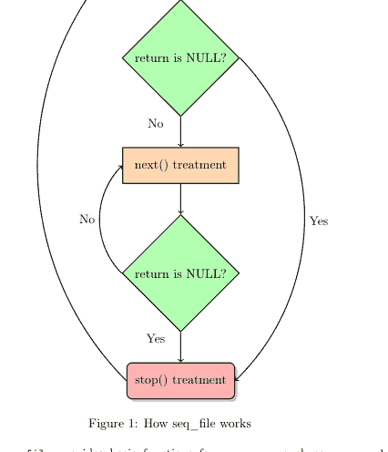

# Linux 内核模块编程指南


# 1 引言


## 1.1 作者

《Linux内核模块编程指南》最初由 Ori Pomerantz 为 Linux v2.2 编写。随着 Linux 内核的发展，Ori 维护该文档的时间减少。因此，Peter Jay Salzman 担任维护者并将指南更新为 Linux v2.4。当 Peter 跟踪 Linux v2.6 的发展时出现了类似的限制，导致 Michael Burian 加入担任共同维护者以使指南与 Linux v2.6 保持同步。Bob Mottram 通过更新 Linux v3.8 及以后的示例为指南做出了贡献。Jim Huang 然后承担了将指南更新为最近的 Linux 版本（v5.0 及以后）的任务，同时修订了 LaTeX 文档。

## 1.2 致谢

以下人员提供了更正或良好建议：

Amit Dhingra, Andy Shevchenko, Arush Sharma, Benno Bielmeier, Bob Lee, Brad Baker, Che-Chia Chang, Cheng-Shian Yeh, Chih-En Lin, Chih-Hsuan Yang, Chih-Yu Chen, Ching-Hua (Vivian) Lin, Chin Yik Ming, cvletter,


Cyril Brulebois, Daniele Paolo Scarpazza, David Porter, demonsome, Dimo Veev, Ekang Monyet, Ethan Chan, Francois Audeon, Gilad Reti, heartofrain, Horst Schiermeier, Hsin-Hsiang Peng, Ignacio Martin, I-Hsin Cheng, Ínn Kian-îng, Jian-Xing Wu, Johan Calle, keytouch, Kohei Otsuka, Kuan-Wei Chiu, manbing, Marconi Jiang, mengxinyan, Meng-Zong Tsai, Peter Lin, Roman Lakeev, Sam Erickson, Shao-Tse Hung, Shih-Sheng Yang, Stacy Prowell, Steven Lung, Tristan LeLong, Tse-Wei Lin, Tucker Polomik, Tyler Fanelli, VxTeemo, Wei-Hsin Yeh, Wei-Lun Tsai, Xatierlike Lee, Yen-Yu Chen, Yin-Chiuan Chen, Yi-Wei Lin, Yo-Jun Ling, Yu-Hsiang Tseng, YYGO.

## 1.3 什么是内核模块？

参与 Linux 内核模块的开发需要具备 C 编程语言的基础以及创建用于进程执行的常规程序的经验。这一探索深入到一个领域，其中一个不受监管的指针如果被忽视，可能导致整个文件系统的彻底消除，从而产生需要完全系统重启的场景。

Linux 内核模块被精确定义为一段能够根据需要动态加载和卸载到内核中的代码段。这些模块增强了内核功能，而无需重启系统。一个显著的例子是设备驱动模块，它促进内核与系统连接的硬件组件之间的交互。如果没有模块，主流做法倾向于单体内核，需要将新功能直接集成到内核映像中。这种方法导致内核更大，并在需要新功能时需要重建内核并随后重启系统。

## 1.4 内核模块包

Linux 发行版在包中提供命令 modprobe、insmod 和 depmod。

在 Ubuntu/Debian GNU/Linux 上：

```
sudo apt-get install build-essential kmod
```

在 Arch Linux 上：

```
sudo pacman -S gcc kmod
```

## 1.5 我的内核中有哪些模块？

要发现当前内核中已加载了哪些模块，请使用命令 lsmod。

```
lsmod
```

模块存储在文件 `/proc/modules` 中，因此你也可以通过以下方式查看它们：

```
cat /proc/modules
```

这可能是一个很长的列表，你可能更喜欢搜索特定内容。要搜索 `fat` 模块：

```
lsmod | grep fat
```

## 1.6 是否需要下载和编译内核？

为了有效遵循本指南，并没有执行此类操作的强制性要求。尽管如此，明智的做法是在虚拟机上的测试发行版中执行示例，从而降低破坏系统的任何潜在风险。

## 1.7 开始之前

在深入代码之前，某些事项需要关注。个人系统之间存在差异，且存在不同的个人方法。成功编译和加载首个“hello world”程序的成就，有时可能会带来挑战。可以放心的是，克服首次尝试中的初始障碍，为后续工作顺利进行铺平了道路。

- 1. Modversioning。 为一个内核编译的模块如果启动了不同的内核将无法加载，除非内核中启用了 CONFIG_MODVERSIONS。模块版本控制将在本指南后面讨论。在涵盖模块版本控制之前，如果运行启用了模块版本控制的内核，本指南中的示例可能无法正确工作。然而，大多数原版 Linux 发行版内核都启用了模块版本控制。如果由于版本错误在加载模块时出现困难，请考虑编译一个关闭模块版本控制的内核。

- 2. 使用 X Window System。 强烈建议从控制台提取、编译和加载本指南中讨论的所有示例。在 X Window System 中进行这些任务是不鼓励的。模块不能像 printf() 那样直接打印到屏幕，但它们可以记录信息和警告，这些信息最终会显示在屏幕上，具体在控制台中。如果模块是从 xterm 加载的，


这些信息和警告将被记录，但仅保存在 systemd 日志中。除非查阅 journalctl，否则这些日志不可见。更多信息请参阅第 4 节。为了即时获取这些信息，建议在控制台上执行所有任务。

3. 安全启动。许多现代计算机在出厂时预配置了 UEFI 安全启动（UEFI Secure Boot）——这是一项基本的安全标准，确保只能通过原始设备制造商认可的受信任软件进行启动。某些 Linux 发行版甚至默认内核配置支持安全启动。在这种情况下，内核模块需要签名的安全密钥。

如果做不到这一点，尝试插入第一个 "hello world" 模块将导致消息："ERROR: could not insert module"。如果在 dmesg 输出中出现此消息 `Lockdown: insmod: unsigned module loading is restricted; see man kernel lockdown.7`，最简单的做法是从 PC 或笔记本电脑的启动菜单中禁用 UEFI 安全启动，从而允许成功插入 "hello world" 模块。当然，另一种选择是经历生成密钥、安装系统密钥和模块签名等复杂过程来实现功能。然而，这个复杂的过程不太适合初学者。如果有兴趣，可以探索并遵循有关安全启动的更详细步骤。

# 2. 头文件

在构建任何内容之前，有必要安装内核的头文件。

在 Ubuntu/Debian GNU/Linux 上：

```bash
sudo apt-get update
apt-cache search linux-headers-`uname -r`
```

以下命令提供可用内核头文件的信息。然后，例如：

```bash
sudo apt-get install kmod linux-headers-5.4.0-80-generic
```

在 Arch Linux 上：

```bash
sudo pacman -S linux-headers
```

在 Fedora 上：

```bash
sudo dnf install kernel-devel kernel-headers
```

# 3. 示例

本文档中的所有示例都可以在 `examples` 子目录中找到。  
如果出现编译错误，可能是因为正在使用更新的内核版本，或者可能需要安装相应的内核头文件。

# 4. Hello World

## 4.1 最简单的模块

大多数刚开始编程之旅的人通常都会从某种形式的 *hello world* 示例开始。对于那些偏离这一传统的人会产生什么结果尚不清楚，但遵循这一传统似乎是明智的。学习过程将从一系列 hello world 程序开始，这些程序展示了编写内核模块的各个基本方面。

接下来展示的是最简单的模块。  
创建一个测试目录：

```bash
mkdir -p ~/develop/kernel/hello-1
cd ~/develop/kernel/hello-1
```

将此内容粘贴到你喜欢的编辑器中，并保存为 `hello-1.c`：

```c
/*
 * hello-1.c - The simplest kernel module.
 */
#include <linux/module.h> /* Needed by all modules */
#include <linux/printk.h>  /* Needed for pr_info() */

int init_module(void)
{
    pr_info("Hello world 1.\n");

    /* A non 0 return means init_module failed; module can't be loaded. */
    return 0;
}

void cleanup_module(void)
{
    pr_info("Goodbye world 1.\n");
}

MODULE_LICENSE("GPL");
```

现在你将需要一个 `Makefile`。如果你复制粘贴此内容，请将缩进改为使用制表符，而不是空格。

```makefile
obj-m += hello-1.o

PWD := $(CURDIR)

all:
	$(MAKE) -C /lib/modules/$(shell uname -r)/build M=$(PWD) modules

clean:
	$(MAKE) -C /lib/modules/$(shell uname -r)/build M=$(PWD) clean
```

在 Makefile 中，`$(CURDIR)` 可以被设置为当前工作目录的绝对路径（在所有的 -C 选项处理之后，如果有的话）。更多关于 CURDIR 的信息请参阅 GNU make 手册。  
最后，直接运行 make：

```bash
make
```

如果 Makefile 中没有 `PWD := $(CURDIR)` 语句，那么使用 sudo make 可能无法正确编译。因为某些环境变量由安全策略指定，它们无法被继承。默认的安全策略是 sudoers。在 sudoers 安全策略中，默认启用 env_reset，这会限制环境变量。具体来说，路径变量不会从用户环境中保留，而是被设置为默认值（更多信息请参阅：sudoers 手册）。你可以通过以下方式查看环境变量设置：

```bash
$ sudo -s
# sudo -V
```

下面是一个简单的 Makefile 示例，用于演示上述问题。

```makefile
all:
	echo $(PWD)
```

然后，我们可以使用 -p 参数从 Makefile 中打印出环境变量的值。

```bash
$ make -p | grep PWD
PWD = /home/ubuntu/temp
OLDPWD = /home/ubuntu
echo $(PWD)
```

PWD 变量不会通过 sudo 继承。


```
$ sudo make -p | grep PWD
echo $(PWD)
```

然而，有三种方法可以解决这个问题。

- 1. 你可以使用 -E 标志来临时保留它们。

```
$ sudo -E make -p | grep PWD
PWD = /home/ubuntu/temp
OLDPWD = /home/ubuntu
echo $(PWD)
```

- 2. 你可以通过使用 root 和 visudo 编辑 /etc/sudoers 来禁用 env_reset。

```
## sudoers file.
##
...
Defaults env_reset
## Change env_reset to !env_reset in previous line to keep all
environment variables
```

然后分别执行 env 和 sudo env。

```
# disable the env_reset
echo "user:" > non-env_reset.log; env >> non-env_reset.log
echo "root:" >> non-env_reset.log; sudo env >> non-env_reset.log
# enable the env_reset
echo "user:" > env_reset.log; env >> env_reset.log
echo "root:" >> env_reset.log; sudo env >> env_reset.log
```

你可以查看并比较这些日志以找到 env_reset 和 !env_reset 之间的差异。

- 3. 你可以通过在 /etc/sudoers 中将它们追加到 env_keep 来保留环境变量。

```
Defaults env_keep += "PWD"
```

应用上述更改后，你可以通过以下方式检查环境变量设置：

```
$ sudo -s
# sudo -V
```

如果一切顺利，你应该会发现你有一个编译好的 hello-1.ko 模块。你可以使用以下命令查看其信息：

```
modinfo hello-1.ko
```

此时命令：

```
lsmod | grep hello
```

应该不会返回任何内容。你可以尝试加载你的新模块：

```
sudo insmod hello-1.ko
```

连字符将被转换为下划线，因此当你再次尝试：

```
lsmod | grep hello
```

你现在应该能看到已加载的模块。它可以用以下命令再次移除：

```
sudo rmmod hello_1
```

注意连字符已被下划线替换。要查看刚才在日志中发生了什么：

```
journalctl --since "1 hour ago" | grep kernel
```

你现在已经了解了创建、编译、安装和移除模块的基础知识。现在来更详细地描述这个模块的工作原理。

内核模块必须至少有两个函数：一个“启动”初始化函数 init_module()，在模块被 insmod 到内核时调用；以及一个“结束”清理函数 cleanup_module()，在模块从内核移除前调用。实际上，从内核 2.3.13 开始情况已经改变。你现在可以为模块的启动和结束函数使用任何你喜欢的名字，你将在第 4.2 节学习如何做到这一点。

事实上，新方法是最推荐的方法。然而，很多人仍然使用 `init_module()` 和 `cleanup_module()` 作为他们的启动和结束函数。

通常，`init_module()` 要么向内核注册某个处理程序，要么用自己的代码替换内核函数之一，通常是做一些事情然后调用原始函数。`cleanup_module()` 函数应该撤销 `init_module()` 所做的一切，以便模块可以安全卸载。

最后，每个内核模块都需要包含 `<linux/module.h>`。我们只需要包含 `<linux/printk.h>` 仅用于 `pr_alert()` 日志级别的宏展开，你将在第 2 节学习到这一点。

- 1. 关于编码风格的一点说明。另一个对刚开始内核编程的人来说可能并不明显的事情是，你代码中的缩进应该使用 **制表符** 而不是 **空格**。这是内核的编码规范之一。你可能不喜欢它，但如果你以后要向主线提交补丁，你就需要习惯它。

- 2. 介绍打印宏。起初有 `printk`，通常后面跟着一个优先级，如 `KERN_INFO` 或 `KERN_DEBUG`。最近这也可以用一组打印宏的缩写形式表达，例如 `pr_info` 和 `pr_debug`。这只是节省了一些无意义的键盘敲击，看起来也更整洁。它们可以在 `include/linux/printk.h` 中找到。花时间阅读一下可用的优先级宏。

- 3. 关于编译。内核模块需要与常规用户空间应用略有不同地编译。以前的内核版本要求我们非常关注这些设置，它们通常存储在 Makefiles 中。虽然层次结构上组织良好，但在子级 Makefiles 中积累了许多冗余设置，使其变得庞大且难以维护。幸运的是，有一种新的方法，称为 kbuild，并且外部可加载模块的构建过程现在已完全集成到标准内核构建机制中。要了解如何编译不属于官方内核的模块，例如本指南中你会找到的所有示例，请参阅文件 `Documentation/kbuild/modules.rst`。关于内核模块 Makefiles 的更多细节可在 `Documentation/kbuild/makefiles.rst` 中找到。在开始修改 Makefiles 之前，请务必阅读这些文件及相关文件。这可能会为你节省大量工作。

这里有一个给读者的练习。看到 `init_module()` 中 return 语句上面的注释了吗？将返回值改为负数，重新编译并再次加载模块。会发生什么？


## 4.2 你好和再见

在早期的内核版本中，你必须使用 init_module 和 cleanup_module 函数，就像第一个 hello world 示例那样，但现在你可以通过使用 module_init 和 module_exit 宏来随意命名它们。这些宏定义在 include/linux/module.h 中。唯一的[content]

## 4.2 你好和再见

在早期的内核版本中，你必须使用 init_module 和 cleanup_module 函数，就像第一个 hello world 示例那样，但现在你可以通过使用 module_init 和 module_exit 宏来随意命名它们。这些宏定义在 include/linux/module.h 中。唯一的条件是你的 init 和 cleanup 函数必须在调用这些宏之前定义，否则你会得到编译错误。下面是这种技术的示例：

/*
 * hello-2.c - Demonstrating the module_init() and module_exit() macros.
 * This is preferred over using init_module() and cleanup_module().
 */
#include <linux/init.h> /* Needed for the macros */
#include <linux/module.h> /* Needed by all modules */
#include <linux/printk.h> /* Needed for pr_info() */

static int __init hello_2_init(void)
{
    pr_info("Hello, world 2\n");
    return 0;
}

static void __exit hello_2_exit(void)
{
    pr_info("Goodbye, world 2\n");
}

module_init(hello_2_init);
module_exit(hello_2_exit);

MODULE_LICENSE("GPL");

所以现在我们已经掌握了两个真正的内核模块。添加另一个模块就像这样简单：

```
obj-m += hello-1.o
obj-m += hello-2.o

PWD := $(CURDIR)

all:
	$(MAKE) -C /lib/modules/$(shell uname -r)/build M=$(PWD) modules

clean:
	$(MAKE) -C /lib/modules/$(shell uname -r)/build M=$(PWD) clean
```

现在看看 drivers/char/Makefile 中的一个真实示例。正如你所见，有些东西被硬编码到内核中（obj-y），但那些 obj-m 都去哪了？熟悉 shell 脚本的人很容易就能发现它们。对于不熟悉的人来说，你会看到的 obj-$(CONFIG_FOO) 条目

## 4.4 许可和模块文档

说实话，谁会加载或甚至关心专有模块呢？如果你这样做，那么你可能见过类似这样的情况：

```
$ sudo insmod xxxxx.ko
loading out-of-tree module taints kernel.
module license 'unspecified' taints kernel.
```

你可以使用几个宏来指示你的模块的许可。一些示例有 "GPL"、"GPL v2"、"GPL and additional rights"、"Dual BSD/GPL"、"Dual MIT/GPL"、"Dual MPL/GPL" 和 "Proprietary"。它们在 include/linux/module.h 中定义。

要引用你使用的许可，有一个名为 MODULE_LICENSE 的宏可用。这个宏和一些其他描述模块的宏在下面的示例中进行了说明。

```
/*
 * hello-4.c - Demonstrates module documentation.
 */
#include <linux/init.h> /* Needed for the macros */
#include <linux/module.h> /* Needed by all modules */
#include <linux/printk.h> /* Needed for pr_info() */

MODULE_LICENSE("GPL");
MODULE_AUTHOR("LKMPC");
MODULE_DESCRIPTION("A sample driver");

static int __init init_hello_4(void)
{
    pr_info("Hello, world 4\n");
    return 0;
}

static void __exit cleanup_hello_4(void)
{
    pr_info("Goodbye, world 4\n");
}

module_init(init_hello_4);
module_exit(cleanup_hello_4);
```

## 4.5 向模块传递命令行参数

模块可以接受命令行参数，但不是你可能习惯的 argc/argv。

要允许向你的模块传递参数，将将接收命令行参数值的变量声明为全局变量，然后使用 module_param() 宏，（定义在 include/linux/moduleparam.h 中）来设置机制。在运行时，insmod 将用给定的任何命令行参数填充变量，如 insmod mymodule.ko myvariable=5。变量声明和宏应放在模块开头以提高清晰度。示例代码应该能澄清我承认很糟糕的解释。

module_param() 宏接受 3 个参数：变量名、其类型以及 sysfs 中对应文件的权限。整数类型可以像往常一样是有符号的或无符号的。如果你想使用整数或字符串数组，请参阅 module_param_array() 和 module_param_string()。

```
int myint = 3;
module_param(myint, int, 0);
```

数组也受支持，但现在的情况与过去有所不同。为了跟踪参数的数量，你需要将一个计数变量的指针作为第三个参数传递。也可以选择忽略计数并改用 NULL。我们在这里展示了两种可能性：

```
int myintarray[2];
module_param_array(myintarray, int, NULL, 0); /* not interested in count */
short myshortarray[4];
int count;
module_param_array(myshortarray, short, &count, 0); /* put count into "count" variable */
```

一个很好的用途是让模块变量的默认值被设置，比如端口或 IO 地址。如果变量包含默认值，则执行自动检测（在其他地方解释）。否则，保持当前值。这将在后面变得清晰。

最后，有一个宏函数 MODULE_PARM_DESC()，用于记录模块可以接受的参数。它接受两个参数：变量名和描述该变量的自由格式字符串。

```
/*
 * hello-5.c - Demonstrates command line argument passing to a module.
 */
#include <linux/init.h>
#include <linux/kernel.h> /* for ARRAY_SIZE() */
#include <linux/module.h>
#include <linux/moduleparam.h>
#include <linux/printk.h>
#include <linux/stat.h>

MODULE_LICENSE("GPL");

static short int myshort = 1;
static int myint = 420;
static long int mylong = 9999;
static char *mystring = "blah";
static int myintarray[2] = { 420, 420 };
static int arr_argc = 0;


/* module_param(foo, int, 0000)
 * 第一个参数是参数的名称。
 * 第二个参数是其数据类型。
 * 最后一个参数是权限位。
 * 用于在后续阶段在 sysfs 中公开参数（如果非零）。
 */
module_param(my_short, short, S_IRUSR | S_IWUSR | S_IRGRP | S_IWGRP);
MODULE_PARAM_DESC(my_short, "A short integer");
module_param(my_int, int, S_IRUSR | S_IWUSR | S_IRGRP | S_IROTH);
MODULE_PARAM_DESC(my_int, "An integer");
module_param(my_long, long, S_IRUSR);
MODULE_PARAM_DESC(my_long, "A long integer");
module_param(my_string, charp, 0000);
MODULE_PARAM_DESC(my_string, "A character string");

/* module_param_array(name, type, num, perm);
 * 第一个参数是参数的名称。
 * 第二个参数是数组元素的 数据类型。
 * 第三个参数是指向将在模块加载时由用户初始化的数组元素数量的变量的指针。
 * 第四个参数是权限位。
 */
module_param_array(my_int_array, int, &arr_argc, 0000);
MODULE_PARAM_DESC(my_int_array, "An array of integers");

static int __init hello_5_init(void)
{
    int i;

    pr_info("Hello, world \n==============\n");
    pr_info("my short is a short integer: %d\n", my_short);
    pr_info("my int is an integer: %d\n", my_int);
    pr_info("my long is a long integer: %ld\n", my_long);
    pr_info("my string is a string: %s\n", my_string);

    for (i = 0; i < ARRAY_SIZE(my_int_array); i++)
        pr_info("my int array[%d] = %d\n", i, my_int_array[i]);

    pr_info("got %d arguments for my int array.\n", arr_argc);
    return 0;
}

static void __exit hello_5_exit(void)
{
    pr_info("Goodbye, world \n");
}

module_init(hello_5_init);
module_exit(hello_5_exit);

建议尝试以下代码：

```
$ sudo insmod hello-5.ko mystring="bebop" myintarray=-1
$ sudo dmesg -t | tail -7
my short is a short integer: 1
```
myint is an integer: 420
my long is a long integer: 9999
mystring is a string: bebop
myintarray[0] = -1
myintarray[1] = 420
got 1 arguments for myintarray.

$ sudo rmmod hello-5
$ sudo dmesg -t | tail -1
Goodbye, world

$ sudo insmod hello-5.ko mystring="supercalifragilisticexpialidocious" myintarray=-1,-1
$ sudo dmesg -t | tail -7
myshort is a short integer: 1
myint is an integer: 420
my long is a long integer: 9999
mystring is a string: supercalifragilisticexpialidocious
myintarray[0] = -1
myintarray[1] = -1
got 2 arguments for myintarray.

$ sudo rmmod hello-5
$ sudo dmesg -t | tail -1
Goodbye, world

$ sudo insmod hello-5.ko mylong=hello
insmod: ERROR: could not insert module hello-5.ko: Invalid parameters

## 4.6 跨多个文件的模块

有时将内核模块划分为多个源文件是有意义的。以下是此类内核模块的示例。

```
/*
 * start.c - 多文件模块的示例
 */

#include <linux/kernel.h> /* 我们正在进行内核工作 */
#include <linux/module.h> /* 具体来说是一个模块 */

int init_module(void)
{
    pr_info("Hello, world - this is the kernel speaking\n");
    return 0;
}

MODULE_LICENSE("GPL");
```

下一个文件：

/*
 * stop.c - 多文件模块的示例
 */

#include <linux/kernel.h> /* 我们正在进行内核工作 */
#include <linux/module.h> /* 具体来说是一个模块 */

void cleanup_module(void)
{
    pr_info("Short is the life of a kernel module\n");
}

MODULE_LICENSE("GPL");
```

最后是 makefile：

```
obj-m += hello-1.o
obj-m += hello-2.o
obj-m += hello-3.o
obj-m += hello-4.o
obj-m += hello-5.o
obj-m += startstop.o
startstop-objs := start.o stop.o

PWD := $(CURDIR)

all:
	$(MAKE) -C /lib/modules/$(shell uname -r)/build M=$(PWD) modules

clean:
	$(MAKE) -C /lib/modules/$(shell uname -r)/build M=$(PWD) clean
```

这是我们迄今为止看到的所有示例的完整 makefile。前五行没有什么特别之处，但对于最后一个示例，我们需要两行。首先我们为组合模块发明一个对象名称，其次我们告诉 make 哪些对象文件是该模块的一部分。

## 4.7 为预编译内核构建模块

显然，我们强烈建议您重新编译内核，以便您可以启用许多有用的调试功能，例如强制模块卸载（MODULE_FORCE_UNLOAD）：启用此选项后，您可以通过 sudo rmmod -f module 命令强制内核卸载模块，即使它认为不安全。此选项可以在模块开发期间为您节省大量时间和多次重启。如果您不想重新编译内核，那么您应该考虑在虚拟机上的测试发行版中运行示例。如果您搞砸了任何东西，那么您可以轻松地重新启动或恢复虚拟机（VM）。

在许多情况下，您可能希望将模块加载到预编译的运行内核中，例如随常见 Linux


distributions，或你过去编译过的内核。在某些情况下，你可能需要在运行的内核中编译并插入一个模块，而这个内核不允许重新编译，或者在你不希望重启的机器上。如果你想不出任何必须为预编译内核使用模块的情况，你可以跳过这一部分，并把本章的其余内容当作一个大脚注来对待。

现在，如果你只是安装一个内核源代码树，用它来编译你的内核模块，然后尝试将模块插入内核，在大多数情况下你会得到如下错误：

```
insmod: ERROR: could not insert module poet.ko: Invalid module format
```

更不晦涩的信息会被记录到 systemd 日志中：

```
kernel: poet: disagrees about version of symbol module_layout
```

换句话说，你的内核拒绝接受你的模块，因为版本字符串（更准确地说，是版本魔术，参见 include/linux/vermagic.h）不匹配。顺便说一下，版本魔术字符串以静态字符串的形式存储在模块对象中，以 vermagic: 开头。版本数据在模块链接到内核的/module.o 文件时被插入到你的模块中。要检查给定模块中存储的版本魔术和其他字符串，请执行命令 modinfo module.ko：

```
$ modinfo hello-4.ko
description:    A sample driver
author:         LKMPG
license:        GPL
srcversion:     B2AA7FBFCC2C39AED665382
depends:
retpoline:      Y
name:           hello_4
vermagic:       5.4.0-70-generic SMP mod_unload modversions
```

为了解决这个问题，我们可以求助于 --force-vermagic 选项，但这种解决方案可能不安全，而且在生产模块中无疑是不可接受的。因此，我们希望在与预编译内核构建时完全相同的环境中编译我们的模块。如何做到这一点，是本章剩余部分的主题。

首先，确保有一个内核源代码树可用，其版本与当前内核完全相同。然后，找到用于编译预编译内核的配置文件。通常，它在当前启动目录中可用，名称类似于 config-5.14.x。你可能只想将其复制到你的内核源代码树中：cp /boot/config-`uname -r` .config。

让我们再次关注之前的错误信息：仔细查看版本魔术字符串后，即使有两个完全相同的配置文件，版本魔术也可能存在细微差异，而这足以阻止模块插入内核。这种细微差异，即出现在模块的版本魔术中但未出现在内核中的自定义字符串，是由于某些发行版包含的 makefile 相对于原始版本进行了修改所致。然后，检查你的 Makefile，并确保指定的版本信息与当前内核使用的完全一致。例如，你的 makefile 可能如下所示：

```
VERSION = 5
PATCHLEVEL = 14
SUBLEVEL = 0
EXTRAVERSION = -rc2
```

在这种情况下，你需要将符号 EXTRAVERSION 的值恢复为 -rc2。我们建议在 /lib/modules/5.14.0-rc2/build 中保留一份用于编译内核的 makefile 的备份副本。以下简单命令应该足够：

```
cp /lib/modules/`uname -r`/build/Makefile linux-`uname -r`
```

这里 linux-`uname -r` 是你试图构建的 Linux 内核源代码。现在，请运行 make 来更新配置和版本头文件及对象：

```
$ make
SYNC      include/config/auto.conf.cmd
HOSTCC    scripts/basic/fixdep
HOSTCC    scripts/kconfig/conf.o
HOSTCC    scripts/kconfig/confdata.o
HOSTCC    scripts/kconfig/expr.o
LEX       scripts/kconfig/lexer.lex.c
YACC      scripts/kconfig/parser.tab.[ch]
HOSTCC    scripts/kconfig/preprocess.o
HOSTCC    scripts/kconfig/symbol.o
HOSTCC    scripts/kconfig/util.o
HOSTCC    scripts/kconfig/lexer.lex.o
HOSTCC    scripts/kconfig/parser.tab.o
HOSTLD    scripts/kconfig/conf
```

如果你不想实际编译内核，可以在 SPLIT 行之后立即中断构建过程（CTRL-C），因为此时你需要的文件已经准备就绪。现在你可以返回到你的模块目录并编译它。它将完全按照当前内核设置进行构建，并且可以无错误地加载到内核中。


## 5 预备知识

### 5.1 模块如何开始和结束

一个典型的程序从 main() 函数开始，执行一系列指令，并在完成这些指令后终止。然而，内核模块遵循不同的模式。模块总是以 init_module 函数或通过 module_init 调用指定的函数开始。该函数充当模块的入口点，告知内核模块的功能，并让内核做好准备，以便在必要时使用模块的函数。完成这些任务后，入口函数返回，模块保持非活动状态，直到内核需要其代码。

所有模块都通过调用 cleanup_module 或通过 module_exit 调用指定的函数来结束。这充当模块的退出函数，通过注销先前注册的功能来反转入口函数的操作。

每个模块都必须同时具有入口函数和退出函数。虽然定义这些函数有多种方法，但通常使用“入口函数”和“退出函数”这两个术语。不过，它们有时也可能被称为 init_module 和 cleanup_module，这被认为是相同的意思。

### 5.2 模块可用的函数

程序员一直在使用他们并未定义的函数。一个典型的例子就是 printf()。你使用的这些库函数由标准 C 库 libc 提供。这些函数的定义实际上直到链接阶段才会进入你的程序，链接阶段确保（例如 printf() 的）代码可用，并将调用指令修正为指向该代码。

内核模块在这方面也有所不同。在 hello world 示例中，你可能已经注意到我们使用了 pr_info() 函数，但没有包含标准 I/O 库。这是因为模块是目标文件，其符号在运行 insmod 或 modprobe 时才会被解析。符号的定义来自内核本身；你能使用的唯一外部函数是内核提供的函数。如果你好奇内核导出了哪些符号，可以查看 /proc/kallsyms。

需要记住的一点是库函数和系统调用之间的区别。库函数处于更高层次，完全在用户空间运行，为程序员提供更方便的接口，以便调用真正干活的功能——系统调用。系统调用代表用户在内核模式下运行，并由内核本身提供。库函数 printf() 可能看起来是一个非常通用的打印函数，但它真正做的只是将数据格式化为字符串，并使用底层系统调用 write() 写出字符串数据，然后由 write() 将数据发送到标准输出。

想看看 printf() 会发起哪些系统调用吗？这很简单！编译以下程序：

```
#include <stdio.h>

int main(void)
{
    printf("hello");
    return 0;
}
```

使用 gcc -Wall -o hello hello.c 进行编译。然后运行 strace ./hello 执行该可执行文件。是不是很惊讶？你看到的每一行都对应着一个系统调用。strace 是一个方便的程序，它能为你提供程序正在进行哪些系统调用的详细信息，包括调用了哪个调用、其参数是什么以及返回了什么。它是查明程序试图访问哪些文件等问题的宝贵工具。在输出快结束时，你会看到一行类似 write(1, "hello", 5)hello) 的内容。就是它，printf() 面具背后的真面目。你可能对 write 不太熟悉，因为大多数人使用库函数进行文件 I/O（如 fopen、fputs、fclose）。如果是这样，可以试着查看 man 2 write。man 手册的第 2 节专门介绍系统调用（如 kill() 和 read()）。第 3 节专门介绍库调用，你可能更熟悉这些（如 cosh() 和 random()）。

你甚至可以编写模块来替换内核的系统调用，稍后我们就会这样做。破解者经常利用这类手段来植入后门或木马，但你可以编写自己的模块来做一些更无害的事情，比如让内核在有人试图删除你系统中的文件时写下“嘻嘻，好痒！”。

### 5.3 用户空间与内核空间

内核主要管理对资源的访问，无论是显卡、硬盘还是内存。程序经常争夺相同的资源。例如，当保存文档时，updatedb 可能会开始更新 locate 数据库。像 vim 这样的编辑器会话和像 updatedb 这样的进程可以同时使用硬盘。内核的角色是维持秩序，确保用户不会不分青红皂白地访问资源。

为了管理这一点，CPU 以不同的模式运行，每种模式提供不同级别的系统控制。例如，Intel 80386 架构就有四种这样的模式，称为环（rings）。然而，Unix 仅使用其中两种环：最高环（ring 0，也称为“超级用户模式”，在此模式下所有操作都是允许的）和最低环，称为“用户模式”。

回想一下之前关于库函数与系统调用的讨论。通常，你在用户模式下使用库函数。库函数会调用一个或多个系统调用，这些系统调用代表库函数执行，但由于它们是内核本身的一部分，因此在超级用户模式下执行。一旦系统调用完成其任务，它就会返回，执行会转移回用户模式。


### 5.4 名称空间

当你编写一个小的 C 程序时，你会使用方便且对读者有意义的变量。另一方面，如果你编写的例程将成为更大问题的组成部分，你拥有的任何全局变量都属于其他人全局变量的共同体；某些变量名可能会冲突。当程序拥有大量不够有意义以至于无法区分的全局变量时，就会产生名称空间污染。在大型项目中，必须努力记住保留的名称，并找到开发唯一变量名称和符号方案的方法。

编写内核代码时，即使最小的模块也会链接到整个内核，因此这绝对是一个问题。处理此问题的最佳方法是声明所有变量为 static 并为你的符号使用明确定义的前缀。根据惯例，所有内核前缀都是小写的。如果你不想将所有内容声明为 static，另一个选择是声明一个符号表并将其注册到内核。我们稍后会讲到这一点。

文件 /proc/kallsyms 保存了内核所知道的所有符号，因此你的模块可以访问这些符号，因为它们共享内核的代码空间。

### 5.5 代码空间

内存管理是一个非常复杂的话题，O'Reilly 的《Understanding the Linux Kernel》的大部分内容专门讲解内存管理！我们并不打算成为内存管理方面的专家，但我们确实需要知道一些事实才能开始担心编写真正的模块。

如果你没有思考过段错误到底意味着什么，你可能会惊讶地听到指针实际上并不指向内存位置。至少不是真正的内存位置。当进程创建时，内核会划出一部分真实物理内存并交给进程使用，以供其执行代码、变量、栈、堆和其他计算机科学家会了解的东西使用。这段内存从 0x00000000 开始，延伸到它需要的位置。由于任意两个进程的内存空间不重叠，每个可以访问内存地址（例如 0xbffff978）的进程都会访问真实物理内存中的不同位置。进程会访问名为 0xbffff978 的索引，该索引指向为该特定进程保留的内存区域中的某种偏移。大多数情况下，像我们的 Hello, World 程序这样的进程无法访问另一个进程的空间，尽管我们稍后会谈到一些方法。

内核也有自己的内存空间。由于模块是可以动态插入和移除的内核代码（与半自治对象相对），它共享内核的代码空间而不是拥有自己的空间。因此，如果你的模块发生段错误，内核就会段错误。而且，如果你因差一错误而开始覆盖数据，那么你就会践踏内核数据（或代码）。这比听起来更糟，所以请尽力小心。

应该注意的是，前述讨论适用于任何使用单体内核的操作系统。这个概念与“将所有模块构建到内核中”略有不同，尽管基本原理相似。相比之下，还有微内核，其中模块被分配了自己的代码空间。微内核的两个著名例子包括 GNU Hurd 和 Google Fuchsia 的 Zircon 内核。

### 5.6 设备驱动程序

一类模块是设备驱动程序，它为硬件（如串口）提供功能。在 Unix 上，每块硬件都由位于 /dev 中的文件表示，称为设备文件，它提供了与硬件通信的手段。设备驱动程序代表用户程序提供通信。因此，es1370.ko 声卡设备驱动程序可能会将 /dev/sound 设备文件连接到 Ensoniq ES1370 声卡。像 mp3blaster 这样的用户空间程序可以使用 /dev/sound，而完全不知道安装了什么类型的声卡。

让我们看一些设备文件。以下是代表主 IDE 硬盘上前三个分区上的设备文件：

```
$ ls -l /dev/hda[1-3]
brw-rw---- 1 root disk 3, 1 Jul  5 2000 /dev/hda1
brw-rw---- 1 root disk 3, 2 Jul  5 2000 /dev/hda2
brw-rw---- 1 root disk 3, 3 Jul  5 2000 /dev/hda3
```

注意用逗号分隔的数字列。第一个数字称为设备的 major number。第二个数字是 minor number。major number 告诉你用于访问硬件的驱动程序。每个驱动程序都被分配一个唯一的 major number；所有具有相同 major number 的设备文件都由同一个驱动程序控制。以上所有 major number 都是 3，因为它们都由同一个驱动程序控制。

minor number 由驱动程序用来区分其控制的各种硬件。回到上面的例子，虽然这三个设备都由同一个驱动程序处理，但它们具有唯一的 minor number，因为驱动程序将它们视为不同的硬件部件。

设备分为两种类型：字符设备和块设备。区别在于块设备有请求缓冲区，因此可以自行选择响应的最佳顺序。在存储设备的情况下，这一点很重要，因为读取或写入彼此接近的扇区比读取或写入相距较远的扇区更快。另一个区别是块设备只能以块为单位接受输入和返回输出（其大小可以根据设备而变化），而字符设备可以使用任意多或任意少的字节。世界上大多数设备都是字符设备，因为它们不需要这种类型的缓冲，并且它们不以固定的块大小运行。你可以通过查看 ls -l 输出中的第一个字符来判断设备文件是块设备还是字符设备。如果它


如果是‘b’，则表示块设备；如果是‘c’，则表示字符设备。你上面看到的设备都是块设备。下面是一些字符设备（串口）：

```
crw-rw---- 1 root dial 4, 64 Feb 18 23:34 /dev/ttyS0
crw-r----- 1 root dial 4, 65 Nov 17 10:26 /dev/ttyS1
crw-rw---- 1 root dial 4, 66 Jul 5 2000 /dev/ttyS2
crw-rw---- 1 root dial 4, 67 Jul 5 2000 /dev/ttyS3
```

如果你想查看哪些主设备号已被分配，可以查看 Documentation/admin-guide/devices.txt。

系统安装时，所有这些设备文件都是通过 mknod 命令创建的。要创建一个新的字符设备，名为 coffee，主设备号为 12，次设备号为 2，只需执行 `mknod /dev/coffee c 12 2`。你并不一定要把设备文件放在 /dev 下，但按照惯例是这样做的。Linus 把他的设备文件放在 /dev 下，你也应该这么做。不过，在测试目的下创建设备文件时，放在你编译内核模块的工作目录中也是可以的。只是在完成设备驱动编写后，务必将其放到正确的位置。

最后还有几点，虽然在前面的讨论中已经隐含提及，但为了清晰起见，值得明确说明。当访问设备文件时，内核利用文件的主设备号来识别处理该访问的适当驱动程序。这表明内核并不一定依赖或需要知道次设备号。是驱动程序自己关心次设备号，用它来区分不同的硬件设备。

需要注意的是，这里提到的“硬件”一词，其抽象程度比一个可以拿在手里的物理 PCI 卡要更高一些。请看下面这两个设备文件：

```
$ ls -l /dev/sda /dev/sdb
brw-rw---- 1 root disk 8, 0 Jan 3 09:02 /dev/sda
brw-rw---- 1 root disk 8, 16 Jan 3 09:02 /dev/sdb
```

现在你可以查看这两个设备文件，并立刻知道它们是块设备，并且由同一个驱动程序（块设备主设备号 8）处理。有时，两个主设备号相同但次设备号不同的设备文件，实际上可能代表同一块物理硬件。因此请记住，在我们讨论中的“硬件”一词可能意味着非常抽象的事物。

## 6 字符设备驱动程序

### 6.1 file_operations 结构体

`file_operations` 结构体定义在 include/linux/fs.h 中，保存着指向驱动程序中定义的、用于对设备执行各种操作的函数的指针。结构体的每个字段都对应驱动程序为处理某个请求操作而定义的某个函数的地址。

例如，每个字符驱动程序都需要定义一个从设备读取数据的函数。`file_operations` 结构体保存了模块中执行该操作的函数的地址。以下是内核 5.4 中该定义的样子：

```
struct file_operations {
    struct module *owner;
    loff_t (*llseek) (struct file *, loff_t, int);
    ssize_t (*read) (struct file *, char __user *, size_t, loff_t *);
    ssize_t (*write) (struct file *, const char __user *, size_t, loff_t *);
    ssize_t (*read_iter) (struct kiocb *, struct iov_iter *);
    ssize_t (*write_iter) (struct kiocb *, struct iov_iter *);
    int (*iopoll) (struct kiocb *kiocb, bool spin);
    int (*iterate) (struct file *, struct dir_context *);
    int (*iterate_shared) (struct file *, struct dir_context *);
    __poll_t (*poll) (struct file *, struct poll_table_struct *);
    long (*unlocked_ioctl) (struct file *, unsigned int, unsigned long);
    long (*compat_ioctl) (struct file *, unsigned int, unsigned long);
    int (*mmap) (struct file *, struct vm_area_struct *);
    unsigned long mmap_supported_flags;
    int (*open) (struct inode *, struct file *);
    int (*flush) (struct file *, fl_owner_t id);
    int (*release) (struct inode *, struct file *);
    int (*fsync) (struct file *, loff_t, loff_t, int datasync);
    int (*fasync) (int, struct file *, int);
    int (*lock) (struct file *, int, struct file_lock *);
    ssize_t (*sendpage) (struct file *, struct page *, int, size_t, loff_t *, int);
    unsigned long (*get_unmapped_area)(struct file *, unsigned long, unsigned long, unsigned long, unsigned long);
    int (*check_flags)(int);
    int (*flock) (struct file *, int, struct file_lock *);
    ssize_t (*splice_write)(struct pipe_inode_info *, struct file *, loff_t *, size_t, unsigned int);
    ssize_t (*splice_read)(struct file *, loff_t *, struct pipe_inode_info *, size_t, unsigned int);
    int (*setlease)(struct file *, long, struct file_lock **, void **);
    long (*fallocate)(struct file *file, int mode, loff_t offset, loff_t len);
    void (*show_fdinfo)(struct seq_file *m, struct file *f);
    ssize_t (*copy_file_range)(struct file *, loff_t, struct file *, loff_t, size_t, unsigned int);
    loff_t (*remap_file_range)(struct file *file_in, loff_t pos_in, struct file *file_out, loff_t pos_out, loff_t len, unsigned int remap_flags);
    int (*fadvise)(struct file *, loff_t, loff_t, int);
} __randomize_layout;
```

有些操作不由驱动程序实现。例如，处理显卡的驱动程序不需要从目录结构中读取。`file_operations` 结构体中相应的条目应设置为 NULL。有一个 gcc 扩展使得对该结构体的赋值更加方便。你会在现代驱动程序中看到它的使用，它可能会让你感到惊讶。这就是对该结构体进行赋值的新方式的样子：


```
struct file_operations fops = {
    read: device_read,
    write: device_write,
    open: device_open,
    release: device_release
};
```

然而，也存在一种 C99 方式来为结构体的元素赋值，即指定初始化器，这绝对优于使用 GNU 扩展。你应该使用这种语法，以防有人想要移植你的驱动程序。这将有助于兼容性：

```
struct file_operations fops = {
    .read = device_read,
    .write = device_write,
    .open = device_open,
    .release = device_release
};
```

含义清晰，你应该注意，结构体中任何你未显式赋值的成员都将被 gcc 初始化为 NULL。

一个包含指向用于实现 read、write、open、... 系统调用的函数的指针的 struct file_operations 实例通常命名为 fops。

自 Linux v3.14 起，read、write 和 seek 操作通过使用 f_pos 特定锁被保证为线程安全，这使得文件位置更新成为互斥操作。因此，我们可以安全地实现这些操作而无需不必要的加锁。

此外，自 Linux v5.6 起，proc_ops 结构被引入以在注册 proc 处理程序时替代 file_operations 结构的使用。更多信息请参见 7.1 节。

## 6.2 The file structure

每个设备在内核中都由一个 file 结构表示，该结构定义在 include/linux/fs.h 中。请注意，file 是一个内核级结构，永远不会出现在用户空间程序中。它与 glibc 定义的 FILE 不同，也永远不会出现在内核空间函数中。此外，其名称有点误导；它代表一个抽象的已打开的 'file'，而不是磁盘上的文件，后者由名为 inode 的结构表示。

struct file 的一个实例通常命名为 filp。你也会看到它被称为 struct file 对象。抵制这种诱惑。

继续查看 file 的定义。你看到的大多数条目，如 struct dentry 都不被设备驱动程序使用，你可以忽略它们。这是因为驱动程序不会直接填充 file；它们只使用 file 中由其他地方创建的结构。

## 6.3 Registering A Device

如前所述，字符设备是通过设备文件访问的，通常位于 /dev 中。这是约定俗成的。在编写驱动程序时，将设备文件放在当前目录是可以的。只要确保你将其放置在 /dev 中以用于生产驱动程序。主设备号告诉你哪个驱动程序处理哪个设备文件。次设备号仅由驱动程序本身使用，以区分它正在操作的设备，以防驱动程序处理多个设备。

将驱动程序添加到系统意味着将其注册到内核。这与在模块初始化期间为其分配主设备号同义。你可以通过使用 register_chrdev 函数来完成，该函数由 include/linux/fs.h 定义。

```
int register_chrdev(unsigned int major, const char *name, struct
→ file_operations *fops);
```

其中 unsigned int major 是你想要请求的主设备号，const char *name 是设备在 /proc/devices 中显示的名称，struct file_operations *fops 是指向驱动程序的 file_operations 表的指针。负返回值表示注册失败。请注意，我们没有向 register_chrdev 传递次设备号。这是因为内核不关心次设备号；只有我们的驱动程序使用它。

现在问题是，如何获取一个主设备号而不劫持已在使用的号码？最简单的方法是查看 Documentation/admin-guide/devices.txt 并选择一个未使用的号码。这是一种糟糕的做法，因为你永远无法确定你选择的号码以后是否会被分配。答案是你可以要求内核为你分配一个动态主设备号。

如果你向 register_chrdev 传递 0 作为主设备号，返回值将是动态分配的主设备号。缺点是你无法提前创建设备文件，因为你不知道主设备号会是什么。有几种方法可以做到这一点。首先，驱动程序本身可以打印新分配的号码，我们可以手动创建设备文件。其次，新注册的设备将在 /proc/devices 中有一个条目，我们可以手动创建设备文件或编写一个 shell 脚本来读取该文件并创建设备文件。第三种方法是，我们可以在成功注册后使用 device_create 函数让我们的驱动程序创建设备文件，并在调用 cleanup_module 期间使用 device_destroy。

然而，register_chrdev() 会占用与给定主设备号相关联的一系列次设备号。推荐的减少字符设备注册浪费的方式是使用 cdev 接口。

较新的接口将字符设备注册分为两个不同的步骤。首先，我们应该注册一个设备号范围，这可以通过 register_chrdev_region 或 alloc_chrdev_region 完成。


```
int register_chrdev_region(dev_t from, unsigned count, const char *name);
int alloc_chrdev_region(dev_t *dev, unsigned baseminor, unsigned count, const char *name);
```

这两个函数之间的选择取决于你是否知道设备的主设备号。如果已知设备的主设备号，可使用 `register_chrdev_region`；如果希望动态分配一个主设备号，则使用 `alloc_chrdev_region`。

其次，我们应该为字符设备初始化数据结构 `struct cdev`，并将其与设备号关联起来。要初始化 `struct cdev`，可以通过类似下面的代码序列来实现。

```
struct cdev *my_cdev = cdev_alloc();
my_cdev->ops = &my_fops;
```

不过，常见的用法模式是将 `struct cdev` 嵌入到你自己的设备专用结构体中。在这种情况下，我们需要使用 `cdev_init` 进行初始化。

```
void cdev_init(struct cdev *cdev, const struct file_operations *fops);
```

初始化完成后，我们可以通过 `cdev_add` 将字符设备添加到系统中。

```
int cdev_add(struct cdev *p, dev_t dev, unsigned count);
```

若要查找使用该接口的示例，可以参见第 9 节中描述的 `ioctl.c`。

## 6.4 注销设备

我们不能允许内核模块在 root 用户心血来潮时就被 rmmod 卸载。如果设备文件正被一个进程打开，而我们又移除了内核模块，那么使用该文件将导致调用原先相应函数（读/写）所在的内存位置。如果幸运的话，那里没有加载其他代码，我们只会看到一条难看的错误信息。如果不幸的话，另一个内核模块被加载到了同一位置，这意味着会跳转到内核中另一个函数的中间。这样做的结果是无法预料的，但肯定不会是什么好事。

通常，当你不允许某件事发生时，你会从本该执行该操作的函数中返回一个错误码（负数）。对于 `cleanup_module` 来说这不可能，因为它是一个 void 函数。不过，有一个计数器用来跟踪有多少进程正在使用你的模块。你可以通过命令 `cat /proc/modules` 或 `lsmod` 查看第 3 个字段来看到它的值。如果该值不为零，`rmmod` 将失败。注意，你不需要在 `cleanup_module` 中检查该计数器，因为系统调用 `sys_delete_module` 会替你执行检查，该调用定义在 `include/linux/syscalls.h` 中。你不应该直接使用这个计数器，但 `include/linux/module.h` 中定义了一些函数，可以让你增加、减少和显示这个计数器：

- `try_module_get(THIS_MODULE)`：增加当前模块的引用计数。
- `module_put(THIS_MODULE)`：减少当前模块的引用计数。
- `module_refcount(THIS_MODULE)`：返回当前模块的引用计数值。

保持计数器准确非常重要；如果你搞丢了正确的使用计数，你将永远无法卸载该模块；现在只能重启了，各位。在模块开发过程中，这种情况迟早会发生在你身上。

## 6.5 chardev.c

下一个代码示例创建了一个名为 `chardev` 的字符驱动程序。你可以转储它的设备文件。

```
cat /proc/devices
```

（或者用程序打开该文件），驱动程序会将设备文件被读取的次数写入该文件中。我们不支持向该文件写入（如 `echo "hi" > /dev/hello`），但会捕获这些尝试并告知用户该操作不受支持。如果你看不出我们对读入缓冲区的数据做了什么，也不必担心；我们对它做的并不多。我们只是读入数据并打印一条消息，确认已收到数据。

在多线程环境下，如果没有任何保护，对同一内存的并发访问可能会导致竞态条件，并且无法保证性能。在内核模块中，多个实例访问共享资源时也可能出现这个问题。因此，一种解决方案是强制独占访问。我们使用原子比较并交换（CAS，Compare-And-Swap）来维护状态 `CDEV_NOT_USED` 和 `CDEV_EXCLUSIVE_OPEN`，以判断该文件当前是否已被某人打开。CAS 会将某个内存位置的内容与期望值进行比较，只有在两者相同时，才将该内存位置的内容修改为期望值。更多并发细节请参阅第 12 节。


```
/*
 * chardev.c: Creates a read-only char device that says how many times
 * you have read from the dev file
 */

#include <linux/atomic.h>
#include <linux/cdev.h>
#include <linux/delay.h>
#include <linux/device.h>
#include <linux/fs.h>
#include <linux/init.h>
#include <linux/kernel.h> /* for sprint() */
#include <linux/module.h>
#include <linux/printk.h>
#include <linux/types.h>
#include <linux/uaccess.h> /* for get_user and put_user */
#include <linux/version.h>

#include <asm/errno.h>

/* Prototypes - this would normally go in a .h file */
static int device_open(struct inode *, struct file *);
static int device_release(struct inode *, struct file *);
static ssize_t device_read(struct file *, char __user *, size_t, loff_t *);
static ssize_t device_write(struct file *, const char __user *, size_t,
    loff_t *);

#define SUCCESS 0
#define DEVICE_NAME "chardev" /* Dev name as it appears in /proc/devices */
#define BUF_LEN 80 /* Max length of the message from the device */

/* Global variables are declared as static, so are global within the file. */

static int major; /* major number assigned to our device driver */

enum {
    CDEV_NOT_USED,
    CDEV_EXCLUSIVE_OPEN,
};

/* Is device open? Used to prevent multiple access to device */
static atomic_t already_open = ATOMIC_INIT(CDEV_NOT_USED);

static char msg[BUF_LEN + 1]; /* The msg the device will give when asked */

static struct class *cls;

static struct file_operations chardev_fops = {
    .read = device_read,
    .write = device_write,
    .open = device_open,
    .release = device_release,
};

static int __init chardev_init(void)
{
module_put(THIS_MODULE);

return SUCCESS;
}

/* Called when a process, which already opened the dev file, attempts to
 * read from it.
 */
static ssize_t device_read(struct file *filp, /* see include/linux/fs.h */
			    char __user *buffer, /* buffer to fill with data */
			    size_t length, /* length of the buffer */
			    loff_t *offset)
{
	/* Number of bytes actually written to the buffer */
	int bytes_read = 0;
	const char *msg_ptr = msg;

	if (!(*msg_ptr + *offset)) { /* we are at the end of message */
		*offset = 0; /* reset the offset */
		return 0; /* signify end of file */
	}

	msg_ptr += *offset;

	/* Actually put the data into the buffer */
	while (length && *msg_ptr) {
		/* The buffer is in the user data segment, not the kernel
		 * segment so "*" assignment won't work. We have to use
		 * put_user which copies data from the kernel data segment to
		 * the user data segment.
		 */
		put_user(*(msg_ptr++), buffer++);
		length--;
		bytes_read++;
	}

	*offset += bytes_read;

	/* Most read functions return the number of bytes put into the buffer. */
	return bytes_read;
}

/* Called when a process writes to dev file: echo "hi" > /dev/hello */
static ssize_t device_write(struct file *filp, const char __user *buff,
			    size_t len, loff_t *off)
{
	pr_alert("Sorry, this operation is not supported.\n");
	return -EINVAL;
}

module_init(chardev_init);
module_exit(chardev_exit);

MODULE_LICENSE("GPL");
```

## 6.6 为多个内核版本编写模块

系统调用是内核向进程展示的主要接口，通常在不同版本之间保持不变。可能会添加新的系统调用，但通常旧有的系统调用行为与之前完全一致。这是为了向后兼容——新内核版本不应破坏常规进程。在大多数情况下，设备文件也会保持不变。另一方面，内核内部的接口在不同版本之间可能会且确实会发生变化。

不同内核版本之间存在差异，如果你想要支持多个内核版本，你会发现需要编写条件编译指令。实现方式是将宏 `LINUX_VERSION_CODE` 与宏 `KERNEL_VERSION` 进行比较。在内核版本 a.b.c 中，该宏的值为 2^16 a + 2^8 b + c。

## 7 /proc 文件系统

在 Linux 中，还有另一种机制让内核和内核模块向进程发送信息——/proc 文件系统。它最初的设计目的是允许轻松访问有关进程的信息（因此得名），现在已被内核中每一个有值得报告的内容的部分所使用，例如提供模块列表的 `/proc/modules` 和收集内存使用统计信息的 `/proc/meminfo`。

使用 proc 文件系统的方法与设备驱动程序中使用的方法非常相似——创建一个包含 /proc 文件所需所有信息的结构体，包括指向任何处理函数的指针（在我们的例子中只有一个，即当有人尝试读取 /proc 文件时被调用的那个函数）。然后，`init_module` 将该结构体注册到内核，`cleanup_module` 则将其注销。

普通文件系统位于磁盘上，而不仅仅存在于内存中（/proc 就是位于内存中），在这种情况下，索引节点（简称 inode）编号是指向磁盘上文件 inode 所在位置的指针。inode 包含有关文件的信息，例如文件权限，以及指向文件数据所在磁盘位置的一个或多个指针。

由于在文件被打开或关闭时我们不会被调用，因此在这个模块中没有地方放置 `try_module_get` 和 `module_put`，如果文件被打开后模块被移除，就没有办法避免后果。

这里有一个简单示例，演示如何使用 /proc 文件。这就是 /proc 文件系统的 HelloWorld。它由三个部分组成：在函数 `init_module` 中创建文件 `/proc/helloworld`，在回调函数 `procfile_read` 中当读取文件 `/proc/helloworld` 时返回值（以及一个缓冲区），并在函数 `cleanup_module` 中删除文件 `/proc/helloworld`。

当模块通过函数 `proc_create` 加载时，会创建 `/proc/helloworld`。返回值是指向 `struct proc_dir_entry` 的指针，


它将被用于配置文件 /proc/helloworld（例如，该文件的所有者）。空返回值表示创建失败。

每次读取 /proc/helloworld 文件时，都会调用 `procfile_read` 函数。该函数的两个参数非常重要：缓冲区（第二个参数）和偏移量（第四个参数）。缓冲区的内容将返回给读取它的应用程序（例如 `cat` 命令）。偏移量是文件中的当前位置。如果函数的返回值不为空，则该函数会再次被调用。所以要小心这个函数，如果它从不返回零，读取函数将被无限调用。

```
$ cat /proc/helloworld
HelloWorld!
```

```
/*
 * procfs1.c
 */

#include <linux/kernel.h>
#include <linux/module.h>
#include <linux/proc_fs.h>
#include <linux/uaccess.h>
#include <linux/version.h>

#if LINUX_VERSION_CODE >= KERNEL_VERSION(5, 6, 0)
#define HAVE_PROC_OPS
#endif

#define procfs_name "helloworld"

static struct proc_dir_entry *our_proc_file;

static ssize_t procfile_read(struct file *file_pointer, char __user *buffer,
    size_t buffer_length, loff_t *offset)
{
    char s[13] = "HelloWorld!\n";
    int len = sizeof(s);
    ssize_t ret = len;

    if (*offset >= len || copy_to_user(buffer, s, len)) {
        pr_info("copy_to_user failed\n");
        ret = 0;
    } else {
        pr_info("procfile read %s\n",
            file_pointer->f_path.dentry->d_name.name);
        *offset += len;
    }

    return ret;
}

#ifdef HAVE_PROC_OPS
static const struct proc_ops proc_file_fops = {
    .proc_read = procfile_read,
};
#else
static const struct file_operations proc_file_fops = {
    .read = procfile_read,
};
#endif

static int __init procfs_init(void)
{
    our_proc_file = proc_create(procfs_name, 0644, NULL, &proc_file_fops);
    if (NULL == our_proc_file) {
        pr_alert("Error:Could not initialize /proc/%s\n", procfs_name);
        return -ENOMEM;
    }

    pr_info("/proc/%s created\n", procfs_name);
    return 0;
}

static void __exit procfs_exit(void)
{
    proc_remove(our_proc_file);
    pr_info("/proc/%s removed\n", procfs_name);
}

module_init(procfs_init);
module_exit(procfs_exit);

MODULE_LICENSE("GPL");
```

### 7.1 proc_ops 结构

`proc_ops` 结构体在 Linux v5.6+ 的 `include/linux/proc_fs.h` 中定义。在更老的内核中，/proc 文件系统使用 `file_operations` 来实现自定义钩子，但其中包含一些在 VFS 中不必要的成员，并且每次 VFS 扩展 `file_operations` 集合时，/proc 代码都会变得臃肿。另一方面，这种结构体不仅节省了空间，还节省了一些操作，从而提高了性能。例如，在 /proc 中永远不会消失的文件可以将 `proc_flag` 设置为 `PROC_ENTRY_PERMANENT`，从而在每次 open/read/close 序列中节省 2 次原子操作、1 次分配和 1 次释放。

### 7.2 读写 /proc 文件

我们已经看到了一个非常简单的 /proc 文件示例，其中只读取了 /proc/helloworld 文件。也可以向 /proc 文件写入。它的工作方式与读取相同，当 /proc 文件被写入时会调用一个函数。但与读取有一点不同，数据来自用户，因此你必须使用 `copy_from_user` 或 `get_user` 将数据从用户空间导入内核空间。

使用 `copy_from_user` 或 `get_user` 的原因是 Linux 内存（在 Intel 架构上，在其他一些处理器上可能有所不同）是分段的。这意味着指针本身并不引用内存中的唯一位置，而只是内存段中的一个位置，你需要知道它属于哪个内存段才能使用它。内核有一个内存段，每个进程也各有一个内存段。

进程唯一可以访问的内存段是它自己的内存段，因此在编写普通程序作为进程运行时，无需担心段的问题。当你编写内核模块时，通常需要访问内核内存段，这由系统自动处理。但是，当需要在当前运行的进程和内核之间传递内存缓冲区的内容时，内核函数会接收到一个指向进程段中内存缓冲区的指针。`put_user` 和 `get_user` 宏允许你访问该内存。这些函数每次只处理一个字符，如果要处理多个字符，可以使用 `copy_to_user` 和 `copy_from_user`。由于（读或写函数中的）缓冲区位于内核空间，对于写函数，你需要导入数据，因为它来自用户空间；但对于读函数则不需要，因为数据已经在内核空间。

```
/*
 * procfs2.c - create a "file" in /proc
 */

#include <linux/kernel.h> /* We're doing kernel work */
#include <linux/module.h> /* Specifically, a module */
#include <linux/proc_fs.h> /* Necessary because we use the proc fs */
#include <linux/uaccess.h> /* for copy_from_user */
#include <linux/version.h>

#if LINUX_VERSION_CODE >= KERNEL_VERSION(5, 6, 0)
#define HAVE_PROC_OPS
#endif

#define PROCFS_MAX_SIZE 1024
#define PROCFS_NAME "bufferik"

/* This structure hold information about the /proc file */
static struct proc_dir_entry *our_proc_file;

/* The buffer used to store character for this module */
static char procfs_buffer[PROCFS_MAX_SIZE];

/* The size of the buffer */
static unsigned long procfs_buffer_size = 0;

/* This function is called then the /proc file is read */
static ssize_t procfile_read(struct file *file_pointer, char __user *buffer,
    size_t buffer_length, loff_t *offset)
{
    char s[13] = "HelloWorld\n";
    int len = sizeof(s);
    ssize_t ret = len;

    if (*offset >= len || copy_to_user(buffer, s, len)) {
        pr_info("copy_to_user failed\n");
        ret = 0;
    } else {
```


```
39    pr_info("procfile read %s\n", file_pointer->f_path.dentry->d_name.name);
40    -> offset += len;
41    }
42    
43    return ret;
44    }
45    
46    /* This function is called with the /proc file is written. */
47    static ssize_t procfile_write(struct file *file, const char __user *buff,
48                                 size_t len, loff_t *off)
49    {
50        procfs_buffer_size = len;
51        if (procfs_buffer_size >= PROCFS_MAX_SIZE)
52            procfs_buffer_size = PROCFS_MAX_SIZE - 1;
    
54        if (copy_from_user(procfs_buffer, buff, procfs_buffer_size))
55            return -EFAULT;
56    
57        procfs_buffer[procfs_buffer_size] = '\0';
58        *off += procfs_buffer_size;
59        pr_info("procfile write %s\n", procfs_buffer);
60        return procfs_buffer_size;
61    }
62    
63    #ifdef HAVE_PROC_OPS
64    static const struct proc_ops proc_file_fops = {
65        .proc_read = procfile_read,
66        .proc_write = procfile_write,
67    };
68    #else
69    static const struct file_operations proc_file_fops = {
70        .read = procfile_read,
71        .write = procfile_write,
72    };
73    #endif
    
75    static int __init procfs2_init(void)
76    {
77        our_proc_file = proc_create(PROCFS_NAME, 0644, NULL, &proc_file_fops);
78        if (NULL == our_proc_file) {
79            pr_alert("Error:Could not initialize /proc/%s\n", PROCFS_NAME);
80            return -ENOMEM;
81        }
82    
83        pr_info("/proc/%s created\n", PROCFS_NAME);
84        return 0;
85    }
86    
87    static void __exit procfs2_exit(void)
88    {
89        proc_remove(our_proc_file);
90        pr_info("/proc/%s removed\n", PROCFS_NAME);
91    }
92    
93    module_init(procfs2_init);
```
module_exit(procfs2_exit);
MODULE_LICENSE("GPL");

## 7.3 使用标准文件系统管理 /proc 文件

我们已经看到了如何使用 /proc 接口读取和写入一个 /proc 文件。但也可以使用 inode 来管理 /proc 文件。主要关注点是使用高级功能，例如权限。

在 Linux 中，存在一种用于文件系统注册的标准机制。由于每个文件系统都必须拥有自己的函数来处理 inode 和文件操作，因此有一个特殊的结构来保存指向所有这些函数的指针，struct inode_operations，其中包含指向 struct proc_ops 的指针。

文件操作和 inode 操作之间的区别在于，文件操作处理文件本身，而 inode 操作处理引用文件的方式，例如创建指向它的链接。

在 /proc 中，每当我们注册一个新文件时，我们就可以指定将使用哪个 struct inode_operations 来访问它。这就是我们使用的机制，一个包含指向 struct proc_ops 的指针的 struct inode_operations，而 struct proc_ops 包含指向我们的 procfs_read 和 procfs_write 函数的指针。

这里另一个有趣的点是 module_permission 函数。每当一个进程尝试对 /proc 文件执行某些操作时，就会调用此函数，并且它可以决定是否允许访问。目前它仅基于操作和当前用户（在 current 中可用，指向包含有关当前正在运行进程的信息的结构）的 uid，但它可以基于我们喜欢的任何内容，例如其他进程正在对同一文件执行的操作、一天中的时间，或我们收到的最后输入。

需要注意的是，内核中读写角色的标准用法是反转的。读函数用于输出，而写函数用于输入。原因在于读和写指的是用户的观点——如果一个进程从内核读取某些内容，那么内核需要输出它，而如果一个进程向内核写入某些内容，那么内核将其作为输入接收。

```
/*
 * procfs3.c
 */

#include <linux/kernel.h>
#include <linux/module.h>
#include <linux/proc_fs.h>
#include <linux/sched.h>
#include <linux/uaccess.h>
#include <linux/version.h>
#if LINUX_VERSION_CODE >= KERNEL_VERSION(5, 10, 0)
#include <linux/minmax.h>
#endif
```


#if LINUX_VERSION_CODE >= KERNEL_VERSION(5, 6, 0)
#define HAVE_PROC_OPS
#endif

#define PROCFS_MAX_SIZE 2048UL
#define PROCFS_ENTRY_FILENAME "buffer2k"

static struct proc_dir_entry *our_proc_file;
static char procfs_buffer[PROCFS_MAX_SIZE];
static unsigned long procfs_buffer_size = 0;

static ssize_t procfs_read(struct file *filp, char __user *buffer,
    size_t length, loff_t *offset)
{
    if (*offset || procfs_buffer_size == 0) {
        pr_debug("procfs_read: END\n");
        *offset = 0;
        return 0;
    }
    procfs_buffer_size = min(procfs_buffer_size, length);
    if (copy_to_user(buffer, procfs_buffer, procfs_buffer_size))
        return -EFAULT;
    *offset += procfs_buffer_size;
    pr_debug("procfs_read: read %lu bytes\n", procfs_buffer_size);
    return procfs_buffer_size;
}
static ssize_t procfs_write(struct file *file, const char __user *buffer,
    size_t len, loff_t *off)
{
    procfs_buffer_size = min(PROCFS_MAX_SIZE, len);
    if (copy_from_user(procfs_buffer, buffer, procfs_buffer_size))
        return -EFAULT;
    *off += procfs_buffer_size;
    pr_debug("procfs_write: write %lu bytes\n", procfs_buffer_size);
    return procfs_buffer_size;
}
static int procfs_open(struct inode *inode, struct file *file)
{
    try_module_get(THIS_MODULE);
    return 0;
}
static int procfs_close(struct inode *inode, struct file *file)
{
    module_put(THIS_MODULE);
    return 0;
}

#if defined HAVE_PROC_OPS
static struct proc_ops file_ops_4_our_proc_file = {
    .proc_read = procfs_read,
    .proc_write = procfs_write,
    .proc_open = procfs_open,
    .proc_release = procfs_close,
};
#else
static const struct file_operations file_ops_4_our_proc_file = {
    .read = procfs_read,
    .write = procfs_write,
    .open = procfs_open,
    .release = procfs_close,
};
#endif

static int __init procfs3_init(void)
{
    our_proc_file = proc_create(PROCFS_ENTRY_FILENAME, 0644, NULL, &file_ops_4_our_proc_file);
    if (our_proc_file == NULL) {
        pr_debug("Error: Could not initialize /proc/%s\n", PROCFS_ENTRY_FILENAME);
        return -ENOMEM;
    }
    proc_set_size(our_proc_file, 80);
    proc_set_user(our_proc_file, GLOBAL_ROOT_UID, GLOBAL_ROOT_GID);
    pr_debug("/proc/%s created\n", PROCFS_ENTRY_FILENAME);
    return 0;
}

static void __exit procfs3_exit(void)
{
    remove_proc_entry(PROCFS_ENTRY_FILENAME, NULL);
    pr_debug("/proc/%s removed\n", PROCFS_ENTRY_FILENAME);
}

module_init(procfs3_init);
module_exit(procfs3_exit);

MODULE_LICENSE("GPL");

Still hungry for procfs examples? Well, first of all keep in mind, there are rumors around, claiming that procfs is on its way out, consider using sysfs instead. Consider using this mechanism, in case you want to document something kernel related yourself.

## 7.4 Manage /proc file with seq_file

As we have seen, writing a /proc file may be quite “complex”. So to help people writing /proc file, there is an API named seq_file that helps formatting a /proc file for output. It is based on sequence, which is composed of 3 functions: start(), next(), and stop(). The seq_file API starts a sequence when a user read the /proc file.

A sequence begins with the call of the function start(). If the return is a non NULL value, the function next() is called; otherwise, the stop() function is called directly. This function is an iterator, the goal is to go through all the data. Each time next() is called, the function show() is also called. It writes data values in the buffer read by the user. The function next() is called until it

returns NULL. The sequence ends when next() returns NULL, then the function stop() is called.

BE CAREFUL: when a sequence is finished, another one starts. That means that at the end of function stop(), the function start() is called again. This loop finishes when the function start() returns NULL. You can see a scheme of this in the Figure 1.



Figure 1: How seq_file works

The seq_file provides basic functions for proc_ops, such as seq_read, seq_lseek, and some others. But nothing to write in the /proc file. Of course, you can still use the same way as in the previous example.

```
/*
```


```c
/*
 * procfs4.c - create a "file" in /proc
 * This program uses the seq_file library to manage the /proc file.
 */

#include <linux/kernel.h> /* We are doing kernel work */
#include <linux/module.h> /* Specifically, a module */
#include <linux/proc_fs.h> /* Necessary because we use proc fs */
#include <linux/seq_file.h> /* for seq_file */
#include <linux/version.h>

#if LINUX_VERSION_CODE >= KERNEL_VERSION(5, 6, 0)
#define HAVE_PROC_OPS
#endif

#define PROC_NAME "iter"

/* This function is called at the beginning of a sequence.
 * ie, when:
 *   - the /proc file is read (first time)
 *   - after the function stop (end of sequence)
 */
static void *my_seq_start(struct seq_file *s, loff_t *pos)
{
    static unsigned long counter = 0;

    /* beginning a new sequence? */
    if (*pos == 0) {
        /* yes => return a non null value to begin the sequence */
        return &counter;
    }

    /* no => it is the end of the sequence, return end to stop reading */
    *pos = 0;
    return NULL;
}

/* This function is called after the beginning of a sequence.
 * It is called until the return is NULL (this ends the sequence).
 */
static void *my_seq_next(struct seq_file *s, void *v, loff_t *pos)
{
    unsigned long *tmp_v = (unsigned long *)v;
    (*tmp_v)++;
    (*pos)++;
    return NULL;
}

/* This function is called at the end of a sequence. */
static void my_seq_stop(struct seq_file *s, void *v)
{
    /* nothing to do, we use a static value in start() */
}

/* This function is called for each "step" of a sequence. */
static int my_seq_show(struct seq_file *s, void *v)
{
    loff_t *pos = (loff_t *)v;
    seq_printf(s, "%ld\n", *pos);
    return 0;
}

/* This structure gather "function" to manage the sequence */
static struct seq_operations my_seq_ops = {
    .start = my_seq_start,
    .next = my_seq_next,
    .stop = my_seq_stop,
    .show = my_seq_show,
};

/* This function is called when the /proc file is open. */
static int my_open(struct inode *inode, struct file *file)
{
    return seq_open(file, &my_seq_ops);
};

/* This structure gather "function" that manage the /proc file */
#ifdef HAVE_PROC_OPS
static const struct proc_ops my_file_ops = {
    .proc_open = my_open,
    .proc_read = seq_read,
    .proc_lseek = seq_lseek,
    .proc_release = seq_release,
};
#else
static const struct file_operations my_file_ops = {
    .open = my_open,
    .read = seq_read,
    .llseek = seq_lseek,
    .release = seq_release,
};
#endif

static int __init procfs4_init(void)
{
    struct proc_dir_entry *entry;

    entry = proc_create(PROC_NAME, 0, NULL, &my_file_ops);
    if (entry == NULL) {
        pr_debug("Error: Could not initialize /proc/%s\n", PROC_NAME);
        return -ENOMEM;
    }

    return 0;
}

static void __exit procfs4_exit(void)
{
    remove_proc_entry(PROC_NAME, NULL);
    pr_debug("/proc/%s removed\n", PROC_NAME);
}

module_init(procfs4_init);
module_exit(procfs4_exit);
MODULE_LICENSE("GPL");
```

如果您想要更多信息，可以阅读以下网页：

- https://lwn.net/Articles/22355/
- https://kernelnewbies.org/Documents/SeqFileHowTo

您也可以阅读 Linux 内核中 fs/seq_file.c 的代码。

## 8 sysfs: 与您的模块交互

sysfs 允许您通过在模块内部读取或设置变量，从用户空间与正在运行的内核进行交互。这对于调试目的很有用，或者只是作为应用程序或脚本的接口。您可以在系统的 /sys 目录下找到 sysfs 目录和文件。

```
ls -l /sys
```

属性可以以文件系统中的普通文件的形式为 kobject 导出。Sysfs 将文件 I/O 操作转发到为属性定义的方法，提供读写内核属性的手段。

一个属性定义很简单：

```
struct attribute {
    char *name;
    struct module *owner;
    umode_t mode;
};

int sysfs_create_file(struct kobject *kobj, const struct attribute *attr);
void sysfs_remove_file(struct kobject *kobj, const struct attribute *attr);
```

例如，驱动模型定义 struct device_attribute 如下：

```
struct device_attribute {
    struct attribute attr;
    ssize_t (*show)(struct device *dev, struct device_attribute *attr,
        char *buf);
    ssize_t (*store)(struct device *dev, struct device_attribute *attr,
        const char *buf, size_t count);
};

int device_create_file(struct device *, const struct device_attribute *);
void device_remove_file(struct device *, const struct device_attribute *);
```


要读取或写入属性，在声明属性时必须指定 show() 或 store() 方法。对于常见情况，include/linux/sysfs.h 提供了便捷宏（__ATTR、__ATTR_RO、__ATTR_WO 等），以使定义属性更简单，同时使代码更简洁、更易读。

下面给出了一个包含通过 sysfs 访问的变量的 hello world 模块示例。

```
/*
 * hello-sysfs.c sysfs example
 */
#include <linux/fs.h>
#include <linux/init.h>
#include <linux/kobject.h>
#include <linux/module.h>
#include <linux/string.h>
#include <linux/sysfs.h>

static struct kobject *my_module;

/* the variable you want to be able to change */
static int myvariable = 0;

static ssize_t myvariable_show(struct kobject *kobj,
                                struct kobj_attribute *attr, char *buf)
{
    return sprintf(buf, "%d\n", myvariable);
}

static ssize_t myvariable_store(struct kobject *kobj,
                                struct kobj_attribute *attr, const char *buf,
                                size_t count)
{
    sscanf(buf, "%d", &myvariable);
    return count;
}

static struct kobj_attribute myvariable_attribute =
    __ATTR(myvariable, 0660, myvariable_show, myvariable_store);

static int __init mymodule_init(void)
{
    int error = 0;

    pr_info("module: initialized\n");

    mymodule = kobject_create_and_add("mymodule", kernel_kobj);
    if (!mymodule)
        return -ENOMEM;

    error = sysfs_create_file(mymodule, &myvariable_attribute.attr);
    if (error) {
        kobject_put(mymodule);
        pr_info("failed to create the myvariable file "
                "in /sys/kernel/mymodule\n");
    }
```

```
50 |     return error;
51 | }
52 | static void __exit mymodule_exit(void)
53 | {
54 |     pr_info("mymodule: Exit success\n");
55 |     kobject_put(mymodule);
56 | }
57 | 
58 | module_init(mymodule_init);
59 | module_exit(mymodule_exit);
60 | 
61 | MODULE_LICENSE("GPL");
```

编译并安装模块：

```
1 make
2 sudo insmod hello-sysfs.ko
```

检查它是否存在：

```
1 lsmod | grep hello_sysfs
```

myvariable 的当前值是多少？

```
1 cat /sys/kernel/mymodule/myvariable
```

设置 myvariable 的值并检查它是否已更改。

```
1 echo "32" | sudo tee /sys/kernel/mymodule/myvariable
2 cat /sys/kernel/mymodule/myvariable
```

最后，移除测试模块：

```
1 sudo rmmod hello_sysfs
```

在上述情况下，我们使用一个简单的 kobject 在 sysfs 下创建一个目录，并与其属性进行通信。自 Linux v2.6.0 起，kobject 结构便出现了。它最初旨在作为统一管理引用计数对象的内核代码的简单方法。经过一些功能蔓延后，它现在已成为将大部分设备模型及其 sysfs 接口粘合在一起的胶水。有关 kobject 和 sysfs 的更多信息，请参阅 Documentation/driver-api/driver-model/driver.rst 和 https://lwn.net/Articles/51437/。

## 9 与设备文件通信

设备文件本应代表物理设备。大多数物理设备既用于输出也用于输入，因此内核中的设备驱动程序必须有某种机制来从进程获取要发送给设备的输出。这是通过为输出打开设备文件并向其写入，就像写入文件一样完成的。在下面的示例中，这是由 device_write 实现的。

这并不总是足够。想象一下，你有一个连接到调制解调器的串口（即使你有内部调制解调器，从 CPU 的角度来看，它仍然被实现为连接到调制解调器的串口，所以你不必太费力地想象）。自然的做法是使用设备文件向调制解调器写入内容（要么是调制解调器命令，要么是通过电话线发送的数据）并从调制解调器读取内容（要么是命令的响应，要么是通过电话线接收的数据）。然而，这留下了一个问题，即当你需要与串口本身通信时该怎么办，例如配置数据的发送和接收速率。

Unix 中的答案是使用一个名为 ioctl 的特殊函数（全称 Input Output ConTroL）。每个设备都可以有自己的 ioctl 命令，可以是读 ioctl（将信息从进程发送到内核）、写 ioctl（将信息返回给进程）、两者兼有或两者皆无。请注意，这里读和写的角色再次被颠倒了，因此在 ioctl 中，读是向内核发送信息，写是从内核接收信息。

ioctl 函数调用时带三个参数：相应设备文件的描述符、ioctl 编号，以及一个参数，其类型为 long，因此你可以使用强制转换来传递任何内容。你将无法以这种方式传递结构体，但你可以传递指向结构体的指针。下面是一个示例：

```
/*
 * ioctl.c
 */
#include <linux/cdev.h>
#include <linux/fs.h>
#include <linux/init.h>
#include <linux/ioctl.h>
#include <linux/module.h>
#include <linux/slab.h>
#include <linux/uaccess.h>
#include <linux/version.h>

struct ioctl_arg {
    unsigned int val;
};

/* Documentation/userspace-api/ioctl/ioctl-number.rst */
#define IOC_MAGIC 'x'

#define IOCTL_VALSET _IOW(IOC_MAGIC, 0, struct ioctl_arg)
#define IOCTL_VALGET _IOR(IOC_MAGIC, 1, struct ioctl_arg)
#define IOCTL_VALGET_NUM _IOR(IOC_MAGIC, 2, int)
```


#define IOCTL_VALSET_NUM _IOW(IOC_MAGIC, 3, int)
#define IOCTL_VAL_MAXNR 3
#define DRIVER_NAME "iocltetest"
static unsigned int test_ioctl_major = 0;
static unsigned int num_of_dev = 1;
static struct cdev test_ioctl_cdev;
static int ioctl_num = 0;

struct test_ioctl_data {
    unsigned char val;
    rwlock_t lock;
};
static long test_ioctl_ioctl(struct file *filp, unsigned int cmd,
    unsigned long arg)
{
    struct test_ioctl_data *ioctl_data = filp->private_data;
    int retval = 0;
    unsigned char val;
    struct ioctl_arg data;
    memset(&data, 0, sizeof(data));
    switch (cmd) {
    case IOCTL_VALSET:
        if (copy_from_user(&data, (int __user *)arg, sizeof(data))) {
            retval = -EFAULT;
            goto done;
        }
        pr_alert("IOCTL set val:%x \n", data.val);
        write_lock(&ioctl_data->lock);
        ioctl_data->val = data.val;
        write_unlock(&ioctl_data->lock);
        break;
    case IOCTL_VALGET:
        read_lock(&ioctl_data->lock);
        val = ioctl_data->val;
        read_unlock(&ioctl_data->lock);
        data.val = val;
        if (copy_to_user((int __user *)arg, &data, sizeof(data))) {
            retval = -EFAULT;
            goto done;
        }
        break;
    case IOCTL_VALGET_NUM:
        retval = __put_user(ioctl_num, (int __user *)arg);
        break;
    case IOCTL_VALSET_NUM:
        ioctl_num = arg;
        break;
    default:
        retval = -ENOTTY;
    }

done:
    return retval;
}

static ssize_t test_ioctl_read(struct file *filp, char __user *buf,
                            size_t count, loff_t *f_pos)
{
    struct test_ioctl_data *ioctl_data = filp->private_data;
    unsigned char val;
    int retval;
    int i = 0;

    read_lock(&ioctl_data->lock);
    val = ioctl_data->val;
    read_unlock(&ioctl_data->lock);

    for (; i < count; i++) {
        if (copy_to_user(&buf[i], &val, 1)) {
            retval = -EFAULT;
            goto out;
        }
    }

    retval = count;
out:
    return retval;
}

static int test_ioctl_close(struct inode *inode, struct file *filp)
{
    pr_alert("%s call.\n", __func__);

    if (filp->private_data) {
        kfree(filp->private_data);
        filp->private_data = NULL;
    }

    return 0;
}

static int test_ioctl_open(struct inode *inode, struct file *filp)
{
    struct test_ioctl_data *ioctl_data;

    pr_alert("%s call.\n", __func__);
    ioctl_data = kmalloc(sizeof(struct test_ioctl_data), GFP_KERNEL);

    if (ioctl_data == NULL)
        return -ENOMEM;

    rwlock_init(&ioctl_data->lock);
    ioctl_data->val = 0xFF;
    filp->private_data = ioctl_data;
    return 0;
}
static struct file_operations fops = {
#if LINUX_VERSION_CODE < KERNEL_VERSION(6, 4, 0)
.owner = THIS_MODULE,
#endif
.open = test_ioctl_open,
.release = test_ioctl_close,
.read = test_ioctl_read,
.unlocked_ioctl = test_ioctl_ioctl,
};
static int __init ioctl_init(void)
{
    dev_t dev;
    int alloc_ret = -1;
    int cdev_ret = -1;
    alloc_ret = alloc_chrdev_region(&dev, 0, num_of_dev, DRIVER_NAME);
    if (alloc_ret)
        goto error;
    test_ioctl_major = MAJOR(dev);
    cdev_init(&test_ioctl_cdev, &fops);
    cdev_ret = cdev_add(&test_ioctl_cdev, dev, num_of_dev);
    if (cdev_ret)
        goto error;
    pr_alert("%s driver(major: %d) installed.\n", DRIVER_NAME, test_ioctl_major);
    return 0;
error:
    if (cdev_ret == 0)
        cdev_del(&test_ioctl_cdev);
    if (alloc_ret == 0)
        unregister_chrdev_region(dev, num_of_dev);
    return -1;
}
static void __exit ioctl_exit(void)
{
    dev_t dev = MKDEV(test_ioctl_major, 0);
    cdev_del(&test_ioctl_cdev);
    unregister_chrdev_region(dev, num_of_dev);
    pr_alert("%s driver removed.\n", DRIVER_NAME);
}
module_init(ioctl_init);
module_exit(ioctl_exit);
MODULE_LICENSE("GPL");


35 static char message[BUF_LEN + 1];
36 
37 static struct class *cls;
38 
39 /* 每当进程尝试打开设备文件时，就会调用此函数 */
40 static int device_open(struct inode *inode, struct file *file)
41 {
42     pr_info("device_open(\%p)\n", file);
43 
44     try_module_get(THIS_MODULE);
45     return SUCCESS;
46 }
47 
48 static int device_release(struct inode *inode, struct file *file)
49 {
50     pr_info("device_release(\%p,\%p)\n", inode, file);
51 
52     module_put(THIS_MODULE);
53     return SUCCESS;
54 }
55 
56 /* 每当一个已经打开设备文件的进程尝试从中读取数据时，
57  * 就会调用此函数。
58  */
59 static ssize_t device_read(struct file *file, /* 参见 include/linux/fs.h */
60                            char __user *buffer, /* 要填充的缓冲区 */
61                            size_t length, /* 缓冲区长度 */
62                            loff_t *offset)
63 {
64     /* 实际写入缓冲区的字节数 */
65     int bytes_read = 0;
66     /* 读取消息的进程读到了什么位置？如果消息
67      * 比我们在 device_read 中可填充的缓冲区大小更大，这个信息很有用。
68      */
69     const char *message_ptr = message;
70 
71     if (!*(message_ptr + *offset)) { /* 我们已经到达消息末尾 */
72         *offset = 0; /* 重置偏移量 */
73         return 0; /* 表示文件结束 */
74     }
75 
76     message_ptr += *offset;
77 
78     /* 实际将数据放入缓冲区 */
79     while (length && *message_ptr) {
80         /* 因为缓冲区位于用户数据段，而不是内核数据段，
81          * 所以直接赋值行不通。我们必须改用 put_user，
82          * 将数据从内核数据段复制到用户数据段。
83          * 这正是 put_user 的作用。
84          */
85         put_user(*(message_ptr++), buffer++);
86         length--;
87         bytes_read++;
88     }
89 
90     pr_info("Read %d bytes, %ld left\n", bytes_read, length);
91 
92  *offset += bytes_read;
93 
94  /* 读函数应返回实际插入缓冲区的字节数，
95   * 也就是实际写入缓冲区的字节数。
96  */
97  return bytes_read;
98 }
99 
100 /* 当有人试图向我们的设备文件写入数据时调用。 */
101 static ssize_t device_write(struct file *file, const char __user *buffer,
102                             size_t length, loff_t *offset)
103 {
104     int i;
105 
106     pr_info("device_write(%p,%p,%ld)", file, buffer, length);
107 
108     for (i = 0; i < length && i < BUF_LEN; i++)
109         get_user(message[i], buffer + i);
110 
111     /* 同样，返回所使用的输入字符数。 */
112     return i;
113 }
114 
115 /* 每当进程尝试对我们的设备文件执行 ioctl 时，就会调用此函数。
116  * 我们得到两个额外的参数（除了所有设备函数都有的 inode 和 file
117  * 结构之外）：被调用的 ioctl
118  * 的编号
119  * 以及传递给 ioctl 函数的参数。
120  *
121  * 如果 ioctl 是写操作或读/写操作（意味着输出会返回给调用进程），
122  * 则 ioctl 调用会返回此函数的输出。
123  */
124 static long
125 device_ioctl(struct file *file, /* 同上 */
126              unsigned int ioctl_num, /* ioctl 的编号和参数 */
127              unsigned long ioctl_param)
128 {
129     int i;
130     long ret = SUCCESS;
131 
132     /* 我们不想同时与两个进程通信。 */
133     if (atomic_cmpxchg(&already_open, CDEV_NOT_USED, CDEV_EXCLUSIVE_OPEN))
134         return -EBUSY;
135 
136     /* 根据所调用的 ioctl 进行切换 */
137     switch (ioctl_num) {
138     case IOCTL_SET_MSG:
139         /* 接收指向消息（位于用户空间）的指针，并将其设置为
140          * 设备的消息。获取传递给 ioctl 的参数，
141          * 该参数由进程提供。
142          */
143         char __user *tmp = (char __user *)ioctl_param;
144         char ch;
145 
146         /* 查找消息的长度 */
147         get_user(ch, tmp);
148         for (i = 0; ch && i < BUF_LEN; i++, tmp++)

148        get_user(ch, tmp);
149        device_write(file, (char __user *)ioctl1_param, i, NULL);
150        break;
151    }
152    case IOCTL_GET_MSG: {
153        loff_t offset = 0;
154
155        /* 将当前消息传递给调用进程 - 参数
156         * 我们得到的是一个指针，填充它。
157         */
158        i = device_read(file, (char __user *)ioctl1_param, 99, &offset);
159
160        /* 在缓冲区末尾放置一个零，以便它被正确
161         * 终止。
162         */
163        put_user('\0', (char __user *)ioctl1_param + i);
164        break;
165    }
166    case IOCTL_GET_NTH_BYTE:
167        /* 这个 ioctl 既是输入（ioctl1_param）也是输出（函数的
168         * 返回值）。
169         */
170        ret = (long)message[ioctl1_param];
171        break;
172    }
173
174    /* 我们现在已为下一个调用者做好准备 */
175    atomic_set(&already_open, CDEV_NOT_USED);
176
177    return ret;
178    }
179
180    /* 模块声明 */
181
182    /* 这个结构体将保存当进程对我们创建的设备执行操作时要调用的
183     * 函数。由于设备表中保存有指向该结构体的指针，它不能是
184     * init_module 的局部变量。NULL 用于
185     * 未实现的函数。
186     */
187    static struct file_operations fops = {
188        .read = device_read,
189        .write = device_write,
190        .unlocked_ioctl = device_ioctl,
191        .open = device_open,
192        .release = device_release, /* 即 close */
193    };
194
195    /* 初始化模块 - 注册字符设备 */
196    static int __init chardev2_init(void)
197    {
198        /* 注册字符设备（至少尝试一下） */
199        int ret_val = register_chrdev(MAJOR_NUM, DEVICE_NAME, &fops);
200
201        /* 负值表示错误 */
202        if (ret_val < 0) {
203            pr_alert("%s failed with \n",
204     "Sorry, registering the character device ", ret_val);
205         return ret_val;
206     }
207 
208 #if LINUX_VERSION_CODE >= KERNEL_VERSION(6, 4, 0)
209     cls = class_create(DEVICE_FILE_NAME);
210 #else
211     cls = class_create(THIS_MODULE, DEVICE_FILE_NAME);
212 #endif
213     device_create(cls, NULL, MKDEV(MAJOR_NUM, 0), NULL, DEVICE_FILE_NAME);
214     pr_info("Device created on /dev/%s\n", DEVICE_FILE_NAME);
215 
216     return 0;
217 }
218 
219 /* 清理 - 从 /proc 中注销相应的文件 */
220 static void __exit chardev2_exit(void)
221 {
222     device_destroy(cls, MKDEV(MAJOR_NUM, 0));
223     class_destroy(cls);
224 
225     /* 注销设备 */
226     unregister_chrdev(MAJOR_NUM, DEVICE_NAME);
227 }
228 
229 module_init(chardev2_init);
230 module_exit(chardev2_exit);
231 
232 MODULE_LICENSE("GPL");

/*
 * chardev.h - 包含 ioctl 定义的头文件。
 *
 * 这里的声明必须放在头文件中，因为它们需要同时被
 * 内核模块（chardev2.c）和调用 ioctl() 的进程
 * （userspace_ioctl.c）知道。
 */

#ifndef CHARDEV_H
#define CHARDEV_H

#include <linux/ioctl.h>

/* 主设备号。我们不能依赖动态注册，
 * 因为 ioctl 需要知道它。
 */
#define MAJOR_NUM 100

/* 设置设备驱动程序的消息 */
#define IOCTL_SET_MSG _IOW(MAJOR_NUM, 0, char *)
/* _IOW 表示我们正在创建一个 ioctl 命令号，用于将信息从用户进程
 * 传递到内核模块。
 *
 * 第一个参数 MAJOR_NUM 是我们正在使用的主设备号。
 *
 * 第二个参数是命令的编号（可以有多个
 * 不同含义的命令）。
 *
 * 第三个参数是我们要从进程传递到内核
 * 的类型。
 */

/* 获取设备驱动程序的消息 */
#define IOCTL_GET_MSG _IOR(MAJOR_NUM, 1, char *)
/* 此 IOCTL 用于输出，获取设备驱动程序的消息。
 * 然而，我们仍然需要用于放置消息的缓冲区作为输入，
 * 因为它由进程分配。
 */

/* 获取消息的第 n 个字节 */
#define IOCTL_GET_NTH_BYTE _IOWR(MAJOR_NUM, 2, int)
/* 此 IOCTL 同时用于输入和输出。它从用户接收
 * 一个数字 n，并返回 message[n]。
 */

/* 设备文件的名称 */
#define DEVICE_FILE_NAME "char_dev"
#define DEVICE_PATH "/dev/char_dev"

#endif

/* userspace_ioctl.c - 这个进程用于使用 ioctl 控制内核
 * 模块
 *
 * 在此之前，我们可以使用 cat 进行输入和输出。但现在
 * 我们需要使用 ioctl，这要求我们编写自己的进程。
 */

/* 设备特定信息，例如 ioctl 编号和
 * 主设备文件。 */
#include "../chardev.h"

#include <stdio.h> /* 标准 I/O */
#include <fcntl.h> /* 打开 */
#include <unistd.h> /* 关闭 */
#include <stdlib.h> /* 退出 */
#include <sys/ioctl.h> /* ioctl */

/* ioctl 调用相关的函数 */

int ioctl_set_msg(int file_desc, char *message)
{
    int ret_val;

    ret_val = ioctl(file_desc, IOCTL_SET_MSG, message);

    if (ret_val < 0) {
        printf("ioctl_set_msg failed:\n", ret_val);
    }

    return ret_val;
}


```c
int ioctl_get_msg(int file_desc)
{
    int ret_val;
    char message[100] = { 0 };

    /* Warning - this is dangerous because we don't tell
     * the kernel how far it's allowed to write, so it
     * might overflow the buffer. In a real production
     * program, we would have used two ioctl's - one to tell
     * the kernel the buffer length and another to give
     * it the buffer to fill
     */
    ret_val = ioctl(file_desc, IOCTL_GET_MSG, message);

    if (ret_val < 0) {
        printf("ioctl_get_msg failed:\n", ret_val);
    }
    printf("get_msg message:%s", message);

    return ret_val;
}

int ioctl_get_nth_byte(int file_desc)
{
    int i, c;

    printf("get_nth_byte message:");

    i = 0;
    do {
        c = ioctl(file_desc, IOCTL_GET_NTH_BYTE, i++);

        if (c < 0) {
            printf("\nioctl_get_nth_byte failed at the %d'th byte\n", i);
            return c;
        }

        putchar(c);
    } while (c != 0);

    return 0;
}

/* Main - Call the ioctl functions */
int main(void)
{
    int file_desc, ret_val;
    char *msg = "Message passed by ioctl\n";

    file_desc = open(DEVICE_PATH, O_RDWR);
    if (file_desc < 0) {
        printf("Can't open device file: %s, error:%d\n", DEVICE_PATH,
               file_desc);
        exit(EXIT_FAILURE);
    }

    ret_val = ioctl_set_msg(file_desc, msg);
    if (ret_val)
        goto error;
    ret_val = ioctl_get_nth_byte(file_desc);
    if (ret_val)
        goto error;
    ret_val = ioctl_get_msg(file_desc);
    if (ret_val)
        goto error;

    close(file_desc);
    return 0;
error:
    close(file_desc);
    exit(EXIT_FAILURE);
}
```

## 10 系统调用

到目前为止，我们所做的唯一事情就是使用定义良好的内核机制来注册 /proc 文件和设备处理器。如果想要做内核程序员认为你会想要做的事情，例如编写设备驱动程序，这就足够了。但如果想要做一些不寻常的事情，以某种方式改变系统的行为呢？那么，你基本上只能靠自己了。

如果选择不使用虚拟机，内核编程可能会变得有风险。例如，在编写下面的代码时，open() 系统调用被无意中破坏了。这导致无法打开任何文件、运行程序或关闭系统，不得不重新启动虚拟机。幸运的是，在这种情况下没有关键文件丢失。然而，如果在实时、关键任务的系统上进行此类修改，后果可能非常严重。为了降低文件丢失的风险，即使在测试环境中，也建议在执行 insmod 和 rmmod 之前立即执行 sync。

忘记 /proc 文件吧，忘记设备文件吧。它们只是微不足道的细节。宇宙浩瀚中的琐碎。真正的进程到内核通信机制，是所有进程都使用的机制，就是系统调用。当进程请求内核提供服务时，例如打开文件、fork 到新进程或请求更多内存，就会使用此机制。如果你想以有趣的方式改变内核的行为，这里就是可以动手的地方。顺便说一下，如果你想查看程序使用了哪些系统调用，运行 strace <参数>。

通常，进程不应该能够访问内核。它无法访问内核内存，也不能调用内核函数。CPU 的硬件强制执行了这一点，这就是为什么它被称为“保护模式”或“分页保护”。

系统调用是这一通用规则的例外。发生的情况是，进程用适当的值填充寄存器，然后调用一条特殊指令，该指令跳转到内核中预先定义的位置，当然，该位置可被用户进程读取，但不可被它们写入。在 Intel CPU 下，这是通过中断 0x80 实现的。硬件知道一旦跳转到该位置，你就不再以受限的用户模式运行，而是作为操作系统内核运行——因此你可以为所欲为。

进程可以跳转到的内核中的位置称为 `system_call`。该位置处的过程会检查系统调用号，该号告诉内核进程请求了什么服务。然后，它查看系统调用表 `sys_call_table` 以查看要调用的内核函数的地址。然后它调用该函数，并在其返回后进行一些系统检查，然后返回到进程，或返回到另一个进程，如果进程时间用完的话。如果你想阅读这段代码，它位于源文件 `arch/$(architecture)/kernel/entry.S` 中，在 `ENTRY(system_call)` 行之后。

因此，如果我们想改变某个系统调用的工作方式，我们需要做的是编写自己的函数来实现它，通常是通过添加一点自己的代码，然后调用原始函数，然后将 `sys_call_table` 中的指针更改为指向我们的函数。因为我们以后可能会被移除，并且我们不想让系统处于不稳定状态，所以 `cleanup_module` 必须将表恢复到原始状态。

要修改 `sys_call_table` 的内容，我们需要考虑控制寄存器。控制寄存器是改变或控制 CPU 整体行为的处理器寄存器。对于 x86 架构，`cr0` 寄存器具有各种控制标志，可修改处理器的基本操作。`cr0` 中的 WP 标志代表写保护。一旦设置了 WP 标志，处理器就会禁止对只读部分的进一步写尝试。因此，在修改 `sys_call_table` 之前，我们必须禁用 WP 标志。自 Linux v5.3 以来，由于安全问题导致的敏感 `cr0` 位被锁定，`write_cr0` 函数不能再使用，攻击者可能会写入 CPU 控制寄存器以禁用 CPU 保护，如写保护。因此，我们必须提供自定义汇编例程来绕过它。

然而，`sys_call_table` 符号未导出以防止滥用。但有几种方法可以获取该符号，手动符号查找和 `kallsyms_lookup_name`。这里我们根据内核版本同时使用这两种方法。

由于 *控制流完整性*，这是一种防止攻击者重定向执行代码的技术，以确保间接调用转到预期地址并且返回地址不会被更改。自 Linux v5.7 以来，内核为 x86 修补了一系列 *控制流强制*，即 CET，并且 GCC 的某些配置，例如 Ubuntu Linux 中的 GCC 版本 9 和 10，默认会添加 CET，即 `-fcf-protection` 选项。使用该 GCC 在关闭 retpoline 的情况下编译内核可能会导致内核启用 CET。你可以使用以下命令检查 `-fcf-protection` 选项是否已启用或未启用：

```
$ gcc -v -Q -O2 --help=target | grep protection
Using built-in specs.
COLLECT_GCC=gcc
COLLECT_LTO_WRAPPER=/usr/lib/gcc/x86_64-linux-gnu/9/lto-wrapper
```


```
...
gcc version 9.3.0 (Ubuntu 9.3.0-17ubuntu1~20.04)
COLLECT_GCC_OPTIONS='-v' '-Q' '-O2' '--help=target' '-mtune=generic' '-march=x86-64'
/usr/lib/gcc/x86_64-linux-gnu/9/cc1 -v ... -fcf-protection ...
GNU C17 (Ubuntu 9.3.0-17ubuntu1~20.04) version 9.3.0 (x86_64-linux-gnu)
...
```

但内核中不应启用 CET，它可能会破坏 Kprobes 和 bpf。因此，自 v5.11 起 CET 已被禁用。为了保证手动符号查找正常工作，我们只使用至 v5.4 的版本。

不幸的是，自 Linux v5.7 起，`kallsyms_lookup_name` 也被取消导出，需要一定的技巧才能获取 `kallsyms_lookup_name` 的地址。如果启用了 `CONFIG_KPROBES`，我们可以借助 Kprobes 机制来动态地切入特定的内核例程，从而方便地获取函数地址。Kprobes 通过替换被探测指令的前几个字节，在函数入口处插入一个断点。当 CPU 遇到断点时，寄存器会被保存，控制权将转交给 Kprobes。Kprobes 会将保存的寄存器地址和 Kprobe 结构体传递给您定义的处理函数，然后执行该函数。Kprobes 可以通过符号名或地址进行注册。如果使用符号名，地址将由内核处理。

否则，请将 `/proc/kallsyms` 和 `/boot/System.map` 中的 `sys_call_table` 地址指定到 `sym` 参数中。以下是针对 `/proc/kallsyms` 的示例用法：

```
$ sudo grep sys_call_table /proc/kallsyms
ffffffff82000280 R x32_sys_call_table
ffffffff820013a0 R sys_call_table
ffffffff820023e0 R ia32_sys_call_table
$ sudo insmod syscall-steal.ko sym=0xffffffff820013a0
```

如果使用 `/boot/System.map` 中的地址，请注意 KASLR（内核地址空间布局随机化）。KASLR 可能在每次启动时随机化内核代码和数据的地址，例如 `/boot/System.map` 中列出的静态地址会偏移一定的熵值。KASLR 的目的是保护内核空间免受攻击者的攻击。没有 KASLR，攻击者可以轻松地在固定地址中找到目标地址。然后，攻击者可以利用面向返回的编程（return-oriented programming）插入恶意代码来执行，或者通过被篡改的指针获取目标数据。KASLR 缓解了这类攻击，因为攻击者无法立即知道目标地址，但暴力破解攻击仍然可能奏效。如果 `/proc/kallsyms` 中某个符号的地址与 `/boot/System.map` 中的地址不同，则说明您当前运行的系统启用了内核 KASLR。

```
$ grep GRUB_CMDLINE_LINUX_DEFAULT /etc/default/grub
GRUB_CMDLINE_LINUX_DEFAULT="quiet splash"
$ sudo grep sys_call_table /boot/System.map-$(uname -r)
ffffffff82000300 R sys_call_table
```

```
$ sudo grep sys_call_table /proc/kallsyms
ffffffff820013a0 R sys_call_table
# 重启（Reboot）
$ sudo grep sys_call_table /boot/System.map-$(uname -r)
ffffffff82000300 R sys_call_table
$ sudo grep sys_call_table /proc/kallsyms
ffffffff86400300 R sys_call_table
```

如果启用了 KASLR，我们每次重启机器时都必须注意 `/proc/kallsyms` 中的地址。为了使用 `/boot/System.map` 中的地址，请确保 KASLR 被禁用。您可以在下次启动时添加 `nokaslr` 来禁用 KASLR：

```
$ grep GRUB_CMDLINE_LINUX_DEFAULT /etc/default/grub
GRUB_CMDLINE_LINUX_DEFAULT="quiet splash"
$ sudo perl -i -pe 'm/quiet/ and s//quiet nokaslr/' /etc/default/grub
$ grep GRUB_CMDLINE_LINUX_DEFAULT /etc/default/grub
GRUB_CMDLINE_LINUX_DEFAULT="quiet nokaslr splash"
$ sudo update-grub
```

更多信息，请参阅以下内容：

- Cook：Linux v5.3 中的安全事项
- 取消导出系统调用表
- 内核的控制流完整性
- 取消导出 `kallsyms_lookup_name()`
- 内核探针（Kprobes）
- 内核地址空间布局随机化

这里的源代码是一个此类内核模块的示例。我们想要“监视”某个特定用户，并在该用户打开文件时调用 `pr_info()` 输出一条消息。为此，我们将打开文件的系统调用替换为我们自己的函数 `our_sys_openat`。该函数检查当前进程的 uid（用户 ID），如果等于我们监视的 uid，它就调用 `pr_info()` 显示将要打开的文件名。然后，无论是否匹配，它都会使用相同的参数调用原始的 `openat()` 函数，以真正打开文件。


the system call with B_openat, which will call what it thinks is the original system call, A_openat, when it's done.

Now, if B is removed first, everything will be well — it will simply restore the system call to A_openat, which calls the original. However, if A is removed and then B is removed, the system will crash. A's removal will restore the system call to the original, sys_openat, cutting B out of the loop. Then, when B is removed, it will restore the system call to what it thinks is the original, A_openat, which is no longer in memory. At first glance, it appears we could solve this particular problem by checking if the system call is equal to our open function and if so not changing it at all (so that B won't change the system call when it is removed), but that will cause an even worse problem. When A is removed, it sees that the system call was changed to B_openat so that it is no longer pointing to A_openat, so it will not restore it to sys_openat before it is removed from memory. Unfortunately, B_openat will still try to call A_openat which is no longer there, so that even without removing B the system would crash.

For x86 architecture, the system call table cannot be used to invoke a system call after commit 1e3ad78 since v6.9. This commit has been backported to long term stable kernels, like v5.15.154+, v6.1.85+, v6.6.26+ and v6.8.5+, see this answer for more details. In this case, thanks to Kprobes, a hook can be used instead on the system call entry to intercept the system call.

Note that all the related problems make syscall stealing unfeasible for production use. In order to keep people from doing potential harmful things sys_call_table is no longer exported. This means, if you want to do something more than a mere dry run of this example, you will have to patch your current kernel in order to have sys_call_table exported.

```
/*
 * syscall-steal.c
 *
 * System call "stealing" sample.
 *
 * Disables page protection at a processor level by changing the 16th bit
 * in the cr0 register (could be Intel specific).
 */

#include <linux/delay.h>
#include <linux/kernel.h>
#include <linux/module.h>
#include <linux/moduleparam.h> /* which will have params */
#include <linux/unistd.h> /* The list of system calls */
#include <linux/cred.h> /* For current_uid() */
#include <linux/uidgid.h> /* For __kuid_val() */
#include <linux/version.h>

/* For the current (process) structure, we need this to know who the
 * current user is.
 */
#include <linux/sched.h>
#include <linux/uaccess.h>
```

```
25  /* The way we access "sys_call_table" varies as kernel internal changes.
26   * - Prior to v5.4 : manual symbol lookup
27   * - v5.5 to v5.6 : use kallsyms_lookup_name()
28   * - v5.7+        : kprobes or specific kernel module parameter
29   */
31  /* The in-kernel calls to the ksys_close() syscall were removed in Linux
32   * - v5.11+.
33   */
34 #if (LINUX_VERSION_CODE < KERNEL_VERSION(5, 7, 0))
35 
36 #if LINUX_VERSION_CODE <= KERNEL_VERSION(5, 4, 0)
37 #define HAVE_KSYS_CLOSE 1
38 #include <linux/syscalls.h> /* For ksys_close() */
39 #else
40 #include <linux/kallsyms.h> /* For kallsyms_lookup_name */
41 #endif
43 
44 #else
46 #if defined(CONFIG_KPROBES)
47 #define HAVE_KPROBES 1
48 #if defined(CONFIG_X86_64)
49 /* If you have tried to use the syscall table to intercept syscalls and it
50  * doesn't work, you can try to use kprobes to intercept syscalls.
51  * Set USE_KPROBES_PRE_HANDLER_BEFORE_SYSCALL to 1 to register a pre-handler
52  * before the syscall.
53  */
54 #define USE_KPROBES_PRE_HANDLER_BEFORE_SYSCALL 0
55 #endif
56 #include <linux/kprobes.h>
57 #else
58 #define HAVE_PARAM 1
59 #include <linux/kallsyms.h> /* For sprint_symbol */
60 /* The address of the sys_call_table, which can be obtained with looking up
61  * "/boot/System.map" or "/proc/kallsyms" when the kernel version is v5.7+.
62  * without CONFIG_KPROBES, you can input the parameter or the module will look
63  * up all the memory.
64  */
65 static unsigned long s = 0;
66 module_param(s, ulong, 0644);
67 #endif /* CONFIG_KPROBES */
68 
69 #endif /* Version < v5.7 */
71 
72 /* UID we want to spy on - will be filled from the command line. */
73 static uid_t uid = -1;
74 module_param(uid, int, 0644);
76 
77 #if USE_KPROBES_PRE_HANDLER_BEFORE_SYSCALL
78 
79 /* syscall_sym is the symbol name of the syscall to spy on. The default is
80  * "__x64_sys_openat", which can be changed by the module parameter. You can
81  * look up the symbol name of a syscall in /proc/kallsyms.
82  */
83 static char *syscall_sym = "__x64_sys_openat";
84 module_param(syscall_sym, charp, 0644);
```


```c
81 static int sys_call_kprobe_pre_handler(struct kprobe *p, struct pt_regs *regs)
82 {
83     if (__kuid_val(current_uid()) != uid) {
84         return 0;
85     }
86 
87     pr_info("%s called by %d\n", syscall_sym, uid);
88     return 0;
89 }
90 
91 static struct kprobe syscall_kprobe = {
92     .symbol_name = "__x64_sys_openat",
93     .pre_handler = sys_call_kprobe_pre_handler,
94 };
95 
96 #else
97 
98 static unsigned long **sys_call_table_stolen;
99 
100 
101 /* A pointer to the original system call. The reason we keep this, rather
102  * than call the original function (sys_openat), is because somebody else
103  * might have replaced the system call before us. Note that this is not
104  * 100% safe, because if another module replaced sys_openat before us,
105  * then when we are inserted, we will call the function in that module -
106  * and it might be removed before we are.
107  *
108  * Another reason for this is that we can not get sys_openat.
109  * It is a static variable, so it is not exported.
110  */
111 #ifdef CONFIG_ARCH_HAS_SYSCALL_WRAPPER
112 static asmlinkage long (*original_call)(const struct pt_regs *);
113 #else
114 static asmlinkage long (*original_call)(int, const char __user *, int,
115     umode_t);
116 #endif
117 
118 /* The function we will replace sys_openat (the function called when you
119  * call the open system call) with. To find the exact prototype, with
120  * the number and type of arguments, we find the original function first
121  * (it is at fs/open.c).
122  *
123  * In theory, this means that we are tied to the current version of the
124  * kernel. In practice, the system calls almost never change (it would
125  * wreak havoc and require programs to be recompiled, since the system
126  * calls are the interface between the kernel and the processes).
127  */
128 #ifdef CONFIG_ARCH_HAS_SYSCALL_WRAPPER
129 static asmlinkage long our_sys_openat(const struct pt_regs *regs)
130 #else
131 static asmlinkage long our_sys_openat(int dfd, const char __user *filename,
132     int flags, umode_t mode)
133 #endif
134 {
135     int i = 0;
136     char ch;
137     if (__kuid_val(current_uid()) != uid)
138         goto orig_call;
139 
140     /* Report the file, if relevant */
141     pr_info("Opened file by %d: ", uid);
142     do {
143 #ifdef CONFIG_ARCH_HAS_SYSCALL_WRAPPER
144         get_user(ch, ((char __user *)regs->si + i));
145 #else
146         get_user(ch, ((char __user *)filename + i));
147 #endif
148         i++;
149         pr_info("%c", ch);
150     } while (ch != 0);
151     pr_info("\n");
152 
153 orig_call:
154     /* Call the original sys_openat - otherwise, we lose the ability to
155      * open files.
156      */
157 #ifdef CONFIG_ARCH_HAS_SYSCALL_WRAPPER
158     return original_call(regs);
159 #else
160     return original_call(dfd, filename, flags, mode);
161 #endif
162 }
163 
164 static unsigned long **acquire_sys_call_table(void)
165 {
166 #ifdef HAVE_KSYS_CLOSE
167     unsigned long int offset = PAGE_OFFSET;
168     unsigned long **sct;
169 
170     while (offset < ULLONG_MAX) {
171         sct = (unsigned long **)offset;
172 
173         if (sct[__NR_close] == (unsigned long *)ksys_close)
174             return sct;
175 
176         offset += sizeof(void *);
177     }
178 
179     return NULL;
180 #endif
181 
182 #ifdef HAVE_PARAM
183     const char sct_name[16] = "sys_call_table";
184     char symbol[40] = { 0 };
185 
186     if (sym == 0) {
187         pr_alert("For Linux v5.7+, Kprobes is the preferable way to get "
188                 "symbol\n");
189         pr_info("If kprobes is absent, you have to specify the address of "
190                 "sys_call_table symbol\n");
191         pr_info("by /boot/System.map or /proc/kallsyms, which contains all the "
192                 "symbol addresses, into sym parameter.\n");
193         return NULL;
194     }
195     sprint_symbol(symbol, sym);
196     if (!strncmp(sct_name, symbol, sizeof(sct_name) - 1))
197         return (unsigned long **)sym;
198     
199     return NULL;
200 #endif
201 
202 #ifdef HAVE_KPROBES
203 unsigned long (*kallsyms_lookup_name)(const char *name);
204 struct kprobe kp = {
205     .symbol_name = "kallsyms_lookup_name",
206 };
207 
208 if (register_kprobe(&kp) < 0)
209     return NULL;
210 kallsyms_lookup_name = (unsigned long (*)(const char *name))kp.addr;
211 unregister_kprobe(&kp);
212 #endif
213 
214     return (unsigned long **)kallsyms_lookup_name("sys_call_table");
215 }
216 
217 #if LINUX_VERSION_CODE >= KERNEL_VERSION(5, 3, 0)
218 static inline void __write_cr0(unsigned long cr0)
219 {
220     asm volatile("mov %0,%%cr0" : : "r"(cr0) : "memory");
221 }
222 #else
223 #define __write_cr0 write_cr0
224 #endif
225 
226 static void enable_write_protection(void)
227 {
228     unsigned long cr0 = read_cr0();
229     set_bit(16, &cr0);
230     __write_cr0(cr0);
231 }
232 
233 static void disable_write_protection(void)
234 {
235     unsigned long cr0 = read_cr0();
236     clear_bit(16, &cr0);
237     __write_cr0(cr0);
238 }
239 #endif
240 
241 static int __init syscall_steal_start(void)
242 {
243 #if USE_KPROBES_PRE_HANDLER_BEFORE_SYSCALL
244     int err;
245     /* use symbol name from the module parameter */
246     syscall_kprobe.symbol_name = syscall_sym;
247     err = register_kprobe(&syscall_kprobe);
248     if (err) {
249         pr_err("register_kprobe() on %s failed: %d\n", syscall_sym, err);
```


```
250     pr_err("Please check the symbol name from 'syscall_sym'\n→ parameter.\n");
251     return err;
252 }
253 #else
254     if (!(sys_call_table_stolen = acquire_sys_call_table()))
255         return -1;
256
257     disable_write_protection();
258
259     /* keep track of the original open function */
260     original_call = (void *)sys_call_table_stolen[__NR_openat];
261
262     /* use our openat function instead */
263     sys_call_table_stolen[__NR_openat] = (unsigned long *)our_sys_openat;
264
265     enable_write_protection();
266 #endif
267
268     pr_info("Spying on UID:%d\n", uid);
269     return 0;
270 }
271
272 static void __exit syscall_steal_end(void)
273 {
274 #if USE_KPROBES_PRE_HANDLER_BEFORE_SYSCALL
275     unregister_kprobe(&syscall_kprobe);
276 #else
277     if (sys_call_table_stolen)
278         return;
279
280     /* Return the system call back to normal */
281     if (sys_call_table_stolen[__NR_openat] != (unsigned long *)our_sys_openat)
282     {
283         pr_alert("Somebody else also played with the ");
284         pr_alert("open system call\n");
285         pr_alert("The system may be left in ");
286         pr_alert("an unstable state.\n");
287     }
288
289     disable_write_protection();
290     sys_call_table_stolen[__NR_openat] = (unsigned long *)original_call;
291     enable_write_protection();
292 #endif
293
294
295 }
296 msleep(2000);
297
298 module_init(syscall_steal_start);
299 module_exit(syscall_steal_end);
300 MODULE_LICENSE("GPL");
```

# 11 阻塞进程和线程

## 11.1 睡眠

当有人向你请求一件你现在无法立即完成的事情时，你会怎么做？如果你是一个人类，被另一个人类打扰，唯一能说的话就是：“现在不行，我很忙。走开！”。但如果你是一个内核模块，被一个进程打扰，你还有另一种选择。你可以让该进程进入睡眠，直到你能为其提供服务。毕竟，进程会被内核不断地放入睡眠并唤醒，这就是多个进程似乎能在单颗 CPU 上同时运行的方式。

这个内核模块就是一个例子。该文件（称为 /proc/sleep）一次只能被一个进程打开。如果文件已被打开，内核模块会调用 wait_event_interruptible。保持文件打开最简单的方法是使用：

```
tail -f
```

此函数会将任务的状态（任务是内核数据结构，用于保存有关进程及其当前所处系统调用的信息，如果有的话）更改为 TASK_INTERRUPTIBLE，这意味着该任务将不会运行，直到以某种方式被唤醒为止，并将其添加到 WaitQ，即等待访问文件的任务队列中。然后，该函数调用调度程序进行上下文切换到另一个进程，一个对 CPU 有用的进程。

当进程使用完文件后，它会关闭文件，并调用 module_close。该函数会唤醒队列中的所有进程（没有机制只唤醒其中一个）。然后它返回，刚刚关闭文件的进程可以继续运行。随着时间的推移，调度程序决定该进程已经运行足够长的时间，并将 CPU 控制权交给另一个进程。最终，队列中的其中一个进程将由调度程序分配到 CPU。它从 wait_event_interruptible 调用之后的那一点开始。

这意味着进程仍处于内核模式——就进程而言，它发出了 open 系统调用，而系统调用尚未返回。进程并不知道在它发出调用和返回之间的大部分时间里，有人使用了 CPU。

然后它可以继续设置一个全局变量，告诉所有其他进程文件仍然是打开的，并继续它的生命周期。当其他进程获得 CPU 时间片时，它们会看到该全局变量并再次进入睡眠。

因此，我们将使用 tail -f 在后台保持文件打开，同时尝试用另一个进程访问它（同样在后台，这样我们就不必切换到不同的 vt）。一旦第一个后台进程被 kill %1 杀死，第二个进程就会被唤醒，能够访问文件并最终终止。

为了让我们的生活更有趣，module_close 并没有唤醒等待访问文件的进程的垄断权。信号，例如 Ctrl +c（SIGINT）也可以唤醒进程。这是因为我们使用了


wait_event_interruptible。我们本可以使用 wait_event，但那样会导致用户的 Ctrl+C 被忽略，从而让用户极为愤怒。

在这种情况下，我们希望立即返回 -EINTR。这很重要，例如，用户可以在进程收到文件之前将其杀死。

还有一点需要记住。有时进程不想休眠，它们要么想立即得到所需，要么想被告知无法完成。这样的进程在打开文件时会使用 O_NONBLOCK 标志。内核应当从原本会阻塞的操作（例如本例中的打开文件）返回错误码 -EAGAIN 作为响应。程序 cat_nonblock（位于 examples/other 目录中）可用于以 O_NONBLOCK 方式打开文件。

```
$ sudo insmod sleep.ko
$ cat_nonblock /proc/sleep
Last input:
$ tail -f /proc/sleep &
Last input:
Last input:
Last input:
Last input:
Last input:
Last input:
Last input:
Last input:
tail: /proc/sleep: file truncated
[1] 6540
$ cat_nonblock /proc/sleep
Open would block
$ kill %1
[1]+  Terminated      tail -f /proc/sleep
$ cat_nonblock /proc/sleep
Last input:
$
```

```
/*
 * sleep.c - create a /proc file, and if several processes try to open it
 * at the same time, put all but one to sleep.
 */

#include <linux/atomic.h>
#include <linux/fs.h>
#include <linux/kernel.h> /* for sprint() */
#include <linux/module.h> /* Specifically, a module */
#include <linux/printk.h>
#include <linux/proc_fs.h> /* Necessary because we use proc fs */
#include <linux/types.h>
#include <linux/uaccess.h> /* for get_user and put_user */
#include <linux/version.h>
#include <linux/wait.h> /* For putting processes to sleep and
waking them up */
```

```
#include <asm/current.h>
#include <asm/errno.h>

#if LINUX_VERSION_CODE >= KERNEL_VERSION(5, 6, 0)
#define HAVE_PROC_OPS
#endif

/* Here we keep the last message received, to prove that we can process our
 * input.
 */
#define MESSAGE_LENGTH 80
static char message[MESSAGE_LENGTH];

static struct proc_dir_entry *our_proc_file;
#define PROG_ENTRY_FILENAME "sleep"

/* Since we use the file operations struct, we can't use the special proc
 * output provisions - we have to use a standard read function, which is this
 * function.
 */
static ssize_t module_output(struct file *file, /* see include/linux/fs.h */
			     char __user *buf, /* The buffer to put data to
						 (in the user segment) */
			     size_t len, /* The length of the buffer */
			     loff_t *offset)
{
	static int finished = 0;
	int i;
	char output_msg[MESSAGE_LENGTH + 30];

	/* Return 0 to signify end of file - that we have nothing more to say
	 * at this point.
	 */
	if (finished) {
		finished = 0;
		return 0;
	}

	sprintf(output_msg, "Last input:%s\n", message);
	for (i = 0; i < len && output_msg[i]; i++)
		put_user(output_msg[i], buf + i);

	finished = 1;
	return i; /* Return the number of bytes "read" */
}

/* This function receives input from the user when the user writes to the
 * /proc file.
 */
static ssize_t module_input(struct file *file, /* The file itself */
			    const char __user *buf, /* The buffer with input
						 -> */
			    size_t length, /* The buffer's length */
			    loff_t *offset) /* offset to file - ignore */
{
	int i;
```

```
73
74   /* Put the input into message, where module_output will later be able
75    * to use it.
76    */
77   for (i = 0; i < MESSAGE_LENGTH - 1 && i < length; i++)
78       get_user(message[i], buf + i);
79   /* we want a standard, zero terminated string */
80   message[i] = '\0';
81
82   /* We need to return the number of input characters used */
83   return i;
84 }
85
86 /* 1 if the file is currently open by somebody */
87 static atomic_t already_open = ATOMIC_INIT(0);
88
89 /* Queue of processes who want our file */
90 static DECLARE_WAIT_QUEUE_HEAD(waitq);
91
92 /* Called when the /proc file is opened */
93 static int module_open(struct inode *inode, struct file *file)
94 {
95   /* Try to get without blocking */
96   if (atomic_cmpxchg(&already_open, 0, 1)) {
97     /* Success without blocking, allow the access */
98     try_module_get(THIS_MODULE);
99     return 0;
100   }
101   /* If the file's flags include O_NONBLOCK, it means the process does not
102    * want to wait for the file. In this case, because the file is already
103    * open,
104    * we should fail with -EAGAIN, meaning "you will have to try again",
105    * instead of blocking a process which would rather stay awake.
106    */
107   if (file->f_flags & O_NONBLOCK)
108     return -EAGAIN;
109
110  /* This is the correct place for try_module_get(THIS_MODULE) because if
111   * a process is in the loop, which is within the kernel module,
112   * the kernel module must not be removed.
113   */
114  try_module_get(THIS_MODULE);
115
116  while (atomic_cmpxchg(&already_open, 0, 1)) {
117    int i, is_sig = 0;
118
119    /* This function puts the current process, including any system
120     * calls, such as us, to sleep. Execution will be resumed right
121     * after the function call, either because somebody called
122     * wake_up(&waitq) (only module_close does that, when the file
123     * is closed) or when a signal, such as Ctrl-C, is sent
124     * to the process
125     */
126    wait_event_interruptible(waitq, !atomic_read(&already_open));

127  /* If we wake up because we got a signal we're not blocking,
128   * return -EINTR (fail the system call). This allows processes
129   */
```


129
130     * 被杀死或停止。
131     */
132     for (i = 0; i < _NSIG_WORDS && !is_sig; i++)
133         is_sig = current->pending.signal.sig[i] &
134             ~current->blocked.sig[i];
135
136     if (is_sig) {
137         /* 在这里放置 module_put(THIS_MODULE) 很重要，因为
138          * 对于打开操作被中断的进程，将永远不会有对应的 close。如果我们不在这里递减使用计数，
139          * 我们将留下正的使用计数，我们将没有办法将其降到零，给我们一个不朽的模块，只能通过重启机器来杀死它。
140          */
141         module_put(THIS_MODULE);
142         return -EINTR;
143     }
144     }
145
146     return 0; /* 允许访问 */
147     }
148
149     /* 在 /proc 文件被关闭时调用 */
150     static int module_close(struct inode *inode, struct file *file)
151     {
152         /* 将 already_open 设置为零，以便 waitq 中的其中一个进程可以将 already_open 重新设回为一并打开文件。所有
153          * 其他进程将在 already_open 恢复为一时被调用，因此它们会重新休眠。
154          */
155         atomic_set(&already_open, 0);
156
157         /* 唤醒 waitq 中的所有进程，以便如果有人在等待该文件，他们就可以获得它。 */
158         wake_up(&waitq);
159
160         module_put(THIS_MODULE);
161
162         return 0; /* 成功 */
163     }
164
165     /* 作为 /proc 文件注册的结构，带有指向所有相关函数的指针。
166      */
167
168     /* 我们 proc 文件的文件操作。这里我们放置指向当有人尝试对我们的文件执行某些操作时所调用的所有函数的指针。NULL
169      * 表示我们不想处理某件事。
170      */
171     #ifdef HAVE_PROC_DPS
172     static const struct proc_ops file_ops_4our_proc_file = {
173         .proc_read = module_output, /* 从文件中“读取” */
174         .proc_write = module_input, /* 向文件中“写入” */
175         .proc_open = module_open, /* 在 /proc 文件打开时调用 */
176         .proc_release = module_close, /* 在关闭时调用 */
```
```c
.proc_lseek = noop_llseek, /* 返回 file->f_pos */
};
#else
static const struct file_operations file_ops_4_our_proc_file = {
    .read = module_output,
    .write = module_input,
    .open = module_open,
    .release = module_close,
    .llseek = noop_llseek,
};
#endif

/* 初始化模块 - 注册 proc 文件 */
static int __init sleep_init(void)
{
    our_proc_file =
        proc_create(PROC_ENTRY_FILENAME, 0644, NULL,
                    &file_ops_4_our_proc_file);
    if (our_proc_file == NULL) {
        pr_debug("Error: Could not initialize /proc/%s\n",
                 PROC_ENTRY_FILENAME);
        return -ENOMEM;
    }
    proc_set_size(our_proc_file, 80);
    proc_set_user(our_proc_file, GLOBAL_ROOT_UID, GLOBAL_ROOT_GID);

    pr_info("/proc/%s created\n", PROC_ENTRY_FILENAME);

    return 0;
}

/* 清理 - 从 /proc 注销我们的文件。如果
 * 仍有进程在 wait_queue 中等待并处于我们的 open 函数内部，这可能会很危险，该模块将被卸载。我将在第 10 章中解释如何在这种情况下避免移除内核模块。
 */
static void __exit sleep_exit(void)
{
    remove_proc_entry(PROC_ENTRY_FILENAME, NULL);
    pr_debug("/proc/%s removed\n", PROC_ENTRY_FILENAME);
}

module_init(sleep_init);
module_exit(sleep_exit);

MODULE_LICENSE("GPL");
```

```c
/*
 * cat_nonblock.c - 打开一个文件并显示其内容，但退出而不是
 * 等待输入。
 */
#include <errno.h> /* for errno */
#include <fcntl.h> /* for open */
#include <stdio.h> /* standard I/O */
#include <stdlib.h> /* for exit */
#include <unistd.h> /* for read */
```


## 11.2 完成

有时在一个具有多个线程的模块中，一件事需要在另一件事之前发生。与其使用 /bin/sleep 命令，内核还有另一种方法可以做到这一点，它允许超时或中断也发生。

作为代码同步机制的完成有三个主要部分，struct completion 同步对象的初始化，通过 wait_for_completion() 的等待或屏障部分，以及通过对 complete() 的调用进行的信号部分。

在随后的示例中，启动了两个线程：crank 和 flywheel。至关重要的是 crank 线程必须在 flywheel 线程之前启动。为这两个线程中的每一个建立了一个完成状态，为 crank 和 flywheel 线程分别定义了不同的完成。在每个线程的退出点，相应的完成状态会被更新，并且 flywheel 线程使用 wait_for_completion 来确保它不会过早开始。crank 线程使用 complete_all() 函数来更新完成，这让 flywheel 线程继续。

因此，即使 flywheel_thread 先启动，你在加载此模块并运行 dmesg 时也应该注意到，摇动曲柄总是先发生，因为 flywheel 线程等待 crank 线程完成。

wait_for_completion 函数还有其他变体，其中包括超时或被中断，但这种基本机制对于许多常见情况来说已经足够，而不会增加太多复杂性。

```
/*
 * completions.c
 */
#include <linux/completion.h>
#include <linux/err.h> /* for IS_ERR() */
#include <linux/init.h>
#include <linux/kthread.h>
#include <linux/module.h>
#include <linux/printk.h>
#include <linux/version.h>

static struct completion crank_comp;
static struct completion flywheel_comp;

static int machine_crank_thread(void *arg)
{
    pr_info("Turn the crank\n");
    complete_all(&crank_comp);
#if LINUX_VERSION_CODE >= KERNEL_VERSION(5, 17, 0)
    kthread_complete_and_exit(&crank_comp, 0);
#else
    complete_and_exit(&crank_comp, 0);
#endif
}

static int machine_flywheel_spinup_thread(void *arg)
{
wait_for_completion(&crank_comp);
pr_info("Flywheel spins up\n");
complete_all(&flywheel_comp);
#if LINUX_VERSION_CODE >= KERNEL_VERSION(5, 17, 0)
 kthread_complete_and_exit(&flywheel_comp, 0);
#else
 complete_and_exit(&flywheel_comp, 0);
#endif
}
static int __init completions_init(void)
{
 struct task_struct *crank_thread;
 struct task_struct *flywheel_thread;

 pr_info("completions example\n");

 init_completion(&crank_comp);
 init_completion(&flywheel_comp);

 crank_thread = kthread_create(machine_crank_thread, NULL, "KThread Crank");
 if (IS_ERR(crank_thread))
  goto ERROR_THREAD_1;

 flywheel_thread = kthread_create(machine_flywheel_spinup_thread, NULL, "KThread Flywheel");
 if (IS_ERR(flywheel_thread))
  goto ERROR_THREAD_2;

 wake_up_process(flywheel_thread);
 wake_up_process(crank_thread);

 return 0;

ERROR_THREAD_2:
 kthread_stop(crank_thread);
ERROR_THREAD_1:
 return -1;
}
static void __exit completions_exit(void)
{
 wait_for_completion(&crank_comp);
 wait_for_completion(&flywheel_comp);
 pr_info("completions exit\n");
}
module_init(completions_init);
module_exit(completions_exit);
MODULE_DESCRIPTION("Completions example");
```

# 12 避免冲突和死锁

如果在不同 CPU 上运行或在不同线程中运行的进程尝试访问相同的内存，那么可能会发生奇怪的事情或你的系统会锁定。为避免这种情况，提供了各种类型的互斥内核函数。这些函数指示代码段是“锁定”还是“解锁”，以便不能同时尝试运行它。

## 12.1 互斥锁

你可以在很大程度上以与在用户空间中部署它们相同的方式使用内核互斥锁（互斥）。这可能是避免大多数情况下冲突所需的一切。

```
/*
 * example_mutex.c
 */
#include <linux/module.h>
#include <linux/mutex.h>
#include <linux/printk.h>

static DEFINE_MUTEX(mymutex);

static int __init example_mutex_init(void)
{
        int ret;

        pr_info("example_mutex init\n");

        ret = mutex_trylock(&mymutex);
        if (ret != 0) {
                pr_info("mutex is locked\n");

                if (mutex_is_locked(&mymutex) == 0)
                        pr_info("The mutex failed to lock!\n");

                mutex_unlock(&mymutex);
                pr_info("Mutex is unlocked\n");
        } else
                pr_info("Failed to lock\n");

        return 0;
}

static void __exit example_mutex_exit(void)
{
        pr_info("example_mutex exit\n");
}

module_init(example_mutex_init);
module_exit(example_mutex_exit);
```


```
module_exit(example_mutex_exit);
MODULE_DESCRIPTION("Mutex example");
MODULE_LICENSE("GPL");
```

## 12.2 自旋锁

顾名思义，自旋锁会锁住代码正在运行的 CPU，并占用其 100% 的资源。因此，你应该只在那些运行时间可能不超过几毫秒的代码上使用自旋锁机制，这样从用户的角度来看不会明显拖慢任何操作。

这里的示例是“中断安全”的，如果在加锁期间发生中断，这些中断不会被遗忘，而是在解锁时被激活，使用 `flags` 变量来保持它们的状态。

```
/*
 * example_spinlock.c
 */
#include <linux/init.h>
#include <linux/module.h>
#include <linux/printk.h>
#include <linux/spinlock.h>

static DEFINE_SPINLOCK(sl_static);
static spinlock_t sl_dynamic;

static void example_spinlock_static(void)
{
    unsigned long flags;

    spin_lock_irqsave(&sl_static, flags);
    pr_info("Locked static spinlock\n");

    /* Do something or other safely. Because this uses 100% CPU time, this
     * code should take no more than a few milliseconds to run.
     */

    spin_unlock_irqrestore(&sl_static, flags);
    pr_info("Unlocked static spinlock\n");
}

static void example_spinlock_dynamic(void)
{
    unsigned long flags;

    spin_lock_init(&sl_dynamic);
    spin_lock_irqsave(&sl_dynamic, flags);
    pr_info("Locked dynamic spinlock\n");

    /* Do something or other safely. Because this uses 100% CPU time, this
     * code should take no more than a few milliseconds to run.
     */
```

```
spin_unlock_irqrestore(&sl_dynamic, flags);
pr_info("Unlocked dynamic spinlock\n");
}
static int __init example_spinlock_init(void)
{
    pr_info("example spinlock started\n");
    example_spinlock_static();
    example_spinlock_dynamic();
    return 0;
}
static void __exit example_spinlock_exit(void)
{
    pr_info("example spinlock exit\n");
}
module_init(example_spinlock_init);
module_exit(example_spinlock_exit);
MODULE_DESCRIPTION("Spinlock example");
MODULE_LICENSE("GPL");
```

占用 CPU 100% 的资源也意味着更大的责任。内核代码独占 CPU 的情况被称为原子上下文。持有自旋锁就是其中一种情况。在原子上下文中睡眠可能会导致系统挂起，因为被占用的 CPU 将其 100% 的资源都用在睡眠上，什么也不做。在某些更糟的情况下，系统可能会崩溃。因此，在原子上下文中睡眠被视为内核中的一个 bug。有时在某些资料中，这种情况被称为“原子上下文睡眠”（sleep-in-atomic-context）。

请注意，这里的“睡眠”不仅限于显式调用睡眠函数。如果后续的函数调用最终调用了一个会睡眠的函数，这也被视为睡眠。因此，注意在原子上下文中使用的函数非常重要。虽然没有文档记录所有这类函数，但代码注释可能会有所帮助。有时你可能会在内核源代码中看到注释，说明某个函数“可能睡眠”（may sleep）、“可能会睡眠”（might sleep），或更明确地说明“调用者不应持有自旋锁”（the caller should not hold a spinlock）。这些注释暗示某个函数可能隐式地睡眠，因此绝不能将其用在原子上下文中。

## 12.3 读写锁

读写锁是自旋锁的一种专门类型，使你能够独占读取或写入某个对象。与之前的自旋锁示例类似，下面的示例展示了一种“中断安全”（irq safe）的情况：如果中断触发了其他函数，而这些函数也可能读写你所关心的数据，那么它们不会破坏逻辑。和之前一样，最好让锁内执行的操作尽可能简短，以免系统挂起，导致用户开始反抗你的模块的“暴政”。

```
/*
 * example_rwlock.c
 */
#include <linux/module.h>
#include <linux/printk.h>
#include <linux/rwlock.h>

static DEFINE_RWLOCK(myrwlock);

static void example_read_lock(void)
{
    unsigned long flags;

    read_lock_irqsave(&myrwlock, flags);
    pr_info("Read Locked\n");

    /* Read from something */

    read_unlock_irqrestore(&myrwlock, flags);
    pr_info("Read Unlocked\n");
}

static void example_write_lock(void)
{
    unsigned long flags;

    write_lock_irqsave(&myrwlock, flags);
    pr_info("Write Locked\n");

    /* Write to something */

    write_unlock_irqrestore(&myrwlock, flags);
    pr_info("Write Unlocked\n");
}

static int __init example_rwlock_init(void)
{
    pr_info("example_rwlock started\n");

    example_read_lock();
    example_write_lock();

    return 0;
}

static void __exit example_rwlock_exit(void)
{
    pr_info("example_rwlock exit\n");
}

module_init(example_rwlock_init);
module_exit(example_rwlock_exit);

MODULE_DESCRIPTION("Read/Write locks example");
MODULE_LICENSE("GPL");
```


当然，如果你确定没有由 IRQ 触发的函数会干扰你的逻辑，那么你可以使用更简单的 read_lock(&myrwlock) 和 read_unlock(&myrwlock)，或对应的写函数。

## 12.4 原子操作

如果你在做简单的算术运算：加法、减法或按位操作，那么在多 CPU 和多超线程的世界里，还有另一种方法可以阻止系统其他部分干扰你的操作。通过使用原子操作，你可以确信你的加法、减法或位翻转确实发生了，并且没有被其他操作覆盖。下面给出了一个示例。

```
/*
 * example_atomic.c
 */
#include <linux/atomic.h>
#include <linux/bitops.h>
#include <linux/printk.h>
#include <linux/printk.h>

#define BYTE_TO_BINARY_PATTERN "%c%c%c%c%c%c%c%c"
#define BYTE_TO_BINARY(byte)  \
    ((byte & 0x80) ? '1' : '0'), ((byte & 0x40) ? '1' : '0'), \
    ((byte & 0x20) ? '1' : '0'), ((byte & 0x10) ? '1' : '0'), \
    ((byte & 0x08) ? '1' : '0'), ((byte & 0x04) ? '1' : '0'), \
    ((byte & 0x02) ? '1' : '0'), ((byte & 0x01) ? '1' : '0')

static void atomic_add_subtract(void)
{
    atomic_t debbie;
    atomic_t chris = ATOMIC_INIT(50);

    atomic_set(&debbie, 45);

    /* subtract one */
    atomic_dec(&debbie);

    atomic_add(7, &debbie);

    /* add one */
    atomic_inc(&debbie);

    pr_info("chris: %d, debbie: %d\n", atomic_read(&chris), atomic_read(&debbie));
}
```

```
static void atomic_bitwise(void)
{
    unsigned long word = 0;

    pr_info("Bits 0: " BYTE_TO_BINARY_PATTERN, BYTE_TO_BINARY(word));
    set_bit(3, &word);
    set_bit(5, &word);
    pr_info("Bits 1: " BYTE_TO_BINARY_PATTERN, BYTE_TO_BINARY(word));
    clear_bit(5, &word);
    pr_info("Bits 2: " BYTE_TO_BINARY_PATTERN, BYTE_TO_BINARY(word));
    change_bit(3, &word);
    pr_info("Bits 3: " BYTE_TO_BINARY_PATTERN, BYTE_TO_BINARY(word));
    if (test_and_set_bit(3, &word))
        pr_info("wrong\n");
    pr_info("Bits 4: " BYTE_TO_BINARY_PATTERN, BYTE_TO_BINARY(word));

    word = 255;
    pr_info("Bits 5: " BYTE_TO_BINARY_PATTERN "\n", BYTE_TO_BINARY(word));
}

static int __init example_atomic_init(void)
{
    pr_info("example_atomic started\n");

    atomic_add_subtract();
    atomic_bitwise();

    return 0;
}

static void __exit example_atomic_exit(void)
{
    pr_info("example_atomic exit\n");
}

module_init(example_atomic_init);
module_exit(example_atomic_exit);

MODULE_DESCRIPTION("Atomic operations example");
MODULE_LICENSE("GPL");
```

在 C11 标准采用内置原子类型之前，内核已经通过使用大量巧妙的特定架构代码提供了一小套原子类型。通过 C11 原子来实现原子类型，可能会让内核丢弃特定架构的代码，并使内核代码对理解该标准的人更友好。但存在一些问题，例如内核的内存模型与 C11 原子形成的模型不匹配。更多细节请参阅：

- kernel documentation of atomic types
- Time to move to C11 atomics?
- Atomic usage patterns in the kernel

# 13 替换打印宏

## 13.1 替换

在第 1.7 节中提到，X Window System 和内核模块编程不利于集成。在开发内核模块期间，这一点仍然有效。然而，在实际场景中，出现了将消息中继到发出模块加载命令的 tty 的必要性。

术语 "tty" 源自电传打字机，最初是指用于 Unix 系统通信的键盘-打印机组合。如今，它表示 Unix 程序使用的文本流抽象，包括物理终端、X 显示中的 xterm 以及 SSH 等网络连接。

为此，利用了 "current" 指针来访问活动任务的 tty 结构。在该结构中包含一个指向字符串写函数的指针，用于将字符串传输到 tty。

```
/*
 * print_string.c - Send output to the tty we're running on, regardless if
 * it is through X11, telnet, etc. We do this by printing the string to the
 * tty associated with the current task.
 */
#include <linux/init.h>
#include <linux/kernel.h>
#include <linux/module.h>
#include <linux/sched.h> /* For current */
#include <linux/tty.h> /* For the tty declarations */

static void print_string(char *str)
{
    /* The tty for the current task */
    struct tty_struct *my_tty = get_current_tty();

    /* If my_tty is NULL, the current task has no tty you can print to (i.e.,
     * if it is a daemon). If so, there is nothing we can do.
     */
    if (my_tty) {
        const struct tty_operations *ttyops = my_tty->driver->ops;
        /* my_tty->driver is a struct which holds the tty's functions,
         * one of which (write) is used to write strings to the tty.
         * It can be used to take a string either from the user's or
         * kernel's memory segment.
         *
         * The function's 1st parameter is the tty to write to, because the
         * same function would normally be used for all tty's of a certain
         * type.
         * The 2nd parameter is a pointer to a string.
         * The 3rd parameter is the length of the string.
         *
         * As you will see below, sometimes it's necessary to use
         * preprocessor stuff to create code that works for different
         * kernel versions. The (naive) approach we've taken here does not
         * scale well. The right way to deal with this is described in
         * section 2 of
```


more, the function prototype with unsigned long argument may be an obstacle to the forward-edge protection of control-flow integrity. Thus, it is better to use a unique prototype to separate from the cluster that takes an unsigned long argument. The timer callback should be passed a pointer to the timer_list structure rather than an unsigned long argument. Then, it wraps all the information the callback needs, including the timer_list structure, into a larger structure, and it can use the container_of macro instead of the unsigned long value. For more information see: Improving the kernel timers API.

Before Linux v4.14, setup_timer was used to initialize the timer and the timer_list structure looked like:

```
struct timer_list {
    unsigned long expires;
    void (*function)(unsigned long);
    unsigned long data;
    u32 flags;
    /* ... */
};

void setup_timer(struct timer_list *timer, void (*callback)(unsigned long),
    unsigned long data);
```

Since Linux v4.14, timer_setup is adopted and the kernel step by step converting to timer_setup from setup_timer. One of the reasons why API was changed is it need to coexist with the old version interface. Moreover, the timer_setup was implemented by setup_timer at first.

```
void timer_setup(struct timer_list *timer,
    void (*callback)(struct timer_list *), unsigned int flags);
```

The setup_timer was then removed since v4.15. As a result, the timer_list structure had changed to the following.

```
struct timer_list {
    unsigned long expires;
    void (*function)(struct timer_list *);
    u32 flags;
    /* ... */
};
```

The following source code illustrates a minimal kernel module which, when loaded, starts blinking the keyboard LEDs until it is unloaded.

```
/*
 * kbleds.c - Blink keyboard leds until the module is unloaded.
 */

#include <linux/init.h>
#include <linux/kd.h> /* For KDSETLED */
#include <linux/module.h>
#include <linux/tty.h> /* For tty_struct */
#include <linux/vt.h> /* For MAX_NR_CONSOLES */
#include <linux/vt_kern.h> /* for fg_console */
#include <linux/console_struct.h> /* For vc_cons */

MODULE_DESCRIPTION("Example module illustrating the use of Keyboard LEDs.");

static struct timer_list my_timer;
static struct tty_driver *my_driver;
static unsigned long kbledstatus = 0;

#define BLINK_DELAY_HZ 5
#define ALL_LEDS_ON 0x07
#define RESTORE_LEDS 0xFF

/* Function my_timer_func blinks the keyboard LEDs periodically by invoking
 * command KDSETLED of ioctl() on the keyboard driver. To learn more on
 * virtual
 * terminal ioctl operations, please see file:
 * drivers/tty/vt/vt_ioctl.c, function vt_ioctl().
 *
 * The argument to KDSETLED is alternatively set to 7 (thus causing the led
 * mode to be set to LED_SHOW_IOCTL, and all the leds are lit) and to 0xFF
 * (any value above 7 switches back the led mode to LED_SHOW_FLAGS, thus
 * the LEDs reflect the actual keyboard status). To learn more on this,
 * please see file: drivers/tty/vt/keyboard.c, function setledstate().
 */
static void my_timer_func(struct timer_list *unused)
{
    struct tty_struct *t = vc_cons[fg_console].d->port.tty;

    if (kbledstatus == ALL_LEDS_ON)
        kbledstatus = RESTORE_LEDS;
    else
        kbledstatus = ALL_LEDS_ON;

    (my_driver->ops->ioctl)(t, KDSETLED, kbledstatus);

    my_timer.expires = jiffies + BLINK_DELAY;
    add_timer(&my_timer);
}

static int __init kbleeds_init(void)
{
    int i;

    pr_info("kbleeds: loading\n");
    pr_info("kbleeds: fgconsole is %x\n", fg_console);
    for (i = 0; i < MAX_NR_CONSOLES; i++) {
        if (vc_cons[i].d)
            break;
        pr_info("kbleeds: console[%i/%i] #%i, tty %p\n", i, MAX_NR_CONSOLES,
            vc_cons[i].d->vc_num, (void *)vc_cons[i].d->port.tty);
    }
    pr_info("kbleeds: finished scanning consoles\n");

    my_driver = vc_cons[fg_console].d->port.tty->driver;
    pr_info("kbleeds: tty driver name %s\n", my_driver->driver_name);

    /* Set up the LED blink timer the first time. */
    timer_setup(&my_timer, my_timer_func, 0);
    my_timer.expires = jiffies + BLINK_DELAY;
    add_timer(&my_timer);

    return 0;
}

static void __exit kbleeds_cleanup(void)
{
    pr_info("kbleeds: unloading...\n");
    del_timer(&my_timer);
    (my_driver->ops->ioctl)(vc_cons[fg_console].d->port.tty, KDSETLED,
    RESTORE_LEDS);
}

module_init(kbleeds_init);
module_exit(kbleeds_cleanup);

MODULE_LICENSE("GPL");
```

If none of the examples in this chapter fit your debugging needs, there might yet be some other tricks to try. Ever wondered what CONFIG_LL_DEBUG in make menuconfig is good for? If you activate that you get low level access to the serial port. While this might not sound very powerful by itself, you can patch kernel/printk.c or any other essential syscall to print ASCII characters, thus making it possible to trace virtually everything what your code does over a serial line. If you find yourself porting the kernel to some new and former unsupported architecture, this is usually amongst the first things that should be implemented. Logging over a netconsole might also be worth a try.

While you have seen lots of stuff that can be used to aid debugging here, there are some things to be aware of. Debugging is almost always intrusive. Adding debug code can change the situation enough to make the bug seem to disappear. Thus, you should keep debug code to a minimum and make sure it does not show up in production code.

## 14 Scheduling Tasks

There are two main ways of running tasks: tasklets and work queues. Tasklets are a quick and easy way of scheduling a single function to be run. For example, when triggered from an interrupt, whereas work queues are more complicated but also better suited to running multiple things in a sequence.

It is possible that in future tasklets may be replaced by threaded irqs. However, discussion about that has been ongoing since 2007 (Eliminating tasklets), so do not hold your breath. See the section 15.1 if you wish to avoid the tasklet debate.


## 14.1 Tasklets

这里有一个 tasklet 模块示例。tasklet_fn 函数运行几秒钟。与此同时，example_tasklet_init 函数的执行可能会继续到退出点，取决于它是否被软中断（softirq）打断。

```
/*
 * example_tasklet.c
 */
#include <linux/delay.h>
#include <linux/interrupt.h>
#include <linux/module.h>
#include <linux/printk.h>

/* Macro DECLARE_TASKLET_OLD exists for compatibility.
 * See https://lwn.net/Articles/830964/
 */
#ifndef DECLARE_TASKLET_OLD
#define DECLARE_TASKLET_OLD(arg1, arg2) DECLARE_TASKLET(arg1, arg2, 0L)
#endif

static void tasklet_fn(unsigned long data)
{
    pr_info("Example tasklet starts\n");
    mdelay(5000);
    pr_info("Example tasklet ends\n");
}

static DECLARE_TASKLET_OLD(my_task, tasklet_fn);

static int __init example_tasklet_init(void)
{
    pr_info("tasklet example init\n");
    tasklet_schedule(&my_task);
    mdelay(200);
    pr_info("Example tasklet init continues...\n");
    return 0;
}

static void __exit example_tasklet_exit(void)
{
    pr_info("tasklet example exit\n");
    tasklet_kill(&my_task);
}

module_init(example_tasklet_init);
module_exit(example_tasklet_exit);

MODULE_DESCRIPTION("Tasklet example");
MODULE_LICENSE("GPL");
```

所以，加载这个示例后，dmesg 应该显示：

```
tasklet example init
Example tasklet starts
```

示例 tasklet 初始化继续...
示例 tasklet 结束

虽然 tasklet 易于使用，但它有几个缺点，开发者正在讨论在 Linux 内核中移除 tasklet。tasklet 回调在原子上下文中运行，位于软件中断内部，这意味着它不能睡眠或访问用户空间数据，因此并非所有工作都可以在 tasklet 处理程序中完成。此外，内核只允许任何给定 tasklet 的实例在任意时刻运行一个；多个不同的 tasklet 回调可以并行运行。

在最近的内核中，tasklet 可以被工作队列（workqueues）、定时器（timers）或线程化中断（threaded interrupts）取代。[^1] 虽然移除 tasklet 仍是长期目标，但当前内核包含超过一百处 tasklet 的使用。现在开发者正在推进 API 更改，宏 DECLARE_TASKLET_OLD 用于兼容。更多信息，请参阅 https://lwn.net/Articles/830964/。

## 14.2 Work queues

要向调度器添加任务，我们可以使用工作队列。内核然后使用完全公平调度器（CFS）执行队列中的工作。

```
/*
 * sched.c
 */
#include <linux/init.h>
#include <linux/module.h>
#include <linux/workqueue.h>

static struct workqueue_struct *queue = NULL;
static struct work_struct work;

static void work_handler(struct work_struct *data)
{
    pr_info("work handler function.\n");
}

static int __init sched_init(void)
{
    queue = alloc_workqueue("HELLOWORLD", WQ_UNBOUND, 1);
    INIT_WORK(&work, work_handler);
    queue_work(queue, &work);
    return 0;
}

static void __exit sched_exit(void)
{
    destroy_workqueue(queue);
}
```

> [^1]: 线程化中断的目标是将更多工作推送到单独的线程，从而减少确认中断所需的最小工作量，进而减少处理中断（此时无法同时处理其他中断）所花费的时间。参见 https://lwn.net/Articles/302043/。

```
module_init(sched_init);
module_exit(sched_exit);

MODULE_LICENSE("GPL");
MODULE_DESCRIPTION("workqueue example");
```

# 15 Interrupt Handlers

## 15.1 Interrupt Handlers

除了最后一章，到目前为止我们在内核中所做的一切都是作为对进程请求的响应，要么通过处理特殊文件、发送 `ioctl()`，要么发出系统调用。但内核的工作不仅仅是响应进程请求。另一个同样重要的任务是，与连接到机器上的硬件进行通信。

CPU 与计算机其他硬件之间有两种类型的交互。第一种类型是 CPU 向硬件发出指令，另一种是硬件需要告诉 CPU 某些信息。第二种称为中断，实现起来要困难得多，因为它必须在硬件方便的时候处理，而不是 CPU 方便的时候。硬件设备通常只有非常少量的 RAM，如果你不及时读取它们的信息，信息就会丢失。

在 Linux 下，硬件中断被称为 IRQ（Interrupt ReRequests，中断请求）。IRQ 有两种类型：短 IRQ 和长 IRQ。短 IRQ 是指预期需要很短时间完成的 IRQ，在此期间，机器的其余部分将被阻塞，并且不会处理其他中断。长 IRQ 是指可能需要更长时间的 IRQ，在此期间可能发生其他中断（但不会来自同一设备的中断）。如果可能的话，最好将中断处理程序声明为长 IRQ。

当 CPU 收到中断时，它会停止正在做的事情（除非它正在处理更重要的中断，在这种情况下，它会在更重要的中断处理完成后才处理这个中断），将某些参数保存在堆栈上，然后调用中断处理程序。这意味着中断处理程序本身不允许做某些事情，因为系统处于未知状态。Linux 内核通过将中断处理分为两部分来解决这个问题。第一部分立即执行并屏蔽中断线。硬件中断必须快速处理，这就是为什么我们需要第二部分来处理从中断处理程序延迟下来的繁重工作。历史上，BH（Linux 中 Bottom Halves 的命名）统计性地记账延迟函数。自 Linux 2.3 以来，Softirq 及其更高层抽象 Tasklet 取代了 BH。

实现这一点的办法是调用 `request_irq()` 来让你的中断处理程序在收到相关 IRQ 时被调用。

实际上，IRQ 处理可能更复杂一些。硬件经常被设计为链接两个中断控制器，因此所有来自


中断控制器B级联到中断控制器A的某个IRQ。当然，这要求内核在其后找出它究竟是哪个IRQ，并且这会增加开销。其他架构提供了一些特殊的、开销非常低的所谓“快速IRQ”或FIQ。要利用它们，就需要用汇编语言编写处理程序，因此它们并不真正适合内核。可以让它们像其他中断一样工作，但经过该过程后，它们就不再比“普通”IRQ快了。在具有多个处理器的系统上运行的支持SMP的内核还需要解决另一大堆问题。仅仅知道某个IRQ是否发生是不够的，重要的是要知道它是针对哪个（哪些）CPU的。如果还有人对更多细节感兴趣，现在不妨查阅“APIC”。

该函数接收IRQ号、函数名称、标志、用于`/proc/interrupts`的名称以及传递给中断处理程序的参数。通常有一定数量的IRQ可用。有多少IRQ取决于硬件。

这些标志可用于指定IRQ的行为。例如，使用`IRQF_SHARED`表示你愿意与其他中断处理程序共享该IRQ（通常是因为多个硬件设备位于同一IRQ上）；使用`IRQF_ONESHOT`表示在处理程序完成后不会重新启用该IRQ。应当注意，在某些资料中，你可能会遇到另一组以SA前缀命名的IRQ标志。例如`SA_SHIRQ`和`SA_INTERRUPT`。它们是旧内核中的IRQ标志。这些标志已被完全移除。如今只使用IRQF标志。只有在IRQ上还没有处理程序，或者双方都愿意共享时，该函数才会成功。

## 15.2 检测按键按下

许多流行的单板计算机，如树莓派或Beagleboard，都有一批GPIO引脚。将按钮连接到这些引脚上，然后让按键按下触发某个操作，是可能需要使用中断的经典场景。这样，与其让CPU浪费时间和电池电量去轮询输入状态的变化，不如让输入触发CPU运行一个特定的处理函数。

下面是一个示例，其中按钮连接到GPIO 17和18，LED连接到GPIO 4。你可以将这些数字改为适合你所使用开发板的任何值。

```
/*
 * intrpt.c - Handling GPIO with interrupts
 *
 * Based upon the RPi example by Stefan Wendler (devnull@kaltpost.de)
 * from:
 * https://github.com/wendlers/rpi-kmod-samples
 *
 * Press one button to turn on a LED and another to turn it off.
 */
```

```
#include <linux/gpio.h>
#include <linux/interrupt.h>
#include <linux/kernel.h> /* for ARRAY_SIZE() */
#include <linux/module.h>
#include <linux/printk.h>
#include <linux/version.h>

#if LINUX_VERSION_CODE >= KERNEL_VERSION(6, 10, 0)
#define NO_GPIO_REQUEST_ARRAY
#endif

static int button_irqs[] = { -1, -1 };

/* Define GPIOs for LEDs.
 * TODO: Change the numbers for the GPIO on your board.
 */
static struct gpio leds[] = { { 4, GPIOF_OUT_INIT_LOW, "LED 1" } };

/* Define GPIOs for BUTTONS
 * TODO: Change the numbers for the GPIO on your board.
 */
static struct gpio buttons[] = { { 17, GPIOF_IN, "LED 1 ON BUTTON" },
    { 18, GPIOF_IN, "LED 1 OFF BUTTON" } };

/* interrupt function triggered when a button is pressed. */
static irqreturn_t button_isr(int irq, void *data)
{
    /* first button */
    if (irq == button_irqs[0] && !gpio_get_value(leds[0].gpio))
        gpio_set_value(leds[0].gpio, 1);
    /* second button */
    else if (irq == button_irqs[1] && gpio_get_value(leds[0].gpio))
        gpio_set_value(leds[0].gpio, 0);

    return IRQ_HANDLED;
}

static int __init intrpt_init(void)
{
    int ret = 0;

    pr_info("\n\n", __func__);

    /* register LED gpios */
#ifdef NO_GPIO_REQUEST_ARRAY
    ret = gpio_request(leds[0].gpio, leds[0].label);
#else
    ret = gpio_request_array(leds, ARRAY_SIZE(leds));
#endif

    if (ret) {
        pr_err("Unable to request GPIOs for LEDs: %d\n", ret);
        return ret;
    }

    /* register BUTTON gpios */
#ifdef NO_GPIO_REQUEST_ARRAY
```


```c
ret = gpio_request(buttons[0].gpio, buttons[0].label);

if (ret) {
    pr_err("Unable to request GPIOs for BUTTONs: %d\n", ret);
    goto fail1;
}

ret = gpio_request(buttons[1].gpio, buttons[1].label);

if (ret) {
    pr_err("Unable to request GPIOs for BUTTONs: %d\n", ret);
    goto fail2;
}
#else
ret = gpio_request_array(buttons, ARRAY_SIZE(buttons));

if (ret) {
    pr_err("Unable to request GPIOs for BUTTONs: %d\n", ret);
    goto fail1;
}
#endif

pr_info("Current button1 value: %d\n", gpio_get_value(buttons[0].gpio));

ret = gpio_to_irq(buttons[0].gpio);

if (ret < 0) {
    pr_err("Unable to request IRQ: %d\n", ret);
#ifdef NO_GPIO_REQUEST_ARRAY
    goto fail3;
#else
    goto fail2;
#endif
}

button_irqs[0] = ret;

pr_info("Successfully requested BUTTON1 IRQ # %d\n", button_irqs[0]);

ret = request_irq(button_irqs[0], button_irq,
                IRQF_TRIGGER_RISING | IRQF_TRIGGER_FALLING,
                "gpio_mod_button1", NULL);

if (ret) {
    pr_err("Unable to request IRQ: %d\n", ret);
#ifdef NO_GPIO_REQUEST_ARRAY
    goto fail3;
#else
    goto fail2;
#endif
}

ret = gpio_to_irq(buttons[1].gpio);

if (ret < 0) {
    pr_err("Unable to request IRQ: %d\n", ret);
#ifdef NO_GPIO_REQUEST_ARRAY
    goto fail3;
#else
    goto fail2;
#endif
}

button_irqs[1] = ret;

pr_info("Successfully requested BUTTON2 IRQ # %d\n", button_irqs[1]);

ret = request_irq(button_irqs[1], button_irq,
                IRQF_TRIGGER_RISING | IRQF_TRIGGER_FALLING,
                "gpio_mod_button2", NULL);

if (ret) {
    pr_err("Unable to request IRQ: %d\n", ret);
#ifdef NO_GPIO_REQUEST_ARRAY
    goto fail4;
#else
    goto fail3;
#endif
}

return 0;

/* cleanup what has been setup so far */
#ifdef NO_GPIO_REQUEST_ARRAY
fail4:
    free_irq(button_irqs[0], NULL);

fail3:
    gpio_free(buttons[1].gpio);

fail2:
    gpio_free(buttons[0].gpio);

fail1:
    gpio_free(leds[0].gpio);
#else
fail3:
    free_irq(button_irqs[0], NULL);

fail2:
    gpio_free_array(buttons, ARRAY_SIZE(buttons));

fail1:
    gpio_free_array(leds, ARRAY_SIZE(leds));
#endif

return ret;
}

static void __exit intrpt_exit(void)
{
    pr_info("%s\n", __func__);
    /* free irqs */

    free_irq(button_irqs[0], NULL);
    free_irq(button_irqs[1], NULL);

    /* turn all LEDs off */
#ifdef NO_GPIO_REQUEST_ARRAY
    gpio_set_value(leds[0].gpio, 0);
#else
    int i;
    for (i = 0; i < ARRAY_SIZE(leds); i++)
        gpio_set_value(leds[i].gpio, 0);
#endif

    /* unregister */
#ifdef NO_GPIO_REQUEST_ARRAY
    gpio_free(leds[0].gpio);
    gpio_free(buttons[0].gpio);
    gpio_free(buttons[1].gpio);
#else
    gpio_free_array(leds, ARRAY_SIZE(leds));
    gpio_free_array(buttons, ARRAY_SIZE(buttons));
#endif
}

module_init(intrpt_init);
module_exit(intrpt_exit);

MODULE_LICENSE("GPL");
MODULE_DESCRIPTION("Handle some GPIO interrupts");
```

## 15.3 下半部

假设你想在中断例程中执行大量工作。一种常见且不会让中断在相当长一段时间内不可用的做法是将其与 tasklet 结合使用。这样可以将大部分工作推给调度器处理。

下面的示例修改了之前的示例，以便在中断被触发时还能运行一个附加任务。

```c
/*
 * bottomhalf.c - Top and bottom half interrupt handling
 *
 * Based upon the RPi example by Stefan Wendler (devnull@xaitpost.de)
 * from:
 *    https://github.com/wendlers/rpi-kmod-samples
 *
 * Press one button to turn on an LED and another to turn it off
 */

#include <linux/delay.h>
#include <linux/gpio.h>
#include <linux/interrupt.h>
#include <linux/module.h>
#include <linux/printk.h>
#include <linux/init.h>
```


#include <linux/version.h>
#if LINUX_VERSION_CODE >= KERNEL_VERSION(6, 10, 0)
#define NO_GPIO_REQUEST_ARRAY
#endif

/* 宏 DECLARE_TASKLET_OLD 为兼容性而存在。
 * 参见 https://lwn.net/Articles/830964/
 */
#ifndef DECLARE_TASKLET_OLD
#define DECLARE_TASKLET_OLD(arg1, arg2) DECLARE_TASKLET(arg1, arg2, 0L)
#endif

static int button_irqs[] = { -1, -1 };

/* 为 LED 定义 GPIO。
 * TODO: 根据你的板子更改 GPIO 编号。
 */
static struct gpio leds[] = { { 4, GPIOF_OUT_INIT_LOW, "LED 1" } };

/* 为 BUTTONS 定义 GPIO
 * TODO: 根据你的板子更改 GPIO 编号。
 */
static struct gpio buttons[] = {
    { 17, GPIOF_IN, "LED 1 ON BUTTON" },
    { 18, GPIOF_IN, "LED 1 OFF BUTTON" },
};

/* 包含一定非平凡处理的 Tasklet */
static void bottomhalf_tasklet_fn(unsigned long data)
{
    pr_info("Button half tasklet starts\n");
    /* 执行一些耗时操作 */
    mdelay(500);
    pr_info("Button half tasklet ends\n");
}

static DECLARE_TASKLET_OLD(buttontask, bottomhalf_tasklet_fn);

/* 按下按钮时触发的中断函数 */
static irqreturn_t button_isr(int irq, void *data)
{
    /* 立即快速执行某些操作 */
    if (irq == button_irqs[0] && !gpio_get_value(leds[0].gpio))
        gpio_set_value(leds[0].gpio, 1);
    else if (irq == button_irqs[1] && gpio_get_value(leds[0].gpio))
        gpio_set_value(leds[0].gpio, 0);

    /* 通过调度器稍后再处理剩余工作 */
    tasklet_schedule(&buttontask);

    return IRQ_HANDLED;
}

static int __init bottomhalf_init(void)
{
    int ret = 0;
    pr_info("%s\n", __func__);

    /* 注册 LED GPIO */
#ifdef NO_GPIO_REQUEST_ARRAY
    ret = gpio_request(leds[0].gpio, leds[0].label);
#else
    ret = gpio_request_array(leds, ARRAY_SIZE(leds));
#endif

    if (ret) {
        pr_err("Unable to request GPIOs for LEDs: %d\n", ret);
        return ret;
    }

    /* 注册 BUTTON GPIO */
#ifdef NO_GPIO_REQUEST_ARRAY
    ret = gpio_request(buttons[0].gpio, buttons[0].label);

    if (ret) {
        pr_err("Unable to request GPIOs for BUTTONs: %d\n", ret);
        goto fail1;
    }

    ret = gpio_request(buttons[1].gpio, buttons[1].label);

    if (ret) {
        pr_err("Unable to request GPIOs for BUTTONs: %d\n", ret);
        goto fail2;
    }
#else
    ret = gpio_request_array(buttons, ARRAY_SIZE(buttons));

    if (ret) {
        pr_err("Unable to request GPIOs for BUTTONs: %d\n", ret);
        goto fail1;
    }
#endif

    pr_info("Current button1 value: %d\n", gpio_get_value(buttons[0].gpio));

    ret = gpio_to_irq(buttons[0].gpio);

    if (ret < 0) {
        pr_err("Unable to request IRQ: %d\n", ret);
#ifdef NO_GPIO_REQUEST_ARRAY
        goto fail13;
#else
        goto fail2;
#endif
    }

    button_irqs[0] = ret;

    pr_info("Successfully requested BUTTON1 IRQ # %d\n", button_irqs[0]);

    ret = request_irq(button_irqs[0], button_isr,
IRQF_TRIGGER_RISING | IRQF_TRIGGER_FALLING,
"gpiosmod#button1", NULL);

if (ret) {
    pr_err("Unable to request IRQ: %d\n", ret);
#ifdef NO_GPIO_REQUEST_ARRAY
    goto fail3;
#else
    goto fail2;
#endif
}

ret = gpio_to_irq(buttons[1].gpio);

if (ret < 0) {
    pr_err("Unable to request IRQ: %d\n", ret);
#ifdef NO_GPIO_REQUEST_ARRAY
    goto fail3;
#else
    goto fail2;
#endif
}

button_irqs[1] = ret;

pr_info("Successfully requested BUTTON2 IRQ # %d\n", button_irqs[1]);

ret = request_irq(button_irqs[1], button_isr,
    IRQF_TRIGGER_RISING | IRQF_TRIGGER_FALLING,
    "gpiosmod#button2", NULL);

if (ret) {
    pr_err("Unable to request IRQ: %d\n", ret);
#ifdef NO_GPIO_REQUEST_ARRAY
    goto fail4;
#else
    goto fail3;
#endif
}

return 0;

/* 清理迄今为止已设置的内容 */
#ifdef NO_GPIO_REQUEST_ARRAY
fail4:
    free_irq(button_irqs[0], NULL);

fail3:
    gpio_free(buttons[1].gpio);

fail2:
    gpio_free(buttons[0].gpio);

fail1:
    gpio_free(leds[0].gpio);
#else
fail3:


```
188     free_irq(button_irqs[0], NULL);
189 
190 fail2:
191     gpio_free_array(buttons, ARRAY_SIZE(leds));
192 
193 fail1:
194     gpio_free_array(leds, ARRAY_SIZE(leds));
195 #endif
196 
197     return ret;
198 }
199 
200 static void __exit bottomhalf_exit(void)
201 {
202     pr_info("%s\n", __func__);
203 
204     /* free irqs */
205     free_irq(button_irqs[0], NULL);
206     free_irq(button_irqs[1], NULL);
207 
208     /* turn all LEDs off */
209 #ifdef NO_GPIO_REQUEST_ARRAY
210     gpio_set_value(leds[0].gpio, 0);
211 #else
212     int i;
213     for (i = 0; i < ARRAY_SIZE(leds); i++)
214         gpio_set_value(leds[i].gpio, 0);
215 #endif
216 
217     /* unregister */
218 #ifdef NO_GPIO_REQUEST_ARRAY
219     gpio_free(leds[0].gpio);
220     gpio_free(buttons[0].gpio);
221     gpio_free(buttons[1].gpio);
222 #else
223     gpio_free_array(leds, ARRAY_SIZE(leds));
224     gpio_free_array(buttons, ARRAY_SIZE(buttons));
225 #endif
226 }
227 
228 module_init(bottomhalf_init);
229 module_exit(bottomhalf_exit);
230 
231 MODULE_LICENSE("GPL");
232 MODULE_DESCRIPTION("Interrupt with top and bottom half");
```

## 15.4 线程化 IRQ

线程化 IRQ 是一种同时组织 IRQ 的上半部和下半部的机制。线程化 IRQ 将 `request_irq()` 中的一个处理程序拆分为两个：一个用于上半部，另一个用于下半部。`request_threaded_irq()` 是使用线程化 IRQ 的函数。两个处理程序在 `request_threaded_irq()` 中同时注册。

这两个处理程序在不同的上下文中运行。上半部处理程序在中断上下文中运行。它等同于传递给 `request_irq()` 的处理程序。另一方面，下半部处理程序在自己的线程中运行。该线程在注册线程化 IRQ 时创建。其唯一目的是运行此下半部处理程序。这就是线程化 IRQ 被称为“线程化”的原因。如果上半部处理程序返回 `IRQ_WAKE_THREAD`，则该下半部服务线程将被唤醒。然后线程运行下半部处理程序。

以下是如何使用线程完成与之前相同的操作，即上半部和下半部，但使用线程的示例。

```
/*
 * bh_thread.c - Top and bottom half interrupt handling
 *
 * Based upon the RPi example by Stefan Wendler (devnull@xaltpost.de)
 *
 *      https://github.com/wendlers/rpi-kmod-samples
 *
 * Press one button to turn on a LED and another to turn it off
 */

#include <linux/module.h>
#include <linux/kernel.h>
#include <linux/gpio.h>
#include <linux/delay.h>
#include <linux/interrupt.h>
#include <linux/version.h>

#if LINUX_VERSION_CODE >= KERNEL_VERSION(6, 10, 0)
#define NO_GPIO_REQUEST_ARRAY
#endif

static int button_irqs[] = { -1, -1 };

/* Define GPIOs for LEDs.
 * FIXME: Change the numbers for the GPIO on your board.
 */
static struct gpio leds[] = { { 4, GPIOF_OUT_INIT_LOW, "LED 1" } };

/* Define GPIOs for BUTTONS
 * FIXME: Change the numbers for the GPIO on your board.
 */
static struct gpio buttons[] = {
    { 17, GPIOF_IN, "LED 1 ON BUTTON" },
    { 18, GPIOF_IN, "LED 1 OFF BUTTON" },
};

/* This happens immediately, when the IRQ is triggered */
static irqreturn_t button_top_half(int irq, void *ident)
{
    return IRQ_WAKE_THREAD;
}

/* This can happen at leisure, freeing up IRQ@ for other high priority task */
static irqreturn_t button_bottom_half(int irq, void *ident)
{
    pr_info("Bottom half task starts\n");
```

```
47    mdelay(500); /* do something which takes a while */
48    pr_info("Bottom half task ends\n");
49    return IRQ_HANDLED;
50 }
51 
52 static int __init bottomhalf_init(void)
53 {
54     int ret = 0;
55 
56     pr_info("%s\n", __func__);
57 
58     /* register LED gpios */
59     #ifdef NO_GPIO_REQUEST_ARRAY
60     ret = gpio_request(leds[0].gpio, leds[0].label);
61     #else
62     ret = gpio_request_array(leds, ARRAY_SIZE(leds));
63     #endif
64 
65     if (ret) {
66         pr_err("Unable to request GPIOs for LEDs: %d\n", ret);
67         return ret;
68     }
69 
70     /* register BUTTON gpios */
71     #ifdef NO_GPIO_REQUEST_ARRAY
72     ret = gpio_request(buttons[0].gpio, buttons[0].label);
73 
74     if (ret) {
75         pr_err("Unable to request GPIOs for BUTTONs: %d\n", ret);
76         goto fail1;
77     }
78 
79     ret = gpio_request(buttons[1].gpio, buttons[1].label);
80 
81     if (ret) {
82         pr_err("Unable to request GPIOs for BUTTONs: %d\n", ret);
83         goto fail2;
84     }
85     #else
86     ret = gpio_request_array(buttons, ARRAY_SIZE(buttons));
87 
88     if (ret) {
89         pr_err("Unable to request GPIOs for BUTTONs: %d\n", ret);
90         goto fail1;
91     }
92     #endif
93 
94     pr_info("Current button1 value: %d\n", gpio_get_value(buttons[0].gpio));
95 
96     ret = gpio_to_irq(buttons[0].gpio);
97 
98     if (ret < 0) {
99         pr_err("Unable to request IRQ: %d\n", ret);
100     #ifdef NO_GPIO_REQUEST_ARRAY
101         goto fail3;
102     #else
103         goto fail2;
```


#endif
}

button_irqs[0] = ret;

pr_info("Successfully requested BUTTON1 IRQ # %d\n", button_irqs[0]);

ret = request_threaded_irq(button_irqs[0], button_top_half,
                        button_bottom_half,
                        IRQF_TRIGGER_RISING | IRQF_TRIGGER_FALLING,
                        "gpio mod#button1", &buttons[0]);

if (ret) {
    pr_err("Unable to request IRQ: %d\n", ret);
#ifdef NO_GPIO_REQUEST_ARRAY
    goto fail3;
#else
    goto fail2;
#endif
}

ret = gpio_to_irq(buttons[1].gpio);

if (ret < 0) {
    pr_err("Unable to request IRQ: %d\n", ret);
#ifdef NO_GPIO_REQUEST_ARRAY
    goto fail3;
#else
    goto fail2;
#endif
}

button_irqs[1] = ret;

pr_info("Successfully requested BUTTON2 IRQ # %d\n", button_irqs[1]);

ret = request_threaded_irq(button_irqs[1], button_top_half,
                        button_bottom_half,
                        IRQF_TRIGGER_RISING | IRQF_TRIGGER_FALLING,
                        "gpio mod#button2", &buttons[1]);

if (ret) {
    pr_err("Unable to request IRQ: %d\n", ret);
#ifdef NO_GPIO_REQUEST_ARRAY
    goto fail4;
#else
    goto fail3;
#endif
}

return 0;

/* cleanup what has been setup so far */
#ifdef NO_GPIO_REQUEST_ARRAY
fail4:
free_irq(button_irqs[0], NULL);
161 fail3:
162   gpio_free(buttons[1].gpio);
164 fail2:
165   gpio_free(buttons[0].gpio);
167 fail1:
168   gpio_free(leds[0].gpio);
169 #else
170 fail3:
171   free_irq(button_irqs[0], NULL);
173 fail2:
174   gpio_free_array(buttons, ARRAY_SIZE(leds));
176 fail1:
177   gpio_free_array(leds, ARRAY_SIZE(leds));
178 #endif
180   return ret;
181 }
183 static void __exit bottomhalf_exit(void)
184 {
185   pr_info("\n", __func__);
187   /* free irqs */
188   free_irq(button_irqs[0], NULL);
189   free_irq(button_irqs[1], NULL);
191   /* turn all LEDs off */
192 #ifdef NO_GPIO_REQUEST_ARRAY
193   gpio_set_value(leds[0].gpio, 0);
195 #else
196   int i;
197   for (i = 0; i < ARRAY_SIZE(leds); i++)
198     gpio_set_value(leds[i].gpio, 0);
199 #endif
201   /* unregister */
202 #ifdef NO_GPIO_REQUEST_ARRAY
203   gpio_free(leds[0].gpio);
204   gpio_free(buttons[0].gpio);
205   gpio_free(buttons[1].gpio);
207 #else
208   gpio_free_array(leds, ARRAY_SIZE(leds));
209   gpio_free_array(buttons, ARRAY_SIZE(buttons));
210 #endif
211 }
212 module_init(bottomhalf_init);
213 module_exit(bottomhalf_exit);
214 MODULE_LICENSE("GPL");
215 MODULE_DESCRIPTION("Interrupt with top and bottom half");

使用 `request_threaded_irq()` 注册了一个线程化 IRQ。该函数

与 `request_irq()` 相比仅多了一个额外参数——在独立线程中运行的底半部处理函数。在本例中它就是 `button_bottom_half()`。其他参数的使用与 `request_irq()` 相同。

两个处理函数的存在并非强制。如果其中一个不需要，则传递 `NULL` 即可。`NULL` 的顶半部处理程序意味着除了唤醒运行底半部处理程序的底半部服务线程外不采取任何操作。类似地，`NULL` 的底半部处理程序实际上等同于使用了 `request_irq()`。事实上，这就是 `request_irq()` 的实现方式。

请注意，同时向两个处理程序传递 `NULL` 被视为错误，将导致注册失败。

# 16 虚拟输入设备驱动

输入设备驱动是一个模块，它提供了一种通过事件与交互设备通信的方式。例如，键盘可以发送按下或释放事件来告诉内核我们想要做什么。输入设备驱动将使用 `input_allocate_device()` 分配一个新的输入结构并设置输入位域、设备 ID、版本等。之后，通过调用 `input_register_device()` 将其注册。

下面是一个示例，vinput，它是一个 API，可让虚拟输入驱动的开发变得简单。驱动程序需要导出一个 `vinput_device()`，其中包含虚拟设备名称和描述以下内容的 `vinput_ops` 结构：

- 初始化函数：init()
- 输入事件注入函数：send()
- 回读函数：read()

然后使用 `vinput_register_device()` 和 `vinput_unregister_device()` 将新设备添加到支持的虚拟输入设备列表中。

```
int init(struct vinput *);
```

此函数会传入一个已初始化并分配了 `struct input_dev` 的 `struct vinput`。`init()` 函数负责初始化输入设备的 capabilities 并注册它。

```
int send(struct vinput *, char *, int);
```

此函数将接收一个用户字符串进行解释，并使用 `input_report_XXX` 或 `input_event` 调用注入事件。字符串已从用户处复制。

```
int read(struct vinput *, char *, int);
```


该函数用于调试，并且应使用虚拟输入设备格式填充 buffer 参数中的最后发送的事件。然后缓冲区将被复制到用户空间。

vinput 设备通过 sysfs 创建和销毁。而事件注入是通过一个 /dev 节点完成的。该设备完全可以被用户空间用来导出一个新的虚拟输入设备。

class_attribute 结构与我们在第 8 节中讨论的其他属性类型类似：

```c
struct class_attribute {
    struct attribute attr;
    ssize_t (*show)(struct class *class, struct class_attribute *attr,
                    char *buf);
    ssize_t (*store)(struct class *class, struct class_attribute *attr,
                     const char *buf, size_t count);
};
```

在 vinput.c 中，include/linux/device.h 中定义的宏 `CLASS_ATTR_WO(export)` 和 `CLASS_ATTR_WO(unexport)`（在这种情况下，device.h 在 include/linux/input.h 中被包含）将生成名为 `class_attr_export` 和 `class_attr_unexport` 的 class_attribute 结构。然后，将它们放入 `vinput_class_attrs` 数组中，宏 `ATTRIBUTE_GROUPS(vinput_class)` 将生成 struct attribute_group `vinput_class_group`，该组应分配给 `vinput_class`。最后，调用 `class_register(&vinput_class)` 在 sysfs 中创建属性。

要创建 vinputX sysfs 条目和 /dev 节点。

```sh
echo "ykbd" | sudo tee /sys/class/input/export
```

要取消导出设备，只需在 unexport 中回显其 id 即可：

```sh
echo "0" | sudo tee /sys/class/input/unexport
```

```c
/*
 * vinput.h
 */

#ifndef VINPUT_H
#define VINPUT_H

#include <linux/input.h>
#include <linux/spinlock.h>

#define VINPUT_MAX_LEV 128
#define MAX_VINPUT 32
#define VINPUT_MINORS MAX_VINPUT

#define dev_to_vinput(dev) container_of(dev, struct vinput, dev)

struct vinput_device;

struct vinput {
    long id;
    long devno;
    long last_entry;
    spinlock_t lock;

    void *priv_data;

    struct device dev;
    struct list_head list;
    struct input_dev *input;
    struct vinput_device *type;
};

struct vinput_ops {
    int (*init)(struct vinput *);
    int (*kill)(struct vinput *);
    int (*send)(struct vinput *, char *, int);
    int (*read)(struct vinput *, char *, int);
};

struct vinput_device {
    char name[16];
    struct list_head list;
    struct vinput_ops *ops;
};

int vinput_register(struct vinput_device *dev);
void vinput_unregister(struct vinput_device *dev);

#endif

/*
 * vinput.c
 */

#include <linux/cdev.h>
#include <linux/input.h>
#include <linux/module.h>
#include <linux/slab.h>
#include <linux/spinlock.h>
#include <linux/version.h>

#include <asm/uaccess.h>

#include "vinput.h"

#define DRIVER_NAME "vinput"

#define dev_to_vinput(dev) container_of(dev, struct vinput, dev)

static DECLARE_BITMAP(vinput_ids, VINPUT_MINORS);
static LIST_HEAD(vinput_devices);
static LIST_HEAD(vinput_vdevices);

static int vinput_dev;
static spinlock_t vinput_lock;
static struct class vinput_class;

/* Search the name of vinput device in the vinput_devices linked list,
 * which added at vinput_register().
 */
static struct vinput_device *vinput_get_device_by_type(const char *type)
{
    int found = 0;
    struct vinput_device *vinput;
    struct list_head *curr;

    spin_lock(&vinput_lock);
    list_for_each (curr, &vinput_devices) {
        vinput = list_entry(curr, struct vinput_device, list);
        if (vinput && strncmp(type, vinput->name, strlen(vinput->name)) == 0) {
            found = 1;
            break;
        }
    }
    spin_unlock(&vinput_lock);

    if (found)
        return vinput;
    return ERR_PTR(-ENODEV);
}

/* Search the id of virtual device in the vinput_vdevices linked list,
 * which added at vinput_alloc_device().
 */
static struct vinput *vinput_get_vdevice_by_id(long id)
{
    struct vinput *vinput = NULL;
    struct list_head *curr;

    spin_lock(&vinput_lock);
    list_for_each (curr, &vinput_vdevices) {
        vinput = list_entry(curr, struct vinput, list);
        if (vinput && vinput->id == id)
            break;
    }
    spin_unlock(&vinput_lock);

    if (vinput && vinput->id == id)
        return vinput;
    return ERR_PTR(-ENODEV);
}

static int vinput_open(struct inode *inode, struct file *file)
{
    int err = 0;
    struct vinput *vinput = NULL;

    vinput = vinput_get_vdevice_by_id(imino(inode));
```


```c
if (IS_ERR(vinput))
    err = PTR_ERR(vinput);
else
    file->private_data = vinput;

return err;
}

static int vinput_release(struct inode *inode, struct file *file)
{
    return 0;
}

static ssize_t vinput_read(struct file *file, char __user *buffer, size_t count,
                           loff_t *offset)
{
    int len;
    char buff[VINPUT_MAX_LEN + 1];
    struct vinput *vinput = file->private_data;

    len = vinput->type->ops->read(vinput, buff, count);

    if (*offset > len)
        count = 0;
    else if (count + *offset > VINPUT_MAX_LEN)
        count = len - *offset;

    if (raw_copy_to_user(buffer, buff + *offset, count))
        return -EFAULT;

    *offset += count;

    return count;
}

static ssize_t vinput_write(struct file *file, const char __user *buffer,
                            size_t count, loff_t *offset)
{
    char buff[VINPUT_MAX_LEN + 1];
    struct vinput *vinput = file->private_data;

    memset(buff, 0, sizeof(char) * (VINPUT_MAX_LEN + 1));

    if (count > VINPUT_MAX_LEN) {
        dev_warn(&vinput->dev, "Too long. %d bytes allowed\n",
                 VINPUT_MAX_LEN);
        return -EINVAL;
    }

    if (raw_copy_from_user(buff, buffer, count))
        return -EFAULT;

    return vinput->type->ops->send(vinput, buff, count);
}

static const struct file_operations vinput_fops = {
#if LINUX_VERSION_CODE < KERNEL_VERSION(6, 4, 0)
.owner = THIS_MODULE,
#endif
.open = vinput_open,
.release = vinput_release,
.read = vinput_read,
.write = vinput_write,
};
static void vinput_unregister_vdevice(struct vinput *vinput)
{
    input_unregister_device(vinput->input);
    if (vinput->type->ops->kill)
        vinput->type->ops->kill(vinput);
}
static void vinput_destroy_vdevice(struct vinput *vinput)
{
    /* Remove from the list first */
    spin_lock(&vinput_lock);
    list_del(&vinput->list);
    clear_bit(vinput->id, vinput_ids);
    spin_unlock(&vinput_lock);
    module_put(THIS_MODULE);
    kfree(vinput);
}
static void vinput_release_dev(struct device *dev)
{
    struct vinput *vinput = dev_to_vinput(dev);
    int id = vinput->id;
    vinput_destroy_vdevice(vinput);
    pr_debug("released vinput/%d\n", id);
}
static struct vinput *vinput_alloc_vdevice(void)
{
    int err;
    struct vinput *vinput = kzalloc(sizeof(struct vinput), GFP_KERNEL);
    if (!vinput) {
        pr_err("vinput: Cannot allocate vinput input device\n");
        return ERR_PTR(-ENOMEM);
    }
    try_module_get(THIS_MODULE);
    spin_lock_init(&vinput->lock);
    spin_lock(&vinput_lock);
    vinput->id = find_first_zero_bit(vinput_ids, VINPUT_MINORS);
    err = -ENOBUFS;
    goto fail_id;
}
    set_bit(vinput->id, vinput_ids);
    list_add(&vinput->list, &vinput_vdevices);
    spin_unlock(&vinput_lock);

    /* allocate the input device */
    vinput->input = input_allocate_device();
    if (vinput->input == NULL) {
        pr_err("vinput: Cannot allocate vinput input device\n");
        err = -ENOMEM;
        goto fail_input_dev;
    }

    /* initialize device */
    vinput->dev.class = &vinput_class;
    vinput->dev.release = vinput_release_dev;
    vinput->dev.devt = MKDEV(vinput_dev, vinput->id);
    dev_set_name(&vinput->dev, DRIVER_NAME "%lu", vinput->id);

    return vinput;

fail_input_dev:
    spin_lock(&vinput_lock);
    list_del(&vinput->list);
fail_id:
    spin_unlock(&vinput_lock);
    module_put(THIS_MODULE);
    kfree(vinput);

    return ERR_PTR(err);
}

static int vinput_register_vdevice(struct vinput *vinput)
{
    int err = 0;

    /* register the input device */
    vinput->input->name = vinput->type->name;
    vinput->input->phys = "vinput";
    vinput->input->dev.parent = &vinput->dev;

    vinput->input->id.bustype = BUS_VIRTUAL;
    vinput->input->id.product = 0x0000;
    vinput->input->id.vendor = 0x000;
    vinput->input->id.version = 0x0000;

    err = vinput->type->ops->init(vinput);

    if (err == 0)
        dev_info(&vinput->dev, "Registered virtual input %s %ld\n",
                 vinput->type->name, vinput->id);

    return err;
}
```


```c
#if LINUX_VERSION_CODE >= KERNEL_VERSION(6, 4, 0)
static ssize_t export_store(const struct class *class,
const struct class_attribute *attr,
#else
static ssize_t export_store(struct class *class, struct class_attribute *attr,
#endif
const char *buf, size_t len)
{
int err;
struct vinput *vinput;
struct vinput_device *device;

device = vinput_get_device_by_type(buf);
if (IS_ERR(device)) {
pr_info("vinput: This virtual device isn't registered\n");
err = PTR_ERR(device);

goto fail;
}

vinput = vinput_alloc_vdevice();
if (IS_ERR(vinput)) {
err = PTR_ERR(vinput);
goto fail;
}

vinput->type = device;
err = device_register(&vinput->dev);
if (err < 0)
goto fail_register;

err = vinput_register_vdevice(vinput);
if (err < 0)
goto fail_register_vinput;

return len;

fail_register_vinput:
input_free_device(vinput->input);
device_unregister(&vinput->dev);
/* avoid calling vinput_destroy_vdevice() twice */
return err;
fail_register:
input_free_device(vinput->input);
vinput_destroy_vdevice(vinput);
fail:
return err;
}
/* This macro generates class_attr_export structure and export_store() */
static CLASS_ATTR_WO(export);

#if LINUX_VERSION_CODE >= KERNEL_VERSION(6, 4, 0)
static ssize_t unexport_store(const struct class *class,
const struct class_attribute *attr,
#else
static ssize_t unexport_store(struct class *class, struct class_attribute *attr,
#endif
const char *buf, size_t len)
{
    int err;
    unsigned long id;
    struct vinput *vinput;

    err = kstrtoul(buf, 10, &id);
    if (err) {
        err = -EINVAL;
        goto failed;
    }

    vinput = vinput_get_vdevice_by_id(id);
    if (IS_ERR(vinput)) {
        pr_err("vinput: No such vinput device %ld\n", id);
        err = PTR_ERR(vinput);
        goto failed;
    }

    vinput_unregister_vdevice(vinput);
    device_unregister(&vinput->dev);

    return len;
failed:
    return err;
}
/* This macro generates class_attr_unexport structure and unexport_store() */
static CLASS_ATTR_WO(unexport);

static struct attribute *vinput_class_attrs[] = {
    &class_attr_export.attr,
    &class_attr_unexport.attr,
    NULL,
};

/* This macro generates vinput_class_groups structure */
ATTRIBUTE_GROUPS(vinput_class);

static struct class vinput_class = {
    .name = "vinput",
#if LINUX_VERSION_CODE < KERNEL_VERSION(6, 4, 0)
    .owner = THIS_MODULE,
#endif
    .class_groups = vinput_class_groups,
};

int vinput_register(struct vinput_device *dev)
{
    spin_lock(&vinput_lock);
    list_add(&dev->list, &vinput_devices);
    spin_unlock(&vinput_lock);

    pr_info("vinput: registered new virtual input device '%s'\n", dev->name);

    return 0;
}
EXPORT_SYMBOL(vinput_register);

void vinput_unregister(struct vinput_device *dev)
{
    struct list_head *curr, *next;

    /* Remove from the list first */
    spin_lock(&vinput_lock);
    list_del(&dev->list);
    spin_unlock(&vinput_lock);

    /* unregister all devices of this type */
    list_for_each_safe(curr, next, &vinput_vdevices) {
        struct vinput *vinput = list_entry(curr, struct vinput, list);
        if (vinput && vinput->type == dev) {
            vinput_unregister_vdevice(vinput);
            device_unregister(&vinput->dev);
        }
    }

    pr_info("vinput: unregistered virtual input device '%s'\n", dev->name);
}
EXPORT_SYMBOL(vinput_unregister);

static int __init vinput_init(void)
{
    int err = 0;

    pr_info("vinput: Loading virtual input driver\n");

    vinput_dev = register_chrdev(0, DRIVER_NAME, &vinput_fops);
    if (vinput_dev < 0) {
        pr_err("vinput: Unable to allocate char dev region\n");
        err = vinput_dev;
        goto failed_alloc;
    }

    spin_lock_init(&vinput_lock);

    err = class_register(&vinput_class);
    if (err < 0) {
        pr_err("vinput: Unable to register vinput class\n");
        goto failed_class;
    }

    return 0;
failed_class:
    unregister_chrdev(vinput_dev, DRIVER_NAME);
failed_alloc:
    return err;
}

static void __exit vinput_end(void)
{
    pr_info("vinput: Unloading virtual input driver\n");
    unregister_chrdev(vinput_dev, DRIVER_NAME);
    class_unregister(&vinput_class);
}
```


```
}
module_init(vinput_init);
module_exit(vinput_end);

MODULE_LICENSE("GPL");
MODULE_DESCRIPTION("Emulate input events");
```

这里虚拟键盘是使用 vinput 的示例之一。它支持所有 KEY_MAX 键码。注入格式为 KEY_CODE，例如在 include/linux/input.h 中定义。正值表示 KEY_PRESS，而负值表示 KEY_RELEASE。键盘在按键长时间保持按下时支持重复。以下演示了模拟的工作方式。
模拟按下 "g" 键（KEY_G = 34）：

```
echo "+34" | sudo tee /dev/vinput0
```

模拟释放 "g" 键（KEY_G = 34）：

```
echo "-34" | sudo tee /dev/vinput0
```

```
/*
 * vkbd.c
 */

#include <linux/init.h>
#include <linux/input.h>
#include <linux/module.h>
#include <linux/spinlock.h>

#include "vinput.h"

#define VINPUT_KBD "vkbd"
#define VINPUT_RELEASE 0
#define VINPUT_PRESS 1

static unsigned short vkeymap[KEY_MAX];

static int vinput_vkbd_init(struct vinput *vinput)
{
    int i;

    /* Set up the input bitfield */
    vinput->input->evbit[0] = BIT_MASK(EV_KEY) | BIT_MASK(EV_REP);
    vinput->input->keycodesize = sizeof(unsigned short);
    vinput->input->keymax = KEY_MAX;
    vinput->input->keycode = vkeymap;

    for (i = 0; i < KEY_MAX; i++)
        set_bit(vkeymap[i], vinput->input->keybit);
```
```
30
31  /* vinput will help us allocate new input device structure via
32   * input_allocate_device(). So, we can register it straightforwardly.
33   */
34  return input_register_device(vinput->input);
35 }
36
37 static int vinput_vkbd_read(struct vinput *vinput, char *buff, int len)
38 {
39     spin_lock(&vinput->lock);
40     len = sprintf(buff, len, "%d\n", vinput->last_entry);
41     spin_unlock(&vinput->lock);
42
43     return len;
44 }
45
46 static int vinput_vkbd_send(struct vinput *vinput, char *buff, int len)
47 {
48     int ret;
49     long key = 0;
50     short type = VINPUT_PRESS;
51
52     /* Determine which event was received (press or release)
53      * and store the state.
54      */
55     if (buff[0] == '+')
56         ret = kstrtol(buff + 1, 10, &key);
57     else
58         ret = kstrtol(buff, 10, &key);
59     if (ret)
60         dev_err(&vinput->dev, "error during kstrtol: %d\n", ret);
61     spin_lock(&vinput->lock);
62     vinput->last_entry = key;
63     spin_unlock(&vinput->lock);
64
65     if (key < 0) {
66         type = VINPUT_RELEASE;
67         key = -key;
68     }
69
70     dev_info(&vinput->dev, "Event %s code %d\n",
71              (type == VINPUT_RELEASE) ? "VINPUT_RELEASE" : "VINPUT_PRESS",
72              key);
73
74     /* Report the state received to input subsystem. */
75     input_report_key(vinput->input, key, type);
76     /* Tell input subsystem that it finished the report. */
77     input_sync(vinput->input);
78
79     return len;
80 }
81
82 static struct vinput_ops vkbd_ops = {
83     .init = vinput_vkbd_init,
84     .send = vinput_vkbd_send,
85     .read = vinput_vkbd_read,
86 };
```
```
86 static struct vinput_device vkbd_dev = {
87     .name = VINPUT_KBD,
88     .ops = &vkbd_ops,
89 };
91 static int __init vkbd_init(void)
92 {
93     int i;
95     for (i = 0; i < KEY_MAX; i++)
96         vkeymap[i] = i;
97     return vinput_register(&vkbd_dev);
99 }
101 static void __exit vkbd_end(void)
102 {
103     vinput_unregister(&vkbd_dev);
104 }
106 module_init(vkbd_init);
107 module_exit(vkbd_end);
109 MODULE_LICENSE("GPL");
110 MODULE_DESCRIPTION("Emulate keyboard input events through /dev/vinput");
```

# 17 标准化接口：设备模型

到目前为止，我们已经看到了各种模块执行各种功能，但它们与内核其他部分的接口缺乏一致性。为了强制实现一致性，使得至少有一种标准化的方式来启动、挂起和恢复设备，添加了设备模型。下面给出了一个示例，你可以用它作为模板来添加自己的挂起、恢复或其他接口函数。

```
1 /*
2  * devicemodel.c
3  */
4 #include <linux/kernel.h>
5 #include <linux/module.h>
6 #include <linux/platform_device.h>
7 #include <linux/version.h>
9 struct devicemodel_data {
10     char *greeting;
11     int number;
12 };
14 static int devicemodel_probe(struct platform_device *dev)
15 {
16     struct devicemodel_data *pd =
17         (struct devicemodel_data *)(dev->dev.platform_data);
```

19    pr_info("devicemodel probe\n");
20    pr_info("devicemodel greeting: %s, %d\n", pd->greeting, pd->number);

    /* Your device initialization code */

    return 0;
}
#if LINUX_VERSION_CODE < KERNEL_VERSION(6, 11, 0)
static int devicemodel_remove(struct platform_device *dev)
#else
static void devicemodel_remove(struct platform_device *dev)
#endif
{
   pr_info("devicemodel example removed\n");

   /* Your device removal code */
#if LINUX_VERSION_CODE < KERNEL_VERSION(6, 11, 0)
   return 0;
#endif
}

static int devicemodel_suspend(struct device *dev)
{
   pr_info("devicemodel example suspend\n");

   /* Your device suspend code */

   return 0;
}
static int devicemodel_resume(struct device *dev)
{
   pr_info("devicemodel example resume\n");

   /* Your device resume code */

   return 0;
}

static const struct dev_pm_ops devicemodel_pm_ops = {
   .suspend = devicemodel_suspend,
   .resume = devicemodel_resume,
   .poweroff = devicemodel_suspend,
   .freeze = devicemodel_suspend,
   .thaw = devicemodel_resume,
   .restore = devicemodel_resume,
};

static struct platform_driver devicemodel_driver = {
   .driver = {
       .name = "devicemodel_example",
       .pm = &devicemodel_pm_ops,
   },
   .probe = devicemodel_probe,
   .remove = devicemodel_remove,
};

```c
static int __init devicemodel_init(void)
{
    int ret;

    pr_info("devicemodel init\\n");

    ret = platform_driver_register(&devicemodel_driver);

    if (ret) {
        pr_err("Unable to register driver\\n");
        return ret;
    }

    return 0;
}

static void __exit devicemodel_exit(void)
{
    pr_info("devicemodel exit\\n");
    platform_driver_unregister(&devicemodel_driver);
}

module_init(devicemodel_init);
module_exit(devicemodel_exit);

MODULE_LICENSE("GPL");
MODULE_DESCRIPTION("Linux Device Model example");
```

# 18 优化

## 18.1 Likely 和 Unlikely 条件

有时你可能希望代码尽可能快地运行，尤其是在处理中断或执行可能导致明显延迟的操作时。如果你的代码包含布尔条件，并且你知道这些条件几乎总是会评估为真或假，那么你可以使用 likely 和 unlikely 宏让编译器为此进行优化。例如，在分配内存时，你几乎总是期望分配成功。

```
bvl = bvec_alloc(gfp_mask, nr_iovecs, &idx);
if (unlikely(!bvl)) {
    mempool_free(bio, bio_pool);
    bio = NULL;
    goto out;
}
```

当使用 unlikely 宏时，编译器会改变其机器指令输出，以便它沿着假分支继续执行，并且仅在条件为真时跳转。这避免了刷新处理器流水线。如果使用 likely 宏，则会发生相反的情况。

## 18.2 静态键

静态键允许我们根据键的运行时状态启用或禁用内核代码路径。其 API 自 2010 年起就已可用（大多数架构已支持），它利用自修改代码来消除缓存和分支预测的开销。静态键最典型的应用场景是性能敏感的内核代码，例如跟踪点、上下文切换、网络等。内核的这些热路径通常包含分支，使用此技术可以很容易地优化。在内核中使用静态键之前，我们需要确保 gcc 支持 asm goto 内联汇编，并设置以下内核配置：

```
CONFIG_JUMP_LABEL=y
CONFIG_HAVE_ARCH_JUMP_LABEL=y
CONFIG_ARCH_JUMP_LABEL_RELATIVE=y
```

要声明一个静态键，我们需要使用 include/linux/jump_label.h 中定义的 DEFINE_STATIC_KEY_FALSE 或 DEFINE_STATIC_KEY_TRUE 宏来定义一个全局变量。该宏用给定的初始值初始化键，分别对应 false 或 true。例如，要声明一个初始值为 false 的静态键，可以使用以下代码：

```
DEFINE_STATIC_KEY_FALSE(fkey);
```

声明静态键后，我们需要向使用该静态键的模块添加分支代码。例如，代码包含一个快速路径，由于键被初始化为 false 且分支不太可能被采用，编译器会在此处生成一条 no-op 指令。

```
pr_info("fastpath 1\n");
if (static_branch_unlikely(&fkey))
    pr_alert("do unlikely thing\n");
pr_info("fastpath 2\n");
```

如果在运行时通过调用 static_branch_enable(&fkey) 启用该键，快速路径将被修补为一条无条件跳转指令，跳转到慢速路径代码 pr_alert，因此分支将始终被执行，直到该键再次被禁用。

以下内核模块源自 chardev.c，演示了静态键的工作原理。

```
/*
 * static_key.c
 */

#include <linux/atomic.h>
#include <linux/device.h>
```


#include <linux/fs.h>
#include <linux/kernel.h> /* for sprint() */
#include <linux/module.h>
#include <linux/printk.h>
#include <linux/types.h>
#include <linux/uaccess.h> /* for get_user and put_user */
#include <linux/jump_label.h> /* for static key macros */
#include <linux/version.h>

#include <asm/errno.h>

static int device_open(struct inode *inode, struct file *file);
static int device_release(struct inode *inode, struct file *file);
static ssize_t device_read(struct file *file, char __user *buf, size_t count, loff_t *ppos);
static ssize_t device_write(struct file *file, const char __user *buf, size_t count, loff_t *ppos);

#define SUCCESS 0
#define DEVICE_NAME "key_state"
#define BUF_LEN 10

static int major;

enum {
    CDEV_NOT_USED,
    CDEV_EXCLUSIVE_OPEN,
};

static atomic_t already_open = ATOMIC_INIT(CDEV_NOT_USED);

static char msg[BUF_LEN + 1];

static struct class *cls;

static DEFINE_STATIC_KEY_FALSE(key);

static struct file_operations chardev_fops = {
#if LINUX_VERSION_CODE < KERNEL_VERSION(6, 4, 0)
    .owner = THIS_MODULE,
#endif
    .open = device_open,
    .release = device_release,
    .read = device_read,
    .write = device_write,
};

static int __init chardev_init(void)
{
    major = register_chrdev(0, DEVICE_NAME, &chardev_fops);
    if (major < 0) {
        pr_alert("Registering char device failed with %d\n", major);
        return major;
    }

    pr_info("I was assigned major number %d\n", major);

module_put(THIS_MODULE);

return SUCCESS;
}
/**
 * Called when a process, which already opened the dev file, attempts to
 * read from it.
 */
static ssize_t device_read(struct file *filp, /* see include/linux/fs.h */
			    char __user *buffer, /* buffer to fill with data */
			    size_t length, /* length of the buffer */
			    loff_t *offset)
{
	/* Number of the bytes actually written to the buffer */
	int bytes_read = 0;
	const char *msg_ptr = msg;

	if ((*msg_ptr + *offset) { /* We are at the end of the message */
		*offset = 0; /* reset the offset */
		return 0; /* signify end of file */
	}

	msg_ptr += *offset;

	/* Actually put the data into the buffer */
	while (length && *msg_ptr) {
		/* The buffer is in the user data segment, not the kernel
		 * segment so "*" assignment won't work. We have to use
		 * put_user which copies data from the kernel data segment to
		 * the user data segment.
		 */
		put_user(*(msg_ptr++), buffer++);
		length--;
		bytes_read++;
	}

	*offset += bytes_read;

	/* Most read functions return the number of bytes put into the buffer. */
	return bytes_read;
}
/* Called when a process writes to dev file; echo "enable" > /dev/key_state */
static ssize_t device_write(struct file *filp, const char __user *buffer,
			    size_t length, loff_t *offset)
{
	char command[10];

	if (length > 10) {
		pr_err("command exceeded 10 char\n");
		return -EINVAL;
	}

	if (copy_from_user(command, buffer, length))
		return -EFAULT;

if (strncmp(command, "enable", strlen("enable")) == 0)
    static_branch_enable(&fkey);
else if (strncmp(command, "disable", strlen("disable")) == 0)
    static_branch_disable(&fkey);
else {
    pr_err("Invalid command: %s\n", command);
    return -EINVAL;
}

/* Again, return the number of input characters used. */
return length;
}

module_init(chardev_init);
module_exit(chardev_exit);

MODULE_LICENSE("GPL");

要检查静态键的状态，我们可以使用 /dev/key_state 接口。

```
cat /dev/key_state
```

这将显示键的当前状态，默认情况下为禁用。
要更改静态键的状态，我们可以对文件执行写操作：

```
echo enable > /dev/key_state
```

这将启用静态键，导致代码路径从快速路径切换到慢速路径。

在某些情况下，键在初始化时启用或禁用并且从不更改，我们可以将静态键声明为只读，这意味着它只能在模块初始化函数中切换。要声明只读静态键，我们可以使用 DEFINE_STATIC_KEY_FALSE_RO 或 DEFINE_STATIC_KEY_TRUE_RO 宏代替。运行时尝试更改键将导致页面错误。有关更多信息，请参阅 Static keys

# 19 常见陷阱

## 19.1 使用标准库

你不能这样做。在内核模块中，你只能使用内核函数，即你在 /proc/kallsyms 中可以看到的函数。


## 19.2 禁用中断

你可能需要这样做一小段时间，这是可以的，但如果你之后没有重新启用它们，你的系统将会卡住，你将不得不关机。

# 20 后续去向？

对于对内核编程深感兴趣的人，[kernelnewbies.org](https://kernelnewbies.org)以及内核源代码中的 Documentation 子目录是强烈推荐的。虽然后者可能并不总是直截了当，但它作为进一步探索的宝贵第一步。呼应林纳斯·托瓦兹的观点，理解内核最有效的方法是通过个人审阅源代码。

欢迎对本指南做出贡献，特别是如果发现任何重大不准确之处。要贡献或报告问题，请在 https://github.com/sysprog21/lkmpg 发起 issue。非常欢迎 Pull Request。

祝你 hacking 愉快！

