# Linux Mint 初学者指南


## 图书简介

《Linux Mint 入学者指南》将向你展示如何充分利用 Linux Mint，从使用 `Cinnamon` 桌面环境到高级命令行任务。在本指南中，你将学习如何：

- 安装 Linux Mint。
- 使用桌面环境。
- 管理文件和文件夹。
- 管理用户、组和文件权限。
- 在 Linux Mint 系统上安装软件，包括通过命令行和图形界面（GUI）。
- 配置网络设置。
- 使用 `vi` 编辑器系统配置文件。
- 安装并配置用于文件共享的 `Samba` 服务器。
- 安装 `SSH` 以使用公钥/私钥加密进行远程系统控制。
- 安装 `LAMP` 服务器。
- 安装 `WordPress` 等 Web 应用程序。
- 配置 `FTP` 服务器。
- 管理电子书。
- 转换数字媒体。
- 以及许多其他主题。

《Linux Mint 入学者指南》

## 引言

欢迎阅读《Linux Mint 入学者指南》第二版。如果你是一个新的 Linux Mint 用户，那么你来对地方了。Linux Mint 是一个强大且多用途的现代操作系统，你可以使用它的桌面版本来执行各种任务，从办公工作、上网浏览到听音乐和玩游戏。在书中，我们将向你介绍使用 Linux Mint 的基础知识以及与其界面交互。

### 什么是 Linux Mint？

不过，“Linux Mint”究竟是什么呢？

“Linux”通常指的是基于 `Linux` 内核（`kernel` 是任何操作系统的核心组件）的一系列免费操作系统。Linux 的历史悠久而复杂，但我们在这里提供一个简要的概述。在 20 世纪 60 年代末 70 年代，AT&T 贝尔实验室开发了 `UNIX` 操作系统，它很快被美国各大学计算机实验室使用。

然而，AT&T 保留了 `UNIX` 代码的权利，这意味着人们不能自由修改或发行它。作为回应，程序员理查德·斯尔曼（Richard Stallman）于 1983 年发起了 `GNU` 项目（`GNU` 代表“GNU 不是 Unix”）。斯尔曼发起 `GNU` 项目的目标是创建一个尽管类似于 `UNIX` 的操作系统，但根据“自由软件”原则，该系统是可以自由修改和分发的。这是一种哲学立场，认为软件应该在没有法律限制的情况下自由分发和修改。`GNU` 项目和斯尔曼本人产生了大量的软件工具和程序。遗憾的是，`GNU` 项目缺乏一个可行的内核，而内核是任何操作系统不可或缺的核心。

这种情况在 1991 年发生了变化，当时一位名叫林纳斯·托瓦兹（Linus Torvalds）的芬兰大学学生对 `Minix` 的学术许可感到沮丧，`Minix` 是一种仅限于教育用途的类 `UNIX` 系统。托瓦兹编写了自己的内核，命名为 `Linux`，并在 `GNU` 自由许可下发布了它。结合 `GNU` 项目，`Linux` 内核提供了一个免费的操作系统——一个人们可以根据意愿修改和分发的操作系统。

Linux 就此诞生了。

（许多人坚持认为 Linux 的正式名称应该是 `GNU/Linux`，以承认 GNU 的关键作用，而且至今许多 `GNU` 程序仍在使用 Linux 中。）

根据 `GNU` 通用公共许可证（`GPL`）的条款，任何人都可以修改和发行 Linux。今天，Linux 和 Linux 变体运行在每一个不同的计算平台上，从智能手机到桌面电脑再到高端服务器系统。（甚至亚马逊的 Kindle 和 Barnes & Noble 的 Nook 电子阅读器也由自定义版本的 `Android` 驱动，这是为手机和平板设计的 Linux 版本。）这些不同的 Linux 版本被称为 Linux “发行版”（distributions）。某些发行版是商业支持的项目，如 `Red Hat Linux` 或 `SuSE Linux`，而其他则是免费且社区支持的，如 `Knoppix` 或 `Fedora`。

较老牌发行版之一是 `Debian`，由德国程序员伊恩·默多奇（Ian Murdock）于 1993 年创立。Debian 以其稳定性和对自由软件原则的坚定坚持而闻名。遗憾的是，Debian 的发布周期也是出了名的缓慢。因此，Debian 经常被“分支”（fork）——“分支”是将开源项目（可以自由共享和发行）的代码作为另一个开源项目的基础。

Linux Mint 源自 `Ubuntu`，它是这些分支之一。Ubuntu 由南非企业家马克·舒特沃斯（Mark Shuttleworth）通过他的公司 `Canonical` 创建，专注于为终端用户提供流畅的体验，为几乎没有 Linux 经验甚至没有电脑经验的人提供一个 Linux 版本。

Linux Mint 于 2006 年作为 `Ubuntu` 的一个分支开始，由一位名叫克莱门·莱布尔（Clement Lefebvre）的开发者创立。由于 Ubuntu 在 2011 年和 2012 年做了一些具有争议的设计决策，越来越多的用户开始转向 Linux Mint。目前，Linux Mint 是最流行的 Linux 发行版之一，每年发布两次新版本。

### 本书的目的

本书的目的是为读者提供 Linux Mint 操作系统的基础介绍。本书并非旨在全面概述，而是对 Linux Mint 的介绍——提供让你开始使用并熟悉它的足够信息。在书中，我们将首先介绍图形界面，然后是命令行本身。

如果你对学习命令行本身更有兴趣，可以查看我的另一本书——《Linux 命令行入门指南》。

（顺带提一下，Linux Mint 深度基于 Ubuntu，这意味着书中描述的命令行操作在大多数 Ubuntu 版本上都有效。）

### 勘误表

我尽力确保书中的所有信息准确且及时，并测试了后续章节中描述的每个命令和步骤。然而，我只是凡人，无疑犯了错误。如果你发现任何错误，可以通过邮件 `jmcontact @ jonathanmoeller.com` 通知我。电子书相比纸质书的优势在于电子书更容易进行更新和修订，我可以迅速引入修订和更新版来纠正任何错误。

### 关于截图的说明

由于 Linux Mint 是图形化操作系统，本书包含了许多截图来辅助对图形用户界面的描述。然而，如果你使用的是灰阶墨水阅读器，截图可能不容易查看。如果你查看截图有困难，我建议在平板设备或 PC 屏幕上使用电子书阅读应用程序阅读本书。

你无法在不先安装 Linux Mint 的情况下直接使用它，在本章中，我们将向你展示如何在你选择的计算机上安装 Linux Mint。此外，我们还将向你展示如何在安装 Linux Mint 后更新它。Linux Mint 及其包含的各种软件包都在不断更新和改进，通过更新可以确保你拥有最新、最强大且最安全的软件版本。

# 系统要求

在安装 Linux Mint 之前，请确保你的计算机符合系统要求。“系统要求”一词仅意味着 Linux Mint 需要具有特定速度和存储能力的计算机硬件才能良好运行。幸运的是，Linux Mint 的系统要求并不苛刻，而且绝对低于微软 Windows 的要求。

Linux Mint 首先需要运行速度在 700 赫兹或以上的处理器（“处理器”是计算机中的主计算芯片，其速度指的是每秒可以执行多少次时钟周期计算）。自 2001 年左右制造的大多数处理器运行速度都在 1 吉赫兹或以上，因此只有非常老旧处理器才无法运行 Linux Mint。

Linux Mint 还需要 512 兆的内存和 5 字节的可用硬盘空间。“内存”指的是计算机在任何时刻可以加载到工作内存中的信息量（由于这种内存技术上被称为随机访问存储器，`RAM` 是计算机工作内存的常用缩写）。然而，当计算机关闭时，内存中的信息将会丢失。为了防止数据丢失，需要长期存储的信息会被写入硬盘。由于硬盘的制造费用比 `RAM` 芯片便宜得多，硬盘可以存储比 `RAM` 多得的信息。几乎每台现代计算机配备了超过 512 兆的 `RAM` 和 5 字节的硬盘存储空间；只有九年前的计算机存储容量会较小。

Linux Mint 还需要一台带有视频适配器和能够显示 1024x768 像素分辨率的显示器的计算机。同样，大多数现代计算机都能做到。如果你的视频适配器与 Linux Mint 不兼容，可能会遇到问题。幸运的是，你可以使用 `LiveCD` 模式进行测试，我们将在下一节中讨论。

最后，你的计算机需要 CD-ROM 驱动器或 USB 端口来安装 Linux Mint。你可以使用 `CD-RW` 光盘或 USB 闪盘安装 Linux Mint，我们将讨论这两种方法。

## USB 还是 CD？

要安装 Linux Mint，你首先需要下载 Linux Mint 的 `ISO` 文件，可以从 `http://www.Linux Mint.com/download/desktop` 获取。（“ISO 文件”是磁盘镜像文件的术语。）一旦你拥有了 `ISO` 文件，就可以将其刻录到 CD 中，或者在 USB 闪盘上准备好进行安装。

刻录到 CD 是常用的方法。一旦你将 Linux Mint `ISO` 刻录到 CD，就可以使用该光盘启动带有光驱的计算机，并运行 Linux Mint 的安装程序。这种方法的优点是大多数计算机都有光驱，因此可以从刻录好的 Linux Mint `CD` 启动。缺点是光驱的噪音较大且速度较慢。此外，在较旧计算机上，我注意到光驱在尝试安装 Linux Mint 时经常有这种令人困扰的故障习惯。

创建一个可启动的 USB Linux Mint 驱动器需要多做一些工作（请从 `www.pendrivelinux.com` 下载安装程序），但它有许多优点。首先，USB 闪盘通常比刻录的 `CD` 快且更可靠。其次，它比 CD 驱安静，如果你需要经常安装 Linux Mint，随身携带 USB 闪盘要方便得多。然而，并非所有计算机都支持从 USB 闪盘启动，特别是旧计算机。对于这些系统，你可能需要使用 `CD`。

## 安装 Linux Mint

一旦你决定使用 CD 还是 USB 闪盘，就可以准备好安装 Linux Mint 了。

使用 CD 或闪盘启动你的计算机。对于某些计算机，你可能需要在屏幕上闪烁制造商 Logo 标志时按下某个特定键以访问启动菜单（例如，对于戴尔计算机，通常是 `F12` 键，而在华硕计算机上通常是 `ESC` 键）。

一旦你的计算机从 CD 或 USB 闪盘启动，你应该能看到这个屏幕：

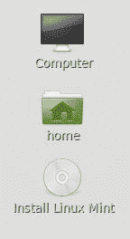

此屏幕允许你选择语言，并允许你在“尝试使用 Linux Mint”和“安装 Linux Mint”之间进行选择。“尝试使用 Linux Mint”按钮将你带入完整的 Linux Mint 环境，从 CD 或 USB 闪盘运行，并访问 Linux Mint 包含的所有软件。这对于故障排除（例如，如果你的计算机无法启动）非常有用，对于在安装 Linux Mint 之前的测试也很有用。这让你确保图形适配器或无线网卡等硬件能够与 Linux Mint 正常工作。

现在，我们将专注于安装 Linux Mint。点击“安装 Linux Mint”按钮开始安装过程。你随后会看到这个屏幕：

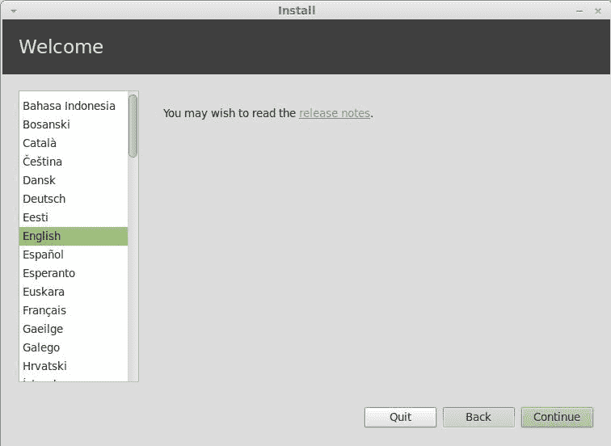

此屏幕提醒你你需要 4.4 GB 字节的可用磁盘空间。它还提醒你将你的 Linux Mint 系统连接到互联网以进行安装。这并非绝对必要，但它允许安装程序在你安装 Linux Mint 的同时下载最新更新，你可以通过勾选 `Download updates` 复选框来启用此项。第二个复选框 `安装此第三方软件` 允许 Linux Mint 安装各种解码器。一旦你做出了选择，点击继续。

安装程序随后会询问你想要如何配置计算机的硬盘。你在这里看到的内容取决于你的计算机有多少块硬盘，以及你是否已经有了操作系统。通常，你可以在“抹除磁盘并安装 Linux Mint”与“在旧操作系统和新安装系统之间划分磁盘”之间进行选择（高级用户也可以在此处选择更复杂的选项）。现在，我们假设你想抹除硬盘并在空白磁盘上安装 Linux Mint，因此选择擦除磁盘并安装 Linux Mint 的选项（注意，这将擦除磁盘上的所有内容）。


你将在安装程序继续之前确认你的选项——如果你改变了主意，可以随时点击返回。然而，一旦点击“现在安装”按钮，你的磁盘将被擦除并安装 Linux Mint。

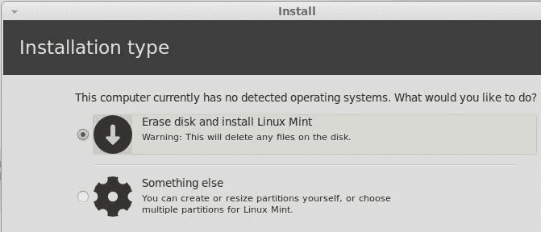

安装程序将在后台开始 Linux Mint，但在过程中仍向你提出一些额外问题。首先，你需要通过点击世界地图来选择你的时区。选择好合适的时区后点击继续。

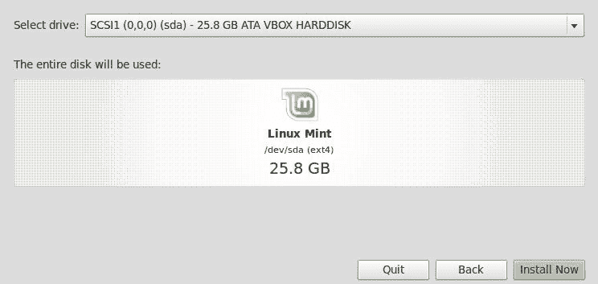

接下来，你需要选择你的键盘布局。本书大多数读者将使用英语（美国）键盘布局，这是默认设置，但 Linux Mint 支持数百种不同的语言和键盘布局。从列表中选择合适的选项，然后点击继续。


安装程序随后会要求你为电脑设置用户账户和主机名。首先，在 `Your name`（姓名）字段中输入你的全名。Linux Mint 在需要显示你的全名时会显示它。

在下方，为你的计算机输入一个名称。技术上讲，这被称为 `hostname`（主机名），是你的计算机在网络上标识身份使用的名称。最好选择一个容易记忆的主机名。如果你属于某个机构（例如你的工作场所），他们可能有标准的主机名命名规范。

之后，在 `Pick a username`（选择用户名）字段中输入一个用户名。通常，你可以将名字的首字母与姓氏结合生成用户名——例如，一位名叫 Caina Amalas 的女性，用户名可以叫 `camalas`。

接下来，为你的用户账户选择密码。你需要选择一个强密码，因为在 Linux Mint 安装期间创建的默认账户具有系统权限，这意味着它可以安装和卸载程序。强密码应包含大写字母、数字和标点符号的混合，且至少十个字符。

密码字段下方有一个单选按钮，允许你的 Linux Mint 电脑在启动时自动登录。通常，这是一个坏主意——出于安全考虑，最好使用密码登录计算机。（尤其是考虑到安装期间创建的默认账户具有 Linux Mint 系统的管理权限。）

最后一个选项是加密你的家目录。“加密”文件意味着其内容被乱码，只能使用特殊的数学密钥进行读取。如果你加密了家目录，这意味着只有你的用户账户才能访问它。

一旦完成密码和账户选项，点击 `Continue`（继续）按钮，安装将继续。

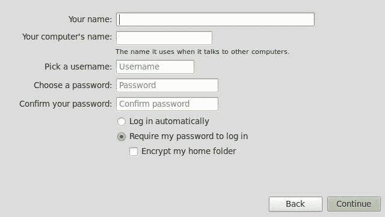

到这一步，你就完成了。安装程序将在后台完成，你可以查看显示 Linux Mint 各种功能的幻灯片。

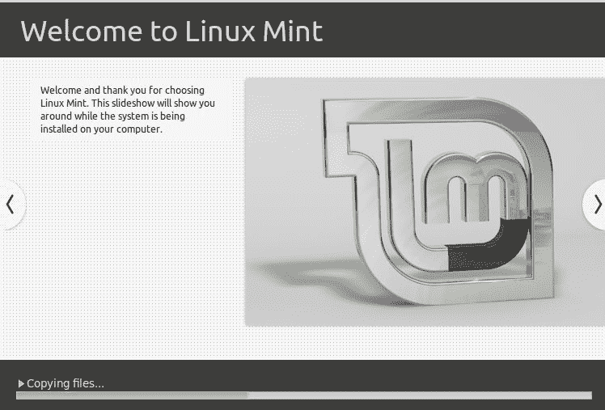

安装完成后，点击 `Restart Now`（立即重启）按钮。在系统重启之前，它会提示你移除 CD 或 USB 驱动器。完成后，移除 CD 或 USB 驱动器并按下 `ENTER` 键。你的系统将重启并带你进入登录屏幕：

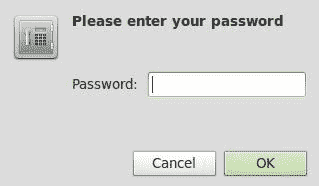

选择你新创建的账户并输入密码，即可进入新的 Linux Mint 桌面。

# 更新 Linux Mint

一旦安装了 Linux Mint，你就应确保它包含了最新的软件补丁。软件补丁可以修复软件中潜在的安全漏洞，并通常提供新功能。事实上，在你安装 Linux Mint 之后，`Update Manager`（更新管理器）应用程序将首次自动运行。

要手动运行 `Update Manager`，请遵循以下步骤。

首先点击 `mintMenu`，进入 `Administration`（管理），然后点击 `Update Manager`。

`Update Manager` 将启动，并立即联系 Linux Mint 仓库（在 Linux 中，`repository` 是用于应用程序的在线存储空间）获取更新。

`Update Manager` 将显示可用更新列表以及所有更新的总大小。（在新的 Linux Mint 安装上，这通常可以达到数百兆字节。）如果你点击某项更新，然后点击 `Description of update`（更新描述）旁边的三角形，你可以看到关于该更新的更详细信息。点击 `Settings`（设置）按钮将允许你更改 `Update Manager` 的设置。默认情况下，`Update Manager` 每天检查更新，并在有新更新可安装时通知你。

当你准备好安装更新时，点击 `Install Updates`（安装更新）按钮继续：

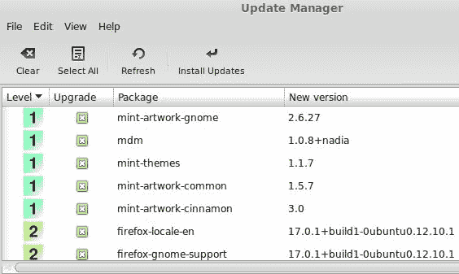

`Update Manager` 随后会要求输入密码。这在 Linux Mint 上很常见——如果你想做一些更改系统的操作，例如安装新程序或更新，它会要求管理账户的密码。由于你在安装过程中创建的账户是管理账户，直接输入该密码，然后点击 `Authenticate`（认证）按钮。

`Update Manager` 将下载并安装可用更新。取决于你的互联网连接速度，这可能需要一些时间，请耐心等待。

一旦 `Update Manager` 完成，你必须重启电脑。点击 `Restart`（重启）按钮重启系统，一旦 Linux Mint 重新启动，你的电脑将完全更新到最新状态。

# 第 2 章：使用 Linux Mint 桌面界面


Linux Mint 被设计为一个图形化操作系统，这意味着你将花费大量时间使用桌面和各种图形界面选项。在本章中，我们将带你游览桌面，并向你介绍如何使用 `Nemo` 文件管理器来执行常见任务。

## 桌面

当你启动 Linux Mint 并首次登录时，你会看到桌面，如下所示：


桌面的大部分部分位于底部，即 `Panel`（面板）。左下角的按钮 `Menu` 会带你进入 Linux Mint 的应用程序菜单。面板的中央区域将显示当前日期和时间。面板右侧是通知区域——任何具有通知功能的运行程序都会显示在这里。

### 桌面图标

默认情况下，你的 Linux Mint 桌面上只会看到两个图标：`Computer` 图和家文件夹的快捷方式：


双击家图标将启动 `Nemo`，它是 Linux 对 `Nautilus` 文件管理程序的修改版本。我们将在本章稍后讨论家文件夹。双击 `Computer` 图将启动 `Nemo` 显示电脑的高级视图。你可以看到电脑上的所有硬盘以及可移动磁盘。你也可以在桌面上创建文档和文件夹。

### MintMenu

点击桌面左下角的 `Menu` 按钮，将召唤 `mintMenu`，它看起来如下：


`mintMenu` 有三个主列。左列包含系统一些常用功能的快捷方式。你可以访问 `Firefox` 浏览器、`Software Manager`、`Terminal`、`Nemo` 文件管理器，并对 `Cinnamon`（Linux Mint 的桌面环境）进行精细设置。你还可以锁定电脑、注销并重启电脑。

中间列是安装在 Linux Mint 电脑上的应用程序分类列表。例如，点击 `Office` 类别，你将看到电脑上安装的所有办公应用程序（如 `LibreOffice` 办公套件）。中间列还包含 `Recent Files`（最近文件），它列出了你最近访问的所有文件。

最后，右列是上下文相关的，这意味着它会根据你在中间列中选择的内容而改变。正如我们上面提到的，点击中间列中的 `Office` 类别，右侧的视图将更改为显示 Office 类别中的可用应用程序。

`mintMenu` 顶部还有一个搜索框。在搜索框中输入术语，`mintMenu` 将在你已安装的应用程序中搜索该内容。例如，如果你想启动 LibreOffice Writer 且不想费心在分类中查找，只需在搜索框中输入“writer”，`mintMenu` 就会为你找到它：

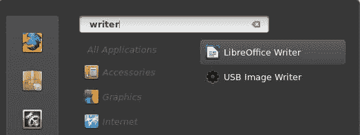

## 面板（THE PANEL）

面板是运行在桌面底部的栏。像 `mintMenu` 一样，它大致可以分为三个区域。左侧区域包含启动 `mintMenu` 的按钮和固定的应用程序快捷方式：


菜单按钮右侧的绿色按钮可以最小化所有运行中的窗口并带你回到桌面。按钮旁边有三个应用程序快捷方式——一个用于 Firefox 浏览器，一个用于终端（Terminal），一个用于 Nemo 文件管理器。

面板的中间区域显示任何当前运行的应用程序：


通过点击运行应用程序的按钮，你可以根据需要在这它们之间切换。按钮还会根据程序的不同显示额外信息。例如，LibreOffice Writer 的按钮将显示当前文档名称，而 Nemo 文件管理器将显示它当前浏览的目录名称。

面板的右侧区域是通知区域：


通知区域显示日期和时间，以及其他几个关键信息。如果你的 Linux Mint 系统可用更新，它们将带有白色盾牌图标显示在这里。你还可以查看网络连接状态、控制音量，并通过点击最右侧的窗口图标查看计算机上当前运行的所有应用程序。

通知区域还允许你更改面板设置本身。点击向上的箭头图标，将“面板编辑模式”（Panel Edit Mode）的滑动开关从“关闭”切换到“开启”（默认设置为“关闭”，是为了防止你不小心点击时更改面板）。一旦启用面板编辑模式，你就可以向面板添加新的启动器，并更改通知区域的行为。

## 锁定屏幕（LOCKING THE SCREEN）

在你离开计算机时锁定屏幕是保持你的 Linux Mint 系统及其包含的数据安全的最简单步骤之一。当你锁定屏幕时，显示器会变黑。当你敲击按键或点击鼠标时，你将看到输入当前登录用户密码的提示，如下：

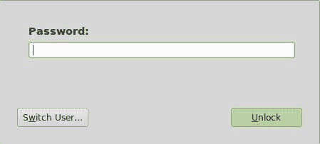

一旦屏幕锁定，只有当前登录的用户才能通过输入密码解锁计算机。或者，另一个用户可以通过点击“切换用户”（Switch User）按钮并输入密码来访问计算机，但前提是该用户在该台计算机上有有效的用户账户。

离开计算机时锁定屏幕的安全益处是不言而喻的。如果你离开时未锁定屏幕，任何人都可以过来访问你的文件或更改你的系统设置。更糟糕的是，敏感数据可能会落入坏人手中——想象一下，如果你在 Firefox 中打开了银行信息，而某个不怀好意的人恰好看到了你的信息，将会导致怎样的灾难。

默认情况下，Linux Mint 配置为当你的计算机空闲十分钟时自动锁定屏幕。然而，如果你需要起身离开计算机，你可能没有时间等它自动锁定。你可以通过同时按下 `CTRL+ALT+L` 键来手动锁定屏幕。当你这样做时，屏幕会变黑，并会一直保持黑色，直到你敲击按键或移动鼠标为止。在敲击按键或点击鼠标后，你将看到输入密码或切换用户的提示。输入密码后，屏幕将解锁。

你可以通过进入 `mintMenu`，选择“偏好设置”（Preferences）类别，并点击顶行的“亮度和锁定”（Brightness and Lock）图标来调整自动锁定设置。这将打开亮度和锁定设置：

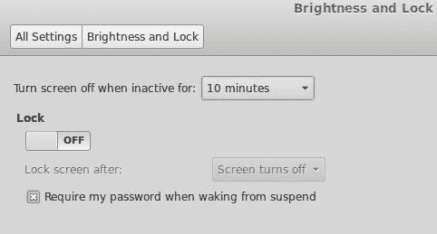

从这里，你可以调整屏幕锁定设置以及计算机在关闭屏幕之前的空闲时间。第一个下拉菜单“空闲时关闭屏幕”（Turn screen off when inactive）控制 Linux Mint 在计算机空闲时关闭屏幕前会等待多久。

“锁定”（Lock）滑动按钮控制计算机是否锁定。下方是另一个下拉菜单，决定屏幕何时关闭。默认情况下，当显示器关闭时屏幕将锁定。然而，你可以设置屏幕在显示器关闭一段时间后自动锁定。最后的复选框控制计算机在唤醒时是否需要密码（这在你离开时非常有用，防止他人访问你的数据）。

## 注销计算机（LOGGING OUT OF THE COMPUTER）

注销 Linux Mint 非常简单，事实上只需点击鼠标。要注销，首先点击 `mintMenu`，然后点击左侧列的“注销”（Log Out）按钮。你将看到一个确认框，它看起来像一个侧卧的电源按钮：


你将看到一个对话框询问你是否要注销计算机。如果你改变了主意并想继续工作，点击“取消”。如果你想注销计算机，点击“注销”按钮：


你随后会被注销，计算机将返回登录界面。不如此说，最好确保你已保存所有内容——某些应用程序会在关闭未保存的工作前提示你，但并非所有如此。

## 重启计算机（RESTARTING THE COMPUTER）

Linux Mint 是一个非常稳定的操作系统，你通常可以长时间不需要重启计算机。尽管如此，你可能仍需要定期重启。安装更新后几乎总是需要重启，某些应用程序也可能需要。此外，如果你为硬件设备（如网卡或打印机）安装驱动程序，可能需要重启；如果应用程序以异常方式崩溃，那也可能迫你重启。

要重启你的 Linux Mint 系统，进入 `mintMenu` 并点击左侧列底部的电源按钮。你将看到一个对话框，询问你想关机还是重启计算机。如果你改变了主意并想继续工作，点击“取消”。如果你想重启计算机，点击“重启”按钮：

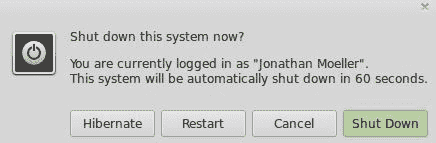

你的计算机随后将重启。不如此说，最好确保你已保存所有内容——某些应用程序会在关闭未保存的工作前提示你，但并非所有如此。

## 关机（SHUTTING DOWN THE COMPUTER）

最后，你必须定期关闭你的 Linux Mint 系统。将电脑休眠可以节省电能，但如果你想节省电费，没有什么能比完全关闭系统更有效地降低电力成本了。而且，如果你需要移动台式电脑，显然你需要将其完全关闭。

就像注销和重启电脑一样，你可以通过系统菜单关闭你的 Linux Mint 系统。进入 `mintMenu`，然后点击左侧栏底部的电源按钮。你将看到一个对话框，询问你是想关闭还是重启电脑。如果你改变了主意，点击“取消”，但如果你想关闭电脑，请点击 `Shut Down`（关机）按钮：


随后你的 Linux Mint 系统将关闭电源。不用多说，确保你先保存了所有工作是个好主意——某些应用程序会在关闭带有未保存的工作前向你警告，但并非所有程序都会如此。

## 理解主文件夹

“主文件夹”（也称为“主目录”）简单来说就是 Linux Mint 存储个人用户文件的地方。在电脑上设置多个用户目的目的是保持每个人的文档分开，因此如果让每个人把东西存在在一个杂乱的大堆里，就违背了这样设计的初衷。如果你进入电脑硬盘顶层的主文件夹，你实际上可以看到所有账户的主文件夹：

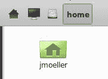

每个主文件夹内都有一组标准的文件夹：


Linux Mint 中的每个用户账户都将有一组相同的文件夹——文档、图片、音乐等等。（你的 `Desktop` 内容实际上存储在主文件夹中的 `Desktop` 文件夹中。）默认情况下，你 Linux Mint 系统中的应用程序将使用这些文件夹。网络浏览器会将文件下载到 `Download` 文件夹，基于图像的应用程序会将图片保存到 `Pictures` 文件夹，LibreOffice 将文档保存到 `Documents` 文件夹，以此此类推。

然而，如果你产生了大量的文档和图像，你会很快发现你的文件夹变得难以管理。Linux Mint 中的单个文件夹可以存放数千个文件，但必须滚动查看这些文件将变得繁琐。（即使使用 `Dash` 搜索，在一个文件夹中有数千个文件时也会变得困难。）幸运的是，文件夹内部包含额外的文件夹，通常被称为“子文件夹”或“子目录”。例如，你可以在 `Documents` 文件夹中创建子文件夹来按类型分类文档——一个用于电子表格，另一个用于演示文稿——或任何你喜欢的其他组织方案。

我们将在本章稍后部分向你如何创建文件夹。首先，我们将解释你实际用于浏览文件和文件夹的应用程序——`Nemo File Manager`。

## Nemo 文件管理器

`Nemo` 是 Linux Mint 内置的文件管理应用程序——一个以图形化格式显示你的文件夹及其内部文件的程序。要启动 `Nemo`，只需点击 `mintMenu` 左侧栏中的文件夹图标，或者双击桌面上的主文件夹图标。

`Nemo` 的主窗口通常看起来这样：

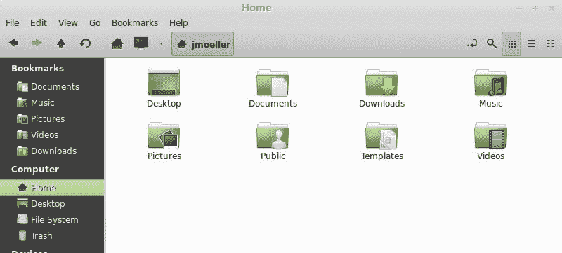

文件和文件夹显示在窗口中心。要打开文件或文件夹，请双击它。左侧栏中的链接列表非常有用，因为它们将带你进入最常访问的地点——例如，你的 `Documents` 文件夹。

你可以使用左右箭头在你访问过的文件夹之间向前和向后导航。例如，如果你点击了主文件夹中的 `Documents` 文件夹，`Nemo` 将带你进入 `Documents` 文件夹。要返回主文件夹，点击后退按钮（指向左侧的箭头）。一旦你回到主文件夹，可以通过点击前进按钮（指向右侧的箭头）`Nemo` 带你回到 `Documents`。这两个按钮的作用与网络浏览器中的“后退”和“前进”按钮非常相似。

`Nemo 文件管理器` 还提供了一个名为“面包屑”的实用功能，允许你快速从文件夹中返回。例如，假设你正在查看位于 `Spreadsheets` 的文件夹内名为 `MarchReports` 的文件夹，而该文件夹又位于你的 `Documents` 文件夹中。面包屑看起来如下：


你可以通过点击面包屑行中的任何名称返回任意一个文件夹。点击 `Documents` 将带你回到 `Documents` 文件夹，而点击其他任何面包屑都将带你进入相应的文件夹。

我们将在本章稍后展示如何创建文件夹。

## 创建文件夹

在 Linux Mint 中创建文件夹非常简单。要创建一个文件夹，首先导航到你想放置新文件夹的地方。如果你想放在 `Desktop` 上，就去那里；如果你想放在 `Documents` 中，就去那里。一旦到达了目标位置，在空白处点击右键：


在上下文菜单中选择“New Folder”（新建文件夹）选项：


随后会出现一个名为“untitled folder”的新文件夹，你可以为它命名。

## 重命名文件和文件夹

你可能出于各种原因需要更改文件或文件夹名称。要重命名文件或文件夹，右键点击文件或文件夹，并在上下文菜单中选择 `Rename`（重命名）：


随后名称将被选中。输入新名称并按回车。文件将完成重命名。

## 复制和移动文件

Linux Mint 和 `Nemo` 让复制和移动文件变得非常简单。有多种方法，我们将在本节中介绍。首先，导航到你想复制的文件或文件夹。右键点击文件或文件夹以弹出上下文菜单，然后从菜单中选择 `Copy`（复制）：


接下来，导航到你想复制文件或文件夹的驱动器或文件夹。在文件夹空白处点击右键，从上下文菜单中选择 `Paste`（粘贴）：


Linux Mint 将会在新位置创建文件的副本。

假设你想将文件完全移动到新位置，而不是复制。你也可以这样做，尽管需要几次额外的鼠标点击。首先，右键点击文件或文件夹，从上下文菜单中选择 `Copy`（复制）：


选择 `Copy` 后，再次右键点击该文件或文件夹，并在上下文菜单中选择 `Cut`（剪切）：


然后在 `Nemo` 中导航到目标的目标文件夹。在文件夹的空白处点击右键，并点击 `Paste` 按钮：


Linux Mint 随后会将文件“粘贴”到新位置。`Nemo` 中的复制、剪切和粘贴操作方式与文字处理程序或电子表格应用程序中的复制和粘贴完全相同。源文件会被删除，并在目标目录中创建该文件的副本。

此外，你还可以使用所谓的“拖放”功能在不同目录之间移动文件。要这样操作，左键点击你想要移动的文件或文件夹，并按住左鼠标键。该文件将被高亮。在继续按住左鼠标键的同时，将文件图标拖动到新位置。Linux Mint 随后会将该文件移动到新位置。

（注意，如果你从外部磁盘向外部磁盘或从向外部磁盘拖放文件，Linux Mint 只会复制文件。例如，如果你将一个文件从 USB 闪存盘拖放到桌面，该文件将会被复制到桌面，但原始文件将仍保留在 USB 闪存盘上。）

如果你想一次复制多个文件或文件夹怎么办？比如，如果你想从数码相机的内存卡中复制百张照片到 Linux Mint 系统的“图片”（Pictures）文件夹中？你可以对每个单独的文件进行拖放或复制和粘贴，但这将浪费大量时间。你可以拖放包含图片文件的文件夹，但如果文件夹里混杂了你不想保留的照片呢？

这就是 `SHIFT` 点击和 `CTRL` 点击派上用场的地方。通过使用 `SHIFT` 点击和 `CTRL` 点击，你可以同时选择多个文件，然后一次性地复制或移动它们。我们先来看 `SHIFT` 点击。

### SHIFT 点击


`SHIFT` 点击允许你一次性选择大量文件。要使用它，首先左键点击其中一个文件：


然后按住 `SHIFT` 键，并点击另一个文件。你会发现 Linux Mint 随后会选择你点击的第一个文件和按住 `SHIFT` 键时点击的第二个文件之间的所有文件：


通过 `SHIFT` 点击，你可以一次性选择大量的文件或文件夹。然后你可以将它们拖放到新目标地，或者右键点击它们进行复制和粘贴。但如果你只想在一百个文件的列表中选择散布的六个文件呢？`SHIFT` 点击将一次性移动所有它们。

### `CTRL` 点击

这就是 `CTRL` 点击大显身手的地方。和 `SHIFT` 点击一样，`CTRL` 点击允许你同时选择多个文件。但 `SHIFT` 点击是一次选择几十个甚至数百个文件和文件夹，而通过 `CTRL` 点击，你可以一个一个选择多个文件，然后对它们进行移动、复制或删除。

首先，左键点击你想移动的第一个文件：


然后按住 `CTRL` 键并点击第二个文件：


你会发现 `CTRL` 点击只选择你点击的文件，而不是像 `SHIFT` 点击那样选择它们之间的所有文件。`CTRL` 点击允许你选取多个文件或文件夹，并对它们同时同时执行相同的操作。

在下一节中，我们将向你展示如何删除文件。

## 删除文件

在 Linux 和微软 DOS 的早期时代，大多数个人电脑并不具备图形化用户界面，因此你必须从命令行删除文件。当你这样做时，这些文件就永远消失了——没有简单的方法可以将它们找回来。Linux Mint 像许多具有图形用户界面的操作系统一样，通过“垃圾桶”让用户操作变得简单了一些。垃圾桶始终位于 Nemo 文件管理器左侧的导航栏中：

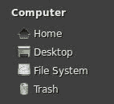

垃圾桶就像是删除项目的“临时存留区”。当你删除一个项目时，它并不会消失，而是进入垃圾桶。这样，如果你误删了某些东西，它会一直留在垃圾桶里，直到你想起实际上需要它。

要将文件或文件夹移动到垃圾桶，右键点击相关的文件或文件夹。当上下文菜单出现时，从菜单中选择“移动到垃圾桶”（Move to Trash）：

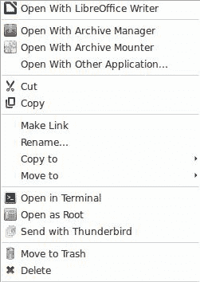

相关的文件或文件夹将移动到垃圾桶。注意，如果你将文件夹移动到垃圾桶，该文件夹包含的任何文件或子文件夹也会移动到垃圾桶，因此在删除文件夹时要小心。

如果你改变主意并想把它找回来怎么办？要从垃圾桶恢复文件或文件夹，右键点击垃圾桶中的相关文件或文件夹。从菜单中选择“恢复”（Restore）：


删除文件的主要原因之一是释放空间，只要文件留在垃圾桶里，它们就会继续占用空间。要永久删除这些文件，你需要清空垃圾桶。可以在垃圾桶内部进行：

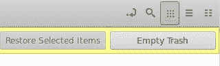

这将清空它。小心使用——一旦你这样做，文件就消失了。

---

# 第 3 章 - 创建用户和组

在安装 Linux Mint 时，安装程序提示你创建一个管理员帐户。如果你是唯一使用机器的人，这就足够了。但如果你有多个人在使用你的 Linux Mint，你很快就需要额外的账户。分配权限是很有必要的，但你可能发现需要将这些账户分组。

## 添加用户

首先，我们来讨论向系统添加用户。你可以通过 GUI 轻松地完成。只需进入 Mint 菜单，点击管理图标，然后点击“用户和组”（Users and Groups）项。在这里，你可以添加和删除用户账户。

然而，这个命令本身在不带任何选项的情况下并不好用。它创建了 `camalas` 用户账户，但没有为该账户分配显示名称，也没有为 `camalas` 创建家目录。它还没有设置任何变量——例如，如果 Caina 使用 `camalas` 账户登录，她将使用旧的 `sh` shell 作为她的命令行界面，而不是 `bash` shell。

我们需要为 `useradd` 命令添加一些选项来使其变得更有效。首先，这里是使用该命令创建家目录的方法：

```bash
sudo useradd -m camalas
```

`-m` 选项导致 `useradd` 创建家目录。接下来，我们将添加另一个选项，并告诉 `useradd` 将 `bash` 设置为 `camalas` 的默认 shell：

```bash
sudo useradd -m -s "/bin/bash" camalas
```

添加 `-s` 开关和 `"/bin/bash"` 告诉 `useradd` 将 `bash` shell 设置为 `camalas` 的默认 shell。现在，我们想通过 `-c` 选项确保 `camalas` 的显示名称被正确设置为 Caina Amalas：

```bash
sudo useradd -c "Caina Amalas" -m -s "/bin/bash" camalas
```

通过这些选项，`useradd` 创建了一个名为 `camalas` 的新账户，将账户的显示名称设置为 Caina Amalas，为新账户创建了家目录，并将 `bash` 设置为 `camalas` 的默认 shell。（注意，`useradd` 有许多选项，你可以在 `useradd` 的 man 页面中查看所有选项。）

为了允许 Caina 使用 `camalas` 账户登录，你还需要做最后的一件事——你需要为新账户设置密码。你可以使用 `passwd` 命令执行此操作：

```bash
sudo passwd camalas
```

然后你可以为 `camalas` 设置密码。注意，你也可以在不带 `sudo` 的情况下使用 `passwd` 命令来重置你自己的账户密码。

Linux Mint 的用户账户存储在 `/etc/passwd` 文件中。这是一个文本文件，所以你可以像查看其他文本文件一样查看它：

```bash
cat /etc/passwd
```

你会在那里看到很多账户，但它们大多数是用于各种系统服务的，你不需要担心它们。对于实际的用户账户，在 `/etc/passwd` 中你可以查看账户名、用户 ID（UID）编号、账户默认组的组 ID（GID）、显示名称、家目录的位置以及默认 shell。

你可能会想通过编辑 `/etc/passwd` 文件来手动添加用户账户。千万不要这样做！用户账户的密码存储在一个名为 `/etc/shadow` 的受限文件中，它需要与 `/etc/passwd` 保持同步。手动编辑 `/etc/passwd` 可能会搞乱你的系统。

## 删除用户账户

你可能经常想要从你的 Linux Mint 系统删除账户。从命令行删除账户既快速又方便。事实上，这比通过图形界面操作要简便得多。

在删除用户账户之前，你可能先考虑使用 `usermod` 命令将其锁定。锁定账户会禁用其密码，这意味着该账户无法再次登录系统。例如，锁定 `camalas` 账户：

```bash
sudo usermod -L camalas
```

（注意，选项、命令和文件名对大小写敏感，且 `-L` 选项必须大写。）

如果你想完全删除一个账户，请使用带 `sudo` 的 `userdel` 命令：

```bash
sudo userdel camalas
```

此命令将从你的系统里删除 `camalas` 用户账户。然而，它不会删除 `camalas` 的家目录，这意味着她所有的个人文件和配置设置将留在系统的 `/home/camalas` 文件夹中。要同时删除 `camalas` 账户和 `camalas` 的家目录，请使用带有 `-r` 选项的 `userdel`：

```bash
sudo userdel -r camalas
```

这将删除 `camalas` 账户和 `camalas` 的家目录。

## 添加组

和用户账户一样，你可以从 Linux Mint 命令行为用户创建组。在 Linux Mint 中创建组有几种不同的方法，这两种方法都是有效的。首先，你可以使用 `groupadd` 命令添加一个名为 `ghosts` 的组：

```bash
sudo groupadd ghosts
```

或者，你可以使用 `addgroup` 命令：

```bash
sudo addgroup ghosts
```

这两个命令的作用相同，但如果你想查阅它们的 man 页面，它们拥有不同的潜在选项。

（第二个不要脸的作者推销：在《Ghosts》系列小说中，Caina 属于 Ghosts，他们是 Nighmar 皇帝的间谍。）

就像用户账户一样，Linux Mint 将所有的组都存储在一个文本文件 `/etc/group` 中。查看此文件：

```bash
cat /etc/group
```

那里的大多数组是系统组，可以安全地忽略。你会发现所有的用户账户也同时列在组文件中——这些实际上是你用户账户的主组（Linux Mint 会为你的每个用户账户创建一个组，并将该用户账户分配为该组的主组）。你创建的任何组都会出现在文件的底部。

## 将用户添加到组

一旦你创建了组，就可以将用户添加到组。同样，有几种不同的方法可以实现。第一种方法是使用 `useradd` 命令。将 `camalas` 账户添加到 `ghosts` 组：

```bash
sudo useradd camalas ghosts
```

你也可以使用 `usermod` 命令将用户添加到组：

```bash
sudo usermod -G ghosts camalas
```

## 从组中移除用户

要从组中移除账户，请使用 `userdel` 命令：

```bash
sudo userdel camalas ghosts
```

这将从该组中移除 `camalas`。

## 删除组

要删除一个组，请使用 `groupdel` 命令：

```bash
sudo groupdel ghosts
```

这将消除该组，即使它仍然有成员。注意，在不先将账户从组中移除或删除账户之前，你无法移除任何用户的主组。（记住 Linux Mint 会为你的每个用户账户创建一个组。）

## 大小写敏感性

这会让习惯于 Windows/DOS 背景的用户感到非常困惑，因为无论是旧的 DOS 操作系统还是 Windows 命令行均不区分大小写的。换句话说，Windows 会将 `Book.doc`、`book.doc` 和 `BOOK.doc` 视为同一个文件。然而，Linux 会认为它们是三个不同的文件。

同样，Linux 命令也是区分大小写的。在 Windows/DOS 中，在命令提示符中输入 `dir`、`Dir` 和 `DIR` 会触发相同的 `dir` 命令，列出当前目录下的文件。而 Linux 命令是区分大小写的——`ls`、`Ls` 和 `LS` 并不是同一个东西。

在使用命令行时请记住这一点。

## 带有空格的文件名

命令行对空格的处理并不理想——比方你尝试使用以下命令来删除一个名为 "Bob's Term Paper" 的文件：

```
rm Bob's Term Paper
```

这条命令将会失败，因为命令行会将命令中的每个单词解释为一个独立的文件。要强制命令行正确识别该文件，请将任何带有空格的文件名括在引号内：

```
rm "Bob's Term Paper"
```

这一次 `rm` 将成功删除该文件。

## 如何访问命令行

如果你以前从未在 Linux Mint 中用过命令行，可能不知道如何访问它。幸运的是，这非常简单。启动命令行有两种方法。

第一种方法进入 `mintMenu`，然后点击左侧列的终端（Terminal）图标。这将启动 GNOME 终端模拟器应用程序，允许你在 GUI 内部启动命令。

第二种方法是按下键盘上的 `CTRL-ALT-F1` 键。这样做后，GUI 将消失，取而代之的是一个带有带有白色文本登录提示的黑色屏幕。不要惊慌！这是一个“虚拟控制台”，它让你将 GUI 切换到后台并以仅命令行模式重新登录。你在 GUI 中的登录会话不受影响——Linux Mint 允许同一个用户同时多次登录。

你可以随时通过按下 `CTRL-ALT-F7` 回到 GUI。

请注意，Linux Mint 允许你拥有七个虚拟控制台，从 `F1` 到 `F7`。`F7` 预留给 GUI，其余六个允许你使用命令行登录。

## 命令提示符本身

正如我们提到的，命令提示符本身看起来可能像这样：

```
jon@linuxmintmachine:~$
```

但这意味着什么呢？让我们来拆解它。

- `jon`，`@` 符号之前的部分是当前登录系统的用户名。如果我以 `jon` 的身份登录我的 Linux Mint 机器，那么我在 `@` 符号之前看到的这个用户名。
- `linuxmintmachine`，`@` 符号之后的部分是主机名，或计算机名称。如果我的 Linux Mint 机器名为 `linuxmintmachine`，那么你在命令提示符中看到的这个主机名。
- 冒号（`:`）标记了提示符中标识用户和机器的部分（`jon@linuxmintmachine`）与显示当前工作目录的部分之间的分隔，我们将在下文中解释后者。
- `~` 标记指向当前工作目录——换句话说，就是你当前所在的文件夹。（“directory”和“folder”这两个词可以互换使用，但在命令行语境下更经常使用“directory”。）在 Linux 和 UNIX 中，波浪符号 `~` 是用户主目录的缩写。所以，如果我以 `jon` 的身份登录 `linuxmintmachine`，那么 `~` 就是 `/home/jon` 目录的缩写。

这意味着如果你更改了工作目录，命令提示符也会随之变化。假设你将工作目录更改为 `/`，这在 Linux 中是根目录。那么命令提示符将如下所示：

```
jon@linuxmintmachine:/$
```

或者如果你将工作目录更改为 `/etc/hp`，提示符将如下所示：

```
jon@linuxmintmachine:/etc/hp
```

### 查找工作目录

“工作目录”是指命令提示符当前关注的目录。正如我们上面提到的，工作目录显示在命令提示符中。然而，某些 Linux 配置默认并不在命令提示符中包含工作目录。要查找工作目录，请使用此命令：

```
pwd
```

如果你位于 Documents 文件夹（主目录的一个子目录），输出将类似于所示：

```
/home/jon/Documents
```

接下来，让我们讨论如何在 Linux Mint 文件系统中移动。

## 在目录之间移动

你可以使用 `cd` 命令在命令行中从目录之间移动。例如，如果你想回到主目录：

```
cd ~
```

切换到根目录：

```bash
cd /
```

为了充分利用 `cd` 命令（以及下文讨论的一些命令），你需要理解 Linux Mint 中的文件路径概念。

“文件路径”指的是文件在文件系统中的位置。假设你在 Documents 文件夹中存储了一个名为 `Book.doc` 的文档文件。那么它的绝对位置，即在文件系统中的精确位置，如下：

```
/home/jon/Docments/Book.doc
```

所以如果你想从文件系统的任何地方移动到 `/home/jon/Documents`，可以使用此命令：

```
cd /home/jon/Documents
```

然而，对于当前目录的子目录，不需要输入完整路径。由于 Documents 是你主目录的子目录，只需输入：

```
cd Documents
```

你可以使用类似的快捷方式返回父级目录：

```
cd ..
```

`cd` 命令后跟两个点会将你移动到 Documents 的上一级。

## 列出目录内容

要查看目录的内容，使用 `ls` 命令：

```
ls
```

如果你在主目录运行 `ls`，输出可能类似于：

```
/home/jon
```

默认情况下，`ls` 列出当前工作目录的内容。如果你想查看另一个目录的内容，可以通过 `cd` 命令导航过去，或者在 `ls` 命令后输入绝对路径。例如，查看 `/etc` 目录的完整内容：

```
ls /etc
```

非常简单吧？但 `ls` 命令提供的信息并不多。这是一个引入命令选项（options，也称为命令开关）的好机会。

在 Linux 命令的语境下，“选项”是命令的修饰符。它告诉命令执行略有不同的功能或更改输出。在你的主目录下运行 `ls -l` 命令，观察输出的变化：

```
ls -l
```

`-l` 选项代表“长列表”，此时 `ls` 显示了比不带选项时多得的信息，包括文件的权限和所有权，以及文件的大小。当 `ls -l` 命令与 `-h` 选项结合时将更有用：

```
ls -lh
```

你可以看到文件的大小现在以千字节或兆字节为单位列出，这比只用字节更易读。你还可以配合 `-a` 使用 `ls` 命令来查看隐藏文件：

```
ls -a
```

注意你主目录中的所有隐藏文件（以点开头的文件）。

（这些隐藏文件大多是你的账户的配置设置，除非你有充分理由要修改它们，否则应该保持原样。）

在 Linux 中，文件通过在名称前面加上一个“.”来隐藏。你可以通过使用 `mv` 命令来手动隐藏文件，我们将在下一节讨论该命令。

# 移动和重命名文件

要重命名文件，你可以使用 `mv` 命令。假设你想将当前工作目录下的 `Book.doc` 文件重命名为 `Roughdraft.doc`：

```
mv Book.doc Roughdraft.doc
```


`mv` 命令随后会将 `Book.doc` 文件重命名为 `Roughdraft.doc`。

`mv` 命令还可以（如其名所示）将文件从系统中的一个位置移动到另一个位置。如果你想将 `Book.doc` 从你的 Documents 文件夹移动到家目录下另一个名为 `Backup` 的文件夹，你可以像如下所示使用 `mv` 命令：

```
mv ~/Documents/Book.doc ~/Backup
```

`mv` 命令同样适用于“通配符”，通配符是用来代表文件名的字符。将它们想象成变量——你可以使用它们告诉 `mv` 命令“将我的 Documents 文件夹中所有以 `.doc` 结尾的文件移动到 Backup 文件夹”。它的工作原理如下：

```
mv ~/Documents/*.doc ~/Backup
```

这将把你 Documents 文件夹中每一个带有 `.doc` 扩展名的文件移动到你的 Backup 文件夹。

# 创建目录

`mkdir` 命令允许你创建目录。要在当前工作目录中创建一个名为 `NewDirectory` 的目录：

```
mkdir NewDirectory
```

你也可以通过绝对路径创建目录。要在你的 Documents 文件夹中创建一个名为 `NewDirectory` 的目录：

```
mkdir ~/Documents/NewDirectory
```

# 删除文件和文件夹

早晚，你需要删除一些文件或文件夹，`rm` 命令将让你能够除掉它们。要删除当前工作目录中名为 `Book.doc` 的文件：

```
rm Book.doc
```

你也可以使用 `rm` 通过绝对路径来删除文件：

```
rm /home/jon/Documents/Book.doc
```

通配符同样适用于 `rm`。你可以使用 `rm` 来，例如，删除 Documents 文件夹中的每一个 `.doc` 文件：

```
rm /home/jon/Documents/*.doc
```

不言而喻，在使用 `rm` 通配符时要极其小心！如果你犯了错误，可能会无意中抹掉很大一部分文件。

你也可以从命令行删除目录。要删除一个空目录，使用 `rmdir` 命令：

```
rmdir NewDirectory
```

然而，请注意 `rmdir` 只有在目标目录为空时才有效。如果它为空，你必须在用 `rmdir` 删除它之前清空目录中的任何文件。

或者，你可以使用带有递归选项 `-r` 的 `rm` 命令来删除目录、其所有文件以及任何子目录（以及它们的文件）：

```
rm -r NewDirectory
```

在使用带有 `-r` 选项的 `rm` 命令时，要特别小心！你可以轻松地抹掉文件系统的整个分支，如果你不小心，可能会丢失重要数据。

# 压缩和解压缩文件

现代硬盘容量非常大——到本文写作时，笔记本电脑配备 320GB 或更大的硬盘已经很常见了，而台式机机器的硬盘容量可以达到 1TB 以上。因此，压缩文件似乎并不是什么大事。然而，压缩文件对于创建备份仍然有用，而且你从网上下载的许多文件是以压缩形式提供的。在命令行环境下工作时，你需要知道如何解压缩这些文件。

Linux Mint 使用 `tar` 命令来创建文件“归档”，归档是将许多小文件合并成一个大文件，以便存储和复制。`tar` 命令可以追溯到 UNIX 的早期，非常高效。例如，假设你想创建一个名为 `backup.tar` 的文件，其中包含你 Documents 文件夹中的所有文件和文件夹。你会使用带有 `-c` 选项的 `tar` 命令创建归档，并使用 `-f` 选项为归档命名：

```
tar -cf backup.tar ~/Documents
```

很快，`tar` 就会创建 `backup.tar` 文件。记得在使用 `tar` 命令时，始终为任何文件名添加 `.tar` 扩展名，因为 `tar` 不会自动这样做。

然而，这个新归档完全没有压缩。它占用的空间与你的 `~/Documents` 文件夹相同。要压缩它，你需要使用带有 `-z` 选项的 `tar`，它使用 gzip 压缩压缩归档：

```
tar -czf backup.tar.gz ~/Documents
```

你可能还想在命令中添加 `-v` 选项：

```
tar -czvf backup.tar.gz ~/Documents
```

`-v` 命令告诉 `tar` 生成详细输出（verbose），这意味着它会确切告诉你正在做什么，并在发生错误时通知你。

要从 `tar` 归档解包文件，同样使用 `tar` 命令，但使用 `-x` 切换来提取（Extract）文件，而不是使用 `-c` 切换来压缩（Compress）：

```
tar -xvf backup.tar
```

如果 `tar` 归档是用 gzip 样式压缩的，请确保在组合中添加 `-z` 命令选项：

```
tar-xzvf backup.tar.gz
```

`tar` 命令很有用但很复杂。使用 `zip` 和 `unzip` 命令会简单一些。要用 `zip` 将你的 Documents 文件夹压缩为名为 `backup.zip` 的压缩归档，请使用以下 `zip` 命令：

```
zip -r backup.zip ~/Documents
```

解压缩归档只需要使用 `unzip` 命令：

```
unzip backup.zip
```

# 查看文件

移动文件、压缩文件和删除文件都是很有用的，有时你可能还需要查看它们。Linux Mint 中的许多文件，特别是配置文件，仅仅是文本文件，你可以使用 `cat` 命令查看它们。要查看名为 `document.txt` 的文件：

```
cat document.txt
```

通常情况下，文本文件会长到无法显示在一个屏幕上，并且在你查看全部内容之前它会向上滚动。你可以将 `cat` 命令的输出管道到 `more` 命令，这将让你一次一个屏幕地查看文件：

```
cat document.txt | more
```

Linux 中的“管道”（Pipes）允许你将一个命令的输出重定向另一个命令，后者对该输出进行操作。

`less` 命令实际上结合了 `cat` 和 `more` 命令，允许你滚动查看：

```
less document.txt
```

有时你只想查看文件的前几行。你可以使用 `head` 命令来实现：

```
head document.txt
```

这将显示文件的前五行。或者，你可以使用 `tail` 命令查看文件的最后五行：

```
tail document.txt
```

有时你想在文档中搜索特定术语，这可能花费一些时间。`grep` 命令搜索输出，可以在输出中找到特定的搜索字符串。将 `cat` 命令的输出管道到 `grep`，它将找到该术语的任何实例：

```
cat document.txt | grep term
```

# 使用 root 权限

在 Linux Mint 上操作时，你会很快发现系统的许多区域都受到了限制。例如，你不能进入 `/bin` 目录并随机删除文件。这是一件好事——它防止你不意外对系统造成损坏（或防止恶意用户故意破坏）。

然而，在某些情况下你需要安装程序、编辑配置文件或执行其他管理任务。要做到这些，你需要 root 权限。“root”账户（也称为超级用户账户）是 Linux 系统上权限的用户。root 账户可以删除任何文件并更改任何设置。出于安全考虑，Linux Mint 系统默认禁用了 root 账户，因为它是攻击者极具吸引力的目标。

为了解决这个问题，Linux Mint 使用 `sudo` 命令，该命令允许用户临时以 root 身份操作。要使用 `sudo` 执行命令，只需在原有命令前加上 `sudo` 即可：

```
sudo rm document.txt
```

该命令会要求你输入密码，在你输入密码后，`rm` 将以 root 级权限运行。

（请注意，只有 Linux Mint 系统上的管理员用户才能使用 root。默认情况下，你在安装期间创建的账户就是管理员用户。）

# 基础计算器

Linux Mint 还自带了一个名为 `bc` 命令的实用小工具——“bc”代表“basic calculator”（基础计算器）。`bc` 命令允许你从命令行执行快速、简单的数学算运算，这可能比去寻找桌面计算器或启动图形化计算器要方便得多（而且，如果你使用的是 Linux Mint 的服务器版本，显然没有 GUI 计算器可供）。

要使用 `bc`，首先输入此命令：

```bash
bc
```

这将带你进入 `bc` 提示符，现在你可以进行数学运算了。例如，要将两个数字相加，输入以下内容然后按回车键：

```
2 + 2
```

要将两个数字相减，使用以下语法：

```
2 - 2
```

要两个数字相除，使用 `/` 键：

```
2 / 2
```

要进行乘法，使用 `*` 键：

```
2 * 2
```

使用分数代替小数：

```
2.5 + 1
```

一旦你完成了 `bc` 的操作，输入 `quit` 返回到正常的命令行提示符：

```
quit
```

# BASH SHELL 技巧

Linux Mint 使用名为 `bash` shell 的程序作为其命令行界面。“shell”（壳）一词指的是在用户和操作系统之间提供接口的程序。`bash` shell 是旧的 Bourne `sh` shell 的后代——“bash”这个名字本身就是一个双关语，意为“Bourne-again shell”（再次出生的 Bourne shell）。还有许多其他 shell 可用，但大多数人认同 `bash` 是目前最好用的一个（当然，观点可能有所不同）。`bash` 具有许多实用的功能。

第一个是“命令/文件名自动补全”。这意味着你输入部分命令或文件名并按下 `TAB` 键，`bash` 会尝试猜测补全文件名或命令。假设你有一个名为 `ReallyReallyReallyLongLongLongFileName.txt` 的文件，你想删除它。但你不想输入整个文件名。相反，你只需要开始输入：

```bash
rm ReallyR
```

然后按下 tab 键。`bash` shell 就会为你完成文件名：

```bash
rm ReallyReallyReallyLongLongLongFileName.txt
```

`bash` shell 还有一个非常棒的功能叫做“命令历史”。如果你按下键盘上的 `Up`（上）箭头键，就可以回溯你使用过的命令历史。如果你不记得刚刚使用的一条长命令，或者不想重新输入，这个功能就会非常有用。

`bash` shell 将你的命令历史存储在主目录中一个名为 `.bash_history` 的文件中。要查看它，使用此命令：

```bash
cat ~/.bash_history
```

请注意，该文件仅在你注销系统时才会更新。

# 获取帮助

这是不可避免的——Linux 命令非常复杂，并且带有大量的选项、选项和参数，所有这些都很难记忆。坦率说，Linux Mint 内置了帮助系统——`man` 命令。`man` 是“manual”（手册）的缩写，它可以让你查看命令的基本用法和选项。要使用它，只需输入 `man` 加上你想阅读的手册页的命令名称：

```bash
man ls
```

这将显示 `ls` 命令的手册页。你可以使用 `Page Up`（向上页）和 `Page Down`（向下页）键在手册页中导航，一旦完成，按下 `q` 键将带你回到命令行提示符。

# 第 5 章 - 检查内存和磁盘空间占用

在处理电脑问题时（无论是 Linux Mint、Windows 还是 Mac OS X 系统），有一条万无一失的规则——内存或磁盘空间永远不够用。诚然，情况已经比 DOS 时代好多了，那时你只有 640 千字节的内存可用。个人电脑变得越来越强大，在编写本文时，你可以花费大约 300 到 400 美元购买一台拥有 4GB 内存和 500GB 硬盘的笔记本电脑（如果是台式机价格甚至更低）。因此，对于普通用户来说，仔细管理个人电脑的内存和磁盘空间并不像以前那么关键了。

然而，你仍然想要关注内存和磁盘使用情况。如果你的 Linux Mint 系统变慢了，你想知道为什么，检查资源使用情况可以为你提供线索。如果你的硬盘满了，你想找到哪些文件占用了大部分空间。如果你正在管理一个有多个用户同时访问的 Linux Mint 服务器系统，你绝对想要密切关注资源使用情况，以免某个用户导致服务器崩溃停止。

在本章中，我们将查看如何使用图形界面和命令行工具监控 Linux Mint 对系统资源的使用情况。

## 系统监器

系统监器（System Monitor）是一个实用程序，提供有关你系统状态的丰富实时信息。通过系统监器，你可以看到系统有多少 RAM 和硬盘空间。从系统监器中，你可以看到 CPU 使用情况的图表、进程占用的内存以及以及连接到电脑的磁盘（如闪存驱动器）的空间。

要启动系统监器，点击菜单并在搜索字段中搜索它。点击程序图标即可。

系统监器有三个标签，每个标签显示不同的信息，我们从左到右查看。

“进程”（Processes）是第一个标签。“进程”（process）是系统上运行的任何程序的术语，无论是后台守护进程（提供服务的程序），还是你或其他用户启动的程序。进程标签有许多列，提供有用信息。第一列“进程名称”（Process Name）提供进程名称。“% CPU”列显示进程消耗的 CPU 时间。“ID”列显示进程的标识符，如果你需要从命令行强制结束它时（我们将在第 22 章描述），这非常有用。“内存”（Memory）列显示进程使用的内存量。最后，进程标签在右下角有一个“结束进程”按钮，你可以用它关闭无响应的进程。

第二个标签“资源”（Resources）提供了三个实时图表。第一个图表“CPU 历史”显示 CPU 时间的使用情况。如果你有多核处理器（现在的电脑大多如此），图表将用不同的颜色表示不同的 CPU 核心。第二个图表“内存和交换空间历史”显示 RAM 和交换文件（swap file）空间的使用情况。（交换文件”指的是硬盘上的一个分区，当真实内存满时，Linux Mint 使用其作为临时内存。）最后一个图表“网络历史”显示系统网络适配器的入站流量。

最后一个标签“文件系统”（File Systems）显示连接到 Linux Mint 系统的任何文件系统——即磁盘。这包括硬盘、光盘（如 CD 和 DVD）、USB 外部硬盘和 USB 闪存。列显示磁盘的实际设备名称（通常类似于 `/dev/sda1`）、挂载点（设备在文件系统中挂载的位置）、文件系统类型以及磁盘上的空间，包括总空间和可用空间。

`top` 命令已经存在很久了，并且几乎包含在每一个 Linux 变体中。Linux Mint 也不例外。`top` 命令显示各种实用的统计数据，包括 CPU 时间占用“前茅”的用户（这也是该命令名的由来）。要启动 `top`，只需在命令行提示符处输入该命令：

```
top
```

一旦启动，`top` 将保持运行并实时显示统计数据。进程按照其进程 ID（PID）编号列出，以及启动该进程的命令名称。`top` 列出的信息很多，让我们来看看可用的统计数据：

- `PID`：进程的进程 ID 数字。
- `USER`：进程的所有者。由 `root` 拥有的进程通常是系统进程，除非它们引起问题，否则应该忽略它们。
- `PR`：进程的优先级，决定了 CPU 对此进程与其他进程相比的程度。数字越小，优先级越高。
- `NI`：进程的 nice 值，该值会影响其优先级。
- `VIRT`：进程使用的虚拟内存量。
- `RES`：进程使用的物理内存量，以千字节（KB）为单位。
- `SHR`：进程使用的共享内存量。
- `S`：进程当前的状态（僵尸、睡眠、运行、不可中断的睡眠或被追踪）。
- `%CPU`：进程占用处理器时间的百分比。
- `%MEM`：进程占用物理内存的百分比。
- `TIME+`：进程使用的处理器时间。
- `COMMAND`：启动该进程的命令名称。

当然，你可能想按某个类别从到到大对显示进行排序。当你想要找出哪个进程占用了最多的 CPU 时间或内存时，这特别有用。按下 `t` 键将按 CPU 时间对进程排序。按下 `l` 键将按平均负载排序，按下 `m` 键按内存信息排序。

像系统监器（System Monitor）一样，你也可以使用 `top` 来杀死不配合的进程。要这样做，你需要记住你想要杀掉的进程 ID。在 `top` 运行时按下 `k` 键，实用程序将要求你输入进程 ID 编号。输入数字，按回车键，然后当它询问你是否要杀死该进程时再次按回车键（`top` 假设你按回车键时意味着“是”）。`top` 实用程序将杀死该进程。

一旦你完成了 `top` 操作，按下 `q` 键退出并返回命令行。

## 检查磁盘空间使用

`top` 命令可以做很多事情，但有一点是系统监器可以做而 `top` 不能做的——它可以显示已用磁盘空间量。跟踪硬盘上的可用空间是非常重要的。诚然，如今的计算机配备了巨大的硬盘——在台式机上，容量为一 TB 甚至两个 TB 的硬盘是非常常见的。当然，流行文件的大小变得越来越大（视频占用大量的空间），这使得填满硬盘变得更容易。而填满硬盘会导致各种意外问题，特别是在服务器系统上。

幸运的是，有几个命令可以从 Linux Mint 的命令行跟踪磁盘空间使用情况。

第一个命令是 `df`，它产生如下所示输出：

```
/dev/sda1 31621016 3364900 26649820 12% /
```

你会发现，就像系统监器中的“文件系统”标签页一样，`df` 命令列出了电脑上所有的文件系统。第一个数字是驱动器的总大小。第二个是已用空间。第三个是可用空间，最后一个数字是空间使用百分比。然而，这些数字是以 1 千字节（KB）块为单位的，这使得如果不心算就很难阅读。为了让输出更具可读性，请使用带有 `-h` 选项的 `df`：

```
/dev/sda1 31G 3.3G 26G 12% /
```

你会发现大小现在是千字节（GB）或兆字节（MB，取决于文件系统的大小），这要易读得多。


你可能还需要检查单个文件夹的大小，因为`ls`命令即使带有`-l`选项，也不会去列出文件夹的大小。（从技术上讲，Linux 中的目录也是文件，因此`ls -l`命令只列出代表目录的文件的大小，而不包含目录的任何内容。）要从命令行查找文件夹的大小，请使用带有`-s`和`-h`选项的`du`命令：

```
du -sh ~
```

该命令将根据情况以兆字节或千字节列出目标文件夹的大小。

## 检查内存使用

`top`命令在查看哪些进程使用最多内存方面做得很好。然而，它没有提供整个系统内存的概览。为此，你需要使用`free`命令，它产生如下所示的输出：

```
Mem: 1025700 340708 684992 0 38904 156368
```

前三个数字是最重要的——它们列出了 RAM 的总量、已用量和当前空量。RAM 以字节列出，除非你非常擅长心算，否则这很难阅读。幸运的是，你可以使用`free`的`-m`选项以兆字节而不是字节显示总量，产生如下输出：

```
Mem: 1001 501 500 0 64 277
```

数字与之前大致相同，但现在是以兆字节表示的，而不是字节，这通常更容易阅读。你也可以使用`-k`和`-g`切换器以千字节和千字节表示值，如果你愿意的话。

***

# 第 6 章 安装软件

对于习惯了 Microsoft Windows 系统的人来说，了解如何在 Linux Mint 系统上安装软件可能会很困难。通常在 Windows 机器上，你从网站下载安装文件，双击它，并按照安装向导建议的步骤操作。或者你将 CD 或 DVD 插入光驱并按照自动播放提示操作，或者通过 Windows 资源管理器导航到 DVD 根目录并双击`SETUP.EXE`文件。Microsoft Windows 的优点之一是在 Windows 计算机上安装软件相对简单，以及适用于 Windows 的海量软件库。（事实上，在 Windows 上安装软件的便利性可能是缺点——考虑一下在 Windows 盒子上有多容易感染病毒。）不幸的是，这个庞大的软件库（通常）无法在 Linux Mint 上运行。（除非你有 Wine，我们将在第 15 章讨论它。）

Canonical 运营着多个软件仓库，大致分为四个组。“main”（主）仓库存储由 Canonical 维护的开源软件。“universe”（宇宙）仓库包含来自其他组的开源软件。“restricted”（受限）仓库包含设备驱动程序所需的非免费软件（特别是显卡和无线网络适配器缺乏免费的 Linux 驱动）。最后，“multiverse”（多重宇宙）仓库包含受版权或法律问题（或两者兼有）限制的非免费软件。

你可以向系统添加额外的仓库 - 我们稍后会讨论如何操作。

## 软件管理器

要启动软件中心（Software Center），请进入 mintMenu，选择“管理”（Administration）类别，并点击“软件管理器”（Software Manager）图标。输入密码进行身份验证（请注意，你必须是管理员用户才能使用软件管理器），Mint 将会为你启动软件管理器。

你可以通过窗口右上角的搜索框，在整个目录或特定类别中搜索要安装的应用程序。你可以通过特定的名称或描述中的术语来搜索应用程序。

安装应用程序非常轻而易举：只需双击你想要的应用程序，然后点击“安装”（Install）按钮。在输入密码进行身份验证后，软件管理器将连接到仓库，下载并安装你请求的应用程序。

软件管理器是 Linux Mint 上安装软件最简单的方法 - 但它无法通过命令行运行。

## SYNAPTIC 软件包管理器

通过 GUI 安装软件的第二种方法是使用 Synaptic 软件包管理器。Synaptic 本质上是`apt`（高级软件包工具，Advanced Packaging Tool）的图形界面，`apt`是一个处理 Debian Linux 及其派生发行版（如 Linux Mint）软件安装的实用程序。你可以通过点击 mintMenu，进入“管理”类别并点击 Synaptic 图标来启动 Synaptic。Synaptic 运行需要 root 权限，因此你需要输入密码进行确认。完成后，Synaptic 就会打开。

Synaptic 的图形界面没有软件管理器那么友好，使用起来可能会让人困惑。Synaptic 的巨大优势在于它列出了你配置供系统使用的任何软件仓库中提供的每一个软件包。更棒的是，该列表是可以搜索的 - 如果不知道软件包的名称，可以通过名称或描述进行搜索。例如，如果你想安装 Virtualbox 但不知道该包的名称，可以搜索名称中包含“Virtualbox”的任何包，并很快找到你需要的内容。

Synaptic 还可以让你一次性升级系统上所有已安装程序，前提是软件仓库中确实有可用的升级。“标记所有升级”（Mark All Upgrades）按钮会搜索任何升级，并标记可以升级的软件包。然后你可以点击“应用”（Apply）按钮来下载并安装升级包。

## DEB 软件包

Linux Mint 软件仓库存储了大量的软件，但它们并不包含 Linux Mint 的每一个可用应用程序。有时，由于各种原因，开发者倾向于不将软件放在仓库中，或者倾向于自己提供该应用程序。通常，此类程序的安装程序会以所谓的`deb`文件形式分发。开发者会在其网站上提供`deb`文件下载。（截至编写本文时，Google 将其大部分应用程序 - Chrome、Picasa 等 - 在 Google 网站的下载区域以`deb`文件形式提供。）

要从`deb`文件安装应用程序，只需下载它并双击运行即可。（讽刺的是，尽管我们之前讨论了差异，但这几乎和为 Windows 安装软件一样相似。）取决于`deb`文件的构建方式，你会被重定向到 Linux Mint 软件中心，或者看到`dpkg`工具的图形前端（用于安装`deb`软件包的程序 - 我们将在下一节详细讨论）。无论哪情况下，你都会点击“安装”按钮，输入密码确认，应用程序就会安装到你的系统上。

## 从命令行安装软件

Synaptic 本身仅仅是高级软件包工具（或更通用的名称`apt`）的图形界面。如上文所述，`apt`工具通过从仓库下载包文件并安装它们，自动完成 Debian 和 Debian 派生系统（如 Linux Mint）上的软件安装。你可以使用`apt`从命令行安装、升级和删除软件，`apt`使这整个过程变得快速、简单且无痛苦。

（注意，当 Synaptic 打开时，你**不能**使用`apt`，因为 Synaptic 和`apt`在安装软件时都需要锁定`/var/lib/dpkg/lock`目录。这是一个常见的错误 - 人会在 Synaptic 中查找软件包名称，然后去终端进行安装，却忘记了先关闭 Synaptic。）

要使用`apt`，你需要系统的管理员权限，以及想要安装的软件包的名称。假设你想在电脑上安装 AbiWord 处理器程序。AbiWord 安装包的名称简单地就是`abiword`，它位于 Linux Mint 仓库中。要安装它，你只需使用此命令：

```
sudo apt-get install abiword
```

（安装软件几乎必须以 root 身份执行。）

输入密码进行身份验证，`apt-get`将从仓库下载 AbiWord 并为你安装。如果你改变了主意，`apt`也能轻松地删除软件：

```
sudo apt-get remove abiword
```

（再次，你需要 root 权限来删除软件，以及应用程序的名称。）

像 Synaptic 一样，`apt`也可以升级仓库中任何可用的系统软件包。首先，使用`apt-get`更新你的列表：

```bash
sudo apt-get update
```

然后，你可以升级任何可升级的包：

```
sudo apt-get upgrade
```

完成后，你系统上的软件将是最新的。

最后，你也可以从命令行安装 deb 软件包，如果你想在 Linux Mint 服务器版上安装 deb 包，这是必要的。对于名为`installer.deb`的 deb 文件：

```
sudo dpkg -i installer.deb
```

同样，`dpkg`使用`-r`选项移除软件：

```
sudo dpkg -r installer.deb
```

## 从个人软件包存档安装软件

有些开发者在将软件放入 Linux Mint 仓库和分发 deb 文件之间采取了折中方案。他们创建一个“个人软件包存档”（缩称为 PPA）来存放他们的应用程序安装程序。用户可以连接到该 PPA 并使用`apt`下载并安装应用程序。这种情况通常发生在尚未纳入 Linux Mint 仓库的新应用程序上，或者尚处于 beta 甚至 alpha 测试阶段的应用程序上。（在继续下去之前，我们应该强调，只有在开发者信誉良好的情况下才从 PPA 安装软件 - 不良的软件开发者可能会创建一个包含恶意软件安装程序的假 PPA。）

例如，假设你想安装名为“viewer”的应用程序。它不在 Linux Mint 仓库中，但开发者维护了一个名为`viewer/viewer-releases`的 PPA。以下是将该 PPA 添加到你的 Linux Mint 系统的方法：

```
sudo add-apt-repository ppa:viewer/viewer-releases
```

然后更新你的系统列表，以强制其索引新的 PPA：

```
sudo apt-get update
```

在该命令完成后，你现在可以自由下载并安装查看器应用程序：

```
sudo apt-get install viewer
```

# 第 7 章 - 检查内存和磁盘空间使用

在处理电脑（无论是 Linux Mint、Windows 还是 Mac OS X 系统）时，有一条不变的法则——内存或磁盘空间永远不够。诚然，情况已经比以前 DOS 时代好多了，那时你只有 640 千字节的内存可用。个人电脑已经变得越来越强大，截至本书编写，你只需花费 500 美即可买一台拥有 4GB 内存和 320GB 硬盘的笔记本电脑（如果是台式电脑甚至更便宜）。因此，对于普通用户来说，仔细管理个人电脑的内存和磁盘空间没有以前那么关键了。

然而，你仍然需要关注内存和磁盘使用情况。如果你的 Linux Mint 系统运行变慢，你想知道原因，检查资源使用情况可以为你提供原因的线索。如果你的硬盘满了，你想找到哪些文件占用了最多的空间。如果你正在管理一个多个用户同时访问的 Linux Mint 服务器系统，你绝对想要密切关注资源使用情况，以防某个用户导致服务器崩溃停止。

在本章中，我们将介绍如何通过图形界面和命令行工具监控 Linux Mint 对系统资源的使用情况。

## 系统监控 (SYSTEM MONITOR)

系统监控是一个提供有关系统状态大量实时信息的实用。通过系统监控，你可以看到系统剩余多少可用 RAM 和磁盘空间。你还可以查看绘制 CPU 使用率图表、系统上运行的各种进程占用的内存量，以及连接到电脑的任何附加磁盘（如闪存器或外部硬盘）的可用空间。

要启动系统监控，请点击 Dash（栏）并在搜索框中搜索它。点击程序图标，系统管理器就会很快启动。

系统监控有四个标签页，每个标签页显示不同的信息，我们将从左到右介绍。

“系统 (System)”是第一个标签页，顾如其名，它展示了系统的基本信息。在顶部，你会看到系统主机名，接着是你的 Linux Mint 版本和 Linux 内核版本。你还会看到系统安装的 RAM 总量，以及 CPU 的类型和速度。在下方，你会看到硬盘上的可用磁盘空间（如果你安装了多个硬盘，它将显示安装有 Linux Mint 的那个驱动器上的剩余空间）。

“进程 (Processes)”是下一个标签页。“进程”是运行在系统上的任何程序的专业术语，无论是后台守护进程（提供服务的程序），还是你或其他任何用户启动的任何程序。进程标签页有若干列，提供了有用信息。第一列“进程名称 (Process Name)”提供进程名称。“% CPU”标签显示该进程消耗的 CPU 处理时间百分比。“ID”列显示进程的 ID 数字，如果你需要从命令行强制结束它时，这个数字非常有用。“内存 (Memory)”列显示进程占用的内存量。最后，进程标签页在右下角有一个“结束进程 (End Process)”按钮，你可以用它强制关闭无响应的进程。

第三个标签页“资源 (Resources)”提供了三个实时图表。第一个图表“CPU 历史 (CPU History)”显示了消耗的 CPU 时间。如果你有多核处理器（现在的电脑都是如此），图表将用不同的颜色代表不同的 CPU 核心。第二个图表“内存和交换历史 (Memory and Swap History)”显示了正在使用的 RAM 和交换文件空间（“交换文件”指的是虚拟内存，是硬盘上的一个分区，当实际 RAM 满时，Linux Mint 将其作为临时 RAM）。最后一个图表“网络历史 (Network History)”显示了访问系统网络适配器的入出流量量。

最后一个标签页“文件系统 (File Systems)”显示连接到你的 Linux Mint 系统的任何文件系统——即磁盘。这包括硬盘、光盘（如 CD 和 DVD）、USB 外部硬盘和 USB 闪存器。列显示驱动器的实际设备名称（通常类似于`/dev/sda1`）、挂载点（设备在文件系统中的挂载位置）、文件系统类型以及设备上的空间（包括总空间和可用空间）。

系统监控在一个方便的地方提供了许多有用信息，但它是一个图形应用程序，这意味着它无法在命令行运行。要从命令行检查这些信息，你需要使用`top`命令，我们将在下一节讨论。

## TOP 命令

`top`命令已经存在了很久，几乎包含在每一个 Linux 变体中。Linux Mint 也不例外。`top`命令显示了各种有统计数据，包括 CPU 时间的“顶部”用户（这也是该命令命名的由来）。要启动`top`，只需在命令行提示符处输入该命令：

```
top
```

一旦启动，`top`将保持运行并实时显示统计数据。进程按进程 ID 数字列出，并带有启动该进程的命令名称。`top`中列出了大量信息，让我们来看一下这些统计数据：

- `PID`: 进程的进程 ID 数字。

- `USER`: 进程所有者。由`root`拥有的通常是系统进程，除非它们引起问题，否则应该放过。

- `PR`: 进程的优先级，决定了 CPU 对此进程与其他进程的关注程度。数字越小，优先级越高。

- `NI`: 进程的 nice 值（额外值），影响其优先级。

- `VIRT`: 进程使用的虚拟内存量。

- `RES`: 进程使用的物理 RAM 量，以千字节为单位。

- `SHR`: 进程使用的共享内存量。

- `S`: 进程当前状态（僵尸、睡眠、运行、不中断睡眠或被跟踪）。

- `%CPU`: 进程占用的处理器时间百分比。

- `%MEM`: 进程占用的物理 RAM 百比。

- `TIME+`: 进程已消耗的处理器时间。

- `COMMAND`: 启动该进程的命令名称。

当然，你可能想按照某个类别从小到大对顶部显示进行排序。当你想要找出哪个进程占用了最多的 CPU 时间或内存时，这特别有用。按下`t`键将按 CPU 时间对进程排序。按下`l`将按平均负载排序，按下`m`按内存信息排序。

和系统监控一样，你也可以使用`top`来杀死不配合的进程。要这样做，你需要记住想要杀掉的进程 ID。在`top`运行时按下`k`键，实用程序会要求你输入进程 ID 数字。输入数字并按回车，然后在询问是否要杀死该进程时再次按回车（top 假设按回车就是“是”）。随后，top 程序将杀死该进程。

完成操作后，按下`q`键退出返回命令行。

## 检查磁盘空间使用

`top`命令可以做很多事情，但有一件事是系统监控可以做而`top`不能做的——它可以显示已用磁盘空间。跟踪硬盘已用空间很重要。诚然，如今电脑配备了巨大的硬盘——台式机配备一 TB 或两 TB 的容量已很常见。当然，热门文件的大小也越来越大（视频占据空间巨大），这使得填满硬盘变得更加容易。而填满硬盘会导致各种意料之外的问题，特别是在服务器系统上。

幸运的是，你有几个命令可以在 Linux Mint 命令行中跟踪磁盘空间使用情况。

第一个命令是`df`，它产生的输出如下所示：

```
/dev/sda1 31621016 3364900 26649820 12% /
```

你会发现，就像系统监器中的“文件系统”选项卡一样，`df`命令列出了计算机上所有的文件系统。第一个数字是驱动器的总大小。第二个是已用空间。第三是可用空间，最后一个数字是空间使用百分比。然而，这些数字是以千字节（KB）块为单位的，这使得如果不进行心算就很难阅读。为了让输出更具读性，请使用带有`-h`选项的`df`：

```
/dev/sda1 31G 3.3G 26G 12% /
```

你会现在的尺寸是以吉字节（GB）或兆字节（MB，取决于文件系统的大小）为单位，这可读得多。

你可能还需要检查单个文件夹的大小，因为`ls`命令即使带有`-l`选项，也不会去列出文件夹的大小。（从技术上讲，Linux 中的目录也是文件，因此`ls -l`命令仅列出代表目录的文件的大小，而不包含目录的任何内容。）要从命令行查找文件夹的大小，请使用带有`-s`和`-h`选项的`du`命令：

```
du -sh ~
```

该命令将根据情况以兆字节或吉字节列出目标文件夹的大小。

## 检查内存使用

`top`命令在查看哪些进程占用最多内存方面做得相当不错。然而，它并没有提供系统整个内存的概览。要做到这一点，你需要使用`free`命令，它产生的输出如下：

```
Mem: 1025700 340708 684992 0 38904 156368
```

前三个数字是最重要的——它们列出了 RAM 的总量、已用量和当前空闲量。RAM 是以字节（bytes）列出的，除非你非常擅长心算，否则这很难阅读。幸运的是，你可以使用`free`的`-m`选项以兆字节而不是字节显示总量，产生如下所示输出：

```
Mem: 1001 501 500 0 64 277
```


这些数字与之前大致相同，但现在是以兆字节而不是字节表示，这通常会让阅读更容易。如果你愿意，也可以使用`-k`和`-g`切换开关将值以千字节和吉字节表示。

# 第 8 章 - 使用 vi 编辑文本文件

在过去的几个章节中，我们涵盖了 Linux Mint 的基础——命令行、文件权限、用户和组以及系统资源管理。现在我们准备好进入更高级的主题了，例如如何为各种服务器角色配置 Linux Mint。Linux Mint 可以被配置为执行几乎任何服务器任务，提供一个极低成本的强大服务器平台。

然而，首先，我们必须谈论配置文件以及如何编辑它们。

Microsoft Windows 平台上的配置文件几乎总是`*.ini`文件、十六进制文件，或者你无法通过特殊程序进行更改的二进制文件。相比之下，Linux 上的配置文件通常是简单的文本文件，你可以使用任何文本编辑器程序进行修改。Linux Mint 自带了一个图形化文本编辑器`gedit`程序，它可以让你在编辑文本的同时提供一个带有复制、粘贴等功能的完整 GUI 菜单。

然而，`gedit`无法从命令行工作，而且它在不包含 GUI 的 Linux Mint 服务器版中绝对无法工作。因此，如果你想将 Linux Mint 配置为服务器，学习命令行编辑器是至关重要的。

Linux Mint 有许多可用的命令行编辑器——`nano`、Richard Stallman 的`Emacs`、`vi`以及其他。我认为`vi`是最容易使用的，因此本章将重点介绍如何使用`vi`编辑器。诚然，对于使用哪种最佳编辑器意见可以且确实存在——关于 Emacs 和`vi`相对优点的争论已经持续了数十年。

## 什么是 VI？

`vi`编辑器已经存在很久了。它起源于 20 世纪 60、70 年代的系列 UNIX 文本编辑器，第一个版本由程序员 Bill Joy 在 20 世纪 70 年代后期开发。之后，`vi`因内存占用小而受到赞誉，这意味着它可以用于可用内存少的系统。

Linux Mint 包含的`vi`变体实际上是`vim`，它是 "vi Improved（改进版 vi）" 的缩写。`vim`由一个名为 Bram Moolenaar 的程序员在 20 世纪 90 年代初开发。今天，`vim`通常是最流行的`vi`变体，并包含在大多数 Linux 发行版中。

然而，`vi`命令仍然符号链接到`vim`，因此在 Linux Mint 的命令行中输入`vi`将启动`vim`。

## 启动 VI

启动`vi`只需要输入命令即可：

这将带你进入一个空文件，你可以从这里创建文本文件。

然而，你经常会使用`vi`来查看或编辑现有文本文件。如果你想使用`vi`打开并编辑名为`test.txt`的文件：

```
vi test.txt
```

`vi`编辑器将打开打开`test.txt`文件。

你也可以使用`vi`创建新文件。例如，如果你想使用`vi`创建名为`newfile.txt`的文件：

```
vi newfile.txt
```

然而，请注意，在写入磁盘之前该文件并不存在。我们将在下一节讨论如何写入磁盘。

## VI 模式

Vi 不像文字处理器，你不能直接坐下来就开始打字。Vi 有不同的模式，每种模式都有不同的功能。如果你把 vi 比作一把瑞士军刀，那么模式就是不同的刀刃。

Vi 有四种模式：

- 普通模式（Normal mode）。Vi 默认进入此模式，你可以在这里删除文本。
- 命令模式（Command mode）。它可以让你保存文本。
- 插入模式（Insert mode）。它可以让你在文件中输入文本。
- 替换模式（Replace mode）。它与插入模式类似，但你可以覆盖文本，这在插入模式中是无法实现的。

让我们仔细查看每个模式。

## 普通模式

Vi 默认进入普通模式。普通模式允许通过方向键以及 Page Up 和 Page Down 键在文本文件中导航。按 HOME 键带你回到文件开头，按 END 键回到文件末尾。你还可以使用普通模式删除文件中的文本，从单个字符到整行。普通模式还提供了搜索功能，允许你快速在文件中定位特定术语。

首先让我们看看普通模式下删除文本的命令。

- 按`dw`删除光标后的后的单词。该命令还会删除单词后的空格。
- 按`de`也删除光标后的单词。与`dw`不同，它不会删除单词后的空格。
- 按`d$`删除光标到当前行末尾的内容。
- 按`dd`删除整行。
- 按`p`在当前光标位置后插入上次删除的文本。基本上，结合删除命令，这让你可以在 vi 中进行剪切和粘贴。
- 按`u`撤销上一次操作。相信我，如果你用 vi 编辑文本文件时犯了错误，这绝对非常用。
- 按`CTRL-G`在屏幕底部显示状态栏。状态栏将显示文件名、自上次保存以来是否已修改、光标当前所在的行和列，以及你处于文件的百分比位置。
- 按`/`（正斜杠）激活搜索功能。输入搜索术语并按回车，vi 将带你进入搜索术语的第一个实例。你可以按 N 键跳转到该术语的下一个实例。

一旦你从文本文件中删除了项目，你可能想要保存这些更改。接下来的内容中，我们将向你如何在命令模式下进行操作。

## 命令模式 (COMMAND MODE)

普通模式（Normal mode）让你能够在文本文件中进行导航并删除部分内容，但命令模式允许你保存文件。命令模式还允许你在先保存文本文件的情况下退出`vi`。

要进入命令模式，必须首先处于普通模式。按下冒号键（`:`键），你就会移动到命令模式。当你看到屏幕底部出现`:`提示符时，你就知道自己正处于命令模式了。

让我们看看在命令模式下可以使用哪些命令（注意，输入这些命令后必须按下回车键`Enter`）：

- 按下`w`键会将当前文本文件写入磁盘。这基本上意味着文件已保存。如果你是使用`vi`创建了一个新文件，它会被写入磁盘。如果你正在编辑一个文件，你对文件所做的任何更改都会写入磁盘。因此，只有当你完全确定要保存更改时，才使用`w`命令。
- 按下`q`键将退出`vi`并返回命令行提示符。注意，只有在你没有对文本文件进行任何更改，或者已经做了更改但尚未保存到磁盘时，`q`命令才会生效。
- 按下`q!`键将强制`vi`退出，即使你尚未将当前文本文件写入磁盘。这通常用于你在编辑文本文件时犯了严重错误并想从头开始的情况。请记住，你对文本文件所做的任何更改都会被丢弃，因此只有在你不想保存更改时，才使用`q!`。
- 如你所期的那样，按下`wq`结合了`w`和`q`命令。该命令会将你的文件写入磁盘，然后退出`vi`。
- 输入`exit`然后按下回车键的操作的效果与`wq`相同。

## 插入模式 (INSERT MODE)

插入模式（Insert mode）正如其名所示，允许你向文本文件中插入文本。在普通模式下按下`INSERT`键即可进入插入模式。你也可以在普通模式下按下`I`键或`S`键进入插入模式。

插入模式的工作方式与大多数人对文字处理器的预期非常相似：你输入，文本就会出现在屏幕上。即使在插入模式下，你也可以使用方向键以及 Page Up 和 Page Down 在文件中进行导航。

文本被插入在光标的右侧。注意，在插入模式下打字时不会覆盖文本。当你添加新文本时，任何已有的文本都会向右移动。

要从插入模式返回普通模式，请按下`ESC`键。

注意，你无法从插入模式内部进入命令模式，因为插入模式将冒号字符`:`仅仅视为另一个文本字符，并将其添加到文件中。

## 替换模式 (REPLACE MODE)

`vi`的最后一个模式——替换模式（Replace mode），其工作方式与插入模式几乎完全一样，但有一点区别。替换模式会在替换文本时对其进行覆盖。

要进入替换模式，请在插入模式下按下`INSERT`键。这将把你切换到替换模式。当你输入时，你会发现预先存在的文本被覆盖了，而不是向右移动。

一旦你完成了在替换模式下的工作，可以通过按下`ESC`键返回普通模式。

注意，你无法从替换模式内部进入命令模式，因为替换模式将冒号字符`:`仅仅视为另一个文本字符，并将其添加到文件中。

## 为什么要学习 VI？ (WHY LEARN VI?)

与`gedit`等图形化编辑器，甚至像 LibreOffice 或 AbiWord 等图形化文字处理器相比，`vi`显得极其复杂。为什么要学习它？

因为正如我们上面提到的，当你在没有 GUI 的环境中通过命令行工作时，你需要它。如果你想将 Linux Mint 作为服务器，你需要它。

# 第 9 章 - 网络设置与分配静态 IP (Chapter 9 - Network Settings and Assigning a Static IP)

如果你想将 Linux Mint 作为服务器，你需要它。因为由于，当你在没有 GUI 的环境中通过命令行工作时，你需要它。如果你想将 Linux Mint 作为服务器，你需要它。因为当你在没有 GUI 的环境中通过命令行工作时，你需要它。如果你想将 Linux Mint 作为服务器，你需要它。因为，当你在没有 GUI 的环境中通过命令行工作时，你需要它。如果你想将 Linux Mint 作为服务器，你需要它。因为，当你在没有 GUI 的环境中通过命令行工作时，你需要它。如果你想将 Linux Mint 作为服务器，你需要它。因为，当你在没有 GUI 的环境中通过命令行工作时，你需要它。如果你想将 Linux Mint 作为服务器，你需要它。

由于，当你在没有 GUI 的环境中通过命令行工作时，你需要它。如果你想将 Linux Mint 作为服务器，你需要它。因为，当你在没有 GUI 的环境中通过命令行工作时，你需要它。如果你想将 Linux Mint 作为服务器，你需要它。

由于，当你在没有 GUI 的环境中通过命令行工作时，你需要它。如果你想将 Linux Mint 作为服务器，你需要它。

，，，你在没有 GUI 的 的通过通过工作工作时，你需要。。想想将 Linux Mint Mint 服务器，你需要它。

因为，当你在没有 GUI 的环境中通过命令行工作时，你需要它。如果你想将 Linux Mint 作为服务器，你需要它。

由于，当你在没有 GUI 的环境中通过命令行工作时，你需要它。如果你想将 Linux Mint 作为服务器，你需要它。

，，当你在没有 GUI 的环境中通过命令行工作时，你需要它。如果你想将 Linux Mint 作为服务器，你需要它。

### IP 版本 4 地址 (IP VERSION 4 ADDRESSES)

首先，我们应该讨论 IPv4。在 Windows 中配置网络之前，熟悉 IPv4 的基础是很有用的。

IP 协议 TCP/IP（传输控制协议/互联网协议）套件的一部分，定义了计算机在局域网（LAN）中通信的规则。它就像街道地址一样，允许数据向你的系统发送和接收流量。一个 IP 地址由四组数字组成，用点隔开：

`192.168.1.1`

这些数字实际上是 32 位的二进制形式。这些数字都不大于 255。IP 协议的主流版本是版本 4，通常被称为 IPv4。在 IPv4 下，只有 46 亿个 IP 地址可用，且这些地址在 2011 年就耗尽了。（IPv6 拥有更多地址，最终将取代 IPv4，但目前 IPv4 仍占据主导。）显然，世界上计算机、手机、路由器和其他网络设备的数量远超 46 亿，那么这些设备是如何获取 IP 地址的呢？

答案是“私有 IP 地址”。某些 IP 地址区块被保留用于私人网络。这些区块通过名为网络地址转换（NAT）的技术被转换为公共 IP 地址。这已经延长了可用 IPv4 地址空间的寿命。保留私有地址的范围是：

`10.0.0.0` - `10.255.255.255`

`172.16.0.0` - `172.31.255.255`

`192.168.0.0` - `192.168.255.255`

你的计算机可能处于这些范围内的 IP 地址（即使只是无线路由器生成的私人网络）。

此外，你可能会看到像这样的 IP 地址：

`169.254.1.10`

以 169.254 开头的 IP 地址是自动私有 IP 地址，或称为 APIPA 地址。APIPA 是 Windows 系统的功能。当网络连接激活但未分配静态 IP 地址且无法联系 DHCP 服务器（本章稍后会详细介绍这两者）时，Windows 会自动给自己分配一个 APIPA 地址。对于在小型网络上有计算机并希望与其他网络上的计算机通信的情况，这非常有用。然而，拥有 APIPA 地址的计算机无法与互联网通信。

你可能会遇到的另一个独特地址是：

`127.0.0.1`

这代表“本地回环地址”，它本质上是计算机用于识别自身及其 TCP/IP 软件套接字的 IP 地址。常见的故障排除步骤是检查你的计算机是否能与`127.0.0.1`地址通信。如果不能，则说明你计算机的 TCP/IP 软件存在问题，或者网络硬件运行不正常。

## 子网掩码 (SUBNET MASKS)

IP 地址也有“子网掩码”。子网掩码定义了 IP 地址中哪些部分代表网络，哪些部分代表网络中的单台计算机。假设上述`192.168.1.1`IP 地址的子网掩码如下：

`255.255.255.0`

这意味着地址的`192.168.1`部分表示网络，而最后的`1`表示计算机。

IP 地址通常包含一个“广播”地址。发送到广播地址的任何流量都会被定向到本地网络中的每台计算机。广播地址的最后数字是“255”，因此地址为`192.168.1.1`的计算机其广播地址为`192.168.1.255`。

## 默认网关 (DEFAULT GATEWAY)

最后，IP 地址通常（但并非总是）带有“默认网关”。默认网关是你的计算机发送往本地网段之外任何地方流量的地址。例如，你用浏览器访问 Google。你的计算机识别出 Google 不在`192.168.1.*`网络，因此将请求转发到默认网关，由网关将流量发送到 Google。（这是一种简化处理，但对于我们的目的已经足够。）

## MAC 地址 (MAC ADDRESS)

每个网络适配器都有所谓的“介质访问控制”地址，或 MAC 地址。这是固化在物理硬件本身的地址，并且（理论上）对每个适配器都是唯一的。MAC 地址由一系列用冒号分隔的十六进制字符组成。例如，`09:00:27:6c:67:34`就是一个有效的 MAC 地址。MAC 地址通常用于网络过滤目的——例如，你可以配置无线路由器仅接受特定的 MAC 地址作为客户端。

然而，这并不安全，因为伪造或虚造 MAC 地址非常容易。尽管如此，对于某些网络应用，你仍然需要知道你计算机的 MAC 地址。

## DNS

基础网络中最后一个重要的组成部分是域名系统，或 DNS。

正如我们上面提到的，互联网上的每个网站在理论上都有自己唯一的网页地址。记住所有这些 IP 地址可能是不切实际的。少数人记忆力足够强，能记住`microsoft.com`的 IP 地址是`206.46.232.182`（至少在写本文时如此），但我们大多数人做不到。

DNS 提供了一种更简单的查找网站的方法。DNS 将每个地址映射到域名。当你输入一个网页地址（如`microsoft.com`或`distrowatch.org`）时，你的请求会发送到 DNS 服务器。DNS 服务器检查其域名映射数据库（称为“区域数据”），并返回返回分配给该域名的 IP 地址。然后你的计算机就可以联系该网站并开始下载数据。

DNS 对于大多数计算机网络的顺畅运行至关重要。如果你的计算机遇到连接问题，DNS 是首要检查的项之一（当然，还要确保网线已插好）。

## IPv6 网络总结

正如我们之前提到的，2011 年世界耗尽了可用的 IPv4 地址。由于 IPv4 地址只有约 46 亿个，而世界上联网设备数量远超 46 亿（想一下所有的计算机、智能手机、平板电脑、路由器、智能电视、打印机和其他设备），必须找到一种解决方案。互联网协议第 6 版 IPv6 就是该解决方案。截至本文写作时，IPv6 仍处于边缘地位，但在几年后它将完全取代 IPv4。

IPv4 使用 32 位地址方案，用四个 8 位组来识别计算机和网络。相比之下，IPv6 使用 128 位二进制数作为地址。IPv4 的最大值为 46 亿个可用地址。IPv6 的理论限制是`2¹²⁸`个地址。用简单的数字表示，大约是`340,282,366,920,938,463,463,374,607,431,768,211,456`个地址。

鉴于这意味着理论上我们可以为地球上的每一个原子分配一个 IPv6 地址，然后还有足够的地址分配给另外一百个地球大小行星的原子，我们短期内不太可能耗尽 IPv6 地址。

一个典型的 IPv6 地址看起来像这样：

`2001:0db8:85a3:0042:0000:8a2e:0370:7334`

然而，你很少看到像这样写出完整的 IPv6 地址。有几种简写方式来显示 IPv6 地址。第一种方法是消除每个地址块中的任何导零：

`2001:db8:85a3:42:0:8a2e:370:7334`

此外，你还可以使用双冒号（`::`）表示一串零。因此，原始地址可以进一步缩写为：

`2001:db8:85a3:42::8a2e:370:7334`

这里有很多信息，但大部分都是有用的。`eth0`指的是你系统上的第一个以太网连接。`inet addr`显示你系统的 IP 地址，而`Mask`显示子网掩码。`HWaddr`显示你以太网适配器的 MAC（媒体访问控制）地址，该地址（理论上）对于每个适配器来说都是唯一的。（某些无线网络要求你在允许系统连接之前提供你的 MAC 地址。）

你可以通过管道将`ifconfig`命令的输出传递到`grep`，以快速找到你想要的特定项目。假设你只想查找 IP 地址：

```
ifconfig | grep inet
```


这次，输出将看起来像这样，你可以快速从混合内容中选出你的 IP 地址：

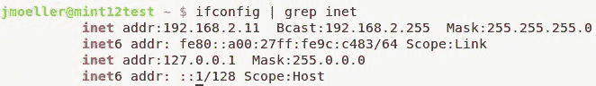

同样，你可以使用`ifconfig`和`grep`快速找到你电脑的 MAC 地址：

```bash
ifconfig | grep HWaddr
```

你可以轻松地从输出中提取出你的 MAC 地址：

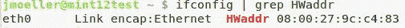

你如何找到系统的默认网关？你需要使用另一个命令：

```bash
ip route
```

`ip route`命令将输出如下所示的内容：

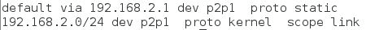

寻找以 "default via" 开头的那行。你系统的默认网关将是这两个词之后的 IP 地址。

现在你已经知道如何查找 IP 地址了，让我们来谈谈如何为你的 Linux Mint 系统实际获取 IP 地址。

### 从 DHCP 获取 IP 地址

在大多数情况下，你的电脑将从 DHCP 服务器接收 IP 地址。

手动为每台电脑手动配置 IP 地址既耗时又容易出错；如果一台或多台电脑接收到相同的 IP 地址，它们将由于地址冲突而无法连接。DHCP 代表“动态主机配置协议”，它消除了这一过程中的猜测。当电脑插入以太网网络（或连接到无线网络）时，它会向 DHCP 服务器发送请求。如果网络上有 DHCP 服务器，它会为电脑提供一个 IP 地址，并且 DHCP 服务器会确保没有两台电脑接收到相同的 IP 地址。

在大多数情况下，当你接入新网络时，你会自动收到 DHCP 地址。但如果没有收到，请尝试此命令：

```bash
sudo dhclient
```

这将手动告诉你的系统搜索 DHCP 服务器并接受地址。如果该命令不起作用，说明你使用的网络没有运行正常的 DHCP 服务器，或者有某种东西阻止 DHCP 服务器与你的电脑通信。

### 释放 DHCP 地址

DHCP 地址带有一个“租期”，这意味着你的电脑允许保留该地址的时间。通常，你的电脑会在租期过期前一半时间点联系 DHCP 服务器，并请求保留它，DHCP 服务器几乎总是会授予许可。

有时你想尽早释放已租的 IP 地址 - 例如，如果你网络的 DHCP 服务器发生了变化，或者你的电脑拒绝释放 IP 地址。你可以使用`dhclient`命令和`-r`选项来实现：

```bash
sudo dhclient -r
```

这将释放你的 IP 地址，然后你可以使用`sudo dhclient`联系 DHCP 服务器以接收一个新的。

### 通过图形界面设置静态 IP

DHCP 地址很方便，但它们有一个很大的弱点 - 它们会很快变化。如果租期足够短，你的 IP 地址在周一可能是`192.168.1.1`，而在周二可能是`192.168.3.45`，取决于 DHCP 服务器恰好可用哪些地址。对于笔记本电脑和桌面电脑，这通常不是大问题。然而，服务器需要一致的 IP 地址，以便客户端能够找到它们。

这就是“静态 IP”地址派用用场。静态 IP 是手动分配给电脑的地址，它将一直保持，直到你更改它。你需要确保它不会与你的 DHCP 服务器冲突，因此你需要重新配置 DHCP 服务器以从地址池中排除该静态地址，或者要求你的系统管理员执行。

以下是通过图形界面为系统的以太网适配器设置静态 IP 的方法：

- 点击`mintMenu`并在搜索字段中搜索“网络连接”（Network Connections）。

- 当“网络连接”对话框打开时，点击“有线”（Wired）选项卡，然后点击标记为`eth0`的连接。点击“编辑”（Edit）按钮。

- 当编辑`eth0`框打开时，点击“IPv4 设置”选项卡。

- 在`IPv4`框中，将“方法”（Method）下拉框从“自动”（Automatic）更改为“手动”（Manual）。

- 在“地址”（Addresses）标题下，点击“添加”（Add）按钮来添加静态 IP、子网掩码和默认网关。

- 将你的 DNS 服务器添加到“DNS 服务器”（DNS Servers）行。

### 使用命令行设置静态 IP

如果你想通过命令行设置静态 IP，你需要编辑`/etc/network/interfaces`文件。

首先，为 interfaces 文件创建一个备份：

```bash
sudo cp /etc/network/interfaces ~/interfaces.bak
```

接下来，打开 interfaces 文件：

```bash
sudo vi /etc/network/interfaces
```

最初，文件只包含关于回环地址的信息（回环地址是`127.0.0.1`，它用于测试 TCP/IP 栈是否正常工作）：

```
auto lo
iface lo inet loopback
```

为了给你的系统设置静态 IP，你需要进行一些更改。假设你想为`eth0`网络连接分配`192.168.1.2`（如你所记得，它是第一个适配器，额外的适配器将是`eth1`、`eth2`等），子网掩码为`255.255.255.0`，本地网关为`192.168.1.1`：

```
auto eth0
iface eth0 inet static
address 192.168.1.2
netmask 255.255.255.0
broadcast 192.168.1.255
gateway 192.168.1.1
```

添加完这些行后，进入`vi`的命令模式并保存退出（你可以使用`qw`或`exit`命令）。

你需要让系统加载新的 IP 配置。你可以通过重启来实现，但如果太慢了，可以使用此命令强制 Linux Mint 重新读取配置文件：

```bash
sudo ifup eth0
```

你的系统现在将拥有静态 IP 地址。

你还需要添加一个 DNS 服务器，你可以通过编辑`/etc/resolv.conf`文件来实现：

```bash
sudo vi /etc/resolv.conf
```

要设置地址为`192.168.1.10`的静态 DNS 服务器，切换`vi`到插入模式并在文件中添加此行：

```
nameserver 192.168.1.10
```

保存文件并退出文本编辑器。

## 使用 Samba 进行基础文件共享

Linux Mint 机器（无论是服务器还是桌面）最常见的用途之一是跨网络共享文件。如果你不熟悉这个术语，“文件共享”意味着让你系统上的文件夹对网络上的客户端可用。从他们自己的电脑开始，用户可以访问你的共享文件夹，取决于你如何配置安全性，他们可以复制文件、修改文件、添加新文件，甚至删除文件。

许多不同的程序提供文件共享功能。大多数 Linux Mint 系统使用`Samba`软件，因为它可以轻松地与 Windows 电脑共享文件。在组织中，经常会发现许多使用 Windows 系统的用户将其数据存储在运行`Samba`的 Linux 服务器上。

## 什么是 SAMBA？

Samba 的名称来源于服务器消息块/通用互联网文件系统协议（Server Message Block / Common Internet File System），通常简写为`SMB/CIFS`。一位名为 Andrew Tridgell 的程序员在 1991 年和 1992 年开始开发后来成为 Samba 服务器的程序。最初他将该项目命名为`smbserver`，但后来他收到一个拥有该名称权利公司的商标通知。为了找到一个不同的名称，Tridgell 在 UNIX 系统字典中搜索包含字母 "s, m, b" 的单词，并最终选定了`Samba`。

Samba 迅速流行起来，因为它允许基于 UNIX（以及后来基于 Linux）的计算机与 Windows 系统之间进行方便的文件共享。今天，`Samba`被广泛使用，Windows、Mac OS X 和 Linux 客户端都可以访问`Samba`共享上的文件。

我们将向你展示如何设置基础的 Samba 服务器，以及如何从客户端计算机访问这些共享。

## 基础 SAMBA 设置

Samba 拥有大量的选项和配置设置，但在这里，我们将向你展示如何设置和配置一个单用户的基础 Samba 服务器。

首先，你需要安装`Samba`。进入命令行提示符并输入此命令：

```
sudo apt-get install samba
```

输入你的密码进行身份验证，`apt`将为你下载并安装`Samba`及其相关的实用程序。

在第 3 章中，我们讨论了 Linux Mint 的用户账户，并它们存储在`/etc/passwd`文件中。关于`Samba`需要理解的一个关键点是，它存储自己的一套用户账户，与主账户分开，存储在`/etc/samba/smbpasswd`文件中。这意味着你需要为每个想要访问你文件共享的用户创建一个单独的 Samba 密码。你使用`smbpasswd`命令来创建此密码。使用我们在第 5 章中为 Caina Amalas 创建的`camalas`账户，命令看起来如下：

```
sudo smbpasswd -a camalas
```

确保为`camalas`的 Samba 账户提供一个足够强的密码（包括大写字母、小写字母、符号符号和数字）。一旦创建了`camalas`的密码，下一步是为她创建一个供的目录。首先在`camalas`的文件夹中创建一个名为 'test' 的文件夹，我们将将其作为第一个共享文件夹：

```
mkdir /home/camalas/test
```

（注意：不要使用`sudo`来创建文件夹，否则所有者用户和组将被设置为‘root’，这意味着你将无法使用你的 Samba 用户名和密码访问该文件夹。）

下一步是编辑`/etc/samba/smb.conf`文件，这是 Samba 的主配置文件。像既往一样，先将原始的`smb.conf`文件复制一个安全备份副本到你的主目录，以防你犯错：

```
sudo cp /etc/samba/smb.conf ~
```

现在使用`vi`编辑`/etc/samba/smb.conf`文件：

```
sudo vi /etc/samba/smb.conf
```

`smb.conf`文件很长且相当复杂，但为了演示之目的，你可以忽略它的大部分内容。移动到文件末尾并插入此文本：

```ini
[test]
path = /home/camalas/test
available = yes
valid users = camalas
read only = no
browseable = yes
public = yes
writable = yes
```

（行之间不应有空格，另外请注意每个等号的前后都应该有一个空格。）

以下是一些较重要的配置选项的含义：

- `[test]`是文件共享的名称。

- `path`选项指定了要共享文件夹的位置。

- `available`选项指定该文件共享对网络上的客户端可用。

- `valid users`选项详细列出了允许访问文件共享的用户。在这种情况下，我们将其设置为只有`camalas`账户可以访问。如果你愿意，可以在这里添加额外的账户。

- `read only`选项指定了是否允许客户端向文件共享写入内容。

- `writable`选项指定可以向文件共享写入数据。

上述设置将共享我们之前创建的`test`文件夹，并仅授予`camalas`用户名对该文件夹的读取和写权限。一旦你输入了更改，保存`smb.conf`，退出`vi`并使用此命令重启 Samba：

```
sudo /etc/init.d/samba restart
```

（这将强制 Samba 重启，重新读取其配置文件并激活你刚刚创建的共享。）

一旦 Samba 重启，使用此命令检查你的`smb.conf`是否有语法错误：

```
sudo testparm
```

如果`testparm`命令通过了，则`Samba`应该可以正常工作。尝试从局域网上的另一个客户端访问该共享。

我们将在章节结束前解释如何操作。

## 从客户端访问共享文件夹

通常情况下，从 Windows 客户端连接到 Linux Mint 机器上的 Samba 共享应该是简单的。然而，有几个陷阱需要注意。

假设你已经沿用了我们之前使用的设置，现在你有一个 IP 地址为`192.168.1.2`（子网掩码为`255.255.255.0`）的 Linux Mint Samba 服务器。该服务器托管了一个名为 "test" 的共享，用户账户`camalas`具有访问权限，密码为 "ghost."。你想从一台 IP 地址为`192.168.1.3`且子网掩码为`255.255.255.0`的 Windows 机器连接到此共享。

在 Windows 机器上，进入启动菜单，然后选择“运行”（或同时按下 Windows 键和 R），在运行对话框中输入以下内容：

```
\\192.168.1.2
```

或者，你也可以在任何 Windows 资源管理器窗口的地址栏中输入此内容。这被称为 UNC 路径 - 即“通用命名规范”路径。

除非你设置了 DNS 服务器，否则最好使用 IP 地址而不是主机名从 Windows 访问你的 Linux Mint 机器。事实上，如果你没有设置 DNS 服务器，你*必须*使用 IP 地址从 Windows 机器访问 Samba 服务器，因为你的 Windows 机器将无法解析 Linux Mint 的 IP 地址。正如我们在第 7 章中讨论过的，为你的 Linux Mint 机器分配一个静态 IP 地址会让这变得更容易。

如果你在运行框中输入了 UNC，请点击确定；如果你是在 Windows 资源管理器中输入的，请按回车键，然后你应该会收到该共享的用户名和密码提示。使用上面的示例，按以下格式输入你的用户名和密码：

```
camalas@192.168.1.2
ghost
```

有必要将用户名输入`camalas@192.168.1.2`（或者换用`192.168.1.2\camalas`），否则 Windows 会尝试使用它自己的账户对 Samba 共享进行验证。这显然行不通。在账户名中使用 IP 地址会强制 Windows 对 Samba 服务器进行验证。

如果这不起作用，首先确保你输入的用户名、密码和 IP 地址是正确的。任何一个错误都会导致失败，而且密码是*区分大小写*。接下来，检查`/etc/samba/smb.conf`文件以确保共享权限设置正确。还要检查你尝试访问的文件夹的文件系统权限和所有权。无论共享权限如何，你的用户账户都需要具有实际访问共享文件夹的权限。例如，如果你使用`sudo`创建了共享文件夹，则 root 用户和 root 组将拥有该文件夹的所有，你将无法使用 Samba 账户访问它。

# 第 11 章 - FTP 客户端与服务器

FTP 代表“文件传输协议”（file transfer protocol），它允许你将文件传输到远程计算机。FTP 已经存在了很久，它有很多优缺点。由于 FTP 如此老旧，它在几乎每个操作系统上都受到支持，而且大多数操作系统都包含了某种 FTP 客户端。缺点是 FTP 并不十分安全。它有一个旋转端口的坏习惯，这使得它在互联网上使用变得很困难（防火墙非常不喜欢端口突然变化），而一个允许匿名登录的 FTP 服务器是极不安全的——任何人都可以上传或下载材料，这意味着允许匿名访问的 FTP 服务器可能会很快发现自己正在托管非法材料。（如今，允许匿名访问的 FTP 服务器已经非常罕见了。）我强烈倾向于使用 SFTP，我们将在第 11 章中讨论。


然而，Linux Mint 可以以相当程度的安全性作为 FTP 服务器。在本章中，我们将向你展示如何将 Linux Mint 设置为 FTP 服务器，以及如何使用命令行 FTP 客户端。

## 安装并配置 FTP 服务器

Linux Mint 最常用的 FTP 服务器软件是 `vsftpd` 软件包，它代表“非常安全的 FTP 守护进程”（very secure FTP daemon）。它是 Linux Mint 默认的 FTP 软件包，大多数其他 Linux 发行版也是如此。作为一个额外奖励，`vsftpd` 开箱即用就很安全——如果你想让它变得不安全，必须特意去搞乱配置文件。

额外地，`vsftpd` 在 Linux Mint 机器上的安装和配置非常简单。要安装 `vsftpd` 软件包，请进入命令行界面并输入此命令：

```bash
sudo apt-get install vsftpd
```

输入密码进行验证，`apt` 将为你下载并安装 `vsftpd`。

按照默认提示操作，`vsftpd` 服务器将安装在你的计算机上。通常，`vsftpd` 的默认配置相当安全，足够日常使用。匿名用户被禁用，没有人可以向服务器写入文件（或者在 FTP 术语中，没有人可以向服务器上传文件）。任何拥有系统账户的用户都可以连接到 FTP 服务器并下载文件，但不能上传。

如果你想更改任何设置，`vsftpd` 的配置文件为 `/etc/vsftpd.conf`。像任何其他配置文件一样，你可以用 `vi` 编辑它：

```bash
sudo vi /etc/vsftpd.conf
```

像 Samba 一样，`vsftpd.conf` 文件包含许多控制服务器行为和运行的“指令”。如果你想让用户能够写入文件，你需要更改此指令：

```text
#write_enable=YES
```

改为：

```text
write_enable=YES
```

一旦 `write_enable` 设置为 `YES`，用户就可以向服务器上传文件。然而，匿名访问由此指令控制：

```text
anonymous_enable=NO
```

在任何情况下都不应该允许对你的服务器进行匿名访问，特别是它可以从互联网访问时！在某些情况下你可能会发现它有用，但只有在你确定自己在做什么时才启用它。如果你对文件进行了任何更改，保存并退出 `vi`。然后重启服务器以读取新指令：

```bash
sudo service vsftpd restart
```

现在你可以从命令行测试服务器的 FTP 服务：

```bash
ftp 127.0.0.1
```

## 使用 FTP 客户端

有 FTP 服务器并不意味着你可以立即访问它——你首先需要一个“FTP 客户端”的程序来与 FTP 服务器进行通信。幸运的是，Linux Mint 自带了 FTP 客户端——你只需在命令行输入以下内容即可访问：

```bash
ftp
```

然而，如果你知道想要访问的 FTP 服务器的 IP 地址，使用起来会方便得多。假设你想访问 IP 地址为 `192.168.1.100` 的 FTP 服务器。为此，你可以将 IP 地址附加到 `ftp` 客户端命令之后：

```bash
ftp 192.168.1.100
```

FTP 客户端随后会要求你输入用户名。（注意，这是 FTP 服务器上的用户名和密码，而不是你电脑上的用户名和密码。）输入它并按回车。客户端会要求输入密码，你应该随后输入密码。一旦输入，你就会进入 FTP 提示符，如下所示：

```text
ftp>
```

如果你看到这个，说明服务器工作正常。你可以通过此命令返回命令行：

```text
exit
```

一旦进入 FTP 提示符，你就可以使用一些常用的终端命令。要查看远程目录的列表，你可以使用 `ls` 命令：

```text
ls
```

这将显示远程目录的内容。

要找到你当前实际上位于哪个远程目录，你可以使用 `pwd` 命令：

```bash
pwd
```

这个命令正如你可能在第 1 章中记得的那样，代表“打印工作目录”（print working directory），它将显示当前的工作目录。

要从 FTP 服务器下载文件，你需要使用 `get` 命令。例如，从当前工作目录检索名为 "report.doc" 的文件：

```bash
get report.doc
```

这将把文件下载到你的本地主目录。

要将文件上传到 FTP 服务器（假设服务器的 `write_enable` 指令设置为 `YES`），你需要使用 `put` 命令。将一个名为 "data.doc" 的文件放到远程服务器上：

```bash
put data.doc
```

这将把文件上传到 FTP 服务器上的远程目录。

这只是 FTP 客户端可用命令的基本概述——还有许多更多命令可用。此外，如果你倾向于使用图形化 FTP 客户端，我推荐使用优秀的 Filezilla 客户端，你可以通过此命令安装：

```bash
sudo apt-get install filezilla
```

***

# 第 12 章：使用 SSH 和 SFTP

SSH 代表“安全外壳”（secure shell），是一种允许你安全地向远程机器发送命令的网络协议。我们在第 3 章中讨论过“壳”是一个在用户和操作系统之间提供接口的程序。SSH 是一个“远程”外壳，允许你通过网络向机器发送命令。“安全”部分源于连接是加密的，这意味着攻击者无法监听连接，也不会在传输过程中拦截并用自己的命令替换掉你的命令。SSH 相当可靠且安全，在 Linux 世界中被广泛使用。管理员经常用它远程管理机器——比起寒冷且嘈杂的服务器机房，从你的笔记本电脑上控制服务器通常要舒服快得多。

SSH 还提供了 SFTP 协议，它代表“SSH 文件传输协议”（SSH File Transfer Protocol）。基本上，SFTP 与 FTP 协议类似，但它使用 SSH 的安全功能来加密连接。这意味着 SFTP 比 FTP 安全得多。

在本章中，我们将向你展示如何设置 SSH 服务器、如何使用 SSH 命令行客户端以及如何使用 SFTP。我们还会向你如何设置 SSH 使用基于密钥的认证，这比基于密码的认证安全得多。

## 安装并配置 SSH 服务器

Linux 一直对 SSH 有强有支持，Linux Mint 也不例外。在本节中，我们将介绍 SSH 服务器的基本安装，以及一些基础的安全配置。Linux Mint 默认的 SSH 服务器软件包是 OpenSSH Server，我们将在此处使用它。

首先，你需要安装 OpenSSH Server。要执行此操作，打开终端窗口并输入以下命令：

```bash
sudo apt-get install openssh-server
```

输入你的密码进行身份验证，`apt` 工具将为你下载并安装 OpenSSH Server。根据你的互联网连接速度和电脑性能，安装可能需要几分钟。

安装完成后，返回终端窗口。我们需要对你的 `/etc/ssh/sshd_config` 文件进行一些更改以增加 SSH 的安全性。首先，如既往一样，我们要为你的 `sshd_config` 文件创建一个备份副本，以防出现任何问题。在终端中输入此命令：

```bash
sudo cp /etc/ssh/sshd_config ~
```

这会在你的主目录下创建一个 `sshd_config` 文件的备份副本。

接下来，我们需要编辑 `sshd_config` 文件本身。现在是时候再次运用你的 `vi` 技巧了：

```bash
sudo vi /etc/ssh/sshd_config
```

与几乎所有其他服务器软件包一样，SSH 由其配置文件中的许多指令控制。OpenSSH 服务器的默认安装是相当安全的。然而，你可能想对其进行一些更改，以进一步加固其安全性。

`PermitRootLogin` 指令是你想要更改的之一。当你正在编辑 `/etc/ssh/sshd_config` 文件时，你希望如下所示更改该指令：

```text
PermitRootLogin no
```

这将防止任何人尝试通过 SSH 以 root 身份登录你的服务器。通常情况下，不允许任何人以 root 身份登录你的 SSH 服务器是一个好主意。如果攻击者成功通过 root 登录黑入你的 SSH 服务器，他将对你的机器拥有完全控制权，这绝对不是一件好事。

另一个你可能想要更改的指令是 `AllowUsers`。当 `AllowUsers` 指令激活时，只有指令中明确指定的用户才能通过 SSH 访问系统。通过只允许特定用户通过 SSH 连接，这为你的 SSH 服务器添加了额外的保护层。例如，如果你想将 SSH 访问限制仅限“camalas”用户账户，如下所示编辑 `AllowUsers` 指令：

```bash
AllowUsers camalas
```

要向 `AllowUsers` 指令添加多个用户，只需逐个添加即可，无需使用逗号或分号。一个允许 `camalas` 用户账户和 `lmaraeus` 用户账户登录的 `AllowUsers` 指令看起来如下：

```bash
AllowUsers camalas lmaraeus
```

你可能还想更改 `Port` 指令。默认情况下，SSH 运行在 TCP/IP 端口 22，这意味着任何扫描 22 端口的恶意软件都可能针对它。如果你想将 SSH 设置为 599，请确保你的 `Port` 指令如下所示：

```text
Port 599
```

注意，如果你更改了 SSH 服务器的默认端口，在使用 SSH 客户端时需要记住新端口，我们将在下一节中介绍。当你完成对 `/etc/ssh/sshd_config` 的更改后，切换 `vi` 的命令模式并保存退出。使用此命令重启 SSH 服务：

```bash
sudo /etc/init.d/ssh restart
```

你现在应该可以从另一个系统通过 SSH 客户端登录到你的 Linux 机器。

## 配置 SSH 使用基于密钥的认证

SSH 非常安全，但它有一个弱点——密码。如果有人破解了你的 SSH 密码，他们就可以控制你的 SSH 服务器。

更安全的 SSH 登录方法是使用公私钥。通过公私钥，你创建了一对匹配的公私钥。你将私钥保存在个人机器上，而将公钥放在要连接的 SSH 服务器上。通过这种配置，SSH 服务器将只允许具有匹配私钥的系统进行连接。

在本节中，我们将向你展示如何为 SSH 设置基于密钥的认证。

首先，在你的服务器上安装 OpenSSH Server。在后续步骤中，假设你已经在 IP 地址为 `192.168.1.100` 的机器上安装了 SSH 服务器，并且打算从 IP 地址为 `192.168.1.200` 的客户端机器连接到该服务器。

安装 SSH 服务器后，转到客户端机器 `192.168.1.200` 并输入以下命令：

```bash
ssh-keygen -t dsa
```

按回键，该命令将在 `~/.ssh` 目录下保存一对匹配的公私钥。具体来说，它创建了两个文件——`id_dsa`（你的私钥）和 `id_dsa.pub`（你的公钥）。它还会要求为密钥设置一个短语，这在账户被他人访问时提供了额外的安全保障。设置短语通常是一个好主意。

在 `cmd` 命令完成后，你需要将新创建的 `id_dsa.pub` 密钥文件传输到 IP 为 `192.168.1.100` 的 SSH 服务器。一旦你将其移动到服务器，请将其复制到服务器上用户账户的 `~/.ssh` 目录中。（如果该目录不存在，请使用 `mkdir` 命令创建它）。接下来，切换到 `~/.ssh` 目录，并使用此命令：

```bash
touch authorized_keys
```

这将在 `~/.ssh` 目录中创建一个用于存储授权密钥的文件。使用此命令将你的公钥添加到 `authorized_keys` 文件中：

```bash
cat id_dsa.pub >> authorized_keys
```

最后，使用 `chmod` 命令将 `authorized_keys` 设为只读，以防止误删：

```bash
chmod 400 authorized_keys
```

最后，你可能需要修改 SSH 服务器的配置文件来强制基于密钥的登录，否则服务器将继续允许基于密码的登录。使用 `vi` 编辑器编辑 SSH 主配置文件：

```bash
sudo vi /etc/ssh/sshd_config
```

编辑文件时，确保将 `PasswordAuthentication` 指令设置为 `no`。这将强制你的 SSH 服务器仅允许基于密钥的登录尝试。完成文件编辑后，使用此命令重启 SSH 服务器：

```bash
sudo service ssh restart
```

你的 SSH 服务器将不仅允许基于密钥的登录——用户必须拥有一个私钥，且与 SSH 服务器家目录下的 `~/.ssh/authorized_keys` 文件中对应的公钥相匹配。

请务必在安全的地方备份你的私钥——如果你丢失了它，你将失去对 SSH 服务器的访问权限。

## 使用 SSH 客户端

几乎所有的 Linux 发行版（包括 Linux Mint）都带有一个命令行 SSH 客户端。一旦你成功连接到 SSH 服务器，就像你正坐在那台机器前使用命令行会话一样。你可以发布命令、移动和删除文件以及运行程序，仅限于你在 SSH 服务器上的权限。

假设你想连接到 IP 地址为 `192.168.1.100` 的 SSH 服务器。要做到这一点，你只需要在命令行中使用 `ssh` 命令启动 SSH 客户端即可：

```bash
ssh 192.168.1.100
```

第一次连接到新的 SSH 服务器时，客户端将显示服务器的 RSA 指纹（`RSA` 是一种加密方式），并询问你是否想要继续连接。输入“yes”并按回车（仅按“y”是不起作用）。SSH 客户端随后会询问用户名和密码，假设你输入正确，你就可以进入了。然后你就可以开始使用远程机器了，就像你坐在它面前一样。

然而，你可能想跳过一个步骤。通过添加 `-l` 选项，你可以在 `ssh` 命令中指定用户名。在这个示例中，SSH 客户端将尝试使用“camalas”用户名进行连接：

```bash
ssh –l camalas 192.168.1.100
```

你只需要输入 camalas 账户的密码即可连接。

默认情况下，SSH 客户端尝试使用端口 22 进行连接。然而，如果你在 SSH 服务器的 `/etc/ssh/sshd_config` 文件中使用了 `Port` 指令更改了默认端口，你的 SSH 客户端将无法连接，并返回错误信息。在我们上面的示例中，我们将 SSH 服务器设置为监听 5699 端口。要告诉 SSH 客户端使用该端口连接，请使用 `-p` 选项：

```bash
ssh –p 5589 192.168.1.100
```

你也可以与 `-l` 选项结合使用：

```bash
ssh –p 5589 –l camalas 192.168.1.100
```

这将使 `ssh` 客户端尝试使用端口 5589 和 camalas 用户账户向 `192.168.1.100` 创建 `ssh` 连接。

## 使用 SFTP

如上所述，SFTP 基本上是运行在 SSH 连接上的文件传输协议。由于它使用了 SSH 的加密，因此比传统的 FTP 安全得多。作为一个额外的好处，无需单独设置 SFTP 服务器——OpenSSH Server 包包含内置的 SFTP 服务器，它也由 `/etc/ssh/sshd_config` 文件管理。和 FTP 服务器一样，你需要一个 SFTP 客户端——但 Linux Mint（以及大多数 Linux 发行版）都自带了一个。

你可以通过在命令行输入以下命令访问 SFTP 客户端：

```bash
sftp
```

然而，如果你知道想要访问的 SSH 服务器的 IP 地址，使用起来会简单得多。假设你想访问 IP 地址为 `192.168.1.100` 的 SSH 服务器。要做到这一点，你只需在 `sftp` 客户端命令后加上 IP 地址：

```bash
sftp 192.168.1.100
```

SSH 客户端随后会询问你的用户名。（注意，这是 SSH 服务器上的用户名和密码，而不是运行 SFTP 客户端的电脑的用户名。）输入并按回车。客户端会提示密码，你应该输入密码。完成后，你将进入 SFTP 提示符，如下所示：

```text
sftp>
```

你也可以在 `sftp` 命令中指定不同的用户名。例如，如果你想使用 `camalas` 账户连接到 `192.168.1.100` 的 SSH 服务器，命令将是：

```bash
sftp camalas@192.168.1.100
```

如果你设置 SSH 服务器监听除默认端口 222 以外的端口，你需要使用 `-P` 选项告诉 SFTP 客户端使用不同的端口。注意这与 SSH 客户端使用 `-p` 选项不同——记住 Linux 命令行是区分大小写的。要让 SFTP 客户端使用 5589 端口，命令如下：

```bash
sftp –P 5589 192.168.1.100
```

在 `sftp` 提示符下，你可以使用一些常用的终端命令。要查看远程目录列表，可以使用 `ls` 命令：

```bash
ls
```

这将显示远程目录的内容。

要找到你实际位于哪个远程目录，你可以使用 `pwd` 命令：

```bash
pwd
```

这个命令正如你可能在第 3 章记得的那样，代表“print working directory”（打印工作目录）。

无论论好还是坏，互联网彻底改变了人们交流、购买商品和服务、阅读书籍、听音乐以及寻找朋友和潜在配偶的方式。这本书本身的存在就是互联网力量的证明——毕竟，你可能是从某个销售电子书的网站购买的这本书，而 `Linux Mint` 的安装盘也是通过互联网下载的。事实上，这本书之所以存在，完全是因为互联网——几乎可以说没有纸质出版社会出一本关于 `Linux Mint` 的简短介绍书籍（更不用说是一本由奇幻小说作家写的了！）。

互联网革命的核心是一种被称为 Web 服务器的软件。Web 服务器的作用是托管名为网页的 HTML 文档，并通过万维网将这些文档发送给客户端浏览器。网页的范围从简单的静态 HTML 页面到提供银行、商业和社交网络服务的复杂 Web 应用。


Linux 的桌面市场份额可能不如 Microsoft Windows，但它主导了 Web 服务器市场。33% 到 40%（取决于统计者的标准）的 Web 服务器是 Linux/UNIX/UNIX-like 机器，它们运行着一个名为 `Apache HTTP Server` 的程序，通常被简称为“Apache”。Apache 自 1995 年左右问世以来，它的发展推动了万维网的增长。

你可以在 `Linux Mint` 系统上轻松地安装 Apache。一台 `Linux Mint` 机器可以作为简单静态 HTML 页面的 Web 服务器，并能扩展到支持大型复杂的 Web 应用。在本章中，我们将向你如何设置一个简单的 Apache 服务器。在随后的章节中，我们将在此安装的基础上运行一些更强大的 Web 应用，如 WordPress 和 MediaWiki。

## 安装 Apache Web 服务器

就安装而言，在 `Linux Mint` 上安装 Apache 非常轻而易举。（当然，配置它要困难得多。）要安装 Apache，请在终端窗口或命令提示符输入此命令：

```bash
sudo apt-get install apache2
```

（技术上，你安装的是 Apache 2，最新版本。）

输入密码进行身份验证，按照默认提示操作，`apt` 将为你下载并安装 Apache Web 服务器。

搞定！Apache 现在应该可以工作了。要从服务器本身进行测试，请打开浏览器并访问地址 `http://127.0.0.1`。你记得这是“本地回环”地址，基本上是本地计算机用于指代自身的 IP 地址。或者，你也可以从同一子网的另一台计算机进行测试。例如，如果你在一台 IP 地址为 `192.168.1.100` 的计算机上安装了 Apache，你可以访问同一子网的另一台计算机并在浏览器中输入 `http://192.168.100` 来测试。

无论如何，如果 Apache 工作正常，你应该看到默认的 Apache/Linux Mint 网页，左上角带有 `Linux Mint` 的标志。

Apache 现在已运行。在下一节中，我们将简单讨论一下配置 Apache。

## Apache 基础配置

Apache 配置取决于网站的规模变得极其复杂。Apache 配置的全概述远超本书的范围——事实上，关于这个主题已经写了数十本优秀著作。然而，在这里我们可以简要查看 Apache 配置。

Apache 的主配置文件是 `/etc/apache2/apache2.conf`。（在某些 Linux 发行版中，它是 `/etc/apache2/httpd.conf`，但 Linux Mint 使用 `/etc/apache2/apache2.conf`）。你可以使用 `vi`、`cat` 或 `less` 浏览文件内容，但通常情况下，只有在知道自己在做什么时才进行修改。一如既常地，在更改配置文件之前，务必在你的家目录中创建一个备份副本，以防发生无法挽回的错误。

`Linux Mint` 将你的实际 Web 文件（构成你网站的 HTML 文件）存储在 `/var/www/html` 目录下。安装 Apache 之后，该目录下只有一个文件——`index.html` 文件，它包含了我们之前看到的“it works!”消息。否则，该目录是空的。你可以将自己的 HTML 文件放在这里。编写 HTML 代码超出了本书的范围，但请记住，一旦你构建了自己的网站，你就需要创建自己的 `index.html` 文件。

然而，将 HTML 文件加载到 `/var/www/html` 目录只会让你创建一个静态网站。如果你想要一个动态网站，一旦更新内容，你需要一个数据库后端——我们将在下一章讨论这一点。在本章的下一节中，我们将展示如何配置 Apache 使用虚拟主机。

## 虚拟主机

正如我们在上一节提到的，使用 Apache 设置简单的 Web 服务器很容易。但你可能需要一个更复杂的 Web 服务器，一个可以托管多个独立网站而不是大型网站内子目录的服务器。

如何实现这一点？

Apache 有一个名为“虚拟主机”的功能，允许你在同一台物理服务器上运行具有完全不同域名的独立网站。坦率地说，为 Apache 实现虚拟主机实际上非常简单。在示例中，我们将向你展示如何在 Apache Web 服务器上设置一个名为“examplename.com”的新网站。

首先，你需要为你的新网站文件设置一个位置。你可能记得，Apache 默认将 Web 文件存储在 `/var/www/html` 中。对于本示例，使用此命令为网站创建一个新文件夹：

```bash
sudo mkdir /var/www/html/w2
```

接下来，你需要在 `/etc/apache2/sites-available` 目录下为新网站创建一个配置文件。坦率地说，该目录包含一个默认文件，你可以使用此命令将其复制并作为模板使用：

```bash
sudo cp /etc/apache2/sites-available/000-default.conf /etc/apache2/sites-available/examplename.conf
```

（确保包含 `.conf` 扩展名。Linux Mint 14.04 Trusty Tahr 及更高版本运行 Apache 2.4，这需要该扩展。）

下一步是使用 `vi` 编辑器用正确的设置编辑新的配置文件。你可以使用 `vi` 文本来实现：

```bash
sudo vi /etc/apache2/sites-available/examplename.conf
```

（我们在第 6 章讨论过如何使用 `vi`。）

使用 `vi` 编辑文件后，你需要进行一些更改。

将“Document Root”指令从 `/var/www/html` 修改为你新网站的正确位置，在本例中为 `/var/www/html/w2`。

同样将“Directory”指令从 `/var/www/html` 修改为 `/var/www/html/w2`。

最后，在以“ServerAdmin”开头的行下方为新网站的域名添加新行。对于我们名为“examplename.com”的网站，添加如下行：

```apache
ServerName examplename.com
```

保存文件更改，然后退出 `vi`。

现在你需要修改 Apache 以向网络访客显示新域名。坦率地说，你可以通过 `a2ensite` 命令完成：

```bash
sudo a2ensite examplename.conf
```

（注意，“examplename”将取决于你为配置文件文件命名。）

最后一步——重启 Apache 以强制其重新读取配置文件并开始服务新网站：

```bash
sudo /etc/init.d apache2 restart
```

确保在 `/var/www/html/w2` 中某种 `index.html` 文件，那么 `examplename.com` 网站现在应该可以工作了。

你可能听过“数据库”这个词，但可能并不清楚它的具体含义。简单来说，数据库是任何设计用于创建、存储、检索和管理大量数字信息的系统。有许多不同类型的数据库，但最常见的类型是“关系型数据库”，它使用多个数据表（每个表都有许多行和列）来存储必要的数据。大多数现代数据库在技术上都是 RDBMS，即“关系型数据库管理系统”，这是对使用关系型模型的数据库（以及任何相关软件）的描述方式。

目前最流行、使用最广泛的开源 RDBMS 是一个名为 `MySQL` 的程序。两位名为 Michael Widenius 和 David Axmark 的计算机程序员于 1994 年开始开发 `MySQL`，该软件最终被 Sun 公司（Sun Corporation）收购，随后在 2010 年当 Oracle 公司（Oracle Corporation）收购 Sun 后被收购。“MySQL”这个名字来源于两个来源。“My”部分显然来自 Michael Widenius 的女儿，她的名叫 My。“SQL”则来自“结构化查询语言”（Structured Query Language），这是一种用于处理 RDBMS 中插入、检索、管理和删除数据任务的计算机语言。

`MySQL` 已经存在很长时间，它被许多网站使用——Google、Facebook 和 Wikipedia 都在使用 `MySQL`，许多流行的内容管理系统（如 WordPress 和 Drupal）也依赖 `MySQL` 来存储数据。

`MySQL` 在 Linux Mint 系统上的安装非常简单。在本章中，我们将向你如何安装和配置 `MySQL`，如何从 `MySQL` 命令行创建数据库和数据库用户，以及如何安装 phpMyAdmin 以通过更简单的图形化界面配置 `MySQL`。

## 安装 MYSQL 服务器

要在 Linux Mint 上安装 MySQL 服务器，请打开终端窗口或命令提示符，输入以下命令：

```
sudo apt-get install mysql-server-5.7
```

（截至本文，Linux Mint 仓库中提供的最新版本是 MySQL 服务器 5.7，但未来的 Linux Mint 版本可能会收到更高版本的 MySQL。）

输入密码验证，`apt` 将下载并安装 MySQL 文件。这是一组非常大的文件，因此取决于你的互联网连接速度，下载可能需要一段时间。在文件下载并开始安装后，安装程序会要求你输入 `MySQL` root 用户的密码。就像 Linux 中的 root 用户对系统具有完全控制权一样，`MySQL` 中的 root 用户对所有数据库、表、权限和用户具有绝对控制权。出于显而易见的考虑，你需要为 `MySQL` root 用户创建一个极其强大的密码（大写字母、小写字母、数字和符号的混合体，越长越好）。

（注意，在密码对话框中，如果你无法选中 `<OK>` 字段，可以使用 tab 键从文本输入行跳转到 `<OK>` 字段。）

输入 root 密码后，安装程序将完成 MySQL 文件的处理并返回命令行。

接下来，你希望运行 `mysql_secure_installation` 脚本来固化你新 `MySQL` 服务器的安全性。在提示符中运行此命令：

```
sudo mysql_secure_installation
```

首先，`mysql_secure_installation` 脚本会要求你输入 MySQL root 用户的密码。之后，它会问你是否更改 root 密码。由于你已经设置了 root 密码，你可以按“n”（除非出于某些你想再次更改）。

接下来，脚本会要求你设置 `VALIDATE PASSWORD` 插件，该插件会检查密码强度是否合适。按 Y 接受，然后按 0（低）、1（中）或 2（强）来设置密码强度级别。

接下来，脚本会问你是否要删除匿名用户。匿名用户就像 FTP 中的匿名访问，允许某人在没有相应用户账户的情况下登录 `MySQL`。出于安全考虑，删除匿名用户总是最好的，因此按“y”继续。

之后，脚本会问你是否要防止 MySQL root 用户远程登录 MySQL 服务器。请始终按“y”禁止 root 远程访问，因为如果攻击者猜中了你的 root 密码，他就可以破坏你的数据库或窃取其中包含的信息。

之后，脚本会问你是否要删除测试数据库。`MySQL` 包含一个任何人都可以访问的测试数据库。同样，这是一个安全漏洞，因此你应该按“y”删除测试数据库。

脚本随后会要求重新加载权限表以使更改生效。按“y”，`mysql_secure_installation` 脚本将结束并返回命令行。

`MySQL` 服务器现在已安装在你的 Linux Mint 系统上。在下一节中，我们将讨论使用 `MySQL` 命令行客户端创建数据库和用户。

## 使用 MYSQL 命令行客户端

`MySQL` 在 Linux Mint 系统上最常见的用途是为某种类型的动态网站提供后端，通常是像 WordPress 或 MediaWiki 这样的内容管理系统。要在 Linux Mint 机器上托管这些网站，你需要为网站创建一个数据库和一个数据库用户。`MySQL` 服务器可以支持许多不同的数据库，受限于机器上可用硬件和磁盘空间容量。（同时托管多个活动数据库对硬盘有很高要求。）

与 Samba 一样，`MySQL` 拥有自己的一套账户，与主系统账户分离，称为“数据库用户”。数据库用户是指访问特定数据库或数据库中特定表的 MySQL 用户。在本节中，我们将向你介绍如何通过命令行创建数据库和用户。

首先，你需要进入 MySQL 客户端。MySQL 就像 FTP 和 SFTP 的命令行客户端一样有自己的提示符。要访问该提示符并启动客户端，请使用命令：

```
mysql
```

然而，如果你只输入该命令，它会返回错误信息。使用 MySQL 客户端你需要添加 `-u` 和 `-p` 参数。`-u` 参数告诉它你要使用哪个 MySQL 用户（类似于 SSH 中的 `-l` 参数）。`-p` 参数告诉它提示密码。因此，要以 root 用户身份使用 MySQL 客户端，命令如下：

```
mysql -u root -p
```

输入 MySQL root 用户的密码，你将看到 MySQL 提示符，如下所示：

```
mysql>
```

我们接下来的步骤是创建数据库、创建访问该数据库的用户，并授予新用户该数据库的所有权限。通常，当你安装 WordPress 这样的 Web 应用时，你会为 WordPress 创建的数据库用户授予 WordPress 数据库的所有权限，以便其正常运行。未授予应用程序用户数据库的所有权限会导致应用程序运行异常甚至完全失败。

在继续之前有一个重要的说明。从 MySQL 提示符执行的所有命令都必须以分号结尾，表示语句的结束。任何不以分号结尾的命令都无法工作。在此基础上，让我们先创建一个数据库。

在 `mysql>` 提示符输入以下命令创建数据库：

```
CREATE DATABASE newdatabase;
```

MySQL 客户端将返回一条消息：“Query OK, 1 row affect (0.00 sec)。”这意味着命令执行成功，已创建一个名为 `newdatabase` 的新数据库。

接下来，你创建一个访问该数据库的用户：

```
CREATE USER newdatabaseruser;
```

你应该会再次收到"Query OK"消息。一旦创建了新用户，在分配任何权限之前，我们需要为该用户设置密码。在这个示例中，我们将分配"1234"作为密码。然而，在现实生活中，就像 root 用户一样，你会希望设置一个强密码。（这个数据库用户不会像 root 用户那样对 MySQL 服务器拥有完全控制权，但我们将赋予它对我们刚刚创建的数据库的完全控制权，而猜中密码的恶意用户可能会引发各种麻烦。）要创建密码，请使用此命令：

```
SET PASSWORD FOR newdatabaseuser= PASSWORD“1234”);
```

你再次应该会收到"Query OK"确认消息。最后一步是将 "newdatabase" 数据库的所有权限分配给 "newdatabaseuser" 用户。使用此命令分配权限：

```
GRANT ALL PRIVILEGES ON newdatabase.* TO newdatabaseuser IDENTIFIED BY ‘1234;
```

这不是拼写错误 - 在此命令中使用的是单引号（''），而不是设置密码命令中常用的双引号（"）。遗憾的是，MySQL 的内部语法并不总是一致。无论如何，如果你正确输入了命令，应该会再次收到"Query OK"确认消息。

完成后，使用此命令退出 MySQL 命令行界面：

```
exit
```

你现在已经设置了一个数据库，创建了一个数据库用户，并赋予了该用户对该数据库的完全控制权。

## 备份和恢复 MySQL 数据库

MySQL 数据库通常用于支持如 WordPress 或 Moodle 等 Web 应用程序，这意味着这些 MySQL 数据库通常包含至关重要的信息。因此，定期对它们进行备份是非常重要的。备份 MySQL 数据库的一种快速且简单的方法是使用 `mysqldump` 命令行工具。该工具将数据库下载到单个 SQL 文件，你可以将其存储为备份，或用于将数据库传输到另一个 MySQL 服务器。

要使用 `mysqldump`，你需要知道 MySQL 服务器的 root 密码（或拥有你需要下载的数据库权限的用户）。

在示例中，我们将一个名为 `data` 的数据库导出到名为 `data.sql` 的文件中：

```
mysqldump -u root -p data > data.sql
```

输入 root 密码，`mysqldump` 将把数据库信息导出到 `data.sql` 文件中。

要将数据库传输到新服务器，首先在 MySQL 命令行提示符上从服务器上创建一个空白数据库。在示例中，此命令将创建一个名为 `datanew` 的新数据库：

```
CREATE DATABASE datanew;
```

然后将 `data.sql` 文件传输到新服务器并使用此命令将其写入新数据库：

```
mysql -u root -p datanew < data.sql
```

`datanew` 数据库将接收 `data.sql` 文件中包含的所有表和列。注意，此命令会用 SQL 文件中的信息完全覆盖目标数据库，因此请确保选择了正确的数据库！

## 安装 PHPMYADMIN

你可以完全从命令行客户端来管理 MySQL 服务器。

但如果你读过上一节，可能已经注意到 MySQL 命令行客户端工作量很大，而且启动非常繁琐。记住语法是一项挑战，偶尔即使是资深数据库管理员在处理复杂的 SQL 语句时也会遇到困难。我非常信认为尽可能从命令行完成工作是好的，但有时 GUI 实际上更快、更方便。MySQL 管理通常就是这种情况之一。

幸运的是，MySQL 有一个可用的 GUI，一个名为 `phpMyAdmin` 的程序。它是一个 Web 界面，这意味着通过另一台计算机上的网络浏览器连接到它。它基于 PHP 脚本语言运行（我们将在下一章详细讨论），并让你快速高效地对你的 MySQL 服务器进行更改。如果你愿意，它甚至允许你输入命令行 SQL 语句。


显然，在安装 phpMyAdmin 之前，你需要先安装 MySQL 服务器。一旦安装了 MySQL，就可以开始了。

要安装 phpMyAdmin，请打开终端窗口或命令提示符并输入此命令：

```bash
sudo apt-get install phpmyadmin
```

这将在你的 Linux Mint 系统上下载并安装 phpMyAdmin。phpMyAdmin 软件包包含许多依赖项，因此下载和安装可能需要一些时间。

一旦包开始安装，它会询问你想要使用 Apache 还是 lighttpd 作为 phpMyAdmin 的 Web 服务器。通常情况下，除非你有充分理由这样做，否则我建议你使用 Apache。（如果你在对话框中卡住了，可以使用 Tab 键移动光标。）

接下来，安装程序会询问是否可以使用 `dbconfig-common` 脚本为 phpMyAdmin 创建并配置数据库。如果你是初次用户且没有高级配置需求，请使用 Tab 键选择 Yes 并按回车。脚本将要求你输入 MySQL 服务器 root 用户的密码。输入密码后，安装程序将继续。

安装程序随后会要求 phpMyAdmin 数据库用户的密码。为数据库用户选择一个密码。记住，一如既往，设置一个强密码，包含大写字母、小写字母、数字和标点符号。然后你需要再次输入密码。

之后，安装程序将完成并返回命令行。如果你是本地安装的，可以通过在 Linux Mint 系统上打开网络浏览器并导航到以下地址来访问你新安装的 phpMyAdmin：

`http://127.0.0.1/phpadmin`

输入你的 MySQL root 用户和密码，你就可以访问 phpMyAdmin。

你也可以从远程计算机访问 phpMyAdmin。例如，如果你在 IP 地址为 `192.168.1.100` 的机器上安装了 phpMyAdmin，你可以通过以下地址访问：

`http://192.168.1.100/phpadmin`

# 第 15 章 安装 Web 应用程序（WordPress, MediaWiki, Moodle）

如果你直接读完接下来的几个章节，你会注意到我会重复很多我们已经讨论过的指令。这出于两个原因。首先是 WordPress、`MediaWiki` 和 `Moodle` 都使用了许多相同的软件组件。其次，我希望每个 Web 应用程序都拥有一套完整的指令，这样我就不需要说“接下来，按照我们在第 11 章中讨论的那样安装 Apache”，这意味着你不需要来回反复地滚动页面查看。我个人非常讨厌技术写作人员这样做，所以我在这里不会那样做。此外，这是一本电子书，所以重复某些指令并不会因此推高打印成本。

## 在 Linux Mint 上安装 WordPress

WordPress 最初开发于 2003 年，是一种可以运行各种类型网站的内容管理系统。在 WordPress 早期，它倾向于只运行个人博客和较小的网站。然而，该软件在每个版本的更新中都得到了显著的改进，它现在已经具有足够的适应性，可以用于各种不同的网站。WordPress 的突破性进展出现在 2009 年，当时流行的博客平台 `Movable Type` 对其许可条款进行了不受欢迎的更改。有足够的 Movable Type 用户对这一更改感到不满并迁移到了 WordPress，截至本文编写时，WordPress 已经是互联网上主流的开源内容管理系统。

在运行桌面版或服务器版 Linux Mint 的机器上安装 WordPress 是完全可能的。这为测试和实验提供了极佳的环境，因为你可以随心所欲地调整和实验，而不会导致生产博客无法运行。如果你需要运行某种内部企业博客，在 Linux Mint 机器或虚拟机上托管 WordPress 是比昂贵的博客或协作软件更廉价的解决方案。或者，如果你真的很有抱负（而且你负担得起带宽），你可以从自己的公寓托管一个可以通过互联网访问的 WordPress 博客。

让我们开始吧！

注意，Linux Mint 仓库现在包含了全自动的 WordPress 安装程序。然而，我相信自己手动安装它具有重要价值——你不仅将学习如何设置 LAMP 服务器，而且一步步安装的过程会让你在以后某处出现故障时，获得宝贵的故障排除知识。

首先，将 Linux Mint 安装到你选择的机器上。一旦 Linux Mint 安装并更新，你将需要安装五件软件：Apache Web 服务器、MySQL 数据库服务器 `5.7` 版本、PHP `7` 版本、PHP 的 MySQL 模块，最后是 WordPress 软件本身。

### 安装 Apache Web 服务器

首先，安装 Apache Web 服务器。要安装 Apache，进入终端窗口或命令提示符并输入此命令：

```bash
sudo apt-get install apache2
```

从技术上讲，你安装的是 Apache 2，即最新版本。

输入密码进行身份验证，按照默认提示，`apt` 将为你下载并安装 Apache Web 服务器。

这就结束了！Apache 现在应该可以工作了。要从 Web 服务器本身进行测试，请打开浏览器并访问地址 `http://127.0.0.1`。你会记得这是“本地回环”地址，基本上是计算机用于指代自身的地址。或者，你也可以从同一子网的另一台计算机上进行测试。例如，如果你将 Apache 安装在 IP 地址为 `192.168.1.100` 的计算机上，你可以通过访问同一子网的另一台计算机并在浏览器中输入 `http://192.168.100` 来进行测试。

无论如何，只要 Apache 工作正常，你就应该看到默认的 Apache/Linux Mint 网页，左上角带有 Linux Mint 的标志。

Apache 现在已运行。

### 安装 MySQL 数据库服务器

安装 WordPress 的下一步是安装 MySQL 数据库服务器。回到终端并输入此命令：

```bash
sudo apt-get install mysql-server-5.7
```

截至本文编写，MySQL Server 版本 `5.7` 是 Linux Mint 仓库中提供的最新版本，尽管 Linux Mint 的未来版本可能会收到更新版本的 MySQL。

输入密码进行身份验证，`apt` 将为你下载并安装 MySQL 文件。这是一个很大的文件集，因此取决于你互联网连接的速度，下载可能需要一段时间。在文件下载并开始安装后，安装程序会要求你为 MySQL 的 `root` 用户密码。就像 Linux 中的 `root` 用户对系统具有完全控制权一样，MySQL 中的 `root` 用户对所有数据库、表、权限和用户具有绝对控制权。出于明显的安全考虑，你会为你的 MySQL `root` 用户创建一个极其强大的密码（大写字母、小写字母、数字和标点符号的混合，越长越好）。

注意在密码对话框中，如果你无法选中 `<OK>` 字段，可以使用 `tab` 键从文本输入行跳转到 `<OK>` 字段。

输入 root 密码后，安装程序将完成 MySQL 文件的处理，并返回命令行。

接下来，你想要运行 `mysql_secure_installation` 脚本来加固你新 MySQL 服务器的安全性。从提示符运行此命令：

```bash
sudo mysql_secure_installation
```

首先，`mysql_secure_installation` 脚本会要求你输入 MySQL `root` 用户的当前密码。输入后，它会询问你是否更改 root 密码。由于你已经设置了 root 密码，你可以按“n”（除非出于某些原因你想再次更改它）。

接下来，脚本会询问你是否启用密码验证插件，以检查密码的强度。输入 `0`（低）、`1`（中）或 `2`（强）。

接下来，脚本会询问你是否移除匿名用户。匿名用户允许在没有用户账户的情况下登录 MySQL。出于安全考虑，最好移除匿名用户。

之后，脚本会询问你是否允许 `root` 用户远程登录。始终按“y”禁止 root 访问，因为如果攻击者猜到了 root 密码，就可以破坏你的数据库。

之后，脚本会询问你是否移除测试数据库。MySQL 包含一个任何人访问的测试数据库。再次，这是一个安全漏洞，所以你应该按“y”移除测试数据库。

最后，脚本将询问是否刷新权限表以使更改生效。按“y”，`mysql_secure_installation` 脚本将结束并返回命令行。

MySQL 服务器现在已安装在你的 Linux 上。

### 安装 PHP 和 WordPress

安装 WordPress 的下一步是安装 PHP `7`：

```bash
sudo apt-get install php
```

接下来，安装 `libapache2-mod-php7` 库，允许 PHP 与 Apache 正常通信：

```bash
sudo apt-get install libapache2-mod-php7
```

然后安装 MySQL 模块：

```bash
sudo apt-get install php-mysql
```

你可能还需要安装 GD 库，因为许多 WordPress 插件依赖它进行图形处理（注意这是一个可选步骤）：

```bash
sudo apt-get install php-gd
```

最后，将 WordPress 软件下载到你的电脑。你可以从此地址获取：

`http://wordpress.org/latest.tar.gz`

如果你完全通过命令行操作，可以使用此命令下载 WordPress 软件：

```bash
wget http://wordpress.org/latest.tar.gz
```

使用此命令解压 WordPress 文件：

```bash
tar -xzvf latest.tar.gz
```

将 WordPress 文件移动到 `/var/www/html` 目录。（在此命令中，我假设你将 WordPress 文件解压到了家目录；如果你在不同的目录解压的，则需要调整命令。）

```bash
sudo cp -r ~/wordpress/* /var/www/html/
```

现在我们已经安装并下载了软件，并将对它进行配置。首先，我们需要为 WordPress 的使用 MySQL 做好准备工作。WordPress 需要一个数据库和一个数据库用户，并要求该数据库用户拥有访问其数据库的完全权限。要启动 `mysql` 命令行客户端，请使用此命令：

```bash
mysql -u root -p
```

输入 `MySQL` root 用户的密码，你将进入 `MySQL` 命令行提示符，它看起来像这样：

```
mysql>
```

我们接下来的步骤是创建一个 WordPress 数据库，创建一个访问该数据库的用户，并为我们的新用户授予对 WordPress 数据库的所有权限。

在继续之前，有一个重要的注意事项：从 `MySQL` 提示符执行的所有命令都必须以分号结尾，以表示语句的结束。任何不以分号结尾的命令都无法运行。考虑到这一点，让我们先创建一个数据库。

要为 WordPress 创建数据库，请在 `mysql>` 提示符下使用此命令：

```bash
CREATE DATABASE wordpress;
```

`MySQL` 客户端将返回一条消息，内容应为“Query OK, 1 row affected (0.00 sec)。”这意味着命令执行成功，已创建一个名为 `newdatabase` 的新数据库。

接下来，你将创建一个访问该数据库的用户，并为该用户分配一个密码。在示例中，我们将分配“1234”作为密码。然而，在现实生活中，就和 root 用户一样，你将希望分配一个强密码。（此数据库用户不会像 root 用户那样对 `MySQL` 用户拥有完全控制权，但我们将赋予它对我们刚刚创建的数据库的完全控制权，而一个猜中密码的恶意用户可能会引发各种麻烦）：

```bash
CREATE USER wordpressuser IDENTIFIED BY '1234';
```

你应该再次获得 "Query OK" 消息。最后一步是将 "wordpress" 数据库上的所有权限授予 "wordpressuser" 用户。使用此命令分配权限：

```bash
GRANT ALL PRIVILEGES ON wordpress.* TO wordpressuser IDENTIFIED BY '1234';
```

这不是拼写错误——这些是单引号（`'`），而不是在设置密码的命令中使用的普通双引号（`"`）。遗憾的是，`MySQL` 的内部语法并不总是一致的。无论如何，如果你正确输入了命令，应该会再次获得 "Query OK"的确认。

完成后，使用此命令退出 `MySQL` 命令行界面：

```bash
exit
```

现在由于我们已经准备好了 `MySQL`，我们可以配置 WordPress 本身了。具体来说，我们必须配置 WordPress 以与我们刚刚创建的数据库进行通信。为了做到，你必须在 WordPress 目录中创建一个 `wp-config.php` 文件。幸运的是，WordPress 包含一个实用的 `wp-config-sample.php` 可以作为模板使用。

输入此命令创建 `wp-config` 文件（假设你将 WordPress 安装在 `/var/www/html` 目录下）：

```bash
sudo cp /var/www/html/wordpress/wp-config-sample.php /var/www/html/wp-config.php
```

接下来，使用 `vi` 编辑新创建的 `wp-config` 文件：

```bash
sudo vi /var/www/html/wp-config.php
```

你会发现 `wp-config.php` 文件包含许多变量。更改以下三个变量：

- 将 `putyourdbnamehere` 更改为 `wordpress`。
- 将 `usernamehere` 更改为 `wordpressuser`。
- 将 `yourpassword` 更改为 `1234`。

一旦完成更改（当然，在此之前要双检查拼写），将 `vi` 切换到命令模式并保存修改后的文件。

完成后，将 Apache 的默认 `index.html` 文件重命名为 `index.html.old`。否则，Apache 将访问默认示例页面而不是启动 Wordpress：

```bash
sudo mv index.html index.html.old
```

现在一切都都应该准备就绪了。打开浏览器，并导航到 `http://127.0.0.1/`。（当然，如果你想从不同的机器访问它，请使用 WordPress 服务器的 IP 地址，例如——`http://192.168.1.100.`。）如果你配置得正确，你将看到 WordPress 配置页面。你将选择一个用户名，WordPress 将为你分配一个密码。按照提示操作，你将在 Linux Mint 机器上安装好了一个功能完整的 WordPress 博客。恭喜你！

最后一点说明：如果你从本地浏览器配置博客，它可能会将你的博客地址设置为 `http://127.0.0.1\.`。如果你只想从主机查看它，这是没问题的，但如果你想通过网络查看，则需要更改它。幸运的是，你可以通过 WordPress 管理界面中的“选项”（Options），然后进入“常规”（General），并更改博客的 URL 来快速完成。

## 在 Linux Mint 上安装 MediaWiki

Wikipedia，这个拥有数千处“需要引用”的百科全书运行在一个名为 `MediaWiki` 的开源 Web 应用程序。如果你没听过这个词，Wiki 基本上是一个依赖用户贡献的在线百科全书。Wiki 的范围从像 Wikipedia 这样广泛的通用主题百科全书，到专注于单一主题（如电视节目或电脑游戏）。你可以非常轻松地在 Linux Mint 系统上安装 `MediaWiki` 并托管自己的 wiki。在 Linux Mint 上安装 `MediaWiki` 需要三个步骤：首先是安装软件包，其次是配置先决，最后是运行脚本。

接下来，你将运行 `mysql_secure_installation` 脚本来增强你新 MySQL 服务器的安全性。在提示符中运行此命令：

```bash
sudo mysql_secure_installation
```

首先，`mysql_secure_installation` 脚本会要求你输入 `MySQL` root 用户的当前密码。输入后，它会询问你是否想要更改 root 密码。由于你已经设置了 root 密码，你可以按“n”（除非你出于某种原因想再次更改）。

接下来，脚本会要求你设置 `VALIDATE PASSWORD` 插件，该插件会检查密码的强度是否合适。按 Y 接受，然后通过按 `0`（低强度）、`1`（中强度）或 `2`（高强度）来设置密码强度级别。

接着，脚本会询问你是否想要删除匿名用户。匿名用户就像 FTP 中的匿名访问，允许人们在没有相应用户账户的情况下登录 `MySQL`。出于安全考虑，最好始终删除匿名用户，因此请按“y”继续。

之后，脚本会询问你是否想防止 `MySQL` root 用户远程登录 `MySQL` 服务器。请始终按“y”来禁止 root 远程访问，因为如果攻击者猜中了你的 root 密码，他就可以破坏你的数据库或盗取其中包含的信息。

之后，脚本会询问你是否想要删除测试数据库。`MySQL` 包含一个任何人都可以访问的测试数据库。同样，这是一个安全漏洞，因此你想要按“y”删除测试数据库。

脚本随后会询问是否重新加载权限表以便更改生效。按“y”，`mysql_secure_installation` 脚本将结束并让你返回命令行。

MySQL 服务器现在已安装在你的 Linux Mint 系统上。

安装 MediaWiki 的下一步是安装 PHP 第 7 版本：

```bash
sudo apt-get install php
```

然后安装 PHP 的 `MySQL` 模块：

```bash
sudo apt-get install php-mysql
```

然后安装 PHP 的 `MySQL` 模块：

```bash
sudo apt-get install php-mysql
```

然后安装 `mbstring` PHP 模块：


```bash
sudo apt-get install php-mbstring
```

然后安装 `xml` PHP 模块：

```bash
sudo apt-get install php-xml
```

接下来，使用此命令重启 Apache，以便其在启用所有 PHP 扩展的情况下重新加载：

```bash
sudo /etc/init.d/apache2 restart
```

最后，将 MediaWiki 软件下载到你的桌面。你可以从此地址获取：

<https://www.mediawiki.org/wiki/Download>

如果你完全在命令行中工作，可以使用此命令下载 MediaWiki 软件：

```bash
wget https://releases.wikimedia.org/mediawiki/1.27/mediawiki-1.28.2.tar.gz
```

（注意，版本号（以及文件名）将随着 MediaWiki 未来版本的发布而变化，因此在下载文件之前请双重检查。）

使用此命令解压 MediaWiki 文件：

```bash
tar -xzvf mediawiki-1.27.1.tar.gz
```

最后，将 MediaWiki 文件移动到 `/var/www/html` 目录。（在此条命令中，我假设你将 MediaWiki 文件解压到了家目录；如果你在不同的目录中解压了它们，则需要调整命令。）

```bash
sudo cp -r ~/mediawiki-1.27.1/* /var/www/html
```

现在我们准备准备 MySQL 以供 MediaWiki 使用。MediaWiki 需要一个数据库和一个数据库用户，并授予该数据库用户访问其数据库的全权限。启动 `MySQL` 命令行客户端，使用此命令：

```bash
mysql -u root -p
```

输入 `MySQL` root 用户的密码，你就会发现自己处于 `MySQL` 提示符下，它看起来如下：

```text
mysql>
```

我们接下来的步骤是创建一个 MediaWiki 数据库，创建一个访问该数据库的用户，并授予我们的新用户对 MediaWiki 数据库的所有权限。

（在我们继续之前，有一个重要的说明。从 `MySQL` 提示符执行的所有命令必须以分号结尾，以表示语句结束。任何不以分号结尾的命令都无法运行。考虑到这一点，让我们先创建一个数据库。）

要在 `mysql>` 提示符下创建 MediaWiki 数据库 `fmedor`，请使用以下命令：

```sql
CREATE DATABASE mediawiki;
```

`MySQL` 客户端将返回一条消息，显示为 "Query OK, 1 row affect (0.00 sec)。”这意味着命令成功，并创建了一个名为 "newdatabase" 的新数据库。

接下来，你将创建一个访问该数据库的用户并为该用户分配密码。在示例中，我们将分配密码 "1234"。然而，在现实生活中，就像 root 用户一样，你会想要分配一个强密码。（此数据库用户不会像 root 用户那样对 `MySQL` 用户拥有完全控制权，但我们将授予它对刚刚创建的数据库的完全控制权，而猜中密码的恶意用户可能会导致各种麻烦）：

```sql
CREATE USER mediawikiuser IDENTIFIED BY '1234';
```

同样，你应该会收到 "Query OK" 确认消息。最后一步是将 "mediawiki" 数据库上的所有权限授予 "mediawikiuser" 用户。使用此命令分配权限：

```sql
GRANT ALL PRIVILEGES ON mediawiki.* TO mediawikiuser IDENTIFIED BY ‘1234';
```

这不是拼写错误——那些是单引号 ('') 而不是在设置密码的命令中常用的双引号 (")。遗憾的是，`MySQL` 的内部语法并不总是一致的。无论如何，如果你正确输入了命令，你应该会再次获得 "Query OK" 确认。

完成后，使用此命令退出 MySQL 界面：

```bash
exit
```

完成后，将 Apache 的默认 `index.html` 重命名为 `index.old`。

```bash
mv index.html index.old
```

否则 Apache 将访问默认页面。在你的 Linux Mint 系统的浏览器中导航到此处以启动安装：

<http://127.0.0.1>

安装脚本只是一个你需要填写的 Web 表单。默认设置在大多数情况下都可以用。你需要为你的 wiki 选择一个名称，还需要输入数据库名称、数据库用户以及你为 MySQL 创建的密码。一旦你有了适当的信息，完成脚本，MediaWiki 就会安装完成。

然而，你还需要最后一件事来完成安装。脚本完成后，MediaWiki 将生成一个 `LocalSettings.php` 文件供你下载。确保下载该文件并传输到 `/var/www/html` 以完成安装。（你可能需要使用 SSH 和 SFTP 执行此操作——参见如何设置它们。）

Wiki 现在已安装在你的 Linux Mint 系统上。

## 在 Linux Mint 上安装 Moodle

Moodle 是全球数万所学校使用的虚拟学习环境。使用 Moodle，你可以创建一个完全在线的课程，或用它辅助传统的课堂课程。最重要的是，Moodle 是免费的，你可以在 Linux Mint 上安装它。在 Linux Mint 上安装 Moodle 有些工作要做，但一旦完成，你将拥有一个强大的在线学习应用程序。

你完全可以在运行桌面或服务器版本 Linux Mint 的机器上安装 Moodle。这提供了一个极好的测试和实验环境，因为你可以随心所欲地调整和实验，而不会影响生产网站。鉴于 Moodle 是免费的，如果你有一点 Linux 知识，可以使用 Moodle 代替更昂贵的方案。

让我们开始吧！

首先，将 Linux Mint 安装到你的机器中。一旦 Linux Mint 安装并更新完毕，你需要安装五部分软件：Apache Web 服务器、MySQL 数据库服务器 5.7、PHP 7 版本、PHP 的 MySQL 模块，最后是 WordPress 软件本身。

首先，安装 Apache 服务器。要安装 Apache，进入终端窗口或命令提示符并输入此命令：

```bash
sudo apt-get install apache2
```

（从技术上来说，你将安装最新版本的 Apache 2。）

输入密码进行身份验证，按照默认提示操作，`apt` 将为你下载并安装 Apache Web 服务器。

大搞定！Apache 现在应该可以工作了。要从 Web 服务器本身进行测试，请打开浏览器并访问地址 `http://127.0.0.1`。你可能记得这是“本地回环”地址，基本上是计算机用于指向自己的地址。或者，你也可以从同一子网的另一台计算机进行测试。例如，如果你在 IP 地址为 `192.168.1.100` 的计算机上安装了 Apache，你可以访问同一子网的另一台计算机，并在浏览器中输入 `http://192.168.1.100` 进行测试。

无论如何，如果 Apache 工作正常，你应该能看到左上角带有 Linux Mint 标志的默认 Apache/Linux Mint 网页。

Apache 已运行。

## 安装 MySQL 数据库服务器

安装 WordPress 的下一步是安装 MySQL 数据库服务器。回到终端并输入以下命令：

```bash
sudo apt-get install mysql-server-5.7
```

（编写本文时，MySQL Server 版本 5.7 是 Linux Mint 存储库中的最新版本，尽管未来的 Linux Mint 可能会收到更新版本的 MySQL。）

输入密码进行身份验证，`apt` 将为你下载 MySQL 文件并进行安装。这是一组很大的文件，取决于你的互联网连接速度，下载可能需要一段时间。在文件下载并开始安装后，安装程序会要求你设置 MySQL `root` 用户密码。正如 Linux 中的 `root` 用户对系统具有完全控制权一样，MySQL 中的 `root` 用户对所有数据库、表、权限和用户具有绝对控制权。出于明显的安全考虑，你可能想为 MySQL `root` 用户创建一个极其强大的密码（大写字母、小写字母、数字和标点符号的混合，越长越好）。

（注意在密码对话框中，如果你无法选中 `<OK>` 字段，可以使用 `tab` 键从文本输入行跳转到 `<OK>` 字段。）

输入 root 密码后，安装程序将完成 MySQL 文件的处理，并返回命令行。

## 安全 MySQL

接下来，你将运行 `mysql_secure_installation` 脚本来固化新 MySQL 服务器的安全性。在提示符中运行此命令：

```bash
sudo mysql_secure_installation
```

首先，`mysql_secure_installation` 脚本会要求你输入 MySQL `root` 用户的当前密码。之后，它会询问你是否更改 root root 密码。由于你已经设置了 root 密码，可以按“n”（由于某些原因你想再次更改）。

接下来，脚本会要求你设置 `VALIDATE PASSWORD` 插件，该插件会检查密码强度。按 `Y` 接受，然后通过按 `0`（低）、`1`（中）或 `2`（强）设置密码强度级别。

接下来，脚本会询问你是否想要删除匿名用户。匿名用户就像 FTP 中的匿名访问，允许人们在没有相应用户账户的情况下登录 MySQL。出于安全考虑，删除匿名用户总是最好的，因此请按“y”继续。

之后，脚本会询问你是否想防止 MySQL `root` 用户远程登录 MySQL 服务器。请始终按“y”禁止 root 远程访问，因为如果攻击者猜到了你的 root 密码，他们就可以破坏你的数据库或盗取其中的信息。

之后，脚本会询问你是否想要删除测试数据库。MySQL 包含一个任何人都可以访问的测试数据库。同样，这是一个安全漏洞，因此你想要按“y”删除测试数据库。

脚本随后会要求重新加载权限表使更改生效。按“y”，`mysql_secure_installation` 脚本将结束并返回命令行。

MySQL 服务器现在已安装在你的 Linux Mint 系统上。

## 为 Moodle 配置 MySQL

现在我们需要准备 MySQL 以供 Moodle 使用。Moodle 需要一个数据库和一个数据库用户，并需要该数据库用户拥有访问数据库的完全权限。要启动 MySQL 命令行客户端，请使用此命令：

```bash
mysql -u root -p
```

输入 MySQL `root` 用户的密码，你将看到 MySQL 提示符，它看起来如下：

```text
mysql>
```

我们接下来的步骤是创建一个 Moodle 数据库，创建一个访问该数据库的用户，并授予该新用户对 Moodle 数据库的所有权限。

（在继续之前有一个重要的说明：从 MySQL 提示符执行的所有命令必须以分号结尾，以表示语句结束。任何不以分号结尾的命令都无法运行。考虑到这一点，让我们先创建一个数据库。）

要为 Moodle 创建数据库，请在 `mysql>` 提示符下使用此命令：

```sql
CREATE DATABASE moodle;
```

MySQL 客户端将返回一条消息，显示为“Query OK, 1 row affected (0.00 sec)。”这意味着命令执行成功，已创建了一个名为“moodle”的新数据库。

接下来，你将创建一个访问该数据库的用户并为该用户分配一个密码。在例例中，我们将分配密码 `"1234"`。然而，在现实生活中，就像对于 `root` 用户一样，你可能想分配一个强密码。（此数据库用户不会像 `root` 用户那样对 MySQL 用户拥有完全控制权，但我们将授予它对刚刚创建的数据库的完全控制权，以及猜中密码的恶意用户。）

```sql
CREATE USER 'moodle'@'localhost' IDENTIFIED BY '1234';
GRANT ALL PRIVILEGES ON moodle.* TO 'moodle'@'localhost';
```

现在我们已经下载了软件，接下来需要对其进行配置。

你需要为 Moodle 创建一个存储数据文件的位置。传统上，该位置位于 `/var/moodledata`。（在 Web 服务器目录内创建数据目录是一个极其糟糕的主意，因为这会导致安全漏洞。）使用此命令创建数据目录：

```bash
sudo mkdir /var/moodledata
```

使用此命令将目录的所有者更改为 Apache 系统用户。在 Linux Mint 中，Apache 系统用户通常命名为 `www-data`：

```bash
sudo chown www-data /var/moodledata
```

然后，使用此命令让 `/var/moodledata` 目录对 Moodle 可写：

```bash
sudo chmod -R 744 /var/moodledata
```

现在现在配置和设置已经完成，我们实际上准备好开始安装 Moodle 了！

打开浏览器并导航到 Moodle 所在地以启动基于 Web 的安装程序。如果你的服务器 IP 地址（例如）是 `192.168.1.100`，那么地址看起来如下：

<http://192.168.1.100>

这将带你进入 Moodle 设置页面。

首先，为你的 Moodle 安装选择语言，然后点击“Next”（下一步）按钮。

随后，安装程序会你 Moodle 目录的位置。默认设置是可以行的，特别是如果你已经按照上面所示创建了 `/var/moodledata` 目录。点击“Next”（下一步）按钮继续。

Moodle 然后会询问使用什么种类型的数据库服务器。由于我们已经好了 MySQL 数据库，请选择“Improved MySQL”（改进的 MySQL），然后点击“Next”（下一步）按钮。

随后安装程序需要输入我们之前创建的数据库和数据库用户信息。由于我们的 MySQL 服务器与 Moodle 位于同一台机器上，请在数据库主机（Database Host）字段中留留 `localhost`。数据库名称输入 `moodle`，数据库用户输入 `moodleuser`，数据库密码输入 `1234`。将其他字段留空，然后点击“Next”（下一步）。

Moodle 然后将生成一个 `config.php` 文件。复制并粘贴 `config.php` 文件的数据，将其保存为 `config.php`，然后将其传输到你的服务器。确保将其放在包含 Moodle 安装的目录中——在本例中，为 `/var/www`。一旦 `config.php` 就位，确保使用此命令将其标记为可执行，否则安装将停止：

```bash
sudo chmod 744 /var/www/html/config.php
```

保存 `config.php` 文件，然后回到浏览器并点击“Next”（下一步）按钮。

Moodle 然后会询问你是否同意服务条款。如果你同意，点击“Continue”（继续）按钮。

安装程序随后将运行系统检查，以确保你的服务器拥有所有支持 Moodle 的必要软件。如果没有（通常会忘记其中一个 PHP 扩展），安装将暂停以允许你安装缺失的软件。一旦完成，点击“Reload”（重载）。如果所有检查都通过，你可以点击“Continue”（继续）按钮继续。

Moodle 安装程序将开始在之前之前创建的数据库中构建它所需的数据库表。Moodle 数据库庞大且复杂，构建数据库可能需要大量时间，请保持耐心。随着安装程序成功构建数据库表，它们将在浏览器窗口中滚动。一旦数据库构建完成，“Continue”（继续）按钮将出现在页面最底部。点击它继续。

Moodle 然后将显示一个表单，让你为新站点设置管理员账户。输入合适的用户名和强密码，以及任何其他必填字段。完成后，点击页面底部的“Update Profile”（更新配置）按钮。

安装随后会要求你为站点选择一个全站名称和一个短名称。选择合适的名称，然后点击“Save Changes”（保存更改）按钮。

恭喜你！你的 Moodle 安装现在已完成，你可以开始添加课程和其他材料了。如需更多文档，Moodle 站点包含许多有用资源：

<http://docs.moodle.org/26/en/Main_page>

***

# 第 16 章 - 适用于新 Linux Mint 桌面安装的六个最佳应用程序

我们一直在研究如何将 Linux Mint 设置为服务器平台，但在本章中，我们将转换方向，查看 Linux Mint 桌面可用的一些最佳应用程序。

Linux Mint 优于 Microsoft Windows 的一大优势之一是，标准的 Linux Mint 软件安装中包含了大量的应用程序。使用 Microsoft Windows，你只会得到几个游戏、几个实用工具和一个 WordPad（后者甚至不包含拼写检查）。相比之下，Linux Mint 带有丰富的预装软件。它包含了 LibreOffice，一个功能完备的免费软件件。它还带有各种游戏、音频和视频工具、实用工具、生产力应用等。事实上，许多用户不需要安装额外的软件，仅仅因为 Linux Mint 包含的应用程序已经足够满足他们的需求。

然而，有很多 Linux Mint 安装光盘中未包含的优秀应用程序。在本章中，我们将查看 Linux Mint 的六个最佳应用程序以及如何安装它们。

## VLC 媒体播放器

VLC 媒体播放器是一个实用的程序，可以播放许多形式的视频，并运行在几乎任何操作系统上。它也运行在 Linux Mint 上，而且安装它非常简单。

首先，打开终端窗口并输入此命令：

```bash
sudo apt-get install vlc
```

输入密码进行身份验证，`apt` 将为你下载并安装 VLC 及其各种依赖项。（你也可以通过 Synaptic 软件包管理器和 Linux Mint 软件中心安装它。）之后，你可以进入 mintmenu，搜索“VLC”并点击 VLC 图标来启动 VLC。

## VIRTUALBOX OSE


虚拟化是一个极其有用的软件概念。如果你熟悉这个术语，“虚拟机”是计算机上一个模拟独立的、运行中的计算机的软件进程。所以，假设你有一台运行 Linux Mint 的计算机，并在上面安装了某种虚拟化软件。你就可以创建虚拟机——例如一个运行 Windows XP，另一个运行 Windows 7，可能还有第三个运行 Fedora Linux。

我发现虚拟化在我的工作中极其有用。在过去，如果你想测试一个应用程序或程序，你必须将其安装在你的主机上，或者去翻找另一台旧机器来测试——这意味着你的桌子上又多了一个显示器、键盘以及所有随之而来的杂物。通过虚拟化，你可以让另一个操作系统作为一个窗口运行在你的主机上。

Linux Mint 有许多可用的虚拟化产品，但在我看来，Virtualbox OSE 在易用性和功能之间提供了最好的平衡。要安装 Virtualbox，只需进入终端窗口并输入此命令：

```
sudo apt-get install virtualbox
```

就这样！`apt` 工具将下载 Virtualbox 及其依赖项，然后自动执行相当长的安装脚本。从安装的简易程度来看，这是无可比拟的。安装完成后，你可以进入 mintmenu，搜索“virtualbox”并点击 Virtualbox OSE 图标来启动它。

深入探讨虚拟化远超本书书的范围——关于虚拟化可以写（已经写了）整本书。但我建议你尝试它，因为它是学习额外技能的一种极佳且低成本的方法。

## GOOGLE CHROME

Linux Mint 桌面版自带优秀的 Mozilla Firefox 浏览器。然而，Google 在 2008 年底发布的 Chrome 浏览器已经赢得了大量的追随者。Google 为各种平台提供了 Chrome，Linux Mint 也不例外。

要在 Linux Mint 上安装 Chrome，首先访问 Google Chrome 网站：

`http://www.google.com/chrome`

点击“下载”按钮，这将带你进入下载页面。选择适用于 Linux Mint 的 64 位版本。点击“接受”并“安装”按钮，Chrome 安装程序将下载。

下载完成后，你将在“下载”文件夹中获得一个 Chrome 的 `*.deb` 安装包。双击它启动安装程序。你将进入 Linux Mint 软件应用程序。点击“安装”按钮开始安装 Chrome。

你需要输入密码进行身份验证，然后按照默认提示安装 Chrome。

安装完成后，你可以通过点击 mintmenu（Linux Mint 菜单）、搜索 Chrome，然后点击 Chrome 图标来启动 Chrome。

## AUDACITY

Linux Mint 缺少的另一个应用是数字音频编辑器。这诚然是合理的，因为并不是有多少人需要经常编辑数字音频。然而，如果你确实需要编辑音频文件，Audacity 应用程序非常出色。而且它也适用于 Linux Mint。

要安装 Audacity，请打开终端窗口并输入以下命令：

```
sudo apt-get install audacity
```

这将从 Linux Mint 存储库下载并安装 Audacity 及其依赖项。完成后，你可以通过点击 mintmenu、搜索“audacity”并点击 Audacity 图标来运行 Audacity。

然而，默认的 Audacity 缺乏将项目导出为 MP3 文件的功能。为了获得该功能，你需要安装 `LAME` 库，它赋予 Audacity 编码 MP3 文件的能力。请注意，MP3 专利的所有权仍存在争议，因此使用 `LAME` 可能会存在法律责任问题。但是，如果你没有法律风险，可以使用此终端命令安装 `LAME` 库：

```
sudo apt-get install libmp3lame0
```

这将赋予 Audacity 将项目导出为 MP3 文件的能力。

## DROPBOX

Dropbox 是一个实用的文件共享和同步服务，允许你免费通过互联网在不同机器之间同步文件。它对于备份重要文档、图片、MP3 文件、视频文件和其他数据非常有用。Linux Mint 提供了与 Nautilus 文件管理器集成的 Dropbox 客户端，安装非常简单。以下是操作方法。

首先，通过在 mintmenu 中搜索“Terminal”（终端）或通过同时按下 `CTRL+ALT+T` 键来启动一个新的终端窗口。终端启动后，在提示符处输入此命令：

```
sudo apt-get install nautilus-dropbox
```

输入此命令，然后输入密码进行身份验证。`apt-get` 工具将为你下载并安装 Dropbox 客户端。

安装完成后，再次进入 mintmenu，搜索“Dropbox”并点击 Dropbox 图标。Dropbox 应用程序将启动，并要求你下载 Dropbox 的专用 Linux 守护进程。你需要下载该守护进程才能使用 Dropbox，因此请允许安装。

完成后，Dropbox 将启动。输入你的 Dropbox 凭据，即可开始在 Linux Mint 上使用 Dropbox。

## FILEZILLA

Linux Mint 同时带有内置的命令行 SFTP 和 FTP 客户端，但如果你发现自己经常需要处理文件上传工作，你可能更倾向于切换到图形化 FTP 客户端以方便使用。幸运的是，流行的 FileZilla FTP 客户端适用于 Linux Mint，且安装非常简单。

首先，通过在 mintmenu 中搜索“Terminal”（终端）或通过同时按下 `CTRL+ALT+T` 键来启动一个新的终端窗口。终端启动后，在提示符处输入此命令：

```
sudo apt-get install filezilla
```

输入此命令，然后输入密码进行身份验证。`apt-get` 工具将为你下载并安装 FileZilla FTP 客户端。

安装完成后，再次进入 mintmenu，搜索“FileZilla”并点击 FileZilla 图标。应用程序启动后，你可以通过进入“文件”菜单、选择“站点管理器”（Site Manager）并输入你想要连接的站点信息来创建一个新连接。

***

# 第 17 章 - 游戏

到本书为止，我们讨论了大量的命令行、服务器应用和桌面生产力应用，但你也可以在电脑上享受乐趣。（当然，安装 Samba 本身也是一种特殊的乐趣！）Linux Mint 拥有丰富的电脑游戏软件，在本章中，我将讨论我最喜爱的几个。

然而，我们必须首先做一个令人感到尴尬的坦白：Linux Mint 上的游戏体验通常不如微软 Windows 机器、iPad 或 iPhone 或 Kindle Fire 等移动设备，以及 XBox 或 Playstation 等专用游戏机的体验。这是因为虽然 Linux 在服务器领域占据主导地位，但其桌面端使用份额仅占极小比例，因此主要的游戏发行商倾向于仅为 Windows 机器、移动设备和游戏机发布游戏。（事实上，当游戏发行商同时发布 Windows 和 Mac OS X 版本的游戏时，往往会引起不小的波动。）使用 `Wine` 在 Linux Mint 上运行主要的 Windows 游戏是可能的，但这需要大量工作且并不总是可靠（我们将在下一章中详细讨论这一点）。

话虽如此，在本书第一版出版后的六年里，情况已经发生了很大变化。最大的游戏平台 Steam 现在可以在 Linux Mint 上运行，许多游戏也已针对 Linux Mint 推出。另一个流行的游戏商店 GOG.com 通过 `DOSBox` 工具为 Linux Mint 提供了许多经典的 DOS 游戏，甚至还有几款像《永恒之柱石》（Pillars Of Eternity）或《光速迷航》（FTL）这样较新的游戏。

由于过去几年的变化，Linux Mint 拥有的原生游戏已经变多。我们将讨论一些经典的。在 Linux 上玩现代 Windows 游戏是一项挑战，但玩老 DOS 游戏则轻而易举，我们将教你如何操作。

## 象棋

Mac OS X 和某些 Windows 版本带有一个象棋游戏，但 Linux Mint 没有。Linux Mint 带有通常的免费游戏——纸牌、方块游戏、益智游戏——但没有象棋。幸运的是，让 Linux Mint 恢复与与 OS X 和 Windows 相同的象棋水平非常简单。有一个名为 GNOME Games 的软件包，其中包含了象棋。由于 `GNOME Games` 软件包是 Linux 原生的，因此在 Linux Mint 上安装非常简单。

只需进入终端并输入此命令：

```
sudo apt-get install gnome-games
```

输入密码进行身份验证，`apt` 将下载并安装缺失的 GNOME Games。安装完成后，你可以点击 mintmenu 并搜索“Chess”找到象棋。你还通过 GNOME Games 包获得了近十种免费游戏；我最喜欢的是 `Quadrapassel`，它是经典俄罗斯方块游戏的克隆版。

## 维诺斯之战

在回合制策略游戏中，你收集资源、组建军队并带领你的部队与对手战斗。在幻想回合制策略游戏中，你不仅要做上述这一切，还可以使用魔法火球和闪电击败对手，并召唤巨龙、精灵等魔法生物充实你的军队。《维诺斯之战》（The Battle For Wesnoth）是一款免费的回合策略游戏，适用于 Windows、Mac 以及几乎所有的 Linux 平台。这是一个志愿者支持的项目，该游戏自 2003 年起就存在。从 2006 年左右我就偶尔玩它，在过去段时间里，《维诺斯》取得了巨大的进步。目前的《维诺斯之战》版本流畅、精良且非常有趣。

最棒的是，《维诺斯》在 Linux Mint 上安装既免费又简单。若要安装“维诺斯”，只需进入终端提示符并输入此命令：

```
sudo apt-get install wesnoth
```

输入您的密码进行验证，`apt` 将下载并安装 Wesnoth。合并后的文件大小约为 500 兆字节，因此可能需要一些时间。安装完成后，你可以进入 mintmenu（系统菜单），搜索“Wesnoth”，并点击 Battle for Wesnoth 图标来启动“战斗”。

## ANGBAND

那些玩电脑游戏足够久的人可能还记得旧的 Rogue 风格电脑游戏。Rogue 游戏起源于 1980 年最初的 `Rogue` 游戏，设计用于在大学 `UNIX` 计算机终端上运行。在 `Rogue` 中，玩家扮演一名冒险者的角色，不断向深处复杂的地下迷城，杀杀怪物，避开陷阱，并收集黄金和经验值（当然，这直到今天仍然是电脑游戏的核心内容）。“Roguelike”游戏源于最初的 `Rogue` 游戏，在它的想法和执行上进行了改进，直到今天许多图形游戏仍基于 `Rogue` 的原始原理运行。

Angband 是最著名的 Roguelike 游戏之一。它始于 1990 年，从那时一直在开发，并且仍然是一个经典的 Roguelike 游戏体验，尽管它通过现代化的改进平滑了 `Rogue` 原始的一些粗糙之处。

## 安装 Angband

安装 Angband 非常简单。进入 `Terminal`（终端）窗口并使用此命令：

```bash
sudo apt-get install angband
```

按照默认提示操作，Angband 将会被安装。一旦 Angband 安装完成，你可以使用此命令启动游戏：

```bash
angband
```

按照提示创建你的角色，很快你就可以开始游戏了。小心哥鬼！

## DOSBOX

确实是一个非常奇特的讽刺现象：在 Windows 10 上通常无法再运行旧的 DOS 游戏，但通过适当的软件，你可以在 Linux Mint 上运行同样的老旧游戏。你只需要 `DOSBox`，这是一个允许你运行旧版 DOS 游戏的仿真环境。作为额外奖励，`DOSBox` 非常容易安装。只需进入 `Terminal` 窗口并输入此命令：

```bash
sudo apt-get install dosbox
```

按照默认提示操作，`DOSBox` 就会在你的 Linux Mint 系统上安装自身以及其他几个软件包。安装 `DOSBox` 后，你可以进入 mintmenu 并在搜索框中搜索“DOSBox”来启动它。你也可以从命令行启动：

```bash
dosbox
```

现在，由于 `DOSBox` 依赖于旧的 DOS 驱动器号系统，而 Linux Mint 没有，你可能会疑惑如何挂载驱动器。幸运的是，这非常简单。假设你在主目录下创建了一个名为 `dos` 的目录，作为 DOS 会话期间的 `C:` 盘。要挂载为 `C:` 盘，请在 `DOSBox` 中此命令：

```bash
mount c ~/dos
```

要将光驱挂载为 `D:` 盘，请使用此命令：

```bash
mount d -t cdrom /media/cdrom
```

使用这些命令，你应该能够在 Linux Mint 系统上玩许多旧 DOS 游戏。

## STEAM

Valve 为 Linux Mint 提供了流行的 `Steam` 平台。使用 `Steam` 客户端，你可以轻松地在 Linux Mint 系统上玩许多热门游戏（假设你的电脑硬件符合各种游戏的系统要求）。在 Linux Mint 上安装 `Steam` 客户端是一个简单且流程化的过程，我们将向你展示如何操作。

## 安装 Steam

首先，访问 Steam 网站下载客户端：

`http://store.steampowered.com`

点击页面顶部的 `Install Steam` 按钮，然后点击 `Install Steam Now` 按钮。这将把 `.deb` 安装文件下载到你的 `Downloads`（下载）文件夹。下载完成后，导航到 `Downloads` 文件夹，双击安装程序启动它。

片刻之后，安装程序将带你进入 Linux Mint Software 应用程序并向你显示关于 `Steam` 的信息。点击 `Install` 按钮，Linux Mint Software 将要求你输入密码。输入密码后，Linux Mint Software 将安装客户端。

安装完成后，你可以进入 mintmenu 并搜索“Steam”来启动 `Steam` 客户端。当客户端首次启动时，它可能会下载数百兆字节的更新。

一旦下载完成，你就可以登录客户端并浏览你的 `Steam` 游戏库了。

## GOG.COM

过去十年中 Linux 游戏领域最好的进展之一是 `GOG.com` 的崛起。该网站于 2008 年作为 `Good Old Games` 起家，致力于获取合法销售“被弃软件”（abandonware）游戏的权利，即由于各种原因被发行商放弃的旧 DOS 游戏。

`GOG.com` 在 2008 年最初名为 `Good Old Games`，于 2010 年改进为 `GOG.com`。`GOG.com` 目前提供许多重新封装的旧 DOS 游戏，可以在 Linux Mint 上流畅运行。在这个示例中，我们将向你展示如何安装 `Darklands`，一款 1992 年经典的 Microprose RPG。`Darklands` 的安装非常典型，你可以此示例在 Linux Mint 上安装其他旧的 `GOG.com` 游戏。

## 安装 Darklands

首先，登录你的 `GOG.com` 账户并下载你想玩的游戏的 Linux Mint 安装程序。安装程序将以脚本的形式下载，你需要先将其标记为可执行。要将 `Darklands` 脚本标记为可执行，请同时按下 `CTRL+ALT+T` 键打开终端，然后输入命令：

```bash
chmod +x ~/Downloads/gog_darklands_2.0.7.sh
```

然后执行该脚本：

```bash
~/Downloads/gog_darklands_2.0.7.sh
```

安装程序将带你进入 Linux Mint Software 应用程序并显示关于 `Darklands` 的信息。接受许可协议，然后选择安装目录（除非你有特定的安装理由，否则默认位置是可以的）。安装程序将询问你是否想要创建快捷方式和菜单项（这将允许你通过系统菜单找到游戏）。确保选择这两项，这将方便你在安装后启动游戏。

一旦安装完成，你可以进入 mintmenu 并搜索“Darklands”，然后双击 `Darklands` 图标来启动。Linux Mint 将启动 `DOSBox` 并加载预配置好的 `Darklands`。

注意，游戏将全屏加载——你可以同时按下 `ALT` 和 `ENTER` 键切换到窗口模式。

此过程将让你能够安装大多数 `GOG.com` 兼容 Linux 的经典游戏。

`GOG.com` 还有许多可以在 Linux Mint 上原生运行的新游戏。务必检查系统要求，因为它们会列出运行游戏可能需要的任何软件包。

# 第 18 章 使用 Wine 运行 Windows 软件

我帮助过许多从 Windows 切换到 Linux Mint 的人，他们不可避免地问同一个问题：

“嘿，Linux Mint 太棒了！但我能在它上安装我喜欢的 Windows 应用程序吗？”

从表面上看，答案显然是否。Windows 软件是为 Windows 平台设计的，而 Linux Mint 软件是为 Linux 平台设计的，两者永远不会兼容。如果你想在 Linux Mint 上使用你喜欢的 Windows 应用程序，你需要找到 Linux 版本，或者找到另一个执行相同任务的应用程序。

然而，有一种绕过这个问题的方法。

这种方法是一种名为 `Wine` 的软件应用程序，它的缩写原意为“Wine Is Not An Emulator”（Wine 不是模拟器）。它实际上是一个兼容层，理论上允许你在 Linux 系统上运行 Windows 应用程序。并不是所有的应用程序都能工作，某些比其他的更好用，有些则需要大量的调整才能正常运行。但是，如果你愿意研究，你就可以让你的 Windows 应用程序运行起来。

在下一节中，我们将介绍如何在 Linux Mint 系统上安装和配置 Wine。我们还将简单谈论如何使用 Linux Mint 连接到 Windows Server 终端服务 / 远程桌面服务系统。

## 安装和配置 Wine

配置 Wine 有时可能是一项挑战，但 Wine 的安装非常简单，并且在 Linux Mint 上运行良好。要安装 Wine，请在终端提示符下使用此命令：


```
sudo apt-get install wine-stable
```

输入密码进行身份验证，`apt` 将下载并安装 Wine。这些组合包包总大小略大于一百兆字节，因此取决于你的网络连接速度，安装可能需要一些时间。

安装完成后，你可以使用命令行程序 `Wine` 安装 Windows 软件。

不过，你可能首先需要将安装程序文件标记为可执行文件。根据应用程序的不同，如果安装程序文件没有可执行权限，`Wine` 可能无法对其进行安装（我们在第 2 章中讨论过文件权限）。例如，要将 `Downloads` 文件夹中名为 `INSTALL.EXE` 的安装程序文件标记为可执行，请在终端提示符下使用此命令：

```
chmod 755 ~/Downloads/INSTALL.EXE
```

文件被标记为可执行后，你就可以通过命令行使用 `Wine` 安装 Windows 软件了。例如，要安装上面的示例，你需要使用此命令：

```
wine ~/Downloads/INSTALL.EXE
```

如果应用程序没有安装，你可能需要更改 `Wine` 设置。最好的办法可能是浏览 `Wine` 应用程序数据库，看看你是否能在那里找到正确的设置。该数据库包含了数千上万个 Windows 应用程序的安装设置和技巧，你可以在此处找到它：

http://appdb.winehq.org/

通常情况下，`Wine` 的向后兼容性非常好——应用程序越老旧，`Wine` 支持它的可能性就越大。

最后，你可以通过一个名为 `Winetricks` 的伴侣 GUI 应用程序来安装 Windows 应用程序。`Winetricks` 让安装应用程序变得顺畅易用——但仅在特定应用程序受支持的情况下。要安装 `Winetricks`，请在终端中使用此命令：

```
sudo apt-get install winetricks
```

一旦安装了 `Winetricks`，你可以通过进入 `mintmenu`、搜索“winetricks”并点击应用程序图标来启动它。`Winetricks` 为安装 Windows 应用程序提供了 GUI，你可以轻松地按照提示安装受支持的 Windows 应用程序。

## 安装 REMMINA

Microsoft Windows 服务器有一项名为 `Terminal Services` 技术，在 Windows Server 2008 R2 中重命名为 `Remote Desktop Services`。这允许客户端远程连接到服务器，查看远程桌面并使用远程应用程序，就像它们安装在本地上一样。许多组织使用 `Terminal Services/ Remote Desktop Services` 来实现计算基础设施的集中化。这样，组织就可以拥有一个强大的中央服务器系统，并使用更廉价的客户端连接到 `Terminal Services / Remote Desktop Services` 服务器。

自 Windows XP 以来，每个版本的 Windows 都带有一个 `Remote Desktop` 客户端。然而，`Remote Desktop` 为你提供了一个在 Windows 密集型环境中使用 Linux Mint 的机会。11.04 Natty Narwhal 之前的 Linux Mint 版本使用一个名为 `TSclient` 的程序。每个版本的 Windows 都带有一个内置的 `Remote Desktop` 客户端。然而，`Remote Desktop` 为你提供了一个在 Windows 密集型环境中使用 Linux Mint 的机会。许多组织使用 `Terminal Services/ Remote Desktop Services` 来实现计算基础设施的集中化。这样，组织就可以拥有一个强大的中央服务器系统，并使用更廉价的客户端连接到 `Terminal Services / Remote Desktop Services` 服务器。

自 Windows XP 以来，每个版本的 Windows 都带有一个内置的 `Remote Desktop` 客户端。然而，`Remote Desktop` 为你提供了一个在 Windows 密集型环境中使用 Linux Mint 的机会。11.04 Natty Narwhal 之前的 Linux Mint 版本使用一个名为 `TSclient` 的程序。

自 Windows XP 以来，每个版本的 Windows 都带有一个内置的 `Remote Desktop` 客户端。然而，`Remote Desktop` 为你提供了一个在 Windows 密集型环境中使用 Linux Mint 的机会。11.04 Natty Narwhal 之前的 Linux Mint 版本使用一个名为 `TSclient` 的程序。

自 Windows XP 以来，每个版本的 Windows 都带有一个内置的 `Remote Desktop` 客户端。然而，`Remote Desktop` 为你提供了一个在 Windows 密集型环境中使用 Linux Mint 的机会。11.04 Natty Narwhal 之前的 Linux Mint 版本使用一个名为 `TSclient` 的程序。

自 Windows XP 以来，每个版本的 Windows 都带有一个内置的 `Remote Desktop` 客户端。然而，`Remote Desktop` 为你提供了一个在 Windows 密集型环境中使用 Linux Mint 的机会。11.04 Natty Narwhal 之前的 Linux Mint 版本使用一个名为 `TSclient` 的程序。

自 Windows XP 以来，每个版本的 Windows 都带有一个内置的 `Remote Desktop` 客户端。然而，`Remote Desktop` 为你提供了一个在 Windows 密集型环境中使用 Linux Mint 的机会。11.04 Natty Narwhal 之前的 Linux Mint 版本使用一个名为 `TSclient` 的程序。

自 Windows XP 以来，每个版本的 Windows 都带有一个内置的 `Remote Desktop` 客户端。然而，`Remote Desktop` 为你提供了一个在 Windows 密集型环境中使用 Linux Mint 的机会。11.04 Natty Narwhal 之前的 Linux Mint 版本使用一个名为 `TSclient` 的程序。

自 Windows XP 以来，每个版本的 Windows 都带有一个内置的 `Remote Desktop` 客户端。然而，`Remote Desktop` 为你提供了一个在 Windows 密集型环境中使用 Linux Mint 的机会。11.04 Natty Narwhal 之前的 Linux Mint 版本使用一个名为 `TSclient` 的程序。

自 Windows XP 以来，每个版本的 Windows 都带有一个内置的 `Remote Desktop` 客户端。然而，`Remote Desktop` 为你提供了一个在 Windows 密集型环境中使用 Linux Mint 的机会。11.04 Natty Narwhal 之前的 Linux Mint 版本使用一个名为 `TSclient` 的程序。

自 Windows XP 以来，每个版本的 Windows 都带有一个内置的 `Remote Desktop` 客户端。然而，`Remote Desktop` 为你提供了一个在 Windows 密集型环境中使用 Linux Mint 的机会。11.04 Natty Narwhal 之前的 Linux Mint 版本使用一个名为 `TSclient` 的程序。

自 Windows XP 以来，每个版本的 Windows 都带有一个内置的 `Remote Desktop` 客户端。然而，`Remote Desktop` 为你提供了一个在 Windows 密集型环境中使用 Linux Mint 的机会。11.04 Natty Narwhal 之前的 Linux Mint 版本使用一个名为 `TSclient` 的程序。

自 Windows XP 以来，每个版本的 Windows 都带有一个内置的 `Remote Desktop` 客户端。然而，`Remote Desktop` 为你提供了一个在 Windows 密集型环境中使用 Linux Mint 的机会。11.04 Natty Narwhal 之前的 Linux Mint 版本使用一个名为 `TSclient` 的程序。

自 Windows XP 以来，每个版本的 Windows 都带有一个内置的 `Remote Desktop` 客户端。然而，`Remote Desktop` 为你提供了一个在 Windows 密集型环境中使用 Linux Mint 的机会。11.04 Natty Narwhal 之前的 Linux Mint 版本使用一个名为 `TSclient` 的程序。

自 Windows XP 以来，每个版本的 Windows 都带有一个内置的 `Remote Desktop` 客户端。然而，`Remote Desktop` 为你提供了一个在 Windows 密集型环境中使用 Linux Mint 的机会。11.04 Natty Narwhal 之前的 Linux Mint 版本使用一个名为 `TSclient` 的程序。

自 Windows XP 以来，每个版本的 Windows 都带有一个内置的 `Remote Desktop` 客户端。然而，`Remote Desktop` 为你提供了一个在 Windows 密集型环境中使用 Linux Mint 的机会。11.04 Natty Narwhal 之前的 Linux Mint 版本使用一个名为 `TSclient` 的程序。

自 Windows XP 以来，每个版本的 Windows 都带有一个内置的 `Remote Desktop` 客户端。然而，`Remote Desktop` 为你提供了一个在 Windows 密集型环境中使用 Linux Mint 的机会。11.04 Natty Narwhal 之前的 Linux Mint 版本使用一个名为 `TSclient` 的程序。

自 Windows XP 以来，每个版本的 Windows 都带有一个内置的 `Remote Desktop` 客户端。然而，`Remote Desktop` 为你提供了一个在 Windows 密集型环境中使用 Linux Mint 的机会。11.04 Natty Narwhal 之前的 Linux Mint 版本使用一个名为 `TSclient` 的程序。

自 Windows XP 以来，每个版本的 Windows 都带有一个内置的 `Remote Desktop` 客户端。然而，`Remote Desktop` 为你提供了一个在 Windows 密集型环境中使用 Linux Mint 的机会。11.04 Natty Narwhal 之前的 Linux Mint 版本使用一个名为 `TSclient` 的程序。

自 Windows XP 以来，每个版本的 Windows 都带有一个内置的 `Remote Desktop` 客户端。然而，`Remote Desktop` 为你提供了一个在 Windows 密集型环境中使用 Linux Mint 的机会。11.04 Natty Narwhal 之前的 Linux Mint 版本使用一个名为 `TSclient` 的程序。

自 Windows XP 以来，每个版本的 Windows 都带有一个内置的 `Remote Desktop` 客户端。然而，`Remote Desktop` 为你提供了一个在 Windows 密集型环境中使用 Linux Mint 的机会。11.04 Natty Narwhal 之前的 Linux Mint 版本使用一个名为 `TSclient` 的程序。

自 Windows XP 以来，每个版本的 Windows 都带有一个内置的 `Remote Desktop` 客户端。然而，`Remote Desktop` 为你提供了一个在 Windows 密集型环境中使用 Linux Mint 的机会。11.04 Natty Narwhal 之前的 Linux Mint 版本使用一个名为 `TSclient` 的程序。

自 Windows XP 以来，每个版本的 Windows 都带有一个内置的 `Remote Desktop` 客户端。然而，`Remote Desktop` 为你提供了一个在 Windows 密集型环境中使用 Linux Mint 的机会。11.04 Natty Narwhal 之前的 Linux Mint 版本使用一个名为 `TSclient` 的程序。

自 Windows XP 以来，每个版本的 Windows 都带有一个内置的 `Remote Desktop` 客户端。然而，`Remote Desktop` 为你提供了一个在 Windows 密集型环境中使用 Linux Mint 的机会。11.04 Natty Narwhal 之前的 Linux Mint 版本使用一个名为 `TSclient` 的程序。

自 Windows XP 以来，每个版本的 Windows 都带有一个内置的 `Remote Desktop` 客户端。然而，`Remote Desktop` 为你提供了一个在 Windows 密集型环境中使用 Linux Mint 的机会。11.04 Natty Narwhal 之前的 Linux Mint 版本使用一个名为 `TSclient` 的程序。

自 Windows XP 以来，每个版本的 Windows 都带有一个内置的 `Remote Desktop` 客户端。然而，`Remote Desktop` 为你提供了一个在 Windows 密集型环境中使用 Linux Mint 的机会。11.04 Natty Narwhal 之前的 Linux Mint 版本使用一个名为 `TSclient` 的程序。

自 Windows XP 以来，每个版本的 Windows 都带有一个内置的 `Remote Desktop` 客户端。然而，`Remote Desktop` 为你提供了一个在 Windows 密集型环境中使用 Linux Mint 的机会。11.04 Natty Narwhal 之前的 Linux Mint 版本使用一个名为 `TSclient` 的程序。

自 Windows XP 以来，每个版本的 Windows 都带有一个内置的 `Remote Desktop` 客户端。然而，`Remote Desktop` 为你提供了一个在 Windows 密集型环境中使用 Linux Mint 的机会。11.04 Natty Narwhal 之前的 Linux Mint 版本使用一个名为 `TSclient` 的程序。

自 Windows XP 以来，每个版本的 Windows 都带有一个内置的 `Remote Desktop` 客户端。然而，`Remote Desktop` 为你提供了一个在 Windows 密集型环境中使用 Linux Mint 的机会。11.04 Natty Narwhal 之前的 Linux Mint 版本使用一个名为 `TSclient` 的程序。

自 Windows XP 以来，每个版本的 Windows 都带有一个内置的 `Remote Desktop` 客户端。然而，`Remote Desktop` 为你提供了一个在 Windows 密集型环境中使用 Linux Mint 的机会。11.04 Natty Narwhal 之前的 Linux Mint 版本使用一个名为 `TSclient` 的程序。

自 Windows XP 以来，每个版本的 Windows 都带有一个内置的 `Remote Desktop` 客户端。然而，`Remote Desktop` 为你提供了一个在 Windows 密集型环境中使用 Linux Mint 的机会。11.04 Natty Narwhal 之前的 Linux Mint 版本使用一个名为 `TSclient` 的程序。

自 Windows XP 以来，每个版本的 Windows 都带有一个内置的 `Remote Desktop` 客户端。然而，`Remote Desktop` 为你提供了一个在 Windows 密集型环境中使用 Linux Mint 的机会。11.04 Natty Narwhal 之前的 Linux Mint 版本使用一个名为 `TSclient` 的程序。

自 Windows XP 以来，每个版本的 Windows 都带有一个内置的 `Remote Desktop` 客户端。然而，`Remote Desktop` 为你提供了一个在 Windows 密集型环境中使用 Linux Mint 的机会。11.04 Natty Narwhal 之前的 Linux Mint 版本使用一个名为 `TSclient` 的程序。

自 Windows XP 以来，每个版本的 Windows 都带有一个内置的 `Remote Desktop` 客户端。然而，`Remote Desktop` 为你提供了一个在 Windows 密集型环境中使用 Linux Mint 的机会。11.04 Natty Narwhal 之前的 Linux Mint 版本使用一个名为 `TSclient` 的程序。


自 Windows XP 以来，每个版本的 Windows 都带有一个内置的 `Remote Desktop` 客户端。然而，`Remote Desktop` 为你提供了一个在 Windows 密集型环境中使用 Linux Mint 的机会。11.04 Natty Narwhal 之前的 Linux Mint 版本使用一个名为 `TSclient` 的程序。

自 Windows XP 以来，每个版本的 Windows 都带有一个内置的 `Remote Desktop` 客户端。然而，`Remote Desktop` 为你提供了一个在 Windows 密集型环境中使用 Linux Mint 的机会。11.04 Natty Narwhal 之前的 Linux Mint 版本使用一个名为 `TSclient` 的程序。

自 Windows XP 以来，每个版本的 Windows 都带有一个内置的 `Remote Desktop` 客户端。然而，`Remote Desktop` 为你提供了一个在 Windows 密集型环境中使用 Linux Mint 的机会。11.04 Natty Narwhal 之前的 Linux Mint 版本使用一个名为 `TSclient` 的程序。

自 Windows XP 以来，每个版本的 Windows 都带有一个内置的 `Remote Desktop` 客户端。然而，`Remote Desktop` 为你提供了一个在 Windows 密集型环境中使用 Linux Mint 的机会。11.04 Natty Narwhal 之前的 Linux Mint 版本使用一个名为 `TSclient` 的程序。

自 Windows XP 以来，每个版本的 Windows 都带有一个内置的 `Remote Desktop` 客户端。然而，`Remote Desktop` 为你提供了一个在 Windows 密集型环境中使用 Linux Mint 的机会。11.04 Natty Narwhal 之前的 Linux Mint 版本使用一个名为 `TSclient` 的程序。

自 Windows XP 以来，每个版本的 Windows 都带有一个内置的 `Remote Desktop` 客户端。然而，`Remote Desktop` 为你提供了一个在 Windows 密集型环境中使用 Linux Mint 的机会。11.04 Natty Narwhal 之前的 Linux Mint 版本使用一个名为 `TSclient` 的程序。

自 Windows XP 以来，每个版本的 Windows 都带有一个内置的 `Remote Desktop` 客户端。然而，`Remote Desktop` 为你提供了一个在 Windows 密集型环境中使用 Linux Mint 的机会。11.04 Natty Narwhal 之前的 Linux Mint 版本使用一个名为 `TSclient` 的程序。

自 Windows XP 以来，每个版本的 Windows 都带有一个内置的 `Remote Desktop` 客户端。然而，`Remote Desktop` 为你提供了一个在 Windows 密集型环境中使用 Linux Mint 的机会。11.04 Natty Narwhal 之前的 Linux Mint 版本使用一个名为 `TSclient` 的程序。

***

# 第 19 章 - 在 Linux Mint 上管理和创建电子书

电子书以多种格式出现，但幸运的是，你可以使用 Linux Mint 来管理和创建电子书。

## 什么是电子书？

电子书，通常是指存储在数字文件中的长度书籍。电子书几乎从互联网开始就已经存在了——`Project Gutenberg` 拥有大量的公有领域电子书，成立于 1971 年。出版者一直一直在尝试数字格式，但大多失败了，直到 90 年代后期万维网变得流行。然而，由于缺乏有效的电子阅读器阻碍了电子书的早期采用，只有极少数人喜欢在 CRT 显示器或 PDA 的小屏幕上阅读整本书。

这种情况随着 21 世纪第一个十年末墨水屏和 LED 平板设备的发展发生了改变。高质量的墨水屏阅读设备提供了与印刷页面几乎相同的体验，而不错的 LED 显示屏虽然在持续阅读方面不如墨水屏，但比旧显示器易读得多。随着互联网连接的日益普及和电子阅读器成本的下降，电子书革命正在进行。

纸质书永远不会消失——广播被电视和后的互联网取代，但商业电台并不短缺——但电子书相比纸质书有许多优势。第一个优点是便携性——4GB 的闪存内存可以存储数千本电子书。等量的的纸质书将占据几个房间。第二个是积极的环境影响——电子书比纸质书对环境（特别是森林）友好得多，由于大多数现代出版商和书店采用过时的退货系统，每年有大量的纸质书被浪费。第三个优势是成本——电子书通常比实体书便宜，大量的公有领域书籍（包括西方经典）可以在 `Project Gutenberg` 和其他网站免费获取。

## 电子书格式

电子书有多种格式，但有两个主导格式——`MOBI` 格式和 `EPUB` 格式。

`MOBI` 格式源于名为 `Mobipocket` 的公司，该公司开发了用于电子书的 `MOBI` 格式以及几种用于读取 `MOBI` 文件的不同应用程序。在线零售商亚马逊在 2005 年购买了 `Mobipocket`，当 Kindle 在 2007 年发布时，亚马逊在其 Kindle 上使用了 `MOBI` 格式。从亚马逊网站购买的任何电子书都是 `MOBI` 格式。

`EPUB` 是第二流行的电子书格式。它成立于 2007 年，由旧的开放电子书（Open eBook）标准演变而来。`EPUB` 是一种开放标准，这意味着任何人都可以使用而无需支付许可费用。它也相对易用，因为它依赖 `CSS` 和 `XHTML` 进行书籍排版。Barnes & Noble 在其在线商店中使用 `EPUB`，此外，Kobo、Google Play 以及大多数其他主要的电子书供应商也使用它。

（通而言之，Amazon 使用 `MOBI`，而几乎所有其他人都使用 `EPUB`。）

正因如此，电子书世界存在着令人恼恼的双向对分，就像 VCR 时代初期围绕 Betamax 和 VHS 的争斗一样。许多设备只能读取 `MOBI` 而不能读取 `EPUB`，反之亦然。幸运的是，存在许多免费工具可以将一种格式转换为另一种格式，我们将在下一节中讨论它们。

## 使用 Calibre 转换和管理电子书

由于电子书通常比实体书便宜得多，因此很容易快速积累大量的收藏。管理和组织电子书库可能会变成一项挑战。让事情变得复杂的是，我们在上一节中讨论的格式之战意味着某些电子书可以在一个设备上运行，而另一些则不行，极少数可以在两个设备上运行。

幸运的是，一个名为 `Calibre` 的免费应用程序可以解决许多问题。`Calibre` 最初开发于 2006 年，是一款电子书管理程序。它会自动根据标题和作者对你的电子书进行排序，这使得查找任何标题变得简单得多。它还可以转换大多数电子书格式，允许你流畅地在 `EPUB` 和 `MOBI` 之间切换（只要文件没有被加密——`Calibre` 无法读取受数字版权管理技术 `DRM` 保护的电子书文件）。`Calibre` 还包含一个内置的电子书阅读器，可以处理大多数电子书格式。

`Calibre` 非常容易安装，你可以通过 Linux Mint 软件应用程序进行安装。（我们在第 4 章中讨论过如何使用 Linux Mint 软件应用程序安装软件）。当然，使用此终端命令安装 `Calibre` 会更快、更方便：

```bash
sudo apt-get install calibre
```

输入密码进行身份验证，按照默认提示，`apt` 将会为你安装 `Calibre`。

安装完成后，你可以通过在 `mintmenu` 中搜索来启动 `Calibre`。`Calibre` 第一次运行时，你会看到一个向导询问一些配置选项：将 `Calibre` 库存储在哪里、使用哪种电子书阅读器（如果有），以及该阅读器使用哪些设置。输入适当的信息，就可以开始使用 `Calibre`。

`Calibre` 的 `GUI` 相当易用，该程序包含一份完整的手册（当然是电子书格式）。

## 使用 Sigil 创建电子书

阅读电子书足够简单，但假设你想创建一个电子书呢？从哪里开始呢？

免费的 `Sigil` 应用程序是一个 WYSIWYG（所见即所得）编辑器，允许你创建 `EPUB` 文件。作为一个应用程序，`Sigil` 相当精简，但只要经过一点练习，你相对容易地创建复杂的 `EPUB` 书籍。（这本书的 EPUB 版本就是用 `Sigil` 创建的）。`Sigil` 还允许你查看 `EPUB` 书籍的底层 `XHTML` 代码，允许你对书籍进行高级更改。更棒的是，在 Linux Mint 上安装 `Sigil` 仅需几条终端命令。

以下是操作方法。

首先，同时按下 `CTRL+ALT+T` 键启动终端，然后输入此命令：

```bash
sudo apt-get install sigil
```

输入密码进行身份验证，Linux Mint 将为你下载并安装 `Sigil`。

安装完成后，你可以进入 `mintmenu`，搜索 “Sigil” 并点击其图标启动 `Sigil`。

***

# 第 20 章 - 转换音频和视频

几乎所有现代计算机都是“多媒体”计算机——也就是说，它们可以播放声音和视频。并非一直如此——早期的个人电脑完全依赖基于文本的界面，逐渐增加了对图像、声音和视频播放的支持。在 Linux Mint 中，基于文本的界面并没有消失（毕竟本书的大部分都在讨论使用 `command line`），但 Linux Mint 系统的多媒体能力与任何 `Windows` 电脑或 Mac 笔记本电脑一样。

在本章中，我们将讨论如何转换不同的多媒体格式，但首先来看这些多媒体格式本身。

## 什么是文件格式？

当我们讨论多媒体文件格式或“解码器”（codec）时，指的是以数字形式存储音频和视频数据的方法。声音或视频是数据的模拟形式（基本上是一条长波）。然而，计算机以数字格式存储数据——即一长串的 1 和 0。因此，“解码器”是一种将这些 1 和 0 转换为你可以通过电脑扬声器播放的模拟波的软件。

正如你所预期的，将 1 和 0 转换为模拟波反反之有很多不同的标准，我们将在下一节中查看其中一些竞争标准。

## 音频文件格式

音乐和音频文件有几种相互竞争的格式。然而，其中一种明显占据主导地位——`MP3` 格式。`MP3` 由活动图像专家组（Moving Pictures Expert Group）于 1993 开发，是数字音乐文件最常用的格式。几乎所有主要的在线零售商都出售 `MP3` 格式的音乐文件，几乎所有的操作系统默认播放 `MP3` 文件，或者可以轻松获得播放它们的能力。

尽管 `MP3` 无处不在，但它也面临着许多法律问题。由于一系列复杂的诉讼，没有人能完全确定谁拥有与 `MP3` 相关的某些专利，因此任何想在自己的软件或硬件中使用 `MP3` 解码器的人都需要支付许可费用。

尽管 `MP3` 是主要的数字音频格式，但还有其他几个重要的格式。Windows Media Audio (`WMA`) 是微软 `Windows` 的默认媒体格式，在 20 世纪 90 年代后期和 21 世纪初，微软希望它能取代 `MP3`。然而，Apple iPod 在 2000 年代统治了数字音乐市场，Apple 显然对使用微软的格式之一感兴趣。如今，`WMA` 往往只在 Windows 机器和设备上播放，几乎不再如此。

`AAC`（高级音频编码）是另一个主要的音频格式，它是 Apple iTunes 软件的默认音频格式。`AAC` 设计用于作为 `MP3` 标准的最终替代品，并且比 `MP3` 在更小的空间内压缩更多信息。

最后一个主要的音频格式是 `OGG/Vorbis`。与这里提到的其他主要格式不同，`OGG/Vorbis` 是免费且开源的，这意味着公司可以使用它而无需支付许可费用。因此，Linux Mint 无需任何额外软件包即可支持它。然而，`OGG/Vorbis` 仍然处于少数，以该格式提供的数字媒体非常少。

## 视频文件格式

与音频文件格式不同，目前还没有单一的主导视频格式，而是有几个主要的竞争格式。

常见视频格式中最老的是音频视频交织（AVI）。`AVI` 由微软在 20 世纪 90 年代推出，相对原始。它最大的缺陷是完全不支持任何压缩，这意味着 `AVI` 文件可能会变得极其巨大。然而，`AVI` 与许多不同的应用程序和设备兼容，因此它仍然在使用。

`WMV`（Windows Media Video）是另一个主要的视频格式，是微软 Windows Audio 格式的近亲。与 `AVI` 不同，`WMV` 是经过压缩的。许多数字摄像机默认使用 `WMV`，因此它非常常见。

另一个主要格式是 `MP4` 格式，它可能是我们讨论的格式中应用最广泛的。`MP4` 的变体版本是 Apple QuickTime 软件的默认格式（称为 `MOV` 文件），由于 Mac 在视频编辑领域很受欢迎，`MP4` 文件非常常见。

## 使用 Sound Converter 转换音频

如果你有一个想要转换为 `MP3` 的 `WAV` 文件，在 Linux Mint 系统上可以非常容易且简单地实现这一点。你只需要一个软件包：`GNOME Sound Converter` 应用程序。`Sound Converter` 程序提供了一个图形界面（`GUI`），用于将音频文件从一种格式转换为另一种。

要安装 `Sound Converter` 程序本身，请打开 `Terminal`（终端）并输入此命令：

```bash
sudo apt-get install soundconverter
```

在输入密码身份验证后，`apt-get` 将下载并安装 `SoundConverter` 及其必要的依赖项。安装完成后，你可以进入 `mintmenu`（系统菜单），搜索 “soundconverter”，并点击 Sound Converter 图标来启动它。

程序启动后，进入 `Edit`（编辑）菜单，并选择 `Options`（选项）项。在那里，你可以设置程序想要生成的输出类型（`OGG` 文件、`MP3` 文件或 `AAC` 文件），以及转换后文件的目标文件夹。选好偏好后，点击 `Close`（关闭）按钮，然后点击程序主工具栏上的 `Add Files`（添加文件）来选择你想要转换的文件。

## 使用 FFmpeg 转换音频和视频

你可能经常需要从视频文件中提取声音。幸运的是，使用 `ffmpeg` 程序，可以非常简单地从任何视频文件中提取声音并将其存储为单独的文件。`ffmpeg` 工具可以在多种视频和音频格式之间进行来回转换。更棒的是，与本书的整体主题一致，`ffmpeg` 是一个命令行工具。

使用此命令安装 `ffmpeg`：

```bash
sudo apt-get install ffmpeg
```

安装完成后，你可以使用 `ffmpeg` 从视频文件中提取音频。例如，假设你有一个名为 `test.avi` 的视频文件。要将音频提取到名为 `audio.mp3` 的文件中，请使用以下选项和参数的 `ffmpeg`：

```bash
ffmpeg -i test.avi audio.mp3
```

这将创建一个名为 `audio.mp3` 的音频文件，其中包含视频文件的声音。但是，默认情况下，`ffmpeg` 创建的音频文件比特率为 `64 kbps`，这会导致音频质量很低。要强制 `ffmpeg` 以 `256 kbps` 的比特率创建 `mp3` 文件，请在命令中添加 `-ab` 选项：

```bash
ffmpeg -i test.avi -ab 256k audio.mp3
```

这将创建一个更高质量的 `mp3` 文件，你可以使用此修改后的命令从任何兼容的视频文件中提取音频。

`ffmpeg` 工具还可以进行许多其他转换——请务必使用此命令阅读 `ffmpeg` 的整个手册页：

```bash
man ffmpeg
```

## 使用 HandBrake 转换视频

流行的 `Handbrake` 应用程序旨在将 DVD 视频转换为便携媒体播放器可以使用的格式，也可以进行一些视频格式转换。最棒的是，安装只需要几条 `Terminal` 命令。

（注意，由于 `Handbrake` 在没有更新的情况下在新版本的 Linux Mint 上可能无法运行，这些说明可能会随着 Linux Mint 下一个版本的发布而过。）

首先，你需要向系统添加 `Handbrake` 的 PPA（个人软件包存档）。进入 `Terminal` 窗口并输入此命令：

```bash
sudo apt-get install handbrake
```

安装完成后，你可以进入 `mintmenu`，搜索 “Handbrake”，并点击程序图标来启动 `Handbrake`。

## 使用 VLC 查看媒体

（我们已经在第 14 章讨论过如何安装 `VLC Media Player`，但在这里重复这些信息也是合适的。）

`VLC Media Player` 是一个实用的程序，可以播放许多形式的视频，并运行在几乎任何操作系统平台上。它也运行在 Linux Mint 上，安装它非常简单。

首先，打开 `Terminal` 窗口并输入此命令：

```bash
sudo apt-get install vlc
```

输入密码身份验证，`apt` 将为你下载并安装 `VLC` 及其各种依赖项。（你也可以通过 `Synaptic Package Manager`（同步软件包管理器）和 Linux Mint 软件中心安装它。）之后，你可以进入 `mintmenu`，搜索 “VLC”，并点击 `VLC` 图标来启动 `VLC`。

当然，你观看的大多数媒体可以在互联网上找到，这意味着你需要 Firefox 的 `VLC` 插件。幸运的是，`VLC` Firefox 插件也很安装。返回 `Terminal` 并输入此命令：

```bash
sudo apt-get install vlc vlc-plugin-* mozilla-plugin-vlc
```

一旦输入密码，`apt-get` 将安装 Firefox 的 `VLC` 插件。你可以通过进入 Firefox 的 `Tools`（工具）菜单并选择 `Add-ons`（扩展）来检查插件是否已安装。在 `Add-ons` 对话框中，你可以点击 `Plugins`（插件）按钮查看所有插件。你应该能在那里列出 `VLC` 插件。

***

# 第 21 章 - 进程管理


我们在前面的章节中已经讨论过进程管理。然而，监控进程——包括跟踪它们的资源使用情况以及需要时终止它们——是 Linux Mint 系统管理的重要部分。在本章中，我们将更详细地从命令行讨论进程管理。

## 什么是进程？

从技术上讲，进程是计算机程序的实例。因此，你在 Linux 上运行的所有程序和应用程序都是进程。例如，如果你运行 `Firefox` 浏览器，然后执行 `top` 命令，你将在列表中看到进程。当你退出程序时，它就会消失。（进程有时被称为“守护进程”（daemon），但这两个术语并不等同。守护进程实际上是在后台运行的进程。通常，守护进程的名字末尾带有“d”（例如 SSH 守护进程名为 `sshd`），以便与你或其他用户启动的进程区分来。）

首先，我们将讨论如何使用 `ps` 命令查看运行进程。

## PS 命令

无需说明，管理系统需要你密切关注运行的进程。有很多命令和工具可以监控进程，但最简单的是 `ps` 命令。要使用 `ps` 命令，只需在提示符处输入它：

```bash
ps
```

然而，没有任何选项的情况下，`ps` 并不非常有用。没有任何选项的默认输出如下：


在默认状态下，`ps` 只显示当前运行进程——本身和你正在使用的 shell。幸运的是，你可以通过 `-e` 选项让 `ps` 变得有用得多：

```bash
ps -e
```

`-e` 代表扩展（Extended），生成系统上运行的所有进程的列表。

然而，与 `top` 命令相比，这仍然显示的信息有限。你可以通过 `-l` 选项告诉 `ps` 显示更多信息：

```bash
ps -el
```

`-l` 代表长列表（Long Listing），生成相当多的信息。具体来说，你可以看到启动进程的用户 `UID`（用户 ID）、子进程的父进程的 `PPID`（父进程 PID）、进程的优先级和 `nice` 值，以及许多其他有用信息。为了获取更多信息，请配合 `-f` 选项使用 `ps`：

```bash
ps -elf
```

除了 `-l` 选项提供的信息外，添加 `-f` 选项还会导致 `ps` 命令显示进程启动的日期以及其执行文件在文件系统中的位置。

即使是 `ps –elf` 也只是系统当前正在运行进程的静态快照。在 Linux 系统上，运行中的进程变化非常快，你可能希望实时监控它们。这正是 `top` 命令大显用场的地方。

## TOP 命令

`top` 命令已经存在很久了，并且包含在几乎每一个 Linux 变体中。Linux Mint 也不例外。`top` 命令显示各种各种统计数据，包括占用 CPU 时间最多的“顶部”用户（这也是该命令名称的由来）、运行进程占用的内存量、它们使用的虚拟内存量、进程优先级、进程所属的用户以及许多其他有用信息。要启动 `top`，只需在命令行提示符处输入该命令即可：

```
top
```

一旦启动，`top` 将保持运行并实时显示统计数据。进程按照其进程 ID（PID）以及启动该进程的命令名称进行列出。

`top` 中列出的信息非常多，让我们来看可用的统计数据：

- **PID**: 进程的进程 ID 号。
- **USER**: 进程的所有者。属于 `root` 的进程通常是系统进程，除非它们引起问题，否则不应该干涉它们。
- **PR**: 进程的优先级，决定了 CPU 对此进程与其他进程相比给予多少关注。数字越小，优先级越高。
- **NI**: 进程的 nice 值（谦值），它会影响优先级。
- **VIRT**: 进程使用的虚拟内存量。
- **RES**: 进程使用的物理 RAM 量，以千字节为单位。
- **SHR**: 进程使用的共享内存量。
- **S**: 进程的当前状态（僵死、睡眠、运行、不可中断睡眠或被追踪）。
- **%CPU**: 进程占用处理器时间的百分比。
- **%MEM**: 进程占用物理 RAM 的百分比。
- **TIME+**: 进程已使用的处理器时间。
- **COMMAND**: 启动该进程的命令名称。

当然，你可能想按照某个类别从从到大对顶部显示进行排序。当你想要找出哪个进程占用了最多的 CPU 时间或内存时，这特别有用。按下 `t` 键按 CPU 时间对进程进行排序。按下 `l` 按平均负载排序，按下 `m` 按内存信息排序。

像 GNOME 系统监视器应用程序一样，你也可以使用 `top` 来杀掉不配合的进程。要做到这一点，你需要记住想要杀掉的进程 ID。在 `top` 运行时按下 `k` 键，实用程序将要求你输入进程 ID 号。输入数字，按下 `Enter`，然后在当它询问你是否要杀掉该进程时再次按下 `Enter`（`top` 假设你按回车时意味着“是”）。随后 `top` 实用程序将杀死该进程。

当你完成 `top` 操作后，按下 `q` 键退出并返回命令行。

大多数情况下，你会使用 `top` 和 `ps` 命令来追踪引起故障的进程。在下一节中，我们将讨论如何使用（名副其实的）`kill` 命令来终止麻烦的进程。

## KILL 命令

`kill` 命令正如其名称所暗示的，可以让你杀掉运行中的进程。

从技术上讲，`kill` 命令向运行中的进程发送信号。然而，此命令最常用于发送 kill 信号来终止冻结、拒绝正常退出或或其他运行异常的进程。使用 `kill`，你可以终止麻烦的进程。

注意，要使用 `kill`，你需要知道想要终止的进程的 `PID`（进程标识符）。你可以通过 `ps` 或 `top` 命令找到 PID（详细信息在本书的其他地方介绍）。

要使用 `kill`，只需输入带有目标进程 PID 的命令即可。例如，要终止 PID 为 2589 的进程：

```
kill 2589
```

与其他命令一样，`kill` 可以通过多个开关进行修改。记住，`kill` 是通过向指定进程发送信号来工作的。`kill` 命令使用 64 个单独信号，你可以通过 `--l` 开关列出这些信号：

```
kill –l
```

在这些 64 个信号中，有 4 个是常用的。你通过使用信号编号作为开关来告诉 `kill` 要发送哪种信号——例如，`kill-9 2589`。

15 是默认的 kill 信号。15 告诉目标进程立即停止，但在优雅关闭后才会。由于 15 是默认的 kill 信号，你通常不需要显式指定它，但如果你确实这样做，向 PID 2589 发送 15 信号的命令看起来像这样：

```
kill -15 2589
```

信号数字 1 不那么剧烈。它只是告诉进程重启，同时保持相同的 PID。要使用信号数字 1：

```
kill -1 2589
```

信号数字 2 向进程发送 `CTRL+C` 组合键，通常用于跳出运行中的进程（例如 `ping` 命令）。向进程发送信号数字 2：

```
kill -2 2589
```

最后，最剧烈的信号是数字 9。信号数字 9 会立即杀死进程，不给它优雅关闭的机会。通常情况下，你应该只在使用信号 9，除非其他方法有效：

```
kill -9 2589
```

使用 `ps`、`top` 和 `kill`，你可以管理 Linux Mint 系统中的运行进程。

***

# 第 22 章 从命令行处理文档

在处理“文档”（如电子表格、演示文稿、PDF 文件、文本文档等）时，你大部分时间会在 Linux Mint 中因为大部分工具都在 GUI 中。如果你需要创建一个文档或复杂的电子表格，你需要使用程序。（你可以使用 vi 文本编辑器，但可能不是一种愉快的体验。）

话如此，有几个命令行工具允许你自动化文档任务。例如，假设你有四十个 PDF 文件需要合并成一个 PDF，或者有三百个 ODT 文档需要转换为 HTML 文件。如果你在 GUI 中执行这些任务将需要大量重复、枯燥且耗时的鼠标点击。然而，通过精选的命令，你可以轻松地处理这些任务。

### 使用 PDFTK 管理 PDF 文件

PDF 代表便携文档格式，已成为政府文档和公司文件的事实标准——想想你有多少次访问政府网站或雇主网站下载并填写 PDF 表单。这样做的好处是文档创建者可以安排 PDF 看起来完全符合他的预期，因为 PDF 在不同的操作系统和设备上都是可读的。缺点是如果你在创建后需要更改 PDF，修改它既麻烦又困难。

这就是 `pdftk` 实用程序的用用场。`pdftk` 实用程序（PDF Toolkit）允许你合并和分离 PDF 文件。它没有包含在 Linux Mint 的默认安装中，但你可以从命令行快速解决这个问题。登录具有管理员权限的账户，打开终端窗口，输入以下命令：

```bash
sudo apt-get install pdftk
```

输入密码以验证身份，`apt` 将为你下载并安装 `pdftk`。安装完成后，你可以从命令行使用 `pdftk`。

现在你已安装 `pdftk`，我们将展示如何使用它合并 PDF 文件。假设你有三个 PDF 文件：`Page1.pdf`、`Page2.pdf` 和 `Page3.pdf`。你需要将它们合并成名为 `FinalDraft.pdf` 的单个 PDF 文档。你可以通过 LibreOffice 或其他文档编辑程序完成。也可以使用 `pdftk`：

```
pdftk Page1.pdf Page2.pdf Page3.pdf output FinalDraft.pdf
```

此命令将取三个 PDF 文件并将它们合并为一个名为 `FinalDraft.pdf` 的单一文件。请注意，`pdftk` 将按照它们列出的顺序合并文件。因此，如果你想让 `Page3.pdf` 实际上成为 `FinalDraft.pdf` 的第一页而不是 `Page1.pdf`，你应该使用此命令：

```
pdftk Page3.pdf Page2.pdf Page1.pdf output FinalDraft.pdf
```

这将创建一个 `FinalDraft.pdf` 文档，并将 `Page3.pdf` 作为其第一页。

你还可以使用 `pdftk` 从较大的 PDF 文档中提取单页。在这个示例中，假设你有一个名为 `Report.pdf` 的 90 页 PDF 文档。你想从该文档中仅提取第 9 页，以便将其发送给同事。要从 `Report.pdf` 中提取第 9 页并将其保存为名为 `Page9.pdf` 的独立 PDF 文档，请使用以下选项运行 `pdftk`：

```
pdftk A=Report.pdf cat A9 output Page9.pdf
```

这将提取 `Report.pdf` 的第九页并将其保存为名为 `Page9.pdf` 的独立 PDF 文档。

同样，你也可以使用 `pdftk` 从 PDF 文档中提取一个范围的页面并将它们保存到单独的文件中。回到之前的示例，如果你想从 `Report.pdf`（注：此处原文应为 `Report.pdf`）中提取第 19 到第 37 页并将其保存到名为 `Extract.pdf` 的文件中，你将使用以下选项运行 `pdftk`：

```
pdftk A=Report.pdf cat A19-37 output Extract.pdf
```

通过 `pdftk`，你可以轻松地拆解和重新组合 PDF 文档。

## 使用 LIBREOFFICE 转换文件类型

LibreOffice 是 Linux Mint 自带的免费办公套件，它有一个相当实用但并不为人知的功能。被称为“无界面模式”（headless mode），它允许你从命令行运行 LibreOffice，而无需启动任何图形界面组件。由于 LibreOffice 是一个功能齐全的办公套件，这似乎像是在浪费时间。然而，你可以使用 LibreOffice 的无界面模式执行文件的批量转换。例如，用它将一个 `*.doc` 文件转换为 PDF 文档可能看起来很繁琐。但如果你有 2,000 个 `*.doc` 文件需要转换为 PDF（引用一个常见的例子，作为政府监管合规性工作的一部分），这可以节省大量时间。

在我们的第一个示例中，假设你有 1,000 个 `*.doc` 文件需要转换为 PDF。文档文件位于你主目录下名为 `source` 的目录中，你想将 PDF 放在你主目录下名为 `output` 的目录中。将 doc 文件转换为 PDF 文件的命令如下：

```
libreoffice –headless –convert-to pdf:writer_pdf_Export -outdir ~/output ~/source/*.doc
```

这将提取 `~/source` 目录中的每一个 `*.doc` 文件，并将其转换为 `~/source` 目录中对应的 PDF 文件。请注意，原始的 `*.doc` 文件不会发生任何更改。

你还可以使用此命令执行其他文件格式的批量转换。例如，假设你想将那 1,000 个 `*.doc` 文件转换为 HTML 文件。命令如下：

```
libreoffice –headless –convert-to html -outdir ~/output ~/source/*.doc
```

这将将 `~/output` 中的 `*.doc` 文件转换为 `~/source` 中的 HTML 文件。同样，原始文档文件不会被更改。

通过更改 `--convert-to` 选项后的参数，你可以与 LibreOffice 支持的任何文件类型进行转换。如果你想将 `~/source` 中的 `*.doc` 文件转换为 `*.odt` 文件（OpenDocument 格式），命令如下：

```
libreoffice –headless –convert-to odt -outdir ~/output ~/source/*.doc
```

使用 LibreOffice 的命令行工具可以让你快速、方便地执行文档的批量转换。

***

## 作者的其他著作

## 魔魂传奇曲 (The Demonsouled Saga)

MAZAEL CRAVENLOCK 是一位流浪骑士，战斗中无所畏惧，剑法精通。

但他隐藏着黑暗的秘密。他是“魔魂者”（Demonsouled），古代而残酷的老魔之子，他那染染的血脉赋予了他超人类的力量和速度。然而，力量而来的是可怕的、非人性的愤怒，马泽尔必须挣扎着防止这股怒火吞噬他。

但他不敢离开血脉的力量，因为他需要这种力量来面对可怕的敌人。

圣凯斯（San-keth）的祭司们在阴影中策划阴谋，操纵着领主和王国。蛇祭司们渴望推翻人类领域并奴役人类。除非马泽尔阻止他们，否则他们将强制所有国家向蛇神臣服。

马尔拉格（Malrag）大军正在来临，那是规模巨大的可怕人兽军队，充满了对残酷和折磨的渴望。马尔拉格不在乎征服或财宝，只想杀戮。而人类领域已成熟。只有像马泽尔这样的战士才希望击败他们。

多米尼亚骑士（Dominiar Order）和正义骑士（Justiciar Order）曾是高尚且受尊敬的，致力于对抗黑暗魔法的力量。现在他们腐败且愤世嫉俗，只为权力和荣耀而谋划。他们会杀死任何挡路的人。

为了击败这些敌人，马泽尔需要他魔魂的力量。

他面对着一个更加可怕的敌人。世纪以来，老魔一直在操纵君主和领主。现在他将夺取魔魂，成为折磨与暴政之神。

除非马泽尔阻止他。

阅读[魔魂](https://wiki.example.org/demonsouled)

马泽尔的冒险在[暴政之魂](https://wiki.example.org/soul-of-tyranny)中继续，还有[领主之魂](https://wiki.example.org/soul-of-lords)、[蛇之魂](https://wiki.example.org/soul-of-serpents)、[巨龙之魂](https://wiki.example.org/soul-of-dragons)、[魔术之魂](https://wiki.example.org/soul-of-sorcery)和[骷髅之魂](https://wiki.example.org/soul-of-skulls)。

在[魔魂合集一](https://wiki.example.org/demonsouled_omnibus_one)中获取这三本书。

## 幽灵系列 (The Ghosts Series)

凯娜·阿玛（Caina Amal）曾是一位害羞的小贵族女儿，满足于在她父亲的图书馆度日。

魔法、谋杀以及她母亲的背叛摧毁了她的生活。

现在，她是“幽灵”的一名夜行者，是皇帝间谍和刺客的精英特工。她是伪装、渗透、潜行和阴影的大师。

她需要所有这些技能来守护帝国并生存下去。

腐败的领主在阴影中策划阴谋，渴望推翻皇帝并为了自己的利益和荣耀统治帝国。奴隶贩在帝国边缘徘，准备捕捉毫无防备的平民并将他们卖到远方。然而，奴隶贩和残酷的领主都必须提防幽灵。

魔法院（Magisterium）是帝国魔法师兄弟会，他们认为自己是帝国的主人。通过他们的奥术，他们计划推翻帝国并奴役平民，为了自己的利益统治全人类。只有幽灵挡在他们邪恶计划的道路上。

而莫罗伊卡（Moroica），传说与恐怖中的远古女巫，正在暗中等待，准备向神灵发动战争。她将让神灵为人类的苦难付出代价……即使为此必须毁灭世界。

幽灵战士的凯娜·阿玛拉斯（Caina Amalas）反对这些强大的敌人，但付出的代价可能超出了她的承受。


免费阅读[幽灵之子 (Child of the Ghosts)](http://www.jonathanmoeller.com/writer/?page_id=1057)。凯娜的冒险将延续[火焰中的幽灵 (Ghost in the Flames)](http://www.jonathanmoeller.com/writer/?page_id=1265)、[血中的幽灵 (Ghost in the Blood)](http://www.jonathanmoeller.com/writer/?page_id=1383)、[风暴中的幽灵 (Ghost in the Storm)](http://www.jonathanmoeller.com/writer/?page_id=1931)、[石中的幽灵 (Ghost in the Stone)](http://www.jonathanmoeller.com/writer/?page_id=2520)、[熔炉中的幽灵 (Ghost in the Forge)](http://www.jonathanmoeller.com/writer/?page_id=3181)、[灰烬中的幽灵 (Ghost in the Ashes)](http://www.jonathanmoeller.com/writer/?page_id=3932)、[面具中的幽灵 (Ghost in the Mask)](http://www.jonathanmoeller.com/writer/?page_id=4231)、[激流中的幽灵 (Ghost in the Surge)](http://www.jonathanmoeller.com/writer/?page_id=4637)，以及短篇故事[幽灵咏叹调 (Ghost Aria)](http://www.jonathanmoeller.com/writer/?page_id=3243)、[幽灵爪 (Ghost Claws)](http://www.jonathanmoeller.com/writer/?page_id=3930)、[幽灵预兆 (Ghost Omens)](http://www.jonathanmoeller.com/writer/?page_id=4235)、[凯拉斯之落 (The Fall of Kyrace)](http://www.jonathanmoeller.com/writer/?page_id=4258)、[幽灵之棘 (Ghost Thorns)](http://www.jonathanmoeller.com/writer/?page_id=4639)、[不灭幽灵 (Ghost Undying)](http://www.jonathanmoeller.com/writer/?page_id=4662)、[幽灵之光 (Ghost Light)](http://www.jonathanmoeller.com/writer/?page_id=5653)以及[幽灵匕首 (Ghost Dagger)](http://www.jonathanmoeller.com/writer/?page_id=2371)，以及前传小说[幽灵之刃 (Blade of the Ghosts)](http://www.jonathanmoeller.com/writer/?page_id=6220)和[幽灵冠军 (Champion of the Ghosts)](http://www.jonathanmoeller.com/writer/?page_id=6304)。在[幽灵合集一 (The Ghosts Omnibus One)](http://www.jonathanmoeller.com/writer/?page_id=4484)中获取前三本书的套装。

## 幽灵流亡系列 (The Ghost Exile Series)

凯娜·阿玛拉斯曾是“幽灵”的夜间战士，她是尼格玛（Nighmar）皇帝的间谍与刺客，通过她的勇敢与机智，拯救了帝国和世界免受魔法的毁灭。

但胜利让她付出了了一切。

现在，她被流逐，独自一人生活在伊斯林穆尔（Istarinmul）市，远离她的家园和朋友。然而，一种延续世纪的黑暗如今在伊斯林穆尔蠢动，渴望吞噬这座城市和世界本身。

而凯娜是唯一挡它道路的人……

阅读[兜帽中的幽灵 (Ghost in the Cowl)](http://www.jonathanmoeller.com/writer/?page_id=4903)、[迷宫中的幽灵 (Ghost in the Maze)](http://www.jonathanmoeller.com/writer/?page_id=5090)、[狩猎中的幽灵 (Ghost in the Hunt)](http://www.jonathanmoeller.com/writer/?page_id=5244)、[剃刀中的幽灵 (Ghost in the Razor)](http://www.jonathanmoeller.com/writer/?page_id=5553)、[地狱中的幽灵 (Ghost in the Inferno)](http://www.jonathanmoeller.com/writer/?page_id=5759)、[封印中的幽灵 (Ghost in the Seal)](http://www.jonathanmoeller.com/writer/?page_id=5924)、[王座中的幽灵 (Ghost in the Throne)](http://www.jonathanmoeller.com/writer/?page_id=6145)、[契约中的幽灵 (Ghost in the Pact)](http://www.jonathanmoeller.com/writer/?page_id=6629)以及[风中的幽灵 (Ghost in the Winds)](http://www.jonathanmoeller.com/writer/?page_id=6694)，以及短篇故事[幽灵之剑 (Ghost Sword)](http://www.jonathanmoeller.com/writer/?page_id=4911)、[幽灵之价 (Ghost Price)](http://www.jonathanmoeller.com/writer/?page_id=5105)、[幽灵遗迹 (Ghost Relics)](http://www.jonathanmoeller.com/writer/?page_id=5265)、[幽灵守护者 (Ghost Keeper)](http://www.jonathanmoeller.com/writer/?page_id=5481)、[幽灵之钉 (Ghost Nails)](http://www.jonathanmoeller.com/writer/?page_id=5504)、[幽灵之锁 (Ghost Lock)](http://www.jonathanmoeller.com/writer/?page_id=5776)、[幽灵之术 (Ghost Arts)](http://www.jonathanmoeller.com/writer/?page_id=5937)、[幽灵守卫 (Ghost Vigil)](http://www.jonathanmoeller.com/writer/?page_id=6153)、[幽灵拟态 (Ghost Mimic)](http://www.jonathanmoeller.com/writer/?page_id=6648)以及[幽灵容器 (Ghost Vessel)](http://www.jonathanmoeller.com/writer/?page_id=7028)，并在[幽灵的流亡 (Exile of the Ghosts)](http://www.jonathanmoeller.com/writer/?page_id=7936)中阅读汇总短篇故事。

## 幽灵之夜 (The Ghost Night Series)

凯娜·阿玛拉斯曾是一位致命的幽灵夜间战士，是尼格玛皇帝的间谍和特工。现在她只想和丈夫安静地生活。

但内战席卷了帝国，凯娜的技能需要对抗邪恶的姆巴里教团（Umbarian Order）的残酷巫师。

而且凯娜与姆巴里人有着危险的联系。

因为凯娜的母亲拥有许多致命的秘密，这些秘密可能还会杀死凯娜自己……

阅读[环中的幽灵 (Ghost in the Ring)](http://www.jonathanmoeller.com/writer/?page_id=7928)。

## 第三个灵魂 (The Third Soul)

瑞莉丝·莫兰（RACHAELIS MORULAN）是议会（The Conclave）的学徒，这是一个强大的强大法师组织。但要成为议会的一名正式大师，她必须首先通过测试。通过测试的人从不谈论他们经历的磨炼。

未能通过测试的人再也没有出现过。

现在，议会的法师们来带瑞莉丝去参加测试。在那里，她将面对对身体和理智的双重危险。

以及渴望吞噬她灵魂的生物。

如果瑞莉丝通过了测试，她将面对更危险的敌人。星界世界的恶魔监视着凡人世界，渴望统治它。

而一些议会大师渴望帮助他们。

免费阅读[测试者](http://www.jonathanmoeller.com/writer/?page_id=1538)。Rachelis 的试炼将会在[刺客客](http://www.jonathanmoeller.com/writer/?page_id=1540)、[血之萨满](http://www.jonathanmoeller.com/writer/?page_id=1542)、[高阶魔](http://www.jonathanmoeller.com/writer/?page_id=1544)、[燃烧之子](http://www.jonathanmoeller.com/writer/?page_id=2756)、[叛法法师](http://www.jonathanmoeller.com/writer/?page_id=3341)、[黑帕拉丁骑士](http://www.jonathanmoeller.com/writer/?page_id=3343)以及[巴利根特之墓](http://www.jonathanmoeller.com/writer/?page_id=3345)中继续。你可以在[第三灵魂合集一](http://www.jonathanmoeller.com/writer/?page_id=4021)和[第三灵魂合集二](http://www.jonathanmoeller.com/writer/?page_id=4061)中阅读整个系列。

## 霜族系列

一千年前，亚瑟·潘德拉贡的最后一个孙子带领英国的幸存者通过一道魔法门来到一个新世界——一个充满魔法、高精灵、兽人、地底人以及更陌生、黑暗生物的世界。现在，这些流亡者的后裔在高王的统治下统治着一个强大、和平繁荣的王国。

但一道阴影正威胁要吞噬这个王国。

`RIDMARK ARBAN` 曾是一位持剑者，一位著名的骑士。现在他是一个被打上烙的放逐者，被剥夺了剑，并被视为叛徒。

但只有他看到了即将到来的危险。霜族将会回归，除非被阻止，否则他们将让整个世界陷入冰封和无止境的冬季。

`CALLIANDE` 在黑暗中醒来，记忆丧失，拥有恐怖力量的生物正在追捕她。

只有她掌握着拯救世界……或彻底毁灭它的秘密。霜族的秘密。


阅读[霜族：首次任务](http://www.jonathanmoeller.com/writer/?page_id=4439)，随后是[霜族：灰骑士](http://www.jonathanmoeller.com/writer/?page_id=4069)、[霜族：八刃刀](http://www.jonathanmoeller.com/writer/?page_id=4437)、[霜族：不朽巫师](http://www.jonathanmoeller.com/writer/?page_id=4776)、[霜族：大师盗贼](http://www.jonathanmoeller.com/writer/?page_id=5007)、[霜族：铁塔](http://www.jonathanmoeller.com/writer/?page_id=5183)、[霜族：黑暗守望者](http://www.jonathanmoeller.com/writer/?page_id=5330)、[霜族：戈耳之魂](http://www.jonathanmoeller.com/writer/?page_id=5330)、[霜族：破碎法师](http://www.jonathanmoeller.com/writer/?page_id=5860)、[霜族：世界之门](http://www.jonathanmoeller.com/writer/?page_id=6028)、[霜族：高领主](http://www.jonathanmoeller.com/writer/?page_id=6403)、[霜族：假王](http://www.jonathanmoeller.com/writer/?page_id=6865)、[霜族：矮人王子](http://www.jonathanmoeller.com/writer/?page_id=7270)、[霜族：封罗之剑](http://www.jonathanmoeller.com/writer/?page_id=7414)、[霜族：龙骑士](http://www.jonathanmoeller.com/writer/?page_id=7549)以及[霜族：暗影牢笼](http://www.jonathanmoeller.com/writer/?page_id=7803)，还有前传小说[霜族：任务](http://www.jonathanmoeller.com/writer/?page_id=6384)和[霜族：骨之任务](http://www.jonathanmoeller.com/writer/?page_id=8069)，以及短篇故事[兽人的故事](http://www.jonathanmoeller.com/writer/?page_id=5661)、[法师的故事](http://www.jonathanmoeller.com/writer/?page_id=4784)、[盗贼的故事](http://www.jonathanmoeller.com/writer/?page_id=5012)、[刺客的故事](http://www.jonathanmoeller.com/writer/?page_id=5186)、[帕拉丁骑士的故事](http://www.jonathanmoeller.com/writer/?page_id=5328)、[骑士的故事](http://www.jonathanmoeller.com/writer/?page_id=5865)、[士兵的故事](http://www.jonathanmoeller.com/writer/?page_id=6045)以及[士兵的故事](http://www.jonathanmoeller.com/writer/?page_id=6409)。你可以在[霜族合集一](http://www.jonathanmoeller.com/writer/?page_id=5671)中阅读前三本书。

## 七折剑

里德马克·阿尔班是护盾骑士，安多姆海王国的守护者。在经历了一场长期而残酷的战争后，王国恢复了和平，但黑暗力量正威胁着其他土地。

当一个疯狂的精灵师来到高王宫廷时，里德马克发现自己不仅要为了自己的生命战斗，还要为了家人的生命而战斗。因为七折剑的任务已经开始……

阅读[七折剑：冠军](http://www.jonathanmoeller.com/writer/?page_id=7831)和[七折剑：持剑者](http://www.jonathanmoeller.com/writer/?page_id=8067)，以及前传中篇小说[护盾骑士：鬼兽人](http://www.jonathanmoeller.com/writer/?page_id=8269)。

## 魔魂三部曲

马泽尔·克拉文洛克战胜了可怕的敌人，现在正严公正地统治着荒芜之地。然而，古老的邪恶在阴影中苏醒，被马泽尔亲手释放了出来。除非马泽尔全力战斗，否则世界将会毁灭。

西格尔德拉是犹泰族的最后的守护者，她的人民最后的防御者。现在，黑暗来吞噬西格尔德拉家园和最后的最后的碎片。即使是西格尔德拉的勇气也不足以阻挡黑暗。

阅读[剑之面](http://www.jonathanmoeller.com/writer/?page_id=5429)、[龙之面](http://www.jonathanmoeller.com/writer/?page_id=6511)以及[法之面](http://www.jonathanmoeller.com/writer/?page_id=7196)，以及短篇小说[赎金骑士](http://www.jonathanmoeller.com/writer/?page_id=5446)、[青铜骑士](http://www.jonathanmoeller.com/writer/?page_id=6531)、[蛇之骑士](http://www.jonathanmoeller.com/writer/?page_id=5856)以及[符文骑士](http://www.jonathanmoeller.com/writer/?page_id=7183)。

## 无尽世界之塔

托马斯·威克莱夫（THOMAS WYCLIFFE）只想静静地完成他的毕业论文。所以，当一个穿黑袍的男人出现在他的衣柜里，自称是最后一位术士师时，威克莱夫认为这是一个恶作作剧。

但他很快意识到，最后一位术士师能赋予他超越想象的力量。

而代价仅仅是他的灵魂。

西蒙·韦斯特（SIMON WESTER）需要一份工作。极度需要。所以，当一位富有且强大的参议员向他提供工作时，他抓住了这个机会。当然，西蒙预期会发现一些腐败和阴暗的交易。

但他没料到会发现黑魔法。

利亚姆·马斯特里（LIAM MASTERE）是圣剑骑士，凡人种族的捍卫者。但剑真的能抵御子弹吗？当子弹和炸弹摧毁了他的王国，利亚姆必须冒险一切，去拯救他家园唯一的生存机会。

通过直面无尽世界之塔的恐怖之旅……

免费阅读[无尽世界之塔](http://www.jonathanmoeller.com/writer/?page_id=2073)。之塔的传奇将延续于[圣剑骑士](http://www.jonathanmoeller.com/writer/?page_id=2076)、[白议巫师](http://www.jonathanmoeller.com/writer/?page_id=2078)以及[世界毁灭者](http://www.jonathanmoeller.com/writer/?page_id=2080)。

## 斗篷游戏

2013 年，一扇通往另一个世界的门开启了，精灵利用魔法征服了地球，粉碎了面前所有的抵抗。

征服三百年后，被流放的精灵高女王统治着一个有序但停滞的地球，人类被迫参加高女王对抗精灵家园叛徒的战争。

纳迪亚·莫兰（Nadia Moran）对此不在乎这些。她不在乎高女王，也不在乎那些推翻她的反抗军。她唯一在乎的是让她弟弟获得从那种潜在致命疾病中康复所需的治疗……而那些治疗的极其昂贵。

幸运的是，纳迪亚拥有自己的魔法，而且是一个非常、非常优秀的小偷。

不幸的是，强大的精灵领主莫维林德（Morvilind）掌控着纳迪亚。如果他不听从命令，她弟弟就会死。

当然，考虑到莫维林德的任务有多危险，纳迪亚可能还没活到看到弟弟去世的那一天……

阅读[斗篷游戏：陷阱之盗](http://www.jonathanmoeller.com/writer/?page_id=5969)、[斗篷游戏：寒之热](http://www.jonathanmoeller.com/writer/?page_id=6072)、[斗篷游戏：反叛之拳](http://www.jonathanmoeller.com/writer/?page_id=6225)、[斗篷游戏：影之跃](http://www.jonathanmoeller.com/writer/?page_id=6713)、[斗篷游戏：碎石石](http://www.jonathanmoeller.com/writer/?page_id=7325)、[斗篷游戏：真之链](http://www.jonathanmoeller.com/writer/?page_id=7426)、[斗篷游戏：墓之吼](http://www.jonathanmoeller.com/writer/?page_id=7598)以及[斗篷游戏：锤之击](http://www.jonathanmoeller.com/writer/?page_id=8121)，还有短篇小说[幽之狼](http://www.jonathanmoeller.com/writer/?page_id=6735)、[龙之珠](http://www.jonathanmoeller.com/writer/?page_id=7473)以及[铁之像](http://www.jonathanmoeller.com/writer/?page_id=8142)。

## 关于作者

身高超过六英尺，《今日美国》畅销作家乔纳森·莫勒（Jonathan Moeller）拥有康米亚亚人的深邃蓝色眼睛、西哥特战王般的铜色头发以及指挥官般的严严面容，这些对于他的电脑维修工作毫无用处，唉。

他写了《魔魂》系列剑幻小说，并继续创作关于刺客和间谍凯伊娜·阿玛拉斯（Caina Amalas）的幽灵系列、《电脑入门指南》系列书籍以及许多其他作品。他的书销量超过百万册。

访问他的网站：

[`www.jonathanmoeller.com`](http://www.jonathanmoeller.com/)

访问他的技术博客：

[`www.computerbeginnersguides.com`](http://www.computerbeginnersguides.com/)

联系他：

jmcontact@jonathanmoeller.com

你可以[在此订阅他的电子邮件通讯报](http://www.jonathanmoeller.com/writer/?page_id=1854)，或者关注他的[Facebook 页面](http://www.facebook.com/pages/Jonathan-Moeller/328773987230189)或[Twitter 动态](https://twitter.com/moellerjonathan)。
