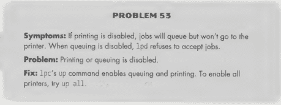
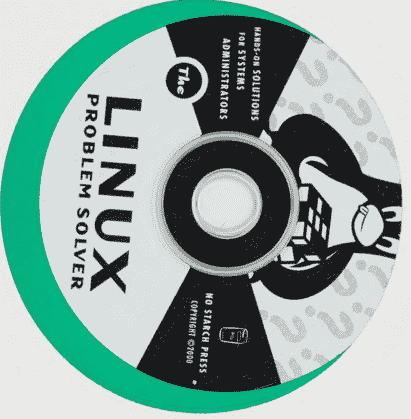

# Linux 问题解决专家 (with CD-ROM)

随书附赠 CD-ROM


## 前言

近年来出现的众多图形化 Unix 环境表面之下，隐藏着一个由各种小型程序和文件构成的世界。Linux 也不例外。虽然一开始可能让人感到不知所措，但你很快就会意识到，系统中的任何东西都可以通过修改文件，或者编译并安装新程序来改变。

Linux 中的系统管理基本环境与其他 Unix 变体并无太大区别：它仍然是一个 shell（命令行界面）。多年来，各种改进不断出现，使得某些任务不再那么繁琐（例如，你将在第 7 章中看到的内核配置）。

人们曾反复尝试为 Unix 系统管理提供图形用户界面。这些尝试通常能在配置基础系统并使其运行方面做得不错，但在处理复杂任务时却有所不足。Unix 软件具有高度可配置性，并且通常设计为尽可能独立地工作。要牢牢掌握你的系统，你必须习惯使用 shell，因为它是访问文件系统和当前运行进程的最高效的接口。

如果本书中有一个贯穿始终的理念，那就是“尽量保持简单”。我再怎么强调也不为过，尤其是对于任何类型的配置文件。大多数软件包自带的默认文件通常是合理的起点，尽管也有一些显著的例外（主要是在用户环境方面）。你的配置越庞大、越复杂，将来就越难以理解和修改。你也能最大限度地降低后续版本软件包与旧配置文件不完全兼容的风险。

本书中的许多内容源自传统的 Unix 系统管理。例如，关于用户环境的第 9 章不仅适用于 Linux，也同样适用于任何 Unix 变体。然而，这并不意味着事物不会改变；不幸的是，人们往往比应有的时间更久地固守旧习惯。一个典型的例子在第 5 章关于打印的内容中有所体现：许多站点仍然运行较旧的 `lpd` 打印守护进程，而不是 `LPRng`。但这并不是说每个新程序都应该被接受，旧的东西就应该被抛弃；毕竟，新的（因而未经充分测试的）软件并非以稳定性著称。

我在系统管理方面的许多经验，都得益于我在宾夕法尼亚州立大学读本科时遇到的人们。詹姆斯·邓肯和道格拉斯·N·阿诺德在我于数学系从事第一份系统管理工作时提供了出色的指导。其他对我影响较大的人包括比尔·芬纳、肯·霍恩斯坦、斯科特·迪克森、丹·埃尔利希、费利克斯·李，当然还有本书的技术审稿人斯科特·施瓦茨。

布莱恩·沃德

伊利诺伊州芝加哥

2000 年 4 月

## 关于本书

### 1.1 救火

本书全部都是关于解决两种基本类型的 Linux 系统管理问题的：配置问题和持续维护问题。大约一半的书讨论配置问题（即设置某种服务）；其余部分讨论保持机器正常运行。

由于几乎没有人第一次就能做对，故障排除（在 Unix 圈子里他们称之为救火）是系统管理的重要组成部分。本书将帮助你通过将故障排除技术与 Linux 实用程序的解释和教程相结合来解决困难的 Linux 问题。（毕竟，你不能被期望修复你一无所知的问题。）当与所讨论主题相关的常见陷阱时，我们会这样标记它：

PROBLEM SAMPLE N

Symptom: 问题如何表现。

Problem: 故障的简短描述。

Fix: 如何着手修复（或和平地忽略）它。

即使你没有遇到这个问题，在阅读本书时也不要跳过它——至少，看看症状描述。你迟早会遇到它。

### 本书假设你已知的知识

要充分利用本书，你需要已经对 Linux 或 Unix 有一些了解。具体来说，我们假设你知道如何导航文件系统、进行进程列表并杀死进程。我们还假设你知道所有基本文件命令（`cp`、`rm`、`mv`、`ls`、`chmod`、`chown`、`chgrp` 等）并且熟悉一个 shell——具体来说是 `bash`。第 1.3 节下面包含 Linux 系统基础的回顾。

你还需要对某种文本编辑器有熟练程度。这对于 Unix 用户来说是一个宗教话题，但就本书而言，无论你是否知道 `vi`、`emacs`、`ed`、`pico` 或其他，都无关紧要。但你必须知道如何打开文件、在不损坏的情况下进行更改、保存它并退出。Linux 不会容忍配置文件中的拼写错误。

### 内容简要大纲

除了解释符号外，第 1 章还涵盖了 Linux 启动和运行的基础知识，以及系统日志记录器等一些核心实用程序。我们主要将其作为复习，因此讨论比较简略。

第 2 章（“网络安装”）涉及网络设置的基础知识。它纯粹是关于连接到网络以及在出现问题时诊断问题的工具。

第 3 章（“NFS、NIS 和 rdist”）是关于在网络中传播信息。主题包括 NFS（网络文件系统——用于文件共享）；NIS，一个简单的网络信息数据库系统；以及 Rdist，一个将一组文件复制到远程机器的程序（例如保持其软件集最新）。

第 6 章（“从源代码安装软件”）带你了解安装 Unix 软件的传统方法——从源代码。

第 7 章（“内核升级”）全部关于配置和编译新的 Linux 内核以及随附的模块。内核是操作系统的核心。

第 8 章（“备份和崩溃恢复”）涵盖了每个人最喜欢的话题：灾难。如果你系统上有任何有点价值的东西，你就需要某种备份，本章告诉你如何创建备份。它还描述了如何开始使用随本书附带的 CD-ROM 的可引导部分，你可以在严重崩溃后使用它让系统恢复正常。

第 9 章（“用户环境”）涵盖如何为用户设置账户。新的账户需要点文件来获得适当的环境。不幸的是，新手用户也有破坏其点文件的倾向。我们将讨论如何清晰地编写点文件（这样用户在修改时就不会盲目猜测）以及如何优化它们。

### 1.2 约定

我们将使用等宽字体来表示出现在屏幕上或你输入到终端窗口中的文本。标点符号将出现在包含任何屏幕文本或命令的引号之外。

除非另有说明，本书中的示例假设你使用的是 `bash`，但我们通常会避免 `bash` 相对于 Bourne shell（`/bin/sh`）提供的扩展。用户提示符将是美元符号（`$`）。段落之外出现的任何内容都将以粗体显示，因此用户命令看起来像这样：

```
$ echo Hi, I am a user.
```

另一方面，超级用户（root）的提示符为井号（`#`）：

```
# echo Hello, I am the sysadmin, and that user complains too much.
```

许多 Linux 文件和脚本都有以 `#` 开头的注释，因此请注意上下文。

```
# echo This is not a comment.
# my program has a comment here
```

### 处理手册页

我们引用手册页提供进一步信息的方式如下：

相关手册页：`ascii` (7)，`man` (1)

这意味着手册的第 7 节和第 1 节包含关于 `ascii` 和 `man` 的额外信息。命令 `man ascii` 会给你 `ascii` 的在线手册，如果你碰到某个条目在多个章节都有条目，你可以使用 `man` 后跟章节号，再跟条目名称来挑选不同的章节（例如，`man 5 passwd`）。

如果你想查看某个未格式化的手册页，它单独放在一个目录中（不在任何系统手册目录中），例如 included CD-ROM 上 `support/introduction` 中的 `foo.1`，你可以用以下方法格式化并查看它：

```
$ nroff -man foo.1 | less
```

我们不会过多讨论手册页，因为它们的质量从不存在到粗糙到相当不错不等。但如果某个程序有几千个选项并且有一个解释它们的

手册页，我们会提及该手册页作为参考。

尽可能避免打印手册页。我见过的大多数打印手册页的人从未读过它们，有充分的理由：手册页主要是参考资料，所以并不是特别好的阅读材料。当你在寻找特定条目时，搜索屏幕上的版本几乎总是更快。但如果你坚持要打印手册页，请按正确的方式进行：

```
$ groff -Tps -man foo.1 | lpr -Pprinter
```

### Unix、Linux 和 Linux 发行版

Linux 看起来和行为都像其他自称 Unix 的系统，所以你在这本书中会找到的许多内容适用于其他类型的 Unix。要注意的是，文件和目录路径、接口、命令及其参数在各种 Unix 版本中有所不同。当我们一般讨论 Unix 时，我们并不是特指 Linux。

实际上并没有一个真正的 Linux 系统；只有内核本身是标准化的。各种 Linux 发行版偶尔会把文件放在不同的位置并使用不同的脚本。在本书中，我们会提到文件名以及你通常可以期望找到该文件的位置。如果你没在那里找到它，你总可以尝试用 `find` 搜索它。例如，

```
$ find /usr -name '*.conf' -print
```

会在 `/usr` 下查找以 `.conf` 结尾的任何内容。

`/etc/rc.d` 中的 `rc*.d`。 在 `/etc/rc.d/init.d` 中创建一个类似已有脚本的新脚本 `fooserv`，并用 `/etc/rc.d/init.d/fooserv start` 和 `/etc/rc.d/init.d/fooserv stop` 测试它。如果一切正常，就在 `rc*.d` 目录中创建适当的链接。用以下方式在 `/etc/rc.d/rc2.d` 中创建一个编号较高的链接，例如


# 服务链接与启动脚本

```
# ln -s ../init.d/fooserv S90fooserv
```

这样服务将在启动过程接近尾声时启动。同样，在关闭服务的运行级别中，你可能希望尽早关闭 `fooserv`，因此关闭服务的链接名称可能像 `K10fooserv`。

要移除一个服务，删除它在 `/etc/rc*.d` 中的链接。你也可以选择重命名链接；例如，你可以在名称前加上下划线（`_`）。删除链接时要小心，因为如果你将来再次使用该服务，你需要把链接放回去。此外，在删除链接之前，查看其 `init.d` 脚本（链接指向的文件）是否包含类似以下的行，测试配置变量或文件：

```
[ -z "$RUN_GATED" ] || exit 0
```

某些发行版（如 `S.u.S.E.`）会读取一个设置这些变量（如 `$RUN_GATED`）的全局配置文件，所有服务启动脚本都会读取这些变量。`Red Hat` 在 `/etc/sysconfig` 中有一堆这样的文件。如果你的发行版使用其中一个配置文件，你可能发现通过修改配置文件来打开或关闭服务比在 `rc*.d` 目录中删除链接更容易。

相关手册页：`inittab (5)`，`init (1)`

## Syslog 设施

`syslog` 设施报告系统通知和错误消息。消息记录守护进程 `syslogd` 等待来自其他程序的消息，并在接收时将其分类到不同的文件中。`Linux` 下的标准日志目录是 `/var/log`，但 `/etc/syslog.conf` 是关于消息去向的最终权威。

你可以将消息配置为发送到文件（包括特殊设备如终端）、另一台机器、用户组或命名管道。以下是几个示例条目：

```
kern.warn;*.*;authpriv.*   /dev/tty10
mail.*                     @logs.example.com
*.*                        /var/log/messages
*.emerg                    root
```

第一列描述要记录的消息类型，第二列说明记录位置。第一行表示内核、错误和授权消息应发送到 `/dev/tty10`，第二行将邮件 diag- 将诊断信息发送到 `logs.example.com` 上的 `syslogd`，第三条将所有 `syslog` 消息发送到文件 `/var/log/messages`，最后一条将紧急消息写入 `root` 的屏幕，前提是 `root` 恰好已登录。

`kern.warn` 的条目表示消息的设施名称为 `kern`，优先级为 `warn`。`Linux 2.2` 的有效设施名称为 `auth`、`authpriv`、`cron`、`daemon`、`kern`、`lpr`、`mail`、`news`、`syslog`、`user`、`uucp` 以及 `local0` 到 `local7`。优先级为 `alert`、`crit`、`debug`、`emerg`、`err`、`info`、`notice` 和 `warning`。还有一些已过时的优先级（请查看 `/usr/include/sys/syslog.h` 获取列表）。

随着系统运行，消息会不断堆积在 `/var/log` 中。如果系统对此不采取任何措施，包含 `/var` 的磁盘分区最终会填满，使得系统难以使用。大多数发行版意识到了这一点，并运行 `cron` 作业来清理日志目录，以防止这种情况发生。

如果您拥有一个庞大的网络，最好设置一个日志主机，让其他机器可以将日志消息发送到该主机。将整个网络的日志集中保存在一处，可以使检测和调试问题变得更快、更轻松。您可能还希望保留本地日志——您可以用很少的磁盘空间和系统时间换取这里那里节省几分钟的时间。

> **注意**：某些发行版不会将所有消息设施都放在 `/etc/syslog.conf` 中（尤其是本地设施）。如果 `/etc/syslog.conf` 中未提及某个设施，则任何程序向该设施输出的内容都将被丢弃。使用 `logger` 命令来调试您的配置。

相关手册页：`syslog.conf (5)`、`syslog (1)`、`logger (1)`

## cron

`cron` 是一个周期性事件调度程序，是一个有用的系统守护进程。它读取名为 `crontabs` 的文件，这些文件指定了时间、间隔以及在每个间隔结束时运行的命令。这些文件通常位于 `/var/spool/cron`，用户使用 `crontab` 命令创建、访问、修改并将其放置到位。以下是简短的 `crontab` 参考：

- `crontab file` 使用 `file` 作为 `crontab`
- `crontab -e` 编辑 `crontab`（使用环境变量 `VISUAL` 或 `EDITOR` 指定的编辑器）
- `crontab -l` 显示 `crontab`
- `crontab -r` 删除 `crontab`

下面是一个 `crontab` 示例（对于登录名为 `jamie` 的用户）：

```
SHELL=/bin/sh
PATH=/usr/bin:/usr/sbin:/usr/local/sbin:/usr/local/bin:/sbin:/bin
MAILTO=jamie
53 6,20 * * * /home/jamie/bin/clean-junk > /dev/null 2>&1
```

`SHELL`、`PATH` 和 `MAILTO` 被设置为您所期望的值：用于命令的 `shell` 和路径，以及如果有任何命令产生输出时发送邮件的用户。在第四行，前五个字段指定时间和间隔；从第一个到第五个，它们分别是分钟、小时、月份中的日期、月份和星期几。它们以数字或星号 (`*`) 指定，星号表示全部——例如，星期几字段中的 `*` 与 `0,1,2,3,4,5,6` 相同。上面 `jamie` 的 `crontab` 中的最后一行匹配每一天（月份中的日期和星期几）和每个月，当分钟为 `53` 且小时为 `6` 或 `20` 时（即上午 `6:53` 和晚上 `8:53`）。

当时间与五个字段中指定的内容匹配时，字段后的操作将被执行。如果您想在每个 `13` 号星期五烦扰一个名为 `bob` 的用户，您可以写：

```
* * 13 * 5 /bin/mail -s "Beware, Bob" bob
```

分钟和小时的 `*` 条目使得这对 `bob` 来说尤其令人讨厌：可怜的 `bob` 在每个 `13` 号星期五的每一分钟都会收到您的一条消息。如果您只想在每个 `13` 号星期五中午给 `bob` 发送一条消息，可以使用以下内容：

```
00 12 13 * 5 /bin/mail -s "Beware, Bob" bob
```

> （我们可不是说这种折磨 `bob` 的行为是个好主意。）

`crontab` 文件的另一个版本，`/etc/crontab`，是一个系统 `crontab`，并在时间规范后多了一个字段：运行作业的用户。在以下两个条目中，运行任务的用户是 `root` 和 `backup`。

```
15 4 * * * root /usr/local/sbin/sysclean > /dev/null 2>&1
25 23 * * * backup /usr/local/sbin/do-backups
```

随 `Linux` 一起提供的 `cron` 版本（`Vixie Cron`）与其它 `Unix` 变体上的版本相比相当灵活；请查看手册页以获取更多信息。

相关手册页：`crontab (5)`、`crontab (1)`、`cron (8)`

## The passwd File

`Unix` 下的主要用户数据库是 `/etc/passwd`。修改它的方法有多种。用户可用的 `passwd` 命令也是系统管理员的维护工具。

由于可能有多个进程同时尝试修改 `passwd` 文件，因此你必须通过文件 `/etc/ptmp` 进行锁定。如果可用，使用 `vipw` 命令是直接修改 `/etc/passwd` 的首选方式。一个 `passwd` 条目看起来像这样：

```
bob:x:3119:100:Bob the Tormented:/home/bob:/bin/bash
```

正如你所见，冒号 (`:`) 分隔各个字段，而且它们相当直观。只有第二个字段，即加密密码，值得一提。上面的例子展示了 `shadow` 密码方案，它将加密密码放入 `/etc/shadow` 中，用户无法读取。这是一种安全措施（尽管其有效性有些可疑）。大多数主要发行版使用 `shadow` 密码或提供该选项。

`Unix` 不会以原始（明文或 `cleartext`）形式保存用户的密码；那样会使密码太容易被窃取。相反，它在现场加密密码并以加密形式存储。当用户输入密码时，`Unix` 会对其进行加密并与系统上的密码进行匹配。

在大型网络中，在多台机器上维护多个用户的 `passwd` 文件是一件麻烦事。这就是 `NIS` 等系统发挥作用的地方（参见第 3 章）。

相关手册页：`passwd (5)`、`passwd (1)`、`shadow (5)`

## Devices

`Unix` 程序通过 `/dev` 中的设备文件与设备通信。设备文件名包括 `tty1`、`hda3` 和 `audio`。使用 `cat` 和 `dd` 等常规程序与设备文件交互时，产生的不同结果取决于文件类型及其权限（这些权限各不相同，因为你可能不希望普通用户在原始硬盘设备上乱写，例如）。


如果你查看 `/dev`，你会发现那里有很多设备（也称为特殊文件）。你真的在系统上拥有所有这些东西吗，设备名称对应什么？第一个问题的答案是否定的；如果你尝试对机器上不存在的设备执行操作，要么你会收到类似“`/dev/device: No such device`”的错误信息，要么你的命令会永远等待不存在的设备变得可用。至于第二个问题，设备名称由程序员决定。以下是一些基本设备名称的列表。

- `/dev/tty*` 某种终端设备。它们都通过相同的接口工作。
- `/dev/ttyn`（其中 n 为数字）Linux 虚拟控制台。
- `/dev/ttys*` 串行端口。
- `/dev/ptyq*`、` /dev/ptyq*`、`..` 伪终端：`xterm`、`telnet`、`ssh` 和其他调用 shell 的程序使用这些（它们模拟真实终端相当古老的接口，以便为依赖终端的 shell 和程序提供兼容性）。
- `/dev/hd*` ATA/IDE 设备；这些可以包括 ATA 硬盘、CD-ROM 驱动器、可移动介质等。没有数字的设备指的是整个磁盘；有数字的则指的是分区。例如，`/dev/hda2` 是主接口主磁盘上的第二个分区。
- `/dev/sd*` SCSI 磁盘；可以包括可移动介质。分区方式与 ATA/IDE 设备类似。然而，与其他操作系统上的方案和 ATA/IDE 命名约定不同，SCSI 磁盘按其在 SCSI 主机适配器（控制器）上出现的顺序分配名称 `/dev/sda`、`/dev/sdb` 等。`/dev/sda` 是第一个 SCSI 主机适配器（`scsi0`）上具有磁盘的最低 SCSI ID，`/dev/sdb` 是下一个 ID。如果你的系统中有多个 SCSI 主机适配器，则分配遵循主机适配器的顺序；首先分配 `scsi0` 上的设备，然后是 `scsi1`，依此类推。
- `/dev/scd*` SCSI CD-ROM 驱动器。
- `/dev/sg*` 通用 SCSI 设备。使用通用 SCSI 设备，用户程序可以直接与任何 SCSI 设备交互而无需特殊的内核驱动程序。扫描和 CD 刻录程序使用通用 SCSI 设备。
- `/dev/null` 写入 `/dev/null` 的任何内容都会进入俗称的位桶；它会被丢弃。如果从中读取，结果是文件结束（EOF）。
- `/dev/zero` 从中读取会返回空字符（每一位都是零）。
- `/dev/fd*` 软盘（各种几何结构）。
- `/dev/audio`、`/dev/dsp`、`/dev/midi`、`/dev/mixer`、`/dev/sequencer` 各种声音设备。
- `/dev/lp*` 并行端口。
- `/dev/psaux` PS2 辅助端口。大多数 PC 都配备了这些鼠标。这些不是 USB 鼠标，USB 鼠标在不久的将来可能会变得流行。

## Examining and Creating Devices

`ls -l /dev/hdb1` 显示如下：

```
brw-rw---- 1 root disk 3, 65 Jul 26 1998 /dev/hdb1
```

大多数字段看起来与 `ls` 对普通文件显示的方式相同，只是第一个字段开头有一个 `b`，并且用两个数字（这里是 3 和 65）替换了大小字段。`b` 表示它是块设备（字符设备则用 `c` 代替）。代替大小的两个数字是主设备号和次设备号。每个主设备号分配给一个设备驱动程序，而次设备号分配给使用该驱动程序的设备（例如，处理磁盘、CD-ROM 和其他硬件的 ATA/IDE 驱动程序）。内核分配主设备号和次设备号。

要创建设备，请使用 `mknod` 命令。创建上面的 `/dev/hda1` 的命令将是

```
# mknod /dev/hdb1 b 3 56
```

发行版通常会附带一个相当完整的 `/dev` 目录，但由于磁盘崩溃可能使其丢失，因此最好记住 `mknod` 命令。相关手册页：`mknod (1)`

> **注意**：GNU 的 `mknod` 手册页已不再维护；其 info 页面是最新的。不过，这个命令多年来并没有发生重大变化。

## 处理磁盘

Linux 提供了许多用于处理分区和文件系统等事务的程序。其中一些程序执行相同的任务，区别仅在于它们的界面不同。

当你操作磁盘时，请仔细检查你的操作。Unix 的传统是，它不会对你的操作发出 60 条警告——它假定你知道自己在做什么。如果你以 root 身份误执行了 `dd if=/dev/zero of=/dev/hdb`，操作系统会愉快地运行并抹掉整块磁盘。

以下是重要的 Linux 磁盘程序概览：

- `fdisk`, `cfdisk` — 磁盘分区程序。它们支持 ATA/IDE 以及 SCSI 磁盘。`cfdisk` 是 `fdisk` 的全屏 curses 界面，但有时可能有点不太稳定，因此 `fdisk` 仍然是大多数进行大量分区管理的管理员的最爱。
- `mke2fs` — 该程序创建 ext2（第二扩展）文件系统，例如 `mke2fs /dev/hdb1`。执行此操作时要格外小心，因为你会清除所有先前的分区信息。
- `fsck` — 检查文件系统是否有错误并修复它们。我们将在第 8 章中讨论它。
- `mount` — 将文件系统附加到当前运行的系统，也称为挂载文件系统。
- `umount` — 卸载文件系统。
- `mkswap` — 在分区上创建交换空间签名。
- `du` — 显示目录的磁盘使用情况。
- `df` — 显示文件系统的容量统计信息。

我们将在第 8 章中更详细地讨论磁盘程序。

系统启动时，会以不同的参数执行多次 `mount -a`。解析这些参数后，`mount` 会读取 `/etc/fstab`，找到与参数匹配的任何文件系统，并尝试挂载它们。因此，`/etc/fstab` 是机器本地分区的主要参考。`/etc/fstab` 看起来像这样：

| 设备 | 挂载点 | 文件系统类型 | 选项 | 转储 | 检查顺序 |
|---|---|---|---|---|---|
| `/dev/hda1` | `/` | `ext2` | `defaults` | 1 | 1 |
| `/dev/hda2` | `swap` | `swap` | `defaults` | 0 | 0 |
| `/dev/hda4` | `/home` | `ext2` | `defaults` | 1 | 2 |
| `/dev/hdd` | `/cdrom` | `iso9660` | `ro,noauto,nosuid,user` | 0 | 0 |
| `/dev/sda4` | `/zip` | `ext2` | `rw,noauto,nosuid,user` | 0 | 0 |

第一个和第二个字段（列）是设备及其挂载位置。第三个是文件系统类型，第四个包含挂载选项。这里看到的选项包括：

- `defaults` — 使用默认选项。
- `ro` — 以只读方式挂载文件系统。
- `rw` — 以读写方式挂载文件系统。
- `nosuid` — 禁用文件系统上发现的任何 suid（setuid）位。如果你允许用户挂载带有某个 suid-root 程序的可移动磁盘（如 Zip 磁盘），他们就能在系统中肆意妄为——你可能不希望这样。
- `user` — 任何用户都可以挂载和卸载此文件系统；不需要 root 权限。
- `noauto` — 在调用 `mount -a` 时忽略此文件系统。

第五和第六个字段涉及备份和 `fsck` 顺序。还要注意，`/etc/fstab` 也提到了交换分区，尽管它们并不是真正的文件系统。使用上述 `/etc/fstab` 时，命令 `swapon /dev/hda2` 将 `/dev/hda2` 激活为交换分区，而 `swapon -a` 会激活 `/etc/fstab` 中提到的所有交换分区。

相关手册页：`mount (8)`、`fstab (5)`、`du (1)`、`df (1)`、`fdisk (1)`、`mkswap (8)`、`mke2fs (8)`、`swapon (8)`

## /proc 文件系统

`/proc` 是 Linux 中的一种特殊文件系统，允许与进程和内核参数进行灵活交互。

如果你尝试 `ls /proc`，会得到一份与当前运行 Linux 系统多个部分相关的文件和目录列表。探索 `/proc` 内容的一种方法是通过实验。试试这两个命令：

```
$ cat /proc/cpuinfo
$ cat /proc/$$/status
```

第一个命令返回内核所知道的机器内部处理器信息。在第二个命令中，`$$` 会展开为当前 shell 的进程 ID（如果你运行的是 `bash`），整行命令返回 shell 进程的状态。这些是你在 Linux `/proc` 文件系统中会遇到的两类项目示例：内核信息和进程信息。

系统中的每个进程都由目录 `/proc/pid` 表示，其中 `pid` 是进程 ID（`/proc/self` 始终被设置为查询它的进程的 ID）。这些目录下的条目会告诉你命令是如何被调用的、它的环境、状态以及大量其他信息。大多数版本的 `ps` 都使用 `/proc` 文件系统来收集信息。

`/proc` 中的其他内容（例如 `/proc/cpuinfo`）由内核信息组成。其中更有用的文件包括：

- `interrupts` — 活动的中断。例如，如果某个串口未被使用，它就不会出现在列表中。同时还会显示自启动以来收到的中断次数。


- `ioports` — 所有 I/O 端口分配。
- `dma` — DMA 分配。
- `devices` — 可用的设备。设备名称前的数字是设备的主设备号；这与 `/dev` 中的主设备号相对应。
- `filesystems` — 所有可用的文件系统类型。
- `modules` — 活动的模块。
- `meminfo` — 内存信息。
- `scsi/` — 保存 SCSI 主机适配器和设备信息的目录。
- `version` — 内核版本。
- `mounts` — 已挂载的文件系统。`/etc/mtab` 也应该包含这些信息，但 `mount` 的 `-n` 参数会阻止对 `/etc/mtab` 的任何写入。
- `net/` — 网络信息。

你可能对 `/proc` 中的所有内容感到好奇，但对你看到的每一项都使用 `cat` 可能不是一个好主意。执行 `cat /proc/kcore`（只能以 root 身份执行）会把各种二进制垃圾转储到屏幕上。对于你不确定的项，请使用诸如 `less` 之类的程序，而不是 `cat`。

相关手册页：`proc(5)`

## 理清引号混乱

字面字符是指不经过特殊处理的字符。例如，shell 对 `$` 和 `*` 等字符的处理方式不同于普通字母（如 `a` 和 `j`）。当你希望 shell 像对待 `a` 一样读取 `$` 时，你就是在要求一个字面的 `$`。

在查看系统中的脚本和示例以及入门书籍时，你可能已经注意到它们使用多种方法来获得字面字符：单引号、双引号和反斜杠。由于获取字面字符的方法如此之多，Unix shell 有时会让人极为困惑。更糟糕的是，有些 shell 的方案不一致，而且它们之间都有些不兼容。本书选择 `bash` 的一个因素就是它相对简洁的语法。

要编写有效的脚本和命令，你需要理解 shell 如何解析其输入并运行命令。当你输入一条命令时，你是在指定若干参数。甚至你打算运行的程序本身也是一个参数。处理完参数后，shell 会将每个参数放入各自的槽位，并对所有槽位执行一次系统调用以运行命令。在这个系统调用中，参数槽位的编号从零开始——因此，实际的第一个参数（在这里即命令）通常被称为第零个参数。

如果你输入这样一条命令：

```
$ echo "I'm a command" * $PATH
```

第零个参数是 `echo`。第一个参数是字符串 `I'm a command`（包括空格）。其余参数取决于当前工作目录的内容以及环境变量 `PATH` 被设置成的值。

当你输入命令时，shell 首先解析带引号的参数，并展开变量和模式。然后，它用展开得到的结果填充参数槽位。当你忘记 shell 会在将参数中的某些字符放入参数槽位之前对其进行展开时，问题往往就会出现。

任何单独出现的 `*` 在命令执行前都会展开为当前目录中所有不以点（`.`）开头的文件列表。如果当前目录中没有文件，则字面的 `*` 会被作为参数传递；不会出现任何错误消息。这适用于所有模式匹配。例如，`foo*` 会展开为当前目录中所有以 `foo` 开头的文件；如果没有匹配项，则它根本不会展开。这种展开被称为通配符展开（globbing）。

任何未加引号且以 `$` 开头的字符串都会展开为 shell 变量或环境变量的值。

当你想要阻止 shell 展开特殊字符时，引号带来的困惑就出现了。引号有三种类型：双引号（`"`）、单引号（`'`）或 tick，以及反引号（`` ` ``）或 backtick。它们的含义如下：

- `'` — 字面。单引号内的任何内容都不会展开；shell 会将它直接传递给命令。
- `"` — 部分是字面。不会进行通配符展开，因此像 `*` 这样的字符会被发送给命令，但 shell 和环境变量（以 `$` 开头）会被展开。

### 命令替换

shell 会执行两个反引号内的任何命令，并将该命令的输出作为参数传递（例如，`FOO=`ls` 将 `ls` 命令的输出放入变量 `FOO` 中）。

要将三种引号中的任何一种作为字面参数传递，请在引号前加上正斜杠（`/`），且该引号位于单引号或双引号之外。`bash` 中还有其他方法可以做到这一点；例如，`'`' 传递一个单引号，而 `""` 传递一个双引号。由于有这么多方法可以将字面字符作为参数传递，用户经常试图同时使用所有方法，最终导致意外的结果。调试引号问题的最佳方法是使用 `echo` 来查看替换后跟随的参数——例如：

```
$ echo '$this should put a dollar sign before the text'
```

> NOTE
> 令人烦恼的是，ISO 8859-1 定义了一个看起来很像单引号的重音符号；你可能在电子邮件中遇到过它，或者在美国以外的键盘上见过它。

这就是基础知识的全部内容。在接下来的章节中，你不仅会遇到超过一百个 Linux 问题的解决方案，而且还会看到解决方案为何有效的深入细节。掌握这些信息后，你将拥有解决 Linux 头痛问题所需的一切。

# 2 网络安装

## 2.1 引言

基本的网络配置（配置网络接口并添加默认路由）不应该给你带来太多麻烦。挑战在于如果你想设置网络以通过多台机器共享到互联网的 PPP 连接、共享文件、玩网络游戏（当然）等等。由于网络安全漏洞（以及想要利用它们的人）数量不断增加，对网络安全的关注也很重要。Unix 诊断工具对于配置和偶尔出现的故障非常有用。

本章并非 Linux 网络设置的全面指南；相反，它将教你如何使用 Linux 中一些更有用（也更棘手）的网络设施。

## 2.2 基本命令和文件

Linux 网络设备称为 *接口*。设备名称包括 `eth0` 和 `ppp0`，分别是以太网和 PPP 接口，尽管这些只是网络层设备名称。PPP 例如运行在另一个设备之上，通常是串行端口，如 `ttyS0`。

设备驱动程序位于 Linux 内核中；第 7 章解释了如何构建包含你可能需要用于网络的驱动程序的自定义内核。

### 命令

以下是网络配置命令的简要回顾。我们将在本章最后一节介绍大多数诊断命令。

### ifconfig 命令

命令

```
ifconfig [<interface> [<addr|hostname>] [<option value>...] [up|down]]
```

手动配置接口，常用于以太网。以下示例将接口设置为 IP 地址 10.0.0.13，网络掩码设置为 255.255.255.0：

```
# ifconfig eth0 10.0.0.13 netmask 255.255.255.0 up
```

虽然在正常运行情况下你很少会调用 `ifconfig`，但它和 `route` 命令（参见第 2.2 节中的添加路由）对于调试非常有用。

使用 `-a` 或完全不带参数，`ifconfig` 会返回所有接口的状态，以及其他一些可能有用的信息，例如冲突次数。例如，我们从一台网关机器中摘录了以下内容：

```
# ifconfig -a
...
```

```
eth1      Link encap:Ethernet  HWaddr 00:A0:CC:3B:47:66
          inet addr:10.1.2.1  Bcast:10.255.255.255  Mask:255.255.255.0
          UP BROADCAST RUNNING MULTICAST  MTU:1500  Metric:1
          RX packets:667785 errors:0 dropped:0 overruns:0 frame:0
          TX packets:504611 errors:0 dropped:0 overruns:0 carrier:0
          Collisions:177
          Interrupt:10 Base address:0x4000
```

```
ppp0      Link encap:Point-to-Point Protocol
          inet addr:192.168.69.35  P-t-P:192.168.69.1
          Mask:255.255.255.255
          UP POINTOPOINT RUNNING NOARP MULTICAST  MTU:1500  Metric:1
          RX packets:3055 errors:6 dropped:0 overruns:0 frame:6
          TX packets:2901 errors:0 dropped:0 overruns:0 carrier:0
          Collisions:0
```

> NOTE 某些 Unix 版本（如 Solaris）需要 `-a` 标志才能获取接口配置。

例如，Red Hat 6.x 将其基本接口配置保存在 `/etc/sysconfig/network-scripts` 中。对于 `eth0` 接口的配置，包含所有参数值的文件是 `ifcfg-eth0`。在启动时，脚本 `/etc/rc.d/init.d/network` 会找到所有接口，并尝试在 `ifcfg-devname` 文件上运行 `ifup` 脚本（该脚本又会运行其他一些脚本）。


> **注意**
> 
> 网络 `10.0.0.0` 和 `192.168.69.0` 是保留给专用网络的。任何人都可以将它们用于自己的网络（公司通常将它们用作防火墙后面的网络编号），但真正的 Internet 上的路由器并不知道它们。IANA 还保留了名称 `example.com` 和 `example.net` 用于示例（例如本书中的例子）。

## route 命令

网络数据包要发挥实际作用，需要一条可供传输的路由。`route` 命令（`route {add|del} args ...`）可以更改计算机已知的路由，即路由表。（路由是一个复杂的主题，因此在开始构建小型网络时，最好尽可能简化路由表。）
不带参数时，`route` 会返回当前路由表。`-n` 选项关闭主机名解析，并且特别实用，因为通常在出现某种问题时你才需要查看路由表（如果网络出现问题，DNS 服务器可能也同样出现了问题）。

### 设置默认路由

如果网络数据包在内核路由表中没有特定的路由可循，它将走默认路由（也称为默认网关或网关）。如果不存在默认路由，并且路由表中没有任何适用于该数据包的路由条目，则尝试发送该数据包的程序将收到 “No route to host”（没有到主机的路由）错误。使用下面的命令：
```
# route add default gw 10.0.0.1
```
即可将默认路由设置为 `10.0.0.1`。

### 添加路由

要添加路由，请使用以下命令：
```
# route add -net 10.0.1.0 netmask 255.255.255.0 gw 10.0.0.48
```
这会将一条路由添加到网络 `10.0.1.0`，其网络掩码为 `255.255.255.0`，网关为 `10.0.0.48`。（如第 2.4 节所述，该网络包含从 `10.0.1.1` 到 `10.0.1.254` 的主机。）

### 显示内核路由表

`route -n`（或 `netstat -nr`）命令会显示内核路由表。`-n` 选项会禁用域名解析。如果你正在运行此命令，很可能是因为无法访问外部世界，因此你也很可能无法访问名称服务器来查找域名。

## `/etc/resolv.conf` 文件

文件 `/etc/resolv.conf` 包含使用 DNS（域名服务）查找主机名所需的信息。它通常包含一个或多个名称服务器的 IP 地址，以及一些默认域，用作搜索时可选的域名后缀。例如，在以下配置下：
```
search home.example.com example.com
nameserver 10.0.0.2
nameserver 10.0.0.3
```
`atlantic.home.example.com` 将是尝试连接到名为 `atlantic` 的主机时，第一个尝试的有效主机名。如果 `atlantic.home.example.com` 不存在，则接下来会尝试 `atlantic.example.com`。

## `/etc/nsswitch.conf` 文件

文件 `/etc/nsswitch.conf` 提供了一种灵活的主机名解析和其他系统信息获取方式。当程序想要将主机名解析为 IP 地址时，它会进行一次库调用，该调用会根据 `/etc/nsswitch.conf` 查询多个文件和服务。例如，如果出现以下行：
```
hosts:    files dns
```
在 `/etc/nsswitch.conf` 中，如果 `files` 排在前面，则首先会查询 `/etc/hosts` 文件作为主机名表，如果在其中没有找到相关信息，`dns` 就会成为活动关键字，转而查询 DNS。（请参阅上面关于 `/etc/resolv.conf` 的小节，了解如何配置 DNS 解析器。）

## `/etc/services` 文件

Internet 服务运行在机器的端口上，端口具有数值。TCP 示例包括：SMTP 邮件服务使用端口 `25`，telnet 使用端口 `23`，finger 使用端口 `79`，www（HTTP）使用端口 `80`。然而，程序通常不按编号引用端口，因此它们会在 `/etc/services` 中映射端口，并将名称转换为编号。以下是这类文件的一个片段：
```
ftp        21/tcp
ssh        22/tcp    # secure shell
ssh        22/udp    # secure shell
telnet     23/tcp
# 24 - private
smtp       25/tcp    mail
```
第一个字段是名称。第二个是编号以及它所指的协议，后面跟着任何别名或注释。在第二行中，`ssh` 是字段，`22/tcp` 是编号和协议分类，而 `# secure shell` 是一个注释。

## `inetd` 和 `/etc/inetd.conf`

所谓的超级服务器 `inetd` 负责机器的许多服务。它在启动时启动，并在机器运行期间一直运行，等待指定端口上的传入连接，如果有连接进来则分叉出适当的程序。
以下是 `inetd` 配置文件 (`/etc/inetd.conf`) 的典型条目：
```
login   stream  tcp     nowait  root    /usr/sbin/tcpd  in.rlogind
# exec   stream  tcp     nowait  root    /usr/sbin/tcpd  in.rexecd

# Pop et al
pop3    stream  tcp     nowait  root    /usr/sbin/tcpd  /usr/sbin/popper -s
```
第一个字段是 `/etc/services` 中指定的服务，后面跟着套接字类型、协议、等待状态、用户（可选组）、服务器路径名，最后是服务器参数。注意典型 `pop3` 条目的服务器路径名和参数：`/usr/sbin/tcpd`（下面描述）进行一些过滤和日志记录，然后将连接交给 `/usr/sbin/popper -s`。
要删除一个服务，请在所需行的开头放置一个井号（`#`）将其注释掉，然后向 `inetd` 进程发送挂断（HUP）信号。通常 `inetd` 的进程 ID 在 `/var/run/inetd.pid` 中，因此您可以运行 `kill -HUP \`cat /var/run/inetd.pid\``。

> NOTE
> 
> 由于 `inetd` 对于机器的运行时间不是特别重要，如果你杀掉它，操作系统仍会基本正常运行，所以不要害怕在不运行任何重要网络服务的机器上进行实验。`inetd` 有一个 `-d` 选项用于调试（并且无论如何都会抱怨 `/etc/inetd.conf` 中的错误条目）。

## `tcpd`, `/etc/hosts.allow`, `/etc/hosts.deny`

`tcpd` 是 TCP wrappers 包的一部分，它检查初始连接以查看哪个远程主机尝试连接，以及远程主机是否允许连接，如 `/etc/hosts.allow` 和 `/etc/hosts.deny` 中指定的那样。它还记录远程主机信息（通过 `syslog`）以及连接的成功状态。
以下 `/etc/hosts.deny` 配置拒绝了来自 `bad-guys.com` 的大多数连接以及来自 `cant-finger.com` 的 finger 请求：
```
ALL: .bad-guys.com
in.fingerd: .cant-finger.com
portmap: ALL
```
/etc/hosts.allow 的格式与 `/etc/hosts.deny` 大致相同。添加此 `portmap` 行可为在 `/etc/hosts.deny` 中被禁止的主机打开访问权限：
```
portmap: .example.com
```
这为 `example.com` 域中的主机提供访问权限。

## PROBLEM 2

症状：`hosts.allow` 和 `hosts.deny` 的更改无效。
问题：服务不使用 `tcpd` 或 `libwrap` 库。
修复：要设置在内核级别工作的更通用规则，请参阅第 2.4 节中关于 IP 过滤器的讨论。
相关手册页：`tcpd (8)`, `hosts_access (5)`

## 2.3 PPP 配置

由于 ISP 和拨号设备的种类繁多，成功的 PPP 配置可能难以捉摸。更复杂的是，每个 Linux 发行版的 PPP 设置都有些不同。本节解释 PPP 程序的作用，以及它们使用哪些文件。

## `pppd`

`pppd` 系统守护进程是 Linux PPP 的核心。它从设备（通常是连接到调制解调器的串行端口）获取原始数据，解码数据流，并与网络接口（例如 `ppp0`）通信，后者然后像另一侧的以太网接口一样工作。（在本节的其余部分中，假设我们讨论的设备是连接到调制解调器的串行端口。）

> NOTE 如果你能使用随发行版提供的配置工具使 PPP 工作，可以跳到下一节。

## 启动 `pppd`

大多数 `pppd` 调用形式为
```
# pppd call isp
```


这里，`isp` 是远程系统的名称；`/etc/ppp/peers/isp` 设置其选项（参见 `pppd` 选项部分）。你给远程系统起的名字通常无关紧要。它只需与 `/etc/ppp/peers` 中的配置文件名匹配——除非你计划使用 CHAP（参见第 29 页）。如果你不知道远程系统的名称，不用担心——你可以从调试消息中推断出来，或者直接使用 `remotename` 选项覆盖它（参见第 27 页）。

`pppd` 的选项形式有些非标准——例如：

```
# pppd noauth defaultroute connect '/usr/sbin/chat -v -f /etc/ppp/chat-foo'
```

这些选项非常冗长且因系统而异——你通常会发现 `pppd call system` 比编写长脚本更容易。

## 启动 `pppd`：一个简单示例

我们组织的拨号连接是一个相当标准的 Cisco 设备。命令

```
# pppd call compsci
```

将家庭机器连接到此拨号。`/etc/ppp/peers/compsci` 文件包含以下内容：

```
ttyS1 57600 crtscts
connect '/usr/sbin/chat -v -f /etc/ppp/chat-compsci'
noauth
defaultroute
mru 1500
```

（注意：此文件指定串行设备 `ttyS1` [即 `/dev/ttyS1`]，以及连接速度 57600 波特）。

`chat` 文件 `/etc/ppp/chat-compsci` 为：

```
ABORT "NO CARRIER"
ABORT BUSY
"" ATZ OK
ATD\number CONNECT
"" urname:
login password:
\qpass
> ppp
```

在此文件中，`number` 是要拨号的电话号码，`login` 是登录名，`pass` 是密码。大括号符号（`>`）是在成功登录后出现的提示。请记住，此提示在不同拨号上差异很大。

要启动 `pppd`，输入以下命令：

```
$ /usr/sbin/pppd call compsci
```

调用 `pppd` 的用户必须能够读取 `/etc/ppp/chat-compsci` 文件。这会带来一些困难，因为通常只有 `root` 才能读取 `/etc/ppp`，但使用 PAP 或 CHAP（见第 28 页）可以消除此问题，因为密码不在 `chat` 脚本中。 （不过，你可能并不喜欢把 `chat` 脚本放在系统上且不在目录中的想法——如果你想让多个用户访问它，他们也必须能够读取它，这会进一步降低安全性。）

要杀掉 `pppd` 并挂断（假设接口在 `ppp0` 上启动，这通常是这种情况），运行

```
$ kill `cat /var/run/pppo.pid`
```

## PROBLEM 3

症状：`pppd` 不能以 `root` 以外的用户打开 `/etc/ppp` 中的文件或设备。只有 `root` 才能运行 `pppd`。

问题：`pppd` 未设置 `setuid` [`suid`] `root`，或用户无法读取。

修复：某些发行版认为 `pppd` 本身不安全或允许每个人执行它太危险，因此它们要么不设置文件权限的 `suid` 位，要么不设置 `world-execute` 位。你可以将特定用户添加到一个组并使程序组可执行（对于规模较大的网络更好），或者你可以直接使 `pppd` 对所有用户可执行且 `suid root`：

```
# chmod u+s /usr/sbin/pppd
# chmod o+x /usr/sbin/pppd
```

## `pppd` Options

如果你查阅 `pppd` 手册页，你会注意到可以在 `/etc/ppp/peers` 中的文件里放置（或在命令行上指定）相当多的选项。本节概述了其中最重要的选项。前两个应该是设备和串行端口速度。

### Device

选择设备（即 `ttyS1` 或 `/dev/ttyS1`），除非你使用 `call` 指定配置文件，否则这是 `pppd` 中的第一个选项。虽然你可以使用类似 `ttyS1` 的名称让 `pppd` 在前面加上 `/dev/`，但最好使用完整路径名，因为它能使设备路径完全清晰。

### Serial Port Speed

对于现代调制解调器，你希望速度高于调制解调器的连接速度。对于 56-kbps 调制解调器，你的串行端口应至少设置为 115200 波特，除非它们根本不支持该速率。一般来说，波特率越高越好，但如果设置过高，调制解调器和/或串行端口可能会丢字符，导致连接速度大幅变慢（甚至不存在）。

### Other Options

除了设备和串行端口外，还有许多其他 `pppd` 选项。

- `defaultroute` 设置 PPP 接口的默认路由。如果你不使用它（例如，如果你拨号到某个叶站点），你需要使用 `route` 命令设置自己的路由才能访问远程 PPP 服务器之外的主机。

- `noauth` 禁用连接另一端的身份验证。由于你的远程服务器可能不支持身份验证，你可能需要此选项。这指的是 PPP 协议上的身份验证，因此如果你使用 `chat` 脚本拨号并登录到服务器，很可能你不需要此选项。

## PROBLEM 4

症状：`pppd` 运行，但你无法访问远程服务器以外的任何东西。

问题：没有默认路由。

修复：如果你只有一个 ISP，并且使用 PPP 拨号到它，你需要 `defaultroute` 选项。

- `connect` 命令使用命令，在 PPP 在远端启动之前初始化连接。通常是 `chat` 命令的调用——例如，`connect '/usr/sbin/chat -v -f /etc/ppp/chat-isp'`。

- `nodetach` 通常，`pppd` 作为真正的守护进程运行并在后台分叉。`nodetach` 选项禁用此分叉——对于调试很有用，因为它使 `pppd` 可以立即通过 `CTRL-C` 中断。

- `mru number` 定义最大接收单元（`mru`），它告诉远程服务器不要发送大于 `number` 字节的数据块。你设置的尺寸取决于连接速度；对于 33.6k 波特等调制解调器速度，默认的 1500 字节通常足够。

- `mtu number` `pppd` 不会传输高于你在此处设置的数量字节的数据块。（默认是 1500 字节。）当你在向远程机器上传数据时遇到困难或连接似乎很慢（即使仅通过调制解调器）时，调整此值（通常是降低它）。（请注意，电话线路和交换机的质量通常限制了通过线路发送数据的能力。）

## PROBLEM 5

症状：某些程序完全无法发送或接收数据。

问题：`mtu` 和 `mru` 太低。

修复：你需要将 `mtu` 和 `mru` 设置得更高。一般来说，低于 1300 字节的设置会导致许多应用程序（例如 `scp`）出现问题。

## PROBLEM 6

症状：连接经常挂起或掉线。调制解调器上的 ARQ 灯经常闪烁。

问题：交换机或电话线路质量差。

修复：如果你无法在建筑物内的布线中找到问题，你就必须与电话公司合作。有时问题是与建筑物的连接不良，但通常是公司超载了电话交换机。如果你在使用语音电话时注意到很多杂音，看看是否能让电话公司把你放到更好的交换机上。

- `name name` 强制 `pppd` 在 CHAP 或 PAP 中使用 `name` 作为用户名（参见 PAP 和 CHAP 部分）。

- `remotename name` 强制 `pppd` 将远程服务器识别为此处输入的名称（参见 PAP 和 CHAP 部分）。

- `debug` 打开 `syslog` 的连接日志记录。设施将为 `daemon`，级别将为 `debug`。（有关 `syslog` 的更多信息，请参见第 1.3 节。）

## PROBLEM 7

症状：任何日志文件中都没有 `pppd` 消息。

问题：`/etc/syslog.conf` 未配置为记录 `daemon.debug` 的消息。

修复：某些发行版（如 Red Hat）不会记录许多服务。添加类似以下的行

```
daemon.debug; /var/log/daemon
```

到你的 `/etc/syslog.conf` 文件中，并向 `syslogd` 发送挂断信号：

```
# kill -HUP `cat /var/run/syslogd.pid`
```

## Serial Devices

一种在 `/dev` 中查找串行端口信息的方法是查看名称；以 `ttyS` 开头的文件名就是你的串行端口。DOS 所称的 `COM1:`（IRQ4，端口 `0x3f8`）是 `/dev/ttyS0`；`COM2`（IRQ3，端口 `0x2f8`）是 `/dev/ttyS1`。（命令 `cat /proc/ioports` 是查看其当前配置的另一种方法，但 `/proc/interrupts` 仅显示活动设备；如果串行端口未使用，则不会在那里显示。）

少于两个串行端口的机器容易配置错误；同样，拥有超过两个端口的机器如果端口共享中断也会出现问题。如果在启动时 `dmesg` 给出错误的 IRQ 并且重新配置串行端口失败，请使用 `setserial`（通常在 `/bin` 中）手动设置你的端口。以下是一个示例：

```
# setserial /dev/ttyS3 irq 5
```

除了其他选项（如与 I/O 端口相关的选项）之外，`setserial` 手册页还包含对串行端口的良好总体解释。


> NOTE 设备 `/dev/tty1`、` /dev/tty2` 等是你的 Linux 机器的虚拟控制台。不要将它们误认为是串行端口。

`username` * `password`

这强制 `pppd` 接受任何远程主机和 IP 地址。要告诉 `pppd` 使用什么用户名，请将

```
name username
```

放入你的 ISP 的选项文件（即 `/etc/ppp/peers` 中的一个文件），或放入 `/etc/ppp/options`，如果你不打算使用超过一个 ISP。

## Multiple ISPs

如果你有多个使用相同用户名的 ISP，你可以在 `/etc/ppp/pap-secrets` 中通过将星号 (`*`) 更改为名称来区分它们，然后在该 ISP 的选项文件（在 `/etc/ppp/peers` 中）中强制远程名称为 `name`，使用

```
remotename name
```

这样做允许你为其他 ISP 在 `/etc/ppp/pap-secrets` 中添加更多行。

> NOTE 添加 ISP 时，对 `/etc/ppp/peers` 中的文件进行适当的更改。

## PROBLEM 9

症状：`pppd` 成功开始协商，但身份验证超时或失败（即使服务器接受了你的密码）。

问题：使用 `require-pap` 选项。

修复：当使用 PAP 作为普通拨号用户时，不要在你的选项文件中放置 `require-pap`，否则你的 `pppd` 会要求拨号服务器证明其身份。即使你的拨号尝试证明其身份，你很可能也不会在 `pap-secrets` 文件中有条目来支持它。

> NOTE 如果你使用 `linuxconf` 为 Red Hat 6 配置了 PPP 和 PAP，你可能会注意到它从未在 `/etc/ppp/pap-secrets` 文件中放置星号。`linuxconf` 将所有内容强制到 `/etc/sysconfig/network-scripts/ifcfg-ppp*` 文件中，通过将 `DEVICE` 设置为接口并将 `PAPNAME` 设置为用户（它们作为选项 `remotename` 和 `name` 传递给 `pppd`）。

## CHAP

`CHAP`（Challenge Handshake Authentication Protocol，挑战握手身份验证协议）与 PAP 类似，但要求双方提供用户名和密码。它通常用于连接到 Windows NT 服务器。

`CHAP` 的 secrets 文件是 `/etc/ppp/chap-secrets`。你可能需要使用 `name` 和 `remotename` 选项强制此文件中的名称（参见上面的 Multiple ISPs 小节）。你的完成的 `/etc/ppp/chap-secrets` 文件应如下所示：

```
username  remote  our_password
remote    username  their_password
```

## PPP and Red Hat 6.x

Red Hat 实际上并不使用 `/etc/ppp/peers` 目录。Red Hat 6.x 中的 `linuxconf` 工具将配置文件存储在 `/etc/sysconfig/network-scripts` 中。接口 `ppp0` 的选项在 `ifcfg-ppp0` 中，`chat` 脚本在 `chat-ppp0` 中。PPP 守护进程使用 `ifup-ppp` 脚本运行，Red Hat 在启动时将其与其他网络接口集成。

添加多个 ISP 需要配置额外的 PPP 接口，并且不允许使用所有可能的 `pppd` 选项。最终，由于使用 `linuxconf` 工具为 Red Hat 6.x 配置 PPP 所涉及的步骤数与向 `/etc/ppp` 添加文件大致相同，你可能最终会选择后者：编辑文件比在菜单迷宫中操作更快。

## Verifying a Correct Login

如果连接有问题，首先确保你实际上可以连接到远程服务器并在那里成功启动 PPP。为此，在你的 Linux 机器上使用终端程序（它可能不是真正的终端程序，只是一个串行端口接口——`xterm` 和 Linux 控制台是终端模拟器）。你可以从多个终端程序中选择，包括 `minicom`、`tip`、`cu` 和 `kermit`。由于 `tip` 和 `cu` 有些陈旧，而 `kermit` 有限制性许可证，你最有可能在系统上找到的是 `minicom`。

首先，以 root 身份登录并使用 `minicom -s` 配置 `minicom`。如有必要，在串行端口设置下更改调制解调器设备。然后退出，`minicom` 将连接到串行端口。如果是正确的端口，你将能够输入通常的调制解调器命令，如 `at`、`atdt` 和 `atm`。

使用 `atz` 重置你的调制解调器，并使用 `atdt number` 拨号到你的 ISP。当你的 ISP 连接时，登录并仔细记录屏幕上看到的一切。继续进行，直到在另一端启动 PPP 服务器。你会将其识别为一串看起来随机的字符，如下所示：

```
~ÿ#Â![]!}] }.,%]8} } ÿ
```

一旦你到达 PPP 服务器，你就拥有了正确运行 `chat` 所需的所有信息。通过按 `CTRL-A`，然后按 `x` 退出 `minicom`。最后，根据你刚才进行的会话编辑你的 `chat` 脚本，

## 问题 10

症状：尝试退出时 `minicom` 挂起。

问题：`minicom` 在尝试读取错误的串行设备时被阻塞。

修复：打开另一个窗口并使用 `kill -KILL` 杀掉 `minicom` 进程。不幸的是，在你尝试使用 `setserial` 配置端口时这种情况发生的更频繁。尝试使用 `x` 退出而不是 `q`，因为在关闭前重置端口通常会告诉内核放弃与之通信。

相关手册页：`pppd (8)`、`minicom (1)`、`setserial (8)`

## 2.4 路由、IP 过滤、防火墙和 IP 伪装

在熟悉单台主机的网络配置后，你可能需要使用 Linux 来绑定网络、过滤流量并充当通往互联网的网关。第一步是学习关于子网和路由的知识。然后你可以使用 `ipchains` 来增加更多复杂性。

## 基本路由和子网

路由器基本上是一台在子网之间通过网络端口传递流量的计算机，子网是分配给本地网络的互联网地址空间的块。为了路由器能够工作，子网必须有分配的、静态的 IP 地址（对于叶网络而言，你的 ISP 分配它们）。路由器至少有两个网络接口，一个链接到 ISP，另一个链接到外部世界。

## 子网

版本 4 互联网地址由 4 个字节组成，通常以十进制形式书写（如 `10.4.5.6`）。主机的子网是地址中在紧邻的局域网上所有主机上都相同的部分。在最常见的子网配置之一中，只有地址的最后一个字节会变化（见下面的示例）。

```
00001010.00000100.00000101.00000110 (address)
11111111.11111111.11111111.00000000 (subnet mask)
00001010.00000100.00000101.xxxxxxxx (10.4.5.N, N = {1, .., 254}, network)
```

`xxxxxxx` 可以是 0 和 1 的任意八个字符组成的字符串。

转换为二进制后，子网掩码中的第一个数字 `255` 会得到八个 1。由于子网掩码中的 1 表示 IP 地址中对应的二进制数字不会改变，因此数字 `255`（或二进制中的八个 1）意味着传入数据包的地址上的数字必须与主机地址中的对应数字相同。因此，子网掩码 `255.255.255.0` 规定传入数据包地址上的前三个数字必须与主机地址的前三个数字相同，而最后一个数字可以变化。最后一个数字指的是连接到主机的机器或网络。子网掩码 `255.255.255.0` 易于使用，因为你永远不需要进行任何二进制转换来判断一个地址是否本地。只要前三个字节（数字）相同，意味着主机是本地网络的一部分，否则主机在别处。

> 注意

> 对于简单的路由器，暂时来说这基本上就是你需要知道的全部内容。如果你不想看更复杂的示例，可以跳到另一部分。

路由器的一部分工作可能是分发发往不同子网的数据包。假设你有一个地址空间 `10.4.5.0`，子网掩码为 `255.255.255.0`。出于某种物理原因（例如不同类型的网络接口），你必须将地址空间划分为四个子网。

你提出的四个新网络是 `10.4.5.0`、`10.4.5.64`、`10.4.5.128` 和 `10.4.5.192`，你通过取最后一个字节中两个位的全部组合得到（你控制最后一个字节，所以你可以随意处理它）：

```
00001010.00000100.00000101.00xxxxxx (10.4.5.N, N = {1, .., 62})
00001010.00000100.00000101.01xxxxxx (10.4.5.N, N = {65, .., 126})
00001010.00000100.00000101.10xxxxxx (10.4.5.N, N = {129, .., 190})
00001010.00000100.00000101.11xxxxxx (10.4.5.N, N = {193, .., 254})
```


下划线部分是你用来定义四个新网络的位。你的路由器现在必须做额外的工作来根据目标地址判断将数据包发送到哪里。当然，如果地址不匹配 `10.4.5`，路由器仍然知道应该将数据包发送到外部世界。但如果地址匹配，路由器还必须查看地址的另外两位——最后一个字节中的前两位。此子网上的主机使用子网掩码 `255.255.255.192`，其二进制形式为

```
11111111.11111111.11111111.11000000
```

你也可能看到以 `10.4.2.0/24` 这样的形式指定的网络。24 是 `255.255.255.0` 网掩码的简写。24 是网掩码中前导 1 的数量。

## IP 转发

假设你想在 Linux 机器上启用简单的 IP 转发（有时也称为网关，这是一项允许网络流量从一个网络通过你的机器传递到另一个网络的功能）。首先在机器上设置好所有网络接口（使用正确的子网掩码），使其能够到达所需的一切（包括通过默认网关可访问的任何外部网络）。然后告诉内核你想要打开转发：

```
# echo 1 > /proc/sys/net/ipv4/ip_forward
```

## 防火墙

防火墙是一种路由器，它会查看数据包（通常是数据包的网络地址和端口部分）并决定是否允许其通过。仅靠防火墙并不会使你的网络特别安全，而且它会妨碍向外部世界的吞吐量，但至少它可以阻碍诸如端口扫描之类的烦人事情。

## IP 链

IP 链是内核用来决定是否应允许数据包通过，以及在某些情况下如何路由它的规则列表。内核内置的三个链——`input`、`output` 和 `forward`——在数据包路由的不同阶段发挥作用。

当数据包从外部世界传入时，内核会查看 `input` 链；当数据包即将传输到外部世界时，内核会查看 `output` 链。`forward` 链在数据包通过 `input` 链并且内核确定其最终目的地不是本地机器时开始工作（即内核应将数据包再次路由出去）。

链中的每条规则都有一个目标——如果数据包匹配该规则，内核所做的决定。规则遵循以下六个目标之一：

- `ACCEPT`：允许数据包通过。
- `DENY`：丢弃数据包。
- `REJECT`：丢弃数据包并尝试通知创建它的主机。
- `REDIRECT`：在 `input` 链上，拦截数据包并将其发送到本地机器上的端口，而不管其原始目的地。
- `RETURN`：停止尝试匹配规则并使用默认值（链策略）。
- `MASQ`：对数据包使用伪装。

链的策略是默认目标，其值仅限于 `ACCEPT`、`DENY`、`REJECT` 和 `MASQ`。这种链、规则和目标的组合是防火墙、IP 伪装和 IP 过滤的基础。如果你正在运行防火墙，你将使用 `forward` 链来丢弃大部分通用流量或通过 `input` 链将其重定向到代理服务器。你也可能使用 `forward` 链进行伪装，并使用 `input` 链来过滤发往本地机器的 IP 数据包

以下是一些重要的 `ipchains` 选项的简要列表。大写字母表示命令的开始；小写字母表示规则的开始。

| Option | Description |
|---|---|
| `-L [chain]` | 列出链及其下的规则。没有额外参数时，显示所有链和所有规则。 |
| `-I chain` | 插入一条链规则。 |
| `-A chain` | 添加一条链规则。 |
| `-D chain [num]` | 删除链规则编号 `num`（默认为 1）。 |
| `-P chain target` | 将链的策略设置为 `target`。 |
| `-F [chain]` | 删除链中的所有规则（无参数时，删除所有链中的规则）。 |
| `-R chain num` | 替换链中的规则 `num`。 |
| `-s source` | 指定源网络或地址以及可选端口。 |
| `-d dest` | 指定目标网络或地址以及可选端口。 |
| `-j target` | 如果此规则匹配，则跳转到 `target`。 |
| `-b` | 创建两条规则；第二条与所声明的规则相同，但会交换目标（`-d`）和源（`-s`）。 |
| `-v` | 请求详细模式。 |

## 示例 1：IP 过滤

与防火墙不同，IP 过滤允许一些或所有机器自行进行过滤，而不是让一台机器查看所有通过的数据包。在传入网络数据包被交给用户程序之前，安装了 IP 过滤的机器会让内核查看数据包并决定是否丢弃它们。如果配置为丢弃来自世界大部分地区的大多数不安全端口的传入数据包（其中绝大多数），IP 过滤可以防御各种攻击。

假设你想与本地网络上的一个机器组共享一堆服务，而这些服务特别容易受到拒绝服务攻击（或更糟）。你希望使除 `ssh` 之外的所有服务对外部世界不可用。我们将逐步介绍你需要运行的每个 `ipchains` 命令，并在过程中进行解释。

假设你希望允许来自本地网络的任何数据包通过到主机上的任何端口。如果你的主机位于 `10.1.1.2` 且你的本地网络为 `10.1.1.0`，子网掩码为 `255.255.255.0`，则以下命令将允许来自你网络的所有流量通过：

```
# ipchains -A input -s 10.1.1.0/255.255.255.0 -d 10.1.1.2 -j ACCEPT
```

然而你也希望允许主机与外部世界进行连接。

```
# ipchains -A input -j ACCEPT -p tcp '! ' -y
```

表示允许响应数据包通过。

此规则允许使用 ICMP 工具如 `ping` 和 `traceroute`（以及其他）：

```
# ipchains -A input -j ACCEPT -p icmp
```

Linux 的某些部分如果机器无法与自身通信就会出现问题：

```
# ipchains -A input -j ACCEPT -d localhost
```

由于我们对 `ssh` 有一定信任，因此允许该端口的连接。

```
# ipchains -A input -j ACCEPT -p tcp -d 10.1.1.2 ssh
```

一切都已就位，只有一个例外，如果你使用 FTP 代理则不是必要的。由于其设计，FTP 会回连到 FTP 客户端机器。下一行提供到外部世界的直接 FTP 连接：

```
# ipchains -A input -j ACCEPT -p tcp -s any/0 ftp-data -d 10.1.1.2 1024:
```

由于你通常希望拒绝大部分内容，将默认策略设置为 `DENY`。你可能希望在放置其他规则之后再执行此操作，因为内核在你声明之后就会丢弃所有内容，而你可能需要 DNS 来处理其他一些规则。

```
# ipchains -P input DENY
```

然而，如果你感觉非常偏执，你会希望先设置此项并以 IP 地址或无需 DNS 的方式指定所有内容。

## Example 2: IP Firewall

现在让我们修改上面的示例，使其成为网络 `10.1.20.0/255.255.255.0` 的防火墙。假设你已经使接口正常工作。

如果尚未启用，请打开转发（你可能希望最后再做）：

```
# echo 1 > /proc/sys/net/ipv4/ip_forward
```

为转发设置默认策略为 `DENY`：

```
# ipchains -P forward DENY
```

接受来自 `10.1.20.0` 到外部世界的任何输入（包括防火墙机器本身）和转发：

```
# ipchains -A input -s 10.1.20.0/255.255.255.0 -d any -j ACCEPT
# ipchains -A forward -s 10.1.20.0/255.255.255.0 -d any -j ACCEPT
# ipchains -A forward -j ACCEPT -p tcp '! ' -y
```

然后允许从任何地方到防火墙内部的 `ssh` 连接：

```
# ipchains -A input -s any ssh -d 10.1.20.0/255.255.255.0 -j ACCEPT
# ipchains -A forward -s any ssh -d 10.1.20.0/255.255.255.0 -j ACCEPT
```

## PROBLEM 11

症状：你的防火墙机器容易受到攻击。

问题：虚假的安全感。

修复：不要让防火墙机器接受来自外部世界任何东西在任意端口上的连接。如果防火墙机器可以毫无问题地访问网络的任何部分，那么入侵者只需攻破防火墙即可进入“安全”网络。不要期望防火墙有完美的安全性（来自外部或内部的攻击）；保持所有机器更新到最新的安全修复。

## Example 3: IP Masquerading

IP 伪装是小型网络的便捷功能，例如家庭网络共享一条拨号连接而没有专用 IP 子网。其他系统称之为 NAT（网络地址转换）。在 IP 伪装中，一台连接互联网的机器充当本地网络上其他机器的默认互联网网关（即使它们使用 ISP 的动态地址分配）。当与代理服务（例如 `squid`，一种 Web 代理服务器——参见第 4 章）结合使用时，IP 伪装甚至可以通过高效缓存来提高性能。然而，它并不适用于所有协议；对 TCP 最有效。


以典型的家庭网络为例。其第一个本地子网是 `10.1.1.0`，子网掩码设置为 `255.255.255.0`。其主要网络硬件是一个 `100BaseT` 以太网集线器，Linux 工作站、笔记本、Power Mac G3 以及 Linux 路由器/网关都连接到该集线器。网关的以太网接口（`eth0`）设置为地址 `10.1.1.1`，并在 `ppp0` 接口上配置为 PPP。

命令

```
# ipchains -P forward DENY
# ipchains -A forward -i ppp0 -j MASQ
# echo 1 > /proc/sys/net/ipv4/ip_forward
```

启动了伪装——第一条命令拒绝通用路由，第二条命令表示所有通常通过 `ppp0` 接口路由的数据包应改为伪装，最后一条命令在内核中启用 IP 转发。

为了完成工作，我们将网络上其余机器的默认网关地址设置为 `10.1.1.1`（这些机器的地址例如为 `10.1.1.4`）。

### Adding Kernel Support

除了 `ipchains` 命令之外，你的系统还需要添加对 IP 伪装的内核支持，你可以在内核配置中（至少对于版本 2.2——有关如何构建内核的详细信息请参见第 7 章）找到它，位于几项之下。在配置内核时，请记住在配置菜单中按以下步骤操作：

- 1. 在 `Networking options` 下，选择 `Network firewalls`。
- 2. 向下移动几行并选择 `IP: Firewalling`（这仅在你选择 `Network firewalls` 后出现）。
- 3. 向下移动几行并选择 `IP: Always defragment`（伪装所需）。
- 4. 选择 `IP: Masquerading`（这应与 `IP: Firewalling` 一起弹出）。
- 5. 在你的选项中包含 `IP: ICMP masquerading`——它启用了一些诊断工具，如 `ping` 和 `traceroute`。

上述过程对于一个本地子网来说效果很好，但假设我们有两个。为了让我们的古老 NeXT 和一些其他玩具连接起来——并且因为我们太吝啬而不愿购买双速集线器——我们有一个用于子网 `10.1.2.0`（网络掩码 `255.255.255.0`）的 `10BaseT` 以太网集线器。网关有一个额外的以太网接口 `eth1`，插入较慢的集线器并运行在地址 `10.1.2.1`。在为该子网上机器设置默认网关为此地址后，我们使用 `ipchains` 命令：

```
# ipchains -I forward -b -s 10.1.1.0/255.255.255.0 -d 10.1.2.0/255.255.255.0 -j ACCEPT
```

此命令允许两个本地子网之间的流量无需额外设置。`-b` 选项添加两条规则；我们也可以使用以下方式实现相同效果

```
# ipchains -I forward -s 10.1.1.0/255.255.255.0 -d 10.1.2.0/255.255.255.0 -j ACCEPT
# ipchains -I forward -s 10.1.2.0/255.255.255.0 -d 10.1.1.0/255.255.255.0 -j ACCEPT
```

最终结果具有此列表（`24` 作为网络掩码与 `255.255.255.0` 相同；它是子网掩码中置为 1 的前导位数）。我们将使用 `-L`（list）如第 34 页所述的 `ipchains` 其他参数。

## ipchains -L

...

Chain forward (policy DENY):

target  prot  opt   source      destination  ports

ACCEPT  all  ------  10.1.2.0/24  10.1.1.0/24  n/a

ACCEPT  all  ------  10.1.1.0/24  10.1.2.0/24  n/a

MASQ    all  ------  anywhere    anywhere     n/a

...

## PROBLEM 12

Symptoms: The gateway doesn't pass packets between certain hosts on the network. Excess traffic on all subnets.

Problem: Incorrect net masks.

Fix: Make sure to specify the correct net mask. Net masks are optional in the `-S` argument, but the default values are almost always wrong.

## 2.5 Network Security

Quite a few unsavory types play out there on the Internet, and it's generally to your advantage not to let your Linux box become their playground. Whether they deface your Web site, run IRC bots, or remove all of your files, they invariably cost you two things: time and irritation. Don't wait for a break-in to occur before securing your system.

> NOTE
>
> This section isn't an all-encompassing guide to network security, but aims to solve some common security problems. A good place to start for in-depth security information (including topical information) is http://www.sans.org/.

## Keep Things Simple

Don't run excess or questionable services on your Linux machine. (Unfortunately, some distributions do a pretty good job of starting as many services as possible by default.) Also, if only some remote hosts require certain services, limit the services to those hosts.

Since most Internet services launch from `inetd`, the first place to look for excess services is `/etc/inetd.conf` (see Section 2.2 for a discussion on `inetd`). If `inetd` does not start a network service, probably `init` is starting it. Have a look at the section on the `init.d` and `rc.d` directories in Chapter 1 to see how to manipulate those.

## Restricting Access

You can restrict access to services with either TCP wrappers (`tcpd`, see Section 2.2) or with firewalls (see Section 2.4). The following services are common candidates for removal or restriction, either because they pose security risks or because they’re simply unnecessary.

- `telnetd` If someone uses `telnet` to access your machine, he or she types a password and conducts an entire session over the network in plain text (cleartext; no encryption). Anyone with a packet sniffer can pull passwords off the network at whim if your users are ingrained with `telnet`. Turn it off and force the users to use an encrypted alternative such as `ssh`, the Secure Shell (see below).


- `rlogind` The same problems for `telnetd` also exist for `rlogind`, except that you can circumvent the use of a password with a `.hosts` file. However, this opens you to the additional problem of intruders gaining access to your system without a password.

- `rexecd` This sometimes provides a way for software on non-Unix hosts to access certain programs, such as X Window System clients, on Unix or Linux machines. It uses a cleartext password and its traffic is unencrypted.

- `ftpd` If you have no use for `ftpd`, don’t run it, because it transmits the session (including passwords) in the clear over the network. A better alternative to nonanonymous FTP is `scp` (which comes with `ssh`). Numerous security problems have cropped up with the various `ftpds` in the past.

- `fingerd` While seemingly harmless, this service has had buffer overflow problems. Intruders can also obtain user lists with it. Turning it off is never a bad idea.

- `talkd`, `ntalkd` Seriously consider restricting the number of hosts with access to these.

- `sendmail` or other mailer services If your machine doesn’t handle mail, don’t run any mail services. If you’re a dial-up home user, you may be using POP or imap anyway. Alternatives to the typically exploitable `sendmail` are `qmail` and `postfix`.

- `chargen`, `echo`, `discard`, `daytime`, `time` These are internal to `inetd`; originally meant for debugging, they are useless.

## Maqedonia dhe Maqedonasit

`Blerim Latifi`

`Botimet Artist` (1998)

Ky libër është shkruar për të gjithë ata që duan të dinë më shumë për historinë, kulturën dhe identitetin e maqedonasve. Ai përfshinë një pasqyrë të historisë së lashtë dhe moderne të Maqedonisë, si dhe analiza të hollësishme të çështjeve etnike dhe kulturore që kanë formuar popullin maqedonas gjatë shekujve.

Libri trajton periudha të ndryshme historike duke filluar nga Antikiteti, mesjeta, periudha osmane, deri në kohët moderne. Fokusi kryesor është vënë në zhvillimin e identitetit kombëtar maqedonas dhe marrëdhëniet e tij me popujt fqinjë.

> "Ne të gjithë jemi maqedonas, sepse kjo tokë është djepi i qytetërimit tonë. Identiteti ynë nuk është vetëm një trashëgimi, por edhe një përgjegjësi për të ruajtur atë që na kanë lënë të parët tanë."

`broadway`,`broadway.example.com` `1024` `3314991439557381242252657691002370430` `73530453279320245581463444618610244719198805716250346934799195377060242` `7...`

如果你是第一次安装 `ssh`，`make install` 会为你生成并安装主机密钥。你需要做的只是让 `sshd` 在启动时启动。第一章介绍了 `init.d` 和 `rc*.d` 目录，它们控制启动时启动的进程。

如果你通过 `ssh` 连接到另一台机器，并且其公钥主机密钥不在 `/etc/ssh_known_hosts` 中，`ssh`（取决于其配置方式）要么询问你是否要继续连接并将主机密钥添加到你个人的 `~/.ssh/known_hosts` 文件中，要么直接在不询问的情况下添加密钥。如果在连接时 `ssh` 的主机密钥验证失败（由于密钥不同），你会收到一条难看且令人不安的消息：

```
@@@@@@@@@@@@@@@@@@@@@@@@@@@@@@@@@@@@@@@@@@@@@@@@@@@@@@@
@    WARNING: HOST IDENTIFICATION HAS CHANGED!    @
@@@@@@@@@@@@@@@@@@@@@@@@@@@@@@@@@@@@@@@@@@@@@@@@@@@@@@@
IT IS POSSIBLE THAT SOMEONE IS DOING SOMETHING NASTY!
Someone could be eavesdropping on you right now (man-in-the-middle attack)!
It is also possible that the host key has just been changed.
Please contact your system administrator.
```

（此消息通常是由于管理员更改主机密钥或机器升级造成的，但询问一下总是有好处的。）`ssh` 和 `sshd` 的系统范围配置文件分别是 `/etc/ssh_config` 和 `/etc/sshd_config`。正常系统上 `ssh_config` 的默认值包括以下内容（以及它们相关的命令行对应项）。

| 配置文件选项 | 命令行选项 |
|---|---|
| `ForwardAgent yes` | (`-a` 禁用此项) |
| `ForwardX11 yes` | (`-x` 禁用此项) |
| `RhostsAuthentication yes` | (无) |
| `RhostsRSAAuthentication yes` | (无) |
| `RSAAuthentication yes` | (无) |
| `TISAuthentication no` | (无) |
| `PasswordAuthentication yes` | (无) |
| `FallBackToRsh yes` | (无) |
| `UserRsh no` | (无) |
| `BatchMode no` | (无) |
| `StrictHostKeyChecking no` | (无) |
| `IdentityFile ~/.ssh/identity` | (`-i $HOME/.ssh/identity`) |
| `Port 22` | (`-p 22`) |
| `Cipher idea` | (`-c idea`) |
| `EscapeChar ~` | (`-e ~`) |

安装后，`ssh` 的行为或多或少就像 `rlogin`。如果要使用不同的登录名通过 `ssh` 连接到另一台主机，命令行是 `ssh -l name hostname`，就像 `rlogin` 一样。

## scp

`ssh` 提供的另一个重要服务是 `scp`，这是一种安全地将文件复制到远程主机或从远程主机复制文件的方式。它接受与 `rcp` 相同的选项：

```
$ scp user@remotehost local-pathname
$ scp local-file user@remotehost
```


如果你的用户名在远程主机上相同，则 `user@` 部分是可选的。`local-pathname` 可以是本地机器上的文件名或目录；`local-file` 必须是本地机器上的文件。

## ssh Clients for Other Operating Systems

TeraTerm 是一个非常流行且免费的 Windows ssh 客户端。

http://www.zip.com.au/~roca/ttssh.html

NiftyTelnet-ssh for the Macintosh 也是免费的，包含 ssh 支持；不幸的是，软件专利问题使其在美国在专利到期前使用是非法的。

http://www.lysator.liu.se/~jonasw/freeware/niftyssh/

SecureCRT 是一款商业 ssh 客户端，是 Windows 上流行的 CRT 终端仿真器的 ssh 兼容版本。

http://www.vandyke.com/products/securecrt

Data Fellows 为 Macintosh 和 Windows 提供商业 ssh 客户端。

http://www.datafellows.com

## PROBLEM 13 (CONTINUED)

问题：缓冲区溢出漏洞利用。

修复：请参阅下一节。

说明：有人尝试入侵并且可能已成功。上述示例表明这是一次缓冲区溢出攻击，它向服务器提供连续输入，试图将其超载到崩溃点。虽然许多缓冲区溢出问题已得到纠正，但不可避免地还有更多潜伏在外。

## Detecting Break-Ins

如果你经历过入侵（而且并不总是显而易见），一个名为 `tripwire` 的程序可以找到所谓的特洛伊木马和被篡改的文件。在创建所有系统文件的目录后，它会定期检查系统的完整性（除非你最初在干净的系统上运行它以获取“健康配置的快照”，否则它毫无用处，所以不要等待去做）。

注意是否有额外的 `inetd` 进程在运行。一种常见攻击方法是利用缓冲区溢出漏洞，然后在 `/tmp` 等位置创建一个文件，其中包含一条 `inetd.conf` 行：

```
8080 stream tcp nowait root /bin/sh -s -i
```

攻击随后在该文件上运行另一个 `inetd`。对受损机器的 8080 端口进行 `telnet` 将产生一个 root shell，使攻击者能够对机器为所欲为。

## What to Do if Someone Breaks In

如果有人入侵你的机器，真的无法确定你的攻击者做了什么。为了防止该个人再次回来，你需要重新安装至少操作系统的核心部分（以及机器上的任何自定义服务）。首先，试着找出入侵者是如何进入的，因为如果你把系统恢复成之前的状态，很可能入侵者会再次回来。

当然，你也应该先备份你的数据。

## 2.6 Diagnostics

我们都知道网络并不总是按预期运行。幸运的是，Linux 可用的许多工具可以帮助你找到问题。大多数发行版都附带大量安装在 `/usr/sbin` 中的工具。以下是好东西的列表及其基本功能。

### ping

所有网络探测命令中最基本的一个，`ping` 向远程主机发送往返数据包并报告它们往返所需的时间。启动方式如下：

```
$ ping remote-host
```

按 `CTRL-C` 可停止它。终止时，`ping` 会报告平均时间和丢包百分比。并非所有远程主机都会响应 `ping`。

`ping` 的 `-f`（洪泛 ping）选项每秒发送至少 100 个数据包。通常负载正常的本地以太网连接应该能处理洪泛 ping，但当你有不稳定或性能不佳的连接时，会丢失大量洪泛 ping 数据包。在大多数 `ping` 版本中，只有以 root 身份登录时才能使用洪泛选项。

### netstat

此命令显示网络连接状态。如果你的网络出现问题，重要的是要知道机器连接了什么。典型用法是带一两个选项来过滤输出：`-t` 仅显示 TCP 连接（通常是你想要的），`-n` 禁用主机名查找（在网络如此缓慢导致查找挂起时很有用）。`-a` 选项列出每个活动端口。下面展示了 `netstat` 的使用示例。

## PROBLEM 14

症状：使用 `ping -f` 时，网络上丢失了许多数据包并发生过量冲突。

问题：较旧、优化不佳的网络或布线不良。

修复：尝试消除 10Mbps 网络上的细同轴以太网和级联集线器等硬件。在某些瓶颈处，以太网交换机可以改善情况，但即使是 100Mbps 共享集线器也有帮助。另外，注意布线是否不良，尤其是成对未正确对齐的五类双绞线。

```
$ netstat -t -u
Active Internet connections (w/o servers)
Proto Recv-Q Send-Q Local Address          Foreign Address        State
tcp    0      0 10.1.2.1:3128          mikado:4310            FIN_WAIT2
tcp    0      109 dialup-s229-8:1020    broadband.example.co:ssh ESTABLISHED
tcp    0      0 dialup-s229-8:1023    broadband.example.co:ssh ESTABLISHED
tcp    0      438 dialup-s229-8:2787    209.207.224.222:www    ESTABLISHED
tcp    0      0 dialup-s229-8:2786    209.207.224.222:www    ESTABLISHED
tcp 0 0 10.1.2.1:3128 mikado:2872 FIN_WAIT2
tcp 0 0 10.1.2.1:1912 mikado:6000 ESTABLISHED
udp 0 0 10.1.2.1:ntp *:*
udp 0 0 localhost:ntp *:*
```

第一行显示 `netstat` 正在列出 TCP（`-t` 选项）和 UDP（`-u` 选项）连接（单独使用 `netstat` 会显示 Unix 域套接字——由于 `syslogd` 和其他一些项目，这会产生相当长的列表）。上面的列表来自家里的网关机器。此列表包括来自其中一个以太网接口（10.1.2.1）的连接——一个 PPP 拨号连接。该机器还运行了 3128 端口的 Web 代理服务器。机器 `mikado` 上的 Web 浏览器请求了一个网页，因此 `mikado` 连接到我们的 3128 端口，而我们又前往 209.207.224.222 的 www 端口（80）获取该页面。我们还向名为 `broadband` 的机器打开了两个 ssh 连接。倒数第二行显示正在运行一个 NTP（网络时间协议）守护进程，使用 UDP 而不是 TCP。

请注意，服务名称（如本例中的 ssh、www 和 ntp）是文件 `/etc/services` 中的对应端口。

### traceroute

此命令追踪到远程主机的路由并报告连接之间的时间。尝试使用 `www.userfriendly.org`——输出如下所示：

```
$ traceroute www.userfriendly.org
traceroute to www.userfriendly.org (207.6.140.17), 30 hops max, 40 byte packets
1 rsm-ryerson-v11 (128.135.11.210) 0.658 ms 0.731 ms 0.599 ms
2 vipernet-gw-a30-4.uchicago.edu (128.135.253.1) 2.382 ms 1.366 ms 1.281 ms
3 NChicago1-core0.nap.net (207.227.0.209) 32.673 ms 119.314 ms 18.613 ms
4 NChicago2-core0.nap.net (207.112.247.181) 8.337 ms 9.396 ms 8.287 ms
5 NSeattle1-core0.nap.net (207.112.247.169) 62.974 ms 62.059 ms 54.506 ms
6 * seo-0c3.bctel.net (207.227.3.154) 48.438 ms 50.563 ms
7 inetgw4.s1.bctel.net (209.53.75.93) 59.654 ms * 59.62 ms
8 204.239.129.205 (204.239.129.205) 55.683 ms 60.692 ms 61.28 ms
9 www.userfriendly.org (207.6.140.17) 59.601 ms 63.771 ms 67.636 ms
```


注意 `NChicago2-core0.nap.net` 和 `NSeattle1-core0.nap.net` 之间的延迟差距很大。主机和第一个网关之间的跳是快速的，数字反映了网络速度。在 1 和 2 之间，差距略有扩大。然后事情开始变得繁忙。在第 6 和第 7 跳，星号（`*`）表示该路由器相当繁忙，没有时间返回 `traceroute` 所依赖的其中一个 ICMP TIME_EXCEEDED 消息。

如果 `traceroute` 给出结果 `23 * * *`，则网关不可达（如果远程主机也不可达，这不足为奇）或它只是不想返回消息。你偶尔会收到其他消息，例如 `!H`（主机不可达）；`traceroute(8)` 手册页概述了不同的 `traceroute` 消息。

## 注意

与许多其他诊断程序一样，`-n` 禁用主机名解析，通常能显著加快处理速度。

`arp` 该命令允许你查看和操作系统的 ARP（地址解析协议）缓存。ARP 缓存是一个将硬件接口（如以太网）地址与 Internet 地址配对的表。如果你在一台机器上更换了以太网接口，或网络上某台机器发送了错误的 ARP 数据，你就需要使用 `arp`。

`-a` 选项显示该表；`-d hostname` 选项删除一个 ARP 条目——适用于你在另一台机器上更换以太网卡而你的缓存仍处于错误状态的情况；`-s hostname hardware-address` 手动在缓存中设置一个条目。而 `-n` 禁用名称解析，与许多其他网络诊断工具一样。

`tcpdump` 请谨慎使用该命令，因为它是一个数据包嗅探器，可以查看网络上任何未加密的数据传输，并可能严重侵犯隐私。它将接口设置为所谓的混杂模式，并在应用用户指定的过滤器后打印接口上看到的任何流量。它可以找到 stray 数据包的来源，或在网络饱和时进行一般性的统计收集。这种模式也会减慢机器的网络接口。

以下是主机 `10.1.1.100` 上的一个示例运行：

```
# tcpdump port 'telnet'
Kernel filter, protocol ALL, datagram packet socket
tcpdump: listening on all devices
15:23:11.915995 eth0 < atlantic.6000 > 10.1.1.100.1025: P2912965341:2912965373(32) ack 1334232813 win 32120 <nop,nop,timestamp 29867825 551877> (DF)
15:23:11.916444 eth0 < atlantic.6000 > 10.1.1.100.1025: P 32:64(32) ack 1 win 32120 <nop,nop,timestamp 29867825 551877> (DF)
15:23:11.916969 eth0 > 10.1.1.100.1025 > atlantic.6000: P 1:93(92) ack 128 win 31856 <nop,nop,timestamp 552798 29867825> (DF)
15:23:11.922532 eth0 > 10.1.1.100.1024 > alexandria.cs.uchicago.edu.domain: 39700+ PTR? 100.1.1.10.in-addr.arpa. (41)
15:23:11.933808 eth0 < atlantic.6000 > 10.1.1.100.1025: . 128:128(0) ack 93 win 32120 <nop,nop,timestamp 29867827 552798> (DF)
15:23:12.126738 eth0 < alexandria.cs.uchicago.edu.domain > 10.1.1.100.1024: 39700 NXDomain* 0/1/0 (118) (DF)
...
```

`port !telnet` 参数告诉 `tcpdump` 不要打印与 `telnet` 端口相关的任何内容。第一行实际输出告诉我们 `atlantic` 上的 `6000` 端口正在与我们的 `1025` 端口通信。X Window System 使用 `6000` 端口；我们从 `10.1.1.100` 向 `atlantic` 发送了一个 `xterm` 并在窗口上移动鼠标以生成对应于该行的包。就在下面，你会看到一个有趣的现象：我们的机器向 `alexandria.cs.uchicago.edu` 请求 `10.1.1.100` 的 PTR 记录。这里 `tcpdump` 本身试图找出它运行在的机器名称！（为了使此操作生效，我们没有在自己的 `/etc/hosts` 文件中放入 `10.1.1.100` 的名称）。

如果你在一个共享网络上，`tcpdump` 允许你查看该网络上其他任何人的数据包，但通常这样做是不合礼貌的。你只能以 root 身份使用 `tcpdump`。

## host

`host` 命令是使用 DNS 快速查找主机名及其 IP 地址的一种简便方法。与大多数类似程序不同，`host` 会猜测你想要哪种类型的记录。以下是一些示例：

```
$ host atlantic
atlantic.example.com has address 10.1.1.1
```

```
$ host 207.6.140.17
17.140.6.207.IN-ADDR.ARPA domain name pointer www.userfriendly.org
```

```
$ host printserver
printserver.example.com is a nickname for atlantic.example.com
atlantic.example.com has address 10.1.1.1
atlantic.example.com mail is handled (pri=10) by postfix.example.com
```

## dig

`dig` 比 `host` 更强大的工具，它产生的输出与名称服务器期望的输入相同。你在命令行上使用此工具；它非常直接但对参数要求较为严格，且可能产生难以解析的结果。在你的机器上尝试以下示例：

```
$ dig mx flonk.net @ns1.netaxs.com
$ dig any slashdot.org
```

第二个示例会给出一个“Answer Section”，其中列出了一些名称服务器（它们在 IN NS 部分之后）。如果你想获取记录的更具体信息，你必须询问其中一个服务器。选择第一个并尝试

```
$ dig any slashdot.org @nameserver
```

## nslookup

这是一个传统的 DNS 查询程序，几乎肯定会出现在你遇到的任何系统上。你可以直接在命令行上使用 `nslookup` 或在更交互的模式下使用。通常你必须知道要查找的记录类型才能使用 `nslookup`（请参阅下面的示例）。

```
$ nslookup www.userfriendly.org

Server:  alexandria.cs.uchicago.edu

Address:  128.135.11.87

Non-authoritative answer:

Name:    www.userfriendly.org

Address:  207.6.140.17
```

```
$ nslookup

> set q=ptr

> 207.6.140.17

Server:  alexandria.cs.uchicago.edu

Address:  128.135.11.87

Non-authoritative answer:

17.140.6.207.in-addr.arpa    name = www.userfriendly.org

Authoritative answers can be found from:

140.6.207.in-addr.arpa  nameserver = dewey.mindlink.net

140.6.207.in-addr.arpa  nameserver = giant.mindlink.net

dewey.mindlink.net      internet address = 204.174.16.4

giant.mindlink.net      internet address = 204.174.18.2

> ^D
```

有关上述示例的更详细解释，请参阅《DNS and BIND, 3rd Edition (O'Reilly & Associates)》。

## NFS, NIS, AND RDIST

### 3.1 Introduction

许多书籍常常把 NFS 和 NIS 放在一起讨论。功能上，它们之间并没有多少关联；它们执行不同的任务，并且在很大程度上独立工作。当然，你可以在 NFS 配置中使用 NIS map，但 NIS map 几乎可以在任何地方使用。尽管如此，它们都将信息从一台机器发送到另一台机器，这使得将它们放在一起讨论很有用。


NFS（Network File System）是一种将一台机器的文件系统挂载到另一台机器上的方法。NIS（Network Information Service）执行各种主要是与用户相关的任务——集中式用户帐号管理（`passwd` 和 `group` 文件）是其最主要的功能。

NFS 和 NIS 并非完美。NFS 存在各种性能和设计上的不足，而且两者都有一个令人讨厌的习惯，即以未加密的方式通过网络发送信息。此外，如果配置不当，它们可能会表现得很糟糕，并对系统稳定性产生有害影响。尽管存在这些缺陷，它们仍然被广泛使用，因为随处都可以找到免费的实现。

在某些情况下，我们将 `rdist` 作为 NFS 的替代方案。NFS 曾经被用于任何规模较大的文件系统，包括系统安装的一部分，因为磁盘空间过于昂贵，无法在网络上的每台机器上都保留一份完整的本地系统副本。由于平均硬盘容量已大幅增长，将此负载移离网络并尽可能将本地软件放在本地磁盘上更有意义。这就是 `rdist` 的用武之地——作为将目录树复制到远程机器的工具。

### 3.2 NFS Clients

NFS 的客户端配置起初很简单。首先，你的内核必须支持 NFS 文件系统（或具有支持它的模块）。当然，你的机器还必须获得服务器挂载其文件系统的许可。

#### Mounting a Filesystem

要手动挂载文件系统，请使用

```
# mount -t nfs server://remote-filesystem /mount-point
```

其中 `server` 是远程服务器，`/remote-filesystem` 是服务器上的文件系统位置，`/mount-point` 是你希望在自己的机器上放置文件系统的位置。

要使此类挂载在系统启动时可用，请在系统的 `/etc/fstab` 中添加以下条目：

```
server://remote-filesystem   /mount-point  nfs  defaults  0  0
```

> NOTE 最后两个字段设置为 0，因为它们对 NFS 客户端来说无关紧要。系统启动时，这些文件系统会在最后被挂载。

#### PROBLEM 15

症状：非关键的 NFS 服务器经常崩溃，导致用户进程在服务器停机期间冻结。

问题：服务器不可靠。

解决方法：使用 `intr` 选项进行挂载。当 NFS 客户端的内核无法再与服务器通信时，尝试访问该服务器的任何程序都会冻结，并且在服务器响应之前你无法终止它们。以下是 `/etc/fstab` 的示例：

```
server://remote-filesystem   /mount-point  nfs  intr  0  0
```

使用 `intr` 选项后，你可以用 `CTRL-C` 或 `kill` 中断该进程。

#### Fixed Mounts

`/etc/fstab` 中的 NFS 挂载或手动附加的挂载有时被称为固定挂载。一旦挂载就位，它会一直保持到手动卸载或系统关闭为止。但在大多数情况下，固定挂载是不受欢迎的，因为它们倾向于在重启时导致系统不稳定。

#### PROBLEM 16

症状：一台同时充当 NFS 客户端和服务器的机器重启后，整个网络挂起。当该机器重启时，它会挂起。

问题：固定的 NFS 挂载倾向于产生交叉依赖并导致系统不稳定。

解决方法：使用 Automounter。如果机器 1 从机器 2 获取文件，而机器 2 从机器 1 获取文件，就会产生以下问题。如果两台机器同时宕机，首先启动的那台机器会超时尝试与另一台通信。当第二台机器最终启动时，它将缺少来自另一台服务器的文件系统。

这是交叉依赖的陷阱，常常会困住缺乏经验的系统管理员。

#### PROBLEM 17

症状：计算机在启动时挂起。

问题：系统启动所需的文件位于 NFS 挂载的文件系统上

解决方法：尝试通过将必要的配置数据文件放在本地磁盘上来消除启动时的网络依赖。（如果 `/etc/rc...` 目录中的某个启动脚本尝试从自动挂载目录之一获取配置文件，使用 Automounter 也无济于事。）要验证机器是否能正常启动，请断开网络电缆，看看重启时是否仍然挂起。如果不挂起，挂起很可能源于网络依赖问题

#### The Automounting Daemon

自动挂载守护进程（或 Automounter）遵循按需文件系统的原则，是控制导致启动问题的依赖关系的一种方法。

Automounter 监视一个目录，并在该目录上挂载文件系统之前冻结对该目录的访问尝试。一旦文件系统被挂载，访问即可照常继续。

由于 Automounter 仅在需要时才挂载文件系统，因此在网络上共享数据的机器可以同时关闭，也可以随意启动。只要启动过程中不需要查看任何 NFS 挂载的文件系统，该机器的启动速度就与独立机器一样快。

> NOTE

> 即使是 Automounter 也无法防止文件服务器崩溃造成的延迟。如果服务器 X 宕机，而你尝试查看 X 上的 `/foo/bar`，Automounter 将冻结你的访问，并在尝试挂载时很可能会超时并给出 I/O 错误。然而，这不会影响当前正在运行的进程；只要它们不尝试访问不可用的文件系统，它们应该能正常继续。

目前有两种常用的自动挂载守护进程：原生的 Linux `automount`，以及可在多个平台上运行的 `amd`。我们将重点关注 `automount`，因为它相当小巧且简单易用。

## `automount`

`automount` 以一个（最好是空的）目录作为其基目录，并将远程目录附加到该目录上。（最常见的例子是 `/home`。用户的家目录通常是 `/home/user`，因为用户通常希望其家目录在整个网络中位于同一位置。）

## The Automounter Map File

要配置 Automounter，请使用一个映射（文件）来确定 `automount` 将处理哪些目录以及在请求时从何处获取它们。将映射放置在网络上的某个位置，并使用 NIS、NIS+ 或任意程序执行使其可用，或简单地作为纯文本文件。无论你选择哪种方法，访问映射的格式或多或少是相同的。下面是一个 `/home` 的示例映射：

```
sue    mikado.example.com:/u25/sue
bob    atlantic.example.com:/u1/bob
```

假设你将映射放在名为 `/etc/auto.home` 的文件中。要在其上启动 Automounter，请使用以下命令：

```
# automount /home file /etc/auto.home
```

现在输入 `cd /home/bob` 即可进入 bob 的家目录。

## NOTE

要使 `automount` 正常工作，你必须将 `autofs` 文件系统直接或作为模块配置到内核中。相比之下，`amd` 并不特别需要 `autofs` 文件系统，但最好使用 `autofs` 以避免出现像 `/a/mikado.example.com/u25/sue` 这样奇怪的路径名——如果它们存在，你的用户会发现它们并向你询问，而你不想费心解释。总之，不要将目录挂载在其给定名称下，而应挂载在系统的另一部分，并从“正确”的位置放置符号链接到目录实际所在的位置。

`automount` 映射格式（如上例所示）与 Sun Microsystems 的 Automounter 兼容，可与 Sun 网络良好集成。除了文件格式外，Linux 还可以共享 Sun 的 `/etc/auto.master`，其中包含所有自动挂载点（如上文引用的 `/home`）以及映射位置。

## `autofs`

Linux 提供了一个名为 `autofs` 的脚本，应从 `rc*.d` 目录之一运行。`autofs start` 读取 `/etc/auto.master` 并为每个条目启动一个 `automount` 进程。以下是 `auto.master` 的示例：

```
/home      auto.home          -rw,intr,noquota
/scratch   /etc/auto.scratch
```

第一个条目指示 `automount` 在 NIS 映射 `auto.home` 中查找 `/home` 数据，而第二个条目以正斜杠（/）开头，因此 `automount` 会查询文件 `/etc/auto.scratch`。换句话说，在此示例中运行 `autofs start` 等同于运行以下命令：

```
# automount /home nis auto.home
# automount /scratch file /etc/auto.scratch
```

挂载选项放置在映射中的可选中间字段中。让我们修改上面的 `/home` 映射：

```
sue      -r                mikado.example.com:/u25/sue
bob      -nolock            atlantic.example.com:/u1/bob
cdrom    -ro,fstype=iso9660  /dev/hdb
```

此代码表示将 `/home/sue` 设置为只读访问，并且不要锁定来自 atlantic.example.com 的挂载（ presumably 因为该服务器上的锁定效果不佳）。最后一个条目根本不是 NFS 文件系统；它在此提供是为了展示如何使用 Automounter 来处理可移动介质。


## 问题 18

**症状：** NFS 文件句柄陈旧错误。I/O 错误。空目录。

**问题：** 残留进程、移动的目录或陈旧的文件句柄。

**修复：** 当你移动一个目录或更改挂载点的源时，总有风险用户在你进行更改时正在使用该挂载点下的文件或目录。通过试错来修复它。首先确保 Automounter 未对此挂载点运行。然后尝试手动卸载挂载点的目录。如果 `umount` 抱怨目录正忙，你可能需要杀掉某个正在访问它的进程（最可能是用户进程）。通常通过进程列表很容易追踪到它们，但有时你必须使用 `lsof`。
通常 Automounter 拒绝重新启动，因为 automount 点本身卡在某物上。你也可以尝试卸载它（例如，在我们的 `/home` 示例中，你会尝试 `umount /home`）。在极少数情况下，重新启动是唯一的修复方法。
相关手册页：`autofs (5)`, `automount (8)`, `autofs (8)`

## NFS 挂载选项

NFS 挂载有一些（有时）有用的选项。你可以用 `-o` 选项调用它们，多选项之间用逗号分隔：
```text
# mount -o bg,soft foo.example.com:/scratch /mnt
```
- `rsize=n`, `wsize=n` — 将读和写缓冲区大小设置为 n 字节。在 Linux 内核 2.2 之前，默认 NFS 缓冲区大小为 1024 字节。然而，这个很小的尺寸显著降低了吞吐量，因此 2.2 版本提高了默认值——如果你运行的是该内核或更高版本，就不必太担心。你通常可以将限制提高到 8192 字节。
- `intr` — 对于硬挂载，允许中断挂在 NFS 访问上的进程。
- `soft` — 如果由于服务器无响应而导致程序挂在访问上，则给出 I/O 错误。当某些 really 非必要的服务器有崩溃习惯时很有用。
- `bg` — 如果首次挂载尝试超时，则在后台继续尝试。
相关手册页：`nfs (5)`, `mount (8)`

### 3.3 NFS 服务器

NFS 服务器允许你在 Unix 机器网络上共享 Linux 机器上的文件。虽然其性能一般（而且 Linux NFS 服务器往往落后于其他 Unix 变体中的服务器），但 NFS 服务器在跨网络分发文件时非常有用，尤其是文件很小的时候。对 NFS 可以共享的内容没有限制——如果你喜欢，甚至可以导出软盘。

### 必要条件

NFS 服务器的基本程序是 `portmap`、`mountd` 和 `nfsd`；`/etc/exports` 是主要配置文件。
`portmap` 将 RPC（远程过程调用）程序映射到常规网络端口。RPC 是一种 NFS、NIS 和少数其他服务使用的通信系统。`mountd`（或 `rpc.mountd`）处理传入的挂载请求——它是唯一读取 `/etc/exports` 的程序。最后，实际执行文件传输的程序是 `nfsd`（或 `rpc.nfsd`）。
要启动 NFS 服务器，你首先需要一个合适的 `/etc/exports` 文件。如果 `portmap` 未运行，请启动它（以 root 身份），然后启动 `mountd` 和 `nfsd`。如果你对 `/etc/exports` 做了更改，你需要向 `mountd` 发送 HUP（挂断）信号：
```text
# kill -HUP `cat /var/run/mountd.pid`
```
以下是机器 `mikado.example.com`（用作上面客户端部分中的服务器）上的 `/etc/exports` 文件示例：
```text
/u25        *.example.com
/u40        *.example.com(rw) @other_hosts(ro)
/data2      pacific.example.com(ro)
```
我们假设 `example.com` 是本地域。当 `mountd` 启动时，它允许 `example.com` 中的所有主机读写 `/u25` 和 `/u40`；`/data2` 仅对 `pacific.example.com` 可用，且为只读访问。此外，netgroup `other_hosts` 中的主机对 `/u40` 具有只读访问权限（netgroups 是 NIS 的概念，我们将在第 3.4 节中讨论它们）。
此示例中的 `rw` 和 `ro` 是适用于 `mountd` 和 `nfsd` 的选项。其他选项包括以下内容：
- `noaccess` — 删除对目录的访问。在前面的示例中，如果我们不希望 `/data2/foo` 对任何人可用，我们会在 exports 文件末尾添加
```text
/data2/foo    (noaccess)
```
**`no_root_squash`** 默认情况下，root 的用户 ID 会被设置为一个无特权用户（通常是 nobody）。这是出于安全考虑；`no_root_squash` 会关闭此映射。

## PROBLEM 19

**症状：** 即使你是 root，也无法更改 NFS 挂载的项目。

**问题：** NFS 服务器将 root 用户 ID 映射到一个无特权用户。

**修复：** 你可以按照上述描述将 `no_root_squash` 添加到导出选项中。请记住，这种映射在提供的安全性方面是有局限的。例如，为了修改 root 不拥有的任何文件，你必须切换到该用户，而你可以用 `su` 作为 root 来做到这一点。只有像 Kerberos 这样的系统才能防止这种情况。
- **`squash_uids=list`** 你可以通过指定一组 uid 列表（如 32-22,67,3235）将无特权映射赋予 root 以外的用户。
- **`all_squash`** 对所有用户 ID 使用 `squash_uids`。也可以考虑使用 `ro` 以获得只读访问。
- **`anon_uid=num`** 将 squash 选项的无特权用户 ID 设置为 num。
- **`anon_gid=num`** 将 squash 选项的无特权组设置为 num。
除非你已通过 `noaccess` 选项明确关闭访问，否则任何有权访问给定目录的主机都可以挂载该目录的子目录。这对于与 Automounter 配合使用特别方便。（我们没有在 mikado 的 `/etc/exports` 文件中放入 `/u25/sue`；只有 `/u25` 就足以使上一节中的 Automounter 示例正常工作。）
> **注意** 与其他 Unix 变体上的 `nfsd` 不同，Linux `nfsd` 不允许多个副本。如果你尝试这样做，`nfsd` 进程将以只读模式运行。

## 安全考虑

不要指望 NFS 是世界上最安全的系统。它不加密数据，此外其默认的客户端身份验证也令人不满意。如果你计划使用它，请务必将文件系统，尤其是允许写入访问的文件系统，仅导出给尽可能少的机器子集。同样不要让 `portmap` 脱离你的视线。随大多数 Linux 发行版提供的版本都内置了 tcp wrapper 支持，因此你可以用它配合 `/etc/hosts.allow` 和 `/etc/hosts.deny` 使用。 （有关这些文件的更多信息，请参阅第 2 章。）

## NFS 替代方案

NFS 的替代方案包括 AFS、DFS 和 Coda，但如果你想使用其中任何一种，你要么支付大量费用，要么处理免费版本中遗留的错误。Coda 作为免费网络文件系统显示出潜力，但在它得到广泛使用之前，你只能继续使用 NFS。

### 3.4 NIS

NIS（Network Information Service）是一种快速从服务器获取大量键值信息的方式，而不必太担心服务器是谁。对于小型网络来说它很方便，因为它随 Linux 发行版标准提供。但对于大型网络，你应该 definitely 考虑 LDAP 和 Hesiod 等替代方案。
NIS 是在网络上分发用户信息（如 passwd 和 group 文件）最简单的方法之一，并在许多多平台网络中得到广泛使用。但与 NFS 一样，它的安全性并不高，主要是因为它不加密传输。

### 定义

NIS 数据库由许多由键和数据部分组成的记录构成。数据库是 dbm 文件（在 Linux 下为 gdbm），通常由纯文本文件生成。
NIS 域基本上是一组绑定到同一信息集的机器网络。每个 NIS 域都有一个 NIS 域名。
> NOTE
> 不要将 NIS 域与 DNS 域混淆。DNS 主要用于查找 Internet 名称、数字和相关信息。 （尽管你可以用经过身份验证的 DNS 替代 NIS，但通常不会这样使用。）
两种类型的 NIS 服务器可以向 NIS 域中的客户端提供信息：主服务器和从服务器。主服务器保存有关网络的原始信息，而从服务器（如果有）则保存主服务器信息的副本。
NIS 运行在 RPC 之上，因此如果你计划使用 NIS 服务器和客户端，就需要运行 portmapper（`rpc.portmap` 或 simply `portmap`）。

### NIS 客户端


与 NIS 客户端相关的主要程序是 `rpc.portmap`、`domainname`、`ypbind`、`ypmatch`、`ypcat` 和 `ypmatch`。其中，`rpc.portmap`、`domainname` 和 `ypbind` 设置与服务器的通信，其余的是查询程序。

## 设置 NIS 客户端

1. 使用 `domainname` 命令设置 NIS 域名（这里 NIS 域名为 `mydomain`）。

```sh
# domainname mydomain
```

2. 确保 `portmap` 正在运行并启动 `ypbind`，它会在网络上广播以尝试找到合适的 NIS 服务器。如果你的子网中有一个具有你的 NIS 域名的 NIS 服务器，该服务器应该会响应，客户端上的 `ypbind` 将绑定到该服务器。

3. 使用 `ypwhich` 命令检查服务器。如果一切正常，使用 `ypcat` 转储一个映射（例如，如果存在组映射，使用 `ypcat group`）。

如果一切顺利，按如下方式设置你的文件以从 `ypbind` 获取信息：

#### `/etc/passwd`

代码

```
+::::::::
```

添加到 `passwd` 文件末尾可允许 `passwd` 映射中的所有用户登录。如果你只想限制对 NIS `passwd` 映射中某一个用户的访问，使用

```
+user::::::
```

#### netgroups

要允许 NIS netgroup `ng` 中的用户访问，添加行

```
+@ng::::::
```

netgroup 在你想要拒绝对服务器的普通用户访问时特别有用，你通常会使用这种类型的 `passwd` 文件来实现：

```
root:x:0:0:root:/root:/bin/bash
daemon:x:1:1:daemon:/usr/sbin:/bin/sh
bin:x:2:2:bin:/bin:/bin/sh
...
... (other passwd entries)

+@sysadmins::::::
+::::::/usr/local/bin/noaccess
```

这里，`sysadmins` 是一个包含所有系统管理员用户名的 netgroup。最后一行作为兜底，确保用户在服务器上不会未知。未能使用正确的用户名会使许多服务器守护进程感到困惑或损坏（例如 Web 服务器）。

## 问题 20

症状：你可以使用 `ypcat netgroup`，但你对 `/etc/passwd` 的 netgroup 条目似乎实际上什么也没做。

问题：`/etc/nsswitch.conf` 错误。

修复：如果你要使用 netgroup，`/etc/nsswitch.conf` 必须有一行如下：

```
netgroup: ... nis
```

注意 如果你同时配置 Solaris NIS 客户端和 Linux 客户端，`/etc/nsswitch.conf` 中的 netgroup 仅在 nis 下有效。

## 问题 21

症状：用户可以登录，即使你已通过 `/etc/passwd` 中的 `+@ng::::::/bin/noaccess` 禁止了他们。

问题：`/etc/nsswitch.conf` 错误。

修复：`/etc/nsswitch` 必须有这一行：

```
passwd: ... compat
```

另一方面，以下内容将无法与 `/etc/passwd` 中的 `+/@` 惯例一起使用：

```
passwd: ... files nis
```

验证用户 shell 的最快方法是使用 `finger` 或使用类似丑陋的 `perl` 命令

```
$ perl -e 'print join(" ",getpwnam(username)) . "\n"'
```

## 使用 `ypcat`、`ypmatch` 和 `ypwhich` 调试

调试 NIS 客户端的一部分是弄清楚你是否确实获得了应该获得的数据。`ypcat` 和 `ypmatch` 程序可以帮助做到这一点。`ypcat` 只是将 NIS 映射转储到标准输出：

```
$ ypcat group
```

使用 `ypcat` 的 `-k` 选项可同时查看映射的键及其值。

> NIS 基于 dbm 文件，因此你得到的输出没有特定顺序。

如果你确切知道要查找的内容以及在哪个映射中找到它，请使用 `ypmatch`：

```
$ ypmatch key map
```

这会打印 `map` 中 `key` 的值。

如果你不知道你的机器绑定到哪个 NIS 服务器（如果有），请使用 `ypwhich`：

```
$ ypwhich
```

## NIS 服务器

NIS 的服务器端由一组原型文件、从这些文件生成的 dbm 文件（这些 dbm 文件放在网络上时即为 NIS 映射）、执行转换的一些程序以及 NIS 服务器本身（`ypserv`）组成。NIS 主服务器拥有所有这些组件，并且它们随大多数 Linux 发行版一起提供。从服务器只需要 `ypserv`，它查看 dbm 文件，通常位于 `/var/yp`。在此目录中，你会找到一个 `Makefile`，它指导所有文件如何组合在一起。

在介绍如何启动 NIS 服务器（在下一小节 设置 NIS 主服务器 中）之前，让我们先探索文件如何通过 `/var/yp/Makefile` 进入 NIS 映射格式。我们来看 `passwd`，因为它会导致创建多个映射。

在 `/var/yp/Makefile` 中查找 `all:` 目标（在某些发行版中大约是第 98 行），你会看到提到 `passwd`。暂时忽略 `passwd.adjunct`。现在找到 `passwd:` 目标（大约第 123 行）——你会看到它实际上引用了另外两个目标，`passwd.byname` 和 `passwd.byuid`，所以继续查找这些（第 257 行）。跳过 `MERGE_PASSWD` 内容到此目标：

```
passwd.byname: $(PASSWD) $(YPDIR)/Makefile

	@echo "Updating $@..."

	@$(UMASK); \

	$(AWK) -F: '/^[^-#+]/ { if ($$1 != "" && $$3 >= $(MINUID)) \

		print $$1 "\t$$0" }' $(PASSWD) | $(DBLOAD) -i $(PASSWD) \

		-o $(YPMAPDIR)/$@ - $@

	-@$(NOPUSH) || $(YPPUSH) -d $(DOMAIN) $@
```

上面看起来很丑陋，但它主要是一些 `awk` 命令，用来丢弃注释和空行。我们可以看出 `$(PASSWD)` 文件是用一个 `awk` 脚本处理的。`awk` 脚本的第一部分是 `-F:`，它将字段分隔符设置为冒号（`:`），这就告诉 `awk` 冒号分隔字段。下一部分 `/^[^-#+]/`，会移除任何注释行（尽管你不太可能在密码文件中看到注释）。然后 `if` 语句会查找它认为有效的 `passwd` 条目：这里是指 UID 大于或等于 `$(MINUID)` 的条目。如果所有检查都通过，脚本会打印字段 1（用户名），后面跟一个制表符，然后是整行。所以如果你有以下文件，并且 `$(MINUID)` 设置为 500（许多发行版中的默认值），你会看到：

```
root:x:0:0:root:/root:/bin/bash
bin:x:1:1:bin:/bin:/sbin:
daemon:x:2:2:daemon:/sbin:
adm:x:3:4:adm:/var/adm:
bri::ASF.P//083Ck:500:50:Brian Ward:/home/bri:/bin/bash
dave:fsdaf.DSAfdm:501:50:David Beazley:/home/dave:/bin/bash
jjohnson:kgfsd7Rnn.:4T:502:50:John Johnson:/home/jjohnson:/bin/bash
```

`Makefile` 目标中 `awk` 的结果是：

```
bri bri::ASF.P//083Ck:500:50:Brian Ward:/home/bri:/bin/bash
dave dave:fsdaf.DSAfdm:501:50:David Beazley:/home/dave:/bin/bash
jjohnson jjohnson:kgfsd7Rnn./4T:502:50:John
Johnson:/home/jjohnson:/bin/bash
```

所有这些都被管道传输到：

```
$(DBLOAD) -i $(PASSWD) -o $(YPMAPDIR)/$@ - $@
```

`$(DBLOAD)` 命令通常是 `/usr/lib/yp/makedbm` 加上几个参数（定义应该在 `/var/yp/Makefile` 的大约第 107 行）。整个管道会生成 `$(YPMAPDIR)` 中的二进制映射（通常是 `/var/yp/domain`），而 `ypserv` 会查看这些文件。`Makefile` 规则中目标 `passwd.byname` 的最后一步是将映射推送到从服务器。

### 设置 NIS 主服务器


幸运的是，你不必自己编写`/var/yp/Makefile`。要初始化 NIS 主服务器，首先确保`portmap`（或`rpc.portmap`）正在运行。然后使用`domainname`命令设置 NIS 域名，如 NIS 客户端部分所述。最后，执行以下操作：

```
# ypserv
# cat >> /etc/netgroup
foo bar
bar baz
^D
# /usr/lib/yp/ypinit -m
```

一个交互式会话将会启动，询问你要添加到 NIS 服务器列表中的下一个主机——它希望你指定任何从服务器。现在不用担心从服务器；按 CTRL-D 并确认信息正确。验证后，`ypinit`会为你设置`/var/yp/domain`（其中`domain`是 NIS 域名），并尝试在新创建的`/var/yp/Makefile`上运行`make`。（注意`ypinit`不在任何`sbin`目录中。）

如果`make`失败并出现以下情况，不要惊慌：

```
gmake[1]: *** No rule to make target `/etc/netgroup', needed by `netgroup'. Stop.
gmake[1]: Leaving directory `/var/yp/domain'
```

这只是意味着`Makefile`想从`/etc/netgroup`构建一个文件，但那里没有该文件——我们在上面的示例中放入了`cat >> /etc/netgroup`，因为它是默认 NIS 配置中许多发行版都不自带的文件。

更通用的修复方法是，如果你不需要它们，就从`Makefile`中删除不必要的目标。所有目标的列表是许多系统中大约第 98 行的另一个目标`all`：

```
all: passwd group hosts rpc services netid protocols netgrp mail \
    #shadow publickey # networks ethers bootparams amd.home \
    auto.master auto.home passwd.adjunct
```

这里，`netgrp`是`netgroup`映射的目标。注意第二行的注释——这意味着`all`目标只使用第一行。

> NOTE
>
> 如果你删除了一个目标并在`/var/yp`中执行`make`，`make`不会删除该目标先前存在的映射文件。你需要手动清除它们或再次执行`ypinit -m`。

在设置任何 NIS 从服务器之前，先集中精力让你的 NIS 主服务器合理地工作起来（我们稍后会讲到从服务器）。

### 当你更新一个文件时

如果你在你的 NIS 主服务器上修改了一个文件，这个文件 NIS 已经在网络上分发了，你必须在主服务器上`cd /var/yp`然后运行`make`来构建新的映射并推送到任何从服务器。一些程序会自动完成此操作——例如`yppasswd`，允许用户通过 NIS 更改他们的密码。

根据`Makefile`的写法，`make`可能会重新生成所有的映射，也可能只处理自上次`make`以来更改过的文件。这曾经是个大问题，因为旧机器制作映射和在网络上传播的速度并不快，但现在真的无关紧要了。

### 从服务器

如果你有不止一个子网的 NIS 客户端，你必须为每个子网设置至少一台服务器，这意味着你至少需要一台从服务器。从服务器很容易设置。在你希望作为从服务器的机器上，首先确保`portmap`正在运行并且`domainname`已设置。然后执行

```
# /usr/lib/yp/ypinit -s master_server
```

其中`master_server`是你的主服务器的名称。`ypinit`程序现在将设置一个`/var/yp/domain`目录并从主服务器传输所有信息。你还没有完成——回到你的 NIS 主服务器并运行

```
# /usr/lib/yp/ypinit -m
```

再次。这次，当它询问要添加的下一个服务器时，包含你的新从服务器的名称。

### 问题 22

**症状：** 对小映射的查找永远不会返回。NIS 服务器负载平均值很高，有许多繁忙的`ypserv`进程在运行。

**问题：** 有问题的`ypserv`。

**修复：** NIS 映射必须至少有两个条目。如果映射中没有任何内容，或者它只有一条条目，当你尝试访问该映射时，`ypserv`会在服务器上生成一个进程，该进程会一直运行直到你杀掉它。

### Netgroup 映射

你不会在 NIS 以外的任何地方遇到`netgroups`。它将机器和用户分组在一起；虽然这不是最优雅的系统，但它与大多数其他 Unix 变体兼容。以下是一个可以生成 NIS `netgroup`映射的示例`netgroup`文件：

### 3.5 rdist

在多台机器上保持软件更新，只需将文件从一台机器复制到其余机器，并在过程中删除过时的文件即可。传统的 Unix 方法来解决这个问题是在一台大服务器上放置中央分发，然后让其余客户端通过 NFS 挂载它们。

然而，这种策略有两个缺点，使其不适合现代机器。首先也是最重要的是，使用 NFS 访问文件比使用本地磁盘上的文件系统慢得多。其次，它对大服务器的可靠性给予了过多的重视。像 Coda 这样的网络文件系统解决了速度和可靠性的问题，但如前所述，这些要么非常昂贵，要么有 bug。

`rdist`（远程分发）包在不问太多问题的情况下复制一堆文件，并且已经存在多年。它由两个程序组成，`rdist`和`rdistd`（客户端和服务器）。你可以通过几种不同的方式连接到远程服务器上的`rdistd`，但最安全的方式是让`rdist`使用`ssh`或`rsh`连接，而不是`rdistd`的网络身份验证机制。`rdist`会咨询`Distfile`进行配置（类似于`Makefile`）。

我们假设你使用的是`rdist6`。它是大多数 Linux 发行版的标准，并且除了 CD-ROM 上`support/nfsnisrdist`中的各种版本外，你还可以从以下位置获取最新版本：

`http://www.magnicomp.com/rdist/rdist.shtml`

让我们从一个`Distfile`的基本示例开始。

```
STUFF = ( www src )
MACHINES = ( mikado atlantic )
${STUFF} -> ${MACHINES}
```

这只是说你希望在主机`mikado`和`atlantic`上镜像`www`和`src`目录。在以 root 身份执行之前，先以你的个人用户身份尝试一下。

如果运行

```
$ rdist
```

它会尝试使用`rsh`连接到`mikado`和`atlantic`，将`www`和`src`目录转储到这些主机上。默认情况下，`rdist`不会在远程主机上删除文件和目录。

为了使`rdist`正常运行，至关重要的是你能够无需密码登录到远程主机。

# 问题 25

症状：无法`rsh`到远程主机。

问题：你关闭了`rshd`。

修复：现在，在你习惯使用`rdist`的同时，你可以做以下两件事之一。

你可以通过对`/etc/inetd.conf`进行适当的更改（参见第 2 章）暂时重新打开`rsh`，并在你的`/etc/hosts.deny`文件中添加以下内容：

```
in.rshd: ALL except servername
```

其中`servername`是你运行`rdist`的机器。（不要忘记远程主机上需要有`.rhosts`或`hosts.equiv`，因为`.rhosts`本身可能会造成安全漏洞。）

如果，你可以无需密码`ssh`到远程主机（这需要匹配的主机密钥和`authorized keys`或`hosts.equiv`），只需将以下代码放入名为（例如）`sish`的脚本中：

```
#!/bin/sh
ssh -q $0
```

然后（假设`sish`在当前目录中），你可以使用`rdist`如下：

```
$ rdist -P ./sish
```

（我们稍后会详细介绍如何使用`ssh`与`rdist`。）

## 选项

我们现在介绍了`rdist`的一个选项`-P`。`rdist`有两种类型的选项：普通（常规）和`dist`选项。常规选项与其它程序中的相同：路径名、配置文件、标志等。`Dist`选项控制远程分发，并在命令行上使用`-o`指定，如此示例：

```
$ rdist -oremove,younger,verify
```

这一行告诉`rdist`删除存在于远程主机上但不在本地目录中的文件。它还指示`rdist`忽略远程上修改时间比本地副本更新的文件，并仅验证（即说明`rdist`需要做什么）而不实际执行。

`Distfile`中的`dist`选项如下所示：

```
( www SRC ) -> ( mikado atlantic )
    install -oremove,younger ;
```

第二行是一个命令。除了指定`dist`选项外，命令还允许通过比较某些文件参数（如日期）实现更严格的分发控制。以下是关于命令的更多内容。

## 命令

### except, except_pat


忽略文件和目录（不更新它们）。`except pat` 接受正则表达式作为参数并忽略匹配的文件或目录。

示例：

```
except lib ;
except pat ^/usr/local/etc/.*\.conf$ ;
```

**问题 26**

**症状：** 某些文件神秘地没有得到更新。

**问题：** 过度使用 `except_pat`。

**修复：** 使用 `--verify dist` 选项并检查输出。尝试让所有表达式以插入符号（`^`）开头并以美元符号（`$`）结尾。正则表达式

```
except_pat etc/.*\.conf ;
```

匹配 `/etc`、`/usr/etc` 和 `/usr/local/etc` 中的文件（即，如果这些目录首先在 `dist` 中指定）。

### install

指定选项或备用安装目录。我们已经在例如

```
install -oremove,iglinks ;
```

的示例中看到过 `dist` 选项。对于备用安装目录，`rdist` 的行为取决于源文件。对于 `Distfile`

```
( stuff ) -> ( atlantic pacific )
    install -oremove newstuff ;
```

文件或目录 `stuff` 在远程主机上作为 `newstuff` 分发。然而，下面的 `Distfile` 演示了不同的场景：

```
( morestuff/one morestuff/two morestuff/3/4 stuff ) -> ( atlantic pacific )
    install -oremove newstuff ;
```

在这种情况下，`rdist` 将 `morestuff/one` 和 `morestuff/two` 放入远程主机上的 `newstuff/one` 和 `newstuff/two`，但 `morestuff/3/4` 变为 `newstuff/4`，而 `stuff` 进入 `newstuff/stuff`！

为什么 `rdist` 要这样做？它试图匹配项目，用 `install` 的参数替换尽可能多的基本目录。如果 `rdist` 确定源路径名是目录（`morestuff` 和 `morestuff/3` 的情况），它会用 `install` 的参数（这里是 `newstuff`）替换整个路径名。但在我们的示例中，`rdist` 不确定 `stuff` 是否是目录。如果 `stuff` 只是一个文件，尝试将其内容放入 `newstuff` 就毫无意义

**问题 27**

症状：`rdist` 对单个参数的行为不同。

问题：`rdist` 的设计。

修复：如果你的需求比较简单，使用下面的 `whole` dist 选项（见下文）强制项目出现在目标目录中而不进行任何路径改动。尽量不要对 `rdist` 命令使用目录选项并带有任何复杂参数，因为 resulting 目录结构可能不可预测。如果需要，请在 `Distfile` 中拆分它们。

### notify

将 `rdist` 的结果发送给用户，例如：

```
notify foo@example.com ;
```

此选项只有在你想在同一个 `Distfile` 中通知不同的人特定更改时才真正有用。否则，你只需将 `rdist` 的输出记录到文件中并邮件发送给用户。

### cmdspecial, special

当某个文件被分发到机器时，`special` 指示 `rdist` 立即在该机器上运行一个程序。以下是 `syslogd` 及其配置文件的一个示例：

```
special /etc/syslog.conf " /bin/kill -HUP `cat /var/run/syslogd.pid`"
```

另一方面，`cmdspecial` 会等到分发完成后再执行程序。

## Dist Options

如上所述，你可以在命令行中使用 `-o` 指定全局 `dist` 选项，如下例使用 `compare` 选项：

```
$ rdist -ocompare
```

或在 `Distfile` 中使用 `install` 命令：

```
( stuff ) -> ( machine )
    install -ocompare ;
```

有很多 `dist` 选项，并非都非常有用——例如，更好的文件系统结构在很大程度上取代了 `noexec` 选项的需求。我们只会描述更常见、更有用的选项。完整列表请参阅手册页。

### compare

通常，`rdist` 会查看文件或目录的日期和大小来判断其在远程主机上是否不同。`compare` dist 选项告诉 `rdist` 彻底比较文件数据本身。

**PROBLEM 26**

症状：`rdist` 太慢。`rdist` 运行期间机器和网络都很慢。

问题：`-ocompare` 很慢。

修复：如果使用 `-ocompare`，请记住你正在通过网络传输所有文件，因为它们必须从一台主机传输到另一台主机进行比较。偶尔使用它来对机器进行 sanity check 是好的，但如果你定期运行 `rdist`，使用 `-ocompare` 就太极端了。

### remove

删除远程机器上本地机器上不存在的所有文件。

### younger

如果你要分发的文件在远程主机上的修改日期更新，此命令可确保你不会触碰远程主机上的文件。这在与 `verify` dist 选项结合用于调试时特别有用，因为它会告诉你哪些文件在远程主机上被自定义过，然后保持它们不变。

### nodescend

不要进入子目录并检查其内容。

### nochkwoner, nochkgroup, nochkmode

分别忽略所有者、组和模式（权限）差异。

### follow

解析符号链接并将其视为真实文件或目录。

## Using ssh with rdist

由于 `rsh` 并不是很安全，许多系统管理员选择将其关闭。如果他们使用它，也不会允许通过它进行 root 访问。然而，可以通过配置或授权密钥配置 `ssh` 来执行与 `rsh` 相同的功能。（有关 `ssh` 的更多信息，请参阅第 2 章。）该过程在 `ssh` 版本 1 和 2 中不同，因此我们先介绍版本 1，然后再谈论下一个版本。

**PROBLEM 29**

> **症状：** 意外传输大量数据。`rdist` 进入无限循环，填满磁盘。
> 
> **问题：** `follow` 是一个危险的 `dist` 选项。
> 
> **修复：** 只有在你完全确定要复制的内容时才使用 `follow`——例如单个目录。然而，你可以结合使用 `nodescend` 和 `follow` 来获得一个没有符号链接的扁平目录。由于 `rdist` 在使用 `nodescend` dist 选项时只会安装它看到的目录的第一层，你的 `Distfile` 需要反映目录中的所有文件（这里以目录 `dir` 为例）：
> 
> ```
> ( dir/* ) -> ( machines )
> 
> install -ofollow,nodescend ;
> ```

## ssh Version 1

要配置 `sshd` 以接受 `root` 登录且不提问，请在 `sshd_config` 文件中放置以下内容：

```
PermitRootLogin yes
```

（这是 `sshd` 的默认值，但无论如何都应该指出。）然后你需要在 `root` 的 `.shosts`（或 `/etc/hosts.equiv`）文件中放置受信任的主机，因为如果 `rdist` 得到除 `rdistd` 之外的任何输出，`rdist` 将无法工作。

如果你想使用授权密钥，首先确保远程主机上的 `sshd_config` 文件中有以下内容：

```
PermitRootLogin nopwd
```

现在，在你将运行 `rdist` 的机器上执行

```
# ssh-keygen -N '' -b 1024
```

在 `root` 的 `.ssh` 目录中创建两个密钥文件 `identity` 和 `identity.pub`。将 `identity.pub` 文件从该机器复制到目标机器的 `root` 的 `.ssh/authorized_keys` 文件中，在开头插入 `from="hostname"`，其中 `hostname` 是运行 `rdist` 的机器的名称。`authorized_keys` 文件应如下所示（一行）：

```
from="hostname" 1024 NN <big long string of numbers> root@hostname
```

另外，确保 `hostname` 的主机密钥（不是你刚创建的那个）在 `ssh` 的 `known_hosts` 文件中。

## ssh Version 2

对于 `ssh` 版本 2，请改为执行以下操作：

```
# ssh-keygen -P -b 1024
```

你将在 `.ssh2` 中获得公钥和私钥，文件名为 `id_dsa_1024_a` 和 `id_dsa_1024_a.pub`（或类似名称）。在服务器上，将两个文件都放在 `root` 的 `.ssh2` 目录中，并在名为 `identification` 的文件中放入以下内容：

```
IdKey id_dsa_1024_a
```

然后，在远程主机上，仅将 `id_dsa_1024_a.pub` 文件放入 `root` 的 `.ssh2` 目录。添加一个额外的文件 `authorization`：

```
Key id_dsa_1024_a.pub
```


验证你现在是否可以作为 `root` 从一台主机 `ssh` 到另一台主机：

```
# ssh remote_host whoami
```

你应该得到 `root` 作为响应。

综合起来，创建一个名为 `distssh` 的脚本（如上所述），内容如下：

```
#!/bin/sh
ssh -q $0
```

你可能想在这个脚本中给出 `ssh` 的完整路径名，并且你可能还需要指定一个或两个额外的选项（我们稍后会讲到）。

要使用此脚本而不是 `rsh` 调用 `rdist`，请使用 `-P` 选项：

```
# rdist -P ./distssh
```

## PROBLEM 30

症状：错误信息：

`machine: LOCAL ERROR: Unexpected input from server: ...`

问题：`ssh` 诊断警告的干扰。

修复：使用 `ssh` 的 `-q` 选项，它会尝试关闭所有警告信息——尽管它并不能关闭所有内容。例如，如果你使用 `-c arcfour` 而 `ssh` 决定改用 `blowfish`，它会告诉你 [并且如果 `rdist` 正在运行 `ssh`，则会导致 `rdist` 中止]。尽管如此，对于失败的 `xauth` 命令和其他非关键警告来说，这仍然很有用。

## PROBLEM 31

症状：使用 `ssh` 时 `rdist` 的运行时间比使用 `rsh` 时长得多。

问题：加密可能非常消耗 CPU。

修复：无论你做什么，都要预计使用 `ssh` 会有性能损失（开销可能达到三倍左右），但对于较旧、较慢的机器，可以尝试为 `ssh` 指定不同的 `cipher` 选项。大多数都支持 `blowfish`，它比默认的 `idea` 快。尝试在你的 `distssh` 脚本的参数中添加 `-c blowfish`。

> **NOTE** 确保 `identity`（或 `id_dsa_1024_a`）文件永远不会离开服务器。如果有人入侵了服务器，请立即更改密钥；如果不这样做，你将面临非常严重的入侵风险。先设置 IP 过滤器以屏蔽大部分世界是一个好主意。

## Larger-Scale Distributions

如果你有一个大型网络，保持机器之间的统一性很重要。你的所有机器都应该具有相同的软件集，并且理想情况下你应该能够在不花费大量时间的情况下设置它。一种良好的做法是先设置一台机器作为其余机器的原型。重要的是（而许多系统管理员会忘记这一点）不要与用户真正依赖的程序失去联系。

关于哪台机器运行 `rdist`，你基本上有两个选择。原型可以自行运行 `rdist`，或者更强大的服务器可以执行此任务（原型先向服务器执行一次 `rdist`）。如果你有资源，后一种选择更可取，原因有两个。第一，你可以用快速磁盘加载这个所谓的 `rdist` 服务器，而这通常不会放在桌面机器上。第二，更重要的原因是你可以将分发集放在系统盘以外的磁盘上。如果你让原型在其自己的系统盘上运行 `rdist`，当原型访问系统和用于分发的<|message|> 时，就会产生冲突，显著减慢进程。

尽量让你的原型机器成为一位经验丰富的用户使用较频繁的机器。如果你有一支系统管理员团队，让其中一人使用它。此外，在进行大规模 `rdist` 之前，先在自己的机器上测试。破坏你自己的机器总比破坏整个网络要好得多！

接下来是关于分发什么以及何时执行 `rdist` 的问题。一般来说，将 `/usr` 中的项目放在所有主机上是可以的。只有在需要时才分发 `/bin`、`/sbin` 和 `/lib`——例如 `libc` 升级、基础 Linux 工具修复等任务。

`/etc` 则另当别论。如果你计划将内容 `rdist` 到 `/etc`，请先使用 `-o verify` 运行 `rdist`，并确保你没有覆盖任何重要文件，如 `/etc/passwd`。

相关手册页：`rdist (1)`、`rsh (1)`、`ssh (1)`

本节讨论 SAMBA 服务器基础。SAMBA 是一个用于通过 TCP/IP 运行 NetBIOS 与 Windows 机器通信的非常完整的软件包。这个大型软件包包含各种服务支持，如网络登录和登录路径映射，但我们先从打印和文件共享开始。你可以在 `http://www.samba.org/` 上的在线文档（以及手册页中）找到所有选项的相当不错的参考。

## SMB Shares and NetBIOS

我们本可以写很多关于 SMB 共享如何通过 NetBIOS 工作的内容，但基本思想是，你将服务器名称与 IP 地址和服务路径名关联起来。以下是一个 SMB 共享名称的示例：

```
PRINTSERVER\MYPRINTER
```

这些共享可能有密码，也可能可浏览，这意味着你可以使用 Windows 的 Network Neighborhood 来浏览共享服务。

## SAMBA Daemons

SAMBA 中的两个主要守护进程是 `nmbd` 和 `smbd`。`nmbd` 是一个 NetBIOS 名称服务器，而 `smbd` 提供 SMB 服务器功能。有一个主要配置文件称为 `smb.conf`，看起来像一个 PC 文件。以下是一个非常简单的示例：

```
[global]
    guest account = nobody
    invalid users = root
    browseable = yes
    workgroup = HOME
    socket options = TCP_NODELAY
    security = share

[homes]
    comment = Home Directories
    writeable = false
    guest ok = false
    path = /home/%S

[printers]
    guest ok = true
    guest only = true
    printable = true
    path = /tmp
```

此配置文件设置了一些标准的 SMB 服务，包括 `smbd` 使用的只读主目录和打印机。

上面的示例 `smb.conf` 文件中有三个部分：`[global]`、`[homes]` 和 `[printers]`。这三个被称为特殊部分。`[global]` 部分的目的是为文件的其余部分设置默认值；`[homes]` 和 `[printers]` 控制对主目录和打印机的访问。

以下是你应该注意的 `[global]` 部分的一些参数。你可以在各个部分中覆盖其中的大部分。

`guest account = username`

`username` 应该是一个无特权的用户，几乎不能做什么（除了打印和访问公共目录）。默认值为 `nobody`。

`browseable = true|false`

如果设置为 `true`，远程主机可以访问 SMB 共享列表。

`security = type`

设置访问控制的类型。默认值是 `user`，仅允许已注册的登录访问服务器。其他选项是 `share`（适用于公共服务器）、`server` 和 `domain`。（参见本章后面的问题 35 关于加密密码，了解为什么你可能无法从 Windows 机器登录到 SAMBA 服务器。）

`netbios name = name`

使服务器在网络上以 `name` 而不是 Unix 主机名为人所知。

虽然示例 `smb.conf` 文件指定 SAMBA 服务器应属于 `HOME` 工作组，但它没有说明周围的机器将如何识别 SAMBA 服务器。服务器未运行任何浏览主服务器，因此如果它出现在任何网络邻居浏览器中，网络上的 Windows 机器可能正在充当浏览主服务器。

要开始使用 SAMBA，请从一个简单的 `smb.conf` 文件开始，像上面的示例一样。 在你至少能够列出服务器上可用的共享（使用 `smbclient -L servername`）之后，开始根据自己的需求定制 `smb.conf`。

使用以下命令启动 SAMBA 守护进程

```
# nmbd -D -s configfile
```

```
# smbd -D -s configfile
```

其中 `configfile` 是你的 `smb.conf` 文件的完整路径名。

## Debugging

你会在名为 `log.nmb` 和 `log.smb` 的日志文件中找到调试信息，位于你配置为存储 SAMBA 的 `var` 的目录中（默认为 `prefix/var`，其中 `prefix` 是安装前缀）。

## PROBLEM 32

症状：访问控制过少或过多。

问题：对所需的安全性感到困惑。

修复：如果刚开始使用，请使用 `security=share`，它会在每次连接到共享时向客户端请求一次密码。默认的 `[security=user]` 需要登录到 SAMBA 服务器 [我们不讨论这一点]。`security=server` 设置尝试将登录传递给另一台服务器，而 `security=domain` 表示 SAMBA 应表现得像在真正的 Windows NT 网络上一样（也就是说，它应询问 Windows NT 主域控制器客户端是否有访问权限）。你可以在 `smb.conf(5)` 手册页中找到每个设置的详细信息。

## Workgroup and Network Browser Options


要在 Windows 机器上使用网络邻居浏览器，你必须在网络机器上运行某种浏览服务器。该服务器收集网络上的 SMB 服务器列表并将其提供给请求它的客户端。有两种方法可以做到这一点：使用 Windows 工作组或使用 Windows NT 域。

## Browse Servers

如果你希望网络邻居能够正常工作，并且你的网络上没有 Windows 机器，你需要将 SAMBA 设置为浏览服务器。与大多数 SAMBA 选项一样，你将在`smb.conf`文件中找到配置。请注意，如果你想为 Windows NT 域设置浏览，可以以与工作组相同的方式设置它。然而，要使你的 Windows NT 登录名和密码与 Unix 网络上的相同，你需要将 SAMBA 设置为域主。那超出了本书的范围。

运行浏览服务器时，你将使用域主浏览器和本地主浏览器的组合。每个工作组需要一个域主，如果你有多个子网，则需要在域主之外的每个子网上设置一个本地主。

与浏览服务器最相关的`smb.conf`选项如下：

```
workgroup = name
```

将工作组设置为`name`。

```
domain master = true|false|auto
```

将`domain master`设置为`true`会使`nmbd`（NetBIOS 名称服务器）试图成为您所在工作组的域主浏览器。如果其他服务已经声明自己为主浏览器，`nmbd`将不会尝试作为主浏览器运行。如果您在启动一个与您的工作组具有相同 NT 域名的 Windows NT 主域控制器之前，错误地使用此选项启动了`nmbd`，则可能会出现浏览问题（网上邻居浏览器中缺少计算机、响应异常缓慢）。

```
local master = true|false
```

此参数设置为`true`时，将要求`nmbd`试图成为子网的本地主浏览器。如果您想使用此参数，请同时查看 WINS 服务器参数（`wins server`和`wins support`）；您可能需要在域主浏览器上设置一个 WINS 服务器，并使本地浏览器指向它。

## 问题 33

> 症状：虽然您希望`nmbd`成为您子网中的本地主浏览器，但另一台机器似乎占用了该角色，因此您在`lmhosts`文件中设置的主机映射没有出现在网络浏览器中。
>
> 问题：您的`nmbd`在与 Windows 机器的本地主浏览器选举中落败。
>
> 修复：使用`smb.conf`中的`OS level`参数。如果指定`OS level = 65`，您将每次都能击败 NT 服务器。如果您正在处理一群您无法控制的机器，且它们的用户有打开所有服务的坏习惯，这会很有用。

## 名称解析与 lmhosts 文件

`lmhosts`是一个简单的文件，将 IP 地址映射到 NetBIOS 名称。它看起来像这样：

```
10.1.1.37 CRUMMYNTBOX
10.1.1.4 SPIFFYLINUX
```

SAMBA 使用`lmhosts`进行直接的名称查找，这样就不必浪费时间通过网络请求 IP 地址。默认情况下，SAMBA 首先在`lmhosts`中查找 IP 地址。如果在`lmhosts`中没有找到所需内容，它会执行标准的主机解析（使用`/etc/nsswitch.conf`中设置的任何内容——通常是`/etc/hosts`和 DNS，按该顺序）。SAMBA 尝试的下一种方法是 WINS（请参阅下面的 WINS 部分）。如果所有这些都失败了，它就会在整个子网中广播请求。

要更改此默认行为，请设置`name resolve order`参数。例如，如果您只想让它使用`lmhosts`和 WINS 进行搜索，而不广播或使用标准 Internet 主机查找，请使用以下设置：

```
name resolve order = lmhosts wins
```

（用于广播和标准主机查找的参数值分别为`bcast`和`host`。）

### 注意

默认情况下，`lmhosts`文件位于 SAMBA 安装的`etc`目录中。您可以使用`nmbd`的`-H`文件选项来设置位置，但在撰写本文时，`smbclient`还没有等效的选项。如果您计划将`lmhosts`放在默认位置以外的位置，请在默认位置放置一个指向该位置的符号链接。否则，在调试时可能会遇到困难。

## WINS

由于 NetBIOS 的局限性，您将需要一个 WINS 服务器来解析从一个子网到另一个子网的主机名（也就是说，如果您有多个子网的话）。该服务器类似于 DNS 服务器，但仅限于小型 NetBIOS 风格名称，并且您应该仅将其用于本地 Windows 网络。所有子网应该只有一个 WINS 服务器。以下是与 WINS 相关的`smb.conf`参数：

```
wins server = name|ip
```

`name`或`ip`是一个 WINS 服务器。如果 SAMBA 需要通过 WINS 查找名称，它会查询此服务器。

```
wins support = true|false
```

此参数使`nmbd`充当 WINS 服务器。

```
dns proxy = yes|no
```

如果将此参数设置为`yes`，当`nmbd`充当 WINS 服务器时，它将尝试通过 DNS 查找未知的 NetBIOS 名称。

## 更多访问控制选项

有时您需要更好地控制谁可以访问共享。以下大多数参数是按共享设置的——也就是说，您通常在`[global]`以外的节中指定它们。

```
allow hosts = list
```

此参数允许与`list`中的主机建立连接。其格式类似于`/etc/hosts.allow`的格式（参见第 2 章和`hosts_access(5)`手册页）。下面是一个示例：

```
allow hosts = @goodguys, 10.1.1.0/255.255.255.0 EXCEPT 10.1.1.37
```

`@goodguys`是一个 NIS 网络组。

```
deny hosts = list
```

此参数拒绝来自`list`的连接。

## 问题 34

> 症状：虽然您使用了`deny hosts`，但似乎仍有不期望的主机可以访问。
>
> 问题：`allow hosts`对明确允许的主机拥有最终决定权。
>
> 修复：在`allow hosts`设置中使用`EXCEPT`关键字。

```
available = yes|no
```

设置为`no`将禁用共享。

```
guest ok = yes|no
```

设置为`yes`允许以访客身份访问共享（也就是说，访问时无需密码）。

```
guest only = yes|no
```

这会拒绝用户访问；你将其指定为用户列表，`@group`（展开为 netgroup 或组），`+group`（仅展开为组），或`&group`（仅 netgroup）。将`root`排除在外是个好主意。

```
valid users = list
```

只有列表中的用户才能访问共享。其格式与上面`invalid users`参数相同。

## PROBLEM 35

> 症状：访客登录可以工作，但用户登录不行。
>
> 问题：Windows NT Service Pack 3、Windows 98 及更高版本强制使用加密密码。
>
> 修复：你有两个选择：告诉 SAMBA 识别加密密码，或通过修改注册表使 Windows 发送明文密码。对于加密密码，在`smb.conf`中设置以下内容：

```
encrypt passwords = yes
```

获取 SAMBA 发行版中的`mksmbpasswd.sh`文件并在你的`passwd`文件上运行它。将`mksmbpasswd.sh`的结果放入`prefix/private/smbpasswd` [`prefix`是你的 SAMBA 安装前缀]，然后运行以下命令：

```
# chmod go-rwx prefix/private/smbpasswd
```

你应该将此放入`cron`作业中，以确保密码信息定期更新 [有关`cron`的更多信息，请参阅第 1 章]。

另一种修复方法是更改 Windows 注册表以使其接受明文密码。这通常不是一个好主意，但如果你想这样做，请查看 SAMBA FAQ 中标题为“Windows 98 Passwords”的部分。

## Printing

`smb.conf`中的`[printers]`部分很简单。以下是一个在许多系统上可用的示例部分：

```
[printers]
comment = Network Printers
browseable = true
printable = true
guest ok = true
guest only = true
path = /tmp

printing = BSD
load printers = yes
print command = /usr/bin/lpr -r -P%P %s
lpq command = /usr/bin/lpq -P%P
lprm command = /usr/bin/lprm -P%P %j
printcap name = /etc/printcap
```


[printers] 之后的前六行描述了一般访问控制。`browseable` 参数允许客户端浏览打印机列表。包含 `guest` 的行指定用户应仅作为访客打印文件。`path` 指定临时文件的位置（当你发出打印请求时，它会先到此位置，然后再到打印机）。使用 `/tmp` 可以更轻松地调试问题（例如，如果 `lpd` 请求失败并堆积）。无论如何，你应该指定一个你的匿名用户（通常是默认的 `nobody`）可以写入的位置。

上面的示例中的第二组行说明了 SAMBA 如何处理打印命令。这些命令是 `printing = BSD` 设置下的默认值。如果你使用的是 LPRng（我们推荐），请将 BSD 改为 `LPRNG`。LPRng 命令的工作方式与 BSD 命令类似，但 `lpq` 的输出不同（请参阅下面的问题，了解这种情况会发生什么）。

此示例中的打印机列表直接来自 `/etc/printcap`（使用最后一行的 `printcap name` 参数）。这通常是合适的，但你可能希望限制打印机列表。复制现有的 `/etc/printcap` 文件，在副本中删除不需要的打印机，并将 `printcap name` 设置为此新修改的文件。

## PROBLEM 36

症状：打印机队列在 Windows 客户端上没有显示。临时文件以 `lpq` 开头并堆积起来。

问题：SAMBA 无法正确解析 `lpq` 输出。

修复：确保 `lpq` 命令设置为正确的语法，并验证 `printing` 参数值。Linux 有三种主要可能的值：`LPRNG`、`PLP` 和 `BSD`。打印实用程序（`lpr`、`lpd` 等）的手册页应说明你系统上安装了哪种打印 spooler。

## PROBLEM 37

症状：过了一段时间，`/tmp`（或你设置的 `path`）中会出现几个名为 `lpq.*` 的文件。

问题：有时 SAMBA 没有清理好自己。

修复：有时队列检查器可能出现故障并丢弃文件。你应该保留一个 cron 作业来运行 `find` 并删除这些旧文件。例如，如果 `smb.conf` 指定 `path = /tmp`，请将此命令放入系统 crontab 中：

```
find /tmp -name 'lpq.*' -ctime 1 -exec rm '{}' ';' > /dev/null 2>&1
```

## PROBLEM 38

症状：打印作业被破坏或失败。PostScript 源代码作为文本打印。

问题：打印作业开头出现垃圾字符。

修复：某些 Windows 打印驱动程序会在作业前加上 `^D`，试图清除打印机内存。但在 Unix 打印队列的情况下，如果作业的前两个字符不是 `%!`，打印过滤器可能会混淆。首先尝试在 `smb.conf` 文件中添加

```
postscript = yes
```

这并不会去掉 `^D`，而是会在每个作业前发送一个 `%!`。这可能不适合你的打印机——在这种情况下，你需要设计另一个过滤器，在将任何作业发送到打印机之前先查看第一个字符。

### Single Printer Sections

对于 `[printers]` 部分之外的单个打印机，添加如下部分：

```
[myprinter]
guest ok = true
guest only = true
printable = yes
```

```
print command = send_job_command -Pmyprinter %s
lpq command = /usr/bin/lpq -Pmyprinter
lpm command = /usr/bin/lprm -Pmyprinter %j
path = /tmp
```

在这里，无论你将 `send_job_command` 指定为什么，它都会将作业发送到打印机。你可能希望这样做以绕过打印过滤器或添加不同的过滤器。相关手册页：`lpr (1)`、`lpq (1)`、`lprm (1)`、`lpd (8)`

## 文件共享

你可以通过两种方式在 SAMBA 的 `smb.conf` 文件中向 Windows 客户端导出目录。一种是使用常规部分，另一种涉及特殊的 `[homes]` 部分。下面是一个常规部分中非常简单的单路径共享示例：

```
[projects]
path = /stage/projects
valid users = +staff
writeable = yes
```

在这里，我们允许 `staff` 组中的用户对 `/stage/projects` 进行读写访问。若要将 `/stage/projects` 用作 Windows 机器上的网络驱动器，可以在 MS-DOS 命令提示符下输入以下内容：

```
net use g: \\SERVER\PROJECTS /user:username
```

在这里，`SERVER` 是 SAMBA 服务器的 NetBIOS 名称，`username` 是 `staff` 组中的用户。我们还假设 `g:` 当前未被使用。类似地，你可以通过右键单击 Windows 机器上的“我的电脑”图标，然后在菜单上选择“映射网络驱动器”来连接网络驱动器。

## 名称变更

由于 DOS 风格文件名的限制，SAMBA 呈现的文件名与它们在 Unix 文件系统中的实际显示不同。这并非巧合，SAMBA 将这种操作称为名称变形（name mangling）。你会得到像 `XINIT~3L.193` 这样的名称，因为 Windows 无法处理特别长的名称。

有两种方式可从 SAMBA 服务器请求主目录。第一种是显式方式，如以下 DOS 命令所示：

```
net use g: \\SERVER\username1 /user:username2
```

当你发出这个请求时，`SERVER` 上的 SAMBA 服务器首先会查看 `\\SERVER\username1` 中的 `username1` 部分，就像它在 `smb.conf` 中任何其他部分通常所做的那样。如果 `username1` 匹配任何其他部分，则使用该匹配部分。但是，如果不匹配且存在 `[homes]` 部分，SAMBA 会在返回错误之前再尝试一次：它查找 `username1` 的主目录，如果该 `username1` 是 SAMBA 服务器上的用户，则该主目录成为共享。`username2` 是要连接的 Linux 用户（通常与 `username1` 相同）。

另一种请求主目录共享的方式是隐式方式：

```
net use g: \\SERVER\homes /user:username
```

在这里，你直接告诉 SAMBA 你想要你的主目录，并且你的登录名是 `username`。以下是一个相当安全的 `[homes]` 部分示例：

```
[homes]
guest ok = no
browseable = no
```

是否希望用户能够写入这些目录（使用 `writable` 参数）由你决定。文件权限最终由 SAMBA 服务器上底层的 Unix 文件系统决定；SMB 客户端只能写入连接用户有权限写入的文件和目录。

一旦你查看用户的共享，它就会出现在共享列表中。如果你不喜欢 `[homes]` 部分的工作方式，你可以设置一个更简单的，如下所示：

```
[u]
guest ok = no
path = /home/%u
```

对 `\\SERVER\%u` 的任何访问都会解析为用于连接的账户的主目录（此示例假设你的所有主目录都在 `/home` 下）。

## SAMBA 客户端

SAMBA 附带一个名为 `smbclient` 的程序。它适用于偶尔的远程访问用途，以及调试你自己的 SAMBA 服务器的 `smb.conf` 文件。用法如下：

```
$ smbclient '\\SERVER\share'
```

你可以使用 `-U user` 来更改用户（默认是你的登录名）。除非你指定 `-P passwd` 选项，否则它会要求你输入密码。如果你尝试访问访客共享，可以指定空密码，或者只需在密码提示符处按回车。成功后，`smbclient` 会给你一个类似这样的提示符：

```
Domain=[MYWRKGRP] OS=[Unix] Server=[Samba 2.0.6]
smb: \>
```

从那里，你可以使用类似于 ftp 的 `put`、`mput`、`get`、`mget` 等命令。使用 `help` 查看完整列表。

如果你想定期使用 Windows 机器上的共享，应考虑 Linux 内核中可用的 SMB 文件系统。要使用它，首先让你的内核支持 `smbfs`，方法是将其编译进内核，或将其构建并加载为模块（后者更可取——参见第 7 章）。然后在你的 SAMBA 包中查找一个 `smbmount` 程序，它结合了 `smbclient` 和 `mount` 程序：

```
# smbmount '\\SERVER\SHARE' -c 'mount /mnt' -U user -P password
```

相关手册页：`smbclient (1)`、`smbmount (8)`

## 4.3 Netatalk

要让你的 Linux 机器支持 AppleTalk，你需要两样东西：对 AppleTalk 底层协议的内核支持，以及向客户端提供服务（如文件共享和打印）的服务器程序。AppleTalk 有许多底层协议（传输机制），但在本地网络上最常见的是运行在以太网之上的 DDP。在“网络选项”下有对应的内核配置选项；它称为 AppleTalk DDP，你应该按照第 7 章的描述将其配置为模块。


Netatalk 软件包负责处理这些服务。它的主要功能是为服务器和客户端提供文件共享和打印，但也包含一些用于查找名称和转换 Macintosh 风格文件的实用程序。原始的 Netatalk 软件包已经有一段时间没有修改了，但一个名为 Netatalk-asun 的新版本现已可用，它有许多增强功能。本书假定你使用的是增强版软件包。除了随附 CD-ROM 中 `support/atalksamba` 下的版本外，你还可以在 `ftp://ftp.u.washington.edu/public/asun/` 找到它（至少在我们编写本书时）。

不幸的是，Netatalk 自带的文档相当简陋；手册页只描述了命令行选项，对配置文件的描述很少。

在构建好 AppleTalk 内核模块（`appletalk.o`）之后，对其使用 `insmod`。内核会生成类似这样的消息：

```
NET4: AppleTalk 0.18 for Linux NET4.0
```

现在让我们转向 Netatalk 包的核心守护进程 `atalkd`，它处理基本的 AppleTalk 通信服务，例如名称查找和服务注册。`atalk` 的配置文件是 `atalkd.conf`，通常只包含接口名称，就像 Linux 以太网驱动的这个例子：

```
eth0
```

随 Netatalk 发行版提供的 `atalkd.conf` 文件包含一个大段注释，概述了复杂安装的选项。`atalk(8)` 手册页详细说明了这些选项。其中最重要的是 `-zone` 选项，用于设置默认的 AppleTalk 区域。

## PROBLEM 40

**Symptom：** 你的更改似乎没有生效。

**Problem：** `atalkd` 找不到它的 `atalkd.conf` 配置文件。

**Fix：** 如果你不知道 `atalkd` 期望在哪里找到 `atalkd.conf`，请用以下方式启动它：

```
# atalkd -f fullpath
```

其中 `fullpath` 是配置文件的完整路径名，例如

```
/usr/local/etc/atalkd.conf
```

`atalkd` 启动需要一些时间，因此如果你把它放在启动脚本中，你应该将整个 AppleTalk 启动过程放在后台——当机器启动后不久它启动时，你不太可能错过它。

像这样启动一个测试 `atalk`（记得先运行 `insmod appletalk.o`）：

```
# atalk
# nbprgstr -p 4 hostname:Workstation
# nbprgstr -p 4 hostname:netatalk
```

其中 `hostname` 是你的机器名称。通过进程列表验证 `atalkd` 是否正在运行。如果正在运行，请尝试以下操作：

```
$ nbplkup
```

如果 `atalkd` 正常运行，你应该会得到类似这样的列表：

```
deskprint:LaserWriter      65280.166:128
atlantic:AFPServer          65280.166:130
atlantic: netatalk          65280.166:4
atlantic: Workstation      65280.166:4
fur: ARA - Client-Only     41201.173:2
fur: Power Macintosh      41201.173:252
fur: Workstation          41201.173:4
```

此输出来自仅有两台会说 AppleTalk 的机器的网络：`atlantic` 和 `fur`。在 `fur:Workstation` 这样的名称中，`fur` 是 `nbp` 对象，`Workstation` 是 `nbp` 类型。如列表所示，`atlantic` 是一台运行 Netatalk 的 Linux 机器，并提供文件共享服务（第二行的 `AFPServer` 部分就是指的这个）。它还为打印机运行 `deskprint` 打印机客户端。请注意，第二列中 `deskprint` 和 `atlantic` 行的点号数字是相同的。你可能会猜测 `fur` 是一台 Mac，因为它在倒数第二行将自己宣传为 `Power Macintosh` 类型。

Netatalk 提供了一个类似 `ping` 的实用程序 `aecho`，它使用 AppleTalk Echo Protocol 来查看远程主机是否存活。你可以指定远程主机为 `object:type` 对、`object`（`nbp` 类型默认为 `Workstation`）或数字。这意味着以下所有命令的作用相同：

```
$ aecho fur::Workstation
$ aecho fur
$ aecho 41201.173
```

响应与 `ping` 命令非常相似：

```
14 bytes from 41201.173: aep_seq=0. time=0. ms
14 bytes from 41201.173: aep_seq=1. time=0. ms
14 bytes from 41201.173: aep_seq=2. time=0. ms

--41201.173 AEP Statistics--
3 packets sent, 3 packets received, 0% packet loss
round-trip (ms)  min/avg/max = 0/0/0
```

你必须使用 `CTRL-C` 来中断 `aecho`。

### Netatalk Startup Script

Netatalk 发行版附带了一个 `rc.atalk` 脚本，它是编写启动脚本的良好起点。它包括 NBP 字符串初始化，以及 `papd` 和 `afpd`（AppleTalk 打印和文件服务守护进程；我们将在第 4.3.1 节和 4.3.2 节中讨论这些）。在随附的 CD-ROM 上，你还可以在 `support/atalk/samba` 中找到一个示例 `init.d` 脚本。此脚本在启动 AppleTalk 守护进程之前查找配置文件，因此你可以将其分发到多台主机。

## PROBLEM 41

**Symptom：** 守护进程和应用程序因“Unknown service”消息而死亡。

**Problem：** `/etc/services` 中缺少行。

**Fix：** 向 `/etc/services` 添加以下行：

```
rtmp     1/ddp     # Routing Table Maintenance Protocol
nbp      2/ddp     # Name Binding Protocol
echo     4/ddp     # AppleTalk Echo Protocol
zip      6/ddp     # Zone Information Protocol
```

## PROBLEM 42

**Symptom：** 你的 AppleTalk 启动脚本花费太长，因此你的 Linux 机器启动需要很长时间。

**Problem：** `atalkd` 和相关守护进程启动花费太长时间。

**Fix：** 使你的 AppleTalk `init.d` 脚本类似于以下内容（其中 `netatalk` 是你的安装前缀）：

```
( netatalk/atalkd ;
    netatalk/nbpstr hostname:Workstation ;
    netatalk/nbpstr hostname:netatalk ;
    netatalk/afpd ;
    netatalk/papd ) &
```

这种方法有一个小缺点：如果在机器启动时有任何打印作业被卡在 AppleTalk 打印机的队列中，打印过滤器很可能会静默地在打印作业上失败，并将它们发送到位桶，因为 `atalkd` 尚未启动。

相关手册页：`atalkd(8)`，`nbplkup(1)`，`nbp_name(3)`

## Printing

本节详细介绍了如何为 Macintosh 设置一台已可从 Unix 访问的打印机，以便通过网络使用。要反向操作（从 Linux 打印到 AppleTalk 打印机），请参阅第 5.3 节。

等待来自 Mac 的打印请求的 `papd` 守护进程是一个奇特的程序；其默认行为假定它发送打印作业的 `lpd` 具有某些特性。本书推荐使用 `LPRng` 作为打印守护进程。默认配置文件需要进行一些更改，以便 `papd` 能与 `LPRng` 的 `lpd` 正确交互。

`papd` 有两个配置文件：`papd.conf` 和系统中的 `/etc/printcap` 文件（见第 5 章）。`papd.conf` 文件具有如下条目：

```
printername:\n:pr=name_or_command:\n:pd=ppd_filename:\n:op=operator_username:
```


`printername` 是打印机在 AppleTalk 网络上显示的名称；即你在 Macintosh 选择器中看到的名称。PPD 文件（PostScript Printer Description）由 `ppd_filename` 指定，可帮助 Mac 的打印机驱动程序适应打印机。`operator_username` 拥有发送到 `printername` 的打印作业。但在使用 LPRng 的 `lpd` 时，你应最关注 `:pr=name_or_command:` 设置。

在默认情况下（没有 `:pr=...` 设置），`papd` 会查找 `/etc/printcap` 并尝试找到打印机（由 `printername` 指定，如上例所示）。如果 `papd` 在收到打印作业时找到它，就会查找打印机的 spool 目录参数（以 `:sd=dir:` 指定），并尝试将作业直接插入到 spool 目录的正确队列位置。如果你仅运行旧的 Berkeley `lpd`，这可能真的可行。通常不会，而且你会纳闷作业去了哪里。

因此，你应该使用命令来 spool 作业，而不是依赖 `papd` 为你完成所有工作。你可以通过 `papd.conf` 中的 `:pr=name_or_command:` 参数实现这一点。以下是一个示例：

```
printername:\n:pr=/usr/bin/lpr -Pprintername:\n..\n..
```

其中 `printername` 是 `/etc/printcap` 中的打印机名称。使用 `:pr=|...` 参数意味着你将无法使用来自 Mac 端的任何额外排队功能（如取消作业），但这总比完全无法打印要好。

## Filesharing

Netatalk 文件共享守护进程 `afpd` 允许访客和用户登录，以及自动访问用户主目录。当用户从 Mac 访问目录时，Unix 上会以该用户身份运行一个新的 `afpd`，这意味着用户具有与其 Unix 账户完全相同的读写权限。`afpd` 的主要配置文件是 `afpd.conf`，但 `AppleVolumes` 文件允许你控制哪些目录（卷）可通过 AppleTalk 访问（此设置类似于 NFS 服务器上的 `/etc/exports` 文件）。

### PROBLEM 43

症状：本节提到的 `afpd` 选项似乎都不起作用。`afpd.conf` 被忽略。在 MacOS 8 下出现跳舞图标。

问题：你安装的是 Netatalk，而不是增强版的 Netatalk+asun 包。

解决方法：使用 Netatalk+asun（即在它与 Netatalk 合并之前）。可按上述说明获取 Netatalk+asun，或查看本书 CD-ROM 上的 `support/atalk/samba`。Netatalk+asun 的额外功能之一是 TCP/IP AppleShare 服务器。

你并不绝对需要 `afpd.conf` 文件，但默认设置有两个原因不太理想。首先，访客访问默认是开启的，因此任何访客都可以访问除用户卷之外的任何卷。另一个原因是你可能希望使用除 Linux 主机名之外的服务器名称，并使其表现得像多个服务器。

以下是一个相对简单的 `afpd.conf` 文件：

```
"Private AppleTalk Server" -noguest -nouservol
"Public Software" -nocleartext -defaultvol /etc/AppleVolumes.public
```

第一行为仅用户设置服务器，第二行为仅访客服务器，其卷在 `/etc/AppleVolumes.public` 中指定。

### PROBLEM 44

症状：某些用户无法登录（但系统管理员可以）。

问题：文件 `/etc/shells` 中不包含用户的 shell。

解决方法：与 `ftpd` 一样，用户必须在 `/etc/shells` 中列出 shell 才能访问 `afpd` 卷。可能是 shell 未在其中列出，或你已通过 `/etc/passwd` 中的条目拒绝用户访问机器，例如：

```
+@normal_users::::::/usr/local/bin/noaccess
```

如果你将 `/usr/local/bin/noaccess` 添加到 `/etc/shells`，可能与你希望阻止 FTP 用户访问机器的愿望产生冲突。如果这让你担心，你只需关闭 `ftpd` 或按需重新配置它。

### PROBLEM 45

症状：你不能让超过五台 Mac 同时访问 Netatalk 服务器。

问题：你设置的编译时最大连接限制过低。

解决方法：使用 `-c num` 启动 `afpd`，其中 `num` 是你希望允许的最大同时连接数。

### afpd Options

这些是最重要的 `afpd` 选项。完整列表见 `afpd (8)` 手册页。

- `-C` 不允许明文密码。
- `-c num` 最多允许 `num` 次同时连接。
- `-d` 调试模式（不作为守护进程运行；记录到标准输出）。
- `-f defvolfile` 使用 `defvolfile` 作为 `AppleVolumes.default` 文件。
- `-G` 不允许访客登录（你也可以在 `afpd.conf` 文件中按服务器设置）。
- `-g username` 将 `username` 设置为访客用户（默认值：`nobody`）。
- `n name` 使用 `name` 作为 `nbp` 名称。默认值是主机名: AFPServer，其中主机名是 Linux 主机名。不过，如果你确实想这样做，很可能应该使用 `afpd.conf` 文件。
- `s sysvolfile` 使用 `sysvolfile` 作为 `AppleVolumes.system` 文件。

## 其他 afpd.conf 选项的快速参考

- `address addr` 设置 TCP 服务器的网络地址。
- `afskrb`、`-noafskrb` 启用 AFS Kerberos 认证（如果你需要它，你自然会知道）。
- `authall`、`-noauthall` 启用除 `randnum` 和 `rand2num` 之外的所有认证方式。
- `ddp`、`-noddp` 运行 DDP 服务器。
- `cleartxt`、`-nocleartxt` 启用明文密码。
- `defaultvol file` 将 `AppleVolumes.default` 设置为 `file`。
- `guest`、`-noguest` 允许访客访问。
- `guestname user` 将访客用户设置为 `user`。
- `krbiv`、`-nokrbiv` 启用 Kerberos IV 认证。
- `loginmsg text` 在访问卷时显示文本。
- `nlspath path` 设置原生语言支持路径。
- `transall`、`-notransall` 启用所有传输机制（目前有两种：TCP 和 DDP）。
- `passwd`、`-nopasswd` 强制要求输入密码。
- `uampath path` 在当前实现中，此选项不执行任何操作。
- `uservolfirst`、`-nouservolfirst` 如果你有 `$HOME/.AppleVolumes` 文件，则优先显示其中列出的卷。
- `uservol`、`-nouservol` 允许使用 `$HOME/.AppleVolumes` 文件（见上文）。

## AppleVolumes 文件

继续讨论 `AppleVolumes` 文件，让我们以本章前面 `afpd.conf` 文件中 Public AppleTalk Server 行为例，给出一个 `AppleVolumes.default` 文件的示例：

```
~
/stage/projects Projects access=@staff
```

第一行——波浪号（~）——允许用户登录。登录后，他们的主目录会显示为一个可用的卷。由于我们在 `afpd.conf` 文件中指定了 `-nouservol`，因此不允许用户主目录中存在 `.AppleVolumes` 文件。（你应该仅出于美化目的使用这些选项。如果用户想查看主目录以外的位置，他们可以创建符号链接——对此你其实无能为力，除非你想修改 Netatalk 使其更像 Web 服务器那样检查符号链接。）

第二行将特定目录（`/stage/projects`）显示为卷 `Projects`，仅允许 `staff` 组成员访问。

相关手册页：`afpd（8）`

## 4.4 Web 代理服务

大多数 Web 浏览器中的磁盘缓存往往与共享资源的理念相悖。它存储在用户的主目录中，并采用浏览器自身的缓存方案。这会带来许多问题：

- 用户的缓存无法共享——如果许多用户访问同一个页面，每个用户都必须通过网络获取信息。
- 当所有用户同时尝试使用到外部网络的连接时，该连接的性能会受到影响。
- 如果你有大量用户，就不得不在缓存目录上浪费大量磁盘空间。

Web 浏览器内置的缓存速度并不是特别快。事实上，当用户的主目录不在本地磁盘上时（例如，你通过 NFS 挂载缓存目录），它们会非常慢。

一种解决方案是安装 Web 代理服务器，为网络上的所有用户维护一个大型共享缓存。最流行的免费服务器是 `squid`。它随大多数 Linux 发行版一起提供，其主页位于 `http://www.squid-cache.org/`。


安装`squid`后，你需要决定如何处理配置文件`squid.conf`。由于该文件非常庞大，你可能难以在其中找到重要的参数。

设置`squid`时，你首先需要决定将缓存放在磁盘的哪个位置。`squid.conf`中用于此目的的选项是`cache_dir`：

```
cache_dir /var/spool/squid/cache 1000 16 256
```

默认是`squid`安装前缀下的 cache 目录。如果你使用默认配置安装了`squid`，它会尝试使用`/usr/local/cache`——从软件分发整洁性的角度来看，这并不是一个好位置。

上面一行中的 1000 是用于缓存的兆字节总数（默认值是 100）；16 和 256 指定了缓存数据库的子目录数量。此示例在`/var/spool/squid/cache`中使用了 16 个子目录，每个原始子目录中又有 256 个子目录。你需要手动创建基础目录（此处为`/var/spool/squid/cache`）。然后运行

```
# squid -z
```

来创建其余的目录层级。你可以在`squid.conf`文件中放置任意多条`cache_dir`行；这允许你为缓存使用多个磁盘（除非你在为数百台机器运行一个非常大的代理，否则通常不需要这样做）。

### 问题 46

症状：`squid`在尝试启动时因访问错误而退出。

问题：你没有正确设置缓存目录。

解决方法：缓存目录必须对`squid`运行时所使用的用户可写。`squid.conf`文件通过`cache_effective_user`定义该用户。使用`chown`更改缓存目录的所有权（并且不要忘记上面提到的`squid -z`）。

设置好缓存目录后，你可能需要配置日志文件（它们默认通常配置错误）。在`squid.conf`中设置三个基本的日志文件名：`cache_access_log`、`cache_log`和`cache_store_log`。

接下来，在`squid.conf`文件中搜索`pid_filename`行并将其更改为以下内容：

```
pid_filename /var/run/squid.pid
```

现在你需要测试`squid`。为检测任何剩余问题，以`-N`选项运行它以防止其以守护进程模式运行：

```
# squid -N -d 1
```

你可能还需要指定`-f file`，如果你将`squid.conf`文件放在默认位置之外的话。如果没有错误，`squid`会打印大量调试信息：

```
1999/11/13 17:19:46| Starting Squid Cache version 2.2.STABLE5 for i586-pcLinux-gnu...
1999/11/13 17:19:46| Process ID 10231
1999/11/13 17:19:46| With 256 file descriptors available
1999/11/13 17:19:46| Performing DNS Tests...
1999/11/13 17:19:46| Successful DNS name lookup tests...
1999/11/13 17:19:46| helperOpenServers: Starting 5 'dnsserver' processes
1999/11/13 17:19:46| Unlinkd pipe opened on FD 13
1999/11/13 17:19:46| Swap maxSize 51200 KB, estimated 3938 objects
1999/11/13 17:19:46| Target number of buckets: 78
1999/11/13 17:19:46| Using 8192 Store buckets, replacement runs every 10 seconds
1999/11/13 17:19:46| Max Mem size: 8192 KB
1999/11/13 17:19:46| Max Swap size: 51200 KB
1999/11/13 17:19:46| Rebuilding storage in Cache Dir #0 (CLEAN)
1999/11/13 17:19:46| Set Current Directory to ..
..
```

如果出现错误，你会得到提示符返回。如果一切似乎运行正常，按 CTRL-C；你需要在设置客户端之前再做一件事。

## `squid.conf`中的客户端访问列表

除非你设置了访问控制，否则没有任何东西可以连接到你的代理服务器。你会在`squid.conf`中找到几行设置访问控制列表；它们以`acl`开头。你会在默认配置中找到以下内容：

```
acl all src 0.0.0.0/0.0.0.0
```

此行将互联网上的所有主机归为名称`all`。要创建新的访问列表，添加如下行：

```
acl mynetwork src 10.1.1.0/255.255.255.0
```

这指的是主机 10.1.1.1-10.1.1.254 作为`mynetwork`（第 2 章提供了关于子网的更详细解释）。要允许`mynetwork`上的主机访问服务器，在`squid.conf`文件中插入

```
http_access allow mynetwork
```

就在读取

```
http_access deny all
```

的那一行之前。

### PROBLEM 47

症状：即使你已包含`http_access allow`，访问仍被拒绝。

问题：你的`http_access`顺序不正确。

修复：拒绝所有请求的行（`http_access deny all`）必须是`squid.conf`中最后一条`http_access`行。如同第 2 章第 2.4 节中的`ipchains`规则一样，`squid`使用的将是第一个适用于传入请求的`http_access`行。一般来说，你希望将`http_access deny`行放在最后，除非你想做类似以下操作以允许网络`mynetwork`上的所有人访问，除了由`eviltwits`定义的那些：

```
acl all src 0.0.0.0/0.0.0.0
acl mynetwork src 10.1.1.37/255.255.255.255
acl eviltwits src 10.1.1.0/255.255.255.0

http_access deny eviltwits
http_access allow mynetwork
http_access deny all
```

像之前一样启动`squid`，但不要使用`-N`选项。它会从终端分离并以守护进程模式运行。验证你可以在进程列表中看到它。如果它没有出现，再次使用`-N`选项（如上所述）查看问题所在。否则，继续进行客户端配置（如下）。

在你确定一切工作正常（包括客户端测试）后，将`squid`放入你的启动时脚本中，如第 1 章所述。

### PROBLEM 48

**症状：** 代理服务器提供旧版本的网页。服务器似乎没有缓存。

**问题：** 你的系统时间不匹配。

**修复：** 确保运行`squid`的服务器也运行着某个 ntp 守护进程。如果存在较大的时间偏差，`squid`的行为可能会显得异常。

## 客户端（Web 浏览器）配置

大多数 Web 浏览器在其用于配置浏览器的文件中的独立部分中保存其 Web 代理配置（使用诸如首选项和选项等菜单选项）。在这些选项中，你需要将 HTTP 代理主机设置为`squid`运行的服务器的主机名，端口为 3128（除非你在服务器的`squid.conf`中使用`http_port`更改了它）。你也可以将 FTP 和 gopher 代理设置为与 http 代理相同，尽管除非你因网络防火墙而使用代理，否则你可能不在乎这一点。

在 Netscape 中，你会在首选项中找到此信息。点击类别框中高级下的代理后，选择手动代理配置，然后按查看按钮。弹出一个窗口；填写相关部分，点击确定，你应该就可以通过代理服务器连接了。

此外，至关重要的是你需要更改浏览器的缓存设置以反映你正在使用 Web 代理。清除你的磁盘缓存，然后将磁盘缓存大小设置为 0。将内存缓存大小设置为一个较小的值（约 1000KB），然后清除它。现在加载一个网页。

### 问题 49

**症状：** 你更改了一个页面，但它无法正确重新加载。

**问题：** 你的 Web 浏览器上的内存缓存过于激进。

**修复方法：** 尽管你可能认为这是`squid`的错，但 Web 浏览器的内存缓存常常在你不需要它的时候介入进来。在 Netscape 中，一个快速的解决办法是重新加载时按下 SHIFT 键。清除内存缓存，并将其设置得尽可能小 [不过，设置得太小可能会干扰动画]。正如我们之前提到的，请确保你所有系统上的系统时间完全相同。


你可能已经注意到浏览器首选项中的自动代理配置选项。`squid` 默认不支持该选项。要让其工作，你需要在 Web 服务器上安装一个代理配置脚本 [这个服务器不一定是你的代理服务器]。自动配置并不会真正让配置变得简单多少，因为你仍然需要输入一个位置，但它可以让某些设置的大范围分发变得更容易 [例如，浏览器应绕过代理服务器访问的网页]。你可以在 `squid` 网站的文档中找到有关如何执行此操作的详细信息。

# 5 打印

## 5.1 简介

在 Unix 下，很少有任务像打印一样混乱，Linux 也不例外。让我们面对现实吧，打印机并不是那么有趣——几乎每种型号在某些方面都是独一无二的，而且你会遇到数量惊人的不同协议和方言。

话虽如此，几乎没有什么问题比用户想要打印时却无法打印更让他们恼火的了。在本章中，我们将尽可能多地介绍打印相关内容，从处理字体问题到网络打印。

其他操作系统（如 Windows）所称的打印机驱动程序，在 Linux 和 Unix 下并不以这种方式存在。其他操作系统为应用程序和打印机驱动程序定义了一个统一的公共接口，从而确保输出一致。与此形成鲜明对比的是，几乎每个打印图形的 Linux 应用程序都有自己内置的打印机驱动程序，它们直接生成打印机代码作为输出。有些程序使用辅助程序来生成打印机输出——例如 `xfig`，它需要 `fig2dev` 软件包才能打印。

Unix 程序员倾向于只支持 Adobe 的页面描述语言 PostScript，而不是试图让每个程序与各种各样的打印机对话。你可以让大多数打印机支持 PostScript，但这需要时间——不仅要让打印机工作起来，还要让输出看起来还算像样。（如果你有一台 Mac，好消息是——你可以使用 LaserWriter 8 驱动程序与 Linux 机器上的打印机通信。）

虽然用户有时可以直接与打印设备通信，但 Linux 下的打印作业通常通过打印机守护进程运行。当用户向打印机守护进程发送作业时，守护进程会将其假脱机到一个队列目录中，作业在那里排队等待送往打印机。接下来，它经过一个打印过滤器，最后到达设备本身。过滤器会打开或关闭打印机的各种附加功能（纸盒选择、双面模式等），还可能将作业转换为打印机可以理解的格式——如果你的打印机没有原生 PostScript 支持，过滤器可能会包含一个解释 PostScript 的光栅化器。

在实践中，设置打印机涉及三个主要步骤：

1. 安装打印过滤器软件。
2. 确保计算机可以与打印机通信。
3. 在 `/etc/printcap` 中为打印守护进程 `lpd` 完成全部配置。

第 1 步是最耗时的部分（下面的 5.3 和 5.4 节讨论两种主要的过滤器）。曾经，第 2 步很成问题，因为许多打印机连接到串行端口，各种端口设置必须恰到好处（更不用说第 3 步，你必须在一个十六进制流中编写所有 `ioctl` 设置）。现在不仅这方面变得更加统一，而且串行打印机已不再常见。

在我们对打印机进行大量工作之前，我们需要谈谈监督打印请求的系统：打印守护进程。

## 5.2 打印守护进程

不幸的是，Unix 有三个主要打印守护进程，体系相当混乱，我们必须全部提及。

### `lpsched`

大多数基于 System V 的机器都包含它。对这个系统说得越少越好（它的排队机制笨拙，过滤器晦涩难懂）。不过，它值得一提，因为有些程序会尝试使用它的排队程序进行打印。

### Berkeley `lpd`

BSD 系统使用它，它也是大多数 Linux 发行版的标准。它是一个较老的程序，但可以正常工作。

### `LPRng`

这个新系统与 `lpd` 相似，但拥有许多增强功能和过滤器。由于它们是大多数 Linux 发行版中常见的系统，我们将只介绍 `lpd` 和 `LPRng`。有些发行版包含一个名为 `PLP` 的系统，你可以将其视为 `LPRng` 的前身。你选择哪一个主要取决于你拥有的打印机以及安装的规模。

包含打印机名称定义；你将其中一个作为 `lpr` 命令的 `-P` 选项提供。也就是说，要将作业发送到此打印机，你可能会使用

```bash
$ lpr -Pst800 file
```

其中 `file` 是一个 PostScript 文件；在该示例中，你可以使用 `lp`、`PostScript` 和 `ps` 作为 `st800` 的替代项。`/etc/printcap` 中的每个条目对应一台打印机；上面的示例涉及一台 Epson Stylus Color 800 打印机。

## PROBLEM 50

**Symptoms:** `lpd` 对一台打印机行为异常（作业丢失、过滤不正确、完全失败等）。条目的一部分被忽略。

**Problem:** `/etc/printcap` 文件中缺少冒号或反斜杠。

**Fixes:** 冒号必须开始和结束 `printcap` 条目中的所有行（第一行除外，第一行不应有前导冒号），并且条目中除最后一行外的所有行都必须以反斜杠结尾。以下条目是错误的，因为它缺少反斜杠和前导冒号：

```text
lp|PostScript|ps|st800|My Printer:
lp=/dev/lp0:sd=/var/spool/lpd/st800:
...
of=/usr/local/lib/filters/psof:
```

以下条目是正确的——反斜杠和冒号已加下划线：

```text
lp|PostScript|ps|st800|My Printer:\
:lp=/dev/lp0:sd=/var/spool/lpd/st800:\
...
:of=/usr/local/lib/filters/psof:
```

## A Typical Remote Printer Entry with `lpd` or `LPRng`

远程打印机是指 Linux 不对其进行排队的打印机。当 `lpd` 为远程打印机接收到作业时，它只是将作业传递给另一台机器。以下典型的远程打印机条目适用于 `lpd` 或 `LPRng`：

```text
remote|Printer on another Desk:\
:lp=:sd=/var/spool/lpd/lj:\
:mx#0:rm=mikado.example.com:rp=lp:
```

接收打印作业的远程主机是 `mikado.example.com`，而该主机上的打印机名称是 `lp`（通常在远程主机的 `/etc/printcap` 中定义）。

## Common `/etc/printcap` Components

以下是一些常见的 `/etc/printcap` 参数：

### `:sd=/some_directory:`

spool 目录：文件在等待打印时进入此队列。此目录必须存在，并且打印守护进程（通常以用户 `daemon` 运行）必须能够写入它。我们第一个 `printcap` 示例的 spool 目录为 `/var/spool/lpd/st800`。

### PROBLEM 51

**Symptom:** 打印作业导致错误或直接消失。

**Problem:** Spool 目录不存在或 `lpd` 无法写入它。

**Fix:** 如果你在 `/etc/printcap` 中指定了 `:sd=dirname:`，请确保该目录存在，并且 `lpd`，通常以 `daemon` 运行，可以写入它。在打印机经常增减的大型网络中，此目录可能会造成很大的麻烦——你可以使用第 5.5 节中描述的 `printcap` 生成系统自动创建它们。对于小型网络和打印服务器，简单的 `# chown -R daemon.daemon dirname` 通常可以解决大多数这些问题。

### `:lf=/some_directory/file:`

日志文件：这通常是打印机 spool 目录中的一个名为 `log` 的文件。打印守护进程必须能够写入它。

### `:af=/some_directory/file:`

记账文件：如果你的打印机支持，你可以用此文件跟踪打印机使用情况。

### PROBLEM 52

**Symptom:** 打印机记账似乎不起作用。

**Problem:** 记账文件无法写入。

**Fix:** 与 spool 目录一样，`daemon` 必须能够写入 `printcap` 中 `af=file` 指定的文件。

### `:if=/some_directory/file:`

打印（输入）过滤器：这是所有作业在送往打印机之前必须通过的通用过滤器。除了将任何纯文本转换为 PostScript 外，此过滤器还为打印准备设备，并且在许多情况下实际上将输出发送到设备（例如，如果它是网络打印机）。如果打印机不直接支持 PostScript，此过滤器会将 PostScript 转换为打印机的本机格式。

### `:of=/some_directory/file:`

输出过滤器：此过滤器在打印作业处理后运行。输出过滤器对于清理或其他作业间任务很有用，例如创建横幅页。

### `:mx#0:`

这设置最大文件大小。设置为 0（与本示例相同）时，文件大小没有限制。由于 PostScript 文件大小与作业的物理大小关系不大，因此将其保持在 0 以外是没有意义的。

### `:sh:`

抑制页眉页：打印系统默认打印页眉页（也称为横幅或分流页），用于标识用户和作业名称。此标志关闭页眉页，这对于大多数现代应用程序来说是完全合适的。


## `:rm=some_host:` 和 `:rp=some_printer:`

这些表示远程打印机名称和主机。这些选项告诉 `lpd` 打印机未本地连接，并且应将作业发送到 `some_host` 在 `some_printer` 上打印。（LPRng 提供了一个更简洁的替代方案——见下文 LPRng Enhancements。）

相关手册页：`printcap`(5)、`lpd`(8)、`lpq`(1)、`lpr`(1)

## 网络打印机访问

要允许网络上的其他机器（Linux、Unix 或其他）访问你计算机上的打印机，你需要启用访问控制。Berkeley `lpd` 有一个非常简单的系统，允许 `/etc/hosts.lpd` 或 `/etc/hosts.equiv` 中列出的任何主机进行打印。（请记住 `/etc/hosts.equiv` 是一个更通用的文件，用于可以无需密码使用 `rlogin` 的主机。）

## LPRng 增强功能

Berkeley `lpd` 是古老的软件，它之所以能存活下来，仅仅是因为没有人有太多改进它的动力。然而时代在变，打印机也在变，尤其是网络，这就是 Patrick Powell 开发了 LPRng 的原因。它的许可证与 `perl` 类似——GNU 风格的通用公共许可证和艺术许可证。除 CD-ROM 上包含的版本外，你也可以在 http://www.astart.com/ 上获取它（AStart 还提供商业支持）。在本节中，我们将看到 LPRng 相对于 `lpd` 的一些更值得注意的改进。

### `/etc/printcap` 中的 `:lp=some_printer@some_host:`

这是一种轻松引用远程打印机的方式。

### 对打印机选项的更好用户控制

当你使用 Berkeley `lpd` 设置不同的打印机选项时，每个选项都需要 `/etc/printcap` 中的额外条目。例如，双面打印机有两个 `/etc/printcap` 条目（和两个不同的 spool 目录），其中一个的名称以 `-simplex` 结尾（用于单面输出）。使用 LPRng 时，不同打印选项的多重条目是不必要的；相反，用户可以使用 `-Z` 指定选项（如 `-Zsimplex`）。

### System V `lpsched` 仿真

某些程序是用 System V 的 `lp` 命令编写的打印程序，你可能很难将它们改编为 BSD 风格的程序。LPRng 提供了 `lp`、`lpstat` 和 `cancel` 程序，它们的行为与 System V 程序非常相似，但使用 LPRng 进行排队。

### 灵活配置

LPRng 中的 `/etc/lpd.conf` 允许许多配置选项，包括打印机数据库的位置（而不是将其放在 `/etc/printcap` 中）。

### 更好的身份验证和安全性

LPRng 允许使用 Kerberos，并且可以根据用户组和 netgroup 映射支持基于选择的打印权限。

## 使用 `lpc` 控制 `lpd`

一旦你的打印 spooling 系统运行起来，你就需要定期杀掉作业、禁用打印和 spooling 等。`lpc` 程序通常以 root 身份运行，完成这项工作，尽管它只操作队列和 spool。对于诊断，请查看 `lps`。

你可以交互式运行 `lpc` 或以命令行模式运行。要进入交互模式，请在不带任何参数的情况下运行 `lpc`，然后在提示符下输入 `status all` 等命令。你也可以通过将命令作为参数添加到 shell 来运行某些命令。因此，如果你在 shell 提示符下输入 `lpc status all`，你将得到与先输入 `lpc` 然后输入 `status all` 相同的结果，但 `lpc` 会立即终止，你将返回到 shell。

### `lpc` 命令

一些更有用的 `lpc` 命令包括：

- `clean all|printer` 删除本地打印机队列中的所有文件。当打印机停机一段时间且作业在队列中堆积时，这非常有用。当你使用 LPRng 时，`clean` 命令对 `lpc` 不可用；请改用 `lprm` 的 `clean` 参数。

- `disable all|printer` 禁用打印机的队列，使其无法接收文件。

- `abort all|printer` 禁用打印，但允许用户排队作业。如果你要对打印机进行快速修复，这很有用。

> 相关手册页：`lpc`(1)



## 5.3 PostScript 打印机

如果你的打印机支持 PostScript，要打印 PostScript 作业，你只需将其发送到打印机即可。然而，可能会出现一些复杂情况。

### 问题 54

症状：作业消失。连接被拒绝。

问题：网络 PostScript 打印机的 spooler 处理排队不太好。

解决方法：虽然大多数网络打印机直接支持 Berkeley `lpd` 协议，允许你将每台打印机视为远程机器上的打印机，但通常应避免这种方法，因为可能会导致排队不佳、记账困难和缺乏选项。

许多网络打印机支持在专用端口上的直接连接（对于 HP 打印机，是端口 9100）。对于这种情况，你可以使用 `ifhp`（LPRng 的打印过滤器，我们稍后会描述）。如果你的打印机不支持直接连接，你需要做出选择。在较小的网络上，你可能可以使用打印机的内置 `lpd` 服务器。否则，你可能需要找到其他方式与之通信——听起来可能令人害怕，但使用 Netatalk 的 AppleTalk 连接可能是解决方案。

### HP、类似 HP 的打印机和其他 PostScript 打印机

HP 的激光打印机非常受欢迎，市场上许多其他打印机（如 Lexmark 的）也与之类似。无论你是通过并行端口、网络还是其他方式连接，使用 LPRng 的 `ifhp` 过滤器都是一个不错的选择。`ifhp` 的一个优秀功能是为打印机生成适当的 PCL 命令以用于选项，例如备用纸盘和双面打印。

> 注意
>
> 这里所有的 `printcap` 示例都仅与 LPRng 相关。通过一点努力，你可以让它们与常规 `lpd` 一起工作；请参阅下面的简单包装器以帮助你实现。

`ifhp` 提供了许多不同的指定选项的方式——通过文件、命令行和 `printcap`——但你不需要全部使用。记住，最佳配置是可预测的，而这通常是最简单的配置。

使用你喜欢的任何前缀安装 `ifhp` 包（它在 CD-ROM 的 `support/printing` 中；有关从源代码安装的信息，请参阅第 6 章）。我们将使用 `/usr/local` 作为示例，因此过滤器将最终位于 `/usr/local/lib/filters`。

### LPRng `ifhp` `printcap`

让我们直接看一个用于 `ifhp` 的 LPRng `printcap` 示例——这个示例用于 HP 网络打印机：

```
myprinter|MyPrinter|Printer on my desk:\
:lP=myprinter.mydomain.com#9100:sD=/var/spool/lpd/myprinter:\
:lf=/var/spool/lpd/myprinter/log:\
:mx#0:sF:sh:\
:if=/usr/local/lib/filters/ifhp:\
:of=/usr/local/lib/filters/ofhp:
```

这里，`myprinter.mydomain.com` 是打印机的网络主机名，9100 是要连接的 TCP 端口。我们已完全抑制了页眉页（使用 `:sh:`）。

### PROBLEM 55

症状：`lpd` 抱怨 `myprinter.example.com#9100` 不是一个设备。

问题：你在使用 `ifhp` 与 Berkeley `lpd`，而该设备不受支持。

修复：推荐的修复方法是放弃旧的 `lpd` 并安装 LPRng。否则，你可以伪造一个设备并为 `ifhp` 编写一个 shell 脚本包装器。为此，首先将设备更改为 `null` 设备，使用 `:lp=/var/spool/lpd/name/null:` [请参阅本章后面关于 AppleTalk 打印机的部分，了解如何创建 `null` 设备的说明]。然后编写一个类似这样的 `/var/spool/lpd/name/ifhp.wrapper` 脚本：

```
#!/bin/sh
/usr/local/lib/filters/ifhp -Tdev=myprinter.example.com#9100 $@
```

现在更改 `printcap` 以反映新的过滤器，使用 `:if=/var/spool/lpd/name/ifhp.wrapper:`：

如果打印机没有主机名，你可以使用 IP 地址；如果尚未设置，你需要设置。你有几种设置方法——可以通过打印机控制面板手动设置，或使用 RARP/ARP、`bootp`、DHCP、`tftp` 或其他方法。你最好查看打印机手册，因为打印机可能有非常不同的要求。


很可能如果你有一台网络打印机，网络上还有其他机器。如果其中一台机器是 Linux 或 Unix 机器，就将其指定为使用如上所示的 `/etc/printcap` 的打印服务器，并让其他机器将打印机视为远程设备；换句话说，它们将作业发送到打印服务器进行排队和处理。[对于打印服务器，请查看前面名为 Network Printer Access 的部分，了解远程打印机访问；其他机器将具有类似于第 5.2 节中远程打印机示例的条目。]

下面是另一个示例，这是连接到并行端口的 HP 双面打印机：

```
myprinter|MyPrinter|Printer on my desk:\
:lP=/dev/lp0:sd=/var/spool/lpd/myprinter:\
:lf=/var/spool/lpd/myprinter/log:\
:mx#0:sf:sh:\
:ifhp=duplex,status@:\
:if=/usr/local/lib/filters/ifhp:\
:of=/usr/local/lib/filters/ofhp:\
:vf=/usr/local/lib/filters/ifhp -c:
```

如上例所示，`printcap` 中特殊的 `ifhp=` 部分指定了各种过滤器选项。要关闭一个选项，在末尾加上 "@" 符号 (`@`)。在此示例中，请注意由于并行端口连接而导致的 `status@` 过滤器设置。设备是 `/dev/lp0`，即大多数 PC 上的并行端口 [自 Linux 内核版本 2.2 起]。

有两种类型的选项：管理员选项 [也称为 `-T` 选项]，以及用户选项，任何用户都可以通过命令行使用 `-Z` 访问 [也称为 `-Z` 选项]。例如，`lpr -Zduplex` 如果打印机支持，则允许双面打印。

以下选项还提供语言支持。[我们最感兴趣的是 PostScript，但其他选项在选择纸盒、打开模式和打印文本时很有用。] 你可以启用任何可用的语言支持选项：

- `PS` 或 `ps` PostScript
- `pjl` PJL，打印机作业语言
- `pcl` PCL，打印机控制语言

> NOTE 用逗号分隔多个选项，如 `:ifhp=duplex,status@:`。要关闭 PJL 和 PCL，请在 `/etc/printcap` 中使用 `:ifhp=pjl@,pcl@`。

其他过滤器选项包括：

### model=name

`ifhp` 预定义了许多打印机型号及其各种功能和限制。有关列表，请参阅 `ifhp.conf` 文件。

### status

这会获取打印机状态。由于这需要双向连接以及打印机本身支持状态，有时你必须将其关闭。

### pagecount

为了进行核算，你需要获取页数。

### no_ps_eoj, no_pcl_eoj

一些打印机不喜欢作业结束代码，该代码由 `ifhp` 过滤器在每个作业开始时发送以清除任何残留错误。使用这些选项可根据需要关闭 PostScript 或 PCL 的代码。

## 使用 ifhp.conf 选择其他选项

上面描述的选项是开始时使用的基本选项，可能就是你所需要的。但选择其他选项，例如双面打印的 `duplex` 呢？这就是新文件 `ifhp.conf` 发挥作用的地方。

事实证明，默认的 `ifhp.conf` 文件包含大量为各种打印机预建的选项定义，包括大多数 HP 的默认设置。输入 `less /etc/ifhp.conf` [或你安装 `ifhp.conf` 的位置]，然后输入 `/ps_user_opts` 跳到 `ifhp` 可提供的用户选项行。作为文件中的第一行，这也应包括默认设置。查看一下以了解有哪些可用选项，同时记住你的打印机可能不支持所有选项。

## ifhp.conf 文件的两个部分

`ifhp.conf` 文件非常庞大，包含大量信息，但你可以将其分为两部分：

**Part 1: _默认选项和定义._** 每个选项都定义为每种语言的打印机代码。例如，`ps_duplex` 定义告诉你当 PostScript 为活动语言时过滤器会将什么发送给打印机。`pcl_duplex` 定义对 PCL 执行类似功能。

**Part 2: _特定打印机定义._** 与第 1 部分一样，每个选项都定义为打印机代码，只是每个打印机配置都以方括号括起来的标签开头；例如，`[apple postscript ps]`。在 `ifhp.conf` 文件中搜索 `apple` 以查看此定义。

> 第 2 部分就是 `model=name` 选项变得相关的地方。如果你将 `:ifhp::model=apple:` 放在 `/etc/printcap` 中的任何条目中，`ifhp` 将在标签中搜索 `apple` 并使用该配置定义的修改。


## 打印文本

说来有趣，用户总是期望文本文件真的能从打印机上打印出来。但与其他类型的操作系统在把文本文件发送到打印机之前先运行程序处理不同，在 Unix 下，如果你直接把文本文件发送给一台 PostScript 打印机，打印机可能根本不知道该如何处理它。

如果每个用户都知道如何用 `enscript` 或 `a2ps` 之类的程序来打印文本，这就不是问题了。但（也许不幸的是）PostScript 过滤器一直带有自动感知软件，它会检查文件是否为 PostScript 格式，如果不是，就将其转换为 PostScript，然后交给打印机。所以，当你在较大的工作组环境中安装打印机时，你面对的正是这种情况。

幸运的是，`ifhp` 提供了一个简短快捷的解决方案。如果你的打印机是 HP 兼容型并支持 PCL，启用 PCL 支持会使 `default-language-pcl` 选项生效，你的文本就能打印出来了。如果系统上安装了 `a2ps`，它将成为默认方案，只要系统级的 `ifhp.conf` 文件中有以下几行，你就不用再操心：

```
text_converter=/usr/local/bin/a2ps -q -B -1 -M letter --borders=no -o-
text_converter_output=ps
```

问题是，如果你的打印机不具备原生 PostScript 支持，而且你没有使用 `ifhp`（例如，按照第 5.4 节所述，在打印过滤器中使用 Ghostscript），这个方案就不起作用了。快速的解决办法是确保系统中 `/usr/local/bin` 下安装了 4.2（或更高）版本的 `a2ps`。然后，在你的过滤器中，将打印任务先经过这条命令，再送到 `gs`（或你用来栅格化的任何程序）：

```
/usr/local/bin/a2ps -1 -q -B -o-
```

`ifhp` 情况下的细节在于 `ifhp.conf` 中的 `text_converter=` 和 `file_output_match=` 设置；如果你想看可以看一下，但不必为纯文本打印过于担心——这不值得。如果用户想要更好看的纯文本输出，让他们去查阅 `a2ps` 的资料。

相关手册页：`a2ps (1)`、`enscript (1)`

## AppleTalk 打印机

许多 Apple LaserWriter 打印机不允许你直接通过端口通信，或者你可能处于一个以 Macintosh 为主的网络上，只能通过 AppleTalk 访问打印机。没问题——看看第 4 章了解如何安装这个软件包，在 `/etc/printcap` 中添加合适的条目，执行下面列出的两个步骤，就可以开始使用了。

## 问题 56

症状：有人打印了二进制文件，打印机正在吐出乱码。

问题：打印假脱机程序没有拒绝二进制文件。

修复：首先清除那个有问题的任务。以 root 身份，用 `lpc printername down` 停止打印机。用 `lprm -Pprintername` 移除活动任务。打印机可能还会继续吐出乱码页；将其切换到离线状态，重置打印机，稍等一会儿，看看缓冲区中是否还有打印任务。然后用 `lpc up printername` 重新启动打印机。

在给造成问题的用户发送一条可选的不友好消息之后，安装一个二进制过滤器（例如 `a2ps` 自带的那个），将二进制文件从队列中剔除。

以下是 `/etc/printcap` 条目：

```
lw|laserwriter|Apple LaserWriter\
:mx#0:sF:sh:\
:sd=/var/spool/lpd/lw:\
:lp=/var/spool/lpd/lw/null:\
:lf=/var/spool/lpd/lw/log:pw#80:\
:of=/usr/local/atalk/etc/filters/ofpap:\
:if=/usr/local/atalk/etc/filters/ifpap:
```

这里的过滤器是 `ofpap`、`ifpap` 和 `tfpap`，它们随 Netatalk 发行版提供（实际上，它们基本上都是同一个程序 `psf`）。这些是简单无装饰的过滤器——注意不要使用名称末尾带 `rev` 的过滤器，因为该过滤器会尝试反转页面顺序（这效果不太好，因为 PostScript 代码在没有完整解释器的情况下很难解析）。`ofmpap` 和 `ofwmpap` 这两个过滤器变体会为某些行为不正常的打印机启用一些变通方案。有关这些的说明，请参阅 `psf` 手册页。


不过，你的工作到过滤器并未结束。注意设备是 `null`，但出于文件锁定的原因，它不能是指向 `/dev/null` 的链接。在 Linux 上，使用以下命令创建设备：

```
# mknod spool_dir/null c 1 3
```

最后一点——最终将文件发送到打印机的程序 `pap` 需要知道打印机名称，这可能与你在系统上给它的叫法不同。创建一个名为 `.paprc` 的文件，其中包含打印机的 AppleTalk 名称。

```
# cat > spooldir/.paprc
printername
^D
```

如果这样马上不起作用，你可以测试几件事。首先 `cd` 到 `spool` 目录（包含 `.paprc` 的那个目录）并使用

```
# papstatus
```

看看是否至少能与打印机通信（`papstatus` 命令位于你安装 Netatalk 的 `bin` 目录中）。如果 `.paprc` 文件不包含正确的名称，你会收到类似这样的错误：

```
printer:LaserWriter%: NBP Lookup failed
```

使用 `-p` 选项来查找正确的打印机。如果你完全不知道它是什么，尝试 `nbplkup` 命令（与 `papstatus` 命令在同一目录中；有关 `nbplkup` 的更多信息请参见第 4 章）：

```
# nbplkup :LaserWriter
```

你应该会得到提供 `LaserWriter` 服务的打印机列表及其 AppleTalk 网络号码。要列出不同的区域，将 `@zone` 加到 `:LaserWriter` 末尾（Netatalk 的 `getzones` 命令列出可用区域）。当然，你也可以在 Mac 上使用 Chooser——你想要的是 `LaserWriter 8` 服务。

一旦你得到打印机状态报告，例如 `idle`，尝试使用 `pap` 向打印机发送 PostScript 文件：

```
# pap file.ps
```

顺便说一下，一个相当有趣的选项 `-c`，告诉打印机此打印作业已经等待了很长时间，并尝试让该作业排在打印队列中其他作业之前。

相关手册页：`psf(8)`, `pap(1)`, `nbp(1)`, `getzones(1)`

## SMB 打印机

如果你的打印机位于 Windows 机器上的 SMB 共享上，你可以使用 SAMBA 的 `smbclient` 程序打印到它。`printcap` 将看起来与 AppleTalk 的类似：

```
smbprinter|Printer on SMB Share:\
	:mx#0:sf:sh:\
	:sd=/var/spool/lpd/smb:\
	:lp=/var/spool/lpd/smb/null:\
:lf=/var/spool/lpd/smb/log:pw#80:\
:lf=/usr/local/lib/filters/smbprint:
```

同样，你需要创建一个新的 `null` 设备：

```
# mknod spoolidir/null c 1 3
```

其中 `spoolidir` 是 `printcap` 中 `sd` 指定的目录（如上例中的 `/var/spool/lpd/smb`）。

现在你需要正确设置过滤器。过滤器可能未安装在 `/usr/local/lib/filters` 中。例如在 Red Hat 6.1 中，你会在 `/usr/bin` 中找到它，如果你从源码安装 SAMBA，它默认也不会被安装（它在源码中，位于 `examples/printing` 子目录）。

过滤器只是一个 shell 脚本，需要在打印机 `spool` 目录中有一个 `.config` 文件；在本例中为 `/var/spool/lpd/smb`。

`.config` 文件如下所示：

```
server=SERVER
service=PRINTER
password="PASSWORD"
```

`SERVER`、`PRINTER` 和 `PASSWORD` 是 SMB 打印机的详细信息（你可能不需要打印密码，因此可以省略该行）。你可能需要更改文件的最后一行以反映你安装 SAMBA 的位置（源码中的示例假定你将其放在 `/usr/local/samba/bin`）。

> NOTE
>
> Red Hat 的 `smbprint` 与示例不同之处在于它将 SMB 日志文件设置为 `/dev/null` 而不是 `/tmp/smb-print.log`，并且给出了 `smbclient` 的正确 Red Hat 位置

你可以使用 `smbclient` 程序查找机器上可用的共享，如以下示例所示：

```
$ smbclient -L printserver
Password:
Domain=[FOO] OS=[Unix] Server=[Samba 1.9.18p10]
```

| Sharename | Type | Comment |
|----------|------|---------|
| printers | Printer | All Printers |
| hp160b | Printer | HP LaserJet 5Si in room 160b |
| ... | ... | ... |

要使其工作，打印机必须支持 PostScript。如果不支持，你需要在发送之前先通过 Ghostscript 处理文件。

## 5.4 Ghostscript for Non-PostScript Printers

大多数廉价打印机没有内置 PostScript 支持。这些包括大多数喷墨打印机和一些低端或老式激光打印机。然而，计算机通常可以解释和光栅化文件，最终将完成的位图发送到打印机。`Ghostscript` 由 Aladdin Enterprises 开发，是一款流行的免费解释器和光栅化器，随大多数 Linux 发行版提供，并且已配置了大多数或全部设备。

虽然 `Ghostscript` 支持许多打印机，但正确的选项和驱动程序并不总是显而易见，其文档杂乱无章，信息分散在多个文件中。某些选项——尤其是彩色喷墨打印机——会显著改变输出质量。例如，`Epson Stylus Color 850` 的默认值对于透明胶片来说并不理想，尽管打印机能够产生非常好的效果（理想情况下你希望打印头单向移动以减少条纹，并且可能使用与通常不同的抖动方式）。

你通常将 `Ghostscript` 集成到 Linux 的打印 `spooling` 系统中作为过滤器。PostScript 进入，打印机就绪数据出来并发送到打印机。过滤器通常是一个 shell 脚本，它解析一些参数然后调用 `Ghostscript` 并带上一些选项。以下是一个非常简单的脚本：

```sh
#!/bin/sh
/usr/bin/gs -q -dNOPAUSE -dBATCH -sOutputDevice=-- -r720x360 -sDEVICE=epson -
```

其核心当然是调用 `Ghostscript`（`gs`）。当你自定义过滤器时，你可能会在命令行上调用 `gs` 以避免指定打印过滤器所需的许多参数。

要将 `foo.ps` 的运行输出直接发送到并行端口，运行以下命令：

```sh
# gs -q -dNOPAUSE -dBATCH -sOutputDevice=/dev/lp0 -r720x360 -sDEVICE=epson foo.ps
```

### Using the uniprint Driver

你通常希望按如下方式调用 `uniprint` 驱动程序：

```sh
# gs @name.upp -q -dNOPAUSE -dBATCH -sOutputDevice=device [files]
```

`name.upp` 实际上是 `Ghostscript` 库目录中的一个参数文件。例如，`stc800.upp` 是 `Epson Stylus Color 800` 的 720×720 dpi 普通纸模式。该文件本身是选项的庞大列表，设置 `uniprint` 为驱动程序并为此特定打印机调整参数。

每行第一个字段是字体名称，用斜杠（`/`）标记为符号；第二个字段是字体的位置；每行以分号结尾。如果第二个字段在括号内，则它是文件名。`Ghostscript` 会在其配置的字体目录中搜索字体（使用 `gs -help` 并查看“Search path”）。字体可以是 `.gf`（`Ghostscript` 原生格式）、`.pfa`（纯文本规范）或 `.pfb`（较新的二进制格式）。如果 `Ghostscript` 找不到字体，它默认使用 `Courier`（不会像打印机那样报错）。

要操作字体，请编辑 `Fontmap` 文件，并将文件移动到字体目录中的适当位置。

## 字体问题

某些字体在 PostScript 中被视为标准字体，但与语言规范不同，它们不是免费的——所以它们不随 `Ghostscript` 一起提供。你可能会遇到两个问题。一个是，为某种字体的特定度量而设计的文档，在替换为另一种字体时看起来会很奇怪。另一个是，字体可能是位图，缩放后看起来不太好。（许多发行版中的默认字体来自 URW Nimbus 系列；它们是可缩放的，并且与标准字体具有相同的度量。大多数情况下，它们表现相当不错。）


尽管如此，要解决持续存在的字体不匹配问题，唯一的方法是获得正确的字体。这意味着你要么必须购买它们，要么希望你拥有某个包含它们的软件以及使用许可。Adobe 的 Type Basics 将你带到 Level 2，并包含一个光栅化器的许可。盗版字体是卑鄙恶劣的，更不用说违法了，所以不要这样做。

## Ghostscript 选项

以下是 Ghostscript 一些更有用的选项。`gs -h` 也会快速提醒你这些选项。

### `-sDEVICE=devname`

使用输出设备驱动程序 `devname`；例如，`-sDEVICE=epson` 选择与 Epson 兼容的打印机。

### `-sPAPERSIZE=papersize`

选择纸张大小（`papersize` 可以是 `letter`、`legal`、`a4` 等）。

### `-r nxm` 或 `-rn`

指定分辨率，分别为水平 `n` dpi 和垂直 `m` dpi，或者仅用 `n` 表示两者。选择打印机不支持的分辨率可能会导致不可预测的结果。

### `-dQUIET` 和 `-q`

Ghostscript 在解析文件时会输出一些诊断信息。`-dQUIET` 会去掉中间消息，`-q` 会去掉启动消息。在过滤器中，你需要 `-q`，以及 `-dSAFER`、`-dNOPAUSE` 和 `-dBATCH`（见下文）。

### `-dSAFER`

移除文件写入功能。这对过滤器至关重要；你不希望人们仅仅通过打印恶意文件就删除或修改系统文件！

### `-dBATCH`

处理完最后一个文件后退出。

### `-dNOPAUSE`

每页结束后不暂停。

### `-sOutputFile=filename`

将输出写入 `filename`。你可以在此处使用一些特殊选项，例如 `%pipe%cmd`，它将输出发送到 `cmd` 程序，以及 `%stdout`，它发送到标准输出。此外，`filename` 可以包含 `%d`，这意味着每页会输出到单独的文件，并用页码替换 `%d`。

## SMB 版本

如果你必须将输出发送到连接到 Windows 的打印机，你需要在过滤器中添加一条 Ghostscript 命令，将过滤器设置为像 PostScript 打印机一样工作（参见前面关于 Ghostscript 的部分）。

例如，假设你使用了 SAMBA 附带的 `smbprint` 过滤器示例：

```
) | /usr/local/samba/bin/smbclient "\\\\$server\\$service" "$password" -U $server -N -P >> $logfile
```

将其改为两行：

```
) | ghostscript_command | \
/usr/local/samba/bin/smbclient "\\\\$server\\$service" "$password" -U $server -N -P >> $logfile
```

在这里，`ghostscript_command` 调用 Ghostscript——例如：

```
) | /usr/bin/gs -q -dBATCH -dNOPAUSE -r600x300 -sOutputFile=- -sDEVICE=deskjet - | \
/usr/local/samba/bin/smbclient "\\\\$server\\$service" "$password" -U $server -N -P >> $logfile
```

效果是，Ghostscript 对 `lpd` 馈送到打印过滤器的输入运行，然后 Ghostscript 将位图发送给 `smbclient`。

## 5.5 `printcap` 生成与分发

对于拥有许多打印机的大型网络，将正确的 `/etc/printcap` 分发给正确的机器可能需要大量时间。你应该使用打印机主列表来自动完成此任务——你可以根据主机名从该列表生成文件。传统的 Unix 工具是名为 `m4` 的宏处理语言。实际上每个人都有自己的一套系统，所以我们不妨描述一下我们自己的。

在随附 CD-ROM 的 `support/printing/printcap` 目录中，你会找到一组 `m4` 文件和一个 `Makefile`。

如果你运行 `m4 generic-lprng.m4`，输出将是一个通用的 LPRng 客户端 `printcap`，其中包含许多打印机。`printer-list.m4` 定义这些打印机，但在你检查该文件之前，让我们先看看 `generic-lprng.m4` 文件：

```
define(this_host,generic-host)dnl
```

此行定义获取 `printcap` 的主机。这个特定定义可以被许多主机使用，这些主机都没有连接本地打印机。我们使用名称 `generic-host`，它与网络上的任何主机名都不匹配（稍后将详细介绍主机名匹配）。

```
include(common.m4)dnl
include(lprng-printcap.m4)dnl
```

这些行从其他文件引入 `m4` 源代码。第一个 `common.m4` 定义了一些对所有输出通用的宏，例如假脱机目录前缀。第二个 `lprng-printcap.m4` 为 LPRng 创建自定义输出。

```
include(printer-list.m4)dnl
```

最后，`m4` 读取打印机列表并创建输出。

### `printer-list.m4` 文件

文件 `printer-list.m4` 是一个打印机和描述的列表，条目如下：

```
HP4SI(hp160b,HP LaserJet 5Si,hp160b|160b,room 160b Ryerson,
    printerserv.cs.uchicago.edu,
    HP_LaserJet_4Si_300_dpi,hp160b.cs.uchicago.edu)dnl
```

第一个参数是打印机的主名称，第二个是描述，第三个是别名列表，第四个是其物理位置。这些信息构成了 `printcap` 条目的第一个字段。

由于你可以将打印机本地连接到不同的机器，`printcaps` 在网络中各不相同。例如，如果主机 `mikado` 将喷墨打印机连接到其并行端口，其 `/etc/printcap` 将包含发送文件到该打印机所需的 spool 目录和过滤器信息。网络上除 `mikado` 之外的任何机器都需要一个 `printcap`，其中包含一条说明该打印机位于 `mikado` 上的条目。这就是 `printer-list.m4` 文件中第四个参数的作用——它是该打印机所连接的机器。如果第四个参数与 `this_host` 的定义匹配，你会得到针对本地打印机的输出；否则它就是远程打印机条目。

要添加一个新的 `printcap` 变体，如上面在主机 `mikado` 上的本地打印机那样，你需要创建一个名为 `mikado.m4` 的新文件：

```
define(this_host,mikado)dnl
include(common.m4)dnl
include(lprng-printcap.m4)dnl
include(printer-list.m4)dnl
```

之后，命令

```
$ m4 mikado.m4 > mikado
```

将为 `mikado` 创建一个新的 `printcap`。然而，`Makefile` 提供了一种一次性生成所有内容的方法；请查看下面的说明。

### Macro Definitions

打印机列表是一组宏调用。对于 LPRng `printcap`，宏定义在 `lprng-printcap.m4` 中，它们看起来像广义的 `printcap` 定义。每种打印机（或打印机配置）都有不同的宏定义，而且大多数非常相似（比较 `HPPSD` 与 `HP4SI`）。添加一种新类型的打印机通常只需要复制一个类似的定义，然后根据需要进行修改即可。

请注意，当你添加新的打印机类型时，你可能还需要在其他文件中做一些工作。该 `printcap` 生成系统足够灵活，可以容纳需要有关打印机信息的其他类型文件。这些包括原始 `lpd`（非 LPRng）的 `printcaps`（在此处在 `lpd-printcap.m4` 中完成）、Netatalk（`netatalk-source.m4`）和 SAMBA（`samba-source.m4`）配置文件，用于允许 AppleTalk 和 SMB 访问、创建适当 spool 目录的脚本（`mkdirs.m4`），以及你能为其编写宏列表的任何其他内容。

如果你添加了一种新的打印机类型并使用这些额外文件（例如 `samba-source.m4`）来生成其他文件，你需要将该类型的打印机添加到它们中。幸运的是，你可能已经完成了艰难的工作，因为其中一些文件非常简单（请查看 `netatalk-source.m4` 作为示例）。

最后，`Makefile` 将其收尾。在 `printcap` 目录中执行 `make` 将生成所有文件。

#### Example: Generating a New `printcap` for `mikado`

假设我们要为前面提到的机器 `mikado` 添加新的 `printcap`。`Makefile` 中的一个定义如下：


```
PRINTCAPS = printserver generic-lprng generic-lpd papd.conf \
 samba-printcap make-spool-script
```

要将 `mikado` 添加到列表中，将其更改为

```
PRINTCAPS = printserver mikado generic-lprng generic-lpd papd.conf \
 samba-printcap make-spool-script
```

然后在以 `printserver` 开头的行之后添加

```
mikado: $(STD_DEPS)
```

否则，其他所有内容保持不变。现在，`make` 也将生成一个名为 `mikado` 的新文件。

> NOTE
>
> 该系统绝非一成不变。它是用 `m4` 编写的，以提供灵活性。例如，如果你需要对打印机进行分组并仅在某些主机上使某些打印机可见，你可以通过拆分 `printer-list.m4` 并在需要时包含所需部分来实现。

## 5.6 Utilities

每个系统管理员都应该了解一些有用的打印工具。

### a2ps

简写为 ASCII to PostScript，这是将 ASCII 文本文件转换为 PostScript 的当前最先进技术。它不随某些主要发行版提供。

### enscript

与 `a2ps` 类似，它的功能没有那么多。它随主要发行版标准提供。以下是其使用示例：

```
$ enscript -2r textfile
```

## wordlist

Figure 5.1: Saving paper with enscript

This takes *textfile* and prints what would normally be two pages onto one, as in Figure 5-1.

## gv

A GUI front end for previewing files with Ghostscript.

## psnup

A tool for printing multiple pages on one page. From time to time, psnup encounters a file that’s difficult to parse. Using Ghostscript to filter the file (later in this section) can help. While we mention it here as a separate utility, you probably don’t need to install psnup because a2ps has a psnup mode, too:

```
$ a2ps -4 -o out.ps in.ps
```

This example takes the file *in.ps* and outputs it on four sides per page in *out.ps*.

## Additional Ghostscript Utilities

Ghostscript also offers filters useful for calming down rogue PostScript files. In particular, you can turn a PostScript file into an Encapsulated PostScript (EPS) file with the following:

```
$ gs -q -dBATCH -dNOPAUSE -sDEVICE=epswrite -sOutputFile=name.eps name.ps
```

The input and output files are *name.ps* and *name.eps*. You will come across this mostly when users are attempting to include a file in their documents. Ghostscript also has PDF and non-EPS drivers—`pdfwrite` and `pswrite`.

## Converting PostScript to a Bitmapped Format

Ghostscript can convert PostScript to bitmaps in the same way it allows use of non-PostScript printers. This feature is particularly useful for Web site graphics, occasional presentations, and some other miscellaneous applications.

Depending on how you installed Ghostscript, it may offer a number of graphics format drivers along with its printer drivers, so a command such as

```
$ gs -q -dBATCH -dNOPAUSE -sDEVICE=jpeg -sOutputFile=name.jpg name.ps
```

will create the jpeg file *name.jpg* from *name.ps*. (Most distributions outfit Ghostscript with quite a few graphics format drivers, including `ppm`, `tiff`, `jpeg`, and `png`.)

## Improving Your Conversions

The results of this conversion may not look anywhere close to optimal, since they get rasterized at whatever resolution you pick with the `-r` option, and therefore exhibit jaggies and font problems. You can improve on this by antialiasing; here is one way to do so with a jpeg file:

```
$ gs -r300 -q -dBATCH -dNOPAUSE -sDEVICE=ppmraw -sOutputFile=- name.ps | \ pnmscale -xscale .2 -yscale .2 | cjpeg -quality 75 > name.jpg
```

Here, we're first rasterizing the PostScript file at 300 dpi, creating ppm output, then sending that to a program called `pnmscale`, which reduces the size here to a fifth of the original, antialiasing in the process. Finally, the file goes to `cjpeg`, which creates a jpeg file with the quality set to 75 percent. The `pnmscale` comes from the `pbmplus` toolkit (included in Red Hat 6.x). To create other formats, replace the `cjpeg` portion of the command with something like this:

```
$ pnmtopng > name.png
```

or

```
$ pnmtotiff > name.tiff
```

You'll usually have to tinker a little with options to get the best results. Finally, while the `pbmplus` toolkit is quite good at batch processing, you may still find a program like `gimp` very helpful for manual manipulation. Relevant man pages: `gs` (1), `cjpeg` (1), `pnmtopnm` (1), `ppm` (1)

## 5.7 Troubleshooting


When debugging print problems, it helps to know where to look for diagnostic output. If you run into a spooling problem, look first in your system log files in `/var/log`.

To test a printer on a parallel port, enter a command similar to this:

```
# cat testfile > /dev/lp0
```

If the problem printer lies on the network, you should be able to `telnet` to a port on the printer to see if it's working.

## PROBLEM 58

**Symptom:** `lpq` or `lpc` reports that it can't open the device.

**Problem:** Bad permissions on the device or an incorrect device name.

**Fix:** Device names and files change frequently. If you upgraded your kernel, make sure you specified the right drivers, and check the bootup messages in `/var/log` or with `dmesg` to make sure a device did not change its name—for example, `lp1` becoming `lp0`. Also make sure the print daemon can write to the device.

## PROBLEM 59

**Symptom:** Large files don't print.

**Problem:** The default maximum file size is too small.

**Fix:** Set `mx#0:` in the `printcap` entry. The default for `mx` is `1MB`, completely unrealistic for modern printers.

## PROBLEM 60

**Symptom:** `lpq` or `lpc` reports an I/O error.

**Problem:** The device is not configured.

**Fix:** Either the print daemon is trying to write to the wrong device (see the above problem) or the kernel doesn't have the device driver configured. This happens most frequently with parallel ports, in the case of a recent kernel upgrade, or when the computer just didn't have a printer previously. If you haven't already done so, read Chapter 7 to upgrade your kernel. Then configure the kernel with parallel port support (under General setup), choose PC-style hardware, and make sure you've selected parallel printer support in Character devices. Then recompile the kernel and test the new version.

## 问题 61

症状：通过 Ghostscript 打印时输出出现锯齿。

问题：打印机分辨率不正确。

修复：使用 `-r` 标志调整打印，如 `-rXXX,YYY`，其中 `n` 为水平 DPI，`m` 为垂直 DPI。注意——你的打印机（或驱动程序）可能不支持你要求的分辨率，导致从奇异宽、被截断的页面到打印机输出完全乱码等各种问题。

## 问题 62

症状：输出略微偏离中心，切断页面底部，等等。

问题：你选择了错误的纸张尺寸。

修复（情况 1）：使用 Ghostscript，在命令行中使用 `-sPAPERSIZE=size` 选项设置纸张尺寸，其中 `size` 为 `letter`、`a4`、`legal` 等。要更改 Ghostscript 的默认值，请在库目录中的 `gs_init.ps` 文件中查找类似以下的行：

```
% Optionally choose a default paper size other than U.S. letter.
% (a4)
```

去掉 `(a4)` 前面的百分号（`%`）并将 `a4` 改为你想要的默认纸张尺寸。[注意，如果你将 `gs` 用作屏幕查看器，此更改也会在那里生效。] 如果由于某种原因你需要定义自定义纸张尺寸，请查看库目录中的 `gs_statd.ps`。

修复（情况 2）：对于使用 `a2ps` 打印的文本文件，使用 `--medium=type` 选项选择介质（其中 `type` 为介质类型，如 `letter`）。如果你想将其设为默认值，请在 `a2ps` 配置文件（`a2ps.cfg`，位于 `etc` 目录中）中使用以下内容：

```
Options: --medium=type
```

## 问题 63

症状：打印机默认的 NVRAM 值不断被搞乱。

问题：某个白痴一直在摆弄你打印机的前面板。

修复：例如，如果你希望双面模式成为打印机默认设置，而有人不断在前面板将其改回单面，你可以尝试锁定面板或强制默认值。如果想强制设置（我们推荐这种方法，除非你有特别爱捣乱的用户，因为毕竟你也不想记住打印机密码），当你运行 LPRng 时，在 `printcap` 文件中加入 `i:fn p=duplex:`，使默认值为双面。用户可以使用 `lpr -Zsimplex` 为一次作业覆盖它。（记住用户可能不会知道如何操作，如果很重要他们会来找你帮忙——除非他们读过这本书。）

## 问题 64

症状：用户有一个 PostScript 文件，该文件无法在特定打印机上打印，或无法使用 Ghostscript 预览或打印。

问题：非标准 PostScript 命令。

修复：这种情况没有标准修复方法。一些 PostScript 文件只是损坏且无法打印。不过，你可能可以用以下两种方法之一使其工作。

一种是获取 Adobe 的 Acrobat Distiller 的一个版本并在文件上运行它以生成 PDF 文件。然后使用 Acrobat 将 PDF 文件打印为 PostScript Level 1 文件。

这里还有另一个选项：如果 Ghostscript 可以预览该文件，你可以使用 `gs` 中的 `pswrite` 过滤器来平滑它，如“Additional Ghostscript Utilities”第 5.6 节所述。以下是一个快速示例——从 `file.ps` 创建 `new-file.ps`：

```
$ gs -q -dBATCH -dNOPAUSE -sDEVICE=pswrite -sOutputFile=new-file.ps file.ps
```

## 6

## 从源代码安装软件

### 6.1 二进制和源代码发行版

开发人员传统上以源代码形式为 Unix 分发软件包。这有各种原因：二进制文件在不同架构和操作系统上无法工作，它使对程序进行本地修改成为可能，用户可以安装错误修复等等。

由于源代码是最常见的 Unix 软件包分发方式，即使你不是程序员，知道如何从源代码安装东西也很重要。你可能想使用没有二进制发布的版本，用不同的默认选项配置它，或将其放在不同的位置。

一些管理员尽可能从源代码安装尽可能多的软件包——系统管理员认为不是 Unix 系统核心部分的东西都会放在系统的其他地方，通常在 `/usr/local` 层级。将文件放在 `/usr/local` 的主要优点是，在进行主要操作系统升级时，那里的一切都能保留下来。

值得庆幸的是，构建软件不再像过去那样麻烦。大多数软件是用 ANSI C 编写的，并且 GNU autoconf 的广泛使用消除了配置的大部分痛苦。（当然，有些软件包就是要与众不同——尽力应对吧。）

### 6.2 所需工具

从源代码安装软件包所需的基本工具集包括 C 编译器、一些相关工具以及 `make` 的一个版本。大多数发行版将此称为“开发”软件包集。这些工具在所有 Linux 发行版中都可用（通常标记为可选）。以下软件包是最重要的。

### egcs 或 gcc C 编译器


C/C++ 编译器是必须的。`gcc` 在这里是传统标准，但你可能会在发行版中遇到 `egcs` 的版本。如果你需要在 `egcs` 和 `gcc` 之间做出选择，并且你的 `gcc` 版本不是至少 `2.95.1`，则选择 `egcs`。无论如何，命令 `gcc` 和 `g++` 应该存在于你的系统上。

### 完整的头文件集

头文件（也称为包含文件）包含 C 编译器编译几乎任何程序所需的操作系统定义（它们通常有 `.h` 扩展名）。除了标准集（传统上包含在 `libc` 中，在 Red Hat 发行版中也包含在 `glibc-devel` 软件包中）之外，你还需要随内核源代码提供的内核包含文件。一些发行版根本不安装任何内核源代码，有些可能只安装随源代码提供的头文件。确保你拥有 `/usr/src/linux/include` 目录。

### binutils

这包括汇编器（`as`）、链接器（`ld`）和库归档器（`ar`）等。这些程序处理并粘合 C 编译器的输出，以生成机器码的最终程序。

### make

`make` 监督编译过程。你应该安装 GNU `make`；一些 `Makefile` 依赖于其非标准扩展。如果你查看的是 BSD 项目中的某个项目，你可能还想要 BSD `make`（通常称为 `pmake`）。

### perl

Larry Wall 的脚本语言“瑞士军刀电锯”——如果你知道什么对你有好处，就安装它。许多配置脚本、代码生成器、解析器和相关实用程序都依赖于 `perl`。

### X Window System 头文件

发行版通常默认不安装包含文件和静态库。你确实需要包含文件，而且你可能想要静态链接（即不使用共享库——请参阅下面的共享库部分）。

### 它是如何协同工作的？

源代码发行版包含编译器在上面运行以创建特定于机器和操作系统的输出的多个源文件。这些输出文件称为目标文件。在构建目标文件后，编译器会遍历所有目标文件并最终调用 `ld`，即链接器。它从目标文件（以及来自系统库的代码和引用）中收集所需的所有代码，然后创建可执行文件。

幸运的是，`make` 自动化了编译和链接过程。`make` 程序读取一个名为 `Makefile`（有时为 `makefile`）的文件来运行编译器和链接器，并且你通常使用 `make install` 将程序放置到系统上的适当位置。有时你可以用 `make test` 运行测试。

由于系统可能差异很大，一个 `Makefile` 根本无法适用于所有 Unix 平台。在坏旧时代安装软件包时，你总是需要编辑 `Makefile` 并更改多个设置才能编译程序。这耗时且可能带来很大的头痛，因此引入了各种自动配置程序来创建 `Makefile` 和一些头文件（典型例子是 Larry Wall 的 `Configure` 脚本，随 `rn` 和 `perl` 提供）。

最后，GNU `autoconf` 系统从混乱中脱颖而出，为开发人员提供轻松访问自动配置的途径。由于许多软件包现在使用 GNU `autoconf`，我们将在第 6.4 节中详细讨论它。

### 共享库

在软件开发的上下文中，库是一组旨在被许多程序包含的目标文件；链接器将必要的代码从库复制到可执行程序中。库通常位于类似 `/usr/lib` 的 `lib` 目录中，并以 `.a` 结尾；标准静态 C 库是 `/usr/lib/libc.a`。

由于库中的代码可能变得相当大，并且许多程序使用相同的库，使用库会浪费大量磁盘空间和内存——因此引入了共享库。当你将程序链接到共享库时，链接器不会从库中复制代码；相反，它将对库的引用放入程序中。当程序运行时，系统的一部分称为运行时链接器（或动态加载器）会被调用，它会查找库，然后按需将代码拉入内存，所有正在运行的程序在内存中只有一个库代码副本。Linux 下的共享库以 `.so.number` 结尾。运行 `ls /lib/libc.so*` 来查看你的共享 C 库。

要找出特定软件包使用哪些共享库，请在可执行文件上运行 `ldd`。

```
$ ldd /usr/X11R6/bin/xbiff
libXaw.so.6 => /usr/X11R6/lib/libXaw.so.6 (0x40017000)
libXmu.so.6 => /usr/X11R6/lib/libXmu.so.6 (0x40051000)
libXt.so.6 => /usr/X11R6/lib/libXt.so.6 (0x40064000)
libSM.so.6 => /usr/X11R6/lib/libSM.so.6 (0x40080000)
libICE.so.6 => /usr/X11R6/lib/libICE.so.6 (0x400ba000)
libXext.so.6 => /usr/X11R6/lib/libXext.so.6 (0x400d2000)
libX11.so.6 => /usr/X11R6/lib/libX11.so.6 (0x400de000)
libm.so.6 => /lib/libm.so.6 (0x40187000)
libc.so.6 => /lib/libc.so.6 (0x40143000)
/lib/ld-linux.so.2 => /lib/ld-linux.so.2 (0x40000000)
```

当系统中缺少库、运行时链接器使用了错误的库版本，或者共享库与操作系统的某些部分（如内核）不兼容时，就会出现问题。

## 问题 65

**症状：** 程序无法运行，并产生类似如下的错误消息

*`progname: 无法加载库'libname'`*

**问题：** 共享库缺失或不正确。

**修复：** 至少，运行时链接器默认会在 `/lib` 和 `/usr/lib` 中查找。如果你编译并链接的程序针对的是默认位置之外的共享库，则需要在（编译时）向链接器传递特殊选项，以告知运行时链接器库的位置。这些选项是 `-Ldir` 和 `-Wl,-rpath=dir`。6.4 节也会对它们进行说明。

文件 `/etc/ld.so.conf` 列出了运行时链接器除了 `/usr/lib` 和 `/lib` 之外要搜索的目录。如果你修改此文件，需要运行 `ldconfig -v` 使更改生效。

> **注意**
>
> 修改 `/etc/ld.so.conf` 时务必格外小心，不要添加不必要的条目（也就是说，除非你确实知道自己在做什么，否则不要添加任何东西）。多余的目录会降低系统性能。

### 6.3 典型的源代码发行版

源代码通常以压缩 tar 归档文件的形式发布，文件后缀如 `.tar.gz`、`.tar.bz2` 或 `.tgz`。用 `gzip` 创建的文件后缀为 `.gz`（有时极少数情况下为 `.z`）。`.bz2` 后缀来自 `bzip2`，一个较新的压缩程序。最后，任何带 `.Z` 后缀的文件来自老式的 Unix `compress` 程序；`gzip` 可以处理它。

## 问题 66

**症状：** 程序与问题 65 中一样无法运行，并且没有可用的源代码。

**问题：** 共享库缺失或不正确。

**修复：** 另一种修改运行时链接器行为的方法（应作为最后手段使用）是环境变量 `LD_LIBRARY_PATH`。你可以将其设置为冒号分隔的目录列表，运行时链接器会搜索这些目录以查找共享库。使用该变量会减慢程序启动时间，并可能导致严重的共享库不匹配，但有时这是唯一的选择。

## 警告

> 切勿在任何默认用户环境中设置 `LD_LIBRARY_PATH`，并且永远不要（在任何情况下）在设置了 `LD_LIBRARY_PATH` 时编译任何软件包。你的用户会抱怨程序找不到库，以及出现引用过时库版本的奇怪错误消息。

如果你确实需要使用 `LD_LIBRARY_PATH` 来运行一个没有源代码的程序——例如名为 `prog` 的程序——请将 `prog` 重命名为 `prog.bin`，并让 `prog` 成为像下面这样的包装脚本[其中 `libdir` 是共享库所在的目录]：

```
#!/bin/sh
LD_LIBRARY_PATH=libdir:$LD_LIBRARY_PATH
exec /usr/local/bin/prog.bin $@
```

相关手册页：`ldd` (1)、`ldconfig` (8)、`ld.so` (8)

### 如何处理那些 tar 压缩包

要解压压缩的 tar 文件（也称为 tarball），不要先将文件解压，然后通过两条单独的命令行运行 `tar` 来提取；而应在同一条管道中完成所有操作。GNU `tar`（你的系统上几乎肯定有）通过其 `-z` 选项简化了处理 `gzip` 文件的 `tar` 过程，该选项会告诉 GNU `tar` 先用 `gzip` 解压文件。

目前，还没有处理 `.bz2` 文件的标准方式，所以你需要在管道中完成。下面是一些示例。

要查看 `foo.tar.gz` 的内容，请使用：

```
$ tar -ztvf foo.tar.gz
```

要提取 `foo.tar.bz2` 的内容，请使用：

```
$ bunzip2 -dc foo.tar.bz2 | tar -xvf -
```


`tar` 的 `-t` 选项用于查看归档文件的目录内容；`-v` 让 `tar` 输出详细信息（给出更详细的输出）；`-f` 表示紧随其后的是文件名。如果文件名为一个破折号（`-`），则表示输入来自标准输入（“stdin”）。在第二个示例中，`tar` 的标准输入是 `bunzip2` 命令的输出。你还可以使用 `-p` 选项，它会在 `tar` 文件中保留文件权限。

这些 `tar` 选项可能就是你唯一会用到的，但如果你需要更多信息，可以在 `info` 文件中找到 GNU `tar` 的当前文档（试试 `info tar` 或在 `emacs` 中访问该页面）。注意：当前文档可能不够完善。

## 查看目录内容

在解压任何源代码之前，先快速查看目录内容，看它是否全部解压到一个目录中。如果 `-tv`（查看目录内容）选项显示类似下面的内容：

```
package-1.23/Makefile
package-1.23/main.c
package-1.23/bar.c
...
```

那就没问题了。解压将创建一个新目录 `package-1.23`，其中包含所有源文件。然而，如果你得到类似这样的内容：

```
Makefile
main.c
bar.c
...
```

而你直接就这样解压，那么 `Makefile`、`main.c`、`bar.c` 等文件以及发行版的其他内容都会落在你的当前目录中。（这确实非常烦人，大多数开发者也都知道这一点。）解决办法很简单——创建一个新目录，`cd` 到该目录，然后解压发行版。

## 损坏的文件

注意那些以正斜杠（`/`）开头的文件。如果内容包含诸如

```
/etc/passwd
/etc/inetd.conf
```

那么你下载到的是一个损坏的 `tar` 文件。请把它从你的系统中移除。

相关手册页：`gzip (1)`，`bzip2 (1)`

## 问题 67

> **症状：** 你遇到涉及 `/dev/rft0` 之类的错误，或者 `tar` 挂起。

> 

> **问题：** 没有为 `tar` 指定文件。

> 

> **修复：** `tar` 的 `-f` 选项很重要。如果没有它，`tar` 会认为你在查看默认设备，而默认设备恰好是磁带驱动器。

## 查看解压后的源文件

既然你已经解压了源代码并进入了它的目录，那就四处看看。在那里你会看到一些文件，名称类似 `INSTALL`、`README`、`Makefile.in` 和 `configure`。

## README 和其他安装指南文件

如果有 `README` 文件，先看它。通常它描述软件包，但有时也包含小型手册、说明或其他注释。你可能还会发现一些其他 `README` 文件，例如 `README.linux` 或 `README.first`，其中包含有关在 Linux 下使用的补充说明、特殊注意事项等。

安装手册（名称类似 `INSTALL`）很可能是接下来要检查的项目——如果有的话。许多使用 GNU `autoconf` 的软件包都有通用的安装说明（关于 `autoconf` 的深入介绍，请参见下文）。

特别重要的是检查编译时选项，这些选项会设置各种设备。错误或不合适的配置，无论是针对默认纸张大小还是标准设备，都会持续带来麻烦。

## GNU autoconf 和 Makefile

如果软件包使用 GNU `autoconf`，那么在干净、未修改的发行版中，它很可能没有 `Makefile`。如果它不使用 `autoconf`，则可能有一个 `Imakefile`（它使用一个叫 `imake` 的程序），或者来自作者的一个特殊小脚本（名为 `build`、`compile` 或类似名称）。

## 源代码

源代码文件几乎可以出现在任何地方——全部位于主目录中（如果数量不多，那也可以），或者系统地分配到不同的库和软件包中。C 源文件的扩展名为 `.c`，C++ 文件的后缀为 `.cc`、`.C` 和 `.cxx` 等，而这两种语言的头文件都以 `.h` 结尾。

## 目标文件

在正常、干净、开箱即用的发行版中，不应该有任何目标文件（以 `.o` 结尾）。如果存在目标文件，请谨慎处理。可能是因为软件作者无法发布某些源代码，在这种情况下，你可能需要遵循特殊说明，将目标文件链接到最终程序中。但如果作者只是忘记删除这些文件，你不仅应该删除它们（它们甚至可能不是针对 `i386` 或 Linux 的），而且还要注意在草率的发行版中出现的其他错误——硬编码的文件路径、错误的编译器选项等等。

### 6.4 如果软件包使用 GNU autoconf

自从 GNU `autoconf` 普及以来，构建软件变得简单多了。GNU `autoconf` 会生成一个名为 `configure` 的脚本，该脚本会检查你的系统配置和选项，以生成适当的 `Makefile` 和本地配置头文件。你通常只需要运行 `configure` 脚本来构建软件包，然后运行 `make` 来编译它。

不过，首先要确保你的程序确实使用了 `autoconf` 系统。如果主发行目录中包含名为 `configure`、`Makefile.in` 和 `config.h.in` 的文件，那么这个软件包就使用了 `autoconf`。

## 运行 configure

让我们在一个示例软件包 `fdutils-5.3.tar.gz` 上运行 `configure`，这是一个软盘工具包，你可以在随附 CD-ROM 的 `support/installsoft` 目录中找到它。解压它，并在 `fdutils-5.3` 目录中运行 `./configure`。你会看到类似下面的输出：

```
creating cache ./config.cache
checking whether make sets ${MAKE}... yes
checking for gcc... gcc
checking whether the C compiler (gcc ) works... yes
..
..
creating doc/Makefile
creating config.h
```

最后两行表明你已经创建了 `Makefile` 和 `config.h`。现在输入 `make`。编译器随后会对多个文件进行编译，输出结果如下：

```
make -C src all
make[1]: Entering directory `/tmp/fdutils-5.3/src`
gcc -Wall -g -O2 -I. -I. -DHAVE_CONFIG_H -DSYSCONFDIR=\"/usr/local/etc\" -c floppycontrol.c -o floppycontrol.o
floppycontrol.c:259: warning: return type of `main' is not `int'
..
```

编译完成后，你会在 `fdutils-5.3/src` 目录下找到一些新文件，例如 `floppycontrol.o`、`superformat.o` 和 `superformat`。`superformat` 是一个可执行文件；`floppycontrol.o` 和 `superformat.o` 是中间目标文件。

现在测试你刚编译的程序。尝试使用以下命令运行 `getfdprm` 程序：

```
# ./getfdprm /dev/fd0u1440
```

（该程序尝试获取你的软盘驱动器参数；如果你不是 `root`，可能无法工作。）

现在输入 `make -n install`（使用 `-n`，该命令不会真正安装程序，而是只打印真正的 `make install` 会做什么）。你会看到类似这样的输出：

```
make -C src all
make[1]: Entering directory `/tmp/fdutils-5.3/src'
make[1]: Nothing to be done for `all'.
make[1]: Leaving directory `/tmp/fdutils-5.3/src'
make -C src install-bin install-conf
make[1]: Entering directory `/tmp/fdutils-5.3/src'
/usr/local/bin/install -c -m 755 -o root -g floppy ./MAKEFLOPPY
/usr/local/bin
/usr/local/bin/install -c -s -m 755 -o root -g floppy diskd
/usr/local/bin
```

如果你真的想在系统上安装 `fdutils`，运行 `make install` 即可。如果你选择安装 `fdutils`，它会安装到 `/usr/local` 层级中，程序 `MAKEFLOPPY`、`floppy` 等会进入 `/usr/local/bin`。`make install` 还会在 `/usr/local/man` 中放置一些手册页。

## PROBLEM 68

症状：`make install` 失败；响应 `install` 或 `cp` 命令的错误信息如下所示：

`pathname: No such file or directory`

问题：`Makefile` 的 `install` 规则期望不存在的目录。

修复：如果你遇到很多此类错误，这些错误信息会持续令人烦恼。唯一的解决办法是创建这些目录。最快的方法是使用

```
$ mkdir -p pathname
```

这会创建 `pathname` 中尚未存在的所有部分。


## Important configure Options

`configure` 脚本以典型的 GNU 方式接受选项（即 `--item=value` 格式）。这些选项主要用于为程序配置不同的默认值，但 `configure` 有时并不能完全正确；如果是这种情况，你可以在命令行覆盖某些默认值和检查。以下是一些最重要的 `configure` 选项：

### --prefix=directory

将默认安装前缀 `/usr/local` 改为 `directory`。如果你对 `fdutils` 包运行 `./configure --prefix=/tmp/fdutils`，二进制文件将进入 `/tmp/fdutils/bin`，手册页将放在 `/tmp/fdutils/man` 下。大多数包严格遵守其前缀。第 6.6 节讨论了该选项的进一步用法。

### --bindir=directory, --sbindir=directory, and so on

使用这些选项，你可以影响各种类型程序的安装位置，而不是像 `prefix/bin` 和 `prefix/sbin` 这样的默认值。

### --disable-shared

此选项阻止包创建共享库（如果有的话）。不希望创建共享库的原因有很多。参见第 6.6 节“Organization”下的说明了解一个原因，如果你还没有看过，请查看第 6.2 节中的 Shared Libraries。

> NOTE `configure` 选项因包而异。请查看 `./configure --help` 的输出以获取（可能不完整）的选项列表。

## Environment Variables

另一种影响 `configure` 的方式是通过使用环境变量。以下是一个示例（假设你正在运行 `bash`）：

```
$ CFLAGS='-O2 -I/usr/local/package/include' ./configure
```

通常，`configure` 使用 `-g`（生成调试信息）和 `-O2`（优化 2 级）选项作为初始 `CFLAGS`。虽然你最终得到的是优化后的代码，但它包含大量额外内容，占用的磁盘空间远大于必要（尽管除非你实际使用调试器，否则代码永远不会占用过多的内存）。如果你不是在编写程序，就不需要这些额外内容，因此你只想包含 `-O2` 优化选项。

`-I/usr/local/package/include` 使 `configure` 和编译器在 `/usr/local/package/include` 中查找包含文件。有时某些包含文件不在标准位置，`CFLAGS` 环境变量是向 `configure` 传递位置的一种便捷方式。

这里还有另一个需要记住的示例——它解决了共享库的问题：

```
$ LDFLAGS='-L../lib -L/opt/stuff/lib -Wl,-rpath=/opt/stuff/lib'
```

这告诉 `configure` 和链接器在 `../lib` 和 `/opt/stuff/lib` 中搜索库，并导致运行时链接器在构建和运行程序时在 `/opt/stuff/lib` 中查找共享库。有关共享库的进一步讨论，请参见第 6.2 节中的 Shared Libraries。

## PROBLEM 69

症状：`configure` 失败，出现如下错误信息：`configure: error: installation or configuration problem: C compiler cannot create executables.`。

问题：编译器或链接器选项错误；缺少工具。

修复：检查 `config.log` 文件的末尾，你应该在那里找到至少一些错误证据。以下使用虚假编译器标志的示例

```
$ CFLAGS=BAR ./configure
```

会在日志文件中产生错误：

```
configure:673: checking whether the C compiler (gcc BAR ) works
configure:689: gcc -o conftest BAR  conftest.c 1>&5
gcc: BAR: No such file or directory
configure: failed program was:
...
```

上面的第一行指示了使用的编译器。第二行是 `configure` 尝试的命令，第三行是编译器的错误信息，其余部分是编译器失败的程序的源代码。（`configure` 生成这些程序，它们与包的源代码无关。）

### 6.5 当软件包不使用 GNU autoconf 时

一些使用较为广泛的程序，例如 `Ghostscript` 和 `perl`，并不使用 `autoconf` 系统。分类比较困难，但大致有三种风格：

### 编辑 Makefile 和/或 config.h

这是传统的 Unix 风格。如果一个程序期望你仅编辑一些文件就能使其构建，那么这些编辑可能不会很复杂，甚至可能是多余的。

### Imakefiles

`imake` 广泛用于 X 应用，是构建基础 X 发行版的核心。该系统基于预先指定的模板工作。

### 其他方案

这些方案包括从自定义配置脚本到针对不同平台具有特殊目标的 `Makefile`。后一种方案很少能很好地工作；你至少会觉得这类软件包很烦人。

即使软件包倾向于落入这三种类别之一，当软件包不使用 `autoconf` 时，也没有单一的构建和安装公式。其说明（如果有的话）通常会告诉你具体细节。如果没有说明，或者完全没有说明并且你真的卡住了，你有两个选择：要么放弃，要么找到更有经验的人并请求帮助。像往常一样，如果你选择后者，请尊重他们的时间。

## 编辑 Makefile、config.h 及变体

如果源代码目录包含 `Makefile`，也许还有 `config.h`，并且说明告诉你输入 `make`——更可能的是（并且更符合现实），让你查看 `Makefile` 然后运行 `make`——你就遇到了一个相当标准的构建。一些更有想法的软件包会告诉你复制类似 `Makefile.dist` 的文件到 `Makefile` 并编辑 `Makefile`（例如，如果你构建 `Ghostscript`，你会执行 `cp unix-gcc.mak Makefile` 然后编辑 `Makefile`）。

### Makefile

`Makefile` 通常由两部分组成：若干以 `VARIABLE=value` 格式的定义，以及一个目标部分，定义了编译软件包所需的操作。当你编辑 `Makefile` 来配置程序时，你只会更改定义部分。

让我们通过一个例子来说明。解压随附 CD-ROM 上的软件包 `hello_w-0.00.tar.gz` 并 `cd hello_w-0.00`。这是一个带有

```
a simplified Makefile. Copy Makefile.dist to Makefile and config.h.dist to
config.h, then examine the Makefile. The first part looks like this:

# CC=gcc
# use -O to turn on the optimizer
MYCFLAGS=-g
# MYCFLAGS=-O
DESTDIR=/usr/local
BINDIR=$(DESTDIR)/bin
MANDIR=$(DESTDIR)/man/man1
# For X support, define -DHAVE_X and the include/lib directories
# XTRA=-DHAVE_X
# XINC=-I/usr/X11R6/include
# XLIB=-L/usr/X11R6/lib -lX11 -lXt
# -- Don't edit below this line
...
```

正如许多 Unix 文件一样，以井号（`#`）开头的行是注释。在 `Makefile` 中，井号通常提供指定选项的快速方法。要激活 `CC=gcc` 行，删除井号并确保它没有在后面几行中被重新定义。

`CC` 指定使用的 C 编译器。默认是 `cc`，而 Linux 的 `cc` 只是 `gcc` 的链接，所以不必理会这些行。

`CFLAGS` 被设置为调试标志 `-g` 且不进行优化，暗示你可能想改用 `-O` 选项。

`DESTDIR`、`BINDIR` 和 `MANDIR` 定义与 `make install` 时程序的安装位置有关。`DESTDIR` 被设置为根目录，而可执行文件和手册页分别位于 `BINDIR` 和 `MANDIR` 中。注意相对于 `DESTDIR` 的定义；如果你决定将程序安装到默认位置以外的其他位置，这可以节省对 `Makefile` 的繁琐修改，但仍保留将其中一部分安装到与软件包其余部分完全不同的位置的选项。可惜，并非每个 `Makefile` 都允许这样做。

`XTRA`、`XINC` 和 `XLIB` 定义常见于此，表明程序支持 X；如果你有 X 库和包含文件，可以构建该支持。这里的值假设 X 根目录为 `/usr/X11R6`，这是大多数当前 Linux 系统的默认值。随着 X 的新版本出现，这个名称很可能会改变。


这里最基本的 X 定义是 `XINC` 和 `XLIB`。`XINC` 是 X 包含文件的位置（前面加上 `-I`），而 `XLIB` 显示库的位置并指定使用哪些库。软件包对此采用变量的混合方式。例如，Ghostscript 的 Makefile 使用三个变量而不是两个：`XINCLUDE`、`XLIBDIRS` 和 `XLIBS`。出于某种原因，它们总是似乎有奇怪的默认值，所以请仔细查看它们。

## 问题 70

症状：在链接时，你会遇到类似 `undefined reference to SM_some_symbol [or ICE_some_symbol]` 的错误。

问题：你需要 `SM` 和 `ICE` 库。

解决方法：将库添加到 `Makefile` 中包含 `-lX11` 及其他内容的列表中。

## 编辑 Makefile

现在继续编辑 `Makefile`。将 `CFLAGS` 设置为优化（使用 `-O`），并将 `DESTDIR` 设置为 `/tmp`。暂时不用管 X 的东西；直接输入 `make`。程序构建完成后，使用 `./hello` 运行它（由于这只是一个示例程序，并不十分有趣）。与 X 相关的行并没有做太多事情；如果你取消注释它们，执行 `make clean`，然后再次 `make`，唯一真正的区别是，如果你运行 `ldd hello`，你会看到 `hello` 链接了大量 X 库。你也可以执行 `make install`。如果喜欢的话。由于你将 `DESTDIR` 设置为 `/tmp`，因此是无害的，你可以随时将其删除。

## config.h

`config.h` 文件是另一回事。这是一个包含大量定义的 C 头文件。在更改其中一个时，特别重要的是要确保你遵循 C 语言。尝试在 `config.h` 中将 `awfully` 改为 `completely`（在示例 `hello_w` 包中），运行 `make` 重新构建，然后看看 `./hello` 会做什么。

## BSD 或 SVR4？

此示例程序不包含对操作系统的任何实际依赖，但其他程序可能包含。由于大多数 Unix 变体基于 BSD 或 SVR4（System V release 4），因此经常出现的一个选择是在两者之间进行选择。Linux 在包含文件和库方面更倾向于 SVR4，但同时也包含许多 BSD 风格的东西，例如打印系统。选择 SVR4，但请记住你可能也需要一些 BSD 选项。

## 常见路径名

在构建包之前，你可能需要在 `Makefile` 或头文件中填写路径名。以下是一些文件及其在大多数 Linux 系统中的位置。查看文件 `/usr/include/paths.h` 可获得更长的列表，以及 Linux 文件系统结构标准（FSSNTD） `ftp://tsx-11.mit.edu/pub/linux/docs/linux-standards/fsstd`。

| Name | Path |
|---|---|
| vi | /usr/bin/vi |
| maildirectory | /var/spool/mail |
| utmp file | /var/run/utmp |
| wtmp file | /var/log/wtmp |
| lastlog file | /var/log/lastlog |

## Imakefiles

跨平台差异的问题促使 X Window System 的作者提出了自己的配置方案。结果就是 `Imakefile`。`imake` 程序使用通过 C 预处理器（`cpp`）运行的模板来创建 `Makefile`，其中包含在你构建的特定系统上的定义。`imake` 的优点是它使用 Unix 系统上已有的标准工具。缺点是它并不十分灵活。它不会像 `autoconf` 生成的 `configure` 脚本那样在系统中查找；它只是信任少数配置文件。它通常也不会为安装包的位置提供太多选项。

你很少会单独调用 `imake`。你会使用 `xmkmf`，这是一个 shell 脚本，它使用（据推测）针对你所在系统的正确选项调用 `imake`。当你有多个包含 `Imakefiles` 的子目录时，一些较大的包希望使用 `xmkmf -a` 来处理所有子目录和 `Imakefiles`。有时 `Imakefile` 中会有配置选项；与往常一样，你应该提前查看任何安装说明。

`imake` 创建 `Makefile` 之后，下一步是执行 `make`。完成后，你会得到通常的一堆目标文件和程序。然而，如果该程序符合 X Window System 的形式，你可能无法直接从构建目录成功运行它。为此，你首先需要 X 资源（运行时配置参数），通常来自 `app-defaults` 文件。我们稍后再回到这一点。

## 安装

测试软件最简单的方法是安装它。不幸的是，如果程序使用 `Imakefile`，它很少提供以任何方式安装的选项，而只能使用当前 X 根树的前缀（通常是 `/usr/X11R6`）。如果你运行 `make install`，程序会进入 `prefix/bin` 目录，X 资源会进入 `prefix/lib/X11/app-defaults` 目录，也许还有一些其他文件被混入其中。`make install` 不包括手册页的安装，因此运行 `make install.man` 将它们放置到位。

如果你遵循此约定，你可能无需做其他任何事情，并且程序将与运行所需共享库和其他文件一起就位。然而，即使是 X 安装的轻微升级也可能删除该程序，迫使你重新安装它。但由于使用 `imake` 的程序数量正在减少，你可能希望跟踪使用 `imake` 安装的内容并保留源代码，因为再次挖掘它可能需要一些时间。

`Makefile` 中的特殊目标通常会在你输入 `make` 并看到类似“Use make target, where target is one of...”的消息（后面跟着操作系统列表）时出现。如果 Linux 是一个可选选项并且能正常工作，那很好。如果不能，则说明程序作者对其特定发行版做了过多假设，或者是在比你所用 Linux 版本老得多的版本上完成构建的。

### 6.6 推荐实践

某些编译和安装软件的方式可以节省时间和减少挫败感。一致的方法可以更容易找到东西。然而，如果你努力让所有已安装的软件包都遵循同一方案，可能会遇到一些不想配合的“怪家伙”。安装软件包所花的时间与维护它所花的时间之间存在权衡。

## 在哪里以及何时编译软件

存放所有非操作系统自带软件的位置通常是 `/usr/local`，这意味着二进制文件放在 `/usr/local/bin`，手册页放在 `/usr/local/man/man*`，依此类推。GNU `autoconf` 系统的默认前缀是 `/usr/local`，大多数其他软件包也默认如此。

将软件放在 `/usr/local` 有很好的理由：它能在升级时轻松存活，更容易备份，而且如果你安装了操作系统中已有软件包的增强版，也不会覆盖旧版本。

但是，为什么要安装你的 Linux 发行版可以为你安装的软件包呢？Linux 发行版试图尽可能多地塞入免费软件，因此你是否自己安装程序最终归结为你愿意花多少时间让用户满意。请遵循以下指南来做出决定。

## 自己编译程序的优点：

- 由于有统一的安装前缀，通过网络分发更改变得更容易。
- 升级操作系统时目录保持不变，而且更容易备份。
- 总是安装软件包的最新版本。
- 如果软件包允许，你可以自定义默认值。
- 有时可以进行优化。
- 你通常能更好地了解如何使用该软件包。

## 缺点：

- 可能需要一些时间。
- 如果实际上没有人使用该软件包，你就是在浪费时间。

## 组织

尤其是在较大的站点，跟踪已安装的软件可能是一个相当大的挑战。一个辅助包只是放进 `/usr/local`，你可能会在那里发现奇怪的文件和程序，并想知道它们到底是从哪里来的。了解文件的来源很重要：旧版本程序遗留的文件可能会导致新版本出现故障。

> 在传统的 Unix 网络中，普通用户绝不会在系统目录中安装软件包。至于用户安装在其主目录中的程序，管理员通常不关心。

多年来，许多 Unix 软件组织方案不断演变。我们只介绍一种：Encap。该方案指定了将已安装软件放在哪里，以及如何将其链接到系统中，以便所有用户都能使用。你可以在 `http://encap.cso.uiuc.edu/` 找到关于 Encaps 的大量信息。Encap 系统具有以下优点：

- 它保持软件包的旧版本完好无损。
- 你可以按软件包识别 `/usr/local` 中的所有内容。
- 它简化了旧版本和整个软件包的移除。
- Encaps 通常只需要很少的额外配置，并且可以与 `autoconf` 很好地配合。

## Encap 示例

让我们使用我们的示例软件包 `fdutils-5.3`，介绍一个使用 Encaps 方案的示例配置。假设 `/opt` 有足够的磁盘空间；我们实际上会将本地安装的程序集合存储在那里，但我们将使用 `/usr/local` 作为它们的启动点。

解包后，配置程序：

```
configure --prefix=/opt/fdutils/fdutils-5.3
```

运行 `make` 和 `make install` 之后，`cd` 到 `/opt/fdutils` 并运行 `ln -sf fdutils-5.3 default`。然后 `cd` 到 `/opt/fdutils/default/bin` 并执行以下操作：


```
# for file in *; do
> ln -s /opt/fdutils/default/bin/$file /usr/local/bin/$file
> done
```

同样，在 `/opt/fdutils/default/man/man1` 中：

```
# for file in *; do
> ln -s /opt/fdutils/default/man/man1/$file /usr/local/man/man1/$file
> done
```

现在该软件包可以直接从 `/usr/local/bin` 运行。其他软件包可能还有一些其他文件，例如手册页，为此你需要创建额外的链接。

## PROBLEM 71

症状：升级库后，使用该库的程序出现段错误、找不到库或给出错误结果。

问题：共享库在升级过程中不一致。

我们对共享库有一个警告。它们的名字会随着版本的变化而改变，这可能会造成严重的混乱。例如，不要让 `/usr/local/lib/libfoo.so.1` 链接到 `/opt/foo/default/lib/libfoo.so.1`。如果以后要链接该库，请选择以下方法之一。

修复（情况 1）：如果它是一个相对较小的库，如 `libpm`，只需将其制作成静态库（即库的安装名为 `libpm.a`）。如果你想让库对用户进行通用开发可用，将（以 pm 为例）`/usr/local/lib/libpm.a` 链接到 `/opt/netpm/default/lib/libpm.a`，以及 `/opt/netpm/default/include` 中的头文件对应的适当链接。使用 GNU `autoconf` 系统制作静态库的标准 `configure` 选项是 `--disable-shared`。

修复（情况 2）：如果它是一个较大的库，例如 `libgtk`，你可以制作一个共享库。但是，如上所述，不要在 `/usr/local` 中创建任何链接，因为这会导致升级问题。编译时 [例如 `libgtk`] 使用 `-I/opt/gtk/gtk-version/include` 进行包含，链接时使用 `-L/opt/gtk/gtk-version/lib` 和 `-Wl,-rpath=/opt/gtk/gtk-version/lib` 选项。你必须使用版本号而不是默认链接，因为库的大版本升级往往会对链接到它的任何东西造成破坏。

特别注意删除包含共享库的任何软件包的旧版本。系统可能包含链接到旧库的程序，而且你的用户也可能这样做。

请注意，当例如 `fdutils-5.4` 发布时，你所需要做的就是 `configure --prefix=/opt/fdutils/fdutils-5.4`，然后在运行 `make` 和 `make install` 之后更改 `/opt/fdutils/default` 链接。因为我们将之前版本的所有内容都放在一个地方（`/opt/fdutils/fdutils-5.3`），并且不再有指向该目录的特定链接（我们使用的是 `/opt/fdutils/default`），所以你不必担心安装新版本时出现问题。有时新版本的程序确实会更改文件名——对此要保持警惕。

因此，如果你需要知道 `/usr/local` 中的任何项目是什么，只需使用 `ls -l`，链接就会告诉你它属于哪个软件包——例如：

```
$ ls -l /usr/local/bin/superformat
lrwxrwxrwx 1 root root 36 /usr/local/bin/superformat -> /opt/fdutils/default/bin/superformat
```

### 6.7 Troubleshooting Failed Compiles

你运行了 `make`，但事情并没有按计划进行。也许它没有通过编译阶段，或者已安装的软件包不能正常工作。原因可能从微不足道——例如，库路径不正确——到非常严重——例如，程序包编程不良甚至硬件问题。不幸的是，除非你查看源代码，否则你无法确切知道问题是什么。这对非程序员帮助不大。然而，通过一些指导，你可以猜测一些常见错误并制定适当的修复方法。

### Reading Error Output

首先，你必须知道如何阅读错误输出。假设编译失败，`make` 立即终止，并且在提示符之前最后一条消息看起来像这样：

```
make: *** [target] Error 1
```

满足 `target` 要求的某个步骤失败了。通常是一个文件名（可能是目标文件），编译器未能创建它。（我们将在“编译器错误”部分讨论如何修复该问题的策略。）

如果你收到这样的错误消息：

`make: *** [target] Error 1 (ignored)`

你通常可以忽略它（被忽略的错误不会导致 `make` 终止）。此错误可能意味着 `make` 尝试创建已存在的目录或其他项目，命令失败，但没人关心。

编译器错误看起来像这样：

```
t.c:1: junk.h: No such file or directory
t.c:5: 'stuff' undeclared (first use this function)
```

编译器警告（与错误区分开）会明确标明为警告：

```
aaucars.c:128: warning: initialization from incompatible pointer type
t.c:2: warning: unused variable ‘t’
```

在大多数情况下，你可以忽略警告。它们不会导致编译器停止。像上面第一个那样过多的警告可能会暗示可能的运行期错误（在这种情况下，确保你使用的是正确的包含文件）。如果你不是程序员，就像上面第二个那样忽略警告即可。

`Makefile` 有时会打开所有编译器警告（`gcc`/`egcs` 的 `-Wall` 选项），因为程序员在开发软件包时希望知道这些警告。这通常会带来一个好的结果，即你完全没有警告，但有时情况相反，你会得到大量警告。因为警告会与错误信息内联出现，实际的错误可能会淹没在警告的海洋中。

链接器（`ld`）错误与编译器错误相似，只是它们引用的是目标文件而不是源文件：

```
foo.o: In function `baz':
foo.o(.text+0x62e): undefined reference to `__ctype_b'
```

这就结束了如何识别基本错误和警告的方法。下一节将介绍特定错误及其解决方案。

## General Errors

### PROBLEM 72

**Symptom:** 你看到以下错误信息：`make: Command not found.`

**Problem:** 你的系统上没有安装 `make` 程序。

**Fix:** 安装 `make`。如果你缺少 `make`，你很可能也缺少其余的开发包（见下文）。

### PROBLEM 73

**Symptom:** 你看到以下错误信息：`make: prog:`

Command not found.

**Problem:** `make` 在其路径中找不到名为 `prog` 的程序。

**Fix (case 1):** 如果 `prog` 是 `cc`、`gcc`、`cpp`、`as` 或 `ld`，你需要安装随你的 Linux 发行版一起提供的开发者套件。开发包包含 `gcc`（或 `egcs`）、静态库、包含文件和 `binutils`。

如果 `prog` 是一个完整路径名，例如 `/usr/local/bin/prog`，该程序可能存在于你系统的其他位置。查找它并相应地更改 `Makefile`。

**Fix (case 2):** `make` 可能刚刚构建了一个程序，现在正试图运行它。如果你路径中没有点（`.`）（你不应该有），要么暂时将它添加到路径末尾，要么更改 `Makefile` 在 `prog` 前加上 `./`。

### PROBLEM 74

**Symptom:** 你刚刚在 `/usr/local/bin` 中安装了 `foo`，但即使 `/usr/local/bin` 在你的路径中，当你（或某些用户）尝试运行 `foo` 时，它会说

`foo: Command not found.`

**Problem:** 你的 shell 很可能是 `tcsh` 或 `csh`，正在缓存命令名称。

**Fix:** 尝试 `rehash` 命令。这仅在你使用 `tcsh` 或 `csh` 时有效。如果你正在运行窗口系统，你可能需要重新启动登录会话。否则，使用另一个 shell。

### PROBLEM 75

**Symptom:** `make` 运行了类似这样的命令：

```
cc -o t.o t.o -lX11.
```

然后你得到这个错误信息：

```
ld: cannot open -lX11: No such file or directory.
```

**Problem:** 链接器找不到库。

**Fix:** 查找名为 `libX11.a`（静态库）或 `libX11.so.n`（共享库）的文件，其中 `n` 是某个版本号。你需要将包含它的目录放在链接器参数中，通常是 `LDFLAGS`。假设你在 `/usr/X11R6/lib` 中找到了它。如果你使用的是 `autoconf` 生成的软件包，使用以下方式正确配置它


```
$ LDFLAGS="-L/usr/X11R6/lib" ./configure.
```

如果你找到的是共享库，也不要忘记同时通知运行期链接器：

```
$ LDFLAGS="-L/usr/X11R6/lib -Wl,-rpath=/usr/X11R6/lib" ./configure.
```

### PROBLEM 76

**Symptom:** 你得到以下错误信息：

```
t.o: In function `main':
t.o(.text+0xd): undefined reference to `stuff'
```

**Problem:** 链接器在作为输入收到的库或目标文件中找不到库调用。你可能缺少一个库。

**Fix:** 找到包含该调用的库（这可能很困难——必要时使用 `strings` 和 `ar`）。假设你在 `libfoo.a` 中找到了它。将 `-lfoo` 放入你的 `LDFLAGS` 中，如上一问题所述，同时记住你可能还需要使用 `-L` 添加 `libfoo.a` 的目录，如上所述。

## 在 .c 和 .h 文件中跳过行

如果你必须对源文件进行折腾，很可能是因为编译器需要从其中获取一两行。假设我们有一个文件中的摘录如下：

```
...
#include <stdio.h>
#ifdef JUNKOS
#include <junk/extracrud.h>
extern int junkerrno;
#endif
...
```

注意围绕两行的预处理器指令，`#ifdef JUNKOS`，以 `#endif` 结束。这意味着如果你定义了宏（文本替换）`JUNKOS`，预处理器和编译器将读取接下来的两行。如果你没有运行类似 JunkOS 的系统，那么在 Linux 下的编译器通常会跳过这些行。

你可以使用 C 编译器的 `-DMACRONAME[=value]` 标志（例如 `-DJUNKOS` 或 `-DSKY=blue`）或在源文件中使用 `#define` 指令（例如，`#define SKY blue`）来定义宏。

要去掉由 `#ifdef` 指令保护的有问题的行，首先尝试使 `#ifdef` 测试的结果为假。如果你就是找不到宏定义，有 `#undef` 指令可以取消定义宏，但在那之前先尝试找到并验证原始定义。其他不匹配，特别是那些直接与操作系统相关的不匹配，会导致相同的错误出现多次，并且即使在配置错误的情况下成功编译的程序也可能无法正常运行。

如果 `#ifdef` 没有包含有问题的行，你可能别无选择，只能使用 `#if 0` /`endif` 来排除一两行，如以下示例所示：

```
#if 0
#ifdef JUNKOS
#include <junk/extracrud.h>
extern int junkerrno;
#endif
#endif
```

尽管它不是真正的注释，但 `#if 0` /`endif` 比使用 `/*` 和 `*/` 更安全，因为你不会有嵌套注释的风险（这会导致语法错误）。

永远不要删除一行。仅在最后不得已时才将其注释掉，并且在操作时要小心。例如，如果我们交换上面第一个示例中的第二行和第三行，就会产生看起来灾难性的错误。

## 编译器错误

由于编译器和链接器等软件开发工具的特性，我们无法为它们产生的任何错误提供一刀切的修复方法（尽管程序员会喜欢）。不过，确实存在一些常见情况。

### PROBLEM 77

症状：你会收到类似这样的错误信息：

```
t.c:10: foo.h: No such file or directory.
```

编译器对 `t.c` 运行了 C 预处理器 [`cpp`]，它使用 `#include` 指令（第 10 行）读取另一个文件 `foo.h`，但找不到该文件。

问题：包含路径错误，或包含文件未安装。

修复（情况 1）：如果你已在系统上安装了包含文件，那么你只需更改 `Makefile`/`Imakefile` 中的 `CFLAGS`，或让 `configure` 为你完成（见下文）。如果你完全缺少该文件，有可能它并不关键，你可以简单地在源文件中注释掉 `#include` 行，但这种可能性非常小。如果它是系统文件，很可能它有不同的文件名。

如果包含文件不在 `/usr/include`（或 `/usr/local/include`）下，你需要告诉编译器的预处理器在哪里找到它，通过给 `cc` 或 `gcc` 传递 `-Idirectory` 选项，其中 `directory` 是包含文件的根位置。

例如，如果你收到错误信息说找不到 `myjunk/junk.h`，而该文件实际上位于 `/usr/convoluted/include/my junk`，则需要向编译器传递选项 `-I/usr/convoluted/include`。

如果某个包使用 GNU `autoconf` 系统，你可以在保持优化的同时这样做：

```
$ CFLAGS="-O2 -I/usr/convoluted/include" ./configure
```

修复（情况 2）：你可能在系统上缺少一个库（并且可能与上面修复 [情况 1] 中的缺少 `-l` 编译器选项相关）。库会附带 `.h` 文件。查看该包的安装说明，看看是否提到了所需的库。然后检查你是否已在系统上安装了必要的库。尽可能找到并安装任何缺失的库。

### PROBLEM 77 (CONTINUED)

你可能会遇到的一个 X 库是 Motif。它的包含文件位于 `Xm` 和 `Motif` 子目录中，通常在 `/usr/X11R6/include`。它是一个商业库，大多数发行版都随带一个类似的免费克隆版，称为 `lesstif`。你可以从 `http://www.lesstif.org/` 获取。

Red Hat 不提供此库。

**修复（情况 3）：** 你可能有不完整或不正确的编译器安装。你不仅需要在 `/usr/include` 中有一整套包含文件，还需要在 `/usr/src/linux/include/linux` 中有一套 Linux 内核包含文件。验证这些目录是否存在并包含文件（你可能需要安装 Linux 内核源代码），并且 `/usr/include/linux` 是指向 `/usr/src/linux/include/linux` 的符号链接。

**修复（情况 4）：** 有可能你正尝试为除 Linux 以外的操作系统编译。查看 `Makefile` 和安装说明，看看它们是否特别提到了 Linux。查看失败的文件中在有问题的 Linux 指令行附近的位置，并按照“跳过行”小节所述将其消除。

### PROBLEM 78

**症状：** 你会收到类似的错误信息

```text
t.c:22: conflicting types for 'errtype'
/usr/include/example.h:47: previous declaration of 'errtype'
```

**问题：** 程序员搞砸了，放进了一个不应该存在的原型。

**修复：** 此示例显示了 `t.c` 第 22 行对 `errtype` 的错误重新声明。`/usr/include/example.h` 已经做了正确的声明。查看有问题的行及其周围，并将其注释掉（见“跳过行”小节）。

## 问题 79

**症状：** 你会收到类似这样的错误信息：

```text
t.c:3: `time_t` undeclared (first use this function)
...
t.c:3: parse error before `foo`
```

**问题：** 你缺少一个 `#include` 指令。

**修复：** 这里的问题是类型 `time_t` 未定义。找到包含 `time_t foo` 的那一行（他们指的是 `foo` 是一个变量）。检查该声明之后的内容，看看 `foo` 用在了哪里——假设我们发现 `foo = time();`。现在我们可以看看 `time` 是否是某种库调用——尝试 `man -a time`。在第 2 节中，我们找到了这个：

```
SYNOPSIS

    #include <time.h>
```

概要中的 `#include` 指令是关键。将它们放在源文件中的适当位置很可能会修复问题。如果你无法用这种方法找到定义，请使用 `grep` 之类的程序在 `/usr/include` 及其他包含目录中查找，然后使用适当的 `#include` 指令。

## 7

## 内核升级

### 7.1 引言

Linux 内核是操作系统的核心。它管理进程和资源，提供大部分硬件驱动程序，并处理文件系统接口。内核处于持续开发中，因此新驱动程序和错误修复不断出现。

如果你计划重新编译内核，你很可能是为了获得更好的系统性能、添加新的设备驱动程序或修复某些错误。破坏机器最快的方法就是搞砸内核。好消息是，一旦你熟悉内核，你会发现从损坏的内核中恢复相对容易；这并不意味着你用空字节填满了硬盘。

第 7.2、7.3 和 7.4 节概述了编译新内核所涉及的三个步骤。第 7.4 节还包含有关安装和引导内核的详细信息——包括如何使用 `LILO`（Linux 加载器，也能够双启动）以及如何从硬盘以外的设备引导内核（用于紧急情况或引导）。


7.5 解释了内核模块以及自动内核模块加载器的一些方面。内核模块是内核的动态可加载部分，可以简化配置过程并消除浪费的系统资源。例如，如果你很少使用基于 FAT 的文件系统，你可以将其编译为模块，并在大部分时间里将其排除在内核之外。许多设备驱动程序、文件系统和其他选项都可作为模块提供。自动模块加载器试图通过按需从内核加载模块，使模块插入变得透明。最后，如果你把自己挖进了坑，7.6 将会尝试把你拉出来。

### 内核源代码和版本

> 注意

> 你可以在`ftp://ftp.kernel.org/pub/Linux/kernel`找到所有 Linux 内核的源代码发行版，但为了更快地下载，请使用特定于你国家代码的服务器。例如，`ftp.us.kernel.org`为美国提供快速链接。

版本发布——2.0、2.1、2.2 等——对内核进行分类。有两种不同的发布系列，了解它们之间的区别很重要。

如果你想知道你使用的是哪个内核，请尝试命令`uname -a`。要查看你拥有的源代码的哪个版本，请在`/usr/src/linux`中查找源代码。`/usr/src/linux/Makefile`的顶部有版本号。

Linux 内核版本有三个数字，并具有`major.minor.patchleveltype`名称。第一个数字称为主版本号，第二个是次版本号，第三个是补丁级别（在 2.3.34 中，主版本号是 2，次版本号是 3，补丁级别是 34）。内核发布系列是一组共享相同主版本号和次版本号的内核发布。由偶数标识的系列（1.0.x、1.2.x、2.0.x、2.2.x 等）是生产发布。它们旨在稳定，包含经过大量测试的代码。在一个生产系列中，驱动程序集是相同的，开发人员仅为错误修复发布新版本。

另一方面，如果次版本号是奇数（1.1.x、1.3.x、2.1.x、2.3.x 等），内核就是开发内核。这些内核在预期不稳定的情况下发布——基本上是一种测试版发布。开发系列的早期发布尤其不稳定，驱动程序接口会被随意更改，添加新驱动程序，并在没有广泛交叉检查的情况下删除代码（这留给内核开发者）。这种不稳定性可能导致内核的部分或大部分以有时危险的方式崩溃，因此除非你确切知道自己在做什么，否则请远离开发版本。

> 注意

> 许多发行版默认省略完整的内核源代码（例如，Red Hat 6.x 发行版中的`kernel-source-version.rpm`）。相反，它们可能只包含`/usr/include/linux`和`/usr/include/asm`的头文件（有时甚至没有这些）。如果你在`/usr/src/linux`中看不到 `Makefile`，或者那里只有不到几兆字节的内容，你就没有完整的源代码；如果你想构建内核，你需要获取它。

## 构建内核需要什么

要构建 Linux 内核，你需要：

- 一个 C 编译器（`gcc`）和 `make`（在大多数发行版的开发包中）。

- 两个汇编器和链接器程序：`as86` 和 `ld86`（来自 Red Hat 6.0 中的`bin86-0.4-7.rpm`，以及后续发行版中的`dev86-version.rpm`）。

> 注意：关于你需要的 `gcc` 版本，请参阅`/usr/src/linux/README`（直到 2.2 版都可在 'COMPILING the kernel' 标题下找到）。（使用`gcc -v`查看你的版本号。）如果你的 Linux 发行版是较新的，你不会拥有一个过时得无可救药的 `gcc`。

- 磁盘空间——源代码很大。在 2.2.12 版本中，一个编译好的内核加上许多模块占用了 75MB。不幸的是，很难说未来版本会占用多少空间。

- 一台相对较快且内存充足的计算机，如果你想在合理的时间内完成编译。在一台配备 20MB 内存的 486 上编译 2.2 内核花了我一个多小时，但我的新机器快得多。（如果你想让内核在慢机器上运行但不想等待，你可以在快机器上编译，然后复制到慢机器上。）

## 设置内核源代码

在设置内核之前，你需要解压源代码。解压源代码与第 6 章所述软件包的解压方式一样简单。你可以使用

```
# cd /usr/src
# umask 022
# bzip2cat linux-version.tar.bz2 | tar xvf -
```

或者

```
# cd /usr/src
# umask 022
# zcat linux-version.tar.gz | tar xvf -
```

你选择哪种解压命令取决于源文件中的压缩类型（参见上文带下划线的文字；扩展名为`.bz2`表示你需要 `bzip2cat` 程序，而`.gz`表示你应该使用 `zcat`）。

## 将解压的源码放在这里

在`/usr/src`中解压文件会创建`/usr/src/linux`，所以在提取 tar 文件内容之前，你需要把已存在的任何东西移开：

```
# mv /usr/src/linux /usr/src/linux.DIST
```

你可以稍后决定如何处理 `linux.old` 目录。

事实上，`/usr/src/linux`是个不便的名字，因为它没有反映版本号。许多管理员更喜欢这样做：

```
# cd /usr/src
# mv linux linux-version
# ln -s linux-version linux
```

那么，解压新内核的过程看起来像这样：

```
# cd /usr/src
# rm linux
# bzip2cat linux-version.tar.bz2 | tar xvf -
# umask 022
# ln -s linux-version linux
```

旧版本仍然保留在`/usr/src/linux-version`中。不过要小心；源代码非常大，尤其是其中有目标文件时，如果你留下太多旧版本，它们会占用磁盘上很大一块空间。

## 检查链接

设置好源代码后，检查几个链接。试试这些命令：

```
# ls -ld /usr/include/asm /usr/include/linux
```

如果输出中有：

```
/usr/include/asm -> /usr/src/linux/include/asm
/usr/include/linux -> /usr/src/linux/include/linux
```

那么 C 编译器就不会因为内核特定包含（头）文件不匹配或缺失而遇到问题。然而，如果 `asm` 和 `linux` 不存在或不是符号链接而是真实目录，请执行：

```
# cd /usr/include
# mv linux linux.DIST
# mv asm asm.DIST
# mv scsi scsi.DIST
# ln -s /usr/src/linux/include/asm asm
```

```
# ln -s /usr/src/linux/include/linux linux
# ln -s /usr/src/linux/include/scsi scsi
```

这会将旧目录移开并设置链接，以便 C 编译器能找到正确的头文件。内核配置是下一步。

## 发行版内核

Linux 发行版附带的内核被称为通用内核，因为它们没有针对任何特定硬件或应用进行调优。它们往往能在大多数机器上工作，并且自动内核模块加载器的实现消除了这些内核的许多问题，例如体积过大或驱动程序冲突。

许多发行版（包括 Red Hat）在发布前会修改标准内核。因此，如果你打算安装发行版所提供之外的新内核，你应该了解发行版内核是如何管理的，以免破坏某些重要的东西。

### 7.2 配置内核

配置内核时，你需要决定包含哪些设备驱动程序以及将哪些构建为模块，还可能需要设置一些参数。尽管配置内核与配置其他任何软件包都不同，但一旦安装了源代码，这个过程就相当简单。首先，执行以下命令：

```
# cd /usr/src/linux
# make menuconfig
```

`make menuconfig` 会编译一个配置程序并运行执行它。该配置程序是一个使用 `curses` 库的全屏文本界面，`curses` 库是所有发行版的标准配备。它不是最漂亮的工具，但能完成任务。你会在图 7-1 中看到初始主菜单屏幕。

中间的大方框包含内核选项。使用上下箭头键在该方框中导航；你会看到当前选中项被高亮显示或使用不同颜色。底部的小条包含 Select、Exit 和 Help；你可以使用左右箭头在它们之间移动。项目旁边的箭头（->）表示子菜单；按 ENTER 键会进入该子菜单。

[ ] MTRR（Memory Type Range Register，内存类型范围寄存器）支持

[*] 对称多处理支持

这就是你必须做出第一次真正选择的地方。处理器系列允许你制作适合你的处理器的内核；按 ENTER 键会弹出一个包含 386、486 和其他选项的小对话框。用方向键移动到你的选择，并在满意时按 ENTER。（我们稍后会解释处理器选择的作用。）

> NOTE

> 内核配置过程有一个帮助系统，其中包含这些选项的非常全面的文档。要查看任何选项的帮助，请在选择该选项后输入问号（?）。要退出帮助并返回配置菜单，请输入 `x`。

子菜单组织了配置选项。第 7.2 节的其余部分涵盖了具体的配置选项，这些选项截至内核 2.2 为止；新版本几乎肯定会带来更改。

> NOTE


> 默认配置文件是`/usr/src/linux/.config`，而`/usr/src/linux/.config.old`包含备份。你可以查看这些文件以快速了解配置情况。

```
Linux Kernel v2.2.12 Configuration)
-----------------------------------------
Main Menu -------------------------------+
| Arrow keys navigate the menu. <Enter> selects submenus --->. |
| Highlighted letters are hotkeys. Pressing <Y> includes, <N> excludes, |
| <M> modularizes features. Press <Esc><Esc> to exit, <?> for Help. |
| Legend: [*] built-in  [ ] excluded <M> module  < > module capable |
| |
| Code maturity level options ---> | |
| Processor type and features ---> | |
| Loadable module support ---> | |
| General setup ---> | |
| Plug and Play support ---> | |
| Block devices ---> | |
| Networking options ---> | |
| SCSI support ---> | |
| Network device support ---> | |
| Amateur Radio support ---> | |
| +--------------------------------------v(+)--------------------------------------+ |
| |
| <Select> < Exit > < Help > |
| +-----------------------------------------------+ |
```

图 7.1：`make menuconfig`——外观粗糙，但有效

配置完成后，退出第一个菜单。内核会询问你是否要保存新配置；选择 yes 将写入文件并进入第 7.3 节（如果你只是随便玩玩，则选择 no）。

主菜单在框的底部有两个方便的选项：从中加载和保存到备用文件。如果你想将内核配置保存以便稍后在此或其他机器上使用，请使用“保存配置到备用文件”选项将其保存到文件中。

> NOTE
>
> 有一个文档目录`/usr/src/linux/Documentation`。这个杂乱的文档集合包含从内核黑客指令到驱动程序说明的所有内容。配置帮助经常引用这里的文件。

## 处理器

以下是“处理器类型和功能”下的各个选项及其说明。

### 处理器系列

此选择可为特定处理器启用优化。架构大致按年代组织。内核可能无法在比你的选择更老的处理器上运行（486 内核将无法在 386 上工作），不过 386 内核可在所有机器上运行（这就是为什么许多发行版将其作为默认安装的原因）。

### 数学仿真

Linux 需要浮点协处理器才能运行，但如果你没有，内核可以仿真它。（这仅适用于没有额外协处理器的 386 和 486SX 系统。）

### 可加载模块支持

有关内核模块的更详细说明，请参阅第 7.5 节。

### 启用可加载模块支持

只有在你真的知道自己在做什么时才选择 no；否则接受默认值。

### 内核模块加载器

内核可以尝试在需要时加载模块。这提供了在不手动加载所有模块或直接编译到内核中的情况下使用大量内核功能便利。对于某些功能，这种方法特别有效；我们将在第 7.5 节中讨论它们。

stuff that appears after you compile RAM disk support directly into the kernel (not as a module) has a new twist. Some distributions, such as Red Hat use this on SCSI-only systems to avoid compiling SCSI drivers into the kernel. They first boot with an initial RAM disk, then load a kernel module on that RAM disk (one containing the driver for the SCSI controller), then mount the true `/` partition. You can wiggle out of this mess by compiling the SCSI driver you need directly into the kernel, and changing `/etc/lilo.conf` before you run `lilo` (the part of LILO that installs the boot sector); Section 7.4 offers more on the subject.

## Networking Options

You can accept the default values here for most systems. Network firewalls and the options that appear after you choose it may be important if you're planning to do IP filtering or masquerading; turn to Section 2.4 for more details on that.

## SCSI Support

You usually know when you need SCSI support (you've got a SCSI host adapter), but the Linux kernel also considers external parallel port Zip drives to be SCSI devices.

## SCSI Disk Support

This turns on support for all sorts of hard disks, including removable-media disks.

## SCSI Generic Support

A number of miscellaneous devices use this driver, most commonly SCSI scanners and CD burners.

## SCSI Low-Level Drivers

Under this submenu, used to select drivers for individual SCSI controllers (host adapters), you may notice a few similar-looking entries if a device has more than one driver available (Symbios SCSI cards, for example), or if there is more than one version of the device (such as the two different versions of the parallel port Zip drive).

## Network Device Support

You'll find the network interface drivers, Ethernet, PPP, SLIP, token ring, and others here.

## Old CD-ROM Drivers

If you've got an older system with a proprietary CD-ROM drive, you might find support for it here. Most of these drives came with sound cards in some of the first multimedia kits, like the ones from Creative Labs or even MediaVision.

## Character Devices

You're best off leaving many of these options set, including Virtual terminal and Support for console on virtual terminal (not setting these will cause a system to break).

## Standard/Generic (Dumb) Serial Support


These are the standard PC serial ports that come with almost every computer. Modems, serial mice, UPS devices, and other gadgets hook up to serial ports (or emulate a serial interface).

## Parallel Printer Support

Enables I/O to printers on a parallel port. This only shows up if you select Parallel port support (and most likely will only be useful if you select PC-style hardware as well) under General setup.

## PROBLEM 80

> Symptom: Upon installation of a new kernel, the printer doesn't work anymore.
>
> Problem: Renamed the printer device.
>
> Fix: Starting with production release 2.2, printers begin at `/dev/lp0` instead of `/dev/lp1`, so your former `/dev/lp1` device file is now `/dev/lp0`. Usually the only place you have to change this is `/etc/printcap`.

## Mouse Support (not serial mice)

Selecting this enables a Mice submenu. Most modern mice use the so-called PS/2 port, for which the device is `/dev/psaux`. This submenu is not for mice that hook up to a serial port.

## Filesystems

It's fairly safe to compile most filesystems as modules, except for the second extended and `/proc` filesystems (see below); you will almost certainly need to compile these directly into the kernel (in fact, you're not even allowed to build `/proc` as a module).

## DOS FAT fs Support

Selecting this enables a few filesystems that use FAT, including the MS-DOS file system, UMSDOS (an extended MS-DOS filesystem), and the newer VFAT.

## ISO 9660 CD-ROM Filesystem Support

Most CD-ROMs use this filesystem. The filesystems on CDs meant for Unix systems typically use the Rock Ridge extension, also included in the driver.

## Minix fs Support

Best built as a module, the Minix filesystem is small and best suits slow devices such as floppy disks. If you need to compile it directly into the kernel, you’re probably using a Minix RAM disk image.

## /proc Filesystem Support

Modern Linux tools use the `/proc` filesystem for system status, kernel parameters, and other miscellaneous configuration. Compile it directly into your kernel.

## Network File Systems

You’ll find NFS, Coda, and SMB stuff here; all are client-side components and don’t include server code. There’s a way to look at SMB shares without kernel support using SAMBA (see Section 4.2 for information).

### 7.3 Building the Kernel

Now that you’ve got your kernel configured, it’s time to compile it.

## Verify Source Files

First run the following commands:

```
# make clean
# make dep
```

These commands attempt to verify that you have all of the required source files in place on your system. They take a little while to run; output should appear as in the following fragment:

```
make[1]: Entering directory `/usr/src/linux-2.2.12/arch/i386/boot'
make[1]: Nothing to be done for `dep'.
make[1]: Leaving directory `/usr/src/linux-2.2.12/arch/i386/boot'
scripts/mkdep init/*.c > .depend
scripts/mkdep `find /usr/src/linux-2.2.12/include/asm /usr/src/linux-2.2.12/include/linux /usr/src/linux-2.2.12/include/scsi /usr/src/linux-2.2.12/include/net -follow -name \*.h | -name modversions.h -print` > hdepend
...
```

## 问题 81

- **症状：** 你会收到错误信息 `make: *** No targets. Stop.`
- **问题：** 你没有安装内核源代码。
- **解决方法：** 要么你不在 `/usr/src/linux` 目录下，要么你的发行版自带的 `/usr/src/linux` 不完整。安装内核源代码（参见上一节）。

## 问题 82

- **症状：** 你会收到错误信息 `gcc: command not found`。
- **问题：** 你没有安装 C 编译器。
- **解决方法：** 为你的发行版安装开发系列软件包（包含 `gcc` 的那个）。确保它不会覆盖你的内核源代码或指向包含文件目录的符号链接。

## 制作内核镜像

一旦你成功运行了这些命令，就可以开始制作内核镜像本身了。尽管方法有很多种，先从

```
# make bzImage
```

开始，你应该会看到实际编译出的目标代码，输出类似如下：

```
scripts/split-include include/linux/autoconf.h include/config
gcc -D__KERNEL__ -I/usr/src/linux-2.2.12/include -Wall -Wstrict-prototypes -O2 -fomit-frame-pointer -fno-strict-aliasing -pipe -fno-strength-reduce -m486 -malign-loops=2 -malign-jumps=2 -malign-functions=2 -DCPU=586 -c -o init/main.o init/main.c
...
```

> **注意：** 即使在最快的机器上，这个过程也需要几分钟时间。如果你的构建环境存在重大问题（例如缺少编译器），`make` 应该会在过程早期中止；你可能甚至无法通过 `make dep` 阶段。

## 测试你的镜像


这个过程完成后，你会在 `/usr/src/linux/arch/i386` 中留下一个 `bzImage` 文件。这是一个压缩的内核镜像；稍后你需要将它移动到一个系统目录，并告诉引导加载程序它的位置。但首先你需要一个合适的测试镜像——一个在你获得可用的替代内核之前不会搞乱当前内核的镜像。

制作测试镜像最安全的方法是将其写入软盘。如果这是你第一次编译内核，使用软盘非常重要。将一张已格式化的软盘放入你的第一个软驱，然后输入：

```
# make bzdisk
```

此命令会编译一个新内核并将其写入软盘，尝试在该软盘上使用你当前的根分区参数。最终的结果是一个启动盘。如果你已经运行了上面的 `make bzImage`，make 就不必再次经历编译所有目标文件的过程，但由于软盘速度较慢，你仍然需要等待镜像复制完成。

## 问题 83

- **症状：** 向软盘写入失败。从软盘启动失败。

- **问题：** 你的软盘有问题。

- **解决方法：** 你的软盘可能已损坏，或者需要更好的格式化。Red Hat 附带了一个名为 `fdformat` 的工具——但 `fdutils` 包中附带的 `superformat` 会尝试调整以适应你软驱的特定对齐方式。它是随附 CD-ROM 上 `support/installsoft` 中的示例软件包之一，你也可以在 http://www.tux.org/pub/knaff/fdutils/ 获取它。

另一种测试启动镜像的方法——也许是你熟悉 LILO（参见第 8 章）之后值得一试的方法——是向 `/etc/lilo.conf` 添加以下三行：

```
image=/usr/src/linux/arch/i386/boot/bzImage
label=test
read-only
```

然后运行 `lilo`，并在重启后在 LILO 提示符下输入 `test`。这种测试避免了软盘带来的麻烦，但如果你的 `/etc/lilo.conf` 一开始就不正确，你将无法再次加载原来的内核。因此值得重复这个警告：如果你以前从未重新编译过内核，而且

仔细检查此日志中的错误。（你可能会看到一些关于 `System.map` 和内核符号的信息；暂时还不用担心，因为这与模块有关。）

在执行重大的内核升级时，你可能会发现一些系统工具会让内核警告你，它认为你刚才所做的操作已经过时。有时一些次要工具会因重大变更而无法工作。

在测试了所有硬件和系统服务并确认你拥有一个可用的内核之后，是时候用新镜像替换旧的默认内核镜像了。

## LILO

除非你一直使用软盘或 LOADLIN 来启动系统，否则你需要了解标准的 Linux 引导加载程序系统 LILO。其配置文件是 `/etc/lilo.conf`。下面是一个 `lilo.conf` 示例文件，基于 Red Hat 系统上设置的配置：

```
boot=/dev/hda
map=/boot/map
install=/boot/boot.b
delay=50
image=/boot/vmlinuz-2.2.5-15
    label=linux
    root=/dev/hda1
    read-only
```

以下是基本参数。

### boot=bootdev

这是启动扇区写入的位置。在此示例中，它是 `/dev/hda`，这意味着它会被写入主接口上第一块硬盘的主引导记录。如果你已经在那里使用了另一个引导加载程序，你需要将其放在你的 Linux 根分区上（也就是说，如果你的 `/dev/hda2` 挂载在 `/` 上，`/dev/hda2` 就是你想要使用的设备）。

### map=map_file

为了加载内核，LILO 需要知道内核在磁盘上的位置。当你运行 `lilo` 时，*map_file* 会存储这些信息。

### install=file

此处，*file* 是实际放置在启动扇区上的引导加载程序。

## 问题 86（续）

使用 LILO 进行双启动相对容易。假设你有一个包含三个分区的磁盘：`/dev/hda1`、`/dev/hda2` 和 `/dev/hda3`；某个其他操作系统位于 `/dev/hda1` 上，Linux 位于 `/dev/hda2` 上，而 `/dev/hda3` 是 Linux 交换空间。再假设 `/dev/hda1` 上已经有一个用于那个其他操作系统的加载器。你的 `/etc/lilo.conf` 结尾会是这样的：

```
image=/boot/vmlinuz-version
label=linux
root=your_root_dev
read-only

other=/dev/hda1
label=junk
```

运行 `lilo` 并重新启动后，你可以在 LILO 启动提示符下输入 `junk`，LILO 就会启动那个其他操作系统的加载器。

### 7.5 内核模块

在 7.2 和 7.3 节中，我们讨论了如何配置和编译内核附带的模块。要安装它们，你需要运行另一个 make 命令：

```
# cd /usr/src/linux
# make modules_install
```

不过，在执行此操作之前，请查看 `/lib/modules` 中是否有与你正在安装的内核版本同名的目录。例如，如果你安装的是 2.2.12 版本，请查找 `/lib/modules/2.2.12`。如果该目录存在，请在运行 `make modules_install` 之前将它移动到其他位置。

### 问题 67

- **症状：** 启动脚本抱怨 `System.map` 不正确。

- **问题：** `System.map` 未就位。

- **修复：** 将 `System.map` 文件复制到 `/` 或 `/boot`（原文件所在的位置——确保备份原文件），然后重新启动。

### 内核模块命令

以下是一份简短的内核模块命令参考：

- **`insmod modname [parameters]`** — 将 `modname` 加载到内核中。`modname` 必须在 `/lib/modules/version` 的某处有对应的 `modname.o` 文件，或者必须是当前目录中的文件（或绝对路径名）。有时在加载模块时需要给它一两个参数，形式为 `param=value`；你可以根据需要指定任意多个参数。

- **`rmmod modname`** — 从内核中移除 `modname`。不需要在 `modname` 末尾加上 `.o`。

- **`lsmod`** — 显示当前已加载的所有模块。

- **`depmod [-a]`** — 构建所有模块的依赖列表。一个模块可能需要先加载许多其他模块——例如，`msdos.o` 模块（用于 MS-DOS 文件系统）需要 `fat.o`。依赖文件是 `/lib/modules/version/modules.dep`。

- **`modprobe [modname|option]`** — 此命令配合 `depmod` 生成的依赖列表工作。如果你将一个 `modname` 作为参数，它会先尝试加载 `modname` 所依赖的任何其他模块，然后再加载 `modname`。`modprobe -r modname` 会尝试移除 `modname` 以及它所依赖的其他模块。

> **注意** 内核模块加载器使用 `modprobe` 来加载模块。大多数当前发行版都配置了模块加载器，因此保持依赖列表最新非常重要。你可以在启动时通过某个 `init.d` 脚本（参见第 1 章）调用 `depmod -a` 来完成这项工作。在 Red Hat 6 系统中，它位于 `/etc/rc.d/sysinit`。

### 文件系统模块

如前所述，文件系统是最适合作为模块的一类，但使用模块与直接编译相比，操作上会有一个小小的差异。假设你在 `/dev/hda1` 上有一个 DOS 文件系统。如果你已经把 `fat.o` 和 `msdos.o` 编译为模块，并且它们当时尚未加载，你就不能简单地用下面的命令挂载该文件系统：

```
# mount /dev/hda1 /dos
```

内核无法识别该文件系统类型，因为驱动程序没有加载。然而，下面这个稍显冗长的命令版本可以正常工作：

```
# mount -t msdos /dev/hda1 /dos
```

理想情况下，你所需的一切都在 `/etc/fstab`（或自动挂载映射）中，这样你就不必以 root 身份执行这些操作了。

### 其他驱动程序

你可能想要模块化并与内核模块加载器一起使用的其他驱动程序包括：回环设备、并行端口驱动程序、ISDN 驱动程序、SCSI 通用和磁带支持，以及其他“一个硬件或服务只有一个关联驱动程序”的情况。另一方面，通常最好将以太网和 SCSI 控制器驱动程序直接编译进内核。这些驱动程序都使用相同的接口名称（`eth` 或 `scsi`）；内核通常不太清楚它在那里寻找什么。

如果你使用内核模块加载器，请在系统 `crontab` 文件（`/etc/crontab`）中加入类似下面的一行：

```
00 * * * * root rmmod -a > /dev/null 2>&1
```

这会告诉 `cron` 每小时（整点）移除所有不需要的模块，从而回收一点内存。（如果你没有系统 `crontab` 文件，可以把它放在 root 的 `crontab` 中；其格式略有不同。关于 `cron` 的详细信息，请参阅第 1 章。）

### SCSI 模块


处理 SCSI 模块时要特别小心。如果你使用 SCSI 驱动器作为根设备，则应将相应驱动程序直接编译进内核。如果一个模块位于你的内核尚不知道如何找到的磁盘上，加载它将会非常困难。不过，Red Hat 确实也遵循了这一流程——它使用初始 RAM 磁盘（initrd），将 SCSI 驱动模块放在 RAM 磁盘映像上，然后在 RAM 磁盘挂载后立即加载这些模块。如果你喜欢，可以使用这种系统，但它是一种绕弯子的方法，而且为升级而进行的设置需要更长的时间。（你可能已经猜到，如果你的根分区位于 SCSI 磁盘上，就不应该把 SCSI 磁盘支持设置为模块。）

### PCMCIA 卡

所有 PCMCIA 驱动程序都是模块，它们并非随内核一起分发，而是随另一个名为 pcmcia-cs 的软件包分发。你可以从 http://pcmcia.sourceforge.org/ 获取它。

由于 PCMCIA 卡是热插拔模块，这种系统运行得很好。当插入一张卡时，卡片管理器守护进程会检测出它是哪种卡，对驱动程序运行 `modprobe`，然后 optionally 运行一个脚本来设置它。对于以太网卡来说尤其方便——插入卡后，脚本可以运行适当的 `ifconfig` 和 `route` 命令，使其立即工作。

## PROBLEM 88

Symptom: 你收到错误信息 `.. symbols don’t match version`。

Problem: 你存在内核模块不匹配的问题。

Fix: 你需要使用当前内核的 include 文件重新编译此模块。事先确保 `/usr/include/linux` 和 `/usr/include/asm` 指向当前源树中的位置。

## PROBLEM 89

Symptom: 你收到错误信息 `module.o: unresolved symbol symname`。

Problem: 你在尝试使用 `insmod` 时没有加载依赖项。

Fix: 找到具有 `symname` 的模块。如果它可用，请查看 `/lib/modules/version/modules.dep` 是否列出了 `module.o`；这将显示 `depmod -a` 找到的依赖项。如果所有内容都正确，你可以使用 `modprobe` 来加载依赖项和模块。

### 7.6 Troubleshooting

对当前运行的内核进行一般检查的最佳方法之一是使用 `/proc` 文件系统。这里面的许多文件包含与配置相关的参数和列表，但有些文件并不像你想象的那样工作。

### /proc/filesystems

如果你运行 `cat /proc/filesystems`，你将获得内核已知的

## 问题 93

**症状：** 编译时，`gcc` 有时会收到信号 11。你在启动时遇到随机的 oops [crash]。

**问题：** 你遇到了硬件错误。

**修复：** 你可以通过 BIOS 设置修复其中一些问题。其中一个问题特别与 DMA [直接内存访问] 有关；如果在有问题的硬盘上禁用 UDMA 支持，你可能会得到更好的结果。然而，PC 硬件问题范围很大，调试起来可能非常令人沮丧。检查你的主板设置——它们正确吗？如果你正在超频处理器，你很可能使系统不稳定。你的内存真的名副其实吗？

一般的随机内核 oops 消息通常指向 CPU、内存或主板问题。这些在你第一次编译内核时也往往会出现，因为在大多数情况下，这是机器曾经执行过的最耗 CPU-内存的任务。

## 问题 94

**症状：** 你在启动时遇到看起来很可怕的崩溃。

**问题：** 你的内核非常损坏。

**修复：** 你可能需要在重新编译内核前运行 `make clean`。

## 8 备份与崩溃恢复

### 8.1 备份：简介

磁带驱动器几乎是你唯一的备份选项；有效的替代方案很难找到。而且由于磁带和磁带驱动器很贵，你的备份策略（多久备份一次以及选择何种备份）主要取决于你愿意在介质和硬件上花费多少钱。

备份主要有两种基本类型。一种是完整（level 0）备份：这只是特定目录或文件系统中所有内容的完整记录。另一种类型是增量备份，它只记录自上次完整备份以来的更改。换句话说，增量备份只关注那些修改或创建时间晚于上次运行完整备份的文件。

完整备份之间的间隔越长，增量备份就越大（尤其是主目录），当然，备份越大，所需的时间和资源就越多。如果你不经常进行完整备份，你也可能会发现查找文件更耗时、更困难。

你可能还应考虑将部分备份保存在异地。无论你进行多少次定期现场备份，如果火灾摧毁了你的建筑物，都无济于事。

### 你应该备份什么

主目录显然是你的首要任务。大型网络的管理员应每天夜间对主目录运行增量备份，每一到四周进行一次完整备份。主目录比系统目录变化更多，因此定期对这些进行完整备份可以保持增量备份的大小。

系统配置和数据是接下来最重要的备份文件。位于 `etc` 目录中的项目，以及 `/var` 中的一些内容，经常发生变化，你需要跟踪这些。`/etc` 的增量备份保持在相当恒定的大小，因此你不需要像主目录那样经常进行完整备份。

本地安装的软件集在优先级列表中排在下一位。如果你丢失了一个软件包，通常不值得去寻找备份，尤其是因为安装新版本软件包可能比找到旧版本花费的时间更少。

就备份而言，系统软件是你最不用担心的，原因有几个。如果你有多台机器并且使用 `rdist` 或替代方案在它们之间维护相同的软件，网络各处的硬盘上存在多个完整的系统副本。此外，系统软件并不独特；如果你定期备份配置文件，你就会处于良好状态——你可能花在这些文件上的时间比安装软件的时间更多。

### 8.2 设备概览

在介绍特定备份软件的细节之前，我们首先需要回顾可用的备份设备类型。虽然我们已经表达了对磁带驱动器的偏好，但对于你不需要那么频繁进行的备份，你还有其他几个选择。

### SCSI 磁带驱动器

SCSI 驱动器是备份大量数据最可靠、最方便的方式。它们也是最昂贵的手段。Travan 和 DAT 驱动器目前构成了 SCSI 驱动器谱系的低端，而 DLT 处于高端。如果你对备份半认真，你就需要一个 SCSI 驱动器。

你选择哪一个取决于你需要多快、需要多少容量，以及你是否有大量资金可投资。

### IDE 磁带驱动器


Linux 内核支持 IDE 磁带驱动器，但你可能只有在已经拥有此类设备时才考虑这个选项。你可以用只比 IDE 驱动器稍高的价格买到低端的 SCSI 对应产品，而且便宜的窄 SCSI 控制器的价格也不会让你破产。IDE 磁带驱动器有两个主要弱点：较差、不统一的驱动程序支持，以及功能有限——所有高端磁带驱动器都是 SCSI。

## 可移动磁盘

这些仅适用于小规模、临时性的备份。如果你有一个较小的 home 目录，你大概可以偶尔用 `tar` 把它和你的系统配置文件放到 Zip、Jaz 或类似的磁盘上。不要想着用一个这样的磁盘来备份整个系统。

## CD 刻录机

这些设备相当通用；你可能已经有一个了。如果你打算用它来备份，你可能需要与光盘大小相等的可用磁盘空间。CD 刻录机适合偶尔备份 home 目录和系统配置文件，但对于更定期的备份，你可能需要一台磁带驱动器。

## 复制硬盘

这可能是最便宜的选择，但设置起来并不容易。此外，这也不是真正的备份——它无法方便地存储旧的归档，因为随着时间的推移，文件系统变化变得太大，磁盘无法处理。此外，如果你买了一块新硬盘，很可能你最终会把它用作主硬盘，因为它比你目前拥有的任何硬盘都要大。

### 8.3 使用磁带

虽然磁带驱动器在大小和形状上多年来有所变化，但其背后的原理仍然相同，Unix 接口也是如此。

### 设置你的磁带驱动器

要让磁带驱动器工作，你需要在内核中有一个驱动程序。在内核 2.2 系列的配置菜单中（参见第 7 章），你可以在 SCSI 和块设备部分找到 SCSI 和 IDE 磁带驱动程序，而 QIC-80/Travan（非 IDE）类型的设备则在字符设备部分的软盘下。当内核成功识别到磁带驱动器时，你会得到类似这样的消息：

```
 (scsi0:0:3:0) Synchronous at 5.0 Mbyte/sec, offset 15.
 Vendor: HP      Model: C1537A       Rev: L708
 Type: Sequential-Access             ANSI SCSI revision: 02
Detected scsi tape st0 at scsi0, channel 0, id 3, lun 0
```

SCSI 磁带设备在 `/dev` 中的名称带有 `st`（正如上面的消息所暗示的那样）。

当 SCSI 磁带没有出现时，可能有三种问题。首先，SCSI 磁带驱动程序可能没有配置到内核中。你的 SCSI 主适配器的驱动程序也可能如此。在这两种情况下，请参阅第 7 章，了解如何将驱动程序编译到内核中或编译并作为模块加载。另一种可能的解释是你的硬件没有正确安装。确保 SCSI 总线正确终止，电缆连接牢固，并且 SCSI 主适配器的 BIOS 在启动时识别到该驱动器。

### PROBLEM 95

**症状：** 无论你对磁带做什么操作，其位置在每次访问后都会重置。

**问题：** 你正在使用可倒带的磁带设备。每次访问可倒带设备完成时，驱动程序都会指示磁带倒带。

**修复：** 使用不可倒带的磁带设备。所谓的不可倒带磁带设备的名称没有前缀，如 `/dev/st0`；对应于 `/dev/st0` 的不可倒带设备，例如是 `/dev/nst0`。请记住设备不依赖于名称——这些只是约定。

### 磁带布局

磁带格式只是一串文件，文件之间用文件标记分隔。你可以这样设想磁带：


当放置在文件标记的末尾时，磁带头指向标记后的文件的第一个块。向磁带写入文件会在文件后插入一个新的文件标记，并且——假设你使用的是不可倒带设备——写入后磁带头会移动到标记的末尾，准备写入新文件。

在移动磁带时，你可以将磁带定位到文件标记的开头或末尾。通常你希望它位于标记的末尾，以便读取或写入下一个文件。

由于磁带是顺序的，在包含稍后有价值数据的磁带中间写入项目是没有意义的。磁带文件可以任意长，并且无法在磁带上辨别其结构。

大多数磁带实用程序使用 `TAPE` 环境变量来存储设备文件名（如 `/dev/nst0`）。如果你只有一个磁带驱动器，你应该在 root 的启动脚本中设置此变量。

### mt

`mt` 实用程序移动磁带头位置，放置标记等等。假设你已将 `TAPE` 变量设置为有效的设备，你可以将空白磁带放入驱动器中，并在访问灯熄灭后（这可能需要一段时间），输入以下代码：

```
# mt status
```

你会得到类似这样的响应：

```
drive type = Generic SCSI-2 tape
drive status = 1024
sense key error = 0
residue count = 0
file number = 0
block number = 0
Tape block size 1024 bytes. Density code 0x0 (default).
Soft error count since last status=0
General status bits on (41010000):
BOT ONLINE IM REP EN
```

这个消息中最重要的部分可能是文件号。在上面的例子中，这为 0，因为你位于磁带的开头。块号为 0 表示你尚未对该文件进行任何读写。图 8-2 显示了我们简化视图中空白磁带的外观。


图 8-2：磁带驱动器中的空白磁带——左下角的三角形代表磁带头

### 将文件放到磁带上

让我们直接进入将文件放到磁带上的操作：

```
# cd /
# tar cvvp bin
```

（请参阅下面的 `tar` 部分，了解不同 `tar` 命令的解释。）这会将 `/bin` 的内容放在磁带上第一个文件标记之后。

当你再次运行 `mt status` 时，你会看到磁带位置已前进到 1。继续在磁带上放入另一个归档（我们将在后面的示例中使用它）：

```sh
# tar cvvp lib
```

## 从磁带读取

现在练习从磁带读回内容（关于 `mt` 命令的列表，请参阅 `mt` 手册页）。运行以下命令：

```sh
# mt rewind
```

```sh
# tar tvf
```

如果磁带驱动器工作正常，你会得到 `/bin` 归档中的文件列表。`tar` 的 `t` 选项实际上并不解压任何内容，而是遍历整个归档并确保磁带上没有错误。

> 但是请注意，`mt status` 对于文件号和块号会产生如下响应：

```text
file number = 0
block number = 72870
```

在读取访问后，磁带不会前进到下一个文件标记的末尾，而是将你置于开头，如图 8-3 所示。

要到达下一个文件，让磁带头前进到文件标记的末尾（图 8-4 显示了此命令的结果）：

```sh
# mt fsf
```


图 8-3：注意磁带头的位置


图 8-4：位于文件标记末尾的磁带头

## 从磁带解压文件

让我们从当前位置的归档中解压。我们将文件解压到 `/tmp`：

```sh
# cd /tmp
# tar xvv
```

输出看起来与之前相同（使用 `t` 选项时），但这次 `/lib` 归档（记住，那是我们放在磁带上的第二个归档）的内容会进入 `/tmp/lib`。

要在磁带上移动，将其回绕到开头，然后使用 `mt` 再次向前移动磁带，如下例所示：

```sh
# mt rewind
# mt fsf
```

`mt fsf` 将磁带向前移动一个文件标记（在本例中，移动到 `/lib` 归档）。

## 问题 96

**症状：** 使用 `mt bsf`（向后移动一个文件标记）不会将你带到正确的文件。

**问题：** 当你将磁头置于文件标记末尾时，`mt bsf` 的行为并不像你想象的那样。

**修复：** 假设你正在使用一盘磁带，并且你正好在文件位置 2——也就是说，`mt status` 显示如下信息：

```text
file number = 2
block number = 0
```

如果你运行 `mt bsf`，然后运行 `mt status`，你会得到：

```text
file number = 1
block number = -1
```

磁头几乎没有移动；它只是移动到了文件标记的开头（也就是文件 1 的末尾，因此块号为 -1）。再执行一次 `mt bsf` 会将你带到文件 0 的末尾。要到达文件 1，你需要使用 `mt fsf`。

如果这听起来令人困惑，你可以考虑使用 `mt rewind`，然后使用 `mt fsf n` 来到达第 n 个文件。

当你用完一盘磁带后，可以使用 `mt offline` 将磁带回绕、使其离线并弹出（如果可能的话）。

相关手册页：`mt`(1)

## tar


## tar

我们已经演示了 `tar` 的三种基本主要模式：创建、解压和测试归档。要让 `tar` 工作，你必须将其置于某种模式。你可以同时指定模式和修改选项；在上面的示例中，我们使用了两次 `v` 选项（`vv`）来获得所涉及文件的额外详细列表。目前提到的三种模式选项是：`c` 用于创建，`t` 用于测试，`x` 用于解压。重要的修改选项包括：

- `f` 后面跟着设备或归档的文件名。使用此选项时，下一个参数必须是文件名。使用连字符（`-`）表示标准输出，如下例所示：`$ zcat foo.tar.gz | tar tvf -`

- `v` 详细输出；显示归档中文件的更多信息。如果此选项给出两次，你将获得类似于 `ls -l` 的列表。

- `p` 解压时保留权限，覆盖任何权限掩码（通过 `umask` 设置）。

- `z` 使用 GNU zip 压缩。新建归档（当 `tar` 与 `c` 选项一起使用时）首先通过 `gzip -c` 处理；解压和测试（`tar` 的 `x` 和 `t` 选项）使用 `gzip -dc`。

> 注意：`tar` 归档并没有什么特别之处。你可以将任何文件放到磁带上；例如，如果你想将 `/etc/services` 放到磁带上的当前位置，你可以运行：

```sh
# dd if=/etc/services of=$TAPE
```

相关手册页：`tar`(1)

## dd

Unix 的一个隐藏宝藏是一个名为 `dd` 的程序。它代表转换和复制。`dd` 与 `cat` 的不同之处在于，`dd` 了解许多晦涩的数据编码格式，以及在缓冲和 I/O 流量调节方面的技巧。如果你需要将磁带机、磁盘或其他块设备用于某种稍微不寻常的任务，`dd` 是你应该首先查看的命令，因为它知道如何处理块设备所需的固定长度数据块。`dd` 也适用于普通文件，但在这种情况下，块大小规范无关紧要（除了一些特殊技巧之外）。

要了解 `dd` 在设备上能做什么，试试这个：

```
$ dd if=/dev/zero bs=1k count=6 > /tmp/foo
```

虽然这个命令本身不是特别有用，但它确实展示了 `dd` 的选项结构。这个示例看起来就是这么简单：它从 `/dev/zero` 读取 `1KB` 大小的输入块，共六次，输出到 `/tmp/foo`（默认的标准输出）。

`dd` 的大小选项通常以字节为单位，但你可以用 `k`（1024字节）、`b`（512字节）、`w`（2字节）以及 `info` 和手册页中描述的其他一些选项来修改。最重要的选项是：

### bs=n, ibs=n, obs=n

将块大小设置为 `n`。由于存在两个块大小（一个用于输入，一个用于输出），因此有三个选项：`bs` 同时设置两者，`ibs` 设置输入块大小，`obs` 设置输出块大小。默认值为 `512` 字节。

### count=n

最多读取 `n` 个块。

### if=name, of=name

设置输入和输出文件（默认为标准输入和输出）。

### conv=method

此选项主要用于转换非 Unix 格式。例如，它可以将 EBCDIC 转换为 ASCII，反之亦然（使用 `ascii` 和 `ebcdic` 方法）。更多细节请参阅 `info` 页面。

与 Linux 附带的一些 GNU 版本工具一样，`dd` 的功能已经扩展到其他 Unix 变体版本之外；手册页并未列出所有选项，因为 GNU 希望你使用 `info` 文档。不过，`dd --help` 确实提供了快速摘要。

## cpio

你可能时不时会遇到 `cpio` 归档文件。这种格式（准确说是格式集合）常见于来自 HPUX 和 Stardent Titans 等系统的磁带。以下部分涵盖提取 `cpio` 归档文件所需了解的内容。

`cpio` 与 `tar` 类似，有几种模式：提取模式（使用 `-i` 启动）、创建模式（`-o`）以及用于复制文件的直通模式（`-p`）。测试归档是提取模式的一部分，你可以输入以下命令：

```
$ cpio -i -t -I archive
```

其中 `archive` 是 `cpio` 归档文件的名称（也可以是磁带驱动器）。要提取归档，请运行：

```
$ cpio -i -d -I archive filename(s)
```

这里 `filename(s)` 是可选的；它指示 `cpio` 仅提取与这些名称匹配的项目。`-d` 选项按需创建目录（`tar` 会自动执行此操作）。尽管 GNU `cpio` 会尝试自动检测格式，你可能仍然需要在 `-i` 之后使用以下选项之一：

### -b

`cpio` 的默认格式取决于机器架构的字节序。此选项用于交换字节序。

### -C n

使用 `n` 作为归档的块大小。

### -H name

使用 `name` 作为 `cpio` 归档的类型（格式）。与旧版 `cpio` 归档直接相关的选项有 `bin`、`crc`、`hpb in`、`hpoc`、`newc`、`odc`、`tar` 和 `ustar`。请注意，这些针对 GNU 版 `cpio`；其他版本（如 BSD 系统自带的版本）不支持这么多归档类型，而且使用不同的名称。

### -v

详细输出（有点类似 `tar` 的详细设置）。

相关 man 页面：`cpio` (1)

## dump 和 restore

作为 `tar` 的替代品，`dump` 和 `restore` 程序源自较早的 Unix 工具，它们通过查看磁盘上文件系统的内部结构来备份文件系统（与 `tar` 和 `cpio` 不同，后者仅使用内核文件系统接口的信息）。这些程序随许多 Linux 发行版提供，虽然它们的工作方式与传统 `dump` 和 `restore` 程序不尽相同，但确实共享相同的文件格式，因此你可以在不同平台上使用它们。

### 交互式恢复

你可以在自动和交互模式下使用 `restore`。交互模式更受欢迎：

```
# restore ivf filename
```

其中 `filename` 是归档的名称（可以是设备或文件）。上面的命令行从归档开头获取索引信息，然后向你显示一个新的命令提示符：

`restore >`

在此提示符下，你可以运行 `cd`、`ls` 和 `pwd` 命令（`help` 提供简短摘要）。在浏览文件系统时，使用 `add` 命令将文件或目录添加到要恢复的文件和目录列表中。当你将项目添加到提取列表时，项目旁边会出现星号（`*`），如果你选择目录，`restore` 会立即创建它（连同其所有子目录）。

选择完文件后，使用 `extract` 命令继续进行实际的文件恢复。`restore` 会要求输入卷号；直接输入 `1` 即可，因为你可能只有单卷归档。它还会询问你是否希望为 `.` 目录设置所有者和权限模式。如果选择是，当前目录将拥有与原始归档挂载点相同的权限。如果要恢复到与原始文件位置不同的地方，你可能应该选择否。

### 自动恢复

要执行自动恢复，请运行：

```
# restore rvf $TAPE file1 file2 ..
```

其中 `file1 file2` 等指定要恢复的内容。如果省略它们，将恢复整个归档。

### dump

要备份（dump）目录，可以使用这样的命令：

```
# dump -0 -f filename fs|directory
```

`0` 表示完整级别 `0` 转储，`filename` 是存储归档的设备或文件，`fs` 或 `directory` 是要备份的文件系统或目录。除了这些信息，你可能还需要提供 `-d n` 和 `-s n` 选项来指定磁带的密度和长度。

我们不建议使用 `dump` 进行备份。它不够灵活，尤其是在备份多个磁盘时。GNU `tar` 工作得很好，并解决了传统上反对使用 `tar` 的论点：GNU `tar` 支持单个文件系统备份、多卷备份以及特殊/稀疏文件。

### 8.4 使用 Amanda 进行自动化备份

手动备份可能很麻烦。你可以通过设置 `cron` 作业每晚备份一些内容来在一定程度上自动化该过程，但很难……

当你忙于处理系统管理员必须做的其他所有事情时，还要提出一个令人满意的组织方案。

`Amanda`（http://www.amanda.org/）是一个用于自动化备份的软件包。它由一个客户端程序和一个服务器端程序组成：客户端程序运行在你要备份的机器上，服务器端程序则用于连接磁带机的机器。`Amanda` 可以在 Unix 平台上运行——你只需在所有机器上安装该程序的客户端部分。你需要一个大容量且有大量可用空间的磁盘。

`Amanda` 写入磁带的数据格式并无特别之处。第一个文件是索引，其余部分由一组归档文件组成，这些文件可以是任何类型（`tar`、`dump/restore`、`cpio` 等）。一切就绪后，你可以使用 `amrestore cover` 进行简单的文件恢复。如果遇到真正的麻烦，你总可以查找文件，并用常用工具（如 `tar`）来恢复它们。

## 配置 Amanda

`Amanda` 最难的部分是起步。一旦你通过至少部分正确的配置文件让一切运转起来，并熟悉了它的一些程序，对安装进行微调就很简单了；`Amanda` 的在线文档内容完整、描述详尽，足以帮你解决各种细节问题。因此，本节将介绍如何让 `Amanda` 运行起来——不一定要完美，而是让你在配置不适合自己的需求时能够进行调整。


你可能需要按照第6章所述，从源代码构建位于随附光盘`support/backupcrash`目录中的软件包。配置时，请指定哪些用户对你要备份的机器上的文件系统具有写权限（在`configure`时使用`--with-user=user`选项——如果你使用GNU tar，则可能是root），以及哪个组可以运行以root权限setuid的程序（使用`--with-group`选项，用于非root操作员访问）。你可能还想通过`--with-configdir=dir`将默认配置目录改为`dir`，因为在大规模网络中维护一个默认目录是很困难的。我们强烈推荐使用`--with-amandahosts`选项；它告诉客户端使用`.amandahosts`文件而不是`.rhosts`文件来进行dump访问（稍后我们还会在本节中提到这一点）。

安装完Amanda后，你需要至少创建一个配置目录。这是Amanda存放信息的地方，包括它应该备份哪些机器和目录、要使用的磁带列表、磁带设置等。如果安装前缀是`/usr/local`，并且你创建了一个名为`/usr/local/etc/amanda/servers`的目录，那么`servers`就是一个合法的配置目录名。

配置目录中需要三个文件：`amanda.conf`、`disklist`和`tapelist`。一般备份参数在`amanda.conf`中，`disklist`包含要备份的目录列表。Amanda会在运行一次`amdump`后为你创建`tapelist`文件。

## amanda.conf

创建`amanda.conf`的最佳方法是复制一个示例，然后根据自己的需求进行修改。当你配置Amanda时，可以在源代码的`example`子目录中找到一个示例`amanda.conf`。复制该文件，编辑副本，跳过第一部分，然后向下找到如下所示的部分：

```
runtapes 1      # number of tapes to be used in a single run of amdump
tpchanger "chg-manual"  # the tape-changer glue script
tapedev "/dev/null"    # the no-rewind tape device to be used
rawtapedev "/dev/null"  # the raw device to be used (ftape only)
changerfile "/usr/adm/amanda/DailySet1/changer"
changerfile "/usr/adm/amanda/DailySet1/changer-status"
changerfile "/usr/local/amanda/amanda..."
changerdev "/dev/null"
```

这里你需要进行一些修改。首先将`tapedev`的`/dev/null`改为你的磁带设备。正如注释所说，这应该是无回绕磁带设备。提到`ftape`的那一行可能不适用；较新版本的ftape驱动程序应该提供完整的文件标记仿真。将所有`changer`行注释掉——这些行用于磁带自动换带机；即使你有换带机，从简单配置开始也更容易。

文件中的下一行是：

```
tapetype HP-DAT      # what kind of tape it is (see tapetypes below)
```

除非你使用HP DAT驱动器，否则请更改这一行。磁带类型列表稍后出现在文件中，定义如下：

```
define tapetype HP-DAT {
  comment "DAT tape drives"
  # data provided by Rob Browning
  length 1930 mbytes
  filemark 111 kbytes
  speed 468 kbytes
}
```

请确保相应地更改这些规格说明。如果你在磁带驱动器手册中找不到这些规格，可以尝试使用Amanda网站上提供的大量`tapetype`参考资料。

### 问题 97

症状：磁带容量超出限制。磁带容量未被充分利用。

问题：磁带几何规格不正确。

修复：几何设置正确非常重要，因为如果 Amanda 误以为磁带比实际更长，就可能向磁带写入过多数据。你应该可以在手册中找到这些信息，但如果你无法找到（无论在你的磁带驱动器手册中还是在默认的 `amanda.conf` 文件中），请查看 Amanda 主页上的 `tapetypes` 列表链接。

接下来，更改 holding disk（用于在将备份数据写入磁带之前存储备份数据的大型磁盘分区）的定义。默认设置如下：

```
holdingdisk hdi {
  comment "main holding disk"
  directory "/dumps/amanda"
  use 290 Mb
  chunksize -1
}
```

将 `/dumps/amanda` 改为你有足够磁盘空间的某个目录；你应该将其命名为 `amanda`（或其他有辨识度的名称），因为你将在这个目录中创建许多内容。暂时不用理会 `chunksize` 参数，因为你将从一个 holding disk 开始。

现在更改索引和日志的位置：

```
infofile "/usr/adm/amanda/DailySet1/curinfo"   # database DIRECTORY
logdir  "/usr/adm/amanda/DailySet1"            # log directory
indexdir "/usr/adm/amanda/DailySet1/index"     # index directory
```

在 Linux 下，`/usr/adm` 不是放置这类内容的常规位置，所以请使用其他位置，例如 `/var/log/amanda`。但请确保你有足够的磁盘空间。如果你要备份大量的机器和文件，索引文件可能会增长到几十兆字节。

在运行任何 Amanda 程序之前，请确保你为数据库、索引和日志位置设置的目录存在。

在 `tapetype` 定义之后，你会看到一些具有以下结构的 dump type 定义：

```
define dumptype global {
}
define dumptype root-tar {
    global
    program "GNUTAR"
    comment "root partitions dumped with tar"
    compress none
    index
    exclude list "/usr/local/lib/amanda/exclude.gtar"
    priority low
}

define dumptype user-tar {
    root-tar
    comment "user partitions dumped with tar"
    priority medium
}
```

注意每个 `define` 通常都建立在前一个 `define` 之上。`global` define（你应该将其包含在所有定义中）默认为空。`root-tar` 包含一组针对 `/` 分区的设置（GNU tar 格式、索引、无压缩和一个要排除的文件列表）。`user-tar` 的结构几乎相同，所以它的定义只是包含了 `root-tar`。（我们将在下面的“高级配置”一节中更详细地讨论这些定义。）

## disklist

`disklist` 文件的格式如下：

```
atlantic   /home      user-tar
mikado     /etc       root-tar
pacific    /usr/local root-tar
```

第一个字段指定要备份的机器（这里我们备份的是名为 `atlantic`、`mikado` 和 `pacific` 的机器），第二个字段标识目标目录，第三个字段指定转储类型（`amanda.conf` 中 `dumptype` 定义之一；参见上一节）。刚开始时，你应当在这个文件中只放置一行——选择一台不太忙的机器上的一个小目录。从小处着手，因为在大量机器和目录上调试 Amanda 需要更长时间。

## 安装客户端软件

在配置好 `amanda.conf` 和 `disklist` 文件并将其放在服务器上之后，将 Amanda 客户端软件安装到你要备份的机器上。这是一个相当标准的 `inetd` 服务，在 `/etc/inetd.conf` 中有如下行：

```
amanda dgram udp wait root /usr/local/libexec/amandad
amandaidx stream tcp nowait root /usr/sbin/tcpd /usr/local/amanda/libexec/amindexd
amidxtape stream tcp nowait root /usr/sbin/tcpd /usr/local/amanda/libexec/amidxtaped
```

`/etc/services` 文件包含：

| `amanda` | 10080/udp | # amanda 备份服务 |
| `kamanda` | 10081/tcp | # amanda 备份服务（Kerberos） |


| kamanda | 10081/udp | # amanda 备份服务（Kerberos） |
| amandaidx | 10082/tcp | # amanda 备份服务 |
| amidxtape | 10083/tcp | # amanda 备份服务 |

## 测试你的配置

在驱动器中放入空白磁带，并查看`amanda.conf`中的`labelstr`。示例`amanda.conf`（在`example`目录中）的`labelstr`是

```
labelstr "DailySet[0-9][0-9]*"
```

这是一个正则表达式；它匹配任何以`DailySet`开头且后跟至少一个数字的字符串。要让 Amanda 接受用于备份的磁带，你需要在磁带上创建一个新标签。假设你坚持使用默认值。要写入一个与`labelstr`匹配的磁带标签，请运行以下命令（假设 01 是该系列磁带中的第一个磁带编号）：

```
# amlabel servers DailySet101
```

现在，你可以运行`amcheck`来查看备份是否能正常进行（仍然假设我们的配置目录是 `servers`）：

```
# amcheck servers
```

输出如下：

```
Amanda Tape Server Host Check

/var/spool/amanda: 1331470 KB disk space available, that's plenty.
NOTE: skipping tape-writable test.
Tape dailytap e01 label ok.
Server check took 31.260 seconds.
```

```
Amanda 备份客户端主机检查

客户端检查：3 台主机在 1.029 秒内完成检查，未发现问题。

（由 Amanda 2.4.1p1 提供）
```

第一部分，即服务器主机检查，会查看磁带驱动器中加载的磁带以及配置，以确定备份是否能正确记录。客户端主机检查则仅连接您要备份的主机，查看它们是否就绪。关于不存在的文件和目录的错误很可能会出现，因此请创建它们（使用`touch`和`mkdir`），并运行`amcheck`，直到这些错误消失。

> **问题 98**
>
> **症状：**客户端主机拒绝访问。
>
> **问题：**主机访问权限。
>
> **修复：**默认情况下，Amanda 会查看客户端机器上 Amanda 用户目录中的`.rhosts`文件，以确定客户端是否具有访问权限。如果您不想使用`.rhosts`文件，可以使用`--with-amandahosts`配置 Amanda 使用`.amandahosts`文件。确保只在`.amandahosts`文件中指定磁带服务器，并确保您的服务器是安全的。如果您想要更好的认证，`--with-krb4-security`选项允许 Kerberos 4 认证。

## 使用 `amdump` 进行备份

一旦所有检查通过`amcheck`，您就可以尝试使用`amdump`进行备份。

```
# amdump servers
```

这条命令指示 Amanda 将您在`disklist`文件中指定的目录转储到磁带。如果这是您第一次执行此操作，将进行完整备份，如果您的`disklist`文件很庞大，此过程可能会持续一段时间。

如果备份似乎一切正常，请查看您在`amanda.conf`中设置`logdir`的目录。您应该会在其中看到至少一个日志文件，名为`log.yyyymmdd.n`，其中 yyy 代表年，mm 代表月，dd 代表日。`n`很可能为 0（在不同的安装中，同一日多次运行 Amanda 会创建不同的日志文件）。查看日志文件以熟悉其格式并查看是否有错误。

## 问题 99

症状：Amanda 备份失败，并拒绝磁带名称。Amanda 写入了错误的磁带。

问题：标签与`labelstr`不匹配，或者`labelstr`匹配了太多磁带标签。

修复：示例`amanda.conf`使用

```
labelstr "^DailySet[0-9][0-9]*$"
```

作为磁带的标签字符串，尽管默认值匹配任何内容。如果您使用多个配置（例如，一个配置用于增量备份，另一个用于完整备份），则应使用两组不同的磁带，并为每组使用两个不同的名称，并相应地设置`labelstr`。例如，用于增量备份的`amanda.conf`将包含

```
labelstr "^Incremental[0-9][0-9]*$"
```

而用于完整备份的`amanda.conf`将包含

```
labelstr "^Full[0-9][0-9]*$"
```

## 自动运行 Amanda

既然您已确认 Amanda 备份正常，完成自动备份的设置就相对容易了。您只需将`amcheck`和`amdump`放入您的`crontab`文件中（关于`cron`和`crontab`的信息，请参见第 1 章）。在每次`amdump`配置之前，在`crontab`中放置一个`amcheck`配置，这样如果驱动器中装入了错误的磁带，Amanda 会及时提醒您进行修复。

如果您想每周强制进行 0 级转储，请使用单独的配置，并将`dumpcycle`设置为 0。然后设置`crontab`，仅每周使用此配置运行一次 Amanda。

相关手册页：`amanda` (8)

## 高级配置：重要的 `amanda.conf` 设置

`amanda`的手册页中有一节解释了您可以放入`amanda.conf`的每个参数。本小节描述几组选项如何组合在一起。

当您回去对`amanda.conf`文件进行最后修改时，请将`amanda`手册页放在手边，以便检查每个参数的默认值。示例配置文件可能带有各种不一定适用于您情况的小特性。

## 磁带周期选项

增量备份按周期进行，会重复使用旧磁带。您应不时执行完整备份，以免增量备份的大小变得难以承受。您选择的周期长度大致取决于您想购买多少磁带。增量备份周期越大，您就越有可能恢复完整备份之间的文件或修改，但几周过后，您需要从增量备份中获取文件的几率会急剧下降。许多站点以四周为基本周期。

以下是基本磁带周期选项的概要：

### `runspercycle` `n`

将每个周期内的备份次数设置为`n`。这不必与包含每日备份的方案相对应。例如，您可以设置`crontab`，让`amdump`每隔一天执行一次增量备份，或在周末跳过备份。

### `tapecycle` `n`

每次运行至少需要一盘磁带。如果将`tapecycle`设置为大于`runspercycle`，则可以执行多卷备份。但是，除非您有磁带更换器，否则这对于增量备份可能毫无用处，因为增量备份通常在无人更换磁带时运行。

### `dumpcycle` `n`

此参数控制目录或文件系统多久进行一次完整备份；完整备份至少每`n`天进行一次，因此`n`表示转储周期的时间长度（以天为单位）。

## 网络调节选项

控制网络使用非常重要，原因有二。首先，如果您试图让机器超负荷运行，备份将花费更长的时间。反复的磁盘使用对系统资源消耗很大，尤其是在内存不足的情况下。此外，如果在备份时网络处于活跃状态，用户的工作和外部服务会变慢，有时甚至慢如蜗牛。

这些选项对系统资源的影响最大：

### `inparallel` `n`

这是您可以同时运行的备份数量的上限。只有在磁带服务器过载时，您才可能应该设置此项。

### `maxdumps` `n`

这里`n`是在单个备份客户端上同时运行的备份连接的限制。你可以通过让机器同时备份两块磁盘来使其过载（“ thrash”），尤其是在其中一块磁盘是系统磁盘或具有活动交换空间时（即使你不使机器过载，也会使其变慢）。为了更精细地控制哪些磁盘和机器可以并行备份，你也可以通过在`amanda.conf`文件中的`dumptype`声明中包含它来按备份设置`maxdumps`（然后在`disklist`文件中选择适当的转储类型）。计算`maxdumps`没有精确的公式；实际上，它应该大致是你正在备份的每台机器的磁盘数量。

## `netusage limit`

以每秒网络使用量指定限制，如 1000 Kbps。请记住注意默认值，因为对于现代系统来说它可能太小了。

## Restoring Files with `amrecover`

使用`amrecover`从磁带获取丢失文件是首选方式，这是一个与`restore`类似工作的程序。要启动它，运行

```
# amrecover config -t $TAPE
```

其中`config`是你想要使用的配置名称（这也会测试你对`/etc/inetd.conf`的修改）。如果一切正常，你会得到类似这样的响应（这里，atlantic 是磁带服务器）：


```
AMRECOVER Version 2.4.1p1. Contacting server on atlantic ...
220 atlantic AMANDA index server (2.4.1p1) ready.
200 Access OK
Setting restore date to today (1999-11-29)
200 Working date set to 1999-11-29.
200 Config set to daily.
200 Dump host set to atlantic.
Can't determine disk and mount point from $CWD
amrecover>
```

首先确定转储主机（即丢失文件的机器）是否正确；如果不正确，在 `amrecover>` 提示符下输入

```
sethost host
```

让它查看 `host` 上的文件系统。接下来你将输入

```
setdisk disk
```

设置目录（在上述主机上）文件曾经所在的位置。你可能还想指定 `setdate yyyy-mm-dd` 来查看特定日期的文件索引（而不是最近的）。现在你可以使用 `cd` 和 `ls` 来浏览备份中目录的内容。当你找到想要从归档中提取的文件或目录时，使用 `add name` 将 `name` 添加到要提取的文件或目录列表中。继续浏览归档，直到你对想要恢复的所有内容都使用了 `add`，然后输入 `list` 来确认你的选择。当你准备好时，输入 `extract` 从归档中提取文件。你需要回答几个问题；这里有一个示例对话：

```
Extracting files using tape drive /dev/nst0 on host atlantic.
The following tapes are needed: dailytapes01

Restoring files into directory /tmp
Continue? [Y/n]: y

Load tape dailytapes01 now
Continue? [Y/n]: y
...
```

回答完问题后，Amanda 会为你从磁带上抓取数据（在这个例子中，它将文件恢复到 `/tmp` 下；如果你不喜欢这样，使用 `lcd` 更改本地工作目录）。请记住，恢复通常需要一段时间。

使用 `help` 命令访问 `amrecover` 的在线帮助；它相当简略，但在需要时可以给你一点提示。

相关手册页：`amrecover (8)`, `amrestore (8)`

## Using Amanda Log Files for Recoveries if amrecover Is Unavailable

如果 Amanda 实用程序 `amrecover` 和 `amrestore` 不可用，你可以直接从磁带上提取归档。为此快速进行，你需要访问日志文件（当然，你应该已经熟悉它们的诊断信息）。

一旦你找到了一个（我们称之为 `logfile`）具有适当的文件日期，找到开头附近类似这样的行：

```
START taper datestamp 19991110 label Daily05 tape 0
```

该行告诉你使用哪盘磁带。现在你必须弄清楚磁带上的哪个文件号是你正在寻找的，因此找到 `logfile` 中与磁带相关的部分：

```
# grep 'SUCCESS taper' logfile > /tmp/stuff
```

现在你必须找到对应于你想要恢复的机器和目录的行。为此在 `vi` 中快速操作，使用 `view /tmp/stuff`（以只读方式调用 `vi`），使用 `/dir` 命令搜索目录，并在光标位于正确行时按下 `CTRL-G`。行号会出现在编辑器底部。

一旦你找到了它，你就找到了磁带上的文件号——由于 Amanda 使用第一个文件（即 0）对磁带进行索引，文件号应与行号相同。

### 8.5 Crash Recovery

这听起来可能有点陈词滥调，但如果你遇到系统上的严重问题，不要惊慌。除了有人用大锤对你的硬盘进行“精细调整”之外，让系统重新上线只是将文件放回原位的问题。

在着手修复系统问题之前，确保你对问题是什么以及如何修复有非常清晰的认识。例如，如果你删除了 `init` 程序，你应该计划启动机器以便访问文件系统（以及 `init` 的副本）并将 `init` 放回去。但不要过度计划：更常见的是，你认为会完美奏效的方法根本行不通。

### The Rescue CD-ROM

除了包含本书其他章节引用的工具外，随附的 CD-ROM 还可以启动你的系统并提供一堆崩溃恢复工具。

### Creating a Boot Floppy

正如第 7.3 节所述，软盘驱动器和磁盘往往速度慢且不可靠，但你可以使用 `fdutils` 包中的 `superformat` 程序让它们工作得相当不错。

你也可以使用 CD 上提供的 `RAWRITE` 程序之一在 DOS 中将映像写入软盘。有两个版本（`rawrite1` 和 `rawrite2`）；有关更多详细信息，请参阅 `tools/rawrite` 目录中的 `README` 文件。

## Booting Up

引导映像支持所有处理器（但不包括数学协处理器仿真）。它还包括标准磁盘、SCSI 磁盘、磁带和 CD-ROM 支持，以及许多控制器驱动程序，包括 Adaptec `AIC7xxx` 控制器（`a9x0` 系列）和 NCR/Symbios 控制器。它不支持非 ATAPI 或非 SCSI 驱动器。

## PROBLEM 100

症状：内核找不到磁盘或 CD-ROM 驱动器。

问题：CD 上的映像不支持该设备。

修复：请参阅 Different Boot Kernels 小节。

当你从 CD-ROM 启动时，会出现一条消息：

```
Linux Problem Solver
Bootable CD
boot:
```

`boot:` 是来自 `SYSLINUX` 系统的提示；它不是 `LILO`，但与之相似。内核映像名为 `linux`，你可以像使用 `LILO` 一样向内核传递选项。

如果你只是在引导提示符下按 `ENTER`，内核将加载并运行一个来自小型引导映像的系统（这与你制作软盘时得到的映像相同）。该系统包含一个小型 `init` 和两个虚拟控制台。第一个控制台运行一个设置脚本，第二个控制台（使用通常的 `ALT-F2` 访问）启动一个 `shell`。

设置脚本会询问你是否要挂载 CD，如果可能的话会继续挂载它。引导映像包含许多小型精简版实用程序（以防你需要 CD-ROM 驱动器用于其他用途，或只是无法使用它），但 CD 包含许多程序的完整版本。

一旦开始使用它们，你会注意到 CD 和引导映像之间的其他差异。例如，引导映像上的 `shell` 是一个非常小的 `sh` 版本，不提供命令行编辑和其他功能，但 CD 包含功能齐全的 `bash`。文本编辑器也是如此。

如何尝试修复你的系统由你决定。有时你不需要做太多就能让系统恢复运行。例如，如果你的 CD-ROM 设置比较复杂，你可以在启动后使用 `ALT+F2` 跳到另一个虚拟控制台进行快速修复。但是，某些实用程序在引导映像中不可用。

## Using an Intermediate RAM Disk

如果需要在 CD-ROM 上的实用程序与另一张 CD 上的文件一起使用，你可以创建一个新的空 RAM 磁盘并将实用程序从引导 CD-ROM 复制到 RAM 磁盘。然后你可以卸载引导 CD-ROM，挂载另一张 CD，并从 RAM 磁盘运行实用程序。

有从 1MB 到 16MB 的各种预配置 RAM 磁盘。要将 5MB 的 RAM 磁盘挂载到 `/rd`，请输入以下命令：

```
# rd mount /rd 5
```

`rd mount` 程序只是 CD-ROM `bin` 目录中的一个脚本。

> ACKNOWLEDGMENT 我们基于 Debian 发行版附带的 `install/rescue` 映像制作了 CD 的软盘引导映像。我们感谢 Debian 团队在创建清晰、易于修改的映像方面的努力。

## Different Boot Kernels

如果 CD 上的内核不支持你使用的某些特殊硬件，你可以制作自己的引导映像。该映像是一个 FAT 文件系统；你只需制作一个支持你的设备的内核，然后用它替换磁盘映像上的原始内核。首先按照第 7 章所述编译一个合适的内核，包括 RAM 磁盘和 `initrd` 支持。然后像这样挂载磁盘映像：

```
# mount -t msdos boot.bin /mnt -o loop=/dev/loop0,blocksize=1024
```

接下来用你刚制作的内核替换 `/mnt`（或你挂载映像的位置）中的 `linux` 文件。你的新映像现在已准备就绪。

如果你想更改根 RAM 磁盘映像（例如向其中添加一个实用程序），包含映像的文件是 `root.bin`，这是一个用 `gzip` 压缩的 Minix 文件系统。你可以使用相同的 loop-back 设备和上面的命令行（将 `boot.bin` 替换为 `root.bin`，将 `msdos` 替换为 `minix`）来挂载根映像（确保它已解压缩）。

### 8.6 Fixing Filesystems


修复损坏文件系统的基石是`fsck`程序。它会遍历整个文件系统结构，找到错误，并在你希望的情况下修复它们。它通常在启动时运行；由于文件系统错误可能导致非常严重的问题，Unix 系统会格外确保文件系统的稳定性。

`fsck`本身是一个包装程序，它会调用适用于该文件系统的`fsck`。例如，Minix 文件系统的`fsck`将无法在第二扩展文件系统上工作。真正的`fsck`程序通常位于`/sbin`中，并命名为`fsck.fs`，其中`fs`是目标文件系统；大多数系统上的两个标准`fsck`是`fsck.ext2`（通常只是`e2fsck`的硬链接）和`fsck.minix`。

## Operating fsck Manually

有时你必须手动运行`fsck`——不要因此感到惊慌。只需运行以下命令（例如，如果你需要检查的分区是`/dev/hda1`）：

```
# fsck /dev/hda1
```

`fsck`检查`/dev/hda1`是否有错误，如果发现错误，会询问你是否要修复它们。它按错误逐个进行询问，如果磁盘问题很多，这可能会非常繁琐。使用`fsck -p`可强制对问题回答 yes。

如果有`/etc/fstab`可用，你可以让`fsck`查找设备。在此示例中，`fsck`查找`/home`设备：

```
# fsck /home
```

当没有`/etc/fstab`可用，并且你记不起所需文件系统的设备名称时，使用`fdisk -l`列出磁盘的当前分区表（连同设备名称）。

> NOTE 除非文件系统以只读方式挂载，否则不要在当前已挂载的文件系统上运行`fsck`。

## 问题 101

症状：`fsck`无法在分区上找到超级块或文件系统。

问题：超级块损坏。

解决方法：超级块包含磁盘上文件系统布局的关键数据，`fsck`需要查看其中一个超级块才能检查分区。创建文件系统时，也会创建多个超级块备份。通常，`fsck`只查看正常的超级块；但如果找不到该超级块，就可以使用`fsck`的`-b`选项，例如：

```
# fsck -b 8193
```

这会将`fsck`指向另一个超级块。通常，超级块备份位于`8193`和`16385`。

## 问题 102

症状：无法将`/`重新挂载为只读。

问题：`mount`需要更改标志才能重新挂载文件系统。

解决方法：对于`/`，使用：

```
# mount -n -o ro,remount /
```

## 清洁位

许多文件系统都有一个清洁位，这是一个参数：当文件系统以只读方式挂载或处于未挂载状态时，该参数会被设置为 true。该位用于表示文件系统状况良好，不需要检查。这在启动时尤其重要，因为用户通常不希望等待数小时才能启动计算机。

不过，如果存在操作系统不知道的问题（例如内存损坏），清洁位有时反而会造成影响。如果是这种情况，请使用`fsck`的`-f`选项。

相关手册页：`fsck (8)`、`e2fsck (8)`

## tune2fs 和 debugfs

名为`tune2fs`的程序有时可以解决文件系统性能问题。这些问题通常源于前面提到的最大挂载次数（通过`tune2fs -c`修改）以及保留块百分比（通过`tune2fs -m`修改）。其余选项在手册中有清晰说明。与`fsck`一样，除非文件系统以只读方式挂载，否则不要在当前已挂载的文件系统上使用该工具。

## 问题 103

症状：即使文件系统处于清洁状态，最大挂载次数超限错误仍会导致每次启动时都执行完整的`fsck`，从而使启动时间变长。

问题：已超过最大挂载次数；强制检查不会重置计数器。

解决方法：进入单用户模式（例如使用`init s`），执行`umount -a`，将`/`重新挂载为只读（参见上文），然后手动运行`fsck`。现代安装通常不会出现此问题。

## 问题 104

症状：即使正常关闭了计算机，文件系统在重新启动时仍始终处于脏状态，并且需要进行检查。

问题：未正常关机。

解决方法：跟踪此问题可能需要一些时间，但通常不必费太多周折。请尝试以下步骤：

- 1. 查看单用户模式的 init 运行级别（它位于某个`rc*.d`目录中——请按照第 1 章所述检查`/etc/inittab`），并确保它与重启所用的运行级别之间没有太大差异（如果有，很可能是因为你没有在`/etc/inittab`中正确设置重启运行级别）。单用户模式版本会启动 shell，而不是执行重启。
- 2. 使用`init s`（或相应的运行级别）进入单用户模式。单用户模式应终止所有进程，并尝试卸载除`/`之外的所有文件系统。
- 3. 执行`umount -a`，验证上一步是否完成。如果没有其他程序正在运行，你只会看到一条表示`/`正忙的消息。如果看到更多消息，那么重启 init 配置可能没有正确终止进程并卸载所有文件系统。如果确实只看到该消息，并且其他情况看起来正常，请跳到第 5 步。
- 4. 检查实际重启命令之前的那个文件（它应该是重启用`rc*.d`目录中最后一个以 S 开头的文件），确认其中按以下顺序包含`umount -a`和`mount -n -o ro,remount /`命令。在 Debian 系统中，例如，这些内容位于`/etc/rc6.d`；第一个文件（实际上是一个链接）是`S40umountfs`，而通过`S90reboot`执行重启。除非有人手动删除了这些命令，否则它们应当位于相应文件中；但文件中的测试条件可能会阻止命令运行。如果是这种情况，请找出并修复导致测试失败的原因。

你也可能遇到了进程残留问题。使用`ps auxw`执行完整的进程列表查看。活动进程不应太多。检查列表中是否有进程在单用户模式下不应运行（只有少数编号较小的内核进程应该在此模式下运行）。终止任何看起来异常的进程，然后再次尝试执行`umount -a`。

找到问题进程后，可以通过两种方式使其在系统关闭期间停止。正确的方法（第 1 章中有介绍）是通过`rc*.d`停止服务的约定来完成：使用以 K 开头的脚本或脚本链接；该约定会让 init 向脚本传递 stop 参数。另一种关闭问题进程的方法是执行通用终止操作，向所有进程发送信号（例如，先使用`killall5 -15`，再使用`killall5 -9`）。大多数发行版会在关机配置接近末尾的位置执行此操作（例如，在 Debian 中是`/etc/rc6.d/S20sendsigs`）。因此，如果你在这里发现问题，该进程可能正进入异常的僵尸状态，这通常表示存在驱动程序问题，但也可能是因为没有给它足够的关闭时间。
- 5. 如果以上方法都不适用，你可能只是需要为关机留出更多时间。可以在终止所有进程后，在某个`init.d`脚本中加入`sleep`。

如果文件系统存在`fsck`无法修复的严重问题，`debugfs`工具可以通过执行底层操作来提供帮助。使用会修改文件系统的`debugfs`命令时要特别小心；`debugfs`允许你清除块并擦除 inode。

与`tune2fs`一样，`debugfs`也有内容完善的手册页。使用`debugfs`时，你可能是想查看文件系统的内部结构，或者内核正在抱怨某个`fsck`似乎无法找到的损坏 inode。在后一种情况下（可能是内存损坏缓存所致），你会需要使用`debugfs`的`clri`命令。

当然，在使用`debugfs`时，你绝不应该考虑让文件系统处于挂载状态。如果你使用`tune2fs`或`debugfs`修改了文件系统，请对文件系统运行`fsck`，以清除你的更改可能带来的任何不一致之处。相关手册页：`tune2fs(8)`、`debugfs(8)`

## 识别并修复系统文件问题

### 问题 105

症状：你不知道 root 密码。命令显示它们不知道你是谁，并忽略`/etc/passwd`。

问题：你遇到了 passwd 文件问题（文件损坏、条目缺失、数据不正确等）。

修复：如果你不知道 root 密码，并且已经从救援 CD 或类似的介质挂载了根文件系统，你可以删除 root 的`/etc/passwd`条目中的第二个字段（但不要长时间保持这种状态）：

```
root::0:0:Super-User::/bin/bash
```

此更改允许你无需密码即可作为 root 登录（`passwd`文件中的第二个字段是加密密码）。如果你使用影子密码，请也检查`/etc/shadow`；你可能需要在那里进行类似的更改。

如果你不小心删除了`passwd`文件，请至少用以下内容重新创建一个（其余内容可以稍后恢复）：

```
root::0:0:Super-User::/bin/bash
daemon:*:1:1:daemon:/usr/sbin:/bin/sh
```

最后，检查`/etc/nsswitch.conf`。如果没有以下内容，你很可能是在自找麻烦：

```
passwd:  compat
```

或

```
passwd:  files
```

### 问题 106

症状：挂载根文件系统后引导失败。你只得到了部分引导。

问题：`init`错误。


**修复：** 除了完全删除 `/sbin/init`（这种情况下你必须设法将其恢复）之外，init 无法启动最可能的原因是你挂载了错误的文件系统。尝试向 `LILO`（或你用来引导内核的任何程序）传递 `root=/dev/devname` 参数。如果这不起作用，要么是文件系统已损坏而你需要修复它，要么是你需要将正确的文件系统驱动程序（`ext2`）编译进内核。

另一方面，如果根文件系统挂载成功，但系统只引导了一部分，那么某个 `rc*.d` 目录中存在问题。设备驱动程序或网络故障常常会导致 `rc*.d` 问题。首先确保所有文件都实际就位。仔细查看引导消息，看能否判断是哪个文件失败。如果你无法确定，尝试重命名启动脚本链接（让它们不会在引导时启动），然后重新引导系统。

## 9 用户环境

### 9.1 简介

不要低估坚实、稳定的用户环境的重要性：不正确的用户启动文件和环境可能使良好的内部系统配置变得毫无用处。考虑不周的默认设置和示例会导致错误的路径、错误的别名、效率低下和混乱。

另一个复杂因素是糟糕启动文件的多米诺骨牌效应。有时，喜欢折腾自己环境的用户来自另一个系统，他们会带上自己所有的启动文件。如果他们知道自己在做什么，那没问题。不幸的是，他们有时会冲动地与每个人分享这些文件，很快你就会发现一大群用户在疑惑自己的环境发生了什么变化，以及为什么他们再也读不了邮件。

无论你怎么做，这类事情都会在一定程度上发生，但你可以通过降低人们更改用户环境的动机来减少其发生频率（以及你的工作量）。这意味着编写默认文件时让用户不必太在意它们。本章将带你了解 shell 和窗口配置文件，并展示一些不会随时间失效的有效、简单示例。

### 9.2 Shell 启动文件：基础

乱动 `.cshrc` 或 `.login` 文件是搬起石头砸自己脚的好方法。例如，人们有时会在启动文件中放入以下内容：

```
blah
blah
blah
..
exit
```

这种情况理所当然地需要一个问题框。

### 问题 107

**症状：** `.profile`（或其他某个启动文件）中的 `exit` 意外地让你退出了登录。

**问题：** 你认为 shell 启动文件在子 shell 中运行。

**修复：** 要明白，除非你明确告诉 shell 在子 shell 中启动，否则它们会像在命令行上一样读取并执行启动文件中的命令。

在编写 shell 启动文件时，你需要记住，shell 会运行你让它运行的程序。

这就是问题的要点。要运行程序，shell 需要知道程序的位置（即路径）、程序所需的一些环境设置，也许还需要一些你可以作为命令输入的快捷方式。保持 shell 环境简单：没有必要每次启动 shell 时都检查你是否在木星上，并获取天气预报。

系统管理员通常使用系统默认的启动文件来设置某些软件包正常启动所需的环境变量。大多数 shell 会在读取用户的启动文件之前读取一个特殊的辅助文件（如果存在的话）；例如，`tcsh` 会先读取 `/etc` 中的 `csh.cshrc`，然后才读取 `$HOME/.cshrc`。

**设置路径**

路径是 shell 启动文件中最重要的部分。你可能希望它按以下顺序包含这些目录：

```
/usr/local/bin
/usr/bin
```

## 问题 108

症状：用户想知道环境变量从何而来，并抱怨被迫使用默认的系统启动文件。

问题：使用 shell 的“系统默认”启动文件。

修复：改用自定义的系统启动文件。让默认的启动文件包含类似以下摘自默认 `.profile` 的代码：

```
# Read in some system-wide defaults
/usr/local/etc/sys-profile
```

确保你对 `/usr/local/etc/sys-profile` 有良好的文档说明，并且不要让这个文件过大——如果它变得过大（比如超过 10 行非注释行），你可能做错了什么。

- `/bin`

- `/usr/X11R6/bin`

- `$HOME/bin`

另外包含以下内容也不会有坏处

- `/usr/local/sbin`

- `/usr/sbin`

- `/sbin`

因为像 `traceroute` 这样的程序就在这些目录中，而用户喜欢摆弄这类实用工具。然而，你最有可能犯错的是包含其他任何东西。

所有用户程序都应可从上面列出的四个 `bin` 目录之一执行。如果不能，不要更改环境以反映程序所在位置，因为那样会使环境变得难以维护。相反，从程序创建符号链接到 `/usr/local/bin`。

你可能还想从 `PATH` 中去掉 `/usr/X11R6/bin`，并将 X 程序的符号链接创建到 `/usr/local/bin`。毕竟 `X11R6` 名称依赖于 `X11R6`（X 版本 11，发行版 6），未来可能会被其他版本取代。

### 点号 (.)

然后是 `PATH` 中点号（`.`）的问题。将点号放在 `PATH` 中允许你在不使用额外语法（例如在程序名前加上 `./`）的情况下运行当前工作目录中的程序。这里麻烦的是，你可能会意外运行特洛伊木马而不是，比如说 `sl`（如果你把 `ls` 打错了）。你当然已经知道，你永远不应该在 `PATH` 中有这个点号，也永远不应该把它放在任何人的 `PATH` 最前面。

如果点号是 `PATH` 中的最后一个目录，还会产生进一步的问题。如果用户在当前目录中正在处理一个与 `PATH` 中程序同名的程序，用户最终会运行错误的程序。我的建议是把点号从 `PATH` 中排除，然后在出现“嘿，我编译了这个程序但无法运行它”的问题时再处理。必要时制作一个常见问题解答文件。

### 手册页路径

`man` 使用与 `PATH` 环境变量类似的 `MANPATH` 环境变量来查找手册页。你应该将其设置为类似这样：

```
/usr/local/man:/usr/man:/usr/X11R6/man:$HOME/man
```

### 提示符

一般来说，把厨房水槽都塞进提示符是个坏主意。我们见过很多复杂的提示符，从晦涩的五字母符号串到多行怪物，它们有一个共同点：人们只用提示符来判断他们刚刚输入的命令是否已完成。因此我们的建议是保持提示符清晰简洁：通常可以包含主机名（除非你有很长的主机名）、登录名，以及可能是一个命令编号。

避免使用古怪的标点——像

`{ } = & ? <word>`

这样的字符会造成混淆。

另外避免使用 shell 的默认提示符（即当你在启动文件中不设置任何提示符时 shell 所产生的提示符）。用户经常想更改提示符，并且他们会不惜一切代价去做（即使他们不需要）。当他们在没有任何指导的情况下修改启动文件时，就会造成混乱。为了避免这种情况，在默认的 shell 启动文件(s)中创建一个简单的提示符。让它非常明显，就像这个 `bash` 示例一样，它会产生 `username$` 作为提示符：

```
# Make a simple prompt
PS1=$USER'\$ '
```

你可能还想提供一个被注释掉的更复杂选项的示例，像这样：

```
# To put your current working directory in your prompt, try this:
# PS1='\w$ '
```

## 问题 109

症状：“自发文件创建”让用户困惑。

问题：大于号（`>`）出现在新用户的提示符末尾。

修复：不要在默认提示符末尾使用这个符号。新用户往往手指笨拙。如果他们使用像 `xterm` 这样的程序，他们可能会难以使用剪切粘贴界面。如果大于号出现在提示符中，`xterm` 文本的错误粘贴可能会创建并抹去有用的文件和程序内容——而倒霉的用户完全不知道发生了什么。

请记住，在提示符中包含工作目录并不是一个好主意。目录在命令行上占用大量空间，而且会非常分散注意力。

### 别名

你很容易在默认文件中过度使用别名。提供大量别名并期望这些别名能帮助用户日常任务甚至熟悉系统，这实在太诱人了。这不是一个很好的方法。你的别名不仅在线文档稀少，而且如果你打算让它们成为通用快捷方式，它们会阻止用户探索 Unix 系统。不管怎样，不要使用别名来启动带有特殊选项的大型复杂软件包——软件包不会一致可靠地工作。相反，使用 shell 脚本包装器在启动软件包本身之前强制设置环境变量和选项。

话虽如此，你也许应该在启动文件中提供一小套别名作为示例。大多数用户想要几个舒适的快捷方式，并且他们想知道如何创建它们。如果你有经验不足的用户，你可能希望将 `cp` 和 `mv` 别名为包含 `-i` 参数，但不要超过这个范围。另外，不要在任何系统启动文件中放置别名（这会让用户困惑，因为他们不明白别名来自哪里）。

## 问题 110

症状：当用户要求你恢复他们删除的文件时，你会感到沮丧和愤怒。

问题：当你将 `rm` 别名为 `rm -i` 时，用户会删除文件。

解决方法：不要使用 `-i` 参数对 `rm` 进行别名，因为每次使用它时，`rm -i` 都会询问你是否真的要删除一个文件。每次他们想要删除文件时都面临这种情况，用户会养成自动回答 yes 的反应。还有两个接受 `-i` 选项的命令，`cp` 和 `mv`，它们能更好地防止意外删除文件。

## 默认程序：Shells、编辑器等

在新用户账户中应该包含哪些默认程序？本节提供了一个简要概述和关于必备工具的建议。

## Shells


# Shell 选择与习惯

最初，shell 的唯一两个真正选择是 `sh` 和 `csh`。由于简陋的 `sh` 作为交互式 shell 使用起来有点勉强，`csh` 很快作为登录 shell 流行起来（部分延续到 `tcsh`），并且一直沿用至今。

是时候改掉这个习惯了。你应该对所有新用户使用 `bash` 作为登录 shell。任何人曾经使用 `csh` 的唯一真正原因是因为其额外的交互式功能（例如命令历史）。`bash` 支持这些功能，而且有非常令人信服的理由使用 `bash` 而不是让人们忍受 `csh` 或 `tcsh`。

- 有些用户倾向于在登录 shell 中编写 shell 脚本，因为他们习惯了。作为系统管理员，你应该非常清楚 `csh` 是编写脚本的糟糕工具。如果你需要更充分的说服，请查看 `http://www.faqs.org/faqs/unix-faq/shell/csh-whynot/`。
- `tcsh` 可能令人沮丧地缓慢，因为它总想猜测你的意图。它在系统更新方面也可能落后，这一点从它需要内置 `rehash` 就可见一斑。
- `bash` 使用 GNU `readline`。虽然 `readline` 实在有点复杂，但很多人已经会使用它，这种熟悉度是其优势。
- `tcsh` 在 Linux 系统上并不像 `bash` 那样标准。确实，在其他 Unix 变种上，`bash` 不随操作系统提供，但 `tcsh` 也不提供。
- `tcsh` 的语法很弱。如果你认为 `bash` 下的单引号和双引号约定有点奇怪，等你看到 `tcsh` 让你做什么就知道了。

是的，还有其他 shell，比如 `ksh`、`zsh`、`es`，以及我个人最喜欢的 `rc`，但没有一个像 `bash` 那样适合作为初学者的登录 shell。

## 编辑器

是的，又是 `vi` 对 `emacs`。猜猜看？给用户哪一个其实并不重要，因为他们很快就会学会如何使用其中任何一个。你应该给他们提供 `vi` 或 `emacs` 之一，主要是为了用户着想，他们可能会迁移到其他系统，在那里他们很可能会找到这两个选项中的一个。毕竟，你不想给用户设置不必要的障碍。不仅如此，他们可能会回来烦你，问如何在新系统上安装不熟悉的编辑器。

话虽如此，你不应该提供大型编辑器设置文件。在 `.exrc` 文件中设置一点 `set showmatch` 从未伤害过任何人，但要避免 `set showmode`、`autoindent`、换行边距等，因为它们实际上会改变编辑器的外观和行为。

## 分页器

与编辑器和 shell 不同，分页器（由 `PAGER` 环境变量设置）是相当被动的程序。大多数用户对分页器做的事就是按空格键或 ENTER 键，直到读够为止。一个相当不错的选择是 `less`，并将 `LESS` 环境变量设置为 `mie`，这样选项 `-m`、`-i` 和 `-e` 始终处于开启状态。

相关手册页：`less (1)`

## 邮件和新闻阅读器

除了 `Netscape` 之外，你还应该为用户提供邮件和新闻阅读器的选项。两个流行的全终端屏幕阅读器是 `mutt` 和 `pine`。在这两者中，较老的 `pine` 用户更多，但不要因此就不推荐 `mutt` 用于邮件。`emacs` 有许多邮件阅读器。避免使用 `elm`，因为它目前正在演变成比旧的 Berkeley 邮件程序更像化石的东西。

至于新闻阅读器，老牌的是 `trn`，但对其用户友好性存在一些疑问。替代品包括 `slrn` 和 `tin`（当然还有 `emacs` 和 `pine`）。别忘了出去在 Usenet 上挑起一场关于你选择哪一个的口水战。

## 一个默认用户

如果不进行测试，再完善的环境也毫无价值。让我们面对现实吧——作为系统管理员，你可能不会依赖用户默认值。你可以使用与之相近的配置，但需稍作改动。因此，你需要创建一个默认测试用户并确保一切正常。

默认用户应拥有与任何普通用户相同的权限，但出于安全原因，在不进行测试时应锁定该账户。主目录的内容应与新用户得到的一致。当你对默认环境做出更改后，解锁测试账户，以测试用户身份登录，并测试以下项目：

- 在 `/tmp` 中尝试一系列文件命令。
- 确保 `vi` 和 `emacs` 都能正常工作。
- 发送和接收邮件。
- 运行 `Netscape`（启用 `Java` 和 `JavaScript`）。

如果所有这些都能正常工作，请删除你可能创建的任何新文件（如 `Mail` 或 `.netscape` 目录），再次锁定默认用户账户，并确保你刚才测试的文件正是所有新用户所获得的文件。仔细盘点测试用户主目录中的文件；如果需要，可以用 `tar` 将它们打包归档。

## 默认权限

这里唯一的问题在于：主目录的默认模式是设为 `700`（`umask 077`，创建的文件仅用户自己可读），还是设为 `755`（`umask 022`，全局可读）。在理想情况下，所有新用户都应在获得 Unix 账户的第一天就学习权限和 `chmod`。但既然这不现实，你需要根据所面对的用户类型做出决定。当然，电子邮件和 `Netscape` 缓存应保持不可读（这些程序会自行处理），但其他文件呢？

例如，如果你运行的是一个同时面向教授和学生的学术系统，教授们很可能希望从一开始就关闭全局读权限。不过，为了协作，他们可能需要组读权限。另一方面，小公司网络的用户可能不必担心学生提前偷看下周五的考试内容，而且如果无法完全访问所有工作文件，他们反而会觉得影响工作效率。

## Shell 启动文件中的命令

人们往往在 shell 启动文件中做了太多事情（例如检查机器上的某些参数或设置文件）。这会严重拖慢启动速度，进而引发各种烦恼（参见第 9.4 节中关于 `tcsh` 和 `csh` 的内容）。大型 shell 脚本同样会降低 shell 交互的速度。shell 启动文件中的每条命令都需要创建新进程、加载并执行程序，以及传递退出状态。如果你没有指定绝对路径名，shell 还必须在当前命令路径中查找该程序。对于单条命令来说，这通常没什么大不了，但多条命令累积起来，可能会明显拖慢整个会话。为了使整个过程尽可能简单、精简、快速，应避免在 shell 启动文件中执行任何程序，优先使用可用的更快的内建 shell 功能。如果必须使用外部程序，请只使用运行迅速的小型程序；避免冗长的管道。

## test 命令

你知道 shell 启动文件中那些显而易见的命令调用，例如下面的这个：

```
FOO=`cat /var/run/blah.pid`
```

接下来是 `test` 命令的问题——它位于 `/bin` 下，也以左方括号（`[`）表示——在启动文件中经常出现。一些看似无害的测试，例如

```
if [ "$F00" = 4 ]; then
stuff
..
fi
```

实际上是用 `test` 命令的方括号形式来判断 `$F00` 是否等于 4。你可以自己在命令行上试试（记住 `$?` 是最后一条执行命令的退出状态）：

```
$ [ 4 = 4 ]
$ echo $?
0
```

你可以轻松地将 `[ "$F00" = 4 ]` 这样的测试转换为使用 shell 内建命令的形式，从而避免执行外部命令：

```
case "$F00" in
4) stuff
..
;;
esac
```

```
stuff
..
;;
esac
```

有些人可能会疑惑：“`[` 难道不是 `bash` 的内建命令吗？” 是的，事实上正是如此——这意味着在 `.bashrc` 中使用它时，你不应感受到性能损失。我们之所以提及这一点，是因为你不希望为 shell 脚本（可能在其它系统的 `/bin/sh` 上运行，其语法与 `.bashrc` 几乎相同）或其他 shell 树立一个坏榜样。

## 一些启动文件的禁忌

为了避免启动文件带来的头痛和挫败感，请遵循以下规则：

- 不要在 shell 启动文件中放入 `X` 命令。
- 不要在 shell 启动文件中设置 `DISPLAY` 环境变量。
- 不要在默认 shell 启动文件中设置终端类型。
- 不要在没有良好注释的情况下提供默认 shell 启动文件。
- 不要在 shell 启动文件中打印任何内容。
- 不要把 `xeyes` 放入默认的 X Window System 启动文件中。

### bash 与 sh

`bash` 的一个令人困惑之处在于，它在启动时会读取众多配置文件中的任意一个：`.bash_profile`、`.profile`、`.bash_login`、`.bashrc` 等等。那么该使用哪一个呢？

遗憾的是，`bash` 会根据它自认为的 shell 类型使用不同的文件。当用户与 Unix 命令行界面交互时，用户的 shell 被称为交互式 shell。当 `/bin/login` 调用 `bash` 时（传统的 Unix 登录方式），`bash` 以交互式登录 shell 的身份在终端上启动。另一方面，交互式非登录 shell 的一个例子是运行在 `xterm` 中的 shell（除非你明确告诉 `xterm` 运行登录 shell）。

对于登录 shell，`bash` 会查找多个启动脚本文件，并且只运行它找到的第一个。查找顺序是：先 `.bash_profile`，再 `.bash_login`，最后 `.profile`。`bash` 还会在读取用户主目录中的文件之前，先运行 `/etc/profile` 中的任何命令（我们已经指出，在系统中保留 `/etc/profile` 这样的文件并不是一个好主意）。


对于其他交互式 shell，`bash` 会在`.bashrc`中查找命令。你会遇到系统管理员之间关于如何运行 shell、因此该选择哪些启动文件的诸多争论。由于本书提倡简单，你可能会猜到我们的建议是：将登录 shell 和非登录 shell 同等对待。

我们推荐这样做，因为大多数用户不再通过`/bin/login`登录。大多数用户拥有独立的工作站，这些工作站运行`xdm`（或类似设施），从而绕过了`/bin/login`。启动的任何 shell 都会使用非登录 shell 使用的文件。如果你使用，例如`.bash_profile`，那么其中的设置对非登录 shell 不会生效，你会疑惑为什么路径设置错误，为什么别名不起作用等等。

为避免这些问题，请将你的启动文件设为`.bashrc`，并使用`ln -s`将其链接到`.bash_profile`。没有任何理由让用户的 shell 在`xterm`中运行时一种行为，而远程登录时又是另一种行为。

下面是一个包含注释的精简版`.bashrc`示例：

```
# Command and manual paths
PATH=/usr/local/bin:/usr/bin:/bin:/usr/X11R6/bin:$HOME/bin
MANPATH=/usr/local/man:/usr/man
```

```
# PS1 is the prompt. Substitutions include:
# \u username      \h hostname      \w directory
# \! history number  \s shell name
PS1='\h\$ '
```

```
# EDITOR and VISUAL control the editor that programs like less
# and Pnews invoke when editing a file.
EDITOR=emacs
VISUAL=emacs
```

```
# PAGER is the name of a paging program to view text files or streams with.
# The man command uses this, for example.
PAGER=less
LESS=mei
```

```
# Shell variables are not environment variables until you export them.
export PATH MANPATH PS1 EDITOR VISUAL PAGER LESS
```

```
# umask 022 means most files will be created world-readable by default.
umask 022
```

如果需要在 shell 交互时运行额外命令，请按如下方式运行：

```
case "$-" in
  *i*) command 1
       command 2
       ..
       ;;
esac
```

你只有在将`BASH_ENV`变量设置为启动文件时才真的需要这样做，因为非交互式 shell 通常不会读取任何启动文件。

请注意，上述代码利用了 bash 内置的`$-`变量，如果 shell 是交互式的，该变量会包含`i`（其他 shell 要求你采取奇怪的操作，例如检查 tty 是否存在）。当你使用带模式匹配的 case 语句时，你无需为运行外部命令如`test`而付出性能代价。

## `bash` 别名

你可以在`bash`中使用以下方式设置别名

```
alias newname=command
```

请记住，别名只是简单的文本替换。如果你需要做更复杂的事情（例如向别名传递参数），你最好改用 shell 脚本。

你会在许多安装中找到以下标准别名：

```
# A few aliases that change cp and mv to ask for confirmation when
# you’re about
to clobber a file. If you don’t like this, just remove them.
alias cp='cp -i'
alias mv='mv -i'
```

### 9.4 `tcsh` 和 `csh`

`tcsh` 仍然是那些习惯于旧系统的人的主流选择，它是 C shell 的增强版本。它之所以流行，主要是因为它具有命令行编辑和交互式功能，而 `csh` 缺少这些功能。

尽管本书建议将 `tcsh` 替换为 `bash` 作为新用户的默认 shell，但你可能仍应为 `tcsh` 编写默认环境，因为很多人已经习惯了它。

`tcsh` 首先查找`.tcshrc`作为启动文件；如果不存在，则尝试`.cshrc`。之所以有`.tcshrc`，是为了让你在不担心 `csh` 崩溃的情况下启用 `tcsh` 扩展。不过没有很好的理由使用`.tcshrc`——坚持使用`.cshrc`就好。`csh` 用户已经不多了（在大多数 Linux 发行版上，`csh` 只是 `tcsh` 的一个链接），而且你可以在`.cshrc`中测试是否正在运行 `tcsh`，而不会造成速度或兼容性问题（我们很快会给出示例）。

优化`.cshrc`文件很重要，因为某些程序在启动其他进程时会执行用户的 shell。（旧的 Berkeley 邮件程序就是一个例子——如果你要求它使用默认以外的分页器，它就有启动 shell 的习惯。）由于 `csh` 和 `tcsh` 在每次启动时都会愚蠢地读取`.cshrc`文件，缓慢的`.cshrc`文件会使像阅读邮件这样简单的任务变得痛苦缓慢。

像优化`.bashrc`文件一样优化`.cshrc`文件，方法是消除外部命令调用并去掉不必要的测试。此外，保持 `PATH` 环境变量特别简短和简单。

一个类似示例`.bashrc`的`.cshrc`文件（参见第 9.3 节中的示例）应如下所示，包括别名：

```
# Command and manual paths
setenv PATH /usr/local/bin:/usr/bin:/bin:/usr/X11R6/bin:${HOME}/bin
setenv MANPATH /usr/local/man:/usr/man

# EDITOR and VISUAL control which editor programs like less and Pnews
# invoke when editing a file.
setenv EDITOR emacs
setenv VISUAL emacs

# PAGER is the name of a paging program to view text files or streams
# with.
# The man command uses this, for example.
setenv PAGER less
setenv LESS mei

# Set the prompt. Substitutions in tcsh include:
# %n username      %m hostname      %~ directory
# %h history number

# First check to see if the shell is interactive.
switch ($?prompt)
case 1:
  # If so, see if we're running tcsh or csh.
  switch ($?tcsh)
  case 0:
    # A simple prompt for csh.
    set prompt="% "
    breaksw
  case 1:
    # In tcsh, this expands to hostname%
    set prompt="%m%% "
    breaksw
  endsw
# You may also want to run commands for interactive shells here
# (aliases, terminal checks, and so on)
```

```
breaksw
endsw
```

```
# umask 022 means most files will be created world-readable by default.
umask 022
```

在很大程度上，此示例与上一节中的示例`.bashrc`相似。提示符有些复杂，因为我们正在检查是否拥有交互式 shell，如果是，则是否使用 `tcsh` 或 `csh`。交互式与非交互式之间的区别对于 `tcsh` 和 `csh` 非常重要，因为在非交互式 shell 中定义别名和终端修改可能会导致错误并带来性能损失。

## PROBLEM 111

- **症状：**`.cshrc`中的交互式 shell 命令在非交互式 shell 启动时意外运行。

- **问题：**`.cshrc`没有检查 shell 是否为交互式，或在交互式检查之前设置了提示符。


修复：确保提示符变量检查 shell 是否为交互式（请与上面 `.cshrc` 示例中的 `$?prompt` 进行比较）。如果这样做了而交互式命令仍然意外运行，请检查是否在该检查之前意外设置了提示符（确保它不在任何 `.login` 文件中）。

与 bash 中的 `.profile` 类似，tcsh 如果认为 shell 是登录 shell 就会读取 `.login` 文件。尽量避免使用 `.login` 文件，因为它们在使用窗口系统时会使情况变得混乱。

## 9.5 几个 X Window 启动文件

除了 shell 启动文件外，与 X Window System 相关的某些文件在用户登录时往往会引起额外问题：`.xinitrc`、`.xsession` 和 `.Xdefaults`。在本节中，我们将介绍这些文件，并讨论用于控制台登录的 X 显示管理器（`xdm`）。我们不会讨论如何设置窗口管理器。如果你想要这方面的建议，这里是：让它尽可能简单朴素，因为如果你添加装饰，人们会怀疑你的品味。说真的，添加大量晦涩的选项只会惹恼用户。此外，每当窗口管理器发布新版本时，你都会发现维护配置很令人沮丧，很可能破坏你所有的自定义选项。

### X 启动：`.xinitrc` 和 `.xsession`

`.xinitrc` 和 `.xsession` 之间的区别在于你如何启动 X Window System。如果你运行 `xinit` 或 `startx` 从控制台启动服务器，你需要一个 `.xinitrc` 文件；基于 `xdm` 的系统使用 `.xsession` 文件。

使用 `startx` 或 `xinit` 启动 X 是一种相当迂回的方法：首先你必须登录到控制台，然后使用另一个命令启动 X 服务器和客户端（例如窗口管理器）。不幸的是，由于 PC 图形硬件的诸多困难，Linux 安装通常将 X 服务器配置推迟到以后，这意味着它们以控制台模式启动，并期望用户自行处理。因此，系统管理员从未配置 `xdm`，并习惯于使用 `xinit` 或 `startx` 启动 X 服务器。

另一方面，`xdm` 在启动时启动 X 服务器并向用户呈现登录窗口。由于启动 X 服务器通常是开始会话中最耗系统资源的部分，`xdm` 节省了大量时间（有关如何配置 `xdm`，请参阅下面的 X 启动：`xdm` 部分）。

### `.xinitrc` 和 `.xsession` 文件

`.xinitrc` 和 `.xsession` 文件之间实际上并没有太大区别——它们都启动窗口管理器和一些客户端。这些差异仅在 X 终端方面才重要（例如控制台消息去向等问题）。为此，你可以在启动文件中检查 X 终端，但它们正变得越来越过时。

下面是一个示例 `.xsession` 或 `.xinitrc` 文件：

```sh
#!/bin/sh

# The background color and foreground colors (dark blue/white)
BG='#003'
FG=white

# Start up a terminal.
xterm -geometry 80x24+50+50 &

# Mail notification program.
xbiff -geometry -100+0 -foreground $FG -background $BG &

# Clock.
xclock -geometry -0+0 -foreground $FG -background $BG -hands $FG &

# Set the background color to a dark blue.
xsetroot -solid $BG

# Start the window manager.
twm
```

`BG` 和 `FG` 变量是一种让桌面保持统一的简单廉价方式。这里启动的程序不多，只有一个时钟和 xbitf。要避免启动特别慢的应用程序，例如文件浏览器和 Netscape。脚本中的最后一项通常控制注销（这里指窗口管理器 `twm`）。当该程序退出时，X 会话随之结束。所有其他持续运行的客户端（如 `xclock` 和 `xbitf`）都会通过 `&` 符号放入后台运行。

## 问题 112

症状：用户使用 `xdm` 登录后又被踢出。

问题：一个损坏的 `.xsession` 文件会导致用户无法再登录。

修复：首先，输入密码后按 F1 而不是回车键。这会让用户进入故障安全模式，该模式会运行一个 `xterm`。然后找出 `.xsession` 文件的问题所在；很多时候，问题出在列表中最后一条命令末尾多了一个意外的 `&` 符号。

## 窗口管理器

我们无法具体推荐应该使用哪个窗口管理器。我们选择 `twm` 是因为它随 X11R6 一起提供。不过，在现代系统上，`twm` 可能会显得相当不足。无论你选择具有 Windows、Motif 或 NEXTSTEP 外观风格的窗口管理器，还是选择完全不同的方案（比如 Enlightenment），其实都没有太大关系。关键因素是稳定性和易于维护。

## 问题 113

症状：你没有运行 `.xsession` 就被踢出了 X 会话。

问题：你的 `.xsession` 文件没有可执行权限。

修复：运行 `chmod u+x .xsession`。同时请注意如何进入故障安全模式（见上一个问题框）。

## X 启动：`xdm`

X 显示管理器（`xdm`）提供了一种直接登录 X 的方式，并且避免了 X 服务器冗长的启动过程。`xdm` 守护进程会启动 X 服务器，在上面放置一个登录框，并在登录时运行一些启动程序（`.xsession` 或系统默认配置）。当用户结束会话时，`xdm` 会做一些清理工作，然后再次显示登录框。

## `xdm` 配置文件

许多配置文件控制着 `xdm`；相对于 X 安装根目录的默认位置是 `lib/X11/xdm`，因此在大多数 Linux 机器上，你会在 `/usr/X11R6/lib/X11/xdm` 中找到 `xdm` 的配置文件。

如果你打算修改 `xdm` 配置（你很可能确实应该这样做，因为它的默认配置并不好），请在别处新建一个 `xdm` 目录，并将默认 `xdm` 目录中的所有文件复制到新目录中。

第一项要修改的是 `xdm-config` 文件（当然，就在你刚刚创建的新目录中）。找到以下几行：

```
DisplayManager.errorLogFile:  /usr/X11R6/lib/X11/xdm/xdm-errors
DisplayManager.pidFile:     /usr/X11R6/lib/X11/xdm/xdm-pid
DisplayManager.keyFile:     /usr/X11R6/lib/X11/xdm/xdm-keys
```

将它们改为以下内容：

```
DisplayManager.errorLogFile:  /var/log/xdm-errors
DisplayManager.pidFile:       /var/run/xdm.pid
DisplayManager.keyFile:       /var/run/xdm.keys
```

然后创建目录 `/var/run/xdmauth`，权限设为 700，并添加以下两行：

```
DisplayManager.authDir:      /var/run/xdmauth
DisplayManager.requestPort:  0
```

在其余行中，例如：

```
DisplayManager.servers:      /usr/X11R6/lib/X11/xdm/Xservers
```

将 `/usr/X11R6/lib/X11/xdm` 改为你创建的目录。例如，如果你选择 `/usr/local/etc/xdm` 作为 `xdm-config`（也就是你现在正在编辑的文件）的新位置，请将上面的行改为：

```
DisplayManager.servers:      /usr/local/etc/xdm/Xservers
```

现在删除 `Xaccess` 文件，并替换为一个空文件。这会让 `xdm` 只允许本地服务器拥有登录窗口，而不允许其他任何主机。你可能还需要使用 `ipchains`（见第 2 章）来关闭 `xdmcp` 端口上的所有入站流量（该端口已知存在安全漏洞问题）。

`Xresources` 文件包含大量定义，包括故障安全模式的设置。这里你可能只需要修改登录框的颜色和字体。

`Xsetup_0` 会运行一些与显示器 `:0` 的登录框配套的程序。默认情况下，它包含类似下面的代码：

```
xconsole -geometry 480x130-0-0 -daemon -notify -verbose -fn fixed -exitOnFail
```

你可以添加一些不错的配置：

```
xsetroot -solid "#003"
xset dpms 600 1200 6000
```

`xsetroot` 命令会将背景设置为比默认那种难看的点状图案更好的选项；`xset dpms` 命令则开启显示电源管理系统（DPMS），以便在你一段时间没有操作机器时关闭显示器。


`Xsession` 文件在用户登录后运行。这个 shell 脚本会运行用户的 `.xsession` 文件，以获取自定义启动配置（如果存在）；如果该文件不可用，`Xsession` 会启动一个默认环境。你应该在这里做一些修改。找到末尾部分：

```
if [ -f "$startup" ]; then
  exec "$startup"
else
  if [ -f "$resources" ]; then
    xrdb -load "$resources"
  fi
  exec xsm
fi
```

将其改为：

```
if [ -x "$startup" ]; then
  $SHELL -c $startup
else
  if $SHELL -c /bin/true; then
    xterm -geometry 80x24+0+0 &
    twm
  fi
fi
```

`$SHELL -c` 部分完成两项任务：它们检查是否存在有效的登录 shell（这样没有机器访问权限的用户就无法登录），并且如果用户的 shell 需要，它们会运行 shell 启动文件（例如，`tcsh` 在每次调用时都会读取其启动文件）。我们移除了 `xsm`，因为它试图创建一个灵活、友好的用户环境，但效果不佳，而且没有人真正使用它。请务必将 `twm` 改为你的默认窗口管理器（或者将 `xterm` 和 `twm` 这两行替换为对系统级默认 `.xsession` 文件的调用）。

## 问题 114

症状：残留进程 [`Netscape` 和 `FvwmTaskBar` 在这里是主要元凶]。

问题：某些 X 程序在 `xdm` 重置服务器时没有按预期退出。

修复：使用一个在 `Xsession` 结束时销毁所有窗口的程序应该能解决大部分此类问题。执行此操作时，请确保 `Xsession` 中没有 `exec` 行，因为 `exec` 调用之后的内容永远不会执行。名为 `killx` 的处理此问题的程序的源代码 [作者是 Bill Fenner] 已包含在 CD-ROM 的 `support/userenv` 中。

总结一下，使用 `-config` 选项启动 `xdm` 并使用你的新配置。如果你的新 `xdm-config` 文件位于 `/usr/local/etc/xdm-config`，请使用

```
# xdm -config /usr/local/etc/xdm-config
```

相关手册页：`xdm(1)`

## X 资源

X 资源是 X Window System 应用程序的一种偏好设置类型，尽管并非所有 X 程序都使用它们。你通常会在两个地方找到它们：应用程序默认 `app-defaults` 文件和用户 `.Xdefaults` 文件。它们是纯文本文件，每行包含一个条目。以下是更改 `xterm` 文本字体的示例条目：

```
XTerm.vt100.font: -b&h-lucidatypewriter-medium-r-*-*-14-*-*-*-*-*-*-*
```

左侧的资源规范由层次结构中的一堆类和名称组成。有时设计得很好；有时则差强人意。所谓的应用程序类名 [这里是 `XTerm`] 是第一个。一个程序的 `app-defaults` 文件名是应用程序类名 [即，如果该程序有 `app-defaults` 文件]。每个 X 程序都有不同的应用程序类名，由程序员选择。资源规范的其余部分 [这里是 `.vt100.font`] 是一系列各种小部件类名和子类名，最后以属性名结尾 [小部件是 X 应用程序外观的分区；它可以是其他小部件的组合，也可以是单个元素，例如按钮]。

## 问题 115

症状：应用程序看起来很丑陋。你在未尝试修改的其他应用程序中遇到意外的更改。X 应用程序停止工作。

问题：你在 X 资源文件的一行开头使用了 `*`：

修复：这是你可以放入 `.Xdefaults` 文件中最糟糕的事情之一：

```
*foreground: blue
```

因为这匹配所有应用程序的类名 [以及下面的小部件类名]，请准备好看到大量蓝色窗口。找到你想要的特定小部件的完整名称；像 `editres` 这样的工具可以帮助你。

### 使用 `editres` 查找小部件类名

弄清楚小部件类名通常是更改该类设置最困难的部分。手册页通常有帮助，但有时并不那么容易；它们可能只将名称作为类层次结构的最后一部分提及。当你实在找不到名称并且愿意把整个小部件树拆开时，就该祭出名为 `editres` 的大杀器了。你也可以使用 `editres` 来找出商业程序中未记录的设置。

尽管它随大多数现代 X 发行版提供，`editres` 却鲜为人知。它是用于在 X 小部件树中导航资源的有点陈旧的 GUI。无需任何参数启动它。当你得到窗口后，展开 Commands 菜单并选择 Get Tree [参见图 9-1]。鼠标指针随后变为十字。将其移动到桌面上正在运行的简单应用程序 [例如 `xclock`]，然后单击。`editres` 窗口会响应并显示名称树。如果树太大而无法完全显示在窗口中，请使用左上角的 map 框。

单击右侧的一个叶名称 [例如 `xclock` 树的 `clock`] 使其反转，然后从 Commands 菜单中选择 Show Resource Box。会弹出一个窗口显示该叶下所有资源名称——但这还不是全部 [参见图 9-2]。选择一个看起来有希望的 [比如 `xclock.clock` 中的 `foreground` 设置——假设你对 `xclock` 的前景色有问题]。如果你想更改当前程序的资源值 [并且不介意程序崩溃]，在底部 Enter Resource Value 右侧的框中输入一个选项 [例如 `xclock.clock.foreground` 的 `red`]。单击 Apply 看看这是否实际更改了程序。要关闭 Resource Box 窗口，请单击方便地标记为 Popdown Resource Box 按钮的关闭按钮。


想找乐子的话，可以试试在 Netscape 4 版上使用 `editres`——但前提是你没别的事可做。

## 激活 X 资源

X 资源最让人困惑的地方之一就是如何激活它们。其实并不难。你只需要在 `.Xdefaults` 文件中添加条目然后启动应用程序即可。不幸的是，启动脚本往往使用 `xrdb` 来强制服务器为会话存储 X 资源，从而覆盖 `.Xdefaults` 和 `app-defaults` 文件。

`xrdb` 通过 X 服务器的 `RESOURCE_MANAGER` 机制工作，这据说可以让远程 X 应用程序（发送到除本地机器之外的显示器）更容易适应 X 服务器的本地怪癖。然而，覆盖 `.Xdefaults` 和 `app-defaults` 文件的这种严重困扰会让你开始怀疑，是否一开始让 X 服务器自行存储资源就是个好主意。

要查看 X Window 会话是否使用了 `xrdb`，输入以下命令：

```
$ xrdb -query
```

要一次性清除所有由 `xrdb` 提供的资源：

```
$ xrdb -remove
```

如果看不到任何效果，使用 `apprcs` 命令列出应用程序的当前资源。例如，对于 `xterm`，你可以使用：

```
$ apprcs XTerm
```

## 图 9-2：editres 中的资源框：Popdown Resource Box 关闭该框

## XUSERFILESEARCHPATH

环境变量 `XUSERFILESEARCHPATH` 会导致 X 应用程序在通常的 `app-defaults` 搜索路径之外再查找一个位置。例如，如果你想将包含应用程序默认值（比如 `XTerm`）的文件放到 `$HOME/lib/app-defaults` 中，就在 `.bashrc` 或 `.cshrc` 中加入以下行：

```
XUSERFILESEARCHPATH=$HOME/lib/app-defaults/XN*X
 export XUSERFILESEARCHPATH
```

## 一点色彩

你是否曾想过，尽管 `/usr/X11R6/lib/X11/app-defaults` 下各种各样的文件都以 `-color` 结尾，你的程序仍然显示为单色？在命令行上试试这个：

```
$ XUSERFILESEARCHPATH=/usr/X11R6/lib/X11/app-defaults/XN-color*X
$ export XUSERFILESEARCHPATH
```

然后运行 `oclock` 或 `editres` 之类的程序。那为什么 `%C` 自定义资源在彩色显示器上没有被设置为 `-color` 呢，你可能会问。嗯，这确实是个好问题——而我们没有答案。

## XFILESEARCHPATH

避开环境变量 `XFILESEARCHPATH`。它是对正常 `app-defaults` 路径的完全且绝对的覆盖。设置此变量的唯一真正理由是当你明确想要避免从某个位置加载 X 资源时。它的规范与 `XUSERFILESEARCHPATH` 类似。

如果你真的想看一份关于此事的糟糕手册页，可以看看 `XtResolvePathname(3)`。

## 默认 .Xdefaults 文件

默认的 `.Xdefaults` 文件中应该有什么？可能只有下面这些，它能让 `xterm` 更舒适：


```
XTerm.vt100.font: -b&h-lucidatypewriter-medium-r-*-*-14-*-*-*-*-*-*-*
XTerm.vt100.scrollBar: on
```

你向用户默认的 `.Xdefaults` 文件中添加的自定义越多，就越有可能犯错或输入某个选项，一旦过时就会让应用程序看起来很糟糕或出现其他问题。

## 关于简洁的最后一点话

在本书中，我们一直倡导简洁。无论是因为日志配置文件在软件包升级后难以保持，还是因为功能越多就越容易出错，总体目标都是节省你的时间。在本章中，简洁尤其重要，因为新用户的默认启动文件极大地影响了他们学习系统的过程。如果你给他们一个非常复杂且稍有不慎就会出错的设置，他们会比使用一个能快速理解的设置时更频繁地向你求助。

但不要为了追求极致的简洁而删除所有文件！

## LEXICON

`alias` 一种 shell 快捷方式，旨在减少输入量（与邮件别名或 shell 函数不同）。

`Amanda` 一个免费的自动化备份系统。

`antialiasing` 用于平滑图形中“锯齿”的像素插值方法。

`automatic kernel module loader` 一种内核设施，按需加载内核模块。用于保持核心内核体积小。

`bitbucket` Unix 俚语。任何被丢弃的数据都进入 bitbucket。该术语也可以指 `/dev/null`，一个丢弃所有接收输入的字符设备。

`block device` 接口以固定长度块为单位的设备类型。

`boot image` 可启动映像（通常是软盘映像），包含内核。

`Bourne shell` `/bin/sh`。Unix 系统上的标准 shell；shell 脚本的标准。在 Linux 系统上，`/bin/sh` 是指向 `/bin/bash` 的链接。

`CHAP` (Cryptographic Handshake Authentication Protocol) PPP 的一种认证类型。

`character device` 接口按字符为单位的设备类型。

`clean bit` 当文件系统干净且挂载前无需检查时会被设置的标志。

`cron` 一个系统守护进程，按用户定义的时间间隔运行任务。

`crontab files` `cron` 的配置文件。

`curses library` 包含许多终端显示例程的库。

`default route` 在一般网络设置中，默认路由是当其目标与系统管理员指定的任何目标都不匹配时，所有网络流量都去往的地方。

`development kernel release` 强调新特性的内核发行版。并非总是稳定，开发版内核发行版在经过长期开发后会演变为生产系列。这些发行版的次要版本号为奇数。

`disk cache` 在 Web 浏览器中，用于存放大型、频繁使用数据的临时副本（如图像）的目录结构。

`dithering` 一种分配像素以模拟大量颜色的过程，而可用颜色数量有限。最常见于喷墨打印机。

`domain name resolver` 一个将 Internet 名称翻译为 Internet 地址的库例程。

`dump` 备份（制作备份的行为，或备份存档本身）。也是一个特定备份程序的名称。

`dump host` 管理 `Amanda` 备份的网络主机。

`ELF` (Executable and Linkable Format) 大多数 Linux 程序使用的二进制格式。

`environment variables` 环境中每个进程都存在的变量。你可以在 `bash` 等 shell 中通过先运行 `VARNAME=value` 然后 `export VARNAME` 来设置它们。

`even number series` 参见 `production kernel release`。

`executable` (binary) 已编译的程序，可直接运行。

`gateway` 作为整个网络与其他网络连接的路由器。

`generic kernel` 许多发行版中包含的一种内核类型。通用内核通常支持非常多的驱动程序，并且对处理器几乎不做假设。

`getty` 在终端上运行并等待用户输入用户名的程序。然后它运行 `/bin/login`。

`header` (include) file 包含主要是定义而非实际程序代码的源代码文件。

`holding disk` `Amanda` 在将备份数据写入磁带之前使用的临时存储位置。

`hostname` 分配给 Unix 机器的标识名称，通常是其完全限定域名（FQDN）的第一部分。例如，如果 FQDN 是 `mikado.example.com`，则主机名通常是 `mikado`。然而，主机名也可以是整个 FQDN 或完全不同的名称。

`HUP` (hangup) 任何进程都可能收到的信号。许多系统守护进程将其用作重新加载其配置文件的信号。

`Imakefile` 用于生成 Makefiles 的模板的输入样式。用于一些 X Window System 软件包。

`kernel image` 内核编译的最终结果。通常命名为 `bzImage` 或类似名称。

`kernel module` 编译为单独对象文件因此启动后不立即激活的内核驱动程序或功能。要激活它，请在模块上运行 `insmod`。

`level 0 backup` 完整备份。

`library` 在链接阶段链接到可执行程序中的预编译例程集合。

`LILO` (Linux Loader) 在你打开机器后引导内核。

`linker` 将多个目标代码文件和库连接成可执行程序的实用程序。

`log host` 设置为从网络上的多个 Unix 机器接收系统日志消息的系统。

`major device number` 使用相同驱动程序的一组设备通常分配一个主设备号（由 `/dev` 中的 `ls -l` 说明）。

`Makefile` `make` 的控制文件，`make` 是一个监督软件包自动构建的程序。

`minor device number` 每个在同一主设备号下（见上文）的设备都被分配一个不同的次要设备号。

`name mangling` 在 `SAMBA` 中，将长 Unix 文件名压缩为 MS-DOS 风格名称的过程。

`netatalk` 客户端和服务器软件，使 Unix 机器能够访问 AppleTalk 网络。

`NFS` (Network Filesystem) 一种 Unix 文件共享系统。

`NIS` (Network Information System) 用于在网络上分发小型信息映射（如密码和组信息）的方法之一。

`object file` 编译源代码的中间阶段的片段。要使用对象文件，必须将其链接到可执行文件中。

`odd number series` 参见 `development kernel release`。

`PAP` PPP 的一种身份验证类型。

`PID` (Process ID) 内核分配给进程的标识号。


PostScript 页面描述语言。被 Unix 广泛采用为打印标准。

production kernel release 强调错误修复的内核发行版。通常非常稳定。这些内核的次要版本号为偶数。

pseudoterminal 内核为依赖终端界面的程序提供的模拟终端。

rasterize 将矢量格式图形转换为位图的过程。

respawn 进程终止后重新启动进程。

`restore` 备份恢复。也是一个特定恢复程序的名称。

`runlevel` (`init`) System V init 运行级别编号为 0 到 6，对应操作系统的不同状态：正常、单用户、关机和重启是一些示例。

run-time linker 一个在可执行程序启动后，将共享库代码链接到正在运行的可执行程序中的程序。

SAMBA 客户端和服务器软件，使 Unix 机器能够访问 SMB (CIFS) 网络。

SCSI host adapter SCSI 控制器 的另一个名称。

`squid` 一个流行的、免费的 Web 代理服务器。

source code 程序作者的源代码。要构建可执行程序，必须编译其源代码。

system logger (`syslogd`) 用于收集系统守护进程诊断消息的设施。

TCP wrapper 用于过滤和记录 TCP 连接的小型包装器。

Trojan horse 一种攻击类型，入侵者用自己的程序版本替换系统程序。

UID (User ID) 用户的唯一标识号码（设置在 `/etc/passwd` 中）。

virtual console 在 Linux SVGA 控制台上运行的仿真终端。

wrapper script 一个在运行二进制文件之前设置一些环境变量的 shell 脚本。

## PROBLEMS LIST

### Basics

| BOX | SYMPTOM | PAGE |
| --- | --- | --- |
| 1 | 当你向 `init` 发送信号时，你的系统崩溃了。 | 6 |

### Network Installation

| BOX | SYMPTOM | PAGE |
| --- | --- | --- |
| 2 | `hosts.allow` 和 `hosts.deny` 中的更改无效。 | 22 |
| 3 | `pppd` 不能以 root 以外的用户身份打开 `/etc/ppp` 中的文件或设备。只有 root 才能运行 `pppd`。 | 24 |
| 4 | `pppd` 运行，但你无法访问远程服务器以外的任何东西。 | 25 |
| 5 | 某些程序完全无法发送或接收数据。 | 26 |
| 6 | 连接经常挂起或中断。调制解调器上的 ARQ 灯经常闪烁。 | 26 |
| 7 | 任何日志文件中都没有 `pppd` 消息。 | 27 |
| 8 | 以 `cua` 开头的设备文件未找到。关于旧接口的警告消息。 | 28 |
| 9 | `pppd` 成功开始协商，但身份验证超时或失败（即使服务器接受了你的密码）。 | 29 |

### Network Installation (continued)

| BOX | SYMPTOM | PAGE |
| --- | --- | --- |
| 10 | 尝试退出时 `minicom` 挂起。 | 31 |
| 11 | 你的防火墙机器容易受到攻击。 | 36 |
| 12 | 网关无法在网络上的某些主机之间传递数据包。所有子网上的流量过剩。 | 38 |
| 13 | 你收到一条包含大量难以辨认文本的日志消息。 | 43 |
| 14 | 使用 `ping -f` 时，网络上丢失了许多数据包并发生过多的冲突。 | 45 |

### NFS, NIS, and rdist

| BOX | SYMPTOM | PAGE |
| --- | --- | --- |
| 15 | 非关键 NFS 服务器经常崩溃，导致用户进程在服务器停机期间冻结。 | 52 |
| 16 | 一台同时充当 NFS 客户端和服务器的机器重启，其余网络挂起。当该机器重启时，它挂起。 | 53 |
| 17 | 计算机在启动时挂起。 | 53 |
| 18 | 陈旧的 NFS 文件句柄错误。I/O 错误。空目录。 | 56 |
| 19 | 你无法更改 NFS 挂载的项目，即使你是 root。 | 58 |
| 20 | 你可以使用 `ypcat netgroup`，但你的 netgroup 条目对 `/etc/passwd` 似乎根本不起作用。 | 61 |
| 21 | 用户可以登录，即使你已通过 `/etc/passwd` 中的 `+@ng::::::/bin/noaccess` 禁止他们。 | 61 |
| 22 | 对小型映射的查找永远不会返回。NIS 服务器负载平均值高，运行着许多繁忙的 `ypserv` 进程。 | 65 |
| 23 | 某些用户或主机被排除在 netgroup 映射之外。映射构建程序失败。 | 66 |
| 24 | Solaris NIS 客户端缺少 netgroup 或数据过时，尽管 `ypcat netgroup` 工作正常。 | 66 |
| 25 | 无法 `rsh` 到远程主机。 | 68 |
| 26 | 某些文件神秘地没有得到更新。 | 69 |
| 27 | `rdist` 使用单个参数时行为不同。 | 70 |
| 28 | `rdist` 太慢。`rdist` 运行期间机器和网络缓慢。 | 71 |
| 29 | 意外传输大量数据。`rdist` 进入无限循环，填满磁盘。 | 72 |
| 30 | 错误消息：`machine: LOCAL ERROR: unexpected input from server: ...` | 74 |
| 31 | `rdist` 使用 `ssh` 比使用 `rsh` 要慢得多。 | 74 |

### MS-Windows 和 AppleTalk 网络；Web 代理服务器

| BOX | SYMPTOM | PAGE |
| --- | --- | --- |
| 32 | 访问控制过少或过多。 | 80 |
| 33 | 虽然你希望 `nmbd` 在你的子网中成为本地主浏览器，但似乎有另一台机器在承担该角色，因此你在 `lmhosts` 文件中设置的主机映射在网络浏览器中没有显示出来。 | 81 |
| 34 | 虽然你使用了 `deny hosts`，但仍有不受欢迎的主机似乎拥有访问权限。 | 83 |
| 35 | 访客登录可以工作，但用户登录不行。 | 84 |
| 36 | 打印机队列在 Windows 客户端上没有显示。 | 85 |
|  | 以 `lpq` 开头的临时文件堆积起来。 |  |
| 37 | 过了一段时间，`/tmp`（或你设置的路径）中出现了几个名为 `lpq.*` 的文件。 | 86 |
| 38 | 打印作业被损坏或失败。PostScript 源代码被当作文本打印。 | 86 |
| 39 | 客户端无法访问共享路径之外的文件。 | 88 |
| 40 | 你的更改似乎没有生效。 | 91 |
| 41 | 守护进程和应用程序因“`Unknown service`”消息而死亡。 | 93 |
| 42 | 你的 AppleTalk 启动脚本花费时间太长，因此你的 Linux 机器启动需要很长时间。 | 93 |
| 43 | 本节提到的 `afpd` 选项似乎都不起作用。`afpd.conf` 被忽略。在 MacOS 8 下出现跳舞图标。 | 95 |
| 44 | 有些用户无法登录（但系统管理员可以）。 | 96 |
| 45 | 你不能让超过五台 Mac 同时访问 netatalk 服务器。 | 96 |
| 46 | `squid` 在启动时因访问错误而死亡。 | 99 |
| 47 | 即使你已包含 `http_access allow`，访问仍被拒绝。 | 101 |
| 48 | 代理服务器提供的是旧版本的网页。服务器似乎没有缓存。 | 102 |
| 49 | 你更改了页面，但它没有正确重新加载。 | 103 |

### Printing

| BOX | SYMPTOM | PAGE |
| --- | --- | --- |
| 50 | `lpd` 对某台打印机行为异常（作业丢失、过滤不正确、完全失败等）。部分条目被忽略。 | 108 |
| 51 | 打印作业导致错误或直接消失。 | 109 |
| 52 | 打印机计费似乎不起作用。 | 110 |
| 53 | 如果打印被禁用，作业会被排队但不会发送到打印机。当排队被禁用时，`lpd` 拒绝接受作业。 | 112 |
| 54 | 作业消失。连接被拒绝。 | 113 |

### Printing (continued)

| BOX | SYMPTOM | PAGE |
| --- | --- | --- |
| 55 | `lpd` 抱怨 `myprinter.example.com%9100` 不是一个设备。 | 114 |
| 56 | 有人打印了二进制文件，打印机输出乱码。 | 119 |
| 57 | 你不知道哪个驱动程序是合适的。 | 123 |
| 58 | `lpd` 或 `lpr` 报告无法打开设备。 | 132 |
| 59 | 大文件无法打印。 | 132 |


| 60 | `lpd` 或 `lpr` 报告 I/O 错误。 | 132 |
| 61 | 通过 Ghostscript 打印时输出出现锯齿。 | 133 |
| 62 | 输出略微偏离中心，切掉了页面的底部，等等。 | 133 |
| 63 | 打印机的默认 NVRAM 值不断被搞乱。 | 134 |
| 64 | 用户有一个 PostScript 文件，该文件无法在特定打印机上打印，或无法在 Ghostscript 中预览或打印。 | 134 |

## Installing Software from Source Code

| BOX | SYMPTOM | PAGE |
|---:|---|---:|
| 65 | 程序无法运行，出现类似 `program: can't load library 'libname'.` 的错误信息。 | 138 |
| 66 | 程序无法运行，如上所述，且没有可用的源代码。 | 139 |
| 67 | 你收到引用类似 `/dev/rto` 的错误，或 `tar` 挂起。 | 141 |
| 68 | `make install` 失败；对 `install` 或 `cp` 命令的响应中出现错误信息如下：`pathname: No such file or directory.` | 143 |
| 69 | `configure` 失败，出现类似 `configure: error: installation or configuration problem: C compiler cannot create executables.` 的错误信息。 | 145 |
| 70 | 在链接时，你收到类似 `undefined reference to 'SM_some_symbol'`（或 `ICE_some_symbol`）的错误。 | 148 |
| 71 | 升级库后，使用该库的程序出现段错误、找不到库或给出错误结果。 | 153 |
| 72 | 你看到以下错误信息：`make: Command not found.` | 155 |
| 73 | 你看到以下错误信息：`make: prog: Command not found.` | 156 |
| 74 | 你刚刚在 `/usr/local/bin` 中安装了 `foo`，即使 `/usr/local/bin` 在你的路径中，当你（或某些用户）尝试运行 `foo` 时，它会说 `foo: Command not found.` | 156 |
| 75 | `make` 运行了类似这样的命令：`cc -o t.o -lX11`。然后你收到此错误信息：`ld: cannot open -lX11: No such file or directory.` | 157 |
| 76 | 你收到以下错误信息：`t.o: In function 'main': t.o(.text+0xd): undefined reference to 'stuff'` | 157 |

## 从源代码安装软件

| 编号 | 症状 | 页码 |
| --- | --- | --- |
| 77 | 你收到类似这样的错误信息：`t.c:10: foo.h: No such file or directory`。编译器对 `t.c` 运行了 C 预处理器（`cpp`），它在第 10 行使用 `#include` 指令读取另一个文件 `foo.h`，但找不到该文件。 | 159 |
| 78 | 你收到类似 `t.c:22: conflicting types for 'errtype'` 和 `/usr/include/example.h:47: previous declaration of 'errtype'` 的错误信息。 | 160 |
| 79 | 你收到类似这样的错误信息：`t.c:3: 'time_t' undeclared (first use this function) ... t.c:3: parse error before 'foo'`。 | 161 |

## 内核升级

| 编号 | 症状 | 页码 |
| --- | --- | --- |
| 80 | 安装新内核后，打印机不再工作。 | 172 |
| 81 | 你收到错误信息：`make: *** No targets. Stop.` | 174 |
| 82 | 你收到错误信息：`gcc: command not found.` | 174 |
| 83 | 写入软盘失败。从软盘启动失败。 | 175 |
| 84 | 你收到错误信息：`can't mount root fs.` | 176 |
| 85 | 编辑 `lilo.conf` 文件没有效果。 | 179 |
| 86 | 启动时只出现 LILO，然后过了一会儿，它只是加载 Linux。 | 179 |
| 87 | 启动脚本报告 System.map 不正确。 | 180 |
| 88 | 你收到错误信息：`... symbols don't match version.` | 183 |
| 89 | 你收到错误信息：`module.o: unresolved symbol symname.` | 183 |
| 90 | 你收到错误信息：`System is too big. Try using bzImage or modules.` | 184 |
| 91 | 内核使用太多内存，遇到驱动程序冲突等等。 | 185 |
| 92 | 你收到错误信息：`Can't mount root fs ...` | 185 |
| 93 | 编译时，`gcc` 有时会收到信号 11。 | 186 |
| 94 | 启动时遇到随机的 oops（崩溃）。启动时遇到可怕的崩溃。 | 186 |

## 备份和崩溃恢复

| 编号 | 症状 | 页码 |
| --- | --- | --- |
| 95 | 无论你对磁带做什么，每次访问后其位置都会重置。 | 190 |
| 96 | 使用 `mt bsf`（后退一个文件标记）不会带您到正确的文件。 | 193 |
| 97 | 磁带容量超出。磁带容量未充分利用。 | 200 |
| 98 | 客户端主机拒绝访问。 | 203 |
| 99 | Amanda 备份失败，拒绝磁带名称。Amanda 写入错误的磁带。 | 204 |
| 100 | 内核找不到磁盘或 CD-ROM 驱动器。 | 209 |
| 101 | `fsck` 在分区上找不到超级块或文件系统。 | 212 |
| 102 | 您无法重新挂载 `/` 为只读。 | 212 |
| 103 | 即使文件系统是干净的，也会出现“maximal mount count exceeded”错误，强制每次启动时进行完整的 `fsck`，导致启动时间过长。 | 213 |
| 104 | 即使您正确关闭了机器，文件系统在重启时也总是脏的，需要检查。 | 213 |
| 105 | 您不知道 root 密码。命令说它们不知道您是谁，并忽略 `/etc/passwd`。 | 215 |
| 106 | 挂载根文件系统后启动失败。您得到部分启动。 | 216 |

## 用户环境

| 编号 | 症状 | 页码 |
| --- | --- | --- |
| 107 | `.profile`（或其他启动文件）中的 `exit` 意外地将您注销。 | 218 |
| 108 | 用户想知道环境变量来自哪里，并抱怨被迫使用默认的系统启动文件。 | 219 |
| 109 | “自发文件创建”让用户困惑。 | 221 |
| 110 | 当用户要求您恢复他们删除的文件时，您感到沮丧和愤怒。 | 222 |
| 111 | `.cshrc` 中的交互式 shell 命令在非交互式 shell 启动时意外运行。 | 230 |
| 112 | 用户登录（通过 `xdm` 登录）并被踢出。 | 232 |
| 113 | 您被踢出 X 会话而没有运行 `.xsession`。 | 232 |
| 114 | 残留进程（`Netscape` 和 `FvwmTaskBar` 是主要元凶）。 | 235 |
| 115 | 应用程序看起来很难看。您遇到除了您要修改的应用程序之外的其他应用程序的意外变化。X 应用程序停止工作。 | 236 |

## 关于 CD-ROM

您可以在支持目录中找到书中提到的软件包。我们已按章节将其进一步拆分为子目录。以下是简要索引及说明。

## support/introduction（第 1 章）

### foo.1：一个示例手册页

文本将其用作可手动格式化的手册页示例。您也可以将其用作编写自己的手册页的模板。

## support/nfsnisrstdist（第 3 章）

### expn-netgroup：用于扩展 NIS netgroups 的实用工具

由于 NIS netgroups 往往过大，底层数据库库无法支持，因此通常会被拆分为多个条目。此实用工具统一了这些分布式 netgroups。

### rdist0：`rdist`，一个远程文件分发程序

这是一个流行的软件包，可同时将复杂的目录结构分发到一台或多台主机。

## support/atalksamba（第 4 章）


### `netatalk+asun`：Netatalk，带 asun 扩展

Netatalk 软件包包含可与 Macintosh AppleTalk 网络交互的客户端和服务器。

### `InitappleTalk`：用于启动或停止 `netatalk` 的 `init.d` 脚本

这是一个小型脚本，旨在在启动时启动 Netatalk。它遵循 System V `init.d` 系统。

## `support/printing`（第 5 章）

### `printcap/`：`m4` `printcap` 创建

这些 `m4` 宏便于从单个打印机列表自动生成不同的打印机配置文件。

### `LPRng-*.tgz`：LPRng，高级打印 spooler

传统的 Unix 打印 spooler 缺少许多现代功能。LPRng 允许做的不止是简单地将文件发送到打印机。

### `ifhp-*.tgz`：`ifhp`，高级打印过滤器

此打印过滤器旨在与 LPRng 一起使用。由于其配置选项众多，`ifhp` 可能是您唯一需要的打印过滤器。

## `support/installsoft`（第 6 章）

### `fdutils-5.3.tar.gz`：软盘实用工具

在正文中，我们将其用作使用 GNU `autoconf` 系统以便于配置和编译的软件包。它是一组有用的软盘实用工具。

### `hello_w-0.00.tar.gz`：示例软件包

一些软件包不使用 GNU `autoconf` 系统。这是一个简单的（有些人为构造的）示例，什么有用的事都不做。

## `support/backupcrash`（第 8 章）

### `amanda`：自动化备份软件包

如果您有许多需要备份的机器，手动跟踪定期备份是困难的。Amanda 安排并运行自动归档。

## `support/userenv`（第 9 章）

### `killx`：终止所有活动的 X 应用程序

针对从 X 终端注销后 X Window System 应用程序残留的问题，Bill Fenner 编写了此程序。它对于 `xdm` 注销也非常有效。

## HOWTOs

CD 包含所有 Linux HOWTOs，包括迷你 HOWTOs：

- `3Dfx-HOWTO`
- `AI-Alife-HOWTO`
- `AX25-HOWTO`
- `Access-HOWTO`
- `Adv-Routing-HOWTO`
- `Alpha-HOWTO`
- `Assembly-HOWTO`
- `Bash-Prompt-HOWTO`
- `Belgian-HOWTO`
- `Benchmarking-HOWTO`
- `Beowulf-HOWTO`
- `BootPrompt-HOWTO`
- `Bootdisk-HOWTO`
- `Busmouse-HOWTO`
- `C++Programming-HOWTO`
- `C-C++Beautifier-HOWTO`
- `CD-Writing-HOWTO`
- `CDROM-HOWTO`
- `COPYRIGHT`
- `CVS-RCS-HOWTO`
- `Chinese-HOWTO`
- `Chroot-BIND-HOWTO`
- `Commercial-HOWTO`
- `Config-HOWTO`
- `Consultants-HOWTO`
- `Cyrillic-HOWTO`
- `DNS-HOWTO`
- `DOS-Win-to-Linux-HOWTO`
- `DOSEMU-HOWTO`
- `Danish-HOWTO`
- `Diald-HOWTO`
- `Diskless-HOWTO`
- `Diskless-root-NFS-HOWTO`
- `Distribution-HOWTO`
- `Ecology-HOWTO`
- `Emacs-Beginner-HOWTO`
- `Emacspeak-HOWTO`
- `Enterprise-Java-for-Linux-HOWTO`
- `Esperanto-HOWTO`
- `Ethernet-HOWTO`
- `Filesystems-HOWTO`
- `Finnish-HOWTO`
- `Firewall-HOWTO`
- `Font-HOWTO`
- `Framebuffer-HOWTO`
- `Francophones-HOWTO`
- `From-PowerUp-To-Bash-Prompt-HOWTO`
- `Ftape-HOWTO`
- `GCC-HOWTO`
- `German-HOWTO`
- `Glibc2-HOWTO`
- `HOWTO-HOWTO`
- `HP-HOWTO`
- `Hardware-HOWTO`
- `Hebrew-HOWTO`
- `Hellenic-HOWTO`
- `INFO-SHEET`
- `IP-Masquerade-HOWTO`
- `IPCHAINS-HOWTO`
- `IPX-HOWTO`
- `IR-HOWTO`
- `ISP-Hookup-HOWTO`
- `IngresII-HOWTO`
- `Installation-HOWTO`
- `Intranet-Server-HOWTO`
- `Italian-HOWTO`
- `Java-CGI-HOWTO`
- `JavaStation-HOWTO`
- `Jaz-Drive-HOWTO`
- `Kernel-HOWTO`
- `Keyboard-and-Console-HOWTO`
- `KickStart-HOWTO`
- `Kiosk-HOWTO`
- `Kodak-Digitalcam-HOWTO`
- `LDAP-HOWTO`
- `Laptop-HOWTO`
- `Large-Disk-HOWTO`
- `Linux-From-Scratch-HOWTO`
- `LinuxDoc+Emacs+Ispell-HOWTO`
- `Loopback-Encrypted-Filesystem-HOWTO`
- `MGR-HOWTO`
- `MILO-HOWTO`
- `MIPS-HOWTO`
- `MP3-HOWTO`
- `Mail-Administrator-HOWTO`
- `Mail-User-HOWTO`
- `Majordomo-MajorCool-HOWTO`
- `mini`
- `Modem-HOWTO`
- `Multi-Disk-HOWTO`
- `MultiOS-HOWTO`
- `Multicast-HOWTO`
- `Mutt-GnuPG-PGP-HOWTO`
- `NC-HOWTO`
- `NCD-HOWTO`
- `NET3.4-HOWTO`
- `NFS-HOWTO`
- `NIS-HOWTO`
- `Net-HOWTO`
- `Networking-Overview-HOWTO`
- `Online-Troubleshooting-HOWTO`
- `Optical-Disk-HOWTO`
- `Oracle-7-HOWTO`
- `Oracle-8-HOWTO`
- `PCI-HOWTO`
- `PCMCIA-HOWTO`
- `PHP-HOWTO`
- `PLIP-Install-HOWTO`
- `PPP-HOWTO`
- `PalmOS-HOWTO`
- `Parallel-Processing-HOWTO`
- `Plug-and-Play-HOWTO`
- `Polish-HOWTO`
- `Portuguese-HOWTO`
- `PostgreSQL-HOWTO`
- `phhtpd-HOWTO`
- `Printing-HOWTO`
- `Printing-Usage-HOWTO`
- `Process-Monitor-HOWTO`
- `Program-Library-HOWTO`
- `Psion-HOWTO`
- `Qmail-VMailMgr-Courier-imap-HOWTO`
- `Quake-HOWTO`
- `RPM-HOWTO`
- `Reading-List-HOWTO`
- `RedHat-CD-HOWTO`
- `Root-RAID-HOWTO`
- `SCSI-Programming-HOWTO`
- `SMB-HOWTO`
- `SMP-HOWTO`
- `SRM-HOWTO`
- `Secure-Programs-HOWTO`
- `Securing-Domain-HOWTO`
- `Security-HOWTO`
- `Serbian-HOWTO`
- `Serial-HOWTO`
- `Serial-Programming-HOWTO`
- `Shadow-Password-HOWTO`
- `Slovenian-HOWTO`
- `Software-Building-HOWTO`
- `Software-RAID-0.4x-HOWTO`
- `Software-RAID-HOWTO`
- `Software-Release-Practice-HOWTO`
- `Sound-HOWTO`
- `Sound-Playing-HOWTO`
- `Spanish-HOWTO`
- `TelTk-HOWTO`
- `TeTeX-HOWTO`
- `Text-Terminal-HOWTO`
- `Thai-HOWTO`
- `Thinclient-HOWTO`
- `Tips-HOWTO`
- `Turkish-HOWTO`
- `UMSDOS-HOWTO`
- `UPS-HOWTO`
- `UUCP-HOWTO`
- `Unicode-HOWTO`
- `Unix-and-Internet-Fundamentals-HOWTO`


- User-Group-HOWTO

- VAR-HOWTO

- VME-HOWTO

- VMS-to-Linux-HOWTO

- VPN-HOWTO

- Vim-HOWTO

- Virtual-Services-HOWTO

- VPN-Masquerade-HOWTO

- WWW-HOWTO

- WWW-mSQL-HOWTO

- Wacom-Tablet-HOWTO

- Wearable-HOWTO

- XFree86-HOWTO

- XFree86-Touch-Screen-HOWTO

- XFree86-Video-Timings-HOWTO

- XWindow-User-HOWTO

## mini HOWTOs

- 3-Button-Mouse

- ADSL

- ADSM-Backup

- Advocacy

- Alsa-sound

- Apache+SSL+PHP+fp

- Apache-mods

- Automount

- BTTV-Mini-HOWTO-0.3

- Backup-With-MSDOS

- Battery-Powered

- Boca

- BogoMips

- Bridge

- Bridge+Firewall

- Bzip2

- call-back-mini-HOWTO

- Cipe+Masq

- Clock

- Coffee

- Commercial-Port-Advocacy

- Compressed-TCP

- Cyrus-IMAP

- DHCP

- DPT-Hardware-RAID

- DivertSockets-mini-HOWTO

- DomainRCS

- Ext2fs-Undeletion

- FDU

- FTP

- Fax-Server

- Firewall-Piercing

- Firewall-and-ADSL-mini-HOWTO

- GIS-GRASS

- GTEK-BBS-550

- Handspring-Visor

- Hard-Disk-Upgrade

- Home-Network-mini-HOWTO

- INDEX

- INDEX.html

- IO-Port-Programming

- IP-Alias

- IP-Subnetworking

- IPMasquerading+Napster

- ISP-Connectivity

- Install-From-ZIP

- Kerneld

- LBX

- LILO

- Leased-Line

- Linux+DOS+Win95+OS2

- Linux+FreeBSD

- Linux+NT-Loader

- Linux+Solaris

- Linux+Win95

- Linux-Modem-Sharing

- Loadlin+Win95

- Loopback-Root-FS

- Mac-Terminal

- Mail-Queue

- Mail2News

- Man-Page

- Modules

- Muliboot-with-LILO

- NCD-X-Terminal

- NFS-Root

- NFS-Root-Client

- Netrom-Node

- Netscape-Proxy

- Netstation

- News-Leafsite

- Offline-Mailing

- PLIP

- Partition

- Partition-Rescue-mini-HOWTO

- Path

- Pre-Installation-Checklist

- Process-Accounting

- Programming-Languages

- Proxy-ARP-Subnet

- Public-Web-Browser

- Qmail+MH

- Quota

- README

- RPM+Slackware

- Remote-Boot

- Remote-X-Apps

- Saving-Space

- SLIP-PPP-Emulator

- Secure-POP+SSH

- Sendmail+UUCP

- Sendmail-Address-Rewrite

- Small-Memory

- Soundblaster-AWE

- StarOffice

- Swap-Space

- TT-Debian

- Term-Firewall

- TkRat

- Token-Ring

- TransparentProxy

- Ultra-DMA

- Update

- Upgrade

- VAIO+Linux

- VPN

- Visual-Bell

- WordPerfect

- X-Big-Cursor

- XFree86-XInside

- Xterm-Title

- ZIP-Drive

- ZIP-Install

## Emergency Boot Support

除了书中提到的软件包之外，您在 CD-ROM 上还会找到一套紧急和恢复实用工具。它提供了一个启动映像，以及一些基本系统程序来帮助您。以下是有关紧急启动相关目录的简要说明：

- bin    紧急启动 CD-ROM 二进制文件。

- boot    启动软盘映像。

- info; man    手册和信息页面。

## INDEX

*注意：斜体页码表示插图。*

### Symbols

* (asterisk), 9, 15

` (back quote or backtick), 15

\\ (backslash), 15

$ (dollar sign), 15

“ (double quotation marks), 15

/ (forward slash), 16, 140

# (hash mark or pound sign), 3, 147

‘ (single quotation mark or tick), 3, 14–16

### A

`a2ps`, 118, 128

    troubleshooting, 133

access control

    network printers, 111

    options, 83–84

    SAMBA options, 79, 80

    Web proxy server, 100–102

address resolution protocol

    (`arp`), 47

administrator options (for

    printing), 115

`aecho` (command), 92
`afpd`, 92, 95
`afpd.conf`, 95, 98

    options, 96–98

aliases, 221–222

    setting in bash, 228

`Amanda`, 197–208

    advanced configuration

        settings, 204–206
    `amcheck`, 202–203, 204
    `amdump`, 203–204, 204
    `amrecover`, 198, 206–207
    `amrestore`, 207

Amanda，续。

  自动化，204

  配置（`amanda.conf` 及其他文件），198–202

  日志文件，203，207–208

  网络调节选项，205–206

  磁带循环选项，205

  测试配置，202–203

  故障排除，203，204

Amanda 客户端软件，201–202

`amd`, 54, 55

抗锯齿，131

`app_defaults` 文件，235

AppleTalk

  启动脚本，95

  与 Linux 机器，90

  打印机，118–120

`AppleVolumes` 文件，95, 98

应用程序类名，235

应用程序。参见软件

`appres`, 237

归档，提取文件，207

参数，15

  将引号作为字面传递，16

`arp`, 47

调制解调器上的 ARQ 指示灯，26

`a586`, 165

`crontab` 中的星号 (`*`), 9

shell 处理，15

`atalkd`, 91, 93
`atalkd.conf`, 91

系统攻击，应对，43–44，75

身份验证

  通过 PPP 协议，25

  故障排除，29

ssh 版本 1 中的授权密钥，73

`autoconf`, 40

`autofs`（脚本），55

使用 Amanda 进行自动备份，197–208

自动恢复，196，197

`automount`, 53–54

  Map 文件，54–55

  故障排除，56

## B

反引号或重音符（`），15

反斜杠（\），15

备份

  使用 Amanda，197–198

  设备，188–189

  类型，187

  同时进行，206

  包含内容，188

  保存位置，187

横幅页，抑制，110

`bash`, 222, 226–227

别名，228

使用原因，15

`.bashrc` 示例，227–228


Berkeley `lpd`。参见 `lpd`

二进制发行版，135

二进制文件，119

内核支持，170

`binutils`，136

磁带驱动器上的空白磁带，191

块设备，11，170–171

`blowfish`，74

本书中粗体字的使用，3

创建启动盘，175

创建启动软盘，208–209

启动映像，209–210

创建自己的，210–211

启动问题

AppleTalk，93

启动失败或部分启动，175，176，185，186，216

内核找不到磁盘或 CD-ROM，209

LILO 问题，179，180

启动时间过长，213

网络计算机，53

System.map 不正确脚本投诉，180

入侵，应对，43–44，75

广播查找，82

浏览器。参见 Web 浏览器

BSD

`make`，136

选项，148

打印，85

`cpio` 版本，196

缓冲区溢出攻击，43–44

特殊构建过程，150–151

突发页，抑制，110

`.bz2` 文件，139

`bzImage`，175，184

`bzip2`，138

## C

`.c` 文件，跳过行，158

电缆，Ethernet，18

缓存，Web 浏览器，98–99

大小写，225

`cat`，何时使用，14

C 编译器，136

涉及错误，174

旧 CD-ROM 驱动程序，171

内核 CD-ROM 文件系统支持，173

从 CD-ROM 启动，208，209–210

使用 CD 刻录机进行备份，189

`cfdisk`，12

CHAP（挑战握手认证协议），24，27，29–30

`chap-secrets`，28，30

字符设备，11

内核支持，172

字符，字面，14

`chat`（程序），22

`chat` 脚本，24，30

`cjpeg`，131

类和子类名，235

`clean` 位，212

明文密码，84

客户端

Macintosh，42，87

NFS，52–56

NIS，59–62

Solaris NIS，61，66

Windows，42，87

客户端，Web 浏览器配置，102

`cmdspecial`（在 Distfile 中），70–71

Coda，59，173

X Windows 的彩色显示，238–239

命令

本书中示例，3

`ipchains` 选项中，34

内核模块，181

网络配置，18–19

`rdist`，69–71

shell 启动文件，224–226

替换，16

`compare dist` 选项，71

编译器错误，155，159–161

编译器警告，155

编译故障排除

失败，154

COM 端口，97

`compress`，138

解包压缩 tar 文件，139–140

计算机。另见客户端；Macintosh 机器；服务器

计算机启动问题，53

选择运行 `rdist` 的计算机，75

关机错误，213–214

丢失文件的计算机，206

使用 Windows 和 Linux，77–90

Windows 机器，87–89

`config.h`，编辑，146，148

`config.log`，145

`configure`

使用环境变量影响，144–146

选项，144

故障排除，145

`connect pppd` 选项

本书使用的约定，3

`convert and copy`。参见 `dd`

损坏文件，140

`cp`，143，222

`cpio`，195–196

`crash` 恢复，208–211

`cron`，8–9

`crontabs`，8–9

`csh`，222，228–230

`.cshrc`，218，228–230

`ctrlaltdel`，5

`cu`，30

`cua` 设备名，28

## D

守护进程

NTP（网络时间协议），46

打印，106–112

SAMBA，78–79

故障排除，93

通过调制解调器发送数据，26

`daytime`，39

`dbm` 文件，62

`dd`，194–195，208

Debian 发行版，210

`debugfs`（实用程序），214–215

调试

`ifhp`，117

`inetd`，21

使用 `yp cat`、`ypmatch` 和 `ypwhich` 调试 NIS，62

使用 `nodetach` 调试 `pppd`，26

使用 `route`，18

SAMBA，80

使用 `younger dist` 选项，72

`debug pppd` 选项，27

设置默认权限，224

`defaultroute pppd` 选项，25

默认路由，19，25

默认启动文件，219，220

创建默认用户，223–224

默认 `.Xdefaults` 文件，239

拒绝服务攻击，34

`depmod`，181

`/dev`，10

开发内核，164

开发包集，136

设备驱动程序，170–171

冲突，185

模块，182

网络设备，18

打印机，132

磁带驱动器，189

`device pppd` 选项，25

设备

块，170–171

名称变更，132

检查和创建，11–12

伪造，114

文件和名称（另见 `/dev`），10–11

内核配置，170–172

网络，17

可移动介质，55

串行，27

故障排除，209

`df`，12

诊断，14，44–49

拨号连接

连接到，28–29

来自提示符，24

`dig`，48

目录

向 SAMBA 服务器请求主目录，89

空目录，56

导出到 Windows 客户端，87

主目录，224

启动文件中包含的目录，218–219

故障排查，143，159

`discard`，39

磁盘列表，198，201

磁盘操作，12–13

显示器电源管理系统（DPMS），234

Distfile，67

`dist` 选项，68–69，71–72

发行版内核，167

发行版，4。另见 Red Hat Linux；软件；源代码发行版

二进制和源代码，136

Debian，210

缺少完整内核源代码，164

大规模，75

处理旧版本，166

启动复杂的，221

附带的工具，136

`dmesg`，176

《DNS 与 BIND》（第 3 版）（Paul Albitz 和 Cricket Liu 著），49

DNS（域名服务），20

避免，35

域，59

查询程序，48

使用 `host` 命令，48

字符串前的美元符号（`$`），15

`domainname`，60

域名解析，禁用，19–20

DOS FAT 文件系统，内核支持，172

路径中的点（`.`），219–220

双引号（`"`），15

DPMS（显示器电源管理系统），234

驱动程序。参见设备驱动程序

`du`，12

双启动，180

`dump` 和 `restore` 程序，196

动态加载器，137

## E

`e2fsck`，212

`echo`，16，39

编辑器，223

`editres`，237

其中的 Resource Box，238

`egcs`，136

ELF 二进制，内核支持，170

Encap，152–154

封装 PostScript（EPS）文件，130

`enscript`，118，128，129，130

环境变量

和 `configure`，144–146

名称中的美元符号（`$`），15

`LESS`，223

`MANPATH`，220

`PAGER`，223

`PATH`，220，229

设置，218

`TAPE`，191

`XFILESEARCHPATH`，238

`XUSERFILESEARCHPATH`，238

EPS（封装 PostScript）文件，130

错误消息，154–161

关于内核，174

一般随机内核 oops，186

“没有那个文件或目录，”143，159

`ssh` 诊断警告，74

`syslog` 工具和，7

“未知服务，”93

错误输出，如何阅读，154–161

错误

编译器的，155，159–161

硬件，186

忽略的，154

无限循环，72

I/O，56

链接器的，155，157

`errno` 错误消息，160

`/etc`，75

`/etc/exports`，57

`/etc/fstab`，12–13

`/etc/hosts.allow`，21，22，58

`/etc/hosts.deny`，21–22，58

`/etc/hosts.equiv`，111

`/etc/inetd.conf`，21

多余的服务，检查，38，44

测试修改，206

`/etc/inittab`，5，6

`/etc/ld.so.conf`，138

`/etc/lilo.conf`，185

`/etc/nsswitch.conf`，20，61

`/etc/passwd`，9

`/etc/ppp`，28，30

`/etc/printcap`，94，107–108

其中的常见组件，109–110


`/etc/resolv.conf`，20

`/etc/services`，20–21，93

`/etc/shells`，96

`/etc/syslog.conf`，7，8，27

`eth0`，17

以太网配置，18

`expn-netgroup`，66

`extract`，197

## F

设施名称，8

`fdformat`，175

`fdisk`，12

`fdutils`，143，175

Fenner，Bill，235

文件句柄，过期的，56

文件名

目标文件的扩展名，142

源代码的扩展名，141

压缩文件的后缀，138

Unix 上的文件名，88

文件

防止意外删除，222

`AppleVolumes` 文件，95，98

以正斜杠（`/`）开头，140

二进制文件，和打印机，119

压缩的，138–140

转换非 Unix 格式，195

从一台机器复制到其他机器，67

与远程主机之间复制，42

`dbm`，62

依赖关系导致的问题，53

设备，10

编辑器设置文件，223

`gdbm`，59

图形文件，130

锁定，10

长文件名，87

`m4`，126–128

目标文件，137，142

PostScript 文件，94

PPD（PostScript 打印机描述），117

放入磁带，191–192

使用 Amanda 日志文件恢复，207–208

修复 Linux 系统文件，215–216

使用 `amrecover` 恢复，206–207

源代码文件，141

启动文件，218，219，224–226

涉及文件的故障排查，69，88，143，159，220

更新 NIS 主服务器，64

X Window 启动文件，230–235

### 文件共享

与 Macintosh 机器，95–98

与 Windows 机器，87–89

文件系统模块，181–182

文件系统

修复，211–212

挂载，52

`find`，4

`finger`，39

应急处理，1

防火墙，32

链，33

IP 示例，35–36

使用防火墙限制服务，39

故障排除，36

固定挂载，53

洪泛 ping，45

软盘

创建可引导软盘，208–209

故障排除，175

`Fontmap`，123

字体

配置与故障排除，123–124

本书中的用法，3

转发链，33–34

正斜杠（`/`），16，21

文件名前，140

在字面参数中，16

`fsck`，12，211

`-f` 选项，212

手动运行，213

故障排除，212

FTP，作为非匿名 FTP 的替代方案，39

`ftpd`，39

FTP 代理，35

完全备份，187

建议频率，205

每周，204

Fvwm 任务栏，残留进程，235

## G

`g++`，136

乱码，打印机喷出，119

网关转发，33

网关，19

故障排除，38

`gcc`，136，165

故障排除，174，186

`gdbm` 文件，59

通用内核，167

`getfqdn`，142

`getty`，5

`getzones`（Netatalk 命令），120

`Ghostscript`（`gs`）

与 `autoconf`，146

用于非 PostScript 打印机，122–126

选项，124–125

故障排除，133，134

实用程序，130

通配符展开，15

GNU `autoconf`，137

与 `Makefile`，141

不使用 GNU `autoconf` 的软件包，146–151

使用 GNU `autoconf` 的软件包，142–145

GNU `readline`，222

GNU `tar`，139，197

GNU 版本的 `cpio`，196

图形文件，130

`gs`。参见 `Ghostscript`

`gv`，130

`gzip`，138，139

## H

黑客攻击，应对，43–44，75

用于备份的硬盘，189

硬件错误，86

井号（`#`），以井号开头的行，147

头文件，136

其中的路径名，148–149

标题页，禁止打印，110

惠普

DAT 驱动器，199

激光打印机，113

`.h` 文件，跳过其中的行，158

暂存磁盘，200

主目录，223

主机，48

主机访问，故障排除，83

`netgroup` 映射中的主机条目，66

主机密钥（`ssh`）

生成，40–41，73

主机名解析，20，48

禁用，47

打印机的主机名，114

HP DAT 驱动器，199

HP 激光打印机，113

HUP（挂断）信号，6

与 `mount` 配合使用，57

## I

身份文件，75

用于备份的 IDE 磁带驱动器，188

`ifconfig`，18

`#ifdef`，158

`ifhp`，113–117

`ifhp.conf`，116–117

`ifpap`，119

忽略的错误，154

映像，146，149

`Imakefiles`，149–150

`#include` 指令，相关错误，176

包含文件，136

故障排除，159，160

增量备份，187

建议频率，205

`inetd`，21

检查多余进程，38，44

`init`，5，38

错误，216

`init.d`

位置，6

脚本，92，93

`initdefault`，5

输入链，33，34

`insmod`，181

恢复的交互模式，196–197

交互式 shell 命令，相关错误，230

交互式 shell，226

接口配置，18–19

接口，17

互操作性，Unix 的处理方式，77

入侵者，应对，43–44

I/O 错误，56

IP 地址。参见主机名解析

映射到 NetBIOS 名称，81–82

IP 链，33–38

`ipchains`，233

选项，34–35

IP 过滤器，33，34–35，171

使用时机，75

IP 防火墙，示例，35–36

IP 转发，32，35

IP 伪装，33，34，36–38，171

区分多个 ISP，29

## K

Kerberos 与打印，111

`kermit`，30

内核，163。另请参见源代码文件

引导，210–211

引导盘，175

构建，165

编译，173–176

配置，37，167–173

文档目录，169

信息，13–14

在选项间导航，167，168

网络选项，171

处理器类型与特性选项，167–168，169

正式发布版本，164

发布系列，164

路由表，19

常规设置选项，170

其中的 SMB 文件系统，90

`kernel`, cont.

源代码链接，检查，166–167

源代码，解包，165–166

IP 伪装支持，37–38

测试和安装，176–180

故障排除，174，183–186

版本，164

`kernel images`

制作，174

替换默认，177

测试，175–176

`kernel module commands`, 181

`kernel module loader`, 169，181

`kernel modules`, 163–164，176，180–183

定期移除，182

故障排除，183

何时使用，184

`kill`, 6，57

`killx`, 235

`ld.so`, 139

`level 0` 备份，187

频率，推荐，205

每周，204

`libraries`. *See also* `shared libraries`

涉及的错误，157，159，160

缺失，148

`LILO`, 177–180

使用 `LILO` 测试启动映像，175–176

故障排除，179，180，185

`lilo`, 179

`lilo.conf`, 177，179

`linker`, 137

错误，155，157

链接，移除，7

`Link time errors`

故障排除，148

Linux boot loader system. *See* `LILO`

`linuxconf`, 30


## L

- Linux distributions. *See* distributions
- Linux kernel. *See* kernel
- Linux systems
  - 基础，5–16
  - 崩溃恢复，208
  - 默认配置文件，168
  - 磁盘程序，12
  - 关于大小的错误消息，184–186
- Laserwriter 8 driver, 105
- `ld86`, 165
- `ldconfig`, 139
- `ldd`, 139
- `LD_LIBRARY_PATH`, 139
- Linux systems, cont.
  - 修复运行的文件，215–216
- literal characters, 14
- loadable module support, 169
- `LOADLIN`, 177
- log files
  - Amanda, 203, 207–208
    - `configure`, 145
    - 指示缓冲区溢出攻击，43–44
    - 带有内核信息，176–177
    - network managers, 8, 181
    - printer, 109
  - SAMBA, 80
    - squid cache directory, 100
    - 以及故障排除 `pppd` 消息，27
- `logger`, 8
- `.login`, 218
  - 使用 `bash`，230
- logins, 5
  - 故障排除 NIS 用户，61
  - 故障排除用户，84
  - 验证正确的拨号，30
- logouts, 232
- `lpc`, 107, 112
- `lpd`, 106
  - 访问控制，111
  - 程序，107
  - 使用 `lpd` 进行远程打印机条目，108–109
  - 故障排除，108
  - 何时使用，107
- `lpq`, 85, 107
- `lpr`, 107
- `lprm`, 107
- `LPRng`, 106
  - 增强，111–112
  - `ifhp` filter for，113–117
  - 作为打印守护进程，85, 94
  - 使用 `LPRng` 进行远程打印机条目，108–109
  - 何时使用，107
- `lsmod`, 181
- `lsof`, 55

## M

- `m4` files, 126–128
- Macintosh Chooser, 94
- Macintosh machines
  - 与 Linux 连接，90–98
  - 以及 Linux 打印，105
  - `ssh` 客户端，42
  - 故障排除，95, 96
- macros, defining, 158
- mail services, 39, 223
- major device numbers, 11, 14
- major level, 164
- `make`, 136, 137
  - 涉及的错误，155, 156, 184
  - `make clean`, 186
- `make` errors involving, 154
- `Makefile`, 64, 127, 128, 137
  - 编辑，146–149
  - GNU `autoconf` 和，141
  - 路径名，148–149
- `make install`，故障排除，143
- `make menuconfig`, 167, 168
- `man`, 4
- manual
  - 从手册打印页面，4
  - 引用，4
- maps, 54
  - `netgroup`, 65–66
  - NIS, 65
  - 移除目标文件，64
- masquerading, 33, 34, 36–38, 171
- master servers, NIS, 59, 64
  - 更新文件，65
- math emulation, 169
- maximal mount count, 213
- Web 浏览器上的内存缓存，103
- memory, kernel use of, 185
- messages. See also error messages; log files configuring, 7–8
  - 指定时间和间隔，9
  - `traceroute`, 46
- `minicom`, 30, 31
- Minix filesystem, 173
- minor device numbers, 11
- minor level, 164
- `mke2fs`, 12
- `mkmod`, 11–12
- `mkswap`, 12
- modem connections, troubleshooting, 26, 30–31
- `modprobe`, 181
- Motif, 160
- `mount`, 52, 181, 182
  - 涉及的错误，185, 212, 213
  - 选项，55
- `mountd`, 57
- mouse, kernel support of, 172
- `mt`, 191
  - `bsf`, 193
  - `fsf`, 193
  - `offline`, 194
- `mutt`, 223

## N

- name mangling, 87–88
- name resolution
  - `hosts` file 和，81–82
  - WINS server, 82
- nameservers, IP addresses of, 20
- NAT (Network Address Translation), 36
- `nbplkup`, 93, 120
- nbp object, 92
- nbp type, 92
- Netatalk，90–98
  - 增强包，95
  - 使用其进行文件共享，95–98
  - `getzones` 命令，120
  - 使用其进行打印，94
  - 启动脚本，92–93
- Netatalk 服务器，故障排除
  - 同时连接，96
- NetBIOS
  - 名称解析，81
  - 使用 `nmbd` 作为名称服务器，81
  - 通过 NetBIOS 的 SMB 共享，78
- `netgroup` maps，65–66
- netgroups，60–61
  - 故障排除，61
- netmasks，31，38
  - 简写，32
- Netscape Web 浏览器
  - 配置，102，103
  - 在版本 4 上使用 `editres`，237
  - 残留进程，235
- `netstat`，45–46
- Network Address Translation (NAT)，36
- network configuration commands，18–19
- network dependency problems，53
- network devices，17
- network drivers，171
- Network Filesystem. *See* NFS
- Network Information Service. *See* NIS
- network-layer device names，17
- network numbers
  - 以 `/24` 结尾，32
  - 私有，19
- network printers
  - 访问，111
  - 用于直接连接的特殊端口，113
- networks
  - 文件系统，173
  - 内核选项，171
  - 备份的调节选项，205–206
  - 安全，38–44
  - 故障排除，45，53
  - 在网络上保持简单的重要性，239
- news readers，223
- new user accounts，222
- NFS，51–52，173
  - 替代方案，59
  - 挂载选项，56
  - 安全考虑，58
- NFS clients，52–56
  - `nfsd`，57
  - Linux 与其他 Unix 变体的比较，58
- NFS servers，57–59
  - 故障排除，52，58
- NIS，52，59–66
- NIS clients，59–62
  - 设置，60
  - Solaris，61，66
- NIS databases，59
- NIS domain，59
- NIS maps，65
- NIS `netgroup` maps，65–66
- NIS servers，62–64
  - 故障排除，65
- `nmbd`，78，81
  - `-H` 文件选项，82
  - 作为 WINS 服务器，82
  - 故障排除，81
- `nslookup`，48–49
- `ntalkd`，39
- NTP (network time protocol) daemons，46
- NT servers
  - 连接到，29
  - 覆盖，81

## O

- options
  - `configure`，144
  - `dist`，71–72
  - Ghostscript，124–125
  - `ipchains`，34–35
  - `mount`，55
  - `pppd`，25–27
  - print filter，115–117
- output chain，33

## P


## Q

- `quotation marks`
  - 双引号 (`"`), 15
  - 单引号 (`’`), 3，14–16
  - 本书中的用法，3
  - 获取字面字符，14–16

## R

- `RAM disk`
  - 崩溃后，210
  - 内核支持，170–171
- `RAWWRITE` programs，209
- `rc.atalk` script，92
- `rc*.d`
  - 位置，6
  - 故障排除，216
- `rdist`，51–52，67–75
  - 选择运行的机器，75
  - 分发的时间和方式，75
  - 选项，68–69
  - 故障排除，70，71，72，74
  - 与 `ssh` 配合使用，72–74
- `Red Hat Linux`
  - 汇编器和链接器程序，165
  - `SCSI` 模块的处理，182
  - 与 `PPP`，30–31
  - `PPP/PAP` 配置，29
  - `smbprint`，121
- references to manual pages，4
- `rehash`，156
- remote distribution. See `rdist`
- remote hosts, troubleshooting，68
- remote printers，108
  - 名称和主机选项，110
- remount errors, troubleshooting，212
- removable media，55
  - 用于备份，189
  - 内核支持，171
- rereading `/etc/inittab`，6
- rescue CD-ROM，209
- `respawn`，5–6
- `restore`
  - 等效程序，206
  - 模式，196–197
- `rexecd`，39
- `.rhosts`，203
- `rlogin`，40
- `rlogind`，39
- `rm -i`，222
- `rmmod`，181
- `root (/)` device，78，185
- `root password`，215
- `route` command，18，19–20
- `routers`，31
- `routes`, adding，19
- `routing tables`，19
- `rpc.mountd`, 57
- `rpc.nfsd`, 57
- `RPC`（远程过程调用）程序, 57
- `rsh`，故障排除, 68
- `rshd`, 68
- 运行级别, 5, 6
- 运行时链接器, 137, 139

## S

- `SAMBA`, 77–82
  - 访问控制选项, 79
  - 作为浏览服务器, 80–81
  - 客户端, 89–90
  - 守护进程, 78–79
  - 调试, 80
  - 使用进行打印, 84–87
  - 服务器, 87–89
  - 故障排除, 80
- `SAMBA` 配置
  - `allow hosts = list`, 83
- `/sbin/init.d/rc 2`, 6
- `scp`, 39, 40, 42
- 脚本
  - `AppleTalk` 启动, 95
  - `autos`, 55
  - 启动, 180
  - `chat`, 24
  - `configure`, 142–143
  - `init.d`, 92, 93
  - `Netatalk` 启动, 92–93
  - `rc.atalk`, 92
- `SCSI` 模块, 182
- 内核的 `SCSI` 支持, 171
- 使用 `SCSI` 磁带驱动器进行备份, 188
- `Secure Shell`. 参见 `ssh`
- 安全. 另见 防火墙
  - `chat` 脚本对安全的影响, 24
  - `NFS` 的注意事项, 58
  - 网络, 38
  - `X Windows System xdmcp` 端口问题, 233
- `sendmail`, 39
- 串行设备, 27
  - 故障排除, 28
- 串行端口
  - 配置, 27
  - 查找有关信息, 27
  - 内核支持, 172
- 串行打印机, 106
- 服务器
  - 浏览, 80–81
  - 仅访客, 95
  - 主服务器, 59
  - `NFS`, 52, 57–59
  - `NIS`, 62–65
  - 打印, 114–115
  - 公共, 79
  - `SAMBA`, 87–89
  - 从服务器, 59
  - `TCP/IP AppleShare`, 95
  - `Windows NT`, 29, 81
  - `WINS`, 81, 82–89
  - `X`, 237
- 服务
  - 访问, 83–84
  - 添加或删除, 6–7
  - 过剩, 38
  - 如何启动, 5
  - 可移除, 39
  - 删除, 21
  - 限制访问, 39
  - 与 `Windows` 共享, 78
  - 启动和停止, 6
- `setserial`, 27, 31
- `sh`, 226–227
- 影子密码, 10
- `share`. 参见 服务
- 共享库, 137–138
  - 避免问题, 145
  - 禁用, 144
  - 故障排除, 138, 139, 153
- `shell`
  - 选择, 222–223
  - 默认提示, 220
  - 工作原理, 15, 218
  - 交互式, 226
  - 非交互式, 230
- `shell` 启动文件
  - 基础, 218–226
  - 其中的命令, 224–226
  - 设置路径, 218–220
  - `X Window System`, 234
- 快捷方式, 221–222
- 关机错误, 213–214
- 单引号（‘）, 15
- 看起来像的锐音符号（´）, 16
- 从服务器, 59, 65
- `slogin`, 40
- `sln`, 223
- `SMB`
  - `Linux` 内核中的文件系统, 90, 173
  - 打印机, 120–121
  - 服务设置, 79
  - 共享, 77
  - 通过 `NetBIOS` 的共享, 78
- `Ghostscript` 版本, 125–126
- `smbclient`, 82, 89, 120

- `packages for Unix`. See `Linux distributions`
- `packets`, lost，38，45
- `packet sniffers`，47
- `pagers`，223
- `PAP`，24，27，28–29
- `pap`，119，120
- `papd`，92，94
- `papd.conf`，94
- `papstatus`，120
- `parallel ports`
  - 设备名称，11
  - 内核支持，170
- `parallel printers`
  - 内核支持，172
  - 故障排除，131
- `partitioning programs for disks`，12
- `passwd`，9，215
- `passwd NIS map`，60
- `Password Authentication Protocol`. See `PAP`
- `passwords`，28
  - 修复问题，84
  - `PAP`，28
  - `root`，215
  - `shadow`，10
- `patchlevel`，164
- `path names`
  - 路径名中的点 (`.`)，219–220
- `paths`
  - 手册页的路径，220
  - 设置，148，218–220
- `pbmplus toolkit`，131
- `PCL`，115
- `PCMCIA cards`，182–183
- `pcmcia-cs`，182
- `peripherals, names of`，10–11
- `perl`，136
  - 与 `autoconf`，146
- `permissions, setting`，224
- `pid` (process ID)，14
- `pine`，223
- `ping`，45
  - `AppleTalk` 版本，92
- `PJL`，115
- `PLP`，106
- `pmake`，136
- `policy of a chain`，33
- `portmap`，22，57，58
- `ports`. See also `serial ports`
  - 网络计算机上的端口，113
  - 名称/地址解析，20–21
- `PostScript`
  - 转换为位图格式 (光栅化)，130–131
  - 打印机支持，105
  - 翻译器，110
- `PostScript files`，94，117
- `PostScript printers`，112–121
  - 自定义，117
- `pound sign (#) usage in this book`，3
- `ppd, starting`，23–24
- `ppm`，131
- `PPP`
  - 配置，22–29
  - 配置文件，28
  - 与 `Red Hat 6.x`，30–31
- `ppp0`，17
- `pppd`，22–23
  - 配置数据，28
  - 组或世界可执行，24
  - 终止，24
  - 选项，23，25–27
  - 故障排除，25，27
- `preferences for X Window System apps`，235
- `printcap`
  - `printcap` 中的冒号 (`:`)，108
  - 生成和分发，126–128
  - `LPRng ifhp` 示例，113–117
  - 宏定义，127–128
- `print commands`，85，112
- `print daemons`，106–112
- `printer accounting, troubleshooting`，110


`smb.conf`, 78

常规部分, 87

`smbd`, 78

`smbmount`, 90

`smbprint`, 121, 125

软件。另见 Linux 发行版

编译和安装, 151–154

跟踪已安装的, 152

故障排除, 93

编译失败的故障排除, 154

Solaris NIS 客户端, 61

故障排除, 66

源代码发行版, 135

编译时选项, 141

损坏的文件, 140

安装手册, 141

Linux 内核的, 164

源代码发行版，续。

README 文件, 141

目录, 140

典型, 138–142

源代码文件, 141

修改, 156

验证, 173–174

特殊文件, 10

排队, 106

`squid`, 99–102

故障排除, 99, 103

`squid.conf`, 99–102

`ssh`, 40–41

安装和配置, 40–42

与 `rdist` 配合使用, 68, 72–74

故障排除, 74

其他操作系统的 `ssh` 客户端, 42

`ssh_config` 默认值, 41–42

`sshd`, 40

启动文件, 5, 221

故障排除, 218, 219

X Windows, 230

`startx`, 231

子网掩码, 31

快捷方式, 32

子网, 31–32

名称解析

多个, 82

故障排除, 38

Sun Microsystems' automount, 55

超级块, 212

`superformat`, 175, 209

本书中使用的超级用户提示符表示法, 3

`swap on`, 13

`swap` 分区, 13

何时使用符号链接, 219

涉及符号的错误, 183

`syslog`, 7–8

`syslogd`, 176

涉及 `System.map` 的错误, 180

系统服务。参见 服务

系统启动文件。

参见 启动文件

System V

仿真, 111

选项, 148, 170

## T

`talkd`, 39

`tapecycle`, 205

磁带设备

故障排除, 190

用于备份的磁带驱动器, 188

设置, 189–190

磁带格式, 190–191

磁带头位置, 192

写入磁带标签, 202, 204

`tapelist`, 198

磁带, 189–197, 205

备份，保留时间, 205

从中提取文件, 193

磁带，续。

将文件放入, 191–192

读取, 192

倒带并离线, 194

`tar`, 139, 140

GNU, 197

模式选项, 194

结果的故障排除, 141

`tarballs`, 139–140

目标

链的, 33

涉及错误的, 174

删除, 64

`tcpd`, 21, 39

`tcpdump`, 47–48

TCP/IP AppleShare 服务器, 95

TCP wrappers, 39, 58

`tcsh`, 222, 223, 228–230

`.tcshrc`, 228

`telnetd`, 39

`test` 命令, 225

测试映像, 175

本书中说明的屏幕文本, 3

撇号或单引号

（‘）, 3, 14, 15, 16

时间, 39

`tin`, 223

`tip`, 30

`traceroute`, 46

`tripwire`, 44

`trn`, 223

特洛伊木马, 44

`tty5`, 27

`tune2fs`, 212, 215

`tvm`, 232

本书中使用的字体, 3

## U

`umount`, 12

`uname -a`, 164

Unix

互操作性方法, 77

文件格式转换

用于, 195

发行版, 4

文件名, 88

“Unknown service” 消息, 93

用户命令，本书的显示方式, 3

`netgroup` 映射中的用户条目, 66

用户选项（用于打印）, 115

用户提示。参见 提示

用户

创建默认测试用户, 223–224

为新用户提供的默认程序, 222

拒绝访问, 89–84

主目录, 223

用户安装的软件, 152

Macintosh 用户问题的故障排除, 96

验证 shell, 61

`/usr`, 75

`/usr/adm`, 200

`/usr/crc/linux`, 166

`/usr/local`, 135, 151

`/usr/src/linux/include`, 136

实用程序。另请参阅诊断

随附 Linux

发行版, 136

用于打印, 128

## V

`vi`, 223

`vipw`, 10

## W

`warnings`, 155

Web access, troubleshooting, 101

Web browsers

automatic proxy

configuration options, 103

configuration of client, 102

disk cache, 98–99

memory cache problems

of, 103

Web proxy servers,

troubleshooting, 102, 103

Web proxy service, 98–103

Web site graphics files, 130

widget class names, finding,

236–237, 237

widgets, 235

errors involving, 236

window managers

choosing among, 323

setting up, 230

Windows

client printer problems, 85

interoperability with Linux,

77–90

Map Network Drive option, 87

Network Neighborhood,

79, 80

printers, 120–121

`ssh` clients for, 42

Windows machines, fleshing

with, 87–89

Windows NT servers

connecting to, 29

overriding, 81

WINS servers, 81, 82–89

wiring, Ethernet, 18

## X

`Xaw` programs, 257

`.Xdefault`, 235, 236

X Display Manager (`xdm`),

232–235

`xdm-config`, 233, 235

`XFILESEARCHPATH`, 238

`xinit`, 231

`.xinitrc`, 231–232

`xmk mf`, 149, 150

`xrdb`, 237

X resources, 235

activating, 237–238

adding color on-screen, 238–239

X servers, 237

`.xsession`, 231–232, 234

troubleshooting, 232

`xset dpms`, 234

`xsetroot`, 234

`Xsetup_0`, 233–234

`XUSERFILESEARCHPATH`, 238

X Window System

applications,

troubleshooting, 236

building program support

for, 147

header files, 136

`Imakefile`, 149

libraries, 160

preferences for apps, 235

resources, 150

startup files, 230–235

## Y

`ypbind`, 60

`ypcat`, 60, 62

`ypinit`, 65

`ypmatch`, 62

`ypserv`, 65

`ypwhich`, 60, 62

## Z

`zdisk`, 184

`zeroth argument`, 15

`zImage`, 184

Zip drives, 55

kernel support of, 171

## THE NO B.S. GUIDE TO

RED HAT LINUX 6.x

by BOB RANKIN

这本书是对安装 Red Hat Linux 6 及其功能进行探索的全面而简洁的指南。作者 Bob Rankin（《The No B.S. Guide to Linux》，No Starch Press）提供了安装和运行 Red Hat 6.x 的易于遵循的说明。通过示例和有用的插图，作者引导读者了解以下主题及更多内容：

- Installation — in ten easy steps!

- How to use and configure GNOME — the new Linux GUI

- How to write Bash or Perl scripts and use the Bash shell


- How to connect to the Internet with SLIP/PPP and how to run the Apache Web server for Linux

- How to access DOS files and run Windows programs under Linux

CD-ROM 包含 Red Hat Linux 6.x——最受欢迎的 Linux 发行版之一。安装简单且配置要求极少——你很快就能开始使用！

BOB RANKIN 是一名程序员，也是互联网的全国知名专家。他是 Boardwatch Magazine 的专栏作家，也是多家计算机出版物的撰稿人。他的著作包括《Dr. Bob's Painless Guide to the Internet》（1996 年）和《The No B.S. Guide to Linux》（1997 年）。

402 页，平装，$34.95 w/CD-ROM

ISBN 1-886411-30-1


Steal This Computer Book 探讨了互联网的黑暗角落，并揭示了黑客用来颠覆权威的鲜为人知的技术。不幸的是，其中一些技术在恶意黑客使用时可能会破坏数据并损害企业和政府网络的安全。为了让你的计算机免受病毒侵害，并让你免受电子骗局和安全破解者的侵害，Wallace Wang 解释了黑客和骗子用来猎取受害者的秘密。发现：

- How hackers write and spread computer viruses

- How criminals get free service and harass legitimate customers on online services like America Online

- How online con artists trick people out of thousands of dollars

- Where hackers find the tools to crack into computers or steal software

- How to find and use government-quality encryption to protect your data

- How hackers steal passwords from other computers

WALLACE WANG 是多本计算机书籍的作者，包括《Microsoft Office 97 for Windows for Dummies》和《Visual Basic for Dummies》。他是 Boardwatch 杂志的常客撰稿人（“Internet Underground”专栏作家），也是一位成功的脱口秀喜剧演员。他居住在加利福尼亚州圣迭戈。

340 页，平装，$19.95

ISBN 1-886411-21-2

Phone:

1 (800) 420-7240 OR

(415) 861-9900

MONDAY THROUGH FRIDAY,

9 A.M. TO 5 P.M. (PST)

Fax:

(415) 863-9950

24 HOURS A DAY,

7 DAYS A WEEK

E-mail:

SALES@NOSTARCH.COM

Web:

HTTP://WWW.NOSTARCH.COM

Mail:

NO STARCH PRESS

555 DE HARO STREET, SUITE 250

SAN FRANCISCO, CA 94107

USA

## 更新

本书在出版前已仔细校对技术准确性，但出版后某些内容不可避免地会发生变化。请访问本书网站 `http://www.nostarch.com/lps_updates.htm` 获取更新、勘误和其他信息。

## 光盘使用许可协议 *Linux 问题解决*

打开此包装前请阅读本协议。打开此包装即表示您同意受本协议条款和条件的约束。

此光盘（“光盘”）包含程序及相关文档和其他材料，并随《*Linux 问题解决*》一书分发，供购书者仅用于个人用途。此类程序、文档和其他材料及其汇编（统称“汇编”）由 No Starch Press 根据本协议条款和条件许可给您使用，其办公地址为 555 De Haro Street, Suite 250, San Francisco, CA 94107（“许可方”）。除受本协议条款和条件管辖外，您使用光盘上包含的程序和其他材料的权利也可能受随这些程序和材料在光盘上分发的单独协议（“其他协议”）管辖。如本协议与任何其他协议不一致，则就这些程序和材料而言，其他协议应适用。通过全部或部分使用汇编，您同意受本协议条款和条件的约束。许可方拥有汇编的版权，但汇编中包含第三方供应商专有材料的部分除外。除本协议明确授予您的权利外，汇编中的所有权利均保留给许可方以及这些各自利益的供应商，可能出现的权利归属由其各自持有。

### 1. 有限许可。

许可方授予您一项有限的、非排他的、不可转让的许可，允许您在一台专用计算机上使用汇编（不包括网络服务器）。如果您未能遵守本协议或任何其他协议的任何条款，本协议及您在此项下的权利将自动终止。终止后，您同意销毁光盘以及您拥有或控制的所有光盘副本，无论是否合法。许可方及其供应商保留本协议中未明确授予的所有权利，其各自利益可能出现。

### 2. 附加限制。

（A）您不得（也不得允许其他人员或实体）直接或间接地，通过电子或其他方式复制（法律允许的归档目的除外）、出版、分发、出租、租赁、出售、转许可、转让或以其他方式转移汇编或其任何部分或本协议。任何此类尝试均属无效且不产生效力。 （B）您不得（也不得允许其他人员或实体）对汇编进行反向工程、反编译、反汇编、合并、修改、创建衍生作品或翻译，或将汇编或其任何部分用于任何商业目的。 （C）您不得（也不得允许其他人员或实体）移除或遮盖许可方或其供应商的版权、商标或其他专有声明或标记，或从汇编的任何部分或其任何部分中移除。 （D）您同意并保证汇编不会被出口到美国境外，除非经授权并符合美国法律和法规。如果汇编已在美国境外合法获得，您同意您不会重新出口汇编，除非符合美国法律和法规以及您获得汇编的司法管辖区的法律和法规。

### 3. 免责声明。

（A）汇编和光盘按“原样”提供，不提供任何形式的明示或暗示担保，包括但不限于适销性和特定用途适用性的任何担保。光盘及汇编组成部分的软件和其他材料的全部风险由您承担，许可方及其供应商和分销商对光盘的缺陷或汇编中的准确性或应用错误或遗漏不承担责任，且不保证汇编中包含的功能将满足您的要求，或光盘或汇编的运行将不间断或无错误，或光盘或汇编中的任何缺陷将被纠正。在任何情况下，许可方或其供应商或分销商均不对因使用或无法使用汇编或光盘而产生的直接、间接、特殊、偶然或后果性损害承担责任，即使许可方或其供应商或分销商已被告知此类损害发生的可能性。许可方及其供应商和分销商不对因以下原因产生的任何损失、损害或费用承担责任，但不限于：利润或收入损失；无法使用汇编或光盘；数据或设备损失；恢复汇编中软件、数据或材料的费用；汇编中替代软件、数据或材料的费用；第三方索赔；或其他类似费用。 （B）在任何情况下，许可方或其供应商或分销商对您承担的全部责任，包括因合同、侵权或其他原因产生的所有损害、损失和原因，均不得超过您为汇编支付的金额。 （C）某些州不允许排除或限制默示担保，或限制附带或后果性损害的责任，因此上述限制或排除可能不适用于您。

### 4. 美国政府限制权利。

汇编的许可受限制权利约束。美国政府或代表其行事的任何人员或实体对汇编的使用、复制或披露须遵守国防部合同《技术数据和计算机软件权利条款》DFARS（48 CFR 252.227-7013）分项（c）（1）（ii）中规定的限制，或民用机构《商业计算机软件限制权利条款》FAR（48 CFR 52.227-19）第（c）（1）和（2）段中规定的限制，或在 NASA 情况下，FAR NASA 补充条款 18-52.227-86（d）中规定的限制，或其他可比机构条款中的限制。承包商/制造商为 No Starch Press，地址为 555 De Haro Street, Suite 250, San Francisco, CA 94107。

### 5. 一般条款。

本协议中的任何内容均不构成许可方或其供应商或许可人根据美国版权法或其他联邦、州、地方或外国法律放弃权利的表示。您负责汇编的安装、管理和运行。本协议应根据加利福尼亚州法律解释、解释和管辖。版权所有（c）2000 No Starch Press。保留所有权利。未经许可不得全部或部分复制。

## Linux 问题解决手册

为系统管理员提供的实用解决方案

随附软件与内容



$34.95 ($55.95 Can.)

解决 Linux/操作系统问题

### 针对您最棘手的 Linux 问题的详细解决方案


您已经安装并运行了 Linux。但当您无法连接网络，或者打印机吐出一堆乱码时，该怎么办？

《Linux 问题解决手册》通过详细的故障排除技巧和操作指南，帮助您解决这些问题以及其他 Linux 疑难杂症。您将解决以下问题：

- 打印、文件共享和网络连接
- 从源代码配置和安装软件
- 编译并安装新的 Linux 内核
- 调试网络连接并保护系统安全
- 从系统崩溃中恢复并防止严重损坏

每一章都深入探讨一个特定的 Linux 问题。此外，全书通过独立的问题框介绍了超过 100 个具体问题（参见书末的快速参考列表，其中概述了所涵盖的问题）。

> CD-ROM 直接为本书提供配置文件以及许多未包含在大多数 Linux 发行版中的程序。它还可以作为带有诊断和恢复工具的紧急启动盘。

### 关于作者

Brian Ward 是一名 Unix 系统程序员，也是《Linux Kernel HOWTO》的作者。他从 1993 年开始使用 Linux，目前正在芝加哥大学攻读计算机科学博士学位。


