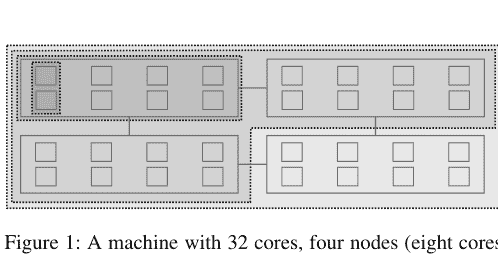
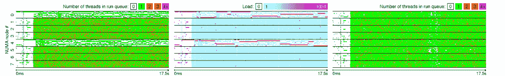
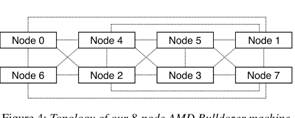
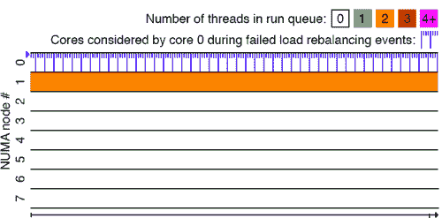

# Linux 调度器：十年浪费的核心


# 摘要
作为资源管理的核心组成部分，操作系统线程调度器必须遵循以下这条简单的恒定规则：确保就绪线程被调度到可用核心上运行。尽管这条规则看似简单，但我们发现Linux中常常会违反该规则。就绪线程在运行队列中等待时，核心可能会空闲数秒之久。在我们的实验中，这些性能缺陷导致对同步开销较高的科学应用程序性能下降数倍，内核编译的延迟升高13%，同时一款广泛使用的商业数据库的TPC-H吞吐量下降了14%-23%。本研究的主要贡献是发现、分析这些缺陷并提供修复方案。传统的测试技术和调试工具无法有效确认或理解这类缺陷，因为它们的症状往往十分隐蔽。为了推进研究，我们开发了新型工具，能够在线检测对该恒定规则的违反情况，并可视化调度活动。这些工具简单易用，可轻松跨内核版本移植，且运行开销几乎可以忽略。我们相信，将这些工具加入内核开发者的工具库，有助于避免这类缺陷的出现。

经典的调度问题主要围绕设置调度时间片的长度展开，目标是在最小化上下文切换开销的同时提供交互响应能力，在单一系统中同时支持批处理与交互式工作负载，并高效管理调度器运行队列。总体而言，到2000年时，操作系统设计者普遍认为调度问题已经得到解决；林纳斯·托瓦兹的那句话准确反映了当时的主流观点。2004年Dennard缩放定律终结，多核时代随之到来，能效也成为计算机系统设计的首要关注点。这些事件让调度器再次成为研究热点，但同时也使其变得越来越复杂，且常常出现故障。我们近期对Linux调度器的研究显示，为了规避现代硬件的棘手特性带来的压力——比如非均匀内存访问延迟（NUMA）、缓存一致性及同步的高开销，以及CPU与内存延迟的差异——最终导致调度器的实现极为复杂。因此，调度器最基本的职能——确保可运行线程使用空闲核心——反而被忽视了。本研究的主要贡献是发现并研究了Linux调度器中的四个性能缺陷。这些缺陷会导致调度器在可运行线程等待运行机会时让核心处于空闲状态。¹ 由此导致的典型Linux工作负载的性能下降幅度在13%-24%之间，部分极端场景下更是达到138倍。能源浪费与此成正比。由于这些缺陷破坏了关键的内核子系统，会导致严重的（有时是灾难性的）性能下降，并且能够躲过传统的测试与调试技术，因此理解它们的本质和来源至关重要。

# 1. 引言
> “你必须意识到，没多少东西能像调度器一样历经时间考验依然表现良好。这恰恰证明了调度是件简单的事。”
> —— 林纳斯·托瓦兹，2001年 [43]

¹ 这种情况的出现，尽管调度器并未被显式配置为刻意留空核心以使其进入低功耗状态来节能。

这些缺陷的根源各不相同，但症状一致。**调度器会在存在可运行线程*处于运行队列中等待*的情况下，无意间长时间让核心处于空闲状态。** 这种状态的短期出现是可以接受的：例如线程退出、阻塞，或是线程被创建、解除阻塞时，系统可能会暂时进入这种状态。长期出现该状态则不属于预期行为。Linux调度器是工作保持型的，意味着只要有待处理任务，就不应该让核心空闲。因此，该症状长期存在属于非预期情况：这是由缺陷导致的，会损害性能。我们针对这些缺陷提供了修复方案，并观察到了显著的性能提升。对同步开销较高的应用程序而言，运行速度提升了数倍；一款对内存屏障依赖程度极高的科学应用程序最终运行速度提升了138倍。² 在一款广泛使用的商业数据库管理系统上，内核编译和TPC-H工作负载的性能分别提升了13%和14%。受该缺陷影响最大的TPC-H查询速度提升了23%。

检测这些缺陷难度很高。它们不会导致系统崩溃或卡死，但会悄悄消耗性能，而且通常很难通过标准性能监控工具察觉。例如，在运行TPC-H工作负载时，该症状在执行过程中出现了多次，但每次仅持续数百毫秒——时间太短，无法通过htop、sar或perf这类工具检测到。但累计起来，这些情况足以让受影响最严重的查询速度下降23%。即使在症状持续时间更长的情况下，也很难找到根本原因，因为这是调度器中大量异步事件共同导致的结果。我们最初怀疑存在调度器缺陷，是在为一个不同项目评估TPC-H数据库工作负载时，观察到了无法解释的性能问题。传统工具既无法帮助我们确认缺陷，也无法帮助我们理解其根本原因。为此，我们设计了两款新工具。第一款工具我们称之为*健全性检查器*，它会周期性地检测上述恒定规则的违反情况，在运行中的系统上捕捉缺陷，并收集包含相关信息的追踪数据以供离线分析。第二款工具可以可视化调度活动追踪数据，加快调试速度。这些工具很容易在不同内核版本间移植（支持Linux 3.17到4.3版本），运行开销几乎可以忽略，且能够稳定检测到对恒定规则的违反情况。将这些工具纳入标准工具库，有助于减少这类缺陷未来的出现。本文其余部分安排如下。第2节介绍Linux调度器的架构；第3节介绍我们发现缺陷、分析其根本原因并阐述其对性能的影响；第4节介绍我们开发的两款工具；第5节总结本研究获得的经验教训，并指出尚未解决的研究问题；第6节讨论相关研究；第7节总结我们的研究成果。

# 2. Linux调度器
我们首先介绍Linux的完全公平调度（Completely Fair Scheduling，CFS）算法在单核单用户系统上的运行原理（见2.1节）。从这个角度看，该算法十分简单。随后，在2.2节中我们将解释现代多核系统的局限性如何迫使开发者规避潜在的性能瓶颈，最终导致实现变得极为复杂，更易出现缺陷。

## 2.1 在单CPU系统上，CFS十分简单
Linux的CFS是加权公平队列（Weighted Fair Queueing，WFQ）调度算法的实现，该算法会将可用CPU周期按线程的权重比例进行分配。为了实现这一抽象逻辑，CFS（和大多数其他CPU调度器一样）会为运行中的线程分配CPU时间片。调度器需要做出两个关键决策：如何确定线程的时间片长度？以及如何选择下一个要运行的线程？

调度器会定义一个固定的时间间隔，系统内的每个线程都至少要在该间隔内运行一次。该间隔会按照线程的权重比例进行分配，分配后的结果就是我们所说的“时间片”。线程的权重本质上就是它的优先级，在UNIX术语中也称为“nice值”。nice值越低的线程权重越高，反之亦然。线程运行时会累计虚拟运行时间（vruntime，即线程运行时间除以其权重）。一旦线程的虚拟运行时间超过其分配的时间片，若存在其他可运行线程，该线程就会被从CPU上抢占。如果有虚拟运行时间更小的线程被唤醒，当前线程也可能被抢占。线程会被组织在运行队列中，该队列以红黑树实现，线程按照虚拟运行时间从小到大的顺序排列。当CPU需要寻找新的运行线程时，会选择红黑树中最左侧的节点，该节点包含的是虚拟运行时间最小的线程。

## 2.2 在多核系统上，CFS变得十分复杂
在多核环境中，调度器的实现会变得复杂得多。出于可扩展性考虑，必须使用单核心运行队列。使用单核心运行队列的原因是，发生上下文切换时，核心只需要访问本地运行队列来寻找要运行的线程。上下文切换处于关键路径上，因此速度必须足够快。只访问核心本地队列可以避免调度器进行可能开销较高的同步访问，如果访问全局共享的运行队列就需要这类同步操作。

² 正如我们在后文所解释的，调度方面的不足加剧了锁争用。


运行队列（runqueues）必须保持平衡。考虑一个双核系统，其两个运行队列未达到平衡。假设其中一个队列有1个低优先级线程，另一个队列有10个高优先级线程。如果每个核心只会在其本地运行队列中查找任务，那么高优先级线程获得的CPU时间会远少于低优先级线程，这并不是我们想要的结果。我们可以让每个核心不仅检查自身的运行队列，还检查其他核心的队列，但这会违背每个核心独立运行队列的设计初衷。因此，Linux和大多数其他调度器的做法是定期运行负载均衡算法，使各队列保持大致平衡。
> 我想，要让调度器使用每CPU队列，再配合一些跨CPU负载均衡逻辑，应该是_相当简单的_。相关补丁已经存在了，我觉得没人能把这几百行代码搞得太糟。
> —莱纳斯·托瓦兹，2001年 [43]

从概念上讲，负载均衡很简单。2001年时，CPU大多是单核的，商用服务器系统通常只有少数几个处理器，因此很难预见到，在现代多核系统中，负载均衡会变得颇具挑战性。在如今的系统中，负载均衡是一项开销很高的操作，无论是计算开销还是通信开销都很大，因为它涉及修改远程缓存的数据结构，会引发成本极高的缓存未命中和同步操作。因此，调度器会尽量避免频繁执行负载均衡操作。但另一方面，如果执行频率过低，又可能导致运行队列失衡。出现这种情况时，即使有待处理任务，核心也可能处于空闲状态，从而影响性能。因此，除了周期性负载均衡外，调度器还会在核心空闲时触发“紧急”负载均衡，并在新建线程或新唤醒线程被分配时执行部分负载均衡逻辑。理论上，这些机制可以确保只要有待处理任务，所有核心都能保持忙碌。接下来我们将介绍负载均衡的工作原理，首先讲解相关算法，然后说明调度器为降低开销、节省电量所采用的优化措施。后文我们将说明，部分优化措施会增加代码复杂度，甚至引发缺陷。

### 2.2.1 负载均衡算法
理解负载均衡算法的关键在于CFS调度器用于追踪负载的指标。我们首先讲解该指标，再介绍实际的算法。

### 负载追踪指标
一个朴素的负载均衡算法会简单地确保每个运行队列中的线程数量大致相同，但这未必是我们想要的效果。考虑这样一种场景：两个运行队列中，一个队列有若干高优先级线程，另一个队列有数量相同的低优先级线程，那么高优先级线程会和低优先级线程获得相同量的CPU时间，这显然不是我们想要的。因此，有人提出可以根据线程的权重而非数量来平衡队列。但不幸的是，仅基于线程权重来平衡负载也是不够的。
再考虑另一种场景：两个运行队列中共有10个线程，其中1个是高优先级线程，9个是低优先级线程。我们假设高优先级线程的权重是低优先级线程的9倍。如果按照线程权重平衡负载，一个运行队列会放高优先级线程，另一个放9个低优先级线程，高优先级线程会获得9倍于低优先级线程的CPU时间，这看起来符合我们的预期。但如果高优先级线程经常短时间休眠，那么对应的核心就会频繁空闲。这个核心需要频繁从其他核心的运行队列中偷取任务来保持忙碌，但我们不希望偷取任务成为常态，因为这会违背每核心独立运行队列的设计初衷。我们真正需要的是用更合理的方式平衡运行队列，要考虑到高优先级线程并不需要占用整个核心。
为实现这一目标，CFS调度器不仅基于权重，还基于一个名为“负载”的指标来平衡运行队列，该指标是线程权重和其平均CPU利用率的结合。如果某个线程的CPU使用率很低，它的负载值也会相应降低。此外，负载追踪指标还会考虑不同进程的多线程程度差异。考虑这样的场景：一个进程有很多线程，另一个进程只有少量线程，那么前一个进程的所有线程加起来会获得远多于后一个进程线程的CPU时间，最终前一个进程会占用大部分CPU周期，导致后一个进程“饥饿”，这显然是不公平的。因此，从2.6.38版本开始，Linux新增了组调度功能，以实现不同线程组之间的公平性（即cgroup功能）。当线程属于某个cgroup时，其负载还会进一步除以该cgroup内的线程总数。该功能后来被扩展，可自动将属于不同tty的进程分配到不同的cgroup中（即自动分组功能）。

### 负载均衡算法
基础的负载均衡算法会比较所有核心的负载，然后将任务从负载最高的核心迁移到负载最低的核心。但不幸的是，这样做会导致线程在整台机器上迁移，却不会考虑缓存局部性或NUMA架构的影响。因此，负载均衡器采用了分层策略。
核心会被逻辑地组织成层次结构，最底层是单个核心。更高层级中核心的分组方式，取决于它们如何共享机器的物理资源。本节我们以实验用机器（见表5）的层次结构为例进行说明：在这台机器中，成对的核心共享功能单元（例如浮点单元FPU），每8个核心为一组共享最后一级缓存（LLC）。共享一个LLC的8个核心组成一个NUMA节点，不同NUMA节点的互连方式有所不同，具体说明和展示见图4。因此，在我们目标系统的层次结构中，第二层是成对的核心，下一层是每8个核心一组、共享同一LLC的组（即NUMA节点）。NUMA节点还会根据互连层级进一步分组[23]。间隔为一跳的节点会放在同一层级，以此类推。这类层次结构的实例如图1所示。


层次结构的每一层都被称为*调度域*。负载均衡算法总结在算法1中。负载均衡会从底层到顶层，对每个调度域依次执行。每一层中，每个调度域会指定一个核心负责负载均衡：如果该调度域有空闲核心，且这些空闲核心的空闲CPU周期可用于负载均衡，就选该域的第一个空闲核心；否则就选该域的第一个核心（对应算法第2-9行）。之后，会计算该调度域内每个调度组的平均负载（对应算法第10行），并基于优先选择过载、负载不均的组的启发式规则，选出*最忙*的组（对应算法第10行）。如果最忙组的负载低于本地组的负载，就认为该层级的负载已经平衡（对应算法第16行）。否则，就会在本地核心与该组的最忙核心之间平衡负载，同时会做一项调整，确保即使在存在任务集（taskset）限制的情况下，负载均衡也能正常运行（对应算法第18-23行）。
```plaintext
Algorithm 1 Simplified load balancing algorithm.
{Function running on each cpu cur_cpu:}
1: for all sd in sched_domains of cur_cpu do
2: if sd has idle cores then
3: first_cpu = 1st idle CPU of sd
4: else
5: first_cpu = 1st CPU of sd
6: end if
7: if cur_cpu ≠ first_cpu then
8: continue
9: end if
10: for all sched_group sg in sd do
11: sg.load = average loads of CPUs in sg
12: end for
13: busiest = overloaded sg with the highest load (or, if inexistent) imbalanced sg with highest load (or, if inexistent) sg with highest load
14: local = sg containing cur_cpu
15: if busiest.load ≤ local.load then
16: continue
17: end if
18: 
19: busiest_cpu = pick busiest cpu of sg
20: try to balance load between busiest_cpu and cur_cpu
21: if load cannot be balanced due to tasksets then
22: exclude busiest_cpu, goto line 18
23: end if
```
该算法从层次结构的最底层开始，逐层向上处理，每次平衡低一层的负载。例如，在图1所示的系统中，核心会从成对核心层级开始，平衡该组内两个独立核心之间的负载。之后会进入NUMA节点层级，平衡其下一层（也就是本例中的成对核心）的负载，但**不会平衡NUMA节点内各个独立核心之间的负载**。在调度域中，执行负载均衡的核心集合被称为*调度组*。在NUMA节点域中，会有4个调度组，每个对应一对核心。核心会找到自身所属调度组之外的最忙调度组，并从该组的最忙核心处偷取任务。

### 2.2.2 优化措施
为避免重复工作，调度器只会针对每个调度域在*指定核心*上运行负载均衡算法。当每个活跃核心收到周期性时钟中断、开始运行负载均衡算法时，会检查自身是否为该域中编号最低的核心（所有核心都忙碌时），或者是否为编号最低的空闲核心（存在空闲核心时）。这一点对应算法的第2行。如果满足该条件，核心就会认定自己是指定核心，继续执行算法。


与功耗相关的优化可能会进一步降低空闲核心上负载均衡的执行频率。最初，每一个时钟周期到来时，所有空闲核心都会被唤醒，此时它们会运行负载均衡算法。然而，自2.6.21版本起，Linux新增了可避免定期唤醒休眠核心的选项（该选项现已默认开启）：核心会进入*tickless idle*状态，该状态下核心能够降低能耗。当其他核心过载时，处于该状态的核心唯一能获取任务的方式是被其他核心唤醒。为此，每个调度周期内，若某核心认为自己处于“过载”状态，它会检查系统中是否存在已处于tickless idle状态一段时间的核心，若存在，它会唤醒第一个tickless idle核心，并为其分配**NOHZ均衡器**的职责。NOHZ均衡器核心在每个时钟周期内，需要为自己并代表所有tickless idle核心执行周期性负载均衡例程。除了周期性负载均衡外，调度器还会在唤醒线程时进行负载均衡。当线程从休眠状态或等待资源（如锁、I/O）的状态中唤醒时，调度器会尝试将其分配到最空闲的核心上。若线程是被其他线程（唤醒线程）唤醒的，则会适用特殊规则：此时调度器会优先选择与唤醒线程共享缓存的核心，以提升缓存复用率。

# 3. 缺陷
> > 「没有人真的能第一次就写出完美的代码，除了我。但世界上只有一个我。」
> > 莱纳斯·托瓦兹，2007年[44]

由于关于负载均衡是否执行的相关规则十分复杂，我们很难推断：当系统有待处理任务时，空闲核心会空闲多久；当系统存在空闲核心时，任务会在运行队列中等待多久才能轮到其执行。由于几乎没有开发者能“第一次就写出完美的代码”，这种复杂性会导致缺陷的产生。理解这些缺陷是必要的，这样才能明白它们为何能躲过传统的测试与调试工具。因此，我们首先介绍这些缺陷，把用于验证和理解的工具的展示推迟到第4章。表4总结了本节描述的缺陷。

## 3.1 组不平衡缺陷
#### 缺陷概述。我们在用于执行内核编译、并使用R机器学习包做数据分析的多用户机器上发现了该缺陷。我们怀疑这台64核8节点的NUMA服务器并未在所有可用核心上运行高线程数计算任务，而是将所有线程都集中在少数几个节点上。我们通过可视化工具的输出展示该缺陷，结果如图2a和图2b所示。图中展示的时间段内，机器正在执行内核编译任务（使用64线程运行make命令），同时运行两个R进程（每个进程仅1个线程）。上述make任务和两个R进程分别从3个不同的SSH连接（即3个不同的终端）启动。


**图2：** 组不平衡缺陷。Y轴表示CPU核心，节点编号为0至7，每个节点包含8个核心。图2a是热力图，按时间对每个核心运行队列中的线程数量进行着色：颜色越暖，代表核心承载的线程越多；白色代表空闲核心。图表显示有两个节点的核心仅运行1个线程甚至完全不运行线程，而其余节点处于过载状态，大量核心的运行队列中有2个线程。

经调查我们发现，调度器未执行负载均衡的原因如下：
- 负载追踪指标过于复杂
- 采用了分层设计

我们首先关注负载。需要记住，线程的负载是其权重与所需CPU时间的综合体现。在使用自动分组（autogroups）的情况下，线程的负载还会被其所属父自动分组中的线程数量除。在我们的场景中，64线程make进程中的线程负载大约是单线程R进程中线程负载的1/64。线程负载的差异如图2b所示，该图展示了每个核心运行队列中线程的合计负载：颜色越深代表负载越高。运行R进程的节点0和节点4各有一个核心负载极高，这些正是运行R线程的核心。Linux负载均衡器会基于负载从其他运行队列中窃取任务；显然，节点0和4上的低负载核心不应从同节点的高负载核心处窃取任务，因为该核心仅运行单个线程。但它们必须能够从其他节点的高负载核心处窃取任务。为什么实际情况并非如此？请记住，为了限制算法复杂度，负载均衡算法采用了分层设计。当某核心试图从其他节点（即其他调度组）窃取任务时，它不会检查该组内每个核心的负载，只会查看该组的平均负载（算法1第11行）。若目标调度组的平均负载高于自身所在调度组的平均负载，它就会尝试从该组窃取任务；否则就不会执行窃取。这正是我们场景中低负载核心无法从其他节点的高负载核心处窃取任务的原因。它们发现目标节点调度组的平均负载并未高于自身所在组的平均负载。试图窃取任务的核心与高负载R线程运行在同一个节点上，该线程拉高了该节点的平均负载，掩盖了部分核心实际空闲的事实。与此同时，目标节点上的核心平均负载与之相近，但存在大量等待执行的线程。一个合理的问题是：这种情况下是否应该执行任务窃取？因为从理论上看，我们希望高负载线程比低负载线程获得更多CPU时间。这个问题的答案是“是的”：Linux CFS调度器本质上具有工作守恒特性，因此如果系统存在空闲核心，线程可能会获得超过其公平份额的CPU周期；换句话说，空闲核心应始终分配给等待执行的线程。但正如我们在此场景中看到的，实际情况并非总是如此。

#### 修复方案。为修复该缺陷，我们修改了算法中比较调度组负载的部分。我们将原本比较**平均**负载的逻辑改为比较**最小**负载（算法1第11行和第15行）。最小负载指的是该组内负载最低的核心的负载值。若某调度组的最小负载低于另一调度组的最小负载，说明第一组内存在一个核心的负载低于第二组内*所有*核心，因此第一组内的某个核心必须从第二组窃取任务。该算法可确保不会出现第二组核心过载而第一组存在负载更低核心的情况，从而实现核心间的负载均衡。需要注意的是，该修复方案有效的前提是组*内部*也实现了负载均衡（由分层结构中更低层级的负载均衡调用实现）。和原始算法一样，我们使用组不平衡的特殊情况（算法1第13行）处理由任务集导致的边缘情况。这些修改并未给调度器增加算法复杂度，因为计算调度组的最小负载和平均负载的成本相同。根据我们的经验，该修复不会导致调度组间的迁移次数增加（即乒乓效应）。

#### 性能影响。图2c是应用修复后该工作负载的执行追踪结果（以和图2a相同的热力图形式展示运行队列的大小）。修复缺陷后，本节前述make/R工作负载中make任务的完成时间缩短了13%。两个R进程的完成时间没有变化。在其他场景下，性能提升可能会更高。例如，在运行NAS基准测试³中的`1u`程序、同时运行4个单线程R进程的工作负载中，修复组不平衡缺陷后`1u`的运行速度提升了13倍。`1u`实现了超线性加速，因为该缺陷会导致多个`1u`线程运行在同一核心时加剧锁竞争。

³NAS基准测试是一套用于辅助评估超级计算机性能的小型程序集[32]。

## 3.2 调度组构建缺陷
#### 缺陷概述。`taskset`是Linux定义的一条命令，可用于将应用绑定到可用核心的子集上运行。本节描述的缺陷出现在应用被绑定到相距两跳的节点上时。例如，在展示我们的NUMA机器拓扑的图4中，节点1和节点2就相距两跳。该缺陷会阻止负载均衡算法在这两个节点间迁移线程。由于线程会在其父线程所在的节点上创建，因此最终的效应是：无论绑定的应用有多少线程，都*仅会在一个节点上运行*。该缺陷源于调度组的构建方式，这种方式并不适配诸如我们在实验中使用的现代NUMA机器。简而言之，当前调度组是从特定核心（核心0）的视角构建的，而它们本应从**负责各节点负载均衡的核心的视角**构建。我们通过示例说明。


**图4：** 我们8节点AMD Bulldozer机器的拓扑结构

在我们的机器中（拓扑见图4），第一个调度组包含节点0的所有核心，以及所有与节点0相距一跳的节点的核心，即节点1、2、4和6的核心。第二个调度组包含未纳入第一个组的首个节点（节点3）的所有核心，以及所有与节点3相距一跳的节点的核心：即节点1、2、4、5、7的核心。因此前两个调度组如下：
```
{0,1,2,4,6}, {1,2,3,4,5,7}
```
注意节点1和2被同时纳入了两个调度组，而这两个节点实际上彼此相距两跳。若调度组从节点1的视角构建，节点1和2

这些节点不会同时存在于所有调度组中。我们来看看这对负载均衡有什么影响。假设有一个应用被绑定在节点1和节点2上，且其所有线程都在节点1上*创建*（Linux会在父线程所在的同一核心上生成线程；当应用的初始化阶段生成多个线程时，这些线程通常会被创建在同一核心上，这也是典型场景）。最终我们希望节点1和节点2之间的负载保持均衡。然而，当节点2上的某个核心寻找可窃取的任务时，它会比较之前提到的两个调度组的负载。由于每个调度组都同时包含节点1和节点2，两组平均负载相同，因此节点2不会窃取任何任务！

该bug源于一项旨在提升Linux在大型NUMA系统上性能的优化。引入该bug之前，Linux会先在NUMA节点内部平衡负载，再在所有NUMA节点间做全局负载均衡。后来新增了多级层次结构（相距1跳的节点组、相距2跳的节点组等），目的是提高线程留在原始NUMA节点附近的概率。

## 修复方案。
我们修改了调度组的构造逻辑，让每个核心都使用从自身视角构建的调度组。修复后，当节点1和节点2的核心尝试在整机级别窃取任务时，节点1和节点2不会再被包含在所有调度组中。如此一来，核心就能够感知到负载不平衡，进而窃取任务。

## 性能影响。
表1展示了存在和不存在调度组构造bug的NAS应用的性能差异。实验在2个节点上启动应用，线程数等于核心数。其中1u应用的性能下降最大，达到了27倍。性能降幅远高于预期的2倍，这是由锁效应导致的。NAS应用使用了自旋锁和自旋屏障；由于taskset bug导致所有线程都在同一节点上执行时，执行临界区的线程可能被抢占，把时间片让给通过自旋浪费时间的线程。1u就是这类场景的极端案例：它使用流水线算法并行化任务，线程需要等待其他线程处理的数据。当多个线程被强制在同一核心上执行时，就会造成巨大的性能损失[22]。

| 应用 | 存在bug时的执行时间（秒） | 不存在bug时的执行时间（秒） | 加速倍数（×） |
|-------------|-------------------|--------------------|--------------------|
| bt | 99 | 56 | 1.75 |
| cg | 42 | 15 | 2.73 |
| ep | 73 | 36 | 2 |
| ft | 96 | 50 | 1.92 |
| is | 271 | 202 | 1.33 |
| lu | 1040 | 38 | 27 |
| mg | 49 | 24 | 2.03 |
| sp | 31 | 14 | 2.23 |
| ua | 206 | 56 | 3.63 |

**表1：** 存在和不存在调度组构造bug的NAS应用执行时间。所有应用均通过`numactl --cpunodebind=1,2 <app>`命令启动。

## 3.3 唤醒时过载bug
#### 该bug的表现
该bug的核心表现是：处于睡眠状态的线程可能会在系统其他核心空闲时，被唤醒到已过载的核心上。该bug是由唤醒代码（`select_task_rq_fair`函数）中的一项优化引入的。当线程在节点*X*上进入睡眠，且后续唤醒它的线程正在同一节点上运行时，调度器只会考虑节点*X*上的核心来调度被唤醒的线程。如果节点*X*的所有核心都处于忙碌状态，该线程就会被唤醒到已忙碌的核心上，从而丧失使用其他节点空闲核心的机会。这会导致机器资源严重利用率不足，在线程频繁等待的工作负载场景下尤为明显。这项优化的初衷是最大化缓存复用率。本质上，调度器会尝试将被唤醒的线程物理放置在唤醒它的线程附近，例如让两者运行在共享最后一级缓存的核心上，以适配生产者-消费者类工作负载：被唤醒的线程会消费唤醒线程产生的数据。这个思路看似合理，但对于部分工作负载而言，为了提升缓存复用率而在运行队列中等待并不划算。

该bug由一款配置了64个工作线程（每个核心对应1个线程）、运行TPC-H工作负载的广泛使用的商用数据库触发。该工作负载与其他应用的瞬态短生命周期线程结合，会同时触发组不平衡bug⁴和唤醒时过载bug。由于我们已经在本文章第3.1节描述过组不平衡bug，因此本实验中禁用了自动分组，以便更好地展示唤醒时过载bug。

> ⁴ 我们使用的商用数据库依赖工作者线程池：少量容器进程各自提供数十个工作者线程。每个容器进程在不同的自动分组中启动，这意味着工作者线程也属于不同的自动分组。由于不同容器进程的工作者线程数量不同，不同工作者线程的负载也不同。该bug的触发原因与第3.1节所述一致。

图3展示了若干唤醒时bug的实例。在第一个时间段（标记为❶）内，有一个核心处于空闲状态，而理想情况下应被调度到该核心的线程持续被唤醒到其他忙碌的核心上。在第二个时间段（标记为❷）内，该bug出现了三重实例：三个核心长期处于空闲状态，而应被调度到这三个核心上的额外三个线程持续被唤醒到其他忙碌的核心上。

唤醒时过载bug通常由以下场景触发：瞬态线程被调度到运行数据库线程的核心上。这种情况发生在内核启动持续时间不足1毫秒的任务执行后台操作（例如日志记录或中断处理）时。此时，负载均衡器会监测到运行瞬态线程的节点（节点A）负载更高，进而将其中1个线程迁移到另一个节点（节点B）。如果被迁移的是瞬态线程，这不会引发问题；但如果被迁移的是数据库线程，就会触发唤醒时过载bug。节点B现在多运行了1个数据库线程，而这些频繁睡眠、唤醒的线程会持续被唤醒到节点B上，哪怕该节点已经没有空闲核心。出现这种情况的原因是，为了更好的缓存复用，唤醒代码只会考虑本地节点的核心。

现在我们明白了：为什么系统明明有空闲核心，线程仍然会被唤醒到已过载的核心上。从图3可以看出，系统最终会从负载不平衡状态中恢复：负载均衡算法最终会将线程从过载核心迁移到空闲核心。问题是，为什么恢复过程需要数毫秒（甚至数秒）？我们需要知道，系统中的空闲核心分为两类：短期空闲核心和长期空闲核心。短期空闲核心只会空闲很短时间，因为运行在该核心上的数据库线程会因为同步或I/O事件间歇性进入睡眠状态。理想情况下，我们希望负载均衡事件将线程从过载核心迁移到长期空闲核心。迁移到短期空闲核心几乎没有帮助：原本运行在该核心上的线程会很快被唤醒，正如我们之前提到的，由于缓存局部性优化，调度器可能会把它放到同一节点的另一个过载核心上。如此一来，不平衡状态就会持续存在。

> ⁵ 实际上，向短期空闲核心迁移线程的现象，解释了为什么额外线程并不总是像图3中那样位于同一核心上。不幸的是，当调度器考虑从过载核心迁移线程的目标位置时，它不会区分短期空闲核心和长期空闲核心。它只会检查在负载均衡器被调用时，该核心是否处于空闲状态。回想一下第2.2.1节的内容，负载均衡算法是由"指定核心"在不同层次结构中触发的。如果有多个符合条件的空闲核心可被选为"指定核心"，只有其中一个会被选中。如果运气好，选中了长期空闲核心，负载就能恢复平衡。这正是图3中系统最终从不平衡状态恢复时发生的情况。然而，正如我们观察到的，仅靠运气不足以维持最优性能。

### *修复方案。*
要修复该bug，我们修改了线程唤醒时执行的代码：如果本地核心（即该线程上次被调度的核心）处于空闲状态，就将线程唤醒到该核心上；否则，如果系统中有空闲核心，就将线程唤醒到空闲时间最长的核心上。如果系统中没有空闲核心，则回退到原有算法，寻找线程将被唤醒的核心。

将线程唤醒到长期空闲核心上可能会对功耗产生影响。长期空闲的核心通常会进入低功耗模式。在该核心上唤醒线程会强制核心退出该模式，以全功率运行。因此，我们只在系统的电源管理策略完全不支持核心进入低功耗状态时，才启用新的唤醒策略。此外，我们的修复方案仅对以下工作负载有效：线程频繁睡眠、唤醒，且系统间歇性出现过订阅（线程数多于核心数）的场景。在这些场景下，将线程唤醒到长期空闲核心是合理的。在其他场景中，由于线程唤醒事件很少，我们的修复方案不会显著改变调度器的行为。在系统中查找长期空闲核心不会给唤醒函数带来额外开销：内核已经维护了系统中所有空闲核心的列表，因此选择第一个（也就是空闲时间最长的）核心只需常数时间。

### *性能影响。*
该bug对数据库TPC-H工作负载影响极大，因为线程之间经常需要相互等待，这意味着任意两个会

| 缺陷修复 | TPC-H 请求 #18 | 完整 TPC-H 基准测试 |
|-----------|-------------------|-----------------------|
| 无 | 55.9秒 | 542.9秒 |
| *组不平衡* | 48.6秒（−13.1%） | 513.8秒（−5.4%） |
| *唤醒过载* | 43.5秒（−22.2%） | 471.1秒（−13.2%） |
| 两者均有 | 43.3秒（−22.6%） | 465.6秒（−14.2%） |
*表2：针对唤醒过载缺陷和组不平衡缺陷的修复对一款主流商业数据库的影响（数值为五次运行的平均值）。*
被绑定在同一核心上的最终会拖慢所有剩余线程的运行。这一效应在图3中清晰可见：在❶和❷阶段，大量线程的执行存在间隙，也就是说它们会同时休眠，等待那些与它们共享同一核心的“落后”线程。当所有缺陷实例被修复后（图表最右侧部分），这些间隙便消失了。
表2展示了我们针对唤醒过载和组不平衡缺陷的修复对这款商业数据库的性能影响。我们使用了两种负载：（1）TPC-H 的第18号查询，这是对上述缺陷最敏感的查询之一；（2）完整的 TPC-H 基准测试。我们针对唤醒过载缺陷的修复，在 TPC-H 第18号查询上带来了22.2%的性能提升，在完整 TPC-H 负载上带来了13.2%的性能提升。在唤醒过载缺陷修复的基础上，额外应用组不平衡缺陷修复，可使 TPC-H 第18号查询的性能提升22.6%，完整 TPC-H 基准测试的性能提升14.2%。在这些实验中，组不平衡缺陷修复的效果较小，因为组不平衡缺陷仅在核心对级别出现（即一个核心空闲而另一个核心过载），且仅出现在实验的某些阶段。

图5：从核心0视角呈现的缺失调度域缺陷。蓝色竖线代表核心0在每次（失败的）负载均衡调用中考虑的核心。负载均衡调用每4毫秒执行一次。我们可以看到，尽管节点1的核心已经过载，核心0在负载均衡时仅考虑其兄弟核心和同一节点上的核心。

## 3.4 缺失调度域缺陷
#### 缺陷说明
当通过 `/proc` 接口禁用某个核心后再重新启用时，任意 NUMA 节点之间的负载均衡将不再执行。该缺陷源于对代表机器调度域数量的全局变量的错误更新：当核心被禁用时，该变量会被设置为单个 NUMA 节点内的域数量。因此，主调度循环（算法1第1行）会过早退出。其后果是，线程只能在核心被禁用前所在的节点上运行（即使该节点与核心被禁用并重新启用的节点并非同一个）。对于禁用核心后创建的进程，其所有线程都将在与其父进程相同的节点上运行。由于所有进程通常都由同一个“根”进程（例如 sshd 守护进程及其派生的 ssh 进程）创建，因此该缺陷通常会导致所有新创建的线程仅在机器的单个节点上执行，无论线程数量多少。图5展示了该缺陷的可视化结果：我们在机器上启动了一个包含16个线程的应用程序，线程创建完成后，节点1上的所有核心各运行两个线程（橙色横线）。从核心0发出的蓝色竖线代表核心0尝试窃取任务时考虑的核心，由于循环过早退出，核心0仅考虑其所在节点的核心，不会考虑节点1的核心。

#### 修复方案
我们追踪到该缺陷的根源在于重新生成机器调度域的代码：Linux 会在每次核心被禁用时重新生成调度域，重新生成调度域是一个两步流程：内核首先重新生成 NUMA 节点内的域，再重新生成跨 NUMA 节点的域。不幸的是，Linux 开发者在代码重构过程中遗漏了生成跨 NUMA 节点域的函数调用。我们将其添加回来，成功修复了该缺陷。

| 应用程序 | 存在缺陷时的耗时（秒） | 无缺陷时的耗时（秒） | 加速倍数（×） |
|-------------|-------------------|--------------------|---------------------|
| bt | 122 | 23 | 5.24 |
| cg | 134 | 5.4 | 24.90 |
| ep | 72 | 18 | 4.0 |
| ft | 110 | 14 | 7.69 |
| is | 283 | 53 | 5.36 |
| lu | 2196 | 16 | 137.59 |
| mg | 81 | 9 | 9.03 |
| sp | 109 | 12 | 9.06 |
| ua | 906 | 14 | 64.27 |
*表3：存在缺失调度域缺陷与不存在该缺陷时，NAS 应用程序的执行耗时（单位：秒）。*

性能影响
表3汇总了在系统中禁用并重新启用一个核心后，缺失调度域缺陷对若干 NAS 应用程序的影响。应用程序以64个线程启动，这是我们64核心机器的默认配置。缺失调度域缺陷会导致应用程序的所有线程仅在单个节点上运行，而非分布在8个节点上。在某些情况下，性能影响甚至超过预期的8倍降速——因为线程可用的CPU时间是无缺陷时的1/8（它们仅在单个节点上运行而非8个节点）。例如 lu 程序的运行速度反而快了138倍！当线程频繁通过锁或屏障进行同步时，会出现超线性降速：如果线程自旋等待一个被撤销调度的线程持有的锁，它们会浪费更多CPU时间，从而对整个应用程序的性能产生级联负面影响。部分应用程序无法理想地扩展到64核心，因此受到该缺陷的影响稍小，最低降速为4倍。

| 配置项 | 规格参数 |
|------|---------------|
| 中央处理器（CPU） | 8 颗 8 核心 AMD Opteron 6272 处理器（总计64个线程） |
| 主频 | 2.1 GHz |
| 缓存（每颗CPU） | 768 KB 一级缓存、16 MB 二级缓存、12 MB 三级缓存 |
| 内存 | 512 GB 1.6 GHz DDR-3 内存 |
| 互联架构 | HyperTransport 3.0（见图4） |
**表5：我们使用的 AMD Bulldozer 机器硬件配置。**

## 3.5 讨论
首先我们要思考的问题是：这些缺陷能否通过一种更简洁、更不易出错、更易调试的全新调度器设计来修复，同时还能保留现有调度器的全部特性？但从历史经验来看，这似乎并不是一个长期解决方案，更何况新设计需要从零开始实现和测试。
Linux 调度器经历过几次重大重新设计：最初的调度器算法复杂度很高，在高多线程负载普及时性能表现很差。2001年，它被一款复杂度为O(1)、在SMP系统上可扩展性更强的新调度器取代。这款调度器最初表现优异，但很快就需要针对NUMA、SMT等新架构进行修改。同时，用户对桌面使用场景（如需要更多调度器改动的交互式应用、音频应用）提出了更好的支持需求。尽管进行了大量修改和提出了诸多启发式规则，O(1)调度器还是未能达到预期，在2007年被CFS（完全公平调度器）取代。有趣的是，CFS放弃了O(1)复杂度，转而采用O(log n)复杂度，但人们认为为了获得所需的特性，这一牺牲是值得的。
随着硬件和负载变得越来越复杂，CFS也难逃缺陷的困扰：自动分组功能与分层负载均衡机制的引入，催生了组不平衡缺陷。日益复杂的新NUMA系统中的架构不对称性，触发了调度组构建缺陷。现代系统的NUMA特性是缺失调度域缺陷的诱因。现代多节点机器上的缓存一致性开销，推动了缓存局部性优化的落地，该优化引发了唤醒过载缺陷。
经验表明，新的调度器设计总是层出不穷。但即便新设计起初简洁、宣称初始无缺陷，也绝非长期解决方案。Linux是由数十位贡献者共同开发的大型开源系统。在这种环境下，我们不可避免地会看到新的功能与“临时补丁”被反向移植到代码库中，以适应不断演进的硬件和应用场景。最近发布的Linux 4.3内核采用了全新的负载指标实现方式，据报告这一改动“以显著降低代码复杂度的方式完成”[5]。简化负载指标本可消除与之直接相关的组不平衡缺陷，但我们通过自研工具确认，该缺陷依然存在。
内核开发者通常依赖相互代码审查和测试来防止缺陷引入，这种方法对于缺失调度域、调度组构建这类在代码中更容易发现的缺陷或许有效（当然，在这两个案例中它并未发挥作用），但对于更晦涩的缺陷类型，这种方法很难奏效。通过测试或常规性能监控工具捕获这类缺陷难度很高，它们不会导致系统崩溃或内存耗尽，只会悄无声息地拖累性能。
正如我们在组不平衡和唤醒过载缺陷中看到的，这类缺陷会引入在不同核心之间“游走”的短期空闲周期。这些微小的空闲周期无法通过htop、sar或perf等性能监控工具察觉。标准性能回归测试也很可能无法捕获这类缺陷，因为它们仅在非常特定的场景下出现（例如从不同终端启动多个线程数不同的应用程序）。实际上，Linux上的性能测试通常每次仅在专用机器上运行一个应用程序，这是限制可能引发性能差异的变量的标准做法。
总而言之，在我们初步怀疑缺陷存在后，无论是确认缺陷还是探究其根本原因，传统测试技术和调试工具都没有起到任何帮助。我们的这段经历促使我们开发了新的工具，借助这些工具我们得以高效地确认缺陷并理解其发生原因。下一节将介绍这些工具。

# 4. 工具
## 4.1 在线健全性检查器
我们所说的“健全性检查器”，是指一种用于定期检查必须维护的不变量的机制。⁶ 我们所有的修复方案将很快提交给内核开发者。


表4：使用我们工具在调度器中发现的缺陷。
| 名称 | 描述 | 内核版本 | 受影响的应用程序 | 最大实测性能影响 |
|------|-------------|-----------------|-----------------------|-------------------------------------|
| *组不平衡* | 启动多个线程数不同的应用程序时，部分CPU处于空闲状态，而另一部分CPU过载。 | 2.6.38+ | 全部 | 13× |
| *调度组构建* | 距离为2跳的节点之间没有负载均衡。 | 3.9+ | 全部 | 27× |
| *唤醒时过载* | 线程在过载的核心上唤醒，而其他部分核心处于空闲状态。 | 2.6.32+ | 睡眠或等待类应用程序 | 22% |
| *缺失调度域* | 软件未在NUMA节点之间实现负载均衡。 | 3.19+ | 全部 | 138× |

我们的健全性检查器验证的不变量如算法2所示。该算法用于验证：当一个核心的运行队列中存在等待线程时，不会有其他核心处于空闲状态。我们致力于保持代码简洁，哪怕这会提升算法复杂度，以尽可能降低健全性检查器本身出现缺陷的概率。这有助于确保除了极短程序外的所有程序的不变量违规都能被检测到，同时将开销保持在较低水平。在我们的系统中，当$S=1$时，即使面对多达10000个线程的工作负载，测得的开销也低于0.5%。

``` **Algorithm 2** "No core remains idle while another core is overloaded" 1: **for all** CPU1 in CPUs **do** 2: **if** CPU1.nr_running ≥ 1 {CPU1 is not idle} **then** 3: **continue** 4: **end if** 5: **for all** CPU2 in CPUs **do** 6: **if** CPU2.nr_running ≥ 2 **and** can_steal(CPU1, CPU2) **then** 7: Start monitoring thread operations 8: **end if** 9: **end for** 10: **end for** ```

我们的健全性检查器与断言或看门狗不同，它需要专门针对一类场景定制：某些条件在短时间内出现是可以接受的，但若长期存在则不可接受。断言会在期望的不变量被违规时立刻触发，而健全性检查器需要尽可能降低短期瞬态违规的误报概率，同时以高概率捕获长期违规。负载均衡器每4ms运行一次，但由于采用了分层设计，无缺陷系统要从不变量违规中恢复，可能需要多次负载均衡尝试。我们保守地将$M$设置为100ms，以几乎完全消除误报概率。该时间段内的监控会追踪线程迁移、创建与销毁事件，因为正是这些事件能帮助系统恢复。追踪这些事件需要在`move_thread`、`fork`和`exit`函数中添加函数调用，用于检查线程的迁移位置。该函数调用的开销可忽略不计。

为满足这一要求，我们按如下方式实现健全性检查器：不变量检查会以$S$为间隔周期性触发。若检测到不变量违规，我们会主动在短时间$M$内监控额外的调度器事件（下文会描述），判断这是否是调度器能及时修复的“合法”短期违规。若违规未被修复，我们会记录性能分析信息（下文会描述）并标记缺陷。检测实际缺陷（即长期不变量违规）的概率，取决于不变量违规的频率和持续时间。在我们描述的大多数情况下，一旦缺陷触发不变量违规，系统将永远无法恢复。这类不变量违规很容易被健全性检查器检测到。在一种情况（唤醒时过载缺陷）下，不变量违规的持续时间较短，约为数百毫秒，随后会消失并再次出现。这种情况下，捕获违规的概率取决于系统处于不良状态的总时间占比。若该占比很小，则缺陷的检测概率也较低，同时性能影响也较小。持续时间更长和/或出现频率更高的违规，被检测到的概率也更高。此外，如果触发缺陷的工作负载持续运行，健全性检查器在至少一次检查中检测到该缺陷的概率会持续上升。

我们设置$S$和$M$的目标是：最小化开销和误报概率，同时最大化实际缺陷的检测概率。我们将$S$设置为1秒；如果检测到缺陷，健全性检查器会开始收集性能分析信息，纳入缺陷报告中。我们使用**SystemTap**对所有负载均衡函数的调用（例如`load_balance`、`select_task_rq.fair`）进行性能分析，同时分析这些函数执行的所有语句及其使用的变量的值。我们通过这些分析结果了解负载均衡函数的执行过程，以及它们无法实现负载均衡的原因。注意，我们不会记录缺陷触发时的执行部分，但这没有问题，因为我们只需要了解在较长一段时间内所有负载均衡调用失败的原因。使用`systemtap`进行监控的开销很高（我们的测量结果显示约为7%），因此我们仅在检测到缺陷后才开始性能分析，并在20ms后停止分析。得益于自身体积小巧，健全性检查器可以轻松在不同内核版本间移植，且不会与修改调度器的补丁产生冲突。我们最初在Linux 3.17上实现了该健全性检查器，移植到4.3版本时仅需要修改一行代码（我们用于获取时序数据的`do_posix_clock_monotonic_gettime`函数更改了名称）。

## 4.2 调度器可视化工具
我们即将介绍的可视化工具在判断缺陷症状的性质、进一步探究其根本原因方面发挥了巨大作用。该工具可以展示随时间变化的显著调度活动（上一节展示的用于说明缺陷的图表均来自该工具）。这些图表依赖额外的内核插桩，其开销可忽略不计。我们的可视化工具可以对以下内容进行性能分析并绘图：(1) 运行队列的大小；(2) 运行队列的总负载；(3) 周期性负载均衡和线程唤醒过程中被考虑的核心。为保证最高准确度，该工具不使用采样方式，而是记录运行队列大小或负载的每一次变化，以及每次负载重平衡或线程唤醒事件中所有被考虑的核心。为将开销控制在较低水平，我们将所有性能分析信息存储在一个静态大小的内存全局大数组中。该数组的每个元素对应(1)、(2)或(3)中的某一种事件：
- 针对(1)，我们对内核函数`add_nr_running`和`sub_nr_running`进行插桩，这两个函数是唯一直接修改存储各运行队列大小的变量的函数。在这两个函数中，我们会向全局数组存储一个事件，该事件包含时间戳、核心编号和新的运行队列大小。
- 类似地，针对(2)，我们对内核函数`account_entity_enqueue`和`account_entity_dequeue`进行插桩，这两个函数是唯一直接修改存储各运行队列负载的变量的函数。在这两个函数中，我们会向全局数组存储一个事件，该事件包含时间戳、核心编号和新的负载值。
- 最后，针对(3)，我们对内核函数`select_idle_sibling`、`update_sg_lb_stats`、`find_busiest_queue`和`find_idlest_group`进行插桩。在这几个函数中，我们会向全局数组存储一个事件，该事件包含时间戳，以及一个位域：操作中未被考虑的核心对应0，被考虑的核心对应1。
在Linux内核中实现这些修改仅用了不到150行代码。为了写入事件，线程会使用原子自增指令定位数组中要写入事件的位置；随后将事件写入内存，这可能会导致缓存未命中。在我们的架构中，每个事件仅需20字节存储空间即可。在第3章中，产生事件频率最高的应用程序是商业数据库：它每秒产生约60200个类型(1)事件、58000个类型(2)事件和68000个类型(3)事件，总计每秒约186200个事件。因此，我们的性能分析工具在激活时，在64核机器上每秒会占用3.6MB的RAM。实际使用中，性能分析工具仅在检测到缺陷时才会激活，无缺陷情况下其对性能的影响可忽略不计。

除了对Linux内核的修改外，我们还编写了一个内核模块，支持按需启动和结束性能分析会话，以及将全局数组输出到文件。我们还编写了绘制结果的脚本，图2、图4和图5就是这类图表的示例。根据我们的经验，在开发出这些工具后，确认和理解本文描述的性能缺陷、以及在不同内核版本中检测这些缺陷的效率都得到了大幅提升。由于这些工具既能捕获重要缺陷，同时本身又足够简单、几乎无开销、且易于在不同内核版本间移植，我们认为将它们纳入内核开发者的标准工具集是一个不错的选择。

# 5. 经验教训
现在我们回顾本研究过程中总结的经验教训，并识别待解决的开放问题。我们描述的缺陷源于开发人员希望给调度器加入越来越多的优化，这些优化大多是为了适配现代硬件的复杂性。因此，曾经作为内核中简单独立部分的调度器，如今已演变成一个复杂的“怪物”，其“触手”延伸到了系统的众多其他部分，例如电源管理和内存管理。本文研究的优化已纳入Linux主线版本，但学术界还提出了更多调度优化方案。从大约2000年起，数十篇论文描述了针对资源争用、一致性瓶颈以及现代多核系统其他特殊特性的新型调度算法。
- 存在一类算法，会对线程进行调度，以尽量降低对共享缓存、内存控制器和多线程CPU流水线的争用[8, 9, 24, 29, 34, 42, 46]。
- 存在一类算法，可缩短共享数据的线程之间的通信距离[41]，还能确定分配给多线程工作负载的核心最优数量[17]。
- 存在一类算法，用于解决非对称多核CPU上的线程调度问题[22, 35]，还有一类算法将调度与功耗、温度管理相结合[19]。
- 最后，存在一类算法用于管理内存的

（唤醒过载缺陷！）尽管可视化在概念上十分简单，但实现有效的工具并非易事。执行日志可以非常庞大，因此将所有内容可视化并不可行，也没有实用价值。当用户不清楚自己要查找什么时，理解该可视化哪些内容、如何让用户高效探索日志，是一个重要的开放性问题。
可视化领域当然已存在针对这一主题的研究，但系统领域需要更积极地接纳这些技术，并根据我们系统领域所解决问题的特性进行调整。非一致性内存访问（NUMA）系统的设计与线程调度方式密切相关[7,14,18,38]，而相关算法可将线程调度到非对称互连系统上，以最小化通信延迟[23]。所有这些算法在某些实际应用中，都展现出了性能或功耗层面的积极收益。
然而，这些技术几乎没有被主流操作系统采纳，主要原因是不清楚如何安全地将所有这些理念整合到调度器中。如果每项优秀的调度理念都被生硬地添加到单一的整体式调度器上，就会面临复杂度更高、缺陷更多的风险，正如本文的案例研究所示。我们需要重新思考调度器的架构，因为它已经不再能够作为内核中体积小、结构紧凑、基本孤立的一部分存在了。
我们现在认识到，当今硬件的高速发展将催生越来越多的调度器优化需求。调度器必须能够轻松集成这些优化方案，并拥有对这些优化方案如何组合进行推理的能力。我们设想中的调度器由多个模块组成：核心模块和优化模块。
核心模块承担调度器最基础的功能：将可运行的线程分配给空闲核心，并以某种公平的方式在它们之间分配CPU周期。优化模块则负责为基本算法提出具体的增强方案。例如，负载均衡模块可以提出替代的负载均衡方案，以避免过高的开销。缓存亲和性模块可以提出在某个核心上唤醒此前曾在该核心上运行过的线程。资源争用模块可以提出一种线程放置策略，降低因资源争用导致性能下降的概率。
核心模块应能够采纳优化模块的建议，并在可行时执行这些建议，同时始终维持基本不变量，例如在有可运行线程时不让核心空置。当多个优化方案出现冲突时，如何决定如何组合它们是一个困难的调度领域开放性问题，例如：缓存亲和性模块和资源争用模块提出了不同的线程放置方案，或是负载均衡器在运行队列间移动线程时可能破坏内存节点亲和性。

## **6. 相关工作**
### **性能缺陷**
性能缺陷是操作系统领域反复出现的问题。Linux内核性能项目[13]于2005年启动，旨在应对性能回退问题。尽管做出了这些努力，OS领域的研究人员依然持续报告性能缺陷。Boyd等人[10]报告了多种可扩展性缺陷，Harji等人[20]报告了2.6内核中的其他类型性能缺陷。Mollison等人[30]提出了一种专门针对调度器的回归测试工具，该工具面向实时多处理器调度系统Linux测试平台（LITMUS^RT）项目下实现的实时调度器插件。该工具存在局限（例如未考虑阻塞场景），且不适用于Linux内核的公平调度策略（CFS）。
为应对性能缺陷，Perl等人[33]提出在内核中添加断言，以检查函数调用是否及时完成。Shen等人[39]构建了一种吞吐量模型，用于检查I/O性能。这些技术通过断言检测性能缺陷，不适用于检测调度器中的问题负载不均。临时负载不均是正常现象，并不构成问题。因此，我们的在线健全性检查器采用了不同的设计，用以区分有问题的和无问题的不变量违例。

### **内核正确性**
目前已有大量针对系统正确性验证的研究工作。RacerX[15]和Eraser[37]可检测死锁和竞争条件。Erickson等人[16]可检测内核模块中的数据竞争。若能将这类系统扩展到性能缺陷检测领域将十分理想——这类缺陷不一定会导致系统崩溃；但这是一个难题，因为在我们的环境中，短期的不变量违例是可接受的。
D3S[25]、Likely Invariants[36]和ExpressOS[28]使用不变量和谓词来检查简单操作的正确性（例如确保变量处于特定范围内）。我们的在线健全性检查器能够检测更微妙的系统错误状态（即部分核心长时间空闲而其他核心过载的系统），且可被集成到操作系统中，用于验证更高层级的设计选择。
这项工作的另一个经验教训是，可视化工具至关重要。如果没有对相关问题相关执行事件的可视化，我们根本无法理解所描述缺陷的根本原因。执行可视化当然不是什么新概念。虽然少数系统开发者群体（例如谷歌的某些工程团队[26,40]）已经采用这种做法，但更广泛的开发者社区仍缺乏有效的可视化工具。
目前已有许多优秀的日志采集工具，例如SystemTap、Pivot tracing[27]或Intel处理器追踪。然而，如果没有有效的可视化手段，开发者往往只会对日志中的可用信息进行汇总和聚合，这就会掩盖导致缺陷和性能问题的异常值。
模型检测也被用于检测内核中的缺陷。CMC[31]通过向内核注入状态来查找实现缺陷。Yang等人[45]利用模型检测发现了文件系统中的错误（例如死锁）。模型检测是一种很有用的缺陷预判方法。由于可能的工作负载数量庞大，且硬件行为（例如拓扑结构、休眠核心的行为）十分复杂，调度器的模型检测尤为困难。模型检测工具可用于查找调度器中的崩溃类缺陷，但据我们所知，现有研究都无法用于检测更微妙的性能缺陷。
形式化验证是一种通过分析源代码证明软件正确性的方法。传统上，形式化验证仅适用于小型代码库和非C语言，但近期在多位操作系统研究者的努力下，形式化验证已被应用于操作系统内核[11,12,21]。即便如此，这些最前沿的方法也不适用于本文描述的这类缺陷，因为它们仅适用于单线程环境，且无法对时间因素进行推理。
形式化工具通过将系统描述为一系列状态转移、前置条件和后置条件，进而在给定可能的前置条件下，推理是否存在会导致后置条件违例的状态转移。问题在于，在我们的环境中，短暂、间歇性的后置条件违例（即存在等待线程时核心空闲）是完全可接受的。只有长期违例才是有问题的。遗憾的是，现有工具没有支持推理时间如何影响不变量瞬时违例的机制。扩展这些工具以支持多线程环境、并具备时间推理能力，会让它们更适用，但要求Linux开发者编写形式化规范，会是这些工具落地应用的又一障碍。

## 追踪
由于我们遇到的某些缺陷十分复杂，尤其是唤醒过载缺陷，性能分析工具不足以让我们完全理解其成因：我们需要通过日志来精确追踪调度器的行为。目前已有多款追踪工具被提出，用于协助检测性能缺陷。Windows事件追踪（Event Tracing for Windows）[2]和DTrace[1]是可使开发者追踪应用和内核事件（包括部分调度器事件）的框架，适用于微软Windows、Solaris、macOS X和FreeBSD操作系统。Linux内核自带一套追踪工具，例如Ftrace[3]和SystemTap[6]。KernelShark[4]等额外工具可生成图形化追踪日志。
我们的在线健全性检查器并未提供新的事件监控方法，而是直接基于SystemTap实现这一功能。然而，我们的健全性检查器具备这些工具所不具备的功能：它通过检测不变量违例，仅在性能缺陷发生时监控事件——持续运行现有追踪工具对检测性能缺陷作用不大，因为它们会产生海量数据，绝大多数都是无缺陷的执行日志，且无法跳转到日志中的缺陷片段。此外，我们的可视化工具能够监控极细粒度的调度器事件，这些事件对理解本文呈现的部分性能缺陷至关重要，例如单个调度事件（可绘制出每次线程跨核心移动时对应的调度事件），或是工作窃取循环中的单次迭代（可监控负载均衡过程中考虑的所有核心）。

## **7. 结论**
调度，即在线程之间分配CPU周期的任务，曾被认为是已经解决的问题。我们证明事实并非如此。为适配现代硬件的复杂性，一项简单的调度策略却实现了非常复杂的实现，容易产生缺陷。我们发现Linux调度器违反了一项基础的工作保留不变量：将等待中的线程调度到空闲核心上。其结果是，可运行线程可能在系统中存在空闲核心的情况下，在运行队列中阻塞数秒；应用性能可能下降数倍。这类缺陷的特性使得传统工具难以检测它们。我们修复了这些缺陷，理解了其根本成因，并提出了让捕获和修复这些缺陷变得容易得多的工具。我们的修复方案和工具将公开于http://git.io/vaGOw。

## **参考文献**
- [1] DTrace。http://dtrace.org/。
- [2] Windows事件追踪。https://msdn.microsoft.com/en-us/library/windows/desktop/bb968803(v=vs.85).aspx。
- [3] Ftrace。https://www.kernel.org/doc/Documentation/trace/ftrace.txt。
- [4] KernelShark。http://people.redhat.com/srostedt/kernelshark/HTML/。
- [5] Linux 4.3调度器变更“可能影响所有现有SMP工作负载”。http://www.phoronix.com/scan.php?page=news_item&px=Linux-4.3-Scheduler-SMP。
- [6] SystemTap。https://sourceware.org/systemtap/。
- [7] J. Antony、P. P. Janes和A. P. Rendell。探究非一致性内存访问（NUMA）架构上的线程与内存放置策略：Solaris与Linux系统，UltraSPARC/FirePlane与Opteron/HyperTransport架构。载于第13届高性能计算国际会议论文集，HiPC'06，2006年。
- [8] S. Blagodurov、S. Zhuravlev和A. Fedorova。多核系统上的内容感知调度。《ACM计算机系统汇刊》，28:8:1–8:45，2010年。
- [9] S. Blagodurov、S. Zhuravlev、M. Dashti和A. Fedorova。多核系统上NUMA感知资源争用管理的案例。载于2011年美国enix年度技术会议论文集，USENIX ATC'11，2011年。


- [10] S. Boyd-Wickizer, A. T. Clements, Y. Mao, A. Pesterev, M. F. Kaashoek, R. Morris, and N. Zeldovich. 《Linux多核可扩展性分析》。载于*《第9届USENIX操作系统设计与实现会议论文集》*，OSDI'10，2010年。
- [11] H. Chen, D. Ziegler, T. Chajed, A. Chlipala, M. F. Kaashoek, and N. Zeldovich. 《运用崩溃霍尔逻辑验证FSCQ文件系统》。载于*《第25届操作系统原理研讨会论文集》*，SOSP '15，2015年。
- [12] H. Chen, D. Ziegler, A. Chlipala, M. F. Kaashoek, E. Kohler, and N. Zeldovich. 《存储系统崩溃安全性规范》。载于*《第15届操作系统热点问题研讨会（HotOS XV）》*，瑞士伊廷根卡劳斯修道院，2015年5月。
- [13] T. Chen, L. I. Ananiev, and A. V. Tikhonov. 《避免内核性能回归》。载于*《Linux研讨会论文集》*，第1卷，第93–102页，2007年。
- [14] M. Dashti, A. Fedorova, J. Funston, F. Gaud, R. Lachaize, B. Lepers, V. Quéma, and M. Roth. 《流量管控：NUMA系统内存放置的整体方法》。载于*《第18届体系结构支持编程语言与操作系统国际会议论文集》*，ASPLOS '13，2013年。
- [15] D. Engler and K. Ashcraft. 《RaceX：竞争条件与死锁的有效静态检测》。载于*《第19届ACM操作系统原理研讨会论文集》*，SOSP '03，2003年。
- [16] J. Erickson, M. Musuvathi, S. Burckhardt, and K. Olynyk. 《内核有效数据竞争检测》。载于*《第9届USENIX操作系统设计与实现会议论文集》*，OSDI'10，2010年。
- [17] J. R. Funston, K. El Maghraoui, J. Jamm, P. Pattnaik, and A. Fedorova. 《提升多线程应用性能的SMT选择指标》。载于*《2012年第26届IEEE国际并行与分布式处理研讨会论文集》*，IPDPS '12，2012年。
- [18] F. Gaud, B. Lepers, J. Decouchant, J. Funston, A. Fedorova, and V. Quéma. 《大页面在NUMA系统上可能有害》。载于*《2014年USENIX annual技术会议论文集》*，USENIX ATC'14，2014年。
- [19] M. Gomaa, M. D. Powell, and T. N. Vijaykumar. 《Heat-and-run：通过操作系统利用SMT与CMP管控功率密度》。载于*《第11届体系结构支持编程语言与操作系统国际会议论文集》*，ASPLOS XI，2004年。
- [20] A. S. Harji, P. A. Buhr, and T. Brecht. 《我们遇到的Linux问题及其影响》。载于*《第二届亚太系统研讨会论文集》*，APsys '11，2011年。
- [21] G. Klein, K. Elphinstone, G. Heiser, J. Andronick, D. Cock, P. Derrin, D. Elkaduwe, K. Engelhardt, R. Kolanski, M. Norrish, T. Sewell, H. Tuch, and S. Winwood. 《seL4：操作系统内核的形式化验证》。载于*《ACM SIGOPS第22届操作系统原理研讨会论文集》*，SOSP '09，2009年。
- [22] D. Koufaty, D. Reddy, and S. Hahn. 《异构多核架构中的偏置调度》。载于《第5届欧洲计算机系统会议论文集》，EuroSys '10，2010年。
- [23] B. Lepers, V. Quéma, and A. Fedorova. 《NUMA系统上的线程与内存放置：不对称性至关重要》。载于*《2015年USENIX annual技术会议论文集》*，USENIX ATC '15，2015年。
- [24] T. Li, D. Baumberger, D. A. Koufaty, and S. Hahn. 《性能非对称多核架构的高效操作系统调度》。载于*《2007年ACM/IEEE超级计算会议论文集》*，SC '07，2007年。
- [25] X. Liu, Z. Guo, X. Wang, F. Chen, X. Lian, J. Tang, M. Wu, M. F. Kaashoek, and Z. Zhang. 《D³S：已部署分布式系统的调试》。载于*《第5届USENIX网络系统设计与实现研讨会论文集》*，NSDI'08，2008年。
- [26] D. Luu. 《奈奎斯特定理、当今采样性能分析工具的局限性以及未来追踪工具的展望》。http://danluu.com/perf-tracing
- [27] J. Mace, R. Roelke, and R. Fonseca. 《Pivot Tracing：分布式系统的动态因果监控》。载于*《第25届操作系统原理研讨会论文集》*，SOSP '15，2015年。
- [28] H. Mai, E. Pek, H. Xue, S. T. King, and P. Madhusudan. 《验证ExpressOS中的安全不变量》。载于*《第18届体系结构支持编程语言与操作系统国际会议论文集》*，ASPLOS '13，2013年。
- [29] A. Merkel, J. Stoess, and F. Bellosa. 《多核处理器上兼顾能效的资源感知调度》。载于*《第5届欧洲计算机系统会议论文集》*，EuroSys '10，2010年。
- [30] M. S. Mollison, B. Brandenburg, and J. H. Anderson. 《针对LITMUS®ᵀᴾ实时调度器的单元测试探索》。载于*《第5届嵌入式实时应用操作系统平台研讨会论文集》*，OSPERT '09，2009年。
- [31] M. Musuvathi, D. Y. W. Park, A. Chou, D. R. Engler, and D. L. Dill. 《CMC：模型检验实际代码的实用方法》。*《ACM操作系统评论》*，36(SI)，2002年12月。
- [32] NAS并行基准测试套件。http://www.nas.nasa.gov/publications/npb.html
- [33] S. E. Perl and W. E. Weihl. 《性能断言检查》。载于*《第14届ACM操作系统原理研讨会论文集》*，SOSP '93，1993年。
- [34] K. K. Pusukuri, D. Vengerov, A. Fedorova, and V. Kalogeroski. 《FACT：自适应竞争感知线程迁移框架》。载于*《第8届ACM计算前沿国际会议论文集》*，CF '11，2011年。
- [35] J. C. Saez, M. Prieto, A. Fedorova, and S. Blagodurov. 《非对称多核系统的综合调度器》。载于《第5届欧洲计算机系统会议论文集》，EuroSys '10，2010年。
- [36] S. K. Sahoo, J. Criswell, C. Geigle, and V. Adve. 《运用可能不变量实现软件故障自动定位》。载于*《第18届体系结构支持编程语言与操作系统国际会议论文集》*，ASPLOS '13，2013年。
- [37] S. Savage, M. Burrows, G. Nelson, P. Sobalvarro, and T. Anderson. 《Eraser：多线程程序的动态数据竞争检测器》。*《ACM计算机系统汇刊》*，15(4)，1997年11月。
- [38] L. T. Schermerhorn. 《卫生问题：Linux自动页迁移》。2007年。链接：https://linux.org.au/conf/2007/talk/197.html。
- [39] K. Shen, M. Zhong, and C. Li. 《运用模型驱动异常表征法调试I/O系统性能》。载于《第4届USENIX文件与存储技术会议论文集（第4卷）》，*FAST'05*，第23–23页，2005年。
- [40] D. Sites. 《数据中心计算机：CPU设计的现代挑战》。https://www.youtube.com/watch?v=QBu2Ae8-8LM
- [41] D. Tam, R. Azimi, and M. Stumm. 《线程聚类：SMP-CMP-SMT多处理器上的共享感知调度》。载于《2007年第2届ACM SIGOPS/EuroSys欧洲计算机系统会议论文集》，*EuroSys '07*，2007年。
- [42] D. K. Tam, R. Azimi, L. B. Soares, and M. Stumm. 《RapidMRC：商用系统上L2缺失率曲线近似用于在线优化》。载于《第14届体系结构支持编程语言与操作系统国际会议论文集》，*ASPLOS XIV*，2009年。
- [43] L. Torvalds. *《Linux内核邮件列表》*。http://tech-insider.org/linux/research/2001/1215.html，2001年2月。
- [44] L. Torvalds. *《技术讲座：Linus Torvalds 谈 git 与谷歌》*。http://www.youtube.com/watch?v=4XpnKHAok8，2007年3月。
- [45] J. Yang, P. Twohey, D. Engler, and M. Musuvathi. 《运用模型检验发现文件系统严重错误》。*《ACM计算机系统汇刊》*，24(4)，2006年11月。
- [46] S. Zhuravlev, S. Blagodurov, A. Fedorova. 《通过调度解决多核处理器的共享资源竞争问题》。载于《第15届体系结构支持编程语言与操作系统国际会议（ASPLOS）论文集》，*ASPLOS XV*，2010年。
