# Linux 入门指南

## 开源万事通初学者指南！

### Linux 入门套件

想抛弃 Windows 却不知从何下手？

这份 Linux 使用完全指南就是为你准备的！

### 内含 DVD


LINUX FORMAT  
Linux Format 特刊  
第十三期 £9.99

### 由以下机构提供

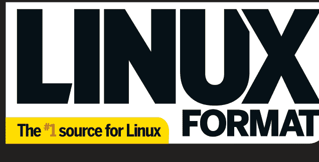  
www.linuxformat.com

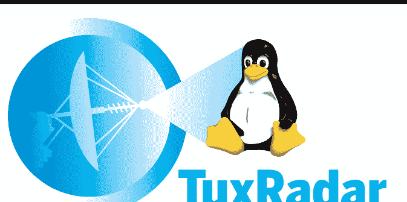  
www.tuxradar.com

## 引言

### 欢迎！

如果你读到了这里，显然你已经是越来越多对 Linux 感到好奇的人之一。我不清楚是什么让你来到这里——也许你厌倦了每隔一天就安装安全更新，也许你厌倦了电脑运行变慢时反复重启，又或者你只是受够了蓝屏死机——但无论是什么带你来到这里，我都很高兴欢迎你加入 Linux 用户大家庭，并希望你在这里发现一个全新的计算世界，让乐趣真正重新回归。


这本杂志是一本面向 Linux 新手的单期特刊。说的就是你，也就是说你来对地方了！但 Linux 是一个庞大的软件世界，虽然其中有些软件看起来和用起来都像你熟悉的 Windows 或 Mac 软件，但也有很多东西是全新的，这正是本指南的用武之地——我们把它编写成一套全面的 Linux 新手入门包，目标是让你用最少的阅读，从电脑中获得最大的收益。你还会发现这本杂志附赠一张 DVD，里面包含一个完整、可安装的 Linux 版本供你使用。没错，Linux 确实有很多版本，但本指南是配合那张 DVD 上的软件编写的，所以如果你想充分利用我们为你准备的所有教程，我们建议你从那张光盘开始。

现在，是时候开始这场冒险了。如果你想直接上手，翻到第10页的安装指南。如果你想先多了解一点 Linux——我建议你这么做！——翻到第6页。玩得开心！

  
Paul Hudson 主编  
paul.hudson@futurenet.co.uk

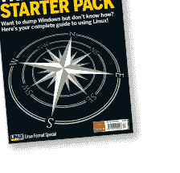

LINUX FORMAT 特刊  
Linux 入门套件

## 编辑团队

主编 Paul Hudson  
光盘编辑 Mike Saunders  
特约编辑 Graham Morrison  
运营编辑 Andrew Gregory  
美术编辑 Eirian Hernandez-Mendoza  
美术助理 Stacey Black、Nick Cox、Neil Freestone、Martin Fairbairn

LINUX FORMAT

## 目录

准备好掌握 Linux 了吗？发动引擎，挑选你的主题……

### 安装指南（第10页）

光盘在手，准备就绪：从这里开始！

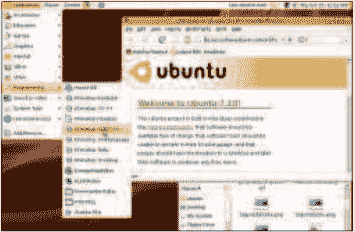


### 帮助台

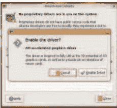

### 解决它！110

遇到 Linux 问题了吗？想把技能再提升一步却不知如何下手？用这种简单的方式升级你内在的 Linux 大师。

LINUX FORMAT 特刊

## DVD 光盘内容

除了原版 Ubuntu，你还会找到一个 64 位版本，以及一个内容多得多的大号版本！

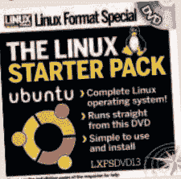

另外：OpenOffice.org...................................30

你全新的完整生产力应用套件。

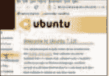


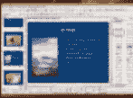

## 完整目录

- 这个入门套件里有什么 ........................................ 6

  先阅读这部分，才能从这本杂志中获得最大收获。

- 安装指南 ....................................................... 10

  在把光盘放进光驱之前，请先停在这里。

- 你的新 Linux 桌面 ............................................. 14

  谁？什么？何时？怎么做？我们解释 Linux 使用的基础知识。

- 上网 .......................................................... 22

  用 Firefox 浏览网页，再用它的附加组件做更多事情！

- 阅读电子邮件 .................................................. 26

  制作待办清单、创建日历、存储联系人等等。

- OpenOffice.org Writer ................................................ 30

  如果你在寻找一款功能强大、外观和操作都酷似 Microsoft Word 的文字处理器，那就来这里。

- OpenOffice.org Calc ................................................... 34

  电子表格从远处看也许很乏味，但 OOo Calc 至少能保证它们易于创建和把玩！

- OpenOffice.org Impress ................................................ 38

  学习如何制作商务演示文稿，但前提是你得保证永远不用那些逐字飞入的动画效果。

- OpenOffice.org Base ................................................... 42

  用极客的方式整理你的 CD 收藏：录入、排序、打印，然后也许终于有时间听一听了……

- 制作自己的信纸 .............................................. 46

  制作一些剪贴画，然后快速将它们变成信头。

- 编辑你的照片 ...................................................... 50

  有数码相机和一些想美化的照片？获取用 Linux 让它们变得完美的知识吧！

- 玩游戏，找乐子 ................................................ 58

  Linux 并不全是严肃的东西——我们也有一大堆游戏！

- 创建多个账户 ................................................ 64

  朋友、家人和陌生人都可以使用你的 Linux 电脑，只要你愿意。

- Compiz 桌面特效 ................................................ 68

  是的，是的：Linux 可以把你的桌面变成一个旋转的立方体，还带火焰特效等等。有什么意义？你告诉我们吧，反正我们就是喜欢！

- 使用媒体编解码器 ........................................................ 72

  Flash？没问题。Java？没问题。DVD？也一样。但默认情况下没有，因为它们是讨厌的专有软件。但如果你需要，就翻到这一页……

- 媒体抓轨 .......................................................... 76

  抛弃你的 CD 收藏，像酷小孩一样全面数字化吧！

- 光盘刻录 ........................................................... 80

  这就像是媒体抓轨的反向操作：把你的数字数据变成光盘，四处分发或出售，既有趣又有收益。

- 制作光盘内页 ...................................................... 82

  ……如果你刚刚按照第80页的光盘刻录教程操作过，现在就可以学习如何制作漂亮的光盘内页，让成品更加完整！


- 即时通讯 ....................................................... 86

  和好友聊天，甚至也可以主动联系陌生网友；无论如何，即时通讯都超级好玩！

- BitTorrent 下载 .................................................... 90

  用快捷的方式获取文件，同时还能建立社区。

- 打印文档 ....................................................... 92

  借助为其他用户托管页面、设置带宽和请求限制以及重写 URL 的技巧，让 Apache 更进一步。

- 保护你的机器 ...................................................... 96

  Linux 很安全，但这绝不是放松警惕的理由。

- 添加软件 ........................................................ 100

  只要你愿意，有成千上万的软件包可供选择。所以连上互联网，开始下载吧！

- 最佳免费软件 .............................................. 104

  有这么多优秀的软件可选，你怎么知道该尝试哪些？我们为你挑出最好的，让你的选择更轻松。

- 术语表 ................................................................ 120

  把天下所有 Linux 技术术语都摊开并解释清楚——把这部分放在手边备用！

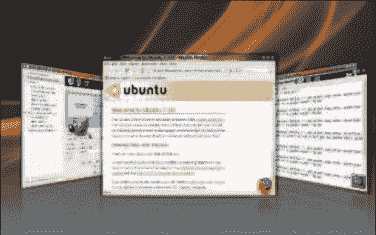

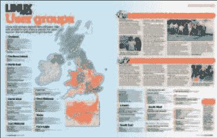

### Compiz 桌面特效............... 68

### 如何获取帮助 ..................... 第124页

## 欢迎使用 Linux！

步骤 1：购买这本杂志。步骤 2：??? 步骤 3：盈利！现在，让我们看看我能否给你提供关于步骤 2 的更多细节...


切换到 Linux 不必困难。事实上，我们希望尽可能让它对你来说简单易行，你会很高兴得知你已经完成了最困难的步骤之一——只是通过获得这本杂志。我相信你有很多问题，但在我们开始之前，我首先想告诉你一些关于 Linux 的信息。

#### 1 Linux 是免费的！

没错——Linux 完全免费！你可以拿着随本杂志附赠的光盘，复制一千次，然后送给遇到的每一个人如果你愿意的话。你甚至可以把自己的标志贴在前面然后出售它如果你真的想的话，因为一切确实是完全免费的。

#### 2 Linux 看起来和运行方式与 Windows 很相似

危言耸听者喜欢说 Linux 很难，你的 Windows 技能将毫无用处，你会卡住并且找不到任何帮助，或者 Linux 根本不具备像 Windows Vista 这样的系统的功能。但我可以向你保证他们是错的：虽然微软 Windows 在市场份额方面以很大优势领先，但它肯定不是最好的操作系统。毕竟，如果仅仅流行就能让某物变得好，麦当劳就会是地球上最好的食物！Linux 不仅在功能上与 Windows 完全匹配，而且系统要求也低得多。任何在 1GB 或更少内存上运行过 Vista 的人都会告诉你，Windows 可能会相当占用内存。另一方面，Linux 在 512MB 甚至更少的内存上运行都很舒适——甚至还有专门为在 32MB 内存上运行而设计的 Linux 版本，使用的是自 90 年代末以来就不再是顶级的 CPU！当然，如果你想要 Linux 提供的最佳体验，你应该考虑 512MB 内存和 800MHz CPU 为最低配置。有了这些，你应该能够启用所有功能并获得很棒的计算体验。

> 正在寻找特殊效果？Linux 正是你想要的。

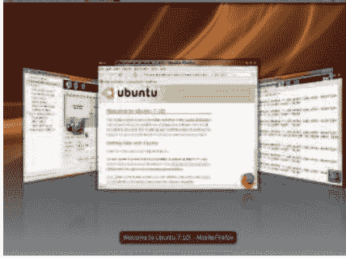

#### 3 Linux 有大量软件供你尝试

有时切换到不同的操作系统最困难的部分是弄清楚使用哪些程序。例如，Microsoft Office 在 Windows 上运行得很好，但微软没有为 Linux 制作版本——这并不奇怪，可以想象！微软的 Internet Explorer 网络浏览器也是如此。当你切换到 Linux 时，你可以选择放弃这些程序并使用它们的 Linux 等效程序，或者你可以尝试使用名为 Wine 的特殊 Windows 兼容层来运行它们。如果是我，我现在不会太担心 Wine，因为 Linux 上有成千上万的程序，而且几乎所有程序都像 Linux 本身一样完全免费！更重要的是，你可能已经熟悉其中一些，因为它们同时运行在 Windows 和 Linux 上——Firefox、OpenOffice.org、Thunderbird、Gimp 等都可以在 Windows 和 Linux 上运行，如果你以前用过，你会发现它们在 Linux 上工作方式完全相同。所有这些最好的部分是，所有这些软件都存在于你可以从 Linux 桌面访问的软件仓库中。它会向你展示你可以安装的所有软件，你只需选择想要的应用和软件包，它们就会自动为你下载。

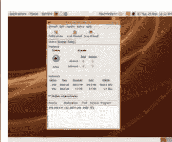

Linux 的设计将安全性置于系统的核心，这也是它在服务器上如此受欢迎的原因。

### 欢迎使用 Linux

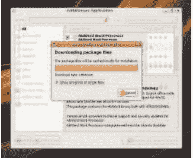

你可以通过“添加/删除应用程序”窗口在网上下载并安装新软件。

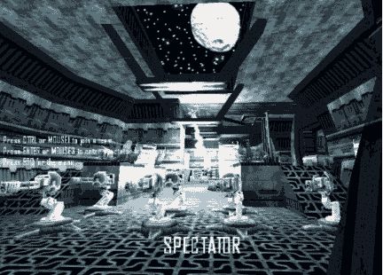

游戏！是的，Linux 不只是给严肃的人用的：当你想放松时，有很多事情可以做...

#### 4 Linux 默认是安全的

与 Windows 不同，在 Windows 上安装程序可能会导致“DLL 地狱”，而且你的五岁孩子只用资源管理器就能轻松删除重要的系统文件，Linux 从一开始就是为安全而设计的。因此，没有管理员密码的人无法安装软件。没有人可以删除不属于自己的文件。没有人只需上网冲浪就能在系统上传播间谍软件。事实上，除非你切换到管理员账户并发疯，否则破坏一台 Linux 机器是相当困难的！

#### 5 Linux 默认是智能的

如果你遇到停电，电脑意外关机，Linux 足够智能，可以自动恢复你的文件到你离开时的状态——在 Linux 上无需运行磁盘检查。同样，Linux 足够聪明，可以在你使用时重新排列硬盘上的文件，使文件碎片化成为过去。

Linux 的开放性也意味着任何人、任何地方都可以加入开发工作并帮助让事情变得更好，这意味着你会发现你的软件已被翻译成成百上千种不同的语言，其中大多数语言微软都不支持，仅仅因为在商业上不可行。

#### 6 Linux 正在成长

每年，越来越多的人意识到，当有免费程序与付费软件一样好（而且通常更好）时，付费软件毫无意义。这在大型公司中尤为明显，将 1,000 台电脑从 Windows 转换为 Linux 可以节省大量资金，但这对希望省钱购买新电脑的家庭用户也很重要，或者只是厌倦了微软软件。

#### 7 Linux 有适合每个人的东西

无论你是程序员、作家、设计师、为孩子寻找东西的家长，还是只是想充分利用电脑的人，你都会发现 Linux 有大量软件可供使用。忘记“共享软件”吧：如果你想做桌面排版，如果你想刻录 DVD，如果你想扫描病毒，如果你想修饰照片，如果你想将音乐刻录成 MP3，或者如果你想做其他任何事情，你会发现 Linux 已经准备好了一些很棒的软件可供尝试。不要害怕点击默认安装的各种程序——它们都是安全的，可以尝试，这也是找到感觉的好方法。

#### 8 Linux 看起来很棒

如果你认为 Vista 看起来很酷，Linux 即将让你大吃一惊。与 Windows 一样，你可以自定义桌面的外观和感觉——更改字体、颜色、屏幕保护程序等。但如果你有合适的硬件（而且不需要太多），你还可以启用真正的 3D 环境，将你的桌面放在

### 什么是 Linux？什么是发行版？

大多数人将“Linux”指的是整个计算桌面——文字处理器、游戏、MP3 播放器等等！但从技术上讲，“Linux”实际上只是系统的核心部分：它负责你的硬件，运行程序，但通常保持在后台。这被称为内核，因为它确实位于一切的核心。

现在，在 Linux 之上就是你将使用的几乎所有其他东西：OpenOffice.org、Firefox 等等。但请记住：自由软件的原则是任何人都可以获取一些编程代码，按需修改，并发布自己的版本。事实上，Linux 很少为特定需求只有一种程序。例如，OpenOffice.org 是一个很棒的办公套件，但你也可以使用 AbiWord、Gnumeric、KWord 或任何数量的其他类似产品。是的，它们都是免费的，所以你可以尝试它们并找到最适合解决你问题的那个。


这种能够精确选择运行内容的需要甚至延伸到“发行版”概念，通常缩写为“distro”。有数百种——也许甚至数千种——不同的 Linux 发行版，每一个都有其独特或不寻常之处。例如，Ubuntu 设计为非常易于使用；Fedora 设计给高级用户；Gentoo 设计给想要最大速度的人；等等。每一个都会附带不同的软件选择，因此当你选择发行版时，你通常会选择默认带有你想要的软件的那一个——当然，安装后你也可以随时更改软件选择！

请不要认为所有这些选择会导致 Linux 桌面非常碎片化，因为事实并非如此：它们都共享相同的 Linux 内核、相同的编程工具、相同的桌面选择和相同的文件系统结构。因此，你在一个发行版上学到的许多知识都适用于任何其他发行版，因为它们都建立在相同的共同基础上。

# 欢迎使用 Linux


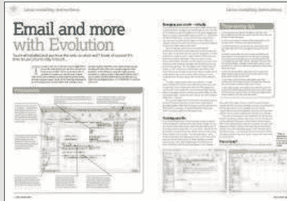

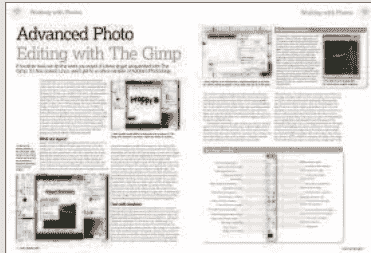

Evolution 是 Linux 的标准邮件和日历系统 - 翻到第 26 页学习如何使用它。

每个人有时都需要在电脑上处理数码照片，所以你最好使用最好的 - 第 50 页将带你开始使用 The Gimp。

cube – 窗口可以摇晃，你可以放大以更近距离查看事物，切换程序时会为每个窗口提供实时预览，等等。总之，它看起来绝对棒极了，并且与几乎所有现代显卡兼容

## 本刊内容

- 1 如何安装 Linux
- 2 如何找到方向
- 3 如何自定义系统设置以让一切变得如你所愿
- 4 如何找到常用程序，如网页浏览器、邮件客户端等
- 5 如何创建宣传册、电子表格和简单数据库
- 6 如何润饰你的照片并创作原创艺术作品
- 7 如何玩游戏并与朋友聊天

而且从第 110 页开始还有一个特别的故障排除部分，可以指导你解决 Linux 新手遇到的所有最常见问题。总之，这是一本致力于帮助你使用 Linux取得成功的杂志 - 我们撰写它是为了帮助你学习，帮助你避免问题，并帮助你从电脑中获得最大收益。

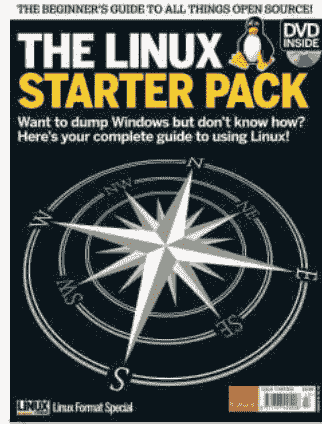

## 本刊不包含的内容

- 1 无聊的理论
- 2 无用的事实
- 3 极客术语

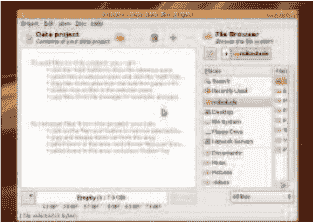

为什么要为 DVD 刻录机付费，当 Linux 免费赠送一个时？

通过购买本刊，你实际上已经完成了转向 Linux 时最困难的事情

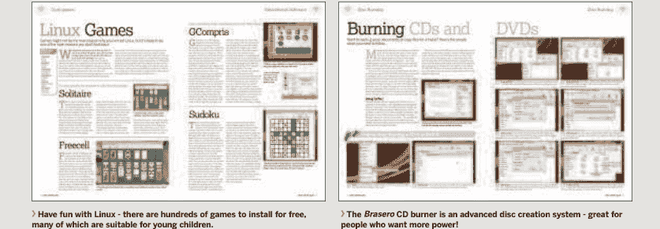

尽情享受 Linux 的乐趣 - 有数百款游戏可免费安装，其中许多适合幼儿。

Brasero CD 刻录机是一款先进的光盘创建系统 - 非常适合想要更多功能的人！

- 3 令人恐惧的编程
- 4 命令行噩梦

你看，所有这些东西都会让 Linux 的初学者感到困惑和迷失方向，所以我们希望远离它们。事实上，你几乎看不到任何关于 Linux 如此著名的命令行的提及，因为我们更感兴趣的是解释事物是什么，而不是解释你可以用它们做什么。

## 接下来的去处

这是我简短介绍的结尾，所以你的下一步是翻过这一页，深入 Linux，遵循我们的分步安装指南。如果你有更多问题，放松；我们会在你进行的过程中尽力回答。重要的是，在你手中已经拥有开始 - 并享受 - Linux 所需的一切。祝你愉快！

## 免费的哲学

Linux 是免费的，这已经足以说服很多人转换。但 Linux 在“自由”的意义上也是“免费”的 - 这就是为什么你可以查看其背后的计算机编程代码，修改它，甚至如果想卖就卖。我们称之为自由软件（注意那些大写字母！），许多 Linux 用户认为它甚至比 Linux 没有价格标签更重要。

## 历史部分

我坚信赋予人们做新事物的能力，而不是用历史压垮他们。毕竟，你不需要知道 Linux 从何而来就能从中获得最大收益！但对于好奇的人，这里有一点背景。

很久很久以前，在一个与我们自己的不太相似的星系里，大多数使用电脑的人都是极客。而且他们也没有自己的电脑 - 他们共用一台，称为“大型机”，因为当时电脑太昂贵、笨重且不可靠，根本不可能个人化。当时，主要的操作系统被称为 Unix，人们自由地传递源代码，因为他们甚至没有想到出售此类软件可能会成为大生意。

但迟早不可避免的事情发生了：一些西装革履的人出现了，决定“货币化”Unix。它分裂成各种不同的品牌（称为“分支”），因为它们都从主 Unix 路线分叉出来，彼此在功能和价格上竞争。不久，各不相同的 Unixes（Unices？Unixen？）在不同地方变得不兼容，整个软件社区变得支离破碎。

微软带着一个平台（Windows）来自一个供应商（微软）以一个价格（不便宜）的承诺，踏入了这场软件混战。支离破碎的 Unixes 从未真正有机会，因为每个供应商都试图以自己的方式与微软抗争，而不是团结起来。最终，Windows 占据主导地位，一切又平静下来。

Linux 起源于赫尔辛基一名大学生的业余项目 Linus Torvalds。它被设计为复制 Unix 的基本原理，但有一个特别的不同之处：它是在 GNU 通用公共许可证下授权的。这是一种特殊的软件许可证，规定：“如果你使用这个软件，你可以自由地重新分发它、更改它，如果你想卖就卖 - 只要你把更改交还给创建者。”因此，像 IBM、Intel、HP 和 SGI 这样的大型计算机公司能够围绕一个共同平台团结起来 - 它们可以在不必相互竞争的情况下向公共池贡献功能。

今天的 Linux 由来自世界各地的数千人共同开发，并正进入从手机到价值数十亿美元的服务器机房等一切事物中。Google、Amazon、Yahoo 和许多其他大型互联网公司每天都依赖 Linux，如果它能满足他们的计算需求，那么你的桌面就应该轻而易举！


Linus Torvalds，Linux 的创造者。真是个好家伙！

# Linux 安装说明

## 从这里开始

你的 Linux 之旅从这里开始：我们将向你展示如何将其安装到你的 PC 上并迈出第一步。

你距离在计算世界中的新旅程只差几分钟。你在拿起这本杂志之前可能已经听说过 Linux —— 而你可能也听过一些唱衰者称其难以使用。完全不是这样。Linux 只是一种与 Microsoft Windows 和 Mac OS X 不同的操作系统，有其自身的工作方式，并且有巨大的好处：

- 1. **Linux 是免费的** 你不需要为它支付任何费用，并且可以从互联网上免费下载各种版本（称为发行版）。你可以与朋友、家人和同事分享。
- 2. **Linux 是可靠的** Google 在数千台计算机上使用 Linux，这证明了其坚如磐石的基础。它不会随机崩溃，也不会因错误和故障而混乱。
- 3. **Linux 是安全的** 忘掉间谍软件、病毒和弹出广告吧 —— 你的 Linux PC 将免受黑客侵害。这也是它驱动全球数百万台服务器计算机的原因之一。

随本杂志附带的光盘包含 Ubuntu Linux 7.10，即最流行的 Linux 版本。让我们准备好安装它吧！

### 准备工作

很可能你的 PC 目前正在运行 Microsoft Windows。（如果不是，或者你愿意将整个 PC 完全用于 Linux，可以跳过这部分。）幸运的是，Linux 可以与 Windows 在你的机器上和谐共存，因此你可以在启动 PC 时选择要启动的操作系统。然而，在开始之前有一个至关重要的步骤：先备份你的数据！不太可能遇到任何问题，但谨慎总比后悔好！

### 系统要求

最低配置，你的 PC 需要：

- 800MHz Pentium 兼容 CPU
- 300MB 内存
- 10GB 硬盘空间

Linux 需要硬盘上的一些空间，因此如果你的硬盘目前已满（或接近满），你需要腾出一些空间。最低限度，我们建议为 Linux 提供 10GB —— 但越多越好，尤其是在你开始用它存储视频和音乐时。因此，如果你的硬盘几乎已满，请删除旧的应用程序和文件以释放至少 10GB 的空间。我们还建议运行 Windows 磁盘碎片整理工具，以确保你的硬盘井然有序。

### 分区


你的硬盘被分成称为分区的区域。如果你正在运行 Windows，它很可能位于一个单一的大分区中，占据整个硬盘。Linux 需要自己的驱动器块 —— 自己的分区 —— 来运行，安装程序会在这方面帮助我们。在安装时，你可以选择调整 Windows 分区的大小并为 Linux 腾出空间，或者让 Linux 占据整个硬盘。

你会在安装过程中看到这一点。第 6 步。如果你想保留 Windows，你可以拖动滑块来腾出空间，然后安装程序将在空闲空间中创建 Linux 分区。同样，最好为 Linux 提供至少 10GB 的可用空间。如果你的硬盘几乎已满，你将无法拖动滑块太远，因此请先在 Windows 中腾出空间！

好吧，这两件事都已解决，我们准备出发了。按照步骤进行，准备成为 Linux 用户吧！

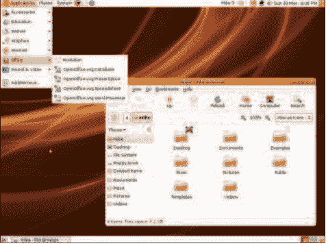

> Ubuntu Linux 安装简单 —— 只需遵循我们的分步指南，你很快就能开始使用 Linux 了。

### 启动有问题？

随本杂志提供的 DVD 是可启动的 —— 也就是说，你可以在光盘放入驱动器后启动 PC，Linux 将加载。别担心，它不会在你选择安装之前触碰你的硬盘，所以你可以自由地尝试 Linux。然而，如果你的 PC 没有启动 Linux 而是像往常一样启动 Windows，你将需要更改一些设置。

重新启动你的 PC，并在出现的第一个屏幕 BIOS 屏幕上，寻找一条提示你按哪个键进入“设置”或“BIOS”屏幕的消息。通常是 Del、Esc、F1 或 F2 —— 如果你看不到消息，可以尝试按它们。如果什么都没发生，请查阅你的 PC 手册。当你进入 BIOS 设置屏幕时，寻找更改“启动顺序”的选项，以便你可以指示你的 PC 从 DVD 驱动器而不是硬盘启动。然后保存设置并重新启动。

## Linux 安装说明

### 分步指南：安装 Ubuntu Linux

1 将随本杂志附带的 DVD 插入 DVD 驱动器，然后重新启动你的电脑。你应该会看到上图所示的屏幕。如果没有，请参阅对面页上的“启动问题？”框。

2 Linux 将启动，你会看到桌面。现在你可以试用随附的程序——它全部运行在 DVD 上。双击桌面上的“Install”即可开始安装过程

3 安装程序窗口将会出现。务必在每一步阅读文本！你可以通过左侧面板选择你的语言，然后点击 Forward 继续。

4 接下来你将被要求设置时区。点击世界地图上的相应区域进行放大，然后点击你最近城市的点。完成后，点击 Forward。

5 现在你可以选择键盘布局。左侧选择语言，右侧选择具体的布局。你可以在点击 Forward 之前在底部的框中测试你的选择。

6 接下来是硬盘分区——为 Linux 腾出空间。你可以使用整个硬盘，或调整现有的 Windows 分区大小并跳到第 8 步。如果你选择手动分区，请参阅第 7 步。

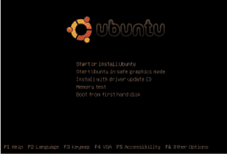
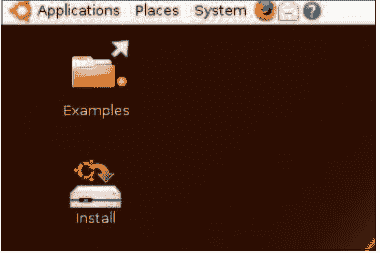
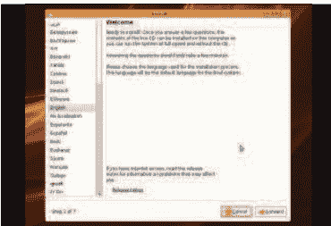
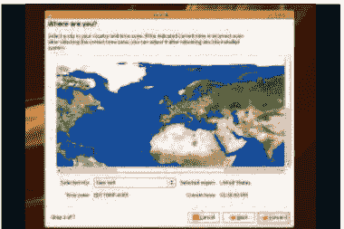
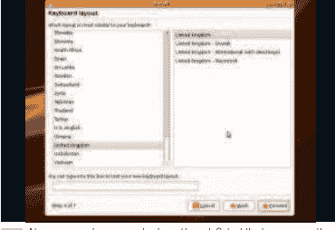
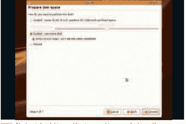
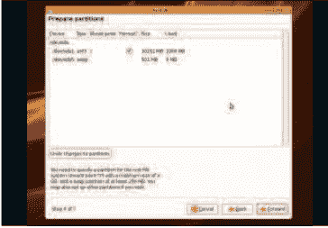

7 如果你选择手动分区硬盘，我们仅建议高级用户这样做，请创建一个至少 10GB 的根 ` / ` 分区，格式为 `ext3`，并创建一个约 512MB 的 `swap` 分区。

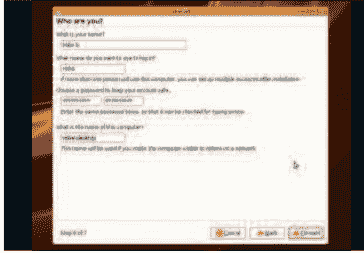

8 现在为 Linux 创建一个登录账户。输入你的全名，然后输入用户名和密码。不要忘记这些，因为你很快就会需要它们！完成后点击 Forward。

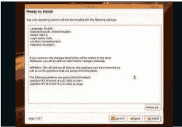

9 如果你在一个已安装 Windows 的电脑上安装，你将有机会将一些设置转移到 Linux。否则你会直接进入此屏幕——检查设置并点击 Install。

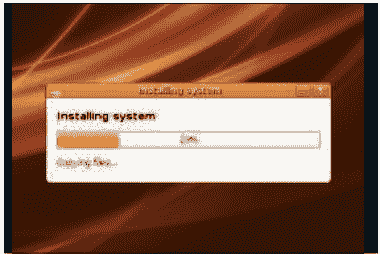

10 Ubuntu Linux 将被复制到你的硬盘。视机器速度而定，这可能需要 10 分钟到一个小时，所以在安装程序工作时先喝杯茶吧！

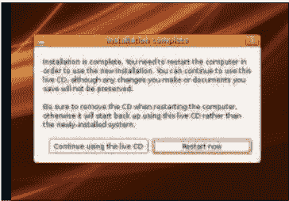

11 安装程序完成后，你会被提示重新启动。点击 Restart 按钮并弹出 DVD——否则你的电脑会再次从 DVD 启动。

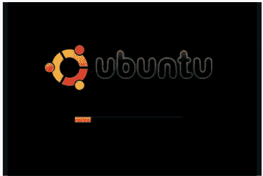

12 电脑重新启动后，Ubuntu 将加载或在你也安装了 Windows 的情况下提供启动 Windows 的选择。使用你在第 8 步提供的用户名和密码登录，然后开始探索！

12 | Linux 入门包

### 如何获取帮助

希望安装过程顺利进行，但如果没有，只要知道去哪里找，就有很多帮助可用。

如果一切顺利，到现在你应该正在探索 Linux 桌面，试用包含的程序并熟悉新环境。它非常直观——你可以点击左上角的 Applications 启动程序，点击 System 更改偏好设置和设置硬件，并点击右上角的红色按钮重新启动或关闭计算机。

如果你遇到问题，也不要惊慌。其中最常见的问题与显卡识别有关：操作系统尝试检测机器中的硬件，无法识别它，并让你停留在文本模式。如果你遇到这种情况，请重置你的电脑并从 Ubuntu Linux 启动菜单中选择第二个选项写着“safe graphics mode”的那个。现在操作系统将使用一个故障安全视频驱动程序——它不如正常驱动强大，但仍能让你运行起来。

- `具体说明` 信息越多越好，但要保持主题。只说“它无法启动”毫无意义——人们需要知道你看到什么错误信息，你尝试过什么，你的硬件是什么等。
- `考虑所有选项` 即使有人建议的修复方法听起来不寻常，也值得尝试。例如，有人可能会建议在启动前拔掉打印机，这实际上有助于 Linux 识别它时遇到问题。
- `要有耐心` 当事情不工作时令人沮丧，但请记住，这些论坛上的用户都是出于对 Linux 和社区的热爱在做这件事。他们没有被付费提供帮助，所以如果你没有立即得到回复或有人提问，不要发火。

## 获取帮助

如果你在安装过程中对任何事情不确定，或遇到不确定如何解决的问题，你可以在网上多个地方获得帮助。由于市场上存在数百万种 PC 硬件组合，不可能为任何操作系统提供确定的修复列表——因此你需要清楚地说明你的问题。

`www.ubuntuforums.org` 是互联网上最繁忙的 Linux 论坛之一，拥有超过 500,000 名用户在问题出现时互相帮助。这些论坛分为不同的板块：此时你应该在 Installation & Upgrades 板块发布你的信息。

Ubuntu 的论坛非常友好，你很可能会得到快速回复，但在发布任何内容之前，有几点需要注意：

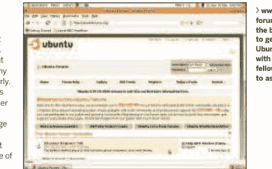

`www.ubuntu forums.org` 是获取 Ubuntu Linux 帮助的最佳场所，有成千上万的同行用户准备提供帮助。

### DVD 上的额外内容

正如你所见，随本杂志附带的 DVD 可以启动并安装 Ubuntu Linux，这非常适合你迈出使用 Linux 的第一步。我们还包含了一些额外内容，随着你对操作系统的熟悉程度提高，你可以利用它们。

其中第一个，位于 DVD 上的 Extras 文件夹中，是 Ubuntu Linux 7.10 的 64 位 ISO 镜像。你可以将它刻录到 CD-R 上，用于在 64 位机器上安装即具有 AMD64 或 Intel Core 2 处理器的 PC，如果想要一点性能提升。注意提升并不大，对于大多数用户，我们建议坚持使用从 DVD 启动的标准 32 位版本，它在 64 位 PC 上运行良好。此外，可启动版本包含 Inkscape 和 Scribus 等软件——在后面的教程中会介绍——否则你需要单独下载。

我们的第二个发行版称为 SuperUbuntu，也在 Extras 部分。这是一个特殊的 Ubuntu Linux 7.10 版本，包含大量额外软件，如 KDE 桌面和开发工具。对于你初次涉足 Linux 来说有点过头，但以后当你想在其他机器上安装 Linux 并最大限度减少下载量时，将其刻录到 DVD-R 并从中启动以进行安装。

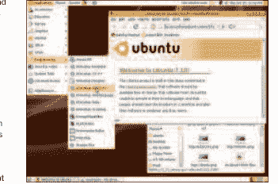


我们这个特别增强版的 Ubuntu，带有额外的程序和开发工具，当你更熟悉 Linux 并想更进一步时将会很有用。

### 欢迎使用你的 Linux 桌面！

Linux 起初看起来可能很可怕，仅仅是因为它与众不同。让我们四处看看...

你会注意到的第一件事就是你的新 Linux 桌面看起来几乎与从 CD 运行时的桌面完全相同。事实上，两者之间的唯一真正区别是，一旦 Ubuntu 安装完成，一切运行会快得多，因为你的硬盘比 DVD 驱动器快得多！
在 Linux 中找到感觉的最好方法就是直接使用鼠标随意点击。别担心——Linux 不会让你意外损坏系统。事实上，Linux 在执行任何可能危险的操作之前，都会先要求你重新输入密码作为安全措施。请使用下面的大注释来帮助你入门。

### 认识你的 Ubuntu 桌面

这些是 Firefox、Evolution 和系统帮助的快速启动菜单图标。请参阅第 18 页的指南以添加你自己的图标。
在右上角是系统托盘，各种有用的图标以及时钟都位于此处——如果你点击它，它会展开显示日历和任何即将发生的事件。
应用程序菜单存储了你已安装的所有程序的链接，并且会在你添加新程序时自动更新。
位置菜单和系统菜单帮助你导航和配置系统。对于某些任务，你会被要求输入密码，因为它们仅限管理员使用。
这是窗口列表面板，显示你打开的所有窗口。如果你在此处点击某个窗口，它将被带到显示的最前面。
这是 Nautilus，Ubuntu Linux 的文件浏览器。你可以在第 20 页了解更多关于 Nautilus 的信息。
此面板控制虚拟桌面，其功能类似于 Mac OS X Leopard 上的 Spaces。你的计算机可以拥有多个虚拟桌面，这意味着在一个桌面上运行的应用程序不会显示在其他桌面上。
这是回收站——将文件拖到这里即可删除它们，但如果改变主意，文件稍后仍可从回收站中恢复。

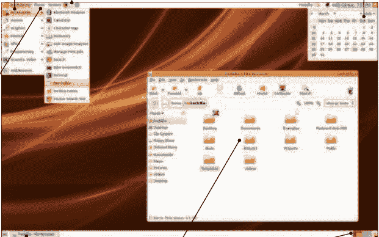

### Linux 桌面

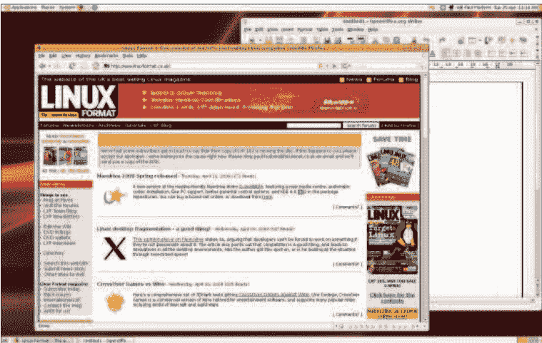

### 桌面上有什么？

与 Windows 和 OS X 一样，你的桌面只是文件系统上的一个目录，就像其他目录一样。默认情况下它开始时非常干净——如果 Ubuntu 安装光盘仍在你的驱动器中，你会在桌面上看到它已准备就绪。否则，你的桌面将完全干净。如果你和我们一样，你的干净桌面很快就会变得非常混乱，并最终被扫入一个名为“旧文件”的文件夹中，然后这个过程会重复，你最终会发现文件散落各处！
更好的解决方案是保持整洁，如果你看屏幕右下角，你会看到一个小垃圾箱，你可以将不再想要的文件拖到那里。这些文件尚未被删除，这意味着如果你改变主意，后续可以将其取回。当然，如果你磁盘空间特别紧张，你会希望立即删除它们——右键单击图标并选择“清空已删除项目文件夹”。
与 Ubuntu 安装光盘一样，插入计算机的任何其他媒体都将作为图标出现在你的桌面上——包括音频 CD、DVD 或带有照片的相机闪存卡。事实上，你可以直接将相机插入计算机并将图像导入相册——这比手工复制文件方便得多！

### 重启和关机

在深入了解其余桌面之前，了解如何关闭计算机非常重要——特别是如果你在火车上或晚饭已准备好！要查看各种选项，请从顶部菜单转到系统 > 退出，你会看到七个选项：
- » 注销 这会让你退出系统，但计算机保持开机状态。如果你家中有多个用户并且计算机一直开着，这就是你会使用的选项。
- » 锁定屏幕 这会让你保持登录状态，但阻止其他人在不先输入你的密码的情况下使用计算机。
- » 切换用户 这会让你保持登录状态，但允许另一用户同时登录其账户。完成后，他们可以注销，你可以重新登录到你的账户并继续进行。
- » 挂起 这就像计算机的睡眠模式。你正在进行的工作会被保存，计算机关闭大部分内部系统以节省电量——包括硬盘、屏幕、CPU、网络等。要退出挂起模式，请按键盘上的任意键。
- » 休眠 这就像计算机的深度睡眠模式，实际上会完全关闭它——如果你愿意，甚至可以拔掉电源线。当计算机休眠时，它会将所有 RAM 保存到硬盘中，这样下次启动时可以重新加载 RAM，就像什么都没发生过一样。
- » 重启 这会重新启动你的计算机。如果你运行了系统更新，可能需要这样做。
- » 关机 这是唯一真正以传统方式关闭计算机的选项！

## 外观与风格

使用计算机的乐趣之一就是让它按你想要的方式工作——无论是中性的大地色调还是刺眼的霓虹粉...
你对棕色有什么感觉？毫无疑问，你现在已经注意到 Ubuntu 发现的棕色色调比 Dulux 还多，从深巧克力色一直到奶油橙色，如果你喜欢这种风格，那么你会喜欢这种风格。说得有道理吗？嗯，是的，但别担心：如果棕色对你来说有点太沉闷，很容易就能改变——在改变的同时，我们还会向你展示如何改变各种其他东西，让 Linux 成为你的 Linux。

### 再见，棕色！

选择 系统 > 首选项 > 外观，一个新窗口就会出现，让你从一个地方自定义主题、背景、字体等。主题 选项卡是最好的开始位置，因为你的主题控制着很多东西——按钮、滚动条等（这些被称为“控件”）是如何绘制的，窗口和其他对象使用什么颜色，窗口是如何绘制的（包括着色以及用于最小化、最大化、关闭的按钮），以及文件系统上的文件夹和其他东西使用哪些图标。为你安装了多个主题包，选择其中任何一个都会一次性设置所有主题选项，使其搭配得很好。默认主题被称为 Human，但一个流行的替代品叫做 Clearlooks——点击它试试看。一旦你点击任何主题，它就会立即生效，所以如果你发现不喜欢它，只需点击返回 Human 即可恢复到原始设置。
如果你发现你喜欢一个主题的某些部分，另一个主题的某些部分，你需要点击 自定义 按钮。这让你以一个主题为基础，然后根据自己的喜好更改其各个部分。所以如果你喜欢 Human 的颜色但更喜欢 Clearlooks 的图标，只需从 Human 开始，点击 自定义，然后从可用图标类型列表中选择 Clearlooks 图标。我们认为你会同意，让 Linux 看起来完全是你想要的样子非常容易！

### 听起来不错

除了相当刺耳的默认登录和注销声音外，默认的 Linux 桌面是一件相当安静的事情——但它不必如此！你可以在 系统 > 首选项 > 声音 下的声音首选项窗口中，为消息框、按钮点击、菜单项等添加声音。在此对话框中另一个很酷的功能是 系统蜂鸣 选项卡，因为在这里你可以启用视觉系统蜂鸣。如果你在一个安静的环境中工作（或通常更喜欢关闭系统声音），视觉系统蜂鸣选项意味着如果它需要你的注意或如果你尝试做程序无法完成的事情，一个窗口就会闪烁。

### 背景和屏幕保护程序

如果你使用了非棕色的主题，你可能会发现 Ubuntu 默认的棕色壁纸突然开始严重冲突。幸运的是，更改桌面背景为更漂亮的东西再简单不过了。要做到这一点，要么右键单击桌面并选择 更改桌面背景，要么你可以转到 系统 > 首选项 > 外观，然后从出现的窗口中选择 背景 选项卡。
默认的桌面背景选择相当单薄，但这很容易解决——如果你从互联网或相机下载另一张图片，你可以通过直接拖放到窗口上来将其添加到列表中。或者，如果你有一个包含想要选择的整目录的图片，点击 添加 按钮。屏幕保护程序比桌面背景多得多，但它们位于不同的窗口——在 系统 > 首选项 > 屏幕保护程序 下查找。在这里你可以更改将使用的屏幕保护程序，系统等待多久后激活它，以及屏幕保护程序激活后是否应锁定屏幕。最后一个选项特别有用，因为它意味着你可以离开办公桌，系统会在屏幕保护程序激活后立即锁定——任何返回的人都必须输入密码才能解锁计算机。
除了主题、背景和屏幕保护程序之外，你还可以启用 Ubuntu 的视觉效果系统，获得一些非常酷炫的图形——有关更多信息，请参阅第 68 页。

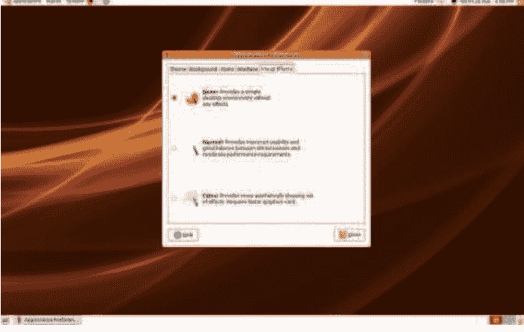

### Linux 桌面

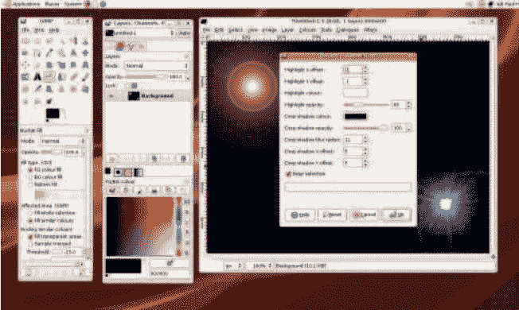

如果你是一个真正的调整爱好者，设置自己的键盘快捷键的承诺很难抗拒——而 Linux 在这里不会让你失望！例如，如果你有一台笔记本电脑或带快捷键的特殊键盘，你可以告诉 Linux 当音量键被按下时，或播放/暂停/停止时发生什么。还有许多其他预定义的基本操作，例如 注销（Ctrl+Alt+L）和 显示桌面（Ctrl+Alt+D），以及许多默认情况下没有分配键的更多操作。

### 调整你的按键

要开始自定义你的按键，请转到 系统 > 首选项 > 键盘快捷键。你可以通过点击它然后按你想要使用的键来更改任何快捷键。如果你想使用字母或数字（即 A–Z 或 0–9），你需要先按住修饰键。也就是说，如果你想让 Ctrl+Shift+M 启动媒体播放器，你不能先按 M，然后按 Shift，然后按 Control——你需要同时按住 Control 和 Shift，然后在按住另外两个键的同时按 M。请记住，已经为你分配了相当多的键组合：如果尝试对不同的快捷方式使用相同的键，旧的快捷方式将停止工作！

### 让你的键盘工作


如果你发现按“@”时出现的是“£”，Linux 可能认为你使用的是与实际不同的键盘。这很容易解决，同时你还能获得大量新的可玩选项。要更改键盘设置，请转到 系统 > 首选项 > 键盘。你可以在 布局 选项卡下更改键盘类型，但这通常用于重大更改，例如国家或样式（例如 Qwerty 或 Dvorak）——较小的更改，例如让欧元键正确工作，则在 布局选项 选项卡下进行。

键盘首选项窗口中的最后一个选项卡对于打字时手腕疼痛的人来说非常棒，因为它可以在你设定的间隔强制打字休息。默认设置是允许你工作 60 分钟然后休息三分钟——除非你有非常严重的 RSI，否则这应该没问题。在这种情况下，你可以根据需要缩短工作时间。确保启用“允许推迟休息”选项，否则你可能会在关键时刻被切断计算机访问权限！

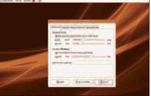

你可以更改重复率，选择新的键盘布局，甚至强制打字休息——键盘首选项窗口应有尽有。

### 管理你的程序

如果你之前抓住机会到处点击过，就会发现有大量应用可以试用。最好把它们排列得整整齐齐……

你的 Linux 桌面分为三个部分：主菜单位于顶部，任务栏（通常称为面板）位于底部，而你运行的所有程序都介于两者之间。任务栏非常简单：它只是跟踪你正在运行的程序，以便你可以在它们之间切换，同时还提供垃圾桶图标，方便你删除文件。当然，中间那块用来放置你自己程序的空白区域也很好理解，因为那里放什么由你决定！不过，菜单栏要稍微复杂一些，因为它本身又分成几个子部分。

### 查找你的应用程序

菜单栏上最重要的入口是“应用程序”（Applications），因为它存储了所有已安装程序的链接，以及添加更多程序的选项。当你点击它时，你会注意到 Linux 是根据程序的功能来分类的，而不是像 Windows 那样按照开发商来分类。默认类别可能是：附件、游戏、图形、互联网、办公以及影音——每个类别下都会包含几个你可以运行的程序。随着你安装更多程序，它们会被自动放入相应的类别，如果需要，还会创建新的类别，例如“教育”和“编程”。

如果这种默认菜单布局不适合你，请右键单击“应用程序”菜单并选择“编辑菜单”。在这个窗口中，你会看到左侧是菜单列表，右侧是程序列表。要显示或隐藏某个程序，只需在相应菜单中取消选中它即可。你也可以通过单击“新建项”按钮，然后为其指定名称和要运行的命令，来添加一个未列出程序的链接。要更改新项的图标，请单击“类型”字段左侧的图片按钮。

如果你想编辑或删除现有项，需要右键单击它并选择相应的选项。但要注意：一旦删除，找回菜单项的唯一方法就是单击编辑窗口底部的“还原”按钮，而这会撤销你所有的更改！

### 四处浏览

与“应用程序”菜单相邻的是“位置”（Places）菜单，其中包含一系列指向计算机常用目录、网络连接、文件搜索以及最近打开文档列表的快捷方式。与桌面一样，任何插入计算机的可移动媒体都会列在这里以便快速访问，但任何活动的网络连接也会显示在这里。

说到连接，你可以通过选择“位置”>“连接到服务器”来连接到另一台计算机。无论你想使用 Windows 网络、FTP、WebDAV 还是超级安全的 SSH，“连接到服务器”对话框都能搞定。你需要提供服务器的地址（例如 www.example.com 或类似 192.168.0.1 的 IP 地址），如果连接是安全的，可能还需要提供用户名和密码，但除此之外，这非常容易。

### 扩展面板

屏幕右上角是“面板”（Panel），默认包含一个快速注销按钮、一个时钟和其他有用的小工具。面板左侧你会看到你的用户名；那是快速用户切换系统——如果你有多个用户，可以点击那里，它就会立即登录该用户。

但如果你在该用户名左侧附近右键单击，会出现一个菜单，其第一项是“添加到面板”（Add To Panel）。在这里，你可以将各种奇妙有趣的东西添加到面板中，例如：

- 通讯录搜索 需要经常查找联系人？不必打开专门的程序，因为这项功能让你可以直接从桌面搜索某人！

- 鱼 在面板中放置一条动画鱼。好像这还不够棒(!)，你可以点击这条鱼来获取一些睿智的建议和偶尔的随机笑话：“路中央的死狗和路中央的死律师有什么区别？狗前面有刹车痕！”)。

- 眼睛 那些偶尔会在屏幕上找不到鼠标的人再也不必担心了：这双眼睛会跟随你的每一个动作！

- 天气预报 它会为你所在的大致区域下载最新的天气预报。为了让其更加……

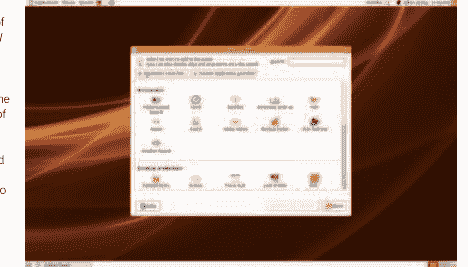

在面板的空闲区域右键单击，然后选择“添加到面板”——这里有很多东西可以尝试，但不要太过分！

### Tomboy 与你

最酷的面板应用之一叫做 Tomboy——它就像拥有自己的个人维基，因为你可以将任何文本创建为链接，而这些链接又会变成你自己的便签供你书写。Tomboy 还支持基本的格式、电子邮件、图片和其他富媒体——不妨试试看！

精确，右键单击图标，选择首选项，然后转到位置选项卡并找到离你最近的城市。

你还会发现其中有很多小实用工具，对笔记本电脑用户特别有帮助，包括电池电量监视器、音量控制、屏幕亮度和更多。这些小面板应用很棒，因为它们几乎总是只解决一个任务，而且解决得非常好，在你不使用它们时几乎不占用屏幕空间。

### 应用启动器

在“添加到面板”窗口顶部有两个特别有用的按钮：应用程序启动器和自定义应用程序启动器。Ubuntu 默认会为你创建三个应用程序启动器——它们位于系统菜单旁边，并链接到 Firefox、Evolution 和系统帮助。你可以使用这两个特殊的面板项创建更多——应用程序启动器选项会为已存在于你的应用程序菜单中的程序创建快捷方式，而自定义应用程序启动器则允许你为系统中的任何内容创建快捷方式。

以 Gimp 图像编辑应用为例：

- 右键单击面板并选择添加到面板。

- 当“添加到面板”窗口出现时，单击应用程序启动器。

- 你会看到可用程序的列表。打开图形类别。

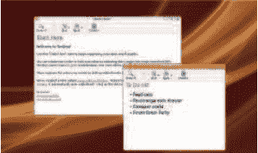

> Tomboy 让你可以使用文本和图片写笔记，然后像拥有自己的维基一样将它们链接起来！

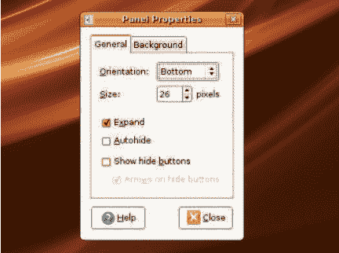

> 通过调整其属性，你可以强制面板自动隐藏，将其定向到屏幕的不同边缘，或为其背景使用图像。

现在选择 Gimp 图像编辑器并单击添加。

如果你愿意，你实际上可以把整个子菜单作为启动器添加——只需选择你想要的类别然后单击添加。当你单击该启动器时，该类别中的程序列表会显示出来供你选择。

### 任务面板

到目前为止我们只看了顶部面板，但底部面板的工作方式基本相同——你可以在那里添加任何你想要的内容，甚至可以将两个面板合并在一起，如果你迫切需要节省空间的话！

默认情况下，底部面板包含三件事：显示桌面图标、窗口列表和已删除文件的回收站。窗口列表实际上更像是一个存放区域，而不是面板上的特定事物，因为窗口会在打开时自动添加到其中。如同在 Microsoft Windows 中一样，你可以单击窗口列表中的一个窗口将其带到前台。

如果你是那种不惜一切代价也要节省空间的人，你应该右键单击底部面板（或你创建的任何面板），并选择属性。这会弹出上面显示的面板属性窗口，其中有几个很酷的选项：

- Orientation 这设置为底部用于任务面板，但你可以让它粘在屏幕的四个边缘中的任何一个。

- Size 面板的高度。如果增加此值，大多数内容都会整齐缩放，因此请随意将其调整到你需要的大小。

- Expand 这会导致面板拉伸以适应屏幕大小，即使没有任何内容填充它。关闭它可以节省大量屏幕空间。

- Autohide 打开此选项后，面板在你不使用时会自动躲到屏幕外。

- Show/Hide Buttons 这允许你在不需要时通过单击隐藏按钮方向之一将面板移出屏幕。

- Background 默认背景是纯灰色，但如果你愿意，也可以选择透明颜色甚至背景图像！

### Linux 桌面

### 你的文件系统

准备深入探索你的新 Linux 系统的核心了吗？Nautilus 文件管理器来帮忙！

Nautilus 是 Linux 上相当于 Windows 上的资源管理器或 Mac OS X 上的 Finder 的工具——它让你浏览文件系统、创建新文件和目录，并处理所有文件。在开始之前，你首先需要了解 Linux 文件系统是如何布局的：

- 文件系统的根目录（相当于 Windows 上的`C:\`）称为`/`。所有文件、文件夹和设备都从这个`/`开始。

- 普通用户程序位于`/bin`和`/usr/bin`。

- 管理员程序位于`/sbin`和`/usr/sbin`。

- 软件设置存放在`/etc`。

- 日志文件存储在`/var/log`。

- 系统设备以文件形式表示在`/dev`中（你通常可以忽略这些！）。

- 用户主目录位于`/home`。

- 你的桌面实际上是主目录的一个子目录。例如`/home/bob/Desktop`。

- 大多数用户只能向其主目录写入文件——这正是 Linux 如此安全的原因！


你的主目录是最好的开始位置，因为你会在那里存储文件，而在 Nautilus 中打开它的最简单方法是使用 Places 菜单。Places 菜单中的每个快捷方式都会在 Nautilus 中启动，因此点击第一个：Home Folder。

### 在其中导航

默认的 Nautilus 窗口分为三个部分：顶部是菜单和工具栏；左侧是任务窗格，其余窗口用于显示当前位置的文件和文件夹列表。你可能不会太多使用菜单栏，因此请专注于两个工具栏：其中一个包含 Back、Forward、Up、Stop 和 Refresh 按钮，就像网络浏览器一样——它们的工作方式也与网络浏览器相同，这意味着你可以使用仅这些按钮在最常用的文件夹之间导航。Home 和 Computer 工具栏按钮是快速链接，前者会带你回到当前位置，后者会带你到类似 Windows“我的电脑”的位置，从那里你可以导航到硬盘或连接到计算机的任何设备。

### 认识 Nautilus 文件浏览器

这些按钮的工作方式与它们继承的网络浏览器完全相同——使用 Back 和 Forward 在先前的目录之间导航，使用 Up 返回父目录。

此位置栏提供从当前位置到文件系统根目录的小“面包屑”——点击任意按钮即可移动到该目录。

这些按钮调整放大级别——更高的缩放意味着将显示有关文件的更多详细信息。

点击此按钮可将路径以可编辑文本形式显示出来，便于修改。

这是任务窗格，目前设置为 Places 视图，以便轻松导航到文件系统上最重要的位置。

当前目录下的所有文件和文件夹都将在这里显示，并在窗口左下角显示一些摘要信息。

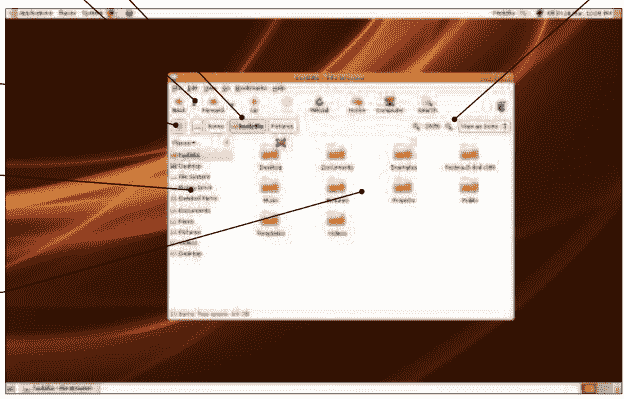

### Linux 桌面

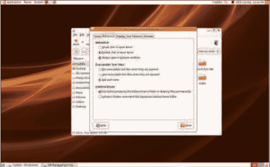

### 禁用文件预览

Nautilus 的一个常见批评是它速度不快，这确实如此——但只是因为它在幕后提供了大量功能！例如，每当你在 Nautilus 中打开一个目录时，它会扫描所有目录并计算它们包含的文件数量，然后扫描所有文件以生成图标预览。如果例如一个文件是图片，Nautilus 会为该图片生成缩略图作为图标，以便你确切地看到它是什么。所有这些工作会消耗大量 CPU 时间，因此如果你想简化 Nautilus，请转到 `Edit > Preferences > Preview`，然后将所有“Local Files Only”选项更改为“Never”。

不喜欢 Nautilus 的工作方式？改到你满意为止！

第二个工具栏更有趣一些，因为它包含位置栏和查看选项。位置栏默认大部分被隐藏——事实上，你可能只会看到一个铅笔和纸图标、一个带有“左”箭头的按钮，以及另一个带有你用户名的按钮。此位置栏旨在使浏览到当前目录之上的目录变得容易，因为随着你的移动，所有目录都会在那里列出。

开始时，点击左向箭头按钮以显示所有父目录：第一个将是硬盘图片（象征根目录），第二个将是“home”（所有用户目录所在的位置），最后一个将保持为你的用户名，以显示你当前正在查看主目录。如果你想以真实路径的形式查看位置栏，请按 `Ctrl+L`——按钮将消失并被 `/home/yourusername` 替换。然后你可以直接在其中输入以更改目录。或者如果你特别懒惰，只需输入 `/` 即可调出该路径信息，允许你输入完整路径。

位置栏右侧有按钮可调整缩放级别（如果你屏幕较小或喜欢图标大一些时非常有用）以及一个下拉选择框，可更改文件的显示方式。默认是“View As Icons”，但你可以将其更改为“View As List”以获得文件树视图，显示大小信息等更多内容。

### 前往各地

Nautilus 窗口左侧是任务窗格，默认设置为显示最受欢迎的位置。这就像 Places 菜单一样，但如果你仔细观察，你会在窗格顶部的“Places”一词旁边看到一个小箭头——如果你点击它，你会看到可以更改该区域显示的内容，因此它比仅仅重复 Places 菜单更有用！

- Information 显示所选项目的相关信息。
- Tree 显示计算机的目录结构，类似于 Windows 资源管理器：
- History 记住你最近访问过的目录，以便快速返回。
- Notes 允许你为特定目录关联文本。
- Emblems 显示可附加到文件和文件夹的图标列表，以便在视觉上将其标记为私有、重要等

我们认为你会发现徽章系统特别有用，因为你可以将图标拖放到任何需要的地方，以便一目了然地了解每个文件夹的作用。

### 按你的口味调整

Nautilus 默认设计为快速简洁，但如果你想获得更多功能，它非常适合自定义。要亲自查看，请转到 `Edit > Preferences` 菜单——其中特别相关的是第二和第三个选项卡（Behaviour 和 Display），因为这些会影响 Nautilus 的核心部分。

例如，Behaviour 选项卡至少有三个有趣的项目：

- Double Click To Open Items 这是默认设置，但如果你讨厌双击所有内容，只需将其设置为单击模式。
- Always Open In Browser Windows 你习惯的 Nautilus 视图（菜单栏、两个工具栏和位置栏）被称为浏览器视图，因为有上、后退和前进按钮。禁用此选项将为你提供更精简、更不杂乱的 Nautilus 视图——试试看，看看你怎么想！
- Include A Delete Command 默认情况下，删除的项目会进入回收站，可以稍后恢复，但启用此选项意味着你可以强制立即永久删除项目，如果文档是机密的，这是一个明智之举。

在 Display 选项卡中，你可以选择显示有关文件的哪些信息。默认情况下，Nautilus 只会显示文件大小，并且只有在放大足够多时才会显示，但使用这些选项，你可以让它显示文件类型、修改日期、所有者、权限等！TIP

### 浏览网页

### 上网吧！

比任何其他网络浏览器都更快、功能更强、更安全——立即开始使用 Firefox！

很多人把万维网视为理所当然，但很多人还没试过 Firefox——这是一个相对年轻的项目，旨在革新我们使用互联网的方式，并且已经吸引了数百万用户。Firefox 的成功可以归因于很多因素：

- 1. 它对网络标准支持非常好——比 Internet Explorer 例如要好得多。
- 2. 它为强大的安全性而构建，因此问题并不常见，而重大问题（即可以远程利用的问题）更是极其罕见。
- 3. 它自带大量强大的功能，包括标签页浏览、集成搜索框，甚至还有搜索预测。
- 4. 它拥有强大的附加组件系统，可以构建一些令人印象深刻的额外功能。
- 5. 它在设计时以易用性为出发点，这意味着初次使用者很容易上手。

当然，Firefox 很可能因所有这些原因以及更多原因而受欢迎，但虽然你很容易自己掌握基础知识，但只要花几分钟学习，你就能从世界上最受欢迎的网络浏览器中获得更多体验…


`Ctrl+-` 减小字体大小。

`Ctrl+0` 将字体大小恢复为默认值。

`Ctrl+Enter` 在 URL 前添加 ‘www.’ 和 ‘.com’，因此输入 ‘intel’ 然后按 `Ctrl+Enter` 将加载页面 www.intel.com。

`Alt+Left` 转到你之前查看的页面（相当于 ‘后退’ 按钮）。

`Alt+Right` 转到历史记录中的下一页（相当于 ‘前进’ 按钮）。

`Alt+Home` 转到你的主页。

`Alt+Enter` 在新标签页中打开一个 URL（在输入 URL 时使用它而不是按 Enter）。

其中，`Ctrl+L`、`Ctrl+K` 和 `Ctrl+T` 绝对是最有用的，所以试试它们，看它们如何加快你的浏览速度！

另一个小快捷键是 `/` 键，它启用快速查找模式。例如，如果你输入 `/hello`，Firefox 将在当前页面上找到单词 ‘hello’ 的第一个实例。如果你专门查找链接文本，试试使用 `*`，例如 ‘*hello’——它将找到第一个文本为 ‘hello’ 的链接。

Firefox 在核心上是一个简单快速的网络浏览器，但那些想要更多功能的人可以在 Firefox 的附加组件中探索很多内容——见第24页。

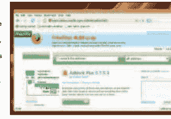

## 键盘快捷键

网络上有大量内容可读，任何认真的网络用户都希望充分利用上网时间。因此，这里有一些巧妙的小键盘快捷键，可以帮助你简化 Firefox 体验：

- Shortcut
- `Ctrl+H` 打开历史记录侧边栏。
- `Ctrl+J` 打开下载管理器，以便查看下载进度。
- `Ctrl+K` 聚焦搜索框，以便输入查询。
- `Ctrl+L` 聚焦地址栏，以便输入 URL。
- `Ctrl+R` 重新加载当前页面。
- `Ctrl+T` 打开新标签页。
- `Ctrl+Z` 从上一个标签页复制 URL（在你刚按 `Ctrl+T` 打开新标签页时使用）。
- `Ctrl++` 增加字体大小。

### 搜索开始


Firefox 在其用户界面的右上角有一个搜索框，这意味着你可以非常轻松地访问你喜欢的搜索引擎。默认情况下，Google 被用作搜索引擎，但你可以通过点击搜索框旁边的 G 按钮非常轻松地更改它——Firefox 将列出替代搜索提供商，包括 Amazon、eBay、Creative Commons、Yahoo 甚至 Microsoft Live Search。如果你特别想要其中一个提供商，请随意选择它们，但使用 Google 有一个很大的优势：搜索建议。

有时候搜索东西会令人沮丧——你只有模糊的想法，不知道在找什么，需要多次尝试才能找对，有时根本找不到。好吧，当 Firefox 使用 Google 作为搜索引擎时，它可以在你输入时帮助建议搜索词，基于其他人搜索过的内容。你只需确保通过右键单击搜索框并确保选择了 ‘显示建议’ 来启用建议，然后只需在搜索框中输入几个字母，等待一两微秒，你的建议就会出现。如果其中一个建议与你想要的相符，只需使用上、下键选择它，然后按 Enter。

## 书签栏

由于网络如此庞大，书签（或在 Internet Explorer 用语中称为 ‘收藏夹’）自其诞生以来就一直存在。但与其他浏览器只提供书签菜单不同，Firefox 还提供了一个工具栏，以便你可以

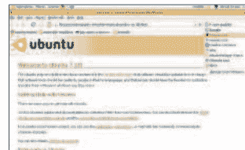

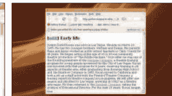

有时候 Google 并不是某个搜索的最佳结果来源，因此可以尝试将搜索提供商更改为更合适的选项。

当 Firefox 发现网站试图打开奇怪的窗口（左）或冒充其他网站（右）时，就会立即采取行动。

一键直达你的收藏夹。你甚至可以在工具栏的空白处右键单击，然后一次性打开所有书签——这绝对是早上快速上手的最快方式！

要开始使用，只需访问你想要书签的任何页面，然后查看 URL 左侧——你会在那里看到一个小图标。许多网站在那里使用自定义标志，但如果你的网站没有选择一个，那么你会在 URL 旁边看到一张空白的纸。现在，点击该图标，并将其拖到书签工具栏上——就是那个上面写着“Getting Started”的工具栏。松开鼠标后，工具栏上会出现一个新按钮，使用网页的标题。这可能不太理想，因为网页的标题很少足够短以适应按钮，而且通常甚至不说明网站是什么！要修复这个问题，右键单击你的新书签按钮并选择属性，在名称字段中输入更具描述性的文本，然后单击确定保存更改。

Firefox 借助其 Live Bookmarks 系统进一步推动了书签理念，这是一种 RSS 订阅源和书签的混合体——你可以将它们放入书签工具栏，它们会显示为可点击以显示更多信息的菜单。但 Live Bookmarks 的神奇之处在于，“更多信息”部分是一个来自你想要的任何来源的 RSS 订阅源，点击任何标题都会在浏览器中加载完整故事。要试用此功能，首先找到一个你感兴趣的 RSS 订阅源。如果你以前从未尝试过 RSS，请前往 `http://news.bbc.co.uk`，然后向下查看左侧菜单栏，直到看到“News Feeds”。页面加载后，你会在右侧看到一份很长的可用新闻订阅源列表——选择其中任何一个，另一个页面将会加载，该页面看起来与正常的 BBC 新闻主页大不相同。在顶部，你会看到一条写着“Subscribe To This Feed Using”的消息，以及一个选择框，其中“Live Bookmarks”是默认选项。点击“Subscribe Now”，系统会询问你想要在哪里创建书签。保留默认选择并点击确定，就完成了！

## 浏览网页

## 阻止恶意软件

Firefox 做得非常出色的一件事就是保护你免受网络威胁——侵略性广告、伪装成你信任的网站的“钓鱼”网站，以及存储你不想要的关于你的信息的 cookie。

就广告而言，以前访问某些网站时被广告淹没是常见做法。更糟的是，这些广告通常是“弹出”样式，这意味着它们会出现在你正在尝试操作的上方。有些甚至是“弹出下方”，这意味着它们会出现在浏览器下方，你只有在完成操作后才会看到它们。这些不受欢迎的网络干扰曾困扰着网络，但 Firefox 抢先一步开始阻止它们和其他类似的侵略性广告。事实上，Firefox 的阻止系统功能如此强大，以至于偶尔可能会阻止你想要的窗口，因此默认情况下 Firefox 会在阻止弹出窗口时通知你，以便你可以选择显示它。当这种情况发生时，页面顶部会出现一个小黄条，通知你该网站的操作已被阻止——点击右上角的 Preferences 按钮会提供“Allow popups for this site”选项，让你可以选择性地信任网站。

## 隐藏配置选项

你是否喜欢摆弄东西只是为了看看会发生什么？如果是这样，Firefox 凭借其特殊的 `about:config` 配置屏幕将为你提供数小时的调整时间。Firefox 的所有主要面向用户的选项都可以通过首选项对话框更改，但如果你在位置栏中输入 `about:config`，你会看到一个庞大的 Firefox 选项列表，其中许多选项无法在首选项对话框中设置，因为大多数人并不关心它们。例如，HTTP 流水线是一种可以显著提升网页下载速度的技术，但传统上许多网络浏览器将其保持禁用状态，因为极少数网络服务器存在问题——而且“极少数”意味着“我们可以几乎保证你永远找不到一个”。使用 `about:config`，你可以启用 HTTP 流水线并享受免费的速度提升！

事实上，有很多这样的设置你可能想要更改：

| 设置 | 设置为 | 其作用 |
|---|---|---|
| `browser.startup.page` | `3` | 当你打开 Firefox 时，它会从你上次离开的地方继续 |
| `browser.tabs.tabMinWidth` | `75` | 允许 Firefox 在你打开大量标签页时使标签页变小，而不是让你滚动寻找它们。 |
| `browser.urlbar.autoFill` | `true` | 强制 Firefox 在你输入时从历史记录中自动补全 URL，而不是必须按向下键选择一个。 |
| `browser.urlbar.hideGoButton` | `true` | 隐藏位置栏末端的绿色箭头——说实话，没人用它！ |
| `layout.spellcheckDefault` | `2` | 强制 Firefox 对单行文本框以及多行文本框中的文本进行拼写检查。 |
| `network.http.max-persistent-connections-per-server` | `4` | 允许你的客户端多次连接到同一服务器以获得最大性能。 |
| `network.http.pipelining` | `true` | 启用通过一个 HTTP 连接发送多个文件。 |

## 在网页上浏览

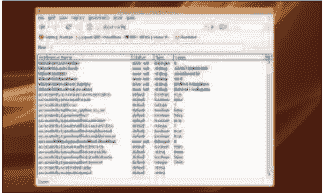

`about:config`屏幕充满了可更改的选项，因此在过滤框中输入一些内容以稍微精简列表！

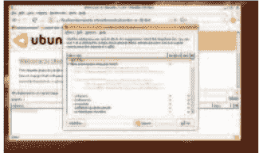

AdBlock Plus 让你可以自行构建广告商过滤器，或订阅他人的过滤器（这样更简单）。

## 附加组件

毫无疑问，附加组件是 Firefox 最令人印象深刻的地方，因为它从核心上被设计为开放的——人们创建的附加组件可以修改浏览器的任何部分，而且其中有一些功能非常强大的。

为了帮助你入门，这里是我们整理的最佳附加组件列表。但请注意：你应该只从 Firefox 主页安装这些附加组件，因为附加组件可以修改 Firefox，如果你不从可信来源获取，就有可能安装恶意附加组件。Firefox 对此非常重视，因此如果你尝试从不可信来源安装附加组件，预期会再次收到警告！

要安装附加组件，请前往 工具 > 附加组件，然后选择 获取扩展。注意，“获取 Ubuntu 附加组件”链接非常相似，但提供的附加组件选择要少得多，因为它只允许你安装 Ubuntu 支持的附加组件，而不是 Firefox 用户可用的所有内容。当你在 Firefox 附加组件网站上时，你可以通过名称搜索附加组件，然后点击 添加到 Firefox 按钮来安装你感兴趣的附加组件。在附加组件安装之前，会要求你确认是否想要它——只需点击 立即安装，然后在安装完成后重新启动 Firefox，以便附加组件可以初始化。

点击 “freenode” 链接以连接到该服务器网络，然后在连接完成后输入 `/join #ubuntu` 加入官方 Ubuntu 支持频道。祝聊天愉快！

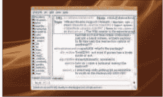

IRC 里充满了可以交谈的人，但请确保你保持身份私密——并非每个人都值得信任。

## ForecastFox


英国人对天气有一种天生的痴迷，这很奇怪，真的，考虑到我们拥有的天气实在很少。所以如果你感觉需要检查明天我们将会有多少降雨，`ForecastFox` 就是为你准备的：告诉它你住在哪里，它就会告诉你你所在地区的最新天气预报。首次安装时它会显示你位于 `Forecast Location 00000`——忽略它，点击 `Find Code`。当位置搜索对话框出现时，输入你的城镇或城市名称并点击 `搜索`，然后从出现的列表中选择最佳匹配并点击 `确定` 然后 `应用`——你的天气预报现在将出现在 Firefox 窗口底部，并会自动更新。魔法！

`Firefox` 的状态栏没什么作用，所以用 `ForecastFox` 让它物尽其用——永远不会再被天气捉弄！

### AdBlock Plus

`AdBlock Plus` 设计用于屏蔽太阳底下所有的广告，让网络成为一个仅含内容的地方，它既是福音也是诅咒。它是福音，因为——让我们面对现实吧——有些广告实在令人恼火，有闪烁的颜色、愚蠢的动画，甚至更糟。但它也是诅咒，因为绝大多数网站都是通过广告资助的，所以如果每个人都屏蔽所有广告，那么它们就会彻底消失。当你安装 `ABP` 时，会提示你选择一组广告商过滤器——要么选择离你最近的那个，要么如果你不确定就选择列表中的第一项，然后点击 `订阅`。就这样：你已安全远离广告，可以继续浏览网页——现在带宽浪费更少了。

### ChatZilla

在网络之前，有 `Internet Relay Chat`——一个交互式文本系统，人们基于共同兴趣加入频道，并讨论/争论/火焰整晚。尽管网络被发明并最终崛起至至高无上，`IRC` 仍然存活，`ChatZilla` 是一个出色的扩展，它直接在你的网络浏览器中构建了 `IRC` 支持。安装后，通过前往 `工具 > ChatZilla` 启动 `ChatZilla`。加载时，会出现一些文字说 “可用网络为 [dalnet, efnet..... webnet]”。点击


### 在网页上浏览


`FoxyTunes`：从 `last.fm` 流式传输音乐，这样你就可以让别人来当 DJ，而你忙着冲浪网页。

#### FoxyTunes

为音乐单独运行一个程序已经是 2004 年的事了——所有酷孩子都在使用 `last.fm`，因此 Firefox 自然也有一个用于连接 `last.fm` 并播放音乐的扩展：它叫做 `FoxyTunes`。当然，如果 `last.fm` 不是你的菜，那么 `FoxyTunes` 可以连接到各种传统媒体播放器或其他在线服务，甚至如果你的话，还可以从 Xbox 流式传输音乐。

#### Greasemonkey

你是否曾经访问过一个网页，本来很优秀，却被一两个小毛病拖累，实际上让你望而却步？如果是这样，`Greasemonkey` 就是适合你的完美扩展，因为它允许你运行一些小脚本来按你的喜好修改页面，这样每当你访问它们时，`Greasemonkey` 就会让它们按你想要的方式工作。自己编写脚本不是胆小者能做的，但没关系，因为当你在 Firefox 附加组件网站上搜索“greasemonkey”时，它还会返回大量为 `Greasemonkey` 预先编写的脚本，用来美化常见网站——留意像“Better Gmail”或“Better YouTube”这样的标题，并将它们安装到 Firefox 中来提升你的网页体验！


自己编写 `Greasemonkey` 脚本很繁琐，所以做聪明的选择：使用别人制作的东西！

#### StumbleUpon

无论你有五分钟还是五小时的时间要打发，网页似乎都是消磨时间的理想场所。但令人惊讶的是，找到能激发你兴趣的酷或独特内容其实相当困难，而这正是 `StumbleUpon` 挺身而出的时候——你告诉 `SU` 你感兴趣的内容，当 `SU` 网络上的足够多用户将该类别中的页面标记为很酷或有趣时，它就会被添加到可能引起你兴趣的列表中。然后，当你感到无聊时，只需点击“开始漫游”，它就会带你到第一个符合你标准的网站。准备好看着时间飞逝吧...


你告诉 `StumbleUpon` 关于你的兴趣越多，它就越有可能为你提供感兴趣的页面。

#### ThumbStrips

随着网页变得越来越富含媒体，像 `ThumbStrips` 这样的附加组件也变得同样受欢迎。当你冲浪网页时，`ThumbStrips` 会对你访问的页面进行图形快照，并在屏幕底部的一行中向你展示它们。当你想返回之前的页面时，很容易在所有图片中认出它，单击一下即可返回。如果你觉得图片不太适合你，试试在搜索框中搜索任何单词——如果该网站在页面任何位置包含该词，它就会出现在筛选结果中。


`ThumbStrips` 是 Firefox 的一个更高级的附加组件，让你更容易找到通往你最喜欢的网站的路。

#### Wizz RSS

`Wizz RSS` 在 Firefox 侧边栏中让新闻栩栩如生，可以连接到全球各地的实时新闻源，将突发新闻头条送到你的桌面。要获得最佳视图，请确保点击“打开/关闭 Wizz RSS 侧边栏”按钮，使侧边栏可见。你可以通过浏览到具有新闻源的网站，点击“Feed 搜索”，然后将发现的任何源拖到侧边栏的所需类别下，来向列表添加自己的源。简单！


`Wizz RSS` 在新闻发生时通知你，而不是让你每小时检查一次。这意味着有更多时间玩游戏，对吧？

#### 附加组件警告！

撰写本文时，我们从一个干净的 Firefox 开始，最后安装了八个扩展。如最终截图（`Wizz RSS`）所示，网页上几乎没有剩余空间可以看到正在发生的事情，这在很大程度上违背了 Firefox 的主要目标。不要让同样的事情发生在你身上：选择几个扩展，但要警告它们会占用屏幕空间并减慢你的浏览体验。

## 使用 Evolution 收发邮件及其他

你已经安装完毕并连上网络，接下来怎么办？当然是收发邮件啦！是时候用 Linux 来保持联系了……

网络只是你数字生活中的一小部分。如果你和大多数人一样，你至少会有一个（通常是多个）电子邮件账户，你会有联系人列表来保持与想要联系的人的联系，你会有日历来追踪特殊事件，你甚至可能会保留一个待办事项清单来帮助你在日益繁忙的世界中保持井然有序。与其增加你本已复杂的日常生活，Linux 通过将所有这些任务捆绑到一个名为 `Evolution` 的单一程序中来简化事情。在 Windows 世界里，你可以说 `Evolution` 大致相当于 `Microsoft Outlook`，但如果你之前从未使用过它，那么最好的办法就是按照下面的注释图片进行操作，直接上手吧！

### 探索 Evolution 界面


- 在此点击可在此程序中创建新项目 – 直接点击 `New` 按钮将为你当前所在的视图（邮件、日历等）创建新项目，但如果你点击它旁边的箭头，则会看到可创建的所有项目的列表。
- 在邮件视图中，这里显示了你配置的不同邮箱。`Evolution` 可以同时检查和管理多个邮箱，每个邮箱在此窗格中单独处理。
- `Evolution` 分为五个视图，可使用左侧的这些按钮进行选择。在此处更改视图会更改右侧窗格中显示的内容。
- 这是所选文件夹中的电子邮件列表。你可以通过点击列表顶部的字段名称按任意一个字段进行排序。
- 这是一个实时搜索系统 – 当你输入时，`Evolution` 会过滤你的邮件，仅显示与你的文本匹配的邮件。
- 当你选择一封邮件时，`Evolution` 会在此处显示邮件头信息。这包括邮件来自谁、发送给谁、何时发送等信息。
- 这是邮件预览窗口，当你在上方的邮件列表窗格中选择一条消息时显示。如果你双击一条消息，它将在自己的单独窗口中显示。

### 虚拟管理你的邮件

第一次运行 `Evolution` 时，你必须遵循一个相当长的向导流程来配置你的初始电子邮件账户。这有很多选项需要设置，可能会让你望而却步，因此我们建议你按照我们页面上的逐步操作指南进行操作。完成配置后，你可能需要重新启动 `Evolution`，以便它采用你的设置，但一切完成后，你应该坐在收件箱前准备开始工作。

我们不会花时间解释 `Evolution` 的邮件系统是如何工作的，因为它与市面上其他邮件客户端完全一样，有两个例外：第一个是 `Evolution` 的名为“搜索文件夹”的系统，它允许你将搜索保存为虚拟邮件文件夹。当你点击其中一个虚拟文件夹时，`Evolution` 会在所有邮件上运行搜索，并将任何匹配的消息放入该文件夹，以便你浏览它们。消息实际上并没有移动，当然 – 这就是为什么它是虚拟文件夹而不是真实文件夹！但拥有多个保存的搜索文件夹使你能够创建收件箱的自定义视图，而无需手动移动东西：`Evolution` 会为你处理所有工作。


要创建保存的搜索文件夹，请转到 Search > Create Search Folder From Scratch，然后添加你想要搜索的所有条件。给它一个描述性的名称，例如“未回复的客户消息”，然后开始吧！或者，选择一条符合你想要过滤的标准的消息，然后选择 Message > Create Rule 并选择其中一个“Search Folder From…”选项。

Evolution 中的第二个有用的功能是它能够按线程对电子邮件进行分组，以便你可以将整个对话分组在一起查看，而不必滚动日期来查找消息的回复。要启用线程模式，请按`Ctrl+T`；再次按下即可退出线程模式。

### 节省时间的技巧

- 如果你有大量邮件并且很难记住哪些已处理哪些未处理，请转到 View 菜单并启用 Hide Read Messages。

- 如果你更习惯 Outlook 2003 风格的邮件布局，请转到 View > Preview 并选择 Vertical View。

- 如果有人发送给你一封需要稍后处理的邮件，请右键单击该邮件并选择 Convert To Task。

- Evolution 的垃圾邮件过滤器会尝试根据你的指示学习什么是垃圾邮件、什么不是。例如，如果一条消息到达并且是垃圾邮件，请右键单击它并选择 Mark As > Junk，以便垃圾邮件过滤器能够学习。同样，如果垃圾邮件过滤器错误地将一条消息识别为垃圾邮件，请确保转到 Mark As > Not Junk，否则它可能会学会丢弃合法邮件！

- 如果你想离线工作，请右键单击你的远程邮件文件夹，选择 Properties，然后选中标记为‘Copy Folder Content Locally’的框并点击 OK。

- 如果你有一个重复的事件（例如每周、每月的第三个星期二等），请在 Evolution 中调出该事件并点击 Recurrence 按钮来定义它何时重复。

- 如果你需要为任务分配除完成/未完成之外的更多详细信息，请在任务打开时点击 Status Details 工具栏按钮。这让你可以设置自定义状态、完成百分比、优先级，甚至附加一个包含更多信息的 URL。

### 追踪你的生活

如果你想追踪日常会议以及特殊事件，Evolution 的日历肯定会派上用场。要试用它，请点击窗口左下角附近的 Calendars 按钮，然后选择 View > Current View > Month View 以更好地概览未来的日子。现在，要创建新事件，请双击一个日期 – 试试今天 – 一个窗口会出现，提示你输入事件的摘要以及时间。在这里输入你想要的任何内容，因为我们现在只是测试它。完成后，点击 Save，事件将出现在你的日历中。现在，Linux 的魔力之一是此事件已与你的整个桌面共享，因此如果你点击桌面右上角的时钟，你会看到出现了一个小“Appointments”区域，如果你点击它旁边的箭头，你会看到你的约会在那里作为提醒。

此相同的功能也适用于待办事项列表，在 Evolution 中称为 Tasks。同样，这也是一个完全独立的视图，就像 Mail 和 Calendars 一样，因此请从 Evolution 窗口的左下角点击 Tasks。要创建新任务，请点击 New，给它一个简短的摘要，然后点击 Save 关闭窗口。这将立即出现在 Ubuntu 时钟的提醒列表中 – 你甚至可以通过点击其名称旁边的复选框将其标记为已完成，而且你甚至不需要运行 Evolution！

### 空闲还是忙碌？

一旦你开始使用 Evolution 存储日历事件，从那里到与同事共享你的日历，让每个人都能看到你是否空闲或忙碌，只是一小步。

创建约会（左）并让它自动出现在 Gnome 时钟中（右）。


## Email

在特定日期空闲或忙碌。要尝试此功能，请转到 编辑 > 首选项 > 日历和任务，然后选择 日历发布 选项卡并点击 添加 以创建一个新的发布位置。在出现的新的窗口中，选择 发布位置。这里变得稍微复杂一些：为了让每个人都能读取你的日历信息，你需要将其发送到一个共享位置。如果你有一个 FTP 服务器、带有共享文件夹的 Windows 服务器、启用了 SSH 的 Linux 服务器，或（对于更高级的用户）启用了 WebDAV 的 Web 服务器，Evolution 可以帮助你共享日历。如果你没有这些，那么你就比较被困住了！如果你只想要一个快速的日历共享系统，公共 FTP 最容易使用：指定服务器名称和你想要给日历的文件名（包括目录），就完成了。回到 日历 选项卡，你需要选择要与服务器同步的日历，然后在完成后点击 确定。默认情况下，日历每天同步一次，但你可以通过 转到 操作 > 发布日历信息 来根据需要覆盖该设置。如果你想收集其他人的日历信息，则更简单。点击 新 按钮旁边的箭头并选择 日历，然后将 类型 选项更改为“在网上”。为其命名（例如，这是谁的日历？）并指定一个唯一颜色，然后在 URL 框中输入日历的完整路径。除非它存储在安全位置，否则你不需要用户名，30 分钟的刷新时间应该足够了，因此只需点击 确定 即可立即在 Evolution 中下载日历。

### Step by step: Set up an email account

1. 当 Evolution 第一次运行时，你需要填写其设置向导助手。如同所有这些向导一样，你可以在满意之前随意向前和向后移动。

   

2. 如果你以前使用过 Evolution 并且有设置备份，这里就是使用它们的机会。我们其他人只需点击 下一步。

   

3. 在此屏幕上，你需要输入正在设置账户的姓名和电子邮件地址。这些信息在发送电子邮件时会被使用，以便人们可以看到邮件来源。

   

4. 接收电子邮件有很多选项；这完全取决于你的 ISP/系统管理员告诉你的内容！很可能是 POP 或 IMAP，但你需要确定。

   

5. 选择后，你将被要求输入服务器名称和该服务器上的账户。保持身份验证类型为 密码，因为这几乎总是正确的选择。

   

6. 在此屏幕上，你可以告诉 Evolution 如何处理你的电子邮件。很可能你希望勾选自动检查邮件的选项，但其余部分相当好记。

   

7. 现在你需要告诉 Evolution 如何发送电子邮件。我们的服务器要求发送电子邮件时进行身份验证，但这相当罕见——在继续之前请尝试点击 检查支持的类型。

   

8. 你的账户几乎已创建，现在你需要为其取一个易记的名称。当然，如果你没有其他电子邮件账户，你可以随意命名这个账户！

   

9. 最后一步是选择你所在的时区。地图很小，但当你点击它时，你会得到一个放大视图并可以再次点击。

   

   

## Getting started with Writer

文字处理器是大多数用户花费大量时间的地方；幸运的是，这个重要的应用程序也是最容易使用的。

文字处理器在过去十年左右并没有太大变化。至少在表面上是这样。OpenOffice.org 的文字处理器，名字很妙地叫做 Writer，也毫不例外，这绝对是一件好事。这意味着如果你在过去十年里使用过主流文字处理器，你会立刻对 Writer 感到宾至如归。只需启动应用程序即可明白我们的意思。

你会得到一个占据窗口主要部分的文本编辑窗口，左侧有一条标尺，右侧有一条滚动条，并且遵循计算机化文字处理的古老传统，一系列按钮、工具栏和字体选择器在顶部占据编辑区域。从视觉角度来看，Writer 几乎可以是任何文字处理器——这正是想法所在。如果某些东西有效，就没有必要改动公式，如果你之前使用过几乎任何现代文字处理器，你将能够使用 Writer 快速制作大多数文档。只需像使用替代品一样点击用户界面的各个部分。

### Quick tip

当 Writer 填入你正在输入的单词时，按`Enter`键即可保持单词不变。

### Vive La Différence!


但也有不同之处。当你想尝试一些稍微有趣的事情时，你很可能会遇到这些不同之处。你会发现菜单系统感觉完全不熟悉，每个菜单后面都隐藏着大量选项。这是 Writer 和 OpenOffice.org 总体上最令人望而生畏的部分——各种菜单和选项窗口的布局需要一点学习。但不要因此而却步。这只是意味着 Writer 及其伙伴能够胜任你对最好的商业办公应用程序所期望的几乎任何事情，即使找到所需功能需要一点努力。这是一个提到 Writer 在线帮助的好时机，因为这通常是找到所需内容的最简单方法。按下 F1 键，或从 帮助 菜单中选择 OpenOffice.org 帮助，精心编写的用户手册就会出现。最佳使用方法是向 搜索词 框中输入你感兴趣的内容。例如尝试 'dictionary'，主题列表会自动填充可以帮助你使用所需功能的页面。你也可以使用 帮助 菜单中的 什么是这？ 选项来切换到信息光标。现在，如果你将指针悬停在 Writer 中的任何按钮上，一个小黄面板将提供有关光标背后功能的进一步信息。


## Options

首先要开始的是一些简单的用户选项，你将在处理的每个文档中都需要它们。通过从 工具 菜单底部选择它打开 选项 窗口。这个 选项 窗口在整个 OpenOffice.org 应用程序套件中使用，因此不要被选项数量吓到。做的一件好事是在顶部选项下的 用户数据 面板中添加你的姓名。这些信息随后将被嵌入到你使用的每个应用程序中，使你的更改更容易追踪。你接下来应该检查的是默认语言。这可以在 选项 窗口右侧的 语言设置 菜单下找到。语言设置 面板是你可以，如你所料，更改 Writer 及其他所有应用程序使用的默认语言。你也可以更改用户界面使用的语言，以及文档中文本内容的语言。Writer 是受此设置影响最明显的地方，因为编辑文档时使用的词典和单词替换都受你所用词典的影响。不过，你选择语言后最直观看到效果的地方是拼写检查。

## 基本信息

与近十年几乎所有文字处理器一样，Writer 除了以所见即所得（WYSIWYG，What You See Is What You Get）方式呈现文本之外，还使用工具栏来快速访问所有常用选项。如需快速了解工具栏上各项所代表的操作，请参见本页底部的“Writer：工具栏速览”框。工具栏上的小图标看上去也许陌生，但它们背后的功能大家都很熟悉。例如，显示区左上角的前四个图标可让你新建文档（图标显示为一封信）、打开现有文档（图标为从文件夹中射出的箭头）、保存当前文档或通过电子邮件将文档发送给联系人。你可能想在文档中加入的两种最常见的特殊元素是表格和列表。因此，它们都在主工具栏中占据显眼位置，但你甚至无需使用用户界面就能创建列表。以一个字母数字字符后跟句点开始新行，或以连字符开始一行，乐于助人的 Writer 会猜测你正在创建列表，并相应地切换模式。此时不仅会打开“项目符号和编号”工具栏，你的文本还会被重新格式化并进一步制表缩进到文档中。欢迎使用 Writer 的自动更正功能。

### 快速提示

选择一段文本，然后用鼠标左键单击并拖动它。

## 自动更正

你会发现自动更正要么非常好用，要么令人头疼：这完全取决于你喜欢如何排版文档。如果你宁愿直接输入，让文字处理器纠正拼写错误、创建列表和项目符号、给单词加连字符以及将某些关键词互相替换，那么默认设置就很适合你。如果你宁愿把格式和单词替换留到稍后通读文本时再处理，或者你想用不同的方式设置列表格式，那么自动更正会让你抓狂。幸运的是，你可以精细控制哪些元素需要自动更正，哪些元素保持原样。这些设置以及数百项其他设置都可以在“自动更正”窗口中找到。该窗口从“工具”菜单打开，首次打开时默认显示“替换”页面。窗口左侧的面板列出一系列字符，右侧列出将替换它们的一系列较长单词或特殊字符。例如，第一个条目将 (C) 替换为版权符号 ©。此外还有数百个预定义替换，包括常见的排印错误，如将‘you’替换为‘you’，或将‘insurence’更正为‘insurance’。对于最容易让你烦扰的更正，只需切换到“选项”页面，即可停止自动列表格式设置或连字符替换。

> “Writer 及其 OpenOffice.org 系列产品能够生成可与商业办公应用相媲美的文档，并且与 Microsoft Office 兼容。”

## Writer：工具栏速览


- 1. 新建文档
- 2. 打开文档
- 3. 保存当前文档
- 4. 使用默认电子邮件客户端发送文档
- 5. 编辑只读文档
- 6. 将文档导出为 PDF
- 7. 发送到打印机
- 8. 预览打印页面
- 9. 手动拼写检查
- 10. 自动拼写检查
- 11–13. 剪切、复制和粘贴
- 14. 复制和粘贴文本格式
- 15. 撤销和重做
- 17. 插入网页链接
- 18. 创建表格
- 19. 显示绘图工具栏
- 20. 查找和替换
- 21. 跳转到文档的各个部分
- 22. 在文档中插入剪贴画
- 23. 合并其他数据源
- 24. 显示非打印字符
- 25. 设置缩放级别
- 26. 打开帮助文档
- 28. 样式和格式列表
- 29. 字体选择
- 30. 字号
- 31–33. 粗体、斜体和下划线
- 34–36. 文本对齐选项
- 38. 启用项目符号和编号列表
- 40–41. 减少和增加缩进
- 42. 字体颜色
- 43. 区域突出显示
- 44. 背景颜色

## OpenOffice.org – writer

### Writer: Create a List

#### 1 Enter the data

Writer 可以自动创建项目符号列表和编号列表。首先在主文档窗口中将每个列表项单独输入到一行中。当 Writer 被指示格式化你的列表时，每一行将被用作单独的列表项。

#### 2 Select relevant text

下一步是选择文档中你希望用作列表的确切部分。你可以通过拖动鼠标光标覆盖文本，或通过跳转到列表文本的开头，按住 Shift 并跳转到末尾来完成此操作。

#### 3 Numbers or bullets

最后，从主工具栏中选择项目符号列表图标或编号列表图标（后者带有罗马数字）。你高亮的文本将被缩进，并在每一行的开头放置一个数字或项目符号。

### Writer: Create a Table

#### 1 Size IS important

点击并按住鼠标按钮在表格图标上以打开一个表示你想要创建的表格大小的小矩阵；例如，如果你想要一个 3x3 大小的表格，将光标拖动直到你想要的大小被高亮，然后松开鼠标按钮。

#### 2 Enter the information

表格将被插入到当前文档中光标所在的位置。选择每个单元格并输入你需要的信息，按 Tab 键从一个单元格移动到下一个。点击表格边框即可选择整个表格。

#### 3 Cell formatting

选择一个单元格、行或列，然后使用其中一种文本格式化工具。尝试使用工具栏中的图标添加前景色和背景色。你也可以拖动单元格边框来将单元格大小拉伸到你需要的大小。

### Writer: Format your table

#### 1 Advanced options

从表格工具栏可以访问格式化表格的高级选项范围，该工具栏可从视图菜单打开。当你选择正在处理的表格时，其他工具栏也会自动打开。

#### 2 Automatic formatting

自动格式图标让你可以扫描一系列预定义的表格格式列表，将其应用到你自己的表格上，并添加自己的修改。点击更多按钮将让你限制受自动格式样式影响的表格部分。

#### 3 Appearance tweaks

更改颜色和文本样式后，你可以更改分隔单元格的边框。在边框工具栏图标上按住鼠标按钮可让你在几种边框样式之间进行选择。尝试使用其他图标以获得其他样式。

### Writer: Microsoft Office and PDF Output


#### 1 Compatibility

你可以将文档保存为可由 Microsoft Office 应用打开的格式。所有格式、表格和列表都得以保留。你也可以加载大多数 Office 文档。从文件菜单中选择另存为即可进入保存请求器。

#### 2 Microsoft Word compatible

默认情况下，OOo 使用开放格式：`ODT`。为了获得最佳的 MS 兼容性，在另存为类型下拉列表中为你的文档选择 Microsoft Word 97/2000/XP (`.doc`)。然后你可以将此文件发送给使用 Word 的人而不会出现任何问题。


### 3 Adobe PDF creation

`Writer`可以将文档导出为 PDF——Adobe 广泛使用的格式。可以使用工具栏上的 PDF 按钮，或从文件菜单中选择导出并将文件格式设为‘PDF’。你可以使用`Adobe Acrobat Reader`检查输出质量。

### Writer: Insert images


#### 1 Adding graphics

你经常需要在文档中插入图片或剪贴画，这可以通过从插入菜单中选择图片 > 来自文件来完成。你还可以插入许多其他格式，但图像是最常见的。

#### 2 Size and position

图像加载并插入到文档后，通过拖动图像边缘来调整其大小。你也可以将图像拖动到文档中。图像工具栏也会出现，可用于微调图像。

#### 3 Attractive layout

要使文本环绕图像，请右键单击图像并从环绕菜单中选择最佳页面环绕以定位文本。如果图像使用白色背景，请尝试轮廓选项以使文本环绕图像内的细节。

### Writer: Create labels


#### 1 Label it!

不干胶标签节省劳动力并通常使事物更易读。`Writer`内置了数百种标签模板，用于信封和 CD 盒等；只需按住工具栏中的新建按钮，开始一个类型为标签的新文档即可。

#### 2 Select a type

上面是地址，但它可以是你想要标签的任何东西。从标签窗口右下角的类型下拉列表中选择你想要制作的标签类型，然后在右上角的区域中输入标签文本。

#### 3 Generate automatically

点击新建文档：模板决定了创建多少个标签——如果想要打印几页回邮地址很有用。你甚至可以使用地址数据库并从前一个窗口将它们合并到文档中。

## 入门 OpenOffice.org Calc

处理数字从未如此简单！`OOo Calc`拥有你理解各种数字所需的所有工具。


如果你以前用过 Microsoft Excel，那么上手 OpenOffice.org Calc 就不会有任何问题。

数字让世界运转。说得更直白一点，如果你从开普勒方程的角度思考的话。但无论你是谁，对办公软件的兴趣如何，都几乎可以肯定你会用到 Calc。无论是跟踪俱乐部财务、记录你用助学贷款买了哪些类型的啤酒，还是你的小部件的销售额，或只是当地足球队本赛季末升级的几率，数字——以及处理它们的工具——总是很有用的。

如果你熟悉任何类型的电子表格，`OOo Calc`应该很容易使用，你可以跳过本节的第一部分，该部分涵盖了处理单元格和简单函数的内容。那些从未使用过电子表格的人也不必担心——虽然如果有大量数据要处理，`OOo Calc`的世界可能会变得非常、非常复杂，但它也可以非常、非常简单。电子表格是一种多功能工具，帮助你处理数字和数据，从非常简单到非常复杂。

电子表格也像某种现代锻造厂，在那里，信息的原材料（比如实验结果或你的月度销售数据）被转化为更有用的东西，比如饼图或盈亏简要总结。美妙之处在于，你可以在这个特定的车间里毫不费力地改变机器。

> “作为一条规则，你不能指望 Excel 宏在 OOo 下未经修改就能正常运行。”

## 键盘快捷键

乍一看，`OOo Calc`在功能上与 MS Office 完全相同。但这并不是全部故事。例如，Excel 定义的函数比 `OOo Calc`多得多。这并不是真正的限制，因为几乎所有的函数都可以通过串联几个现有函数来实现，但如果你尝试导入使用它们的 Office 电子表格，这显然会对兼容性产生影响。幸运的是，相关函数通常与电子表格的非常小众用途有关，所以它们会给你带来问题的可能性很小。

另一个问题是嵌入式宏。作为一条规则，你不能指望 Excel 宏在 OOo 下正常运行，因为它们使用 `VisualBasic`，而这显然不是 OOo 套件的一部分。不过，通过一些修改，你可以让其中很多运行起来，而 SUSE 对 OpenOffice.org 的重构对此提供了更好的支持。

## OpenOffice.org – Calc

## OpenOffice.org Calc：界面指南


- 1 菜单典型功能位置。
- 2 文件操作。加载、保存和另存为。
- 3 导出为 PDF 见第94页了解更多详情
- 4 拼写检查激活拼写检查或键入时检查功能。
- 5 剪切、复制和粘贴应用于单元格或单元格范围。
- 6 撤销和重做按钮，供你在犯错时使用。
- 7 对文本或数值范围按升序或降序排序。
- 8 导航 常见的 OO.o 工具，包括缩放和帮助。
- 9 文本格式为所选文本选择字体和样式。
- 10 对齐方式 数字和文本可以以常见方式对齐。
- 11 数字格式 数字的常用格式——货币、小数...
- 12 范围选择 输入一个范围或使用菜单进行之前的选择。
- 13 函数向导指导你创建函数。
- 14 单元格内容 主工作表上的单元格显示值，但此区域会显示该单元格中输入的函数，你也可以在此直接编辑它。
- 15 列标签 从 A 开始，一直延伸到 IV
- 16 行编号。拖动分隔线可获得更大的行高！
- 17 网格上的单元格显示其值，并且可能根据其属性具有不同的样式（例如，可以格式化为在负数时变红）。
- 18 图表可以嵌入或独立存在，并且可以刷新以显示当前值。
- 19 注释单个单元格可以附加非打印注释，用单元格右上角的小点表示。将鼠标悬停在其上即可查看注释。
- 20 超链接各种对象可以嵌入到电子表格中。这是一个可工作的超链接，导出为 PDF 时也有效。
- 21 嵌入式图形导入的 OLE 对象。在此例中，是在 Ooo Draw 中创建的图形。
- 22 工作表标签默认情况下，每个文档有三个工作表。右键单击可添加更多或重命名现有工作表，使其更具意义。
- 23 状态栏包括一个方便的省时功能，右侧区域包含所选单元格区域的当前总和和平均值。

## Calc：常见的电子表格元素

## 关于单元格的一切

单元格是电子表格文档中最小的元素，如果你愿意的话，是最小的构建块。单元格的目的是保存一个特定的信息，一块单一的数据。现在，在电子表格的世界里，这可能是一个简单、字面上的值，例如数字或一段文本。这些是电子表格管理的最简单的数据片段，因为它们不依赖于其他任何地方的任何东西。它们是不可变的，当然，除非你想编辑它们以表达不同的内容。

说数字和文本是同一回事也不完全正确。数字有一个值，如果你输入一个数字，Calc 内部深处就知道可以对这个数字做些什么——它可以被加、乘或进行各种其他操作。默认情况下，它也会被格式化为数字——例如不会有前导 0。通常，如果你输入一个数字，是因为最终你可能想对它做些什么，因此这对 Calc 来说是一个很好的行为。但有时数字只是文本。例如，会员号码可能是 000013。在这种情况下，你会希望保留带前导 0 的数字。你可能不希望能够对它进行加法或乘法运算，也不希望它被计入求和函数中，事实上你可能希望将其作为文本来操作。要强制单元格值成为文本而不是数字，你只需用一个单引号 `'` 开头。或者，你也可以事先将单元格的格式更改为文本。如果你已经输入了数字，就无法之后将其转换为文本字段，所以要小心。


你可以使用文本格式化控件使电子表格更易于阅读，或只是看起来更漂亮。

你选择单元格时，需要在主窗口正上方的文本区域编辑函数定义。

首先，让我们先考虑一个简单的函数。假设我们要在单元格中输入函数：

```
=2*6
```

单元格将显示值 12，但如果我们选择该单元格，我们将在电子表格本身正上方的编辑区域看到文本 `2*6`。请注意，函数总是以 `=` 开头，这样 Calc 就知道有东西需要计算！这是一个非常简单的函数，因为它也是一个字面值——当然，Calc 需要做一些数学运算来计算答案，但一旦完成，该值将永远不会改变。


这很好，但一堆只是计算静态结果的函数并不会实现什么。电子表格在结果被传递到另一个计算时才真正派上用场。这是通过引用另一个单元格来完成的，而你用来执行此操作的文本称为引用。正如你现在可能已经注意到的，电子表格按行和列排列单元格，因此每个单元格都可以很容易地通过其在该网格上的坐标来识别——通过引用它所在的列和行，类似于地图上的网格参考。列用字母标记，行用数字标记，并且已成为标准做法先使用列引用。因此，电子表格中第一个单元格的引用是 `A1`。现在，假设我们已经将值 6 输入到单元格 `A1`。我们现在可以在单元格 `A2` 中输入以下函数：

```
=A1 * 2
```

当电子表格开始评估此函数时，它会看到引用，并去计算单元格 `A1` 中的内容，然后将该结果代入函数，在本例中会得出答案 12。

真正的强大之处在于，现在如果你将输入到 `A1` 的值更改为例如数字 5，那么在不做任何其他操作的情况下，`A2` 中的值将更改为 10。电子表格就像一个非常可定制的计算器，通过函数的组合和引用，你可以构建一个非常复杂的计算引擎。

循环引用是你需要警惕的东西，因为它们可能相当棘手难以追踪。什么是循环引用？好吧，假设你将值 3 分配给单元格 `A1`。现在你将 `B1` 分配为 `A1`。然后你将 `C1` 分配为 `B1*2`。现在你回到 `A1` 并将其分配为等于 `C1-1`。会发生什么？ 你输入的所有单元格现在都会显示文本 `#name`

## 函数

比字面值高一级的是函数（通常也称为公式）。有数百个内置函数，涵盖从生成随机数到计算贷款复利的一切。函数可能依赖于单个值、几个离散值、一系列值或这些的任何组合——它本质上是一个独立的小程序。当你将函数输入到单元格时，单元格显示该函数的计算结果，而不是函数本身。要编辑函数，当

引用其他单元格的函数是使电子表格显示复杂且有用的计算的关键。


## 使用范围

`?`, 这是“不知道发生了什么，但无法解析此单元格内容”的简写。每当你在电子表格中输入数据，并且它引用了另一个单元格时，该单元格就会被重新计算。在这种情况下，当 `Calc` 尝试计算 `C1` 的值时，它最终会追溯到 `A1`，而 `A1` 的值是不确定的——单元格正在相互引用，因此不可能计算出有效的值。

通常这种错误就是这样。在整体来看，你不太可能故意创建循环引用，而当你这样做时，通常是因为你想做一些你实际上并不想做的事情，或者至少不是在那个特定位置想做的事情，所以修复错误，将数据移至其他位置，应该不会太难。在大多数电子表格中，数据从一个部分流经大量函数流向末端，可能是一个图表。它很少在两个方向流动，就像你很少看到河流倒流一样。

在 `B` 列中。因此，你可以简单地复制和粘贴它们。选中 `B1`，然后按 `Ctrl-C` 复制内容。现在点击并拖动以选中 `B2` 到 `B100` 的整个范围。现在按 `Ctrl-V` 粘贴函数。如果你在 `B` 列中点击一个单元格，例如 `B13`，你会看到它包含函数 `=A13*1.175`。默认情况下，在粘贴操作中，`Calc` 会使用相对引用。因此，如果你从 `B1` 复制内容并放到 `B4`，所有单元格引用都会按相同量进行调整。

有时，你并不希望这种情况发生，在这种情况下，你应该在列或行或两者之前插入 `$` 符号以锁定它。当你粘贴此类值时，精确的引用始终保持不变。

现在你对电子表格的实际工作原理有了一些了解。在接下来的几个部分中，我们将研究电子表格的更多高级功能，以及如何执行简单和复杂的任务。

某些函数需要一系列值才能工作，而不是单个单元格。例如，函数 `Average(...)` 返回一组数字的平均值。这可以是字面值列表 `1,2,3,4` 或单元格引用，或更有用的是，单元格范围。范围由起始和结束单元格引用定义，以冒号分隔。因此，`A1:A7` 是列 `A` 顶部七个单元格中包含的值范围。范围不一定是单列或单行，它可以包含任意数量的列或行。因此，`A1:C3` 是一个包含九个单元格的范围：`A1,A2,A3,B1,B2,B3,C1,C2,C3`。

不过你在使用范围时应小心，因为某些函数要求范围位于单列中。

你有时也可能会看到范围中的值前面带有美元符号，如下所示：`$A$1`。这表示引用是绝对引用，应始终链接到该单元格。这有什么用处呢？嗯，在复制和粘贴函数或单元格引用时它就变得有用。假设你有 `A` 列中的价格，并且你希望另一列包含含增值税的价格。在 `B1` 中你会输入函数 `=A1*1.175`。这都非常简单。但现在，假设你的 `A` 列包含 100 个价格！手动为每个元素输入公式将花费很长时间

某些函数需要一系列值才能正常工作，因此要习惯使用它们。

剪切和粘贴函数会自动更新相对单元格引用，除非你在列或行或两者之前使用 `$`。


## 开始使用...

### Impress

学习如何使用 `OpenOffice.org` 的演示工具制作照片幻灯片...


每个自豪的父母或勇敢的旅行者都喜欢与朋友、家人以及几乎所有愿意站着不动足够久的人分享他们的照片。但塑料相册的时代早已一去不复返：如果人们要坐下来观看你去 Bogner Regis 的 200 张幻灯片，他们至少希望以鲜艳的色彩看到它们，并对正在发生的事情有所解释。这正是 `OOo Impress` 的完美用途，因为它本质上是一个演示工具，并且有许多巧妙的方法让你的幻灯片更令人兴奋。

在本教程中，你将学习如何使用 `Impress` 创建照片幻灯片，以及如何添加文本和动画效果以使其更具趣味性。你只需要跟随一些自己的图片——任何图片都可以，甚至你用于计算机桌面的壁纸也足以用于测试。

虽然我们不会涉及设计的精妙之处，但在创建照片幻灯片之前，你应该知道一些快速提示：

- 1. 让图片自己说话。你不需要在屏幕上放很多文字——最多限制为地名或照片中人物的姓名。
- 2. 以你能用的最大尺寸使用你的图片。毕竟它们是本次演示中最重要的东西！
- 3. 不要使用花哨的主题。较暗、更细腻的色调不太可能与图片的颜色冲突。例外情况是如果你的图片共享一个共同的色调（例如，如果它们是航海假期的照片，则为蓝色）。在这种情况下，漂亮的蓝色幻灯片主题将与图片相得益彰。

最后，如果你已经是经验丰富的 `PowerPoint` 用户，不要直接跳过本介绍——你可能会在这里找到一些提示和技巧，帮助你迁移到 `OOo Impress`！这里展示的技术适用于所有 `Impress` 演示文稿：你将学习如何创建幻灯片、组装文本和图片、添加动画，并从头开始构建完成的演示文稿，这些都是 `OOo Impress` 的真正基础。好了，让我们开始吧...

## Impress：创建照片幻灯片


### 1 创建演示文稿

当你第一次启动 `OOo Impress` 时，会启动演示向导。默认选项是创建空演示文稿，但此时让 `Impress` 为我们做一些基础工作会更有益。因此，将所选选项更改为 从模板，然后单击下一步。

### 2 外观选择

在向导的第二屏，你可以选择希望幻灯片的外观。默认情况下可用的主题选择相当薄弱，所以就保持为 深蓝色配橙色即可。然而，你应该将输出介质选项更改为你打算展示演示文稿的方式——我们选择了屏幕，因为这将在计算机上显示。单击下一步。

### 3 动画效果

如果你想设置默认幻灯片动画效果，现在可以这样做。但我们建议你将其关闭——最好根据需要添加效果，而不是作为规则。然而，如果你想创建一个自动幻灯片，在没有你的干预下从一张幻灯片移动到下一张，你可以在这里设置。对于现在，只需单击下一步。

## 4 开场幻灯片

`OOo Impress` 可以为我们创建一个非常基础的开场幻灯片，仅作为起点。要使用它，请在公司名称和演示主题字段中输入一些文字，然后点击下一步。进一步想法框相当无用，所以你可以安全地忽略它。


## 5 助手结果

好的，`OOo Impress` 演示向导已经完成，并制作出了这个简单——但相当丑陋——的演示文稿，并为我们插入了一些基本文字。它离好看还差得很远，但没关系——我们可以很快修复它。


## 6 更改颜色

要将标题颜色从鲑鱼色改为白色，点击它。文字周围会出现一个框，表示它已被选中。点击并拖动覆盖文字使其被选中，然后寻找工具栏上有一个 `A` 被鲑鱼色下划线的按钮。点击该按钮旁边的向下箭头，然后点击白色调色板。


## 7 主幻灯片的更改


如果你尝试删除底部的线条，你会注意到你无法修改它们。这是因为它们位于主幻灯片中，因此会自动出现在你创建的所有幻灯片中。要删除它们，请点击`查看 > 主控 > 幻灯片母版`，然后用鼠标点击线条并按删除键。


## 8 设置默认值

既然你在这里，不妨将默认标题颜色设为白色——使用与第 6 步相同的操作。如果你想更改背景颜色，点击`格式 > 页面`，然后选择 背景 选项卡并选择你喜欢的颜色。完成后，点击浮动的 关闭母版视图 按钮返回到第一张幻灯片。


## 9 输入你的标题文字

这张第一张幻灯片将包含一些关于此演示的文字，所以点击默认文字（对我来说是 "Linux Format"）并输入你自己的文字。当你按下回车键时，Impress 会自动创建一个新的项目符号。


## 10 添加第二张幻灯片

单张幻灯片能做的有限，所以让我们添加第二张：在 Impress 窗口左侧的幻灯片窗格中右键单击，并从出现的菜单中选择 新建幻灯片。它将具有来自主幻灯片的基本布局，因此它将是深蓝色并带有标题和一些文字。


## 11 标题微调

将标题更改为你第一张图片的一行描述，然后点击工具栏中的居中按钮。现在，从你的电脑中拖动一张图片到 Impress 窗口中，它将出现在幻灯片中。你可以拖动边缘上的绿色框来调整图片大小。


## 12 删除文本框

仔细看，你会看到图片周围有一个细灰色框——那是它后面的文本框。由于我们这里只是展示图片，该文本框不需要，所以你可以选中它并按删除键删除，或者只需点击右侧的 仅标题 幻灯片版式——它是版式第三行中的第一个。


## OpenOffice.org – Impress


## 13 幻灯片越多越好

现在继续添加几张幻灯片，为每张幻灯片设置自己的标题和自己的图片。不要害怕尝试版式窗格中的其他版式，因为它增加了变化。例如，为什么不尝试让每第三张幻灯片都有文字和图片呢？


## 14 转场

基本演示文稿已完成，让我们让幻灯片平滑融合，使演示看起来更漂亮一些。为此，点击第一张幻灯片，按住 Shift，然后点击最后一张幻灯片——这会选中所有幻灯片。现在点击窗口右下角的 幻灯片转场 箭头。


## 15 实时预览

点击一个效果会显示实时预览，展示它会是什么样子。这里大多数人出错的地方是：一旦看到幻灯片动画列表，人们似乎喜欢让每张幻灯片都有不同的转场，从而制作出丑陋的演示。保持简单：向下滚动选项列表并选择 平滑淡出。


## 16 预览你的幻灯片放映

由于你在应用转场之前选中了所有幻灯片，该转场将用于所有幻灯片。如果你按 F5，Impress 将启动你的幻灯片放映，让你可以看到效果——点击鼠标以推进幻灯片。此图片是在淡出转场进行到一半时捕捉的。


## 17 添加动画

现在让我们为单个元素添加一些动画。同样，你需要将你的 “ tacky 警报”设置为最大值：没有人喜欢 tacky 的演示，所以保持简单！选中你想要动画化的对象，然后点击右侧窗格中的 自定义动画 箭头。现在点击 添加。


## 18 星球大战风格的擦除！

默认选项 出现 极其乏味，所以将其更改为 擦除。与幻灯片转场一样，Impress 会自动预览对象动画，让你可以看到它们的效果——这是擦除动画进行到一半时的样子。点击 确定 以添加动画。


## 19 擦除方向

默认的擦除动画设置为 从底部 开始，意味着擦除从底部向顶部移动。点击该选择框右侧的“...”按钮，一个新窗口将出现，你可以在其中自定义动画。


## 20 文字动画选项

从此窗口中，将方向更改为 从左侧，然后转到 文字动画 选项卡并为 分组文字 选项选择 按第一级段落。这应该会使文字逐个项目符号出现在屏幕上。


## 21 精确调整

当你点击 确定 保存更改的效果时，你应该会在 自定义动画 窗格中看到单个动画被拆分为多个较小的动画——文本框中每行一个项目符号。这让你在需要时可以更精确地调整。

# OpenOffice.org -- Impress


## 22 文本预览

现在你的演示文稿已经完成，你可以通过切换到大纲标签来一次性预览所有文本。这些标签就在幻灯片版式上方，默认情况下你处于普通视图。大纲视图让你可以一览幻灯片，并可在需要时进行修改。


## 23 保存你的演示文稿

好了，现在完成了：是时候保存你的演示文稿，让它安全地保存在你的硬盘上了。点击`文件 > 保存`，然后输入文件名。记住，如果你使用的是 OpenDocument 演示文稿文件格式（`.odp` 文件），Microsoft PowerPoint 用户将无法查看你的作品！


## 24 转换为 Adobe Flash

Impress 可以将你的演示文稿保存为 Adobe Flash 文件，它不会保存任何转场效果，但会存储所有文本和图片，这使其非常适合分发给其他人。要保存为 Flash，请点击`文件 > 导出`，然后从支持的格式列表中选择 Flash。

## 深入探索

在这篇简短的入门教程中，我们只是触及了 OOo Impress 的皮毛，但你已经成功使用母版幻灯片、图片、转场和动画制作了幻灯片放映，甚至将其导出为 Flash 格式！对于 30 分钟的工作来说，这已经很不错了，但如果你想通过一点探索来学习，你可以用这个演示文稿做更多的事情——以下是一些让你入门的想法...

注意到 Impress 允许你在经过设定的时间后激活转场。

- » `编辑 > 颜色/灰度`选项让你可以预览所选幻灯片，显示为彩色（默认）、灰度或纯黑白。你能想到这在什么情况下会很有用吗？

- » 尝试样式选项。与 Writer 一样，Impress 也有自己的样式可供选择。

  这会影响文本的显示方式，也会影响其在屏幕上的缩进程度（即其重要性）。请谨慎选择！

好了，你现在已经熟练掌握了 OOo Impress，但如果你想进一步提升演示技巧，还有更多内容——继续阅读，了解 Impress 如何帮助你进行商务演示，以及我们关于如何做最佳演示的顶级技巧！

- » 编辑母版幻灯片使其更具趣味性。纯深蓝色背景不会让任何人兴奋——为什么不试试绘图形状（参见底部的工具栏），看看是否能在背景上添加几个深色方块来稍微打破一下呢？

- » 在幻灯片中添加其他媒体。我们这里只看了图片，但 Impress 同样可以处理电影和声音。事实上，你甚至可以将声音添加到动画中，但效果通常相当令人反感！

- » Impress 默认按编号为幻灯片命名，很难记住哪张是哪张。但如果你右键单击幻灯片，你可以重命名它。在演示过程中这很有用——你可以在屏幕上右键单击并按名称跳转到幻灯片。

- » 做了一张你特别满意的幻灯片吗？试试看能否弄清楚如何复制它，然后修改副本。

- » 让你的幻灯片放映自动化，使其每 10 秒切换一次幻灯片。在我们的示例中，所有转场和动画都是通过鼠标点击发生的，但如果你仔细查看选项，你会发现

  > “在演示过程中，右键单击屏幕并跳转到你选择的幻灯片。”


## 开始使用

Base

存储数据很容易，但搜索它过去一直很困难。然而，现在你有了 *OpenOffice.org Base* 助阵...


每个人都有大量需要跟踪的信息：手机上的电话号码、笔记本里的地址、日记里的事件、贴在冰箱上的纸质购物清单等等——如果所有这些信息都在一个地方，会不会很方便？如果可以搜索，输入几个关键词就能调出匹配的信息，会不会很方便？嗯，这正是 `Base` 提供的功能：它是一个数据库程序，存储信息并使其易于查找。

在本教程中，你将学习如何使用 `Base` 创建 CD 数据库，这意味着你将学习数据库和表是什么，如何创建它们以满足你的需求，以及如何输入数据。在跟随本教程时，请根据你的需求对其进行自定义——如果你收集 DVD、邮票、勺子或任何其他东西，只需将“CDs”更改为你的收藏类型即可！

在开始之前，有几件基本的事情你需要知道：

- 1. 数据库有很多术语，起初可能有点令人困惑。如果你第一次使用数据库，不用担心——一切都会变得有意义！
- 2. 在使用数据库时，有时你的更改会自动保存。这非常重要：在做出更改之前请三思，因为 撤销 可能帮不了你太多！
- 3. 一个 `Base` 数据库可以包含多个表，以及用于读取它们的用户界面和用于美观打印的报表。要将所有这些交给其他人，你只需要给他们一个文件。
- 4. `Base` 能够连接到运行在服务器上的更大、更复杂的数据库——不过这超出了本初学者教程的范围。

如果你有使用 `Microsoft Access` 的经验，`Base` 的许多部分看起来会很熟悉，但我们仍然建议你在跟随本教程时放慢脚步。至少，在做出任何更改之前，请备份你的数据库，以防 `Base` 与 `Access` 的工作方式略有不同！


数据库是存储、搜索和排序大量数据的最佳方式。


## 1 数据库向导

当你启动 `Base` 时，数据库向导会自动运行。这让你可以创建一个新的本地数据库（默认选项）、打开之前创建的数据库，或连接到数据库。最后一个选项是为想要连接到服务器的高级用户准备的——现在只需点击下一步即可。

## 2 表设计

对于初学者来说，这个屏幕有点多余：如果这是你第一次运行 `Base`，只需点击 完成 即可。但是，如果你以前使用过 `Base` 并想直接进入表设计，请先点击 使用表向导创建表 选项。我们就采用第一个选项——点击 完成。


## OpenOffice.org – Base

### 3 OpenDocument 格式

`Base` 中的所有数据库实际上都是文件，因此需要存储在计算机的某个位置。与其他 `OpenOffice.org` 应用程序一样，`Base` 默认使用 `OpenDocument` 格式。将数据库保存为文档文件夹中的 `cdcollection`。


### 4 开始工作

现在你已经进入了 `Base`——它已创建好数据库，你可以开始工作了。侧面有四个主要视图：**表**、**查询**、**表单**和**报表**。表是存储所有数据的地方，因此现在请点击该标签页。


### 5 忽略向导

在“表”标签页中，顶部有三个重要的链接：**使用设计视图创建表**、**使用向导创建表**、**创建视图**。第二个选项听起来可能更简单，但有点冗长——现在就点击“使用设计视图创建表”吧。


### 6 表设计视图

这就是表设计视图。它分为三列：字段名称、字段保存的数据类型，以及字段描述（最后一项可以忽略）。字段名称可以是“名字”、“地址”等。


### 7 前四个字段

将以下名称输入到前四个字段中：`ID`、`Name`、`Artist` 和 `Rating`。默认情况下，`Base` 会将这些字段设置为 `TEXT [VARCHAR]` 数据类型，这意味着它可以保存可变长度的文本。也就是说，`Name` 字段既可以保存“Hello”，也可以保存“Supercalifragilistic-expialidocious”。


### 8 设置为整数

点击 `ID` 的字段类型，并将其设置为 `Integer [INTEGER]`。该类型可保存整数，例如 3、9 和 349083439。将 `Rating` 改为 `Tiny Integer [INTEGER]`，该类型可保存最大为 127 的整数。


### 9 唯一编号

`ID` 字段将保存一个对数据库中添加的每张 CD 都唯一的编号，因此我们不希望手动输入它。点击该字段，然后查看底部的选项框——将 `AutoValue` 的值从“No”改为“Yes”。


### 10 主键

每个表都应该有一个“主键”，它是一个用于标识某一行记录的唯一值。例如，如果你有同一张专辑的两个版本，主键可以让你精确定位到具体是哪一张。幸运的是，我们的 `ID` 字段正好具备此功能，因此右键点击 `ID` 字段旁边的绿色三角形，然后点击“主键”。


### 11 为表命名

表设计已经完成，点击工具栏中的小磁盘图标保存你的工作。此时系统会提示你在数据库中为表指定一个名称，输入“`CDs`”，然后点击“确定”。注意：这不是文件名——它只是数据库内部使用的名称。


### 12 保存表

表保存后，你可以直接关闭设计窗口，返回到之前的 Impress 主窗口。只是现在你会在“表”窗格中看到你的 `CDs` 表。双击它以打开进行编辑。


### 13 表编辑视图

这就是表编辑视图，你可以在这里向 `CDs` 表中输入数据。你可以调整顶部的列宽，使其更宽更易于操作，如果你想在字段中输入大量内容，这一点尤其有用。


### 14 新行

在第一行的 `Name` 字段中输入“Mind Bomb”，然后在 `Artist` 字段中输入“The”。注意，`Base` 在 `ID` 行中显示了 `<AutoField>`，因为该字段会自动处理。你还会注意到，它会自动为你创建新行，因此你可以轻松添加更多字段。


### 15 保存值

现在尝试在此 CD 的评级（`Rating`）字段中输入“Fizz”。一旦你按 Enter 保存该值，`Base` 会自动将“Fizz”改为 0。这是因为我们告诉 `Base` 接受 `Tiny Integer` 值，这意味着它只接受 -127 到 127 之间的数字——不接受文本。


### 16 输入更多数据

请继续输入更多数据，这样我们就有内容可用了。确保至少有两条 CD 具有相同的评级，因为我们稍后会用到它。记住，`ID` 编号会自动处理——你只需填写 `Name`、`Artist` 和 `Rating` 字段即可。


### 17 排序！

添加完所有数据后，选择 `Name` 字段（点击第一行上方的“Name”标题即可），然后点击工具栏中显示 A 在 Z 上方并带向下箭头的按钮。这将按 CD 名称的字母顺序对表进行排序。


### 18 自动筛选

现在尝试点击其中一个评级。例如，我给 Moby 的专辑 Play 打了 4/5 分，所以我点击他那一行中的 4。然后点击工具栏中标有漏斗和魔法棒的图标——这就是“自动筛选”按钮。它会按当前选中的内容进行筛选，因此你只会看到评级为 4/5 的 CD。


### 19 隐藏行


别担心——其他行只是被隐藏了，而不是被删除！如果你想恢复表的原始视图（即移除任何筛选或排序），可以点击那个显示带有交叉线的筛选器图片的按钮。


## OpenOffice.org – Base

### 20 永久删除……小心！

如果有不想要的行，你可以右键点击其左侧的灰色条，然后选择“删除行”。请记住，删除行是永久性的：一旦删除，就永远消失了！


### 21 返回主界面

编辑完表格后，关闭窗口，你就会回到主 Base 窗口。在表格列表的右侧，你会看到`None`一词——点击它旁边的箭头，然后选择`Document`。这样可以快速预览所选表格中的数据。


### 22 创建报表

现在让我们创建一个快速打印 CD 收藏的方法。这最好使用报表来完成，报表是表格的格式整齐的版本。所以点击`Reports`选项卡，然后在顶部查找标记为`Use Wizard to Create Report`的按钮。


### 23 评价我的 CD

从出现的窗口中，选择`CDs`表格中的`Name`、`Artist`和`Rating`字段，然后点击`>`按钮。这会将所有字段添加到报表中，意味着你希望它们全部显示。如果想添加所有字段，只需点击`>>`。


### 24 现在变得个性化了！

下一个屏幕让你选择报表中字段的命名方式。例如，你可能希望`Rating`字段被标记为`My Personal Rating`。如果你的字段名称像`LineManagerName`这样打印出来看起来很糟糕时，这就更重要了。


### 25 分组级别

点击`Next`后你可以为报表添加分组级别，如果表格中有分类的话，这很有帮助。例如，如果我们有一个`Type`字段来将 CD 分类为流行、嘻哈、摇滚等，那就会是一个很好的分组级别。但现在，只需点击`Next`。


### 26 排序！

这个下一个屏幕很重要：它让你选择报表中 CD 的排序方式。与表格排序一样，这并不会真正改变行的顺序，但会让报表更有用！告诉 Base 按`Name`排序，然后点击`Next`。


### 27 宏伟设计

现在你可以选择报表应该是什么样子。默认布局并不好，但没关系——为报表设计过于复杂只会让信息看起来杂乱！选择一个简单的样式，然后点击`Finish`。


### 28 最后了！

就是这样——你的报表完成了！你会看到它直接从表格中提取数据，然后使用你的报表样式重新格式化，使其看起来更美观。你现在可以打印报表，然后放松：你的 CD 收藏已井然有序。END


## 桌面出版

### 使用 Inkscape 和 Scribus 创建文档

什么比一个优秀的设计应用更好？两个优秀的设计应用！

如果你出于任何原因需要创建文档，Linux 为你提供了一些顶级的应用程序可以使用。Inkscape 是一个矢量绘图软件包。因为它将对象绘制为形状而不是像素，所以你用它创建的图片可以随意放大或缩小而不会损失质量（不像光栅图形应用程序，如 Gimp 或 Photoshop）。它是一个功能非常强大的绘图软件包，其功能可与任何平台上最好的商业软件相媲美，并且它使用可缩放矢量图形文件格式，即 Web 上矢量图形的标准。

Scribus 是一个桌面出版程序——换句话说，是一个功能丰富的文字处理器！你可以用它制作从学校舞会传单到真正的杂志等各种内容（参见 Linux Format 第 96 期！）。Scribus 拥有创建精美文档的丰富工具，但绘制复杂图形在 Inkscape 中更容易。本教程的目的是向你展示如何将它们结合使用，为你需要的任何内容创建一套优秀的图形库。

首先我们将在 Inkscape 中创建一个橡皮图章效果，然后将其导入 Scribus 并查看 Scrapbook 功能。从`Applications > Graphics`菜单打开 Scribus 和 Inkscape，准备创建精彩的图形...


最新版本的 Scribus 不仅作为一个多功能、专业的设计工具，还是一款制作 PDF 的优秀 Linux 工具。

### 逐步操作：创建简单文档


1. 从`Applications > Graphics`菜单启动 Inkscape。开始时我们想要为图章效果创建一个纹理，而所有优秀的纹理都始于一个矩形。使用形状工具在页面顶部拖出一个大黑框。

    

2. 现在选择书法工具（看起来像一支笔）。在工具栏中，将宽度设置为 15，`tremor`设置为 0.4。现在在矩形上乱画，尽量覆盖它，但不要完全覆盖。间隙会产生我们的“粗糙”效果。

    

3. 保持涂鸦选中，从菜单中选择“路径 > 简化”（或使用`Control+L`）。这会让涂鸦的边缘稍微变圆润。可以多次执行此操作，以获得更平滑、更自然的效果。

    

4. 使用`Control+A`选择所有对象，然后选择“路径 > 相交”。这会合并这两个形状的路径，因此现在您有了一个对象——一个带有缺口的黑色矩形。

    

5. 单击对象并拖动角点来调整其大小。我们不希望设计中缺失大块，而且如果孔在一个方向上稍微压扁一些，看起来可能会更好，所以尝试将其调整为更小的正方形。

    

6. 使用底部的调色板为纹理选择一种合适的颜色。现在选择“对象 > 图案 > 对象到图案”，从该形状创建新图案。

    

7. 暂时先不管这个对象。让我们为印章创建文本。从左侧面板选择文本工具，然后在页面上单击并输入您的文字。选择所有文本，然后从菜单中选择“文本 > 文本和字体”。为您的对象选择一种合适的字体和字号。

    

8. 选中对象后，选择“对象 > 填充和描边”。在“填充”选项卡下，选择“图案填充”选项。由于您只有一个图案，它会被自动选中并应用。如果看起来不对，请调整原始图案对象并从步骤5开始重复。

    

9. 现在使用左侧面板中的线条工具，在文本顶部绘制一条横条。单击一次以开始，然后按住 Control 键锁定角度。在文本上方绘制一条直线。

    

10. 再次打开“对象 > 填充和描边”面板。这次，单击“描边”选项卡，再次选择图案填充。描边是对象边缘的名称，由于线条只有边缘，所以我们需要在此处设置其选项。

    

11. 按 Control 和 D 键复制线条。新线条会出现在第一条线条的上方。现在只需使用向下箭头键将其向下轻推，直到它与文本下方保持合适的距离。

    

12. 在做其他事情之前，删除原始的图案框，然后按`Shift+Control+D`。现在单击“将页面适应所选内容”按钮，将文档重新缩放到我们想要的区域。

    


### 13
在进一步操作之前，我们应该将此文件保存为 Inkscape SVG 文件。Inkscape 支持多种不同格式，但其中一些格式可能会丢失数据，或者使文件在后续编辑时难以修改。


### 14
由于使用了图案，我们无法将矢量插图导入 Scribus。退而求其次的方法是导出一张位图。选择`文件 > 导出位图`。在打开的窗口中，将分辨率设置为 `350dpi`，这足以满足您可能需要的任何打印要求。


### 15
打开 Scribus 并创建一个图片框（工具栏上第三个图标）。选择该框并按 `Control+D` 导入图形。使用文件选择器找到我们刚刚生成的图像文件。


### 16
如果印章不稍微歪斜一点，看起来会有点不真实。定位图片框并按下 `F2` 打开“属性”窗口。在“几何”部分，施加少量的旋转——比如 `5度`——以获得一个好的角度。


### 17
我们可以在 Inkscape 中创建一些矢量图形，保存为 SVG 格式后直接导入 Scribus，以获得更好的效果。您可以创建复杂的对象，但 Scribus 无法处理渐变、模糊、透明度或图案。


### 18
一旦您将矢量对象导入 Scribus，您就可以对其进行修改。在 Scribus 中应用阴影效果或渐变颜色，您仍然可以享受矢量的灵活性。


### 19
一旦您按照自己的喜好设置了常用对象，您可以将它们保存到 Scribus 剪贴簿中。此功能允许您保存常用图形并创建便捷的图库。右键单击对象并选择“发送到剪贴簿”


### 20
现在，打开剪贴簿后，您可以直接将其窗口中的元素拖到正在工作的页面上。创建一个大型图形库，您将节省大量时间！Inkscape 和 Scribus 会带来很多乐趣！结束

## 使用照片

现在相机比以往任何时候都便宜，我们都成了摄影师。Linux 是完美的搭档，但首先你需要把照片导入到你的机器上。

学习如何：

- 导入你的照片
- 管理你的收藏
- 编辑和处理图像
- 合并全景照片
- 分享你的照片
- 进阶到 Gimp

你可能会认为，专门为处理照片这门精细艺术设立一个完整章节有点过于雄心勃勃。但事实并非如此。数码摄影正在蓬勃发展，Linux 是处理照片的绝佳选择。从用电子邮件发送几张图片或用你最喜欢的照片打印生日卡，到润色专业图像和创建网站，Linux 完全胜任这一任务。得益于 Gimp 和 F-Spot 等应用程序（应用程序名称并不是 Linux 的强项），你也不需要成为专家。使用一些简单的工具，你很快就能从相机导入照片，将它们发送到打印机，并处理它们以去除红眼和瑕疵。

### 逐步操作：从相机获取照片


1. `Plug and play` Linux 对数码相机的支持非常出色。这意味着你只需将绝大多数相机连接到你的机器即可访问照片。几乎所有相机都使用 USB 连接，一端是小型插头（称为迷你 USB），另一端是较大的一端，可连接到 PC 上的 USB 端口。一旦连接建立，你的 Linux 桌面和相机都应该立即启动。如果一切顺利，将出现一个小窗口，告知你的相机已被检测到。点击`Import`以启动`Import Photos`窗口。

2. 导入照片 根据相机上的存储空间大小，你可能并不总是想导入每张图像。此窗口让你可以挑选想要导入的图像。要单独选择照片，请按住左 `Ctrl` 键并点击要导入的图像的缩略图。你也可以同时按下 `Ctrl` 和 `A` 来选择全部。当你对选择满意后，在`Film`字段中为此集合命名。你还应点击`Categories`字段右侧的小按钮。从这里你可以为图像添加“标签”，使它们在你的收藏增长时更容易搜索。


3. 以缩略图查看 根据你导入的照片数量和 USB 连接速度，你可能需要等待几分钟才能将照片复制到机器上。完成后，你的照片将显示在名为 `GThumb` 的程序中。`GThumb` 是 Ubuntu 的默认照片浏览器，你应该能够将整个相册作为一系列缩略图看到。双击其中任何一个将打开一个包含该图像的单个窗口，你可以使用 `Page Up` 和 `Page Down` 键在照片之间切换。照片保存在 `Pictures` 目录中，你可以直接从`Places`菜单打开该目录。每个文件夹都将以你导入照片时使用的胶卷名称命名，很容易将这些文件夹中的照片复制到 USB 闪存盘，甚至空白 CD 上——只需从同一个 `Places` 菜单中点击 `CD/DVD creator`，将你想要刻录的相册拖到新窗口中，插入空白光盘并点击`Write To Disc`。

## 收藏管理

不要被照片淹没——让自己井然有序！

### 快速提示

你可以在不先通过 `GThumb` 的情况下将照片导入 `F-Spot`。连接相机，然后从 `F-Spot` 的 `File` 菜单中选择`Import`。点击`Select Folder`图标，你将在下拉列表中看到你的相机。选择它，你就可以直接添加照片。

### 逐步操作：整理大型收藏


1. `F-Spot` `GThumb` 没什么问题，但碰巧 Ubuntu 中有更好的照片管理应用程序。它叫做 `F-Spot`，更适合管理大型收藏。这是因为你可以在单个应用程序中将照片整理到相册中，发送到打印机，或导出为网站。`F-Spot` 可以从 `Applications > Graphics` 菜单启动，你看到的第一个窗口会要求你输入已有的照片位置。如果你刚刚从相机导入了照片，请双击`Select Folder`按钮。这将打开另一个窗口，你可以在其中让 `F-Spot` 指向包含图像的文件夹。你应该点击`Pictures`文件夹并点击`Open`。`F-Spot` 现在将扫描文件夹中的图像，并在主视图中以缩略图显示结果。完成后，点击`Import`将其添加到 `F-Spot`。如果你需要在文件系统中查找照片，`F-Spot` 默认使用 `Photos`，但这可以在 `Preferences` 窗口中更改。

2. 评论 你可能想做的第一件事是为刚导入的照片添加评论。评论是写在照片背面上的 21 世纪等价物，虽然一开始看起来有点乏味，但你很快会感谢自己花时间写下关于照片中发生的事情的一两行。要添加评论，双击缩略图打开照片，然后使用主窗口下方的`Comment`字段。你可以使用方向键快速浏览相册，为每张新图像添加评论。这些评论直接附加到照片上，因此你无需担心将更改保存到文件中。同样，你可以通过将图标从左侧面板拖到要标记的照片上来添加标签。右键单击标签面板以创建自己的标签，不要忘记你的照片可以有多个评论！


3. 整理 如果你曾经使用过苹果的 `iPhoto`，你会觉得 `F-Spot` 管理照片的方式非常熟悉。默认情况下，你收藏中的每张图像都列在大型缩略图视图中。窗口顶部的日期条绘制了代表你在特定时间段内拥有的照片数量的小条，你可以通过在日期条上拖动光标来滚动时间范围。在 `F-Spot` 中整理收藏的关键是标签系统。在任何时候，你都可以双击标签面板中的图标，将收藏过滤为仅标记了该标签的照片。这使得查看你家庭的所有照片变得很容易，例如，或你在度假时拍摄的照片。只要你在导入时费心为照片添加标签，这个额外的标签维度就会使你的收藏更容易管理。如果你双击一个标签，你可以更改它使用的图标。标签还具有层次结构，其中它们继承与父标签相同的标签——例如，你可能想要创建一个 `Family` 标签并使`People`标签成为其父标签。然后，无论你点击`People`标签，还是`Family`标签，你都会看到 `Family` 照片。

## 处理照片

## 图像处理

拍摄完成后，对图像进行各种处理是件很有趣的事……

### 快速提示

如果操作失误并想恢复原始图像，可以选择照片并点击 `文件 > 版本 > 原始`。你也可以通过点击 `文件 > 创建新版本` 来制作自己的快照版本。

## 逐步指南：基础图像编辑


### 1 裁剪与旋转

`F-Spot` 可以轻松解决两个常见的照片问题。第一个是裁剪图像，即剪掉照片边缘，使某个细节更大。在 `F-Spot` 中，双击要编辑的图像，使其占据整个窗口。然后用鼠标在图像上拖出一个选区，框住你要保留的照片区域。你可能已经注意到底部有一个小工具栏——我们需要那个看起来有点像手术刀的工具。点击它后，会删除图像中除所选区域外的所有内容。如果需要摆正照片，可以使用工具栏上的另一个图标——那个看起来像信封里伸出红色箭头的图标。点击它后，会出现一个带有可拖动滑块的小窗口。此滑块可改变图像角度，当你从一端拖到另一端时，图像会实时更新。对新角度满意后，点击“应用”使更改永久生效。


### 2 颜色调整

在不太理想的条件下拍摄的照片，如果曝光不足或过度，补偿起来可能很复杂。但你可以通过一些简单的调整带来巨大改善，这些调整可以在“调整颜色”窗口中完成。从“编辑图像”视图中，通过“编辑”菜单或单击工具栏中的三个彩色圆圈打开“调整颜色”窗口。彩色直方图下方的滑块阵列看起来可能很专业，但其实相当简单。直方图是一个图表，用于说明图像中每种颜色的动态范围。要获得最佳效果，图像直方图应触及此窗口的四边，从而最大化图像的动态范围。稍微增加对比度，你会看到图像变得更加分明，直方图也会略微拉伸。如果图像有点暗淡，试着增加饱和度；如果图像是在电灯光下拍摄的，可以通过更改“色温”和“色调”滑块来校正人工色偏。


### 3 红眼

红眼是许多人像闪光照片的常见问题。这是因为闪光灯离镜头太近，闪光光线直接从视网膜反射回镜头。红色是由于光线被眼底富含血液的部分过滤而产生的；虽然这常常给照片增加一种恶魔般的外观，但饱和的红色有助于轻松去除红眼效果。`F-Spot` 甚至内置了此功能。在图像编辑窗口中，用鼠标选择眼睛周围的区域（这样照片中其他红色区域就不会被处理）。选中区域后，点击工具栏中的“红眼消除”按钮。该按钮看起来像一支蓝色箭头击中红色圆圈。结果应当是眼睛中的红色消失，留下不再那么超自然的姿态。你可以重复此过程以去除越来越多的红色。如果这不成功，或者处理留下太多副作用，那么你就需要使用更专业的图像编辑工具，例如 `Gimp`。

## 拼接全景照片

将多张照片拼接在一起，创建出大型全景视图。

许多数码相机都有全景功能。这通常用来拍摄多张地平线的全景照片，例如，将相机从左到右扫过。启用全景模式后，每张照片将具有相同的图像设置，从而更容易在计算机上重新拼接。许多相机甚至附带帮助软件，但将图像拼接在一起仍然可能是一个艰巨的过程。你需要找到相邻图像中共同的部分，然后手动对齐，再处理下一张图像。在过去一两年里，帮助在图像中查找这些点的软件有了显著改进，使这个过程几乎自动化。`Hugin` 就是这类软件之一。它在拼接全景图像方面非常成功，以至于这个过程已基本上自动化。


如果你愿意，可以手动编辑锚点，但大多数时候 `Hugin` 的自动设置是无与伦比的。

来自第一张图像的视野。这个值通常可以从相机嵌入照片的元数据中提取，但如果 `Hugin` 找不到该数据，则需要手动输入。别担心。对于大多数相机，只需输入一个焦距倍增系数，使水平视场（HFOV）大约达到 50 度即可。之后，会弹出一个文本窗口，`Hugin` 将开始处理每张图像，看能否找到锚点来确定两张或更多图像中的同一位置。根据图像的复杂度、大小和数量，这可能需要几秒钟到几分钟不等。

## Hugin 快速入门

`Hugin` 从“应用程序”>“图形”菜单启动，并使用基于向导的界面逐步指导您完成拼接过程。第一步是点击“加载图像”按钮。这将打开一个文件选择器，您需要从中选择全景图中的每张照片。不用担心顺序——`Hugin` 可以自行解决。点击“打开”后，`Hugin` 会尝试确定视场


`Hugin` 的预览窗口可让您进行一些更改并检查对齐是否正确。

## 拼接

分析完成后，`Hugin` 会显示它计算出的全景图的粗略近似效果。这几乎总是正确的，但你可以编辑图像的中心点，也可以使用工具栏中的按钮拉平地平线。点击“自动”将更新显示以反映你的更改。图像底部和侧面的滑块可以裁剪边缘，去除 `Hugin` 在拉平每张照片的镜头效果时引入的失真。

关闭预览窗口后，你会看到主 `Hugin` 界面现在充满了从分析中得出的有用信息。例如，点击“控制点”图标，你可以看到 `Hugin` 正在使用每张图像中的哪些特征将一张图像锚定到下一张。如果有任何错误，你可以手动拖拽移动这些点。调整完毕后，你需要生成最终图像。打开“拼接器”选项卡，点击“立即拼接”，会打开一个文件选择器，询问你想将最终照片保存在哪里。与分析过程一样，拼接也会花费一些时间，进度条运行完毕后会打开另一个文本窗口。但完成后，你会得到一张完美渲染的拼接全景图。

### 快速提示

`Hugin` 还可以用于修改和移除照片中的透视效果——非常适合城市景观和建筑物。


最终结果是无缝的全景图。

## 使用照片

### 分享照片

既然你已经整理并编辑好照片，是时候分享它们了。

如果你从不打算让别人看到你的照片，那么费尽心思整理照片就毫无意义。在互联网时代，这意味着要在线与他人分享照片。上传方法多如牛毛，网站也多如繁星，无论是与家人和朋友私下分享几张照片，还是将你的镜头变成一扇面向全网开放的窗户，一切都取决于你。

`F-Spot` 就是我们用来管理和编辑照片的应用程序，它可以将图片导出到许多比较流行的照片网站，如果你运营自己的网站，也可以导出到自己的网站。你可以通过“文件 > 导出”菜单查看支持哪些网站。列表中包含 `Flickr`、`Picasa` 网络相册和 `SmugMug` 等名称。这些都是在线照片存储库。前两个为你的个人照片提供免费托管服务，而这三个都提供面向更专业摄影师的商业套餐。如果你想要一个非正式、易于使用的在线照片展示，那么选择这些选项之一可能是最好的选择。你可以选择将照片设为私密，与朋友或家人分享，也可以公开可见。


许多互联网服务提供商在你订购网络套餐时会提供网页空间，你可以用它来托管自己的网络相册。

对于 Google `Picasa` 和 `SmugMug`，你需要点击“导出”窗口中的绿色“+”号，并为远程站点添加用户名和密码。`F-Spot` 会记住这些详细信息，这样你就不必再次输入。

但在导出任何图片之前，值得花些时间为它们撰写评论并添加标题。所有这些信息都会被在线托管网站使用。`Flickr` 甚至会使用你分配给图片的任何标签，使搜索你自己的照片以及其他人的照片变得更加容易。你选择的任何照片都会被导出，按住 `Ctrl` 键可以选定单个缩略图。如果未选中任何照片，则默认包含当前视图或相册中的所有照片。选择导出配置文件后，你可能希望在上传前调整图片大小。`Flickr` 和 `Picasa` 的免费用户帐户都对上传图片的大小有所限制，将导出的图片限制为 1024x768 等分辨率是腾出额外空间的好方法。这个尺寸对大多数网络用户来说足够大，而且文件大小也不至于大到令人望而却步。要启用此功能，请确保启用“调整大小”，并将大小设置为 1024 像素——这将是最长边的缩放长度。

### Flickr、Picasa 和 SmugMug

每项服务的工作方式大致相同。第一步是在你选择的主机商处创建帐户。`F-Spot` 需要这些帐户信息，以便在发送照片时能够自动与远程站点通信。例如，使用 `Flickr` 时，当你从 `F-Spot` 选择导出模块时，需要点击大的“授权”按钮。这会将 `Flickr` 网站加载到网络浏览器中，你需要在这里登录你的 `Flickr` 帐户，然后返回 `F-Spot` 并点击“继续授权”按钮。这将同时更新 `Flickr` 和 `F-Spot`，让它们获得彼此通信所需的信息。

通过导出功能

你可以在 `F-Spot` 中将照片直接导出到许多比较流行的在线照片存储库。


### 托管自己的照片

如果你不想受托管公司的限制，可能需要考虑自行托管照片。这显然需要更多技术能力，但导出相册仍然是一件容易的事情。如果你有自己的网页空间，并且使用的是 PHP 应用程序 `Gallery`，`F-Spot` 可以自动导出图片并创建必要的网页。对于此选项，请从“导出”菜单中选择“导出到网络相册”。在出现的窗口中，按大的“添加”按钮，输入网站的详细信息，包括完整 URL、用户名和密码。然后，`F-Spot` 每次导出图片时都会创建一个新相册。如果你更愿意手动操作，也可以导出 HTML

## 处理照片


> 如果你有 Flickr 帐户，你需要授权 F-Spot 才能使用它。对于其他在线网站，只需输入用户名和密码即可。

> 有时候，手动导出文件、把它们压缩成一个文件，再附加到电子邮件中会更容易。

相册，你可以直接放到网页浏览器上。F-Spot 会为你完成所有辛苦的工作。只需选择“文件夹”作为导出选项，并确保选中“创建独立网页相册”。你可能还想把图片调整到更易于管理的尺寸。点击“确定”会生成网站，并默认将其放在你的主目录中。如果你进入该文件夹，双击 `index.html` 文件，就能在 Firefox 网络浏览器中看到该网站。当你确认一切正确后，只需将该文件夹上传到你的网络空间，即可创建一个在线相册。

将出现一个窗口，从这里你应该缩放要发送的照片——那些仍在使用拨号调制解调器的人可不喜欢大于“小”的图片。点击“创建邮件”后，Evolution 会打开，然后你就可以发送这些图片。

如果你附加的图片超过两三张，电子邮件很快就会变得有点笨重，而且难以阅读。解决办法是把图片打包成一个文件，这个过程称为“压缩”。具体做法是像生成网站时那样，先把图片导出到一个文件夹。但这一次，请选择“仅保存文件”，这样就不会生成网站，并把尺寸调整到合适的值，比如 800。该过程完成后，你需要导航到保存该文件夹的位置。可以尝试从“位置”菜单中点击“主文件夹”。找到你的相册后，右键单击该文件夹并选择“创建归档”。在出现的窗口中，从下拉格式列表中选择“zip”，然后点击“创建”。这将创建一个可以附加到电子邮件的 zip 文件。

## 发送电子邮件

让照片走向广阔世界的最简单方法是将它们附加到电子邮件中。如果你使用 Evolution 邮件客户端，F-Spot 甚至可以帮助你完成这项操作。选择要发送的照片，然后在“文件”菜单中点击“发送邮件”。一个更小的窗口

## 理解分辨率

许多人听到“图像分辨率”这个词就害怕。但当你想发布照片时——无论是在线上还是打印到真正的纸张上——都绕不开它！数字图像由彩色像素组成。这些像素就是当你凑近看数字图像，或使用图形编辑器的缩放功能时看到的小方块。屏幕的显示也是用像素绘制的，例如常见的屏幕分辨率为 1024x768。这意味着屏幕横向有 1024 个像素，纵向有 768 个像素。如果想计算屏幕上的像素总数，就需要把这两个数相乘——1024x768 = 786,432。数码相机的分辨率通常通过计算像素总数来描述，“百万像素”就是一百万个像素的简写。因此，我们的屏幕分辨率为 0.78 百万像素（MP）。如果你的相机分辨率为 5MP，相机拍摄的一张图像大约会是屏幕大小的四倍。另一种常见的像素分辨率表示方式是每英寸像素数，或每英寸点数（DPI）。这两者都指一英寸长度内能容纳的水平像素数量，通常适用于打印和扫描。例如，如果你的屏幕宽 17 英寸，它的工作分辨率就是 600DPI（1024/17）。如果你以 600DPI 扫描一张 5 英寸的照片，它会是 3,000 像素宽（6 乘以 600），大约是屏幕宽度的三倍。这意味着，如果你想把图片发给屏幕与你相近的人，至少需要将图片缩小 66%。


> 一台 500 万像素的相机生成的图像，会远远超过 1024x768 显示屏的四倍大小。

## 使用照片

## 使用 Gimp 进行高级照片编辑

如果没有其他工具能完成你需要的任务，就该熟悉 Gimp 了。它是 Linux 用户能获得的最接近 Adobe Photoshop 原生版本的软件。

Linux 开发者在为自己的作品命名方面并不擅长。Gimp 可能是这一点的最糟糕例子，因为隐藏在那个荒谬名字后面的功能使 Gimp 成为 Adobe Photoshop 等软件的严肃竞争对手。在 Linux 桌面上，Gimp 是图像编辑和照片处理的最终选择。如果你需要修复某些内容，这就是完成任务所需的工具。唯一的问题是，与其 Adobe 兄弟一样，这种灵活性的代价是复杂性。Gimp 不容易使用，而且存在一定的学习曲线。这是灵活性和复杂性之间权衡的结果。例如，即使是最直接的编辑功能，你也需要弄明白图层以及在某一图层中编辑图像将如何影响最终结果。这如果只是想在照片上添加一些文字，似乎过于复杂，但图层的加入意味着你可以轻松添加投影和斜角效果。


投影和效果在 Gimp 中很好地利用了图层。阴影是一个图层，而效果是另一个图层。

新文本始终放置在其自己的图层中。这意味着它可以自由移动，并且只要你没有合并图层，它甚至可以被编辑。

### 什么是图层？

图层就像动画师过去用来制作卡通的洋葱皮纸。在 CGI 占领世界之前，一位艺术家会画出一张脸的图像，也许是米老鼠，然后通过在新的洋葱皮图层上简单地绘制表情，在同一张脸上动画化十几种表情。观众永远不会知道他们看到的其实是画在透明图层上的微笑，而静态的脸则画在后面。这意味着艺术家不需要在每次表情改变或角色需要说话时都费力地重新画一张新脸。虽然 Gimp 中的图层主要不是为动画设计的，但它们受益于与旧艺术家在洋葱皮上作画时相同的优势。每个图层上的图像完全独立于其下方的图像，除非你选择将其锁定到下层图层，高层图层中的透明区域会让下层图层的图像数据透过。例如，你可以在下层图层中绘制一堵砖墙，在上层图层中绘制一个正方形窗户。窗户将被叠加在砖墙之上。同样，你可以拍摄两张同一地点的照片，并使用两者的最佳部分来构建新图像。你还可以将下层图层的图像数据与上层图层的图像数据进行处理，利用此来根据上层像素的数据使下层像素变亮或变暗。你可以使用此效果在下层图像的像素数据上描绘上层图像的阴影。有超过 20 种不同的图层滤镜，其中许多专门用于修复受损照片。


### 带阴影的文字

了解图层的最好方法是使用它们。我们将向你展示如何将文字放在照片之上，并使用图层从文字生成投影。打开 Gimp 并加载一张适合叠加文字的图像——也许是一张生日或圣诞卡的设计。添加文字就像在工具调色板中点击 'A' 符号，然后在图像中点击你需要文字的大致位置一样简单。文字编辑窗口将会出现，你可以使用它输入想要叠加到图像上的文字。随着你的输入，文字会显示在背景上。你可以使用工具栏调色板下方的窗口更改字体大小。

## 使用照片


Gimp 中的大多数效果都有实时预览。在这种情况下，你甚至可以用鼠标扭曲预览。

## 去除瑕疵

神奇去除瑕疵的秘密工具是克隆工具。它看起来有点像橡皮图章，这是有原因的，因为橡皮图章大致描述了它的工作原理。它将图像的一个区域复制到另一个区域。但它以一种看不出边缘的方式进行此操作。为了使过程成功，你需要在图像内（或在另一张图像中）找到一个可以用来替换瑕疵的区域。这通常意味着找到图像中重复的地方。例如，可能是相似的天空、草地或墙壁区域。选择克隆工具后，将鼠标悬停在此替换区域上方，按住 Ctrl 并单击鼠标以设置克隆操作的源。当你现在单击瑕疵时，鼠标下的区域将被源位置的图像替换。如果你按住鼠标，可以复制整个区域——例如墙上的窗户很有用。如果墙面呈角度，请改用透视克隆工具。


我们在这里用背景克隆覆盖了自行车的踏板。

此窗口用于显示与当前编辑工具相关的任何选项。对于文本输入，这些额外选项还包括大小以及字体、颜色和段落格式的选择。添加完文本后关闭文本编辑器。如果需要进一步编辑文本，可以始终选择文本工具并双击文本以再次打开编辑器。你可能还需要微调其位置，可以使用移动工具。

如果查看图层窗口，你现在会看到两个图层。背景包含你的原始图像，而额外的图层将保存你的文本。这就是为什么你可以自由地在图像上方移动文本。例如，如果在选择文本图层的同时选择其中一个滤镜效果，则只有文本会受到影响。试试 Warp 滤镜，位于 Filters > Distorts 下。此效果会打开一个窗口，你可以从中拖动并扭曲当前图层的部分。当你单击确定时，只有该图层会被处理。在摆弄滤镜和文本之后，试试 Filters > Light And Shadow 菜单中的 Drop Shadow 和 Bevel。这将生成一个额外的图层，其中包含文本的阴影，并为文本区域添加轻微的斜角。然后你可以选择阴影图层并移动它。它会保持在原始照片上方且在文本下方，因为图层的顺序如此。你可以从图层窗口通过拖动每个图层上下来更改此顺序。不幸的是，除非使用 Gimp 的原生图像格式（称为 XCF）保存图像，否则这些信息将会丢失。例如，将文件保存为 JPEG 或 BMP 会“合并”图像。这意味着每个图层都合并为单个图层。它看起来完全一样，但你将无法再分别处理每个图层。

## Gimp 的工具栏

Gimp 拥有专业级图像处理应用程序应有的所有工具。以下是提供的功能概览...


## 游戏

## Linux 游戏

游戏可能不是你尝试 Linux 的主要原因，但它很可能是你不再回头的其中一个主要原因。


### 我们关注的内容：

- Card games
- Solitaire
- Freecell
- Educational
- GCompris
- Sudoku
- Puzzle games
- Fish Fillets NG
- Crack Attack
- Arcade games
- Trackballs
- Pingus
- Adventure
- Battle for Wesnoth
- Egobo
- Party games
- Alien Arena
- Frets on Fire

我们先说坏消息。如果你是一个狂热的 PC 游戏玩家，你将无法在新的 Linux 桌面上玩许多你最喜欢的 AAA 游戏。
大多数游戏发行商认为 Linux 市场不够大，不值得花费额外的时间将他们的游戏移植到 Linux。因此，你在 Windows 平台上看到的大多数大型游戏发行版都不会进入 Linux。但如果游戏是你的爱好，你也不应气馁。仍然有一些商业游戏发行商将游戏移植到 Linux，但更重要的是，有一个蓬勃发展的家用/DIY 游戏社区。这意味着虽然许多 Linux 游戏可能没有你习惯的商业发行版那样高的制作价值，但它们以创造力和创新弥补了这一点。这有点像游戏在游戏机成为大生意之前的状态。而且 Linux 游戏的绝大多数都是免费的。在接下来的几页中，我们将带你简要游览，介绍一些最好的 Linux 游戏。给自己几个小时的时间，然后点击 Applications > Games 菜单开始乐趣。

## Solitaire

大多数人在启动新操作系统时最想玩的第一款游戏是纸牌游戏，而 Linux 提供了大量此类游戏。你可以在 Applications > Game 菜单中找到这些游戏，无需安装任何东西，其中最受欢迎的两个是 Klondike（更 commonly 称为 Solitaire）和 Freecell。这两种游戏都存在于计算机之前，并且都可以用一副纸牌独自玩。
在 Klondike 中，28 张牌面朝下铺成七列，数量递增。每列的顶牌翻开，其余的牌堆放在一侧，称为“stock”。游戏的目的是为每种花色建立四堆，从 A 开始到 K。只要它们形成交替颜色的递减序列，你就可以在列之间移动牌。每列的顶牌必须始终翻开，当你无法再对列进行洗牌时，stock 的顶牌会被翻开，你可以选择拿取它。如果你更习惯于从 stock 中“发三张”的规则，可以从 Klondike 菜单中启用此选项。当然，在桌面上，所有单调的牌管理都是自动完成的，你唯一需要担心的是为每种花色建立四列。


Suzanne Vega 写了一首名为 Solitaire 的歌曲，讲述了许多人对 Klondike 等纸牌游戏上瘾的经历。

## Freecell

Freecell 与 Solitaire 相似，只是游戏开始时所有牌都可见并堆叠成七列。你可以使用与 Solitaire 相同的堆叠规则在这些列之间移动牌。你必须洗牌列以释放所需的牌，从 A 开始，需要将它们放在右上角的四个单元格中——就像在 Solitaire 中一样建立花色。涉及的策略更多，因为你试图通过在列之间移动牌并进入 freecells 来释放所需的牌。


Freecell 的玩法像 Solitaire，但被认为是一款更需要技巧的游戏，因为成功较少依赖于洗牌后牌的随机顺序。

## GCompris

GCompris 是一套专为 2 至 10 岁儿童设计的游戏合集。每个游戏都色彩丰富，共有超过 80 项活动供孩子们游玩，分为多个类别。有游戏让玩家拼凑名画，有游戏通过连点游戏教他们如何使用鼠标，还有涉及简单算术、拼写甚至代数的游戏。所有游戏都具有精美的呈现效果，其中许多还配有语音指导，而且一切都应该足够清晰，让孩子可以无人看管地游玩。
在开始游戏之前，您需要为孩子创建一个账户，以便监控他们的进度并根据能力调整游戏列表。管理窗口可从教育菜单启动。从这里您甚至可以为一群孩子配置 GCompris。对于单个玩家，只需点击“Profiles”按钮，然后点击“Add”。点击 OK 保存更改，然后切换到 Boards 视图。从这里您可以指定孩子可以玩和不可以玩的内容。点击过滤按钮，并将范围限制在孩子的能力范围内。带有 1、2 或 3 颗星的游戏适合 2-6 岁的儿童，而带有更复杂星形图案的游戏则专为 6-10 岁的儿童设计。
在孩子玩了一段时间游戏后，您可以返回下一页的管理报告，查看他们的学习情况。
主应用程序可在游戏菜单中找到，位于“Educational suite GCompris”下。片刻之后，您将看到主屏幕。您可以从这里启动任何想要游玩的游戏。每个游戏都位于一个子类别下，类别的符号列在屏幕左侧。每个游戏图标都带有我们用于过滤难度的一个或多个星形图标。类别包括拼图、数学、策略、阅读、探索、计算、娱乐和实验。


选择如此多的活动，GCompris 应该能让您的孩子娱乐数小时。

您可以根据将要游玩的儿童的年龄范围对 GCompris 进行微调。


## Sudoku

恐怕很少有人没有在回家的火车上在报纸上发现数独的乐趣。有了 Linux，您在家也能玩，虽然这如果您还有生活要忙的话可能并不总是好事。
数独可从游戏菜单启动，如果您是少数从未玩过的人，迎面而来的数字矩阵可能看起来有点吓人。游戏的想法是您需要算出空白格中应该填什么数字。这些数字需要在 1 到 9 之间，但每一行和每一列中每个数字只能出现一次。另一个规则是，每个较小的九宫格也必须包含数字 1-9。在这两条规则之间，您应该能够算出哪个数字放在哪里。最好的开始方法是查看填充最多的九宫格。算出缺少哪些数字，然后逐个检查空白格，看看是否有数字可以填入——同时记住确保同一行或同一列中不会再次出现相同的数字。当您认为找到了数字时，双击该格从弹出菜单中选择数字。听起来比实际要容易，至少一开始是这样。
游戏从初级模式开始，所以您应该能够破解它。这个版本的数独还具有几个可以让生活更轻松的功能。您可以通过双击空白格的上半部分或下半部分并输入笔记，在空白格的角落做笔记。这些笔记通常用于写下可能用于该格的数字。高亮按钮也可以帮助您纵览当前列和行。点击提示将为所选格的备注字段填充可能值的列表，最后的手段是，您可以点击“Fill”自动将正确数字添加到当前格。但那样还有什么乐趣呢？


也许数独的流行直接源于我们在英国所忍受的可怕的火车服务。如果不是不断的延误，我们中没有人会有时间玩它。

## 游戏

### Fish Fillets NG

乍一看，Fish Fillets NG 可能不像典型的解谜游戏。起初，两个主角是鱼，而且卡通画面看起来并不那么具有挑战性。但从第一关开始，你就会上瘾（抱歉！）。目标是让两条鱼都离开关卡，你可以通过空格键在它们之间切换，使用方向键移动它们。你大部分时间都在推动关卡中的物体，用你鱼鼻子轻轻顶它们。而危险就潜伏于此。如果物体掉在任一条鱼身上，它就会死去。
两条鱼的属性略有不同。较大的那条可以移动钢制物体，例如，而小鱼会被压碎。第一关就是一个很好的例子。两条鱼分别位于桌子和两把椅子的两侧，桌子中间放置着一根钢条。两条鱼的出口都在最右边，但你需要移动右边的椅子才能挤过缝隙。大鱼太大了，无法进入推动椅子的空间，所以你需要用大鱼把钢条推过桌子，让小鱼可以游到另一边。然后你可以用小鱼移动椅子，为两条鱼游出右侧出口腾出足够空间，两条鱼便进入下一关。
你可以用 ~ 键撤销可能犯的错误，并通过按 Escape 重新开始关卡。总共有 70 多个关卡，其中大多数都相当具有挑战性，这使得 Fish Fillets NG 成为你在空闲十分钟时的完美大脑训练器。


Fish Fillets NG 是 90 年代流行的解谜游戏的重制版，最终于 2002 年作为免费软件发布。


### Crack Attack

Crack Attack 与大多数游戏相比要疯狂得多。彩色方块出现在底部，缓慢向上移动。你通过使用方向键和空格键交换成对的方块来游玩，以便形成三块或更多同色方块的线。当这种情况发生时，方块会消失，而周围的方块会掉落填补空间。如果这导致完成更多彩色线条，你会获得连击加分。你能串联完成的线条越多，得分就越高。


一个好的策略是凑齐五个方块。你经常能在同一垂直列中找到两组各两个方块，并且在中间部分加入一个相同颜色的单个方块，将两个方块连接起来，这是提高分数的最佳方式，也能给你带来不错的连击机会。随着时间的推移，你会在彩色方块顶部开始出现水平方块。要移除这些方块，你需要让三块或更多方块的线与水平方块相邻，这样它们就会变成普通的碎片，落到游戏区域顶部。随着你玩得越久，游戏开始加速时，这些方块出现的频率就越多。

因此，`Crack Attack` 很快就变成了一场疯狂的尝试，试图保持领先。

但要获得终极游戏体验，你必须尝试双人游玩。`Crack Attack` 可以连接到本地网络上的任何人，甚至是互联网上的玩家。其中一个人需要用自己的机器作为服务器，另一个人作为客户端。客户端需要输入服务器机器的 IP 地址才能连接。在互联网上，你可以通过访问 `http://whatsmyip.org` 找到你的 IP 地址，这就是你需要告诉客户端的号码。如果你都在同一个网络上，可以从 `系统 > 管理 > 网络工具` 窗口中找到你的 IP 地址，从下拉的 `网络设备` 列表中选择以太网接口（或无线）。

> “Crack Attack soon becomes a manic attempt to keep on top of things.”


`Crack Attack` 只有在你能找到人一起玩时才会真正活跃起来。

这很值得，因为双人 `Crack Attack` 游戏是你用 Linux 电脑能玩到的最有趣的游戏之一。游戏玩法与单人模式完全相同，只是当你完成超过一条线时，这些线会被添加到对手的屏幕上。这导致了两名玩家之间精神上的拔河，试图将对方推到屏幕顶部。非常有趣！

## Trackballs

如果你曾经在 1980 年代玩过街机经典游戏《大理石疯狂》，那么你就会完全明白在《Trackballs》中需要做什么。它是对大理石滚动游戏的现代演绎，用真实的三维环境取代了二维等距图形。

你必须将一颗钢珠轴承滚过各种不同的表面并绕过可怕的危险，任务是让球从地图的一端滚到另一端。你可以使用鼠标或方向键，但鼠标能提供更精细的控制。如果使用方向键，`Shift` 键会增加加速。你经常会发现自己需要补偿过高的速度，要么是因为你刚从一座大山坡滚下来，要么是因为你从坡道加速冲出。要减速，你需要将球向与球行驶方向相反的方向滚动——有效地逆转行驶方向。你也可以跳跃，按下鼠标左键或空格键即可，你需要习惯这一点来穿越小缝隙，以及躲避偶尔出现的敌人。从任何边缘掉落，你的游戏就结束了。

`Trackballs` 有点像维多利亚时代的孩子们曾经玩过的那种老式木制大理石滚动游戏。不同之处在于地形是 3D 的，你滚动的是球而不是倾斜盒子。

游戏开始相对容易，第一个关卡包含一个大落差、一些有弹性的表面以及一段会试图把你推开的削尖铅笔。之后的关卡会出现酸液碗和在奇怪角度上的冰面，挑战即使是最灵巧的玩家。一路上，存档位置标记有助于让任务变得稍微容易一些，因为它允许玩家从同一位置重新开始。总共有超过 70 个关卡，按难度划分，不过只有大师才能全部完成。你可以在游戏开始时选择要玩的关卡集。如果你对游戏自带的关卡感到厌倦，那么你可以用关卡编辑器创建自己的关卡，或从 `Trackballs` 网站下载数十个额外的关卡。


## Pingus

《大理石疯狂》，即 `Trackballs` 所模仿的游戏，在 1980 年代成功移植到了 Commodore Amiga 电脑上，你会在 Linux 上找到许多类似的移植作品。其中之一更好的就是 `Pingus`，这是一款受 Amiga 经典游戏《Lemmings》启发的游戏。在 Linux 上，lemmings 被小企鹅取代了，但想法是一样的。

要完成每个关卡，你必须从毁灭中拯救一定数量的企鹅。你通过为某些企鹅分配角色，并利用它们以某种方式帮助剩余企鹅的进展来实现这一点。角色会以图标的形式出现在屏幕左侧边框。例如，选择“挖掘者”，然后在主显示中点击一只企鹅，被选中的企鹅就会开始向下挖掘它脚下的地面。在第一个关卡中，这个隧道帮助所有其他企鹅逃到出口，其他关卡也是类似的过程。你可以通过将鼠标悬停在图标上找到每个角色的作用。

游戏玩法一开始总是需要一点试错。例如，在第二个教程关卡中，企鹅从一个大悬崖跳下，只有当它们开始死亡时你才会意识到需要赋予每只企鹅飞行能力。幸运的是，“漂浮者”是该关卡唯一可用的角色，将其应用于游戏中的企鹅就能解决问题。

从一个关卡到下一个关卡的进展是通过一张地图进行的，该地图概述了游戏的主要区域，甚至添加了一些背景故事。这个元素有时更像《超级马里奥世界》而不是《Lemmings》，但它增加了这款即将迎来 20 周年纪念的游戏的乐趣。

`Pingus` 与 Amiga 经典游戏《Lemmings》有着不止一点相似之处，你可以在你的 Linux 电脑上免费享受它。


## Games

### Battle for Wesnoth

正如这类游戏应有的那样，《Wesnoth之战》是一部史诗。它的庞大体量仅次于其图形质量和游戏玩法质量。开发者将其描述为一款具有奇幻主题的回合制策略游戏，一旦你开始新战役，就很容易明白他们所指。你可以从多个不同场景中选择，从摧毁一个麻烦的黑法师的任务，到横跨Wesnoth土地的赫拉克勒斯式战斗，以从巫妖王Jeyvan的魔爪中夺回邪恶帝国的控制权。这很不错。

由于游戏玩法是回合制的，你有充足的时间来做出每一步行动，如果你玩过《定居者》这类游戏，你就会知道其运作方式。你在每个战役开始时拥有若干单位。这些可能是简单的农民长矛兵、骑兵或骑士。每个单位都有特定的能力，以及在不同地形类型上的固定移动范围。你的任务是勘察当地区域，并战略性地移动你的单位，使你在任何对抗中处于最佳位置。骑士比其他角色更强大，但它们没有长矛兵的射程，其他单位类型之间也有类似的取舍。

听起来可能很复杂，但得益于出色的介绍和教程战役，掌握游戏机制并不需要太长时间，而且付出是值得的。《Wesnoth之战》是一款精彩的游戏，你可以在其中花费数小时调整策略并建立联盟。还有出色的多人组件，你可以加入官方服务器、通过互联网与朋友对战，甚至在单台机器上轮流进行移动。这才是Wesnoth最有趣的地方。


《Wesnoth之战》是一款回合制策略游戏。它有点像《Ultima》和《定居者》系列的结合。


### Egoboo

在Linux和Unix系统上运行的冒险游戏有着悠久的传统。这由一款名为NetHack的特定游戏体现出来。NetHack被称为Rogue-like游戏，因为它本身基于一款名为Rogue的游戏，该游戏最初于1980年发布。

Rogue-like游戏共享一些相同的元素。通常存在一定程度的随机性，玩家的能力和弱点基于随机属性。这些属性可以通过获得经验来提升，要么是通过找到物品，要么是通过消灭敌人。而所有Rogue-like游戏都设在地牢中。Egoboo就是这样一款游戏。但与NetHack基于文本的图形不同，Egoboo将这一概念转变为三维。你也不再独自在地牢中。根据你选择的模块，你将与其他角色同行。每个模块都是一个独立的冒险。每次任务都不同，但你始终在地牢中进行游戏。其中一项任务是清除地牢中的


> 得益于出色的3D图形，Egoboo看起来和感觉上比启发它的那些游戏更像现代游戏。

臭虫，而在另一个任务中，你需要解救一群仙女并引导它们前往仙女环。

控制完全通过鼠标和键盘进行——你需要按下`A`和`S`键对物体执行操作，而中键会使你的角色跳跃。战斗很温和，你使用鼠标右键对范围内任何坏蛋进行攻击。虽然图形永远无法被描述为尖端，但卡通风格和流畅的游戏玩法为Rogue-like风格的游戏增添了新维度。游戏在边缘处有点粗糙，但那是因为它仍在积极开发中。如果你喜欢《永恒之黑夜》或老式角色扮演游戏，那么你应该能够从这款游戏中获得大量乐趣，尽管它的名字很傻。

### Alien Arena

这并不是你在儿童派对上可能想玩的那种游戏。但召集几个人和几台Linux机器，你就不会再有像八岁生日收到Raleigh Chopper那样的乐趣了。

`Alien Arena`是一款第一人称射击游戏。这意味着你通过玩家的眼睛观看，并且需要射击任何移动的东西。游戏在线进行，要么是托管自己的服务器让大家加入，要么是加入一个已有玩家在玩的公共在线游戏。通常有大量服务器运行，所以你距离下一场游戏永远只有30秒。每个关卡都是一个封闭的地图，有各种游戏模式，从死亡竞赛（杀光一切），到夺旗战（偷取对手的旗帜并带回自己的基地）。


它与另一款Linux经典作品《虚幻竞技场》非常相似。Alien Arena甚至拥有类似的武器阵列。你从谦逊的Blaster开始。这发射一束等离子体弹，对敌人伤害不大，这就是为什么你必须迅速升级到更具破坏性的武器，例如Alien Disruptor。它发射一束威力强大的光束，难以瞄准但命中有效。鼠标右键使用替代射击方式，对于Alien Disruptor来说，这是一个狙击镜，使敌人更容易被击中。如果你能说服他们保持不动的话。如果靠近，切换武器到火焰喷射器。你可以使用鼠标中键或功能键切换武器。火焰喷射器会在你面前覆盖一堵火焰墙，并且燃烧时间越长，造成的伤害越大。但我们最喜欢的武器是火箭发射器。这是因为你可以在远距离使用它，并且爆炸半径内也有破坏力。一个好技巧是向敌人脚下发射火箭，这样即使他们跳跃，你仍然会造成一点伤害。


> 如果你怀念Windows平台上的那些优秀第一人称射击游戏，Alien Arena会让你脸上露出笑容。


> Alien Arena的地图、游戏玩法和枪械都让人想起那款Linux经典作品《虚幻竞技场》。

### Frets on Fire

如果你还没有在Playstation 2或Xbox 360游戏机上玩过《吉他英雄》，你就错过了一件好事。幸运的是，你可以通过在Linux机器上运行Frets on Fire来挽回你的社交地位。

与《吉他英雄》一样，Frets on Fire会将你谦逊的电脑和键盘变成摇滚乐器，唯一付出的代价就是你的尊严。要玩游戏，从菜单屏幕中选择一段音乐和难度等级。你接下来看到的是延伸到无限远的琴颈。随着音乐开始，彩色方块会开始沿着琴颈漂移，指示你需要弹奏哪个品位。当每个方块到达屏幕底部时，你需要按下键盘上对应品位的函数键`F1 – F6`。同时，按下回车键来“拨弦”。只有这样音符才会响起，只有这样你才迈出了成为摇滚伟大的第一步。

> 将你的键盘技巧转化为传奇的吉他斧头演奏，并在过程中让自己出丑。


经过一点练习，你学会预判需要弹奏的音符，在音符需要响起之前就按下功能键，只在最后一刻按下回车。随着你击中音符，你的吉他的美妙声音会在音乐上唱响。然而，如果你弹错任何音符，尴尬的颤音也会被听到。而且游戏会变得非常困难。很快你的琴颈就会被音符填满，你拼命试图弄清楚该按哪个键组合。说明甚至建议你像拿真实吉他一样拿电脑键盘，左手放在功能键品位上，右手放在回车键上。Frets on Fire是完美的派对游戏，因为它涉及摇滚音乐和键盘姿势——这种组合是我们内心摇滚者认为的真正赢家。

**Also look out for:**

- Frozen Bubble

  精彩的分屏益智游戏，基于Puzzle Bobble。
- Adonhell

  具有精巧情节和自主玩家的日本风格角色扮演游戏。
- Nethack

  永不过时的经典回合制冒险游戏。催生了一代模仿作品。
- Enemy Territory

  基于二战登陆海滩的在线第一人称射击游戏。
- LBreakout

  经典乒乓游戏的极致演绎。用球拍让球弹向墙壁。
- Neverball

  有点像Trackballs，只是这次你控制的是球在其中滚动的盒子，而不是球本身。

## 多个账户

### 使用更多账户

Linux 设计得无论你的机器上只有一个用户还是有一百个用户都能同样好用——非常简单！

在你安装 Ubuntu 时，你被要求创建第一个用户，从那时起你一直只使用它。但 Linux 的设计是为了模仿更早的 Unix 操作系统，而 Unix 是为大型机构建的，在大型机上可能有数百甚至数千个用户同时登录并工作。除非你在经营自己的网吧，否则不太可能需要在家用电脑上创建超过一小撮用户，但 Linux 同样能很好地处理这种情况。

有一点需要记住：你——作为第一个被创建的用户——自动拥有对系统的完全控制权。你可以给之后创建的其他用户授予较低的权限，也可以给他们与你相同的级别，但要小心：如果给他们管理员访问权限，他们将能够安装和卸载软件、更改硬件配置等等，这可能会破坏你的 Linux 系统！如果给他们普通用户权限，就不会发生这种情况。


查看并更改属于你的任何文件的用户权限——让某物保持私密，或对任何人开放！

### 登录选项

默认情况下，Ubuntu 在登录时会提示你输入用户名和密码，但你会注意到屏幕左下角有一个标记为`Options`的小按钮。这最常用于在无需先注销的情况下关闭或挂起计算机，这能节省大量时间。这里还有另外两个值得关注的选项：

`Select Session` 这允许你选择要登录的特定桌面环境。标准 Ubuntu 仅包含 Gnome，但我们在光盘上包含了一个 Ubuntu 版本，其中还包含其他桌面。

仅当你是计算机的唯一使用者时启用自动登录才安全，即使是笔记本电脑也不安全。

`Remote Login via XDCMP` 这是一个高级选项，允许你像实际在那里一样登录另一台机器——你将获得远程桌面和所有远程文件。

### 自动登录

如果你是计算机的唯一用户，你可能更喜欢让 Ubuntu 跳过所有登录步骤并自动登录你。但在启用该选项之前，你需要意识到启用自动登录存在安全风险，因为任何获得你计算机物理访问权限的人都可以无需身份验证地读取你所有的文件。如果你的计算机是笔记本电脑，这一点尤其重要！

如果你确定自动登录是你想要的，请前往 `System > Administration > Login Window`，然后在提示时输入你的密码。登录窗口首选项窗口将会出现，其中包含相当多的选项——你需要点击第五个标签页`Security`。该标签页上的第一项将是一个标记为`Enable Automatic Login`的复选框。选中该框，然后从其下方的列表中选择你的用户名。下次重启计算机时——事实上在你禁用此选项之前每次——你都将自动以此用户身份登录。


### 分享文件

令人惊讶的是，Ubuntu 的默认设置允许任何用户读取任何其他用户的文件。这是因为今天的大多数多用户机器都是共享的

### 不止一个账户

### 逐步操作：添加新用户

1 Go to admin mode: 点击顶部菜单栏中的 `System > Administration > Users And Groups`。这会在允许你继续之前要求你输入个人密码，因为更改用户信息仅限管理员。
2 The user setting panel: 这会显示你系统上所有可访问用户的列表。`root`用户在 Ubuntu 中通常不使用，但你也应该在其中看到你的普通用户账户。
3 Create a new user: 从用户设置窗口中，点击 `Add User` 按钮，此屏幕将会出现。你需要填写 User Name、Real Name 和 Password 字段。先不要点击 OK！
4 User privileges: 此窗口的第二个标签页显示用户权限的默认设置；你会注意到他们被允许做所有事情，除了`Administer The System`。如果你希望他们成为管理员，只需选中该框即可。
5 No place like home: 新用户的默认主目录以 `/home` 开头，以其用户名结尾，但你可以在此窗口的第三个标签页中更改它。
6 Done: 点击 OK 保存所有更改，你的新用户将被创建。完成后，你将返回到用户设置窗口，其中应显示新用户。
7 Understanding groups: 点击 `Manage Groups` 按钮查看你拥有的用户组。组让你可以轻松授予文件系统权限。
8 Log in: 如果你从当前账户注销，你将返回到登录屏幕，在那里你可以尝试使用你的新用户。强烈建议这样做以确保密码和权限正确。
9 Check privileges: 我们没有给测试用户系统管理任务的访问权限，这可以通过前往 `System > Administration` 来确认——你会注意到列表变得短了很多。

围绕一个家庭，通常会说“哦，你可以从我这里获取那个文件——它在我的主目录下的 Photos 中。”如果用户不共享读取文件的权限，在用户之间复制文件就会非常困难！当然，如果你希望自己的文件对其他用户保密，这种安排就不合适了，所以让我们看看如何创建只能由你自己读取的文件和文件夹。


# 创建私有文件夹与权限设置

首先，通过点击顶部菜单栏中的 `Places > Home Folder` 启动 `Nautilus`。在出现的窗口中右键单击某处并选择 `Create Folder` —— 将其命名为 `'Secret'`。现在，就像你的主目录的其余部分一样，它对系统上的其他每个人都是可见的，但我们不希望这样，对吧？因此，右键单击新目录并选择 `Properties`，然后激活 `Permissions` 选项卡。这里有很多选项，但我们感兴趣的是大约在三分之二处，位于 `'Others'` 下。你可以在这里设置其他用户（即不是你）对此目录的权限。

此类目录的默认访问权限是 `'Access Files'`，这意味着用户可以看到目录中的所有文件并读取其内容，但不能写回他们所做的更改。单击 `Folder Access` 选择框会显示其他选项。这些是：`None`（拒绝所有访问）；`List Files Only`（显示文件名称，但不允许读取内容）；以及 `Create And Delete Files`（允许完全的读写访问）。最后一个选项非常适合创建每个人都可以读取和保存文件的共享文件夹，但这与我们想要的恰恰相反，所以选择 `'None'` 并单击 `OK`。就这样：这个文件夹现在只能由你访问！

如果你想让所有文件都保密，你需要做的就是进入 `Places > Home Folder`，然后在 `Nautilus` 工具栏中查找显示你主目录名称的位置。在其左侧有一个指向左侧的小箭头——单击它，一个“home”按钮会出现，如果你单击它，你会看到你的主目录作为图标出现在 `Nautilus` 中。现在你可以右键单击它，进入 `Properties > Permissions` 并像对待其他任何文件夹一样更改权限。

> `About Me` 窗口让你可以保存超出简单用户名和密码的用户数据。


## 关于你的一切

一旦你的用户都拥有自己的账户，你应该迅速向他们展示如何填写一些关于自己的信息——如果他们在你的家中之外，而你需要联系他们，这一点尤其重要。在 Ubuntu 中，用户信息全部通过 `About Me` 窗口设置，该窗口位于 `System > Preferences > About Me` 下——这让你可以输入你的电子邮件地址、电话号码和即时消息账户信息，以及如果你愿意的话你的物理家庭和工作地址。更重要的是，它还让你可以更改密码（单击窗口右上角的按钮）并设置自己的用户图片（单击你用户名左侧的人形图标）。顺便说一下，`System > Preferences` 菜单下的所有选项都是针对每个用户的，这意味着他们可以拥有自己的主题、声音、菜单、屏幕保护程序，甚至自己的屏幕分辨率，而不会影响其他用户。

Linux 的一个很酷的地方在于它允许多个用户同时登录一台机器，这是一种减少能源使用同时确保你从投资中获得最大价值的好方法。如果你想在

## 登录屏幕

默认的登录屏幕与 Ubuntu 的其余部分一样，采用棕色调。但它也是可配置的——你可以更改主题，选择显示哪些用户，甚至提供自定义欢迎信息。所有这些都通过 `Login Window Preferences` 对话框完成，位于 `System > Administration > Login Window` 下。


- Graphical themes：这些在背景中有吸引人的图片，通常带有“面孔浏览器”。


- Text themes：`'plain'` 主题类别提供的登录窗口比图形主题更简单，因此自定义的范围更小——更改偶尔的颜色，如果你愿意显示一个标志，但总体上“plain”意味着简洁。


- 你做出选择：这就是 `Circles` 主题在全屏下的外观——注意它如何使底部的 `Language` 和 `Session` 选项更容易到达，并且还使登录提示更容易理解。

## 多个账户

系统监视器可以告诉你哪些程序占用了你的 CPU 时间，并且可以让你轻松终止它们。

当另一个人来使用电脑时，只需点击 `系统 > 首选项 > 注销` 并选择 `切换用户`。这会让你回到主登录界面，其他人可以在此正常登录；他们使用完毕后，只需再次以自己的身份登录，一切都会保持原样。

当然，这个问题的弊端是，有时你会让某个用户保持登录状态，然后纳闷为什么自己的程序运行有点慢——很可能那个用户在后台留下了某个占用大量 CPU 时间的程序！如果你发现这种情况，请前往 `系统 > 管理 > 系统监视器`，并选择 `进程` 选项卡。默认情况下它会显示你正在运行的程序，但如果你进入 `视图 > 活动进程`，它只会显示当前正在运行的程序。例如，如果你发现某个用户正在运行一个占用过多 CPU 时间的特别大的程序，你可以通过选中它并选择 `结束进程` 来终止该程序。很简单！

如果你的任何用户需要登录帮助，只需启用可访问登录选项即可。

## 登录首选项

登录窗口首选项对话框也可以用于启用和配置远程登录，即另一台 Linux 计算机可以图形化登录到你的机器，并像实际机器一样访问其文件和程序。

- 1 **启用远程登录：** 从登录窗口首选项对话框中选择 `远程` 选项卡，你会看到 `样式` 选项被设置为“远程登录已禁用”。将该选项更改为“与本地相同”。

- 2 **与本地相同：** 此选项意味着你为本地登录选择的登录主题也将用于远程登录，这意味着无论你从何处登录，系统看起来几乎完全相同。

- 3 **使用 XDMCP：** 远程系统被称为“XDMCP”，你通常会在登录屏幕的某个地方找到它。点击它将扫描网络以查找可以登录的机器。


## 桌面特效

### Compiz

3D 桌面

很可能如果你在过去一两年里看到过任何 Linux 截图，它们都会展示一个非常酷的旋转立方体。欢迎来到 `Compiz` 的世界...

现代 Linux 安装上最好的功能之一就是 3D 桌面。它集成了桌面立方体特效、摇晃的窗口、投影阴影以及数十种其他特效。驱动所有这些的就是 `Compiz`。这是因为这类特效被称为“合成”，利用现代显卡的硬件图形加速将所有元素组合并渲染到桌面上。但在继续之前，先给出一个温和的警告：`Compiz` 被认为是前沿技术，虽然我们大多数人已在一年多时间里无问题地使用它，但许多用户报告了一些稳定性问题。`Compiz` 更像是一个精巧的黑客，仍在被整合到大多数 Linux 发行版中，不能被视为稳定。如果需要在生产环境中使用 Linux 机器，`Compiz` 一定会在最糟糕的时候崩溃。因此，如果你依赖机器来支付房贷，我们不能推荐它。

需要加速的图形硬件以及相应的 Linux 驱动程序。采用 Intel、Nvidia 或 ATI 芯片组的显卡应该可以工作，但唯一确定的方法是尝试，而第一步是安装驱动程序。

如果你的显卡基于 Intel，那么 Ubuntu 已经为你的设备安装了最佳驱动程序。ATI 和 Nvidia 硬件需要专有驱动程序，因为只有这样才能提供必要的性能。专有驱动程序可通过从 Ubuntu 的 `管理` 菜单中选择 `受限驱动程序管理器` 来安装。你需要输入密码，这将打开一个窗口，列出机器上所有有专有驱动程序的硬件，通常是无线和显卡。如果选项列表为空，说明 Ubuntu 未能为你的设备找到专有驱动程序。值得一试 `Compiz`，但你可能会遇到问题。否则，通过点击复选框启用设备的加速图形驱动程序并等待驱动程序安装。你还需要重启机器，之后你的图形驱动程序将被更新并可用于 `Compiz`。

## 安装

现在我们把这件事放在一边，可以集中精力安装一些真正炫目的视觉效果。`Compiz` 特效可以轻松与 Microsoft Vista 的温和 Aero Glass 特效竞争，而 Apple 虽然最近在 OS X 10.5 中添加了桌面立方体特效，但并未添加其他内容。`Compiz` 使用插件来添加每个独立特效，可供选择的插件超过二十多个，是一个想法的大熔炉，有些更成功，有些则不然。但它们都需要同样的条件才能工作——

## 配置

现在你的图形硬件已加速并正常工作，你可以轻松获得一个基础的 `Compiz` 配置。打开 `首选项 > 外观` 窗口并切换到“桌面特效”选项卡。从这里，你需要启用“额外特效”。在此意义上的基础意味着你将获得窗口的投影阴影以及几乎没有其他效果。这就是

## 分步操作：安装驱动程序


### 1 驱动管理器
受限驱动程序管理器需要从`管理`菜单启动——你需要准备好密码才能运行该应用程序。


### 2 启用驱动程序
每个受限驱动程序都会在窗口中列出，你可以通过点击复选框启用所需的驱动程序。确认窗口将打开，驱动程序将被下载，你需要重启机器。


### 3 重启检查
重启后，你的受限驱动程序应已启用。你现在可以玩 3D 游戏，也可以玩 Compiz 特效。可通过`首选项 > 外观`菜单启用它们。

## 桌面特效


在桌面立方体中按下光标向下键，会将每个虚拟桌面水平排列，并且你可以使用光标向右和向左在它们之间滚动。

Compiz 的温和一面，一个严重受限的版本，看起来不太吓人，也不会让你的机器不稳定。它也是一个很好的指标，表明一切按预期工作。如果你的图形硬件无法工作，例如，在窗口中你唯一的选择将是“None”。受限驱动程序安装甚至可能已经擅自自动启用了额外特效。但要获得真正的 Compiz 强大功能，你需要安装基础的 Compiz 配置工具，为此我们需要从系统菜单中打开`Synaptic`

在你启动`Synaptic`后，你需要搜索一个名为`compizconfig`的软件包。在出现的软件包列表中，选择顶部选项（`compizconfig-settings-manager`）。系统会要求你授权安装一个相关的 Python 软件包，之后你应该点击应用。`Synaptic`然后会抓取所需的软件包并自动安装到你的系统。你现在会在“首选项”菜单中找到一个额外的配置面板，标签为“高级桌面特效设置”。这就是我们一直在寻找的传说中的 Compiz 配置管理器。

## Compiz 配置管理器

Compiz 配置管理器使用起来很别扭。主要问题是选项实在太多。你可以改变几乎任何东西——从你在屏幕哪个角落使用来启动特效，到你想要使用的虚拟桌面数量。所有设置都按类别划分，你可以在主窗口左侧看到这些类别。点击一个类别后，主窗口右侧会列出所有可用选项，每个选项都附带一个启用复选框。除了“常规”类别外，每个其他选项都代表一个独立的插件，从桌面立方体到鼠标光标火焰。这也意味着一切都需要显式启用，通过滚动插件列表并逐一启用它们。为了增加乐趣，你还可以双击任何插件以找到更多配置选项页面。

你应该已经发现一些插件已启用。这些是我们之前启用的基础桌面特效。但作为对 Compiz 配置框架的简要介绍，我们将逐步介绍启用桌面立方体的过程。桌面立方体可用于在每个虚拟桌面之间快速切换，这些桌面分别粘贴在立方体的各面上。如果你有超过四个桌面，该特效实际上不是立方体，因为它有与你桌面数量相同数量的面。主插件称为“Desktop Cube”，可在桌面类别下找到。当你启用它时，你会看到以下警告，“Plugin Desktop Wall provides feature large desktop which is also provided by Desktop Cube。”此消息意味着你尝试启用的插件的一个功能已由当前活动的插件提供。并且这两个插件互斥。在这种情况下，“Desktop Wall”已启用，它也提供“large desktop”功能——在虚拟桌面之间切换的能力。这与 Desktop Cube 冲突，后者做的是完全相同的事情。这就是为什么警告窗口要求你启用一个并禁用另一个，当你选择“Disable Desktop Wall”时它会自动执行。

桌面立方体看起来很棒，但它也是一个有用且功能性的可用性附加组件，让你可视化你所在的桌面。

## 桌面立方体

现在立方体已启用，你可能会认为这就是全部了。但 Compiz 将插件模块化发挥到了极致。在不启用 Rotate Cube 插件的情况下，你无法对立方体做任何有用的事情。顾名思义，Rotate Cube 负责旋转立方体并使其变得有用。双击该插件可让你更改用于切换桌面的键或快捷方式，但默认选择已经很好。`Ctrl+Alt`和左右箭头键会向左或向右切换桌面。使用光标向下键则会将立方体压平，以便你以一排形式看到每个桌面，然后再次使用光标左右键从该视图中选择桌面。你甚至可以使用鼠标中键点击并拖动桌面背景来自由地在所有三个轴上旋转立方体。欢迎来到 Compiz！


要安装 Compiz 配置管理器，你需要在`Synaptic`中搜索`compizconfig`。

## 我们最喜欢的 Compiz 插件

插件众多，我们想帮你节省时间，介绍一些我们离不开的插件。

Compiz 插件有几十种，而且由于 Compiz 配置管理器使用的命名规范相当可疑，很难猜出它们到底是做什么的。分类不准确也让情况更糟，比如给桌面立方体添加顶部的插件却被放在了实用程序分类中。但别绝望。以下是我们认为你应该一看的插件精选。

### 视觉效果

如果你好奇为什么我们所有的截图在旋转桌面立方体的地面上都有微妙的反射，现在就不用再猜了。那就是立方体反射效果，可以在“效果”分类下找到。打开该效果的配置窗口，你可以更改地面的颜色、近处和远处，以及反射的程度。还有几种不同的反射模式可供选择。

另一个效果是“摇晃窗口”。你要么会爱上它，要么会讨厌它，如果你有任何类型的晕动症，最好避开启用按钮。摇晃窗口效果正如其名，把你的窗口变成果冻。当你把它们拖过桌面时，惯性和摩擦会影响它们的绘制效果。它看起来要么非常酷，要么完全无法使用，但你可以通过在插件选项页面上增加摩擦并减少弹簧来稍微驯服这种失真。你还应该看看“最小化”插件。它让你可以选择改变窗口缩减到任务栏图标的方式，并且具有一些出色的过渡效果。


> 许多插件都有令人眼花缭乱的选项，但旋转立方体是最严重的违规者。

还有几种其他效果，玩一会儿很有趣，但你会想关掉它们来工作。“动态模糊”插件让窗口移动看起来有点像一级方程式大奖赛，而且对你的显卡也有严重负担。“立方体齿轮”在桌面立方体的中间放置了一些齿轮。“水效果”和“在屏幕上绘制火焰”在你的桌面上添加了对那些经典元素的粗糙近似。

### 有用的附加组件

并非所有 Compiz 插件都是表面的。有些可以提高你的生产力。我们名单上的首选是“增强缩放桌面”插件（在“辅助功能”下找到）。启用后，它让你能够通过按住某个键组合来放大和缩小屏幕上的任何点。默认情况下，你按住键盘上的 Windows 键，并使用鼠标滚轮放大和缩小屏幕，但这可以在插件选项页面上更改。

这是一个你会想知道自己以前怎么没有它的插件。“吸附窗口”也是如此（在“窗口管理”中）。它会轻微拉动窗口的边缘，使其粘在屏幕边缘或另一个窗口上。它保持窗口对齐并更好地利用屏幕空间。同一分类下的“Shift 切换器”会轮流显示你正在运行的应用程序并显示每个窗口的预览。“环形切换器”做类似的事情，如果你在桌面上迷失了东西，这两者都很有用。如果你已经知道应用程序藏在哪里，“窗口预览”在“附加”分类中会在窗口最小化时显示窗口中的内容。最后，对于既实用又好看的插件。试试“ADD Helper”（辅助功能），它会让不使用的窗口淡入背景；以及“不透明度”，它让你可以更改整个窗口的半透明度。


> 许多插件都很有用，包括这个——环形切换器。它让你可以使用正在运行窗口的预览在正在运行的应用程序之间切换。

## 桌面特效

## Emerald 主题管理器

使用 Emerald 访问数十种独立主题。

如果你认为 Compiz 可能性过载，选项丰富到难以获得你想要的桌面，那么 Emerald 就是答案。它是更改桌面外观的简单界面。在 Emerald 中没有插件和分类的说法——只需点击你喜欢的预览，显示就会相应更改。主题已被创建以模仿许多流行的桌面，但编辑和创建自己的主题也很容易。所有这些都通过管理器实现。安装一切需要做一些小跳跃，你需要在命令行输入一行来安装最有用的主题，但这绝对值得付出努力。

在“框架引擎”菜单下方加载的选项特定于每个引擎，但大多数主题也会让你更改主题的颜色以及用于填充窗口边框的渐变。随着你移动每个滑块，效果会实时反映在你的桌面上，因此你可以快速判断是否喜欢该修改。切换到“编辑主题”窗口中的“框架/阴影”选项卡，你可以更改与主题关联的一些更通用选项。最明显的效果是微妙的距离。但更改不透明度以及阴影的半径可以使其变得更加明显且令人愉悦。你还可以更改 X 和 Y 轴，以更改阴影相对于窗口的落下方向。


> Compiz 和 Emerald 的结合让 Linux 拥有无与伦比的桌面。

### 创建自己的主题


安装主题后（请参阅我们的逐步指南），你将在从“系统 > 首选项”菜单首次启动 Emerald 主题管理器时，在“主题”选项卡中找到每个主题的预览。点击其中任何一个即可将主题应用到桌面上的窗口。Compiz 在后台使用以添加透明度、反射、模糊效果、折射和阴影。这些效果由称为框架引擎的东西处理，你可以通过切换到“编辑主题”选项卡来查看每个主题使用的是哪个引擎。仅仅在框架引擎之间切换就可以改变桌面外观。例如，“truglass”引擎给人一种反射的半透明桌面的印象，而“Oxygen”则是你想要一个看起来有点像微软 Aero 主题的主题时应该选择的引擎。

### 保存你的主题

最重要的是，你需要记住保存更改。你可以从任何“编辑主题”页面通过在底部字段中输入名称并点击“保存”按钮来完成此操作。这会将你的新主题连同你的修改一起添加到第一页的主题列表中，并更改主题描述。这是通过“主题”页面完成的，在那里你可以将自己添加为作者，以及为你的主题命名并提供版本号。你还可以附加主题的屏幕截图，该截图用于在主题页面中预览其外观。

### 分步操作：安装 Emerald


1 Emerald 与 Ubuntu 中的其他一切一样，通过 Synaptic 包管理器安装。你需要查找并安装以下软件包：`emerald`、`gnome-compiz-manager` 和 `subversion`。最后一个是我们用来下载主题的开发人员工具。你还需要确保 Compiz 的“窗口装饰”插件已启用。


2 你现在将在“系统 > 首选项”菜单中看到一个新项目。点击 Emerald 启动应用程序。默认情况下没有主题，在我们获取它们之前，我们需要添加存储库安全证书。打开终端并输入“主题设置 > 存储库”页面底部的命令。按 `P` 永久添加证书。


3 在与主题存储库的连接经过身份验证后，我们现在可以下载一些主题。从“存储库”页面，点击两个“获取”按钮，将最新主题下载到管理器中。完成后，你会在“主题”选项卡中找到它们，双击即可启用。之后，你应该拥有一个闪亮的新桌面主题！

## Extras

### Codecs and extras

将你的 Linux 系统转换为多媒体强机，并添加额外组件以获得更好的网络体验。

开箱即用，Ubuntu Linux 为一般的网络和办公任务提供了良好的计算体验。然而，它缺少一些功能才能成为全能的桌面操作系统——但我们很快就能解决这个问题。为什么缺少这些功能呢？嗯，Ubuntu Linux 是一个免费的操作系统，由任何人都可以修改和分享的组件构建而成。因此它不包含不可再分发或商业受限的软件包，例如 Adobe Flash Player。起初这有点烦人，如果你尝试过访问 YouTube，就会发现这一点，但很快就能纠正。

另一个方面是多媒体播放。不幸的是，我们日常使用的许多编解码器（文件格式读取程序）都受版权和软件专利问题的困扰。为了避免与媒体公司产生冲突，Ubuntu Linux（以及本杂志的光盘）默认不包含 MP3 和 DVD 播放功能，但同样，这些功能只需几次鼠标点击和命令即可获得。在接下来的几页中，我们将向你展示如何美化你的 Linux 机器，使其播放你每天使用的所有媒体。

## Playing video DVDs

如前所述，Ubuntu Linux 安装完成后 DVD 播放支持受限。解密加密视频 DVD（即市面上几乎所有视频 DVD）的技术存在各种版权和软件专利问题，因此 Ubuntu Linux 团队出于谨慎考虑并未包含该功能。然而，如果你想

> VLC 无疑是世界上最好的媒体播放器之一，而且它能轻松处理 DVD。


添加 DVD 播放支持，这里就是你需要做的（需要网络连接）。

首先，通过点击 Applications、Accessories 和 Terminal 打开一个命令行窗口。别担心——我们不会做任何复杂的事情！事实上，这样做最简单，而不是在 Synaptic 包管理器里折腾。输入以下命令，完全照抄（区分大小写）：

```
sudo apt-get install libdvdread3
```

系统会提示你输入密码；然后 `libdvdread3` 包将被下载并安装，该包提供对加密 DVD 的访问权限。整个过程需要一两分钟。接下来我们需要输入第二个命令来激活解码器：

```
sudo /usr/share/doc/libdvdread3/install-css.sh
```

最后，我们想安装 VLC 媒体播放器，这是一个出色的程序，比默认的 Totem 媒体播放器更适合观看 DVD。输入：

```
sudo apt-get install vlc
```

这将下载约 7MB 的文件，所以如果你使用的是慢速连接，就需要耐心等待。完成后，你可以放入一部电影 DVD，并在 Totem 自动出现时将其关闭。然后点击 Applications 菜单，进入 Sound & Video > VLC Media Player。点击顶部的 Play 按钮，这将打开一个对话框让你选择要播放的电影。点击窗口顶部的 Disc 选项卡，然后点击 OK。

一切顺利的话，你现在就可以观看电影了！以后任何时候想看电影，都按照相同流程操作：启动 VLC，点击 Play 按钮，打开光盘即可开始。另请注意，VLC 能够播放许多其他类型的视频文件，所以如果你在 Totem 中加载任何内容时遇到问题，不妨试试它。


## Step by step: Add Adobe Flash support


- 1 Packages: 点击 System 菜单，然后选择 Administration 和 Synaptic Package manager。你可能会被提示输入密码。


- 2 Search: 点击顶部的 Search，然后查找名为 `flashplayer-nonfree` 的包。它会出现在主窗口列表中——点击它旁边的复选框，然后点击顶部的 Apply。


- 3 Download: Adobe Flash Player 将从互联网下载并安装，在快速（DSL）连接下整个过程大约需要一分钟。


- 4 Finish: 完成！启动 Firefox 并访问 YouTube 以确认安装是否成功——你现在应该能够在网络上查看 Flash 内容了。

## Extras

### Java and RealPlayer

这些程序安装起来非常容易。点击 Applications > Accessories > Terminal，然后输入以下命令以获取 Firefox 的 Java 插件，以便你可以在网站上查看 Java 小程序：

```
sudo apt-get install sun-java6-plugin
```

系统可能会提示你输入密码。这是一个相当大的下载（34MB），如果你使用的是拨号连接，你可能需要让它运行几个小时。下载完成后，系统会提示你查看许可协议，请阅读并按 Tab 然后按 Enter 继续。然后系统会要求你确认选择——按左方向键并再次按 Enter。

安装完成后，你可以通过输入 `sudo apt-get clean` 来清除下载的软件包。现在启动 Firefox 并浏览到一个包含 Java 的网站（例如 `www.javatest.org`）并检查安装是否正常工作。

对于 RealPlayer，再次打开终端并输入：

```
sudo apt-get install mozilla-helix-player
```

此下载大约为 4MB。安装后，你应该能够重新启动 Firefox 并在网站上查看 RealMedia 内容——或者你也可以通过点击 Applications > Sound & Video > Helix Player 来运行独立播放器。（如果你对名称感到好奇，Helix 是 RealNetworks 的一个开源项目。）

### Tweaking your Ubuntu Linux system

毫无疑问，你已经探索过 Ubuntu Linux 安装中的 System 菜单，并发现了可以更改的各种设置和选项。然而，还有其他桌面和操作系统方面的内容可以进行微调——这些默认情况下对普通用户不可访问，但通过额外下载即可使用。

打开一个终端窗口并输入：


```
wget http://ubuntu-tweak.googlecode.com/files/ubuntu-tweak_0.2.6.1-ppa1_all.deb
```

这将从项目的网站下载 Ubuntu Tweak 程序。如果收到错误，意味着有更新版本的程序可用，在这种情况下，你应该打开 Firefox，浏览到 `http://ubuntu-tweak.googlecode.com` 并获取适用于 Ubuntu 7.10（Gutsy）的最新 Deb 包。将 Deb 文件保存到你的主目录中。

然后输入：

```
sudo dpkg -i ubuntu-tweak_0.2.6.1-ppa1_all.deb
```

（如果你下载了更新版本，请相应更改文件名。）安装完成后，点击 Applications > System Tools > Ubuntu Tweak 启动它。你会注意到左侧有一组图标的树形结构，将可自定义的内容按类别分隔。点击图标旁边的三角形以展开这些类别为子类别。

> Helix Player 让你可以查看 RealMedia 内容，无论是嵌入网页中还是作为独立流。


请注意，其中许多选项会对操作系统的运行方式做出重大更改，因此如果你对任何选项有任何疑问或困惑，请避开它们。以下是一些值得查看的内容列表：

- Computer 这只是提供有关你的机器的信息——这里没有任何可以更改的内容。然而，如果你遇到问题并希望在论坛帖子中提供大量反馈，这很有用。
- Startup 在 Auto Start 部分，你可以禁用在 GUI 启动加载时运行的程序。其中一些对于桌面正常运行至关重要，但如果你不使用打印机，可以禁用 Print Queue；如果你使用的是台式机且对节能不感兴趣，可以禁用 Power Manager；如果你不打算运行 Evolution 邮件客户端，可以禁用 Evolution Alarm Notifier。禁用这些选项将使你的启动时间加快几秒钟。
- Desktop 通过 Desktop Icon 子类别，你可以将 Computer、Home 和 Trash 图标添加到桌面。你可能已经注意到 Ubuntu Linux 的桌面默认是空的，因此如果你更喜欢像 Windows 那样拥有这些常用图标，你可以在这里启用它们。点击复选框后，图标会出现需要几秒钟的时间。
- System 这全部是关于电源管理。如果你使用的是笔记本电脑，你可以自定义“CPU Policy”——即在电池供电或市电供电时处理器的运行速度。你还可以在此处禁用休眠和挂起功能，如果它们给你带来问题的话。
- Security 这些选项是为希望锁定机器的系统管理员准备的。如果你为他人安装 Linux，并且不希望他们意外运行随机程序或错误地打印出网页的 999 份副本，你可以在这里禁用各种功能。

Helix Player 让你可以查看 RealMedia 内容，无论是嵌入网页中还是作为独立流。

## Adding MP3/WMV support

Ubuntu Linux 几乎可以自动为你添加 MP3 播放支持。在文件管理器中找到一个 MP3 文件并双击它；Totem 将打开，解释它找不到播放所需的正确编解码器，并提供搜索选项。因此点击 Search，Linux 将快速在互联网上搜索相关编解码器。然后它会弹出一个对话框，提供可安装的软件包列表——你需要名为 `GStreamer extra plugins` 的那个，但你也可以安装其他软件包（例如 `ffmpeg` 插件以播放 Windows Media 文件）。点击你想要的软件包旁边的复选框，然后点击 Install 按钮。你可能会被提示输入密码作为安全措施。安装过程大约需要一分钟，完成后，你现在就可以播放 MP3（以及如果你选择的话 Windows Media 文件）了。

如果你有互联网连接，获取 MP3 播放支持只需几个鼠标点击。


## 撕录你的 CD

### 撕录你的音乐收藏

按照本教程，你将学习如何将你的 CD 收藏导入 Ubuntu。

你是否被看似无穷无尽的音乐 CD 收藏所困扰？也许你买下 U2 的每一张专辑的任务已经让你的 CD 收藏达到了数百张？经常不知道该听什么？如果以上任何一个问题的答案是肯定的，那么花时间将所有的 CD 撕录到一个虚拟库中可能是一个好主意，这个库可以帮助你管理和搜索你众多的 CD 和专辑。

在 Ubuntu 中这样做非常轻松，主要得益于其对音频格式的支持以及开箱即用的工具。不仅如此，你甚至可以为那些漫长的车程创建自己的合辑 CD。

你可能已经尝试过从 CD 中提取音乐（更 commonly 称为撕录），但对最终结果并没有做太多。我们将看看你可以用来从 CD 中提取音乐的工具，以及一些可用于帮助你管理虚拟音乐库的程序。我们还将看看如何从你已撕录的曲目中创建自己的 CD，帮助你制作自己的个性化精选集。

你还将了解一些可用的不同编解码器（音频格式），以及如何为 Ubuntu 添加对 MP3 格式的支持。

如果你计划对收藏中的所有 CD 进行全面撕录，你将希望拥有尽可能多的硬件资源。首先，你应该拥有一台读取速度不错的 CD 驱动器——在 48x-52x 左右是理想的，以便尽可能快地撕录 CD。在使用 Sound Juicer 撕录时你永远不会看到那种速度，因为它还需要能够将音频信息编码成你选择的格式。为了确保这一过程尽可能快且高效，最好使用一台相当强劲的机器。在撰写本文时，我们使用了一台配备 48x 速度 CD 驱动器的 Pentium 4 3.4 GHz 电脑；我们撕录的最快速度是音频音轨速度的 17-18 倍，这对于标准 70 分钟音频 CD 大约需要 3 分钟。使用像 Core 2 Duo 这样更现代的电脑，我们预计这种速度会随着新处理器带来的性能提升而略有增加。

### 逐步操作：使用 Sound Juicer 撕录你的 CD


默认情况下 Ubuntu 自带 Sound Juicer，这是一个不错的 GUI 工具，可以让你快速从 CD 中撕录音乐。开始使用时，进入 Applications > Sound & Video 并选择 Sound Juicer CD Extractor。

一种更快的方法是直接将音频 CD 插入你的 CD/DVD 驱动器。Ubuntu 在检测到音乐 CD 存在时会启动 Sound Juicer。无论如何，Sound Juicer 会自动尝试从 MusicBrainz 获取 CD 信息，MusicBrainz 是一个免费的音乐数据库。

### 追求速度

#### 调整设置以使工作更快

为了加快速度，你可能希望将 Sound Juicer 设置为在完成时自动弹出光盘。这样你就可以简单地用新的 CD 替换已撕录的 CD，然后再次点击 Extract 继续撕录。唯一无聊的部分是将所有 CD 导入你的虚拟库，这还可以包括将 CD 分配到流派以帮助音乐管理。从一开始就做好是值得的，否则你将不得不回头进行追溯性更改。一旦完成，你的整个 CD 收藏将通过 Ubuntu 随时可用，你将能够使用 Serpentine 录音软件制作自己的音乐 CD。

你可以做的另一件事是将所有音乐文件放在网络驱动器上，并允许你家中的所有客户端机器访问它们，这意味着无论你在家庭中有哪台电脑，你都拥有音乐。只要记住与他人分享你的撕录音乐文件可能构成盗版！为什么不考虑前往 `www.jamendo.org` 并下载一些在分享友好的许可下授权的音乐，例如 Creative Commons 许可。这样你就可以根据艺术家使用的特定许可条款与任何人分享你的音乐。当然，如果你喜欢这音乐，为什么不捐赠一小笔钱表示感谢呢？


3. MusicBrainz 并非完美无缺，它可能无法识别你插入的 CD。如果是这种情况，你需要将数据输入 Sound Juicer。使用顶部的字段提供专辑的一般信息，同时你可以双击每个曲目标题来编辑名称。

4. 下一步是设置撕录选项，包括要使用的音频编解码器类型，因此转到 Edit > Preferences 查看有哪些选择。如果你有多个 CD 驱动器，可以选择要用于撕录的驱动器。你也可以在此屏幕中选择编解码器。


5 设置好偏好设置后，点击 `Close` 按钮返回 Sound Juicer。你现在准备好开始提取音乐了，因此点击 `Extract` 按钮开始此过程。根据驱动器的速度，完成可能需要长达十五分钟。

6 默认情况下，Sound Juicer 将所有撕录的文件保存到 `Music` 目录的子目录中。它们按艺术家分组，然后按专辑名称分组。不要太担心这一点，因为我们将使用一个基于其元数据管理音乐的程序。

## 分步指南：使用 RhythmBox 管理音乐


1 Ubuntu 预装的默认音乐播放器是 RhythmBox，它足以满足音乐播放需求。RhythmBox 还可以导入你的 CD，尽管它是 SoundJuicer 的包装器，也就是说它利用 SoundJuicer 将 CD 导入你的音乐库。


2 抓取 CD 音轨时，你需要修改 RhythmBox 的一些首选项，因此请前往“编辑 > 首选项”，然后点击“音乐”标签。勾选“监视我的音乐库是否有新文件”复选框，选择你偏好的格式，然后点击“关闭”返回 RhythmBox。


3 要开始导入 CD，只需右键单击左侧窗格“设备”部分中的 CD，然后选择“复制到音乐库”。RhythmBox 随后会开始将 CD 导入音乐目录，并自动将新曲目添加到其音乐数据库。


4 默认情况下，RhythmBox 显示“浏览”视图，你可以基于艺术家和/或专辑快速筛选曲目。每个艺术家或专辑后面的括号中的数字是分配给该条目的曲目数。


5 查找所需音乐的更快方法是在搜索框中输入关键词。RhythmBox 会根据你的搜索词自动筛选曲目列表，这样可以轻松地将冗长的曲目列表缩小到你想要收听的范围。


6 RhythmBox 更有用的功能之一是能够创建自动播放列表，位于“音乐 > 播放列表 > 新建自动播放列表”。通过此功能，你可以指定多个条件，RhythmBox 将创建包含所有符合条件的曲目的播放列表。

## 分步指南：Banshee 与 Synaptic


1 Ubuntu 中另一款流行的音乐播放器是 Banshee，默认情况下并未安装。要获取 Banshee，请前往“应用程序 > 添加/删除”，并搜索 Banshee。“添加/删除应用程序”还会自动安装 Banshee 所需的任何其他软件。


2 Banshee 是一款轻量级音乐播放器，它允许你使用抓取文件中嵌入的元数据来搜索音乐并将音乐分组。与 RhythmBox 相似，你可以创建智能播放列表，根据你的条件轻松地将多个曲目归入一个播放列表。


3 要使用 Banshee 抓取 CD，你需要设置编码首选项：前往“编辑 > 首选项”，选择你喜欢的编解码器。准备就绪后，右键单击左侧窗格中的 CD 图标并选择“导入”选项。


4 Ubuntu 附带了一款专用的音频 CD 刻录程序，名为 Serpentine，位于“应用程序 > 影音”下。还有其他 CD 刻录应用，但我们建议你使用 Serpentine，主要是因为当你添加音乐文件时，它会准确显示 CD 的填满程度。


5 单击“添加”按钮打开文件管理器，浏览到要添加到新 CD 的第一个音乐文件。选择要添加的一个或多个文件，单击“打开”按钮将它们添加到曲目列表中。Serpentine 会显示 CD 上剩余的时间量。


6 你可以拖放曲目来重新调整它们在光盘上的出现顺序。对曲目列表满意后，可以单击工具栏中的“写入光盘”按钮，开始将音乐刻录到音频 CD。

## 光盘刻录

### 刻录 CD 和

想备份你的文档或为朋友复制文件？以下是需要遵循的简单步骤……

我们都有定期备份的打算，但有时我们会忘记，或者只是忙于其他事情。不过，将重要文档安全地存放在 CD-R 或 DVD-R 上以备不时之需仍然是个明智的主意——以防硬盘出现问题，或者笔记本电脑被盗。有了合适的备份，你可以快速轻松地恢复状态（财务麻烦除外！）。

当然，光盘刻录不仅限于备份。你通常还想制作一张包含文件的光盘（CD-R 或 DVD-R）送给朋友或同事，例如工作相关文档或家庭照片。Ubuntu Linux 让这一切变得简单：光盘刻录支持已内置于系统中，因此你不必花钱购买昂贵的第三方软件，也不需要与限时共享软件工具纠缠。在第 76 页的指南中，你已经看到了如何为媒体文件刻录光盘；这里我们将向你展示如何备份任何类型的数据。当然，如果要遵循本指南，你的电脑需要某种形式的光盘刻录机，无论是内置还是外置。

完成后，你会在“应用程序”菜单的“影音”类别下找到 Brasero。Brasero 最初会显示一个窗口，让你选择要创建的光盘类型：在我们的情况下，我们想要“数据项目”光盘，因此点击该按钮。然后你可以将文件拖入 Brasero 窗口，使用左下角的按钮更改光盘类型，并单击“刻录”开始光盘写入过程。Brasero 允许你向现有的 CD-RW/DVD-RW 光盘添加文件，并显示一个有用的条形图，指示剩余的光盘空间，因此它是标准 Linux 工具的一个不错替代品。

## 更进一步

如这些步骤所述，Ubuntu Linux 随附的光盘刻录软件非常直观，功能也较简单。不过，如果你想要更多通用性和强大功能，我们建议安装一个名为 Brasero 的程序，该程序可通过 Ubuntu Linux 的在线软件包仓库获取。点击“系统菜单 > 系统管理 > Synaptic 软件包管理器”，然后搜索“brasero”并安装。该软件包将从互联网下载并安装到你的系统上。通过快速的（ADSL）互联网连接，这应该不会超过几分钟。


如果你觉得基于文件管理器的系统限制太多，Brasero 提供了功能更全面的光盘刻录工具。

## 分步指南：刻录 CD-R 或 DVD-R


1 在桌面上，单击屏幕顶部的“位置”菜单，然后点击菜单中的“CD/DVD 刻录机”。


2 将打开此窗口：这是一个空白的文件管理器窗口，你可以将文件拖放到其中以复制到光盘。

## 光盘刻录

### DVDs


3 现在打开另一个文件浏览器窗口（例如 位置菜单 > 主文件夹），并调整窗口大小以便可以拖放文件。


4 选择文件或文档并拖放到 CD/DVD 创建器窗口中——它们会被复制，而不是移动，因此你不必担心丢失内容。


5 插入一张空白 CD/DVD，然后点击 CD/DVD 创建器窗口右上角的写入光盘按钮，将会出现此对话框。你可以在底部选择写入速度。


6 你的文件将被复制到 CD/DVD 上：如果复制数百兆字节的文件，这可能需要一段时间（这正是泡壶茶的好时机）。完成后，你可以弹出光盘。


7 如果你手边没有空白 CD/DVD，你可以制作一个 ISO 映像（代表光盘的文件）以便稍后刻录。点击写入光盘并在“写入光盘到”列表中选择文件映像。


8 然后系统会提示你输入光盘映像的文件名。稍后，当你手边有 CD/DVD 时，你可以在文件管理器中右键单击 ISO 文件并选择写入光盘。

## 刻录音频 CD


# 并制作曲目内页

利用 Linux 应用的强大功能为你的派对混音增添活力。

即使你的电脑、`iPod` 或其他地方存有大量音乐，仍有时候将它们制作成音频光盘这种通用格式会很有用。也许你要去海滩，更愿意带一个半一次性的随身听，而不是冒着让细沙进入精致 MP3 播放器的风险，或者也许你需要一张 CD 用于长途车程。

无论如何，使用 Linux 将你喜欢的音频混录到 CD 上并不困难。在本教程中，我们将更进一步，展示如何为 CD 盒制作内页卡片，并使用一些巧妙的技巧，甚至可以自动生成曲目列表！完成本教程你需要安装 `Inkscape` 和 `K3b`。

## 探索 K3b 界面

目录树面板。

用于转换和创建不同光盘的工具。

当前目录 – 点击查看历史记录。

按类型过滤当前目录中的文件。


准备好烤制光盘时点击刻录按钮！

带标签信息的曲目列表，如有可用。

状态栏显示你已填满光盘的容量。

选择一首曲目并点击以检查 MusicBrainz 数据。

可用音频文件的列表。

## 制作合集 CD

### 逐步操作：刻录音频 CD


我们将从你已复制到机器上的 `OGG` 文件开始。大多数人认为它能重现更好的音质，而且文件大小比 `mp3` 文件小得多。如果你有 `mp3` 文件，请使用 `OggConverter` 工具将它们转换为 `OGG` 文件。


`K3b` 目前是 Linux 最好的全能型光盘刻录软件。它可以处理多种不同的格式，支持插件以添加额外功能或文件类型支持，最重要的是，它使用起来相当容易（参见第 100 页了解如何使用 `Synaptic` 获取 `K3b`）。


向光盘添加曲目非常简单。`K3b` 窗口的上半部分分为两部分。左侧是一个目录树，显示来自本地文件系统的文件夹。当前所选目录的内容显示在窗口较大的区域中。


要将音乐曲目添加到刻录列表中，请点击它们并拖放到窗口的下半部分。当你在窗口下半部分松开按钮时，会有一段短暂的暂停，文件会被扫描并提取标签数据。


添加曲目时，底部的状态栏会开始用绿色填充。这表示你正在使用的 CD 空间——如果变成红色，说明你添加的音乐太多，必须删除一些。`K3b` 足够智能，可以为 >650MB 的光盘做出相应调整，尽管旧式 CD 播放器可能无法正常播放它们。


从下部面板顶部选项卡中选择刻录按钮，光盘刻录窗口就会弹出。你可以直接使用默认设置，但如果选择“创建映像”选项，你会先在硬盘上创建映像，如果刻录失败需要重试，这可能很有用。

## 制作一张混音 CD

### 逐步操作：设计你的内页卡


1 现在我们在 `K3b` 中有一份曲目列表，但如何提取出来呢？好吧，你可以重新手动输入，这很痛苦，或者你可以做点小技巧。`K3b` 没有导出曲目列表的插件，但我们可以通过输入一个简单的控制台脚本来获取这些信息。如果你觉得勇敢的话（其实没有什么好怕的）打开一个终端并输入：

```
for {x=1; x<= `dcop k3b K3bProject-0 trackCount`;x++}; do echo "$x. `dcop k3b K3bProject-0 trackArtist $x` - `dcop k3b K3bProject-0 trackTitle $x` >> tracklist.txt; done
```

2 前往 应用程序 > 绘图 并从列表中选择 `Inkscape`。程序会打开并创建一个默认文档，大小为 A4。我们可以直接在想要的部分上绘制，但最好一开始就将文档设为正确的尺寸。从菜单中选择 文件 > 文档属性。现在我们可以输入想要的尺寸。如果你有现成的内页，尺寸可能会有所不同——你可以随时测量你的 CD 盒。最常见的尺寸是 `117.5mm` 见方，所以输入这些数字，并确保从右侧框中单位类型弹出菜单中选择毫米。


3 如果你之前跳过了脚本部分，这里也可以直接跳到下一步。我们已经将文本放在一个文件中，但将文本文件正确导入 Ubuntu 上的 `Inkscape` 有时很棘手。最好的替代方法是将其从其他应用程序复制粘贴过来。选择 应用程序 > 附件 > 文本编辑器 运行一个简单的文本编辑器。程序运行时，点击 打开 按钮并从文件请求器中选择 `tracklist.txt` 文件。文本应如图所示加载，给我们一份完美的 CD 曲目列表。要将其导入 `Inkscape`，我们只需复制粘贴即可。选中所有文本（`Control+A`），然后复制它（`Control+C`）。文本现在已在剪贴板中，准备放入 `Inkscape`。

4 图像最好有一些背景。使用方形工具并拖出一个略大于文档的区域。它将只使用默认选项填充，因此很可能为黑色。不过你可以轻松地调整它。按 `Control+Shift+F` 调出 填充和描边 设置。在 填充 下，你可以选择渐变填充，并编辑设置以创建你喜欢的漂亮渐变色调。你也可以使用 文件 > 导入 导入位图图形或照片用作背景图像。颜色可能对曲目列表显示来说有点强，但我们将在下一步中解决这个问题。

## 即时通讯

通信是计算机桌面的一个重要组成部分，而 Linux 在这一类应用中有一些最好的选择。

### 快速提示

对于 `MSN`，请将浏览器指向：https://accountservices.passport.net/ppnetwork/home.srf

对于 `AOL` 请将浏览器指向：https://my.screenname.aol.com

随着我们越来越多地长时间保持在线，以及持久的常在线互联网连接变得越来越普遍，即时通讯和在线个人通信已成为必不可少的桌面工具。幸运的是，Linux 在消息软件方面得到很好的支持，尤其是如果你习惯了微软 Windows 上通常找到的广告泛滥、昂贵且不友好的信使客户端。你会发现你可以用 Linux 版本的软件做所有你习惯的事情。而且你会发现你仍然可以与那些坚持使用旧操作系统方式的人聊天，架起开源软件和专有软件之间的鸿沟。


你需要使用另一个客户端或网页界面为 `AOL` 的即时通讯和 `MSN` Live 创建一个账户。你不能在 `Pidgin` 内部完成此操作。

### Pidgin

Ubuntu 桌面的默认即时通讯客户端称为 `Pidgin`。名字听起来不错。`Pidgin` 能够同时与所有主要消息服务进行通信。这意味着如果你有一个用于 `AOL` 即时通讯的账户和一个用于微软 `MSN` 信使的账户，你将能够从同一个客户端透明地使用两者。你在 Windows 平台上无法使用任一客户端做到这一点，而 `Pidgin` 还可以同时通信许多其他协议，包括 `ICQ`、`Yahoo`、`Google Talk`、`Bonjour` 和 `IRC`。它之所以能做到这一点，是因为 `Pidgin` 背后的开发者弄清了每个客户端如何相互通信，并创建了自己的库，将所有这些功能集中到一个地方。因此，`Pidgin` 库现在被微软 Windows 和苹果 `OS X` 上多个知名即时通讯应用程序所使用。由于 `Pidgin` 是开源的，没有任何东西可以阻止其他开源开发者自由使用这个库。

> `Pidgin` 可以与几乎所有其他消息协议通信，将你来自这些服务的联系人集中到一个地方——好友列表。


从 应用程序 > Internet 菜单启动 `Pidgin`。第一次这样做时，你会通过一个简单的向导引导，开始使用。点击“添加”按钮添加新账户。对 `Pidgin` 来说，每个信使协议都是一个新账户。如果你想同时使用 `MSN` 和 `AOL`，你需要创建两个账户。只需从下拉协议列表中选择你想要添加的账户。`Pidgin` 唯一无法可靠地从主窗口完成的事情是，如果你还没有账户，为每个协议创建账户。例如，对于 `MSN`，你只能添加登录详细信息——你不能创建新账户。解决这个问题的唯一方法是使用你想要使用的信使协议的原生版本来创建新账户，或使用信使协议的网站，如果它有创建账户的功能。`AOL` 和 `MSN` 都提供了此选项。

### 入门


当你拥有所需的数据——通常只是用户名和密码——时，将这些详细信息输入到添加账户窗口中。在 Pidgin 的术语中，“屏幕名称”是你用来登录账户的用户名，而别名是你希望联系人在你连接后看到的名称。点击确定后，Pidgin 将尝试连接到你的账户提供商。几分钟后，你应该会在主窗口中看到你的联系人列表并准备好聊天。如果你没有在好友列表窗口中看到任何联系人，要么你还没有交朋友，要么你的朋友都没有在线。默认情况下，好友列表只会显示当前连接到网络的朋友，隐藏你的离线联系人。如果你想确保你的联系人已注册，请在好友菜单中启用“显示离线好友”。该菜单还可以帮助你在好友太多难以管理时更改好友的顺序。

## 即时消息


更改你的状态是一种不错的方式，让你的联系人了解你在做什么，而不会被拖入耗时的对话中。


你可以在首选项窗口中更改使用的表情符号集，Pidgin 也能在你的联系人使用时下载他们的自定义表情符号。

你只需双击你的联系人之一即可发起聊天。完成后，信使窗口将打开，你可以从这里聊天并查看联系人的消息。如果你之前使用过即时通讯客户端，这应该会感觉很熟悉，而且其实没什么复杂的。你在下方区域输入，消息历史在上方区域滚动。你可以使用插入按钮或你知道的键盘组合来向对话中添加笑脸字符（称为表情符号）。Pidgin 也会解释你好友使用的表情符号，你会在对话窗口中看到这些图像的嵌入。当你收到消息时，窗口会作为通知闪烁，你工具栏中的 Pidgin 小图标也会闪烁。如果你将扬声器连接到 Linux 机器上，你还会听到一声铃声，声音选项可以在首选项窗口中通过切换到“声音”标签页来更改。

要添加好友，你需要知道他们在你们共同使用的协议下的信使 ID。如果你想一直看到每个人连接的是哪个协议，只需从 `文件 > 显示` 菜单中选择“协议图标”即可。

## 状态消息

你可以在好友窗口底部的下拉列表中看到你的当前状态。大多数时候它是“可用”，但你也可以从同一个列表中更改它。“隐身”是一个有用的选择，例如，它使你能够看到哪些联系人在线，而他们看不到你。状态消息的另一个重要方面是离开电脑无人看管。默认情况下，如果电脑上没有活动，Pidgin 会等待设定的时间段（在首选项中配置）然后将你的状态更改为“离开”。你的联系人随后会将此视为你的当前状态，大多数信使客户端也会在联系人列表中淡出你的名字。但你可以更有创意，并将你的离开消息更改为其他内容。许多人喜欢说明他们在做什么，虽然你不必如此热衷，但如果有人在等待联系你，一个小消息会很有用。

## 打字警报！

在输入回复时，拼写错误的单词会有红色下划线，你可以通过右键单击有问题的单词来查看建议的更正。

在大多数协议中，你还可以使用字体按钮格式化对话。你可以通过选择“字体”选项更改字体，但你也可以通过选择粗体、斜体、下划线或删除线来更改普通文本的外观，以及更改颜色。

如果你同时连接了多个账户，每个账户的联系人都会静默添加到好友列表中。Pidgin 只是为了保持用户界面清晰而隐藏每个联系人使用的协议。这不应该对对话产生任何影响，因为大多数主要协议共享相同的核心功能，例如共享文件和使用表情符号。你唯一能判断每个联系人使用哪个协议的方法是将鼠标悬停在你的好友上并从弹出的窗口中读取信息。如果你想

## Google Talk

如果你使用 Google 的电子邮件服务 Gmail，你一定遇到过 Google Talk。它是你在检查电子邮件时可以从浏览器中使用的集成消息客户端。但你也可以使用 Pidgin 连接到 Google Talk 网络。唯一的问题是默认 Google Talk 配置中的一些设置是错误的。要使其正常工作，请打开账户窗口（`账户 > 添加/编辑` 菜单），点击“添加”并从下拉列表中选择“Google Talk”协议。在屏幕名称字段中，输入你的 Gmail 用户名，不带 @gmail.com 或 @googlemail.com 部分。对于域名字段，输入你用户名中的 gmail.com 或 googlemail.com 部分并切换到高级标签页。在此页面上，你需要启用顶部选项（强制使用旧版（端口 5223）SSL），并顺便将端口更改为 5223。连接服务器字段也应包含 `talk.google.com`。当你保存选项时，系统会要求你输入密码（除非你已在密码字段中输入），你会发现你已连接到


Google Talk 与 Pidgin 配合良好——你只需手动连接到服务器即可。

无需进一步麻烦即可使用 Google Talk。需要注意的一点是，如果你在 Gmail 中记录日志，即使你使用的是 Pidgin，这些日志仍会被记录。

## 即时通讯

## 自定义 Pidgin

现在你已经让 Pidgin 运行起来了，是时候让它更像家一样了。

### 快速提示

`工具` 菜单中的 Buddy Pounce 会在联系人上线后立即向其发送消息。

你可以对 Pidgin 环境进行很多自定义，但首先应该做的是为自己创建一个头像。头像是某人现实世界性格的在线表现。这些很少是严肃的，大多数人经常更换它们以反映自己的心情，为这个纯文本的世界增添了急需的个性。创建自己的头像很容易。首先找到你想要使用的图片——它需要是正方形的，而且你可能需要稍微修剪一下，因为 Pidgin 除了调整大小之外没有其他缩放选项。当你找到图片后，点击好友列表右下角的小图标。这将打开一个文件请求器，你可以在其中导航到你的图片。选择后，Pidgin 会调整图片大小。大多数协议只使用 64x64 像素的小图片，所以你的图片需要易于辨认。你可以看到它已替换好友列表右下角的原始图标，而这就是人们在与你聊天时看到的图片。


有大量插件可供选择——我们最喜欢的可以在实时翻译一种语言到另一种语言。

## 插件

通过其出色的插件系统为 Pidgin 添加东西是最好的方法。如果你以前没有接触过插件，它们是可以启用的独立模块，用于为应用程序添加功能。它们被设为可选，以便用户可以挑选自己喜欢的插件。这有点像为 Firefox 添加扩展。例如。插件窗口是通过从“工具”菜单中选择“插件”打开的。此窗口列出每个插件，并在简短描述左侧有一个启用框。点击启用框将启动插件。以下是我们最喜欢的几个：

- » Auto-accept 如果有人向你发送文件，你通常必须切换到消息窗口并接受请求。此插件会为你完成此操作，在无需你做任何事情的情况下自动下载文件。你不必担心被文件垃圾邮件轰炸，因为只有你的联系人可以发送它们。

- » Buddy ticker 如果垂直的好友列表占用了太多空间，请尝试 Buddy Ticker。它创建了一个横向滚动的等效列表，占用的空间更少——你的联系人会在屏幕上的一个窄窗口中滑动，你可以像使用普通窗口一样使用此列表来开始对话。

- » Contact availability 这是一个聪明的插件。它监控你的联系人在一天中的什么时间在线，以便估算他们可能可用的时间。这对于联系人列表中位于不同时区的人，或只在一天中的特定时间连接到互联网的人来说非常有用。

- » History 如果你有很多联系人，这是一个必备工具。当你开始新对话时，它会显示你之前对话的结尾，这样你就可以记住你们都在谈论什么。即使你几周都没有与好友聊天，对话中灰色的部分也会显示你最后的絮絮叨叨。

## IM 故障排除

大多数即时通讯和 VoIP 问题都是由防火墙阻止客户端之间通信所需的端口引起的。这是因为文件传输和聊天使用不同的端口。在防火墙上打开正确的端口并不总是容易的事。如果你没有使用防火墙，应该不会有问题，但如果你使用防火墙，则需要在防火墙上为你遇到问题的协议打开端口。MSN 使用 TCP 端口 1863，但如果你在 Pidgin 中使用 HTTP 选项，它将使用端口 80。这是网络浏览器使用的相同端口，所以它肯定应该能工作。AIM 使用 TCP 和 UDP 端口 5190。Ekiga 使用许多不同的端口，而安装 Stun（由安装向导请求）可以解决大多数连接问题。大多数防火墙都会提供启用常用 VoIP/SIP/视频会议端口的选项，如果你遇到问题，应该这样做。如果你的机器通过多个路由器连接到互联网，这也可能导致 NAT 问题。尝试通过为每个你想要使用的机器创建静态 IP 地址和从一个连接到下一个连接的路由来为每个机器创建直接路由。如果你的路由器有此功能，请使用 NAT 在路由器上将所有 VoIP 端口转发到你想要运行 Ekiga 的机器上。


许多防火墙具有预定义规则，可让 VoIP 和即时通讯通过。

- » Psychic mode Pidgin 知道联系人开始向你键入消息时。启用此插件后，它会在消息甚至发送之前打开消息窗口。你可以通过聊天窗口右上角出现的小键盘图标来判断有人正在输入。这在你们都处于全速状态时至关重要。


- » Text replacement 此插件会将你在消息窗口中键入的某些字符串替换为你想要替换成的字符串。这对于长单词或自动纠正常见错误非常有用。例如，你可能想将“youv’e”替换为“you’ve”，或将一个代码词替换为一个长地址。

## 即时消息

### VoIP 和视频会议

有时候，仅靠打字是不够的。Linux 有多个消息客户端可以管理语音和视频。

Linux 上最受欢迎的语音和视频会议应用程序叫做 Ekiga，可以在 应用程序 > Internet 菜单 中找到。首次启动时，Ekiga 会要求你输入姓名以及用户名和密码，这些信息将用于在 `ekiga.net` 上创建账户，这是人们连接和断开连接的门户。Ekiga 由志愿者运营，完全免费使用。其他 Ekiga 用户也需要这样做，并且你可以通过此门户拨打给其他人。如果你已经使用替代的 SIP 服务，可以配置 Ekiga 改用该服务。替代方案包括微软视频会议软件的用户，Ekiga 可以配置为与其配合使用——在这种情况下请忽略用户名和密码的请求。

### 设置

完成 Ekiga 账户设置后，配置助手会尝试检测你的 NAT 类型。这听起来很技术化，但它实际上只是试图弄清楚如何从互联网访问你的计算机。如果你有多台机器共享同一个互联网连接，因此使用相同的 IP 地址，NAT 类型将与直接连接使用的类型不同。如果你防火墙很严格，还会被要求启用 Stun 支持。

之后，会要求你进行声音配置。如果你使用麦克风，需要确保选择了正确的输入。点击第 7 页上的 测试设置 按钮以打开一个窗口，显示来自所选音频输入的信号。如果你的麦克风工作正常，你会看到音量表上下跳动，并在耳机或扬声器中听到输出。如果看不到任何东西，你需要在声卡上选择不同的输入。如果能看到东西但听不到任何声音，你需要为扬声器或耳机输出选择不同的输出并检查音量设置。大多数情况下，默认设置就足够了。Ekiga 然后会尝试检测你的网络摄像头。任何 Linux 兼容的网络摄像头都可以使用，并且你不需要更改任何默认值。

NAT 问题占大多数连接困难，但随着 Stun 包的加入，情况有所改善。

一个不错的开始位置是回声测试。拨打 500，你将被连接到一台会回显它听到的所有内容的计算机。这是一个确保一切正常的好方法。其他人要拨打你，可以使用你的用户名后跟 `@ekiga.net`。如果你知道要联系的人的 SIP 地址，可以直接将其输入 Ekiga 的顶部字段。你也可以使用 Ekiga 白页目录来查找其他 Ekiga 用户。这是从 工具 菜单打开的，共有超过 1/4 百万名注册 Ekiga 用户，你需要使用 'Find' 字段来搜索你的联系人。视频和语音通话会自动工作，你可以通过切换屏幕下半部分的标签来微调声音和视频。音频标签显示传入和传出声音的音量，以便你确信对方正在接收数据，视频标签让你可以更改传入图像的亮度、对比度和颜色。

### 快速提示

Skype 是 eBay 拥有的电话通话替代服务，是 Ekiga 的流行替代品。它是专有软件，但免费使用。你只需在连接固定电话和手机时付费。Skype 网站上也有 Linux 客户端。

`www.skype.com`

Ekiga 白页是一个在线目录，用于查找其他 Ekiga 用户。你也可以拨打任何其他使用 SIP 兼容客户端或电话的人。

确保你在 Pidgin 内部正确配置音频至关重要。只要你能看到两个音频表都在跳动，就能确定你的配置正在工作。


## 逐步操作：使用 BitTorrent 下载


1 找到要下载的内容：BitTorrent 在处理非常大的文件时效果最佳，因此我们直接选择了顶级的大型 Linux 发行版！但还有很多其他可下载的内容：像 `www.publicdomaintorrents.com` 这样的网站充满了优质内容。


2 打开 torrent：当你在 Firefox 中点击 Torrent 文件的链接时，会被询问是否要用 BitTorrent 打开它或将其保存到磁盘。很可能你想立即打开它，只需点击确定即可。


3 选择位置：BitTorrent 将启动并询问你希望将下载保存到何处。请记住，有些 torrent 由许多文件组成，因此你可能希望将 torrent 保存到某个子目录中。


4 检查进度：这是下载屏幕，也是你大部分时间会看到的屏幕。它显示已传输的数据量以及下载完成前剩余的时间。请注意停止按钮——那是用于暂停下载的。


5 限制上传：对于任何给定的 torrent，你都可以设置上传上限。默认情况下这些是禁用的，这意味着 BitTorrent 会在不牺牲太多下载速度的情况下尽可能多地上传。


6 发生了什么？：当你的下载无法工作时，事件标签页非常重要——如果跟踪服务器宕机，或你的网络连接出现问题，你会在这里读到相关信息。

## 打印

### 设置你的打印机

让打印机在 Ubuntu 上工作很简单；只需按照本教程操作，即可了解如何操作的内部信息。

能够使用打印机是桌面环境的重要组成部分，尤其是在数码摄影时代，许多人购买打印机专门用于打印照片。然而，无论你是在制作简单的信件还是要分发给大量收件人的高质量通讯稿，确保你能成功连接和配置打印机以获得最佳效果都很重要。Ubuntu 让整个过程变得非常简单，你几乎立刻就能开始使用。

如果你尚未购买打印机，在外出购买前做一些初步研究可能是不错的主意。你不仅应该关注打印质量和速度，还应关注其是否受 Linux 支持。别太担心，因为大量打印机要么直接受支持，要么通过通用驱动程序受支持。

如果有疑问，请前往 `http://openprinting.org` 搜索他们的数据库。粗略的经验法则是，尽量选择仅打印机的型号；多功能设备（扫描仪、传真机等）配置和启用起来可能很棘手。Ubuntu 支持多种连接方式，因此你可能想考虑购买网络打印机，这样就可以在无需将其连接到计算机的情况下使用它。还包括 USB 支持和较旧的并行端口连接。Ubuntu 甚至允许你在多台工作站之间共享打印机，让你只需设置一次打印机，即可轻松从其他客户端连接。

在本指南中，你将看到 Ubuntu 如何自动检测和配置你的打印机。我们还将介绍一些可使用 Ubuntu 提供的工具设置的其他打印机相关选项。

### 逐步操作：使用 Ubuntu 打印


1 设置打印机的最简单方法就是简单地将其插入计算机。如果 Ubuntu 检测到打印机已连接，你会在任务栏中看到一个带有放大镜的小图标，表示 Ubuntu 正在搜索有关打印机及其驱动程序的信息。


2 Ubuntu 已检测到并为新连接的打印机安装了正确的驱动程序。它现在可用于打印，因此你可以继续使用它。有时你可能需要更改一些默认值，因此点击配置按钮打开打印机配置工具。

#### Printing


3 啊，开源的美妙之处；Ubuntu 的打印机配置工具源自 `System-config-printer`，而该工具是为另一款 Linux 发行版 Fedora 创建的。在初始屏幕中，你可以更改打印机描述，也可以打印测试页以检查配置。


4 在 Policies 选项卡下，你可以快速禁用对打印机的访问，以便进行维护。同样有用的，尤其是企业环境中，还有起始和结束横幅，它们允许你在主打印任务之前和之后添加额外页面。


5 Access Control 允许你指定可以使用或不能使用打印机的用户。在我们的示例中，我们将打印机保留给自己，不让 LxF 大楼的其他人访问它。这在你想防止孩子们浪费宝贵的彩色墨盒时可能会很有用！


6 `Printer Options` 让你设置纸张尺寸、质量以及是否使用双面打印。请注意，分辨率、质量、墨水类型等由 `Printout Mode` 下拉框控制，因此如果你选择高质量，打印机将自动选择更高的分辨率。


7 `Job Options` 是你可以选择如何处理每个提交的打印任务的地方。在这里，你可以选择打印多份或更改打印输出的边距。请记住，这些选项将覆盖用户在向该打印机打印时所做的任何选择。

## Printing resources on the web

Where to go for more information

可能会出现 Ubuntu 完全无法识别你的打印机的情况。在这些罕见情况下，你的第一步应该是使用打印机型号加上单词 Ubuntu 或 Ubuntu 7.10 在 Google 上搜索。这实际上是一种快速查找信息非常有效的方法，并且可以让你受益于其他可能处于相同情况的人的经验。

如果这样没有帮助，请尝试以下网站：

- `www.openprinting.org`：Linux 基金会的一部分，你会找到一份全面的打印机列表以及 Linux 可预期的兼容性程度的细分。

- `http://hplip.sourceforge.net`：官方 HP 网站，专门用于 HP LaserJet 和喷墨打印机系列。你可以找到技术文档、常见问题解答和其他可能对你有帮助的信息，如果你有一台 HP 打印机的话。

- `www.canon-europe.com/Support/software/linux`：官方 Linux 驱动程序下载区域，适用于有限数量的 Canon Pixma 打印机。然而，这些驱动程序不受 Canon 本身支持。如果你有一台 Canon 打印机并希望注册对 Linux 驱动程序的兴趣，请点击 `Other Printer Users` 超链接并通知他们！

## Printing


所以这就是打印机的初始即插即用安装，以及你可以设置的某些配置选项。在本节中，我们将向你展示如何设置使用网络接口的打印机，这正变得越来越常见。我们还将研究如何与其他计算机共享打印机；毕竟，如果只有几台计算机中的一台可以访问打印机，打印机有什么用呢？在本教程的最后，我们将研究如何使用 CUPS Web 界面来配置打印机，从而优雅地绕过 GUI 打印机配置。

所以你需要将网络打印机添加到你的 Ubuntu 安装中。所谓网络打印机，是指通过以太网接口访问的任何打印机，无论是直接连接到网络还是通过网络打印服务器连接。在本教程中，我们假设你使用的是 HP JetDirect 卡——这些是在企业环境中最常见的打印机，但你可以根据具体情况调整说明。

### The CUPS way

Doing it over the Web.

前面我们提到过 CUPS（Common Unix Printing System），它构成了 Linux 打印环境的很大一部分，甚至包括 Apple OS X 和其他基于 Unix 的操作系统。CUPS 已存在于 Ubuntu 上，尽管你倾向于使用打印机配置工具来写入 CUPS 所需的信息。它实际上有一个基于 Web 的界面，如果你愿意，可以使用它，只需打开你的 Web 浏览器并输入地址：`http://localhost:631`。端口 631 是 CUPS 监听请求的端口，因此当你输入后，你会看到 CUPS 欢迎页面。由于它是打印机配置工具的基础，你会发现它与我们之前介绍的内容非常相似。只需点击首页上的 `Add Printer` 按钮即可开始；你被问到的所有问题都与我们之前使用打印机配置工具介绍的问题相同，唯一真正的区别是 CUPS 在开始时就要求你命名打印机，而不是像打印机配置工具那样在最后命名。由于 CUPS 与打印机配置工具集成，你在 CUPS 中所做的任何更改都将在打印机配置工具中反映出来，反之亦然。


CUPS 基于 Web 的配置工具位于 `http://localhost:631`。

### Step by step: Setting up a networked printer


1 首先，打开 Ubuntu 的打印机配置工具，方法是转到 `System > Administration` 并选择 `Printing`。


2 你会看到空白的打印机配置窗口；要开始，请点击工具栏中的 `New Printer` 按钮。Ubuntu 会自动尝试搜索可能遗漏的新打印机。如果找不到，则会要求你输入连接类型。

### 打印


3 如果您正在设置网络打印机，我们建议分配静态 IP 地址；请务必查阅打印机文档，了解如何操作的相关信息。同时，点击 `Forward` 继续。


4 接下来显示的屏幕允许您选择打印机厂商，以便过滤大量可用的打印机。滚动浏览列表并选择与您的打印机对应的正确厂商，然后点击 `Forward` 按钮。


5 现在您已选择厂商，是时候选择您拥有的打印机的具体型号了。您可能会看到针对某台打印机有几个可用的驱动程序；我们强烈建议坚持使用推荐的驱动程序，除非您有特定理由使用其他驱动。选择打印机型号和驱动程序后，点击 `Next` 继续。


6 接下来是允许您为打印机提供描述性命名的屏幕。这在您需要与他人共享打印机时会有帮助，因为它提供了一种识别方式。我们建议填写这三个字段，因为它们将来可能会用到。在大型企业环境中，位置字段是必须的！


7 我们希望将此打印机与其它系统共享，因此需要勾选 `Share Published printers` 复选框。不要勾选“`Allow Printing From The Internet`”框，因为这可能会使您的系统暴露在外部攻击之下。确保点击 `Apply` 按钮以使更改生效。


8 只要您在要共享打印机的客户端的打印机服务器设置中勾选了 `Show printers shared by other systems` 框，您应该会看到类似于上图所示的屏幕，其中会出现 `Remote Printers` 部分，并显示已共享打印机的条目。

# 安全

### 保护您的发行版

Linux 本质上是一个安全的操作系统，但并非一切都已为您完成...

无论您处于何种类型的计算环境中，只需一个小小的疏忽，就可能让潜在黑客访问您的系统。幸运的是，Ubuntu 是一个相当安全的系统，得益于快速的安全更新和必要的错误修复，以确保您的系统保持安全状态。

虽然有人认为安全最好通过多种工具来实现，但也可以说安全也是一种心态，一种思考工作方式的方法，从而增强您可用的安全性。在本教程中，我们将介绍一些通过做一些非常简单的事情来最大程度降低安全风险的方法。

### 密码保护

最简单也是最常见的


### 6
接下来是允许您为打印机提供描述性命名的屏幕。这在您需要与他人共享打印机时会有帮助，因为它提供了一种识别方式。我们建议填写这三个字段，因为它们将来可能会用到。在大型企业环境中，位置字段是必须的！


### 7
我们希望将此打印机与其它系统共享，因此需要勾选 `Share Published printers` 复选框。不要勾选‘Allow Printing From The Internet’框，因为这可能会使您的系统暴露在外部攻击之下。确保点击 `Apply` 按钮以使更改生效。


### 8
只要您在要共享打印机的客户端的打印机服务器设置中勾选了 `Show printers shared by other systems` 框，您应该会看到类似于上图所示的屏幕，其中会出现 `Remote Printers` 部分，并显示已共享打印机的条目。

# 安全

## 保护您的发行版

Linux 本质上是一个安全的操作系统，但并非一切都已为您完成...

无论您处于何种类型的计算环境中，只需一个小小的疏忽，就可能让潜在黑客访问您的系统。幸运的是，Ubuntu 是一个相当安全的系统，得益于快速的安全更新和必要的错误修复，以确保您的系统保持安全状态。

虽然有人认为安全最好通过多种工具来实现，但也可以说安全也是一种心态，一种思考工作方式的方法，从而增强您可用的安全性。在本教程中，我们将介绍一些通过做一些非常简单的事情来最大程度降低安全风险的方法。

### 密码保护

最简单也是最常见的形式之一就是普通密码。您在安装 Ubuntu 时会被要求创建密码，而且很可能自那以后就未曾更改过。然而，您的密码安全吗？让我们来看看密码可能遇到的一些常见陷阱。

首先是选择过于简单的错误，例如臭名昭著的密码 'password'。信不信由你，确实有很多人选择这个词作为密码，因为它容易记住。问题是，它也很容易猜到，坦白说，如果你用过它，那么你的系统被黑并被破坏也是活该。另一个常见的密码选择是配偶或子女的名字——同样，如果潜在黑客认识你，那么尝试你所有亲戚的名字来获取系统访问权限并不是一个糟糕的猜测。

那么什么才是一个好的密码选择呢？是时候学习一种非常简单的方法来创建既好又易于记忆的密码了，这在我们以密码为导向的生活中是一个常见问题。首先，想到一个你很熟悉的短语。它可以像 Every Good Boy Deserves Football 这样简单，这是我们在学习弹钢琴时学到的短语。取每个词的首字母，得到 egbf——看起来像是乱码，但如果你是音乐爱好者，就很容易记住。因为密码区分大小写，我们将把第一个和最后一个字符大写，使其变为 EgbfD。只是为了使其更难猜，我们将在末尾加上 123，最终得到 EgbfD123，给我们一个包含一定复杂性（大写字母和数字）的八字符密码。

`About Me` 实用程序可用于更改您的密码。打开后，只需点击 `Change Password` 按钮，即会弹出一个新窗口。


输入当前密码并点击 `Authenticate` 按钮


### 使其更复杂

另一个经典示例是使用修改过的短语，例如，'This is a good choice of password' 会得到 tiagcop。然后您可以将 t 和 p 大写，用感叹号代替 i 并用零代替 o，最终得到 TIag0pF，从而增加了使用标点符号以及大小写和数字的复杂性。

显然，密码越长越好，特别是如果包含大小写、标点符号和数字。

创建单一密码并不是唯一的答案——为了尽可能保持安全，您需要定期更改它，例如每隔几个月左右。Ubuntu 使此过程变得简单，您可以通过转到 `System > Preferences > About Me` 开始。首先要求您通过输入现有密码并点击 `Authenticate` 按钮来验证身份。完成此操作后，`Current Password` 字段下方的另外两个字段将变为活动状态，允许您输入

在输入新密码后请再次输入以防出错。Ubuntu 会确保你走在正确的轨道上，如果两次密码不匹配会通知你。输入两次新密码后，你将被提示点击“更改密码”按钮以正式更改密码，请执行此操作。最后点击“关闭”按钮完成。

## 外围安全

当然，密码并不是 Ubuntu 安全的全部。在默认情况下，Ubuntu 根本不监听任何网络端口，这意味着如果远程用户试图攻击你的系统，他们在网络上根本看不到它。这是一件好事，但你不应该将其与防火墙混淆，因为防火墙做的事情略有不同。

不监听端口的唯一问题是，当你安装使用网络端口进行访问的服务时，这些端口就会变得活跃。例如，如果你为 Ubuntu 安装 Apache（Web 服务器），它会自动开始监听 80 端口，这是 HTTP 流量的标准端口。因此你的计算机现在在 80 端口上开放给攻击，这一点你需要意识到。同样，如果你安装任何其他服务，如 SSH 或 FTP 服务器，也适用此规则。这就是防火墙发挥作用的地方，特别是如果你只想在学习这些服务时拥有本地访问权限。但首先也是最重要的，这是一个简单的规则：只安装你实际会使用的软件。让软件保留在系统上并保持网络端口开放从来都不是一个好主意！

那么说到防火墙。首先是好消息：Ubuntu 默认情况下没有启用防火墙，因为它依赖于不监听任何端口。这并不意味着没有安装防火墙，因为 `Iptables` 存在于每个 Ubuntu 安装中。它的意思是防火墙不对进出系统的任何流量进行控制。所以我们需要找到一种配置和激活它的方式，为此我们将安装一个名为 `Firestarter` 的软件包。前往 `系统 > 管理 > Synaptic 软件包管理器`，搜索并安装名为 `firestarter` 的软件包。完成后，你可以在 `应用程序 > Internet > Firestarter` 下找到它。


> 主目录属性下的权限选项卡是定义谁可以对你的文件做什么的所在位置。

## 用户安全

Ubuntu 提供的另一个安全功能是能够根据权限限制对文件和目录的访问。对文件和目录权限的完整讨论超出了本教程的范围，但我们可以查看一些基本原则，让你熟悉这个概念。

系统上的每个用户都有一个数字用户 ID。Ubuntu 从 1000 开始分配这些 ID，并且每个新用户该数字会递增 1。每个用户还可以属于一个或多个组，具体取决于你的管理方式。默认情况下会创建一个与用户名同名的组，并且他们

## root 的权力

如果你需要与另一位用户共享信息，可以通过前往 `系统 > 管理 > 用户和组` 来将他们添加到你的组中。在出现的工具中，点击右侧的“管理组”按钮，向下滚动直到看到与你的用户名对应的组。双击该组以编辑属性，并选择你希望成为该组成员的用户。点击“确定”按钮应用更改，并为你的主目录授予只读访问权限。

一个用户可以是多个组的成员，你可能会发现创建专用组比使用用户账户创建过程中创建的组更有用。所有这些的唯一例外是 root 用户，他可以随时访问系统上的任何内容。默认情况下 Ubuntu 禁用 root 账户，而是依赖 `sudo` 命令来执行管理任务。作为主要用户，你拥有 root 用户的权限，可以在终端中通过发出以下命令来激活它：

```
sudo -i
```

系统会提示你输入密码，输入后，提示符将更改为井号（#）以表示你正在以 root 身份工作。从这里你可以导航整个系统，如果你愿意，也可以通过输入以下命令启动文件管理器窗口：

```
nautilus &
```

请谨慎小心地以 root 身份工作——你拥有摧毁一切的绝对权力，而 Ubuntu 不会阻止你。


## Security

也共享相同的数字 ID，尽管它们分别是用户 ID（UID）和组 ID（GID）。你的主目录会自动设置为允许你作为用户完全访问，并仅允许你的组成员读取访问。这并不是特别安全，因此起初我们建议更改主目录的权限，以便拒绝 Others 访问。要执行此操作，请转到 `Places > Computer`，并导航到 Home 目录。右键单击你的用户主目录并选择属性。在出现的窗口中，单击 `Permissions` 选项卡并更改 Others 的 Folder Access 下拉菜单，使其显示为 None。然后单击 `Apply permissions to enclosed files` 以确保它们被锁定下来。完成此操作后，单击 Close 按钮，以确保你的主目录免受本地机器上其他用户的窥探。

## Step by step: Configure a firewall


After a brief introductory screen, you should click `Forward` to move to the Network Device setup. In the Detected Devices drop-down box, select the network interface that is connected to the internet – this is commonly `eth0`. If you know that your IP address is assigned dynamically by your internet router, then check the `IP address is assigned by DHCP` box. Click `Forward` to continue.

You’re probably using a router to connect to the internet, so you won’t need to enable connection sharing. However, if you are using your computer as the gateway to the internet, you should enable this setting and choose the network device that is connected to the local network. You can also choose to use `DHCP` to assign addresses dynamically to the local network, but you will need to have installed the `dhcp3-server` package prior to starting the Firestarter configuration.


The final screen prompts you to save your options and start the firewall. If for some reason you don’t wish to start the firewall at this point, un-tick the `Start Firewall Now` check box and click the `Save` button.

## Password hacking

### How outsiders get your passwords

In Ubuntu, the user details are usually stored in `/etc/passwd` along with the numeric `User ID` and `Group ID`. The actual password is not stored here – instead you’ll see a small `x` when looking at this file, which denotes that there is a password present. The actual passwords are stored in an encrypted format within `/etc/shadow`, which will look like gibberish if you try to view it and will not resemble your true password. However, if an outsider manages to get a hold of this file then they can use a number of freely available tools to try to extract this password information. Usually these tools rely on what are known as dictionary-based tools, in that they have a large collection of dictionary words that they use to try and unlock your password information. The tools will literally cycle through all the words available, as well as common misspellings, in an attempt to match one of them with your password. By using the technique that we showed you to create a strong password, you will minimise the risk of any dictionary-based attack as your password will not be based on a dictionary word.


**4** Firestarter has now activated the firewall – you can see in the Active Connections area that there is a current connection from the machine to a remote `NFS` server. Firestarter also keeps track of the amount of data that has been sent and received, as well as the current data transfer rate.


**5** To define our firewall policy, click the `Policy` tab in the Firestarter window. You can either allow all traffic for a specified network address or address range, or you can allow specific services. We'd recommend allowing specific services where necessary, as this minimises the chances of attack from a local machine.


**6** You can either select from the list of services using the drop-down menu, or you can manually enter the port number. Firestarter does a lookup against the `/etc/services` file to give the port its related service name. You are also able to define exactly who can access that particular port.


**7** The last step is to apply the new policy, which you do by clicking the `Apply Policy` button in the toolbar. Firestarter will restart the firewall and you will now be able to connect to your machine on that port.

## 获取更多软件

## 添加新软件——免费！

Ubuntu 默认的软件选择已经足够实用，但实际上还有成千上万个软件等待安装。我们来告诉你怎么做...

如果你已经读到杂志的这一部分，你现在应该已经明白 Linux 为你提供了大量的选择来完成特定任务。举例来说，网页浏览器：在 Linux 上你可以获得 Firefox、Opera、Konqueror、Epiphany、Lynx、Links、Amaya、Mozilla、Kazehakase、Galeon、Dillo、Chimera 等等。需要说明的是，这些都是真实的、可用的网页浏览器，并且正在积极开发中，这意味着你可以全部尝试，找到最适合你的那一个。


当然，所有这些选择的问题在于你的菜单栏可能会变得非常杂乱，这就是为什么 Ubuntu 随附每个任务一个应用程序——你得到一个网页浏览器、一个文本编辑器、一个电子表格，等等。如果你尝试了这些应用并发现它们不适合你，就该跳出 Ubuntu 沙盒，看看免费软件世界的其他部分能为你提供什么：是时候安装一些新软件了！在开始之前最后说一句：在 Linux 上，软件被打包成我们所说的“包”——即软件本身，加上任何配置文件、文档等。这些包传统上由包管理器管理，其优点是所有程序都来自一个中心位置，这意味着它们可以轻松安装，也能轻松更新，可以以与安装相同的方式移除，并且有保证能正常工作。

使用包管理器意味着你可以用一个简单的程序安装 Ubuntu 所提供几乎所有内容。

## 菜单上有什么？

转到 Applications > Add/Remove 以打开 Add/Remove Applications 对话框。它分为四个主要部分：顶部可以搜索应用程序；左侧是用于过滤的类别列表；顶部中间是与过滤条件匹配的应用程序列表，而底部中间是对当前所选包的描述。

你会注意到每个应用程序左侧都有一个复选框，右侧有一个星级评分：如果它当前已安装，复选框会被勾选，星级评分显示有多少人安装了该特定程序。你会发现 Ubuntu 默认安装的所有包（例如 Gimp 图像编辑器）的人气都为五星，但也有不少其他软件也有五星——这些是值得研究的！

从窗口的顶部栏开始，首先确保“Show”选项设置为“Supported applications”。可以设置的选项共有五种：

- 1 All available applications Shows everything.
- 2 All open source applications Shows everything that is free software (as opposed to proprietary software).
- 3 Supported applications Programs that the team behind Ubuntu provide official support for.
- 4 Third party applications Programs from anyone outside of the free software community.
- 5 Installed applications The programs you have installed currently; generally used when you want to uninstall something.

正如你所见，‘Supported Applications’类别对新用户来说是最好的，因为该类别中的所有应用程序都由 Ubuntu 团队提供官方支持——这意味着当它们可用时，他们会为你发布补丁和升级。如果你想稍微拓宽视野，可以尝试将此选项更改为‘All Open Source applications’。请注意，此选项包含大量未得到 Ubuntu 官方支持的应用程序，但这只意味着你不能保证会发布更新——你几乎肯定会获得补丁和更新，因为这是免费软件的特性，但你不能保证。


类别

都是由 Ubuntu 团队官方支持的——这意味着他们会在可用时为你发布补丁和升级。如果你想稍微拓宽视野，可以尝试将此选项更改为‘All Open Source applications’。请注意，此选项包含大量未得到 Ubuntu 官方支持的应用程序，但这只意味着你不能保证会发布更新——你几乎肯定会获得补丁和更新，因为这是免费软件的特性，但你不能保证。

现在，让我们开始安装软件的实际操作。假设你决定 OpenOffice.org 对你的需求来说太慢了，想要一个快一点的。你通常会使用搜索框查找诸如“文字处理器”等术语，但在这里我只是给你一个提示：列表中的第一项 AbiWord 是一个速度极快且功能丰富的文字处理器，与 Gnumeric 电子表格一起，是 OpenOffice.org 的绝佳替代品。因此，选择 AbiWord 左侧的复选框，然后点击窗口底部的 Apply Changes 按钮。

你现在会被提示确认要进行的更改列表——这是因为你可以一次添加和删除大量程序，而且有时安装一个程序需要移除另一个程序，因为它们会冲突。阅读将要进行的更改列表（在本例中，AbiWord 将被添加），然后点击 Apply。AbiWord 包将在几分钟内下载并安装，完成后你会看到已安装的新程序列表。由于 AbiWord 是一个办公程序，它将出现在 Applications > Office


1 选择你想要的内容并点击 Apply Changes 后，Ubuntu 会要求你在进行更改前确认更改。


2 Ubuntu 从互联网下载软件，因此下载和安装你选择的包需要几秒钟。


3 Ubuntu 会显示所有已安装程序的列表。双击其中任何一个即可运行它们。


如果你正在寻找 OpenOffice.org Writer 的替代文字处理器，AbiWord 是一个极佳的选择。

## 提交统计信息

Add/Remove Applications 对话框的人气信息来自一个名为 Popcon 的程序，Popcon 是‘popularity contest’的缩写。该程序扫描你的系统以查看你安装了哪些包，然后将其上传到中央 Ubuntu 服务器，以便他们弄清楚人们使用哪些包以及不使用哪些包，并据此指导他们决定人们真正希望看到支持的软件是什么。默认情况下，Popcon 已安装但未启用，这意味着你选择的包不会对所有 Ubuntu 包的整体人气产生任何影响，但如果你想参与，只需进入 Software Sources 窗口，选择最后一个标签页（Statistics），并勾选标记为‘Submit Statistical Information’的框即可。

## 获取更多软件

菜单中，但你只需双击“已安装新应用程序”框中的 AbiWord 即可立即启动它。如果你想卸载某个程序，只需反向操作：取消勾选，然后点击“应用”。

使用“添加/删除应用程序”系统是开始管理计算机软件的好方法，但更有经验的用户更喜欢一个名为 Synaptic 的程序。它没那么美观，没那么简洁，但功能更丰富——功能丰富对高级用户来说是好事，因为这意味着我们可以精确获得所需，而不必费力寻找晦涩的选项。你可以在“系统 > 管理 > Synaptic 软件包管理器”菜单项下找到 Synaptic。乍一看，你会注意到它与“添加/删除应用程序”窗口并非完全不同——确实图标少一些，但它保留了应用程序的分类筛选器，以及描述窗格，点击程序时会显示更多信息。

### 高级软件包选择

既然你已踏入高级用户领域，现在是时候了解一下你可用的海量软件了。前往“设置 > 软件源”，那里保存着所有软件来源的列表。Ubuntu 将软件包选择划分为多个软件源，以便人们可以选择他们想要的软件类型——就像“添加/删除应用程序”窗口一样，这些选择包括你是否想要 Ubuntu 支持的软件包、第三方软件包等。

目前，我们将启用全部选项，因此请确保出现的“软件源”窗口中前四个复选框已勾选。即“Canonical 支持”、“社区维护”、“专有驱动程序”和“受版权限制的软件”。选中这些后，点击“关闭”，Synaptic 会警告你软件源选择已更改，这意味着你需要点击“刷新”按钮来下载该软件源中所有可用的软件。

软件选择信息下载完成后，你会看到左侧有许多分类。如果你愿意，可以使用它们，但我们通常发现，使用

> Synaptic 能让你对软件包安装有更多控制，但学习起来需要稍长时间。


Ubuntu 的更新管理器会自动选择所有可用更新，因此你只需点击标有“安装更新”的按钮即可保持最新状态。

Synaptic 搜索对您来说是更快、更简单的选项——按 Ctrl+F，确保“搜索范围”改为“描述和名称”，然后输入你想安装的内容，例如“3D 游戏”。启用所有软件源后，搜索可能需要几秒钟，但完成后，你可以滚动浏览结果列表，找到要安装的软件。

### 依赖关系


与“添加/删除应用程序”一样，每个软件包旁边都有一个复选框，允许你标记为安装，但这要复杂一些——当你点击它时，会出现一个菜单，让你准确选择要对该软件包执行的操作。由于它当前未安装，唯一可用的选项是“标记为安装”，因此选择该项。每当你选择一个具有依赖关系（运行所需的其他软件）的软件包时，Synaptic 都会要求你确认是否继续安装这些依赖项。随着你越来越熟悉 Linux，你会发现这特别有用，因为它确保你确切了解计算机上正在发生什么。

正如我们之前所说，使用软件包管理器安装软件


意味着它还可以跟踪软件更新，并在补丁可用时提示你安装。在 Ubuntu 上，这通过“系统 > 管理”菜单中的“更新管理器”完成。运行后，它会扫描你已安装的所有软件，并将其与可安装的最新版本进行比较，然后告知你是否有可用更新。如果有更新，它们会默认被选中，因此你只需点击“安装更新”，Ubuntu 就会下载并修补你计算机上所有适用的程序。

正如你可能想象的那样，鉴于其面向高级用户，Synaptic 也可以升级软件包。事实上，在你启用或禁用软件源时点击的“刷新”按钮旁边，就是“标记所有升级”按钮，其功能与更新管理器完全相同——点击它，然后点击“应用”，让 Synaptic 将你所有软件更新到最新可用版本。

### 自动更新

使用 Ubuntu 几周后，你几乎肯定会遇到自动更新通知系统。在后台，Ubuntu 每天都会检查互联网上的新软件，如果发现任何可用更新，它会在桌面右上角弹出一个气球提示，鼓励你更新。这可能有点烦人，尤其是当你正在工作而气球弹出时，但请相信我们：这都是为了好事！你看，无论 Ubuntu 发布安全补丁的速度有多快——如果你不知道它们，也不安装它们，它们就毫无用处。弹出气球提示你，意味着一旦问题修复，你就能立即打好补丁，确保你的系统尽可能安全。

整个自动更新系统都可以通过 Synaptic 中的“软件源”窗口进行配置，不过你也可以直接前往“系统 > 管理 > 软件源”进入。在这个窗口中，点击第三个标签页（“更新”），你会看到 Ubuntu 配置为提供安全和非安全更新，并在它们可用时通知你。最好不要更改顶部选项——提议的更新和不受支持的更新可能会导致你原本完美的系统出现问题，因此最好避免。但你可以更改较低的选项：当 Ubuntu 发现安全更新可用时，你希望它做什么？如果你的计算机全天候开机，你可能会发现选择中间选项更好，这会使 Ubuntu 下载任何可用更新而不实际安装。

最后一件事：Ubuntu 让你非常容易从一个发行版版本升级到更新版本。你看，Ubuntu 采用六个月的开发周期：每六个月发布一个新版本，该新版本会将所有软件更新到最新版本。虽然这类软件更新总是带来许多很棒的新功能，通常还有一些新程序可以尝试，但重要的是你要记住，本杂志是为随附光盘上提供的确切 Ubuntu 版本而编写的。如果你升级到更新版本的 Ubuntu，某些内容可能已经改变，所以接下来的事就靠你自己了！

每当你的软件有安全修复或其他补丁可用时，Ubuntu 都会通知你。点击橙色图标即可开始更新过程。


### Synaptic 的菜单选项

Synaptic 并非只是简单的“安装或不安装”，而是让你对软件包的操作有更多控制。当你点击软件包旁边的复选框时，可以从以下选项中选择：

- 取消标记

- 如果此文件已选择更改，请取消选择它。

- 标记为安装

- 将此软件包添加到要安装的列表中。

- 标记为重新安装

- 获取此应用程序及其配置文件的新的副本，并用它们覆盖现有数据——如果你把程序弄坏了，这很有用。

- 标记为升级

- 下载并安装此软件包的最新版本。

- 标记为移除

- 移除此软件包附带的程序。

- 标记为彻底移除

- 移除此软件包附带的程序以及任何相关的配置文件。


被 Synaptic 中的所有选项搞糊涂了？“首选项”窗口允许你自定义颜色，以便更轻松地阅读。

## 最佳的开源软件

本书充满了出色的开源软件，但这只是庞大冰山的一角。以下是等待开源冒险者探索的一些亮点。

尽管本书已充斥着开源软件，但我们仍未提及许多应用程序。这是我们最有机会介绍其中几个我们认为最有用的应用程序。但这也不意味着我们已经穷尽了所有感兴趣的工具。Linux 最好的地方之一就是选择性，而且可供选择的软件实在太多。如果你查看 Synaptic 包管理器，即用于安装额外内容的工具，你会发现它

包含成千上万的工具、实用程序、应用程序和游戏。你可以花上数周时间逐一浏览它们。但拥有 Ubuntu 官方认可的项目远不止这些。如果你查看 Sourceforge.net 等网站，这是一个开源项目的中心，你会发现有超过 173,000 个注册项目，其中大部分都可以在 Linux 上运行。没有质量控制，但这足以说明开源社区的活跃程度，以及 Linux 为什么是通往全新思维方式的门户。

## Kino

当你想为 YouTube 甚至 DVD 编辑自己的电影时要使用的工具。

由于数码相机通常具有录制电影以及拍摄照片的能力，视频编辑已成为桌面计算机的必备功能。苹果的 OS X 和微软的 Windows 都捆绑了视频编辑应用程序，这有助于使视频编辑技术成为主流。如果不能观看内容，像 YouTube 和 MySpace 这样的网站也不会有半点受欢迎。Kino 是 Linux 上与在其他操作系统中捆绑的视频编辑应用程序相当的软件。它试图足够简单以供初学者使用，同时仍然足够强大以创建专业级成果。

导入视频后，时间线是你可以编辑其顺序的地方。


安装后。Kino 可以在“声音和视频”菜单中找到。第一件事就是将视频导入应用程序。Kino 的原生格式是 DV——许多数码摄像机生成的原始视频流。你可以通过切换到“捕获”页面并按下录制按钮，直接从 FireWire 设备导入视频。大多数

设备都可以使用。如果你更愿意手动导入电影，可以从“文件 > 打开”请求器中添加视频内容，之后所有导入的视频都会出现在时间线窗口中。这就是你可以重新排列每个序列、将剪辑放置到正确顺序的地方。如果需要编辑更大的片段，则可以使用“修剪”窗口创建剪切点，将新剪辑放回时间线。你还可以在 FX 窗口中添加效果，例如模糊视频或为所有内容强制使用棕褐色。FX 窗口也是可以用来从一个剪辑淡入淡出到另一个剪辑的转场所在。只需从下拉菜单中选择转场，然后在电影中选择转场的开始和结束点，然后单击“渲染”。当你完成编辑你的杰作后，导出窗口可以将你的电影发送到你的数码摄像机、原始 DV 文件或可以刻录到 DVD 上的 MPEG。

### 导入视频

在 Linux 中处理音频和视频文件时，你很可能会遇到兼容性问题。你可能会发现从其他系统复制到机器上的文件无法使用。Windows Media 是主要罪魁祸首，但苹果的 QuickTime 也会造成问题，网上常用的众多格式也会造成问题，甚至 MP3 播放也可能出现问题。这是因为所有这些格式都是专有的，在世界某些地区，对其进行解码以使其在 Linux 上工作属于法律灰色地带。你可以通过使用 Ogg Vorbis 等开放格式用于音频，以及 Ogg Theora 用于视频来避免这些问题，但迟早你需要处理专有格式。对于视频，答案是安装名为 FFMPeg 的软件包，来自 Synaptic 包管理器。这样，Kino 等应用程序在打开文件时就能将你的大部分文件转换为开放格式。这是原生解决方案的次优选择。

## 20 款顶级应用

## Audacity

在你的 Linux 桌面上进行专业级音频编辑。

你可能以前见过 Audacity。它是一款音频文件编辑器，无论是修剪最新的播客还是为 MP3 添加淡出效果都同样擅长。像其专有软件 counterparts 一样，它可用于添加实时效果、混音音频、从声卡输入录制以及分析音频。它是音频编辑的工具箱，如果你需要对任何声音文件进行操作，它应该是你首先尝试的应用。

Audacity 可从 Applications > Sound & Video 菜单启动。默认情况下，Audacity 会配置为使用你的声卡进行输入和输出。这意味着你可以通过按下大红色的录制按钮来录制，Audacity 将录制连接到声卡的任何内容。如果需要更改输入，例如从线路输入切换到麦克风，可以在 Edit > Preferences > Audio I/O 窗口中更改。如果有声音进入 Audacity，位于小麦克风图标上方的电平表会开始跳动，而这就是将被录制的声音。

Audacity 可以从 File > Open 请求器加载 WAV、AIFF、MPEG、Ogg Vorbis 和 FLAC 文件格式，你可以使用 Ctrl 键同时选择多个文件进行加载。每个文件将加载到编辑器的单独实例中。


需要选择要编辑的文件区域。只需左键单击并拖动鼠标跨过你想要编辑的区域即可。例如，如果你想修剪音频文件的开头，左键单击并拖动鼠标跨过要修剪的区域，然后从`编辑菜单`中选择“剪切”。你可以从`Effects`菜单向任何选定区域添加效果。如果你想混合两个文件，从`Tracks > Add New`菜单添加立体声轨道，并使用`File`菜单中的`Import`将新音频文件添加到这些轨道。按下播放现在会混合所有轨道，你可以从`File > Export`在一段时间内保存混合副本，使用工具栏中的`Envelope Tool`。这让你可以在波形上绘制一条曲线，该曲线将用于放大或降低该点的音频音量。编辑完成后，将音频文件保存为你喜欢的格式。

### 快速提示

你可以通过在`Synaptic`包管理器中搜索“`LADSPA`”插件来安装数百种其他效果。这些与所有 Linux 音频应用程序兼容，涵盖从合唱效果到混响的一切。

### 贴近编辑

`Audacity`编辑器的主要区域显示当前音频段的振幅波形。这与许多其他音频编辑器完全相同。图像中的峰值和谷值代表音频中的高低振幅，两个轨道代表立体声录音的左右声道。如果你的音频是单声道，你只会看到一个轨道。按下工具栏中的绿色播放按钮即可听到音频的声音。工具栏中微小扬声器图标上方的电平表会开始跳动，并且光标会在波形视图中滚动，以显示正在产生你所听到的声音的图像部分。你可以使用工具栏中的放大镜放大和缩小波形，当你想停止播放时，按空格键或按下停止按钮即可。要进行任何编辑，你首先


`Audacity`可在`Windows`和`OS X`上运行，是你能找到的最佳免费音频编辑工具。

### 分步操作：让音乐更响亮


1 选择波形 加载你想要增强的音频文件，并通过双击波形或按键盘上的`Ctrl+A`选择整个文件。


2 压缩声音 用于增强音频的效果称为压缩。从`Effect`菜单中选择它，将阈值移动到`-20dB`，然后单击确定。


3 保存输出 压缩与标准化不同，因为它只增强信号的安静部分。当你对结果满意时，保存更响亮的文件。

## Blender

3D 建模和渲染环境通常价格昂贵——`Blender`免费，并且在质量和规格上可以一较高下。

`Blender`开源复兴背后的故事很不错。它最初是作为一款专有软件设计的，旨在与`Softimage`、`LightWave`和`3D Studio`等竞争。开发`Blender`的公司于2002年破产，但债权人同意以10万欧元的价格释放源代码。2002年7月中旬，发起了募捐活动，呼吁人们捐款解放`Blender`。两个月后，`Blender`得以拯救，源代码在`GPL`条款下发布——免费供所有人使用和修改。此后，`Blender`势头强劲。得益于其开放许可，越来越多的人参与其开发，庞大的社区在每次新版本发布时都会涌向`blender.org`。`Blender`为`CGI`艺术家提供了许多高级功能，包括`Nurbs`、`贝塞尔曲线`、`metaballs`、粒子和数字雕刻。负责生成最终图像的光线追踪元素可以被替换，很多人使用逼真的`Yafray`作为替代。可以生成的图像令人叹为观止。


`Blender`的用户界面令人困惑，无论是初学者还是专家都一样，所以不要因此而却步。

### My first render

但代价是复杂性。`Blender`拥有我们见过的最繁琐、最复杂的用户界面之一。这真的很遗憾，因为你不一定需要成为`CGI`专家才能获得可用结果。只要花一点精力学习基础知识即可。当你第一次从`Applications > Graphics`菜单启动`Blender`时，出现的窗口令人困惑。主视图被分成两部分，上部显示场景的俯视图，下部用于按钮和面板。

如果从`View`菜单中选择`'Camera'`，情况会变得更清晰。这会将主显示切换为场景中摄像机的视角，默认情况下它正对着场景中央的一个立方体。按下`F12`，场景将被渲染。会出现一个窗口，显示场景的正确光照渲染。关闭渲染并返回主窗口。确保立方体已被选中，方法是寻找粉红色边框。如果没有，请确保屏幕中间工具栏上的`Object Mode`已被选中，然后右键单击立方体。如果仔细观察窗口中间的立方体，你应该能看到三条指向不同方向的有色箭头。这些箭头指向三个平面之一——绿色为`Y`轴，蓝色为`Z`轴，红色为`X`轴。你可以通过左键单击相应的箭头并拖动鼠标，在这些轴上移动立方体。你也可以通过右键单击并拖动鼠标，在可见轴上自由移动立方体。按下`S`缩放立方体；按下`R`旋转它。旋转轴取决于当前视图。例如，如果切换到侧视图（在数字键盘上按`3`），你就可以绕`X`轴旋转立方体。切换到顶视图（数字键盘上的`7`）就可以绕`Z`轴旋转它。


此帧取自一部名为`'Elephants Dream'`的动画短片，这部电影几乎完全使用`Blender`和其他开源软件制作。

### Textures

如果你不喜欢我们立方体目前的灰色，可以按`F5`键切换到材质视图。在中间面板中找到三个颜色滑块，你应该可以从这里调出更合适的颜色。使用纹理，你可以改变物体的表面效果。选中立方体后，按`F6`打开纹理面板。在标记为`'Texture Type'`的下拉菜单下，选择`Stucii`。纹理预览将填充一种看起来有点像通过望远镜看到的月球表面的纹理。你可以通过切换到`'Colors'`选项卡并按下`Colorband`按钮来改变纹理的颜色。再次按`F12`，你会看到此纹理映射到立方体表面。有数百种纹理组合，你可以将其一层叠加在另一层之上。如果想要更真实的效果，可以尝试`Image`纹理类型并使用自己的照片。你也可以在线找到纹理库，这样就无需手工重建一切。如果这一切看起来有点令人不知所措，不用担心——如果你能坚持下去，最终效果会令人惊艳。

## Ardour

将你的 Linux 机器变成多轨录音工作室。

`Ardour`是一款多轨录音应用，完全胜任现场演出的录制。`Ardour`的开发部分由全球最大的音频工程师教育机构之一`SAE`学院赞助。因此，`Ardour`可被视为专业级解决方案，能够录制和混音大型项目，也能满足普通家庭录音室的需求。如果你想看看它的实力，何不邀请老乐队成员来试一试？

如果你曾使用过`Cubase`或`Logic`之类的应用，`Ardour`的主窗口应该会很眼熟。音频轨道可以添加到空白区域，每个轨道的音频以块状向右延伸。默认情况下，只有一个标记为“`master`”的轨道。该轨道代表声卡上的输出。要添加更多轨道，请右键单击主轨道左侧和下方的浅灰色边框，然后选择`Stereo`或`Mono`作为通道配置。如果你的声卡有多个输入，可以在混音器窗口中更改每个轨道使用的输入。从`Windows`菜单中选择`Show Mixer`。此窗口模拟录音室中常见的硬件混音控制台功能。在混音器视图中，你可以更改每个轨道的音量、添加效果，并将音频从一个轨道路由到另一个轨道。要更改每个新轨道的输入源，请单击轨道名称下方的小“`input`”按钮。弹出菜单将允许你选择声卡的其他输入。

回到`Ardour`主窗口。要录制进入声卡的声音，请先单击每个轨道中的红色圆圈以启用每个要使用的轨道的录音，然后按下窗口顶部的大红按钮。如果需要节拍轨，请按`Click`按钮，然后双击`Tempo`条调整项目的速度。录制时，`Ardour`将生成与每个轨道相对应的波形数据块。如果你宁愿使用预先录制的音乐而不是自己录制，可以右键单击轨道并选择“`Insert Existing Audio`”来导入音乐。

从文件请求器中选择所需的音频文件，`Ardour`将自动将其添加到项目中，并插入到所选轨道的当前位置。

如果你想为音频添加效果，请确保已通过`Synaptic`安装了`LADSPA`插件包，然后在混音器视图中右键单击通道上方的黑色空白区域。从弹出菜单中选择`New Plugin`，你将看到插件列表。从这里，你可以一键添加任何插件，然后返回混音器视图。双击插件打开编辑窗口，并单击“`Bypass`”启用它。你可以在音频播放时更改效果参数，但你可能想单击轨道视图中的`S`，因为这会独奏该轨道并静音其他轨道。当你对混音满意后，最后一步是混音导出。从“`File > Export`”菜单中选择此操作，它将生成一个包含所有效果和混音设置的最终音频文件。分享此文件，你就能出名。


> **Ardour 能够同时录制和混音数十条轨道，这与四轨录音的简单时代相比相去甚远。**

### 分步指南：轨道自动化


- **1. A 代表自动** 自动化是将混音器推子移动以及其他参数直接记录到项目中的功能。当你单击轨道的 A 按钮时，自动化选项就会出现。

- **2. 拖动推子** 从自动化菜单中选择 Fader。将为推子数据显示一个轨道。从右上角按钮选择 Write，你在混音器中进行的任何推子移动都会被记录。

- **3. 绘制曲线** 你几乎可以自动化所有内容。尝试向轨道添加效果插件，并从自动化弹出菜单中选择一个参数。使用手动模式来手动绘制自动化曲线。

## 20 款顶级应用

### Stellarium

得益于 Linux，即使没有 Windows，你也能仰望星空。

#### 快速提示

如果你不知道自己的经纬度，现在很多网站都提供了 Google 地图的改版功能，只需点击地图即可获得所需详细信息。

Stellarium 是一个桌面天文馆。它实际上是那种穹顶剧场的虚拟版本，在剧场中，星星和星座会被投射到穹顶内表面上。与剧场类似，Stellarium 也是对夜空的投影，只是它不用穹顶，而是用你的屏幕。当你从“应用程序 > 教育”菜单启动 Stellarium 时，首先要做的就是设置当前地点。应用加载完毕，并让你对超逼真的画面印象深刻之后，点击左下角工具栏中的小扳手图标。这是配置面板，你需要点击“位置”选项卡。此时窗口会显示一张世界地图，以便你定位最近的城市。这个窗口隐藏了 Stellarium 最出色的功能之一：按住鼠标左键，在地图上拖动光标，背景中的 Stellarium 显示画面会立即更新为当地的星空。看着阳光和星星随着鼠标在地球表面穿梭而变换位置，真是令人着迷。建议输入你的坐标，因为地点上的任何误差都会转化为主视图中的时间差异。

#### 满天繁星

关闭配置窗口返回主视图。根据一天中时间的不同，你可能会看到一片光线明亮、只有寥寥几颗星星的田野，或者看到地平线上有奇怪剪影的夜空。Stellarium 使用真实图像绘制地面，并通过大气效果来模拟头顶上空的可见度。你可以从左下角工具栏关闭这两项功能：点击天空图标（标有“大气”）以及另一个多了一棵树的类似图标（标有“地面”）。同样地，你也可以在同一个工具栏中启用或禁用其他功能，包括星座连线、星座图像，以及夜空中大多数天体的标签。窗口右下角的小工具栏可以加速时间流逝，这样你就能轻松看到夜空中的时间变化，也能毫无困难地在白天和黑夜之间切换。

除了显示你自家花园望出去的景色，Stellarium 还能显示许多你通常要通过望远镜才能看到的天体。例如，要找到土星，请点击工具栏中的放大镜图标。在出现的窗口中输入“`saturn`”。显示画面随后会旋转并放大到这个黄色巨行星上。土星环和卫星的位置都是准确的，你可以用鼠标中键放大和缩小。同样，你还可以查看当前的月相，以及夜空中的其他所有行星，并且每个行星都配有图像。Stellarium 提供了许多星云的精确图像，其中大部分由位于夏威夷和澳大利亚的福尔克斯望远镜免费提供。试着搜索昴星团或 M110，就能看到一些很棒的例子。Stellarium 不仅是一款在桌面上探索夜空的绝佳工具，也是规划夜间观测的完美工具——只要记得带条毯子，以防外面天冷。


Stellarium 是学习所有星座的最佳方式，既不会冻伤，也不会失眠。

#### 日食：康沃尔，1999年8月11日


- 设置日期：为了展示 Stellarium 的一点强大功能，将地点设为普利茅斯，日期设为 1999 年 9 月 11 日上午 9:00，然后返回主视图。


- 放大：使用搜索功能将月球居中。点击月球并按空格键使其保持居中，然后放大到刚好能同时看到两个天体的程度。


- 忘记云层：逐渐向前推进时间，观看英国上一次日全食在你眼前展开。只不过这一次，天气不会碍事。

### Miro

如果你拥有宽带，*Miro* 让你可以从数百个免费在线电视频道中进行选择，并在一个地方下载和存储你的视频。

在一个在线娱乐日益商业化且受限的世界里，*Miro* 是一股清新的空气。它是一款开源媒体播放器。但使 *Miro* 与大多数其他媒体播放器不同的是，它与互联网紧密相连。从技术上讲，*Miro* 使用的与你用来获取新闻更新的相同 RSS 源，但不同于新闻，*Miro* 订阅的是针对视频的内容。如果你曾经在 Apple 的 *iTunes* 软件中订阅过播客，你就会熟悉这种技术。*Miro* 对视频做同样的事情。*Miro* 需要通过 Synaptic 安装，之后你可以在“应用程序 > 声音与视频”菜单中找到它。首次启动时，*Miro* 会下载其默认订阅的所有频道的最新 RSS 源。你看到的首页是“*Miro* 指南”，它是许多新频道的编辑式前端。它会不断更新 *Miro* 世界的新闻——相当于你在许多现代电视上找到的电子节目指南的互联网电视版。你可以在左侧面板中看到每个频道按类别列出。每个频道右侧的蓝色数字是该频道发布的新视频数量。绿色数字是准备观看的新视频和已下载视频的数量。

客户端还会将文件的块上传给没有你已拥有块的其他用户。这是一种被称为点对点下载的过程，因为你连接的其他 *Miro* 用户就是你的“对等方”。你可能听说过 BitTorrent 与非法软件有关，但这纯粹是因为使用相同协议的人会分享他们没有权限分享的文件。使用 *Miro* 时，所有内容都是完全合法的，而 BitTorrent 是一种合法且高效的数据分发方法。

#### BitTorrent

点击其中一个频道会打开当前可用的视频列表。除了标题外，通常还有关于视频内容的简要概述。如果你找到感兴趣的视频，点击视频缩略图附近的蓝色向下箭头。这会将视频添加到下载队列。*Miro* 聪明之处在于它使用 BitTorrent 协议下载文件。这是一种分担托管和下载文件负担的绝佳方式，也是 *Miro* 及其内容免费的部分原因。当你下载文件时，你实际上是从其他 *Miro* 用户那里获取数据，从已经拥有相同文件的人那里抓取片段。*Miro* 客户端还会将文件的块上传给没有你已拥有块的其他用户。

#### Channel hopping

根据你互联网连接的速度，你可能需要等待片刻才能下载所选视频。你可以从左侧的“下载中”频道查看其进度。每个下载完成后，它将被放置在“新”文件夹中，并显示一个绿色数字，表明有多少个新视频可观看，以及视频来自哪个频道。点击这两个绿色数字中的任何一个都会打开该频道的视频列表，从那里你可以播放已下载的电影。

*Miro* 最好的地方在于它可以根据你的标准下载视频，并且可以自动进行。如果你喜欢某个频道或 RSS 源，例如，你可以自动下载发布到该频道的所有视频。从频道列表顶部的蓝色“自动下载”栏中，只需选择“新 – 仅获取新视频”，*Miro* 就会在后台为你进行下载。如果你想让 *Miro* 整夜运行，这非常棒，因为这意味着你早上登录机器时，一切都已准备好观看。默认情况下，视频会在十天后自动删除。如果你想保留某个视频，在视频下载后按下视频条上的“保留”按钮即可。视频随后将被添加到你的资料库中，你还可以添加硬盘上可能拥有的任何其他视频文件，并将 *Miro* 用作全方位的媒体播放器。


*Miro* 是通往在线娱乐世界的大门。甚至还有一个包含热门下载评论的节目指南。


你可以从 YouTube 以及许多其他在线视频网站搜索和下载电影。

## 答案

由于围绕 Linux 发展起来的社区，有很多地方可以获得帮助解决你可能遇到的问题——包括这里...

### 软件太多？

我第一次安装 Ubuntu 时，花了很多时间下载不同的服务器和软件来尝试。现在我担心自己安装的东西太多了，这可能会拖慢我的系统。我该怎么办？

不用担心：总体来说，即使你安装了各种各样的软件，你的系统仍然应该运行良好。你唯一可能面临的风险是，系统上软件越多，你的软件面就会越大，这可能会让你因某些未知的安全漏洞而暴露在外部攻击之下。因此，明智的做法是确保关闭任何未使用的服务。在 Ubuntu 中做到这一点最好的方法是使用启动管理器 Boot Up Manager（缩写为不太幸运的 Bum），这是一个简单的编辑器，允许你启用和禁用服务。它的使用非常简单：有一长串服务及其描述。只需在服务左侧的框中勾选或清除即可启用或禁用它，然后点击应用按钮使更改生效。总体来说，Ubuntu 默认只启用必要的服务，所以不要被诱惑去随意修改，否则你可能会得到一些意想不到的结果！

> “Ubuntu 默认只启用必要的服务，所以不要随意修改。”


## X/K/Ubuntu

我在网上读到还有一些其他 Ubuntu 变种，一个叫 Kubuntu，另一个叫 Xubuntu。我想试试；我需要用不同的光盘重新安装吗？

是的，有其他基于 Ubuntu 的变种可作为独立 CD 获取，但你不一定需要下载并刻录这些镜像到 CD 来尝试。所有你需要做的就是在 Synaptic 中安装 `kubuntu-desktop` 或 `xubuntu-desktop` 包：它们充当元包，这基本上意味着通过选择其中一个包，构成 Kubuntu 或 Xubuntu 的所有必要包都会自动安装。你不会因此丢失任何数据，而且这为你提供了一种轻松尝试不同窗口管理器的方法。


不幸命名的 Bum 允许你配置哪些服务应该运行，哪些不应该运行。


选择 `kubuntu-desktop` 或 `xubuntu-desktop` 来体验 Ubuntu 的其他变种。

## 回家 Gnome

**Q** 现在我已经安装了 Kubuntu/Xubuntu，我怎样才能访问不同的环境？每次登录时，它都直接带我进入 Gnome 桌面。我做错了什么？

**A** 你没有做错任何事——Ubuntu 默认使用 Gnome 桌面，因为这是它的标准。要访问 Kubuntu（KDE）或 Xubuntu（Xfce），你需要明确选择它们。在 Ubuntu 中有两种主要方法可以做到这一点。第一种，也是最简单的方法，是点击登录屏幕左下角的选项按钮并选择选择会话。你会看到一个弹出窗口，可以在其中选择你想要运行的窗口管理器。要使用 KDE，请确保选中单选按钮，然后点击更改会话按钮。登录时，系统会询问你是否要将你的选择设为新默认设置，还是仅用于本次会话（一次性）。如果你想尝试，我们建议选择仅本次会话。继续这样做，直到你对替代环境做出决定，然后你可以选择将其设为默认。

另一种更改方法是使用我们之前提到的登录窗口首选项：在打开的屏幕上，你可以选择要使用的默认会话。决定好后，点击关闭按钮，你的设置将被保存，这样下次登录时你将被带到你选择的新桌面环境。

## 什么桌面？

**Q** 我尝试了你建议的方法（安装 `kubuntu-desktop` 和 `xubuntu-desktop`），现在我有点困惑！启动时，我看到 Kubuntu 标志，直到登录屏幕出现 Xubuntu 登录窗口，然后登录后我又进入了 Ubuntu。怎么回事？我的电脑有多种人格障碍吗？

**A** 没有——你很安全。发生的情况只是这两个桌面包安装了不同的加载和登录屏幕。让我们先处理登录屏幕。在 Ubuntu 中，进入系统 > 管理 > 登录窗口。你可能会被提示输入密码，因为你要进行系统范围的更改。一旦登录窗口首选项对话框打开，只需点击本地标签并从可用的主题选项列表中选择 Human 主题。点击关闭按钮返回桌面。现在是加载屏幕——这稍微复杂一些。在命令行中输入命令：

```
sudo update-alternatives --config usplash-artwork.so
```

你将看到一个选项列表。如果你想恢复到默认的 Ubuntu artwork，输入数字 `1` 并按回车键。Ubuntu 然后会相应地重写配置文件。然而，还有最后一步需要做，那就是重建初始 RAM 磁盘，它可能仍引用替代 artwork。我们需要使用命令来做到这一点：

```
sudo update-initramfs -u
```

根据你自己的喜好，你可能会选择几种不同的主题，偶尔在它们之间切换。你所要做的就是每次想要切换时重复这两个命令。

## 寂静之声

**Q** 我在登录 Ubuntu 时听不到任何声音，或者尝试玩游戏或听音乐时也没有声音。发生了什么，可以修复吗？

使用登录管理器首选项工具切换到替代桌面环境。


## 解答

音频问题几乎总是可以通过检查连接和音量控制来解决。


不要慌张；你的声卡极不可能完全拒绝在 Ubuntu 下工作。确实有些声卡在 Linux 下并非 100% 支持，但这往往限于某些特殊功能，比如 3D 音效。不过，绝大多数声卡都能提供基本的播放功能。首先要做的是：检查你的扬声器连接，比如电脑的输出插孔，以及扬声器上的任何电源连接。确认所有插头都已插好且扬声器看起来有电之后，右键点击顶部任务面板中的扬声器图标，选择“打开音量控制”。检查各个滑块，确保它们没有被调到最低，同时检查每组滑块下方的小扬声器图标，看输出通道是否有红色叉号。如果“主音量”或“PCM”通道上有红色叉号，说明这些通道被静音了。只需点击红色叉号取消静音，然后再次尝试播放音乐。

## 数据传输

我正在考虑完全改用 Linux，但有点担心我存储在 Windows 下的大量文档和照片。我能在 Ubuntu 中访问这些文件吗，还是必须保留 Windows 才能继续处理我的所有数据？

首先，也是最重要的一点，Ubuntu 中有好几个软件包可以处理几乎任何类型的图形文件，无论是 JPEG、TIFF 还是 Windows 位图，还有一些你可能没听说过的格式。其他办公软件包，如 OpenOffice.org，非常擅长处理 Word 文档和 Excel 电子表格，几乎不会有什么麻烦。最好的做法是把你文档中的代表性样本复制到新的 Ubuntu 电脑上，尝试打开它们。如果你对它们能正常工作感到满意，就可以切换过去了。另外，你也可以考虑将它们保存为其他格式：例如，你可以将 Word 文档保存为 RTF（富文本格式），OpenOffice.org 可以直接打开这种格式。

## 游戏

我的 Ubuntu 系统似乎一切正常，但当我尝试玩像 PlanetPenguin Racer 或 Oolite 这样的游戏时，就会出现问题。每当这些游戏加载时，画面会变得非常缓慢和卡顿，导致游戏无法玩。更让人沮丧的是，我知道我的显卡很好，应该能毫不费力地运行这些游戏。我到底哪里做错了？

简单的答案是：显卡驱动程序往往是专有的，默认不包含在 Ubuntu 中。这并不是说你不能安装和使用它们，因为 Ubuntu 提供了出色的“受限驱动程序管理器”（位于 系统 > 管理 > 受限驱动程序管理器），让安装专有驱动程序变得轻而易举。系统会提示你输入密码，输入后即可进入主窗口。只需勾选你需要的驱动程序旁边的“启用”框，Ubuntu 会在安装并启用该驱动程序之前要求确认。为了充分利用新驱动程序，需要重启电脑，Ubuntu 在成功安装驱动程序后会提示你这样做。


受限驱动程序管理器允许你访问适用于你显卡的专有 3D 图形驱动程序。


通过 Ubuntu 的“文件归档器”应用程序，创建和处理归档文件非常容易。

## 打包压缩

我的工作需要收发大量 ZIP 文件；我能在 Ubuntu 中打开这些文件，甚至创建新的归档吗？

这个问题的答案绝对是肯定的！默认情况下，如果你下载一个 ZIP 文件并双击它，会打开“文件归档器”，这是 Ubuntu 中处理归档的程序。它不仅支持 ZIP 格式，还支持许多 Unix/Linux 特有的格式，如 TAR 和 GZIP。你需要将“文件归档器”添加到菜单中：右键点击“应用程序”菜单，选择“编辑菜单”。在出现的窗口中，选择左侧窗格中的“附件”，然后在右侧窗格中勾选“归档管理器”旁边的框。最后点击“关闭”，“文件归档器”就会被添加到“应用程序 > 附件”中。打开它，点击工具栏中的“新建”按钮来创建一个新的归档文件。它会要求输入文件扩展名，所以输入类似 `archive.zip` 的内容，让“文件归档器”使用 ZIP 压缩。点击“新建”按钮返回“文件归档器”主窗口，然后点击“添加文件”或“添加文件夹”按钮，将单个文件或某个文件夹下的所有文件添加到你的归档中。

## 选择在你

我想安装一些额外的软件，但不知道有哪些可用。对我来说，浏览可用软件的最佳方式是什么？

Ubuntu 提供了一个图形化的软件包管理工具，名为 Synaptic（位于 系统 > 管理 > Synaptic 软件包管理器），你可以通过它浏览 Ubuntu 的所有可用软件包。方便的是，它会根据功能将软件包分组，让你可以分别浏览每个组。选择一个软件包后，你会得到关于该软件包是什么以及可能需要哪些额外软件的有用摘要。你也可以点击 Synaptic 中的“搜索”按钮输入特定关键词；这些关键词会在所有软件包名称及其描述中进行匹配，任何匹配的软件包都会显示出来。


如果你想浏览 Ubuntu 中可用的软件包，使用 Synaptic 准不会错。


## Answers


> › 不再是封闭的书籍；你在使用 Ubuntu 的同时可以读取和写入 Windows 分区。


## Dual booting

Q 我的系统在 Windows 和 Ubuntu 之间双启动。在 Ubuntu 下我可以看到我的 Windows 硬盘以及其上的所有文件，不过当我启动到 Windows 时，我无法从 Ubuntu 硬盘看到相同的信息。我想在两个系统之间相互传输文件，但似乎只能在使用 Ubuntu 时做到这一点。你推荐我怎么做？

简单的答案是在你的 Windows 分区上创建一个文件夹，用作传输文件的“投递箱”。另一个选择是使用 USB 密钥，它们的价格越来越便宜，存储容量也越来越大！顺带一提，直到最近 Ubuntu 才包含对 NTFS 的支持，而 NTFS 是 Windows XP 和 Windows Vista 使用的文件系统。你能够读取和写入 NTFS 卷，但不幸的是 Windows XP 和 Vista 无法访问 ext3 卷，而 ext3 是 Ubuntu 使用的文件系统。

## What’s compilation?

Q 有时当我在互联网上寻找 Linux 软件时，我会遇到要求我编译东西的说明。这是什么意思，我真的必须这么做吗？

简而言之，编译程序意味着取出构建块（源代码）并让计算机使用一些自动化工具为你构建程序。然而，对于新用户来说，这并不推荐，因为如果你的新程序依赖于比你当前拥有的更新版本的某些库文件，就可能导致问题。相反，你可能实际上会在 Synaptic 中找到预编译版本的程序（通常称为二进制包）；Ubuntu 可以访问超过 23,000 个包，所以你找到所需东西的几率相当高。如果你绝对需要从源代码编译某些东西，那么你需要这样做。首先你需要安装 `build-essential` 包，它会自动安装在编译过程中使用的工具套件。然后你需要解压源代码，它很可能以众所周知的 tarball 或 TAR 归档的形式到达。为此，执行以下命令：

```
tar zxvf nameofatarball.tar.gz
```

接下来，进入该目录：

```
cd nameofatarball
```

现在，阅读 `README` 文件，因为其中可能包含在开始编译过程之前你可能想要了解的重要信息。你也可能会注意到存在一个 `INSTALL` 文件；如果是这样，请确保也阅读它。预先知道就是做好准备！要阅读 `README` 文件或 `INSTALL` 文件，输入命令：

```
less README
or
less INSTALL
```

一旦你检查了这些文件（如果有），你就可以开始编译过程了。这是一个简单的命令，如下所示：

```
sudo ./configure && sudo make && sudo make install
```

你需要使用 `sudo` 命令，因为 Ubuntu 需要管理员权限才能完成编译。`&&` 符号将这些命令链接在一起，以便一个命令完成后，下一个命令开始，确保它们一个接一个地完成。

## Copy and paste

Q 我习惯在 Windows 中使用 Ctrl+C 和 Ctrl+V 键盘快捷键进行复制和粘贴。我可以在 Ubuntu 中使用这些吗？

## Answers

总体来说答案是肯定的——几乎所有 Gnome 应用程序都支持这些键盘快捷键。有一小撮不以这种方式提供剪贴板支持，但 Ubuntu 有一个相当不错的功能可以绕过这个问题。只需选择并突出显示你想要复制的文本。然后，前往你想要放置文本的应用程序或窗口，同时按下鼠标左键和右键。这将传输你所选的内容。你可能会发现使用这种方法复制和粘贴对你来说实际上更快！

## What root folder?

我对 Ubuntu 中的命名约定有点困惑。人们一直提到根目录，但每次我尝试访问它时都会收到错误，提示我没有正确的权限。怎么回事？

我们可以理解你的困惑！在 Ubuntu 中，实际上有两个被称为 root 的目录。第一个，通常显示为仅 `/`，是根目录，即文件系统的根（或文件系统的最顶层目录）。在根目录（`/`）下有构成系统的众多目录和文件。你的困惑加剧的原因是，在根目录（`/`）下有一个名为 `/root` 的根子目录，这是第二个目录。它属于 root 用户，包含其系统文件和偏好设置。此目录只有在以 root 用户身份工作或使用 `sudo` 命令时才可访问。

## Disappearing menus

我不知道我做了什么，但我的菜单似乎从桌面上消失了，我无法访问任何程序，甚至无法注销系统。帮忙！

你可能删除了包含标准菜单以及一些通知图标和时钟的顶部面板。这听起来比实际更糟，而且很容易恢复。首先，右键单击底部任务栏并选择 New Panel 以在顶部创建一个空白面板。右键单击此新面板并选择 Add To Panel。将会打开一个窗口，允许你从一系列小程序中进行选择。滚动到底部并查找 Menu Bar 条目，左键单击并将其拖到顶部面板的左上角。松开鼠标按钮，你就会松一口气，因为 Applications、Places 和 System 菜单会重新出现。对 Clock 小程序做同样的操作，但这次将其拖到顶部面板的右上角。你也希望包含 Notification Area 小程序，以便任何新事件都会显示在你可以看到的地方，你可能还希望 Volume Control 小程序。在这里，你可以通过单击 Application Launcher 按钮并从列表中选择来添加 Firefox、Evolution 以及应用程序菜单中的任何其他条目的应用程序快捷方式。


Acrobat Reader 在 Ubuntu 下只需几下点击即可使用。

## Perfect PDFs

在 Windows 下我有 Adobe Acrobat Reader 来帮助我处理 PDF，但我似乎在 Ubuntu 下找不到类似的东西。我真的很喜欢 Acrobat，并且更愿意使用它而不是 Ubuntu 提供的软件，因为我对 Acrobat 更熟悉。

Ubuntu 自带的 PDF 查看工具（Evince）与 Adobe Acrobat 相比有点基础，所以简单的解决方案就是直接前往 www.adobe.com 自己下载 Acrobat！Linux 的默认下载是一个 RPM 文件，通常由 Fedora 和 OpenSUSE 使用，但对 Ubuntu 帮助不大。要获取适合 Ubuntu 的包，只需单击 Different Language Or Operating System 链接，从 Installer 下拉菜单中选择“Linux - x86 (.deb)”并单击 Continue。Acrobat 将开始下载（在出现的弹出窗口中选择保存到本地磁盘），几秒钟后你就会在桌面上获得一个包。只需双击该包，Ubuntu 就会询问你是否要安装该


使用 Add To Panel 对话框为你的面板创建快捷方式并添加监视器。

## 答案

软件包。点击“Install Package（安装软件包）”按钮开始安装过程，此时 Ubuntu 会要求你输入密码。输入密码后，大约 20 秒左右，Acrobat Reader 将安装完成，并可在“应用程序 > 办公”下找到。

### 游戏杆抖动

问：我有一个游戏杆，想在 Ubuntu 上玩游戏用。使用它安全吗？Ubuntu 会识别它吗？

答：是的，你的游戏杆应该是安全的。在 USB 端口时代之前，游戏杆使用的是声卡上常见的 15 针接口。然而，随着 USB 的出现，声卡不再包含这些接口，游戏杆也转而使用 USB 接口。话虽如此，如果你的声卡上有 15 针插座，而你的游戏杆可以插入其中，它应该能在 Ubuntu 上正常工作。如果你的游戏杆确实有 USB 接口，只需将其插入一个空闲的 USB 端口，Ubuntu 就应该能识别它。你会发现，各个游戏会有与游戏杆上所有按钮相关的特定选项；请查看每个游戏以了解更多详情。

### 免费更新

问：我的桌面上出现了一条消息，告诉我有一个新版本的 Ubuntu——叫作 8.04LTS。我该怎么办？

答：这是 Ubuntu 在告诉你，一个新版本 Ubuntu 的开发已经完成——在本例中是 8.04LTS 版本。Ubuntu 的巧妙之处在于，它允许你在不同版本之间进行无缝升级，这意味着你可以轻松升级到最新版本的 Ubuntu。在这种情况下，你唯一需要记住的是，下载和安装将系统升级到最新软件包所需的所有软件会花费相当多的时间，所以根据你的互联网连接速度，你应该预留几个小时来完成这项工作。Ubuntu 本身为每个版本提供 18 个月的支持，但 LTS（长期支持）版本除外。对于这些版本，Ubuntu 为桌面版提供总共三年的支持，为服务器版提供五年的支持。


你还应该知道，Ubuntu 只支持逐版本升级，所以如果你想升级到 8.04LTS，你必须先运行之前的版本（7.10）。不允许跳过版本，所以你无法从 7.04 直接升级到 8.04LTS——你必须先升级到 7.10，然后才能升级到 8.04LTS。

### 救命！我需要有人帮忙

问：我需要更多帮助！我该去哪里解决我的问题？

答：嗯，这取决于你有什么类型的问题。如果是与 Linux 相关的问题，为什么不试试我们的论坛 `www.linuxformat.co.uk/forums` 呢？我们的读者是一群乐于助人的人，你很可能在那里得到答案。如果不行，为什么不试试非常受欢迎的 Ubuntu 论坛呢？地址是 `http://ubuntuforums.org`，在那里你不仅可以接触到整个 Ubuntu 社区，有时还能接触到参与 Ubuntu 开发的真正的开发者。

### 来编程吧！

问：几年前我开始学习编程，但没有学得很深入，我想再试一次。Ubuntu 上有哪些编程工具？我可以学习哪些语言？

答：我有好消息告诉你：Ubuntu 为你提供了学习各种编程语言的机会。由于可供选择的语言太多，选择起来可能会让人有些不知所措。例如，你可以从一些简单的 shell 脚本开始，然后也许转向 Perl，或者你可能更喜欢走面向对象路线，学习 Java 或 C++。不仅如此，如果你需要学习 .Net，Ubuntu 还允许你使用 Mono，这是 .Net 技术的免费开源实现。转向 Web 开发，你可以用 PHP、JavaScript 编程，甚至学习简单的 HTML。可能性无穷无尽。请留意《Linux Format》定期期刊中的编程教程，以了解更多。

Crack Attack 可能会让人上瘾——你已经被警告过了！


因为 Ubuntu 旨在让 Linux 更容易使用，所以它拥有一些最友好、最有用的论坛。

## 答案

### 开始游戏！

Q 我对玩 Same Gnome、Mines 和 Chess 已经感到厌倦了。Ubuntu 上还有其他不错的游戏吗？

A 有的！Ubuntu 在默认安装中包含了一些简单的游戏，但这绝非极限。你可以通过 Ubuntu 访问的其他游戏包括 Battle for Wesnoth，一款设定在奇幻世界的回合制策略游戏，SuperTuxKart，一款类似 Super Mario Kart 的游戏，Vega Strike，一款太空交易游戏，以及我们个人最喜欢的：Crack Attack。你可以通过进入 Applications > Add Remove 并选择查看所有可用应用程序来添加这些游戏。然后点击左侧的 Games 组，你会看到一个很长的游戏列表可供选择。只需选择一个或多个，然后点击 Apply Changes 按钮，系统会提示你输入密码，然后 Ubuntu 就会下载并安装游戏。请注意，像 Vega Strike 和 Open Arena 这样的一些游戏下载量非常大，所以在下载时请耐心等待；Ubuntu 会让你了解下载进度并给出完成 ETA。

通常随每台相机一起提供的。Ubuntu 会自动识别相机的存在并尝试将照片导入 GThumb，这是一款 Ubuntu 中的图片处理工具。然而，还有一个更好的选择叫做 F-Spot（在 Applications > Graphics 下找到），它允许你按时间顺序将照片导入库中。不过，你需要禁用 GThumb 的自动导入功能，方法是进入 System > Preferences > Removable Drives And Media 并取消勾选 Cameras 选项卡下的选项。F-Spot 使用起来相当简单，你可以用它进行一些简单的编辑。你甚至可以将照片导出到 Picasa Web 或 Flickr。


F-Spot 让整理你的照片变得轻松无忧。

### 摄影

Q 我刚买了一台数码相机。Ubuntu 能让我导入照片并帮助我管理照片集吗？

A 这取决于你的相机是否支持大容量存储。大容量存储是指计算机将相机或 USB 密钥视为另一块磁盘，自动挂载并供 Ubuntu 使用。如果你的相机支持此功能，那么你只需使用 USB 接口连接即可

### 使用终端

在任何数量的 Linux 极客周围待一会儿，他们很快就会沉浸在一个奇怪的世界里，念出毫无意义的词语。像 `cd` 或 `ls`，甚至更具异国情调的 `grep` 之类的东西现在可能对你毫无意义，但花时间学习终端，你也能掌握命令行带来的强大功能。

最基本地说，命令行是一种输入一个或多个命令的方式，这些命令将以低级方式与 Linux 操作系统交互。你可以通过两种方式访问终端（或命令行）；你可以进入 Applications > Accessories > Terminal 在桌面上打开一个终端，或者你可以按 Ctrl+Alt 加上 F1 到 F6 中的任意一个键来访问其中一个终端窗口。如果你采用 Ctrl+Alt 的方式，那么你需要使用用户名和密码登录，如果你需要返回桌面，只需按 Alt+F7 即可。不要担心多次登录；Ubuntu 允许这样做，如果你需要在处理其他事情的同时在后台运行命令，这会很有用。

你将要学习的第一个命令是 `ls`，它列出当前目录的内容。如果你想查看更多信息，可以这样使用命令：

```
ls -al
```

这将为你提供当前目录中所有文件和目录的更详细列表，包括隐藏文件。但你如何知道你当前所在的目录？请看以下示例：

```
andrew@teletrain:~/Documents$
```

第一部分（@ 符号之前）告诉我我以用户 andrew 登录。机器名称是 teletrain（@ 符号之后的部分），我当前正在 Documents 目录中工作，该目录是我的主目录的子目录（由波浪号（`~`）字符表示）。当你使用终端在文件系统中移动时，提示符中冒号之后的部分会告诉你确切的位置。

目录。完全有可能有一天你会输入这样的命令：

```
cd ../../..
```

这会让你在目录层级中向上移动四级。

### 综合运用

命令行的一大优势是可以将多个命令串联起来以完成多项任务。在 LXF Towers，我们喜欢使用命令行，因为它可以更快，一个很好的例子就是当我们更新 Ubuntu 安装时。为此，我们输入命令：

```
sudo apt-get update && sudo apt-get upgrade -y && sudo apt-get dist-upgrade -y
```

这将更新软件仓库信息，安装任何升级，并安装任何更复杂的升级。我们只需要输入一次密码，因为我们使用两个 `&&` 符号将命令链接在一起。

另一种使用 `ls` 命令的替代方法可能如下所示：

```
ls -al | less
```

与简单地按顺序运行命令不同，这实际上是将 `ls -al` 命令的输出发送到 `less` 命令，让你可以使用光标键轻松上下滚动查看目录内容。当你完成时，按 Q 键返回命令行。

### 漫游

在文件系统中来回移动非常容易，这依赖于 `cd`（change directory）命令。只输入它并按 Enter 键会自动将你移回主目录（`~`）。输入以下命令也会产生相同的效果：

```
cd -
```

`cd` 命令使用起来相对简单，需要你输入要进入的目录的详细信息。例如：

```
cd ~/Music
```

这会将我移动到主目录下的 Music 目录。如果你想向上移动一个目录，则可以输入命令：

```
cd ..
```

Ubuntu 会理解这一点。单个句点（`.`）代表当前目录，而双句点（`..`）代表直接父

## LINUX FORMAT

Linux 的第一来源

### 每期为你带来：

- 每期附有专家建议和评论
- DVD 满载最热门的 Linux 软件
- 新闻、评论以及最好的 Linux 教程
- 所有 Linux 用户的必读内容

## 新闻编辑部

- Click-N-Run 对所有人免费
- 15
- 快乐回归！
- 1991-1992 早年岁月
- Tork 访谈

## 立即订阅 Linux Format

每期送到你家门口

### 订阅的好处：

- 比商店价格节省 30%
- 直接送货上门
- 英国境内免邮费
- 每期附赠免费 DVD
- 60 天退款保证*
- 如果您不完全满意，我们将退款未邮寄的期刊

### 在线订阅

`www.myfavouritemagazines.co.uk/lxd`

或致电 0870 837 4773（英国）或 +44 1858 438795（海外）


# 术语表

掌握开源社区使用的所有 Linux 行话。

**ACPI** 高级配置与电源接口（Advanced Configuration & Power Interface）。允许 Linux 控制笔记本电脑和台式机的电源管理。如果 ACPI 配置正确，Linux 可以在关机时为您关闭机器。


**ALSA** *高级 Linux 声音架构（Advanced Linux Sound Architecture）*。该库为多种声卡提供支持，使 Linux 系统能够提供多媒体反馈。

**Amarok** 首选的 KDE 媒体播放器。*Amarok* 可以定位和管理您的歌曲、播放列表、专辑封面和歌词，当然还能播放音乐！大多数发行版还附带 *JuK*，这是 KDE 的另一款媒体播放器。

**Apache** 互联网上最流行的 Web 服务器，支撑着近 70% 的 Web 域名。其名称来源于最初的名字“A Patchy Web Server”（补丁式 Web 服务器），因为它是由许多修改拼凑而成的。

**AppleTalk** 旧款 Macintosh 计算机使用的常见文件和打印共享协议。在 Linux 上，您可以使用 *Netatalk* 库通过 AppleTalk 支持，让 Mac 连接到您的机器。

**APT** *高级打包工具（Advanced Packaging Tool）*，由 Debian 团队编写的一套用于处理软件包安装和维护的实用程序。

**Bash** *Bourne-Again SHell（重生版 Bourne Shell）* 是 Linux 上主要的命令行解释器。它基于由 Stephen Bourne 为 AT&T 创建的原始 *Bourne SHell*，并包含作业控制、脚本编写和别名等功能。

**Boot** 启动计算机的通用术语。Rebooting 意味着重新启动，引导过程是 Linux 启动时执行的最初一系列步骤。

**BSD** 伯克利软件发行版（Berkeley Software Distribution），Unix 的一种变体（也是 Linux 的近亲），既是自由软件，又使用 BSD 许可证自由授权。BSD 许可证允许将代码并入专有软件，而无需公开修改内容。

**命令行** Linux 纯文本电传输入系统最常见的名称。Linux 上传统的命令行解释器是 `Bash`。

**编译** 将源代码（人类可读的编程语言）转换为二进制可执行文件（可由 Linux 运行的程序）的过程称为编译。

**控制台** 命令行的另一个术语。

**Debian** 广受欢迎的 Linux 发行版，强调软件自由和稳定性，以创始人 Ian Murdock 及其当时的女友 Debra 的名字命名。Debian 项目以其非常长的发布周期而闻名。

**显示管理器** 用于 X 的会话管理器，负责处理用户登录和选择首选桌面。原始的显示管理器是 `xdm`（*X 显示管理器*），而 GNOME 和 KDE 分别制作了 `gdm` 和 `kdm`。

**发行版** 发行版（distribution）的简称，是 Linux 内核的定制版本，外加一组软件包以及附加脚本和程序。Fedora、Mandriva Linux、Mepis、Debian 和 Ubuntu 都是广受欢迎的 Linux 发行版。

**Ekiga** 用于 GNOME 的视频会议工具，使用 H.323 协议和隧道技术在参与者之间提供高速聊天。以前称为 *GnomeMeeting*。

**Emacs** 从核心上讲，这仅仅是一个文本编辑器（名称来源于 Editing Macros），但 *Emacs* 有许多扩展和插件，允许你编译和调试代码、阅读电子邮件、玩游戏等等。*Emacs* 有多个克隆版本，包括创新的 *XEmacs*。

**Evolution** 基于 GNOME 的个人信息管理器，处理电子邮件、日历和联系人。对于 KDE，对应的软件是 *Kontact*。

**ext3** 标准 Linux 文件系统。其日志功能允许系统在意外关机或其他故障后安全恢复。您不需要对 ext3 磁盘进行碎片整理。

**Fedora** 由 Red Hat 赞助并主要开发的广受欢迎的 Linux 发行版。Fedora 项目计划每年发布两次新的“Core”更新，该发行版以率先整合尖端功能而闻名。

**Firefox** 成功的开源 Web 浏览器，作为 *Mozilla* 的衍生品而诞生。*Firefox* 使用与 *Mozilla* 相同的 HTML 渲染系统（称为 *Gecko*），但将其包装在直观且设计良好的用户界面中。您还可以尝试 *Konqueror*、*Mozilla* 或专有（但可免费下载）的 Opera。

**FSF** 自由软件基金会（Free Software Foundation）成立于 1985 年，是一个致力于促进软件自由的非营利组织。该组织仍是 GNU 项目的主要赞助商。

**FTP** 文件传输协议（File Transfer Protocol）是一种客户端-服务器架构，使用户能够快速高效地上传和下载文件。以这种方式分发文件时，FTP 长期以来一直优于 HTTP，因为它支持简单的身份验证、配额管理和断点续传。

**GConf** Linux 中最接近 Windows 注册表的东西。它旨在为 GNOME 桌面及其应用程序存储用户偏好，您会发现有些选项只能在 *GConf* 中设置，而在应用程序中无法设置！

**Gentoo** 最流行的基于源代码的 Linux 发行版。基于源代码的发行版将所有软件包以压缩源代码的形式下载，然后根据您的系统偏好进行解压和编译。因此，Gentoo 具有高度的可定制性。

**Gimp** *GNU 图像处理程序（GNU Image Manipulation Program）* 是 Linux 上最流行、最强大的图像编辑器。虽然大致模仿了 *Adobe Photoshop* 的用户界面，但 *Gimp* 更难使用，并且缺少一些更高级的功能，例如高质量的配色。


> **Emacs：文本编辑器，操作系统，还是更强大的东西？它有大批粉丝争辩说这是一种生活方式——你来决定！**

## Glossary


### Gimp

Gimp 是 Linux 上专业图形开发的唯一真正选择。

### Gnome

GNU Network Object Model Environment 是在 KDE 使用的 Qt 图形库尚未在 GPL 下可用时创建的，作为 KDE 的替代图形桌面。Gnome 的主要关注点是易用性，放弃了长期以来已纳入 KDE 的功能。

### GTK

The Gimp Toolkit。这是一套 GUI 控件，使开发人员能够快速轻松地构建高级用户界面。正如你从全名可以猜到的那样，GTK 最初是在 Gimp 开发中 debut 的，但此后它已发展成为 Gnome 环境的通用 GUI 工具包。

### GNU

GNU 项目成立于 1984 年，旨在开发一个完整的、自由的类 Unix 操作系统。每个 Linux 发行版都严重依赖 GNU 项目的工作，从基本命令行程序到编译器和 Gnome 桌面环境。

### GUI

图形用户界面，也被称为 Windows、Icons、Menus 和 Pointing devices（WIMP）。GUI 使用高色彩图形和屏幕上的图标来表示你的程序和文档。

### Home directory

每个 Linux 系统上的用户都有一个主目录，通常位于 `/home` 中。例如，名为 Richard 的用户将拥有 `/home/richard`，而用户 Ralph 将拥有 `/home/ralph`。大多数发行版会自动为每个用户创建主目录，但有些则不会。

### GnuCash

Gnome 桌面环境的开源会计系统。它可以导入 Quicken 文件，创建资产负债表报告，管理你的收入，甚至打印支票。

### GPL

GNU General Public License。这是自由软件的基础，允许程序员在授予他人相同权利的条件下访问、修改、重新分发甚至出售该许可证下的源代码。与 BSD 许可证不同，任何使用 GPL 代码的程序本身必须在 GPL（或兼容许可证）下许可。

### HTTP

超文本传输协议用作请求和发送网页及其内容的主要方法。HTTP 客户端——通常是网络浏览器——使用统一资源定位符（URL）从服务器请求项目，服务器将内容发送回。

### Grub

`Grub` 与 `Lilo` 启动加载程序类似，因为它们都允许你选择要启动哪个操作系统。然而，`Grub` 比 `Lilo` 具有更多功能，包括在机器启动时编辑菜单的能力。

### IEEE 1394

连接设备使用的 FireWire 技术的技术名称。在许多索尼设备上有时也称为 iLINK，FireWire 的带宽大致与 USB 2.0 相同；然而，它在传输大文件时更快。

### IRC

Internet Relay Chat 是一种交互式讨论协议，用于处理在虚拟房间（称为频道）中聊天的人群。IRC 通常是一个相当阴暗的地方，是非法软件、黑客和科幻迷的大本营。

### Java


由 Sun Microsystems 开发的跨平台语言和图形工具包，用于为“智能”设备提供动力。Java 为超过 6.5 亿台 PC 和 7.5 亿张智能卡提供动力，以及从汽车到机顶盒的一切。

system is known as the kernel, and it’s this part that handles running programs, allocating resources, monitoring devices and receiving user input. Technically speaking, Linux is only the kernel of the operating system: everything else is taken from other projects.

## Kicker

默认情况下沿 KDE 桌面底部运行的长控制栏。Kicker 是一个功能强大的工具，可以容纳快速启动图标、程序列表和 RSS 源。右键单击 Kicker 开始学习。

## Kate

KDE Advanced Text Editor 是你在任何平台上都能找到的最功能丰富的 GUI 文本编辑器。虽然它只处理文本，但如果你在编程，它可以为你输入的内容着色，运行脚本，处理项目，甚至在窗口中嵌入命令行。

## KOffice

基于 KDE 的办公套件，由一组丰富的应用程序组成：KWord，文字处理器；KSpread，电子表格；KPresenter，演示程序；Kivio，技术绘图包；Karbon14，矢量艺术应用；Krita，基于像素的艺术工具（类似于 Gimp）；Kugar，报告生成器；KPlato，项目管理器；以及 Kexi，数据库管理系统。KOffice 应用程序比其 OpenOffice.org 等价物更小、更快但功能较少。

## K3b

KDE 的标准 CD 和 DVD 刻录工具。K3b 通常被认为是最简单的方式来写入光学媒体，你可以用它来备份和将 ISO 文件刻录到光盘。

## KDE

K Desktop Environment 最初被称为 Kool Desktop Environment。KDE 使用 Qt 工具包来绘制其界面，两个团队非常紧密地合作。KDE 以注重功能而闻名，尽管开发人员越来越多地选择专注于其易用性。

## Konqueror

KDE 的默认网络浏览器和文件管理系统。Konqueror 与 Windows 资源管理器一样，可用作浏览器、文件管理器和文件预览工具，可查看许多文件类型。Konqueror 使用与 Apple Safari 相同的渲染引擎。

## KDE Wallet

KDE 存储用户密码和 KDE 应用程序所需个人信息的标准方式。

## Kontact

KDE 的集成个人信息管理器（类似于 Outlook）。也可考虑 Evolution。

## Kernel

任何操作系统的核心


KDE 的高级文本编辑器 Kate 拥有丰富的选项。

Linux starter pack [121]

# 术语表


**Konqueror** 使用的 HTML 渲染引擎与 Mac OS X 的 Safari 相同。

**Kopete** KDE 的即时通讯工具，支持 MSN Messenger、Yahoo、AIM、ICQ 和 Yahoo 网络。

**LGP** GNU 宽通用公共许可证（GNU Lesser General Public License）。它是 GPL 的一个变种，允许使用此类许可代码的程序作为专有软件的一部分分发，而无需对该软件进行特别许可。

**Lilo** Linux 引导程序（Linux Loader），一种引导加载程序，可让你在每次打开计算机时选择要启动的操作系统。许多发行版允许你使用 Grub 来代替它。

**登录** Linux 要求具有有效密码的用户在使用系统之前先向系统验证身份。这一登录过程要求你在登录提示符处输入用户名和密码。

**Mandriva Linux** 最受欢迎的 Linux 发行版之一，非常强调易用性和新功能。Mandriva 的资金主要来自社区，通过其 Mandriva Club 计划的订阅获得。

**MCC** Mandriva 控制中心（Mandriva Control Center），是 Mandriva Linux 系统配置系统的核心。安装和卸载软件、设置硬件以及配置网络访问的所有选项都存储在这里。

**挂载** 挂载设备就是为读写它做准备。例如，你需要先挂载 CD 才能使用它。有些发行版使用一种称为“超级挂载”的技术，在插入 CD 和 USB 闪存盘等设备时自动挂载它们。

**Mozilla** 基于 Netscape Communicator 套件开源版本开发的跨平台开源 Web 浏览器和电子邮件客户端。Mozilla 的 HTML 渲染系统 Gecko 后来被整合到 Firefox、Epiphany、Galeon 及其他几个 Web 浏览器中。

**Nautilus** Gnome 中与 Konqueror 等效的文件管理器，更侧重于文件管理而非网页浏览。Nautilus 使用空间模式导航，即每个文件夹都有自己的 Nautilus 窗口，并且它会记住该窗口的位置和大小。

**NFS** 网络文件系统（Network Filesystem）是一种相当原始的方式，让 Unix 机器与其他 Unix 机器共享驱动器空间。它不安全、缓慢且效率低下，因此最好避免使用。

**NTFS** 新技术文件系统（New Technology Filesystem），由 Microsoft 为 Windows NT 开发，后来在 Windows 2000 和 Windows XP 中扩展。Linux 对 NTFS 有一些支持，但由于 Microsoft 没有公开确切的数据结构，支持有限。


**GNU** 是“GNU's Not Unix（GNU 不是 Unix）”的递归缩写，发音为“Guh-noo”。

**OpenOffice.org** Linux 上最强大的办公套件，包含文字处理器 Writer、数学工具 Math、电子表格 Calc、演示工具 Impress 和矢量绘图工具 Draw。

**包** 可安装到 Linux 发行版中的独立应用程序或容器。包有多种类型，但最常见的是 RPM（用于 Fedora、SUSE 和 Mandriva Linux）和 APT（用于 Debian、Ubuntu 和 Knoppix）。

**包管理器** 跟踪已安装包的应用程序，允许你安装或配置更多包，并在卸载包时清理系统。

**Pan** Gnome 的高级 Usenet 新闻阅读器，具有文章头缓存、过滤、多连接和轻松二进制解码等功能。

**分区** 硬盘的一个切片，在功能上与其他部分分开。一块硬盘可以只包含一个分区（所有内容都存储在其中），但在 Linux 中通常创建多个分区——一个用于操作系统，一个用于个人文件，一个用于交换空间，等等。这样，你可以重新格式化操作系统分区，同时保持个人文件完好无损。

**Perl** 实用提取与报告语言（Practical Extraction and Reporting Language；也有人说它是“病态折衷垃圾列示器”，取决于你与谁交谈）是一种难学但回报丰厚的脚本语言，适用于 Linux 和其他平台。

**权限** 系统上文件和目录的访问权限。普通用户拥有读取程序的权限，但不能写入，而 root 用户则能够读写程序。

**PHP** 递归缩写，代表 PHP 超文本预处理器（PHP Hypertext Preprocessor）。PHP 是一种 Web 脚本语言，与数据库紧密相连，并具有强大的 XML 处理能力。

**PowerPC** IBM 和 Freescale 在其主要桌面芯片系列中使用的 CPU 架构。IBM 已将 PowerPC 扩展到服务器甚至超级计算机。

**提示符** 命令行的另一种说法。这类术语还有很多！

**代理服务器** 代理服务器在本地缓存 Web 服务器的响应，这样下次你——或其他可以访问该代理的人——加载某个网站时，它会加载得更快。Linux 上最流行的代理服务器是 Squid。

**Python** 一种灵活、面向对象的 Linux 编程语言，常用于在最短时间内创建敏捷脚本。

**Qt** 由挪威 Trolltech 公司生产的图形用户界面工具包。Qt 最流行的用途是在 KDE 幕后提供支持，但它也可用于 Mac OS X 和 Windows。

**Red Hat** 可以说是世界上最成功的 Linux 公司。Red Hat 的主要产品是 Red Hat Enterprise Linux。其消费级产品 Red Hat Linux 于 2003 年随 Fedora 的推出而分拆出来。


### ReiserFS
`ReiserFS`由 Hans Reiser 等人创建的高级日志文件系统。其开发得到了 SUSE、Linspire 以及美国国防高级研究计划局（DARPA）的赞助。通常被认为是现有最快的 Linux 文件系统。

### Root
Linux 中的管理员用户。`root`用户（通常称为超级用户）对系统拥有完全访问权，甚至可以用一条命令销毁硬盘上的所有数据。不建议你在必要范围之外以`root`身份登录或运行。

### 根目录
Linux 文件系统中的顶层目录称为根目录，即`/`。其他子目录（如`/etc`和`/home`）都是从该根目录挂载的。

### RPM
Red Hat 包管理器（Red Hat Package Manager）是减轻安装、维护和卸载包负担的最早尝试之一。由 Red Hat 创建，`RPM`

## 帮助与资源

切换到另一个操作系统绝非易事，但在你大喊“救——命——啊！”之前，请先阅读以下内容……

对于大多数人来说，安装 Linux 最难的部分是走出舒适区，尝试新事物。如果只是学习一套新的办公套件，问题还小到可以应付，但 Linux 会带给你新的网页浏览器、新的桌面环境、新的文件系统和新的配置面板——简而言之，数数哪些东西没变，比数哪些东西变了还要快。正是因为这些变化，许多人在满怀好意地安装 Linux 之后，两周后却发现自己灰心丧气、心烦意乱，准备重新格式化硬盘、装回 Windows，假装这一切只是一场噩梦。

当然，我们不希望这种情况发生。一旦你克服了最初的差异，Linux 和 Windows 一样容易使用，而且只要你知道去哪里寻找帮助，我们相信你很快就能成为高手。由于 Linux 是一个比 Windows 更大、更复杂的系统，如果你想完全学会它，理解的关键不在于你自己什么都知道，而在于知道去哪里查。

如果你有问题，请按照这份可能的资源清单逐一尝试，直到找到所需的答案。祝你好运！

### 救命，我需要有人帮忙！

Linux 里充满了各种类型的文档；你只需要知道去哪里找。帮助文件大致可以分为两类——命令行和 GUI——但两者之间也有一些交叉。最基本的帮助系统是手册页（通常称为 man page），这是一个专为命令行使用而设计的纯文本系统。要试用它，请打开一个终端窗口，输入`man ls`来查看`ls`命令的手册页。你可能觉得`ls`是个相当简单的命令，但从手册页中你会看到，它包含了许多可以格式化和过滤输出的选项。

你也可以使用 KDE 的网页浏览器 Konqueror 查看手册页，只需在地址栏中输入`man:/`，后接你感兴趣的手册页。例如，加载`man:/ls`会显示与前文相同的`ls`手册页，但这次它会以格式美观的方式呈现在图形环境中。

比 man 手册页更进一级的是 info 页面，它们是带有超链接的 man 手册页。这对于复杂主题（例如如何使用 Bash）非常有用。访问 info 页面与访问 man 手册页的方法几乎相同；只需在命令行输入`info`你的主题，就会加载索引页面。如果你的文档有多页，可以使用光标键高亮要跳转的链接，然后按 Enter 浏览。你也可以使用`N`键翻到下一页，`P`键翻回上一页，`U`键向上返回一级。

与 man 手册页一样，你也可以使用协议`info:/`在 Konqueror 中查看 info 页面。例如，`info:/bash`会在 Konqueror 中加载格式美观的 Bash info 页面。这样做还有一个额外好处：你只需点击链接即可阅读主题，而不必记住一大堆复杂的按键操作。

如果你对某个特定命令感兴趣，那么它很可能带有一个特殊的`--help`选项，可以打印出用法信息。这通常只是列出你可以与该命令一起使用的所有参数，但某些命令接受的参数太多，输出可能会相当长。例如，`ls --help`列出了`ls`命令的所有用法，结果大约有三屏信息。要解决这个问题，可以使用`| less`将输出通过管道传给`less`命令，例如`ls --help | less`或`cd --help | less`。管道键`|`通常是 Shift+\，但这取决于你使用的键盘类型。

对于图形用户界面程序（占 Linux 程序的大多数），通常有一个“帮助”菜单可以让你入门。很多时候，按键盘上的 F1 就会调出程序帮助。如果没有，或者出于某种原因没有“帮助”菜单，你可以试试在 KDE 帮助中心中查找。它通常位于 K 菜单的某个位置——最常见的地方是“文档”或“更多应用程序 > 更多应用程序”——你也可以通过输入命令`khelpcenter`手动运行它。这里包含 KDE 中所有帮助文件的链接，以及 Unix man 和 info 页面的快捷方式。

### 阅读纸质文档

尽管有成千上万的文档作者，但帮助文件通常只是某个程序的参考指南——如果你想从头开始学习，它们并不太好用。如果你的目标正是如此，你最好的选择是阅读


Firefox 帮助系统非常全面，包含了关于该程序各个方面的提示与技巧。如果你在这里找不到想要的内容，就去网上搜索吧。


杂志或购买书籍。本期 Linux Format 特别版包含约 100 页关于各种主题的教程内容，但我们每月都会印刷一本杂志，通常包含 20 页以上的教程，帮助你从 Linux 中获得更多收益，同时还有主题介绍、访谈、产品和发行版评测以及专题文章。阅读月刊的优势在于你可以慢慢积累收藏，追踪你感兴趣的教程系列，随着时间的推移，你会发现自己成为新 Linux 主机的主人。

除了 Linux Format 之外，还有几本杂志定期刊登 Linux 教程、指南和新闻故事，初学 Linux 的用户很可能会觉得有趣。PC Plus 每月至少刊登一篇 Linux 教程，同时还有大量新闻和评测。对于经验较少的人群，PC Answers 刊登初学者教程，PC Format 杂志也是如此。

如果你正在寻找某个特定主题的更即时报道，现在是投资一两本书的时候了。四家主要出版社出售 Linux 书籍：

- Apress 出售面向技术读者的技术书籍，涵盖各种高度小众的主题。这不一定是坏事——事实上，Apress 在开拓新市场方面已建立了相当好的名声。除非你已经是经验丰富的老手，否则 Apress 的书籍可能不是最佳选择。 (www.apress.com)

### 商业支持

如果你购买了 Linux 副本，你可能有权获得发行版制作商的技术支持。大多数 Linux 版本是免费的（或仅需支付少量费用用于媒体和运输），因此不提供技术支持。然而，一些发行版提供几个月的电话支持，而面向企业的发行版（如 Red Hat Enterprise Linux、Mandriva Corporate Server 和 SUSE Linux Enterprise Server）则提供至少一年的技术支持。商业支持是获得问题的答案最快、最简单、最精确的方式。如果你打算在关键任务系统上部署 Linux，购买维护合同是至关重要的补充——你可以通过使用企业发行版获得四小时优先响应、第三级支持（内核开发者本人负责修复你的问题）、轻松维护等。

> 对于掌握 Emacs 和许多其他深奥主题，O’Reilly 书籍最佳。

- O’Reilly 主要出售关于小众主题的高度技术性书籍，例如如何构建自己的编译器、如何掌握 Emacs 以及如何编程 PHP。如果你想要关于单一 Linux 主题的准确、写得好的书籍，O’Reilly simply cannot be beaten。 (www.oreilly.com)

- Sams 出售主要面向 Linux 新手的书籍。它印刷 Fedora Unleashed 和 Teach Yourself 系列；以及更复杂的书籍，如 Advanced Unix Programming。如果你想从绝对初学者提升到中级水平，请寻找 Sams 的书籍。 (www.samspublishing.com)

- Wiley 出售面向现有用户、希望了解更多知识的中级和非常技术性的书籍混合。它出版 Bible 系列，面向更有经验的用户，以及 Dummies 系列，面向对计算机经验很少的人，无论操作系统如何。 (www.wiley.com)

一本涵盖单一主题的普通“小型”Linux 书籍的成本通常在网上书店约为 15 英镑，而一本可以教你更多知识的“涵盖一切”书籍则约为 25 英镑。你选择什么真的取决于你想学习多少，而大多数人发现书籍和杂志的混合最能满足他们对知识的渴望。

### 联系我们

如果你已经阅读了文档，查阅了杂志和书籍，但仍然一无所获，现在是时候联系开源社区的其他成员并寻求帮助了。很少有人天生擅长在线求助——我们大多数人会去问隔壁的青少年、女婿，或其他 stereotypically 受过计算机秘密训练的人。可惜的是，围绕开源社区发展起来的论坛是获得问题的答案的好地方。

但重要的是要记住，这些社区中的人们没有受薪提供帮助，也没有受过培训提供帮助，他们与你也没有关系：他们提供的任何帮助都来自善意，因此你必须尽力对他们友善。如果你想提问，请遵循以下七条简单准则，你将获得最佳的回答机会：

> “如果你已经读了所有能读的东西，仍然一无所获，现在是时候联系社区并寻求帮助了。”


# 提问指南

### 1. 首先阅读手册
如果失败，再搜索网络。如果你问题的答案非常明显，你本可以在手册页中找到或通过在 Google 上运行最基本的查询找到，你可以期待得到相当简短的回答“RTFM”（Read The Fine Manual）或“STFW”（Search The Flipping Web）。这些本意是有些侮辱性的，因为对方显然认为你根本没有尝试自己回答问题。请记住，其中很多人天生非常直言不讳，并不意味着要伤害你的感情。

### 2. 不要问是否可以提问，直接提问
也就是说，与其说，“这是提问关于 Perl 的正确地方吗？”，不如直接提出问题。如果你不在正确的地方，你会被告知。

### 3. 如果你的问题以“can I…?”开头，最好不要继续
如果你想知道某事是否可能，答案是“试试看”。如果它不起作用，那么要么 »

## 帮助与资源


IRC 是寻找专家帮助你解答问题的好地方，但最好在纽约时间下午5点之后上线，这样大家才都醒着并在聊天。

如果无法解决（这样你就省下了大家的时间），或者有可能解决，那么至少在提问时，你可以展示出自己已经付出了一些努力。

### 4 不要让别人像撬开蛤蜊一样费力地从你嘴里撬出信息
让他们知道你的问题、你使用的软件、你使用的硬件、你期望发生什么以及实际发生了什么。如果你运行的是不常见的 Linux 发行版或非常旧的计算机，请说明。如果问题只是偶尔出现，也请说明。如果你只是简单地说……

### 5 当他们帮助了你时要心怀感激，如果他们无法帮助也要感激
如果你是在给邮件列表写信，“提前感谢”能大大体现你是一个有礼貌的人。

### 6 如果你得到了一个看不懂的答案，请回到第1步，去查找让你困惑的部分，无论是查手册页还是在 Google 上搜索
通常这样就能解决问题，但如果还不行，请求澄清也是可以的——只要你能表明自己已经做足了功课。

### 7 如果你没有得到答案，可能你问的人也不知道
在这种情况下，一遍又一遍地追问直到有人愤怒地回复是毫无意义的；相反，你应该去别处提问。

现在你知道如何提问了，接下来该看看去哪里提问。通常有三个地方可以找到帮助：留言板、邮件列表和 IRC。

## 业余专家

留言板——通常称为论坛——是你在网站上发布问题供他人回复的地方。通常你会被要求先注册，主要是为了阻止捣乱者。

另一个很棒的网站是 www.linuxquestions.org，上面有大量愿意帮助各种难度级别问题的人。

通常大约需要一天时间，你的问题才能得到足够多的回复，让你能做成想做的事，但如果你想要更即时的回答，可以试试互联网中继聊天（IRC）。这是一种交互式文本聊天环境，你可以加入专注于特定主题的用户“频道”，提问并立即得到回答。然而，要从 IRC 获得最佳答案，需要稍微考虑一下连接到哪个 IRC 网络（有好几个网络，且频道内容通常有重叠），以及你的连接时间。IRC 网络是由互连服务器组成的大型群体，允许人们连接到离他们较近的聊天服务器。

还有几个不同的网络组，如 Dalnet、Efnet、Freenode、Undernet 等等。在所有网络中，Efnet 通常是查找一般问题的最佳去处，但它也是最难连接的网络之一，因为它的服务器经常宕机。Freenode 为各种 Linux 项目托管了许多官方 IRC 频道，例如 #KDE、#Gnome、#WineHQ 和 #Bash，但在所有这些网络中，你最好的办法就是猜一下频道名称，比如 #linux、#linuxhelp 或 #php。

最后一个去处是邮件列表。这些是针对特定项目的群组电子邮件，你可以将问题通过邮件发送到群组，由他们回答。邮件列表使用起来有些棘手，因为它们总是有非常严格的指导方针（务必确保你不是用 HTML 格式发送邮件！），而且你通常需要订阅邮件列表才能得到回复。订阅通常很容易，但这意味着你会收到其他人的问题和答案以及你自己的。如果有摘要（Digest）选项，我们建议你使用它。这会将所有邮件分组并以批量方式发送，根据列表的热门程度，每天或每周发送一次。你应该知道，许多列表——尤其是一般用户列表——非常受欢迎，每天可能会收到数千条消息。

许多邮件列表实际上都在网上存有邮件存档，你可以搜索与你类似的问题。除非你遇到的是前所未有的真正冷门问题，否则很可能某处已经有人解决了类似的问题。

> “如果你在使用笔记本电脑时有疑问，最好的做法是把它带到你本地的 Linux 用户组去。”

例如，不要说“KDE 崩溃了”——他们需要知道你是否自己编译了 KDE、是什么导致崩溃、是自行崩溃还是你点击了某个按钮等等。如果你能告诉别人你读过哪些手册页，以及在 Google 上搜索问题时得到了哪些搜索结果，那也会非常有帮助。

通常情况下，你会收到好几个人的回复，有时他们提供互补的答案，有时则提供不同的解决方案。Linux Format 论坛（网址为 www.linuxformat.co.uk）上有很多能够回答各种类型问题的人，包括真正的初学者问题。另一个很好的……

## 如果一切都失败了……

如果你已经尝试过论坛、IRC、拨打商业支持热线、搜索网络、阅读手册、购买了 O'Reilly 的书，但问题仍然存在，那显然是什么相当严重的问题！当你陷入这种困境时，仍然有一个选择：写信给 Linux Format。我们每一期都会印刷（并解答）读者最棘手的问题，引导读者完成 Linux 计算机的安装、配置和维护。我们的专家团队处理各种问题，例如如何安装调制解调器、如何配置邮件服务器，以及如何设置安全的虚拟专用网络以便在家和办公室之间通信。如果你有一般的 Linux 问题，请写信至 lfx.answers@futurenet.co.uk。

如果你的问题特别涉及系统管理（数据库、Web 服务器等），请发送邮件至 sysadminqa @rackspace.co.uk，直接向我们的 Rackspace 现场专家提问。所有在 IRC 和留言板上提问的技巧在这里同样适用：你提供的信息越多，我们就越容易帮助你解决问题。


## 面对面帮助

到目前为止所涉及的一切，你都无需离开电脑椅就能完成。你可以订阅 Linux Format、在亚马逊买书、发电子邮件，几乎不用真正动手。现在是时候走出去，通过拜访 Linux 用户组（LUG）来迎接更广阔的世界了。这些是独立的……

## 帮助与资源

### 报告错误

没有软件是完美的，即使它是开源的。有时编码错误会导致问题，或者有时你发现了开发者没有想到的问题导致程序崩溃。但我们无法强调足够多次：你发现真正错误的几率极小：一些 Linux 软件已经持续开发了 20 多年，经过时间和数十万人一次又一次的测试，直到剩下的错误都极其隐晦。

话虽如此，如果你认为你发现了一个错误，你应该做正确的事情并尝试报告它——希望有人会调查并能够为其他人修复它。如果确定错误并不存在，至少你尝试过了。

如果你认为你发现了一个错误，第一件事就是尽可能简单地弄清楚如何复现它。如果你能让 Firefox 在某个网站上每次都崩溃，那太好了；如果你需要按顺序访问几个网站，按下某个键组合，同时按住 Ctrl+Alt+Shift 并唱《费加罗的婚礼》中苏珊娜的部分，那么开发者可能无法帮助你。

一旦你有了可复现的测试用例，就在 IRC、邮件列表、留言板或你认为合适的任何地方与其他人讨论它。重要的是其他人能够验证该错误，这样你就知道它不是你的配置问题。

最后，一旦其他人验证了你的错误，并且你已将测试用例简化到尽可能简单，就该将其提交给开发者了。大多数开源项目都有明显的提交错误的方式，例如 Mozilla 和 Firefox 的 http://bugzilla.mozilla.org 以及 PHP 的 http://bugs.php.net。一旦进入该网站，搜索类似的错误以确保没有人已经提交过。如果通过了最后的测试，就提交你的错误。让开发者知道你使用的是什么软件和硬件，你尝试做了什么，你期望发生什么，实际发生了什么，以及是否有其他人验证了该错误。务必包含你的电子邮件地址，以便开发者在需要时能联系到你。


如果你不能编写文档或代码，你仍然可以通过提交有用的错误报告来提供帮助。

Linux 用户在世界各地的大学和酒吧聚会，聊天讨论开源软件，提供培训并交流想法。如果你使用笔记本电脑并有疑问，最好的做法是带上那台笔记本电脑到当地的 LUG，让他们看一下——我们可以几乎保证他们会很乐意当场帮助你解决问题。

世界各地的许多城镇和城市都有自己的 LUG——仅英国在撰写本文时就超过 80 个（请参阅 Linux Format 了解位置）——你可以在 www.linux.org/groups 找到一个很好的列表。如果你身在英国，还有一份更好的英国 LUG 列表可在 www.lug.org.uk 上获取。


Linux Format 的每一期都会刊登完整的 Linux 用户组列表

## 每期必读

### 每期 Linux Format 为您带来：

- 包含最佳软件的 DVD
- 面向所有技能水平的广泛教程


- 来自社区的新闻和评论
- 详细、专业的建议
- 深入评测
- 开源专题

## 所有 Linux 用户...

### 可在各大报刊亭购买或在第 118 页订阅

## 所有 Linux 用户必看：

### www.linuxformat.co.uk

Linux Format 不仅仅是一本杂志——你也可以在网上找到我们，网址为 `www.linuxformat.co.uk`。加入我们这个网络上最友好的 Linux 网站之一，享受：

- 论坛——来自其他读者的提示、帮助和讨论
- 独家通讯、wiki 和 LXF 团队博客
- 杂志档案——下载 LXF 文章和教程

## 立即登录！
