# Red Hat Linux 6.x 无废话指南

> “……我真心推荐这本书。”
> ——《Linux 杂志》

## 赞誉

《红帽 Linux 无废话指南》

> “Rankin 的专业知识和轻松随意的风格使之成为 Linux 初学者的理想选择，也是更有经验用户的绝佳参考。”——《系统管理员》杂志

> “……我真心推荐这本书。”——《Linux 杂志》

> “作为红帽 6 的概述，这本书非常出色。”——Linux Planet

> “名副其实的一本书……非常适合 Linux 初学者。如果你总是被朋友叫去帮忙安装和运行 Linux，这本书是一份很棒的礼物。”——《Linux 论坛》

> “对 Linux 世界的全面介绍。这是初学者入门的好起点。”——《圣保罗先锋报》

> “读一读，你就会知道以最少麻烦安装和运行红帽 Linux 所需知道的一切。”——TipWorld

> “《红帽 Linux 6 无废话指南》非常适合需要快速而可靠地安装和使用这一尖端软件的初学者。”——《中西部书评》

> “《红帽 Linux 6 无废话指南》是一本清晰、易于遵循的指南，介绍如何安装和学习使用最流行的 Linux 操作系统商业发行版。”——Amazon.com

> “《红帽 Linux 6 无废话指南》避免了其他许多 Linux 书籍中普遍存在的技术术语，同时没有遗漏必要细节。”——Enterprise Zone

> “以非常基础的术语写成，又不居高临下，这本书可以帮助最没经验的新手；同时，书中对细节的关注（尤其是在‘优化’部分）也足以满足更有经验的用户。”——Fatbrain.com


## Introduction

### About This Book

这本书讲的是 Linux，一种运行在普通个人电脑上的 Unix 版本。它适合那些想要在不陷入过多细节或技术术语的情况下，学习安装和使用 Linux（从而学习 Unix）基础知识的人。

当然，书架上还有其他 Linux 书籍——但你会发现这本是独一无二的，因为它简短扼要。奇怪的是，大多数电脑书籍似乎都是为已经了解该主题的人写的。这本书经过精心编写和编辑，因此无论是新手还是更有经验的电脑用户都能得到他们想要的——在个人电脑上以最少的麻烦使用 Linux，并掌握有效使用 Linux 的方法。

由于 Unix 是互联网的基础，如今有许多人正在使用或接触它。随着互联网的增长，Unix 将变得更加流行，创造出一系列新的机会。如果你只是好奇，想要获得新的工作技能，或考虑将 Linux 作为运营自己的互联网服务器的低成本平台，这本书就是为你准备的。

### What's Inside

你可以在这里找到关于在个人电脑上安装 Linux 并有效使用的通俗易懂的信息。在简要介绍 Linux 的历史和概述后，本书对以下主题进行了简洁且偶尔轻松幽默的处理：

- File systems
- Useful commands
- Text editors
- Email tools
- Data manipulation
- Shell programming
- Internet access and tools
- Running your own Linux Web server

随书附带的 CD-ROM 包含 Red Hat™ Linux 版本 6。选择 Red Hat 发行版是因为它是市场上最受欢迎的 Linux 产品，安装非常容易，且需要最少的配置。

### What’s So Great about Linux?

直到最近，运行 Unix 意味着投资一台花费巨资的强大工作站。Linux 改变了这一切，因为它是一个完整的 Unix 操作系统（控制个人电脑基本功能的软件），可在普通的 386、486 和 Pentium 系统上运行。更令人吸引的是，它是免费提供且“开源”的。

Linux 非常适合想要运营自己的低成本互联网服务器的人，并且足够强大，可以满足许多互联网服务提供商的需求。Linux 是一个多用户和多任务环境，可以访问海量内存（千兆字节）和海量磁盘存储空间（太字节）。Linux 提供了 Windows NT 多年来一直承诺的几乎所有功能，而 Windows NT 可能在相当长的时间内都无法以真正稳定的形式提供。

不要犯下 Linux 只是为大众量身定制的、功能削弱或性能不足的 Unix 的错误假设。Linux 就是 Unix。POSIX 认证（符合 Unix 行业标准）正式证明 Linux 可以完成 Unix 系统 supposed to do 的所有事情。唯一的区别是 Linux 运行在个人电脑上，而其他版本的 Unix 运行在更大型的 workstation 或 mainframe 上。

Linux 也正被计算机行业非常认真地对待，每月都有新的 Linux 兼容的流行软件包版本被宣布。在 Linux 平台上运行的 Apache Web 服务器软件目前为大约一半的网站提供动力。更具说服力的是，微软将 Linux 视为对其 Windows NT 操作系统的重大威胁。

### What Is Linux?

在 90 年代初，芬兰赫尔辛基大学的一位极客 Linus Torvalds 认为从头编写一个 Unix 内核会很有趣。他称之为 Linux，它很酷但几乎没用，因为没有所有必要的实用程序使其成为一个完整的操作系统。与此同时，Richard Stallman 和他在自由软件基金会的伙伴们正在编写大量免费的 Unix 实用程序，统称为 GNU 项目。它很酷但几乎没用，因为没有内核使其成为一个完整的操作系统。幸运的是，双方决定合作。

Linux 的消息迅速通过互联网传播开来，许多其他 Unix 程序员加入了改进它的努力。我们现在所知的 Linux 是 Torvalds 的 Linux 内核、GNU 项目软件以及来自世界各地程序员开发的其他精妙软件片段的结合。

如今 Linux 是 Unix 操作系统的完整且可靠的实现，具有以下显著特点：

- 32 位操作（它使用 CPU 的全部速度和性能，不像 16 位 DOS 系统）
- 虚拟内存（它可以使用系统的全部 RAM；没有 640K 内存限制）
- 完全支持 X Windows（Unix 的标准图形用户界面）
- TCP/IP 网络支持（允许连接到互联网）
- GNU 软件支持（包括来自 GNU 项目的大量免费 Unix 软件）

> **NOTE:** GNU 是计算机科学家们热爱的那些递归缩写之一；它代表 GNU’s Not Unix。GNU 项目是由自由软件基金会赞助的一项努力，旨在提供可自由获取的 Unix 软件。有关相关信息，请参阅附录 C。

大多数 Unix 变种需要昂贵的高性能工作站，但 Linux 的独特之处在于它运行在个人电脑（基于 Intel 的 386、486 和 Pentium 机器）上，并且完全从头编写，未使用任何原始的 AT&T UNIX 代码。（在本整本书中，UNIX 指的是 AT&T 发明的原始商标化 UNIX 项目。术语 Unix 在这里用作其他操作系统变种的通用术语。）

正因为如此（以及因为作者是个好人），Linux 是免费的。附录 C 有关 GNU 通用公共许可证的更多信息——Linux 可以分发的条款——但其要点是：只要你提供完整的源代码，并且不对他人对其的使用施加任何限制，你就可以修改和出售或赠送该软件。

### 使用本书所需的内容

虽然不是必需的，但具备 DOS 的工作知识将有助于你理解本书中的概念。你不需要是黑客才能使用 Linux，但它是一个操作系统，而操作系统在技术上可能具有挑战性。尽管如此，本书旨在为大多数人提供足够的背景知识，以便他们能够解决可能遇到的几乎任何 Linux 问题。

### Unix 的简史

在 1960 年代中期，AT&T 贝尔实验室的一群极客决定创建一个名为 Multics 的新操作系统会很有趣。（这不是一个小任务，因为当时的计算机大约有足球场那么大且高两层。）Multics 在 1969 年因贝尔公司切断资金而夭折，但其中一些极客继续从事后来被称为 UNIX 的工作；并且它在 AT&T 内部变得非常流行。

由于当时 AT&T 不被允许销售计算机软件，它将 UNIX（连同源代码）赠送给任何教育机构。AT&T 在 20 世纪 80 年代初推出了名为 System III 和 System V 的新版本 UNIX，但与此同时，加州大学伯克利分校和其他地方的极客们忙于基于 AT&T 代码 hack 自己的 Unix 版本。确实发生了某种交叉授粉，但伯克利（通常称为 BSD Unix）和 AT&T 版本之间仍存在显著差异。在 20 世纪 90 年代初，AT&T 将 UNIX 出售给 Novell，后者被数字设备公司收购，数字设备公司又将其出售给 SCO（圣克鲁兹运营公司），后者将其作为 UNIXWare 营销。

今天，现在有许多不同的公司和大学出售或赠送大量 Unix 变体。虽然这些不同的版本使得编写可移植软件变得困难，但标准化 Unix 的努力（其中两个更值得注意的是 POSIX 和 COSE）为未来更大的兼容性带来了希望。


像任何操作系统一样，Unix 有一些晦涩的命令和不太直观的方面。（Unix 最重要的三个命令具有奇特的名称 `cat`、`grep` 和 `awk`。）在 Unix 的创建过程中，某种严重的致幻剂或扭曲的幽默感在某个时候发挥了作用。我对此并不介意，而是以我最喜欢的格言为安慰：“Unix 是吸毒的极客编写的。”说真的，Unix 并没有比 DOS 或 Windows 更难学习——它只是不同。

# 呃，什么是操作系统？

计算机要做任何有用的事情，它需要应用程序软件（你使用的程序）和操作系统（计算机使用的程序）。操作系统位于构成计算机的物理硬件（显示器、键盘、CPU、硬盘等）和人们用来处理文档、玩游戏以及所有这些好东西的终端用户软件之间。

我哥哥汤姆和我都喜欢电脑。我们都是计算机程序员，但我很快指出我们生产非常不同种类的软件。区别，正如我喜欢解释的那样，是这样的：我为人们编写软件；汤姆为计算机编写软件。

我们通常认为 CPU 是计算机的大脑，但实际上，它除了在计算机内存中 crunch 数字和移动数据之外做不了太多。操作系统的任务是双重的：

- 1. 与计算机硬件协同工作以处理用户请求，通过
  - 解释来自键盘的按键，
  - 在屏幕上显示图像，
  - 将文件存储在硬盘上，
  - 将文档发送到打印机，
  - 通过调制解调器通信。
- 2. 管理应用程序软件对内存（RAM）和处理器时间的使用。

如果你使用过 Windows 之类的多任务环境或多用户大型机系统，你就见过“时间片”概念的实际应用。虽然你的计算机只有一个 CPU，只能一次做一件事，但操作系统可以让它看起来像有几个人或程序同时使用 CPU。同样，尽管实际内存（RAM）由所有正在运行的应用程序共享，但操作系统可以通过在应用程序之间共享它——使用一种称为分页的技术——让它看起来像你随时都拥有全部内存。

操作系统通过时间片为一个用户或应用程序提供短暂的硬件独占使用，然后对下一个用户或应用程序做同样的事情。在马力充足的系统上，这种方法效果很好，以至于你甚至不知道幕后正在进行的小轮转游戏。在性能低下或用户过多的主机上，每个人都要等得不耐烦。

# 我的律师让我这么做

*Red Hat* 是注册商标，Red Hat Shadow Man 标志、RPM、RPM 标志和 Glint 是 Red Hat Software, Inc. 的商标。*Linux* 是 Linus Torvalds 的注册商标。*Motif* 和 *UNIX* 是 The Open Group 的注册商标。*Netscape* 是 Netscape Communications Corporation 在美国和其他国家的注册商标。*TrueType* 是 Apple Computer, Inc. 的注册商标。*Windows* 是 Microsoft Corporation 的注册商标。

所有其他提及的商标和版权均为其各自所有者的财产。效果因人而异。无明示或暗示的担保。镜中物体比看起来更近。使用本产品前请咨询医生。

# 本书的更新

Linux 世界的变化很快，但我们会尽力在出版后让你了解任何影响本书内容的信息。访问 http://www.nostarch.com/rhl_updates.htm 获取更多信息。

# 我在哪？

在本 Linux 入门中，你已经了解了操作系统的基本任务以及它与应用程序软件的不同之处。你现在是 Unix 历史方面的专家，你明白 Linux 是为普通 PC 设计的 Unix 版本，而且你甚至可以正确发音。你对硬件要求或安装一无所知，但那是下一个要讲的内容。

# 在你的 PC 上安装 Linux

- 关于 CD-ROM 4
- 再见，DOS？ 4
- 我需要什么硬件？ 5
- 清点清单 6
- 安装概览 8
- Linux 安装过程 11
- 安装后：配置 27
- 我需要帮助！ 32

在了解了一些历史之后，现在是真正有趣的时候了——在你自己的个人电脑上安装 Linux 操作系统。本章假设你目前有一台运行某种版本 DOS 的 PC，但安装 Linux 与安装新的 DOS 或 Windows 软件包会非常不同。最重要的是，当你完成时，你将启动一个与你已经熟悉并，呃，容忍的基于 DOS 的系统完全不同的东西。

## 关于 CD-ROM

随书附带的 CD 上的 Linux 版本是 Red Hat Linux 6.2。有许多 Linux 发行版可供选择，但我选择 Red Hat 是因为它非常稳定，并且在 Linux 爱好者中极受欢迎。Red Hat 还以其附加组件而闻名，这些附加组件使安装、配置和运行 Linux 变得更加容易。6.2 版中的新图形安装程序使设置 Linux 比以往任何时候都更容易，并且在自动检测你的硬件方面做得更好。如果你的 DOS 系统配置正确，Red Hat Linux 可以直接从 CD-ROM 安装，只需一个简单的命令——完成后，你就拥有一个功能齐全、已准备好上网的 Linux 系统，并具有图形用户界面。所有晦涩的文件系统和图形用户界面（GUI）设置以及网络配置都将自动完成——这在其他 Linux 版本中并非如此。

## 再见，DOS？

你将运行 Linux（为你的 PC 提供的 Unix），但你可以放心地知道，你的 DOS 系统仍然可用，以防你想从 Grep 和 Awk 之地返回。（这是在 Linux 中听起来很奇怪但非常有用的两个命令。你将在第 5 章“重要 Linux 命令”中了解它们。）

事实上，你甚至可以直接从 Linux 访问你的 DOS 文件，在某些情况下，你可以在 Linux 下运行 DOS 或 Windows 程序。在第 12 章“Linux 运行 DOS 和 Windows”中，我将向你展示如何在运行 Linux 的同时与 DOS 保持联系，甚至启动 Windows 95/98。

## 我需要什么硬件？

你不需要昂贵的最先进的怪物机器来运行 Linux。几乎任何配备 386、486 或 Pentium 处理器的 PC 都能很好地运行。这是因为 Linux 与 Microsoft Windows 和其他 Unix 变种不同，不是磁盘吞噬者、内存贪婪的 CPU 占用大户。最基本的 Linux 安装可以在配备 16MB 内存和 150MB 硬盘的 386SX 上愉快地运行。当然，它在配备 128MB RAM 和 10GB 硬盘的 800MHz Pentium III 上运行会更快，但这是你的选择——你可以开尤戈也可以开凯迪拉克。

如果你的 PC 上已经安装并运行 Windows 95，那么它能运行 Linux 的可能性相当大，但并非每件硬件都得到 Linux 支持。以下是主要系统组件的兼容性和要求：

- **CPU：** Intel 80386、80486、Pentium，或 AMD/Cyrix 变种（即几乎任何 386 或更高版本）；如果没有，Linux 将模拟数学协处理器。
- **视频：** 几乎任何在 DOS 下工作的 VGA/SVGA 卡都可以接受。
- **软盘驱动器：** 需要 3.5 英寸软盘驱动器。
- **硬盘：** 大多数 MFM、RLL、IDE 和 SCSI 驱动器/控制器都受支持；本安装需要至少 800MB 的可用空间，但对于认真使用，1,600MB 更合理。
- **内存：** 推荐最少 16MB RAM，但更多内存会显著提高性能；如果用户希望使用 GNOME GUI，则推荐 48MB 或更多；混合不同速度的 RAM（即 60 ns、70 ns）可能会导致问题。
- **CD-ROM：** 几乎任何基于 IDE 或 SCSI 的 CD-ROM 驱动器都可以使用。
- **调制解调器：** 如果你想连接或托管 Internet 服务，则需要调制解调器；速度越快越好，但推荐 33.6 Kbps 或更好。

> 注意：Red Hat Linux 支持的最新硬件列表可以在 Red Hat 的网站 http://support.redhat.com/hardware 上找到。在继续之前，最好将你的硬件与此列表进行核对。

## 清点设备

不确定电脑内部隐藏着什么硬件？如果你正在运行 Windows 95/98，按住 `ALT` 键并点击“我的电脑”图标。一个弹出菜单（图 1-1）应该会出现，显示处理器类型和已安装的 RAM 容量。

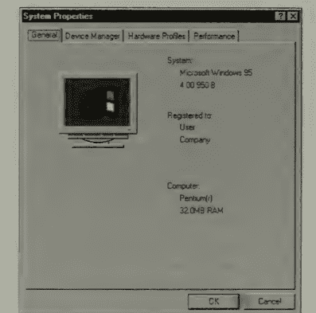

图 1-1：Windows 95 系统属性

接下来，点击“设备管理器”选项卡（图 1-2）。系统属性窗口将显示你电脑硬件组件的列表。（确保已选择“按类型查看设备”按钮。）

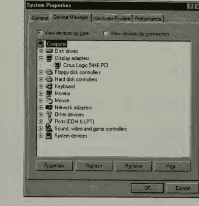

## 图 1-2：Windows 95 设备管理器

此时，你可以双击任何图标以了解有关该组件及其配置的更多信息。你也可以通过点击“打印”按钮打印摘要。系统提示时，选择“所有设备和系统摘要”报告。

你还应检查电脑的 BIOS（在启动时使用 `SETUP` 功能）以确定你的硬盘是否使用 LBA（大块访问）。在安装过程中回答其中一个问题时，你需要知道这一点。


别忘了，你也可以通过阅读随硬件附带的文档来了解很多关于硬件组件的信息！如果你没有闲置在衣柜里的备用 PC 符合你 Linux 机的要求，你应该购买的类型取决于你想为工作还是娱乐运行 Linux。如果你只是为了好玩而尝试 Linux，你可能可以在分类广告中找到一台旧的 486 系统，几百美元就能买到。如果你计划运行繁忙的网站，一台高端 Pentium 会花费你大约 2000 美元。

选择 Unix 机器时要记住的重要一点是，RAM 越多，系统性能越好。而且由于内存和硬盘价格最近大幅下降，所以不要吝啬。我的个人 Linux 机器配备了 Intel Celeron 300A 处理器、64MB RAM、2.5GB 硬盘、S3/Virge 显卡、无名 24X CD-ROM 和 US Robotics 56K 调制解调器。这绝不是一辆跑车，但它运行 Linux 非常顺畅。

## 安装概览

这就是准备工作的全部内容。以下是对你将遵循的安装过程的概述，以便在你的 PC 上使用 Linux 启动并运行。在开始像安装新操作系统这样激进的事情之前，了解即将发生的事情以及可能出现的陷阱是个好主意，所以请在开始流程之前先读完本章的剩余部分。相信我——你会很高兴你这么做了！

以下是简要步骤：

- 第 1 步：使用`FDISK`或`FIPS`重新分区你的硬盘。
- 第 2 步：创建 Linux 启动软盘（可选）。
- 第 3 步：启动安装程序。
- 第 4 步：回答有关你的硬件的几个简单问题。
- 第 5 步：创建 Linux 磁盘分区（可选）。
- 第 6 步：配置系统时钟。
- 第 7 步：选择`root`密码。
- 第 8 步：为 Linux 配置你的视频硬件。
- 第 9 步：从 CD-ROM 将 Linux 文件复制到硬盘。
- 第 10 步：关机并重新启动。

> 注意：由于硬件怪癖、粗心的按键或未能严格遵循这些说明，你在安装过程中可能会遇到许多陷阱。但如果安装不成功，你实际上不会损坏任何东西。如果你在安装中遇到问题，你可以随时重新开始再试一次。如果真的卡住了，请参阅附录 B“安装问题故障排除”，或第 15 章“更多了解 Linux”，其中列出了你在互联网上可以求助的人和地方。

## 重新分区你的硬盘？

由于你正在运行 DOS，可以肯定的是你的硬盘至少有一个分区。（分区只是硬盘的划分。）而且除非你非常大胆，否则几乎可以肯定你的硬盘有一个占用整个磁盘的单个 DOS 分区。

通常每个安装在硬盘上的操作系统都需要一个单独的分区，但最新版本的 Red Hat Linux 为你提供了将 Linux 安装到现有 DOS 分区的选项。这种无分区安装方法让你避免了创建磁盘分区的麻烦，但会带来性能损失。Linux 在 DOS 分区上运行会比在原生 Linux 分区上稍慢，并且你必须从软盘启动 Linux。

如果让你以最少的麻烦让 Linux 运行起来比最佳系统性能更重要，你应该考虑使用无分区安装方法。如果速度是关键，而且磁盘分区听起来不是什么大问题，那么你可能希望进行传统安装。我建议你阅读下一节，然后再决定遵循哪条路径。

## 磁盘重新分区

如果你想要传统的 Linux 安装，你必须更改磁盘当前的分区方式，以便为 Linux 的新分区（或两个）腾出空间。请注意，在此步骤中你不会创建任何 Linux 分区，尽管你将使用 DOS 实用程序来减小现有分区的大小。（你稍后将使用 Linux 实用程序来创建 Linux 分区。）

你可以选择几种工具来减小你的 DOS 分区大小。你选择哪一种取决于你对 DOS 磁盘上现有数据的重视程度，以及你内心是否是一个赌徒。

`FDISK`命令随 DOS 一起提供，是官方的磁盘分区工具。但由于它无法更改分区的大小，所以在重新创建较小的分区之前，它会让你先删除现有的分区。不幸的是，这意味着你会丢失磁盘上的所有数据，因此如果你使用`FDISK`，就需要执行完整的备份和恢复操作（以及重新安装 DOS）。`FDISK`很麻烦，但它能工作。

如果你愿意花一点钱，你可以从 Power Quest（www.powerquest.com）购买 Partition Magic 软件。Partition Magic 可以在不丢失数据的情况下安全地调整现有 DOS 分区的大小，而且使用起来非常简单。

另一个选择是`FIPS`（CD 上`DOSUTILS`目录中的一个免费实用程序），它可以在不删除分区的情况下调整现有分区的大小，但它是一个“自行承担风险使用”的程序。查看`FIPS`文档，如果你觉得自己能应付，就试试吧。数十万人已经使用过`FIPS`，该程序已经存在好几年了，据说非常可靠，但如果你选择使用`FIPS`而出了问题，不要打电话给我。

无论你选择哪种实用程序，你为 Linux 分区留出的空间大小将取决于硬盘的大小、当前占用的空间以及你打算如何使用 Linux。我建议你为 Linux 分配 600MB 或更多。

注意：本章概述的安装需要约 800MB 的硬盘空间，并且是后续章节的基础，因此我建议你 pretty closely 遵循它。如果你没有那么多可用空间，可以通过自定义安装省略某些组件，但这仅建议给已经熟悉 Linux 的用户。

在下面的示例中，我们将从一个 3.2GB（3,200MB）的硬盘开始，将 DOS 分区缩小到 1,600MB，并使用剩余的 1,600MB 用于 Linux。

如果你选择使用`FDISK`，请执行以下操作：

**注意：** 此过程假定你只有一个分区开始。如果有多个分区，请记住你不一定必须删除并重新创建所有分区。如果你有两个分区，你可能可以从第二个分区切下一块，留下主分区不受影响。你应该将未分配的空间留在磁盘末尾供 Linux 使用。

1. 备份你的硬盘。（磁带驱动器优于几十张软盘。）
2. 使用`FORMAT A: /S`命令创建一个可启动的 DOS 软盘，并将`FDISK.EXE`和`FORMAT.COM`复制到上面。按照备份程序的说明操作，确保恢复软件也可用在软盘上。
3. 插入软盘并重新启动系统。计算机应该从软盘而不是硬盘启动。如果没有，你可能需要调整机器的 CMOS 参数，使其优先从软盘启动。通常，你可以在开机后立即按`DEL`键来更改这些设置。（请参阅系统手册以获取帮助。）
4. 使用`FDISK`实用程序删除现有分区并创建较小的分区。（`FDISK`非常简单，但如果你以前从未使用过，应参考你的 DOS 手册。）
5. 使用`FORMAT C: /S`命令格式化新分区。
6. 最后，使用步骤 1 中的备份恢复你的硬盘。（你确实做了备份，对吧？）

## THE LINUX INSTALLATION PROCESS

如果你已经决定如何处理硬盘分区，那么你就可以开始 Red Hat Linux 安装过程了。如本章前面所述，如果你的系统支持，可以直接从 CD 运行安装程序。如果不支持，不用担心——只需按照后面提供的简单说明创建 Linux 启动软盘即可。

如果你有一台支持可启动 CD 的较新系统，可以将 Red Hat Linux CD 放入并重新启动计算机，安装程序将自动启动。试试看！（你可能需要在计算机的 BIOS 设置中更改一个选项，以便它将 CD 识别为启动设备。）如果你的计算机忽略 CD 并像往常一样启动 DOS 或 Windows，你仍然可能能够避免创建启动软盘。

要尝试这种替代方法，请进入“真正的” DOS 提示符。（在 Windows 下运行的 MS-DOS 提示符是行不通的！）如果你的 CD-ROM 驱动器可以在 Windows 环境之外访问，你可以使用`AUTOBOOT`程序从 CD-ROM 启动 Linux 安装过程。你需要做以下其中一件事来进入真正的 DOS 提示符：

- 关闭 Windows 95/98 并选择重启到 MS-DOS 模式选项。
- 从 Windows 3.1 退出到 DOS 命令提示符。
- 使用 DOS 启动软盘重新启动计算机。

在 DOS 提示符下，输入以下命令（假设你的 CD-ROM 驱动器是 D 盘）：

```
D:
```

如果没有出现“无效驱动器规范”之类的错误，请继续执行以下命令以启动安装程序：

```
cd \dosutils
autoboot.bat
```

如果你的 CD-ROM 驱动器可用，安装程序将启动，你可以跳过后面关于启动软盘的部分。

## 创建 Linux 启动软盘

如果你发现无法直接从光盘启动，或者无法在 DOS 提示符下访问 CD-ROM 驱动器，则必须创建一张 Linux 启动软盘。为此，请返回 Windows 并打开 DOS 提示符。将一张已格式化的软盘插入 A 驱动器，然后输入以下命令：

```
D:
cd \dosutils
rawrite -f \images\boot.img -d A:
```

当`rawrite`程序运行完毕后，将软盘留在 A 驱动器中并重新启动计算机。安装程序将会启动，CD-ROM 随即开始运转。当你看到 `boot:` 提示符时，只需按回车键继续。

## 如果我的 CD-ROM 没有转动怎么办？


Linux安装程序可能无法自动检测某些较旧或非标准的CD-ROM驱动器。如果你的CD-ROM驱动器连接到声卡或驱动器附带的特殊接口卡，你可能会遇到此问题。如果出现提示信息表明Linux无法检测到你的CD-ROM，请重新开始，并在 `boot:` 提示符下输入下表中的参数。（如果你的型号未出现在表中，请尝试在Red Hat网站 `http://support.redhat.com/hardware/` 上搜索信息。）

| CD-ROM类型 | 参数 |
|---|---|
| Aztech CD268-0A, Orchid CD-3110 | `aztcd=<io_port>` |
| Goldstar R420 CD-ROM | `gscd=<io_port>` |
| Mitsumi CD-ROM | `mcd=<io_port>,<IRQ>` |
| Philips/LMS CDROM drive 206 | `cm206=<io_port>,<IRQ>` |
| Sony CDU 31A or 33A CD-ROM | `cdu31a=<io_port>,<IRQ>` |
| Sony CDU-535 and 531 | `sonycd535=<io_port>` |
| SoundBlaster Compatible | `sbpcd=<io_port>, SoundBlaster` |

将 `<io_port>` 和 `<IRQ>` 替换为适用于你硬件的正确值，如下面示例所示：

- Sony CDU 31A/33A: `cdu31a=0x220,5`
- SoundBlaster Compatible: `sbpcd=0x320,SoundBlaster`

## 启动Linux安装程序

当Linux启动时，屏幕上会快速闪过一大堆信息。除非你在Evelyn Wood快速阅读课程中表现出色，否则你无法读懂太多内容，但这没关系。如果屏幕暂时变黑，也不必惊慌。片刻之后，一系列屏幕将引导你完成安装过程。在每个屏幕上，你都会做出选择，然后选择“下一步”继续。你可以使用鼠标或TAB和方向键进行导航和选择。安装程序会在启动阶段询问一些关于硬件的问题——以下是应答方法。

### 选择语言

如果系统要求你选择一种语言（图1-3），英语可能是你最好的选择，除非你恰好更熟悉德语或土耳其语。选择适当的语言，然后按“下一步”，用Tab键切换到“确定”按钮，按回车键或F12继续。

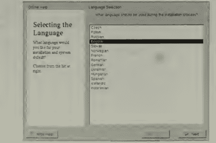

图1-3：选择语言

### 选择键盘类型

接下来，你需要告诉Linux你的键盘信息（图1-4）。在大多数情况下，安装程序会自动检测你的硬件，因此选择默认值是一个好主意，除非你确定自己使用的是列表中其他键盘型号之一。按“下一步”继续。

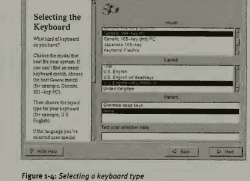

图1-4：选择键盘类型

### 选择鼠标选项

当Linux显示鼠标选项列表时，请选择与你的系统匹配的一项（图1-5）。在大多数情况下，安装程序会自动检测你的鼠标。如果没有检测到，而你不确定鼠标的类型，请查看电缆末端的插头。如果插头是矩形的，则是串口鼠标；如果是圆形的，则是PS/2式鼠标。根据鼠标的按键数量选择相应的“Generic Mouse”（通用鼠标）条目。如果你有两键鼠标，请选中“Emulate 3 Buttons”（模拟三键）复选框，这样你同时按下左右键即可模拟中键。如果你使用串口鼠标，Linux会询问鼠标连接在哪个端口（图1-6）。正确的答案很可能已经高亮显示，但你应该检查一下是否与DOS或 Windows 用于鼠标。

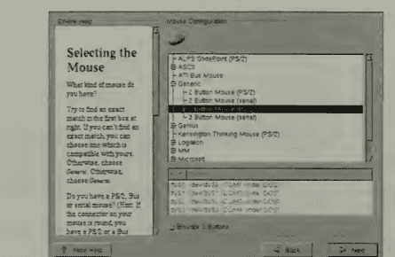

图 1-5：配置鼠标

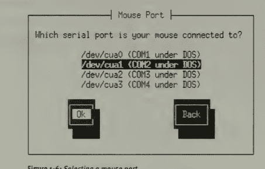

图 1-6：选择鼠标端口

如果鼠标在安装后仍无法工作，你可以再次运行 `mouseconfig` 命令并尝试不同的设置。按 Next 继续。

如果你是左撇子并希望相应地配置鼠标，可以使用 `gpm` 实用程序重置鼠标按钮的顺序。

安装完成后，启动系统并在提示符下输入以下命令。最好以 root 身份登录并将同一命令放入你的 `/etc/profile` 文件中，这样每次启动 Linux 时就无需重复输入。

```
gpm -B 321
```

### 选择安装或升级

当你看到“Welcome to Red Hat Linux”屏幕时按 Next（见图 1-7），并继续到图 1-8 所示的“Install Path”屏幕。

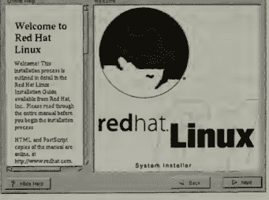

图 1-7：查看欢迎屏幕

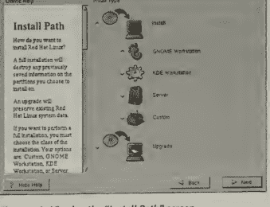

图 1-8：查看“Install Path”屏幕

如果你已安装 Red Hat Linux 的现有版本（2.0 或更高版本），安装程序会询问你是否要将其升级到版本 6。如果你选择 Upgrade，安装将保留你的现有系统，并仅包含将系统更新到最新版本所需的内容。

如果你不进行升级，请选择 Install 并确保已选中 GNOME Workstation 复选框。选择 Install 时，任何现有的 Linux 安装都将被删除。

注意：如果选择此路径，安装程序将假定你希望安装默认的 Linux 软件包起始集合。如果你想控制 Linux 安装哪些软件包，必须选择 Custom 选项（除非你有先前的 Linux 经验，否则不建议使用）。

## 创建 Linux 分区

现在是时候告诉安装程序应在哪个分区安装 Linux 了。要运行 Linux，你需要一个根分区和一个交换分区。根分区是所有操作系统和用户数据文件所在的位置。Linux 使用交换分区来模拟物理内存（已安装的 RAM），与 Windows 或 Macintosh 使用硬盘空间的一部分来创建虚拟内存的方式类似。

### 无分区安装

如果你决定进行无分区安装，你会看到类似图 1-9 所示的屏幕，其中列出了单个 DOS 分区。请记住，我们的示例使用的是 3.2GB（3,200MB）硬盘，因此你可能会看到不同的数字。你在这里需要做的只是设置 DOS 分区的挂载点，这会告诉安装程序使用该分区进行安装。选择 DOS（hda5）分区并按 Edit 按钮。将挂载点更改为 `/` 并按 OK。

按 Next 继续，安装程序会询问你在 DOS 分区上要分配多少磁盘空间给 Linux 根目录和交换区。根目录的默认值为可用空间的一半，但你应至少输入 800MB，1,600MB 以跟随本章示例，或根据更大的硬盘输入更多。接受交换空间的默认值，然后按 Next。安装程序将在 DOS 分区上创建两个新文件（你可以将其视为伪分区），用于 Linux 安装（REDHAT.IMG 和 RH-SWAP.IMG）。跳到“配置网络”部分。

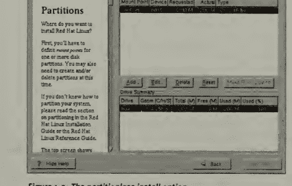

图 1-9：无分区安装选项

### 传统安装的手动分区

如果你决定进行传统 Linux 安装，屏幕右侧将类似于图 1-10，其中列出了单个 DOS 分区。由于你已将 DOS 分区从 3.2MB 缩小到 1,600MB，现在有空间创建 Linux 根分区和交换分区。

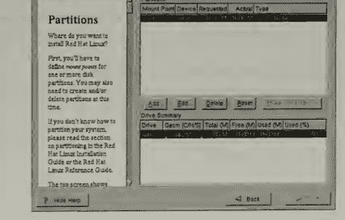

图 1-10：传统安装的分区

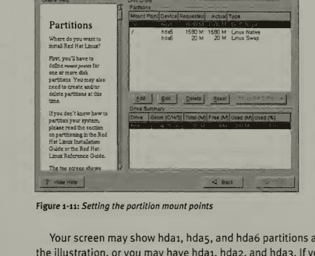

#### 图 1-11：设置分区挂载点

你的屏幕可能显示如图所示的 `hda1`、`hda5` 和 `hda6` 分区，也可能有 `hda1`、`hda2` 和 `hda3`。如果你开始时有两块硬盘并选择将 Linux 安装在第二块硬盘上，你可能有 `hda1`、`hdb1` 和 `hdb2`。

重要的是要有 一个 DOS 分区、一个 Linux 本地（根）分区 和一个 Linux 交换分区。如果你的硬盘与本示例中的大小不同，相应调整分区大小或根据个人喜好设置是可以的。按 Next 继续。

### 格式化分区

接下来你必须确认根分区的格式化。选中 `/dev/hda5`（Linux 根分区）旁边的框以确认，然后按 Next，Linux 将格式化根分区。

## 配置网络

如果你的计算机中安装了网卡，安装程序会询问你是否要为局域网（LAN）配置系统。

如果你的计算机中装有网卡，但你并未接入局域网，请取消选择 `Activate On Boot` 选项并按下 `Next`。如果你的计算机是办公室局域网的一部分，请根据网络管理员提供的信息响应提示。如果你已经搭建了家庭局域网，我建议你接受默认设置并按下 `Next` 按钮，除非你确定网络设置需要自定义。

## CONFIGURING THE SYSTEM CLOCK

从列表中选择你的时区，然后选择 OK（图 1-12）。通常，除非你处于网络环境中，否则你不希望选择 `System clock uses UTC` 复选框。


## CHOOSE A ROOT PASSWORD

安装完成后启动 Linux 时，你将使用用户名 root 和你选择的密码登录。如果你计划让他人使用你的 Linux 系统，请确保选择的 root 密码不是他们容易猜到的（图 1-13）。选一个好密码，并在 **Root Password** 和 **Confirm** 框中输入。

由于 root 用户（也称为超级用户）可以完全访问 Linux 系统上的所有内容，你应仅将此选项用于系统管理任务，例如安装新软件和配置系统服务。你也可以在此屏幕上为日常任务添加额外的用户账户。如果家庭或办公室有多个人会使用 Linux，请为每个人创建各自的账户。

## CONFIGURE X WINDOWS

此时，安装程序启动`Xconfigurator`（X Windows 配置程序），它将探测你的系统以确定你拥有的显示器和显卡类型，并安装合适的 XFree86 服务器。XFree86 是 X Windows 系统在 PC 兼容处理器上的免费实现，是 GNU 项目的一部分。

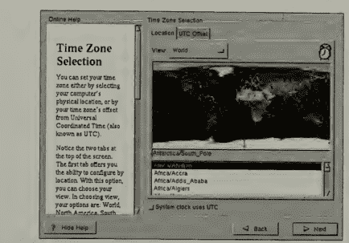

图 1-12：配置系统时钟

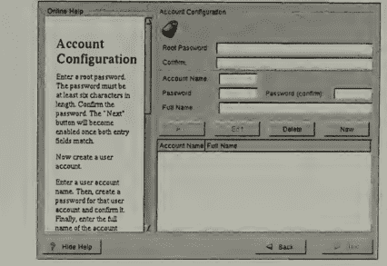

图 1-13：选择 root 密码

## DEFINING YOUR MONITOR

在选择显卡后，如果`Xconfigurator`能够自动检测到你的显示器，则会显示该设备的名称。如果不能，`Xconfigurator`会显示一个显示器列表供你选择。如果你的显示器在列表中，请选择它。如果不在列表中且你有制造商的技术规格，请选择 Custom，`Xconfigurator`将提示你选择显示器的特性。但要小心——如果你选择了一个“相似”的显示器，而你的显示器无法处理某种显示模式，则可能损坏显示器。更安全的选择是 Generic Monitor 或 Generic Multisync。

## DEFINING YOUR VIDEO CARD

如果`Xconfigurator`能识别出你的显卡以及安装了多少显存，它会在显示卡名称的屏幕中显示这些信息（图 1-14）。只需按 ENTER 继续即可。

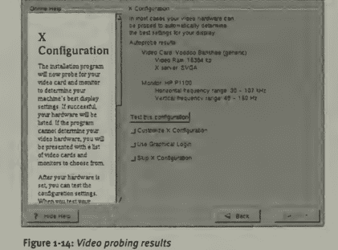

图 1-14：视频探测结果

如果`Xconfigurator`无法自动检测你的显卡，它会显示一个显卡列表供你选择。如果你的显卡不在列表中，Linux 可能不支持它。然而，如果你有显卡的技术文档，你可以选择 Unlisted Card 并尝试通过将显卡的视频芯片组与`Xconfigurator`提供的选项紧密匹配来配置它。

`Xconfigurator`可能会询问你的显卡安装了多少显存。如果你不知道，请查阅文档。猜错也不会有坏处，但 X Windows 可能无法正确启动。如果所选显卡可能具有视频时钟芯片，`Xconfigurator`会列出时钟芯片。推荐选择是 No Clockchip 设置，因为 Linux 在大多数情况下可以检测到正确的时钟芯片。

## CUSTOMIZING THE X CONFIGURATION

如果选择 Customize X Configuration 复选框并按下 Next，`Xconfigurator`随后会提示你选择希望使用的视频模式。对大多数人来说，800 by 600 分辨率配合 16 位颜色就足够好了。如果你的显示器和显卡支持更高分辨率，也可以选择。 如果你选择了多个视频模式，在运行 X Windows 时可以通过按 CTRL-ALT-PLUS 在模式间切换。

完成后，`Xconfigurator`会将你的所有配置选择记录在`/etc/X11/XF86Config`文件中。你可能会觉得浏览此文件很有趣，但除非你真的知道自己在做什么，否则不要对其进行任何更改。

使用 Test Configuration 按钮验证你的 X 配置是否有效。如果无法启动 X Windows，或显示效果不佳（过大、过小、颜色错误等），你可以在安装后再次运行`Xconfigurator`命令，并稍后尝试不同的设置选项。

## START X WINDOWS AT BOOT TIME?

如果你想要完全的图形界面，请在按下 Next 按钮前勾选 Use Graphical Login 按钮，你的系统在启动时会进入 X Windows 模式。如果你不选择图形登录，启动时将出现文本模式 shell 提示符。登录后，你可以使用`startx`命令启动 X Windows。

## INSTALLING PACKAGES

完成 X Configuration 步骤后，你会看到一个显示 About to Install 的屏幕。按下 Next 按钮，安装程序

## 关机和重启

当你看到 **Congratulations** 屏幕时，你几乎已经到达终点线。如果你选择的是无分区安装方法，请将启动盘留在软盘驱动器中——否则现在将其取出。按下 **Exit** 按钮继续，然后会有一堆消息显示各种系统正在关闭。然后你将启动进入你宏伟而辉煌的新 Linux 系统。你必须在系统重启前 **取出安装光盘**，否则你可能会发现自己重新运行安装程序。

如果你为启动选项选择了文本模式 shell 提示符，会出现类似这样的提示：

```
[root@localhost /root] #
```

如果你熟悉 Linux 命令，可以在井号（#）提示符处输入它们。否则，使用`startx`命令启动 GNOME 图形界面，然后继续阅读第 2 章，“The Linux GUI。”

## 安装后：配置

成功安装 Linux 后，你需要采取几个步骤来让所有硬件与 Linux 正常工作。在本节中，你将学习如何配置你的打印机、声卡和 CD-ROM 驱动器。

### 配置打印机

要配置打印机，从 shell 提示符输入`printtool`命令，或点击 **Gnome Foot • System • Control Panel**，然后选择打印机图标。当 **Print System Manager** 窗口出现时，点击 **Add** 按钮（图 1-16）。

Linux 会询问打印机如何连接到你的计算机；最可能的响应是 **Local Printer**，这意味着它直接插入计算机的背面。如果你的打印机在网络上，请向管理员询问配置 Linux 所需的信息。按下 **OK** 继续。

在 **Edit Local Printer Entry** 屏幕（图 1-17）上，保留默认值，然后按下 **Select** 按钮继续。

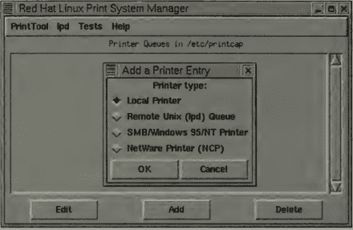

*Figure 1-16: Adding a printer definition*

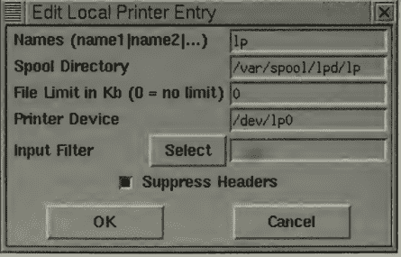

*Figure 1-17: Configuring a printer*

在 Configure Filter 屏幕（图 1-18）上，选择最接近你的打印机，然后选择合适的纸张尺寸和分辨率。

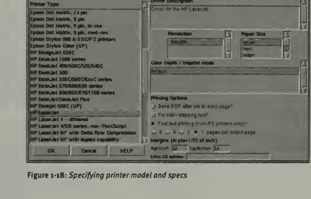

*Figure 1-18: Specifying printer model and specs*

按两次 OK 返回 Print System Manager 窗口，然后选择 lpd • Restart lpd 以激活你的打印机。完成后，选择 PrintTool • Quit 退出。

### 配置声卡

要配置声卡，从 shell 提示符输入`sndconfig`命令。当 Sound Configuration Utility 屏幕出现（图 1-19）时，按下 OK 探测你的系统。如果探测找到可以自动配置的声卡，它将进行配置。否则你必须从列表中选择你的声卡并输入端口、IRQ 和 DMA 信息。你从 Windows 设备管理器获得的信息在这里会有所帮助。做出选择后，`sndconfig`会播放声音和音乐片段并询问你是否能听到它们。如果不能，请返回并尝试不同的设置。

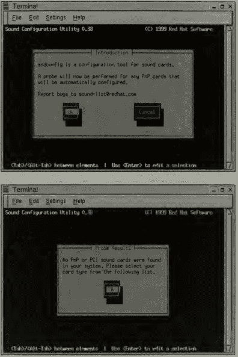

将音乐 CD 插入驱动器，**GNOME CD Player** 应该会弹出并开始播放它。如果你无法让声卡工作，请阅读安装光盘上`/doc/HOWTO`目录中的`SOUND-HOWTO`文件。

## 访问 CD-ROM 上的文件

发出`mount`命令后，列出 CD-ROM 上的文件以查看挂载是否成功，使用以下命令：

- `cd /mnt/cdrom`    切换到 CD 目录。

- `ls`    列出 CD 上的文件。

如果你在`mount`命令中尝试设备名并收到错误，或你的`ls`命令没有显示任何文件，只需选择另一个设备名再试一次——这样不会造成任何损害。


目前，只要你能列出 CD-ROM 上的文件就足够了。在第 4 章，“The Linux File System”中，你将了解更多关于导航目录的信息，以及列出和查看文件的信息。

## 我需要帮助！

如果安装不成功，或安装后系统出现问题，请参考第 15 章，“Learning More about Linux。”你还应查看光盘上的 Red Hat 安装手册，以获取最常见的安装问题的帮助，如果按照本章的说明无法正常运行。要查看手册，在 Windows 下启动你的 Web 浏览器并打开文件：

```
D:\doc\rhinst\index.htm
```

你还会在光盘上的以下目录中找到大量有用的信息，包括 Linux FAQ（常见问题）文件和 Linux HOWTO 文件：

```
D:\doc\faq
D:\doc\howto
```

Linux 系统的图形用户界面（GUI）是 XFree86，即 X Windows 的基于 PC 的实现。Red Hat Linux 6 版增加了 GNOME（GNU Network Object Model Environment），这是一种友好的桌面管理器，可轻松使用和配置 X Windows，以及 Enlightenment，这是一种窗口管理器，允许您使用主题、壁纸、声音、屏幕保护程序和特殊效果来控制桌面的外观和感觉。

使用 GNOME 就像使用其他图形用户界面一样——您可以在屏幕上打开多个应用程序窗口，并可以使用鼠标在它们之间切换。如果您熟悉 Windows 95/98 或 Macintosh，您将毫不费力地适应 GNOME。稍后，您可能想查看第 13 章“调整 Linux”中的“GNOME 控制中心”和“自定义 Enlightenment”，以了解如何使桌面更有趣、更个性化。参见图 2-1 中的示例 GNOME 桌面。

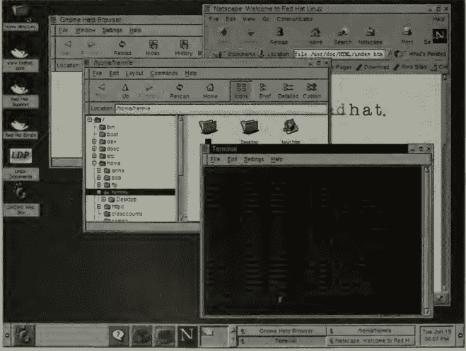

图 2-1：*GNOME 桌面*

## 桌面和窗口管理器

X Windows 架构的基本原则之一是独立组件的协作。X Windows 的客户端-服务器操作模型以及它提供的允许用户用替代插件模块替换主要功能的能力使其在 Unix 世界中非常灵活且受欢迎。这种灵活架构最突出的例子是 X 服务器、桌面管理器和窗口管理器。

很多人对这些术语感到困惑，坦率地说，对于普通 Linux 用户来说，理解服务器、桌面管理器和窗口管理器之间的区别并不是那么重要。如果您只想将它们简单地视为 X Windows 环境的组件，那也没问题——您可以安全地忽略本节的其余部分。但是，如果您喜欢不断地摆弄系统，您应该继续阅读以更好地理解这些术语。

X 服务器是处理将文本和图形小部件以指定大小、颜色和位置写入屏幕的低级程序。当您运行 XConfigurator 实用程序时，它会为您的视频硬件选择合适的 X 服务器。服务器会监听各种客户端程序请求绘制这些小部件。其中一个客户端程序是窗口管理器，它作为客户端程序和 X 服务器之间的层。它在窗口周围放置边框、调整窗口大小，并允许控制移动。

桌面管理器在更高层级工作，为桌面上运行的程序提供统一的外观和感觉，并充当中间人，使程序能够交互和交换数据。桌面管理器还为您提供了一套桌面应用程序，如文件管理器、文本编辑器和其他生产力工具。您的 Red Hat Linux 系统随附 GNOME 和 KDE（K Desktop Environment）两种最受欢迎的桌面管理器。Red Hat 6 版的默认 X Windows 配置是 GNOME 配 Enlightenment 窗口管理器。选择 GNOME 是因为它非常流行，并且是唯一完全开源的桌面环境。在 Red Hat 6 版发布时，Enlightenment 是唯一完全兼容 GNOME 的窗口管理器。有关自定义 GNOME 桌面外观和感觉的更多信息，请参阅第 13 章“调整 Linux”中的“GNOME 控制中心”和“自定义 Enlightenment”。

以下是一些可与 GNOME 一起使用的其他窗口管理器，但可能不完全兼容：

- **Window Maker**  http://www.windowmaker.org

- **FVWM**  http://www.fvwm.org

- **Icewm**  http://icewm.sourceforge.net

请参阅第 13 章，了解有关下载其他窗口管理器并使用 GNOME 控制中心中的窗口管理器小程序尝试它们的信息。如果您想尝试 KDE，请使用 `switchdesk` 命令并选择“KDE”选项。要返回 GNOME，请再次使用 `switchdesk` 命令并选择“GNOME”。

## 鼠标和窗口约定

仔细观察您 GNOME X Windows 桌面上的窗口，您会看到一些常见功能，即标题栏；“系统菜单”按钮；“最小化”、“最大化”和“关闭”按钮；以及抓取手柄。

请参考图 2-1，我们来探索一些与窗口交互的方式。（在下面的表格中，我使用 `LMB` 和 `RMB` 作为左键和右键的缩写。）

| 功能 | 位置 | 功能 |
|---|---|---|
| 系统 | 左上角 | 用 `LMB` 单击以显示系统菜单，或双击以关闭。 |
| 标题栏 | 顶部中间 | 用 `LMB` 单击可将窗口置于前台，或用 `RMB` 单击可将窗口置于后方。您也可以按住 `LMB` 在标题栏上拖动来移动窗口。 |
| 最大化 | 右上角（按钮内的正方形） | 用 `LMB` 单击可使窗口占据全屏（或其最大尺寸）。再次单击可恢复原大小 |
| 最小化 | 右上角（按钮内的下划线） | 用 `LMB` 单击可将窗口发送到屏幕底部的分页器。在分页器中双击项目即可将其恢复为窗口。 |
| 抓取手柄 | 角落、左侧、右侧和底部边框 | 按住 `LMB` 并拖动以调整窗口大小。 |

鼠标左键用于标记、选择和拖动项目。要复制文本，请用鼠标左键单击并拖动以跨越文本

你想要复制，将指针移动到想要放置文本的位置，然后按下鼠标中键。（如果你使用的是双键鼠标，同时按下左右键来模拟中键。）点击右键会显示所选对象的菜单（如果适用）。

## GNOME 的主要特性

GNOME 的主要特性包括以下内容：

- GNOME 面板。这类似于 Windows 95/98 任务栏，但当然更有趣、更强大。GNOME 面板用于启动应用程序、管理虚拟桌面以及显示系统状态。面板是位于屏幕底部的长条。

- 桌面。这是存放数据、应用程序和活动窗口的地方。

- 一套工具和生产力应用程序，例如文件管理器、文本编辑器、电子表格、日历和计算器。

- 一套使应用程序能够相互协作并保持一致的约定。这让程序员和终端用户都更轻松。

GNOME 是 GNU 项目的一部分，因此它是自由软件并且是开源的。这意味着源代码可供任何人检查和修改。你可以通过访问 GNOME 网站 http://www.gnome.org/ 了解更多关于 GNOME 项目的信息或参与开发。

## GNOME 面板

GNOME 面板位于屏幕底部（见图 2-2），是 GNOME 界心的核心，是放置你的应用程序启动器、小程序、分页器和主菜单的地方。面板还设计为高度可配置，你将学习如何设置菜单和应用程序，使其完全符合你的需求。


使用 GNOME 面板非常简单，任何使用过基于 GUI 的操作系统的人都会很容易上手。你可以启动程序，向面板添加应用程序启动器，添加各种小程序（在面板内运行的小程序），甚至创建多个面板。这些功能以及更多内容将在本节中描述。

## 使用主菜单

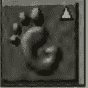

面板左下角看起来像脚印的按钮（显示在左侧）是“主菜单”按钮，有时也称为脚。只需点击“主菜单”按钮，你就会看到预装的应用程序和操作菜单（如图 2-3 所示），包括注销命令。

“主菜单”按钮是启动系统上安装的任何应用程序的便捷方式，其工作原理与 Windows 95/98 系统上的“开始”按钮非常相似。主菜单上的一些菜单项具有级联子菜单，点击它们时会弹出子菜单。如果你按住左鼠标按钮不放，可以仅通过移动鼠标来浏览菜单。当你找到想要启动的应用程序时，松开按钮。

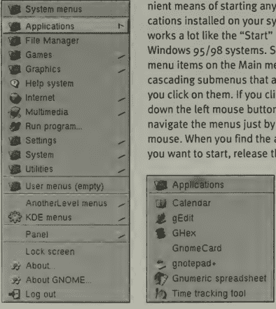

如果你发现级联菜单过于敏感，可以先点击并松开左键以显示子菜单；然后小心地将鼠标移入子菜单。右键在主菜单区域有特殊功能，我们将在本节后面学习。

## 更改主菜单属性

主菜单分为两个区域：系统菜单和用户菜单。要更改主菜单的属性，右键单击“主菜单”按钮并选择“属性”以启动菜单属性对话框（见图 2-4）。

这里唯一可以自定义的是各种子菜单是在主菜单中显示、在子菜单中显示还是完全不显示。例如，如果你将用户菜单的选项从“在主菜单上”更改为“在子菜单中”，你将不再在首次显示主菜单时看到用户菜单中的项目。你必须点击“用户菜单”才能使它们出现。

## 自定义主菜单

如果你想在主菜单中添加或删除项目，请使用菜单编辑器。要启动菜单编辑器，点击“主菜单”按钮并选择“设置”，然后选择“菜单编辑器”（见图 2-5）。


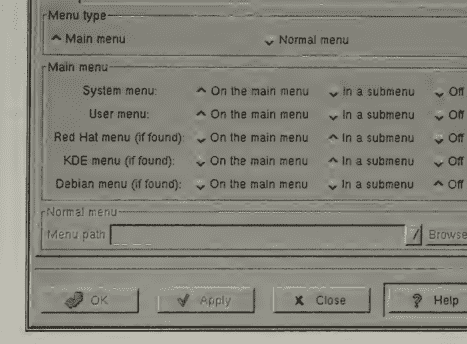

图 2-4：菜单属性对话框

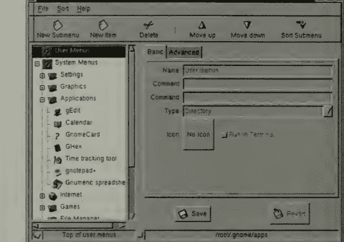

Figure 2-5: GNOME Menu Editor

The Menu Editor is divided into two main panels. On the left panel, you will see a tree-like view of your current menus. Clicking on a plus sign will expand the tree to reveal the items in a menu, and clicking on a minus sign will reverse the process. The right panel is a dialog box where you can specify the particulars for new applications you want to add to the menu.

You can use the buttons at the top of the screen to add or delete items or to add a new submenu. The position of a menu item can be changed by pressing the “Move up” and “Move down” buttons on the toolbar or by dragging the item with the left mouse button. The Menu Editor supports drag-and-drop, which allows you to drag applications from other windows (such as the File Manager or the GNOME Panel) to the menus you want them in.

NOTE: Any user can modify the User menus, but only the root user can modify the System menus.

## THE GNOME PAGER

The Pager (Figure 2-6) is a tool on the GNOME Panel to help you manage the applications currently active on your desktops. You can use it

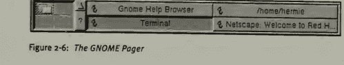

Figure 2-6: The GNOME Pager

to restore minimized applications to your desktop or to switch from one desktop area to another.

The area on the left side of the Pager is the desktops view, which shows all of your desktops and the applications within them. Each desktop is represented by a small rectangle, and the applications on the desktops are outlined in miniature form. By default, all applications are started in the upper-left desktop, but if your screen gets too cluttered, switch to another desktop by clicking on one of the rectangles.

The task list on the right side of the Pager displays the active applications on the current desktop. If you minimize an application, you can return it to your desktop by clicking on its entry in the task list. The arrow button in the middle of the Pager displays a list of all the applications active on any desktop. You can also restore minimized windows by clicking on this list.

## CUSTOMIZING THE PAGER

The Pager is very customizable. To open the Pager Properties dialog box (see Figure 2-7) right click on "Pager" and select "Properties" from the pop-up menu. You can tweak the maximum width of the task list, the number of rows and columns in the task list, and the number

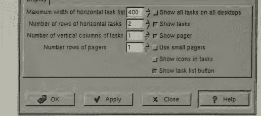

Figure 2-7: Pager Properties dialog box

of rows in the pager. You can also try out various options such as viewing all applications on all desktops (instead of just the current desktop), turn the task list off, turn the Pager off, or use small pagers. Try the various options to configure the Pager just the way you like it.

## HIDING THE PANEL

If the GNOME Panel is getting in your way, you have several options. You can hide the panel by pressing either of its “Hide” buttons. There are hide buttons on both sides of the Panel, so you can slide it away in either direction. Even more useful is the auto-hide feature, which makes the panel slide off the bottom of the screen. The panel springs back up when you bring the mouse into the panel area. To enable auto-hide, select **Panel • This Panel Properties** from the “Main Menu” button (see Figure 2-8).

If you use auto-hide all the time, it might be wise to disable the “Hide” buttons, to regain a little extra space on the panel.

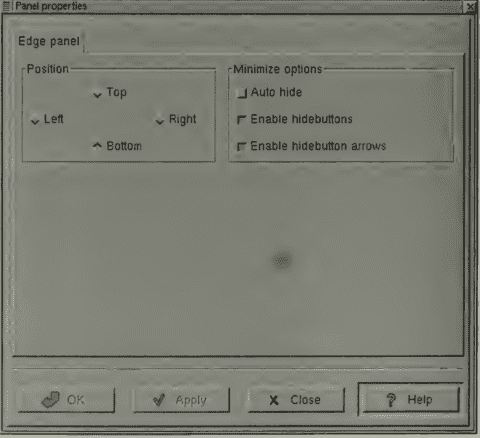

*Figure 2-8: Panel Properties window*

## MOVING THE PANEL

You can also use the Panel Configuration dialog box to change the position of the panel on your screen. Select “Top,” “Right,” “Left,” or “Bottom”; then click the “Apply” button to move the panel.

## ADDING APPLICATION LAUNCHERS


If you want to add an Application Launcher (an icon that starts a particular application) to the panel, right-click the panel and select “Add New Launcher” from the pop-up menu. After selecting the Add New Launcher menu item, you will see a dialog box that enables you to set the properties for the application launcher you want to add.

In the Create Launcher Applet dialog box (see Figure 2-9), you can add a name for your launcher, a comment, and the command line to launch the application, and you can define the application type. You can also click the icon button and choose an icon to represent the application from the icon picker. If no icon is chosen, a default icon will be used.

Another, quicker method of adding an application launcher to the GNOME Panel is to go to the Main menu and right-click on an application menu item. You will be given another menu that contains the

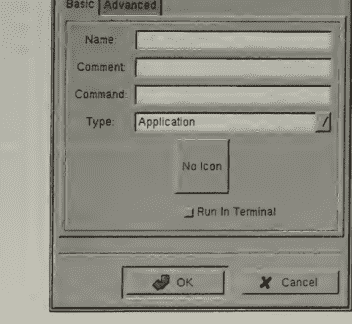

选择“将此启动器添加到面板”。如果选择此菜单项，它将自动为该应用程序在您调用主菜单的面板中添加一个启动器。此时，您可以右键单击该启动器，然后选择“属性”菜单项来更改该启动器的任何选项。

## 将抽屉和菜单添加到面板

如果您想将一组应用程序分组在一起，可以使用抽屉。抽屉就是一个位于面板上的小型菜单式按钮，它可以将应用程序启动器集中在一个地方。将抽屉放置在面板上后，您可以单击它来弹出应用程序菜单，再次单击则可收起菜单。

有几种方法可以将抽屉放置在面板上。首先，您可以右键单击面板，然后从弹出菜单中选择“添加抽屉”。其次，如果您希望将主菜单中的整个子菜单集变为一个抽屉，您可以右键单击该菜单的标题栏，然后从弹出菜单中选择“将此添加为面板上的抽屉”。您可以将菜单添加到面板，方式与添加抽屉相同。菜单与抽屉非常相似，只是它们不使用大图标来表示应用程序启动器。相反，它们使用与主菜单类似的样式：小图标和应用程序名称。您可以通过右键单击菜单的标题栏并从弹出菜单中选择“将此添加为面板上的菜单”来添加菜单。您还可以通过从 GNOME 文件管理器中拖出一个目录并将其放到面板上，将系统目录作为菜单添加到面板。左侧的图像显示了菜单和抽屉图标在 GNOME 面板上的外观。


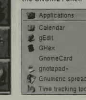

单击抽屉或菜单将打开它。图 2-10 显示了打开的抽屉和菜单的示例。请注意，抽屉在您单击其中的某个图标后仍保持打开状态，必须通过单击向下箭头来关闭。菜单在您做出选择后会自动关闭。

图 2-10：打开的抽屉（左）和菜单（右）

## 创建多个面板

如果您觉得拥有一个 GNOME 面板很有趣，为什么不往屏幕上再添加几个呢？要向桌面添加新面板，请按下“主菜单”按钮，然后选择“面板 ▸ 添加新面板”。您可以添加边缘面板或角落面板。边缘面板会延伸其所放置屏幕边缘的整个长度，而角落面板仅延伸至足以容纳其包含的小程序的程度。如果您想试用一些面板小程序，但主面板上的空间有限，那么拥有第二个面板会很有用。

## 面板小程序

小程序是在面板内运行的小型程序。面板右侧的时钟就是一个例子，但您可以向面板添加许多可选小程序。要访问这些小程序，请右键单击面板并从弹出菜单中选择“添加新小程序”。以下是一些您可以运行的小程序：

### 娱乐小程序

- **十五子游戏** — 让您玩那种重新排列混乱方块的小游戏。

- **生命游戏** — 在一个小窗口中模拟*生命*游戏。

- **SlashApp** — 显示来自 SlashDot.Org 的 Linux 新闻滚动条。

### 监控小程序

- **电池监视器** — 显示您的笔记本电脑电池剩余使用时间。

- **电池充电监视器** — 显示电池已充电量以及完成充电所需的时间。

- **CPU/内存使用监视器** — 显示当前 CPU、内存和交换空间的使用情况。

- **CPU 负载** — 显示当前 CPU 使用率的图表。

- **内存负载** — 显示当前内存使用率的图表。

- **交换负载** — 显示当前交换空间使用率的简单图表。

### 多媒体小程序

**CD 播放器** 播放音乐 CD。

**混音器** 设置音量。

### 网络小程序

**邮件检查** 让您知道电子邮件何时到达。

**调制解调器指示灯** 模拟外置调制解调器上闪烁的指示灯。

**PPP 拨号器** 打开或关闭您的 PPP 连接。

**Web 控制** 提供用于输入 URL 并启动浏览器的命令行。

### 实用小程序

**AfterClock** 提供比 GNOME 面板默认包含的时钟小程序更酷的时钟。要访问 AfterClock 属性，请右键单击时钟并从弹出菜单中选择“属性”菜单项。将出现一个对话框，您可以在其中更改时钟的外观。左侧显示了几个选项。


**打印机小程序** 提供一个位于 GNOME 面板上的小型打印机图标。如果您将文件拖到打印机小程序上，该小程序将为您打印该文件。要设置打印机小程序，请右键单击它并从弹出菜单中选择“属性”菜单项。


**驱动器挂载小程序** 允许您通过单击图标来挂载或卸载系统上的软盘驱动器、硬盘或 CD-ROM 驱动器。


**快速启动** 为您提供一个放置小型启动器的位置。将现有启动器拖放到快速启动小程序上，即可创建小型（且几乎不可读）的启动器按钮。

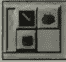

**迷你指挥官** 将命令行放到您的任务栏上。如果您想快速运行命令而不先打开终端窗口，这个小程序非常方便。迷你指挥官还具有命令历史功能，因此您可以选择命令再次运行，而无需重新输入。

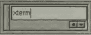

## GNOME 帮助浏览器

GNOME 帮助浏览器（图 2-11）是访问系统上所有可用帮助文件的便捷途径。点击任务栏上带有大问号的按钮即可启动 GNOME 帮助浏览器。从那里，你可以浏览以`man`、`info`和`html`格式提供的帮助信息目录，以及 GNOME 界面的专用帮助文件。

## GNOME 桌面

面板之外，其余的屏幕空间称为桌面。如果你有经常使用的程序或数据文件，可以将它们放在桌面上，然后双击使用。如果该项目是程序，程序将启动。如果是数据，相应的程序将启动并加载该数据。如果是 WWW 链接，Netscape 浏览器将启动并显示网页。如果是目录，文件管理器将启动并显示该目录的内容。

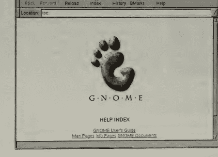

图 2-11 GNOME 帮助浏览器

桌面支持拖放操作，因此你可以轻松地在桌面和其他窗口之间移动项目。你可以将数据文件从文件管理器拖到桌面上的程序图标以启动程序并加载该数据，或者你可以从 Netscape 拖出一个链接并将其放到桌面上以创建快捷方式。

### 桌面区域

本章前面在讨论 GNOME Pager 时我们曾提到过桌面区域。如果你的屏幕因活动窗口过多而显得杂乱，你可以点击 Pager 中的桌面切换器切换到另一个桌面区域并打开更多窗口。如果你是键盘爱好者，可以使用 ALT-F1 到 ALT-F4 键在桌面区域之间切换。


如果你在想为什么它们被称为桌面区域而不是仅仅是桌面，这是有原因的：四个桌面区域实际上组成了一个大的桌面。你可以通过将窗口拖到屏幕右侧使其一半消失来理解这一点。现在切换到第二个桌面区域，你会看到窗口的另一半就在那里。这在实际使用中意义不大，但确实说明了这一点。

## 在桌面之间移动窗口

如果你想将窗口从一个桌面区域移动到另一个桌面区域，点击窗口左上角的“系统菜单”按钮，然后选择“桌面”并选择目标桌面区域。

如果你希望某个窗口出现在四个桌面区域上，点击“系统菜单”并选择“固定/取消固定”选项。这并不意味着会有四个该程序的副本在运行。当你在桌面区域之间移动时，该窗口会跟随你移动。

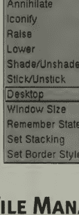

## 文件管理器

文件管理器应用程序（见图 2-12）让你可以操作你的文件。其窗口左侧显示目录，右侧显示所选目录的内容。如果你使用过 Windows 的文件管理器应用程序，你会感觉很熟悉。以下是一些快速提示：

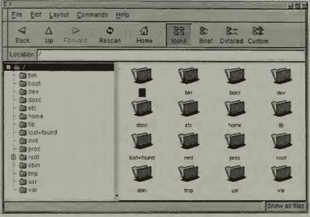

*图 2-12：文件管理器*

- 在左侧面板中点击加号以展开文件树分支（显示子目录），或点击减号以隐藏文件树分支。
- 使用“图标”、“简要”、“详细”和“自定义”按钮来更改右侧面板中文件列表的样式。
- 要运行程序或编辑数据文件，双击它。
- 要移动文件或目录，只需将其拖放到另一个文件夹、窗口或桌面即可。
- 要复制文件，在拖动时按住 `CTRL` 键。
- 启动两个打开不同目录的文件管理器窗口，以便轻松在目录之间移动或复制文件。
- 要重命名文件，右键单击它并选择“属性”。

## 选择文件

要选择多个项目，按住 `SHIFT` 键并点击这些项目。你也可以使用*橡皮筋选择*，即按住鼠标左键并将鼠标拖过一组文件。

一个小虚线将显示所选文件。若需更灵活地选择文件，请使用“编辑”菜单中的“选择文件”选项。这将显示一个弹出菜单，您可以在其中输入选择条件。例如，您可以通过输入 `*.html` 作为条件来选择目录中的所有 HTML 文件。

## 文件操作

如果在右侧面板中右键单击任何文件，您可以从弹出菜单中选择多个操作：

- Open 打开文件并使用关联的应用程序。（请参阅第 13 章“调整 Linux”中有关编辑 GNOME MIME 类型的部分。）
- Open With 使用您选择的应用程序打开文件，如果您不想使用默认关联的应用程序。
- View 允许您使用简单的文本浏览器查看文件。
- Edit 在与该文件类型关联的编辑器中打开文件。（请参阅第 13 章“调整 Linux”中有关编辑 GNOME MIME 类型的部分。）
- Copy 将文件复制到剪贴板，以便在其他位置粘贴。
- Delete 删除所选文件。
- Move 将所选文件移动到另一个文件夹。
- Properties 允许您更改所选文件的属性。您可以更改文件名称；默认的打开、查看和编辑操作；以及读取、写入和所有权权限。

## 游戏和生产力应用程序

您的 Red Hat Linux 系统附带了一套巧妙的应用程序，可提升您的生产力或帮助您打发时间——无论您的需求如何！您可以通过从 GNOME 面板上的主菜单中选择它们来启动任何这些应用程序。

## Terminal 您的 Linux 命令行界面。

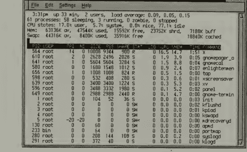

## Text editor Gnotepad+ 编辑器：一个方便的小编辑器，支持 HTML。

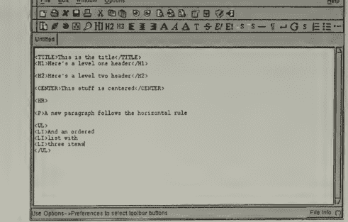

Calendar 一个日历和约会调度程序。

Calculator 一个带内存和科学功能的计算器。

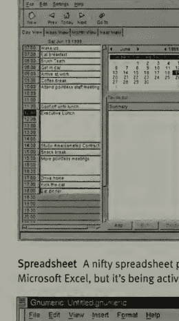

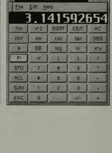

Spreadsheet 一个不错的电子表格程序。没有 Microsoft Excel 那么强大，但开发人员正在积极增强它。

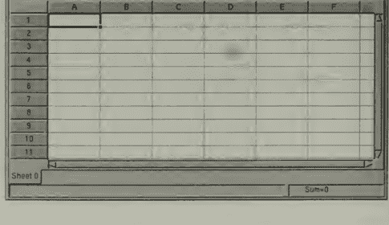

### 游戏

这些只是随 Red Hat Linux 发行的游戏中的几个。您可以通过在主菜单中查找找到其他游戏。

Freecell 梭哈纸牌游戏的一种变体。


GNOME Mines 扫雷克隆版。

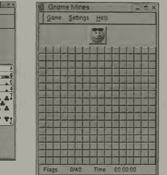

GNOME Tetravex 那些让人抓狂的拼图方块游戏之一。

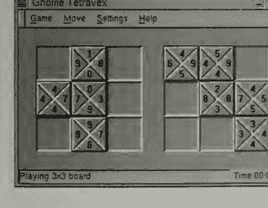

GNOME Mahjongg 一个做得很漂亮的麻将游戏，对牌面细节的关注令人印象深刻。

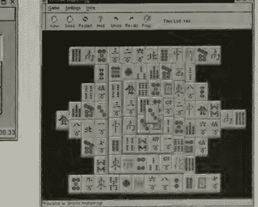

Same GNOME 一个有趣的点击旋转球直到它们消失的游戏。

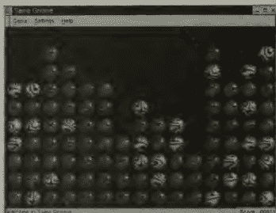

Xgammon 一个 backgammon 游戏。

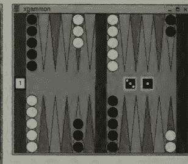

### 图像

以下是随 Red Hat Linux 发行的最有用的图形实用程序。您可以通过在主菜单中查找找到其他工具。

GIMP 图形图像处理程序，也称为免费的“Unix 版 PhotoShop”。

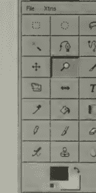

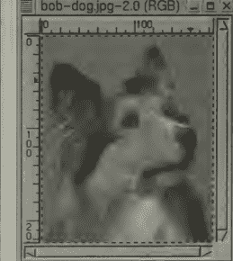

## Electric Eyes

一个支持多种图形格式的图像查看器。

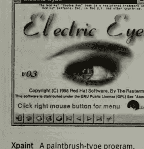

## Xpaint

一个画笔类型的程序。

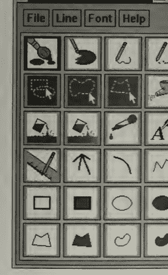

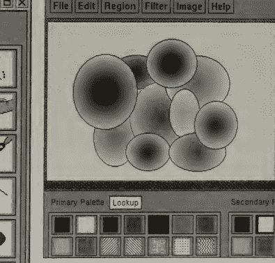

## 其他应用程序

如果您在 Linux 系统上找不到所需的软件，很可能您可以免费下载它或购买满足您需求的商业软件包。一个不错的起点是 GNOME 软件地图 `http://www.gnome.org`，它列出了此处所列类别中的免费软件。括号中的数字表示本书付印时每个类别中的软件包数量。

- Core (9)
- Development Tools (26)
- Entertainment (35)
- Internet Tools (30)
- Mail Clients (6)
- Math and Science Tools (13)
- Miscellaneous (34)
- Network Talk Clients (IRC, ICQ, and so on) (9)
- Productivity (32)
- Sound Tools (16)
- System Utilities (26)
- Window, Session, and Desktop Managers (7)

您还可以按照此处列出的链接查找一些商业软件包。

## STAROFFICE

StarOffice 是一套完全集成且与 Microsoft Office 兼容的生产力应用程序套件。它提供功能强大的 Web 启用文字处理、电子表格、演示图形、电子邮件、新闻、图表和图形应用程序。下载文件超过 70MB，最小安装需要约 100MB。有关更多信息，请参阅 `http://www.stardivision.com/office`。

## APPLIXWARE

Applix Office 是一套完全集成、跨平台的桌面生产力工具套件。套件中包含图形文字处理和文档发布工具、电子表格、商务图形、图形编辑、数据访问和电子邮件。有关更多信息，请参阅 `http://www.applix.com`。

## Corel WordPerfect

Corel WordPerfect Version 8 for Linux：个人版是一款办公解决方案，它提供与 Windows 版本相同的文字处理功能，外加许多仅适用于 Linux 的功能。它支持超过 1,000 台打印机，并且是免费的（24MB）下载。有关更多信息，请参阅 `http://linux.corel.com`。

## AbiWord


AbiWord 是一款小巧、快速且功能齐全的文字处理器。它可在大多数 Unix 系统（包括 Linux）上运行，也可在 Windows 95/98/NT 上运行。AbiWord 可以导入 Word97 和 RTF 文档，可免费获得，并且是开源的。下载文件仅为 770KB，安装版本仅需 1.2MB 的磁盘空间。

如果你曾经想过查看文字处理器的源代码，这里就是你的机会。下载 AbiWord 源代码，做出自己的改进，你就可以构建自己的 AbiWord 个人版本。有关更多信息，请参阅 http://www.abisource.com。

## Development Tools

Metrowerks 的 Code Warrior 是一款流行的跨平台开发环境，适用于 Linux、Macintosh 和 Windows 95/98/NT。有关更多信息，请参阅 http://www.metrowerks.com。

Cygnus Solutions 的 Code Fusion 将最新的开源 GNU 工具（编译器、调试器、库和实用程序）与图形化交互式开发环境相结合，该环境包括代码编辑器、类浏览、构建和调试工具。有关更多信息，请参阅 http://www.cygnus.com。

KAI C++ 是一款跨平台开发环境，旨在提高 C++ 程序员的效率。KAI C++ 调试器也可用。有关更多信息，请参阅 http://www.kai.com。

## LOGGING OUT OF GNOME

要从 GNOME 注销，请在主菜单中选择“Logout”菜单项。为方便起见，你还可以通过右键单击面板，然后从弹出菜单中选择“Add logout button”来在 GNOME 面板上添加注销按钮。

在你选择注销菜单项或单击注销按钮后，会弹出一个对话框提示你确认注销（见下图）。单击“ Yes ”，你的 GNOME 会话将结束。根据系统配置，你将返回到文本模式 shell 提示符或图形登录屏幕。如果你决定不注销，请单击“ No ”按钮。

在 GNOME 注销对话框中，你可以做一些选择。如果你勾选“ Save current setup ”框，下一次 GNOME 会话将以相同的设置和活动应用程序启动。换句话说，如果你在退出 GNOME 时文件管理器和 Netscape 窗口在屏幕上，它们在你返回 GNOME 时会重新启动。

此外，在 Action 面板中，你可以选择“ Logout ”、“ Halt ”或“ Reboot ”。Logout 将结束你的 GNOME 会话，Halt 将关闭你的计算机（为关机做准备），而 Reboot 将重新启动机器。

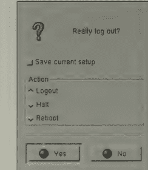

# 3 CONNECTING TO THE INTERNET

- Setting Up Your Serial Port to Work with Your Modem 64
- Making a Dial-Up Connection to the Internet 68
- Text-Based Internet Tools 73
- Graphical Internet Tools for X Windows 83
- Operating an Internet Site 87
- Help with Linux Networking 89

Linux 是探索在线世界和提供自己的 Internet 服务的绝佳平台。作为个人“冲浪板”，Red Hat Linux 随附了连接到 Internet 服务提供商（ISP）所需的一切，包括 TCP/IP 软件；客户端程序，如 FTP、Telnet、Finger、Mail、Ping、Lynx 和 Netscape。

Linux 还使设置自己的服务器变得容易，以便你可以运营 FTP 或网站，甚至为你的系统提供 Telnet 或拨号访问。如果你梦想成为一家 ISP，Red Hat Linux 产品是构建的绝佳平台。真正好的地方在于 TCP/IP 和所有流行的网络服务都是自动安装并为你预配置的。如果你曾经尝试配置 Unix 网络、设置电子邮件投递或让 Web 服务器运行，你会非常欣赏这个功能。（从技术角度来说，这意味着本地回环、sendmail、inetd、httpd 和其他几个网络守护进程在你启动 Red Hat Linux 时已配置并运行。）

在本章中，你将学习以下内容：

- 如何通过拨号 PPP 连接将你的 Linux 系统连接到 Internet
- 用于 Internet 访问的工具有哪些（文本和图形）
- 如何运营自己的 Internet 站点
- 在哪里获取有关 Linux 网络的更多信息

## SETTING UP YOUR SERIAL PORT TO WORK WITH YOUR MODEM

默认情况下，Red Hat Linux 配置为以 9600 bps 的速度运行你的串行（调制解调器）端口。但现在 33.6 和 56 Kbps 等速度更快的调制解调器相当常见。花钱买了快速调制解调器却不能充分利用它是很可惜的，因此为了获得最佳性能，你必须调整串行端口设置。

除非你有一个非常慢的调制解调器（9600 bps 或更慢），否则你应该使用 `setserial` 命令使 Linux 能够进行高速连接。根据你的调制解调器速度，在命令提示符下输入此处所示的其中一个命令。最好以 root 身份登录并将相同的命令放入你的 `/etc/bashrc` 文件中，这样每次启动 Linux 时就无需重复输入了。

```
setserial /dev/modem spd_hi    For a 14.4 Kbps modem
setserial /dev/modem spd_vhi    For a 28.8 Kbps or faster modem
```

由于调制解调器具有内置的压缩功能，你可以使用 14.4 Kbps 的调制解调器以高达 57.6 Kbps 的速度传输数据，或使用 28.8 Kbps 的调制解调器以 115.2 Kbps 的速度传输数据。 （压缩使数据速率在理论上达到调制解调器速度的四倍）。但如果不执行 `setserial` 命令，你的最大数据速率将为 9600 bps 的四倍，即 38.4 Kbps。

# LINUX 下的 MODEM 设置

在 DOS 环境中，调制解调器被分配到一个 COM（通信）端口、一个 IRQ（中断请求）号码和一个 I/O（输入/输出）地址。以下是最常见的配置：

| PORT | IRQ | ADDRESS | LINUX DEVICE NAME |
|------|-----|---------|-------------------|
| COM1 | 4 | 3F8 | `/dev/ttyS0` |
| COM2 | 3 | 2F8 | `/dev/ttyS1` |
| COM3 | 4 | 3E8 | `/dev/ttyS2` |
| COM4 | 3 | 2E8 | `/dev/ttyS3` |

你可以在 DOS 下使用 MSD 命令查找你的设置。在 Windows 95/98 下，按住 ALT 键，双击“我的电脑”图标，然后单击“设备管理器”选项卡即可找到设置。如果你的调制解调器配置与前表中的其中一项相同，Linux 应该能够自动检测并正确配置你的调制解调器。

启动 Linux 后，请确保你的调制解调器已被正确检测。由于 Linux 以通用名称 `/dev/modem` 识别调制解调器，你可以使用 `ls` 命令验证它是否存在并分配到正确的 COM 端口。尝试以下命令：

```
ls -al /dev/modem
```

响应应类似于此处所示的输出。

目前，请忽略除输出最右列之外的所有内容。

```
lwxrwxrwx 1 root root 5 Feb 19 22:19 /dev/modem -> /dev/ttyS1
```

在这种情况下，调制解调器设备 `/dev/modem` 被分配到 `/dev/ttyS1`，对应于 COM2。如果分配错误，或出现“没有此类文件”错误消息，你可以使用以下其中一个命令进行修复：

- `ln -s /dev/ttyS0 /dev/modem`    For a modem on COM1
- `ln -s /dev/ttyS1 /dev/modem`    For a modem on COM2
- `ln -s /dev/ttyS2 /dev/modem`    For a modem on COM3
- `ln -s /dev/ttyS3 /dev/modem`    For a modem on COM4

# 验证 MODEM 设置

好吧——你认为你的调制解调器已准备就绪？让我们使用 Minicom 来测试它，Minicom 是 Linux 自带的基本通信软件。输入命令

```
minicom
```

启动程序并等待屏幕上出现 OK 响应。然后输入命令 ATDT NNN-NNNN（其中 NNN-NNNN 是你的 Internet 服务提供商的拨号号码、BBS 的接入号码或其他本地号码）。如果听到拨号音并且调制解调器开始发出拨号声，说明一切正常（参见图 3-1）。


我们现在还不需要进行任何在线操作，因此按 `CTRL-A`，然后按 `Z`，再按 `X` 以挂断调制解调器并退出 `Minicom`。如果没有收到 `OK` 响应，或调制解调器无法拨号，请阅读下一节。否则，跳到“拨号连接到 Internet”。

# 如果连接有问题

在某些不常见的情况下（例如，如果你使用非标准 `IRQ` 或计算机中有多个 `I/O` 卡），你可能

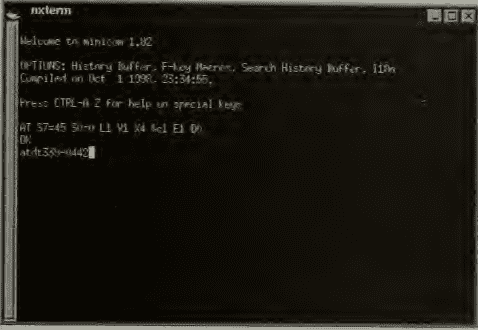

*Figure 3-1: The minicom opening screen*

需要设置 `setserial` 命令的某些特殊选项才能在 Linux 下使用调制解调器。可能导致问题的另一件事是即插即用调制解调器。Linux 对即插即用设备的支持非常有限，因此如果你有此类设备，可能需要进行一些调整才能使用。

如果使用调制解调器拨号时遇到问题，有两种方法可以尝试解决问题。第一种是执行 `man setserial` 命令以获取有关如何为非标准 `IRQ` 或 `COM` 端口配置设置串行端口的信息。第二种选择是重新安排计算机的硬件设置，以便调制解调器可以在其中一种标准配置下运行。

在我这里，我有一台 `US Robotics` 即插即用调制解调器，位于 `COM3` 和 `IRQ5`，Linux 无法检测到它。按照制造商的说明，我禁用了调制解调器的即插即用功能，将计算机的 `BIOS` 设置更改为禁用内置 `COM2` 端口，然后将调制解调器设置为在 `COM2` 和 `IRQ3` 上运行。重新启动并验证 Windows 能够使用这些设置成功运行调制解调器后，我在 Linux 下使用它时没有任何问题。


Figure 3-2: Linuxconf 主菜单


Figure 3-3: DNS 配置

# 定义 PPP 连接

在设置好名称服务器后，你可以开始 `PPP` 配置，从 Linux 连接到你的 `ISP`。

从 `linuxconf` 主菜单中，选择 `Config • Networking • Client Tasks • PPP/SLIP/PLIP`。然后点击 `Add` 按钮（见 Figure 3-4）。

选择 `PPP` 选项，然后点击 `Accept` 继续（见 Figure 3-5）。


Figure 3-4: 添加新的连接


Figure 3-5: 添加 PPP 接口

输入你的 `ISP` 的拨号接入号码、你的 `PPP` 登录名和密码（见 Figure 3-6）。如果你的 `ISP` 使用 `PAP` 认证，务必勾选 `Use PAP Authentication` 复选框。在大多数情况下，这就完成了 `PPP` 连接设置。

NOTE: Red Hat 版本 6 中的一个新功能是图形化 `PPP` 配置器，可通过点击 `Gnome Foot • Internet • Dialup Config Tool` 访问。你可以用它作为 `linuxconf` 方法的替代方案，但在我的测试中我发现它有一些 bug，所以我不推荐使用。


Figure 3-6: 定义 PPP 接口

你的 `ISP` 的终端服务器可能会显示一个对话框，提示如下（许多都会）：

```
Welcome to Ed's Garage Internet Services

Please enter your login: <your login here>
Please enter your password: <your password here>
Starting PPP ...
```

刚刚定义的 `PPP` 设置无需任何更改即可工作。`PPP` 连接过程的默认行为是等待 `login:` 提示，输入你提供的登录名，等待 `password:` 提示，然后输入你提供的密码。如果你的屏幕看起来像这样，点击 `Accept` 完成 `PPP` 设置并完全退出 `linuxconf` 到命令行。

# 自定义 PPP 连接提示

`ISP` 终端服务器以刚才描述的方式运行是很常见的，但让我们假设对话框看起来像这里所示的那样，其中你必须先提供一个命令进入 `PPP` 模式，然后再提供登录名和密码。顺便说一下，让我们假设 `ISP` 发送的是 `username:` 提示而不是 `login:` 提示。

```
Welcome to the CyberSurf Domain, Dude!

Options Menu

1 - Display Help
2 - Account Information and Rates
3 - Online signup form
PPP - Start a PPP connection

Enter command: PPP

Please enter your username: <your login here>
Please enter your password: <your password here>

Starting PPP ...
```

你需要更改你的 `PPP` 设置，使 `Expect` 和 `Send` 提示的顺序与终端服务器提示的顺序和拼写相匹配。在这种情况下，点击 `Customize` 按钮并向下滚动到页面的 "Chat" 部分。一个适用于期望你按顺序响应 `command:`、`username:` 和 `password:` 提示的终端对话框的示例显示在 Figure 3-7 中。

你的目标是通过相应地填写此屏幕上的 `Expect` 和 `Send` 提示来匹配 `ISP` 终端服务器提供的命令提示。点击 `Accept` 完成 `PPP` 设置并完全退出 `linuxconf` 到命令行。

### Figure 3-7a: Waiting... 对话框


### Figure 3-7: 自定义 PPP 登录屏幕


### Figure 3-7b: 网络监视器


# 启动 PPP

一旦设置完成，你可以通过点击 `Gnome Foot • Internet • RH PPP Dialer` 来建立到 Internet 的 `PPP` 连接。

当 `Waiting...` 对话框（Figure 3-7a）被 `Network Monitor`（Figure 3-7b）替换时，你应该已连接并准备好启动浏览器、电子邮件或其他 Internet 应用程序。要验证你的 Internet 连接是否成功，请检查 `ifconfig` 命令的输出（在连接处于运行状态时执行），它可能看起来像这样：

```
loo
Link encap: Local Loopback
inet addr:127.0.0.1 Bcast:127.255.255.255
UP BROADCAST LOOPBACK RUNNING MTU:2000 Metric:1

ppp0
Link encap: Point-Point Protocol
inet addr:205.161.119.112 P-t-P:205.161.119.3
UP POINTOPOINT RUNNING MTU:1500 Metric:1
```

前几行显示 `loo` 的状态，即你的本地回环接口。本地回环就像你的内联网——一个本地网络，允许你与其他系统用户交换电子邮件、访问本地 Web 服务器上的文件等等。`loo` 设备将始终具有 `127.0.0.1` 的 IP 地址，并且状态行应显示 `UP` 和 `RUNNING`。

如果你在 `ifconfig` 输出中看到 `ppp0` 设备列出，则表示你已建立到 Internet 的活动 `PPP` 连接。你的计算机现在是

所有其他互联网上的计算机，都拥有它自己的 IP 地址（在本例中为 `205.161.119.112`）。事实上，任何人通过 Internet 都可以通过 `Telnet`、`FTP` 或 Web 浏览器连接到此地址！但请注意，此 IP 地址是从 `ISP` 为拨号用户提供的地址池中动态分配的。下次连接时，你很可能会获得不同的 IP 地址。

如果愿意，你的 `ISP` 很可能可以为你分配一个永久 IP 地址（需付费），但这需要对你的 `PPP` 连接设置进行一些更改。有关如何为 `pppd` 指定永久 IP 地址的信息，请参阅 `PPP-HOWTO` 文件。（访问 Web 上的 Linux 文档项目主页 `http://sunsite.unc.edu/mdw/linux.html` 以查找所有 `HOWTO` 文件。）

# 停止 PPP

要挂断调制解调器并终止 `PPP` 连接，请单击网络监视器，选择断开连接，然后确认你想要停止连接。

# 帮助——它不起作用！


如果在尝试拨号连接到 Internet 时听到调制解调器意外挂断，或者从未建立 PPP 连接，请查看 `/var/log/messages` 文件中是否有任何可能帮助你识别问题的消息。你应该能够通过遵循提示和命令的交互并进行修正来修改设置以纠正问题。也可能很有帮助使用 `Minicom` 拨号到你的 ISP 并写下获取连接所需的确切提示和正确响应。`Minicom` 实际上无法建立 PPP 连接，但它可能有助于你清楚地看到在提示和响应方面需要做什么。

# 基于文本的 Internet 工具

信不信由你，Internet 在图形化 Web 浏览器出现之前就已存在。在 1990 年 Mosaic 发明之前，网民们使用 Unix 命令行上的基于文本的工具进行电子邮件、文件传输、登录远程机器，甚至浏览 Web。

许多用户实际上更喜欢使用基于文本的客户端（使终端用户能够连接到各种类型 Internet 服务器的工具），因为图形环境会增加大量开销，使其变慢。而且有些人只是更喜欢键盘而不是鼠标。

> 注意：了解从命令行使用网络的基础知识很重要，因为你可能不想（或没有硬件）在系统上运行 X Windows。这些相同的技术在你通过 ISP 拥有 Unix shell 账户时也会派上用场。

# 使用 FTP

FTP（代表文件传输程序或文件传输协议，取决于你把几支铅笔别在口袋保护器里）是 Internet 文件搬运工。你用它在两台计算机之间传输文件。最常见的是，你会用它将软件下载到你的计算机上，所以现在就试试吧。要从 Linux 命令行启动基于文本的 FTP 客户端，输入 `ftp` 命令后跟站点名称，如下所示：

```
ftp ftp.devolution.com
```

在提示时，指定 `anonymous` 作为登录名，将你的电子邮件地址作为密码。你将被连接到 devolution.com 的 FTP 站点，在那里你可以下载 Maelstrom——一款适用于 X Windows 的很酷的类似 Asteroids 的游戏。登录到服务器后，你可以输入以下命令下载 Maelstrom 的压缩二进制文件：

```
bin
cd /pub/maelstrom/Maelstrom-binaries/linux-x86/
get Maelstrom.tar.gz
quit
```

如果你不熟悉 FTP，请使用 `help` 命令。在 `get` 命令完成后，`quit` 将使你返回到 Linux 命令提示符，并且你将在当前目录中拥有一个名为 `Maelstrom.tar.gz` 的文件。要解压缩文件并在你的系统上创建可执行文件，输入以下命令：

```
tar xvfz Maelstrom.tar.gz
```

有关处理压缩文件的信息，请参阅第 11 章“压缩、编码和加密”。

# 使用 TELNET

Telnet 是一个让你登录 Internet 上其他计算机的工具。为什么要这样做？很简单：为了访问那些其他计算机上的有趣内容，例如数据库、游戏、卡片目录和信息服务。如果你有 ISP 的 shell 账户，你可能想从 Linux 系统 `telnet` 到那里并使用 Pine 检查电子邮件。

Telnet 严格是基于文本的——你不能指向或单击任何东西。无论你从命令行还是从 GUI 启动 telnet，你的 Telnet 会话看起来都差不多，并且在 Telnet 会话中的所有导航都是通过键盘进行的。要从 Linux 命令行启动基于文本的 Telnet 客户端，输入 `telnet` 命令后跟站点名称（有时还有端口号），如下所示：

```
telnet cybersurf.com
```

这是一个虚构的示例，展示了你如何登录到 ISP 系统上的 shell 账户。以下是真实示例，将使你连接到布法罗大学的业余无线电呼号簿数据库（你输入的命令以粗体显示）：

```
telnet electra.cs.buffalo.edu 2000
```

```
Connected to electra.cs.buffalo.edu.
Callbook v1.3 -- Type 'help' for help
>> help
Available commands:
    call [filters] callsign    - lookup callsign
    city [filters] city        - lookup city
    name [filters] surname     - lookup last name
    quit                       - exit the server
    zip [filters] zipcode      - lookup zip code
> city Tillson
Call-Sign: WA2TNW            Class: GENERAL
Real Name: DONALD G WOOD     Birthday: OCT 31, 1919
Mailing Address: BOX 873 ROSE AVE, TILLSON, NY 12486
Valid From: DEC 29, 1987     To: DEC 29, 1997
>> quit
```

# 使用 FINGER

Finger 是一个小巧实用的工具，可以告诉你某个电子邮件地址的所有者是谁，有时还能显示其他有趣的数据。顾名思义，使用 Finger 就像是在“指向”某个人。当你对一个地址执行 finger 时，你会向另一台系统发送请求，要求它告诉你关于该地址所知道的一切（或愿意告诉的一切）。Finger 的结果因系统而异，有些系统出于隐私原因甚至完全不响应 Finger 请求。尽管如此，大多数 Finger 请求仍会返回有关用户的一些有限信息，例如用户的真实姓名或用户上次登录系统的时间。要从 Linux 命令行使用 Finger 客户端，输入 `finger` 命令后跟一个电子邮件地址，如下所示：

```
finger jsmith@hotdog.edu
```

Home: `/user/jsmith`    In real life: Janet Smith

Shell: `/bin/csh`

New mail received Thu May 16 13:33:18 1996;

 unread since Tue May 14 07:50:31 1996

Janet Smith (jsmith) is not presently logged in.

而正如你在下面这个例子中看到的，有时人们会把奇怪的东西连接到网络上，并允许你通过 Finger 查询它们...

```
finger coke@cs.cmu.edu
```

M & M          Coke Buttons

/------\        C: CCCCCCCCCCCCCCCCCCCCCCC

[?????]        C: ............   D: ............

[?????]        C: ............   D: ............

[?????]        C: ............   D: ............

[?????]                     C: CCCCCCCCCC

\------/                     S: CCCCCCCCCC

|     Key:

|     0 = warm; 9 = 90% cold; C = cold; . = empty

|     Beverages: C = Coke, D = Diet Coke, S = Sprite

|     Leftmost soda/pop will be dispensed next

----... M&M status guessed.

这个例子展示了如何获取一台可乐机状态，该机器已连接到小型计算机并接入卡内基-梅隆大学的互联网！

# EMAIL HANDLING

在第 10 章“管理你的电子邮件”中，你将学习 `mail` 和 `Pine` 程序，它们是 Linux 系统上的基于文本的电子邮件处理程序。通过 SLIP 或 PPP 连接，你可以向互联网地址发送电子邮件，但如果没有永久连接和注册的域名，就无法直接在系统上接收互联网邮件。不过，如果你没有永久的互联网连接，`fetchmail` 工具是最好的选择。一旦你建立了与 ISP 的拨号连接，`fetchmail` 程序就会将等待在 ISP 邮件服务器上的任何新邮件传输到 Linux 系统上的本地邮件文件夹。然后你就可以使用你喜欢的 Linux 电子邮件客户端阅读和回复邮件。你可能会发现这比使用 `telnet` 登录到你的 ISP 并用 Pine 检查邮件更方便。使用 `man fetchmail` 命令查看使用详情。

如果你想能够直接在 Linux 系统上接收邮件，你需要与你的 ISP 合作注册一个域名并获得永久或 UUCP 连接到互联网。你可以用调制解调器和专用电话线建立永久连接（最高 56 Kbps），或者安装一些昂贵的设备和特殊的电话连接来建立高速链路。


UUCP 连接是指你偶尔拨号到 ISP 以发送外出邮件和接收传入邮件消息。任何发往你域名的邮件都会在你的 ISP 处排队，直到你拨号接收。UUCP 比专用电话连接便宜得多，在美国农村地区的 BBS 系统以及其他长途电话费用更高的国家很常见。

请参阅 UUCP-HOWTO 文件和本章后面“Linux 网络帮助”部分，了解有关 UUCP 连接的更多详细信息。（访问 Web 上的 Linux 文档项目主页 http://metalab.unc.edu/LDP 即可找到所有 HOWTO 文件。）

# USING PING

Ping 是一个简单的实用程序，可以告诉你互联网上另一台计算机的状态以及你的计算机与远程主机之间的连接质量。Ping 的工作原理是通过向其他计算机投掷电子石子。互联网上的每台计算机都有一个小守护进程，专门等待其他计算机“ping”它，当这种情况发生时，它会尝试接住石子并扔回去。如果网络连接缓慢，一些石子可能永远无法击中目标，如果另一台计算机缓慢或繁忙，小守护进程可能会错过或丢弃一些石子。

要从 Linux 命令行使用 Ping 客户端，输入 `ping` 命令后跟一个域名或 IP 地址，如下所示（在输出几行后按 CTRL-C 停止）：

```
ping cqu.edu.au

PING cqu.edu.au: 56 data bytes
64 bytes from cqu.EDU.AU (138.77.1.23): icmp_seq=1 time=8100 ms
64 bytes from cqu.EDU.AU (138.77.1.23): icmp_seq=2 time=7354 ms
64 bytes from cqu.EDU.AU (138.77.1.23): icmp_seq=3 time=6281 ms
^C
----cqu.edu.au PING Statistics----
13 packets transmitted, 3 packets received, 77% packet loss
round-trip (ms) min/avg/max = 6281/7245/8100
```

此输出告诉你三件事：

- 另一台计算机（位于澳大利亚的一所大学，其地址中的“au”表示）正在运行并已连接到互联网。我们知道这一点是因为我们没有收到“没有此类主机”或“主机无响应”消息。
- 它的 IP 地址是 138.77.1.23。这是输出第二行括号中的值。
- 连接很糟糕。我们可以通过输出末尾的 Statistics 部分得知这一点。我们发送了十三个石子，呃，数据包，只有三个得到确认。“77% packet
“丢失”和平均响应时间为7245毫秒（7.245秒），这非常糟糕。更合理的Ping响应时间应在750毫秒以下。

在尝试通过Telnet或FTP连接之前，你可以使用Ping来测试连接速度。尤其是在使用FTP时，通常会有多个服务器镜像同一组文件，因此选择最快的那一个。

# 使用 TIN 访问 USENET

Tin是一个基于文本的程序，你可以使用它阅读和发布Usenet新闻组。在初始菜单中，你可以选择要阅读的新闻组，Tin会显示该组中的当前帖子，如下所示：

```
Group Selection (news.myserver.com $)
1  884  alt.internet.services
2  167  news.announce.newusers
3  343  news.newusers.questions
4   49  news.answers
5  183  comp.internet.net-happenings

<n>=set current to n, TAB=next unread, /=search pattern, c)atchup,
g)oto, j=line down, k=line up, h)elp, m)ove, q)uit, r=toggle unread,
s)ubscribe, S)ub pattern, u)nsubscribe, U)nsub pattern, y)ank in/out
```

你可以使用光标键进行所有导航操作。

要启动Tin，必须先设置`NNTP_SERVER`（网络新闻传输协议服务器）环境变量，将其指向ISP的新闻服务器名称（通常使用news即可）。在提示符下执行此处所示的命令，并将其添加到`/etc/bashrc`文件中（必须以root身份登录），以便下次开机时自动设置。

```
NNTP_SERVER=news
```

设置环境变量后，输入下面显示的其中一个Tin启动命令：

```
rtin -rq      Use the first time only
rtin -rqn     Use after the first time
```

第一次使用Tin时，它会从ISP服务器下载所有可用新闻组的庞大列表，因此如果第一个屏幕要过几分钟才出现，请不要感到惊讶。

有关使用Tin的更多信息，请使用`man tin`命令阅读该程序的优秀在线帮助。

# 使用 LYNX

Lynx是一个基于文本的Web浏览器。你无法看到网页上的图形，但对某些人来说，这反而是一个优点。许多网页加载了大量无意义的图片，加载时间很长，却几乎没有实际价值。因此，Lynx通常能比图形浏览器更快地让你找到所需信息。下面是一个Lynx屏幕可能的样子：

```
Yahoo!

[ Reuters News Headlines ] [ What's New ] [ Cool Sites ]
[ Write Us ] [ Add URL ] [ Random Link ] [ info ]

Search Options

* Arts -- Humanities, Photography, Architecture ...
* Business and Economy [Xtra!] -- Directory, Investments ...
* Computers and Internet [Xtra!] -- Internet, WWW, Software
* Education -- Universities, K-12, Courses ...
* Entertainment [Xtra!] -- TV, Movies, Music, Magazines ...
* Government -- Politics [Xtra!], Agencies, Law, Military ...
* Health [Xtra!] -- Medicine, Drugs, Diseases, Fitness ...
* News [Xtra!] -- World [Xtra!], Daily, Current Events ...
* Recreation and Sports [Xtra!] -- Sports, Games, Travel ...

Arrow keys: Up/Down to move. Right to follow link; Left to go back.
H)elp O)ptions P)rint G)o M)ain screen Q)uit /=search
```

除了显示网页，Lynx还可以为你浏览FTP站点并下载文件。它还可以发送电子邮件、阅读或发布Usenet新闻组，以及显示存储在gopher服务器上的信息。要从Linux命令行启动Lynx客户端，请输入`lynx`命令，后面可以跟一个Web地址（URL），如下所示：

- `lynx` 显示默认网页。
- `lynx http://www.yahoo.com` 显示指定的网页。
- `lynx ftp://ftp.netscape.com` 显示FTP站点上的文件。
- `lynx gopher://cwis.usc.edu` 显示gopher站点上的文件。
- `lynx mailto:user@site.com` 准备发送电子邮件。
- `lynx news:rec.humor.funny` 显示新闻组中的帖子。

使用Lynx中的`help`命令，可以了解更多关于在没有鼠标的情况下浏览网页的信息。

# 使用 WHOIS

`whois`命令将搜索InterNIC的中央域名注册表，并给出关于某个域的信息，例如该域的所有者、所在位置以及如何联系所有者。以下是`whois`输出的一个示例：

```
whois aol.com
America Online (AOL-DOM)
12100 Sunrise Valley Drive
Reston, Virginia 22091 USA

Administrative Contact:
O'Donnell, David B (DB03) PMDatropos@AOL.COM
703/453-4255 (FAX) 703/453-4102
Technical Contact, Zone Contact:
America Online (AOL-NOC) trouble@aol.net
703-453-5862
```

# 使用 MINICOM


Minicom 是一个通信程序，类似于 Telix 或 Procomm。它并不是真正的 Internet 工具，但你可以用它拨号进入你的 shell 账户或访问公告板系统。使用 `minicom` 命令启动此程序。

# X WINDOWS 的图形化 Internet 工具

对于那些更喜欢点选而不是盲打的用户，Red Hat Linux 为你提供了图形化工具来处理电子邮件和浏览 Web。本节将介绍一些用于电子邮件、Web 浏览、FTP 和 IRC 的图形化工具。所有这些都是免费的，并且已安装在你的系统上。

## 使用 EXMH

`exmh` 程序是 X Windows 环境下功能齐全的电子邮件客户端，类似于流行的 Eudora 邮件程序（见图 3-8）。它发送、接收并将邮件存储在文件夹中。就像


*图 3-8：exmh 电子邮件客户端*

基于文本的邮件客户端一样，如果没有永久（或 UUCP）连接和注册的域名，你就无法直接在系统上接收 Internet 邮件。

有关使用 `exmh` 的更多信息，请使用其帮助功能，可通过“Help”按钮访问。

## 使用 NETSCAPE

Red Hat Linux 附带了 Netscape Navigator 版本 4（见图 3-9）。它是一款出色的浏览器，与 FTP 站点配合良好，并内置了电子邮件客户端和 Usenet 新闻组阅读器，使其成为 Internet 工具中的瑞士军刀。

如果你已经在 Windows 上使用 Netscape Communicator 的电子邮件客户端，我建议你也在 Linux 上使用它，而不是 `exmh`，这样你就不用学习另一个程序（见图 3-10）。


*图 3-9：Netscape Navigator 浏览器*


图 3-10：*Netscape Communicator 电子邮件客户端*

## 使用 GFTP 进行文件传输

如果你经常从 FTP 站点下载，可以在 X Windows 下使用 `gFTP` 程序让操作更方便一些（见图 3-11）。该客户端允许你存储常用 FTP 站点的地址，以便快速连接，并提供从远程站点到硬盘或反向的点选文件传输功能。

## 使用 X-CHAT 进行 IRC 聊天

你可以使用 IRC—Internet Relay Chat 与世界各地的其他 Internet 用户实时互动（见图 3-12）。使用 IRC 类似于在商业服务如 America Online 和 CompuServe 上进入聊天室。IRC 可以比作 CB 无线电——你调到特定的聊天频道，给自己一个 *handle*（昵称），并通过键入消息来与一个或多个人进行实时对话。连接到同一频道的任何人都可以阅读你的消息。

对 IRC 的详细讨论超出了本书的范围，但你可以在 http://www.irchelp.org/ 在线找到一个不错的 IRC 教程。

图 3-11：gFTP 文件传输客户端

图 3-12：X-Chat IRC 客户端

# 运行 Internet 站点

如果你计划从 Linux 系统运行公共 Web 站点，你将必须注册一个域名并安排你的计算机永久（24 小时）连接到 Internet。

## 注册你的域名

要注册域名，请联系 InterNIC（Internet 中央名称注册库的管理者）http://rs.internic.net。在此站点上提供完整细节和在线注册表格。注册域名后，你将必须更新 `/etc/hosts` 和 `/etc/HOSTNAME` 文件以反映新的域名。你需要与你的 ISP 合作以使域名注册并投入运行。InterNIC 的域名注册费用目前为前两年 70 美元，此后每年 35 美元。你的 ISP 可能还会额外收取 50 至 100 美元的本地设置费用。

NOTE：作为使用 InterNIC 注册自己的域名的替代方案，对于具有动态 IP 地址（例如典型的拨号连接）的人来说，有一些程序可以拥有静态域名。询问你的 ISP 是否提供此服务，或访问 Domain Host Services http://www.dhs.org 了解有关其免费服务的更多信息。

## 获取连接

根据你站点的预期流量和预算金额，你有多种全天候连接选项。你必须向电话公司支付安装和月度使用费用，你的 ISP 也会收取月度连接费。

根据你选择的连接类型和当地电话公司费率，你的月度连接费用可能从数百美元到数千美元不等。以下各节总结了可能的连接类型。此外，Charles Burke 所著的《How to Build an Internet Service Company》一书（见 http://www.index.mis.net/kanti）提供了大量相关信息。你还应该获取 Boardwatch 杂志的《Internet Service Providers 目录》（见 http://www.boardwatch.com）以

help you find a quality Internet service provider in your area. The Unix BBS FAQ at http://www.dsnet.com/unixbbsfaq may also provide some helpful information.

### DIAL-UP MODEM LINE

A dial-up modem line is the least expensive option because it uses a regular phone line and a standard modem. But your visitors are limited to a maximum connection speed of 33.6 Kbps (even if you have a 56K modem), which would service only three or four visitors at once. This approach is recommended for hobby use only.

### 56K LEASED LINE

As the name implies, a 56K leased line is a line you lease from the phone company with a maximum speed of 56 Kbps. It will handle seven or eight concurrent users. It requires the installation of a router (about $1000), and it's upgradable to T1 speeds.

### ISDN

A digital phone service available in many areas, with a top speed of 128 Kbps, ISDN will handle about 15 concurrent users. It requires an ISDN adapter, which costs about $500. ISDN is a good choice for many startups but it cannot be upgraded to higher speeds.

### ADSL AND CABLE

In some areas, high-speed ADSL or cable modem connections are available and rates tend to be less than ISDN services. An ADSL connection allows you to serve data at about 1000Kbps, and cable modem throughput can be even higher. Check with your phone company or cable provider to see if they offer these services.

### T1 CONNECTION


A T1 connection is a high-speed (1544 Kbps) and expensive digital connection that can handle 300 or more concurrent users—sufficient for all but the busiest sites. You can also get fractional T1 service, which provides either 256 or 512 Kbps for less than the cost of a full T1 connection. T1 connections typically require the installation of a router (a piece of hardware that the T1 line plugs into).

One alternative to a router is the RISCom/N2 adapter card from SDL Communications (http://www.sdlcomm.com), which allows you to plug a full or fractional T1 line directly into a Linux box. This card is much cheaper than other alternatives and has great performance.

# ONSITE ISP CONNECTION

An onsite ISP connection requires no phone line, because your computer resides at your ISP's place of business. In this case, your Linux system is cabled directly into the ISP's ethernet network, and you have T1 access. The downside is that you don't have physical access to your computer, so you have to log in via Telnet.

# SETTING UP YOUR WEB SITE

Red Hat Linux comes with the very popular Apache Web (`httpd`) server. Prior to the Red Hat 6.1 release, Apache was included in the default set of packages selected by the install program. But in the current version you have to explicitly install it from the CD. Refer to Chapter 14, "Updating Your Linux System," for help on using `GNOPRM` to install Apache. After installing, you must logout and login again to get the Apache server running. To test Apache, start the Lynx browser and display the default Web page, which is stored as `index.html` in the `/home/httpd/html` directory. Of course, you'll want to create your own home page, so edit the `index.html` file to suit your needs, and you're in business.

If you want other Internet users to connect to your Web server, you'll have to provide them with your IP address and tell them to connect with a URL like this:

`http://205.161.119.112`

The IP address comes from the `ifconfig` command, but remember that it changes each time you connect to your ISP, unless you've arranged for a static IP address or obtained your own domain name, as discussed earlier.

The default Apache configuration files in the `/etc/httpd/conf` directory will work fine for most people, but if you're curious about ways to change the behavior of the server, have a look at the other files in this directory. Refer to the Apache home page at http://www.apache.org for help.

# HELP WITH LINUX NETWORKING

If you run into trouble establishing your dial-up connection, or if you have questions about Linux networking, visit the Linux Documentation Project home page on the Web at http://sunsite.unc.edu/mdw/linux.html to find the `Net-2-HOWTO`, `PPP-HOWTO`, and `Serial-HOWTO` files.

本网站还托管了一份非常全面的文档，名为《Linux 网络管理员指南》，其中详细介绍了 SLIP 和 PPP 连接、设置系统以允许他人拨入，以及应遵循的安全相关程序。

你也可以在 Red Hat 的“PPP Setup Tips”文档中找到一些有用的提示，网址为 http://support.redhat.com/docs/PPP-Client-Tips/PPP-Client-Tips.html。

这些文档将有助于回答你可能对 Linux 网络提出的任何问题，如果你在使用 PPP 连接时遇到困难，或者计划允许他人通过 PPP 连接到你的 Linux 机器，我强烈推荐阅读它们。

# LIVING IN A SHELL

## Logging In 95

## Bash (and Other Shells) 99

## Linux Commands 99

要使用 Linux——或者任何类 Unix 系统——你需要了解一些关于 shell 的知识。Shell 是一个充当你与操作系统核心之间中介的程序。在 DOS 环境中，`command.com` 充当你的 shell。Linux shell 有更有趣的名字（如 `bash`、`pdksh` 和 `tcsh`），但它们做的事情基本相同。除了将你的命令翻译成内核可以理解并执行的形式外，shell 还增加了一些基本操作系统不提供的功能。

使用 Linux shell 意味着使用命令行，这与从 DOS 提示符工作非常相似。你已经在上一章中了解了 X Windows 环境和 GNOME 图形界面，但某些 Linux 任务只能从命令行完成。本章中你将获得的关于 Linux 如何工作的知识，将为你成功高效地使用 Linux 提供基础。以下是所有 Linux shell 的基本功能描述、它们执行的功能预览，以及本章你将学习的内容概述。

**Prompts** 提示符是 shell 在准备接收新命令时显示的一个字符或一串字符（如 `$` 或 `#`）。你将了解不同类型的提示符以及如何根据自己的工作方式对其进行自定义。

**Command resolution** 当你输入命令时，shell 必须确定要运行哪个程序来执行该命令。你将学习 shell 如何做到这一点，以及如何更改命令解析过程以满足你的需求。

**Job control** Linux 允许多任务处理（同时运行多个命令）。你将学习如何启动、列出和停止任务；你还将了解前台和后台任务执行之间的区别。

**Command history and completion** 当你输入大量命令时，有时你想重复上一个命令或发出类似的命令。你将学习如何召回和修改以前输入的命令，以及了解一些键盘快捷键，可以自动为你补全命令。


Wildcards and aliases
`Wildcards` let you process a whole bunch of files at once, instead of having to repeat the same command for each file. You'll learn how to use two types of wildcards and how to create aliases for commonly used commands.

Piping and I/O redirection
Sending the output of one program directly to another program or to a file can save you time and keystrokes. You'll learn how to pipe program output (connect programs together) and how to make a program get its input from a file instead of the keyboard.

本章将详细探讨这些功能，并教你如何利用它们。但首先——一些 shell 的初步说明。

# LOGGING IN

与 DOS 不同，Linux 是一个多用户操作系统。这意味着你必须先登录才能使用它。登录后，默认情况下 Linux 会将你置于 `bash` shell 中（见图 4-1）。此时，你可以输入命令并按 ENTER，系统会做出响应。这里只有你和键盘；鼠标在这个环境中作用不大。

如果你已修改系统使 X Windows GNOME 界面在启动时自动启动，你可以通过点击任务栏上看起来像计算机终端的按钮（如下图 4-3 所示）来启动一个窗口化的 `bash` shell（图 4-2）。（这类似于运行 Windows 3.x 系统，其中

```
Red Hat Linux release 6.0 (Hedwig)
Kernel 2.2.5-15 on an i686

localhost login: root
Password:

[root@localhost /root]#
```

Figure 4-1: The bash shell prompt just after login


你从 `command.com` shell 开始，或在启动 Windows 95/98 后启动 MS-DOS 提示符。在任何一种情况下，shell 都是基于文本的环境，没有任何点选式的便利功能。

# THE ROOT USER

当你安装 Linux 时，你以 `root` 身份登录。`root` 用户被称为超级用户，因为它拥有远超普通用户的权限（而且它甚至不受氪石影响）。作为 `root`，你可以访问文件并以其他用户无法的方式更改系统。但你也可以在十次按键内抹掉整个硬盘。你可以通过提示符以 `#` 结尾而不是 `$` 来判断你是否拥有 `root` 权限——本章后面会详细介绍。

除非你计划安装新软件或调整系统，否则你应该以 `root` 以外的用户身份登录 Linux。问题是，假设你已按照我迄今概述的步骤进行，到目前为止并没有其他账户。我们将使用这个超级用户账户来改变这种情况。

# EX NIHILO: ADDING NEW USERS

在 Linux 世界中，新用户不会自行演化——它们是由仁慈的超级用户创建的。要添加新的用户账户，请登录 `root` 账户并输入如下所示的命令。你可以添加的新用户数量没有限制。

```
adduser hermie
```

使用 `adduser` 命令后，你必须为新账户分配密码后才能使用它。使用以下命令设置密码：

```
passwd hermie
```

... 并在提示时输入 `hermie` 的初始密码。

# WHAT VIRTUAL CONSOLES ARE GOOD FOR

还记得多重登录那部分吗？即使你的 PC 上没有连接多个物理控制台（显示器加键盘），你也可以使用虚拟控制台同时登录到系统上的多个账户。

你可以使用虚拟控制台并行执行两个活动。例如，我用一个虚拟控制台撰写本章，另一个用于在介绍时测试命令。你甚至可以使用鼠标从一个虚拟控制台剪切并粘贴文本到另一个虚拟控制台。当你启动 Linux 系统并看到登录提示时，你正在查看控制台 1。继续以 `root` 身份在此登录；然后按 `ALT-F2`。你应该会看到另一个登录提示。你可以在此控制台以用户 `hermie` 登录，然后按 `ALT-F3` 访问第三个控制台，或按 `ALT-F1` 返回第一个控制台。

如果要执行长时间运行的任务，例如从 CD-ROM 安装大型软件包，虚拟控制台尤其方便——你可以切换到另一个控制台重新登录，在 CD-ROM 忙碌时保持工作效率。

> NOTE: 你不必为每个控制台使用不同的用户账户。Linux 允许你同时多次登录同一个账户。

默认情况下，你的 Linux 系统在启动时已准备好一批虚拟控制台，随时按 `ALT-Fn` 即可将第 `n` 个控制台调到屏幕上。你也可以使用 `ALT-左箭头` 或 `ALT-右箭头` 在控制台之间循环切换。

如果你在 X Windows 环境下运行，由于你可以用多个 shell 提示符窗口实现同样的功能，虚拟控制台的需求就不大了。但如果你真的想在 X Windows 下使用虚拟控制台，必须使用 `CTRL-ALT-Fn` 切换到另一个（全屏）虚拟控制台。X Windows 运行在虚拟控制台 7，因此你可以用 `CTRL-ALT-F7` 切回。

在 Linux 下多任务处理与在 Windows 95/98 或 Macintosh 系统上同时激活多个窗口并没有太大区别。主要区别在于，如果你启动了多个控制台，屏幕上一次只能看到一个，尽管其他控制台仍在后台运行。

# STOP THE SYSTEM, I WANT TO GET OFF!

如果你准备收起控制台并结束工作，请使用 `logout` 命令。输入

```
logout
```

在命令提示符下会退出你当前的用户账户并返回登录提示。 （`exit` 命令与 `logout` 作用相同。）要从多个控制台注销，请使用 `ALT-Fn` 在控制台之间切换，然后逐一注销。但请注意，即使你从所有活动控制台注销，Linux 仍在运行。

如果你在此时直接关机，电脑中会传来声音说：“你选择得不明智！” 地面会震动，你的 PC 会变得白热，而硬盘会熔成一池熔融硅。开玩笑的……有时地面不会震动，但如果不使用 `shutdown` 命令就关掉正在运行的 Linux 系统，硬盘肯定会发生坏事。因此，如果你真的想退出 Linux，请确保以 `root` 用户登录并输入命令

```
shutdown -h now
```

你会看到一些提示各种子系统正在关闭的消息，然后计算机将被重置。当你看到 `shutdown` 完成的消息时，安全地关闭 PC 即可。

TIP: 按 `CTRL-ALT-DELETE` 也能安全地关闭你的 Red Hat Linux 系统。只要记住在看到 PC 正常的启动画面后立即断电即可。请注意，其他一些 Linux 发行版会执行硬重置（可能导致文件系统损坏）而不是

系统正在优雅地关闭，因此除非你确定安全，否则不要在非 Red Hat 系统上使用 `CTRL-ALT-DELETE`。

# BASH（以及其他 Shell）

`Bash`，Linux 默认的 shell，广受欢迎，并提供了大量高级功能。它融合了 `Bourne shell`（最初的 Unix shell）和其他现代 shell 的许多优点。但也有其他选择。`Korn shell` 在很多 Unix 用户中很受欢迎，因为它提供了丰富的脚本（编程）功能。`Korn` 是商业软件，但 Linux 有一个名为 `pdksh` 的公有领域（免费）版本。另一个在 C 语言程序员中流行的 shell 是 C shell，在 Linux 中它以 `tcsh` 的形式存在。本书附带的 CD 同时提供了 `pdksh` 和 `tcsh`，你可以在 shell 提示符下输入它们的名称来试用。如果你决定永久改用默认 `bash` shell 之外的其他 shell，则必须登录为 `root` 并编辑 `/etc/passwd` 文件中针对你的用户 ID 的条目。`/etc/passwd` 文件中的条目如下例所示。只需将行末尾的“`bash`”改为“`pdksh`”或“`tcsh`”即可。（如果你不熟悉基于 Linux 的文本编辑器，请参阅第 7 章“文本编辑器”。）

```
hermie:x:501:1::/home/hermie:/bin/bash
```

尽管有其他选择，我还是建议你先熟悉 `bash` 的特性，因为 `bash` 是 Linux 中最常用的 shell。在本章剩余部分，我们将介绍在 `bash` shell 中工作的基础知识，所以现在请以用户 `hermie` 身份登录，并跟着操作。边输入命令、边自己动手实验，并查看实际输出，这会对你大有帮助。

## LINUX 命令


在 Linux 中，你在提示符处输入命令，然后按 ENTER。命令可以不止一个单词——有些需要开关（用于修改命令行为）和/或文件名（用于告诉命令要处理哪些数据）。让我们来分析下面显示的命令：

```
ls -l sample.doc
```

## LINUX 命令区分大小写

在任何 Unix 环境中输入命令时，最需要记住的一点是大小写很重要。在 DOS 中，你可以输入 `DIR`、`dir` 甚至 `DiR`，结果都一样，但在 Linux 中不行。如果你想列出文件，输入的是 `LS` 而不是 `ls`，Linux 会很不高兴。对于文件名，你更要小心，因为几乎相同的文件（只是大小写不同）可以存在于同一目录中，但内容可能完全不同——`Cookie_Recipe` 和 `cookie_recipe` 在 Linux 眼中是完全不同的文件，尽管在你看来除了大写字母外它们几乎一样。

最好的规则如下：Linux 中几乎一切都是小写，因此命名文件时避免使用大写字母。

## 命令提示符可以各不相同

当 Linux shell 准备好接收命令时，你会看到一个命令提示符。和 DOS 一样，Linux 的命令提示符各不相同。例如，当你以 root 身份登录时，默认命令提示符是井号（#），而如果你以普通用户（如 hermie）身份登录，提示符会变为美元符号（$）。

`Bash` 使用不同的提示符来提示你的用户权限。请注意提示符，以免例如在以 root 账户登录并拥有超级用户权限时不小心清除重要文件。

如果你使用 `su`（切换用户）命令，注意提示符尤为重要。该命令允许你在以普通用户身份登录时临时扮演 root 用户。请看以下示例中提示符是如何变化的。（用户输入以粗体显示。）

```
$ who am i
hermie

$ su - root
Enter password for root: xxxxxxx

## who am i
root
## exit

$ who am i
hermie
```

在这个示例中，输入 `who am i` 命令会告诉你系统认为你是谁——hermie。然后 `su - root` 命令将你切换为 root 用户（注意提示符变为井号）。`exit` 命令退出 root 用户账户，让你回到 hermie；提示符变回美元符号。（关于 `su` 命令的更多信息，请参阅第 6 章“重要 Linux 命令”。）

这个示例使用提示符和 `who am i` 命令来显示登录用户，但自定义提示符是跟踪你所处位置的更好方法。

例如，命令

```
PS1="\u \$ "
```

会改变提示符，使其显示用户名（`\u`），后跟美元符号（如果你是超级用户，则为井号）。你还可以使用其他字符来插入当前时间、日期或工作目录（分别为 `\t`、`\d` 和 `\w`）。以下是使用这些选项的方法：

- `PS1="\t \$ "` 得到 09:15:24 $。

- `PS1="\u (\d) \$ "` 得到 hermie (Wed Nov 4) $。

- `PS1="\u (\w) \$ "` 得到 hermie (`/home/hermie`) $。

这里你实际所做的只是将变量 `PS1`（提示字符串 1）设置为一个特殊的字符串。`bash` shell 每次准备构建提示字符串时都会解释 `PS1` 变量的值。

在“环境变量”部分，你将了解更多关于特殊变量（如 `PS1`）以及如何在每次登录时自动设置它们的信息。

## 通配符

当你想对一组文件执行操作时，通配符非常有用。与 DOS 或 Windows 类似，如果你想删除所有以“jan”开头并以“.txt”结尾的文件，你可以使用星号（`*`）通配符字符，如 `rm jan*.txt`，来删除所有此类文件（`rm` 是你用来删除文件的命令）。

`*` 字符告诉 shell 查找以“jan”开头并以“txt”结尾的任何文件，而不管中间有多少字符。它甚至会找到中间没有字符的文件，比如 `jantxt`。因此，名为 `jan-96.txt` 的文件将被删除，`jantxt` 也会被删除。

更严格的通配符是问号，它匹配任意单个字符。以下是其用法的一些示例：

- `rm jan-8?.txt` 删除 `jan-81.txt` 和 `jan-82.txt`，但不删除 `jan-89b.txt`

- `rm jan-95.???` 删除 `jan-95.txt` 和 `jan-95.dat`，但不删除 `jan-95.db`

当你使用通配符时，shell 会找到所有匹配的文件并展开你输入的命令，因此 `rm jan-95.*` 命令等同于输入

```
rm jan-95.txt jan-95.dat jan-95.db
```

> **程序员请注意：** 在 Linux 中，shell 执行通配符解释，而实际的命令（程序）永远看不到通配符字符。这为所有 Linux 程序处理通配符提供了一种方便且统一的方式。在 DOS 中，程序（而不是 shell）必须具备处理通配符的智能。由此产生的令人不快的结果是，你永远不知道哪些 DOS 命令会接受通配符，而且每个程序可能以不同的方式解释它们——糟糕！

## 命令历史和编辑

`Bash` 会记住你最近输入的命令，以便你可以轻松地召回并再次执行它们。如果你按下上箭头键，`bash` 会将前一个命令的内容放在命令行上。重复按下上箭头或下箭头会在命令历史中导航；你甚至可以在按下 ENTER 执行召回的命令之前，使用左右箭头以及 INSERT 和 DELETE 键修改召回命令中的文本。

## 命令补全：Linux 甚至能读懂你的心思

如果你是个懒惰的打字员，你会喜欢这个功能。假设你有一个包含以下文件的目录：

```
cars-are-fun
cats-are-bad
dogs-are-good
birds-have-lips
```

输入 `rm cat` 然后按下 TAB 键会神奇地将你的命令行扩展为

```
rm cats-are-bad
```

匹配当前目录中以单词 `cat` 开头的文件。shell 会查看你迄今为止输入的内容，然后检查是否存在以这些字符开头且唯一的文件。如果存在，shell 就会为你完成该文件名的输入。如果不存在这样的文件，则什么也不会发生。如果有多个文件匹配，会发出蜂鸣声。你可以然后按两次 TAB 查看所有匹配项，或继续输入文件名。

你仍然需要按下 ENTER，但如果你记住这个巧妙的功能，你可以节省大量击键，并假装计算机实际上在读你的心思。

## 别名：为命令创建有意义的同义词

定义别名是减少键盘工作量的另一种方法，你还可以通过创建对你更有意义的同义词来消除记住冗长、笨拙命令的需要。以下是一些示例：

```
alias dir='ls -l'
alias dogs='find . -name "*dog*" -print'
```

在此示例中，第一个别名告诉 `bash`，当你在命令行输入 `dir` 时，它实际上应该执行 `ls -l` 命令。如果你是硬核的 DOS 用户，你可以使用 `alias` 为许多 Linux 命令创建类似 DOS 的同义词。

第二个别名让你可以输入 `dogs` 而不是上面显示的那个冗长、难看的 `find` 命令。现在不用担心 `ls` 和 `find` 命令。只要记住 `alias` 命令可以为你节省一些击键并使记住命令变得更容易。

毫无疑问，你会发现 `alias` 命令还有其他巧妙的用法，并将它们添加到你的 `.profile` 文件中，以便每次登录时都可用。你的 `.profile` 文件包含一系列 `bash` 在你登录时自动执行的命令，类似于 DOS 世界中的 `autoexec.bat`。

## 重定向 Linux 命令的输入或输出

另一个有用的 `bash` 功能是它能够重定向 Linux 命令的输入和输出。你可以将命令的结果保存到文件中而不是在屏幕上显示结果，或者你可以将文件中的数据提供给程序而不是从键盘输入数据。

让我们先来看重定向。想象一个虚构的名为 `nocats` 的命令，它提示用户输入一个数字，然后等待输入相应数量的行文本后再进行处理。（该程序查看每一行输入并仅打印不包含单词 `cat` 的行。）

你可以从控制台输入数据来为程序提供数据（粗体文本是你的输入，普通文本是控制台输出）：

```
nocats
3
```

狗比那些其他家养动物好得多。

猫永远不会乞求肉干零食。

狗很蠢，但至少它们会留下来。

狗比那些其他家养动物好得多。

狗很蠢，但至少它们会留下来。

或者使用文本编辑器，你可以将所有输入数据放在一个名为 `stuff` 的文件中，然后像这样为 `nocats` 程序提供输入：

```
nocats < stuff
```

狗比那些其他家养动物好得多。

狗很蠢，但至少它们会留下来。

小于号（`<`）符号会使程序从 `stuff` 文件获取输入，而不是等待键盘输入。另一方面，大于号（`>`）符号会将输出重定向到文件而不是控制台。因此，命令

```
nocats < stuff > bother
```

会使 `nocats` 程序从一个文件（`stuff`）读取输入并写入另一个文件（`bother`），而键盘或控制台不会参与其中。请注意，`nocats` 程序并不了解或关心所有这些重定向。它仍然认为自己是从键盘读取数据并写入控制台——但 shell 已暂时将输入和输出重新分配给文件而不是物理设备。

要将内容追加到现有文件而不是创建新文件，请使用两个大于号（`>>`），例如：


```
zippity > somefile
doodah >> somefile
```

`zippity` 命令先运行，输出被放在名为 `somefile` 的新文件中。然后 `doodah` 运行，其输出被添加到 `somefile` 文件中（追加）。

注意：记住，使用单个 `>` 符号进行管道传输，如果输出文件已存在，将会清除现有数据。

## 管道：PUMP A PROGRAM'S OUTPUT INTO ANOTHER PROGRAM

Linux 为你提供了大量用于操作数据的实用程序。你可以以多种不同的方式搜索、排序、切片、切块和转换存储在文件中的数据。管道（也称为管道线）是一个强大的 shell 功能，允许你将一个程序的输出直接泵入另一个程序。

例如，假设你有一个包含一组人员信息的文件，包括每个人的姓名、年龄、邮政编码和电话号码，看起来像这样：

Roosevelt Tommy 38 54579 555-1212

Nixon Edward 19 37583 246-3457

Roosevelt Freddie 47 11745 674-6972

Lincoln Albert 26 26452 916-5763

如果你想找到所有 Roosevelt 并按邮政编码排序，可以这样做：

```
grep Roosevelt people.txt > grep.out
sort +3 grep.out
rm grep.out
```

由于我还没有介绍 `grep` 和 `sort` 命令，下面是上面操作的英文翻译：

在 `people.txt` 文件中查找包含 Roosevelt 的行并将它们放入名为 `grep.out` 的文件中。然后对 `grep.out` 文件按第四列排序并在控制台上显示结果，然后删除 `grep.out` 文件。（是的，`+3` 标志告诉 `sort` 使用第四列，这很奇怪！）

但你可以通过将操作合并为一个命令来避免创建和删除中间文件（`grep.out`），像这样：

```
grep Roosevelt people.txt | sort +3
```

竖线告诉 shell，左侧程序（`grep`）的输出应成为右侧程序（`sort`）的输入。在幕后，shell 可能会发出与前一个示例中完全相同的三个命令，但你并不关心——你已将三个命令合并为一个。

管道中可以有任意数量的步骤，你甚至可以像这里所示的那样将管道与重定向结合使用：

```
grep Roosevelt people.txt | sort +3 > sort-results
```

这里发生的事情相同，只是最终结果存储在名为 `sort-results` 的文件中。

## 列出进程

Linux 是一个多任务操作系统，这意味着一次可以有多个任务处于活动状态。要了解系统上并发运行的任务，请使用命令

```
ps -f
UID PID PPID STIME TTY TIME CMD
hermie 24 1 00:35:28 tty1 0:01 bash
hermie 137 24 00:36:39 tty1 0:00 ps -f
```

这里的输出显示了每个活动任务的 `UID`（拥有用户）、`PID`（进程 ID）、`PPID`（父进程 ID）、`STIME`（任务开始时间）、`TIME`（任务已活动时长）和 `CMD`（启动任务时实际使用的命令行）。如果你检查 `PIDs` 和 `PPIDs`，可以看到 `bash` 调用了 `ps -f` 命令，因为后者的 `PPID` 与前者的 `PID` 匹配。

## 在前台和后台启动任务

假设你有一个运行时间很长的任务（例如编译一个大型程序），你需要运行它，但也想做一些其他工作。Linux 允许你在后台启动一个任务并继续从命令行提示符做其他事情。通过在任何命令末尾添加与号（`&`），你可以将其在后台启动并立即取回命令行提示符。例如，

```
cc hugepgm.c > outlist &
```

将启动 `cc`（C 编译器）作为后台任务，与系统上的其他任务并行执行。

> 注意：最好将后台任务的输出重定向到文件中，如图所示，因为后台任务仍然与前台任务共享控制台。如果你不这样做，后台任务产生的任何输出都会在你编辑文件或输入另一条命令时满屏乱窜。

如果你启动了一个长时间运行的任务却忘记加上 `&`，你仍然可以将该任务切换到后台。不要按 `CTRL-C`（以终止前台任务）然后重新在后台启动它，只需在命令开始后按 `CTRL-Z`，输入 `bg`，然后按 `ENTER`。你会得到提示符并能够继续进行其他工作。使用 `fg` 命令可以将后台任务带回前台。

你可能会想知道为什么要把程序在前台和后台之间切换，但这非常有用，例如当你在进行长时间的编译并且需要在 shell 提示符下发出一个快速命令时。在编译运行时，你可以按 `CTRL-Z` 然后输入 `bg` 命令将编译器放到后台。然后在 shell 提示符下做你的事情并输入 `fg` 命令将编译器任务返回到前台。`CTRL-Z` 技巧对 `Emacs` 文本编辑器和 `Pine` 邮件程序也有效。你可以挂起任一程序，然后使用 `fg` 命令返回到正在进行的工作。

当然，在 X Windows 环境中，所有这些不自然的动作都不必要了。只需再启动一个 shell 窗口并在那里运行其他命令即可。你可以同时在单独的窗口中观看两个进程运行，并且不必担心添加 `&`、将输出管道到文件或跟踪前台与后台进程。

## 停止那个任务！

虽然不幸，但有些任务很顽固必须被杀掉。如果你不小心输入了（虚构的）命令

```
seek_and_destroy &
```

你就会有一个后台任务在做可能很糟糕的事情。按下 `CTRL-C` 键不会有任何效果，因为它只能终止前台任务。在这个流氓程序吃掉你的系统之前，发出 `ps -f` 命令来找出 `seek_and_destroy` 任务的进程 ID（`PID`）：

```
ps -f
UID PID PPID STIME TTY TIME CMD
hermie 24 1 00:35:28 tty1 0:01 bash
hermie 1704 24 00:36:39 tty1 0:00 seek_and_destroy
```

注意违规者 `PID` 为 `1704`，然后迅速发出命令

```
kill 1704
```

以终止后台任务。

你可以用 `kill` 命令终止任何活动任务，它会向正在运行的任务发送“优雅终止”信号，让它在放弃之前完成必要的清理、关闭文件等操作。偶尔，任务不会响应 `kill` 命令，要么是因为程序已失效，要么是专门编写为忽略它。轮到重型武器了。向 `kill` 命令添加 `-9` 标志，如

```
kill -9 1704
```

基本上会向正在运行的任务发送“你这吃酱汁的猪去死”信号并强制其立即关闭，而没有任何清理的机会。仅在最后手段时使用此标志，因为它可能导致即将被杀死的任务正在进行的工作丢失。

## 环境变量

`bash` shell 中的环境变量在多方面帮助你。某些内置变量会以使你的生活更轻松的方式改变 shell，而你可以定义其他变量以满足自己的目的。以下是一些内置 shell 变量的示例：

- `PS1` 定义 shell 的命令行提示符。
- `HOME` 定义用户的 home 目录。
- `PATH` 定义在查找要执行的命令时搜索的目录列表。

要列出所有环境变量的当前值，发出命令

```bash
env
```

或使用 `echo` 命令列出特定变量，并在变量名前加上美元符号（第二行显示 `echo` 命令的结果）：

```bash
echo $HOME
/home/hermie
```

你已经学会如何使用 `PS1` 变量来自定义 shell 提示符。`HOME` 变量是你不应该乱动的，因为很多程序都依赖它来在你的个人 home 目录中创建或查找文件。

## 理解 PATH 变量

与 DOS 类似，shell 使用 `PATH` 变量来定位命令。`PATH` 包含由冒号分隔的目录列表：

```bash
echo $PATH
/bin:/usr/bin:/usr/local/bin
```

当你输入命令时，shell 会在 `PATH` 中指定的每个目录中查找它。如果在这些目录中都找不到命令，你会看到“Command not found”消息。

如果你决定把自己的程序放在 home 目录下的 `bin` 目录中，你必须修改 `path` 以包含该目录，否则系统永远找不到你的程序（除非你在输入命令时恰好位于该目录中）。以下是如何更改 `PATH` 变量以包含你的个人 `bin` 目录：

```bash
PATH=$PATH:$HOME/bin
```

因此如果 `PATH` 以前设置为 `/bin:/usr/bin:/usr/local/bin`，现在它将具有值 `/bin:/usr/bin:/usr/local/bin:/home/hermie/bin`。

## 创建你自己的 shell 变量

如果你是程序员，你会发现创建自己的 shell 变量很方便。首先发出命令

```
code=$HOME/projects/src/spew
```

然后，无论你当前在哪个目录，都可以执行

```
cd $code
```

快速跳转到包含那个超酷 `spew` 程序源代码的目录。 （`cd` 命令的意思是“更改目录”。）

像这样设置变量是可以的，但它的作用域（可见性）仅限于当前 shell。如果你启动一个程序或进入另一个 shell，该子任务将不知道你的环境变量，除非你先导出它们。


除非你确定某个环境变量仅在当前 shell 中有意义，否则最好在创建变量时始终使用 `export`，以确保它们的作用域是全局的——例如，

```
export PS1="\u \$ "
export code=$HOME/projects/src/spew
```

并且请务必将这些命令添加到你的 `.bashrc` 文件中，这样每次登录时就无需重新输入它们了。

## 如何获取帮助

需要帮助弄清某个命令 supposed to do 什么？在 `awk`、`grep` 和 `sed` 等命令听起来很奇怪的操作系统中，这不足为奇。`man` 命令（manual 的缩写）是大多数 Linux 命令的在线帮助来源。例如，你可以输入

```
man grep
```

来学习非常有用的 `grep` 命令的所有秘密。 （有关最常用的 Linux 命令的摘要，请参阅第 6 章“重要 Linux 命令”。）

如果 `man` 声称对你感兴趣的命令一无所知，请尝试使用 `help`。 该命令将列出所有内置 `bash` 命令及其简要语法摘要。

另一种更强大的帮助格式称为 `info`，因为它提供了超文本链接，使阅读大型文档变得容易得多，但并非所有文档都以 `info` 格式提供。 有一些非常完整的 `info` 文档介绍 Red Hat 的各个方面（尤其是来自 GNU 项目的部分）。

要试用它，请在没有任何参数的情况下使用 `info` 命令。 它会为你提供一份可用文档的列表。 按 `h` 阅读首次使用者的帮助，或使用 `TAB` 键将光标移动到主题链接，然后按 `ENTER` 跟随链接。 按 `p` 返回上一页，`n` 移至下一页，`u` 上移一级文档。 要退出 `info`，请按 `q`。

## GNOME 帮助浏览器

如果你正在运行 X Windows 并使用 GNOME 界面（安装 Red Hat Linux 时的默认设置），你可以更轻松地访问 `man` 和 `info` 页面。 只需单击任务栏上带有大问号的按钮（见图 4-4），你就会启动 GNOME 帮助浏览器（图 4-5）。 从那里，你可以浏览 `man` 或 `info` 页面的目录，以及 GNOME 界面的特殊帮助文件。


图 4-4：带有 ? 按钮的 GNOME 任务栏


图 4-5：GNOME 帮助浏览器

## Linux 文件系统

- 什么是 Linux 文件？ 116
- 目录 118
- 列出文件 122
- 显示文件 125
- 复制文件 127
- 重命名文件 127
- 创建文件 128
- 删除文件 129
- 创建目录 129
- 删除目录 130
- 使用通配符 130
- 不要在家尝试 131
- 使用权限和所有者控制对文件的访问 132

当你安装 Linux 时，你做的第一件事之一就是创建文件系统。 在此过程中，你在硬盘上划分了一块空间并对其进行格式化，以便 Linux 可以使用它。 你还创建了一个分层（树状）结构来存储文件，以便对文件系统进行排序，帮助你和 Linux 系统找到所需的文件。

在本章中，你将学习如何在 Linux 系统中处理文件和目录。 你将了解文件系统是如何结构化的，以将系统数据与个人数据分开，以及如何在其间导航。 我们将介绍三种操作文件的方法：使用命令行、Midnight Commander 和图形文件管理器。

完成后，你将像专业人士一样创建、删除、复制、重命名、列出、链接和保护你的文件。 你还将学习九个致命按键——或者如何不经意间抹掉整个文件系统。 （但不用担心；只有当你以 `root` 身份登录时，此命令才会影响你。）

以 `hermie` 身份登录并在阅读本章时尝试其中的示例。 你会发现 Linux 文件系统与 DOS 很相似，只是更健壮、更灵活。

### 什么是 Linux 文件？

我们创建了一个结构化的文件系统并用大量文件填充它——而不知道 Linux 文件是什么。 以下是 Linux 世界中文件是什么以及如何命名它们。

#### 文件类型

在大多数操作系统中，文件只是在磁盘上存储的数据块，具有唯一名称。 文件可能是一份姓名和数字的清单、一份芝士蛋糕食谱或一个可执行程序。 但在 Linux 下，一切都是文件。 除了数据和可执行文件外，Linux 还将目录甚至计算机的各个组件视为文件。

这意味着有文件代表你的键盘、控制台、打印机、CD-ROM，甚至你的系统 RAM。 这些特殊文件称为设备，它们位于 `/dev` 目录中（见图 5-1）。 （如果你稍后查看此目录，你会看到诸如 `/dev/fdo` [a floppy drive], `/dev/tty1` [a console], 以及你可能能够通过名称识别的其他设备。）当 Linux（或任何 Unix 程序）需要与物理硬件设备通信时，它只需读取或写入这些特殊文件之一即可。

#### 文件名里有什么？

Linux 文件名最长可达 256 个字符，但要达到这种极端程度，你真的得喜欢打字。你可以把文件命名为 `panda-corporation-financial-reports.y96`，如果你愿意的话，但你可能会发现，较短的名称（以及对目录的合理使用）会在一天的工作中节省大量时间和击键次数。

命名文件时，你可以使用大写和小写字母、数字以及某些特殊字符。最好坚持使用字母、数字以及连字符、点和下划线字符，以避免麻烦和混淆。

NOTE：不要在 Linux 文件名中使用星号、反斜杠或问号——这些字符对 `shell` 有特殊含义，可能会导致你的命令执行与你预期完全不同的操作。还应避免将连字符用作文件名的第一个字符，因为大多数 Linux 命令会将其视为开关。

以点 `.` 开头的文件是隐藏文件。它们的行为与任何其他文件一样，只是 `ls`（列出文件）命令不会显示它们，除非你明确要求它这样做。你的 `.bashrc` 文件就是一个隐藏文件的例子。

还要记住 Linux 文件名是区分大小写的，如果你有 DOS 背景，这可能很难适应。Linux 允许你在同一目录下拥有名为 `goodstuff`、`GOODSTUFF` 和 `GoodStuff` 的唯一文件。

最好始终在 Linux 中使用小写，除非你能想到使用大写或混合大小写的充分理由。大多数 Unix 用户几乎完全使用小写，但除此“文化”因素外，使用小写还有另一个很好的理由。如果你正在与 Linux 共享或访问 DOS 文件系统，DOS 将无法看到具有大写或混合大小写文件名的文件。

与 DOS 不同，点字符 `.` 没有特殊含义。你不受八点三 `xxxxxxx.yyy` 命名风格的限制，因为 Linux 将点视为与其他字符一样；如果你愿意，可以将文件命名为 `Some.Yummy.CHEESECAKE.Recipes`。

沿着这一思路，Linux 可执行文件不需要也不使用 `.exe` 或 `.bat` 等特殊扩展名。Linux 会像运行 `DOODAH.EXE` 一样乐意运行名为 `zippity` 的程序文件。

这里还有 Linux 和 DOS 文件系统之间的另一个细微差别。Linux 在路径名中使用正斜杠 `/`，而 DOS 使用反斜杠 `\`。 不要把这个小怪癖归咎于 Linux……DOS 文件系统最初就是以 Unix 为模型的！事实上，流行的传言是比尔·盖茨和他的团队故意将 DOS 文件系统实现得与 Unix 文件系统略有不同，以避免被批评为抄袭。同样，DOS 批处理文件 `.BAT` 实用程序也被指责，因为它与 Unix `shell` 脚本语言有惊人的相似之处，但我离题了……

### 目录

Linux 目录是一个特殊的文件，它充当其他文件甚至其他目录的容器。你可以创建目录来存放相关文件组，作为将所有文件保存在一个庞大目录的替代方案。Linux 文件系统就像一个带有一堆文件夹的文件柜，每个文件夹都可以包含子文件夹和文件。

在安装 Linux 并创建新的 `hermie` 用户账户后，你将得到如下所示的文件系统层次结构。


如你所见，文件系统类似于一棵倒置的树，与 DOS 中的树状目录结构非常相似。顶层用斜杠 `/` 表示，称为根目录。`bin`、`dev` 和 `etc` 等几个系统相关目录出现在根目录下方——以下是它们用途的简要总结：

- `/bin` 包含 Linux 系统命令和程序（也称为二进制文件）。读作“斜杠 bin。”
- `/dev` 包含对应于硬件组件的特殊设备文件。读作“斜杠 dev。”
- `/etc` 包含 Linux 和其他已安装软件的配置文件。读作“斜杠 et-see。”
- `/home` 包含系统中每个用户的 home 目录（个人存储）。读作“斜杠 home。”
- `/sbin` 包含更多 Linux 二进制文件（非普通用户的特殊实用程序）。读作“斜杠 ess-bin。”
- `/root` `root` 用户的 home 目录；不要与 `/` 混淆。一些 Linux 系统使用 `/home/root` 而不是 `/root`。读作“斜杠 root。”
- `/usr` 包含供普通用户使用的系统程序和其他文件，如游戏、在线帮助和文档。按惯例，用户不应在此目录中放置个人文件。读作“斜杠 user。”


> NOTE：除非你是全知的 Linux 大师，否则你永远不应合并或删除根目录下出现的任何目录（或其中的文件）。这可能会阻止你的系统正常启动或运行。

## 目录术语

要浏览你的 Linux 文件系统，有几个术语你应该理解。

Current directory 你当前所在目录，有时称为当前工作目录。`pwd`（打印工作目录）命令会告诉你当前目录的名称。

Subdirectory 当前目录中的一个目录。

Parent directory 当前目录的上级目录。除了顶层目录外，每个目录都有一个父目录。如果你位于 `/usr/spool` 目录，则 `/usr` 就是其父目录。

Home directory 用户的个人目录。例如，如果你的用户名是 hermie，你的主目录就是 `/home/hermie`。用户通常对其主目录下存储的所有文件拥有完全控制权，只有一个例外：如果 root 用户将一个文件复制到你的主目录，root 仍然拥有并控制该文件。

Root directory 文件系统的顶层，用斜杠表示。只有子目录会出现在该目录之下。不要将其与 `/root` 混淆，`/root` 是 root 用户的主目录。口语中，始终将 `/` 称为“根目录”，将 `/root` 称为“斜杠 root”。

Absolute file name 无论你在文件层级中的何处都有效的文件名。实际上，这意味着它必须以斜杠开头并指定文件的完整路径。例如，`/home/hermie/recipes/sludge_fudge` 是一个绝对文件名，但 `sludge_fudge` 不是。

Relative file name 指定相对于当前目录的文件的文件名。例如，如果你位于 hermie 的主目录 `/home/hermie/`，你会将那份健康的布丁食谱引用为 `recipes/sludge_fudge`。

## TREE CLIMBING

你可以使用 `cd` 命令在目录之间移动。例如，如果你位于主目录 (`/home/hermie`) 并想切换到 recipes 目录 (`/home/hermie/recipes`)，以下命令即可实现：

```
cd recipes
```

要切换回主目录，你可以输入

```
cd /home/hermie
```

但有两个快捷方式会很有用。第一个是双点 (`..`) 记法，如

```
cd ..
```

这会将你向上移动一级，到父目录。你甚至可以输入类似

```
cd ../secrets
```

以便先上移到父目录，然后再下移到与当前目录同级的目录。这种双点记法并不特定于 `cd` 命令。你可以在任何需要文件名作为输入的 Linux 命令中使用它。你也可能会看到单点 (`.`) 记法，表示“当前目录”。输入 `cd .` 并没有什么意义，因为你仍在同一目录，但也有其他命令（尤其是第 6 章“重要 Linux 命令”中描述的 `find` 命令）使用单点作为当前目录名称的简写会很方便。

另一个目录导航快捷方式涉及使用 `$HOME`。无论你位于哪个目录，以下命令都会将你返回到个人 recipes 目录：

```
cd $HOME/recipes
```

如果你想更改到另一个用户的主目录，可以使用波浪号 (`~`) 记法。在以下示例中，波浪号字符是“…… 的主目录”的简写。你必须在波浪号后立即加上系统上的用户名。例如，`cd ~sigmund` 表示“更改到 sigmund 的主目录”；`cd ~edbo/stuff` 表示“更改到 edbo 的 stuff 目录”。

单点、双点和波浪号记法在与 `cd` 命令结合使用时很有用，但也可以在任何需要输入文件或目录名的 Linux 命令中使用。

TIP：人们在导航 Linux 目录时常犯的一个错误是在不需要时在文件名前使用斜杠。假设你在主目录下有一个 bin 目录。如果你位于 `/home/hermie` 并输入 `cd /bin`，你会到达根目录下的 bin——糟糕了。（Linux 将 bin 前的斜杠理解为先到根目录，然后到根目录下方的 bin 目录。）从 `/home/hermie` 到达 `/home/hermie` 下的 bin 目录的正确方法是，在主目录 (`/home/hermie`) 内输入 `cd bin`。不要使用前导斜杠，除非你确定要从文件树的顶部（根）开始。

## LISTING FILES

`ls` 命令列出目录中的所有文件。以下是一些示例：

- `ls` 列出当前目录中的文件

- `ls recipes` 使用相对地址列出另一个目录中的文件

- `ls /usr/bin` 使用绝对地址列出另一个目录中的文件

默认情况下，`ls` 会以简单的列格式打印文件；但如果你在命令行添加一个或多个标志，它会以多种不同的格式列出文件。要使用它们，只需在提示符下输入 `ls` 命令，后跟一个空格，然后通过输入连字符后跟标志来添加开关，如下所示：

```
ls -F
```

以下是一些最常用的 `ls` 标志：

- `a` 列出所有文件，包括隐藏文件

- `l` 以长格式显示文件列表，包括文件大小、时间戳和所有者等详细信息

- `F` 在目录名称后添加斜杠，可执行文件后添加星号 (`*`)，链接文件后添加 at 符号 (`@`)

- `r` 反转排序顺序（字母或时间）

- `t` 按每个文件创建的时间对列表进行排序

以下是使用其中一些标志查看名为 animals 的目录内容的情况：

```
ls -F animals
cat_info   cow_info   dog_info
pig_info   slugs/     zippity*
```

在这种情况下，`ls` 仅以列格式返回文件名，但借助 `-F` 标志，会带有一些标记。`slugs` 名称上的斜杠后缀表示它是一个目录，而 `zippity` 被标识为可执行文件。

```
ls -al animals
-rw-r--r-- 1 hermie users 1758 Mar 17 23:17 .hoohah
-rw-r--r-- 1 hermie users 45090 Mar 23 23:17 cat_info
-rw-r--r-- 1 hermie users 64183 Feb 14 22:07 cow_info
-rw-r--r-- 1 hermie users 115032 Jan 06 11:14 dog_info
-rw-r--r-- 1 hermie users 248 Jan 16 09:18 pig_info
drwxr-xr-x 1 hermie users 1024 Feb 28 06:12 slugs
-rwxr-xr-x 1 hermie users 45198 Jan 23 11:14 zippity
```

这里，`ls` 显示了 animals 目录中的所有文件，包括隐藏的 `hoohah` 文件。除了文件名外，还显示了文件的权限、所有者、组、字节大小以及最后修改的日期和时间。（本章稍后会详细介绍权限。）

```
ls -lrt animals
-rw-r--r-- 1 hermie users 115032 Jan 06 11:14 dog_info
-rw-r--r-- 1 hermie users 248 Jan 16 09:18 pig_info
-rwxr-xr-x 1 hermie users 45198 Jan 23 11:14 zippity
-rw-r--r-- 1 hermie users 64183 Feb 14 22:07 cow_info
drwxr-xr-x 1 hermie users 1024 Feb 28 06:12 slugs
-rw-r--r-- 1 hermie users 45090 Mar 23 23:17 cat_info
```

这一次，文件按时间戳的逆序排列。如果目录中有很多文件，这是一个很方便的方法，可以找出哪些文件最旧、哪些最新。还要注意，`-l`、`-r` 和 `-t` 选项在上一条命令中被合并成了 `-lrt`。我们同样可以执行命令 `ls -l -r -t animals`。

## 使用 Midnight Commander 列出文件

Red Hat Linux 附带一个名为 Midnight Commander 的便捷工具（见图 5-1），它是一个基于文本的实用程序，可以更轻松地列出和操作文件。要启动 Midnight Commander，请输入 `mc` 命令。Midnight Commander 会在左侧面板显示文件系统树，并在右侧面板显示所选目录中的文件。按照屏幕底部的提示，可以浏览目录、浏览或编辑文件，或执行复制、移动和删除等其他操作。


图 5-1：Midnight Commander 程序

## 使用文件管理器列出文件

如果你在 GNOME 下运行 X Windows，强烈建议使用文件管理器（图 5-2），而不是 shell 提示符命令或 Midnight Commander。文件管理器，也称为 GNOME Midnight Commander，是图形版本的基于文本的 Midnight Commander


图 5-2：文件管理器程序


程序。当你启动 X Windows 时，文件管理器已经在桌面上处于活动状态并最小化。双击屏幕左上角的文件夹图标，即可看到文件管理器窗口。（更详细的使用信息请参阅第 2 章“GNOME：Linux 图形界面”。）

## 显示文件

你已经知道如何获取文件列表。但如果想查看文件内容呢？包括 `cat`、`more` 和 `less` 在内的几个命令都可以用来显示文件。让我们通过这个例子看看它们是如何工作的：

```
cat pig_info
Pigs make great pets, but they are not dogs or cats. Maybe
somewhere in between. I tend to believe that they have more
personality. They do require significant amounts of attention,
love, and scratches. But they aren't always snuggly in return.
```

本例中显示的 `cat` 命令（`concatenate` 的缩写）类似于 DOS 的 `type` 命令。当执行 `cat pig_info` 命令时，系统只是将文件内容直接显示在屏幕上。如果文件中的数据超过一屏能显示的范围，内容会在你看到之前飞快地滚过去。`more` 命令通过一屏一屏地显示文件解决了这个问题：

```
more dog_info
Affectionately known as the “Toller,” the Nova Scotian Duck
Tolling Retriever was once called the Little River Duck Dog,
since it was developed in the Little River district of Yarmouth
County, Nova Scotia. This engaging dog is a specialist with
waterfowl. Tolling, or luring, is the practice of tricking ducks
into gunshot range. Hunters had long observed this behavior
--More--(0%)
```

`more` 命令会在屏幕填满时暂停，并等待你按下空格键，然后再显示下一屏文本。屏幕底部的提示信息会告诉你目前已经显示了文件的百分之多少。你可以在到达文件末尾之前按 `CTRL-C` 退出 `more`。

`less` 命令的工作原理与 `more` 类似，不同之处在于它允许你在命令运行期间在文件中前后移动——使用键盘上的 `B` 键后退一屏，使用空格键向前移动并显示下一屏。

尽管所有这些命令都能让你以不同方式查看文件内容，但没有任何一个命令允许你更改文件中的数据。如果想查看并更新文件，请使用第 7 章“文本编辑器”中讨论的文本编辑器之一。

## 使用 Midnight Commander 或文件管理器显示文件

如果你喜欢 `Midnight Commander` 程序，可以使用内置的 `View` 功能查看文件内容。只需用方向键选中所需文件后按 `F3` 键即可。要退出查看器，再次按 `F3`。或者如果你在 GNOME 下运行 Windows，文件管理器也内置了文件查看器。右键单击文件并选择 `View` 选项（见图 5-3）以在新窗口中启动文件查看器（图 5-4）。


图 5-3：选择要查看的文件


图 5-4：查看 HTML 文件的内容

## 复制文件

在 Linux 下复制文件与在 DOS 下复制文件类似。以下是使用 `cp`（`copy`）命令的示例：

```
cp goulash recipes/hungarian
cp stuff stuff.bak
```

第一个示例将当前目录中的 `goulash` 文件复制到你的 `recipes/hungarian` 目录中。第二个示例在当前目录中创建一个名为 `stuff.bak` 的文件，其内容与源文件 `stuff` 完全相同。

> ▪ NOTE: `cp` 命令会在不警告的情况下覆盖同名文件。如需在覆盖前提示，请使用 `-i` 标志，如下所示：

```
cp -i goulash recipes/hungarian
cp: overwrite recipes/hungarian/goulash (y/n)?
```

## 重命名文件

使用 `mv` 命令重命名文件或将其移动到另一个目录，如下所示：

```
mv stuff junk
mv junk trashcan
```

第一个示例将文件 `stuff` 重命名为 `junk`，第二个将文件 `junk` 移动到名为 `trashcan` 的目录中。

> ▪ NOTE: `mv` 命令会在不警告的情况下删除文件。如需在覆盖前提示，请使用 `-i` 标志，如下所示：

```
mv -i stuff junk
mv: overwrite junk (y/n)?
```

## 创建文件

如果你想创建新文件而不是复制现有文件，请使用 `touch` 命令：

```
touch new.file
```

这会创建一个新的空文件。

如果执行 `ls -l new.file` 命令，可以验证该文件大小为零字节。创建空文件似乎很愚蠢，但你可以用它来验证自己是否有权限在某个目录中创建文件，而且某些程序即使为空也坚持需要一个控制或日志文件。 （`touch` 命令也会更新现有文件的时间和日期戳。）

如果你想创建包含数据的新文件——例如一行文本——请使用 `echo` 命令：

```
echo "Remember to buy oatmeal raisin cookies." > reminder
```

这将创建一个名为 `reminder` 的文件，其中只有一行内容（引号中的文本）。`echo` 命令通常只是将一行打印到屏幕上，但在这里我们将输出定向到文件。 （该命令在 DOS 中也适用。）

如果你想创建多行文件，请使用 `cat` 命令（类似于 DOS 的 `type` 命令）：

```
cat > fox.socks
Through three cheese trees three free fleas flew.
While these fleas flew, freezy breeze blew.
Freezy breeze made these three trees freeze.
Freezy trees made these trees' cheese freeze.
That's what made these three free fleas sneeze.
^D
```

此示例的第一行告诉 Linux 新文件的名称（`fox.socks`）。随后输入的行将成为此新文件的内容。按 `CTRL-D` 告诉 Linux 文件已完成，`cat` 命令会将你的输入传输到新文件。

## 删除文件

准备造成一点破坏了吗？`rm` 命令会删除文件（假设你有权限这样做），甚至不会说再见。务必在你确定要删除文件后再使用 `rm`，因为一旦文件消失，就不会再回来。例如，

```
rm wallet
```

会立即删除当前目录中名为 `wallet` 的文件，而不会提示。如果你想在删除前得到提示，请使用 `-i` 标志。

> NOTE: `rm` 有一个小安全功能——它不会删除目录（除非使用 `-r` 标志）。

`rm` 的另一个标志是 `-f`，大致意思是“不要问我任何问题——直接删除文件”。虽然 `rm` 通常会在删除写保护文件前请求确认，但 `-f`（强制）标志会覆盖此提示。

请谨慎使用 `rm` 命令，因为 Linux 的多用户特性不允许像 DOS 那样的 `undelete`。一旦你释放了文件占用的空间，操作系统很可能会将其用于其他用途。

## 创建目录

如果你在主目录中有大量相关的文件散落各处，为什么不为它们创建一个目录呢？使用 `mkdir` 命令如下：

```
mkdir cooking
```

这会在当前目录中创建一个名为 `cooking` 的新目录，你可以将所有这些食谱移入其中以便轻松检索。

## 删除目录

如果你六个月前创建了一个名为 `spelunking` 的目录，现在你对爬行在滑腻的洞穴中不太感兴趣，`rmdir` 命令也许能帮上忙：

```
rmdir spelunking
```

该命令会删除指定的目录，但前提是它必须为空。如果目录包含文件或子目录，你必须先使用 `rm` 删除它们。

另一种不用费力地逐一删除目录内容、只是想让它消失的方法是使用 `rm -r` 命令。`-r` 标志授权 `rm` 删除目录、其文件，甚至其子目录。在使用此类命令之前，请务必确认自己清楚即将发生的事情：

```
rm -r spelunking
```

姑且这么说吧，`-r` 标志的粗心使用可能会过早地终结你的洞穴探险爱好。

## 使用通配符

当你想同时对多个文件进行操作时，通配符非常有用。你可以使用通配符与本章中的任何命令一起使用，以列出、复制、重命名或删除一组文件或目录。


星号 (`*`) 字符可匹配文件名中的任意数量的字符，因此请结合我们之前使用的 `animals` 目录来看这些示例。

```
ls -l c*
-rw-r--r-- 1 hermie users 45090 Mar 23 23:17 cat_info
-rw-r--r-- 1 hermie users 64183 Feb 14 22:07 cow_info
mv *inf* ../docs
rm -f *
```

第一个命令只列出以字母 “c” 开头的文件。第二个命令会将文件名中包含 `inf` 的文件移动到另一个目录。第三个命令会删除当前目录中的所有（非隐藏）文件。

■ 注意：通配符的展开是由 `shell` 完成的，而不是你运行的命令。这意味着当你输入命令

```
rm -f *
```

时，`shell` 会通过将其替换为所有匹配的文件来展开通配符，实际上执行的命令是：

```
rm -f cat_info cow_info dog_info pig_info slugs zippity
```

这看起来可能有点深奥，但实际上很重要。由于 Linux 中由 `shell` 处理通配符，你就不必担心哪些命令接受通配符，哪些不接受。这与 DOS 完全不同，在 DOS 中只有某些命令才支持通配符。

这里有一个小测验：如果执行前面的示例中的 `rm` 命令，`animals` 目录中会剩下什么？试试看，然后使用 `ls -al` 命令——你可能会对答案感到惊讶。

## 不要在家尝试

在本章开头，我承诺要揭示那九个致命按键，它们可能抹掉你的整个文件系统。鉴于你现在对 `rm` 命令和 Linux 文件系统结构所了解的知识，也许你能看出命令

```
rm -rf /
```

如果以 `root` 身份登录，将是无论如何都要避免的。但不要因此感到害怕——这只是提醒你在删除文件时要小心。你可以通过在删除任何内容之前运行 `pwd` 和 `ls` 命令来避免此类不愉快的意外。（对你要删除的相同文件或目录使用 `ls`。）这样你就能始终确定自己所在的目录以及即将被删除的文件。

总的来说，最好只在执行系统管理任务（例如添加新用户或安装软件）时以 `root` 身份登录。为日常的 Linux 任务创建另一个账户并使用它。

## 使用权限和所有者控制对文件的访问

如果你共享一个 Linux（或 Unix）系统，你肯定会有一些想保持私密的私有文件，以及一些想公开的文件。你可以通过设置文件的权限标志和所有权来控制对文件的访问。

### 如何查看你的文件具有何种访问权限

当我们讨论使用 `ls` 命令时，你可能对 `ls -l` 命令输出的前几列中的那些乱码感到好奇（诸如 `-rw`、`r--` 等）。以下是 `ls -l` 命令输出的示例，显示目录的内容：

| Permissions | User | Group | Size | Date | Name |
| -rw-r----- | 1 hermie | users | 64183 | Feb 14 22:07 | cow_info |
| -rw-r----- | 1 hermie | users | 115032 | Jan 06 11:14 | dog_info |
| -rw-r--r-- | 1 hermie | users | 248 | Jan 16 09:18 | pig_info |
| -rw-r--r-- | 1 hermie | users | 45090 | Mar 23 23:17 | cat_info |
| -rwx--x--- | 1 hermie | users | 45198 | Jan 23 11:14 | zippty |
| drwxr-x--- | 1 hermie | friends | 1024 | Feb 28 06:12 | slugs |

对于每个列出的文件，你会看到一组权限；拥有用户；组名；以及文件的大小、创建日期和名称。我们将首先关注权限，通过拆解 `cow_info` 文件的文件访问权限。具体来说，这些权限显示在第一列中文件前面的字符串中：`-rw-r----`。请注意，权限数据由十个字符组成，每个字符都有其含义。

要了解如何读取文件权限，让我们先将 `cow_info` 的这十个字符拆分开来：

| Directory? | User's Access | Group Access | Others' Access |
| - | r w - | r - - | - - - |
|  |  |  |  |
| Readable ----> |  |  |  | +---- Not executable |
| Writable ------> |  | +------ Not writable |
| Not executable --------> |  | +-------- Readable |

第一个位置的字符，破折号 (`-`)，表示这是一个文件而不是目录。目录用 `d` 标记，如 `drwxr-x--`（这位于目录名称之前）

接下来的三个字符（`rw-`）告诉我们文件的所有者（`hermie`）是否可以读取、写入和执行该文件。第一个位置的 `r` 表示文件可读；第二个位置的 `w` 表示文件可写（可更新）；第三个位置的 `x` 表示文件可执行（可运行）。在这三种情况下，如果 `r`、`w` 或 `x` 的位置出现破折号，则该特定权限将被移除。例如，`rw-` 表示文件可读可写，但不可执行。

接下来的一组三个字符定义了特定组中的用户（这里是 `users` 组）的读、写和执行访问权限，规则与上面相同。例如，`cow_info` 在这些位置出现的字符 `r--` 告诉我们 `users` 组可以读取此文件，但不能写入或执行它。

最后的一组三个字符——本例中全是破折号——定义了既不是所有者也不在所列组中的用户的访问权限。这个很简单：列出的组之外的人对该文件没有任何访问权限。

> 注意：组是一种方便的方式，可以让一组用户对一批文件拥有相同的访问权限。只有超级用户才能向组中添加或移除用户。要了解你属于哪些组，请使用 `groups` 命令。

总之，`cow_info` 文件的访问权限控制如下：用户（`hermie`）可以读取和更新文件，但不能执行它。`users` 组中的人只能读取文件，而系统上其他所有人则完全没有访问权限。

这里是另一个例子：

```
-rwx--x--- 1 hermie users 45198 Jan 23 11:14 zippity
```

位于文件名 `zippity` 之前的字符告诉我们，该文件可由 `hermie` 读取、写入和执行；只有 `users` 组成员可以执行它；而 `users` 组之外的人对它没有任何访问权限。

> 注意：你可以为任何文件授予执行权限，但除非该文件实际上是一个程序，否则这样做没有意义。

### 查看 slugs 的列表：

```
drwxr-x--- 1 hermie friends 1024 Feb 28 06:12 slugs
```

你首先可以看到它是一个目录（由第一个位置的 `d` 表示）。用户 `hermie` 具有读和写访问权限，对于目录而言，这意味着能够列出文件以及创建和删除文件。`Hermie` 还具有执行访问权限，对于目录而言，这意味着能够使用 `cd` 进入该目录。`friends` 组中的人可以列出目录中的文件并使用 `cd` 将其设为当前目录，但其他人对该目录没有任何访问权限。

> **注意：** 除非你在管理一个拥有大量用户的大型 Unix 系统，否则组并不是很重要。在这些示例中，`users` 只是 Linux 系统中所有用户默认所属的一个组的名字。如果你主要组是 `users`，你创建的所有文件都会显示该组名，除非你使用 `chgrp` 命令更改它。如果你好奇，可以使用 `man chgrp` 命令了解更多。

## 使用 CHMOD 更改文件权限

好吧，你可以解读文件或目录的权限，但如果你想更改它们怎么办？也许你决定 `pig_info` 文件对任何人查看来说过于敏感，或者你应该允许所有用户执行 `zippy` 程序。`chmod`（change mode）命令可以处理这个问题。

`chmod` 命令的一般形式为

```
chmod <permission flags> <file or directory name(s)>
```

要告诉 `chmod` 文件的新权限，你可以使用以下权限标志字符的任意组合：

| 应用对象 | 访问更改 | 访问类型 |
|---|---|---|
| （可多选其一） | （可多选其一） | （可多选其一） |
| u 文件所有者 | + 授予访问 | r 读访问 |
| g 文件所有者 | - 拒绝访问 | w 写访问 |
| g 组 |  | x 执行访问 |
| o 其他所有人 |  |  |

以下是一些示例：

```
chmod o-r pig_info    Remove read access from all others
chmod g+rw pig_info   Grant read and write access to group
chmod ugo+x zippity   Grant execute access to everybody
```

实际上，你是在说“为这些人更改模式，通过添加/移除他们对名为 `whatever` 的文件的读/写/执行访问权限”。只需根据你想要的文件访问类型，在三个列中选择适当的标志组合即可。


> 注意：如果将目录名而不是文件名提供给 `chmod`，权限会有略微不同的含义。对于目录，读访问意味着你可以用 `ls` 命令列出文件；写访问允许你创建或删除文件；执行访问则赋予你使用 `cd` 命令切换到该目录的能力。

### 使用 `chown` 转移文件所有权

如果你以 `root` 登录，你可以使用 `chown` 命令转移文件或目录的所有权（如果你将其移动到另一个用户的目录中）。

要告诉 `chown` 该做什么，只需提供新所有者和文件名，如下所示：

```
chown sigmund zippity
```

这将使 `sigmund` 成为 `zippity` 的所有者。一旦转移了所有权，`sigmund` 就可以根据需要设置文件权限（使用 `chmod`）。

## 重要 LINUX 命令

- If You Need Help, Ask the `man` 138
- Use `passwd` to Change Your Password 139
- Switch Users with `su` 140
- Tell Me who Is Logged In 141
- What’s Today’s date? 141
- Is There an `echo` in Here? 143
- What Good Is a `spell` Checker? 143
- Put It in Print 146
- Use `cat` to Join Files 150
- Search for Files with `find` 151
- What’s the Difference between Two Files? 153
- Remind Me at Six 154
- Link Files Together 155
- Wrapping Up 156

从 Linux 命令行工作并不总是直观的，尤其是因为有数百个不同的命令，还有无数的开关和标志使事情变得更加混乱。你当然不需要全部知道才能很好地使用 Linux 系统，但有一套不可或缺的工具你应该熟悉。

我们在前几章中已经介绍了一些命令，让你能够使用 shell 和文件系统。本章介绍的命令将补充你所学的内容，并为你提供管理 Linux 环境的一些基本工具。（你也可以在其他基于 Unix 的系统上使用这些命令。）你将在第 7 章“文本编辑器”和第 8 章“切片与切分”中学习其他重要命令，但在掌握这套入门工具之前，你应该先掌握它们，以帮助你更轻松地执行常见的 Linux 任务。

### 如果需要帮助，请询问 `man`

假设你能记住特定任务的正确命令，记住与该命令相关的所有开关就更困难了。`man` 命令（manual 的缩写）在这两方面都能帮助你，通过显示在线手册的页面并告诉你哪些命令可能与手头的任务相关。

假设你想更改密码，但不知道执行此操作的命令。你可以使用 `man` 命令加上关键字标志 `-k`，按关键字 password 搜索相关命令：

```
man -k password
```

| Command | Description |
| --- | --- |
| `passwd (1)` | - change login password |
| `pwck (1m)` | - password/group file checkers |
| `vipw (1b)` | - edit the password file |

你大概可以推断出 `passwd` 是正确的命令。但在盲目执行任何 Linux 命令之前，你应该先了解正确的语法并理解该命令可能对你做什么。使用 `man` 加上命令名将显示有关该命令的所有你需要知道的信息（可能更多）。例如，输入

```
man passwd
```

将显示

```
passwd(1)      User Commands      passwd(1)
NAME
    passwd - change login password and attributes
SYNOPSIS
    passwd [ name ]
    passwd [ -d | -l ] [ -f ] [ -n min ] [ -w warn ]
          [ -x max ] name
    passwd -s [ -a ]
    passwd -s [ name ]

DESCRIPTION
    The passwd command changes the password or lists
    attributes associated with the user's login name.
--More--(5%)
```

（`man` 命令在每屏后暂停，并等待你按空格键继续。）每页底部的 More 字样表示到目前为止已显示了多少帮助。方括号中的术语是可选参数（例如 `-d`、`-l`、`-f`）；竖线表示两侧的术语互斥——一次只能使用其中一个。

有关如何获取 Linux 命令帮助的更多信息，请参阅第 4 章“Living in a Shell”末尾的章节，其中讨论了 GNOME Help Browser。Help Browser 在 X Windows 环境中运行，并提供点按访问多种帮助信息来源。

### 使用 `passwd` 更改密码

你可以使用 `passwd` 命令更改登录密码，正如前一节所示的 `man` 输出，你有相当多的选项。以下是一些最常见的：

- `passwd` — 更改你自己的密码
- `passwd sleepy` — 更改 sleepy 的密码
- `passwd -d sleepy` — 删除 sleepy 的密码

当你输入其中一个命令来更改密码时，系统会提示你输入旧（当前）密码和新密码。你的新密码应至少为六个字符长，并且不要太容易被他人猜到。哦，把它写在贴在显示器上的纸条上也不推荐。:-)

如果您与多个用户共享 Linux 系统，或者您连接了拨号调制解调器，那么每个账户的密码安全就显得尤为重要。但如果您是唯一会碰触系统的人，您可能想删除自己的密码，从而省去每次登录时输入密码的麻烦。选择权在您，但您永远不知道您的五岁孩子会不会在键盘旁晃悠！顺便说一下，您可能会从前面的命令中得到这样的想法：用户可以随意更改彼此的密码，但事实并非如此。只有超级用户（如 `root`）才能更改或删除其他用户的密码。

### 使用 `su` 切换用户

即使您没有精神分裂的倾向，有时您也想在 Linux 上使用时成为另一个人。例如，如果您以 hermie 登录，并且需要快速执行一项需要超级用户权限的操作，只需输入命令

```
su - root
```

响应 `su`（switch user）命令后，您将被提示输入 `root` 账户密码。如果您正确输入密码，您的提示符将从美元符号变为井号（以反映您作为 `root` 的身份），并且您将获得 `root` 用户的权限。发出命令

```
exit
```

即可返回到之前的身份。您也可以使用 `su` 成为系统上的任何用户，而不仅仅是 `root`。例如，要成为 sigmund，您需要输入此命令：

```
su - sigmund
```

使用 `su` 临时成为另一个用户时，不要忘记减号。没有它，该用户的登录配置文件将不会被执行——因此它并不真正等同于登录，因为您的环境变量和别名不会改变。这就像在不运行 `autoexec.bat` 文件的情况下启动 DOS——事情不会一样工作，因为您的个人设置命令（`PATH` 等）不会运行。

但为什么您要使用 `su`，而您可以通过虚拟控制台（参见第 4 章“Living in a Shell”）进行多次登录呢？因为使用 `su` 在用户之间切换有时更快或更方便，而且您可能没有可用的虚拟控制台——您可能已经全部用完，或者，如果您通过调制解调器登录到机器，虚拟控制台可能对您不可用。

### 告诉我谁已登录

如果您想知道哪些用户当前已登录到您的 Linux 系统，他们使用的是哪个控制台，以及他们登录的日期和时间，请发出 `who` 命令。您会看到类似这样的输出：

```
who
root             tty1      Nov 2 17:57
hermie           tty3      Nov 2 18:43
sigmund          tty2      Nov 2 18:08
```

在所示输出中，术语 tty 代表电传打字机。在计算的旧时代，终端只是一个带打印机键盘，所以您从电传打字机上读取所有内容。

如果您使用多个虚拟控制台登录并在其中更改了身份，您可能会难以弄清自己是谁——或者至少弄不清当前控制台登录的是哪个用户。如果您遇到这种身份危机，请尝试 `who` 命令的这个变体：

```
who am i
```

### 今天的日期是什么？

使用 `date` 命令打印当前日期和时间。如果添加 `-u` 标志，结果将为格林威治平均时区。而且如果您以超级用户登录，您甚至可以使用 `-s` 标志更改日期或时间。现在，这就是权力！以下是一些示例：


```
date                          Print the date and time
Sat Nov 2 20:09:43 EST 1996

date -u                        Print the GMT date and time
Sun Nov 3 01:09:45 GMT 1996

date -s 0503                   Set the clock to 5:03 AM
```

## 图形时钟


图 6-1：GNOME 任务栏中的简单时钟

如果您运行的是带有 GNOME 界面的 X Windows，您会在任务栏的最右侧面板中看到一个简单的数字时钟，显示时间和日期，如图 6-1 所示。

您也可以启动一个图形时钟来跟踪时间和日期，而无需输入任何命令。选择 Gnome Foot • Panel • Add Applet • Utility • Another Clock。 （参见图 6-2。）


图 6-2：GNOME 任务栏中的“Another Clock”小程序

您也可以尝试使用“Afterstep Clock”代替“Another Clock”。任一选项都将在 GNOME 任务栏中放置一个时钟。如果您更喜欢在桌面上（参见图 6-3）而不是任务栏上放置时钟，请从 shell 提示符（终端）窗口输入命令

```
xclock
```


图 6-3：桌面上的时钟

如果您以 root 登录，您也可以使用图形工具（参见图 6-4）来设置系统时钟。选择 Gnome Foot • System • TimeTool。


图 6-4：时间和日期工具

## 这里有回声吗？

`echo` 命令在屏幕上显示一条消息，主要对编写 shell 脚本的程序员有用（参见第 9 章“自己动手——Linux 编程”）。但任何人都可以使用 `echo` 来显示环境变量的值。下面是一些示例：

```
echo $PATH
/usr/bin:/usr/local/bin
echo My name is $USER - Home directory=$HOME.
My name is hermie - Home directory=/home/hermie.
```

`echo` 命令与 DOS 中的同名命令非常相似，不同之处在于 DOS 的 `echo` 命令不能显示环境变量——它只显示消息。

## 拼写检查器有什么好处？

始终使用拼写检查器检查你的重要文档。它会清楚地标记出你可能会漏掉的错误，供你审阅。然而，它可能对糟糕的语法或类似那样的句子没有多大帮助！Linux 有一个基本的拼写检查器，你可以这样调用它：

- `spell important.txt` 对重要文本进行常规拼写检查

- `spell -b important.txt` 使用英式拼写规则进行拼写检查

如果拼写检查器发现不在其词典中的单词，它会在控制台上显示这些单词。如果你习惯于现代文字处理器，从命令行运行拼写检查器可能显得有些过时。你也可以使用图形化的 Gedit 编辑器进行拼写检查。用以下命令启动编辑器：

```
gedit
```

在 shell 提示符窗口中启动后，加载要检查的文件，然后选择“插件 • 拼写检查”；拼写检查对话框（参见图 6-5）会显示可能拼写错误的单词，以及可供选择的替代词。


图 6-5：使用 gEdit 进行拼写检查

## 配置系统进行打印

Red Hat Linux 附带一个不错的图形化打印机配置实用程序，它将创建必要的系统文件来设置你的打印机。以 root 身份登录并启动 X Windows 后，选择“Gnome 脚印 • AnotherLevel 菜单 • 管理 • 打印机工具”，然后按照以下步骤操作：

- 1. 单击“添加”按钮；出现“打印机类型”窗口。（参见图 6-6。）

- 2. 选择“本地打印机”，然后单击“确定”；出现第二个弹出窗口。（参见图 6-7。）


### 图 6-6：打印机类型窗口


### 图 6-7：本地打印机的默认值

这些字段应预先填入自动生成的默认值。如果没有，请按以下步骤操作：

- 在“名称”字段中，输入 `lp`。

- 在“假脱机目录”字段中，输入 `/var/spool/lpd/lp`。

- 在“文件限制”字段中，输入 0（零）。

- 在“打印机设备”字段中，输入 `/dev/lpo`。

3. 单击“输入过滤器”字段旁边的“选择”按钮——出现第三个弹出窗口。（参见图 6-8。）

4. 从左侧列表中选择你的打印机类型。

- 在“分辨率”字段中，选择 180x180（草稿质量）或 360x360（更高质量）。有些打印机提供其他更高或更低分辨率的选择。挑选你认为最适合自己的那种并尝试。你随时可以回到这里更改


图 6-8：单击“选择”按钮以选择打印机类型

分辨率。如果所选的打印机不允许你选择分辨率值（仅显示 N/A×N/A），请查看下方并从“颜色深度/Uniprint 模式”列表中选择一个选项。

- 在“纸张大小”字段中，选择“letter”。

- 勾选“发送 EOF”复选框，然后单击“确定”（第二个弹出窗口返回）。

- 选择“抑制页眉”复选框，然后单击“确定”。

5. 现在，通过从操作栏中选择“lpd”并单击“restart lpd”来重新启动 Linux 打印机子系统。

就这样；现在你可以尝试打印一点内容了。

## 付诸打印

既然你的系统已准备好打印，而且你的重要文档没有拼写错误，为什么不打印一份留作纪念呢？在 Linux 中，打印命令是 `lpr`，所以你可以输入这样的命令：

```
lpr paperless-office.txt
```

`lpr` 命令会复制你的文件并将其放入系统的打印队列（这一过程称为假脱机打印），因此你可以修改或删除原文件，而不会影响打印输出。

`lpr` 命令接受两个可选标志：

- `-r` 打印后删除文件。

- `-s` 不进行假脱机（不为打印创建临时副本）。

`-r` 标志告诉系统在打印后删除文件，`-s` 标志告诉系统直接从原文件打印，而不是假脱机到打印队列。当然，如果你指定了 `-s` 标志，那么在打印期间就不能修改或删除原文件，但当原文件很大时，这个选项可以节省一些时间（因为不制作副本）。

以下是一些使用 `-r` 和 `-s` 标志的示例：

`lpr -r humongous`    打印后删除文件 `humongous`。

`lpr -s humongous`    不进行假脱机直接打印文件 `humongous`。

`lpr -r -s humongous`    不进行假脱机直接打印文件 `humongous`，然后删除它。

> 注意：Linux下的某些打印机可能会出现如图所示的阶梯效应，每行从上一行结束的列开始，而不是从第一列开始：

```
this is line one
    this is line two
        this is line three
```

如果你的打印机出现这种情况，请参阅 CD 上 `doc/HOWTO` 目录中的 `Printing-Usage-HOWTO` 文件。

## 自定义你的打印输出

`lpr` 命令是一种无修饰的打印文件方式。它不做任何花哨的格式化，只是将文件直接送到打印机。如果你想要格式化打印输出（分页、添加标题、设置页边距或控制页面长度），可以将 `pr` 命令与 `lpr` 结合使用。默认情况下，`pr` 会添加页码和由文件名、最后修改日期和时间组成的标题。但你也可以进行许多其他花哨的格式化。以下是 `pr` 支持的一些选项：

- `-d` 打印输出双倍行距。

- `-h <我的标题>` 指定页眉的标题（默认是文件名）。

- `-Ln` 将页面长度设置为 n 行（默认是 66）。

- `-On` 将页边距设置为 n 个字符（默认是 8）。

- `-T` 抑制页眉。

- `-2 | -3 | -4` 以两列、三列或四列形式打印输出（如同报纸）。


通常，`pr`的输出只发送给你的打印机（通过将输出管道传送给`lpr`，如以下示例所示），但如果你省略`lpr`步骤，则会在屏幕上看到输出。以下是一些使用`pr`命令打印名为`panda97.txt`的文件的示例——例如，不指定任何选项，只添加页码和默认标题（文件名和日期）：

```
pr panda97.txt | lpr
```

这里我们为打印输出指定了一个更有意义的标题：

```
pr -h "财务报告" panda97.dat | lpr
```

现在我们设置了页面长度为55行，页边距为5个空格，并添加了双倍行距：

```
pr -h "财务报告" -l55 -o5 -d panda97.dat | lpr
```

## 紧急停印！

如果你错误地将文件发送到打印机，或许可以在为时已晚之前将它从打印队列中夺回。首先使用`lpq`查找作业编号：

```
lpq
Rank Owner Job Files Total Size
1st hermie 17 really-humongous 2317678 bytes
```

在上面的示例中，作业编号是17。一旦知道作业编号，就可以借助`lprm`从队列中删除该文件，操作如下（以作业17为例）：

```
lprm 17
```

## 打印PostScript文件

PostScript是一种复杂的格式化语言，某些激光打印机可以解释它来生成非常漂亮的文档。但如果你将PostScript文件发送到不理解PostScript语言的打印机，你的打印输出将会是几页难以理解的乱码。而且，除非你为激光打印机花费了大笔金钱，否则它很可能无法打印PostScript文件。

提示：你可以通过文件名和内容来判断PostScript文件。如果文件名以`.ps`结尾，且文件的第一行以百分号（%）开头，你可以确定它是PostScript文件。

情况变得更糟。Linux的大部分文档都以PostScript格式提供，这意味着除非你有PostScript能力，否则可能无法打印它们。但并非无计可施。本书附带的Linux版本有一个名为Ghostscript的出色程序，它可以读取PostScript文件，并在屏幕上显示或打印到你的打印机上，即使打印机没有内置PostScript支持。

要在屏幕上查看PostScript文件，请输入类似这样的命令（`qwerty.ps`是一个示例文件名）：

```
gv qwerty.ps
```

注意：在运行`gv`命令之前，你必须启动X Windows（使用`startx`命令）。

假设你按照前面的说明设置了打印机，你可以像打印任何其他文件一样，使用`lpr`命令打印PostScript文件。系统会在后台调用Ghostscript并将文件发送到你的打印机。

## 拖放打印

如果你正在运行带GNOME的X Windows，可以通过将文件从文件管理器窗口拖到打印机小程序来打印文件——但是

首先，你必须将小程序添加到任务栏。选择 Gnome Foot • Panel • Add Applet • Utility • Print。从文件管理器窗口中，拖动一个纯文本文件并将其放到“Printer Applet”图标上。（参见图 6-9。）文件应该开始打印。


图 6-9：GNOME Printer Applet

## 使用 CAT 合并文件

`cat` 命令的主要功能是连接或合并文件，但你也可以用它在屏幕上显示文件。`cat` 命令会获取你指定的一个或多个文件，将它们合并在一起，然后将结果文件发送到标准输出设备（不会更改任何原始文件）。

标准输出设备是你的屏幕，但通过使用大于号（`>`）运算符，你可以将 `cat` 的输出重定向到另一个文件。以下是一些示例：

| 命令 | 描述 |
|---|---|
| `cat food` | 在屏幕上显示 `food` 文件。 |
| `cat scratch fever` | 合并 `scratch` 和 `fever` 文件，然后在屏幕上显示结果。 |
| `cat eats bird > DetailsAt11` | 合并 `eats` 和 `bird` 文件并将它们保存到文件 `DetailsAt11` 中。 |

请注意，`cat` 合并的原始文件不会被修改。例如，假设文件 `eats` 包含以下行：

```
The Owl and the Pussy-Cat went to sea
In a beautiful pea-green boat.
```

再假设文件 `bird` 包含以下行：

```
They took some honey, and plenty of money
wrapped up in a five-pound note.
```

执行上述命令后，这两个文件都不会改变，但会创建一个名为 `DetailsAt11` 的新文件，其中包含全部四行：

```
The Owl and the Pussy-Cat went to sea
In a beautiful pea-green boat.
They took some honey, and plenty of money
Wrapped up in a five-pound note.
```

## 使用 FIND 搜索文件

Linux 的树形文件系统非常适合组织文件，但大量的目录和子目录很容易让你找不到特定文件。要搜索名为 `cookie` 的文件，你可以使用 `find` 命令，如下所示：

```
find / -name "cookie" -print
```

该命令告诉 `find` 从文件系统的根目录（`/`）开始查找名为（`-name`）`cookie` 的文件，然后打印（`-print`）找到的每个文件的完整名称。

实际上，在 Red Hat Linux 上你不需要 `-print` 标志，但在大多数 Unix 系统上，如果省略 `-print` 标志，`find` 会愉快地搜索然后将结果扔进位桶。（这是一个附着在所有计算机上的虚构设备。当操作系统删除文件或丢弃数据时，就说它被扔进了位桶。）

这与经验法则相悖，即除非另有说明，否则 Linux 命令会将输出打印到屏幕上。

从根目录开始可能需要很长时间，因为 `find` 会搜索系统上的每个目录。你可以通过告诉 `find` 从哪里开始搜索来缩短搜索时间，如果你知道想要的文件位于某个路径下。以下是几个示例：

| 命令 | 描述 |
|---|---|
| `find . -name "cookie" -print` | 从当前目录开始查找。 |
| `find ~sigmund -name "cookie" -print` | 从 sigmund 的主目录开始查找。 |
| `find /etc -name "cookie" -print` | 从 `/etc` 目录开始查找。 |

## 使用图形文件查找器

如果你正在运行带有 GNOME 的 X Windows，可以使用 GNOME Search Tool 搜索文件。选择 Gnome Foot • Utilities • Gnome Search Tool 启动搜索工具（参见图 6-10）。输入起始目录和文件名（可带通配符），然后单击“Start”查看结果。


图 6-10：GNOME Search tool

## 两个文件有什么区别？

如果你在使用 `find` 时发现两个名称可疑相似的文件，可能想知道它们是否真的包含相同的信息。`diff` 命令会比较两个文件并告诉你它们到底有多不同。以下是使用 `diff` 命令的示例以及可能得到的输出：

```
diff cookies.old cookies.new
5c5
< One cup vanilla extract
---
> One teaspoon vanilla extract
7d6
< Six ounces chopped liver
21a22
Note: The previous version of this recipe had a few errors!
```

输出实际上是对如何将旧文件转换为新文件的描述。在这里，`diff` 告诉你三件事：

- 文件的第五行发生了更改。`5c5` 消息表示用新文件中的第 5 行替换旧文件中的第 5 行。旧文本和新文本都显示出来，并由一行三个破折号分隔。（小于号（`<`）表示“删除此行”，大于号（`>`）表示“添加此行”。）

- 旧文件中的第 7 行在新文件中不存在。`7d6` 消息表示从旧文件中删除第 7 行，然后文件将同步，从新文件的第 6 行开始。要删除的文本显示在下一行。

- 在新文件中添加了一行。`21a22` 消息表示在旧文件的第 21 行之后添加一个新行。要添加的文本显示在输出的最后一行。

比较文件时可以指定的两个有用标志是 `-b`（忽略空白）和 `-i`（忽略大小写）。你可以使用它们单独或组合使用。忽略空白功能在比较两个程序的源代码时特别有用，因为缩进更改很少重要。例如，以下是如何比较两个程序文件 `urzcool.c` 和 `urzcool.backup` 的方法：


```
diff -b -i urzcool.c urzcool.backup
```

如果`diff`命令的输出让你有些难以理解，也不用担心。它晦涩难懂是因为它设计用于计算机使用，而不是人类使用。（程序员使用的某些源代码控制系统使用`diff`来记录程序随时间推移所做的更改。）

不过，请注意小于号和大于号指示符，以便一目了然地看到添加或删除了什么；如果能对文件差异的方式有一个大致的感觉，那就很好了。

## Remind Me at Six

Linux 提供了一种非常方便的方式来安排未来事件使其自动运行。你可以使用`at`命令安排提醒或管理任务，或在计算机不忙时稍后运行命令。在指定事件的时间（和可选日期）后，`at`会提示你输入要运行的命令。输入命令后，按 CTRL-D 完成。以下是一些示例：

```
at 8:15am Jul 14
echo "Remember to call Ruth about the Amalgamated Contract!"
^D
at midnight Friday
cp project/source backup
^D
```

要查找你已使用`at`安排的事件，请输入以下内容：

```
at -l

1 1999-07-14 08:15 a
2 1999-07-16 00:00 a
```

要取消使用`at`安排的事件，请使用`atrm`命令和一个作业号（你可以在`at -l`结果的第一列中找到）。例如，要取消作业号 2，你需要输入：

```
atrm 2
```

## Link Files Together

你可以通过两种方式链接文件：硬链接或符号链接。

### Creating a Hard Link

`ln`命令允许磁盘上的文件通过硬链接新的文件名来使用多个文件名进行访问。当你硬链接一个文件时，你会创建一个新的文件名并将其与原始文件连接起来。硬链接可以让两个用户共享同一个文件，或提供一种更方便的方式来引用深埋在一系列目录中的文件。以下是一个示例。假设 hermie 和 sigmund 正在进行绝密雪枪项目，雪枪的公式存储在`/home/hermie/projects/snowgun/formula.txt`中。Sigmund 不想每次需要更新文件时都输入那个冗长难看的文件名，所以他像这样创建了一个指向该文件的硬链接：

```
ln /home/hermie/projects/snowgun/formula.txt sgformula
```

前面的命令将文件名`sgformula`链接到位于该目录字符串末尾的文件`formula.txt`。磁盘上雪枪公式（`formula.txt`）仍然只有一份副本，但现在 sigmund 可以使用名称`sgformula`快速访问它（假设 hermie 给予他对文件的写权限）。有趣的是，如果 hermie 删除他的`projects/snowgun/formula.txt`文件，Linux 不会从文件系统中删除该文件，因为 sigmund 仍然链接到它。

把`ln`命令想象成为文件创建一种昵称的方式。顺便说一下，在 DOS 世界中没有这种文件链接概念的对应物——你必须创建文件的第二个副本并手动保持各种副本同步才能获得类似的结果。

### Creating a Symbolic Link

我们刚刚创建的链接类型称为硬链接。还有另一种类型称为符号链接。符号链接（也称为 symlinks）的工作方式与硬链接类似，但你可以做更多的事情。如果你想链接到一个目录（而不是文件），你必须创建 symlink。当链接到不同磁盘分区或网络上的文件时也需要 symlinks。

要创建符号链接，请向`ln`命令添加`-s`参数，如下所示：

```
ln -s /dev/fd0 A:
ln -s /etc/httpd/conf web
```

第一个示例允许你像在 DOS 中一样将软盘驱动器作为驱动器`A:`访问，第二个示例创建了一个名为`web`的目录条目，可以代替`/etc/httpd/conf`使用。

## Wrapping Up

如果你试图一次性掌握它所提供的一切，学习 Unix 会很困难。但 DOS 也是如此，尤其是 Windows。事实上，Windows 的配置文件比 Unix 的更复杂。当你最初学习 DOS 时，只需要理解十几个命令——其余的可以根据需要再学。Unix 也是如此。只有当你想从 Unix 中获得更多时，才需要学习更多。

另外，虽然你可能没有意识到，DOS 其实是 Unix 的一种子集。DOS 从 Unix 借鉴了分层文件系统的思想，以及过滤器和管道的概念。而且，你在 DOS 中学到的每个命令在 Unix 中都有直接对应的命令。（参见附录 B，“DOS 和 Unix 对应关系”。）

花点时间练习本章讨论的每个命令，你就能很好地迈向成为熟练的 Linux 用户。如果你想深入了解，可以使用`man`命令获取任何命令的更详细信息。我列出了这些命令最常见的用法和选项，但如果你愿意探索，还有更多内容。

# 7 文本编辑器

- VI 编辑器 160
- EMACS 编辑器 165
- PICO 编辑器 171
- GNOTEPAD+ 编辑器 175
- GEDIT 编辑器 179

对于大多数人来说，文本编辑器是最基本也是最常用的计算机工具。如果你想写信、发送电子邮件或编写计算机程序，你会使用文本编辑器输入文字并将其保存到文件中。

尽管它们执行的基本功能相同，文本编辑器和文字处理器（如 Word 或 WordPerfect）在本质上略有不同。一般来说，文本编辑器就像一个非常基础的文字处理程序——它不提供诸如字体、下划线和粗体等花哨功能。文本编辑器可用于输入、更新和存储文本，但要创建外观精美的文档，你需要文字处理器。

除了外观和能力不同外，文本编辑器和文字处理器以不同的格式存储数据。文本编辑器以纯文本（ASCII）格式存储文件，这意味着文件可以被任何其他文本编辑器或程序读取，而文字处理器则以只能由该程序读取的特殊编码格式存储文件。（实际上，大多数流行的文字处理器可以读取由其他程序创建的文件，但格式不总是相同。）在 DOS/Windows 环境中，`Edit`和`Notepad`程序是简单的文本编辑器，而 Microsoft Word 则是真正的文字处理器。

本章重点介绍三个非图形化 Linux 文本编辑器（`vi`、`Emacs`和`Pico`）和两个在 X Windows 下运行的编辑器（`Gnotepad+`和`gEdit`），可用于创建和修改文件。你将在此对每个编辑器进行介绍，然后可以决定哪个最适合你。

## VI 编辑器

`vi`编辑器随每个版本的 Linux 或 Unix 一起提供。它是一个非常不友好的编辑器，但你应该了解它，因为总有一天你可能会发现自己在一个只能使用它的系统上。我的一个朋友称`vi`为邪恶之心，但这可能有点苛刻——你自己判断。

使用`vi`与使用其他编辑器类似，因为你可以在屏幕上看到文件（例如行编辑器则不然），在文件中从一点移动到另一点，并进行更改。但相似之处到此为止。晦涩的命令、令人沮丧的用户界面以及缺乏提示都可能让你抓狂。不过，如果你专注于几个基本操作，你就能完成工作。

### 命令模式和输入模式

使用`vi`最难理解的概念是模式的概念。使用`vi`时，你始终处于命令模式或输入模式。不幸的是，没有任何提示表明当前处于哪种模式。在命令模式下，你可以移动光标、搜索字符和删除现有文本。但要输入或编辑新文本，你必须切换到输入模式。

当你启动`vi`时，你处于命令模式。要进入输入模式，输入字母`a`（仅小写）以表示你希望在光标位置之后添加文本。随时按 ESC 即可切换回命令模式。

以下是如何使用`vi`从头创建文件的示例。首先，通过输入以下命令创建一个名为`cow.joke`的新文件

```
vi cow.joke
```

你会看到类似图 7-1 的屏幕。


*图 7-1：`vi` 编辑器屏幕*

### 向文件添加新文本

你的光标（图 7-1 顶部的垂直条）在屏幕的左上角，底部的信息告诉你一个名为`cow.joke`的新文件刚刚被创建。第一列中的波浪号字符只是空行的占位符。

现在按下字母`a`进入输入模式并输入图 7-2 中所示的行。在每行末尾按 ENTER 进入下一行。

```
Jane: Knock, knock...

Bill: Who's there?

Jane: The Interrupting Cow.

Bill: The Interrupting Cow wh...

Jane: NOOOOO!
~
~
~
~
"cow.joke" [New file]
```

图 7-2：使用`vi`创建文件

### 保存你的工作

你仍处于输入模式，所以按 ESC 进入命令模式；然后输入`ZZ`（将文件保存并休眠）。你不会在屏幕上看到任何 Z，但在输入第二个 Z 后，你的文件会消失，Linux 命令提示符会返回，你会看到以下信息，表示文件已成功保存：

```
"cow.joke" 6 lines, 113 characters.
```


恭喜——你刚刚成功度过了与 `vi` 的首次遭遇。你知道 `a` 命令会切换到输入模式，`ESC` 会让你返回到命令模式，而 `ZZ` 会保存文件，但你必须扩展这一有限的技能集才能完成任何实质性工作。

## 常用 VI 命令

先看看这份常用 `vi` 命令列表（还有很多，但这些至少能让你完成一些基本工作）。然后在继续之前我们再做一个练习。

> 注意：与 Linux 的所有内容一样，`vi` 命令区分大小写。

### 定位光标

- → 向右移动光标一个空格。
- ← 向左移动光标一个空格。
- ↑ 向上移动光标一行。
- ↓ 向下移动光标一行。
- `CTRL-F` 向前移动一屏。
- `CTRL-B` 向后移动一屏。
- `$` 将光标移动到行尾。
- `^` 将光标移动到行首。
- `:1` 移动到文件的第一行。
- `:$` 移动到文件的最后一行。
- `/` 搜索一个字符字符串。
- `?` 反向搜索一个字符字符串。
- `x` 删除光标位置的字符。
- `dd` 删除当前行。
- `p` 粘贴用 `x` 或 `dd` 命令剪切的数据。
- `u` 撤销。

### 进入输入模式

- `a` 在光标后添加文本。
- `i` 在光标前插入文本。
- `R` 从光标处开始替换文本。
- `o` 在当前行后插入新行。

### 进入命令模式

`ESC`

从输入模式切换到命令模式。

## 退出或保存文件

- `:w` — 将文件写入磁盘，但不退出编辑器。
- `ZZ` — 保存文件并退出。
- `:q!` — 不保存退出。

## 尝试一些 VI 命令

这里还有另一个示例来练习一些 `vi` 命令。输入以下命令再次启动 `vi`，你应该会看到我们在图 6-2 中离开时的文件：

```
vi cow.joke
```

## 修改文本

让我们把第二行的 Bill 的名字改成 Biff。为此，使用方向键将光标定位到第 2 行的第三个字符（Bill 中的字母 “l”）；然后按两次 `x`（删除两个 l）。现在按 `i`（进入输入模式）然后输入 `ff` 以完成从 Bill 到 Biff 的更改。

> **提示：** 在输入模式下按方向键时要小心。在某些版本的 `vi` 中，你只能在命令模式下定位光标。真糟糕。

你也可以使用 `R` 命令来完成这项替换文本的工作，因此用它来更改另一个 Bill。现在按 `ESC` 进入命令模式；然后输入 `/Bill` 搜索单词 Bill。光标应移动到第 4 行，正好位于 Bill 的位置。

现在将光标定位到第三个字符（字母 “l”），按 `R` 替换字符，然后输入 `ff`。两个 Bill 现在都应变成 Biff。

## 添加和删除行

以下是如何添加或删除一行。按 `ESC` 进入命令模式；然后按 `o` 键添加新行。你再次处于输入模式，所以你可以在这一新行上输入任何内容。但那样会破坏笑话，所以通过按 `ESC` 然后输入 `dd` 命令来删除这一新行。你刚刚添加的行应该消失了。

## 不保存更改而退出

嗯……“Biff”听起来并不那么健康，所以让我们忘记在这次编辑会话中做的所有更改，并在不保存文件的情况下退出 `vi`。确保你处于命令模式，输入 `:q!` 命令，然后按 `ENTER`。你的 Linux 提示符应该会返回，而 `cow.joke` 文件将与之前一样。

## 关于 vi 的告别语

使用 `vi` 会让人感到沮丧，但一旦你习惯了两种模式的概念，并掌握了何时可以移动光标或输入文本的时机，它其实并不像火箭科学那么复杂。如果你不确定自己处于哪种模式，只需按一次或两次 `ESC`，你就可以确定自己处于命令模式。

有一些功能强大（但晦涩）的命令，死忠的 `vi` 用户会用它们在这一古董级六十年代文本编辑器中快速完成工作。`man vi` 命令会告诉你更多关于 `vi` 的信息，如果你决定想精通它的话。

`Usenet` 新闻组 `comp.editors` 是讨论 `vi` 或提问的好地方。你可以在网上找到 `vi` FAQ（常见问题解答）文件，网址为 `http://www.faqs.org/faqs/editor-faq/vi/`。

## EMACS 编辑器

`Emacs` 编辑器并非 Linux 的一部分，但由于它是 GNU 工具之一，它就在随本书附带的 CD 上。如果你安装 Linux 时选择了所有建议的软件包，`Emacs` 应该已经在你的系统上了。如果没有，你可以挂载 CD 并在启动 X Windows 后运行 `gnorp m` 命令来安装它。

`Emacs` 编辑器比 `vi` 更容易使用。没有愚蠢的模式来绊倒你——当你想输入文本时，你只需将光标定位好然后输入。哇，多好的主意。它还有内置帮助。

但尽管 `Emacs` 相比 `vi` 有了巨大的改进，你仍然需要记住相当多的命令才能高效使用，而且你可能会有点迷路。如果 `vi` 是六十年代的遗物，那么 `Emacs` 则代表了八十年代初的尖端技术。如果你遇到 `Emacs` 似乎卡住或不知道该做什么的情况，按 `CTRL-G` 即可恢复正常。（`CTRL-G` 键会取消

```
Q: How many surrealists does it take to change a light bulb?

A: Two—one to hold the giraffe, and the other to fill the
   bathtub with brightly colored machine tools.

---*-Emacs: bulb.joke        (Fundamental)--All----------------
```

### 图 7-4：使用 Emacs 输入文本

## 保存你的工作

要在不离开 `Emacs` 的情况下保存你的工作，按 `CTRL-X`（表示 exit）然后按 `CTRL-S`（表示 save）。屏幕底部应该会出现一条消息，确认文件已写入磁盘。最好每隔几分钟保存一次工作，这样如果系统突然崩溃，你也不会全部丢失。

要保存文件并退出 `Emacs`，按 `CTRL-X` 然后按 `CTRL-C`。屏幕底部应该会出现类似这样的提示：

```
Save file bulb.joke? (y, n, !, ., ~, q, C-r or C-h)
```

输入字母 `y` 以保存文件并退出编辑器。离开 `Emacs` 后，你将回到 Linux 命令提示符。（我稍后会讨论其他选项。）

## 常用 EMACS 命令

先看一下这个 `Emacs` 命令列表，然后我们在继续之前再做一个练习。

### 定位光标

- → 将光标向右移动一个空格（同时也是 `CTRL-N`）。
- ← 将光标向左移动一个空格（同时也是 `CTRL-P`）。
- ↑ 将光标向上移动一行（同时也是 `CTRL-F`）。
- ↓ 将光标向下移动一行（同时也是 `CTRL-B`）。
- `CTRL-V` 向前移动一屏（同时也是 `PGUP`）。
- `ESC-V` 向后移动一屏（同时也是 `PGDN`）。
- `ESC-<` 移至文件开头。
- `ESC->` 移至文件末尾。
- `ESC-F` 将光标移至下一个单词。
- `ESC-B` 将光标移回一个单词。
- `HOME` 将光标移至行首（同时也是 `CTRL-A`）。
- `END` 将光标移至行尾（同时也是 `CTRL-E`）。
- `DELETE` 删除光标处的字符（同时也是 `CTRL-D`）。
- `CTRL-K` 删除至行尾。
- `CTRL-Y` 恢复上次删除的内容。
- `CTRL-X U` 撤消上一个命令。
- `CTRL-S` 执行搜索（向前）。
- `CTRL-R` 执行搜索（向后）。
- `CTRL-H` 查看在线帮助。
- `CTRL-H T` 查看 `Emacs` 教程。

## 退出或保存文件

- `CTRL-X CTRL-S` 保存文件并退出。
- `CTRL-X CTRL-C` 不保存而退出。

与 `vi` 命令不同，`Emacs` 命令不区分大小写，因此例如输入 `CTRL-H` 或 `CTRL-h` 会得到相同的结果。还有许多其他 `Emacs` 命令，但这里展示的入门集合足以让你开始使用。

## 尝试一些 EMACS 命令

这里还有一个例子让你尝试这些 `Emacs` 命令。输入 `emacs bulb.joke` 启动 `Emacs`，你应该会看到我们在图 7-4 中离开时的文件。

## 修改文本并在文档中移动

要更改文件中已有的文本，你首先需要到达它。你可以通过各种方式在文件中移动。箭头键提供了最简单的方式，而且它们的工作方式正如你所期望的那样——它们按字符逐个在文件中移动你。

如果你想跳到当前行的开头或结尾，分别使用 `HOME` 和 `END` 键。你可以使用 `ESC-F` 和 `ESC-B` 在单词之间跳转，或者使用 `CTRL-V`（下一页）和 `ESC-V`（上一页）逐页滚动。在某些键盘上，`PGUP` 和 `PGDN` 键也有效。

你输入的文本会插入到光标左侧，并且光标右侧的任何文本在你输入时都会被推到右侧。你可以使用 `DEL` 键（或 `CTRL-D`）一次删除一个字符，或按 `CTRL-K` 删除从光标到行尾的所有字符。

## 搜索文本

当你在大型文件中工作时，你经常会想要定位某个字符串。你可以滚动文件直到眼睛看到它，也可以按 `CTRL-S` 使用 `Emacs` 的不太优雅的搜索工具。

一旦你按下 `CTRL-S`，你就可以开始输入想要查找的文本，但不要输入太快！在你输入搜索字符串时，`Emacs` 会立即将光标移动到文件中与你迄今为止输入内容匹配的单词上，所以如果你输入太快，你可能会错过某些内容。


试试看。从文件的顶部开始，按下 `CTRL-S` 然后输入字母 `b`。光标应该立即跳到单词 bathtub。如果你现在在 `b` 之后输入 `r`，Emacs 会搜索 `br`，光标应该跳到单词 brightly。你也可以使用 `CTRL-R` 而不是 `CTRL-S` 向后搜索。

## 添加和删除行

现在让我们练习添加和删除行。要在文件中添加新行，将光标移动到一行的末尾（按 `END` 或使用右箭头键），然后按 `ENTER`。当前行之后应该出现一个新空白行。在一行的开头或结尾按 `ENTER` 会在当前行之前添加一个新空白行；在行的其他位置按 `ENTER` 会在该点拆分行。

要删除一行，移动到行的开头（使用 `HOME` 键）并按 `CTRL-K`。该行会变空白，但不会消失。要从文件中删除空白行，再按一次 `CTRL-K` 或按 `DEL` 键。

## 使用 Emacs 剪切和粘贴

如果你想将一段文本从文件中的一个位置移动到另一个位置，可以使用 `CTRL-K`（`kill`）配合 `CTRL-Y`（`yank`）来完成。当你按下 `CTRL-Y` 时，最后一次用 `CTRL-K` “`kill`” 的内容将被粘贴回文件中。因此要移动一段文本，只需用 `CTRL-K` `kill` 一行或多行，然后将光标放在你希望放置文本的位置并按 `CTRL-Y` 将其粘贴回来。

例如，以下是如何将 `bulb.joke` 文件的第一行移动到末尾。将光标放在第一行的第一个字符上，按 `CTRL-K` 两次。（第 1 行消失。）按两次向下箭头将光标移动到文件的第三行，现在它是空白的。按一次 `CTRL-Y` 将已删除的行粘贴到第 3 行，然后再次按 `CTRL-Y`。

你现在应该在文件的末尾有两个被删除行的副本，应该看起来像图 7-5。

```
A: Two--one to hold the giraffe, and the other to fill the
bath tub with brightly colored machine tools.
Q: How many surrealists does it take to change a light bulb?
Q: How many surrealists does it take to change a light bulb?

--**Emacs: bulb.joke    (Fundamental)--All----------------
```

图 7-5：使用 Emacs 输入文本

## 不保存更改而退出

要不保存更改就离开 Emacs，按 `CTRL-X` 然后按 `CTRL-C`。屏幕底部会出现如下提示：

```
Save file bulb.joke (y, n, !, ., q, C-r or C-h)
```

按 `n` 然后在 Emacs 询问时回答 `yes`：

```
Modified buffers exist; exit anyway? (yes or no)
```

你的 Linux 提示符将返回，`bulb.joke` 文件将与你开始编辑之前一样。

## 关于 Emacs 的结束语

我们甚至还没有触及 Emacs 编辑器所能做的事情的表面。正如其名称所暗示的，你可以编写自己的宏来为编辑器添加功能或自动化重复的编辑任务。

花时间通过 Emacs 教程（按 `CTRL-H T` 访问）来了解你可以用它做的事情。虽然学习各种 `CTRL` 和 `ESC` 命令并不容易，但如果你是程序员（即使只是涉猎），Emacs 的可定制性使其成为文本编辑器的最佳选择。

Usenet 新闻组 `comp.emacs` 是讨论 Emacs 或提问的好地方。你可以在 `ftp://rtfm.mit.edu/pub/usenet/comp.emacs` 在线找到 Emacs FAQ 文件。

## PICO 编辑器

Pico，Pine Composer 的简称，最初是 Pine 邮件程序的内置编辑器。很多人使用 Pico 作为文本编辑器，因为他们也使用友好的 Pine 程序发送电子邮件。

Pico 文本编辑器没有太多花哨的功能，但它是对 `vi` 或 Emacs 编辑器的受欢迎替代方案，因为学习起来快速简单。光标移动和文本输入都很直接，最重要的是——你不必学习任何神秘的命令：所有命令都列在屏幕底部的便捷菜单中。

要启动 Pico，输入类似这样的命令：

```
pico bulb.joke
```

作为响应，你应该在 Pico 中看到文件 `bulb.joke` 显示在你的屏幕上，准备编辑，如图 7-6 所示。


图 7-6：Pico 编辑器

## 在 PICO 中移动

在我们探索 Pico 命令之前，这里是如何在 Pico 中在一个文件中导航的总结。

### 定位光标

- `→` 向右移动光标一个空格（同时也是 `CTRL-N`）。
- `←` 向左移动光标一个空格（同时也是 `CTRL-P`）。
- `↑` 向上移动光标一行（同时也是 `CTRL-F`）。
- `↓` 向下移动光标一行（同时也是 `CTRL-B`）。
- `DELETE` 删除光标处的字符（同时也是 `CTRL-D`）。
- `CTRL-Y` 向后移动一屏（`F7`）。
- `CTRL-V` 向前移动一屏（同时也是 `F8`）。
- `CTRL-A` 将光标移动到行首。
- `CTRL-E` 将光标移动到行尾。

除了 `CTRL-Y`（向下翻页）命令之外，文本输入和光标处理与 Emacs 编辑器完全相同，因此我们在这里不再赘述。

### PICO 菜单

当你启动 Pico 时，你会看到以下命令菜单：

| `^G` 帮助 | `^O` 写出 | `^R` 读文件 | `^Y` 上一页 | `^K` 剪切文本 | `^C` 当前位置 |
| --- | --- | --- | --- | --- | --- |
| `^X` 退出 | `^J` 调整 | `^W` 查找 | `^V` 下一页 | `^U` 取消剪切文本 | `^T` 拼写检查 |

下面是它们的含义列表。请注意，插入符号（`^`）代表 `CTRL`。

### Pico 命令

- `CTRL-G` 显示帮助屏幕。
- `CTRL-O` 将文件写入磁盘。
- `CTRL-R` 读取另一个文件。
- `CTRL-K` 剪切行或标记的文本。
- `CTRL-C` 显示光标位置。
- `CTRL-X` 退出 Pico。
- `CTRL-J` 重新排版段落。
- `CTRL-W` 搜索文本。
- `CTRL-U` 粘贴（取消剪切）文本。
- `CTRL-T` 运行拼写检查器。

### 试用一些 PICO 命令

现在让我们试用一些 Pico 命令。

### 保存和退出

使用 Pico 保存文件很容易——只需按 `CTRL-O` 将文件写入磁盘并留在编辑器中，或按 `CTRL-X` 并对 `Save Modified Buffer?` 提示回答 `y` 以保存并退出。

如果你想不保存文件就退出 Pico，请按 `CTRL-X` 并对 `Save Modified Buffer?` 提示回答 `n`。

### 插入另一个文件

要将另一个文件插入到你当前正在编辑的文件中，将光标定位到你想要插入文件的位置，按 `CTRL-R`，并在屏幕上出现的提示中输入要插入的文件名：

```
Insert file from home directory: ________
^G Get Help  ^T To Files
^C Cancel
```

如果你记不起要插入的文件名，请按 `CTRL-T` 显示所有文件列表。如果你最终决定不插入它，请按 `CTRL-C` 取消。

### 使用 PICO 剪切和粘贴

如果你只是想剪切和粘贴一行文本，可以使用 `CTRL-K` 删除当前行并使用 `CTRL-U` 将其粘贴到其他位置。Pico 还允许你剪切和粘贴文本块。将光标放在 `bulb.joke` 文件第一行的单词 light 上并按 `CTRL-^`（插入符号是 `Shift+6` 键）。

一开始什么也不会发生，但随着你移动光标，它会高亮一块文本。将光标移动到下一行单词 giraffe 的末尾——你的文件应该看起来像图 7-7。

一旦你标记了一块文本，`CTRL-K` 的作用与之前略有不同。以前它会删除光标所在整行，现在它会删除高亮的块。然后你可以使用 `CTRL-U` 将已删除的块粘贴到其他位置。

```
UW PICO(tm) 4.3                                 File: bulb.joke

Q: How many surrealists does it take to screw in a light bulb?

A: Two--one to hold the giraffe, and the other to fill the
bathtub with brightly colored machine tools.
```

图 7-7：标记文本以便剪切和发布

提示：你不必立即粘贴已删除的文本，或永远不粘贴。`CTRL-K` 可简单用作删除不需要文本的便捷方式。（已删除的文本会进入一个不可见的剪贴板，并在你删除更多文本时消失。）

### Pico 的铃铛和口哨


Pico 有一些你可能不会在简单文本编辑器中期望找到的巧妙功能。例如，`CTRL-J` 会调整当前段落中的句子对齐。输入几行短句然后试试看。如果你不喜欢结果，`CTRL-U` 会撤销该操作。

Pico 还内置了一个拼写检查器，你可以在文件内使用 `CTRL-T` 调出它。如果 Pico 在当前文档中找不到任何可疑的单词，除了屏幕底部出现“Done checking spelling”消息外，什么也不会发生。

如果你想知道自己在文件中的确切位置（在哪一行、哪个字符），或想要快速的字符或行数统计，请按 `CTRL-C` 并查看屏幕底部的信息区域，可能会看到类似这样的内容：

```
line 2 of 4 (50%), character 65 of 173 (37%)
```

### 关于 Pico 的临别话

Pico 是我个人最喜欢的文本编辑器，因为它易于使用且启动迅速。Pico 在华盛顿大学持续开发中。欲了解更多信息，你可以访问 Pine 信息中心网站 `http://www.washington.edu/pine`。你甚至可以在那里下载 Pico 的最新 Linux 版本。

## Gnotepad+ 编辑器

Gnotepad+ 程序（见图 7-8）是 X Windows 环境下的文本编辑器。它类似于 Microsoft Windows 系统上找到的记事本程序，但它具有许多附加功能，包括以下内容：

- 多个文件在多个窗口中
- 无限的撤销和重做功能
- 最近文档菜单
- 文档自动保存
- 能够保存窗口大小和位置
- 可配置的工具栏和文档标签

你可能会发现使用图形文本编辑器很方便，因为它允许你使用鼠标操作文本，而 Gnotepad+ 提供了两个工具栏，其按钮可以加快打开和关闭文件、打印、文本输入以及剪切和粘贴等常见操作。

要启动 Gnotepad+，从 shell 提示符输入命令

```
gnp
```

或选择 GNOME Foot • Applications • Gnotepad+ 菜单项。你也可以通过选择 Gnome Foot • Panel • Add new launcher 在你的 GNOME 任务栏上添加一个 Gnotepad+ 按钮。指定 `gnp` 作为程序名称，并选择你喜欢的图标。

此外，你可以将 Gnotepad+ 定义为在文件管理器中双击文本文件时启动的默认编辑器。选择 Gnome Toolbox • Gnome Edit Properties 并指定 `gnp` 作为程序名称。


图 7-8：*Gnotepad+ 文本编辑器*

## 使用 GNOPAD+

使用 Gnotepad+ 非常简单——只需开始输入即可。如果你犯了错误，使用 `BACKSPACE` 或 `DELETE` 键即可。你始终可以使用鼠标来定位文本光标或标记文本以进行剪切和粘贴操作。如果你使用过 Windows Notepad 或任何图形文字处理器，你将不会对 Gnotepad+ 有任何困难。

让我们快速浏览一下对应于 File、Edit、Window 和 Options 菜单项的下拉菜单。

文件菜单（见图 7-9）具有预期的文件打开、关闭、保存和打印功能，还有一些额外功能。“Open Recent”功能显示最近编辑的文件列表，以便你可以快速重新打开其中一个文件。“View HTML”功能仅适用于 HTML 源代码文件；它会向你显示 HTML 作为网页的快速但粗略的视图，或启动 Netscape 浏览器来渲染该页面。

编辑菜单（见图 7-10）提供所有常用的剪切、复制和粘贴功能，以及无限的撤销、重做和替换选项。值得注意的是“Insert Shell Output”选项，它允许你运行 Linux 命令并将其输出直接管道到打开的文件在光标位置；一个例子可能是通过管道输入 `ls` 命令的结果来捕获某个目录中的文件名列表。“Insert HTML Tag”选项显示 HTML 标签列表并将在光标位置插入所选标签（这相当于使用稍后本节中描述的 HTML 按钮栏）。


窗口菜单（见图 7-11）帮助你管理多个打开的文件。你可以使用“Doc List”选项显示当前打开的文档列表。“Messages”选项对大多数用户来说不是很有用——它显示编辑会话期间执行的操作日志。

选项菜单（见图 7-12）允许你根据自己的喜好配置编辑器的操作。“Message Bar”选项可在屏幕底部切换消息行显示或隐藏。保持开启状态，除非你真的需要一点额外的可视屏幕空间。“Wordwrap”选项可在行尾切换自动换行；奇怪的是，默认设置是关闭的。“Doc Tabs”和“Toolbar”选项允许你调整通常出现在屏幕顶部的文档标签和工具栏的外观和位置。（文档标签在你有多个打开文件时很有用，可用于快速在它们之间切换。）“Preferences”选项允许你指定每次启动编辑器时应用的设置，例如工具栏外观、字体、屏幕颜色和自动保存频率。


图 7-11：Gnotepad+ 编辑菜单

图 7-12：Gnotepad+ 选项菜单

## 使用 GNOPED+ 编辑 HTML 文件

Gnotepad+ 有一个专门的工具栏，旨在加快 HTML 文件的创建速度（用于编码网页的语言）。工具栏上的每个按钮都在光标 location. 将鼠标指针移到下方的工具栏上的一个按钮上，一个小弹出帮助窗口就会显示该按钮的功能。

在图 7-13 中，我仅用十次鼠标点击创建了一个非常基础的 HTML 文件。所有的 HTML 标签（用 < > 符号括起来的大写文本）都是自动输入的，我只需要输入将在网页上显示的文本。


*Figure 7-13: Creating an HTML file with Gnotepad+*

## MORE ABOUT GNOTEPAD+

Gnotepad+ 是免费软件，在 GNU 通用公共许可证下开发和分发，这意味着你可以查看源代码并向开发者贡献自己的更新。该程序由 Andy Kahn 编写和维护，他有一个 Gnotepad+ 网站，网址为 `http://ack.netpedia.net/gnp/`。

## THE GEDIT EDITOR

gEdit 编辑器（见图 7-14）是另一款为 X Windows GNOME 环境设计的文本编辑器。它支持用户编写的插件，这使得 gEdit 可以扩展以支持新功能，同时保持核心程序的体积小。它还支持多文档，当然也支持诸如搜索 and replace, a toolbar, printing, cutting, copying, and pasting 等标准文本编辑器功能。如果你是一名程序员，你可能会因为 gEdit 可用的编程插件而更喜欢 gEdit 而不是 Gnotepad+。


Figure 7-14: The gEdit editor

要启动 gEdit，在 shell 提示符下输入命令

```
gedit
```

或选择 GNOME Foot • Applications • gEdit 菜单项。你也可以通过选择 Gnome Foot • Panel • Add new launcher 在你的 GNOME 任务栏上添加一个 gEdit 按钮。将 `gedit` 指定为程序名称，并选择你喜欢的图标。

## USING GEDIT

使用 gEdit 与使用 Gnotepad+ 或其他图形编辑器并没有太大区别。与其用又一篇“如何使用此编辑器”的说教来


*Figure 7-13: Creating an HTML file with Gnotepad+*


Figure 7-14: The gEdit editor

and replace, a toolbar, printing, cutting, copying, and pasting 等标准文本编辑器功能。如果你是一名程序员，你可能会因为 gEdit 可用的编程插件而更喜欢 gEdit 而不是 Gnotepad+。

要启动 gEdit，在 shell 提示符下输入命令

```
gedit
```

或选择 GNOME Foot • Applications • gEdit 菜单项。你也可以通过选择 Gnome Foot • Panel • Add new launcher 在你的 GNOME 任务栏上添加一个 gEdit 按钮。将 `gedit` 指定为程序名称，并选择你喜欢的图标。

## USING GEDIT

使用 gEdit 与使用 Gnotepad+ 或其他图形编辑器并没有太大区别。与其用又一篇“如何使用此编辑器”的说教来


## 切分与切片

- `HEAD` 命令 186
- `TAIL` 命令 186
- `SORT` 命令 187
- `UNIQ` 命令 189
- `CUT` 命令 191
- `GREP` 命令 192
- `SED` 命令 194
- `AWK` 命令 196
- `FIND` 命令 197
- 管道连接 199

Linux 的好处之一是它自带了一套工具，可以在不编写程序的情况下帮助你操作文件和数据。例如，如果你想在大量文件中搜索，提取包含某个关键词的所有行，对这些行进行排序，去掉重复项，然后只打印每行的第三列，使用本章描述的工具其实并不麻烦。

用 C 语言编写一个程序来实现这一点，对于有经验的程序员来说也不是一个简单的练习。但你可以用这些切分与切片工具像搭积木一样操作数据并生成报表，而无需计算机科学学位。

下面是对每个工具如何工作的描述，并在本章末尾，你会找到一些将它们组合成更强大命令的技巧。

### HEAD 命令

`head` 命令显示文件顶部的几行。当你想快速预览一个大文件，而不是用文本编辑器打开它时，它会很有用。默认情况下，`head` 会显示文件的前十行，但你也可以告诉它显示多少行。以下是几个例子：

```
head some.file    Show first ten lines of some.file
head -5 some.file    Show first five lines of some.file
```

### TAIL 命令

`tail` 命令显示文件的最后几行。与 `head` 类似，它可以节省时间，因为比用文本编辑器打开文件然后滚动到最底部要快得多。默认情况下，`tail` 会显示文件的最后十行，但你也可以告诉它显示多少行：

```
tail some.file    Show last ten lines of some.file
tail -3 some.file    Show last three lines of some.file
```

下面是一个使用 `tail` 命令的实用例子。许多 Linux 程序在运行时会将诊断信息写入 `/var/log/messages` 文件，因此随着时间的推移，这个文件可能会变得相当大。要查看你最近的命令是否发出任何消息，请通过输入 `tail /var/log/messages` 命令查看此文件的末尾。

### SORT 命令

`sort` 命令根据字段对文件进行排序——每行上的各个数据片段。默认情况下，`sort` 假定字段只是用空格分隔的单词，但如果你愿意，也可以指定替代的字段分隔符（例如逗号或冒号）。`sort` 的输出会打印到屏幕上，除非你将其重定向到文件。如果你有一个像这里所示的文件，其中包含为你总统连任竞选捐款的人的信息，例如，你可能想按姓氏、捐款金额或地点对其进行排序。 （使用文本编辑器，输入那三行并将其保存为 `donor.data` 文件名。）

```
Bay Ching 500000 China
Jack Arta 250000 Indonesia
Cruella Lumper 725000 Malaysia
```

让我们以这个示例捐赠者文件为例，按姓氏对其进行排序。以下是按第二个字段（姓氏）对文件进行排序的命令以及命令的输出：

```
sort +1 -2 donors.data
Jack Arta 250000 Indonesia
Bay Ching 500000 China
Cruella Lumper 725000 Malaysia
```

`sort` 命令的语法相当奇怪，但如果你研究以下示例，应该能够将其改编为自己的用途。`sort` 命令的一般形式是

```
sort <flags> <sort fields> <file name>
```

最常用的标志如下：

- `-f` 在排序前将所有行转为大写（因此“Bill”和“bill”被视为相同）。
- `-r` 按逆序排序（因此“Z”开始列表而不是“A”）。
- `-n` 按数值顺序对一列进行排序。
- `-t x` 使用 `x` 作为字段分隔符（将 `x` 替换为逗号或其他字符）。
- `-u` 抑制每组具有相等排序字段的行中的所有行，但保留一行（因此如果按包含姓氏的字段排序，即使有多个“Smith”，也只会出现一个“Smith”）。

按如下方式指定排序键：

- `+m` 从第 `m+1` 个字段的第一个字符开始。
- `-n` 在第 `n` 个字段的最后一个字符处结束（如果省略 `-N`，则假定为行的末尾）。

看起来很奇怪，对吧？让我们用这里显示的示例 `company.data` 文件再看几个例子，你就会掌握它了。 （文件的每一行包含四个字段：名字、姓氏、序列号和部门名称。）

```
Jan Itorre 406378 Sales
Jim Nasium 031762 Marketing
Mel Ancholie 636496 Research
Ed Jucacion 396082 Sales
```

要按第三个字段（序列号）以逆序对文件进行排序并将结果保存到 `sorted.data` 中，请使用此命令：

```
sort -r +2 -3 company.data > sorted.data

Mel Ancholie 636496 Research
Jan Itorre 406378 Sales
Ed Jucacion 396082 Sales
Jim Nasium 031762 Marketing
```

现在让我们看一个字段由冒号而不是空格分隔的情况。在这种情况下，我们将使用 `-t:` 标志告诉 `sort` 命令如何在每行上找到字段。让我们从这个文件开始：

Ito­re, Jan:406378:Sales

Nasium, Jim:03762:Marketing

Ancholie, Mel:636496:Research

Jucacion, Ed:396082:Sales

要按第二个字段（序列号）对文件进行排序，请使用以下命令：

```
sort -t: +1 -2 company.data
Nasium, Jim:03762:Marketing
Jucacion, Ed:396082:Sales
Itore, Jan:406378:Sales
Ancholie, Mel:636496:Research
```

要按第三个字段（部门名称）对文件进行排序并抑制重复项，请使用以下命令：

```
sort -t: -u +2 company.data
Nasium, Jim:03762:Marketing
Ancholie, Mel:636496:Research
Itore, Jan:406378:Sales
```

（请注意，Ed Jucacion 的行没有打印出来，因为他属于 Sales，而我们要求命令（使用 `-u` 标志）抑制在排序字段中相同的行。）

`sort` 命令可以做很多花哨的（以及一些晦涩的）事情。如果您需要进行任何排序操作，而这些操作并不像这些示例那样直接，请尝试 `man sort` 命令以获取更多信息。

## THE UNIQ COMMAND

`uniq` 命令读取输入文件并比较相邻的行。任何与前一行相同的行将被丢弃。换句话说，重复项将被丢弃，只保留文件中的唯一行。

假设您是一家出版社，拥有 `my.books` 文件中所示的所有书籍的库存：

```
Atopic Dermatitis for Dummies
Atopic Dermatitis for Dummies
Chronic Rhinitis Unleashed
Chronic Rhinitis Unleashed
Chronic Rhinitis Unleashed
Learn Nasal Endoscopy in 21 Days
```

要从书籍列表中删除所有重复项，请使用以下命令：


```
uniq my.books
Atopic Dermatitis for Dummies
Chronic Rhinitis Unleashed
Learn Nasal Endoscopy in 21 Days
```

如果您只想打印未被重复的书名（以便找出您只有一本的书籍），请添加 `-u` 标志，如下所示：

```
uniq -u my.books
Learn Nasal Endoscopy in 21 Days
```

相反，您可能希望排除仅出现一次的标题。如果是这样，请添加 `-d` 标志，如下所示：

```
uniq -d my.books
Atopic Dermatitis for Dummies
Chronic Rhinitis Unleashed
```

现在让我们盘点一下。要汇总书籍列表并添加每本书在列表中出现的次数，请添加 `-c` 标志，如下所示：

```
uniq -c my.books
2 Atopic Dermatitis for Dummies
3 Chronic Rhinitis Unleashed
1 Learn Nasal Endoscopy in 21 Days
```

请注意，`uniq` 命令不会对输入文件进行排序，因此您可能希望在使用 `uniq` 之前使用 `sort` 命令准备数据。 （请参阅本章末尾的示例。）

以下是您可以使用 `uniq` 命令的标志的回顾：

- `-u` 仅打印在输入文件中出现一次的行。
- `-d` 仅打印在输入文件中出现多次的行。
- `-c` 在每行输出前加上找到该行的次数。

## The cut Command

`cut` 命令对文件进行垂直切片，仅打印指定的列或字段。与 `sort` 命令一样，`cut` 命令将字段定义为空格分隔的单词，除非您指定自己的分隔符。最容易将列视为每行上的第 n 个字符。换句话说，“第 5 列”由每行的第五个字符组成。

考虑一下本章中我们一直在使用的 `company.data` 文件的一个小变体：

```
406378:Sales:Itorre:Jan
031762:Marketing:Nasium:Jim
636496:Research:Ancholie:Mel
396082:Sales:Jucacion:Ed
```

如果您只想打印每行的第 1 到 6 列（员工序列号），请使用 `-c1-6` 标志，如以下命令所示：

```
cut -c1-6 company.data
406378
031762
636496
396082
```

如果您只想打印每行的第 4 列和第 8 列（部门的首字母和序列号的第四位数字），请使用 `-c4,8` 标志，如以下命令所示：

```
cut -c4,8 company.data
3S
7M
4R
0S
```

由于此文件显然以冒号分隔字段，因此我们可以通过指定 `-d:` 和 `-f3` 标志来挑选出姓氏，如下所示：

```
cut -d: -f3 company.data
Itorre
Nasium
Ancholie
Jucacion
```

以下是 `cut` 命令最常用标志的总结：

- `-c [n | n,m | n-m]` 指定单个列、多个列（用逗号分隔）或列范围（用破折号分隔）。
- `-f [n | n,m | n-m]` 指定单个字段、多个字段（用逗号分隔）或字段范围（用破折号分隔）。
- `-d c` 指定字段分隔符。
- `-s` 抑制（不打印）不包含分隔符的行。

## grep 命令

`grep` 命令会从文件（或一批文件）中选出并打印与模式匹配的行。假设你的朋友 Bill 最近给你发了一封邮件，里面有他的电话号码，而你想尽快打电话给他订购一些书。你可以不用启动邮件程序、翻遍所有邮件，而是直接扫描你的收件箱文件，像这样：

```
grep `number` /var/mail/hermie
can call No Starch Press at 800/420-7240. Office hours are
noted that recently, an alarming number of alien spacecrafts
among colleagues at a number of different organizations
```

这里，`grep` 只抽取了包含单词 `number` 的行。第一行显然是你想要的内容，其他行只是恰好匹配了模式。`grep` 命令的一般形式如下：

```
grep <flags> <pattern> <files>
```

最有用的 `grep` 标志如下所示：

- `-i` 比较时忽略大小写。
- `-v` 只打印与模式不匹配的行。
- `-c` 只打印匹配行的数量。
- `-n` 在每个匹配行前显示行号。

当 `grep` 执行模式匹配时，它期望你为模式提供一个正则表达式。正则表达式可以非常简单，也可以相当复杂，因此这里我们不深入讨论。以下是最常见的正则表达式类型：

- `abc` 匹配任意位置包含字符串“abc”的行。
- `^abc` 匹配以“abc”开头的行。
- `abc$` 匹配以“abc”结尾的行。
- `a..c` 匹配包含“a”和“c”且两者之间间隔任意两个字符的行（点匹配任意单个字符）。
- `a.*c` 匹配包含“a”和“c”且两者之间间隔任意数量字符的行（点号-星号表示匹配零个或多个字符）。

正则表达式在使用 `vi`、`sed`、`awk` 和其他 Unix 命令时也会用到。如果你想精通 Unix，请花时间理解正则表达式。

下面是一个示例 `poem.txt` 文件，以及一些用于演示正则表达式模式匹配的 `grep` 命令：

```
Mary had a little lamb
Mary fried a lot of spam
Jack ate a Spam sandwich
Jill had a lamb spamwich
```

要打印所有包含 `spam` 的行（区分大小写），请输入

```
grep 'spam' poem.txt
Mary fried a lot of spam
Jill had a lamb spamwich
```

要打印所有包含 `spam` 的行（忽略大小写），请输入

```
grep -i 'spam' poem.txt
Mary fried a lot of spam
Jack ate a Spam sandwich
Jill had a lamb spamwich
```

要只打印包含单词 `spam` 的行数（忽略大小写），请输入

```
grep -i -c 'spam' poem.txt
3
```

要打印所有不包含 `spam` 的行（忽略大小写），请输入

```
grep -i -v 'spam' poem.txt
Mary had a little lamb
```

要打印所有以 `Mary` 开头的行，请输入

```
grep '^Mary' poem.txt
Mary had a little lamb
Mary fried a lot of spam
```

要打印所有以 `ich` 结尾的行，请输入

```
grep 'ich$' poem.txt
Jack ate a Spam sandwich
Jill had a lamb spamwich
```

要打印所有包含 `had` 后跟 `lamb` 的行，请输入

```
grep 'had.*lamb' poem.txt
Mary had a little lamb
Jill had a lamb spamwich
```

如果你想了解更多关于正则表达式的内容，可以从 `man regexp` 命令开始。还有一本好书叫《精通正则表达式》，作者是 Jeffrey Friedl，由 O'Reilly & Associates 出版。

## sed 命令

你可以使用 `sed` 命令将文件中某个字符串的所有出现替换为另一个字符串，就像文字处理器的查找和替换功能一样。`sed` 命令还可以删除文件中的一段行。由于 `sed` 是一个流编辑器，它将以给定的文件作为输入，并将输出发送到屏幕，除非你将输出重定向到文件。换句话说，`sed` 不会改变输入文件。

`sed` 命令的一般形式如下：

- **Substitution** `sed 's/<oldstring>/<newstring>/g' <file>`
- **Deletion** `sed '<start>,<end>d' <file>`

让我们从一个替换示例开始。如果你想在 `grep` 示例中的 `poem.txt` 文件中将所有 `lamb` 更改为 `ham`，输入以下命令：

```
sed 's/lamb/ham/g' poem.txt
Mary had a little ham
Mary fried a lot of spam
Jack ate a Spam sandwich
Jill had a ham spamwich
```

在引号字符串中，“s” 表示替换，“g” 表示进行全局更改。你也可以省略“g”（仅更改每行中的第一次出现）或指定一个数字（更改每行中的第 n 次出现）。


现在让我们尝试一个涉及删除行的示例。`start` 和 `end` 的值可以是行号或匹配的模式。从起始行到结束行之间的所有行都将从输出中删除。此示例将从第 2 行开始删除，直到包括第 3 行：

```
sed '2,3d' poem.txt
Mary had a little lamb
Jill had a lamb spamwich
```

此示例将从第 1 行开始删除，直到包括下一个包含 `Jack` 的行：

```
sed '1,/Jack/d' poem.txt
Jill had a lamb spamwich
```

`sed` 最常见的用途是将一个文本字符串更改为另一个文本字符串。但我应该提到，`sed` 用于搜索和删除的字符串实际上是正则表达式。这意味着你可以使用模式匹配，就像使用 `grep` 一样。虽然你可能永远不需要做类似的事情，但这里有一个例子。 要将行尾的任何 `lamb` 出现更改为 `ham`，并将结果保存到新文件中，输入以下命令：

现在我们将使用 `awk` 中的 `print` 函数将每行输入中的单词插入到模板中，如下所示：

```
awk '{print "Hit the",$1,"with your",$2}' words.data
Hit the nail with your hammer
Hit the pedal with your foot
Hit the clown with your pie
```

假设你的输入文件中的某些数据是数字的，如下所示的 `grades.data` 文件：

```
Rogers 87 100 95
Lambchop 66 89 76
Barney 12 36 27
```

你可以执行如下计算：

```
awk '{print "Avg for",$1,"is",($2+$3+$4)/3}' grades.data
Avg for Rogers is 94
Avg for Lambchop is 77
Avg for Barney is 25
```

到目前为止，我们在这些示例中尚未为 `pattern` 指定任何值，但如果你想排除某些行不被处理，可以输入如下内容：

```
awk '/clown/{print "See the",$1,"at the circus"}' words.data
See the clown at the circus
```

在这里，我们告诉 `awk` 仅考虑以 `clown` 开头的输入行。还要注意 `pattern` 和 `print` 指定符之间没有空格。如果你在那里加上空格，`awk` 会认为输入文件是 `{print`，并且将无法工作。但所有这些只是 `awk` 冰山的一角——关于这个命令已经写了整本书。如果你是程序员，请尝试 `man awk` 命令。

## THE FIND COMMAND

`find` 命令以多种不同的方式定位文件。与本章中其他命令不同，`find` 不查看文件的内容——它只帮助你找到符合某些标准的 `files`，例如名称、大小、年龄和类型。`find` 命令的一般形式为

```
find <starting point> <search criteria> <action>
```

起始点是 `find` 应开始查找文件的目录名称。`find` 命令检查此目录（以及任何子目录）中的所有文件，以查看它们是否符合指定的搜索标准。如果有符合条件的，`find` 将对每个找到的文件执行指定的操作。以下是一些最有用的搜索标准选项：

- `-name pattern` 查找名称与模式匹配的文件。
- `-size [+|-] n` 查找大于或小于特定大小的文件。
- `-atime [+|-] n` 查找在特定日期之前或之后访问过的文件。
- `-mtime [+|-] n` 查找在特定日期之前或之后修改过的文件。
- `-type filetype` 仅查找常规文件或仅查找目录。

以下是可应用于找到的文件的操作：

- `-print` 仅打印匹配文件的名称。
- `-ls` 打印匹配文件的名称、日期、大小等。
- `-exec command` 使用文件名作为输入执行命令。
- `-ok command` 与 `-exec` 相同，但会先询问确认。

所有这些看起来可能有点令人困惑，所以这里有一些示例来让事情更具体。要查找（从当前目录开始）名称以 `.data` 结尾的文件并打印其名称，请尝试以下操作

```
find . -name "*.data" -print
company.data
donor.data
grades.data
sorted.data
words.data
```

要查找大于 `40K` 的文件并打印文件名和详细信息（使用减号而不是加号来查找小于特定大小的文件），请发出以下命令：

```
find . -size +40k -ls
-rw-rw-r-- hermie users 56720 Jan 16 12:42 bigfile
-rw-rw-r-- hermie users 415206 Feb 27 21:37 largefile
-rw-rw-r-- hermie users 315428 Jan 07 05:23 huge file
```

要查找以 `.dat` 结尾且小于 `100K` 的文件，请输入

```
find . -name *.txt -size -100k -ls
-rw-rw-r-- hermie users 26720 Feb 06 23:52 recipes.txt
-rw-rw-r-- hermie users 506 Feb 18 18:45 poem.txt
```

要查找超过 `30` 天未被访问的文件并删除它们（通过将其名称发送到 `rm` 命令），请输入

```
find . -atime +30 -exec rm {} \;
```

要查找目录（从 `junk` 目录开始）并有条件地删除它们（通过将其名称发送到 `rmdir` 命令），请输入

```
find junk -type d -ok rmdir {} \;
```

## 管道连接

在本章中，我们讨论了如何使用许多不同的工具来处理文件。但你可以通过将这些工具组合成管道（`pipeline`）来更强大地使用它们。在第 4 章“生活在 Shell 中”中，你学习了如何通过重定向这些命令的输入或输出，将一条命令的输出传递给另一条命令。

下面是一些示例，展示如何结合本章所述工具的功能。

- 要查找超过 `30` 天未被访问的文件，并打印每个文件的前五行：

```
find . -atime +30 -exec head -5 {} \;
```

- 要查明名为 `netscape` 的进程是否正在运行：

```
ps | grep netscape
```

- 只打印文件的第二行和第三行：

```
head -3 some.file | tail -2
```

请注意，当命令处于管道的第二个或后续阶段时，用法会略有不同。由于前一阶段会向命令提供输入，因此无需指定输入文件。

在本章开头，我曾说过，在一堆文件中搜索、提取包含特定关键字的全部行、排序这些行、去除重复行，然后只打印每行的第三列，这都不是问题。这里就证明你可以在一行之内完成所有这些操作：

```
grep 'stuff' *.data | sort +1 -2 | uniq | cut -f3
```

看起来简直太容易了，不是吗？如果你只想运行一次的话，这可比编写一个几百行长的程序要好太多了！

现在，让我们在本章的另一个管道中使用其余的命令。首先创建包含如下所示内容的文件 `odds.ends`：

```
Ford Cat 47
IBM Lion 152
Xerox Slug 31
Zenith Bear 26
Intel Cat 133
Hershey Lynx 28
Apple Panda 74
```

然后执行以下命令。（行末的反斜杠告诉 `shell` 你将在下一行继续输入命令。）你能猜出输出会是什么吗？

```
head -5 odds.ends | sed s/Cat/Tigger/g | \
awk '/Tigger/{print "Buy",$1,"from",$2,"at",$3}' | \
tail -1
```

正确答案是 `"Buy Intel from Tigger at 133"`——你能证明吗？

## 自己动手：Linux 编程

基本 Shell 编程 `204`

使用 Perl 编写脚本 `215`

其他 Linux 编程语言 `224`

即使你认为自己不是程序员，Linux 也有一些功能可以让你的生活更轻松一点。每当你需要重复执行涉及输入 Linux 命令或更改文件内容的任务时，就应该考虑用程序来自动化处理。

如果你曾经编写过文字处理器的宏或电子表格的公式，那么你就是一个程序员。利用 Linux 内置的编程功能，你无需获得计算机科学学位，就能自动化处理重复性任务并构建简单的交互式应用程序。

本章涵盖基本的 Shell 脚本编程，并介绍 Linux 中其他更强大的编程工具，例如 Perl 以及 C 和 C++ 编程语言。

## 基本 Shell 编程


Bash shell 是你进入 Linux 的主要入口，因为 shell 会解释你在命令行上输入的所有内容，然后再将其交给操作系统执行。但除了提供命令解析、通配符处理和管道连接这些便捷功能之外，Bash 还拥有自己强大的内置编程语言。

Shell 脚本是为 Bash 编写的程序。最简单的 shell 脚本就是一系列 Linux 命令，但当你加上变量和流程控制的力量后，就能用它做更多事情。Shell 脚本类似于 DOS 批处理文件（以 `.bat` 结尾的文件），但 shell 脚本更强大，而且实际上更容易创建。

Shell 脚本是解释型执行的，这意味着 shell 会逐行读取并立即执行。这一过程与 C 或 C++ 这类正式编程语言不同，后者会将程序编译并优化以获得更快的执行速度。因此这里有个权衡——编写快速的小型 shell 脚本更容易，但如果手头的任务需要大量的数值计算或复杂的逻辑，那么编译型语言更合适。

注意：本章中的所有 shell 脚本语法和示例都适用于 Bash 和 Korn（pdksh）shell。C shell（tcsh）在许多方面存在细微差异，因此为一种 shell 编写的脚本可能无法在另一种 shell 中运行。如果你决定使用 C shell 而不是 Bash，请使用 `man tcsh` 命令以获取更多关于在该环境下编写 shell 脚本的信息。

### `./deltemp`

- **NOTE:** 如果当前目录在 `PATH` 环境变量中，你可以在名称前省略 `./`。

但是，使用这种方式运行 shell 脚本时，有一件重要的事情你需要知道。当你输入 shell 脚本名称并告诉 Bash 运行它时，会为脚本的执行创建一个子 shell。这个子 shell 会继承所有的 shell 环境变量，包括当前目录，但在脚本终止时，你会丢失对该环境所做的任何更改。

这在实践中意味着什么？嗯，你可能会期望在运行 `deltemp` 脚本后当前目录会是 `/tmp`，但事实并非如此。你仍然会在 hermie 的主目录中。而且，如果我们在脚本内部设置了一个环境变量，其值仅在脚本执行期间有效。下面是一个示例来演示这一点。创建一个可执行的 `setvar` 脚本，内容如下：

```
PS1='My Prompt: '
echo $PS1
```

现在观察当前目录和 `PS1` 变量值的变化：

```
$ PS1='Bash Me! '
$ echo $PS1
Bash Me!
$ setvar
My Prompt:
$ echo $PS1
Bash Me!
```

`PS1` 在 `setvar` 之前。

`PS1` 在 `setvar` 期间。

`PS1` 在 `setvar` 之后。

看起来这个脚本对于设置环境变量的预期目的来说完全没用。但一个小技巧会让它按你想要的方式工作。用点号和空格作为前缀运行脚本，像这样：

```
. setvar
```

这告诉 Bash 在当前 shell 环境中运行 `setvar` 脚本，而不是创建一个临时的子 shell。自己验证一下，运行此脚本后，命令提示符确实会更改为“ My Prompt: ”。

## VARIABLES AND QUOTING

shell 脚本中的变量是引用数值或字符值的一种方式。而且与正式的编程语言不同，shell 脚本不需要你为变量声明类型。因此，你可以将数字赋给变量 `stuff`，然后在同一个脚本中再次使用它来保存字符字符串。要访问变量的值（内容），在其前面加上美元符号。

```
stuff=5
stuff='chocolate truffles'
```

不要在等号前后放置任何空格，否则会出错。而且，如果你想分配一个包含空格的字符串，你需要用引号将字符串括起来。

这是一个很好的时机来注意，在 shell 脚本中，使用引号有几种不同的方式。让我们看看单引号、双引号和反斜杠字符之间的区别，然后再举一些例子。

- 单引号，如前面的示例所示，总是会得到引号内的确切内容——任何 shell 可能赋予特殊含义的字符（如美元符号或反斜杠）都被视为字面量。

- 当你想分配一个包含 shell 应该处理的特殊字符的字符串时，使用双引号。

- 反斜杠用于转义（视为字面量）单个字符（如 $ 或 *），该字符否则可能被 shell 视为特殊字符。

现在让我们看一些示例，说明何时使用每种引用方法。

```
howdy='Good Morning $USER !'
echo $howdy
Good Morning $USER !
howdy="Good Morning $USER !"
echo $howdy
Good Morning hermie !
```

在第一种情况下，`howdy` 变量的值可能不是你想要的。单引号导致 Bash 不将 `$USER` 视为变量。在第二种情况下，结果看起来好多了。双引号允许 Bash 将 `$USER` 的值，即你在登录时自动设置的值，替换到字符串中。

这里是另一个演示常见错误的例子：

```
costmsg="Price is $5.00"
echo $costmsg
Actual result: Price is .00
```

我们想得够多，给字符串加了引号，但美元符号告诉 Bash 使用 `$5` 变量中的值，这不是我们想要的。我们可以通过在美元符号前加上反斜杠来轻松解决这个问题，如下所示：

```
costmsg="Price is \$5.00"
echo $costmsg
Actual result: Price is $5.00
```

## ARGUMENTS AND OTHER SPECIAL VARIABLES

参数是你传递给 shell 脚本的值。命令行上脚本名称之后的每个值都将被分配给特殊变量 `$1`、`$2`、`$3` 等。当前运行脚本的名称存储在 `$0` 变量中。

以下是你在脚本编写中会觉得有用的其他特殊变量：

- `$#`    参数的数量

- `$*`    整个参数字符串

- `$?`    上一个命令的返回代码

那么让我们尝试一些使用参数和其他特殊变量的示例。创建一个名为 `testvars` 的可执行脚本，包含以下行：

```
echo "My name is $0"
echo "First arg is: $1"
echo "Second arg is: $2"
echo "I got a total of $# arguments."
echo "The full argument string was: $*"
```

现在，如果你运行这个脚本，你将看到以下输出：

```bash
./testvars birds have lips
My name is testvars
First arg is: birds
Second arg is: have
I got a total of 3 arguments
The full argument string was: birds have lips
```

## 流程控制

到目前为止，我们所有的示例脚本都只是一系列一个接一个执行的命令。我们还没有添加任何 if/then/else 逻辑，也没有使用循环结构来控制程序的流程。

- **注意：** 如果你这辈子从未编写或见过计算机程序，本章剩余部分可能会让你觉得有点陌生。但请尝试跟随示例；然后自行测试和修改，以掌握其中的技巧。

## 条件运算

让我们看看 Bash shell 脚本中的 if/then/else 结构，了解如何用条件逻辑控制脚本流程。if/then/else 的一般形式如下所示，实际语法以粗体显示，你需要提供的部分以常规字体显示：

```bash
if [ condition is true ]
then
        execute these commands
else
        execute these commands
fi
```

`else` 子句是可选的，但你必须以 `fi` 命令结束该结构。你还可以使用 `elif` 命令来嵌套 `if` 子句，如下所示：

```bash
if [ condition is true ]
then
        execute these commands
elif [ condition2 is true ]
then
        execute these commands
else
        execute these commands
fi
```

那么我们可以测试哪些条件呢？如果你处理的是数字，可以使用以下条件表达式。换句话说，这些表达式中的任何一个都可以放在 `if` 或 `elif` 语句的方括号内：

| 表达式 | 描述 |
| --- | --- |
| `num1 -eq num2` | 如果 `num1` 等于 `num2` 则为真。 |
| `num1 -ne num2` | 如果 `num1` 不等于 `num2` 则为真。 |
| `num1 -lt num2` | 如果 `num1` 小于 `num2` 则为真。 |
| `num1 -gt num2` | 如果 `num1` 大于 `num2` 则为真。 |
| `num1 -le num2` | 如果 `num1` 小于或等于 `num2` 则为真。 |
| `num1 -ge num2` | 如果 `num1` 大于或等于 `num2` 则为真。 |

如果你在比较字符串，以下是有效的条件表达式：


| 表达式 | 描述 |
| --- | --- |
| `str1 = str2` | 如果 `str1` 与 `str2` 相同则为真。 |
| `str1 != str2` | 如果 `str1` 与 `str2` 不同则为真。 |
| `-n str1` | 如果 `str1` 非空（长度大于零）则为真。 |
| `-z str1` | 如果 `str1` 为空（长度为零）则为真。 |

你还可以测试某些文件条件，例如文件是否存在、文件类型等等。以下是针对文件的条件表达式：

| 表达式 | 描述 |
| --- | --- |
| `-f somefile` | 如果 `somefile` 存在且为普通文件则为真。 |
| `-d somefile` | 如果 `somefile` 存在且为目录则为真。 |
| `-s somefile` | 如果 `somefile` 包含数据（大小不为零）则为真。 |
| `-r somefile` | 如果 `somefile` 可读则为真。 |
| `-w somefile` | 如果 `somefile` 可写则为真。 |
| `-x somefile` | 如果 `somefile` 可执行则为真。 |

最后，以下是逻辑运算符，用于执行涉及与（and）、或（or）、非（not）条件的测试。

| 表达式 | 描述 |
| --- | --- |
| `cond1 -a cond2` | 如果 `cond1` 和 `cond2` 都为真则为真。 |
| `cond1 -o cond2` | 如果 `cond1` 或 `cond2` 中任一为真则为真。 |
| `! cond1` | 如果 `cond1` 为假则为真。 |

## 一些 IF/THEN/ELSE 示例

这里有一些使用前面列出的条件表达式的示例。请注意，方括号（`[ ]`）两侧的空格是必需的（不是可选的）！

```bash
if [ $carprice -gt 20000 ]
then
    echo 'Too rich for my blood.'
else
    echo 'Can you get that model in blue?'
fi
```

```bash
if [ $maker = 'Buick' ]
then
    echo 'Have you driven a Ford lately?'
fi
```

```bash
if [ -r $1 -a -s $2 ]
then
    echo "The $1 file is readable and contains data."
fi
```

## CASE 语句

`Bash` 提供了`case`语句，可让你将字符串与多个可能的值进行比较，并在找到匹配项时执行一段代码。以下是`case`命令的示例，语法以粗体显示，你需要提供的部分以常规字体显示：

```bash
case $1 in
    -a)
        commands;;
    -f)
        commands;;
    *)
        commands;;
esac
```

在此示例中，如果 `$1` 的值是 `-a`，则执行第一段命令；如果 `$1` 的值是 `-f`，则执行第二段命令；否则，执行星号（`*`）子句后的第三段命令。（可以将星号理解为“匹配任何内容”。）

你可以在示例中的 `commands` 位置放入任意多条所需的命令，但一定要用双分号（`;;`）结束该块。在 `case` 语句中，只有第一个匹配的命令块会执行。`statement`，并且你必须使用 `esac` 命令来标记该构造的结束。

## 循环

用 `Bash` 编写的 Shell 脚本可以使用 `while`、`until` 和 `for` 构造来实现循环，或迭代。在每种情况下，一段代码块会重复执行，直到满足循环退出条件。脚本随后从该点继续执行。

### WHILE 语句

在 `while` 循环中，`do` 和 `done` 语句之间的代码块只要条件表达式为真就会被执行。可以把它理解为：“只要此条件保持为真，就执行。” 这里有一个示例：

```
while [ "$*" != "" ]
do
    echo "Argument value is: $1"
    shift
done
```

这个简单的示例会打印传递给 Shell 脚本的每个参数的值。翻译成英文，`while` 条件的意思是只要输入参数字符串不为空就继续。你也可以将 `while` 语句写成

```
while [ -n "$*" ]
```

但我认为第一种方法更容易阅读和理解。

你可能会认为这个循环会永远不断地打印第一个参数（`$1`），因为你不会期望 `$*` 变量的值（命令行中的参数列表）在脚本运行过程中发生变化。你是对的，除了我把 `shift` 命令偷偷放进了循环体中。

`shift` 所做的是丢弃第一个参数并重新分配所有 `$n` 变量——因此新的 `$1` 变量获得原来 `$2` 中的值，以此类推。因此，`$*` 中的值每次循环都会变得越来越短，直到最终变为 null，循环结束。

### UNTIL 语句

`until` 构造的工作方式几乎与 `while` 完全相同。唯一的区别是 `until` 在条件表达式为假时执行循环体，而 `while` 在条件表达式为真时执行循环体。可以把它理解为：“执行直到此条件变为真。”

让我们用 `until` 循环来编写之前的示例，同时通过添加一个计数器变量使其更精致一些：

```
count=1
until [ "$*" = "" ]
do
echo "Argument number $count : $1 "
shift
count=`expr $count + 1`
done
```

同样，你也可以将 `until` 语句写成

```
until [ -z "$*" ]
```

但我建议不要使用 `-n` 和 `-z` 操作符，因为很难记住它们的作用。

这里唯一的新的概念是递增计数器的那行看起来很奇怪的代码：

```
count=`expr $count + 1`
```

`expr` 命令向 shell 表明我们即将执行数学计算而不是字符串操作。而看起来像单引号的东西并不是——它们是反引号（`` ` ``）字符，通常位于大多数键盘上数字 1 键的左侧。通过用反引号括住一个表达式，你告诉 shell 将 Linux 命令的结果赋给一个变量，而不是打印到屏幕上。

■ 注意：加号（`+`）两侧的空格是必需的。

### FOR 语句

`for` 语句是 Shell 脚本中实现循环的又一种方法。`for` 构造的一般形式如下所示：

```
for item in list
do
    something useful with $item
done
```

每次循环，`item` 变量的值都会被赋给列表中的第 n 个项目。当你处理完列表中的所有项目时，循环结束。以下是一个与本章前面看到的 `until` 和 `while` 循环类似的示例：

```
for item in "$*"
do
    echo "Argument value is: $item"
done
```

## 调试 Shell 脚本

有时 Shell 脚本就是不按你认为的方式工作，或者在运行脚本时会出现奇怪的错误信息。只要记住：计算机总是正确的。很容易遗漏一个重要的空白、引号或括号，或者错误地使用单引号而不是双引号或反引号。

当你从 Shell 脚本得到意外的行为并且想着“我只是知道这段代码是正确的……计算机错了！”——记住：计算机总是正确的。但幸运的是，有帮助。通过在 shell 调用前加上 `bash -x`，你可以打开跟踪功能，查看实际发生了什么。假设我们有这个 `listarg` 脚本：

```
count=1
until [ "$*" = "" ]
do
echo "Arg $count : $1"
shift
count=$count+1
done
```

乍一看，它看起来很完美，但由于某种原因，计数器没有正确递增。尝试使用命令运行它

```
bash -x listarg abc def
```

并查看 shell 执行时的跟踪输出。以加号（`+`）开头的行显示了正在运行脚本的进度，而没有加号的行是脚本的正常输出。

```text
+ count=1
+ [ abc def = ]
+ echo Arg 1 : abc
Arg 1 : abc
```

```text
+ shift
+ count=1+1
+ { def = }
+ echo Arg 1+1 : def
Arg 1+1 : def
+ shift
+ count=1+1+1
+ { = }
```

嗯……

不对！

本来应该打印出 `Arg 2 : def`，结果却得到了 `Arg 1+1 : def`。不过，显示 `count=1+1` 的跟踪输出行准确地指出了问题所在。你忘记使用 `expr` 命令了，因此 shell 将其当作字符串连接，而不是数学计算。

> 注意：你始终可以按 `CTRL-C` 来停止正在运行的 shell 脚本。如果你不小心创建了一个无限循环脚本（即无法自行结束的脚本），这个功能会非常有用。

## 使用 Perl 编写程序脚本

Perl 是一种解释型语言，在 Unix 社区中非常流行，因为它功能丰富而强大，同时仍然易于使用。Perl 大量借鉴了 C 和 `awk` 等其他语言，尤其适用于处理文本、生成报告，以及处理由 Web 浏览器提交的通用网关接口（CGI）请求。


Perl 已被移植到许多非 Unix 环境中，包括 DOS、OS/2、Macintosh、VMS 和 Windows NT。Perl 程序能够在许多不同平台上几乎无需修改或完全无需修改即可运行，这也是其广受欢迎的另一个原因。在本节中，我将向你介绍 Perl 的基础知识，并为你提供一些可以进一步学习的资源。

## PERL 基础知识

要创建 Perl 脚本，请使用文本编辑器输入 Perl 命令，将文件保存为 `.pl` 扩展名（例如 `sample.pl`），然后使用 `chmod` 将文件标记为可执行文件。扩展名并非必需，但这是 Unix 中常见的约定，并且无需查看文件内容，就能帮助你识别 Perl 源文件。

下面是一个非常简单的 Perl 脚本：

```perl
#!/usr/bin/perl
print "I am here. \n";
```

神秘的第一行以“井号-感叹号-斜杠”开头，所有 Perl 脚本要运行都必须包含这一行；它告诉系统到哪里查找 Perl 解释器。希望你已经看出，这个程序会打印一条消息，后面跟着换行符。

与 Bash 脚本中的 `echo` 命令不同，Perl 的 `print` 命令不会自动发送回车和换行。如果忘记 `\n` 序列，下一个 `print` 命令就会从同一行开始。另外请注意，所有 Perl 语句都必须以分号结尾。

### 变量和引号

Perl 脚本中的变量是一种引用数值或字符值的方式。和 Bash 脚本一样，Perl 不要求你为变量声明类型。Perl 会根据上下文判断某个值应被视为数字还是字符字符串，并且在必要时，甚至会执行从字符到数值的转换。要给变量赋值或访问变量的值（内容），请在变量前加上美元符号。等号前后的空格是可选的，但如果要为包含字符数据的变量赋值，必须在字符串两侧加上引号。

```perl
$num=5;
$stuff = "chocolate truffles";
$user = $ENV{USER};
```

在这些示例中，Perl 将 5 赋给数值变量 `$num`，将 “chocolate truffles” 赋给变量 `$stuff`，并将 USER 环境变量的值赋给 `$user`。

现在正好可以说明，在 Perl 脚本中使用引号有几种不同的方式。下面让我们看看单引号、双引号、反引号和反斜杠字符之间的区别，然后再通过一些示例进行说明。

- 单引号（如前面的示例所示）会始终原样保留引号内的内容——任何本来可能具有特殊含义的字符（例如美元符号或反斜杠）都会按字面意义处理。
- 如果要赋值的字符串包含需要进行解释的特殊字符，请使用双引号。
- 反斜杠用于转义（按字面意义处理）单个字符（例如 `$` 或 `*`），以避免该字符被当作特殊字符处理。
- 使用反引号表示字符串是一个应当执行的 Linux 命令，并将执行结果赋给一个变量。

下面通过一些示例来看看分别应在何时使用这些引号方式：

```text
$user = $ENV{USER};
print 'Good Morning $user';
Yields: Good Morning $user
```

```text
$user = $ENV{USER};
print "Good Morning $user";
Yields: Good Morning hermie
```

在第一个示例中，结果可能不是你想要的。单引号使 Perl 不会将 `$user` 当作变量处理。在第二个示例中，结果看起来就好多了。双引号允许 Perl 将 `$user` 的值替换到字符串中。下面再看一个展示常见错误的示例：

```text
$costmsg = "Price is $5.00";
print "$costmsg";
Yields: Price is .00
```

我们已经注意给字符串加上引号，但美元符号告诉 Perl 使用 `$5` 变量中的值，而该变量目前尚未定义。只需在美元符号前加上反斜杠即可轻松解决这个问题，如下所示：

```text
$costmsg = "Price is \$5.00";
print "$costmsg";
Actual result: Price is $5.00
```

最后，下面是一个使用反引号执行 Linux 命令，并将结果捕获到 Perl 变量中的示例：

```text
$currdir = `pwd`;
print "Current directory is $currdir";
Yields: Current directory is /home/hermie
```

## 参数和其他特殊变量

参数是你传递给 Perl 脚本的值。命令行上脚本名称之后的每个值都将被分配给特殊变量 `$ARGV[0]`、`$ARGV[1]`、`$ARGV[2]`，以此类推。传递给脚本的参数数量存储在 `$#ARGV` 变量中，而完整的参数字符串则在 `@ARGV` 变量中。当前运行程序的名称存储在 `$0` 变量中。

让我们尝试一些使用参数和其他特殊变量的示例。创建一个名为 `testvars.pl` 的可执行脚本，包含以下行：

```
#!/usr/bin/perl
print "My name is $0 \n";
print "First arg is: $ARGV[0] \n";
print "Second arg is: $ARGV[1] \n";
print "Third arg is: $ARGV[2] \n";
$num = $#ARGV + 1; print "How many args? $num \n";
print "The full argument string was: @ARGV \n";
```

现在如果你运行这个脚本，你会看到以下内容：

```
./testvars dogs can whistle
My name is testvars.pl
First arg is: dogs
Second arg is: can
Third arg is: whistle
How many args? 3
The full argument string was: dogs can whistle
```

关于该示例，有几点需要注意。我确实说过 `$#ARGV` 变量包含参数的数量，但我撒谎了——有点。 由于参数编号从零开始，你必须将 1 加到 `$#ARGV` 的值上才能得到实际的参数数量。这有点奇怪，但如果你是 C 语言的粉丝，一切都会显得很正常。

另请注意，`@ARGV` 变量前面没有美元符号。这是因为它是一个数组变量，与我们迄今为止使用过的常规标量变量不同。数组可以被视为一组值，其中每个值都由一个标量（美元符号）变量和方括号中的索引号寻址，如 `$ARGV[0]`、`$ARGV[1]` 等等。现在不要太担心数组——那是需要自行深入研究的主题。

## 流程控制

一个只是按顺序执行命令的 Perl 脚本并不令人兴奋。让我们看看如何使用 `if/then/else` 逻辑和循环结构来控制 Perl 程序的流程。

### 条件操作

`if/then/else` 构造的一般形式如下所示，其中实际语法以粗体显示，而你必须提供的部分以普通字体显示：

```
if ( condition is true ) {
    execute these commands
}
else {
    execute those commands
}
```

`else` 子句是可选的，但你也可以通过使用 `elsif` 构造来嵌套 `if` 子句，如下所示：

```
if ( condition is true ) { execute these commands }
elsif { execute those commands }
elsif { execute those commands }
else { execute those commands }
```

那么我们可以测试什么类型的条件呢？对于数字和字符串比较，这里是可以使用的条件表达式。换句话说，`if` 或 `elsif` 语句的括号内可以使用以下任何表达式：

| NUMBERS | STRINGS | RESULT |
|---|---|---|
| `$a == $b` | `$a eq $b` | True if `$a` is equal to `$b`. |
| `$a != $b` | `$a ne $b` | True if `$a` is not equal to `$b`. |
| `$a > $b` | `$a gt $b` | True if `$a` is greater than `$b`. |
| `$a < $b` | `$a lt $b` | True if `$a` is less than `$b`. |
| `$a >= $b` | `$a ge $b` | True if `$a` is greater than or equal to `$b`. |
| `$a <= $b` | `$a le $b` | True if `$a` is less than or equal to `$b`. |

使用错误的比较运算符是常见的 Perl 编码错误，调试起来令人沮丧。例如，如果你使用 `==` 运算符比较两个字符串，你将不会得到预期的结果。

要测试某些文件条件（文件是否存在、文件类型等），请使用以下条件表达式：

| CONDITIONAL EXPRESSION | RESULT |


|------------------------|--------|

| -e $somefile | True if somefile exists. |

| -f $somefile | True if somefile exists and is a plain file. |

| -d $somefile | True if somefile exists and is a directory. |

| -s $somefile | True if somefile contains data (the size is not zero). |

| -r $somefile | True if somefile is readable. |

| -w $somefile | True if somefile is writable. |

| -x $somefile | True if somefile is executable. |

最后，这里是逻辑运算符，用于执行涉及 `and`、`or` 和 `not` 条件 的测试：

| OPERATOR | RESULT |

|----------|--------|

| $a && $b | True if both $a and $b are true. |

| $a and $b | Same as above. |

| $a || $b | True if either $a or $b is true. |

| $a or $b | Same as above. |

| ! $a | True if $a is false. |

| not $a | Same as above. |

## 一些 IF/THEN/ELSE 示例

以下是使用刚刚列出的条件表达式的一些示例。请注意，括号和大括号两侧的空格是可选的，其放置在很大程度上是风格问题。

```
if ( $carprice > 20000 )
{ print 'Too rich for my blood.'; }
else
{ print "Can you get that model in blue?"; }

if ( $maker eq "Buick" )
{ print 'Have you driven a Ford lately?'; }

if ( -r $myfile && -s $myfile )
{
print "The $myfile file is readable and contains data."
}
```

## Case 语句

大多数语言提供 `case` 或 `switch` 语句，让你将一个字符串与多个可能的值进行比较，并在找到匹配时执行一段代码。Perl 没有提供，但它提供了一种实现此过程的方法。下面是一个 `SWITCH` 构造的示例，其中语法以粗体显示，而你需要提供的部分以普通字体显示：

```
SWITCH: {
  if ( $A eq "ls" )  { system("ls"); last SWITCH; }
  if ( $A eq "pwd" ) { system("pwd"); last SWITCH; }
  if ( $A eq "date" ) { system("date"); last SWITCH; }
  print "none of the args were very interesting. \n";
}
```

在这个示例中，如果 `$A` 的值为 `ls`，则第一个命令块将被执行。如果 `$A` 的值为 `pwd`，则第二个命令块将被执行。否则，`SWITCH` 子句中的其余命令将被执行。最后的 `SWITCH` 命令告诉 Perl 短路 `SWITCH` 子句中的其余内容，因此一旦其中一个条件得到满足，其他条件将被忽略。

## 循环

用 Bash 编写的 Shell 脚本可以使用 `while`、`until` 和 `for` 构造来实现循环或迭代。在每种情况下，只要循环退出条件未满足，就会重复执行一段代码。脚本随后从该点继续。

### While 语句

在 `while` 循环中，`{` 和 `}` 大括号之间的代码块只要条件表达式为真就会被执行。可以把它理解为“只要此条件保持为真，就执行”。下面是一个示例：

```
while ($ARG) {
  print "ARG: $ARGV[0] \n";
  shift $ARGV;
}
```

这个简单的示例打印传递给 Shell 脚本的每个参数的值。翻译成英文，`while` 条件表示只要输入参数字符串不为空，就继续。 你可能会认为这个循环会永远不断地打印第一个参数 `$ARGV[0]`，因为你不期望 `@ARGV` 变量的值（命令行参数列表）在脚本运行过程中会发生变化。你是对的，除了我在循环体中加入了 `shift` 命令。

`shift` 所做的是丢弃第一个参数并重新分配所有 `$ARG` 变量——因此新的 `$ARGV[0]` 得到以前在 `$ARGV[1]` 中的值，以此类推。因此，`@ARGV` 中的值每次循环都会变得越来越短，直到最终变为 `null`，循环结束。

### UNTIL 语句

`until` 构造的工作方式几乎与 `while` 完全相同。唯一的区别是 `until` 只要条件表达式为假就执行循环体，而 `while` 只要条件表达式为真就执行循环体。可以把它理解为“执行直到此条件变为真”。

让我们用 `until` 循环来编写之前的示例，并通过添加一个计数器变量使其更精致一些：

```
$count=1;
until ( ! @ARGV ) {
    print "Argument number $count : $ARGV[0] \n";
    shift;
    $count++;
}
```

这里唯一的新概念是递增计数器的看起来很奇怪的那一行。 `$count++` 语法等价于 `$count=$count+1`，但在 Perl 和 C 语言编程中前者更常见。你也可以使用 `$count--` 语法来递减一个值。

### FOREACH 语句

`foreach` 语句提供了在 Perl 脚本中实现循环的另一种方法。`for` 构造的一般形式如下所示：

```
foreach $item ( in-some-array )
{
    do something with $item
}
```

每次循环，`$item` 变量的值都会被赋值为数组中的下一个项目。当你处理完数组中的所有项目时，循环结束。下面是一个与本章前面看到的 `until` 和 `while` 循环类似的示例：

```
foreach $var (@ARGV)
{
print "NEXT ARG: $var \n";
}
```

## 处理文件

Perl 中的一个常见操作是打开一个文本文件并逐行处理。你可能正在创建报告或只是筛选文件以查找某些字符串。此示例打开一个文件，其名称存储在 `$file` 变量中，然后打印以井号开头的每一行：

```
open MYFILE, $file or die "Can't open $file: $! \n";
while (<MYFILE>) {
if (/^#/) { print "MATCH: $_;" }
}
```

这里可能需要解释一些事情。`open` 命令将文件句柄（在本例中为 `MYFILE`）分配给 `$file` 变量中指定的文件。你可以在 `open` 命令中使用任何文件句柄或变量名。如果由于某种原因无法打开文件（它不存在、不可读等），则程序将终止（得益于 `die` 命令），并显示如下消息：

```
Can't open panda.txt: No such file or directory
```

特殊变量 `$!` 包含失败的原因，并被替换到错误消息中。如果文件成功打开，程序将继续，并且 `<MYFILE>` 构造将把文件的下一行返回到 `$_` 变量中。（你会发现很多 Perl 函数都使用这个特殊的 `$_` 变量。）当到达文件末尾时，`<MYFILE>` 将返回一个 `null` 值，导致循环终止。

## PERL 中的模式匹配

一个谜团仍然存在：这个 `(/^#/)` 到底是什么意思？还记得第 8 章“切片与切分”中的 `grep` 命令，以及对正则表达式的讨论吗？如果仔细想想，前一个示例中的小 Perl 程序的行为就像 `grep`，因为它逐行筛选并在匹配模式时打印该行。

在 Perl 中，正斜杠表示要执行模式匹配。斜杠内的正则表达式定义了搜索模式，而 `$_` 是执行搜索的变量。在我们的例子中，斜杠内的 `^#` 意味着仅匹配以井号开头的行。

因此，如果我们使前一个示例更通用一些，允许它从命令行获取搜索模式和文件名，它的行为几乎与 `grep` 实用程序完全相同：

```
open MYFILE, $ARGV[1] or die "Can't open $ARGV[1]: $!\n";
while (<MYFILE>) {
if (/$ARGV[0]/) { print "MATCH: $_"; }
}
```

### 了解更多关于 PERL 的信息


我们才刚刚触及 Perl 语言所能做到的表层。尝试`man perl`命令以获取有关 Perl 的更多信息，阅读 Larry Wall（O’Reilly & Associates）所著的《Programming Perl》，Perl 语言的发明者，或访问 Perl Institute 网站`http://www.perl.org`。

### 其他 LINUX 编程语言

Shell 脚本对于许多任务来说已经足够了，但如果你需要进行大量的数值计算、字符串操作或复杂的逻辑流程，请考虑本节中简要提到的其他语言之一。

### C 语言

C 是一种通用编程语言，最初编写用于帮助 Unix 的开发。Linux 操作系统的绝大部分是用 C 编写的。

C 是使用最广泛的编程语言之一（尽管其语法有些笨拙），几乎可以在你能想象到的任何计算平台上使用。由于它被设计为可移植到其他环境（具有源代码兼容性），因此在软件开发人员中非常受欢迎。

随 Linux 提供的 C 编译器是 GNU C 编译器，由自由软件基金会创建。要调用 GNU C 编译器，请使用`gcc`命令。

下面是一个非常简单的 C 程序，它会在你的屏幕上打印 Hello, World!：

```
#include <stdio.h>
main ()
{
    printf ("Hello, World! \n");
}
```

将这些行输入到名为`hello.c`的文件中，然后像这样编译它：

```
gcc -o hello hello.c
```

这告诉编译器编译`hello.c`并创建一个名为`hello`的可执行输出文件。要运行程序，在提示符下输入命令`hello`。

### C++ 语言

C++ 是一种基于 C 的面向对象编程语言，正迅速成为大型软件开发项目的首选语言。C++ 编译器可在许多平台上使用，当然 Linux 也不例外。要调用 GNU C++ 编译器，请使用`g++`命令。

深入探讨 C 和 C++ 语言的语法已远远超出了本书的范围，但你可以在任何电脑书店找到堆积如山的 C 或 C++ 语言参考书。有关在 Linux 上使用 C 和 C++ 的更多信息，请访问 Linux 文档项目`http://metalab.unc.edu/LDP`并查找 Linux Programmer’s Guide 和 GCC HOWTO 文件。

# 10 管理你的电子邮件

- 电子邮件地址 228
- 网络礼仪 229
- 使用 Linux 发送电子邮件 230
- 你有邮件了！ 231
- Pine 邮件系统 234
- Linux 的 GUI 邮件程序 241

互联网的各种多媒体功能被大肆宣传，但在线世界中真正的杀手级应用一直都是电子邮件。人们上网主要是为了与他人交流，而不是与电脑交流。在本章中，你将对互联网电子邮件有一个简要介绍，并了解在 Linux 系统上发送和接收电子邮件可使用的工具。

## 电子邮件地址

要发送电子邮件，你必须知道接收消息的人的电子邮件地址。电子邮件地址由两部分组成，即用户名和域名，以 at（`@`）符号分隔。而且与 Unix 世界中几乎所有其他东西不同，电子邮件地址不区分大小写。

例如，如果你的电子邮件地址是`hermie@fritz.com`，那么 hermie 是用户名，fritz.com 是域名。大多数域名以三个字母的代码结尾，例如 com、edu 或 gov，它表示用户的位置（他们是在公司、大学、政府办公室等）：

- com 公司或企业
- edu 学院或大学
- gov 政府办公室
- mil 军事机构
- net 网络节点（通常是互联网服务提供商）
- org 组织（专业协会、非营利团体等）
- us 通常是美国的学校、图书馆或地方政府办公室

本书付印时，域名注册流程正在彻底改造，因此你很快可能会看到 biz、web、info 等新的顶级域名。

以下是使用各种域名的电子邮件地址示例：

- `ICUehq.bigbro.COM` — 一家大型公司（总部）的一名用户
- `JaneDoe@CS.harvard.edu` — 哈佛大学的一名计算机科学学生
- `Hacker7@WhiteHouse.gov` — 白宫的黑客？
- `D.Nukem@ftriley.army.mil` — 军事站点的一名用户
- `BobRankin@ulster.net` — 我本人 :-)
- `elmo@IEEE.org` — IEEE学会的一名成员
- `library@hometown.ny.us` — 美国纽约州某地的当地图书馆

此规则的例外是非美国地址，以两个字母的国家代码结尾，通常（但不总是）前面加上“ac”（代表大学）或“co”（代表公司）：例如，

- `Peter@nms.ac.uk` — 一名英国大学的学生
- `aldeana@business.ntu.edu.au` — 一名澳大利亚大学的学生
- `zkoltz@audg.gov.ab.ca` — 加拿大阿尔伯塔省的一名政府雇员
- `takemori@bs.mcts.co.jp` — 一名日本公司的用户
- `christoph.wolfe@metronet.de` — 一名德国公司的用户

## NETIQUETTE

有时候电子通信如此简单，以至于你会忘记另一端的用户不一定能像在手写信件或口头交谈中那样捕捉到你信息的情感和细微差别。他们甚至可能把玩笑误解为侮辱——而且很多人确实会这样。在参与诸如互联网邮件列表之类的群体讨论时，特别要牢记这种危险。

道德教训？要格外小心地使你的电子邮件信息清晰明了。如果你讲了一个可能被理解为事实或严厉个人评论的笑话，就说清楚！不要以能躲在终端后面为借口而放纵粗鲁。并且要格外敏感地意识到互联网是一个全球受众，并非所有用户都精通英语。

表情符号（有时称为情感图标），即人们在电子邮件中常用的情感的文本表示，是在 otherwise 毫无情感的电子邮件世界中表达感受的一种方式。当你看到一串看似不合逻辑的破折号、括号和其他标点符号（如`:-)`或`:-(`等）时，试着把头侧过来，意思马上就会变得清晰。

关于网络礼仪的最后一点：不要大喊大叫！即使电子邮件地址不区分大小写，但阅读电子邮件的人往往会区分。而在电子邮件中使用全大写字母被视为大喊大叫。它还会让你（无论是否应得）被贴上不懂事的新手标签，无法找到关闭大写锁定键的正确方法。

## Sending Email with Linux

在 Linux 系统上发送电子邮件最基本的方式是使用`mail`命令。`mail`程序是发送和接收电子邮件的命令行界面。它能工作，但并不美观。本章后面你将学习`Pine`，这是一个友好得多的电子邮件界面，但你应该学会使用`mail`，因为它保证在任何 Unix 系统上都可用。

假设你以 root 身份登录，想要给 hermie 发送一条消息。通过输入以下命令开始

```
mail hermie
```

系统会响应“Subject:”提示。输入你的便条主题，按`ENTER`，然后逐行写你的消息。写完后，按`ENTER`到达空白行，然后按`CTRL-D`发送。

这是一个示例邮件会话。（你输入的内容以粗体显示，系统提示为正常强度。）

```
### mail hermie
Subject: Gone Fishing
I’ve decided to kick back this afternoon and go fishing.
So if this crazy Linux system rolls over and dies,
I suggest you do likewise.
^D
EOT
```

让我们看看刚才发生了什么。在你输入`mail`命令后，系统会告知你正在运行的`mail`程序的版本，并告诉你如何获取帮助。

下一行告诉你你的邮箱中有 1 条新消息，并且你的来信存储在文件`/var/spool/mail/hermie`中。（系统上的每个用户都在`/var/spool/mail`目录中有一个邮件文件。）当新邮件到达时，Linux 会将其附加到收件人的邮件文件末尾。

> NOTE: 你绝不应直接编辑你的邮件文件——始终使用`mail`或其他电子邮件程序来处理你的邮件。（如果你在编辑邮件文件时有新消息到达，它将被丢失。）但用`grep`或其他不尝试修改它的实用程序扫描你的邮件文件是完全可以的。（你可能想对邮件应用`grep`来查找特定字符串，例如与你通信过的人的电子邮件地址。）

下一行，

```
>N 1 root@fritz.com Mon Feb 10 14:58 "Gone Fishing"
```

被称为标题行，它告诉你许多事情。`>`告诉你当前消息是哪一条——你正在处理的那一条。

`N 1`表示你正在处理第 1 条消息，并且它被标记为新消息。（后来，标记可能是`U`表示未读或`O`表示旧消息。）该行的其余部分告诉你消息来自谁、何时发送以及主题行。

下一行的与号（`&`）是`mail`提示符。在此示例中，我们输入了`1`以显示第一条消息，其消息文本显示在随后的行中。不幸的是，我们无法从上下文中判断是应该翻身死去还是只是去钓鱼。

## Exiting the Mail Program


在下一个 `mail` 提示符下输入 `q` 命令将结束会话并返回到 `shell` 提示符。但请注意在退出时打印的消息：即“Saved 1 message in `/home/hermie/mbox`” 和 “Held 2 messages in `/var/spool/mail/hermie`。” 出于某种奇怪的原因，`mail` 不认为这是个好主意

将你已读的邮件保留在 `/var/spool/mail/hermie` 文件中，这样已读邮件会被移动到你自己的主目录下名为 `mbox` 的单独文件中。

要访问 `mbox` 文件中的邮件，你必须使用以下命令

```
mail -f mbox
```

有点烦人，不是吗？但至少邮件程序无论你使用哪个邮件文件，看起来和行为都一样。

## OTHER MAIL COMMANDS

让我们回到邮件程序中，并对我们在此场景中之前未读的两个邮件进行一些操作（再次，粗体表示你的输入）：

```
mail

Mail version 5.6 6/1/95. Type ? for help.
"/var/spool/mail/hermie": 1 message 1 new
>U 1 D.Rhodes@spam.net Mon Feb 10 15:37 "Make Money Fast!"
U 2 Chris@qwerty.com Mon Feb 10 15:37 "Tennis, Anyone?"
& 2
Message 2:
Date: Mon, 10 Feb 1997 15:37:52 -0500
From: Chris@qwerty.com
To: hermie@fritz.com
Subject: Tennis, Anyone?
Wanna whack a few a 4:30 today? -Chris
& reply
Subject: Re: Tennis, Anyone?
Sure, I'll see you on the lower courts at 4:30.
'D
EOT
& header
U 1 D.Rhodes@spam.net Mon Feb 10 15:37 "Make Money Fast!"
>U 2 Chris@qwerty.com Mon Feb 10 15:37 "Tennis, Anyone?"
& delete 1
& q
Saved 1 message in /home/hermie/mbox
```

我们在这里引入了几个新命令，所以让我们仔细看看这次邮件会话中执行的五个操作：

- 一旦我启动邮件程序，邮件头就会显示出来，显示两个邮件都标记为 `U` 表示未读。我通过在提示符下输入 `2` 来显示第 2 条消息。
- `reply` 命令以适当的主题行响应第 2 条消息，“Subject: Re: Tennis, Anyone?”，并等待我输入给 `Chris` 的消息文本。按下 `CTRL-D` 会使 `EOT` 出现并发送我的回复。
- `header` 命令显示邮件头。我在这里使用它来显示状态标志的差异。`>` 表示第 2 条消息是当前消息，并且该消息被标记为 `O` 表示旧邮件。
- 我用 `delete 1` 删除了第一条消息，甚至都没读它，因为主题行相当可疑。
- 作为告别手势，`q` 命令告诉我另一条消息被存放在那个 `mbox` 文件中。此时，如果我再次发出 `mail` 命令，系统会响应：

```
No mail for hermie
```

可怜的 `hermie`。他不必喝下通渠剂——他随时可以给自己再发一些邮件。;)

## THE PINE MAIL SYSTEM

`Pine` 是一款比普通的 `mail` 命令友好得多的邮件处理程序。`Pine` 拥有全屏界面和每个屏幕上的上下文相关命令列表。即使它是基于文本的（没有 GUI），它也非常易于使用，并且拥有足够的功能来满足几乎任何用户。我个人在 Unix 环境中使用 `Pine`，即使我从 Windows 机器访问互联网。

如果你想知道为什么一个邮件系统会以一棵树命名，这里是来龙去脉。`Pine` 最初是基于另一个名为 `Elm` 的邮件程序（“ELectronic Mail” 的缩写），由互联网先驱 `Dave Taylor` 编写。`Pine` 这个名字最初是“Pine Is Not Elm”的缩写，但今天官方名称是 Program for Internet News and Email。（修正主义者：1，极客：0——晚上 11 点播出。）

## STARTING PINE

要启动 `Pine` 程序，使用以下命令，你会看到 `Pine` 主菜单屏幕：

```
% pine
PINE 4.10 MAIN MENU          Folder: INBOX  3 Messages
? HELP                     - Get help using Pine
C COMPOSE MESSAGE          - Compose and send/post a message
I MESSAGE INDEX            - View messages in current folder
L FOLDER LIST              - Select a folder OR news group to view
A ADDRESS BOOK             - Update address book
S SETUP                    - Configure or update Pine
Q QUIT                     - Exit the Pine program

Copyright 1989-1999. PINE is a trademark of the U. of Washington

? Help                     P PrevCmd      R ReINotes
0 OTHER CMDS  > [ListFldrs] N NextCmd      K KBlock
```

通常，我按 `I` 直接进入我的 `INBOX`，但 `Pine` 也提供了几个选项：按 `C` 发送邮件，按 `L` 查看我保存的邮件文件夹列表，或按 `A` 管理我的地址簿。（我们稍后会涉及这些选项。）

如果你想绕过这个开屏画面，你可以在 `pine` 命令中添加 `-i` 标志，直接进入 `INBOX` 屏幕。

## THE PINE INBOX

`INBOX` 文件夹是你在使用 `Pine` 时会花费大部分时间的地方。以下是显示三条邮件的示例屏幕。`Pine` 显示邮件编号、发送日期、发件人的真实姓名（如果可用）、大小（以字节为单位）以及 `INBOX` 中每条邮件的主题行。

第一条邮件用 `A` 标记，表示我已经读过并回复了它。其他两条各用 `N` 标记，因为它们是新邮件。已读但未回复的邮件在标志列中为空白。

那么某些邮件前面的加号（`+`）是什么意思？这些告诉我这些邮件是直接发给我的（你的地址出现在收件人字段中，即使你看不到该字段

here). 来自邮件列表管理器或垃圾邮件发送者的邮件通常会有通用的（或虚假的）收件人地址。

与邮件不同，`Pine` 不会把收件邮件和已读邮件完全分开存放。所有邮件都会显示在这块屏幕上，无论它们是全新还是六个月前的。

```
PINE 4.10 MESSAGE INDEX          Folder: INBOX Message 1 of 3

+ A 1  Feb  8  Joe Kramer        (1,116) Let's do lunch
N 2   Feb 10  Dave Rhodes        (7,264) MAKE MONEY FAST!!!
+ N 3  Feb 11  davey@surfer.com  (1,220) My new Toyota...

[Folder "INBOX" opened with 3 messages]

? Help    < FldList   P PrevMsg   - PrevPage   D Delete   R Reply
O OTHER CMDS > [ViewMsg]   N NextMsg   Spc NextPage   U Undelete   F Forward
```

## 使用 PINE 管理邮件

你可以通过在查看 `FOLDER INDEX` 屏幕时按下 `>` 或 `ENTER` 键来显示当前邮件（该邮件要么有下划线，要么为反显）。下面是你在 `Pine` 中查看邮件时的示例：


```
PINE 4.10 MESSAGE TEXT          Folder: INBOX Message 1 of 3  ALL

Date: Sat, 8 Feb 1997 13:57:22 -0800
From: Joe Kramer <JoeK@asdf.com>
To: hermie@fritz.com
Subject: Let's do lunch

Hey, howzabout we do a "power lunch" on Monday to work out the details of that Amorphous contract? Call me at 555-0317...

? Help    < MsgIndex   P PrevMsg   - PrevPage   D Delete   R Reply
O OTHER CMDS > ViewAttch   N NextMsg   Spc NextPage   U Undelete   F Forward
```

从 MESSAGE TEXT 屏幕或 FOLDER INDEX 屏幕，你可以按下以下其中一个键来对当前邮件进行操作。（`Pine` 在输入命令时不区分大小写。）

- `R` 回复当前邮件。
- `D` 删除邮件。（当你要求删除邮件时，邮件实际上并不会消失——它们只是被标记为 `D`，并在你退出 `Pine` 时稍后被清除，以防你改变主意不想删除邮件。）
- `U` 恢复邮件（移除 `D` 标记）。

如果你按下 `O` 来显示更多 `Pine` 命令，屏幕底部的图例将更改为以下内容：

```
? Help    M Main Menu    L ListFldrs    C Compose    % Print    S Save
O OTHER CMDS    Q Quit Pine    G GotoFld    W whereIs    T TakeAddr    E Export
```

从这里，你可以使用以下功能：

- `C` 撰写新邮件。
- `<` 返回 FOLDER INDEX 屏幕。
- `W` 在当前邮件中搜索文本。
- `%` 打印邮件。
- `T` 将发件人添加到你的地址簿。
- `S` 将邮件保存在文件夹中。

## `PINE` 邮件文件夹

文件夹对于组织邮件很有用。当你按下 `S` 将邮件保存在文件夹中时，`Pine` 会要求你选择一个文件夹。如果该文件夹已存在，`Pine` 会将邮件复制到该文件夹，并在你的收件箱中将其标记为“已删除”。如果文件夹不存在，`Pine` 会询问你是否要创建它。

你可能希望将来自邮件列表的所有邮件保存在与列表同名的文件夹中，或创建一个名为 `URGENT` 的文件夹用于高优先级项目。我为我经常通信的人创建文件夹，这样我的收件箱保持整洁，我在需要时仍能找到旧邮件。

你可以使用 `L` 命令显示所有文件夹的列表，然后查看所选文件夹中的邮件。无论是处理 `INBOX` 文件夹还是你创建的其他文件夹，都使用相同的 FOLDER INDEX 和 MESSAGE TEXT 屏幕。

## 面向高级用户的 `PINE`

`Pine` 是管理邮件的绝佳工具，因为它速度快、易于学习且易于配置。但它也为高级用户提供了许多高级功能。一旦你熟练掌握了基本邮件处理，请尝试以下功能。（所有功能均可从 FOLDER INDEX 屏幕访问。）

### 搜索

使用 `W`（“where is”）命令在 FOLDER INDEX 屏幕中搜索主题行中包含特定单词的邮件。你也可以在查看邮件时使用 `W` 命令在邮件正文中搜索文本。

### 排序

使用 `$` 命令以多种方式对邮件进行排序，包括按主题、发件人、大小和到达时间。

### 地址簿

使用 `T` 命令“获取”发件人的地址并将其存储在 `Pine` 地址簿中。你还可以为地址分配昵称，并在撰写新邮件时使用昵称代替完整地址。

### 邮件头

使用 `H` 命令查看通常隐藏的邮件头行。乍一看，这是一堆乱码，但 `Received` 行会告诉你邮件到达你的系统所经过的路径。这对于识别伪造的发件人地址很有用。再次按下 `H` 可关闭邮件头行的显示。

## 转发和回弹

`F` 命令可将邮件转发给其他用户。邮件撰写屏幕会像往常一样出现，已转发的邮件会被粘贴到邮件正文区域。发送前你可以添加自己的评论。

`B` 命令会将邮件“回弹”给另一位用户，且没有添加评论的机会。如果收件人的邮件系统符合标准，邮件看起来就像来自原始发件人——而不是你。这在你收到明显寄给别人的邮件并想悄悄将其重定向时非常方便。

## 导出和管道

`E` 命令会将邮件导出到你主目录中的一个文件。这在有人发送给你想要保存并编辑的文件时很有用，或者当你收到 `uuencode` 编码或加密的邮件时也很方便。（有关解码和解密的更多信息，请参阅第 11 章“压缩、编码和加密”。）

`|`（竖线）命令会将邮件直接管道到任何命令或程序。例如，你可以使用此功能将邮件管道到一个程序，该程序会去掉邮件头并格式化便笺以便打印。

## 附件

`Pine` 对附件文件有出色的支持。你可以在邮件撰写屏幕中光标位于 `Attachment:` 行时使用 `CTRL-J` 命令，将程序、图像或文字处理器文档等二进制文件附加到外发邮件中。`Pine` 使用 MIME（多用途互联网邮件扩展）对附加文件进行编码，这是一种被广泛使用的标准，大多数现代邮件程序都理解。

`Pine` 还可以解码传入的 MIME 附件文件，并将其保存到磁盘或自动启动相应的查看工具。我在撰写本书的过程中使用 `Pine` 在我和出版商之间来回发送 Microsoft Word 文件。

## 角色

`Pine` 允许你根据回复对象扮演不同的角色。例如，如果你正在回复发给 `sales@widgets.com` 的邮件，你可能正在充当客户服务代表。该角色可能要求你使用不同的返回地址和/或不同的签名。

角色是可选的，但如果你设置了角色，它们的工作方式如下：每个角色都有一组用于决定使用哪个角色的模式，以及在使用该角色时执行的一组操作。当你回复邮件时，原邮件的 `From`、`To` 和 `Subject` 字段会与你的角色模式进行比较。如果找到匹配项，则会执行匹配角色的操作。这些操作可能包括更改 `From` 行、在邮件正文中插入特殊模板，或使用替代签名文件。`Pine` 帮助中有关于角色的全面章节，如果你有兴趣了解更多信息。

## HTML 邮件和热链接

随着 `Pine` 最新版本的发布，你现在可以直接查看 HTML 邮件，而无需将其导出到文件并使用浏览器查看。`Pine` 对 HTML 的渲染效果相当不错，只是缺少颜色和特殊字体。

`Pine` 还可以识别邮件中的 URL（网页热链接）并启动浏览器来查看它们，但你必须明确启用此功能才能使其工作。从 `Pine` 主菜单，按 `S`（`Setup` 设置）然后按 `C`（`Config` 配置）。找到 Viewer Preferences 查看器首选项 部分并打开以下两个选项：

```
[X] enable-msg-view-urls
[X] enable-msg-view-hostnames
```

然后一直滚动到 Config 屏幕底部并设置以下内容：

```
url-viewers = /usr/bin/lynx
```

或

```
url-viewers = /usr/bin/netscape
```

现在当你查看邮件时，上下箭头键会高亮邮件中的 URL。只需按 ENTER，你定义的浏览器就会启动并显示所选 URL 处的网页。

## 帮助

`Pine` 的内置帮助非常出色，因此如果你有兴趣了解更多，只需从任何屏幕按 `?` 键即可。你也可以访问 `Pine` 信息中心在线 `http://www.washington.edu/pine` 获取更多帮助或下载 `Pine` 的新版本。

## LINUX 的 GUI 邮件程序

如果你更喜欢图形界面来发送和接收邮件，在运行 Linux 的 X Windows GUI 时，你有多个选择。

`exmh` 程序随 Red Hat Linux 提供，并且具有 `Pine` 中找到的大多数功能（见图 10-1）。它看起来有点笨重——屏幕上有许多不熟悉的术语，而且需要一段时间才能适应非标准的用户界面。


图 10-1：`exmh` 邮件客户端

Netscape浏览器（见图10-2）具有内置的电子邮件功能，就像Windows版本一样。单击“Communicator”，然后选择“Messenger”以启动电子邮件客户端（见图10-3）。


*图10-2：Netscape Messenger电子邮件客户端*


*图10-3：使用Netscape Messenger发送消息*

# 11

## 压缩、编码与加密

+ 压缩与归档 246
+ 解码环在此出售 254
+ 让你的邮件绝密 256
+ DOS下的压缩、编码与加密 257

Unix环境为你提供了多种转换文件的方式。根据你的需求，你可以缩小文件、压扁文件或打乱文件——然后再将它们恢复为原来的大小和形状。


本章将让你了解可用于压缩、归档、编码和加密文件的工具，并说明何时使用它们。

## 压缩与归档

压缩文件时，你可以将其缩小到原始大小的一小部分，以便更高效地存储或传输给他人。压缩文件传输更快，在文件库中占用更少空间，但如果不先解压缩，你将无法打开或执行压缩文件。

当你将一堆文件合并到一个文件中时，你就是在创建归档。（不过，你不一定需要压缩这些文件。）归档很有用，因为它将相关的文件打包在一起，从而更容易分发一组相关文件——例如构成一个程序的文件。由于归档文件并不总是小于各部分之和，你有时会对归档使用压缩工具，从而得到压缩归档。

虽然`zip`是DOS和Windows下最常见的压缩格式，但Unix通常使用通过`tar`和`gzip`命令创建的文件。你肯定会遇到如下所示的文件名：

| 文件名 | 描述 |
|---|---|
| `something.tar` | 由tar创建的归档文件 |
| `something.gz` | 由gzip创建的压缩文件 |
| `something.tar.gz` | 压缩归档文件 |
| `something.tgz` | 与something.tar.gz相同 |

尽管`gzip`程序内置于所有Linux系统，但某些Unix系统可能不包含它，在这种情况下，会使用名为`compress`的较旧工具。由`compress`创建的文件名称类似这样。

`/dev/fd0` 条目是Linux对“软盘驱动器0”（DOS下的A驱动器）的称呼，`/dev/rmt0` 表示“可移动介质磁带0”，即你的主磁带驱动器。`M`标志表示使用多张软盘——当一张磁盘已满时，`tar`会提示你插入另一张。

要在创建`tar`文件时自动压缩，请添加`z`标志，如下所示：

```
tar cvzf alldocs.tar.gz *.doc
```

在此示例中，我向归档文件名添加了`.gz`后缀，因为`z`标志告诉`tar`使用与`gzip`命令相同的压缩方式。

要列出`tar`文件的内容，请在命令中使用`t`（type）标志，如下所示：

```
tar tvf alldocs.tar    List all files in alldocs.tar.
```

要从`tar`文件中提取内容，请在命令中使用`x`（extract）标志，如下所示：

```
tar xvf panda.tar    Extract files from panda.tar.
```

这会将`panda.tar`文件中的所有文件复制到当前目录。创建`tar`文件时，它可以打包目录中的所有文件，以及任何子目录及其中的文件。因此，在提取`tar`文件时，请记住你可能会在当前目录中得到一些新的子目录。

到目前为止，我们在示例`tar`命令中使用了几个不同的标志。以下是最常用标志的列表：

- `c` — 创建新归档。

- `t` — 列出归档内容。

- `x` — 提取归档内容。

- `f` — 在命令行中给出归档文件名（只要tar输出到文件就需要）。

- `M` — 归档可以跨多张软盘。

- `v` — 打印详细输出（在处理时列出文件名）。

- `u` — 如果文件比tar文件中的副本更新，则将其添加到归档中。

- `z` — 自动压缩或解压文件。

## GZIP 和 GUNZIP 命令

`gzip` 程序用于压缩单个文件。关于 `gzip` 需要记住的一个重要特点是，与 `tar` 不同，它会用压缩版本替换你的原始文件。（压缩率因数据类型而异，但典型的文本文件会被压缩掉 70% 到 80%。）假设你输入以下命令：

```
gzip cheap.suit
```

你最终会得到一个名为 `cheap.suit.gz` 的压缩文件，而 `cheap.suit` 会被删除。

要解压 `cheap.suit.gz` 文件，请输入：

```
gunzip cheap.suit.gz
```

你会找回原始的 `cheap.suit` 文件，而 `cheap.suit.gz` 会被删除。

你可以使用 `-n` 标志告诉 `gzip` 使用不同的压缩级别，其中 `n` 是 1 到 9 的数字。`-1` 标志表示“快速但效率较低”的压缩，`-9` 表示“慢速但效率最高”的压缩。`n` 在 1 到 9 之间的值会在速度和效率之间进行权衡，默认值是 `-6`。如果你希望获得尽可能好的压缩效果，并且不介意多等一会儿，可以使用 `-9` 标志，如下所示：

```
gzip -9 cheap.suit
```

另一个有用的选项是 `-r` 标志，它告诉 `gzip` 和 `gunzip` 递归地压缩或解压当前目录及其所有子目录中的所有文件。（即使使用 `-r` 标志，`gzip` 仍然一次只压缩一个文件。）以下是一些示例：

- `gzip -r somedir`    压缩 `somedir` 目录中的所有文件。

- `gunzip -r somedir`    解压 `somedir` 目录中的所有文件。

## 处理压缩归档文件

将 `gzip` 应用于 `tar` 文件是很常见的做法，这就是为什么在 Linux 系统上你会看到类似 `something.tar.gz` 这样的文件名。当你想要提取 `gzip` 压缩的 `tar` 文件内容时，你有几种选择。第一种是先使用 `gunzip`，再使用 `tar`，如下所示：

```
gunzip something.tar.gz
tar xvf something.tar
```

或者你可以用一条命令完成所有操作，如下所示：

```
gunzip -c something.tar.gz | tar xvf -
```

`-c` 标志告诉 `gunzip` 解压文件，但不会创建 `something.tar` 文件，而是将解压后的数据直接通过管道传递给 `tar` 命令。管道右侧的 `tar` 命令看起来也有点奇怪——在 `xvf` 后面不是文件名，而是一个短横线。这个短横线告诉 `tar`，输入不是磁盘上的实际文件，而是来自管道的数据流。（注意，当你使用 `-c` 标志时，`gunzip` 的输入文件不会被删除。）下面是提取压缩 `tar` 文件内容的第三种方法，甚至更简单。还记得 `tar` 命令的 `z` 标志吗？你可以用它来解压并解开 `tar` 文件，如下所示：

```
tar xvfz something.tar.gz
```

最终结果完全相同（压缩 `tar` 文件中的文件现在位于你的当前目录中），但这比发出多条命令或编写一条看起来很混乱的 `gunzip`-`tar` 管道要简单得多。请注意，此命令在所有 Linux 系统上都能使用，但 `tar` 的 `z` 标志在其他 Unix 变体上并不总是可用。（不过，你可以下载并编译 GNU 版本 `tar` 命令的源代码。请参阅本章开头关于获取 GNU 工具源代码的说明。）

## COMPRESS、UNCOMPRESS 和 ZCAT 命令

`compress` 和 `uncompress` 程序的工作方式与 `gzip` 和 `gunzip` 完全相同，但它们使用的是较旧且效率较低的压缩技术。如果你使用的是 Linux，你根本不需要费心去使用 `compress` 和 `uncompress`。即使你遇到了用 `compress` 创建的文件（后缀为 `.Z` 的文件），你也可以用 `gunzip` 解压它，因为 `gunzip` 同时理解这两种格式。不过，为了完整起见，以下是 `compress` 和 `uncompress` 程序的使用方法：

- `compress some.file`    创建压缩的 `some.file.Z`

- `uncompress some.file`    创建解压后的 `some.file`

`zcat` 程序是另一个 Linux 古董。它的功能与带 `-c` 标志的 `uncompress` 相同（解压并将输出写入管道），因此以下两条命令是等效的：

```
uncompress -c something.tar.X | tar xvf -
zcat something.tar.X | tar xvf -
```

只有在运行除 Linux 之外的某些 Unix 版本时，你才可能需要使用这些命令。（即便如此，许多 Unix 系统也会有 GNU 版本的 `gzip`、`gunzip` 和 `tar` 可用。）

## ZMORE 和 ZLESS 命令

`zmore` 命令是一个方便的工具，它允许你一次一屏地查看 gzipped 压缩文件（很像 `more` 命令），而无需先解压它们。`zmore` 命令在每屏内容之后暂停，在屏幕底部打印 `--More--`。你可以按 ENTER 显示下一行，或按空格键查看下一屏数据。

`zless` 命令的工作方式相同，只是解压后的输出由 `less` 命令显示，以获得额外的查看灵活性。请记住，`zmore` 和 `zless` 不会修改输入文件。

## ZIP 和 UNZIP 命令

`zip` 和 `unzip` 程序的工作方式几乎与 DOS 环境中的同类程序 `PKZIP` 和 `PKUNZIP` 完全相同。你可以将一堆文件压缩成一个 `zip` 文件，如下所示：

```
zip squash.zip file1 file2 file3
```

然后你可以像这样提取原始文件：

```
unzip squash.zip
```

大多数标志与 `PKZIP` 和 `PKUNZIP` 相同，但也有一些差异，所以如果你需要比这里显示的基本命令更复杂的操作，你可能想通过 `zip -h` 或 `unzip -h` 查看帮助。


你可能会想知道，为什么在 tar 文件似乎能起到相同作用的情况下，还要使用 shar 文件。答案是 shar 文件可以直接发送（因为它们是纯文本），而 tar 文件必须先进行编码。有关编码和解码的更多信息，请参阅下一节。

## 图形化归档与压缩

如果你觉得所有那些用于归档和压缩的命令和标志有点令人望而生畏，那就获取一份 `gxTar`——Linux 下常用归档工具的 GNOME 前端（见图 11-1）。该程序的作者说他的目标是让它成为 Unix 世界的 WinZip。目前支持 `zip`、`gzip`、`tar` 以及其他几种文件格式。你可以创建 `zip` 文件和归档文件，或添加、删除、提取和查看文件。

从文件管理器拖放操作也受支持。所有那些讨厌的 `tar`、`gzip`、`gunzip`、`zip` 和 `unzip` 命令都在漂亮的点选界面背后运行。了解更多关于 `gxTar` 的信息或从 Web 上的 `http://gxtar.netpedia.net/` 下载它。


图 11-1：`gxTar` 实用程序

## 解码器在此出售

当你对文件进行编码时，你将其翻译成其他类型计算机可以理解的格式。例如，如果你想通过电子邮件发送可执行程序、压缩文件、文字处理器文件或任何其他二进制数据，你必须先将其编码为 ASCII（纯文本）格式，否则在接收端很可能无法读取。大多数现代电子邮件程序可以发送和接收二进制文件，将其编码为 MIME 附件，并在接收时解码。 （几乎任何基于 Windows 的电子邮件程序都可以处理附件，Linux 下的 `Pine`、`Exmh` 或 `Netscape Mail` 也可以。）但如果你偏爱像 Unix `mail` 命令这样的低技术邮件客户端，或者你知道预期收件人无法处理附件，你就必须在发送文件前对其进行 `uuencode`，或在文件到达后对其进行 `uudecode`。

### UUENCODE 和 UUDECODE 命令

`uuencode` 程序会创建二进制文件的编码 ASCII 副本，适合通过电子邮件传输。编码后的文件会比原文件大 35%，看起来像这样（第一行包含 `begin`、一个数字和原始文件名，其后是一堆以 “M” 开头的 61 字符行）：

```
begin 644 panda.tar
M45L!"H'!g".`/6H718.S ZSFp"@?"...`$S5,25$8,34N5%AA8OI[
MIPB;1K L,2P,)IPL.PD'?@.(16A.IP8%-6.6XPL"I@*.P4.300.XP4*.4.
.... . . (and so on)
```

按照惯例，`uuencode` 编码的文件以 `.uue` 扩展名命名。要在 Linux 下创建 `uuencode` 编码文件，输入类似这样的命令：

```
uuencode panda.tar panda.tar > panda.uue
```

上一行中的第一个 `panda.tar` 是输出文件 “begin” 行上显示的名称；第二个 `panda.tar` 是你想要编码的文件名。 （如果你将编码文件发送到文件名限制更严格的 DOS 系统，你可能希望在 “begin” 行上使用除实际输入文件名以外的名称。）

要解码 `uuencode` 编码文件，输入类似这样的命令：

```
uudecode panda.uue
```

`uudecode` 程序会查找 “begin” 行并使用其中指定的名称和文件权限创建解码文件。在此示例中，`panda.tar` 文件将在当前目录中创建，权限设置为 644（`rw-r--r--` 的简写，表示：所有者：读/写；组：读；其他：读）。

> 注意：要计算文件权限字符串的数字等价值，请查看权限中的每个三元组。读得 4 分，写得 2 分，执行得 1 分。有关文件权限的更多信息，请参阅第 5 章，“Linux 文件系统”。

在 Linux 中使用 `tar`、`gzip`、`compress` 或 `zip` 命令创建的文件在通过电子邮件发送之前必须进行 `uuencode`。

### 处理编码文件和电子邮件

如果你想在一步中对文件进行 `uuencode` 并通过电子邮件发送，试试类似这样的命令：

```
uuencode panda.tar | mail whoever@whatever.com
```

这告诉 `uuencode` 将输出直接通过管道传递给 `mail` 程序，而不是创建 `.uue` 文件。如果你想更进一步，甚至可以在一个命令中完成归档、编码和邮件发送，像这样：

```
tar cvf - panda | uuencode | mail whoever@whatever.com
```

如果你阅读了第 4 章“生活在 Shell 中”中关于管道的内容并理解 `tar` 命令中的短横线表示将文件发送到管道而不是在磁盘上创建 `tar` 文件，那么这一切都应该说得通。当然你也可以这样做：

```
tar cvf panda.tar panda
uuencode panda.tar > panda.uue
mail whoever@whatever.com < panda.uue
rm panda.uue
```

但这要多做很多工作！

## 让你的邮件绝密

互联网电子邮件几乎和寄明信片一样不安全——投递路径上的任何邮政人员只要想看，就能读到你的信息，因为没有信封保护。所以如果你担心私人邮件落入错误之手，加密是解决办法。

加密会使你的信息变得混乱，只有持有秘密解密密钥的人才能阅读。加密的事实标准是由菲尔·齐默尔曼（Phil Zimmerman）编写的 `PGP`（Pretty Good Privacy，相当好的隐私）程序。实际上，“相当好的隐私”这个说法相当轻描淡写。如果你使用足够长的密码密钥，破解 `PGP` 所用代码所需的计算能力将变得极其巨大。

## 你是加密罪犯吗？

`PGP` 是一个非常优秀的程序，以至于美国政府将其归类为“军火”，并出于国家安全原因禁止其出口。显然，联邦政府担心坏人能够以一种他们无法解码的方式进行通信。虽然发送经过 `PGP` 编码的信息并不违法，但未经联邦政府许可，你不能从美国出口（通过电子邮件、`FTP` 或任何其他方式）`PGP` 软件，除非出口到加拿大；也不能从加拿大出口，除非出口到美国。这条规则的一个奇怪例外是，包含 `PGP` 源代码的印刷书籍可以出口。

在某些国家使用 `PGP` 也是非法的（在美国是合法的），所以如果你是一个邪恶的恐怖分子或正在密谋推翻政府，请在使用 `PGP` 之前先咨询当地主管部门。`http://cwis.kub.nl/~frw/people/koops/lawsurvy.htm` 上的加密法调查总结了世界各地 `PGP` 的法律状况。

## 获取 PGP

如果你想了解更多关于 `PGP` 的信息，请参阅网页上的 `PGP` 常见问题解答：`http://www.cam.ac.uk/pgp.net/pgpnet/pgp-faq/`。

要获取 `PGP` 软件副本，请访问 `http://web.mit.edu/network/pgp-form.html` 查看 `PGP` 分发授权表。如果你是美国或加拿大公民，并承诺将其用于非商业目的且绝不将其出口到任何其他国家，你可以下载 `PGP` 的 Unix 源代码，然后自行编译。如果你计划将 `PGP` 用于商业用途，可以从 Network Associates 购买，网址是 `http://www.nai.com`。

## DOS 下的压缩、编码和加密

如果你在使用 DOS 系统时遇到 `tar` 文件、`gzip` 文件或已进行 `uuencode` 编码的文件，并非全无希望。幸运的是，你可以在互联网上的各种站点找到处理压缩和编码文件的 DOS 工具，而且大多数是免费的。

访问 `http://www.shareware.com` 或 `http://www.download.com`，使用那里的搜索引擎查找 `tar`、`gzip`、`uuencode` 和 `PGP` 的 DOS 或 Windows 版本。`Wincode` 和 `WinZip` 共享软件程序非常受欢迎，所以你可能想先试试它们。


## Linux 也能处理 DOS 和 Windows

- 使用 `MTOOLS` 访问 DOS 软盘 260

- 使用 `MOUNT` 访问 DOS 分区 262

- 使用 `DOSemu` 运行 DOS 程序 263

- 使用 `Wine` 运行 Windows 程序 268

- 运行 `VMware`：工业级虚拟 Windows 271

- 更多 Linux 兼容工具 272

尽管 Linux 是一个非常完整的操作系统，但你很可能会遇到需要访问在 DOS 世界中留下的程序和文件的情况。幸运的是，有几种方法可以做到这一点，而无需关闭 Linux 并启动 DOS。

本章将向你展示如何使用 `MTOOLS` 包在 Linux 下读写 DOS 软盘，以及如何在运行 Linux 时挂载 DOS 硬盘分区以访问 DOS 文件系统。你还将了解 `DOSemu`——一个在 Linux 下运行的 DOS 模拟器，以及 `WINE`——一个允许你在 Linux 的 X Windows 环境中运行 Microsoft Windows 应用程序的 Windows 模拟器。

## 使用 MTOOLS 访问 DOS 软盘

在运行 Linux 时，你是否需要列出 DOS 格式化软盘上的文件？你是否需要将文件从 DOS 磁盘复制到 Linux 文件系统，或者反过来？你可以使用 `MTOOLS` 命令来完成这些以及许多其他类似 DOS 的 Linux 操作。


# MTOOLS 包

`MTOOLS`包是一组`Linux`命令，模拟`DOS`命令`DIR`、`COPY`、`TYPE`、`DEL`、`RENAME`等。它们被称为`MTOOLS`，是因为它们都以字母`m`开头，而且工作方式与对应的`DOS`命令非常相似。

## MTOOLS 命令及其功能列表

- `mattrib` 修改文件属性。
- `mcd` 更改当前目录。
- `mcopy` 复制文件。
- `mdel` 删除文件。
- `mdir` 列出目录中的文件。
- `mformat` 格式化磁盘。
- `mlabel` 更改磁盘标签。
- `mmd` 创建新目录。
- `mrd` 删除目录。
- `mren` 重命名文件。
- `mtype` 显示文件内容。

好的，把一张 `DOS` 磁盘放入机器中，我们来试试一些例子。

这里可以看到 `mdir` 命令的运行情况，列出磁盘上的文件：

```
mdir A:

Volume in drive A has no label

Volume Serial Number is 1205-1049

Directory of A:\

COMMAND COM      54,645 05-31-94  6:22a
FORMAT  COM      22,974 05-31-94  6:22a
SYS     COM      9,432 05-31-94  6:22a
MOUSE   COM      28,949 04-02-93  4:39p
EDIT    COM        413 05-31-94  6:22a
FDISK   EXE      29,336 01-01-97 12:39a

              6 file(s)          145,749 bytes

                         1,311,915 bytes free
```

现在让我们从 `Linux` 复制一个文件到磁盘，反之亦然：

```
mcopy A:pandavu.tgz /tmp
mcopy /tmp/kornmeal.txt A:
```

`mcopy` 命令通过查找源或目标文件名中的 `A:` 来判断文件传输的方向。如果您有两个软盘驱动器，可以使用 `B:` 来引用第二个软盘驱动器。

下面是一个使用 `mdel` 命令删除磁盘上文件的示例：

```
mdel mouse.com
```

请注意，这次我们没有在要删除的文件名前加上 `A:`。所有 `MTOOLS` 命令（`mcopy` 除外）都假定您正在使用 `A` 驱动器，因此您可以省略 `A:`，但我建议您不要这样做，只是为了安全起见。

这将是 `DOS` 下执行 `dir C:` 命令的结果。您可以使用 `cd` 查看 `/dos` 下的其他目录，并使用任何 `Linux` 命令来处理您的 `DOS` 文件。

能够在 `Linux` 和 `DOS` 之间复制文件来回已经很棒了，但如果你发挥创意，还可以做一些巧妙的事情。我发现使用 `ln`（链接）命令在 `Linux` 和 `DOS` 之间共享我的 `Netscape` 书签文件特别有帮助，像这样：

```
ln -s /dos/netscape/bookmark.htm $HOME/.netscape/bookmarks
```

通过将这些文件链接在一起，我只需要管理一个书签文件。当然，这个技巧只有在 `DOS` 和 `Linux` 版本的产品对共享文件的格式相同的情况下才有效。

如果您希望每次启动 `Linux` 时都挂载 `DOS` 分区，请将下面显示的行添加到 `/etc/fstab` 文件中：

```
/dev/hda1  /dos  msdos  umask=022
```

`Linux` 启动时，会查看 `/etc/fstab` 文件并挂载其中指定的所有文件系统，这样您就无需手动发出 `mount` 命令即可访问 `DOS` 分区。您刚刚添加到 `/etc/fstab` 的这一行与前面显示的 `mount` 命令具有相同的效果。这里同样适用于 `FAT32` 文件系统的注意事项，因此您可能需要将前面的示例中的 `msdos` 替换为 `vfat`。

# 使用 DOSEMU 运行 DOS 程序

`DOSemu`（`DOS` 模拟器）是一个程序，让您能够在 `Linux` 下运行许多您喜爱的 `DOS` 应用程序。名字有点误导性——它实际上并不模拟 `DOS`；它利用 `Intel 80386` 及更高 `CPU` 中的特殊硬件功能将 `DOS` 启动到虚拟机中。

`DOSemu` 会话看起来和实际的 `DOS` 会话一样，有一些限制。并非所有视频和声卡都在 `DOSemu` 下得到支持，并且一些需要 `DPMI`（`DOS` 保护模式接口）的程序将无法运行。最著名的例子是 `Windows 3.1`，尽管有些人确实报告说能够在 `DOSemu` 下运行它。

## 设置 DOSEMU

设置 `DOSemu` 不难，但要获得一个完全功能的 `DOS` 会话确实需要几个步骤。不幸的是，本书光盘中没有 `DOSemu` 软件包，因此您必须从 `DOSemu` 网站下载——`http://www.dosemu.org/`。我建议您获取最新稳定版本（截至出版时为 `v0.98`）并远离开发版本，因为它们往往存在错误。

下载 `DOSemu` 的 `RPM` 文件后，以 `root` 身份登录并执行如下命令。文件名可能略有不同，具体取决于您下载的版本。（有关 `rpm` 命令的更多信息，请参阅第 14 章“更新您的 `Linux` 系统”。）

```
rpm -i dosemu-0.98.6-1.i386.rpm
```

安装 `DOSemu v0.98`

## 配置 DOSEMU

软件包现已安装，但在使用之前我们需要调整 `DOSemu` 配置文件。编辑 `/etc/dosemu.conf` 文件并修改 `$_hdimage` 条目，使其如下所示：

```
$_hdimage = "hdimage.test /dev/hda1"
```

`hdimage.test` 文件位于您的 `/var/lib/dosemu` 目录中，它是一个硬盘映像——一个包含完整 `DOS` 系统的特殊 `Linux` 文件。您刚刚修改的那一行告诉 `DOSemu` 在启动时将 `hdimage.test` 文件视为 `C` 驱动器。这个 `C` 驱动器不是您心爱的 `DOS` 分区；它是一个模拟的可启动硬盘分区，包含 `FreeDOS` 操作系统——`MS-DOS` 的免费克隆版。修改后行中的 `/dev/hda1` 部分告诉 `DOSemu` 将您的真实 `DOS` 分区视为下一个驱动器号，即 `D` 驱动器。（您可以直接从真实的 `DOS` 分区启动 `DOSemu`，但我们稍后会讨论这个问题。）

## 启动 DOSEMU 会话

在启动将访问 `/dev/hda1`（您的 `MS-DOS` 分区）的 `DOSemu` 会话之前，务必先卸载该分区。

否则，`DOS` 虚拟机和你的 `Linux` 系统可能会同时尝试写入磁盘，从而带来潜在的灾难性后果。要卸载该分区，请执行以下命令：

```
umount /dev/hda1
```

现在我们可以启动 `DOSemu` 了。在 `Linux` 命令提示符下执行如下命令：

```
dos
```

几秒钟后，你会看到 `DOS` 会话启动，熟悉的 `C:\>` 提示符就会出现。瞧——你正在 `Linux` 下运行 `DOS`！执行 `dir` 命令并查看结果。如果列出的文件不熟悉，不要惊慌。请记住——你现在看到的是一块专用的 `C` 盘，其中包含 `DOSemu` 启动时所用的 `FreeDOS` 文件（参见图 12-1）。

你可以通过输入 `D:` 命令切换到 `D` 盘（你的 `DOS` 分区），然后更改目录、查看文件、运行程序等。因为我们是从装有 `FreeDOS` 的 `C` 盘启动的，所以 `DOS` 分区中的 `config.sys` 和 `autoexec.bat` 文件不会被执行。这意味着你常规的 `DOS` `PATH` 变量不会被设置，因此在运行程序之前，你可能需要使用 `cd` 命令进入相应的目录。


图 12-1：`DOSemu` 会话中的 `FreeDOS`

## 退出 DOSEMU

你可以通过在 `C:` 提示符下输入以下命令来退出 `DOSemu` 会话（注意，如果你在 `D:` 提示符下，该命令不起作用）：

```
exitemu
```

如果该命令不起作用，或者你的 `DOSemu` 会话已冻结，请从另一个虚拟控制台登录，然后使用 `ps` 和 `kill` 命令查找并终止 `DOSemu` 任务。（有关终止活动任务的详细信息，请参阅第 4 章“生活在 Shell 中”。）最好将 `exitemu.com` 文件从 `C` 盘复制到 `D` 盘，这样如果你以后决定直接从“真实”的 `DOS` 分区运行 `DOSemu`，就可以干净地退出 `DOSemu`。为此，请在 `C:` 提示符下输入以下命令：

```
copy C:\exitemu D:\
```

## 使用“真实”DOS 启动 DOSEMU

如果你的某些 `DOS` 程序因为发现自己位于 `D` 盘而不是 `C` 盘而无法正常运行，你可以通过启动“真实”的 `DOS` 分区来开启一个 `DOSemu` 会话。为此，请编辑 `/etc/dosemu.conf` 文件并修改 `$_hdimage` 条目，使其内容如下：

```
$_hdimage = "/dev/hda1"
```


这会让 DOSemu 将你的 DOS 分区视为 C 盘，并启动 MS-DOS 操作系统，而不是 FreeDOS。重新启动 DOSemu 时，如果你安装了 Windows 95/98，MS-DOS 会尝试启动它。这必然会导致你的机器死机，因为 DOSemu 不支持 Microsoft Windows。要避免这个问题，一旦出现“Starting MS-DOS”消息，请立即按 `F8` 键，然后选择选项 6：“Command Prompt Only”（仅命令提示符），以在不启动 Windows 的情况下启动 MS-DOS。

## 其他 DOSEMU 配置

默认情况下，DOSemu 以纯文本视频模式启动，且不支持串行端口。因此，如果你想运行图形程序或使用鼠标/调制解调器，请先退出 DOSemu，然后继续下面的操作。

要启用图形、鼠标或调制解调器支持，请按这里的说明编辑 `/etc/dosemu.conf` 文件。我建议你只配置真正需要的功能。请逐步执行这些步骤，并通过启动 DOSemu 来单独测试每个新功能。这样，如果出现问题，你就能知道是哪个功能导致的，然后可以回到 `/etc/dosemu.conf` 文件将其禁用，或尝试其他替代方案。

### 设置 VGA 图形

找到 `$_graphics` 和 `$_videoportaccess` 条目，并将它们修改为如下内容：

```
$_graphics = (1)
$_videoportaccess = (1)
```

启动 DOSemu，然后测试你的图形程序。如果它不起作用，请参阅 `/etc/dosemu.conf` 文件或 DOSemu 网站中的大量注释，寻找其他可以尝试的方法。

### 设置鼠标支持

找到 `$_com1`、`$mouse` 和 `$_mouse_dev` 条目，并将它们修改为如下内容：

```
$_com1 = "/dev/mouse"
$_mouse = "microsoft"
$_mouse_dev = "/dev/mouse"
```

如果你的鼠标不在 COM1 上，请选择与鼠标端口对应的 `$comX` 条目。根据你拥有的鼠标类型设置 `$_mouse` 的值。大多数系统使用 Microsoft 鼠标，但这个值可以是 `microsoft`、`mousesystems`、`logitech`、`mmseries`、`mouseman`、`hitachi`、`busmouse` 或 `ps2`。启动 DOSemu，然后测试你的鼠标应用程序。同样，如果无法让鼠标正常工作，请参阅 `/etc/dosemu.conf` 文件或 DOSemu 网站——`http://www.dosemu.org/`。

## 设置调制解调器支持

查找 `$_com2` 条目，并将其改为如下内容：

```
$_com2 = "/dev/modem"
```

如果你的调制解调器不在 COM2 上，选择对应你调制解调器端口的 `$comX` 条目。启动 DOSEmu 并测试你的调制解调器应用程序。

## 在 X Windows 下运行 DOSEmu

你可以通过在 xterm 窗口中执行 `xdos` 命令，在 X Windows 下运行 DOSEmu 会话。屏幕上会出现一个标题为“DOS in a Box”的新窗口。`xdos` 会话的行为应与其他任何 DOSEmu 会话相同，只是它不支持图形。

## 获取更多关于 DOSEmu 的信息

DOSEmu 的志愿开发者们正在努力修复 bug 并解决现有的兼容性问题。你可以访问 James MacLean 的 DOSEmu 主页 `http://www.dosemu.org`，获取 DOSEmu 的最新消息，并在新版本发布时下载。如果你是程序员，还可以了解如何为 DOSEmu 的开发工作贡献力量。

## 使用 Wine 运行 Windows 程序

Wine（Windows 模拟器——或者“Wine Is Not an Emulator”）是一个允许你在 Linux 下运行部分 Windows 3.1 和 Windows 95/98 应用程序的程序。Wine 的工作原理是拦截 Windows 程序的内部调用，并将其转换为等效的 X Windows 函数。

尽管 Wine 的开发已经取得了长足进展，但它仍被视为 alpha（实验性）代码。许多人报告说，他们不同程度地成功地在 Wine 下运行了一些较大的共享软件和商业程序，但有些程序仍然运行不佳或根本无法运行。

虽然不久之前 Wine 文档还断然声称 32 位 Windows 95/98 应用程序永远无法在 Wine 下运行，但如今许多程序已经运行得相当好。

新闻组 `comp.emulators.ms-windows.wine` 是查看 Wine 最新消息的最佳场所，偶尔也会有帖子介绍各种 Microsoft Windows 程序在 Wine 下运行的成功与失败案例。官方 WineHQ 网站维护着一个可搜索的数据库，收录了已在 Wine 下测试过的程序。（参见 `http://www.winehq.com`）

### 如何体验 Wine？

本书附带的 CD 中未包含 Wine 软件包，因为新版本的 Wine 大约每月发布两次。如果你想试用 Wine，就需要获取最新的可执行文件，并在你的 Linux 系统上配置该软件包。在 WineHQ 网站上查找与最新 Wine 版本对应的 RPM 文件，并下载到你的系统中。例如，1999 年 5 月 23 日发布的版本名为 `wine-990523-1.i386.rpm`。

### 如何运行 Wine？

你需要大约 10MB 的硬盘空间来存储 Wine 文件，并且建议你至少有 16MB 的内存和 16MB 的交换分区来运行 Wine。你还需要挂载一个安装了 Microsoft Windows 3.1 或 95/98 的 DOS 分区。

要从 `RPM` 文件安装 Wine，请执行如下命令，将 `xxxx` 替换为你刚下载的 Wine 文件的日期戳：

```
rpm -i wine-99xxxx-1.i386.rpm
```

安装完成后，你只需再执行一个设置步骤。编辑 `/usr/local/wine.conf` 文件，在 `[Drive C]` 部分修改 `Path=` 行，使其读作 `Path=/dos`（假设这是你为挂载的 DOS 分区指定的名称）；然后保存文件。如果你的 DOS 分区使用旧式 FAT 文件系统，请在 `Filesystem` 行使用 `msdos` 而不是 `win95`。

```
[Drive C]
Path=/dos
Type=hd
Label=MS-DOS
Filesystem=win95
```

要在 Wine 下运行 Microsoft Windows 程序，你必须首先使用 `startx` 命令进入 X Windows。在 xterm 窗口中，输入如下命令：

```
wine /path/program
```

例如，如果你想运行 Microsoft Windows 的纸牌游戏，并且已将 DOS 分区挂载为 `/dos`，则应输入

```
wine /dos/windows/sol.exe
```

几秒钟内，屏幕上应会出现一个纸牌游戏的新窗口（见图 12-2）。随附的所有小程序


图 12-2：*在 Wine 窗口中的纸牌游戏*

微软 Windows——如文件管理器、时钟、计算器、记事本、写字板和画笔——都可以正常运行，Microsoft Entertainment Pack 中的大多数游戏也是如此。然而，更大更复杂的程序（如 Microsoft Word for Windows）可能会运行不佳，有时甚至根本无法运行。

如果你一想到要更深入地了解 Wine 就兴奋不已，那么最新信息的最佳来源是 `comp.emulators.ms-windows.wine` 新闻组。你也可以在 WineHQ 网站上找到大量在线信息。

## 运行 VMware：工业级虚拟 Windows

VMware 是一个非常酷的软件包，它使多个操作系统及相关应用程序能够在一台机器上同时运行，无需磁盘分区或重新启动。实际来说，这意味着你可以在 Linux 下启动 Windows 95/98，并同时运行两者！

这不是仿真——你实际上是从 DOS 分区启动 Windows，让 Windows 桌面与窗口化的 Linux 应用程序并排运行（参见图 2-3）。你甚至可以在 Linux 和 Windows 应用程序之间剪切和粘贴。现在，我正在 VMware 窗口中使用 Windows 95 和 Microsoft Word 编写本文，而 Linux 版 Netscape 以及一堆其他 Linux 程序正在我的 X Windows 桌面上欢快地运行。

VMware 运行效果极佳，对于任何想要一直使用 Linux 但又离不开某些 Windows 软件包的人来说，它是一个不可或缺的工具。唯一的缺点是 VMware 不是免费的。学生、爱好者以及家庭用户能够以 99 美元购买非商业版本，该版本包含 VMware 商业产品的所有强大功能，但提供的支持极少。如需更多信息，请访问 VMware 网站 `http://www.vmware.com/`。


图 12-3：在 X Windows 桌面上运行 Microsoft Windows

## 更多 Linux 兼容性工具

如果你是 Macintosh 用户，你可能会想看看 ARDI 的 Executor 2 产品，它是一个适用于 Linux 的 Macintosh 模拟器。它不仅能读写软盘和硬盘上的 Macintosh 格式文件，还能完美运行许多 Macintosh 应用程序。

如果你有多台计算机混合运行 Windows 和 Linux，那么你应该使用 Samba。Samba 提供了一种在两种系统之间共享磁盘和打印机的简便方法，而且最重要的是，它是免费的。你可以在网上 http://www.samba.org/ 了解更多关于 Samba 的信息。

在你的计算机上安装一个新的操作系统会让你与芸芸众生区别开来。让它按你的意愿工作则使你近乎达到大师级地位。本章将向你展示如何调整 Red Hat 启动过程，并按你的喜好配置所有 Linux 硬件和软件设置。如果你是那种在 DOS 下离不开 `autoexec.bat` 和 `config.sys` 文件的人，或者如果你能从摆弄 Windows 设备管理器中获得数小时的乐趣，你会喜欢下面的内容。

我们将从探索 `Setup` 实用程序、`Linuxconf`、`GNOME` 控制中心以及其他一些定制技巧开始，帮助你更好地掌控 Linux 系统的运行方式。

## 使用 SETUP 实用程序

`Setup` 实用程序是一个简单的菜单，可以方便地启动六个不同的系统配置工具。你可以使用它来配置键盘、鼠标、系统服务、声卡、时区和 X Windows。你可以尝试记住 `kbdconfig`、`mouseconfig`、`ntsysv`、`sndconfig`、`timeconfig` 和 `Xconfigurator` 这些命令来执行这些任务，但在命令提示符下输入 `setup`，然后用箭头键选择要使用的工具则更容易（参见图 13-1）。这些工具都应该看起来很熟悉，因为


安装程序也使用了它们。如果你在安装过程中犯了错误，或者你想更改这些组件的设置方式，`Setup` 提供了解决方案。或者你可能安装了新的鼠标、声卡或视频适配器。如果是这样，你需要运行相应的配置实用程序，以便 Linux 能够正确检测并与该设备交互。

## 键盘配置

键盘配置程序（参见图 13-2）并不是很有趣。只需告诉 Linux 你拥有什么类型的键盘，然后选择“确定”退出。如果你住在美国并说英语，你可能使用的是美式键盘。

## 鼠标配置

如果你的鼠标不能正常工作，请使用鼠标配置程序（参见图 13-3）来检查问题。如果你的品牌鼠标出现在列表中，请选择它。大多数 PC 配备的是便宜的无名鼠标，因此“通用”选项之一很可能会起作用。如果你使用的是轨迹球而不是鼠标，或者笔记本电脑带有内置指点设备（如 IBM 笔记本电脑上的“小红点”），请尝试将该设备配置为 PS/2 鼠标。


图 13-2：*配置键盘*


图 13-3：配置鼠标

如果你使用的是双键鼠标，请选中“模拟三键？”复选框，这样同时按下两个按键就可以模拟鼠标中键。还要确认鼠标配置使用的是它在 DOS 下使用的同一个串行端口。如果你认为自己已经正确完成了所有设置，但鼠标仍然无法工作，有时把它狠狠地砸在硬表面上，同时大喊“你这个笨鼠标”，竟然会产生奇效。

启动时，Red Hat Linux 会加载一个名为 `gpm` 的程序，使你能够在文本模式的命令提示符下执行剪切和粘贴操作。按住鼠标左键并拖动以标记文本，然后按下鼠标中键，就可以将文本粘贴到任意文本模式提示符中。在某些情况下，`gpm` 程序会干扰 X Windows，因此，如果启动 X Windows 时出现“设备忙”错误消息，请使用以下命令禁用 `gpm`：

```
gpm -k
```

## 系统服务配置

使用系统服务配置器（如图 13-4 所示）指定哪些服务应在启动时自动启动。除非你确实非常清楚自己在做什么，否则不应修改这里的默认设置。一个可能的例外是 `gpm` 服务，它为文本应用程序中的鼠标以及剪切和粘贴操作提供支持。

就能正常工作。如果你能听到 Linus Torvalds 说“我的名字是 Linus Torvalds，我把 Linux 发音为 Linux”的声音片段，就说明你已经正确完成了设置。

## 时区配置


图 13-6：时区配置器

如果你将 PC 从一个时区搬到另一个时区，应使用时区配置器（如图 13-6 所示）告知 Linux 你的新位置。

## X Windows 配置


图 13-7：X 配置器

如果 X Windows 无法正常运行，或者你想尝试其他屏幕分辨率，请再次运行 X 配置器（如图 13-7 所示）。如果遇到问题，可以尝试使用 Generic Multisync 显示器在 800x600 分辨率下的配置。

## 在启动时运行程序

如果你想确切了解启动 Linux 时会发生什么，下面就是具体过程。Linux 内核会启动一个名为 `init` 的程序，该程序负责初始化所有硬件组件，并启动网络、电子邮件、Web 服务器、打印以及你在本章前面提到的系统服务配置器中指定的其他服务所需的守护进程。如果需要在启动时运行程序以加载特殊设备驱动程序，或执行其他自定义初始化任务，可以通过几个位置接入启动过程。

### rc.serial 脚本

`init` 程序会运行一个名为 `/etc/rc.d/rc.serial` 的脚本（如果该脚本存在），这里用于放置任何串行端口（鼠标或调制解调器）初始化命令。如果你的系统配置为在启动时自动启动 PPP 服务，并且需要使用 `setserial` 命令使调制解调器能够在 Linux 下工作，就应在 `rc.serial` 脚本中运行 `setserial`。`rc.serial` 脚本会在 `init` 进程的早期运行，因此可以确保在 PPP 守护进程尝试拨号连接 ISP 之前，调制解调器已经正确初始化。

### rc.local 脚本

启动过程中的另一个接入点是 `/etc/rc.d/rc.local` 脚本，该脚本会在 `init` 进程结束时运行。默认情况下，`rc.local` 脚本只会显示包含内核版本和机器类型的登录提示信息，但如果需要初始化设备或打印有关系统使用的特殊说明，也可以向其中添加其他命令。

### .bashrc 脚本

只有 root 用户可以修改 `rc.serial` 和 `rc.local` 脚本，因为它们会影响系统上的所有用户。如果你想运行一些只适用于某个用户账户的特殊启动命令，可以将其放入 `.bashrc`，即 Bash shell 用户配置文件脚本中。该文件位于你的主目录中


### 图13-8：Linuxconf菜单


### 图13-9：配置域名服务器设置

## 指定域名服务器

图13-9所示的界面用于配置你的互联网（PPP）连接的域名服务器设置。请填入你的ISP提供的数值（不是图中显示的示例值），然后选择“接受”。


## 配置PPP

如果需要修改PPP设置，请使用图13-10所示的界面。关于配置PPP连接的更详细信息，请参阅第3章“连接到互联网”。

### 图13-10：修改PPP设置


## 设置Apache Web服务器选项

Apache Web服务器已经预先配置好，因此只要你将HTML文件放入`/home/httpd/html`目录，你的网站就可以立即运行。如果你想调整任何Apache设置，请使用图13-11所示的界面。

### 图13-11：调整Apache设置

## 设置FTP服务器选项

如果你打算允许互联网用户通过FTP连接访问你机器上的文件，请使用图13-12所示的界面来配置FTP服务器选项。


### 图13-12：配置FTP

## 添加新用户

使用图13-13所示的界面向系统添加新用户。只有“登录名”字段是必填的，但最好也填写“全名”字段，这样你可以记住用户的真实姓名。如果新用户需要Bash以外的命令shell，请从“命令解释器”列表中选择。按下“接受”按钮后，系统会提示你输入新账户的初始密码。


### 图13-13：添加新用户


## 更改root密码

如果需要更改root用户的密码，请使用图13-14所示的界面。在输入框中输入root的旧密码，然后按下“接受”，之后系统会提示你输入并确认新密码。

### 图13-14：更改root用户的密码


## 电子邮件别名

如果你希望将某个用户的来信路由到另一个收件箱，请使用图13-15所示的界面。在所示示例中，发送给postmaster的邮件将被投递到root账户。如果你希望将邮件重路由给多个用户，可以在下方面板中输入多个地址。

### 图13-15：路由收到的邮件


## 设置本地驱动器

使用图13-16所示的界面来修改、添加或删除驱动器或分区挂载。双击某个项目以修改挂载参数。

### 图13-16：访问本地卷和卷规格


## 设置系统运行级别

系统运行级别设置控制你的系统是以单用户模式（级别1）、文本模式（级别3）还是图形模式（级别5）启动。单用户模式以最小的一组基本驱动程序启动，通常仅在紧急情况下使用，类似于Windows 95/98的安全模式。（运行级别2和4不使用。）

### 图13-17：调整运行级别设置


## 配置LILO

如果你想更改任何LILO设置，请使用图13-18所示的界面。如果你的计算机以LBA模式访问硬盘，请确保选中“使用线性模式”复选框。你可以更改LILO启动提示的超时时间，默认值为五秒。将超时时间设置为零会告诉LILO无限期等待用户输入，而不是在延迟时间后启动默认系统。此处显示的对话框展示了如何在超时值非零的情况下选择LILO默认启动的操作系统。

### 图13-18：更改LILO设置


## 设置系统时钟

使用图13-19所示的界面来修改系统日期、时钟或时区。

### 图13-19：修改日期和时钟设置

## 进一步了解 LINUXCONF

要了解关于 Linuxconf 的更多信息，最好的地方是 Linuxconf 项目主页，网址为 http://www.solucorp.qc.ca/linuxconf/。该网站由 Linuxconf 的开发者维护，包含详细的使用说明以及最新版本的信息。

## GNOME 控制中心

GNOME 控制中心是一个图形工具，通过一组称为 capplets 的工具帮助你自定义 GNOME 桌面。点击任务栏上带有工具箱图标的按钮，即可启动 GNOME 控制中心。从左侧菜单中选择一个项目并双击它，即可修改系统的相应部分。桌面 capplets 使你能够修改桌面背景、屏幕保护程序、主题和窗口管理器的外观和行为。


### 背景设置

使用此选项可以修改桌面的背景颜色或墙纸（参见图 13-20）。

图 13-20：修改背景设置


### 屏幕保护程序设置

使用此选项可以选择在指定空闲时间后运行的屏幕保护程序（参见图 13-21）。我想你会发现这组屏幕保护程序比 Microsoft Windows 自带的更有趣。

图 13-21：调整屏幕保护程序设置


### 主题选择器

使用此选项可以修改 GNOME 主题设置（参见图 13-22），并自定义桌面的外观和感觉。如果想要类似 Windows 95 的外观，可以尝试 Redmond95 主题。

更改 GNOME 主题只会影响使用 GTK 库的应用程序，例如 GNOME、Linuxconf 以及其他专门为 GNOME 编写的应用程序。你可以在 Web 上找到更多主题，网址为 http://gtk.themes.org/。下载新主题后，按下标有“安装新主题”的按钮。在文件浏览器中找到新主题，按“确定”，该主题就会出现在“可用主题”列表中。

图 13-22：选择你的 GNOME 主题


### 窗口管理器

使用此选项可以选择要使用的窗口管理器（参见图 13-23）。默认的窗口管理器是 Enlightenment，除非你下载其他窗口管理器，否则它可能是列表中唯一的选择。有关自定义桌面外观和行为的更多信息，请参阅本章后面的“自定义 Enlightenment”一节。

图 13-23：指定窗口管理器


### GNOME 编辑属性

使用此处显示的屏幕指定你喜欢的文本编辑器（参见图 13-24）。当你在文件管理器中双击文本文件时，以及其他需要 GNOME 系统使用文本编辑器的时候，该编辑器将自动启动。

图 13-24：选择文本编辑器


### GNOME MIME 类型

此屏幕（图 13-25）允许你查看文件扩展名与应用程序之间的关联。当你双击具有指定扩展名的文件时，应用程序将自动启动。你可以更改关联或添加自己的关联。此图显示正在添加新的 MIME 类型，以将 C 编译器与具有 .c 扩展名的文件夹联起来。

图 13-25：添加新的 MIME 类型


### 多媒体 CAPPLETS

使用图 13-26 所示的屏幕可以在 GNOME 中启用声音支持，并将声音与各种操作关联。

图 13-26：调整声音设置

### 外围设备

使用这些屏幕（图 13-27）可以修改键盘重复设置和点击音量或鼠标行为。如果你是左撇子，可以使用此对话框反转鼠标按钮的顺序。


图 13-27：在控制中心设置外围设备

### 会话管理器

使用此屏幕（图 13-28）可以控制 GNOME 注销对话框的行为。默认情况下，此屏幕会提示确认注销，并询问是否要保存桌面设置。


图 13-28：在会话管理器中选择注销选项

## 自定义 Enlightenment

如果你使用的是 Enlightenment，即 GNOME 的默认窗口管理器，你可以使用图形化配置工具来控制桌面行为、可用桌面数量、特效、背景、主题和键盘快捷键。通过稍作调整，你可以实现高度的自定义。

从本章前面描述的窗口管理器小程序启动 Enlightenment 配置工具，并选择其中一个选项进行配置。


图 13-29：探索窗口和光标外观的选项

### 基本选项

允许你自定义窗口移动方式、调整大小方式以及键盘焦点规则。这些选项会改变你在移动窗口或调整其大小时，窗口和鼠标指针的显示方式。你可能最喜欢默认设置，但尝试各种选项也很有趣，如图 13-29 所示。


图 13-30：设置边缘翻转阻力过低可能会很烦人

### 桌面

允许你控制虚拟桌面上的桌面区域数量。默认是 2 x 2 网格中的四个区域，但你可以按自己喜欢的方式配置桌面。如果启用了边缘翻转阻力，你可以通过将鼠标指针移动到屏幕边缘来切换到相邻的桌面。我的经验表明，边缘翻转阻力小于 50（半秒）会很烦人，当鼠标移动到屏幕边缘太近时会导致意外切换桌面区域，如图 13-30 所示。

你还可以定义多个桌面，每个桌面都有自己的桌面区域集。个人而言，我无法想象要同时处理这么多桌面区域，但你可能会为此功能找到实际用途。


### 行为

允许你定义当新窗口出现时键盘焦点如何变化，以及是否在通过 ALT-TAB 切换焦点时抬起（置于前台）窗口（见图 13-31）。


图 13-31：定义你的键盘与窗口关系


### 音频

允许你启用或禁用 Enlightenment 中的声音。专家似乎对此是否实际影响系统意见不一——这可能取决于你的声卡。如果你的系统声音无法工作，请尝试在此处启用声音（见图 13-32）。

图 13-32：启用声音


### 特效

使用此选项可在窗口或桌面滑入滑出屏幕时为其添加动画效果（见图 13-33）。这是一个很酷的功能，你可能会喜欢，而且如果启用了声音，窗口移动时你还会听到悦耳的呼啸声。

图 13-33：在特效下选择窗口滑动选项


图 13-34：为桌面选择背景选项

### 背景

允许你设置桌面的背景（见图 13-34）。


图 13-35：探索不同的桌面主题

### 主题

允许你为桌面选择新主题（见图 13-35）。你也可以在 Web 上 `http://e.themes.org/` 找到更多主题。如果你想知道此选项与 GNOME 控制中心中的主题选择器有何不同，那么你很善于观察。GNOME 主题仅影响专门为 GNOME 编写的应用程序的外观，而 Enlightenment 主题影响桌面的整体外观。使用两个主题选择器的效果是累积的。


图 13-36：设置你的键盘快捷键

### 快捷键

使用此选项修改键盘快捷键（见图 13-36）。我发现将 `ALT-F4` 键重新定义为“关闭窗口”非常方便，以匹配 Microsoft Windows 的行为。

有关 Enlightenment 窗口管理器的更多信息，请访问 `www.enlightenment.org`。

## 更新你的 Linux 系统

- RPM 特性 300
- 为什么使用 RPM？ 301
- RPM：命令行界面 302
- GnoRPM：图形界面 309
- 深入了解 RPM 315

在计算机上安装、卸载和升级软件包是跟上最新技术、提高工作效率以及高效管理硬盘空间的重要部分。当你运行 Linux 时，这些技能尤其重要，因为 Linux 在不断地发展和改进。随着时间推移，你可能会想要升级 Linux 系统的某些组件，或在了解到有用的新软件包后进行安装。

Linux 有一个名为 RPM（Red Hat Package Manager，红帽软件包管理器）的出色工具，它可以让你轻松地安装、卸载和升级软件包。以 RPM 软件包形式分发的软件以压缩归档形式存在，并带有一个特殊的头文件，其中包含软件包的信息，例如名称、描述、版本号、大小和作者。

虽然 RPM 由红帽软件公司创建，但它可供任何人使用，并且适用于其他 Linux 和 Unix 系统。近年来，RPM 软件包格式已被广泛采用，如今已成为 Linux 领域软件分发的事实标准。

## RPM 特性

以下是让 RPM 如此实用和流行的一些特性：

### 智能升级

RPM 使你能够在无需完全重新安装所有内容的情况下，升级系统的各个组件。例如，当 Red Hat Linux 操作系统发布新版本时，你不必像使用大多数其他操作系统那样重新安装整个系统。由于 RPM 维护着一个包含系统上所有已安装软件的数据库，它可以对系统执行智能升级，用更新版本替换旧软件包并移除过时的软件包。在此过程中，你的配置文件会被保留，因此你不会丢失自定义设置。

### 软件包查询

RPM 有许多强大的查询选项，因此你可以轻松搜索，找出系统上安装了哪些软件、某个文件属于哪个软件包，或者获取属于某个特定软件包的文件列表。

### 系统校验

如果你认为自己可能意外删除了某个软件包中的文件，可以使用 RPM 来校验该软件包。如果 RPM 发现任何问题，你可以重新安装该软件包，而不会影响你修改过的任何配置文件。

## 为什么使用 RPM？

在 RPM 开发出来之前，大多数 Unix 软件包都是作为压缩的 tar 文件分发的，这种形式至今仍然相当常见。但是，如果你安装了以这种方式打包的软件，就会面临某些风险，并失去一些潜在的好处：

- 如果新软件包覆盖了其他软件包依赖的某些文件，而新版本又与旧版本不兼容，该怎么办？你最终可能会使一个或多个软件包无法使用。
- 如果你想从系统中移除该软件包，该怎么办？要找到与该软件包关联的所有文件，并且在不影响共享公共文件的其他软件的情况下手动删除它们，可能是一件非常麻烦的事。
- 如果新版本的 PandaCalc 用默认版本替换了你所有的自定义文件，该怎么办？你不得不重新完成所有工作。

RPM 解决了所有这些问题——当新软件包可能影响现有软件包时它会发出警告，提供智能卸载功能，并在升级过程中保留你的自定义文件。如果你正在进行安装，RPM 会打印软件包的名称，并在安装过程中显示一串井号，让你知道正在发生操作。

### 软件包已经安装？

如果软件包已经安装，RPM 将会退出并打印类似这样的错误消息：

```
panda          package panda-2.0-1 is already installed
error: panda-2.0-1.i386.rpm cannot be installed
```

如果你想忽略错误并强制安装该软件包，请在 RPM 命令行中添加 `--replacepkgs` 标志，如以下示例所示：

```
rpm -ivh --replacepkgs panda-2.0-1.i386.rpm
panda  ########################################
```

## 冲突的文件？

如果你安装的软件包包含一个属于之前已安装软件包的文件，RPM 将会退出并打印类似以下的错误信息：

```
rpm -ivh panda-2.0-1.i386.rpm
panda    /usr/bin/fluff conflicts with file from spiff-1.0-1
error: panda-2.0-1.i386.rpm cannot be installed
```

如果你确定用 panda 软件包中的副本替换现有的 `/usr/bin/fluff` 文件是可以的，你可以通过在 RPM 命令行中添加 `--replacefiles` 标志来告诉 RPM 忽略该错误，如此示例所示：

```
rpm -ivh --replacefiles panda-2.0-1.i386.rpm
panda    #############################################
```

## 未解决的依赖关系？

如果你尝试安装一个需要其他软件包才能正常运行的软件包，RPM 将会退出并打印类似以下的错误信息：

```
rpm -ivh hotrod-1.0-1.i386.rpm
failed dependencies:
    gasoline is needed by hotrod-1.0-1
```

这种情况下，RPM 表示 `hotrod` 软件包要求先安装 `gasoline` 软件包。如果你认为 RPM 只是想破坏你的乐趣，你可以添加 `--nodeps` 标志，如下一个示例所示。RPM 将跳过依赖检查并继续安装软件包，但 `hotrod` 软件包在没有 `gasoline` 的情况下可能无法正常运行。

```
rpm -ivh --nodeps panda-2.0-1.i386.rpm
panda    #############################################
```

## 卸载软件包

如果磁盘空间不足，使用 RPM 卸载一个或多个软件包。卸载甚至比安装更容易，因为你只需要知道软件包名称，而不需要知道原始软件包文件的名称。以下是如何移除 `dogfood` 软件包的方法：

```
rpm -e dogfood
```

RPM 会告诉你如果移除该软件包是否会导致其他已安装软件包出现问题。如果会，你可能会看到类似这样的信息：

```
removing these packages would break dependencies:
dogfood is needed by fido-1.0-1
```

如果你确定自己知道在做什么，可以添加 `--nodeps` 标志，RPM 将跳过依赖检查并继续卸载软件包。

## 升级和刷新软件包

升级软件包与安装类似，但 RPM 会在安装新版本之前自动卸载软件包的现有版本。如果找不到旧版本的软件包，升级选项仍会安装它。 （这与刷新选项不同，后者只有在找到旧版本的软件包时才会安装。）请注意 RPM 标志区分大小写，因此升级时请确保使用大写字母“U”，如下例所示：

```
rpm -Uvh panda-2.0-1.i386.rpm
panda
########################################
```


由于 RPM 对带配置文件软件包执行智能升级，你可能会看到类似这样的信息：

```
saving /etc/panda.conf as /etc/panda.conf.rpmsave
```

RPM 表示它保存了你的原始配置文件副本并安装了新文件。你应该使用 `diff` 或目视检查来查找两个文件之间的任何差异，以确保你的自定义设置已应用到新版本。

## 嘿，那是降级！

如果 RPM 认为你正尝试升级到版本号更旧的软件包，你会看到类似以下的错误信息：

```
rpm -Uvh panda-2.0-1.i386.rpm
panda    package panda-3.0-1 (which is newer) is already installed
error: panda-2.0-1.i386.rpm cannot be installed
```

如果你希望 RPM 忽略此情况，可以添加 `--oldpackage` 标志，如此处示例所示：

```
rpm -Uvh --oldpackage panda-2.0-1.i386.rpm
panda    ########################################
```

## 与 Linux 保持新鲜

刷新软件包与升级相同，但 RPM 只有在已安装旧版本软件包时才会执行升级。请注意 RPM 标志区分大小写，因此刷新时请确保使用大写字母 `F`，如下例所示：

```
rpm -Fvh pinesol-3.2-1.i386.rpm
panda    ########################################
```

RPM 的刷新选项在你刚下载了一堆软件包，并且只想升级系统上已安装的那些软件包时特别方便。使用如下命令告诉 RPM 在当前目录中查找所有软件包文件并仅刷新之前已安装的软件包：

```
rpm -Fvh *.rpm
```

## 查询软件包

RPM 具有强大的查询功能，允许你查找系统上已安装的软件包、与软件包关联的文件，或拥有特定文件的是哪个软件包。使用 `-q` 标志告诉 RPM 显示已安装软件包的软件包名称、版本号和发行版号，如此示例所示：

```
rpm -q panda
panda-2.0-1
```

以下是一些可用于指定要查询的软件包的其它标志：

| FLAG | MEANING |
|---|---|
| `-a` | 查询所有当前已安装的软件包 |
| `-f somefile` | 查询拥有指定文件的软件包 |
| `-p packagefile` | 查询指定的软件包 |

以下是可用于控制和格式化查询返回的信息的标志：

| FLAG | MEANING |
|---|---|
| `-i` | 显示详细的软件包信息，如名称、描述、发行版、大小、构建日期、安装日期和厂商 |
| `-l` | 显示与软件包关联的所有文件 |
| `-d` | 显示与软件包关联的文档和帮助文件 |
| `-c` | 显示与软件包关联的配置文件 |
| `-v` | 以 `ls -l` 命令的格式输出文件列表 |

## Some Query Examples

你可以以多种有用的方式组合查询标志。以下是一些示例。

要找出哪个软件包拥有某个文件，请输入

```
rpm -qf /usr/bin/panda
panda-2.0-1
```

要查找随软件包一起提供的文档，请输入

```
rpm -qd hotrod
/usr/man/man1/hotrod.1
/usr/info/hotrod.info.gz
/usr/doc/hotrod-1.0-1/README
```

### To learn about a package before installing it, enter

```
rpm -qip hotrod-1.0-1.i386.rpm
Name         : hotrod          Distribution: Red Hat Linux
Version      : 1.0             Vendor: Faster Software
Release      : 1              Build Date: Sun Jul 04 14:35:27 1999
Install date : (none)          Build Host: dev.faster.com
Group        : Games           Source RPM: hotrod-1.0-1.src.rpm
Size         : 3143593
Summary      : simulated hotrod racing game for SVGA
Description  :
An action game that pits you against other maniacal drivers
on the Los Angeles freeway. Experience the thrill of road
rage as you attempt to get to work on time.
```

### To see what files a package contains, enter

```
rpm -qlp hotrod-1.0-1.i386.rpm
/usr/man/man1/hotrod.1
/usr/info/hotrod.info.gz
/usr/doc/hotrod-1.0-1/README
/usr/lib/games/hotrodlib/cars.dat
/usr/lib/games/hotrodlib/drivers.dat
/usr/lib/games/hotrodlib/weapons.dat
/usr/lib/games/hotrodlib
/usr/games/hotrod
```

### To find all installed packages that match a specific pattern, enter

```
rpm -qa | grep panda
panda-2.0-1
pandacalc-3.1-4
xpanda-1.2-3
```

由于 `-q` 标志确实接受软件包名称，你可能会想知道为什么我们没有使用如下命令：

```
rpm -q panda*
```

这行不通，因为 Bash shell 处理通配符的方式，所以我们必须告诉 RPM 输出所有已安装的软件包名称，并使用 `grep` 来过滤列表。

最后，这里有一个查询命令的高级形式，它会告诉你哪些软件包占用了最多的空间：

```
rpm -qa --queryformat="%(SIZE) %(NAME)" | sort -n
```

此命令使用 `-queryformat` 标志指定仅为每个软件包打印大小和名称信息。RPM 输出被管道传输到 `sort` 命令，该命令按大小从小到大显示软件包列表。

## VERIFYING PACKAGES

RPM 包含一个验证功能，可帮助你识别已安装软件包的问题。如果不小心删除了一些文件或认为某个文件可能已损坏，你可以使用验证功能查找并修复问题。RPM 会将数据库中的大小、校验和、权限、类型、所有者和组信息与系统上安装的文件进行比较，并报告任何差异。请记住 RPM 标志区分大小写，因此在验证时请确保使用大写字母 `V`，如这里所示的示例。要验证特定软件包，请输入

```
rpm -V panda
```

要验证包含特定文件的软件包，请输入

```
rpm -Vf /usr/games/hotrod
```

要将已安装的软件包与 RPM 软件包文件进行验证，请输入

```
rpm -Vp hotrod-1.0-1.i386.rpm
```

要验证所有已安装的软件包，请输入

```
rpm -Va
```

如果 RPM 未发现任何问题，将不会有输出。如果发现任何问题，RPM 将显示一个文件名，其前面是一个由八个字符组成的字符串。此字符串的每一列指定文件特定属性是否存在问题。如果某列出现句点 (.)，则没有问题。如果以下表格中出现任何字符，则与该属性相关的出现了问题。


Figure 14-1: GnoRPM 界面的主窗口

让我们快速浏览一下 GnoRPM 界面，从图 14-1 所示的主窗口开始。窗口左侧的 Package 面板显示了系统中已安装的软件包。您可以通过点击加号 (+) 和减号 (-) 号来浏览树状结构。点击文件夹图标后，该类别的软件包会显示在 Package 面板右侧的 Display 面板中。工具栏提供了最常用的 RPM 操作按钮，例如 “Install”、“Uninstall”、“Query” 和 “Verify”。通常，您先在 Display 面板中选择一个或多个图标，然后按下工具栏上的其中一个按钮对其进行操作。

## INSTALLING PACKAGES

要安装新软件包，请点击工具栏上的 “Install” 按钮，然后会出现如图 14-2 所示的 Install 对话框。


Figure 14-2: GnoRPM 的 Install 对话框


Figure 14-5: 依赖问题对话框会要求提供额外指示

如果所选软件包需要其他软件包才能正常运行，GnoRPM 会显示如图 14-5 所示的对话框。通常，正确的响应是点击 “No” 取消，然后先安装先决条件软件包。但在这种情况下，我知道 GNU Chess 在没有 xboard 软件包的情况下也能以非图形模式运行，所以我点击 “Yes” 忽略警告并继续安装。

## UNINSTALLING PACKAGES

要卸载软件包，请导航到正确的文件夹，选择该软件包的图标，然后在 GnoRPM 主窗口中点击 “Uninstall” 按钮，如图 14-6 所示。GnoRPM 会提示您确认（见图 14-7），如果有软件包依赖即将被移除的软件包，则会弹出警告对话框。

## QUERYING PACKAGES

要查询软件包，请导航到正确的文件夹，选择该软件包的图标，然后在 GnoRPM 主窗口中点击 “Query” 按钮。会出现如图 14-8 所示的对话框，显示所选软件包的所有可用信息和相关文件。如果您选择多个软件包进行查询，可以通过点击窗口顶部附近的标签来查找每个软件包的查询结果。

Figure 14-6: 在 GnoRPM 中卸载软件包

Figure 14-7: 确认软件包移除

Figure 14-8: 软件包信息和相关文件


Figure 14-9: 软件包的验证输出

## VERIFYING PACKAGES

要验证软件包，请导航到正确的文件夹，选择该软件包的图标，然后在 GnoRPM 主窗口中点击 “Verify” 按钮。会出现如图 14-9 所示的对话框，显示所选软件包的验证输出。

## FINDING PACKAGES

如果您觉得通过文件夹逐点点击来查找软件包有点令人沮丧，请使用 GnoRPM 主窗口中的 “Find” 按钮。会出现如图 14-10 所示的对话框，如果您知道其中某个文件名称，它可以帮助您找到软件包。您可以在 Find 对话框中使用 “Query”、“Uninstall” 和 “Verify” 按钮对软件包进行操作。

## USING WEB FIND

Web Find 选项（图 14-11）将搜索互联网，查找可能引起您兴趣的新软件包。默认情况下，它会连接到 redhat.com 网站并显示软件包列表。您可以在屏幕顶部输入搜索词以缩小软件包列表。 从左侧的列表中选择一个软件包以查看其详细信息，然后如果您想下载并安装该软件包，请点击 “Install” 或 “Upgrade” 按钮。

## LEARNING MORE

### ABOUT LINUX

- Finding Software for Linux 318
- Linux FTP Sites 319
- Linux-Specific Search Engines 320
- Linux Support and News on the Web 320
- Linux Newsgroups 322
- Linux Mailing Lists 323
- Linux Bulletin Board Systems 324

这本书并不是要成为关于 Linux 的最终权威之作。相反，它旨在提供足够的 Linux 知识，让你能够快速上手，而不会过于令人不知所措或过于极客。现在，你已经学会了如何安装 Linux 并富有成效地使用它。你知道 shell 是什么，以及如何在 Linux 文件系统中移动。你可以使用文本编辑器或众多 Linux 命令之一来操作文件的内容。

在 X Windows 下运行你最喜欢的 DOS 和 Windows 程序不是问题，而且嘿——你现在是一名程序员了！你甚至可以将你的 Linux 系统连接到互联网，探索在线世界，并运营自己的网站。

但仍然，有很多关于 Linux 的东西需要学习。而且由于 Linux 正在由世界各地的一支小志愿者军队不断开发，你应该知道如何获取最新信息。本章将告诉你如何找到 Linux 软件、网站、FTP 站点、公告板系统、Usenet 新闻组、邮件列表、新闻和搜索引擎。

## FINDING SOFTWARE FOR LINUX

如果你正在寻找特定任务的程序，请查看以下资源之一：

- Freshmeat.net 在网站 http://www.freshmeat.net 上提供每日更新的新 Linux 软件包列表。有一个组织良好的应用程序索引，以及一个搜索引擎来帮助你筛选超过 4,000 个软件包。
- Linux 软件地图 (LSM) 在 http://www.boutell.com/lsm。LSM 是一个可搜索的数据库，收录了超过 2,500 个可用于 Linux 的非商业软件包。你可以通过关键字或标题搜索，或只是浏览所有标题以查看有哪些可用。无论你是在寻找新游戏还是 Linux 的 GIF 处理器，这里都是一个不错的起点。如果你想要专门为 GNOME GUI 编写的软件，请访问 GNOME 软件地图 http://www.gnome.org/。
- CD-ROM 上 `doc/HOWTO` 目录中的 `Commercial-HOWTO` 文件是下一个不错的查找位置。此文件包含有关你可以为 Linux 购买的商业软件包的信息。涵盖的类别包括数据库、CAD、应用程序开发、金融、数学、网络和文本处理。提供了价格和联系信息。

## LINUX FTP SITES

你可以在许多 FTP 站点找到 Linux 发行版和应用程序的源代码。以下是通过 FTP 查找 Linux 文件的最佳位置之一。尽量使用地理位置接近的站点以获得更快的下载速度。

### USA DOWNLOAD SITES

| FTP Site | Directory | Location |
| --- | --- | --- |
| ftp.redhat.com | `/pub/linux` | North Carolina, USA |
| tsx-11.mit.edu | `/pub/linux` | Massachusetts, USA |
| ftp.cdrom.com | `/pub/linux` | California, USA |
| metalab.unc.edu | `/pub/Linux` | North Carolina, USA |
| wuarchive.wustl.edu | `/systems/linux` | Missouri, USA |

### INTERNATIONAL DOWNLOAD SITES

| FTP Site | Directory | Location |
| --- | --- | --- |
| ftp.dstc.edu.au | `/pub/linux` | Australia |
| swdsrv.edvz.univie.ac.at | `/unix/systems/linux` | Austria |
| ftp.funet.fi | `/pub/Linux` | Finland |
| ftp.ibp.fr | `/pub/linux` | France |
| ftp.cs.tu-berlin.de | `/pub/linux` | Germany |
| ftp.sun.ac.za | `/pub/linux` | South Africa |
| nic.switch.ch | `/mirror/linux` | Switzerland |
| ftp.luth.se | `/pub/linux` | Sweden |
| nwg.nectec.or.th | `/pub/mirrors/linux` | Thailand |
| ftp.mcc.ac.uk | `/pub/linux` | United Kingdom |
| sunsite.doc.ic.ac.uk | `/packages/linux` | United Kingdom |

## LINUX-SPECIFIC SEARCH ENGINES

有多个搜索引擎可帮助你找到与 Linux 相关的信息。以下是一些你可能会觉得有用的基于 Web 的搜索工具列表。

- SearchLinux.com (`http://www.searchlinux.com`) 是一个全面的 Linux 搜索引擎。
- Linux Hardware Net (`http://www.linuxhardware.net/`) 搜索 Linux 硬件数据库。包括数百种设备的兼容性信息，以及用户评论和评分。
- LDP Search (`http://metalab.unc.edu/mdw/search.html`) 搜索 Linux 文档项目文件。
- Linux man pages (`http://www.ctyme.com/linuxdoc.htm`) 执行 Linux 手册页的在线搜索。
- LSM search (`http://www.boutell.com/lsm`) 搜索 Linux 软件地图。


- InterBoard (`http://www.theforge.com:8090/`) 是一个讨论板，拥有可搜索的问题和答案区域，适合新手和专业人士。

## LINUX SUPPORT AND NEWS ON THE WEB

在网络上有许多优秀的网站，你可以在那里获取有关 Linux 的信息。其中之一最好的就是 Linux 文档项目 (LDP) (`http://metalab.unc.edu/LDP/`)，这是一项致力于为 Linux 操作系统开发可靠且可自由获取文档的努力。

你可以在这里找到多个入门和教程文档，以及一套完整且最新的 Linux HOWTO 文件。如果你有兴趣了解 Atari、Amiga、Macintosh 或 DEC Alpha 系统的 Linux 版本，或除英语以外的语言的 Linux 信息，这里就是查找的地方。LDP 还有数十个指向其他包含 Linux 信息的网站的指针。

Red Hat 知识库 (`http://www.redhat.com/knowledge-base`) 是一个不错的地方，如果你在之前、期间或安装后。查看可搜索的 Red Hat Linux 常见问题列表，看看你的问题是否已经得到解决。

Red Hat 硬件兼容性列表（`http://support.redhat.com/hardware`）是已验证与 Red Hat Linux 兼容的硬件列表。

Red Hat 勘误/更新页面（`http://support.redhat.com/`）勘误是一个非常重要的资源。经常查看以获取最新的安全补丁和错误修复。

Linux 管理员安全指南（`https://www.seifried.org/lasg/`）是学习 Linux 安全（以及安全漏洞）的绝佳场所。

Linux 编程（`http://www.linuxprogramming.com`）是一个致力于 Linux 编程资源的网站。

LinuxHQ（`http://www.linuxhq.com`）将许多 Linux 内核补丁组织并编目到一个中央位置。此外，该站点还维护着 linux-kernel 邮件列表和其他有用 Linux 信息的活跃存档。

Linux 用户组链接（`http://www.linux.org/users`）是按位置排序的 Linux 用户组列表。看看你所在社区是否有 Linux 爱好者！

《Linux Journal》也是一个重要的资源。这份印刷出版物的使命是为 Linux 社区服务并推广 Linux 在全球的使用。它既有助于入门，也有助于保持领先。订阅信息请见 `http://linuxjournal.com/`。

Linux Online（`http://www.linux.org`）旨在充当 Linux 信息和推广的中央信息中心，并作为 Linux 操作系统潜在用户和当前用户的综合资源。

Linux.com 的使命是通过为各个经验水平的个人提供一个集中场所来丰富 Linux 社区，以便学习（和教授）Linux 操作系统的强大功能和优点。位于 `http://www.linux.com` 的该站点由 VA Linux Systems 运营，这是一家提供预配置 Linux 系统的硬件供应商。

Linux Today（`http://www.linuxtoday.com`）是商业专业人士了解 Linux 和开源社区相关新闻的资源。

SlashDot（`http://slashdot.org`）是一个由一群极客二十多岁的 Linux 爱好者运营的“为极客准备的新闻”网站。该网站提供技术新闻、活跃的用户论坛和书籍评论。

Linux Weekly News（`http://lwn.net`）为你带来 Linux 世界的最新新闻。这是 Linux 用户了解与 Linux 内核、新发行版和开源运动相关发展动态的好地方。

## LINUX 新闻组

Usenet 是提问和分享 Linux 信息的另一个好地方。以下是讨论 Linux 的 Usenet 新闻组列表。

- **comp.os.linux.advocacy** 与其他操作系统相比，Linux 的优势。

- **comp.os.linux.announce** 对 Linux 社区重要的公告（受控）。

- **comp.os.linux.answers** 关于 Linux 的常见问题解答、HOWTO、README 等（受控）。

- **comp.os.linux.development.apps** 编写 Linux 应用程序，将其移植到 Linux。

- **comp.os.linux.development.system** Linux 内核、设备驱动程序、模块。

- **comp.os.linux.hardware** 与 Linux 操作系统的硬件兼容性。

- **comp.os.linux.m68k** 68k Amiga、Atari、VME 上的 Linux 操作系统。

- **comp.os.linux.misc** 其他组未涵盖的 Linux 特定主题。

- **comp.os.linux.networking** Linux 下的网络和通信。

- **comp.os.linux.setup** Linux 安装和系统管理。

- **comp.os.linux.x** Linux X Window 服务器、客户端、库和字体。

## LINUX 邮件列表

如果你没有 Usenet 访问权限，邮件列表是新闻组的良好替代方案。要获取长长的 Linux 相关邮件列表，请访问 `http://www.liszt.com` 并搜索 linux，或向 lister@bluemarble.net 发送电子邮件，并在邮件正文中写上 search linux。

另一个很好的资源是由 Red Hat Software 运营的支持邮件列表集。要订阅这些列表中的任何一个，请发送电子邮件，并在主题行中写上 subscribe 到 `<list-name>-request@redhat.com`，其中 `<list-name>` 为以下之一：

| 列表名 | 描述 |
| --- | --- |
| applixware-list | ApplixWare 套件的讨论 |
| cde-list | CDE 桌面的讨论 |
| gnome-announce | GNOME 开发者的公告 |
| linux-alert | Linux 新闻快讯 |
| linux-security | Linux 安全的讨论 |
| redhat-announce-list | Red Hat 开发者的公告 |
| redhat-install-list | Linux 安装的讨论 |
| redhat-list | Red Hat Linux 的讨论（通用） |
| redhat-ppp-list | Linux PPP 连接的讨论 |
| rpm-list | RPM 的讨论 |
| sound-list | 声卡和驱动程序的讨论 |

如果你有一般的 Linux 问题，请从 redhat-list 邮件列表开始。这是一个流量相当高的站点，但有很多非常有知识的人在那里，大多数问题都会得到读者的回答。你也可以搜索 redhat-list 的存档，看看你的问题是否已经在那里得到解答。要搜索，请访问 `http://www.redhat.com/support/mailing-lists/`。

此外，Rutgers 大学的 Majordomo 服务器托管了数十个 Linux 邮件列表。如需了解信息，请向 majordomo@vger.rutgers.edu 发送电子邮件，并在邮件正文中写上 lists。

## LINUX 公告板系统

如果您无法方便地访问互联网，世界各地的许多 BBS 都设有 Linux 文件库。以下是一些最好的 Linux BBS 列表。所有电话号码均按系统所在国家拨号指定。

| 位置 | 名称 | 电话号码 |
| --- | --- | --- |
| 布宜诺斯艾利斯，阿根廷 | Boixos Nois | 730 02946 |
| Hamadtown，巴林 | Jalal | 442566 |
| 列日，比利时 | Bad Wa ZOO BBS | 4-3445020 |
| 圣保罗，巴西 | Wintech BBS | 5238883 |
| Sechelt，加拿大 | Warlord | 604-740-9567 |
| Oshawa，加拿大 | Bgouin | 905-720-3645 |
| 北京，中国 | Guojy | 68417802 |
| 卡利，哥伦比亚 | Guzapata | 4337051 |
| 卡利，哥伦比亚 | William Ayala | 4938507 |
| 开罗，埃及 | Ayman | 23532607 |
| Valbonne，法国 | Digital Info Exch. | 49312-2155 |
| Roissy，法国 | RamLine BBS | 60642415 |
| Siegen，德国 | Asgard | 271-890-92-78 |
| 柏林，德国 | InterWorld | 30-251-37-71 |
| 日本 | Miko | 030-965-6854 |


| 地点 | 名称 | 电话号码 |
| --- | --- | --- |
| Damansara，马来西亚 | Version 64 | 03-7167673 |
| 墨西哥城，墨西哥 | Shadow | 56781384 |
| Hoofddorp，荷兰 | Columbus | 23-547-0578 |
| Mty，荷兰 | Francisco | 8-3805582 |
| A Coruña，西班牙 | FiC BBS | 981-167162 |
| 基隆，台湾 | James Kan | 886222690159 |
| 瑞士 | STB-iNSoMNIA | 71-2601571 |
| 卡迪夫，英国 | Dream Machine II | 1222-689812 |
| Chugiak，阿拉斯加，美国 | Adam | 907-688-3288 |
| Fort Lauderdale，佛罗里达，美国 | Infinite Darkness | 954-797-0666 |
| Riverdale，佐治亚州，美国 | Information Overload | 770-477-1549 |
| Fresno，加利福尼亚州，美国 | Smith & Company | 805-995-2679 |
| Baton Rouge，路易斯安那州，美国 | Gildbert | 504-753-5372 |
| Las Vegas，内华达州，美国 | The Board | 702-221-0083 |
| Austin，得克萨斯州，美国 | Solar Soyuz Zaibatsu | 512-451-6009 |
| Houston，得克萨斯州，美国 | Chase | 713-869-4554 |


# CD-ROM 上有什么？

- 娱乐 328
- 应用 329
- 开发 342
- 文档 350
- 系统环境 351
- 用户界面 360

随书附带的 Red Hat Linux CD-ROM 包含超过 700 个软件包。如果全部安装，您将拥有一个非常完整且强大的 Unix 系统供使用。请将本附录用作寻找适合手头任务的工具的便捷指南。

如果您按照本书中的安装指南操作，您的 Linux 系统上不会安装所有这些软件包。要从 CD-ROM 安装软件包或从硬盘中删除软件包，请使用 Linux 命令行中的 `rpm` 命令或 X Windows 下的 `gnorpm` 命令。`Gnorpm` 是一个非常友好的点按式应用程序，可指导您完成整个过程。有关安装和删除软件包的详细信息，请参阅第 14 章“更新您的 Linux 系统”。

## 娱乐

本节列出了让 Linux 变得有趣的游戏和图形软件包。全部安装后，当 `vi`、`grep` 和 `awk` 似乎不再像以前那样令人兴奋时，您将有超过 40 种选择。

### 游戏

本节列出了与 Linux 游戏相关的软件包。

- `CXHEXRIS` X Windows 彩色版 khextris。
- `FORTUNE-MOD` 一个会显示格言的程序。
- `GNOME-GAMES` GNOME 桌面环境的游戏。
- `GNUCHESS` GNU 国际象棋程序。
- `KDEGAMES` K 桌面环境：游戏。
- `TROJKA` 一个非 X 的下落方块游戏。
- `XBILL` 阻止 Bill 将他的操作系统加载到所有计算机中。
- `XBOARD` X Windows 图形象棋盘。
- `XBOING` 基于 X Windows 的 Breakout 风格游戏。
- `XGAMMON` 基于 X Windows 的双陆棋游戏。
- `XJEWEL` X Windows 下落宝石方块游戏。
- `XPAT2` X Windows 的一套纸牌游戏类型游戏。
- `XPILOT` 基于 X Windows 的多人空中战斗游戏。
- `XPUZZLES` X Windows 的几何拼图和玩具。
- `XTROJKA` X Windows 下落方块游戏。

### 图像

本节列出了提供有趣观看的图形的软件包。

- `KDETOYS` K 桌面环境：玩具和娱乐。
- `XDIALCLOCK` X Windows 的时钟。
- `XFISHTANK` X Windows 动画水族馆的图形显示。
- `XLOADIMAGE` 基于 X Windows 的图像查看器。
- `XLOCKMORE` X 终端锁定程序。
- `XMORPH` 用于创建变形图像的 X Windows 工具。
- `XSCREENSAVER` 一套 X Windows 屏幕保护程序。
- `XSRI` 用于在 X 上将图像显示在背景中的程序。

## 应用

本节列出了包含各种归档、通信、数据库、编辑器、仿真、工程、文件管理、互联网、多媒体、生产力、出版、系统管理和文本处理应用程序的软件包，适用于 Red Hat Linux。

### 归档

本节列出了与文件的高效存储或复制相关的软件包。

- `CDRECORD` 一个命令行 CD/DVD 刻录程序。
- `CPIO` 一个 GNU 归档程序。
- `DUMP` 用于备份和恢复文件系统的程序。
- `DUMP-STATIC` 用于备份和恢复文件系统的程序。
- `NCOPRESS` 快速压缩和解压缩实用程序。
- `RMT` 为某些程序提供访问远程磁带设备的权限。
- `SHARUTILS` 用于打包和解包 shell 归档的 GNU shar 实用程序。
- `TAPER` 一个菜单驱动的文件备份系统。
- `TAR` 一个 GNU 文件归档程序。
- `UNARJ` 用于 `.arj` 格式归档文件的解压缩程序。
- `UNZIP` 用于解包 zip 文件的实用程序。
- `ZIP` 一个与 PKZIP 兼容的文件压缩和打包实用程序。

### 通信

本节列出了与通信相关的软件包。

- `DIP` 处理拨号 IP 链路所需的连接。
- `EFAX` 一个使用 Class 1、2 或 2.0 传真调制解调器进行传真的程序。
- `GETTY_PS` `getty` 和 `ugetty` 程序。
- `GKERMIT` 一个使用 Kermit 协议传输文件的实用程序。
- `KPILOT` 用于 KDE 的 Pilot 同步工具。
- `LRZSZ` `lrz` 和 `lsz` 调制解调器通信程序。
- `MGETTY` 用于数据和传真调制解调器的 `getty` 替代程序。
- `MGETTY-SENDFAX` 提供通过调制解调器发送传真的支持。
- `MGETTY-VIEWFAX` 一个 X Windows 传真查看器。
- `MGETTY-VOICE` 一个用于将调制解调器和 `mgetty` 用作答录机的程序。
- `MINICOM` 一个基于文本的调制解调器控制和终端仿真程序。
- `PILOT-LINK` Linux 与 Palm Pilot 之间文件传输实用程序。
- `SLIPLOGIN` 用于 SLIP 连接的登录程序。
- `UUCP` 用于在系统之间复制文件的 `uucp` 实用程序。

### 加密

本节列出了可在 GNOME 环境中使用以通过加密保护数据和通信的软件包。

- `GNUPG` 一个用于安全通信和数据存储的 GNU 实用程序。
- `GPGP` GNOME 前端，用于 GNU Privacy Guard。

### 数据库

本节列出了与数据库相关的软件包。

- `POSTGRESQL` PostgreSQL 客户端程序和库。
- `POSTGRESQL-JDBC` Java 程序访问 PostgreSQL 数据库所需的文件。
- `POSTGRESQL-ODBC` 访问 PostgreSQL DB 使用 ODBC 所需的 ODBC 驱动程序。
- `POSTGRESQL-PERL` Perl 代码访问 PostgreSQL DB 所需的开发模块。
- `POSTGRESQL-PYTHON` Python 代码访问 PostgreSQL DB 的开发模块。
- `POSTGRESQL-SERVER` 创建和运行 PostgreSQL 服务器所需的程序。
- `POSTGRESQL-TCL` 一个基于 Tcl 的 GUI 前端，用于 `psql` 和相关 PostgreSQL 客户端。
- `POSTGRESQL-TEST` PostgreSQL 随附的测试套件。

### 编辑器

本节列出了与文本文件编辑相关的软件包。

- `GXEDIT` 一个使用 GTK+ 的多功能文本编辑器。
- `EMACS` 运行 GNU Emacs 文本编辑器所需的库。
- `EMACS-X11` 用于 X Windows 的 Emacs 文本编辑器。
- `EMACS-EL` Emacs 随附的 elisp 程序源代码。
- `EMACS-LEIM` 用于国际字符输入方法的 Emacs Lisp 代码。
- `EMACS-NOX` 不支持 X Windows 的 Emacs 文本编辑器。
- `GEDIT` 一个小巧但功能强大的 GNOME 文本编辑器。
- `GNOTEPAD+` 一个小巧简单但多功能的 X 文本编辑器。
- `JED` 一个基于 S-Lang 屏幕库的快速、紧凑编辑器。
- `JED-COMMON` 任何 Jed 文本编辑器所需的文件。
- `JED-XJED` `jed` 文本编辑器的 X Windows 版本。


- JOE 一个易于使用、无模式的文本编辑器。

- PSGML 用于编辑 SGML 文档的 GNU Emacs 主要模式。

- VIM-X11 用于 X Windows 的 ViM 版本的 vi 编辑器。

- VIM-COMMON 任何版本 ViM 编辑器所需的通用文件。

- VIM-ENHANCED 包含最新增强功能的 ViM 编辑器版本。

- VIM-MINIMAL ViM 编辑器的精简版本。

### 工程

本节列出了与工程和数学相关的软件包。

- BC GNU 的 bc（一种数值处理语言）和 dc（一个计算器）。

- GNUPLOT 用于绘制数学表达式和数据的程序。

## 文件管理

本节列出了与文件操作相关的软件包。

- BZIP2 一个文件压缩实用程序。

- FILE 用于确定文件类型的实用程序。

- FILEUTILS 通用文件管理实用程序的 GNU 版本。

- FINDUTILS find 实用程序的 GNU 版本（find 和 xargs）。

- GIT 一套 GNU 交互式工具。

- GZIP GNU 数据压缩程序。

- SLOCATE 通过中央数据库查找系统上的文件。

- STAT 用于查找指定文件信息的工具。

- TREE 一个显示目录内容的树形视图的实用程序。

## 互联网

本节列出了与互联网相关的软件包。

- ELM elm 邮件用户代理。

- EXMH exmh 邮件处理系统。

- FETCHMAIL 远程邮件检索和转发实用程序。

- FETCHMAILCONF 用于配置 fetchmail 首选项的 GUI 实用程序。

- FINGER finger 客户端。

- FTP 标准 UNIX FTP（文件传输协议）客户端。

- FWHOIS 一个 finger 风格的 whois 程序。

- GFTP 一个用于 X Windows 的多线程 FTP 客户端。

- IRCII 一个 Internet Relay Chat（IRC）客户端。

- KDENETWORK K 桌面环境（KDE）的网络应用程序。

- KPP PLOAD KDE 的 PPP 连接负载监视器。

- LYNX 一个基于文本的 Web 浏览器。

- MAILX `/bin/mail` 程序，用于通过 shell 脚本发送邮件。

- METAMAIL 用于使用 mailcap 文件处理多媒体邮件的程序。

- MUTT 一个文本模式邮件用户代理。

- NC 使用 TCP 或 UDP 在网络连接上读写数据。

- NCFTP 一个改进的 FTP 客户端。

- NETSCAPE-COMMON Netscape Navigator 和 Communicator 共享的文件。

- NETSCAPE-COMMUNICATOR 一个 Web 浏览器、新闻阅读器和电子邮件客户端。

- NETSCAPE-NAVIGATOR Netscape Navigator Web 浏览器。

- NMH 一个功能强大的具有命令行界面的邮件处理系统。

## 多媒体

本节列出了与多媒体相关的软件包。

- `IMAGEMAGICK` 一个用于显示和操作图像的 X 应用程序。

- `AUMIX` 一个基于 ncurses 的音频混音器。

- `AWESFX` AWE32 声音驱动的实用程序。

- `CDDA2WAV` 从数字音频 CD 采样/复制 .wav 文件的实用程序。

- `CDP` 一个用于播放音频 CD-ROM 的交互式文本模式程序。

- `CDPARANOIA` 紧凑型光盘数字音频（CDDA）提取工具。

- `DESKTOP-BACKGROUNDS` 桌面背景图像。

- `EE` Electric Eyes 图像查看器应用程序。

- `EXTACE` 一个 GNOME 声音显示器。

- `GIFTRANS` 用于将非透明 GIF 制作成透明 GIF 的程序。

- `GIMP` GNU 图像处理程序。

- `GIMP-DATA-EXTRAS` GNU 图像处理程序。

- `GNOME-AUDIO` GNOME 事件的声音。

- `GNOME-MEDIA` GNOME 多媒体程序。

- `KDEGRAPHICS` K 桌面环境 - 绘图应用程序。

- `KDEMULTIMEDIA` K 桌面环境（KDE）的多媒体应用程序。

- `LIBGR-PROGS` 用于操作 libgr 支持格式的图形文件的工具。

- `LIBUNGIF-PROGS` 用于操作 GIF 格式图像文件的程序。

- `MIKMOD` 一个 MOD 音乐文件播放器。

- `MPG123` 一个 MPEG 音频播放器。

- `MULTIMEDIA` 几个主要用于多媒体文件的主要 X 实用程序。

- `PLAYMIDI` 一个 MIDI 声音文件播放器。

- `PLAYMIDI-X11` 一个基于 X Windows 的 MIDI 声音文件播放器。

- `SNDCONFIG` Red Hat Linux 声音配置工具。

- `SOX` 一个通用声音文件转换工具。

- `TRANSFIG` 用于将 FIG 文件（由 xfig 制作）转换为其他格式的实用程序。

- `XFIG` 一个用于绘制基本矢量图形的 X Windows 工具。

- `XMMS` 一个类似于 Winamp 的用于 X 的 MP3 播放器。

- `XMMS-GNOME` Xmms 多媒体播放器的 GNOME 面板小程序。

- `XPAINT` 一个 X Windows 图像编辑或绘图程序。

## 生产力

本节列出了与提高生产力相关的软件包——让你如虎添翼。

- `GNOME-PIM` GNOME 个人信息管理器。

- `GNUMERIC` GNOME 的功能齐全的电子表格。

UNITS 一个用于将数量从一个单位转换为另一个单位的实用程序。

XLISPSTAT 具有统计扩展的 Lisp 语言实现。

ICAL 一个基于 X Windows 的日历程序。

KORGANIZER KDE 的日历和日程安排程序。

## PUBLISHING

本节列出了与出版相关的软件包。

ENSCRIPT 一个纯 ASCII 到 PostScript(TM) 的转换器。

FREETYPE-UTILS 用于操作和检查 TrueType 字体的一组实用工具。

GHOSTSCRIPT 一个 PostScript(TM) 解释器和渲染器。

GHOSTSCRIPT-FONTS Ghostscript PostScript(TM) 解释器的字体。

GROFF 一个文档格式化系统。

GROFF-GXDITVIEW groff 文本处理器输出的 X 预览器。

GROFF-PERL groff 格式化系统需要 Perl 的部分。

GV Ghostscript PostScript(TM) 解释器的 X 前端。

JADETEX 用于将 Jade TeX 输出转换为 DVI/PS/PDF 的 LaTeX 宏。

LOUT Lout 文档格式化语言。

LOUT-DOC Lout 文档格式化语言的文档。

MPAGE 一个用于在每页打印纸上打印多页文本的工具。

PNM2PPA 用于向 HP PPA 打印机打印的驱动程序。

PRINTOOL 一个带图形用户界面的打印机配置工具。

RHS-PRINTFILTERS Red Hat 打印过滤器，用于 printtool。

SGML-TOOLS 一个基于 SGML 的文本格式化包。

TETEX TeX 文本格式化系统。

TETEX-AFM 用于 TeX 的 PostScript(TM) 字体度量文件转换器。

TETEX-DOC 0 TeX 文本格式化系统的文档文件。

TETEX-DVIJ 一个 DVI 到 HP PCL（打印机控制语言）的转换器。

TETEX-DVIPS TeX 文本格式化系统的 DVI 到 PostScript(TM) 转换器。

TETEX-FONTS TeX 文本格式化系统的字体文件。

TETEX-LATEX TeX 文本格式化系统的 LaTeX 前端。

TETEX-XDVI DVI 文件的 X 查看器。

TEXINFO 创建 Texinfo 格式文档文件所需的工具。

XPDF X Windows 的 PDF 文件查看器。

## SYSTEM MANAGEMENT

本节列出了与系统级操作相关的软件包。

SVGAtextMode 一个用于改善文本控制台外观的实用工具。

ANACONDA Red Hat Linux 安装程序。

- `ARPWATCH` 用于跟踪网络上 IP 地址的网络监控工具。

- `AUTH_LDAP` 这是 Apache 的 LDAP 身份验证模块。

- `AUTORUN` 一个 CD-ROM 挂载实用工具。

- `BIND-UTILS` 用于查询 DNS 名称服务器的实用工具。

- `CONSOLE-TOOLS` 用于配置控制台的工具。

- `CONTROL-PANEL` 一个 Red Hat 系统管理员实用程序启动器，用于 X。


- `DIALOG` 一个用于创建 TTY 对话框的实用工具。
- `DOSFSTOOLS` 用于在 Linux 上创建和检查 MS-DOS FAT 文件系统的实用工具。
- `EXT2ED` 一个 ext2 文件系统编辑器。
- `FBSET` 用于管理帧缓冲视频模式属性的工具。
- `GNOME-LINUXCONF` linuxconf 的 GNOME 前端。
- `GNOME-UTILS` GNOME 实用程序。
- `GNORPM` GNOME 的 RPM 图形前端。
- `GROP` GNOME 系统监视器。
- `HDPARM` 用于显示和/或设置硬盘参数的实用工具。
- `IPROUTE` 增强的 IP 路由和网络设备配置工具。
- `IPXUTILS` 用于配置和调试 IPX 接口和网络的工具。
- `IRDA-UTILS` 用于设备间红外通信的实用工具。
- `ISDN-CONFIG` 一个用于配置 ISDN 拨号连接的工具。
- `ISDN4K-UTILS` 用于配置 ISDN 子系统的实用工具。
- `ISICOM` Multitech Intelligent Serial Internal（ISI）支持工具。
- `KDEADMIN` K 桌面环境 - 系统管理工具。
- `KDEUTILS` K 桌面环境 - 实用工具。
- `KDPMs` 配置显示器的电源管理功能。
- `KERNELCFG` 一个用于配置内核守护进程的 Red Hat 实用工具。
- `KPACKAGE` Kpackage 是 KDE 的图形 RPM 包管理器。
- `KRBAFS-UTILS` Kerberos/AFS 实用程序二进制文件。
- `KUDZU` Red Hat Linux 硬件探测工具。
- `LINUXCONF` 一个功能强大的系统配置工具。
- `LOCALE_CONFIG` 区域设置配置工具。
- `MACUTILS` 用于操作 Macintosh 文件格式的实用工具。
- `MAGICDEV` 一个 GNOME 守护进程，用于自动挂载/播放 CD。
- `MKISOSFS` 创建 ISO9660 文件系统的映像。
- `MKXAUTH` 一个用于管理 .Xauthority 文件的实用工具。
- `MODEMTOOL` 一个用于选择调制解调器连接的串行端口的工具。
- `MT-ST` 用于控制磁带设备操作的程序。
- `MTOOLS` 用于在不挂载磁盘的情况下访问 MS-DOS 磁盘的程序。
- `NCFPS` ncpfs 文件系统的实用工具，Linux 的 NetWare 客户端。
- `NETCFG` 一个网络配置工具。

## 文本处理

本节列出了与文本操作相关的软件包。

- `OPEN` 一个在虚拟控制台上启动程序的工具。
- `PCIUTILS` Linux PCI 实用工具。
- `PIRANHA-GUI` 用于 lvs 的可爱的小图形配置工具。
- `PROCINFO` 用于收集和显示系统信息的工具。
- `PROCPS` 用于监控系统及其上进程的实用工具。
- `PROCPS-X11` 基于 X 的系统消息监控实用工具。
- `PSACCT` 用于监控进程活动的实用工具。
- `PSMISC` 用于管理系统中进程的实用工具。
- `PVM-GUI` 用于监控和管理 PVM 集群的 TCL/TK 图形前端。
- `RDATE` 用于从网络上的另一台机器检索日期/时间的工具。
- `RDIST` 在多台机器上维护文件相同副本。
- `RHMASK` 根据原始文件和更新文件生成和恢复掩码文件。
- `RP3` Red Hat 图形 PPP 管理工具。
- `RPM2HTML` 将 RPM 数据库和依赖信息转换为 HTML。
- `RPMFIND` 查找并传输指定程序的 RPM 文件。
- `SAMBA-CLIENT` Samba（SMB）客户端程序。
- `SAMBA-COMMON` 同时被 Samba 服务器和客户端使用的文件。
- `SCREEN` 支持在一个终端上进行多个登录的屏幕管理器。
- `SETSERIAL` 用于配置串口的实用工具。
- `SETUPTOOL` 文本模式系统配置工具。
- `STATSERIAL` 显示串口调制解调器线路状态的工具。
- `SYMLINKS` 维护系统符号链接的实用工具。
- `TIME` 用于监控程序对系统资源使用情况的 GNU 实用工具。
- `TIMECONFIG` 用于设置系统时间参数的文本模式工具。
- `TIMETOOL` 用于设置系统日期和时间的实用工具。
- `TKSYSV` 用于编辑运行级别服务的 X 编辑器。
- `UCD-SNMP-UTILS` 来自 UCD-SNMP 项目的基于 SNMP 的网络管理实用工具。
- `USERMODE` 用于某些用户账户管理任务的图形工具。
- `VLOCK` 锁定一个或多个虚拟控制台的程序。
- `WHICH` 显示路径中特定程序所在位置。
- `XCPUSTATE` 基于 X Windows 的 CPU 状态监视器。
- `XISDNLOAD` 用于 X Windows 的 ISDN 连接负载平均值显示。
- `XOSVIEW` 用于监控系统资源的 X Windows 实用工具。
- `XSYSINFO` X Windows 内核参数监控工具。
- `XTOOLWAIT` 旨在减少 X 会话启动时间的实用工具。
- `DIFFUTILS` GNU diff 实用工具集合。
- `DOCBOOK` 用于技术文档的 SGML DTD。
- `ED` GNU 行编辑器。
- `GAWK` awk 文本处理实用工具的 GNU 版本。
- `GREP` grep 模式匹配实用工具的 GNU 版本。
- `INDENT` 用于格式化 C 代码的 GNU 程序。
- `ISPELL` 交互式拼写检查程序。
- `ISPELL-CATALAN` 用于检查加泰罗尼亚语单词的 Ispell 拼写检查文件。
- `ISPELL-CZECH` 用于捷克语单词的 Ispell 拼写检查文件。
- `ISPELL-DANISH` 用于丹麦语单词的 Ispell 拼写检查文件。
- `ISPELL-DICTS` 用于生成非英语 Ispell 词典的文件。
- `ISPELL-DUTCH` 用于创建荷兰语单词 Ispell 词典所需的文件。
- `ISPELL-ESPERANTO` 用于生成世界语单词 Ispell 词典所需的文件。
- `ISPELL-FRENCH` 用于生成法语单词 Ispell 词典所需的文件。
- `ISPELL-GERMAN` 用于生成德语单词 Ispell 词典所需的文件。
- `ISPELL-GREEK` 用于生成希腊语单词 Ispell 词典所需的文件。
- `ISPELL-ITALIAN` 用于生成意大利语单词 Ispell 词典所需的文件。
- `ISPELL-NORWEGIAN` 用于生成挪威语单词 Ispell 词典所需的文件。
- `ISPELL-POLISH` 用于生成波兰语单词 Ispell 词典所需的文件。
- `ISPELL-PORTUGUESE` 用于生成葡萄牙语单词 Ispell 词典所需的文件。
- `ISPELL-RUSSIAN` 用于生成俄语单词 Ispell 词典所需的文件。
- `ISPELL-SPANISH` 用于生成西班牙语单词 Ispell 词典所需的文件。
- `ISPELL-SWEDISH` 用于生成瑞典语单词 Ispell 词典所需的文件。
- `JADE` SGML 加 DSSSL 的解析器和工具。
- `LESS` 类似于 more 但更好的文本文件浏览器。
- `M4` GNU 宏处理器。
- `MAWK` awk 编程语言的解释器。
- `RGREP` 可递归遍历目录的 grep 实用工具。
- `SED` GNU 流文本编辑器。
- `SGML-COMMON` 通用 SGML 目录和 DTD 文件。

## 开发工具

本节列出了一些开发工具，可简化针对特定应用或环境的软件开发过程。

- `ElectricFence` 一个可检测内存分配违规的调试器。
- `AUTOCONF` 一个用于自动配置源代码的 GNU 工具。
- `AUTOMAKE` 一个用于自动生成 Makefile 的 GNU 工具。
- `BINUTILS` GNU 的二进制实用程序集合。
- `BISON` 一个 GNU 通用解析器生成器。
- `BLT` 一个 Tk 工具包扩展，包括控件、几何管理器等。


- `BUG-BUDDY` 一个用于 GNOME GUI 桌面的 GUI 缺陷报告工具。
- `BYACC` 一个公有领域的 Yacc 解析器生成器。
- `CDECL` 用于编码和解码 C 和 C++ 函数声明的程序。
- `COMPAT-BINUTILS` GNU 的二进制实用程序集合。
- `CPROTO` 从 C 代码生成函数原型和变量声明。
- `CTAGS` 一个 C 语言索引和/或交叉引用工具。
- `CVS` 一个版本控制系统。
- `DIFFSTAT` 一个基于 diff 输出提供统计信息的实用程序。
- `FLEX` 一个用于创建扫描器（文本模式识别器）的工具。
- `GETTEXT` 用于生成多语言消息的 GNU 库和实用程序。
- `CPP` GNU C 兼容编译器预处理器。
- `DEV86` 一个真实模式 80x86 汇编器和链接器。
- `EGCS` GNU 编译器集合。
- `EGCS-C++` 对 gcc 编译器的 C++ 支持。
- `EGCS-G77` 对 gcc 编译器的 Fortran 77 支持。
- `EGCS-OBJC` 对 gcc 编译器的 Objective C 支持。
- `EXPECT` 一个用于简化程序-脚本交互的 Tcl 扩展。
- `GNOME-OBJC` 用于 GNOME 桌面环境的 Objective C 库。
- `GUILE` 一个用于应用扩展的 Scheme 语言的 GNU 实现。
- `ITCL` 用于 Tcl 的面向对象超级控件。
- `JIKES` 一个将 Java 源文件编译为字节码的编译器。
- `KAFFE` 一个用于运行 Java 代码的自由虚拟机。
- `LIBREP` 一个可嵌入的 Lisp 环境。
- `LIBREP-DEVEL` 用于 librep 开发的包含文件和链接库。
- `P2C` 一个 Pascal 到 C 的转换器。
- `PYGNOME-LIBGLADE` 对 libglade Python 包装器的 GNOME 支持。
- `PYGTK` 用于 GTK+ 控件集的 Python 绑定。
- `PYGTK-LIBGLADE` 一个用于 PyGTK 的 libglade 库包装器。
- `PYTHON` 一种解释型、交互式、面向对象的编程语言。
- `REP-GTK` 用于 librep Lisp 环境的 GTK+ 绑定。
- `REP-GTK-LIBGLADE` 用于加载用户界面的 libglade 库的 Librep 绑定。
- `TCL` 一种可嵌入的脚本语言。
- `TCLX` 用于 POSIX 系统的 Tcl/Tk 扩展。
- `TIX` 一套功能强大的 Tk 控件。
- `TK` 用于 Tcl 的 Tk GUI 工具包，包含共享库。
- `TKINTER` 用于 Python 脚本语言的图形用户界面。
- `UMB-SCHEME` Scheme 编程语言的一种实现。

## 软件库

本节列出了特定于应用的子例程库和代码示例，可简化针对特定应用或环境的软件开发过程。

- `IMAGEMAGICK-DEVEL` 用于 ImageMagick 应用程序开发的静态库和头文件。
- `MESA-DEVEL` 用于 Mesa 3-D 图形库的开发文件。
- `ORBIT-DEVEL` 用于 ORBit 的开发库、头文件和实用程序。
- `XFREE86-DEVEL` X11R6 静态库、头文件和编程手册页。
- `XAW3D-DEVEL` 用于 Xaw3d 开发的头文件和静态库。
- `APACHE-DEVEL` 用于 Apache Web 服务器的开发工具。
- `AUDIOFILE-DEVEL` 用于开发 audiofile 应用程序的库、包含文件和其他文件。
- `BIND-DEVEL` bind DNS 开发所需的包含文件和库。
- `CDRECORD-DEVEL` libschily SCSI 用户级传输库。
- `COMPAT-GLIBC` 用于 Red Hat Linux 5.2 向后兼容的 GNU libc。
- `COMPAT-LIBS` 用于 Red Hat Linux 5.2 向后兼容的运行时和开发库。
- `CONTROL-CENTER-DEVEL` GNOME 控制中心开发环境。
- `E2FSPROGS-DEVEL` Ext2 文件系统专用的静态库和头文件。
- `ESOUND-DEVEL` 用于 EsounD 应用程序的开发文件。
- `FNLIB-DEVEL` 用于 Fnlib 的头文件、静态库和文档。
- `FREETYPE-DEVEL` 用于 FreeType 开发的头文件和静态库。
- `GD-DEVEL` 用于 gd 的开发库和头文件。
- `GDBM-DEVEL` gdbm 库的开发库和头文件。
- `GEDIT-DEVEL` 为 gEdit 编辑器开发插件所需的文件。
- `GIMP-DEVEL` GIMP 插件和扩展开发工具包。
- `GLIB-DEVEL` GIMP 工具包（GTK+）和 GIMP 绘图工具包（GDK）支持库。
- `GLIBC-DEVEL` 使用标准 C 库进行开发所需的头文件和目标文件。
- `GLIBC-PROFILE` GNU libc 库，包括对 gprof 性能分析的支持。
- `GMP-DEVEL` GNU MP 任意精度库的开发工具。
- `GNOME-CORE-DEVEL` GNOME 面板开发的核心库和包含文件。
- `GNOME-GAMES-DEVEL` GNOME 游戏开发库。
- `GNOME-LIBS-DEVEL` 用于开发 GNOME 应用程序的库和包含文件。
- `GNOME-OBJC-DEVEL` 开发 Objective C GNOME 应用程序所需的文件。
- `GNOME-PIM-DEVEL` GNOME PIM 开发文件。
- `GPM-DEVEL` 开发鼠标驱动程序的库和头文件。
- `GTK+-DEVEL` 用于 GTK+（GIMP 工具包）应用程序的开发工具。
- `GUILE-DEVEL` GUILE 可扩展性库的库和头文件。
- `IMAP-DEVEL` 用于使用 IMAP 库的程序的开发工具。
- `IMLIB-DEVEL` Imlib 应用程序的开发工具。
- `INN-DEVEL` INN（InterNetNews）库。
- `KDELIBS-DEVEL` 编译 KDE 应用程序所需的头文件和文档。
- `KDESUPPORT-DEVEL` KDE 支持库的头文件和文档。
- `KRB5-DEVEL` 编译 Kerberos 5 程序所需的头文件和库。
- `KUDZU-DEVEL` 用于硬件探测的开发库。
- `LAM` LAM（局部区域多计算机）编程环境。
- `LIBHTTP-DEVEL` GNOME http 客户端开发。
- `LIBGLADE-DEVEL` libglade 应用程序开发所需的文件。
- `LIBGR-DEVEL` 用于使用 libgr 库的程序的开发工具。
- `LIBGTOP-DEVEL` 开发 LibGTop 应用程序所需的库、包含文件和其他文件。
- `LIBJPEG-DEVEL` 用于使用 libjpeg 库的程序的开发工具。
- `LIBPCAP` 用于用户级数据包捕获的与系统无关的接口。
- `LIBPNG-DEVEL` 用于操作 PNG 图像格式文件的程序的开发工具。
- `LIBTERMCAP-DEVEL` 用于访问 termcap 数据库的程序的开发工具。
- `LIBTIFF-DEVEL` 用于使用 libtiff 库的程序的开发工具。
- `LIBUNGIF-DEVEL` 用于使用 libungif 库的程序的开发工具。
- `LIBXML-DEVEL` 开发 libxml 应用程序所需的库、包含文件和其他文件。
- `LINUXCONF-DEVEL` 开发 linuxconf 模块所需的工具。
- `NCURSES-DEVEL` 用于使用 ncurses 的应用程序的开发文件。
- `NEWT-DEVEL` Newt 窗口化工具包开发文件。
- `OPENLDAP-DEVEL` OpenLDAP 开发库和头文件。
- `PCIUTILS-DEVEL` Linux PCI 开发库。
- `PILOT-LINK-DEVEL` PalmPilot 开发头文件。
- `POPT` 用于解析命令行参数的 C 库。
- `POSTGRESQL-DEVEL` PostgreSQL 开发头文件和库。
- `PVM` 用于分布式计算的库。
- `PYTHON-DEVEL` Python 开发所需的库和头文件。


- `QT-DEVEL` Qt GUI 工具包的开发文件和文档。
- `QT1X-DEVEL` 用于旧版应用程序的 Qt 1.x 开发文件。
- `READLINE-DEVEL` 用于使用 readline 库的程序的开发文件。
- `RPM-DEVEL` 用于操作 RPM 软件包的应用程序的开发文件。
- `RPM-PYTHON` 用于操作 RPM 软件包的应用程序的 Python 绑定。
- `SLANG-DEVEL` 使用 S-Lang 进行开发的静态库和头文件。
- `SOX-DEVEL` SoX 声音文件格式转换器库。
- `SVGALIB-DEVEL` 用于使用 SVGAlib 图形库的程序的开发工具。
- `UCD-SNMP-DEVEL` UCD-SNMP 项目的开发环境。
- `W3C-LIBWWW-DEVEL` 供使用 libwww 的程序使用的库和头文件。
- `XMMS-DEVEL` 用于 Xmms 插件开发的静态库和头文件。
- `XPM-DEVEL` 用于开发使用 XPM 位图库的应用程序的工具。
- `ZLIB-DEVEL` 用于开发使用 zlib 的应用程序的头文件和库。

## 系统软件

本节列出了构成 Linux 内核源代码的软件包。

- `KERNEL-HEADERS` Linux 内核的头文件。
- `KERNEL-SOURCE` Linux 内核的源代码。
- `RPMDB-REDHAT` Red Hat redhat-6.2 发行版的完整 rpm 数据库。
- `RPMLINT` 用于检查 RPM 软件包正确性的开发工具。

## 文档

本节列出的软件包包含 Linux 通用文档以及 Red Hat Linux 专属文档。其中包括 FAQ、HOWTO、man 手册页和 HTML 格式的帮助文件。几乎所有帮助文件都可以在互联网上找到，但如果能在 Linux 系统上直接访问，则可省去搜索和下载的时间和麻烦。

- `XFRE86-DOC` 关于各种 X11 编程接口的文档。
- `APACHE-MANUAL` Apache Web 服务器的文档。
- `BASH2-DOC` GNU Bourne Again shell (bash) 2.03 的文档。
- `GNOME-USERS-GUIDE` GNOME 用户指南。
- `HELPTOOL` 一个用于搜索帮助文件的图形用户界面工具。
- `INDEXHTML` 安装 Red Hat Linux 后您将看到的网页。
- `INSTALL-GUIDE` 采用 HTML 格式的 Linux 文档项目入门指南。
- `KDOC` K 桌面环境（KDE）2.0 的文档。
- `KERNEL-DOC` 内核源代码中的各种文档片段。
- `LPG` 采用 HTML 格式的 LDP Linux 编程指南。
- `MAN-PAGES` Linux 文档项目提供的手册页。
- `NAG` Linux 文档项目的网络管理员指南。
- `PIRANHA-DOCS` Red Hat 集群环境的文档。
- `PYTHON-DOCS` Python 编程语言的文档。
- `SAG` 采用 HTML 格式的 LDP 系统管理员指南。
- `SENDMAIL-DOC` 关于 Sendmail 邮件传输代理程序的文档。
- `SPECSPO` Red Hat 软件包描述、摘要和组。

## 系统环境

本节列出构成 Red Hat Linux 基础与系统环境的软件包。

### 基础

本节列出与 Linux 基础（核心）相关的软件包。

- `MAKEDEV` 用于在 `/dev` 中创建设备文件的脚本。
- `SYSVINIT` 控制基本系统进程的程序。
- `ADJTIMEX` 用于调整内核时间变量的实用程序。
- `ANACRON` 类似于 cron 的程序，可运行在停机期间丢失的作业。
- `AUTHCONFIG` 用于设置 NIS 和影子密码的文本模式工具。
- `BASESYSTEM` 定义简单 Red Hat Linux 系统的骨架软件包。
- `CHKCONFIG` 用于维护 `/etc/rc.d` 目录层次结构的系统工具。
- `CHKFONTpath` 用于编辑 X 字体服务器字体路径的简单界面。
- `CRONTABS` 用于安排程序执行的 root crontab 文件。
- `DEV` `/dev` 目录中最常用的条目。
- `DHCPD` 一个 DHCP（动态主机配置协议）客户端。
- `e2fsprogs` 用于管理第二扩展（ext2）文件系统的实用程序。
- `EJECT` 通过软件控制弹出可移动介质的程序。
- `ETCSKEL` 用于新用户主目录的 Red Hat Linux 默认文件。
- `FILESYSTEM` Linux 系统的基本目录布局。
- `GENROMFS` 用于创建 romfs 文件系统的实用程序。
- `INFO` 用于 GNU texinfo 文档的独立基于 TTY 的阅读器。
- `INITSCRIPTS` inittab 文件和 /etc/rc.d 脚本。
- `IPCHAINS` 用于管理 Linux 内核包过滤功能的工具。
- `IPVSADM` Virtual Server 的管理工具。
- `ISAPNPTOOLS` 用于配置 ISA 即插即用（PnP）设备的实用程序。
- `JOYSTICK` 用于配置主流游戏杆的实用程序。
- `KBDCONFIG` 用于设置和加载键盘映射的基于文本的界面。
- `KRB5-CONFIGS` Kerberos 5 示例配置文件。
- `KRB5-WORKSTATION` 供工作站使用的 Kerberos 5 程序。
- `LD.SO` 用于 a.out 格式文件的动态加载器。
- `LDCONFIG` 创建共享库缓存并为 ld.so 维护符号链接。
- `LILO` Linux 及其他操作系统的引导加载程序。
- `LOGROTATE` 轮转、压缩、删除和邮寄系统日志文件。
- `LOSETUP` 用于设置和配置回环设备的程序。
- `MAILCAP` 将辅助应用程序与特定文件类型关联。
- `MAN-1` 一组文档工具：man、apropos 和 whatis。
- `MINGETTY` 仅用于虚拟控制台的紧凑 getty 程序。
- `MKBOOTDISK` 创建用于预加载模块的初始 ramdisk 镜像。
- `MKINITRD` 创建用于预加载模块的初始 ramdisk 镜像。
- `MKKICKSTART` 写入当前机器的 kickstart 描述。
- `MKTEMP` 用于安全创建 /tmp 文件的小型实用程序。
- `MOUNT` 用于挂载和卸载文件系统的程序。
- `MOUSECONFIG` Red Hat Linux 鼠标配置工具。
- `NET-TOOLS` 用于设置网络的基本工具。
- `NSS_LDAP` 用于 LDAP 的 NSS 库和 PAM 模块。
- `NTSYSV` 用于在运行级别中设置系统服务停止/启动的工具。
- `PAM` 为应用程序提供身份验证的安全工具。
- `PAM_KRB5` Kerberos 5 可插拔身份验证模块。
- `PASSWD` 使用 PAM 设置/更改密码的 passwd 实用程序。
- `ROOTFILES` root 用户目录的基本必需文件。
- `RPM` Red Hat 软件包管理系统。
- `SETUP` 一组系统配置和设置文件。
- `SHADOW-UTILS` 用于管理 shadow 密码文件和用户/组账户的工具。
- `SHAPECFG` 用于设置流量带宽参数的配置工具。
- `TERMCAP` 某些应用程序使用的终端特性数据库。
- `TMPWATCH` 根据文件最后访问时间删除文件的工具。
- `UP2DATE` Red Hat Linux 更新代理。
- `UTMPTER` 用于 utmp/wtmp 更新的特权助手。
- `UTIL-LINUX` 一组基本系统实用程序。
- `VIXIE-CRON` 用于在指定时间执行指定程序的 Vixie cron 守护进程。
- `YP-TOOLS` NIS（或 YP）客户端程序。

## DAEMONS

本节列出了与在 Red Hat Linux 下运行的守护进程（后台进程）相关的软件包。

- `ORBIT` 一个高性能的 CORBA 对象请求代理。
- `XFRE86-XFS` X Windows 的字体服务器。
- `AM-UTILS` Automount 实用程序，包括 Amd 的更新版本。
- `ANONFTP` 一个快速、只读的匿名 FTP 服务器。
- `APACHE` 互联网上使用最广泛的 Web 服务器。


`APMD` 用于笔记本电脑的高级电源管理（APM）BIOS 实用程序。

`AT` 作业排队工具。

`AUTOFS` 用于自动挂载和卸载文件系统的工具。

`BDFLUSH` 启动脏缓冲区刷新回磁盘的守护进程。

`BIND` 一个 DNS（域名系统）服务器。

`BOOTPARAMD` 为无盘客户端提供启动信息的服务器进程。

`CACHING-NAMESERVER` 用于设置缓存名称服务器的配置文件。

`CLEANFEED` Usenet 新闻服务器的垃圾邮件过滤器。

`COMSAT` 邮件检查客户端和 comsat 邮件检查服务器。

`DHCP` DHCP（动态主机配置协议）服务器和中继代理。

`ESOUND` 允许在单个音频设备上播放多个音频流。

`FINGER-SERVER` finger 守护进程。

`GATED` GateD 路由守护进程的公开发布版本。

`GPM` Linux 控制台的鼠标服务器。

`IMAP` IMAP 和 POP 网络邮件协议的服务器守护进程。

`INETD` inetd 网络程序。

`INEWS` 将 Usenet 文章发送到本地新闻服务器以进行分发。

`INN` InterNetNews（INN）系统，一个 Usenet 新闻服务器。

`TFTP-SERVER` Trivial File Transfer Protocol（TFTP）的服务器。

`TIMED` 用于维护联网机器时间同步的程序。

`UCD-SNMP` 来自 UC-Davis 的一组 SNMP 协议工具。

`WU-FTPD` 华盛顿大学提供的 FTP 守护进程。

`WVDIAL` 用于 PPP 连接的启发式自动拨号器。

`XNTP3` 使用网络时间协议（NTP）同步系统时间。

`YPBIND` 将 NIS 客户端绑定到 NIS 域的 NIS 守护进程。

`YPSERV` NIS（网络信息服务）服务器。

## KERNEL

本节列出了与 Red Hat Linux 所基于的 Linux 内核相关的软件包。

`KERNEL` Linux 内核（Linux 操作系统的核心）。

`KERNEL-BOOT` 安装启动磁盘上使用的 Linux 内核版本。

`KERNEL-IBCS` 允许运行 iBCS2 程序的文件。

## LIBRARIES

本节列出了与在 Red Hat Linux 下运行程序所需的运行时库相关的软件包。

`MESA` 一个类似于 OpenGL 的 3D 图形库。

`XFREE86-LIBS` X Windows 11 第 6 版所需的共享库。

`XAW3D` X 的 MIT Athena 小部件集的一个版本。

`AUDIOFILE` 用于访问各种音频文件格式的库。

`CRACKLIB` 一个密码检查库。

`CRACKLIB-DICTS` 标准 CrackLib 词典。

`FNLIB` X11R6 的彩色字体渲染库。

`FREETYPE` 一个自由且可移植的 TrueType 字体渲染引擎。

`GD` 用于绘制 .gif 文件的图形库。

`GDBM` 使用可扩展哈希的 GNU 数据库例程集。

`GIMP-LIBGIMP` GIMP（GNU 图像处理程序）的库。

`GLIB` 一个方便的实用函数库。

`GLIB10` 一个方便的实用函数库。

`GNOME-LIBS` 运行 GNOME GUI 桌面环境所需的库。

`GTK+` GIMP 工具包（GTK+），用于为 X 创建 GUI 的库。

`GTK+10` GIMP 工具包（GTK+），用于为 X 创建 GUI 的库。

`GTK-ENGINES` GTK+ 的主题引擎。

`IMLIB` 用于 X11R6 的图像加载和渲染库。

`IMLIB-CFGEDITOR` Imlib 库的配置编辑器。

`KDELIBS` K 桌面环境（KDE）的库。

`KRB5-LIBS` Kerberos 5 共享库。

`KRBAFS` Kerberos 到 AFS 桥接库，基于 Kerberos 5 构建。

`LIBPROPLIST` 确保程序与 GNUstep/OPENSTEP 的兼容性。

`LIBC` 旧 `libc.so` 应用程序所需的兼容库。

`LIBELF` 一个 ELF 对象文件访问库。

`LIBGHTTP` GNOME http 客户端库。

`LIBGLADE` 用于加载用户界面的 libglade 库。

`LIBGR` 用于处理不同图形文件格式的库。

`LIBJPEG6A` 一个向后兼容的 JPEG 图像处理库。

`LIBPNG` 用于处理 PNG 图像格式文件的函数库。

`LIBSTDC++` EGCS 标准 C++ 库 v3。

`LIBTERMCAP` 用于访问 termcap 数据库的基本系统库。

`LIBTIFF` 用于处理 TIFF 格式图像文件的函数库。

`LIBUNGIF` 用于处理 GIF 格式图像文件的库。

`LIBXML` 一个 XML 库。

`LIBXML10` 向后兼容的 XML 库。

`LOCALE-JA` 日语区域定义文件。

`NCURSES` CRT 屏幕处理和优化包。

`NCURSES3` ncurses 终端控制库的较旧版本（1.9.9e）。

`NEWT` 用于文本模式用户界面的开发库。

`PYTHONLIB` 由各种 Red Hat Linux 程序使用的 Python 代码库。

`QT` Qt GUI 工具包的共享库。

`QT-GL` Qt 软件工具包的 OpenGL 插件。

`QT-NSPLUGIN` 用于使用 Qt GUI 工具包创建 Netscape 插件的插件。

`QT-Xt` Qt GUI 工具包的 Xt（X Toolkit）兼容性插件。

`QT1x` 链接到 Qt 1.x 的应用程序的向后兼容库。

`QT1x-GL` Qt GUI 工具包的 OpenGL（3D 绘图）插件。

`READLINE` 用于从终端读取并返回行的库。

`SLANG` S-Lang 扩展语言的共享库。

`SVGALIB` 一个低级全屏 SVGA 绘图库。

`W3C-LIBWWW` 一个通用代码的 HTTP 库。

`WORDS` 用于 `/usr/dict` 目录的英语单词词典。

`XPM K` 用于 X Windows 的位图库。

`ZLIB` zlib 压缩和解压缩库。

## SHELLS

本节列出了与在 Red Hat Linux 系统上提供命令行用户界面的 shell 相关的软件包。

`ASH` Bourne shell（sh）的一个较小版本。

`BASH` GNU Bourne Again shell（bash）4。

`BASH2` GNU Bourne Again shell（bash）3。

`MC` 一个用户友好的文件管理器和可视化 shell。

`PDKSH` Korn shell（ksh）的公共领域克隆。

`SASH` 一个静态链接的 shell，包含一些内置基本命令。

`SH-UTILS` 在 shell 脚本中常用的 GNU 工具集。

`TCSH` csh，即 C shell 的增强版本。

`ZSH` 与 ksh 类似的 shell，但有所改进。

## User Interface

本节列出了与 Red Hat Linux 上的图形用户界面相关的软件包。这些包括 X Windows、GNOME、桌面、主题、硬件支持文件和实用程序。

### Desktops

本节列出了与 Red Hat Linux 上可用的桌面环境相关的软件包。

- `AfterStep` 一个 X 窗口管理器，模拟 NEXTSTEP(R) 的外观和感觉。

- `AfterStep-APPS` 用于 AfterStep 和兼容窗口管理器的各种小程序。

- `AnotherLevel` fvwm2 窗口管理器的自定义配置。

- `WindowMaker` X Windows 的窗口管理器。

- `CONTROL-CENTER` GNOME 控制中心。

- `ENLIGHTENMENT` Enlightenment 窗口管理器。

- `ENLIGHTENMENT-CONF` Enlightenment 窗口管理器配置工具。

- `FVWM2` X 的 FVWM 窗口管理器的改进版本。

- `KDEBASE` K 桌面环境（KDE）的核心文件。

- `KDEBASE-3D-SCREENSAVERS` K 桌面环境的 3D（OpenGL）屏幕保护程序。

- `KDEBASE-LOWCOLOR-ICONS` KDE 的低色（8 位显示友好）图标。

- `KDESUPPORT` K 桌面环境（KDE）的支持库。

- `SAWMILL` X Windows 的可扩展窗口管理器。

- `SAWMILL-GNOME` sawmill 窗口管理器的 GNOME 支持。

- `SAWMILL-THEMER` 用于创建 sawmill 窗口管理器主题的 GUI。

- `SWITCHDESK` GNOME、KDE 和 AnotherLevel 的桌面环境切换器。

- `SWITCHDESK-GNOME` 桌面切换器的 GNOME 接口。


- `SWITCHDESK-KDE` 桌面切换器的 KDE 接口。
- `WMAKERCONF` X 的 Window Maker 窗口管理器的配置工具。
- `WMCONFIG` 用于配置 X 窗口管理器的辅助应用程序。

## X-Hardware-Support

本节列出了与 Red Hat Linux 下特定视频卡的硬件支持相关的软件包。

- `XFree86-3DLabs` 用于 3Dlabs 视频卡的 XFree86 服务器。
- `XFree86-8514` 用于较旧的 IBM 8514 或兼容视频卡的 XFree86 服务器程序。
- `XFree86-AGX` 用于基于 AGX 的视频卡的 XFree86 服务器。

`XFree86-FBDev` 在某些机器上通用的帧缓冲设备的 X 服务器。

`XFree86-I128` 用于 Number Nine Imagine 128 显卡的 XFree86 服务器。

`XFree86-Mach32` 用于基于 Mach32 的显卡的 XFree86 服务器。

`XFree86-Mach64` 用于基于 Mach64 的显卡的 XFree86 服务器。

`XFree86-Mach8` 用于 Mach8 显卡的 XFree86 服务器。

`XFree86-Mono` 用于 VGA 卡的通用 XFree86 单色服务器。

`XFree86-P9000` 用于 P9000 卡的 XFree86 服务器。

`XFree86-S3` 用于基于 S3 芯片的显卡的 XFree86 服务器。

`XFree86-S3V` 用于基于 S3 Virge 芯片的显卡的 XFree86 服务器。

`XFree86-SVGA` 用于大多数简单帧缓冲 SVGA 设备的 XFree86 服务器。

`XFree86-VGA16` 用于 VGA16 板的通用 XFree86 服务器。

`XFree86-W32` 用于基于 ET4000/W32 芯片的显卡的 XFree86 服务器。

`XFree86-XF86Setup` 用于 X Windows 的图形用户界面配置工具。

`XFree86-Xnest` 一个嵌套的 XFree86 服务器。

`XFree86-Xvfb` 用于 XFree86 的虚拟帧缓冲 X Windows System 服务器。

`XConfigurator` 用于 X Windows 的 Red Hat Linux 配置工具。

`XFree86-ISO8859-9-75DPI-FONTS` 用于 X 的 75 dpi 土耳其语（ISO8859-9）字体。

`XFree86-CYRILLIC-FONTS` 用于 X 的西里尔字体。

`GDM` GNOME 显示管理器。

`GNOME-KERBEROS` 用于 GNOME 的 Kerberos 5 工具。

`GQVIEW` 一个图像查看器。

`KTERM` 用于 X 的假名（日文字符集）终端模拟器。

`RXVT` 用于 X Windows 的彩色 VT102 终端模拟器。

`URW-FONTS` 35 种标准 PostScript(TM) 字体 的免费版本。

`x3270` 基于 X Windows 的 IBM 3278/3279 终端模拟器。

`XINITRC` 用于 X Windows 的默认启动脚本。

## GNU 通用公共许可证

GNU 通用公共许可证——复制、分发和修改的条款和条件 380

附录：如何将这些条款应用于您的新程序 386

Linux 不是共享软件、免费软件或公共领域软件。它根据 GNU 通用公共许可证（有时称为 copyleft 或 GPL）的条款获得许可和分发，并由 Linus Torvalds 以及其他为其开发做出贡献的人拥有版权。

GPL 是自由软件基金会（FSF）（负责 GNU 项目的组织）创建的一份文件，作为让人们创建“自由软件”的手段。在 GPL 的上下文中，自由指的是自由，而不是价格。

FSF 认为传统的版权和专利会扼杀创新并减缓软件技术的进步。FSF 创建了 GPL 作为一种方式，让人们能够在不担心被起诉的情况下运行、复制、分发、研究、更改和改进软件。您甚至可以以盈利为目的销售受 GPL 覆盖的软件，但您必须在重新分发时提供衍生产品的源代码并附上 GPL 的副本。

Linux 内核和构成 Linux 操作系统的许多实用程序都受 GPL 覆盖。这意味着只要您遵守 GPL 的条款，后文所述，您就可以研究、改进、赠送或出售所有 Linux 源代码。

GNU 通用公共许可证

第 2 版，1991 年 6 月

版权所有 © 1989、1991 自由软件基金会，Inc.

675 Mass Ave., Cambridge, MA 02139, USA

每个人都被允许复制和分发本许可证文件的逐字副本，但不得更改它。

### 前言

大多数软件的许可证旨在剥夺您共享和更改它的自由。相比之下，GNU 通用公共许可证旨在保证您共享和更改自由软件的自由——确保软件对所有用户都是自由的。此通用公共许可证适用于自由软件基金会的大多数软件，以及任何作者承诺使用它的其他程序。 （自由软件基金会的某些其他软件受 GNU 库通用公共许可证的覆盖。）

您也可以将其应用于您的程序。

当我们谈论自由软件时，我们指的是自由，而不是价格。我们的通用公共许可证旨在确保您有权分发自由软件的副本（如果您愿意，可以收取此服务的费用），您收到源代码或在需要时可以获得它，您可以更改软件或将其部分用于新的自由程序，并且您知道您可以执行这些操作。

为了保护您的权利，我们需要制定限制，禁止任何人剥夺您的这些权利或要求您放弃这些权利。

这些限制如果您分发软件的副本或对其进行修改，则会转化为您的某些责任。

例如，如果您分发此类程序的副本，无论是免费还是收费，您必须给予接收者您所拥有的所有权利。您必须确保他们也收到或可以获得源代码。并且您必须向他们展示这些条款，以便他们知道自己的权利。

我们通过两个步骤来保护您的权利：（1）对软件进行版权保护，（2）向您提供此许可证，给予您合法许可复制、分发和/或修改软件。

此外，为了保护每个作者和我们的利益，我们希望确保每个人都明白，此自由软件没有任何担保。如果软件被他人修改并传递下去，我们希望其接收者知道他们所拥有的不是原件，这样由他人引入的任何问题都不会影响原作者的声誉。

最后，任何自由程序都不断受到软件专利的威胁。我们希望避免重新分发者单独获得专利许可，从而使程序成为专有的危险。为此，我们已明确表示，任何专利必须获得所有人免费使用许可，否则根本不得许可。

复制、分发和修改的确切条款和条件如下。

# GNU 通用公共许可证——复制、分发和修改的条款与条件

0. 本许可证适用于任何包含版权持有人所加通知的程序或其他作品，该通知声明其可按本通用公共许可证的条款进行分发。下文中的“程序”指任何此类程序或作品，而“基于程序的作品”指程序本身或依据版权法产生的任何衍生作品：即包含程序或其一部分的作品，无论是原样使用、加以修改和/或翻译成另一种语言。（下文所述“修改”一词包含翻译，且不受限制。）每位被许可人被称为“您”。

除复制、分发和修改之外的活动不在本许可证涵盖范围内；它们超出其适用范围。运行程序的行为不受限制，且程序的输出仅在内容构成基于程序的作品（无论其是否由运行程序产生）时，才受本许可证约束。这一点是否成立取决于程序的功能。

1. 您可以以任何媒介原样复制和分发您所收到的程序源代码，但前提是：您须在每份副本上显著且恰当地发布适当的版权声明和免责声明；保留所有涉及本许可证及无任何担保的声明；并在向程序的任何其他接受者提供程序的同时，随附一份本许可证副本。

您可以就转让副本的实际行为收取费用，也可以自行选择提供担保保护以换取费用。

2. 您可以修改您的程序副本或程序的任何部分，从而形成基于程序的作品，并根据以下条款复制和分发此类修改或作品：

此外，将不基于程序的其他作品与程序（或基于程序的作品）合并在存储或分发介质的某一卷上，并不会使该其他作品落入本许可证的适用范围。

3. 您可以依据上述第 1 节和第 2 节的条款，以目标代码或可执行形式复制和分发程序（或基于程序的作品），但前提是您还必须满足以下条件之一：

- a) 随附完整的、相应的机器可读源代码，该源代码须按照上述第 1 节和第 2 节的条款，在通常用于软件交换的媒介上分发；或，
- b) 随附一份书面要约，有效期至少三年，向任何第三方提供相应的完整机器可读源代码副本，该副本的收费不超过您实际执行源代码分发的成本，并按照上述第 1 节和第 2 节的条款，在通常用于软件交换的媒介上分发；或，
- c) 随附您所收到的关于分发相应源代码的要约信息。（此替代方案仅允许用于非商业性分发，且仅当您根据上述 b 款，随附此类要约而以目标代码或可执行形式收到程序时适用。）

作品的源代码是指为修改作品而采用的首选形式。对于可执行作品而言，完整源代码指其包含的所有模块的全部源代码，加上任何相关的接口定义文件，以及用于控制可执行文件的编译和安装的脚本。但作为特殊例外，所分发的源代码无须包含通常随可执行文件所运行操作系统的主要组件（编译器、内核等）一起分发的任何内容（无论是源代码形式还是二进制形式），除非该组件本身随可执行文件一起分发。

如果通过提供指定地点的访问权限来复制的方式分发可执行代码或目标代码，则提供等效


从同一位置复制源代码的行为即构成源代码的分发，即使第三方并非必须随目标代码一起复制源代码。

### 4.
除非本许可证明确规定，否则你不得复制、修改、再许可或分发本程序。任何其他复制、修改、再许可或分发本程序的尝试均属无效，并将自动终止你在本许可证下的权利。然而，只要这些方完全遵守本许可证，从你处获得副本或权利的各方，其许可证不会因此终止。

### 5.
你并非必须接受本许可证，因为你并未签署它。然而，除此之外没有任何内容授予你修改或分发本程序或其衍生作品的许可。如果不接受本许可证，这些行为在法律上是被禁止的。因此，通过修改或分发本程序（或基于本程序的任何作品），你表明接受本许可证及其关于复制、分发或修改本程序或基于其的作品的所有条款和条件。

### 6.
每次你重新分发本程序（或基于本程序的任何作品），接收方即自动从原始许可人处获得在这些条款和条件下的复制、分发或修改本程序的许可。你不得对接收方行使本许可授予的权利施加任何进一步限制。你不对第三方遵守本许可证的情况负责。

### 7.
如果由于法院判决、专利侵权指控或任何其他原因（不限于专利问题），对你施加的条件（无论是法院命令、协议或其他方式）与本许可证的条件相矛盾，这些条件并不能使你免除本许可证的条件。如果你无法同时满足本许可证下的义务以及任何其他相关义务，则作为后果，你不得分发本程序。例如，如果一项专利许可不允许通过你直接或间接接收副本的所有人免版税地重新分发本程序，那么你同时满足该许可和本许可证的唯一方式就是完全停止分发本程序。

如果本节的任何部分在特定情况下被认定为无效或不可执行，本节的其余部分仍应适用，且本节整体仍应在其他情况下适用。

本节的目的并非诱使你侵犯任何专利或其他财产权利主张，或质疑此类主张的有效性；本节的唯一目的是保护自由软件分发系统完整性，该系统由公共许可实践实现。许多人已慷慨地为通过该系统分发的各种软件做出贡献，依赖于该系统的持续一致应用；由作者/捐赠者决定是否愿意通过任何其他系统分发软件，而被许可人不得强加该选择。

本节旨在彻底阐明人们认为本许可证其余部分所带来的后果。

### 8.
如果本程序的分发和/或使用在某些国家因专利或受版权保护的接口而受到限制，将本程序置于本许可证下的原始版权持有人可以增加明确的地理分发限制，排除这些国家，从而仅允许在未被如此排除的国家或国家之间进行分发。在这种情况下，本许可证被视为已将该限制纳入本许可证正文。

### 9.
自由软件基金会可不时发布通用公共许可证的修订版和/或新版本。此类新版本在精神上与本版本相似，但在细节上可能有所不同，以解决新的问题或关切。

每个版本都有一个区别版本号。如果本程序指定了适用于它的本许可证的版本号以及“任何后续版本”，则你可以选择遵循该版本号的条款和条件，或自由软件基金会发布的任何后续版本的条款和条件。如果本程序指定

`Program does not specify a version number of this License, you may choose any version ever published by the Free Software Foundation.`

### 10.
If you wish to incorporate parts of the Program into other free programs whose distribution conditions are different, write to the author to ask for permission. For software which is copyrighted by the Free Software Foundation, write to the Free Software Foundation; we sometimes make exceptions for this. Our decision will be guided by the two goals of preserving the free status of all derivatives of our free software and of promoting the sharing and reuse of software generally.

## NO WARRANTY

### 11.
BECAUSE THE PROGRAM IS LICENSED FREE OF CHARGE, THERE IS NO WARRANTY FOR THE PROGRAM, TO THE EXTENT PERMITTED BY APPLICABLE LAW. EXCEPT WHEN OTHERWISE STATED IN WRITING THE COPYRIGHT HOLDERS AND/OR OTHER PARTIES PROVIDE THE PROGRAM "AS IS" WITHOUT WARRANTY OF ANY KIND, EITHER EXPRESSED OR IMPLIED, INCLUDING, BUT NOT LIMITED TO, THE IMPLIED WARRANTIES OF MERCHANTABILITY AND FITNESS FOR A PARTICULAR PURPOSE. THE ENTIRE RISK AS TO THE QUALITY AND PERFORMANCE OF THE PROGRAM IS WITH YOU. SHOULD THE PROGRAM PROVE DEFECTIVE, YOU ASSUME THE COST OF ALL NECESSARY SERVICING, REPAIR, OR CORRECTION.

### 12.
IN NO EVENT UNLESS REQUIRED BY APPLICABLE LAW OR AGREED TO IN WRITING WILL ANY COPYRIGHT HOLDER, OR ANY OTHER PARTY WHO MAY MODIFY AND/OR REDISTRIBUTE THE PROGRAM AS PERMITTED ABOVE, BE LIABLE TO YOU FOR DAMAGES, INCLUDING ANY GENERAL, SPECIAL, INCIDENTAL, OR CONSEQUENTIAL DAMAGES ARISING OUT OF THE USE OR INABILITY TO USE THE PROGRAM (INCLUDING BUT NOT LIMITED TO LOSS OF DATA OR DATA BEING RENDERED INACCURATE OR LOSSES SUSTAINED BY YOU OR THIRD PARTIES OR A FAILURE OF THE PROGRAM TO OPERATE WITH ANY OTHER PROGRAMS), EVEN IF SUCH HOLDER OR OTHER PARTY HAS BEEN ADVISED OF THE POSSIBILITY OF SUCH DAMAGES.

## END OF TERMS AND CONDITIONS

## APPENDIX: HOW TO APPLY THESE TERMS TO YOUR NEW PROGRAMS

If you develop a new program, and you want it to be of the greatest possible use to the public, the best way to achieve this is to make it free software which everyone can redistribute and change under these terms.

To do so, attach the following notices to the program. It is safest to attach them to the start of each source file to most effectively convey the exclusion of warranty; and each file should have at least the “copyright” line and a pointer to where the full notice is found.

```
<one line to give the program’s name and a brief idea of what it does>
```

Copyright © 19yy <name of author>

This program is free software; you can redistribute it and/or modify it under the terms of the GNU General Public License as published by the Free Software Foundation; either version 2 of the License, or (at your option) any later version.


This program is distributed in the hope that it will be useful, but WITHOUT ANY WARRANTY; without even the implied warranty of MERCHANTABILITY or FITNESS FOR A PARTICULAR PURPOSE. See the GNU General Public License for more details.

You should have received a copy of the GNU General Public License along with this program; if not, write to the Free Software Foundation, Inc., 675 Massachusetts Ave., Cambridge, MA 02139, USA.

Also add information on how to contact you by electronic and paper mail.

If the program is interactive, make it output a short notice like this when it starts in an interactive mode:

```
Gnomovision version 69, Copyright © 19yy name of author
Gnomovision comes with ABSOLUTELY NO WARRANTY; for details type "show w". This is
free software, and you are welcome to redistribute it under certain conditions; type
"show c" for details.
```

The hypothetical commands `show w` and `show c` should show the appropriate parts of the General Public License. Of course, the

## DOS AND UNIX EQUIVALENCIES

If you take a close look at Unix and DOS commands, you'll find there are many parallels. This is true because DOS took much of its design from Unix, so if you have learned to use DOS, then you already know quite a bit about Unix.

After each set of parallel commands, an example is given showing actual usage in both DOS and Linux. In most cases, the commands don't do exactly the same thing, but are roughly equivalent. See the chapters in this book or use the `man` command to learn more about these Unix commands under Linux. Under DOS, use the `help` command.

| DOS | UNIX | DESCRIPTION |
|---|---|---|
| `attrib` `attrib +r file.txt` | `chmod` `chmod +r,-w file.txt` | Change read/write permissions of a file. |
| `backup` `backup setup_file` | `tar` `tar -cvf backup.tar` | Create a backup or archive. |
| `cd` `cd \mydir` | `cd` `cd /mydir` | Change directory. |
| `date` `date 07/04/1999` | `date` `date -s 07/04/1999` | Set system date. |
| `deltree` `deltree \temp` | `rm -r` `rm -r /home/temp` | Remove entire directory tree (delete files and subdirectories). |
| `dir` `dir` | `du -ab` | Report on disk use. |
| `fc` `fc pgm1.c pgm2.c` | `diff` `diff pgm1.c pgm2.c` | Compare two files. |
| `copy` `copy sample.htm c:\website` | `cp` `cp sample.htm /home/bob/www` | Copy files. |
| `time` `time 13:28` | `date` `date -s 1328` | Set system clock. |
| `dir` `dir \windows` | `ls` `ls /root` | List a directory. |
| `dir` `dir /s c:\windows\*.ini` | `find` `find /etc -name "*.rc" -print` | Find a file. |

| DOS | UNIX | 描述 |
|---|---|---|
| `del` `del panda.zip` | `rm` `rm panda.zip` | 删除文件。 |
| `edit` `edit panda.txt` | `pico` `pico panda.txt` | 编辑文本文件。 |
| `fdisk` `fdisk` | `fdisk` `fdisk /dev/hda` | 定义磁盘分区。 |
| `format` `format c:` | `mk2fs` `mk2fs /dev/hda2` | 格式化文件系统或磁盘。 |
| `find` `find /i "widget" *.txt` | `grep` `grep -i "widget" *.txt` | 在文件中搜索文本。 |
| `help` `help find` | `man` `man grep` | 显示命令帮助。 |
| `md` `md \newdir` | `mkdir` `mkdir /newdir` | 创建新目录。 |
| `mode/ctty` `mode CON LINES=43` | `stty` `stty rows=43` | 设置控制台或串行和/或打印机端口模式。 |
| `more` `more outlist.txt` | `more` `more outlist.txt` | 逐屏显示输出。 |
| `print` `print autoexec.bat` | `lpr` `lpr .profile` | 打印文件。 |
| `rename` `rename big.txt large.txt` | `mv` `mv big.txt large.txt` | 移动或重命名文件。 |
| `rmdir` `rmdir \temp` | `rmdir` `rmdir /home/temp` | 删除目录。 |
| `scandisk` `scandisk c: /AUTOFIX` | `e2fsck` `e2fsck -p /dev/hda2` | 检查文件系统并修复错误。 |
| `sort` `sort /+6 < number.fil` | `sort` `sort -k 6,7 number.fil` | 排序文件。 |
| `type` `type ascii.txt` | `cat` `cat ascii.txt` | 在屏幕上显示文件。 |
| `xcopy` `xcopy /s *.ps c:\tmp` | `cp -r` `cp -x *.ps c:\` | 递归复制文件和目录。 |

## 术语表

本术语表将在你探索 Linux 时提供帮助。你在 Unix 和互联网上游历时无疑会遇到其中许多术语，因此现在就熟悉你的极客用语，当缩写开始飞来时，你就会做好准备。

`匿名 FTP` 任何人无需用户 ID 或密码即可访问的公共文件档案。

`Archie` 用于在匿名 FTP 站点搜索文件的基于互联网的软件。

`文章` 发布到 Usenet 新闻组的留言；参见 `post`。

`ASCII（美国信息交换标准代码）` 一组 128 个标准字符，保证在任何计算机上以相同方式显示。ASCII 字符集由数字、字母和其他特殊字符组成，你可以在标准美国键盘上找到。非 ASCII 字符的例子有 ü、é、å 和 £。

`附件` 附加到电子邮件消息的文件。附件通常是图形、压缩文档或程序。


### Bash
Bourne Again Shell 的缩写，是默认的 Linux shell。

### 后台
在后台运行的任务，不允许用户交互。另见 `前台`。

### 带宽
网络一次可以发送或接收的数据量的度量。把带宽想象成数据从一台计算机流向另一台计算机所通过的管道的大小。

### BBS（公告板系统）
你可以拨号访问以获取文件并参与电子讨论的计算机。与互联网不同，BBS 不总是联网，并且通常要求你拥有密码或会员资格才能访问。

### 二进制文件
包含除纯文本（ASCII 字符）之外内容的的文件，例如程序或图形。

### 位
计算机处理的基本数据单位。位的值可以是 1 或 0。

### 反弹
无法投递并被退回的电子邮件消息被称为反弹。

### 浏览器
如世界宽域网浏览器；像 Netscape、Mosaic 或 Lynx 这样的软件，用于显示世界宽域网文档。

### 客户端
也称为客户端软件。使你的计算机连接到另一台（服务器）计算机的软件。

### 压缩
将文件压缩以节省存储空间并减少传输时间。Unix 的常见压缩工具是 `gzip` 和 `zip`。你经常会在互联网上找到以压缩文件形式分发的软件包。

### Copyleft
任何重新分发软件的人，无论是否更改，都必须传递进一步复制和更改它的自由的想法。

### 交叉发布
将同一消息发布到多个 Usenet 新闻组。

### 当前目录
你当前正在工作的目录。你可以使用 `pwd` 命令显示其值。

### 网络空间
一个术语，由威廉·吉布森在科幻小说《神经漫游者》中创造。虽然通常用于指互联网，但它描述了参与任何计算机网络时所占据的虚拟空间。

### 守护进程
在特定事件发生时执行预定义操作的后台进程。一个例子是打印机守护进程，它管理打印队列。（发音类似恶魔。）

### 目录
相关文件被分组的地方。目录可能包含文件或子目录（第一层以下的目录），从而形成树状的文件组织。

### 域名
分配给互联网上计算机的名称（例如，`http://www.snarch.com`）。域名上的后缀告诉你操作该系统的组织类型（例如，`com` = 商业，`edu` = 大学，`gov` = 政府，`mil` = 军事，`org` = 组织）。有时组织类型后面会跟一个两位字符的国家代码（`au` = 澳大利亚，例如 `outback.edu.au`）。

### 下载
你从另一台计算机向自己的计算机传输文件时所做的事情。常见用法是指将文件从公共库移动到个人空间。

### 电子邮件（电子信函）
通过互联网、其他在线服务或计算机网络发送或接收的电子消息。

### 加密
对文件进行加扰，使其无法在没有特殊解码软件和密码的情况下被读取。`PGP` 是最常用的加密软件。

### Enlightenment
`GNOME` 的一个窗口管理器，可让你控制桌面的外观和感觉。

### FAQ（常见问题）
一份提供特定主题常见问题解答的文档。（发音类似于“fact”去掉最后一个辅音。）

### 文件权限
与文件或目录关联的一组权限，用于指示哪些人可以读取、写入或执行该文件或目录。

### 文件系统
一块经过格式化、可供 Linux 使用的硬盘，具有用于存储文件的层次（树状）结构。它可以是硬盘驱动器或磁盘驱动器上的一个分区。

### 过滤器
管道中的一个程序，读取数据流，对每一行执行某种操作，并输出修改后的行。

### Finger
一个显示网络上其他用户信息的程序。

### 激烈抨击
通常以电子邮件或 Usenet 帖子形式表达强烈意见或批评。

### 前台
在前台运行的程序是指你可以与之交互的程序。另请参阅后台。

### 自由软件
受 GNU 通用公共许可证（见附录 B）保护的软件。这里的“free”指的是自由，而不是免费。不要与免费软件或共享软件混淆。

### 免费软件
完全免费的软件。不要与自由软件或共享软件混淆。

### FTP（文件传输协议或文件传输程序）
在互联网上的计算机之间传输文件的一种方式。

### 极客
喜欢与电脑相处的人，其程度与喜欢与人相处相当或更多。

### GIF（图形交换格式）
万维网上使用的一种图形文件格式。另请参阅 JPEG。

### GNOME
GNU 网络对象模型环境，一个为 Linux 平台打造的精美图形用户界面的巧妙缩写。

### GNU
GNU 是“GNU's Not Unix”的缩写。GNU 项目的目标是提供一套完整的自由 Unix 软件。

### Gopher
一种基于菜单、用于访问互联网信息集合的接口。

### 信头
电子邮件中位于正文之前的行。这些行标识发件人、收件人以及邮件经过的路径。

### 主页
万维网文档，是某个人、企业或组织在网上的“家”；是一系列万维网文档中的第一份。

### 主机
网络上提供文件或信息访问的计算机。另请参阅服务器。

### HTML（超文本标记语言）
用于创建和格式化文档以供万维网浏览器显示的语言。

### HTTP（超文本传输协议）
万维网上的计算机进行通信的方式。当你在 URL 中输入 `http://` 时，是在告诉浏览器你要访问的文件位于 Web 服务器上（而不是 gopher 或 FTP 服务器）。

### 超文本
一种链接文档的方法，以便可以通过选择 Web 文档中的突出显示单词或短语（超文本链接）来浏览这些文档。这些链接又链接到其他文档，当你选择每个链接时，这些文档就会显示出来。

### 互联网
连接超过一百万台计算机和全球约四千万人的一组网络。

### IP（互联网协议）
管理计算机在互联网上通信方式的规则。互联网协议允许大块数据分成小数据包在网络中传输，然后在目的地重新组装。

### IRC（互联网中继聊天）
一种多用户系统，允许人们与其他互联网用户实时聊天。

### ISP（互联网服务提供商）
提供互联网接入和服务的公司。

### JPEG（联合图像专家组）
一种压缩图形文件以缩小其大小的文件格式的缩写。JPEG 文件常见于万维网。另请参阅 GIF。

### Kbps（每秒千比特）
衡量数据通过网络或调制解调器传输速度的单位。1 千比特等于 1024 比特，即 128 字节。数值越高，传输就越快。

### KDE
K 桌面环境是 X Window 系统的桌面管理器。`KDE` 可以替代 `GNOME`。

### LILO
Linux 加载器的缩写。`LILO` 是一个引导管理器，允许你在启动时选择要加载的操作系统。

### Listserv
将电子邮件分发给邮件列表订阅者群体的软件。`Majordomo` 和 `Listproc` 是类似的程序。

### 邮件列表
一种电子邮件讨论组。邮件列表订阅者会自动收到成员的发帖。邮件列表通常由类似 `Listserv` 或 `Majordomo` 的自动化软件管理。

### 手册页
Unix 联机手册中的一页。

### MIME（多用途互联网邮件扩展）
一种对二进制文件进行编码并附加到电子邮件消息的格式。你必须拥有特殊的 MIME 解码软件（或支持 MIME 的邮件阅读器）来解码 MIME 编码的附件。

### 调制解调器
你的计算机用来通过电话线与另一台计算机通信的硬件。调制解调器将模拟电话信号转换为数字信号（计算机可以处理的形式），反之亦然。调制解调器速度以比特每秒（`bps`）为单位。`bps` 值越高，调制解调器发送或接收数据的速度就越快。

### 挂载
使另一个文件系统可用。可以挂载软盘、CD-ROM、硬盘分区或远程机器上的目录。

### 名称服务器
一种联网计算机，用于跟踪互联网域名及其实际地址之间的关系。例如，名称服务器会知道域名 `xyz.com` 的地址是 `193.252.47.19`。

### Nerd
社交笨拙的人，痴迷于智力或学术追求——口袋保护套、胶带粘住的眼镜和格子衬衫都是可选的。

### Netiquette
网络礼仪；互联网上适当行为的一套普遍认可的规则。

### Newsgroup
Usenet 讨论组。

### Newsreader
读取和发布 Usenet 消息的软件。`Tin` 在 Unix 上常用于此目的。

### NNTP
`Network News Transport Protocol` 用于分发 Usenet 帖子的通信方法。

### Packet
通过网络发送的一小块数据。数据包包括消息、发送者和接收者的身份，以及一些错误控制信息。

### Pager
Gnome 面板上的一个工具，帮助你管理桌面上当前活动的应用程序。

### Perl
一种流行的解释型编程语言，广泛用于编写 shell 脚本。

### Pipeline
数据流通过的一系列程序。每个阶段或过滤器对数据执行某种操作。

### POP
`Post Office Protocol` `SLIP/PPP` 软件用于发送和接收电子邮件的通信方法。`POP` 也代表 Point of Presence——一个接受大型区域网络本地拨号的计算机系统。

### Post
当你向网络新闻组发送消息或文章时所做的操作。

### Postmaster
管理网络上电子邮件系统并回应用户问题和投诉的人员。

### PPP
`Point-to-Point Protocol` 一种通信方法，允许个人计算机使用标准电话线直接连接到互联网。`PPP` 正在逐渐取代较旧的 `SLIP` 技术。


### Protocol
一种规定的通信方法，允许不同类型的计算机通过网络交换信息。

### Recursion
参见 Recursion。

### Redirection
将命令的输出管道传输到文件或另一个程序，而不是在屏幕上显示。

### Regular expression
包含用于模式匹配的特殊字符的文本字符串。

### RFC
（Request for Comments）定义互联网及其工作原理的标准。RFC 也指这些文档如何被互联网社区讨论和批准的方式。

### Root directory
位于 Linux 文件系统顶部的目录，用正斜杠字符表示。

### RPM
（Red Hat Package Management）一个帮助你在 Linux 系统上安装和卸载软件包的实用程序。

### Server
响应客户端计算机请求的计算机。另见 Host。

### Shareware
你可以免费试用然后再购买的软件。另见 Freeware 和 Free software。

### Shar file
shell 归档文件；一堆程序源代码文件捆绑在一起，以便可以通过电子邮件轻松传输。

### Shell
充当用户与操作系统之间中介的程序。用户输入的命令由 shell 传递给操作系统执行。

### Shell account
一种互联网账户类型，你拨号进入服务提供商的系统并在那里使用 Unix 命令来访问电子邮件和互联网资源。

### Shell prompt
命令行的开头字符，表示 shell 已准备好接收你的命令。在 Bash shell 中，提示符对普通用户是百分号，对超级用户是井号。

### Shell script
用解释型语言编写的短程序，用于自动化例行命令行任务。

### Signature
电子邮件或 Usenet 消息末尾的简短个人留言或签名档。签名通常不应超过五行。

### SLIP
（Serial Line Internet Protocol）一种通信方法，允许个人计算机使用标准电话线直接连接到互联网。另见 PPP。

### Standard input
程序的输入源。假定为键盘，除非输入从文件或其他程序重定向。

### Standard output
程序输出的目的地。假定为屏幕，除非输出重定向到文件或其他程序。

### Talk
两个用户之间在线聊天的程序。

### Tar file
由 `tar`（tape archive）命令创建的文件，该命令将一堆文件捆绑在一起并在磁带、硬盘或软盘上创建归档（通常称为 tar 文件）。最常见的用途是将多个文件或目录打包成单个文件以便轻松传输或归档。

### TCP/IP
（Transmission Control Protocol/Internet Protocol）一套规则，使不同类型的计算机能够通过网络通信；所有互联网通信的基础。

### Telnet
允许互联网用户远程登录另一台计算机的软件。

### UNIX
由 AT&T 的贝尔实验室开发的操作系统，后来卖给 Novell，现在由 SCO 所有。UNIX 是商标名称，而 Unix 是通用术语。

### Unix
任何类 UNIX 操作系统的通用术语。Linux 是 Unix 的一种实现。

### Upload
当你将文件从你的计算机传输到另一台计算机时所做的操作。

### URL
（universal resource locator）构成 Web 文档地址的一系列冒号、斜杠和其他有趣字符——例如，`http://www.xyz.com/welcome.html`。

### Usenet
一种电子会议系统，使数百万互联网用户能够在粪堆中打滚。也可在此发布消息或阅读其他用户在各种主题上发布的消息。

### UUencoding
将二进制文件转换为 ASCII 格式的一种方法，以便可以通过电子邮件发送给其他 Internet 用户。`uuencode` 程序将二进制文件转换为 ASCII 格式，而 `uudecode` 程序则将文件恢复为原始形式。另见 `MIME`。

### VT100
许多计算机系统支持的标准终端类型。`Telnet` 程序模拟这种类型的终端以连接到许多 Internet 站点。

### Web
World Wide Web 的常用缩写。

### World Wide Web
最初设计为研究人员共享文档的手段，World Wide Web（通常称为 Web 或 WWW）已成为 Internet 存储、呈现和研究信息的首要工具。Web 是位于 Internet 上的相互链接的电子文档、图像和声音文件的集合。

### WWW
World Wide Web 的常用缩写。

# INDEX
斜体页码表示插图，并与文本引用分开列出。

## SYMBOLS
- `+` `\.` See backslash (`\`)
- `+` `{}`. See braces (`{}`)
- `+` `>>`. See double greater than operator (`>>`)
- `+` `>`. See greater than operator (`>`)
- `+` `<`. See less than operator (`<`)
- `+` `~`. See tilde (`~`)
- `+` `"""`. See quotation marks (`""` and `"`)
- `+` `"`. See quotation marks (`""` and `"`)
- `+` `#`. See pound sign (`#`)
- `+` `$`. See dollar sign (`$`)
- `+` `%`. See percent sign (`%`)
- `+` `&`. See ampersand (`&`)
- `+` `*`. See asterisk (`*`)
- `+` `+`. See plus sign (`+`)
- `+` `-`. See dash (`-`); minus sign (`-`)
- `+` `..`. See dot (`.`); dots (`..`)
- `+` `/`. See forward slash (`/`)
- `+` `;;`. See semicolons (`;`)
- `+` `?`. See question mark (`?`)
- `+` `` ` ``. See backtick (`` ` ``)
- `+` `|`. See vertical bar (`|`)

## A
- AbiWord, 59
- absolute file name, 120
- access rights. See file permissions
- `adduser` command, 97
- Adobe Acrobat files, viewing, 340
- ADSL connections, 88
- Afterstep Clock applet, 142
- aliases, 95, 104–105, 282, 286
- ampersand (`&`)
  - at end of Linux commands, 107
- and, or, and not operators, 210
- animations, creating desktop, 295, 329–330, 337–338
- anonymous FTP, 394
- Another Clock applet, 142
- Apache Web server
  - configuring options for, 282, 284
  - home page, 89
  - package, 361
  - using, 89
- Aphrodite, Herm, 285
- applets. See also capplets
  - GNOME Panel, 47–48
  - Windows, 270–271
- Application Launchers, 45–46
- applications for Linux. See also file name extensions; Linux packages
  - displaying lists of, 43, 44
  - grouping together, 46
  - how to run in File Manager, 51
  - menu of preloaded, 40
  - minimizing and restoring, 43
  - third-party, 58–59, 271, 272
- ApplixWare Office Suite, 58, 323
- Archie, 394
- archiving, 246, 249–253, 330–331
- arguments
  - Perl script, 218
  - shell script, 208–209
- array variables, 218
- article, 394
- ASCII, 394
- asterisk (`*`)
  - effect on Linux file names, 117
  wildcard character, 102, 130
- `at` command, 154–155
- `atrm` command, 155


## A

- attachments to email, 239, 254–257, 394
- audio. See sound
- `AUTOBOOT` program, 11
- `autoexec.bat` file (DOS), 104
- auto-hide, 44
- `awk` command, 196–197

## B

- background color or wallpaper, modifying, 289, 296
- background tasks
  - defined, 361–365, 394
  - launching, 107–108
  - Linux packages for, 361–365
- backslash (`\`)
  - effect on Linux file names, 117
  - in path names, 118
  - in Perl scripts, 217
  - in shell scripts, 207, 208
- backtick (`` ` ``)
  - in Perl scripts, 214
  - in shell scripts, 214
- backups. See archiving
- bandwidth, 394
- base (core) Linux packages, 357–361
- `Bash` (Bourne Again Shell)
  - about, 394
  - alternatives to, 99
  - Linux packages, 355, 370
  - programming, 204
  - prompt, 95
  - starting, 95
  - user profile scripts, 281–282
- `.bashrc` script, 281–282
- `bash -x` command, 214
- batch files (DOS), 204. See also `at` command; case statement
- Battery Monitor, 47
- BBS (Bulletin Board Systems), 394
  - list of Linux, 324
- `bg` command, 108
- binary files, 254, 394
- `bin` command, 74
- `/bin` directory, 119
- bit, 394
- bit bucket, 151
- Boardwatch Directory of Internet Service Providers, 87
- boolean operators in shell scripts, 210
- Bootable Partitions screen, 25
- boot diskette
  - creating a DOS, 10
  - creating a Linux, 11–12
  - creating an emergency, 24–25
- booting up Linux. See also `/etc/bashrc` file
  - in graphical mode, 31, 95, 96, 282, 287
  - in text mode, 95, 282, 287
  - what happens during, 281–282
- boot partition, default, 25–26
- bounced email, 394
- braces (`{}`), in Perl scripts, 221
- browsers
  - defined, 395
  - Lynx, 80–81, 335
  - Netscape Navigator, 84, 335
- bug fixes, 321
- bulletin boards, list of Linux, 324
- Burke, Charles, 87

## C

- cable modem Internet connections, 88
- calculations, numeric, 196, 197, 333
- calculator programs for Linux, 54, 341
- calendar programs for Linux, 54, 339, 341
- C and C++ languages, 224–225
- capital letters, using. See case sensitivity
- capplets, 289
- cascading menus, 41
- case sensitivity
  - of `Emacs` editor commands, 168
  - of email addresses, 230
  - ignoring when comparing file names, 154
  - of Linux commands, 100
  - of Linux file names, 117
  - of `RPM` command flags, 304
  - of `Vi` Editor commands, 163
- case statement, 211–212, 221
- `cat` command, 125, 128, 150–151
- `cd` command, 32, 111, 120–121, 263, 265
- CDE desktop, 323
- 本书附带的 CD-ROM
  - 关于, 4
  - 内容, 328–375
  - `DOSUTILS` 目录, 9
  - 上的帮助文件, 33
  - 从中安装 Linux, 10–11
- CD-ROM 驱动器
  - 访问其上的文件, 32
  - 挂载, 31–32
- 更改目录命令。参见 `cd` 命令
- 聊天。参见 IRC（Internet Relay Chat）
- `chgrp` 命令, 134
- `chmod` 命令, 134–135, 205, 215
- `chown` 命令, 137
- 客户端, 395
- 时钟芯片, 视频, 28, 29
- 时钟
  - 配置你的系统, 21, 282, 288, 344
  - 图形化 Linux, 48, 142, 329
- `CMD`, 107
- 更改 CMOS 设置, 10
- Code Fusion, 59
- Code Warrior, 59
- 卡内基-梅隆的 Coca Cola 售货机, 77
- `COMMAND.COM` 文件（DOS）, 94
- 命令未找到 消息, 110
- 命令。参见 DOS 命令；Linux 命令
- `Commercial-HOWTO` 文件, 318
- Linux 的通信软件包, 331
- 比较字符字符串, 189–190, 194, 210, 219
- Perl 的比较运算符, 219
- 编译语言, 204
- Linux 的编译器, 225, 348
- 组件, 安装, 18–19
- 调制解调器的 COM 端口设置, 65, 67
- `compress` 命令, 247, 250–251, 255, 330
- 压缩, 定义, 395
- 条件操作
  - 在 Perl 脚本中, 219–220
  - 在 shell 脚本中, 209–211
- Configure Printer 屏幕, 24
- 控制器, CD-ROM, 32
- copyleft, 378, 395
- Corel WordPerfect, 59
- 角面板, 47
- 计数器变量, 213, 222
- 牛, 中断, 162
- `cp` 命令, 127
- CPU 监控小程序, 47
- Create Launcher Applet 对话框, 45
- 跨贴, 395
- Crypto Law Survey, 256
- C shell。参见 `tcsh` shell
- CTRL-ALT-DEL, 98–99
- CTRL-C, 108, 215
- CTRL-D, 128, 155, 230
- CTRL-Z, 108
- 当前目录, 119, 395
  - 在 shell 脚本中, 206
- 游标
  - 修改外观, 294
  - 竖线 (`|`) 作为, 162, 166
- `cut` 命令, 191–192
- 网络空间, 395
- Cygnus Solutions/Code Fusion, 59

## D

- 守护进程, 395
  - Linux, 361–365
- 破折号 (`-`), 对 Linux 文件名的效果, 117
- Linux 的数据库软件包, 332
- `date` 命令, 141
- Linux 的调试器, 346–347
- 解码文件, 254–255
- 特应性皮炎, 给傻瓜的, 189
- 桌面时钟, 48, 142, 329–330
- Desktop Manager, 37
- 桌面


  - Enlightenment, 36, 294–297
  - GNOME, 39, 43, 49–52, 289–293
  - Linux 的软件包, 329–330, 336–338, 370–372
- `/dev` 目录, 116–117, 119, 124
- Linux 的开发工具, 59, 347–348
- `/dev/hda1`, 264
- 设备忙（错误消息）, 278
- 硬件的设备驱动文件, 116–117, 323
- 设备初始化, 281
- CD-ROM 驱动器的设备名称, 32
- 拨号连接, 68–73, 79, 88
- `die` 命令（Perl）, 223
- `diff` 命令, 153–154, 182
- Diffutils 软件包, 345
- 目录
  - 关于, 118–120, 395
  - 添加到 GNOME Panel, 46
  - 创建, 129
  - 创建文件链接到, 156
  - 删除, 129
  - 显示列表, 50–51
  - 在其中导航, 120–122
  - 权限, 132–135
  - `/` 目录, 119
- Disk Druid 实用程序, 15, 16
- 磁盘分区。参见 分区
- DNS 配置, 69
- Linux 的文档, 19, 90, 320, 355–356。另见 帮助；Web 站点地址
- Linux 的文档格式化软件包, 339–340
- 美元符号 (`$`)
  - 带有 `$` 的提示, 100, 101
  - 作为变量前缀, 110, 207, 216
- Domain Host Services, 87
- 域名
  - 定义, 395
  - 电子邮件, 228
  - 获取有关信息, 82, 83
  - 注册, 87
- `done` 语句, 212
- DOS
  - 与 Linux 的区别, 95
  - 与 Unix 和 Linux 的亲缘关系, 157
  - 在 Linux 下运行, 4, 260–268
  - 使用它启动 DOSemu, 266
  - 启动文件, 94, 104
- DOS 命令, 260–263。另见 特定命令的名称
  - Unix 等价物, 390–391
- `/dos` 目录, 262
- DOSemu（DOS 模拟器）, 263–268
  - 软件包, 264, 333
  - Web 站点, 267
- DOS 分区
  - 使用 `mount` 命令访问, 262–263
  - 用作默认启动分区, 26
  - 何时卸载, 264–265
- DOS 提示符, 访问, 11
- `do` 语句, 212
- DOSUTILS, 9, 11
- DOS/Windows Connectivity 软件包, 19
- 点 (.)
  - 在更改目录命令中, 121
  - 在 Linux 文件名前和中, 117
- 点 (..), 在更改目录命令中, 121
- 双大于号运算符 (`>>`), 用于 I/O 重定向, 105
- 双分号 (`;;`)。参见 分号 (`;;`)
- 下载, 395
- DPMI（DOS 保护模式接口）程序, 263
- 抽屉, GNOME Panel, 46
- 驱动器。另见 硬盘驱动器
  - 访问 CD-ROM, 32
  - 挂载, 31–32, 48
  - 设置本地, 282, 287

### E
- `echo` 命令, 110, 128, 143
- Edge 面板, 47
- Electric Eyes, 57
- `elif` 语句, 209
- `else` 子句, 209, 219
- `elsif` 构造, 219
- Emacs 文本编辑器
  - 关于, 165–166
  - 使用它添加和删除行, 169
  - 使用它更改文本, 169, 170
  - 常用命令, 167–171
  - 创建文件, 166, 167
  - 使用它剪切和粘贴文本, 170
  - 退出, 167
  - 使用帮助, 171
  - 安装, 9, 165
  - 在文档中移动, 169
  - 软件包, 19, 332
  - 不保存更改退出, 171
  - 使用它保存工作, 167
  - 使用它搜索文本, 169
  - 使用 ctrl-Z, 108
- 电子邮件
  - 附件, 239, 254–257, 394
  - 连接, 77–78
  - 定义, 396
  - Linux 的软件包, 334–336
  - 路由到多个用户, 282, 286
  - 签名, 239–240
- 电子邮件地址，228–229
  - 查找其所有者，76–77
- 电子邮件客户端
  - EXMH，83–86，241，334
  - Linux，231–234
  - Lynx，81
  - Netscape Navigator，84，85，242，335
  - Pine，234–241
- gEdit 的 Email 插件，181
- 表情符号，230
- DOS 和 Windows 的模拟器，263–271，333
- 编码文件，254–255
- 加密
  - 定义，396
  - 电子邮件的加密，256–257
  - gEdit 的插件，181
- 鼻内窥镜检查，189
- Linux 的工程软件包，333
- Enlightenment（窗口管理器），36，294–297，396
  - 软件包，371
- `env` 命令，110
- 环境变量
  - 关于，109–110
  - 创建自己的，110–111
  - 用于 Linux 命令提示符，101
  - 与 shell 脚本一起使用，206
  - 显示值，143
  - 在用户脚本中，281–282
- EOT 消息，231
- `esac` 命令，212
- `/etc` 目录，119
- `/etc/bashrc` 文件，65，79，111，282
- `/etc/dosemu.conf` 文件，264，266，268
- `/etc/fstab` 文件，263
- `/etc/HOSTNAME` 文件，87
- `/etc/hosts` 文件，87
- `/etc/httpd/conf` 目录，89，156
- `/etc/passwd` 文件，99
- `/etc/profile`，添加的命令，21
- `/etc/rc.d/rc.local` 文件，281
- `/etc/rc.d/rc.serial` 文件，281
- `/etc/X11/XF86Config` 文件，30
- 事件调度，154–155
- 执行权限，133
  - 目录的，134
- Executor 2，272
- `exit` 命令，98
- `exitemu.com` 文件，266
- EXMH
  - 软件包，334
  - 使用，83–84
- `export` 命令，111
- `expr` 命令，213，215
- 扩展名（DOS 文件名），117–118，149，215
- 额外文档软件包，19

### F
- FAQ（常见问题）文件，396
  - Linux，33，355
- FAT32 文件系统，262，263
- 传真，Linux 的软件包，331
- `FDISK` 命令（DOS），8–10
- `fetchmail` 实用程序，77，334
- `fg` 命令，108
- `fi` 命令，209
- 文件各部分的字段分隔符，187，188–189，191
- 文件归档，246，249–253，330–331
- 文件压缩，246–253
  - 压缩定义，395
- 文件编码和解码，254–257
- Linux 的文件管理软件包，333–334
- 文件管理器，50，51，52
  - 使用它列出和查看文件，124–125
- 文件名扩展名
  - 关于，117–118
  - 相关联的应用程序，292
  - `.pl`，215
  - `.ps`，149
  - `.shar`，252–253
  - `.tar`，247
  - `.tar.gz`，249–250
  - `.uue`，254
  - `.Z`，247
- 文件权限
  - 关于，132–135
  - 更改，52
  - 定义，396
  - 编码的电子邮件附件的，255
  - shell 脚本的，205
- 文件。另见打印
  - 避免意外丢失，127，131，152，330–331
  - 更改权限，134–135
  - 更改属性，52
  - 更改文件中的单词或短语，194–196
  - 比较，153–154
  - 比较各部分，189–190，192，195，196，198–199
  - 条件表达式，210，220
  - 复制，51，52，127，152
  - 创建，128
  - 删除，51，52，129
  - 删除一组，152
  - 显示，125–126
  - 显示来自文件的行，186–187


- 下载二进制文件，76

- 编辑，52

- 查找，151–153，197–198

- 识别 Linux 软件包，301，308

- 连接，150–151

- 链接，155–156

- 列出，122–125

- 移动，52，152

- 命名，117–118

- 打开，52

- 重命名，51，127

- 限制访问，132–135

- 选择一组，51–52

- 排序，122–123，187–189

- 时间和日期戳，128

- 转移所有权，135

- 类型，116–117

- 解压缩，74–75

- 恢复删除，129

- 使用 Perl，223

- 垂直切片，191–192

- 查看内容，52，126

- 文件系统

  - 定义，396

  - 安装 Linux，18

- filter，396

- `find`命令，151–153，197–199

- `finger`

  - 定义，396

  - 软件包，334

  - 使用，76–77

- FIPS（DOSUTILS 实用程序），9

- flame，396

- Linux 的字体软件包，339

- Foot, The，40

- footprint 按钮，40

- Perl 脚本中的 foreach 语句，222–223

- 前台任务，启动，107–108

- `format`命令（DOS），10。另见分区；分区

- shell 脚本中的 for 语句，213–214

- 正斜杠（`/`）

  - 在更改目录命令中，120–121

  - 在目录路径名中，118

  - 在目录树中，119

  - 在 Perl 脚本中，224

- Freecell，55

- FreeDOS 操作系统，264，265

- 免费软件，396

- 自由软件基金会（FSF），378

- Freshmeat.net，318

- Friedl, Jeffrey，194

- `ftp`命令，74

- FTP（文件传输协议）

  - 定义，396

  - 程序，74，84，85，86，334，335

  - 使用，74–75

- FTP 站点

  - 选择下载服务器，79

  - 设置服务器选项，282，285

  - Linux 软件包可下载的位置，319

- FVWM，38

### G

- Linux 的游戏，9，47，55–56，74，328–329

- `gcc`命令，225

- GCC HOWTO 文件，225

- `g++`命令，225

- `gedit`命令，143，180

- gEdit 文本编辑器

  - 关于，179–180

  - 使用帮助，182

  - 软件包，332

  - 插件，179，180–182

  - Plugins 菜单，181

  - 使用拼写检查，143，144，180，181

- geek，396

- `get`命令，74

- gFTP，85，86

- Ghostscript，149，339

- GIF（图形交换格式），397

- GIMP（图形图像处理程序），56

  - 手册，355

  - 软件包，337，366

- Glint 应用，309

- GNOME

  - 附加软件包，337，339，341，355，367，375

  - CORE 软件包，371

  - 定义，397

  - 桌面，36

  - 注销对话框，60，293

  - 主要功能，39

  - 运行所需的内存（RAM），5

  - Red Hat Linux 的使用，37

  - 软件地图网站，58，318

  - Utils，54，339

- GNOME 操作面板选项，60

- GNOME 控制中心，289–293

- GNOME 桌面，49–52

- GNOME 帮助浏览器，49，112

- GNOME Mahjongg，55

- GNOME Midnight Commander，124–125，126

- GNOME Mines，55

- GNOME Pager，42，43–44，399

  - 桌面切换器，50

- GNOME 面板，40

  - 关于，39–40

  - 向其添加抽屉和菜单，46

  - 小程序，47–48

  - 更改屏幕上的位置，45

  - 创建多个副本，47

  - 隐藏，44

  - 主菜单，40–42，60

  - 属性窗口，44

- GNOME 搜索工具，153

- GNOME 任务栏

  - 添加按钮，176

  - 上的时钟，142

  - 上的打印机小程序，149–150

  - 问号（？）按钮，112

  - 终端按钮，96

- GNOME Tetravex，55

- `gnopm`命令，165，309–310，328

- gnorpm（X Windows）实用程序，19，90–95，341

- Gnotepad+ 文本编辑器，53

  - 关于，175–176

  - 编辑菜单，177–178

  - 文件菜单，177，178

  - 使用帮助，179

  - 选项，177–178

  - 软件包，332

  - 设置为默认编辑器，176

  - 使用，177–179

  - 用于 HTML 文件，177，178–179

- `grep`命令，176

- GNU，397

- GNU 通用公共许可证，378–387

  - 受其管辖的软件，179，182

- Gnumeric 软件包，54，339

- GNU 网络对象模型环境。参见 GNOME

- GNU 项目，39

- gopher

  - 定义，397

  - 使用，81

- GPL。参见 GNU 通用公共许可证

- GPM 实用程序，21–22，278

  - 软件包，363

- 图形文件查找器，153

- 图形 Linux 文本编辑器，175–182

- DOSemu 的图形支持，267–268

- Linux 的图形实用程序，56–57，329–330

- 大于运算符（`>`）

  - 在`diff`命令输出中，154

  - 用于 I/O 重定向，105，150

- `grep`命令，166，192–194

  - 与 Linux 仿真一起使用，232

- Grep 软件包，345

- 组，Linux，132，133

- `groups`命令，133

- `gunzip`命令，249–250

- `gv`命令，149

- gXtar 实用程序，253

- `gzip`，DOS/Windows 版本，257

- `gzip`命令，246–247，249–250，255

Halt 选项，60

业余无线电呼号簿数据库（布法罗大学），75

handlehds，Linux 软件包，331

handle，聊天室，85

硬盘映像文件，264，266

硬盘驱动器

  重新分区，8–10，262

### J

### K

### L

IRC（Internet Relay Chat）--续

  Linux 的软件包，335，336

  使用，85，86

  调制解调器的 IRQ 设置，65，67

ISP（Internet Service Provider）

  提供的连接，87-89

  定义，398

  需要从其获取的信息，68

  示例欢迎屏幕，71

  网站信息，87-88

迭代

  Perl 脚本，221-223

  shell 脚本，212-215

作业控制，94

JPEG（联合图像专家组），398

Jucacion，Ed，188

Kai C++，59

Kbps（千位/秒），398

KDE（K 桌面环境），37，38，398

  软件包，328，335，337，342，371

内核。参见 Linux 内核

键盘

  配置，277，277，293，294，295

  选择类型，12，13

  语言，选择一种，12，13

笔记本电脑，电池监视器，47

LBA 模式，25，288

左手鼠标配置，20-21，293

`less`命令，125

小于运算符（`<`）

  在`diff`命令输出中，154

  用于 I/O 重定向，105

Linux 的库软件包，366-369

LILO（Linux Loader），398

  配置，282，288

  安装，25-26

  提示，26，288

`#!/`行前缀，216

链接（Web URL）

  在桌面上，49-50

  Pine 激活，240

Linux。另见 GNU 通用公共许可证；Red Hat Linux

  默认网页，89

  功能和导航，38-39

  所需硬件，5-7

  安装概述，8-10

  安装过程，10-31

  注销，40

  在 Linux 上同时运行多个操作系统，271，272

Linux 启动软盘，创建，11-12

Linux 命令自动补全功能，94，103

Linux 命令历史显示，94，103

Linux 命令行界面，53，94

Linux 命令提示符以与号（`&`）结尾，107

Linux 命令解析，94

Linux 命令。另见 `MTOOLS`

  关于，99-112，154-155，186

  `adduser`，97

  `at`，154-155

  `atrm`，155

  `awk`，196-197

  `bash -x`，214

  `bg`，108

  `bin`，74

  `cat`，125，128，150-151

  `cd`，32，111，120-121，263，265

  `chgrp`，134

  `chmod`，134-135，205，215


`chown`, 137

`compress`, 247, 250-251

`cp`, 127

`cut`, 191-192

`date`, 141

`diff`, 153-154

`echo`, 110, 128, 143

`elif`, 209

- `env`, 110
- `esac`, 212
- `exit`, 98
- `export`, 111
- `expr`, 213, 215
- `fg`, 108
- `fi`, 209
- `find`, 151–153, 197–198
- `ftp`, 74
- `g++`, 225
- `gcc`, 225
- `gedit`, 143, 180
- `get`, 74
- `gnoRPM`, 165, 309–310, 328
- `gnp`, 176
- `grep`, 106, 192–194, 232
- `groups`, 133
- `gunzip`, 249–250
- `gv` command, 149
- `gzip`, 246–247, 249–250
- `head`, 186
- `help`, 74, 111
- `ifconfig`, 72, 89
- `ifdown`, 73
- `ifup`, 72
- `info`, 112
- `kill`, 109, 266
- `less`, 125
- `linuxconf`, 68
- `ln`, 66, 155–156, 263
- `logout`, 98
- `lpq`, 148
- `lpr`, 146–147
- `lprm`, 149
- `ls`, 32, 65, 122–125, 131
- `ls` (dos) command, 262–263
- `lynx`, 81
- `mail`, 230, 231, 233
- `man`, 111–112, 138–139
- `mc`, 123
- `minicom`, 83
- `mkdir`, 129, 262
- `more`, 125
- `mount`, 32, 262–263
- `mouseconfig`, 20
- `mv`, 127
- `nslookup`, 82
- `passwd`, 97, 139–140
- `ping`, 147–148
- `PS1`, 101
- `ps -f`, 107, 108–109, 266
- `pwd`, 119, 131
- `quit`, 74
- `rawrite`, 11–12
- `rm`, 102, 129
- `rmdir`, 130
- `rpm`, 302
- `rsh`, 79
- `sed`, 194–196
- `setserial`, 64–65, 67, 281
- `sh`, 252
- `shift`, 212
- `shutdown`, 98
- `sort`, 106, 187–189
- `spell`, 143
- `startx`, 31, 149, 270
- `su`, 100, 101, 140
- `switchdesk`, 38
- `tail`, 186–187
- `tar`, 246–247, 249–250
- `touch`, 128
- `uncompress`, 250–251
- `uniq`, 189–190
- `umount`, 265
- `unzip`, 251–252
- `uuencode` and `uudecode`, 254–255
- `who`, 101, 141
- `xclock`, 142
- `xdos`, 268
- `zcat`, 251
- `zip`, 251–252
- `zless`, 251
- `zmore`, 251

Linuxconf 实用程序, 282–289
  - menus, 69, 283
- Linux Documentation Project 主页, 73, 90, 320
- Linux 文件系统导航, 119–122
- Linux 安装程序, 启动, 12–14
- Linux 内核
  - licensing, 378
  - options, 26
  - packages, 365–366
- Linux Network Administrator’s guide, 90
- Linux 新闻组和邮件列表, 322–323
- Linux 软件包
  - on the CD-ROM accompanying this book, 328–375
  - dependencies among, 303, 312, 313
  - finding out about, 301, 311, 313
  - finding where to get, 314, 315, 318–319
  - installing, 19, 302–303, 310–312
  - problems with installed, 308–309, 314
  - querying about contents of, 305–308, 312
  - uninstalling, 303–304, 312, 313
  - upgrading and freshening, 304–305
- Linux Programmer's Guide, 225
- Linux shells, 99. See also Bash (Bourne Again Shell)
  - about, 94–95
  - logging into, 95–98
  - packages for, 369–370
- Linux Software Map 网站, 318
- Linux 源代码
  - definition of, 382
  - Open Source communities, 321, 322
  - rules governing, 378
- Linux 系统组件, 安装, 18–19, 323
- Linux 用户组, 321
- listservs
  - defined, 398
  - Linux, 323
- `ln` command, 66, 155–156, 263
- Local Printer Device 屏幕, 23
- logging in
  - to Linux shells, 95–98
  - to multiple accounts, 97
  - to others' computers through yours, 75
  - as root, 131
- logging out
  - of GNOME, 60
  - of Linux, 40, 98–99
  - from multiple consoles, 98
- logical operators in shell scripts, 210
- looping
  - in Perl scripts, 221–223
  - in shell scripts, 212–214
  - stopping shell scripts from, 215
- `lpq` command, 148
- `lpr` command, 146–147
- `ls` command, 32, 122–125, 131
  - example of use, 65
- `ls` (dos) command, 262–263
- Lynx
  - package, 335
  - using, 80–81
- `lynx` command, 81

### M

- Macintosh packages for Linux, 272, 342
- macros, writing your own, 171
- Maelstrom, 74
- mail. See email
- `mail` command, 230, 231, 233
- mailing lists
  - defined, 398
  - Linux, 323
- Main menu button (GNOME), 40
- `man` command, 138–139
  - alternatives to, 111–112
- Man package, 359
- Man-pages package, 356
- Mastering Regular Expressions (Friedl), 194
- mathematics packages for Linux, 333
- mbox file, accessing mail in, 233
- `mc` command, 123
- `mcopy` command (MTOOLS), 261
- `mdel` command (MTOOLS), 261
- `mdir` command (MTOOLS), 261
- memory (RAM) needed to run
  - GNOME, 5
  - Linux installations, 7, 15, 16
- memory, monitoring applets, 47
- Menu Editor, 61, 62


## M

- Menu Properties dialog box, 41
- menus
  - adding to GNOME Panel, 46
  - GNOME main, 40–42, 60
  - modifying, 42
  - navigating cascading and sub-, 40–41
  - opening and closing GNOME Panel, 46
- Metrowerks' Code Warrior, 59
- Microsoft Windows. See Windows 95; Windows 3.1; Windows operating systems
- Microsoft Word for Windows, 271
- Midnight Commander, 123, 124, 126, 371
- MIME (Multipurpose Internet Mail Extension)
  - attachments, 254
  - defined, 398
  - viewing in GNOME, 289, 292
- Minicom, 66, 67
  - package, 331
  - troubleshooting modem connections with, 73
  - using, 83
- `minicom` command, 83
- MiniCommander (applet), 48
- minus sign (`-`) in gnoRPM, 310
- `mkdir` command, 129, 262
- `/mnt/cdrom` directory, 32
- modems
  - defined, 398
  - 56K leased lines for, 88
  - Linux packages for, 331
  - setting up serial port for, 64–67
  - speed of connections, 79
  - troubleshooting connections, 66–67
  - using with DOSemu, 267, 268
- monitors, 27, 27, 28, 29
- `more` command, 125
- `mount`, 398
- `mount` command, 32, 262–263
- mounting disks, drives, and CD-ROMs, 31
  - applet for, 48
- mount points, 16, 18
- mouse
  - buttons and functions, 38–39, 41, 293
  - configuring, 20–21, 277–278
  - with DOSemu, 267
  - pointers, customizing, 294
  - port, selecting, 21
- `mouseconfig` command, 20
- movie packages for Linux, 337–338
- `MSD` command (DOS), 65
- MTOOLS, 260–261
  - package, 343
- multimedia
  - applets, 48
  - capplets, 289, 292
  - Linux packages for, 336–338
- multiple consoles, using, 97–98
- multitasking, 94, 98
  - listing processes, 107
  - stopping, 108–109
- music packages for Linux, 337–338
- `mv` command, 127

## N

- name server, 68–69, 398
  - configuring, 282, 283
- Nasium, Jim, 188
- nerd, 399
- nested `if` clauses, 209, 219
- `Net-2-HOWTO` file, 89
- netiquette, 229–230, 399
- Netscape Navigator, 84, 85
  - packages, 335
- Network Associates, 257
- networks
  - applets for, 48
  - configuration, 21, 22
  - help with, 89–90
  - linking files on, 156
  - Linux packages for, 334–336, 340–344, 361–365
- newsgroups, 399
  - Linux, 322
  - Usenet, 79–80, 81
- newsreaders, 86, 335–336, 399
- Nine Deadly Keystrokes, The, 131
- NTP (Network News Transport Protocol), 399
- `NTP SERVER` environment variable, 79
- Notepad (Windows program), 175
- `nslookup` command, 82
- numbers
  - comparing, 219
  - conditional operations on, 210

## O

- onsite ISP connections, 89
- `open` command (Perl), 223

## P

- packages. See Linux packages
- packet, 399
- Pager. See GNOME Pager
- Panel. See GNOME Panel
- parent directory, 120
- partitioning
  - 使用 Disk Druid 分区，16
  - 硬盘，8–10
  - 分区挂载点，16，18
- partitions
  - 创建 DOS 分区，8–10，17
  - 创建 Linux 分区，14–18
  - 将文件链接到不同的分区，156
  - Linux 分区的大小和类型，16
- `passwd` 命令，97，139–40
- Passwd 软件包，260
- 密码，更改，139–140，282，286
- 补丁，321
- 路径，Linux 与 DOS 的区别，118
- `PATH` 变量，109，110，206，265
- 模式匹配，192，195，196，198–199
  - 在 Perl 中，224
- PCMCIA 设备补充磁盘，12，13
- PCMCIA 支持
  - 所需 RAM，15
  - 选择，13
- `pdksh` shell，99，204，370
- 百分号 (`%`)，以其开头的文件，149
- 外设。参见硬件
- Perl
  - 关于，215
  - 比较运算符，219
  - 定义，399
  - 使用帮助，224
  - 软件包，349
  - 模式匹配，224
  - `print` 命令，216
  - 语句结束符号，216
- Perl 研究所，224
- Perl 脚本
  - 创建，215–216
  - 其中的条件语句，219–221
  - 其中的迭代，221–223
  - 使用的变量，216–218，223
- PGP（Pretty Good Privacy）程序，256–257
- Linux 版 PhotoShop，56，337
- Pico 文本编辑器
  - 关于，171–172
  - 使用其剪切和粘贴文本，174–175
  - 退出，173–174
  - 额外功能，175
  - 使用帮助，175
  - 使用其将文件插入文件，174
  - 命令菜单，173–175
  - 使用其在文档中移动，172–173
- PID，107
- Pine Composer。参见 Pico 文本编辑器
- Pine 信息中心，175，241
- Pine 邮件系统
  - 关于，234
  - 命令，108，237，238–239
  - FOLDER INDEX 屏幕，236，237，238
  - 使用帮助，241
  - `INBOX` 文件夹，235–236
  - 使用其管理邮件，236–237
  - MESSAGE TEXT 屏幕，236，237，238
  - 软件包，335
  - 强大用途，238–241
  - 启动，235
- `ping`，78–79
- 管道或流水线
  - 创建，199–200
  - 定义，106，399
  - 通过其管道传输输入/输出，95，106–107，239
  - 用于 `uuencode` 邮件，255
- `PKZIP` 和 `PKUNZIP`（DOS/Windows），251，252
- `.pl` 扩展名，215
- 即插即用调制解调器，67
- 加号 (`+`)
  - 在 gnoRPM 中，310
  - 在 Pine 中，235
  - 在 shell 脚本中，213
- POP（邮局协议），399
- 端口
  - 定义打印机端口，23
  - 选择鼠标端口，21
  - 设置调制解调器端口，64–67
- post，399
- postmaster，399
- PostScript 打印，149
- 井号 (`#`)，以其开头的提示符，100
- PPID，107


- `ifconfig` 中 `pppo` 设备列表，72
- PPP-HOWTO 文件，73
- Linux 的 PPP 软件包，335，364
- PPP（点对点协议）
  - 关于，68，399
  - 配置和定义，70，282，283，284，323
  - 连接，70–71
  - 自定义登录屏幕，71–72
  - 启动，72–73
  - 停止，73
- `pr` 命令，147–148
- 打印机
  - 配置，22–24，144–146
  - 连接，选择，22
  - 纸张尺寸和分辨率，选择，24
  - 端口，定义，23
  - 队列，定义，23
- Printer 小程序，48，149–150
- Printer Support 软件包，19
- 打印机类型，选择，146
- Printer Type Windows，145
- 打印，146–150
  - `awk` 的打印函数，196–197
  - 通过拖放文件打印，149–150
  - 输出到屏幕，148，149，150
  - Linux 的软件包，339–340
  - PostScript 文件，149
- Printing-Usage-HOWTO 文件，147
- 停止打印作业，148–149
- 格式化打印输出，147–148
- 打印工作目录（`pwd`）命令，119，131
- 私有文件，132–135
- Linux 的生产力应用，52–54，56–57，339
  - 用于 GNOME，39
  - 第三方，58
- Linux 编程
  - 使用基本 shell 脚本，204–215
  - 使用 C 和 C++，224–225
  - 创建环境变量，110–111
  - 附加到新程序的通知，386–387
  - 软件包，346–355
  - 使用 Perl 脚本，215–224
  - gEdit 编辑器对编程的有用性，180，181，182
  - 信息网站，321
  - 通配符字符和编程，102
  - 编程语言，204，345–350
- Programming Perl（Wall），224
- 提示符
  - 定义，94
  - DOS，11
  - Linux 命令，100–102
  - Linux 邮件，232
  - root 用户，96
- 属性
  - 文件，52
  - GNOME Pager，43
  - 主菜单，41
- 协议，399
- `PS1` 命令，101
- `PS1` 变量，109
  - 和 shell 脚本，206
- `ps -f` 命令，107，108–109，266
- .ps 文件，149
- Linux 的发布软件包，339–340

### Q
- 问号（？）
  - 对 Linux 文件名的效果，117
  - 作为通配符字符，102
- Quicklaunch（小程序），48
- `quit` 命令，74
- 引号（" 和 '）
  - 在 Perl 脚本中，216–217
  - 在 shell 脚本中，207，208

### R
- 运行所需 RAM
  - GNOME，5
  - Linux 安装，7，15，16
- Rankin，Bob，229
- `rawrite` 命令，11–12
- `rc.local` 脚本，281
- `rc.serial` 脚本，281
- 读访问，133
  - 目录，134
- Reboot 选项，60
- 递归，400
- Red Hat 知识库网站，320–321
- Red Hat Linux。另见 Linux
  - 版本，4
  - 网站，90
- 重定向
  - 定义，400
  - 使用，104–105
- Redmond95 主题，290

### S
- 正则表达式，193，194，195
- 定义，400
- 相对文件名，120
- 提醒，调度，154–155
- 重新分区硬盘，8–10
- RFC（征求意见稿），400
- 慢性鼻炎，189
- 权限。参见文件权限
- `rm` 命令，102，129–130
- `rmdir` 命令，130
- 根目录，119，120，400
- 根分区，14–15
  - 确认格式化，18
  - 创建，16，17
  - 作为默认启动分区，26
  - 格式化，18
- 根密码，选择，24，25
- root 用户（超级用户），24，96
  - 修改密码，282，286
  - 权限，133，135，140，262，281，302
  - 何时以 root 登录，131
- 路由器，88
- `rpm` 命令，302
- RPM（Red Hat 软件包管理器）
  - 关于，19，300–301
  - 命令行界面的使用，302–309
  - 定义，400
  - 使用帮助，315
  - 使用其安装 Wine，269
  - 软件包，360
  - 命令行界面的使用，302–309
- `rtin` 命令，79
- 运行级别，设置系统，282，287

### S
- Samba，272，364
- Same GNOME，56
- `/sbin` 目录，119
- 标量变量，218
- scd1，19
- 调度器，Linux，154–155，339
- 屏幕保护程序 Linux，289，289，329–330
- 脚本编程。参见编程，Linux
- SCSI 设备，为 Linux 安装，14
- SDL Communications，88
- 查找并替换（DOS/Windows），194
- 搜索引擎，Linux 专属，320
- 安全程序，90，321，323。另见加密
- `sed` 命令，104–106
- Sed 软件包，346
- 分号（;）
  - 在 Perl 脚本中，216
  - 在 shell 脚本中，211
- Serial-HOWTO 文件，89
- 串行鼠标配置，20
- 串行端口，配置，21，64–67，267–268，281
- 服务器，400
- 会话管理器，GNOME，293
- `setserial` 命令，64–65，67，281
- Linux 设置实用程序，276–280
- setvar 脚本，206
- 共享软件，400
- shar 文件
  - 定义，400
  - 使用，252–253
- `sh` 命令，252
- shell，94，400。另见 Linux shells
- shell 账户，400
- shell 归档，252–253
- shell 提示符，400
- shell 脚本
  - 关于，204
  - 参数，208–209
  - 创建，205
  - 调试，214–215
  - 定义，400
  - 执行，205–207
  - 停止，215
  - 引号的使用，207，208
  - 条件语句的使用，209–212
  - 迭代的使用，212–215
  - 变量，207
- shell 变量。参见环境变量
- `shift` 命令，212，222
- 快捷方式在桌面上，修改，296
- `shutdown` 命令，98
- 签名，400
- 站点名称信息，81
- 站点名称翻译，68–69，82
- 斜杠根，120
- SLIP（串行线路互联网协议），401
- slob，fat，242
- 小图标，46
- Terminal，53
- 终端仿真，402
- Linux 文本编辑器，53，159–182，291，332–333
- Linux 文本格式化软件包，339–340
- Linux 文本处理软件包，345–346
- The Foot，40
- 主题
  - Enlightenment，296
  - 修改 GNOME 设置，289，290
- 波浪号（~），121
- TIME，107
- 时间，获取或更改，141
- 时间和日期工具，142
- 时区，配置，21，280
- `tin`
  - 软件包，336
  - 使用，79–80
- Torvalds，Linus，378
- `touch` 命令，128
- `traceroute`
  - 软件包，336
  - 使用，82
- 跟踪，打开，214–215
- 轨迹球配置，277
- 爬树，120–122
- 树结构，118
- 故障排除。参见帮助
- `tty`（电传打字机），141
- `type` 命令（DOS），125，128
- 打字，避免重复，95，104–105
- 升级选项
  - 安装期间，13–14
  - 所需 RAM，15
- 升级 Linux 系统的部分，300
- 上传，401
- URL（通用资源定位符），401
- Usenet，401
- Usenet 新闻组，79–80，81
- 用户目录，使其可被 `PATH` 访问，110
- Linux 用户界面软件包，370–375
- 用户菜单，修改，42
- 用户名
  - 电子邮件，228
  - root，24
- 用户
  - 访问权限，132
  - 添加和删除，96–97，282，285
  - 配置文件脚本，281–282
  - 显示已登录的用户，141
  - 在用户之间切换，140
- `/usr` 目录，119
- `/usr/local/wine.conf` 文件，269
- 实用程序。另见 Linux 生产力应用程序
  - Disk Druid，15，15，16
- 实用程序小程序，48
- UUCP 连接，77–78
- UUCP-HOWTO 文件，77–78
- .uue 文件，254


- `uuencode` 和 `uudecode` 命令，254–255
- `uuencoding`，402
- DOS/Windows 软件，257
- UID，107
- `uncompress` 命令，250–251，331
- `undelete` 命令（DOS），129
- `uniq` 命令，189–190
- UNIX，401
- Unix BBS FAQ，88
- Unix shell 账户，74
- `unmount` 命令，265
- `until` 语句
  - Perl 脚本，221–222
  - shell 脚本，212–213
- `unzip` 命令，251–252
- Unzip 软件包，331
- 吸血鬼，和修女，241，242
- 变量。另见环境变量
  - Perl 脚本，216–218
  - shell 脚本，207–209
- `/var/log/messages` 文件
- `/var/spool/mail` 目录，232
- `/var/syslog/messages` 文件，187
- 竖线（`|`）
  - 光标作为，162，166
  - I/O 重定向的使用，106
- 显卡
  - 定义，26–27
  - DOSemu 支持，263
  - `video probing results screens` for, 27, 30
  - X hardware support packages for, 372
  - `video memory`, defining, 28, 29
  - `video modes`, selecting, 30

### VI Editor
- about, 160–161
- adding and deleting lines with, 164
- changing text with, 164
- command and input mode, 161, 165
- common commands used with, 163–165
- creating a file with, 161
- help using, 165
- Linux packages for, 332–333
- quitting without saving changes, 165
- saving work in, 162–163

- `virtual consoles`, 97–98, 141
- `virtual memory`. See `swap partition`
- VMware, 271
- VT100, 402

### W
- Wall, Larry, 224
- warranties and Linux, 385
- Web, the, 402

#### Web browsers
- defined, 395
- Lynx, 80–81, 335
- Netscape Navigator, 84, 335
- Web Server package, 19

#### Web site addresses. See also documentation for Linux; help
- Apache Web server info, 89
- C and C++ information, 225
- DOSemu (DOS Emulator) info, 264, 268
- DOS/Windows shareware utilities, 257
- for downloading themes, 290, 296
- Enlightenment (window manager) info, 296
- for finding Linux packages, 318
- GNOME, 39
- GNOME Software Map, 58
- gxTAR file archive/compression program, 253
- using gEdit, 182
- using Gnotepad+ editor, 179
- using Pico (Pine Composer) editor, 175
- for info about Internet connections, 89–90
- IRC (Internet Relay Chat) tutorial, 85
- Linuxconf, 289
- Linux HOWTO files, 73
- Linux info, 320–321
- Linux networking info, 89–90
- Linux third-party applications, 58–59
- Linux window managers, 38
- Macintosh emulator, 272
- Perl Institute, 224
- PGP (Pretty Good Privacy) program info, 256, 257
- Pine mail system info, 241
- Red Hat Linux hardware support list, 5
- for registering a domain name, 87
- RISCom/N2 adapter card for TI lines, 88
- Samba for sharing drives/printers, 272
- Vi Editor FAQ file, 165
- VMware, 271
- Wine (Windows Emulator) info, 269
- Web sites, setting up and operating, 87–89
- Web URL hotlinks. See links

#### while statements
- Perl script, 221–222
- shell script, 212

- `who` command, 101, 141

#### Whois
- FWhois package, 335
- using, 81

- `wildcards`, 95, 102, 129–130, 307
- Wincode, 257
- window features and functions of Linux, 37–39, 50, 291, 294, 295

#### Windows 95
- desktop look, 290
- Device Manager dialog box, 7
- safe mode bootup, 287
- System Properties dialog box, 6

- Windows 3.1, running under DOSemu, 263

#### Windows operating systems
- hardware info on a computer running, 6–7
- running under Linux, 4, 272

- Windows programs, running on Linux, 268–271, 272
- Wine (Windows Emulator), 268–271
- WinZip, 257

#### word processing applications
- difference from text editors, 160
- for Linux, 58–59, 339
- Word for Windows, 271
- WordPerfect, 59
- World Wide Web, 402
- write access, 133
- for directories, 134
- WWW, 402

### X
- X-Chat, 85, 86
- package, 336
- `xclock` command, 142
- Xconfigurator, 26, 37
- package, 373
- rerunning, 30, 280
- `xdos` command, 268
- XFree86, 26, 36, 372–375
- X Games package, 19
- Xgammom, 56, 339
- X hardware support packages for Linux, 372–374
- Xpaint, 57
- package, 338
- X Server, 37

#### X Windows
- architecture and components, 37
- configuring, 26–31, 280
- Internet tools, 83–86
- Linux packages for, 374–375
- omitting at installation, 9
- running DOSemu under, 268
- running Windows on, 271, 272
- starting your system in, 31
- text editors, 175–182
- using virtual consoles under, 97–98

### Z
- `zcat` command, 251
- `.Z` files, 247, 250
- `zip` command, 251–252, 255
- Zip package, 331
- `zless` command, 251
- `zmore` command, 251

# LINUX PROBLEM SOLVER
by BRIAN WARD


A must-have for intermediate to advanced users who already have Linux up and running. Solves technical problems related to printing, networking, backup, crash recovery, and compiling or upgrading a kernel. Quick and concise in approach, with over 100 problem boxes that help to solve specific problems in addition to those discussed throughout the book.

- Hands-on, practical guide solves kernel issues
- Helps solve hundreds of problems

CD-ROM: Supports the book's contents with configuration files and numerous programs not included in many Linux distributions.

BRIAN WARD is a Unix systems programmer, and is the author of the “Linux Kernel HOWTO”, widely circulated on the Internet. A Unix network administrator, he has worked with Linux since 1993. He is currently pursuing a Ph.D. in computer science at the University of Chicago.

350 pp. w/CD-ROM, $34.95 ($54.00CDN)

ISBN 1-886411-35-2, Item #352


# LINUX MUSIC & SOUND

by DAVE PHILLIPS

Linux Music & Sound offers in-depth instruction on recording, storing, playing, and editing music and sound under Linux. The author, a programmer and performing musician, discusses the basics of sound and digital audio, and covers specific software and hardware issues specific to Linux, including:


- 对数字声音基本概念的清晰介绍
- Linux 特有问题，包括可用的工具包、GUI 库和驱动程序支持
- 对可用软件的评测及推荐
- 构建完整系统的推荐组件，包括数字音频播放器/录音机、声音文件编辑器、MIDI 录音机/播放器/编辑器和软件混音器
- 涵盖硬盘录音、高级 MIDI 支持、网络音频和 MP3
- 完整的书目和详尽的互联网资源列表
- 一张包含数十个软件包的 CD-ROM

DAVE PHILLIPS 是一位表演音乐家已有 30 多年，他对计算机产生兴趣是作为演奏、编辑和录制音乐的手段。他是 MIDI、Csound 和 Linux 的专家。他目前维护着多个关于这些主题的教育网站。

300 页，平装，$39.95 w/CD-ROM

ISBN 1-886411-34-4


## APPLE CONFIDENTIAL: THE REAL STORY OF APPLE COMPUTER, INC.

by OWEN W. LINZMAYER

> "The Apple story . . . in all its drama." — The New York Times Book Review

> "Written with humor, respect, and care, it absolutely is a must-read for every Apple fan." — InfoWorld

> "An irreverent work that captures the essence of that which is Apple."
> — Gil Amelio, former Apple CEO

在《Apple Confidential》中，记者和 Mac 大师 Owen Linzmayer 追溯了苹果电脑从传奇创立到近期重返盈利的历史。书中以详尽的研究为后盾，驳斥了围绕苹果、Macintosh 及其创作者的许多神话和半真半假的说法。凭借事实、照片、时间线和引语，每一页都带来关于这家迷人公司的全新发现，包括：

- 那位放弃了数亿美元的被遗忘的创始人
- 将原始 Macintosh 从研究项目带到成品的艰辛历程
- 苹果的一次灾难性疏忽，使微软主导了个人电脑行业
- CEO Sculley、Spindler、Amelio 和 Jobs 的职业生涯
- Apple II、Apple III、Lisa、Macintosh、Newton、NeXT 和 Windows 开发的完整时间线
- 史蒂夫·乔布斯重返苹果的辉煌时刻

OWEN W. LINZMAYER 是一位居住在旧金山的自由撰稿人，自 1980 年起为行业杂志报道苹果。他为《MacAddict》杂志撰写月度专栏，并著有四本其他 Macintosh 书籍，包括《The Mac Bathroom Reader》。

268 页，平装，$17.95

ISBN 1-886411-28-X

## STEAL THIS COMPUTER BOOK: WHAT THEY WON’T TELL YOU ABOUT THE INTERNET

by WALLACE WANG

> “A delightfully irresponsible primer.” — Chicago Tribune

> “If this book had a soundtrack, it’d be Lou Reed’s ‘Walk on the Wild Side.’” — InfoWorld

> “An unabashed look at the dark side of the Net—the stuff many other books gloss over.” — Amazon.com

《Steal This Computer Book》探索了互联网的黑暗角落，并揭示了黑客用来颠覆权威的鲜为人知的技术。不幸的是，其中一些技术在被恶意黑客使用时，会破坏数据并危及企业和政府网络的安全。为了保持


你的电脑免受病毒侵害，并使你免受电子骗局和安全破解者的侵害，Wallace Wang 解释了黑客和骗子用来猎取受害者的秘密。发现：

- 黑客如何编写和传播计算机病毒
- 罪犯如何在像 America Online 这样的在线服务上获取免费服务并骚扰合法客户
- 在线骗子如何骗取人们数千美元
- 黑客在哪里找到入侵电脑或窃取软件的工具
- 如何找到并使用政府级加密来保护你的数据
- 黑客如何从其他电脑窃取密码

**WALLACE WANG** 是多本电脑书籍的作者，包括 *Microsoft Office 97 for Windows for Dummies* 和 *Visual Basic for Dummies*。他是 *Boardwatch* 杂志的常客撰稿人（“Internet Underground”专栏作家），也是一位成功的脱口秀喜剧演员。他居住在加利福尼亚州圣地亚哥。

340 页，平装，$19.95

ISBN 1-886411-21-2

如果你在当地书店找不到 No Starch Press 的书，这里是如何直接向我们订购的方式（我们接受 MasterCard、Visa 以及支票或汇款单——抱歉，不接受货到付款）：

**PHONE:**

1 (800) 420-7240 OR

(415) 863-9900

MONDAY THROUGH FRIDAY,

9 A.M. TO 5 P.M. (PST)

**FAX:**

(415) 863-9950

24 HOURS A DAY,

7 DAYS A WEEK

**E-MAIL:**

SALES@NOSTARCH.COM

**WEB:**


HTTP://WWW.NOSTARCH.COM

**MAIL:**

NO STARCH PRESS

555 DE HARO STREET, SUITE 250

SAN FRANCISCO, CA 94107

USA

## 更新

本书在出版前已仔细校对以确保技术准确性，但出版后某些内容不可避免地会发生变化。请访问本书网站 `http://www.nostarch.com/rhl_updates.htm` 获取更新、勘误以及未包含在光盘上的软件包下载信息。

## 软件许可协议

本书包含可下载版本的 Red Hat Linux 6.2。技术支持和 Red Hat 手册未包含在此产品中。Red Hat 是 Red Hat, Inc. 的注册商标。本光盘上的产品并非 Red Hat, Inc. 的产品，也未得到 Red Hat, Inc. 的认可。

## No Starch Press 许可协议

本协议是您、最终用户与 NO STARCH PRESS 之间的法律协议。打开此密封磁盘包装即表示您同意受本协议条款约束。如果您不同意本协议条款，请立即将未开封的磁盘包装及随附物品（包括书面材料和装订器或其他容器）退回您购买的地点以获得全额退款。

## 有限保证

客户补救措施。No Starch Press 的全部责任及您的唯一补救措施应为 No Starch Press 酌情选择以下任一方式：（a）退还您为本书支付的价格或（b）更换该 SOFTWARE。

对 consequential 损害不承担责任。在任何情况下，No Starch Press 或其供应商均不对因使用或无法使用 SOFTWARE 而产生的任何损害承担责任（包括但不限于因业务利润损失、业务中断、业务信息丢失或其它金钱损失而产生的损害），即使 No Starch Press 已被告知此类损害的可能性。由于某些州不允许排除或限制 consequential 或附带损害的责任，上述限制可能不适用于您。

本协议受加利福尼亚州法律管辖。

如果您对本协议有任何疑问，或出于任何原因希望联系 No Starch Press，请写信至 No Starch Press，地址为 555 De Haro St., Suite 250, San Francisco, CA 94107，或发送电子邮件至 `info@nostarch.com`。

## RED HAT LINUX 6.x

NO NONSENSE. NO TRIVIA. NO B.S.

> PRAISE FOR BOB RANKIN’S *THE NO B.S. GUIDE TO LINUX:*
>
> “An excellent, humorous, and effective primer for any user.”
> —*SysAdmin Magazine*
>
> “One of the best books that we have ever seen for beginners who already know DOS.”
> —*The Linux Newsletter*

《The No B.S. Guide to Red Hat Linux 6.x》告诉您安装、运行和使用 Red Hat 所需了解的内容。它写给那些希望快速在 PC 或服务器上安装并运行 Red Hat Linux 的人。您将找到以下方面的直接说明：

- Red Hat 6.2 的新功能 — 无分区安装让安装 Linux 比以往更简单！
- 配置 GNOME，即新的 Linux GUI！
- 使用 Bash shell
- Linux 命令如 `grep` 和 `awk`
- 使用 PPP 连接到 Internet
- 运行 Apache Web 服务器
- 编写自己的 Bash 或 Perl 脚本
- 在 Linux 下访问 DOS 文件和运行 Windows 程序

如果您有兴趣探索 Red Hat Linux 的功能和特性，而不仅仅是阅读（再阅读，再阅读）关于它们的内容，那么 *The No B.S. Guide to Red Hat Linux* 就是适合您的书。

## 关于光盘

光盘包含 Red Hat Linux 6.2——最受欢迎的 Linux 发行版。您将迅速上手！


由 Publishers Group West 分销


## 包含 RED HAT LINUX 6.2
