# Linspire Desktop Linux 操作系统实话指南

## 包含

- **LinspireLive!** 光盘

  一张“随光盘运行”的刻光盘，让您无需安装即可尝试 Linspire！

# 关于作者

Eric Grebler 是一位技术类作家、出版商、认证培训师和 Linux 爱好者。他编写过多种计算机领域的书籍，主题涵盖：操作系统、办公套件、图形出版和数字音频编辑。在培训了数千计的计算机用户后，他亲身体验了用户在使用处理技术时经历的艰辛与波折。

# 致谢

汇编这样一本书是一项巨大的工程，它包含了许多才华横溢者的努力。如果没有 Randy Linnell 的卓越努力，这本书无法完成，他协助促成了这项几乎不可能的任务。还要感谢 Mike Garcen 和 Kevin La Rue，他们为我提供了工作所需的所有资源。

特别感谢 Heather Mackenzie 的所有帮助，感谢 Kendall Dawson 提供的技术专业知识。

感谢我的妻子 Kara 和儿子 Ethan 对我无尽的支持和启发。

# 如何使用本书

欢迎阅读 Mimosa Books 出版的这本《拒绝废话指南》（No Nonsense Guide™）。我们希望您能享受即将开启的旅程，学习 Linspire 操作系统。本书可以作为一份自学自进的指南，也可以在您遇到困难时作为参考。如果您正在升级到这个最新版本，书中包含了如何使用许多新功能和增强功能的说明。

本书以视觉化和程序化的格式呈现材料。我们没有让您埋没在一堆理论信息中，而是提供了可以完成许多不同任务的逐步指令。每条指令都配有一张屏幕截图，准确显示了点击何处完成任务。在此过程中，您还将发现许多技巧和快捷键，以让您的工作更明智、更快速。

书中使用的指令非常直接，除了某些命令之间的约定外，没有使用任何异常惯例。

在您阅读本书时，您可能会注意到屏幕上显示的内容与书中的截图略有不同。别担心，这是正常的。取决于您的计算机最初的制造或配置方式，您的计算机与用于编写本书的计算机之间可能存在细微差异。

原本需要百科全书才能涵盖的内容，在书中都得到了呈现。

## 前言

Michael Robertson，Linspire 首席执行官

### 为什么选择 Linux？

当我创立 Linspire 时，我意识到要与微软竞争需要更聪明地工作，而不是更苦地工作。他们拥有更多的资金、更多的人手，并且生产 Windows 版本已经多年。这就是 Linux 出现的地方。

### Linspire 操作系统是大众化的吗？

是的。Linspire 的设计初衷是为您考虑的。我们知道，大多数人使用电脑并不是为了编写计算机代码或托管互联网论坛等超技术目标。人们确实会写邮件、浏览网页、聊天、使用办公套件、玩游戏、听音乐以及从数码相机中获取照片。Linspire 预装了完成这些任务以及更多任务的所有必要软件。

我听到的最多的问题之一是：“Linspire 能运行我使用的 XYZ 应用程序吗？”但在与问这个问题的人交流后，我发现他们其实并不纠结于某个特定的应用程序，而是纠结于哪种应用程序能让他们实现某个功能。关键在于功能和实用性，而不是某个特定的程序。我通常给出的答案是：“为 Microsoft Windows 制作的程序无法在 Linspire 上运行，但有数千个可以在 Linspire 上运行的应用，我们这里有一个恰好满足你的需求。”

以 Microsoft Office 为例——这可能是大多数人想了解应用程序。为什么？因为他们需要文字处理器、电子表格和演示文稿软件。他们需要这些软件易用，最重要的是，他们需要创建可以在 Microsoft Windows 计算机上的文档。令人的是，微软并没有为 Linux 制作办公套件，但你真的愿意再花数百美元去购买它吗？Linspire 附带了一套完整的办公套件。没错……你不需要在一个程序上花费与你买电脑一样多的钱。Linspire 附带的 OpenOffice 套件包含了文字处理、电子表格和演示文稿软件，所有软件都可以以与 Microsoft Office 相同的格式保存，因此你可以读取和编辑仍使用 Microsoft Office 的朋友创建的文件，他们也可以读取和编辑你创建的文件。如果你不告诉他们，他们可能永远不会意识到他们使用的不是同一种软件。

无论你想用电脑做什么，Linspire 的软件都有可能比其他操作系统为你节省更多时间、金钱和烦恼。除了预装了许多程序外，Linspire 还为您提供了获取新软件的最廉价方式。在 Microsoft Windows 世界，获取软件的传统方法是为你需要的每个应用程序付费。对于 Linux 用户来说，安装软件通常意味着在互联网上搜索看起来还好的东西，下载几个不同的包，使用一系列命令进行安装，并希望它能运行。一种方法花钱，另一种方法花时间。有了 Linspire，你两者都不会浪费。

花费不到五十美元，Linspire 用户就可以从 CNR 仓库中访问约 2,000 个应用程序。除了价格极低之外，它也极其简单。不要浪费时间在网上搜索或翻看软件盒，只需点击并运行。通过集成在 Linspire 操作系统中的 CNR 应用程序可以轻松访问该仓库。CNR 让你能够搜索所需的特定应用程序，或浏览仓库货道寻找适合你需求的东西。通过 CNR，你可以查看截图、阅读描述，并只需点击鼠标按键即可安装，为你节省了时间和金钱。

### 所以 Linspire 节省了精力和金钱，这很好。就只有这些吗？

不是。你明白，Linspire 的核心是尖端技术与易用性的结合。一个更简单、更便宜的操作系统是一个良好的开始，但我们想要一个更好的操作系统。自从 2001 年 XP 出版以来，已经有了许多技术创新。在 Linspire，我们认为你不应该等到 2007 年才来利用这些技术。

如果你像大多数人一样，你可能有一些朋友通过 AIM、Messenger 聊天，有些在 MSN 上，甚至还有使用不同即时通讯程序的朋友。情况已经发展到你实际上需要第二个屏幕来专门处理所有不同的好友列表和 IM 窗口了。有了 Linspire，你可以同时登录所有的 IM 账户，并在列表中查看你所有的好友。然后将所有的聊天都放在一个标签页窗口中，让你的屏幕告别杂乱，这样就不会跟掉重要的对话。但为什么要停留在基于文本的通信呢？我们的即时通讯工具可以让你拨打基于网络的全球电话。

到目前为止，你可能已经熟悉系统变慢的问题。让电脑连续运行几天，它就会尖叫着停止。确保每个月留一天进行硬盘碎片整理（碎片整理是移动硬盘上的数据，因为数据是分散或碎片化的），否则后果很严重。你能想象如果你家里的任何其他电器变成那样吗？如果你必须偶尔关闭冰箱否则它就无法保持低温会怎样？或者如果你每个月必须移动所有的 DVD 否则 DVD 播放器就无法读取它们会怎样？太荒谬了对吧？那么，为什么我们对电脑也认为这些事情是不荒谬的呢？因为我们已经习惯了接受变慢、死机、崩溃和重启作为生活的一部分——但我们不应该这样做。

由于 Linspire 的稳定性和安全性，你可以一次离开电脑几周甚至几个月而无需担心。至于碎片整理——忘掉它吧！使用 Linspire 再也不需要对电脑进行碎片整理。这是因为 Linspire 的文件系统从根本上防止了碎片产生。所以告别这些不必要的系统幻灯片、死机以及那个宣布“你的计算机崩溃，我们丢失了数据”的令人恼的蓝屏吧。有了 Linspire，我们一直不得不接受的那些挫折现在已成为过去。

### 所以 Linspire 未来还有什么期待？

选择。Linspire 在三年内走过了很长的一路。我们开发了一个与其昂贵的竞争对手一样好的操作系统，在许多方面它更好。预计这种情况将持续。我们每天努力工作打造最好的桌面操作系统。

我们正在构建让生活变得更简单的技术。从 Lsongs（一个可以让你刻录 CD、提取 MP3、下载音乐、听音乐、分享音乐等功能的音乐管理器）到用于观看商业电影的授权 DVD 播放器，我们一直处于用户友好软件的前沿。通过 CNR 仓库的“自助餐”模式，以及允许无额外费用即可在家里每台电脑上安装 Linspire 和 CNR 软件的家庭友好许可，我们正在实施以消费者为先的实践。

我们在技术行业采取了一种新方法——将你优先，始终询问我们如何改进你的生活。通过这种方法，而不是许多公司采取的传统“如何赚更多钱”的立场，你可以确信 Linspire 的未来意味着新的、更好的、更廉价、多功能的软件将让生活变得更轻松。

### 享受这本书，并享受 Linspire

我只是让你一览了 Linspire 一直研究的创新，以及我们继续持续创新的原因。这本书将深入探讨 Linspire 的所有优秀功能以及如何使用。你可能会发现 Linspire 非常易用，以至于你不需要书中的许多章节，但作为参考是非常棒的。

# 第 1 章 安装 Linspire

## 系统要求

- 一个 800MHz 处理器（或相应的 AMD 处理器）
- 1024 x 768 分辨率显示器
- Linspire 兼容声卡和扬声器或耳机（推荐）

## 安装 Linspire

1. 点击“Next（下一步）”。你将进入安装过程的下一个屏幕。

> **注意**：在初始安装阶段请保持耐心。根据你电脑及其组件的速度，初始安装屏幕可能需要几分钟才会出现。

2. 点击你所需的键盘设置。你的选择将被高亮显示。

3. 点击“Next（下一步）”。你将进入安装过程的下一个步骤。

4. 点击“Install（安装）”旁边的单选按钮，除非你已经安装了 Linspire。如果你正在升级当前的 Linspire 版本，请点击“Update（更新）”旁边的单选按钮。

5. 点击“Next（下一步）”。如果你在第 4 步选择了 Update，跳到第 10 步。你需要决定是将 Linspire 安装到分区还是让它接管整个硬盘。如果你想让 Linspire 接管整个硬盘，请继续到第 6 步，否则跳到第 8 步。

6. 点击“Take over entire disk（接管整个磁盘）”旁边的单选按钮。选中后圆圈内会出现一个小点。

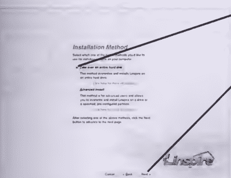

7. 点击“Next（下一步）”。你将进入安装过程的下一个步骤。继续到第 10 步，后续步骤将处理分区。如果你正在将 Linspire 安装到分区，请确保该分区至少有四 GB 的空间。这将确保你有足够的空间存放 Linspire 和你的文件。

8. 点击“Advanced Install（高级安装）”旁边的单选按钮。选中后圆圈内会出现一个小点。

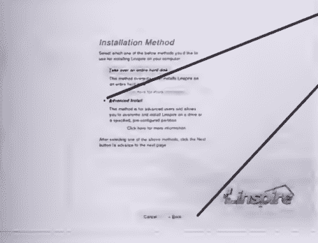

9. 点击“Next（下一步）”。你将进入安装过程的下一个步骤。

10. 点击你想安装操作系统的目标分区。点击分区后，该分区将被高亮显示。

11. 点击“Next（下一步）”。如果你在第 4 步选择了“Update”选项，跳转到第 15 步。否则继续到第 12 步。

12. 为你的电脑输入一个名称。这是在网络上识别电脑的方式。

13. 在 Administrator（管理员）和 Confirm Password（确认密码）字段中输入密码。密码将以星号形式显示，这样看着屏幕的人就看不到它。这是可选的，但有助于让你的电脑更安全。

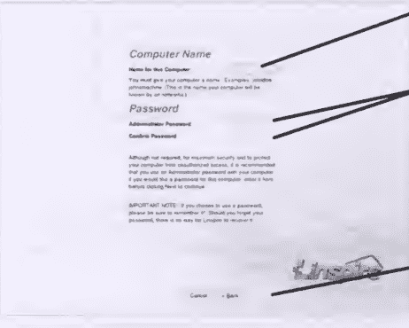

> **提示**：命名电脑时仅使用字母和数字。如果你想让电脑接入网络，连字符、下划线和其他字符会导致问题。

14. 点击“Next（下一步）”。你将进入安装向导的设置确认屏幕。

### 设置确认

Linspire 现在将按照设置安装到你的电脑上：

| 安装方法 | 目标 |
| :--- | :--- |
| | |

设置确认显示了你之前在步骤中所做选择的摘要。如果你发现错误，可以使用“Back（返回）”按钮返回任何步骤。

如果选择正确，点击“Finish（完成）”开始安装。

> **警告**：使用你确信能记得密码，因为 Linspire 无法找回它。将密码写下来存放在安全的地方可能是个主意。

15. 查看设置确认屏幕后，如果有任何需要更改的内容，点击“Back（返回）”按钮。

16. 点击“Finish（完成）”。将弹出一个对话框，在安装开始前给你最后一次返回并更改的机会。

### 设置确认

请核实你的选择

你选择了以下内容：

| 安装方法 | 目标 |
| :--- | :--- |
| Take over Disk（接管磁盘） | |

此过程将删除你所选驱动器上的**所有数据**。如果你对你的操作满意，选择 OK 继续；选择“Let Make Changes（允许更改）”然后点击“Back（返回）”按钮返回其他选择或进行更多更改。

17. 点击“OK”。你的电脑将重启，CD 将从 CD 驱动器中弹出。弹出后取出 CD，关上 CD 门并按下键盘上的 Enter 键。系统可能需要几分钟才能完全重启。

18. 点击“OK”。你的电脑将重启，CD 将从 CD 驱动器中弹出。弹出后取出 CD，关上 CD 门并按下键盘上的 Enter 键。系统可能需要几分钟才能完全重启。Linspire 现在已安装在你的电脑上并准备好使用。

## 首次运行 Linspire

第一次开启 Linspire 电脑时屏幕上的显示取决于几个因素：谁配置了你的 Linspire 电脑；是你自己安装的操作系统，还是电脑商店预装的。可能会出现多个屏幕，包括初始化屏幕、CNR 试用会员屏幕、教程视频以及可能的启动向导。

> **注意**：如果在安装过程中输入了管理员密码，在进入操作系统之前需要输入该密码。

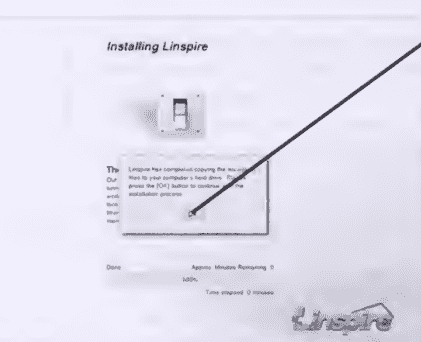

1. 点击右上角的“X”以清除屏幕上所有打开的窗口。

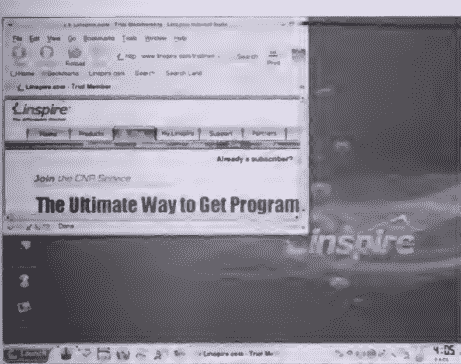

### 启动向导

当你第一次启动 Linspire 计算机时，启动向导会自动运行。如果此向导没有出现，请不要惊慌。这仅仅意味着在你的机器上安装 Linspire 的人已经为你完成了向导操作。无论如何，通过启动向导设置的所有配置都可以随时调整。你将在标题为“个性化和自定义 Linspire”的章节中学习如何进行这些调整。

1. 在审阅许可协议后，点击“我同意”文字旁边的复选框。框内将出现一个勾标记。

2. 点击“下一步”。你将进入向导的下一个屏幕。

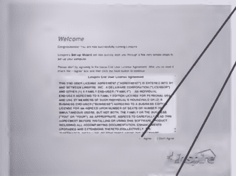

#### 音量

3. 点击并拖动滑动条来调整系统音量。向左拖动滑动条将降低音量，向右拖动将增大音量。

使用滑动条调整电脑音量。请注意，请按住低音按钮直到听到较低音量的的音乐播放，然后点击高音按钮。如果没有声音，请点击高音按钮一段时间。注意，你以后可以通过点击桌面右下角的选项随时调整音量。

4. 点击“下一步”。你将进入向导的下一个屏幕，在其中你可以调整时间和日期设置。

#### 日期与时间

5. 点击正确的日期。你可以通过点击日历顶部的箭头调整月份和年份。

6. 在提供的字段中输入当前时间。最简单的方法是点击每个字段旁边的向上或向下箭头。

7. 点击向下箭头。此功能允许你展开菜单，如果时区和区域尚未正确，你可以在其中进行调整。

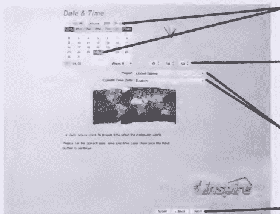

8. 点击“下一步”。你将进入高级设置屏幕。

9. 在高级设置对话框中点击“下一步”。或者你也可以点击任何方框来调整设置。这些设置中的大部分将在本书的后部分详细讨论。

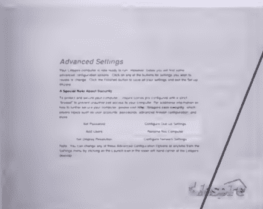

10. 点击“完成”。向导将关闭，你现在准备好探索 Linspire 的奇妙世界了。此时可能会出现一个教程视频。你可以选择观看此视频，或点击右上角的“X”来关闭教程。

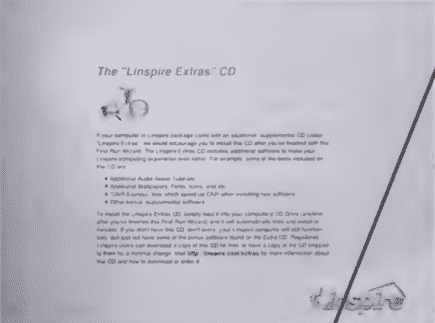

## LinspireLive!

你是那种一次只尝试一个而不是一次性全部投入的人吗？对很多人来说，改变是困难的，所以如果你对探索 Linspire 稍有犹豫，可以利用 LinspireLive!。LinspireLive! 让你通过从 CD 运行操作系统而不是将其安装到硬盘上，来享受 Linspire 带来的好处。Linspire CD 附在本书的后面。

运行 LinspireLive! 只需要将 CD 放入电脑的 CD 驱动器并重启系统。你唯一需要的工作是如果电脑尚未配置为从 CD 启动，则让电脑知道从 CD 而硬盘启动。参见本章节前面的“从 CD 启动”部分以获取有关访问 BIOS 的更多信息。

1. 将 Linspire CD 插入电脑的 CD 驱动器。

- 2. 重启电脑。根据你正在使用的操作系统，此操作可能涉及使用操作系统的重启功能，也可能需要关闭电脑再重新开启。片刻之后，Linspire 操作系统将加载，你可以开始探索这个创新操作系统的世界。

> LinspireLive! 是测试 Linspire 的绝佳功能，但它并不是永久解决方案。如果你喜欢你看到的内容，应该将 Linspire 安装到电脑的硬盘上。

## 结束 Linspire 会话

我知道……我知道……你对使用电脑太兴奋了，不想关闭它。我会再给你五分钟时间玩，但之后你必须回来阅读以下章节，该章节将指导你关闭电脑的正确程序。

## 结束 Linspire 会话

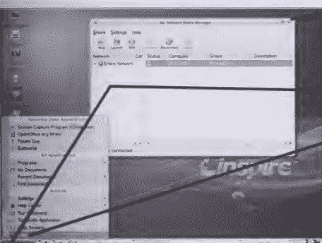

- 1. 点击右上角的“X”关闭任何已打开的应用程序。可能会提示你保存文件。
- 2. 点击“启动”按钮。将出现菜单。
- 3. 点击“注销/关闭”。将出现一个对话框并向你提供几个选项。
- 4. 点击选项之一，包括：
  - 结束会话：注销但保持电脑开启。
  - 快速重启：快速重启电脑使设置生效或解决问题。这通常只需要几秒钟。
  - 重启电脑：完全关闭并重新开启电脑。
  - 关机：让我猜三个它是干做什么的。

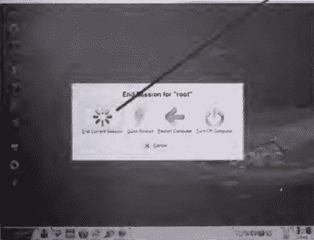

> 同时按下键盘上的 `Ctrl`、`Alt` 和 `Delete` 键将打开结束会话对话框。

## 熟悉 Linspire

你已经完成了安装过程，或者你刚刚开启了预装的 Linspire 计算机——现在该怎么办？是时候熟悉该操作系统，了解各个区域并开始享受乐趣了。

Linspire 操作系统的最大优点之一就是易于使用。无论你是从未用过电脑，还是深老兵，很快就能精通 Linspire。就此而言，如果你是经验丰富的用户，本章的大部分对你来说都是复习，建议浏览即可。相反，如果你是 Linspire 或电脑新手，请留下来，我们将一起发现这个操作系统。

在本章中，我们将涵盖：

* 识别用户界面组件
* 在 Linspire 中浏览
* 启动程序
* 管理打开的窗口

## 用户界面

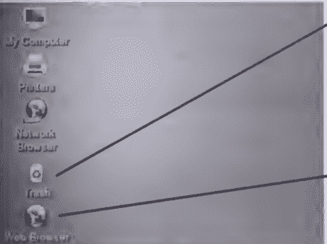

- **垃圾桶**。当你在电脑上删除一个文件时，它会被发送到垃圾桶。如果文件尚未从垃圾桶中清空，你就可以恢复不小心删除的文件。关于垃圾桶的更多信息将在“文件管理”章节中介绍。
- **Web 浏览器**。让你能够启动 Linspire 互联网套件，以便你可以在网上上冲浪。

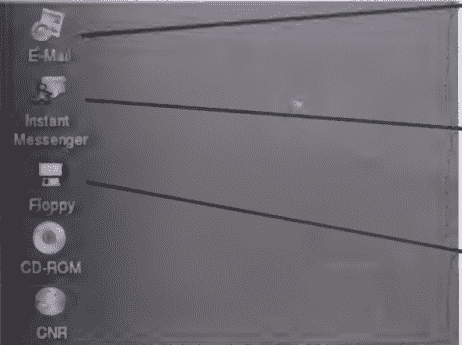

- **电子邮件**。让你能够启动 Linspire 电子邮件应用程序（称为“E-Mail客户端”），以便你能够发送、接收和管理你的电子邮件。
- **即时通讯工具**。让你能够与家人、朋友和同事进行即时通信。双击此图标将启动即时通讯程序。
- **软盘**。让你能够访问插入电脑的任何软盘上的文件。

## 第 2 章 了解 Linspire

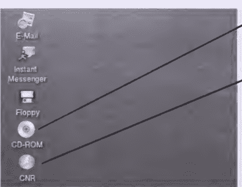

- **CD-ROM**。让你能够查看已插入电脑 CD 驱动器的 CD 内容。
- **CNR**。这是一种基于订阅的软件服务，它让在你的 Linspire 电脑上安装软件变得快速简单。

> 如果你没有看到想要启动的特定应用程序图标，请不要担心。在下一章节中，你将学习如何为任何程序创建图标。

## 面板

面板是位于桌面底部的栏，可以让你快速访问应用程序。面板的一个方便功能是，无论你运行了多少程序，它都保持可见。此功能对于管理正在运行的程序以及随时访问应用程序非常有帮助。在本章的后半部分中，我们将详细描述面板的四个部分。但现在，让我们先看看面板的各个部分及其功能。

## 用户界面

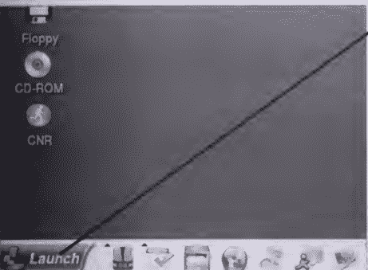

- **启动按钮**。让你能够启动电脑上的几乎每一个程序。通过启动按钮，你可以启动程序、配置系统、获取帮助或退出 Linspire。当你点击启动按钮时出现的启动菜单由某些操作、你所有的应用程序以及你最近访问的程序组成。

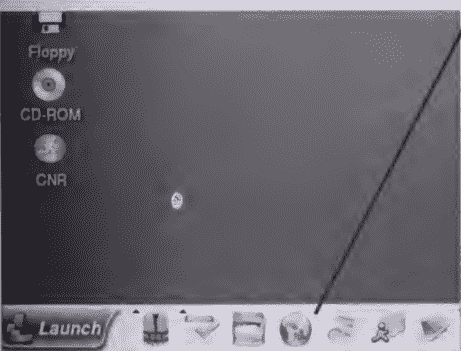

- **快速启动栏**。让你立即访问应用程序。快速启动栏永远不会被打开的程序阻挡，而且与桌面图标不同，快速启动栏上的图标只需点击一次即可启动相应的程序。

## 第 2 章 了解 Linspire

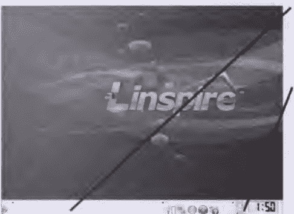

- **任务栏**。让你可以在程序之间进行最小化、最大化、恢复、关闭和切换。所有打开的程序都由任务栏上的图标表示。
- **系统托盘**。让你能够配置 Linspire 电脑的某些元素。此外，它还允许你设置和查看时间和日期、调整系统音量并关闭电脑。

## 快速启动栏

快速启动栏允许你通过单击鼠标按键来启动程序。与桌面上的图标不同，快速启动栏永远不会隐藏，因此你可以随时访问该栏上的任何应用程序。默认情况下，快速启动栏上有五个图标，但你可以添加或删除它们。关于自定义快速启动栏，可以在下一章节中找到。在下文中，我们将查看快速启动栏各个部分及其功能：

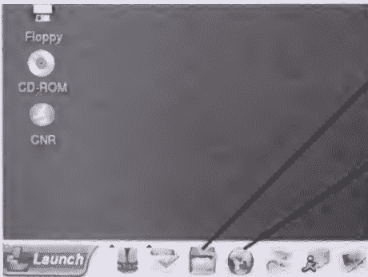

- **文件管理器**。让你访问电脑上的各种文件。
- **Web 浏览器**。让你启动 Web 浏览器，以便你能够浏览网页。
- **电子邮件**。让你启动电子邮件客户端，以便你能够发送、接收和管理邮件。
- **即时通讯工具**。让你与他人即时聊天，这是一个非常流行的功能。
- **显示桌面**。让你最小化所有运行的程序。

## 启动程序

为了完成任务，你需要启动各种程序。Linspire 提供了多种方法。

### 从图标启动程序

在本章节早期我们讨论了桌面上的各种图标。

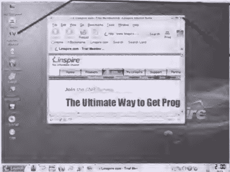

1. 双击 Web 浏览器图标。这将启动 Web 浏览器应用程序，以便你浏览网页。
2. 点击应用程序右上角的“X”关闭它。

> 你可能在问，“为什么当我启动应用程序时，光标旁边在闪烁？”闪烁表示电脑正在执行请求的任务。

### 从启动按钮启动程序

启动按钮让你访问电脑上的大多数程序。通过启动按钮，你可以根据功能选择程序。

## 启动程序

1. 点击启动按钮。启动菜单将显示各种供选择的操作。
2. 将鼠标指针悬停在“运行程序”上。这将显示不同的程序分类。
3. 点击“游戏”。这将显示你拥有的程序。
4. 点击“Tron”。这将启动 Tron 程序。你可以通过点击按钮关闭它。

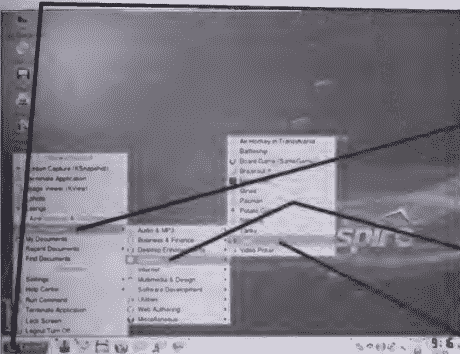

## 使用快速启动栏启动应用程序

正如我们之前学到的，使用快速启动栏启动程序比使用桌面图标更有优势。第一个优点是只需单击鼠标按键即可启动程序。另一个优势是，无论运行了多少程序，你始终可以访问快速启动栏。

1. 点击快速启动栏上的文件管理器图标。文件管理器将打开。

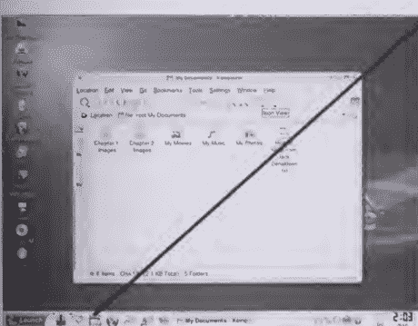

## 处理已打开的应用程序

现在很少有人在使用电脑时只运行一个程序。在当今快节奏的世界里，每个人都被要求多任务处理以更快地完成工作，因此你可能随时启动多个程序。如果你不知道如何正确管理打开的程序，这种做法可能会让你陷入一片混乱。

## 调整窗口大小

在 Linspire 中调整窗口大小只需点击并拖动即可。

1. 将鼠标指针置于窗口边缘。当您处于正确位置时，光标将变为双向箭头。
2. 向内拖动以缩小窗口大小。
3. 向外拖动以增大窗口大小。

## 操作打开的应用程序

## 最小化和恢复窗口

最小化程序仅意味着你暂时将其移出视野，以便在另一个程序中工作。当你最小化一个程序窗口时，程序本身不会受到最小化的影响。

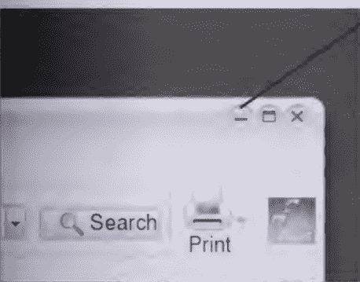

- 1. 点击最小化按钮。窗口将不再出现在屏幕上，但在任务栏中仍然可以看到它。

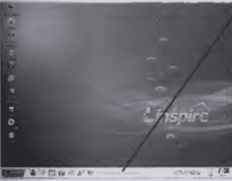

- 2. 点击任务栏上的一个图标。程序将恢复到之前的状态。

## 最大化和恢复窗口

最大化命令允许你调整窗口大小，使其占据桌面上所有可用的空间。

- 1. 点击最大化按钮。此操作将使程序在你的屏幕上显示为最大尺寸。

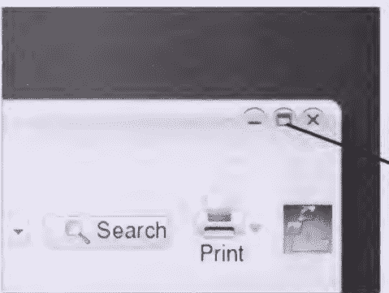

> 快速最小化、最大化或恢复窗口的另一种方法是右键点击任务栏上的程序图标。将出现菜单，你可以在其中选择所需的操作。

- 2. 点击恢复按钮。窗口将恢复到之前的尺寸。

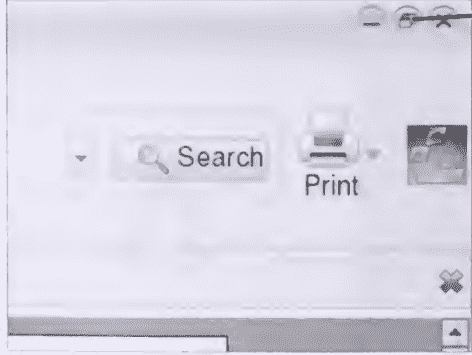

## 操作打开的应用程序

## 移动窗口

你可以轻松更改窗口的位置并将其重新定位到屏幕上的任何地方。除了最大化的窗口外，任何窗口都可以执行此操作。

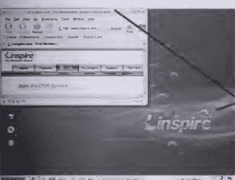

- 1. 从标题栏点击并拖动窗口到所需的位置。随着你的拖动，窗口会移动。
- 2. 松开鼠标按钮。此操作将允许你重新定位窗口。

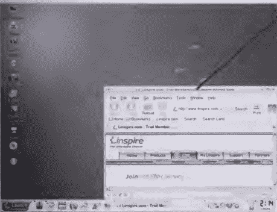

## 切换程序

任务栏将包含代表每个当前正在运行程序的矩形按钮。你可以使用任务栏在程序之间快速移动。

## 第 2 章 熟悉 Linspire

- 1. 点击任务栏中代表程序的图标。此操作将把选定的程序带到你正在运行的所有程序的前面。

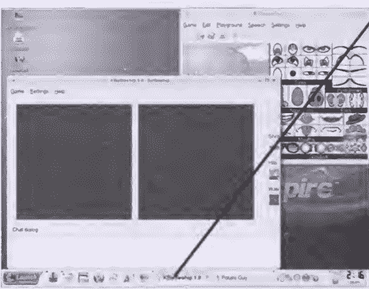

> 你可以按住 `Alt` 键然后按 `Tab` 键，在打开的程序之间切换。

- 2. 点击任务栏中的另一个程序图标。你刚刚选择的程序现在将出现在你之前选择的程序前面。

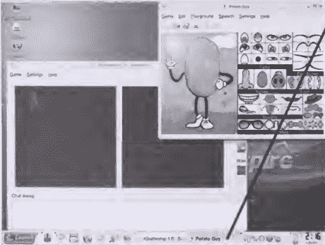

## 操作打开的应用程序

## 清理窗口

想象一下点击一下按钮就能清理并整理你的整个房子。虽然这种技术在未来几年内可能不会进入家庭，但在 Linspire 中是可以实现的。你可以在几秒钟内清理并整理打开的窗口。

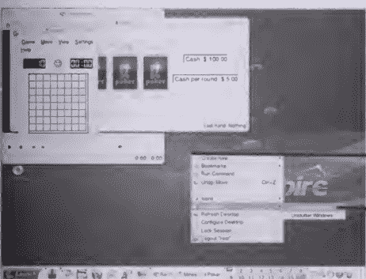

## 层叠窗口

层叠窗口会将窗口相互重叠，但打开的应用程序的标题栏将按层叠顺序可见。

- 右键点击桌面的任何空白区域。将出现一个菜单。
- 点击“窗口 | 层叠窗口”。你打开的窗口现在将重叠，并且所有的标题栏都暴露。

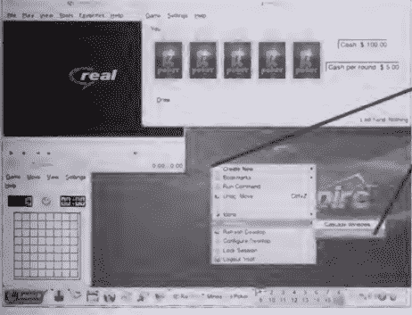

## 整理窗口

此功能将使打开的窗口均匀分布。

- 右键点击桌面的任何空白区域。将出现一个菜单。
- 点击“窗口 | 整理窗口”。你打开的窗口现在将分布在桌面的可用空间上。

## 始终置顶

有时你可能希望程序窗口保持在所有窗口之上，无论你当前是否正在该程序中工作。这的一个很好的例子是在电脑上看视频。无论你在哪个程序中工作，你都希望视频保持在上方，这样就不会被遮挡。

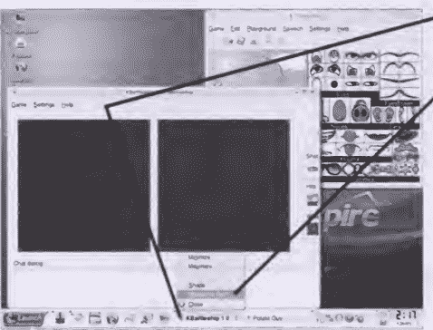

- 1. 右键点击任务栏中代表程序的图标。将出现一个菜单。
- 2. 点击“始终置顶”。这将程序窗口带到所有其他窗口之前。
- 3. 重复步骤 1 和 2 以移除此功能。

## 使用菜单

在大多数程序的顶部，你会找到一个菜单。

## 使用鼠标选择项

当你位于程序顶部，你会发现一个提供命令的菜单。可以通过多种方式访问命令。

## 打开的应用程序

无论你在程序中工作，你都可以点击菜单来执行命令。

- 1. 点击“文件”菜单。该菜单将打开。
- 2. 点击你想要执行的命令。该命令将执行。

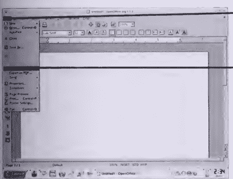

无论你在程序中工作，你都可以点击菜单来执行命令。

## 使用键盘选择项

选择菜单项的另一种方法是使用你的键盘。

## 第 2 章 熟悉 Linspire

- 1. 按住 `Alt` 键然后按 `Tab` 键在打开的程序之间切换。
- 2. 按下向下箭头键，直到到达你想要执行的命令。
- 3. 按回车键。该命令将执行。

## 滚动

当窗口中的信息比可以显示的内容多时，会出现滚动条。滚动条允许你在水平或垂直方向移动窗口，以便看到所有内容。

## 识别程序选择项

- 1. 点击滚动箭头移动窗口内容。每次点击箭头，内容都会向上或向下移动一个单位。
- 2. 点击并拖动滚动框。随着你的拖动，屏幕内容将移动。
- 3. 点击滚动条上的任何位置。窗口将跳转到你点击的位置。

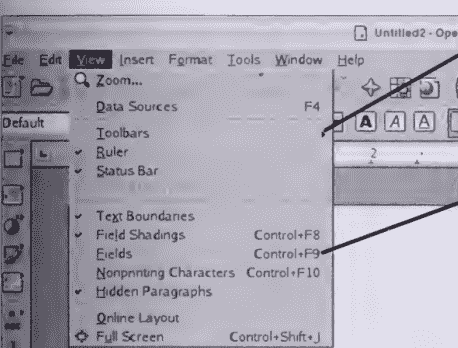

## 终止程序

这种情况在每个人身上都会发生。由于某些原因，程序死住了，我们无法继续在那里工作。如果我们使用任何其他操作系统，我们可能需要重启计算机。Linspire 允许我们在不重启系统的情况下终止应用程序。

- 1. 点击“启动”按钮。启动菜单将出现。
- 2. 点击“终止应用程序”。将出现终止冻结应用程序的对话框，光标将发生变化。
- 3. 点击冻结应用程序的任何位置。冻结应用程序将终止。

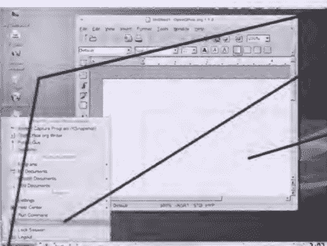

# Linspire 的个性化与定制

想象一下，如果每个人都必须开同样的车、穿同样的衣服、看同样的节目并吃同样的食物，世界会变成什么样。我们的个性对我们来说至关重要，因此，为什么 Linspire 在操作系统时提供这么多自定义选项也是可以理解的。

由于每个人的工作方式略有不同，Linspire 允许你更改计算机的外观和感受以适应你的个人喜好。从背景、屏幕保护程序到图标和屏幕尺寸，Linspire 赋予了你让操作系统属于自己的能力。Linspire 可以进行个性化定制，它提供了许多独特的工具，让你控制自己的工作方式。

在本章中，我们将涵盖：

- 更改背景
- 选择屏幕保护程序
- 操作图标
- 使用虚拟桌面

## 更改壁纸

个性化计算机外观最简单的方法是更改桌面背景图像。这种背景也称为“壁纸”。对于背景，你可以从各种图像中选择、创建自定义背景、使用你喜爱的照片，甚至运行幻灯片。

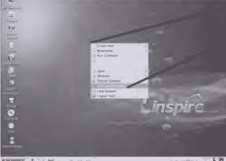

1. 右键点击桌面的任何空白区域。将出现一个菜单。
2. 点击“配置桌面”。将打开“配置 - 桌面”对话框，让你配置桌面的不同元素。

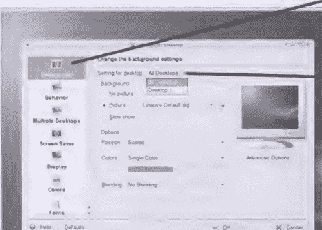

3. 如果尚未选中，点击“背景”图标。此操作将带你进入控制桌面外观的区域。
4. 点击“桌面设置”旁边的箭头，选择一个特定的虚拟桌面，可以在那里应用任何设置。或者，你可以选择“全部”将相同的设置应用于每个虚拟桌面。你将在本章稍后的部分学习更多关于虚拟桌面知识。

你现在必须决定你想要：图片、幻灯片还是彩色背景。

## 更改壁纸

### 选择预装壁纸

Linspire 带有各种不同的图像供你选择。在继续之前，请确保你已经遵循了之前“更改壁纸”部分中的步骤 1 - 4。

1. 如果尚未选中，点击“图片”旁边的单选按钮。圆圈内应该有一个圆点。
2. 点击下拉箭头。此操作将显示 Linspire 自带的背景列表。
3. 点击所需的壁纸。窗口将显示该壁纸的预览。
4. 点击“确定”按钮以完成背景更改。

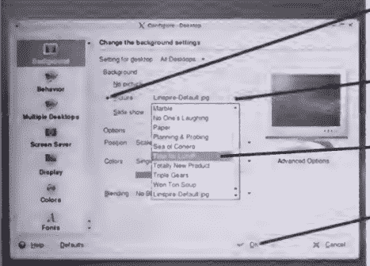

## 为壁纸选择自己的照片

没有什么比家人、假期旅行、宠物或你个人收藏中任何其他图像的图片更能让桌面更具个性化了。Linspire 让你轻松地将自己的照片添加到桌面。在继续之前，请确保你已经遵循了“更改壁纸”部分中的步骤 1 - 4。

1. 点击“浏览”按钮。将打开一个对话框，允许你在计算机中导航所需的图像。

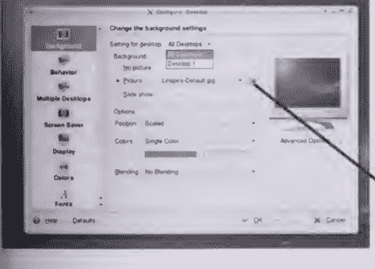

2. 导航到包含你想用作壁纸的图像目录。如果你不知道如何导航文件夹，请参阅标题为“文件管理”的章节。
3. 点击你想使用的图片文件。它将被选中。
4. 点击“确定”。对话框将关闭，图片将被加载。
5. 点击“确定”按钮以完成背景更改。

## 第 3 章 Linspire 的个性化与定制

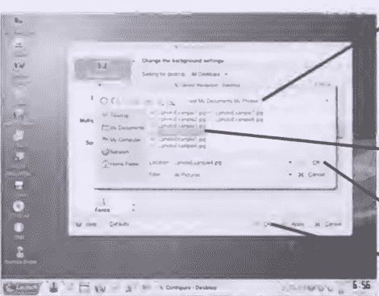

## 更改颜色

# 第 3 章 Linspire 的个性化与自定义

如果你更倾向于彩色背景而不是图像，Linspire 为你提供了该选项。你可以为背景应用多种颜色。在继续之前，请确保你已经遵循了“更改壁纸”部分中的步骤 1 - 4。

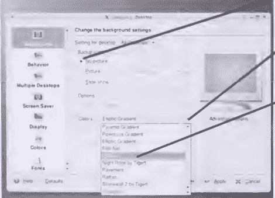

1. 如果尚未选中，点击“颜色 (Color)”旁边的单选按钮。圆圈内应该有一个圆点。
2. 点击下拉箭头。此操作将显示 Linspire 自带的背景列表。
3. 点击所需的壁纸。窗口将显示该壁纸的预览。（注：根据上下文，此处应为颜色预览）

## 使用图标

- 3. 如果尚未选中，请点击“布局 (Layout)”按钮。
- 4. 点击其中一个位置框以更改面板在屏幕上的出现位置。
- 5. 点击并拖动滑块来调整面板的长度。当您拖动时，对话框中的显示图标将显示调整后面板的外观。
- 6. 点击尺寸下拉按钮并为您的面板选择一个尺寸。
- 7. 点击确定 (OK)，对话框将关闭，更改将生效。

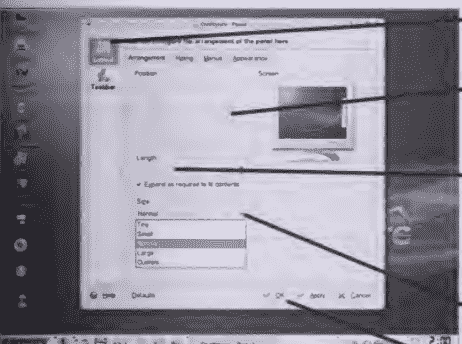

## 使用图标

图标是启动程序和访问文件的便捷方式。如果管理不当，图标实际上可能会变成双刃剑，因为它们可能会导致混乱、困惑和完全的杂乱。

## 整理桌面图标

我确定你办公室里一定有这样的人，也许你也是其中之一。当你路过他们的电脑屏幕时，会看到桌面上散落着几十个图标。如果你是那种需要从桌面访问文件和程序的人，这里有一个让屏幕保持整洁的快速方法。

- 1. 右键点击桌面任何空白区域。将出现菜单。
- 2. 选择“图标 (Icons)”选项，然后选择“排序图标 (Sort Icons)”。将出现子菜单，为你提供更多选择。
- 3. 点击所需的图标排序方法。

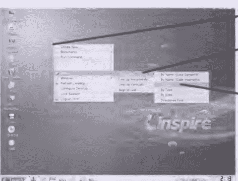

> 你也可以通过简单地点击并拖动图标到桌面上的所需位置来手动对其进行排序或移动。

## 删除图标

事实是，你大部分时间只使用的程序只有几个，那么为什么要让额外的图标弄乱你的屏幕呢？即使你删除了图标，你也可以随时回来重新创建它。

- 1. 右键点击你想要删除的图标。将出现菜单。
- 2. 点击“删除 (Delete)”。该图标将从桌面移除。如果出现“删除”对话框，请点击“删除 (Delete)”按钮以确认删除。

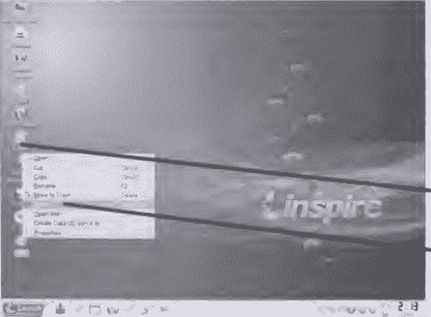

## 更改图标外观

如果你不喜欢某个图标的外观，可以更改它的外观。

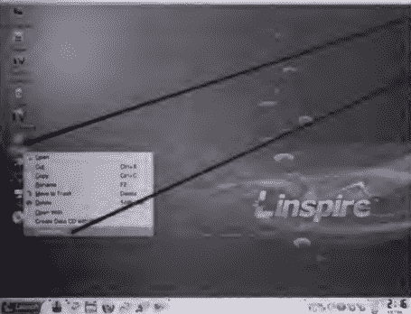

- 1. 右键点击你想要更改的图标。将出现菜单。
- 2. 点击“属性 (Properties)”。将打开一个对话框，你可以在其中调整外观。

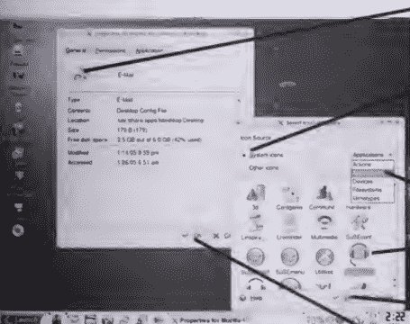

- 3. 点击对话框左上角的图标。将打开“选择图标 (Select Icon)”对话框。
- 4. 点击你想看到的图标源旁边的单选按钮。将出现该源的图标列表。
- 5. 点击下拉菜单并选择一个要查看的图标类别。
- 6. 点击所需的图标。它将被选中。
- 7. 点击“确定 (OK)”按钮。新图标将出现在对话框中。
- 8. 点击“确定 (OK)”按钮。新图标将出现在桌面上替换旧图标。

## 更改图标名称

你可以更改桌面上任何图标的名称，垃圾桶等系统图标除外。

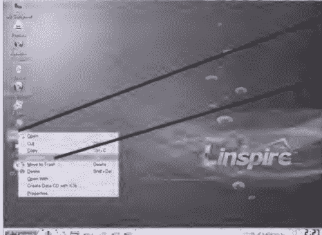

- 1. 右键点击你想更改的图标。将出现菜单。
- 2. 点击“重命名 (Rename)”。将打开“属性”对话框。
- 3. 图标名称现在将被高亮，你可以输入新名称。
- 4. 完成图标重命名后，按下键盘上的回车 (Enter)。

## 创建图标

我们都知道使用图标的益处，因此为任何应用程序创建图标是理所当然的。你可以通过从“启动 (Launch)”菜单中点击并拖动来实现。

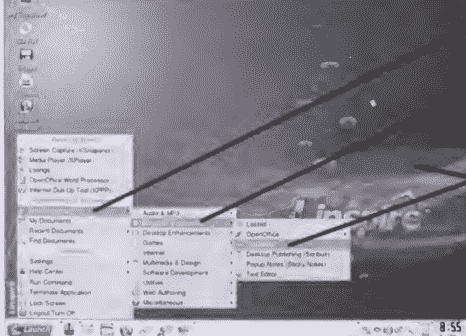

- 1. 点击“启动 | 运行程序 (Launch | Run Programs)”。将出现“启动”菜单。
- 2. 点击包含你想添加到桌面的程序类别。
- 3. 点击并拖动所需的程序到桌面。
- 4. 释放鼠标按钮，将出现菜单。
- 5. 点击“在此处复制 (Copy Here)”。你拖拽的程序的图标将出现在桌面上。

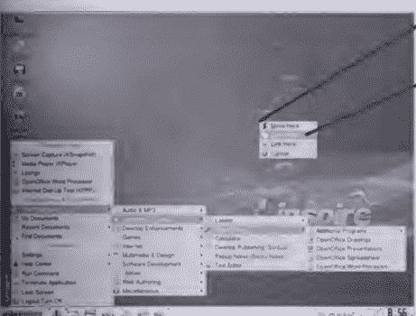

> 一旦你创建了桌面图标，你就可以像其他任何图标一样对其进行移动、排序和更改外观。

## 向快速启动栏添加图标

任何程序都可以添加到快速启动栏，这样只需点击一下鼠标按钮即可随时访问。

- 1. 点击“任务栏菜单 (Taskbar Menu)”按钮。它是快速启动栏末端的小黑色箭头。将出现菜单。
- 2. 点击“面板菜单 | 添加 | 应用程序按钮 (Panel Menu | Add | Application Button)”。将出现不同类别按钮的列表。

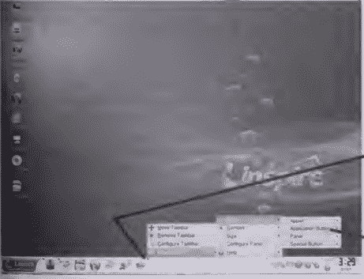

- 3. 点击“程序 (Programs)”。将出现不同类型的程序列表。
- 4. 点击你想添加的程序所属类别。将出现该类别下的程序列表。
- 5. 点击你想添加到快速启动栏的程序名称。你所选程序的图标现在将成为快速启动栏的一部分。

你可以通过右键点击图标并选择“移除 (Remove)”命令从快速启动栏中删除图标。

## 重新定位快速启动图标

快速启动栏上的图标可以重新定位，以自定义你的工作方式。

- 1. 右键点击你想移动的图标。将出现菜单。
- 2. 点击“移动 (Move)”。当你将指针跨过快速启动栏时，桌面的数量会随之增加。

## 虚拟桌面

- 3. 点击一次，图标将位于其位置。

> 你可以点击并拖动桌面上的任何图标。当你释放鼠标按钮时将出现菜单。

## 虚拟桌面

你相信如果我告诉你你的 Linspire 计算机实际上是不同的电脑吗？这可能有点夸张，Linspire 允许你拥有多达二十个桌面。对于喜欢在桌面上有几十个图标的人来说，虚拟桌面有很多益处。使用虚拟桌面，你可以创建一个用于游戏的桌面，另一个用于电子表格，另一个用于文档。在安装程序或从互联网下载大文件时可以使用虚拟桌面，因为你可以在一个桌面上工作。对你的虚拟桌面做什么由你决定，只需知道 Linspire 让它们易于使用和配置。

## 创建虚拟桌面

当你首次安装 Linspire 时，默认设置了一个桌面。如果你想充分利用虚拟桌面功能，可以设置总共二十个桌面。

- 1. 右键点击桌面任何空白区域。将出现菜单。
- 2. 点击“配置 (Configure...)”。“配置 - 桌面”对话框将打开，允许你配置桌面的不同元素。

- 3. 点击“多桌面 (Multiple Desktops)”图标。
- 4. 点击并拖动滑块向右移动。当你拖动时，桌面的数量会增加，最多二十个。

- 5. 为你设置的任何或所有虚拟桌面输入名称。要更改名称，双击现有名称然后开始输入。虽然你不需要为桌面命名，但如果命名了，会更容易管理。
- 6. 点击“确定 (OK)”。你的虚拟桌面现在配置完成。

按照相同的步骤删除虚拟桌面。将第 4 步提到的滑块完全向左移动，直到桌面数量减少到一个。

## 访问虚拟桌面

要访问虚拟桌面，你需要设置一个应用插件（微程序）。一旦设置完成，你就可以立即访问你的桌面。我们将使用的应用插件称为“页器（Pager）”选项。此功能允许你看到一系列按钮，每个按钮代表一个虚拟桌面。

- 1. 在任务栏上的任何空白区域点击右键。将弹出一个菜单。
- 2. 点击“添加 | 应用程序”。将出现一个不同应用程序的列表。

- 3. 点击“页器”。你之前设置的几个虚拟桌面将显示在任务栏上。

- 4. 点击所需的桌面编号，在不同的桌面之间切换。

## 将应用程序发送到桌面

假设你正在电脑上看视频，并希望确保切换到任何桌面时都能看到视频。你可以固定一个应用程序，让它显示在每个桌面上。或者，你可以将应用程序发送到任何其他桌面。

- 1. 点击任何已打开应用程序左上角的三角形。
- 2. 点击“发送到桌面”选项。

## 调整日期

在启动向导期间，系统提示你输入显示在计算机上的当前日期。你可以随时通过系统托盘调整输入的日期。

- 1. 点击系统托盘中的时钟。将出现一个日历，你可以在其中指定日期。
- 2. 点击今天的日期。它会被高亮。你也可以使用日历顶部的箭头在天和月份之间切换。
- 3. 再次点击时钟隐藏日历。你输入的日期现在将生效。

## 调整系统音量

你可以从系统托盘调整电脑音量的主控制。

- 1. 点击系统托盘中的音量图标。将出现音量滑块。
- 2. 点击并上下拖动滑块以调整音量。
- 3. 再次点击音量图标关闭滑块。主音量现在已设置。

# 第 4 章 文件管理

在操作电脑时，管理文件的能力至关重要。电脑中包含的所有内容，无论是文档、电子表格、照片、歌曲还是电子邮件，都以文件的形式存储。即使是运行的程序也是由不同的文件组成的。事实上，大多数计算机字面上拥有成千上万个不同的文件。

如果没有适当的文件分类系统，跟踪这些文件将完全是一场噩梦，而 Linspire 恰好有一套优秀的系统。文件被分类到文件夹（有时称为目录）并置于逻辑类别中。如果你有 Windows 等其他操作系统的经验，你会发现 Linspire 中的文件结构稍有不同，但你很快就能学会。

在本章中，我们将涵盖：

- 在电脑中导航查找文件
- 使用文件管理器
- 创建、编辑和删除文件
- 搜索你的电脑

## 文件管理器

将文件管理器想象成一个巨大的虚拟文件柜。你的电脑由成千上万个文件组成，文件管理器允许你以逻辑方式访问这些文件。就像在真实的文件柜一样，电脑中的文件包含在文件夹中。

- 从快速启动栏点击“文件管理器”图标。文件管理器将启动。或者，你可以双击桌面上的“我的电脑”图标来启动文件管理器的简化版本。虽然是简化，但它仍然提供了文件管理器的大部分功能。在书中找到的所有文件管理技术都可以使用这两个版本的文件管理器完成。

## 查看文件

文件管理器为你提供了电脑上所有文件的图形化表示。你可以根据自己的偏好调整这种图形化表示。例如，你可以以不同大小的图标查看文件，选择以列的形式查看文件，或更改视图结构。你选择的视图类型取决于你的目标和偏好。

- 点击并按住“视图”按钮。将出现一个列表。选项包括：
  - 图标视图：此视图以图标显示文件。
  - 列视图：此视图与图标视图相同，但按列显示。
  - 列表视图：此视图以列表显示文件。
  - 树视图：此视图与列表视图相似，但以树状结构显示文件夹。

## 更改大小

如果你难以查看图标，可以调整大小。

- 1. 点击“视图”按钮。将出现一个列表。
- 2. 点击“大小”。将出现一个列表。
- 3. 点击所需的大小。图标将改变。

## 使用签书

如果你像大多数电脑用户一样，会有三个或四个文件夹用于存储大多数文件。与其点击各种文件夹来获取所需文件，不如可以使用签书。签书记录了特定文件夹的位置并让你立即跳转到该位置。

- 1. 导航到你想创建签书的位置。
- 2. 点击书签。将出现书签菜单。
- 3. 点击添加书签。工具栏上将出现按钮，你现在可以使用它快速跳转到该位置。或者，你可以随时按 `Ctrl+B` 来创建书签。
- 4. 重复步骤 1 - 3 以添加任何其他书签。
- 5. 点击工具栏上的任何书签按钮，即可快速跳转到这些位置。

## 导航文件

当你启动文件管理器时，会被带到“主目录”位置。将主屏幕想象成你的基地，无论你导航到哪里都可以返回。文件管理器为你提供了各种导航工具。如果你好奇某些文件夹的用途，请参考后文“了解 Linspire 文件夹”。

- 1. 双击“系统”文件夹。它的内容将显示。

- 2. 双击任何文件夹。该文件夹的内容将显示。在文件夹内部你通常会找到其他文件夹和文件。
- 3. 点击“向上”按钮移动一级。
- 4. 点击“返回”按钮。这将带你回到查看过的屏幕。你可以继续点击“返回”按钮直到回到起点。

- 5. 点击“前进”按钮。如果你之前点击过“返回”按钮，点击“前进”将带你回到点击返回之前的位置。
- 6. 在导航的任何一点点击“主页”按钮。这将带你回到主位置。

> 通过双击文件管理器中的任何文件即可启动与文件相关的程序。例如，双击 PDF 文件将打开 PDF 查看器。

## 选择文件和文件夹

在进行任何类型的文件管理（如复制、移动或删除文件夹）之前，你必须先选择你想要操作的项目。你可以使用几种不同的方法来选择单个或多个文件和文件夹。

1. 点击一个文件或文件夹。高亮的文件或文件夹表示你已选中它。
2. 按住 `Ctrl` 键并点击任何其他文件或文件夹。它们现在也会选中。
3. 点击屏幕上的任何空白区域。文件和文件夹将取消选中。
4. 点击一个文件或文件夹。高亮的文件夹表示你已选中它。
5. 按住 `Shift` 键并点击窗口中其他地方的文件。你点击的原始文件和最后点击的文件之间相同行和列的所有文件现在都将被选中。
6. 将鼠标指针置于文件之间的空白区域。
7. 对角线点击并拖动。当你拖动时，会出现一个选择框。选择框接触到的文件和文件夹将被选中。

## 复制和粘贴文件

复制和粘贴是处理文件和文件夹最常见的任务。当你剪切或复制一个文件或文件夹时，它会被发送到虚拟剪贴板。然后你可以将其粘贴到你指定的任何位置。在这里我们将介绍复制的最快方法之一。

- 1. 使用其中一种选择方法选择想要复制的文件或文件夹。
- 2. 在想要复制的选中内容上点击右键。将出现菜单。
- 3. 点击复制。选中内容将被复制到剪贴板。在键盘上按 `Ctrl+C` 也可以启用复制命令。
- 4. 导航到你想粘贴文件的位置。
- 5. 在屏幕的任何空白区域点击右键。将出现菜单。
- 6. 点击粘贴。选中内容将被粘贴到此位置。或者，你可以按 `Ctrl+V` 粘贴文件。

> 复制和粘贴文件夹时，文件夹及其所有内容都将粘贴到新位置。

## 移动文件

移动文件与复制相同，唯一的例外是你将使用剪切命令而不是复制命令。

- 1. 选择想要移动的文件或文件夹。
- 2. 在想要移动的选中内容上点击右键。将出现菜单。
- 3. 点击剪切。选中内容的图标将变为暗色。
- 4. 导航到你想移动文件的位置。
- 5. 在屏幕的任何空白区域点击右键。将出现菜单。
- 6. 点击粘贴。选中内容将被移动到此位置。或者，你可以点击工具栏上的粘贴按钮。

## 重命名文件

无论你是想给文件和目录起更具体的名称，还是仅仅不喜欢最初选择的名称，都可以快速更改它们的名称。

- 1. 点击想要重命名的文件或文件夹。它将被高亮。

- 2. 按键盘上的 `F2` 键。文件名现在将高亮，你可以给它一个新名称。
- 3. 为文件输入新名称。
- 4. 按键盘回车键或点击屏幕上的其他地方。你的文件现在将有一个新名称。

## 创建文件夹

文件夹是保持电脑文件井齐有序的重要部分。虽然 Linspire 提供了一些初始文件夹（如“我的文档”），但创建额外的文件夹来组织和分类你的工作是一个好主意。创建文件夹的过程只需几次点击。

- 1. 导航到你想创建文件夹电脑的位置。
- 2. 在屏幕的任何空白区域点击右键。将出现菜单。
- 3. 点击新建并点击文件夹……将出现对话框要求你命名文件夹。
- 4. 输入一个描述其内容的名称。
- 5. 点击确定。文件夹将被创建。
- 2. 双击 `mnt` 文件夹。你将看到所有挂载到电脑的驱动器。你可以双击所需的设备查看其内容。

## 垃圾箱

与普通的垃圾不同，在 Linspire 中，你不需要为了丢弃文件或文件夹就早起忍寒提着沉重的袋子走到路边。垃圾箱本身就是你的安全网。当你在 Linspire 中删除文件时，它会被发送到垃圾箱。

1. 选择想要删除的文件或文件夹。它将被高亮。
2. 按键盘上的 `Delete` 键。将出现对话框确认你是否要将其发送到垃圾箱。
3. 点击垃圾箱按钮。文件将被发送到垃圾箱。

> 你可以通过按住 `Shift` 键按 `Delete` 键跳过垃圾箱并完全删除文件。将出现对话框确认你要删除该文件。

## 查看和恢复垃圾箱项目

如果你不小心删除了某个项目，或者现在意识到你实际上需要那个丢掉的项目，可以恢复它。

- 双击桌面上的垃圾箱图标。文件管理器将打开包含垃圾的文件夹。
- 将文件剪切并粘贴到任何位置。

## 清空垃圾箱

如果你不再需要发送到垃圾箱的文件，可以清空垃圾箱的文件。请记住，一旦清空垃圾箱，文件将永久消失。

- 1. 右击垃圾箱图标。将出现菜单。
- 2. 点击清空垃圾箱。垃圾箱中的文件将被永久删除。

## 查找文件

虽然良好的文件系统有助于你保持井然有序，但你经常会在导航文件管理器时发现找不到想要的文件。对于这些情况，你可以利用 Linspire 的搜索功能。

- 1. 点击启动按钮。将出现菜单。
- 2. 点击查找文档。文件对话框将打开，你可以开始搜索过程。

## 查找文件

3. 在“命名”（Named:）处：输入你想要检索的文件名称。如果你不知道文件名，只知道它是什么类型的文件，可以在“命名”字段中输入一个星号 `*`，后跟文件类型。例如，如果你想在特定位置查找所有的 mp3 文件，只需在“命名”框中输入 `*.mp3` 即可。
4. 点击“浏览”（Browse）按钮。你现在可以选择想要进行搜索的位置。
5. 如果你想在整个计算机中搜索文件，请点击“我的电脑”（My Computer）。否则，如果你只想在特定文件夹中搜索，可以点击对话框右侧的文件夹。双击展开文件夹以查看其中是否有子文件夹。
6. 点击“确定”（OK）。你将返回“查找文件”对话框。

## 第4章 文件管理

- 7. 点击任何复选框以选择或取消其他搜索标准。这包括在子文件夹中查找、进行大小敏感搜索以及使用文件索引。
- 8. 点击“查找”（Find）。所有符合你搜索标准的文件将列在窗口中。搜索结果将包含文件位置和其他文件详细信息。你现在可以进行另一次搜索，或点击窗口右上角的“关闭”（Close）按钮关闭窗口。

> 你可以通过点击查找文件对话框中的“内容”（Contents）或“属性”（Properties）选项卡来执行更详尽的搜索。你可以为搜索添加额外的标准。

## 使用对话框进行文件管理

在几乎每个计算机应用程序中，你都需要导航计算机以选择、打开或保存文件。这通常通过一个提供文件访问的对话框来实现。虽然每个应用程序的对话框有所不同，但在许多情况下，对话框的工作方式与文件管理器几乎完全相同。每当你需要导航计算机硬盘器、选择并复制文件或文件夹、移动文件，甚至创建文件夹时，都可以使用对话框而不是访问文件管理器。由于不同的程序具有不同风格框，某些对话框将具有你可能不熟悉的按钮。在处理对话框中熟悉的按钮时，最好的主意是将鼠标指针悬停在按钮上。在大多数情况下，一两秒钟后，会出现一个工具提示，描述该按钮的功能。另一个好主意是右键点击对话框中的文件以查看可用选项。在下一页中，你将看到不同程序的对话框示例，它们提供了某些文件管理功能。

### 对话框示例一

这是 OpenOffice 文字处理器的“打开”对话框。如你所见，有各种文件管理功能可用。

- **新文件夹**（New Folder）。让你创建一个新文件夹来存储文件。
- **上级**（Up）。此功能将允许你在文件层次结构中向上移动一级。
- **右键菜单**（Right-Click Menu）。在此对话框中对文件点击右键可以重命名或删除文件。
- **排序**（Sort）。你可以通过点击列标题对文件进行排序。

### 对话框示例二

这是图像查看器的“打开”对话框。如你所见，有与文件管理器看起来完全不同的文件管理功能。

- **新文件夹**（New Folder）。让你创建一个新文件夹来存储文件。
- **右键菜单**（Right-Click Menu）。当你在此对话框中对文件点击右键时，可以对文件排序或查看其属性。
- **导航按钮**（Navigation Buttons）。此对话框有各种导航按钮，允许你快速跳转到特定区域。

## 理解 Linspire 文件夹

当你启动文件管理器时，你会进入“主”（Home）窗口，其中包含四个非常自显易懂的图标。“我的桌面”（My Desktop）快捷方式带你进入系统上的一个文件夹，其中包含桌面的内容。“我的文档”（My Documents）快捷方式带你进入 Linspire 设置的用于存储文档的文件夹。“网络共享”（Network Shares）快捷方式带你进入一个允许你查看网络上其他计算机的窗口。最后是“系统”（System）文件夹。其他图标只是计算机内部文件夹的快捷方式，而“系统”文件夹实际上包含了你计算机上所有的文件夹。如果你没有使用过基于 Linux 的系统，“系统”文件夹中的文件夹可能会让你感到有些困惑。以下是系统中包含的大多数文件夹用途简要介绍：

- `bin`。用于二进制（binary），`bin` 文件夹包含运行关键程序和操作系统所需的二进制文件。
- `boot`。此文件夹包含计算机首次启动时需要的文件。
- `dev`。控制你的设备的文件在此处。
- `etc`。此文件夹包含系统程序的关键配置文件。
- `home`。这是每个用户在会话开始时登录的文件夹。
- `lib`。此文件夹包含系统上程序使用的库。

> 不要删除“系统”文件夹内直接找到任何文件夹。这些文件夹包含的许多文件对于你的程序和操作系统的运行至关重要。

- `mnt`。此文件夹包含你挂载的硬件，如不同的软磁盘或 CD 驱动器。
- `opt`。此文件夹包含附加程序的信息。
- `proc`。此文件夹包含存储在计算机内存中的信息。
- `root`。包含管理员账户的文件。

## 归档文件

- `sbin`。此文件夹包含用于管理系统功能的二进制文件。
- `tmp`。此文件夹包含临时文件。
- `usr`。你安装的软件的应用程序在此目录中。
- `var`。此文件夹包含在系统运行期间大小变化的文件。

## 归档文件

当我十四岁时，我在麦当劳找了我的第一份工作，我的职责之一是将垃圾带到后门并通过压缩机处理。我总是对垃圾桶在压缩后垃圾桶里能装下这么多垃圾而感到惊奇。你的 Linspire 计算机内置了压缩机。如果你发现硬盘空间不足，可以对一些文件进行归档。归档基本上是压缩文件，使它们不再占用那么多空间。在发送电子邮件时，归档特别有用。如果你有一个太大无法通过电子邮件发送的文件，可以将其归档以减小文件大小。在 Linspire 中有一个名为“归档与 Zip 工具”（Archiving & Zip Tool）的程序，它不仅允许你归档文件，还可以扩展发送给你的归档文件。你可以从多种不同的压缩格式选择来归档文件。

## 第4章 文件管理

- 1. 点击“启动程序”（Launch Programs）。将出现程序分类列表。
- 2. 点击“实用程序”（Utilities）。将出现各种实用程序。
- 3. 点击“归档与 Zip 工具”。归档与 Zip 程序将打开。
- 4. 点击“新建”（New）按钮。归档对话框将打开。
- 5. 导航到你想创建归档的位置。
- 6. 在“位置”（Location）字段中为你的归档输入名称。
- 7. 点击下拉菜单查看存档类型列表。
- 8. 点击所需的方法。如果不确定选择哪种，选择 `zip`。
- 9. 点击“保存”（Save）按钮。

## 归档文件

- 10. 点击“添加文件”（Add File）或“添加文件夹”（Add Folder）按钮。将出现一个对话框，你可以在其中选择想要添加到归档的文件或文件夹。
- 11. 导航到包含你想归档的文件的文件夹。
- 12. 点击所需的文件。它将被高亮。你可以按住 `Ctrl` 键并点击该文件夹中任何你想添加到归档的其他文件。
- 13. 点击“确定”（OK）。你选择的文件现在将添加到归档中。

> 文件的缩减量取决于两个因素：你选择的压缩方法类型（`zip`, `tar` 等）以及原始文件类型。

- 14. 重复步骤 8 - 12，向你的归档添加任何其他文件或文件夹。
- 15. 点击“关闭”（Close）按钮关闭归档与 Zip 工具程序。归档中的所有文件现在都将进行压缩。

> 许多电子邮件程序会阻止包含使用 `zip` 方法归档的附件的消息。如果你要通过电子邮件发送文件，可能需要使用不同的压缩类型。

## 解压或扩展压缩文件

“解压”（Unzipping）已成为扩展归档文件的流行术语，无论压缩包是否为 zip 文件，该词通用。扩展压缩包的实际过程非常简单。

- 1. 按照上一节所述，打开“压缩和 Zip 工具”程序。
- 2. 点击“打开”按钮。将出现“打开”对话框。
- 3. 导航到包含你想扩展的压缩文件的文件夹。
- 4. 点击你想要扩展的压缩包。
- 5. 点击“打开”。压缩包将打开，你就可以查看其内容。

## 将文件刻录到 CD

- 6. 点击“提取”按钮。将打开一个对话框，你可以在其中指定要提取文件夹的位置。
- 7. 输入你想提取文件夹的位置。或者，你也可以点击浏览字段右侧的蓝色文件夹，打开一个对话框，你可以在其中选择一个文件夹。
- 8. 点击“确定”按钮。文件将提取到你指定的位置。你提取文件的文件夹也会打开。

## 将文件刻录到 CD

随着 CD 刻录机和 CDR（可写 CD 光盘）的价格低廉，许多人正通过将文件刻录到 CD 来共享和存储文件。无论你是想和朋友分享你喜欢的照片，还是仅仅备份你的文件，Inspire 都能让这一切变得轻而易举。实际上有几种方法可以刻录 CD，在这里我们将探索使用“CD & DVD 刻录程序”。

- 1. 点击“启动 | 运行程序”。将出现一个类别子菜单。
- 2. 点击“音频和 MP3”。将出现该类别下的各种程序。
- 3. 点击“CD & DVD 刻录”。这将启动一个允许你将文件刻录到 CD 的程序。第一次启动该程序时，系统会要求输入 CD 刻录机的写入速度。这些信息可以从你购买计算机或 CD 刻录机的公司获得。

- 4. 使用方向键输入你的 CD 刻录机的写入速度。
- 5. 点击“确定”。对话框将关闭。
- 6. 点击“新建数据 CD 项目”。你现在可以选择要包含在 CD 中的文件和文件夹文件夹。

- 7. 双击窗口左侧面板中的文件夹以显示其内容。你可以像在“文件管理器”中一样浏览不同的文件夹。
- 8. 从右上面板格点击并拖文件或文件夹到“当前项目”。该文件将被添加到 CD 项目中。
- 9. 检查指示项目状态的绿色条。

- 10. 重复步骤 7 - 9，直到你完成向项目添加数据的操作。

大多数 CD 允许你添加高达 700MB 的文件。如果你正在将文件刻录到 DVD，通常可以存储高达 4.7 GB 的数据。

## 将文件刻录到 CD

- 11. 点击你想从项目中删除任何文件。
- 12. 点击键盘上的 `Delete` 键。文件将从项目中移除。
- 13. 将一张可写 CD 插入你的 CD 刻录机。
- 14. 点击“刻录”。将出现一个对话框，你可以在其中调整刻录机的设置。

- 15. 检查设置并根据需要进行更改。
- 16. 点击“刻录”。文件复制到 CD 的过程将开始。屏幕上将出现进度指示器告知项目完成百分比。完成后，CD 将弹出，并播放提示音表示操作成功。

## 文字处理

通常当你购买计算机时会得到一个文字处理程序。它用于创建和编辑文档。

## 启动文字处理

文字处理位于开始菜单。桌面上可用。

- 1. 点击“启动 | 运行程序”。将出现一个类别子菜单。
- 2. 点击“所有”。将出现一个子菜单。
- 3. 点击“文字处理”。将出现另一个子菜单。
- 4. 点击“文字处理”。此操作将启动该程序。

## 创建新文档

如果你有兴趣从头创建一个文档，可以轻松实现。

- 1. 点击工具栏上的“新建”按钮。一个空白文档将打开。

## 打开现有文档

在很多情况下，你会继续处理之前打开过的文档。在这些情况下，你只需要打开文件。

- 1. 点击“文件 | 打开”。将出现“打开”对话框。

> 执行“打开”命令的快捷键是 `Ctrl+O`。

- 2. 导航到包含你想打开的文件的文件夹。
- 3. 点击你想打开的文件。文件将被选中。
- 4. 点击“打开”。你选择的文件将打开。

## 打开其他格式

难以置信，并不是所有人都使用相同的软件程序创建所有文档。别担心，文字处理支持你可以打开的多种不同文件类型。打开这些类型文件的步骤与其他任何文件相同。

- 1. 点击“打开”图标。此操作将调出“打开”对话框。
- 2. 点击“文件类型”下拉菜单按钮查看可以打开的不同文件类型列表。
- 3. 点击所需的文件类型，以便在对话框中仅显示这些类型的文件。
- 4. 点击你想打开的文件并按下键盘上的回车键。你选择的文件将打开。

## 保存

- 1. 点击“文件”。文件菜单将展开。
- 2. 点击“另存为...”。“另存为”对话框将打开。

- 3. 导航到您想要保存文件的文件夹。
- 4. 为您的文档输入名称。最好使用一个能最佳描述文档内容的名称。
- 5. 点击“保存”。文件将以您指定的名称保存到所选文件夹中。

## 保存

在第一次保存文件后，您应该在编写文档期间以及完成编辑后定期保存。

> 当您保存文档时，它将以其原始文件格式保存。要将其保存为不同的格式，请从“另存为”对话框中的“文件类型”下拉列表中选择一种格式。

- 1. 点击工具栏上的“保存”按钮。保存按钮是一个小磁盘的图标。

| 文件 | 编辑 | 视图 | 插入 | 格式 |
|---|---|---|---|---|
| 默认 | Arial | | | |

## 页面大小和边距

事实是，99% 的情况下，您会在 8.5 x 11 英寸的纸上创建文档，这是北美的标准尺寸。如果您想使用不同尺寸的纸，您也可以轻松更改尺寸。

- 1. 点击“格式”。格式菜单将出现。
- 2. 点击“页面”。“页面样式”对话框将打开。您现在将拥有页面设置选项。

- 3. 点击箭头键调整页面的宽度和高度。或者，您也可以从格式下拉菜单中选择预设尺寸。
- 4. 点击所需页面方向旁边的单选按钮。
- 5. 点击箭头键调整页边距。
- 6. 点击“确定”。您应用的更改将生效。

## 选择文本

在对文本进行格式化之前，您必须先告诉文字处理器您想要格式化的文本。可以通过高亮您想要更改的字母、单词、段落或页面来执行此操作。有多种选择方法。

## 使用鼠标选择

选择文本最常用的方法是使用鼠标点击并拖过想要选择的文本。使用鼠标按钮，您也可以快速选择范围。

- 1. 将鼠标指针放置在想要选择的单词、句子或段落之前。
- 2. 点击并向右拖动。随着您的拖动，光标经过的单词将被选中。
- 3. 释放鼠标按钮。您高亮显示的区域现在将被选中。
- 4. 点击文档的任何空白区域以取消选择文本。

将即时消息想象成“加强版的电子邮件”。虽然电子邮件相比它有许多优势，但即时消息进行会话所需的步骤更少，以便您能够快速进行通信。

> 如果您双击一个单词，整个单词将被选中。如果您三击一个单词，整行将将被选中。如果您按下 `Ctrl+A`，文档中的所有内容将被选中。

# 字体

## 使用键盘选择

要选择文本，您还可以结合鼠标使用键盘。

1. 点击您想要开始选择的位置。光标将在该位置闪烁。
2. 按住 `Shift` 键并点击您想要选择结束的地方。将从您在第 1 步中点击点到您现在点击的地方创建一个选择。
3. 点击任何其他位置以取消选择。

## 字体

想象一下进入麦当劳却只能点一个汉堡。没有芝士汉堡，没有巨无霸，没有薯条、奶昔，只有汉堡。我确定你和数百万万其他人并不会高兴的；我们都喜欢选择。每个人都有不同的口味，对字体的口味也不一样。出于这个原因，Word 允许您从系统上安装的任何字体中选择。

1. 创建一个包含您想要更改的文本的选择。您可以使用任何一种选择方法。如果您在更改字体的任何方面之前没有进行选择，更改将适用于从您光标处开始键入的任何新文本。
2. 点击字体下拉菜单查看字体列表。
3. 点击滚动按钮或拖动滚动框以浏览不同的字体。
4. 点击所需的字体。该字体将应用于所选文本。

## 字体大小

当您更改字体大小时，不仅更改了它的高度和宽度，还更改了行间间距。

1. 创建一个包含您想要更改的文本的选择。您可以使用任何一种选择方法。如果您在更改字体的任何方面之前没有进行选择，更改将适用于从您光标处开始键入的任何新文本。

## 字体颜色

使用颜色可以使文档的某些元素脱颖而出。请记住，某些颜色可能会让文档难以阅读。

1. 创建一个包含您想要更改的文本的选择。如果您在更改字体的任何方面之前没有进行选择，更改将适用于从您光标处开始键入的任何新文本。

2. 点击并按住字体颜色按钮。会出现调色板。
3. 点击所需的颜色。所选文本的颜色将改变。您可以点击字体窗口中的“关闭”按钮将其关闭。

## 加粗、斜体、下划线

我记得 80 年代初第一次用电脑时。我对它可以加粗、斜体和下划线文本感到非常兴奋。虽然这三种效果多年来一直被使用和滥用，但它们仍然证明是有价值的。

1. 创建一个包含您想要更改的文本的选择。如果您在更改字体的任何方面之前没有进行选择，更改将适用于从您光标处开始键入的任何新文本。
2. 点击下划线按钮。所选文本将添加下划线。
3. 点击斜体按钮。所选文本将变为斜体。
4. 点击加粗按钮。所选文本将加粗。
5. 选择任何已加粗、斜体或下划线的文本。工具栏上的按钮将显示高亮状态。
6. 点击任何按钮以移除所选文本的该效果。

## 其他字体效果

除了传统的效果外，还有许多其他的字体效果可以应用。这些效果包括添加自定义下划线、浮雕文本、添加阴影和让文本闪烁。

## 对齐

1. 选中包含你想更改的文本的内容。
2. 点击 `格式 (Format)` | `字符 (Character)...`。将弹出一个对话框，你可以在其中添加不同的效果。

3. 点击你想要应用的不同效果旁边的选框。

4. 点击任何下拉菜单从不同的效果中进行选择。
5. 点击确定。该效果将应用于所选文本。

## 对齐方式

更改文本的对齐方式非常简单。只需选择文本，然后选择所需的对齐方法即可。

1. 选中包含你想对齐的文本的内容。
2. 点击所需的对齐按钮。你的选项包括：
   - 两端对齐 (`Justified`) – 允许整行文本扩展到页面边缘。
   - 右对齐 (`Align Right`) - 允许所有文本右侧对齐。
   - 居中 (`Centered`) - 允许文本在页面上居中。
   - 左对齐 (`Align Left`) - 允许所有文本左侧对齐。

## 编号

询问许多法律秘书，他们会告诉你离开这个功能就无法生存。对行和段落编号是非常重要的。你有多种方法可以创建编号列表。

### 自动编号列表

默认情况下，自动编号列表功能是开启的。此功能允许你只需通过使用 `Tab` 键即可自动创建编号列表。

1. 输入数字 1 和一个点，然后按 `Tab` 键。
2. 输入你想作为第一行的文本。
3. 按 `Enter` 键。数字 2. 将自动出现。

4. 对你想要添加到编号列表的任何剩余项目重复步骤 2 - 3。
5. 按两次 `Enter` 键以结束编号列表。

在你文本中任何有硬换行符的地方，列表都会创建一个新编号。或者，你也可以通过点击编号按钮从头开始创建编号列表。

1. 选中你想转换为编号列表的文本。它将被高亮。
2. 点击编号按钮。将从所选文本创建一个编号列表。
3. 再次点击编号按钮以移除编号列表。

## 项目符号

项目符号用于突出关键点。虽然编号列表用于按顺序组织信息，但项目符号用于强调要点。你可以从头创建一个项目符号列表。

1. 选中你想转换为项目符号列表的文本。它将被高亮。
2. 点击项目符号按钮。将从所选文本创建一个项目符号列表。
3. 再次点击项目符号按钮以移除列表。

## 高亮

高亮用于吸引文本特定部分的注意力。你可以使用不同的颜色高亮不同的信息。

1. 选中你想高亮的文本。
2. 点击高亮按钮。
3. 再次点击高亮按钮以移除高亮。

## 移动文本

移动文本允许你更容易地重新排列文档中的信息。你只需选择并拖动文本即可。

1. 选中你想移动的文本。
2. 点击并拖动文本到新位置。

# 第 6 章 创建电子表格

电子表格是一种强大的软件应用程序，允许你以各种格式存储、操纵和显示数据。电子表格的用途仅限于你的想象力。从业务财务、股票组合、棒球统计数据到邀请名单、发票等等，一切内容都可以存储在电子表格中。

初看之下，电子表格那看似无止尽的行列网格可能令人生畏。但事实是，一旦你理解了在电子表格中创建和工作的基础知识，你很快就会上瘾。因为电子表格是 OpenOffice 套件的一部分，许多基本功能与套件的其他组件相同。因此，如果你需要复习一些文件基础知识（包括打开、保存和创建新文档），可以查阅第 5 章：“文字处理”。

在本章中，我们将涵盖：

- 向电子表格中输入数据
- 使用公式
- 电子工作表格式化
- 创建图表

## 启动电子表格

整个 OpenOffice 组合件位于“启动”菜单的“业务与财务”部分。所有的程序，包括文字处理器、电子表格、绘图和演示，都可以在那里找到。

1. 点击“启动”按钮，然后点击“运行程序”。将出现分类列表。
2. 点击“业务与财务”。将出现子菜单。
3. 点击“OpenOffice”。将出现另一个子菜单。
4. 点击“Opensheet”以启动电子表格程序。

## 输入数据

一旦打开了电子表格，你就可以开始输入数据。通常，电子表格中的数据以三种形式之一存在：文本（有时被称为“标签”）、数字或公式。这三种形式之间的区别在于你输入它们的方式。

### 输入公式

要被视为公式，你输入的数据必须以运算符开头。等号 (`=`) 是让电子表格知道你正在输入公式的运算符。公式将在本章稍后部分详细介绍，但现在，重要的是知道需要一个运算符来启动公式。

1. 在你想添加公式的单元格中点击一下。它将高亮显示表示它已被选中。
2. 输入等号 (`=`)，然后输入数学公式。等号将出现在单元格和公式栏中。公式将在本章稍后详细介绍。
3. 完成公式输入后，点击公式栏中的勾选标记，或简单地按下键盘上的 `Enter` 键。公式的结果将出现在单元格中。

### 输入文本和数值

在单元格中输入文本和数字只需打字即可。一旦你选择了想要输入文本的单元格，剩下的工作就轻而易举了。

1. 点击你想添加文本或数字的单元格。单元格将高亮。
2. 输入你的文本。确保它不是以等号 (`=`) 开头的。
3. 完成输入后，点击公式栏中的勾选标记，或按下键盘上的 `Enter` 键。

## 选择内容

在格式化、编辑或操纵一个或多个单元格之前，必须先选中它们。

### 点击并拖拽

选择一个或一系列单元格最快的方法可能是直接跨越它们点击并拖拽。

1. 点击任意单元格。该单元格将被选中，单元格周围会出现轮廓。

2. 跨越你想选择的任何单元格点击并拖拽。选中的单元格将高亮显示。
3. 点击任意单元格取消选择。

### 选择整行或整列

每列的顶部和每行的左侧都有字母或数字，称为行列标题。通过点击这些行列标题，你可以选择整行或整列。

1. 点击行或列标题。整行或整列将被选中。
2. 跨越行或列标题点击并拖拽。当你拖动时，将选中多行或多列。
3. 点击任意单个单元格。此操作将取消你的选择。

> 在键盘上按 `Ctrl+A` 将选择电子表格中的所有单元格。按住 `Ctrl` 键再点击可以选择不连续的单元格。

## 工作表

你在电子表格中创建的文件称为“电子工作簿”。在每个工作簿中，有一系列可以在其中输入数据的“工作表”（worksheets）。你可以为它们命名，这样你的电子表格就不会变得过于混乱。默认情况下，每个工作簿中都会创建工作表。

### 访问工作表

要访问工作表，你必须点击带有它的标签。

1. 点击你想访问的标签。该工作表将变为激活状态。

### 创建工作表

如果你需要比默认创建的更多的工作表，可以轻松从“插入”菜单创建。

1. 右键点击任意标签。将出现菜单。
2. 点击“插入...”。将出现对话框。

3. 点击新工作表所在的单选框。
4. 为工作表命名。
5. 点击 `OK` 按钮。新工作表将被添加。

> 要更改工作表的顺序，将鼠标悬停在标签上并拖动。

### 命名工作表

`Sheet 1`、`Sheet 2` 等命名没有描述性。你可以更准确地命名工作表。

1. 右键点击你想重命名的工作表标签。
2. 点击“重命名...”。将打开一个可以输入名称的对话框。

### 删除工作表

你可以从工作簿中删除任何工作表。删除标签时要小心，因为你会丢失其中的数据。

1. 右键点击你想删除的工作表标签。将出现菜单。
2. 点击“删除”。将打开一个对话框确认你想要删除该工作表。
3. 点击弹出对话框中的 `OK`。该工作表将被删除。

## 添加或删除行和列

一旦输入数据，你可能需要在工作表中添加行或列。你有随时添加或删除单行或多行的能力。

1. 点击你想添加或删除行或列的单元格或创建选择。你选择的单元格数量将指示将添加或删除多少行或列。
2. 在你的选择区域任意位置右键点击。
3. 点击“插入单元格...”。将出现对话框。
   或
3. 点击“删除单元格...”。这将删除选定的行或列。

4. 点击插入或删除行或列的对应单选框。
5. 点击 `OK`。对话框将关闭，并根据你输入的设置添加或删除行或列。

## 数据排序

还记得小学时，班级要按身高从矮到高排队吗？除了那些特别矮或特别高的同学，这给了你一个关于排序的宝贵教训。从本质上说，排序改变了电子表格中信息的显示顺序。你不仅可以选择想要排序的内容，还可以选择排序的顺序。

1. 点击并拖动你想要排序的数据。或者你也可以点击 `Ctrl+A` 对整个电子表格进行排序。
2. 点击 `数据` | `排序...`。将打开排序对话框。

3. 点击所需排序选项旁的单选按钮。你可以选择升序或降序。
4. 点击下拉菜单并选择排序依据。通常这是你想要排序的列标题。
5. 在“按...排序依据”区域重复步骤 3 和 4，以设置二级和三级排序选项。换句话说，在选择了第一个排序选项后，应该遵循的第二和第三排序依据是什么。
6. 点击确定。对话框将关闭，你的排序将执行。

## 自动筛选

谁说面包是最伟大的发明？与其手动排序，不如自动筛选可以根据你设置的标准自动从你的电子表格中筛选信息。会出现一些小菜单，你可以从中选择标准来筛选数据。我们以足球队为例。如果我有一份包含整个联赛的电子表格，并想筛选数据以寻找某些相似性（例如，只查看某个特定球队的人），自动筛选允许我点击鼠标即可实现这一点。

1. 点击并拖动你想要应用自动筛选的单元格。
2. 点击 `数据` | `筛选` | `自动筛选`。你选择区域顶部单元格边缘将出现小箭头。这些是用于筛选数据的弹出菜单。

3. 点击任何自动筛选箭头。将出现一个可以筛选的目录列表，以及其他几个选项。
4. 点击你想要筛选所需的标准。在这个例中，我只想看属于红队的人，并过滤掉其他人，因此我点击了“红队”。电子表格将过滤掉我所选标准以外的所有内容。

5. 对任何其他想要筛选的列重复步骤 3 和 4。
6. 点击你之前筛选过的任何自动筛选箭头。列表将再次出现。
7. 点击“全部”。筛选将被移除，列中的所有数据将重新出现，除非有其他列的筛选阻止数据的显示。
8. 点击 `数据` | `筛选` | `自动筛选` 以移除自动筛选，并将文档恢复到筛选前的状态。

## 自动填充

在创建电子表格时，你通常需要反复创建某些文本字符串。这些示例包括星期几、月份和编号列表。为了帮助你更快地完成这些任务，电子表格有一个自动填充工具，它允许你只输入字符串的第一部分，而电子表格将完成剩余工作。例如，如果你想创建一个星期几的表格，你只需要输入“Monday”（周一），其余几天就可以自动填充。

### 基础自动填充

对于简单的自动填充，你可以输入一个值，然后点击并拖动。

1. 输入你想要创建的字符串的值。可以是任何数字或特定的单词，包括星期几、月份或日期。
2. 将鼠标指针悬放在单元格的右下角。鼠标指针将变成一个小加号。
3. 在你希望其余字符串出现的方向上点击并拖动。在这个例中，我们正在向下拖动以在第一列输入不同的星期。

- 4. 在拖动时，将鼠标指针悬停在出现的工具上。提示将告诉你字符串的内容。
- 5. 松开鼠标键。

## 使用自动填充复制

自动填充的另一个方便用途是复制。无论你想复制一个单元格还是多个单元格，都可以这样操作：

- 1. 点击并拖动你想复制的单元格。
- 2. 将鼠标指针悬放在单元格的右下角。鼠标指针将变成一个加号。
- 3. 在你希望目标字符串出现的地方点击并拖动。

- 4. 松开鼠标键。如果区域大于选择，单元格将被填充。

> 复制、粘贴和撤销等典型功能是一致的。

## 设置电子表格格式

让你的数据更易理解的方法之一是给电子表格上色。

面对数字数据可能是令人生畏的。为了缓解人们遇到电子表格时的恐惧，你可以进行多种方式的格式设置。许多格式功能可以在单元格对话框中找到。

- 1. 选择所需的单元格。它们将被选中。
- 2. 在任何位置点击右键。将出现一个菜单。
- 3. 点击“设置单元格格式...”。

| 名称 | | |
|---|---|---|
| Ethan | | 6 |
| Eric | | 2 |
| Kara | | 5 |
| Ron | | 2 |
| Leon | | 1 |
| Rob | | 3 |

> 下提到的许多格式功能也可以从工具栏访问。将鼠标悬停在任何按钮上查看其功能。

## 给单元格上色

- 1. 点击“填充”选项卡。你将看到一个色板来选择单元格背景。
- 2. 点击你想应用的颜色。对话框中将出现颜色预览。
- 3. 点击确定。对话框将关闭，你的选择将上色。

## 设置电子表格格式

## 文本换行和旋转

如果你在一个宽度大于文本宽度的单元格中输入文本，文本会被相邻单元格的内容截断。为了避免这种情况，你可以选择“换行”。就像在文字处理器中一样，当启用文本换行时，文本达到单元格宽度将流向另一行。你还可以在单元格内旋转文本。

- 1. 选择所需的单元格。它们将被选中。
- 2. 按照之前“设置电子表格格式”部分所述打开“设置单元格格式”对话。
- 3. 点击“对齐”选项卡。
- 4. 点击向上和向下箭头更改单元格内文本的旋转角度。
- 5. 勾选“自动换行”选择框以便文本换行。
- 6. 点击确定。效果已生效。

# 第 6 章 创建电子表格

## 边框

电子表格提供了多种边框选项，包括样式和粗细，你可以应用于所选区域。

1. 使用一种选择方法选择要应用边框的单元格。
2. 按照之前在“设置工作表”部分所述的方法打开“单元格格式”对话框。
3. 点击“边框”选项卡。
4. 选择一种默认边框类型。
5. 点击单元格选定的线条粗细。

6. 点击颜色下拉菜单为你的边框选择颜色。
7. 点击所需的颜色。该颜色将被选中。
8. 点击“确定”。对话框将关闭，边框将应用于你的所选区域。

## 数值格式

你还记得 5 年级数学课吗？当时你必须学习如何四舍五入保留两位小数。如果当时电子表格能自动为你完成这些工作就好了。电子表格有多种预设的数值格式，你可以应用于单元格。你输入到这些格式化单元格中的任何数据都将采用你选择的数值格式。例如，如果你将单元格格式化为三位小数，然后输入数字 4.5678，该数字将显示为 4.568。

1. 使用一种选择方法选择要应用数值格式的单元格。
2. 按照“设置工作表”部分所述打开“单元格格式”对话框。
3. 点击“数字”选项卡。
4. 点击你正在格式化的数字所需的类别。
5. 从出现的格式样本中点击所需的格式。
6. 点击“确定”。数值格式将得到应用，对话框将关闭。

> 还有几十种其他可以应用于单元格的格式化功能。你应该探索“单元格格式”对话框，以尝试其他的格式选项。

## 公式和其他数学计算

电子表格真正的威力在于你可以输入公式、更改数据，然后快速看到公式结果的变化。

### 自动计算

这里有一个在派对上让朋友印象深刻的方法。让他们围着你的电脑报数字。你可以立即为他们提供这些数字的总和、平均值、计数以及根据他们提供的数字进行的各种计算。执行这个魔术不需要门萨协会（Mensa）会员，它就像高亮数字一样简单。

1. 创建一个想要求和的数字区域。
2. 观察屏幕底部的状态栏。它将自动为你提供这些数字的总和。如果你不想求和，还有许多其他计算可以立即完成。
3. 在状态栏上点击右键。将出现自动计算菜单。
4. 点击所需的计算，包括：
   - 平均值。这将显示你所选区域的平均数或平均。
   - 计数。这将显示选中单元格的总数。
   - 计数A。这将显示包含数字的所选单元格总数。
   - 最大值。这将显示区域中的最大数字。
   - 最小值。这将显示区域中的最小数字。
   - 求和。这将显示区域内所有数字的和。

### 自动求和

电子表格中最常用的公式是求和（sum），换句话说，是对一系列单元格进行相加。由于这是一个常用公式，OpenOffice 的朋友们创建了一个按钮来为你插入公式，让你轻松计算总和。这个按钮被称为“自动求和”（AutoSum），它将立即计算所选区域的和。

1. 点击要相加的单元格或单元格右侧。
2. 点击“自动求和”按钮。单元格中将出现公式，要加的单元格周围会出现一个蓝色轮廓。
3. 按键盘上的 Enter 键或点击“接受”按钮。单元格将相加，结果将出现在你选择的单元格中。

4. 修改已添加的任何数字。
5. 观察结果。结果将自动更新，反映你对数据所做的更改。

## 公式

你可以在电子表格输入无数公式来执行计算。所有公式都有一个共同点：它们都以运算符开头，即等号 (=)。运算符告诉电子表格，单元格的内容是公式而不是文本标签。

1. 点击要添加公式的单元格。该单元格将会被高亮。
2. 输入等号 (=)，然后输入公式的其余部分。它将出现在公式栏中。
3. 点击公式栏中的勾标记（接受按钮）或按 Enter 键。公式将插入到单元格中。

> **提示**
>
> 在电子表格中创建公式时，适用运算优先级规则。记住顺序是 BEDMAS：括号（Brackets）、指数（Exponents）、除法（Division）、乘法（Multiplication）、加法（Addition）和减法（Subtraction）。

## 单元格引用

在电子表格中创建公式时，你可以将单元格的值作为方程的一部分。在这个例中，3 和两个单元格的内容相加，但你可以输入任何公式。

## 图表

1. 点击你想显示计算结果的单元格。

2. 点击等号开始公式并输入数字 3。它将出现在公式栏中。
3. 输入加号 (+)。它将出现在公式栏中 3 之后。
4. 点击你想包含在公式中的单元格。它将有一个红色轮廓。

5. 重复步骤 4-5，将其他单元格添加到公式中。
6. 点击“接受”按钮完成公式。

## 图表

如果有比饼图更好的视觉化效果，我还没见过。将枯燥、无意义的数字转换为视觉杰作是电子表格真正的威力。在电子表格中创建图形（通常称为图表）有很多种。该软件的魅力在于，只需点击几次鼠标即可创建震撼的数据表示。

1. 使用一种选择方法选择要在图表中表示的数据。
2. 点击格式 | 图表。自动格式图表向导将出现。

3. 点击“下一步”按钮进入向导的下一个阶段。

4. 点击你想创建的图表类型。该类型图表的预览将显示在屏幕上。

5. 如果你想看到文本标签在图中的显示方式，勾选“在预览中显示文本元素”框。
6. 点击“下一步”按钮进入下一个阶段。
7. 如果需要，点击图表的变体。这为你所选择的图表提供了额外的选项。

8. 点击“下一步”按钮移动到下一个阶段。

> 你不需要完成自动格式图表向导的每一个步骤。你可以随时点击“创建”按钮来完成图表制作。

9. 点击复选框以包含要显示的内容。
10. 根据需要为标题和轴输入所需的文本。
11. 点击创建（Create）按钮。图表将插入到你的电子表格中。

12. 修改图表中代表的任何数值。图表将随这些变化而改变。

# 第 7 章 创建图形与幻灯片

在电脑自带的 OpenOffice 套件中，你会找到一个名为 Drawings（绘图）的程序。该程序不仅让你创建图形图像，还可以将这些图形以幻灯片的形式演示。该程序本身非常先进，在创建图像时可以使用数百种不同的功能。要涵盖所有功能需要一整本书的内容，因此在本章中，我们将重点介绍基础，并尝试向你展示一些高级功能。

你可能还会注意到 Launch（启动）菜单中的 OpenOffice 组下还有另一个名为 Presentations（演示）的程序。该程序实际上与 Drawings 相同，不同在于它以一个创建幻灯片的向导启动。你可以从 Drawings 内部访问该向导，并在本章中进行详细介绍。

在本章中，我们将涵盖：

- 构建和播放幻灯片
- 创建图形元素
- 编辑和操作对象

## 启动 Drawings

可以在 Launch 菜单中与 OpenOffice 套件的其他程序一起找到 Drawings。

- 点击 Launch | Run Programs（运行程序）。将出现一个程序类别列表。
- 点击 Business & Finance（商务与财务）查看该类别下的程序列表。
- 点击 OpenOffice。将出现 OpenOffice 程序。
- 点击 OpenOffice Drawings。程序将启动。

## 构建幻灯片

这里有一些基础知识——幻灯片是由单张幻灯片组成的。幻灯片本身可以包含文本、图形、电影和音频。现在我们将涵盖如何添加和删除幻灯片，以及如何使用向导自动创建幻灯片。

## 使用 AutoPilot

如果你不擅长图形设计，或者不想花大量时间格式化幻灯片，可以从多种设计模板中选择。这些设计模板通常包含了背景、字体和颜色的格式。使用 AutoPilot 向导，你不仅可以选择设计模板，还可以构建幻灯片的内容。向导会询问你关于想在幻灯片中包含哪些的问题，回答这些问题后，就会为你构建幻灯片。

## 构建幻灯片

1. 点击 File（文件）。出现文件菜单。

2. 点击 New（新建）。将展开子菜单。
3. 点击 Presentation（演示）。出现 AutoPilot 窗口。你可以使用此向导构建你的幻灯片。
4. 点击 From template（从模板）旁边的单选按钮。这将允许你在下一步中选择模板。

5. 点击所需的模板。它将被高亮。
6. 点击 Next（下一步）按钮移动到 AutoPilot 的下一页。

你不需要完成 AutoPilot 演示向导的每一步。你可以随时点击 Create（创建）按钮，根据你目前提供的信息完成演示。

7. 点击所需的幻灯片设计模板。它将被高亮，窗口中将出现该设计的预览。
8. 点击幻灯片所需输出旁边的单选按钮。这将有助于确定幻灯片布局的设置。为打印设计的幻灯片格式将与为屏幕设计的格式不同。

9. 点击 Next（下一步）移动到 AutoPilot 向导的下一阶段。
10. 点击 Effect（效果）旁边的下拉箭头，并点击所需的幻灯片切换效果。窗口中将出现你所选效果的预览。

11. 点击 Speed（速度）旁边的下拉箭头，并点击幻灯片切换的速度。窗口中将出现你所选效果的预览。
12. 点击 Next（下一步）移动到 AutoPilot 的下一阶段。

## 构建幻灯片

13. 输入所需信息。
14. 点击 Next（下一步）进入下一阶段。

15. 点击你看到的任何页面。
16. 点击你想包含的任何页面。
17. 点击 Create（创建）。幻灯片将被创建。

## 编辑图形元素

- 1. 点击并按住“连接器（Connectors）”按钮以查看连接线列表。
- 2. 点击所需的线条类型。
- 3. 从一个对象点击并拖到另一个对象。两个对象之间将创建连接线。这两个对象现在是动态链接的，这意味着如果你移动任何一个对象，线条仍然会连接它们。

- 4. 点击并拖动其中一个被连接线绑定的对象到页面的不同部分。随着连接线的调整，对象之间仍将保持链接状态。

## 编辑图形元素

在绘图（Drawings）中，复制、剪切和粘贴等基本操作与该套件的其他部分相同。但在选择、移动和缩放图形元素时，你将会有几个独特的选项。

## 选择对象

与绘图中的大多数功能一样，在进行选择时，你有多种不同的选项。选择是编辑的基础，因为在对对象进行任何操作之前，必须先选中它。

## 选择单个对象

要选择单个对象，只需点击它们即可。

- 1. 点击对象一次。对象周围会出现一系列绿色小方块，表示该对象已被选中。
- 2. 点击幻灯片的任何空白区域以取消选择。

> 你可以通过按住 Ctrl 键并点击对象来选择多个对象。如果你在键盘上按下 Ctrl+A，屏幕上的所有对象将被选中。

## 选择多个对象

选择多个对象的优势是你可以通过同时编辑对象来节省时间。要选择多个对象，你需要在对象周围创建一个框形选择区域（marquee selection）。

- 1. 将鼠标指针置于想要选择的对象空白区域的左上角。
- 2. 点击并对角线拖动。当你拖动时，会出现一个框形。该框形必须完全包围你想选择的对象。当你松开鼠标键时，所有被框形完全包围的对象将被选中。
- 3. 点击幻灯片的任意空白区域一次以取消选择。

## 移动对象

移动对象只需选择它们，然后将其拖动到所需位置。

- 1. 使用一种选择方法选择一个或多个对象。
- 2. 将鼠标指针置于对象上。鼠标指针将变为一个四向箭头。
- 3. 点击并拖动对象到所需位置。在拖动过程中，将显示对象位置的透明预览。
- 4. 松开鼠标键。对象将移动到位。

## 缩放对象

一旦选中对象，你就可以快速更改其大小或重塑其形状。

- 1. 使用一种选择方法选择一个或多个对象。

## 调整对象大小

- 2. 将鼠标指针置于围绕对象的一个小方块上。鼠标指针将变为双向箭头。
- 3. 向任何方向点击并拖动。在拖动时，会出现一个框形预览对象的新尺寸。当你松开鼠标键时，对象将完成缩放大小。

## 压缩和拉伸对象

你可以通过点击并拖动对象的任何中间手柄来压缩或拉伸对象。

- 1. 使用一种选择方法选择一个或多个对象。
- 2. 将鼠标指针置于中间的小方块之一（换句话说，除了角落以外的任何方块）。
- 3. 向内或向外点击并拖动。向内拖动将压缩对象，向外拖动将拉伸对象。在拖动时，会出现一个框形预览对象的新形状。当你松开鼠标键时，对象将完成重塑。

## 编辑图形元素

### 颜色、填充和轮廓

有什么比矩形更好的呢？带颜色的矩形！你可以为你的对象添加颜色、图案并更改线条填充。

- 选择你想要应用填充的单个或多个对象。
- 点击“填充（Fill）”下拉菜单。将出现填充类型的列表。
- 点击所需的填充，你的选项包括：
  - **不可见（Invisible）**。移除填充。
  - **颜色（Color）**。创建实色填充。
  - **渐变（Gradient）**。创建多色填充。
  - **阴影（Hatching）**。创建图案填充。
  - **位图（Bitmap）**。插入图案图片作为填充。

- 点击“区域样式/填充（Areas Style/Filing）”下拉菜单。将出现你所选填充类型的各种填充方式。
- 点击所需的填充。它将应用到选中的对象上。

- 6. 如果你不希望轮廓是实线，点击下拉菜单为你的对象选择轮廓样式。

- 7. 点击向上或向下箭头调整对象轮廓的宽度。
- 8. 点击下拉菜单为你的轮廓选择颜色。

- 9. 点击所需的颜色。它将被应用。
- 10. 点击阴影按钮为你的对象添加阴影。

> 在创建或缩放对象时按住 `Shift` 键将限制水平和垂直方向的运动。如果你想创建对称的圆形或正方形，这非常有用。

## 使用文本

你的大多数幻灯片都会以某种形式包含文本。有很多方法可以对文本进行处理使其脱颖而出。

### 添加文本

要在幻灯片中添加文本，你必须创建一个文本框。文本框是文本的容器，帮助你组织文本在幻灯片上的显示方式。文本框工具可以在工具栏中找到。

- 1. 点击文本工具。它将被高亮。
- 2. 在你希望文本出现的大致位置点击一次。将创建一个文本框，光标将在其中闪烁。
- 3. 开始输入。文本将出现在你创建的文本框中。

### 设置文本格式

大多数应用于文本的格式工具都可以在工具栏中找到。要对文本设置格式，必须选中文本本身。这意味着你必须先选择文本框，然后跨越拖动想要格式化的文本。一旦选中，就可以很容易地进行格式化。

#### 选择文本

- 2. 双击你想要格式化的文本。光标现在将位于文本框中。
- 3. 点击并拖动想要格式化的文本。它将被高亮。
- 4. 点击工具栏上所需的格式化选项。这包括选择字体、大小、对齐方式。

#### 字体颜色

使用颜色可以使幻灯片的某些元素从其他元素中脱颖而出。请注意，某些颜色可能会让文档难以阅读。

- 与应用其他格式不同，不要双击框来调出光标。
- 2. 点击“格式 | 字符（Format | Character...）”。字符对话框出现。
- 3. 点击“字体效果（Font Effects）”选项卡。

你现在可以看到各种字体效果。

- 4. 点击下拉菜单查看可以从中选择的颜色列表。
- 5. 点击所需的颜色。它将被选中。
- 6. 点击“确定”。颜色将改变。

### 艺术字（Fontwork）

绘图中的 Fontwork 功能允许你对文本应用各种预设效果。这真的是为你的文本创建一些出色效果的最简单方法，只需非常少的努力。

- 1. 点击想要应用效果的文本。
- 2. 点击“格式 | 艺术字（Format | Fontwork）”。艺术字对话框出现。
- 3. 点击所需的形状。文本将封装在你所选择的形状中。

- 4. 点击你想要的文本环绕形状方式的选项。
- 5. 点击任何其他选项以测试它们对文本的影响。
- 6. 点击任何向上或向下的箭头来调整你已应用的设置。

- 7. 点击 Fontwork（艺术字体）窗口右上角的关闭按钮将其关闭。

> 文件管理选项（如保存和打开文件）在整个 OpenOffice 软件套件中的工作方式相同。要查看这些命令，请参阅“文字处理”章节。

# 第 8 章 使用多媒体程序

电脑在过去几年取得的进步令人惊叹。我记得小时候，当我们当地的博物馆开辟一个计算机展厅时，我们感到非常兴奋。你可以进入那个区域，玩玩 Pong 球（对于那些没听过它的人来说，这是一个非常简单的类网球游戏）。你还可以回答电脑提出的是或否问题，它会对你进行心理分析；或者你可以输入你的生日获取你的生物节律。

回到今天，你可以下载并查看你喜欢的音乐视频、刻录 CD、处理照片、观看 DVD、玩互动游戏，并进行更多操作。

如果一个操作系统不能让你访问喜爱的多媒体组件，那么它的价值将一文不值，而 Muse 在这方面也毫不逊色。开箱即用，你就能获得全系列的工具供你使用，以保持娱乐。

在本章中，我们将涵盖：

- 使用 Muse 播放音乐
- 使用 Photo 处理照片
- 从数码相机下载照片

## 使用 Muse

Muse 是一个强大的程序，允许你管理和播放喜爱的 mp3 和其他音频歌曲。你还可以假装自己是电台的节目总监，因为你可以创建播放列表。提到广播，Muse 允许你收听一系列基于互联网的电台。Muse 预装在你的电脑上，可以从“库”（Library）菜单访问。

1. 点击“库”。将出现一个类别列表。
2. 点击“音频与 MP3”（Audio & MP3）显示该类别下的程序。
3. 点击 Muse。Muse 程序将启动。

### 添加歌曲

在开始播放 mp3 文件之前，你需要将它们添加到 Muse 的媒体库中。你可以选择单个文件、整个文件夹或 CD。

#### 添加单曲歌曲

要逐个将歌曲添加到媒体库，你只需浏览电脑的硬盘即可。

1. 点击“文件”（File） | “添加到媒体库...”（Add to Media Library...）。将出现一个对话框，你可以在其中选择文件。
2. 导航到包含你想添加到媒体库的歌曲文件夹。
3. 点击所需的歌曲。它将被高亮显示。
4. 按住 `Ctrl` 键并点击文件夹中你想要添加的其他任何歌曲。
5. 点击“确定”（OK）按钮。所选的文件将添加到你的媒体库中。

#### 添加整个文件夹

大多数人将所有的音乐文件保存在一个或两个文件夹中，因此 Muse 通过允许你将文件夹中的所有歌曲添加到媒体库来帮助保持整洁。当你选择一个文件夹进行添加时，Muse 会搜索该文件夹，选择音乐文件并将其导入媒体库中。

1. 点击“文件”（File）。将出现文件菜单。
2. 点击“将文件夹添加到媒体库...”（Add Folder to Media Library...）。将出现一个对话框，你可以在其中选择包含音乐文件的文件夹。
3. 点击加号展开文件夹以查看其中的子文件夹。
4. 点击包含你想添加的音乐文件的文件夹。该文件夹现在将高亮显示。
5. 点击“确定”（OK）按钮。该文件夹中的任何音乐文件现在将添加到媒体库中。

### 从 CD 导入歌曲

从 CD 创建 mp3 文件的过程通常被称为“刻录”（ripping）。虽然可以在不先将 CD 转换为 mp3 的情况下在 Muse 中播放 CD，但除非将它们制成 mp3，否则轨道无法添加到媒体库中。将 CD 轨道转换为 mp3 的过程只需要几次点击。

1. 将你的 CD 插入电脑。片刻后 Muse 将加载所有轨道。
2. 点击“导入”（Import）按钮。Muse 将把轨道转换为 mp3 并添加到媒体库。
3. 完成后点击“确定”（OK）按钮，将 CD 从驱动器弹出。

### 播放歌曲

一旦将歌曲加载到媒体库，你就可以双击歌曲来播放它们。

1. 双击你想播放的任何歌曲。歌曲将开始播放。任何时候点击“暂停”（Pause）按钮都可以暂停播放。
2. 点击并拖动音量滑块来调整音量。向左拖动减少音量，向右拖动增加音量。

> 按住 `Ctrl` 键并按右箭头播放列表中的下一首歌曲。按左箭头将播放上一首歌曲。

### 查找和整理音乐

MP3 非常受欢迎，但为什么呢？它们廉价、随处可见且便于携带。无论你是将 CD 收藏转换为 mp3 还是购买文件，你的收藏都有可能增长到数百甚至上千首。如果不是因为 Muse 许多组织功能，这可能会成为一个问题。mp3 的好处在于你可以关联艺术家、专辑、流派等信息，这使得搜索和整理变得简单。默认情况下，Muse 根据文件中提供的信息对音乐进行分类，以便你快速找到你需要的内容。

#### 搜索音乐

1. 在搜索框中输入查找的歌曲、艺术家或专辑名称。随着你的输入，所有匹配搜索词的结果将显示在窗口中。

2. 删除搜索词返回完整列表。

3. 点击艺术家。该艺术家的所有歌曲将出现在歌曲列表中。
4. 点击专辑。列表中属于该专辑的所有歌曲将出现。
5. 点击列表区域中的任何标题。列表将根据你选择的标题进行排序。例如，如果你点击“艺术家”标题，歌曲将按字母顺序重新排列。

#### 为音乐文件添加数据

取决于你从哪里获得 mp3 文件，它们可能不包含与文件相关的所有正确信息。Muse 允许向你的 mp3 文件添加各种信息，例如流派和专辑封面等。你文件上的信息越准确，查找和整理就越容易。

1. 在任何想要添加信息的文件上点击右键。将弹出一个菜单。
2. 点击“显示信息...”（Get Info...）。弹出一个对话框，你可以在其中输入有关歌曲的所有类型的信息。

3. 在提供的字段中输入你关于该文件的任何信息。
4. 点击下拉箭头并为此歌曲文件选择流派。
5. 浏览其他标签页查看你可以添加哪些其他信息。如果你想添加专辑封面，可以点击“艺术”（Artwork）标签并探索该选项。
6. 在完成对文件的信息添加后，点击“确定”（OK）。

### 播放列表

我记得上高中时，如果一个男生想给女孩留下印象，他就会为她制作一张包含她喜欢的歌曲的磁带。你可以创建一个“混音带”（称为播放列表），其中包含你想要按特定顺序听的特定歌曲。你可以创建反映特定心情、音乐类型、艺术家、专辑或流派的播放列表。

- 1. 点击“添加播放列表”（Add Playlist）按钮。现在将提示你为播放列表输入一个名称。
- 2. 为你的播放列表输入名称。给它一个描述性的名称是个好主意。例如：我喜欢的歌曲、爵士混音、驾驶音乐等。

- 3. 点击并将窗口中的任何歌曲拖到你的播放列表中。当你的鼠标指针悬停在播放列表上时，会出现一个小的 `+` 号，表示当你松开鼠标按钮时，歌曲将添加到播放列表中。
- 4. 点击任何播放列表以显示其内容。

#### 从播放列表创建 CD

就像你可以将音频 CD 转换为 mp3 一样，反之亦然。在你创建播放列表后，你可以将该播放列表的内容刻录到音频 CD 上，你可以在汽车或家庭音响中播放它。

- 1. 在任何想要创建音频 CD 的播放列表上点击右键。将弹出一个菜单。
- 2. 点击“刻录播放列表到光盘”（Burn Playlist to Disc）。
- 3. 将可刻录 CD 插入刻录机。
- 4. 点击“确定”（OK）。你的播放列表将被转换为音频文件并刻录到 CD。现在它可以像任何其他音频 CD 一样播放了。

### 网络电台

有各种互联网电台，你可以直接从你的 Linspire 计算机收听。不论是轻松音乐、硬摇滚还是古典音乐，你都有可能找到一个符合你音乐口味的网络电台。

- 1. 点击“电台”（Stations）按钮。将出现 Shoutcast 页面。
- 2. 在搜索框中输入你正在寻找的特定电台。你可以按电台、歌曲、流派或艺术家进行搜索。或者你可以浏览不同的电台直到找到你喜欢的。
- 3. 点击“前往”（Go!）按钮。将出现符合你标准的电台列表。
- 4. 点击你想听的电台旁边的“收听”（Tune In）。电台将开始通过你的电脑扬声器播放。

## 处理照片

在过去的五年里，数字摄影的普及和增长飞速发展。这就是你知道技术正在被大众接受的：我的母亲和我的岳母都拥有数字相机，并且都非常精通使用。Linspire 自带了一些处理照片的极佳工具。无论你只是想查看照片，还是想管理和编辑照片，Linspire 都有相应的解决方案。

### 查看照片

从技术上来说，如果你只想看图片，可以简单地使用缩略图模式下的文件管理器（File Manager）。如果你还记得名为“文件管理”的章节，如果你只需将鼠标指针悬停在图片的缩略图上，你就能看到照片的放大版本。如果你在寻找一种功能性更好的查看照片的方法，可以使用图像查看器（Image Viewer）。

- 1. 点击“启动 | 运行程序”（Launch | Run Programs）。现在你将看到类别列表。
- 2. 点击“多媒体与设计”（Multimedia & Design）查看该类别下的程序列表。
- 3. 点击“图像查看器”（Image Viewer）。图像查看器将启动。
- 4. 在键盘上按下 `Ctrl+O`。将出现“打开”（Open）对话框。
- 5. 导航到文件夹。
- 6. 点击你想打开的照片。
- 7. 按住 `Shift` 键进行选择。
- 8. 点击打开。
- 9. 点击“适应”（Fit）。
- 10. 按下空格键开始幻灯片。
- 11. 按下空格键结束幻灯片。

### 管理与编辑

虽然图像查看器可以让你快速查看照片，但照片库（Photo Library）是管理和编辑照片的更强大的工具。当你启动它时，你会看到各种选项。

- 1. 点击“启动 | 运行程序”。
- 2. 点击“多媒体与设计”。
- 3. 点击“照片库”（Photo Library）。
- 4. 在键盘上按下 `Ctrl+O`。将出现“打开”对话框。
- 5. 导航到文件夹。
- 6. 点击你想打开的照片。
- 7. 按住 `Shift` 键进行选择。
- 8. 点击打开。
- 9. 点击“适应”。
- 10. 按下空格键开始幻灯片。
- 11. 按下空格键结束幻灯片。

### 创建专辑

将照片库（Photo Library）想象成一个巨大的专辑。与其将所有照片放在一个大专辑中，不如创建单独专辑以便查看和排序。将照片添加到创建的专辑中只需拖拽。

# 处理照片

## 创建新专辑

1. 在键盘上按下 `Ctrl+N`。将创建一个新专辑并提示你命名。
2. 为你的文件夹输入名称。给它一个描述性的名称是个好主意。
3. 按下回车键，专辑现在已命名。

## 删除照片

5. 点击删除按钮。它将从原始位置删除。

## 查看照片

6. 双击任何照片进行查看。
7. 点击“照片库”返回缩略图。

## 缩放图像

你可以通过点击并拖动滑块来调整窗口中出现的缩略图尺寸。它不仅适用于缩略图，当你编辑图片时也可以使用。此工具是快速放大和缩小图像的极佳方法。

1. 将鼠标指针置在滑块按钮上。
2. 点击并向左或右拖动以增加或减少缩放比例。向右拖动增加缩放比例，而向左拖动则会减少。

## 修改照片信息

通常，当你从数码相机导入照片时，照片会被赋予一个通用的名称和数字。这样做的问题在于，与照片关联的名称并不能告诉你关于照片的任何信息。通过更改照片的信息，你可以以后更容易地查找和排序它们。你甚至可以对照片进行评分，以便按评分查看它们。

1. 点击或双击任意照片。你将能够编辑关于照片的各种信息。
2. 为你的照片输入名称。
3. 点击向上或向下箭头来调整时间和日期。
4. 点击“评分”（Rating）框为你的照片添加星级。点击右侧添加更多星级。点击星级之后的星级将将其移除。
5. 输入任何想要添加的注释。

你可以随时使用键盘将照片添加到库中。按下 `Ctrl+O` 调出打开对话框，从中选择照片导入库中。

## 排序照片

数字照片的优之处在于你可以随心所欲地拍摄而不需要冲洗，这通常意味着你有数千张照片。在尝试寻找特定图像时这可能会成为一个问题。Lphoto 提供了几种排序图像的选项，使其更容易查找。

# 第 8 章 使用多媒体程序

1. 点击你想排序的专辑。或者，你可以点击“照片库”（Photo Library）来排序你所有的图片。
2. 点击 查看（View） | 整理照片（Arrange Photos）。将出现子菜单。
3. 点击所需的选项：日期（Date）、标题（Title）或评分（Rating）。照片现在将按你选择的方法进行排序。

## 创建幻灯片

Lphoto 允许将图像显示为全屏幻灯片，并让你对幻灯片的显示方式进行一些控制。

1. 点击包含你想在幻灯片中查看的图片的专辑名称。或者，你可以点击“照片库”来将你所有的图片都包含在幻灯片中。
2. 如果尚未选中“组织”（Organize）标签，请点击它。
3. 点击“幻灯片”（Slide Show）按钮。将出现一个对话框，你可以在其中为演示设置某些选项。

4. 点击向上和向下箭头来调整每张图像在下一张出现之前的显示时长。
5. 注意控制幻灯片的键盘命令。
6. 点击“播放幻灯片”（Play Slide Show）按钮。幻灯片将开始播放。
7. 按键盘上的 `Esc` 键结束幻灯片。

## 电子邮件发送照片

与他人分享照片最方便的方法之一是通过电子邮件。电子邮件唯一的问题是，你通常受限于信息中可以附件的文件大小。Lphoto 解决了此问题，允许你在发送之前调整图片的大小，使其可以通过电子邮件发送。

1. 点击你想通过电子邮件发送的照片。它会被高亮。
2. 如果尚未选中“组织”（Organize）标签，请点击它。
3. 点击“发送电子邮件”（Send Email）按钮。将出现一个对话框，你可以在其中调整图像文件大小。

4. 注意图片的大小。如果大于 2000 KB，继续执行第 5 和第 6 步调整大小。否则，跳转到第 7 步。
5. 点击“图像大小”（Image Size）下拉菜单。将出现选项列表。
6. 点击“中等”（Medium）减小尺寸。
7. 注意新的文件大小。如果仍然大于 2000 KB，重复步骤 5 和 6，选择更小的选项。
8. 点击“发送电子邮件...”（Send E-Mail...）。电子邮件客户端将启动，你选择的照片将作为附件加载到消息中。你可以继续输入你的电子邮件消息、选择收件人并发送电子邮件。

如果你尚未配置电子邮件客户端，在尝试发送照片时系统会提示你进行配置。关于如何操作的说明可以在名为“电子邮件”（E-Mail）的章节中找到。

## 将照片添加到桌面

在名为“个性化与定制 Linux”（Personalizing & Customizing Linux）的章节中，你学习了如何使用图像作为桌面背景。Lphoto 提供了一种方法可以立即更改背景图像。

1. 点击你想作为背景的照片。
2. 如果尚未选中“组织”（Organize）标签，请点击它。
3. 点击“桌面”（Desktop）按钮。照片现在是你的桌面。

## 修复照片

Lphoto 提供了各种工具来完善你的照片。

1. 双击你想编辑的照片。
2. 点击“编辑”（Edit）标签。
3. 点击“增强”（Enhance）按钮。Lphoto 将自动调整色彩和亮度。
4. 点击“黑白”（B&W）将图像转换为黑白。
5. 随时点击“还原”（Revert）按钮将图像恢复原始状态。

## 从数码相机导入照片

很有可能你在电脑上花费大部分时间将用于上网、发送电子邮件、聊天或下载文件。要访问互联网，你需要配置连接。在某些情况下，这只需插上网络线即可运行。在其他情况下，你需要为使用互联网服务商而配置电脑。

1. 将数码相机连接到电脑。
2. 点击“导入”（Import）标签。你现在将看到导入选项。
3. 点击“导入”按钮。Lphoto 将扫描任何连接的数码相机。

4. 选择你想导入的照片。
5. 点击“是”将照片导入照片库，点击“否”将保留它们。

# 第 9 章 连接互联网

如果你还没有互联网服务商（ISP），Lspired 为你提供了一些可以从电脑直接注册的选择。使用这些提供商的优处在于，Lspired 做了功课，并选择了在 Linux 环境下良好的 ISP。

1. 点击 启动（Launch） | 运行程序（Run Programs） | 互联网（Internet）。将出现互联网选项子菜单。

2. 点击“互联网连接工具”（Internet Connection Tools），然后点击所需的 ISP 之一。会有多个供你选择。根据你选择的 ISP，后续情况会有所不同。通常会出现一个向导，引导你逐步完成创建 ISP 账户的过程。

## 配置拨号连接

如果你正在使用拨号连接，在正确设置 Internet 连接之前，你需要从你的互联网服务提供商（ISP）获取一些信息。这些信息包括提供商的接入电话、你的用户名和密码。使用拨号连接还需要另一个关键组件——调制解调器！这似乎是显而易见的，但并非所有的 Linsp 电脑都配备了调制解调器，因此请确保你不仅有一个调制解调器，而且电话线已连接。

1. 点击 启动（Launch） | 运行程序（Run Programs） | 互联网（Internet）。将出现 Internet 选项的子菜单。

2. 点击 连接工具 | 拨号工具。将出现 拨号工具对话框。

> 你可能在问自己

3. 点击 配置…按钮。将出现一个对话框，你可以在其中配置你的连接。

4. 如果尚未选中，请点击 账户 卡。你现在可以创建一个新账户。
5. 点击 新…按钮。将打开 新账户对话框，你可以在其中创建一个名称并为你的连接添加电话号码。

6. 为你的连接输入名称。你可以赋予它任何名称，但通常是 ISP 的名称，例如 AOL、Earthlink、Net Zero 等。
7. 点击 添加按钮。你现在可以添加来自 ISP 提供的接入号码。
8. 输入号码并点击 好。接入号码将被添加。
9. 如果你的 ISP 还提供了其他接入号码，请重复步骤 7 - 8。
10. 点击 好。账户现在已配置完成。你现在必须配置你的调制解调器。
11. 点击 调制解调器 卡。如果你的调制解调器出现在列表中，你可以跳到下一节。
12. 点击 新建。你现在可以将你的调制解调器添加到列表中。
13. 为你的调制解调器输入名称，并根据需要使用任何下拉菜单更改调制解调器的配置。如有必要，你也可以点击 调制解调器 选项进一步配置你的调制解调器。
14. 点击 好。你的调制解调器已设置。
15. 点击 好 关闭 配置对话框。你现在将返回 拨号工具对话框，如果你计划现在连接 Internet，可以保持它打开，也可以点击 退出 按钮将其关闭。

## 使用拨号调制解调器连接

一旦你配置好连接和调制解调器，拨号只需输入你的用户名和密码。

1. 点击 启动（Launch） | 运行程序（Run Programs） | 互联网（Internet）。将出现 Internet 的子菜单。

2. 点击 连接工具 | 拨号工具。将出现 拨号工具对话框。如果你看到特定的 ISP 拨号器，请选择它。例如，如果你使用的是 AOL。
3. 如果配置了多个账户，请选择你的 ISP。
4. 在提供的字段中输入你的登录 ID（即用户名）和密码。
5. 点击 连接。你的调制解调器将拨号并连接到 Internet。对话框将保持打开，但你可以将其最小化。连接后，你可以使用任何 Internet 相关功能，如即时消息或网页浏览。

## 断开 Internet 连接

在使用 Internet 后，断开连接是一个好主意，因为它可以释放电话线，如果你的 ISP 按时长收费。

1. 点击任务栏上代表你连接的按钮。将出现一个对话框。
2. 点击 断开按钮。你将与 Internet 断开连接。
3. 点击 关闭 关闭对话框。

## DSL 连接

如果你使用的是 DSL 连接，在正确配置连接之前，你需要 ISP 的账户和密码。有了这些信息，剩下的工作就简单了——只需在开始前确保电缆已连接到电脑。

1. 点击 启动（Launch） | 设置（Settings） | 控制中心（Control Center）。控制中心将打开。

2. 点击 Internet 与网络 链接。屏幕将更改提供 Internet 选项。

3. 点击 网络设置和配置文件链接。
4. 点击 配置模式下拉菜单。将出现列表。
5. 点击 PPPoE。它现在会被选中。
6. 在提供的字段中输入你的账户名和密码。
7. 点击 好。将出现一个对话框，确认你是否想要进行这些更改。

8. 点击 是 按钮。将建立与 Internet 的连接，你将能够使用所有 Internet 相关工具。

# 第 10 章 安装程序

## 创建 CNR 订阅

为了利用这一革命性的功能，您必须拥有 CNR 服务订阅。当首次启动 Linspire 计算机时，您可能会看到弹出的窗口，您可以在那里注册 15 天试用会员。本指南将引导您完成获取试用会员的过程，以便您在决定购买之前测试 CNR。我几乎可以保证，在 CNR 上只用了几分钟后，您就会想要升级为年会员。注册过程非常简单，几分钟内您就可以尽情下载程序了。实际上只需要两步：第一步是注册免费账户，这将为您免费访问安全更新；第二步是获取订阅。

1. 点击浏览器。浏览器将启动，默认情况下它会打开一个允许您注册 CNR 订阅的页面。如果试用会员页面没有出现，请在浏览器的地址栏中输入 `www.linspire.com/freetrial`。
2. 点击“免费试用”（TRY IT FREE）按钮。系统将提示您输入账单信息。请记住，如果您在试用期内未取消订阅，系统将自动按年扣费。

由于 CNR 是一个不断演变的网络程序，某些屏幕可能会随着时间的推移而更新。以下说明在出版时是准确的。

3. 输入您的电子邮件地址。这将是您访问 Linspire 网站时的用户名。
4. 点击“否，需要创建一个新账户”（No, I need to create a new account）旁边的单选按钮。它是免费的！
5. 点击“前往”（Go）按钮。您现在需要创建并确认密码。

6. 在提供的字段中输入所需信息。在这里您仅被要求确认您的电子邮件地址、创建密码并输入姓名。当您输入并确认密码时，它将显示为一系列星号，这样任何查看您密码的人都无法窃取。
7. 点击“继续”（Continue）按钮。将出现一个屏幕，提示您创建地址。
8. 点击“继续”（Continue）按钮进入下一个屏幕，在这些屏幕上您需要输入地址和账单信息。

9. 输入所有所需信息。可以使用键盘上的 `Tab` 键从一个字段移动到另一个字段，或者直接点击所需的字段。
10. 点击“创建新地址”（create new address）按钮。现在系统将提示您输入信用卡信息。

11. 在相应的字段中输入所需信息。
12. 点击“添加付款方式”（Add Payment Method）按钮。

13. 点击“提交订单”（Place Your Order）按钮完成您的试用会员订单。屏幕将显示感谢您订单的页面。您现在可以使用提供的电子邮件地址和密码登录 CNR。

## 启动 CNR

可以在您的桌面上找到 CNR 图标。由于您会经常使用它，将图标添加到您的快速启动栏可能是一个好主意。有关如何此此的操作请见书籍中的“个性化和自定义 Linspire”章节。

1. 双击 CNR 图标。CNR 将启动。

2. 点击屏幕左侧的“登录”（Login）链接。您现在需要输入注册时提供的电子邮件地址和密码。
3. 在提供的字段中输入您的电子邮件地址和密码。
4. 点击“是，我有账户”（Yes, I have an account）旁边的单选按钮。
5. 点击“前往”（Go）按钮。您现在可以浏览 CNR 了。

## 查找程序

# CNR 搜索与浏览

在 CNR 中有多种搜索方法。CNR 具有网络风格的搜索，允许您通过关键词进行搜索。关键词的示例包括照片、设计或网络。如果您想查找特定类别，可以直接输入类别名称。例如，如果您正在寻找照片工具，可以在搜索框中输入“photo”。如果您想查找特定供应商，可以输入“Adobe”。在进行搜索后，将显示所有结果。

1. 点击“搜索”（Search）链接。您现在将看到常规分类。
2. 点击分类。屏幕将切换，您将看到子类别列表。
3. 点击所需的子类别。该类别下的所有程序将显示。
4. 使用滚动按钮浏览应用程序。

## 按类别浏览

将通道（Aisle）视为特定用途或任务的软件组。例如，如果您是一名平面设计师，您可能在寻找涵盖照片编辑、排版、艺术和矢量程序的程序。Linspire 拥有大量针对特定用户或用途设计的通道。通道的示例包括学生通道、开发者通道、儿童通道、网络通道等。您不仅可以浏览不同的通道，还可以创建自己的。在操作通道时，社区变得非常明显，因为您创建的每个通道都可能被社区成员查看。

## 查找程序

1. 点击屏幕左侧的“通道”（Aisles）链接。
2. 输入您要查找的通道类型名称。搜索词的示例可以是学生、儿童、设计或网络。
3. 点击“前往”（Go）按钮。将显示所有匹配搜索的结果。

> Linspire 让您能够在不调整显示器分辨率的情况下更改 CNR 中文本的大小。只需点击工具栏上的“放大文本”或“缩小文本”按钮。

4. 点击所需的结果以查看该通道下的所有程序。将显示该通道内的所有程序列表。当您准备好下载并安装程序时，请阅读“使用 CNR 安装程序”章节。

## 创建通道

在 Linspire 中，您随时可以创建属于自己的通道。无论您有一个想要分享的绝佳通道主意，还是只是为了方便自己而对某些程序分组，创建通道都是轻而易举的。

1. 点击页面左侧的“通道”（Aisles）链接。
2. 点击“创建通道”（Create Aisle）链接。现在系统会提示您添加有关该链接的信息。

3. 在提供的字段中为您的通道输入一个名称。
4. 输入简短描述，说明该通道中将找到什么类型的程序。
5. 输入快速 URL（express URL）。这将让您能够快速访问该通道。
6. 点击单选按钮将您的通道设置为“公共”（Public）或“私有”（Private）。

### 向通道添加程序

7. 滚动到页面底部并点击“创建通道”按钮。您的通道将被创建，现在您可以向该通道添加程序了。请记住，您可以创建任意数量的通道。

8. 使用任何搜索方法查找程序。
9. 点击您想添加到通道的任何程序旁边的“添加到通道”（Add to Aisle）按钮。它是一个带有三条横线的橙色按钮。

# 第 10 章 安装程序

10. 点击您想添加此程序的通道旁边的“添加到此通道”（Add to this Aisle）链接。或者，如果您想为此程序创建一个新通道，可以点击“添加到新通道”（Add to New Aisle）链接。
11. 点击屏幕左侧面板“通道”旁边的 `+` 号。通道下方的区域将会展开。

12. 点击“我的通道”（My Aisles）链接。将出现您所有通道的列表。
13. 点击所需通道下的链接以查看其内容。

## 使用 CNR 安装程序

现在您已经学会了如何查找程序，是时候开始安装它们了。使用 CNR 为您的 Linspire 计算机添加程序极其简单。

1. 点击您想要加载的程序旁边的 CNR 图标。CNR 图标是绿色的，里面有一个男人跑步的白色图像。程序将会被下载并安装到您的计算机上。请注意程序所属的类别，因为您将在启动菜单（Launch menu）中找到它。

## 获取程序信息

在查找程序时，您可能注意到某些程序名称旁边有一个蓝色小图标。您可以使用此按钮获取 CNR 中程序的额外信息。

1. 点击程序名称旁出现的蓝色按钮。屏幕现在将切换，为您提供该程序的信息。

2. 点击“描述/比较”（Description/Comparison）链接中的任意一个以获取更多标题信息。
3. 如果您准备好安装此程序，请点击 CNR 按钮。或者，您可以点击“添加到通道”（Add to Aisle）将其添加到您的某个通道中。
4. 点击“返回”（Back）按钮返回上一个屏幕。

## 更新和移除程序

难道您不希望在购买程序几周后他们就发布了新版本吗？使用 CNR 时您的担心会更少，因为您不仅不需要为更新付费，CNR 还可以点击一下即可更新您所有的软件。CNR 还会跟踪您在任何计算机上安装的所有程序，因此它确切地知道您拥有什么以及哪些需要更新。

1. 点击页面顶部的“我的产品”（My Products）选项卡。您将进入一个显示您计算机上安装的所有产品，以及尝试安装但未完成的产品界面。
2. 点击您想更新、安装或移除的程序。如果有可用更新，“可用更新”（Update Available）列将出现复选标记。如果您想一次更新或移除多个产品，可以按住 `Ctrl` 键并点击多个产品。
3. 点击“安装/更新已选”（Install/Update Selected）按钮。高亮的程序将被处理。
4. 点击“卸载”（Uninstall）。

## 管理您的 CNR 账户

1. 点击 CNR 仓库中的“我的账户”（My Account）选项。将出现显示您订阅状态的窗口。
2. 点击“已选”（Selected）程序。
3. 如果您想要卸载，点击对话框中的“是”。被选中的程序将被移除。

## 点击即可购买

您可能在浏览通道时发现有些程序标有价格。虽然大多数 CNR 程序是免费的，但作为 CNR 会员，这些产品可以大幅折扣。

1. 点击左侧的“点击即可购买”（Click-N-Buy）。将出现可购买的软件包列表。
2. 点击您想购买的程序旁边的绿色按钮。将出现购物车摘要。

3. 点击“结账”（Checkout）。将出现确认信用卡信息的界面。
4. 如果您想使用的信用卡在列表中，点击“添加”（Add）按钮添加不同的信用卡。

5. 点击“下单”（Place Order）按钮。您购买的产品现在将下载到您的机器上。

> Linspire 还提供病毒防护和网页家长控制等服务。这些功能可以通过点击“服务”（Services）选项找到。

## 自动启动程序

在计算机上工作时，我喜欢通过 Lsongs 听广播。由于这个程序对我来说非常重要，以至于我让它在 Linspire 操作系统启动时自动运行。您可以对任何程序执行此操作。

1. 点击“启动”（Launch）。将启动菜单。
2. 点击“设置”（Settings）。将出现子菜单。
3. 点击“其他选项”（Additional Options）。将出现另一个子菜单。
4. 点击“自动启动程序”（Programs to Autostart）。将出现显示所有设置为自动启动的程序的窗口。
5. 点击“启动 | 运行程序”（Launch | Run Programs）。将出现类别列表。
6. 点击您想自动启动的程序所属的类别。
7. 点击并拖动您想自动启动的程序到“自动启动”窗口。松开鼠标时，将出现菜单。
8. 点击“复制到此处”（Copy Here）。该窗口将出现一个快捷方式。现在，每当您启动计算机时，该程序都会自动启动。

# 关于 Word 和其他 Windows 软件

我经常被问到的问题是：“我可以在 Linux 计算机上安装 Microsoft Word 或其他 Windows 应用程序吗？”我的典型回答是：“为什么要这样做呢？”Linux 为您提供了数千个程序，其价格低于 Microsoft Office 套件中的某一个组件。此外，Linux 自带的 OpenOffice 套件与 Microsoft Office 高度兼容。在任何 Linux 操作系统上运行基于 Windows 的应用程序就像是方凿入圆。这可以实现，但结果因人而异，并可能导致您的系统不稳定。如果您在听了我的小建议后仍然想安装 Windows 应用程序，您可以运行一个名为 Wine 的程序。Wine 是一个 Windows 模拟器，它可以欺骗 Windows 程序使其认为自己运行在 Windows 而不是 Linux 上。但要注意，结果可能有所不同！

# 第 11 章 浏览互联网

引用荷马·辛普森的经典名言：“他们现在电脑上有互联网了吗？”当然了，而且真的，互联网还有什么是做不到的吗？从寻找菜谱到观看视频，分享照片到拍卖商品，凡是你能想到的，你都可以在互联网上做到并看到任何事情。Linux 自带了 Web 浏览器，专门为您设计，让您能够轻松地浏览互联网。

您可能在心里想：“上网有什么大不了的？只需要输入地址就可以出发了。”虽然这可能是事实，但为了优化您在网络上的时间，有各种工具可以让您的体验更快速、更安全，而且显然更方便。

在本章中，我们将涵盖：

- 使用浏览器进行导航
- 访问您喜爱的网站
- 清理历史列表
- 自定义浏览器

## 启动 Web 浏览器

浏览器的图标位于快速启动栏上，这样您就可以随时访问它。

1. 点击快速启动栏上的浏览器图标。浏览器将启动，您就可以开始浏览互联网了。或者，您也可以双击桌面上的浏览器图标，或使用启动菜单启动程序。

## 浏览器导航

Web 浏览器为您提供了各种不同的工具来在互联网上移动。从基础浏览到创建书签、链接按钮，再到标签页浏览，在互联网上导航从未如此简单。

### 基础浏览

浏览互联网就像翻阅书的页码：您可以向前翻、向后翻，也可以跳转到特定页面。

> 在 Web 浏览器中输入 URL 时，您可以节省几次击键操作，因为不需要在您想要访问的地址之前包含 `http://`。

### 导航按钮

1. 在位置栏中双击。位置栏的内容将被高亮。
2. 输入您想要访问的 URL 地址。
3. 按下键盘上的回车键（Enter）。您将被带到指定的地址。

4. 点击后退按钮。您将被带回到上次访问的页面。您可以继续按后退按钮以不断向后导航页面。
5. 点击后退按钮旁的小灰色箭头。将显示您之前访问过的页面列表。
6. 点击所需的页面。这将允许您跳回访问过的特定页面，而无需不断点击后退按钮。

> 您可以使用键盘在网页之间来回进行导航。按下 `Alt` 键和左箭头将向后移动，按下 `Alt` 和右箭头则将向前移动。

### 前进导航

7. 点击前进按钮。如果您按过后退按钮，前进按钮将被激活，这样您就可以回到您最初访问的页面。
8. 点击灰色向下箭头以查看您可以前进的页面完整列表。
9. 点击所需的页面。您将前进到该页面。

### 使用历史列表导航

Web 浏览器会记住您访问过的页面，所以如果您想快速回到访问过的页面，请使用历史列表。您可以查看整个历史列表，也可以开始在地址栏中输入 URL，此时会出现与您输入的 URL 匹配的网站列表。

1. 点击位置栏处的灰色向下箭头。将出现您之前访问过的列表。
2. 点击所需的页面。您将被带到该页面。

3. 在地址栏中输入 URL。当您输入时，与之匹配的网站将会出现。
4. 点击您想访问的所需网站。

### 标签页浏览

打开的标签页越多，界面就越混乱。解决此问题的办法是标签页浏览。就像小说中的书签一样，Web 浏览器中的标签页允许您跳转到特定区域。

1. 点击 `查看 | 显示/隐藏 | 标签页`。
2. 点击标签页。
3. 点击标签页。

4. 点击栏左侧的绿色 `+` 号创建一个新标签页。
5. 重复步骤 4 以创建任意标签页。
6. 点击任何标签页以在标签页之间切换。
7. 点击栏右侧的红色“X”关闭标签页。
8. 重复步骤 1-3 关闭该栏。

### 使用书签

世界上有太多有用的网站了，跟踪它们可能是一项艰巨的任务。与其负担大脑的记忆，不如使用书签。就像您床头柜上的书签一样，Web 浏览器中的书签允许您快速到达某些区域。

1. 导航到您想创建书签的页面。
2. 点击菜单栏中的“书签”。书签菜单将出现。
3. 点击“书签页面”。一个书签将被创建。

创建书签的另一种方法是使用键盘。当您处于想要书签的页面时，只需在键盘上按下 `Ctrl` 和 `D` 键。

4. 点击菜单栏中的“书签”。书签菜单将出现。
5. 点击所需的书签。您将被带到该页面。

### 使用个人工具栏

个人工具栏比书签更进一步。它不仅仅是记住网站的位置，个人工具栏上会出现一个链接，您可以点击它立即跳转到特定网站。默认情况下，个人工具栏应该是打开的，如果没有，您可以按照步骤 1 访问它；否则继续步骤 2。个人工具栏可以在导航工具栏下找到。

1. 点击 `查看 | 显示/隐藏 | 个人工具栏`。

## 在网页上进行操作

一旦您导航到想要访问的页面，您会有很多选择。从下载文件和图片、跳转到其他页面，到翻译内容、查找文本，当您处理网页时，网络浏览器可以提供多种工具来帮助您。

### 使用链接

在网页中，您会发现一些链接，它们会带您去往不同的网站或同一网页内的不同位置。以前所有链接都是蓝色并带有下划线的，但这一标准已经改变了。通常，当鼠标指针变成一个小手形状时，您就知道自己正悬停在链接上。

1. 将鼠标指针悬停在链接上。鼠标指针将变成手形，表示您正悬在链接上。
2. 点击链接。您将被带到与该链接相关的页面。

> 如果您右键点击链接，将提供多种选项。除此之外，您可以在新标签页或窗口中打开链接，还可以收藏链接或页面。

### 在页面上查找文本

这是我浏览网页时最常用的功能之一。如果您在一个页面上（特别是显示了大量信息的页面上），可以使用“查找”命令来寻找特定的单词或文本字符串。

1. 从菜单栏点击“编辑 | 在本页查找...”。将出现“查找页面”对话框，您可以在其中输入想要查找的文本。
2. 在“查找文本”字段中输入您正在查找的文本字符串。
3. 点击任何复选框以选择相应选项。您可以选择匹配大小写、循环查找或在文档中反向查找而不是向前查找。
4. 点击“查找”。页面将找到并突出显示该单词的实例。
5. 重复步骤 4，以查找网页中该单词的其他实例。
6. 当警报对话框出现时点击“确定”。这表示网络浏览器无法在页面上找到更多该文本的实例。
7. 点击“取消”关闭“在本页查找”对话框。

### 下载文件

互联网是寻找各种文件的神奇资源。下载什么以及下载到哪里取决于您，但以下是处理下载的过程。

1. 点击与下载相关的链接。将出现一个对话框。
2. 如果“保存到磁盘”未选中，点击其旁边的单选按钮。
3. 点击“确定”按钮。系统将提示您指定在计算机上保存文件的位置。
4. 导航到您想要保存此文件的文件夹。
5. 如果您想替换文件的默认名称，请输入文件名。

- 6. 点击“保存”。下载过程将开始，并出现一个显示下载进度的对话框。文件将保存到你指定的位置。
- 7. 下载完成后，点击“关闭”按钮关闭“保存”对话框。

## 保存图片

你在网页上看到的任何图片都可以下载。请记住，直接从网页保存的图片是低分辨率的。换句话说，它们的图像质量很低。请记住，你在互联网上看到的许多图片都受版权保护，因此在保存和使用图片之前，请确保你已获得许可。

- 1. 右键点击你想下载的图片，将出现菜单。
- 2. 点击“图片另存为...”。将出现一个对话框，你可以在其中指定保存图片的位置。
- 3. 导航到你想要保存图片的文件夹。
- 4. 如果你想替换文件的默认名称，请输入文件名。
- 5. 点击“保存”。下载过程将开始，并出现一个显示下载进度的对话框。文件将保存到你指定的位置。
- 6. 下载完成后，点击“关闭”按钮关闭“保存”对话框。

## 翻译页面

- 1. 导航到你想翻译的页面。
- 2. 从菜单点击“工具”。
- 3. 点击“翻译”。当前页面将进行翻译。

## 搜索互联网

有很多允许你搜索的搜索网站。其中最著名的是 Google，网络浏览器集成了它的搜索引擎。

- 1. 在地址栏中输入你正在搜索的内容。
- 2. 点击“搜索”按钮或直接按键盘上的 Enter 键。结果将显示在窗口中。
- 3. 滚动搜索结果，直到看到一个与你寻找的内容匹配。
- 4. 点击所需的链接。你将被带到该网站。

> 要对精确短语进行搜索，请在搜索文本周围加上双引号。

## 热词搜索

Linspire 的开发者们再次做到了。他们通过创建一个名为“热词”（Hot Words）搜索的革命性功能，将网络提升到了全新的高度。此搜索功能允许你只需点击鼠标即可快速搜索互联网上的任何单词。你不仅可以使用热词进行常规搜索，还可以搜索特定类别，甚至对你选定的术语进行语法和拼写检查。

## 管理网络浏览器

每个人在操作电脑时都有不同的偏好，使用网络浏览器也是如此的。你可以配置并控制某些页面的显示方式，管理它们的处理方式，并确定某些信息的交换方式。

## 更改主页

当你首次启动网络浏览器时，会进入一个被称为“主页”的页面。默认情况下，该页面是 CNR 尝试会员注册页面，但你可以将其更改为任何喜欢的页面。

- 1. 点击“编辑 (Edit) | 偏好 (Preferences...)”。将打开偏好对话框。

- 2. 如果“导航 (Navigator)”选项尚未被高亮，请点击它。
- 3. 在“位置 (Location)”框中双击。它将显示为高亮。
- 4. 输入你想要作为主页的 URL。或者，你可以点击“使用当前页面 (Use Current Page)”按钮将当前页面作为你的主页。
- 5. 点击“确定 (OK)”。你的更改将被接受，新主页也将生效。

## 清除历史和缓存

网络浏览器会记录你访问过的所有网站。你可能注意到，当你返回某些网站时，它们会记住你是谁，或者加载你设置的一些偏好。为了让某些页面加载得更快并记住关于你的数据，系统会创建一个包含你访问过的网站某些信息和文件的缓存文件。为了隐私，偶尔清理此缓存以及访问过的网站历史记录是一个好主意。

- 1. 点击“编辑 (Edit)”。将编辑菜单。
- 2. 点击“偏好 (Preferences)”。将出现偏好对话框。

## 管理网络浏览器

- 3. 点击“历史 (History)”选项。它将被高亮，你将看到清除访问过的网站历史的选项。
- 4. 点击“清除历史 (Clear History)”按钮以清除你访问过的网页历史。
- 5. 点击“清除位置栏 (Clear Location Bar)”按钮，以从位置栏清除你访问过的网站历史。

- 6. 点击“高级 (Advanced)”旁边的三角形展开选项。
- 7. 点击“缓存 (Cache)”选项。将出现各种缓存配置设置。
- 8. 点击“清除缓存 (Clear Cache)”按钮。缓存中的所有文件都将被删除。
- 9. 点击“确定 (OK)”按钮清除偏好对话框。

## 管理弹出窗口

当你平静地浏览互联网时，没有什么比突然弹出一个关于某项“本周奇迹医疗疗法”的弹出广告更令人生厌了。弹出广告就像互联网版的二手车推销员：烦人且不体贴。Linspire 的网络浏览器在反对弹出广告的战争中处于领先，因为它会自动拦截它们。在某些情况下，合法网站也会使用弹出窗口。你可以让浏览器知道从哪些网站接受弹出窗口。

## 第11章 浏览互联网

- 1. 点击“工具 (Tools)”。将出现工具菜单。
- 2. 点击“弹出窗口管理器 (Popup Manager)”。将出现选项子菜单。
- 3. 点击“管理弹出窗口 (Manage Popups)”。现在将打开弹出窗口对话框。或者，如果你只想允许当前访问的网页弹出窗口，可以点击“允许来自此站弹出窗口 (Allow Popups From this Site)”。

- 4. 输入你允许弹出窗口的网站 URL。你不需要包含 www.。
- 5. 点击“添加 (Add)”按钮。该网站将被添加到允许弹出窗口列表中。
- 6. 点击你想要从允许列表中移除的任何网站。
- 7. 点击“移除 (Remove)”按钮。该网站将从列表中移除。
- 8. 点击“确定 (OK)”接受更改并关闭对话框。

## 更改缩放级别

并不是所有的网页看起来都一样。根据字体创建的方式，它们的显示方式可能让你难以阅读。你不需要通过更改电脑的分辨率来更好地查看网页文本，只需使用内置的缩放控制即可。

> 你可以使用键盘放大或缩小网页文本文本。按住 `Ctrl` 键并按 `+` 键放大，或按 `-` 键缩小。

- 1. 点击“视图 (View)”。将出现视图菜单。
- 2. 点击“缩放 (Zoom)”。将出现不同缩放级别的子菜单。

## 显示和隐藏工具栏

有几个工具栏构成了界面。根据你的偏好，你可以选择哪些工具栏显示，哪些隐藏。

- 1. 点击“视图 (View)”。
- 2. 点击“显示/隐藏 (Show/Hide)”。将出现工具栏列表。
- 3. 点击你想显示或隐藏的工具栏。

## 电子邮件

你还记得上次坐在桌前写信吗？电子邮件可能是你最好的朋友或最大的敌人，取决于你如何对待它。即时通信的便利可能会被垃圾邮件的干扰。Linspire 自带电子邮件软件。在本章中，我们将涵盖：

- 配置电子邮件客户端
- 发送和接收电子邮件
- 组织你的邮件

## 新账户设置

当你首次启动电子邮件程序时，将出现账户对话框。由于电子邮件对你在电脑上的工作非常重要，可以直接从快速启动栏访问。

- 1. 点击快速启动栏上的“电子邮件 (E-Mail)”。将打开账户对话框。
- 2. 点击“电子邮件账户 (Email account)”旁边的单击按钮（如果尚未选中）。
- 3. 点击“下一步 (Next)”按钮进入下一步。

- 4. 点击并拖动“姓名 (Your Name)”字段中的现有文本。它将变为高亮。
- 5. 在字段中输入你的名字。
- 6. 按键盘上的 `Tab` 键。“电子邮件地址 (Email Address)”字段的内容现在将变为高亮。
- 7. 输入你的电子邮件地址。
- 8. 点击“下一步 (Next)”按钮进入下一步。
- 9. 点击你使用的接收服务器类型旁边的单击按钮。此信息以及步骤 10 和 11 需要的信息可以从你的服务提供商 (ISP) 获取。
- 10. 在字段中输入你的接收服务器名称。
- 11. 在字段中输入你的发送服务器名称。
- 12. 点击“下一步 (Next)”进入设置电子邮件账户过程的下一个阶段。
- 13. 输入你电子邮件账户的接收和发送用户名。再次，这些信息可以从你的服务提供商 (ISP) 获取。
- 14. 点击“下一步 (Next)”按钮进入下一步。

# 240

# 第 12 章 电子邮件

- 15. 为此账户输入名称。由于电子邮件客户端允许你拥有多个账户，最好为账户提供一个具有描述性的名称，以将其与你可能创建的其他账户区分来。

- 16. 点击“下一步”（Next）按钮。你现在将进入向导的最后一个界面以确认你的设置。

- 17. 点击“启用垃圾邮件过滤器”（Enable Spam Filter）旁边的选择框。这将开启账户的垃圾邮件过滤器功能，防止你接收垃圾邮件。
- 18. 点击“完成”（Finish）按钮，账户将创建。现在你需要输入密码。或者，你也可以点击“返回”（Back）按钮回到向导的任何步骤进行任何更改。

## 接收和查看电子邮件

- 19. 输入你的密码。它将以一系列星号的形式显示。
- 20. 如果只有你可以使用这台电脑，点击“使用密码管理器”（Use Password Manager）旁边的选择框记住此密码。
- 21. 点击“确定”（OK）按钮。电子邮件服务器上的现有消息将下载到你的账户。

## 接收和查看电子邮件

默认情况下，电子邮件客户端每三分钟检查服务器一次电子邮件。当新消息到达时，它们将存放在“收件箱”（Inbox）文件夹供你查看。未读的新消息将以粗体文本显示。电子邮件窗口被分为预览窗口，你可以在其中立即阅读消息内容。你也可以选择在单独的窗口中查看消息。

- 1. 点击某条消息。消息的内容将出现在预览窗口中。或者，你也可以双击消息在自己的独立窗口中打开它。读完消息后，你可以点击窗口右上角的“关闭”（Close）按钮关闭消息并返回收件箱。
- 2. 滚动消息以阅读其内容。

# 242

# 第 12 章 电子邮件

## 接收附件

电子邮件的主要益处之一是你不仅可以发送和接收消息，还可以发送和接收文件附件。当有人向你发送文件时，你可以选择打开它或将其保存到你的计算机。

- 1. 点击带有附件的电子邮件消息。你可以通过消息主题旁的一个小回形针图标来判断它是否带有附件。
- 2. 在附件上点击右键。将出现一个菜单。
- 3. 点击“另存为...”（Save As...）。将出现一个对话框，你可以在其中指定想要在计算机上保存文件的位置。或者，你也可以点击“打开”（Open），这将用与该文件关联的程序打开文件。

- 4. 导航到计算机上你想要保存文件的文件夹。
- 5. 如果你需要，为文件起一个新名称。
- 6. 点击“保存”（Save）按钮。附件将保存到你指定的文件夹中。

## 通讯录

> 在任何情况下，都不要打开来自陌生人的附件。该附件可能是可能会损坏你计算机的病毒。

虽然使用通讯录不是必不可少的的，但它确实会让事情变得方便得多。存储你的联系人意味着你在发送消息时可以立即访问他们。这在当今特别有用，因为现在有这么多免费的电子邮件服务，人们倾向于拥有多个电子邮件地址。使用通讯录，你可以添加单独条目或创建列表，这允许你只需输入列表名称即可向一组人发送电子邮件。

- 1. 点击“窗口”（Window）。将出现“窗口”菜单。
- 2. 点击“通讯录”（Address Book）。通讯录程序将启动。

| 姓名 | 名字 | 姓氏 | 公司 | 职位 | 部门 | 电子邮件 | 电话 | 传真 | 备注 |
| :--- | :--- | :--- | :--- | :--- | :--- | :--- | :--- | :--- | :--- |
| Fester | Leo | Fester | E.G. | 经理 | 销售 | leo.fester@example.com | 01-23-4567 | 123 | |
| Regina | | | | | | | | | |
| (SAM) | | | | | | | | | |
| Steven | | | | | | | | | |
| E.G. | | Fester | | 经理 | 销售 | leo.fester@example.com | 01-23-4567 | 123 | |
| Templates | | | | | | | | | |
| PayPal | | | | | | | | | |
| 邮箱 | | | | | | | @example.com | 01-23-4567 | 123 | |
| 主题 | | | | | | | | | |
| 日期 | | | | | | | | | |
| 附件 | | | | | | | | | |
| 收件人 | | | | | | | | | |
| 发送人 | | | | | | | | | |
| 正文 | | | | | | | | | |
| 引用 | | | | | | | | | |

| E.G. | | Fester | | 经理 | 销售 | leo.fester@example.com | 01-23-4567 | 123 | | |

| Templates | | | | | | | | | | |

| PayPal | | | | | | | | | | |

| 邮箱 | | | | | | |@example.com | 01-23-4567 | 123 | | |

| 主题 | | | | | | | | | | | |

| 日期 | | | | | | | | | | | |

| 附件 | | | | | | | | | | | |

| 收件人 | | | | | | | | | | | |

| 发送人 | | | | | | | | | | | |

| 正文 | | | | | | | | | | | |

| 引用 | | | | | | | | | | | |

# 第 12 章 电子邮件

## 编写电子邮件

向你的朋友、家人和同事发送消息在 Linspring 中非常简单。你的消息可以进行多种方式格式化，并添加附件。

1. 点击“新邮件”（`New Msg`）按钮。编写窗口将出现。
2. 输入你想发送电子邮件的人的电子邮件地址或姓名。如果该联系人在通讯录中，他们的姓名将会出现。
3. 点击理想的收件者或继续输入他们的姓名。
4. 按回车键。你将跳转到下一行，可以在那里添加额外的收件者。
5. 点击下一行发件人（`From`）字段下的箭头。将出现地址选项列表。
6. 点击所需的选项。它们包括：
   - **收件人（`To`）**。这是你的消息副本的主要收件者。
   - **抄送（`Cc`）**。这代表“抄送”，这意味着接收者将收到消息副本，并且他们的姓名对所有接收消息的人可见。
   - **密送（`Bcc`）**。这代表“盲目抄送”，意味着收件者将收到消息的副本，但其他接收该消息的其他人将无法看到他们的姓名。
   - **回复至（`Reply-To`）**。如果你希望任何回复发送到不同的电子邮件地址而不是原始收件人，请使用 `Reply-To`。
   - **新闻组（`Newsgroup`）**。此字段用于发布新闻组帖子。
   - **后续回复（`Followup-To`）**。这用于重定向新闻组帖子。所有回复将发送到此新闻组而不是原始新闻组。
7. 为你在步骤 6 中指定的类型或收件人再次输入另一个电子邮件地址。
8. 按 `Enter` 键。
9. 重复步骤 5 - 8 以添加其他收件人。
10. 为你的邮件输入主题。这是收件人首先看到的内容，因此请确保其详细。
11. 在窗口中输入你的邮件正文。

## 创建列表

如果你有一组经常发送电子邮件的人，你可以创建一个列表。与其在撰写电子邮件时逐个输入每个人的地址，不如你只需输入列表的名称，列表中的每一个人都会收到那封电子邮件。

### 通讯录

1. 点击“新建列表”（`New List`）按钮。邮件列表对话框将出现。
2. 为你的列表输入名称。
3. 如果需要，为列表输入昵称和描述。
4. 点击空行并开始输入想要添加到列表的姓名、姓氏或昵称。通讯录中匹配你输入内容的联系人将会出现。
5. 点击理想联系人将其添加到列表。或者，如果该人不在通讯录中，你可以继续输入他们的电子邮件地址直到完成。
6. 重复步骤 4 和 5 以添加其他人。
7. 点击“确定”（`OK`）。列表现在已创建。该列表将添加到通讯录中，并可以像其他列表一样被访问。
8. 点击窗口右上角的“关闭”（`Close`）按钮退出通讯录。

## 添加附件

你可以将任何文件作为附件随消息发送。然而，你应该记住，某些邮件服务器会限制发送和接收的文件大小。如果你遵循附件不大于 2 MB (2000 KB) 的通用规则，通常应该是没问题的。你的互联网服务提供商（`ISP`）可以告诉你你可以从电子邮件账户发送的最大文件大小。

1. 在撰写邮件时点击 `Attach`（附件）按钮。将出现 `Attach(s)` 对话框，你可以在其中选择文件。
2. 导航到包含你想附件的文件文件夹。
3. 点击你想附件的文件。它将被高亮。
4. 点击 `Open`（打开）按钮。文件将作为添加到邮件中。
5. 重复步骤 1 - 5 以添加任何额外文件。

## 设置消息格式

如果你已经查看过标题为“文字处理”的章节，那么你已经熟悉如何格式化邮件消息。在格式化消息时，请记住并非所有的邮件收件人都有可以查看格式化消息的程序。

1. 点击并拖动你想格式化的文本。
2. 点击下拉列表以选择字体列表，并点击所需的字体。
3. 点击字体大小按钮之一来增大或减小字体大小。
4. 点击 `Bold`（粗体）、`Italics`（斜体）或 `Underline`（下划线），用这些功能之一格式化选中文本。
5. 点击 `Font Color`（字体颜色）按钮。将出现对话框。
6. 点击所需的颜色。它将被选中。
7. 点击 `OK`（确定）按钮。颜色将应用到你的文本。

## 检查消息拼写

由于电子邮件主要是一种基于文本的通信方式，你的用词会给你的人格类型留下深刻印象。为了避免被认为粗心或懒惰，你的消息应该是没有任何错误。电子邮件客户端在这方面为你提供了帮助，因为它会在你输入时自动检查你的拼写。

1. 将鼠标指针悬停在任何带有红色下划线的单词上。红色下划线表示字典中找不到该单词。该单词将被高亮，并出现备选词列表。
2. 点击所需的备选单词。错误的单词将被你选择的单词替换。或者，如果单词拼写正确但只是未被字典识别，你可以点击 `Add to Dictionary`（添加到字典）选项。这对于专有名词非常常见。

## 发送消息

一旦你写好了邮件消息，发送它只需按下 `Send`（发送）按钮。

1. 点击 `Send` 按钮。消息将发送到你指定的收件人。

> 你发送的消息副本将保存在 `Sent`（已发送）文件夹中。关于文件夹的更多内容将在本章节后面介绍。

## 回复消息

如果你想对收到的消息进行回复，可以在电子邮件客户端中轻松完成。当你回复消息时，你是在回复发给你的的人，并可能回复了原始消息中包含的任何人。

1. 点击你想回复的消息。它将被高亮。
2. 点击 `Reply`（回复）或 `Reply All`（全部回复）。点击 `Reply` 将你的消息发回给原始发送者，而点击 `Reply All` 将其发送给原始发送者以及消息中被抄送的任何其他人。
3. 像往常一样撰写消息。唯一的区别是原始消息将包含在邮件正文中。

## 转发消息

1. 点击你想转发的消息。
2. 点击 `Forward`（转发）按钮。
3. 像往常一样撰写消息。你需要为消息指定收件人。唯一的区别是原始消息将包含在邮件正文中。

## 管理电子邮件

一旦你开始发送电子邮件，很快你的收件箱（`Inbox`）就会装满消息。处理所有邮件可能是一项挑战，而电子邮件客户端完全胜任这项任务。电子邮件程序包含多种功能，允许你对电子邮件进行排序、组织和查找。

## 搜索消息

在电子邮件客户端查找消息是轻而易举。你只需在搜索框中输入关键词，所有符合标准的消息就会出现。

1. 在提供的字段中输入关键词。关键词可以是发送消息给你的人的名字，可以是主题行中的任何单词。
2. 按 `Enter` 键。随着你的输入，所有符合标准的消息将显示在窗口中。
3. 点击 `Clear`（清除）按钮清除搜索并返回所有消息。

## 排序

查找消息的另一种方法是使用排序功能。在消息窗口顶部，你会发现不同的列标题。你可以点击这些标题之一按列排序。例如，如果你想让所有邮件按字母排序，你可以点击 `Sender`（发送者）标题。

1. 点击你想排序的列。消息将按升序排列。
2. 点击你在步骤 1 中点击的同一列进行降序排列。你也可以判断哪个列被选中了，因为列标题中有一个小绿色箭头。箭头向上表示列按升序排列，如果向下，则列按降序排列。

## 组织文件夹

收到的所有消息都存储在一个名为 `Inbox`（收件箱）的文件夹中。就像你在电脑上可以使用文件夹存储不同的文件一样，你在处理电子邮件时也可以使用文件夹。创建的文件夹类型取决于你，但通常人们创建文件夹来存储来自特定人员或特定主题或项目的消息。一旦你创建了文件夹，只需点击并拖动即可将消息添加到其中。

1. 点击 `Local Folders` 旁的三角形查看电子邮件软件包为你创建的文件夹列表。
2. 右键点击 `Local Folders`。将出现一个菜单。
3. 点击 `New Folder...`（新建文件夹...）。`New folder` 对话框将打开，你可以在其中为新创建的文件夹命名。
4. 为你的文件夹输入名称。最好使用一个描述你将在其中存放的消息类型的名称。
5. 点击“确定”。文件夹将创建。
6. 重复步骤 2 - 5 以创建任何其他文件夹。
7. 点击并拖动窗口中的任何消息到你创建的任何文件夹中。当消息悬停在文件夹上时，文件夹名称将高亮显示。当你松开鼠标按钮时，消息将移动到该文件夹。
8. 点击任何文件夹以显示其内容。

> 在将消息拖到文件夹时按住 `Ctrl` 键，会将消息复制到该文件夹，而不仅仅是移动它。

## 清倒消息

删除电子邮件消息与在你的计算机上删除文件非常相似。当消息被删除时，它实际上只是被发送到一个名为“垃圾箱”的文件夹。一旦你清空垃圾箱中的消息，它们将被永久删除。

1. 点击你想要删除的消息。它将变为高亮显示。
2. 按键盘上的 `Delete` 键。消息将发送到“垃圾箱”文件夹。
3. 右键点击“垃圾箱”文件夹。将出现一个菜单。确保它是你 `ISP` 下的垃圾箱，而不是“本地文件夹”下的那个。
4. 点击“清空垃圾箱”。你垃圾箱中的所有文件夹将被永久删除。

> 当你在删除消息时，可以通过按住 `Shift` 键并按下 `Delete` 键来跳过垃圾箱。

# 第 13 章 即时通讯

将即时通讯想象为“加强版”电子邮件。虽然电子邮件相比传统邮件有许多优势，但即时通讯更进了一步。即时通讯允许你进行在线聊天会话，你可以与对方进行快速通信。与电子邮件不同，你始终可以知道你发送消息的人是否在线，你不需要等待几分钟让消息到达，也不需要定期检查收件箱。一旦你创建了想要通信的人员列表，你就可以随时知道这些人是否在线并可以进行聊天交流。

正如其名称所示，在即时通讯中，当你输入消息时，接收者会立即收到该消息。除了文字往来聊天，你还可以发送文件、在消息中添加表情、分享网页链接、照片、音乐以及更多功能。

在本章中，我们将涵盖：

- 设置即时通讯软件账户
- 创建联系人列表
- 发送和接收消息
- 分享文件和其他内容

## 创建即时通讯账户

Linspire 支持多种不同的即时通讯服务。在开始使用即时通讯之前，你需要在这些提供商之一处设置一个账户。并不是所有的消息服务都能相互通信，因此我建议先了解一下你的朋友使用什么服务；否则，`AIM` 是目前最流行的。以下指令将向你展示如何创建一个 `AIM` 账户，但与其他提供商创建账户的过程是类似的。

1. 点击快速启动栏中的“网络浏览器”按钮。网络浏览器将打开。
2. 在位置栏输入 `www.linspire.com/screenname`。
3. 点击 `AIM` 链接。你将被带到一个可以在其中创建账户的网页。
4. 输入一个所需的显示名称（screen name）。请记住，`AIM` 有数百万用户，所以你必须创建一个相当独特的 ID，否则很有可能已经有人在使用它。
5. 在提供的字段中输入并重新输入你的密码。它将显示为一系列星号。
6. 在提供的字段中输入你的电子邮件地址。
7. 点击下拉箭头输入你出生期的日、月、年。
8. 输入你在图中看到的单词。这是一项安全功能，防止计算机自动创建账户。
9. 点击“提交”按钮。

> 由于有数百万用户，你选择的显示名称很有可能已被占用了。如果出现屏幕提示说你的名称已被占用，只需输入一个新的即可。

10. 当屏幕出现时关闭网络浏览器。你现在准备好启动即时通讯软件了。

## 登录即时通讯软件

现在你已经创建了账户，最困难的部分已经结束。登录即时通讯软件只需输入你的用户名和密码。当你第一次启动程序时，你必须将你的用户名和配置添加到账户列表中。

1. 点击快速启动栏中的即时通讯软件图标。“登录”窗口和“账户”将同时出现。
2. 点击“添加”按钮。将出现“添加账户”对话框。
3. 点击“协议”旁边的向下箭头。将出现一个即时通讯提供者列表。
4. 点击与你的用户名和密码相关的配置。例如，如果你注册了 `AIM` 账户，请点击 `AIM/IC`。
5. 在提供的字段中输入你的用户名、密码和别名。
6. 点击“记住密码”旁边的复选框。这样在登录时就不会提示你输入密码。
7. 如果你不想在启动即时通讯软件时输入账户和密码，请点击“自动登录”旁边的复选框。如果你只有一个账户，勾选此选项。
8. 点击“打开”按钮。你现在可以选择一张照片作为你的好友图标。这是人们在与你聊天时在他们的软件窗口中看到的图像。
9. 导航到包含你想用作好友图标图像的位置。
10. 点击所需的照片。它将变为高亮显示。
11. 点击“打开”。该文件将被选为你的好友图标。
12. 点击“保存”。账户将添加到账户列表中。
13. 重复步骤 2 - 12 以添加你创建的其他账户。
14. 完成添加账户后，点击“关闭”按钮关闭账户。
15. 从账户下拉列表中选择你的账户。
16. 如果没有显示，输入你的密码。
17. 点击“登录”。你现在已登录。第一次登录时，你会被提示注册免费 `SIP` 账户。如果你对此感兴趣，可以继续创建账户，否则点击窗口中的“关闭”按钮。

## 聊天缩写

由于即时通讯旨在作为一种快速方便的通信方式，许多缩写已被广泛使用和接受。在开始聊天之前了解这些缩写是明智的，这样在你第一次看到它们时就不会不知所措。以下是一些常用的缩写：

- `LOL` (大笑) | `GL` (好运) | `RUOK?` (你好吗？)
- `BRB` (马上回来) | `HTH` (希望有帮助) | `THX` (谢谢)
- `CFN` (回见) | `IMS` (对不起) | `NP` (没问题)
- `FYI` (供你参考) | `ROTFL` (笑滚在地) | `YT?` (你在吗？)

你可以在 `www.aim.com` 找到即时通讯中常用缩写列表。

## 添加好友

在开始聊天之前，你需要可以聊天的对象。如果你的朋友已经在使用即时通讯，你可以将他们的显示名称添加到你的好友列表。

1. 点击菜单栏上的“好友”。将出现选项列表。
2. 点击“添加好友...”。将出现“添加好友”对话框。
3. 输入好友的显示名称。这是你必须填写的字段；其他所有字段均为可选。
4. 如果需要，为你的好友输入昵称或别名。如果你添加的人的显示名称很晦涩，仅看名字就不知道是谁，那么输入昵称是个好主意。
5. 点击向下箭头并选择你想将此好友添加到组。我们将在本章晚些时候学习更多关于创建组的知识。
6. 点击“添加”按钮将你的好友添加到列表中。
7. 点击“好友”菜单中的“完成”以关闭对话框。

### 创建组

如果你有很多好友，你可能想要创建组来组织他们。

1. 点击菜单栏上的“好友”。
2. 点击“添加组...”。
3. 输入组名称。
4. 点击“添加”。
5. 将好友拖放到新组中。当好友悬停在组上时，组名称将高亮显示。
6. 松开鼠标按钮。它们将被移动到该组。

## 聊天

这是最简单的部分。只需双击任何当前在线好友的名称，即可开始聊天会话。你可以使用多种工具来更改在聊天会话期间你的信息的显示方式。

1. 双击任何当前在线的好友。将弹出一个窗口，你可以在窗口中开始聊天。
2. 在窗口底部输入你的消息并按回车键。文本将出现在窗口的上半部分。你和聊天对方都能看到窗口上半的所有内容。
3. 查看他们的回复。聊天对方的屏幕名称将以红色显示，而你的名字将以蓝色显示。

## 消息格式化

在电话通话时，你可以通过改变声音音量或添加语调来表达情感。在即时消息中，你可以使用格式化来传达你的感受和情绪。你还可以添加小表情图标来进一步传达你的情绪。

1. 点击并拖动想要格式化的消息文本。它将被高亮。或者，你可以在开始输入之前更改格式设置。

2. 点击任何一个一键格式化选项，包括：
   - **粗体**
   - *斜体*
   - 下划线
   - 缩小字体大小
   - 增大字体大小

3. 如果你想更改所选文本的字体，请点击字体按钮。将弹出一个对话框。
4. 点击所需的字体、样式和大小。选中时它们将高亮显示。
5. 点击确定。字体将应用到所选文本。

> 在即时消息中，将单词的所有字母大写等同于**大喊**。

### 聊天

6. 如果你想更改字体颜色，请点击前景字体颜色按钮。将弹出一个对话框。
7. 点击圆形的任何位置以更改色调级别。
8. 点击三角形的任何位置以选择颜色。
9. 点击确定，颜色将应用。
10. 如果需要，对背景字体颜色重复步骤 7 - 9。

11. 点击插入表情按钮。将出现一个表情表情图标菜单。
12. 点击所需的图标。它将添加到你的消息中。

## 警告和封锁用户

有时你可能会与你不熟悉的人聊天，而他们可能会说一些冒犯的话。你有能力警告用户，让他们知道他们的评论是不受欢迎的。你警告的人并不一定知道是你发送的警告，因为警告可以匿名发送。在多次警告后，该用户将无法再次向你发送消息。你也有能力完全阻止任何用户向你发送消息。

# 第13章 即时消息

## 聊天

这是最简单的部分。只需双击任何当前在线好友的名称，即可开始聊天会话。你可以使用多种工具来更改在聊天会话期间你的信息的显示方式。

- 双击任何当前在线的好友。将弹出一个窗口，你可以在窗口中开始聊天。
- 在窗口底部输入你的消息并按回车键。文本将出现在窗口的上半部分。你和聊天对方都能看到窗口上半的所有内容。
- 查看他们的回复。聊天对方的屏幕名称将以红色显示，而你的名字将以蓝色显示。

## 消息格式化

在电话通话时，你能够通过改变声音音量或添加语调来表现情感。在即时消息中，你可以使用格式化来传达你的感受和情绪。你还可以添加小表情图标来进一步传达你的情绪。

- 点击并拖动想要格式化的消息文本。它将被高亮。或者，你可以在开始输入之前更改格式设置。

2. 点击任何一个一键格式化选项，包括：

- **粗体**
- *斜体*
- 下划线
- 缩小字体大小
- 增大字体大小

3. 如果你想更改所选文本的字体，请点击字体按钮。将弹出一个对话框。

4. 点击所需的字体、样式和大小。选中时它们将高亮显示。

5. 点击确定。字体将应用到所选文本。

> 在即时消息中，将单词的所有字母大写等同于**大大大喊**。

## 聊天

6. 如果你想更改字体颜色，请点击前景字体颜色按钮。将弹出一个对话框。

7. 点击圆形的任何位置以更改色调级别。

8. 点击三角形的任何位置以选择颜色。

9. 点击确定，颜色将应用。

10. 如果需要，对背景字体颜色重复步骤 7 - 9。

11. 点击插入表情按钮。将出现一个表情表情图标菜单。

12. 点击所需的图标。它将添加到你的消息中。

## 警告和封锁用户

有时你可能会与你不熟悉的人聊天，而他们可能会说一些冒犯的话。你有能力警告用户，让他们知道他们的评论是不受欢迎的。你警告的人并不一定知道是你发送的警告，因为警告可以匿名发送。在多次警告后，该用户将无法再次向你发送消息。你也有能力完全阻止任何用户向你发送消息。

1. 点击警告按钮。将弹出一个对话框，确认你想要警告该用户。

2. 如果你想匿名警告他们，请勾选复选框。当你匿名警告时，你的警告等级将增加 5%。否则将增加 20%。当达到 100% 时，他们将不再能够向你发送消息。

3. 点击警告。对话框将关闭，你将返回会话。

4. 如果你想封锁某个用户向你发送消息，请点击封锁按钮。将弹出一个对话框，确认你想要封锁该用户。

5. 点击封锁。该用户将不再能够向你发送消息。

## 发送文件

电子邮件的一个主要局限性是，你通常受限于可以作为附件发送的文件大小。即时通讯工具并非如此。你可以直接向正在聊天的人发送任何大小的文件。

## 聊天

1. 点击对话。出现对话菜单。

2. 点击发送文件... 出现发送文件对话框，允许你选择要传输的文件。

### 接收文件

当你与某人通话时，你能够通过改变音量或添加语调来表现情感。在即时消息中，你可以使用格式化来传达你的感受和情绪。你可以添加小表情图标来进一步传达你的情绪。

# Home Networking

A friend of mine was over the other day and he was fascinated when I saved a digital photo I was working on my upstairs computer directly to a computer in the basement. That's the beauty of networks - no matter what computer you are working on, you have access to all of the others on the network.

- 8. 松开鼠标按钮。它们将被移动到该组。

## 聊天

这是最简单的部分。只需双击任何当前在线好友的名称，即可开始聊天会话。你可以使用多种工具来更改在聊天会话期间你的信息的显示方式。

- 双击任何当前在线的好友。将弹出一个窗口，你可以在窗口中开始聊天。
- 在窗口底部输入你的消息并按回车键。文本将出现在窗口的上半部分。你和聊天对方都能看到窗口上半的所有内容。
- 查看他们的回复。聊天对方的屏幕名称将以红色显示，而你的名字将以蓝色显示。

## 消息格式化

在电话通话时，你能够通过改变声音音量或添加语调来表现情感。在即时消息中，你可以使用格式化来传达你的感受和情绪。你还可以添加小表情图标来进一步传达你的情绪。

- 点击并拖动想要格式化的消息文本。它将被高亮。或者，你可以在开始输入之前更改格式设置。

## 第13章 即时消息

2. 点击任何一个一键格式化选项，包括：

- `粗体`
- `斜体`
- `下划线`
- `缩小字体大小`
- `增大字体大小`

3. 如果你想更改所选文本的字体，请点击`字体`按钮。将弹出一个对话框。
4. 点击所需的字体、样式和大小。选中时它们将高亮显示。
5. 点击`确定`。字体将应用到所选文本。

> 在即时消息中，将单词的所有字母大写等同于`大大大喊`。

## 聊天

6. 如果你想更改字体颜色，请点击`前景字体颜色`按钮。将弹出一个对话框。
7. 点击圆形的任何位置以更改色调级别。
8. 点击三角形的任何位置以选择颜色。
9. 点击`确定`，颜色将应用。
10. 如果需要，对`背景字体颜色`重复步骤 7 - 9。

11. 点击`插入表情`按钮。将出现一个表情图标菜单。
12. 点击所需的图标。它将添加到你的消息中。

## 警告和封锁用户

有时你可能会与你不熟悉的人聊天，而他们可能会说一些冒犯的话。你有能力警告用户，让他们知道他们的评论是不受欢迎的。你警告的人并不一定知道是你发送的警告，因为警告可以匿名发送。在多次警告后，该用户将无法再次向你发送消息。你也有能力完全阻止任何用户向你发送消息。

## 第13章 即时消息

1. 点击`警告`按钮。将弹出一个对话框，确认你想要警告该用户。
2. 如果你想匿名警告他们，请勾选复选框。当你匿名警告时，你的警告等级将增加 5%。否则将增加 20%。当达到 100% 时，他们将不再能够向你发送消息。
3. 点击`警告`。对话框将关闭，你将返回会话。

4. 如果你想封锁某个用户向你发送消息，请点击`封锁`按钮。将弹出一个对话框，确认你想要封锁该用户。
5. 点击`封锁`。该用户将不再能够向你发送消息。

## 发送文件

电子邮件的一个主要局限性是，你通常受限于可以作为附件发送的文件大小。即时通讯工具并非如此。你可以直接向正在聊天的人发送任何大小的文件。

## 聊天

1. 点击`对话`。出现对话菜单。
2. 点击`发送文件...` 出现发送文件对话框，允许你选择要传输的文件。

## 接收文件

当你与某人通话时，你能够通过改变音量或添加语调来表现情感。在即时消息中，你可以使用格式化来传达你的感受和情绪。你可以添加小表情图标来进一步传达你的情绪。

## Home Networking

A friend of mine was over the other day and he was fascinated when I saved a digital photo I was working on my upstairs computer directly to a computer in the basement. That's the beauty of networks - no matter what computer you are working on, you have access to all of the others on the network.

People, especially new to the world of computing, get very nervous when they hear the word networking. Visions of high-speed cables, computer geeks, smoking computers, and hours of lost time and frustration might fill your head, but these are all misconceptions. If you're unfamiliar with the term networking or networks - in a nutshell, it's when two or more computers communicate with each other. If you have two or more computers in your home, you can create your own home network.

## 第13章 即时消息

### 聊天

这是最简单的部分。只需双击任何当前在线好友的名称，即可开始聊天会话。你可以使用多种工具来更改在聊天会话期间你的信息的显示方式。

- 双击任何当前在线的好友。将弹出一个窗口，你可以在窗口中开始聊天。
- 在窗口底部输入你的消息并按回车键。文本将出现在窗口的上半部分。你和聊天对方都能看到窗口上半的所有内容。
- 查看他们的回复。聊天对方的屏幕名称将以红色显示，而你的名字将以蓝色显示。

### 消息格式化

在电话通话时，你能够通过改变声音音量或添加语调来表现情感。在即时消息中，你可以使用格式化来传达你的感受和情绪。你还可以添加小表情图标来进一步传达你的情绪。

- 点击并拖动想要格式化的消息文本。它将被高亮。或者，你可以在开始输入之前更改格式设置。

2. 点击任何一个一键格式化选项，包括：

- `粗体`
- `斜体`
- `下划线`
- `缩小字体大小`
- `增大字体大小`

3. 如果你想更改所选文本的字体，请点击`字体`按钮。将弹出一个对话框。

4. 点击所需的字体、样式和大小。选中时它们将高亮显示。

5. 点击`确定`。字体将应用到所选文本。

> 在即时消息中，将单词的所有字母大写等同于`大大大喊`。

6. 如果你想更改字体颜色，请点击`前景字体颜色`按钮。将弹出一个对话框。

7. 点击圆形的任何位置以更改色调级别。

8. 点击三角形的任何位置以选择颜色。

9. 点击`确定`，颜色将应用。

10. 如果需要，对`背景字体颜色`重复步骤 7 - 9。

11. 点击`插入表情`按钮。将出现一个表情图标菜单。

12. 点击所需的图标。它将添加到你的消息中。

### 警告和封锁用户

有时你可能会与你不熟悉的人聊天，而他们可能会说一些冒犯的话。你有能力警告用户，让他们知道他们的评论是不受欢迎的。你警告的人并不一定知道是你发送的警告，因为警告可以匿名发送。在多次警告后，该用户将无法再次向你发送消息。你也有能力完全阻止任何用户向你发送消息。

1. 点击`警告`按钮。将弹出一个对话框，确认你想要警告该用户。

2. 如果你想匿名警告他们，请勾选复选框。当你匿名警告时，你的警告等级将增加 5%。否则将增加 20%。当达到 100% 时，他们将不再能够向你发送消息。

3. 点击`警告`。对话框将关闭，你将返回会话。

4. 如果你想封锁某个用户向你发送消息，请点击`封锁`按钮。将弹出一个对话框，确认你想要封锁该用户。

5. 点击`封锁`。该用户将不再能够向你发送消息。

### 发送文件

电子邮件的一个主要局限性是，你通常受限于可以作为附件发送的文件大小。即时通讯工具并非如此。你可以直接向正在聊天的人发送任何大小的文件。

### 聊天（发送文件流程）

1. 点击`对话`。出现对话菜单。

2. 点击`发送文件...` 出现发送文件对话框，允许你选择要传输的文件。

#### 接收文件

当你与某人通话时，你能够通过改变音量或添加语调来表现情感。在即时消息中，你可以使用格式化来传达你的感受和情绪。你可以添加小表情图标来进一步传达你的情绪。

## Home Networking

A friend of mine was over the other day and he was fascinated when I saved a digital photo I was working on my upstairs computer directly to a computer in the basement. That's the beauty of networks - no matter what computer you are working on, you have access to all of the others on the network.

People, especially new to the world of computing, get very nervous when they hear the word networking. Visions of high-speed cables, computer geeks, smoking computers, and hours of lost time and frustration might fill your head, but these are all misconceptions. If you're unfamiliar with the term networking or networks - in a nutshell, it's when two or more computers communicate with each other. If you have two or more computers in your home, you can create your own home network.

## 聊天

## 聊天

6. 如果你想更改字体颜色，请点击前景字体颜色按钮。将弹出一个对话框。

7. 点击圆形的任何位置以更改色调级别。

8. 点击三角形的任何位置以选择颜色。

9. 点击确定，颜色将应用。

10. 如果需要，对背景字体颜色重复步骤 7 - 9。

11. 点击插入表情按钮。将出现一个表情图标菜单。

12. 点击所需的图标。它将添加到你的消息中。

## 警告和封锁用户

有时你可能会与你不熟悉的人聊天，而他们可能会说一些冒犯的话。你有能力警告用户，让他们知道他们的评论是不受欢迎的。你警告的人并不一定知道是你发送的警告，因为警告可以匿名发送。在多次警告后，该用户将无法再次向你发送消息。你也有能力完全阻止任何用户向你发送消息。

## 第13章 即时消息

1. 点击警告按钮。将弹出一个对话框，确认你想要警告该用户。

2. 如果你想匿名警告他们，请勾选复选框。当你匿名警告时，你的警告等级将增加 5%。否则将增加 20%。当达到 100% 时，他们将不再能够向你发送消息。

3. 点击警告。对话框将关闭，你将返回会话。

4. 如果你想封锁某个用户向你发送消息，请点击封锁按钮。将弹出一个对话框，确认你想要封锁该用户。

5. 点击封锁。该用户将不再能够向你发送消息。

## 发送文件

电子邮件的一个主要局限性是，你通常受限于可以作为附件发送的文件大小。即时通讯工具并非如此。你可以直接向正在聊天的人发送任何大小的文件。

## 聊天

1. 点击对话。出现对话菜单。

2. 点击发送文件... 出现发送文件对话框，允许你选择要传输的文件。

### 接收文件

当你与某人通话时，你能够通过改变音量或添加语调来表现情感。在即时消息中，你可以使用格式化来传达你的感受和情绪。你可以添加小表情图标来进一步传达你的情绪。

## Home Networking

A friend of mine was over the other day and he was fascinated when I saved a digital photo I was working on my upstairs computer directly to a computer in the basement. That's the beauty of networks - no matter what computer you are working on, you have access to all of the others on the network.

People, especially new to the world of computing, get very nervous when they hear the word networking. Visions of high-speed cables, computer geeks, smoking computers, and hours of lost time and frustration might fill your head, but these are all misconceptions. If you're unfamiliar with the term networking or networks - in a nutshell, it's when two or more computers communicate with each other. If you have two or more computers in your home, you can create your own home network.

## 设置家庭网络

设置家庭网络并没有想象中那么困难，而且它的收益远大于运行网络所需的投入。虽然有整本书都在专门介绍这个主题，但在这里我们只介绍基础知识。

在硬件方面，你只需要几样东西。首先，重要的是要有至少一台计算机，并且所有计算机都必须有以太网连接。虽然可以通过拨号调制解调器建立家庭网络，但这超出了本书的范围。计算机还应该通过路由器连接，无论是通过电缆还是无线连接。

硬件设置好后，就可以配置网络了。网络如何配置取决于网络上所有计算机的操作系统。Linspire 本身会自动识别网络上的所有其他计算机。

## 网络共享管理器

网络共享管理器是你设置和查看网络上计算机的一站式平台。在网络共享管理器中，你可以查找计算机、查看它们的共享文件夹并设置网络。

1. 双击桌面上的“网络浏览器”图标。网络共享管理器将打开。

## 在网络上查找计算机

Linspire 会自动识别连接到你网络的所有计算机。

1. 双击“整个网络”。

你网络上的所有工作组都将出现。工作组只是你给一组属于网络的计算机、文件或文件夹命名的分类名称。稍后你将学习如何创建和命名工作组。

2. 双击某个工作组。

网络上属于该工作组的所有计算机都将出现。

3. 双击某台计算机。该计算机上所有共享并供网络用户的文件夹都将出现。

## 挂载共享

为了让你查看网络上文件夹的内容，必须先对该文件夹进行挂载。挂载基本上意味着安装该文件夹，使其可以在你的计算机上查看。一旦文件夹被挂载，你就可以查看它的内容，就像该文件夹实际上在你的计算机上，而不是在网络上一样。你可以从文件管理器、桌面或任何允许打开文件的应用程序访问此共享程序。你只需要挂载一次共享。一旦挂载，你将始终可以访问它。

1. 双击你想要查看的文件夹。将出现共享对话框。由于你的计算机在网络上识别了它，所有细节都应该已经填写完毕。

2. 点击“确定”。文件夹将添加到你的计算机中，文件管理器将启动并向你显示该文件夹的内容。桌面上也添加了一个图标，以便你随时回到这个文件夹，这被称为“远程共享”。

## 挂载你的 Linspire 计算机

你不仅可以查看网络上其他计算机的文件和文件夹，还可以让你的 Linspire 计算机上的文件和文件夹对连接到网络的其他机器可用。但是，在共享文件夹之前，你首先需要将你的计算机挂载到网络上。

## 查找你的计算机名称

为了挂载你的计算机，你需要你初次安装 Linspire 计算机时给它起的名称。如果你不是自己安装的操作系统，可以在“控制中心”按照以下步骤找到计算机名称。

## 设置网络密码

你设置的网络需要是安全的，以避免不受欢迎、未经邀请的访客。想象一下，如果有人完全访问你的计算机会造成多大的损害。因此，在挂载计算机之前，需要设置网络密码。

1. 点击“启动 | 设置”。将出现一个子菜单。

2. 点击“其他选项”。将出现另一个子菜单。

3. 点击“更改密码”。将出现“更改密码”对话框。

4. 点击“文件共享密码”旁边的单选按钮。

5. 输入文件共享密码。确保这是一个你记得的密码。

6. 在“验证”字段中输入相同的密码。

7. 点击“确定”。对话框将关闭。当出现确认对话框时，再次点击“确定”。

## 为你的计算机创建挂载

现在你已经知道了计算机的名称、用户 ID 和密码，你拥有了共享计算机的所有必要条件。

1. 点击“启动 | 设置”。将出现一个子菜单。

2. 点击“其他选项”。将出现另一个子菜单。

3. 点击“更改密码”。将出现“更改密码”对话框。

4. 点击“文件共享密码”旁边的单选按钮。

5. 输入文件共享密码。确保这是一个你记得的密码。

6. 在“验证”字段中输入相同的密码。

7. 点击“确定”。对话框将关闭。当出现确认对话框时，再次点击“确定”。

## 共享文件夹

当你挂载计算机时，你选择了一个共享的文件夹。你可以让计算机上的任何文件夹在网络上可用。共享有多种方法，但最简单是通过文件管理器。

## 第 14 章 家庭网络

当你重启计算机时，网络共享将断开连接。要重新连接共享，请在“网络管理器”中点击所需的。

6. 输入你的网络用户名和密码。

7. 点击“确定”。你的计算机现在已挂载。

1. 点击快速栏上的“文件管理器”图标。文件管理器将启动。

2. 导航到包含你想共享的文件夹的文件夹。更多关于导航文件和文件夹的知识可以在“文件管理”章节找到。

3. 右键点击你想共享的文件夹。将出现一个菜单。

4. 点击“共享”。将出现一个对话框。

5. 点击“在局域网中共享此文件夹”复选框。现在将可以使用各种选项。

6. 如果你想让网络上的基于 Linux 或 Unix 的计算机访问此文件夹，请勾选复选框。

7. 点击“与 Samba 共享”复选框，如果你想让网络上的基于 Microsoft Windows 的计算机访问此文件夹。

8. 点击“确定”。该文件夹现在可以在网络上访问了。

## 从桌面访问网络

每当你为网络上的共享文件夹创建挂载时，桌面上就会出现一个图标，该图标是通往该网络文件夹的快捷方式。

1. 双击桌面上的“远程共享”图标。文件管理器将打开，显示网络上共享文件夹的内容。

## 从文件管理器访问网络

当你启动文件管理器时，它会打开到“主目录”文件夹。在“主目录”文件夹中，你会找到一个指向网络的快捷方式。

1. 点击快速启动栏上的文件管理器图标。文件管理器将打开。

2. 点击“网络共享”快捷方式。你网络上的所有共享文件夹现在都会显示出来，无论它们属于哪个工作组。

## 访问网络

网络上的文件和文件夹可以像电脑上的其他文件一样进行移动、复制、粘贴和打开。请参阅“文件管理”章节以回顾这些功能。

## 从对话框访问网络

在几乎任何程序中打开或保存文件时，都会弹出一个对话框，你可以在其中导航并选择合适的文件夹。当你设置了网络后，可以直接从这些对话框访问网络上的共享文件夹。这样做的好处在于，当你想要从另一台电脑打开或保存文件时，不需要拿着磁盘在家里到处跑，而是可以直接从网络访问它们。

- 从任何程序内部访问“打开”或“保存”对话框。在示例中，我们正在使用 Lphoto 的“打开”对话框。每个程序中的对话框略有不同，但大多数都提供访问网络的权限。
- 点击“网络”选项。将出现网络上可用的文件夹列表。然后你可以像选择本地硬盘上的任何其他文件夹一样选择这些文件夹。

某些程序中的对话框没有提供直接指向你网络的链接。在浏览时，你可以在 `/root/Network` 文件夹中找到网络中的所有电脑。

## 获取帮助

需要帮助？你需要什么帮助？你手里有这本书了！信不信，这本书并没有涵盖关于 Linspire 的所有问题答案。坦率说，需要一系列百科全书才能涵盖从你的 Linspire 计算机中可能出现的所有可能主题、配置和潜在情况。如果你在过程中遇到困难，不要担心，因为 Linspire 有多种方法帮助你扫除灰尘并重新回到正轨。

你首先需要确定的是你是哪种类型的学习者。你是倾向于坐着放松，让别人向你解释，还是你喜欢直接钻进去并自己动手，或者你倾向于彻底阅读某个主题以理解它？无论你是哪种类型的学习者，Linspire 都能为你提供解决方案。

在本章中，我们将涵盖：

- 向 Linspire 支持部门寻求帮助
- 浏览常见问题解答 (FAQs)
- 搜索知识库

## 使用知识库

尽管 Linspire 的技术对你来说可能很新，但请理解，在你之前有许多人开拓了道路，你可以从他们的经验中获益。Linspire 内部有一个知识库，里面满了对以前提问过的问题的回答。如果你遇到了问题，很有可能其他人在过去也遇到过这个问题，而答案就在知识库中。你可以快速在知识库中搜索与你的问题类似的问题，查看是否已经提供了答案。通常情况下，知识库是你寻求帮助的首选之地。

- 1. 点击“帮助中心”按钮。将出现一个帮助选项菜单。
- 2. 点击“在线支持”。网络浏览器将启动并打开到 Linspire 支持页面。
- 3. 在字段中输入你问题的关键词。例如，如果你在使用调制解调器时遇到问题，你会在字段中输入“modem”。
- 4. 点击“转”按钮。知识库将搜索包含“modem”词的问题。

> Linspire 知识库是一个基于网络的支持功能。这意味着你必须连接互联网才能利用此帮助功能。

## 使用社区论坛

- 5. 滚动浏览论坛查看是否有与你的问题类似的论坛。
- 6. 点击关键词。将显示包含该关键词的所有帖子。
- 7. 点击帖子。你现在可以查看相关主题。
- 8. 查看主题。如果你没有找到想要的答案，可以发布自己的帖子，或者直接联系 Linspire 支持。

## 社区论坛

使用 Linux 操作系统的用户是一个紧密的群体。社区是一个用户可以分享技巧并提问的地方。

## 查看论坛

了解更多 Linspire 并找到问题答案的最佳方法是浏览论坛。论坛被划分为层级。在顶部你有分类。在分类中你有帖子。帖子是某人发布的评论或问题。讨论是人们做出的回复。

- 1. 点击“帮助中心”按钮。将出现帮助选项菜单。
- 2. 点击“社区论坛”。网络浏览器将启动并打开到 Linspire 社区页面。
- 3. 滚动查看不同的分类直到找到你特别感兴趣的一个。
- 4. 点击分类。将出现该分类下的各种帖子。
- 5. 点击帖子。你现在可以阅读整个主题。

## 搜索论坛

如果你在支持页面上遇到了没有找到答案的问题，下一个最佳查找地点是论坛。很有可能如果你遇到了问题，其他人也经历过，并且有一个涵盖该解决方案的讨论。在论坛中，你有能力搜索特定主题，而不是简单的浏览。

- 点击“支持”选项卡。无论你在论坛的哪个位置，这都会带回到主支持页面。
- 滚动直到看到“第 3 步，访问我们的社区论坛”部分。
- 输入你试图寻求帮助的主题关键词。例如，如果你在调制解调器上遇到麻烦，请输入“modem”。
- 点击“转”。所有包含“modem”词的帖子都将出现。然后你可以滚动查看并点击任何帖子来查看其主题。

## 发布和回复帖子

如果你在查询中没有找到你问题的答案，可以在论坛上创建自己的帖子。如前所述，如果你遇到了某个问题，其他人可能已经遇到过相同的问题，或者正面临着同样的困扰。通过在论坛上发布主题，你有时可以获得比寻求支持更快的答案，而且通过引起关注这个问题，你也在帮助你的其他 Linspire 用户。关键在于将你的信息放在正确的类别中。如果你有有价值的内容可以添加，或者有人向你提出了一个需要回答的问题，你也可以回复现有的帖子。

## 创建帖子

创建帖子其实非常简单。找到适合你帖子的类别后，你只需输入你的信息即可。

> 在论坛中创建帖子之前，你必须先登录。如果你无法创建帖子，请点击 My.Linspire 标签页并使用你的 CNR 用户名和密码登录。

- 1. 点击你想创建帖子的类别。将出现该类别下所有的帖子列表。
- 2. 点击“新建主题”按钮。将出现一个界面，你可以在其中输入主题和消息。
- 3. 在“主题”字段中输入主题。
- 4. 在消息区域输入你的信息。
- 5. 点击“继续”按钮。你将能够预览你的信息。
- 6. 检查你的信息，确保它看起来符合你的预期。
- 7. 点击“确定”/“提交”按钮。你的信息将被发布。或者，你可以向下滚动并对帖子进行任何更改。修改完成后，点击“继续”按钮预览信息。提交后，你的帖子就发布在论坛上了。你可以经常返回论坛查看主题并查看谁回复了你。

## 回复帖子

如果你觉得对某个主题有价值可以添加的内容，请尽管发布回复。论坛的全部目的是让用户之间相互交流并分享经验，这是你回馈的机会。

- 1. 在阅读任何帖子时点击“回复”按钮。屏幕将切换并允许你输入回复。
- 2. 如果你不想使用显示的默认主题，请为你的回复输入主题。通常情况下，人们保持主题不变。
- 3. 在提供的区域输入你的回复。你还可以通过点击字体颜色或点击表情图标旁边的单选按钮来为回复应用格式，将其包含在消息中。
- 4. 点击“继续”按钮。你将能够预览你的回复。
- 5. 点击“确定”/“提交”按钮。你的回复将被发布。或者，你可以向下滚动并对回复进行任何更改。修改完成后，点击“继续”按钮预览你的回复。提交后，你的回复将作为论坛中主题的一部分出现。

社区论坛不仅仅是为了发布问题。你可以分享你经历过的经验，表达观点并讨论许多话题。只需确保你发布在正确的类别中。

## 来自 Linspire 的技术支持

如果你无法从知识库或论坛找到找到问题的答案，可以直接将问题提交给 Linspire 的专家。通常需要 3-5 天才能收到回复，回复将直接发送到你的电子邮件地址。

- 1. 点击“帮助中心”按钮。将出现帮助选项菜单。
- 2. 点击“在线支持”。网络浏览器将启动并打开 Linspire 支持页面。
- 3. 滚动到页面底部，你会看到第 4 步：与支持代表交流。
- 4. 点击“联系我们”链接。你现在可以提供联系信息并提交你的问题。
- 5. 输入你的电子邮件地址。
- 6. 点击类别下拉菜单。
- 7. 选择合适的类别。
- 8. 如果你不想使用显示的默认主题，请为你的回复输入主题。通常情况下，人们保持主题不变。
- 9. 在提供的区域输入你的回复。你还可以通过点击字体颜色或点击表情图标旁边的单选按钮来为回复应用格式，将其包含在消息中。
- 10. 点击“继续”按钮。你将能够预览你的回复。
- 11. 点击“确定”/“提交”按钮。你的回复将被发布。或者，你可以向下滚动并对回复进行任何更改。修改完成后，点击“继续”按钮预览你的回复。提交后，你的回复将作为论坛中主题的一部分出现。
- 12. 点击“继续”按钮。
- 13. 点击“完成”按钮。

## 控制你的桌面

如果你想和他人共享你的桌面，你需要创建一个包含他们如何连接详情的邀请。

- 1. 点击“启动 | 运行”。将出现程序类别。
- 2. 点击“工具”。将出现工具子菜单。
- 3. 点击“桌面共享”。将出现子菜单。
- 4. 点击“共享此桌面”。桌面共享程序将启动。

要与他人共享桌面，创建一个包含主机和密码的邀请。该密码从创建起有效期为一小时。

- 5. 点击“创建个人邀请...”按钮。将出现一个界面，提供供想要连接你桌面的人的主机和密码。或者，你可以点击“通过电子邮件邀请...”按钮，向你想共享桌面的人员编写电子邮件。
- 6. 记住主机和密码。你现在可以将这些信息传递给你想共享桌面的人。他们需要一个名为 VNC 客户端的程序来连接并查看你的桌面。阅读下一节以了解连接到 Linspire 计算机的 VNC 客户端。当他们运行他们的 VNC 客户端连接到你的机器时，将弹出一个对话框，询问你想如何处理共享桌面请求。
- 7. 点击“接受连接”。你的邀请者现在将拥有对你桌面的完全访问权限。

当你共享桌面的人关闭他们的 VNC 客户端时，你将在系统托盘中收到一条消息，通知你桌面已不再共享。

## 查看桌面

你不仅可以与 Linspire 共享桌面，还可以查看他人的桌面。

- 1. 点击“启动 | 运行程序 | 实用程序”。将出现一个实用程序列表。
- 2. 点击“桌面共享 | 连接到远程桌面”。将出现一个对话框，你可以在其中输入主机号。
- 3. 输入由共享桌面的人提供的主机号。
- 4. 点击“连接”。将出现一个对话框，你可以在其中选择你的 Internet 连接类型。
- 5. 点击下拉箭头查看不同类型的 Internet 连接列表。
- 6. 点击与你的连接类型匹配的选项。
- 7. 点击“确定”。另一端共享桌面的人将收到一个通知，告知你正尝试访问他们的桌面。一旦他们接受，就会出现一个窗口，你需要在其中输入他们提供的密码。

## 打印机

没有任何操作系统是孤立的，Linspire 也不例外。通常，你有几个设备与你的电脑协同工作，以确保你的需求得到完整的解决方案。这些设备中最常见的是打印机。

面对现实吧，尽管电脑很方便，但我们大多数人更倾向于从纸上阅读文档而不是显示器。为了实现这一点，你需要为你的系统安装并配置打印机。Linspire 让你能够轻松设置打印机以及你与电脑配合使用的其他类型硬件。

在本章中，我们将涵盖：

- 设置打印机
- 打印文档

## 添加本地打印机

无论你听过什么，本地打印机并不是出生并居住在你城市的那个东西。这是一个拙劣的笑话，我道歉。本地打印机实际上是直接连接到你的电脑的设备。在开始之前，打开打印机并确保它已连接到你的电脑。

- 1. 双击桌面上的“打印机”图标。这将打开打印机窗口，你可以在其中添加打印机。
- 2. 点击“添加”按钮。将出现一个菜单。
- 3. 点击“添加打印机/类...”。将出现添加打印机向导并引导你完成安装过程。
- 4. 点击“下一步”。这将带你进入向导的下一步。
- 5. 点击“本地打印机”选项旁的单选按钮。
- 6. 点击“下一步”。电脑现在将扫描所有端口，以寻找连接到你机器的打印机。

> 如果你配置了家庭网络，可以选择一个网络选项来连接到共享网络打印机。

- 7. 点击所需的端口选择。端口选择取决于你的打印机连接类型。它可以是并行、USB，或者如果是旧式打印机，它可能是串口。
- 8. 点击“下一步”。你将进入打印机型号选择屏幕，你可以在其中选择你的打印机型号。
- 9. 点击窗口中“制造商”区域的你的打印机制造商。窗口的“型号”区域将出现他们制造的型号列表。
- 10. 点击你的打印机型号。如果你找不到你的型号，点击“其他”并从打印机附带的磁盘中选择型号。
- 11. 点击“下一步”。你将进入驱动程序选择屏幕，你可以在其中为你的打印机选择驱动程序。
- 12. 点击相应的驱动程序。通常其中一个驱动程序会显示“推荐”。如果所选打印机确实如此，请选择该选项。如果是驱动程序错误，你可以在测试后更改它。
- 13. 点击“下一步”。你将进入向导的下一个屏幕，你可以在其中测试你的打印机。
- 14. 点击“测试”。这将打印测试页以确认你的打印机工作正常。
- 15. 点击“确定”，关闭在测试页发送到打印机后出现的对话框。
- 16. 如果测试页打印正常，点击“下一步”。你将进入横幅选择屏幕。或者，如果测试没有打印出来，点击“返回”，然后选择不同的驱动程序。
- 17. 点击“下一步”。通常你不需要在打印作业之前或之后打印横幅。你将进入打印配额设置屏幕。
- 18. 点击“下一步”，除非你想为打印机设置配额。这意味着你限制了特定时间内打印的页数以及允许打印的文件大小。你将进入用户设置屏幕。
- 19. 点击“下一步”，除非你想限制谁可以使用打印机。如果是这样，你可以在此屏幕中设置。你将进入常规信息屏幕。
- 20. 在“名称”文本框中为打印机输入名称。名称不能包含任何空格。
- 21. 点击“下一步”，你将带到确认屏幕。
- 22. 在检查设置后点击“完成”。你的打印机现在已设置好并准备好打印。

## 打印

几乎所有支持打印的应用程序的打印方式都是相同的。如果你的机器上连接了多台打印机，你只需选择想要打印到的打印机即可。

## 索引

### A

- 地址簿 243
- 桌面 202
- 相册 175
- 存档 91, 93
- 附件 242
- 自动 138
  - 基础 131
  - 填充 132
  - 过滤 129
  - 汇总和 139
- 附件 271

### C

- 单元 140
- 聊天 243

# 索引

## A

- 论坛 267, 269

## B

- 打印 210, 211
- 启动 201, 203
- 管理 209

## E

- 电子邮件
  - 设置 238, 239
  - 附件 242, 247
  - 编写 246, 247
  - 文件夹 253
  - 格式 248
  - 转发 251
  - 列表 244
  - 组织 252, 253
  - 接收 241
  - 回复 250
  - 搜索 252
  - 发送 250
  - 排序 252
  - 拼写检查 249
  - 丢弃 255
  - 查看 241

## B

- 阻塞 267
- 粗体 109
- 签签 76, 220
- 框 136
- 朋友 263
- 项目符号 114
- 打印 95, 277

## D

- 日期 69
- 桌面 32
- 拨号接入
  - 配置 185, 187
  - 连接 188
  - 断开 189
- 对话框
  - 文件管理 88 - 89
- 数字摄像机 182
  - 下载 225
  - DSL 190 - 191

## F

- 文件管理器 72 - 83
- 文件
  - 存档 91, 93
  - 打印 95, 97
  - 更改图标大小 74
  - 拷贝 79
  - 删除 84
  - 展开 94
  - 查找 86 - 87
  - 从光驱 83
- 图标大小 74
- 信息 83

## C

- 调制 192 - 193
- 缓存 232
- 类别 202
- CD
  - 从...启动 18
  - 刻录文件 95, 97
  - 从播放列表 170
  - 导入歌曲 166

## 文件

- 移动 80
- 导航 74
- 粘贴 79
- 接收 269
- 重命名 81
- 选择 77
- 发送 268
- 解压 94
- 查看 72

## 填充 157

- 查找 118
- 查找电脑 275

## 文件夹

- 创建 82
- 分享 280
- 了解 90

## 字体

- 颜色 109, 160
- 效果 110
- 大小 108
- 字体 120, 140

## H

- 帮助 300
- 高亮 114
- 历史 232
- 历史列表 218
- 局域网 274
- 首页 231

## I

- 添加 63
- 外观 61
- 排列 59
- 整理桌面 59
- 创建 62
- 名称 62
- 快速启动 63

## 图标

- 移除 60
- 重新定位 64
- 安装 18
- 账户 258
- 缩写词 262
- 登录 260
- 互联网服务供应商 184
- 斜斜体 109

## J

- 对齐 111

## K

- 知识库 286
- 启动按钮 38
- 行 152
- 链接 223
- LinspireLive! 285
- 列表 244
- 照片 174

## M

- 边距 105
- 菜单 46
- 最小化 41
- 挂载 276
- 移动文本 115

## N

- 网络密码 278
- 网络共享管理器 274
- 新建文档 100
- 自动编号列表 112
- 编号按钮 113
- 数字格式 137

## O

- 打开
  - 现有文档 101
  - 其他格式 102

## P

- 页面大小 104
- 面板 34, 58
- 分区 18
- 粘贴 116
- 个人工具栏 221

## 照片

- 专辑 175
- 编辑 174
- 修复 179
- 信息 181
- 管理 174
- 缩放 176
- 幻灯片 178
- 排序 177
- 到桌面 180
- 查看 172
- 播放列表 169
- 弹窗 233
- 帖子 290
- 打印机 302

## 程序

- 启动 212
- 信息 207
- 运行 37
- 移除 208
- 切换 87
- 终止 50
- 更新 208

## Q

- 快速启动栏 36
- 快速重启 29

## R

- 单机 171
- 替换 118
- 恢复 41

## S

- 保存另为... 102
- 屏幕保护程序 57
- 滚动 49
- 搜索 229
- 点击和绘制 122
- 整行或整列 123
- 使用键盘 107
- 使用鼠标 106
- 形状 151
- 分享桌面 296
- 幻灯片 178
- 幻灯片 159, 178
- 添加文本 159
- 文本格式 159
- 添加数据到 168
- 查找 167
- 导入 166
- 播放 167
- 数据排序 128
- 系统要求 19

## T

- 标签页浏览 219
- 技术支持 294
- 终止 50
- 选择 106
- 工具栏 235
- 显示 235
- 翻译 228
- 垃圾箱 84
- 查看和恢复 85

## U

- 下划线 109
- 撤销 117
- 解压 94

## V

- 虚拟桌面 65, 67
- 访问 67
- 发送应用程序到 68
- 卷 69

## W

- 更改 52-55
- 颜色 54
- 预安装 53
- 选择自己的照片 53
- 幻灯片作为 55
- 警告 267
- 网页浏览器 231-235
- 导航 216-221
- Windows
  - 始终置顶 46
  - 瀑叠排列 45
  - 清理 45
  - 移动 43
  - 调整大小 40
  - 取消 45
- Windows 软件 213
- 文字处理器 100
- 工作簿
  - 输入公式 120
  - 输入和值 121
- 工作表
  - 访问 124
  - 删除 126
  - 命名 125
  - 换行 135

## Z

- 缩放级别 234

---

在这本书中，你将学习如何使用 Linspire，这是一款功能强大的桌面和笔记本电脑操作系统。开始享受 Linspire 的易用性、安全性以及大量的预装应用程序。

通过数百张截图，本书向读者介绍了 Linspire 的各个组件。每一步操作说明都配有截图，展示了如何完成任务。如果你正在升级到 Linspire 的最新版本，书中包含了对新增强功能的说明。对于初次使用该系统的用户，这本书可以作为自学指南，也可以作为完整的参考。

以无废话的方式学习！

Linspire 包含了强大的互联网应用程序，以及兼容微软 Office 的办公套件、照片和音乐管理器等更多。

在整书中，你会发现许多技巧和快捷键，可以帮助你更快完成工作。你很快就能成为 Linspire 的大师。

Greg Grebler 是一位技术作家、认证培训师和 Linux 爱好者，他编写过多种关于操作系统、办公套件、图形出版和数字音频编辑的计算机书籍。通过培训数千名用户，他亲身了解了用户在使用技术时遇到的各种挑战和困难。

今天就体验 Linspire！

包含

LinspireLive! CD

一张“光盘运行版 CD”

无需安装即可尝试 Linspire！

世界上最简单的桌面 Linux！

www.linspire.com
