# NT Insider 2017年第2期


```c
MODULE_AUTHOR("OSR Open Systems Resources, Inc.");
MODULE_DESCRIPTION("The NT Insider");
MODULE_LICENSE("GPL");

static struct file_system_type ntinsiderfs_fs_type = {
    .owner    = OSR,
    .name     = "The NT Insider",
    .fs_flags = FS_SEPTEMBER | FS_OCTOBER | FS_2017,
    .mount    = ntinsiderfs_mount,
};

static int __init init_ntinsiderfs_fs(void)
{
    int err;

    err = init_sept_oct_issue();
    if (err)
        panic("FESF on Linux!", 3);

    err = we_need_a_driver_developer_conference(4);
    if (unlikely(err))
        goto out_uninit_issue;

    err = handling_cleanup_close_cancel(6);
    if (err)
        goto out_destroy_pontification;

    standard and isolation minifilters = 8;

    /*
     * TODO: Read about the Isolation Minifilter Solution Framework (IMSF)
     * for Windows on Page 10
     */

    the_scoop_on_universal_drivers = 12;

    err = register_filesystem(&ntinsiderfs_fs_type);
    if (likely(err))
        goto out_cleanup_cleanup_close_cancel;

    return 0;

out_cleanup_cleanup_close_cancel:
    cleanup_cleanup_close_cancel();
out_destroy_pontification:
    destroy_peter_pontificates();
out_uninit_issue:
    uninit_sept_oct_issue();

    return err;
}

module_init(init_ntinsiderfs_fs);
```


## 与 OSR 社交

### 实时更新

万一你还没有关注我们 Twitter、Facebook、LinkedIn，或我们自己的“osrhits”邮件列表，下面是近期在 Windows 驱动开发社区引起关注的一些贡献：

**追踪 NTSTATUS 到其来源**

本周我遇到了一个情况，我真的很想调用 API SeTokenIsAdmin。我隐约记得这个 API 周围有一些问题，快速 Google 后很快出现了 NTDEV 和 NTFSU 的几个帖子，暗示了一个在 2015 年修复的安全问题...

[http://www.osr.com/blog/2017/07/14/tracking-ntstatus-source/](http://www.osr.com/blog/2017/07/14/tracking-ntstatus-source/)

**认证签名 — 它并不是一个谜**

在过去几周里，我们接到了来自多位人士的联系——客户和非客户 alike——他们讲述的故事大同小异，惊慌程度各不相同。他们共同点是，他们都对在某些情况下让驱动程序在较新版本的 Windows 上安装所需的过程感到完全困惑。

[http://www.osr.com/blog/2017/07/06/attestation-signing-mystery/](http://www.osr.com/blog/2017/07/06/attestation-signing-mystery/)

**WinDbg、调试器对象和 JavaScript！哦，天哪！**

如果您错过了，WinDbg 内部正在进行大量更改。WinDbg 在授予访问权限和向用户呈现数据方面的基本范式正在发生转变，这可能会带来一些相当酷的结果。

[http://www.osr.com/blog/2017/05/18/windbg-debugger-objects-javascript-oh/](http://www.osr.com/blog/2017/05/18/windbg-debugger-objects-javascript-oh/)

**1394 启动调试已死**

TL;DR：不要像我们一样浪费时间——1394 启动调试在 Windows 10 的最新构建上不再工作。

[http://www.osr.com/blog/2017/04/07/1394-boot-debugging-dead/](http://www.osr.com/blog/2017/04/07/1394-boot-debugging-dead/)

**运行 HLK 测试 真的是最佳实践吗？**

事实证明，HLK 测试的有用程度几乎完全取决于你正在编写的驱动程序类型。

[http://www.osr.com/blog/2017/03/22/running-hlk-tests-really-best-practice/](http://www.osr.com/blog/2017/03/22/running-hlk-tests-really-best-practice/)

**Visual Studio 2017 已发布 — 驱动开发人员：请原地不动**

[http://www.osr.com/blog/2017/03/07/visual-studio-2017-released-driver-devs-must-stay-vs-2015/](http://www.osr.com/blog/2017/03/07/visual-studio-2017-released-driver-devs-must-stay-vs-2015/)

**关于 Windows、Git、FUSE 和道德等价性的意外案例**

如今众所周知，微软正在感受到 Git 的热爱…

[http://www.osr.com/blog/2017/02/24/windows-git-fuse-moral-equivalence/](http://www.osr.com/blog/2017/02/24/windows-git-fuse-moral-equivalence/)

**Bugcheck IRQL_UNEXPECTED_VALUE (C8) 的意外案例**

又一个有趣的案例通过 NTDEV 送到我们这里...

[http://www.osr.com/blog/2017/02/17/unexpected-case-bugcheck-irql_unexpected_value-c8/](http://www.osr.com/blog/2017/02/17/unexpected-case-bugcheck-irql_unexpected_value-c8/)


## Windows 兼容的企业加密现已登陆 Linux

### 适用于 Linux 的文件加密解决方案框架

你可能在想，自己是否真的在读《NT Insider》。这真的是一篇关于 Linux 的文章吗？嗯，既是也不是。多年来，我们一直在开发和撰写关于我们的按访问透明文件加密解决方案框架（FESF）。该解决方案框架提供了构建你自定义的快速、可靠的文件加密产品所需的一切，无需进行内核模式开发。我们提供所有内核模式代码，包括一个隔离微过滤器（Isolation Minifilter），以及使用 Windows CNG 系统执行实际加密的全部支持代码。此外，我们还提供一个完整的用户模式参考实现（用 C++ 编写），你可以用它来启动你的项目。

你根据自己设定的参数来定义策略，决定哪些文件在访问时被加密或解密：访问的应用程序、被访问文件的路径或名称、执行访问的用户或组，或者你能想得到的几乎任何其他因素。

我们的客户曾使用 FESF 在不到六个月内推出自己完整成品级的商业产品。我们认为这相当了不起。

### 并非所有人都使用 Windows！

是的……这也让我们感到惊讶。好吧，这并没有让 OSR 的每个人都感到惊讶，但确实让我们中的许多人感到惊讶。嗯，也许不是很多人，但……至少让 Peter 感到惊讶。不管怎样，这个星球上确实不是所有人都使用 Windows。确实有人在自己的服务器和工作站上运行 Linux。而且毫不奇怪，这些人也需要按访问透明文件加密。

虽然 Linux 上已经有一些优质的透明文件加密解决方案，但目前没有一个能达到 FESF 所提供的灵活性。例如，它们不允许你指定只加密某个目录中的 `*.odt` 文件，或者只希望这些 `*.odt` 文件在使用 LibreOffice Writer 打开时（而不是比如说用 catdoc 访问时）被透明加密/解密。

而且，现有的 Linux 数据加密应用程序当然都不兼容 Windows 版 FESF。

### 隆重推出：适用于 Linux 的 FESF

OSR 的适用于 Linux 的文件加密解决方案框架（FESF）使您能够在 Linux 上创建企业级、高度灵活、按访问透明文件加密/解密解决方案。适用于 Linux 的 FESF 包含一个原生（内核模式）分层文件系统，从零开始构建以支持文件访问拦截和文件加密活动。以适用于 Windows 的 FESF 为灵感，适用于 Linux 的 FESF 允许您的产品从用户模式实时做出策略决策。使用适用于 Linux 的 FESF，您可以创建定制化、强大且灵活的透明数据加密产品，而无需进行内核模式编程。适用于 Linux 的 FESF 附带用户模式代码，可将其用作您产品的基础，让您的开发工作抢占先机。

### 快速启动您的项目：透明文件加密

- OSR 提供所有内核模式代码
- 您可以在每次访问时完全从用户模式为每个文件动态确定策略。
- 提供高质量、带注释的示例代码。
- 高性能。

| Windows | Linux |
|---|---|
| 已在多个商业产品中得到验证。现在可用。 | 目前正在开发中。加入我们的早期采用者计划 |
| sales@osr.com | |

## 我试过 !Analyze-V……接下来呢？

您已经看过我们深入分析各种崩溃转储或系统挂起以确定根本原因的文章。想自己学习这些工具和技术吗？考虑参加 OSR 的内核调试与崩溃分析研讨会。

新罕布什尔州阿默斯特（OSR），12 月 4 日至 8 日

## Peter 的宏论

## 我们需要一场驱动程序开发者大会！


早在 2015 年，我就发博客并长篇大论地表示，我欢迎微软与 Windows 驱动程序开发社区之间似乎正在出现的更开放、更良好的沟通局面。当然，在从 Windows 7 到 Windows 8 的那个时代，情况已经不可能更糟了。哦，我可以大讲特讲一些故事。例如，我记得一家大型 IHV（总销售额约 150 亿美元）恰好是我们的客户，他们被告知微软对他们不感兴趣，如果他们想知道 Windows 发生了什么，可以问他们出售硬件的 OEM。

哎哟！从那时起，情况只会好转，对吧？

嗯，情况确实从那时起好转了。而且是彻底好转。谢天谢地，那些日子早已一去不复返。尽管如此，即使在 2015 年新的开放政策刚开始时，我也一直在呼吁微软与我们第三方驱动程序开发者之间进行更多、更好的双向沟通。而我在 2015 年 12 月那篇 **驱动宏论** 中提出的呼吁更好沟通的所有观点，今天依然适用。

从 Windows 8 开始，再到 Windows 10，Windows 生态系统中发生了大量变化。I/O 和电源管理子系统都发生了一些关键的架构变化。我们见证了 Windows RT 的推出、Windows Mobile 的推出、Windows Phone 的出现、Windows IoT Core（在 x86 和 ARM 上）的推出、对树莓派的支持、对骁龙 835 的支持、OneCore 的推出、在 ARM 上对 x86 模拟的支持，以及 Windows 10 S 的推出。这些只是过去几年里发生的众多最有趣事件中的一部分。

哦，我差点忘了提：在同一时期，作为 Visual Studio 一部分的 C/C++ 编译器被大规模重写。还引入了名为通用驱动程序的东西（如果你还没理解，这可是个大事件）。并且推荐了对 INF 文件的修改。谁又能忽视驱动程序签名所发生的变化呢？


让我特别注意的是，*我这里提到的所有变化，以及其他许多变化，都显著影响着驱动程序开发者。*

更值得注意的是，驱动开发者几乎没有机会去跟上这些变化。这绝不像过去那些糟糕的日子。关于这些主题的大部分信息都在“外面”某个地方。很多已经记载在 MSDN 或博客上。其中几个主题有 Channel 9 视频。见鬼，我们也在《NT Insider》上写过关于其中不少主题的文章。

但总体而言，驱动开发者不得不自己摸索，以弄清楚 Windows 驱动开发者有什么新变化。他们必须自己去发现、搜索、识别并试图消化每个主题的信息。他们在这里读一篇文章，在那里看一段视频。而在拼凑全局图景方面，他们得到的帮助甚少。

续接第 5 页


## Peter Pontificates... (Cont.)

微软在 Windows 历史上的其他时期是如何向其他驱动开发人员传达信息的？在过去的岁月里，微软曾定期举办会议来教育驱动和硬件开发人员。在历史上的不同时期，这些会议曾是 WinHEC、驱动开发人员大会、Microsoft Build 或其他活动。

在过去几年里，微软一直在 Greater China 举办 WinHEC。2015 年 3 月在深圳举办了一次 WinHEC 大会，2016 年 6 月/7 月在深圳和台北都举办了 WinHEC 夏季研讨会，并在 12 月举办了完整的 WinHEC 大会。最近一次 WinHEC 活动是在今年 6 月在台北举行。

看：我明白微软一直以来都忽视了整个亚洲的开发人员。我同意很多 ODM 都位于 Greater China。我理解，也同意，到 2015 年时，微软在 Greater China 举办像 WinHEC 这样的活动已经是时候了。

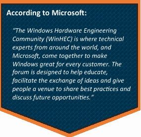

但连续三年都是这样？说真的？深圳对于除 Greater China 开发社区之外的所有人来说都在地球的另一边。我去过深圳。那是一个相当酷的地方。食物很棒。而且离香港只有很短的车程。**但这绝不是微软专门向驱动开发人员传达重要内容的合适地点。**如果 WinHEC 是“来自世界各地技术专家和微软聚集在一起让 Windows 变得伟大的地方”，那么 WinHEC 就需要旅行。如果目标是“帮助教育[和]促进思想交流并为人们提供分享最佳实践的场所”，那么 WinHEC 就不能只在 Greater China 举办。

我认为现在是时候了——实际上是早就该是时候了——微软为驱动开发人员举办一次会议。我不在乎它是 WinHEC（传统上有很多信息与 OEM 平台规划类型的人分享）还是像之前的驱动开发人员大会。但它需要专门关注向驱动开发人员传达信息。我不想要把几场演讲塞进其他活动中。我们不需要那样。

最近在与雷德蒙德的人讨论这个想法时，他们当然对这个想法持开放态度。他们似乎“明白”我们感到信息不足。

你怎么看？微软应该为驱动开发人员举办会议吗？它应该作为 WinHEC 的一部分还是单独举办？而且，如果组织了这样一次会议，你希望它在哪里举行？

**在我们的 6 题在线投票中投票：** https://www.osr.com/microsoft-hold-conference-driver-developers/
你投票后就能看到实时结果，我们将在下一期的 NT Insider 中总结所有结果。让我们听听你的声音！

*Peter Pontificates 是 OSR Consulting 合作伙伴 Peter Viscarola 的常规专栏。Peter 不在乎你是否同意或不同意他，但你的评论或反驳很可能会出现在未来的刊物中。发送你的评论、牢骚或事实歪曲到：PeterPont@osr.com。*

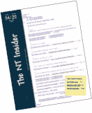

**THE NT INSIDER - Hey...Get Your Own!**

只需向 join-ntinsider@lists.osr.com **发送一封空白邮件**——你就会在我们发布《The NT Insider》新刊时收到邮件。

## Handling Cleanup, Close and Cancel in your WDF Driver

我写的大多数 WDF 主题都是在我参与 NTDEV 列表的一系列交流中产生的，或者是我在审查或更新驱动代码时看到的趋势所启发的。这次，我受到了这两方面的启发。

最近，NTDEV 上有一个关于使用 Cleanup 和 Cancel 事件处理回调的讨论线程，相当有趣。最近，我也有机会更新两个非常不同的设备驱动程序。一个是在 NT V4 时期编写的 WDM 驱动程序。另一个是由一位新 Windows 驱动开发人员在 KMDF 发布后不久编写的 KMDF 驱动程序。虽然这两个驱动程序是为非常不同类型的设备编写的，但它们有一个共同点：开发人员都误解了如何终止正在进行的请求，并使用了（或更确切地说，误用了）Cleanup 事件来代替 Cancel。

这就是我被激励去详细写关于 WDF 驱动程序中 Cleanup、Close 和 Cancel 处理的原因。另一个私人动机是，虽然我们在 Writing WDF Drivers 研讨会上涵盖了这个主题，但我们几乎从未有时间在我想深入讨论的程度上谈论它。所以，我认为写一篇文章对许多目的都有用。

### Some Preliminaries

首先要明白的是，至少在驱动世界（与文件系统相反），你需要将 Cleanup、Close 和 Cancel 的处理放在一起考虑。这是因为它们经常被混淆，并且这些函数的处理经常相互作用。

另外，在我们开始讨论时，请记住，我们在这里关于 Cleanup、Close 和 Cancel 的说法完全特定于 WDF。正如 WDF 的大多数事情一样，试图在脑海中“映射”WDM 到 WDF（或反之）并期望能弄明白事情是绝对不明智的。那样会导致疯狂。WDF 框架是其自身 I/O 处理生态系统。当然，它与 WDM 交互，但 WDF 驱动程序的工作规则完全且仅由 WDF 制定。仅仅因为某件事在 WDM 中以某种方式工作，并不意味着对 WDF 也是如此。

### The Problem

让我们从 Cleanup、Close 和 Cancel 设计为解决的几个简单示例开始。我想强调的是，这些只是这些操作可能有用的两个随机示例。这些两个示例没有涉及的这些事件的其他重要用途还有很多。

假设你的驱动程序有一个使用顺序分派的队列。用户模式应用程序成功调用 Win32 函数 CreateFile 指定 FILE_FLAG_OVERLAPPED 以允许它进行异步 I/O。然后应用程序在循环中成功调用 ReadFile 100 次，每次指定一个 OVERLAPPED 结构。结果是当应用程序的循环完成时，你的驱动程序中有 100 个 Read 请求正在挂起。

现在假设应用程序在句柄上调用 CloseHandle，该句柄用于向你的设备发送那 100 次读取。至少其中 100 次读取中的一些仍在进行中。正在进行的 I/O 请求会发生什么？你的驱动程序如何处理这种情况？

作为第二个示例，考虑当应用程序在那 100 次读取正在进行时，不是关闭到设备的句柄，而是退出或被终止时会发生什么。随着 Windows 开始为应用程序进行终止处理，你的驱动程序可能有一个或多个指向数据缓冲区的指针，以便将数据返回到应用程序的地址空间。你可以在图 1 中看到这一点。

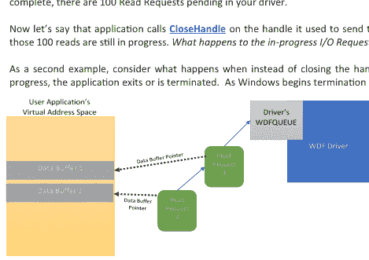

在图 1 中，你可以看到一个驱动程序有一个 WDFQUEUE，其中有两个 Read 请求排队（我不想在图中放全部 100 个 I/O 请求）。每个 Read 请求都（内部存储）有一个指向要返回读取（输出）数据的缓冲区指针。

如果 Windows 在 I/O 请求仍在的情况下允许进程完全终止，则


## Cleanup, Close and Cancel... (Cont.)

进度，并且如果它要释放进程使用的物理内存包括应用程序的数据缓冲区，驱动程序必须完成对随机内存的全部写入并破坏系统。那将是一件非常糟糕的事情。因此，*Windows 不会在其 I/O 操作完成之前允许进程完全退出。* 这可以防止驱动程序通过处理普通的读取请求而无意中破坏内存。因此，你从应用程序看到的行为是，应用程序不会退出，甚至可能看起来挂起，直到待处理的请求完成。

因此，当应用程序退出或被终止时，问题再次出现：*正在进行的 I/O 请求会发生什么？你的驱动程序如何处理这种情况？*

## Cleanup、Close 和 Cancel 的定义

我们刚刚描述的两个问题，即在 I/O 进行中关闭句柄以及应用程序在 I/O 进行中尝试退出，是 Cleanup、Close 和 Cancel 设计来管理的两个主要问题。让我们先从每个操作的定义开始。在下一节中，我们将扩展这些定义并描述有关驱动程序如何处理这些操作的更多具体细节。

Cleanup、Close 和 Cancel 的事件处理回调在 WDF 中都是技术上可选的。这意味着，你的驱动程序需要明确选择加入以处理它们。Cleanup 和 Close 是文件对象特定的，因此这些操作的事件处理回调与 WDF 文件对象处理相关。如果你在阅读本节时觉得需要快速复习 Windows 文件对象，请参阅侧边栏 **关于文件对象**（如下）。

让我们先讨论 Cleanup。当文件对象的最后一个句柄被关闭时，Windows 会发出 Cleanup 请求，WDF 会调用相关驱动程序的 *EvtFileCleanup* 事件处理回调函数。因为几乎总是只有一个句柄与给定的文件对象相关联，所以一旦应用程序调用 *CloseHandle*（并且在该函数调用的同步过程中），WDF 将调用驱动程序的 *EvtFileCleanup* 事件处理回调。*EvtFileCleanup* 总是在调用 *CloseHandle* 的线程/进程上下文中调用，并且在 IRQL PASSIVE_LEVEL 下。对于应用程序调用 CloseHandle 可能不会导致立即 Cleanup 操作的特殊情况的描述，请参阅标题为 **关于文件对象** 的侧边栏。

### 关于文件对象

Windows 中的文件对象 – 命名为 FILE_OBJECT 的 WDM 数据结构以及 WDF 对象 WDF FILEOBJECT – 代表文件或设备的单个、特定、打开的实例。例如，当应用程序成功调用 CreateFile 时，会创建一个代表该打开实例的文件对象。如果对 CreateFile 的调用成功，它会返回指向此文件对象的句柄，应用程序使用该句柄对文件或设备执行后续 I/O 操作。返回的句柄是对特定文件对象的进程特定引用。

文件对象是用于跟踪和管理给定句柄上的 I/O 操作的通用 I/O 子系统对象。例如，当你向磁盘上的文件发出顺序读取操作而不指定特定文件偏移量时，文件系统使用文件对象来跟踪下一次在文件中读取的偏移量。每个文件对象几乎总是只与单个句柄相关联。然而，在某些相对罕见的情况下（例如当 Win32 函数 *DuplicateHandle* 被使用时），单个文件对象可能与多个句柄相关联。

你可以在 The NT Insider 文章 *WDF File Object Callbacks and Properties Demystified* 中阅读更多关于 WDF 文件对象、其属性以及与其关联的事件处理回调的信息。

每次应用程序使用文件对象的句柄发出 I/O 请求时，文件对象的引用计数就会增加。每次驱动程序或文件系统完成对给定文件对象的 I/O 操作时，文件对象的引用计数就会递减。


## 文件系统微过滤器

### 标准微过滤器和隔离微过滤器简介

过滤驱动程序概念是 Windows I/O 子系统最强大的架构特性之一。过滤器只需附加到设备之上即可为现有设备的功能增加价值。当然，过滤设备不需要对底层设备的驱动程序进行任何更改。

在典型的 Windows 系统中，过滤驱动程序安装在多个层级。例如，在卷级别存在标准 Windows 提供的过滤驱动程序，它们提供卷快照功能（用于支持备份），以及可选的完整卷加密（用于支持 Windows BitLocker）。还可能存在制造商特定的过滤驱动程序，例如为鼠标或键盘添加对特定型号独特按钮支持的过滤器。

在 Windows 系统中插入过滤器的最常见、最强大的位置之一是在文件系统之上。文件系统过滤器在 I/O 操作到达文件系统之前拦截 I/O 操作（来自应用程序和系统本身）。这使它们能够在文件系统看到之前监控、跟踪、管理、操作，甚至接受或拒绝 I/O 操作。人们最熟悉的文件系统过滤器类型可能是防病毒过滤器。这类过滤器通常会拦截文件打开请求并暂停它们，同时过滤器（或更可能是在用户模式下运行的关联服务）扫描正在打开的文件是否存在病毒。如果发现病毒，则可以取消打开请求。如果未发现病毒，则可以允许打开请求正常完成。

文件系统过滤器常用于从前面刚描述的防病毒和恶意软件扫描，到软件许可证跟踪和管理，到对文件的审计和更改跟踪，到按需透明数据加密和解密。文件系统过滤器也可以用于其他不太明显的目的。例如，由于它们可以看到哪些文件被创建和写入，文件系统过滤器通常在备份产品和分层存储子系统中发挥关键作用。而且由于文件系统过滤器能够成为应用程序所见文件系统“命名空间”的第一解释者，它们还可以执行强大的文件重定向操作，例如使远程文件（如存储在云中的文件）看起来像是本地文件。

自 Windows XP SP2 中引入以来，文件系统微过滤器模型已成为实现文件系统过滤器的首选机制。这是有充分理由的，因为微过滤器模型为文件系统过滤驱动程序开发提供了优秀的组织和支持框架。凭借相当不错的文档和 GitHub 上大量示例，许多开发者认为编写文件系统微过滤器在其能力范围内。而且他们是对的……前提是他们在某些边界内。

本文描述了 Windows 文件系统微过滤器的基本架构概念。然后描述了两种不同的微过滤器类型：**标准微过滤器**，和**隔离微过滤器**。最后，本文描述了开发文件系统隔离微过滤器项目为何比开发标准微过滤器项目复杂得多。

### 标准微过滤器 vs. 隔离微过滤器

> 在本文中，我们澄清了在 Windows 文件系统社区中使用的几个常见术语。

**标准微过滤器**

标准微过滤器是一种 Windows 文件系统微过滤器驱动程序，用于监控或跟踪文件系统数据。大多数防病毒扫描程序都是标准微过滤器。

**隔离微过滤器**

隔离微过滤器是一种 Windows 文件系统微过滤器驱动程序，用于将文件数据的视图与该文件实际的底层数据分离。隔离微过滤器的典型示例是按需透明加密/解密过滤器。隔离微过滤器使用“同一栈”概念，并通过为每个视图提供唯一的缓存区段来提供其不同的视图。

### 过滤管理器和高度

文件系统微过滤器模型的基础是过滤管理器，它是标准 Windows 组件。过滤管理器实现为传统文件系统过滤器，并过滤所有文件系统实例。由于在任何给定文件系统实例上可能存在多个过滤器（Windows 10 的默认安装包含不少于九个标准文件系统微过滤器！），过滤管理器提供了一套“高度”系统，允许开发者决定其微过滤器应在过滤器层级中的何处安装。参见*图 1（下一页）*。

在*图 1*中，你可以看到 Windows 过滤管理器（标记为 FLTMGR）正在过滤挂载为 C 驱动器的 NTFS 文件系统实例。在图中，过滤管理器加载了三个文件系统微过滤器：微过滤器 A、微过滤器 B 和微过滤器 C。顺序为


## 文件系统微过滤器……（续）

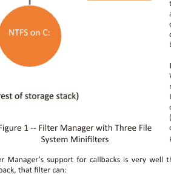

（存储栈的其余部分）

图 1 —— 带有三个文件系统微过滤器的筛选器管理器

这些微过滤器（微过滤器 A 位于微过滤器 B 之上，微过滤器 B 位于微过滤器 C 之上）的排列并非随机。相反，它由分配给每个微过滤器的海拔决定。每个微过滤器的海拔都是唯一的，并且在微过滤器安装时指定。

海拔对于文件系统过滤器来说是一个重要的属性，因为在正确的海拔上进行过滤可能对正确操作至关重要。例如，考虑两个可能安装在任意文件系统之上的微过滤器：一个按访问进行透明数据加密的微过滤器和一个防病毒微过滤器。为了让防病毒微过滤器完成其工作，它需要对文件的解密内容进行操作。因此，防病毒微过滤器需要处于比数据加密微过滤器更高的海拔（即位于其上方）。

## 微过滤器回调

当微过滤器向筛选器管理器注册时，除了其他事项外，它可以选择接收特定 I/O 操作的 PreOperation 和/或 PostOperation 回调。PreOperation 回调在指定类型的每个 I/O 操作被传递到被筛选的文件系统（或者实际上是下一个最低海拔的微过滤器）之前调用。PostOperation 回调在文件系统（以及任何较低海拔的微过滤器）处理完特定类型的 I/O 操作之后调用。

筛选器管理器对回调的支持考虑得非常周全。例如，当某个微过滤器收到 PreOperation 回调时，该过滤器可以：

- 完全完成该操作。这将导致较低海拔的微过滤器（如果有）甚至被筛选的文件系统都不会看到这个 I/O 操作。
- 完成该操作，将其传递给较低海拔的微过滤器（如果有）和底层文件系统，并选择在操作完成时获得回调（PostOperation 回调）。
- 完成该操作，将其传递给较低海拔的微过滤器（如果有）和底层文件系统，但选择在操作完成时不获得回调（这就是 PostOperation 回调）。
- 返回并表明操作正在进行中。在这种情况下，微过滤器稍后将把操作的状态告知筛选器管理器，包括是否需要调用任何底层实体，以及是否需要 PostOperation 回调。

## USB FX2 学习套件

别忘了，广受欢迎的 OSR USB FX2 学习套件可在商店购买：http://store.osr.com。

该板卡的设计基于知名的赛普拉斯半导体 USB FX2 芯片组，非常适合学习如何编写 Windows 驱动程序（当然尤其是 USB 驱动！）。更好的是，您可以获取适用于该板卡的示例 WDF 驱动程序，它在 Windows 驱动程序套件中提供。

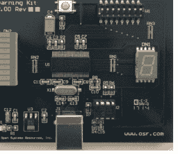

## 攻克一个难题

## OSR 的隔离微过滤器解决方案框架

每周，我们都会遇到这样的问题：一位毫无戒心的开发人员看着文件系统微过滤器模型，觉得它相当酷，于是决定承担一个看起来简单的项目。这个项目是什么？一个做以下其中一件事的微过滤器：

- 对文件的位置进行虚拟化（允许文件从后端云存储或慢速近线存储中一点一点地拉取下来）。
- 实现每个文件的按访问透明加密和解密。
- 实现文件的“热备份”，并允许无缝访问新版本和旧版本。
- 实现文件压缩。
- 提供数据去重处理（将文件数据存储一次，通过多个文件可用）。

开发人员开始编写代码，但几周后遇到了意外问题。为什么？因为他或她已经离开了常规标准微过滤器的领域，意外进入了 Windows 文件系统隔离微过滤器的世界。我们在本期《NT Insider》的另一篇文章中描述了标准微过滤器与隔离微过滤器之间的技术差异。

## 这个微过滤器应该是隔离微过滤器吗？

除非你在 Windows 文件系统或文件系统过滤器方面有经验，否则有时很难提前知道你的设计将（或应该）进入隔离微过滤器领域。哎呀，在 OSR，我们也启动过一些微过滤器项目，结果工作几周后才发现“我们可能本应该为此使用隔离微过滤器。”这种事确实会发生。

在开始编写代码之前，判断你是否可能需要使用隔离微过滤器的最佳方法是问自己：“我是否需要维护一个数据视图，使其在内容、形态或位置上与底层文件系统存储的数据不同？”如果这个问题的答案是肯定的，你至少应该考虑实现一个隔离微过滤器。

## 隔离微过滤器：难

确定你需要编写标准微过滤器还是隔离微过滤器非常重要，因为开发隔离微过滤器的难度远高于标准微过滤器。由于它们与 Windows VM 子系统（内存管理器和缓存管理器）紧密耦合，开发隔离微过滤器至少与开发一个 Windows 文件系统一样复杂。事实上，在讨论这一话题时，OSR 的一位开发人员最近写道：

> 我认为编写隔离微过滤器实际上比编写文件系统要困难得多，因为在许多情况下，[微过滤器的]下端是一个文件系统（它很复杂且涉及锁定），而对于文件系统而言，它是一系列块（幂等、无锁定等，……）

## OSR 定制软件开发

## 我不确定……那些家伙更便宜……为什么不用他们呢？

为什么？我们会告诉你为什么。因为你雇不起没有经验的顾问或合同编程公司，这就是原因。你以为通过雇佣廉价的按小时计费的帮手所省下的钱，一旦你意识到这种试错式的开发方式已经将你的时间和材料项目变成了一场冗长的“善后”工作——而且是在你“廉价”的编程团队离开很久之后——就会消失。

你值得（也应该要求）明确无疑的专业技术。你不应该付钱让没有经验的开发人员来尝试开发你的解决方案。你需要的是保证结果的固定价格解决方案。请联系 OSR 销售团队：sales@osr.com，讨论你的下一个项目。


## 文件系统微过滤器...（续）

无论如何，让我们先达成共识：隔离微过滤器很难从头编写。根据我们自己开发隔离微过滤器的经验，我们估计，从头开始，一位非常有经验的 Windows 文件系统开发者至少需要 3 个月才能让一个隔离微过滤器原型跑起来。对于经验较少的开发者，也就是“仅”有编写 Windows 内核模式驱动程序经验的开发者，我们认为至少需要 6-9 个月才能获得可工作的原型。而且，无论哪种情况，这也仅仅是能拿出一个可演示的东西。要做出一个能在现实世界中真正工作的解决方案，仍然需要好几个月的工作。

## 隔离微过滤器解决方案框架：轻松得多

幸运的是，有一种解决方案能让你快速启动隔离微过滤器的开发过程，并在几周内获得可工作的原型，而不是耗时数月。这个解决方案就是 OSR 的隔离微过滤器解决方案框架（IMSF）。

在我们开发针对按访问透明文件加密的综合解决方案框架（FESF，如果你感兴趣，可以在这里阅读）时，我们显然必须实现一个隔离微过滤器。我们并没有将这个隔离微过滤器与 FESF 紧密耦合，而是将其架构并实现为一组可分离的模块。我们将这些模块连同文档和示例代码作为 IMSF 的一部分提供。

我们的 IMSF 套件包含一个完整且可完全自定义的隔离微过滤器。这个隔离微过滤器与目前在全球主要产品中发布的 FESF 核心代码完全相同。这段代码每天都在真实环境中被使用和测试。它行之有效，非常可靠。

除了隔离微过滤器本身，IMSF 还包含全面的接口文档和一个工作示例，演示了如何以 IMSF 为基础构建真实产品。而且，是的：你会获得完整的源代码。所有一切。

需要说明的是：你仍然需要了解 Windows 内核模式编程和文件系统概念，才能充分利用我们的 IMSF 套件。但艰巨的工作已经由 IMSF 为你完成了。你不需要成为缓存管理器方面的专家。你也不必去琢磨“我该怎么做？”IMSF 提供了一个坚实、积极开发、随着 Windows 每个新版本/更新而不断维护的基础，并且已被证明可在真实、已发布的产品中有效运行。

## 咨询专家

如果你正在从事某个项目，并且想讨论隔离微过滤器方法是否是正确的选择，请联系我们。让我们的工程团队与你的工程团队通过 Skype 讨论你的可选方案，这是不收费的。如果我们认为你不需要隔离微过滤器，或者 IMSF 不适合你，我们会直言相告。另一方面，也许我们的某个解决方案框架能为你节省时间和麻烦。无论哪种方式，如果仅用一个小时的电话交谈就能让你走上正确的方向，我们认为这段时间花得很值。

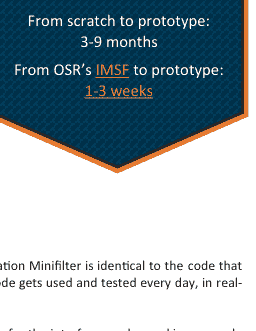

关注我们！

## 一个 Windows，处处通用；一个驱动程序，处处通用

### 通用驱动程序详解

如果你从 Windows 8 发布以来一直在关注驱动程序领域，你可能已经注意到 **通用驱动程序** 这个术语。你或许不清楚它的含义、为什么你应该关注，以及随着 Windows 平台及其支持的系统不断演进，通用驱动程序的概念是如何发展的。

## 通往 OneCore 之路

早在 Windows 8 之前，微软就开始了在操作系统级别和支持 API 级别对 Windows 进行组件化的任务。这是一段漫长而艰难的旅程。我就不赘述细节了，但一个真正的组件化 Windows 版本最终作为 Win10 1607（RS1，周年更新）的一部分出现了。这个组件化操作系统被称为 OneCore，而组件化的应用程序支持被称为 OneCoreUAP（通用应用程序平台）。

驱动程序编写者之所以对此感兴趣，是因为现在首次有了一个核心 Windows 组件，可以运行在各种平台上：台式机、服务器、平板电脑、物联网设备、Surface Hub、Xbox 甚至手机。如果你还能，呃，*找到*一台 Windows Phone 的话。但那是另一回事了。

得益于 Windows 强大的架构基础，开发者可以编写一个驱动程序，从而可能支持大量不同的硬件。无需重写，无需条件编译代码。只需重新设定目标平台、重新构建，就大功告成了。

听起来不错吧？让我们来谈谈如何实现这一点。

## 通用驱动程序 DDI

通用驱动程序可以是 KMDF、WDM 或 UMDF 2 驱动程序。使用这些模型之一编写通用驱动程序的主要约束是，你必须将驱动程序调用的函数限制为 OneCore（对于内核模式驱动程序）或 OneCoreUAP（对于用户模式驱动程序）所包含的函数。这些设备驱动程序接口（DDI）和 API 在 MSDN 文档中被标识为受“通用”目标平台支持。有关示例，请参阅 *图 1*。

## 要求

|  |  |
|---|---|
| **目标平台** | 通用 |
| **版本** | 自 Windows 2000 起可用。 |
| **头文件** | Wdm.h（包括 Wdm.h、Ntddk.h 或 Ntifs.h） |
| **库** | NtosKrnl.lib |
| **DLL** | NtosKrnl.exe |
| **IRQL** | PASSIVE_LEVEL |

对于内核模式驱动程序，很容易做到只调用通用 DDI。事实上，你很难找到一个*不是*通用的 DDI。当你真的找到这样一个 DDI 时，它很可能无论如何也不是你想要（或应该）调用的函数。例如，你最后一次调用 **KeGetCurrentProcessorNumber** 是什么时候，嗯？嗯，自从 Windows 7 引入处理器组以来，它就一直不能正常工作。不管怎样，它是一个非通用的 DDI。有趣的是，即使是很多很久以前被归入 NTDKK.H 的 DDI，也属于通用 DDI 集合。例如，**MmIsAddressValid** 就是这样一个 DDI：它所做的并非大多数人认为的那样，而且在石器时代就被移入了 NTDKK.H。但它是一个通用 DDI。耶。我想是这样。

MSDN 文档将一些令人意外的 DDI 系列列为*不*通用，例如 Remove Lock 系列的 DDI（**IoAcquireRemoveLock**、**IoReleaseRemoveLockAndWait** 及其同类）。不过，好消息是 MSDN 在这些问题上似乎有误。WDK 中有一个文件，以 XML 形式（方便你查看）列出了所有通用 API 和 DDI。该文件位于：

```
C:\Program Files (x86)\Windows Kits\10\build\universalDDIs\<arch>\UniversalDDIs.xml
```

就 Remove Lock DDI 而言，这些函数出现在上述 XML 文件中，尽管它们在 MSDN 中被列为非通用。以 XML 文件为准。这些函数确实是通用 DDI 集合的一部分。

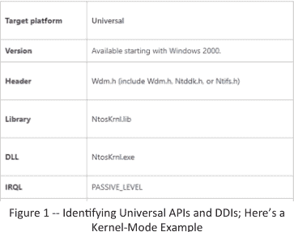


## Universal Drivers...(Cont.)

对于 UMDF 2 驱动程序，坚持使用通用函数集的难度取决于你在用户模式驱动程序中混合了多少 Win32。如果你坚持使用 WDF DDI 和少数支持函数，就完全不会有问题。但你的驱动程序中“应用类型代码”越多，就越可能需要选择替代 API 或重写代码以不同的方式工作。

幸运的是，你不必猜测，也不用依赖 MSDN，甚至不用查看冗长的 XML 文件来检查自己是否只调用了通用 DDI。有一个名为 ApiValidator 的实用工具，它是 WDK 的一部分，你可以选择将其作为构建过程的一部分运行。此实用工具会检查以确保你的解决方案中的所有内容都适当通用（参见图 2）。

为了证明创建坚持使用通用 DDI 集的内核模式驱动程序真的像我所说的那样简单，我用自己的代码进行了测试。我重建了一个我一直在处理的相当复杂的 KMDF 设备驱动程序（双向同时 DMA，通过十多个 IOCTL 进行多种 PIO 类型操作，约 30 个源文件，超过 10K NCSLs），该驱动程序目标为 Win7 及更高版本，现在作为适用于 Win10 的通用驱动程序。没有对通用 DDI 集之外的任何 DDI 的调用。

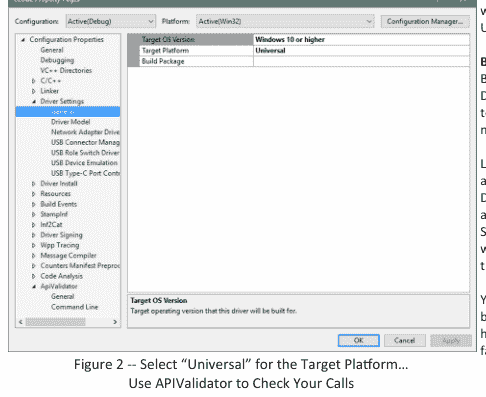

但等等……还有更多：声明式安装

构建符合通用 DDI 集的驱动程序是好的。它让你在很大程度上实现了真正的通用兼容性。但这不是你需要做的全部。

假设你编写了一个相当不错的 SPB 驱动程序，并且成功针对通用 DDI 集。现在，假设你想在某台小型单板计算机上安装它。也许它是 Snapdragon 617 系统，也许是搭载 Apollo Lake 处理器的板子。但无论如何，系统都在运行 Windows IoT Core。

你可能有一个很棒的驱动程序，但用户必须能够安装它。Windows IoT Core 没有标准的 Windows Explorer 界面。事实上，它可以完全无头运行。这意味着

Figure 2 -- Select “Universal” for the Target Platform... Use APIValidator to Check Your Calls

## We Know What We Know
And...We Know What we Don’t Know

我们不是万事通。我们甚至不是 Windows 的所有事情的专家。但我们认为有几件事我们做得相当不错。我们了解 Windows 操作系统的工作原理。我们了解 Windows 上的设备、驱动程序和文件系统。我们对 Windows 存储子系统所知颇为自豪。

使 OSR 独特的是，我们可以将这些东西解释给你的团队，提供新的见解，如果你正在进行 Windows 系统软件项目，我们可以帮助你了解你的全部选择范围。而且我们也编写出色的内核模式 Windows 代码。真的。我们确实如此。

为什么不发一封电子邮件，看看 OSR 如何帮助你。如果我们不能帮你，我们也会告诉你。
联系方式：sales@osr.com

## Universal Drivers... (Cont.)

不能有可运行的安装程序 MSI，也不能有需要执行的共安装程序。你需要的是所谓的通用 INF 文件，其限制为“声明式驱动程序安装”。

声明式安装是指能够在完全离线环境中、无 GUI 交互的情况下安装驱动程序。它只允许有限数量的特定、明确且无歧义的操作来安装驱动程序。微软声称这不仅使离线安装驱动程序成为可能，而且还提高了驱动程序安装的可预测性和可支持性。如果这是真的，那太好了，因为在我看来，驱动程序安装要么就是能正常工作，要么就是完全令人头疼。它们似乎永远不会介于两者之间。请参阅 MSDN 上有关通用 INF 文件的文档以获取更多信息。

然而，并非一切都是美好和彩虹。虽然我很赞成让驱动程序安装更可预测，并允许离线安装驱动程序，但关于通用 INF 文件，有一两件事我很难接受。其中最重要的是，ClassInstall32 部分不允许出现在通用 INF 中。这意味着 IHV/OEM 不能将其驱动程序安装到适合其环境的唯一类中。无法使用自定义安装类也限制了你为 devnode 中的设备对象定义默认保护的能力。对我来说，这不是好事。我不希望我的图像扫描仪或人工耳蜗或导弹发射器被归入某个其他随机的设备类。我希望我的独特设备出现在它们自己的独特类中。我希望微软重新考虑这一限制，因为对我来说这是不可接受的。

哦，你可能在想，“如果我不能在安装驱动程序时使用共安装程序，我将如何根据特定设备/平台/环境/系统定制安装呢？”对此也有答案。它叫做组件化安装。

## Componentized, Too

组件化安装允许你将驱动程序 INF 文件分成多个部分。你创建一个支持驱动程序基本功能的 Base INF。然后你创建一个或多个 Extension INF，可以根据特定系统品牌、型号或版本定制或配置你的驱动程序。

关键在于，所有系统都将始终获得设备基本功能的单一 INF。Extension INF(s) 然后可以对驱动程序进行任何针对特定系统或平台的专门配置。假设你有需要为特定 OEM 应用的特殊品牌。或者，你想在支持的特定型号设备上启用某些增值功能。你可以从 Extension INF 中完成所有这些工作。你为每个想要支持的独特系统类型或变体编写一个 Extension INF。在安装过程中，Windows 会调用正确的 INF 来执行你的定制。好的一点是，Base INF 和 Extension INF 可以分别更新（并通过 WU 分发）。因此，亲爱的驱动程序编写者，你可以先让你的 Base INF 正常工作，而你的 OEM 客户可以在稍后某个时间点通过流程设置他们想要的 Extension INF。

组件化安装和 Extension INF 在 MSDN 上有关 Extension INF 的文档中有更详细的解释。

## And Then There Are... Hardware Support Apps

你听说过 Windows 10 S 吗？那是“锁定”版本的 Windows，只能运行来自商店的应用程序。这意味着只能运行 UWP —— 而不是 Win32 —— 应用程序


## Universal Drivers... (Cont.)

are supported. Regardless of what you think about this, Microsoft says they’re going to sell these systems. And, if I had to guess, there’ll be other systems in the future that will have the same restrictions.

Suppose you currently have a Device Manager property sheet, or Control Panel Applet, that’s used to manage your device. That’s not going to work very well on a system that doesn’t support the Win32 API, right? So, the final part of the Universal Driver picture is Hardware Support Apps that are written as UWP apps. Of course, that’s not nearly as simple as it might seem at first blush. UWP has some pretty significant limitations: No IOCTLs, no WMI, no RPC. About the only cool technology that you can use in a UWP app is ETW.

In place of device-specific IOCTLs, UWP offers something called Custom Capabilities. These are specific functions your driver authorizes to specific applications. And, in this way, everything is supposed to be kept safe.

I’m not convinced. I’m not a fan of the whole UWP programming model in general (I’m a device guy… I don’t like being told what I can and cannot do). But I admit it: I really haven’t spent much time investigating the whole issue of Custom Capabilities for UWP apps. Maybe it’s not as bad as I think. I’ll look into it, and write an article that describes what I find in a future issue of The NT Insider. In the meantime, you can read (and weep) more about Custom Capabilities for Hardware Support Apps in MSDN.

Note that there’s an interesting side-effect of making a support app a UWP app. That app can now be pulled-down during the install (and also during future updates) from the Windows Store. You can also, optionally, pre-populate the app onto a specific install image using DISM. But in either case, the app will no longer be part of what we think of today as the traditional installer package. This does sound to me like it might make servicing easier.

## Gimmie a D! Gimmie a C! Gimmie a H! Gimmie a U! What’s That Spell?

It spells “DCHU.” No, you can’t pronounce it. It stands for:

- Declarative – You use a Declarative INF file
- Componentized – You separate your INF into a Base INF and zero or more Extension INFs
- Hardware Support Apps – Written at a UWP app, of course
- Universal – Your driver (and INF) is restricted to the Universal feature set

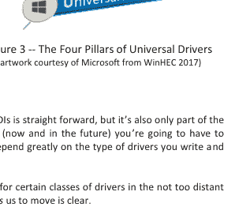

Together, Microsoft describes these as the Universal Driver Pillars. See the lovely artwork I stole from somebody’s WinHEC deck in Figure 3.

For your driver to be truly able to run on “any Windows platform” you need to embrace all four of the DCHU design principles.

## Universal DDIs – Only Part of the Story

Now, hopefully, you see that writing a driver that’s restricted to the Universal DDIs is straight forward, but it’s also only part of the story. If you truly want your driver to be installable on any Windows system (now and in the future) you’re going to have to become DCHU compliant. Of course, how important any of this is to you will depend greatly on the type of drivers you write and the types of hardware you support.

Be aware that there are rumblings that DCHU compliance will become required for certain classes of drivers in the not too distant future. While that remains to be seen, at least the direction that Microsoft wants us to move is clear.

## File System Minifilters... (Cont.)

Within its PreOperation and/or PostOperation callbacks, a Minifilter can perform almost any operation, including examining or modifying the data involved in the operation. Thus, the trick becomes understanding the specific meaning of those operations.

## Win32 API vs Native Windows API

The Filter Manager framework for writing Minifilters is so powerful and well thought-out, that it’s very easy for new Minifilter developers to be tricked into thinking that file system filtering is easy. The thing is: It can be easy, but it can also be get surprisingly confusing very quickly.

The inherent problem is that regardless of how powerful or pleasant the Filter Manager model is, the world of Windows file systems is inherently a complicated one. Some of this complexity comes from the fact that the Win32 API can sometimes be very different from the native Windows API that the I/O subsystem actually uses. A simple example that we often encounter here at OSR is the Win32 API CopyFile. Developers are often surprised that there’s no native analog to this function. Rather, internally, CopyFile opens the source file, opens the target file, and if both of those operations are successful, issues a series of reads from the source file and writes to the target file until the file is copied. The source file and the target file are then closed.

A slightly more interesting example is the Win32 function DeleteFile. If you’re not a file system dev, you’re probably thinking “How complicated can delete be? You just… delete the file, right?” Well, not in Windows, no. The native Windows API doesn’t actually have a specific delete file operation. Rather, the intention to delete a file is indicated by issuing a Set Information operation (ZwSetInformationFile) to set the file’s Disposition (FILE_DISPOSITION_INFORMATION). This allows the caller to specify whether he wants the file to be deleted when its closed. However, it’s important to note that the file is not actually deleted until the last handle to the file has been closed. This means that an application can open a file and call the Win32 DeleteFile API, but this doesn’t actually delete the file. It just set the file’s Disposition of the file to be deleted on close. Even when the app subsequently closes the file, this still doesn’t necessarily mean that the file will actually be deleted. Consider what could happen if another application has the file open when our example app opens it. That application can also set the file’s Disposition at any time. If after our example app has set the file’s Disposition to be delete on close, the other app sets the file’s Disposition so that it’s no longer marked for delete on close, the file will not be deleted. And yes… it happens.

## Virtual Memory System Integration

Another source of complexity for file system Minifilters stems from the close working relationship between file systems, the Windows Cache Manager, and the Windows Memory Manager. We all know that when we call ReadFile, data from the specified data buffer is read from the file indicated by the file handle. Most of us probably also know, at least in a general way, that there’s typically some caching involved. That is, every call we make to ReadFile doesn’t always necessarily result in that data being read directly from the media.

Interestingly, except when a file is explicitly opened with no caching, file systems typically do very little to process an application’s call to ReadFile, beyond calling the Cache Manager to deal with it. At the file system’s request, the Cache Manager copies the data from the cache area associated with that file’s open instance into the application’s data buffer. This is illustrated in Figure 2.

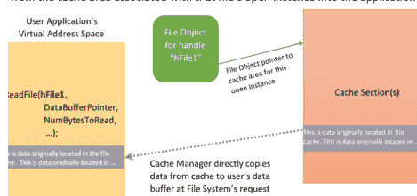

In Figure 2, the file system has called the Windows Cache Manager to process an application’s ReadFile request. The file system identifies the open instance of the file being accessed using the file handle provided by the application in its ReadFile call. The file handle "hFile1" is a handle to the indicated File Object which the Cache Manager uses to locate the sections of cached data that are part of the file system’s cache.

Figure 2 -- File System Uses Cache Manager to Process a Read Operation


## 文件系统微过滤器...（续）

有趣的是，缓存中存储的数据是由 Windows 内存管理器通过缺页处理从磁盘读入内存的。那次分页读取操作同样会经过文件系统。

文件系统微过滤器当然可以参与处理读写操作，无论这些操作源自应用程序还是源自内存管理器。

## 保持简单：标准微过滤器

最常见的文件系统微过滤器类型会监视，甚至可能跟踪或记录在文件系统层执行的各种操作。有些微过滤器（例如防病毒扫描器）甚至可能批准或否决某些操作。然而，这些过滤器并不参与改变其所过滤文件的数据视图或数据大小。我们将此类过滤器称为“标准微过滤器”，因为它们代表了现有文件系统微过滤器中的绝大多数。

标准微过滤器的开发者面临的主要挑战是：

- A. 正确理解并处理原生 Windows I/O 子系统的语义。
- B. 正确保持所有原生文件系统操作的行为，即使是那些他们不一定理解或不关心的操作。

当然，这还只是编写任何 Windows 内核模式驱动程序所固有基本挑战之外的额外负担。

克服第一个挑战（即正确理解并处理原生 Windows I/O 子系统语义）只需要时间和经验。微软提供了大量示例，可以用作起点。而且关于编写基本文件系统微过滤器的文档出奇地好——只要你花时间阅读并理解它。此外，还有一些不错的在线资源，比如我们的 NTFSd 列表，可以帮你解答一路上遇到的问题。另外，我还应该提到，从 2018 年 1 月开始，我们将开设一期关于如何编写标准微过滤器的研讨会。

上面 B 项的复杂程度在很大程度上取决于你编写的微过滤器类型。你的操作越简单，过滤范围越有限，事情就越容易。例如，试图过滤你的过滤器并不是特别关心的 I/O 操作通常是一个错误。针对文件系统微过滤器的 HLK 测试将非常有助于你评估在保留所过滤文件系统行为方面的成功程度。请务必运行这些测试！

因此，如果你需要编写一个标准微过滤器——也就是说，一个监视文件系统操作的过滤器——你所面临的挑战将是合理的。


## 文件系统微过滤器...（续）

试图过滤你的过滤器并不是特别关心的 I/O 操作通常是一个错误。针对文件系统微过滤器的 HLK 测试将非常有助于你评估在保留所过滤文件系统行为方面的成功程度。请务必运行这些测试！

因此，如果你需要编写一个标准微过滤器——也就是说，一个监视文件系统操作的过滤器——你所面临的挑战将是合理的。

## 难度成倍增加：隔离微过滤器

另一种不太常见的文件系统微过滤器类型是隔离微过滤器。隔离过滤器将文件数据的视图与文件系统实际存储的底层数据分离开（或“隔离”）。编写这种类型的微过滤器通常和编写一个标准的 Windows 文件系统一样复杂，因为它涉及你的微过滤器、Windows 缓存管理器和 Windows 内存管理器之间直接而密切的交互。事实上，一些经验丰富的开发者认为隔离微过滤器甚至比文件系统开发更难，因为当你编写隔离微过滤器时，实际上你必须在筛选器管理器提供的 API 内“容纳”一个 Windows 文件系统的实现。因此，除了标准微过滤器开发者面临的挑战之外，隔离微过滤器的开发者还要处理大量更为复杂的问题。

为了说明我们所说的“将文件数据的视图与实际底层数据分离开”的含义，让我们考虑一个实现按访问透明加密/解密的隔离微过滤器。应用程序打开一个以加密形式存储在磁盘上的文件，并对其调用 ReadFile。在这种情况下，加密/解密微过滤器的工作是透明地解密呈现给应用程序的数据。支持此类活动的一般方案如图 3 所示。

图 3 显示了两个文件对象，每个文件对象都与同一个文件相关联。上面的文件对象（绿色）是与应用程序关联的打开实例。这个文件对象代表应用程序对文件的视图。请注意，该文件对象引用的缓存节包含解密数据。这些数据是由隔离过滤器与缓存管理器协同放入缓存中的。

下面的文件对象（蓝色）由隔离微过滤器创建，代表该微过滤器（以及底层文件系统）对文件的视图。请注意，此文件对象的缓存节中的数据是加密的。隔离微过滤器使用下面的文件对象与底层文件系统进行交互。

因此，当用户应用程序调用 ReadFile 时，隔离微过滤器将收到该请求（作为其先前讨论过的读前置操作处理的一部分），并与缓存管理器交互以将缓存填充数据。在处理随后产生的分页读取操作（由内存管理器发送，以满足缓存管理器尝试为缓存获取数据的需求）时，隔离微过滤器会发出一个引用下方（蓝色）文件对象的 ReadFile 操作。底层文件系统与缓存管理器协作，满足此请求并将数据放入指定的缓存节中。

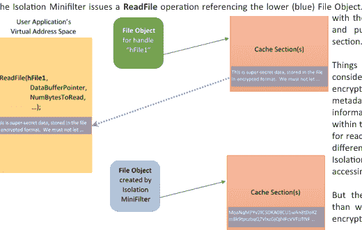

当你考虑到大多数透明数据加密系统会使用某种元数据头（用于保存密钥或访问信息）时，事情会变得更加复杂。这个头通常存储在文件本身中。因此，应用程序用于读取操作的文件偏移量可能与隔离微过滤器在访问磁盘上存储文件时需要使用文件偏移量不同。

但通常还有比我们目前讨论的更多的复杂性。假设加密/解密微过滤器确定

图 3 – 隔离微过滤器


## 文件系统微过滤器……（续）

（接第18页）

在按应用程序的基础上，当某个应用程序执行读取时，可以决定向其提供解密数据还是加密数据。例如，当 Microsoft Word 访问加密文档时，隔离微过滤器可能会自动解密该文档的数据。然而，当同一个加密文档被备份应用程序访问时，隔离微过滤器则可以提供文件的原始加密内容。更有趣的是，设计良好的隔离微过滤器可以同时向读取同一文件的不同应用程序提供两种视图：文件内容的解密视图和文件内容的加密视图。那么，如果其中一个应用程序向文件写入数据，而另一个应用程序以不同的视图打开该文件，会发生什么？我们只能说，事情很快会变得“有趣”起来。

## 隔离微过滤器：不仅仅是加密

我们应当补充说明，隔离微过滤器模型并不仅用于透明的数据加密和解密系统。隔离微过滤器模型适用于以下任何情况：

-   应用程序对数据的视图与文件系统上存储的基础文件之间存在差异。
-   应用程序对数据的视图与文件数据的基础位置之间存在差异。
-   不同的应用程序实例需要对文件系统上存储的同一基础数据拥有独特视图。

例如，考虑一个用于更改跟踪和版本控制的隔离微过滤器。一个 Word 实例可能正在积极编辑某个文件的最新版本，而另一个 Word 实例（可能由不同用户运行）则可能正在积极编辑该文件的旧版本。

又例如，一个存储在云中的文件，会根据文件的访问方式被一点一点地拉取下来。该文件在应用程序看来可能完全驻留在本地文件系统中。然而，隔离过滤器可能会根据需求从远程存储中访问和回填数据。

## 这给我们留下了什么？

Windows 微过滤器模型灵活而极其强大。只要有足够的时间和经验，大多数开发人员都将能够编写标准微过滤器。这些过滤器监视和/或跟踪文件操作，并可能授权访问底层文件系统中存储的文件。开发标准微过滤器所固有的主要挑战是理解原生 Windows 文件系统语义，并将底层文件系统提供的所有功能透明地传递给应用程序。这两个挑战都是可以解决的，并且无需具备大量 Windows 文件系统专业知识即可完成。

与标准微过滤器相比，隔离微过滤器则不同。这些微过滤器将应用程序收到的文件视图与该文件的实际底层数据分离开来。开发隔离微过滤器更像是开发一个完整的 Windows 文件系统，而不是开发标准微过滤器，因为它需要与 Windows 缓存管理器和内存管理器密切交互。因此，开发隔离微过滤器很可能不是大多数不打算成为 Windows 文件系统专家的开发人员能够成功完成的任务。

## 设计与代码审查

你编写了代码——是否遗漏了什么？

无论你是 Windows 驱动程序开发新手，还是之前写过几十个驱动程序，总是很难确保自己没有遗漏任何东西。Windows 会变化，WDF 会变化，安全问题也会出现。最佳实践是一个移动的目标。

让 OSR 来帮助你吧！我们的工程团队 100% 专注于 Windows 内部机制和驱动程序开发。让我们成为你项目中的专家、第二双眼睛……确保项目完成得正确！

## 清理、关闭和取消……（续）

（接第7页）

除了调用 EvtFileCleanup 之外，WDF 在 Cleanup 处理中还要更进一步。在调用驱动程序的 EvtFileCleanup 事件处理回调（如果有）之后，WDF 会扫描驱动程序的 WDF 队列，查找最初通过作为 Cleanup 目标的文件对象提交的请求。对于找到的每个此类请求，WDF 都会发出一个取消操作。我们稍后将讨论 Cancel 的细节，但暂时可以说，为这些请求发出取消操作几乎肯定会导致它们从队列中移除，并由 WDF 以错误状态完成。

然而，需要注意的是，作为处理 Cleanup 的一部分，WDF 不会对未存储在 WDF 队列上的挂起请求执行取消处理。因此，如果你有一个正在进行的请求，并且通过将 WDFREQUEST 句柄存储在设备上下文中来跟踪该请求，那么该请求不会由 WDF 在 Cleanup 处理中自动取消，因此它将保持正在进行的状态。

还有一些其他有趣的特殊情况，在这些情况下，Windows 会在清理操作之后立即对通过关联文件对象发送的请求执行取消操作。有关这些情况的讨论，请参阅侧边栏“当清理变成取消”（下文）。

总结：当应用程序调用 CloseHandle 时，你的驱动程序将在其 EvtFileCleanup（而不是通常认为的 EvtFileClose）事件处理回调中被调用。然后，WDF 将对任何驻留在 WDF 队列上的请求发出取消操作。

当对文件对象的最后一个引用消失时（即文件对象的引用计数递减到零），Windows 会发出一个 Close 请求，WDF 会调用关联驱动程序的 EvtFileClose 事件处理回调。文件对象引用计数为零意味着（就本文而言）没有正在进行的或挂起的针对该文件对象的 I/O 操作。

如果在调用 CloseHandle 时没有未完成的 I/O 请求，那么 EvtFileClose 将在 EvtFileCleanup 之后立即被调用。你的驱动程序的 EvtFileClose 事件处理回调将在 IRQL PASSIVE_LEVEL 上、在任意进程和线程上下文中被调用。因此，当你驱动程序的 EvtFileClose 被调用时，你不知道哪个线程是“当前线程”，也不知道哪个进程是“当前进程”。

总结：当文件对象引用计数变为零，表明没有针对该文件对象挂起的进一步 I/O 请求时，你的驱动程序将在其 EvtFileClose 事件处理回调中被调用。

（接第21页）

## 当清理变成取消

通过阅读本文，你已经知道当 WDF 接收到针对某个文件对象的 Cleanup 操作时，它会针对通过该文件对象发出的、位于 WDF 队列上的任何请求发出取消操作。还有另外两种情况下，Windows I/O 子系统会通过发出取消操作来扩展 Cleanup 处理。这些情况是：发出的 I/O 操作与 I/O 完成端口相关联，以及发出的 I/O 操作来自线程池中的线程。

完成端口和线程池是两种优化的机制，旨在高效处理应用程序的异步回调。我们特别感兴趣的情况是处理 I/O 完成回调。

当文件对象的最后一个句柄被关闭时，Windows 总是发出一个 Cleanup 操作。与完成端口和线程池关联的 CloseHandle 操作处理的特殊之处在于：在 Cleanup 操作完成之后，I/O 子系统会针对文件对象中仍然在进行中的任何 I/O 操作发出取消操作。这会导致（或者，如果相关驱动程序正确履行职责，“应该会”）任何通过该文件对象发起的未完成 I/O 操作被快速终止。因此，完成端口或线程池会及时收到任何挂起 I/O 终止的通知。


## Cleanup、Close 和 Cancel...

我们最后的定义是 Cancel。当一个线程在存在未完成的 I/O 时退出，或应用程序显式调用 Win32 函数 CancelIo 或 CancelIoEx 时，未完成的 I/O 请求将被取消。这会导致 WDF 为每个将被取消的请求调用驱动程序的其中一个与 Cancel 相关的事件处理回调，前提是已指定了该回调。

与 Cleanup 和 Close 不同，后者的操作是基于特定的文件对象进行的，Cancel 操作在 Windows 中是基于单个、特定的请求进行管理的。WDF 的一大优点是它旨在自动协助你的驱动程序进行 Cancel 处理。它主要通过以下方式实现：当 Windows 取消某个请求时，WDF 会在你的驱动程序的所有 WDF 队列中搜索该请求。如果它在 WDF 队列上找到了正在被取消的请求，WDF 将从队列中移除该请求，并且默认情况下使用 STATUS_CANCELED 完成该请求，信息字段为零。这甚至适用于那些在队列上等待首次呈现给你的驱动程序的请求，也就是说你的驱动程序尚未看到的请求。

考虑一下这如何帮助我们在第二个示例中的驱动程序处理，即应用程序在存在多个进行中的请求时退出。在这种情况下，随着应用程序退出，Windows 将为每个在应用程序尝试退出时仍在进行中的 I/O 请求发出 Cancel 操作。当 WDF 收到此 Cancel 操作时，它会在你的驱动程序的 WDF 队列中搜索正在被取消的请求，如果找到该请求，它将从队列中移除并完成它（使用 STATUS_CANCELED）。如果被取消的请求正在你的驱动程序的队列上等待，并且尚未呈现给你的驱动程序进行处理，则该请求将被从队列中移除并完成，而你的驱动程序甚至无需处理它。再一次，WDF 通过其“合理默认值”的原则使驱动程序编写变得更容易。

当然，你可能不希望在 Cancel 处理期间，WDF 自动从队列中移除你在队列上持有的请求并完成它们。例如，当你的驱动程序在等待设备完成其工作时，使用手动分派将请求保留在队列上时，可能会出现这种情况。在这种情况下，你的驱动程序可以通过为该队列注册一个 EvtIoCanceledOnQueue 事件处理回调来选择自行处理该特定队列的 Cancel 处理。如果你的驱动程序为某个队列提供了 EvtIoCanceledOnQueue 事件处理回调，每当该队列上的请求被取消时，WDF 将从队列中移除该请求并调用你的驱动程序的 EvtIoCanceledOnQueue 事件处理回调，并传入正在被取消的请求的句柄。

## OSR 的企业内部培训

省钱、免去差旅烦恼；获得定制化专家指导

我们可以：

- 为你的团队准备并举办一次一次性、私人、现场研讨会，以解决特定领域的不足或为即将到来的项目做准备。
- 为新入职的一批人或现有团队设计并提供一系列培训，并制定量身定制的路线图。
- 与你的内部培训组织/人力资源部门合作，为你的部门或全公司范围内的工程部门提供每月或每季度的研讨会。

如果你的驱动程序持有进行中的请求，但这些请求不在队列上，它可以为特定请求注册一个 EvtRequestCancel 事件处理回调。例如，如果你的驱动程序在设备上启动了一个请求，并且你正在等待设备完成其处理，你的驱动程序可能只是在设备上下文中的某个位置保存对该挂起请求的句柄。事实上，这非常常见。如果你想在该请求挂起、等待设备时能够处理 Cancel 事件，你可以为该请求可选地注册一个 EvtRequestCancel 事件处理回调。

总结：每当应用程序在 I/O 进行中开始其退出处理，或应用程序调用 CancelIo 或 CancelIoEx 时，你的驱动程序可能会在 EvtRequestCancel 或 EvtIoCanceledOnQueue 事件处理回调中被调用。

Cleanup、Close 和 Cancel 处理的简要总结以表格形式显示在图 2 中（下一页）。

鉴于上述定义，让我们来研究一下你的驱动程序如何能最好地利用 Cleanup、Close 和 Cancel 事件。


## 清理、关闭和取消……（续）

| 事件 | 结果操作 | 回调约束 |
|---|---|---|
| 文件对象的最后一个句柄关闭 | CLEANUP：调用 EvtFileCleanup；WDF 对当前位于任何 WDF 队列上的任何请求发出取消操作。 | IRQL PASSIVE_LEVEL，在调用 CloseHandle 的线程上下文中 |
| 文件对象的最后一个引用被移除 | CLOSE：调用 EvtFileClose | IRQL PASSIVE_LEVEL，在任意进程/线程上下文中 |
| 应用程序开始退出进程，应用程序调用 CancelIo 或 CancelIoEx | CANCEL：依赖请求的取消函数（EvtRequestCancel 或 EvtIoCanceledOnQueue） | IRQL <= DISPATCH_LEVEL，在任意进程/线程上下文中 |

图 2 – 清理、关闭和取消小结

## 何时应该处理清理？

当 WDF 收到特定文件对象的清理通知时，如果指定了 EvtFileCleanup 事件处理回调，它会调用该回调。EvtFileCleanup 的原型如下：

```
VOID EvtFileCleanup(
_In_ WDFFILEOBJECT FileObject)
```

您的 WDF 驱动程序是否应该实现清理？如果应该，那么在清理处理过程中您应该做些什么？

对于大多数驱动程序来说，答案很简单：在几乎所有情况下，您都不需要处理清理操作——因此，您不应该在驱动程序中提供 EvtFileCleanup 事件处理回调。

Windows 中的清理操作主要设计用于两个基本目的：

- 1) 向驱动程序快速发出通知，告知调用应用程序不打算在关联句柄上发出任何进一步的 I/O 请求（请记住，清理是按文件对象发生的）；
- 2) 为驱动程序提供“最后一次机会”来执行任何需要在请求应用程序上下文中完成的操作（因为应用程序表明其打算通过这个特定打开实例停止与驱动程序交互）。

作为上述第 1 点的一部分，清理操作可以用作一种批量丢弃大量请求的方法，这些请求对于发出它们的应用程序而言可能已不再重要。WDF 通过在清理处理时，对在正在关闭的文件句柄上发出且位于 WDF 队列中的任何请求执行取消操作，来简化这一过程。这样做的主要结果是：来自已清理文件对象、位于队列中等待呈现给您的驱动程序的任何请求，将永远不会到达您的驱动程序。WDF 会将这些请求从队列中移除并取消它们，而您的驱动程序无需做任何事情。

上述第 2 点稍微更有意思。因为 EvtFileCleanup 是在调用 CloseHandle 的进程/线程上下文中调用的，所以此回调为您的驱动程序提供了机会，让其拆除按进程维护的任何上下文。例如，如果您的驱动程序将某些内存映射到应用程序的虚拟地址空间中，那么 EvtFileCleanup 事件处理回调是撤销该映射的理想位置。这类操作并不常见，但它是 WDF 中清理操作的关键用途之一。而且，是的，在专家读者们提出强烈异议之前，我要补充一点：将内存映射到应用程序的虚拟地址空间以及取消映射，所涉及的内容远不止在 EvtFileCleanup 中简单地取消映射。我在此不打算深入讨论这一点。

值得注意的是，清理处理中还固有另一个讨厌的细节：由于句柄是进程级别的实体，进程中的一个线程可以正在某个句柄上发送 I/O 请求（例如，反复调用 ReadFile），而另一个线程同时对该句柄调用 CloseHandle。如果您仔细想想，就会意识到这意味着：即使在您的驱动程序已针对该句柄被调用了 `EvtFileCleanup` 事件处理回调之后，您的驱动程序仍有可能在该句柄上收到一个或多个新的请求。这会形成一种讨厌的竞态条件，也使得这个位置成为不适合彻底清除驱动程序中请求的地方，以避免例如应用程序在退出时挂起。

因此，一般而言，WDF 驱动程序不需要——实际上也不应该——直接处理清理操作。正如我常说的：“如果你不写任何代码，你就不会有任何 bug。”所以，当你不需要实现某个函数时，这通常是一件好事。

## 何时应该实现关闭处理？

当 WDF 收到特定文件对象的关闭通知时，如果指定了 `EvtFileClose` 事件处理回调，它会调用该回调。`EvtFileClose` 的原型如下：

```
VOID EvtFileClose(
_In_ WDFFILEOBJECT FileObject)
```

您的 WDF 驱动程序是否应该实现关闭？如果应该，那么在关闭处理过程中您应该做些什么？

与清理操作类似，对于大多数驱动程序来说，答案很简单：大多数驱动程序无需处理关闭操作，因此您不应该在驱动程序中提供 `EvtFileClose` 事件处理回调。

关闭操作是您收到文件对象将要消失的最后一次通知。当调用 `EvtFileClose` 时，文件对象上不再有待处理的请求。一旦您从 `EvtFileClose` 例程返回（如果您提供了该例程），关联的文件对象将被销毁。

那么，关闭操作的目的是什么？关闭操作的主要目的是让您的驱动程序有“最后一次机会”来拆除它可能一直在维护的任何与句柄相关的上下文。例如，假设在打开处理期间（在 `CreateFile` 时调用），您的驱动程序分配了一些数据结构，用于跟踪各种状态和信息。


您的驱动程序分配了一些数据结构，用于跟踪各种状态和信息。或者，您的驱动程序跟踪其设备的打开实例数量。在这两种情况下，`EvtFileClose` 都为您提供了撤销这些操作的绝佳机会。例如，释放与句柄相关的上下文，或者递减打开实例的计数。

因此，一般而言，WDF 驱动程序不需要——实际上也不应该——直接处理关闭操作。只有当您有需要拆除的按句柄上下文时，才需要这样做。在这种情况下，`EvtFileClose` 是处理这种拆除的正确位置。

## 您应该如何处理取消？

请记住，与清理和关闭不同，取消通知是按请求实现的。如前所述，当线程在 I/O 进行中退出，或应用程序明确请求一个或多个 I/O 操作在完成之前终止时，Windows 会为特定请求发出取消，一次一个。

取消的目的是告诉驱动程序，在方便的时候，它应该尽快停止处理给定的 I/O 操作，因为该 I/O 操作的结果已不再相关。如前所述，取消最常见的用途是作为线程和进程退出的一部分。当线程退出时，Windows 将取消该线程中任何未完成的 I/O 请求。这被称为 I/O 收尾处理。I/O


## 清理、关闭与取消...（续）

EvtIoCanceledOnQueue 用于允许驱动程序停止因该请求而可能正在进行中的任何硬件操作，然后让驱动程序以 STATUS_CANCELLED 和零信息字段完成该请求。

如果未提供 EvtIoCanceledOnQueue 事件处理回调，WDF 会简单地从队列中移除该请求，并以 STATUS_CANCELLED 和零信息字段完成它。正如我们前面所述，这样做非常有帮助的原因之一是，它可以自动处理掉那些已排队但尚未呈现给你的驱动程序的请求。

如果你的驱动程序持有一个或多个正在进行但不在队列中的请求，那么你的驱动程序需要为这些请求中的每一个都指定一个 EvtRequestCancel 事件处理回调。你的驱动程序通过调用 WdfRequestMarkCancelable 来实现这一点，并指定一个请求句柄以及指向由你的驱动程序实现的 EvtRequestCancel 事件处理回调的指针。EvtRequestCancel 回调的原型如下：

```
VOID EvtRequestCancel(
    _In_ WDFREQUEST Request)
```

同样，你的驱动程序在此回调中的目标是停止与该请求相关的任何正在进行中的设备操作，并以 STATUS_CANCELLED 和零信息字段完成该请求。

## 关于取消的补充：现实世界

尽管我已尽力让你清楚了解在驱动程序中处理取消的总体目标和流程，但我希望你也明白，处理取消有时可能很困难。而且，有时会非常、非常困难。例如，要停止一个正在处理 I/O 操作的设备通常并不容易。更糟糕的是，当一个设备同时处理多个（数百或数千个）I/O 操作时，要让它停止处理某一个特定的 I/O 操作往往并不容易。

因此，如前所述，在某些情况下，对于正在进行的 I/O 请求，最好根本不要实现任何取消处理。请注意，只有当你确信所有正在进行的 I/O 请求都会及时完成时，这才是一个合理的策略。是的，当你收到取消操作的通知时，会有一个线程和/或进程正在等待退出。但如果完成一次 DMA 传输还需要 10 毫秒或 20 毫秒，然后再正常完成挂起的请求，那么这点时间延迟对那个线程或进程来说并不重要。而且这比尝试取消正在进行的操作要容易得多。相信我，我身上的伤疤足以证明这一点。

还有另一个细节你需要知道：除非你是在 EvtRequestCancel 事件处理回调中这样做，否则你绝不可对已标记为可取消（Cancelable）的请求调用 WdfRequestComplete（或其任何变体）。这意味着，如果你将一个取消例程与一个请求关联，并且你在常规处理过程中完成该请求（也就是说，你并非在取消处理过程中完成它），则必须先调用 WdfRequestUnmarkCancelable。

遗憾的是，取消处理仍然是 I/O 操作中最复杂的部分之一。虽然 WDF 通过取消位于队列中且尚未呈现给你的驱动程序的请求提供了一些帮助，但对于那些已经呈现给你的驱动程序、并在取消时正在进行的请求，它却帮不上什么忙。

## 回到那些示例

为了总结我们所讨论的内容，让我们再次回到本文开头使用的示例。在我们的第一个示例中，应用程序向你的驱动程序发送了 100 个异步读取请求，然后调用 CloseHandle，而此时其中一些请求仍在进行中。你的驱动程序使用单个具有顺序调度（Sequential Dispatching）的队列来处理这些请求。

现在，你知道会发生什么。

一旦应用程序调用 CloseHandle，Windows 会立即发出一个清理（Cleanup）操作。如果你的驱动程序需要处理与执行 CloseHandle 操作相关的任何进程特定状态，它就会提供一个 EvtFileCleanup 事件处理回调。在此回调中，它会销毁该进程特定的状态。无论你的驱动程序是否提供 EvtFileCleanup 事件处理回调，WDF 都会取消你的驱动程序队列中所有挂起的请求。


## 清理（Cleanup）、关闭（Close）和取消（Cancel）...（续）

（接第 24 页）

假设你的驱动程序没有为顶层队列提供 EvtIoCanceledOnQueue 事件处理回调（这是一个安全的假设），WDF 将把在句柄上发出的任何待处理请求从队列中移除并终止。因此，绝大多数进行中的请求将由 WDF 自动终止。

如果你的驱动程序在应用程序调用 CloseHandle 时有一个正在进行的请求（而且只能有一个……该示例使用的是顺序分发），除非在收到 Cleanup 时该请求仍在队列中，否则该请求将继续在你的驱动程序中运行。要么你的驱动程序将其作为常规处理的一部分完成，要么请求会在发出线程退出时被取消。无论哪种方式，都没有问题。并且，当文件对象上的最后一个 I/O 操作完成时，如果你指定了 EvtFileClose 事件处理回调，它将被调用。

因此，这就是我们第一个示例中发生的情况。

在我们的第二个示例中，应用程序发出了相同的 100 次读取请求，但并没有关闭句柄，而是退出或被终止了。

在这种情况下，Windows 首先为指定线程执行 I/O 收尾处理。Windows 将对每个进行中的请求发出取消操作。因此，如前所述，假设你没有为顶层队列指定 EvtIoCanceledOnQueue 事件处理回调，WDF 将把每个已取消的请求从队列中移除并终止。

如果你的驱动程序持有一个进行中的请求，且该请求不能保证快速完成，你应当通过调用 WdfRequestMarkCancelable 来指定每个请求的 EvtRequestCancel 事件处理回调。在该回调中，你的驱动程序将以 STATUS_CANCELLED 完成该请求。

当然，如果你的驱动程序持有一个进行中的请求，且该请求绝对保证能快速完成，那么你的驱动程序无需再做任何事情。

## 已经了解 WDF？

编写 WDF 驱动程序 II：高级实现技术

我们的学员对本次研讨会的评价：

> 课程专注于实际问题和应用，这很棒。我学到了适用于我们公司驱动程序的知识，这些知识仅靠 WDK 文档是无法拼凑出来的。

> 这是了解高级 Windows 驱动程序开发的一个非常充实且宝贵的方式。对于任何设计解决方案的人来说，这都是必修课！

下一次授课：

新罕布什尔州阿默斯特（OSR）1月15日至18日

因此，在取消处理结束时或此后不久，应用程序到你的驱动程序之间将不再有进行中的 I/O 请求。

当所有挂起的请求都已完成时，Windows 将发出 Cleanup（如果已指定，WDF 将调用你的驱动程序的 EvtFileCleanup 事件处理回调），然后发出 Close（如果已指定，WDF 将调用你的驱动程序的 EvtFileClose 事件处理回调）。除非你的驱动程序需要清理某些特定于进程的状态，否则它不会指定 Cleanup 回调。除非你的驱动程序需要清理特定于句柄的状态，否则它不会提供 Close 回调。

## 现在你知道了

现在你明白了 Windows 中 Cleanup、Close 和 Cancel 的含义。你知道了 WDF 如何帮助你处理这些操作。而且，至少从一般意义上，你知道了你的驱动程序需要做些什么来处理每一个操作。

希望你再也不会被这三个听起来相似的操作搞混了！


## 面向 Linux 的 FESF...（续）

（接第 3 页）

### 与 Windows 兼容是额外优势

面向 Linux 的 FESF 本身就很有用，可以作为纯 Linux 产品的基础。然而，它还具有与 Windows 兼容的优势。

由于面向 Linux 的 FESF 使用的磁盘结构与面向 Windows 的 FESF 使用的磁盘结构兼容，因此加密文件在系统之间完全兼容。现在，你可以使用 Microsoft Word 创建加密文档，并在访问时根据你定义的任何策略对其进行透明解密。使用 LibreOffice Writer 进行修改，保存文档（当然，是透明加密的），然后发送回你的 Windows 同事。然后，他们可以用 Word 打开它，Word 会自动且透明地解密（假设你的策略允许这样做）。

### 早期采用者计划现已开放

我们已经开始了面向 Linux 的 FESF 的工作。你可以加入我们的早期采用者计划，影响产品首个版本的方向，提前获得预发布版本的访问权，并在开发过程中通过提供重要反馈来帮助我们。有关面向 Linux 的 FESF 的更多信息，请参见我们的网页。有关面向 Linux 的 FESF 早期采用者计划的更多信息，请联系 sales@osr.com。

## Windows 或 Linux 文件加密？让我们来帮忙！

OSR 的文件加密解决方案框架（FESF）

我们知道，实现逐文件加密解决方案具有挑战性——而我们已经从事这项工作超过 20 年！

当然，让开发人员及其经理相信他们所面临的困难也是一项挑战。如果你是 Windows 新手，你可能会查看 WDK 示例并认为“这看起来很容易！”如果你面向 Linux，你可能会想：“嘿，我总可以从一个开源包开始。”

然后你可能会花上几个月——好几个月——才能让某些东西正常工作。我们几乎每天都会遇到这种情况。开发人员离让他们的解决方案正常工作只差“一个 bug”。但“一个 bug”变成了“又一个 bug”，这种情况会持续……好几个月。

请不要让这种情况发生在你身上。OSR 可以帮助你节省大量时间和金钱，并帮助你打造成功的 Windows 文件加密解决方案。OSR 的最新工具包——文件加密解决方案框架（FESF）——建立在经过时间考验的基础设施之上，但将所有文件加密解决方案的核心开发转移到用户模式。你不需要成为 Windows 文件系统或内核编程的专家，你更好的做法是花时间定义解决方案的“策略”（要加密什么、何时加密、使用什么算法和密钥管理），而不是纠结于过滤文件系统时那些微妙而痛苦的细节。

想免费试用 FESF 的全功能评估版吗？只需联系 OSR 销售团队，他们就会帮你开始。

联系方式：sales@osr.com


## OSR 研讨会日程

| 研讨会 | 日期 | 地点 |
|---|---|---|
| 内部结构与软件驱动 | 11 月 13-17 日 | Dulles/Sterling, VA |
| 内核调试与崩溃分析 | 12 月 4-8 日 | At OSR! Amherst/Nashua, NH |
| WDF 驱动 I：核心概念 | 1 月 8-12 日 | At OSR! Amherst/Nashua, NH |
| WDF 驱动 II：高级 | 1 月 15-18 日 | At OSR! Amherst/Nashua, NH |
| 开发文件系统迷你过滤器 | TBD | TBD |

更多日期/地点可选—详情请见网站

## OSR 研讨会

## 我们身体力行是有原因的

当我们说“我们身体力行所教之内容”时，这句座右铭直接转化为我们为研讨会带来的价值。但不要只听我们说...

> "这是我第三次参加 OSR 课程。对于 Windows 内核模式学习，我不会去别处。即使我需要飞到地球另一边，我仍然会选择 OSR。"
> -OSR WDF 核心研讨会近期学员


## THE NT INSIDER - 你可以订阅！

只需向 join-ntinsider@lists.osr.com 发送一封空白邮件 — 你就会在我们发布《The NT Insider》新刊时收到邮件。

## 私人培训

私人、现场研讨会形式让你可以：

- 获得项目特定问题的解答。OSR 讲师拥有帮助你的团队解决最棘手障碍的专业知识。
- 定制你的研讨会。我们了解 Windows 驱动程序和文件系统；充分利用这一点。定制研讨会以满足你团队的特定需求。
- 专注于特定主题。在你真正需要的主题上花费更多时间，在你已知的主题上花费更少时间。
- 提供理想的体验。对于正在进行项目或希望增加对特定主题了解的团队，OSR 的定制现场研讨会是理想选择。
- 节省金钱。OSR 为你提供的报价包含你所需的一切。材料、运输或讲师差旅费永远不会有额外费用。
- 更省钱。将 OSR 请到现场授课研讨会的费用远低于派数人参加公开课。而且你无需为宝贵的开发人员支付差旅费用。
- 节省时间。开发人员在办公室外的时间更少是好事。
- 节省麻烦。如果你没有可用空间或实验室设备，无需担心。OSR 研讨会顾问可以帮助你安排。

