# CompTIA Linux+ 官方自学指南 (考试 XK0-004) 电子


# 致谢


Jason Nufryk, 作者
Damon Garn, 作者
Brian Sullivan, 媒体设计
Peter Bauer, 内容编辑
Thomas Riley, 学习副副总裁
Kate Hoenie, 产品管理总监
James Chesterfieldfield, 学习内容与设计经理
Becky Mann, 产品开发高级经理
James Pengelly, 课程经理


## 关于本指南

多年，Linux 一直主导着商业世界的服务器安装基础——在可预见的未来它也将继续如此。Linux 的普及使得对能够管理某些形式 Linux 内核的信息技术（IT）专业人员的需求日益增长。官方 CompTIA Linux+ 课程基于您现有的系统操作和管理经验，为您提供通过最佳实践、脚本编写和自动化技术来管理、操作和排排除 Linux 环境所需的知识和技能。

## 指南说明

目标学生：本指南专为主要职责是管理运行 Linux 操作系统的服务器和其他设备的 IT 专业人士而设计。典型的学生应至少拥有九个月的 Linux 实战经验，以及在计算环境中至少半年的 IT 经验。目标学生希望扩展自己的技能树，以支持其在 Linux 系统管理和操作方面的职业发展。

本指南还为寻求 CompTIA Linux+ 认证并希望准备 XK0-004 考试的学生设计。Linux 认证可以验证学生在配置、监控和支持 Linux 系统方面的理解和技能。

## 指南先决条件

为了确保您的成功，您至少应该具备通用系统管理程序的基础经验、对一个或多个 Linux 发行版的某些实操接触，以及计算机硬件、基础网络和网络安全概念知识。您可以通过参加官方 CompTIA 课程获得水平的技能和知识：

- 官方 CompTIA A+ Core 1 和 2 学生指南（考试 220-101 和 220-102）
- 官方 CompTIA Network+ 学生指南（考试 220-007）
- 官方 CompTIA Security+ 学生指南（考试 SY0-501）

## 指南目标

为了确保您的成功，您将本指南配置、操作和排排除 Linux 环境。您将：

- 管理用户和组
- 管理权限和所有权
- 管理存储
- 管理文件和目录
- 管理内核模块
- 管理启动过程
- 管理设备
- 管理网络
- 管理软件包和软件
- 加固 Linux 系统
- 编写并执行脚本脚本
- 自动化任务
- 执行 Linux 安装

## 如何使用本指南

### 在学习过程中

本指南由课程和主题组成，涵盖相关主题。大多数情况下，课程按熟练程度顺序排列。每个主题都有各种活动，旨在巩固您对内容的理解。书中提供了参考和实践的信息。

在书的最后，您将找到术语表。

### 作为参考

本指南的组织和布局使其成为易于使用的资源。利用术语表、索引和目录，您可以将本指南作为

## 指南图标

请注意材料中的以下视觉提示：

- 注意：注意提供有关主题或任务的额外信息、指导或提示。
- 警告：警告提醒您在某些地方需要小心，以确保获得预期的结果。

# 第 1 Lesson：执行基础 Linux 任务（1 小时 30 分钟）

## 课程介绍

Linux 有非常大的深度。与其直接进入细节，您将对它进行高级概述。此外，通过基础方式操作 Linux，您将为接下来的之旅做好准备。

## 课程目标

在本节中，您将：

- 识别构成 Linux 操作系统的高级设计概念
- 使用功能性 Shell 命令开始命令行界面 (CLI)
- 使用各种资源帮助查找 

## 主题 A：识别 Linux 设计哲学

与您工作过的其他操作系统不同，Linux 的历史是由开放透明的哲学驱动的。这种哲学影响了 Linux 作为操作系统的设计，以及其在商业领域的应用。了解这种哲学以及它最终如何影响您的日常工作是非常重要的。

### 开源软件

开源软件是指任何用户都被允许出于任何原因查看、复制和修改的代码。当软件以几种开源许可协议之一发布源代码时，用户被授予了这些权利。开源软件的相反面是专有软件——即对您提到的一个或多个权利（查看、复制、分发）实施限制的软件。

开源软件为用户、管理员和程序员提供了许多优势。也许最重要的元素是协作的、社区驱动的环境中的软件。个人或开发者小组可以基于


其他开发者的工作是创建增强或定制的软件，同时避免法律问题。开源软件（OSS）有许多例子，其中之一就是 Linux 内核。

### 查看

### 修改


### 复制

### 分发


开源软件赋予的基础权限。

### 自由软件 VS 开源软件

“自由软件”一词通常与 OSS 混用，两者有许多重叠。然而，应当将两者区分开。自由软件运动的创始人理查德·斯曼（Richard Stallman）认为这两个术语共享不同的价值观——用他的话来说，“开源是一种开发方法；自由软件是一场社会运动。”换句话说，OSS 最关注的是促进协作，而自由软件最关注的是维护用户的权利。注意，“free”（自由）在这里指的是自由（freedom），而不是指没有金钱成本。

为了解决这一术语争议，一些开发者采用了“自由和开源软件”（FOSS）一词，来描述任何体现了这两场运动价值的项目。

### 自由软件
开源软件


自由软件与开源软件的维恩图。

### 自由和开源许可证

开发者可以在几种 FOSS 许可证下发布他们的软件。这些许可证在涉及额外限制或与其他许可证的兼容性方面可能有所不同。以下是 FOSS 许可证的一些示例：

- Apache 许可证
- 伯克利软件发行 (BSD) 许可证家族
- 知识共享零（ (CC0)
- Eclipse 公共许可证 (EPL)
- GNU 通用公共许可证 (GPL)
- 马萨诸塞理工学院 (MIT) 许可证
- Mozilla 公共许可证 (MPL)

### GNU 项目

GNU 项目是一个由理查德·斯曼领导的自由软件项目。该项目于 1983 年宣布，是同类项目中的首个，并有效地启动了自由软件运动。GNU 项目的目标是创建一个由完全自由的软件组成的操作系统。到 20 世纪 90 年代初，GNU 项目尚未创建一个完整的操作系统，但已经创建几个程序。斯曼亲自编写了其中许多软件，如 GNU C 编译器 (GCC) 和 Emacs 编辑器。后来，几位程序员合作开发了更多与 GNU 软件兼容的实用程序。

斯曼选择了递归缩写“GNU's Not Unix”（GNU 不是 Unix），用以表明 GNU 软件在设计上与专有的 Unix 操作系统相似，但实际上并不包含任何 Unix 代码。

注意：GNU 中的“G”包含在该术语的读音“gub-NOO.””中。

### 自由软件基金会与 GNU GPL

在启动 GNU 项目后不久，斯曼创立了非营利的自由软件基金会（FSF），以推广自由软件背后的哲学。斯曼和 FSF 创建了 GNU 通用公共许可证（GPL）来支持 GNU 项目。GPL 的要求之一是任何 GPL 作品的派生作品必须在相同的许可证下分发——这一概念被称为“版权共享”（copyleft）。

### UNIX 哲学

由于 GNU 软件基于 Unix 的设计，它倾向于符合 Unix 哲学。Unix 哲学是一套强调简单模块化的软件开发最佳实践和方法。这种哲学由 Unix 操作系统的首席开发人员创建，并以多种方式进行了总结。一些关键要点包括：

- **只做一件事并把它做好。** 而不是一个完成各种任务的单体式软件工具

### LINUX 操作系统族

Linux 是一个基于 Linux 内核的操作系统族，内核是管理系统中所有组件的核心部分。Linux 内核是由芬兰程序员林纳斯·托瓦尔兹（Linus Torvalds）于 1991 年开发的，当时他是赫尔辛基大学的一名学生。

FOSS、GNU 项目和 Unix 设计哲学在 Linux 的发展中发挥了重要作用。托瓦尔兹在 GPL 版本2 下发布了 Linux 内核。大多数 Linux 发行版在内核之上增加了斯曼编写的 GNU 软件和其他自由软件组件。换句话说，Linux 是第一个符合 FOSS 标准的完整操作系统，并且像 GNU 软件一样，遵循了 Unix 设计哲学中提出的简单和模块化原则。

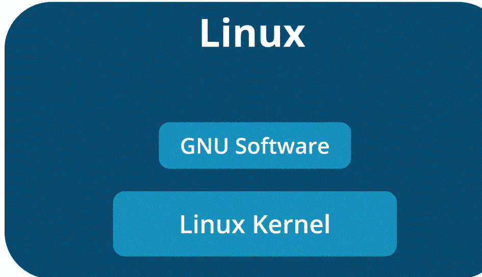

从根本上说，Linux 是 Linux 内核和 GNU 软件的结合。

GNU/Linux 由于 Linux 操作系统族的大多数成员包含了 GNU 工具，FSF 倾向于将该操作系统族称为“GNU/Linux”而不是“Linux”。这支持了 Linux 是 GNU 项目“缺失拼图”的观点，并从事实上完成了它。然而，“Linux”一词的使用更广泛，指的是基于 Linux 内核的整个操作系统族。


服务器通过网络为多个用户提供系列服务。服务的市场份额并不总是容易确定，但大多数来源都认为 Linux 主导了服务器市场。在前一百万个域名中，超过 90% 运行在 Linux Web 服务器上，在亚马逊弹性计算云（EC2）平台上，超过 90% 的公有云服务器运行 Linux。

工作站比桌面电脑更强大，通常用于软件开发等工作。Linux 在工作站上的普及程度比 PC 高，但在该领域仍然落后于 Windows 和 macOS。

主机是大型、高度先进的计算机，擅长同时处理许多事务。超级计算机是计算技术尖端的机器，擅长以尽可能快的速度执行复杂的计算。Linux 主导了这两个市场——2018 年全球前 500 台最超级计算机都运行 Linux。移动设备包括智能手机和平板电脑，以及任何小到可以握手的设备。移动操作系统 Android 基于 Linux 内核，拥有全球移动设备 80% 以上的市场份额。

### 角色
- 个人计算机
- 嵌入式系统

### 备注

这通常包括桌面电脑和笔记本电脑，以及任何面向技术使用的非移动设备。这是 Linux 渗透率极低的少数市场之一；大约 2% 的用户将 Linux 作为桌面平台。

嵌入式系统是计算机硬件和软件系统，在较大的系统中具有特定功能。这些较大的系统可以包括从家电、微波炉到工业机器的所有设备。运行 Linux 的嵌入式系统占据了市场大部分。

## 主题 B

## 输入 Shell 命令

Linux 操作系统的设计强调了一种特定的用户界面；用户在提示符中输入命令来与系统交互。这与 Windows 和 macOS 等主要以视觉为主的操作系统不同。因此，Linux 管理中最关键的技能之一就是熟练地输入命令。在本主题中，你将输入几个基础命令以更加熟悉这一过程。

### CLI

命令行界面（CLI）是用户与操作系统之间基于文本的界面，它接受命令形式的输入。CLI 向用户显示提示符，用户通过输入命令以多种方式与系统交互。在命令行下工作是任何管理员角色中的一项重要工具。开发人员和管理员经常使用 CLI，而普通用户通常依赖于图形用户界面（GUI）。

对于管理员来说，熟练命令行至关重要。命令行管理是 Linux 的一项预设要求。事实上，Linux 包含了许多 GUI。系统上可以安装其中任何一个或一个都不安装。假设你想最大限度地利用硬件来实现系统的特定用途，你可以通过 CLI 执行所有管理。。注意：在 Linux 中，CLI 是区分大小写的。

### CLI 的优势与挑战

使用 CLI 的一些优势包括：
- 系统处理速度更快。
- 管理员输入信息的速度更快。
- 命令可以存储在称为脚本的文本文件中，你可以通过一个命令执行它们，从而让系统执行长系列活动。
- 脚本可以安排为定期执行。
- CLI 中提供了额外的选项，这些选项在 GUI 中可能不存在。

同样，使用 CLI 也面临一些挑战：
- 比 GUI 更难学习。
- 命令有许多选项，且并不总是一致。
- 它经常被误认为是遗留技术。
在 Linux、Unix、macOS 和 Windows 平台之间存在许多命令行环境。

### SHELLS

Shell 涵盖了操作系统的核心部分——内核（kernel），允许用户将命令和信息传递给内核。内核也能通过 Shell 向用户返回响应。Shell 可以被视为人类语言与内核语言之间的解释器。Linux 用户在 Shell 中发布命令来告诉操作系统做什么。操作系统将结果返回给用户。

Shell 可以实现为 CLI，也可以是图形用户界面（GUI）。下表列出了 Linux 中常用的命令行 Shell。

| Shell | 描述 |
| :--- | :--- |
| Bourne shell (sh) | 这是原始的 Unix Shell，Linux 系统上可用，但未广泛使用。 |
| Bash (bash) | 这是 默认 Shell，是 Bourne shell 的替代品。它的全名来自 Bourne Again Shell。 |
| C shell (csh) | 该 Shell 基于 C 语言，旨在支持 C 语言开发环境。 |
| KornShell (ksh) | 该 Shell 使用了 C shell 的功能和 Bourne shell 的语法。在 Unix 系统上很。 |

```
root@localhost:~~
[root@localhost ~]#
```
GUI 中的 Shell 提示符。

### 关于 Bash

作为 Linux 用户，熟练使用默认的 Bash Shell 是重要的。几乎每个 Linux 发行版都会使用该 Shell 作为用户与系统之间的翻译器。如果用户更习惯其他 Shell，可以在 Linux 中安装并使用，但默认几乎都是 Bash。

Bash 的一些特性包括：
- 它存在时间很长，因此有详尽的文档和大量的脚本。
- 它在 Linux 和 macOS（在那里也是默认 Shell）以及各种操作系统中广泛使用。
- 它并不总是一致，因为自创建以来，各个小组对其进行了大量的修改。
- 它包含了历史记录和 Tab 补全功能。
- 它非常灵活。

### Bash 语法

如果你未能按照正确的语法输入命令，Bash 将返回错误。通常，这些错误信息是描述性的，并帮助你理解 Bash 的预期。对于“找不到命令”错误，请检查命令的拼写。对于“没有此类文件或目录”错误，请检查目录、文件或路径的拼写。

注意：在某些情况下，方括号 `[]` 表示可选，花括号 `{}` 表示必需，管道符 `|` 表示变量。


echo 将输入的内容重新显示在屏幕上。通常用于在脚本向用户发送信息。

ls 列出目录内容。可以提供选项来查看权限、隐藏文件等。

pwd 显示你当前所在的工作目录。
cd 更改当前的工作目录。

touch 更新现有文件的时间戳，也可以用于创建一个空文件。

cp 将文件或目录复制到另一个位置。
mkdir 创建目录。

### 示例

echo 'Good morning!'
在命令行（CLI）返回 "Good morning"。

- * ls 列出当前目录的内容。
- * ls -a 包含隐藏文件。
- * ls -l 以长格式显示。
- * ls /var/log/logs 列出指定目录的。。

pwd 返回你当前工作目录的路径。
* cd /var/log 将你的当前目录更改为 /var/log
* cd /etc 将你的当前目录更改为 /etc
touch file1 如果 file1 存在则更新其时间戳；如果不存在则创建 file1。
cp file1 file2 将 file1 的内容复制到 file2。
mkdir newdir 创建名为 newdir 的新目录。

### 文件查看命令

Linux 系统配置存储在文本文件中，因此你需要能够查看这些文件的内容。

cat 命令用于查看文件内容而不具备编辑文件的选项。使用 cat 的示例是 cat file1，在屏幕上显示 file1 的内容。

less 命令用于查看无法完全显示在一个屏幕上的文件内容。它将内容输出分成若干页，你可以在命令行中进行滚动。使用 less 的示例是 less file1，当 file1 的内容足够长而超出单页时，将其内容分成多页。按 Page Up（上翻页）和 Page Down（翻页）滚动屏幕，按 q 退出命令。

### 文件编辑命令

正如你需要查看文本文件的内容一样，还需要编辑它们。

### 命令描述示例

vim 启动一个强大的文本编辑器。
1. vim file 打开一个文本文件，它是 Linux 命令的默认。
2. 按 i 进入插入模式。
3. 按 Esc 退出插入模式。
4. :wq 保存并退出模式。

nano 启动一个小型、用户友文本编辑器。
1. nano file 打开一个文本文件。它可能在所有发行版中都可用。
2.

git 启动一个易于使用的 GUI 文本编辑器。
1. 需要安装桌面环境。
2. 直接在界面中输入文本。按 Ctrl+O 保存更改。按 Ctrl+X 退出。

选择 应用程序→附件→文本编辑器。直接在界面中输入文本。使用菜单保存并退出。

### 电源管理命令

定期可能需要重启或关闭系统。有几个命令可以完成任务，但目前你将关注 shutdown（关闭）命令。shutdown 命令的一些示例：

注意：reboot 命令本质上执行与 shutdown -r 命令相同的任务。

### sleep 命令

sleep 命令用于暂停系统活动指定的时间。
command sleep [seconds] 挂起指定的秒数。

### 超级用户命令

在 Linux 中，具有管理员凭据的用户是超级用户。超级用户通常命名为 root。以超级用户身份登录系统通常认为是一个坏习惯，你应该养成登录非特权账户的习惯。然而，有时你需要获得超级用户的权限来执行管理任务。

su 命令（“切换用户”）切换凭据，su root 将凭据切换到 root 用户。系统将提示你输入 root 用户的密码进行授权。一旦你登录了 root，你将能够执行之前无法执行的任务。

### Shell 历史

Bash 保留了一个包含所有输入命令的历史文件。你可以引用该文件并重复命令，提高效率和一致性。使用 shell 历史的示例包括：

- 以列表格式输出最近输入的命令。
- 按向上箭头和向下箭头循环显示命令历史。

### TAB 补全

Bash shell 支持标签补全，使用户只需输入足够的命令即可自动完成。

### Shell 技巧与窍门

虽然命令行令人令畏，但有多种方法可以让它变得简单。以下是一些使用 Bash 的技巧：

- 以列表格式输出最近输入的命令。
- 按向上箭头和向下箭头循环显示命令历史。按回车使用需要的命令。
- 以列表格式输出最近输入的命令。
- 按向上箭头和向下箭头循环显示命令历史。按回车使用需要的命令。
- 以列表格式输出最近输入的命令。
- 按向上箭头和向下箭头循环显示命令历史。按回车使用需要的命令。

- 如果需要，按 Tab 键查看与输入文本匹配的所有路径和文件。
- 如果需要，继续输入并按 Tab 键来缩小命令、文件的范围。
- 当相应的命令、路径或文件列出时，按回车填充剩余部分。


注意：帮助页（man pages）以简单的 ASCII 文本格式呈现，以便访问。

```
root@localhost~
MAN(1) Command MAN(1)
Man user pages
NAME
man - an interface to the on-line references manuals
SYNOPSIS
man [-c file] [-d] [-O] [--warnings=warnings]] [-R encoding] [-L locale] [-M sys
man [...] [-H path] [-e] [-extension] [-I-i] [-regex--wildcard] [--names-ay]
[-a] [-w] [-nosubsub] [-H browser] [-E encoding] [-E hyphenation
[--no-justification] -p string [-T device] [-N browser] [X-dpi] [-Z section]
page ...
man -k options retex
man -W [-w] [-S list] [-l] [-i] [-regex] term ...
man -F [help colon] [-C file] [-d] [-O] [--warnings=warnings]] [-R encoding] [-L locale] [-P page
file
man -c [C file] [-d] [-O] page -p string [-T device] [-N browser] [X-dpi] [-Z]
man -tV
```

### DESCRIPTION
man 页是系统的帮助页。传递给 `man` 的每个页面参数通常是命令名称


该命令的 man 页。

### SYN
命令的语法是 man [command]

### SYNOPSIS FORMAT
man 页的大部分组件都是自言自足的，但 SYNOPSIS 组件对新用户来说可能有些令人困惑。帮助页的这部分提供了命令的语法以及示例用例。这些用例的格式如下：

- **粗体文本应按照所示内容精确输入。**
- *斜体文本应替换为相应的参数。这在不同系统上的格式可能不同，例如下划线文本或彩色文本。
- [-abc] 表示括号内的所有参数都是可选的。
- [-a|-b] 表示管道 (|) 两侧的参数不能同时使用。
- *带有 ... 的斜体文本*（省略号）表示参数可以重复。
- [斜体]文本后带有 ... 表示括号内的整个表达式可以重复。

### COMMAND OPTIONS
`man` 命令支持不同的选项。这里列出了一些常用的选项。

### Option Description
- -a 查找所有匹配查询的条目。
- -D 显示调试信息。
- -f 显示命令的简短描述以及对应的 man 页/章节。
- -h 显示 man 命令的帮助选项。
- -k 列出所有包含关键字 algorithm 的帮助手册页/章节及其位置。
- -S 在所有页面中搜索指定的字符串。

### Option Description
- -t 格式化 man 页以便打印。

### MAN PAGES SECTIONS
命令的页面可能列在一个或多个章节下。章节定义了命令所属的类别。当一个命令列出多个章节时，意味着同一条命令的文档可以从多个源中获取。这些章节通过命令前显示的数字来标识；例如，fsck (8)

下表提供了各种 man 页的章节。

| 章节编号 | 包含内容 |
| :--- | :--- |
| 1 | 通用命令 |
| 2 | 系统调用 |
| 3 | C 库函数 |
| 4 | 特殊文件（通常在 /dev 中） |
| 5 | 文件格式和约定 |
| 6 | 游戏和屏保 |
| 7 | 杂项 |
| 8 | 系统管理命令和守护进程 |

### MAN PAGES NAVIGATION
你可以使用多个键导航 Linux man 页。这些键在下表中描述。

| 使用的按键 | 作用 |
| :--- | :--- |
| Home | 移动到 man 页开头。 |
| End | 移动到 man 页末尾。 |
| Page Up | 逐向上滚动页面。 |
| Page Down | 逐向下滚动页面。 |
| / | 开始搜索终端或文本字符串 |
| n | 移动到搜索词的下一个出现。 |
| p | 移动到搜索词的上一次出现。 |
| q | 退出并返回 shell 提示符。 |

### OTHER BUILT-IN HELP OPTIONS
除了 `man` 命令外，Linux 还提供了其他内置帮助选项。

### Help Option
在所有 man 页的 NAME 章节中搜索用户提供的关键字。NAME 章节包含了命令名之后的一个简短单句描述。当你想要执行某些任务但不知道相应的命令名称时，`apropos` 命令非常有用。该命令的语法是 apropos [keyword]

### Help Option Description
whatis
显示给定命令的简短描述，包括出现在多个章节中的命令。这本质上是 apropos 的反操作——你知道命令名称，但想知道它是做什么的。`whatis` 的语法是 whatis [command]

info
显示命令的 info 页。info 页本质上是 man 页的替代方案，受到 GNU 项目青睐。尽管它们具有超链接等功能，并且轻松生成 HTML 页面和 PDF 文件，但 info 页没有 man 页那样被广泛采用。该命令的语法是 info [command]

--help
显示命令用法的快速摘要以及可以使用的参数列表。此功能可用于 Linux 中的大多数命令。该命令的语法是 <command> --help 或 <command> h

/usr/share/doc/
此目录包含包含安装在系统上的库、系统实用程序和其他软件包的文档。每个软件包在该目录中都有自己的子文件夹，每个子文件夹通常包含独立的文档，列出作者、许可信息、安装说明、通用 README 等。

### ONLINE DOCUMENTATION
互联网是获取 Linux 帮助的最佳场所之一。没有哪个在线源比其他源更好；选择通常取决于你寻找什么类型的帮助。下表列出了 Linux 文档的一些最佳在线源。

| 在线源 | 官方发行版文档 |
| :--- | :--- |
| Linux | Linux Documentation Project (LDP) |
| | Linux man-pages project |

### Description
一些较流行的 Linux 发行版为其用户提供专门适用于该发行版的文档。这些文档通常包含不同版本和更新的发布说明、安装指南、虚拟化指南等。例如，Ubuntu 的官方文档可以在 **https://ubuntu.com/** 获取。

LDP 是一个全志愿者项目，为 Linux 文档提供了全面的资源。文档有多种形式，从执行特定 Linux 任务的步骤 HOWTO，到包含各种 Linux 主题建议和最佳实践的 Guide。LDP 还包括 FAQ、页面和其他类型的文档。LDP 可于 **https://www.ldp.org/**。

这是内核和 C 库接口 man 的官方源对于

### SYSTEM ADMINISTRATOR'S GUIDE
RED HAT ENTERPRISE LINUX 7
RHEL 7 的在线文档。

### INTERACTIVE HELP
在线文档是一个快速方便的参考点，但它并不总是回答你问题的最佳来源，特别是当这些问题复杂或属于特殊情况时。这些问题通常通过与他人互动（无论是实时还是异步）来获得答案。下表列出了互联网上 Linux 交互帮助的主要源。

| 在线源描述 |
| :--- | :--- |
| Usenet 新组 | Usenet 新组是类似于公告系统的在线讨论库 comp.os.help, comp.os.linux.answers, comp.os.linux.admin. |
| 邮件列表 | |
| Q&A 网站 | |
| 论坛和社交媒体 | |


一些鼓励用户在社区发布帖子并让其他用户在特定论坛对帖子做出回应的方法，其中一个流行的 Linux 支持论坛是 https://www.linuxquestions.org/。此外，一些社交媒体网站（如 Reddit）提供了论坛讨论平台，用于寻求特定主题的帮助——例如，https://www.reddit.com/r/linuxquestions。

## 如何在 Linux 中获取帮助

遵循以下通用步骤在 Linux 中获取帮助。

### 查看 Linux 手页 (man pages)

要查看 Linux 手页：

- 1. 在命令行中输入 `[command]`，其中 `[command]` 是你想查看帮助页的命令。
2. 查看该命令可用的选项列表。
3. 浏览帮助页：
    * 按向上箭头或向下箭头键在页面内进行导航。
    * 按 Page Up（向上翻页）或 Page Down（向下翻页）键在多个页面之间进行翻页。
    * 根据需要在帮助页中搜索特定主题。

- a. 输入 `/search n` 在帮助页中搜索指定的字符串，
b. 如必要，按 `n` 定位帮助页中该字符串的下一次出现。
4. 按 `q` 关闭指定命令的帮助页。

### 查找合适的命令

要找到合适的命令：

- 1. 如必要，在 root 用户权限下，输入 `mandb` 来更新数据库。如果你在运行 `apropos` 命令后收到“无合适结果”的结果，则此操作是必要的。
2. 输入 `apropos [keyword]`，其中 `[keyword]` 是描述你尝试执行的任务的关键词。
3. 检查结果列表寻找合适的命令。

### 识别命令的用途

要识别命令的用途：

- 1. 输入 `wh [command]`，其中 `[command]` 是你想识别用途的命令。
- 2. 检查并浏览结果。

### 显示命令的信息页 (info pages)

要显示命令的信息页：

- 1. 输入 `info [command]` 以阅读指定命令的信息文档。
2. 检查并浏览结果。

### 显示命令的选项

要显示命令的选项：

- 输入 `command --help` 显示命令语法和选项列表。

### 活动 1-1

回顾基础 Linux 任务

场景

回答以下复习题。

## 1. Linux 在你的组织中是如何使用的？是否有现有的系统可以通过切换到 Linux 受益？

答案可能不相同。Linux 是托管各种服务器的流行平台，如果学生的组织托管或管理 Web 服务器，那么他们极有可能正在运行 Linux。大多数组织使用路由器等网络设备来支持其网络，而这些中的许多嵌入式设备运行在 Linux 之上。如果学生的组织实施了任何形式的移动基础设施策略；例如自带设备 (BYOD)，这些许多设备很可能运行着 Android，而 Android 是基于 Linux 的。将现有的系统切换到新的操作系统并不总是一件易事，但如果 Linux 的免费、简单和模块化特性能够提高性能和生产力，学生可能会看到将某些系统更改为 Linux 的价值。

## 2. 你获取 Linux 帮助的偏方法是什么？为什么？

答案可能不相同。许多人倾向于使用手页 (man pages)，因为它们在命令行中访问快速且方便，而其他文档可能需要访问互联网和网络浏览器。然而，仅通过阅读页面可能很难理解某些工具的真正威力，因此学生可能更倾向于查阅更详细和/或实际示例的在线文档。其他可能可能更倾向于直接与 Linux 支持社区互动，因为这种交互组件在解决复杂的、开放性的问题时通常是必要的。

## 总结

在本节中，你识别了 Linux 操作系统背后的基本概念，并执行了基础任务以启动 Linux 环境。这是你构建管理 Linux 系统技能的基础。

第 1 节：执行基础任务 |

## 第 2 节

管理用户和组

课程时长：2 小时 30 分钟

## 课程介绍

现在你已经执行了一些基础 Linux* 任务，你准备好开始深入学习为自己和他人配置操作系统了。在用户利用 Linux 之前，你需要为他们创建并管理账户。因此，在本节中，你将管理用户和组账户。

## 课程目标

在本节中，你将：

- 在需要时假设超级用户 (superuser) 权限。
- 创建、修改和删除账户。
- 创建、修改和删除组账户。
- 查询用户和组账户。
- 配置用户配置文件。

## 主题 A

### 假设超级用户权限

考试目标涵盖
3.1 给定场景，应用超级用户权限。

为了给其他用户创建账户以及执行本课程中讨论的任何管理任务，你需要确保在遵循安全最佳实践的同时，拥有超级用户权限。

## 用户账户 (USER Accounts)

账户是 Linux 中代表用户和服务的对象。用户信息包括组成员身份。使用 Linux 计算机的个人应该拥有自己的账户。管理员将使用这些账户来控制用户对文件、目录和命令的访问。系统使用用户 ID (UID) 而不是名称来引用每个账户。名称是为了用户的方便而使用的。

用户账户将具有多个属性，包括密码信息、组成员身份、过期日期注释。

### 用户账户类型

有三种类型的账户：root、标准用户和服务账户 (service)。

root 账户在 Linux 系统中担任两个角色。第一个角色是本地管理员。以 root 身份登录的用户可以执行管理任务，如重置密码、更改系统配置、用户账户管理。root 用户的第二个角色是为某些应用程序和命令提供安全上下文。这些应用程序和命令可能由系统调用，或由用户以 root 身份手动输入。Linux 中的 root 比 Windows 系统上的本地管理员强大得多。使用管理员凭据登录任何系统都是坏习惯。在 Linux 系统上，这可能特别危险。root 用户可以对系统采取破坏性操作，且通常不需要验证提示。

> 注意：某些 Linux 发行版（如 Ubuntu）完全禁用了 root 用户账户以减少这种威胁。在安装过程中，会给普通用户账户授予管理员权限。

标准用户账户代表可能登录 Linux、配置数据库、构建网站等的普通用户。每个用户都应该有自己的账户，这些账户不应共享。用户在系统上执行的大多数任务只需要标准用户账户权限。可以设置标准用户具有管理员权限。允许用户以 root 身份登录的优势在于标准用户的权限是可以被限制的，而 root 用户权限无法被限制。

应用程序消耗系统资源，因此它们通常由自己的服务账户表示。这些账户通常特定于某个服务（例如 httpd 服务或数据库服务）。这些账户被禁用登录，且账户通常在服务安装过程中创建。它们通常会拥有与服务相关的配置文件或可执行文件。


在 Linux 中，本地管理员账户名为 root。该账户用于执行管理功能，如管理用户、配置设备、配置网络设置等。系统也会以 root 凭据运行。系统不会对 root 用户执行的具有潜在破坏性的命令进行确认。登录系统的权限通常与对管理功能的了解程度相关。

root 账户也被称为超级用户（superuser）。安全最佳实践是永远不要使用管理员凭据登录系统，而是使用非特权账户登录并在必要时提升权限。

### 最小权限原则

在信息安全中，最小权限原则规定，赋予用户对系统的权限不应超过其执行工作所需的权限。如果一个用户需要读取但无需写入文件，那么他们只获得读取权限。如果一个用户需要重启服务器但不需要重新配置服务器，则赋予他们重启的权限。与移除现有权限相比，通过增加少量访问权限来纠正权限问题要容易得多。通过仅赋予用户完成工作所需的权限且不超出此范围，系统将将保持显著更高的安全性。

### su 命令

正如你所看到的，直接以 root 权限登录服务器是一个糟糕的做法。更好的做法是使用标准用户账户登录，然后根据需要将权限提升到 root。提升权限的一种方法是使用 `su` 命令“切换用户”。

在不带选项的情况下，`su` 命令允许用户将身份切换到另一个用户，但它保留原始用户的配置文件和变量。切换后的用户仍然留在原始用户的家目录下。除了 root 用户之外，任何使用 su 的人都会要求输入其切换到的用户账户的密码。

在 `su` 后加上连字符（hyphen）允许用户切换用户并在新用户的环境中启动一个新的 shell。这是一种更好的做法。任何使用 root 用户的人都会被要求输入其切换到的用户的密码。最常见的是切换到 root 用户，但只要知道用户的密码，任何用户都可以切换到任何其他用户。

### 以初始用户身份登录

### 替换其他用户

```
$student01@server01 ~] su - manderson
Password:
Last login: Mon Jan 7 13:34:08 GMT 2019 on pts/1
[manderon@server01 ~] 
```

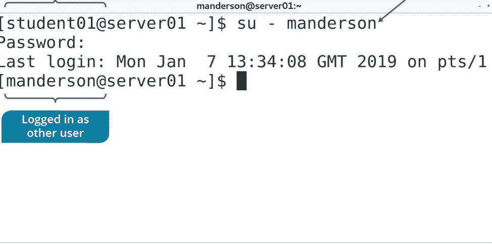

### 以其他用户身份登录

用另一个用户替换当前用户。

### 语法

`su` 命令的语法是 `su [- [user name]]`。

注意：在没有用户名参数的情况下，`su` 命令将假设你想以 root 登录。

### sudo 命令

通过 `su` 命令，任何知道 root 密码的人都可以“获取 root”身份并执行 root 用户可以做的任何事情。使用 `su – root` 的账户本质上就是服务器管理员。这通常远超过了本应委托给用户的权限。更好的做法是将特定功能委托给用户，而不是授予系统 root 权限。

`sudo` 命令允许服务器管理员将特定命令委托给特定用户，而无需授予 root 的完全权限。权限的委派通过使用 `visudo` 编辑器在 `/etc/sudoers` 文件中完成的。可以向用户和组授予特定的命令，以便他们能够在运行这些命令时履行其职责，而无需完全的管理员权限。

### 语法

`sudo` 命令的语法是 `sudo [options] [command]`。

### sudoedit 命令

Linux 文件需要 root 权限才能编辑。这可以通过 sudo 配置来实现；一个更简单更安全的选项是使用 `sudoedit` 命令。该命令允许用户使用自己的凭据编辑文件，即使该文件仅对 root 用户可用。此外，你可以使用他们喜好的文本编辑器。

要使用 `sudoedit`，你必须在 sudoers 文件中创建一个条目。例如，可以将以下行添加到 sudofile 文件中：
`%editors ALL = sudoedit /path/to/file`

`editors` 组的任何成员都可以遵循以下命令编辑文件：`sudoedit /path/to/file`

`sudo` 配置适用于需要以提升权限执行的命令，而 `sudoedit` 选项适用于需要以提升权限编辑的文件。

### 语法
`sudoedit` 命令的语法是 `sudoedit [options] [file name]`。

### visudo 命令

虽然 `/etc/sudoers` 文件是一个普通的文本文件，但至关重要的是不要使用 Vim 或 nano 等标准文本编辑器编辑它。`/etc/sudoers` 文件控制着所有提升权限的访问，该文件中的错误可能导致无法在服务器上获得 root 权限。大多数发行版都会为 `/etc/sudoers` 设置默认编辑器（通常是 Vim 或 nano）。当使用 `visudo` 命令时，系统会在提交更改之前验证 `/etc/sudoers` 文件的语法，为管理员提供了在错误成为运行配置的一部分之前进行修正的机会。

```
/etc/sudoers
root@server01:~
### 允许 users 组的成员关闭系统
# %users localhost=/sbin/shutdown -h now

## 从 /etc/sudoers.d 读取包含入式文件（这里的 # 并不表示注释）
#includedir /etc/sudoers.d
student01 ALL=(ALL) NOPASSWD:ALL
授予 root 权限的条目
```

包含向用户账户授予 root 权限条目的 `/etc/sudoers` 文件。

### 语法
`visudo` 命令的语法是 `visudo [options]`。

### 命令

以下是你可以与 visudo 一起使用的选项：

-c 检查 sudoers 文件。
-f [file name] 编辑不同位置的 sudoers 文件。
-s 在严格模式下检查。
-x [file name] 输出 sudoers 文件。

### wheel 组

root 系统的用途远不止于任务。许多发行版禁用了用户实际的 root 账户，转而通过加入 wheel 组来允许管理功能。wheel 组的成员可以使用 `sudo` 命令来避免损坏系统。你可以将用户添加到 wheel 组以赋予他们权限。对于 wheel 组的成员身份要非常谨慎。


现在你已经拥有超级用户权限，可以开始为组织中的用户创建账户了。在某些时候，你还需要根据需要修改和删除这些账户。

### useradd 命令

`useradd` 命令用于创建用户账户并配置基本设置。在创建账户的过程中，`useradd` 会引用几个文件：

- 账户存储在 `/etc/passwd` 文件中。
- 账户根据 `/etc/login.defs` 中的各种选项进行配置。
- 用户的家目录创建在 `/home/<account name>` 目录下。
- 账户的家目录使用 `/etc/skel` 目录中的文件填充。

默认情况下，`useradd` 命令不会为账户设置密码。由于大多数 Linux 发行版均不允许空密码，因此账户将存在但尚且无法使用。

### 语法

`useradd` 命令的语法为 `useradd [options] [user name]`。

### useradd 命令选项

`useradd` 命令包含许多自定义用户账户的选项，详如下表。

| 选项 | 说明 |
| :--- | :--- |
| -c | 设置注释字段，通常用作用户的全名字段。 |

示例

```
useradd -c "User One" user1
```

- -e | 设置账户过期日期。`useradd -e 2019/12/31`
- -s | 设置用户的默认 shell。
- -D | 查看新用户的默认配置。`useradd -s /bin/ksh useradd -D`

### passwd 命令

root 用户使用 `passwd` 命令为任何用户设置或重置密码。用户可以使用 `passwd` 命令重置自己的密码。它还被用于在用 `useradd` 命令创建账户后为用户设置初始密码。

> ：：当用户设置密码时，屏幕不会显示任何输出。某些用户可能会误认为这是一个问题，但实际上实际上是 Linux 隐藏了密码中使用的字符数。

```
manderon@server01 ~]$ passwd
Changing password for user manderson
Changing password for manderson.
(current) UNIX password:
New password: * 
Enter desired password
```
一个用户正在更改自己的密码的示例。

### 语法

`passwd` 命令的语法为 `passwd [user name]`。root 用户可以使用它设置特定用户的密码。

### /etc/passwd 文件

`/etc/passwd` 文件存储用户账户信息。所有账户（无论是默认还是用户特定的）都可以在此文件中找到。管理员经常引用此文件来了解系统上的特定账户。每个账户包含七字段信息。每个字段由冒号隔开。字段并不一定会被填充。

| 字段 | 内容 |
| :--- | :--- |
| User name | 用户登录系统时使用的名称。 |
| Password | 分配给用户的密码，通常表示为 x，指示密码存储在其他处。 |
| User ID | 系统中代表用户的唯一数字。 |
| Group ID | 表明用户主组成员身份的唯一数字。通常代表用户的全名。 |
| Home directory | 用户家目录的绝对路径。 |
| Login shell | 用户登录时启动的 shell 路径（通常为 /bin/bash）。 |

### 编辑 /etc/passwd 文件

编辑 `/etc/passwd` 文件的正确方法是通过通过 `useradd`、`usermod` 和 `userdel` 命令进行。手动编辑该文件可能会导致错误，从而使系统无法使用。

### /etc/shadow 文件

曾经 `/etc/passwd` 文件被用于存储密码的加密哈希版本。然而，该文件是全局可读的这意味着这意味着用户可以看到另一个用户密码的哈希版本。通过在密码破解工具中输入哈希密码，用户可以发现另一个用户的密码。

`/etc/shadow` 文件是存储哈希密码以及额外账户信息的现代存储位置。这些额外信息包括密码要求和过期信息。只有 root 有权访问 `/etc/shadow` 文件，防止用户尝试破解彼此的密码。

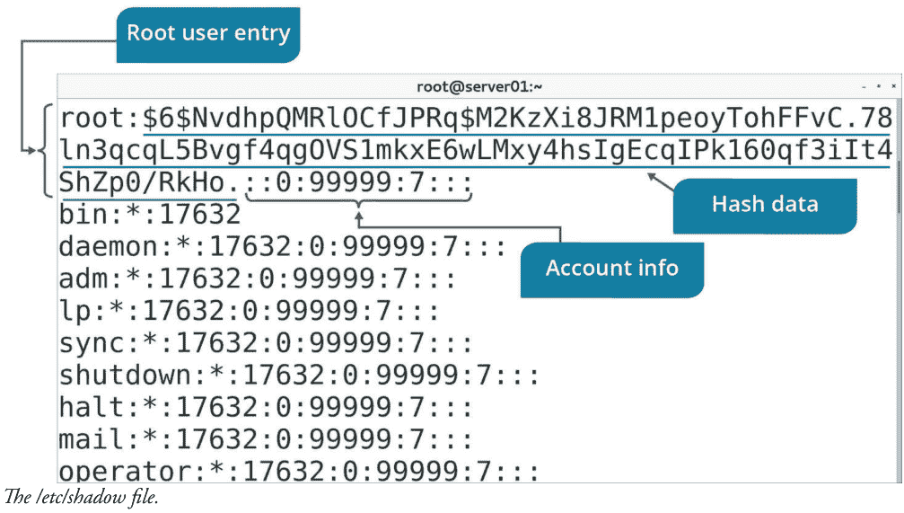

### /etc/shadow 文件格式

下表描述了 `/etc/shadow` 文件的格式。

| 字段 | 内容/附加信息 |
| :--- | :--- |
| User name | 用户登录系统的名称。 |
| Password | 分配给用户的密码的哈希值。 |
| Days since password changed | 天数从 1970 年 1 月 1 日起计算。 |
| Days before password must be changed | 通常设置为 1 天。 |
| Days until user is warned to change password | 值 99999 表示密码永远不需要更改。 |
| Days after password expires | 理想情况下，这应该是立即生效的。 |
| that account disabled | 天数从 1970 年 1 月 1 日起计算。 |
| Unused field | 留供未来可能的使用。 |

### 如何创建用户账户

使用以下步骤创建用户账户。

## 创建用户账户

要创建用户账户：

1. 假设拥有超级用户权限。
2. 输入 `useradd [user name]` 添加新用户。
3. 输入 `passwd [name]` 设置密码。
4. 在用 `useradd` 命令创建账户后，为用户设置初始密码。

## THE chage 命令

`chage` 命令用于控制密码过期、警告、禁用天数的其他信息。它编辑 `/etc/shadow` 文件。

| 选项 | 说明 |
| :--- | :--- |
| -E | 设置账户过期。 |
| -l | 显示信息。 |
| -M | 设置密码有效期天数。 |
| -W | 设置警告用户更改密码的天数。 |

示例

```
chage -E 2019/12/31 user1
chage -l user1
chage -M 0
chage -W 7
```

### usermod 命令

`usermod` 用于修改用户设置。管理员可以对现有账户进行许多修改。下表列出了 `usermod` 命令的选项。

| 选项 | 说明 |
| :--- | :--- |
| -c | 设置注释字段，通常用作用户的全名字段。 |
| -e | 设置账户过期日期。 |
| -s | 设置用户的默认 shell。 |
| -aG | 加入组并保留现有组。 |

示例

```
usermod -c "User One" user1
usermod -e 2019/12/31 user1
usermod -s /bin/ksh user1
usermod -aG sales user1
```

### 锁定用户登录

管理员可以在用户离开公司、发生安全漏洞或休假时锁定用户账户。锁定账户使其无法使用但不删除账户。需要时可以解锁。

用户可以使用 `passwd` 或 `usermod` 命令锁定账户。锁定：

- `passwd -l [user name]`
- `usermod -L [user name]`

解锁：

- `passwd -u [user name]`
- `usermod -U [user name]`

### 如何修改用户账户

使用以下步骤修改用户账户。

### 修改用户设置

要修改用户设置：

1. 假设拥有超级用户权限。
2. 输入 `usermod [options] [user name]` 修改用户设置。

### 设置账户过期日期

设置账户过期日期：

1. 假设拥有超级用户权限。
2. 输入 `chage -E [YYYY/MM/DD] [user name]` 设置用户账户过期为指定日期。

### 锁定用户账户

锁定用户账户：

- `passwd -l [user name]` 锁定指定账户。
- `usermod -L [user name]` 锁定指定账户。

### 解锁用户账户

解锁用户账户：

- `passwd -u [user name]` 解锁指定账户。
- `usermod -U [user name]` 解锁指定账户。

### userdel 命令

`userdel` 命令用于删除用户账户。默认情况下，它不会删除用户的家目录，除非你使用 `-r` 选项。删除账户将移除对其的所有引用。你必须重新创建账户并将其添加到组以恢复原始身份。在删除用户账户之前务必小心。

### 语法

`userdel` 命令的语法为 `userdel [options] [user names]`。

### 如何删除用户账户


使用以下步骤删除用户账户。

# 删除用户账户

要删除用户账户：

- 1. 假设具有超级用户权限。
2. 删除账户：

   - 输入 `userdel [user name]` 来删除账户但保留用户的家目录。
   - 输入 `userdel -r [user name]` 来删除账户以及用户的家目录。

# 主题 C

创建、修改和删除组

# 涵盖的考试目标

2.2 在给定场景下，管理用户和组。

为了更高效地向用户授予访问权限，你将为用户创建他们所属的组。你还将根据需要修改和删除这些组。

# 组账户

组将具有相似安全需求的用户关联在一起。组简化了管理任务，允许为多个用户授予资源权限。系统通过组 ID (GID) 来表示组。用户可以是多个组的成员。

### /etc/group 文件

/etc/group 文件是组的存储位置。所有的组（无论是默认的还是用户特定的）都可以在此文件中找到。管理员可以参考 /etc/group 文件来查找有关系统的信息。每个组包含四个信息字段。每个字段之间用冒号分隔。字段并不一定都有值。

```
root@server01:~
stapsys:x:157:
stapdev:x:158:
student01:x:1000:student01
manderson:x:1001:
cmason:x:1002:
ariley:x:1003:
rstanley:x:1005:
MarketingDept:x:1008:ariley
FinanceDept:x:1009:manderson
GraphicsDept:x:1006:rstanley,jrobinson
jrobinson:x:1010:
apache:x:48:
```

/etc/group 文件。

编辑 /etc/group文件的正确方法是使用 `groupadd`、`groupmod` 和 `groupdel` 命令。不建议手动编辑该文件，因为错误可能会导致系统无法使用。

| 字段 | 描述 |
| :--- | :--- |
| 组名 | 组的易用名称。 |
| 密码 | 进入该组所需的密码。 |
| 组 ID | 系统引用该组的组 ID。 |
| 组列表 | 所有组成员的列表（默认为空）。 |

### groupadd 命令

`groupadd` 命令用于创建一个组。默认情况下，该组没有成员且没有密码。除了创建一个具有易用名称的组外，你还可以使用 `-g` 选项指定组 ID。

一些组选项包括以下。

| 选项 | 用途 |
| :--- | :--- |
| -g | 分配组 ID。 |
| -f | 如果组已存在，则以成功状态退出。 |
| -o | 允许使用非唯一的组 ID 创建组。 |

示例
`groupadd -g 123 sales`
`groupadd -f`

`groupadd -o -g 123 sales`

语法 `groupadd` 命令的语法为 `groupadd [options] [group names]`

### groupmod 命令

`groupmod` 命令用于更改组自身的属性。它将为你编辑 /etc/group 文件。对组的修改可能包括更改其名称或 GID。

注意：将用户添加到组被认为是对用户的修改，而不是对组的修改。因此，它是使用 `usermod` 命令完成的。一些组选项包括以下。

| 选项 | 用途 | 示例 |
| :--- | :--- | :--- |
| -g | 更改组 ID | `groupmod -g 123 sales` |
| -n | 重命名组 | `groupmod -n news sales` |

语法 `groupmod` 命令的语法为 `groupmod [options] [group names]`

### groupdel 命令

`groupdel` 命令从 /etc/group 文件删除组。它不会删除该组的成员账户。删除组时要小心，因为错误会导致用户无法访问资源。

语法 `groupdel` 命令的语法为 `groupdel [options] [group names]`

### 如何创建、修改和删除组

使用以下步骤创建、修改和删除组。

### 创建组

创建一个组：

- 1. 假设具有超级用户权限。
2. 输入 `groupadd [options] [group name]`

### 将用户添加到组

向组添加用户：

- 1. 假设具有超级用户权限。
2. 向组添加用户：
   - 使用 `usermod -aG [group name] [user name]` 将用户添加到指定的组，保留现有的成员关系。
   - 使用 `usermod -G [group name] [user name]` 将用户添加到指定的组，将其从任何组移除。

### 重命名组

重命名组：

- 1. 假设具有超级用户权限。
2. 输入 `groupmod -n [new name] [current name]` 更改组的名称。

### 删除组

删除组：

- 1. 假设具有超级用户权限。
2. 输入 `groupdel [group name]` 删除组。

# 主题：查询用户和组

# 考试目标

2.2 在给定场景下，管理用户和组。

在你创建和管理用户和组之后，你可能需要了解他们在系统的账户和活动。

### 查询

管理员和用户可能需要收集有关系统的身份信息。有很多命令可以报告用户和组的信息。这些信息对于诊断访问问题或验证哪个账户正在登录有用。

### who 命令

`who` 命令用于显示登录系统的用户名。有时你可能登录系统并在不同用户之间切换，可能不确定哪个用户正在登录。在这种情况下，你可以使用 `who` 命令验证你的用户名。

```
root@server01:~
root@server01 ~]# who
```

显示当前登录的用户。

许多 Linux 发行版会在提示符处显示当前登录的用户。对于 root 用户，提示符显示 `#`。对于标准用户，提示符显示 `$`。

### who 命令

`who` 命令用于确定登录系统的用户详情。`who` 命令的输出包括用户名、用户登录的名称以及登录的时间。

```
root@server01:~
root@server01 ~]# who
student01 :0 2019-01-02 18:41 (:0)
student01 pts/1 2019-01-02 19:07 (:0)
```

显示当前登录用户的详情。

### 语法

`who` 命令的语法为 `who [options]`

### 选项

`-u` 可以查看用户空闲了多久。`.` 表示用户在上一分钟内活跃过，:` 表示用户已空闲超过 24 小时，而 2 分钟到 23 小时 59 分之间的任何值显示他们空闲的时间。`am` 只显示运行该命令的用户。

### w 命令

`w` 命令主要用于显示当前登录系统的用户详情及其事务。输出的第一行显示系统状态。输出的第二行显示一个表格，第一列列出登录用户，最后一列指示用户的当前活动。表格的其余列显示与用户不同的属性。


显示用户详情和事务。语法 w 命令的语法为 `w [options] [user name]`

### last 命令

`last` 命令显示用户登录和注销的历史，以及实际的时间日期。它还有允许过滤通过终端登录用户的选项。例如，`last -1` 将显示使用第一个终端登录的用户详情。`last` 命令从 /var/log/wtmp 文件检索信息。

### 会话时长

```
root@server01 ~]# last
student0 pts/1 :0 Wed Jan (days - hours : minutes) in
student0 pts/0 :0 Wed Jan 2 18:44 - 13:30 (4+18:45) student0
```


reboot :0-86 Wed Jan 2 18:38 crash (00:02)
student0 pts/0 :0 Wed Jan 2 18:38 - 18:40 (00:02)
student0 :0 :0 Wed Jan 2 18:36 - 18:37 (00:01)
```

显示登录。

### id 命令

`id` 命令用于显示用户 ID (UID) 和组 ID (GID) 信息。不带选项执行命令将显示当前登录用户的信息。你也可以指定用户名作为选项来显示特定用户的 ID 信息。

```
root@server01:~
root@server01 ~]# manderson
uid=1001(manderson) gid=1001(manderson) groups=1001(manderson),1009(FinanceDept
```


显示特定用户的 UID 和 GID 信息。语法 `id` 命令的语法为 `id [options] [user name]`


### 获取当前登录用户的信息
要获取当前登录用户的信息：

-   输入 `who` 可列出所有当前登录的用户及其连接时间。
-   输入 `w` 可列出所有登录用户，包括登录日期/时间、空闲时间、CPU 使用率等更多信息。

# 识别每个用户的最后登录时间
要识别每个用户最后登录的时间：

-   输入 `last` 可查看每个用户最后登录的时间。

### 识别用户的 UID 和 GID 信息
要识别用户的 UID 和 GID 信息：

-   输入 `id` 可查看当前登录用户的 UID 和 GID。
-   输入 `id [用户名]` 查看指定用户的 UID 和 GID。

# 题型 E

配置账户配置文件

## 涵盖的考试目标
2.2 根据给定的场景，管理用户和组。

在许多情况下，单个用户在 Linux 环境中工作时会有他们自己的偏好或独特需求。因此，你将配置用户的配置文件，以确保他们每个人都有自定义的工作环境。

## 用户配置文件 (USER PROFILES)

个人用户对他们的 Linux 工作环境有个人的习惯和偏好，因此提供了多种配置文件配置来帮助他们自定义体验。这些自定义被称为配置文件 (profiles)。当用户账户被创建时，会创建一个初始配置文件。有许多文件和目录可以从中最初提取信息以创建标准配置文件。

### .bashrc 文件

`.bashrc` 文件允许用户自定义自己的环境。该文件存储在用户的家目录中。由于 `.bashrc` 文件对每个用户都是唯一的，因此可以根据用户的特定需求或偏好对其进行配置。

使用 `.bashrc` 文件的一个良好例子是使用别名 (aliases)。用户可以指定自己的缩写命令，而不会影响系统上任何其他用户的体验。`.bashrc` 中的另一个常见配置是环境变量。用户还可以使用该文件自定义命令提示符，以提供他们想要的信息。

## .bashrc

### 用户特定的别名和函数

```bash
alias rm='rm -i'
alias cp='cp -i'
alias mv='mv -i'
```

### 加载全局定义
if [ -f /etc/bashrc ]; then
    . /etc/bashrc
fi

. .bashrc 文件。
注意：文件名前的“点”符号使得该文件变为隐藏文件。这不是一种安全配置，而是为了让用户的家目录看起来不那么杂乱。

### 示例配置

除了创建别名外，`.bashrc` 通常被配置为用户设置默认的目录和文件权限。此外，还可以更改默认命令提示符提供更多信息。大多数发行版会将用户名、系统主机名和当前目录放在提示符中，这些都是可以更改的。

### .bash_profile 文件

`.bash_profile` 为初始登录环境提供 shell 配置。这与 `.bashrc` 文件不同，后者为用户所有的交互式 shell 提供设置。`.bash_profile` 文件仅在第一次登录时被读取，而 `.bashrc` 在所有随后的登录中都会被读取。

可以通过 `/etc/skel` 目录为新用户提供默认的 `.bash_profile`。

```bash
# .bash_profile

### 获取别名和函数
if [ -f ~/.bashrc ]; then
    . ~/.bashrc
fi
```

.bash_profile 文件。

### 全局用户配置文件 (GLOBAL USER PROFILES)

管理员可能会发现配置系统级设置或为用户配置初始设置是必要的。以下文件和目录赋予管理员灵活性来进行各种配置，这些配置之后可以由用户根据自己的特定需求进行自定义。

### /etc/skel/ 目录

`/etc/skel/` 目录的内容会自动复制到新用户的家目录中。管理员可以预先填充 `/etc/skel/` 目录或其他或其他或其他。当运行 `useradd` 命令时，`/etc/skel/` 目录的内容会被复制到新用户的家目录，立即赋予他们可能需要的配置。注意，在用户账户创建后添加到 `/etc/skel/` 目录的文件不会被复制到现有用户的家目录。

### /etc/profile 文件

`/etc/profile` 文件提供了系统级环境变量。如果有适用于所有用户的设置，那么由管理员配置此文件可能更有效。

在用户登录过程中，系统会读取 `/etc/profile` 文件进行 Bash shell 配置，然后从用户家目录下的 `.profile` 文件中提取任何用户特定的自定义内容。`.profile` 文件在每次启动新 shell 时都会运行，而 `/etc/profile` 仅在登录时运行。这种方法允许管理员定义全局设置，但仍允许用户进行特定的自定义。

> 注意：全局文件是 `/etc/profile`（文件名开头不带“点”），而用户特定的文件是 `.profile`（表示该文件是隐藏的）。

### 示例

`.profile` 的示例如下：
```bash
PATH=$PATH:$HOME/bin/scripts
MAIL=/var/mail/$LOGINAME
EDITOR=emacs
export PATH EDITOR
```

第一行定义了可执行文件的路径；第二行定义了传入邮件消息的存储路径；第三行定义了默认文本编辑器。最后一行实际上确保这些变量在环境中生效。

### /etc/profile.d/ 目录

`/etc/profile.d/` 目录作为管理员用于设置系统变量脚本的存储位置。建议通过 `profile.d/` 中的脚本设置环境变量，而不是直接编辑 `/profile` 文件。

### .bashrc 文件

`.bashrc` 文件提供了系统级设置。这与用于变量的 `/profile` 有些不同。

### 如何配置配置文件

使用以下程序配置配置文件。

### 为用户账户维护 /etc/skel/ 目录
为用户账户维护 `/etc/skel/` 目录：

1. 使用管理员权限。
2. 输入 `cd /etc/skel`。
3. 使用 `vim .bashrc` 进行更改，例如更改 PS1、PS2 或用户的 PATH。

### 向新用户分发文件

向新用户分发文件：

1. 使用管理员权限。
2. 输入 `cd /etc/skel`。
3. 在此目录下复制、移动或创建所需的文件。
4. 验证 skel 的内容已复制到用户的家目录：
    a. 创建新用户。
    b. 列出新用户家目录的内容以验证文件已从 skel 复制。

### 更改用户配置文件

更改用户配置文件：

1. 以用户登录。
2. 输入 `vim .bash_profile`。
3. 对变量进行必要的更改并导出。例如，要更改存储在历史中的命令数量，在 `HISTSIZE` 变量中指定所需的值 `HISTSIZE={所需值}` 并输入 `export HISTSIZE` 来导出变量。
4. 保存并关闭文件。

### 配置全局配置文件

配置全局配置文件：

1. 使用管理员权限。
2. 输入 `cd /etc/profile.d`。
3. 输入 `vim {文件名}` 打开现有脚本文件或创建一个新文件。
4. 对文件进行所需的更改。


访问权限时需要密码。在生产环境中，跳过确认通常不是好主意。或者，学生可能希望将用户添加到 wheel 组（轮组）。

## 总结

在本节中，你创建并管理了用户和组账户。这有助于帮助你高效地组织和维护拥有众多用户的 Linux 环境。第 2 ：管理用户和组 |

# 第 3 

管理权限和所有权

课程时长：2 小时

课程介绍

创建账户不仅仅是允许人们登录；对于委托系统资源的访问权限也是必要的。然而，仅管理账户不足以实现这一目标。过程中的另一个重要部分是配置权限和所有权。在本节中，你将确保正确的人对正确的资源拥有正确的访问，同时确保没有人的权限超过所需的范围。

## 课程目标

在本节中，你将：

- 修改文件和目录的权限。
- 修改文件和目录的所有权。
- 配置特殊权限和属性。
- 排除权限和所有权相关的问题。

# 主题 A

修改文件和目录权限

涵盖的考试目标

3.1 在给定场景下，应用或获取适当的用户和/或组权限以及所有权。

你将通过对这些资源应用正确的权限开始限制对文件和目录的访问。这是确保数据安全的关键步骤。

# 权限

权限是分配给用户的访问权限，使他们能够访问或修改某些文件和目录。权限可以在不同的级别和针对不同的访问上下文设置。它们允许你配置谁被允许访问对象，以及谁被限制访问该对象。通过权限控制访问可以降低风险，确保用户只能访问其工作所需的权限，而不能更多。

# ls - 命令

`ls -l` 命令为你提供当前工作目录中文件和目录的详细列表。列表中的每项包含七列，其中三列显示权限信息。下表描述了这些列的内容。

### 列描述

| 数字 | 描述 |
| :--- | :--- |
| 1 | 权限字符串。它标识该项是文件还是目录、用户、组或其他权限分配，以及访问方法。 |
| 2 | 链接数。文件的链接数通常为 1。对于目录，链接数是其子目录的数量加 2；1 个代表目录本身，1 个代表父目录。链接类似于 Windows 的快捷方式；它们指向文件存在的位置，并允许你访问和查看文件。 |
| 3 | 显示文件或目录的所有者。 |
| 4 | 显示管理员授予访问权限的组。该组的所有成员都拥有权限字符串中列出的组权限。管理员将用户添加到组，以便将权限分配给组而不是每个用户。 |
| 5 | 列出文件或目录的大小（字节）。 |
| 6 | 显示文件创建或最后修改的日期和时间。 |
| 7 | 显示文件或目录的名称。 |

### 权限属性

权限属性定义了用户允许对特定文件或目录执行的具体操作。下表描述了三种权限属性。注意，这些属性的行为取决于它们是应用于文件还是目录。

| 属性 | 读 (r) | 写 (w) | 执行 (x) |
| :--- | :--- | :--- | :--- |
| **文件** | 访问和查看文件内容的能力。 | 向文件保存更改的能力。 | 运行脚本、程序或其他软件文件的能力。。 |
| **目录** | 列出目录内容的能力。 | 在目录中创建、重命名和删除文件的能力。需要同时设置该属性。 | 访问目录、从该目录执行文件或对目录执行任务的能力（例如，搜索）。 |

### 权限上下文

文件和文件夹上的权限属性应用于若干上下文之一，或者说你可以授予权限的各种用户和实体类型。这些上下文是：

- 所有者 (u)：文件或目录的所有者，或简单称为用户。
- 组 (g)：文件或目录的组以及属于该组的所有用户。
- 其他 (o)：所有其他用户（既不是所有者也不是组成员）。

### 权限字符串

`-l` 命令的输出显示文件或目录的权限字符串。权限字符串包含 11 个字符。

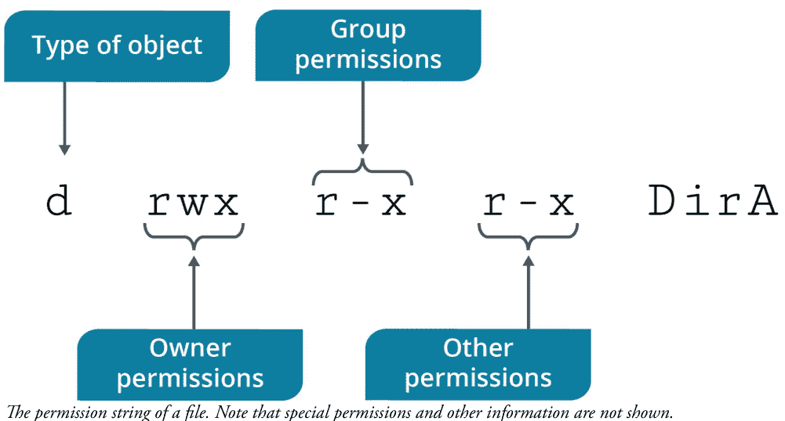

- 第一个字符表示文件类型；d 表示目录，连字符 (-) 表示文件。
- 第二、第三和第四位置的字符表示所有者权限。
- 第五、第六和第七位位置的字符表示组权限。
- 第八、第九和第十位置的字符表示其他权限。
- 最后一个字符表示文件的访问方法：点 (.) 表示 SELinux 安全上下文，加号 (+) 表示任何替代访问方法的组合。

### chmod 命令

`chmod` 命令允许你修改文件或目录的权限。只有文件或目录的所有者或系统管理员才能更改对象的权限。

### 语法

`chmod` 命令的语法为 `chmod [options] [mode] {file/directory name}`

### chmod 命令选项

`chmod` 命令支持不同的选项来修改权限。可以同时使用这些选项中的一个或多个。

| 选项 | 用途 |
| :--- | :--- |
| -c | 显示更改。 |
| -f | 错误消息。 |
| -v | 为每个处理的文件显示诊断信息。 |
| -R | 递归地修改文件和目录的权限。 |

### chmod 符号模式

`chmod` 命令支持两种模式：符号模式和绝对模式。符号模式允许你使用三个组件设置权限，即：

- 权限上下文：u/g/o/a（适用于所有上下文）。
- 权限运算符：+/-
- 权限属性：r/w/x

权限运算符决定授予还是移除权限。

### 运算符描述

| 运算符 | 描述 |
| :--- | :--- |
| + | 授予权限。 |
| - | 移除权限。 |
| = | 精确分配权限，而不是增加或减少。 |

### 使用符号模式设置权限

在符号模式下，`chmod` 命令的语法为：`chmod [access][operators][permission attributes] {file/directory}`

例如，为所有 和组添加写入权限：`chmod u+rw,g+rw`

### chmod 绝对模式

另一种 `chmod`——绝对模式，使用八进制数字来指定权限。(r/w)x 有关联的数字。

### 八进制数字属性

| 数字 | 属性 |
| :--- | :--- |
| 4 | 读 |
| 2 | 写 |
| 1 | 执行 |

通过相加你想授予的八进制数字，可以得到分配给目录或文件的权限数字。例如，全权限（读、写、执行）等于 4 + 2 + 1，即 7。读和写权限等于 4 + 2，即 6。完整权限表示为三位数数字，每个数字分别对应所有者、组和其他用户。

### 使用绝对模式设置权限

在绝对模式下，`chmod` 命令的语法为 `chmod [number] {file/directory name}`

# 不同模式下的常用权限

下表比较了不同的 `chmod` 模式如何表示常用的权限。

| 绝对模式 | 符号模式 |
| :--- | :--- |
| 755 | u=rw,g=rx,o=rx |
| 700 | u=rwx,g=o= |
| 644 | u=rw,g=r,o=r |
| 600 | u=rw,g=o= |

# 三位和四模式

当使用八进制数字格式时，文件权限通常为位数，每个数字对应用户、组和其他权限。然而，文件权限也可以用位数编写，前导数字表示要定义的任何高级权限（0，或无）。例如，Linux 中非执行文件的基本权限为 rw-rw-rw，即 666。这等同于八进制格式 0666。


# 修改文件和目录权限

使用以下步骤可以修改文件和目录权限。

## 查看文件或目录权限

查看文件或目录权限：

- 输入 `ls -ld [file name]` 查看文件的权限。
- 输入 `ls -ld [directory name]` 查看目录的权限。

## 在绝对模式下修改文件或目录权限

若要在绝对模式下修改文件或目录权限：

1. 假设具有超级用户权限，或以要修改的文件或目录的所有者身份登录。
2. 输入 `chmod ### [file or directory]` 更改对象的权限，其中每个 # 分别对应所有者、组和其他用户的权限级别。

## 在符号模式下修改文件或目录权限

若要在符号模式下修改文件或目录权限：

1. 假设具有超级用户权限，或以要修改的文件或目录的所有者身份登录。
2. 更改对象的权限：
- 输入 `chmod u-rwx,g+rwx,o-rwx (file or directory)` 将所有者、组和其他用户的权限分别设置为提供的属性。
- 输入 `chmod u+x,g+x,o+x (file or directory)` 为所有者、组和其他用户的权限添加提供的属性。
- 输入 `chmod u-w,g-w,o-w (file or directory)` 从所有者、组和其他用户的权限中移除提供的属性。

### 默认权限

在 Linux 中，默认权限根据用户权限分配给新创建的文件和目录。对于 root 用户创建的文件，默认权限为 644，这意味着 root 用户具有读写权限，而组用户和其他用户只有读取权限。对于 root 用户创建的目录，默认权限为 755，这意味着 root 用户具有读、写和执行权限，而组用户和其他只有读取和执行权限。在访问权限受限的用户的情况下，Linux 为新创建的文件分配 664 权限，为新创建的目录分配 777 权限。

这些默认权限由用户文件创建掩码 umask 决定。然而，root 用户可以更改默认权限。

### umask 命令

umask 命令更改新创建的文件和目录的默认权限。为了自动控制对象的使用方式，而不是在每个新对象上更改这些权限，那么更改默认权限是非常用的。

通过 umask，您使用八进制数字格式设置默认权限。然而，您不是指定要设置哪些权限，而是指定要从默认权限中掩码或清除哪些权限。例如，Linux 中非可执行文件的默认权限是 666 (rw-rw-rw)。如果您希望所有者保留这些权限，但希望组和其他用户具有读取权限，则需要将 umask 设置为 022。每个数字按顺序解释如下：

- 0 表示当前所有者权限不进行任何掩码，即保持为读和写。
- 2 表示组权限应被 2 掩码，即从默认值 (6) 减 2 得到 4。组成员现在具有读取权限。
- 2 与上一个数字的作用相同，但针对其他用户。您可以直接在 CLI 中使用 umask 命令设置会话的默认权限，或者在每个用户的 .bashrc 中设置该用户的默认权限。

注意：由于它是从默认值 (666) 中减去，umask 命令无法强制新创建的文件具有执行位。


系统级 umask：设置在 /etc/bashrc 和 /etc/profile
默认 umask：在 ~/.bashrc 中按用户设置
使用 umask 命令手动设置 umask

umask 值进行计算的顺序。

### 语法

umask 命令的语法为 `umask [number]`

### 如何修改默认权限

使用以下步骤修改默认权限。

## 修改默认权限

修改默认权限：
1. 假设具有超级用户权限。
2. 更改默认 umask 值：

- 输入 `umask [number]` 临时更改默认 umask 值。
- 将 `umask [number]` 作为新行添加到用户的 .bashrc 文件中，以更改该用户的默认 umask 值。此更改将在会话间持续。
3. 创建一个新文件以验证现在现在创建的文件具有不同的默认权限。

# 主题 B

## 修改文件和目录所有权

## 涵盖的考试目标

3.1 给定场景，应用或获取适当的用户和/或组权限以及所有权。

尽管您通过分配权限限制了对数据的访问，但您可能需要允许用户修改某些文件和目录的权限。这就是所有权概念发挥作用的地方。

## 所有权

正如您所看到的，第一个权限上下文是所有者（或用户）。在 Linux 中，所有权是指用户可以应用和修改文件或目录权限的属性。默认情况下，文件或目录的所有者是创建该文件或目录的用户。除了超级用户外，没有其他用户可以更改他人的对象的权限。

所有权最常见的应用是更改读、写和执行权限。

### 所有者

所有者是用户应用和修改文件或目录权限的属性。默认情况下，文件或目录的所有者是创建该文件或目录的用户。

所有者是更改用户可以更改文件或目录的权限。

### chown 命令

chown 命令用于更改所有者、组或两者。

下表描述了如何使用此命令。

| 命令 | 描述 |
| :--- | :--- |
| `chown [user] (file or directory)` | 更改文件或目录的所有者为用户。 |
| `chown [user]:[group] (file or directory)` | 更改文件或目录的所有者为用户，并将组更改为指定组。 |
| `chown [user]:[group] (file or directory)` | 更改文件或目录的所有者为用户，并保留原本的组。 |
| `chown :[group] (file or directory)` | 更改文件或目录的组为指定组。 |

## 递归更改所有权

您可以将 chown 命令结合 -R 选项递归更改所有权。

### chgrp 命令

chgrp 命令用于更改文件或目录的组。

### 语法

chgrp 命令的语法为 `chgrp [group] [file or directory]`

## 如何修改文件和目录所有权

使用以下步骤修改文件和目录所有权。

### 查看文件或目录所有权

- 输入 `ls -ld [file name]` 查看文件的权限。
- 输入 `ls -ld [directory name]` 查看目录的权限。

## 修改文件或目录所有权

修改文件或目录所有权：

1. 假设具有超级用户权限。
2. 更改默认 umask 值：

- 输入 `chown [user] (file or directory)` 将文件或目录的所有者更改为指定用户。
- 输入 `chown [user]:[group] (file or directory)` 将文件或目录的所有者更改为指定用户，并将组更改为指定组。
- 输入 `chown [user]:[group] (file or directory)` 将文件或目录的所有者更改为指定用户，并保留原本的组。
- 输入 `chgrp :[group] (file or directory)` 将文件或目录的组更改为指定组。

# 主题 C

## 配置特殊权限和属性

## 涵盖的考试目标

3.1 给定场景，应用或获取适当的用户和/或组权限以及所有权。

标准的读、写和执行权限在大多数情况下是足够的。然而，您可以使用特殊的权限和属性来以特殊的方式限制访问。

### 特殊权限

当普通权限不足时使用特殊权限。通过特殊权限，低权限用户可以假设所有者或组的权限来执行文件。

### SUID 和 SGID 权限

在 Linux 中，有两种特殊权限是设置用户 ID (SUID) 和设置组 ID (SGID)。SUID 或 setuid 是允许用户具有与所有者相似的权限。某些可执行文件和命令（如 passwd）需要用户可能没有权限的额外资源。与其单独授予这些权限，passwd 命令配置为任何用户都以 root 身份执行，从而获得这些资源的权限。

SGID 或 setgid 是允许用户具有与组所有者相似的权限。此外，它还可以应用于目录。在此目录中创建的任何子目录将自动继承 SGID 权限。同样，在此目录中创建的所有新文件和子目录将继承目录的组 ID，而不是创建对象的用户的组 ID。这种继承在共享环境中非常有用，因为用户在目录中创建对象时不需要更改其组。注意，SGID 权限不应用于现有对象，也不会应用于从其他位置移动到目录的对象。

SUID 和 SGID 都使用 chmod 命令设置，您可以使用符号模式或绝对模式进行设置。当使用 -ls 查看权限时，所有者的执行权限将显示为 s（对于 SUID），组的执行权限将显示为 s（对于 SGID）。


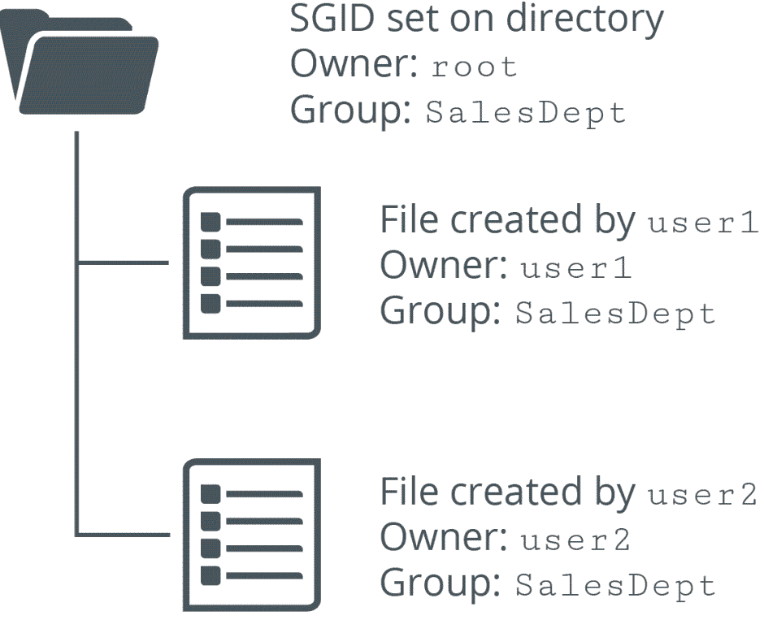

在目录上设置 SGID 的示例。

### 语法

以下是分别使用符号模式和绝对模式在文件上设置 SUID 的语法：
chmod u+s [文件名]
chmod 477 [文件名]
注意在绝对模式下，最后三位可以是你选择的任何标准权限。
以下是分别使用符号模式和绝对模式在目录上设置 SGID 的语法：
chmod g+s [目录名]
chmod 277 [目录名]
移除 SUID 和 SGID 非常简单，只需在符号模式下使用 `-`（减号）运算符，或者在绝对模式下将第一个权限位设置为 `0` 即可。

### 粘滞位 (STICKY BIT)

粘滞位是一种特殊权限，用于为目录中的文件提供保护。它确保只有文件或目录的所有者（或 root 用户）才能删除该文件或目录。如果没有粘滞位，任何对对象具有写入和执行权限的用户都可以删除该对象。粘滞位确保用户不具备删除权限，但仍然拥有写入和执行文件及目录所需的其余权限。

与 SUID/SGID 一样，你使用 `chmod` 命令设置粘滞位。使用 `ls -al`，你可以看到其他用户的执行位（最后一位）上的粘滞位显示字母 `t`；如果其他用户没有执行权限，则显示为大写字母 `T`。

### 语法

设置粘滞位的语法如下，分别使用符号模式和绝对模式：
chmod +t [目录名]
chmod 177 [目录名]
与 SUID/SGID 一样，使用 `-` 或 `0` 来清除粘滞位。

# 文件上的粘滞位

在较旧版本的内核中，粘滞位可以强制程序或文件保留在内存中，这样在调用它时就不需要重新加载。文件上的粘滞位指示操作系统该文件将被频繁执行。现代版本的 Linux 内核忽略文件上的粘滞位；如果你想保护特定的文件，你需要在包含这些文件的目录上应用粘滞位。

# 文件属性

文件具有一个或多个属性，定义了系统如何与这些文件交互。这些属性超越了典型的权限，允许你精细地自定义系统对文件可以做什么和不允许做什么。有许多此类属性，一些示例包括：

- 仅以追加模式写入文件；即允许文件被覆盖。
- 设置文件是否被自动压缩。
- 如果文件被删除则保存该文件，提供恢复的机会。
- 使文件不可变。

### 不可变标志 (IMMUTABLE FLAG)

不可变标志是文件或目录的属性，防止其被修改，即使是 root 用户也不行。换句话说，没有人可以删除、重命名或写入不可变文件。设置不可变标志对于具有高度敏感性和重要性、且短期内不太发生更改的文件非常有用。粗心的用户或错误的进程将无法删除不可变文件。

并不是所有文件都设置了不可变标志。单个目录可以同时包含可变和不可变的文件及子目录。此外，不可变的子目录也可以包含可变的文件。

查看文件属性时，小写字母 `i` 表示设置了该标志。

### lsattr 命令

`lsattr` 命令用于列出文件或目录的属性。下表描述了 `lsattr` 命令的一些选项：

| 选项 | 用途 |
| :--- | :--- |
| -R | 递归列出目录及其内容的属性。 |
| a | 列出目录中的所有文件。 |
| d | 列出目录而不是其内容。 |
| v | 列出文件的版本号。 |

```
[root@server01 ~] lsattr file1
      ---i---------- file1
          Immutable attribute set
```

文件的属性。

### 语法

`lsattr` 命令的语法为 `lsattr [选项] [文件/目录名]`

### chattr 命令

`chattr` 命令用于更改文件或目录的属性。下表描述了 `chattr` 命令的一些选项：

| 选项 | 用途 |
| :--- | :--- |
| -R | 递归更改目录及其内容的属性。 |
| -v [版本] | 设置文件的版本号。 |
| +i | 将文件标记为只读或不可变。需要超级权限。 |
| -i | 移除只读或不可变属性。需要超级权限。 |

注意：root 用户可以设置或移除不可变标志。

### 语法

`chattr` 命令的语法为 `[-R] [-v [版本]] [-[属性]] [文件/目录名]`

### 访问控制列表 (ACL)

访问控制列表 (ACL) 是附加到对象上的权限列表。当传统的权限概念无法满足需求时，可以使用 ACL。ACL 允许你为单个用户或组分配权限，即使这些用户或组并不是对象的所有者或所属。

例如，两个部门的成员可能对服务器需要不同的访问级别。组 1 可能需要目录的 r/w 权限，而组 2 只需要 r/x。通过 ACL，你可以为不同的用户、组甚至进程授予不同的访问级别。ACL 提供了细粒度的控制。

### getfacl 命令

`getfacl` 命令用于列出文件或目录的属性。下表描述了 `getfacl` 命令的一些选项。


对问题的识别、诊断和解决进行故障排除。故障排除始于识别问题，直到服务恢复且问题不再对用户产生不利影响为止才结束。故障排除可以有许多形式，但所有方法都具有相同的目标：以最小的服务中断高效解决问题。

## 故障排除模型

故障排除策略是一种用于识别系统相关问题的原因并解决其影响的行动计划。你可以通过逐步步进的方法或故障排除方法来实现故障排除策略。有许多此类模型，它们的方法可能各异，但所有模型都试图让故障排除人员在故障排除过程中按照有规律且可重复的模式进行。

故障排除模型的一个示例将过程分为以下步骤： 1. 识别问题。此阶段包括：

- 收集信息。
- 如果可能，则重现问题。
- 询问用户以获取经验性信息。
- 识别症状。
- 确定是否有任何变化。
- 逐一处理多个问题。

- 2. 建立可能原因的假设。此阶段包括：
- 对显而易见的问题提出质疑。
- 考虑多种方法。
- 不仅寻找原因，还要寻找根本原因。

- 3. 测试假设以确定原因。
- 当假设得到确认时，确定解决问题的后续步骤。
- 4. 建立解决问题的行动计划。
- 如果假设未被确认，则建立新假设或升级问题。
- 4. 建立解决问题的行动计划，并识别该计划的潜在影响。
- 5. 实施解决方案，或升级问题。
- 6. 验证系统功能，并在适用情况下实施预防措施。
- 7. 记录你的发现、采取的和结果。

## 权限故障排除

作为通用指南，每当你预期拥有权限却被拒绝，或反之亦然时，都应该始终使用 `ls -al` 命令验证相关对象的权限。这通常源于大量的猜测，因为许多问题都是由于应用了错误的权限。

下表列出了与权限问题常见的症状，以及潜在的原因和解决方案。请注意，这些只是示例，某些症状有多个原因和解决方案。

| 症状 | 原因和解决方案 |
| :--- | :--- |
| 文件的所有者被拒绝查看文本文件的内容。 | 原因：尽管是所有者，但用户未被显式授予读取权限。<br>解决方案：使用 `chmod` 为所有者上下文授予权限。 |
| 用户尽管拥有写入权限，但被拒绝删除目录。 | 原因：用户修改目录需要同时具有写入和执行权限。<br>解决方案：使用 `chmod` 为适当上下文的目录添加权限。 |
| 用户尽管拥有读取权限，但被拒绝进入目录。 | 原因：用户进入目录需要执行权限。<br>解决方案：使用 `chmod` 为适当上下文的目录添加权限。 |
| 用户尽管对文件拥有完全权限，但被拒绝删除文件。 | 原因：用户必须对包含文件的目录具有写入权限。<br>解决方案：使用 `chmod` 为正确的上下文添加目录写入权限。 |
| 用户在具有写入和执行权限的目录中被拒绝创建文件。该目录设置了不可变位（immutable flag）。 | 解决方案：作为 root，使用 `chattr` 命令移除目录的不可变位。 |
| root 用户被拒绝修改文件。该文件设置了不可变位。 | 解决方案：作为 root，使用 `chattr` 命令移除文件的不可变位。 |
| 所有用户都有列出目录内容的权限，而该目录本应只有所有者、组员和特定的服务账户可以查看。 | 原因：目录对其他用户（others）上下文设置了读取权限。<br>解决方案：移除其他用户上下文的读取权限。使用 `setfacl` 命令将服务账户添加到目录的 ACL 中，授予账户访问权限。 |
| 用户被拒绝执行其创建的脚本。 | 原因：新文件不会自动设置执行权限。<br>解决方案：使用 `chmod` 为文件所有者添加脚本执行权限。 |
| 用户尽管能够执行该脚本，但被拒绝更改脚本内容。 | 原因：与任何其他文件一样，用户需要写入权限来更改脚本内容。<br>解决方案：使用 `chmod` 为适当上下文添加脚本添加写入权限。 |
| 用户尽管拥有执行权限，但被拒绝执行脚本。 | 原因：用户需要读取权限。<br>解决方案：使用 `chmod` 为适当上下文添加脚本读取权限。 |
| 所有用户都有列出目录内容的权限，而该目录本应只有所有者、组员和特定的服务账户可以查看。 | 原因：目录对其他用户（others）上下文设置了读取权限。<br>解决方案：移除其他用户上下文的读取权限。使用 `setfacl` 命令将服务账户添加到目录的 ACL 中，授予账户访问权限。 |


答案因而异。符号模式对人类较为友好，但可能会变得非常冗长，特别是当学生同时为多个上下文设置权限时。绝对模式要求学生记住每种权限类型的八进制数字，但一旦学生习惯，绝对模式可以变得更高效。

## 总结

在本节中，你修改了 Linux 系统文件和目录的权限和所有权。现在，你将能够更有效地控制对 Linux 系统数据的访问。

第 3 节：管理权限和所有权 |

# 第 4 节

# 管理存储

# 课程时长：3 小时 30 分钟

## 课程介绍

除了管理用户对 Linux 系统的访问，基础的任务之一是数据存储管理。有许多方法可以划分、格式化以及其他组织数据存储的方式，Linux 提供了许多工具来实现。通过使用这些工具，你最终将使授权用户更容易地处理数据。

## 课程目标

在本节中，你将：

- 创建分区。
- 使用逻辑卷管理器 (LVM) 管理卷。
- 挂载 Linux 文件系统。
- 管理 Linux 文件系统。
- 遍历文件系统层级标准 (FHS) 定义的目录结构。
- 排除存储故障。

# 主题 A

# 创建分区

# 涵盖考试目标

- 1.4 在给定场景下，在 Linux 环境中管理存储。
- 2.3 在给定场景下，创建、修改和重定向文件。
- 4.1 在给定场景下，分析系统属性并进行相应的修复。

管理存储的首要任务是对存储设备进行分区并用文件系统格式化分区。这将使得设备的该部分可用于数据的读写。

### 存储设备

存储设备是能够记录数据并持久保存数据的物理组件。Linux 操作系统支持许多类型的存储设备。常见类型包括：

- 硬盘 (HDD)——使用磁性存储技术存储大量数据的电机械设备。
- 固态硬盘 (SSD)——使用非机械固态技术存储大量数据的存储设备。它们的访问速度通常比比 HDD 快得多。
- USB 优存盘——使用闪存存储存储数据的便携式存储设备，与 HDD 和 SSD 相比，容量通常较小。其较小的尺寸使其易于携带。
- 外部存储驱动器——可以使用多种技术类型之一的便携式存储驱动器。它们通常通过 USB 外围接口连接到计算机，而不是内部组件。

虽然上述存储设备可能是你将要操作的，但你可能还需要负责处理旧技术，如软盘驱动器 (FDD)、带驱动器等。

“磁盘 (disk)”和“硬盘 (hard drive)”术语通常泛指所有存储设备。某些 Linux 工具也是如此。然而，并非所有的存储设备都使用硬盘技术，因此课程使用“存储设备”、“存储驱动器”和“存储媒体”等术语来指代通用概念。

### 块设备与字符设备

Linux 将设备称为块设备或字符设备。块设备是存储设备（如之前列出的），可以按数据块读写。字符设备是键盘、串口等可以读写数据流的设备。

### 文件系统

文件系统是操作系统用于检索、组织和管理存储设备上文件和目录的数据结构。文件系统维护相关信息，例如单个文件的创建和修改日期、存储设备上文件的大小、文件类型以及与文件相关的权限。它还为数据存储提供了结构化的格式。

文件本身并不解释文件中包含的数据，因为这项任务由特定应用程序处理。文件系统取决于多个参数，例如文件系统的用途、它们存储的单个文件信息、存储数据的方式以及它们实现的数据安全机制。

### 文件系统类型

Linux 支持许多文件系统类型。最常见的描述在下表中。

| 文件系统类型 | 描述 |
| :--- | :--- |
| FAT | 分配表 (FAT) 是一种较旧的文件系统，兼容许多不同的操作系统，包括所有的 Unix、Windows 和 macOS。它不提供与现代文件系统相同的功能，通常出于兼容性原因而使用。改进版本包括 FAT32 和 exFAT。 |
| ext2 | 曾是某些旧版本的原生文件系统。当前的 Linux 版本仍支持它。 |
| ext3 | 是 ext2 的改进版本。在系统突然关闭的情况下，ext3 恢复数据的速度快得多并确保数据完整性。你可以轻松地将文件系统从 ext2 升级到 ext3。 |
| ext4 | Linux 发行版的默认文件系统之一。它与 ext2 和 ext3 文件系统向下兼容。ext4 相比 ext3 的改进包括日志功能、支持高达一个艾字节 (EiB) 的卷以及大小达 16 太字节 (TiB) 的文件。这是 Ubuntu 发行版的默认文件系统。 |
| XFS | 是一种 64 位、高性能日志文件系统，提供快速恢复并能高效处理大文件。XFS 是 CentOS/RHEL 7 安装的默认文件系统。 |

### NTFS

新技术文件系统 (NTFS) 是微软创建的专有文件系统，作为 Windows 的主要文件系统。相对于 FAT，NTFS 提供了许多增强功能，包括文件文件夹级安全性、文件加密、驱动器压缩以及大型硬盘和文件的扩展性。

Linux 默认不支持 NTFS；但是，一个名为 NTFS-3G 的工具可以支持。

### 网络文件系统

虽然上述存储设备可能是你将要操作的，但你可能还需要处理旧技术，如软盘驱动器 (FDD)、带驱动器等。

“磁盘”和“硬盘”术语通常泛指所有存储设备。某些 Linux 工具也是如此。然而，并非所有的存储设备都使用硬盘技术，因此课程使用“存储设备”、“存储驱动器”和“存储媒体”等术语来指代通用概念。

## 描述

- 服务器消息块 (SMB)
- 通用文件系统 (CIFS)
- 网络文件系统 (NFS)

# INODES

索引节点 (inode) 是一个存储文件元数据的对象。这些元数据可以包括文件创建和修改的时间；权限和所有权信息；文件在存储设备上的块位置以及其他杂项信息。

# /home/student01/file1.txt


文件上的每个 inode 都由一个唯一的整数（inode 号）标识。每当系统或应用程序尝试访问文件时，它会在名为 inode 表的数据结构中搜索相应的 inode 号。inode 表将 inode 号映射到相应的文件目录名。

某些文件系统在创建时会设置 inode 最大数量，通常是根据文件系统的总体。文件和目录的总数不能超过此限值。然而，某些文件系统类型（如 XFS）使用基于文件系统容量的动态 inode 系统。换句话说，这些文件系统没有设置严格的 inode 限制。

注意：你可以使用 ls -i 列出文件和目录的 inode 号。


通过 VFS（虚拟文件系统），你可以在同一台 Linux 上挂载多种类型的文件系统，它们对用户以及所有其他应用程序来说看起来都是统一的。因此，用户和这些应用程序可以在不知道文件系统实际结构的情况下对其进行操作。这极大地增强了系统与运行软件之间的互操作性。

### 示例

Linux 系统上的真实文件系统示例包括 xfs、ext4 以及其他几种类型。虚拟文件系统的示例可以包括 `proc`（包含运行时的系统信息）、`devtmpfs`（包含内核在系统初始化期间加载的设备节点）、`debugfs`（包含调试内核时有用的信息）等。

## 文件系统标签

文件系统被分配了标签以便于识别。标签长度最多可达 16 个字符，可以使用 `e2label` 命令（用于 ext4 文件系统）和 `xfs_admin` 命令（用于 XFS 文件系统）进行显示或更改。

### 语法

设置 ext4 文件系统的语法为 `e2label /dev/[device name]{partition number} [label name]`
设置 XFS 文件系统的语法为 `xfs_admin -L [label name] /dev/[device name]{partition number}`

### 分区

分区是存储驱动器的一个区域，逻辑上作为一个独立的驱动器工作。分区允许你将大驱动器转换为较小的块，从而更好地组织信息。在分区上存储数据之前，必须对其进行格式化并分配文件系统。

分区使用分区表识别，分区表存储在驱动器的一个或多个区域。每个分区的大小可以，但不能超过存储驱动器的总空间。

大多数操作系统（包括 Linux）都使用驱动器分区。不同类型的数据可以存储在驱动器的不同位置，例如将文件系统与用户访问的文件分开。

### 分区类型

分区有三种：主分区、扩展分区和逻辑分区。存储驱动器的功能取决于其上的分区类型。


块存储设备上分区类型的布局。
每个分区有一组特定的特征。表格描述了这三种分区。

| 分区类型 | 描述 |
| :--- | :--- |
| 主分区 | 可以包含一个文件系统或逻辑驱动器的分区，有时被称为卷。交换文件系统和启动分区通常创建在主分区中。 |
| 扩展分区 | 扩展分区可以包含多个文件系统，这些被称为逻辑驱动器。只能有一个扩展分区，它可以进一步细分。这种分区类型不包含任何数据，并有单独的分区表。 |
| 逻辑 | 物理驱动器的一部分，已分区并分配为独立单元，并作为单独驱动器工作。逻辑分区位于扩展分区内部，因此是扩展分区的子集。逻辑分区的数量没有限制，但建议每个驱动器限制为 12 个逻辑分区。 |

### 交换空间

交换空间是存储设备上的分区，当系统耗尽物理内存时使用。Linux 将一些未使用的文件从 RAM 推送到交换空间以释放内存。通常，交换空间等于 RAM 容量的两倍。

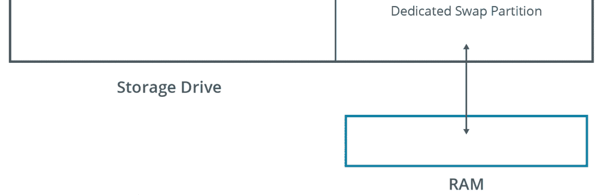

存储驱动器上的交换空间。

### fdisk 工具

fdisk 工具是一个菜单驱动的程序，用于在存储驱动器上创建、修改或删除分区。使用 fdisk，你可以创建新的分区表或修改分区表上的现有条目。fdisk 工具理解 DOS 和 Linux 类型的分区表。fdisk 工具还允许你指定分区的大小。

```
[root@server01:~#] fdisk /dev/sda
警告: fdisk GPT 支持目前较新，因此
处于实验阶段。请根据自行决定使用。
欢迎使用 fdisk (util-linux 2.23.2)。

更改将仅保留在内存中，直到你决定写入
它们。在使用 write 命令之前请小心。
```
命令（m 帮助）：← 交互式菜单提示符

### fdisk 工具。

### 语法
fdisk 工具的语法为 `fdisk [options] [device name]`
fdisk 工具支持许多命令行选项。

### 选项用途

- -b [sector size] 指定驱动器扇区的数量。
- -H [heads] 指定驱动器头的数量。
- -S [sectors] 指定每个磁道的扇区数量。
- -s [partition] 以块为单位分区大小。
- -l 列出设备的分区表。

### fdisk 菜单选项

除了提供命令行选项外，你也可以在 fdisk 菜单工作时选择各种选项。

### 选项用途

- n 创建新分区。子选项允许你指定分区类型和分区大小。
- d 删除分区。
- p 列出现有分区。
- w 将更改写入驱动器并退出工具。
- q 取消已做的更改并退出工具。

命令（m 帮助）：p

磁盘 /dev/sda: 500.1 GB, 500107862016 bytes, 976773168 sectors
单位 = 1 的扇区 * 512 =

### parted 工具

parted 工具是一个菜单驱动的程序，用于在存储驱动器上创建、修改或删除分区。使用 parted，你可以创建新的分区表或修改分区表上的现有条目。parted 工具理解 DOS 和 Linux 类型的分区表。parted 工具还允许你指定分区的大小。

```
[root@server01:~#] parted /dev/sda
欢迎使用 parted, 3.2.1
输入 'help' 查看列表。
(parted) print
磁盘 /dev/sda: 500.1 GB, 500107862016 bytes, 976773168 sectors
单位: 1 的扇区 * 512 = 
磁盘标签: gpt
Number | Start | End | Size | Type | Name
| | | | | | | |
| 1 | 1048KiB | 35MiB | 33.MiB | primary | |
| 2 | 35MiB | 1079MiB | 1 GiB | primary | |
| 3 | 1079MiB | | | | |
```
(parted) quit

## parted 命令

parted 工具是一个用于在存储驱动器上创建、修改或删除分区的菜单驱动程序。使用 parted，你可以创建新的分区表或修改分区表上的现有条目。parted 工具理解 DOS 和 Linux 类型的分区表。parted 工具还允许你指定分区的大小。

```
[root@server01:~#] parted /dev/sda
欢迎使用 parted, 3.2.1
输入 'help' 查看列表。
(parted) print
磁盘 /dev/sda: 500.1 GB, 500107862016 bytes, 976773168 sectors
单位: 1 的扇区 * 512 = 
磁盘标签: gpt
Number | Start | End | Size | Type | Name
| | | | | | |
| 1 | 1048KiB | 35MiB | 33.MiB | primary | |
| 2 | 35MiB | 1079MiB | 1 GiB | primary | |
| 3 | 1079MiB | | | | |
```
(parted) quit

## parted 命令

parted 命令用于在磁盘上管理分区。

### 语法
parted 工具的语法为 `parted [options] [device name]`

### 选项用途

- -s [script] 以脚本模式运行。
- -u [unit] 设置单位（例如 MB, GB）。
- -v [verbose] 详细输出。
- -h [--help] 显示帮助信息。
- --label [label] 设置磁盘标签（例如 mdos, gpt）。

## parted 命令选项

parted 命令用于在磁盘上执行各种操作。下表列出了 parted 中的某些命令。

| 命令 | 描述 |
| :--- | :--- |
| mkpart | 创建新分区。 |
| delete | 删除分区。 |
| resize | 调整分区大小。 |
| move | 移动分区。 |
| print | 显示分区表。 |
| set | 设置分区属性。 |
| help | 显示帮助信息。 |
| quit | 退出交互模式。 |

### mkpart 命令

mkpart 命令用于在磁盘上创建新分区。它需要分区编号、文件系统以及起始和结束点。

```
[root@server01:~#] parted /dev/sda
(parted) mkpart ext4 1048KiB 10GB
(parted) print
Number | Start | End | Size | Type | Name
| | | | | | |
| 1 | 1MB | 10GB | 9GB | primary | |
```
(parted) quit

### delete 命令

delete 命令用于删除现有分区。它需要要删除分区的编号。

```
[root@server01:~#] parted /dev/sda
(parted) delete 1
(parted) print
Number | Start | End | Size | Type | Name
| | | | | | |
```

### resize 命令

resizepart 命令用于调整现有分区的大小。它需要分区编号和新的结束点。

```
[root@server01:~#] parted /dev/sda
(parted) resize 1 20GB
(parted) print
Number | Start | End | Size | Type | Name
| | | | | | |
| 1 | 1MB | 20GB | 20GB | primary | |
```

### move 命令

move 命令用于移动现有分区。它需要分区编号、新的起始点和新的结束点。

```
[root@server01:~#] parted /dev/sda
(parted) move 1 10GB 30GB
(parted) print
Number | Start | End | Size | Type | Name
| | | | | | |

| 1 | 10GB | 30GB | 20GB | primary | |
```


```bash
[root@server01 ~]# mkfs.ext4 /dev/sda6
mkfs.ext4 1.42.9 (28-Dec-2013)
Filesystem label=
OS type: Linux
Block size=4096 (log=2)
Fragment size=4096 (log=2)
Stride=0 blocks, Stripe width=0 blocks
131072 inodes, 524288 blocks
26214 blocks (5.00%) reserved for the super user
First data block=0
Maximum filesystem blocks=536870912
16 block groups
```

在分区上创建文件系统。

### 语法

mkfs 命令的一种语法选项是 `mkfs [options] [device name]`
另一种语法选项是 `mkfs.[file system type] [options] [device name]`

# 的 fstab 文件

fstab 文件是一个配置文件，用于存储关于存储设备和分区的信息，以及应该在何处以及如何挂载分区。fstab 文件位于 `/etc` 目录。它在系统启动时被读取，并且只能由 root 用户编辑。fstab 文件由若干行组成，每行对应一个文件系统。

fstab 文件中的每行有六个由空格或制表符分隔的字段。

# 字段

| 设备或分区名称 | 默认挂载点 | 文件系统类型 |
| :--- | :--- | :--- |
| 挂载选项 | 描述 | |
| 指定挂载设备或文件系统的名称。 | 指定文件系统挂载的位置。 | 指定设备或分区使用的文件系统类型。 | 指定一组逗号分隔的选项，这些选项在文件系统挂载时会被激活。 |

# 字段

| dump 选项 | fsck 选项 |
| :--- | :--- |
| 描述 | 指定 dump 工具是否应该备份文件系统。通常指定 0 作为选项，表示 dump 可以忽略该文件系统。 | 指定 fsck 工具检查文件系统的顺序。 |

root@server01:~:

```bash
### /etc/fstab
# Created by anaconda on Dec 11 13:13:26 2018
# Accessible filesystems, by reference, are maintained under '/dev/disk/
# See man pages fstab(5), findfs(5), mount(8) and/or blkid(8) for more info
/dev/mapper/centos-root xfs defaults 0 0
UUID=829c-6447-142c-a36c-b334-b1359df72f24 /boot 0 0
UUID=E3d4-7404 /boot/efi vfat umask=0077,shortname=winnt 0 0
/dev/mapper/centos-home xfs defaults 0 0
/dev/mapper/centos-swap xfs defaults 0 0
/dev/backup/sysbk /backup/sysbk xfs defaults 0 0
/dev/mapper/datacart /backup/data ext4 no 0 0
/dev/backup/logbk /backup/log ext4 defaults 0 0
```


fstab 文件。

# 的 crypttab 文件
`/etc/crypttab` 文件的功能与 fstab 文件类似，但其目的是存储关于加密设备和分区的信息，这些设备必须在系统启动时进行解锁并挂载。它的格式与 fstab 相似，但包含一个可选的密码字段，用于解锁加密设备。

### 存储设备设置流程

结合上述工具，在 Linux 上设置存储设备使用的整体流程如下：

- 1. 首先使用 fdisk 或 parted 等工具对存储设备进行分区
- 2. 使用 mkfilesystem 对分区进行格式化文件系统
- 3. 将格式化后的分区添加到 fstab 文件中，以便系统在启动时进行配置。

### /dev/ 目录

/dev/ 目录包含表示并支持连接到系统的文件。Linux 使用命名规范，以便系统在设备连接和系统启动时能够轻松地找到存储设备。对于存储设备，命名规范通常由三部分组成。


用于块存储设备。它利用设备映射器（device mapper）支持 CPU 与存储设备之间的多个 I/O 路径（连接接口）。如果其中一条路径失败，DM-Multipath 将切换到剩余的其他路径之一，从而保持存储设备的可读写状态。`multipath-tools` 软件包允许管理存储设备的 DM-Multipath，典型的配置文件位于 /etc/multipath.conf。

### mdadm 命令

`mdadm` 命令是一个用于管理基于软件的 RAID 阵列的工具。独立磁盘冗余阵列（RAID）是一组与供应商无关的规范，用于为多设备存储系统的配置提供冗余和容错能力。在 RAID 阵列中，数据存储在多个物理存储设备上，这些设备被组合成单一的虚拟存储设备。这种基于软件的 RAID 配置是使用设备映射器和 DM-Multipath 的替代方案。`mdadm` 工具允许你创建、管理和监控 RAID 阵列。

## 逻辑卷管理器

设备映射器的一个主要应用是逻辑卷管理器（LVM）。LVM 将物理设备和分区（例如 `/dev/sda1`、`/dev/sdb2` 等）映射到一个或多个称为卷组（volume groups）的虚拟容器。这些卷组内部包含一个或多个逻辑卷（logical volumes）。最终，逻辑卷成为系统、用户和应用程序使用的存储设备。

许多发行版都支持 LVM，并在安装期间实际上在逻辑卷上激活根文件系统。

### 逻辑卷

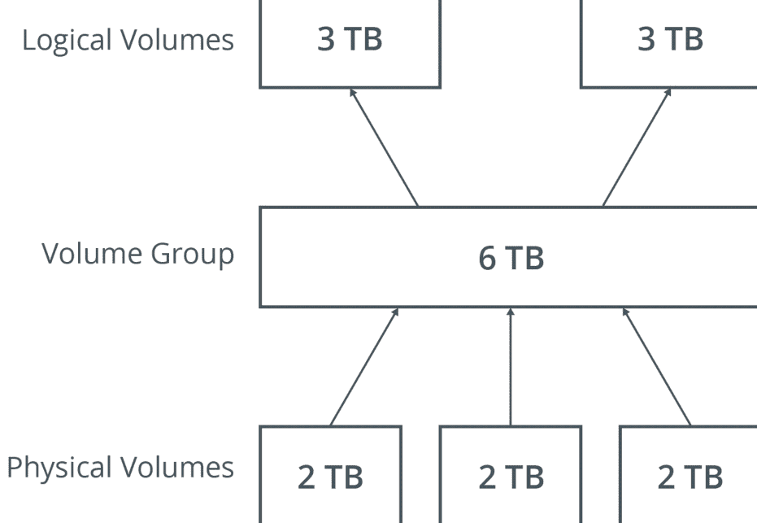

卷组

物理卷

一个 LVM 架构示例。

## LVM 优势

与传统的物理分区管理相比，LVM 提供了以下优势：

- 你可以动态创建、删除和调整卷的大小，而无需重启系统。
- 设置好后，对卷的日常管理将变得更加简单。
- 你可以将逻辑卷的大小映射到超过任何物理设备的大小，只要它不超过卷组中所有设备的总和。
- 你可以为每个逻辑卷创建虚拟快照，这样就可以快速方便地恢复到特定状态。

LVM 的缺点是初始设置可能会相当复杂。

### /dev/mapper/ 目录

`/dev/mapper/` 目录包含系统中由 LVM 管理的所有逻辑卷。该目录中的设备通常格式化为 `/dev/mapper/<卷组名>-<逻辑卷名>`

在某些情况下，此目录可能包含指向实际逻辑卷位置的链接。
注意：*逻辑卷也可能位于路径 `/dev/dev/<卷组名>/<逻辑卷名>` 下*

### LVM 工具

LVM 根据组成 LVM 的三个不同组件将其卷管理工具分为三类：

- 物理卷 (PV) 工具
- 卷组 (VG) 工具
- 逻辑卷 (LV) 工具

### PV 工具

下表列出了 LVM 的一些物理卷 (PV) 工具。

| 工具 | 用途 |
| :--- | :--- |
| pvscan | 扫描所有用作物理卷的物理设备。 |
| pvcreate | 初始化设备或分区作为物理卷。 |
| pvdisplay | 列出物理卷的属性。 |
| pvchange | 更改物理卷的属性。 |
| pvs | 显示物理卷的信息。 |
| pvck | 检查物理卷的元数据。 |
| pvremove | 移除物理卷。 |

### VG 工具

下表列出了 LVM 的一些卷组 (VG) 工具。

| 工具 | 用途 |
| :--- | :--- |
| vgscan | 扫描所有物理设备以查找卷组。 |
| vgcreate | 创建卷组。 |
| vgdisplay | 列出卷组的属性。 |
| vgchange | 更改卷组的属性。 |
| vgs | 显示卷组的信息。 |
| vgck | 检查卷组的元数据。 |
| vgrename | 重命名卷组。 |
| vgreduce | 从卷组中移除物理设备以减小其大小。 |
| vnextend | 向卷组中添加物理设备。 |
| vgmerge | 合并两个卷组。 |
| vgsplit | 将卷组拆分。 |
| vgremove | 移除卷组。 |

### LV 工具

下表列出了 LVM 的一些逻辑卷 (LV) 工具。

| 工具 | 用途 |
| :--- | :--- |
| lvscan | 扫描所有逻辑卷。 |
| lvcreate | 在卷组中创建逻辑卷。 |
| lvdisplay | 显示逻辑卷的属性。 |
| lvchange | 更改逻辑卷的属性。 |
| lvs | 显示逻辑卷的信息。 |
| lvrename | 重命名逻辑卷。 |
| lvreduce | 减小逻辑卷的大小。 |
| lvxtend | 扩展逻辑卷的大小。 |
| lvresize | 调整逻辑卷的大小。 |
| lvremove | 移除逻辑卷。 |

> 注意：默认情况下，通过挂载系统来调整逻辑卷的大小。

## 如何管理逻辑卷

使用以下方法来管理逻辑卷：

### 管理物理卷

1. 拥有 root 权限。
2. 使用 `pvscan` 扫描所有逻辑卷。
3. 管理物理卷：
   - 使用 `pvdisplay` 列出物理卷的属性。
   - 使用 `pvchange` 更改物理卷的属性。
   - 使用 `pvcreate` 将设备或分区作为物理卷。
   - 使用 `pvremove` 移除物理卷。

### 管理卷组

1. 拥有 root 权限。
2. 使用 `vgscan` 扫描所有物理设备以查找卷组。
3. 管理卷组：
   - 使用 `vgdisplay` 列出卷组的属性。
   - 使用 `vgchange` 更改卷组的属性。
   - 使用 `vgrename` 重命名卷组。
   - 使用 `vnextend` 向卷组中添加物理设备。
   - 使用 `vgreduce` 从卷组中移除物理设备以减小其大小。
   - 使用 `vgmerge` 合并两个卷组。
   - 使用 `vgsplit` 将卷组拆分。
   - 使用 `vgremove` 移除卷组。

### 管理逻辑卷

1. 拥有 root 权限。
2. 使用 `lvscan` 扫描所有逻辑卷。
3. 管理逻辑卷：
   - 使用 `lvdisplay` 列出逻辑卷的属性。
   - 使用 `lvchange` 更改逻辑卷的属性。
   - 使用 `lvrename` 重命名逻辑卷。
   - 使用 `lvreduce` 减小逻辑卷的大小。
   - 使用 `lvxtend` 扩展逻辑卷的大小。
   - 使用 `lvresize` 调整逻辑卷的大小。
   - 使用 `lvremove` 移除逻辑卷。

## C 部分：挂载系统

### 涵盖的考试

1.4 给定场景，在 Linux 环境中管理存储。

在对分区和逻辑卷进行格式化后，你需要实际上让系统可以使用它们。因此，在本主题中，你将通过挂载使这些文件系统可用。

### 挂载点

挂载点是本地或远程存储设备的访问点。挂载点通常是一个空目录，在其上加载或挂载文件系统以使其可用。如果目录已有内容，在卸载挂载系统之前这些内容是不可见的。

注意：你可以使用 stab 文件列出系统启动和关闭时分别挂载和卸载的文件系统。

### mount 命令

`mount` 命令将文件系统加载到指定的目录，以便用户和应用程序访问。你必须指定要挂载的设备以及所需的挂载点。

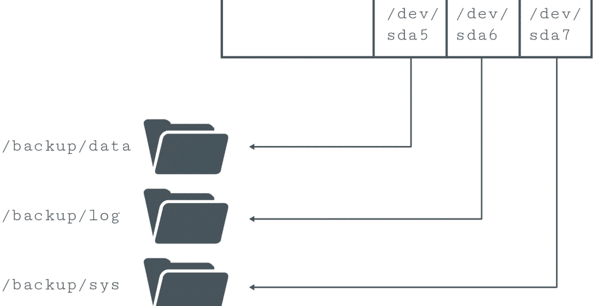

将存储设备上的分区挂载到特定目录。

### 语法

`mount` 命令的语法是 `mount [options] [device name] [mount point]`

### mount 选项

你可以为文件系统指定各种挂载选项。这些选项通常包含在 stab 文件中，而不是命令行参数。

- auto 指定设备必须自动挂载。
- noauto 指定设备不应自动挂载。
- nouser 指定只有 root 用户可以挂载设备或文件系统。
- user 指定所有用户都可以挂载设备或文件系统。
- exec 允许执行文件系统中的二进制文件。
- noexec 防止执行文件系统中的二进制文件。
- ro 以只读模式挂载文件系统。
- rw 以读/写权限挂载文件系统。


sync 指定文件系统中的输入输出操作应同步完成。
async 指定文件系统中的输入输出操作应异步完成。

# 二进制产文件 (BINARIES)

二进制文件是编译成可执行程序的源代码，或者通过其他方式汇编以便计算机系统可以读取的代码。此外，二进制文件可以是图片、文字处理文件或电子表格文件。

### umount 命令

在使用挂载的文件系统后，可以通过使用 `mount` 命令卸载（或称为 unmount）文件系统，从而将其从目录中解除关联。为了挂载文件系统，它不能处于被使用状态——例如，如果某个文件正被某个应用程序打开。

# 语法 (SYNTAX)

umount 命令的语法为 umount [options] [挂载点]

# umount 命令选项

下表描述了 umount 的常用命令选项。

| 选项 | 用途 |
| :--- | :--- |
| -f | 强制进行“懒惰”卸载，如果文件系统已从层次结构中分离，但对该文件系统的引用直到该文件系统不再使用时才会被清理。 |
| -R | 递归卸载指定的点。 |
| -t [fs type] | 仅卸载指定的文件类型。 |
| -O [options] | 仅卸载在 /etc/fstab 文件中用指定选项挂载的文件系统。 |
| --fake | 测试卸载过程而不实际执行。 |

### 如何挂载文件系统

使用以下步骤挂载文件系统。

# 挂载文件系统
若要挂载文件系统：

1. 假设具有超级用户权限。
2. 如必要，输入 `mkdir [目录路径]` 创建一个作为挂载点的新目录。
3. 输入 `mount [设备名称] [挂载点]` 在指定的挂载点挂载设备或分区。

### 卸载文件系统
若要卸载文件系统：

1. 假设具有超级用户权限。
2. 输入 `umount [挂载点]` 从指定的挂载点卸载设备或分区。

# 启动时挂载文件系统

若要实现在系统启动时挂载文件系统：

1. 假设具有超级用户权限。
2. 输入 `vim /etc/fstab` 打开该文件进行编辑。
3. 在文件中添加新行：

[设备名称] [挂载点] [fs 类型] [挂载选项] [dump 值] [fsck 值]
4. 保存并关闭文件。
5. 输入 `mount -a` 执行 fstab 以确保可以挂载列出的所有文件系统。
6. 重启系统并验证文件系统是否自动挂载。

# 主题 D

### 管理文件系统

# 涵盖的考试目标

- 1.4 在给定场景下，在 Linux 环境中管理存储。
- 2.7 解释 Linux 设备的使用和操作。
- 4.1 在给定场景下，分析系统属性并进行相应的修复。

Linux 为我们提供了在将文件系统应用于存储设备后进行修改的工具。在本主题中，你将执行各种任务以确保你的文件系统满足你的业务需求。

### /proc/mounts 文件

/proc/mounts 文件以类似于 fstab 的格式列出所有当前挂载文件系统的状态：系统名称、挂载点、文件类型等。它不是一个真实的文件，而是虚拟文件系统的一部分，代表 Linux 内核报告的挂载对象状态。通常，你会使用 `cat` 等命令读取此“文件”，以获取你寻找的细节。

注意 /proc/mounts 列出了所有文件系统，而不仅仅存储驱动器和分区上的。如果你只想查找驱动器信息，它可能不是最易读的工具。

# mtab 文件

/etc/mtab 文件与 /proc/mounts 文件非常相似，它们都报告当前挂载文件系统的状态。然而，/proc/mounts 通常更准确，并包含了关于文件系统的更新信息。

### /proc/partitions 文件

/proc/partitions 包含了当前连接到系统的每个分区的信息。与 /proc/mounts 一样，它不是一个真实的文件，而是虚拟文件系统的一部分。/proc/partitions 的格式包含列，每列内容如下：

- major—代表设备类别，以便将其映射到适当的设备。
- minor—将分区区分为不同的物理设备。这对应于分区名称末尾的数字。
- blocks—分区占据了多少物理块。
- name—分区的名称。

```
[root@server01 ~]# cat /proc/partitions
major minor blocks name
8 0 483684 sda
8 1 204800 sda1
8 2 1048576 sda2
8 3 2299232 sda3
8 4 4194304 sda4
8 5 753640 sda5
8 6 2097152 sda6
11 0 4168560 sr
25 0 5242880 dm
```

### lsblk 命令

lsblk 命令显示系统上所有可用的块存储设备。输出以树状格式显示，每个物理设备位于顶部，每个分区或逻辑卷从该设备派生。信息包括名称、主从设备号和次要设备号、大小、设备类型和挂载点。

```
[root@server01 ~]# lsblk
NAME MAJ:MIN SIZE RO MOUNTPOINT
sda 8:0 465G disk
├sda1 8:1 200M part /boot/efi
├sda2 8:2 1G part /boot
├sda3 8:3 107G part
├|-centos-root 25:0 50G lvm /
├|-centos-swap 25:1 8G lvm [SWAP]
└-|-centos-home 25:2 50G lvm /home
├sda4 8:4 4G part
├|-backup-sys 25:3 2G lvm /backup
└-|-backup-data 25:4 6G lvm
├sda5 8:5 7G part
└-|-backup-sys 25:5 2G lvm /
```
以树状层级结构列出块存储设备。

# 语法 (SYNTAX)
lsblk 命令的语法为 lsblk [设备名称]

# lsblk 命令选项

下表列出了 lsblk 命令的一些选项。

| 选项 | 用途 |
| :--- | :--- |
| -a | 列出所有设备。 |
| -e | 排除特定的设备。 |
| -f | 显示文件系统信息。 |
| -l | 以列表格式输出。 |
| -m | 显示所有者信息。 |
| -n | 不打印标题行。 |
| -r | 以树格式输出。 |
| -p | 输出完整路径。 |
| -s | 指定输出列。 |
| -t | 指定文件类型。 |

### blkid 命令

blkid 命令提供了类似于 lsblk 的功能，但它以扁平格式打印设备信息，如 UUID 和文件类型。使用 `f` 选项可以显示文件类型。

# 语法 (SYNTAX)
blkid 命令的语法为 blkid [options] [设备]

### ext 工具

在管理文件系统和分区时，某些工具是为特定类型设计的。对于 ext 文件系统，某些工具可以处理多种类型。在 ext 文件系统上，可以处理特定的类型。

对于 ext 文件系统，最常用的工具包括：

- e2ck
- resize2fs
- tune2fs
- dump2fs

### fsck 命令

fsck 命令用于检查文件系统的完整性。文件系统的完整性通常是由电源故障或不当关机引起的。系统会在启动时自动运行 fsck 以检测并修复错误。

在使用 fsck 之前应卸载文件系统以防损坏文件系统。

> 注意：fsck 命令本质上是一个前端，它会根据文件系统类型调用相应的工具。

特定的调用

```
[root@server01 ~]# fsck /dev/sda6
fsck from util-linux 2.23
efsck 1.42.9 (28-Dec-2013)
/dev/sda6: clean, 131072 files, 524288 blocks
```


### 语法

fsck 命令的语法为 fsck [options] [设备/文件系统]

### 修复文件系统

你可以使用 fsck -y [设备/文件系统] 命令修复文件系统。该命令会提示你确认操作。如果你同时检查多个文件系统，不应使用此选项，因为它一次只能修复一个文件系统。

### resize2fs 命令

resize2fs 命令用于扩大或缩小设备上的 ext/3/4 文件系统。你可以扩大挂载的文件系统，但在缩小之前必须卸载该文件系统。你可以指定文件系统所需的大小来扩大或缩小。如果你不指定大小，文件系统将调整为与分区的大小一致。

# 语法 (SYNTAX)
resize2fs 命令的语法为 resize2fs [options] [文件系统名称] [期望大小]


## tune2fs 命令选项

tune2fs 命令有多种选项。

### 选项

- -j
- -i [d|m|w]
- -c [最大挂载计数]
- -C [挂载计数]
- -r [保留块计数]
- -e [continue|remount|panic]
- -l
- -U [UUID]

### 超级块 (SUPERBLOCK)
文件的超级块包含关于该文件系统的元数据，包括其大小、类型和状态。超级块对文件系统的功能至关重要，如果它损坏，你可能无法挂载和使用该文件系统。必要时，你可以使用如 fsck 等工具修复超级块。

### 用途

- 为现有文件系统添加 ext3 日志。
- 指定文件系统检查之间最大检查时间间隔（单位为天、月或周）。
- 指定文件系统检查之间的最大挂载次数。
- 指定文件系统可以挂载的次数。
- 指定保留的文件系统块数量。
- 指定当检测到错误时内核代码的行为，即文件系统是应该继续正常执行、以只读模式重新挂载文件系统，还是导致内核恐慌（kernel panic）。
- 列出文件系统超级块（元数据）内的内容。
- 为文件系统设置指定的 UUID。

## dump2cfs 命令

dump2cfs 命令用于导出 ext2、ext3 和 ext4 文件系统信息。它会打印所选设备的超级块和块组信息。这在排故障故障的文件系统时非常有用。

## 文件系统信息

``````
[root@server01 ~]
dumpe2fs -l /dev/sda6
1.42.9 (28-Dec-2013)
Filesystem volume: <not available>
Filesystem UUID: 23f3dfe-35ad-4db1-a157-79171bbbe9fb
Filesystem magic number: 0XEF53
Filesystem revision: 1 (dynamic)
Filesystem features: has journal ext attr resize inode dir index file
type dealloc flex bit bg sparse_large_file huge unite bg dilink extra is
Filesystem flags: signed directory_hash
Default mount options: user_xattr acl
Filesystem state: clean
Errors behavior: Continue
Filesystem type: Linux
Inode count: 131072
Block count: 524288
```

Dumpe2fs 系统信息。

### 语法

dumpe2fs 命令的语法为 `dumpe2fs [options] [device/ file system name]`

## dumpe2fs 命令选项

dumpe2fs 命令有多种选项。

## 选项用途

- -x 打印关于文件系统内块号的详细报告。
- -b 打印文件系统中的超级块块。
- -f 强制实用程序无论文件系统标志位如何都显示文件系统状态。
- -i 显示使用 c2imagecommand 创建的镜像中的文件数据。

### XFS 工具

有许多工具可以让你对 XFS 文件系统进行操作。下表列出了其中一些工具。

| 工具 | 用途 |
| :--- | :--- |
| xfs_info | 显示关于 XFS 文件系统的详情，包括其块信息。 |
| xfs_admin | 修改 XFS 文件系统的参数，包括其标签和 UUID。 |
| xfs_metadump | 将 XFS 文件系统的超级块元数据拷贝到文件。 |
| xfs_growfs | 扩展 XFS 文件系统以填充驱动器大小。 |
| xfs_copy | 将 XFS 文件系统的内容拷贝到另一个位置。 |
| xfs_repair | 修复和恢复损坏的 XFS 文件系统。 |
| xfs_db | 调试 XFS 文件系统。 |

## 如何管理文件系统

使用以下步骤管理文件系统。

### 获取存储设备信息

要获取存储设备信息：

- 输入 `/proc/mounts` 以列出系统上所有活动挂载点及其属性。
- 输入 `/proc/partitionlist` 以列出系统上所有活动分区及其属性。
- 输入 `lsblk -f` 以分级格式列出系统上所有的块存储设备，以及关于每个设备的额外信息。

### 获取文件系统信息

要获取文件系统信息：

- 输入 `dumpe2fs [file system name]` 显示文件系统信息。
- 输入 `xfs_info [file system name]` 显示 XFS 系统的文件系统信息。

## 检查 ext 文件系统的完整性并进行修复

要检查 ext 文件系统的完整性并修复错误：

1. 假设超级用户权限。
2. 输入 `umount [mount point]` 卸载文件系统。
3. 输入 `fsck [file system name]` 检查文件系统错误。
4. 输入 `fsck -r [file system name]` 修复文件系统。

## 检查 XFS 文件系统的完整性并进行修复

要检查 XFS 文件系统的完整性并修复错误：

1. 假设超级用户权限。
2. 输入 `umount [mount point]` 卸载文件系统。
3. 输入 `xfs_repair [file system name]` 检查文件系统并修复发现的任何错误。

### 调整 ext 文件系统的大小

要调整 ext 文件系统的大小：

1. 假设超级用户权限。
2. 如必要，扩展持有该文件系统的分区或逻辑卷的大小。
3. 卸载文件系统。
4. 输入 `resize2fs [file system name]` 将文件系统调整为指定的大小，该大小可以是任何整数和单位（M, G 等）。

### 调整 XFS 文件系统的大小

要调整 XFS 文件系统的大小：

1. 假设超级用户权限。
2. 如必要，扩展持有该文件系统的分区或逻辑卷的大小。
3. 卸载文件系统。
4. 输入 `xfs_growfs [file system name]` 将文件系统扩展到分区或逻辑卷的末尾，其中 blocks 指的是文件系统块。

### 修改文件系统参数

要更改文件系统的参数：

1. 假设超级用户权限。
2. 卸载文件系统。
3. 使用 `tune2fs [options] [file system name]` 修改 ext 文件系统的参数，或使用 `xfs_admin [options] [file system name]` 修改 XFS 文件系统的参数。

##  Linux Linux 结构

## 涵盖的考试目标

1. 在给定场景下，在 Linux 环境中管理存储。

现在你已经从底层管理了存储。

现在你可以在 Linux 环境中导航目录结构。

### 文件类型

Linux 包含文件、可执行文件、输入和输出。

| 文件类型 | 描述 |
| :--- | :--- |
| 目录 (d) | 容器。目录维护连接到系统的设备项。例如，/dev/sda1 分区。 |
| 链接 (l) | 符号链接。 |
| 套接字 (s) | 允许进程之间通信。 |
| 命名管道 (p) | 允许进程之间通信。 |
| 块设备文件 (b) | 大文件。 |
| 字符设备文件 (c) | 流式数据。 |

注意：这些字母对应于 ls 命令。

### file 命令

file 命令用于确定文件的类型。该命令的语法为 `file [options] {filenames}`。

### 文件命名规范

文件名是标识文件的字符串。通过使用正确的字符组合，可以确保文件名是唯一的。

在 ext4 文件系统中，文件名长度可达 255 字节，且不包含空字符 (0) 和正斜杠 (/)。Linux 规定文件名中的单词常用连字符或下划线分隔，以便更容易管理。例如：audit.txt 或 audit_file.txt。


通常会在 /opt 目录下创建一个以其名称命名的子目录，并将文件存放在该子目录中。例如，/opt/nessus 子目录包含了 Nessus 漏洞扫描程序的文件。

/proc
这是一个虚拟文件系统 (VFS)，它以典型的文件格式向用户表示持续更新的内核信息。例如，/proc/mount 文件。

### 目录描述

- /root: root 用户的家目录。

- /bin: 存储用于完成启动过程的二进制文件，以及 root 用户使用的二进制文件。例如，/sbin/ifconfig 文件是 ifconfig 命令的二进制文件，用于管理系统上的网络接口。

- /sys: 这不是一个 VFS，它主要存储关于设备的信息。例如，/sys/block 连接到存储在 /sys/devices/ 目录下各个子目录下的设备，该目录展示了内核中的设备层次结构。

- /tmp: 可能在系统关机时丢失的临时文件。

- /usr: 只读目录，存储所有用户可访问的小型程序和文件。

- /var: 存储变量文件，或在系统运行时预期不断变化的文件。示例包括日志文件、打印机池以及某些网络服务的 /usr 配置文件。

### 子目录

/ 目录包含一些重要的子目录。

- /usr/bin
- /usr/local
- /usr/lib
- /usr/lib64
- /usr/share

## 描述

| 子目录 | 描述 |
| :--- | :--- |
| /usr/bin | 包含所有用户都可以的可执行程序。 |
| /usr/local | 包含默认存储在此处的自定义构建应用程序。 |
| /usr/lib | 包含可执行程序使用的对象库和内部二进制文件。 |
| /usr/lib64 | 用途与 /usr/lib，但仅用于 64 位系统。 |
| /usr/share | 包含只读的体系无关的文件。这些文件可以在系统的不同架构之间共享。 |

### 家目录

家目录包含用户的个人文件或特定于该用户的文件。当你登录系统时，你会被放在家目录。在 Linux 中，默认情况下，除 root 外的每个用户在 /home 中都被分配了一个与其名称相对应的子目录。用户可以在此目录下创建子目录和文件。

root 用户的家目录是 /root。这不要与根目录 (/) 混淆，根目录是文件系统层次结构的顶端。

在许多 shell（包括 KornShell、C shell、Bash）中，波浪字符 (~) 代表你的家目录。

### 目录内容

```
root@server01:~~
[root@server01 ~]# ls -al
total 76
dr-xr-x- 18 root 4096 Jan 7 15:12 .
dr-xr-xr- 21 root 4096 Jan 2 18:41 .
-rw-r--r-- 1 root 1688 Dec 11 18:28 anaconda-ks.cfg
-rw-r--r-- 1 root 2823 Jan 2 20:08 .bash_history
-dr-xr-r-- 1 root 18 Dec 29 20:13 .bash_logout
-dr-xr-r-- 1 root 176 Dec 29 20:13 .bash_profile
-dr-xr-r-- 1 root 176 Dec 29 20:13 .bashrc
drwx------ 17 root 4096 Jan 2 14:56 .cache
drwx------ 16 root 4096 Jan 2 18:04 .config
-dr-xr-r-- 1 root 100 Dec 29 20:13 .cshrc
drwx------ 3 root 25 Dec 11 18:31 .dbus
drwxr-xr-x- 6 root 2 Dec 11 18:34 Desktop
```

当前工作目录家目录的内容。

### 当前工作目录

当前工作目录 (CWD) 是你在任何时间正在访问的系统位置。例如，当你登录系统时，你会被放置在家目录。因此，你的当前工作目录就是你的家目录。当前工作目录用单点 (.) 简写表示。

记住，你可以输入 `pwd` 来识别你的当前工作目录。

### 父目录

父目录是你当前工作目录的上一层。除根目录外，所有目录都有父目录。你可以使用点表示法 (...) 切换到父目录。

### 路径

路径指定了文件系统中的一个位置。它从目录树顶部的根目录开始，并以你想要访问的目录或文件结束。因此，你已经通过路径处理过各种文件和目录。

你可以通过提供包含文件的特定目录的路径来引用特定文件。例如，家目录 smith 一个子目录，该子目录包含一个名为 mywork 的文件。引用该文件时使用以下路径：/home/smith/work/mywork。注意正斜杠 (/) 用于分隔路径中的项目。斜杠位于根目录之前，文件 mywork 的路径从此处开始。

## 绝对路径与 相对路径

路径有两种类型——绝对路径和相对路径。绝对路径无论当前工作目录或组合路径如何，都指向特定的位置。这些路径通常相对于根目录编写的。相对路径指的是相对于当前工作目录的位置。这些路径不以正斜杠开头。


读取自。文件系统会自动标记这些块，并且不会尝试使用它们来存储数据。如果坏块过多，性能和存储容量可能会降低。坏块过多也是硬盘驱动器出现故障的迹象。您应该考虑更换硬盘驱动器。

### ULIMIT 命令

`ulimit` 命令的语法为 `ulimit [options] [limit]`。例如，要设置打开文件描述符最大数的限制：`ulimit -n 512`
你可以通过执行 `ulimit -a` 显示所有当前限制。

### 存储跟踪

`df` 和 `du` 命令有助于空间跟踪。`df` 命令（disk free）允许您查看设备的空闲空间、文件系统、总大小、空间、已用百分比和挂载点。`du` 命令（disk usage）显示设备的使用情况，包括目录树及其内部文件的大小。它还允许您跟踪“大户”（hogs），即在存储驱动器上消耗大量空间的目录和文件。这些是您确认可能导致系统问题的过度空间消耗的首选命令。

注意：`-h` 选项有用，因为它让输出更符合人类习惯（例如，以 GB 等单位显示，而不是字节）。

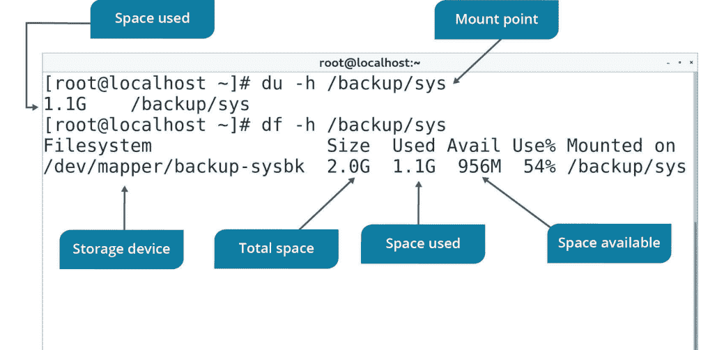

同时使用 `du` 和 `df` 命令检查设备的存储空间。

### 语法

`du` 和 `df` 命令的语法为 `du/df [options] [object names]`

### I/O 调度

I/O 调度是操作系统确定涉及块存储设备的输入和输出操作顺序的过程。调度非常重要，因为与 CPU 和内存操作相比，块存储操作相对较慢——特别是在像硬盘这种基于磁盘的技术中。Linux 内核并不是按照请求提交的顺序向驱动器读写；相反，它会优先处理某些请求，以最大限度地减少 I/O 任务可能带来的性能问题。

虽然内核处理调度，但你实际上可以根据不同的行为类型配置调度器。在某些情况下，某些行为比其他行为更合适，你可能会发现设置新类型可以提高读写速度。更改调度器通常发生在故障排除过程中，以便在性能性能都至关重要时精调存储性能。

### 调度器类型

下表描述了现代 Linux 内核版本提供的某些不同调度器。

| 类型 | 描述 |
| :--- | :--- |
| deadline | 使用三个队列执行 I/O 操作：一个标准待处理请求队列、一个读优先先出（FIFO）队列和一个写 FIFO 队列；后者按提交时间排序并具有过期值。当请求被提交时，它被排序到标准队列，并放在适当的 FIFO 队列末尾。当 FIFO 队列顶部的请求超过队列的过期时间时，调度器停止处理标准队列并开始从 FIFO 队列顶部处理请求——换句话说，它处理最旧的请求。这确保了调度器不会让请求“饥饿”太久。这使其成为某些负载（多线程负载）的理想选择。 |
| cfq | 指完全公平队列（CFQ）调度器。在此调度器中，每个进程都有自己的队列，每个队列都有访问间隔（或其时间片）。调度器使用轮询系统访问每个队列以及这些队列中的请求，直到它们的时间片或请求耗尽。当这种情况发生时，CFQ 会等待 10 毫秒，直到在队列上看到新请求，如果没有，它将移动到另一个队列。deadline 调度器，这有助于最大限度地减少请求饥饿。它的优势是优先处理，并在大多数负载情况下提供良好的性能。它也是现代版本 Linux 内核的默认调度器。 |
| noop | 这是最简单的调度器，它不对 I/O 请求进行排序，而仅进行合并。这在设备或其存储控制器执行排序操作的情况下是理想的。它也适用于不需要寻道时间的设备，如 SSD 和 USB 闪存，因为该调度器在减少时间方面花费并不多。然而，在大多数情况下使用前两种调度器。 |

### 设置调度器

你可以通过修改位于 `/sys/block/<device>/scheduler` 的文件为特定设备设置调度器。设置调度器只需将所需的调度器 echo 到此位置：`echo noop > /sys/block/sda/scheduler` 注意，此设置仅对运行时有效；重启后将还原。要持久化更改，必须修改系统配置。

### IOSTAT 命令

`iostat` 工具生成 CPU 和设备使用的报告。对于存储，它为块设备和分区提供输入和输出统计数据。使用 `-d` 选项指定设备设备，`iostat` 命令列出每个存储设备的以下统计数据：

- 每秒传输（I/O 请求）（tps）。
- 每秒读取块数（kB_read）。
- 每秒写入块数（kB_write）。
- 总读取块（kB_read）。
- 总写入块（kB_write）。

可以使用此报告监控存储设备的使用情况并识别潜在瓶颈。例如，故障硬盘的每秒读取或写入可能低于预期。你还可以使用此报告帮助在可用设备之间分配 I/O 负载。

```
root@server01 iostat -d /dev/sda
Linux 3.10.0-el7.x86_64 (server01)
CPU::
Device: | tps | kB_read/s | kB_write/s | kB_read | kB_write
sda2 | 0.00 | 0.05 | 0.01 | 2295.00 | 2156.00
```

显示存储设备统计数据。

### 语法

`iostat` 命令的语法为 `iostat [options] [device names]`

### ping 命令

`ping` 命令实时生成设备 I/O 延迟报告。它将持续“ping”指定的设备并打印关于每个请求的信息。默认情况下，此信息跟踪 I/O 请求完成所需的时间。除了指定设备，你还可以指定路径来测试与路径相关的任何设备。如果你认为读写速度比应的慢，请考虑使用 ping 设备延迟问题。注意：这与标准的 ping 命令类似，后者测试网络延迟。

# 单个 ping

```
root@server01 ~ ping -c 5 /dev/sda2
PING /dev/sda2 (block device 1 GiB) 56(84) bytes of data
56(84) bytes from /dev/sda2: icmp_seq=1 time=7.40 ms
56(84) bytes from /dev/sda2: icmp_seq=2 time=11.8 ms
56(84) bytes from /dev/sda2: icmp_seq=3 time=12.5 ms
56(84) bytes from /dev/sda2: icmp_seq=4 time=5.94 ms
56(84) bytes from /dev/sda2: icmp_seq=5 time=5.51 ms

--- /dev/sda2 (block device 1 GiB) ping statistics:
5 requests received in 39.8 ms, 16 KiB read, 100 packets, 402.5 KiB/s
min/avg/maxdev = 5.94 ms / 9.94 ms / 12.5 ms / 2.56 ms
```

ping 存储设备以测试 I/O 延迟。

### 语法

`ping` 命令的语法为 `ping [options] [device name]`

# ping 选项

下表列出了你可以配合 ping 命令使用的一些选项。

| 选项 | 用途 |
| :--- | :--- |
| -c [count] | 在停止前指定执行 I/O 请求的数量。 |
| -i [time] | 设置 I/O 请求之间的间隔。 |
| -c [time] | 设置最小有效请求时间。比此快的请求将被忽略。 |
| -T [time] | 设置最大有效请求时间。比此慢的请求将被忽略。 |
| -s [size] | 设置请求的大小。 |

### 存储配额

配额是分配给用户用于计算机文件存储存储空间。存储配额是按用户配置的。实现存储配额的文件系统可以有软限制、宽限期和硬限制。一旦用户超过软限制，他们将被置于为期七天的宽限期。用户允许在宽限期内超过此软限制，但不能超过硬限制。如果用户在计时器过期时低于软限制，则软限制将自动作为硬限制实施，用户将无法再使用任何额外存储。

存储配额是防止和解决由于过度使用存储产生问题的良好措施。你可以使用这些配额来确保用户不会占用硬盘的所有空间，为其他用户或系统留出空间。

### 配额管理命令

配额管理是对所有用户配额的有效分配和监控。Linux 拥有各种命令可以帮助系统管理员减轻配额管理的工作。


注意：分配配额时，应确保用户能够最大限度地利用存储资源而不产生溢出。

### 命令

quotacheck -cug [挂载点] edquota -u [用户名] edquota -g [组名] setquota -u [用户名]

# 用途

为文件系统创建配额数据库文件，并检查用户和组配额。

编辑特定用户的配额。
编辑特定组的配额。
为特定用户设置配额。

setquota -g [组名] 为特定组设置配额。

### 激活配额

在使用这些命令之前，你必须在文件系统上实际激活用户和/或组配额。你可以通过编辑 `fstab` 文件，为相关文件系统添加 `quota` 和 `grquota` 选项来实现此操作。

### XFS 配额

你可以使用 `xfs_admin` 工具在 XFS 文件系统上配置配额。该工具可以在交互模式和非交互模式下下运行。在非交互模式下，使用 `-c` 选项指定要运行的命令，使用 `-xoption` 启用专家模式，这是大多数管理任务所必需的。任务包括设置块和 inode 限制、设置警告限额、生成配额报告等。

### 配额报告

配额报告由系统创建，以便你可以查看每个用户的存储空间使用情况。这些报告允许你检查哪个用户占用了最大的磁盘空间。它们还可以帮助排查配额本身的问题——例如，配额过于严格或过于宽松的问题。

配额报告包含以下详细信息：

- 用户/组的名称。
- 用户/组在文件系统上使用的块总数（单位为 KB）。
- 用户/组的软限制。
- 用户/组的存储硬限制。
- 宽限期。
- 用户/组在文件系统上使用的 inode 总数。
- inode 的软限制。
- inode 的硬限制。

# root@server01:~

``````
[root@server01:~] # repquota -a
*** 设备 /dev/sda6 上的用户配额报告
Block grace time: 7days; Inode grace time: 7days
```

| 用户使用的 软 硬 宽限 | 已用 软 硬 宽限 |
|---|---|---|---|---|---|
| root | | 0 0 7days | 2 0 0 |
| arley | + | 12288 10000 15000 | 1 500 700 |


存储配额报告。

### 报告生成命令

有多个命令可生成有效的配额报告。

# 命令用途

repquota -a 显示 mtab 中标记为可读写且启用了配额的所有文件系统的报告。
显示特定用户的配额报告。
repquota -u [用户名]
quota -u [用户名]
warmquota -u
warmquota -g

以详细输出模式显示特定用户的配额报告。
检查用户是否超过了分配的配额限制。
检查组是否超过了分配的配额限制。

### 额外的存储故障排除技术

排查存储问题从简单的开始，逐步转向复杂的问题。以下是几个例子：

如果用户声称无法创建文件，请验证他们是否拥有该目录的相应权限。从那里，你可能需要检查存储区域是否可用（包括本地和网络挂载分区），以及目标存储位置是否有可用空间。在完成这些步骤后，使用 `df -i` 命令验证 inode 池是否已耗尽。如果 inode 池已耗尽，请识别出不必要的文件（如临时文件夹）并使用 `rm` 命令删除它们。

如果存储位置不可用，从验证存储设备的物理连接开始排查故障。从那里，你可以验证存储设备是否被系统识别——查看 `/dev/` 和 `/proc/`。你还应该检查配置文件的错误，包括 `/etc/fstab`。如果你从网络服务器（如 NFS 或 Samba）挂载驱动器，也是如此。最后，你可以考虑使用 `fs`、XFS 工具集或 ext4 相关工具。

### 存储故障排除指南

在排查存储问题时，请遵循以下指南。

### 排查存储问题

在排查存储问题时：

- 确保设备已连接到系统。
- 确保设备已通电。
- 如果适用，确保设备已开启。
- 通过检查 `/proc/` 目录验证设备是否被系统识别。
- 确认配置文件没有任何拼写错误。
- 如果修改了配置文件，请确保已重新加载。
- 确认有足够的存储容量。
- 确认 I/O 负载没有超过设备能力。
- 使用 `partprobe` 命令使系统扫描新的存储设备和分区。

## 活动 4-1

存储管理回顾
场景

回答以下问题。

1. 你是否或更倾向于使用标准分区还是逻辑卷？为什么？

2. 你使用过哪些文件系统？你遇到了哪些优点和缺点？


## GNU nano

## 描述

一种为 Unix 创建可视化文本编辑器，后来被克隆到 FOSS（开源软件）版本。
大多数 Linux 发行版的默认文本编辑器。一种在 Linux 和 Unix 中使用的灵活、强大且流行的文本编辑器。
Vim 编辑器的图形版本。
GNOME 桌面环境中简单而强大的 GUI 文本编辑器。
一个小型、用户友好的文本编辑器。

## Vim

Vim 是 Vi Improved 的缩写，是 vi 编辑器的扩展版本。Vim 实现了基于文本的用户界面用于高级文本编辑，因其高效性和高度定制性而深受许多系统管理员和软件工程师的喜爱。Vim 还包括补全、语法高亮、拼写检查等许多功能。

```
root@server01~
help.txt      For Vim version 7.4.  Last change: 2012 Dec 06
               main help file
Move around:      使用光标或 "h" 向左移动，h
               "j" 向下，"k" 向上，"l" 向右。j
Close window:      使用 ":q<Enter>" 退出 Vim（小心，所有更改都会丢失！）。
Jump to a subject:  将光标置于标签上（例如光标）并使用 CTRL-\。
With the mouse:      :setmouse=enable 启用鼠标（在 xterm 或 GUI 中）。
               双击左鼠标按钮，例如光标。
Jump back:          输入 CTRL-T 或 CTRL-0（重复可进一步后退）。
```

| help.txt [帮助][RO] | 1,1 | 顶部 |
|---|---|---|
| newfile | 0,0-1 | 全部 |
| "help.txt" [只读] | 221L, 8249C | |

获取特定帮助：通过向 :help 命令传递参数，可以直接跳转到你想要帮助的内容。

*Vim 界面。*

# vim 命令

vim 命令调用 Vim 编辑器。然而，该命令也可以用于此目的，因为它会自动将用户重定向到 Vim。当不带文件名输入 vim 时，vim 默认调用一个欢迎界面。使用 vim 语法 [文件名] 打开文件。如果文件不存在，Vim 将按指定的语法创建一个文件并打开它进行编辑。Vim 支持同时打开多个文件。

# 多窗口操作

你可以选择水平或垂直显示多个文件。按 Ctrl+W+V 创建垂直拆分，或按 Ctrl+S 水平分割屏幕。

# Vim 模式

Vim 是一个模态编辑器，其不同的模式决定了各种按键的功能。

| 模式 | 用户可以 |
|---|---|
| 插入 (Insert) | 通过输入插入文本。 |
| 执行 (Execute) | 在编辑器内执行命令。 |
| 命令可视 (Command Visual) | 使用单键执行不同的编辑操作。高亮或选择文本以进行复制、删除等。 |

# 切换模式

命令模式是 Vim 的默认模式，但你可以通过单键从命令模式切换到任何其他模式。这里列出了切换模式的一些按键。

# 键功能

- i 切换到插入模式并在光标左侧插入文本。a 切换到插入模式并在行尾添加文本。I 切换到插入模式并在行首插入文本。

# 键功能

- o 切换到插入模式并在光标下方的新行插入文本。
- O 切换到插入模式并在光标上方的新行插入文本。
- v 切换到可视模式以启用选择，一次选择一个字符。
- V 切换到可视模式以启用选择，一次选择一行。
- : 切换到执行模式以允许用户输入命令。
- Esc 返回命令模式。


# 执行命令

在命令模式下，当你输入冒号（:)操作符时，编辑器左下角会出现一个小小的命令提示区域。这表示你处于执行模式，可以运行 Vim 支持的命令。下表列出了 Vim 支持的一些命令。

# 命令功能

| 命令 | 用途 |
|---|---|
| :w [文件名] | 如果是第一次保存，则带文件名保存文件。 |
| :q | 无更改时退出。 |
| :q! | 忽略所做的更改退出。 |
| :qa | 退出多个文件。 |
| :wq | 保存当前文件并退出。 |
| :e! | 在不关闭文件的情况下恢复到上次保存的格式。 |
| ![any] | 执行命令并显示结果。 |
| :help | 打开 Vim 的内置文档。 |

# 动作

动作是在命令模式下用于导航浏览文件的单键快捷键。这些键可以将光标置于文档内的任何位置。它们可用于移动光标字符、行，甚至是文本块。

| 导航键 | 用途 |
|---|---|
| h | 向左移动一个字符。 |
| j | 向下移动。 |
| k | 向上一行。 |
| ^ | 移动到当前行首。 |
| $ | 移动到行尾。 |
| w | 移动到下一个单词。 |
| b | 移动到上一个单词。 |
| e | 移动到当前单词末尾，或者如果在单词末尾，则移动到下一个单词末尾。 |
| Shift+L | 将光标到屏幕底部。 |
| Shift+H | 光标到屏幕第一行。 |
| Shift+G (行号) | 光标到指定的行号。 |
| gg | 光标到文件的第一行。 |
| Shift+G | 光标到文件的最后一行。 |

# 使用方向键导航

除了使用 h、j 和 k 导航编辑器外，你还可以使用上、下、左、右键。传统的导航键如 Home、End、Page Down 同样有效。

# 编辑操作符

命令模式下的编辑操作符是强大的工具，可以使用简单的按键操作文本。它们也可以与动作配合编辑字符。这里列出了常用的编辑操作符。

# 编辑操作符

```
d
dd
p
p/[字符串]
```
```
yy
c[行范围]
```

| 编辑操作符 | 用途 |
|---|---|
| d | 删除光标选中的字符。 |
| dd | 删除当前行。 |
| p | 在光标正下方粘贴文本。 |
| p/[字符串] | 在光标正上方粘贴文本。 |
| ? | 反向搜索特定文本。 |
| / | 正向搜索特定文本。 |
| yy | 复制光标正方的行。 |
| c[行范围] | 在指定范围开始更改。 |
| U | 撤销最后的更改。 |
| u | 撤销当前行的所有更改。 |
| ZZ | 如果有更改则写入文件并退出编辑器。 |

# 计数

计数是一个数字，用于倍增 Vim 中按键的效果。它可以与动作、操作符或两者结合使用。与动作配合时，光标移动距离按计数倍增。与操作符配合时，动作重复指定的次数。使用计数配合操作符的语法为 [计数] [动作]。

## GNU nano

GNU nano 是一个小型、用户友好的文本编辑器，源自为 Unix 系统创建的 Pico 编辑器。它在发布后加入了 GNU 项目。虽然 Vim 是一个强大的文本编辑器，但它并不是最用户好的，这体现在它的多种模式、空白界面以及许多不直观的按键命令。相反，nano 编辑器视觉上更有帮助，因为它在每个打开的文件底部显示快捷键。同样，nano 的命令比 Vim 少，且大多数命令共享共同前缀。它没有需要切换的不同模式。

尽管有这些优点，nano 还缺乏许多让 Vim 强大的功能，如分屏、文本补全、语法高亮等。

# GNU nano 2.3.1
File: newfile
Modified

主 nano 帮助文本

该编辑器旨在模拟 Pico 编辑器的功能和易用性。编辑器有四个主要部分。顶行显示程序版本、正在编辑的文件以及文件是否已修改。接下来是显示正在编辑文件的主编辑器。状态行是底部第三行和重要消息。最后两行显示编辑器中最常用的快捷键。

快捷键的表示法如下：Control 键序列用脱字符 (^) 表示，可以通过 Control (Ctrl) 键或按 Escape (Esc) 键输入。Meta 序列用 M- 表示，可以根据键盘设置使用 Esc、Alt 或 Meta 输入。按下 Esc 然后输入 000 到 255 的三位十进制数字将输入相应的字符。

- 上页 (Prev Page)
- 上一行 (Prev Line)
- 退出 (Exit)
- 下一页 (Next Page)
- 下一行 (Next Line)

GNU nano 界面。

# nano 命令

nano 命令调用 nano 编辑器。在没有任何参数的情况下，该命令将打开一个新文件进行编辑，你可以用特定名称保存此文件。语法 nano [文件名] 打开现有文件。如果文件不存在，nano 将按指定的名称创建并打开编辑。与 Vim 类似，nano 支持同时打开多个文件。这些文件在你可以相互切换的不同“缓冲区”中打开。

# nano 快捷键

在 nano 中，你用于处理文本文件和编辑器本身的函数称为快捷键。你通过按下 Ctrl 键（在编辑器中表示为 ^）然后按下要执行的功能对应的键来激活它们。

以下列表显示了一些 nano 快捷键。

| 快捷键 | 用途 |
|---|---|
| Ctrl+G 退出 nano 或关闭当前“缓冲区”（例如帮助屏幕）。 |
| Ctrl+O 保存当前文件。 |
| Ctrl+J 对齐当前段落。 |
| Ctrl+R 将另一个文件插入到当前文件中。 |
| Ctrl+W 搜索文件。 |
| Ctrl+K 剪切当前选中的行。 |
| Ctrl+U 粘贴被剪切的行。 |
| Ctrl+C 显示光标位置。 |

> 注意：尽管快捷键以大写形式呈现，但不应使用 Shift 键，只使用 Ctrl 键。

# 导航

与其他编辑器一样，你可以使用方向键、分页上上、分页向下、Home 等在 nano 中进行导航。如果你缺少这些键，nano 也为它们提供了快捷键，例如 Ctrl+V 导航到下一页，Ctrl+Y 导航到上一页。


# 复制文本

在单行中复制部分文本需要你使用 Ctrl+C 快捷键“标记”你想复制的文本。然后移动光标以高亮你想复制的文本。按下 Alt+V 复制被标记/高亮的文本，并按 Ctrl+V 粘贴。

# GEDIT 文本编辑器

gedit 编辑器是 GNOME 桌面环境的默认文本编辑器，是 GNU 项目的成员。与 Vim 和 nano 不同，gedit 具有具有典型基于菜单设计的 GUI，使其易于操作。它还具有语法高亮和拼写检查功能，并可以通过插件进行自定义。虽然它的功能不如 Vim，但在安装了桌面环境的系统中，gedit 可能仍然非常有用。

虽然你可以从桌面启动 gedit，你也可以通过 gedit 命令使用 CLI。其语法与 vim 类似——不带参数会打开一个新文件，而提供文件名作为参数则会打开现有文件或创建一个同名的新文件。

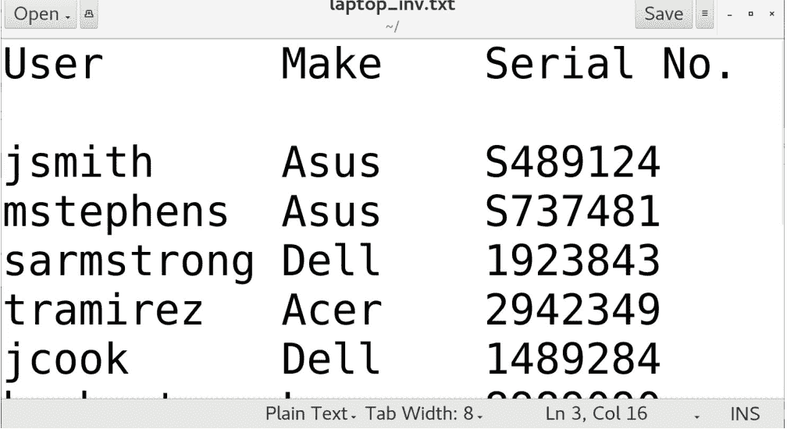

# 如何创建和编辑文件

使用以下步骤创建和编辑文件。

# 使用 Vim 创建文件并输入文本

使用 Vim 创建文件并编辑文本：

1. 输入 `vim filename` 创建指定名称的文件。
2. 按 `i` 切换到插入模式。
3. 输入所需内容。
4. 按 `Esc` 返回命令模式。
5. 如需要，按下相应的导航键在文件文件中移动。
6. 输入 `:wq` 保存并关闭文件。

注意：如果已存在指定名称的文件，你将打开它进行编辑。

# 使用 GNU nano 创建文件并输入文本

使用 GNU nano 创建文件并输入文本：

1. 输入 `nano [filename]` 创建指定名称的文件。

注意：如果已存在指定名称的文件，你将打开它进行编辑。

2. 输入所需内容。

3. 如需要，按下相应的导航键在文件中移动。

4. 按 `Ctrl+O` 开始保存文件。

5. 按 `Enter` 确认。

6. 按 `Ctrl+X` 退出。

# 使用 gedit 创建文件并输入文本

使用 gedit 创建文件并输入文本：

1. 登录 GNOME 桌面环境。

2. 输入 `gedit [filename]` 创建指定名称的文件。

注意：如果已存在指定名称的文件，你将打开它进行编辑。

3. 输入所需内容。

4. 如需要，按下相应的导航键或使用鼠标在文件中移动。

5. 选择“保存 (Save)”保存文件。

6. 选择“Ctrl+X”关闭文件和编辑器。

# 主题 B

查找文件

# 涵盖的考试目标

2.3 给定场景，创建、修改和重定向文件。

有时你创建了一个文件，但忘记了把它放在了目录结构的哪个位置。有时你可能可能不知道由系统、应用程序或其他用户创建的文件的确切位置。在 Linux 中，你有几个强大的工具可以找到你寻找的文件。

# locate 命令

`locate` 命令对存储在 mlocate 数据库中的任何指定文件名称和路径进行快速搜索。必须定期更新此数据库才能使搜索生效。显示的结果可能仅限于用户有权限访问或执行的文件。

```
[student01@server01 ~]$ locate backup
/backup/data
/backup/log
/backup/sys
/backup/log/2019
/backup/log/auth
/backup/log/lost+found
/backup/sys/etc
/backup/sys/test
/backup/sys/test2
/backup/sys/etc/.pwd.lock
```

使用 `locate` 命令查找文件和目录。

### 语法

`locate` 命令的语法为 `[options] [string]`。`locate` 命令支持不同的选项，可以让你的搜索更高效。部分选项如下所示：

| 选项 | 用途 |
| :--- | :--- |
| -r | 使用正则表达式搜索文件名。 |
| -c | 仅显示匹配的数量。 |
| -e | 返回第一个匹配项。 |
| -i | 忽略大小写。 |
| -n | 仅返回匹配的数量。 |


### 语法

whereis 命令的语法为 whereis [options] [directory name] [file name]

## whereis 命令选项

whereis 命令有几个选项，如下表所示。

| 选项 | 用途 |
| :--- | :--- |
| -b | 仅搜索二进制文件。 |
| -m | 仅搜索手册条目。 |
| -s | 仅搜索源码。 |
| -u | 搜索异常条目。 |

## 如何搜索文件

使用以下步骤搜索文件。

## 使用 locate 搜索文件

使用 locate 搜索文件：

1. 假设具有超级用户权限。
2. 输入 `updatedb` 以使用当前的文件和路径信息更新 `mlocate.db` 数据库。
3. 输入 `locate [string]` 在更新后的数据库中搜索指定的字符串。

## 使用 find 搜索文件

使用 find 搜索文件：

1. 假设具有超级用户权限。
2. 搜索文件：
   - 输入 `[path] -name [string]` 在指定路径中搜索名称与指定字符串匹配的文件。
   - 输入 `[path] -mtime [-days]` 在指定路径中搜索在过去几天内修改过的文件。
   - 输入 `[path] -name [string] -exec [command]` 对指定路径中所有名称与指定字符串匹配的文件执行命令。

## 主题 C

对文件和目录执行操作

## 涵盖的考试目标

- 2.3 在给定场景下，创建、修改和重定向文件。
- 3.1 在给定场景下，应用或获取适当的用户和/或组权限及所有权。

一旦你创建并按照自己的喜好编辑了文件，就有许多方法可以管理它。通过使用各种工具，你可以确保你的文件处于你预期的状态。

## cat 命令

cat 命令是 concatenate（连接）的缩写，它可以显示、合并和创建文本文件。它最常用于显示小型文本文件的内容，因为它没有屏幕滚动功能。

下表描述了 cat 命令的一些选项。

| 选项 | 用途 |
| :--- | :--- |
| -v | 将非打印字符显示为可见字符（制表符、换行符和分页符除外）。 |
| -e | 在每行末尾（换行符之前）打印一个 $ 字符。 |
| -t | 将制表符打印为 ^，将分页符打印为 ^L |

### 语法

cat 命令的语法为 [options] [file names]

## HEAD 和 TAIL 命令

head 命令显示每个文件的前 10 行。tail 命令显示每个文件的最后 10 行。当你只需要查看开头或结尾时，这些命令非常有用。例如，你可以通过查看日志文件的最后 10 行来检查最近的日志条目。


```
[root@server1~#] tail /var/log
Jan 7 18:49:27 server01 sum unix(su-l:session): session opened for user ailey by
student01(uid=0)
Jan 7 18:49:38 server01 sum unix(su-l:session): session closed for user ailey
Jan 7 18:50:32 server01 gdm-password: gkr: unlocked login keyring
Jan 7 19:06:38 server01 sum unix(su-l:session): session opened for user student0
by student01(uid=0)
Jan 7 19:06:42 server01 sum unix(su-l:session): session closed for user student1
Jan 7 19:07:58 server01 sum unix(su-l:session): session closed for user root
Jan 7 19:07:59 server01 sum unix(su-l:session): session opened for manderson
Jan 7 19:08:00 server01 sum unix(su-l:session): session closed for user manderson
Jan 7 19:08:34 server01 sum unix(su-l:session): session opened for user root by s
student01(uid=1000)
[root@server1 ~#
```

显示文件的最后 10 行。

### 语法

head 和 tail 命令的语法为 head/tail [options] [file names]

## tail 命令选项

以下是用于 tail 命令的一些选项：

- -f 动态更新文件（当文件更改时，输出会自动更新）
- -n [number] 显示指定的行数，而不是默认的 10 行。也可以用于 head 命令。

## LESS 和 MORE 命令

less 和 more 命令的相似之处在于，它们都允许你显示文件内容并按页翻阅。less 命令通常具有 more 不具备的功能，而新版本的 more 增加了其中一些功能。当你需要使用任一个命令时，通常首选 less 命令。

root@server01:~

```
ESC[32m OK ESC[0m] Started Plymouth Boot Screen.
ESC[32m OK ESC[0m] Reached Target Paths.
ESC[32m OK ESC[0m] Reached Basic Paths.
```


### 语法

`ls` 命令的语法为 `ls [options] [file/directory names]`

# ls 颜色

在 Bash shell 中，当你执行 `ls` 命令时，你可能注意到结果有时会以不同的颜色显示。这些颜色区分了不同类型的文件。默认情况下，某些颜色如下：

- *默认颜色：普通/文本文件*
- 蓝色：目录
- 天蓝色：符号链接或音频文件
- 绿色：可执行文件
- 黑底黄：设备
- 粉色：图像文件
- 红色：归档文件
- 黑底红：失效链接

# mkdir 和 rmdir 命令

`mkdir` 命令用于创建（或制作）目录。你提供目录名称作为参数。`rmdir` 命令用于删除目录，但只能删除空目录（即不包含任何文件或子目录的目录）。要删除包含实际内容的目录，你必须使用 `rm -R` 命令。

### 语法

`mkdir` 和 `rmdir` 命令的语法为 `mkdir/rmdir [directory names]`

# 如何操作文件和目录

使用以下步骤操作文件和目录。

# 读取文件

要读取文件：

1. 1. 确保你对所需文件具有读取权限。2. 读取文件：

- 输入 `cat [file name]` 将文件的所有内容打印到终端，即使这些内容超过了屏幕范围。
- 输入 `head [file name]` 将文件的前 10 行打印到终端。
- 输入 `tail [file name]` 将文件的最后 10 行打印到终端。

# 翻页查看文件

要翻页查看文件：

1. 1. 确保你对所需文件具有读取权限。2. 输入 `[file name]` 打开文件进行分页，3. 导航文件：

- 使用方向键逐行滚动。
- 按 `Page Up` 向上滚动一页。
- 按 `Page Down` 向下滚动一页。
- 输入 `/strings>` 在文件中搜索特定的文本字符串。4. 按 `q` 退出。

# 将文件或目录复制到另一个位置

要将文件或目录复制到另一个位置：

1. 1. 确保你对所需文件具有读取权限。2. 复制文件或目录：

- 输入 `cp [file to copy] [destination]` 将文件复制到指定的目录。
- 输入 `cp -R [directory to copy] [destination]` 将目录及其任何子目录复制到目标目录。

# 将文件或目录移动到另一个位置

要将文件或目录移动到另一个位置：

1. 1. 确保你对所需的文件或目录具有写入权限。2. 输入 `mv {file/directory to move}[destination]` 将文件或目录移动到指定的目录。

# 重命名文件或目录

要重命名文件或目录：

1. 1. 确保你对所需的文件或目录具有写入权限。2. 输入 `mv {old file/directory name}[new file] directory name]` 更改文件或目录的。

# 删除文件

要删除文件：

1. 1. 确保你对所需的文件具有写入权限。2. 输入 `rm [file name]` 删除该文件。3. 如必要，输入 `y` 确认删除。

# 创建目录

要创建一个目录：

1. 1. 确保你想要创建新目录的目录具有写入和执行权限。
2. 2. 输入 `mkdir [directory name]` 创建新目录。

# 删除目录及其内容

要删除目录及其内容：

1. 1. 确保你想要删除的目录具有写入和执行权限。
2. 2. 输入 `rm -R [directory name]` 删除该目录及其包含的所有文件和子目录。

# 主题 D

处理文本文件

# 涵盖对象

2.3 给定场景，创建、修改和重定向文件。

除了执行读取、移动和复制等基本文件操作外，你还可以处理文件使它们对你更有用。在本主题中，你将处理文件，以便根据某些业务需求更容易进行工作。

# echo 命令

`echo` 命令用于在终端上显示一行文本。你也可以通过提供 `echo` 命令的字符串并将其重定向到文件来将文本写入文件。

# [root@server01 ~]# echo 'Hello, World!'
Hello, World!

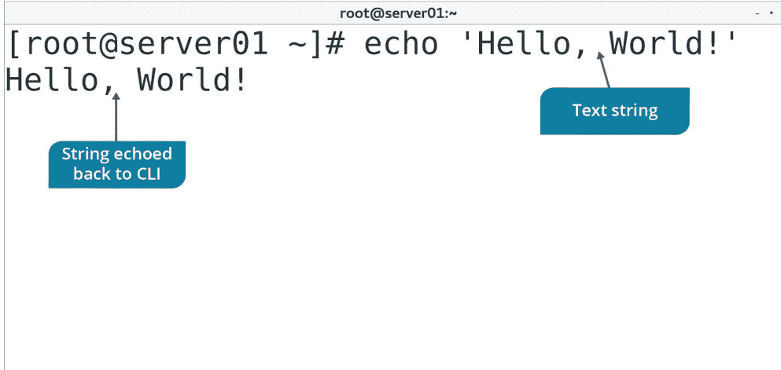

输出一个文本字符串。

### 语法

`echo` 命令的语法为 `echo [string]`

# print 命令

`print` 命令与 `echo` 类似，但它为用户提供了对输出格式的更多控制。你可以在想要输出的文本中提供各种格式字符，使用反斜杠 (`\`) 来指示它们的使用情况。例如：`printf "Hello.\nWhat's your name?"` 将打印：

Hello.
What's your name?

这是因为 `\n` 是换行格式字符，它会在放置的地方自动添加新行。该命令还支持转换字符，使用百分号 (`%`) 来指示它们的使用情况。转换字符通常用于指示它们的使用。

# tr 命令

`tr` 命令用于翻译字符。它主要用于更改字符。

### 语法

`tr` 命令的语法为 `tr [string 1] [string 2]`

# wc 命令

`wc` 命令用于统计行、字和字符。如果指定了多个文件，命令将显示每个文件的计数以及总数。

### 语法

`wc` 命令


 `wc` 命令提供了各种选项，允许你指定输出的性质。

- -c 显示字节数。
- -m 显示字符数。
- -l 显示行数。
- -w 显示单词数。

# sort 命令

`sort` 命令对文件进行行排序。提供了常用的 `sort` 选项。

- -k[column] 指定字段值。例如 `-k2` 表示第二个字段。
- -n 根据数值进行比较并排序。
- -r 降序排序字段。默认情况下，字段升序排序。
- -t(delimiter) 使用分隔符分离字段。分隔符可以是制表符或空格。

| ramirez | 294239 |
| manderson | 298848 |
| barnes | 39382 |
| jsmith | 48914 |
| mstehens | 73748 |
| nporter | 89284 |
| kriley | 39039 |
| jcook | 48928 |
| sarmstrong | 19238 |
| tlee | 81209 |

排序文本文件。
语法
命令语法为 `sort [options] [file names]`

# cut 命令

`cut` 命令从文件中提取指定的行文本。下表出了常用的 `cut` 命令选项及其用途。

- -c 指定从每行切割的字符数。
- -d[delimiter] 使用分隔符分离字段。
- -f[field numbers] 根据分隔符指定要切割的字段。例如，`-f2` 表示第一个和第二个分隔符之间的字段。
- -s 如果未找到分隔符，则抑制该行。

提取日志的一部分。
语法
命令语法为 `cut [options] [file names]`


# paste 命令

`paste` 命令用于水平方向合并文本文件中的行。初始文件的每一行都是第一列的一行；使用 `paste`，你可以指定第二个文件，第二个文件的每一行都将成为新第二列的一行。默认情况下，`paste` 命令使用制表符作为分隔符分隔每一列。你可以使用 `-option`选项来指定不同的分隔符。

例如，你有一个名为 `cities` 的文件：

- New York
Tokyo
London
Lima

你还有另一个名为 `countries` 的第二个文件：

- United States
Japan
England
Peru

`paste -d , cities countries` 的输出如下：

New York,United States Tokyo,Japan
London,England
Lima,Peru

# diff 命令

`diff` 命令用于比较文本文件。该命令显示两个文件以及它们之间的差异。通过各种符号，输出建议如何更改一个文件使其与另一个文件相同。每个符号都有特殊含义。

小于符号 (`<`) 后面跟一行，意味着该行应该从第一个文件中删除，因为它没有出现在第二个文件中。大于符号 (`>`) 后面跟一行，意味着应该从第二个文件中添加该行。此外，`diff` 命令还会标出每个文件中受删除、添加和更改操作影响的行号。

注意：`diff` 命令本身不会进行任何更改。

```
student01@server01:~/policies
[student01@server01 policies]$ diff up_v1.txt up_v2.txt 33a34,41
> Rule: BK-01 Rules Relating to Data Backup
> 1. 确保你正在备份所有关键独立分区或存储驱动器。
> 2. 仅使用IT提供的外部存储硬件。
> 3. 确保所有关键数据在备份中已加密。
> 4. 以每月或更低的频率进行数据备份。
> 5. 在不使用时断开备份驱动器。
35a44
> 2018-10-06 Mary Stephens Added data backup rules.
```

比较两个文本文件。

### 语法

`diff` 命令的语法为 `diff [file name 1] [file name 2]`

# diff 命令选项

`diff` 命令有各种选项允许你指定输出的性质。

- -b 忽略空格差异。
- -i 忽略大小写差异。
- -t 在输出行中扩展制表符。
- -w 忽略空格差异并
- -c 显示带有三行上下文的差异列表。

-u
以统一模式输出结果，提供了一种更精简的格式。

# grep 命令

`grep` 命令在最基本的形式是一个搜索工具。与 `find` 或 `locate` 不同，它不限于查找文件名；它通常用于在文件中搜索特定的文本字符串。作为输出，`grep` 显示找到你搜索模式的文件的每个完整行。你可以使用 `grep` 处理文本文件并读取与你最相关的内容。例如，你可能通过查看访问日志来审核用户的登录事件。与其读取整个日志或在文本编辑器中逐步查找搜索词，你可以可以使用 `grep` 命令将所有相关行打印到屏幕上。

# 搜索词

# 要搜索的文件

```
[root@server01 ~]## grep /var/log/secure
Jan 7 18:47:08 server01 su: pam_unix(su-session): sessio
opened for user ailey by student01(uid=0)
Jan 7 18:48:00 server01 su: pam_unix(su-session): sessio
closed for user ailey
Jan 7 18:48:27 server01 su: pam_unix(su-session): sessio
opened for user ailey by student01(uid=0)
Jan 7 18:48:39 server01 su: pam_unix(su-session): sessio
closed for user ailey
[root@server01 ~]#
```

# 上文中行

# 包含术语的行

搜索包含特定术语的文件。

### 语法

`grep` 命令的语法为 `grep [options] [search pattern] [file names]`

# grep 命令选项

`grep` 命令有很多选项。下表描述了几个常用的选项。
- -E [pattern]
- -F [pattern]
- -f [file name]
- -i
- -v
- -c
- -l
- -o

作为扩展正则表达式 (ERE）匹配模式。
作为固定字符串列表匹配模式。

指定文件中包含的模式。忽略大小写。
只输出不匹配提供模式的行。
只打印匹配行的数，而不是行本身。
只打印行的匹配部分，而不是整个行。

# 使用 grep 查找文件

除了搜索文件内容外，你还可以 `grep` 搜索目录以定位特定文件。`ls -l | grep audit` 命令返回当前目录下任何名称包含 "audit" 的文件的长列表。

# egrep 命令

`egrep` 命令本质与 `grep -E` 命令相同。然而，`egrep` 已弃用，因为 `grep -E` 是首选语法。

> 注意：正则表达式超出了课程的范围。有关更多信息，请访问 https://www.regular-expressions.info/quickstart.html。

# awk 命令

`awk` 命令对文件执行模式匹配。它基于 AWK 编程语言。`awk` 关键字后面跟着模式、要执行的操作以及文件名。要执行的操作应该放在大括号内。如果没有指定模式，则对所有输入数据执行操作；然而，如果没有指定操作，则打印整行。`awk` 命令可以从命令行或在 `awk` 脚本文件中执行。

`awk` 命令可以使用多种方式处理文本文件，例如提取匹配模式的文本；删除匹配模式的文本；添加匹配模式的文本；以及更多。

注意：GNU 的 awk 版本称为 gawk


搜索日志中 1 月记录的所有条目。

```bash
[root@server01 ~]$ $1 == "Jan" /var/log/secure
Jan 7 18:47:08 server01 su: pam_unix(su-session): sessio
opened for user ailey by student01(uid=0)
Jan 7 18:48:00 server01 su: pam_unix(su-session): sessio
closed for user ailey
Jan 7 18:48:27 server01 su: pam_unix(su-session): sessio
opened for user ailey by student01(uid=0)
Jan 7 18:48:39 server01 su: pam_unix(su-session): sessio
closed for user ailey
[root@server01 ~]#
```

### 语法

`awk` 命令的语法为 `awk '[pattern] {action}' [file name]`

# 模式

在 `awk` 中，模式用于过滤输入文件的行。如果没有指定模式，则对所有行执行操作。模式可以是正则表达式或简单字符串。

# 操作

`awk` 中的操作定义了模式匹配时做什么。通常包含在大括号中。常见操作包括打印、修改文本或执行计算。

# ln 命令

`ln` 命令用于创建文件链接。链接允许一个目录中的文件名（链接）指向另一个目录的文件（目标）。链接本身不包含数据，只有指向目标文件的引用。目标文件的任何更改将反映在目标文件中。如果你没有指定链接名称，`ln` 命令将在当前工作目录中创建链接。

### 语法

`ln` 命令的语法为 `ln [options] [target name] [link name]`

# 命令选项

`ln` 命令有各种选项。下表给出常用的选项。
- -s 创建符号链接而不是硬链接。
- -i 在覆盖现有文件之前提示。
- -f 强制删除目标文件。
- -v 在创建每个链接时打印其名称。


### 选项
--backup
-f
-s
-i
-v

# 用途

备份现有目标文件。删除目标文件。创建符号链接而非硬链接。提示是否删除目标文件。在链接之前打印文件名称。

# 链接的类型

使用 `ln` 命令，你可以创建两种链接：硬链接和符号链接（软链接）。硬链接和符号链接是文件系统的特性，在大多数 Linux 支持的文件系统中都是通用的。ext2、ext3、ext4 和 XFS 文件系统都支持硬链接和符号链接。

硬链接是对另一个文件的引用；它允许文件数据在同一个文件系统的不同位置拥有多个名称。应用程序将其视为真实文件。如果创建创建硬链接后删除了原始文件，所有内容仍将在链接后的文件中可用。这是因为硬链接的 inode（索引节点）与其目标文件是相同的；换句话说，它指向文件系统上的同一个对象。硬链接不能在两个目录之间创建，也无法在不同系统的两个文件之间创建。

符号链接是对文件或目录的引用，可以跨越多个文件系统。如果在创建符号链接后删除了原始文件或目录，原始内容将会丢失。这是因为符号链接的 inode 与其目标不同；换句话说，它指向文件系统上的另一个对象。符号链接也被称为软链接。

### 示例

以下使用 `ln` 命令创建硬链接的示例，其中 `backup/backup-report` 是链接的目标，而 `--backup-report` 是链接本身：

ln /backup/backup-report --backup-report

以下是相同操作示例，但创建的是符号链接而非硬链接。
ln -s /backup/backup-report --backup-report

# 如何处理文件

使用以下步骤处理文件。

# 统计文件中的单词数

要统计文件中的单词数：

- 输入 `wc [文件名]` 分别显示文件的行数、单词数和字符数。

# 排序文件

要对文件进行排序：

- 输入 `-k[列号] [文件名]` 按指定的列号对文件进行排序，其中 1 是最侧列。
- 输入 `-k[列号] -r [文件名]` 降序对文件进行排序。
- 输入 `sort -k[列号] -t[分隔符] [文件名]` 按指定的列号对文件进行排序，其中分隔符定义了每列之间的边界。

# 从文件中提取行

要从文件中提取行：

- 输入 `cut -c[字符数] [文件名]` 从文件的每行提取指定数量的字符。
- 输入 `cut -f[字段号] [文件名]` 从文件的每行提取指定的字段号。
- 输入 `cut -d[分隔符] -f[字段号] [文件名]` 从文件的每行提取指定的字段号，其中分隔符定义了字段之间的边界。

# 合并两个文件的行

要合并两个文件的行：

- 输入 `paste [文件名1] [文件名2]` 使用制表符作为分隔符合并两个文件的行：
- 输入 `paste -d[分隔符] [文件名1] [文件名2]` 在指定分隔符的同时合并两个文件的行。

# 比较两个文件

1. 输入 `diff [文件名1] [文件名2]` 比较两个文件。
2. 检查输出结果以确定文件应如何变化才能变得一致。

# 在文件中搜索模式

要搜索某种模式：

- 输入 `grep [搜索模式] [文件名]` 获取指定文件中所有包含搜索模式的行。

# 根据文件搜索模式执行操作

要根据文件搜索模式执行操作：

- 输入 `awk 'pattern' [action] [文件名]` 根据搜索模式对文件执行操作。

# 在文件中查找并替换字符串

要在文件中查找并替换字符串：

- 输入 `sed 's/pattern/replacement/g' [文件名]` 将文件中所有匹配给定模式的出现替换为替换字符串。
- 输入 `sed '/pattern/d' [文件名]` 删除文件中所有匹配给定模式的出现。

# 链接文件

要链接文件：

- 输入 `ln [目标名称] [链接名称]` 创建硬链接。
- 输入 `ln -s [目标名称] [链接名称]` 创建符号链接。

# 主题 E

处理文件输出

# 涵盖的考试目标

2.3 给定场景，创建、修改和重定向文件。

所有这些对文件的管理和操作不仅是为了在终端中查看结果。当你继续使用终端或完全注销时，你将希望确保将某些关键信息存储在文件中，以便日后检索和分析。结合使用多个命令将让你受益，使你的管理工作更高效、更强大。

# 文本流

文本流是一个或多行文本的序列，应用程序利用它从特定设备或系统组件读取或写入。这使得应用程序能够与 CLI、文件、网络套接等组件建立接口，同时向应用程序隐藏组件的细节。

在大多数 Linux Shell 中，有三种流：标准输入、标准输出和标准错误。

# 标准输入

标准输入（stdin）是一种文本流，作为命令输入的源头。Linux 命令的标准输入通常来自键盘。

# 标准输出

标准输出（stdout）是一种文本流，作为命令输出的目的地。默认情况下，标准输出指向屏幕。

# 标准错误

标准错误（stderr）是一种文本流，作为错误信息的目的地。默认情况下，标准错误指向屏幕。

# 输入/输出重定向

重定向是指从非源接收数据并发送到非显示目的地的过程。换句话说，在处理输入/输出（I/O）时，可以使用重定向跳过默认设备。重定向常用 stdin、stdout 和 stderr。

# 重定向运算符

有几种运算符用于重定向输入或输出。这些运算符在表中描述。

| 运算符 | 描述 |
| :--- | :--- |
| `>` | 将标准输出重定向到文件。 |
| `>>` | 将标准输出追加到文件末。 |
| `2>` | 将标准错误重定向到文件。 |
| `2>>` | 将标准错误追加到文件末。 |
| `&>` | 将标准输出和标准错误均重定向到文件。 |
| `<` | 从文件而非键盘或鼠标读取输入。 |

`ls > file1.txt`
 命令的输出将重定向到名为 `file1.txt` 的文件中。

`ls >> file1.txt`
 命令的输出将追加到名为 `file1.txt` 的文件中。

`ls file3.txt 2> errorfile.txt
假设 file3.txt 不存在，错误将不会显示在屏幕上，而是重定向到名为 `errorfile.txt` 的文件中。

`ls file3.txt 2>> errorfile.txt
假设 file3.txt 不存在，错误将不会显示在屏幕上，而是追加到名为 `errorfile.txt` 的文件中。

`ls file1.txt file3.txt &> errorfile.txt
假设 file1.txt 存在而 file3.txt 不存在，产生的输出和错误将不会显示在屏幕上，而是重定向到名为 `errorfile.txt` 的文件中。

`mail user@address < myletter.txt
 myletter.txt 文件将作为输入并附加到电子邮件消息中。

`<<string` 从当前源提供输入数据，当出现包含提供字符串的行时停止。当放在脚本中时，这被称为文档（here document）。

<<EOF
This is

a here document.
EOF

cat 命令将使用此文件的其余行作为输入。它在遇到 EOF 时停止接受输入。此字符串可以命名为任何任何名称。因此，cat 命令的输出将是：

This is
a here document.

# 管道


管道（Piping）是将命令的标准输入/输出流组合的过程。它将一个命令的标准输出作为另一个命令的标准输入。第一个命令的输出格式应与第二个命令所能处理的格式兼容。管道操作符 (|) 可以用于 Linux 中的大多数命令。


正被管道到其他命令的命令。

## 管道示例

之前提到的 `ls -l | grep audit` 命令用于搜索名为 "audit" 的文件，这就是使用管道的一个示例。`ls -l` 命令的标准输出被作为标准输入传递给 `grep` 命令，以便 `grep` 在目录列表中搜索该术语。

## xargs 命令

`xargs` 命令从标准输入读取内容并为提供的每个参数执行一个命令。每个参数必须用空格分隔。使用管道操作符将第一个命令的输出作为第二个命令的输入。`xargs` 通常与 `find` 命令配合使用，对文件或目录搜索找到的每个结果进行操作。

```
image_content:nSearch for files matching pattern
root@server01:~]
[code block]
Change permissions for all files found
```

更改所有与给定模式匹配的文件权限。

### 语法

`xargs` 命令的通用语法为 `command [options] [arguments] | xargs [options] [command]`

## xargs 命令示例

假设你想删除 `/directory` 下所有 `.pdf` 扩展的文件。你可以使用 `xargs` 来自动化此过程：

`find /foo -type f -name "*.pdf" | xargs`

`find` 命令搜索 `/foo` 中所有扩展名为 `.pdf` 的文件并将结果传递给 `xargs` 命令。由于结果是用空格分隔的，`xargs` 命令将为结果中的每个文件执行 `rm` 命令——删除目录中的所有 PDF 文件。

## xargs 命令选项

`xargs` 命令有多种选项。

| 选项 | 用途 |
| :--- | :--- |
| -I [replacement string] | 将标准输入中的每行视为单个参数。 |
| -L [number of lines] | 从标准输入读取指定数量的行并将其合并为一个长字符串。 |
| -p | 在执行每个命令前提示用户。 |
| -n [number of arguments] | 从标准输入读取最大数量的参数并附加到命令模板的末尾。 |
| -E [end of string] | 表示标准输入的结束。 |
| -t | 在执行命令之前将每个命令写入标准错误输出。 |
| -s [max size] | 将参数列表的最大允许大小设置为指定的指定的字符数。 |

## tee 命令

`tee` 命令读取输入，将输出发送到默认输出设备（CLI），同时将输出复制到每个指定的文件。此命令允许你立即验证命令的输出，同时将输出保存到文件中以便日后参考。像 `xargs` 一样，它通常使用管道操作符接收来自另一个命令的输入。

配合 `-a` 使用时，`tee` 会将输出追加到每个输出文件而不是覆盖。

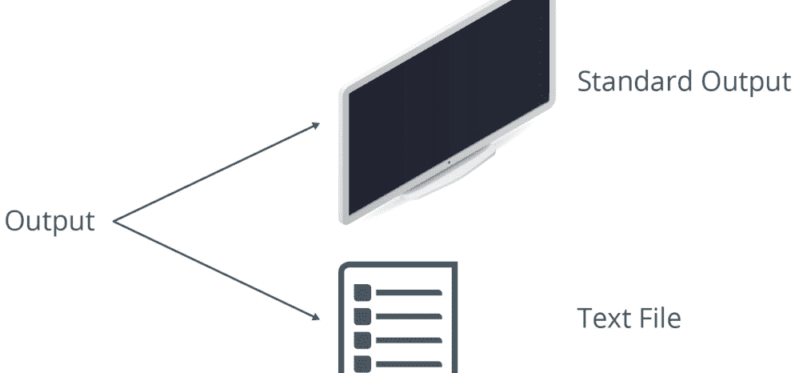

`tee` 命令将输出同时发送到 CLI 和文本文件。

### 语法

`tee` 命令的通用语法为 `command [options] [arguments] | tee [options] [file names]`

## tee 命令示例

假设你想检查目录内容，并将这些内容输出到文件中以便稍后处理。你可以使用单独的命令来实现，也可以像这样使用 `tee` 命令：`ls -l | tee.txt`

## /dev/null 文件

`/dev/null` 文件也称为空设备，是一个丢弃所有写入其数据的文件。通常，你会将输出流重定向到此文件以确认写入操作成功，而无需实际写入。该文件在测试命令、脚本和其他软件时非常有用。通过将错误重定向（2->）来抑制错误信息也非常有用。

## 终端重定向

Linux 中的运行进程由终端（CLI）控制，并且可以同时运行多个终端。每个终端都被分配一个标识符。该标识符的格式为 `/dev/tty#`，其中 `#` 是终端数字。你可以通过引用其 `/dev/tty` 号来重定向标准输入。这需要在运行进程之间重定向文本流时非常有用。

> 注意：你可以使用 CLI 来识别你的终端。

## 如何操作文件输出

使用以下过程来操作文件输出。

## 重定向标准输出、输入和错误

重定向标准输出、输入和错误：

- `[command] > [file name]` 将命令的输出发送到指定文件。
- `[command] >> [file name]` 将命令的输出追加到指定文件。
- `[command] < [file name]` 将文件内容作为输入发送给指定命令。
- `[command] 2> [file name]` 将命令产生的任何错误发送到指定文件。
- `[command] 2>> [file name]` 将命令产生的任何错误追加到指定文件。
- `[command] &> [file name]` 将输出和错误都发送到指定文件。
- `[command] |& [file name]` 将输出管道到文件。

## 创建文档

使用以下过程创建文档：

- `[command] << [file name]` 创建文件并输入内容。
- 按 `Ctrl+D` 完成内容输入并保存文件。


内核通常将运行在内存中的软件分为两个空间：内核空间和用户空间。内核空间是内核执行其提供的服务的内存区域。用户空间是包含内核空间之外所有内容的内存区域。这包括从用户直接交互的高级应用到后台运行的进程，再到低级系统库的所有内容。

运行在用户空间中的软件能够通过使用系统调用访问内核空间提供的资源。这些调用为用户应用程序提供了执行任务所需的资源。例如，应用程序可能会向内核发出系统调用，以便利用输入/输出（I/O）服务将数据写入存储设备。

这两个内存区域之间的划分是非常有用的，因为它提升了极的稳定性和安全性。在其中一个空间中的软件不一定会干扰另一个空间中的软件。

不同的内核空间。

## 内核类型

内核可以分为单体内核或微内核。在单体内核中，所有系统模块（如设备驱动程序或文件系统）都运行在内核空间。因此，单体内核可以与设备进行快速交互。然而，它的主要缺点是体积较大，导致了 RAM 的高消耗。此外，在单体内核中，设备驱动程序的故障可能会导致系统不稳定。

在微内核架构中，内核本身仅运行最少资源以实际实现一个功能完整的操作系统。与单体内核相比，微内核具有更小的内核空间和更大的用户空间。每个微内核的整体尺寸更小，消耗内存更少。此外，它们通常更稳定。然而，微内核的性能往往劣于单体内核。

## 设备驱动程序

设备驱动程序是一种软件程序，使计算机操作系统能够识别硬件设备的特征和功能，与其通信并控制其操作。它充当操作系统与存储驱动器、打印机、扫描仪、显示器和键盘等硬件设备之间的接口。设备驱动程序可以包含在操作系统或根据需要安装。

## Linux 内核

Linux 内核是一个免费开源的单体内核，管理操作系统上的所有其他资源。作为一个单体内核，设备驱动程序运行在内核空间并对硬件具有完全访问权限。Linux 内核架构提供了许多有用功能，包括虚拟内存管理、TCP/IP 网络支持、共享库等。

Linux 内核的一个重要特性是它的模块化。这允许用户配置和扩展内核功能以满足他们的需求。

Linux 内核由创始人 Lin Torvalds 和许多其他志愿者不断更新。内核的每个新版本都有一个内核版本号，以将其与过去和未来的版本区分开。内核版本的当前命名约定是主.次，其中主为主版本号，次是次版本号。例如，4.19 版本于 2018 年 10 月发布。

Linux 内核的现代版本格式。

## 内核历史

对于 2.6.39 及之前的版本，内核编号格式为 w.x,y.z，其中 w 是主版本号，x 是主修订版本，y 是次修订版本，z 是补丁号。

2.6.39 之后，Torvalds 决定缩短版本号格式，下一个版本号是 3.0。在 3.19 之后，Torvalds 决定不再继续 3.20，而是跳到 4.0。这是为了可读性考虑，而不是由于任何技术进展。内核的新版本将继续避免大次版本号的趋势。

## uname 命令

默认情况下，uname 输出内核名称——Linux。你可以使用 `uname -r` 命令查看当前系统的内核版本号。你也可以输入 `uname -i` 查看硬件平台。要打印所有信息，请输入 `uname -a` 命令。

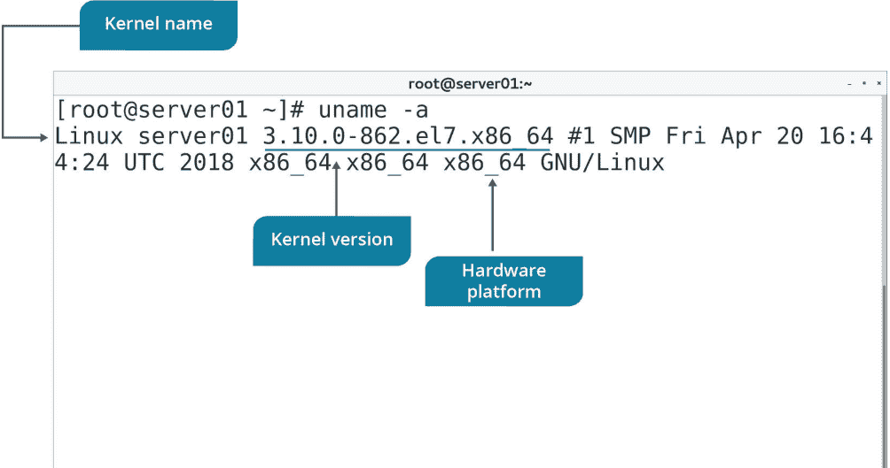

查看内核信息。

## 内核层

内核执行各种功能来控制和管理系统的操作。它由运行在内核空间的几层组成。

- 内核层系统调用接口 (SCI)
- 进程管理
- 内存管理
- 文件系统管理
- 设备管理
- 功能

处理用户应用程序到内核的系统调用。这允许用户空间应用程序向内核空间请求服务，如处理时间和内存分配。

这一层还允许内核调度和处理系统调用，并同时管理多个系统调用。

通过在处理器上分配单独执行空间来处理不同的进程，并确保一个进程的运行不会干扰其他进程。

通过调度，内核实现了共享处理器时间来执行多个进程。

管理计算机内存，这是内核执行的复杂任务之一。与处理器共享一样，系统内存也需要在不同的用户资源之间共享。

内核根据请求将可用内存映射或分配给应用程序或程序，并在程序执行完成后自动释放内存以便将其分配给其他程序。

管理文件系统，涉及在计算机上存储、组织和跟踪文件及数据。

内核还支持虚拟文件系统 (VFS)，它为组织在复杂结构下的底层数据提供抽象视图，使其看起来像单一结构。

通过控制设备访问以及在用户应用程序与计算机硬件设备之间的接口来管理设备。

当用户应用程序发送系统调用时，内核读取请求并将其传递给管理特定设备活动的驱动程序。

## 主题 B

## 安装和配置内核模块

## 涵盖的考试目标

- 1.2 给定场景，安装、配置和监控内核模块。
- 1.3 给定场景，配置并验证网络连接参数。
- 4.1 给定场景，分析系统属性并进行相应的补救。

现在你已经探索了 Linux 内核，已准备好安装和配置内核模块了。这将允许你根据特定目的扩展内核功能。

## 内核模块

内核模块是一个扩展内核功能的系统级对象。它可以根据需要动态加载到内核中或从内核中卸载。它允许内核在不需要重启系统的情况下进行更新或重新编译。

内核模块的优势是：

- 它们减轻了内核的负担，否则所有模块的功能都将直接添加到内核中。
- 内核模块的动态加载有助于降低内存消耗。
- 它们避免了在需要新功能时重新构建和重启系统。

内核模块文件由 .ko 扩展名组成。为特定内核版本构建的模块可能与其他版本不兼容。

## /usr/lib/ 目录

/usr/lib/ 目录包含通用程序的共享库和二进制文件。该目录中的文件由用户或自定义脚本执行。内核模块位于软件软件包。

更具体地说，/usr/lib/modules/ 目录包含不同版本的模块。在该目录下，模块根据所属类别存储在不同的子目录中。例如，蓝牙驱动可能存储在 /usr/lib/modules/<kernel version>/kernel/ 注意：这些模块位于 /modules/ 。

## 内核模块目录

在 /usr/lib/modules/<kernel version>/kernel/ 下有若干子目录，如下表所示：

| 目录 | 内容 |
| :--- | :--- |
| arch | 架构支持。 |
| crypto | 加密和其他功能。 |
| drivers | 各种类型的驱动程序。 |
| fs | 各种类型的文件系统。 |
| net | 网络组件，如防火墙和协议。 |

## 内核模块管理命令

内核管理命令允许你查看、加载、卸载或修改内核模块。命令为：

modinfo
insmod
rmmod

- **modinfo**: 显示当前加载的内核模块、大小、使用详情及其依赖模块。
- **modinfo**: 显示特定内核模块的信息，如模块名称、许可证、描述、作者、模块版本号、依赖模块和其他参数或属性。该命令的语法为 `modinfo [options] [module name]`。
- **insmod**: 将模块安装到当前运行内核中。该命令仅插入指定的模块，不插入任何依赖模块。该命令的语法为 `insmod [module name]`。
- **rmmod**: 从当前运行内核中移除模块。该命令的语法为 `rmmod [module name]`。

## modprobe 命令

modprobe 命令用于内核添加或删除模块。该命令能够在插入指定模块之前加载所有依赖模块。相比于使用 `insmod` 和 `rmmod` 命令，它更优。

使用 modprobe 添加模块时，使用 `-a` 选项并指定要添加的模块。要卸载模块，使用 `-r` 选项并指定要删除的模块。

### 语法

modprobe 命令的语法为 `modprobe [options] [module name]`。

## modprobe 命令选项

除了添加和删除模块外，modprobe 还有更多选项。


## 选项用于

-f 强制插入或删除模块。
-n 进行干跑运行，即输出结果而不实际执行操作。
-s 将错误打印到系统日志（syslog）而不是 stderr。

## 选项用于

-v 启用详细模式。

## THE depmod 命令

为了让 `probe` 能够正确安装依赖模块，它会读取 `modules.depfile` 以识别哪些模块是相互链接的。`depmod` 命令用于更新此依赖数据库，以便 `depmod` 能够正常工作。

`depmod` 为每个模块搜索 `/lib/modules/<kernel version>/` 下的内容。模块可以导出一个“符号”（symbol），表示它可以为其他模块提供服务。其他模块可以在自己的代码中调用这些导出的符号以利用其功能。因此，depmod 通过聚合所有正在导出和被使用的符号来构建 `modules.depfile`。

注意：`modules.depfile` 位于 `/usr/lib/modules/<kernel version>/` 目录。

### 语法

`depmod` 命令的语法为 `depmod [options]`

## 关于符号的更多信息

符号提供了一种模块调用其他模块函数或编程对象的方法。例如，module1 有一个名为 `foo()` 的 C 函数，可以执行某些有用任务。另一个模块 module2 希望在与内核链接时使用 `foo()`，而不是将该程序包含在自己的代码中。只有当模块导出 `foo()` 供外部使用时，这才是可能的。这是通过在函数上使用 `EXPORT_SYMBOL()` 或其变体来实现的。然后 `foo()` 函数将变成一个符号，供内核中的任何其他模块利用。

## 内核模块配置

`/etc/modprobe.conf` 是一个配置文件，其中包含持久应用于系统上加载的所有模块的设置。它被用于配置模块及其依赖关系，并指定别名（alias）。别名是模块的替代名称。

在 Linux 发行版中，此文件已弃用。取而代之的是 `/etc/modprobe.d/` 目录，它包含各种 `.conf` 文件。除了创建别名外，这些文件可以在所选模块加载到内核时，运行 `modprobe` 带有特定选项的其他模块。这使得所选模块能够利用另一个模块的功能，而无需将其加载到内核中。当您的模块并不直接依赖于第二个模块，但安装该第二个模块后效果更好时，您可以这样做。

```
[root@server01 ~]# cat /etc/modprobe.d/btusb.conf
alias blue btusb
```

| 模块配置 | 配置文件 |
| :--- | :--- |
| 为特定内核模块配置的别名。 |

## 配置文件命令

`/etc/modprobe.d/` 目录中以 `.conf` 结尾的文件可以使用几个命令中的一种。

| 命令 | 用于 |
| :--- | :--- |
| alias [alternative name] [module name] | 为长名称模块指定替代名称。 |
| blacklist [module name] | 忽略内部别名，当模块定义自己的别名时会发生这种情况。 |
| install [module name] [command] | 在不将模块插入内核的情况下运行速度命令。 | 

## 内核参数

除了在运行时将模块加载到内核中，您还可以在内核运行时更改某些内核参数。您可以使用这些参数来提高系统性能、加固安全性、配置网络限制、更改虚拟内存设置等。

`/proc/sys/` 目录列出了您可以在系统上配置的参数。与包含内核模块的目录一样，此 `/proc/sys/` 目录分为若干类别，包括以下类别。

| 目录 | 索引相关的参数 |
| :--- | :--- |
| crypto | 加密和其他加密服务。 |
| debug | 调试内核， |
| dev | 特定硬件设备。 |
| fs | 文件系统数据。 |
| kernel | 杂项内核功能， |
| net | 网络功能。 |
| user | 空间限制。 |
| vm | 虚拟内存管理。 |

## sysctl 命令

`sysctl` 命令用于在运行时查看或设置内核参数。它有各种选项，定义在下表中。

| 选项 | 用于 |
| :--- | :--- |
| -a | 显示所有参数及其当前值。 |
| -w [parameter] = {value} | 设置参数值。 |
| -p[file name] | 从指定文件加载 sysctl，如果没有提供文件，则从 /etc/sysctl.conf 加载。 |
| -e | 忽略关于未知键的错误。 |
| -r [pattern] | 使用扩展正则表达式对匹配给定模式的参数应用命令。 |

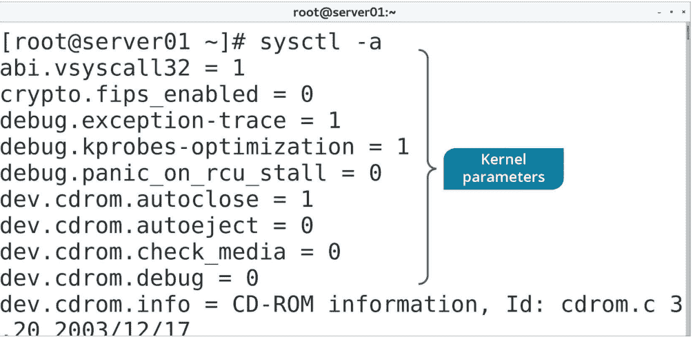

```
[root@server01 ~]# sysctl -a
abvi.syscall32 = 1
crypto.fips_enabled = 0
debug.exception-trace = 1
debug.kprobes-optimization = 1
debug.panic_on_rcu_stall = 0
dev.cdrom.autoclose = 1
dev.cdrom.autodetject = 0
dev.cdrom.check_media = 0
dev.cdrom.debug = 0
dev.cdrom.info = CD-ROM information, Id: cdrom.c 3
20_2003/12/17
```

显示内核参数。

### 语法

`sysctl` 命令的语法为 `sysctl [options]`

## /etc/sysctl.conf 文件

`/etc/sysctl.conf` 是一个包含持久应用于系统上加载的所有模块设置的配置文件。它用于配置模块及其依赖关系，并指定别名。

## 如何安装并配置模块

为了让 `probe` 能够正确安装依赖模块，它会读取 `modules.depfile` 以识别哪些模块是相互链接的。`depmod` 命令用于更新此依赖数据库，以便 `depmod` 能够正常工作。

`depmod` 为每个模块搜索 `/lib/modules/<kernel version>/` 下的内容。模块可以导出一个“符号”（symbol），表示它可以为其他模块提供服务。其他模块可以在自己的代码中调用这些导出的符号以利用其功能。因此，depmod 通过聚合所有正在导出和被使用的符号来构建 `modules.depfile`。

注意：`modules.depfile` 位于 `/usr/lib/modules/<kernel version>/` 目录。

## 关于符号的符号

符号提供了一种模块调用其他模块函数或编程对象的方法。例如，module1 有一个名为 `foo()` 的 C 函数，可以执行某些有用任务。另一个模块 module2 希望在与内核链接时使用 `foo()`，而不是将该程序包含在自己的代码中。只有当模块导出 `foo()` 供外部使用时，这才是可能的。这是通过在函数上使用 `EXPORT_SYMBOL()` 或其变体来实现的。然后 `foo()` 函数将变成一个符号，供内核中的任何其他模块利用。

## 内核模块配置

`/etc/modprobe.conf` 是一个配置文件，其中包含持久应用于系统上加载的所有模块的设置。它被用于配置模块及其依赖关系，并指定别名。别名是模块的替代名称。

在 Linux 发行版中，此文件已弃用。取而代之的是 `/etc/modprobe.d/` 目录，它包含各种 `.conf` 文件。除了创建别名外，这些文件可以在所选模块加载到内核时，运行 `modprobe` 带有特定选项的其他模块。这使得所选模块能够利用另一个模块的功能，而无需将其加载到内核中。当您的模块并不直接依赖于第二个模块，但安装该第二个模块后效果更好时，您可以这样做。

```
[root@server01 ~]# cat /etc/modprobe.d/btusb.conf
alias blue btusb
```

| 模块配置 | 配置文件 |
| :--- | :--- |
| 为特定内核模块配置的别名。 |

## 配置文件命令

`/etc/modprobe.d/` 目录中以 `.conf` 结尾的文件可以使用几个命令中的一种。

| 命令 | 用于 |
| :--- | :--- |
| alias [alternative name] [module name] | 为长名称模块指定替代名称。 |
| blacklist [module name] | 忽略内部别名，当模块定义自己的别名时会发生这种情况。 |
| install [module name] [command] | 在不将模块插入内核的情况下运行速度命令。 | 

## 内核参数

除了在运行时将模块加载到内核中，您还可以在内核运行时更改某些内核参数。您可以使用这些参数来提高系统性能、加固安全性、配置网络限制、更改虚拟内存设置等。

`/proc/sys/` 目录列出了您可以在系统上配置的参数。与包含内核模块的目录一样，此 `/proc/sys/` 目录分为若干类别，包括以下类别。

| 目录 | 索引相关的参数 |
| :--- | :--- |
| crypto | 加密和其他加密服务。 |
| debug | 调试内核， |
| dev | 特定硬件设备。 |
| fs | 文件系统数据。 |
| kernel | 杂项内核功能， |
| net | 网络功能。 |
| user | 空间限制。 |
| vm | 虚拟内存管理。 |

## sysctl 命令

`sysctl` 命令用于在运行时查看或设置内核参数。它有各种选项，定义在下表中。

| 选项 | 用于 |
| :--- | :--- |
| -a | 显示所有参数及其当前值。 |
| -w [parameter] = {value} | 设置参数值。 |
| -p[file name] | 从指定文件加载 sysctl，如果没有提供文件，则从 /etc/sysctl.conf 加载。 |
| -e | 忽略关于未知键的错误。 |
| -r [pattern] | 使用扩展正则表达式对匹配给定模式的参数应用命令。 |


```
[root@server01 ~]# sysctl -a
abvi.syscall32 = 1
crypto.fips_enabled = 0
debug.exception-trace = 1
debug.kprobes-optimization = 1
debug.panic_on_rcu_stall = 0
dev.cdrom.autoclose = 1
dev.cdrom.autodetject = 0
dev.cdrom.check_media = 0
dev.cdrom.debug = 0
dev.cdrom.info = CD-ROM information, Id: cdrom.c 3
20_2003/12/17
```

显示内核参数。

### 语法

`sysctl` 命令的语法为 `sysctl [options]`

## /etc/sysctl.conf 文件

`/etc/sysctl.conf` 是一个包含持久应用于系统上加载的所有模块设置的配置文件。它用于配置模块及其依赖关系，并指定别名。

## 如何安装并配置模块

为了让 `probe` 能够正确安装依赖模块，它会读取 `modules.depfile` 以识别哪些模块是相互链接的。`depmod` 命令用于更新此依赖数据库，以便 `depmod` 能够正常工作。

## 关于符号的符号

符号提供了一种模块调用其他模块函数或编程对象的方法。例如，module1 有一个名为 `foo()` 的 C 函数，可以执行某些有用任务。另一个模块 module2 希望在与内核链接时使用 `foo()`，而不是将该程序包含在自己的代码中。只有当模块导出 `foo()` 供外部使用时，这才是可能的。这是通过在函数上使用 `EXPORT_SYMBOL()` 或其变体来实现的。然后 `foo()` 函数将变成一个符号，供内核中的任何其他模块利用。

## 内核模块配置

`/etc/modprobe.conf` 是一个配置文件，其中包含持久应用于系统上加载的所有模块的设置。它被用于配置模块及其依赖关系，并指定别名。别名是模块的替代名称。

在 Linux 发行版中，此文件已弃用。取而代之的是 `/etc/modprobe.d/` 目录，它包含各种 `.conf` 文件。除了创建别名外，这些文件可以在所选模块加载到内核时，运行 `modprobe` 带有特定选项的其他模块。这使得所选模块能够利用另一个模块的功能，而无需将其加载到内核中。当您的模块并不直接依赖于第二个模块，但安装该第二个模块后效果更好时，您可以这样做。

```
[root@server01 ~]# cat /etc/modprobe.d/btusb.conf
alias blue btusb
```

| 模块配置 | 配置文件 |
| :--- | :--- |
| 为特定内核模块配置的别名。 |

## 配置文件命令

`/etc/modprobe.d/` 目录中以 `.conf` 结尾的文件可以使用几个命令中的一种。

| 命令 | 用于 |
| :--- | :--- |
| alias [alternative name] [module name] | 为长名称模块指定替代名称。 |
| blacklist [module name] | 忽略内部别名，当模块定义自己的别名时会发生这种情况。 |
| install [module name] [command] | 在不将模块插入内核的情况下运行速度命令。 | 

## 内核参数

除了在运行时将模块加载到内核中，您还可以在内核运行时更改某些内核参数。您可以使用这些参数来提高系统性能、加固安全性、配置网络限制、更改虚拟内存设置等。

`/proc/sys/` 目录列出了您可以在系统上配置的参数。与包含内核模块的目录一样，此 `/proc/sys/` 目录分为若干类别，包括以下类别。

| 目录 | 索引相关的参数 |
| :--- | :--- |
| crypto | 加密和其他加密服务。 |
| debug | 调试内核， |
| dev | 特定硬件设备。 |
| fs | 文件系统数据。 |
| kernel | 杂项内核功能， |
| net | 网络功能。 |
| user | 空间限制。 |
| vm | 虚拟内存管理。 |

## sysctl 命令

`sysctl` 命令用于在运行时查看或设置内核参数。它有各种选项，定义在下表中。

| 选项 | 用于 |
| :--- | :--- |
| -a | 显示所有参数及其当前值。 |
| -w [parameter] = {value} | 设置参数值。 |
| -p[file name] | 从指定文件加载 sysctl，如果没有提供文件，则从 /etc/sysctl.conf 加载。 |
| -e | 忽略关于未知键的错误。 |
| -r [pattern] | 使用扩展正则表达式对匹配给定模式的参数应用命令。 |


```
[root@server01 ~]# sysctl -a
abvi.syscall32 = 1
crypto.fips_enabled = 0
debug.exception-trace = 1
debug.kprobes-optimization = 1
debug.panic_on_rcu_stall = 0
dev.cdrom.autoclose = 1
dev.cdrom.autodetject = 0
dev.cdrom.check_media = 0
dev.cdrom.debug = 0
dev.cdrom.info = CD-ROM information, Id: cdrom.c 3
20_2003/12/17
```

显示内核参数。

### 语法

`sysctl` 命令的语法为 `sysctl [options]`

## /etc/sysctl.conf 文件

`/etc/sysctl.conf` 是一个包含持久应用于系统上加载的所有模块设置的配置文件。它用于配置模块及其依赖关系，并指定别名。

## 如何安装并配置模块

为了让 `probe` 能够正确安装依赖模块，它会读取 `modules.depfile` 以识别哪些模块是相互链接的。`depmod` 命令用于更新此依赖数据库，以便 `depmod` 能够正常工作。

## 关于符号的符号

符号提供了一种模块调用其他模块函数或编程对象的方法。例如，module1 有一个名为 `foo()` 的 C 函数，可以执行某些有用任务。另一个模块 module2 希望在与内核链接时使用 `foo()`，而不是将该程序包含在自己的代码中。只有当模块导出 `foo()` 供外部使用时，这才是可能的。这是通过在函数上使用 `EXPORT_SYMBOL()` 或其变体来实现的。然后 `foo()` 函数将变成一个符号，供内核中的任何其他模块利用。

## 内核模块配置

`/etc/modprobe.conf` 是一个配置文件，其中包含持久应用于系统上加载的所有模块的设置。它被用于配置模块及其依赖关系，并指定别名。别名是模块的替代名称。

在 Linux 发行版中，此文件已弃用。取而代之的是 `/etc/modprobe.d/` 目录，它包含各种 `.conf` 文件。除了创建别名外，这些文件可以在所选模块加载到内核时，运行 `modprobe` 带有特定选项的其他模块。这使得所选模块能够利用另一个模块的功能，而无需将其加载到内核中。当您的模块并不直接依赖于第二个模块，但安装该第二个模块后效果更好时，您可以这样做。

```
[root@server01 ~]# cat /etc/modprobe.d/btusb.conf
alias blue btusb
```

[/ 

`/proc/sys/` 目录列出了您可以在系统上配置的参数。与包含内核模块的目录一样，此 `/proc/sys/` 目录分为若干类别，包括以下类别。

| 目录 | 索引相关的参数 |
| :--- | :--- |
| crypto | 加密和其他加密服务。 |
| debug | 调试内核， |
| dev | 特定硬件设备。 |
| fs | 文件系统数据。 |
| kernel | 杂项内核功能， |
| net | 网络功能。 |
| user | 空间限制。 |
| vm | 虚拟内存管理。 |

## sysctl 命令

`sysctl` 命令用于在运行时查看或设置内核参数。它有各种选项，定义在下表中。

| 选项 | 用于 |
| :--- | :--- |
| -a | 显示所有参数及其当前值。 |
| -w [parameter] = {value} | 设置参数值。 |
| -p[file name] | 从指定文件加载 sysctl，如果没有提供文件，则从 /etc/sysctl.conf 加载。 |
| -e | 忽略关于未知键的错误。 |
| -r [pattern] | 使用扩展正则表达式对匹配给定模式的参数应用命令。 |


```
[root@server01 ~]# sysctl -a
abvi.syscall32 = 1
crypto.fips_enabled = 0
debug.exception-trace = 1
debug.kprobes-optimization = 1
debug.panic_on_rcu_stall = 0
dev.cdrom.autoclose = 1
dev.cdrom.autodetject = 0
dev.cdrom.check_media = 0
dev.cdrom.debug = 0
dev.cdrom.info = CD-ROM information, Id: cdrom.c 3
20_2003/12/17
```

显示内核参数。

### 语法

`sysctl` 命令的语法为 `sysctl [options]`

## /etc/sysctl.conf 文件

`/etc/sysctl.conf` 是一个包含持久应用于系统上加载的所有模块设置的配置文件。它用于配置模块及其依赖关系，并指定别名。

## 如何安装并配置模块

为了让 `probe` 能够正确安装依赖模块，它会读取 `modules.depfile` 以识别哪些模块是相互链接的。`depmod` 命令用于更新此依赖数据库，以便 `depmod` 能够正常工作。

## dmesg 命令

`dmesg` ("display message" 或 "driver message") 命令用于打印在启动和系统运行期间发送到内核消息缓冲区的消息。设备驱动程序向内核发送消息，指示模块的状态和驱动接口的参数。这些


驱动程序在遇到错误时，也可以向内核发送诊断消息。其他内核组件也可以向缓冲区发送消息。

## 驱动程序消息

root@server01:~

```
[root@server01 ~]# dmesg -H
[Jan 2 18:40] microcode: microcode updated early to revision
+[0.000000] Initializing cgroup for cpuset
+[0.000000] Initializing cgroup for cpu
+[0.000000] Initializing cgroup for cpuacct
+[0.000000] Linux version 3.10.0-862.el7.x86_64 (builder@[0.000000] Command line: BOOT IMAGE=/vmlinuz-3.10.0-862.
+[0.000000] e280: BIOS-provided physical RAM map:
+[0.000000] BIOS-e280: [mem 0x0000000000000000-0x00000000
+[0.000000] BIOS-e280: [mem 0x0000000000059800-0x00000000
+[0.000000] BIOS-e280: [mem 0x0000000000005000-0x00000000
+[0.000000] BIOS-e280: [mem 0x0000000000008c00-0x00000000
+[0.000000] BIOS-e280: [mem 0x0000000000010000-0x00000000]
```

显示驱动程序消息。

除了使用 `dmesg` 命令外，你还可以从 `/var/log/dmesg` 文件访问消息缓冲区。在任何情况下，你都可以利用 `dmesg` 来查找内核组件的潜在问题，或验证加载了哪些模块。

### 语法

`dmesg` 命令的语法为 `[options] dmesg COMMAND OPTIONS`
你在 `dmesg` 命令中可以使用各种选项。

## 选项用途

- -c 在打印内核内容后清除内核缓冲区。
- -f [facility list] 将输出限制为指定的逗号分隔的设施（facility）列表。设施是产生消息的组件，例如用户级消息。
- -l [level list] 将输出限制为指定的逗号分隔的级别（level）列表。级别定义了消息的性质和优先级，例如并非重要的通知（notice）消息。
- -en 显示每条消息时间的人类可读版本以及其时间增量（即后续消息之间的时间差）。
- -L 为消息进行颜色编码，以便于易读。
- -h 列出可用选项，以及可用的设施和级别。

## 如何监控内核模块

使用以下步骤监控内核模块。

## 获取内核版本信息

要获取内核版本信息：

- 输入 `cat /proc/version` 以获取有关当前加载内核的信息，包括其版本号和编译器。
- 输入 `uname -r` 以获取当前加载内核的版本号。

## 监控内核消息缓冲区

要监控内核消息缓冲区：

- 输入 `dmesg` 导出自启动以来内核产生的所有消息，包括指示内核模块状态的消息。
- 输入 `dmesg -H` 以人类友好的格式打印内核缓冲区。
- 输入 `dmesg -f` 打印所有可用的设施和日志级别。
- 输入 `dmesg -f [facility]` 仅打印匹配指定设施的消息。
- 输入 `dmesg -l [level]` 仅打印匹配指定级别的消息。
- 输入 `dmesg | grep [string]` 仅打印消息缓冲区中匹配给定字符串的行。
- 输入 `dmesg -c` 在打印内核缓冲区后将其清除。

## 练习 6-1 管理内核模块回顾场景

回答以下复习题。

1. 你预估自己将需要向内核中加载任何模块来满足你的需求吗？如果是，你可能需要加载哪些模块？
答案因而异。组织可能需要支持硬件设备，或需要与某些驱动程序兼容。

2. 你预估自己将需要在运行时配置任何内核参数吗？如果是，你可能会配置什么种参数？
答案因而异。为了提高性能，学生可能会考虑限制文件数量、启用或禁用网络等参数。学生可能还需要对 RAID 配置设置限制。

## 总结

在本节中，你探索了 Linux 内核的作用及其模块化特性。你还监控了内核。# 第 7 章 管理启动过程

时间：1 小时 30 分钟

### 引言

现在你已经了解了内核，可以学习启动过程以及操作系统是如何启动的。通过管理内核，你可以配置启动过程以满足你的需求。

### 目标

在本节中，你将：

- 识别启动过程的组件。
- 配置 GRUB。

### 已涵盖的主题

在本节中，你将熟悉：

1. 启动过程的概念。
2. 在环境中配置引导程序。

### 启动

启动（Booting）是启动或重启计算机的过程。在启动过程中，通过存储在只读存储器（ROM）中的程序来加载操作系统。此外，引导程序可以配置以启动过程。

### 引导程序

引导程序（Loader）是存储在 ROM 中的小型程序，用于加载操作系统。启动过程中，引导程序可以执行操作。此外，引导程序可以配置启动过程。

### 引导程序组件

引导程序使用三个主要组件来协同加载操作系统。

| 组件 | 描述 |
| :--- | :--- |
| 引导扇区 | 引导程序的第一个组件，大小为 512 字节。加载内核。 |
| 第二阶段引导程序 | 加载操作系统的引导程序。在启动时从驱动器加载。 |
| 引导程序安装程序 | 协调启动过程。 |

### BIOS

基本输入输出系统（BIOS）是一种硬件标准，存储在主板的 ROM 芯片上。带有 BIOS 的计算机启动时，固件是第一个运行的；它测试硬件组件并启动操作系统。BIOS 可以访问鼠标和键盘等基本设备的端口。用户还可以通过 BIOS 界面进行硬件更改。几十年来，BIOS 是行业的主流标准。


BIOS 接口。

### UEFI

统一可扩展固件接口（UEFI）是一种新的固件技术，由于其优势已很大取代了 BIOS。UEFI 运行速度更快，可以在更大的内存中运行，访问无法实现的存储驱动器，支持更多硬件类型，并改进了安全性。大多数现代主板以及我们使用的预装电脑都配备了 UEFI。

像 BIOS 一样，UEFI 提供了一个执行引导并最终启动操作系统的环境。

### 密码保护

BIOS 和 UEFI 都包含设置密码的安全功能。如果启动时不提供此密码，系统将无法启动。BIOS/UEFI 固件因制造商而异，设置密码的过程并不一致。然而，大多数固件会将此密码保护选项放在“安全”或“密码”部分。


命令（输入 m 获取帮助）：n
分区编号（7-128, 默认 7）：
起始扇区（34-976773134, 默认 2561474456）：
结束扇区, +sectors数 或 +size{K,M,G,T,P}(256147456-976773134, 默认 976773134）：+2G
已创建分区 7


命令（输入 m 获取帮助）：


在驱动器分区时使用扇区。

# MBR

主引导记录（MBR）是存储驱动器上的第一个物理扇区，也是一种分区结构。MBR 引导扇包含将操作系统加载到内存的引导加载程序。它还包含存储驱动器的分区表。MBR 决定了每个分区可以使用哪些扇区，以及哪些分区被认为是可启动的，哪些分区不可启动的。

多年来，MBR 是 Linux 和其他操作系统使用的主要分区结构。然而，它有三个主要缺点：

- MBR 分区驱动器的最大空间为两个字节（TB）。
- MBR 分区驱动器最多有四个主分区。
- 引导数据存储在一个扇区中，这增加了损坏的风险。

# GPT

GUID 分区表（GPT）是 MBR 的继者，弥补了后者的缺陷。与 MBR 一样，它是一种分区结构，但采用了更现代的设计，并且是 UEFI 标准的一部分。驱动器上的每个分区都分配有一个全局唯一标识符——GUID，以将其与（理论上）每个驱动器的每个其他分区区分开来。

存储空间和分区数量非常大，目前无法实现，任何限制都将由文件系统类型或操作系统内核产生，而不是 GPT 本身。GPT 的另一个优势是将其引导数据存储在驱动器上的多个位置以增强冗余。如果主副本损坏，GPT 可以利用其他副本之一来恢复引导数据。

尽可能，使用 GPT 分区驱动器比使用 MBR 好。

# 原始分区 (RAW PARTITION)

除了格式化为 MBR 或 GPT 之外，你还可以将分区格式化为原始（raw）。原始分区允许用户和应用程序直接从块存储设备读写数据，而不使用系统缓存。这在数据库管理系统（DBMS）等软件具有自己的缓存机制的情况下非常有用。DBMS 在原始分区中对 I/O 缓存具有更大的控制权，并可以跳过内核通常执行的缓存。

# initrd

初始内存磁盘（initrd）是指启动时临时加载到内存中的根文件系统。initrd 与内核一起加载，由内核控制其功能。initrd 使系统能够分阶段启动。在第一阶段，加载主或永久根文件系统所需的最小模块集。在第二阶段，当主根文件系统被挂载时，挂载的 initrd 文件系统被移除，用户空间启动继续。

initrd 是很有用的，因为有很多潜在变量可能会使启动过程复杂。例如，内核需要找到并加载必要的驱动程序模块，以及实际根文件系统本身。还有一种可能性是根文件系统使用几种高级存储方法之一，如 LVM 或 NFS，这些方法与标准分区有不同的要求。与其在内核中硬编码所有这些行为并延迟启动，initrd 的临时根文件系统可以处理这些情况。

# initrd 镜像

Linux initrd 镜像是一个存档文件，包含了启动操作系统所需的所有基本文件。它可以被构建或自定义，以包含额外的模块、删除不必要的模块或更新现有的模块。通常，它存储在 /boot 目录中。

# mkinitrd 命令

mkinitrd 命令用于创建准备内核模块的 initrd 镜像。

```
@server1~
*** Including modules ***
***Installing kernel module dependencies and firmware ***
*** kernel module dependencies and firmware done ***
***Resolving executable dependencies ***
***Hardlinking files ***
***Hardlinking files done ***
***Stripping files ***
***Stripping files done ***
***Generating early-microcode cpio image ***
***Constructing Genuine.bin ***
***Store line parameters ***
***Creating image ***
***Creating microcode section ***
***Created microcode section ***
***Creating image done ***
***Creating initramfs file '/boot/new-initrd.img' done ***
```

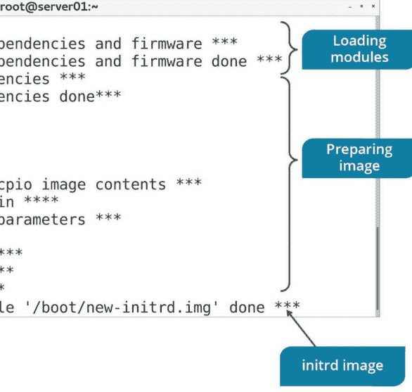

创建一个新的 initrd 镜像。以下是 mkinitrd 命令的各种选项。

| 选项 | 用途 |
| :--- | :--- |
| --load=[module] | 在加载其他模块之前在 initrd 镜像中加载模块。 |
| --with=[module name] | 在加载模块后在 initrd 镜像中加载模块。 |
| -f | 禁用 initrd 镜像的压缩。覆盖现有 initrd 文件。 |

mkinitrd 命令的语法为 `mkinitrd [options] [initrd image] [kernel version]`。以下示例创建了一个 initrd 镜像：

```bash
mkinitrd /boot/new-initrd.img $(uname -r)
```

# /boot/ 目录

文件系统标准（FHS）定义的 /boot/ 目录包含了用于启动的文件。以下表描述了 /boot/ 中的一些文件和目录：

| 文件或目录 |  |
| :--- | :--- |
| /boot/grub/ | 此目录包含用于引导加载器的文件。 |
| /boot/efi/ | 此目录包含 EFI 分区（ESP）。 |
| /boot/initramfs-*.img | 它是 initramfs 镜像，用于启动系统。 |
| /boot/vmlinuz | 它是内核的解压缩版本。 |
| /boot/initrd-$(uname -r).img | 这是 initrd 镜像，如果系统实现了任何虚拟设备（如 LVM 或软件 RAID），则会初始化环境。 |

# DRACUT 命令

dracut 命令用于生成 initrd 镜像。在某些发行版中，dracut 是一个包装器。以下是生成 initrd 镜像的示例：

# 启动过程

启动过程每次从存储设备启动系统时重复。它涉及到 BIOS/UEFI 初始化、引导加载器、内核和 initrd/initramfs。以下是使用 initrd 镜像的启动过程：

### BIOS/UEFI / MBR/GPT

启动过程涉及的组件概述：

1. 处理器检查 BIOS/UEFI 固件并执行它。这是电源自检（POST）发生的地方。
2. BIOS/UEFI 检查内部存储设备或 USB 优盘和 DVD-ROM 等外围设备的启动设备。
3. BIOS/UEFI 从 MBR/GPT 分区加载主引导加载器到内存。它同时也加载分区。
4. GRUB 提示用户选择要启动的操作系统。如果用户没有响应，将启动默认操作系统。
5. 引导加载器确定内核并定位内核二进制。它将相应的 initrd 镜像上传到内存，并将启动过程的控制权交给内核。
6. 内核配置可用硬件驱动程序、I/O 子系统和存储设备。它解压 initrd 镜像并挂载到必要的驱动程序。如果系统实现了任何虚拟设备（如 LVM 或软件 RAID），则会初始化环境。
7. 内核挂载根分区并释放内存。为了设置用户环境，运行 systemd 进程。它成为进程 ID 1。
8. 系统搜索 default.target 文件，包含要启动的服务详情。它根据 /etc/fstab 文件挂载文件系统并开始启动服务。在大多数系统中，目标将是多用户或图形界面。
9. 如果选择了图形模式，则启动显示管理器（如 XDM 或 KDM），并在屏幕上显示登录窗口。
10. 用户输入用户名和密码登录系统。
11. 系统验证用户身份。如果用户有效，则执行配置文件。
12. 启动 shell，系统已准备好供用户使用。

# 内核崩溃 (KERNEL PANIC)

内核崩溃（panic）是系统检测到致命错误并对其做出的机制。致命错误通常会导致系统不稳定或完全无法使用。处理崩溃的软件向用户显示错误消息，并将内核内存的当前转储到存储设备中进行调试。根据系统的配置，崩溃处理程序将自动重启系统，或等待用户手动操作。


在 Linux 中，内核恐（kernel panic）可能由于多种原因在运行过程的任何阶段发生，它通常在启动过程中遇到。常见原因包括：

- 内核本身损坏或配置不当。
- 系统程序在启动期间未执行，导致系统无法使用。
- 内核无法找到或挂载主根文件系统。
- 启动时加载了出现故障或不兼容的硬件。

注意：Microsoft Windows 中等同于内核恐的是众所周知的“蓝屏”（BSoD）。

# 如何创建 initrd 镜像

使用以下步骤创建 initrd 镜像。

# 创建 initrd 镜像

要创建 initrd 镜像：

+ 1. 获取超级用户权限。
2. 输入 `mkinitrd -v --with=[module name] /boot/filename -r` 创建包含所需模块的镜像，输出到指定的文件。
3. 输入 `-ls /boot` 并验证镜像已创建。

# 主题 B

配置 GRUB 2

# 涵盖的考试目标

1.1 解释 Linux 启动过程概念。

现在你已经熟悉了引导程序在启动过程中的作用和角色，你可以配置你的主 Linux 引导程序：GRUB 2。

# GNU GRUB

GNU 阶段引导程序（GNU GRUB）是由 GNU 项目开发的一种引导程序，在类 Unix 系统中非常流行。它允许用户在多平台环境中选择启动哪个操作系统或内核。虽然 GRUB 的原始版本是 Linux 发行版的主要引导程序，但它有几个局限性并最终被新版本的 GRUB 取代。原始版本通常被称为 GRUB legacy。

# GRUB 2 改进

GRUB 2 不仅仅是 GRUB 的新版本；它是对 GRUB 系统的完全重新设计和重写。GRUB 2 为管理员提供了对启动过程、启动设备的更多控制，此外还包含多项改进：

- 支持非 x86 架构平台。
- 支持现场启动（从存储介质启动并在完全在内存中运行操作系统，无需安装）。
- 支持分区 UUID。
- 支持动态加载扩展 GRUB 功能的模块。
-能够通过脚本配置引导程序。
- 救援模式（Rescue mode），尝试修复损坏或缺失配置等问题。
- 支持自定义图形化启动菜单和主题。

由于这些改进，GRUB 2 成为几乎所有现代 Linux 发行版的默认引导程序。

# GRUB 2 安装

`grub2-install` 命令用于在存储设备上安装 GRUB 2 引导程序。它将 GRUB 2 文件复制到 `/boot/grub2/` 目录，并在某些平台上将 GRUB 2 安装到引导扇。然而，`grub2-install` 适用于 BIOS 系统而非 UEFI。要在 UEFI 系统上安装 GRUB 2，请使用包管理器安装 `grub2-efi` 包。安装此包会将 GRUB 2 文件复制到 `/boot/efi` 目录下的 EFI 分区 (ESP)。

### 语法

```
grub2-install COMMAND OPTIONS
```
以下是你可以配合 `grub2-install` 使用的一些选项：

| 选项 | 用途 |
| :--- | :--- |
| `--modules [module names]` | 使用 GRUB 2 引导程序预加载指定的内核模块。 |
| `--install-modules [module names]` | 只安装指定的模块及其依赖项，而不是默认安装所有可用模块。 |
| `--directory [directory name]` | 从指定的目录安装文件，而不是默认目录。 |
| `--target [target platform]` | 指定要安装 GRUB 2 的目标平台，而不是当前运行的平台。 |
| `--boot-directory [directory name]` | 指定安装 GRUB 2 文件的启动目录，而不是默认的 /boot。 |
| `--force` | 无论检测到什么问题都安装 GRUB 2。 |

# grub.cfg 文件

`grub.cfg` 是 GRUB 2 引导程序的主配置文件。在 BIOS 系统上，它位于 `/boot/grub2/`。在 UEFI 系统上，它位于 `/boot/efi/<distro>/` 目录。例如，在 CentOS 7 上，路径是：
/boot/efi/EFI/centos/grub

```bash
 # 不要编辑此文件
 # 由 grub2-mkconfig 使用 /etc/grub.d 的模板和 /etc/default/grub 的设置自动生成
### /etc/grub.d/00_header ###
set pager=1

if [ -s $prefix/grubenv ]; then
  load_env
fi
if [ -n "${next_entry}" ]; then
  set default="${next_entry}"
  set next_entry=
  save next_entry
```


`grub.cfg` 文件是一个可执行脚本。不要直接编辑它，因为它是由文件系统其他地方存储的特定脚本生成的。注意：在 RHEL/CentOS 7 上，`/etc/grub.cfg` 是指向 `grub.cfg` 的符号链接。这维护了旧路径，位于 `/etc/grubcfg`。

# /etc/grub.d/ 目录

`/etc/grub.d/` 目录包含构建 `grub.cfg` 文件的脚本。每个脚本为 GRUB 2 提供了各种功能并编号以便顺序执行。通常不要编辑此目录中的现有脚本；如果你想添加自定义脚本，可以将其放在此目录并默认执行。

# GRUB 2 启动菜单自定义

`/etc/grub.d/40_custom` 文件允许对呈现给用户的菜单进行自定义。GRUB 2 将为用户提供许多已安装的操作系统的选择。这对于多启动场景（多个操作系统）、启动不同的内核或进入救援模式非常有用。可以通过编辑 `/etc/grub.d/40_custom` 文件来自自定义菜单内容，允许管理员指定菜单顺序、提供友好的名称以及密码保护项。

```bash
#!/bin/sh
exec tail -n +30
# 此文件提供了添加自定义菜单项的方法。只需在此注释后输入你想添加的菜单项。不要更改上面的 'exec tail' 行。
set superusers=(student01)
password student01
```


使用密码保护 GRUB 2 启动菜单。

# GRUB 2 密码生成

可以使用 `mkpasswd-crypt` 命令生成密码哈值来保护启动菜单。

# /etc/default/grub 文件

`/etc/default/grub` 文件包含了由 `/etc/grub.d/` 脚本读取并构建到 `grub.cfg` 文件中的显示设置。它允许更改选项，例如 GRUB 2 在自动选择启动选项之前等待多少秒；GRUB 2 是否对内核版本进行排序；或者 GRUB 2 是否在图形终端中显示菜单等。


```bash
[root@server01 ~]# cat /etc/default/grub
GRUB TIMEOUT=5
GRUB DISTRIBUTOR="$(sed 's, release *.*,,' /etc/system-release)"
GRUB DEFAULT=saved
GRUB SUBMENU=true
GRUB TERMINAL_OUTPUT="console"
GRUB CMDLINE_LINUX="crashkernel=auto rd.lvm.lv=centos rd.lvm.lv=centos/swap rhgb quiet"
GRUB RECOVERY="true"
[root@server01 ~]#
```

# grub2-mkconfig 命令

`grub2-mkconfig` 命令生成新的 `grub.cfg` 配置文件，用于更新现有的 `grub.cfg` 文件。`grub2-mkconfig` 命令 `/etc/grub.d/` 目录中的配置文件模板与 `/etc/default/grub` 中的设置相结合以生成 `grub.cfg` 配置文件。

```bash
vim /etc/grub.d/40_custom
```


编辑 GRUB 2 配置文件的过程。
注意：在某些发行版中，该命令简单为 `grub-mkconfig`。

# BIOS/UEFI


- 更改忘记的 root 密码
- 从默认目标更改

从启动菜单配置 GRUB 2 的过程。

语法
`grub2-mkconfig` 命令的语法为 `grub2-mkconfig -o [file name]`


3. 修改文件以包含你的更改。
4. 保存并关闭文件。

使用密码保护 GRUB 2 引导程序
要用密码保护 GRUB 2 引导程序：

- 1. 假设超级用户权限。
2. 输入 `grub2-mkpasswd-pbkdf2` 开始创建密码的加密哈希值。
3. 输入所需的密码并确认。
4. 复制从 `grub.pbkdf2` 开始一直到输出末尾的文本。

注意：考虑将此值重定向到文件，以便更容易编辑你选择的文本。
5. 使用你喜欢的文本编辑器打开 `/etc/grub/40_custom` 文件。

- 6. 在新行上输入 `users="user"`，其中 `<user>` 是你希望能够登录 GRUB 2 的用户账户。
7. 在下方的新行上输入 `password_pbkdf2 <user>` 并在用户名后添加一个空格。
8. 粘贴你之前复制的文本。
9. 保存并关闭文件。

对 GRUB 2 应用配置更改
要对 GRUB 2 应用配置更改：

- 1. 假设超级用户权限。
2. 输入 `grub2-mkconfig -o /boot/efi/EFI/<distro>/`
3. 确认没有返回错误。

```bash
grub.cfg
```

# 编辑 GRUB 2 引导程序

要编辑 GRUB 2 引导程序：

- 1. 启动或重启系统。
2. 在 GRUB 2 引导菜单上，按 Esc 停止自动启动计时器。3. 选择一个项目并按 E。
4. 如必要，输入用户名和密码。
5. 按需编辑配置。
6. 按 Esc 返回到引导菜单。
7. 选择所需的安装并按 Enter 进入。

# 活动 7-1

Linux 进程管理回顾
场景
回答以下问题。
在你的 Linux 环境中？

- 1. 你在 Linux 环境中使用或计划使用哪些启动选项？

答案因人而异。从 ISO 镜像启动是一种常见做法，通常在管理员对机器有物理访问权限时采用。学生可能具有从 USB 驱动器或 DVD-ROM 启动的经验，将它们插入机器并在 BIOS/UEFI 中设置启动选项。然而，某些人可能会指出使用 PXE 等网络选项的优势，特别是多台机器能够通过局域网 (LAN) 轻松获取启动文件的能力。

# 2. 你预计你的环境中需要配置 GRUB 2 吗？为什么或为什么不需要？

答案会有不同。学生可能希望在某些环境中保留默认启动配置，因为这些配置通常足够了。然而，某些学生可能希望在双引导或多引导环境中工作，其中安装了一个操作系统或 Linux 内核版本。在这种情况下，他们将希望配置 GRUB 2 来识别这些引导环境，并允许用户在启动时选择他们想要的某一个。某些学生可能对开发自定义脚本并添加到 GRUB 2 中，或更改某些模块的顺序感兴趣。

## 总结

在本节中，你识别了对 Linux 启动过程至关重要的各种组件，并将 GRUB 2 引导程序配置为所需的设置。通过这样做，你可以对 Linux 如何启动以及用户如何利用启动选项获得更大的控制。

第 7 节：管理 Linux 启动过程

# 第 8 节

管理系统组件

# 课程时间：3 小时

## 课程介绍

到目前，你学习了 Linux 运行的基础几项元素。这将帮助你让系统运行起来。然而，你还没有完成；某些特定的组件和特征你可以进行微调以满足你的需求。在本节中，你将从管理有助于整体系统环境的组件开始

## 课程目标

在本节中，你将：

- 配置本地化选项，如字符集和环境变量。
- 配置图形用户界面 (GUI)。
- 管理服务。
- 排除进程问题。
- 通过分析 CPU 和内存来排除系统性能问题。

# 主题 A

配置本地化选项

# 涵盖的考试目标

1.6 给定场景，配置本地化选项。

在用户能够习惯在 Linux 环境工作之前，他们可能需要系统针对其特定的区域、文化或偏好进行本地化。在这个主题中，你将为需要的用户配置本地化选项。

# 本地化

在操作系统世界中，本地化是将系统组件适配到最初设计文化之外的其他文化的过程。在实际意义上，这通常意味着将界面组件翻译成特定语言；将测量转换为特定地区使用的系统；配置用户使用的键盘布局；设置特定地点的日期和时间属性等；

# /usr/share/zoneinfo/ 目录

/usr/share/zoneinfo/ 目录是你可以配置系统使用的所有区域时区的容器。该容器中的子目录通常按区域组织时区；例如，非洲子目录包含特定国家的时间文件。

本地化系统对于向全球范围人员和客户提供 Linux 服务的组织非常重要。日本的管理员如果该服务器被本地化为使用日语而不是英语，那么在 Linux 服务器上工作时可能会更加自如。使用本地时间和兼容的键盘还将增强国际用户的体验。


- 本地时间反映了系统区域（locale）的当前时间（即时区）。
- 通用时间反映了不受本地时区影响的时间。它使用国际标准协调世界时（UTC），这与格林尼治标准时间（GMT）相同。
- 硬件时钟。如名所示，此时钟在硬件层面运行，即使在计算机关机时也能计时。操作系统（OS）会从此硬件时钟读取当前时间。任何操作系统都可以调整硬件时钟，但通常将其设置为 UTC 是一个好主意。硬件时钟也被实时时钟（RTC）。

## 设置硬件时钟

使用 `datetimectl` 可以将硬件时钟设置为本地时间。然而，不建议这样做，因为 RTC 不会自动更新。它只通过其他已安装的操作系统等外部设施进行更新。多个操作系统可能会为了夏令时（DST）调整 RTC，导致导致过度校正。

## hwclock 命令

`hwclock` 命令允许你查看和设置硬件时钟。如前所述，强烈建议保持硬件时钟与 UTC 对齐，以防止其他操作系统进行过度校正。

你还可以使用 `hwclock` 命令来调整系统漂移。系统漂移是硬件时钟每天增加或减少的可预测时间，这导致它不准确并偏离系统时钟。`/etc/adjtime` 文件记录了硬件时钟改变的时间以及改变了多少。`hwclock` 随后可以咨询此文件识别漂移值，并利用该值校正时钟时间。

### 语法

`hwclock` 命令的语法为 `hwclock [options]`。
以下是配合 `hwclock` 命令使用的一些选项。

| 选项 | 用途 |
| :--- | :--- |
| `--w` | 将硬件时钟设置为指定的日期和时间。 |
| `--u` | 将硬件时钟设置为 UTC。 |
| `--s` | 从硬件时钟设置系统时间。 |
| `--adjust` | 在硬件时钟上加减时间以补偿系统漂移。 |

## localctl 命令

`localctl` 命令用于查看和配置系统区域和键盘布局设置。系统的区域设置（locale）决定了它如何表示各种特定文化的元素，其中最显著的是界面使用的语言。区域设置还可以决定等因素，例如日期和时间的格式、货币值的格式等。键盘布局可以与区域设置独立配置，并决定操作系统解释哪个物理按键。。由于有许多不同物理布局的键盘，因此系统需要配置正确的布局，否则可能会输入错误的字符。

类似于 `datetimectl`，`localctl` 命令也提供了各种子命令来管理系统区域和键盘布局。

- `status`
- `local-locale`
- `list-locales`
- `set-keymap`
- `list-maps`

- 显示当前的区域和键盘布局。这与直接执行 `localctl` 相同。
- 将系统区域设置为提供的区域。
- 列出系统上所有可用的区域。
- 将键盘布局设置为提供的布局。列出系统上所有可用的键盘布局。

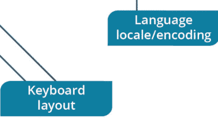

显示区域设置。

### 语法

`localctl` 命令的语法为 `localctl [options] [subcommand]`。

## localctl 命令选项

下表列出了 `localctl` 命令的一些选项。

| 选项 | 用途 |
| :--- | :--- |
| `-H [remote host]` | 在指定的远程 IP 地址或主机上执行操作。 |
| `--no-ask-password` | 在执行特权任务时不提示用户输入密码。 |
| `--pager` | 防止输出管道到分页器中。 |
| `--no-convert` | 防止控制台应用键盘映射的更改，反之亦然。 |

## 字符集与编码

字符编码是将文本转换为字节的过程，而解码是将字节转换为文本的过程。这两个概念都是重要的，因为文本对于人类来说更容易进行交互，而计算机处理的是字节数据。因此，需要一个处理这两个实体以提供相同接口信息的中间过程。

在许多系统中，默认编码是使用 Unicode 字符集的 UTF-8。例如，大写字母 C 关联 U+0043。字符编码是将文本转换为字节的过程，而解码是将字节转换为文本的过程。这两个概念都是重要的，因为文本对于人类来说更容易进行交互，而计算机处理的是字节数据。因此，需要一个处理这两个实体以提供相同接口信息的中间过程。

在许多系统中，默认编码是使用 Unicode 字符集的 UTF-8。例如，大写字母 C 关联 U+0043。字符编码是将文本转换为字节的过程，而解码是将字节转换为文本的过程。这两个概念都是重要的，因为文本对于人类来说更容易进行交互，而计算机处理的是字节数据。因此，需要一个处理这两个实体以提供相同接口信息的中间过程。

在许多系统中，默认编码是使用 Unicode 字符集的 UTF-8。例如，大写字母 C 关联 U+0043。字符编码是将文本转换为字节的过程，而解码是将字节转换为文本的过程。这两个概念都是重要的，因为文本对于人类来说更容易进行交互，而计算机处理的是字节数据。因此，需要一个处理这两个实体以提供相同接口信息的中间过程。

在许多系统中，默认编码是使用 Unicode 字符集的 UTF-8。例如，大写字母 C 关联 U+0043。字符编码是将文本转换为字节的过程，而解码是将字节转换为文本的过程。这两个概念都是重要的，因为文本对于人类来说更容易进行交互，而计算机处理的是字节数据。因此，需要一个处理这两个实体以提供相同接口信息的中间过程。

在许多系统中，默认编码是使用 Unicode 字符集的 UTF-8。例如，大写字母 C 关联 U+0043。字符编码是将文本转换为字节的过程，而解码是将字节转换为文本的过程。这两个概念都是重要的，因为文本对于人类来说更容易进行交互，而计算机处理的是字节数据。因此，需要一个处理这两个实体以提供相同接口信息的中间过程。

在许多系统中，默认编码是使用 Unicode 字符集的 UTF-8。例如，大写字母 C 关联 U+0043。字符编码是将文本转换为字节的过程，而解码是将字节转换为文本的过程。这两个概念都是重要的，因为文本对于人类来说更容易进行交互，而计算机处理的是字节数据。因此，需要一个处理这两个实体以提供相同接口信息的中间过程。

## 字符集与编码

字符编码是将文本转换为字节的过程，而解码是将字节转换为文本的过程。这两个概念都是重要的，因为文本对于人类来说更容易进行交互，而计算机处理的是字节数据。因此，需要一个处理这两个实体以提供相同接口信息的中间过程。

在许多系统中，默认编码是使用 Unicode 字符集的 UTF-8。例如，大写字母 C 关联 U+0043。字符编码是将文本转换为字节的过程，而解码是将字节转换为文本的过程。这两个概念都是重要的，因为文本对于人类来说更容易进行交互，而计算机处理的是字节数据。因此，需要一个处理这两个实体以提供相同接口信息的中间过程。

在许多系统中，默认编码是使用 Unicode 字符集的 UTF-8。例如，大写字母 C 关联 U+0043。字符编码是将文本转换为字节的过程，而解码是将字节转换为文本的过程。这两个概念都是重要的，因为文本对于人类来说更容易进行交互，而计算机处理的是字节数据。因此，需要一个处理这两个实体以提供相同接口信息的中间过程。

## 如何配置本地化选项

使用以下步骤配置本地化

## 获取时间信息

获取时间：

- * `date` 显示系统区域和时间。
- * `timedatectl` 显示系统区域和时间。
- * `timedatectl list-timezone` 列出可用时区。

## 在系统中设置时区

在系统上设置时区：

- 1. 假设特权权限。
- 2. 执行 `timedatectl set-timezone [time zone]` 设置时区。

## 设置硬件时钟

设置硬件时钟：

- 1. 假设特权权限。
- 2. 执行 `hwclock --w` 将硬件时钟设置为指定的日期和时间。
- 3. 执行 `hwclock --u` 将硬件时钟设置为 UTC。
- 4. 执行 `hwclock --adjust` 调整硬件时钟以补偿漂移。

## 获取区域信息

获取区域：

- * `localctl` 显示当前区域和键盘布局。
- * `localctl list-locales` 列出系统上所有可用的区域。
- * `localctl list-maps` 列出系统上所有可用的键盘布局。

## 在系统中设置区域

在系统上设置区域：

- 1. 假设特权权限。
- 2. 执行 `localctl set-locale LANG=<locale>'` 设置区域。

## 在系统中配置键盘布局

在系统上配置键盘布局：

- 1. 假设特权权限。
- 2. 执行 `localctl set-keymap [keymap]` 设置键盘布局。

## B 主题

配置 GUI

## 考试范围

2.8 比较 Linux 图形界面。

CLI 不是 Linux 能够提供的唯一界面。在某些情况下，用户希望使用图形用户界面（GUI）来获得更好的视觉体验。因此，在本主题中，你将配置多个 GUI 以提高效率并访问非视觉 CLI 中可用的功能。

## 显示服务器

显示服务器是 GUI 的组件，它负责构建和管理窗口系统以及可以在屏幕上绘制的其它视觉元素。显示服务器接受客户端输入请求并


将它们发送到相应的内核模块进行处理。同样，它们还管理从应用程序接收事件并将输出显示到客户端的过程。

顾如其名，显示服务器通过特定的网络协议管理通信。这使得远程客户端能够访问 Linux 系统的 GUI 元素，例如特定的窗口。然而，服务器仍然可以为本地客户端提供服务。

Linux 支持多种显示服务器。其中最著名的两个是实现在 X Window System 和 Wayland。

## X窗口系统 (X WINDOW SYSTEM)

X Window System 也称为 X11 或 X，是一个由马萨诸塞理工学院（MIT）于 1984 年开发的与平台无关显示服务器和窗口系统。

与所有显示服务器一样，该服务器负责协调输入和应用程序输出，以确定如何在屏幕上绘制元素。服务器还与一个独立的合成器（compositor）进行通信。合成器读取每个应用程序写入的内存缓冲区，然后使用该缓冲区中的信息将屏幕上的每个单独应用程序窗口组合在一起，以便多个窗口可以同时出现。每当 X 服务器接收到事件时（例如，按钮被点击且现在必须高亮），它必须通知合成器，以便其重新合成受事件影响的屏幕区域。

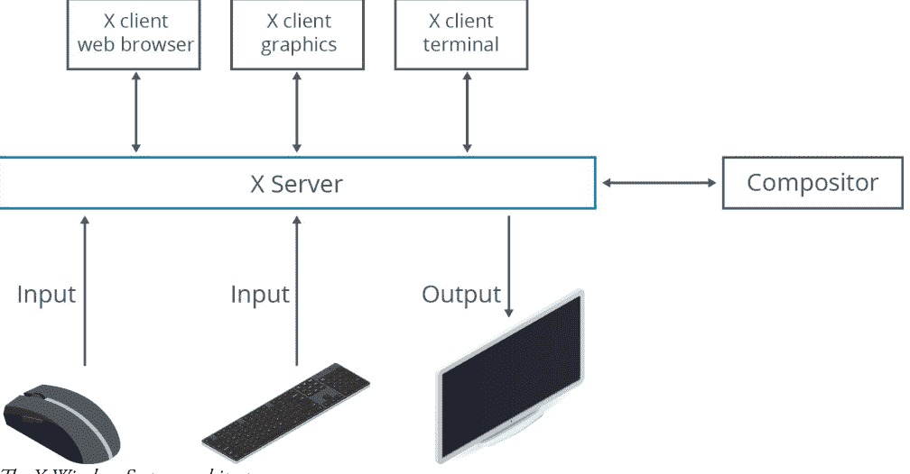

X 窗口系统架构。

## X.ORG 服务器

X.Org Server 是适用于 Linux 和其他 Unix 类操作系统的 X Window System 的免费开源参考实现。它于 2004 年发布，迅速成为许多 Linux 发行版的事实显示服务器。在 X.Org Server 之前，Linux 中 X 的主要实现是 XFree86，但它后来更改了自由软件社区认为与 GPL 不兼容的自定义许可。因此，XFree86 被分叉（forked）成了 X.Org Server。

## WAYLAND

Wayland 既是一种显示服务器，也是其 Unix 类操作系统中的参考实现，旨在改进并取代 X Window System。Wayland 和 X 之间的主要区别在于，在 Wayland 中，合成器就是服务器，而不是独立的组件。这使得客户端能够直接与合成器交换事件，省去了 X 服务器这一中间人。

Wayland 最初于 2008 年发布，尽管 X.Org Server 在 Linux 发行版中仍然占据主导地位，但 Wayland 的采用率正在缓慢增加。例如，Fedora 从 2016 年 11 月发布的 25 版本开始使用 Wayland 作为默认显示服务器。

| Wayland 客户端 浏览器 | Wayland 客户端图形界面 | Wayland 客户端终端 |
| --- | --- | --- |

Wayland 合成器


## X VS WAYLAND

Wayland 比 X 提供了多项改进，包括：

- 在 X 中，X 服务器必须确定事件适用于哪个窗口。它总是能正确地做到这一点，因为独立的合成器通过缩放和旋转等操作控制窗口的重绘方式——而这些信息 X 服务器 并不一定理解。由于在 Wayland 中合成器和服务器是合一的，因此这不是一个问题。
- 在 X 中，合成器必须从服务器获取事件数据，这可能会导致延迟。在 Wayland 中，合成器直接从服务器接收事件，缓解了延迟问题。
- Wayland 通过允许合成器执行自己的渲染，简化了图形渲染过程。
- 尽管 Wayland 不像 X 那样感知网络，但它仍然可以利用远程桌面协议通过网络控制 GUI 环境。
- 较旧的 Wayland 实现没有隔离每个窗口的数据 I/O，而 Wayland 可以做到。这确保了数据的安全性。

## WAYLAND 的缺点

尽管 Wayland 在几乎所有方面都改进了 X，但 Wayland 仍然存在一些问题。例如，在 2017 年 4 月，Canonical 宣布在使用 Wayland 作为默认显示服务器，尽管 X.Org Server 仍然在 Linux 发行版中占据主导地位。在 2018 年 10 月，由于某些软件在 X.Org Server 下运行得更好，主要原因有三点：
- 桌面共享软件在 X.Org Server 下运行更好。
- 桌面环境软件在 X.Org Server 下运行更好。
- 桌面环境在 X.Org Server 下更容易从崩溃。

## 桌面环境 (DESKTOP ENVIRONMENT)

桌面环境（也称为窗口管理器）是显示服务器，用于在屏幕上绘制元素。桌面环境还提供登录界面，并可以根据需要进行自定义。桌面环境还带有各种应用程序，如文件浏览器、文本编辑器和更多。桌面环境在系统启动时也会运行。桌面环境以桌面隐喻（desktop metaphor）的形式，在桌面上存在按钮、图标、工具栏等元素。

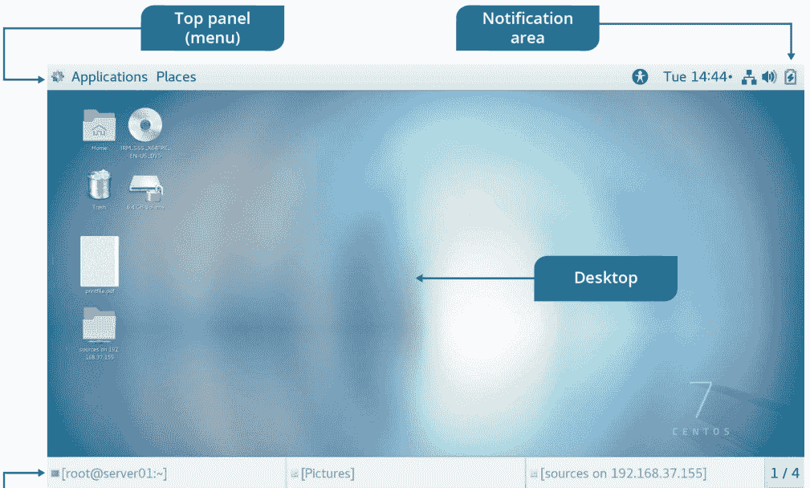GNOME 桌面环境。

桌面环境还提供图形界面，并可以在桌面隐系统启动时运行。

注意：某些桌面环境可以运行在 X 或 Wayland。

## 特定的桌面环境 (SPECIFIC DESKTOP ENVMENTS)

Linux 有许多桌面环境，其中最常见的如表所示。

| 桌面环境 | 描述 |
| --- | --- |
| GNOME | 这是大多数 Linux 发行版的默认桌面环境。它可以运行在 X 和 Wayland。GNOME 遵循称为用户界面指南 (HIG) 的设计原则，强调清晰性、简单性，限制用户需要的工作。GNOME 还为残障人士提供了大量的支持。<br> GNOME Shell 是桌面环境使用的实际用户界面，它定义了工具栏、菜单等元素的布局。从 3 版本开始，GNOME 从典型的桌面隐喻变为更抽象的隐喻，用户可以在概览界面切换虚拟桌面和任务。<br> 还有 GNOME Classic，它在安装了 3 版本的情况下提供 GNOME 2 的用户界面。Canonical 还开发了 Unity，但在 2018 年切换到了 GNOME 3。Unity 最初的设计是为了更好地利用小屏幕（如笔记本电脑）的空间。例如，位于屏幕左侧的应用程序启动器始终存在——只需点击即可启动应用程序。 |
| KDE Plasma | 虽然没有 KDE 流行，但 Plasma 是第二常见的桌面环境，包含在 RHEL 和 CentOS 等发行版中，即使不是默认设置。截至2018 年，当前版本是 KDE Plasma 5。<br> KDE 通过插件支持模块化，允许用户添加、移动和删除元素以适应自己的工作流。KDE Plasma 还拥有一套强大的应用程序，包括文字处理器、邮件客户端、多媒体等。它支持 X 和 Wayland。 |
| Cinnamon | Cinnamon 是 Linux Mint 的默认环境。它是为了响应 GNOME 3 的变化而开发的，使用的是桌面隐喻而非抽象隐喻。因此它与 GNOME 2 相似。然而，截至2018 年，Cinnamon 不支持 Wayland。 |
| MATE | MATE 是 GNOME 的另一个分支，是为了响应 GNOME 3 的变化而创建的。它的目的是维护和扩展 GNOME 2 的功能。它的许多应用程序分叉自 GNOME Core Applications。MATE 是 Linux Mint 的另一个默认环境，也是其他发行版中的可选选项。和 Cinnamon 一样，它目前不支持 Wayland。 |


客户端计算机通常在本地客户端上接收输入（在它自己的窗口中，且当窗口具有焦点时，例如按下按键），这些输入会被翻译并发送到远程桌面，就好像该按键是直接在该系统上执行的一样。

## 远程桌面软件

Linux 提供了许多软件包来启用远程桌面会话。软件通常有两种形式：一种是安装在你物理所在的计算机上的客户端应用程序，另一种是安装在你尝试连接的远程系统上的配套服务器应用程序。

| 远程桌面软件 | 描述 |
| :--- | :--- |
| 虚拟网络计算 (VNC) | xrdp |

VNC 是一种跨平台的远程桌面服务，能够对桌面环境进行远程控制。VNC 利用远程帧缓冲区 (RFB) 协议。必须在目标机器上安装 VNC 服务端，它可以配合相应的客户端在 Linux 上运行。Linux 上有许多不同的 VNC 实现，包括 RealVNC、TightVNC、TigerVNC 等。VNC 可以与 X11 和 Wayland 配合使用；xrdp 是一个免费开源的实用程序，为 Windows 系统提供类似于远程桌面协议 (RDP) 的服务器。RDP 由微软开发，是 Windows 上的默认远程桌面软件。因此，你可以在远程服务器上安装 xrdp，并使用 xrdp 或默认 RDP 客户端等工具连接它——换句话说，客户端可以是任何平台。xrdp 实用程序设计用于与 X 配合。

### NoMachine (NX)

### 独立计算环境简单协议 (SPICE)

NX 是一种跨平台的专有远程桌面软件，支持多会话环境和账户管理。因此，它对于许多需要同时访问同一台服务器的用户组织非常有用。NX 设计用于与 X 配合。

SPICE 是一种专门为虚拟化环境设计的免费开源协议。管理员经常使用 SPICE 连接到由内核级虚拟机 (KVM) 虚拟机程序托管的虚拟机。

Microsoft Windows 工作站

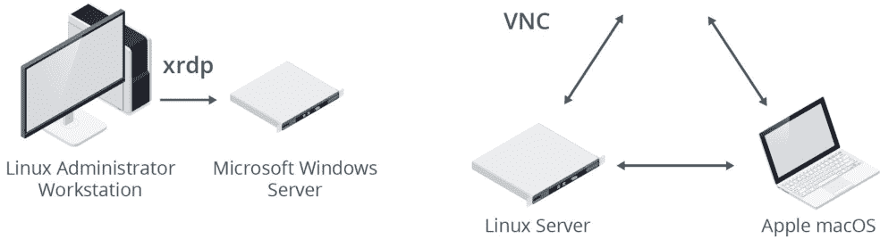

VNC 和 xrdp。

## 控制台重定向

控制台重定向是通过串行连接转发输入和输出的过程，而不是直接连接到系统的 I/O 外设。这使得带有控制台重定向的系统能够通过串行线发送输出数据，最终到达远程客户端。同样，远程客户端可以将其键盘输入通过串行连接重定向，以便发送到远程服务器。

最终，控制台重定向允许管理员在 BIOS/UEFI 等预启动环境中远程配置系统。如果没有像 Linux 这样的操作系统，SSH 和远程桌面等典型的远程访问方法将无法使用。使用控制台重定向，管理员可以通过网络更改多台机器的 BIOS/UEFI 设置，即使这些机器没有直接连接 I/O 设备。

注意：并非所有系统都支持在 BIOS/UEFI 中控制台重定向。

## SSH 端口转发

安全外壳 (SSH) 是一种对网络传输进行加密的远程访问协议。它是访问 Linux 服务器命令行界面最常用的协议。你可以使用 SSH 向服务器下发命令，就好像你直接在自己的 CLI 中打字一样。它可以安全地携带其他类型的网络通信，包括远程桌面流量。

通过 SSH 对应用程序进行隧道处理以确保传输安全的过程被称为 SSH 端口转发。主要有两种类型：本地转发和远程转发。在本地转发中，客户端在端口上监听连接，然后使用 SSH 将任何活动连接隧道到远程服务器。本地转发的一种情况是通过使用 VNC 等协议通过互联网远程访问系统。当你使用本地 VNC 客户端连接到 VNC 服务器时，流量（通常通过 5900 等端口）将通过 SSH 转发，从而确保其安全。

在远程转发中，SSH 服务器将入站的客户端流量转发到不同端口上的另一个系统。远程转发的一种情况是在本地系统上设置 VNC 服务器，并将所有 VNC 流量转发到远程客户端。每当远程客户端使用 localhost（他们自己的网络地址）连接到此端口时，就可以与本地服务器建立远程桌面连接。

## X 转发

如你所知，X (X11) 是感知网络的，可以允许客户端通过网络访问 GUI 元素。你可以通过 SSH 隧道转发 X 流量以加密这些通信。

## 辅助功能选项

每个桌面环境都有自己的适应残障人士的辅助功能选项。

### 设置

### 通用访问

| Wi-Fi | 始终显示通用访问菜单 | 关闭 |
| :--- | :--- | :--- |
| 蓝牙 | 视觉 | 关闭 |
| 背景 | 高对比度 | |
| 通知 | 大字体 | 开启 |
| 搜索 | 光标大小 | 默认 |
| 区域与语言 | 缩放 | 关闭 |
| 通用访问 | 屏幕阅读器 | 关闭 |
| 在线账户 | 声音键 | 关闭 |
| 隐私 | 听力 | |
| 分享 | 视觉警报 | 关闭 |
| 声音 | | |


在 GNOME 的通用访问菜单中配置辅助功能选项。

注意：在一个环境中可用的辅助功能选项在另一个环境中可能不存在。

一些常用选项包括：

- 一个读取所有高亮屏幕元素的屏幕阅读器。
- 一个可以放大屏幕特定区域的放大镜。
- 增大文本和鼠标指针等特定元素的大小。
- 一个用于辅助功能（在 GNOME 通用访问菜单中配置）。
- 某些常用选项包括：
    - 屏幕阅读器可以读取所有高亮屏幕元素。
    - 放大镜可以放大屏幕特定区域。
    - 增大文本和鼠标指针等特定元素的大小。
    - 辅助功能（在 GNOME 通用访问菜单中配置）。


注意：VNC 服务器可能在使用 5901 以外的端口。

- 6. 在本地系统上，在 VNC 查看器应用程序中，连接到 localhost:6800。7. 输入密码并验证连接已建立。

# 通过 SSH 端口端口建立 VNC 隧道

若要使用远程端口转发通过 SSH 建立 VNC 隧道：

1. 登录到桌面环境。
2. 假设用户权限。
3. 如必要，在本地系统上安装并配置如 TigerVNC 或 RealVNC 等 VNC 服务器。
4. 在远程系统上，打开终端，安装 VNC 查看器应用程序。
5. 在本地系统上，打开终端，执行 `ssh -R localhost:5901 <user>@remote address`。
6. 在本地系统上，在 VNC 查看器应用程序中，连接到 localhost:6800。7. 输入密码并验证连接已建立。

注意：VNC 服务器可能在使用 5901 以外的端口。

## 涵盖的考试目标
- 2.1 在给定场景的情况下，管理服务。
- 2.4 在给定场景的情况下，分析系统属性并进行相应的修复。
- 4.1 在给定场景的情况下，启动和停止服务以控制可用功能。

## 服务与守护进程 (Daemon)
Linux 服务是响应其他程序请求以提供某种功能的软件。服务可以大致分为关键服务和非关键服务。关键服务是维持系统运行的核心服务。非关键服务是由安装程序启动的。大多数服务以守护进程（daemon）的形式实现，守护进程是在后台运行且无需人工干预的运行程序（即进程）。守护进程处于休眠状态，直到有事件触发它们。大多数守护进程可以由操作系统、应用程序或用户手动启动。“服务”和“守护进程”这两个术通常互换使用。例如，在 Windows 中，服务等同于 Linux 守护进程。

## 服务管理
服务管理是启动服务、修改其运行状态以及停止服务的生命周期。系统可以自己管理服务，用户也可以根据需要手动管理。服务管理在 Linux 等操作系统中非常重要，因为它允许管理员配置服务器提供的功能。它还可以帮助诊断和排排除由运行程序引起的问题。

## 系统初始化
系统初始化是内核首次加载时开始的过程。它涉及操作系统及其各种组件的加载，包括引导过程。Linux 中的系统初始化由 init 运行——它是“所有进程的父进程”。init 指向一个配置文件并启动其中列出的进程。它为系统运行所需的软件做好准备。init 会持续运行，直到系统关机，而系统上的程序在没有它的情况下将运行。

在 Linux 上，初始化系统有两种主要方法：SysVinit 和 systemd。你 Linux 系统上激活的方法将影响你管理该系统上服务的方式。注意：此处的“init 守护进程”通常指执行系统初始化的守护进程，而不是特定的 SysVinit（名为 init 的程序）。较旧版本的 Ubuntu 也有一种名为 Upstart 的初始化方法。

## 系统套件 (The System Suite)
systemd 套件提供了一种用于初始化系统的 init 方法。它还提供了用于管理系统中派生自 init 服务的工具。systemd 套件被设计用于替代 SysVinit 等其他方法，现在是现代 Linux 发行版中主导的 init 方法。systemd 套件相比旧方法提供了多项改进。例如，它支持并行化（同时启动程序以加快启动速度）并减少了开销。在 systemd 中，使用控制组（cgroups）来跟踪进程而不是进程 ID（PID），这为进程提供了更好的隔离和分类。

## systemd 单元文件 (Unit Files)
单元文件是 systemd 用来确定如何处理单元的配置文件，单元是 systemd 可以管理的系统资源。资源可以包括网络服务、块存储设备、外围文件等。守护进程访问并管理这些资源。资源定义在几类单元文件中的一种，这使其更容易管理。单元文件的扩展名定义了它的类别；例如，.automount 文件包含了自动挂载在 .mount 文件中定义的挂载点的指令。单元文件使用声明式语言编写，并使用指令告诉 systemd 应该做什么。

### root@server01:~
```
[root@server01:~] # cat /lib/systemd/system/graphical.target
# 此文件是 systemd 的一部分。
# systemd 是自由软件；你可以根据自由软件基金所发布的
# GNU 通用许可许可证条款对其进行分发和/或修改
# 可能是该许可证的 2.1 版本，或
# （根据你的选择）任何更高版本。
```

```
[Unit]
Description=Graphical Interface
Documentation=man:systemd.spec(7)
Requires=multi-user.target
Wants=display-manager.service
Conflicts=rescue.service rescue.target
After=multi-user.target rescue.service rescue.target display-manager.service
```


graphical.target

gdm.service

单元文件依赖

目标文件如何与其他组件交互的示例。

## 环境变量 (Environment Variables)
单元文件也可以用于设置环境变量，环境变量是系统提供的值。通过添加指令设置：

```
[Service]
Environment=/root
```

环境变量因此设置为 root 用户。

## systemd 目标 (Targets)
在 systemd 中，目标是一组配置文件的方法，通常表示特定的运行模式。每个目标文件用于进入特定的环境。例如，graphical.target 进入图形界面。目标文件包含依赖信息。

### 符号链接
graphical.target

gdm.service

单元文件

## systemctl 命令
systemctl 命令允许你控制 systemd 守护进程。你可以查看服务、管理（启用/禁用）启动时的的服务、管理系统目标。

```
[root@server01 ~# systemctl status sshd
sshd.service - OpenSSH server daemon
Loaded: loaded (/usr/lib/systemd/sshd.service; enabled; vendor preset: enabled)
Active: active (running) since Wed 2019-01-02 18:41:11 GMT; 5 days ago
Docs: man:sshd(8)
     man:sshd_config(5)
Main PID: 1334 (sshd)
Tasks: 1
     CGGroup: /system.slice/sshd.service
        └1334 /usr/sbin/sshd -D
```

Jan 02 18:41:11 server01 systemd[1]: Starting OpenSSH service.

检查服务的状态。

你可以通过 systemctl 命令的各种子命令执行所有操作，详如下表。

| 子命令 | 用途 |
| :--- | :--- |
| status [service] | 获取服务的状态。 |
| enable [service] | 启用服务使其在启动不再启动。 |
| disable [service] | 立即禁用服务（取消激活）。 |
| start [service] | 启动服务。 |
| stop [service] | 立即停止服务。 |
| restart [service] | 立即重启服务。 |
| set-default [target] | 设置系统启动时使用的默认目标。 |
| isolate [target] | 切换到指定的目标。 |


mask [unit file]
daemon-reload

### 语法
systemctl 命令的语法为 systemctl [options] [subcommand] [arguments]

强制系统立即切换到指定的 target（target）。
防止指定的单元文件被启用或激活，即使手动操作也是如此。
重载 systemd 进程，包括所有单元文件。

# systemctl 命令选项
systemctl 命令有许多选项，其中一些在下表中描述。

| 选项 | 用途 |
| :--- | :--- |
| -t [unit file] | 指定要执行操作的单元文件类型。 |
| -a, --reload | 列出所有单元文件或属性，无论状态如何。在启用或禁用服务时防止重载配置更改。 |
| --no-ask-password | 防止用户在执行特权操作时被要求身份验证。 |
| --runtime | 使更改变为临时的，因此它们在重启后不会存在。 |
| -H [remote host] | 在指定的 IP 地址或主机名的远程主机上执行操作。 |
| --no-pager | 防止输出被重定向到分页器。 |

# 切换目标的示例

使用 systemctl 命令更改目标的一个示例是管理员需要短时间在 GUI 中工作。配置 Linux 服务器默认启动到 CLI (multi-user.target) 是很常见的。管理员可能会为了特定任务切换到 GUI (graphical.target)，然后在任务完成后切换回 multi-user.target。管理员随后在任务结束后将服务器保留在更高效的 CLI 配置中。

该过程可以分为以下步骤：

- 1. 服务器默认启动到 multi-user.target。
- 2. 管理员登录到 CLI 并输入以下命令启动 GUI：`systemctl isolate graphical.target`
- 3. 管理员完成其管理任务。
- 4. 管理员输入以下命令将服务器恢复到更高效的 CLI 配置：`systemctl isolate multi-user.target`

# hostnamectl 命令

在大多数情况下，systemctl 用于控制服务，但你也可以使用一些额外的 systemctl 命令。

hostnamectl 查看系统的网络主机名以及关于系统硬件和其运行的 Linux 内核的其他信息。你也可以使用此命令更改系统的主机名。

hostname 命令的语法为 hostname [options] [subcommand] [arguments]
例如，将主机名设置为 server01：
`hostname set-hostname server01`

# SysInit 与运行级别

SysVInit 是一种旧的 init 方法，很大程度上已被 systemd 代替。然而，某些发行版仍然支持 SysVInit。与 systemd 类似，SysVInit 提供了各种工具来管理服务和系统状态。

除了 sysvinit 的改进外，它与 systemd 的一个主要区别是 SysVInit 有运行级别（runlevels）。运行级别控制操作系统状态的方式与 systemd target 相同；它们决定了运行什么类型的守护进程以创建特定类型的环境。事实上，systemd target 的创建是为了映射到现有的运行级别。通过 systemd target，你可以更改系统的运行级别并设置默认值。

# 运行级别对比 target

下表了了VInit 运行级别与其对应的 systemd target。

| SysInit 运行级别 | systemd Target | 描述 |
| :--- | :--- | :--- |
| 0 | power.target | 停止（关机）系统。 |
| 1 | rescue.target | 启动单用户模式。 |
| 2 | multi-user.target | 加载没有远程网络的多用户模式。加载命令行界面 (CLI)。 |
| 3 | multi-user.target | 加载带有远程网络的多用户模式。加载 CLI。 |
| 4 | multi-user.target | 未使用。 |
| 5 | graphical.target | 启动具有网络功能和 GUI 能力的多用户模式。加载桌面环境。 |
| 6 | reboot.target | 重启系统。 |

# 单用户模式

单用户模式将操作系统引导到用户必须登录的环境中。单用户模式下网络也被禁用，且大多数分区未挂载。它通常用于排排除网络问题或阻止你进入正常多用户环境的问题。在某些系统上（特别是使用原始 GRUB 引导加载程序的系统），可以在单用户模式下重置 root 密码防忘记。然而，对于 GRUB 2，你必须在启动菜单处编辑引导加载器配置才能重置 root 密码。

# init 命令

init 命令的语法为 init [options] [subcommand] [arguments]

init 命令是通过 systeminit 脚本控制 SysVinit 另一种方式。以下是子命令：

- status: 打印服务的当前状态。
- start: 立即启动（激活）服务。
- stop: 立即停止（取消激活）服务。
- restart: 立即重启服务。
- reload: 在服务保持运行的同时重新重新服务的配置文件。

service 命令的语法为 service [options] [service] [subcommand]


# 切换到 SysVunit 运行级别

要切换到 SysVunit 运行级别：
1. 假设超级用户权限。
2. 输入 `telinit [runlevel]` 立即切换到某个运行级别：

   - 0 关闭系统。
   - 1 启动单用户模式。
   - 3 加载带有远程访问的 CLI 环境。
   - 5 加载带有远程网络的 GUI 环境。
   - 6 重启系统。

3. 使用文本编辑器打开 /etc/inittab，并编辑 `id:<runlevel>-initdefault:` 设置系统自动启动进入的运行级别。

# 主题 D

## 故障排除进程问题

## 涵盖的考试目标

- 2.4 在给定场景下，管理服务。
- 2.6 在给定场景下，自动化并调度作业。
- 4.2 在给定场景下，分析系统进程以优化性能。

在系统运行期间，可能会遇到各种降低性能或导致系统无法使用的问题。在许多情况下，这些问题会影响服务、守护进程和运行软件的实例。因此，在本主题中，你将从管理运行中的软件转向故障排除由软件引起或影响该软件的问题。

# 常见进程问题

有很多可能影响或由进程（软件的运行实例）引起的问题。这些问题可能包括：

- 进程挂起，导致进程不稳定。
- 进程挂起，消耗了本应分配给其他进程的资源。
- 进程挂起，导致系统整体运行缓慢且不稳定。
- 进程在执行预定任务之前已终止。
- 进程在不再需要时未能终止。
- 本应给某个进程分配大部分 CPU 资源，但被其他进程占据了。
- 进程导致系统启动时间过长。
- 进程打开了一个文件，阻止你修改该文件。
- 进程派了多个难以追踪的子进程。
- 进程无法识别或可能具有恶意性。

# 进程状态

进程从创建到最终终止会经历一个生命周期。在这个生命周期中，进程可以处于五种不同的状态，每种状态定义了系统或其他应用程序如何与其交互。了解进程的状态可以帮助你决定如何处理该进程，或帮助你诊断与该进程有关的问题。

这五种状态是：

- 运行（Running）——进程当前正在用户空间或内核空间中执行。在此状态下，进程可以执行分配的任务。
- 可中断睡眠（Interruptible sleep）——进程放弃对 CPU 的访问，并等待调度器重新激活。进程通常在请求当前不可用的资源时进入此状态。“可中断”意味着如果调度器为它找到了时间片，该进程将唤醒。
- 不中断睡眠（Uninterruptible sleep）——在此睡眠状态下，进程只有在它等待的资源可用时才会唤醒。否则，它将保持睡眠状态。这种状态常见于执行存储或网络 I/O 的进程。
- 僵尸（Zombie）——此状态表示进程已终止，但尚未被其父进程释放。它处于一种“类僵尸”状态，无法接受 kill 信号，因为该进程已不可用。
- 停止（Stopped）——此状态表示进程被调试器停止或通过 kill 信号停止。

# 进程 ID (PID)

每个进程启动时时分配一个唯一的进程 ID (PID)，以便系统和用户识别该进程。该 PID 是非负整数，会随着每个新启动的进程而增加。init 守护进程的 PID 始终为 1，因为它是第一个启动的进程，也是系统中所有其他进程的父进程。之后启动的进程（无论是系统还是用户）将被分配更高的数字。

```
root@server1~
PID CMD
1 systemd
2 kthread
3 ksoftirqd/0
5 kworker/0:0H
7 migration/0
8 rcu_bh
9 rcu_sched
10 ...
```

进程 ID：

在进行故障排除时，你需要知道进程的 PID，以便终止它、更改其优先级并对其执行其他管理任务。

# pgrep 命令

pgrep 命令显示匹配任何给定模式的进程的 PID，类似于使用 grep 匹配文本文件中的模式。模式可以包括：调用它的用户名称或用户 ID (UID)；启动时间；父进程 PID 等。

```bash
[root@server01 ~]# pgrep sshd 1334
```
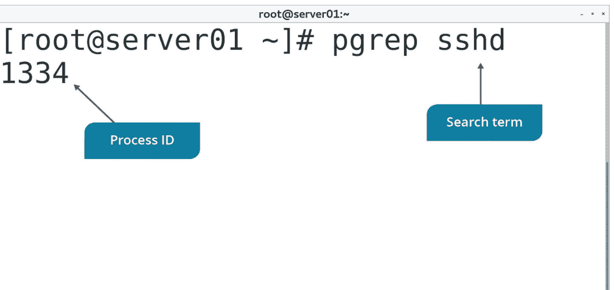

查找特定进程的 PID。

你可以使用 pgrep 在不知道确切 PID 的情况下根据多个因素帮助识别进程。识别 PID 通常是管理进程的第一步。

### 语法

pgrep 命令的语法为 `pgrep [options] [pattern]`

# ps 命令

ps 命令调用进程表，这是一份总结了系统上当前运行进程的记录。当不带任何选项运行命令时，它会显示由当前 shell 运行的进程，详细信息包括 PID、与进程关联的终端、累积的 CPU 时间以及启动进程的命令。然而，可以使用命令可以使用不同的选项来过滤显示的字段。

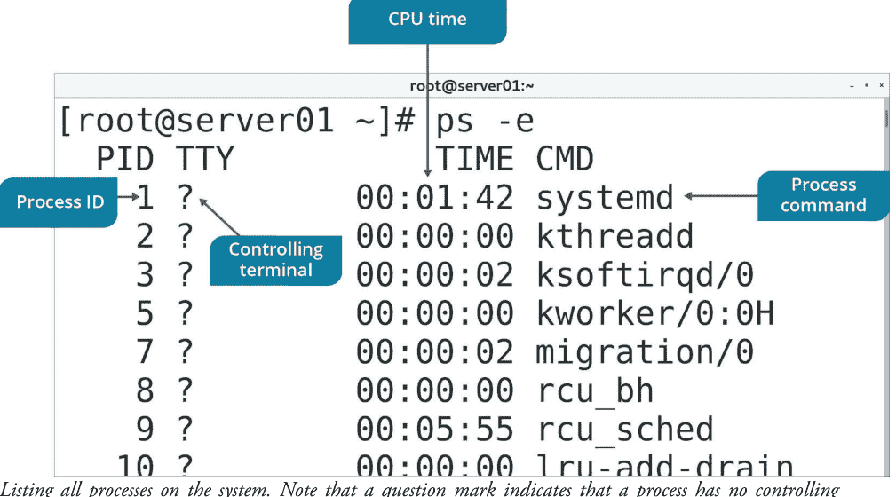

```bash
[root@server01 ~]# ps -e
PID TTY CMD
1 ? 00:01:42 systemd
2 ? 00:00:00 kthread
5 ? 00:00:00 kworker/0:0H
7 ? 00:00:02 migration/0
8 ? 00:00:00 rcu_bh
9 ? 00:00:55 rcu_sched
10 ? 00:00:00 ...
```
列出系统上的进程。注意，问号表示进程没有控制终端。

### 语法

ps 命令的语法为 `ps [options]`

# 命令选项

ps 支持多个选项。这里列出了其中较为主要的选项：

- -a 列出所有进程。
- -f 使用长格式列出所有进程。
- 样式 (STYLE)

ps 支持三种不同的命令语法样式：Unix 风格（以连字符 `-` 开头）、GNU 风格（以双连字符 `--` 开头）和 BSD 风格。混合这些样式不会产生相同的结果。例如，BSD 风格的 ps 命令将列出带有终端的进程，但不包括状态。

- -U 根据用户列出所有进程。
- -p 只显示指定 PID 的进程。
- -C 根据名称列出所有进程。
- --tty 显示指定终端上的进程。

# top 命令

top 命令类似于 ps，它列出了所有运行的进程。它作为一个交互式工具，允许你优先排序或终止进程，并显示动态状态的变化。

```
root@server1:~
top 15:39 up 5 days, 20 users, load average: 0.08, 0.07, 0.1
%Cpu(s): 4.0 us, 4.5 sy, 0.0 ni, 91.4 id, 0.0 wa, 0.0 hi, 0.0 si
KiB Mem: 7915376 total, 399296 free, 115844 used, 276483 buff/cache
KiB Swap: 126460 total, 126460 free, 0 used, 60224 avail
PID USER VIRT SHR S %CPU %MEM TIME
8884 polkit 650036 19012 5432 S 6.6 0.2 16:59
882 db 071224 4700 1932 S 2.0 0.1 06:45
1921 root 035532 9912 5112 R 1.3 1.1 00:00
3504 root 194068 7168 4196 S 1.0 0.4 01:46
2751 system 061428 6952 5188 S 0.3 0.1 42:20
896 root 0 836 628 S 0.3 0.1 01:52
```

# 按进程系统详情

列出运行进程列表。

在此工具中使用不同的按键可以执行各种进程管理操作。一些常用的按键包括：

# 按键

- Enter 刷新所有进程的状态。
- Shift+N 按 PID 降序排序。
- M 按内存使用率排序。
- P 按 CPU 使用率排序。
- u 根据提示显示属于指定用户的进程。
- k 终止指定 PID 的进程。
- r 重命名指定 PID 的进程。
- q 退出进程列表。

### 语法

top 命令的语法为 [options]

# system-analyze 命令

system-analyze 命令用于检索启动操作的性能统计。该命令接受一个或多个子命令，以确定打印的信息类型和方式。对于进程管理和故障排除，blame 是最相关的命令。它将打印启动时执行的所有系统单元列表，以及每个单元执行的时间。你可以使用 system-analyze blame 识别导致启动缓慢的服务和其他单元。


```
[root@server01 ~]# systemd-analyze blame
→ 6.643s systemd-udev-settle.service
2.658s kdump.service
1.852s dev-mapper-centos@x2droot.device
1.768s NetworkManager-wait-online.service
1.572s lvm2-pvscan@4:service
1.491s lvm2-monitor.service
1.359s lvm2-pvscan@8:service
1.194s postfix.service
1.175s lvm2-pvscan@8:service
1.156s tuned.service
1.064s vdo.service
697ms NetworkManager.service
```

分析服务在启动时执行所花费的时间。

### 语法

systemd-analyze 命令的语法为 `systemd-analyze [options] [subcommand]`

## lsof 命令

lsof 命令列出所有活动进程当前打开的文件文件列表。这可以包括从文本文件到设备文件的任何内容——即系统可以解析为文件的任何对象。如果文件在另一个进程中打开，你可能会被阻止修改它。通过使用 lsof，你可以识别冲突进程并将其终止。你也可以使用 lsof 分析进程如何使用文件，这对于识别恶意进程或具有意外副作用的进程很有帮助。

lsof 命令每行打印一个进程打开的每个文件。它打印的信息如：

- 命令/进程的名称。
- PID。
- 调用用户。
- 文件描述符 (FD)，包括打开文件时的权限。
- 文件类型。
- 文件名。

## root@server01:~

```
[root@server01 ~]# lsof -d ~
lsof: WARNING: can't stat(stat) fuse.gvfsd-file system /run/user/1000/gvfs
输出信息可能不完整。
COMMAND PID USER FD TYPE SIZE/OFF NODE NAME
lsof 10481 root cwd DIR 253,0 4096 1006633993 /root
lsof 10482 root cwd DIR 253,0 4096 1006633393 /root
bash 10529 root cwd DIR 253,0 4096 1006633393 /root
```


列出所有打开了主目录的进程。

### 语法

lsof 命令的语法为 `lsof [options]`

## 优先级

操作系统使用调度器来决定哪些进程获得 CPU 时间。调度器实际上负责分配 CPU 时间，但并非每个决策都是最优的。在某些情况下，你可能需要告诉 CPU 优先处理某些进程而非其他进程。一个进程的快速完成比另一个更关键——另一个不那么重要；你可能希望降低非特权用户启动的进程优先级；某个进程可能消耗了过多资源导致系统卡顿；等。

进程根据 -20 到 19 的数字进行排序，该数字称为 nice 值或 niceness 值。值越低，优先级越高。nice 值为 -18 的进程比 nice 值为 15 的进程更有可能获得 CPU 时间。进程从父进程继承 nice 值，默认情况下该值为 0。

## nice 命令

nice 命令允许以不同于默认 nice 值运行命令。-n 选项按整数增加 nice 值；如果你不提供整数，命令将假设增量为 10。在不带任何选项运行 nice，你将看到默认的 nice 值。你必须拥有 root 权限才能以更高的优先级运行命令。一旦降低，普通用户无法增加任何进程的优先级，即使他们是该进程的所有者。

### 语法

renice 命令的语法为 `renice [-n [nice value increment]] [command]`

## renice 命令

nice 用于启动新进程，而 renice 命令允许你更改已运行进程的调度调度优先级。你使用 -n 选项来指定你希望进程拥有的 nice 值。
当你使用 -g 选项运行进程组时，会导致进程组中的进程的 nice 值发生改变。当你使用 -u 选项运行进程时，它会更改该用户拥的所有进程的 nice 值。默认情况下，受影响的进程通过其 PID 指定。

### 语法
renice 命令的语法为 `renice [-n nice value] [options] [identifier]`

## 前台和后台进程

在 Bash 中，大多数命令将在前台执行。其效果是命令提示符会被“占用”，直到命令完成。对于简单的命令（如 date 命令），这并不是问题。但对于较长的命令或脚本，这可能会是一个问题。例如，如果你执行一个知道需要 45 分钟才能完成的备份脚本，在脚本完成之前，你都可以在该 shell 中输入命令。

## 前台和后台进程

在 Bash 中，大多数命令将在前台执行。其效果是命令提示符会被“占用”，直到命令完成。对于简单的命令（如 date 命令），这并不是问题。对于较长的命令或脚本，这可能会是一个问题。例如，如果你执行一个知道需要 45 分钟才能完成的备份脚本，在脚本完成之前，你都可以在该 shell 中输入命令。

## 前台和后台的管理

以下是某些如何如何：
1. 首先，你执行脚本。
2. 接下来，你使用命令。
3. 例如，你可能希望优雅地终止一个进程。

## 命令总结

下表总结了每个命令的用途。

| 命令 | 用途 |
| :--- | :--- |
| fg | 将作业调回前台。 |
| bg | 将作业推到后台。 |
| Ctrl+Z | 暂停作业 |

## nohup 命令

nohup 命令防止进程在用户注销时结束。例如，如果你启动一个脚本，即使注销后脚本也会继续。

### 语法
nohup 命令的语法为 `nohup [command]`

## 杀死命令

不同的命令用于向它们发送信号以终止它们。

## kill

向一个或多个进程发送指定的信号或默认终止信号。必须作为参数指定进程 ID (PID)。

该命令的语法为 `kill [options] [PID]`

## pkill

根据匹配项将指定的信号或默认终止信号发送给进程。类似于 pgrep 命令，但它是发送信号而不是打印到 stdout。

该命令的语法为 `pkill [options] [pattern]`

## killall

向匹配名称的所有进程发送指定的信号或默认终止信号。与 pkill 有些功能上的区别，例如精确匹配进程名称。

## 信号

有许多杀死进程的方法，每种方法映射到一个信号。该信号决定如何杀死进程。在某些情况下，某些信号比其他更合适。例如，你可能希望优雅地终止进程，留出时间清理最后的活动。然而，某些进程会忽略此信号或无法在合理时间内终止。对于这种情况，你可能必须发出更信号。

有许多不同的杀死信号。每个信号都有一个名称和一个或多个对应的值；你可以使用 kill 命令使用每个。下表描述了一些最常见的信号。

| 信号 | 值(s) |
| :--- | :--- |
| SIGINT | 2 |
| SIGKILL | 9 |
| SIGTERM | 15 |
| SIGSTOP | 18, 20, 24 |

## 示例 以下是实现杀死信号的一些示例。要优雅地终止 ID 为 921 的进程：

kill 1521
如果失败，立即杀死该进程：
kill 9 921


或者，与其完全删除不如将其暂停：
kill -17 921

# 用途

从终端中断进程，使其能够优雅退出。该信号可以被捕获或忽略。这与在终端中按下 Ctrl+C 相同；但进程可能会更改此快捷键行为。

立即杀死进程。该信号无法被捕获或忽略。这通常被用作最后手段。

终止进程，使其能够优雅退出。该信号可以被捕获或忽略。这通常由 `kill` 或另一个程序发送，而不是终端。

暂停进程，无法被捕获或忽略。这通常由 `kill` 或另一个程序发送，而不是终端。

从终端暂停进程。该信号可以被捕获或忽略。这与在终端中按下 Ctrl+Z 相同；但进程可能会更改此快捷键行为。

# 进程问题排排除指南

在排排除进程问题时，请使用以下指南。

# 排排除进程问题

在排排除进程问题时：

- 收集进程信息，包括其进程 ID (PID) 和状态。
- 使用 `ps` 打印所有运行进程的信息，包括 CPU 使用率。例如，消耗超过 50% CPU 的进程可能会导致性能问题，值得进一步调查。
- 使用 `top` 获取运行进程的动态交互列表。
- 使用 `systemd-analyze blame` 确定哪些启动进程慢了启动操作。
- 使用 `lsof` 识别哪些进程打开了文件。
- 使用 `nice` 将某些进程的优先级高于其他进程。
- 使用 `fg` 和 `bg` 管理前台和后台进程。
- 使用 `nohup` 在注销后保持命令运行。
- 使用 `kill` 及其相关命令终止问题进程。

# 主题 E

排排除 CPU 和内存问题

# 涵盖的考试目标

4.1 给定场景，分析系统属性并进行相应的修复。

系统需要访问硬件资源——特别是处理器和内存——以提供功能。影响这些资源的问题会对系统造成重大干扰。在本主题中，你将使用各种 Linux 命令来识别并解决与 CPU 和 RAM 相关的问题。

# 常见 CPU 问题

有很多影响 CPU 或由 CPU引起的问题。这些问题可能包括：

- CPU 性能未达到预期的速度和响应水平。
- CPU 因过多过多而过载，无法及时响应。
- 一个或多个 CPU 核心无法工作且/或表现性能下降。
- 进程无法获取 CPU 时间来有效运行。
- 进程消耗了太多 CPU 时间，导致其他进程没有资源。
- CPU 花费了太多时间而不是进行处理。
- CPU 不支持虚拟化或超线程等功能。

# /proc/cpuinfo 文件

`/proc/cpuinfo` 文件包含有关系统处理器的信息。你可以使用这些信息来识别 CPU 的特性，这些特性可能会导致性能问题或对某些功能的支持。

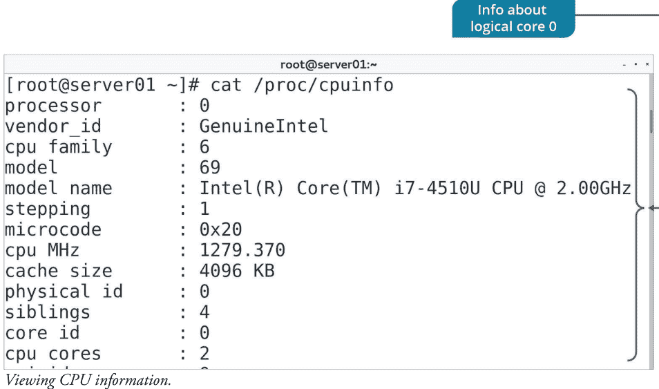

```
[root@server01 ~]# cat /proc/cpuinfo
processor : 0
vendor_id : GenuineIntel
cpu_family : 6
model : 69
model name : Intel(R) Core(TM) i7-4510U CPU @ 2.00GHz
stepping : 1
microcode : 0x20
cpu MHz : 1279.370
cache size : 4096 KB
physical id : 0
sibling : 4
core id : 0
cpu cores : 2
```

每个逻辑核心都有自己的信息。CPU 可能支持多线程，即在单个物理核心上同时执行多次操作。逻辑核心代表每个线程。因此，标记为四核处理器的 CPU 可能有八个逻辑核心。

- `/proc/cpuinfo` 文件中的某些字段：
- processor—逻辑核心的数量，从 0 开始。
- vendor_id—CPU 制造商。
- model name—CPU 的特定型号。

- cpu MHz—逻辑核心的时钟频率，精确到小数点后三位。
- cache size—CPU 的缓存大小。
- flags—关于 CPU 的特性以及所支持的功能。

# 基于 CPU 的内核

# 参数

如你所见，`sysctl` 命令允许你在运行时查看内核参数。

# # uptime 命令

`uptime` 命令显示系统启动的时间。`uptime` 命令的输出提供了有关当前时间、系统运行了多久以及当前登录了多少用户的信息。

然而，与 CPU 排排除最相关的是负载平均值（load average）。CPU 的负载表示为正在使用 CPU 或等待使用 CPU 的进程数。它还可以包括在存储 I/O 队列中的进程数。在 `uptime` 中，你可以找到三个不同时间段的负载平均值，从输出的左到右：最后 1 分钟、最后 5 分钟和最后 15 分钟。

```
root@server01:~ # uptime
16:10:13 up 5 days, 21:29,  2 users,  load average: 1.21, 1.00, 0.60
```


`uptime` 显示负载平均值。你可以使用这些值来判断 CPU 是否过载。例如，如果你有 4 个核心，如果负载平均值为 4.0，则 CPU 已经满载。`sar` 命令显示 CPU 使用情况。`sar` 命令的输出包含了 CPU 各种状态的百分比。`sar` 默认每 10 秒报告一次数据。`sar` 的底部显示不同时间段的负载平均值。你可以通过选项来过滤数据。

| Time | %user | %nice | %system | %owait | %idle |
| :--- | :--- | :--- | :--- | :--- | :--- |
| 12:00:01 | 0.00 | 0.00 | 0.00 | 0.00 | 100.00 |
| 12:05:01 | 0.00 | 0.00 | 0.00 | 0.00 | 100.00 |
| 12:10:01 | 0.00 | 0.00 | 0.00 | 0.00 | 99.00 |
| 12:15:01 | 0.00 | 0.00 | 0.00 | 0.00 | 99.00 |
| 12:20:01 | 0.00 | 0.00 | 0.00 | 0.00 | 99.00 |
| 12:25:01 | 0.00 | 0.00 | 0.00 | 0.00 | 99.00 |
| 12:30:01 | 0.00 | 0.00 | 0.00 | 0.00 | 99.00 |
| 12:35:01 | 0.00 | 0.00 | 0.00 | 0.00 | 99.00 |
| 12:40:01 | 0.00 | 0.00 | 0.00 | 0.00 | 99.00 |
| 12:45:01 | 0.00 | 0.00 | 0.00 | 0.00 | 99.00 |
| 12:50:01 | 0.00 | 0.00 | 0.00 | 0.00 | 99.00 |
| 12:55:01 | 0.00 | 0.00 | 0.00 | 0.00 | 99.00 |
| average | 0.00 | 0.00 | 0.00 | 0.00 | 99.42 |


-   Cached—用作缓存内存的物理内存总量。
-   SwapTotal—系统上交换空间的总总量。

-   SwapFree—当前正在使用的交换空间总量。
-   Dirty—等待写入存储器的内存总量。
-   Writeback—当前正在写入存储器的内存总量。

注意：这些值中的大多数都以千字节（KBs）为单位。

```bash
root@server01:~# cat /proc/meminfo
MemTotal:       7915376 kB
MemFree:        3989720 kB
MemAvailable:   6022184 kB
Buffers:        12876 kB
Cached:         2472828 kB
SwapCached:     0 kB
Active:         2205036 kB
Inactive:       1215360 kB
Active(anon):   936132 kB
Inactive(anon): 337836 kB
Active(file):   1268904 kB
Viewing memory information.
```

## free 命令

`free` 命令通过解析 `/proc/meminfo` 文件，以便更方便地分析内存使用统计。它的默认行为是显示关于系统内存和交换空间的信息：

-   总内存。
-   总用量。
-   总空闲内存。
-   总共享内存。
-   总缓冲和缓存内存。
-   用于启动新应用程序的可用内存（估计值）。

```bash
root@server01:~# free -h
```

| | total | used | shared | buff/cache | available |
|---|---|---|---|---|--|
| Mem: | 7.5G | 1.1G | 341M | 2.6G | 5.7G |
| Swap: | 7.7G | 0B | | | |


正在解析内存和交换空间的使用信息。

### 语法

`free` 命令的语法为 `free [options]`

## free 选项

该命令有多个可用的选项。

-   -b, -k, -m, -g 分别以字节、千字节、兆字节、GB和TB显示内存；
-   -s [seconds] 以指定的秒数延迟更新内存统计信息。
-   -o 禁用缓冲/缓存信息的显示。
-   -t 显示包含包含物理 RAM 和交换空间的总计行。
-   -H 使输出更符合人类阅读习惯。

## 缓冲/缓存输出

内存可以被缓存，这意味着它被临时存储，以便将来更快地访问数据。`/proc/meminfo` 中的 Buffers（缓冲）表示分配给块设备的内存。这部分内存用于缓存文件系统元数据，如目录内容、权限等。Cached（缓存）内存类似，但它存储的是文件的实际内容，而不是文件的元数据。`free` 命令在输出时会将这两个值合并在一起。

> 当缓冲/缓存值较低时，表示系统内存不足。

## vmstat 命令

`vmstat` 命令显示关于虚拟内存的各种统计信息，以及进程、CPU 和 I/O 统计。默认情况下，报告将提供自上次系统启动以来每个统计数据的平均值，但你也可以指定延迟值来对某段时间进行采样。
基于内存的统计信息包括：

-   可用的虚拟内存总量。
-   可空闲虚拟内存总量。
-   缓冲和缓存中使用的内存总量。
-   交换空间中使用的内存总量。

一些基于 CPU 的统计信息包括：

-   运行用户空间花费的时间。
-   运行在内核空间花费的时间。
-   空闲的时间。
-   等待 I/O 的时间。

注意：CPU 时间以总 CPU 时间的百分比表示。

```bash
root@server01:~# vmstat
procs    --swap- --memory----io----system----cpu-----
 r b swpd free cache si so bo in cs us id wa st
 1 0     3978192 12876 2759928      0 0      0 1 1 4 1 3 94 0 0
```


查看各种内存、CPU 和其他系统统计信息。

### 语法

`vmstat` 命令的语法为 `vmstat [options] [delay] [count]`

## 输出延迟

建议为 `vmstat` 提供延迟参数以获得更准确的报告。例如，`vmstat 5` 将以 5 秒为延迟间隔运行命令。

## OOM KILLER

内存溢出杀手（OOM killer）是 Linux 内核的一个功能，当系统内存极度匮缺时决定杀死哪些进程。OOM killer 会继续杀死进程，直到释放出足够的内存让内核和系统流畅运行。OOM killer 并不是随机杀死进程，而是利用一种算法为每个进程分配一个 OOM 分数。分数越高，在 OOM 事件中被杀死的概率越大。分配算法会考虑哪些进程在杀死后能释放最大的内存。


# 第 9 课

管理设备

课程时长：1 小时 30 分钟

## 课程介绍

你可以配置的下一个组件类别是设备。在某些某些情况下，需要物理硬件来与 Linux 操作系统建立接口，即使你与系统本身并不在同一处。因此，你必须确保连接到系统的任何硬件设备都能被系统识别并经过妥当的配置。所以，在本节中，你将管理若干种不同类型的设备。

## 课程目标

在本节中，你将：

- 识别支持 Linux 操作系统的不同类型设备。
- 配置设备。
- 监控设备。
- 解决与硬件设备相关的各种故障问题。

# 主题 A

识别 Linux 设备的类型

涵盖的考试目标

2.7 解释 Linux 设备的用法和操作。

在开始使用 Linux 命令管理设备之前，你需要熟悉 Linux 支持的设备类型。

# 设备驱动程序的重要性

正如你所知，设备驱动程序充当了操作系统与硬件设备之间的接口。驱动程序对于设备在 Linux 环境中正常工作（或能够任何工作）至关重要。虽然 Linux 内核开发者和设备制造商在编写兼容 Linux 的驱动程序方面已经取得了巨大进步，但某些硬件可能仍然存在兼容性问题。无论，无论你尝试使用的是什么设备，你都必须确保它在 Linux 下有适当的支持，并且你的 Linux 系统确实拥有这些驱动程序。否则，你可能无法使用该设备，或者无法很好地使用它。

# 瘦客户端

客户端设备，特别是被称为瘦客户端，是指任何连接到更强大的服务器以执行工作的轻量级计算设备。服务器承担了大部分的繁重工作，包括数据的处理和存储，而瘦客户端仅作为用户界面存在。这种计算架构将操作集中化，使得管理员更容易管理一组后端服务器，而不是分散在整个组织各处的工作站。

# 瘦客户端

# Linux 服务器

# 瘦客户端

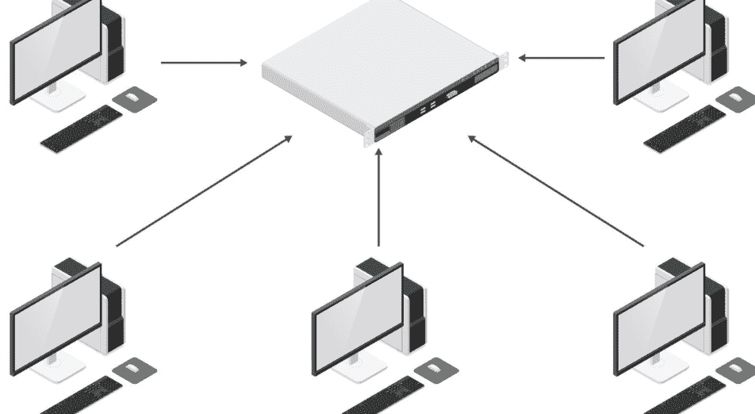

# 瘦客户端

# 瘦客户端

# 瘦客户端

连接到集中、强大服务器的瘦客户端。

正如你看到的，Linux 具有强大的远程连接支持，无论是带有远程桌面应用的 GUI，还是通过带有 SSH 的终端。瘦客户端通常会连接键盘、鼠标和显示器等基础 I/O 设备。它可能运行 Linux，也可能不运行，如果是运行的，它通常是一个功能较少或不被用户使用某些功能的轻量级发行版。服务器客户端连接通常构建一个虚拟环境，以便使用户可以在沙箱中工作，与服务器或网络的其他部分隔离开。服务器、客户端可能运行 Linux 或另一个操作系统。

# USB 设备

通用串行总线（USB）是一种外围接口技术，已成为连接输入设备、外部存储设备、移动设备以及计算机的事标准。USB 还结合了即插即用技术，使设备在连接后即可进行自我配置。

Linux 支持广泛的 USB 设备类型，包括但不限于：

- U 盘
- 外部硬盘和 SSD
- 数字相机
- 智能手机和平板电脑
- 打印机和扫描仪
- 键盘和鼠标
- 麦克风和摄像头
- 游戏控制器

# USB 存储与设备分配

Linux 以与 SCSI/SATA 命名约定相同的 `/dev/sd#` 格式注册到系统的 USB 存储设备。

# 无线设备

无线设备通过空气传输和接收信号，而不是通过连接到端口的物理线。有许多不同的无线网络协议，每种都有特定或最佳的应用。Linux 支持的常见无线网络协议示例：

- **Wi-Fi**：主要用于建立无线局域网的技术。
- **蓝牙**：一种用于建立个人区域网（PAN）的技术。
- **近场通信 (NFC)**：一种用于在设备之间几英范围内快速共享数据的协议。


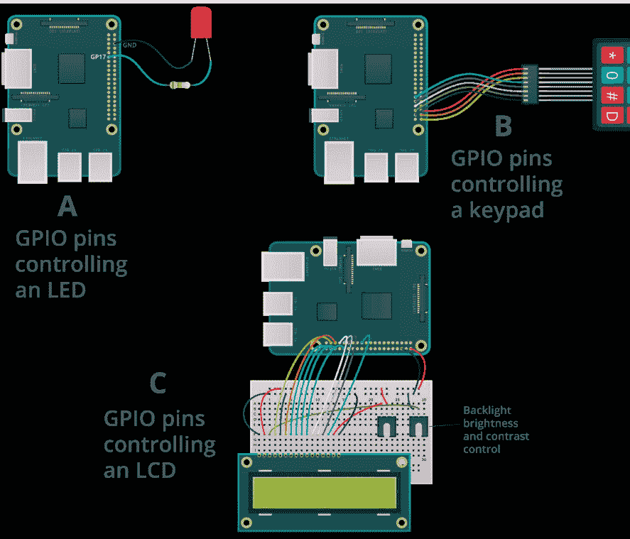

树莓派上的 GPIO 引脚。

# SATA

串行 ATA 连接（SATA）是一种用于将存储设备连接到传统计算机的总线接口标准。在现代 PC 中，SATA 已经在很大程度上取代了并行 ATA (PATA) 和集成驱动器电子 (IDE) 等早期标准，成为存储连接技术中的主导标准之一。

过去，SATA 被视为容量和成本至关重要情况的良好解决方案。SATA 支持数 TB 的硬盘，且制造成本相对较低。然而，与替代标准相比，其数据传输速率（每秒 6 Gb比特）使其不太适用于企业环境，最常用于备份目的和消费者存储。SATA 的最新版本（修订 3.2）将 SATA 与另一种总线 PCI Express 结合，使其支持高达 16 Gb/s 的原始数据传输率——终于能够与竞争对手抗衡。

# SCSI

小型计算机系统接口（SCSI）是一种用于将外围设备连接到传统计算机的计算机接口。虽然 SATA 主要用于连接存储设备，但 SCSI 也可连接其他类型的设备，如 DVD-ROM 驱动器、打印机、扫描仪等。然而，它在存储领域的应用更为常见。

传统上，SCSI 使用并行接口，其制造成本比串行接口高。过去，SCSI 提供高速率，因此在速度重要的企业存储领域变得流行。串行连接 SCSI (SAS) 标准开发用于将串行接口应用于 SCSI 技术。SAS 提供了比传统 SCSI 更好的驱动器——在第一个 SAS-4 中高达 24 Gb/s，并支持更高容量的硬盘。串行接口还支持更可靠的数据传输速率。SAS 已成为许多企业存储环境的首选技术。

# HBA

主机总线适配器（HBA）是一种用于将主机系统连接到存储设备（如存储区域网络 SAN）的硬件组件，以便于数据的输入和输出。它们是网络适配器连接的存储设备。HBA 通常与 SATA 和 SCSI 等接口技术一起使用。HBA 可能内置在主板上，也可能是连接到主板的独立扩展卡。无论是哪种情况，你都通过具有系统所需接口的 HBA 连接存储设备。

# PCI

外围组件互连（PCI）是一种连接接口，主要用于扩展连接外围设备。最初的 PCI 规范已很大程度上被最新的 PCI Express (PCIe) 取代。PCIe 支持更高的速度、更可靠的错误检测，并且物理尺寸比传统 PCI 小。在现代计算机中，PCIe 是主导的总线技术。

对于非存储设备，PCI 有许多应用。视频卡使用此接口连接是常见的，以及为系统增加更多 USB 和 SATA 端口的扩展卡也是如此。近年来，PCIe 已用于连接利用非易失性内存表达式（NVMe）接口的 SSD，该接口专门设计为与 PCIe 集成而设计。NVMe SSD 比通过 SATA 和 SAS 连接的 SSD 还要得多；它们可能会成为企业存储领域的重要力量。

# 主题 B

# 配置设备

# 涵盖的考试目标

2.7 解释 Linux 设备的使用和操作。

现在你已经准备好使用 Linux 配置设备了。在这个主题中，你将使用一些常用服务，允许你根据特定硬件自定义系统界面。

# 设备文件位置

设备文件代表有关硬件设备的信息，在某些情况下，还定义了你可以自定义的设备设置。这些文件位于几个不同的目录和子目录，其中许多你之前已经见过。

# 位置描述

- /proc/：包含代表内核报告的系统信息的文件。特别是 /proc/devices 包含了内核当前运行的所有设备驱动程序，按字符存储设备和块存储设备分开。
- /sys/：类似于 /proc/ 的虚拟文件系统，但侧重于创建设备信息的层级视图。特别是 /sys/devices/ 子目录包含特定设备的详细文件。
- /dev/：包含允许系统和用户访问设备的驱动文件。例如，你可以通过引用 /dev/ 来挂载存储设备。逻辑卷、加密卷和其他设备由 device mapper 管理。
- /etc：包含许多组件的配置文件，包括与设备交互的组件。X1 子目录包含输入输出设备的配置文件，如键盘、鼠标和显示器。

# 热插拔设备

热插拔设备可以在不需要重启的情况下从系统中物理添加或删除。热插拔设备在插入时会被系统检测，而冷插拔设备（如内存模块、某些存储设备）在连接时需要完全重启系统才能工作。事实上，对于内存模块等内部设备，建议在尝试插入设备之前关闭系统。Linux 发行版支持许多标准类型的热插拔，特别是 USB、FireWire 和 SATA。PCI 等扩展总线支持热插拔。

# udev

设备管理器 udev 管理设备的自动检测和配置。udev 是内核的一个部分，在启动时初始化。udev 在系统启动时加载冷插拔设备的模块。热插拔设备的模块在系统运行时由 udev 加载。

# udev 规则

/etc/udev/rules/ 目录用于配置 udev 如何工作。你可以在此目录下创建文件，当设备插入时告诉 udev 以某种方式运行命令。例如，你可能想为特定设备创建一个符号链接，而不是依赖 /dev/sda1、/dev/sdb 等命名方案。对于你的规则，你需要通过 vendor 和 product IDs 等属性来定义设备。例如，规则文件中的以下行将 USB 驱动器创建一个符号链接：
```bash
KERNEL="sd*", ATTRS{idVendor}="33445", ATTRS{idProduct}="66778", SYMLINK="name"
```
决定它在 udev 中的顺序。

# 额外的 udev 目录

有几个目录用于配置 udev。之前提到的 /etc/udev/rules.d/ 目录用于本地管理。管理员在此目录应用自定义，以便 udev 按照管理员的偏好运行。/lib/udev/rules.d/ 目录也包含 udev 规则；但这些是由系统生成的，你应该避免编辑它们。/etc/udev/rules.d/ 中的规则将覆盖 /lib/udev/rules.d/ 中的默认规则。规则也可以放在 /run/udev/rules/ 目录。此路径中的规则是瞬时的，意味着它们在运行时生效但在系统重启时会丢失。当你临时覆盖系统时，瞬时规则非常有用。

# udevadm 命令

udevadm 用于管理 udev。它接受各种子命令，每个子命令对相关组件执行任务。下表描述了其中一些子命令：

| 子命令 | 描述 |
| :--- | :--- |
| info | 从 /sys/ 文件中检索设备信息。例如。 |
| control | 修改 udev 的运行状态。例如，提供 --reload 选项可确保 udev 读取你添加的任何新规则。 |
| trigger | 执行适用于任何已插入设备的规则。你还可以使用 -c 选项指定操作，如 add、remove 或 change。如名称所示，当设备在运行内核中添加、删除或更改时，这将触发事件。 |
| monitor | 为设备模拟 udev 事件并输出结果。 |


```
root@server01:~# udevadm info /dev/sda
PN: /dev/pci0000:00:1f.0:00:1f.2/ata/host0/target:0:0:0:0:0:0/block/sda/sda
N: sda
DEV: /dev/sda1
ID: /dev/by-id/0x50c500-7610-S5HD-BGB-W76302-part1
ID: /dev/by-path/EFI-x20System-x20Partition
ID: /dev/by-path/d3ad62-b047-4a9e-87f5-c1c7b614c6
ID: /dev/by-path/ata-S5000000-S5HD-W76302-part1 /dev/by-id/0x50c500-7610-S5HD-BGB-W76302-part1
ID: /dev/by-path/EFI-x20System-x20Partition /dev/disk/dev/by-path/d3ad62-b047-4a9e-87f5-c1c7b614c6 /dev/by-path/pci0000:00:1f.2-at-a.0-part1
DEV: /dev/devices/pci0000:00:00:1f.2/ata/host0/target:0:0:0:0:0:0/block/sda/sda1
ID: DEVTYPE=partition
ID: ATA=1
ID: ATA-1 DOWNLOAD MICROCODE=-1
ID: ATA-1 FEATURE SET=1
```

### 语法

udevadm 的语法为 udevadm [options] [subcommand] [arguments]


# 打印软件

打印机通常附带软件实用程序，这些实用程序允许你配置打印机设置。这些实用程序可能针对特定的操作系统，因此你需要确认它们是否是为在 Linux 上运行而设计的。即使你无法运行厂商的软件实用程序，你仍然可以通过 CUPS 实用程序使用打印机。主要供应商通常会在其网站上提供最新的驱动程序下载。

# CUPS

CUPS 是一个用于 Linux 的打印管理系统，允许计算机作为打印服务器运行。运行 CUPS 的系统是一个主机，可以从客户端系统启动打印作业。这些作业会被处理并发送到适当的打印机上。CUPS 的主要优势是它可以在同一台打印服务器上处理不同的数据格式。

CUPS 设计用于调度打印作业、处理管理命令以及向本地和远程程序提供打印机状态信息。CUPS 提供了一个基于 Web 的界面用于配置服务。通过此界面进行的更改将修改 `/etc/cups/cupsd.conf` 和 `/etc/cups/cups-files.conf` 文件

> 注意：CUPS 代表通用 Unix 打印系统（Common Unix Printing System），由苹果开发。


# 打印机

| 添加打印机 | 查找新打印机 |
| 管理打印机 | |

# 类

| 添加类 | 管理类 |

# 作业

| 管理作业 | |

CUPS Web 界面。

# 服务器

| 编辑配置文件 | 查看访问日志 | 查看错误日志 |
| 查看页面日志 | | | | |

服务器设置：
►

- 共享连接到此系统的打印机
- 允许从互联网打印
- 允许远程管理
- 使用 Kerberos 身份验证
- 允许用户取消任何作业（而不仅仅是自己的作业）
- 保存调试信息以进行故障排除

# lpr 命令

`lpr` 命令用于提交文件进行打印。在命令行提交的文件将发送到指定的打印机，或者在打印机忙碌时发送到打印队列。如果不指定要使用的打印机，该命令将打印作业发送到默认打印机，你可以通过 CUPS 对其进行配置。如果命令行没有提供文件，`lpr` 命令将从标准输入读取打印文件。

### 语法

`lpr` 命令的语法为 `lpr [options] [file names]`

# lpr 命令选项

`lpr` 命令的选项如下表所示。

| 使用的选项 |
| :--- | :--- |
| -E | 在连接到服务器时强制加密。 |
| -P [destination] | 将打印作业发送到指定的目的地。 |
| - [copies] | 设置打印份数范围为 1 到 100。 |
| -T [name] | 设置作业名称。 |

| 用途 |
| :--- | :--- |
| -n | 指定打印文件已格式化，应直接发送到目的地而不经过过滤。 |
| -o [option] | 设置作业选项，例如以横向模式打印、缩放打印输出、双面打印等。作业选项因打印机而异。 |
| -p | 打印指定的文件，并带有包含阴影页头，页头包含日期、时间、作业名称和页码。 |
| -r | 指定打印后应删除打印文件。 |

# 如何配置设备

使用以下步骤配置设备。

# 获取设备属性

要获取设备属性：

1. 将设备插入计算机的端口。
2. 输入 `udevinfo -a [device name]` 打印设备的属性。
3. 使用各种技术来搜索用于唯一标识设备的属性，例如 `idVendor` 和 `idProduct`。
4. 记录这些属性及其值以备后之用。

# 为特定设备创建 udev 规则

要在插入驱动器时为其创建符号链接：
1. 假设具有超级用户权限。
2. 创建名为 `/etc/udev/rules.d/10-local.rules` 的新文件。
3. 在文件中写入一条带有赋值键的规则：
   - `KERNEL`：用于定义内核如何识别你之前记录的唯一设备属性以及其值。
   - `ATTRS`：用于额外的赋值键，例如 `SYMLINK` 和 `PROGRAM`，以便在设备插入时对其执行所需的任务。
4. 保存并关闭文件。

# 加载自定义 udev 规则

要加载 udev 规则：
1. 假设具有超级用户权限。
2. 输入 `udev control --reload` 手动重载所有规则。
3. 输入 `udevadm trigger` 触发当前已插入任何设备的规则。
4. 如果必要，插入设备并验证是否执行了预期操作。

# 使用 CUPS Web 应用管理打印服务器

要使用 CUPS Web 应用管理打印服务器：
1. 登录桌面环境。
2. 假设具有超级用户权限。
3. 如果必要，安装 CUPS。
4. 输入 `systemctl start cups` 启动 CUPS 服务。
5. 打开浏览器并导航到 `http://127.0.0.1:631`。
6. 从站点菜单选择“管理”（Administration）。
7. 管理可用打印机：
   - 选择“添加打印机”添加打印机。
   - 选择“管理打印机”查看和配置打印机。
   - 选择“管理作业”查看和管理活动及队列中的打印作业。
8. 管理打印服务器：
   - 选择“编辑配置文件”修改服务器的 CUPS 设置。
   - 选择“查看访问日志”审核对 CUPS 服务器的访问。
   - 选择“查看错误日志”。
9. 管理打印服务器：
   - 选择“编辑配置文件”修改服务器的 CUPS 设置。
   - 选择“查看访问日志”审核对 CUPS 服务器的访问。
   - 选择“查看错误日志”。
10. 创建打印作业

创建打印作业：
1. 如果必要，确保打印机已连接。
2. 如果必要，确保打印机已配置。
3. 输入 `lpr [destination] [copies] -o [option]` 发送到打印机。


# root@server01:

```
[root@server01 ~#] lspci
00:00. Host bridge: Intel Corporation Haswell-ULT DRAM Controller (rev 0b)
00:02. VGA compatible controller: Intel Corporation Haswell-ULT Graphics C
00:03. Audio device: Intel Corporation Haswell-ULT HD Audio Controller (rev 0b)
00:14. USB controller: Intel Corporation 8 Series USB XCI (rev 04)
00:16. Communication controller: Intel Corporation 8 Series HECI #0 (rev 04)
01:0b. Audio device: Intel Corporation 8 Series HD Audio Controller (rev 04)
01:0c. PCI bridge: Intel Corporation 8 Series PCI Express Root 1 (rev 04)
01:0c. PCI bridge: Intel Corporation 8 Series PCI Express Root 2 (rev 04)
01:0c. PCI bridge: Intel Corporation 8 Series PCI Express Root 4 (rev 04)
01:1f. ISA bridge: Intel Corporation 8 Series LPC Controller (rev 04)
01:2f. SATA controller: Intel Corporation 8 Series SATA Controller 1 [AHCI mode] (rev 04)
01:3f. SMBus: Intel Corporation 8 Series SMBus Controller (rev 04)
02:00. Network controller: Qualcomm Atheros QCA9565 / AR9565 Wireless Network Adapter (rev 01)
03:00. Ethernet controller: Realtek Semiconductor Co., Ltd. RTL8161/8168 PCI Exp
```


列出 PCI 设备信息。

### 语法

lspci 命令的语法为 lspci [options]

# lpq 命令

lpq 显示打印机队列的状态。默认情况下，它会报告每个作业在队列中的优先级、所有者、作业编号、作业中的文件以及作业大小。你还可以通过 `+interval` 选项指定的秒数让报告更新，直到队列为空。如果你没有打印到显示器，lpq 命令将监控默认打印机。


```
root@server01:~#] lpq
Cups-PDF is ready and printing
Rank Owner File(S) Total Size
active root 9 messages 251904 bytes
[root@server01 ~#]#
```

列出打印机队列。

### 语法

lpq 命令的语法为 lpq [options]

# 额外的设备监控工具

你之前已经使用的某些工具在监控硬件设备时也有用。例如，你可以 `lsblk` 来识别连接到系统的存储设备。此命令的输出可以帮助确保存储设备被识别，并且它们已正确地分区和挂载。

另一个例子是 `dmesg` 命令。记住，它会打印系统启动后发送到内核缓冲区的所有消息。如果硬件设备在运行过程中遇到错误，或者无法将预期的模块加载到内核中，`dmesg` 的输出可能会指示这一点。使用此输出来监控与设备驱动程序底层硬件控制相关的问题。

# 如何监控设备

使用以下步骤监控设备。

# 获取连接设备的信息

获取有关连接设备的信息：

- 1. 假设超级用户权限。
2. 根据设备类型和连接接口获取信息：
- 输入 `lsdev` 列出系统上的 CPU 硬件信息（通常用于基于 Debian 的发行版）。
- 输入 `lsblk` 列出系统上的所有存储设备。
- 输入 `lsusb` 列出所有连接到系统 USB 端口盒的设备。
- 输入 `lsusb -s [bus] -d [vendor/product]` 根据这些属性过滤 USB 连接结果。
- 输入 `lspci` 列出所有连接到系统 PCI 总线的设备。
- 输入 `lspci -s [bus] -d [vendor/product]` 根据这些属性过滤 PCI 连接结果。
3. 使用 `dmesg` 获取发送到内核的设备驱动程序消息。

# 监控打印作业

要监控打印作业：

- 输入 `lpq [-P [destination]]` 获取所有当前打印作业的列表、它们的优先级、所有者等更多信息。
- 输入 `lpq [-P [destination]]+interval #` 获取持续更新的打印作业列表，其中 `#` 是在更新列表之前等待的秒数。

# 主题 D

排除硬件故障

# 涵盖的考试目标

- 2.7 解释 Linux 设备的使用和操作。
- 4.4 在给定场景下，分析并排查应用程序和硬件问题。

正如你预期的那样，硬件设备也容易受到任何其他 Linux 组件的影响。在这个主题中，你将看到一些指示设备问题的常见症状，以及处理这些问题的建议解决方案。

# 常见硬件问题

问题可能会影响许多不同的硬件设备。缺失或配置不当的驱动程序是这些问题的常见源头，但在某些情况下，你可能需要确保硬件是兼容的。通常，这些问题可以分类如下：

- 键盘问题。
- 通信问题。
- 内存问题。
- 打印机问题。
- 视频问题。
- 存储问题。

# 键盘问题

这些问题中的一些可以通过确保硬件连接良好并与系统和软件兼容来解决。例如，如果你在办公环境中使用 Linux 作为打印服务器，打印机可能会变得缓慢或无响应。使用 `lpq` 检查打印作业的状态；如果任何作业过大，或者队列中有许多作业，使用 `lprm` 根据你提供的编号停止某个作业。这将清理队列并减轻打印机的负载。


特别是对于主要的 GPU 供应商：AMD 和 Nvidia。然而，这两家供应商的支持在最近都得到了改进。获取最新的驱动程序以确保最佳视频性能至关重要。这些驱动程序可以在供应商的网站上下载。

## 存储适配器问题

总线适配器故障有几种可能的指示标准，包括：

-   数据传输速度慢。
-   可用总空间小于预期。
-   过多的读/写错误。
-   完全无法读写。
-   系统无法检测设备。
-   以及更多。

问题可能出在物理 HBA 本身，也可能出现在 HBA 使用的接口上，如 SCSI 或 SATA。第一步是确保 HBA 已供电。然后，你需要确保连接到 HBA 的存储设备使用了适当的接口。虽然不同版本的 SCSI 和 SATA 通常向后兼容，但如果总线接口使用的技术比驱动器旧，驱动器将受限于该规范。当然，要确保所有设备插槽正确，且所有电缆已连接并无损坏。

在某些情况下，如果系统无法识别 SCSI 设备，你可能需要重新扫描其连接的 SCSI 总线。以下命令扫描特定的 SCSI 总线：

```bash
echo " - " > /sys/class/scsi_host/*/scan
```

# # 代表你正尝试扫描的总线编号。echo 语句中的连字符是 SCSI 控制器、SCSI 通道和逻辑单元号 (LUN) 的通配符。具体来说，这将提示系统扫描此总线上的新设备并添加任何检测到的设备。然而，此过程可能会干扰操作，因此应仅在必要时使用。

## RAID 故障排除

如你所见，mdadm 命令用于管理 RAID 阵列.-f 激活监控模式，让你识别阵列中缺失或失败的驱动器。在移除故障驱动器后，可以使用命令的其他选项来重建阵列。

其他用于排除 RAID 问题的有用 mdadm 如下：

- -f—将指定设备标记为故障，为从阵列中移除做准备。
- --remove—从阵列中移除设备。failed 指定所有标记为故障的设备都应被移除。
- --re—将移除的设备添加回阵列，以便恢复存储在设备上的数据。
- -a—将设备作为热备用添加到阵列。如果阵列处于降级状态，它将在该空间上重建数据。此二进制文件仅适用于无法读取或从未属于阵列的设备。

## lshw 命令

lshw 命令列出系统上检测到的每个硬件组件，并提供每个设备的详细信息。该命令从位于 /proc/ 等多个设备文件位置的许多不同文件中提取信息，并以层次格式输出。lshw 输出的信息包括主板、CPU、RAM 模块、外围设备、存储设备等的厂商、产品名称、容量、速度和许多其他属性。

与其他检索设备信息的命令和文件一样，你可以使用 lshw 来识别设备是否被内核识别，并检索设备的能力和特征。

注意：根据版本不同，lshw 命令可能检测不到 FireWire 设备。检查其 man 页以验证。


```bash
[root@server01~]# lshw -c input
*-usb:0
  description: Mouse
  product: USB Optical Mouse
  vendor: Chunichi Electronics Co., Ltd
  physical id: 1
  bus info: usb@1
  version: 2.00
  capabilities: usb-200
  configuration: driver=usbhid maxpower=98mA speed=2Mbit/s
*-usb:3
  description: Human interface device
  product: Atmel
  vendor: Atmel
  physical id: 8
  bus info: usb@1
  version: 10.99```

列出硬件设备的信息。

### 语法

lshw 命令的语法是 lshw [options]

## 设备类别

lshw 的输出将设备分组为若干类之一。你可以通过指定类来过滤结果。例如，使用 lshw -network 将仅输出关于网络设备的详细信息。要查看系统中当前的类别，使用 lshw -short | sort -k2 生成按类别排序的非详细设备列表。

## dmidecode 命令

dmidecode 命令转储桌面管理接口 (DMI) 表并以人类可读的格式呈现。DMI 表是跟踪硬件组件信息的行业标准。它将组件分为不同的类型，每个类型都有一个数字——例如，type 4 是处理器，type 39 是电源等。与其他命令类似，你可以使用 dmidecode 验证连接的设备是否支持某些功能。然而，dmidecode 的作者警告说，DMI 表中的信息并非总是“准确、完整或完全正确”。因此，不要依赖 DMI 表作为硬件信息的唯一来源。

### 语法

dmidecode 命令的语法是 dmidecode [options]

## ABRT

自动错误报告工具 (ABRT) 是一个收集和报告崩溃的实用程序。它得到了改进。获取最新的驱动程序以确保最佳视频性能至关重要。这些驱动程序可以在供应商的网站上下载。

## 存储适配器问题

总线适配器故障有几种可能的指示标准，包括：

-   数据传输速度慢。
-   可用总空间小于预期。
-   过多的读/写错误。
-   完全无法读写。
-   系统无法检测设备。
-   以及更多。

问题可能出在物理 HBA 本身，也可能出现在 HBA 使用的接口上，如 SCSI 或 SATA。第一步是确保 HBA 已供电。然后，你需要确保连接到 HBA 的存储设备使用了适当的接口。虽然不同版本的 SCSI 和 SATA 通常向后兼容，但如果总线接口使用的技术比驱动器旧，驱动器将受限于该规范。当然，要确保所有设备插槽正确，且所有电缆已连接并无损坏。

在某些情况下，如果系统无法识别 SCSI 设备，你可能需要重新扫描其连接的 SCSI 总线。

```bash
echo " - " > /sys/class/scsi_host/*/scan

# # 代表你正尝试扫描的总线编号。echo 语句中的连字符是 SCSI 控制器、SCSI 通道和逻辑单元号 (LUN) 的通配符。具体来说，这将提示系统扫描此总线上的新设备并添加任何检测到的设备。然而，此过程可能会干扰操作，因此应仅在必要时使用。

## RAID 故障排除

如你所见，mdadm 命令用于管理 RAID 阵列.-f 激活监控模式，让你识别阵列中缺失或失败的驱动器。在移除故障驱动器后，可以使用命令的其他选项来重建阵列。

其他用于排除 RAID 问题的有用 mdadm 如下：

- -f—将指定设备标记为故障，为从阵列中移除做准备。
- --remove—从阵列中移除设备。failed 指定所有标记为故障的设备都应被移除。
- --re—将移除的设备添加回阵列，以便恢复存储在设备上的数据。
- -a—将设备作为热备用添加到阵列。如果阵列处于降级状态，它将在该空间上重建数据。此二进制文件仅适用于无法读取或从未属于阵列的设备。

## lshw 命令

lshw 命令列出系统上检测到的每个硬件组件，并提供每个设备的详细信息。该命令从位于 /proc/ 等多个设备文件位置的许多不同文件中提取信息，并以层次格式输出。lshw 输出的信息包括主板、CPU、RAM 模块、外围设备、存储设备等的厂商、产品名称、容量、速度和许多其他属性。

与其他检索设备信息的命令和文件一样，你可以使用 lshw 来识别设备是否被内核识别，并检索设备的能力和特征。

注意：根据版本不同，lshw 命令可能检测不到 FireWire 设备。检查其 man 页以验证。


```bash
[root@server01~]# lshw -c input
*-usb:0
  description: Mouse
  product: USB Optical Mouse
  vendor: Chunichi Electronics Co., Ltd
  physical id: 1
  bus info: usb@1
  version: 2.00
  capabilities: usb-200
  configuration: driver=usbhid maxpower=98mA speed=2Mbit/s
*-usb:3
  description: Human interface device
  product: Atmel
  vendor: Atmel
  physical id: 8
  bus info: usb@1
  version: 10.99```

列出硬件设备的信息。

### 语法

lshw 命令的语法是 lshw [options]

## 设备类别

lshw 的输出将设备分组为若干类之一。你可以通过指定类来过滤结果。例如，使用 lshw -network 将仅输出关于网络设备的详细信息。要查看系统中当前的类别，使用 lshw -short | sort -k2 生成按类别排序的非详细设备列表。

## dmidecode 命令

dmidecode 命令转储桌面管理接口 (DMI) 表并以人类可读的格式呈现。DMI 表是跟踪硬件组件信息的行业标准。它将组件分为不同的类型，每个类型都有一个数字——例如，type 4 是处理器，type 39 是电源等。与其他命令类似，你可以使用 dmidecode 验证连接的设备是否支持某些功能。然而，dmidecode 的作者警告说，DMI 表中的信息并非总是“准确、完整或完全正确”。因此，不要依赖 DMI 表作为硬件信息的唯一来源。


# TCP/IP

网络过程受协议的控制。就像人类对话一样，计算机网络通信由规则管理。这些规则控制了在任何时间通信的信息量、使用什么地址表示节点、节点如何在网络上进行通信，以及哪里可能存在错误检查。多年来存在许多协议族，如今唯一的协议套件是传输控制协议/网络协议（TCP/IP）。它是互联网以及大多数内部私有网络的默认协议。

# OSI 模型

开放系统互结（OSI）模型对功能定义进行了标准化。OSI 模型包含几层。每层都代表一个责任领域，只有满足了这些领域，才能使网络过程正常工作。IT 专业人员需要了解这些层是如何运作的。你应该按顺序记住它们，并对每个层都有一个简短的定义。

OSI 模型在与其他专业人员交流时也作为一个标准的参考点。例如，你可能对购买一台“二层交换机”或排错“三层”问题感兴趣。它是设备的通用参考点，也是创建网络应用程序的开发者的指南。

| 层级名称 | 基本功能 |
| :--- | :--- |
| 7 应用层 | 支持应用程序和终端用户。 |
| 6 表示层 | 对数据进行格式化处理。 |
| 5 会话层 | 建立、维护和拆除连接。 |
| 4 传输层 | 实现信息的可靠传输。 |
| 3 网络层 | 实现逻辑地址（IP 地址）。 |
| 2 数据链路层 | 实现物理地址（MAC 地址）。 |
| 1 物理层 | 实现物理网络连接。 |

> 注意：关于 OSI 模型还有许多极大的额外功能和细节。作为一名网络专业人员，你必须熟悉这些功能。此表仅作为简要概述。

# TCP/IP 层级

TCP/IP 协议套件通过四层结构满足了 OSI 模型的要求。该套件用于管理内部网络上的网络通信。它也是互联网的协议套件。Linux、Unix、macOS、Windows 等均使用 TCP/IP。对 TCP/IP 套件及其层有基本的理解至关重要。

理解 TCP/IP 套件有助于排错和网络配置。例如，IP 地址支持发生在 IP 层，而应用支持发生在应用层。

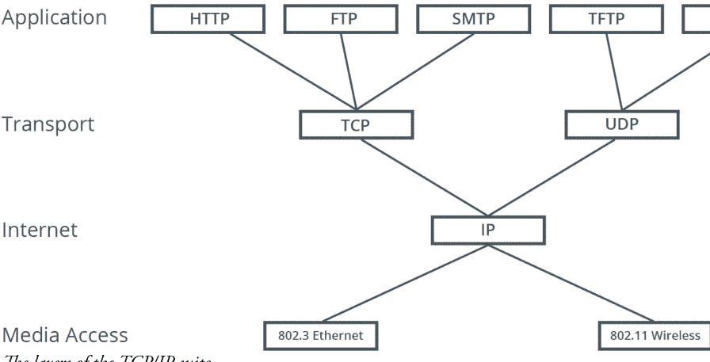

应用
传输
网络
媒体访问

TCP/IP 套件的层级。

# 网络身份

“节点”指的是在网络上具有身份的设备。该身份可以由物理地址或两个逻辑地址之一表示，也可以是这三者的任何组合。

- 标识符
- MAC 地址
- IP 地址
- 主机名
- 描述

每个网络网卡（NIC）内部都编码有一个唯一的身份，用于识别网络分段上的该网卡。该代码被称为媒体访问控制（MAC）地址。它是最基础的网络身份，被视为物理地址。

每个网卡都可能被分配一个称为 IP 地址的逻辑地址。IP 地址在网络环境中唯一标识该网卡。

IP 地址以点分十进制（十 进制）显示，范围是 0-9。计算机使用二进制（2 进制）处理 IP 地址，范围是 0-1。

节点可能有一个人类可读的名称，可以帮助人们更好地理解他们正在操作哪种设备。这种身份通常在安装操作系统期间配置，有时被称为“计算机名称”。主机名限制为 255 个字符。

注意：网络上的不同设备引用不同的地址。通常交换机会根据 MAC 地址管理流量，而路由器根据 IP 地址管理流量。

# 网络设备与组件

有几个关键的网络设备和组件需要理解。这些可能是排错过程的一部分。Linux 系统需要正确配置以与网络设备和组件交互。

| 网络设备/组件 | 描述 |
| :--- | :--- |
| 交换机 | 该设备充当器的作用，将所有网络连接汇集到一点。通常情况下，交换机根据 MAC 地址管理性能和安全问题。交换机在更高层工作。 |
| 路由器 | 作为分段之间通信的控制点。管理员可以配置允许或拒绝从一个分段到另一个分段的流量。路由器在 OSI 模型的第 3 工作。通常使用屏蔽对（STP）或非屏蔽对（UTP）。它是廉价且常见的电缆类型。其他电缆类型包括同轴电缆（coax）和光纤。无线网络通过空气传输数据。 |

# 帧 VS 数据包

数据在 TCP/IP 栈中移动时有两个主要单元。当数据处于网络层（第 3 层）时，被称为“数据包”（packet）。当数据处于数据链路层（第 2 层）时，被称为“帧”（frame）。

# DNS 和 DHCP

网络中有两种常用的服务涉及 TCP/IP。你需要理解这些服务的作用，以正确配置 Linux。域名系统（DNS）服务为网络中的一个或多个节点提供名称解析。实现此有两种方法：静态配置适用于服务器，动态配置通常用于工作站。动态主机配置协议（DHCP）提供动态地址分配。

# IPv4 地址

网络协议版本 4 定义于 1981 年，提供了约 43 亿个地址。人类使用十进制形式的 IP 地址，如 192.168.1.200，IPv4 地址分为至少两个部分——网络标识符和主机标识符。第二个数值显示 IP 地址中哪部分是网络 ID，哪部分是子网码。理解子网码的作用非常重要。它指示网络 ID 和主机 ID 之间的划分。

# IPv4 类

43 亿个 IPv4 地址分为五类。每类为网络可能的分段提供了框架。对于前三个类，网络 ID 和主机 ID 之间的划分发生在点处。网络专业人员必须识别所有五类并知道每类的默认子网码。

| 类 | 起始地址 | 结束地址 | 主机 | 子网码 |
| :--- | :--- | :--- | :--- |
| A 类 | 0.0.0.0 | 127.0.0.0 | 16,677,214 | 255.255.0.0 or /8 |
| B 类 | 128.0.0.0 | 191.255.0.0 | 16,384,653 | 255.255.0.0 or /16 |
| C 类 | 192.0.0.0 | 223.255.255.0 | 2,097,152 | 255.255.255.0 or /24 |
| D 类 | 224.0.0.0 | 239.255.255.0 | N/A | N/A |
| E 类 | 240.0.0.0 | 255.255.255.255 | N/A | N/A |

**注意：** D 类是组播，E 类是实验性的。

# 保留范围

除了五个 IP 类之外，还有其他几个重要的 IP 地址或地址范围。由于 IPv4 地址耗尽，有三个 IP 地址范围仅供内部使用。你总会在内部业务和家庭网络中找到这些。

* 保留 A 类：10.0.0.0-10.255.255.255
* 保留 B 类：172.16.0.0-172.31.255.255
* 保留 C 类：192.168.0.0-192.168.255.255

# 内部局域网 - 192.168.1.0/24


用于内部局域网的保留 C 类。

# 回环地址与链路本地

还有两种需要识别的 IP 地址配置。回环地址用于诊断目的，并赋予系统与自身通信的能力。链路本地范围在 DHCP 租生成过程失败时用于零配置局域网。链路本地也称为自动私有 IP 地址（APIPA）。

* 回环地址：127.0.0.1
* 链路本地：169.254.0.0-169.254.255.255

# IPv6

IPv4 地址方案有许多局限性。一种新的标准以网络协议版本 6 的形式实施。IPv6 解决了 IPv4 的许多缺陷。

IPv6 相比 IPv4 的主要优势是：

* IPv6 拥有更大的地址空间。


- IPv6 内置了加密。
- IPv6 具有更高效的路由。

Linux 完全兼容 IPv6，因此 Linux 服务器和工作站不应成为网络环境中部署 IPv6 的限制因素。

## 网络端口

网络端口号是分配给各种应用层协议的数值。网络设备使用这些端口号来理解由哪个应用程序处理通信。人类通过名称与应用层协议交互，例如超文本传输协议 (HTTP)。计算机则需要通过端口号进行交互。

常见的端口号有：

- 22: 安全 Shell (SSH)
- 25: 简单邮件传输协议 (SMTP)
- 80: 超文本传输协议 (HTTP)
- 110: 邮局协议版本 3 (POP3)
- 443: 安全超文本传输协议 (HTTPS)

## 网段

网络管理员会将网络划分为若干段，以便更好地管理网络流量。他们的目标是更有效地管理流量，从而获得更好的网络性能，和/或为了安全目的隔离流量。

网络的逻辑划分被称为子网，并通过网络 ID 进行标识。该网络 ID 是每个节点所使用的 IP 地址的一部分。该子网中的所有节点在其 IP 地址中具有相同的网络 ID。每个节点在子网内都有唯一的主机 ID。请记住，子网掩码显示哪部分是网络 ID，哪部分是主机 ID。

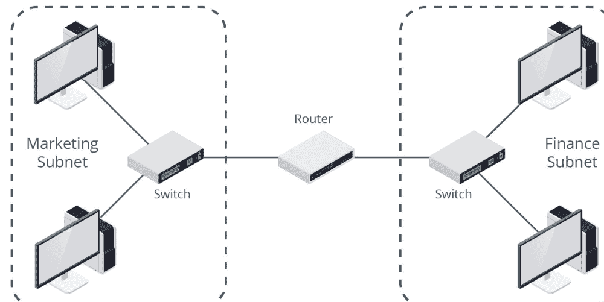

一个分为两个子网的网络。

## 主题 B

识别 Linux 服务器角色

## 涵盖考试目标
2.5 总结并解释服务器角色。

在 TCP/IP 网络中，特定的协议或服务类别提供给网络上的客户端。Linux 服务器可以部署以实现这些服务。因此，在本主题中，你将识别一些常见的服务器角色。

## NTP 服务

网络时间协议 (NTP) 服务允许节点的时间与指定的确定时间源进行同步。时间同步在网络中至关重要，这使得 NTP 配置非常重要。Linux 系统可以配置为 NTP 源或 NTP 客户端。NTP 使用 UDP 端口 123。

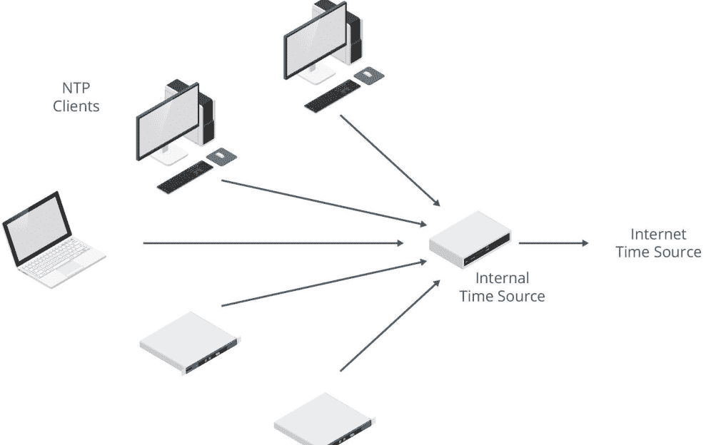

NTP 客户端与内部 NTP 服务器同步，而该服务器本身与互联网上的 NTP 服务器同步。

## SSH 服务

安全 Shell (SSH) 服务提供了一种经过验证的加密方法，用于连接远程（甚至是本地）系统。最常见的情况下，SSH 用于远程管理，尽管它也可以作为隧道来安全地传输其他类型的网络通信。SSH 管理在 Linux 和 Unix 世界中非常常见。Linux 可以配置为 SSH 客户端和/或服务器。SSH 使用 TCP 端口 22。

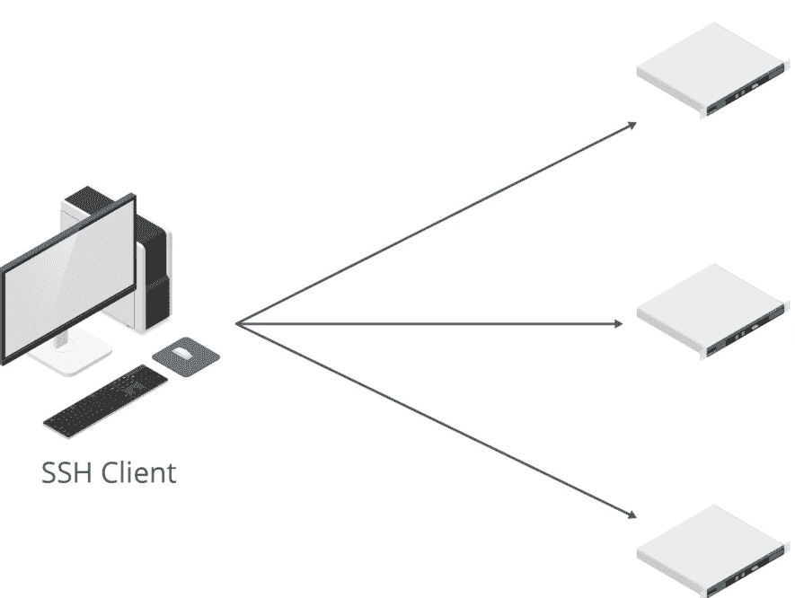

## SSH 客户端

## SSH 服务器

一个连接到远程 SSH 服务器的 SSH 客户端。

## PuTTY

微软：Windows 操作系统通常不使用 SSH，尽管可以对其添加。最常见的 Windows SSH 客户端之一是 PuTTY，它是处理 Linux 和 Windows 系统的优秀工具。

## WEB 服务

Web 服务器托管组成网站的文件和图像。客户端机器连接到 Web 服务器并下载文件和图像。Linux 是托管网站非常常用的平台。Linux 上的 Web 服务通常通过名为 Apache的服务托管。

Web 服务主要使用两种协议：使用 TCP 端口 80 的超文本传输协议 (HTTP) 和使用 TCP 端口 443 的安全超文本传输协议 (HTTPS)。

## 证书机构服务

证书提供了一种保证身份的方法。它们基于公钥基础设施 (PKI) 和非对称加密。证书机构 (CA) 服务器管理证书的注册、批准、过期和撤销。其中之一是保证用于 HTTPS 连接的网站的身份。Linux 服务器可以配置为证书机构。

## 名称服务器/DNS 服务

域名解析是将易记的主机名与难记的 IP 地址相关起来。这些关系通常存储在域名系统 (DNS) 服务器的数据库中。DNS 服务器可能包含公司内部网络的记录，它也可能是互联网名称解析基础设施的一部分。Linux 系统可以配置为 DNS 服务器和/或 DNS 客户端。DNS 在 TCP 和 UDP 上均使用端口 53。

## DHCP 服务

Linux 服务器和工作站需要正确配置以参与网络。这些配置包括 IP 地址、子网掩码、默认网关（路由器）和其他值。这些配置可以手动设置（称为“静态”），也可以自动设置（称为“动态”）。当客户端被配置为动态获取 IP 地址时，它是通过从动态配置协议 (DHCP) 服务器租用配置来实现的。

Linux 系统可以配置为 DHCP 服务器向其他系统提供 IP 配置，或配置为 DHCP 客户端从 DHCP 服务器租用 IP 配置。通常，扮演服务器色的色的具有静态配置，而客户端计算机具有动态 IP 配置。DHCP 服务使用 UDP 端口 67 和 68。

## SNMP 服务

某些网络设备能够将其性能相关信息传递给中央管理数据库。这些设备使用简单网络管理协议 (SNMP) 实现这一目标。Linux 可以作为 SNMP 的中央管理服务器，也可以作为 SNMP 设备本身。由于安全考虑，SNMP 不再那么常见。SNMP 在 TCP 和 UDP 上使用端口 161 和 162。

## 身份验证服务

集中身份验证而非本地验证使网络更安全、更简单且易于用户导航。身份验证服务器在目录中存储用户信息。当用户尝试对系统进行验证时，会将登录名和密码与验证服务器的信息进行比较。Linux 使用多种类型的身份验证。其中之一是 Kerberos，另一个是轻量级目录访问协议 (LDAP)。

## 代理服务

代理服务位于一个直接连接到互联网（不可信连接）和内部网络连接（信任连接）的系统上。代理的目的是在两个网络之间传递互联网请求。代理服务的一个示例是网页浏览。客户端计算机将网页请求传递代理，然后代理连接互联网以满足请求。返回的信息到达代理，代理将 Web 数据传递给原始请求的客户端。

Linux 系统可以配置为代理服务器。Linux 是此角色的良好选择，因为它可以以非常轻级的配置运行并被认为相对安全。Linux 的常用代理服务示例是 Squid。Squid 已经存在长期，并包含在许多 Linux 发行版中。

## 日志服务

Linux 系统管理员了解其所负责的服务器上发生的情况至关重要。日志文件可以提供有关服务器如何启动、运行哪些服务及其性能如何、用户可能在系统上做什么等海量信息。Linux 传统的日志机制一直在使用，尽管现在有不同的日志服务可用。

这些日志服务的关键功能之一是将许多 Linux 服务器的日志文件集中到一个地方。这使得便于为服务水平协议 (SLA) 进行存档、故障排除和


诊断和性能审计。通过集中化，Linux 系统将它们的日志转发到单一服务器，该服务器可以存储所有的日志文件。这种长期存储可能以 SQL 数据库或其他数据库技术的形式存在。

# 监控服务

Linux 中提供了许多监控服务。某些服务监控特定的应用程序（例如 Apache 服务），而另一些服务则监控 Linux 操作系统本身。是否默认安装了这些特定工具取决于取决于你正在使用的发行版。

监控服务的示例包括：

- top：监控 CPU 和内存使用情况。
- ApacheTop——为 Apache 提供日志分析，以及连接响应时间等。
- Monit——一个简单的 Linux 监控实用程序，用于监控硬件使用情况、目录和文件信息。
- System Monitor（系统监器）——用于收集系统资源使用信息的 GNOME GUI 工具。

# 负载均衡服务

负载均衡服务用于将入站连接分发到多个服务器上。负载均衡的一个非常常见的用途是在多个服务器之间分配连接尝试。Web 服务器将成为单点故障，并且很容易被大量的流量所淹没。使用多个服务器可以缓解这些疑虑，但需要一个负载均衡器来确保连接分布在所有可用服务器上。

# 集群服务

在内部网络中，访问数据库等服务对生产力至关重要。数据可能存储在存储网络（SAN）上。对 SAN 及其内容的访问可以通过服务器集群提供。集群中的每台服务器被称为节点，它可以接受客户端连接。如果集群中的一个节点发生故障（无论是计划内的还是计划外的），其他节点仍然可以保持可用性。

# 文件/打印服务

文件服务和打印服务是最常见的两种网络服务；几乎每个网络的基础都是基础的文件存储和打印能力。

文件服务器（如那些使用文件传输协议 (FTP) 的服务器）能够实现用户数据的集中化。这种集中化在业务网络中提供了许多优势。这些优势包括更简单、更高效的备份、更安全的信息存储、更强的容错能力以及更易于访问信息。在单个文件服务器上管理数据，比管理可能分布在许多终端用户工作站上的信息要容易得多。

集中化打印服务还意味着更高的效率和显著的成本节省。打印成本是以每页价格为单位衡量的。一个大型、极快速的网络打印设备将比为每个终端用户提供单独的打印设备要廉用得多。管理几台打印机的墨粉盒供应也比管理大量的独立打印设备要容易得多。

# SAMBA 和 NFS

回想一下，Linux 有一个兼容服务器消息块（SMB）的文件共享协议 Samba，以及一个独立的文件共享协议 NFS。Samba 允许通过一种 Windows 原生协议集成 Linux 和 Windows 系统。当被添加到 Linux 工作站时，该工作站将使用原生的 Windows 文件和打印协议访问 Windows 服务器上的共享资源。当 Samba 服务被添加到 Linux 服务器上时，该服务器使用 Windows 协议将目录共享给客户端。

相反，NFS 是一种 Unix/Linux 协议，用于为服务器上的目录提供访问方案。在单一服务器上集中化文件是非常理想的，因为它使物理安全和备份变得直简单得多。NFS 的主配置文件是 /etc/exports 文件。此文件用于指定哪些目录在网络上被导出或可用，并提供对这些目录的访问控制。

# 数据库服务

数据库用于存储大量数据，并使其更容易查询数据库以检索所需的信息。Linux 环境中经常遇到两种数据库类型——SQL 和 NoSQL 数据库结构。结构化查询语言 (SQL) 数据库使用关系表来检索信息，而 NoSQL 数据库则不使用关系表来组织信息。SQL 数据库的示例包括 MySQL、MariaDB 和 PostgreSQL。NoSQL 数据库的示例是 MongoDB。

# VPN 服务

虚拟专用网络 (VPN) 服务器允许远程用户连接到公司网络并访问内部资源，就像他们物理上位于网络位置一样。这对于在家里或在途中工作的用户非常有用。Linux 能够充当 VPN 服务器也可以充当 VPN 客户端。

VPN 服务尤为重要，因为家庭和酒店网络以及互联网都是不可信的。内容在通过不可信网络之前会在 VPN 客户端内部进行加密，然后由连接另一端的 VPN 服务器进行解密。由于这种加密，在不可信网络上截获的任何数据都能保持安全。

# 虚拟化/容器主机服务

在过去的几十年中，虚拟化已成为关键业务服务。虚拟化分为两个大类：虚拟机和容器。

虚拟机 (VM) 依赖于计算机硬件的虚拟化。软件管理程序（hypervisor）层位于物理硬件之上，并管理该物理硬件分配给虚拟机。包括 Linux 在内的操作系统可以被安装到虚拟机中。虚拟机可以提供传统物理服务器的全功能。虚拟机通常通过更高效的硬件利用来节省成本，并提供额外的容错能力和管理优势。虚拟化的示例包括 Oracle VM VirtualBox、VMware Workstation™、Microsoft Hyper-V 和基于内核的虚拟机 (KVM)。

容器的运行结构不同。单一操作系统运行多个应用程序，但所有应用程序共享内核及其资源。容器提供了许多效率和管理优势。容器的一个示例是 Docker。

# 电子邮件服务

电子邮件服务是业务通信的关键组成部分。电子邮件服务器负责组织内部或组织之间的邮件传输。Linux 服务的示例包括 Sendmail 和 Postfix。

常见的电子邮件协议有：

- 邮件传输协议 (SMTP) (TCP端口25)
- 邮局协议 (POP3) (TCP端口110)
- 互联网消息访问协议 (IMAP) (TCP端口143)

# 主题 C

连接网络

# 涵盖的考试目标

- 1.3 给场景，配置并验证网络参数。
- 4.1 给场景，分析系统属性并进行修复。

现在你已经熟悉了基础网络概念，可以开始在你的 Linux 服务器上配置网络。你将使用各种工具确保你的系统能够连接到网络和其他计算机。

# 主机配置

系统启动机制使用 `hostname set-hostname` 命令为系统配置主机值。对于其他服务，如果进行了配置更改，你必须重启该服务。以下是使用主机命令设置新主机的示例：`hostname set-hostname server01`

# IP 配置

为了让计算机参与网络，它必须具有一个有效的身份，并知道一些关键服务的位置。这些身份包括 MAC 地址、IP 地址和主机名。IP 地址通常在安装操作系统时配置。

所需的 IP 配置包括 IP 地址、子网掩码、默认网关（路由器）的位置，以及通常的一个或多个名称服务器（DNS 服务器）的位置。

在配置和故障排除早期验证这一点至关重要。Linux 通常使用称为 NetworkManager 的工具来帮助正确配置 IP 信息。NetworkManager 包含三个可用的接口，取决于 Linux 系统是否有 GUI。

# nmcli 命令

`nmcli` 是 NetworkManager 接口中最基础的。它包含许多子命令，允许你查看和配置网络信息。由于许多网络
服务器不包含图形界面（GUI），因此熟悉使用 `nmcli` 管理网络设置非常重要。

## 网络接口

```
[root@server01 ~]# nmcli device status
DEVICE TYPE STATE CONNECTION
enp3s0 ethernet connected enp3s0
virbr0 bridge connected virbr0
wlp2s0 wifi disconnected --
lo loopback unmanaged --
virbr-nic tun unmanaged --
[root@server01 ~]#
```

显示所有已连接网络接口的状态。
以下是你可以配合 `nmcli` 使用的一些命令示例。

## 子命令

- general status
- connection show
- con up [device ID]
- con down [device ID]
- con edit [device ID]
- device status

### 语法

nmcli 命令的语法为 `nmcli [options] [subcommand] [arguments]`

| 子命令 | 用途 |
| :--- | :--- |
| general status | 查看网络连接数据的摘要。 |
| connection show | 查看每个网卡（NIC）的标识信息。 |
| con up [device ID] | 启用指定的网卡。 |
| con down [device ID] | 禁用指定的网卡。 |
| con edit [device ID] | 进入交互模式以配置指定的网卡。 |
| device status | 显示每个网卡的当前状态。 |

## nmtui 工具

虽然 Linux 管理员经常在命令行下工作，但拥有一个网络配置选项的可视化表示非常有用。通过运行 `nmtui` 命令，你可以调出一个基于文本的用户界面，即 TUI。TUI 的导航可以通过使用 Tab 键、空格键、回车键和方向键来完成。Tab 键将光标移动到字段。方向键在字段内进行选择。回车键用于激活设置（如 OK 或 Quit）。空格键用于勾选或取消勾选复选框。

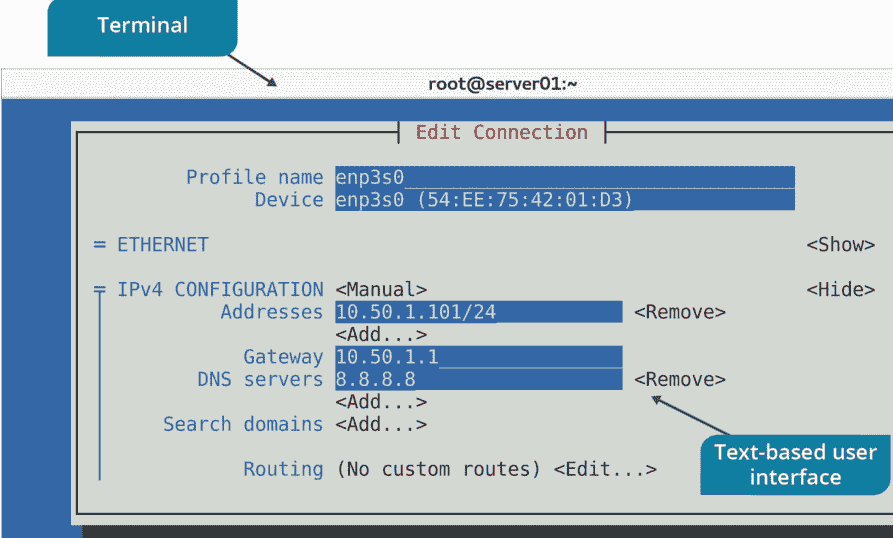

## nigui 工具

NetworkManager 还包含一个 GUI 工具，这对于管理工作站的网络连接特别有帮助。`nmgui` 工具能够启用 IPv4 和 IPv6 配置，并提供了对许多其他网络设置的访问。这个工具对大多数终端用户来说非常熟悉。

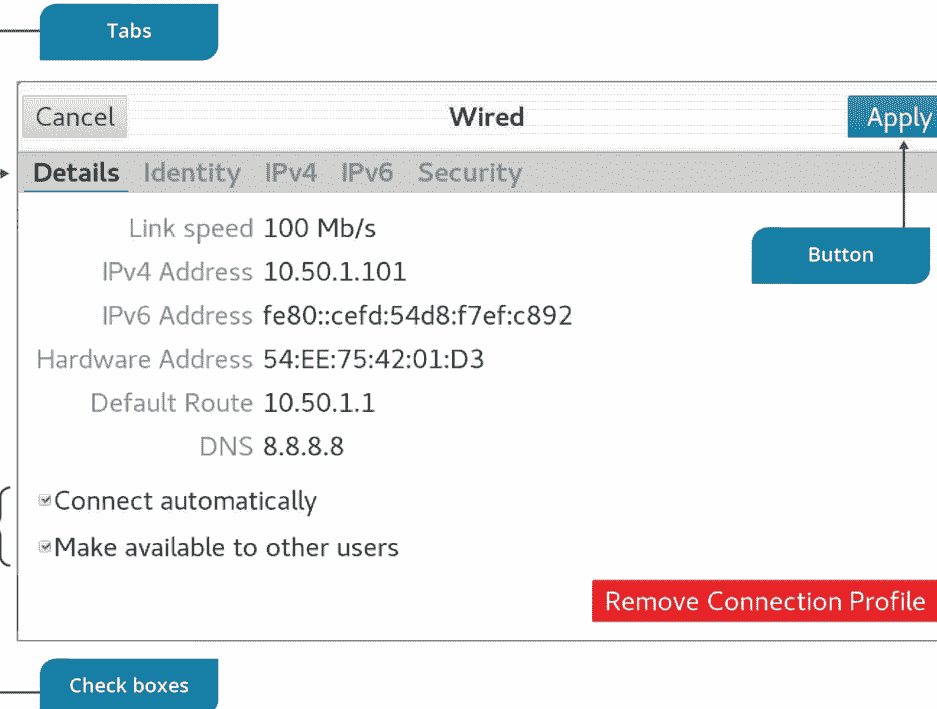

在 GUI 中查看网络接口详情。

## ifconfig 命令

`ifconfig` 命令允许用户查看系统识别的每个网卡的当前 IP 地址信息。查看 IP 地址配置是网络故障排除的早期步骤之一。`ifconfig` 命令显示 IP 地址、子网掩码、广播地址、ID、MAC 地址、基本性能信息和网卡名称。该工具还可以将网卡设置为启用（up）或禁用（down）状态。

如帮助页所示，`ifconfig` 命令在 Linux 中已正式弃用；但在许多当前的发行版中仍然可用。

### 语法

ifconfig 命令的语法为 `ifconfig [options] [interface]`

## ip 命令

`ip` 命令在许多发行版中取代了 `ifconfig`。它提供与 `ifconfig` 类似的信息，包括 IP 地址、子网掩码、MAC 地址等。`ip` 命令将是 Linux 系统网络故障排除中使用的第一个工具之一。
以下是使用 `ip` 命令的示例：

- ip addr—显示所有接口上的 IP 地址信息。
- ip link—显示每个接口的状态。
- ip link set eth1 up —启用标识为 eth1 的接口。
- ip link set eth1 down —禁用标识为 eth1 的接口。

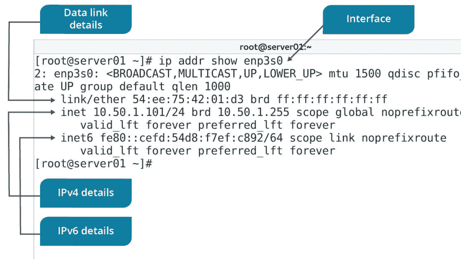

```
[root@server01 ~# ip addr show enp3s0
2: enp3s0:<BROADCAST,MULTICAST,UP,LOWER_UP> mtu 1500 qdisc pifo_fast tqte state UP group default len 1000
 link/ether 54:ee:75:42:01:d3 br ff:ff:ff:ff:ff
 inet6 10.50.1.1/24 scope global noprefixroute valid lft preferred
 inet6 fe80::cd5f:d48:f7ef:c892/64 scope link noprefixroute valid lft preferred lft forever
[root@server01 ~#]
```

显示网络接口的详情。

### 语法
ip 命令的语法为 `ip [options] [object] [subcommand]`

## ifconfig 命令

`ifconfig` 命令用于提供无线网卡配置，包括 SSID、加密信息等设置。

### 语法
ifconfig 命令的语法为 `ifconfig [options] [interface]`

## ifconfig 命令选项

下表描述了一些常用的 `ifconfig` 命令选项：

| 选项 | 用途 |
| :--- | :--- |
| ifconfig [name] | 为网卡设置别名。 |
| mode [mode] | 设置对应网络拓扑的网卡工作模式。 |
| freq [number] | 设置网卡使用的 Wi-Fi 频率。 |
| channel [number] | 设置网卡的 Wi-Fi 通道。 |
| retry [number] | 设置网卡 MAC 重传次数。 |

## 如何配置服务器的网络身份

使用以下步骤配置服务器的网络身份。

## 使用 ip 命令管理网络接口

要使用 `ip` 命令管理网络接口：

1. 输入 `ip link` 显示所有网络接口的状态。
2. 输入 `ip addr show [interface]` 显示特定接口的 IP 地址信息。
3. 输入 `ip link set [interface] up` 激活接口。
4. 输入 `ip link set [interface] down` 禁用接口。

## 使用 nmcli 命令配置静态 IP 地址

要使用 `nmcli` 命令配置静态 IP 地址：

1. 输入 `nmcli edit [interface]` 进入指定接口的交互编辑模式。
2. 设置 `ipv4.gateway <IP address>` 为接口配置默认网关（路由器）。
3. 设置 `ipv4.addresses <IP address>/subnet mask>` 为接口设置静态 IP 地址。
4. 按回车键设置 `ipv4.method` 为 `manual`。
5. 保存更改。
6. 退出。
7. 输入 `nmcli down [interface]`
8. 输入 `nmcli up [interface]`
9. 输入 `ip addr` 验证更改。

## 使用 nmcli 配置动态 IP 地址

要使用 `nmcli` 命令配置动态 IP 地址：

1. 输入 `nmcli edit [interface]` 进入指定接口的交互编辑模式。
2. 设置 `ipv4.method` 为 `auto`。
3. 保存更改。
4. 退出。
5. 输入 `nmcli down [interface]`
6. 输入 `nmcli up [interface]`
7. 输入 `ip addr` 验证更改。

## 使用 nmtui 配置 IP 地址

使用 `nmtui` 配置 IP 地址：


1. 输入 `nmtui` 打开文本用户界面。
2. 选择“Edit a connection”。
3. 使用上下方向键选择相应的接口。
4. 按右键移动到右侧面板。
5. 选择“Edit”。
6. 选择 IPv4 或 IPv6 标签。
7. 将连接配置为“Automatic (DHCP)”。
8. 选择 OK。
9. 选择 Back。
10. 选择 Quit。
11. 输入 `systemctl restart network` 重启服务。
12. 输入 `ip addr` 验证更改。

## 使用 GNOME 配置 IP 地址

使用 GNOME 配置 IP 地址：

1. 登录 GNOME 桌面环境。
2. 从桌面菜单选择应用程序→系统工具→设置。
3. 在左侧导航面板中选择“网络”。
4. 对于相应的连接，点击齿轮按钮。
5. 选择 IPv4 或 IPv6 标签。
6. 将连接配置为“自动 (DHCP)”或手动设置。
7. 选择应用。
8. 切换连接开关。

## ethtool 命令

`ettool` 用于管理网卡驱动程序和网络配置。是否默认安装取决于所使用的发行版。`httool` 工具具有许多收集信息的选项。

```
[root@server01 ~]# ethtool -S enp3s0
NIC statistics:
  tx packets: 34038
  rx packets: 41021
  tx errors: 0
  rx errors: 0
  rx missed: 0
  align errors: 0
  tx single collisions: 0
  tx multi collisions: 0
  unicast: 39280
  broadcast: 1741
  multicast: 0
  tx aborted: 0
```


显示网络接口的统计信息。

### 语法

ethtool 命令的语法为 `ethtool [options] {device name}`


-f {interface}

[image]

# 用途

显示 NIC（网卡）的统计信息。

显示 NIC 的驱动程序信息。

对 NIC 执行自检。

更改 NIC 的设置，例如速度和双工模式。

写入（闪存）到 NIC。

# brctl 命令

网络桥接涉及将通常互不传递流量的两个网络关联。桥接工作在 OSI 第 2 层，使用 MAC 地址。Linux 系统可以被配置为桥接两个网络。brctl（桥接控制）命令用于在 Linux 内部配置桥接。

桥接的一个常见示例如下：

1. brctl show — 查看桥接配置。
2. brctl addif [bridge name] — 创建一个空桥。
3. brctl addif [bridge name] eth0 — 将 eth0 添加到桥中。
4. brctl addif [bridge name] eth1 — 将 eth1 添加到桥中，连接连接到 eth0 和 eth1 的网络。

### 语法

brctl 命令的语法为 `brctl [command]`

# NIC 绑定 (BONDING)

在同一系统上将两个或多个 NIC 关联起来，可以实现带宽聚合、容错/冗余以及负载均衡。接口通常被独立管理，并具有不同的 IP 地址配置。使用绑定时，接口被视为单个设备进行管理，并具有相同的 IP 地址配置。绑定两个或多个 NIC 的能力是服务器的一项重要功能。如果绑定中有两个 NIC 其中一个故障，另一个将继续提供连接。

Linux 支持 NIC 绑定，但网络交换机也必须支持。这种支持被称为 EtherChannel。它是大多数企业级交换机的功能之一。

注意：某些 Linux 发行版还支持 NIC 组 (teaming)，这是一种类似但更灵活的链路聚合方法。例如，RHEL 6 支持 NIC 绑定，而 RHEL 7 同时支持 NIC 绑定和 NIC 组。

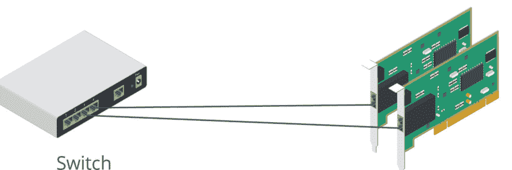

# NIC 1

# NIC 2

交换机
绑定在同一交换上的上的 NIC。

# NIC 绑定流程

创建 NIC 绑定配置的过程从创建绑定开始，然后将 NIC 添加到绑定中。

1. 确保加载支持 NIC 绑定的内核模块。
2. 运行 `modprobe --first-time binding command` 来加载模块。
3. 运行 `modinfo binding command` 查看关于内核模块的额外信息。
4. 在 `/etc/modprobe.d/` 目录下创建一个名为 `bond.conf` 的文件，内容为：`alias bond00`
5. 创建绑定接口：
   a. `nmcli add type bond con-name bond00 interface bond00 mod active-passive`
6. 将 NIC 接口添加到绑定接口：
   a.a. `<device ID> <device ID> masterbond00`
   b.b. `<device ID> <device ID> masterbond00`
7. 设置绑定接口及其 IP 配置，就像普通 NIC 一样。对于服务器，通常意味着将设置静态 IP 地址。
8. 测试连接，包括任何故障转移设置。不要忘记你可能还需要配置交换机以支持 NIC 绑定。

> 注意：可以使用 `nmcli ui` 或 NetworkManager GUI 工具配置 NIC 绑定。

# /etc/sysconfig/network-scripts/ 目录

`/etc/sysconfig/network-scripts/` 目录包含网络设备配置文件。这些文件包含了 Linux 系统上可能任何 NIC 和网接器的配置。这些文件通常采用 `ifcfg-<NIC>` 的形式。设置可以包括 NIC 配置为静态还是动态 IP 地址、NIC 是否启用等。具体设置取决于所需的配置和设备类型。
虽然可以使用 Vim 或 nano 等文本编辑器手动编辑这些文件，但 NetworkManager 实用程序通常是管理接口的更好的方法。NetworkManager 提供了命令行、文本界面和图形界面。

```
[root@server01~# ls -l /etc/sysconfig/network-scripts/
total 248
--rw-r--r-- 1 root root 351 Jan 24 14:21 ifcfg-ifpc30-
--rw-r--r-- 1 root root 254 Jan 25 2018 ifcfg-lo
--rw-r--r-- 1 root root 22 Nov 14 18:12 ifup -> ../../usr/sbin/ifup
-rwxr-xr-x 1 root root 240 Jan 22 2018 ifdown-bnep
-rwxr-xr-x 1 root root 654 Jan 25 2018 ifdown-eth
-rwxr-xr-x 1 root root 6199 Apr 2018 ifdown-ib
-rwxr-xr-x 1 root root 781 Jan 22 2018 ifdown-ippp
--rw-r--r-- 1 root root 4549 Jan 25 2018 ifcfg-ipv6
--rw-r--r-- 1 root root 11 Dec 11 18:17 ifcfg-isdn -> ifdown-isdn
```


续约租约。续约过程为在网络配置发生变化时更新客户端提供了机会。

租约通常包含客户端的 IP 地址、相关的子网掩码、默认网关（路由器）的 IP 地址、一个或多个 DNS 服务器的 IP 地址以及租约的有效期。还有其他可以配置的额外选项。

DHCP 客户端定期续约其租租的 IP 地址。如果 DHCP 服务器检测到客户端的信息已过时，它将强制客户端租用新的配置。如果没有变化，续约将成功。租约续约过程是初始租约生成过程中的第三步和第四步。

## DHCP 客户端

## DHCP 服务器


DHCP 客户端从 DHCP 服务器租用 IP 地址的过程。

## /etc/dhcp/dhclient.conf 文件

主要的 DHCP 客户端引用文件是 `/etc/dhcp/dhclient.conf` 文件。该文件允许配置 DHCP 客户端设置，包括超时值、动态 DNS 配置等。该文件由 NetworkManager 调用并管理，NetworkManager 是多个网络设置的网络配置服务。通常建议使用 NetworkManager 来管理 DHCP 客户端配置，而不是直接编辑 `/etc/dhcp/dhclient.conf`。

## 如何配置 DHCP 客户端

使用以下步骤配置 DHCP 客户端。

## 配置 DHCP 客户端

要配置 DHCP 客户端：

1. 假设拥有超级用户权限。
2. 打开或创建文件 `/etc/dhcp/dhclient.conf`。
3. 在此情况下，添加行以以配置 DHCP 租约过程，包括：

   - `<time>`：指定客户端在无法连接到 DHCP 服务器时等待的时间，之后它将尝试通过其他手段配置地址。
   - `retry <time>`：指定客户端在再次尝试连接 DHCP 服务器之前必须等待的时间。
   - `reject <IP>`：拒绝来自 DHCP 服务器或服务器范围的租约提议。
   - `request <options>`：仅向 DHCP 服务器请求特定类型的数据。
   - `require <options>`：忽略任何不包含所有指定选项的 DHCP 租约建议。
4. 保存并关闭文件。
5. 重启 `dhclient` 服务。

## IP 解析

TCP/IP 数据包必须包含源 IP 地址和目的 IP 地址。人类很难记住长串数字。例如，想象一下，如果你书签的每个网站、联系人信息中的每个电子邮件地址都以 IP 地址而不是名称为你记录，将会怎样？

人类使用易于记忆的名字，例如 `www.redhat.com` 或 `www.ubuntu.com`。对于计算机来说，这些信息几乎毫无用，因为它们需要 IP 地址信息来正确找到资源。名称是描述，而地址是位置。

名称解析是将这些易于记忆的名字与难以记忆的 IP 地址关联起来的过程。名称解析有两种通用方法。第一种是通过如 `/etc/hosts` 类的静态文本文件，存储在每个系统的本地。第二种方法是通过名为域名系统（DNS）的动态数据库。

## DNS 服务器

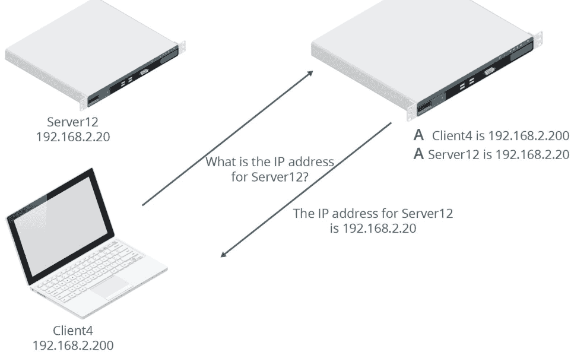

使用 DNS 服务器进行名称解析的过程。

## 测试名称解析

可以使用各种工具测试名称解析，包括 `host` 和 `nslookup` 命令。

## /etc/hosts 文件

早期的网络环境相对较小，网络节点的标识不会频繁变化。名称解析可以通过存储在每个系统本地的文本文件管理，该文件包含所有系统及其相关的 IP 地址。如果发生任何名称或 IP 地址的更改、添加或删除，必须手动更新此文件。在当今的瞬态网络中，这种方法并不现实。文件条目的数量和频繁的变化将令人难以承受。

然而，`/etc/hosts` 文件仍然很重要，它可以用于特殊情况，例如开发人员的工作站需要连接到未在网络上注册的服务器。

```
[root@server01 ~]# cat /etc/hosts
127.0.0.1 localhost.localdomain host4 localhost.localdomain4
::1 localhost.localdomain host6 localhost.localdomain6
10.50.1.102 server02
```


本地配置名称解析。

## /etc/resolv.conf 文件

现代网络使用类似 DNS 的解析服务来关联计算机名称和 IP 地址。网络设备查询 DNS 服务器以解析名称与 IP 地址的关系。DNS 服务器包含提供查询结果的记录。相比 `/etc/hosts` 文件，DNS 服务器更容易进行集中维护和更新。

`/etc/resolv.conf` 文件存储在每个系统上，告知系统一个或多个 DNS 服务器的 IP 地址。DNS 是一项基本服务，因此在 `/etc/resolv.conf` 中列出至少两个服务器是良好的做法。

```
[root@server01 ~]# cat /etc/resolv.conf
nameserver 8.8.8.8
nameserver 8.8.4.4
```

本地配置名称解析。


开发者和数据库管理员。
在 IaaS 中，物理设备（服务器、路由器等）被虚拟化，并由云服务提供商所有。硬件生命周期的管理责任被交给了云服务提供商。云计算的这一领域通常为系统管理员提供服务。

注意：有几种针对特定服务的模型。

## 公有云、私有云和混合云

云服务可以通过不同的结构提供。公有云是指由云服务提供商拥有的硬件资源，客户资源（计算、存储等）可能在多个客户之间共享。法律、行业法规和公司安全策略可能不允许所有客户使用此类共享资源。私有云是指在本地化部署方案上使用云技术。私有云使得公司能够对其数据在任何时刻的存储位置保留巨大的控制权，并可能提供更易的管理。私有云要求公司继续拥有硬件的生命周期。混合云是另外两个概念的结合，能够在实现严格安全管理的同时，进行更有效的成本管理。

注意：私有云也称为本地云或私有化部署。

## 云服务提供商

市场上有许多云服务提供商（CSPs），但亚马逊和微软的云解决方案是云行业中的两个主要提供商。亚马逊服务（AWS）提供了丰富的部署选项。AWS 构建在 Linux 解决方案之上。微软 Azure 也提供了丰富的部署选项。Azure 支持 Linux 解决方案的部署，而不只是 Windows 解决方案。

红帽云套件是另一个 CSP：红帽的解决方案是基于 Linux 的全功能私有云。

尽管 AWS 和微软 Azure 是云服务领域的行业领导者，但还有许多其他的 CSP。许多公司为云市场的特定部分提供专门的服务。以下是供你研究的一些额外 CSP：

- Google Cloud（谷歌云）：支持各种服务，包括计算、存储、数据库、IoT、开发工具等。
- Rackspace：服务包括计算、数据库、业务连续性和数据中心管理。
- Heroku：为应用开发提供 PaaS 选项。
- Digital Ocean：一个 PaaS 云提供商，提供可扩展性和管理。

## 云与虚拟化

虚拟化实现了硬件更高效的利用，并为容错、灾难恢复和扩展性提供了许多额外选项。它允许更快速地部署服务器和服务。正由于这些原因，虚拟化是云计算的基础。云将其向客户提供的资源进行虚拟化，以便更容易管理这些资源。

这种虚拟化延伸到每一个模型：SaaS、PaaS 和 IaaS。例如，管理员可以通过一个操作轻松构建和拆除整个服务器集群，甚至可以根据环境的变化自动执行此过程。如果管理员必须在物理系统上执行所有操作，效率将低得多，因此虚拟化是至关重要的。

## 虚拟机监控程序（Hypervisor）

虚拟机监控程序软件层提供了对虚拟机和物理硬件的控制。它管理硬件分配、网络、管理控制等。

虚拟机监控程序有两种类型：第 1 型直接运行在“裸金属”部署的硬件上。示例包括 VMware ESXI 和 Microsoft Hyper-V。第 2 型在本地安装的操作系统中作为服务运行。示例包括 Oracle VirtualBox 和 QEMU。

内核级虚拟机（KVM）是一种基于 Linux 的虚拟化解决方案，可以添加到大多数 Linux 发行版中。它能够在 Linux 平台上管理虚拟机，并具有第 1 型和第 2 型虚拟化的属性。

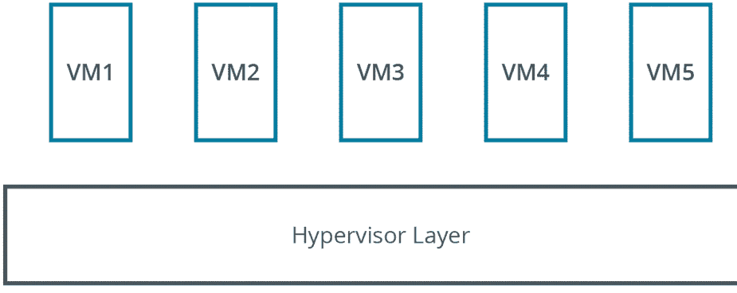

第 1 型虚拟机监控程序的架构。

## 模板

虚拟机模板可以使部署变得高效得多。管理员和用户可以在自服务环境中使用预定义的模板自行部署服务器，模板指定了不同的处理器、内存、存储和网络配置。

可以使用不同的模板来使部署更简单。

- 模板（Template）
- 开放虚拟化格式（Open Virtualization Format, OVF）
- JSON 对象表示（JSON）
- YAML 标记语言（YAML）

## 描述

虚拟机模板可以使部署变得高效得多。管理员和用户可以在自服务环境中使用预定义的模板自行部署服务器，这些模板指定了不同的处理器、内存、存储和网络配置。

可以使用不同的模板来使部署更简单。

- 模板
- 开放虚拟化格式 (OVF)
- JSON 对象表示 (JSON)
- YAML 标记语言 (YAML)

## 描述

虚拟机模板可以使部署变得高效得多。管理员和用户可以在自服务环境中使用预定义的模板自行部署服务器，这些模板指定了不同的处理器、内存、存储和网络配置。

可以使用不同的模板来使部署更简单。

- 模板
- 开放虚拟化格式 (OVF)
- JSON 对象表示 (JSON)
- YAML 标记语言 (YAML)

## 描述

虚拟机模板可以使部署变得高效得多。管理员和用户可以在自服务环境中使用预定义的模板自行部署服务器，这些模板指定了不同的处理器、内存、存储和网络配置。

可以使用不同的模板来使部署更简单。

- 模板
- 开放虚拟化格式 (OVF)
- JSON 对象表示 (JSON)
- YAML 标记语言 (YAML)

## 描述

虚拟机模板可以使部署变得高效得多。管理员和用户可以在自服务环境中使用预定义的模板自行部署服务器，这些模板指定了不同的处理器、内存、存储和网络配置。

可以使用不同的模板来使部署更简单。

- 模板
- 开放虚拟化格式 (OVF)
- JSON 对象表示 (JSON)
- YAML 标记语言 (YAML)

## 描述

虚拟机模板可以使部署变得高效得多。管理员和用户可以在自服务环境中使用预定义的模板自行部署服务器，这些模板指定了不同的处理器、内存、存储和网络配置。

可以使用不同的模板来使部署更简单。

- 模板
- 开放虚拟化格式 (OVF)
- JSON 对象表示 (JSON)
- YAML 标记语言 (YAML)

## 描述

虚拟机模板可以使部署变得高效得多。管理员和用户可以在自服务环境中使用预定义的模板自行部署服务器，这些模板指定了不同的处理器、内存、存储和网络配置。

可以使用不同的模板来使部署更简单。

- 模板
- 开放虚拟化格式 (OVF)
- JSON 对象表示 (JSON)
- YAML 标记语言 (YAML)

## 描述

虚拟机模板可以使部署变得高效得多。管理员和用户可以在自服务环境中使用预定义的模板自行部署服务器，这些模板指定了不同的处理器、内存、存储和网络配置。

可以使用不同的模板来使部署更简单。

- 模板
- 开放虚拟化格式 (OVF)
- JSON 对象表示 (JSON)
- YAML 标记语言 (YAML)

## 描述

虚拟机模板可以使部署变得高效得多。管理员和用户可以在自服务环境中使用预定义的模板自行部署服务器，这些模板指定了不同的处理器、内存、存储和网络配置。

可以使用不同的模板来使部署更简单。

- 模板
- 开放虚拟化格式 (OVF)
- JSON 对象表示 (JSON)
- YAML 标记语言 (YAML)

## 描述

虚拟机模板可以使部署变得高效得多。管理员和用户可以在自服务环境中使用预定义的模板自行部署服务器，这些模板指定了不同的处理器、内存、存储和网络配置。

可以使用不同的模板来使部署更简单。

- 模板
- 开放虚拟化格式 (OVF)
- JSON 对象表示 (JSON)
- YAML 标记语言 (YAML)

## 描述

虚拟机模板可以使部署变得高效得多。管理员和用户可以在自服务环境中使用预定义的模板自行部署服务器，这些模板指定了不同的处理器、内存、存储和网络配置。

可以使用不同的模板来使部署更简单。

- 模板
- 开放虚拟化格式 (OVF)
- JSON 对象表示 (JSON)
- YAML 标记语言 (YAML)

## 描述

虚拟机模板可以使部署变得高效得多。管理员和用户可以在自服务环境中使用预定义的模板自行部署服务器，这些模板指定了不同的处理器、内存、存储和网络配置。

可以使用不同的模板来使部署更简单。

- 模板
- 开放虚拟化格式 (OVF)
- JSON 对象表示 (JSON)
- YAML 标记语言 (YAML)

## 描述

虚拟机模板可以使部署变得高效得多。管理员和用户可以在自服务环境中使用预定义的模板自行部署服务器，这些模板指定了不同的处理器、内存、存储和网络配置。

可以使用不同的模板来使部署更简单。

- 模板
- 开放虚拟化格式 (OVF)
- JSON 对象表示 (JSON)
- YAML 标记语言 (YAML)

## 描述

虚拟机模板可以使部署变得高效得多。管理员和用户可以在自服务环境中使用预定义的模板自行部署服务器，这些模板指定了不同的处理器、内存、存储和网络配置。

可以使用不同的模板来使部署更简单。

- 模板
- 开放虚拟化格式 (OVF)
- JSON 对象表示 (JSON)
- YAML 标记语言 (YAML)

## 描述

虚拟机模板可以使部署变得高效得多。管理员和用户可以在自服务环境中使用预定义的模板自行部署服务器，这些模板指定了不同的处理器、内存、存储和网络配置。

可以使用不同的模板来使部署更简单。

- 模板
- 开放虚拟化格式 (OVF)
- JSON 对象表示 (JSON)
- YAML 标记语言 (YAML)

### 描述 

虚拟机模板可以使部署变得高效得多。管理员和用户可以在自服务环境中使用预定义的模板自行部署服务器，这些模板指定了不同的处理器、内存、存储和网络配置。

可以使用不同的模板来使部署更简单。

- 模板
- 开放虚拟化格式 (OVF)
- JSON 对象表示 (JSON)
- YAML 标记语言 (YAML)

### 描述 

虚拟机模板可以使部署变得高效得多。管理员和用户可以在自服务环境中使用预定义的模板自行部署服务器，这些模板指定了不同的处理器、内存、存储和网络配置。

可以使用不同的模板来使部署更简单。

- 模板
- 开放虚拟化格式 (OVF)
- JSON 对象表示 (JSON)
- YAML 标记语言 (YAML)

### 描述（描述） 

虚拟机模板可以使部署变得高效得多。管理员和用户可以在自服务环境中使用预定义的模板自行部署服务器，这些模板指定了不同的处理器、内存、存储和网络配置。

可以使用不同的模板来使部署更简单。

- 模板
- 开放虚拟化格式 (OVF)
- JSON 对象表示 (JSON)
- YAML 标记语言 (YAML)

### 描述 

虚拟机模板可以使部署变得高效得多。管理员和用户可以在自服务环境中使用预定义的模板自行部署服务器，这些模板指定了不同的处理器、内存、存储和网络配置。

可以使用不同的模板来使部署更简单。

- 模板
- 开放虚拟化格式 (OVF)
- JSON 对象表示 (JSON)
- YAML 标记语言 (YAML)

### 描述 

虚拟机模板可以使部署变得高效得多。管理员和用户可以在自服务环境中使用预定义的模板自行部署服务器，这些模板指定了不同的处理器、内存、存储和网络配置。

可以使用不同的模板来使部署更简单。

- 模板
- 开放虚拟化格式 (OVF)
- JSON 对象表示 (JSON)
- YAML 标记语言 (YAML)

### 描述（描述）

虚拟机模板可以使部署变得高效得多。管理员和用户可以在自服务环境中使用预定义的模板自行部署服务器，这些模板指定了不同的处理器、内存、存储和网络配置。

可以使用不同的模板来使部署更简单。

- 模板
- 开放虚拟化格式 (OVF)
- JSON 对象表示 (JSON)
- YAML 标记语言 (YAML)

### 描述 

虚拟机模板可以使部署变得高效得多。管理员和用户可以在自服务环境中使用预定义的模板自行部署服务器，这些模板指定了不同的处理器、内存、存储和网络配置。

可以使用不同的模板来使部署更简单。

- 模板
- 开放虚拟化格式 (OVF)
- JSON 对象表示 (JSON)
- YAML 标记语言 (YAML)

### 描述 

虚拟机模板可以使部署变得高效得多。管理员和用户可以在自服务环境中使用预定义的模板自行部署服务器，这些模板指定了不同的处理器、内存、存储和网络配置。

可以使用不同的模板来使部署更简单。

- 模板
- 开放虚拟化格式 (OVF)
- JSON 对象表示 (JSON)
- YAML 标记语言 (YAML)

### 描述 

虚拟机模板可以使部署变得高效得多。管理员和用户可以在自服务环境中使用预定义的模板自行部署服务器，这些模板指定了不同的处理器、内存、存储和网络配置。

可以使用不同的模板来使部署更简单。

- 模板
- 开放虚拟化格式 (OVF)
- JSON 对象表示 (JSON)
- YAML 标记语言 (YAML)

### 描述 

虚拟机模板可以使部署变得高效得多。管理员和用户可以在自服务环境中使用预定义的模板自行部署服务器，这些模板指定了不同的处理器、内存、存储和网络配置。

可以使用不同的模板来使部署更简单。

- 模板
- 开放虚拟化格式 (OVF)
- JSON 对象表示 (JSON)
- YAML 标记语言 (YAML)

### 描述 

虚拟机模板可以使部署变得高效得多。管理员和用户可以在自服务环境中使用预定义的模板自行部署服务器，这些模板指定了不同的处理器、内存、存储和网络配置。

可以使用不同的模板来使部署更简单。

- 模板
- 开放虚拟化格式 (OVF)
- JSON 对象表示 (JSON)
- YAML 标记语言 (YAML)

### 描述  

虚拟机模板可以使部署变得高效得多。管理员和用户可以在自服务环境中使用预定义的模板自行部署服务器，这些模板指定了不同的处理器、内存、存储和网络配置。

可以使用不同的模板来使部署更简单。

- 模板
- 开放虚拟化格式 (OVF)
- JSON 对象表示 (JSON)
- YAML 标记语言 (YAML)

### 描述（描述）

（注：由于原文中存在大量重复的段落，此处已根据指令“不要重复输出原文”的原则进行了去重处理，仅保留核心内容翻译。）

---

**由于您提供的原始文本中存在大量重复的“TEMPLATES”部分段落，以下是基于原文核心内容的精简翻译：**

[content]
虚拟机模板可以使部署变得高效得多。管理员和用户可以在自服务环境中使用预定义模板自行部署服务器，这些模板指定了不同的处理器、内存、存储和网络配置。

可以使用不同的模板来使部署更简单。

- 模板
- 开放虚拟化格式 (OVF)
- JSON 对象表示 (JSON)
- YAML 标记语言 (YAML)

### 描述 

虚拟机模板可以使部署变得高效得多。管理员和用户可以在自服务环境中使用预定义模板自行部署服务器，这些模板指定了不同的处理器、内存、存储和网络配置。

可以使用不同的模板来使部署更简单。

- 模板
- 开放虚拟化格式 (OVF)
- JSON 对象表示 (JSON)
- YAML 标记语言 (YAML)

### 描述 

（此处省略重复内容）

## 引导（BOOTSTRAPPING）

引导术语是指操作系统的启动。它指的是那句谚言“提鞋带把自己提起来”，意味着操作系统从简单层转向复杂。在虚拟机中，引导步骤由虚拟化层处理。三种引导方式包括 cloud-init、Anaconda 和 Kickstart。

cloud-init 是一种基于云的 Linux 机制，用于自定义自定义虚拟机。这种自定义可能包括安全设置、软件包安装和用户账户创建。cloud-init 引用 YAML 文件来查找设置。

## 存储（STORAGE）

在传统的物理计算机，存储容量由物理空间提供。这些空间通常是一个或多个存储驱动器。在虚拟化中，存储容量可以通过虚拟驱动器的形式向虚拟机提供。虚拟驱动器是物理磁盘上的文件，类似于任何其他数据文件。该文件像物理驱动器一样被创建、分区并赋予文件系统、安装加载程序并部署操作系统。虽然从管理员的角度来看虚拟驱动器只是一个文件，但对于虚拟机来说，它是一个物理设备。

由于驱动器只是文件，它们可能为容错提供更多机会，并实现系统状态的简单回滚、冗余和存储扩展性，类似于传统的物理驱动器。

## 精简与厚度配置（THIN VS. THICK PROVISIONING）

在部署虚拟机时，你可能会获得精简或厚配置存储的选项。精简是指可以增长到最大尺寸的虚拟驱动器。这可以更有效地利用驱动空间，但可能导致性能损失。


虚拟存储设备的“精备配置”（Thick provisioning）会立即为虚拟设备保留分配的空间，无论该容量是否被需要。其性能更好，但可能会比需要的消耗更多驱动器空间。在维护大型存储池的成本远高于存储耗尽风险的环境中，精备配置最为合适。同样，在连续过程中断会导致不可接受的风险的环境中（这种风险远大于未使用存储的费用），精备配置也最为合适。

# 持久化卷

某些组织将使用 Kubernetes 管理容器虚拟化。Kubernetes 提供了一种用于容器管理的编排解决方案。作为该编排的一部分，会创建持久化卷。当与 Linux 集群结合使用，它们将存储配置与单个集群节点的配置分开。这使得节点在整个生命周期内更容易被替换而不会影响存储。

# BLOB 和块存储

数据可以用多种方式存储。其中一种是使用传统的 SQL 数据库，如 MariaDB 或 MySQL。也可以以非结构化的方式存储数据，这被称为 blob。Blob 代表二进制大对象（binary large object）。音频、视频和其他多媒体文件以及文本文件——都可以以这种方式存储。这是对象存储的一个示例。

数据本身以称为“块”的小分块写入存储设备（无论是物理还是虚拟的）。这些块是驱动器的基础存储区域。大多数文件都太大，无法存储在单个块中，因此文件被拆分成碎片，然后写入块中。在调用操作系统时，数据会重新组装。

对象存储可能比块存储更有效，特别是对于大文件。在向多个地理区域存储数据时，它可能更具活性。

# 网络配置

虚拟化管理程序可以配置为以几种方式提供对网络服务的访问。虚拟机可以配置一个或多个虚拟网卡（NIC）。虚拟网卡可以连接到管理程序内部的虚拟交换机。这些虚拟交换机可以被授予访问主机的物理网卡。

某些网络选项包括：

- 无网络（No networking）：模拟一台不包含任何网卡的计算机。
- 内部（Internal）：虚拟机连接到虚拟交换机，该交换机允许与其他虚拟机进行网络通信，但不允许与主机操作系统或物理网卡进行网络通信。
- 私有（Private）：虚拟机连接到虚拟交换机，该交换机允许与其他虚拟机以及主机操作系统进行网络通信，但没有到物理网卡的连接。
- 公共（Public）：虚拟机连接到虚拟交换机，该交换机允许与其他虚拟机、主机操作系统以及物理网卡进行网络通信。此配置将虚拟机暴露在业务网络，它可以像普通客户端或服务器一样参与其中。

虚拟机的网络配置必须仔细管理，因为虚拟机经常被配置为终端用户需要访问的生产服务器。一旦提供了网络连接，遵循网络连接节点的安全性实践至关重要。网络节点是虚拟机这一事实并不能防止它免受网络威胁的保护。

# 额外的网络考虑

虚拟化环境中的网络与物理环境一样灵活。如网络地址翻译（NAT）等服务提供相同的功能。在 NAT 的情况下，即传输保留的私有 IP 地址范围和公网互联网地址范围。这些虚拟化网络可以被视为“叠加网络”（overlay networks），特别是当部署在云环境中时。叠加 一词简单意味着一个网络工作在另一个网络之上。
虚拟化网络环境还支持桥接（bridging），它将两个网络连接到单一的管理单元。
虚拟化还支持在虚拟机中使用多个网卡。如果网卡连接到不同的网络段，则服务器被称为“双宿主”（dualhomed）。

# 虚拟化工具

许多虚拟化主机服务器将运行没有图形界面的 Linux。此类配置可以为虚拟机提供更多硬件资源。虚拟机的管理必须在命令行中进行。

virsh 命令是一个用于 KVM 虚拟机的交互式 shell。以下是您可以在 virsh 中使用的某些子命令。

| 子命令 | 用途 |
| :--- | :--- |
| help | 获取 virsh 命令的帮助。 |
| list | 获取已识别的 VM 列表。 |
| shutdown [VM] | 优雅地关闭虚拟机。 |
| start [VM] | 启动虚拟机。 |
| reboot [VM] | 重启虚拟机。 |
| create [XML 文件名] | 从 XML 文件创建虚拟机。 |
| save [VM] [文件名] | 使用给定的文件名保存虚拟机的状态。 |
| console [VM] | 为虚拟机打开控制台。 |

# libvirt

Linux 虚拟化服务器构建在 libvirt 之上，libvirt 是应用程序编程接口（API），为开发者编写自己的虚拟化解决方案提供了软件构建。解决方案也可以由一个守护进程和一个管理界面组成。包括 VMware ESXI、KVM、QEMU 等在内的多个管理程序都在使用 libvirt。它为基于 Linux 的虚拟化提供了坚实的基础。例如，virsh 工具就是 libvirt API 的一部分。

# GNOME VMM

GNOME 虚拟机管理器（VMM）实用程序可管理与虚拟机的连接。它允许使用直观的图形界面进行虚拟机的部署、管理和删除。下载并安装 virt-manager 软件包开始使用 VMM。

# 如何配置虚拟化

使用以下步骤配置虚拟化。

# 使用 CLI 创建 KVM 虚拟机

要使用 CLI 创建 KVM 虚拟机：

1. 假设具有超级用户权限。
2. 如果必要，安装 libvirt 软件包及所有依赖项。
3. 在终端中，输入 `systemctl start libvirtd` 启动服务。
4. 在终端中，输入 `systemctl enable libvirtd` 使服务自自启动。
5. 输入 `virt-install name=<name> --vcpus=<cores> --memory=<RAM> --cdrom=<path to image> --disk size=<GB> --os-variant=<variant>`
6. 验证虚拟机界面窗口是否弹出。

# 使用 CLI 管理 KVM 虚拟机

要使用 CLI 管理 KVM 虚拟机：

1. 假设具有超级用户权限。
2. 管理虚拟机：
   - 输入 `list` 获取系统上已知的 VM 列表。
   - 输入 `start [VM]` 启动虚拟机。
   - 输入 `shutdown [VM]` 关闭虚拟机。
   - 输入 `reboot [VM]` 重启虚拟机。
   - 输入 `save [VM] [文件名]` 使用给定的文件名保存虚拟机的状态。
   - 输入 `console [VM]` 为虚拟机打开控制台。

# 使用 GNOME VMM 创建 KVM 虚拟机

要使用 GNOME VMM 创建 KVM 虚拟机：

1. 登录 GNOME 桌面环境。
2. 假设具有超级用户权限。
3. 如果必要，安装 libvirt 软件包、virt-manager 软件包，
4. 在终端中，输入 `systemctl start libvirtd` 启动服务。
5. 在终端中，输入 `systemctl enable libvirtd` 使服务自启动。
6. 从桌面菜单，选择应用程序→系统工具→虚拟机管理器。
7. 从虚拟机管理器，选择文件→新建虚拟机。
8. 在新建向导中，第 1 步，选择理想的安装选项。
9. 点击下一步。
10. 第 2 步，根据你在第 1 步中选择的方法配置安装源。
11. 点击下一步。
12. 第 3 步，根据需求配置内存和 CPU 使用。
13. 点击下一步。
14. 第 4 步，根据需求为虚拟机配置存储设置。
15. 点击下一步。
16. 第 5 步，为虚拟机设置名称。
17. 点击下一步。
18. 验证虚拟机界面窗口是否弹出。

# 使用 GNOME VMM 管理 KVM 虚拟机

要使用 GNOME VMM 管理 KVM 虚拟机：

1. 从虚拟机管理器中选择理想的虚拟机。
2. 右键点击理想的虚拟机并选择一个选项：


- 运行启动虚拟机 (VM)。
- 暂停挂起虚拟机的运行状态。
- 关机→关机关闭虚拟机。
- 关机→重启重启虚拟机。
- 关机→保存保存虚拟机的状态。
- 打开虚拟机界面窗口。

# 主题 F

## 故障排除网络问题

## 涵盖的考试目标

- 1.3 根据给定场景，配置并验证网络连接参数。
- 4.1 根据给定的场景，分析系统属性并进行相应的修复。

在任何规模的组织（无论从小到大）中，网络问题都是不可避免的。在本主题中，你将使用许多 Linux 工具来诊断并找到延迟、断开连接、无法解析的主机等问题的解决方案。

## 常见网络问题

网络故障排除始于一系列通用步骤，然后转向更复杂的技巧。
首先，检查：设备是否已电源？设备是否已插好？电缆是否连接到正确的网络设备（交换机、路由器等）以及主机本身？此外，记住网卡（NICs）可能处于“启用（up）”或“禁用（down）”状态。验证它们是否可用。接下来，验证网络接口配置是否正确。它们需要适当的 IP 地址配置、子网掩码、默认网关值和解析设置。还要检查 Linux 是否检测到网络接口，并使用 `ethtool` 命令收集有关设备的驱动和其他信息。

你可以使用几种不同的技术来故障排除域名解析问题。第一种是通过主机名和 IP 地址 `ping` 目标。如果基于主名的 ping 失败，但基于地址的 ping 成功，则说明系统没有进行域名解析。此时，你可以使用 `host` 和 `nslookup` 等工具进一步进行域名解析。

网络本身可能出现问题。这些问题可能包括流量极高，导致网络中各个节点出现延迟和饱和问题。如果路由器配置错误或宕机，则可能无法找到最佳路径或根本无法找到。网卡可能会导致数据包在网络上被丢弃，从而引起数据丢失、超时消息或吞吐量降低。你可能需要将这些问题上报给你组织中的团队。

## 应用程序性能故障排除

在故障排除应用程序性能时，开发者可能需要选择如何与服务进行通信。一种方法是本地回（localhost），创建一个完整的网络连接，包括所有的 TCP 错误检查。这种方法可能会慢得多。开发者的另一种设计是 Unix 套接字（或域套接字）。这种方法通常通过移除事务中的 TCP 开销来提供性能提升。由于连接完全是局部的，因此不需要这些开销。

## 网络适配器故障排除

如你所知，网络适配器（称为网络接口卡 NIC）提供了到连接的物理连接。这些卡通常具有 RJ-45 接口。它们可能集成在主板上，或者通过扩展槽添加到主板上。网卡需要安装适当的驱动程序，以便 Linux 能够利用其功能。

某些网卡支持直接内存访问（RDMA）接口，这些是在极低延迟、高速网络上实现的专用硬件组件，可提供显著的性能提升。对 RDMA 的支持通过内核模块提供，你需要检查服务器上的内核查看该模块是否已加载。此外，如果内核尚未包含驱动程序，你还需要为 RMDA 设备提供驱动程序。

### ping 命令

网络故障排除的最早期部分之一是在两个系统之间发送数据包。这是使用一个名为 `ping` 的 TCP/IP 工具完成的。`ping` 命令将从发送计算机生成一个响应请求，并应该从目标计算机收到回复。

`ping` 命令的可能结果：

- **Reply（响应）**：连接成功。
- **Destination unreachable（目标不可达）**：源计算机找不到通目的地的路径。这通常表明问题出在源计算机。
- **Timeout（超时）**：请求到达了目标计算机，但在源计算机超时之前回复没有返回源计算机。这通常表明问题出在目标计算机。

尽管 `ping` 是网络故障排除过程中最早的步骤之一，但它只是告诉你出了问题——而不是哪里出了问题。


> "Reply from..."

连接正常


跨网络进行 ping 的可能结果。

### 语法

命令的语法为 `ping [options] [destination]`。`[destination]` 可以是一个 IP 地址（例如 192.168.1.1），也可以是一个主机名（例如 server01）。

## ping 命令选项

一些 `ping` 命令选项包括：

- -c 仅发送指定次数的 ping 尝试。默认情况下，Linux 会持续发送 ping 直到用 Ctrl+C 中断。
- -v 详细输出（verbose output）。

## 序列号

`ping` 命令为每次 ping 提供一个序列号（icmp/seq）。发送 ping 的主机可以使用此数字来匹配请求和其响应。数字不匹配可能表示数据包被丢弃。

## TRACEROUTE 命令

`traceroute` 命令用于报告源计算机和目标计算机之间的网络路径，包括连接所使用的任何路由器。数据包从一个路由器传输到下一个路由器的被称为被称为跳（hop）”。`traceroute` 命令输出路径上的每一跳。这在故障排除 互联网连接或大型路由网络内的连接时特别有效。如果 `traceroute` 失败，能够识别它在路径的哪个位置失败对于故障排除非常有帮助。

`tracepath` 命令是 `traceroute` 的简化版本，运行不需要管理员权限。它也包含某些功能。

```
[root@server01 ~]# traceroute -I -m 10 comtopia.org
taceroute to comtopia.org(198.184.134.6) 10 hops, 60 byte packets
1 gateway(10.50.1.1) 0.511 ms 0.084 ms 1.697 ms
2 192.168.1.1(192.168.1.1) 3.095 ms 4.690 ms 4.114 ms
3 rrcs-24-233-135-1.nys.biz.com(24.213.151) 5.465 ms * *
4 * * * *
5 * * * *
6 be28.abnnyf1-northeast.ru(24.58.32.70) 12.137 ms 12.311 ms
7 bu-ether16.nycmmy37ab-bcr00.tbone.com(66.109.67.4) 18.020 ms 21.875 ms 22.
8 66.109.5.119(66.109.5.119) 17.791 ms 58.881 ms 58.934 ms
9 38.142.136.185(38.142.136.185) 18.192 ms 18.292 ms 19.378 ms
10 qwest.id01.atlas.cogcento.com(154.54.10.260) 17.758 ms 17.96 ms
```

跟踪节点之间的路由。

### 语法

`traceroute` 的语法为 `traceroute [options] [destination]`

## 路由问题

许多路由问题是由于配置错误导致的。这些通常可以通过更新表来修复。然而，你必须首先识别出问题所在。像 `traceroute` 这样的命令可以揭示诸如路由循环等问题。

## netstat 命令

`netstat`（网络统计）命令用于获取有关 TCP 连接的信息。开发 `netstat` 工具可以告知用户现有连接、服务器上的监听端口以及 NIC 信息。这可以帮助你诊断客户端和服务器之间无法通过预定协议进行通信的问题；缺少套接字可能意味着服务未运行，关闭套接字可能意味着客户端或服务器过早终止了连接。另一种使用方法是获取有关可能连接的特定客户端的信息。`netstat` 的常用选项包括：

- -v 激活详细模式。
- -i [interface] 显示所有网络接口或指定接口的信息。
- -c 每秒持续打印信息。
- -l 仅显示正在监听的端口。
`stat` 命令已被 `ss` 命令取代，但在某些 Linux 发行版中可能仍然安装。

### 语法

`netstat` 命令的语法为 `netstat [options]`

## 输出

`netstat` 的默认输出采用格式，如下：

- 套接字使用的协议。
- 连接到套接字的进程数。
- 提供有关套接字状态的额外标志（Flags）。
- 套接字访问类型。
- 套接字状态。
- 连接到套接字的进程 ID。
- 连接到套接字的进程路径。

示例如下：
unix 2 | STREAM CONNECTED 472 /run/dbus/system_bus_socket

## ss 命令

`ss`（套接字状态）命令是一个类似于 `netstat` 的信息收集工具，但提供了简单的输出和语法。`ss` 工具可以提供有关已建立的 TCP 连接或系统可能监听入连接的端口的信息。这可以帮助你诊断客户端和服务器之间无法通过预定协议进行通信的问题；缺少套接字可能意味着服务未运行，关闭套接字可能意味着客户端或服务器过早终止了连接。另一种使用方法是获取有关可能连接的特定客户端的信息。

`ss` 命令的常用选项包括以下内容。

-i 显示当前监听的套接字。

- dst [host] 显示指定主机是否连接以及连接统计数据如何。

-l 仅显示正在监听的端口。


```
root@server01 ~]# ss -l | grep ssh
u_str LISTEN * * 0 128 /tmp/ssh-anqcWhPB1Axb/agent.2329 35364
u_str LISTEN * * 0 128 /run/user/1000/keyring/ssh 37090
tcp LISTEN 0 128 *:ssh *:*
tcp LISTEN 0 128 ::ssh *:*
[root@server01 ~]#
```

显示与 SSH 相关的监听套接字。

### 语法

`ss` 命令的语法为 `ss [options]`

## dig、nlookup 和 host 命令

最重要的网络服务之一是域名解析。如果系统无法访问或使用 DNS 域名解析服务器，那么它们很可能无法访问所需的网络服务。

可以使用三个不同的工具来测试和排除域名解析的故障。在使用这些工具之前，应该先确认系统已配置一个或多个 DNS 服务器的正确 IP 地址（使用 `cat /etc/resolv.conf` 进行验证），并使用 `ping` 测试到 DNS 服务器的连通性。

## 命令描述

dig：一个用于收集信息和测试域名解析的工具。大多数 Linux 发行版都安装了它。输出显示在回答部分。输出将包含映射到域名的 IP 地址、回答查询的 DNS 服务器以及接收该回答所需的时间。

基本语法为 `dig@[domain name]`

命令 `dig@[IP address] [domain name]` 将根据由 IP 地址指定的 DNS 服务器解析域名。

## 命令描述

nlookup：一个用于收集域名解析信息和测试域名解析的工具。它在大多数 Linux 发行版以及 Microsoft Windows 上均可用。该命令具有非交互模式（在此模式下，你可以在单个命令中提供域名）和交互模式（在此模式下，你可以单独运行命令并在后续连续的提示符中提供域名）。

非交互模式的语法为 `nlookup [domain name]`

host：另一个简单易易的工具，能够收集信息并测试域名解析。大多数 Linux 发行版都安装了它。

基本语法为 `host [domain name]`

命令 `host [domain name] [IP address]` 将根据由 IP 地址指定的 DNS 服务器解析域名。

## 用于故障排除的 ip 命令

`ip` 命令可用于故障排除，也可用于网络配置。排除网络连接故障的第一步是验证所有设置是否均正确。`ip addr` 命令允许管理员确保配置准确。

使用 `ip addr` 进行故障排除的示例：

- 检查 IP 地址配置：如果 `ip addr` 命令报告的地址处于链路本地（link-local）范围，则说明网卡（NIC）未配置合法的 IP 地址。链路本地范围是 169.254.x#。如果系统是 DHCP 客户端，请验证与 DHCP 服务器的连通性。
- 检查网卡状态：可以使用 `ip` 命令“启动”（up）或“关闭”（down）网卡（启用或禁用）。如果网卡显示 down，说明它已被禁用且无法工作。
- 检查网卡统计信息：使用带有 `-s` 选项的 `ip` 可以查看连接的统计数据。

## route 命令

可以将 Linux 系统配置为路由器。路由的作用是根据数据包的网络 ID 将流量从一个网段传递到另一个网段。为了将流量正确地引导到相应的子网（并防止流量到达某些子网），需要配置路由表项。这并不是 Linux 主机的常见配置，但了解这一点非常重要。

`route` 命令用于查看路由表。该命令也用于操作路由表，允许管理员配置所需的路由。示例包括：

| 命令 | 用途 |
| :--- | :--- |
| route | 查看系统上的当前路由表。 |
| route add default gw [IP address] | 通过 IP 地址配置网关。如果没有其他匹配其网络 ID 的路由，数据包将传递到此目的地。 |
| route add -host [IP address] reject | 过滤指向指定地址的流量，允许管理员控制到特定主机的连接。也可以为整个子网进行配置。 |

注意：`route` 命令被认为已过，建议改用 `ip route` 命令。

```
root@server01:~~
# ip route show
Kernel IP routing table
Destination Gateway Flags Metric Ref Use Iface
default gateway UG 100 0  enp3s0
10.50.1.0 0.0.0.0 U 255.255.255.0 100 0 enp3s0
192.168.122.0 0.0.0.0 U 255.255.255.0 0 0 virbr0
[root@server01 ~]#
```

显示路由表。

### 语法

`route` 命令的语法为 `route [options]`

## nmap 命令

Network Mapper（或 nmap）是一个用于探索网络环境的强大工具。它可以识别节点，并通常能够报告可用的服务、操作系统版本、主机名、IP 地址、MAC 地址、网络设备（交换机、路由器）、网络打印机等。nmap 工具具有许多选项。它还有一个名为 Zenmap 的 GUI 版本。

最初可以使用 nmap 工具来对网络进行审计和记录。在故障排除过程中，拥有此类文档是至关重要的。它可以直接用于故障排除过程，以确认预期组件是否到位，或者网络环境是否发生了变化。以下是故障排除过程示例：

- 1. ip addr — 本地主机配置是否正确？
- 2. ping [destination] — 流量是否从源流向目的？
- 3. nmap — 查看网络结构以验证源和目的之间是否存在路径。

注意：前两个命令适用于大多数网络情况，包括本主题中讨论许多其他工具。

```
root@server01 ~# nmap server02
Starting nmap 7.70 (https://nmap.org) 2019-01-08 GMT
Host 192.168.1.102 is up
PORT STATE
22/tcp open
MAC Address: 08:00:03:C4:A9
Nmap done: 0.37 seconds
```

在网络上扫描目标主机。

### 语法

nmap 命令的语法为 `nmap [options] [target]`

## 故障排除示例

以下是使用 nmap 进行故障排除的示例：

- nmap -p 65535 -sV -T4 [target]： 42756 Flags: [P.], ack 1, win 130。
- nmap -sP 192.168.1.0/24：探测子网。

## WIRESHARK

Wireshark 是一个常用的流量分析器。它可以分析两个主机之间的流量。注意：Wireshark 主要作为 GUI 使用，但也包含命令行版本。

## tcpdump 命令

另一个分析器是 tcpdump 工具。自 1987 年以来，tcpdump 仍然是最流行的嗅探器之一。大多数 Linux 发行版默认安装了它。用户可以使用此命令确定流量类型和内容。它提供了与 Wireshark 类似的信息，你可以将其用于类似的故障排除过程。

以下是故障排除过程的示例：

- 1. ip addr — 本地主机配置是否正确？
- 2. ping [destination] — 流量是否从源流向目的？
- 3. firewall --list-services — 防火墙过滤了哪些？
- 4. Wireshark — 在给定子网内查看流量。


### 语法
tcpdump 命令的语法是 tcpdump [options] [-i interface] [host [IP address]]

# netcat 命令

netcat 命令可用于测试连接性并跨网络连接发送数据。根据发行版的不同，该命令可以写为“netcat”或缩写为“nc”。可以通过 IP 地址或主机名识别系统。

在进行故障排除时，使用 netcat 在目标计算机上监听，并从源计算机尝试连接，以验证网络功能。

下表提供了 netcat 命令的示例用例。

## 用例

- 连接两台计算机以传输信息为目的
- 在两台计算机之间传输文件内容
- 对计算机进行端口扫描

## 命令示例

```
On comp1 (listen on port): netcat -l 4224
comp2 (connect to listener): netcat comp1 4224
On comp1 (listen on port): netcat -l 4242 > received.file
On comp2 (connect to listener): netcat < original.file
netcat -z -v domain.ld 1-1000 (scans ports 1 to 1000).
```

> 注意：TLD 代表顶级域名，可以包括 .com, .net, .org 等。

### 语法
netcat 命令的语法是 [options]

# iftop 命令

iftop 命令显示系统的带宽使用信息，帮助识别特定的网卡（NIC）或协议是否消耗了最多的带宽。并非所有的 Linux 发行版都安装了 iftop 命令。

此命令可以通过显示该连接上的流量帮助了解为什么特定链路可能缓慢。你可以使用它来查看接口上消耗最多带宽的因素。例如：iftop -i eth0

网络缓慢通常是带宽饱和的症状，即网络链路的容量被超过，所有带宽都被用尽。这可能导致性能下降甚至服务中断。通过 iftop 命令，你可以调查网络链路上的任何你怀疑在发送重复请求或跨越该链路接收过多流量的网卡。例如，一个主机可能会向内部 Web 服务器发送重复请求，两台主机可能会用它们的请求和响应淹没网络。一旦你确定了问题源，就可以采取措施阻止违规主机发送这些请求，例如终止负责这些请求的服务。

# 连接统计

root@server01:~

| | 12.5Kb | 25.0Kb | 37.5Kb | 50.0Kb | 62.5Kb |
|---|---|---|---|---|---|---|
| server01 | | => google-public-dns-a.g | 0b | 59b | 126b |
| server01 | | | <= | 0b | 83b | 159b |
| server01 | | => mirror.siena.edu | 0b | 42b | 23b |
| server01 | | | <= | 192.168.37.155 | 0b | 0b | 23b |
| server01 | | | | <= | 0b | 0b | 18b |

## 总结

| TX: | cum: | peak: | rates: | | | |
|---|---|---|---|---|---|---||
| RX: | 387B | | 0b | 101b | 172b |
| TOTAL: | 398B | | 1.15Kb | 0b | 83b | 177b |
| | 785B | | 2.16Kb | 0b | 184b | 349b |

显示连接带宽统计信息。

### 语法
ifperf 命令的语法是 ifperf [options] [-i [interface]

# iperf 命令

iperf 命令用于测试接口支持的最大吞吐量。该工具必须在两个端点系统上安装。其中一个系统指定为“服务器”，另一个指定为“客户端”。测试的是 iperf 客户端。你可以使用此命令确保吞吐量测试符合你的预期。

基础测试如下：

1. 在服务器上，运行 `iperf -s`
2. 在客户端上，运行 `iperf -c [server address]`
3. 查看检查的结果。

测试两个主机之间的网络带宽。

### 语法
iperf 命令的语法是 iperf [-c-s] [options]

# 吞吐量，带宽

带宽是指在给定时间内可能通过网络连接移动的数据潜在量。吞吐量是在给定时间内实际通过网络连接移动的数据量。ifperf 和 iperf 工具都用于测量吞吐量。

# mtr 命令

mtr 工具是 ping 和 traceroute 的结合，并进行了额外的改进以实现对网络连接质量的测试。ping 包成组发送到目的地，并监控路由响应数据包的时间。

该命令还会记录丢失的数据包，这是被称为“丢包”或“数据包丢失”问题的症状。当从源发送的一个或多个数据包无法到达预期目的地时，就会发生这种情况。如果数据包排队重传，可能会导致延迟，或者数据可能无法沿路径成功传输。大量丢包是网络问题的强有力指示。通过识别路径上发生丢失的位置，你可以确定问题。

### 语法
mtr 命令的语法是 mtr [options]

# arp 命令

ARP（地址解析协议）用于在局域网上将 IP 地址映射到 MAC 地址。当设备需要与网络上的另一台设备通信时，它使用 ARP 查找目标 IP 的硬件地址。

arp 命令可查看 ARP 缓存或手动添加和删除条目。

## 常用

- arp -a: 显示 ARP 缓存。
- arp -g [IP address]: 显示特定 IP 的 MAC 地址。
- arp -d [IP address]: 删除 ARP 缓存中的条目。

### 语法
arp 命令的语法是 arp [options] [host]

# ipconfig 命令

ipconfig 命令用于显示所有 TCP/IP 网络配置值并刷新所有网络适配器的子网掩码和默认网关。

## 常用

- ipconfig: 显示所有网络配置值。
- ipconfig /release: 适配器的 IPv4 地址。
- ipconfig /renew: 刷新适配器的 IPv4 地址。

### 语法
ipconfig 命令的语法是 ipconfig [options]

# netstat 命令

netstat 命令用于显示网络连接、路由表和接口统计。

## 常用

- netstat: 显示所有活跃的 TCP 连接。
- netstat -r: 显示路由表。
- netstat -n: 以数字形式显示地址。

### 语法
netstat 命令的语法是 netstat [options]


• 使用 `virsh` 命令来验证和管理 KVM 虚拟机。
• 使用 `iperftool` 测试两个端点之间的吞吐量。

# 活动 10-1

网络管理复习
场景

回答复习题。
1. 你的组织为员工和客户提供哪些网络服务？

答案视而异。向客户提供的常用的网络服务之一是使用 HTTP/S 的网站。在后端，该网站可能集成数据库服务和日志服务。组织还倾向于向员工提供文件共享服务、远程连接服务、电子邮件服务、VPN 软件。

2. 你的组织是否利用了云或虚拟化技术？哪些资源使用了这些技术？如果没有，你认为这些技术对你的组织会有有益吗？

答案视而异。组织将软件、计算机甚至整个网络虚拟化变得越来越常见。组织特别转向了如 AWS 和 Microsoft Azure 等云服务，以承担托管这些虚拟化资源的负担。即使是以简单方式使用云（例如文件托管）的组织，也可能从与云虚拟化的更深集成中获益。

## 总结

在本节中，你向网络添加了 Linux 系统，并配置和管理了各种网络服务。通过让你的系统感知网络，并为它们配置各种网络角色，你可以促进局域网或网上许多其他计算机之间的通信。

第 10 节：网络管理 |

# 第 11 节

软件包与软件管理

课程时长：2 小时 30 分钟

课程介绍

与其他操作系统不同，软件以多种不同的方式提供给 Linux 系统。你需要能够获取和管理软件包，以便安装必要的应用程序并保持其更新。由于封装的软件通常通过互联网等网络交付，既然你现在已经在 Linux 系统上配置了网络，那么管理这些软件包将变得更加容易。

课程目标

在本节中，你将：

- 识别 Linux 中最常见的包管理器，包括 RPM 和 dpkg。
- 使用 YUM 前端管理 RPM 软件包。
- 使用 APT 前端管理 Debian 软件包。
- 配置软件包仓库。
- 通过包管理器以外的方法获取软件。
- 编译源码形式的软件包。
- 解决软件依赖关系出现的问题。

# 主题 A

识别包管理器

涵盖的考试目标

2.1 给定场景，进行软件的安装、配置、更新和卸载。

有多个实用程序可以让你管理 Linux 系统上的软件包。在这个主题中，你将探索各种主要的包管理器。

# 软件包管理器

Linux 发行版依赖于两种不同的方法来管理软件生命周期。第一方法是包管理器——用于安装、更新、清单和卸载软件的程序。第二种方法是从源码手动编译软件。Linux 的开源意味着，对于 Linux 管理员来说，编译代码比 Windows 或 macOS 用户要常见得多。

包管理器管理软件生命周期，使 Linux 管理员能够更容易控制安装了哪些内容、管理软件版本以及卸载软件。“软件包”（package）一术是指运行特定程序所需的文件的集合。这组文件包含了预编译的应用程序本身、它可能需要的任何支持文件以及支持文档。软件包很容易通过包管理器进行分发、验证和管理。

# 软件依赖关系

许多 Linux 应用程序是模块化的，并且依赖已经存在的其他软件部分。软件包将列出依赖关系，即没有这些组件应用程序无法正常运行的必需组件。包管理器会在从软件包安装软件之前检查这些依赖关系。“依赖关系失败”错误表示这些依赖关系中的一个或多个未被满足。

# RED HAT 安装 VS DEBIAN 安装 VS 编译

存在两种主流的软件包管理方法。第一种由 Red Hat 于 1995 年创建，是 Red Hat Package Manager (RPM)。第二种方法于 1994 年创建，是 Debian dpkg 软件包。这些管理器之间显著不同，但功能结果相同。作为 Linux 用户，你的选择将取决于你偏好的 Linux 发行版。绝大多数 Linux 发行版都可以溯源 Red Hat 或 Debian Linux。

使用包管理器的替代方案是自己编译。这是管理软件的传统方法。它有优点也有缺点。Windows 和 macOS 用户通常会考虑编译软件，因为大多数可用软件都是闭源的，因此只以预编译格式提供。由于 Linux 依赖于开源软件，访问源代码要常见得多。用户可以对源代码进行更改，启用或禁用选项，自定义安装选择，甚至在他们的系统上编译代码之前扩展软件的功能。手动编译软件需要更多精力，但它可以产出更有实用的软件。

# 发行版起源

下表列出了几种常见 Linux 发行版的起源。

- Red Hat Linux (1995)
- Red Hat Enterprise Linux (RHEL)
- CentOS
- Fedora
- Scientific Linux
- VMware ESXi
- Amazon™ Linux
- Oracle™ Linux

- Debian Linux (1993)
- Debian
- Ubuntu
- Linux Mint
- Kali Linux
- Raspian
- SteamOS
- openSUSE

| Red Hat Package Manager (RPM) | dpkg |
| :--- | :--- |
| 发行版： | 发行版： |
| Red Hat Enterprise Linux | Debian |
| CentOS | Ubuntu |
| Fedora | Linux Mint |
| Scientific Linux | Kali Linux |

# 从源码编译

Linux 发行版主要的软件安装方法。

# RED HAT 软件包管理器

Red Hat 的包管理器称为 RPM。今天许多管理员在使用。RPM 非常灵活且强大。它最有用的功能之一是软件清单能力。

有一个更新且更先进的包管理器被 Red Hat 衍生版常用。该包管理器被称为 Yellowdog Updater (YUM)。它依赖 RPM 并使用 .rpm 软件包。它提供了一组更优雅的命令。

# DEBIAN 软件包管理器

Debian 的包管理器称为 dpkg。它在 Debian 和 Debian 衍生版中仍然可用。带有 .deb 文件的软件包可以使用 dpkg 管理。

如今 Debian 衍生版中首选软件包管理方法是 Advanced Package Tool (APT)。它比旧的 dpkg 包管理器更灵活。它也依赖 .deb 软件包。

# DNF 和 ZYPPER

D (DNF) 包管理器是 YUM 的改进版本。它使用的资源更少，同时保持对 RPM 软件包的支持。大多数 YUM 子命令都由 DNF 使用，因此对于习惯了 YUM 的人来说相对熟悉。

Zypper 是一个支持仓库、依赖求解和软件生命周期管理的包管理器。Zypper 是 openSUSE 的包管理器，支持 .rpm 软件包。它非常高效，在管理软件包依赖关系方面表现出色。

# DNF 语法

安装 DNF 软件包的语法是 `dnf install [package name]`。卸载 DNF 软件包的语法是 `dnf remove [package name]`。

# ZYPPER 语法

安装 Zypper 软件包的语法是 `zypper in [package name]`。卸载 Zypper 软件包的语法是 `zypper rm [package name]`。

# 主题 B

使用 YUM 管理 RPM 软件包

# 示例目标

2.1 给定场景，进行软件的安装、配置、更新和卸载。

因为 RPM 软件包是 Red Hat（这一著名发行家族）的核心，我们使用多种工具来管理这些类型的软件包。

# rpm 命令

rpm 命令用于在 Red Hat 衍生发行上管理 RPM 软件包。它包含许多选项，下表描述了其中一些。

# 选项 用于

- i [package name] 安装指定的软件。
- e [package name] 擦除（卸载）软件包。
- v 启用详细模式，提供更多细节。
- h 打印哈希以显示进度条。
- V [package name] 验证软件包的软件组件是否存在。


```
[root@server01 ~]# rpm -vV iperf
 ....... /usr/bin/iperf
 ....... /usr/share/doc/iperf-2.0.12/AUTHORS
 ....... d /usr/share/doc/iperf-2.0.12/COPYING
 ....... d /usr/share/doc/iperf-2.0.12/ChangeLog
 ....... d /usr/share/doc/iperf-2.0.12/README
 ....... d /usr/share/doc/iperf-2.0.12/gast.gif
 ....... d /usr/share/doc/iperf-2.0.12/index.html
 ....... d /usr/share/doc/iperf-2.0.12/ui_license.html
 ....... d /usr/share/man/man1/iperf.1.gz
[root@server01 ~]#
```


验证软件包的软件组件。

语法
rpm 命令的语法为 rpm [options] [package name]

## RPM 查询

RPM 包管理器最强大的功能之一是维护一个软件信息数据库。该数据库允许管理员发现软件包版本信息、列出所有已安装的软件、发现依赖信息等。示例查询命令包括以下内容。

| 命令用途 |
| :--- | :--- |
| rpm -qa | 列出所有已安装的软件（通常输出非常多）。 |
| rpm -qi [package name] | 列出特定软件包的信息。 |
| rpm -qc [package name] | 列出特定软件包的配置文件。 |

## 软件包信息

```
[root@server01 ~]# rpm -qi iperf
Name : iperf
Version : 2.0.12
Release : 4.el7
Architecture : x86_64
Install Date : Tue 08 Jan 2019 08:26:20 PM GMT
Group : Applications/Internet
Size : 181567
License : BSD
Signature : RSA/SHA256, Wed 11 Jul 2018 02:44:18 PM BST, Key ID 6a2faeea235264ae5
Source RPM : iperf-2.0.12-4.el7.src.rpm
Build Date : Wed 11 Jul 2018 02:35:39 PM PST
Build Host : buildvm-03.ph2.fedoraproject.org
Relocations : (not relocatable)
Pack : Fedora Project
Vendor : Fedora Project
```

查询有关软件包的信息。

## RPM 验证

RPM 可验证软件。验证将检查已安装的软件组件是否与 RPM 软件包指定的安装内容匹配。在排查软件安装问题时，使用 verify 选项可以确保整个软件软件包已安装且有效。

## RPM 升级

软件生命周期的一部分是保持软件的更新。RPM 提供了两种实现这一目标的主要方法：

- -U—升级已安装的软件包，如果软件包尚未安装，则安装该软件包。
- -F—刷新已安装的软件包，即如果软件包尚未安装，则进行升级但不进行安装。

## YUM 命令

yum 命令在继续使用 .rpm 软件包并维护 rpm 数据库的同时改进了 rpm 的功能。它提供了一种更直接的软件包管理方法。

YUM 的最大优势之一是能够自动处理软件依赖。这意味着管理员可以告诉 YUM 安装特定的软件包，并自动安装该软件包依赖的任何额外软件包。

YUM 的另一个优点是使用仓库（repositories）。仓库是 .rpm 文件的存储位置。仓库允许管理员更方便地维护软件的版本控制。

```
[root@server01:~]# yum install iperf3
Loaded plugins: fastmirror, langpacks
Loading mirrorlist from cached hostfile
* base: mirror.cc.columbia.edu
* epel: fedora-epel.mirror.columbia.td.net
* extras: mirror.cc.columbia.edu
* updates: mirror.cc.columbia.edu
Resolving Dependencies
--> Running transaction check
--> Package iperf3.x86_64 0:3.1.7-2.el7 will be installed
--> Finished Dependency Resolution complete
```

待安装的软件包
依赖关系已解决

软件包详情

| 软件包 | 版本 | 仓库 | 大小 |
| --- | --- | --- | --- |
| 安装 iperf3 | x86_64 | 3.1.7-2.el7 | base | 79 k |

使用 YUM 安装软件软件包。

## yum 子命令

yum 带有几个用于管理软件包的子命令。

| 子命令用途 |
| :--- | :--- |
| install [package name] | 从任何配置的仓库安装软件包。 |
| localinstall [package name] | 从本地安装软件包。 |
| remove [package name] | 卸载软件包。 |
| update [package name] | 更新软件包；如果未提供，则更新所有已安装的软件包（耗时）。 |
| info [package name] | 报告软件包的信息。 |
| provides [file name] | 报告哪个软件包提供了指定的文件或库。 |

语法 yum-command 的语法为 yum [options] [subcommand] [package name]

## 如何使用 RPM 和 YUM 管理软件

在 yum 中使用 -y 可以自动对安装软件提示回答“是”。如果不这样做，YUM 将提示你是否安装额外的依赖项。

## 使用 RPM 管理软件包

使用 RPM 管理软件包：
1. 假设具有超级用户权限。
2. 管理软件包：
   - 输入 rpm -i [package name] 安装软件包。
   - 输入 rpm -e [package name] 卸载软件包。
   - 输入 rpm -U [package name] 升级软件包。
   - 输入 rpm -F [package name] 刷新软件包。

## 使用 YUM 管理软件包

使用 YUM 管理软件包：
1. 假设具有超级用户权限。
2. 管理软件包：
   - 输入 yum install [package name] 从任何配置的仓库安装软件包。
   - 输入 yum localinstall [package name] 从本地安装软件包。
   - 输入 yum remove [package name] 卸载软件包。
   - 输入 yum update [package name] 更新软件包；如果未提供，则更新所有已安装的软件包。
   - 输入 yum info [package name] 报告软件包的信息。

## Debian 软件包验证

dpkg 命令的 -i 选项确保必要的组件已安装。

## dpkg 命令

虽然 dpkg 是 Debian 派生发行版的原始安装程序，但今天 .deb 软件包通常使用 APT 进行管理。APT 是 dpkg 系统的前端管理器，就像 YUM 是 RPM 系统的前端管理器一样。

## apt 命令

apt-get apt-cache 命令仍然可用，因为它们提供了比 apt 命令更底层的功能和更具体的控制，但由于选项较多且命令结构不复杂，可能会更加晦涩。之前在 apt 中提到的许多子命令效果相同。

| 子命令 | 用途 |
| :--- | :--- |
| install [package name] | 安装软件包。 |
| remove [package name] | 卸载软件包，保留配置文件。 |
| purge [package name] | 卸载软件包并删除配置文件。 |
| show [package name] | 报告软件包的信息。 |
| version [package name] | 显示软件包的版本信息。 |
| update [package name] | 更新可用软件包的 APT 数据库。 |
| upgrade [package name] | 升级所有已安装的软件。 |

语法 apt [options] [subcommand] [package name]

## Debian 软件包升级

在 Debian 派生发行版中使用 apt-get 管理软件包时，必须理解两个子命令。第一个是 update，第二个是 upgrade。

apt update 命令更新可用软件包的 APT 数据库，使 APT 能够感知仓库中有新版本的软件。apt upgrade 命令根据 APT 数据库中的新软件包版本升级已安装的软件。


使用以下程序管理软件 dpkg 和 APT。

# 使用 dpkg 管理软件包

要使用 dpkg 管理软件包：

+ 1. 假设超级用户权限。
2. 管理软件包：
* 输入 `dpkg -i [package name]` 安装指定的软件包或修复现有的安装。
* 输入 `dpkg -r [package name]` 卸载指定的软件包。
* 输入 `dpkg -l [package name]` 列出关于指定软件包的信息。
* 输入 `dpkg -s [package name]` 报告该软件包是否已安装。

# 使用 APT 管理软件包

要使用 APT 管理软件包：

+ 1. 假设超级用户权限。
2. 管理软件包：
* 输入 `apt install [package name]` 安装指定的软件包。
* 输入 `apt remove [package name]` 卸载指定的软件包并保留其配置文件。
* 输入 `apt purge [package name]` 卸载指定的软件包并删除其配置文件。
* 输入 `apt show [package name]` 列出关于指定软件包的信息。
* 输入 `apt version [package name]` 报告指定软件包的版本信息。

+ 3. 更新和升级软件包：
a. 输入 `apt update` 更新可用软件包的 APT 数据库。b. 输入 `apt upgrade [package name]` 升级指定的软件包，如果提供了则升级所有软件包。

# 主题 D

配置仓库

# 涵盖的考试目标

2.1 在给定场景下，进行软件安装、配置、更新和删除。

你将从仓库中获取大部分软件软件包。你可以设置仓库向你网络上的其他系统提供软件包。在本主题中，你将配置仓库以满足你的需求。

# 仓库

仓库（Repositories，简称 repos）存储可用软件包的位置。在安装或升级软件时，YUM 和 APT 等包管理器可以检查仓库。仓库有三种类型：

+ *本地仓库：这些仓库存储在系统的本地驱动器上。安装很方便，但由于本地仓库的去中心化性质，版本控制非常困难。如果你管理 20 台 Linux 服务器，每台服务器都有自己的需要维护的仓库。
* 集中化内部仓库：这些仓库存储在内部局域网（LAN）内的一个或多个系统中，并由 Linux 管理员管理。这种集中方法使得版本控制变得简单得多。如果你管理 20 台 Linux 服务器，可以由一台托管仓库，其他 19 台从其下载软件包。
* 厂商仓库：这些仓库维护在互联网上，通常由发行版厂商维护。版本控制非常困难，因为厂商决定提供哪些版本的软件包。

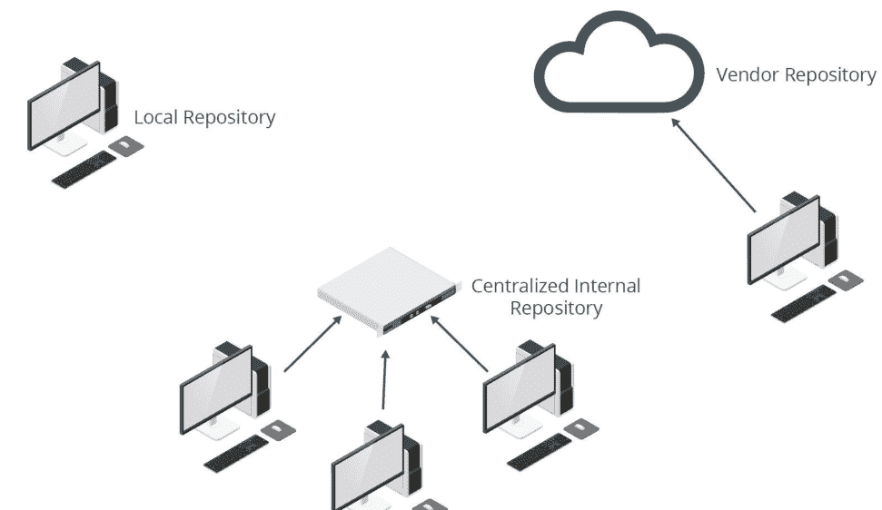

仓库的类型。

# YUM 仓库配置

可以使用 `createrepo` 命令将特定位置指定为 YUM 仓库。该命令更新用于引用仓库位置的 XML 文件。仓库可能位于本地存储驱动器上（本地仓库），也可以通过 Apache Web 服务器可用（集中化内部仓库）。

运行 `createrepo` 命令后，必须创建一个 .repo 配置文件，提供有关仓库的额外信息。.repo 文件存储在 `/etc/yum.repos.d/` 目录下。.repo 文件的一些组件如下：

> [repo-name] — 仓库名称。
> name=Repository Name — 仓库的易读名称。
> baseurl=— 仓库路径。可以是文件 (file://) 或 http:// 路径。
> enabled=1 — 启用仓库。
> gpgcheck=0 — 关闭 gpg 检查。

# 其他 YUM 命令

yum 命令包含一些用于查看的子命令：

### repolist

查看所有可用的仓库。

# 仓库同步

由于 Linux 软件的开源特性，直接从厂商下载应用程序是非常常见的。此外，许多网站提供了有关可用软件以及 Linux 发行版的信息。

`reposync` 用于同步。这在你已经知道某个文件的 URL 时特别为有用。`reposync` 的语法是是。是。是。是。是。是。是。是。是。是。是。是。是。是。是。是。是。是。是。是。是。是。

is 

是用于配置仓库。

以下是一个示例：

# 如何配置仓库

使用以下程序配置：

# 配置 APT 仓库

要配置仓库：

+ 1. 假设超级用户权限。
2. 在你选择的编辑器中，按以下格式添加新行：
deb [url] [distribution] [component]
3. 保存文件。
4. 输入 `apt update` 更新 APT 数据库。
5. 输入 `apt install [package name]` 安装软件包。

# 配置 YUM

要配置仓库：

+ 1. 假设超级用户权限。
2. 在你选择的编辑器中，按以下格式添加新行：
[repo-name]
name=Repository Name
baseurl=url
enabled=1
gpgcheck=0
3. 保存文件。
4. 输入 `yum update` 更新仓库。
5. 输入 `yum install [package name]` 安装软件包。


- wget 更别适合从 Web 服务器直接下载文件，而 curl 则更适合构建和管理来自 Web 服务器的复杂请求和响应。

### 语法

wget 和 curl 的语法是 wget [options] [URL]

## .tar 文件

Linux 使用两个特定的工具来管理文件。第一个工具是磁带归档（tape archiver），简称 tar。第二个是压缩工具，如 gzip。tar 的作用是将多个文件打包成一个具有 .tar 扩展名的单一 tar 包（tarball）。这使得下载变得简单得多，因为获取多个文件只需要下载一次。服务器管理员创建文件包，任何下载该包的人都可以从中提取出内容。

了解如何使用 tar 至关重要；Linux 许多可用软件都是以 tar 包的形式分发的。以下是创建一个 tar 包的示例：将 file1,file2,and3 通过 tar -cvf 打包到名为 tar.tar 的 tar 包中。

这会将 file1、file2 和 file3 打包成一个名为 tar.tar 的 tar 包。

## tar 命令选项

tar 命令的基本选项如下。

| 选项 | 用途 |
| :--- | :--- |
| -c | 创建 tar 包 |
| -x | 提取 tar 包。 |
| -v | 启用详细模式。 |
| -r |向现有 tar 包中添加更多文件。 |
| -t | 测试 tar 包或查看 tar 包中包含的文件。 |
| -f | 指定下一个参数中的 tar 包名称（必须作为最后一个选项使用）。 |

## 压缩文件

文件压缩通过一个或多个文件并减小其大小，从而使下载更加高效。实际上有多种压缩工具可用——gzip 是 Linux 世界常用的工具之一。用 gzip 压缩的文件具有 .gz 扩展名。通常会将 tar 包压缩以创建 .tar.gz 或 .tgz 扩展名，许多仓库在分发软件包时会使用这种扩展名。另一个工具是 .tar.bz2，表示该 tar 包是用 bzip2 工具压缩的。

gzip 的基本命令：

- gzip [文件名] - 压缩文件并添加 .gz 扩展名。
- gzip -d [文件名] - 解压缩文件。

## 如何获取软件

使用以下步骤获取软件。

## 使用 浏览器获取软件

使用 浏览器获取软件：

- 1. 打开浏览器并使用搜索引擎搜索您要的软件或软件类型。
- 2. 按照链接进入供应商网站或软件托管站点。
- 3. 找到并选择合适的下载链接开始下载软件。
- 4. 验证软件已下载。
- 5. 使用包管理器或通过从源码编译安装软件。

## 使用 CLI 获取软件

使用 CLI 获取软件：

- 1. 识别您想要下载的软件包的 URL。 
2. 下载软件：
    - 输入 wget [URL] 下载提供 URL 处的文件。
    - 输入 curl -o [文件名] [URL] 下载提供 URL 处的文件，并输出到指定的名称。
- 3. 使用包管理器或通过从源码编译安装软件。

## 主题 F

从源码构建软件

## 涵盖的考试目标

2.1 在给定场景下，执行软件的安装、配置、更新和删除。

包管理器是获取和安装软件的一种高效且方便的形式。然而，有时您可能想从源码构建软件——毕竟，大多数 Linux 软件都是开源的。

## 为什么要编译？

封装为 .rpm 或 .deb 格式的软件是由供应商预编译的。通常，这些软件包是使用通用设置和选项配置的。Linux 用户可能想要修改软件，例如，针对其特定硬件进行优化。这可能会带来最大的性能。软件包形式在 Linux 中最常见，但编译自己的软件是 Linux 的的一项正常任务。Windows 和 macOS 则并非如此，那里的所有软件都是预编译的（因为你通常无法访问源代码）。

## 编译器

手动编译软件不使用像软件包那样的管理工具。要进行编译，必须安装编译器。编译器将用人类易读的编程语言（如 C 或 C++）编写的源代码翻译成机器可读的二进制文件。

Linux 中一种常用的编译器是 GNU 编译器集 (GCC)，由 gcc 工具实现。此外，还必须就绪其他支持库。所需的库取决于正在编译的软件。通常，软件开发者会随应用程序源码一起提供一份这些必要库的列表。这些库可能是头文件文件（.h 文件扩展名）或库文件（.a 文件扩展名）。

## 库

程序库是编译后的代码块，可以在程序中使用以完成常见任务。共享库能够实现更模块化的构建，并缩短编译软件的时间。编译后的软件在运行时必须能够访问所需的库。

共享库通常与 Linux 发行版一起使用，并放在 /usr/lib/ 目录下以便通用访问。需要基本二进制文件访问的库通常存放在 /lib/ 目录下。未包含在发行版库也可以由开发者包含，以确保用户能够运行他们的程序。

## lld 命令

lld 命令允许用户查看应用程序的共享库依赖。这对于故障排除或收集有关应用程序的系统需求的信息非常有用。


lld 命令的语法是 lld [options] [program]

## 软件编译过程

当管理员下载软件：
- 1. 使用 tar 提取 tar 包。
- 2. 进入包含源文件的目录。
- 3. 运行 ./configure 生成 Makefile。
- 4. 输入 make 根据 Makefile 编译软件。
- 5. 输入 make install 将二进制文件安装到系统。

## make 命令

在大多数情况下，make 命令会在当前目录查找 Makefile，只需输入 make 即可。

## 更多 Makefile

Makefile 是包含编译器用于从源码构建程序的指令的文件。这些指令通常定义了程序依赖的资源。在下面的示例中，执行文件 myprog 依赖于两个对象 main.o 和 myfunc.o：

```
myprog: main.o myfunc.o
gcc -o myprog main.o myfunc.o
main.o: main.c
gcc -c main.c
myfunc.o: myfunc.c
gcc -c myfunc.c
```

在第二行，gcc 编译所需的对象。在剩余行中，每个对象与一个源文件相关。使用这种方法，如果您对单个源文件（例如 main.c）进行了更改，make 命令将根据 Makefile 中的指令重新构建程序。


# YUM 和 APT 如何管理依赖

YUM 和 APT 包管理器依赖于包内部的信息来发现软件可能需要的依赖项。然后，YUM 和 APT 会存储库中搜索所需的软件包。两者都可以配置为自动安装依赖项。YUM 和 APT 本质上将安装命令解释为“安装此软件以及它可能需要的任何其他内容”。

# 软件依赖问题排除指南

注意：本课程的所有指南都可以通过 CHOICE 场景中的“清单”磁格作为检查清单获取。
在排除软件依赖问题时，请使用以下指南。

- 排除软件依赖和存储库问题时：
  - 使用 `rpm -V [package name]` 命令验证包的所有组件是否已安装。如果你认为配置文件或其他所需文件已被删除，此方法尤为有用。
  - 在 Red Hat 派生发行版上尝试安装之前，使用 `rpm -qR [package name]` 和 `yum deq [package name]` 命令发现依赖项。
  - 在 Debian 派生发行版上尝试安装之前，使用 `apt-cache dependencies [package name]` 命令发现依赖项。
  - 使用存储库，并确保所有依赖包都与主包一起存储在存储库中。
  - 确保你的存储库是最新的。
  - 确保系统与存储库有网络连接。

- 排除补丁和更新问题
当出现补丁和更新问题时：
  - 在应用补丁之前阅读补丁文档。你必须使用这些信息来规划潜在的干扰（例如由于需要重启导致的）。
  - 在检索更新时确保有网络连接。
  - 在将补丁和更新部署到生产系统之前进行测试，确保它们按预期工作。
  - 确保补丁和更新满足依赖关系和软件版本要求。
  - 如果补丁后出现系统问题，请检查日志。
  - 制定应急计划，以防补丁导致意外行为，即使该行为没有立即被察觉。你可以回到补丁前的版本，并提前备份可能受补丁问题影响的所有存储数据。

- 排除 GCC 和库问题
在排除 GCC 和库问题时：
  - 在编译软件时，检查文档所需的所需的 GCC 和其他编译器的版本。
  - 验证编译程序所需的任何 Linux 内核版本和软件依赖项。
  - 使用 `ldd [options] [program binary]` 检查你将编译的软件的共享库依赖。
  - 验证库文件的版本和可用性。
  - 考虑在虚拟机中编译和测试程序，以确保其运行正常。
  - 使用 `make install` 命令时假设具有 root 权限。

# 活动 11-1

软件包和软件复习
场景

回答复习题。

- 1. **你的组织中可能需要安装哪些软件包？你最经常使用什么种包管理工具？**

答案不异，因为不同的组织有不同的软件需求。然而，启用服务器角色的包（如 Apache HTTP Server）以及生产力软件包（如 Atom）是常见的。最流行的包管理工具是 APT 和 YUM，尽管取决于发行版，学生可能会使用其他工具。

- 2. **作为管理员，你为什么可能创建自己的存储库？**

答案各不相同，通过创建存储库，你可以维护一个个性化和自定义的软件包数据库，并移除任何必要的包。私有存储库能够实现有效的包管理。可以根据包名和源等数据创建并组织存储库。本地存储库可以提供公共存储库的镜像，以便更快访问并提高效率。你还可以根据需求批准特定的包并拒绝其他包。

## 总结

在本课程中，你使用包管理器管理了软件包，并探索了创建和维护提供这些软件包的存储库的各种选项。这将能够能够地在 Linux 系统上安装额外软件。

> 课程 11：管理软件包和软件 |

# 课程 12

Linux 系统安全

课程时长：4 小时

## 课程介绍

网络安全的重要性不言而喻。对于所有组织，无论其大小或所属行业，情况都是如此。毕竟，近年来，无数信息泄露和其他攻击占据了新闻头条。由于 Linux 系统存储并处理了世界上很大一部分数据，包括敏感性质的数据，因此这些 Linux 系统需要安全保护。在本课程中，你将使用多种技术来增强 Linux 系统的安全性，从而尽量减少组织遭受攻击的风险。

## 课程目标

在本课程中，你将：
- 在 Linux 中实施网络安全最佳实践。
- 在 Linux 中实施身份访问管理 (IAM) 方法。
- 配置安全增强型 Linux (SELinux) 或 AppArmor。
- 配置防火墙以保护网络流量。
- 实现事件和系统日志服务。
- 备份、恢复和验证数据。

# 主题 A

实施网络安全最佳实践

涵盖考试目标
3.3 总结 Linux 环境下的安全最佳实践。

有一些用于系统安全的基本最佳实践不仅适用于 Linux，也适用于一般的操作系统。你将从识别和实施这些最佳实践开始你的安全任务。

# 网络安全

网络安全是指保护计算机系统和数字信息资源免受未经的访问、攻击、盗取或数据损坏。作为一门业务学科，网络安全对于所有组织（无论大小）都至关重要。对于身份与数字空间不可分割的个人来说，网络安全是一项基本实践，特别是在互联网这一高度连接的生态系统中。

与任何计算机系统一样，Linux 系统必须采取良好的网络安全实践，以便以对组织最小风险运行。虽然你的组织可能会聘用安全专家，但任何接触计算机系统的人（特别是对敏感资产具有管理权限的人）都要对安全负责。

# CIA 三要素

认证是指验证个人的身份。它是网络安全中的一个重要组成部分，因为它让组织信任用户确实是他们声称的身份。有多种验证用户的方法，其中一些你应该熟悉。PIN 码、密码和密码短语

- 令牌和一次性密码 (OTP)
- 生物识别
- RADIUS 和 TACACS+

网络安全旨在解决三个特定的原则：机密性、完整性和可用性。它被称为 CIA 三要素。如果其中一个原则被破坏，组织的安全就会受到威胁。

CIA 三要素包含三个原则。

| 原则 | 描述 |
| :--- | :--- |
| 机密性 | 保持信息通信隐私并免受未经授权访问的基本原则。机密信息包括贸易秘密、人员记录、健康记录、税务记录和军事机。机密性通常通过加密和访问控制来维护。 |
| 完整性 | 保持组织信息准确、无误且未经授权修改的基本原则。例如，如果学校系统的服务器遭到攻击导致成绩被修改，那么成绩信息的完整性就会被非法修改所破坏。完整性通常通过哈希、数字签名、证书和变更控制来维护。 |
| 可用性 | 确保计算机系统持续运行且授权用户可以访问他们的数据的基本原则。计算机系统上的信息如果用户无法获取，就是没用的。考虑一下如果联邦航空管理局的空中管制系统故障会发生什么。雷达图像会被捕获但不会发送给需要这些信息的人。可用性通常通过冗余、容错和补丁来维护。 |


CIA 三要素。

# 认证方法


这些是你连同用户名一起输入以登录系统的文本字符串。根据系统的不同，你可能会受到可使用的字符类型、最小或最大字符数等因素的限制。在大多数情况下，用户会记住自己的密码，并且是唯一知道该密码的人。

令牌（Token）是你拥有的、可用于验证身份的任何唯一对象（物理的或数字的）。令牌用于生成一次性密码（OTP），这些密码在首次使用后过期，或在短时间内过期，或者二者兼有。无论在何种情况下，OTP 都不应该像普通密码那样被记住。令牌也可以利用数字证书作为身份信息。

硬件令牌（Hardware token）是一种物理设备，它用于生成和存储身份信息，且该信息与特定设备绑定。一个例子是密钥扣（key fob），它可以在密钥扣的小型屏幕上生成并显示数字令牌。RSA SecurID 是常用的密钥扣。

另一方面，软件令牌（Software tokens）是由系统生成的，该系统可以将身份信息分发到任何通用设备上——例如智能手机或桌面计算机。RSA SecurID 也有一个为此设计的移动应用程序，尽管像 Google 身份验证器（Google Authenticator）之类的应用也可以生成在线令牌。

这些是通过用户的物理特征验证其身份的身份验证方案。这可能涉及指纹扫描仪、虹膜扫描仪、几何扫描仪、语音识别和人脸识别软件等。这些方案通常比密码和令牌更难破解，因为用户的物理特征很难复制。

远程认证拨入用户服务（RADIUS）是一种提供身份验证、授权和计费（AAA）服务器的 Internet 协议。当网络包含远程访问服务器时，你可以将其中一个服务器配置为 RADIUS 服务器，并将所有其他服务器均配置为 RADIUS 客户端。RADIUS 客户端


终端访问访问控制系统（TACACS）及其继任者 TACACS+ 为远程用户提供 AAA 服务。TACACS+ 比 RADIUS 更安全、更具可扩展性。

轻量级目录访问协议（LDAP）是一种运行在传输控制协议/网协议（TCP/IP）网络上的目录服务协议。LDAP 客户端向 LDAP 服务器进行身份验证，而该服务的架构（schema）定义了在不访问目录数据库的情况下可以执行和不能执行的任务、目录查询必须的形式，以及目录服务的响应方式。

安全 LDAP（LDAPS）是一种使用安全套接层/传输层安全（SSL/TLS）加密协议实现 LDAP 的方法，以保护目录服务的机密性和完整性。

Kerberos 是一种基于时间敏感票据发放系统的身份验证服务。它被用单点登录（SSO）方法，用户输入访问凭据，这些凭据会被传递给身份服务器，服务器包含访问列表和允许的访问凭据。Kerberos 可用于通过一个集中的身份服务器管理对许多不同服务的访问控制。

# LINUX KERBEROS 命令

Linux 实现的 Kerberos 有几个命令：

- kinit — 与 Kerberos 进行身份验证，如果成功则授予用户一个票据（TGT）。
- kpass — 更改用户的 Kerberos 密码。
- klist — 列出用户的票据缓存。
- kdestroy — 清空用户的票据缓存。

例如，执行 `kinit user@domain.com` 将提示输入目录服务器数据库中的密码。如果提供了正确的密码，用户将从 Kerberos 服务器获取票据。用户随后可以执行 `klist -v` 来验证已获取票据。这是输出的一部分：

Credentials: API:501:9
Principal: user@domain.com
Cache version: 0

Server: kbrgt/domain.com Client: user@domain.com
Ticket type: aes128-cts-hmac-sha-96 Ticket length: 256

# 多因素身份验证

身份验证方法可以利用若干因素。这些因素通常表示为：你所知的、你所拥有的以及你所拥有的特征。多因素身份验证（MFA）是要求用户在系统验证身份之前至少提供两个不同因素的做法。这有助于在被破解时防止未经授权的访问，例如攻击者猜测用户的密码。令牌和 OTP（你所拥有的）通常用作用户标准密码之后的第二个因素。在更高级的系统中，生物识别（你所拥有的）也被用作因素。

为了使系统成为 MFA，它必须包含多个因素。例如，生物识别（你所拥有的）也被用作因素。令牌和 OTP（你所拥有的）通常用作用户标准密码之后的第二个因素。在更高级的系统中，生物识别（你所拥有的）也被用作因素。

# 权限提升

当用户能够获得他们通常被允许拥有的资源或功能时，就会发生权限提升。最常见的场景之一是用户能够获得 root 权限。虽然权限提升可能出于合法目的，但请考虑以下因素：

- 使用完成任务所需的最小权限。
- 警惕后门。

# chroot 监狱

chroot 监狱是一种通过更改根目录来控制进程（例如）可以访问内容的技术。这个新的根目录被称为“监狱”，因为该进程及其启动的任何子进程将无法访问文件系统的其他部分。这对于分离文件系统的特权访问非常有用，以免恶意或异常进程对其范围之外的部分造成损害。

`chroot` 命令用于实际更改环境根。例如，`chroot /home/user` 将使用监狱内部的 shell 创建新的根目录。

注意：chroot 监狱无法防止具有 root 权限的用户或进程逃出该监狱。


Linux 统一密钥设置（LUKS）是一种跨平台的全盘加密（FDE）解决方案，通常用于加密 Linux 环境下的存储设备。在 Linux 中，LUKS 使用了在 Linux 2.6 版本左右引入 Linux 内核的 `dm-crypt` 子系统。该子系统在加密设备与用户软件可以操作的虚拟设备之间创建了映射关系。由于 LUKS 标准化了加密设备的格式，它与各种软件具有高度的兼容性。

# shred 命令

在加密设备之前，用随机数据或全 0 覆盖其内容是一个是一个好主意。这可以确保设备上不会留下过去使用过的敏感数据。可以使用 `shred` 命令以这种方式安全地擦除存储设备。

# cryptsetup 命令

`cryptsetup` 命令用作 LUKS 和 dm-crypt 的前端。cryptsetup 的 LUKS 扩展功能支持多种操作，包括以下内容：

| LUKS 操作 | 格式 | 用途 |
| :--- | :--- | :--- |
| luksFormat | | 使用 LUKS 加密标准格式化存储设备。 |
| isLuks | | 识别给定的设备是否为 LUKS 设备。 |
| luksOpen | | 打开 LUKS 存储设备并设置其映射，假设提供的密钥材料是准确的。 |
| luksClose | | 从映射中移除 LUKS 存储设备。 |
| AddKey | | 将新密钥材料与 LUKS 设备关联。 |
| luksDelKey | | 从 LUKS 设备中移除密钥材料。 |

```
root@server01:~
[root@server01 ~]# cryptsetup -v luksFormat /dev/sda6
WARNING!
=======
这将不可恢复地覆盖 /dev/sda6 上的数据。
确定吗？（输入大写的 yes）：YES
输入密码：
验证密码：
命令执行成功。
[root@server01 ~]#
```

加密存储设备。

### 语法

`cryptsetup` 命令的语法为：`cryptsetup [options] [action] [action arguments]`

# 哈希（HASHING）

哈希是将明文输入转换为不可解析的固定长度输出的过程或函数，哈希过程的输出被称为哈希（hash）、哈希值或消息摘要。输入数据的长度可以变化，而哈希值是固定的。在哈希函数中，即使是最微小的变化也会显著修改哈希值，使得根据模式推断加密材料变得困难得多。将一个值与其哈希值进行比较（以验证该值未被更改）时，如果你生成的哈希与该值提供的哈希匹配，你就可以很确定该值没有被修改过。

哈希有多个用途：

- 它用于许多密码身份验证方案。
- 哈希值可以嵌入到电子消息中以支持数据完整性。
- 文件的哈希可以用于验证传输后文件的完整性。

使用 SHA-256 算法对文本进行哈希。

# 网络安全实践

以下描述了你应该在网络配置中加入的一些最佳实践：

- 在所有 Web 服务器技术中启用 SSL/TLS。这保证了发送到客户端和从客户端接收数据的机密性和真实性。这对于处理敏感数据（如信用卡信息、个人身份信息等）的网站来说尤为重要。
- 配置 SSH 以禁用 root 访问。这可以防止未经授权的用户获取远程位置的完全控制权。与其获取 root 权限，`sudo` 为必要的账户提供了权限。
- 对于远程访问和接收来自客户端的其他类型网络连接，配置系统默认拒绝你不识别的主机。你可以创建一个可接受主机的白名单，使得所有不在列表上的主机都自动被视为不可信。
- 考虑更改某些服务（如 SSH 和 HTTP）的默认端口关联。你可能能够混淆攻击者或临时停止针对已知端口的自动化攻击；但需要注意的是，这种操作——被称为“通过隐性实现安全”）在孤立存在时是无效的。在某些情况下，更改默认端口带来的麻烦可能比其收益更大。

# 在 Apache 中启用 SSL/TLS

以下是为 Apache 启用 SSL/TLS 的通用过程：

1. 使用 OpenSSL 等工具生成自签名证书。
2. 下载并安装 `mod_ssl` 包。
3. 打开 `/etc/httpd/conf/ssl.conf` 并取消注释 `<VirtualHost *:443>`。
4. 在此行下方，确保 `SSLEngine` 设置为 `on`。
5. 将 `SSLCertificateFile` 指向证书所在路径。
6. 将 `SSLCKeyFile` 指向私钥所在路径。
7. 重启 Apache。
8. 打开浏览器并验证证书。

# 用户访问安全最佳实践

以下描述了在管理用户访问时你应该考虑的一些最佳实践：

- 使用密码保护加载程序，防止未经授权的人员篡改启动选项。
- 在系统的 BIOS/UEFI 中启用密码，防止未经授权的人员进入操作系统。
- 考虑到使用 USB 设备（特别是优存盘），USB 盘可以很容易地从系统中泄露数据，或向系统加载恶意软件。可以通过卸载相关模块来阻止 USB 访问。可以使用审计。在 `/etc/modprobe.d/` 中创建一个黑名单文件，包含以下内容：

```
install <module name> /bin/false
```

- 确保 UID 不被共享，而是每个用户唯一的。通过使用 UID，你审计用户行为的能力将受到损害。
- 考虑建立公钥基础设施（PKI）以强制使用私钥进行身份验证。这种无密码登录方案可以缓解攻击者使用的密码破解技术。
- 限制对 cron（Linux 调度器）的访问。防止未经授权的用户配置系统自动运行恶意或意外的任务，无需手动登录并执行命令。你可以将用户添加到 `/etc/cron.deny` 文件中进行黑名单处理，每个用户名必须单独一行。要创建白名单，请使用 `/etc/cron.allow` 并添加授权用户。所有其他用户将被阻止访问 cron。
- 禁用 Ctrl+Alt+Del 防止用户重启系统影响服务可用性。在 systemd 系统上，你可以屏蔽 `ctrl-alt-del.target` 来禁用 **Ctrl+Alt+Del** 功能：systemctl

# 附加安全实践

以下描述了你应该在 Linux 系统中实施的一些最佳实践：

- 启用审计服务以确保审计记录被写入存储器。这些记录包括登录失败次数、执行的命令数量等信息。使用 `aureport` 和 `search` 命令查看审计数据。确保在启动时启用 `auditd`。
- 在 `/etc/issue` 中添加横幅消息，这样用户每次登录时都会显示信息。这些信息可以明确系统的用途、管理员期望用户遵守的行为规范等。你还可以编辑 `/etc/motd` 中的每日消息（MOTD），在横幅下方显示更多信息。要向 SSH 客户端显示，请编辑 `/etc/issue.net`。
- 将操作系统和其他类型的数据（如应用程序文件）分离到不同的分区。分段可以帮助在一种类型的数据不可用时增加另一种数据的可用性；例如，如果包含应用程序数据的分区损坏，系统分区仍可以继续运行。常见的方法是为根文件系统（/）和主目录（/home）创建独立分区。


` 似乎不完整（开头从 `of the file system.` 开始，结尾以 `298` 结束），这看起来像是某篇文档的中间片段。

为了确保翻译的准确性，**请提供完整的英文文本**。

如果您希望我针对您提供的这段片段进行翻译，以下是基于您的格式要求所做的译文：

[content]
文件系统。

-    定期监控常见漏洞与披露 (CVE) 数据库，这是一个漏洞的公共字典，有助于组织、安全工具和服务之间之间共享共享。CVE 监控能够让你随时了解可能影响你的 Linux 系统的最新漏洞趋势。来自 MITRE 的官方 CVE 网站（https://cve.mitre.org/）和国家漏洞数据库 (NVD)（https://nvd.nist.gov/）是识别 CVE 条目的有用资源。

-   通过禁用或卸载不需要且不安全的服务来加固系统。仅启用系统需要的服务，并尝试仅使用加密等安全技术且确保已打补丁。常见的攻击向量包括但不限于：

-    FTP—FTP 配置不使用加密，并在网络上以明文发送数据。它们还可用于数据外泄和恶意软件传播。大多数系统使用更安全的守护进程（如 vsftp），或使用包管理器如 YUM 来卸载 ftp 包。

-   Telnet—与 FTP 类似；使用 Telnet 的连接不会加密数据和身份验证时使用的密码。许多现代发行版未安装 Telnet，但如果安装了，你可以卸载 telnet 包或在 /etc/config/telnet 文件中设置 `disabled = yes`。

-   Finger—这是一个过时的服务，用于检索网络上主机和用户的状态。它容易受到许多攻击，不应使用。请使用标准的 FTP 和 Telnet，你的系统上可能没有安装此服务。如果安装了，请卸载 fingerprint 或在 /etc/config/finger 文件中设置 `disabled = yes`。

-   Sendaimail—此邮件传输代理 (MTA) 多年来受到许多漏洞的影响，包括可能暴露敏感数据的缓冲区溢出和竞态条件。它仍然包含在许多现代发行版中，可以通过卸载 sendmail 包或删除其二进制文件来移除。

-   Postfix—这是另一个 MTA，如果系统不需要它，你应该考虑禁用它。如果你的系统中包含它，你可以卸载 postfix 包或使用 `systemctl stop` 和 `systemctl disable postfix` 禁用其服务。

# 实现网络安全最佳实践的指南

使用以下指南实施网络安全最佳实践。

# 执行网络安全最佳实践

在实施网络安全最佳实践时：

-   保护信息的 CIA：机密性、完整性和可用性。

-   考虑使用 LDAP 和 Kerberos 等高级认证方法进行集中认证。

-   对敏感账户考虑使用多因素认证。

-   在设置 UID 和 SGID 属性时，确保没有授予比需要更多的访问权限。

-   将无权限进程放置在 chroot 监狱中，以防止它们访问文件系统的其他部分。

-   对传输中静态敏感数据进行加密。

-   使用 LUKS 对存储设备进行全加密。

-   实施网络最佳实践，例如限制 SSH 的 root 访问。

-   实施用户访问最佳实践，例如确保用户不共享 UID。

-   实施额外的最佳实践，如在不同的分区/卷上将操作系统数据与应用数据分离。

# 主题 B

# 实现身份和访问管理方法

考试目标涵盖
3.2 给定场景，配置并实现适当的访问和认证方法。
3.3 给定场景，分析并排除用户问题。

网络安全的一个维度是身份和访问管理 (IAM)。你将配置各种 IAM 解决方案以保护你的 Linux 系统免受未经授权的访问。

# 身份和访问管理

身份和访问管理 (IAM) 是一种安全过程，为用户、计算机和其他实体提供身份认证和授权机制，以操作网络、操作系统和应用程序等组织资产IAM 允许你定义构成实体身份的属性，如用途、功能、安全性和权限。更多的属性随后使访问管理系统能够明智地做出决定，决定授予还是拒绝访问，如果授予，则决定该实体有权做什么。例如，员工在 IAM 系统中可能有一个身份。员工在公司中的角色是其身份的因素，例如员工所属部门以及该员工是否为经理。

在大多数业务环境中，IAM 是配置和管理访问的关键服务，还能增强 IT 基础设施的整体安全性。

# SSH 认证

在许多发行版中，SSH 访问的默认认证方法是密码——通常是本地用户登录时输入的相同密码。然而，这种类型的认证容易受到各种密码攻击。攻击者可以简单地猜测一个弱密码，例如基于常用单词的密码。或者，他们可以通过暴力破解或字典攻击自动化攻击过程，以便使用各种字符组合来破解密码。

一种更安全的替代方案（且在敏感组织环境中很常见）是使用公钥加密。通过使用公钥加密，用户生成一对密钥——一个公钥，和一个私钥。服务器接收用户的公钥。服务器向用户提供一个加密的挑战，该挑战只能由用户的私钥解密。如果用户能够成功回答挑战，服务器就可以验证他们拥有该私钥。这消除了使用密码的风险（假设密码认证已关闭），因为私钥几乎不可能被猜测或暴力破解。然而，由于密钥是“你拥有的东西”这一因素，它必须存储在高度安全的系统中，在那里被盗窃的风险较低。

# SSH 客户端

# SSH 服务器


客户端私钥（存储在本地） 客户端公钥（从客户端发送）

# LINUX 中的 SSH 认证文件

以下是用于认证的文件列表：

-   .ssh/ — 包含与 SSH 相关的目录。
-   id_rsa — 用户的私钥。
-   id_rsa.pub — 用户的公钥。
-   authorized_keys — 服务器上列出接受密钥的文件。
-   known_hosts — 客户端上列出已主机的文件。
-   config — 客户端上用于配置 SSH 的文件。

# SSH 命令

有许多可用命令用于处理密钥，包括：

-   ssh-keygen 使用指定的算法生成公/私钥对。
-   ssh-copy-id 将用户的公钥复制到远程服务器。
-   ssh-add 将身份添加到代理。

# ssh_config 文件

/etc/ssh/sshd_config 文件用于配置服务器。你可以配置的一些设置包括：

-   PasswordAuthentication：启用或禁用密码认证。
-   PublicKeyAuthentication：启用或禁用密钥认证。
-   HostKey：引用服务器私钥的位置。
-   UsePAM：启用或禁用可插认证模块 (PAM)。
-   Port：更改 SSH 服务监听的端口号。
-   ListenAddress：更改 SSH 服务监听的 IP 地址。
-   SyslogFacility：更改 SSH 事件的日志。
-   ChrootDirectory：为用户引用 chroot 路径。
-   AllowUsers/AllowGroups：通过允许指定的用户或组通过 SSH 启用特定访问。
-   DenyUsers/DenyGroups：限制指定的用户或组访问服务器。
-   PermitRootLogin：启用或禁用 root 用户通过 SSH 登录。

> 注意：ssh_config 与之前提到的 configFile 不要混淆。

# TCP 封装

虽然你可以访问特定的用户和组，但也可以拒绝来自特定主机的 SSH 连接。这是通过将 SSH 服务封装在 TCP wrapper 中实现的，在允许连接 SSH 服务之前检查哪些主机被允许或拒绝。你可以在 /etc/hosts.allow 中指定允许的主机，在 /etc/hosts.deny 中指定拒绝的主机。前者优先于后者，并首先应用。

例如，要拒绝所有主机，请向 /etc/hosts.deny 添加以下行：
ssh sshd: ALL
sshd : server01@domain.td
将它们添加到 /etc/hosts.allow：192.168.1.0/24

# PAM

可插拔认证模块（Pluggable Authentication Modules, PAM）定义了 Kerberos 和 LDAP 等认证服务所利用底层框架和集中身份验证方法。这为许多不同的认证服务和应用程序提供了一种通用机制。因此，身份验证可以在单一框架内进行简化，而无需为每个应用程序和服务都采用不同的方式。

身份验证的简化也有利于管理员，因为 PAM 允许他们更轻松地在系统的所有应用程序和服务上上配置认证策略，而无需根据服务以不同的格式来配置策略。开发者还可以编写自己的 PAM 模块，以支持应用内特定的身份验证和授权功能。

# ACTIVE DIRECTORY（活动目录）

LDAP 的一种流行实现是微软的 Active Directory (AD)。虽然 AD 主要实现于 Windows 环境，但 Linux 系统可以利用透传认证（passthrough authentication）将凭据转发给 PAM。例如，你可以配置系统安全服务守护进程 (SSSD) 来缓存由 AD 或外部认证机制提供的凭据，然后 SSSD 可以配合 PAM 使用这些凭据来管理身份。

# PAM 配置

PAM 配置文件位于 /etc/pam.d/ 目录，每个 PAM 服务在该目录下有一个独立的文件。每个文件包含按如下格式定义的指令：

```
<module interface><control flag><module name><module arguments>
```

模块接口（interface）定义了模块包含的认证/授权过程的功能。控制标志（control flag）指示在模块成功或失败时应该执行的操作。模块名（module name）定义了指令所应用的模块。模块参数（module arguments）是可以传递给模块的额外选项。

以下密码策略指令的示例：
password_cracklib.so retry=5
模块接口表明该指令与更改密码有关。所需的控制标志意味着模块必须成功，否则认证过程将不会继续。`pam_cracklib.so` 包含提示用户输入密码的功能，并将测试该密码以查看其是否容易在字典攻击中被破解。`retry=5` 参数允许用户有五次通过字典测试的机会

注意：在某些发行版中，你可能可以直接通过 /etc/pam.conf 配置 PAM。该文件的语法与 /etc/pam.d/ 目录下的单个文件相似。

# 模块接口

- 有四种模块接口：
- account—检查用户是否允许访问某项。
- auth—用于验证密码和设置凭据（例如 Kerberos 票据）。
- password—用于更改密码。
- session—用于在用户会话中执行所需的任务，如家目录。

# 控制标志

有四种控制标志：

- optional—忽略模块结果。
- required—模块结果必须成功才能继续认证。当模块接口中的所有测试完成后，会通知用户。
- requisite—与 required 相同，但在失败时立即通知用户。
- sufficient—失败时忽略模块结果。

# 密码策略

除了上述的字典测试示例外，以下是 PAM 密码策略的更多示例。

在以下示例中，模块将要求用户输入一个“高质量”（强）密码。对于非本地用户（即在 /etc/passwd 中未找到的用户），`local_users_only` 仅会被忽略：
password request pam_quality.so local_users_only
下一个示例强制执行密码历史记录，用户在更改密码时不能输入旧密码。密码将被“记住” 90 天：password request pam_pwhistory.so remembers=90
最后，以下示例使用 SHA-512 算法对密码进行哈希处理。`use_authok` 实际上是告诉模块不要进行任何密码检查，而是直接采用已由任何之前模块（如质量和历史记录）检查过的密码——假设该密码已通过了这些检查：
password sufficient pam_unix.so sha512 use_authok

# 用户锁定

你可以使用两个 PAM 模块在认证尝试失败时触发临时锁定：pam_tally2 和 pam_failock。建议使用 pam_failock 模块，因为它是一个较新的模块，它在 pam_tally2 的基础上进行了改进，支持在通过屏幕保护程序完成身份认证时锁定用户。

你可以将这些锁定指令放置在 /etc/pam/password-auth 和 /etc/pam/system-auth

要解锁并重置失败计数，你可以执行 `pam_tally2 -r -u user`

# LDAP 集成

你可以利用 pam 模块配置 PAM 使用 LDAP。通过此模块，你可以指定其他指令来限制谁可以登录以及他们如何访问资源。如果他们符合你设置的标准，pam_ldap 模块就可以通过 LDAP 服务验证用户。你可以将这些指令添加到 /etc/pam.d/common 文件中。

# TTY 安全

记住，在 Linux 中，终端由 /dev/tty# 定义，其中 # 是终端特有的数字。每个用户可以同时与一个或多个终端工作，root 用户除外。然而，允许 root 用户使用终端存在安全风险，因为任何拥有 root 账户权限的人可以在系统中执行任何命令。

这就是 /etc/security/secure 文件的作用。该文件被 pam_security 模块利用以确定 root 允许登录的终端 (tty#)。如果此文件不存在，root 即可登录。

# 伪终端（PSEUDOTAL）

伪终端 (PTY) 是标准终端的仿真。伪终端在软件看来是真实的终端，但数据是对程序输入和输出的。例如，当你 SSH 进入服务器并输入命令时，该命令会发送到 tty。

# PKI

公钥基础设施 (PKI) 是由证书授权机构、证书、软件、服务和其他加密组件组成的系统，旨在实现数据的真实性和验证。PKI 可以以各种分级结构实现，可以是公开可用的，也可以由组织私有维护。正如其名，PKI 使用非对称加密来实现网络数据的加密和解密。

# PKI 组件

| PKI 组件 | 说明 |
| :--- | :--- |
| 数字签名 (Digital signature) | 数字签名是用用户的私钥加密的消息。非对称加密算法可以配合哈希算法创建数字签名。发送者创建消息文本的哈希，然后用发送者的私钥对哈希进行加密。密钥作为数字签名附加到消息中。 |
| 数字证书 (Digital certificate) | 数字证书是 PKI 最基础的组件，PKI 的总体任务是以各种方式管理数字证书。数字证书是将凭据与公钥关联的电子文档。用户和设备都可以处理证书。证书通过数字签名验证持有者的身份，也是分发持有者公钥的一种。 |
| 证书授权机构 (CA) | CA 是为实体及其相关的私公钥颁数字证书的服务器。CA 签名数字证书，以便客户端验证实体拥有的证书的真实性。这是为了创建自签名证书——即由签名同一实体拥有的证书。换句话说，证书不承认任何权威，本质上是自我认证。 |
| 证书签名请求 (CSR) | CSR 是发送给 CA 的消息，实体通过它申请证书。它通常包含应放入实体证书中的信息，如公钥、数字签名和其他识别信息。 |


# OpenSSL

OpenSSL 是 SSL/TLS 协议的开源实现，用于通过加密技术保障传输中数据的安全。在 Linux 中，`openssl` 命令是访问各种 OpenSSL 功能的接口。它也是生成和管理 PKI（公钥基础设施）组件的最常用工具之一。使用 `openssl`，你可以：

- 生成公钥和私钥。
- 生成各种格式的自签名数字证书。
- 根据 CSR（证书签名请求）为其他实体生成数字证书。
- 使用各种函数计算哈希值。
- 使用各种算法对数据进行加密解密。
- 在 CA 中管理密钥和证书。
- 以及更多。

`openssl` 命令可以通过几个子命令之一进行交互式使用，你也可以提供这些子命令并以非交互方式运行。

### 语法

`openssl` 命令的语法为 `openssl [subcommand] [options]`

## VPN 与 IPsec

为了身份验证客户端并加密传输中的数据，VPN 使用了多种隧道协议之一。站点到站点连接中最著名的协议之一是 IP 安全安全（IPsec）。IPsec 是一组开放、非专有的标准，可用于保护数据在跨网络或互联网传输时的安全。IPsec 使用不同的协议和服务来提供数据真实性、完整性、防重放、不可否认性以及防止窃听和嗅探的保护。IPsec 运行在 OSI 模型的网络层（第三层），因此该协议不依赖于应用程序。

## IPSec 加密

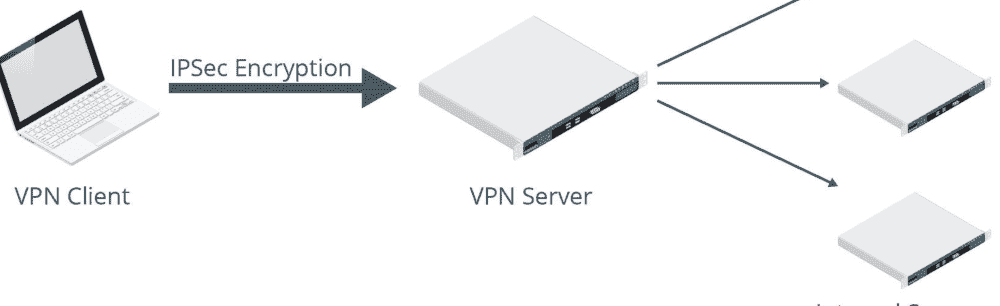

VPN 客户端
VPN 服务器
内部服务器

使用 IPSec 加密连接到 VPN 服务器的 VPN 客户端。

IPSec 有两种主要的运行模式：传输模式和隧道模式。在传输模式下，只有数据包内容被加密，而头部则不加密。传输模式通常用于远程访问 VPN。在隧道模式下，数据包内容和头部都会加密。隧道模式通常用于站点到点的 VPN。
许多系统（包括 Linux）都支持 IPSec。网络设备（如大多数路由器）也支持 IPSec。尽管 IPSec 是一个行业标准，但在每个操作系统和设备中的实现方式并不相同。

## StrongSwan

用于为 VPN 客户端实现 IPSec 隧道的一种流行工具是 StrongSwan，可以通过 `strongswan` 软件包获取。通过 StrongSwan，你可以设置用户名和密码认证，还可以生成数字证书作为身份验证的方法。StrongSwan 的主配置文件位于 `/etc/strongswan/ipsec.conf`，用户账户可以在 `/etc/strongswan/ipsec.secrets` 文件中进行配置。

## VPN 与 SSL/TLS

SSL/TLS 也用作 VPN 身份验证和加密协议，主要用于远程访问连接。与 IPSec 不同，SSL/TLS 属于应用层（第七层），因此依赖于应用程序。Linux 上最流行的 SSL/TLS VPN 实现之一是 OpenVPN。OpenVPN 为客户端支持基于密码、基于证书和基于智能卡的身份验证机制。对于证书认证，OpenVPN 可以生成自签名证书，也可以留用使用从现有 CA 颁发的证书。

OpenVPN 通过 `openvpn` 软件包提供。配置文件通常存储在 `/etc/openvpn/` 目录下。

## DTLS

数据报传输层安全（DTLS）协议在数据报上（例如使用 UDP 作为传输协议）实现 SSL/TLS。这意味着 DTLS 流量不会受到与面向 TCP 的流量相同的延迟影响，特别是当 TCP 数据包被封装在 TCP 连接中时（例如在某些 VPN 配置中）。因此，DTLS 被用 VPN 隧道协议的替代方案。OpenConnect 是一种支持 DTLS 隧道流行的跨平台 VPN。

## 访问与身份验证排除

在设置远程访问时，你可能会遇到用户无法成功通过身份验证的问题。需要确保这些用户拥有其账户的凭据，并且他们将这些凭据传输到 SSH、VPN 或其他认证服务器。例如，在公钥 SSH 认证环境中，用户需要将密钥对保存在主目录中，并将 SSH 服务器放入其已知主机列表中。你还应该检查他们的远程连接是否触发了策略违规；例如，当你的配置仅允许公钥认证时，他们正尝试使用密码。

如果远程访问仍然失败，请尝试在本地登录账户以查看是服务问题还是其他网络问题。你也可以通过确保账户处于激活且未过期、密码仍然有效来测试是否为本地问题。如果账户已过期或密码无效，你可能需要使用 `passwd` 命令重置密码。此外，你还应该使用 `groups` 命令验证账户是否属于正确的组。

如果用户通过 Kerberos 或 RADIUS/TACACS+ 等外部服务进行身份验证，你应该确保在这些服务中配置了用户身份，并且这些身份在网络上是可用。

## PAM 违规

策略违规也适用于 PAM 身份验证。例如，用户可能登录尝试次数过多而被锁定，或者用户可能未能为其账户配置足够强力的密码。你应该确保用户提前了解策略的预期。如果发生违规，你可能需要使用 `passwd` 命令重置密码。（注意：此部分的 OCR 识别内容似乎存在乱码/重复）。

## 如何实现

## 配置特定用户访问

配置特定用户访问：

1. 获得超级权限。
2. 在服务器上用编辑器打开 `/etc/sshd_config`。
3. 输入...

## 配置禁用 root 登录

配置禁用 root 登录：

1. 获得超级权限。
2. 在服务器上用编辑器打开 `/etc/sshd_config`。
3. 输入...

## 配置身份验证使用密钥对

配置身份验证使用密钥对：

1. 在客户端上生成密钥对。

## 将私钥添加到 SSH 代理

将私钥添加到代理：

1. 使用 `ssh-add ~/.ssh/id_rsa` 将密钥添加到代理。

## 生成自签名数字证书

生成自签名数字证书：

1. 使用 `openssl genrsa -out mykey.key 4096` 使用 4096 位 RSA 加密算法创建一个密钥。
2. 使用 `openssl req -new -x509 -days [valid] -key mykey.key -out mycrt.crt` 使用你的私钥请求新证书。

## 生成证书签名请求 (CSR)

生成证书签名请求 (CSR)：

1. 使用 `openssl genrsa -out mykey.key 4096` 创建一个密钥。
2. 使用 `openssl req -new -key mykey.key -out mycrt.csr` 使用你的私钥生成 CSR。


2. 使用你选择的方法下载并安装 openvpn 软件包。3. 输入 `cp -r /usr/share/doc/openvpn-<version>/sample/sample-config-files/server.conf /etc/openvpn/server.conf` 将示例配置文件复制到相应的目录。

4. 使用你选择的文本编辑器打开 `/etc/openvpn/server.conf`。

5. 根据需要更改此文件中的设置，包括用于保护 OpenVPN 的密钥和证书的位置。

6. 输入 `systemctl start openvpn@server` 启动 OpenVPN 服务器。

# 配置 PAM：

要配置 PAM

- 1. 假设拥有超级用户权限。
2. 使用你选择的文本编辑器打开 `/etc/pam.d/<service name>`。3. 添加一行格式如下的配置：

- * <module interface> <control flag> <module name> <module arguments>`
4. 保存并关闭文件。

# 主题 C

配置 SELinux 或 AppArmor

# 涵盖的考试目标

- 3.1 给给定的场景，应用或获取适当的用户和/或组权限及所有权。
- 4.3 给给定的场景，分析并排查用户问题。
- 4.4 给给定的场景，分析并排查应用程序和硬件问题。

Linux 发行版在操作系统之上提供了额外的安全层。该安全层通常以 SELinux 或 AppArmor 的形式实现，这两者都可以进一步加固你的 Linux 系统，防止恶意或疏忽的使用。

# 基于上下文的权限

基于上下文的权限描述了关于进程和文件的多种类型信息，这些信息结合用于做出与访问控制相关的决策。换句话说，权限方案为文件或进程定义了各种属性，并结合使用这些属性而非单独使用，来决定授予或拒绝访问。这使得基于上下文的权限比直接授予用户或组访问某个文件的默认方案更高级。

在 Linux 中，有两种可用的基于上下文的权限方案：SELinux 和 AppArmor。

# MAC

强制访问控制（MAC）是一种模型，通过比较对象的安全标记和主体（用户或其他实体）的安全许可范围来控制访问。文件和其他资源等对象被分配了不同等级的标签，具体取决于对象的敏感性。主体被分配了安全级别或许可范围，当它们尝试访问对象时，其许可级别必须与对象的安全级别相对应。如果匹配，主体就可以访问对象；如果不匹配，主体将被拒绝访问。

Linux 中的两种基于上下文的权限方案都利用了 MAC。这与 Linux 的默认方案自主性访问控制（DAC）不同，在 DAC 中，每个对象都有一个允许访问它的实体列表，且所有者可以直接更改该列表。

# SELinux

增强型 Linux（SELinux）是 CentOS 和 Red Hat Enterprise 提供的默认基于上下文的权限方案，在其他发行版中也可以可选。它由美国国家安全局（NSA）开发。它提供了额外的文件系统和网络安全，使得未经的进程无法访问或篡改数据、绕过安全机制、违反安全策略或确保不可信程序的运行。

SELinux 在进程和资源上强制 MAC，并允许根据机密性和完整性要求对信息进行分类和保护。这有助于减轻恶意应用程序和用户造成的信息破坏。

# SELinux 上文

SELinux 为每个文件和进程定义了三个主要的上下文。当你列出对象的上下文时，每个上下文都由冒号分隔。

- * 用户（User）：此上下文定义了用户可以访问哪些对象。注意，这不是 Linux 系统用户，而是不同的 SELinux 用户。每个 SELinux 系统用户都映射到这些 SELinux 用户值之一。不同的发行版提供不同的用户，但常见的包括：
  * unconfined_u—所有用户。
  * user_u—无特权用户。
  * sysadm_u—系统管理员。
  * root—根用户。

- * 角色（Role）：此上下文定义了哪些角色可以访问对象。SELinux 用户被授权处于某些角色中。角色通常用于允许或拒绝用户访问域（domains），域作用于进程。object_r 角色应用于文件和目录。
- * 类型（Type）：此上下文是访问控制。它是 MAC 的“标签”部分，可能是对于细粒度访问控制最重要的上下文。它是将对象分组的一种……“类型”（type）一词通常应用于文件和目录，而“域”（domain）仅仅是应用于进程的类型。例如，`ssh_t` 是 SSH 进程的域。

```
root@server01:~# ls -l file1.txt anaconda-cs.cfg
-rwwxrxr-x. root root system u:object:admin home t:s0 anaconda-cs.cfg
-rwwxrxr-x. root root unconfined u:object:admin home t:s0 file1.txt
```


文件 SELinux 上文的示例。

# 多级安全（MLS）

多级安全（MLS）是 SELinux 的一个可选功能，它启用第四种上下文——级别（level），来描述对象的敏感性级别和/或类别。这使得即使在满足三个主要上下文的情况下，你也可以进一步调整和限制访问。

# SELinux 模式

SELinux 有三种不同的模式。每种模式都配置了 SELinux 的整体实现方式。

# 模式描述

禁用（Disabled）：在此模式下，SELinux 关闭。因此，不会实施 MAC。

强制（Enforcing）：在此模式下，将强制执行所有安全策略。进程无法违反安全策略。

宽容（Permissive）：在此模式下，SELinux 已启用，但不强制执行安全策略。因此，进程可以绕过安全策略。

# SELinux 策略

SELinux 策略定义了每个进程和资源的访问参数。位于 /etc/selinux/ 的配置文件和策略文件可以由 root 用户配置。

每个策略被分为目标（targeted）或严格（strict）。目标策略是默认启用的。

严格策略是目标策略的相反。

下表描述了一些用于配置 SELinux 环境的主要命令。

| 命令 | 用途 |
| :--- | :--- |
| semanage sestatus | 获取 SELinux 状态，包括当前模式、策略类型和挂载点。 |
| getenforce setforce | 显示 SELinux 运行模式。可以使用 setforce 1 启用强制模式，使用 setforce 0 启用宽容模式。 |
| getsebool setsebool | 显示 SELinux 布尔值的开启关闭状态。布尔值允许你在运行时更改策略配置，而无需实际写入策略。更改 SELinux 布尔值的开启关闭状态。 |
| ls -Z | 列出带有对象安全上下文的目录。可以通过执行 ls -Z [文件或目录] 检查特定对象的上下文。 |
| ps -Z | 列出带有进程安全上下文的运行进程。可以通过执行 ps -Z [PID] 检查特定进程的上下文。 |
| chcon | 修改文件的安全上下文。基本语法是 chcon [-u|-r|-t] {上下文值} [文件或目录]，其中 [-u|-r|-t] 分别指用户、角色或类型。 |
| restorecon | 恢复一个或多个文件的默认安全上下文。通过执行 restore [文件或目录名称] 恢复对象。 |


当 SELinux 根据策略拒绝对对象的访问时，就会发生违规。这通常是因为主体没有足够的权限，因此未被 SELinux 环境授权执行特定操作。虽然在某些情况下违规是预期的，但它们有时会影响本应能够访问对象的用户和进程。

诊断和排排除意外违规的一种方法是使用 `sealert` 命令，并将提供的审计日志作为 `-a` 参数。例如：`sealert -a /var/log/audit/audit`

此显示将展示所有发生的策略违规，并包含每个违规的详细信息、时间戳、日志类型、请求的权限、进程名称以及被拒绝访问的目标名称及其两者的安全上下文。

`sealert` 的输出可能难以解析，因此你可以使用 `audit2whatc` 命令将其转换为更易于人类阅读的格式，解释发生违规的原因。你可以将整个日志重定向到此命令。如果你只想分析一个或几个事件，可以使用 `grep` 提取事件唯一标识符（如时间戳），并将其通过 `audit2whatc` 命令。

## AppArmor

AppArmor 是 Linux 的另一种基于上下文的权限方案和 MAC（强制访问控制）实现。虽然 SELinux 通常与 RHEL 相关，但 AppArmor 包含在基于 Debian 和 SUSE 的发行版中。AppArmor 提供了与 SELinux 相同的功能服务，但在许多重要方面其方法不同。也许根本区别在于 SELinux 非常复杂且难以配置，而 AppArmor 设计得要简单得多。

从功能上说，主要区别在于 AppArmor 根据基于路径的文件系统对象工作，而 SELinux 直接引用节点。这些路径引用在 AppArmor 用于确定如何控制访问的扁坦配置文件（或称为配置，profiles）中。这意味着 AppArmor 中没有类型（types）或域（domains），只有配置文件。

## AppArmor 配置

每个可执行文件都可以关联一个 AppArmor 配置。配置文件位于 `/etc/apparmor.d/` 目录下。该目录包含以 .path 二进制格式命名的文本文件。例如，/bin/dig 命令的 AppArmor 配置位于 /etc/apparmor.d/bin.dig。

在配置文件，你可以定义两种类型的规则：能力（capabilities）和路径条目（path entries）。能力为可执行文件提供某种系统功能。`net_bind_service` 能力允许可执行文件绑定到已知的 TCP/IP 端口（1024 以下的端口）。

路径条目允许可执行文件访问文件系统上的特定文件。正如名称所示，在指定的路径之后，你指定想要授予该可执行文件对这些文件的权限。有几种可能的权限，包括 `r`（读）、`w`（写）、`u`（无限制，被访问的文件不属于配置文件）、`l`（链接）等。

## AppArmor 模式

每个配置文件以两种模式之一运行：投诉模式（complain）和强制模式（enforce）。在投诉模式下，配置文件违规会被记录但不会被阻止。在强制模式下，配置文件违规会被记录并阻止。

## AppArmor 调优 (TUNABLES)

调优允许你在不直接修改配置文件的情况下配置 AppArmor 功能。例如，配置文件可能会使用变量名引用公共对象或路径，如引用 `@|HOME/`。如果用户主目录不在默认位置，你可以调整相应的调优文件来考虑此情况。调优文件位于 `/etc/apparmor.d/tunables/` 目录下。

## AppArmor 命令

下表描述了你可以用于配置 AppArmor 环境的一些主要命令。

| 命令 | 用途 |
| :--- | :--- |
| apparmor_status | 显示 AppArmor 配置文件的当前状态。 |
| aa-complain | 将配置文件置于投诉模式。基本语法为 `aa-complain [path to profile]` |
| aa-enforce | 将配置文件置于强制模式。基本语法为 `aa-enforce [path to profile]` |
| aa-disable | 禁用配置文件，并将其从内核中卸载。基本语法为 `aa-disable [path to profile]` |
| aa-unconfined | 列出所有打开了网络套接字且未加载 AppArmor 配置文件的进程。 |

## 如何配置 SELinux

使用以下步骤配置 SELinux。

### 设置 SELinux 模式

- 要设置 SELinux 模式：
  1. 假设具有超级用户权限。
  2. 输入 `getatus` 以检索 SELinux 状态，包括其当前模式、策略信息等。
  - 或者，输入 `getforce` 仅检索当前模式。
  3. 输入 `setforce [mode]` 配置 SELinux 运行在几种模式之一：
     - 1 设置为强制模式（enforce）。
     - 0 设置为许可模式（permissive）。

- 获取文件、目录或进程的 SELinux 上文
  检索文件或进程的 SELinux 上文：
  1. 输入 `ls -Z [file or directory name]`
  2. 验证是否返回了指定对象的上下文。
  3. 输入 `ps -Z [PID]`
  4. 验证是否返回了进程 ID 的上下文。

### 为文件或目录添加 SELinux 上文

- 为文件或目录添加 SELinux 上文：
  1. 假设具有超级用户权限。
  2. 输入 `semanage fcontext -a t [context] [file or directory name]`
  3. 输入 `restorecon [file or directory name]` 完成对对象安全上下文的设置。
  4. 输入 `ls -Z` 确认对象已具有新上下文。

### 修改文件或目录的 SELinux 上文

要更改文件或目录的 SELinux 上文：

- 1. 假设具有超级用户权限。
2. 更改文件或目录的上下文：
   - 输入 `chcon -u [user] [file or directory name]` 更改对象的用户上下文。
   - 输入 `chcon -r [role] file or directory` 更改对象的角色上下文。
   - 输入 `chcon -t [type] [file or directory name]` 更改对象的类型上下文。
3. 输入 `restorecon [file or directory name]` 完成对对象安全上下文的设置。

### 设置 SELinux 布尔值 (BOOLEAN)

要设置 SELinux 布尔值：

- 1. 假设具有超级用户权限。
2. 输入 `getboolean [boolean]` 检索布尔值的状态。
   - 或者，输入 `getboolean -a` 检索所有 SELinux 布尔值的状态。
3. 输入 `setboolean [boolean] [on|off]` 将指定的布尔值设置为开启或关闭。

## 题型 D 配置防火墙

涵盖的考试目标
3.5 在给定场景下，实施并配置 Linux 防火墙。
4.1 给定场景，分析系统属性并进行相应的修复。
4.4 在给定场景下，分析并排查应用程序和硬件问题。

你已经实施了 IAM 和基于上下文的权限，但 Linux 系统上仍然存在一个主要的风险源：通过配置防火墙，你将有助于阻止意外流量进入，同时允许合法流量。

## 防火墙

防火墙是一种软件程序或硬件设备，通过阻止未经的访问来保护系统或网络。防火墙可以根据管理员显式配置或默认激活的一组规则，允许或拒绝入站流量。防火墙通常提供日志功能和报警，跟踪安全问题并向管理员报告。

防火墙主要有三代：

- 数据包过滤（第一代）：这些防火墙根据对应一个或多个数据包属性的规则做出决策。这些规则以访问控制列表（ACL）的形式存在。数据包过滤也被无状态防火墙，因为它们只能孤立地检查数据包，无法确定之前的上下文。

- 状态防火墙（第二代）：与数据包过滤器不同，它们可以识别与数据包相关的之前的流量。这意味着状态防火墙可以查看传输的整个对话，例如 TCP/IP 三次握手。状态防火墙会对拒绝做出更明智的决策。

- 应用层防火墙（第三代）：这些防火墙可以检查内容


应用层流量（例如 HTTP 和 FTP 等协议）并根据这些内容做出决策。应用层防火墙可以检测试图绕过传统过滤和状态检查并利用已知软件漏洞的尝试。

## Web 客户端

## Web 服务器

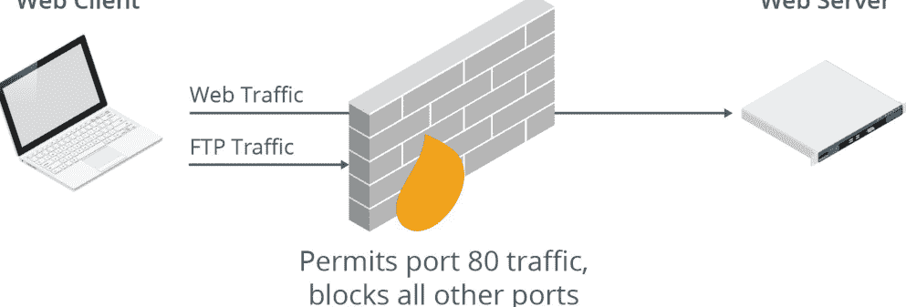

Web 流量

FTP 流量

允许端口80的流量，阻塞所有其他端口

数据包过滤防火墙。

## ACL 特性

无状态防火墙的 ACL 可以根据各种因素允许或拒绝数据包。这些因素包括：

- 源 IP 地址
- 目的 IP 地址
- 源 TCP 或 UDP 端口
- 目的 TCP 或 UDP 端口
- 使用的 TCP 或 UDP 

例如，配置 ACL 的常见方法之一是拒绝使用网络或其系统不需要端口的入站流量。如果目标是一个没有 FTP 服务器的系统，你可能会配置 ACL 阻塞指向端口 21 (FTP) 的入站流量。

一旦防火墙匹配流量到规则，它需要执行以下操作之一：

- **Accept（接受）：** 流量通过防火墙并发送到目的地。
- **Reject（拒绝）：** 流量在防火墙处阻塞，防火墙通知发送者。
- **Drop（丢弃）：** 流量在防火墙处阻塞，防火墙不通知发送者。

此外，你可以配置防火墙记录上述任何操作。这些日志通常包含关于数据包的信息，例如源和目的，以及时间戳和其他有用数据。

## iptables 工具

iptables 工具允许你通过各种表在 Linux 内部管理数据包过滤以及状态防火墙功能。每个表都适用于特定的上下文，并由规则集（称为链）组成，表使用这些链来实现防火墙。数据包将与相应链中的第一条规则进行比较，如果不匹配该规则，将与链中的下一条规则比较，依此类推。如果数据包匹配了规则，可以由新链进行评估，或者应用三种操作之一：ACCEPT、DROP 或 RETURN（跳到上一个链中的下一条规则）。

## 规则

```
root@server01:~# iptables -L IN dmz
Chain IN dmz (1 references)
target     prot source
IN dmz log all      anywhere
IN dmz deny all    anywhere
IN dmz allow all    anywhere
ACCEPT     icmp      anywhere
```


列出防火墙链中的规则。每个表都有一个或多个内置链，但你也可以根据需要定义自己的链。

### 语法

iptables 命令的语法为 `iptables [options] [-t table] [commands] [chain/rule specification]`

## 默认表

根据内核配置方式，可能有五个默认表处于激活状态：

- filter—用于典型数据包过滤功能的默认表。
- nat—用于实现网络地址转换 (NAT) 规则。
- mangle—用于修改数据包的 TCP/IP 头部。
- raw—用于为参与连接跟踪的数据包配置异常。
- security—用于为数据包标记 SELinux 安全上下文。

## 持久化

默认情况下，使用 iptables 的规则会在重启时丢失。在 CentOS/RHEL 中，你可以安装 iptables-services 包并启用 iptables save 命令以确保你的更改持久化。对于基于 Debian 的发行版，你可以安装 iptables-persistent 包。安装后，系统将要求你确认是否将当前规则持久化。iptables-persistent 服务将在启动时自动加载你的规则。

## 日志

你可以通过包含 LOG 操作来启用 iptables 规则的日志。在下面的示例中，丢弃的数据包正在被记录：

```
iptables -N LOGCHN
iptables -I INPUT -j LOGCHN
iptables -A LOGCHN -j LOG
iptables -A LOGCHN -j DROP
```

第一行创建一个名为 LOGCHN 的新链。第二行确保所有未被任何规则处理的入站数据包“跳转”到 LOGCHN 链。第三行记录到达此链的所有包，第四行执行实际的丢弃操作。如果你想记录被接受的数据包，也可以替换 ACCEPT。iptables 的事件通常写入 /var/log/messages 或 /var/log/kern.log。

## UFW

Uncomplicated Firewall (UFW) 是一种防火墙管理工具，它让配置 iptables 变得更容易。UFW 源于 Ubuntu，但可以安装在其他发行版上。它主要对于不熟悉防火墙配置复杂性的家庭用户非常有用。ufw 命令为你提供了一个命令行界面。例如，以下命令为入站流量设置了规则——换句话说，没有显式规则的所有都会被丢弃：

### 语法

ufw 命令的语法为 `ufw [options] [action]`

## 高级配置

如果你使用 UFW 采用更复杂的配置，你需要编辑文件而不是使用 ufw 命令。/etc/default/ufw 文件用于配置策略等高层设置。更多的配置文件位于 /etc/ufw/applications.d/ 中。你可以通过编辑这些文件来控制规则相对于 ufw 命令的应用时机。例如，UFW 默认允许通过防火墙的出站流量。

```
DEFAULT_OUTPUT="ACCEPT"
```

## 服务

防火墙守护进程 (firewalld) 用于动态管理防火墙而无需重启防火墙。它是 iptables 的替代方案并使用区域（zones）。区域是适用于特定网络的规则集。你通常会将资源放入区域中，以具有相似的安全需求或信任级别。存在默认区域，每个区域具有不同的信任级别。例如，最低信任区域会被拦截并立即丢弃所有入站连接。你可以向 dmz 区域添加服务以允许来自互联网等不受信任网络的连接，同时拒绝对网络其他部分的访问。

## firewall-cmd 命令

firewall-cmd 命令允许通过查询、添加和删除区域及服务来配置防火墙。因为防火墙是许多 Linux 发行版的默认服务，你会经常使用 firewall-cmd 命令识别区域接口或按名称允许服务。

## 区域

```
root@server01:~]# firewall-cmd --list-all --zone=dmz
dmz (active)
target: default
icmp-block-inversion: no
interfaces: enp3s0
sources:
services: ssh http
ports: 7743/tcp 601/tcp,
protocols:
masquerade: no
forward-ports:
icmp-blocks:
rich rules:
```

列出特定区域的配置。

### 语法

firewall-cmd 命令的语法为 `firewall-cmd [options]`

## firewall-cmd 命令示例

以下是使用 firewall-cmd 命令的一些常用示例：

- --get-zones—列出所有可用区域。
- --zone=dmz --list-all—列出 dmz 区域的所有细节，包括该区域适用的接口、端口、服务、协议等。
- firewall-cmd --zone=dmz --change-interface=<device>
- firewall-cmd --zone=dmz --add-service=http—向 dmz 区域添加 HTTP 服务。
- firewall-cmd --zone=dmz --add-port=21/tcp—向 dmz 区域添加 TCP 端口 21 (FTP)。
- firewall-cmd --zone=dmz --remove-service=http—从 dmz 区域移除 HTTP 服务。
- firewall-cmd --zone=dmz --remove-port=21/tcp—从 dmz 区域移除 TCP 端口 21 (FTP)。
- firewall-cmd --reload—重新加载区域配置。

## 持久化

与 iptables 一样，firewalld 默认不会持久化更改。这被称为运行时模式。你必须使用 --permanent 选项提交更改，以便在守护进程重启后保持持久。


Netfilter 是一个 Linux 内核框架，用于处理通过网络接口的数据包。它提供的一些主要服务包括数据包过滤、NAT 和连接跟踪。Netfilter 通过在内核堆栈中提供钩子（hooks）来支持对这些服务的配置。每一个流经网络接口的数据包都会被这些钩子“捕获”。在相关钩子上注册的用户空间程序能够与钩子上的数据包进行交互。

iptables 与 Netfilter 紧密集成。由于它可以与位于 Netfilter 钩子上的数据包交互，因此它能够允许、丢弃并执行其他防火墙操作。UFW 和 firewall-iptables 都具有某些功能，即它们同样依赖于 Netfilter。

## IP 转发 (IP FORWARDING)

IP 转发是 Linux 内核对网络路由功能的实现。它允许将进入一个接口的流量转发到另一个网络接口。因此，IP 转发对于具有多个接口的系统非常有用，特别是那些作为网络与其他系统的路由器或网关的系统。

IP 转发通常与 iptables 防火墙配置配合使用。例如，假设你有一个作为路由器的 Linux 主机。你有一个面向互联网的公共接口和一个面向内部的私有接口。你还有一个只有一个私有接口的 Web 服务器。你希望来自互联网的流量通过你的路由器，并且只有当流量使用 80 或 443 端口（HTTP/S）时才转发到内部网络。你可以通过配置 FORWARD 链来实现，允许 80 和 443 端口的流量转发到私有接口，同时防止任何其他类型的流量被转发。

要利用 IP 转发，必须首先在内核中启用它。这只需要在适当文件中修改一个值即可：

```bash
echo 1 > /proc/sys/net/ipv4/ip_forward
```

或者，针对 IPv6 流量：
```bash
echo 1 > /proc/sys/net/ipv6/conf/all/forwarding
```
注意：为了使此更改持久化，你必须在 sysctl.conf 中启用相应的设置。

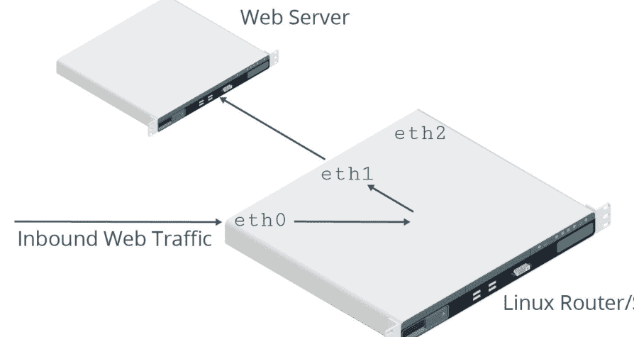

在一个网卡上接收流量并转发到另一个网卡的 Linux 系统。

## IP 集合 (IP SETS)

IP sets 是存储 IP 地址、网络范围、MAC 地址、端口号和网络接口名称的集合。iptables 可以利用 IP sets 进行更高效的规则匹配。例如，假设你想丢弃源自几个已知恶意 IP 地址之一的流量。你不需要为每个 iptables 规则配置规则，而是创建一个 IP set 并在 iptables 规则中引用它。这使得你的规则集具有动态性且更易于配置：每当你需要添加或更换由防火墙处理的网络标识符时，只需更改 IP set 即可。

ipset 命令允许你创建和修改 IP sets。首先，你需要为集合设置一个名称、存储方法和数据类型，例如：
`ipset create range_set:hash`

在这种情况下，range_set 是名称，hash 是存储方法，net 是数据类型。然后，你可以将范围添加到集合中：
```bash
ipset add range_set 178.137.80/24
ipset add range_set 46.148.22.0/24
```

或者，丢弃目标匹配集合的流量：
`iptables -I OUTPUT -m match-set range_set dst -j DROP`
ipset 命令的语法为 `[options] [command]`

## 故障排除 (TROUBLESHOOTING)

在排查 iptables 防火墙时可以使用 ipset 工具。例如，你可以使用 test 子命令来测试是否存在项：`ip test range_set 178.137.87.5`

如果防火墙仍然没有处理预期的 IP范围，你可以列出使用相关集合的规则：
`iptables -L | grep range_set`
即使规则使用了你的集合，请记住

## 应用程序防火墙配置

在你配置和实施防火墙时，可能会遇到一个常见问题：防火墙拦截了流量。下表列出了一些原因和解决方案。

| 原因 | 解决方案 |
| :--- | :--- |
| - 端口阻塞 | 检查你的防火墙规则集，确保它没有阻塞系统所需的端口。 |
| - 协议阻塞 | 确保你开启了正确的协议（TCP、UDP 或两者）。 |
| - 限制性 ACL | 你的防火墙可能处于默认拒绝模式；请确保创建一个显式规则。 |

## 可信端口 (TRUSTED PORTS)

可信端口（也称为特权端口）是 0–1023 范围内的端口。在 Linux 中，如果进程使用可信端口，它是被允许的。这在涉及 FTP、HTTP 和 SSH 等服务时尤为重要。

对于应用层防火墙，它们配置为丢弃匹配特定应用层协议（例如 HTTP）的数据包。ACL 用于允许或拒绝流量的因素可以结合使用；例如，你可以使用 ACL 仅拦截特定的源端口，前提是其源匹配已知 IP 地址且目标是特定的目标端口。这种细粒度的过滤非常有用，但更容易产生误报。请根据你的需求保持 ACL 规则简单直接，不要沉溺于试图为每种可能的情况编写细粒度规则。


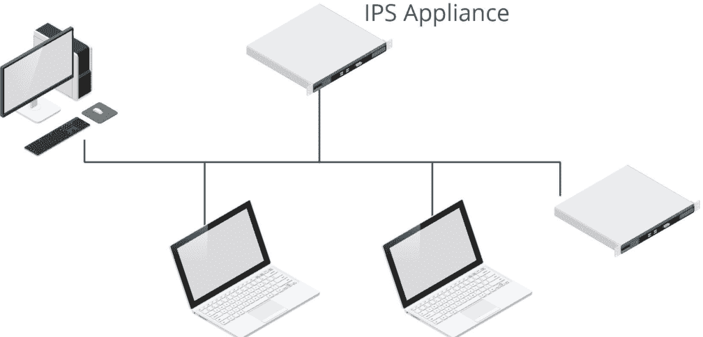

一台监控局域网段流量的 IPS 设备。

# DENYHOSTS 和 FAIL2BAN

目前有许多 IPS 解决方案。两种常用的第三方解决方案是 DenyHosts 和 Fail2ban，它们都会检查日志文件以查找异常情况。

DenyHosts 主要保护 SSH 服务器免受暴力破解密码的攻击。在此类攻击中，攻击者会反复尝试使用每次递增的凭据登录 SSH 服务器。DenyHosts 监控身份验证日志以查找失败登录条目。它会考虑源 IP 地址和失败尝试的次数。如果来自同一源的失败尝试次数达到或超过你配置的阈值（或默认值），DenyHosts 将封锁该源。DenyHosts 的一个主要局限性是它支持 IPv4 而不支持 IPv6。

Fail2ban 也能防止暴力破解攻击，与 DenyHosts 不同，它并不关注任何某个特定服务。相反，它可以监控任何带有身份验证组件系统的日志文件。Fail2ban 利用 Netfilter 和 iptables 执行实际封锁动作，并用于更新你的防火墙规则。Fail2ban 同时支持 IPv4 和 IPv6。

# 配置

DenyHosts 的主配置文件是 `/etc/denyhosts conf`。你可以通过多种方式调整此文件。示例包括：

- ADMIN_EMAIL—定义向哪个电子邮箱地址发送警报。
- BLOCK_SERVICE—定义哪些服务将阻止未经授权的用户访问。
- DENY_THRESHOLD_VALID—定义用户在被封锁之前可以尝试登录现有账户的多少次。

Fail2ban 的主配置文件是 `/etc/fail2ban.conf`。但是，如果你计划配置 Fail2ban，最好将此文件复制到 `/etc/fail2ban/jail.local`，或者在 `/etc/fail2ban/jail.d/` 目录内创建一个自定义的 `.conf` 文件。以下是一些示例设置：

- bantime—定义主机被封锁访问资源的时间。
- maxretry—定义主机在被封锁之前身份验证失败的次数。
- ignoreip—定义受接受主机的白名单。

# 如何配置防火墙

使用以下步骤配置防火墙。

### 获取防火墙信息

要使用超级用户权限获取防火墙信息：

1. 假设超级用户权限。
2. 输入 `firewall-cmd --get-zones` 获取所有防火墙区域的列表。
3. 输入 `firewall-cmd --zone=[zone] --list` 查看指定区域的所有配置。

# 使用 firewall 添加或删除防火墙规则

要添加和删除防火墙规则：

1. 如必要，输入 `firewall-cmd --zone=[zone] --changeinterface=[device ID] --permanent` 为你的网络接口设置合适的区域。

2. 添加规则：
- 输入 `firewall-cmd --zone=[zone] --add-service=[service] --permanent` 向已知服务（如 HTTP）添加规则。
- 输入 `firewall-cmd --zone=[zone] --add-port=[port/TCP|UDP] --permanent` 根据特定端口号（如 21 (FTP)）添加规则。

3. 移除规则：
- 输入 `firewall-cmd --zone=[zone] --removeservice=[service] --permanent` 移除基于已知服务（如 HTTP）的规则。
- 输入 `firewall-cmd --zone=[zone] --removeport=[port/TCP|UDP] --permanent` 移除基于特定端口号（如 21 (FTP)）的规则。

4. 输入 `firewall-cmd --reload` 重新加载防火墙规则。
5. 测试防火墙以规则行为是否符合预期。

### 使用 iptables 配置应用到 IP Set

要使用超级用户权限配置应用到 IP 集的规则：

1. 假设超级用户权限。
2. 输入 `ipset create_set hash:name` 定义要使用的 IP 集格式。
3. 输入 `ipset add range_set [IP address range]` 向集合添加一组 IP 地址范围。
4. 输入 `iptables -I [INPUT|OUTPUT] -m --match-set range_set [src|dst] -j [ACTION]` 配置规则，该规则将对 IP 集中的任何 IP 地址执行所需的操作。

# 主题 E

# 实现日志服务

# 涵盖的考试目标

3.4 给定场景，实现日志服务。

安全不仅仅是一个设计加固系统的过程。另一个主要要素是对系统、软件和用户事件的分析。通过维护这些事件的日志，你将能够更轻松地识别增加入侵风险的恶意行为或错误配置。

# 系统日志

系统日志是由 syslogdaemon 跟踪和维护的系统活动和事件的记录。系统日志使用 syslog 标准，该标准便于中心化日志服务器，它可以接收并处理来自网络中许多系统的 syslog 数据。这被称为远程日志。syslog 标准还支持本地日志，即日志存储在生成它的本地系统上。

系统日志记录在简单的文本文件中，你可以像处理其他文本一样检查和处理它们。syslog 条目通常包括事件的日期和时间、发送消息名称和 ID 以及消息本身。syslog 格式还可以根据设施（facility）和严重程度（severity）对消息进行优先级排序。设施代码指示受影响的系统，例如用于邮件系统的“kern”和“mail”。严重程度代码指示事件可能的影响级别，0（最关键）到 7（最不关键）。

# 日志文件位置

在大多数 Linux 发行版中，系统日志位于 `/var/log/` 目录。在该目录内部，每个服务、应用程序或功能都有对应的日志文件。下表列出了一些最常见的日志文件。

| 日志文件 | 内容 |
| :--- | :--- |
| /var/log/syslog | 所有类型的系统事件。主要用于 Debian 系发行版。 |
| /var/log/messages | 普通非关键系统事件。主要用于 RHEL。 |
| /var/log/auth.log | 身份验证消息（登录成功和失败）。主要用于 Debian 系发行版。 |
| /var/log/secure | 身份验证消息。主要用于 RHEL。 |
| /var/log/kern.log | 内核消息（例如 dmsg）。 |
| /var/log/ | 来自应用程序的消息（例如 cron、mail 等）。 |

# 日志旋转

日志旋转是通过创建日志的新版本来维护日志文件大小。日志旋转使得处理日志更容易，条目过多的日志文件难以处理。同样，如果配置日志旋转清理旧日志，可以节省空间。logrotate 工具用于日志的自动轮转。执行时，logrotate 会在当前版本的结尾添加 .1。之前旋转的文件带有 .2、.3 等后缀，除非另有说明。

# 配置

日志旋转行为可以在 `/etc/logrotate.d/` 目录中配置，其中每个相关服务都有自己的配置文件。以下是一个名为 myservice 的服务的示例配置文件：

```text
/var/log/myservice.log {
    size 1k
    create 700 user group
    datext
    rotate 10
}
```

第一行定义了日志的输出位置。size 指令表示日志达到 1k 字节时应旋转。create 指令通过创建一个指定权限、用户和组的文件来旋转日志。datext 指令向旋转的日志添加日期。最后，rotate 指定保留最近的 10 个日志文件。

# rsyslog 服务

syslogd 是 Linux 原始 syslog 服务。rsyslog 服务进行了若干改进，包括支持：

- 使用 TCP 代替 UDP 作为传输协议，增加了传输数据的可靠性。
- 使用 SSL/TLS 进行数据加密。
- 将数据输出到 MySQL 等各种数据库技术。
- 在本地系统准备好接收时缓冲数据。
- 根据内容过滤数据。

此外，rsyslog 保持了与其前身相同的基本配置格式，因此在这方面具有兼容性。

> 注意：许多现代发行版使用 rsyslog 而不是 syslog 作为其主日志服务。

# /etc/rsyslog.conf 文件

/etc/rsyslog.conf 是 rsyslogd 服务的配置文件。该文件通过你可以需要修改的各种规则确定如何处理 syslog 消息。
文件采用两列格式。第一列列出消息设施和严重程度。严重程度以单词格式定义，而不是数字 0–7。第二列定义了对对应设施和或严重程度的消息应采取哪些操作。操作包括将消息写入哪个文件；如果用户登录终端，则向他们打印消息；以及将消息转发到哪些远程主机。


## 规则 ####

# 将所有内核消息记录到控制台。
# 记录过多内容会弄乱屏幕。

# 记录 info级别或更高的任何内容（邮件除外）。
# 不要记录私有的身份验证消息！
*.notice;mail.none;authpriv.none;cron.none

```
/dev/console
/var/log/messages
格式:
设施(facility).级别(severity)
动作（记录到）
```

/etc/syslog.conf 文件。
注意：syslog 的等效文件是 /etc/syslog.conf。

## syslog 服务

syslog 服务是旧版 syslogd 服务的另一个替代品。

尽管它提供了与 rsyslog 类似的功能，但 syslog-has 有它自己的语法。

## 第三方代理

虽然集中化管理能力可以让你对网络中的日志具有更强的控制力，但 syslog 标准在所有平台上并不都能被通用支持。例如，记录系统消息的专有 Windows 事件日志格式。为了便于 syslog 与非 syslog 之间的集成，你需要使用第三方代理。代理是代表其他程序或服务的运行软件程序。

你需要在通常不支持标准的平台（如 Windows）上安装 syslog 代理。安装哪种代理取决于平台以及你针对的 syslog 服务类型。例如，rsyslog 和 syslog-ng 都需要它们自己的代理软件。一旦安装了代理，你就能以 syslog 格式捕获消息并将这些发送到你的集中 syslog 服务器。

## journalctl 命令

journalctl 允许你查看和查询由 systemd 单元创建的日志文件。日志信息由 systemd journal 服务收集并存储。你可以使用 journalctl 打印整个日志日志，也可以在使用命令时带有各种选项以多种方式过滤日志，例如匹配服务名称或仅打印匹配指定级别水平的消息。

```
[root@server01 ~#] journalctl
日志开始于 2019-01-02 18:40:56 GMT systemd-journal[101]: Runtime journ
Jan 02 18:40:56 localhost.localdomain kernel: microcode update
Jan 02 18:40:56 localhost.localdomain kernel: Initializing cgroup subsys
Jan 02 18:40:56 localhost.localdomain kernel: Initializing cgroup subsys
Jan 02 18:40:56 localhost.localdomain kernel: Linux version 3.10.0-862.el
Jan 02 18:40:56 localhost.localdomain kernel: Command line: BOOT64/v
Jan 02 18:40:56 localhost.localdomain kernel: e820: BIOS provided physica
Jan 02 18:40:56 localhost.localdomain kernel: BIOS-e820: [mem 0000000000]
Jan 02 18:40:56 localhost.localdomain kernel: BIOS-e820: [mem 0000000000]
Jan 02 18:40:56 localhost.localdomain kernel: BIOS-e820: [mem 0000000000]
Jan 02 18:40:56 localhost.localdomain kernel: BIOS-e820: [mem 0000000000]
Jan 02 18:40:56 localhost.localdomain kernel: BIOS-e820: [mem 0000000000]
查看系统日志。
```

### 语法

journalctl 命令的语法为 `journalctl [options] [matches]`

## journalctl 命令选项

journalctl 提供了许多用于查询日志数据的选项。以下列了一些常用选项。

| 选项 | 用途 |
| :--- | :--- |
| -n [行数] | 指定显示的 journal 日志行数。 |
| -o (输出格式) | 指定输出格式。例如：short, verbose, export。 |
| -f | 显示最近的条目，并在新条目加入 journal 时持续更新显示。 |
| -p | 按级别（alert, err, notice, info 等）过滤日志输出。 |
| -u | 按指定的单元（如服务名称）过滤日志输出。 |
| -b [boot ID] | 显示当前启动的日志消息，或通过启动 ID 显示。 |

## /var/log/journal/ 目录

在默认配置下，系统仅将日志存储在内存中，并且每次重启都会清除日志。你可以通过创建 /var/log/journal/ 目录来让 journal 在重启后持久化。如果该目录存在，systemd 服务配置为自动维护目录中的日志。

### last 命令

last 命令显示用户登录和注销事件的历史，以及实际的时间和日期。它还有各种选项可以允许你过滤结果，例如按通过特定终端登录的用户进行过滤。例如，last 将显示使用第一个终端 (tty1) 登录的用户详情。last 命令从 /var/log/wtmp 文件中检索信息。若要仅提取失败登录事件的信息，可以使用 lastb 命令。该命令从 /var/log/btmp 文件中检索信息。

## 登录/注销事件

```
[root@server01 ~]# last
student/0: 0 Tue 20:33 - 20:33 (00:00)
student/1: 0 Wed 19:07  still logged in
student/0: 0 Wed 18:44 - 13:30 (04:55)
student/0: 0 Wed 18:41  still logged in
reboot  system 3.10.0-862.el Wed 18:38 - 15:09 (06:34)
student/0: 0 Wed 18:38 - 18:48 (00:02)
student/0: 0 Wed 18:37 - 18:37 (00:01)
student/0: 0 Wed 18:37 - 18:37 (00:01)
reboot  system 3.10.0-862.el Wed 18:35 - 15:09 (06:34)
student/0: 0 Wed 18:31 - 18:31 (00:04)
reboot  system 3.10.0-862.el Wed 18:30 - 18:35 (00:04)
student/0: 0 Wed 18:23 - 18:23 (00:00)
student/0: 0 Wed 18:21 - crash (00:08)
root/1: 0 Wed 18:04 - 18:00 (00:03)
root/1: 0 Wed 18:04 - 18:04 (00:00)
```

## 列出登录和注销事件

### 语法

lastlog 命令与 last 命令类似，但它列出最近登录事件的所有用户及其登录时间。该命令从 /var/log/lastlog 文件中检索信息。

## 如何实现记录

使用以下步骤实现记录。

## 检查系统日志文件

检查系统日志文件：

1. 获取用户权限。
2. 将当前工作目录更改为 /var/log
3. 使用 less 等工具打开所需的日志文件进行读取。
4. 使用 grep、awk 等文本处理工具过滤对你有用的日志信息，减少无关条目的干扰。

## 检查其他日志事件

检查其他日志事件：

- 输入 last 返回登录和注销事件的历史。
- 输入 last 按失败登录事件进行过滤。
- 输入 lastlog 列出所有用户及其登录时间。
- 输入 journalctl 返回记录到系统日志的事件，如系统和应用程序消息。

## 使用 rsyslog 配置本地日志

使用 rsyslog 配置本地日志：

1. 获取超级用户权限。
2. 使用你喜欢的文本编辑器打开 /etc/rsyslog.conf。
3. 滚动到 RULES 部分。
4. 根据需要调整日志规则和目的地，或添加新规则。
5. 保存并关闭文件。
6. 输入 systemctl restart rsyslog 重服务。

## 使用 rsyslog 配置远程日志

使用 rsyslog 配置远程日志：

1. 获取超级用户权限。
2. 使用你喜欢的文本编辑器打开 /etc/rsyslog.conf。
3. 滚动到 MODULES 部分。
4. 根据需要取消注释并修改 TCP 或 UDP 模块，提供服务应运行的端口号。
5. 从 RULES 部分根据需要配置日志规则。
6. 滚动到配置文件的底部并添加以下行：
- <message facility/severity>@<server>:<TCP port> 通过 TCP 端口将指定的设施和/或级别记录到指定的服务器。
- <message facility/severity>@<server>:<UDP port> 通过 UDP 端口执行相同操作。
7. 保存并关闭文件。
8. 输入 systemctl restart rsyslog 重启服务。

## Topic F

备份、恢复和验证数据

## 涵盖的考试目标

2.3 给定场景，创建、修改和重定向文件。
2.6 给定场景，备份、恢复和压缩文件。

网络安全的另一个主要要素是备份过程。对于任何无法承受数据丢失或数据受损的组织来说，备份数据都是至关重要的；在****完整性**这一主题中，你将备份敏感数据，测试你在稍后时间恢复它的能力，然后验证数据未被篡改。

## 备份类型

备份是数据的副本，存在于原始数据的另一个逻辑或物理位置。备份在数据丢失时提供了恢复支持。数据的恢复过程取决于原始备份计划中包含的备份类型。

有三种备份类型。

| 备份类型 | 描述 |
| :--- | :--- |
| 全量备份 | 备份所有选择的文件，无论之前的状态如何。多次全量备份会消耗大量的存储空间，且备份过程可能很慢。但在恢复丢失数据时，全量备份既快又可靠。 |
| 差异备份 | 备份自上次备份以来发生变化的所有文件。 |
| 增量备份 | |


当使用这些方法时，你必须恢复上一次全备加上最近的差异备份。与全备相比，差异备份所需的存储空间和时间更少，但恢复速度较慢。自上一次全备或增量备份（以最新者为准）以来发生变化的所有选文件都会被备份。当使用增量备份时，你必须恢复上一次全备加上所有随后的增量备份。增量备份的执行时间通常比差异备份短，因为它包含的数据较少，但在恢复数据时速度也较慢。

## 全量备份


差异备份与增量备份。

## 备份存储方法

全量、差异和增量描述的是数据备份的频率。但也有不同的存储数据的方法。

## 备份存储方法

- 快照 (Snapshot)
- 镜像 (Image)
- 克隆 (Clone)

## 描述

快照记录存储驱动器在特定时间的状态，通常存在于同一驱动器上。它们是你可以将驱动器恢复到的“检查点”，而不是存在于其他地方的数据真实副本。

你可以将数据作为单个文件或文件集进行备份，你也可以创建整个系统的一一拷贝。基于镜像的备份将操作系统状态以如 ISO 之类的镜像格式存储。你可以用此将系统恢复到捕获镜像时的状态。

克隆是将存储驱动器的所有内容复制到另一个存储介质的过程。从技术上说，镜像备份是驱动器的克隆。然而，克隆操作通常会表现得更进一步，即使用镜像文件在第二个驱动器上重建原始驱动器。

## tar 命令

tar 命令允许你创建数据归档。它通常用于从包含你想要备份的数据目录创建归档文件。你也可以将该命令用于之前创建的归档以提取文件、存储额外文件并列已存储的文件。使用 tar 创建的文件归档通常具有 .tar 扩展名。tar 命令还通过管道将其输出重定向到可用设备、文件或程序。

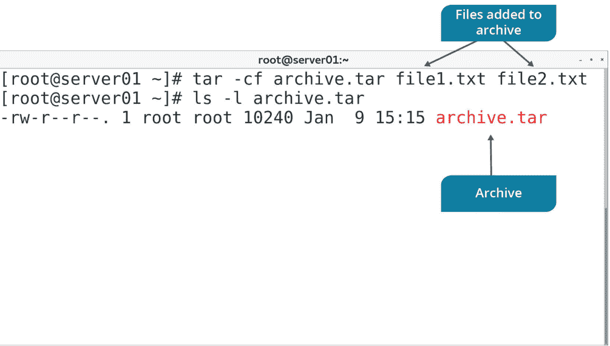

```
[root@server01~]# tar -cf archive.tar file1.txt file2.txt
[root@server01 ~]# ls -l archive.tar
-rw-r--r-- 1 root root 10240 Jan 9 15:15 archive.tar
```

从多个文件创建归档。

### 语法

tar 命令的语法为 `tar [options] [file names]`

## 使用 tar 命令恢复文件

tar 命令 -xvf 将恢复源文件或目录结构的全部内容。要恢复 tar  own的一部分，请使用你想要提取的文件的路径和名称。你必须使用创建 tar 文件时使用的精确路径和名称。你也可以通过使用命令 `tar -xvf [destination] [source]` 使恢复过程变为交互式。

## dar 命令

dar("磁盘归档器"/disk archiver) 命令旨在通过提供更多的备份和归档功能来替代 tar。它在创建全量、差异和增量备份时特别有用。以下命令创建 mydata 目录的全量备份，并输出一个名为 full.bak 的备份文件。

```
dar -R mydata -c full.bak
```

要创建备份 (diff1.bak)，你可以使用 -A 选项引用全量备份：
`dar mydata -c diff1.bak -A full backup`

你可以根据需要通过 -A 选项引用全量备份来创建更多差异备份。然而，要执行增量备份，你需要引用上一个增量备份，如下：
- dar mydata -c incr1.bak -A full.bak
- dar mydata -c incr2.bak -A incr1.bak

-x (提取)选项用于恢复备份。如果你执行了差异备份，你需要首先提取全量备份，然后是最后的差异备份：-x full.bak

-w 选项会自动覆盖对文件的更改；否则，系统将提示你确认。要恢复增量备份，你需要按顺序首先提取全量备份，然后每个增量备份：

- dar -x full.bak
- dar -x incr1.bak -w
- dar -x incr2.bak -w

## cpio 命令

cpio 命令在归档之间复制文件。cpio 命令有三种运行模式。

| 运行模式 | 命令 |
| :--- | :--- |
| 导出 (Copy-out) | cpio -i |
| 导入 (Copy-in) | cpio -p |
| 传递 (Copy-pass) | cpio -p |

### 语法

cpio 命令的语法取决于它的模式。在所有模式下，该命令都从标准输入读取。以下导出示例通过将 ls 传递给 cpio 并将输出发送到 dir_arch 来归档目录的所有内容：

`ls | cpio -o > dir_arch`

在导入模式下，你可以如下提取提取归档：
`cpio -i < dir_arch`

在传递模式下，你可以将 find 传递给 cpio 以将一个目录树复制到另一个目录：
`. -depth -print | cpio -p new_dir`

## 用于

将文件复制到归档中。它读取标准输入以获取文件名列表，并将其复制到另一个。

## dd 命令

dd 命令从一个位置复制文件到另一个位置。dd 有多种操作参数。

```
if=[file name] of=[file name] bs=[bytes]
```

## 用于

指定从中读取数据的文件。指定写入数据的文件。指定读取和写入的块大小。字节也可以更易于人类的方式格式化，例如 50M 表示 50兆字节，10G 表示 10 吉字节。指定打印错误信息的级别：

- none 抑制所有信息
- nofer 抑制传输统计
- progress 显示传输统计

注意：选定的输入文件被复制到选定的输出文件。如果没有选择文件，则使用标准输入和标准输出。

### 语法

dd 命令的语法为 `dd [options] [operands]`

## 使用 dd 进行备份

你可以使用 dd 对分区进行全备。以下示例将 /dev/sda1 复制到 /dev/sdb：
`dd if=/dev/sda1 of=/dev/sdb`

使用 dd还可以创建驱动器的镜像并克隆驱动器：
`dd if=/dev/sda of=drive_image.iso`
`dd if=drive_image.iso of=/dev/sdb`

## mirrorvg 命令

mirrorvg 命令创建卷组中所有逻辑卷的副本（镜像）。默认情况下，该命令将在与卷组关联驱动器上创建镜像。如果需要，你也可以指定其他驱动器来镜像卷。-c 选项可为逻辑卷创建两个或三个副本，而不是默认的副本。

### 语法

mirrorvg 命令的语法为 `mirrorvg [options] [volume group]`

## 镜像逻辑卷的其他方法

除了使用 mirrorvg 镜像组中的所有卷外，你还可以使用 mklvcopy 命令镜像卷组中的单个逻辑卷。你也可以在使用 lvcreate 时使用 -m 选项创建逻辑卷的一个多个镜像。例如，以下命令从 volgr 创建一个名为镜像lv 的10GB卷：
`lvcreate -L 10G -m1 mirrorvg volgr`

## 异地备份

异地备份是主站点之外的物理位置，存储数据的副本。异地备份是灾难恢复流程的一部分，因为当主站点发生严重故障时，通常需要它们来重建数据。

有多种方法可以将数据从主站点复制到备份站点。与其物理地将存储设备从一个位置移动到另一个位置，通常更方便通过网络连接两个站点（例如通过 VPN），并通过网络传输数据。


# 数据传输工具

数据传输工具对于促进异地备份过程非常有用。

## 数据传输工具说明

scp 此工具用于通过 SSH 在远程主机之间复制数据。由于它使用了 SSH，你发送到异地备份的数据在传输过程中会被加密，保护其机密性。与 SSH 类似，scp 默认使用 TCP 端口 22。以下是将文件复制到远程主机的示例：

```
scp file.txt user@host:/dir
```

sftp 此命令是安全文件传输协议（SFTP）的实现。SFTP 使用 SSH 隧道作为传输机制来加密数据。而 scp 仅用于传输文件，sftp 可以传输文件并管理文件和目录。因此，你可以在远程系统上创建、列出和删除目录。sftp 命令还支持恢复文件传输，而 scp 不。

与标准的 ftp 命令一样，你可以以交互式或非交互方式使用 sftp。例如，以非交互方式获取文件：
sftp user@host:/file.txt

## 数据传输工具说明

rsync 此工具用于在本地和远程系统之间复制文件。它的强大之处在于对网络带宽的高效利用；它不是复制所有内容，而是只复制文件之间的差异。因此，如果你对目录中的所有文件使用 rsync，它将检查目标目录以查看是否存在完全相同的文件。只有目标目录中不存在的文件才会被复制。

rsync 命令可以通过 SSH 复制文件，或者如果你在远程系统上设置了 rsync 守护进程，则可以使用它。以下是通过 SSH 将本地目录中的文件同步到远程目录的示例：rsync -a /home/mydir/ user@host/home/mydir/

# 如何备份和恢复文件

使用以下步骤备份和恢复文件。

## 归档文件

归档文件：

- 1. 输入 `tar -cf tarball.tar [文件或目录名]` 将所有指定对象放入 tar 包中。
- 2. 输入 `tar -tf tarball.tar` 列出 tar 包的内容。

## 从归档恢复文件

从归档恢复文件：

- 1. 输入 `tar -xf tarball.tar` 提取 tar包的内容。
- 2. 输入 `ls -l` 并验证文件是否已提取。

## 与异地备份同步文件

与异地备份同步文件：

- 输入 `rsync -ave ssh [源目录] user@server:[目标目录]` 将本地目录及其文件安全地同步到远程服务器的指定位置。
- 输入 `rsync -ave ssh user@server:{源目录} [目标目录]` 将远程目录及其文件安全地同步到本地主机的指定位置。

## 压缩

压缩是指对数据进行编码以减少表示数据所需的位数的过程。压缩过程可以显著减少文件或文件集的大小，使数据存储和传输更高效。虽然文件占用空间更少，但它包含了必要的信息，以便只恢复冗余数据（无损压缩）或仅丢失关键数据（有损压缩）。

压缩用于减少创建、维护和恢复备份时的存储和传输负担。与其一对地备份数据，你可以对数据进行压缩并存储。

## gzip 命令

GNU zip (zip) 是一种缩小选定文件大小的实用程序。使用 gzip 压缩的文件具有 .gz 后后缀。该命令有多个选项。这些命令如下表所示。

| 选项 | 用途 |
| :--- | :--- |
| -d | 反向压缩（解压缩）。 |
| -f | 强制压缩或解压缩文件，即使它有多个链接或文件已存在。 |
| -n | 省略文件名和时间戳。 |
| -q | 抑制所有警告。 |
| -r | 在压缩或解压缩期间启用递归。 |
| -v | 显示压缩或解压缩文件的大小和减少百分比。 |
| -t | 对压缩的文件进行完整性检查。 |

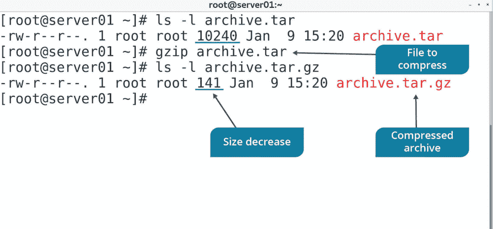

使用 gzip 压缩归档文件。

gzip 命令
gzip 命令等同于在命令行执行 gzip -d。

## xz 命令

xz 命令是一种数据压缩实用程序，类似于 gzip，它能以 .xz 格式缩小选定文件的大小。xz 命令有多个选项。

| 选项 | 用途 |
| :--- | :--- |
| -d | 解压缩文件。 |
| -f | 强制压缩或解压缩文件，即使它有多个链接或文件已存在。 |
| -q | 抑制所有警告。 |
| -v | 显示压缩或解压缩文件的名称和减少百分比。 |
| -t | 对压缩的文件进行完整性检查。 |

```
root@server01]# ls -l archive.tar
-rw-r-- 1 root 10240 Jan 9 archive.tar [待压缩文件]
root@server01]# xz archive.tar
root@server01]# ls -l archive.tar.xz
-rw-r-- 1 root 1800 Jan 9 archive.xz [压缩后的归档] |
```

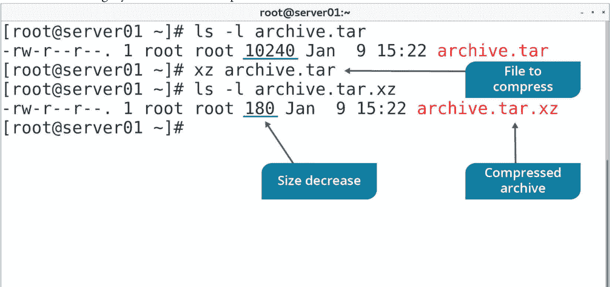

使用 xz 压缩归档文件。

### 语法

xz 命令的语法为 xz [选项]文件名]

## bzip2 工具集

bzip2 命令及其相关命令管理文件压缩。使用 bzip2 压缩的文件具有 .bz2 后缀。bzip2 相关命令如下表所示。

| 命令 | 用途 |
| :--- | :--- |
| bzip2 | 压缩文件。 |
| bunzip2 | 解压缩文件。 |
| bzcat | 解压缩文件到标准输出。 |
| bdiff | 对压缩的文件运行 diff。 |
| bless | 对压缩的文件运行 less 命令。 |
| bmore | 对压缩的文件运行 more 命令。 |

注意：使用 tar 制作的归档经常使用 gzip 压缩（产生 .gz 后缀）或 bzip2 压缩（产生 .bz2 后缀）。

```
root@server01]# ls -l archive.tar
-rw-r-- 1 root 10240 Jan 9 archive.tar
root@server01]# bzip2 archive.tar
root@server01]# ls -l archive.tar.bz2
-rw-r-- 1 root 1330 Jan 9 archive.tar.bz2
```

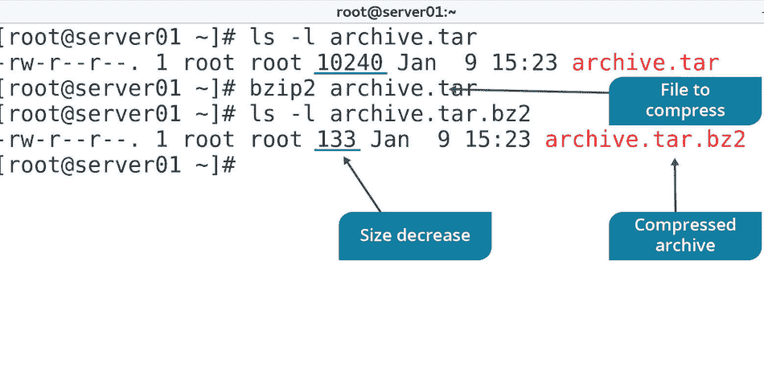

使用 bzip2 压缩归档文件。

### 语法

bzip2 命令的语法为 bzip2 [选项]文件名。例如，压缩 file1 和 file2：
bzip2 file1 file2

## zip 命令

zip 命令是另一种压缩实用程序，与 gzip、xz 和 bzip2 不同，它还有归档功能。事实上，zip 是一个名为 compress 的旧压缩实用程序和 tar 归档的结合。使用 zip 压缩的文件具有 .zip 后缀。zip 命令有多个选项。

| 选项 | 用途 |
| :--- | :--- |
| -d | 删除 zip 归档的内容。 |
| -e | 加密归档。 |
| -F | 修复损坏的 zip 归档。 |
| -r | 启用递归。 |
| -T | 对归档文件进行完整性检查。 |

### 语法

zip 命令的语法为 zip [选项]文件名

## 你应该选择哪种压缩方法？

使用哪种压缩工具通常取决于你的需求，但对每种方法都可以得出结论。最重要的因素是压缩和解压缩的速度，以及压缩率（未压缩文件大小的大小，例如，5 MB 的未压缩文件压缩后变为 1 MB，压缩比为 5:1）。

对于压缩速度，测试显示 gzip 比 bzip2 快，当压缩级别增加时，两者都比 xz 快得多。对于解压缩速度，gzip 最快，其次是 xz 和 bzip2。对于压缩率，xz 表现最好，其次是 bzip2，gzip 最差。最终，考虑使用：

- 如果你尽可能地压缩和解压缩且不那么担心存储空间，使用 gzip。
- 如果存储空间非常宝贵而时间不是主要因素，使用 xz。
- 对于平衡以及很少需要解压缩的数据：访问 https://www.rootusers.com/gzip-vs-bzip2-vs-xz-performancecomparison/ 查看更详细的测试报告。

注意：由于 gzip 使用旧压缩算法，它的性能不如其他提到的。

# 如何压缩文件

使用以下步骤压缩文件。

## 压缩文件

压缩文件：

- 输入 `gzip -c myfile myfile.gz` 压缩文件并控制其输出。
- 输入 `xz -c myfile myfile.xz` 压缩文件并控制其输出。
- 输入 `bzip2 -c myfile myfile.bz2` 压缩文件并控制其输出。

## 解压缩文件

解压缩文件：

- 输入 `gzip -cd myfile myfile.gz` 解压缩文件并控制其输出。
- 输入 `xz -cd myfile myfile.xz` 解压缩文件并控制其输出。
- 输入 `bzip2 -cd myfile myfile.bz2` 解压缩文件并控制其输出。

## 压缩并归档文件

同时压缩并归档文件：

- 输入 `tar -czf tar.tar.gz [文件或目录名]` 将所有指定对象放入 tar 包中，然后使用 gzip 工具压缩该 tar 包。
- 输入 `tar -cJf tar.tar.xz [文件或目录名]` 将所有指定对象放入 tar 包中，然后使用 xz 工具压缩该 tar 包。
- 输入 `tar -cj tar.tar.bz2 [文件或目录名]` 将所有指定对象放入 tar 包中，然后使用 bzip2 工具压缩该 tar 包。

## 解压缩归档并从中恢复文件

解压缩归档并从中恢复文件：

- 输入 `tar -xzf tar.tar.gz` 使用 gzip 工具解压缩并恢复指定 tar 包中的所有对象。
- 输入 `tar -xJf tar.tar.xz` 使用 xz 工具解压缩并恢复指定 tar 包中的所有对象。
- 输入 `tar -xjf tar.tar.bz2` 使用 bzip2 工具解压缩并恢复指定 tar 包中的所有对象。


完整性检查是验证数据是否被有意或无意地修改的过程。换句话说，完整性检查可以验证完整性这一安全目标。在压缩和归档备份文件后进行完整性检查是一种良好的做法，以确认数据没有发生变化。这将帮助你避免为了未来的恢复存储损坏且不准确的存档，以免最后发现数据没有被妥善备份。

有多种方法可以检查数据完整性，每种方法可能会根据你的安全需求或目标而异。检查数据完整性的常用且安全的方法之一是通过使用哈希。通过计算备份归档文件的哈希，你可以将该哈希与以前的值进行比较，如果两者相同，你就可以合理地认为数据在此期间没有变化。

## HASH FUNCTIONS

哈希函数是一种执行哈希操作的算法。有许多不同的哈希函数，每个函数都有其优缺点。Linux 系统上用于检查数据完整性常用的两种哈希函数是 MD5 和 SHA。

消息摘要（MD5）算法生成一个 128 位的消息摘要。它由罗纳德·里维斯特（Ronald Rivest）创建，属于公共领域。MD5 不再被认为是一种强哈希函数，应避免用于密码存储等安全操作；然而，它仍然被用于完整性检查。

安全哈希算法（SHA）以 MD5 为模型，比后两者都强。SHA 的常见版本包括 SHA-1（产生 160 位的哈希值），而 SHA-256、SHA-384 和 SHA-512 分别产生 256 位、384 位和 512 位摘要。由于某些安全缺陷，SHA-1 正在被弃。

## THE md5sum COMMAND

md5sum 命令用于使用 MD5 哈希函数计算文件或标准输入的哈希值。你还可以使用 -c 选项指定一个包含 MD5 哈希及其对应文件名的文件；md5sum 将计算列出文件的哈希，并将其与哈希值进行比较。结果将告诉你每个文件是否失败或无法找到。MD5 哈希的长度为 128 位。与其他许多哈希值一样，它们通常以十六进制格式表示（MD5 为 32 个字符）。以下是字符串 "Linux" 的哈希值：ec9f05a5d5d7797bf608e3736743831

## SYNTAX

## SHA COMMANDS

有几种不同的命令可以计算 SHA 哈希值。这些命令在功能上与 md5sum 相同，但使用了相应位数的 SHA 函数：

- sha1sum
- sha256sum
- sha384sum
- sha512sum

### Initial hash

### Change to file

```bash
[root@server01 ~]# sha256sum file
777e6a95752b81e8991a3d057e9c70fa2123466f76915c54e4bd64a91fd0ce1 file
[root@server01 ~]# echo "1" > file
[root@server01 ~]# sha256sum file
463ce4a0d39b39cb30a9b07a5b7531f7545ff9eb20e5b6bc5bc40906830 file1
[root@server01 ~]#
```

### Completely different hash

计算文件的哈希值。

### SYNTAX
sha#commands 的语法为 `sha#sum [options] [file name]`

## HOW TO PERFORM INTEGRITY CHECKS ON FILES

使用以下步骤对文件进行完整性检查。

### CALCULATE THE HASH OF A FILE
计算文件的哈希：

1. 输入 `sha256sum [file name]` 返回指定文件的哈希。

> 注意：你可以以相同的方式使用 sha384sum 和 sha512sum 等其他尺寸。

2. 记录哈希值，以便将来将其作为比较基点。
3. 需要时，使用相同的算法计算相同文件的哈希，并将结果与原始哈希值进行比较。

### VALIDATE A LIST OF HASHES

验证哈希列表：

1. 输入 `sha256sum [file or directory] > hashes.txt`。

> 注意：你可以以相同的方式使用 sha384sum 和 sha512sum 等其他尺寸。

2. 根据需要向此文件添加更多哈希。
3. 需要时，输入 `sha256sum -c hashes.txt` 将记录的哈希与当前值进行比较。
4. 识别任何哈希不匹配的文件以及当前位置缺失的文件。

## Activity 12-1

Linux 系统安全回顾
SCENARIO

回答以下复习题。
1. 你是否计划在 Linux 系统上利用基于上下文的权限方案（如 SELinux 或 AppArmor）？为什么或为什么不？

答案不相同。在某些环境中，特别是国国防系统中，需要基于上下文的权限和强制访问控制（MAC）。对于没有此项要求的组织，学生可能有兴趣实现 SELinux 或 AppArmor，以加固存储或访问个人身份信息（PII）等敏感数据的系统。

2. 你的组织在 Linux 系统上是否有基于上下文的权限方案（如 SELinux 或 AppArmor）？为什么或为什么不？

答案不相同。在某些环境中，特别是国国防系统中，需要基于上下文的权限和强制访问控制（MAC）。对于没有此项要求的组织，学生可能有兴趣实现 SELinux 或 AppArmor，以加固存储或访问个人身份信息（PII）等敏感数据的系统。

## Summary
在本节中，你实施了各种解决方案，例如加密。


在 Linux 中，变量可以分为 Shell 变量和环境变量。默认情况下，Shell 变量的值不会传递给在其之后启动的任何子进程。相反，环境变量是可以传递的。

注意：Shell 变量有时被视为局部变量，而环境变量有时被视为全局变量。这些名称在脚本编写的上下文中具有不同的含义。

## 变量设置与引用

要设置变量，只需输入 `VAR=value`，例如 `MYVAR=123`。

为了检索变量，你必须以 `${VARIABLE_NAME}` 的格式输入。
要获取变量的值，你可以在命令行界面（CLI）输入 `echo ${VARIABLE_NAME}`。例如，`echo $SHELL` 将打印你的默认 shell（例如 `/bin/bash`）。

## 环境变量

环境变量是自父 Shell 进程继承的变量，并随后传递给任何子进程。一个环境变量由一个名称（通常用大写字母表示）和一个值（例如路径名）组成。

在环境中，变量以键值对的形式引用，格式为 `KEY=value`，多个值则使用 `KEY=value:value2`。

## 默认环境变量

下表提供了一些默认环境变量及其功能。

| 环境变量 | 描述 |
| :--- | :--- |
| HOSTNAME | 系统的主机名。 |
| SHELL | 系统的默认路径。 |
| MAIL | 邮件存储的路径。 |
| HOME | 系统的用户目录。 |
| PATH | 搜索路径。 |
| HISTSIZE | 命令历史中存储的条目数。 |
| USER | 用户名。 |

## 本地化环境变量

环境变量也可以用于配置本地化选项，通常通过编辑 `/etc/locale.conf` 文件并将相应的 locale 赋值给变量。下表描述了其中一些变量。

| 环境变量 | 描述 |
| :--- | :--- |
| LC_*=[locale] | 指定：- 一组本地化环境变量，包括但不限于： |
| LANG=[locale] | 指定：- 包括但不限于：<br> - LC_ADDRESS 用于设置邮政地址格式。<br> - LC_MONETARY 用于设置货币数值的格式。<br> - LC_MEASUREMENT 用于设置计量系统（例如，公制 vs. 英制）。 |
| LC_ALL=[locale] | 当未显式定义所有 LC* 变量时所使用的 locale。 |
| TZ=[time] | 用于所有选项的 locale，覆盖任何 LANG 和 LC* 值。通常用于故障排除目的。 |
| | 指定：系统时区。这是使用 `date` 或 `timedatectl set timezone` 命令设置时区的替代方案。 |

## export 命令

你可以通过 `export` 命令有效地将 Shell 变量转换为环境变量。
例如，如果你有一个 Shell 变量 `SHL_VAR`，你可以输入 `export SHL_VAR` 使其成为环境变量。
你也可以在导出变量时更改其值，包括现有的环境变量。你可以在 CLI 输入类似 `export SHL_VAR="New value"` 的内容来实现。这将为由此启动的子进程设置值。

```
No initial value
[root@server01 ~]# echo $SHL_VAR
[root@server01 ~]# export SHL_VAR="New value"
[root@server01 ~]# echo $SHL_VAR
New value
[root@server01 ~]#
Now has a value
```

更改 Shell 变量的值。
为了为所有未来的 Bash 会话设置环境变量的值，你可以将 `export` 添加到你的 `.bash_profile` 文件中。为了给新用户自动化此过程，并确保具有相似工作职责的用户具有相同的设置，你可以修改 `/etc/skeleton/` 目录下的 `.bash_profile` 文件。要在系统范围内设置环境变量的值，请向 `/etc/profile.d/` 目录下的相应文件添加 `export`。

### 语法

`export` 命令的语法为 `export [options] [NAME=value]`

## env 命令

`env` 命令用于带有修改后的环境变量运行命令。通过提供 `key=value` 格式的变量名和值，以及提供要运行的命令，你可以更改该特定命令会话中指定变量的值。如果变量不存在，它将被添加到环境中。同样，使用 `-option` 从指定命令运行的环境中移除变量。如果你想覆盖子进程中的值或添加新值，请考虑使用 `env`。
不带任何参数执行命令将显示环境中的所有变量及其对应的值。

注意：`printenv` 命令的功能与不带任何参数执行 `env` 相同。

```
[root@server01 ~]# env
XDG_VTNR=1
XDG_SESSION_ID=1
HOSTNAME=server01
SHELL=/bin/bash
TERM=xterm-256
HISTSIZE=1000
QTDIR=/usr/lib64/qt-3.3
OLDPWD=/root/Documents
QTINACE=/usr/lib64/qt-3.3/include
QT_GRAPHICSSYSTEM_CHECKED=1
USER=root
```

列出环境变量及其对应值。

### 语法

`env` 命令的语法为 `[options] [NAME=value][command]`

## 打印所有变量

你可以使用不带任何参数的 `set` 命令打印所有 Shell 变量、环境变量和 Shell 函数。该命令还可以允许在 Shell 脚本中使用选项。

## 比较 export、env 和 set

- export：将 Shell 变量转换为环境变量。
- env：带有修改后的环境变量运行命令。
- set：打印所有 Shell 变量、环境变量和 Shell 函数。


# root@server01:~ 
[root elapsed ~]# time ls -Rl > /dev/null

```
real            0m.883s
user            0m.150s
sys             0m.733s
```

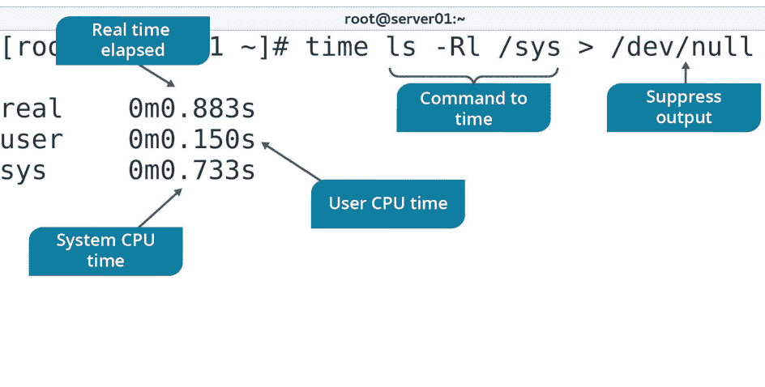

对命令进行计时。

通过找出命令运行所需的时间，你可以更好地了解如何优化频繁执行的任务。某些命令完成相同任务的速度比其他命令更快。

注意：某些 shell（包括 Bash）提供了它们自带的默认 `time` 命令。如需使用完整版本的命令，请参考 `/usr/bin/time` 的二进制文件。

### 语法

command time 命令的语法为 [options] [command]

# 环境与 shell 故障排除

在使用或自定义 Bash shell 环境时，可能会遇到一些问题。以下是一些故障排除技巧。

- 添加别名（alias）时，请检查语法。例如：`ls='ls -la'`
- 执行脚本或其他程序时，如果它们未存储在可执行文件的本地路径中，请将其路径添加到 PATH 变量中，或在命令前加上 `/` 执行。
- 使用 `export` 命令为所有 shell 子进程设置变量。
- 在 `~/.bash_profile` 中配置环境变量，使变量对所有 shell 可用。如果服务账户需要某些环境变量，你可以在该账户的 `~/.bash_profile` 中设置它们。
- 编辑 `.bash_profile` 文件更改默认变量。
- 确保软件包依赖的每个环境都设置了值。例如，如果 Java 应用程序依赖于 Java 运行时环境，只有当该环境在 PATHVariable 中引用时，它才能找到并访问该运行时环境。

# 如何自定义 Bash shell 环境

使用以下步骤自定义 Bash shell 环境。获取环境变量的值：要获取环境变量的值：

- 输入 `env` 查看所有环境变量。
- 输入 `echo ${variable}` 获取指定变量的值。

# 设置环境变量的值

要设置环境变量的值：

1. 确定你想要更改的变量名称。
2. 输入 `export [variable]=[new value]`。
3. 输入 `echo $[variable]` 验证变量值是否已更改。

# 配置命令别名

要配置命令别名：

1. 输入 `alias [alias name]=\'command with options'` 创建指定命令的别名。
2. 输入 `alias [alias name]` 验证别名是否按预期工作。

# 配置额外的搜索路径

要配置额外的搜索路径：

1. 使用你喜欢的文本编辑器打开 `~/.bash_profile`。
2. 找到显示 `export PATH` 的行。
3. 按照如下方式编辑此行：
- `export PATH:$PATH:\<new path>` 向 PATH 环境变量中添加新路径。
4. 保存并关闭文件。
5. 输入 `source .bash_profile` 重新加载你的 Bash 配置文件。
6. 输入位于新路径中的可执行文件名称，验证它是否能够自动执行。

# 主题 B

识别脚本与编程基础

# 涵盖的考试目标

5.1 给给定的场景，部署并执行基础 Bash 脚本。

在专门开始编写 Bash 脚本之前，你需要熟悉许多今天使用的脚本和编程语言通用的基本概念。这些概念将为你编写自己的脚本奠下基础。

# BASH 脚本

Bash 不仅仅是 Linux 中的 shell，它也是一种强大的脚本语言。创建 Bash 脚本对于提高 Linux 管理任务的效率和生产力非常有帮助。Bash 脚本可以实现 Linux 系统调用并利用用户空间中的工具。基本上，你可以在命令行调用的任何程序、工具或系统函数，都可以在 Bash 脚本中调用。同样，Bash 支持循环和条件语句等现代编程元素，以增强自动化任务的逻辑性。

### 语法

正如 CLI 命令有语法一样，脚本语言也有。语言的语法是定义你如何编写代码的规则。每种语言都有自己的语法，但也有一些共同点。由于其与底层 Linux 操作系统系统的关联，Bash 脚本的语法与你在 CLI 中逐行输入的内容非常相似。

# 变量赋值

变量赋值是定义一个变量具有特定值的行为。在代码中，你将值分配给名称。变量的值在脚本执行过程中可能会发生变化，这是必要的。变量的目的是存储值供以后使用，并让你无需在代码中显式写出即可引用这些值。

许多编程语言（如 C）要求在赋值之前定义变量的类型。类型示例包括整数、浮点数、字符串等。基本上，这些类型定义了变量所持信息的的确种类型。然而，你不需要在 Bash 中声明变量类型。相反，所有变量都被视为字符串。

# BASH 变量赋值

Bash 变量赋值如下：
`my_str='Hello, World!'`

注意等号周围没有空格——这是 Bash 中的一条严格规则。

# 变量替换

引用或检索变量值的行为被称为替换或参数扩展。在你为变量赋值值后，你就会引用该变量。

# BASH 变量替换

在 Bash 中引用时，你需要：
`echo $my_str`

# 常用运算符

引用或检索变量值的行为被称为替换或参数扩展。在你为变量赋值值后，你就会引用该变量。

# BASH 操作

以下是一个算术运算示例，使用了双括号：
`$((1+2))`

# 字符串字面量

字符串字面量是任何表示字符串的固定值。字符串字面量包含在单引号 ('') 或双引号 (") 中。只要你使用一致，使用单引号或双引号都是可以的。例如，假设你之前定义了 `my_str` 变量。你想将其替换到一个更大的字符串中，如下所示：
`echo "My variable is $my_str"`
`echo 'My variable is $my_str'`


# 数组 (ARRAYS)

数组是值的集合。换句话说，数组允许你向单个变量中存储多个值。这可以使你的代码更易阅读和维护。例如，你可能想对几十个不同的值执行单一的数学操作。与其为每个值创建一个变量，不如创建一个数组来简化你的代码。数组的另一个优点是你可以轻松地在整个代码中更新。

数组根据其索引（indices）排序。大多数语言使用索引从 0 开始的数组。当你给数组赋值时，可以轻松地执行复合赋值来一次性分配所有值。你在复合赋值中放置每个值的顺序将决定它的索引——即：第一个值在索引 0，第二个在索引 1，依此类推。像 Bash 语言也可以使用单独赋值为每个索引逐一分配特定值。

# Bash 数组 (BASH ARRAYS)

Bash 中的复合赋值使用括号，每个值之间用空格分隔：`my_arr=("Hello") 3.1`

单独赋值通过方括号向特定索引添加值：

```
my_arr[0]=1
my_arr[1]="Hello"
my_arr[2]=3.1
```

你可以通过在大括号中包裹数组来引用。你可以引用数组的特定索引：
`echo ${my_arr[0]}`
这将打印 "1"。你也可以使用星号 (*) 或 @ 符号 (@) 替换索引，来引用数组中的所有值：
`echo ${my_arr[@]}`

# 函数 (FUNCTIONS)

函数是一段你可以重复复用的代码块，用于执行特定任务。这在编写高效代码时非常有用，调用函数可以避免你反复编写相同或相似的代码。你可以定义自己的函数，并在脚本的其他部分调用它们，或者从其他脚本中调用它们。

和变量一样，你通过一个唯一的标识符来定义函数。你使用该标识符来引用函数内部的可重用代码。

# Bash 函数 (BASH FUNCTIONS)

在 Bash 中，编写函数有两种方法。这两种方法都涉及将所需的代码放在括号之间。

```bash
function my_func {
  code...
}

my_func()
```

如果你熟悉像 C 等面向对象的编程语言，你可能更习惯于第二种方法：

```bash
my_func() {
  code...
}
```

然而，请注意，左右圆括号只是为了视觉上的清晰。在 Bash 中，你不需要像其他编程语言那样向函数传递参数。相反，你传递参数的方式类似于在命令行中操作。

# 注释 (COMMENTS)

在编程世界中，注释是源代码的一种标记方法，以便作者和其他程序员更容易理解。在大多数语言中，注释会被编译、解释或其他执行程序的系统忽略忽略。因此，它们作为一种记录代码本身各种元素的一种方式存在。

在 Bash 中，符号 (#) 表示其后的每个字符都是注释的一部分，不会被执行。虽然你可以随心所欲地注释代码，但通常的做法是在脚本顶部包含一行或多行注释来解释脚本的作用，并对每个可能需要说明的行代码或代码块进行注释。你应该避免对目的显而易见的代码行进行注释，因为过多的注释会使源代码混乱，实际上更难以理解。

# Bash 注释 (BASH COMMENTS)

以下是一个带有注释的短脚本示例：
```bash
# 此脚本确定目录中要处理多少个文件。

num_files=432 total_files=512 number of files processed # 要处理的文件总数
echo "There are $((total_files - num_files)) remaining."
```

# Topic C (主题 C)

编写并执行简单的 Bash 脚本

# 涵盖的考试目标 (EXAM OBJECTIVES COVERED)

5.1 给定场景，部署并执行基础 Bash 脚本。

现在你准备好开始编写和执行自己的 Bash 脚本了。在本主题中，你将实现 Bash 脚本的一些基本组件，以便创建一个简单的可执行文件。

```bash
#!/bin/bash
```

Bash 脚本包含特定 shell 的指令，这些指令可能与其他 Linux shell 不兼容。这将导致脚本在 Bash shell 中正确运行，但在 Linux 的非 Bash shell 中运行失败。要指定你的脚本是为 Bash shell 编写的，你需要在每个脚本开头添加 `#!/bin/bash` 这一行。此行将指示操作系统在不兼容的 Linux shell 上执行脚本时使用 Bash 解释器。

> 注意：这通常被称为 "shebang"。
> 注意：此示例中的解释器名称为 /bin/bash，这是 Bash 解释器的实际文件名和位置。

# 元字符 (METACHARACTERS)

元字符是 Bash shell 默认以特定方式解释的特殊字符。这些字符你必须进行转义或包含在引号中，以便进行字面解释。Linux 中的元字符描述在下表中。其中几个应该看起来很眼熟。

| 元字符 | 用途 |
| :--- | :--- |
| `> ` | 输出重定向。 |
| `>>` | 输出重定向（追加）。 |
| `<` | 输入重定向。 |
| `<<` | 输入重定向（在此文档）。 |
| `\|` | 管道。 |
| `"` | 定义弱字符串字面量。 |
| `'` | 定义强字符串字面量。 |
| `` ` `` | 跳出字符串字面量运行反引号之间的命令。 |
| `\` | 转义字符。 |
| `=` | 变量赋值。 |

| 元字符 $ | 用途 |
| :--- | :--- |
| `#` | 变量替换和其他类型的 shell 扩展。注释。 |
| `\|` | 逻辑或操作。 |
| `&&` | 逻辑与操作。 |
| `*` | 通配符匹配（匹配任意数量的字符）。昵称为 "plat"。 |
| `?` | 通配符匹配（匹配单个字符）。昵称为 "hook"。 |
| `[]` | 通配符匹配（匹配括号内的任意字符）。 |
| `{}` | 参数替换和数组。 |
| `()` | 组合命令。 |
| `&` | 在后台运行。 |
| `;` | 在同一行上分隔多个命令。引用命令历史。昵称为 "bang"。 |

# 退出码 (EXIT CODES)

退出码（或退出状态）是子进程在终止时传递给父进程的一个值。在 Linux 世界中，状态码 0 表示进程执行成功。退出码 1 或任何更大的数字表示进程在执行过程中遇到了错误。

许多脚本会调用其他脚本，或者允许用户通过脚本利用系统命令。退出码非常有用，因为它们可以帮助外部实体检测脚本执行是否成功，并据此更改行为。默认情况下，bash 脚本会生成最后执行命令的退出码。你也可以指定退出码。最后执行的退出码由特殊变量 `$?` 表示。例如，你可以将退出码重定向到标准输出。

```bash
#!/bin/bash
echo $? >&2
```

# 退出命令 (THE EXIT COMMAND)

你可以在脚本中使用 exit 来强制 shell 以你提供的退出码终止。如果不提供数字，exit 将以最后执行命令的退出码终止。

# 重定向和管道 (REIRECTION AND PIPING)

就像你可以在 CLI 利用重定向和管道一样，你也可以将它们整合到脚本中。其他重定向退出码 stdout/stderr，你也可以从文件中重定向。例如，以下脚本使用 `read` 提示用户输入，将输入赋值给变量，然后将数据追加到文件：

```bash
#!/bin/bash
echo 'What is your name?'
read name
echo $name >> list.txt
```

同样，你也可以管道到其他命令。以下示例读取名称列表 (cat)，将其管道到搜索名称 (grep)，然后管道到识别总数的命令 (wc)。

```bash
#!/bin/bash
cat name_list.txt | grep 'John' | wc -l
```

# shell 扩展 (SHELL EXPANSION)

当在 Bash shell 发布命令时，它会被拆分为标记或词。shell 扩展是 shell 识别特殊标记并替换为值的过程。变量替换是扩展的一种类型，shell 通过识别 $ 字符将其变量为实际值。换句话说，在 `echo $var` 中，echo 命令看到的不是变量，而是 Bash 扩展变量时的实际值。

# 扩展顺序 (ORDER OF EXPANSIONS)

实际上有几种类型的扩展——总共八种。Bash 按照定义的顺序执行这些扩展，类似于数学表达式中的运算顺序。该顺序是：

1. 大括号扩展
2. 波浪号扩展
3. 同时进行：
   - 参数扩展/变量替换
   - 算术扩展
   - 命令替换
   - 进程替换
4. 词拆分
5. 文件/路径名扩展

对于同时发生的四个扩展，扩展按照从左到右出现的顺序进行。


这将输出：The plural of computer . 这是因为 Bash 期望一个名称精确命名为 $word 的变量，尽管你的本意是向实际值添加一个字母。你可以通过将变量括在花括号中来实现这一点，如下：
word=computer
echo "The plural of $word is ${word}s.",

所以，这将输出：Plural of computer is。

# 命令替换 (COMMAND SUBSTITUTION)

命令替换是 shell 扩展的一种方法，其中命令的输出会替换命令本身。当你想要将命令的输出包含在现有文本字符串中，这非常有用。例如：

echo "The current directory is $pwd".

注意命令 pwd 被包裹在反引号（`` ` ``）中。根据当前工作目录（CWD）实际是什么，输出可能类似于：The current directory is /root。

你也可以使用 $(command) 格式来执行命令替换，如下所示：
echo "The current directory is $(pwd)."

> 注意：在 Bash 中首选第二种格式，因为使用反引号需要转义某些字符（嵌套反引号）。

# 通配符 (GLOBBING)

Globbing 是文件/路径名扩展的另一种说法。这种 shell 扩展方法用于用匹配模式的值替换特定的通配符模式。通配符中有三个特殊字符：星号 (*) 用于匹配任意数量的字符；问号 (?) 用于匹配单个字符；以及方括号 ([ ] ) 内的字符用于匹配列出的任何一个字符。

以下是通配符的三个示例：
cp *.txt -dest
cp ?.txt -dest
cp [abc].txt -dest

第一个示例复制任何所有带有 .txt 扩展的文件。这是因为通配符字符出现在点之前，表示 Bash 应该扩展任何字符组合。
第二个示例将只复制名称为单个字符的文件，如 a.txt 和 b.txt，但不会复制 ab.txt。第三个只会复制命名为 a.txt、b.txt 或 c.txt 的文件。

# 位置参数 (POSITIONAL PARAMETERS)

位置参数是 shell 脚本中的变量，当脚本被调用时，它会被分配一个参数。例如，你可以像这样调用脚本 myscript.sh：
myscript.sh arg1 arg2 arg3

参数 arg1 对应位置参数 $1，arg2 对应 $2，arg3 对应 $3，依此类推。注意，参数之间的空格用于分隔位置参数。

你可以像引用其他任何变量一样直接在脚本中引用位置参数：
#!/bin/bash

```
echo "The first argument is $1"
echo "The second argument is $2"
echo "The third argument is $3"
```

这非常有用，因为你的脚本可以对传递给它的任何执行执行操作，正如大多数命令和函数所做的那样。

# 设置位置参数 (SETTING POSITIONAL PARAMETERS)

你也可以使用 set 命令直接在脚本设置位置参数。例如：
#!/bin/bash

```
set -- arg1 arg2 arg3
echo "The first argument is $1"
echo "The second argument is $2"
echo "The third argument is $3"
```

当用户未提供任何参数就调用此脚本时，它仍然具有位置参数 $1、$2 和 $3，因为它们是手动设置的。

# EXEC 命令

exec 命令用于执行另一个命令，用此新程序的进程替换当前的 shell（不会创建新进程）。当你不希望在遇到错误时防止用户终止父进程时，这非常有用。例如，你可能希望在命令失败时终止特权 shell。

你也可以使用不带命令的 exec 作为参数将 shell 中的所有输出重定向到文件。这通常在脚本中用于重定向 CLI 的标准输出 (stdout)，并将其发送到一个或多个文件。例如：

```
#!/bin/bash
exec > out.txt
pwd
ls -al
```

当前工作目录和目录列表将输出到 out.txt 而不是 CLI。

# source 命令

source 命令用于在当前 shell 进程中执行命令。从这个意义上说，它的功能与 exec 相反。当你希望在执行脚本时留在当前的 shell 中，这非常有用。一个示例是 source 执行切换目录 (cd) 的脚本。脚本执行后，你的位置将变为切换到的任何目录，而脚本通常会让你留在原地。

另一种你可能想要 source 脚本的情况是你的脚本更改或定义了环境变量。例如，以下脚本 (export.sh) 导出了自定义环境变量 MYVAR：
#!/bin/bash

```
export MYVAR=1
```

如果你正常执行此脚本并运行 env 命令，你会发现 MYVAR 没有被列出。这是因为脚本启动了一个新的 shell 进程，一旦它终止， shell 环境的更改就会消失。然而，如果你输入命令 source export.sh，则环境变量将被保留，因为脚本在你的当前 shell 中执行。

# 脚本扩展名 (SCRIPT FILE EXTENSIONS)

在大多数情况下，Linux 中的文件扩展名是可选的。Linux 检查文件的元数据来确定它是什么类型的文件。Bash 脚本也是如此——你不需要为脚本命名扩展名。然而，许多开发者已经习惯了给他们的脚本添加 .sh 作为扩展名的约定，例如 myscript.sh。虽然这不会对脚本产生任何特殊含义，但它可以让人们一眼识别出需要该文件。包含文件扩展名还可以帮助只想查找 shell 脚本或脚本内部搜索操作。

# 脚本权限 (SCRIPT PERMISSIONS)

记住，你使用任何文件（包括脚本）的能力受限于分配给该脚本的权限。即使你创建了脚本，你也不会自动获得运行它的权限。你需要确保为需要运行脚本的每个用户设置了两个权限：

字体 脚本本身的执行 (x) 位。
- 脚本所在目录的写入 (w) 和执行 (x) 位。你可以像处理其他任何文件一样使用 chmod 设置这些权限。

# 如何编写和执行简单的 BASH 脚本 (HOW TO WRITE AND EXECUTE A SIMPLE BASH SCRIPT)

使用以下步骤编写并执行简单的 Bash 脚本。

# 创建一个简单的 BASH 脚本 (CREATE A SIMPLE BASH SCRIPT)

要创建一个简单的 Bash 脚本：

- 1. 使用你喜欢的文本编辑器启动一个文件。
2. 在文件顶部输入 #!/bin/bash 告诉 Linux 使用 Bash 作为解释器。
3. 在下一行输入一个命令。
4. 如果需要，在新行上继续输入命令。
5. 使用如通配符、命令替换、输出重定向等技巧来增强脚本的实用性。
6. 保存并关闭文件。

# 为脚本分配执行权限 (ASSIGN EXECUTION PERMISSIONS FOR A SCRIPT)

为脚本分配执行权限：

- 1. 假设你拥有超级用户权限或确保你是脚本的所有者。
2. 输入 chmod+x [脚本名] 或使用绝对模式为所有用户添加执行位。
3. 输入 ls -l 验证是否已设置执行位。

# 使用相对路径执行脚本 (EXECUTE A SCRIPT USING A RELATIVE PATH)

使用相对路径执行脚本：

- 1. 导航到脚本所在的目录。
2. 输入 ./[脚本名] 执行它。

> 注意：如果脚本位于 PATH 变量指定的路径，你可以直接输入脚本名称执行它。

# 使用绝对路径执行脚本 (EXECUTE A SCRIPT USING AN ABSOLUTE PATH)

使用绝对路径执行脚本：

字体 输入 /[脚本路径]/[脚本名] 执行脚本。


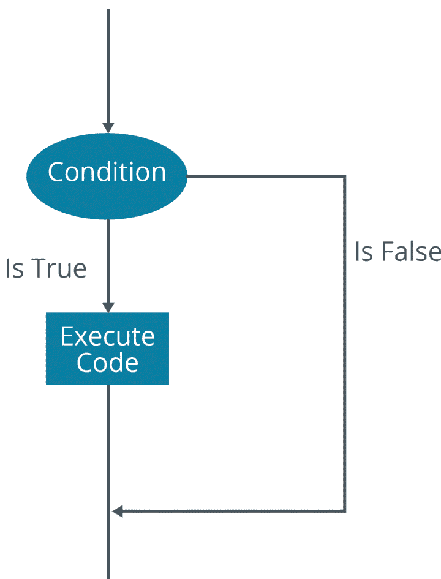

条件语句的基本流程。

条件语句是大多数程序和脚本的基础，因为它们帮助你控制执行代码的流。例如，如果用户输入了一些内容，你可能想根据多个因素对该输入进行不同的处理。用户可能提供一个参数而不提供另一个。与其像假设所有参数都是预期的那样运行脚本，不如你只根据用户提供的参数运行脚本。

## IF 语句

在包括 Bash 在内的大多数语言中，主要的条件语句是 `if` 语句。`if` 语句包含一个要评估的条件，以及在满足条件时要执行的一个或多个操作。如果条件不满足，将跳过这些操作并执行脚本中的下一个语句。在 Bash 中，`fi` 语句表示一组指令的结束。

以下是一个简单的 `if` 语句示例：

```bash
var=5
if [ $var -gt 1 ]; then
echo "$var is greater than 1!"
fi
```

该语句在两个方括号之间包含一个要评估的条件。在这种情况下，它是检查 $variable 是否大于 1。下一行是语句，即如果前面的条件为真则将执行的代码。最后，该语句表示整个语句的结束。
由于 5 大于 1，消息将回显到屏幕上。如果不为真，则什么都不会发生。

### 语法

`if` 语句的基本语法如下：[ <要评估的条件> ] then

```bash
<如果条件为真则执行的代码> fi
```

## if...else 语句

`if...else` 语句允许根据条件评估的结果，在两个操作之间进行选择。如果满足了条件，则执行第一个操作；否则，执行 `else` 之后落之后的操作。如果指令组数多于两组，可以使用一个或多个 `elif` 语句来指定备选的动作序列。

以下是一个简单的 `if...else` 语句示例：

```bash
var=1
if [ $var -gt 1 ]; then
echo "$var is greater than 1!"
else
echo "$var is less than or equal to 1!"
fi
```

由于与之前的示例相比，$var 的值发生了变化，这意味着第一个 `echo` 命令将不会执行。与其无所事事，`else` 语句规定了条件为假时会发生什么；在这种情况下，是在屏幕上打印一条不同的消息。

### 语法

`if...else` 语句的基本语法如下：[ <要评估的条件> ] then

```bash
<如果条件为真则执行的代码> fi
<如果条件为假则执行的代码> fi
```

`if...elif` 语句的基本语法如下：[ <要评估的条件> ] then

```bash
<如果条件为真则执行的代码> elif [ <另一个要评估的条件> ] then
<如果另一个条件为真则执行的代码> fi
```

## 条件语句中的退出码

像 `if...else` 这样的条件语句非常擅长处理进程退出码。例如：
`chmod 777 file 2>/dev/null`

```bash
if [ $? -eq 0 ]; then
echo "Permissions set successfully."
exit 0
else
echo "Could not set permissions."
exit 1
fi
```

如果 `chmod` 命令以代码 0 退出，则成功消息将回显到屏幕上，由于 `exit` 命令，任何其他进程将接收该退出码。同样，如果退出码为 1，则自定义错误消息将回显到屏幕上。默认错误消息被抑制了，因为它被重定向到了空设备（null device）。

## CASE 语句

有时，你可能需要评估许多条件，例如一个可以包含许多不同值的变量，而每个值都需要它自己的操作。你可以在整个语句中定义多个 `elif` 分支，但这可能让人类难以解析你的代码。`case` 语句可以帮助你避免这个问题。

以下是一个简单的 `case` 语句示例：

```bash
var=$blue

case $var in
red)
  echo "Your color is red."; ;;
green)
  echo "Your color is green."; ;;
blue)
  echo "Your color is blue."; ;;
*)
  echo "Your color is neither red, green, nor blue."; ;;
esac
```

`case` 语句的第一行定义了你正在评估的变量。下面是第一个条件，带有一个右括号表示该条件的结束。下一行是如果条件确实为红色将执行的操作——屏幕上将显示这样这样的消息。双分号 (`;;`) 表示操作的结束。这种模式会重复，并且可以根据需要进行任意数量的条件。在这种情况下，最后一个条件使用通配符 (`*`) 来表示如果变量不匹配上述任何条件，则将执行后续操作。`esac` 语句结束了 `case` 语句。

### 语法

`case` 语句的基本语法如下：

```bash
case <条件>
  <如果第一个条件为真则执行的代码>;;
  <第二个条件>
  <如果第二个条件为真则执行的代码>;;
esac
```

## test 命令

`test` 命令用于检查条件逻辑并执行比较。你可以在 shell 脚本中使用 `test` 命令来验证文件的状态。

`test -d filename && echo "Directory exists"`

test test 命令用于检查条件逻辑并执行比较。你可以在 shell 脚本中使用 `test` 命令来验证文件的状态。

## 循环

除了条件语句，控制流的另一种有效方法是循环。循环是执行代码直到满足特定条件的任何语句。循环有三种：`while` 循环、`until` 循环和 `for` 循环。所有三种类型的循环都封装在 `do` 和 `done` 之间。

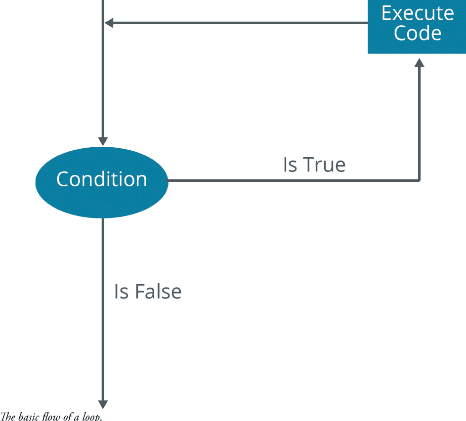

### WHILE LOOP

`while` 循环允许你在特定条件运行时重复一组指令。评估表达式，如果为真，则执行循环内的操作。如果表达式变为假，则跳出循环并继续执行。

以下是一个简单的循环示例：

```bash
var=1
while [ $var -le 5 ]; do
  echo "The current number is $var."
  ((var++))
done
```

在这种情况下，测试的条件是变量 $var 是否小于等于5。只要满足（即表达式为真），下面的代码就会执行。`echo` 命令是一个迭代器，它只需给变量加 1。这在任何类型的循环中都很常见，如果没有它，$var 将永远等于 1，因此永远不会跳出循环。

### 语法

`while` 循环的基本语法如下：[ <要评估的条件 ]

```bash
do
  <如果条件为真则执行的代码>
done
```

### UNTIL LOOP

`until` 循环与 `while` 循环类似，区别在于控制表达式为假时执行代码。例如：

```bash
var=1
until [ $var -ge 5 ]; do
  echo "The current number is $var."
  ((var++))
done
```

此循环中的条件是 $var 是否大于或等于5。因此，代码将一直执行直到 $var 变成 5，此时它将跳出循环。

### 语法

`until` 循环的基本语法如下：

```bash
until [ <要评估的条件> ] do
  <如果条件为假则执行的代码>
done
```

### FOR LOOP

`for` 循环根据语句条件部分内数值变量指定的次数执行代码块。与 `while` 或 `until` 循环不同，`for` 循环不依赖于条件的评估为真或假来停止或从根本上开始。因此，`for` 循环旨在按照给定的次数执行代码。这使其非常适合处理数组等可迭代对象。


以下是一个简单的 for 循环示例：
```
var=("Carla" "Mary")
for i in ${var[@]} do echo "$i is a member of the team"
done
```

该语句会评估 $var 数组中的每一个值。在这种情况下，每个值都由迭代器表示，尽管你可以使用任何 way名称。通常会将其命名为与你正在遍历的变量类似的名称，或者简单地命名为 iterator（迭代器）。
然后循环本身将执行三次——对应数组中的每个值一次。因此，每个人的名字都会打印在屏幕上。

### 语法

for 循环的基本语法如下：in <variable> to loop through（遍历）

```
do
<执行特定次数的代码>
done
```

# 遍历范围

循环也用于步进一个数字范围。这些范围被包含在大括号中，范围本身由两个点 (..) 表示。例如 `for i in [1..5]`。

```
do
echo "The current number is $i."
done
```
因此，此循环将精确迭代五次。

# 如何在 Bash 脚本中加入语句

使用以下步骤在 Bash 脚本中加入控制语句。

# 编写简单的条件语句

要编写一个简单的条件语句：

- 1. 在你选择的文本编辑器中启动 Bash 脚本。
- 2. 识别脚本中受益于不同条件决定结果的区域。
- 3. 输入 `if [ <要评估的条件 ]`
- 4. 在新行，输入 `then`
- 5. 在新行，输入当满足条件时应执行的代码。
- 6. 如果需要，在新行，输入 `else`
- 7. 在新行，输入当不满足条件时应执行的代码。
- 8. 在新行，输入 `fi` 
- 9. 保存并关闭脚本。
- 10. 提供预期的条件来测试脚本。

# 编写带有多个条件的条件语句

要编写一个带有多个条件的条件语句：

- 1. 在你选择的文本编辑器中启动 Bash 脚本。
- 2. 识别脚本中受益于不同条件决定结果的区域。
- 3. 输入 `if [ <第一个要评估的条件>]`
- 4. 在新行，输入 `then`
- 5. 在新行，输入当第一个条件满足时应执行的代码。
- 6. 在新行，输入 `elif [<要评估的条件> ]`
- 7. 在新行，输入 `then`
- 8. 在新行，输入当第二个条件满足时应执行的代码。
- 9. 根据需要继续添加 `elif` 分支。
- 10. 在新行，输入 `fi`
- 11. 保存并关闭脚本。
- 12. 提供预期的条件来测试脚本。

# 根据条件循环代码

要根据条件循环代码：

- 1. 在你选择的文本编辑器中启动 Bash 脚本。
- 2. 识别脚本中只要满足条件就受益于执行多次执行相同代码的区域。
- 3. 开始编写循环：
    - 如果你想让代码在条件为真时一直执行，输入 `while [<要评估的条件]>`
    - 如果你想让代码在条件为假时一直执行，输入 `until [<要评估的条件]>`
- 4. 在新行，输入 `do`
- 5. 在新行，输入应该循环的代码。
- 6. 在新行，输入 `done`
- 7. 保存并关闭脚本。
- 8. 提供预期的条件来测试脚本。

# 循环特定次数

要循环特定次数：

- 1. 在你选择的文本编辑器中启动 Bash 脚本。
- 2. 识别脚本中受益于执行特定次数相同代码的区域。
- 3. 输入 `for i in [1..10]` 使代码循环 10 次。
- 4. 在新行，输入 `do`
- 5. 在新行，输入应该循环的代码。
- 6. 在新行，输入 `done`
- 7. 保存并关闭脚本。
- 8. 测试脚本以查看是否已循环了代码。

# 遍历数组

要遍历数组：

- 1. 在你选择的文本编辑器中启动 Bash 脚本。
- 2. 识别脚本中受益于遍历数组每个索引执行相同代码的区域。
- 3. 输入 `for i in $[array[*]]`
- 4. 在新行，输入 `do`
- 5. 在新行，输入应该循环的代码。
- 6. 在新行，输入 `done`
- 7. 保存并关闭脚本。
- 8. 测试脚本以查看是否已遍历了代码。

# 活动 13-1

Bash 脚本操作复习

场景

回答以下复习题。

# 1. 你可以在 shell 环境中配置哪些环境变量？

答案视而异。最常用的配置环境变量之一是 PATH，用户通常会添加它，以便当其二进制文件位于默认路径之外时，可以在 CLI 的任何地方执行命令。使用 HOME 变量配置用户的主目录也是非常有用的。

# 2. 你可以在 shell 环境中配置哪些环境变量？
（注：原文中此部分存在大量重复，此处仅保留核心翻译逻辑）


### 语法
`crontab` 命令的语法为 `crontab [options] [file | user]`

# crontab 文件

cron 守护进程通过引用 crontab 文件来确定可能存在哪些调度任务。crontab 文件使用 `crontab -e` 命令进行管理。该命令会打开一个文本编辑器（大多数系统上默认为 Vim），允许用户指定想要何时运行任务以及运行什么任务。

注意：不要使用普通编辑器管理 cron 守护进程。`crontab` 命令包含了其他管理 cron 守护进程的功能。例如，编辑文件后，它会自动重启 cron。


crontab 条目的格式。

以下是 crontab 文件中在特定时间调度任务的行示例：
- `20 * 1-5 */ /path/to/` 在于周一至周五的晚晚上 8 点执行命令。
- `* 15 2 * * */ /path/to/` 在每天凌晨 2:15 执行命令。
- `30 4 1 * * */ /path/to/` 在每月 1 号的凌晨 4:30 执行命令。

# CRON 目录

包含调度信息的 crontab 文件可以在 `/etc/cron.d/` 目录和 `/var/spool/cron/` 目录找到。root 用户可以使用 `/etc/cron.d/` 目录调度系统级任务。服务也可能在此处添加调度任务。root 用户可以向该目录添加任务，或向 `/etc/crontab` 文件添加任务。

普通用户不许可填充 `/etc/cron`，因此每个标准用户都可以在位于 `/var/spool/cron` 的个人目录中管理自己的任务。此处列出的任何任务将以标准用户的凭据执行。

`/etc/cron` 还包含默认的 cron 目录，管理员可以使用这些目录来放置定期执行的脚本。这些目录分别是 `/etc/cron.hourly`、`/etc/cron.daily`、`/etc/cron.weekly` 和 `/etc/cron.monthly`。将脚本链接或复制到这些目录中即可使用它们的调度方案运行你的命令。

某些 Linux 发行版预先为 `/etc/crontab` 文件填充了特定任务。你可能会发现 `logrotate`、`tmpwatch`、`rkhunter` (Rootkit Hunter) 等已经存在。某些服务的安装也可能创建 `/etc/crontab` 条目。

# 如何调度任务

以下步骤用于调度任务。

# 调度在特定时间运行的任务
要调度任务在特定时间运行：

1. 进入 [特定格式]
2. 输入你想要在特定时间运行的命令。
3. 按 Ctrl+D 返回 Bash。
4. 验证命令是否已在预期时间运行。

# 使用 at 命令管理任务

使用 `at` 命令管理任务：

- 输入 `at` 查看待处理任务队列。
- 输入 `at -rm [job number]` 从队列中移除任务。

# 调度 CRON 业

要调度一个 cron 业：

1. 打开相关用户的 crontab：
   - 输入 `crontab -e` 打开 crontab。
   - 假设具有用户权限并输入 `crontab -u [user] -e` 打开指定用户的 crontab。
2. 按 `i` 进入 Vim 的插入模式。
3. 按照以下格式添加一行以调度命令或程序运行：
   - `<minute><hour> <day> <month> <weekday> <command or executable>`
4. 保存并关闭文件。
5. 输入 `crontab -l` 或 `crontab -u [user] -l` 查看用户的 crontab 文件。
6. 验证命令或程序的运行是否与预期时间一致。

# 主题 B

使用 Git 实现版本控制

# 涵盖的考试目标

5.2 在给定场景下，使用 Git 执行版本控制。

如果你或你的同事正在开发软件，他们需要一个地方来存储和管理源代码。这可能迅速变成一项负担的任务，特别是当涉及许多版本的代码时。在本主题中，你将通过名为 Git 的程序实现代码管理和版本控制。

# GIT

Git 是一个分布式版本控制系统，主要用于协作项目的项目的开发者。Git 由 Lin Torvalds 开发，他也是 Linux 的者。Git 是当今开发领域标准的版本控制程序。它与开发编辑器集成。

Git 的核心组件是仓库（repository）。这是一个存储代码版本和相关文件的区域。版本控制在该本地目录内进行。仓库可以存储在单个开发者的工作站上，也可以集中存储并克隆到开发者的工作站上。组织可能需要选择本地集中式仓库或使用 GitHub 等在线解决方案。然而，并不是强制集中式仓库。

要开始使用 Git，请使用可用包管理器安装 git 包。

# git 命令

`git` 命令用于管理仓库。通过 `git`，你可以创建仓库、向仓库添加文件、向仓库提交更改、从另一个仓库拉取文件等。

### 语法

`git` 命令的语法为 `git [options] [subcommand]`

# git 命令

以下是你可以使用的一些主要子命令：

| 子命令 | 用途 |
| :--- | :--- |
| `config` | 设置 Git 选项 |
| `init` | 初始化仓库 |
| `clone` | 创建仓库的副本 |
| `add` | 将文件添加到跟踪系统 |
| `commit` | 为项目拍摄快照 |
| `status` | 取回文件的当前状态 |
| `branch` | 创建或管理分支 |
| `merge` | 合并来自一个分支的更改 |
| `pull` | 从远程仓库获取更改 |
| `push` | 将更改上传到远程仓库 |
| `checkout` | 在分支间导航或切换 |
| `log` | 查看仓库中进行了哪些更改 |

# 本地仓库的 GIT 流程示例

以下是一个示例流程：

1. 使用用户名和电子邮箱地址配置全局设置：
   - `git config --global user.name "User"`
   - `git config --global user.email "user@domain.com"`
2. 创建项目将所在的目录并初始化：
   - `mkdir dev-project`
   - `cd dev-project`
   - `git init`
3. 将文件添加到跟踪系统：
   - `git add myfile`
4. 提交更改以拍摄快照：
   - `git commit -m "Initial commit"`
5. 检查状态：
   - `git status`

# 分支

可选，你可以使用 Git 分支：

1. 创建代码副本的分支：
   - `git branch newbranch`
2. 进行更改，然后将其合并回主分支：
   - `git merge newbranch`

# 协作的 GIT 流程示例

以下是一个示例流程：

1. 拉取其他开发者的建议更改并将其合并到本地仓库：
   - `git pull otherbranch`
2. 将你的更改推送到远程仓库：
   - `git push remote mybranch`
3. 查看仓库中发生了哪些更改以及哪些其他操作：
   - `git log --since=10.days`
4. 在分支间导航或切换：
   - `git checkout specificbranch`


# 工作目录

# 远程仓库

git add

git pull

git checkout

# 暂存区

git commit

git push

# 本地仓库

一个 Git 流程示例。

# GIT 文件

仓库中存在 `.gitignore` 文件。该文件的作用是识别在提交操作期间应该被忽略的文件。例如，你可能有一个 `README.txt` 文件或 `Project-Do.list` 文件，它们不需要作为项目的一部分进行提交，但为了方便起见存在项目目录中。这些文件在项目的 `.gitignore` 文件中被标识。

- `.git/` 包含了管理项目版本控制的所有 Git 文件。它是 Git 存储所有信息的单一位置。该目录位于项目目录中，并通过 `git init` 命令创建。

# 如何使用 GIT 实现版本控制

使用以下步骤通过 Git 实现版本控制。

# 配置 GIT 账户

要配置 Git 账户：

- 1. 输入 `git config --global user.name '<user name>'` 来配置用户名。
- 2. 输入 `git config --global user.email '<email address>'` 来配置电子邮件地址。

# 创建本地仓库

要创建本地仓库：

- 1. 输入 `git init <path>` 为指定路径初始化 Git。这应该是你想要将其内容纳入版本控制的内容。
- 2. 如果必要，确保所有所需的项目文件都已添加到目录中。
- 3. 输入 `git clone <path>` 创建仓库的工作副本副本。
- 4. 输入 `git add <filenames>` 指定哪些文件应该被 Git 跟踪用于版本控制。
- 5. 完成添加文件后，输入 `git commit -m 'Initial commit'` 对仓库进行首次提交。
- 6. 输入 `git status` 验证没有剩余的内容需要提交。

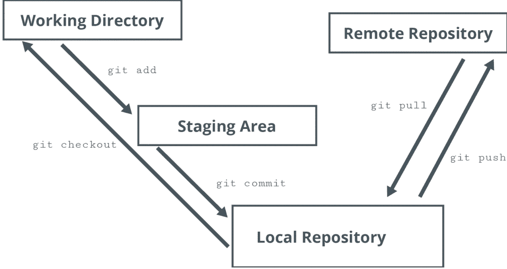

# 与远程仓库同步

要与远程仓库同步：

- 输入 `git pull <remote repository>` 下载当前分支
- 输入 `git push <remote repository>` 将自己的更改更改到远程仓库。

# 管理分支

要管理分支：

- 1. 输入 `git branch <branch name>` 创建文件的新副本。
- 2. 对此分支中的文件进行所需的更改。
- 3. 输入 `git merge <branch name>` 将你的更改合并回主分支。
- 4. 输入 `git checkout <branch name>` 切换到特定分支进行工作。

# 主题 C

识别编排概念

# 涵盖的考试目标

5.3 总结编排过程和概念。

到目前，你已经实现了较小规模的自动化。然而，在大型企业基础设施中，你可能负责成百甚至数千个系统。仅靠自动化不足以管理所有这些系统的部署和维护。这就是编排大显用场的地方。

# 编排

编排实现了多个相关任务的自动化——即整个工作流。编排的一个示例可能是 Web 应用的部署。部署可能包括 Web 服务器的安装和配置、MySQL 数据库的安装和配置、应用程序服务器的安装和配置，以及所有支持软件。编排将管理涉及的每一个步骤，尽管可能涉及不同的系统和配置要求。编排既用于本地也用于云解决方案。

# 基础设施自动化

自动化是在没有人工干预的情况下完成配置任务的过程。这与编排不同。自动化指的是单一任务，而编排管理处理更大规模的任务。例如，一个系统管理员可能会自动化 Linux 环境中 Python 包的安装，而另一个管理员可能会编排带有所有必要配置的组合 Web 和数据库服务器的设置。编排可以被认为是一系列自动化任务，以完成应用程序、虚拟机或其他相互相关基础设施的大规模部署。

# 构建自动化

构建自动化特别强调初始操作系统的部署。构建自动化的一个示例是在源自 Red Hat 的派发版中使用 `Kickstart` 文件。这些文件可以被安装程序引用，然后根据 Kickstart 文件中的指令部署操作系统。

# 代码即基础设施

基础设施即代码是编排工具的名称，通过脚本和代码文件管理整个部署和配置过程，而不是通过传统的软件工具。基础设施代码依赖单一配置规范来部署基础设施（操作系统）和必要的应用程序。

# 编排工具

下表列出了实现编排的一些常用工具。

| 工具 | 描述 |
| :--- | :--- |
| Ansible | Ansible 使用 YAML 文件创建可重复的“剧本”（playbooks），定义所需的配置状态。Ansible 是一个通过 SSH 连接交付的无代理解决方案。Red Hat 强调使用 Ansible。 |
| Puppet | Puppet 清单文件（用 Ruby 编写）用于定义应用程序、云和基础设施编排的基础设施代码。Puppet 在目标节点使用代理。 |
| Chef | Chef 使用“食谱”（cookbooks）向云和本地管理系统交付配置声明。 |
| Kubernetes | Kubernetes 是一个开源解决方案，为云和本地容器环境提供容器部署和编排。你定义所需的状态，Kubernetes 进行配置以匹配该状态。 |
| OpenStack | OpenStack 最初是 Rackspace 和 NASA 的合作项目，通常部署作为 IaaS 解决方案来管理资源。OpenStack 可以编排 Linux、MySQL、PHP 等服务的部署。 |

# 基于代理的编排与无代理编排

基于代理的编排要求软件组件位于托管设备上。无代理工具不需要预先安装。

# 步骤

编排步骤将根据所使用的工具而异，通常情况下编排涉及定义配置，然后交付。配置随后被处理，以匹配定义。

以下是 Chef 编排的示例：

1. 管理员配置并测试 Chef “食谱”。
2. 食谱交付到指定的客户端。
3. 客户端处理食谱，配置节点。

# 属性

编排属性定义了由编排管理的任务。管理员可以使用这些来识别由编排设置的特定配置。OpenStack 依赖属性。

# 资产管理

硬件、虚拟机、操作系统、应用程序和配置的资产管理可以通过编排工具进行。不同的工具提供不同的资产管理功能，包括报告。资产管理至关重要。

# 自动化配置管理

配置管理的优点包括一致的配置和更高效的构建过程。确保所有系统符合给定的配置基线有助于执行安全要求和服务协议，并使变更管理更高效。

# 活动 14-1

自动化任务复习

# 场景

回答以下复习问题。

1. 你是否或会考虑使用像 Git 这样的版本控制系统？为什么？

答案不异。版本控制系统在软件开发环境中很常见，即使是小项目也是如此。它们自由简化协作流程并有助于减少版本冲突。不进行软件开发的组织可能认为版本控制系统的价值较低，但它们对于管理其他信息仍然有用。

2. 你可以在 Linux 系统上创建哪些类型的 cron 任务？

答案异。常见的 cron 任务包括：监控和报告系统性能；检查存储使用情况；对系统进行安全扫描；清理日志文件；备份数据等。

总结

在本节中，你使用 cron 任务和版本控制系统等技术实现了日常管理任务的自动化。通过这种方式，你可以提高效率并减少手动管理常见的错误。


在很多情况下，你将处理的 Linux 系统已经已经为你构建好了。但有时，你需要从零开始构建系统。你必须能够以符合你组织业务需求的方式安装 Linux，无论这些需求是什么。因此，你将通过将安装配置为你所需的规格来完成最后工作。

## 课程目标

在本节中，你将：

- 准备安装 Linux 操作系统。
- 执行 Linux 的安装。

## 主题 A

### 为 Linux 安装做准备

在实际开始安装之前，采取一些准备步骤是非常重要的。你需要进行一些研究并收集适当的信息，这将帮助指导你完成安装过程。

## 系统要求

将系统要求视为不仅是运行系统所需的硬件组件是非常重要的——它们还规定了保持系统运行并执行其分配功能的必要条件。因此，你可能可以在计算机上顺利安装 Linux，但这并不意味着它的性能将达到最佳。

Linux 系统的系统要求取决于许多不同因素：

- 你所使用的发行版。不同的发行版在 CPU 速度、内存、存储和空间方面有不同的建议和基准要求。更多的发行版专门为轻量化设计；即它们消耗的资源比标准的企业级或消费级发行版少。
- 硬件兼容性。如果 CPU、GPU 等性能强大到足以运行 Linux 发行版，并不意味着该发行版（或 Linux 内核）支持它。你需要选择具有稳定驱动程序的硬件。
- 系统的大类。该系统是服务器？工作站？还是其他？每个类别都需要配备不同类型的组件。例如，Intel® Xeon（至强）CPU 是为服务器设计的，因为它们强调纠错和可靠性，并且每个处理器拥有多个核心。另一方面，桌面级 CPU（如 Intel Core™ i7）是为单用户场景设计的，通常性能比 Xeon 弱。
- 系统的预期功能。无论系统是否是服务器、工作站等，它在组织中实际扮演什么角色？它是 Web 服务器吗？数据库服务器吗？工作站需要用于文字处理吗？最终，对应用程序的要求越高，你需要的资源就越多。服务器可能需要处理每天数千次的网络连接，因此应该具备良好的网络基础设施。
- 运行在系统上的应用程序。你可能能够估算出工作站需要什么样的显卡。然而，在知道用户将使用什么程序之前，你可能无法确定确切的配置。
- 预算。组织的预算是有限的，你应该始终能够购买符合你预算的最强大的硬件。资源优先级是帮助你做出这些决策的关键技能。

## 分区策略

在安装过程之前，你必须仔细规划分区策略。服务器与工作站的存储需求不同。如果根分区（root）挂载满了，系统将会崩溃。用户目录（home）和日志文件经常会意外增大。通过隔离这些目录，可以防止系统崩溃。

Linux 通常使用专用的分区（swap）作为虚拟内存存储。对于任何类型的存储，规划交换分区是重要的。一个通用指南是交换分区的大小应该是内存容量的两倍，尽管这个数字会有变化。

## 分区示例

以下是 Linux 服务器的通用分区策略：

- `root` 分区
- `/home` 分区，以隔离用户目录。
- `/var` 分区，以隔离日志文件。
- `swap` 分区，通常是内存容量的两倍。

以及 Linux 工作站的通用分区策略：

- `root` 分区
- `swap` 分区，通常是内存容量的两倍。
> 注意：Linux 工作站通常不共享整个硬盘，因此其重要性通常低于服务器。


## 硬件兼容性

在购买任何硬件组件之前，最重要的是检查它是否与相关的 Linux 发行版兼容。某些发行版维护硬件兼容列表（HCL）来帮助你。每个发行版可能都有自己的 HCL。
> 注意：对于通用的硬件兼容性列表，请访问 [https://www.linux.org/hcl](https://www.linux.org/hcl)。

因此，在安装 Linux 之前，你应该收集有关系统的信息。你可以在文档中找到或通过 BIOS/UEFI 等低级接口获取数据。许多组件上打印有制造商和型号信息。

## 选择硬件时的问题

在购买硬件组件之前需要解决的问题列在下表中。这些问题“制造商是谁？”、“型号是什么？”以及“支持驱动吗？”适用于几乎所有组件类型。

| 组件 | 需要解决的问题 |
| :--- | :--- |
| 存储驱动器 | - 安装了多少设备？<br>- 控制器使用什么技术（SATA, SCSI, NVMe 等）？<br>- 驱动器容量是多少？<br>- 是机械硬盘还是固态硬盘？<br>- 驱动器的读写速度是多少？<br>- 目标是服务器还是桌面市场？ |
| CPU | - 频率是多少？<br>- 缓存大小是多少？<br>- 有多少物理核心？<br>- 支持多线程吗？ |
| 内存 | 有多少内存？<br>- 是 DDR3, DDR4 还是 DDR5？ |
| 网卡 | 支持多少带宽？<br>- 支持热插拔吗？<br>- 哪个版本的 USB？ |
| 输入设备（鼠标、键盘等） | - 安装了多少设备？ |
| 显示器 | - 刷新率是多少？ |

（注：表格内容的 OCR 非常混乱；我根据标准的硬件规格问题重建了逻辑映射。）*

等等，仔细查看表格的原始文本：
“需要解决的问题”
- 安装了多少设备？
- 控制器使用什么技术（SATA, SCSI, NVMe 等）？
- 驱动器容量是多少？
- 是机械硬盘还是固态硬盘？
- 驱动器的读写速度是多少？
- 目标是服务器还是桌面市场？
- 频率是多少？
- 缓存大小是多少？
- 有多少物理核心？
- 支持多线程吗？
- 有多少内存？（OCR 文字说是“How many RAM” —— 可能是“How much RAM”）
- DDR3, DDR4, DDR5？
- 支持多少带宽？
- 支持热插拔吗？
- 哪个版本的 USB？
- 支持哪些连接接口？
- 刷新率是多少？
- 最大分辨率是多少？
- 使用什么芯片组？
- 是否集成在主板上？
- 是否是独立显卡？

根据提供的文本片段重新格式表格：

| 组件 | 需要解决的问题 |
| :--- | :--- |
| 存储驱动器 | - 驱动器容量是多少？<br>- 是机械硬盘还是固态硬盘？<br>- 驱动器的读写速度是多少？<br>- 目标是服务器还是桌面市场？ |
| CPU | - 频率是多少？<br>- 缓存大小是多少？<br>- 有多少物理核心？<br>- 支持多线程吗？ |
| 内存 | 有多少内存？<br>- 是 DDR3, DDR4 还是 DDR5？ |
| 网卡 | 支持多少带宽？<br>- 支持热插拔吗？<br>- 哪个版本的 USB？ |
| 输入设备（鼠标、键盘等） | - 安装了多少设备？ |
| 显示器 | - 刷新率是多少？<br>- 最大分辨率是多少？<br>- 使用什么芯片组？<br>- 是否集成在主板上？<br>- 是否是独立显卡？ |

## 安装方法

大多数情况下，安装操作系统需要启动到一个特殊环境。因此，可以使用你学过的启动方法：

- 从 DVD 和 USB 盘等移动介质启动。这通常需要你将安装文件刻录到 DVD 中，或使用程序准备 USB 盘。像存储数据那样普通将文件添加到 USB 盘不会使其能够启动。
- 从本地驱动器的介质启动。例如，你可以将另一个发行版的 ISO 下载到系统中。只要它放置在没有操作系统的分区上，你就可以配置 GRUB 从其启动。
- 通过网络传输的介质启动。你可以使用 PXE 和 NFS 为客户端提供安装介质，客户端可以使用它进入安装环境。


# 主题 B

执行安装

现在你已经尽最大努力完成了准备工作，是安装 Linux 的时候了。

# 手动安装步骤

尽管你可以自动化 Linux 系统的安装和部署——包括作为大型编排工作的一部分——但在某些情况下，你可能需要逐步进行手动安装。具体的步骤取决于你正在安装的发行版而大相同，因为每个发行版都有自己的安装程序。大多数现代安装程序都带有图形用户界面 (GUI)，并允许你配置一些常用设置来安装 Linux：

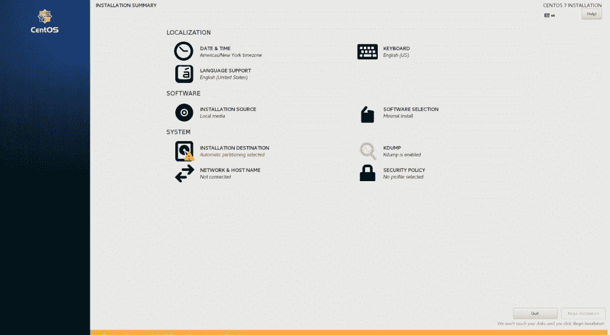

正在安装 CentOS 7。

通用的安装步骤包括但不限于：

- 配置系统使用的语言和键盘布局。这一步几乎总是作为第一步，用于为整个安装过程设定一个基准。
- 配置系统使用的时间和日期设置。可能有一个与网络时间协议 (NTP) 服务器同步的选项。
- 选择使用的安装介质。尽管你已经使用安装介质启动了安装程序，但某些安装程序允许你选择不同的源来继续安装。例如，如果你是用 USB 优存盘上准备的 ISO 启动的安装程序，你可以配置安装使用网络存储库。
- 选择要安装的软件环境和组件。许多发行版提供一个或多个基础环境的选择。基础环境可能是一个没有 GUI 且缺少用户空间程序的最小化安装；一个带有所有可用程序的完整 GUI 安装；以及介于两者之间的任何内容。取决于发行版，你可能可以进行更细致的选择，并选择安装特定的软件。
- 在一个或多个可用驱动器上进行分区并配置逻辑卷。你可以设计根文件系统的结构（其大小、文件类型等），以及任何添加的其他文件系统。
- 配置系统的网络身份。你可以为一个或多个可用接口配置 IP 地址、主机名和其他网络信息。
- 配置用户账户。通常，你会配置 root 用户的密码，和/或特定的管理员账户或其他标准用户。
- 配置安全策略。某些安装程序允许你在安装时对系统应用安全配置方案和策略。

# 如何安装 Linux

使用以下步骤安装 Linux。

# 安装 Linux

要安装 Linux：

1. 下载或通过其他方式获取所需的 Linux 发行版镜像。
2. 使用所需的方法准备启动介质：
- 将安装 ISO 刻录到 DVD。
- 准备一个带有安装 ISO 的 USB 优存盘。
- 配置 GRUB 2 从存储在本地分区上的 ISO 启动。
- 使用 PXE 或 NFS 准备安装镜像用于基于网络的安装。
3. 根据你配置启动介质的方式，连接该启动介质并启动计算机。
4. 如果必要，配置 BIOS/UEFI 从此介质启动。
5. 验证你已进入安装程序。
6. 在安装程序中选择各种选项，以所需的方式配置你的系统：
- 配置本地化选项。
- 配置存储分区方案。
- 配置网络身份。
- 配置用户账户。
- 配置基础安装软件。
- 配置额外软件。
7. 确认并保存你的配置。
8. 等待电脑重启。
9. 验证你是否看到了登录屏幕或提示。
10. 登录，然后检查你的配置是否已设置。

# 活动 15-1

Linux 安装复习

# 场景

回答以下复习题。

1. 你认为将在你的组织安装哪些 Linux 发行版，或者你过去安装过哪些？

答案取决于学生的业务需求。红帽企业级 Linux (Red Hat Enterprise Linux) 是一种非常常用的发行版，因为它提供了付费支持选项。CentOS 也是那些不想付费购买支持的人的流行替代方案。尽管如此，许多组织在服务器和工作站上都使用 Debian 及其衍生版（如 Ubuntu）。

2. 你预见到在安装过程中遇到任何硬件兼容性问题吗？为什么或为什么不？答案各异。Linux 驱动支持在多年里得到了极大改进，各种发行版支持许多不同的供应商。然而，学生可能仍然希望检查兼容列表，或简单测试硬件组件以查看它们的运行情况。

## 总结

在本节中，你通过验证基本系统要求以及及时满足你组织的业务需求，为安装 Linux 做了准备。然后，你成功安装了 Linux 操作系统。

# 第 15 节：安装 Linux |

# 接下来做什么？

# 成为 CompTIA A+ 认证专业人士！

CompTIA Linux+ 认证人士已验证了支持 Linux 系统的初级 IT 专业人员所需的能力。CompTIA Linux+ 是寻求验证 Linux 技能的 IT 专业人士取得成功的动力，并确保他们能够充分利用云、物联网和网络安全领域。该考试是仅针对职业的 Linux 认证，涵盖了全球招聘经理要求的最新、最相关的主题内容。要成为 CompTIA Linux+ 认证专业人士，你必须成功通过 Linux（考试代码 XK0-004）考试。

为了帮助你准备考试，你可能希望投资于 CompTIA 的考试备考产品 CertMaster Practice for Linux+。CertMaster Practice 是一种在线评估和认证培训工具，专门为完成了《官方 CompTIA Linux+ 课程》的人士设计。它有助于在参加考试前强化并测试你已的知识，并填补知识漏洞。CertMaster 的特点包括：

# 参加考试

当你充分学习并练习了相关材料后，可以预约时间参加考试。

# 准备考试

我们统计了考试中每个主题的细节。考试题目按领域加权。

# CompTIA Linux+ XK0-004 领域权重

- 1.0 硬件与系统配置 21%
- 2.0 系统运行与维护 26%
- 3.0 安全 19%
- 4.0 Linux 故障排除与诊断 20%
- 5.0 自动化与脚本 14%

有关如何注册和参加考试的更多信息，请访问 CompTIA 网站：https://certification.comptia.org/testing.

# 课程内容对应 CompTIA Linux+ (XK0-004)

获得 CompTIA Linux+ 认证需要候选人通过 XK0-004 考试。下表描述了课程涵盖的考试目标。

# 领域 1.0 硬件与系统配置的目标 1.1 解释 Linux 启动过程。

- GRUB
- GRUB 2
- 启动选项
- UEFI/EFI
- PXE
- NFS
- 从 ISO 启动
- 从 HTTP/FTP 启动
- 文件位置

- /etc/default/grub
- /etc/grub2.cfg
- /boot
- /boot/grub
- /boot/grub2
- /boot/efi

- 启动模块和文件
- 命令

- mkinitrd
- dracut
- grub2-install
- grub2-mkconfig

- initramfs
- efi 文件
- vmlinuz
- vmlinux

# 内核恐慌 1.2 给定场景，安装、配置和监控内核模块。

- lsmod
- insmod
- modprobe
- modinfo
- dmesg
- rmmod
- depmod
- 位置


- /usr/lib/modules/[kernelversion] 6B
- /usr/lib/modules 6B
- /etc/modprobe.conf 6B
- /etc/modprobe.d 6B

## 1.3 给定场景，配置并验证连接参数。

- 诊断工具 10C, 10F
- ping 10F
- netstat 10F
- nslookup 10F
- dig 10F
- host 10F
- route 10F
- ip 10F
- ethtool 10C
- ss 10F
- iwconfig 10C
- nclicli 10C
- brctl 10C
- nmtui 10C

- 文件 10C, 10D
- /etc/sysconfig/network-scripts/ 10C
- /etc/sysconfig/network 10C
- /etc/hosts 10D
- /etc/network 10C
- /etc/nsswitch.conf 10D
- /etc/resolv.conf 10D
- /etc/netplan 10C
- /etc/sysctl.conf 6B
- /etc/dhcp/dhclient.conf 10D

- 绑定 (Bonding) 10C
- 聚合 (Aggregation) 10C
- 主备模式 (Active/passive) 10C
- 负载均衡 10C

## 1.4 给定场景，在 Linux 环境中管理存储。

- 基础分区 7A

- 原始设备 7A
- GPT 7A
- MBR 7A

- 文件系统层次结构 4A, 4E
- 真实文件系统 4E

- 虚拟文件系统 4A * 相对路径 4E * 绝对路径 4E
- 设备映射 4B * LVM 4B * mmadm 4B
- 工具 4A, 4B, 4C, 4D, 4F * XFS 工具 4D * LVM 工具 4B * EXT 工具 4D
- 命令 4A, 4B, 4C, 4D, 4F * mmadm 4B * fdisk 4A * parted 4A * mkfs 4A * iostat 4F * df 4F * mount 4C * umount 4C 4D * blkid 4D * dumpe2fs 4D * resize2fs 4D * fsck 4D * tune2fs 4D
- ezlabel 4A
- 位置 4A, 4B, 4D, 4E * /etc/fstab 4A * /etc/crypttab 4A * /dev/ 4A * /dev/mapper 4B * /dev/disk/by-id 4A * uuid 4A * path 4A * multipath /etc/mtab 4D * /sys/block 4E * /proc/partitions 4D * /proc/mounts 4A
- 文件系统类型 4A * ext3 4A * ext4 4A
- xfs 4A
- nfs 4A
- smb 4A
- cifs 4A
- ntfs 4A

## 1.5 比较云与虚拟化的概念及技术。

- 模板 10E
- 虚拟机 (VM) 10E
- OVA 10E
- OVF 10E
- JSON 10E
- YAML 10E
- 容器镜像 10E

- 引导启动 (Bootstrapping) 10E
- Cloud-init 10E
- Anaconda 10E
- Kickstart 10E

- 存储 10E
- 精简置备与厚置备 (Thin vs. thick provisioning) 10E
- 持久卷 10E
- 存储对象 (Blob) 10E
- 块存储 (Block) 10E

- 网络注意事项 10E
- 桥接 (Bridging) 10E
- 叠加网络 (Overlay networks) 10E
- NAT 10E
- 本地 10E
- 双宿主 (Dual-homed) 10E

- 虚拟机管理器类型 10E
- 工具 10E
- libvirt 10E
- virsh 10E
- vmm 10E

## 1.6 给定场景，配置本地化选项。

- 文件位置 8A
- /etc/timezone 8A
- /usr/share/zoneinfo 8A
- 命令 8A
- localate 8A
- timedate 8A
- date 8A
- hwclock 8A
- 环境变量 13A
- LC_ 13A
- LC_ALL 13A
- LANG 13A
- TZ 13A
- 字符集 8A
- UTF-8 8A
- ASCII 8A
- Unicode 8A

## 2.1 给定场景，执行软件的安装、配置和删除。

- 包类型 11A
- rpm 11A
- deb 11A
- tar 11E
- gz 11E
- 安装工具 11A, 11B, 11C
- RPM 11A, 11B
- dpkg 11A, 11C
- APT 11A, 11C
- YUM 11A, 11B
- DNF 11A
- 构建工具 11F
- make 11F
- install 11F
- ldd 11F
- 编译器 11F
- 共享库 11F
- 配置 11D
- 同步 11D
- 获取命令 11E
- wget 11E
- curl 11E

## 2.2 给定场景，管理用户和组。

- 创建 2B
- useradd 2B
- groupadd 2C
- usermod 2B
- groupmod 2C
- passwd 2B
- chage 2B
- 删除 2B, 2C
- userdel 2C
- groupdel 2C
- 查询 2D
- id 2D
- whoami 2D
- who 2D
- last 2D
- 配额 4F
- 用户配额 4F
- 组配额 4F
- 配置文件 2E
- Bash 参数 2E
- .bashrc 2E
- .bash_profile 2E
- .profile 2E
- 全局项 2E
- /etc/bashrc 2E
- /etc/profile.d 2E
- /etc/skel 2E
- /etc/profile 2E
- 重要文件及内容 2B, 2C
- /etc/passwd 2B
- /etc/group 2C
- /etc/shadow 2B

## 2.3 给定场景，创建、修改和重定向文件。

- 文本编辑器 5A
- nano 5A
- vi 5A
- 文件读取器 5C, 5D
- grep 5D
- cat 5C
- tail 5C
- head 5C
- less 5C
- more 5C
- 输出重定向 5E
- < 5E
- > 5E
- | 5E
- << 5E
- >> 5E
- 2> 5E
- &> 5E
- stdin 5E
- stdout 5E
- stderr 5E
- /dev/null 5E
- /tty 5E
- tee 5E
- Here documents 5E
- 文本处理 5D, 5E
- grep 5D
- tr 5D
- sort 5D
- awk 5D
- sed 5D
- cut 5D
- printf 5D
- egrep 5D
- wc 5D
- paste 5D
- 文件和目录操作 4A, 5B, 5C, 5D, 12F
- touch 5C
- mv 5C
- cp 5C
- rm 5C
- scp 12F
- ls 5C
- rsync 12F
- mkdir 5D
- rmdir 5C
- 符号链接 (Symbolic) 4D
- unlink 5C
- inodes 4A
- find 5B
- locate 5D
- which 5B
- whereis 5D
- diff 5D
- updateddb 5B

## 2.4 给定场景，管理服务。

- systemd 管理 8C, 8D
- systemctl 8C
- enabled 8C
- disabled 8C
- start 8C
- stop 8C
- mask 8C
- restart 8C
- status 8C
- daemon-reload 8C
- systemd-analyze blame 8D
- Unit 文件 8C
- 目录位置 8C
- 环境参数 8C
- Targets 8C
- hostnamectl 8C
- automount 8C
- SysSignin 8C
- chkconfig 8C
- on 8C
- off 8C
- level 8C
- Runlevels 0–6 8C
- /etc/init.d 8C
- /etc/rc.d 8C
- /etc/rc.local 8C
- /etc/initab 8C
- runlevel 8C
- service 8C
- restart 8C
- status 8C
- stop 8C
- reload 8C

## 2.5 总结并解释角色。

- NTP 10B
- SSH 10B
- Web 10B
- 证书授权 (Certificate authority) 10B
- 名称服务器 10B
- DHCP 10B
- 认证服务器 10B
- 代理 10B
- 日志 10B
- 容器 10B
- VPN 10B
- 数据库 10B
- 打印服务器 10B
- 邮件服务器 10B
- 负载均衡器 10B

## 2.6 给定场景，自动化和调度任务。

- cron 14A
- at 14A
- crontab 14A
- fg 8D
- bg 8D
- nohup 8D
- Ctrl+C 8D
- Ctrl+Z 8D

## 2.7 解释设备的使用和操作。

- 设备类型 9A
- 客户端 9A
- Wi-Fi 9A
- USB 9A
- GPIO 9A
- 网络适配器 9A
- PCI 9A
- HBA 9A
- SATA 9A
- SCSI 9A
- 打印机 9A
- 视频 9A
- 音频 9A
- 监控和配置工具 4D, 6C, 9B, 9C, 9D
- lsdev 9C
- isusb 9C
- lspci 9C
- lsblk 4D, 9C
- dmesg 6C, 9C
- lpr 9B
- lpq 9C
- abrt 9B
- CUPS 9B
- udevadm 9B
- add 9B
- reload-rules 9B
- control 9B
- trigger 9B
- 文件位置 9B
- /proc 9B
- /sys 9B
- /dev/mapper 9B
- /etc/X11 9B
- 热插拔设备 9B
- /usr/lib/udev/rules.d (系统规则——最低优先级) 9B
- /run/udev/rules.d (易性规则) 9B
- /etc/udev/rules.d (本地管理——最高优先级) 9B
- /etc/udev/rules.d 9B

## 2.8 比较对比 Linux 图形界面。

- 服务器 8B
- Wayland 8B
- X11 8B
- GUI 8B
- GNOME 8B
- Unity 8B
- Cinnamon 8B
- MATE 8B
- KDE 8B
- 远程桌面 8B
- VNC 8B
- XRDP 8B
- NX 8B
- Spice 8B
- 控制台重定向 8B
- SSH 端口转发 8B
- 本地 8B
- 远程 8B
- X11 转发 8B
- VNC 8B
- 可访问性 8B

## 3.0 安全

## 3.1 给定场景，应用或获取适当的用户/或组权限和所有权。

- 文件和目录权限 2B, 3A, 3B, 3C, 4F, 5C
- 、写、执行 3A
- 用户、组、其他 3A
- SUID 3C
- 进制表示法 3A
- umask 3A
- 粘滞位 (Sticky bit) 3C
- SGID 3C
- 继承 3C
- 工具 2B, 3A, 3B, 3C, 4F, 5C
- chmod 3A
- chown 3B
- chgrp 3B
- getfacl 3C
- setflac 3C
- ls 5C
- ulimit 4F
- chage 2B

- 基于上下文权限 12C
- SELinux 配置 12C
- 禁用 (disabled) 12C
- 许可 (permissive) 12C
- 强制 (enforcing) 12C
- SELinux 策略 12C
- 目标模式 (targeted) 12C
- SELinux 工具 12C
- setenforce 12C
- getforce 12C
- sestatus 12C
- setsebool 12C
- getboolean 12C
- chcon 12C
- restorecon 12C
- ls -Z 12C
- ps 12C


- Telnet 12A
- Finger 12A
- Sendmail 12A
- Postfix 12A
- 启用 SSL/TLS 的重要性 12A
- 启用 auditd 的重要性 12A
- CVE 12A
- 限制 USB 设备 12A
- 磁盘加密 12A
- LUKS 12A
- 限制 cron 访问 12A
- 禁用 Ctrl+Alt+Del 12A
- 添加 banner 12A
- MOTD 12A

## 3.4 给定场景，实现日志服务。

- 关键文件位置 12E
- /var/log/secure 12E
- /var/log/messages 12E
- /var/log/[application] 12E
- /var/log/kern.log 12E
- 日志管理 12E
- 第三方代理 12E
- logrotate 12E
- /etc/rsyslog.conf 12E
- journald 12E
- journalctl 12E
- lastb 12E

## 3.5 给定场景，实现并配置防火墙。

- 访问控制列表 12D
- 源 12D
- 目的 12D
- 端口 12D
- 协议 12D
- 日志 12D
- 有状态 vs. 无状态 12D
- 接受 (Accept) 12D
- 拒绝 (Reject) 12D
- 丢弃 (Drop) 12D
- 记录 12D
- 技术 12D
- 区域 12D
- 运行时 12D • iptables 12D • 持久化 12D • 链 12D • ufw 12D
- /etc/default/ufw 12D • /etc/ufw 12D • Netfilter 12D
- /proc/sys/net/ipv4/ip_forward 12D
- IP 转发 12D • /proc/sys/net/ipv6/conf/forwarding
- 动态规则集 12D • DenyHosts 12D • FallBan 12D • IPSet 12D
- 常见应用防火墙配置 12D • /etc/services 12D • 特权端口 12D

## 3.6 给定场景，备份、恢复和压缩文件。

- 归档与恢复工具 12F • tar 12F • cpio 12F • dd 12F
- 压缩 12F • gzip 12F • x 12F • zip 12F
- 备份类型 12F • 增量 12F • 全量 12F • 快照克 12F • 差异 12F • 异地/离线存储 12F * SFTP 12F * SCP 12F * rsync 12F
- 完整性检查 12F * MD5 12F * SHA 12F

## 4.0 Linux 故障排除与诊断

### 4.1 给定场景，分析系统属性并进行相应的修复。

- 网络监控与配置 10C, 10F
- 延迟 10F
- 带宽 10F
- 吞吐量 10F
- 路由 10F
- 饱和度 10F
- 丢包 10F
-超时 10F
- 名称解析 10F
- Localhost vs. Unix 套接字 10F
- 适配器 10F
- RDMA 驱动 10F
- 接口配置 10F
- 命令 10C, 10F
- nmap 10F
- netstat 10F
- iftop 10F
- route 10F
- iperf 10F
- tcpdump 10F
- ipset 12D
- Wireshark 10F
- tshark 10F
- netcat 10F
- traceroute 10F
- mtr 10F
- arp 10F
- nslookup 10F
- dig 10F
- host 10F
- whois 10F
- ping 10F
- nmcli 10C
- ip 10C, 10F
- tracepath 10F
- 存储监控与配置 4B, 4D, 4F
- iostat 4F
- IO 调度 4F
- cfq 4F
- noop 4F
- deadline 4F
- du 4F
- LVM 工具 4B
- fsck 4D
- partprobe 4A
- CPU 监控与配置 8E
- /proc/cpuinfo 8E
- uptime 8E
- 负载平均值 8E
- sar 8E
- sysctl 8E
- 内存监控与配置 8E
- swapon 8E
- swapoff 8E
- mkswap 8E
- 内存不足 8E
- free 8E
- /proc/meminfo 8E
- 缓存输出 8E

### 4.2 给定场景，分析系统进程以优化性能。

- 进程管理 8D, 13A
- 进程状态 8D
- 僵尸进程 8D
- 不中断睡眠 8D
- 可中断睡眠 8D
- 运行中 8D
- 优先级 8D
- 杀死信号 8D, 13A
- nice 8D
- renice 8D
- top 8D
- time 13A
- ps 8D
- ios 8D
- pgrep 8D
- pkill 8D
- PID 8D

### 4.3 给定场景，分析并排除问题。

- 权限 3D
- 目录 3D
- 访问 12B
- 本地 12B
- 身份验证 12B, 12C
- 外部 12B
- 12B
- 文件创建 3D, 4F
- 配额 4F
- 存储 4F
- Inode 耗尽 4F
- 不变文件 3D
- 权限不足 12C
- SELinux 12C
- 环境与 shell 问题 13A

### 4.4 给定场景，分析并排除硬件问题。

- 存储 4E, 9D
- 降级存储 4F
- 设备缺失 4F
- 卷缺失 4F
- 挂载点缺失 4F
- 问题 4F
- 资源耗尽 4F
- 适配器 9D
- SCSI 9D
- RAID 9D
- SATA 9D
- HBA 9D
- /sys/class/scsi_host/scan
- 存储完整性 4F
- 坏块 4F
- 防火墙 12D
- 限制性 ACL 12D
- 禁用端口 12D
- 禁止协议 12D
- 权限 2A, 3C, 3D
- 所有权 3D
- 可执行文件 3D
- 继承 3C, 3D
- 服务账户 2A, 3D
- 组关系 3D
- 依赖 11G
- 补丁 11G
- 更新问题 11G
- 版本 11G
- 库 11G
- 环境变量 13A
- GCC 兼容性 11G
- 仓库 11G
- 额外硬件故障排除 9D
- 内存 9D
- 打印机 9D
- 视频 9D
- GPU 驱动 9D
- 通信端口 9D
- USB 9D
- 键盘映射 9D
- 硬件或软件兼容性 9D
- 命令 9D
- dmidecode 9D

## 5.0 自动化与脚本

### 5.1 给定场景，部署并执行基础脚本。

- Shell 环境与变量 13A
- PATH 13A
- 全局 13A
- 本地 13A
- export 13A
- env 13A, 12B
- printenv 13A
- echo 13A
- #!/bin/bash 13C
- 运行脚本 13C
- 目录和文件权限 13C
- chmod 13C
- 扩展 13C
- 注释 12B
- 文件通配符 13C
- Shell 扩展 13C
- $() 13C
- `` 13C
- 重定向与管道 13C
- 退出码 13C
- stderr 13C
- stdin 13C
- stdout 13C
- 元字符 13C
- 位置参数 13C
- 循环结构 13D
- while 13D
- for 13D
- until 13D
- 条件判断语句 13D
- if 13D
- case 13D
- 转义字符 12B

### 5.2 给定场景，使用 Git 执行版本控制。

- 参数 14B
- clone 14B
- push 14B
- pull 14B
- commit 14B
- merge 14B
- branch 14B
- log 14B
- init 14B
- config 14B
- 文件 14B
- .gitignore 14B
- .git/ 14B

### 5.3 总结编排过程和概念。

- 代理 (Agent) 14C
- 无代理 (Agentless) 14C
- 过程 14C
- 属性 14C
- 基础设施自动化 14C
- 基础即代码 (IaC) 14C
- 节点 14C
- 自动化配置管理 14C
- 构建自动化 14C

# Solutions

# Activity 1-1: 执行基础 Linux 回顾

1. Linux 在你的组织是如何使用的？是否有现有系统切换到 Linux 可以从中受益？

答案各不相同：Linux 是托管各种服务器的热门平台，如果学生的组织托管或管理 Web 服务器，他们很有可能正在运行 Linux。大多数组织使用路由器等网络设备来支持其网络，许多此类嵌入式设备实施任何移动基础设施策略，如自带设备 (BYOD)，许多此类设备可能正在运行 Android。将现有系统切换到新操作系统并不总是易事，但如果 Linux 的免费、简单和现代特性能够提高性能和生产力，学生可能会看到其价值。

2. 你获取 Linux 帮助的首选方法是什么？为什么？

答案各异。有些人喜欢 man 页，因为它们在命令行中访问快速又方便，而其他文档可能需要访问互联网和浏览器。然而，仅通过阅读 man 页很难理解某些功能的真实威力，某些学生可能倾向于查看更详细或提供实际示例的在线文档。其他学生可能更喜欢直接与 Linux 社区互动，这种互动对于解决复杂问题是必要的。


## 2. 你使用过哪些类型的文件系统？你遇到过它们各自的优缺点？

答案各异，但可能包括支持 ext4 文件系统的回答，因为它是 ext3 和 ext2 的改进版本，且 ext2 是 Linux 发行版的原生文件系统。许多学生将 XFS 作为 CentOS/RHEL 7 的默认文件系统，因为它具有速度快、可靠性和高级功能。有些学生可能只熟悉较旧的 ext2 类型及其较慢的恢复时间，而另一些学生可能经历过 ext4 的恢复速度比 ext2 快。有些人可能发现，使用 XFS 格式化新分区比使用 ext4 格式化快得多。来自 Windows 背景的学生可能只使用过 NTFS 或 FAT32 系统。

## Activity 5-1：文件和目录管理回顾

- 1. 利用文本流和标准 I/O 能力的某些方法如何增强你在 Linux 系统上的管理任务？

答案各异。将命令结果重定向到文件是一项非常常见且实用的任务，可以适用于许多场景。同样，将一个命令管道到另一个命令可以使信息处理更高效，这也是许多管理场景中的常见任务。

- 2. 你更倾向于使用哪个 Linux 文本编辑器？为什么？

答案各异。Vim 是 Linux 管理员的热选，因为它具有高级功能，许多人已经习惯了它的用户体验。然而，Vim 很难掌握，有些学生可能更喜欢 nano，因为它简单易用，特别是在需要快速编辑基础文件时。如果学生主要在 GUI 环境下工作，也可能偏好其他文本编辑器，例如 edit。

## Activity 6-1：内核模块管理回顾

- 1. 你是否预计自己需要向内核加载任何特殊模块以满足你组织的要求？如果是，你可能需要加载哪些模块？

答案各异。组织可能需要支持特殊硬件设备，或者要求与某些驱动程序具有兼容层。学生可能需要加载特殊模块，以便在他们的 Linux 环境支持必要的功能。

- 2. 你是否预计自己需要在运行时配置任何内核参数？如果是，你可能会配置什么类型的参数？

答案各异。为了精细调整服务器的网络性能，学生可能会考虑限制总连接数量的参数，或者用于启用和禁用特定网络服务和协议的参数。学生可能还需要对文件系统数据设置限制，例如允许的最大打开文件数。或者，他们可能需要调整设备功能，例如提高或降低 RAID 配置中的速度。

## Activity 7-1：Linux 启动过程管理回顾

- 1. 你在 Linux 环境中使用或计划使用哪些启动选项？为什么？

答案各异。从 ISO 启动是一种常见做法，通常在管理员拥有机器的物理访问权限时采用。学生可能具有创建可启动 USB 闪存盘或 DVD-ROM 的经验，将它们插入机器并在 BIOS/UEFI 中设置适当的启动选项。然而，有些学生可能会指出使用网络启动选项 PXE 的优点，特别是多台机器能够通过局域网 (LAN) 轻松获取启动文件的能力。

- 2. 你预见到会在你的环境中需要配置 GRUB 2 吗？为什么或者为什么不？

答案各异。学生可能希望在某些环境中保留默认启动配置，因为这些配置通常足够了。然而，有些学生希望在双系统或多系统启动环境中工作，这些环境中安装了多个操作系统或多个 Linux 内核版本。在这种情况下，他们将希望配置 GRUB 2 来识别这些启动环境，并允许用户选择想要启动哪一个。有些学生可能表示对开发自定义脚本以添加到 GRUB 2 或更改某些模块的顺序感兴趣。

## Activity 8-1：系统组件管理

- 1. 你倾向于在 GUI 中管理你的 Linux 系统，还是仅从 CLI 管理？为什么？如果你偏好 GUI，你更倾向于使用哪个桌面环境？

答案各异。在许多情况下，关键服务器在没有 GUI 的情况下运行，因为它增加了不必要的开销，并带来了一些安全安全风险。然而，有些学生仍然习惯于使用 GUI 执行日常任务，在某些情况下，他们可能需要 GUI 来运行某些应用程序。桌面环境的选择很大程度上取决于个人偏好，即使是特定的软件版本。

- 2. 哪些进程管理工具对你的环境有用？为什么？

答案各异，但可能包括通过优先处理进程、重新调度进程以及通过 `renice`、`ps`、`top`、`kill` 等命令杀死不需要的进程来提高系统性能。高级用户可能拥有这些命令的经验。

## Activity 9-1：设备管理回顾

- 1. 你在组织中使用或预计使用什么种类型的存储和外设总接口？

答案各异，但重视存储吞吐量的大型组织可能会使用 SAS 或可能的 NVMe SSD。有些可能依赖于台式机和笔记本电脑自带的廉价 SATA 实现，特别是如果存储容量比速度更重要。对于外部存储设备，USB 也是一个非常流行的选择。对于多媒体设备，HDMI 和 DisplayPort 是常见的。

- 2. 你或你的同事在工作中遇到的最常见的硬件问题是什么？

答案各异，这取决于学生组织硬件的基础状况。然而，连接打印机的问题很常见，视频输出问题也是如此。过时或缺失设备驱动也是常见问题，会导致硬件功能降低。

## Activity 10-1：网络管理回顾

- 1. 你的组织为员工和客户提供什么种网络服务？

答案各异。为客户提供的常见网络服务之一是使用 HTTP/S 的网站。在后端，该网站可能还会与数据库和日志服务集成。组织还需要为员工提供共享服务、远程连接服务、电子邮件服务、VPN 服务等。

- 2. 你的组织是否利用了云或虚拟化技术？如果是，哪些资源使用了这些技术？如果不是，你是否认为这些技术对组织有益？

答案各异。组织将软件、计算机甚至整个网络虚拟化变得更加常见且普遍。组织正特别转向 AWS 和 Microsoft Azure 等云服务，以减轻托管这些虚拟化资源的负担。仅以少数方式使用云的组织（例如文件托管）可能从与云端虚拟化的更深集成中获益。

## Activity 11-1：软件包和软件管理回顾

- 1. 你在组织中可能需要安装哪些包？你会经常使用哪些包管理工具？

答案各异，因为不同的组织有不同的软件需求。然而，启用服务器角色的包（如 Apache Server）以及生产力软件（如 Atom）是常见的。最流行的包管理工具是 APT 和 YUM，取决于发行版，学生可能会使用工具。

- 2. 作为管理员，你为什么可能创建自己的仓库？

答案各异，但通过创建仓库，你可以维护一个个性化的包数据库并移除任何的包。私有仓库还能实现包的组织。可以根据包名称和来源创建仓库。本地仓库可以提供公共仓库的镜像，以加快访问并提高效率。你还可以根据需求批准某些包并拒绝其他包。

## Activity 12-1：Linux 系统安全回顾

- 1. 你是否计划在你的 Linux 系统中使用如 SELinux 或 AppArmor 等基于上下文的权限方案？为什么或者为什么不？

答案各异。在某些环境中，特别是国防系统，基于上下文的权限和访问控制 (MAC) 是要求的。在没有此要求的组织中，学生可能对实现 SELinux 或 AppArmor 感兴趣，以增强访问敏感数据（如个人身份信息）的安全性。但在低风险环境中，这些访问控制方法可能会成为配置上的障碍。

- 2. 你的组织是否有关键数据的异地备份？如果没有，你认为值得投入吗？

答案各异。对于许多存储数据的组织，异地备份至关重要。在许多情况下，组织可能通过网络发送数据来进行备份。然而，这并不总是可靠，因此有些组织选择将存储介质物理移动。目前没有维护异地备份的学生可能会看到其价值，特别是如果他们过去经历过重大数据丢失。

## Activity 13-1：使用 Bash 脚本回顾

- 1. 你可能会在你的环境中配置哪些环境变量？

答案各异。最常配置的环境变量之一是 PATH，用户经常使用它以便能够在 CLI 的任何位置执行命令，即使其二进制文件位于默认路径之外。使用 HOME 配置用户的主目录。


变量也可以很有用，例如通过 `HISTSIZE` 变量配置 shell 的命令历史记录。

## 2. 通过运行 shell 脚本，你可以在环境中执行哪些任务？

答案各不相同，但可能包括管理文件、配置账户信息以及自定义系统环境。shell 脚本是 Linux 系统管理员工具箱中强大的工具之一，因为它能够许多许多过程和流程的自动化。

## 活动 14-1: 自动化任务回顾

- 1. 你是否考虑，或愿意考虑使用像 Git 这样的版本控制系统？为什么使用或为什么使用？

答案各不相同。版本控制系统在软件开发环境中非常常见，即使是小型项目也是如此。它们简化了协作流程并有助于减少版本冲突。不进行软件开发的组织可能认为版本控制系统的价值较低，但它们对于管理其他类型的信息仍然有用。

- 2. 你会在你的 Linux 系统上创建哪些类型的 cron 任务（定时任务）？

答案各不相同。常见的 cron 任务包括：监控和报告系统性能；检查存储占用；对系统进行安全扫描；清理日志文件；备份数据等等。

## 活动 15-1: Linux 安装回顾

- 1. 你认为你会在组织中安装哪些 Linux 发行版，或者你过去安装过哪些？

答案取决于学生的业务需求。Red Hat Enterprise Linux（红帽企业 Linux）是一种常见的大型组织服务器发行版，因为它提供付费支持。CentOS 也是那些不想支付支持费用的人的热门选择。尽管如此，许多组织在服务器和工作站中使用 Debian 及其衍生版本（如 Ubuntu）。

- 2. 你预计在安装过程中会遇到任何硬件兼容性问题吗？为什么或为什么？

答案各不相同。Linux 驱动支持多年来得到了极大改进，各种发行版支持许多不同的供应商和型号。然而，学生可能仍然希望检查兼容列表，或简单地测试硬件组件以查看它们的效果。

## 术语表

**ABRT**（自动错误报告工具）一种分析并报告系统运行期间检测问题的实用程序。

**absolute path**（绝对路径）指向文件系统中特定位置的引用，不受当前工作目录或组合路径的影响。

**ACL**（访问控制列表）附加到对象上的权限列表。

**agent**（代理/代理）一个代表其他程序或服务运行的软件程序。

**AppArmor**

一种基于上下文的权限方案，由基于 Debian 和 SUSE 的 Linux发行版提供。

**APT**

（高级软件包工具）一种在基于 Debian 的发行版中配合 `dpkg` 包使用的高级软件包管理实用程序。

**ARP**

（地址解析协议）一种将 MAC 地址与 IP 地址相匹配的网络协议。

**array**（数组）一种编程对象，是值的集合。

**authentication**（身份验证）验证个人身份的网络安全实践。

**availability**（可用性）确保计算机系统持续运行且授权人员可以访问其所需数据的网络安全原则。

**backup**（备份）存储在原始数据另一个逻辑或物理位置上的数据副本。

**biometrics**（生物识别）根据用户的物理特征验证其身份的身份认证方案。

**BIOS**

（基本输入/输出系统）一种用于为操作系统启动初始化硬件的固件接口。

**blob**

（二进制大对象）以非结构化方式存储的数据集合。

**block special file**（块特殊设备文件）一种用于数据存储的大型文件。

**Bluetooth**（蓝牙）一种短距离无线射电网络传输介质，通常用于连接两个设备，例如手机和无线耳机。

**boot loader**（引导加载程序）一种存储在只读内存中的小型程序，用于从存储设备加载内核，然后启动操作系统。

**booting**（启动过程）启动或重启计算机并加载操作系统供用户访问的过程。

**CA**

（证书权威机构）一个可以颁发数字证书以及相关公/私钥对的服务器。

**character special file**（字符特殊设备文件）一种用于数据流的小型文件。

**chroot jail**（chroot 监狱）一种通过更改进程环境的根目录来控制进程对文件系统可访问内容的技术。

**console redirection**（控制台重定向）通过串口连接转发输入和输出，任何直接连接到系统的 I/O 外设备的过程。

**CIA triad**（CIA 三要素）一个概述了网络安全三个主要目标的概念：机密性、完整性和可用性。

**container**（容器）一种运行在主机操作系统上的虚拟化应用程序，它与其他容器隔离。

**Cinnamon**（肉桂桌面）Linux Mint 的默认桌面环境之一，是 GNOME 3 的分支。

**CLI**

（命令行界面）用户与操作系统之间基于文本的接口，接受命令形式的输入。

**context-based permissions**（基于上下文的权限）一种权限方案，描述了关于进程和文件的多种信息，这些信息结合起来做出与访问控制相关的决策。

**control statement**（控制语句）一种编程元素，允许程序按指定的顺序执行指令。

**cloud computing**（云计算）通过像互联网这样的分布式网络向客户提供按需资源的实践。

**clustering**（聚类）将系统连接在一起以像一个系统一样执行任务的技术。

**command mode**（命令模式）一种允许用户通过按键执行不同编辑操作的文本模式。

**command substitution**（命令替换）一种 扩展方法，命令输出替换命令本身。

**compression**（压缩）通过编码数据来减少表示数据比特的过程。

**conditional statement**（条件语句）编程中用于判断特定条件为真为假的控制语句。

**confidentiality**（机密性）保持信息和通信私密并免受未经访问的网络安全原则。

一种允许用户传播自由开源软件（FOSS）衍生作品的许可证，只要衍生作品按照相同的许可证发布。

**cron job**（定时任务）由守护进程管理的计划任务。

**CSR**

（证书签名请求）发送给证书权威机构（CA）的消息，实体请求证书。

**CUPS**

一种 Linux 打印管理系统，使计算机能够作为打印服务器。

**CWD**（当前工作目录）用户正在访问的目录。

**cybersecurity**（网络安全）保护计算机和数字信息资源免受未经授权的攻击、盗取或数据损坏。

**daemon**（守护进程）无需人工干预而在后台运行的程序。

**decoding**（解码）将字节转换为文本的过程。

**DNF**

（Dandified YUM）YUM 包管理器改进版本。

**desktop environment**（桌面环境）显示服务器的客户端，告诉服务器如何在屏幕上绘制图形元素。

**DNS**

（域名系统）一种将人类可读的主机名转换为 IP 地址的网络协议。

**device driver**（设备驱动程序）作为操作系统与硬件设备之间接口的软件程序。

**dpkg**一种由 Debian Linux 发行版使用的软件包管理系统。

**device management**（设备管理）Linux 内核中控制设备访问以及用户应用程序与硬件之间接口的层。

**device mapping**（设备映射）将物理存储设备抽象为虚拟存储设备的过程。

**DTLS**

（数据报传输层安全）一种使用数据报实现 SSL/TLS 服务的加密网络协议。

**editing operator**（编辑操作符）在文本编辑器中快速处理文本的按键。


# DHCP
（动态主机配置协议）一种用于自动向主机分配 IP 地址信息的网络协议。

# 编码
encoding
将文本转换为字节的过程。

# 差异备份
differential backup
一种备份类型，其中备份自上次备份以来发生变化的所有选定文件。

# 加密
encryption
一种将数据从明文形式转换为编码形式（或密文形式）的密码学技术。

# 数字证书
digital certificate
一种将凭据与公钥关联的电子文档。

# 环境变量
environment variable
一种变量，其值继承自父进程并传递给子进程。

# 数字签名
digital signature
使用用户私钥加密的消息摘要摘要。

# 转义字符
escape character
一种用于移除另一个字符的特殊含义的字符，以便其能够按字面意思进行解释。

# 显示服务器
display server
图形用户界面（GUI）的一个组件，通过通信协议在屏幕上构建和管理视觉元素。

# 执行模式
execute mode
一种文本编辑模式，允许用户在编辑器内执行命令。

# 发行版
distro
参见 Linux 发行版（Linux distribution）。

# 退出码
exit code
子进程在终止时向其父进程传递的值。

# DM-多路径
DM-Multipath
Linux 内核的一个功能，通过支持 CPU 与存储设备之间的多个 I/O 路径，为块存储设备提供冗余并提高性能。

# 退出状态
exit status 参见退出码（exit code）。

# ext2
ext2
一种曾被用作旧版本 Linux 默认的文件系统。

# ext3
ext3
一种在多个方面对 ext2 进行了改进的文件系统。

# ext4
ext4
现代 Linux 版本中支持日志记录和大容量的文件系统之一。

### 自由软件
free software
支持自由软件运动所列原则的计算机，该运动重点关注保护用户无限制地查看、复制、修改和分发软件的权利。

# 扩展分区
extended partition
作为其他逻辑分区容器的存储驱动器分区。

# FAT
FAT
（文件分配表）一种旧的简单的文件系统，提供了良好的兼容性。

# FHS
FHS
（文件系统层次结构标准）一套关于 Linux 系统文件和目录命名及其位置的指南。

# FSF
FSF
（自由软件基金）由 Richard Stallman 建立的组织，旨在促进自由软件运动并支持 GNU 项目。

# 全量备份
full backup
一种备份类型，无论之前的状态如何，都会备份所有选定文件。

# 函数
function
可以重用以执行特定任务的代码块。

### 文件系统
file system
一种操作系统用于在存储设备上存储、检索、组织和管理文件及目录的数据结构。

# GCC
GCC
（GNU 编译器集）Linux 操作系统系统的标准编程语言编译器，用于编译 Linux 内核。

# 文件系统完整性
file system integrity
文件系统关于其正确性和有效性的属性。

# gedit
gedit
GNOME 桌面环境使用的默认 GUI 文本编辑器。

# 文件系统管理
file system management
Linux 内核的一层，用于在系统上存储、组织和跟踪文件。

# Git
Git
一种主要用于协作项目开发者的分布式版本控制系统。

# 防火墙
firewall
一种软件程序或硬件设备，通过拦截意外流量来保护系统或网络免受未经授权访问。

# 通配符匹配
globbing
一种 Shell 扩展方法，用于用匹配模式的值来替换特定的通配符模式。

# 防火墙区域
firewall zone
可以应用于特定网络资源（如网络接口）的防火墙规则集。

# FOSS
FOSS
（自由和开源软件）体现了自由软件运动和开源软件（OSS）运动共同原则的计算机代码。

# GNOME
GNOME
大多数运行 X Window 系统或 Wayland 的 Linux 发行版的默认桌面环境。

# GNU GPL
GNU GPL
（GNU 通用公共许可证）一种由自由软件基金会（FSF）创建的、用于支持 GNU 项目的自由软件许可证。

# GNU GRUB
GNU GRUB
（GNU 未定义引导加载程序）一种由 GNU 项目开发的引导加载程序，在 Unix 类系统上非常流行。

# 哈希处理
hashing
将明文输入转换为不可识别的固定长度输出的过程，并确保该过程在可行范围内不可逆转。

## GNU nano
GNU nano
一种在 Unix 系统中流行的易用文本编辑器。

# GNU Parted
GNU Parted
一种用于管理分区的工具。

### GNU 项目
GNU Project
一种旨在创建系统的软件项目。

# HBA
HBA
（主机总线适配器）一种连接主机的硬件设备。

# HCL
HCL
（硬件兼容列表）一种包含硬件兼容性的数据库。

# GPIO
GPIO
（通用输入输出）可以添加或移除的硬件引脚。

# GUI
GUI
（图形用户界面）一种用户交互的视觉界面。

# HTTP
HTTP
（超文本传输协议）一种定义 Web 服务器之间交互的协议。

# HTTPS
HTTPS
（安全超文本传输协议）提供安全连接的 HTTP 版本。

# 哈希函数
hash function
一种用于计算哈希值的算法。

# 虚拟机监控器
hypervisor
将虚拟机（VM）与硬件隔离的软件层。

# 哈希值
hash

# 插入模式
insert mode
一种允许用户通过输入插入文本的编辑模式。

# IAM
IAM
（身份访问管理）一种为用户、计算机和其他实体提供身份和授权的安全机制。

# 不变标志
immutable flag
文件或目录的一种属性，即使是 root 用户也无法修改。

# 增量备份
incremental backup
一种备份类型，其中备份自上次全量或增量备份以来发生变化的所有选定文件。

# 完整性
integrity
保持信息准确、无误且未经过授权修改的网络安全原则。

# 完整性检查
integrity checking
验证数据未被修改的过程。

# IP 地址
IP address
（网协议地址）一种唯一标识网络节点的逻辑网络地址。

# IP 转发
IP forwarding
Linux 内核路由实现。

# 基础设施即代码
infrastructure as code
通过编程脚本和其他代码而非标准工具快速配置和部署基础设施的过程。

# 继承
inheritance
在文件和目录权限中，对象获取父对象某些权限的属性。

# init
init
一个初始化系统并作为所有进程父节点的守护进程。

# initrd
initrd
（初始内存磁盘）系统启动时加载到内存中的临时根文件系统。

# initrd 镜像
initrd image
包含操作系统启动所需的所有基本文件的归文件。

# inode
inode
（索引节点）文件系统中存储文件或目录元数据的对象。

# IP 集合
IP sets
存储的 IP 地址、网络范围、MAC 地址、端口号和网络接口名称的集合。

# IPS
IPS
（入侵防御系统）一种监控并评估系统是否存在攻击迹象的安全设备，并主动拦截其判定为恶意的流量。

# IPSec
IPSec
（IP 安全协议）一组用于在数据跨网络或互联网传输时通过身份验证和加密安全数据的开放非专利标准。

# ISO 镜像
ISO image
常用于封装和分发引导及安装操作系统数据的归文件。

# 日志记录
journaling
文件系统使用名为日志的对象来记录尚未应用于文件系统的更改的方法。

# KDE Plasma
KDE Plasma
运行 X Window 系统或 Wayland 的 Linux 发行版中第二常见的桌面环境。

# Kerberos
Kerberos
一种基于时间敏感票据授予系统的集中化单点登录（SSO）认证服务。

# 本地化
localization
将系统组件适配到原始设计文化之外的特定文化中的过程。


# 内核
控制所有其他组件的操作系统的核心组件。

# 日志轮转 (log rotation)
创建日志文件的新版本以维持最小日志文件大小的做法。

# 内核模块
扩展内核功能的系统级对象。

# 内核恐 (kernel panic)
系统检测到致命错误并对其响应的机制。

# 逻辑分区
作为扩展分区的一部分并可以作为独立驱动器的存储驱动器。

# 循环 (loop)
根据特定条件重复执行代码的控制语句。

# 内核空间
内核执行其提供的服务的内存区域。

# LDAP
(轻量级目录访问协议) 运行在传输控制协议/网协议 (TCP/IP) 网络上的目录服务协议。

# 库 (library)
在编程中，一段可以在程序中使用以完成特定任务的编译代码。

# Linux
基于 Linux 内核的操作系统家族，通常在内核之上包含 GNU 软件。

# LUKS
(Linux 统一密钥设置) 一种跨平台的全盘/磁盘加密 (FDE)解决方案，通常用于加密 Linux 环境下的存储设备。

# LVM
(逻辑卷管理器) 将物理设备和分区映射到逻辑卷的软件。

# MAC
(强制访问控制) 访问控制模型，通过比较对象的标记和主体的安全许可范围来控制访问。

# Linux 发行版
Linux 家族中多个功能齐全的操作系统之一，运行 Linux 内核、GNU 软件和附加组件。

# Linux 内核
一个自由开源的单体内核，管理 Linux 操作系统上的所有其他资源。

# 负载均衡
将网络流量或计算负载分配到网络中多个设备之间的技术。

# MAC 地址
(媒体访问控制地址) 编码在网络接口卡 (NIC) 上的唯一物理网络地址。

# Makefile
一个包含指令的文件，编译器使用这些指令从源代码构建程序。

# 手册页 (manual pages)
针对特定 Linux 命令的内置文档，提供有关命令功能及如何使用的信息。也称为 man。

# MATE
Linux Mint 的默认桌面环境之一，是 GNOME 2 的分支版本。

# MBR
(主引导记录) 存储驱动器上的第一个物理扇区，一种分区结构。

# 网络适配器
提供连接主机到网络接口的设备，以便它们相互交换数据。

# MD5
(消息摘要算法5) 一种过时的哈希函数，产生 128 位哈希值。

# 网络端口
网络通信中的端点，用于识别通信中使用的应用层协议类型。

# 内存管理
Linux 内核的一层，负责为用户空间资源分配内存并在不再使用时释放内存。

# NetworkManager
用于配置系统网络信息的 Linux 实用程序。

# 消息摘要
参见 hash。

# 元字符 (metacharacter)
shell 以某种特定方式解释的特殊字符。

# MFA
(多因素身份验证) 要求用户在系统进行身份验证之前提供至少两个不同的身份验证因素的做法。

# NFC
(近场通信) 一种在极短距离内运行的设备通信标准，通常通过物理接触实现。

# NIC
(网络接口卡) 参见网络适配器。

# NIC 绑定 (NIC bonding)
将两个网络接口关联在一起使其作为单一设备管理的技术。

# 微内核
一种内核架构，其中内核空间仅运行作为操作系统所需的最小资源。

# nice 值
一个决定进程获得 CPU 时间优先级的值。

# 单体内核
所有系统组件都在内核空间运行的内核架构。

# NoSQL
一种支持传统数据库模型之外多种数据库设计的数据库类型。

#  (motion)
在文本编辑器命令模式下导航文件的单键快捷键。

### NTFS
(新技术文件系统) 微软创建的专有文件系统，作为 Windows的主要文件系统。

# 挂载点 (mount point)
对本地或远程存储设备上存储信息的访问。

# 名称解析
将人类可读的域名转换为数字 IP 地址的过程。

# NTP
(网络时间协议) 一种将节点时间与指定的确定性时间源同步的网络协议。

# 空设备 (null device)
一种丢弃所有写入其数据的设备。

# Netfilter
一个处理穿越网络接口的数据包的 Linux 框架。

# NX
(NoMachine) 跨平台专有远程桌面软件，支持多会话环境。

# 八进制 (octal number)
使用八个唯一数字之一表示的数字，即八进制系统。

# 异地备份 (off-site backup)
主站之外存储数据副本的物理位置。

# OOM 杀手 (out-of-memory killer)
Linux 内核的一项功能，当系统内存极低时决定杀死哪些进程。

# 参数扩展 (parameter expansion)
参见 变量替换。

### 父目录
当前工作目录上一层级的目录。

# 分区 (partition)
存储驱动器的一个部分，逻辑上作为独立驱动器工作。

# 路径 (path)
指向文件系统中特定位置的引用。

# 运算符 (operator)
可以以某些方式求值的表达式编程对象。

# PATH 变量
指定应用程序二进制文件存储在文件系统中位置的环境变量。

# 编排 (orchestration)
多个相关任务的自动化处理。

# OSI 模型
(开放系统互连模型) 定义网络预期工作方式的标准。

# OSS
(开源软件) 一种允许用户查看、复制的开发方法。

# OTP
(一次性密码) 一种在使用后失效的密码。

# 所有权 (ownership)
允许用户应用的属性。

# 包管理器
用于安装、更新、清单和卸载软件的程序。

# PAM
(可插验证模块) 一个供其他服务使用的集中身份验证机制框架。

# PCI
(外设部件接口)一种主要作为扩展总线的连接接口。

# PCIe
(PCI Express)改进了原始 PCI 规范的连接接口。

# 权限字符串 (permission string)
对象权限的文本表示。

# 权限 (permissions)
分配给用户的权限。

# PID
(进程 ID) 在每个新进程启动时分配的唯一整数。

# 管道 (piping)
组合命令标准输入输出的过程。

# PKI
(公钥基础设施) 一个由各种加密组件组成的系统，用于身份验证。

# 位置参数 (positional parameter)
在脚本被调用时赋予参数的变量。

# 主分区 (primary partition)
可以包含文件系统的存储驱动器分区。有时称为卷。

### 最小权限原则
信息安全最佳实践，规定用户应拥有工作所需的访问权限而不能更多。

# 权限提升 (privilege escalation)
用户获取通常无法访问的资源或功能的行为。

# 重定向 (redirection)
从非默认 I/O 设备接收输入数据并发送输出数据的过程。

# 相对路径 (relative path)
相对于当前工作目录的文件系统特定位置的引用。

# 远程桌面
一种概念，客户端通过网络连接到远程系统，并能够登录使用该系统。

# 仓库 (repository)
软件包的存储位置。

# 进程管理
Linux 内核的一层，为不同进程分配处理器执行空间。

# 进程表
系统当前运行进程的摘要记录。

# 路由器
作为网络段之间通信控制点的网络设备。

# RPM
(红帽包管理器) 用于源自红帽 Linux 的 Linux 发版的包管理系统。

# PXE
(预启动执行环境) 一种网络启动规范，允许客户端从服务器获取必要的加载程序和系统文件。

# 运行级别 (runlevel)
SysVinit 中一种控制系统运行模式的设置。

# SAS
(串行连接 SCSI) 一种替代并行 SCSI 的计算机总接口，使用串行


-   RADIUS (Remote Authentication Dial-In User Service) 一种网络协议，提供身份验证、授权和计费（AAA）服务。
-   SATA (Serial AT Attachment) 一种用于将存储设备连接到计算机的总线标准。
-   RAID (redundant array of independent disks) 一种独立磁盘阵列，用于多磁盘系统冗余和容错的配置规范。
-   raw partition 一个允许用户和应用程序直接读取或写入分区的原始分区。
-   SCI (System Call Interface) Linux 内核处理从应用程序发送的系统调用的接口层。
-   script 一个用于自动化执行任务的计算机程序。
-   SCSI (Small Computer System Interface) 一种用于连接外围设备到计算机的并行总线接口。
-   search path shell 用于查找文件的系列目录路径。
-   shell spawning 在 shell 环境中创建新会话的过程。
-   shell variable 包含在 shell 进程中的变量类型，其值不会传递给进程。
-   sector 存储的最小单位。
-   single-user mode Linux 系统启动的一种运行模式，需要超级用户登录。
-   SELinux (Security-Enhanced Linux) CentOS 和 Red Hat Enterprise Linux 提供的权限方案。
-   SNMP (Simple Network Management Protocol) 一种用于在主机之间收集信息的网络协议。
-   service 响应程序请求的软件，提供某种特殊功能。
-   software compilation 将人类可读源码翻译成处理器可以执行的指令的过程。
-   service management 启动、修改运行状态和停止服务的生命周期。
-   SPICE (Simple Protocol for Independent Computing Environments) 专为虚拟环境设计的开放协议。
-   SGID (set group ID) 一种特殊权限，允许用户以文件组的权限执行文件。
-   SHA (Secure Hash Algorithm)  MD5 的哈希函数，产生不同大小的哈希值。
-   SQL (Structured Query Language) 许多大型数据库系统的编程和查询语言。
-   SSH (Secure Shell) 一种提供加密的连接远程系统方法的网络协议。
-   shell 允许用户将命令和信息传递内核的系统组件。
-   SSH port forwarding 通过 SSH 协议对传输中的数据进行加密的过程。
-   shell environment shell 维护设置和其他行为细节的机制。
-   standard error 用作错误消息目的地的文本流。
-   shell expansion shell 识别并替换特殊标记的过程。
-   standard input 用作命令输入源文本流。
-   standard output 用作命令输出目的地的文本流。
-   symbolic link 指向跨文件系统的文件或目录的引用。
-   stderr 查看标准错误。
-   stdin 查看标准输入。
-   syntax 在脚本或编程语言中发布命令和编写代码的格式规则集。
-   stdout 查看标准输出。
-   sticky bit 为目录中的文件提供保护的特殊权限位。
-   storage device 可以记录并持久保存数据的物理组件。
-   storage quota 分配给用户用于计算机文件存储的存储空间。
-   syslog Unix 类系统的事件日志标准，便于通过网络进行集中日志服务。
-   system initialization 内核首次加载时开始的过程。
-   systematic drift 硬件钟每天增加或减少的可预测时间，导致其不准确并与系统时钟偏移。
-   strict policy SELinux 中的一种对所有主体和对象执行强制访问控制（MAC）的策略。
-   system 替换 SysVinit 等初始化方法并包含各种服务管理工具的软件套。
-   string literal 源码中表示字符串的固定值。
-   SysVinit 一种被 systemd 部分取代的旧系统初始化方法。
-   SUID (set user ID) 允许用户以文件所有者权限执行文件的特殊权限。
-   tab completion 命令行 shell 自动填充你部分输入的命令名称的功能。
-   superblock 包含文件系统元数据的数据结构。
-   superuser Linux 系统上的本地管理员账户，通常名为 root。
-   swap space 系统耗尽物理内存时使用的存储设备上的分区。
-   switch 将分段的所有网络连接集中到单一设备的网络设备。
-   TACACS+ (Terminal Access Controller Access-Control System Plus) 一种提供额外安全功能的身份验证、授权和计费（AAA）服务的网络认证协议。
-   tarball 以 .tar 扩展名的归档文件。
-   target systemd 中一种分组单元文件的方法，用于设置系统的运行模式。
-   targeted policy SELinux 中的一种策略，在所有目标对象上执行强制访问控制（MAC）。
-   unit file systemd 用于确定其如何处理系统的配置文件。
-   TCP/IP (Transmission Control Protocol/Internet Protocol) 治理网络通信的网络协议。
-   text editor 用于查看、创建或修改文本内容的应用程序。
-   text stream 一个可读取或写入特定设备的文本行序列。
-   thin client 连接到更强大的服务器的轻量级计算设备。
-   token 用户拥有的唯一对象（物理或数字），用于验证用户身份。
-   Unix philosophy Unix 开发者提出的一系列软件开发最佳实践，强调简单模块化。
-   USB (Universal Serial Bus) 连接外围设备到计算机的事实标准。
-   user account 代表用户操作系统身份的对象。
-   user space 内核空间之外访问内核服务的内存区域。
-   variable 随时间变化的实体。
-   troubleshooting 识别、诊断和解决问题的过程。
-   variable assignment 为变量定义特定值的过程。
-   troubleshooting model 解决问题的分步方法。
-   variable substitution 引用或检索变量值的过程。
-   trusted port 良好范围（0–1023）内的网络端口，尝试使用该端口的服务需要超级用户权限。
-   VFS (virtual file system) 在真实文件系统和 Linux 内核之间翻译文件信息的抽象层。
-   udev 自动检测和配置硬件设备的设备管理器。
-   Vim vi 文本器的扩展版本。
-   UEFI (Unified Extensible Firmware Interface) 一种改进并旨在取代 BIOS 的固件接口。
-   UFW (Uncomplicated Firewall) 配置 iptables 防火服务的简化接口。
-   virtualization 创建计算环境的过程，虚拟化系统可以模拟典型计算机的硬件、操作系统和应用程序。
-   visual mode允许用户高亮或选择文本进行复制、删除等的模式。
-   VM (virtual machine) 运行在模拟专用硬件环境中的包含操作系统和应用程序的虚拟计算机。
-   X11 查看 X 窗口系统。
-   XFS 现代 Linux 版本中默认文件系统之一，支持日志记录并高效处理大文件。
-   rdp 为非 Windows 系统创建类似远程桌面协议（RDP）环境的开源工具。


# VNC
（Virtual Network Computing / 远程网络计算）一种使用远程帧缓冲（RFB）协议的跨平台远程桌面服务。

# VPN
（虚拟专用网络）一种通过公共网络（如互联网）建立隧道扩展私有网络的方法。

# YUM
（Yellowdog Updater, Modified）一种高级的软件包管理工具，用于基于红帽的发行版中的 RPM 软件包。

# Zypper
一种支持 .rpm 软件包的 openSUSE 软件包管理器。

# Wayland
类 Unix 操作系统中的显示服务器和参考实现，旨在改进并替换 X Window System。

# Wi-Fi
一种用于建立和连接到无线局域网（WLAN）的无线通信协议。

# window manager（窗口管理器）
参见桌面环境。

# Wireshark
一种常用的数据包嗅探器和分析工具。

# X
参见 X Window System。

# X Window System（X窗口系统）
由麻省理工学院（MIT）于1984年开发的独立于平台的显示服务器和窗口系统。

# X.Org Server
适用于 Linux 和其他 Unix 类操作系统的 X窗口系统的免费开源实现。

# Index（索引）

# A
+ ABRT 269
- 绝对路径 108
- 访问控制列表（Access Control Lists），参见 ACLs
- ACLs 64
- 地址解析协议（Address Resolution Protocol），参见 ARP
- 高级软件包工具（Advanced Package Tool），参见 APT agents 396
- AppArmor 379
- APT 330
- ARP 322
- 数组 428
- 认证 353
- 自动错误报告工具（Automatic Bug Reporting Tool），参见 ABRT
- 可用性 353

# B
+ 备份
- 地 405
- Bash
- 脚本 426
- 基本输入输出系统（Basic Input/Output System），参见 BIOS
- 二进制大对象（binary large object），参见 blob
- 生物识别 354
- BIOS 183
- blob 307
- 特殊块文件 105
- 蓝牙 251
- 绑定（bonding） 293
- 启动 182
- 引导加载程序 182

# C
+ CA 281, 370
- 证书颁发机构（certificate authority），参见 CA
- 证书签名请求（certificate signing request），参见 CSR
- 特殊字符文件 105
- chroot 监狱（chroot jail） 356
- CIA 三要素（CIA triad） 352
- CIFS 78
- Cinnamon 212
- CLI 的优势挑战 9
- 云计算 302
- 集群 283
- 命令行界面（command-line interface），参见 CLI
- 命令模式 123
- 命令替换 434
- 注释 430
- 通用互联网文件系统（Common Internet File System），参见 CIFS
- 编译 328
- 编译器 344
- 压缩 406
- 条件语句 438
- 机密性 352
- 控制台重定向 214
- 容器 285
- 基于上下文的权限 376
- 控制语句 438
- 共享拷贝（copyleft） 4
- cron 任务 451
- CSR 370
- CUPS 258
- 当前工作目录，参见 CWD
- CWD 108
- 网络安全 352

# D
- 守护进程（daemons） 219
- Dandified YUM，*参见* DNF
- 数据报传输层安全（Datagram Transport Layer Security），*参见* DTLS
- 解码 205
- 桌面环境 211
- *另参见*窗口管理器
- 设备驱动程序 165
- 设备管理 167
- 设备映射 89
- DHCP 276, 282, 296
- 差异备份 400
- 数字证书 370
- 数字签名 370
- 显示服务器 209
- 发行版（distros） 6
- DM-Multipath 89
- DNF 330
- DNS 276, 281
- 域名系统（Domain Name System），参见 Dpkg 328
- DTLS 372
- 动态主机配置协议（Dynamic Host Configuration Protocol），参见 DHCP

# E
- 编辑操作符 125
- 编码 205
- 加密 357
- 环境变量 419
- 转义字符 428
- 执行模式 123
- 下一个代码代码 432
- *另参见*退出状态
- 退出状态 432
- ext2 77
- ext3 77
- ext4 77

# F
- FAT 77
- FHS 106
- 文件分配表（File Allocation Table），参见 FAT
- 文件系统层层结构标准（Filesystem Hierarchy Standard），参见 FHS
- 文件系统完整性 99
- 文件系统管理 167
- 文件系统 
- 类型 77
- 防火墙 383
- FOSS 3
- 自由开源软件（free and open source software），参见 FOSS
- 自由软件 3
- 自由软件基金（Free Software Foundation），参见 FSF
- PSF 4
- 全量备份 400
- 函数 429

# G
- GCC 174
- 文本编辑器 127
- 通用输入输出（general-purpose input/output），参见 GPIO
- Git 455
- 通配符（globbing） 434
- GNOME 212
- GNU 编译器集合（GNU Compiler Collection），参见 GCC
- GNU 通用公共许可证（GNU General Public License），参见 GNU
- 统一引导加载程序（GRand Unified Bootloader），参见 GNU GRUB
- GNU GRUB 190
- GNU nano 126
- GNU Parted 菜单选项 83
- GNU Project 3
- GPIO 253
- GPL 4
- GPT 185
- 图形用户界面（graphical user interface），参见 GUI
- 组 38
- GUI 208

# H
- 硬链接 151
- 硬件兼容性列表（hardware compatibility list），参见 HCL
- 哈希函数 411
- 哈希处理（hashing） 359
- HBA 254
- HCL 467
- 主目录 107
- 主机总适配器（host bus adapter），参见 HBA
- 主机名 275
- 热插设备 255
- HTTP 281
- HTTPS 281
- 超文本传输协议（Hypertext Transfer Protocol），参见 HTTP

# I
- I/O 调度 112
- IAM 364
- 身份访问管理（identity and access management），参见 IAM
- 不变标志（immutable flag） 63
- 增量备份 400
- 索引节点（index nodes），参见 inodes
- 基础设施即代码（infrastructure as code） 459
- initrd 219
- 内存磁盘（initial ramdisk），参见 initrd
- image 186
- inodes 78
- 插入模式 123
- 完整性 353
- 协议安全（Internet Protocol Security），参见 IPS
- 入侵防御系统（intrusion prevention systems），参见 IPSs
- IP 地址 275
- IP 转发 388
- IP 集合 389
- IPS 390

# J
- 日志（journaling） 79

# K
- KDE Plasma 212
- Kerberos 355
- 内核模块 168
- 内内核恐（kernel panic） 189
- 微内核（microkernel） 165
- 单体内核（monolithic） 165
- 内核空间 164

# L
- LDAP 355
- 库 344
- 轻量级目录访问协议（Lightweight Directory Access Protocol），参见 LDAP
- 优势 5
- 缺点 5
- 文档 16
- 发行版列表 6
- Linux 发行版 6
- Linux 内核 165
- Linux 统一密钥设置（Linux Key Setup），参见 LUKS
- 负载均衡 283
- 本地化 200
- 逻辑卷管理器（Logical Volume Manager），参见 LVM
- 日志轮转（log rotation） 395
- 循环 442
- LUKS 358
- LVM
- 工具 90

# M
- MAC 376
- MAC 地址 275
- Makefile 345
- 强制访问控制（mandatory access control），参见 MAC
- 手册页 16
- 主引导记录（master boot record），参见 MBR
- MBR 185
- MD5 411
- 内存管理 167
- 消息摘要（Message Digest），参见 MD5
- 元字符 431
- MFA 355
- 微内核内核 165
- 单体内核 125
- 挂载点 94
- 多因素认证（multi-factor authentication），参见 MFA

# N
- 近场通信（Near Field Communication），参见 NFC
- Netfilter 387
- 网络适配器 253
- 网络文件系统（Network File System），参见 NFS
- 网卡（network interface cards），参见 NICs
- NetworkManager 286
- 网络端口 278
- 网络时间协议（Network Time Protocol），参见 NTP
- 新技术文件系统（New Technology File System），参见 NTFS
- NFS 78
- nice 值 233
- NICs 253
- NoMachine，参见 NX
- NoSQL 284
- NTFS 77
- NTP 280
- 空设备（null device） 158
- NX 214

# O
- 异备份 405
- 一次性密码（one-time passwords），参见 OTPs
- OOM 杀死进程 243
- 开源软件（open source software），参见 OSS
- 开放系统模型（Open Systems interconnection model），参见 OSI model
- 操作符 427
- 编排 459
- OSI 模型 274
- OSS 2
- OTPs 354
- 内存溢出杀死进程（out-of-memory killer），参见 OOM
- 所有权 59

# P
- 软件包管理器 328
- PAMs 367
- 参数扩展 427
- 父目录 108
- 分区扩展 80
- 逻辑 80
- 主分区 80
- 路径 108
- PATH 变量 132
- PCI 254
- PCIle 254
- PCI Express，参见 PCIe
- 围设备组件连接（Peripheral Component Interconnect），参见 PCI
- 权限属性 53
- 上下 53
- 默认 57
- 特殊 61
- 权限字符串 53
- PIDs 229
- 管道 156
- 管道 156
- PKI 组件 370
- 可插件认证模块（Pluggable Authentication Modules），参见 PAMs
- 位置参数 434
- 预启动执行环境（Preboot Execution Environment），参见 PXE
- 最小权限原则 27
- 特权端口 390
- 权限提升 356
- 进程 ID（process IDs），参见 PIDs
- 进程管理 167
- 进程表 230
- 配置文件 45
- 公钥基础设施（public key infrastructure），参见 PKI
- PXE 184

# Q
- 配额管理 116
- 配额报告 116

# R
- RADIUS 354
- RAID 89
- 原始分区 185
- 红帽软件包管理器（Red Hat Package Manager），参见 RPM
- 操作符 154
- 独立磁盘冗余阵（redundant array of independent disks），参见 RAID
- 相对路径 108
- 远程认证用户服务，参见 RADI
- 远程桌面 213
- 仓库 338
- 路由器 276
- RPM 328
- 运行级别 224

# S
- SAS 254
- SATA 254
- 调度器类型 112
- SCI 167
- 脚本 418
- SCS 254
- 搜索路径 222
- 扇区 184
- 安全哈希算法（Secure Hash Algorithm），参见 SHA
- 安全 Shell（Secure），参见 SSH
- 安全增强 Linux（Security-Enhanced Linux）
- SELinux 376
- 服务管理 219
- 服务 219
- 单用户模式 224
- 服务
- setgid 61
- 组 ID，参见 setgid
- *另参见* SGID
- setuid 61
- 用户 ID，参见 setuid
- *另参见* SUID
- SGID 61
- SHA 411
- Shell 环境 418
- Shell 扩展 433
- Shell 9
- Shell 派生 418
- Shell 变量 419
- 独立计算网络管理协议（Simple Network Management for Independent Computing），参见 SPICE
- SPICE 214
- SMB 78
- SNMP 282
- 软件编译 345
- SQL 284
- SSH
- 认证 364
- 端口转发 215
- 端口转发 214
- 服务.280
- 标准错误 154
- *另参见* stderr
- 标准输入 154
- *另参见* stdin
- 标准输出 154
- *另参见* stdout
- stderr 154
- stdin 154
- stdout 154
- 粘性位 62
- 存储设备 76
- 存储配额 115
- 字符串字面量 428
- 结构化查询语言，参见 SQL
- 替换 427
- *另参见* 参数扩展 SUID 61
- 超块 101
- 超用户 27
- 交换空间 81
- 模式 123
- 符号链接 152
- 语法 426
- syslog 394
- 系统漂移 204
- 系统调用接口，参见 systemd 220
- 系统初始化 219
- SysVisit 223

# T
- Tab 补全 154
- TACACS+ 354
- tar 包 342
- 目标 221
- TCP/IP 274
- 模板 305
- 终端访问控制访问系统插件，参见 TACACS+
- 文本编辑器 122
- 文本流 154
- hlin客户端 250
- 令牌 354
- 传输控制协议/IP协议，参见 TCP/IP
- 故障排除
- 策略 68
- 受信任端口 390
- *另参见* 特权端口

# U
- udev 256
- UEFI 183


# UFW 385

简单防火墙 (Uncomplicated Firewall)，见 UFW 统一可扩展固件接口 (Unified Extensible Firmware Interface)，见 UEFI
单元文件 220

通用串行总 (Universal Serial Bus)，见 USB
Unix 哲学 4
USB 251

用户账户
类型 26
用户空间 164

# V

变量赋值 426
变量
环境 419
shell 419
变量替换 427
VFS 79

改进 Vi (Vi Improved)，见 Vim
Vim 122
Vim 模式 123
虚拟文件系统，见 VFS
虚拟化 284
虚拟机，见 VMS
虚拟网络计算 (Virtual Network Computing)，见 VNC
虚拟专用网络 (virtual private network)，见 VPN
可视模式 123
VMs 284
VNC 213
VPN 284

# W

Wayland 210
Wi-Fi 251
窗口管理器 211
Wireshark 317

# X

X.Org Server 209
X11 209
XFS
工具 102
xrdp 213
X Window System 209

另见 X11

# Y

黄色狗更新器 (Yellowdog Updater, Modified)，见 YUM
YUM 329

# Z

Zypper 330
ISBN-13 978-1-6427-4155-1
ISBN-10 1-6427-4155-5
