# CompTIA Linux+ 认证官方学生指南（XK0-004 考试）

## 致谢

Jason Nufryk，作者

Damon Garn，作者

Brian Sullivan，媒体设计师

Peter Bauer，内容编辑

Michelle Farney，内容编辑

Thomas Reilly，学习副总裁

Katie Hoenicke，产品管理总监

James Chesterfield，学习内容与设计经理

Becky Mann，产品开发高级经理

James Pengelly，课件经理

## 关于本课程

多年来，Linux 一直在商业领域占据服务器安装基础的主导地位——而且在可预见的未来仍将继续如此。Linux 的普及导致对信息技术（IT）专业人员的更大需求，这些专业人员能够管理运行某种 Linux 内核的服务器。《CompTIA® Linux+® 官方课程》建立在您现有的系统运营和管理经验基础上，为您提供通过安全最佳实践、脚本和自动化来配置、管理、操作和排查 Linux 环境所需的知识和技能。

### 课程描述

#### 目标学员

本课程面向主要职责是管理运行 Linux 操作系统的服务器和其他设备的 IT 专业人员。本课程的典型学员应至少具有九个月的 Linux 实践经验，以及至少一年半的其他计算环境 IT 经验。目标学员应希望扩展其技能集，以支持其在 Linux 系统管理和运营方面的职业发展。

本课程也面向寻求 CompTIA Linux+ 认证并希望备考 XK0-004 考试的学员。Linux+ 认证可以验证学员在配置、监控和支持 Linux 系统方面的理解和技能。

#### 课程先决条件

为确保您在本课程中取得成功，您应具备一般系统管理程序的基础经验，对一种或多种 Linux 发行版有一定的实际操作经验，以及计算硬件和基本网络与网络安全概念的知识。

您可以通过学习以下官方 CompTIA 课程来获得此等技能和知识：

- *《CompTIA® A+® 核心 1 和 2 官方学生指南（考试 220-1001 和 220-1002）》*
- *《CompTIA® Network+® 官方学生指南（考试 N10-007）》*
- *《CompTIA® Security+® 官方学生指南（考试 SY0-501）》*

注意：这些先决条件可能与 CompTIA 认证考试的要求有显著差异。有关考试先决条件的最新信息，请在此页面填写表单：**https://certification.comptia.org/training/exam-objectives**

## 课程目标

在本课程中，您将配置、操作和排查 Linux 系统。

您将：

- 执行基本 Linux 任务。
- 管理用户和组。
- 管理权限和所有权。
- 管理存储。
- 管理文件和目录。
- 管理内核模块。
- 管理 Linux 启动过程。
- 管理系统组件。
- 管理设备。
- 管理网络。
- 管理软件包和软件。
- 保护 Linux 系统安全。
- 编写并执行 Bash shell 脚本。
- 自动化任务。
- 规划和执行 Linux 安装。

## 如何使用本书

### 学习时

本书分为课程和主题，涵盖一个主题或一组相关主题。在大多数情况下，课程按照熟练程度递增的顺序排列。

以结果为导向的主题包含掌握内容所需的相关支持信息。每个主题都设计了各种类型的活动，帮助您巩固对课程中所呈现信息材料的理解。提供参考和反思信息，以促进理解和实践。

各种活动的数据文件以及课程的其他支持文件可通过课程网站下载获取。除课程练习的示例数据外，课程文件可能还包含增强学习的媒体组件，以及课程期间和课后使用的额外参考资料。

在书的末尾，您将找到整个课程中使用的术语和概念的定义词汇表。您还会找到索引，以帮助查找书中的教学内容。在许多电子版本中，您可以点击内容中的关键词链接跳转到相关的词汇表定义，点击索引中的页码参考跳转到内容中的该术语。点击链接后，要返回文档中的先前位置，请使用 PDF 查看软件中的相应功能。

### 复习时

任何教学方法的有效性都取决于您——学生——愿意投入的时间和精力。此外，您在课堂上学到的一些信息可能对您立刻不那么重要，但以后可能变得重要。因此，我们鼓励您在课堂学习结束后花一些时间复习课程内容。

### 作为参考

本书的组织和布局使其成为一本易于使用的未来参考资料。利用词汇表、索引和目录，您可以将本书作为定义、背景信息和摘要的首要来源。

## 课程图标

在学习材料过程中，请注意以下视觉提示。

| 学员图标 | 学员图标描述文字 |
|:---|:---|
| ⓘ | **注释**提供关于主题或任务的附加信息、指导或提示。 |
| ⚠️ | **警告**注释提醒您在某些地方需要特别注意自己的操作、设置或决策，以确保获得活动或任务的预期结果。 |
| ▶️ | **视频**注释向您显示关联视频与内容特别相关的位置。这些视频可通过课程网站访问。 |
| 📋 | 课程网站的评估部分提供额外的**练习题**。 |

## 第 1 课

### 执行基本 Linux 任务

**课程时间：1 小时 30 分钟**

## 课程简介

Linux® 操作系统有着非常深厚的内涵。与其直接深入细节，不如先对您即将使用的系统有一个高层次的概览。此外，通过一些基本方式来操作 Linux，您将为接下来的学习之旅做好更好的准备。

## 课程目标

在本课程中，您将：

- 识别构成 Linux 操作系统的高层设计概念。
- 使用基础 Linux shell 命令来开始使用命令行界面（CLI）。
- 使用各种资源来获取关于 Linux 操作系统的帮助。

## 主题 A

### 识别 Linux 设计理念

与您可能使用过的其他操作系统不同，Linux 的历史是由开放和透明的理念驱动的。这一理念影响了 Linux 作为操作系统的设计，以及它在商业世界中的应用。理解这一理念及其最终如何影响您的日常运维，对您来说十分重要。

## 开源软件

**开源软件（OSS）**指的是允许任何用户出于任何原因查看、复制和修改的计算机代码，也可以分发给任何人。当软件作者将源代码在若干开源许可证之一下发布时，用户即被授予这些权利。OSS 的对立面是专有软件——即在许可证下发布的软件，该许可证对刚才提到的部分权利（查看、复制、修改、分发）施加限制。

开源软件为用户、管理员和程序员提供了诸多优势。也许开源软件最重要的因素是它鼓励在协作的、社区驱动的环境中持续改进软件。个人或开发者团队可以基于另一位开发者的工作来创建增强版或定制版软件，同时避免法律问题。开源软件有很多例子，其中之一就是 Linux 内核。

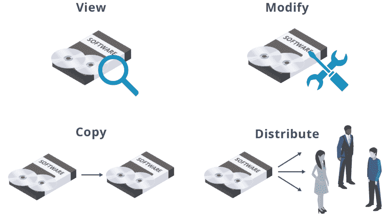

> 开源软件授予的基本权限。

## 自由软件与开源软件

**自由软件**一词常与开源软件互换使用，两者有很大的重叠。然而，有些人对二者加以区分。自由软件运动的发起人理查德·斯托曼认为，这两个术语承载着不同的价值观——用他的话来说，“开源是一种开发方法；自由软件是一场社会运动。”换句话说，开源软件最关注的是促进开放协作，而自由软件最关注的是维护用户的权利。请注意，这里的“自由”指的是自由（freedom），而不是指没有金钱成本。

为了解决这一术语争议，一些开发者采用了**自由及开源软件（FOSS）**这一术语，来描述体现两种运动价值观的任何项目。

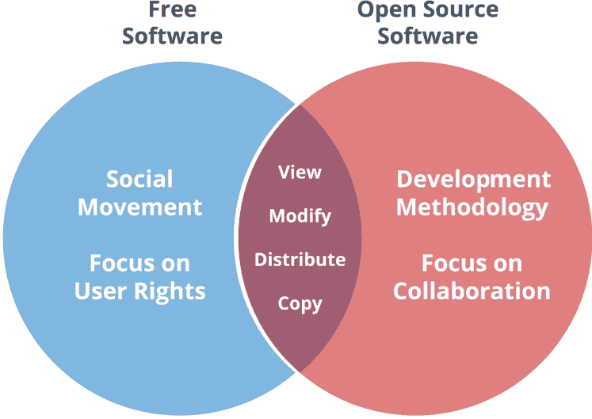

*自由软件和开源软件的维恩图。*

## 自由及开源许可证

开发者可以在若干 FOSS 许可证下发布他们的软件。这些许可证在附加限制或与其他许可证的兼容性方面可能有所不同。以下是一些 FOSS 许可证的示例：

- Apache 许可证
- Berkeley Software Distribution（BSD）许可证家族
- Creative Commons Zero（CC0）
- Eclipse Public License（EPL）
- GNU General Public License（GPL）
- Massachusetts Institute of Technology（MIT）许可证
- Mozilla Public License（MPL）

## GNU 项目

**GNU 项目**是由理查德·斯托曼领导的自由软件项目。该项目于 1983 年宣布，是同类项目中的第一个，并有效地启动了自由软件运动。GNU 项目的目标是创建一个完全由自由软件组成的操作系统。到 20 世纪 90 年代初，GNU 项目尚未完成完整的操作系统，但已创建了多个程序。斯托曼亲自编写了大量 GNU 软件，包括 GNU C 编译器（GCC）和 Emacs 文本编辑器。后来，多位程序员共同开发了更多与 GNU 软件兼容的实用工具。

斯托曼选择了递归缩写 "GNU's Not Unix" 来表明 GNU 软件在设计上与专有的 Unix 操作系统相似，但实际上并不包含任何 Unix 代码。

> 注意：GNU 中的 "G" 包含在该术语的发音中，读作 "guh-NOO"。

## 自由软件基金会与 GNU GPL

在启动 GNU 项目后不久，斯托曼创立了非营利性的**自由软件基金会（FSF）**，以推广自由软件背后的理念。斯托曼和自由软件基金会创建了**GNU 通用公共许可证（GPL）**来支持 GNU 项目。GPL 的要求之一是，任何 GPL 作品的衍生作品也必须在同一许可证下分发——这一概念被称为**copyleft**。

## Unix 哲学

由于 GNU 软件基于 Unix® 的设计，它倾向于遵循 Unix 哲学。**Unix 哲学**是一套软件开发的最佳实践和方法，强调简洁性和模块化。这一哲学由 Unix 操作系统的首席开发者创建，并以多种方式被总结。一些关键的高层要点包括：

- **只做一件事，并把它做好。** 与其编写一个完成各种不相关任务的单一庞大软件工具，不如编写各自履行特定功能的独立工具。
- **差即是好。** 功能有限的软件（"差"）往往更可取（"好"），因为它通常更易于使用和维护。
- **支持交互性。** 编写独立的工具，使它们能与其他工具良好协作。
- **处理输入/输出流。** 将一个工具的输出作为另一个工具的输入是一项普遍期望的功能。

## Linux 操作系统家族

**Linux** 是基于 Linux 内核的操作系统家族，Linux 内核是管理系统中所有组件的操作系统核心。Linux 内核由芬兰程序员林纳斯·托瓦兹于 1991 年开发，当时他仍是赫尔辛基大学的学生。

FOSS、GNU 项目和 Unix 设计理念在 Linux 的发展中都发挥了重要作用。托瓦兹在 GPL 版本 2 下发布了 Linux 内核。大多数 Linux 发行版在 Linux 内核之上添加了斯托曼编写的 GNU 软件和其他自由软件组件。换言之，Linux 是第一个符合 FOSS 标准的完整操作系统家族，与 GNU 软件一样，它遵循 Unix 设计理念中提出的简洁性和模块化原则。

> 从根本上讲，Linux 是 Linux 内核与 GNU 软件的结合。

## GNU/LINUX

由于 Linux 操作系统家族的大多数成员都将 GNU 实用工具与 Linux 内核结合在一起，因此 FSF（自由软件基金会）更倾向于将该操作系统家族称为"GNU/Linux"，而不仅仅是"Linux"。这支持了 Linux 内核是 GNU 项目"缺失的一块"这一观点，并为 GNU 的工具及其自由软件运动本身提供了认可。然而，Torvalds 和其他人不同意这种说法，"Linux"这一名称迄今为止仍然是引用该操作系统家族最常见的方式。

## 使用 Linux 的优势

总而言之，以下是使用 Linux 的一些主要优势：

- 其 FOSS（自由与开源软件）性质促进了透明度。
- 其设计强调简洁性和模块化。
- 它具有高度的可定制性。
- 它具有高度的可靠性和稳定性。
- 它与多种主要编程语言有强大的集成，如 C、C++、Python®、Ruby 等。
- 它重视安全性和隐私性。
- 大多数发行版免费。
- 它拥有一个热情的社区，愿意提供支持。

## 使用 Linux 的劣势

没有系统是完美的，包括 Linux。以下是一些潜在的劣势：

- 它的学习曲线比其他通用操作系统（如 Windows® 和 macOS®）更陡峭。
- 桌面软件的支持不如其他操作系统（如 Windows 和 macOS）完善。
- 没有权威或官方的版本，这可能会让新用户感到困惑。
- 除少数例外，没有官方由厂商提供的支持。

## Linux 发行版

作为操作系统家族，并没有一个名为"Linux"的官方操作系统。相反，该家族中有不同的成员，称为**Linux 发行版**，或**distros**。所有 Linux 发行版都基于 Linux 内核；它们的主要区别在于在 kernel 之上添加了哪些额外的软件以创建一个功能完整的操作系统，以及它们运行的内核版本。在社区、发布频率和其他因素方面也存在差异。选择发行版的关键在于确定哪一个最符合您的业务需求以及您对其工具的熟悉程度。

### Linux 发行版列表

有数百种发行版可供选择。下表包含了一些最具历史意义和/或最受欢迎的发行版。

| 发行版 | 说明 |
|--------|-------|
| Slackware | 这是目前仍在积极维护的最古老的发行版，最初发布于 1993 年。它旨在成为最"类 Unix"的发行版，最适合高级 Linux 用户。 |
| Debian | 这是另一个早期发行版，也是完全由自由软件组成的发行版。它还是许多其他衍生发行版的基础。 |
| Ubuntu® | 这是最受欢迎的通用发行版之一，基于 Debian。 |
| Kali Linux | 这个基于 Debian 的发行版用于渗透测试和其他网络安全任务。 |
| Red Hat® Enterprise Linux® (RHEL) | 与大多数免费提供的发行版不同，RHEL 附带由 Red Hat 公司提供的付费客户支持。该发行版在企业环境中的服务器上很常见。 |
| CentOS® | 该发行版本质上是 RHEL 的免费版本。功能几乎完全相同，但不提供客户支持。 |
| Fedora® | 该发行版由 Red Hat 赞助，是 RHEL 的上游来源。它有多个版本，分别针对不同的计算角色，并运行最新版本的 Linux 内核。 |
| openSUSE | 该发行版由 SUSE Linux GmbH 赞助，针对多种计算角色。它力求只包含符合 FOSS 标准的工具。 |
| SUSE® Linux Enterprise Server (SLES) | 该发行版与 openSUSE 共享代码库，但旨在比 openSUSE 更稳定。与 RHEL 类似，SLES 附带付费客户支持。 |
| Arch Linux™ | 该发行版面向经验丰富的用户，以简洁性作为其核心理念。其在线文档库 ArchWiki 是最全面的 Linux 文档来源之一。 |

> **注意：** 许多 Linux 发行版包含专有软件，并非完全的 FOSS。

> 注意：有关 Linux 发行版的更多信息，请访问 https://distrowatch.com。

## 更多关于 CentOS 的信息

CentOS Linux 发行版是一个稳定、可预测、可管理且可复现的平台，源自 RHEL 的源代码。CentOS 由 CentOS 项目维护，这是一个社区驱动的自由软件工作，拥有自己的管理委员会。CentOS 项目的成员独立于 RHEL 团队工作。然而，CentOS 受益于 Red Hat 持续的贡献和投资，CentOS 商标由 Red Hat 所有。

本课程使用 CentOS，因为它提供了一个免费的企业级计算平台，旨在功能上与其所源自的上游产品（RHEL）兼容。CentOS 不包含 Red Hat 的产品或认证，尽管它是从与上游企业产品相同的源代码构建的。更多详情可参见 CentOS FAQ：https://wiki.centos.org/FAQ/General。

对于生产环境，建议使用获得许可并完全受支持的 RHEL 产品。

## Linux 的用途

Linux 的主要优势之一是它具有很强的可扩展性。因此，Linux 已被应用于许多不同的计算角色。下表描述了这些角色。

| 角色 | 说明 |
|------|-------|
| 服务器 | 服务器通过网络为多个用户提供多种服务。服务器的市场份额数据有时难以确定，但大多数来源一致认为 Linux 在服务器市场占据主导地位。超过 90% 的前百万域名运行在 Linux Web 服务器上，超过 90% 的 Amazon Elastic Compute Cloud (EC2) 平台公共云服务器运行 Linux。 |
| 工作站 | 工作站是功能更强大的家用桌面版本，通常面向软件开发等技术工作。Linux 在工作站上比在 PC 上更常见，但在这个领域仍然落后于 Windows 和 macOS。 |
| 大型机和超级计算机 | 大型机是大型、高度先进的计算机，擅长同时处理大量事务。超级计算机是处于计算技术前沿的机器，擅长尽快执行复杂计算。Linux 在这两个市场都占据主导地位——截至 2018 年，全球最快的 500 台超级计算机都运行 Linux。 |
| 移动设备 | 移动设备通常包括智能手机和平板电脑，或任何小到可以手持的设备。移动操作系统 Android™ 基于 Linux 内核，在全球移动设备市场拥有超过 80% 的份额。 |
| 个人计算机 (PC) | 这通常包括台式机和笔记本电脑，或任何面向非技术家庭使用的非移动设备。这是 Linux 渗透率最低的少数市场之一；大约 2% 的用户将 Linux 作为桌面平台使用。 |
| 嵌入式系统 | 嵌入式系统是计算机硬件和软件系统，在更大的系统中具有特定功能。这些更大的系统可以包括从微波炉等家用电器到大型工业机器的一切。运行 Linux 的嵌入式系统占据了市场的多数份额。 |

## Activity 1-1

### 讨论 Linux 设计理念

#### 场景

回答以下问题以检验您对该主题的理解。

1. 自由软件运动的创始人 Richard Stallman 给出的自由软件和开源软件之间的区别是什么？


## Linux 能够应用于许多不同计算角色的主要优势之一是什么？

## Linux 在四个主要计算角色中占据市场主导地位？

## 判断题：存在一个单一的 Linux 主发行版，所有其他 Linux 子发行版都源自它。

## 哪项 Unix 哲学指出，开发人员应该创建功能有限的软件，因为它更易于使用和维护？

# 活动 1-2

## 识别 Linux 设计哲学

### 场景

你是 Develetech 工业公司的一名系统管理员，这家公司位于虚构的格林城、里奇兰州，是一家家用电子产品制造商。你的首席技术官正在考虑将公司的服务器切换到 Linux 平台。他召集了团队，希望开始讨论 Linux 的本质及其潜在的优缺点。

1. Linux 包含了来自以下哪些来源的软件工具？

   - Unix
   - GNU 项目
   - 伯克利软件分发版（BSD）
   - macOS

2. 关于自由和开源软件（FOSS），以下哪些陈述是正确的？（请选择两项。）

   - [ ] 任何人都可以访问源代码。
   - [ ] 作者不能为源代码收费。
   - [ ] 任何人都可以修改源代码。
   - [ ] 源代码只能分发给公共开发者社区。

3. Linux 内核是根据以下哪种自由和开源软件许可证发布的？

   - GNU 通用公共许可证（GPL）版本 2
   - GNU GPL 版本 3
   - MIT 许可证
   - Apache 许可证 2.0

4. 以下哪项最能描述典型的 Linux 发行版？

   - 包含专有软件工具的 Linux 内核。
   - 包含 GNU 软件工具的 Linux 内核。
   - 仅包含 Linux 内核。
   - 仅包含 GNU 软件工具。

5. 判断对错？Linux 发行版可以默认包含专有软件。

   - 对
   - 错

6. 以下哪个 Linux 发行版是红帽企业 Linux（RHEL）的免费版本？

   - Ubuntu
   - Fedora
   - openSUSE
   - CentOS

7. Unix 设计哲学强调以下哪些特征？（请选择两项。）

   - 模块化
   - 稳定性
   - 复杂性
   - 简洁性

8. 判断对错？Linux 的设计类似于 Unix。

   - 对
   - 错

9. Linux 在以下哪些计算角色中占据市场份额主导地位？（请选择三项。）

   - 工作站
   - Web 服务器
   - 移动设备
   - 超级计算机

## 主题 B

### 输入 Shell 命令

Linux 操作系统的设计强调一种特定的用户界面；在这种界面中，用户通过在提示符中输入文本命令来与系统交互。这与 Windows 和 macOS 等主要基于视觉的操作系统不同。因此，Linux 管理中最关键的技能之一就是熟练输入文本命令。在本主题中，你将输入一些基本命令，以便更熟悉这个过程。

#### CLI

**命令行界面（CLI）** 是用户与操作系统之间基于文本的接口，它接受以命令形式输入的信息。CLI 向用户呈现一个命令提示符，用户输入命令以各种方式与系统交互。在命令行上工作是管理员工具库中的重要工具。开发人员和管理员经常使用 CLI，而普通用户通常会依赖图形用户界面（GUI）。

熟练使用命令行对于管理员至关重要。命令行管理是 Linux 中的一项基本技能。GUI 并不是 Linux 的必需组件。事实上，Linux 包含许多 GUI。系统上可以安装其中一个或全部，也可以不安装任何一个。假设你希望最大化利用硬件来完成系统的指定用途，那么你可以在 CLI 中执行所有管理操作。

> **注意：** 在 Linux 中，CLI 区分大小写。

#### CLI 的优势与挑战

使用 CLI 的一些优势包括：

- 系统处理速度更快。
- 管理员输入信息更快。
- 命令可以存储在称为脚本的文本文件中，你只需一个命令即可执行该脚本，从而让系统执行一系列长时间的操作。
- 脚本可以安排定期执行。
- CLI 中有一些额外选项，在 GUI 中可能不存在。

同样，使用 CLI 也存在一些挑战：

- 比 GUI 更难学习。
- 命令有许多选项，且并不总是一致。
- 它常常被错误地认为是过时的技术。
- 在 Linux、Unix、macOS 和 Windows 平台之间存在许多不同的命令行环境。

#### Shell

**Shell** 封装了操作系统的核心部分——称为内核——允许用户向内核传递命令和信息。内核也能够通过 Shell 向用户做出响应。Shell 可以被看作是人类语言和内核语言之间的解释器。Linux 用户在 Shell 中发布命令来告诉操作系统该做什么。操作系统将结果响应给用户。

Shell 可以实现为 CLI 或图形用户界面（GUI）。下表列出了一些在 Linux 中常用的基于 CLI 的 Shell。

| Shell | 描述 |
| --- | --- |
| Bourne shell (`sh`) | 这是原始的 Unix Shell，目前在 Linux 系统上仍然可用，但使用不广泛。 |
| Bash (`bash`) | 这是默认的 Linux Shell，是 Bourne shell 的替代品。其全称来源于术语 *Bourne-again shell*。 |
| C shell (`csh`) | 此 Shell 基于 C 编程语言，旨在支持 C 语言开发环境。 |
| KornShell (`ksh`) | 此 Shell 使用了 C shell 的特性和 Bourne shell 的语法。它在 Unix 系统上很常见。 |

*GUI 中的 Shell 提示符。*

#### 关于 Bash 的更多信息

作为一名 Linux 用户，熟练使用默认的 Bash Shell 至关重要。几乎每个 Linux 发行版都会使用此 Shell 作为用户和系统之间的翻译器。如果用户更习惯，也可以在 Linux 中安装和使用其他 Shell，但默认情况下几乎总是 Bash。

Bash 的一些特性包括：

- 它已经存在了很长时间，因此有完善的文档和许多现有的脚本。
- 它通常用于 Linux 和 macOS（在那里它也是默认的）以及其他各种操作系统。
- 它并不总是保持一致，因为自创建以来，有许多不同的小组对其进行了大量修改。
- 它包含历史记录和制表符补全功能。
- 它非常灵活。

### BASH 语法

命令行管理包含了“语法”的概念，即构建命令和支持信息的正确方式。许多 CLI 有自己独特的输入信息的方式。你需要理解这种语法才能有效地与界面沟通。

Bash Shell 语法包含三个主要组件：命令、修改命令的选项以及命令作用的参数。Bash 新用户常常忘记这三个组件之间的空格。

因此，Bash 的基本语法是：`command [-options] [arguments]`

> **注意：** 对于命令语法，本课程采用以下约定：方括号表示可选组件，花括号表示必需组件。在某些情况下，命令可以在没有选项或参数的情况下运行并仍然有效。

下表使用 `ls` 命令列出了每种基本语法格式的示例。

| 语法格式 | 命令 | 描述 |
|---|---|---|
| 仅命令 | `ls` | 以默认输出列出目录内容。 |
| 带选项的命令 | `ls -la` | 以长格式（`-l`）列出目录内容，并显示“隐藏”文件（`-a`）。 |
| 带参数的命令 | `ls /var/log` | 以默认输出列出 `/var/log` 目录的内容。 |
| 带选项和参数的命令 | `ls -la /var/log` | 以长格式列出 `/var/log` 目录的内容，并显示“隐藏”文件。 |

*`ls -la` 命令显示 `/usr` 目录中的文件列表。*

### 错误

如果你未能以正确的语法输入命令，Bash 将返回错误。通常情况下，这些错误消息具有描述性，能帮助你理解 Bash 需要什么。对于 "command not found"（找不到命令）错误，请检查命令中的拼写错误。对于 "no such file or directory"（没有这样的文件或目录）错误，请检查目录、文件或文件路径名中的拼写错误。

### 基本 Bash 命令

有几种命令对于完成基本任务非常重要。许多命令将在整个课程中进行更深入的讲解，但在此主题中加以包含，以便提供基本的命令词汇，并让你在 Bash shell 中进行动手实践。

| 命令 | 描述 | 示例 |
|---------|-------------|----------|
| `echo` | 将输入回显给用户屏幕上的内容。通常用于在脚本中向用户发送信息。 | `echo 'Good morning!'` 在 CLI 返回 "Good morning!"。 |
| `ls` | 列出目录的内容。可以给出选项以查看权限、隐藏文件等。 | - `ls` 列出当前目录的内容。<br>- `ls -a` 包含隐藏文件。<br>- `ls -l` 以长格式输出。<br>- `ls /var/log` 列出指定目录的内容。 |
| `pwd` | 显示你当前所在的工作目录。 | `pwd` 返回当前工作目录的路径。 |
| `cd` | 更改你当前的工作目录。 | - `cd /var/log` 将当前目录更改为 `/var/log`<br>- `cd /etc` 将当前目录更改为 `/etc` |
| `touch` | 更新现有文件的时间戳，但也可用于创建空文件。 | `touch file1` 如果 `file1` 存在则更新其时间戳；如果不存在则创建 `file1`。 |
| `cp` | 将文件或目录复制到其他位置。 | `cp file1 file2` 将 `file1` 的内容复制到 `file2`。 |
| `mkdir` | 创建目录。 | `mkdir newdir` 创建一个名为 `newdir` 的新目录。 |

### 文件查看命令

Linux 系统配置存储在文本文件中，因此你需要能够查看这些文件的内容。

`cat` 命令用于查看文件的内容，但无法编辑该文件。使用 `cat` 的示例是 `cat file1`，用于在屏幕上显示 `file1` 的内容。

`less` 命令用于查看文件的内容，当这些内容无法完全显示在一个屏幕上时。该命令将内容输出分成页面，你可以在 CLI 中滚动浏览。使用 `less` 的示例是 `less file1`，当 `file1` 的内容足够长，超过单个屏幕时，将其内容分成多个页面显示。按 **Page Up**（上翻页）和 **Page Down**（下翻页）来滚动屏幕，按 **q** 退出命令。

### 文件编辑命令

正如你需要查看文本文件的内容一样，你也需要编辑它们。

| 命令 | 描述 | 示例 |
|---------|-------------|----------|
| `vim` | 启动一个功能强大的文本编辑器，也是 Linux 的默认编辑器。 | 1. `vim file1` 在命令模式下打开文本文件。2. 按 **i** 进入插入模式。3. 按 **Esc** 退出插入模式。4. `:wq` 保存文件并退出。 |
| `nano` | 启动一个简单、用户友好的文本编辑器。可能并非在所有发行版上都已安装。 | 1. `nano file1` 打开文本文件。2. 直接在界面中输入文本。3. 按 **Ctrl+O** 保存更改。4. 按 **Ctrl+X** 退出。 |
| `gedit` | 启动一个易于使用的图形界面文本编辑器。需要安装桌面环境。 | 1. 选择 **应用程序→附件→文本编辑器**。2. 直接在界面中输入文本。3. 使用菜单保存并退出。 |

### 电源管理命令

有时可能需要重新启动或关闭系统。有几种命令可以完成此操作，但目前你将重点了解 `shutdown` 命令。`shutdown` 命令的一些示例包括：

- `shutdown -h now` 立即关闭系统，无时间延迟。
- `shutdown -h -t 90` 在 90 秒后关闭系统。
- `shutdown -r now` 立即重新启动系统，无时间延迟。

> **注意：** `reboot` 命令本质上与 `shutdown -r now` 命令执行相同的任务。

### sleep 命令

`sleep` 命令用于暂停系统活动指定的时间。命令 `sleep {秒数}` 将提示符挂起指定的秒数。

### 超级用户命令

在 Linux 中，具有管理员凭据的用户是超级用户。超级用户通常名为 `root`。以超级用户身份登录系统通常是不良做法，你应该养成使用非特权账户登录的习惯。但是，有时你需要获得超级用户的权限来执行管理任务。

`su -` 命令（"substitute user"，切换用户）切换用户凭据，`su - root` 将凭据切换为 `root` 用户。系统将提示你输入 `root` 用户的密码以进行授权。一旦你以 `root` 身份登录，就能执行之前无法执行的任务。

### Shell 历史记录

Bash shell 会保留所输入所有命令的历史文件。你可以引用此文件并重复命令，从而提高输入命令的效率和一致性。使用 shell 历史记录的示例包括：

- `history` 命令以列表格式输出最近输入的命令。
- **向上箭头** 和 **向下箭头** 键可在命令历史记录中循环浏览。按 **Enter** 重新执行历史记录中所需的命令。

### Tab 自动补全

Bash shell 支持 **Tab 自动补全**，使用户能够输入足够唯一的命令、文件名或目录名，然后自动填充剩余的输入内容。此功能可以减少打字错误并加快命令输入速度。

使用 Tab 自动补全的示例包括：

- 输入 `his` 并按 **Tab** 将自动填充 `history` 命令的其余部分。
- 输入 `cd /home/user1/Aug` 并按 **Tab** 将自动填充目录路径为 `cd /home/user1/AugustProjects`，假设该目录已经存在。

### Shell 技巧与窍门

虽然命令行界面可能令人望而生畏，但有许多方法可以使其更易于使用且更高效。随着你对 Bash 越来越熟悉，你可能会发现自己很多时候更喜欢在 CLI 中工作。

以下是一些帮助你更轻松地在命令行中工作的技巧：

- **Tab 自动补全**：养成使用 Tab 自动补全的习惯，以提高速度并减少打字错误。
- **使用历史记录而非重新编写长命令**：当你在命令或文件名中出现打字错误时，不要手动重新输入整行。按一次 **上箭头** 键重复输入包含错误的行，然后使用 **左箭头** 和 **右箭头** 键移动到错误位置进行修正。
- **从后往前阅读命令**：当你排查命令中的问题时，从右往左阅读。这种方法可以更容易地发现缺失或重复的字符。
- **清屏**：输入 `clear` 命令清除 CLI 中的所有文本。这在你开始新任务时非常有用，可以消除过去命令输入中的任何干扰信息。

**注意：** 要了解更多信息，请查看课程网站上的 **视频** 标签页，了解为本课程内容补充的任何视频。

## 活动 1-3

### 讨论 Shell 命令

#### 场景

回答以下问题以检查你对该主题的理解。

1. **判断题？** 在 Linux 中，`Equipment.txt` 和 `equipment.txt` 指的是否为同一文件。

2. 哪个命令允许用户先用自己的凭据登录系统，然后变为 `root` 用户以执行管理任务？

3. 一位管理员同事打电话给你，需要你检查 `/etc/shadow` 文件中是否有新用户的条目，确认该条目确实存在。你如何查看 `/etc/shadow` 文件的内容，同时**确保没有修改**该文件的可能性？

4. 你需要快速创建一个空文件（`log.txt`），以便应用程序可以将数据复制到其中。你可以使用哪个命令来创建该文件？

5. 你还记得几天前运行过一个命令，帮助你查找文件系统上的筛选文件列表。你不记得该命令较为复杂的语法了。如何在不再次上网搜索正确语法的情况下重现该命令？

## 活动 1-4 输入 Shell 命令

### 开始之前

你已拥有一个已安装好的 CentOS 7 系统，以及一个用户账号。系统正在向你展示 CLI。

> 注意：如果软件供应商已发布数字更新，活动可能会略有不同。你的讲师会通知你任何变更。

### 场景

经过你之前与 Develetech 公司 IT 团队的讨论，你的 CTO 越来越确信将公司服务器基础设施迁移到 Linux 的可行性。CTO 希望你更加熟悉 Linux 的使用，他建议通过启动一台测试机并进行尝试来实现。因此，你将在 Bash shell 中输入一些基本命令，来感受 Linux 环境。

> 注意：每当指令说明"输入 <command>"时，你需要键入该命令并按 Enter。请注意，Linux 命令、命令行选项和文件名是区分大小写的。

> 注意：课程活动步骤中的某些命令会溢出到下一行。除非另有说明，所有命令都应在 CLI 的同一行中输入。

1. 登录到 CLI。

   a) 在 **localhost login** 提示符处，输入 `student##`，其中 `##` 是你的学生编号。例如，如果你的编号是 03，则输入 `student03`

   b) 在 **Password** 提示符处，输入 `Pa22w0rd`

   c) 确认你看到 **`[student##@localhost ~]$`** 提示符，表示你已成功登录。

> 注意：输入密码时要小心，因为 CLI 不会在屏幕上显示密码。

2. 输入你的第一个命令。

   a) 在提示符处，输入 `echo 'Hello, World!'`

   b) 确认控制台向你回显了字符串 "Hello, World!"。

3. 检索有关你当前工作目录的信息。

   a) 输入 `pwd`

   b) 确认你当前的工作目录是 `/home/student##`

   c) 输入 `ls` 并记录你当前工作目录的内容。目前，你的主目录中似乎没有任何内容。

   d) 输入 `ls -a` 以显示隐藏项目。现在，你可以看到此目录中有文件和文件夹，但它们在标准目录列表中是隐藏的。

   e) 输入 `ls -al` 并注意你会获得关于目录中每个项目的更多信息。


```
drwxr-xr-x.  9 root      root        119 Dec 14 18:02 ..
-rw-------.  1 student01 student01 14877 Jan 10 21:54 .bash_history
-rw-r--r--.  1 student01 student01    18 Apr 11  2018 .bash_logout
-rw-r--r--.  1 student01 student01   208 Jan  2 15:47 .bash_profile
-rw-r--r--.  1 student01 student01   276 Jan  2 15:52 .bashrc
drwxrwxr-x. 18 student01 student01  4096 Jan 11 15:06 .cache
drwxrwxr-x. 22 student01 student01  4096 Jan 11 15:06 .config
drwx------.  3 student01 student01    25 Dec 14 20:18 .dbus
drwxr-xr-x.  2 student01 student01    45 Jan  2 18:38 Desktop
```

文件或文件夹的名称在最右侧。最后修改日期和时间在名称的左侧，再往左是文件或文件夹的大小（以字节为单位）。大多数其他字段与权限和所有权有关。

- **4.** 更改你当前的工作目录。

   a) 输入 `cd /etc`

   b) 确认提示符已更改为 `[student##@localhost etc]$`

   c) 输入 `pwd` 进一步确认你当前的工作目录现在是 `/etc`

   d) 输入 `cd /var/log` 移动到存储系统日志文件的目录。

   e) 输入 `ls -al` 查看此目录中存在的所有文件和文件夹。

   f) 输入 `cd /home/student##`，其中 `##` 指你的学生编号，以返回到你的主目录。

- **5.** 在你的主目录中创建文件。

   a) 输入 `touch myfile` 以在你的主目录中创建一个空文件。

   b) 输入 `ls` 并确认 `myfile` 已列在目录中。

- **6.** 使用 `cat` 命令查看一些文件。

   a) 输入 `cat /etc/hostname`

   b) 确认 `/etc/hostname` 文件的内容已打印到 CLI。

   c) 输入 `cat /var/log/dmesg`

   d) 确认此日志文件太长，其大部分内容已滚过屏幕。`cat` 命令没有导航选项，因此你需要使用更高级的命令来查看整个日志文件。

- **7.** 使用支持分页的 `less` 命令查看冗长文件。

   a) 输入 `less /var/log/dmesg`

`less` 命令不是滚动显示，而是只打印适合屏幕显示的文件开头内容。你的提示符也已更改为文件名，并高亮显示。

   b) 按 **Enter** 或 **Down Arrow** 向下滚动一行。

   c) 再向下滚动几行。

   d) 按 **y** 或 **Up Arrow** 向上滚动一行。

   e) 再向上滚动几行。

   f) 按 **Spacebar** 或 **Page Down** 向下滚动整个屏幕。

   g) 按 **b** 或 **Page Up** 向上滚动整个屏幕。

   h) 按 **q** 退出查看文件并返回到你的常规提示符。

- **8.** 使用 Vim 编辑文本文件。

   a) 输入 `vim myfile` 以在 Vim 文本编辑器中打开你之前创建的文件。

   b) 按 **i** 切换到插入模式。

   c) 输入 `Hello, this is <your name>` 并将 `<your name>` 替换为你的名字。

   d) 按 **Esc** 切换回命令模式。

   e) 输入 `:wq` 保存文件并退出。

   f) 输入 `cat myfile` 并确认文件的内容已打印到 CLI。

- **9.** 使用 GNU nano 创建和编辑文本文件。

   a) 输入 `nano myfile2` 以创建并开始编辑一个新文件。

   b) 输入 `Hello, this is <your name>` 并将 `<your name>` 替换为你的名字。

   c) 按 **Ctrl+O**，然后按 **Enter** 保存文件。

   d) 按 **Ctrl+X** 退出。

   e) 输入 `cat myfile2` 并确认文件的内容已打印到 CLI。

   f) 输入 `clear` 清除屏幕。

- **10.** 获取超级用户权限。

   a) 输入 `cat /var/log/boot.log`

   b) 确认你收到 "Permission denied" 错误。

作为普通用户，你没有权限读取此日志文件。你需要提升权限才能这样做。

   c) 输入 `su - root`

   d) 在 **Password** 提示符处，输入 `Pa22w0rd`

> **注意：** 为了课堂方便，你的学生账号和 root 账号的密码相同。在生产环境中，root 密码应该是唯一的，且不应基于常见的字典单词。

   e) 确认你的提示符已更改为 `[root@localhost ~]#`

你现在以 root 用户身份登录，root 用户是具有最高权限级别的用户（超级用户）。

   f) 输入 `cat /var/log/boot.log` 并确认你现在可以读取该文件。

   g) 输入 `exit` 以 root 身份注销，并重新登录到你的普通学生账号。

- **11.** 利用 Tab 补全功能提高输入命令的效率。

   a) 输入 `touch thisisalongfilename.txt`

   b) 输入 `ls -l th` 然后按 **Tab**。

   c) 确认文件名的其余部分已在命令行中补全。

   d) 按 **Enter** 执行命令。

- **12.** 查看命令历史。

   a) 输入 `his` 并按 **Tab**。

   b) 确认 `history` 命令已填充到命令行。

Tab 补全功能适用于文件、目录甚至命令名称。

   - 按 **Enter** 执行命令。

   - 确认你最近输入的命令列表已打印在屏幕上。

- **13.** 重新启动计算机。

   a) 输入 `reboot`

   b) 确认计算机重新启动，然后提示你登录。

   c) 使用 `student##` 作为用户名，`Pa22w0rd` 作为密码登录。

## 主题 C

## 获取 Linux 帮助

既然你已熟悉 Linux shell，你可能希望开始在系统中使用命令。但是，有时你需要各种可用命令的帮助。在本主题中，你将识别 Linux 提供的帮助和支持选项。

## Linux 文档

文档是任何大型计算项目的必需品，Linux 也不例外。文档帮助 Linux 操作系统的用户，无论其角色或经验水平如何，都能执行各种活动并解决各种问题。然而，就像没有一种官方的 Linux 形式一样，也没有单一的权威文档来源。文档分布在多个来源中，以多种形式出现，每一种都适合特定的上下文。Linux 文档的一些主要来源包括：

- 手册页
- 内置帮助命令
- 在线文档项目
- Usenet 新闻组
- 互联网邮件列表
- 问答网站
- 论坛和社交媒体
- 书籍和其他印刷资源

## 手册页

Linux **手册页**（man pages）包含特定于每个 Linux 命令的完整文档。手册页在 Linux 系统上默认可用。使用 `man` 命令可显示特定命令的手册页。它们通常包括以下信息：命令的名称、其语法、用途描述、支持的选项、常见用法示例，以及相关的命令列表。

当你需要了解更多关于命令的作用或如何操作时，手册页或许是立即可用的最直接帮助来源。在没有互联网访问的情况下，它们特别有用。然而，对于不熟悉其格式的人来说，手册页可能难以解析。

> **注意：** 手册页以简单的 ASCII 文本格式呈现，以便于访问。

`man` 命令的手册页。

## 语法

`man` 命令的语法为 `man {command}`

## 概要格式

手册页的大部分内容都是不言自明的，但 **SYNOPSIS**（概要）部分对新用户来说可能有些令人困惑。手册页的这一部分提供了命令的语法以及一些使用示例。这些使用示例的格式如下：

- **粗体**文本应当完全按照所示内容输入。
- *斜体*文本应当替换为适当的参数。请注意，在某些系统上，这部分可能会有不同的格式，比如下划线文本或彩色文本。
- `[-abc]` 表示括号内的所有参数都是可选的。
- `-a|-b` 表示管道符（`|`）两侧的参数不能同时使用。
- 带有 `...`（省略号）的*斜体*文本表示该参数可以重复。
- 带有 `...` 的 `[*斜体*]` 文本表示括号内的整个表达式可以重复。

## man 命令选项

`man` 命令支持多种选项。以下是一些常用选项。

| 选项 | 说明 |
|--------|-------------|
| `-a` | 查找与查询匹配的所有条目。 |
| `-D` | 显示调试信息。 |
| `-f` | 显示命令的简短描述以及手册页/章节。 |
| `-h` | 显示 man 命令的帮助选项。 |
| `-k` | 列出包含该关键字的所有手册页/章节及其位置。 |
| `-K` | 在所有页面中搜索指定字符串。 |
| `-t` | 格式化手册页以便打印。 |

## 手册页章节

命令的手册页可能列在一个或多个章节下。章节定义了命令所属的类别。当某个命令列出多个章节时，意味着同一命令的文档来自多个来源。这些章节由命令旁边的数字标识；例如，`fsck (8)`。

下表列出了各种手册页章节。

| 章节编号 | 包含内容 |
| --------------- | ---------------- |
| 1 | 通用命令 |
| 2 | 系统调用 |
| 3 | C 库函数 |
| 4 | 特殊文件（通常位于 `/dev`） |
| 5 | 文件格式和约定 |
| 6 | 游戏和屏幕保护程序 |
| 7 | 杂项 |
| 8 | 系统管理命令和守护进程 |

## 手册页导航

您可以使用多个按键浏览 Linux 手册页。下表描述了这些按键。

| 按键 | 用途 |
|-----|---------|
| **Home** | 移动到手册页开头。 |
| **End** | 移动到手册页末尾。 |
| **Page Up** | 逐步向上滚动页面。 |
| **Page Down** | 逐步向下滚动页面。 |
| `/` | 开始搜索术语或文本字符串。 |
| **n** | 移动到搜索术语的下一个匹配项。 |
| **p** | 移动到搜索术语的上一个匹配项。 |
| **q** | 退出并返回 shell 提示符。 |

## 其他内置帮助选项

除了 `man` 命令外，Linux 还提供其他内置帮助选项。

| 帮助选项 | 说明 |
|-------------|-------------|
| `apropos` | 在所有手册页的 **NAME**（名称）部分中搜索用户提供的关键字。**NAME** 部分通常在命令名称本身之后包含一句简短的命令描述。因此，当您想执行某项任务但不知道适当的命令名称时，`apropos` 命令非常有用。此命令的语法为 `apropos {keyword}` |
| `whatis` | 显示给定命令的简短描述，包括出现在多个章节中的命令。这本质上与 `apropos` 相反——您知道命令名称，但想了解它的功能。此命令的语法为 `whatis {command}` |
| `info` | 显示命令的 info 页面。Info 页面本质上是手册页的替代方案，受到 GNU 项目的青睐。虽然它们具有超链接等功能，并且可以轻松生成 HTML 页面和 PDF 文件，但 info 页面的普及程度不如手册页。此命令的语法为 `info {command}` |
| `--help` | 显示命令用法的快速摘要以及可使用的参数列表。此功能可用于 Linux 中的大多数命令。此命令的语法为 `<command> --help` 或 `<command> -h` |
| `/usr/share/doc/` | 此目录包含系统上安装的库、系统工具和其他软件包的文档。每个软件包在此目录中都有自己的子文件夹，每个子文件夹通常包含单独的文档，列出作者、许可信息、安装说明、通用 README 等。 |

## 在线文档

互联网是获取 Linux 帮助的最佳去处之一。并没有哪一个单一的在线资源必然优于其他资源；选择通常取决于您寻找的帮助类型。下表列出了一些最佳的 Linux 文档在线资源。

| 在线资源 | 说明 |
|-------------|-------------|
| 官方发行版文档 | 一些较流行的 Linux 发行版为其用户提供专门针对该发行版的文档。该文档通常包括不同版本和更新的发行说明、安装指南、虚拟化指南等。例如，Ubuntu 的官方文档可在 `https://help.ubuntu.com/` 获取。 |
| Linux 文档项目（LDP） | LDP 是一个完全由志愿者组成的项目，提供全面的 Linux 文档资源。文档形式多样，从 HOWTO（在 Linux 中执行特定任务的逐步操作程序）到指南（包括各种 Linux 主题的建议和最佳实践）。LDP 还包括 FAQ、手册页和其他类型的文档。LDP 可在 `https://www.tldp.org/` 获取。 |
| Linux man-pages 项目 | 这是 Linux 内核和 C 库接口（可供用户空间程序使用，即在 kernel 外运行的代码）手册页的官方来源。该项目可在 `https://www.kernel.org/doc/man-pages/` 获取。 |
| GNU coreutils 手册 | 这是 GNU 核心工具（coreutils）的官方文档来源。coreutils 是与 Linux 内核及其他软件一起编译以形成 Linux 发行版的 GNU 软件工具包。该手册可在 `https://www.gnu.org/software/coreutils/manual/` 获取。 |

RHEL 7 发行版的在线文档。

## 交互式帮助

在线文档是一个快速便捷的参考点，但它并不总是回答 Linux 问题的最佳来源，特别是当这些问题较为复杂或适用于非常规场景时。这些问题通常最好通过直接与其他人互动来回答，无论是实时还是异步方式。下表列出了互联网上 Linux 问题的一些主要交互式帮助来源。

| 在线资源 | 说明 |
|-------------|-------------|
| Usenet 新闻组 | Usenet 新闻组类似于公告板系统的在线讨论存储库，是 Internet 上最早的讨论形式之一。用户向新闻组发布文本或文件，组内其他成员可以查看和回复这些帖子，帖子以线程方式组织。新闻组往往专注于特定主题；一些专注于提供 Linux 帮助的新闻组包括 `comp.os.linux.help`、`comp.os.linux.answers` 和 `comp.os.linux.admin`。 |
| 邮件列表 | 基于 Internet 的邮件列表类似于新闻组，都涉及特定社区成员之间的线程讨论。"帖子"本质上是发送给分发列表上每个用户的电子邮件。您可以找到几个主要发行版的发行版特定邮件列表，或者订阅更通用的 Linux 邮件列表，例如 `https://lists.linuxfoundation.org/mailman/listinfo` 上列出的那些。 |
| 问答网站 | 问答网站使用户能够就某个主题发布问题，其他用户可以回答或以其他方式评论该问题。许多这类网站具有让用户"点赞"或"赞同"他们认为有用的问题，或他们认为提供了良好解决方案的答案的功能。IT 主题最受欢迎的问答网站是 Stack Exchange，其 Unix & Linux 类别可在 `https://unix.stackexchange.com/` 获取。 |
| 论坛和社交媒体 | Internet 论坛通常是线程帖子，类似于新闻组或邮件列表，但使用 Web 协议来传递内容。一些论坛鼓励用户向社区发布问题，其他用户则通过回复提供指导。除了发行版特定论坛外，一个流行的 Linux 支持论坛可在 `https://www.linuxquestions.org/` 获取。此外，一些社交媒体网站（如 Reddit）提供类似论坛的讨论平台，用于就特定主题寻求帮助——例如，`https://www.reddit.com/r/linuxquestions/`。 |

**注意：** 要了解更多信息，请查看课程网站上的 **Video**（视频）标签，获取补充本课内容的任何视频。

## 活动 1-5

## 在 Linux 中讨论帮助

### 场景

回答以下问题以检查你对该主题的理解。

1. 由于 Linux 通常是社区（用户）支持的，请说出三种 Linux 文档来源。

2. 要访问完整的本地文档，你可以在命令行输入哪个命令来访问关于 `cp`（复制）命令的详尽使用信息？

3. 一位同事给你发即时消息，问你如何为 `mv` 命令正确格式化手册页，以便她能将其发送到打印机并获得可读的输出。她可以输入什么命令？

4. 哪个在线文档网站提供了全面的 Linux 文档资源，包括手册页、FAQ、HOWTO 以及其他类型的文档？

5. 如果你知道一个命令的名称，想知道它的功能是什么，你会使用哪个命令来查找？

## 活动 1-6

## 在 Linux 中访问帮助

**开始之前**

你已以学生账户身份登录到 CLI。

徒工。

**情境**

为了发挥作用，Linux 必须具备对业务有用的特定功能的工具。其中一项功能是搜索文本文件的内容。这对于需要高效分析文本文件（如系统日志、自动化脚本等）以查找特定模式的管理员来说非常有用。你需要找到一个或多个可以完成此任务的 Linux 工具，并学习如何使用它们。因此，你将查阅各种帮助资源，以熟悉合适的工具。


1. 如有必要，请以 `student` 身份登录，密码为 `Pa22w0rd`

2. 寻找一个可以帮助你搜索文本文件内容的命令。

   - 输入 `apropos search`

   - 确认输出中列出了多个命令，每个命令的名称或简要描述中都包含"search"一词。你可以尝试从这些结果中挑选合适的命令，但更改搜索条件可能会缩小结果范围。

   - 输入 `clear` 以清除屏幕。

   - 输入 `apropos pattern`

   - 确认你获得的结果更少。

3. 查看这些结果，你认为哪些命令最能满足你正在寻找的功能？

4. 阅读可能是你正在寻找的命令的手册页。

   - 输入 `man grep`

   - 确认你看到 `grep` 命令的手册页。

   - 阅读 **SYNOPSIS** 部分以了解如何使用该命令。

   - 阅读 **DESCRIPTION** 部分以了解该命令的作用。

   - 使用与 `less` 命令相同的键在手册页中上下导航。

   - 输入 `/case` 以在手册页中搜索"case"一词。

   - 按 **n** 导航到搜索词的下一个实例。

   - 当你处于手册页末尾时，按 **Shift+N** 导航到搜索词的上一个实例。

   - 阅读与大小写相关的命令选项的描述。

根据你到目前为止在 `grep` 的手册页中阅读的内容，回答你认为以下命令的作用：`grep -i hello myfile`

搜索有关 `grep` 命令的更多信息。

- 按 **q** 退出手册页。

- 输入 `cd /usr/share/doc`

- 输入 `ls`

- 确认此目录中有许多子目录，每个子目录对应一个软件包。

- 键入 `cd grep` 并按 **Tab**。

  - 注意：确保在按 **Tab** 之前不要在 `grep` 后面添加空格。

- 确认特定版本 `grep` 的路径已补全，然后按 **Enter**。

- 输入 `ls`

- 输入 `less NEWS`

- 快速浏览 `grep` 命令的变更说明。

- 按 **q** 退出。

你对这个命令满足你的需求有多大信心？

你仍然想更多地了解团队可以用来搜索文本文件内容的其他命令。除了 Linux 内置的帮助选项外，你还可以在研究中查阅哪些其他来源？

## 总结

在本课程中，你识别了 Linux 操作系统背后的基本概念，并执行了基本任务以帮助你开始在 Linux 环境中工作。这是你构建 Linux 系统管理技能的基础。

你的组织中如何使用 Linux？是否有任何现有系统可以从切换到 Linux 中受益？

你获取 Linux 帮助的首选方法是什么，为什么？

练习题：课程网站上提供了额外的练习题。

# 课程 2

### 管理用户和组

课程时间：2 小时 30 分钟

### 课程介绍

现在你已经执行了一些基本的 Linux® 任务，你的地理信息系统（GIS）是一个旨在捕获、存储、操作、分析、管理和呈现所有类型地理数据的系统。GIS 这个缩写有时也用于地理信息科学或地理空间信息研究，指的是学术学科或从事地理信息系统工作的职业。

用最简单的术语来说，GIS 是制图学、统计分析和计算机科学技术的融合。

## 课程目标

在本课程中，你将：

- 在必要时获取超级用户权限。

- 创建、修改和删除用户账户。

- 创建、修改和删除组账户。

- 查询用户和组账户。

- 配置用户账户配置文件。

## 主题 A

#### 获取超级用户权限

#### 涵盖的考试目标

3.1 给定一个场景，应用或获取适当的用户和/或组权限和所有权。

为了创建其他用户的账户，以及执行本课程中讨论的许多其他管理任务，你需要确保拥有执行这些操作的权限。通过获取超级用户的权限，你将能够完成工作，同时仍然遵守安全最佳实践。

##### 用户账户

账户是代表 Linux 用户和服务的对象。如果这些实体由账户表示，则该账户可以被管理。**用户账户**代表向系统认证并可以使用认证凭据执行特定任务的身份。用户信息包括组成员资格。

将使用 Linux 计算机的个人应拥有自己独立的用户账户。管理员将使用这些账户来控制用户对系统上文件、目录和命令的访问。系统使用用户 ID (UID) 而非名称来引用每个账户。名称是为了方便用户而使用的。

用户账户有几个属性，包括密码信息、组成员资格、过期日期、注释等。

###### 用户账户的类型

有三种不同类型的账户：root、标准用户和服务。

root 用户账户在 Linux 系统上扮演两个角色。第一个角色是本地管理员。以 root 身份登录的用户可以执行管理任务，如密码重置、系统配置更改、用户账户管理等。root 用户账户扮演的第二个角色是为某些应用程序和命令提供安全上下文。这些应用程序和命令可能由系统调用，或由以 root 身份登录的用户手动输入。Linux 中的 root 用户账户比 Windows® 系统上的本地管理员账户强大得多。使用管理凭据登录任何系统都是不良做法。在 Linux 系统上，这可能特别危险。root 用户可以对系统采取破坏性操作，通常没有任何验证提示。

> **注意：**某些 Linux 发行版（如 Ubuntu）完全禁用 root 用户账户以最小化此威胁。在安装过程中，普通用户账户被授予管理权限。

标准用户账户代表可能登录以运行应用程序、配置数据库、构建网站等的常规系统用户。每个用户应拥有自己独立的账户，这些账户不应共享。用户在系统上执行的大多数任务只需要标准用户账户权限。可以将标准用户账户设置为具有管理权限。与允许用户直接以 root 身份登录相比，这样做的好处是可以限制标准用户的权限，而 root 用户权限则无法限制。

应用程序也会消耗系统资源，因此它们通常由自己的服务账户来表示。这些账户通常是特定于服务的（例如 `httpd` Web 服务或数据库服务）。它们被禁止用于常规登录，并且这些账户通常是在服务安装过程中创建的。它们通常会拥有与该服务相关的配置文件或可执行文件。

## 超级用户

在 Linux 中，本地管理员账户名为 root。该账户用于执行管理功能，如管理用户、配置设备、配置网络设置等。系统还会以 root 凭据运行服务。系统不一定会对 root 用户可能具有破坏性的命令进行确认。使用 root 凭据登录系统的权限通常与管理员功能的知识相关联。

root 账户也被称为**超级用户**。安全最佳实践是永远不要使用管理员凭据登录系统，而是使用非特权账户登录，并在必要时提升凭据。

## 最小权限原则

在信息安全中，**最小权限原则**指出，用户应该只获得完成其工作所需的系统权限，不应更多。如果用户需要能够读取文件但不能写入文件，那么只授予他们读取权限。如果用户需要能够重启服务器但不能重新配置服务器，那么只授予他们重启的权限。通过稍微增加一点访问权限来纠正权限问题，要比移除现有访问权限容易得多。通过给予用户完成工作所需的访问权限，且不多于所需，系统将保持更高的安全性。

## su 命令

如你所见，直接使用 root 权限登录服务器是一种不良做法。更好的做法是使用标准用户账户登录，然后根据需要提升权限到 root。提升权限的一种方法是使用 `su` 命令进行"切换用户"。

不带选项的 `su` 命令使用户能够将其身份切换为另一个用户，但保留原始用户的配置文件和变量。切换后的用户仍然停留在原始用户的主目录中。除 root 用户外，任何使用 `su` 的人都会被要求输入他们正在切换到的用户账户的密码。

在 `su` 后面使用连字符可以使用户切换用户并在新用户的上下文中启动一个新 shell。这是一种更好的做法。除 root 用户外，任何使用 `su -` 的人都会被要求输入他们正在切换到的用户的密码。最常见的是切换到 root 用户，但任何用户都可以切换到任何其他用户，只要他们知道该用户的密码。

为当前用户替换另一个用户。

## 语法

`su` 命令的语法是 `su [-] [user name]`

> **注意：** 如果没有用户名称参数，`su -` 命令将假定你要以 root 身份登录。

## sudo 命令

使用 `su` 命令，任何知道 root 密码的用户都可以"获取 root"并执行 root 用户可以做的任何事情。使用 `su - root` 的账户本质上就是服务器管理员。这通常比应该委派给用户的权限多得多。更好的做法是向用户委派特定功能，而不是授予系统范围的 root 权限。

`sudo` 命令使服务器管理员能够向特定用户委派特定命令，而不授予他们对服务器的完全权限。委派在 `/etc/sudoers` 文件中通过使用 `visudo` 编辑器完成。用户和组可以被赋予运行特定命令的权限，以便他们在没有完全管理员权限的情况下履行其职责。

## 语法

`sudo` 命令的语法是 `sudo [options] {command}`

## sudoedit 命令

某些 Linux 文件需要 root 用户权限才能编辑。这可以通过 `sudo` 配置来实现，但更简单且更安全的选择是使用 `sudoedit` 命令。该命令允许用户使用自己的凭据编辑文件，即使该文件仅对 root 用户可用。此外，用户可以使用他们喜欢的文本编辑器。

要使用 `sudoedit`，你必须在 `sudoers` 文件中进行条目设置。例如，可以将以下行添加到 `sudoers` 文件中：

```
%editors ALL = sudoedit /path/to/file
```

`editors` 组的任何成员然后都可以输入以下命令来编辑文件：`sudoedit /path/to/file`

`sudo` 配置适用于需要以提升的权限执行的命令，而 `sudoedit` 选项适用于需要以提升的权限编辑的文件。

## 语法

`sudoedit` 命令的语法是 `sudoedit [options] {file name}`

## visudo 命令

虽然 `/etc/sudoers` 文件是一个普通的文本文件，但至关重要的是不要直接使用 Vim 或 nano 等标准文本编辑器来编辑它。`/etc/sudoers` 文件控制对所有提升权限的访问，该文件中的错误可能导致无法获得服务器上的 root 权限。大多数发行版会为 `/etc/sudoers` 设置默认编辑器（通常是 Vim 或 nano）。使用 `visudo` 命令时，系统会在提交更改之前验证 `/etc/sudoers` 文件的语法，使管理员有机会在错误成为运行配置的一部分之前纠正它们。

带有向用户账户授予 root 权限条目的 `/etc/sudoers` 文件。

## 语法

`visudo` 命令的语法是 `visudo [options]`

### visudo 命令选项

以下是可用于 `visudo` 命令的一些选项。

| 选项 | 用于 |

|--------|---------|

| `-c` | 检查现有 `sudoers` 文件中的错误。 |

| `-f {file name}` | 编辑或检查位于默认位置以外的 `sudoers` 文件。 |

| `-s` | 以严格模式检查 `sudoers` 文件——任何在定义之前使用的别名都会导致错误。 |

| `-x {file name}` | 将 `sudoers` 文件以 JavaScript 对象表示法（JSON）格式输出到指定文件。 |

## wheel 组

root 系统账户的使用远不止管理任务。许多实际的 Linux 操作系统部分在 root 凭据下运行。许多发行版为用户禁用实际的 root 账户，而是基于 `wheel` 组的成员资格来允许管理功能。

`wheel` 组的成员行使 root 的管理权限，但对系统造成损害的潜在风险较小。例如，`wheel` 组的成员可以使用 `sudo` 命令来避免必须以 root 用户身份登录。如有必要，你可以使用 `visudo` 命令编辑 `wheel` 组的权限。你可以将用户添加到 `wheel` 组以给予他们权限。对于 `wheel` 组的成员资格要非常谨慎。

> **注意：** 要了解更多信息，请查看课程网站上的**视频**标签，了解补充本课内容的任何视频。

## 活动 2-1

### 讨论超级用户权限

### 场景

回答以下问题以检查你对该主题的理解。

- 1. 说出三种 Linux 用户账户类型。

- 2. 你需要将管理员添加到 `/etc/sudoers` 文件中，以赋予他们使用 `sudo` 命令的能力。必须使用哪个命令将用户添加到 `/etc/sudoers` 文件？

- 3. 为什么使用普通用户账户而不是 root 用户账户登录 Linux 系统是一种安全最佳实践？

- 4. 为什么将最小权限原则付诸实践很重要？

- 5. 描述使用 `su` 命令和使用 `sudo` 命令执行管理任务之间的区别。

## 活动 2-2

获取超级用户权限

### 开始之前

你已使用学生账户登录到命令行界面。

### 场景

在为 Develetech 调查 Linux 的过程中，你发现了多条关于使用 root 用户管理账户存在危险的警告。你已经熟悉最小权限原则，该原则指出应仅向用户授予其所需的访问级别，且不再多给。你也知道这适用于管理员以及最终用户。Develetech 的安全政策规定必须严格控制管理权限。你需要报告如何满足这一要求。

- 1. 如有必要，输入 `cd ~` 返回你的主目录。

- 2. 使用 `su root` 命令将你的凭据提升为 root。

  - a) 输入 `id` 以验证你当前以 `student##` 身份登录

  - b) 输入 `su root` 以切换为 root。

  - c) 输入 `Pa22w0rd` 密码。

  - d) 输入 `id` 以验证 root 用户登录。

  - e) 输入 `pwd` 以确认当前工作目录。

    注意，虽然你的凭据是 root 用户的，但你的位置和上下文是 `student##` 用户的。

  - f) 输入 `exit` 以返回到 `student##` 用户登录。

- 3. 使用 `su - root` 命令将你的凭据和上下文提升为 root。

  - a) 输入 `su - root` 以切换为 root。

    ⚠️ **注意：** 连字符两侧各有一个空格。

  - b) 输入 `Pa22w0rd` 密码。

  - c) 输入 `pwd` 以确认当前工作目录。

    注意，你的凭据和上下文都是 root 用户的。

    ℹ️ **注意：** 如果你使用不带参数的 `su` 命令，系统将默认使用 root 用户。例如：`su -` 等同于 `su - root`

- 4. 将管理权限委托给学生账户。

  - a) 输入 `visudo` 开始编辑 `sudoers` 文件。

  - b) 多次按 **Page Down** 将光标移动到文件底部。

  - c) 按 **End** 移动到最后一行的末尾。

  - d) 按 **o** 进入插入模式，并在当前行下方开始一个新的空白行。

  - e) 在新的一行添加以下文本：

    ```
    student## ALL=(ALL) NOPASSWD:ALL
    ```

    ⚠️ **注意：** 记住将 ## 替换为你的学生编号。

    这授予学生账户执行所有命令的能力，而无需你每次切换到 root 用户。这也使你不需输入密码。这是出于课堂便利考虑，不建议在生产环境中使用。

  - f) 按 **Esc** 退出插入模式。

  - g) 输入 `:wq` 以保存并关闭文件。

- 5. 测试你的学生账户关闭机器的能力。

  - a) 输入 `exit` 返回到你的学生账户。

  - b) 输入 `id` 以验证你已登录到你的学生账户。

  - c) 再次输入 `exit` 以退出系统。

  - d) 以 `student##` 身份重新登录

  - e) 输入 `sudo /sbin/shutdown -r 15`

    此命令告诉系统在十五分钟延迟后重新启动。它需要管理权限。你使用 `sudo` 执行该命令，以便临时利用这些权限。

    💡 **注意：** 如果你忘记在特权命令前添加 `sudo`，请输入 `sudo !!` 以重新使用超级用户权限执行最近的命令。

  - f) 按 **Ctrl+C**，然后输入 `sudo shutdown -c` 命令以中断重新启动。

## 主题 B

创建、修改和删除用户

**涵盖的考试目标**

2.2 给定场景，管理用户和组。

3.1 给定场景，应用或获取适当的用户和/或组权限和所有权。

现在你有了超级用户权限，你可以开始为组织中的用户创建账户了。在某一时刻，你还需要根据必要情况修改和删除这些账户。

## useradd 命令

`useradd` 命令用于创建用户账户并配置基本设置。作为账户创建过程的一部分，`useradd` 引用多个文件：

- 账户存储在 `/etc/passwd` 文件中。

- 账户根据 `/etc/login.defs` 文件中设置的各种选项进行配置。

- 账户的主目录创建于 `/home/<账户名>` 目录。

- 账户的主目录使用 `/etc/skel` 目录中的文件进行填充。

默认情况下，`useradd` 命令不会为账户设置密码。由于大多数 Linux 发行版不允许空白密码，因此该账户虽然存在但尚不可用。

## 语法

`useradd` 命令的语法为 `useradd [选项] [用户名]`

## useradd 命令选项

`useradd` 命令包含许多用于自定义用户账户的选项，详见下表。

| 选项 | 说明 | 示例 |

|--------|-------------|---------|

| `-c` | 设置注释字段，通常用作用户全名的字段。 | `useradd -c "User One" user1` |

| `-e` | 设置账户到期日期。 | `useradd -e 2019/12/31` |

| `-s` | 设置用户的默认 shell。 | `useradd -s /bin/ksh` |

| `-D` | 查看新用户的默认配置。 | `useradd -D` |

## passwd 命令


`passwd`命令由 root 用于为任何用户设置或重置密码。用户可以自己使用`passwd`命令重置自己的密码。它还用于在使用`useradd`命令创建账户后设置用户的初始密码。

> **注意：** 用户设置密码时屏幕不会显示任何输出。一些用户会误认为这是问题，但实际上这是 Linux 在隐藏密码中使用的字符数。

```
[manderson@server01 ~]$ passwd
Changing password for user manderson.
Changing password for manderson.
(current) UNIX password:
New password:
```

用户更改自己的密码。

## 语法

`passwd`命令的语法为`passwd [用户名]`，其中`[用户名]`可由 root 用于设置特定用户的密码。

## /etc/passwd 文件

`/etc/passwd`文件存储用户账户信息。所有账户，无论默认还是用户特定的，都会在此文件中找到。管理员通常会参考此文件以了解系统上的特定用户账户。每个账户包含七个信息字段。每个字段由冒号分隔。这些字段不一定都被填充。

| 字段 | 内容 |
|-------|---------|
| 用户名 | 用户登录系统时使用的名称。 |
| 密码 | 分配给用户的密码，通常表示为`x`，表示密码存储在其他地方。 |
| 用户 ID | 代表用户的唯一编号。 |
| 组 ID | 指示用户主要组成员身份的唯一编号。 |
| 注释 | 通常表示用户的全名。 |
| 主目录 | 用户主目录的绝对路径。 |
| 登录 shell | 用户登录时启动的 shell 的路径（通常为`/bin/bash`）。 |

## 编辑 /etc/passwd 文件

编辑`/etc/passwd`文件的正确方法是通过`useradd`、`usermod`和`userdel`命令。手动编辑该文件可能导致错误，使系统无法使用。

## /etc/shadow 文件

`/etc/passwd`文件曾经用于存储密码的加密哈希版本。然而，该文件是全局可读的，这意味着一个用户可以看到另一个用户密码的哈希版本。通过将该哈希密码输入密码破解工具，用户可以发现另一个用户的密码。

`/etc/shadow`文件是现代存储哈希密码的位置，以及额外的账户信息。这些额外信息包括密码要求和过期信息。只有 root 可以访问`/etc/shadow`文件的内容，防止用户试图破解彼此的密码。


/etc/shadow 文件。

## /etc/shadow 文件格式

下表详细说明了`/etc/shadow`文件的格式。

| 字段 | 内容/附加信息 |
|-------|--------------------------------|
| 用户名 | 用户登录系统时使用的名称。 |
| 密码 | 分配给用户的密码的哈希值。 |
| 自密码更改以来的天数 | 天数从 1970 年 1 月 1 日开始计算。 |
| 密码必须更改前的天数 | 通常设置为 1 天。 |
| 警告用户更改密码前的天数 | 值为 99999 表示密码永远不需要更改。 |
| 密码过期后禁用账户的天数 | 理想情况下，这应该是立即的。 |
| 账户已禁用的天数 | 天数从1970年1月1日开始计算。 |
| 未使用的字段 | 保留以供将来潜在使用。 |

**注意：** 如需了解更多信息，请查看课程网站上的**视频**标签，获取补充本课内容的视频。

[第56页图片占位符]

## 活动 2-3

创建用户账户

### 开始之前

你已使用学生账户登录到CLI。

### 场景

在Develetech，管理Linux中的用户和组账户将是一项关键的管理职责。既然你已经熟悉了一些基本的Linux命令，你需要熟练掌握用户管理。首先从创建一些用户账户并查看其默认值开始。

- 1. 查看新用户的当前默认设置。

   a) 输入`sudo useradd -D`以查看新创建用户的默认设置。

   b) 输入`less /etc/login.defs`以查看新创建用户的默认设置。

   c) 按 **q** 退出。

   d) 输入`ls -a /etc/skel`以查看将被复制到新创建用户账户主目录的文件。

- 2. 为名为`manderson`的Michael Anderson创建用户账户。

   a) 输入`sudo useradd manderson`以创建新用户。

   b) 输入`cat /etc/passwd`以在`/etc/passwd`文件中查看新用户账户。

```
tcpdump:x:72:72:::/sbin/nologin
student01:x:1000:1000:student01:/home/student01:/bin/bash
manderson:x:1001:1001::/home/manderson:/bin/bash
```

> 注意：新创建的用户账户会追加到此文件的末尾。

- 3. 为名为`cmason`的Chris Mason创建新用户账户。

   a) 输入`sudo useradd -c "Chris Mason" cmason`

      这会创建`cmason`账户，并在账户的注释字段中填入用户的全名。

   b) 输入`cat /etc/passwd`

   c) 验证屏幕底部新创建的用户账户是否也包含一个由用户全名组成的"注释"。

- 4. 分别为Andrew Riley和Rachel Alexander创建名为`ariley`和`ralexander`的新用户账户。

   a) 输入`sudo useradd ariley`

   b) 输入`sudo useradd ralexander`

- 5. 为名为`rstanley`的Rose Stanley创建一个临时用户账户，其合同将于2025年12月31日到期。

   a) 输入`sudo useradd -e 2025/12/31 rstanley`

   b) 输入`cat /etc/passwd`并注意新创建的账户。

## chage 命令

`chage`或"change age"命令用于控制现有账户的密码过期、过期警告、非活跃天数等信息。安全策略的变更或潜在的安全漏洞可能会促使管理员更改现有账户的密码设置。这些更改将反映在`/etc/shadow`文件中。

| 选项 | 说明 | 示例 |
|--------|-------------|---------|
| `-E` | 将账户设置为在指定日期和时间过期。 | `chage -E 2022/12/31 user1` |
| `-l` | 列出密码老化信息。 | `chage -l user1` |
| `-M` | 设置密码有效的最大天数。 | `chage -M 90 user1` |
| `-m` | 设置密码可更改前的最小天数。 | `chage -m 1 user1` |
| `-W` | 设置在密码过期前多少天警告用户更改密码。 | `chage -W 5 user1` |

## 语法

`chage`命令的语法是`chage [选项] [用户名]`

## usermod 命令

`usermod`命令用于修改普通用户的设置。它编辑`/etc/passwd`文件，避免管理员直接编辑该文件。管理员可以对现有用户账户进行多种修改。

下表列出了`usermod`命令的一些选项。

| 选项 | 说明 | 示例 |
|--------|-------------|---------|
| `-c` | 设置注释字段。 | `usermod -c "User One" user1` |
| `-e` | 设置账户过期日期。 | `usermod -e 2020/12/31 user1` |
| `-aG` | 将用户添加到组并保留其在现有组中的成员身份。 | `usermod -aG sales-group user1` |
| `-l` | 更改用户的登录名。 | `usermod -l user99 user1` |

## 语法

`usermod`命令的语法是`usermod [选项] {用户名}`

## 锁定用户登录

如果用户离开公司、发生安全漏洞或用户长期缺勤，管理员可能会锁定用户账户。锁定账户会使其无法使用，但不会删除账户或其设置。需要时账户可以解锁。

可以使用`passwd`或`usermod`命令锁定用户账户。

锁定：

- `passwd -l {用户名}`
- `usermod -L {用户名}`

解锁：

- `passwd -u {用户名}`
- `usermod -U {用户名}`

> **注意：** 如需了解更多信息，请查看课程网站上的**视频**标签，获取补充本课内容的视频。

## 活动 2-4

修改用户账户

### 开始之前

你已使用 persona 学生账户登录到CLI。此前，你已创建了几个新用户账户。

### 场景

既然你已经配置了几个标准用户账户，你想要确保这些账户存在。你还需要设置密码要求。此外，你还将调查是否可以配置密码过期以及是否可以在用户缺勤时锁定用户账户。

- 1. 显示`/etc/passwd`文件的内容。

   a) 输入`cat /etc/passwd`

   b) 验证对于每个用户账户，密码字段是否显示`x`字符。

```
student01:x:1000:1000:student01:/home/student01:/bin/bash
manderson:x:1001:1001::/home/manderson:/bin/bash
cmason:x:1002:1002:Chris Mason:/home/cmason:/bin/bash
ariley:x:1003:1003::/home/ariley:/bin/bash
ralexander:x:1004:1004::/home/ralexander:/bin/bash
rstanley:x:1005:1005::/home/rstanley:/bin/bash
```

这表明密码哈希实际上存储在其他地方。

- 2. 显示`/etc/shadow`文件的内容。

   a) 输入`sudo cat /etc/shadow`

   b) 验证你可以看到关于每个用户账户的各种信息，包括其密码哈希值和任何过期信息。

```
student01:$6$1wG1kxRk4xTphJPb$aEC.JApWLFvn3HkuAtUazQykV0PPR6uODG1sjQGSAR9
bejUQql5VTrZAaOi5duOxy5GevqpLvvpGZf9OiFHc1.::0:99999:7:::
manderson:!!:17879:0:99999:7:::
cmason:!!:17879:0:99999:7:::
ariley:!!:17879:0:99999:7:::
ralexander:!!:17879:0:99999:7:::
rstanley:!!:17879:0:99999:7::20453:
```

> 注意：`!!`符号表示该账户密码为空，且不允许用户以该账户登录。

- 3. 为用户账户配置密码。

   a) 输入`sudo passwd manderson`

   b) 当提示输入密码时，输入`Pa2sw0rd`

> **注意：** 你可以忽略关于此密码未通过字典检查的警告。在生产环境中，你会选择更强的密码。

   c) 当提示重新输入密码时，再次输入`Pa2sw0rd`。

   d) 重复这些步骤为`cmason`、`rstanley`、`ariley`和`ralexander`添加密码

   e) 输入`sudo cat /etc/shadow`并注意这些用户的密码哈希字段现在已填充。

- 4. 为每个用户账户附加真实姓名。

   a) 输入`sudo usermod -c "Rose Stanley" rstanley`以修改现有的`rstanley`账户。

   b) 对上一步骤中的每个用户账户重复操作：

      - `manderson` — Michael Anderson
      - `ariley` — Andrew Riley
      - `ralexander` — Rachel Alexander

   c) 输入`cat /etc/passwd`以查看修改。

- 5. 配置账户过期信息。

   a) 输入`sudo chage -l manderson`以列出`manderson`账户的密码信息。

   b) 输入`sudo chage -E 2026/12/31 manderson`以将用户账户过期设置为2026年12月31日。

   c) 输入`sudo chage -l manderson`以查看新的过期信息。

- 6. 配置用户账户锁定。

   a) 输入`sudo passwd -l cmason`以锁定`cmason`账户。

   b) 输入`sudo passwd -u cmason`以解锁`cmason`账户。注意警告信息。

   c) 输入`sudo usermod -L cmason`以锁定`cmason`账户。

   d) 输入`sudo usermod -U cmason`以解锁`cmason`账户。

## userdel 命令

`userdel`命令用于删除用户账户。默认情况下，它不会删除用户的主目录，除非你使用`-r`选项。删除用户账户会删除对它的所有引用。你必须重新创建账户并将其重新添加到组中，才能恢复原始身份。删除用户账户前请谨慎行事。

## 语法

`userdel`命令的语法是`userdel [选项] {用户名}`

**注意：** 要了解更多信息，请查看课程网站上的**视频**标签，获取补充本课内容的视频。

## 活动 2-5

## 讨论创建、修改和删除用户

### 场景

回答以下问题以检验你对该主题的理解。

- 1. 用户账户存储在哪个文件中？
- 2. 有哪三个命令用于正确编辑`/etc/passwd`文件？
- 3. 哈希密码存储在哪个文件中？
- 4. 为什么`/etc/passwd`和`/etc/shadow`是不同的文件？
- 5. 使用哪个命令可以将用户`bsmith`的默认用户 shell 更改为 KornShell？

## 活动 2-6

### 删除用户账户

## 开始前

你已以学生账户身份登录到 CLI。之前，你创建了`ralexander`账户。

### 场景

你认识到用户账户生命周期的一部分是删除系统中不再需要的账户。你将使用`userdel`命令删除一个测试账户。

删除 Rachel Alexander 的账户。

- a) 输入`cat /etc/passwd`并确认`ralexander`账户存在。
- b) 输入`sudo userdel ralexander`删除`ralexander`账户。
- c) 输入`cat /etc/passwd`并确认`ralexander`账户已被删除。
- d) 输入`ls /home`并观察`ralexander`主目录仍然存在。

```
[student01@localhost ~]$ ls /home
ariley  cmason  manderson  ralexander  rstanley  student01
```

## 主题 C

### 创建、修改和删除组

**涵盖的考试目标**

2. discussing 给定场景，管理用户和组。

为了更高效地授予用户访问权限，你需要创建组供用户加入。你还需要根据需要对组进行修改和删除。

### 组账户

**组**将具有相似安全要求的用户账户关联在一起。组简化了管理任务，允许多个用户被授予对资源的权限。组在系统中以组 ID 号（GID）表示。用户可以是多个组的成员。

### /etc/group 文件

`/etc/group`文件是组的存储位置。所有组，无论是默认组还是用户特定组，都可以在该文件中找到。管理员通常会参考`/etc/group`文件来查找系统上有关组的信息。每个组包含四个信息字段。每个字段由冒号分隔。这些字段不一定全部填充。

```
stapsys:x:157:
stapdev:x:158:
student01:x:1000:student01
manderson:x:1001:
cmason:x:1002:
ariley:x:1003:
rstanley:x:1005:
MarketingDept:x:1008:ariley
FinanceDept:x:1009:manderson
GraphicsDept:x:1006:rstanley,jrobinson
jrobinson:x:1010:
apache:x:48:
```

/etc/group 文件。

正确编辑`/etc/group`文件的方式是使用`groupadd`、`groupmod`和`groupdel`命令。不建议手动编辑该文件，因为错误可能导致系统无法使用。

| 字段 | 说明 |
| --- | --- |
| 组名 | 组的友好名称。 |
| 密码 | 加入该组所需的密码。 |
| 组 ID | 系统引用该组所用的组 ID。 |
| 组列表 | 所有组成员的列表（默认为空）。 |

### groupadd 命令

`groupadd`命令用于创建组。默认情况下，该组没有成员也没有密码。除了使用友好名称创建组外，还可以使用`-g`选项指定组 ID。

`groupadd`的一些选项包括以下内容。

| 选项 | 用于 | 示例 |
| --- | --- | --- |
| `-g` | 分配组 ID。 | `groupadd -g 123 sales` |


## 组管理命令

### `groupadd` 命令

`groupadd` 命令用于创建新组。它将为你编辑 `/etc/group` 文件。

`groupadd` 的一些选项包括以下内容。

| 选项 | 用于 | 示例 |
| --- | --- | --- |
| `-f` | 如果组已存在，以成功状态退出。 | `groupadd -f sales` |
| `-o` | 允许使用非唯一的组 ID 创建组。 | `groupadd -o -g 123 sales` |

## 语法

`groupadd` 命令的语法为 `groupadd [选项] {组名}`

### `groupmod` 命令

`groupmod` 命令用于更改组自身的属性。它将为你编辑 `/etc/group` 文件。组的修改可能包括更改其名称或 GID。

> **注意：** 将用户添加到组被视为对用户的修改，而非对组的修改。因此，该操作通过 `usermod` 命令完成。

`groupmod` 的一些选项包括以下内容。

| 选项 | 用于 | 示例 |
| --- | --- | --- |
| `-g` | 更改组 ID。 | `groupmod -g 123 sales` |
| `-n` | 重命名组。 | `groupmod -n newsales sales` |

## 语法

`groupmod` 命令的语法为 `groupmod [选项] {组名}`

### `groupdel` 命令

`groupdel` 命令将从 `/etc/group` 文件中删除组。它不会删除作为该组成员的用户账户。删除组时需谨慎，因为错误可能导致用户无法访问资源。

## 语法

```
The syntax of the `groupdel` command is `groupdel [options] {group names}`
```

**注意：** 要了解更多信息，请查看课程网站上的**视频**标签，获取补充本课内容的视频。

## 活动 2-7

## 讨论创建、修改和删除组

### 场景

回答以下问题以检验你对该主题的理解。

- 1. 为什么管理员、行业标准和最佳实践声明应该通过管理组来管理用户？
- 2. 哪个文件包含组及其用户成员？
- 3. 系统管理员使用哪三个命令来正确编辑 Linux 系统的组文件？
- 4. 系统管理员使用哪个命令将用户（`bsmith`）添加到现有组（`finance`）？
- 5. 判断正误：`groupmod` 命令用于更改现有组的名称。

## 活动 2-8

### 创建、修改和删除组

## 开始前

你已以学生账户身份登录到 CLI。之前，你创建了多个用户账户。

### 场景

你需要将多个用户账户关联到组中，以使 Develetech 的 IT 管理更加便捷。你将创建多个对应不同部门的组。在某个时候，你需要重命名图形组以符合其他组的命名规范。此外，你将为组添加用户。用户/组管理生命周期的一部分要求你偶尔需要删除组。因此，你最后将删除一个组，但不删除属于该组的用户。

- 1. 创建一个名为 `Graphics` 的新组。
  - a) 输入 `cat /etc/group` 查看系统上的当前组。
  - b) 输入 `sudo groupadd Graphics` 创建一个名为 "Graphics" 的新组。
  - c) 重复此步骤创建另外三个组，名称如下：
    - `SalesDept`
    - `MarketingDept`
    - `FinanceDept`
  - d) 输入 `cat /etc/group` 并注意四个新组的存在。

```
Graphics:x:1006:
SalesDept:x:1007:
MarketingDept:x:1008:
FinanceDept:x:1009:
```

- 2. 使用 `groupmod` 命令重命名组。
  - a) 查看当前 `Graphics` 组名称。
  - b) 输入 `sudo groupmod -n GraphicsDept Graphics` 将 `Graphics` 组重命名为 `GraphicsDept`
  - c) 输入 `cat /etc/group` 并查看新的组名称。

- 3. 使用 `usermod` 命令将用户添加到组。
  - a) 输入 `sudo usermod -aG GraphicsDept rstanley` 将 `rstanley` 账户添加到 `GraphicsDept` 组。
  - b) 重复此步骤将以下用户添加到以下组：
    - `FinanceDept` — `manderson`
    - `SalesDept` — `cmason`
    - `MarketingDept` — `ariley`
  - c) 输入 `cat /etc/group` 并确认每个用户都是其分配组的成员。

- 4. 使用 `groupdel` 命令删除组。
  - a) 确认 `SalesDept` 组存在。
  - b) 输入 `sudo groupdel SalesDept` 删除 `SalesDept` 组。

- 5. 验证你删除了组，但没有删除其用户。
  - a) 输入 `cat /etc/group` 查看现有组。
  - b) 确认 `SalesDept` 组已被删除。
  - c) 输入 `cat /etc/passwd` 查看现有用户。
  - d) 确认删除 `SalesDept` 组不会删除 `cmason` 用户账户，即使它是该组的成员。

## 主题 D

## 查询用户和组

## 考试目标覆盖

2.2 根据给定场景，管理用户和组。

在创建并管理用户和组之后，你可能需要进一步了解一个或多个账户及其在系统上的活动。通过查询用户和组，你可以更好地跟踪这些账户的使用情况。

## 账户查询

管理员和用户可能需要收集关于其在系统上身份的信息。有许多命令可以报告用户和组信息。这些信息对于排查访问问题或验证用户当前登录的账户很有用。

## `whoami` 命令

`whoami` 命令用于显示你当前登录系统所使用的用户名。有时，你可能需要登录系统并在不同用户之间切换，而你可能不确定当前使用的是哪个用户。在这种情况下，你可以使用 `whoami` 命令来验证当前的用户名。

```
[root@server01 ~]# whoami
root
[root@server01 ~]#
```

当前登录的用户

*显示当前登录的用户。*

## 命令提示符识别

许多 Linux 发行版会在命令提示符处显示当前登录用户的用户名。对于 root 用户，提示符会显示 `#` 字符。对于标准用户，提示符会显示 `$` 字符。

## `who` 命令

`who` 命令用于确定当前登录系统的用户的详细信息。`who` 命令的输出包括用户名、用户所连接系统的名称，以及用户开始连接的日期和时间。

```
[root@server01 ~]# who
student01 :0              2019-01-02 18:41 (:0)
student01 pts/1           2019-01-02 19:07 (:0)
[root@server01 ~]#
```

显示当前登录用户的详细信息。

## 语法

`who` 命令的语法为 `who [选项]`

`-u` 选项可用于查看用户空闲了多长时间。点号表示用户直到最后一分钟仍处于活动状态，`old` 表示用户已超过 24 小时不活动，而介于 2 分钟到 23 小时 59 分钟之间的任何值则显示他们空闲的时长。`am i` 选项仅显示运行该命令的用户的信息。

## `w` 命令

`w` 命令主要用于显示当前登录到系统的用户的详细信息及其事务。输出的第一行显示系统的状态。输出的第二行显示一个表格，第一列列出了登录系统的用户，最后一列指示用户当前的活动。表格的其余列显示与用户相关的不同属性。

## `last` 命令

`last` 命令显示用户登录和注销操作的历史记录，以及实际的时间和日期。它还有选项可以筛选通过特定终端登录的用户。例如，`last 1` 将显示使用第一个终端登录的用户详情。`last` 命令从 `/var/log/wtmp` 文件中检索信息。

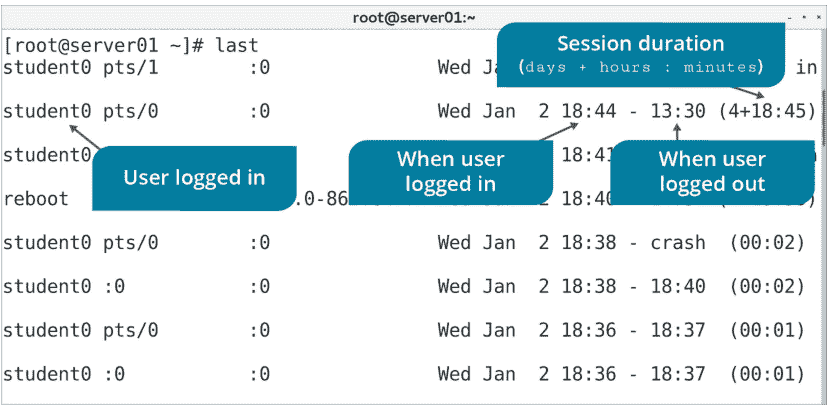

*显示用户登录/注销历史。*

## 语法

`last` 命令的语法为 `last [选项]`

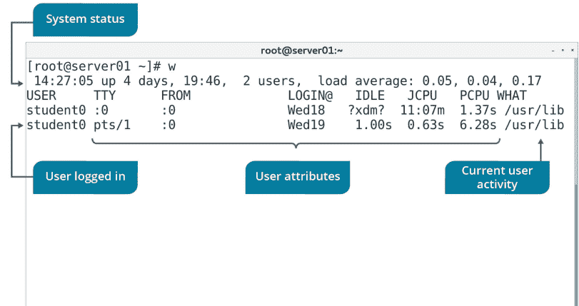

*显示用户详情和活动。*

## 语法

`w` 命令的语法为 `w [选项] [用户名]`

## `id` 命令

`id` 命令用于显示用户 ID (UID) 和组 ID (GID) 信息。不带选项输入该命令会显示当前登录用户的信息。你也可以将用户名指定为选项，以显示特定用户的 ID 信息。

```
[root@server01 ~]# id manderson
uid=1001(manderson) gid=1001(manderson) groups=1001(manderson),1009(FinanceDept)
```

显示特定用户的 UID 和 GID 信息。

## 语法

`id` 命令的语法为 `id [选项] [用户名]`

*注意：要了解更多信息，请查看课程网站的**视频**标签，了解补充本课内容的任何视频。*

## 活动 2-9

## 讨论查询用户和组

### 场景

回答以下问题以检查你对该主题的理解。

- 1. 作为 Linux 管理员，你可能经常需要在自己的账户与 root 用户或其他用户账户之间切换以执行任务。你可以使用哪个命令来查明你当前正在使用哪个用户账户？
- 2. 你怀疑硬件故障即将发生，需要重启系统以确保一切正常工作或强制触发故障。在发出 `reboot` 命令之前，你可以使用哪个命令来检查是否有其他用户登录到系统？
- 3. 一位用户报告说，她在昨晚大约下午 6:30 系统重启时正在编写一个重要脚本。没有任何警告。你如何查明当时谁登录了系统，以及谁可能在没有任何警告的情况下重启了系统？
- 4. 作为系统管理员，你为什么要发出 `id` 命令？
- 5. 作为管理员，你可能需要重启系统或以其他方式执行维护。你会发出哪个命令来不仅查看已登录的用户，还有他们当前的活动？

## 活动 2-10

## 查询用户和组

### 开始之前

你已以学生账户身份登录到 CLI。

### 场景

用户可以通过多种方式收集关于自己账户和组成员身份的信息。此外，还有多种方法可以确定当前可能有谁登录了系统。你将探索这些方法，以确保能够回答你所支持用户可能提出的问题。Develetech 安全策略要求保留用户登录日志，以备审计或安全事件之需。

- 1. 以 root 用户身份登录并验证你的凭据。
  - a) 输入 `su - root` 和密码以切换到 root 用户。
  - b) 输入 `whoami` 查看你的登录名。
  - c) 输入 `id` 查看你的登录凭据和组成员身份。
  - d) 验证命令提示符是否显示 `root` 名称和 `#` 字符。该字符也表示你已以 root 用户身份登录。对于标准用户，提示符将显示 `$` 字符。
  - e) 输入 `exit` 退出 root 登录并返回你的学生账户。

- 2. 验证你的学生账户凭据。
  - a) 输入 `whoami` 查看你的登录名。
  - b) 输入 `id` 查看你的登录凭据和组成员身份。
  - c) 验证命令提示符是否显示 `student##` 名称和 `$` 图标。

- 3. 检查有关已登录系统或曾经登录系统的用户的信息。
  - a) 输入 `who` 查看当前登录系统的用户。
  - b) 输入 `w` 查看当前登录的用户。
  - c) 比较 `who` 和 `w` 的详细信息，然后观察空闲时间信息。
  - d) 输入 `last` 查看系统最近的登录记录。

## 主题 E

## 配置账户配置文件

## 考试目标覆盖

2.2 根据给定场景，管理用户和组。

在许多情况下，个别用户在 Linux 环境中工作时会有自己的偏好或独特需求。因此，你需要配置用户的配置文件，以确保他们各自拥有定制化的工作环境。

## 用户配置文件

个别用户有个人习惯和偏好的 Linux 工作环境，因此有多种配置文件配置可供帮助他们定制自己的体验。这些定制被称为配置文件。用户账户创建时会创建初始配置文件。有许多文件和目录会从中提取信息以创建标准配置文件。

## `.bashrc` 文件

`.bashrc` 文件使用户能够自定义自己的环境。该文件存储在用户的主目录中。由于 `.bashrc` 文件对每个用户都是唯一的，因此可以根据用户自己的特定需求或偏好进行配置。

`.bashrc` 文件的一个好例子是别名的使用。用户可以指定自己的缩写命令，而不会影响系统上任何其他用户的体验。`.bashrc` 中的另一个常见配置是环境变量。用户还可以使用该文件来自定义命令提示符，以提供他们想要的信息。

```
# .bashrc

# User specific aliases and functions

alias rm='rm -i'
alias cp='cp -i'
alias mv='mv -i'

# Source global definitions
if [ -f /etc/bashrc ]; then
	. /etc/bashrc
fi
```

`.bashrc` 文件。

> **注意：** 文件名前面的“点”使文件隐藏。这不是安全配置，而是让用户的个人文件夹看起来更整洁。

## 示例配置

除了创建别名外，`.bashrc` 文件通常还配置为用户设置默认的目录和文件权限。此外，默认命令提示符也可以更改以提供更多信息。大多数发行版都会将用户名、系统主机名和当前目录显示在提示符中，但这可以更改。

## `.bash_profile` 文件

`.bash_profile` 文件为初始登录环境提供 shell 配置。这与为所有用户的交互式 shell 提供设置的 `.bashrc` 文件不同。`.bash_profile` 文件只在首次登录时读取，而 `.bashrc` 则在所有后续登录时读取。

默认的 `.bash_profile` 可以通过 `/etc/skel` 目录提供给新用户。

```
# .bash_profile

# Get the aliases and functions
if [ -f ~/.bashrc ]; then
	. ~/.bashrc
fi

# User specific environment and startup programs

PATH=$PATH:$HOME/bin

export PATH
```

Shell 环境配置

`.bash_profile` 文件。

## 全局用户配置文件

管理员可能希望定义系统范围的设置或为用户配置初始设置。以下文件和目录使管理员能够灵活地进行各种配置，用户随后可以根据自己的特定需求进行自定义。

## `/etc/skel/` 目录

`/etc/skel/` 目录的内容会自动复制到新用户的主目录中。管理员可以预先在 `/etc/skel/` 目录中填充配置文件或其他内容。当运行 `useradd` 命令时，`/etc/skel/` 目录的内容会被复制到新用户的主目录中，立即为他们提供可能需要的配置。

请注意，在用户账户创建后添加到 `/etc/skel/` 目录中的文件将*不会*被复制到现有用户的主目录中。

## `/etc/profile` 文件

`/etc/profile` 文件提供系统范围的环境变量。如果有适用于所有用户的设置，管理员配置此文件可能更为有效。

在用户的初始登录过程中，系统首先读取 `/etc/profile` 文件以获取 Bash shell 配置，然后从用户主目录中的 `.profile` 文件获取任何用户特定的 Bash 自定义设置。`.profile` 文件在每次启动新 shell 时运行，而 `/etc/profile` 只在登录时运行。这种方法使管理员能够定义全局 shell 设置，但仍允许用户进行特定的自定义。

> **注意：** 全局文件是 `/etc/profile`（文件名第一个字符没有“点”），而用户特定文件是 `.profile`，表示该文件是隐藏的。

## 示例

`.profile` 的示例如下：

```
PATH=$PATH:$HOME/bin:/scripts
MAIL=/var/mail/$LOGNAME
EDITOR=emacs
export PATH MAIL EDITOR
```

第一行定义可执行文件的路径；第二行定义传入电子邮件消息的存储路径；第三行定义默认文本编辑器。最后一行确保这些变量在环境中生效。

## `/etc/profile.d/` 目录

`/etc/profile.d/` 目录用作管理员设置额外系统范围变量的脚本的存储位置。建议通过 `/etc/profile.d/` 中包含的脚本来设置环境变量，而不是直接编辑 `/etc/profile` 文件。

## `/etc/bashrc` 文件

`/etc/bashrc` 文件提供系统范围的 Bash 设置。这与用于变量的 `/etc/profile` 略有不同。

> **注意：** 要了解更多信息，请查看课程网站上的**视频**标签，寻找补充本课内容的视频。

## 活动 2-11

### 讨论账户配置文件

### 场景

回答以下问题以检查你对该主题的理解。

- 1. 判断正误？在文件名开头使用点可以使文件更安全。
- 2. `.bashrc` 和 `.bash_profile` 文件的主要区别是什么？
- 3. 哪个目录的内容在账户创建时被复制到用户的主目录？
- 4. 哪个文件强制对所有用户进行系统范围的自定义，而用户无法更改？
- 5. 在 Linux 系统上，管理员应该在哪里设置系统范围变量，而不是直接编辑 `/etc/profile` 文件？

## 活动 2-12

### 配置账户配置文件

### 开始之前

你已以 `student` 账户身份登录到 CLI。

### 场景

你担心对 Linux 系统的更改可能对用户造成困难。你需要确定可以使用哪些文件来定制和统一用户的命令行环境。此外，你需要在每个新用户的主目录中放置一份 Develetech 策略供参考。

- 1. 查看用户账户的 `.bashrc` 文件。


## 用户账户管理

- a) 输入`cat .bashrc`查看 `student` 账户的配置文件。请注意，CentOS 7 中标准用户没有预配置的别名设置。

- b) 输入`sudo cat /root/.bashrc`查看 `root` 用户的配置文件。请注意，`root` 用户的配置文件包含复制、移动和删除命令的别名设置，将它们设置为交互模式。这些是 CentOS 7 中 `root` 用户的默认别名设置。

### 查看 `.bash_profile` 文件的内容

- a) 输入`cat .bash_profile`查看配置文件的内容。`.bash_profile` 文件在用户首次登录时调用。请注意，该文件包含 `PATH` 变量设置，定义了 Bash 搜索命令可执行文件的位置。

### 向 `/etc/skel` 目录添加文件并创建新用户

- a) 输入`ls -a /etc/skel`查看当前此目录中的文件。

- b) 输入`sudo touch /etc/skel/policies.txt`在该目录中创建文件。

- c) 输入`sudo useradd jrobinson`为 Jerry Robinson 创建新用户账户。

- d) 输入`sudo ls -a /home/jrobinson`并注意 `policies.txt` 文件的存在。此文件是作为 `useradd` 工具的一部分复制的。

### 配置 `jrobinson` 用户账户

- b) 输入`sudo usermod -aG GraphicsDept jrobinson`将 `jrobinson` 添加到 `GraphicsDept` 组。

- b) 输入`sudo usermod -c "Jerry Robinson" jrobinson`在注释字段中提供全名。

- c) 输入`sudo passwd jrobinson`设置账户密码。

- d) 输入`Pa22w0rd`作为密码。

## 小结

在本课中，你创建并管理了用户和组账户。这将帮助你高效地组织和维护具有众多用户的 Linux 环境。

**你可能如何在你的组织中设计组？**

**你可能如何在你的组织中管理 root 权限？**

*练习题：* 课程网站上提供了额外的练习题。


## 第三课

### 管理权限和所有权

课程时间：2 小时

### 课程介绍

创建账户不仅仅是允许人们登录；还需要委派对系统资源的访问权限。然而，仅管理账户还不足以实现这一点。该过程的另一重要部分是配置权限和所有权。在本课中，你将确保合适的人拥有对合适资源的合适访问权限，同时确保没有人拥有超过必要的访问权限。

## 课程目标

在本课中，你将：

- 修改文件和目录的权限。

- 修改文件和目录的所有权。

- 配置特殊权限和属性。

- 排查权限和所有权的问题。

## 主题 A

### 修改文件和目录权限

#### 涵盖的考试目标

3.1 根据场景，应用或获取适当的用户和/或组权限及所有权。

你将通过为文件和目录资源应用适当的权限来开始限制访问。这是确保数据安全的关键步骤。

## 权限

**权限**是分配给用户的访问权利，使其能够访问或修改某些文件和目录。权限可以在不同级别和不同访问上下文中设置。它们使您能够配置谁被允许访问某个对象，以及谁被限制访问该对象。通过权限控制访问可以降低风险，确保用户只能访问完成其工作所需的内容，仅此而已。

## `ls -l` 命令

`ls -l` 命令可以列出当前工作目录中文件和目录的详细信息。列表中的每一项包含七列，其中三列显示权限信息。各列内容的描述如下表所示。

| 列号 | 描述 |
| --- | --- |
| 1 | 权限字符串。标识该项目是文件还是目录、用户、组和其他权限分配，以及访问方法。 |
| 2 | 链接数。文件的链接数通常为 1。对于目录，链接数为其下的目录数加 2；1 代表目录本身，1 代表父目录。链接类似于 Windows® 快捷方式；它们指向文件所在的位置，使您能够访问和查看文件。 |
| 3 | 显示文件或目录的所有者。 |
| 4 | 显示管理员已授予访问权限的组。该组的所有成员都具有权限字符串中列出的组权限。管理员将用户添加到组中，以便将权限分配给组而不是每个用户。 |
| 5 | 列出文件或目录的大小（以字节为单位）。 |
| 6 | 显示文件创建或最后修改的日期和时间。 |
| 7 | 显示文件或目录名称。 |

## 权限属性

权限属性定义了用户确切允许对特定文件或目录执行哪些操作。下表描述了三种权限属性。请注意，这些属性根据应用于文件还是目录而表现不同。

| 属性 | 描述 |
|-----------|-------------|
| 读取 (r) | • 文件：访问和查看文件内容的能力。<br>• 目录：列出目录内容的能力。 |
| 写入 (w) | • 文件：保存对文件更改的能力。<br>• 目录：在目录中创建、重命名和删除文件的能力。需要同时设置执行属性。 |
| 执行 (x) | • 文件：运行脚本、程序或其他软件文件的能力。<br>• 目录：访问目录、从该目录执行文件或对该目录执行任务（例如搜索）的能力。 |

## 权限上下文

文件和文件夹上的权限属性应用于几种上下文之一，即您可以授予权限的用户和实体类型。这些上下文包括：

- **所有者** (u)：文件或目录的所有者，也简称为用户。

- **组** (g)：文件或目录的组以及属于该组的所有用户。

- **其他** (o)：所有其他用户（既不是所有者也不是组成员）。

## 权限字符串

`ls -l` 命令的输出显示文件或目录的**权限字符串**。权限字符串包含 11 个字符。

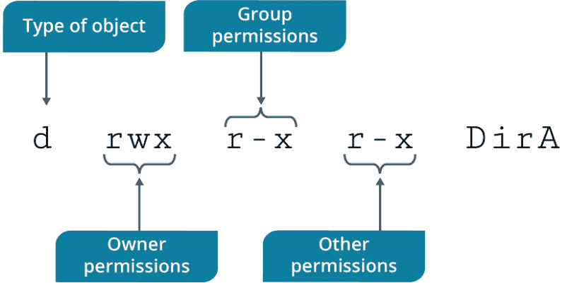

> 文件的权限字符串。请注意，特殊权限和其他信息未显示。

- 第一个字符指示文件类型；`d` 表示目录，连字符（`-`）表示文件。

- 第二、第三和第四个字符表示所有者权限。

- 第五、第六和第七个字符表示组权限。

- 第八、第九和第十个字符表示其他权限。

最后一个字符指示文件的访问方法；句点（`.`）表示 SELinux 安全上下文，加号（`+`）表示任何其他组合的替代访问方法。

## `chmod` 命令

`chmod` 命令使您能够修改文件或目录的权限。只有文件或目录的所有者或系统管理员才能更改该对象的权限。

### 语法

`chmod` 命令的语法为 `chmod [选项] {模式} {文件/目录名}`

### `chmod` 命令选项

`chmod` 命令支持不同的选项来修改权限。可以同时使用一个或多个选项。

| 选项 | 用于 |
|--------|---------|
| `-c` | 报告权限的更改情况。 |
| `-f` | 隐藏大多数错误消息。 |
| `-v` | 显示每个已处理文件的诊断条目。 |
| `-R` | 递归修改文件和目录的权限。 |

### `chmod` 符号模式

`chmod` 命令支持两种模式：符号模式和绝对模式。符号模式使您能够使用三个组件来设置权限，即：

- 权限上下文：`u`/`g`/`o`/`a`（`a` 将权限应用于所有三个上下文）。

- 权限运算符：`+`/`-`/`=`

- 权限属性：`r`/`w`/`x`

权限运算符确定是授予还是移除权限。

| 运算符 | 描述 |
|----------|-------------|
| `+` | 授予权限。 |
| `-` | 拒绝权限。 |
| `=` | 完全按照提供的权限进行分配，而不是累加或递减。 |

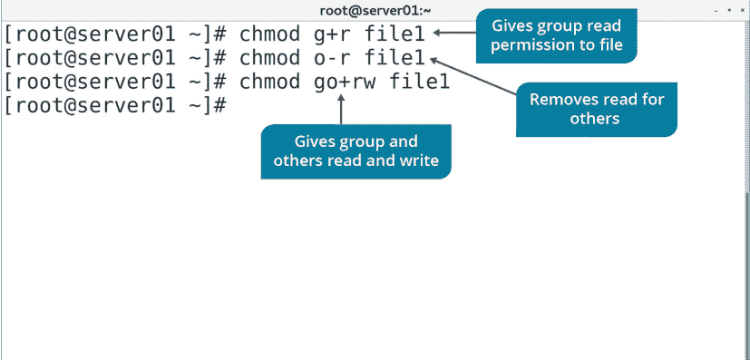

> 使用符号模式设置权限的示例。

#### 语法

在符号模式下，`chmod` 命令的语法为：

```
chmod {访问上下文}{运算符}{权限属性} {文件/目录名}
```

例如，要为所有者和组添加对 `myfile` 的读写权限：

```
chmod u+rw,g+rw myfile
```

### `chmod` 绝对模式

另一种 `chmod` 模式，即绝对模式，使用**八进制**（以 8 为底）数字来指定权限。每个权限（`r`/`w`/`x`）都有一个对应的数字。

| 八进制数字 | 属性 |
|-------------|-----------|
| 4 | 读取 |
| 2 | 写入 |
| 1 | 执行 |

通过将您要授予的权限的八进制数字相加，即可得到要分配给目录或文件的整体权限数字。例如，完整权限（读取、写入和执行）相当于 4 + 2 + 1，即 7。读取和写入权限相当于 4 + 2，即 6。完整权限表示为一个三位数，其中每个数字分别对应所有者、组和其他的权限。

```
[root@server01 ~]# chmod 764 file1
[root@server01 ~]# chmod 700 file1
[root@server01 ~]# chmod 640 file1
[root@server01 ~]#
```

| 权限设置 | 用户 | 组 | 其他 |
|---------------------|------|-------|--------|
| `chmod 764 file1` | rwx | rw | r |
| `chmod 640 file1` | rw | r | - |
| `chmod 700 file1` | rwx | - | - |

使用绝对模式设置权限的示例。

#### 语法

在绝对模式下，`chmod` 命令的语法为 `chmod {数字} {文件/目录名}`

### 不同模式中的常见权限

下表比较了不同的 `chmod` 模式如何表示通常分配的权限。

| 绝对模式 | 符号模式 |
| --- | --- |
| 755 | `u=rwx, g=rx, o=rx` |
| 700 | `u=rwx, g=, o=` |
| 644 | `u=rw, g=r, o=r` |
| 600 | `u=rw, g=, o=` |

### 三位数和四位数模式

当以八进制数字格式书写时，文件权限通常有三位数，每位数分别对应用户、组和其他权限。然而，文件权限也可以用四位数书写，新增的前导数字表示要定义的任何高级权限（或 0，表示无）。例如，Linux 中非可执行文件的基础权限为 `rw-rw-rw-`，即 666。这等价于八进制格式 0666。

> **注意：** 要了解更多信息，请查看课程网站上的**视频**标签，获取补充本课内容的任何视频。

## 活动 3-1

### 修改文件和目录权限

### 开始之前

你已以学生账户身份登录到 CLI。

### 场景

你关心如何在 Linux 服务器上保护文件和目录。你将解释一些文件的现有权限，然后为文件和目录的所有者、组及其他用户配置权限。

- 1. 查看文件和目录的现有权限。

  a) 输入`ls -l`以查看主目录中文件和目录的权限字符串。

  b) 查看已分配的权限，识别哪些位已为所有者、组及其他用户配置。

  c) 输入`ls -l /etc/ssh/sshd_config`以查看此配置文件的权限。

  d) 在下方空白处写下所有者、组及其他用户的权限。

  e) 输入`ls -l /var/log/cron`以查看此日志文件的权限。

  f) 在下方空白处写下所有者、组及其他用户的权限。

- 2. 创建一个测试目录和文件，以便配置其权限。

  a) 输入`mkdir permissions-demo`以在主目录中创建目录。

  b) 输入`cd permissions-demo`以移动到该目录。

  c) 输入`mkdir DirA`以创建权限演示目录。

  d) 输入`touch file1`以创建权限演示文件。

  e) 输入`ls -l`以查看两个对象的当前权限。

- 3. 使用绝对模式配置测试目录和文件的权限。

  a) 输入`chmod 755 DirA`以设置目录的权限。

  b) 输入`ls -l`以查看目录权限的变化。

  c) 输入`chmod 660 file1`以设置文件的权限。

  d) 输入`ls -l`以查看文件权限的变化。

  e) 输入`chmod 750 DirA`以设置不同的目录权限。

  f) 输入`ls -l`以查看目录权限的变化。

  g) 输入`chmod 744 file1`

  h) 输入`ls -l`并记录权限变化。

- 4. 使用符号模式配置测试目录和文件的权限。

  a) 输入`chmod o+r DirA`以设置目录的权限。

  b) 输入`ls -l`以查看目录权限的变化。

  c) 输入`chmod go+rw file1`以设置文件的不同权限。

  d) 输入`ls -l`以查看文件权限的变化。

  e) 输入`chmod go-rwx DirA`

  f) 输入`ls -l`并记录权限变化。

  g) 输入`chmod go-w file1`

  h) 输入`ls -l`并记录权限变化。

目录的最终权限状态应为 `drwx------`

文件的最终权限状态应为 `-rwxr--r--`

## 默认权限

在 Linux 中，新创建的文件和目录的默认权限是基于用户特权分配的。对于 `root` 用户创建的文件，默认权限为 `644`，这意味着 `root` 用户具有读写权限，而组用户和其他用户只有读权限。对于 `root` 用户创建的目录，默认权限为 `755`，这意味着 `root` 用户具有读写执行权限，而组用户和其他用户只有读和执行权限。对于访问权限受限的用户，Linux 为新创建的文件分配 `664` 权限，为新创建的目录分配 `775` 权限。

这些默认权限由用户文件创建掩码（即 umask）决定。不过，`root` 用户可以更改默认权限。

## `umask` 命令

`umask` 命令更改新创建的文件和目录上的默认权限。如果你希望自动控制新对象的使用方式，而不是在每个新对象上手动更改这些权限，那么更改默认权限会很有用。

使用 `umask` 时，你以八进制数字格式设置默认权限。但是，你不是指定要设置哪些权限，而是指定要从默认值中屏蔽或清除哪些权限。例如，Linux 中非可执行文件的默认权限为 `666`（`rw-rw-rw-`）。如果你希望所有者保留这些权限，但你希望组和其他用户只有读访问权限，你需要将 umask 设置为 `022`。每个数字解释如下，按顺序：

- `0` 表示当前所有者权限完全不应被屏蔽，即保留为读写。

- `2` 表示组权限应被屏蔽 2，即从默认值（6）中减去 2，得到 4。组成员现在只有读访问权限。

- `2` 与前一个数字作用相同，但针对其他用户。

你可以直接在 CLI 中使用 `umask` 命令来设置该会话的默认权限，也可以在每个用户的 `.bashrc` 文件中设置默认权限。

> **注意：** 由于它从默认值（*6 6 6*）中减去，`umask` 命令无法强制为新创建的文件设置执行位。

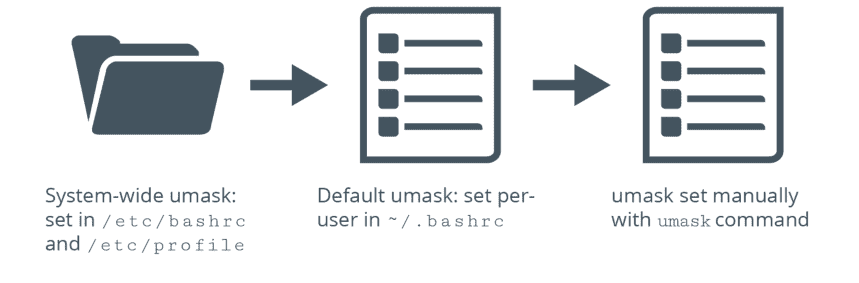

*umask 值的计算顺序。*

### 语法

`umask` 命令的语法为 `umask {number}`

> **注意：** 要了解更多信息，请查看课程网站上的**视频**选项卡，获取补充本课程内容的所有视频。

## 活动 3-2

### 讨论文件和目录权限

**场景**

回答以下问题以检查你对该主题的理解。

- 1. 多名用户抱怨共享目录中的文件访问问题，但你已检查过每日备份报告，没有损坏的文件。你可以在相关目录中发出哪个命令来进一步调查问题？

- 2. 一群系统管理员讨论文件权限时，决定将某个 `root` 拥有的文本文件设置为对所有人只读作为最佳实践。这个文件的权限是什么样的？

- 3. 用户无法执行她创建的脚本（`collect.sh`），并通过电子邮件将脚本内容发送给你检查。查看脚本后，你确定脚本编写正确，但权限是问题所在。你可以发出什么命令来按需调整文件权限？

- 4. 用户更改了共享目录中脚本（`myscript.sh`）的权限。用户很好奇为什么每个人都能执行该脚本，即使用户拥有该脚本且其他人只有读权限。为了使脚本可执行，用户错误地发出了什么命令？

你的团队负责人厌倦了收到恢复被删除文件的帮助台工单，这些工单来自包含数百个文件和子目录的目录。她决定让你通过将所有文件设为只读来解决此问题。如何在不遍历每个目录的情况下将所有文件更改为只读？

## 活动 3-3

### 修改默认权限

### 开始之前

你已以学生账户身份登录到 CLI。之前，你创建了一个名为 `cmason` 的用户账户。

### 场景

Develetech 的一位员工 Chris Mason 希望以非默认权限创建文件和目录，以便更轻松地与同事共享。由于所请求的更改不违反 Develetech 安全策略，因此已获批准。你将为 Chris 实施此更改。

- 1. 查看创建新文件和目录的用户的当前默认权限设置。

  a) 输入`umask`

  b) 确认默认掩码为 `0002`

  对于标准用户，默认情况下未设置高级权限（第一个 0），所有者和组权限未被屏蔽，其他用户权限被屏蔽 2

- 2. 为 Chris Mason 的 `.bashrc` 配置非标准的 `umask` 值。

  a) 输入`sudo vim /home/cmason/.bashrc`以在文本编辑器中打开文件。

  b) 按 **Page Down** 将光标移动到文件底部。

  c) 按 **i** 进入插入模式。

  d) 在新的一行添加以下文本：

     `umask 022`

  e) 按 **Esc** 退出插入模式。

  f) 输入`:wq`保存并关闭文件。

- 3. 测试新的默认权限。

  a) 输入`su - cmason`以切换凭据。


b) 在提示时输入 `Pa22w0rd`。

c) 输入 `umask` 以查看当前默认权限。

你应该会看到上面配置的 `0022` 值。

d) 输入 `touch test-file` 以创建新文件。

e) 输入 `ls -l` 并验证 `test-file` 的权限是否与新的 `umask` 配置匹配。

权限应为 `-rw-r--r--`

f) 输入 `exit` 以返回你的学生账户。

*第 3 课：管理权限和所有权 | 主题 A*

## 主题 B

修改文件和目录的所有权

### 涵盖的考试目标

3.1 根据场景应用或获取适当的用户和/或组权限及所有权。

虽然你已经通过分配权限限制了数据的访问，但你可能需要允许用户修改某些文件和目录的权限。这就是所有权概念的用武之地。

## 所有权

如你所见，第一个权限上下文是所有者或用户。在 Linux 中，**所有权**是指用户能够对文件或目录应用和修改权限的属性。默认情况下，文件或目录的所有者是创建该文件或目录的用户。除了超级用户外，其他用户无法更改属于他人所有的对象的权限。

虽然所有权最常见的应用是更改读、写和执行权限属性，但所有者也可以更改其拥有对象的高级和特殊权限。

## chown 命令

`chown` 命令用于更改文件或目录的所有者、组，或同时更改两者。有时，你可能希望由创建对象的用户之外的其他用户来管理该对象的权限。

下表描述了如何使用此命令。

| 命令语法 | 说明 |
|---|---|
| `chown {用户名} {文件/目录名}` | 更改所有者但不更改组。 |
| `chown {用户名}:{组名} {文件/目录名}` | 更改所有者和组。 |
| `chown {用户名}: {文件/目录名}` | 更改所有者和组。组将更改为指定用户的登录组。 |
| `chown :{组名} {文件/目录名}` | 更改组但不更改所有者。这与使用 `chgrp` 命令相同。 |

## 递归更改所有权

你可以将 `chown` 命令与 `-R` 选项结合使用，以递归方式更改整个目录结构的所有权。

## chgrp 命令

`chgrp` 命令用于更改文件或目录的组所有权。更改对象的组所有权可确保将组权限应用于特定的组。

## 语法

`chgrp` 命令的语法为 `chgrp {组名} {文件/目录名}`

> **注意：** 要了解更多信息，请查看课程网站上的**视频**标签，获取补充本课内容的视频。

## 活动 3-4

讨论文件和目录所有权

### 场景

回答以下问题以检查你对本主题的理解。

- 1. 一位用户（Bob Smith——**用户名：** `bsmith`）打电话给你，请求你恢复他不小心从主目录中删除的一组文件。你帮他复制了文件，但后来他抱怨无法再编辑这些文件。你需要做什么才能让他能够编辑自己的文件？

- 2. Gina 想与团队中的另外两名成员共享一些营销文件，但不想让他们访问她主目录中的这些文件。她还想让该目录及其文件仅对营销组可用。作为管理员，你可以采取哪些步骤来完成此请求？

- 3. 执行 `chown :mygrp file1` 等同于什么命令？

- 4. 作为管理员，你创建了一个共享目录并进行了必要的权限更改，以允许一组用户访问该目录。你还向该组添加了用户。当属于该组的用户（`susan`）在共享目录中创建文件时，新文件将具有哪些用户和组权限？

- 5. 在共享目录中，用户必须做什么才能确保每个组成员对他们创建的文件具有完全的读写访问权限？

## 活动 3-5

修改文件和目录所有权

### 开始前准备

你以学生账户身份登录到 CLI。

### 场景

你将创建一个图形部门目录，部门成员可以在其中存储内容。你将调查默认的所有权和组关联，然后创建 `/Graphics` 目录。你将配置目录和文件的所有权和组关联。

- 1. 查看文件和目录的当前所有权和组关联。

  - a) 输入 `ls -l /var/log/cron` 查看关于此日志文件的所有权和组详细信息。

  root 用户是所有者，root 组是组。

  - b) 输入 `ls -l /etc/ssh/sshd_config` 查看关于此配置文件的所有权和组详细信息。

  root 用户是所有者，root 组是组。

  - c) 输入 `sudo ls -l /home/cmason` 查看关于用户主目录内容的所有权和组详细信息。

  `cmason` 用户是所有者，`cmason` 组是组。

- 2. 创建一个目录并在目录中填充文件，然后管理所有权值。

  - a) 输入 `sudo mkdir /Graphics` 在文件系统根目录下创建一个目录。

  - b) 输入 `sudo touch /Graphics/file1` 创建内容。

  - c) 使用 `file2` 和 `file3` 重复此命令，在目录中创建额外的空文件。

  - d) 输入 `ls -l /Graphics` 查看所有权信息。

  所有者是创建者；在本例中，由于使用了 `sudo` 命令，创建者是 root 账户。

  - e) 输入 `sudo chmod -R 774 /Graphics` 为 `/Graphics` 目录及其内容设置权限。

  - f) 输入 `sudo ls -l /Graphics` 查看新权限。

```
[student01@localhost permissions-demo]$ sudo ls -l /Graphics
total 0
-rwxrwxr--. 1 root root 0 Dec 14 13:06 file1
-rwxrwxr--. 1 root root 0 Dec 14 13:06 file2
-rwxrwxr--. 1 root root 0 Dec 14 13:06 file3
```

- 3. 更改 `/Graphics` 目录及其内容的所有者和组值。

  - a) 输入 `sudo chown -R :GraphicsDept /Graphics` 将组关联设置为 `GraphicsDept`

  - b) 输入 `sudo ls -ld /Graphics` 查看更改。

  - c) 输入 `sudo chown rstanley /Graphics/file2` 将 `file2` 的所有权更改为 Rose Stanley。

  - d) 输入 `sudo ls -l /Graphics` 确认 `rstanley` 现在是 `file2` 的所有者

## 主题 C

配置特殊权限和属性

### 涵盖的考试目标

3.1 根据场景应用或获取适当的用户和/或组权限及所有权。

标准的读、写和执行权限在大多数情况下已经足够。然而，还有一些额外的权限和属性可以用来以更加专业化的方式限制访问。

## 特殊权限

当普通权限变得不足时，会使用特殊权限。借助特殊权限，权限较低的用户可以通过承担文件所有者或组的权限来执行文件。这使用户能够在有限的上下文中临时获得这些更高级别的权限。

## SUID 和 SGID 权限

在 Linux 中，两种主要的特殊权限是设置用户 ID（SUID）和设置组 ID（SGID）。**SUID**，即 setuid，是允许用户拥有与文件所有者类似权限的权限。某些可执行文件和命令（如 `passwd`）需要访问用户可能没有明确权限的额外资源。`passwd` 命令的配置方式不是单独授予这些权限，而是让任何用户都以 root（所有者）身份执行该命令，从而让他们获得对额外资源的权限。

**SGID**，即 setgid，是允许用户拥有与文件组所有者类似权限的权限。除了文件之外，SGID 还可以设置在目录上。在此目录中创建的任何文件和目录都将自动**继承** SGID 权限。同样，在此目录中创建的所有新文件和子目录将继承目录的组 ID，而不是创建对象用户的组 ID。这种继承很有用，因为在共享环境中，用户在该目录中创建对象时无需更改其组。请注意，SGID 权限不会应用于目录中的现有对象，也不会应用于从其他位置移动到该目录中的对象。

SUID 和 SGID 都使用 `chmod` 命令设置，可以使用符号模式或绝对模式。使用 `ls -al` 查看权限时，SUID 的所有者执行权限显示为 `s`，SGID 的组执行权限显示为 `s`。

*在目录上设置 SGID 的示例。*

## 语法

以下是在文件上设置 SUID 的语法，分别使用符号模式和绝对模式：

```
chmod u+s {文件名}
chmod 4### {文件名}
```

请注意，绝对模式中的最后三位是您选择的标准权限。

以下是在目录上设置 SGID 的语法，分别使用符号模式和绝对模式：

```
chmod g+s {目录名}
chmod 2### {目录名}
```

移除 SUID 和 SGID 非常简单，只需在符号模式中使用 `-`（减号）操作符，或在绝对模式中将第一个权限位设置为 0。

## 粘滞位

**粘滞位**是一种特殊的权限位，用于保护目录中的文件。它确保只有文件或目录的所有者（或 root 用户）才能删除该文件或目录。如果没有粘滞位，任何对对象具有写和执行权限的用户都可以删除该对象。粘滞位确保这些用户不具有删除权限，但仍保留写和执行文件及目录所带来的其他权限。

与 SUID/SGID 类似，您可以使用 `chmod` 命令设置粘滞位。使用 `ls -al` 时，您可以在其他用户的执行位置（最后位置）看到粘滞位显示为字母 `t`，如果其他用户没有设置执行权限，则显示为大写字母 `T`。

## 语法

设置粘滞位的语法如下，分别使用符号模式和绝对模式：

```
chmod +t {目录名}
chmod 1### {目录名}
```

与 SUID/SGID 一样，使用 `-` 或 `0` 来清除粘滞位。

## 文件上的粘滞位

在较早版本的内核中，粘滞位可以强制程序或文件保留在内存中，以便在再次调用时无需重新加载。文件上的粘滞位向操作系统表明该文件将频繁执行。现代版本的 Linux 内核会忽略文件上的粘滞位；如果您想保护特定文件，需要对包含这些文件的目录应用粘滞位。

## 文件属性

文件可以设置一个或多个属性，这些属性定义了系统如何与这些文件交互。这些属性超出了典型权限的范围，使您能够更细粒度地定制系统允许和不允许对文件执行的操作。有许多这样的属性。一些例子包括：

- 只允许以追加模式打开文件进行写入；即，不允许覆盖文件。
- 设置文件自动压缩。
- 在文件被删除时保存文件，提供恢复的机会。
- 使文件不可变。

## 不可变标志

**不可变标志**是文件或目录的一种属性，可防止其被修改，即使是 root 用户也不行。换句话说，没有人可以删除、重命名或写入不可变文件。设置不可变标志对于敏感度和重要性很高且短期内不太可能更改的文件非常有用。粗心的用户或错误的进程将无法删除不可变文件。

并非所有文件都会设置不可变标志。单个目录可以包含可变和不可变的文件和子目录。此外，不可变的子目录可以包含可变的文件。

查看文件属性时，小写字母 `i` 表示设置了不可变标志。

## lsattr 命令

`lsattr` 命令用于列出文件或目录的属性。

下表描述了 `lsattr` 命令的一些选项。

| 选项 | 用于 |
|--------|---------|
| `-R` | 递归列出目录及其内容的属性。 |
| `-a` | 列出目录中的所有文件。 |
| `-d` | 像列出文件一样列出目录，而不是列出其内容。 |
| `-v` | 列出文件的版本号。 |

```
[root@server01 ~]# lsattr file1
----i----------- file1
```

设置了不可变属性

列出文件的属性。

## 语法

`lsattr` 命令的语法是 `lsattr [选项] {文件/目录名}`

## chattr 命令

`chattr` 命令用于更改文件或目录的属性。下表描述了 `chattr` 命令的一些选项。

| 选项 | 用于 |
|--------|---------|
| `-R` | 递归更改目录及其内容的属性。 |
| `-v {版本}` | 设置文件的版本号。 |
| `+i` | 将文件标记为只读或不可变。需要超级用户权限。 |
| `-i` | 移除文件的只读或不可变属性。需要超级用户权限。 |

> **注意：** 只有 root 用户才能设置或移除不可变标志。

## 语法

`chattr` 命令的语法是 `chattr [-R] [-v {版本}] [+-{属性}] {文件/目录名}`

## 访问控制列表

**访问控制列表（ACL）** 是附加到对象上的权限列表。ACL 可用于传统文件权限概念不足以应对的情况。ACL 使您能够将权限分配给个别用户或组，即使这些用户或组不属于对象的所有者或所属组。

例如，两个部门组的成员可能需要对同一资源有不同的访问级别。组 1 可能需要对某个目录具有 `r/w/x` 权限，而组 2 只需要 `r/x` 访问权限。通过使用 ACL，您可以为不同的用户、组甚至进程授予不同的访问级别。ACL 实现了更细粒度的控制。

## getfacl 命令

`getfacl` 命令用于检索文件和目录的 ACL。

`getfacl` 命令的基本输出格式显示有关对象的元数据，包括其所有者、所属组、任何已设置的 SUID/SGID/粘滞位标志、与对象关联的标准权限，以及用户和组的个别权限条目。

```
[root@server01 ~]# getfacl file1
# file: file1
# owner: root
# group: root
# flags: --t
user::rw-
user:manderson:rw-
group::r--
mask::rw-
other::---
```

> 个别用户权限可解析的权限

为特定用户设置权限的 ACL。

> 注意：目录还可以有默认的 ACL 条目，适用于在其中创建的任何新文件或子目录。

## setfacl 命令

`setfacl` 命令用于更改与文件或目录的 ACL 关联的权限。

`setfacl` 命令有多个选项，其中一些最常见的选项在下表中描述。

| 选项 | 用于 |
|--------|---------|
| `-R` | 递归为目录及其内容设置 ACL 选项。 |
| `-s` | 设置对象的 ACL，替换任何现有的 ACL。 |
| `-m` | 修改对象的现有 ACL。 |
| `-x` | 从现有 ACL 中移除条目。 |
| `-b` | 移除所有 ACL 条目（不包括标准权限）。 |

## 语法

`setfacl` 命令的语法是 `setfacl [-bR] [-mx {acl_spec}] {文件/目录名}`

## ACL 规范

ACL 规范可以通过以下几种方式之一格式化：

- 处理用户时，格式为 `u:{用户名}:{权限}`
- 处理组时，格式为 `g:{组名}:{权限}`

## 示例

以下是修改目录 ACL 的示例，其中用户 `http` 被赋予读取权限：

```
setfacl -m u:http:r-- /home/directory
```

> *注意：要了解更多信息，请查看课程网站上的**视频**标签，获取补充本课内容的视频。*

## 活动 3-6

讨论特殊权限和属性

### 场景

回答以下问题以检查您对该主题的理解。

1. 营销经理联系您，说您为营销组设置的共享目录可以工作，但与他们计划的并不完全一样。当组中某个成员在目录中创建文件时，文件会采用该用户的用户和组权限。例如，当 Linda 创建新文件时，权限是 `-rw-rw-r-- linda linda`。经理希望文件都能保留 `mkt` 组权限，如果可能的话，而不是让用户自己更改组。您可以采取什么措施来满足这个请求？

2. Gina 是营销组的成员，她决定保护自己的文件，使只有她自己才能删除文件，尽管其他营销组成员需要能够工作和编辑这些文件。她可以做什么来解决其他人删除她文件的问题？

3. Ruth 一直在寻找解决她问题的方法：她的一些培训文档不断被系统管理员更改或删除，这些管理员会删除超过 180 天未访问的文件。她发现文件可以设置为不可变，但她自己无法使文件不可变，需要您的帮助。您如何使文件 `/home/ruth/training1_doc.txt` 和 `/home/ruth/training2_doc.txt` 不可变？

## 活动 3-7

配置 SGID 权限和粘滞位

### 开始之前

你已使用学生账户登录到命令行界面。此前，你创建了一个 `/Graphics` 目录以及一个包含若干用户的 `GraphicsDept` 组。

### 场景

一些用户指出 `/Graphics` 的组关联并未应用于在该目录中创建的文件。还有一位用户抱怨说，另一个用户意外删除了她的一个文件。你被要求解决这些问题。

- 1. 使用 SGID 自动设置 `/Graphics` 目录中新创建文件的组关联。

    a) 输入 `ls -ld /Graphics` 查看 `/Graphics` 目录的默认权限。

    b) 输入 `sudo chmod g+s /Graphics` 为 `/Graphics` 设置 SGID，以便新创建的文件将获得组关联。

    c) 输入 `ls -ld /Graphics` 查看新权限。

```
drwxrwsr--. 2 root GraphicsDept 45 Dec 14 13:06 /Graphics
```

    d) 输入 `su - rstanley` 并输入 `Pa22w0rd` 切换到 Rose Stanley 的凭据。

    e) 输入 `cd /Graphics`，然后输入 `touch file4` 创建一个文件。

    f) 输入 `ls -l` 并确认 `file4` 的所有者是 `rstanley`，组是 `GraphicsDept`。

    g) 输入 `exit` 返回到 `student##` 登录。

- 2. 使用粘滞位更好地保护文件，防止被除所有者外的任何人删除。

    a) 输入 `sudo chmod +t /Graphics` 为 `/Graphics` 目录配置粘滞位。


b) 输入 `su - jrobinson` 并输入 `Pa22w0rd` 切换到 Jerry Robinson 的凭据。

c) 输入 `cd /Graphics` 进入 `/Graphics` 目录。

d) 输入 `rm file4` 尝试删除 `rstanley` 拥有的文件。注意，你会收到“Operation not permitted”（操作不允许）的响应。如果这是权限问题，你会收到“access denied”（访问被拒绝）的响应。尽管 `jrobinson` 是 `GraphicsDept` 组的成员，并且该组拥有在此目录中删除文件的权限，但粘滞位阻止了非所有者删除文件。

e) 输入 `exit` 返回到 `student##` 登录。

## 活动 3-8

在文件上设置不可变标志

### 开始之前

你已使用学生账户登录到命令行界面。

### 场景

你编写了一个 README 文本文件，准备存储在 `/Graphics` 目录中，以帮助指导用户正确使用内容。你希望确保没有人，即使是 root 用户，也无法意外删除该文件。你将使用不可变属性来完成此任务。

1. 在 `/Graphics/README` 文件上配置不可变标志。

   a) 输入 `sudo touch /Graphics/README` 在 `/Graphics` 目录中创建一个文档。

   b) 输入 `sudo ls -l /Graphics` 查看 README 文件的当前权限设置。

   c) 验证 README 文件由 root 拥有，并且所有者通常能够删除该文件。

   ```
   -rw-r--r--. 1 root    GraphicsDept 0 Dec 14 13:15 README
   ```

   d) 输入 `sudo chattr +i /Graphics/README` 为 README 文件设置不可变属性。

   e) 输入 `sudo ls -l /Graphics` 查看当前权限并验证它们未发生变化。

   f) 输入 `sudo lsattr /Graphics/README` 确认已设置不可变属性。

   ```
   ----i------------ /Graphics/README
   ```

2. 通过尝试删除文件来验证标志是否生效。

   a) 输入 `sudo rm /Graphics/README` 尝试从 `/Graphics` 目录中删除 README 文件。

   b) 验证此操作失败。这是由于不可变属性所致。注意响应是“Operation not permitted”（操作不允许），而不是表示权限问题的“access denied”（访问被拒绝）响应。

## 活动 3-9

### 开始之前

你已使用学生账户登录到命令行界面。

### 场景

图形部门要求给予市场部门对 `/Graphics` 目录的只读访问权限。使用标准权限，只能存在一个组关联。你将使用访问控制列表（ACL）来确保图形部门和市场部门都能访问。

为市场部门设置 ACL。

- a) 输入 `sudo getfacl /Graphics` 查看该目录上的当前 ACL。

- b) 输入 `sudo setfacl -R -m g:MarketingDept:r /Graphics` 授予 `MarketingDept` 对 `/Graphics` 目录及其内容的只读权限。

> 注意：你可以忽略关于 README 文件的“Operation not permitted”警告；ACL 设置仍将应用于所有其他对象。

- c) 输入 `sudo getfacl /Graphics` 查看 `MarketingDept` 的新访问级别。

```
# file: Graphics
# owner: root
# group: GraphicsDept
# flags: -st
user::rwx
group::rwx
group:MarketingDept:r--
mask::rwx
other::r--
```

## 主题 D

排查权限问题

### 涵盖的考试目标

*4.3 给定场景，分析并解决用户问题。*

在任何系统中，问题都是不可避免的。作为一名 Linux 专业人员，你需要掌握的最重要技能之一就是能够排查这些问题。因此，在这个主题中，你将遵循一个通用模型来排查任何类型的 OS 问题。然后，你将通过诊断和解决与权限相关的问题来应用这些排查技能。

## 排查

**排查**是识别、诊断和解决问题的过程。排查从识别问题开始，直到服务恢复且问题不再对用户产生不利影响才算结束。排查可以采取多种形式，但所有方法的目标都相同：以最小的服务中断高效地解决问题。

## 排查模型

排查策略是识别系统相关问题原因并解决其影响的行动计划。你可以通过逐步方法或**排查模型**来实施排查策略。这样的模型有很多，它们的方法可能各不相同，但所有模型都试图使排查人员在排查过程中能够以系统且可重复的方式进行。

一个排查模型示例将过程分为以下步骤：

1. **识别问题。** 此阶段包括：

   - 收集信息。
   - 如果可能，复制问题。
   - 询问用户以获取经验信息。
   - 识别症状。
   - 确定是否有任何变更。
   - 逐个处理多个问题。

2. **建立可能原因的假设。** 此阶段包括：

   - 质疑显而易见之处。
   - 考虑多种方法。
   - 不仅要寻找原因，还要寻找根本原因。

3. **测试假设以确定原因。**

   - 当假设被证实时，确定解决问题的下一步。
   - 如果假设未被证实，则建立新的假设或上报问题。

4. **建立解决问题的行动计划，同时识别计划的潜在影响。**

5. 实施解决方案，或上报问题。

6. 验证完整的系统功能，并在适用时实施预防措施。

7. 记录你的发现、操作和结果。

## 权限排查

作为一般准则，当你预期拥有权限却遭到拒绝，或者相反，你应始终使用 `ls -al` 命令验证相关对象的权限。这通常能省去你很多猜测，因为许多问题仅仅是应用了错误的权限。

下表列出了一些与权限问题相关的常见症状，以及一些潜在的原因和解决方案。注意这些是示例，其中一些症状可能有多种原因和解决方案。

| 症状 | 原因和解决方案 |
|---------|-------------------|
| 文本文件的所有者被拒绝查看文本文件的内容。 | **原因：** 尽管是所有者，但用户未被明确授予读取访问权限。<br>**解决方案：** 使用 `chmod` 为所有者上下文授予读取权限。 |
| 用户被拒绝删除目录，尽管拥有写权限。 | **原因：** 用户需要同时拥有写*和*执行权限才能修改目录。<br>**解决方案：** 使用 `chmod` 为相应的上下文向目录添加执行权限。 |
| 用户被拒绝进入目录，尽管拥有读权限。 | **原因：** 用户需要执行权限才能切换到目录。<br>**解决方案：** 使用 `chmod` 为相应的上下文向目录添加执行权限。 |
| 用户被拒绝删除文件，尽管拥有该文件的完整权限。 | **原因：** 用户必须对包含目录拥有写权限。<br>**解决方案：** 使用 `chmod` 为适当的上下文向目录添加写权限。 |
| 用户被拒绝在其拥有写和执行权限的目录中创建文件。 | **原因：** 目录上设置了不可变标志。<br>**解决方案：** 作为 root，使用 `chattr` 命令从目录中移除不可变标志。 |
| root 用户被拒绝修改文件。 | **原因：** 文件上设置了不可变标志。<br>**解决方案：** 作为 root，使用 `chattr` 命令从文件中移除不可变标志。 |

| 症状 | 原因与解决方案 |
|---------|-------------------|
| 所有用户都能列出目录内容，但只有所有者、组成员和特定服务账户才应有此权限。 | **原因：** 目录的其他人（others）上下文设置了读权限。<br>**解决方案：** 移除其他人上下文的读权限。使用 `setfacl` 命令将服务账户添加到目录的 ACL 中，授予该账户读访问权限。 |
| 用户被拒绝访问他们自己创建的脚本。 | **原因：** 新文件不会自动设置执行权限。<br>**解决方案：** 使用 `chmod` 为文件所有者添加脚本的执行权限。 |
| 用户被拒绝修改脚本内容，尽管他们有执行该脚本的权限。 | **原因：** 与其他文件一样，用户需要写权限才能更改脚本内容。<br>**解决方案：** 使用 `chmod` 为适当的上下文添加脚本的写权限。 |
| 用户被拒绝执行脚本，尽管他们拥有执行权限。 | **原因：** 用户还需要读权限才能执行脚本。<br>**解决方案：** 使用 `chmod` 为适当的上下文添加脚本的读权限。 |
| 所有用户都能删除文件，但他们只应该能够写入文件。 | **原因：** 默认情况下，目录上的写和执行权限使用户能够删除其中的对象。<br>**解决方案：** 为容器目录添加粘滞位（sticky bit）权限，以便只有所有者或 root 才能删除文件。 |

## 所有权故障排除

与权限一样，当您遇到与所有权相关的问题时，应使用 `ls -al` 来验证文件或目录的用户和组所有权。除此之外，下表列出了一些您可能遇到的潜在问题，以及建议的原因和解决方案。

| 症状 | 原因与解决方案 |
|---------|-------------------|
| 用户无法访问文件，尽管所有者上下文拥有完全权限。 | **原因：** 该用户不是文件的所有者。<br>**解决方案：** 使用 `chown` 命令使该用户成为文件的所有者。 |
| 用户无法删除文件，尽管包含目录向组授予了完全权限。 | **原因：** 目录的所属组与用户的组不同。<br>**解决方案：** 使用 `chgrp` 命令使目录的所属组与用户的组相同。 |
| 多个用户能够修改文件，尽管其他人（others）上下文只有读权限。 | **原因：** 文件的所属组设置为这些用户所属的同一个组。<br>**解决方案：** 使用 `chgrp` 将文件的所属组更改为其他组。 |
| 当用户在共享目录中创建文件时，文件采用了用户的组 ID，而应该采用目录的组 ID。 | **原因：** 默认情况下，用户创建的文件采用该用户的组 ID。<br>**解决方案：** 使用 `chmod` 在包含目录上设置 SGID 权限，使所有新文件继承目录的组 ID。 |
| 当用户在共享目录中创建文件时，文件采用了目录的组 ID，而应该采用用户的组 ID。 | **原因：** 共享目录上设置了 SGID 权限，使新文件继承目录的组 ID。<br>**解决方案：** 使用 `chmod` 移除包含目录上的 SGID 权限，禁用目录组 ID 的继承。 |

## 组成员身份故障排除

某些问题的出现是因为，尽管已正确配置权限和所有权，但用户可能未被放置在正确的组中。使用 `groups {用户名}` 命令来发现用户属于哪些组。另一个相关问题是，当用户创建文件时，默认的所属组不是预期的组。请确保预期组是用户的主组，而不是附属组。在任何一种情况下，都请使用 `usermod` 命令在适当时更改组成员身份。

列出某个组的所有成员也可能会有所帮助，以便您可以确定需要添加或移除哪些账户。然而，并不一定有哪个简单的命令是适用于所有 Linux 发行版且能完成此操作的。您可以搜索 `/etc/group` 文件以查找所需的组，但这只显示标准数据库中的组（即，不包括其他认证方法），并且不会显示主组是您正在搜索的组的用户。`lid` 和 `libuser-lid` 命令预装在某些发行版上，可以检索组的所有成员，包括主组是正在搜索的组的成员。`getent` 命令在某些发行版上可用，使您能够检索非标准认证方法的组成员。

## 权限问题故障排除指南

在排除权限问题时，请遵循以下准则。

## 权限问题故障排除

在排除权限问题时：

- 遵循任何类型故障排除任务的总体故障排除策略。
- 遵循分步故障排除模型，以产生可重复且可演示的结果。
- 首先使用 `ls -al` 命令验证对象的权限和所有权。
- 如果用户被拒绝访问，确保用户具有使用文件的权限。
- 确保用户没有使其能够访问超出应有范围文件的权限。
- 如果您期望修改对象，请确保对象没有设置不可变标志（immutable flag）。
- 如果您需要使用 root 权限运行可执行文件才能使其正常工作，请在其上设置 SUID 权限。
- 当您只希望所有者和 root 能够删除对象时，设置粘滞位（sticky bit）。
- 确保对象设置了正确的所有者和所属组。
- 当您希望新文件采用目录的组所有权时，在目录上设置 SGID 权限。
- 使用 `groups {用户名}` 命令验证用户所属的组。
- 在必要时修改组成员身份，以确保特定用户的访问或限制其访问。
- 获取并使用 `lid` 和 `getent` 等工具来查看特定组的成员。

## 活动 3-10

## 权限问题故障排除

### 场景

您正在与 Develetech 服务台合作完成一些 Linux 服务请求。您将处理权限工单。您必须识别工单的 probable cause（可能原因），并提出解决方案。

1. Rose Stanley 提交了一张工单，表示她被拒绝删除目录的能力。她向服务台确认她对目录有写权限。您会提出什么建议来解决这个问题？

2. Jerry Robinson 在文件上收到"访问被拒绝"的消息。他告诉服务台，用户权限显示所有者有读访问权限。您会提出什么建议来解决这个问题？

3. Rose Stanley 在文件上收到"访问被拒绝"的消息。她使用 `ls -l` 命令来发现哪个组被授予了对文件的访问权限。她认为自己应该能够访问该文件。您会提出什么建议来解决这个问题？

4. Jerry Robinson 无法使用 `cd` 命令导航到某个特定目录。他告诉服务台，他使用 `ls -l` 查看了与文件关联的组。他还确认该组被列为对目录有读访问权限。然后他使用 `id` 命令确认自己是该组的成员。您会提出什么建议来解决这个问题？

5. 由另一位管理员设置的共享目录中的某个组在该目录的权限方面遇到了几个问题。您被要求进行调查。您可以使用哪些命令来检查现有权限，以帮助评估当前设置？

6. 一位用户投诉她创建并拥有完全访问权限（`rwxrwx---`）的脚本无法执行。这个脚本的问题是什么？

7. Bob 提交工单称，尝试`cd`进入`/opt/Finance`时收到"权限拒绝"错误。Bob 是`FinanceDept`组的成员。Bob 的访问存在什么问题？

8. 应用开发团队创建了一个新的 Web 应用，要求你搭建一个可通过 Web 服务器访问的目录以及应用的服务账户。为团队设置好一切后，他们提交工单称应用无法向日志目录写入日志。问题是什么，以及如何纠正？

9. 图形部门请求公司所有人都能访问公司徽标艺术图，以便插入到电子邮件、信头和其他文档中。但他们不希望组外人员拥有任何其他访问权限。请求更改几天后，其他用户仍然无法访问文件。你检查共享目录的权限，发现权限如下：`drwxrwx--- graphics GraphicsDept 4096 Dec 1 09:42 logos`——你可以执行什么命令来解决这个问题？

## 小结

在本课中，你修改了 Linux 系统中文件和目录的权限与所有权。现在，你将能够更高效地控制 Linux 系统上的数据访问。

在什么情况下你可能想要更改 Linux 系统的默认权限？

你更喜欢使用符号模式还是绝对模式来设置权限，为什么？

**练习题：** 课程网站上提供了额外的练习题。

## 第 4 课

## 管理存储

课程时间：3 小时 30 分钟

## 课程简介

除了管理用户对 Linux® 系统的访问外，最基础的任务之一就是数据存储管理。划分、格式化以及以其他方式组织数据存储的方法有很多，Linux 为此提供了许多工具。使用这些工具，你将最终让授权用户更轻松地处理数据。

## 课程目标

在本课中，你将：

- 创建驱动器分区。
- 使用逻辑卷管理器（LVM）管理卷。
- 挂载 Linux 文件系统。
- 管理 Linux 文件系统。
- 浏览文件系统层次结构标准（FHS）。
- 排查存储问题。

## 主题 A

## 创建分区

涵盖的考试目标

1.4 给定场景，在 Linux 环境中管理存储。

2.3 给定场景，创建、修改和重定向文件。

4.1 给定场景，分析系统属性并进行相应修复。

管理存储的首要任务是对存储设备进行分区，并使用文件系统格式化分区。这将使设备的该部分可用于数据的读写。

### 存储设备

**存储设备**是一种能够记录数据并持久保存的物理组件。Linux 操作系统支持多种类型的存储设备。常见类型包括：

- **硬盘驱动器（HDD）**——使用磁存储技术存储数据的机电设备，通常容量较大。
- **固态硬盘（SSD）**——使用非机械固态技术存储数据的存储设备，通常容量较大。它们的访问速度往往比 HDD 快得多。
- **U 盘**——使用闪存技术存储数据的便携式存储设备，与 HDD 和 SSD 相比容量通常较小。其小巧的体积便于携带。
- **外置存储驱动器**——可使用多种技术类型的便携式存储驱动器。它们通常通过 USB 等外设接口连接到计算机，而非作为内部组件。

尽管上述存储设备很可能是你将要处理的主要设备，但你可能还需要负责处理软盘驱动器（FDD）、磁带驱动器等传统技术。

> **注意：** 术语"磁盘"和"硬盘"通常用于泛指所有存储设备。甚至一些 Linux 工具也这样做。然而，并非所有存储设备都使用硬盘技术，因此本课程使用"存储设备"、"存储驱动器"和"存储介质"等术语来指代一般概念。

### 块设备与字符设备

Linux 将设备称为块设备或字符设备。块设备是可以按数据块进行读写的存储设备（如前面列出的那些）。字符设备则是可以按数据流进行读写的设备，如键盘、鼠标、串口等。

### 文件系统

**文件系统**是操作系统用于在存储设备上存储、检索、组织和管理文件及目录的数据结构。文件系统维护诸如单个文件的创建和修改日期、存储设备上文件的大小、文件类型以及与文件关联的权限等信息。它还提供了结构化的数据存储形式。


文件系统本身不解释文件中包含的数据，因为这项任务由特定的应用程序处理。文件系统因多种参数而异，例如文件系统的用途、它们存储的关于单个文件的信息、存储数据的方式以及实现的数据安全机制。

## 文件系统类型

Linux 支持多种文件系统类型。最常见的类型描述如下表。

| 文件系统类型 | 描述 |
|---|---|
| **FAT** | 文件分配表（FAT）是一种较旧的文件系统，与许多不同的操作系统兼容，包括所有版本的 Unix、Windows 和 macOS。它不提供与现代文件系统相同的功能，通常出于兼容性原因使用。改进版本包括 FAT32 和 exFAT。 |
| **ext2** | 这是某些旧版本 Linux 的原生文件系统。当前版本的 Linux 仍然支持它。 |
| **ext3** | 这是 ext2 的改进版本。在系统突然关机的情况下，ext3 恢复数据的速度更快，更好地确保数据完整性。你可以轻松地将文件系统从 ext2 升级到 ext3。 |
| **ext4** | 这是 Linux 发行版的两种默认文件系统之一。它与 ext2 和 ext3 文件系统向后兼容。ext4 相对于 ext3 的改进包括日志功能、支持最大一艾比字节（EiB）的卷，以及最大 16 太比字节（TiB）的文件。这是 Ubuntu® 安装的默认文件系统。 |
| **XFS** | 这是一种 64 位高性能日志文件系统，提供快速恢复功能，并能高效处理大文件。XFS 是 CentOS®/RHEL 7 安装的默认文件系统。 |

## NTFS

**新技术文件系统（NTFS）**是 Microsoft 为 Windows 创建的专有文件系统，提供文件夹安全权限、文件加密、驱动器压缩以及扩展到超大驱动器和文件等功能。

Linux 系统本身不支持 NTFS。

## 网络文件系统

虽然上表列出的是通用文件系统，但有些文件系统作为网络协议运行，支持通过网络共享数据。常见类型包括以下内容。

| 网络文件系统 | 描述 |
| --- | --- |
| 服务器消息块（SMB） | SMB 协议为用户提供对局域网（LAN）上文件和其他资源的共享访问。SMB 客户端向 SMB 服务器请求资源，服务器响应并提供适当的访问级别。该协议主要用于 Windows 计算机。但是，名为 Samba 的 SMB 兼容软件可帮助 Linux 和 Windows 主机运行网络共享进行交互。 |
| 通用 Internet 文件系统（CIFS） | CIFS 是 SMB 的一种特定实现，现已很少使用。Microsoft 将其设计为 SMB 版本 1 的继任者，但 SMB 版本 2 和 3 取代了它。然而，Linux 仍在其部分工具中使用 CIFS 名称，尽管这些工具支持较新版本的 SMB。 |
| 网络文件系统（NFS） | NFS 提供与 SMB 类似的功能，但协议不兼容。在 Linux 客户端访问 Linux 服务器的场景中，NFS 更为适用。在 Windows 和 Linux 混合环境中，SMB 协议是更好的选择。 |

## 索引节点

**索引节点（inode）**是在文件系统上存储文件或目录元数据的对象。此元数据可以包括基于时间的值，如文件创建和最后修改时间；权限和所有权信息；文件数据在存储设备上的块位置；以及其他杂项信息。

```
`/home/student01/file1.txt`
```

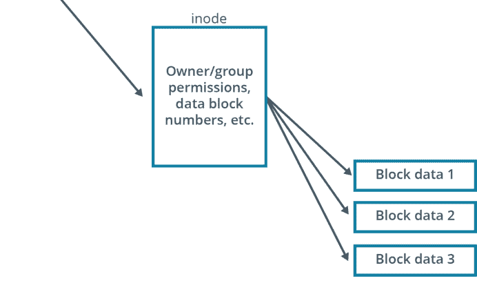

特定文件及其关联的索引节点。

文件系统上的每个索引节点都由一个唯一的整数标识，称为索引节点编号。每当系统或应用程序尝试访问文件时，它会在称为索引节点表的数据结构中搜索适当的索引节点编号。索引节点表将索引节点编号映射到其对应的文件或目录名称。

某些文件系统在创建时会设定最大 inode 数量，这通常取决于文件系统的总体大小。文件和目录的总数不能超过此 inode 上限。然而，某些文件系统类型（如 XFS）采用动态 inode 分配系统，其数量会根据文件系统容量的百分比进行缩放。换言之，这些文件系统并未设定严格的 inode 限制。

> 注意：你可以使用 `ls -i` 命令来列出文件和目录的 inode 编号。

## 日志记录

**日志记录**是一种文件系统记录变更的方法，这些变更尚未应用到文件系统本身，而是先记录在一个称为日志的对象中。这使得文件系统能够在意外中断（如系统崩溃）后快速恢复，因为系统可以参考日志中待处理的变更来从中断点继续执行。

日志记录过程涉及以下几个阶段：

1. 日志描述了必须对驱动器进行的所有更改。
2. 后台进程会在变更被记录到日志中时，适时地执行每项更改。
3. 如果系统关闭，待处理的更改将在系统重启时执行。
4. 日志中不完整的条目将被丢弃。

## 虚拟文件系统

真正的文件系统指的是 Linux 内核通常可以直接操作的一个独立的文件系统。问题在于，Linux 支持许多不同的文件系统类型，它们之间不一定兼容。**虚拟文件系统 (VFS)** 作为一个通用软件接口被创建，位于内核和真实文件系统之间。实际上，VFS 将真实文件系统的详细信息转换给内核，使得任何文件系统看起来都与其他文件系统相同。

借助 VFS，你可以在同一个 Linux 安装环境中挂载多种不同类型的文件系统，它们对用户和所有其他应用程序都将呈现统一的外观。因此，用户和这些应用程序可以在不了解其底层结构的情况下操作文件系统。这大大增强了系统与运行软件之间的互操作性。

## 示例

Linux 系统上真实文件系统的示例可以包括 `xfs`、`ext4` 和其他几种类型。虚拟文件系统的示例可以包括 `proc`（包含运行时的系统信息）、`devtmpfs`（包含系统初始化期间由内核加载的设备节点）、`debugfs`（包含对调试 Linux 内核有用的信息）等等。

## 文件系统标签

文件系统标签被分配给文件系统以便于识别。标签长度可达 16 个字符，可以使用 `e2label` 命令（用于 ext# 文件系统）和 `xfs_admin` 命令（用于 XFS 文件系统）进行显示或更改。

## 语法

设置 ext# 文件系统标签的语法为 `e2label /dev/{设备名称}{分区编号} {标签名称}`

设置 XFS 文件系统标签的语法为 `xfs_admin -L {标签名称} /dev/{设备名称}{分区编号}`

## 分区

**分区**是存储驱动器上一个在逻辑上充当独立驱动器的区域。分区使你能够将一个大驱动器划分为更小、易于管理的块，从而更好地组织信息。分区在存储数据之前必须先格式化并分配一个文件系统。

分区使用分区表进行标识，分区表存储在驱动器的一个或多个区域中。每个分区的大小可以不同，但不能超过存储驱动器的总可用空间。

大多数操作系统（包括 Linux）都使用驱动器分区。不同类型的数据可以存储在驱动器上的不同位置，例如将系统文件与用户可访问的文件分开存放。

### 分区类型

分区有三种类型：主分区、扩展分区和逻辑分区。存储驱动器的功能取决于其上的分区类型。

每个分区都有一组特定的功能。下表描述了这三种分区类型。

| 分区类型 | 描述 |
|----------|------|
| **主分区** | 可以包含一个文件系统或逻辑驱动器，有时也称为卷。交换文件系统和引导分区通常在主分区中创建。 |
| **扩展分区** | 扩展分区可以包含多个文件系统，这些文件系统被称为逻辑驱动器。只能有一个扩展分区，它还可以进一步细分。此分区类型不包含任何数据，并且拥有一个单独的分区表。 |
| **逻辑分区** | 物理驱动器的一部分，已被分区并分配为一个独立单元，功能类似于一个单独的驱动器。逻辑分区在扩展分区内创建，因此是扩展分区的子集。逻辑分区的数量没有限制，但建议将每个驱动器的逻辑分区数量限制在 12 个以内。 |

## 交换空间

交换空间是存储设备上的一个分区，在系统物理内存不足时使用。Linux 会将 RAM 中一些未使用的文件移至交换空间以释放内存。通常，交换空间的大小等于 RAM 容量的两倍。

交换空间位于存储驱动器上。

## fdisk 实用程序

fdisk 实用程序是一个菜单驱动的程序，用于在存储驱动器上创建、修改或删除分区。使用 fdisk，你可以创建新的分区表或修改现有分区表上的条目。fdisk 实用程序支持 DOS 和 Linux 类型的分区表。fdisk 实用程序还允许你指定分区的大小。

## 语法

fdisk 实用程序的语法为 `fdisk [选项] {设备名称}`

### fdisk 命令选项

fdisk 实用程序支持多个命令行选项。

| 选项 | 用途 |
|------|------|
| `-b {扇区大小}` | 指定驱动器的扇区数量。 |
| `-H {磁头数}` | 指定驱动器的磁头数量。 |
| `-S {扇区数}` | 指定每磁道的扇区数量。 |
| `-s {分区}` | 以块为单位打印分区大小。 |
| `-l` | 列出设备的分区表。 |

### fdisk 菜单选项

除了提供命令行选项外，你还可以在 `fdisk` 菜单中工作时选择各种选项。

| 选项 | 用途 |
|------|------|
| n | 创建一个新分区。子选项允许你指定分区类型和分区大小。 |
| d | 删除一个分区。 |
| p | 列出现有分区。 |
| w | 将更改写入驱动器并退出实用程序。 |
| q | 取消所做的更改并退出实用程序。 |

*使用 fdisk 列出存储设备的分区。*

### GNU PARTED

**GNU Parted** 实用程序也用于管理分区。它在创建新存储驱动器的分区时特别有用。可用于创建、销毁和调整分区大小。`parted` 命令运行 GNU Parted 实用程序。与 `fdisk` 类似，`parted` 包含一个菜单驱动的交互模式，你可以在其中输入各种选项。

```
[root@server01 ~]# parted /dev/sda
GNU Parted 3.1
Using /dev/sda
Welcome to GNU Parted! Type 'help' to
view a list of commands.

(parted)
```

## 语法

`parted` 命令的语法为 `parted [选项] {设备名称}`

### GNU PARTED 菜单选项

在 GNU Parted 的交互模式下工作时，有许多选项可供选择。

```
(parted) print
Model: ATA ST500LM000-SSHD- (scsi)
Disk /dev/sda: 500GB
Sector size (logical/physical): 512B/4096B
Partition Table: gpt
Disk Flags:

Number  Start   End     Size    File system  Name
        Flags
1       1049kB  211MB   210MB   fat16        EFI System Partition
        boot
2       211MB   1285MB  1074MB  xfs
3       1285MB  117GB   116GB
        lvm
```

下表列出了一些可用的菜单选项。

| 选项 | 用途 |
|------|------|
| select | 选择要修改的设备或分区。 |
| mkpart | 创建一个具有指定文件系统类型的分区。 |
| print | 列出分区表。 |
| resizepart | 修改分区的结束位置。 |
| rm | 删除分区。 |
| quit | 退出 GNU Parted 工具。 |

## partprobe 命令

`partprobe` 命令用于将分区表中的更改更新到内核。该命令首先检查分区表，如果存在任何更改，它会自动将更改更新到内核。

使用 `fdisk` 创建分区后，除非内核能够从分区表中读取该分区，否则无法为该分区添加文件系统。在 `fdisk` 操作期间，您可能会收到类似"重新读取分区表失败"的错误。重启机器可以更新分区表，或者您可以使用 `partprobe` 来代替重启以更新分区表。

`partprobe` 命令随 GNU parted 工具一起打包提供。

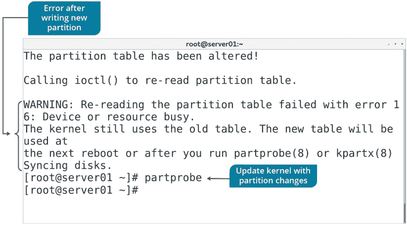

*创建新分区后更新内核。*

## 语法

`partprobe` 工具的语法为 `partprobe [options] [device name]`

## mkfs 命令

`mkfs` 命令用于在设备（通常是驱动器分区）上构建 Linux 文件系统。下表列出了 `mkfs` 命令的一些选项及其说明。

| 选项 | 用途 |
|--------|---------|
| -v | 生成详细输出，输出消息会随着程序的处理而不断变化。 |
| -V | 生成详细输出，包括执行的所有文件系统特定命令。 |
| -t {fs type} | 指定要构建的文件系统类型。 |
| fs-options | 向文件系统构建器传递文件系统特定的选项。 |
| -c | 在构建文件系统之前检查设备是否存在坏块。 |
| -l {file name} | 从指定文件中读取坏块列表。 |

```
[root@server01 ~]# mkfs.ext4 /dev/sda6
mke2fs 1.42.9 (28-Dec-2013)
Filesystem label=
OS type: Linux
Block size=4096 (log=2)
Fragment size=4096 (log=2)
Stride=0 blocks, Stripe width=0 blocks
131072 inodes, 524288 blocks
26214 blocks (5.00%) reserved for the super user
First data block=0
Maximum filesystem blocks=536870912
16 block groups
```

在分区上创建文件系统。

## 语法

`mkfs` 命令的一种语法选项是 `mkfs [options] {device name}`

另一种语法选项是 `mkfs.{file system type} [options] {device name}`

## fstab 文件

`fstab` 文件是一个配置文件，用于存储有关存储设备和分区的信息，以及分区应在何处以及如何挂载。`fstab` 文件位于 `/etc` 目录中。系统在启动时读取该文件，且只有 root 用户才能编辑它。`fstab` 文件由多行组成，每行对应一个文件系统。

`fstab` 文件中的每一行有六个字段，以空格或制表符分隔。

| 字段 | 说明 |
| --- | --- |
| 设备或分区名称 | 指定要挂载的设备或文件系统的名称。 |
| 默认挂载点 | 指示文件系统要挂载到的位置。 |
| 文件系统类型 | 指定设备或分区使用的文件系统类型。 |
| 挂载选项 | 指定一组以逗号分隔的选项，这些选项将在文件系统挂载时激活。 |
| dump 选项 | 指示 dump 工具是否应备份文件系统。通常将零指定为 dump 选项，以指示 dump 可以忽略该文件系统。 |
| fsck 选项 | 指定 fsck 工具检查文件系统的顺序。 |

```
#
# /etc/fstab
# Created by anaconda on Tue Dec 11 13:13:26 2018
#
# Accessible filesystems, by reference, are maintained under '/dev/disk'
# See man pages fstab(5), findfs(8), mount(8) and/or blkid(8) for more info
#
/dev/mapper/centos-root /                         xfs     defaults        0 0
UUID=829c6447-14c2-436c-8334-31b359df72f4 /boot     xfs     defaults        0 0
UUID=E434-7404          /boot/efi                 vfat    umask=0077,shortname=winnt 0 0
/dev/mapper/centos-home /home                     xfs     defaults        0 0
/dev/mapper/centos-swap swap                      swap    defaults        0 0
/dev/backup/sysbk /backup/sys xfs defaults 0 0
/dev/mapper/databk /backup/data ext4 nofail 0 0
/dev/backup/logbk /backup/log ext4 defaults 0 0
```

fstab 文件。

## crypttab 文件

`/etc/crypttab` 文件执行与 `fstab` 文件类似的功能，但其目的是存储有关加密设备和分区的信息，这些设备和分区必须在系统启动时解锁并挂载。其格式与 `fstab` 类似，但包含一个用于解锁加密设备的可选密码字段。

## 存储设备设置流程

将前面介绍的几个工具结合起来，在 Linux 上设置存储设备以供使用的整体流程如下：

1. 使用 `fdisk` 或 `parted` 等工具对存储设备进行分区
2. 使用 `mkfs` 工具用文件系统格式化分区。
3. 将格式化后的分区添加到 `fstab` 文件中，以便系统在启动时进行配置。

## /dev/ 目录


`/dev/` 目录包含代表和支持连接到系统的设备的文件。Linux 使用命名约定，以便存储设备在连接时以及系统启动时能够被系统轻松找到。对于存储设备，命名约定通常由三部分组成。以设备名 `/dev/sda1` 为例：

- `sd` 部分指设备正在使用的特定类型的控制器（此处为 SCSI/SATA，这是最常见的）。
- `a` 部分指第一个完整驱动器。第二个完整驱动器为 `b`，第三个为 `c`，以此类推。
- `1` 指该驱动器上的第一个分区。第二个分区为 `2`，第三个为 `3`，以此类推。

当您管理分区和其他设备信息时，大多数情况下，您将使用此命名约定来引用这些设备。

## /dev/disk/by- 标识符

除了前面的命名约定外，Linux 还使用几种不同的持久命名方案来标识设备。在具有多个相同类型控制器的系统中，基于控制器的命名可能会出现问题。因此，创建持久命名方案是为了使设备标识更具可预测性。其中一些方案包括：

- `/dev/disk/by-id` — 这指基于设备硬件序列号的标识符。
- `/dev/disk/by-path` — 这指基于到设备的最短物理路径的标识符（即，如果将设备插入控制器的不同端口，路径会发生变化）。这在配置使用 DM-Multipath 时非常有用，DM-Multipath 是内核的一项功能，支持到设备的多条 I/O 路径。
- `/dev/disk/by-uuid` — 这指基于在设备上创建文件系统时分配给设备的通用唯一标识符（UUID）的标识符。

**注意：** 要了解更多信息，请查看课程网站上的**视频**标签，了解补充本课内容的任何视频。

## 活动 4-1

讨论分区

### 场景

回答以下问题以检查您对该主题的理解。

1. 您是一名新系统管理员，经理来到您的工位，就几个概念进行突击测验。她问您的第一个问题是，向您展示如何在 Linux 系统上的第二个存储驱动器上设置新分区。您可以输入哪个命令来执行此操作？

2. 一名初级管理员请求您帮助设置新的 Linux 文件系统 `/dev/sdb2`。他使用 `fdisk` 回溯他的步骤，创建分区并保存设置。但现在，他搞不懂为什么无法使用文件系统——您如何帮助他？

3. 您创建了新分区 `/dev/sdb1`，创建了文件系统（XFS），并将文件系统挂载为 `/Files`。您还在 `/Files` 上为您的组织内的各个组创建了一些目录作为共享文件空间。几天后的维护重启后，用户抱怨您设置的目录和文件不再存在。问题是什么？

4. 其中一位开发人员告诉您的经理，他需要重建文件系统 `/code`，使用 XFS 文件系统类型。您可以使用哪个工具？

5. 您和其他系统管理员有一个维护分区 `/maint`，您只希望在需要进行管理活动时挂载该分区。如何仅在需要时使用该文件系统？

## 活动 4-2

创建分区

### 开始之前

你以学生的身份登录到 CLI。

### 场景

Develetech 担心存储驱动器损坏会导致数据丢失。你需要创建几个分区，供团队临时存储备份。如果主存储分区发生故障，这些备份可能不受影响，并可用于恢复。

因此，你需要创建两个新分区：

- 一个将使用 XFS 文件系统存放系统数据的分区。
- 一个将使用 ext4 文件系统存放关键业务文件及其他用户数据的分区。

目前你只需要创建分区；稍后你将使它们可用。

1. 创建第一个新的逻辑分区。

- 输入 `sudo fdisk /dev/sda` 开始对主驱动器进行分区。

如果你的计算机有多个物理驱动器，它们可能会命名为 `/dev/sdb`、`/dev/sdc` 等。

- b) 输入 `m` 查看命令菜单选项。
- c) 输入 `p` 打印分区表。
- d) 输入 `n` 开始创建新分区。
- e) 按 **Enter** 接受默认分区号。

在 CentOS 安装过程中会自动创建多个分区，因此这是下一个可用的分区号。

- f) 记下这个分区号：______

稍后你需要引用这个编号。

- g) 按 **Enter** 接受默认的首扇区。

这是驱动器上当前没有分区的第一部分（即空闲空间）。

- h) 输入 `+4096M` 创建一个大小为 4 GB 的分区。
- i) 输入 `p` 打印分区表。
- j) 确认新分区已创建。
- k) 输入 `w` 将更改写入分区表并退出。

```
# Start       End   Size  Type            Name
1      2048    411647   200M  EFI System      EFI System Partition
2    411648   2508799     1G  Microsoft basic
3   2508800 228491263 107.8G  Linux LVM
4 228491264 236879871    4G  Linux filesystem
```

> **注意：** 你可以忽略警告；下一步会处理这个问题。

- l) 输入 `sudo partprobe` 以更新 Linux 内核的分区表更改。

2. 在新分区上创建 XFS 文件系统。

- a) 输入 `sudo mkfs.xfs /dev/sda#`，其中 # 对应你刚才创建的分区编号。
- b) 确认显示了关于新文件系统的各种统计信息。

3. 创建带有 ext4 文件系统的第二个新分区。

- a) 输入 `sudo parted /dev/sda`
- b) 输入 `print` 查看此设备上的分区列表。
- c) 输入 `mkpart` 开始分区创建过程。
- d) 按 **Enter** 暂时选择空白名称。
- e) 输入 `ext4` 作为文件系统类型。

> **注意：** 这将分区与 ext4 文件系统类型关联；它实际上并没有用 ext4 文件系统格式化分区。

- f) 查看你刚刚打印的分区列表，确定最后一个分区的 **End** 值（即你用 `fdisk` 创建的 XFS 分区）。
- g) 在 **Start?** 提示符处输入此值。

例如，如果结束值是 **121GB**，那么在提示符处输入 `121GB`。

- h) 在 **End?** 提示符处，将起始值加上 8 GB 并输入。

例如，如果结束值是 **121GB**，那么你应该在提示符处输入 `129GB`。

- i) 输入 `print` 并确认你的两个新分区都显示出来了。

| Number | Start | End | Size | File system | Name | Flags |
|--------|-------|-----|------|-------------|------|-------|
| 1 | 1049kB | 211MB | 210MB | fat16 | EFI System Partition | boot |
| 2 | 211MB | 1285MB | 1074MB | xfs | | |
| 3 | 1285MB | 117GB | 116GB | | | lvm |
| 4 | 117GB | 121GB | 4295MB | xfs | | |
| 5 | 121GB | 129GB | 7718MB | | | |

- j) 写下你刚刚创建的分区编号：

____________

- k) 输入 `q` 退出 GNU Parted。

4. 在新分区上创建 ext4 文件系统。

- a) 输入 `sudo mkfs.ext4 /dev/sda#`，其中 # 对应你刚才创建的分区编号。
- b) 确认显示了关于新文件系统的各种统计信息。

5. 为新分区应用标签。

- a) 输入 `sudo xfs_admin -l /dev/sda#`，其中 # 对应 XFS 分区的分区编号。
- b) 确认该分区目前没有标签。
- c) 输入 `sudo xfs_admin -L SysBackup /dev/sda#` 设置标签。
- d) 输入 `sudo e2label /dev/sda#`，其中 # 对应 ext4 分区的分区编号。
- e) 确认该分区目前没有标签。
- f) 输入 `sudo e2label /dev/sda# DataBackup` 设置标签。
- g) 重复步骤 5a 和 5d，确认两个分区都具有你设置的标签。

## 主题 B

管理逻辑卷

### 涵盖的考试目标

- 1.4 给定一个场景，在 Linux 环境中管理存储。
- 4.1 给定一个场景，分析系统属性并进行相应的修复。

分区很有用，但它们不是逻辑划分存储设备的唯一方法。在本主题中，你将使用逻辑卷来创建更灵活的结构，以便在存储设备上组织数据。

### 设备映射

到目前为止，你已经处理过物理存储设备，也称为物理卷。然而，有一种方法可以进一步将这些设备抽象为虚拟存储设备——这个过程称为**设备映射**。在 Linux 中，设备映射器创建虚拟设备，并将数据从该虚拟设备传递到一个或多个物理设备。

几个 Linux 应用程序利用设备映射器来执行各种任务。例如，卷加密和完整性检查服务使用设备映射器来处理物理设备和虚拟设备之间传输的数据。

### DM-Multipath

**DM-Multipath** 是 Linux 内核的一项功能，为块存储设备提供冗余和改进的性能。它利用设备映射器支持 CPU 和存储设备之间的多个 I/O 路径（连接接口）。如果一条路径发生故障，DM-Multipath 将切换到其余路径中的一条，保持存储设备可供读写。`multipath-tools` 包使你能够管理存储设备的 DM-Multipath，典型配置文件位于 `/etc/multipath.conf`

### mdadm 命令

`mdadm` 命令是用于管理软件 RAID 阵列的工具。**独立磁盘冗余阵列（RAID）**是一组与供应商无关的规范，支持多设备存储系统配置中的冗余和容错。在 RAID 阵列中，数据存储在多个物理存储设备上，这些设备组合成一个虚拟存储设备。这种基于软件的 RAID 配置是使用设备映射器和 DM-Multipath 的替代方案。`mdadm` 工具使您能够创建、管理和监控 RAID 阵列。

### 逻辑卷管理器

设备映射器的一个主要应用是**逻辑卷管理器（LVM）**。LVM 将完整的物理设备和分区（例如 `/dev/sda1`、`/dev/sdb2` 等）映射到一个或多个称为卷组的虚拟容器中。在这些卷组中有一个或多个逻辑卷。最终，逻辑卷成为系统、用户和应用程序使用的存储设备。

许多发行版支持 LVM，其中一些实际上在安装过程中将根文件系统放在逻辑卷上。

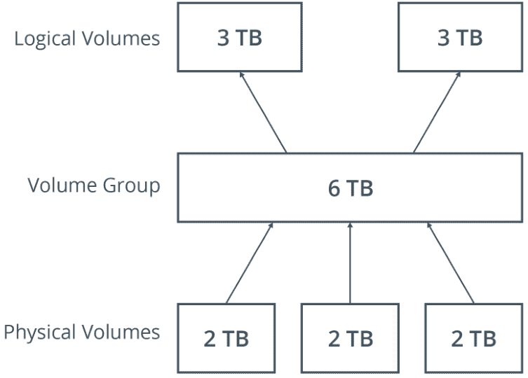

LVM 架构示例。

### LVM 优势

与传统的物理分区管理相比，LVM 提供以下好处：

- 你可以动态创建、删除和调整卷的大小，而无需重新启动系统。
- 一旦设置完成，卷的日常管理更加容易。
- 你可以在多个物理设备上映射多个逻辑卷。
- 逻辑卷可以超过任何一个物理设备的大小，只要它不超过卷组中设备的总大小。
- 你可以创建每个逻辑卷的虚拟快照，以便快速轻松地将卷恢复到特定状态。

LVM 的一个潜在缺点是初始设置可能有些复杂。

### /dev/mapper/ 目录

`/dev/mapper/` 目录包含系统上由 LVM 管理的所有逻辑卷。此目录中的设备通常格式化为：

```
/dev/mapper/<卷组名称>-<逻辑卷名称>
```

在某些情况下，此目录可能只包含指向实际逻辑卷位置的链接。

> **注意：** 逻辑卷可能使用 `/dev/<卷组名称>/<逻辑卷名称>` 结构内的系统内部通信路径。

### LVM 工具

LVM 将其卷管理工具分为三个不同的类别，对应于其架构的核心组件。

- 物理卷（PV）工具
- 卷组（VG）工具
- 逻辑卷（LV）工具

## PV 工具

下表列出了 LVM 的一些物理卷（PV）工具。

| 工具 | 用途 |
|------|------|
| `pvscan` | 扫描所有用作物理卷的物理设备。 |
| `pvcreate` | 初始化驱动器或分区以用作物理卷。 |
| `pvdisplay` | 列出物理卷的属性。 |
| `pvchange` | 更改物理卷的属性。 |
| `pvs` | 显示物理卷的信息。 |
| `pvck` | 检查物理卷的元数据。 |
| `pvremove` | 移除物理卷。 |

## VG 工具

下表列出了 LVM 的一些卷组（VG）工具。

| 工具 | 用途 |
|------|------|
| `vgscan` | 扫描所有物理设备上的卷组。 |
| `vgcreate` | 创建卷组。 |
| `vgdisplay` | 列出卷组的属性。 |
| `vgchange` | 更改卷组的属性。 |
| `vgs` | 显示卷组的信息。 |
| `vgck` | 检查卷组的元数据。 |
| `vgrename` | 重命名卷组。 |
| `vgreduce` | 从卷组中移除物理卷以减小其大小。 |
| `vgextend` | 将物理卷添加到卷组。 |
| `vgmerge` | 合并两个卷组。 |
| `vgsplit` | 将一个卷组拆分为两个。 |
| `vgremove` | 移除卷组。 |

## LV 工具

下表列出了 LVM 的一些逻辑卷（LV）工具。

| 工具 | 用途 |
|------|------|
| `lvscan` | 扫描所有物理设备上的逻辑卷。 |
| `lvcreate` | 在卷组中创建逻辑卷。 |
| `lvdisplay` | 列出逻辑卷的属性。 |
| `lvchange` | 更改逻辑卷的属性。 |
| `lvs` | 显示逻辑卷的信息。 |
| `lvrename` | 重命名逻辑卷。 |
| `lvreduce` | 减小逻辑卷的大小。 |
| `lvextend` | 扩展逻辑卷的大小。 |
| `lvresize` | 调整逻辑卷的大小。 |
| `lvremove` | 移除逻辑卷。 |

> **注意：** 默认情况下，你为任何调整大小命令提供的参数会将逻辑卷的总大小调整为该值。你也可以使用 `+` 和 `-` 来按偏移值进行调整。

> **注意：** 要了解更多信息，请查看课程网站上的**视频**标签，获取补充本课程内容的视频。

## 活动 4-3

讨论逻辑卷

### 场景

回答以下问题以检查你对本主题的理解。

1. 你需要为人力资源部门创建一个新卷。该部门已为其卷购买了一块新的 1 TB 硬盘。创建逻辑卷的过程的第一步是什么？

2. 如何在 `/dev/sdd1` 上创建物理卷？

3. 如何移除物理卷 `/dev/sde1`？

4. 可以使用哪个命令来创建新的卷组 `shared`，包含 `/dev/sdb1` 和 `/dev/sdd1`？然后如何查看你的卷组？

5. 可以使用哪个命令从卷组 `vg_finance` 创建一个新的 400 GB 逻辑卷 `finance`？

## 活动 4-4

管理逻辑卷

### 开始之前

你以 student 账户登录到 CLI。之前，你已经创建了两个备份分区。

### 场景

你创建的这两个备份分区是可以接受的，但你知道有更有效的方法来管理独立的存储设备。因此，你决定将这两个分区的空间整合起来，使用逻辑卷管理器（LVM）创建一个物理卷。你将创建一个跨这些物理卷的备份卷组。然后，为系统文件和业务数据文件创建逻辑卷。

在创建这些卷时，一位同事告诉你备份系统需要保留自己的日志集，团队其他成员可以审计这些日志以确保备份过程按预期运行。他建议为日志文件创建另一个分区，并了解到该分区（以及其他分区）的大小可能随时间变化。你主动提出创建一个逻辑卷来代替，解释说这比物理分区易于管理得多。他表示同意，于是你开始工作。

1. 识别系统上的当前逻辑卷。

   a) 输入 `ls /dev/mapper`

   b) 验证系统上已经存在多个映射的逻辑卷。CentOS 在安装期间创建这些逻辑卷，包括 `centos-home`、`centos-root` 和 `centos-swap`。

   c) 输入 `sudo pvdisplay` 以查看有关物理卷的更多详细信息。物理卷的名称格式为 `/dev/sda#`，以及卷组名称（`centos`）和大小。

   d) 输入 `sudo vgscan` 并验证找到了 `centos` 卷组。

   e) 输入 `sudo vgdisplay centos` 以查看有关此卷组的更多信息。

   f) 输入 `sudo lvscan` 并验证识别到了三个 CentOS 逻辑卷。

   g) 输入 `sudo lvdisplay /dev/centos/home` 以查看有关此特定逻辑卷的更多信息。

2. 从之前创建的备份分区创建物理卷。

   a) 输入 `sudo pvcreate /dev/sda# /dev/sda#`，其中 # 对应于你之前创建的每个新分区。

   例如：`sudo VPN Internetpvcreate /dev/sda4 /dev/sda5`

   这会为每个分区创建一个物理卷。

   b) 输入 `y` 以清除任何文件系统签名。

   c) 输入 `sudo pvdisplay` 并验证你的新物理卷出现。

3. 从这些新物理卷创建卷组。

   a) 输入 `sudo vgcreate backup /dev/sda# /dev/sda#`，其中 # 对应于你之前创建的每个新分区。

   例如：`sudo vgcreate backup /dev/sda4 /dev/sda5`

   这会创建一个名为 `backup` 的新卷组，横跨两个物理卷。

   b) 输入 `sudo vgdisplay backup` 并验证你可以看到新卷组的详细信息。

   该组的总大小应约为 11 GB。

4. 在新卷组中创建三个逻辑卷。

   a) 输入 `sudo lvcreate --name sysbk --size 1GB backup`

   b) 验证逻辑卷已创建。

   这也会将逻辑卷放入你刚刚创建的 `backup` 卷组中。

   c) 输入 `sudo lvcreate --name databk --size 2GB backup`


d) 输入 `sudo lvcreate --name logbk --size 3GB backup`

e) 输入 `sudo lvdisplay backup` 并验证你的新逻辑卷已列出。

5. 扩展数据备份卷并减小日志卷。

a) 输入 `sudo lvextend -L5G /dev/backup/databk`

这会将 `databk` 卷从 2 GB 扩展到 5 GB 大小。

b) 输入 `sudo lvreduce -L1G /dev/backup/logbk`

c) 输入 `y` 以接受警告。

这会将 `logbk` 卷从 3 GB 减小到 1 GB 大小。

d) 输入 `sudo vgdisplay backup` 并验证卷组中剩余大约 4 GB 的可用空间。

> **注意：** 在卷组中保留可用空间是个好主意，以防以后需要扩展某个卷。

6. 在逻辑卷上创建文件系统。

a) 输入 `sudo mkfs.xfs /dev/backup/sysbk`

虽然之前你在分区上创建了文件系统，但你也需要在逻辑卷上创建文件系统。

b) 输入 `sudo mkfs.ext4 /dev/backup/databk`

c) 输入 `sudo mkfs.ext4 /dev/backup/logbk`

## 主题 C

## 挂载文件系统

#### 涵盖的考试目标

1.4 在给定场景下，管理 Linux 环境中的存储。

在用文件系统格式化完分区和逻辑卷之后，你需要让用户和系统能够实际使用这些文件系统。因此，在本主题中，你将通过挂载来使这些文件系统可用。

### 挂载点

**挂载点**是访问本地或远程存储设备上存储信息的入口点。挂载点通常是一个空目录，文件系统被加载或挂载到该目录上，以便让用户可以访问该文件系统。如果该目录已有内容，这些内容将对用户不可见，直到挂载的文件系统被卸载。

> **注意：** 你可以使用 `fstab` 文件来列出在 Linux 系统启动和关闭时要分别挂载和卸载的文件系统。

### mount 命令

`mount` 命令将文件系统加载到指定目录，以便让用户和应用程序可以访问它。你必须指定要挂载的设备以及所需的挂载点。

将存储设备上的分区挂载到特定目录。

# 活动 4-5

## 讨论挂载文件系统

### 场景

回答以下问题，以检验你对该主题的理解。

1. **挂载文件系统的三个要求是什么？**

2. **要让新文件系统在启动时自动挂载，你需要完成什么最终任务？**

3. **`/etc/fstab` 文件的通用格式是什么？**

4. **如何卸载 `/finance` 文件系统？**

5. **如果你执行以下命令：`sudo umount /share1`，并收到资源繁忙的错误，你如何解决问题并卸载该文件系统？**

# 活动 4-6

## 挂载文件系统

## 开始前

你以 `student` 账户身份登录到 CLI。此前，你已在 `backup` 卷组中创建了多个逻辑卷。

### 场景

你的卷已准备就绪，但还无法使用。你需要先挂载它们，以便用户和应用程序可以访问其文件系统。你决定将三个卷都挂载到 `/backup` 目录下，如下：

- `/backup/sys/`

- `/backup/data/`

- `/backup/log/`

此外，这些卷需要在系统重启时自动挂载。

1. 为逻辑卷创建挂载点。

a) 输入 `sudo mkdir -p /backup/sys /backup/data /backup/log`

b) 输入 `ls /backup` 并验证新目录已创建。这些将作为逻辑卷的挂载点。

2. 挂载逻辑卷。

a) 输入 `sudo mount /dev/backup/sysbk /backup/sys`

这将系统备份逻辑卷挂载到你刚刚创建的挂载点上。

b) 输入 `sudo mount /dev/backup/databk /backup/data`

c) 输入 `sudo mount /dev/backup/logbk /backup/log`

d) 输入 `mount` 并验证备份卷已挂载。它们可能会显示在列表底部，格式为 `/dev/mapper/backup-<LV 名称>`。

3. 卸载卷。

a) 输入 `sudo umount /backup/log` 卸载该卷。

b) 输入 `mount` 并验证日志卷已不再挂载。在此状态下，该卷目前无法使用。如果你想移动其挂载点，可能需要卸载卷/分区。此外，某些操作要求文件系统必须先卸载才能处理。

4. 确保逻辑卷在启动时挂载。

a) 输入 `sudo vim /etc/fstab`

b) 按 **i** 切换到插入模式。

c) 使用方向键移动光标到最后一行的末尾。

d) 按 **Enter** 开始新行。

e) 在接下来的三行中，输入以下内容：

```
/dev/backup/sysbk /backup/sys xfs defaults 0 0
/dev/backup/databk /backup/data ext4 defaults 0 0
/dev/backup/logbk /backup/log ext4 defaults 0 0
```

**注意：** 行不必完全对齐。

f) 按 **Esc**，然后输入 `:wq` 保存文件并退出。

g) 输入 `sudo mount -a` 并验证没有错误。

这将测试 `fstab` 文件，确保它能挂载其中列出的所有卷。配置错误的 `fstab` 文件可能会阻止系统启动。

## 语法

`mount` 命令的语法为 `mount [选项] {设备名称} {挂载点}`

## mount 选项

你可以为文件系统指定各种 `mount` 选项。这些选项通常包含在 `fstab` 文件中，而不是作为命令行参数。

| 选项 | 用途 |
|--------|---------|
| auto | 指定设备必须自动挂载。 |
| noauto | 指定设备不应自动挂载。 |
| nouser | 指定只有 root 用户才能挂载设备或文件系统。 |
| user | 指定所有用户都可以挂载设备或文件系统。 |
| exec | 允许执行文件系统中的二进制文件。 |
| noexec | 阻止执行文件系统中的二进制文件。 |
| ro | 以只读方式挂载文件系统。 |
| rw | 以读写权限挂载文件系统。 |
| sync | 指定文件系统中的输入和输出操作应同步进行。 |
| async | 指定文件系统中的输入和输出操作应异步进行。 |

## 二进制文件

二进制文件是编译为可执行程序的源代码，或以其他方式组装成计算机系统可读取的形式。此外，二进制文件可以是图片、文字处理文件或电子表格文件。

## umount 命令

使用挂载的文件系统后，可以使用 `umount` 命令卸载该文件系统，使其与目录解除关联。要卸载文件系统，它必须处于未使用状态——例如，如果该文件系统上的某个文件当前正在某应用程序中打开，则无法卸载。

## 语法

`umount` 命令的语法为 `umount [选项] {挂载点}`

## umount 命令选项

下表描述了一些 `umount` 的常用命令选项。

| 选项 | 用途 |
|--------|---------|
| -f | 强制卸载文件系统，忽略任何检测到的问题。 |
| -l | 执行"延迟"卸载，即文件系统从层级结构中分离，但对该文件系统的引用直到不再使用时才会清理。 |
| -R | 递归卸载指定的目录挂载点。 |
| -t {fs type} | 仅卸载指定的文件系统类型。 |
| -O {mount options} | 仅卸载在 `/etc/fstab` 文件中以指定选项挂载的文件系统。 |
| --fake | 测试卸载过程，而不实际执行。 |

注意：要了解更多信息，请查看课程网站上的**视频**标签，了解补充本课内容的视频。

---

## 主题 D

管理文件系统

#### 涵盖的考试目标

1.4 在给定场景下，管理 Linux 环境中的存储。

2.7 解释 Linux 设备的使用和操作。

4.1 在给定场景下，分析系统属性并进行相应修复。

Linux 提供了许多工具，用于在将文件系统应用于存储设备后对其进行修改。在本主题中，你将执行各种任务，以确保文件系统满足业务需求。

## /proc/mounts 文件

`/proc/mounts` 文件列出所有当前已挂载文件系统的状态，格式类似于 `fstab`：系统名称、挂载点、文件系统类型等。它实际上不是一个真实文件，而是虚拟文件系统的一部分，表示 Linux 内核报告的挂载对象状态。通常，你会使用 `cat` 之类的命令读取此"文件"，以获取所需的详细信息。

请注意，`/proc/mounts` 列出所有文件系统，而不仅仅是存储驱动器和分区上的文件系统。如果你只查找驱动器信息，它可能不是最易读的工具。

## mtab 文件

`/etc/mtab` 文件与 `/proc/mounts` 文件非常相似，它报告当前已挂载文件系统的状态。然而，`/proc/mounts` 通常更准确，并包含有关文件系统的更多最新信息。

## /proc/partitions 文件

`/proc/partitions` 文件包含当前连接到系统的每个分区的信息。与 `/proc/mounts` 一样，它不是一个真实文件，而是虚拟文件系统的一部分。`/proc/partitions` 的格式包含列，每列如下：

- **major** — 表示设备类别，以便映射到适当的驱动程序。

- **minor** — 将分区划分为物理设备。这对应于分区名称末尾的数字。

- **#blocks** — 分区占用的物理块数。

- **name** — 分区的名称。

```
[root@server01 ~]# cat /proc/partitions
major  minor   #blocks   name

   8        0  488386584  sda
   8        1     204800  sda1
   8        2    1048576  sda2
   8        3  112991232  sda3
   8        4    4194304  sda4
   8        5    7536640  sda5
   8        6    2097152  sda6
  11        0    4168560  sr0
 253        0   52428800  dm-0
```

`/proc/partitions` 文件。

## lsblk 命令

`lsblk` 命令显示当前系统上所有可用块存储设备的信息。输出以树状格式显示，每个物理设备位于树的顶部，每个分区或逻辑卷从该设备分支出去。显示的信息包括名称、主号和次号、大小、设备类型和挂载点。

```
[root@server01 ~]# lsblk
NAME            MAJ:MIN RM   SIZE RO TYPE MOUNTPOINT
sda               8:0    0 465.8G  0 disk 
├─sda1            8:1    0   200M  0 part /boot/efi
├─sda2            8:2    0     1G  0 part /boot
├─sda3            8:3    0 107.8G  0 part 
│ ├─centos-root 253:0    0    50G  0 lvm  /
│ ├─centos-swap 253:1    0   7.8G  0 lvm  [SWAP]
│ └─centos-home 253:2    0    50G  0 lvm  /home
├─sda4            8:4    0     4G  0 part 
│ ├─backup-sysbk  253:3    0     2G  0 lvm  /backup/sys
│ └─backup-databk 253:4    0     6G  0 lvm  
└─sda5            8:5    0   7.2G  0 part 
  ├─backup-sysbk  253:3    0     2G  0 lvm  /backup/sys
  └─backup-databk 253:4    0     6G  0 lvm
```

以树状层级列示块存储设备。

## 语法

`lsblk` 命令的语法为 `lsblk [选项] [设备名称]`

## lsblk 命令选项

下表列出了 `lsblk` 命令的一些可用选项。

| 选项 | 用途 |
|--------|---------|
| -a | 同时列出空设备。 |
| -e {设备列表} | 从输出中排除指定的设备，以逗号分隔的主设备号列表形式提供。 |
| -f | 输出额外的文件系统信息。 |
| -l | 以列表格式输出结果。 |
| -m | 输出设备的权限信息。 |

## blkid 命令

`blkid` 命令提供与 `lsblk` 类似的功能，但它以扁平格式打印每个块设备，并包含一些额外信息，如设备/分区 UUID 和文件系统类型。不过，如果需要这些额外信息，建议优先使用 `lsblk -f`。

## 语法

`blkid` 命令的语法为 `blkid [选项] [设备名称]`

## ext 工具

在管理文件系统和分区时，某些工具仅设计用于特定文件系统类型。有些可以适用于多种类型，但更适合一种或少数几种特定类型。对于 ext 文件系统，有几种工具可以在几乎任何一代 ext 类型（即 ext2/3/4）上使用。

管理 ext 文件系统最常见和最有用的工具包括：

- `e2fsck`

- `resize2fs`

- `tune2fs`

- `dumpe2fs`

## fsck 命令

`fsck` 命令用于检查文件系统的完整性。**文件系统完整性**指的是文件系统的正确性和有效性。大多数系统在启动时自动运行 `fsck` 命令，以便在系统使用前检测和纠正错误。文件系统错误通常由电源故障、硬件故障或系统关机不当引起。

在使用 `fsck` 扫描之前，应卸载文件系统以防止文件系统损坏。

> **注意：** `fsck` 命令本质上是一个前端，它会调用适合您正在使用的文件系统类型的相应工具。对于 ext 文件系统，它会调用 `e2fsck` 工具。

检查文件系统的完整性。

## 语法

`fsck` 命令的语法为 `fsck [选项] {设备/文件系统名称}`

## 修复文件系统

您可以使用 `fsck -r {设备/文件系统名称}` 命令来修复文件系统。该命令会提示您确认操作。如果同时检查多个文件系统，不应使用此选项，因为它一次只能修复单个文件系统。

## resize2fs 命令

`resize2fs` 命令用于扩大或缩小设备上的 ext2/3/4 文件系统。您可以扩大已挂载的文件系统，但在缩小之前必须先卸载文件系统。您可以指定文件系统的目标大小以进行扩大或缩小。如果不指定大小，文件系统将调整为与分区相同的大小。

需要注意的是，`resize2fs` *不会*调整分区大小，仅调整文件系统大小。您必须先使用 `fdisk` 等命令或 LVM 工具来扩展分区/卷的大小，然后才能扩大文件系统。

## 语法

`resize2fs` 命令的语法为 `resize2fs [选项] {设备/文件系统名称} [目标大小]`

## tune2fs 命令

`tune2fs` 命令帮助您配置与 ext2/3/4 文件系统相关的各种"可调"参数。可调参数使您能够移除保留块、修改保留块数量、指定检查之间的挂载次数、指定检查之间的时间间隔等。

您还可以使用 `tune2fs` 为现有的 ext2 或 ext3 文件系统添加日志（这两种文件系统默认不包含日志）。如果文件系统已挂载，日志将在文件系统的根目录中可见。如果文件系统未挂载，日志将被隐藏。

## 语法

`tune2fs` 命令的语法为 `tune2fs [选项] {设备/文件系统名称}`

## tune2fs 命令选项

`tune2fs` 命令具有多种选项。

| 选项 | 用途 |
|--------|---------|
| -j | 为现有文件系统添加 ext3 日志。 |
| -i {d\|m\|w} | 指定文件系统检查之间的最大时间间隔，以天、月或周为单位。 |
| -c {最大挂载次数} | 指定文件系统检查之间的最大挂载次数。 |
| -C {挂载次数} | 指定文件系统可以挂载的次数。 |
| -r {保留块数量} | 指定保留的文件系统块数。 |
| -e {continue\|remount-ro\|panic} | 指定内核代码的行为，当检测到错误时，文件系统应继续正常执行、以只读模式重新挂载文件系统，或导致内核崩溃。 |
| -l | 列出文件系统超级块（元数据）中的内容。 |
| -U {UUID} | 为文件系统设置指定的 UUID。 |

## 超级块

文件系统的**超级块**包含有关该文件系统的元数据，包括其大小、类型和状态。超级块对文件系统的功能至关重要，如果它损坏，您可能无法挂载和使用该文件系统。如有必要，您可以使用 `fsck` 等工具来修复超级块。

## dumpe2fs 命令

`dumpe2fs` 命令用于转储 ext2、ext3 和 ext4 文件系统信息。它打印所选设备的超级块和块组信息。这在排查故障文件系统时很有帮助。


```
[root@server01 ~]# dumpe2fs /dev/sda6
dumpe2fs 1.42.9 (28-Dec-2013)
Filesystem volume name:   <none>
Last mounted on:          <not available>
Filesystem UUID:          23f3d1ef-35ad-4db1-a157-79171bbbe9fb
Filesystem magic number:  0xEF53
Filesystem revision #:    1 (dynamic)
Filesystem features:      has_journal ext_attr resize_inode dir_index fil
etype extent 64bit flex_bg sparse_super large_file huge_file uninit_bg di
r_nlink extra_isize
Filesystem flags:         signed_directory_hash
Default mount options:    user_xattr acl
Filesystem state:         clean
Errors behavior:          Continue
Filesystem OS type:       Linux
Inode count:              131072
Block count:              524288
```

转储文件系统信息。

## 语法

`dumpe2fs` 命令的语法为 `dumpe2fs [选项] {设备/文件系统名称}`

## dumpe2fs 命令选项

`dumpe2fs` 命令具有多种选项。

| 选项 | 用途 |
|--------|---------|
| `-x` | 打印文件系统中块号的详细报告。 |
| `-b` | 打印文件系统中的坏块。 |
| `-f` | 强制工具显示文件系统状态，无论文件系统标志如何。 |
| `-i` | 显示使用 `e2image` 命令创建的映像文件中的文件系统数据。 |

## XFS 工具

有许多工具可用于处理 XFS 文件系统。下表列出了其中一些工具。

| 工具 | 用途 |
|------|---------|
| `xfs_info` | 显示 XFS 文件系统的详细信息，包括其块信息。 |
| `xfs_admin` | 更改 XFS 文件系统的参数，包括其标签和 UUID。 |
| `xfs_metadump` | 将 XFS 文件系统的超级块元数据复制到文件。 |
| `xfs_growfs` | 扩展 XFS 文件系统以填满驱动器大小。 |
| `xfs_copy` | 将 XFS 文件系统的内容复制到另一个位置。 |
| `xfs_repair` | 修复和恢复损坏的 XFS 文件系统。 |
| `xfs_db` | 调试 XFS 文件系统。 |

**注意：** 要了解更多信息，请查看课程网站上的**视频**标签，了解补充本课内容的视频。

## 活动 4-7

## 讨论管理文件系统

### 场景

回答以下问题以检查您对该主题的理解。

1. 将文件系统 `/dev/data/datastore1` 从当前的 200 GB 大小扩展到 400 GB 需要哪些步骤？

2. 为什么在 `fsck` 之前必须先卸载文件系统？

3. 您知道对于 ext4 文件系统，可以使用 `resizefs` 工具来扩展文件系统，但对于 XFS 文件系统，可以使用哪个工具执行相同的操作？

4. 另一位系统管理员来到您的工位，要求您在 server05 上显示存储设备及其文件系统。您可以使用哪个命令向他展示所需信息？

5. 您有一位同事尝试在 Linux 服务器上扩展文件系统。他的问题是，尽管输入了以下命令：`sudo lvextend -L150G /dev/shared/graphics`，文件系统却没有扩展。他将文件系统重新挂载到 `/Graphics`，但新空间没有显示出来。问题是什么？

## 活动 4-8

管理文件系统

### 开始之前

你已以学生账户身份登录到 CLI。

### 场景

到目前为止，你的新卷一直运行良好。然而，由于备份对业务至关重要，你希望对每个文件系统执行定期维护，以发现可能导致数据损坏或无法访问的任何错误。

此外，正如预期的那样，你的备份操作范围已经发生了变化，因此有必要扩大数据备份卷和日志备份卷的大小以适应这些变化。你需要确保同时调整其文件系统的大小，否则用户和应用程序将无法使用新增加的空间。

1. 查询系统有关块存储设备的信息。
   - a) 输入 `lsblk -f`
   - b) 验证每个设备、分区和卷是否已列出，并包含文件系统信息。

2. **检查树状结构。你能从存储设备中识别出什么？**

3. 扫描两个逻辑卷中的错误。
   - a) 输入 `sudo umount /dev/backup/databk`
   
     卷必须在卸载后才能检查错误。
   - b) 输入 `sudo fsck /dev/backup/databk`
   - c) 验证工具是否报告该卷为干净状态，表示未检测到错误。如果检测到任何错误，你可以运行 `sudo fsck -r` 来修复它们。
   - d) 输入 `sudo umount /dev/backup/sysbk` 以卸载 XFS 文件系统。
   - e) 输入 `sudo xfs_repair /dev/backup/sysbk`
   - f) 验证工具是否尝试识别和修复任何错误。如果识别到任何错误，它们将被自动修复。

4. 增大卷上 ext4 文件系统的大小。
   - a) 输入 `sudo e2fsck -f /dev/backup/databk` 并记下文件系统的总块数：
   
     ______________
   - b) 输入 `sudo lvextend -L6G /dev/backup/databk`
   
     这将 `databk` 卷的大小从 5 GB 扩展到 6 GB。
   - c) 输入 `sudo e2fsck -f /dev/backup/databk`
   
     尽管增大了卷的大小，但文件系统并未随之增大。
   - d) 输入 `sudo resize2fs /dev/backup/databk`
   - e) 验证文件系统是否已调整大小，且总块数是否比以前更多。
   - f) 输入 `sudo mount /dev/backup/databk /backup/data` 以重新挂载 ext4 文件系统。

5. 增大卷上 XFS 文件系统的大小。
   - a) 输入 `sudo lvextend -L2G /dev/backup/sysbk`
   - b) 输入 `sudo mount /dev/backup/sysbk /backup/sys` 以重新挂载 XFS 文件系统。
   
     以下命令需要文件系统处于挂载状态。
   - c) 输入 `sudo xfs_growfs /dev/backup/sysbk`
   
     验证文件系统上的数据块总数是否增加。

## 主题 E

浏览 Linux 目录结构

### 涵盖的考试目标

1.4 给定一个场景，在 Linux 环境中管理存储。

既然你已经在较低级别管理了存储，现在可以开始探索适用于大多数 Linux 发行版的标准文件系统结构了。在本课程的整个学习过程中，以及在你日常工作中，你都需要浏览这个文件结构。

### 文件类型

Linux 包含普通文件，包括文本文件、可执行文件或程序、程序输入以及程序输出。除此之外，Linux 文件系统还包含其他类型的文件，如下表所述。

| 文件类型 | 说明 |
|---------|------|
| 目录 (d) | 其他文件的容器。 |
| 特殊文件 | 包括系统文件。这些文件存储在 `/dev` 目录中。它们可以是**块特殊文件** (b) 或**字符特殊文件** (c)。块特殊文件是用于数据存储的大文件。字符特殊文件是用于数据流的小文件。 |
| 链接 (l) | 使文件可以在系统文件树的多个部分访问。 |
| 域套接字 (s) | 提供受文件系统访问控制保护的进程间网络通信。 |
| 命名管道 (p) | 使进程能够相互通信，而无需使用网络套接字。 |

> **注意：** 每个字母对应于每种文件类型在 `ls -l` 命令的第一位中的表示方式。

### file 命令

`file` 命令用于确定文件类型。该命令的语法是 `file [选项] {文件名}`

### 文件命名约定

文件名是用于标识文件的一串字符。通过在文件名中使用正确的字符组合，你可以确保文件是唯一的且易于识别。

在 ext4 文件系统上，文件名最长可达 255 个字节，并且可以包含除 NULL (`\0`) 和正斜杠 (`/`) 之外的任何字节。用户文件的文件名不能是 `.` 和 `..`，因为它们是特殊的保留文件名。各种文件系统可能对文件名有不同的要求。

尽管文件名可以包含空格，但 Linux 系统上的惯例规定，文件名中的单词更常用连字符或下划线分隔，因为这些在命令行上更容易管理。例如：`audit-file.txt` 或 `audit_file.txt` 都是可以接受的。

### 文件系统层次结构标准

**文件系统层次结构标准 (FHS)** 是一份协作文档，它指定了 Linux 系统上文件和目录名称及其位置的一组指导原则。大多数 Linux 发行版都是**符合 FHS 的**，因此支持与其他系统的兼容性。FHS 还创建了一种命名约定，帮助管理员、用户和应用程序始终能找到他们需要的文件，并将文件存储在其他实体可以轻松找到的位置。

注意：FHS 的完整文档可在 `www.pathname.com/fhs/` 获取

### 标准目录

根据 FHS 的定义，Linux 文件系统中最顶层的目录是根目录，用单个正斜杠 (`/`) 表示。根目录下方是各种子目录，它们作为 FHS 的一部分被标准化。下表按字母顺序描述了这些目录。

| 目录 | 说明 |
|------|------|
| `/bin` | 存储基本的命令行实用程序和二进制文件。例如，`/bin/ls` 是 `ls` 命令的二进制文件。 |
| `/boot` | 存储启动 Linux 操作系统所需的文件。 |
| `/dev` | 存储硬件和软件设备驱动程序。该目录维护代表连接到系统的设备的文件系统条目。例如，`/dev/sda1` 分区。 |
| `/etc` | 存储基本配置文件。例如，`/etc/samba/smb.conf` 文件存储 Samba 配置数据。 |
| `/home` | 存储用户的主目录，包括个人文件。 |
| `/lib` | 存储内核、命令行实用程序和二进制文件所需的共享程序库。 |
| `/media` | 存储可移动媒体（如 CD-ROM 和软盘）的挂载点。 |
| `/mnt` | 这是临时挂载文件系统的挂载点。 |
| `/opt` | 存储大型软件包的可选文件。这些软件包通常会在 `/opt` 目录下创建一个以其名称命名的子目录，然后将文件放在该子目录中。例如，`/opt/nessus` 子目录包含 Nessus 漏洞扫描程序的文件。 |
| `/proc` | 这是一个虚拟文件系统 (VFS)，以典型的文件格式向用户展示不断更新的内核信息。例如，`/proc/mounts` 文件。 |
| `/root` | root 用户的主目录。 |
| `/sbin` | 存储用于完成启动过程的二进制文件，以及 root 用户使用的二进制文件。例如，`/sbin/ifconfig` 文件是 `ifconfig` 命令的二进制文件，用于管理系统上的网络接口。 |
| `/sys` | 这是另一个 VFS，主要用于存储有关设备的信息。例如，`/sys/block` 包含链接到存储在 `/sys/devices/` 位置下各个子目录中的设备链接，该位置呈现了内核中的设备层次结构。 |
| `/tmp` | 存储可能在系统关机时丢失的临时文件。 |
| `/usr` | 一个只读目录，存储所有用户都可以访问的小程序和文件。 |
| `/var` | 存储可变文件，或预计在系统运行期间不断变化的文件。例如包括日志文件、打印机假脱机程序配置文件，以及某些网络服务的配置文件。 |

### /usr 子目录

`/usr` 目录包含一些重要的子目录。

| 子目录 | 说明 |
|--------|------|
| `/usr/bin` | 包含所有用户都可以执行的可执行程序。 |
| `/usr/local` | 包含默认情况下存储在此处的自定义构建应用程序。 |
| `/usr/lib` | 包含可执行程序所需的对象库和内部二进制文件。 |
| `/usr/lib64` | 用途与 `/usr/lib` 相同，但仅用于 64 位系统。 |
| `/usr/share` | 包含只读架构独立的文件。这些文件可以在操作系统的不同架构之间共享。 |

### 主目录

**主目录** 包含用户的个人文件或特定于该用户的文件。主目录是你登录系统时所处的位置。在 Linux 中，默认情况下，除 root 用户外，每个用户都会在 `/home` 中分配一个与其用户名对应的子目录。用户可以在此目录中创建子目录和文件。

root 用户的主目录是 `/root`。不要将其与根目录 (`/`) 混淆，后者是文件系统层次结构的最顶层。

在许多 shell 中，包括 KornShell、C shell 和 Bash，波浪号字符 (`~`) 代表你的主目录。

```
[root@server01 ~]# ls -al
total 76
dr-xr-x----. 18 root root 4096 Jan  7 15:12 .
dr-xr-xr-x. 21 root root 4096 Jan  2 18:41 ..
-rw-------.  1 root root 1688 Dec 11 18:28 anaconda-ks.cfg
-rw-------.  1 root root 2823 Jan  2 18:08 .bash_history
-rw-r--r--.  1 root root   18 Dec 29  2013 .bash_logout
-rw-r--r--.  1 root root  176 Dec 29  2013 .bash_profile
-rw-r--r--.  1 root root  176 Dec 29  2013 .bashrc
drwx------. 17 root root 4096 Jan  2 14:56 .cache
drwx------. 16 root root 4096 Jan  2 18:04 .config
-rw-r--r--.  1 root root  100 Dec 29  2013 .cshrc
drwx------.  3 root root   25 Dec 11 18:31 .dbus
drwxr-xr-x.  2 root root    6 Dec 11 18:34 Desktop
```

> root 用户主目录的内容。

## 当前工作目录

**当前工作目录（CWD)** 是您在任意时刻访问的系统上的位置。例如，当您登录系统时，会被放置到您的主目录中。因此，您的当前工作目录就是您的主目录。当前工作目录用简写形式表示为单个句点（`.`）。

请记住，您可以输入 `pwd` 来确认您的当前工作目录。

## 父目录

**父目录** 位于当前工作目录的上一级。除根目录外，所有目录都有一个父目录。您可以使用双句点符号（`..`）切换到父目录。

## 路径

**路径** 指定文件系统中的位置。它从根目录（目录树顶部的目录）开始，到您想要访问的目录或文件结束。到目前为止，您已经使用路径来访问各种文件和目录。

您可以通过提供到包含该文件的特定目录的路径来引用特定文件。例如，主目录 `jsmith` 包含一个名为 `cold` 的子目录，其中包含一个名为 `mywork` 的文件。要引用该文件，请使用以下路径名称：`/home/jsmith/work/mywork`。请注意，正斜杠（`/`）字符用于分隔路径中的各项。`home` 前面的斜杠代表根目录，通往文件 `mywork` 的路径从这里开始。

## 绝对路径与相对路径

路径有两种类型——绝对路径和相对路径。**绝对路径** 指的是不考虑当前工作目录或组合路径的特定位置。这些路径通常参照根目录书写，因此以正斜杠开头。不以正斜杠开头的路径称为相对路径。**相对路径** 是相对于当前工作目录的路径；因此，不需要包含完整的绝对路径。这些路径可以包含句点（`.`）和双句点（`..`），它们分别表示当前目录和父目录。

## 示例

以下示例展示了分别使用绝对路径和相对路径访问同一位置。

使用绝对路径：

```
cd /usr/bin
```

当 CWD 为 `/usr/` 时使用相对路径：

```
cd bin
```

## 文件系统导航命令

下表回顾了您目前为止见过的文件导航命令。

| 命令 | 用途 |
|---------|---------|
| `cd` | 使用绝对路径或相对路径遍历目录结构，以更改您的当前工作目录。 |
| `ls` | 列出当前工作目录或您指定的相对/绝对路径中的文件和目录。在长列表格式（`-l`）中，第一位表示文件类型。 |
| `pwd` | 将当前工作目录打印到控制台。 |

注意：要了解更多信息，请查看课程网站上的 **视频** 选项卡，获取补充本课内容的任何视频。

## 活动 4-9

### 讨论 Linux 目录结构

**场景**

回答以下问题，以检查您对该主题的理解。

1. 如果您用 `cd` 进入文件系统的根目录，说出您将在那里看到的三个目录。

2. 哪个标准目录包含系统日志？

3. 如何列出隐藏目录中的文件？

4. 解释 `/root` 和 `/` 之间的区别

5. 如果您先 `cd` 进入 `/opt/log/first/test/test1`，然后输入 `cd ~` 并按回车，现在哪个目录是您的当前工作目录？

## 活动 4-10

浏览 Linux 目录结构

### 开始之前

您已以学生帐户身份登录到 CLI。

### 场景


您需要从用户角度进一步熟悉典型 Linux 文件系统的结构和设计。这样，您就能够轻松地在文件系统中导航，并随时找到您需要的数据和系统文件。您将浏览几个在安装过程中创建的主目录。

1. 导航到几个主目录。

   a) 输入 `cd ~`

      `~` 符号是进入当前用户主目录的快捷方式。

   b) 输入 `pwd` 并确认当前工作目录是 `/home/student`

   c) 输入 `su - root`

   d) 输入密码。

   e) 确认您已以 `root` 帐户登录。

   f) 输入 `pwd` 并确认当前工作目录是 `/root`

      每个用户都在 `/home` 下有自己的主目录，但 `root` 用户除外。

   g) 输入 `exit` 以注销 `root` 帐户并返回您的学生帐户。

2. 使用相对路径浏览 `/etc`。

   a) 输入 `cd /etc` 以更改当前工作目录。

   b) 输入 `ls -l` 并确认此目录中有几个文件和子目录。

      `/etc` 目录包含许多服务和应用程序的配置文件。

   c) 输入 `cd ssh`

   d) 输入 `pwd` 并确认您现在位于 `/etc/ssh`

      您引用了一个相对路径，因为 `ssh` 目录位于 `/etc` 内，而不是在文件系统的根目录下。

   e) 输入 `cd etc` 并确认找不到此类文件或目录。

3. 为什么当您刚才还在含有此名称的目录中时，却找不到文件或目录？

4. 使用相对路径和绝对路径进行一些额外的导航。

   a) 输入 `cd ..`

   b) 输入 `pwd` 并确认您已回到 `/etc`

   c) 输入 `cd /etc/ssh`

      这次，您使用绝对路径返回了 `/etc/ssh` 目录。

5. 获取系统文件结构的概览。

   a) 输入 `cd /` 以返回文件系统的根目录。

   b) 输入 `ls -l` 以获取 Linux 文件结构中所有主目录的概览。

6. `bin` 是什么类型的文件对象？

- [ ] 常规目录
- [ ] 特殊文件
- [ ] 链接
- [ ] 命名管道

7. 根据需要浏览 Linux 文件结构，以帮助您回答以下问题。

`/bin` 目录通常包含以下哪些文件？

- [ ] 标记为删除的文件。
- [ ] 基本命令行工具。
- [ ] 共享程序库。
- [ ] 可选软件包文件。

以下哪个目录是代表内核报告的系统信息的虚拟文件系统（VFS）？

- [ ] `/usr`
- [ ] `/proc`
- [ ] `/lib`
- [ ] `/opt`

您已安装了一个名为 `MyApp` 的第三方软件包。该软件包最可能存储在哪里？

- [ ] `/opt/myapp`
- [ ] `/usr/myapp`
- [ ] `/sys/myapp`
- [ ] `/bin/myapp`

## 主题 F

### 排查存储问题

#### 涵盖的考试目标

- 1.4 给定一个场景，在 Linux 环境中管理存储。
- 2.2 给定一个场景，管理用户和组。
- 4.1 给定一个场景，应用或获取适当的用户和/或组权限和所有权。

在使用任何操作系统（包括 Linux）时，存储问题都相当常见。在本主题中，您将进行一些调查工作，以诊断和建议可能影响存储的各种问题的解决方案。

### 常见存储问题

管理员可能面临各种本地存储设备的问题。服务器管理的一个关键方面包括确保存储设备被系统识别并可供用户使用。

| 症状 | 原因和解决方案 |
|---------|----------------------|
| 缺少设备 | 排查步骤之一是验证设备的物理连接性。对于存储设备，确保数据和电源线已连接。对于外部存储设备，验证 USB、FireWire 或其他数据线已连接，以及电源线已插好。Linux 会检测设备并在 `/dev` 目录中动态创建设备文件。您可以检查 `/dev` 目录以验证 Linux 是否已检测到存储设备。 |
| 缺少卷 | 确认物理设备已连接后，再验证在存储设备上创建的卷是否被识别。`parted` 和 `fdisk` 实用程序都可以用来验证分区的存在。此外，可以检查 `/proc/partitions` 文件以获取有关卷的基本信息。这些工具还可以用来检查卷上是否已安装文件系统。两种常见的文件系统是 `ext4` 或 `XFS`。 |
| 缺少挂载点 | 在 Linux 启动过程中，会检查 `/etc/fstab` 文件以查看应自动挂载哪些分区。`/etc/fstab` 文件中的错误将导致卷无法正确挂载或无法供用户使用。可以使用 `mount` 命令手动挂载文件系统上的存储卷。 |
| 存储降级 | 存储降级是指 RAID 阵列中的某个存储驱动器发生故障的情况。根据所采用的 RAID 类型（为简洁起见省略），即使有一个驱动器发生故障，系统仍然可能能够对阵列进行读写。然而，通常情况下，故障驱动器会降低系统的整体性能。可以使用替换的存储驱动器重建该阵列，以恢复最佳性能。 |
| 性能问题 | 调查存储性能问题首先要考虑系统所使用的技术。在工作站上，SATA 硬盘可能足够使用，但固态硬盘（SSD）也相当常见。服务器通常需要更高效的 I/O 系统和更大的存储容量。SCSI、SAS 和 SSD 由于其高效性，是服务器存储的常见选择。这些驱动器在部署到服务器上时通常是 RAID 阵列的一部分。即使选择了性能足够高的存储技术，出现故障的磁盘、控制器或其他存储设备的硬件组件也可能导致性能问题。 |
| 资源耗尽 | 在 Linux 中，每个打开的文件都会被分配一个文件描述符，用于在文件打开时跟踪该文件。在非常繁忙的服务器上，如果同时打开大量文件，描述符可能会被全部耗尽。这种资源耗尽的一个重要影响是大多数 Linux 命令将无法运行。您可以通过重启服务器来解决此问题。然后可以使用 `ulimit` 命令来调整可用文件描述符的数量。 |
| 存储完整性/坏块 | 传统磁性硬盘驱动器可能会随着时间的推移而老化。这种老化的一个常见症状是坏块，即硬盘驱动器上无法写入或读取的区段。文件系统会自动标记这些块，并避免使用它们来存储数据。如果坏块过多，性能和存储容量可能会下降。过多的坏块也是硬盘驱动器即将失效的征兆。您应立即考虑更换硬盘驱动器。 |

## ulimit 命令

`ulimit` 命令的语法为 `ulimit [选项] [限制]`

例如，要设置最大打开文件描述符数量：

```
ulimit -n 512
```

您可以通过执行 `ulimit -a` 来显示所有当前限制

## 存储空间跟踪

`df` 和 `du` 命令用于存储空间跟踪。`df` 命令（"disk free"，磁盘空闲）使您能够查看设备的可用空间、文件系统、总大小、已用空间、已用空间百分比值以及挂载点。`du` 命令（"disk usage"，磁盘使用）显示设备的使用情况，包括目录树及其内部文件的大小。它还使您能够跟踪空间占用大户，即消耗存储驱动器大量空间的目录和文件。这些是您确认可能导致系统问题的过度存储空间消耗的首选命令。

**注意：** `-h` 选项很有用，因为它使输出更加人性化（即以 GB 等单位而不是字节来显示大小）。

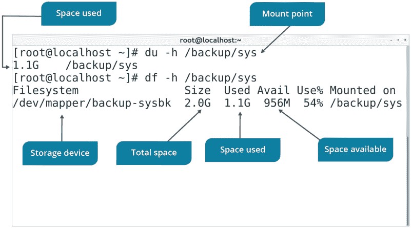

*使用 `du` 和 `df` 命令检查设备上的存储空间。*

## 语法

`du` 和 `df` 命令的语法为 `du/df [选项] [对象名称]`

### I/O 调度

**I/O 调度**是操作系统确定与块存储设备相关的输入和输出操作顺序的过程。调度很重要，因为与 CPU 和内存操作相比，块存储操作相对较慢——尤其是在基于磁盘的技术（如硬盘驱动器）中。因此，Linux 内核不会按照提交的顺序直接开始读取或写入驱动器；相反，它会对某些请求进行优先级排序，以尽量减少 I/O 任务可能带来的性能问题。

虽然内核负责调度，但您实际上可以为调度器配置不同的行为类型。在某些情况下，某些行为比其他行为更合适，您可能会发现设置新类型可以提高读写速度。更改调度器通常是在故障排除过程中进行的，以便在性能至关重要时对存储性能进行精细调整。

### 调度器类型

下表描述了现代 Linux 内核版本可用的一些不同调度器。

| 类型 | 描述 |
|------|-------------|
| deadline | 该调度器使用三个队列对 I/O 操作进行排序：一个标准待处理请求队列、一个先进先出（FIFO）读取队列和一个先进先出（FIFO）写入队列；后两者按提交时间排序，并具有过期值。<br><br>当提交请求时，它会被排序到标准队列中，并放置在其相应的 FIFO 队列末尾。当 FIFO 队列顶部的请求超过该队列的过期时间时，调度器停止处理标准队列，开始从 FIFO 队列顶部处理请求——换句话说，它处理最旧的请求。这确保了调度器不会让某个请求"挨饿"太久。这使其非常适合某些工作负载，如多线程工作负载。 |
| cfq | 这指的是完全公平队列（CFQ）调度器。在此调度器中，每个进程都有自己的队列，每个队列都有其被访问的间隔，即其时间片。调度器使用轮询系统访问每个队列，并处理这些队列中的请求，直到其时间片或请求耗尽为止。<br><br>当这种情况发生时，CFQ 会等待 10 毫秒，看看队列上是否有新请求，如果没有，则转移到另一个队列。与 deadline 调度器一样，这有助于最小化请求饥饿。其优点在于它公平地处理进程，并在大多数工作负载情况下提供良好的性能。它也是现代 Linux 内核版本的默认调度器。 |
| noop | 这是最简单的调度器，不对 I/O 请求进行排序，只是合并它们。这在设备或其存储控制器执行自己的排序操作的情况下可能是理想的选择。它还可以使没有需要寻道时间的机械组件的设备受益，如 SSD 和 USB 闪存驱动器，因为此调度器不会在减少寻道时间方面花费太多精力。然而，在大多数其他情况下，前两种调度器更受青睐。 |

## 设置调度器

您可以通过修改位于 `/sys/block/<设备名称>/queue/scheduler` 的 `scheduler` 文件来设置要在特定设备上使用的调度器。

设置调度器很简单，只需将所需选项 `echo` 到此文件，如：

```
echo noop > /sys/block/sda/queue/scheduler
```

请注意，这仅设置运行时的调度器；重新启动后设置将会恢复。要使更改持久化，必须修改系统的引导加载程序配置。

## iostat 命令

`iostat` 工具生成 CPU 和设备使用情况的报告。对于存储，它提供块设备和分区的输入输出统计信息。使用 `-d` 选项仅指定设备信息时，`iostat` 命令列出以下每个存储设备的统计信息：

- 每秒传输次数（I/O 请求）（`tps`）。
- 每秒读取的块数（`kB_read/s`）。
- 每秒写入的块数（`kB_wrtn/s`）。
- 读取的块总数（`kB_read`）。
- 写入的块总数（`kB_wrtn`）。

您可以使用此报告来监控存储驱动器的使用方式，并识别任何潜在的瓶颈。例如，故障驱动器的每秒读/写次数可能低于预期。您还可以使用此报告来帮助您决定如何在可用设备之间最佳分配 I/O 负载。

```
[root@server01 ~]# iostat -d /dev/sda2

Linux 3.10.0-862.el7.x86_64 (server01)  01/07/2019        _x86_64_        (4 CPU)

Device:            tps    kB_read/s    kB_wrtn/s    kB_read    kB_wrtn

sda2              0.00         0.05         0.01      22952       2156
```


显示存储设备使用统计信息。

## 语法

`iostat` 命令的语法为 `iostat [选项] [设备名称]`

## ioping 命令

`ioping` 命令实时生成设备 I/O 延迟报告。它会持续向指定设备"ping"请求，并在命令行打印每个请求的信息。默认情况下，此信息跟踪 I/O 请求完成所需的时间。除了指定要测试的设备外，您还可以指定路径名来测试与该路径相关联的设备。

考虑使用 `ioping` 来排查存储设备的延迟问题，尤其是当您认为读/写速度比应有的慢时。

> 注意：这类似于标准的 `ping` 命令，后者用于测试网络延迟。

对存储设备执行 ping 操作以测试 I/O 延迟。

## 语法

`ioping` 命令的语法为 `ioping [选项] {文件/目录/设备名称}`

## ioping 命令选项

下表列出了可与 `ioping` 命令一起使用的一些选项。

| 选项 | 用于 |
| --- | --- |
| `-c {次数}` | 指定停止前要执行的 I/O 请求次数。 |
| `-i {时间}` | 设置 I/O 请求之间的时间（间隔）。 |
| `-t {时间}` | 设置最小有效请求时间。快于此时间的请求将被忽略。 |
| `-T {时间}` | 设置最大有效请求时间。慢于此时间的请求将被忽略。 |
| `-s {大小}` | 设置请求的大小。 |

## 存储配额

**存储配额**是分配给用户用于计算机上文件存储的存储空间。存储配额按用户进行配置。实现存储配额的文件系统可以设置软限制、宽限期和硬限制。一旦用户超过软限制，他们将被置于默认七天的宽限期中。允许用户在此宽限期内超出此软限制，但不能超过硬限制上限。如果用户降到软限制以下，计时器将重置。如果计时器到期时用户仍然超出软限制，软限制将自动作为硬限制执行，用户将无法使用任何额外的存储空间。

存储配额是预防或应对因过度使用存储而引发的问题的良好措施。您可以使用这些配额来确保用户不会耗尽驱动器的所有空间，而不给其它用户或系统留下任何空间。

## 配额管理命令

配额管理是对所有用户的配额进行有效分配和监控。Linux 提供了各种命令，帮助系统管理员轻松完成配额管理工作。

> 注意：您应该以这种方式分配配额，使用户能够在数据不溢出的情况下最大限度地利用存储资源。

| 命令 | 用于 |
| --- | --- |
| `quotacheck -cug {挂载点}` | 为文件系统创建配额数据库文件，并检查用户和组配额。 |
| `edquota -u {用户名}` | 编辑特定用户的配额。 |
| `edquota -g {组名}` | 编辑特定组的配额。 |
| `setquota -u {用户名}` | 设置特定用户的配额。 |
| `setquota -g {组名}` | 设置特定组的配额。 |

## 配额激活

在使用这些命令之前，您必须在文件系统上实际激活用户和/或组配额。您可以通过编辑 `fstab` 文件，将 `usrquota` 和 `grpquota` 选项添加到 Libertad 文件系统来实现这一点。

## XFS 配额

您可以使用 `xfs_admin` 工具在 XFS 文件系统上配置配额。该工具可以在交互式和非交互式模式下运行。在非交互式模式下运行时，使用 `-c` 选项指定要运行的命令，使用 `-x` 选项启用专家模式，大多数管理任务都需要专家模式。这些任务包括设置写入块和 inode 的限制、设置警告限制、生成配额报告等。

## 配额报告

配额报告由系统创建，以便您可以查看每个用户的存储空间使用情况。这些报告使您能够检查哪个用户占用了最多的磁盘空间。它们还可以帮助您排查配额本身的问题——例如，配额过于严格或过于宽松的情况。

配额报告包含以下详细信息：

- 用户/组的名称。
- 用户/组在文件系统上使用的总块数（以千字节为单位）。
- 用户/组的存储软限制。
- 用户/组的存储硬限制。
- 宽限期。
- 用户/组在文件系统上已使用的 inode 总数。
- inode 的软限制。
- inode 的硬限制。

存储配额报告。

## 报告生成命令

有多个命令可用于生成有效的配额报告。

| 命令 | 用于 |
|---------|---------|
| `repquota -a` | 显示 `mtab` 文件中标记为读写且有配额的全部文件系统的报告。 |
| `repquota -u {用户名}` | 显示特定用户的配额报告。 |
| `quota -uv {用户名}` | 以详细输出显示特定用户的配额报告。 |
| `warnquota -u` | 检查用户是否未超出分配的配额限制。 |
| `warnquota -g` | 检查组是否未超出分配的配额限制。 |

## 额外的存储故障排除技术

排查存储问题应从简单入手，逐步深入到更复杂的情况。以下是一些示例：

如果用户声称无法创建文件，请验证他们是否对该目录具有适当的权限。在此基础上，您可能需要检查存储区域是否可用（本地和网络的挂载分区），以及目标存储位置是否有可用空间。在完成这些更简单的步骤后，使用 `df -i` 命令验证 inode 池是否已耗尽。如果 inode 池已耗尽，您需要检查受影响的文件系统，查看它是否包含许多不必要的文件（如临时文件），并使用 `rm` 命令删除它们。

如果某个存储位置似乎不可用，请通过验证存储设备的物理连接来开始故障排除。在此基础上，您应验证系统是否识别该存储设备——有关该信息，请查看 `/dev/` 和 `/proc/` 目录。您还应检查配置文件中的错误，包括 `/etc/fstab` 文件。如果您要从网络服务器（如 NFS 或 Samba）挂载驱动器，也是如此。最后，您可以考虑使用 `fsck`、XFS 工具集或 ext4 工具集等工具。

## 存储问题故障排除指南

在排查存储问题时，请遵循以下指南。

### 存储问题故障排除

排查存储问题时：

- 确保设备已物理连接到系统。
- 确保设备已通电。
- 确保设备已开启（如适用）。
- 通过检查 `/proc/` 目录，验证系统是否识别该设备。
- 确认配置文件不包含任何拼写错误。
- 如果您对配置文件进行了更改，确保已重新加载配置文件。
- 确认有足够的存储容量。
- 确认 I/O 工作负载不会使设备不堪重负。
- 使用 `partprobe` 命令使系统扫描新的存储设备和分区。

## 活动 4-11

讨论存储问题

场景

回答以下问题以检查您对该主题的理解。

1. `df -h` 命令中的 `-h` 开关有什么作用？

2. `iostat /dev/sda` 命令有什么作用，它在故障排除中如何发挥作用？

3. 在共享 Linux 系统上，哪个目录或文件系统可能是实施存储配额的合适选择？

4. 作为管理员，您尝试对 `/opt/finance` 为财务组设置配额，但收到错误提示挂载点 `/opt/finance` 未找到或未启用配额。您已确认 `/opt/finance` 存在。您正在尝试启用配额，因此错误提示文件系统未启用配额是没有道理的。问题是什么？

5. 管理员为什么要使用 `ioping` 工具？

## 活动 4-12

跟踪存储空间使用情况

### 准备工作

您以学员帐户身份登录到 CLI。之前，您创建了 `/backup/data` 卷和文件系统。

### 场景

最近，用户在读取文件或向存储设备写入文件时一直抱怨性能不佳和延迟。一些用户在尝试写入存储设备时还遇到了提示存储设备已满的错误。您与其中一些用户交谈以获取更多信息，他们中有人提到在尝试从主目录备份数据时遇到了这些错误。利用这些信息，您将尝试诊断 Linux 系统上的存储问题。

1. 识别存储空间使用情况。
   a) 输入 `df -h`
   b) 验证计算机上的所有文件系统及其使用数据是否都已列出。
   c) 输入 `df -h /backup/data` 以按数据备份卷筛选结果。
   d) 观察卷的总大小、已用字节数以及卷的使用百分比。

2. **您可以发出什么命令来跟踪数据备份卷上文件的存储使用情况？**

3. 跟踪数据备份卷的存储空间。
   a) 输入您用于回答上一个问题的命令。
   b) 记录此目录中每个对象的大小。

4. 识别数据备份卷的读写统计信息。
   a) 输入 `iostat -d /dev/backup/databk`
   b) 观察此驱动器的 I/O 统计信息。

5. **您如何使用这些统计信息来诊断存储驱动器的问题？**

6. 你可能需要执行什么命令来通过向数据备份卷发送100个请求来实时跟踪I/O延迟？

7. 以下哪种Linux I/O调度器在存储设备自行执行I/O排序操作的情况下，或在SSD和U盘等非机械式设备中表现最优？

- cfq
- anticipatory
- deadline
- noop

8. 配置存储设备上的I/O调度器。

a) 输入 `sudo bash -c "echo scheduler > /sys/block/sda/queue/scheduler"`，其中 *scheduler* 是你在上一题中选择的调度器。

> **注意：** `bash -c` 部分告诉Bash在新shell中以 `sudo` 身份运行整个命令。

b) 输入 `cat /sys/block/sda/queue/scheduler` 并验证你的调度器已设置。括号内的调度器为当前活动的调度器。

## 活动 4-13

### 配置存储配额

### 开始之前

你已以学生账户登录到CLI。此前，你创建了 `/backup/data` 卷和文件系统。

### 场景

在发现数据备份卷上存在过度存储消耗后，你意识到这些文件大多是由 `ariley` 用户创建的。你决定根据以下细节限制 `ariley` 在数据备份卷上的存储空间使用：

- 块软限制=10000
- 块硬限制=15000
- Inode软限制=500
- Inode硬限制=700

这些限制将有助于防止用户遇到的性能和空间消耗问题。

1. 为数据备份卷启用配额。

   a) 输入 `sudo vim /etc/fstab`
      你需要编辑 `fstab` 文件来配置适合配额的卷。
   b) 按 `i` 进入插入模式，并滚动到映射 `/dev/backup/databk` 卷的那一行。
   c) 编辑这一行，使其如下所示（更改部分以**粗体**显示）：
      `/dev/backup/databk /backup/data ext4 defaults,usrquota 0 0`
   d) 按 **Esc**，然后输入 `:wq` 保存并退出。
   e) 输入 `sudo mount -o remount /backup/data` 重新挂载文件系统。

2. 配置数据备份文件系统的用户配额。

   a) 输入 `sudo quotacheck -cugm /backup/data`
      这会为文件系统创建必要的配额文件。
   b) 输入 `sudo quotaon -a` 为文件系统启用配额。

3. 限制 `ariley` 在备份文件系统上创建数据的能力。

   a) 输入 `sudo edquota -u ariley`
   b) 编辑配置文件以指定以下限制：
      `/dev/mapper/backup-databk 0 10000 15000 0 500 700`
   c) 保存并退出文件。

4. 以ariley用户身份开始向文件系统写入。

   a) 输入 `sudo chmod 777 /backup/*` 为ariley赋予适当的权限。
   b) 输入 `su - ariley` 切换到该用户。
   c) 输入密码。

   ```
   dd if=/dev/zero of=/backup/data/myfile bs=1M count=5
   ```

   这将一个名为myfile的5 MB虚拟文件写入数据备份目录。

5. 生成配额报告。

   a) 输入 `exit` 返回你的学生账户。

   ```
   sudo repquota /backup/data
   ```

   c) 验证报告显示了ariley正在使用的块数和inode数，以及该用户的硬限制和软限制。

   ```
   *** Report for user quotas on device /dev/mapper/backup-databk

   Block grace time: 7days; Inode grace time: 7days

                   Block limits                File limits

   User        used    soft    hard    grace   used   soft   hard   grace

   root        --      20      0       0       2      0      0

   ariley      --      0       10000   15000   1      500    700
   ```

6. 超过软限制配额。

   a) 切换回ariley账户。

   ```
   dd if=/dev/zero of=/backup/data/myfile2 bs=1M count=7
   ```

   c) 验证结果是否表明用户块配额已超出。

7. 用户已达到存储块的软限制。这对于用户向该文件系统写入数据的能力意味着什么？

8. 超过硬限制配额。

   ```
   dd if=/dev/zero of=/backup/data/myfile3 bs=1M count=10
   ```


b) 验证由于超出硬限制配额，你无法将所有数据写入文件系统。

9. 注销 `ariley` 并返回你的学生账户。

## 总结

在本课程中，你通过创建分区和逻辑卷，以及使用各种工具修改存储设备和浏览 Linux 目录结构来管理系统的存储能力。你还参与了基于存储的问题排查。有了这些技能，你可以确保数据对需要访问的人来说易于访问，同时在出现问题时也易于维护和修复。

**你更愿意使用标准分区还是逻辑卷？为什么？**

**你曾经使用过哪些文件系统类型？每种类型有哪些优缺点？**

*练习题：课程网站上提供了额外的练习题。*

# 第5课

## 管理文件和目录

课程时间：2小时30分钟

## 课程导言

在上一课中，你通过管理系统及其数据的存储方式为 Linux® 系统奠定了基础。现在，你将采用更高级的方法来管理数据本身。通过管理文件和目录，你将能够快速创建、检索和处理数据，使其为你的组织和日常管理任务提供最大价值。

## 课程目标

在本课程中，你将：

- 创建和编辑文本文件。
- 搜索文件。
- 对文件和目录执行各种操作，包括查看、复制和删除。
- 处理文本文件以便更轻松地分析和使用。
- 通过重定向、管道等方式操作文件输出。

## 主题A

### 创建和编辑文本文件

**涵盖的考试目标**

2.3 根据给定场景，创建、修改和重定向文件。

虽然你之前已经完成了一些基本的文件创建和编辑任务，但现在是时候让你更熟悉 `Vim` 和 `GNU nano` 等基于文本的工具了。能够创建和编辑文件是 Linux 中的一项关键技能，因为系统上的大部分配置都是通过文本文件完成的。

### 文本编辑器

**文本编辑器**是一种使你能够查看、创建或修改文本文件内容的应用程序。文本编辑器最初是为编写源代码程序而创建的，但现在已用于编辑各种基于文本的文件。有多种类型的文本编辑器与 Linux 兼容。然而，文本编辑器并不总是支持文字处理器提供的格式选项。文本编辑器可以在 CLI 或 GUI 中工作，并且可能有不同的操作模式。

文本编辑器很重要，因为在 Linux 中，大多数配置组件都是文本文件：系统配置、网络配置、内核配置、shell 环境配置等。在 CLI 中，你将通过在文本编辑器中打开相关文件并调整一些文本行来配置这些组件。因此，熟练使用文本编辑器至关重要。

### 常见编辑器

许多文本编辑器与 Linux 兼容。下表列出了一些最常见的编辑器。

| 文本编辑器 | 说明 |
|-----------|------|
| `vi` | 最初为 Unix® 创建的视觉文本编辑器，后来被克隆为 FOSS 版本。 |
| `Vim` | 大多数 Linux 发行版中的默认文本编辑器。 |
| `Emacs` | 一种灵活、强大且流行的文本编辑器，用于 Linux 和 Unix。 |
| `gVim` | `Vim` 编辑器的图形版本。 |
| `gedit` | GNOME 桌面环境中使用的简单但功能强大的基于 GUI 的文本编辑器。 |
| `GNU nano` | 一个小巧、用户友好的文本编辑器。 |

### Vim

**Vim**，即 Vi IMproved 的缩写，是 `vi` 编辑器的扩展版本。`Vim` 实现了基于文本的用户界面以进行高级文本编辑，并因其高效性和可广泛定制的能力而受到许多系统管理员和软件工程师的青睐。`Vim` 还包括许多有用的功能，如文本补全、语法高亮、拼写检查等。

*Vim 界面。*

## vim 命令

`vim` 命令用于调用 `Vim` 文本编辑器。不过，`vi` 命令也可用于此目的，因为它会自动将用户重定向到 `Vim`。当不带文件名参数输入时，`vim` 命令默认会打开一个欢迎界面。使用 `vim {文件名}` 的语法来打开文件。如果文件不存在，`Vim` 会创建指定名称的文件并打开以供编辑。`Vim` 支持同时打开多个文件。

## 多窗口操作

你可以选择水平或垂直显示多个文件。按 **Ctrl+W+V** 创建垂直分割，或按 **Ctrl+W+S** 水平分割屏幕。

## Vim 模式

`Vim` 是一个模态编辑器，其不同的模式决定了各种按键的功能。

| 模式 | 使用户能够 |
|------|-----------|
| 插入 | 通过打字插入文本。 |
| 执行 | 在编辑器内执行命令。 |
| 命令 | 使用单键执行不同的编辑操作。 |
| 可视 | 高亮或选择文本以进行复制、删除等操作。 |

## 切换模式

命令模式是 `Vim` 的默认模式，但你可以通过单键从命令模式切换到任何其他模式。

以下是一些用于切换模式的按键。

| 按键 | 功能 |
|-----|------|
| `i` | 切换到插入模式，在光标左侧插入文本。 |
| `A` | 切换到插入模式，在行的末尾添加文本。 |
| `I` | 切换到插入模式，在行的开头插入文本。 |
| `o` | 切换到插入模式，在光标下方的新行插入文本。 |
| `O` | 切换到插入模式，在光标上方的新行插入文本。 |
| `v` | 切换到可视模式，逐字符启用选择。 |
| `V` | 切换到可视模式，逐行启用选择。 |
| `:` | 切换到执行模式，使用户能够输入命令。 |
| `Esc` | 返回命令模式。 |

*在 Vim 中切换模式。*

## 执行模式命令

在命令模式下，当你输入冒号（`:`）操作符时，编辑器左下角会出现一个小命令提示区域。这表明你处于执行模式，可以运行 `Vim` 支持的命令。

下表列出了一些 `Vim` 支持的命令。

| 命令 | 功能 |
| --- | --- |
| `:w {文件名}` | 如果是首次保存，则使用文件名保存文件。 |
| `:q` | 自上次保存后未做任何更改时退出。 |
| `:q!` | 退出，忽略所做的更改。 |
| `:qa` | 退出多个文件。 |
| `:wq` | 保存当前文件并退出。 |
| `:e!` | 恢复到最后保存的格式，不关闭文件。 |
| `:!{任意 Linux 命令}` | 执行命令并在 `Vim` 界面中显示结果。 |
| `:help` | 打开 `Vim` 的内置帮助文档。 |

## 移动命令

**移动命令**是用于在命令模式下浏览文件的单键快捷键。这些按键可以将光标定位到文档中的任何位置。它们可用于在字符、单词、行甚至大块文本之间移动光标。

| 导航键 | 用于 |
| --- | --- |
| `h` | 向左移动一个字符。 |
| `j` | 向下移动一行。 |
| `k` | 向上移动一行。 |
| `l` | 向右移动一个字符。 |
| `^` | 移动到当前行的开头。 |
| `$` | 移动到当前行的末尾。 |
| `w` | 移动到下一个单词。 |
| `b` | 移动到上一个单词。 |
| `e` | 移动到当前单词的末尾，或如果你已在单词末尾，则移动到下一个单词的末尾。 |
| `Shift+L` | 将光标移动到屏幕底部。 |
| `Shift+H` | 将光标移动到屏幕的第一行。 |
| `（行号）Shift+G` | 将光标移动到指定的行号。 |
| `gg` | 将光标移动到文件的第一行。 |
| `Shift+G` | 将光标移动到文件的最后一行。 |

## 使用方向键导航

除了使用 `h`、`j`、`k` 和 `l` 键在编辑器中导航外，你还可以使用**上、下、左、右方向键**。传统的导航键如 **Home、End、Page Up** 和 **Page Down** 在 `Vim` 中同样有效。

## 编辑操作符

命令模式下的**编辑操作符**是功能强大的工具，可以使用简单的按键来操作文本。它们还可以与移动命令结合使用，以编辑多个字符。

以下是一些常用的编辑操作符。

| 编辑操作符 | 用于 |
| --- | --- |
| `x` | 删除光标选中的字符。 |
| `d` | 删除文本。 |
| `dd` | 删除当前行。 |
| `p` | 在光标正下方的行粘贴文本。 |
| `P` | 在光标正上方的行粘贴文本。 |
| `/{文本字符串}` | 在文档中搜索特定文本。 |
| `?{文本字符串}` | 向后搜索文档中的特定文本。 |
| `y` | 复制文本。 |
| `yy` | 复制光标正上方的行。 |
| `c{行范围}c` | 在指定范围内开始更改。 |
| `u` | 撤销最近的更改。 |
| `U` | 撤销当前行的所有更改。 |
| `ZZ` | 仅在有更改时写入文件，然后退出 `Vim` 编辑器。 |

## 计数

计数是数字，用于倍增 `Vim` 中按键的效果。它可以与移动命令、操作符或两者结合使用。与移动命令一起使用时，光标移动会根据指定的计数倍增。与编辑操作符一起使用时，操作会重复指定的次数。

将计数与操作符和移动命令一起使用的语法是 `operator [count] {motion}`

## GNU nano

**GNU nano** 是一个小巧、用户友好的文本编辑器，由为类 Unix 系统创建的 `Pico` 文本编辑器演变而来。它在初次发布后不久被添加到 GNU 项目中。虽然 `Vim` 是一个功能强大的文本编辑器，但它并不是最用户友好的，这从其多种模式、极简界面和众多按键命令——其中一些并不直观——可以看出。另一方面，`nano` 编辑器在视觉上更有帮助，因为它在每个打开的文件底部显示其命令快捷键。同样，`nano` 的命令比 `Vim` 少，而且大多数命令按键都以 **Ctrl** 作为共同前缀。它也没有需要在不同模式之间切换的不同模式。

尽管有这些优点，`nano` 缺乏许多使 `Vim` 如此强大的功能，如分屏、文本补全、语法着色等。

GNU nano 界面。

## nano 命令

`nano` 命令用于调用 GNU nano 编辑器。不带任何参数时，该命令会打开一个新文件以供编辑，你可以稍后使用特定名称保存此文件。使用 `nano {文件名}` 的语法来打开现有文件。如果文件不存在，`nano` 会创建指定名称的文件并打开以供编辑。与 `Vim` 一样，`nano` 支持同时打开多个文件。这些文件被打开到不同的"缓冲区"中，你可以在这些缓冲区之间切换。

### nano 快捷键

在 GNU nano 中，你用于处理文本文件和编辑器本身的功能被称为快捷键。你通过按 **Ctrl** 键（在编辑器中表示为 `^`），然后按下对应你要执行功能的键来激活大多数快捷键。

下表列出了一些常用的 `nano` 快捷键。

| 快捷键 | 用于 |
|----------|---------|
| **Ctrl+G** | 打开 `nano` 的帮助界面。 |
| **Ctrl+X** | 退出 `nano` 或关闭当前"缓冲区"（例如，帮助界面本身）。 |
| **Ctrl+O** | 保存当前打开的文件。 |
| **Ctrl+J** | 调整当前段落。 |
| **Ctrl+R** | 将另一个文件插入到当前文件中。 |
| **Ctrl+W** | 搜索文件。 |
| **Ctrl+K** | 剪切当前选中的行。 |
| **Ctrl+U** | 粘贴被剪切的行。 |
| **Ctrl+C** | 显示光标的位置。 |

> **注意：** 尽管快捷键以大写形式显示，但你不应使用 *Shift* 键，只需按 **Ctrl** 键。

## 导航

与其他文本编辑器一样，你可以在 `nano` 中使用方向键、**Page Up**、**Page Down**、**Home** 等进行导航。如果你缺少这些按键，`nano` 还提供了相应的快捷键，例如，**Ctrl+V** 导航到下一页，**Ctrl+Y** 导航到上一页。

### 复制文本

复制一行中的部分文本需要先使用 **Ctrl+^^** 快捷键"标记"你要复制的文本。然后移动光标以高亮你要复制的文本。按 **Alt+^^** 复制标记/高亮的文本，**Ctrl+U** 粘贴它。

### gedit 文本编辑器

**gedit** 文本编辑器是 GNOME 桌面环境中使用的默认文本编辑器，也是 GNU 项目的一员。与 `Vim` 和 `nano` 不同，`gedit` 具有图形用户界面，采用典型的菜单式设计，易于使用。它还具有语法高亮和拼写检查等功能，并可通过插件进行自定义。虽然不如 `Vim` 强大，但在安装了桌面环境的系统中，`gedit` 仍然很有用。

虽然你可以从桌面启动 `gedit`，但也可以使用 CLI 通过 `gedit` 命令启动。其语法与 `vim` 和 `nano` 类似——不带参数会打开一个新文件，而提供文件名作为参数则会打开现有文件或创建具有该名称的新文件。

## 活动 5-1

### 讨论创建和编辑文本文件

### 场景

回答以下问题以检查你对该主题的理解。

1. 你正在 `Vim` 中编辑文件，意识到犯了一些错误，决定重新开始编辑。如何在不保存所做更改的情况下离开文件？

2. 你想使用 `Vim` 创建一个 shell 脚本。你进入 `Vim` 后无法输入任何字母。在可以开始输入之前，你需要做什么？

3. 你已经在 `Vim` 中创建了一个脚本，发现还没有在文件中输入任何指令或文档。标准做法是将注释添加在所描述代码行的上方。如何在当前正在输入的行上方打开一个新行？

4. 如何在 `Vim` 编辑器中复制和粘贴文本？

5. 在 Linux 中编辑文本文件时，除了 `Vim` 之外还有其他选择。请说出一个图形编辑器和一个其他命令行界面（CLI）编辑器，你可以用它们代替 `Vim`。

## 活动 5-2

创建文本文件

### 开始之前

你已以学生账户身份登录到 CLI。

### 场景

作为 Linux 服务器管理员之一，你被要求开始列出一个已安装或应安装在系统上的软件清单。因此，你将创建一个文本文件，并开始在其中输入软件包的名称。然后保存工作，稍后再继续处理该文件。

空白以原样保留。

1. 创建软件清单文件。
   a) 输入 `cd ~` 返回主目录。
   b) 输入 `vim software_list.txt` 在 `Vim` 中开始编辑一个新文件。

2. 在文件中输入文本。
   a) 按 **i** 切换到插入模式。
   b) 确认屏幕左下角显示文本 "INSERT"。
   c) 在第一行输入 `Apache HTTP Server`。
   d) 在第二行输入 `MySQL`。
   e) 在第三行输入 `Eclipse`。
   f) 将 `OpenVAS` 作为第四项也是最后一项输入。

```
Apache HTTP Server
MySQL
Eclipse
OpenVAS
-- INSERT --                                          4,8
```

3. 保存并查看文本文件。
   a) 按 **Esc** 返回命令模式。
   b) 输入 `:wq` 保存文件并退出 `Vim`。
   c) 输入 `cat software_list.txt` 查看文件。

## 活动 5-3

编辑文本文件

数据文件

```
/opt/linuxplus/managing_files_and_directories/software_list.txt
```

开始之前

你已以学生账户身份登录到 CLI。

场景

一位同事已经获取了你最初的软件清单文件并开始填写。他完成后，你检查了一下，看看是否有需要纠正的错误。你将在 `Vim` 和 GNU nano 中编辑此文件，以便更熟悉这两种文本编辑器。

1. 复制最新版本的软件清单。
   a) 输入以下内容：

```
cp -a /opt/linuxplus/managing_files_and_directories/software_list.txt ~/
```


注意：记住，你可以使用制表符补全来加快操作速度。

b) 输入`ls`并确认列出了`software_list.txt`。

2. 在 Vim 中打开文件并修复拼写错误。
   a) 输入`vim software_list.txt`
   b) 使用方向键将光标向下移动到文本 "Friefox" 的第一次出现处。
   c) 将光标定位在 "Friefox" 中 "i" 的下方。
   d) 按`x`剪切字母 "i"。
   e) 将光标移动到字母 "F" 下方并按`p`粘贴剪切的字母。
   f) 确认该行现在正确显示为 "Firefox"。

3. 使用搜索功能查找并修复拼写错误的另一个实例。
   a) 输入`/Frie`搜索拼写错误的下一个出现位置。
   b) 将该名称更正为 "Firefox"。

4. 修复某个软件名称的大小写。
   a) 按`k`逐行向上移动，直到到达显示 "openVAS" 的行（注意小写的 "o"）。
   b) 按`^`（`Shift+6`）移动到行首。
   c) 按`x`删除第一个字母。
   d) 按`i`进入插入模式，然后输入大写的 O。
   e) 按`Esc`退出插入模式。

5. 删除重复行并保存文件。
   a) 按`j`逐行向下移动，直到到达提及 "Apache" 的第二行。
   b) 按两次`d`删除整行。
   c) 输入`:wq`保存并关闭文件。

6. 在 GNU nano 中打开文件并进行更正。
   a) 输入`nano software_list.txt`
   b) 使用方向键移动到 "Eclipse" 对应 "Configured?" 列下的 "Y"。
   c) 按`Delete`。
   d) 输入 N。

7. 删除重复行。
   a) 向下导航到 "LibreOffice" 的第二次出现处。
   b) 按`Ctrl+K`剪切重复行。

8. 在文件中添加另一条记录。
   a) 导航到文件底部新行的开头。
   b) 输入`Apache-Tomcat`
   c) 按`Tab`直到光标位于 "Version" 列下方。
   d) 输入`9.0.12`
   e) 将光标置于 "Installed?" 列下方并输入 N。
   f) 在 "Configured?" 列下方输入 N。

> **注意：** 你也可以使用空格键进行更精确的对齐。

9. 保存文件并关闭 GNU nano。
   a) 按`Ctrl+O`。
   b) 按`Enter`保存文件。
   c) 按`Ctrl+X`退出 GNU nano。
   d) 输入`cat software_list.txt`查看文件。

## 主题 B

## 搜索文件

**涵盖的考试目标**

2.3 根据场景，创建、修改和重定向文件。

有时你创建了一个文件却忘记把它放在目录结构的哪个位置。也有时你不知道系统、应用程序或其他用户创建的文件的准确位置。在 Linux 中，你有几个强大的工具来查找所需的文件。

### locate 命令

`locate`命令对在`mlocate`数据库中存储的文件名和路径执行快速搜索，查找任何指定的字符串。为了使搜索有效，必须定期更新此数据库。显示的结果可能仅限于用户有权访问或执行的文件。

```
[student01@server01 ~]$ locate backup
/backup
/backup/data
/backup/log
/backup/sys
/backup/log/2019
/backup/log/auth
/backup/log/lost+found
/backup/sys/etc
/backup/sys/test
/backup/sys/test2
/backup/sys/etc/.pwd.lock
```

*使用 locate 命令搜索文件和目录。*

## 语法

`locate`命令的语法是`locate [options] {string}`

#### locate 命令选项

`locate`命令支持不同的选项，使你能够提高搜索效率。一些选项在表中描述。

| 选项 | 用于 |
|------|------|
| `-r` | 使用正则表达式搜索文件名。 |
| `-c` | 仅显示找到的匹配条目数量，而不是文件名。 |
| `-e` | 仅返回搜索时存在的文件。 |
| `-i` | 忽略文件名或路径中的大小写。 |
| `-n {条目数}` | 仅返回指定数量的前几个匹配项。 |

### updatedb 命令

`updatedb`命令用于基于`/etc/updatedb.conf`文件构建文件数据库。此命令用于更新`/var/lib/mlocate/mlocate.db`数据库。`/etc/updatedb.conf`文件包含构建数据库时应排除的路径。若要添加构建数据库时需要排除的路径，请打开`/etc/updatedb.conf`文件，并在`PRUNEPATH`变量中指定构建数据库时不需要包含的路径。例如，`PRUNEPATH="/etc"`将在构建数据库时排除`/etc`目录。

虽然这是`locate`命令默认搜索的数据库，但可能还有其他包含文件路径的数据库。如果在执行搜索之前未更新数据库，则上次更新后创建的所有文件都将被排除在搜索之外。

### find 命令

`find`命令使你能够在特定位置搜索符合某些搜索条件的文件和目录。它会递归搜索目录结构，包括你输入的搜索位置开始的任何子目录及其内容。你可以对找到的文件执行一个或多个操作。

`-type`选项使你能够指定要查找的对象类型，例如`d`表示目录或`f`表示文件。`-name`选项是你指定要查找的对象名称的地方。以下示例搜索用户的主目录（及所有子目录）中所有名为`2019_report`的文件：

```
find /home/user -type f -name 2019_report
```

## 语法

`find`命令的语法是`find [options] {search locations} {search criteria} [actions]`

#### find 与 locate 命令对比

`locate`命令搜索数据库并检索系统上存在的文件信息。但是，如果未能保持此数据库更新，可能会产生过时的结果。另一方面，`find`命令执行文件系统的实时搜索，并可以专注于特定位置。`find`命令完成搜索可能需要比`locate`命令更长的时间。

find 与 locate 命令的比较。

## 文件查找选项

当系统找到符合你条件的文件列表时，你可以对结果执行多种操作。下表概述了其中一些选项。

| 选项 | 执行的操作 |
| --- | --- |
| `-print` | 显示找到的文件的位置。 |
| `-exec` | 执行随后的命令。 |
| `-ok` | 以交互方式执行随后的命令。 |
| `-delete` | 删除找到的文件。 |
| `-fprint` | 将结果存储到目标文件中。 |

## which 命令

`which`命令通过搜索分配给 **PATH 变量** 的目录来显示指定命令的完整路径。例如，输入`which cat`后，将显示以下输出：`/bin/cat`

显示命令的完整路径。

因此，`which`命令可以帮助你定位程序的安装位置，以便在需要修改时使用。如果一个命令存在多个存储在不同位置的二进制文件，其中某个可能更为理想，它还可以帮助你识别当前使用的是哪个版本的命令。通过确定命令的运行来源，你可以排查该命令的异常行为。

## 语法

`which`命令的语法为`which [options] {program names}`

## whereis 命令

`whereis`命令用于显示与命令相关的各种详细信息。例如，输入`whereis ls`后，将显示以下输出：`ls: /bin/ls /usr/share/man/man1/ls.1.gz /usr/share/man/man1p/ls.1p.gz`

其中`/bin/ls`表示`ls`命令的位置，`/usr/share/man/man1/ls.1.gz /usr/share/man/man1p/ls.1p.gz`表示`ls`命令的 man 手册页的位置。

*显示命令的位置信息。*

## 语法

`whereis`命令的语法为`whereis [options] [directory name] {file name}`

## whereis 命令选项

`whereis`命令有多个选项，如下表所述。

| 选项 | 用途 |
|--------|----------|
| `-b` | 仅搜索二进制文件。 |
| `-m` | 仅搜索手册页。 |
| `-s` | 仅搜索源文件。 |
| `-u` | 搜索不寻常的条目。 |

**注意：** 要了解更多信息，请查看课程网站上的**视频**标签页或任何补充本课内容的视频。

## 活动 5-4

## 讨论文件搜索

### 场景

回答以下问题以检验你对本主题的理解。

1. 你尝试使用`locate`在新的 Linux 系统上查找 README 文件，但很快发现它在构建时未被安装。安装后，你再次尝试使用`locate`查找 README 文件，但该命令仍然未能找到任何结果。你发现要使`locate`正常工作，必须构建`mlocate`数据库。你可以运行哪个命令来构建`mlocate`数据库？

2. 你尝试使用`locate`查找`cat`命令，但`locate`搜索的是字符串，返回了超过 2,000 条结果。你需要一种更高效的方式来搜索特定文件，特别是命令。你可以运行哪个命令来有选择地查找`cat`命令？

3. 你和其他初级 Linux 管理员注意到，某些基本命令没有与之关联的手册页。你想知道哪些命令有。另一位管理员告诉你一个命令，它还可以列出命令搜索的手册页。他指的是哪个命令？

4. `find`命令是系统管理员工具箱中最强大的命令之一。以下特定的 find 命令执行什么操作？`find / -name "carbon*" -print`

5. 在你知道该用户作为多个组织组的成员有权访问数十个目录和子目录的情况下，你会使用哪些可用的搜索命令来定位用户丢失的文件？

## 活动 5-5

## 搜索文件

### 开始之前

你已使用学生账户登录到 CLI。

### 场景

作为 Linux 管理员，你的职责之一是确保系统日志按预期运行。这些日志对于诊断问题和识别其他不良行为至关重要。因此，首先你将搜索系统中日志文件的存储位置。然后，你将开始搜索满足特定大小要求且最近更新过的日志。这样你就能确认哪些日志按照预期持续记录着大量信息。

1. 搜索系统日志文件的位置。
   a) 输入`sudo find / -type d -name 'log'`
   b) 验证根卷上有多个位置包含 "log" 这个词。
   c) 输入`sudo find / -type f -name 'messages'`
   d) 验证 messages 日志的位置为`/var/log/messages`

2. 搜索大于 100 KB 的日志文件。
   a) 输入`sudo find /var/log -type f -size +100k`
   b) 记下结果中的一个文件，输入`ls -lh /var/log/<file name>`验证它确实大于 100 KB。

3. 搜索最近 30 分钟内更新过的日志文件。
   a) 输入`sudo find /var/log -type f -mmin -30`
   b) 验证结果中有一个文件的时间戳在最近 30 分钟内。

> 注意：你可以使用`ls -l`查看该文件来完成此操作。

4. 搜索为空或大于 100 KB *且* 在最近 30 分钟内更新过的日志文件。
   a) 输入`sudo find /var/log -type f -size 0 -or -size +100k -mmin -30`
   b) 验证这些条件对至少一个文件是准确的。

5. 使用`find`命令相比使用`locate`命令有哪些优势？

## 主题 C

## 对文件和目录执行操作

**涵盖的考试目标**

2.3 在给定场景下，创建、修改和重定向文件。

3.1 在给定场景下，应用或获取适当的用户和/或组权限及所有权。

创建并编辑文件后，你有多种方式来管理它。通过使用各种工具，你可以确保文件处于你期望的状态。

## cat 命令

`cat`命令是 concatenate（拼接）的缩写，可以显示、合并和创建文本文件。它最常用于显示小型文本文件的内容，因为它没有屏幕滚动功能。

`cat`命令的一些选项如下表所述。

| 选项 | 用途 |
|--------|---------|
| `-n` | 在输出前添加相应的行号。 |
| `-b` | 对行进行编号，不包括空行。 |
| `-s` | 抑制重复空行的输出。 |
| `-v` | 将非打印字符显示为可见字符，制表符、换行符和换页符除外。 |
| `-e` | 在每行末尾、换行符之前打印`$`字符。 |
| `-t` | 将制表符打印为`^I`，换页符打印为`^L` |

## 语法

`cat`命令的语法为`cat [options] {file names}`

## head 和 tail 命令

`head`命令显示每个文件的前 10 行。`tail`命令显示每个文件的后 10 行。当你只需要查看文件的开头或结尾时，这些命令非常有用。例如，你可以通过查看日志文件的最后 10 行来检查最近的日志条目。

显示文件的最后 10 行。

## 语法

`head`和`tail`命令的语法为`head/tail [options] {file names}`

## tail 命令选项

以下是`tail`命令的一些常用选项：

- `-f` — 动态监视文件（文件更改时输出将自动更新）。
- `-n {number}` — 显示指定行数，而非默认的 10 行。也可与`head`命令配合使用。

## less 和 more 命令

`less`和`more`命令类似，都可以让你显示文件内容，并在内容超出屏幕时逐页浏览。`less`命令通常具有`more`没有的额外功能，但较新版本的`more`已添加了其中一些功能。虽然你可以自由使用任一命令，但通常更推荐使用`less`命令。

翻阅长文件。

## 语法

`less`和`more`命令的语法为`less/more [options] {file names}`

## less 命令选项

下表列出了`less`命令的部分选项。

| 选项 | 用途 |
|--------|---------|
| `-e` | 第二次到达文件末尾时退出程序。 |
| `-E` | 第一次到达文件末尾时退出程序。 |
| `-i` | 搜索时忽略大小写。 |
| `-n` | 不显示行号。 |

## 导航

`less`中的导航使用许多你已见过的命令，如使用方向键逐行滚动，以及使用 **Page Up** 和 **Page Down** 逐页滚动。你还可以使用`/`在文件中搜索特定的文本字符串，按`n`和`N`分别移动到所搜索字符串的下一个或上一个实例。按`q`退出程序。

## cp 命令

`cp`命令使你能够复制文件或目录，然后将其粘贴到目标位置。原始对象保留在原处，但在你指定的目标位置创建该对象的精确副本。复制目录时，必须指定`-R`选项以递归复制指定目录。

## 语法

`cp`命令的语法为`cp [options] {要复制的文件/目录名} {目标文件/目录名}`

例如，将`~/myfiles`目录及其内容复制到`/opt/myfiles`：

```
cp -R ~/myfiles /opt/myfiles
```

## mv 命令

`mv`命令将文件和目录移动到其他位置。它类似于`cp`命令，但不会保留原始对象。因此，`mv`更像是剪切和粘贴操作。

Bash shell 没有专门的重命名命令，而是使用`mv`来完成该功能。将文件或目录 "移动" 到目标位置并提供新名称，本质上就是对对象进行重命名。

## 语法

`mv`命令的语法为`mv [options] {要移动的文件/目录名} {目标文件/目录名}`

例如，将`~/file1`移动到`/opt/file1`：

```
mv ~/file1 /opt/mylist
```

用于重命名时，语法为`mv [options] {旧文件/目录名} {新文件/目录名}`

## touch 命令

`touch`命令将文件的访问时间或修改时间更改为当前时间，或更改为参数中指定的时间。它还用于创建指定文件名的空文件，前提是该文件不存在。这通常对测试权限或创建稍后将被某些应用程序处理的文件很有用。

## 语法

`touch`命令的语法为`{file names}`

## rm 命令

`rm`命令删除文件和目录。你必须使用`-R`选项以递归删除文件、子目录以及父目录本身。

## 语法

`rm`命令的语法为`rm [options] {文件/目录名}`

```
rm -R ~/myfiles
```


## `unlink` 命令

`unlink` 命令类似于`rm`命令，但一次只能删除一个文件，且无法删除目录。

## `ls` 命令

至此，你已见识了`ls`命令列出目录内容以及目录和文件权限信息的强大功能。下表总结了`ls`命令的一些最有用选项。

| 选项 | 用途 |
|--------|---------|
| `-l` | 显示详细列表，包括权限、硬链接数、所有者、组、大小、日期和文件名。 |
| `-F` | 显示文件类型，例如`*`表示可执行文件，`/`表示目录。 |
| `-a` | 显示目录中的所有文件，包括名称以句点（`.`）开头的文件。 |
| `-R` | 递归显示所有子目录。 |
| `-d` | 显示有关符号链接或目录的信息，而不是链接的目标或目录的内容。 |
| `-L` | 显示目录中的所有文件，包括符号链接。 |

## 语法

`ls`命令的语法为`ls [options] [文件/目录名]`。

## `ls` 颜色

在 Bash shell 中，当你执行`ls`命令时，可能会注意到结果有时以不同颜色显示。这些颜色区分不同类型的文件。默认情况下，部分颜色如下：

- 默认颜色：普通/文本文件
- 蓝色：目录
- 天蓝色：符号链接或音频文件
- 绿色：可执行文件
- 黄色黑底：设备
- 粉色：图像文件
- 红色：归档文件
- 红色黑底：损坏的链接

## `mkdir` 和 `rmdir` 命令

`mkdir`命令用于创建目录。你将目录名称作为参数提供。`rmdir`命令用于删除目录，但仅限于空目录（即不包含任何文件或子目录的目录）。要删除有实际内容的目录，必须使用`rm -R`命令。

## 语法

`mkdir`和`rmdir`命令的语法为`mkdir/rmdir {directory names}`。

**注意：** 要了解更多信息，请查看课程网站上的**视频**标签，了解补充本课内容的视频。

# 活动 5-6

## 讨论对文件和目录执行操作

### 场景

回答以下问题以检查你对该主题的理解。

1. Linux 用户使用`cat`命令将文件内容打印到屏幕上，但`cat`的最初目的是将两个或多个文件的内容连接或合并到单个文件中。你有文件`test.1`和`test.2`，想要将它们合并到单个文件`test.3`中。如何使用`cat`完成此操作？

2. 作为系统管理员，首先想到使用`tail`命令来检查系统状态或应用程序状态的场景是什么？

3. 有两个工具适合浏览非常长的文件并具备搜索功能。两者都使你能够停止、逐行前进、逐页前进以及向上翻页。一些管理员更喜欢其中一个工具，因为它有更多选项。这两个工具是什么？

4. 你的经理要求你将`/opt`目录中的所有文件复制到`/backup`以进行进一步检查和分析。与其手动复制每个文件和子目录，如何用一条命令将`/opt`及其所有内容复制到`/backup`？

5. Diane Smith 已离开公司，你想保留她的主目录，因此决定重命名它。如何将`/home/dsmith`重命名为`/home/dsmith.keep`？

# 活动 5-7

## 读取文件

### 准备工作

你已以学生帐户身份登录到 CLI。

### 场景

你的另一项职责自然是查看系统日志文件。但在开始日志分析之前，你需要确定显示文本文件以便阅读的最佳方式。因此，你将使用`cat`和`less`等命令来了解每个命令在何处能派上用场。

1. 打开消息日志进行阅读。
   a) 输入`sudo cat /var/log/messages`。
   b) 注意文件内容多次滚过屏幕，表明文件太大，无法从单个屏幕阅读。
   c) 输入`sudo less /var/log/messages`。
   d) 验证只有文件的第一页打印到屏幕上，并且在屏幕底部，文件名被高亮显示。
   e) 按 **Down Arrow** 向下滚动一行。
   f) 按 **Up Arrow** 向上回滚一行。
   g) 按 **Spacebar** 向下滚动整页。
   h) 按 **Page Up** 向上滚动整页。

2. 在日志中搜索特定字符串。
   a) 输入`/SELinux`。
   b) 验证文件跳转到该文本字符串的第一个实例，并且该字符串在顶部行被高亮显示。

```
Dec 11 13:30:39 localhost kernel: SELinux: Initializing.
Dec 11 13:30:39 localhost kernel: Yama: becoming mindful.
Dec 11 13:30:39 localhost kernel: Dentry cache hash table
6 (order: 11, 8388608 bytes)
Dec 11 13:30:39 localhost kernel: Inode-cache hash table (
(order: 10, 4194304 bytes)
Dec 11 13:30:39 localhost kernel: Mount-cache hash table (
order: 5, 131072 bytes)
Dec 11 13:30:39 localhost kernel: Mountpoint-cache hash t-
```

   c) 按`n`查看该文本字符串在文件中的下一个实例。
   d) 按`N`（注意大写）导航到文件中搜索词的上一个实例。
   e) 按`q`退出文件阅读。

> 注意：记住，你可以按需要输入`clear`来清屏。

3. 仅打印日志的首行和末行。
   a) 输入`sudo head /var/log/messages`。
   b) 确认日志的前 10 行已打印到屏幕上。
   c) 输入`sudo tail /var/log/messages`。
   d) 确认日志的最后 10 行已打印到屏幕上。

4. **为什么只打印开头或最后几行可能比读取整个文件更可取？**

## 活动 5-8

操作文件和目录

### 数据文件

以下目录中的所有文件：`/opt/linuxplus/managing_files_and_directories/aups`

### 开始之前

你以你的学生账户身份登录到了 CLI。

### 场景

你被要求将一些公司政策文档从 HR 负责人的工作站移动到 Linux 服务器上。这些政策应该更集中地提供，而不依赖于某个特定人员的系统。HR 负责人承认她没有很好地组织这些政策文档，因为几个旧版本的可接受使用政策（AUPs）与较新的、有效的版本混在一起，而且旧政策是在她实施一致的命名约定之前编写的。所有文档都在一个名为`aups`的单一目录中。

首先，你需要将这些文档复制到你的主目录作为临时中转区域。然后你需要通过只保留最新的文档并删除不再适用的旧文档来整理这些政策文档。你还被告知服务器上需要存放更多类型的政策，而不仅仅是 AUPs。因此，你需要将`aups`文件夹重命名为更通用的`policies`，并创建一些占位文件。稍后，当你收到更多要添加的政策时，你将能够部署该目录，以便其他授权用户可以访问。

1. 复制政策文件。
   a) 输入以下内容：`cp -r /opt/linuxplus/managing_files_and_directories/aups ~/`。这将`aups`目录复制到你的主目录，保留其原始位置不变。
   b) 输入`cd aups`。
   c) 输入`ls -l`并确认有五个文件，其中三个标记为 "OLD" 且文件名不一致。

```
[student01@localhost aups]$ ls -l
total 20
-rwxr-xr-x. 1 student01 student01 1472 Dec 14 14:15 aup_v1.txt
-rwxr-xr-x. 1 student01 student01 1878 Dec 14 14:15 aup_v2.txt
-rwxr-xr-x. 1 student01 student01  794 Dec 14 14:15 OLD acceptable_use2.txt
-rwxr-xr-x. 1 student01 student01  353 Dec 14 14:15 OLD acceptableuse.txt
-rwxr-xr-x. 1 student01 student01 1015 Dec 14 14:15 OLD acct_use3.txt
```

2. 创建一个新目录并将最新的政策文件移入其中。
   a) 输入`mkdir ../policies`创建新目录。
   b) 输入`mv aup_v1.txt ../policies`。
   c) 输入`mv aup_v2.txt ../policies`。
   d) 输入`ls -l`并确认这两个文件已不在此目录中。

3. 确认最新的政策文件已移动到新的文件夹。
   a) 输入`cd ../policies`。
   b) 输入`ls -l`并确认这两个最新的文件在此目录中。

4. 为未来政策创建占位文件。
   a) 输入`touch user_sec_policy.txt`。
   b) 输入`ls -l`并确认已创建此名称的空白文件。
   c) 使用`touch`在`~/policies`中再创建三个空白文件，名称如下：`server_sec_policy.txt`、`email_policy.txt`、`clean_desk_policy.txt`。
   d) 输入`ls -l`并确认这些文件存在。

5. 删除`aups`文件夹及其内容，因为它们不再需要。
   a) 输入`rmdir ../aups`。
   b) 确认你无法删除此对象，因为它是一个目录。你需要用`rm`指定`-R`（递归）选项才能删除非空目录。
   c) 输入`rm -R ../aups`。
   d) 输入`ls ..`并确认`aups`目录已消失，旧的政策文件也不在了。

## 主题 D

处理文本文件

**涵盖的考试目标**

2.3 根据场景，创建、修改和重定向文件。

除了执行读取、移动和复制等基本文件操作外，你还可以操作文件，使它们对你更有用。在本主题中，你将处理文件，使其根据某些业务需求更易于使用。

### `echo` 命令

`echo`命令用于在终端上显示一行文本。你也可以通过提供`echo`命令后的字符串并重定向到文件，来使用`echo`命令将文本写入文件。

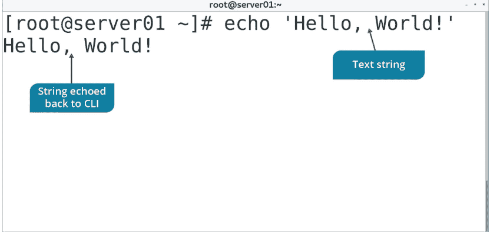

*显示一串文本。*

## 语法

`echo`命令的语法是`echo {string}`。

### `printf` 命令

`printf`命令与`echo`类似，但为用户提供了更多的输出格式控制。你可以在要输出的文本中提供各种格式化字符，使用反斜杠（`\`）来指示它们的使用。例如：`printf "Hello.\nWhat's your name?"`将打印：

```
Hello.
What's your name?
```

这是因为`\n`是换行格式化字符，会在其放置的位置自动添加新行。

`printf`命令还支持转换字符，使用百分号（`%`）来指示它们的使用。转换字符通常在脚本中用于更改变量的输出，如指定在精确计算后打印的小数位数。

### `tr` 命令

`tr`命令用于转换一串字符。它主要用于更改文件中字母的大小写。此命令仅作用于字符流，不接受文件名作为参数。你必须使用重定向才能真正更改文件。

## 语法

`tr`命令的语法是`tr {character 1} {character 2}`，其中`{character 1}`是要被替换的字符。

### `wc` 命令

字数统计（`wc`）命令用于统计文本文件中的行数、字数和字符数。如果指定了多个文件，则该命令会显示每个文件的计数以及所有文件的总计数。

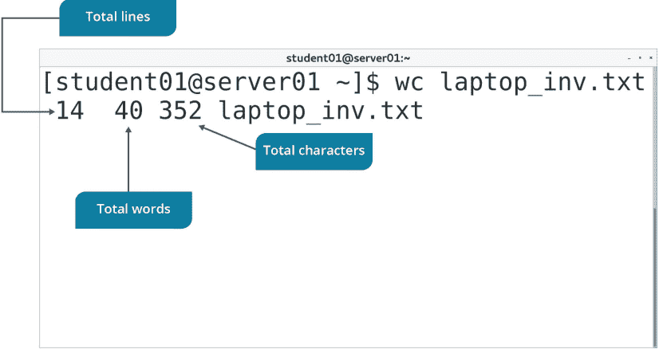

统计文件中的字符数。

## 语法

`wc`命令的语法是`wc [options] {file names}`。

### `wc` 命令选项

`wc`命令提供了各种选项，使您能够指定输出的性质。

| 选项 | 用于 |
|--------|---------|
| `-c` | 显示字节数。 |
| `-m` | 显示字符数。 |
| `-l` | 显示换行数。 |
| `-w` | 显示字数。 |

### `sort` 命令

`sort`命令对文件中的行进行排序。常见的`sort`命令选项如下表所示。

| 选项 | 用于 |
|--------|---------|
| `-k{列号}` | 指定字段值。例如，`-k2`表示第二个字段。 |
| `-n` | 根据字符串的数值比较和排序行。 |
| `-r` | 按降序排序字段。默认情况下，字段按升序排序。 |
| `-t{分隔符}` | 分隔一个字段和另一个字段。 |

> **注意：** 分隔符可以是制表符、空格、冒号、分号、句号或逗号，用于分隔一个字段和另一个字段。

```
[student01@server01 ~]$ sort -k2 laptop_inv.txt
tramirez    Acer      2942349
manderson   Acer      2988481
lbarnes     Asus      S393892
jsmith      Asus      S489124
mstephens   Asus      S737481
nporter     Asus      S892849
kriley      Dell      1390390
jcook       Dell      1489284
sarmstrong  Dell      1923843
tlee        Lenovo    8112091
```

*对文本文件进行排序。*

## 语法

`sort`命令的语法是`sort [options] {file names}`。

### `cut` 命令

`cut`命令从文件中提取指定的文本行。常见的`cut`命令选项及其用途如下表所示。

| 选项 | 用于 |
|--------|---------|
| `-c` | 指定要从每行中剪切字符的位置。 |
| `-d{分隔符}` | 分隔一个字段和另一个字段。 |
| `-f{字段号}` | 指定要剪切的字段号，以分隔符分隔。例如，`-f2`表示第一个和第二个分隔符实例之间的字段。 |
| `-s` | 如果未找到分隔符，则抑制该行。 |

```
[root@server01 ~]# cut -d: -f1-3 /var/log/secure
Jan  7 13:28:57 server01 gdm-password]
Jan  7 13:38:56 server01 pkexec[17482]
Jan  7 13:39:25 server01 su
Jan  7 13:39:33 server01 su
Jan  7 13:44:02 server01 su
Jan  7 13:49:59 server01 su
Jan  7 13:56:06 server01 su
Jan  7 14:06:59 server01 gdm-password]
```

*提取日志的一部分。*

## 语法

`cut`命令的语法是`cut [options] {file names}`。

### `paste` 命令

`paste`命令用于水平合并文本文件中的行。初始文件的每一行是第一列的一行；使用`paste`，你指定第二个文件，第二个文件的每一行成为新的第二列的一行。默认情况下，`paste`命令使用制表符作为分隔符来分隔每一列。你可以使用`-d`选项指定不同的分隔符。

例如，你有一个名为`cities`的文件：

```
New York
Tokyo
London
Lima
```

你还有一个名为`countries`的文件：

```
United States
Japan
England
Peru
```


`paste -d , cities countries` 的输出如下：

- 美国纽约
- 日本东京
- 英国伦敦
- 秘鲁利马

## diff 命令

`diff` 命令用于比较文本文档。该命令显示两个文件及其差异。通过使用各种符号，输出提示你可以如何修改一个文件使其与另一个完全相同。每个符号都有特殊的含义。

小于号（`<`）后面跟一行内容，表示该行应从第一个文件中删除，因为它没有出现在第二个文件中。大于号（`>`）后面跟一行内容，表示该行应从第二个文件中添加。此外，`diff` 命令还会标注每个文件中会受删除、添加和更改操作影响的行号。

> 注意：`diff` 命令本身不会进行任何更改。

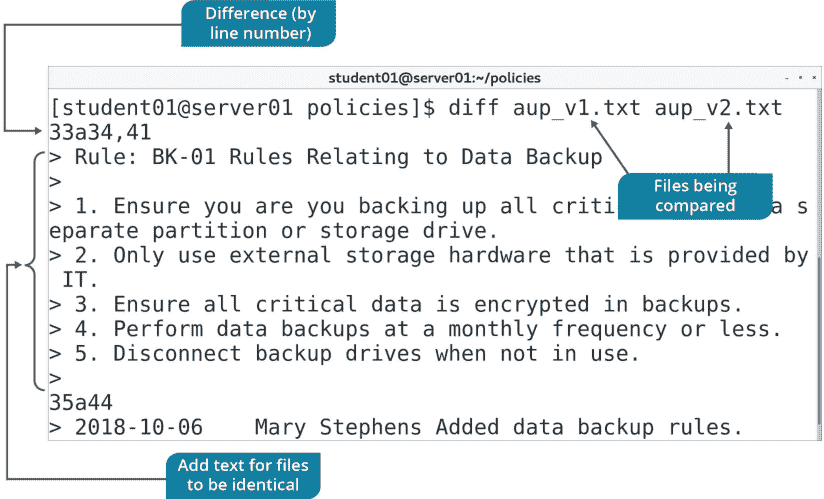

比较两个文本文件。

## 语法

`diff` 命令的语法为 `diff {文件名称 1} {文件名称 2}`。

## diff 命令选项

`diff` 命令有多种选项，可让你指定输出的性质。

| 选项 | 用于 |
|--------|---------|
| `-b` | 忽略空格差异。 |
| `-i` | 忽略大小写差异。 |
| `-t` | 在输出行中展开制表符。 |
| `-w` | 忽略空格和制表符差异。 |
| `-c` | 显示差异列表，并附带三行上下文。 |
| `-u` | 以统一模式输出结果，呈现更简洁的格式。 |

## grep 命令

`grep` 命令最基本的形式是一个搜索工具。与 `find` 或 `locate` 不同，它不仅限于查找文件名；它最常用于在文件内容中搜索特定的文本字符串。作为输出，`grep` 会显示文件中包含搜索模式的每一整行。通过这种方式，你可以使用 `grep` 同时处理文本文件并读取与你最相关的内容。例如，你可能希望通过查看访问日志来审计用户的登录事件。无需阅读整个日志或在文本编辑器中逐步搜索关键字，你可以直接使用 `grep` 命令将所有相关行打印到屏幕上。

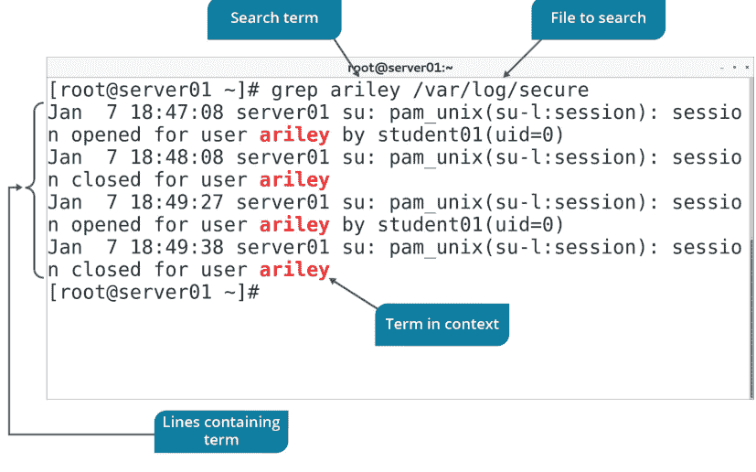

*在文件中搜索包含特定术语的行。*

## 语法

`grep` 命令的语法为 `grep [选项] {搜索模式} {文件名称}`

## grep 命令选项

`grep` 命令有很多选项。下表描述了一些常用选项。

| 选项 | 用于 |
|--------|---------|
| `-E {模式}` | 将模式作为扩展正则表达式（ERE）进行匹配。 |
| `-F {模式}` | 将模式作为固定字符串列表进行匹配。 |
| `-f {文件名称}` | 匹配指定文件中包含的模式。 |
| `-i` | 忽略大小写。 |
| `-v` | 仅输出*不*匹配所提供模式的行。 |
| `-c` | 仅打印匹配行的数量，而非行本身。 |
| `-l` | 仅打印包含匹配行的文件，而非行本身。 |
| `-o` | 仅打印行中匹配的部分，而非整行。 |

## 使用 grep 查找文件

除了搜索文件内容之外，你还可以使用 `grep` 搜索目录以定位特定文件。`ls -l | grep audit` 命令会返回当前目录中任何名称包含"audit"的文件的详细列表。

## egrep 命令

`egrep` 命令本质上与 `grep -E` 命令相同。然而，`egrep` 已被弃用，`grep -E` 是推荐的语法。

> **注意：** 正则表达式超出了本课程的范围。如需更多信息，请访问 https://www.regular-expressions.info/quickstart.html。

## awk 命令

`awk` 命令对文件进行模式匹配。它基于 AWK 编程语言。`awk` 关键字后面跟着模式、要执行的操作和文件名称。要执行的操作放在花括号内。模式和要执行的操作应放在单引号内。如果未指定模式，则对所有输入数据执行该操作；但是，如果未指定操作，则打印整行。`awk` 命令可以从命令行执行，也可以从 `awk` 脚本文件中执行。

`awk` 命令可以以多种方式处理文本文件，例如提取匹配特定模式的文本；删除匹配特定模式的文本；添加匹配特定模式的文本；等等。

> **注意：** GNU 版本的 `awk` 称为 `gawk`

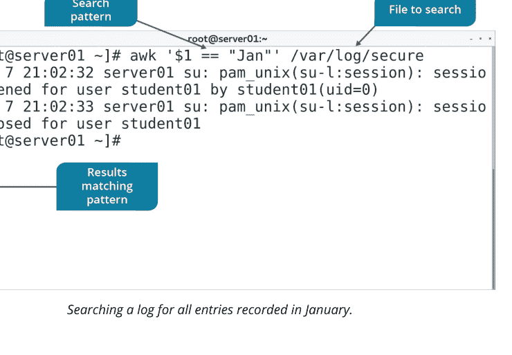

搜索日志中所有在一月份记录的条目。

## 语法

`awk` 命令的语法为 `awk [选项] ['模式 {操作}'] {文件名称}`

## 模式

在 `awk` 脚本中，你可以提供模式以及代码块。如果模式匹配输入文件中的任何行，脚本中的代码块将被执行。下表列出了所使用的模式类型。

| 模式 | 描述 |
|:---|:---|
| `/正则表达式/` | 检索所有以"a"、"b"或"c"开头的记录。示例：`/ [ abc ] /` |
| 关系表达式 | 检索第一个字段包含值"abc"的所有记录。示例：`$1 == "abc"` |
| `pattern_1 && pattern_2` | 检索第一个字段包含值"abc"且第二个字段包含值"01"的所有记录。示例：`( $1 == "abc" ) && ( $2 == "01" )` |
| `pattern_1 \|\| pattern_2` | 检索满足第一个字段包含值"abc"或第二个字段包含值"01"或两者同时满足条件的记录。示例：`( $1 == "abc" ) \|\| ( $2 == ")7" )` |

| 模式 | 描述 |
|---------|-------------|
| `pattern_1 ? pattern_2 : pattern_3` | 如果记录中的第一个字段包含值"10"，则测试第五个字段的值。如果第五条记录包含值"20"，则打印该记录。如果记录的第一个字段不包含值"10"，则评估该记录的第九个字段。如果第九条记录包含值"30"，则打印该记录。<br><br>示例：`$1 == "10" ? $5 == "20" : $9 == "30"` |
| `pattern_1, pattern_2` | 打印一系列记录，从第一个字段包含值"01"的记录开始。记录将被打印，直到 `awk` 命令找到第一个字段包含值"02"的记录为止。<br><br>示例：`$1 == "01", $1 == "02"` |

## sed 命令

`sed` 即流编辑器命令，是一个根据各种参数修改文本文件的程序。`sed` 命令也可用于全局搜索和替换操作。

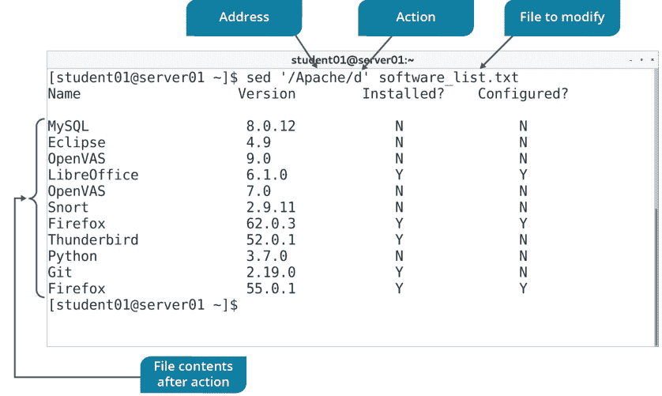

> 删除文件中包含术语"Apache"的行。

下表给出了一些常用命令选项及其用途。

| 选项 | 用于 |
|---|---|
| `d` | 删除匹配特定模式或行号的行。 |
| `-n`, `p` | 仅打印包含该模式的行。 |

| 选项 | 用于 |
| --- | --- |
| `s` | 替换文件中字符串的第一次出现。 |
| `s`, `g` | 全局地将原始字符串替换为替换字符串，替换文件中每次出现的地方。 |

## 语法

`sed` 命令的一般语法为 `sed {'选项/地址/操作'} {文件名称}`

地址告诉 `sed` 仅对特定行或仅对与给定正则表达式模式匹配的文本执行操作。地址是可选的。地址后面跟着找到匹配时要执行的操作。最后一个参数是输入文件的名称。选项、地址和操作参数通常放在单引号内。

## ln 命令

`ln` 命令用于创建指向文件的链接。链接使一个目录中的文件名（链接）指向另一个目录中的文件（目标）。链接本身不包含数据，只包含对目标文件的引用。对链接的任何更改都会反映在目标文件中。如果你未指定链接名称，`ln` 命令将在当前工作目录中创建链接。

## 语法

`ln` 命令的语法为 `ln [选项] {目标名称} [链接名称]`

## ln 命令选项

`ln` 命令有多种选项。下表给出了一些常用选项。

| 选项 | 用于 |
| --- | --- |
| `--backup` | 备份现有的目标文件。 |
| `-f` | 移除现有的目标文件。 |
| `-s` | 创建符号链接而非硬链接。 |
| `-i` | 提示是否移除目标文件。 |
| `-v` | 在链接前打印文件名称。 |

## 链接类型

使用 `ln` 命令，你可以创建两种类型的链接：硬链接和符号链接（软链接）。硬链接和符号链接是文件系统的特性，在 Linux 支持的大多数文件系统中都很常见。ext2、ext3、ext4 和 XFS 文件系统都支持硬链接和符号链接。

**硬链接**是对另一个文件的引用；它使文件的数据在同一文件系统中的不同位置拥有多个名称。应用程序将硬链接视为真实文件。如果在创建硬链接后删除原始文件，所有内容仍将保留在链接文件中。这是因为硬链接的 inode 与其目标相同；换句话说，它指向文件系统中的同一对象。硬链接不能在两个目录之间创建，也不能在不同文件系统的两个文件之间创建。

**符号链接**（symbolic link）是指向文件或目录的引用，可以跨越多个文件系统。如果在创建符号链接后删除原始文件或目录，则原始内容将丢失。这是因为符号链接的 inode 与其目标不同；换句话说，它指向文件系统上的不同对象。符号链接也称为软链接（soft link）。

**注意：** 要了解更多信息，请查看课程网站上的**视频**标签，获取补充本课内容的视频。

## 示例

以下是使用 `ln` 命令创建硬链接的示例，其中 `/backup/backup-report` 是链接目标，`~/backup-report` 是链接本身：

```
ln /backup/backup-report ~/backup-report
```

以下是同样的示例，但创建的是符号链接而非硬链接：

```
ln -s /backup/backup-report ~/backup-report
```

## 活动 5-9 讨论处理文本文件

**场景** 回答以下问题以检查你对该主题的理解。

- 1. `echo` 命令确实非常强大。它可以在脚本中使用，也可以在命令行交互式使用，以完成多种不同的任务。如何使用 `echo` 命令在屏幕上显示你的名字？
- 2. 如何使用 `printf` 命令用单个命令在不同行上显示你的姓名和地址？
- 3. 你有两个文件，每个文件都包含 100 多行文本。你需要比较它们，因为虽然它们应该相似，但逐个检查非常耗时。幸运的是，Linux 有一个实用程序可以比较这两个文件。如何使用这个工具比较 `file1.txt` 和 `file2.txt`？
- 4. 一位用户请求你帮助他在文件中查找特定字符串（"audition"），文件名为 `actors.txt`。他似乎不记得曾让哪位演员为商业广告试镜，需要回电话给她。如何使用一个简单的命令找到这位演员，而不是手动阅读文本文件？
- 5. 你有一个文件，其中包含同事为年度野餐建议的活动的长列表（`activities.txt`）。它们没有特定的顺序，但如果按字母顺序排列，可读性会更好。如何快速将列表重新排列为字母顺序？

## 活动 5-10

处理文本文件

### 开始之前

你以 `student` 账户登录到了 CLI。你在 `~/policies` 目录中有两个文本文件，以及主目录中的 `software_list.txt` 文件。

### 场景

现在软件列表和政策文档都已准备就绪并放在正确的位置，你可以开始更仔细地分析它们。具体来说，你想对软件列表进行排序，以便更快地识别哪些软件包仍需要安装和/或配置。同样，你想确保准确了解 AUP 的第一个版本到第二个版本之间发生了哪些更改，这样就不必从头开始阅读整个文档。

你还想转向日志分析工作。你想找出用户输入错误密码而未能登录的实例。这可能指向试图访问其未授权资源的用户。然而，身份验证日志可能非常大，因此你需要对其进行处理，以仅提取相关信息。

- 1. 按名称对软件列表文件进行排序，然后按需要安装和/或配置的软件包进行排序。
  - a) 输入 `cd ~` 返回主目录。
  - b) 输入 `cat software_list.txt` 查看此文件的列结构。
  - c) 输入 `sort -k1 software_list.txt`
  - d) 验证列表是否按第一列（即每个软件包的名称）排序。然而，排序操作并不完美，因为包含了列标题。有几种方法可以阻止这种情况发生，其中一种将在后面的主题中执行。
  - e) 输入 `sort -k3 software_list.txt` 按 "Installed?" 列排序。
  - f) 按 "Configured?" 列排序。

- 2. 获取 AUP 文件的词数统计。
  - a) 输入 `cd policies`
  - b) 输入 `wc -w aup_v1.txt`
  - c) 验证是否能看到 AUP 政策文件第 1 版的词数。
  - d) 输入 `wc -w aup_v1.txt aup_v2.txt`
  - e) 验证是否能看到两个版本的词数，以及合计总数。

- 3. 检查 AUP 文件之间的差异。
  - a) 输入 `diff aup_v1.txt aup_v2.txt`
  - b) 验证是否显示了每个文件之间的差异，以及建议的操作。

差异如下：

- `33 a 34,41` 表示在第一个文件（版本 1）的第 33 行之后，需要添加第二个文件（版本 2）的第 34–41 行，才能使该部分文本相同。
- 多个 `>` 符号表示必须添加到第一个文件中使其与第二个文件相同的每一行。
- 换句话说，HR 主管在版本 2 的政策中添加了这整个新部分。
- `35 a 44` 表示在第一个文件的第 35 行之后，需要添加第二个文件的第 44 行，才能使文本相同。
- 换句话说，HR 主管在修订历史中添加了一条记录，解释她的更改。

- 4. 在身份验证日志中搜索失败的登录尝试。
  - a) 输入 `sudo cat /var/log/secure`
  - b) 验证身份验证日志中有许多条目。与其阅读整个日志或逐条搜索失败条目，你可以使用 `grep` 用一个命令将所有相关信息提取到最前面。
  - c) 输入 `su - ariley` 并提供错误的密码来模拟身份验证失败。

> **注意：** 不要实际登录。

  - d) 输入 `sudo grep failed /var/log/secure`
  - e) 验证是否显示了日志中包含文本字符串 "failed" 的所有行。

```
Dec 11 16:52:35 localhost unix_chkpwd[1254]: password check failed for user (root)
Dec 14 13:01:42 localhost unix_chkpwd[1739]: password check failed for user (root)
Dec 14 14:18:45 localhost unix_chkpwd[7351]: password check failed for user (ariley)
Dec 14 14:18:58 localhost sudo: student01 : TTY=pts/0 ; PWD=/home/student01 ; USER=root ; COMMAND=/bin/grep failed /var/log/secure
```

## 活动 5-11

### 链接文件

### 开始之前

你以 `student` 账户登录到了 CLI。你之前创建了 `/backup/log` 目录。

### 场景

你决定开始整理你的备份目录，特别是关于日志文件。你想创建几个子目录，每个目录对应一个与备份日志相关的类别。例如，你想按类型（如身份验证日志、应用程序日志、内核日志）和生成年份来组织日志。然而，大多数日志可以属于多个类别。与其拥有两个或多个不同的副本，你决定将这些文件链接在一起，以便更容易管理。

你还想能够从主目录快速访问日志备份。因此，你将在主目录中创建指向备份目录中日志的链接。

- 1. 创建新的日志备份目录，并将身份验证日志移动到其中一个目录。
  - a) 输入 `mkdir /backup/log/auth /backup/log/<year>`，其中 `<year>` 指当前年份。
  - b) 输入 `sudo cp /var/log/secure /backup/log/auth/secure`
  - c) 输入 `cd /backup/log`

- 2. 在日志文件之间创建硬链接。
  - a) 输入 `sudo ln auth/secure <year>/secure`
     这会创建指向 `auth` 目录中文件的硬链接。
  - b) 输入 `ls -l <year>` 并验证是否在年份目录中创建了文件。
  - c) 输入 `sudo cat <year>/secure` 并验证其内容与身份验证日志相同。

> **注意：** 如果你想确认，可以运行 `diff auth/secure <year>/secure`。

- 3. 在一个文件中进行更改，查看其在硬链接文件中的反映。
  - a) 输入 `sudo nano auth/secure`
  - b) 按 **Enter** 在顶部开始新行。
  - c) 输入 `**BEGIN LOG ##-####**`，其中 `##-####` 是当前月份和年份。例如：`**BEGIN LOG 01-2019**`
  - d) 按 **Ctrl+O** 然后按 **Enter** 保存。
  - e) 按 **Ctrl+X** 退出。
  - f) 输入 `sudo head <year>/secure` 并验证您刚刚添加的标题也被添加到了硬链接文件中。

```
[student01@localhost log]$ sudo head 2019/secure
**BEGIN LOG 01-2019**
Dec 11 13:31:02 localhost polkitd[843]: Loading rules from /etc/polkit-1/rules.d
Dec 11 13:31:02 localhost polkitd[843]: Loading rules from /usr/share/polkit-1/rules.d
```


Dec 11 13:31:03 localhost polkitd[843]: Finished loading, compiling and executing rules

Dec 11 13:31:03 localhost polkitd[843]: Acquired the name org.freedesktop.PolicyKit1 on the system bus

Dec 11 13:31:12 localhost sshd[1346]: Server listening on 0.0.0.0 port 22.

Dec 11 13:31:12 localhost sshd[1346]: Server listening on :: port 22.

```
+   4. 删除一个文件并验证硬链接文件仍然完好无损。
   a) 输入 `sudo rm auth/secure`
   b) 输入 `sudo cat <year>/secure` 并验证硬链接文件的内容仍然完好无损。

5. 尝试从您的主目录创建指向备份目录中日志文件的链接。
   a) 输入 `cd ~` 返回您的主目录。
   b) 输入 `sudo ln /backup/log/<year>/secure auth-log`
   c) 验证该操作失败。

6. **为什么系统无法创建链接？您还能怎么做才能创建链接？**

7. 创建指向日志文件的符号链接。
   a) 输入 `ln -s /backup/log/<year>/secure auth-log`
   b) 输入 `sudo cat auth-log` 并验证您的链接具有预期的日志内容。

8. 删除原始日志文件并验证符号链接受到影响。
   a) 输入 Nikita `sudo rm /backup/log/<year>/secure`
   b) 输入 `sudo cat auth-log` 并验证不存在该文件。
   c) 输入 `ls -l` 并验证该文件是一个损坏的链接。
```

```
[student01@localhost ~]$ ls -l

total 4

lrwxrwxrwx. 1 student01 student01  23 Dec 14 14:22 auth-log -> /backup/log/2019/secure

drwxrwxr-x. 3 student01 student01  31 Dec 14 13:04 permissions-demo

drwxrwxr-x. 2 student01 student01 151 Dec 14 14:17 policies

-rwxr-xr-x. 1 student01 student01 816 Dec 14 14:12 software list.txt
```

指向黑色背景文本的红色文本表示链接已损坏。

+   d) 输入 `rm auth-log` 删除符号链接。

## 主题 E

### 操作文件输出

**涵盖的考试目标**

2.3 根据场景创建、修改和重定向文件。

所有这些文件管理和操作不仅仅适用于在终端中查看结果。当您继续使用终端或完全注销时，您需要确保某些关键信息存储在文件中，以便后续检索和分析。您还将受益于结合使用多个命令，使您的管理职责更高效、更强大。

## 文本流

**文本流**是应用程序可以利用来自特定设备或系统组件读取或写入的一行或多行文本序列。这使应用程序能够与 CLI、文件、网络套接字等组件交互，同时向应用程序隐藏这些组件的细节。

在大多数 Linux shell 中，有三种类型的流：标准输入、标准输出和标准错误。

## 标准输入

**标准输入**，或称 **stdin**，是充当命令输入来源的文本流。Linux 命令行的标准输入通常来自键盘。在 GUI 的情况下，标准输入也可以来自鼠标。

## 标准输出

**标准输出**，或称 **stdout**，是充当命令输出目标的文本流。默认情况下，Linux 命令的标准输出定向到 CLI。

## 标准错误

**标准错误**，或称 **stderr**，是用作错误消息目标的文本流。默认情况下，标准错误流在 CLI 中打印错误消息。

## 输入/输出重定向

**重定向**是从键盘以外的来源接受输入数据并将输出数据发送到显示设备以外的目标的过程。换句话说，您可以使用重定向在处理输入/输出（I/O）时绕过默认设备。重定向通常用于使用 stdin、stdout 和 stderr 流从文件接受输入或将输出发送到文件。

## 重定向运算符

有几个用于重定向输入或输出的运算符。下表描述了这些运算符。

| 运算符 | 用于 | 示例 |
|----------|---------|---------|
| `>` | 将标准输出重定向到文件。 | `ls > file1.txt` `ls` 命令的输出将被重定向到名为 `file1.txt` 的文件。 |
| `>>` | 将标准输出追加到目标文件末尾。 | `ls >> file1.txt` `ls` 命令的输出将被追加到名为 `file1.txt` 的文件。 |
| `2>` | 将标准错误消息重定向到文件。 | `ls file3.txt 2> errorfile.txt` 假设 `file3.txt` 不存在，产生的错误将不会显示在屏幕上，而是会被重定向到名为 `errorfile.txt` 的文件。 |
| `2>>` | 将标准错误消息追加到目标文件末尾。 | `ls file3.txt 2>> errorfile.txt` 假设 `file3.txt` 不存在，产生的错误将不会显示在屏幕上，而是会被追加到名为 `errorfile.txt` 的文件。 |
| `&>` | 同时将标准输出和标准错误消息重定向到文件。 | `ls file1.txt file3.txt &> errorfile.txt` 假设 `file1.txt` 存在而 `file3.txt` 不存在，产生的输出和错误将不会显示在屏幕上，而是会被重定向到名为 `errorfile.txt` 的文件。 |
| `<` | 从文件读取输入，而不是从键盘或鼠标。 | `mail user@address < myletter.txt` `myletter.txt` 文件将作为输入并被附加到电子邮件消息中。 |

| 运算符 | 用于 | 示例 |
| --- | --- | --- |
| `<<string` | 从当前来源提供输入数据，当遇到包含所提供字符串的行时停止。当放置在脚本中时，这称为 **here document**。 | `cat <<EOF`<br>`This is`<br>`a here document.`<br>`EOF`<br><br>`cat` 命令将使用此文件中的其余行作为输入。当遇到字符串 `EOF` 时，它将停止接受该输入。此字符串可以命名为任何您想要的名称。因此，`cat` 命令的输出将是：<br><br>`This is`<br>`a here document.` |

## 管道

**管道**是组合命令的标准 I/O 流的过程。它使用一个命令的标准输出作为另一个命令的标准输入。第一个命令的输出格式应与第二个命令使用的格式兼容。管道运算符（`|`）可与 Linux 中的大多数命令一起使用。


*命令通过管道传递给其他命令。*

## 管道示例

前面提到的 `ls -l | grep audit` 命令搜索名为 "audit" 的文件，是使用管道的一个示例。`ls -l` 命令的标准输出作为标准输入传递给 `grep audit` 命令，因此 `grep` 在目录列表中搜索该术语。

## xargs 命令

`xargs` 命令从标准输入读取并对每个提供的参数执行命令。每个参数必须用空白分隔。管道运算符用于使第一个命令的输出成为第二个命令的输入。`xargs` 命令通常与 `find` 命令一起使用，对文件或目录搜索中找到的每个结果进行操作。

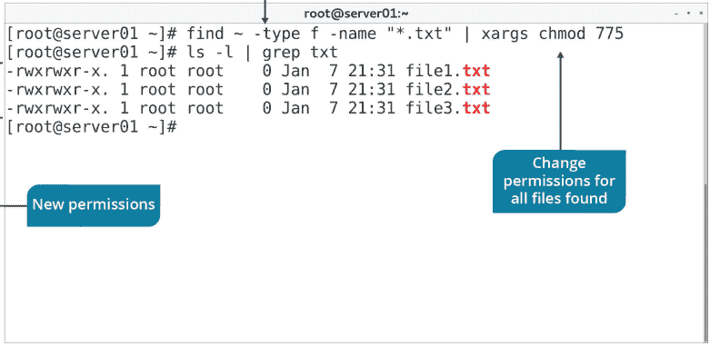

更改与给定模式匹配的所有文件的权限。

## 语法

`xargs` 命令的一般语法是 `command [options] [arguments] | xargs [options] {command}`

## xargs 命令示例

假设您想删除 `/foo` 目录中所有扩展名为 `.pdf` 的文件。您可以使用 `xargs` 来自动化该过程：

```
find /foo -type f -name "*.pdf" | xargs rm
```

`find` 命令搜索 `/foo` 中所有扩展名为 `.pdf` 的文件，然后将结果通过管道传递给 `xargs` 命令。由于结果以空格分隔，`xargs` 命令将对结果中的每个文件执行 `rm` 命令——删除目录中的所有 PDF 文件。

## xargs 命令选项

`xargs` 命令有各种选项。

| 选项 | 用于 |
|--------|---------|
| `-I {replacement string}` | 将标准输入中的每一行视为单个参数。 |
| `-L {number of lines}` | 从标准输入读取指定数量的行并将其连接成一个长字符串。 |
| `-p` | 在每次执行命令前提示用户。 |
| `-n {number of arguments}` | 从标准输入读取最大数量的参数并将其插入到命令模板末尾。 |
| `-E {end of string}` | 表示标准输入的结束。 |
| `-t` | 在执行命令前将每个命令写入标准错误输出。 |

| 选项 | 用途 |
|--------|---------|
| `-s {最大大小}` | 将参数列表的最大允许大小设置为指定的字符数。 |

## tee 命令

`tee` 命令读取标准输入，将输出发送到默认输出设备（CLI），同时将输出复制到每个指定的文件中。该命令使您能够立即验证命令的输出，并将其存储在文件中以供日后参考。与 `xargs` 类似，`tee` 通常使用管道运算符接受来自另一个命令的输入。

使用 `-a` 选项时，`tee` 将输出附加到每个输出文件，而不是覆盖它。

## 语法

`tee` 命令的一般语法为：`command [options] [arguments] | tee [options] {文件名称}`

## tee 命令示例

假设您想检查某个目录的内容，同时将这些内容输出到一个文件中以便稍后处理。您可以发出单独的命令来完成此操作，或者像下面这样使用 `tee` 命令：

```
ls -l | tee listing.txt
```

## /dev/null 文件

`/dev/null` 文件，也称为空设备，是一个丢弃所有写入其中的数据的文件。通常，您会将输出流重定向到此文件，以确认写入操作成功 without actually writing to anything。.csnapThis makes the file useful in testing commands, scripts, and other software. It is also useful in suppressing error information in commands by redirecting error output (`2>`) to the `/dev/null` file.

## 终端重定向

Linux 中正在运行的进程可以由终端（CLI）控制，并且可以多个终端同时运行。每个控制终端都被分配一个标识符。该标识符通常采用 `/dev/tty#` 的格式，其中 `#` 是该终端独有的数字。您可以通过引用其 `/dev/tty` 编号将标准输入和输出重定向到另一个控制终端。这在需要在不同运行进程之间重定向文本流时非常有用。

> **注意：** 您可以在 CLI 中输入 `tty` 来识别您的控制终端。

> **注意：** 若要了解更多信息，请查看课程网站上的**视频**标签页，了解补充本课 content 的任何视频。

## 活动 5-12

### 讨论文件输出

### 场景

回答以下问题以检查您对该主题的理解。

1. 如何使用单个命令创建包含以下内容的文件？注意每个组成部分应各占一行（共三行），就像邮寄信件时的地址格式：`Bob Jones 222 Main Street Dallas, TX`

2. 为什么以下命令会将名称 Sally Davis 发送到 `sally.txt` 文件？`echo "Sally Davis" > sally.txt`

3. 您的经理要求您查找 IP 地址 10.0.10.5 连接到 server1 的次数。这些事件通常记录在 `/var/log/auth.log` 文件中。使用管道，如何为他获取此计数？

4. 以下命令有什么作用？`cat file.txt > /dev/null`

5. 如果您发出以下命令会发生什么？`mail bbates@domain.com < addresses.txt`

## 活动 5-13

### 操作文件输出

### 数据文件

```
/opt/linuxplus/managing_files_and_directories/laptop_inv.txt
```

### 开始之前

您已使用学生帐户登录到 CLI。您有一个 `/backup` 目录。

### 场景

过去，IT 团队一直保存着发放给员工的所有笔记本电脑的库存记录。作为新推出的一部分，您需要将此信息复制到将存储在 Linux 服务器上的文档中。源信息的格式不是很好，也没有任何有用的顺序。因此，您决定从头开始创建新文件。之后，您意识到记录信息的人在某些序列号的格式上犯了错误。与其单独编辑文件来替换每个错误，不如利用输入和输出重定向来修复错误。然后，您将输出排序后的版本，以便更有用参考。

您还想定期检查备份目录的内容，并将结果放入持续更新的文件中。您希望能够实时在 CLI 上看到结果，因此您将使用 `tee` 命令来同时完成这两项任务。

最后，您将使用带有 `grep` 的管道来进一步提高您的日志分析技能。

1. 使用输出重定向开始向笔记本电脑库存文件添加文本。

   a) 输入 `touch laptop_inv.txt` 创建一个空白文件。

   b) 输入 `echo "User Make Serial No." > laptop_inv.txt`

   *注意：每列之间用四个空格分隔。*

   c) 输入 `cat laptop_inv.txt` 并验证文本是否输出到了文件中。

2. 使用输出重定向将文本附加到文件中。

   a) 输入 `echo "jsmith Asus S489124" > laptop_inv.txt`

   b) 输入 `cat laptop_inv.txt` 并验证标题是否被这一新行替换了。

   这是因为 `>` 运算符会将任何现有文本替换为提供的字符串。您需要附加该文本。

   c) 重复 `echo "User Make Serial No." > laptop_inv.txt`

   *注意：请记住，您可以按 **上箭头** 返回您之前输入的命令。*

   d) 输入 `echo "jsmith Asus S4891244" >> laptop_inv.txt`

   **注意：** 同样，每列之间用四个空格分隔。

   这次，您使用的是附加运算符（`>>`）。

   e) 验证文件是否同时包含标题和第一行。

   ```
   User  Make  Serial  No.

   jsmith  Asus  S4891244
   ```

3. 使用输入重定向替换文件中所有输入错误的字符实例。

   a) 输入以下内容：

   ```
   cp /opt/linuxplus/managing_files_and_directories/laptop_inv.txt laptop_inv.txt
   ```

   这将用已填写的文件更新您的副本。

   b) 检查文件并验证华硕序列号是否错误地以大写字母 "S" 开头。

   c) 输入 `tr S 5 < laptop_inv.txt`

   d) 验证 "S" 的实例是否被替换为 "5"，并且文件是否被输出到 CLI。

4. 同时使用输入和输出重定向来创建包含更正的新文件。

   a) 输入 `tr S 5 < laptop_inv.txt > laptop_inv_fix.txt`

   b) 检查更正后的文件并验证是否进行了适当的更正。

5. 使用管道对没有标题的库存列表进行排序。

   a) 输入 `sort -k1 laptop_inv_fix.txt`

   b) 验证与之前对软件列表进行排序时类似，标题被包含在排序中了，而这是不应该的。

   c) 输入 `tail -n +3 laptop_inv_fix.txt | sort -k1`

   `tail -n +3` 命令输出第三行及之后的所有内容，即标题结束后的内容。您将此命令的输出通过管道传递给 `sort` 命令，作为其输入。

   d) 验证库存现在是否按用户名排序，但不包含标题。

   ```
   hroberts     Lenovo   8989090

   jcook        Dell     1489284

   jsmith       Asus     5489124

   kriley       Dell     1390390

   lbarnes      Asus     5393892

   manderson    Acer     2988481

   mstephens    Asus     5737481

   nporter      Asus     5892849

   rburton      Lenovo   8139003

   sarmstrong   Dell     1923843

   tlee         Lenovo   8112091

   tramirez     Acer     2942349
   ```


使用 `tee` 命令同时将输出重定向到 CLI 和文件。

a) 输入 `sudo ls -lR /backup > backup_report`

b) 验证 `ls` 没有将其结果输出到 CLI。

c) 输入 `sudo ls -lR /backup | tee backup_report`

d) 验证 `ls` *确实*将其结果输出到了 CLI。

这是因为将 `ls` 命令通过管道传递给 `tee` 而不是进行 stdout 重定向，可以确保结果同时出现在 CLI *和* 指定的文件中。

e) 检查 `backup_report` 文件并验证它也列出了目录信息。

一起使用 `grep` 和 `cut` 使日志分析更轻松。

a) 输入 `sudo grep 'password check failed' /var/log/secure`

这会打印身份验证日志中所有匹配 "password check failed" 文本的实例。然而，它也会打印每一行的所有部分，其中很多并不相关，只会增加噪音。

b) 输入 `sudo cut /var/log/secure -d " " -f5-12`

`cut` 命令使用 `-d` 选项，使用空格作为分隔符来修剪每行。`-f5-12` 选项指定要提取的分隔符范围。因此，您只提取每行中间大约一部分。但是，您仍然会看到日志的每一行。

c) 输入 `sudo grep 'password check failed' /var/log/secure | cut -d " " -f5-12`

d) 验证您是否提取了所有匹配所提供字符串的行，以及仅提取了与您的需求相关的行部分。

结果显示了被调用的系统功能、事件的解释以及事件所适用的用户。

# 总结

在本课程中，你通过创建、编辑、搜索和以多种方式操作文件来管理文件和目录。这些技能将帮助你更高效、更有成效地处理文件。

**利用文本流和标准 I/O 的强大功能可以在哪些方面增强你在 Linux 系统上的管理任务？**

**你更喜欢使用哪种 Linux 文本编辑器？为什么？**

**练习题：** 附加练习题可在课程网站上找到。

# 第 6 课

## 管理内核模块

课程时间：1 小时

## 课程简介

Linux® 的一个显著特点是其模块化特性，使你能够在启动期间和运行期间调整底层系统配置。这为你提供了极大的灵活性，以调整系统的运行方式以及它可以利用的设备类型。在本课程中，你将更深入地了解 Linux 内核及其一些特性，然后根据自己的独特业务需求定制内核。

## 课程目标

在本课程中，你将：

- 识别 Linux 内核的角色和功能。
- 安装和配置内核模块。
- 监控内核模块。

## 主题 A

### 探索 Linux 内核

你将首先识别构成 Linux 内核的一些关键概念和组件。这将帮助你更好地了解内核提供的服务以及如何定制这些服务。

### 内核

**内核**是操作系统的核心。所有其他组件都依赖于它。内核管理系统上的文件系统访问、内存、进程、设备和资源分配。内核还控制插入系统的所有硬件设备。它是启动时最先加载的组件之一，并在计算机运行期间保留在主内存中。内核还包含通常对用户隐藏的系统级命令和其他功能。

*内核管理的元素。*

### 内核空间和用户空间

内核倾向于将内存中运行的软件分为两个空间：内核空间和用户空间。**内核空间**就是内核执行其提供的服务的地方。**用户空间**是包括内核空间之外所有内容的内存区域。这可以涵盖从用户直接交互的高级应用程序，到在后台运行的进程，再到各种底层系统库的所有内容。

用户空间中运行的软件能够通过系统调用来访问内核空间提供的资源。这些调用为用户空间应用程序提供执行其任务所需的资源。例如，应用程序可能会向内核发出系统调用，以便利用输入/输出（I/O）服务将数据写入存储设备。

这两个内存区域之间的分割非常有用，因为它促进了更高的稳定性和安全性。一个空间中的软件不一定能干扰另一个空间中的软件。

*不同的内核空间。*

### 内核类型

内核可分为单体内核和微内核。在**单体内核**中，所有系统模块（如设备驱动程序或文件系统）都在内核空间中运行。因此，单体内核可以与设备快速交互。然而，其主要缺点是其大小，导致更高的 RAM 消耗。此外，设备驱动程序中的故障可能导致单体内核中的系统不稳定。

在**微内核**架构中，内核本身运行实现功能完善的操作系统所需的最少资源。与单体内核相比，微内核具有更小的内核空间和更大的用户空间。这意味着微内核的总体尺寸更小，消耗的内存更少。此外，它们通常更稳定。然而，微内核的性能往往比单体内核差。

### 设备驱动程序

**设备驱动程序**是一种软件程序，使计算机的操作系统能够识别硬件设备的特性和功能、与其通信并控制其操作。它在操作系统和硬件设备（如存储驱动器、打印机、扫描仪、显示器和键盘）之间充当接口。设备驱动程序可以包含在操作系统中，也可以按需安装。

### Linux 内核

**Linux 内核**是一个免费且开源的单体内核，管理操作系统上的所有其他资源。作为单体内核，设备驱动程序在内核空间中运行，并具有对硬件的完全访问权限。Linux 内核的架构提供了许多有用的功能，包括虚拟内存管理、TCP/IP 网络支持、共享库等等。

Linux 内核的一个重要特性是其模块化。这使用户能够配置和扩展内核功能以满足他们的需求。

Linux 内核由其创建者 Linus Torvalds 和许多其他志愿者持续更新。每个新版本的内核都会被赋予一个内核版本号，以区别于过去和未来的版本。当前内核版本的命名约定是 `major.minor`，其中 `major` 是主版本号，`minor` 是次版本号。例如，版本 4.19 于 2018 年 10 月发布。

*Linux 内核的现代版本格式。*

## 内核版本历史

对于 2.6.39 及更早的版本，内核编号格式为 `w.x.y.z`，其中 `w` 是主版本号，`x` 是主修订号，`y` 是次修订号，`z` 是补丁号。

2.6.39 之后，Torvalds 决定缩短版本号格式，下一个版本号是 3.0。3.19 之后，Torvalds 决定跳到 4.0，而不是继续使用 3.20。这是为了可读性，而非由于任何技术进步。较新的内核版本将继续这一趋势，避免使用过大的次版本号。

## uname 命令

默认情况下，`uname` 打印内核的名称——Linux。你可以使用 `uname -r` 命令查看当前系统的内核版本号。你也可以输入 `uname -i` 查看硬件平台。要打印所有信息，请输入 `uname -a` 命令。

*查看内核信息。*

## 内核层

内核执行各种功能来控制和管理系统的操作。它由几个在内核空间中运行的层组成。

| 内核层 | 功能 |
| --- | --- |
| **系统调用接口（SCI）** | 处理从用户应用程序发送到内核的系统调用。这使用户空间应用程序能够从内核空间请求服务，如处理时间和内存分配。这一层还使内核能够调度和处理系统调用，并同时管理多个系统调用。 |
| **进程管理** | 通过为不同进程分配处理器上的单独执行空间并确保一个进程的运行不会干扰其他进程来管理不同进程。通过调度，内核实现处理器时间的共享以执行多个进程。 |
| **内存管理** | 管理计算机的内存，这是内核执行的最复杂任务之一。与处理器共享类似，系统的内存也需要在不同的用户空间资源之间共享。内核根据请求将可用内存映射或分配给应用程序或程序，并在程序执行完成后自动释放内存，以便可以分配给其他程序。 |
| **文件系统管理** | 管理文件系统，涉及在计算机上存储、组织和跟踪文件和数据。内核还支持虚拟文件系统（VFS），该系统提供底层数据的抽象视图，这些数据在复杂结构下组织，使其看起来像是单个结构。 |
| **设备管理** | 通过控制设备访问和用户应用程序与计算机硬件设备之间的接口来管理设备。当用户空间应用程序发送系统调用时，内核读取请求并将其传递给管理该活动的设备驱动程序。 |

## 活动 6-1

### 讨论 Linux 内核

#### 场景

回答以下问题，以检查你对该主题的理解。

1. 在单体内核与微内核的争论中，Linus Torvalds 为 Linux 选择了单体内核。为什么？

2. 作为管理员，你的工作之一是跟踪 Linux 系统上的内核版本，并尽可能保持一致。你可以运行哪个命令来查看内核版本？

3. Linux 内核最重要的特性之一是它的**模块性**。这一特性为 Linux 整体带来了什么？

4. Linux 内核如何管理设备？

5. Linux 内核如何处理应用程序的内存管理？

## 活动 6-2

### 探索 Linux 内核

#### 开始之前

你已使用学生帐户登录到命令行界面。

#### 场景

作为系统管理员，你可能需要排查与内核相关的问题。因此，你想探索内核概念以刷新知识。

1. 查看关于当前运行内核的版本信息。

a) 输入 `uname -a` 以查看与当前运行的 Linux 内核相关的信息。

2. **根据 `uname` 命令，你当前运行的内核的基本版本是什么？**
- 2.4
- 2.6
- 3.4
- 3.10
- 4.18

3. **判断正误：根据 `uname` 命令，你正在运行 32 位硬件平台。**
- True
- False

4. **以下哪项功能与内核的 SCI 层相关联？**
- 将请求传递给设备驱动程序。
- 向内核发送服务请求。
- 为功能分配处理器时间。
- 处理调度功能。
- 在文件系统上组织文件。

5. 内核执行的主要功能是什么？（选择两项。）
- 内核初始化
- 进程管理
- 内存管理
- 模块安装
- 依赖管理

6. 以下关于用户空间的描述中，哪两项是准确的？（选择两项。）
- 它是内核执行其服务的内存区域。
- 它是大多数高级软件运行的内存区域。
- 它是只有登录用户才能访问的系统部分。
- 它是后台进程和低级系统库运行的内存区域。

7. 与微内核相比，单体内核的一个缺点是什么？
- 单体内核访问设备速度较慢。
- 单体内核体积更大，占用更多 RAM。
- 单体内核的内核空间更小，可扩展性更差。
- 单体内核只能运行最低限度的软件，无法作为功能完整的操作系统。

8. 判断正误：Linux 内核是模块化的，使用户能够扩展其功能。
- True
- False

## 主题 B

### 安装和配置内核模块

**涵盖的考试目标**
*1.2 根据场景，安装、配置和监控内核模块。*
*1.3 根据场景，配置和验证网络连接参数。*
*4.1 根据场景，分析系统属性并进行相应的修复。*

既然你已经探索了 Linux 内核，现在可以安装和配置一些内核模块了。这将使你能够针对特定目的扩展内核的功能。

## 内核模块

**内核模块**是一个系统级对象，用于扩展内核的功能。它可以根据需要动态加载到内核中或从内核中卸载。它使内核能够在不需要系统重新启动的情况下更新或重新编译自身。

内核模块的优点包括：

- 它们减轻了内核的负担，因为否则所有模块的功能都必须直接添加到内核中。
- 动态加载内核模块有助于降低内存消耗。
- 当需要新功能时，避免了重建和重新启动系统的必要。

内核模块文件的扩展名为 `.ko`。为特定内核版本构建的模块可能与另一版本的内核不兼容。

## /usr/lib/ 目录

`/usr/lib/` 目录包含通用程序和软件包的共享库和二进制文件。此目录中的文件不适用于用户或自定义 shell 脚本执行。更具体地说，`/usr/lib/modules/` 目录包含已安装的不同内核版本的模块。它包含一个以内核版本号命名的目录。在该目录中，模块根据其所属类别存储在不同的子目录中。例如，蓝牙® 驱动程序可能存储在：

`/usr/lib/modules/<内核版本>/kernel/drivers/bluetooth/`

> **注意：** 这些模块也可以从 `/lib/modules/` 目录获取。

## 内核模块子目录

在 `/usr/lib/modules/<内核版本>/kernel/` 内有几个子目录，其中一些在下面的表格中描述。

| 目录 | 包含的模块用于 |
|------|-------------|
| `arch` | 特定于架构的支持。 |
| `crypto` | 加密和其他加密功能。 |
| `drivers` | 各种类型的硬件。 |
| `fs` | 各种类型的文件系统。 |
| `net` | 网络组件，如防火墙和协议。 |

## 内核模块管理命令

内核模块管理命令使你能够查看、加载、卸载或修改内核模块。

| 命令 | 用于 |
|------|------|
| `lsmod` | 显示当前加载的内核模块、它们的大小、使用详情及其依赖模块。 |
| `modinfo` | 显示关于特定内核模块的信息，如模块的文件名、许可证、描述、作者姓名、模块版本号、依赖模块及其他参数或属性。此命令的语法为 `modinfo [选项] {模块名称}` |
| `insmod` | 将模块安装到当前运行的内核中。此命令仅插入指定的模块，不插入任何依赖模块。此命令的语法为 `insmod {模块名称}` |
| `rmmod` | 从当前运行的内核中移除模块。此命令的语法为 `rmmod {模块名称}` |

## modprobe 命令

`modprobe` 命令用于从内核中添加或移除模块。此命令能够在插入指定模块之前加载所有依赖模块。因此，它比使用 `insmod` 和 `rmmod` 命令更受青睐。

要使用 `modprobe` 添加模块，请使用 `-a` 选项并指定要添加的模块。要卸载模块，请使用 `-r` 选项并指定要移除的模块。

## 语法

`modprobe` 命令的语法为 `modprobe [选项] [模块名称]`

## modprobe 命令选项

除了用于添加和移除模块的选项外，`modprobe` 命令还有更多选项。

| 选项 | 用于 |
|------|------|
| `-f` | 强制插入或移除模块。 |
| `-n` | 进行试运行，即输出结果而不实际执行操作。 |
| `-s` | 将错误打印到系统日志 (syslog) 而不是标准错误输出。 |
| `-v` | 启用详细模式。 |

## depmod 命令

为了使 `modprobe` 能够准确安装依赖模块，它会读取 `modules.dep` 文件以识别模块之间的链接方式。`depmod` 命令用于更新此依赖数据库，以便 `modprobe` 能够正常运行。

`depmod` 命令搜索 `/lib/modules/<内核版本>/` 目录中的每个模块。模块可以导出一个"符号"，表明它可以为其他模块提供服务。其他模块可以在其自己的代码中调用这些导出的符号以利用其功能。因此，`depmod` 通过汇总所有符号被导出和使用的实例来构建 `modules.dep` 文件。

> **注意：** `modules.dep` 文件位于 `/usr/lib/modules/<内核版本>/` 目录中。

## 语法

`depmod` 命令的语法为 `depmod [选项]`

## 更多关于符号的内容

符号提供了一种让模块调用其他模块的功能或其他编程对象的方式。例如，`module1` 有一个名为 `foo()` 的 C 函数，执行某些有用的任务。另一个模块 `module2` 希望在链接到内核时使用 `foo()`，而不是将该例程包含在其自己的代码中。这只有在 `module1` 显式导出 `foo()` 以供外部使用时才可能实现。它通过对该函数使用 `EXPORT_SYMBOL()` 或其变体来实现。然后，`foo()` 函数就成为内核中任何其他模块都可以利用的符号。

## 内核模块配置

`/etc/modprobe.conf` 文件是一个配置文件，包含持久应用于系统上所有加载模块的设置。它用于配置模块及其依赖关系，并指定模块别名。别名只是用于模块的替代名称。

在较新的 Linux 发行版中，此文件已弃用。取而代之的是使用 `/etc/modprobe.d/` 目录，该目录包含各种 `.conf` 文件。除了创建别名外，这些文件还可以告诉 `modprobe` 在将所选模块加载到内核时，运行具有特定选项的附加模块。这使所选模块能够利用另一个模块的功能，而无需将其加载到内核中。当模块不直接依赖于第二个模块，但如果安装了该第二个模块，运行效果会更好时，你可能会这样做。

```
[root@server01 ~]# cat /etc/modprobe.d/btusb.conf
alias blue btusb
```

*为特定内核模块配置的别名。*

## 配置文件命令

位于 `/etc/modprobe.d/` 目录下以 `.conf` 结尾的文件可以使用以下几种命令之一。

| 命令 | 用途 |
| --- | --- |
| `alias {替代名称} {模块名称}` | 为名称较长的模块指定替代名称。 |
| `blacklist {模块名称}` | 忽略内部别名，即模块自身定义的别名。 |
| `install {模块名称} {命令}` | 运行指定命令，而不将模块插入内核。 |

## 内核参数

除了在运行时加载模块到内核之外，你还可以在系统运行期间更改一些内核参数。你可以使用这些参数来提升系统性能、增强安全性、配置网络限制、更改虚拟内存设置等等。

`/proc/sys/` 目录列出了你可以在你的系统上配置的参数。与包含内核模块的目录类似，这个 `/proc/sys/` 目录也分为多个类别，包括以下几项。

| 目录 | 包含与以下相关的参数 |
| --- | --- |
| `crypto` | 加密及其他加密服务。 |
| `debug` | 内核调试。 |
| `dev` | 特定硬件设备。 |
| `fs` | 文件系统数据。 |
| `kernel` | 各种内核功能。 |
| `net` | 网络功能。 |
| `user` | 用户空间限制。 |
| `vm` | 虚拟内存管理。 |

## sysctl 命令

`sysctl` 命令用于在运行时查看或设置内核参数。它有多种选项，如下表所示。

| 选项 | 用途 |
|--------|---------|
| `-a` | 显示所有参数及其当前值。 |
| `-w {参数}={值}` | 设置参数值。 |


| `-p [文件名]` | 从指定文件加载 `sysctl` 设置，如果未提供文件名，则使用 `/etc/sysctl.conf`。 |

| `-e` | 忽略关于未知键的错误。 |

| `-r {模式}` | 使用扩展正则表达式，对匹配给定模式的参数应用命令。 |

```
[root@server01 ~]# sysctl -a
abi.vsyscall32 = 1
crypto.fips_enabled = 0
debug.exception-trace = 1
debug.kprobes-optimization = 1
debug.panic_on_rcu_stall = 0
dev.cdrom.autoclose = 1
dev.cdrom.autoeject = 0
dev.cdrom.check_media = 0
dev.cdrom.debug = 0
dev.cdrom.info = CD-ROM information, Id: cdrom.c 3
.20 2003/12/17
```

*显示内核参数。*

## 语法

`sysctl` 命令的语法为 `sysctl [选项]`

## /etc/sysctl.conf 文件

`/etc/sysctl.conf` 文件支持对运行中的 Linux 内核进行配置更改。这些更改可能包括网络优化、安全配置或信息日志记录等方面的改进。

> **注意：** 欲了解更多信息，请查看课程网站上的**视频**标签页，获取补充本课内容的视频。

## 活动 6-3

### 讨论安装和配置内核模块

### 场景

回答以下问题以检查你对该主题的理解。

- 1. 你确信已经编译并加载了新以太网卡的内核模块，但网卡不工作。你如何检查以确保内核模块已加载？

- 2. 你下载了一个新的内核模块，想要加载到运行中的系统内核中。你使用 `insmod` 命令进行了加载。你检查后发现该内核模块在已加载模块列表中，但它没有工作。可能出了什么问题？

- 3. 你加载了一个导致系统变得不稳定的内核模块。如何移除这个有问题的模块？

- 4. 你所在公司的开发人员创建了自定义内核模块以优化内部应用程序性能。他们为你提供了加载新模块所需的所有文件，包括依赖模块。当你使用 `modprobe` 加载第一个主模块时，收到多个错误，模块因依赖关系损坏而无法加载。你可以检查哪些文件来找出问题所在？

- 5. 你的经理来找你讨论在 Linux 系统上进行一些零成本的安全加固。具体来说，她要求你保护内核免受攻击。你可以调查哪个命令及其相关配置文件来协助完成这项任务？

## 活动 6-4

### 安装和配置内核模块

### 开始之前

你已使用学生帐户登录到 CLI。

### 场景

你希望能够无线地从 Linux 服务器向移动设备传输文件。因此，你购买了一个 USB 蓝牙适配器并将其插入服务器上的可用端口。然而，你无法使适配器正常工作。检查系统后，你发现 USB 蓝牙的驱动不可用。因此，你将检查内核，看看能否识别并加载启用此功能的模块。

- 1. 检查当前正在运行的模块。

  - a) 输入 `lsmod | less`

  - b) 简要浏览已安装的内核模块列表。

  - c) 按 **q** 退出。

  - d) 输入 `lsmod | grep bluetooth`

  - e) 验证没有结果。

    你尚不知道相关模块的名称，因此这并不一定 definitive 证明它未被加载。

- 2. 搜索适当的模块。

  - a) 输入 `uname -r` 获取系统的内核版本。

  - b) 输入 `cd /lib/modules/<内核版本>/kernel/drivers`

    **注意：** 记住使用 Tab 自动补全来自动填充内核版本。

  - c) 输入 `ls | grep bluetooth` 并验证存在一个 `bluetooth` 目录。

  - d) 输入 `cd bluetooth`

    

  - e) 输入 `ls` 查看可用的蓝牙驱动模块。

```
[student01@localhost bluetooth]$ ls
ath3k.ko.xz    btintel.ko.xz    btusb.ko.xz
bcm203x.ko.xz  btmrvl.ko.xz     hci_uart.ko.xz
bfusb.ko.xz    btmrvl_sdio.ko.xz  hci_vhci.ko.xz
bpa10x.ko.xz   btrtl.ko.xz
btbcm.ko.xz    btsdio.ko.xz
```

- 3. 这些模块中是否有看起来像是能够收发蓝牙信号的 USB 设备驱动？

- 4. 进一步了解此模块。

  - a) 输入 `modinfo btusb.ko.xz | less`

  - b) 阅读该模块的信息，注意以下几点：

    - 描述表明这是一个通用的蓝牙 USB 驱动。

    - 它有许多不太用户友好的别名。

    - 它依赖于几个其他模块。

  - c) 按 **q** 退出。

- 5. 为蓝牙 USB 模块配置别名。

  - a) 输入 `cd /etc/modprobe.d`

  - b) 输入 `sudo vim btusb.conf` 为该模块创建配置文件。

  - c) 使用 Vim，在第一行输入 `alias blue btusb`。

  - d) 保存并关闭文件。

- 6. 将蓝牙 USB 模块插入运行中的内核。

  - a) 输入 `sudo depmod` 更新依赖数据库。

  - b) 输入 `sudo modprobe -a blue`

  - c) 输入 `lsmod | grep btusb`

  - d) 验证 `btusb` 模块已列出，表明它已插入内核。

- 7. 注意到还有其他以 `bt` 开头的模块，以及一个名为 `bluetooth` 的模块。为什么这些也会被添加到内核中？

## 主题 C

### 监控内核模块

#### 涵盖的考试目标

- 1.2 根据场景安装、配置和监控内核模块。

- 2.7 解释 Linux 设备的使用和操作。

安装和配置内核模块后，最好对这些模块进行监控。在本主题中，你将验证已安装的模块是否确实已加载到内核中，以及你所做的任何配置是否已正确实施。

### /proc/ 目录

`/proc/` 目录是一个虚拟文件系统（VFS），提供了关于内核运行进程的大量信息。`/proc/` 目录中的一些文件如下表所示。

| 文件 | 包含内容 |

|------|----------|

| `/proc/cmdline` | 引导时在引导加载程序传递给内核的选项，例如以只读方式挂载内核。 |

| `/proc/cpuinfo` | CPU 信息，如架构、名称、时钟速度、缓存大小等。 |

| `/proc/devices` | 当前运行内核中加载的字符和块设备驱动程序列表。 |

| `/proc/filesystems` | 内核支持的文件系统类型列表，以及是否有任何文件系统当前已挂载。 |

| `/proc/meminfo` | RAM 使用信息，包括总内存、空闲内存等。 |

| `/proc/modules` | 当前系统上已安装模块的信息。可作为 `lsmod` 命令的替代。 |

| `/proc/stat` | 自上次重启以来的各种系统统计信息。 |

> **注意：** recall `/proc/mounts` 和 `/proc/partitions` 也可在此处找到。

### /proc/version 文件

`/proc/version` 文件说明了关于 Linux 内核的几点信息：

- 当前运行的 Linux 内核版本。

- 用于编译内核的 GNU 编译器集合（GCC）版本。

- 内核编译者的用户名。

- 内核编译的时间。

内核版本可能会影响系统功能，因此你可以使用此文件来验证该版本百分位数。

```
[root@server01 ~]# cat /proc/version
Linux version 3.10.0-862.el7.x86_64 (builder@kbuilder.dev.centos.org) (gcc version 4.8.5 20150623 (Red Hat 4.8.5-28) (GCC) ) #1 SMP Fri Apr 20 16:44:24 UTC 2018
```

`/proc/version` 文件。

> **注意：** 请记住，您也可以使用 `uname -r` 命令来获取内核版本。

> **注意：** GCC 最初代表 GNU C 编译器，因为它只支持 C 编程语言。现在它支持多种编程语言。

## dmesg 命令

`dmesg`（"显示消息"或"驱动程序消息"）命令用于打印在系统启动期间和之后发送到内核消息缓冲区的任何消息。设备驱动程序向内核发送消息，指示它们所交互的模块和参数的状态。这些驱动程序在遇到错误时还可以向内核发送诊断消息。其他内核组件也可以向缓冲区发送消息。

```
[root@server01 ~]# dmesg -H
[Jan 2 18:40] microcode: microcode updated early to revi
[ +0.000000] Initializing cgroup subsys cpuset
[ +0.000000] Initializing cgroup subsys cpu
[ +0.000000] Initializing cgroup subsys cpuacct
[ +0.000000] Linux version 3.10.0-862.el7.x86_64 (builder@
[ +0.000000] Command line: BOOT_IMAGE=/vmlinuz-3.10.0-862.
[ +0.000000] e820: BIOS-provided physical RAM map:
[ +0.000000] BIOS-e820: [mem 0x0000000000000000-0x00000000
[ +0.000000] BIOS-e820: [mem 0x0000000000058000-0x00000000
[ +0.000000] BIOS-e820: [mem 0x0000000000059000-0x00000000
[ +0.000000] BIOS-e820: [mem 0x000000000008c000-0x00000000
[ +0.000000] BIOS-e820: [mem 0x00000000000f0000-0x00000000
[ +0.000000] BIOS-e820: [mem 0x0000000000100000-0x00000000
```

显示驱动程序消息。

除了使用 `dmesg` 命令外，您还可以从 `/var/log/dmesg` 文件访问消息缓冲区。无论哪种方式，您都可以利用 `dmesg` 来查找内核组件的潜在问题，或验证某些模块是否正在被加载。

## 语法

`dmesg` 命令的语法为 `dmesg [options]`

## dmesg 命令选项

您可以将各种选项与 `dmesg` 命令一起使用。

| 选项 | 用于 |

|--------|---------|

| `-c` | 打印内核缓冲区内容后清除该缓冲区。 |

| `-f {facility list}` | 将输出限制为指定的以逗号分隔的设施列表。设施是产生消息的组件类别，例如 `user` 表示用户级消息。 |

| `-l {level list}` | 将输出限制为指定的以逗号分隔的级别列表。级别定义消息的性质和优先级，例如 `notice` 表示不被视为关键的消息。 |

| `-e` | 显示每条消息的易读时间版本及其增量，或后续消息之间的时间差。 |

| `-L` | 为消息着色以便更容易阅读。 |

| `-H` | 以人类友好的格式输出，结合 `-e` 和 `-L` 选项并使用文本分页器。 |

| `-h` | 列出可用选项，以及可用的设施和级别。 |

> **注意：** 要了解更多信息，请查看课程网站上的**视频**标签，获取补充本课内容的任何视频。

## 活动 6-5

## 讨论监控内核模块

### 场景

回答以下问题以检查您对该主题的理解。

- 1. 您是一名新的系统管理员，可能不知道所有命令来查找有关 Linux 系统的每个细节。虽然您不知道命令，但可以去文件系统中的哪个位置以文本文件格式找到相同的信息？

- 2. 一位初级系统管理员请求您帮助确定他管理的 Linux 服务器由哪些组件组成。他需要知道某些组件的品牌、型号和其他细节以购买替换部件。您可以向他推荐哪个命令或文件？

- 3. 您认为其中一台服务器的网络接口卡出现故障，需要获取其具体信息以便用相同产品更换。不去数据中心打开服务器机箱，如何找到网卡的详细信息？

- 4. 您的 Linux Web 服务器似乎有内存问题，但通过检查 Web 日志或系统日志无法确定。您可以在哪里查找有关系统内存使用情况的详细信息？

- 5. 您需要知道其中一个 Linux 系统支持哪些文件系统。如何查找？

## 活动 6-6

监控内核模块

### 开始之前

您以学生账户身份登录到 CLI。之前，您已经在内核中安装了 USB 蓝牙驱动程序模块。

### 场景

既然您已经安装了 USB 蓝牙模块，您想确保它已被内核成功加载并且没有错误。您还想确定内核版本详细信息，以便在故障排除期间需要时参考。

- 1. 输入 `cat /proc/version` 并使用结果回答以下问题。

**内核上次编译是什么时候？**

**您的内核运行的是哪个版本的 GCC？**

**为什么这些信息可能有用？**

- 2. 检查内核消息缓冲区。

- a) 输入 `dmesg -h`

- b) 注意可用的不同设施和日志级别。示例包括 `warn`、`err`、`notice` 等。

- c) 输入 `dmesg -H`

- d) 验证您可以浏览多页内核消息。并非所有信息对您都有用，因此您需要筛选要查找的内容。

- e) 按 **q**。

- 3. 筛选内核消息缓冲区以获取更有用的消息。

- a) 输入 `dmesg -H -l warn`

- b) 验证结果是否已筛选。所有这些消息都标记为警告条件。这些不一定表示错误，但提醒注意可能值得检查的行为。

- c) 如有必要，按 **q**。

- d) 输入 `dmesg -H -l err`

### 考试目标涵盖内容

- 1.1 解释 Linux 启动过程的概念。

- 1.4 在给定场景中，管理 Linux 环境中的存储。

首先，你必须熟悉 Linux 的启动方式，并识别组成启动过程的各个组件。此外，你将配置其中一些组件，以改变启动过程来满足你的需求。

## 启动

**启动**是启动或重启计算机并加载操作系统以供用户访问的过程。在启动过程中，启动环境会读取存储在只读存储器（ROM）中的一个小程序。该程序随后在 RAM 中执行各种操作，以*引导*操作系统并使其可供使用。

Linux 与其他操作系统一样，必须经过启动才能正常运行。在必要时，你可以配置与启动过程相关的各种选项。

## 引导加载程序

**引导加载程序**是存储在 ROM 中的小程序，它从存储设备加载内核，然后启动操作系统。像 BIOS 这样的启动环境会从 ROM 中读取引导加载程序，以便引导加载程序可以执行必要的操作（操作）来启动过程。

引导加载程序能够使用密码保护启动过程，以防止系统被未授权启动。此外，引导加载程序可以将多个操作系统加载到计算机的内存中，但用户需要在启动时选择所需使用的操作系统。

## 引导加载程序组件

引导加载程序使用三个主要组件，它们协同工作以分阶段系统地加载操作系统。

| 组件 | 描述 |

|-----------|-------------|

| 引导扇区程序 | 引导加载程序的第一个组件。它在启动时由启动环境加载，固定大小为 512 字节。其主要功能是加载第二阶段引导加载程序；但是，它也可以加载另一个扇区或内核。 |

| 第二阶段引导加载程序 | 加载操作系统并包含内核加载器。 |

| 引导加载程序安装器 | 控制驱动器扇区的安装，只能从驱动器启动时运行。它协调引导扇区和引导加载程序的活动。 |

## BIOS

**基本输入/输出系统（BIOS）**是一种固件接口标准，存储在计算机主板的 ROM 芯片上。当带有 BIOS 的计算机开机时，BIOS 固件是第一个运行的程序；这使其能够测试计算机中的各种硬件组件，并运行引导加载程序以启动操作系统。BIOS 可以访问鼠标和键盘等基本硬件输入设备使用的端口。用户也可以加载 BIOS 界面而不是操作系统，来进行各种硬件级别的更改。几十年来，BIOS 一直是家庭和企业计算机行业的主导标准。

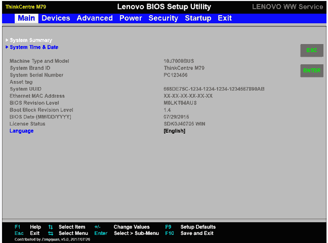

*BIOS 界面。*

## UEFI

**统一可扩展固件接口（UEFI）**是一种较新的固件技术，凭借几大关键优势在很大程度上取代了 BIOS。UEFI 运行速度比 BIOS 更快，可以在更大的内存空间中运行，可以访问目前 BIOS 无法达到的容量大小的存储驱动器，可以访问更多的硬件类型，并且具有改进的安全保护。大多数现代主板以及使用这些主板的预装电脑都配备了 UEFI。

与 BIOS 类似，UEFI 提供了一个执行引导加载程序的环境，最终为用户启动操作系统以供使用。

## 密码保护

BIOS 和 UEFI 都包含的一项安全功能是设置密码的能力。如果在启动时未提供此密码，系统将不会启动。由于不同硬件制造商的 BIOS/UEFI 固件有所不同，设置此密码的过程并不一致。但是，大多数固件将此密码保护选项放在"安全"或"密码"部分。

## 其他启动选项

BIOS 和 UEFI 并非你可以从中启动 Linux 的唯一环境。下表描述了一些其他启动选项。

| 启动选项 | 描述 |

| --- | --- |


| 从 ISO 启动 | **ISO 镜像**是一种系统镜像，最初是光盘的镜像。如今，它通常用作打包和分发操作系统镜像的文件格式，用户可以从这些镜像启动并安装操作系统。通常，你需要将 ISO 镜像写入光盘或 USB 闪存驱动器，然后将介质插入计算机，并指示 UEFI 等启动环境从该介质启动。ISO 也常用于构建虚拟机。 |

| **PXE** | 预启动执行环境（PXE）是 UEFI 标准的一部分，它使客户端能够通过网络从服务器获取所需的引导加载程序和系统文件。客户端将 UEFI 配置为从 PXE 启动，在启动过程中，它将搜索同时充当 PXE 服务器的动态主机配置协议（DHCP）服务器。找到正确的服务器后，服务器通过简单文件传输协议（TFTP）将必要的启动文件传输给客户端。 |

| 从 HTTP/FTP 启动 | 客户端还可以通过网络从内容分发协议（如超文本传输协议（HTTP）和文件传输协议（FTP））获取启动数据。这些协议通常比 PXE 中使用的标准 TFTP 协议更快、更可靠、更安全。PXE 的开源实现（如 iPXE）将 PXE 支持扩展到包含这些协议。 |

| 从 NFS 启动 | 这是另一种网络启动选项。客户端不将系统文件存储在本地存储驱动器上，而是将 NFS 共享挂载为根文件系统。共享必须提前准备好，并存储在客户端可以从中检索文件的 NFS 服务器上。因此，客户端不在本地存储数据，而是存储在 NFS 服务器上。在这样的环境中，可以使用 DHCP、TFTP 和其他网络协议来传输必要的启动数据。 |

## 扇区

**扇区**是从驱动器读取或写入的最小存储单元。一个扇区默认存储 512 字节的数据。在硬盘驱动器上，一组扇区称为一个磁道。一个磁道中的扇区数量可能不同，其存储数据的容量也各不相同。在格式化驱动器时可以更改扇区的大小。

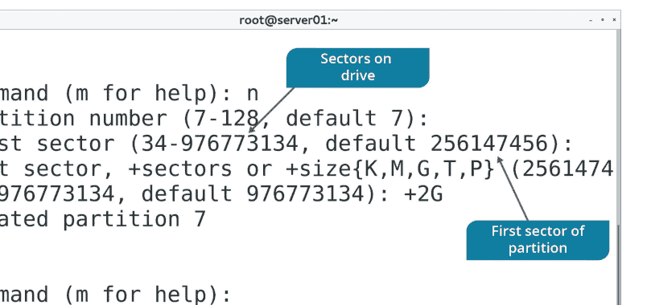

*在分区驱动器时使用扇区。*

## MBR

**主引导记录（MBR）**是存储驱动器上的第一个物理扇区，也是一种分区结构。MBR 引导扇区包含将操作系统加载到内存中的引导加载程序。它还包含存储驱动器的分区表。MBR 确定每个分区可用的扇区，以及哪个分区被视为可启动的，哪些分区不可启动。

多年来，MBR 一直是 Linux 和其他操作系统中使用的主导分区结构。然而，它有三个主要缺点：

- MBR 分区驱动器的最大存储空间为两太字节。
- MBR 分区驱动器最多可以有四个主分区。
- 启动数据存储在一个扇区中，这增加了损坏的风险。

## GPT

**GUID 分区表（GPT）**是 MBR 的继承者，弥补了后者的不足。与 MBR 一样，它是一种分区结构，但采用了更现代的设计，是 UEFI 标准的一部分。驱动器上的每个分区都被分配一个全局唯一标识符——GUID，以将其与（理论上）每个驱动器上的每个其他分区区分开来。

存储空间和分区数量的最大值非常大，目前无法达到，任何限制都将由文件系统类型或操作系统内核施加，而非 GPT 本身。GPT 还具有将启动数据存储在驱动器上多个位置以增强冗余的优势。如果主要位置损坏，GPT 可以利用其他副本之一来恢复启动数据。

在可能的情况下，使用 GPT 对驱动器进行分区优于 MBR。

## 原始分区

除了将分区格式化为 MBR 或 GPT 之外，你还可以将分区格式化为原始格式。**原始分区**使用户和应用程序能够直接读写块存储设备，而不使用系统缓存。这在数据库管理系统（DBMS）等软件具有自己的缓存机制时非常有用。DBMS 在原始分区中对 I/O 缓存有更大的控制权，可以绕过内核通常执行的缓存操作。

# initrd

**初始 RAM 磁盘（initrd）**是指在系统启动时临时加载到内存中的根文件系统。initrd 与内核一同加载，内核控制其功能。initrd 使系统能够分两个阶段启动。在第一阶段，系统使用加载主文件系统或永久根文件系统所需的最小模块集进行启动。在第二阶段，当主根文件系统挂载后，先前挂载的 initrd 文件系统被移除，用户空间启动过程继续。

initrd 非常有用，因为有许多潜在变量可能使启动过程复杂化。例如，内核需要找到并加载必要的设备驱动程序模块，以及实际的根文件系统本身。此外，根文件系统可能使用几种高级存储方法之一，如 LVM 或 NFS，它们与标准分区有不同的挂载要求。与其将所有这些行为硬编码到内核中并引入臃肿，不如由 initrd 的临时根文件系统来处理这些任务。

## initrd 镜像

Linux **initrd 镜像**是一个归档文件，包含操作系统启动所需的所有基本文件。它可以构建或自定义，以添加额外模块、移除不必要的模块或更新现有模块。通常，此镜像存储在`/boot`目录中。

## mkinitrd 命令

`mkinitrd`命令用于创建 initrd 镜像，以便预加载内核模块。

```
*** Including modules done ***
*** Installing kernel module dependencies and firmware ***
*** Installing kernel module dependencies and firmware done ***
*** Resolving executable dependencies ***
*** Resolving executable dependencies done ***
*** Hardlinking files ***
*** Hardlinking files done ***
*** Stripping files ***
*** Stripping files done ***
*** Generating early-microcode cpio image contents ***
*** Constructing GenuineIntel.bin ****
*** Store current command line parameters ***
*** Creating image file ***
*** Creating microcode section ***
*** Created microcode section ***
*** Creating image file done ***
*** Creating initramfs image file '/boot/new-initrd.img' done ***
```

创建新的 initrd 镜像。

`mkinitrd`命令的各种选项如下表所示。

| 选项 | 用途 |
| --- | --- |
| `--preload={module name}` | 在加载其他模块之前，将模块加载到 initrd 镜像中。 |
| `--with={module name}` | 在加载其他模块之后，将模块加载到 initrd 镜像中。 |
| `-f` | 覆盖现有的 initrd 镜像文件。 |
| `--nocompress` | 禁用 initrd 镜像的压缩。 |

## 语法

`mkinitrd`命令的语法为`mkinitrd [options] {initrd image name} {kernel version}`

以下示例从当前内核版本创建 initrd 镜像，并将镜像命名为`initrd-<kernel version>.img`：

```
mkinitrd /boot/initrd-$(uname -r).img $(uname -r)
```

## /boot/ 目录

根据文件系统层次结构标准（FHS）的定义，`/boot/`目录包含用于促进 Linux 启动过程的文件。下表描述了`/boot/`中一些值得注意的文件和子目录。

| 文件或目录 | 描述 |
| --- | --- |
| `/boot/grub/` | 此目录包含一种称为 GRUB 的引导加载程序的配置文件。`/boot/grub2/`目录同样如此，但用于 GRUB 2，即改进版本。 |
| `/boot/efi/` | 此目录包含 EFI 系统分区（ESP）的启动文件，这是从 UEFI 启动的系统所需的分区。它包含由 UEFI 执行的引导加载程序、设备驱动程序和系统应用程序文件。引导加载程序文件通常以 .efi 扩展名命名。 |
| `/boot/initramfs-<kernel version>.img` | 此文件是 initramfs 镜像，它是 initrd 的替代方案，使用不同的方法来完成相同的基本功能：在启动时初始化临时根文件系统。initrd 需要将特殊驱动程序编译到内核中，而 initramfs 则不需要。此外，initrd 镜像是使用固定大小文件系统格式化的块设备，而 initramfs 镜像是可以动态调整大小的归档文件。 |
| `/boot/vmlinuz-<kernel version>` | 这是一个压缩的可执行文件，包含 Linux 内核本身。引导加载程序在启动过程中将此文件加载到内存中，以初始化操作系统。相关文件是`vmlinux`，它本质上是用于调试的未压缩版本的内核。 |

## dracut 命令

`dracut`命令用于生成 initramfs 镜像，类似于使用`mkinitrd`生成 initrd 镜像的方式。事实上，在某些发行版上，`mkinitrd`是一个兼容性包装器，它会调用`dracut`命令。

使用`dracut`命令创建 initramfs 镜像的示例如下：

```
dracut /boot/initramfs-$(uname -r).img $(uname -r)
```

## 启动过程

每次计算机从存储设备加载操作系统启动时，都会重复启动过程。它涉及一系列顺序步骤，可分为 BIOS/UEFI 初始化、引导加载程序、内核和 initrd/initramfs 初始化以及启动脚本。

以下是使用 initrd 镜像的启动过程示例：

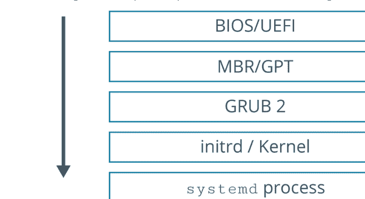

Linux 启动过程中涉及组件的高级概览。

1. 处理器检查 BIOS/UEFI 固件并执行它。这也是开机自检（POST）发生的地方。
2. BIOS/UEFI 检查内部存储设备或 USB 闪存盘、DVD-ROM 等外围设备中的可启动介质。它找到有效的设备来启动系统。
3. BIOS/UEFI 将主引导加载程序从 MBR/GPT 分区加载到内存中。它还将分区表一起加载。
4. GRUB 2 提示用户选择要启动的操作系统。如果用户没有响应，则将启动默认操作系统。
5. 引导加载程序确定内核并找到相应的内核二进制文件。然后它将相应的 initrd 镜像加载到内存中，并将启动过程的控制权转移给内核。
6. 内核配置可用的硬件驱动程序，包括处理器、I/O 子系统和存储设备。它解压缩 initrd 镜像并挂载它以加载必要的驱动程序。如果系统实现了任何虚拟设备，例如 LVM 或软件 RAID，则它们会被初始化。
7. 内核挂载主根分区并释放未使用的内存。为了设置用户环境，运行`systemd`程序。它成为进程 ID 1。
8. `systemd`程序搜索`default.target`文件，该文件包含有关要启动的服务的详细信息。它根据`/etc/fstab`文件挂载文件系统，并开始启动服务的过程。在大多数系统上，目标将是`multi-user.target`或`graphical.target`。
9. 如果选择了图形模式，则会启动 XDM 或 KDM 等显示管理器，并在屏幕上显示登录窗口。
10. 用户输入用户名和密码以登录系统。
11. 系统验证用户。如果用户有效，则执行各种配置文件。
12. 启动 shell，系统准备好供用户工作。

## 内核恐慌

内核恐慌是系统检测到发生致命错误并对其进行响应的机制。致命错误通常导致系统变得不稳定或完全无法使用。处理内核恐慌的软件将向用户显示错误消息，并将内核内存的当前状态转储到存储设备以供稍后调试。根据系统的配置方式，恐慌处理程序将自动重新启动系统，或等待用户执行此操作。

在 Linux 中，内核恐慌可能由于多种原因发生，并且在操作的任何时刻都可能发生，但通常在启动过程中遇到。常见原因包括：

- 内核本身已损坏或配置不当。
- `systemd`程序在启动期间未执行，导致系统无法使用。
- 内核找不到或无法挂载主根文件系统。
- 启动时将有故障或不兼容的硬件加载到内核中。

> **注意：** Microsoft Windows 中内核恐慌的等价物是众所周知的蓝屏死机（Blue Screen of Death，BSOD）。

> **注意：** 要了解更多信息，请查看课程网站上的视频标签，了解补充本课内容的任何视频。

## 活动 7-1

## 讨论 Linux 启动过程

**场景**

回答以下问题，以检验你对该主题的理解。

1. 你的同事正试图决定在某些系统上使用 UEFI 还是传统 BIOS。他们询问你的意见。你可以告诉同事 UEFI 的哪些优势？
2. MBR 之于 BIOS，犹如 ______ 之于 UEFI。
3. initrd 阶段在启动过程中的重要性是什么？
4. 你刚担任 Linux 管理员一职，发现每个 Linux 系统都包含一个`/boot/efi/`目录。这个`/boot/efi/`目录的意义是什么？
5. Linux 管理员不愿意在启动过程中看到内核恐慌，因为它意味着系统无法自行恢复，并且发生了严重问题。在启动过程中，可能导致内核恐慌的原因有哪些？

## 活动 7-2

## 识别 Linux 启动组件

**场景**

你需要熟悉启动序列组件，因为了解它们的工作原理将有助于你排查将操作系统加载到新机器上时可能出现的任何问题。

1. 在引导加载程序运行之前，必须先发生什么？
2. 当引导加载程序完成其任务后，接下来会发生什么？
3. MBR 的作用是什么？
4. 以下哪些是 GPT 相对于 MBR 的优势？（选择两项。）
   - [ ] GPT 具有更大的分区最大存储空间。
   - [ ] GPT 允许你选择多个要从其启动的操作系统。
   - [ ] GPT 将启动数据存储在多个位置以实现冗余。
   - [_dsi_d] GPT 可以支持多种文件系统类型。
5. `systemd`在启动过程中的用途是什么？
6. 哪个启动过程组件配置设备驱动程序？
   - ( ) 引导加载程序。
   - ( ) 内核。
   - ( ) inittab 文件。
   - ( ) BIOS/UEFI。

以下哪个启动选项允许用户将文件共享挂载为根文件系统，而不是将该文件系统本地存储？

- 从 NFS 启动
- 从 ISO 启动
- 预启动执行环境（PXE）
- 从 HTTP/FTP 启动

## 活动 7-3

## 创建 initrd 镜像

**开始之前**

你已以学生账户身份登录到命令行界面。

**场景**

作为服务器基础设施的一部分，你计划让一些系统从 NFS 共享启动。已部署系统中的内核没有 NFS 模块。没有该模块，你的系统无法将 NFS 共享挂载为根文件系统。因此，你需要创建一个新的 initrd 镜像，以便内核能够成功挂载该共享。不过，首先你要建立一个基线镜像，其他镜像可以在此基础上构建。

1. 创建一个新的 initrd 镜像。
   a) 输入`uname -r`以识别当前内核。
   b) 输入`sudo mkinitrd -v /boot/initrd-$(uname -r).img $(uname -r)`
      `$(uname -r)`在此命令中替换内核名称。
   c) 检查`mkinitrd`的详细输出，注意默认包含在 initrd 镜像中的各种内核模块。
   d) 输入`ls -l /boot`并验证你的新 initrd 镜像是否已创建。
      镜像应命名为`initrd-<kernel version>.img`，并且最后修改日期应为今天。

2. 创建一个安装了 NFS 模块的 initrd 镜像。
   a) 输入`sudo mkinitrd -v --with=nfsv4 /boot/initrd-$(uname -r)-nfs.img $(uname -r)`
   b) 输入`ls -l /boot`并验证你的新 NFS 镜像是否已创建。
   c) 检查两个 initrd 镜像（基础镜像和 NFS 镜像）的文件大小，并验证 NFS 镜像是否更大。
      这表明额外的 NFS 模块已按预期加载到镜像中。

## 主题 B

## 配置 GRUB 2

**涵盖的考试目标**

1.1 解释 Linux 启动过程概念。

既然你已经熟悉了引导加载程序在启动过程中的作用和角色，你就可以专注于配置主要的 Linux 引导加载程序：GRUB 2。

## GNU GRUB

**GNU GRand Unified Bootloader (GNU GRUB)** 是由 GNU 项目开发的引导加载程序，在类 Unix 系统上广受欢迎。它使用户能够在多平台环境中选择要启动的操作系统或内核版本。尽管原始版本的 GRUB 是 Linux 发行版的主要引导加载程序，但它存在若干局限性，最终被新版本的 GRUB 所取代。这个原始版本有时被称为 GRUB legacy。

## GRUB 2 的改进

GRUB 2 不仅仅是 GRUB 的简单新版本；它是 GRUB 系统的完整重新设计和重写。GRUB 2 为管理员提供了更多对启动过程、启动设备和启动行为的控制。此外，它还带来了多项改进，包括：

- 支持非 x86 架构平台。
- 支持实时启动（从存储介质启动操作系统并完全在内存中运行，无需安装）。
- 支持分区 UUID。
- 支持动态加载扩展 GRUB 功能的模块。
- 通过脚本配置引导加载程序的能力。
- 救援模式，尝试修复损坏或缺失配置等启动问题。
- 支持自定义图形启动菜单和主题。

由于这些改进，GRUB 2 已成为几乎所有现代 Linux 发行版的默认引导加载程序。

## GRUB 2 安装


`grub2-install` 命令用于将 GRUB 2 引导加载程序安装到存储设备上。它将 GRUB 2 文件复制到 `/boot/grub2` 目录中，并在某些平台上将 GRUB 2 安装到引导扇区。但是，`grub2-install` 适用于 BIOS 系统，而非 UEFI。要在 UEFI 系统上安装 GRUB 2，请使用包管理器安装 `grub2-efi` 软件包。安装此软件包会将 GRUB 2 文件复制到 EFI 系统分区（ESP）的 `/boot/efi` 目录中。

## 语法

`grub2-install` 命令的语法为 `grub2-install [options] [device name]`

## grub2-install 命令选项

以下是一些可与 `grub2-install` 命令一起使用的选项：

| 选项 | 用途 |
| --- | --- |
| `--modules {module names}` | 在 GRUB 2 引导加载程序中预加载指定的内核模块。 |
| `--install-modules {module names}` | 仅安装指定的模块及其依赖项，而非默认安装所有可用模块。 |
| `--directory {directory name}` | 从指定的目录安装文件，而非默认目录。 |
| `--target {target platform}` | 指定要安装 GRUB 2 的目标平台，而非当前运行的平台。 |
| `--boot-directory {directory name}` | 指定 GRUB 2 文件的安装引导目录，而非默认的 `/boot/` 目录。 |
| `--force` | 无论检测到什么问题，都强制安装 GRUB 2。 |

## grub.cfg 文件

`grub.cfg` 文件是 GRUB 2 引导加载程序的主配置文件。在 BIOS 系统上，它位于 `/boot/grub2/` 目录中。在 UEFI 系统上，它位于 `/boot/efi/EFI/<rileh>/` 目录中。例如，在 CentOS 7 上，路径为：

```
/boot/efi/EFI/centos/grub.cfg
```

```
#
# 请勿编辑此文件
#
# 该文件由 grub2-mkconfig 使用 /etc/grub.d 中的模板
# 和 /etc/default/grub 中的设置自动生成
#

### BEGIN /etc/grub.d/00_header ###
set pager=1

if [ -s $prefix/grubenv ]; then
  load_env
fi
if [ "${next_entry}" ] ; then
   set default="${next_entry}"
   set next_entry=
   save_env next_entry
```

命令生成的内容

*grub.cfg 文件。*

此文件是一个可执行的 shell 脚本。请勿直接编辑此文件，因为它是使用特定命令生成的，该命令利用存储在文件系统其他位置的配置脚本。

> 注意：在 RHEL/CentOS 7 上，`/etc/grub2.cfg` 是指向 `grub.cfg` 文件的符号链接。这保留了一个传统路径选项，因为原始 GRUB 配置文件曾经位于 `/etc/grub.cfg`

## /etc/grub.d/ 目录

`/etc/grub.d/` 目录包含用于构建主 `grub.cfg` 文件的脚本。每个脚本为 GRUB 2 提供各种功能，并编号以便按顺序执行。通常不建议编辑此目录中的现有脚本。如果你想添加自定义脚本，可以将其放置在此目录中，并使用 `##` 文件名前缀，具体取决于你希望脚本执行的顺序。你也可以将脚本添加到现有的 `40_custom` 文件中，使其默认最后执行。

## GRUB 2 启动菜单自定义

`/etc/grub.d/40_custom` 文件允许自定义在启动过程中呈现给用户的菜单。GRUB 2 将提供一个已安装操作系统的菜单供用户选择。此选项对于多启动场景（计算机上提供多个操作系统）、启动到不同的 Linux 内核，或启动到救援模式非常有用。可以通过编辑 `/etc/grub.d/40_custom` 文件来自定义菜单内容，使管理员能够指定菜单选项的顺序、提供用户友好的名称，并对菜单项进行密码保护。

```
root@server01:~ #!/bin/sh exec tail -n +3 $0 # 此文件提供了一种添加自定义菜单条目的简单方法 # 只需在此注释后输入您要添加的 # 菜单条目。注意不要更改 # 上面的 'exec tail' 行。 set superusers="student01" password_pbkdf2 student01 grub.pbkdf2.sha512.10000.794B908F 604C8CA6DC75EBD35373A4A33B55BB3982C808C7FFAA6DD460419A9AD6F 97A56E996B848F09A451B71AC3504799FAFE5F7D4D112AD61D60C4E713F 11.31AAE31C9AAA19EB616C0E75E5C55B3BA4902B66E3490683ED807BC E0647EFE0BE10A5753AABCDF3F3BAD8C3F3F97BB32FEC0BC5C809BFCFB1 9309AB601F1C6
```

> 密码保护配置

使用密码保护 GRUB 2 启动菜单。

## GRUB 2 密码生成

你可以使用 `grub2-mkpasswd-pbkdf2` 命令生成密码哈希来保护启动菜单。

## /etc/default/grub 文件

`/etc/default/grub` 文件包含 GRUB 2 显示菜单设置，这些设置由 `/etc/grub.d/` 脚本读取并构建到 `grub.cfg` 文件中。它使

你可以更改各种选项，例如 GRUB 2 在自动选择默认启动选项前等待的秒数；GRUB 2 是否将内核版本排序在子菜单中；GRUB 2 是否在图形终端中显示菜单；以及更多。

```
[root@server01 ~]# cat /etc/default/grub
GRUB_TIMEOUT=5
GRUB_DISTRIBUTOR="$(sed 's, release .*$,,g' /etc/system-release)"
GRUB_DEFAULT=saved
GRUB_DISABLE_SUBMENU=true
GRUB_TERMINAL_OUTPUT="console"
GRUB_CMDLINE_LINUX="crashkernel=auto rd.lvm.lv=centos/root rd.lvm.lv=centos/swap rhgb quiet"
GRUB_DISABLE_RECOVERY="true"
[root@server01 ~]#
```

`/etc/default/grub` 文件。

## grub2-mkconfig 命令

`grub2-mkconfig` 命令用于生成新的 `grub.cfg` 配置文件，并用于更新现有的 `grub.cfg` 文件。`grub2-mkconfig` 命令将 `/etc/grub.d/` 目录中的配置文件模板与 `/etc/default/grub` 中的设置相结合，以生成 `grub.cfg` 配置文件。

```
vim /etc/grub.d/40_custom
```

`/etc/grub.d/40_custom`

`grub2-mkconfig`

`/boot/efi/EFI/centos/grub.cfg`

编辑 GRUB 2 配置文件的过程。

> 注意：在某些发行版中，此命令为 `grub-mkconfig`

*从启动菜单配置 GRUB 2 的过程。*

## 语法

`grub2-mkconfig` 命令的语法为 `grub2-mkconfig [-o {文件名称}]`

**注意：** 要了解更多信息，请查看课程网站上的视频标签，了解补充本课内容的任何视频。

## 活动 7-4

### 讨论 GRUB 2

### 场景

回答以下问题，以检查你对该主题的理解。

- 1. 你想为一些自助服务终端计算机创建可启动的 DVD-ROM Linux 发行版，供顾客在你的零售点查找产品时使用。与几年前相比，哪项新的 GRUB 2 改进使这项任务变得更加容易？

- 2. 你决定通过添加 GRUB 2 引导加载程序密码来使所有系统更加安全。在对多个系统进行更改后，你确信新的安全措施将有效地保护你的系统。你可以使用哪个命令来为 GRUB 2 生成密码？

- 3. 你安排了一名初级管理员向三台 Linux 系统添加单个引导加载程序选项。该管理员告诉你，他未能成功进行更改，因为他收到了权限被拒绝的错误。问题是什么？

- 4. 如何在启动过程中编辑 GRUB 2 引导加载程序？

- 5. 你可以对默认 GRUB 2 菜单进行哪些更改？

## 活动 7-5

### 配置 GRUB 2

### 开始之前

你以你的学生账户身份登录到 CLI。

### 场景

你的一些同事管理员声称他们的 Linux 服务器无法正常启动。你被指派去排查这些问题。你发现有人修改了引导加载程序中的设置，因为没有密码保护。在纠正引导配置后，你决定用密码保护 GRUB 2，以便只有授权用户才能修改它。

- 1. 验证 GRUB 2 已安装。

  - a) 输入 `sudo ls -l /boot/efi/EFI/centos`

  - b) 验证此目录中是否存在 `grub.cfg`。

  此文件的存在通常表明 GRUB 2 已成功安装在 EFI 系统分区上。

  - c) 输入 `sudo cat /boot/efi/EFI/centos/grub.cfg` 并验证配置文件已填充。

```
[student01@localhost modprobe.d]$ sudo cat /boot/efi/EFI/centos/grub.cfg
#
# DO NOT EDIT THIS FILE
#
# It is automatically generated by grub2-mkconfig using templates
# from /etc/grub.d and settings from /etc/default/grub
#

### BEGIN /etc/grub.d/00_header ###
set pager=1

if [ -s $prefix/grubenv ]; then
  load_env
fi
```

- 2. 创建一个密码来锁定 GRUB 2 配置。

  - a) 输入 `sudo grub2-mkpasswd-pbkdf2 | sudo tee -a /etc/grub.d/40_custom`

  你正在将输出重定向到自定义配置文件。你很快就会清理这个文件。

  - b) 输入 `Pa22w0rd` 作为密码。

  - c) 重新输入相同的密码。

  - d) 验证 PBKDF2 密码已生成。

  PBKDF2 使用一种称为哈希的加密技术来保护存储中的密码。

- 3. 调整自定义 GRUB 2 配置文件以要求输入你的密码。

  - a) 使用 `sudo`，在你选择的文本编辑器中打开 `/etc/grub.d/40_custom`。

  - b) 将光标移到显示 "Enter password:" 的行，并剪切整行。

  - c) 剪切其后显示重新输入密码提示的行。

  - d) 从 "PBKDF2" 行中，删除显示 "PBKDF2 hash of your password is" 的文本字符串。

  - e) 在同一行中，将删除的文本替换为 `password_pbkdf2 student##`，其中 `##` 指你的学生编号。

  - f) 在此行上方插入一个新行，内容为：

    `set superusers="student##"`

```
set superusers="student01"
password_pbkdf2 student01 grub.pbkdf2.sha512.10000.794B908F604C8CA6DC75EBD35373A4A33B55BB3982C808C7FFAA6DD460419A9AD6F97A56E996B848F09A451B71AC3504799FAFE5F7D4D112AD61D60C4E713F11.31AAE31C9AAA19EB616C0E75E5C55B3BA49022B66E3490683ED807BCE0647EFE0BE10A5753AABCDF3F3BAD8C3F3F97BB32FEC0BC5C809BFCFB19309AB601F1C6
```

- g) 保存并关闭文件。

4. 更新主 GRUB 2 配置文件以应用你的更改。

  - a) 输入 `sudo grub2-mkconfig -o /boot/efi/EFI/centos/grub.cfg`

  - b) 验证未返回错误且显示 "done" 消息。这表明新的 GRUB 2 配置文件已成功生成。

5. 从 GRUB 2 引导菜单测试密码。

  - a) 输入 `reboot`

  - b) 在 GRUB 2 引导菜单屏幕上，按 **Esc** 停止默认选择计时器。

  - c) 按 **e** 编辑 GRUB 2 配置。

  - d) 在 **Enter username** 提示处，输入你的学生账户名。

> **注意：** 非常仔细地输入你的用户名和密码，因为你将无法编辑任何错误。

- e) 在 **Enter password** 提示处，输入 `Pa22w0rd`

- f) 验证你可以在屏幕上看到 GRUB 2 配置。

- g) 按 **Esc** 退出编辑模式。

- h) 按 **Enter** 引导回默认选择。

- i) 重新以你的学生账户登录。

## 总结

在本课中，你识别了 Linux 引导过程中必不可少的各种组件，并将 GRUB 2 引导加载程序配置为你想要的设置。通过这样做，你可以更好地控制 Linux 的启动方式以及用户如何利用启动选项。

**你在你的 Linux 环境中使用或计划使用哪些引导选项？为什么？**

**你是否预料到需要在你的环境中配置 GRUB 2？为什么或为什么不？**

*练习问题：课程网站上提供了额外的练习问题。*

# 第 8 课

## 管理系统组件

**课程时间：3 小时**

### 课程介绍

到目前为止，你已经管理了 Linux® 运行的几个基本要素。这将帮助你让系统启动并运行。然而，你还没有完成；仍有特定的组件和功能可以微调以满足你的需求。在本课中，你将从管理对整体系统环境有贡献的组件开始。

## 课程目标

在本课中，你将：

- 配置本地化选项，如字符集和环境变量。

- 配置图形用户界面（GUI）。

- 管理服务。

- 排查进程问题。

- 通过分析 CPU 和内存来排查系统性能问题。

## 主题 A

### 配置本地化选项

#### 涵盖的考试目标

1.6 给定一个场景，配置本地化选项。

在用户能够舒适地在 Linux 环境中工作之前，他们可能需要将系统本地化到他们特定的区域、文化或偏好。在本主题中，你将配置需要它们的用户的本地化选项。

### 本地化

在操作系统世界中，**本地化** 是将系统组件适配到与系统最初设计的文化不同的文化中使用的过程。实际上，这通常意味着将界面组件翻译成特定语言；将测量转换为特定地区使用的系统；配置用户使用的键盘布局；设置特定位置的日期和时间属性；以及更多。

本地化 Linux 系统对于向世界各地的人员和客户提供 Linux 服务的组织非常重要。日本的系统管理员如果服务器被本地化为使用日语而不是英语，可能会更舒适地在 Linux 服务器上工作。使用本地时间和兼容的键盘也将增强国际用户的用户体验。

### /usr/share/zoneinfo/ 目录

`/usr/share/zoneinfo/` 目录是一个容器，包含你可以配置系统使用的所有区域时区。此容器中的子目录通常按区域组织语言；例如，`Africa` 子目录包括非洲大陆内特定国家或城市的时区文件。

单个文件不是原始文本文件，而是系统使用的特殊文件。更改系统时区的一种方法是将其中一个时区文件符号链接到 `/etc/localtime` 文件。

`/usr/share/zoneinfo` 目录。

## /etc/timezone 文件

在某些基于 Debian 的发行版中，可以使用 `/etc/timezone` 来查看时区。该文本文件以 `/usr/share/zoneinfo` 目录中的区域结构列出时区。例如，文件中可能包含文本 `Europe/Berlin`，以表明系统正在使用该城市所在的时区。

## date 命令

`date` 命令用于以指定格式打印日期。`date` 命令将根据 `/etc/localtime` 文件打印日期。默认情况下，它将按以下格式打印日期：

```
<星期> <月份> <日期> <24小时制时间 ##:##:##> <时区> <年份>
Wed Oct 31 15:03:16 GMT 2018
```

你也可以使用多种不同的格式化选项来设置时间格式。格式化选项以加号（+）开头，每个选项前带有百分号（%）。例如，要获取周数（一年中的 52 周），你可以输入 `date +%V`

你也可以使用 `date` 命令并通过包含 `-s` 选项和提供的参数来更改系统日期。

```
[root@server01 ~]# date +%V
02
```

周数

*获取当前周数。*

## 语法

`date` 命令的语法是 `date [选项] [格式]`

### 格式化选项

下表列出了部分可用的格式化选项。

| 格式化选项 | 打印内容 |
|---|---|
| %A | 完整的星期名称。 |
| %B | 完整的月份名称。 |
| %F | YYYY-MM-DD 格式的日期。 |
| %H | 24 小时制的小时。 |
| %I | 12 小时制的小时。 |
| %j | 一年中的第几天。 |
| %S | 秒。 |
| %V | 一年中的第几周。 |
| %x | 基于区域设置的日期表示。 |
| %X | 基于区域设置的时间表示。 |
| %Y | 年份。 |


### `timedatectl` 命令

`timedatectl` 命令用于设置系统日期和时间信息。它可以接受多个子命令之一，详见下表。

| 子命令 | 用途 |
|---|---|
| `status` | 显示当前日期和时间信息，包括本地时间、世界时间、RTC 时间、时区等。这与单独执行 `timedatectl` 相同。 |
| `set-time` | 将系统时间设置为提供的时间。格式应如下：`2018-10-31 15:03:16` |
| `set-timezone` | 将系统时区设置为提供的时区。时区格式由 `/usr/share/zoneinfo` 结构指定。 |
| `list-timezones` | 列出所有可用的时区，格式由 `/usr/share/zoneinfo` 结构指定。 |
| `set-ntp {0\|1}` | 启用或禁用与网络时间协议（NTP）服务器的同步。 |

*显示时间和日期信息。*

### 语法

`timedatectl` 命令的语法是 `timedatectl [选项] [子命令]`。

### `timedatectl` 命令选项

下表列出了 `timedatectl` 命令的部分选项。

| 选项 | 用途 |
|---|---|
| `-H {remote host}` | 在由 IP 地址或主机名指定的远程主机上执行操作。 |
| `--no-ask-password` | 在执行特权任务时阻止要求用户进行身份验证。 |
| `--adjust-system-clock` | 设置硬件时钟时，根据硬件时钟同步本地（系统）时钟。 |
| `-M {local container}` | 在本地容器上执行操作。 |

### 时钟类型

`timedatectl` 命令展示了系统可以使用的三种不同时钟：

- 本地时钟。该时钟反映系统区域设置（即，时区）中的当前时间。
- 世界时间。该时钟反映与本地时区无关的时间。它使用国际标准协调世界时（UTC），这与格林威治标准时间（GMT）相同。
- 硬件时钟。顾名思义，该时钟在硬件级别运作，即使计算机关机也能保持时间。操作系统将从此硬件时钟获取当前时间。任何操作系统也可以调整硬件时钟，但通常最好将其保持在 UTC。硬件时钟也被称为实时时钟（RTC）。

### 设置硬件时钟

使用 `timedatectl` 可以将硬件时钟设置为等于本地时间。然而，不建议这样做，因为 RTC 不会自动更新。它仅由外部工具（如其他已安装的操作系统）更新。多个操作系统可以为夏令时（DST）调整 RTC，导致过度校正。

### `hwclock` 命令

`hwclock` 命令使您能够查看和设置硬件时钟。如前所述，强烈建议将硬件时钟与 UTC 保持一致，以防止其他操作系统进行过度校正。

你也可以使用 `hwclock` 命令来调整系统性漂移。系统性漂移是硬件时钟每天 gains or loses 的可预测时间量，使其不准确并使它与系统时钟失去同步。`/etc/adjtime` 文件记录了有关硬件时钟何时以及更改了多少的信息。然后，`hwclock` 命令可以查阅此文件以确定漂移值，用以校正时钟的时间。

### 语法

`hwclock` 命令的语法是 `hwclock [选项]`。

### `hwclock` 命令选项

| 选项 | 用途 |
|---|---|
| `--set` | 将硬件时钟设置为提供的日期和时间。 |
| `-u` | 将硬件时钟设置为 UTC。 |
| `-s` | 从硬件时钟设置系统时间。 |
| `--adjust` | 从硬件时钟增加或减少时间，以补偿系统性漂移。 |

### `localectl` 命令

`localectl` 命令用于查看和配置系统区域设置和键盘布局设置。系统的区域设置决定了它将如何表示各种特定于文化的元素，其中最突出的是界面中使用的语言。然而，区域设置还可以决定诸如日期和时间格式、货币价值格式等因素。键盘布局可以独立于区域设置进行配置，并将决定操作系统如何解释每次物理按键。有许多不同物理布局的键盘，因此系统需要配置正确的一个，否则可能会输入错误的字符。

与 `timedatectl` 命令一样，`localectl` 命令提供了各种子命令来管理系统区域设置和键盘布局。

| 子命令 | 用途 |
|---|---|
| `status` | 显示当前区域设置和键盘布局。这与单独执行 `localectl` 相同。 |
| `set-locale` | 将系统区域设置设置为提供的区域设置。 |
| `list-locales` | 列出系统上所有可用的区域设置。 |
| `set-keymap` | 将键盘布局设置为提供的布局。 |
| `list-keymaps` | 列出系统上所有可用的键盘布局。 |

```
[root@server01 ~]# localectl status
   System Locale: LANG=en_US.UTF-8
       VC Keymap: us
      X11 Layout: us
[root@server01 ~]#
```

*显示区域设置。*

### 语法

`localectl` 命令的语法是 `localectl [选项] [子命令]`。

### `localectl` 命令选项

下表列出了 `localectl` 命令的部分选项。

| 选项 | 用途 |
|---|---|
| `-H {remote host}` | 在由 IP 地址或主机名指定的远程主机上执行操作。 |
| `--no-ask-password` | 在执行特权任务时阻止要求用户进行身份验证。 |
| `--no-pager` | 阻止输出被管道传输到分页工具。 |
| `--no-convert` | 阻止控制台的键映射更改也应用于 X 显示服务器，反之亦然。 |

### 字符集和编码

字符编码是将文本转换为字节的过程，而解码是将字节转换为文本的过程。这两个概念都很重要，因为文本对人类来说更容易交互，而计算机以字节处理数据。因此，需要有一个中间过程，使两者能够与相同的信息进行交互。

在许多系统中，默认编码是使用 Unicode 字符集的 UTF-8。例如，大写字母 C 在 Unicode 中对应的位罝编号为 U+0043。UTF-8 将此数字（43）编码为二进制 01000011。然而，并非所有软件都使用这种编码。例如，某些软件可能默认使用较旧的编码标准，如 ASCII。如果你曾经打开过一个文本文件，发现里面全是乱码和无法阅读的字符和符号，那么很可能是文本编辑器假设了错误的编码。

在 Linux 中，locale 设置决定了系统将使用哪种编码方案。相同的一般 locale 可能有不同的编码选项。例如，`de_DE.utf8` 和 `de_DE.iso88591` 都将 locale 设置为德国和德语，但前者将编码设置为 UTF-8，而后者设置为 ASCII 编码标准。

**注意：** 要了解更多信息，请查看课程网站的"视频"标签页，了解补充本课内容的任何视频。

### 活动 8-1

### 讨论本地化选项

**场景**

回答以下问题以检查你对该主题的理解。

1. `date` 命令非常强大，尤其适用于脚本。你可以将时间戳添加到日志文件和脚本输出中。如何使用 `date` 命令显示星期、日期和时间？
2. 你最近将几个 Linux 服务器系统从美国东部时区的本地数据中心转移到了美国中部时区的灾难恢复数据中心。你需要为这些系统更改时区。你可以采取哪些步骤来更改时区？
3. 你的公司在其数据中心部署了物理系统而非虚拟系统。如果未使用外部源（如 NTP 服务器）进行校准，物理系统通常会出现一定的时间漂移。你应将硬件时钟设置为 UTC，同时通过让硬件时钟补偿漂移来纠正任何时间差异。如何设置硬件时钟并调整漂移？
4. 你的公司具有全球范围，你在多个不同国家的数据中心都有系统。经常在你输入时，屏幕上会出现一些奇怪的字符。你在某个海外国家的一位同事告诉你，他们已经更改了键映射以更好地满足他们的需求。如何更改键映射以兼容美国标准？
5. 为什么你需要根据系统的全球位置更改其 locale 设置？

### 第 8 课：管理系统组件 | 主题 A

### 活动 8-2

### 配置本地化选项

**开始之前**

你已以学生账户身份登录到 CLI。

**场景**

你的一位同事远在英格兰伦敦。和你一样，他需要能够登录 Develetech 的 Linux 服务器以进行管理。他需要远程管理的服务器虽然位于美国，但主要服务于英国用户。因此，你将把这台服务器设置为使用伦敦的时区，同时将语言和键盘布局设置更改为英国的设置。这将使你的英国同事更容易在该环境中工作，并使服务器在正确的时区运行。

1. 检索系统的当前日期和时间信息。
   - a) 输入 `timedatectl`
   - b) 验证你是否获得了以下信息：
     - 本地时间。
     - 世界协调时间。
     - 实时时钟（RTC）时间（即硬件时钟）。
     - 时区。
     - 网络时间协议（NTP）信息。
     - 夏令时（DST）信息。
2. 查找伦敦的时区。
   - a) 输入 `timedatectl list-timezones`
   - b) 验证是否有多个时区页面可用。
     时区按全球区域分类，然后通常按城市或小型国家分类。这些信息来自 `/usr/share/zoneinfo` 中的时区文件和目录。
   - c) 按 **q** 退出并返回提示符。
   - d) 输入 `timedatectl list-timezones | grep London` 以筛选结果。
     相关时区的格式为 `Europe/London`。
3. 将时区更改为伦敦的当前时区。
   - a) 输入 `sudo timedatectl set-timezone Europe/London`
   - b) 输入 `timedatectl`
   - c) 验证时区已更改，并且本地时间反映了这一变化。
     设置的时区将取决于一年中的时间。从三月最后一个星期日到十月最后一个星期日，时区将是英国夏令时（BST）。一年中的其余时间，伦敦使用格林威治标准时间（GMT），也称为 UTC。
   - d) 验证世界协调时间与本地时间相同，或者根据一年中的时间慢一小时。
     世界协调时间与 GMT/UTC 同义，用作全球参考点。
   - e) 查看 RTC 时间。
     这是硬件时钟，由操作系统设置。许多 Linux 发行版默认将其设置为 UTC，包括 CentOS。你将保持原样。
   - f) 输入 `date` 以确认系统上的日期和时间。
4. 查找适合英国的 locale 设置。
   - a) 输入 `localectl status` 并记录系统当前的语言 locale 和键盘布局。
     > 注意：如果你的 locale 和键盘布局不是美国的，请记下这些值。你将在活动结束时恢复这些值。
   - b) 输入 `localectl list-locales`
   - c) 浏览可用 locale 列表，直到找到以 `en_` 开头的 locale（英语语言）。
   - d) 找到 `en_GB.utf8` locale。
     这是使用 UTF-8 编码的英国 locale。
   - e) 按 **q** 退出。
   - f) 输入 `localectl list-keymaps`
   - g) 验证你可以找到一个名为 `gb` 的键盘布局，表示英国。
5. 配置适合英国的 locale 设置。
   - a) 输入 `sudo localectl set-locale "LANG=en_GB.utf8"`
   - b) 输入 `sudo localectl set-keymap gb`
   - c) 输入 `localectl status` 并验证语言 locale 和键盘布局都设置为英国。
   - d) 在键盘上，按 **反斜杠** 键，并验证它输入了一个井号（#）。
     这是由于美国和英国/英国键盘之间的布局差异。
     > 注意：当然，这只有在你使用美国键盘时才有效。
6. 为课堂目的，恢复 locale 设置。
   - a) 输入 `sudo localectl set-locale "LANG=en_US.utf8"`
     > 注意：按 **上箭头** 直到你检索到用于将 locale 设置为英国的命令。然后你可以直接替换文本。
     > 注意：如果你原来的语言和键盘布局不是美国的，你需要输入你的原始值。
   - b) 输入 `sudo localectl set-keymap us`
   - c) 输入 `localectl status` 并验证已设置原始 locale 选项。

### 主题 B

### 配置 GUI

**涵盖的考试目标**

2.8 比较和对比 Linux 图形用户界面。

CLI 不是 Linux 能够提供给用户的唯一界面。在某些情况下，用户希望使用图形用户界面（GUI）以获得更直观的体验。因此，在本主题中，你将配置多个 GUI，以帮助某些用户提高生产力并访问在非可视化 CLI 中不可用的功能。

### GUI

图形用户界面（GUI）使用户能够通过视觉设计元素而不是像命令行界面（CLI）那样的纯文本与系统或应用程序进行交互。在 Linux 中，GUI 提供类似于 Windows® 和 macOS® 等其他操作系统 GUI 的功能。用户可以选择代表文件、文件夹和程序的图标来打开或修改它们；通过菜单配置设置；通过窗口界面与应用程序交互；以及在桌面环境中工作。

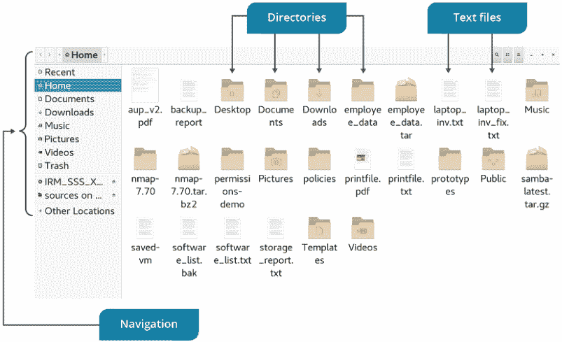

一个文件浏览器 GUI 应用程序。

正如你所见，Linux 中的 GUI 是可选的，通常在工作站或其他非服务器角色中使用。GUI 会增加额外的性能开销，尤其是因为绘制视觉元素比简单文本消耗更多的处理能力和内存。因此，它们在性能至关重要的服务器上不太常用。不过，这并非绝对，因为许多管理员更喜欢在 GUI 环境中工作，或者至少能够访问 GUI，即使他们大部分时间在输入命令。图形用户界面可以模拟命令行界面，让您在其中输入命令，因此您不会局限于使用可视化界面。

### 显示服务器

显示服务器是图形用户界面的组成部分，负责构建和管理窗口系统以及其他可以在屏幕上绘制的视觉元素。显示服务器接收客户端输入请求，并将其发送到相应的内核模块进行处理。同样，它们还管理接收应用程序请求以向客户端显示输出的过程。

顾名思义，显示服务器通过特定的支持网络的协议管理通信。这使远程客户端能够访问 Linux 系统的图形用户界面元素，例如特定的窗口。不过，服务器仍然可以为其本地客户端提供服务。

Linux 支持多种不同的显示服务器。其中两个最著名的是 X Window 系统和 Wayland 中的实现。

### X Window 系统

X Window 系统，也称为 X11 或 X，是由麻省理工学院（MIT）于 1984 年开发的平台无关的显示服务器和窗口系统。

与所有显示服务器一样，X 服务器协调客户端输入和应用程序输出，以确定如何在屏幕上绘制元素。X 服务器还与一个单独的组合器通信。该组合器读取每个应用程序写入的内存缓冲区，然后利用该缓冲区中的信息将各个应用程序窗口组合到屏幕上，从而使多个窗口能够同时显示。每当 X 服务器接收到事件时（例如，单击了某个按钮，现在必须高亮显示），它必须通知组合器，以便组合器可以重新合成受该事件影响的屏幕部分。

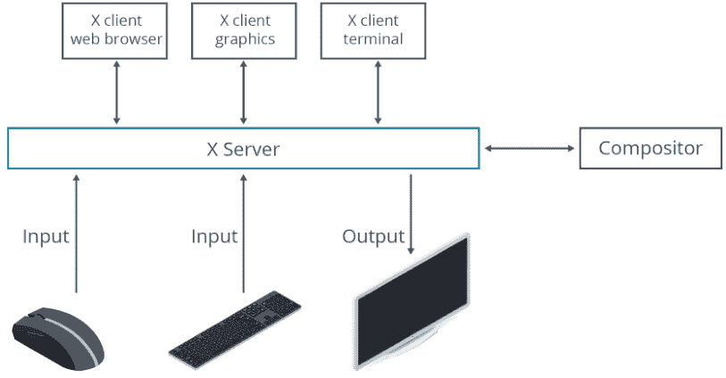

*X Window 系统架构。*

### X.Org 服务器

X.Org 服务器是适用于 Linux 和其他类 Unix 操作系统的 X Window 系统的自由开源参考实现。它于 2004 年发布，很快成为许多 Linux 发行版上的*事实上的*显示服务器。在 X.Org 服务器之前，Linux 中 X 的主要实现是 XFree86，它最终改用自由软件社区认为与 GPL 不兼容的自定义许可证。因此，XFree86 被分支为 X.Org 服务器。

### Wayland

Wayland 既是显示服务器，也是其在类 Unix 操作系统中的参考实现，旨在改进并取代 X Window 系统。Wayland 与 X 的主要区别在于，在 Wayland 中，组合器*就是*服务器，而不是一个独立的组件。这使客户端能够与组合器直接交换事件，省去了 X 服务器作为中间人的环节。

Wayland 于 2008 年首次发布，尽管 X.Org 服务器仍在 Linux 发行版中占主导地位，但 Wayland 的采用率一直在缓慢增长。例如，Fedora® 从第 25 版开始（2016 年 11 月发布）使用 Wayland 作为其默认显示服务器。

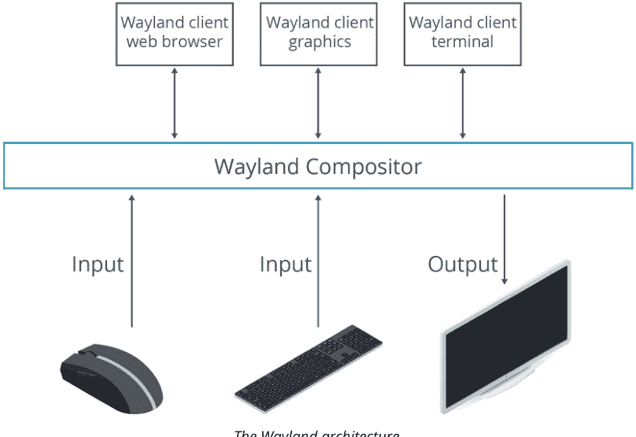

### X 与 Wayland 对比

Wayland 相比 X 有多项改进，包括：

- 在 X 中，X 服务器必须确定事件适用于哪个窗口。它并不总能正确做到这点，因为独立的组合器控制着窗口的重绘方式，如调整大小和旋转——X 服务器未必了解这些信息。由于在 Wayland 中组合器和服务器是一体的，因此这不是问题。
- 在 X 中，组合器必须从服务器获取事件数据，这会引入延迟。在 Wayland 中，组合器直接从客户端接收事件，从而缓解了延迟问题。
- Wayland 简化了图形渲染过程，使客户端能够执行自己的渲染。


尽管 Wayland 不像 X 那样具有网络感知能力，但它仍然可以利用远程桌面协议来通过网络控制图形用户界面环境。

X 的较早实现不会隔离每个窗口的数据输入/输出，而 Wayland 会。这有助于确保数据安全。

### WAYLAND 的缺点

尽管 Wayland 在几乎所有方面都优于 X，但 Wayland 仍存在一些问题。例如，Canonical® 于 2017 年 10 月将 Wayland 设为 Ubuntu® 17.10 的默认显示服务器。2018 年 4 月，在 Ubuntu 18.04 发布时，Canonical 宣布出于三个主要原因换回 X.Org 服务器：

- 屏幕共享软件在 X.Org 服务器下的运行效果往往优于 Wayland。
- 远程桌面软件在 X.Org 服务器下的运行效果往往优于 Wayland。
- 从崩溃中恢复在 X.Org 服务器下比在 Wayland 下更容易。

不过，Canonical 仍然表示了对 Wayland 未来的承诺。

### 桌面环境

**桌面环境**，也称为**窗口管理器**，是显示服务器的客户端，它告诉服务器如何在屏幕上绘制图形元素。换句话说，桌面环境控制整个操作系统图形用户界面的外观和风格，为运行在该环境中的应用程序提供统一的图形界面。

桌面环境实现了桌面隐喻，即将用户的显示器视为仿佛是一个物理桌面的顶部，各种物品放置在上面，供坐在桌前的人访问。桌面隐喻的主要结构元素是应用程序窗口，在每个窗口内可以存在各种图形元素，如按钮、图标、菜单、工具栏等。

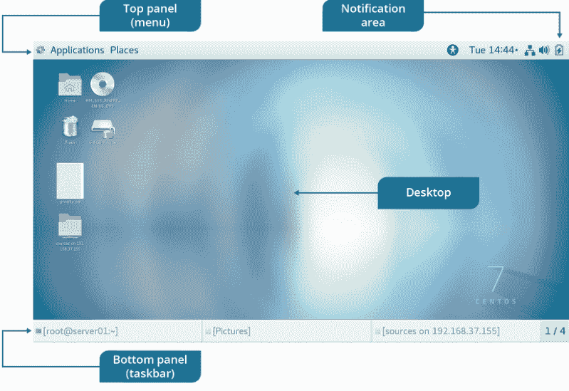

*GNOME 桌面环境。*

桌面环境还提供图形登录屏幕，可以自定义为每次系统启动时运行。在大多数情况下，桌面环境还会附带打包各种图形用户界面应用程序，如文件浏览器、网页浏览器、文本编辑器等。

**注意：** 某些桌面环境可以在 X、Wayland 或两者上运行。

## 特定的桌面环境

Linux 有许多可用的桌面环境，其中最常见的描述如下表所示。

| 桌面环境 | 说明 |
| --- | --- |
| **GNOME** | 这是大多数 Linux 发行版中的默认桌面环境。它可以在 X 和 Wayland 上运行。GNOME 遵循称为人机界面指南（HIG）的设计原则，强调焦点清晰、简洁、减少用户必须执行的工作量等。GNOME 还为残障人士提供了大量支持。 |
| | GNOME Shell 是桌面环境实际使用的用户界面，它定义了工具栏、菜单等元素的位置和外观。从第 3 版开始，GNOME 从使用典型的桌面隐喻转变为更抽象的隐喻，用户可以从概览屏幕在虚拟桌面和任务之间切换。 |
| | 还有 GNOME Classic 外壳，即使在安装了第 3 版的情况下，它也能提供与 GNOME 第 2 版类似的用户界面。Canonical 还为 Ubuntu 上的 GNOME 开发了 Unity 外壳，但在 2018 年改用 GNOME 3。Unity 最初设计用于更好地利用小屏幕设备（如上网本）的空间。例如，Unity 中屏幕左侧的应用启动器始终存在——只需单击即可启动应用——而在 GNOME Shell 中，需要键盘输入或将鼠标移动到屏幕左上角才能出现。 |
| **KDE Plasma** | 虽然不如 GNOME 普及，但 KDE® Plasma 是第二常见的桌面环境，包含在 RHEL 和 CentOS® 等发行版中，即使未设为默认。截至 2018 年，当前版本为 KDE Plasma 5。 |
| | KDE Plasma 通过小部件支持模块化，使用户能够添加、移动和移除屏幕元素以适应自己的个人工作流。KDE Plasma 还拥有功能强大的图形用户界面应用程序套件，包括文字处理器、邮件客户端、多媒体软件等。它支持 X 和 Wayland。 |
| **Cinnamon** | 这实际上是 GNOME 3 的一个分支，是 Linux Mint 发行版的默认环境之一。Cinnamon 是为了应对 GNOME 3 的变化而开发的，使用典型的桌面隐喻而非抽象隐喻。因此，它类似于 GNOME 2。不过，截至 2018 年，Cinnamon 不支持 Wayland。 |

| 桌面环境 | 描述 |
| --- | --- |
| MATE | 这是 GNOME 的另一个分支，因 GNOME 3 的变化而创建。它的开发初衷是维护和扩展 GNOME 2 的功能。其许多 GUI 应用程序都是 GNOME 核心应用程序的分支版本。MATE 是 Linux Mint 的另一个默认环境，也可在某些其他发行版中选择使用。与 Cinnamon 一样，它目前尚不支持 Wayland。 |

## 选择正确的桌面环境

这些桌面环境中没有一个是客观上"正确"的选择。最终选择哪种环境取决于个人偏好以及您对各环境的熟悉程度。您需要尝试每种环境，才能知道哪种最适合您。

**远程桌面**是一种概念，指客户端通过网络连接到远程系统，并能够登录和使用该系统的桌面环境。远程桌面会话在以下情况中非常有用：您必须配置带有 GUI 的服务器，但您并不位于该系统的物理位置。此外，远程桌面会话还用于以下环境：用户连接并操作他们的远程计算机，就像它就在面前一样——换句话说，远程会话成为他们的主桌面。

客户端计算机通常在自己的窗口中构建远程会话，当该窗口获得焦点时，本地客户端上的任何输入（例如，按键）都会被转换并发送到远程桌面，就像该按键直接在该系统上执行一样。

## 远程桌面软件

Linux 上有许多软件包可启用远程桌面会话。软件通常有两种形式：客户端应用程序，安装在您物理所在处的计算机上；以及配套的服务器应用程序，安装在您尝试连接的远程系统上。

| 远程桌面软件 | 描述 |
| --- | --- |
| Virtual Network Computing (VNC) | VNC 是一种跨平台远程桌面服务，可实现桌面环境的完全远程控制。VNC 利用远程帧缓冲（RFB）协议。必须在目标机器上安装 VNC 服务器，您可以使用相应的客户端访问它。有许多不同的 VNC 实现可在 Linux 上工作，包括 RealVNC、TightVNC、TigerVNC 等。VNC 可与 X 和 Wayland 配合工作。 |
| xrdp | xrdp 是一个免费开源工具，为非 Windows 系统构建类似远程桌面协议（RDP）的服务器。RDP 由 Microsoft® 开发，是 Windows® 上的默认远程桌面软件。因此，您可以在远程 Linux 服务器上安装 xrdp，并使用 `rdesktop` 等工具甚至默认的 RDP 客户端连接到该服务器——换句话说，客户端可以位于任何平台上。xrdp 工具旨在与 X 配合工作。 |
| **NoMachine (NX)** | NX 是跨平台的专有远程桌面软件，提供对多会话环境和账户管理的支持。因此，它对于许多用户需要同时访问相同服务器的组织非常有用。NX 旨在与 X 配合工作。 |
| **Simple Protocol for Independent Computing Environments (SPICE)** | SPICE 是免费开源协议，专为虚拟环境使用而设计。SPICE 常被管理员用于连接由基于内核的虚拟机（KVM）管理程序托管的虚拟机。 |

*VNC 和 xrdp。*

## 控制台重定向

**控制台重定向（Console redirection）** 是通过串行连接而非直接连接到系统的任何 I/O 外设来转发输入和输出的过程。这使具有控制台重定向功能的系统能够通过串行线缆发送显示输出数据，最终到达远程客户端。同样，远程客户端可以通过串行连接重定向其键盘输入，使其发送到远程服务器。

最终，控制台重定向使管理员能够在 BIOS/UEFI 等预启动环境中远程配置系统。如果没有加载 Linux 这样的操作系统，典型的远程访问方法（如 SSH 和远程桌面）将不可用。使用控制台重定向，管理员可以通过网络更改多台机器的 BIOS/UEFI 设置，即使这些机器没有直接连接的 I/O 设备。

> **注意：** 并非所有系统都支持 BIOS/UEFI 中的控制台重定向。

## SSH 端口转发

**安全外壳（SSH）** 是一种远程访问协议，可加密网络传输。它是访问 Linux 服务器命令行界面最常用的协议。您可以使用 SSH 向服务器发送命令，就像直接在其 CLI 中输入一样。它可以用作隧道，安全地承载其他类型的网络通信，包括远程桌面流量。

通过 SSH 隧道传输应用程序以保障其传输安全的过程称为 **SSH 端口转发**。主要有两种类型：本地转发和远程转发。在本地转发中，本地客户端监听某个端口上的连接，然后使用 SSH 将任何活动连接隧道传输到远程服务器。本地转发的一个用例是使用 VNC 等协议通过互联网远程访问系统。当您使用本地 VNC 客户端连接 VNC 服务器时，该流量（通常通过 5900 等端口）将通过 SSH 转发，从而保障其安全。

在远程转发中，SSH 服务器将入站客户端流量转发到另一个系统的不同端口。远程转发的一个用例是在本地系统上设置 VNC 服务器，并将所有 VNC 流量转发到远程客户端的某个端口。每当远程客户端使用 localhost（他们自己的网络地址）连接到此端口时，他们就可以与本地服务器建立远程桌面连接。

## X 转发

如您所知，X（X11）支持网络，可使客户端通过网络访问 GUI 元素。您可以通过 SSH 隧道转发 X 流量，以加密这些通信。

## 无障碍选项

每个桌面环境都有自己的无障碍选项，以满足残障人士的需求。

> 在 GNOME 的"通用访问"菜单中配置无障碍选项。

> 注意：某一环境中可用的无障碍选项可能不存在于另一环境中。

一些常见选项包括：

- 屏幕阅读器，朗读所有高亮的屏幕元素。
- 放大镜，放大屏幕的特定区域。
- 增大特定元素的大小，如文本和鼠标指针。
- 屏幕键盘，使用户能够使用鼠标点击来输入文本，而不是使用实体键盘。
- 键盘无障碍选项，包括：
  - 粘滞键，使用户能够一次按一个键，而不是同时按住多个键来激活键盘快捷键。
  - 重复键，使用户能够按住某个键以重复输入它。
  - 切换键，使系统在按下 **Caps Lock** 和 **Num Lock** 等键时发出蜂鸣声。
- 高对比度等视觉主题，使屏幕对某些视觉障碍人士更易阅读。

**注意：** 要了解更多信息，请查看课程网站的"视频"标签，了解为本课内容补充的任何视频。

## 活动 8-3

### 讨论 GUI

### 场景

回答以下问题，以检查您对该主题的理解。

1. 判断正误？大多数管理活动（如创建新用户和安装新软件）都需要图形桌面环境。
2. X 和 Wayland 显示服务器之间的主要架构差异是什么？这种差异如何影响性能？
3. 作为用户，您可以在哪里切换到不同的图形用户界面（例如从 KDE 切换到 GNOME）？
4. 从基础层面来说，许多远程桌面协议（例如 NX、xrdp、SPICE、VNC）并非设计为高安全性。如何使它们更安全？
5. 管理员为什么需要或使用控制台重定向？

## 活动 8-4

## 配置图形用户界面

### 开始前准备

你已使用学生账户登录到命令行界面。CentOS 系统已预先安装了两个图形用户界面桌面环境：GNOME 和 KDE。

### 场景

到目前为止，命令行界面已经足够使用，但你的许多同事在可视化环境中工作会感觉更舒适。图形用户界面对于轻松浏览网页以及查看图像和视频等媒体也是必需的。你的大多数同事更喜欢使用 GNOME，即默认的桌面环境，而其他人则喜欢定制版本的 KDE。因此，你首先需要配置 KDE 的布局选项，以符合这些用户的偏好。然后，你需要熟悉 GNOME 的导航操作——这是你自己将使用的环境。你还需要在 GNOME 中为有视觉和手部灵活性障碍的用户配置一些辅助功能选项。

**1.** 切换到图形用户界面，然后登录到 KDE。

- a) 输入 `sudo systemctl isolate graphical.target`
- b) 确认你当前处于图形登录屏幕。

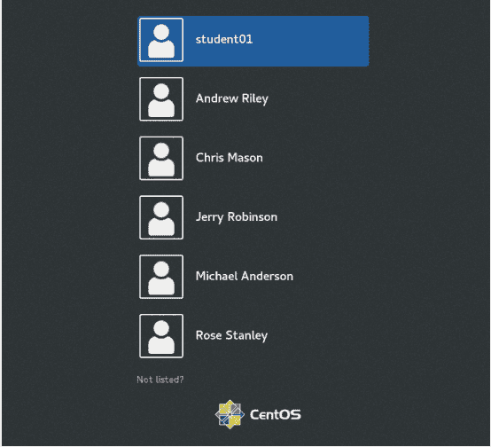

- c) 选择 **student**。
- d) 在 **登录** 按钮左侧，选择 **设置** 齿轮图标。
- e) 选择 **KDE Plasma Workspace**。
- f) 输入你的密码并选择 **登录**。

**2.** 配置 KDE 的桌面设置。

- a) 在桌面上，右键单击并选择 **默认桌面设置**。
- b) 在 **桌面设置 - Plasma Desktop Shell** 窗口中，在左窗格中确认已选择 **视图**。
- c) 从 **布局** 下拉列表中，选择 **搜索并启动**。
- d) 在图像区域中，从缩略图列表中选择 **7lines-bottom**。


- e) 选择 **确定** 以应用设置并关闭 **桌面设置 - Plasma Desktop Shell** 窗口。
- f) 检查桌面环境的新布局。

**3.** 切换到 GNOME。

- a) 从桌面右上角，选择 **桌面** 菜单，然后选择 **离开**。

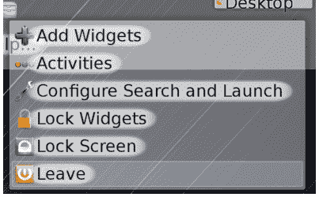

- b) 选择 **注销**。
- c) 选择 **student**。
- d) 在 **登录** 按钮左侧，选择 **设置** 图标。
- e) 选择 **GNOME Classic**。
- f) 使用你的密码登录。

**4.** 完成初步设置选项。

- a) 在 **欢迎** 屏幕上，选择 **下一步**。
- b) 在 **键盘输入** 屏幕上，选择 **下一步**。
- c) 在 **网络** 屏幕上，选择 **跳过**。
- d) 在 **隐私** 屏幕上，选择 **下一步**。
- e) 在对话框中，选择 **拒绝访问**。
- f) 在 **在线账户** 屏幕上，选择 **跳过**。
- g) 在 **准备就绪** 屏幕上，选择 **开始使用 CentOS Linux**。
- h) 关闭 **入门指南** 窗口。
- i) 检查桌面，注意 GNOME 的外观和感觉与 KDE 不同。

**5.** 在桌面中导航并打开一个应用程序。

- a) 从桌面菜单中，选择 **应用程序→收藏夹→文件**。
- b) 确认你当前位于主目录中。
- c) 双击 **backup_report** 文件，在默认的图形用户界面文本编辑器中打开它。
- d) 对文件进行更改，然后选择 **保存**。
- e) 关闭文本编辑器。
- f) 关闭文件浏览器。

**6.** 在 GNOME 中为有视觉和手部灵活性障碍的用户启用辅助功能设置。

- a) 选择 **应用程序→系统工具→设置**。
- b) 在左侧导航窗格中，选择 **通用辅助功能**。
- c) 在 **视觉** 部分中，将 **高对比度** 滑块滑动到 **开启**。
- d) 在 **键盘输入** 部分中，将 **屏幕键盘** 滑块滑动到 **开启**。
- e) 关闭 **设置** 窗口。

**7.** 打开终端，然后撤销辅助功能更改。

- a) 从桌面菜单中，选择 **应用程序→收藏夹→终端**。
- b) 确认屏幕键盘已自动打开。
- c) 从桌面任务栏右上角，选择 **通用辅助功能** 图标，然后将 **屏幕键盘** 滑动到 **关闭**。
- d) 对 **高对比度** 执行相同操作。

**8.** 保持终端窗口打开。

---

## 主题 C

## 管理服务

#### 涵盖的考试目标

- 2.4 在给定场景下，管理服务。
- 4.1 在给定场景下，分析系统属性并进行相应修复。

服务是操作系统向用户和应用程序提供功能的方式，因此可以像管理 Linux 的其他任何部分一样对其进行管理。在本主题中，你将启动和停止服务以控制可用的系统功能。

### 服务和守护进程

Linux **服务** 是一种响应其他程序请求以提供某种专业功能的软件。服务可以大致分为关键服务和非关键服务。关键服务是 Linux 系统运行所必需的核心服务。非关键服务是由系统上安装的应用程序发起的服务。

大多数服务以 **守护进程** 的形式实现，守护进程是在后台运行的程序（即进程），无需人工干预即可操作。守护进程处于休眠状态，直到某个事件触发它们进入活动状态。某些守护进程按固定间隔运行。大多数守护进程在系统启动时启动。守护进程可以由操作系统、应用程序或用户手动启动。

> **注意：** "服务"和"守护进程"这两个术语经常互换使用。例如，在 Windows 中，服务相当于 Linux 的守护进程。

### 服务管理

**服务管理** 是启动服务、修改其运行状态以及停止服务的生命周期过程。系统可以自行管理服务，或者用户可以根据自己的需要手动管理服务。服务管理在 Linux 等操作系统中非常重要，因为它使管理员能够配置其服务器提供的功能。它还可以帮助管理员诊断和排查影响或由运行程序引起的问题。

### 系统初始化

**系统初始化** 是内核首次加载时开始的过程。它涉及加载操作系统及其各种组件，包括引导过程。系统初始化在 Linux 中由 **init** 守护进程执行——即"所有进程的父进程"。init 守护进程引用配置文件并启动其中列出的进程。这为系统运行所需软件做好准备。init 守护进程持续运行直到系统断电，没有它，系统上的程序将无法运行。

在 Linux 上，有两种主要的系统初始化方法：SysVinit 和 systemd。你的 Linux 系统上活动的初始化方法将影响你在该系统上管理服务的方式。

> **注意：** 此处，"init 守护进程"一般指执行系统初始化的守护进程，而非特定的 SysVinit 守护进程（名为 `init`）。

> **注意：** 早期版本的 Ubuntu 也有自己的初始化方法，称为 Upstart。

### systemd 套件


`systemd` 软件套件提供了一种用于初始化系统的方法。它还提供了用于管理系统上服务的工具，这些工具源自 `init` 守护进程。`systemd` 套件被设计为 SysVinit 等其他方法的替代方案，现已成为现代 Linux 发行版中占主导地位的初始化方法。

与旧方法相比，`systemd` 套件提供了多项改进。例如，它支持并行化（同时启动程序以加快引导速度）并减少了 shell 开销。在 `systemd` 中，使用控制组（cgroups）来跟踪进程，而不是进程 ID（PID），这为进程提供了更好的隔离和分类。

## systemd 单元文件

**单元文件** 是 `systemd` 用来确定如何处理单元的配置文件，单元是 `systemd` 可以管理的系统资源。资源可以包括网络服务、块存储设备、外围设备、文件系统等等。守护进程访问和管理这些资源。资源定义在几种单元文件类别之一中，使其更易于管理。单元文件的扩展名定义了其类别；例如，`.automount` 文件包含用于自动挂载在 `.mount` 单元文件中定义的挂载点的指令。单元文件使用声明式语言编写，使用告诉 `systemd` 做什么的指令。

```
[root@server01 ~]# cat /lib/systemd/system/graphical.target
#  This file is part of systemd.
#
#  systemd is free software; you can redistribute it and/or modify it
#  under the terms of the GNU Lesser General Public License as published
#  by
#  the Free Software Foundation; either version 2.1 of the License, or
#  (at your option) any later version.

[Unit]
Description=Graphical Interface
Documentation=man:systemd.special(7)
Requires=multi-user.target
Wants=display-manager.service
Conflicts=rescue.service rescue.target
After=multi-user.target rescue.service rescue.target display-manager.service
```

*graphical.target 单元文件的配置。*

单元文件可以存在于多个位置。软件用于安装单元文件的标准位置是 `/lib/systemd/system/` 目录。但是，你不应编辑此目录中的单元文件。如果你想修改单元文件的功能，应该使用 `/etc/systemd/system/` 目录。因为此目录中的单元文件优先于其他位置的文件，所以你可以在此处替换它们。如果你想仅修改单元文件的一部分，可以创建一个目录

## 环境变量

单元文件还可用于设置系统环境变量/参数，这些值从父进程传递给其创建的任何子进程。通过为环境变量添加指令，可以使服务或其他单元更轻松地使用自定义值。

例如，`rescue.service` 单元文件设置了以下 `Environment` 指令：

```
[Service]
Environment=HOME=/root
```

因此，`HOME` 环境变量被设置为 root 用户的家目录，使救援模式守护进程能够以该路径作为家目录登录到 shell。配置你自己的单元文件时，你可以使用类似的指令，或许提供不同的路径。你还可以设置任何你想要的变量——不仅仅是 `HOME`。

## systemd 目标

在 `systemd` 中，**目标（targets）** 是一种将单元配置文件分组在一起的方法，通常用于表示特定的操作模式。每个 `.target` 文件用于确定系统可以运行的几种方式之一，例如仅使用 CLI 运行；使用图形桌面环境运行；启动系统关机；等等。因此，你可以激活某个目标以引导进入所需的环境。

目标文件包含依赖信息，以实现这些不同的操作模式。例如，`graphical.target` 将系统引导进入 GUI 环境。它通过引用其他单元文件（如 `gdm.service`（GNOME 显示管理器））来实现这一点，这些文件是初始化 GUI 及其相关组件所必需的。

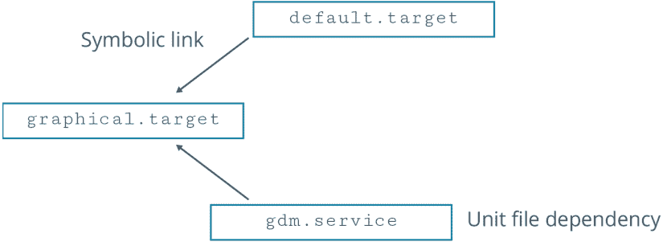

*目标文件如何与其他 systemd 组件交互的示例。*

## systemctl 命令

`systemctl` 命令使你能够控制 `systemd` init 守护进程。你可以查看正在运行的服务、管理（启用/禁用）在引导时或当前会话中运行的服务、确定这些服务的状态，以及管理系统目标。

```
[root@server01 ~]# systemctl status sshd
● sshd.service - OpenSSH server daemon
   Loaded: loaded (/usr/lib/systemd/system/sshd.service; enabled; vendor preset: enabled)
   Active: active (running) since Wed 2019-01-02 18:41:11 GMT; 5 days ago
     Docs: man:sshd(8)
           man:sshd_config(5)
 Main PID: 1334 (sshd)
    Tasks: 1
   CGroup: /system.slice/sshd.service
           ├─1334 /usr/sbin/sshd -D

Jan 02 18:41:11 server01 systemd[1]: Starting OpenSSH server daemon...
```

*检查服务的状态。*

你可以通过 `systemctl` 命令发出的各种子命令来完成所有这些操作，如下表所述。

| 子命令 | 用途 |
|--------|------|
| `status {service}` | 检索服务的当前状态。 |
| `enable {service}` | 启用服务使其在引导时启动。 |
| `disable {service}` | 禁用服务，使其不再在引导时启动。 |
| `start {service}` | 立即启动（激活）服务。 |
| `stop {service}` | 立即停止（停用）服务。 |
| `restart {service}` | 立即重新启动服务。 |
| `set-default {target}` | 设置系统引导时使用的默认目标。 |
| `isolate {target}` | 强制系统立即更改为提供的目标。 |
| `mask {unit file}` | 阻止提供的单元文件被启用或激活，即使手动操作也是如此。 |
| `daemon-reload` | 重新加载 `systemd` init 守护进程，包括所有单元文件。 |

## 语法

`systemctl` 命令的语法是 `systemctl [options] [subcommand] [arguments]`

## systemctl 命令选项

`systemctl` 命令有许多选项，其中一些在下表中描述。

| 选项 | 用途 |
| --- | --- |
| `-t {unit file type}` | 指定要对其执行操作的单元文件类型。 |
| `-a` | 列出所有单元文件或属性，无论状态如何。 |
| `--no-reload` | 启用或禁用服务时阻止重新加载配置更改。 |
| `--no-ask-password` | 执行特权操作时阻止要求用户进行身份验证。 |
| `--runtime` | 使更改临时化，以便在重新启动后不会保留。 |
| `-H {remote host}` | 在由 IP 地址或主机名指定的远程主机上执行操作。 |
| `--no-pager` | 阻止输出被管道传输到分页工具。 |

## 切换目标的示例

使用 `systemctl` 命令更改目标的一个示例是管理员需要短时间使用 GUI 工作时。将 Linux 服务器配置为默认引导到 CLI（`multi-user.target`）是很常见的。管理员可能会为特定任务切换到 GUI（`graphical.target`），然后在任务完成后将服务器切换回 `multi-user.target`。之后，管理员会将服务器保留在更高效的 CLI 配置中。

该过程可以按以下步骤进行：

1. 服务器默认启动到 `multi-user.target`。
2. 管理员在 CLI 登录到服务器并输入以下命令以启动 GUI：`systemctl isolate graphical.target`
3. 管理员完成其管理任务。
4. 管理员输入以下命令将服务器返回到更高效的 CLI 配置：`systemctl isolate multi-user.target`

## hostnamectl 命令

在大多数情况下，`systemctl` 用于控制服务，但还有一些额外的 `systemd` 命令可供使用。例如，`hostnamectl` 使你能够查看系统的网络主机名以及有关系统硬件和正在运行的 Linux 内核的其他信息。你还可以使用此命令更改系统的主机名。

`hostnamectl` 命令的语法是 `hostnamectl [options] [subcommand] [arguments]`

例如，要将主机名设置为 `server01`：

```
hostnamectl set-hostname server01
```

## SysVinit 和运行级别

**SysVinit** 是一种较旧的 init 方法，已基本被 `systemd` 取代。但是，某些发行版仍然支持 SysVinit。与 `systemd` 类似，SysVinit 提供了各种工具来管理服务和管理系统的状态。

除了 `systemd` 的改进之外，SysVinit 与 `systemd` 的一个主要区别是 SysVinit 具有**运行级别（runlevels）**。运行级别控制操作系统状态的方式与 `systemd` 目标大致相同；它们确定应该运行哪些类型的守护进程以创建特定类型的环境。实际上，`systemd` 目标就是为了映射到现有运行级别而创建的。与 `systemd` 目标一样，你可以更改系统的运行级别并设置默认值。

> **注意：** SysVinit 在 UNIX System V 操作系统家族中流行开来，发音为"System Five"（系统五）。

## 运行级别与目标

下表比较了 SysVinit 运行级别与其等效的 `systemd` 目标。

| SysVinit 运行级别 | systemd 目标 | 描述 |
|-------------------|--------------|------|
| 0 | `poweroff.target` | 停止（关闭）系统。 |
| 1 | `rescue.target` | 启动单用户模式。 |
| 2 | `multi-user.target` | 启动无远程网络的多用户模式。加载命令行界面（CLI）。 |
| 3 | `multi-user.target` | 启动具有远程网络的多用户模式。加载 CLI。 |
| 4 | `multi-user.target` | 未使用。 |
| 5 | `graphical.target` | 启动具有网络和 GUI 功能的多用户模式。加载桌面环境。 |
| 6 | `reboot.target` | 重新启动系统。 |

## 单用户模式

**单用户模式** 将操作系统引导到超级用户必须登录的环境中。单用户模式中还禁用了网络，并且大多数分区未挂载。它通常用于排查网络问题或阻止你引导到正常多用户环境的问题。

在某些系统上，特别是使用原始 GRUB 引导加载程序的系统，如果 root 密码丢失，可以从单用户模式重置 root 密码。但是，对于 GRUB 2，你必须在引导菜单处编辑引导加载程序配置，使其初始化一个不需要密码的特权 shell。从此 shell 中，你可以重置 root 用户的密码。

## telinit 和 runlevel 命令

`telinit` 命令使你能够切换系统的当前运行级别。在 `systemd` 环境中，`telinit` 命令将被转换为适当的目标请求。`runlevel` 命令打印系统的先前和当前运行级别，每个运行级别之间用空格分隔。

## 语法

`telinit` 命令的语法是 `telinit [options] {runlevel}`

## /etc/inittab 文件

`/etc/inittab` 文件存储了 SysVinit 系统上与系统初始化相关的各种进程详细信息。它还存储了正在使用的运行级别信息。`init` 守护进程读取该文件以确定要启动到哪个运行级别、要启动哪些守护进程，以及当运行级别发生变化时应执行什么操作。`/etc/inittab` 文件中的每条记录采用以下格式：

```
id:rstate:action:process
```

`id` 只是该记录的唯一标识符；`rstate` 定义该记录适用的运行级别；`action` 指定了若干任务之一，用于确定 SysVinit 如何处理在 `process` 字段中定义的命令。

## /etc/init.d/ 目录

`/etc/init.d/` 目录存储服务的初始化脚本。这些脚本控制特定运行级别中的服务启动。在系统初始化开始时，通过文件中找到的符号链接从 `/etc/inittab` 文件调用这些脚本。SysVinit 脚本非常灵活，可以根据用户需求进行配置。

根据发行版的不同，SysVinit 脚本可能存储在 `/etc/rc.d/` 中，或者该目录可能包含指向 `/etc/init.d/` 目录的符号链接。

## /etc/rc.local 文件

`/etc/rc.local` 文件在 init 引导过程结束时执行，通常用于启动自定义服务。然而，该文件很少使用，甚至在某些仍使用 SysVinit 的发行版中也不受支持。

## chkconfig 命令

`chkconfig` 命令可用于控制每个运行级别中的服务。它还可用于在系统启动期间启动或停止服务。以下是可以与 `chkconfig` 一起用于控制服务的一些子命令和选项。

| 子命令/选项 | 用途 |
| --- | --- |
| `{service} on` | 启用服务在启动时启动。 |
| `{service} off` | 禁用服务，使其不再在启动时启动。 |
| `{service} reset` | 重置服务的状态。 |
| `--level {runlevel}` | 指定要启用或禁用服务的运行级别。 |

## 语法

`chkconfig` 命令的语法为 `chkconfig [options] [service] [subcommand]`

## service 命令

`service` 命令是通过 SysVinit 脚本控制 SysVinit 服务的另一种方式。它支持以下子命令。

| 子命令 | 用途 |
| --- | --- |
| `{service} status` | 打印服务的当前状态。 |
| `{service} start` | 立即启动（激活）服务。 |
| `{service} stop` | 立即停止（停用）服务。 |
| `{service} restart` | 立即重新启动服务。 |
| `{service} reload` | 在服务保持运行的同时重新读取其配置文件。 |

## 语法

`service` 命令的语法为 `service [options] [service] [subcommand]`

> **注意：** 要了解更多信息，请查看课程网站上的"视频"标签页，了解补充本课内容的任何视频。

## 活动 8-5

### 讨论服务

### 场景

回答以下问题以检查您对该主题的理解。

- 1. 安装 Apache Web 服务器 `httpd` 后，您想检查其状态。如何检查 `httpd` 服务的状态？
- 2. 如何激活 `httpd` 之类的服务？
- 3. 您希望确保 Apache Web 服务器在启动时启动。可以使用哪个命令来确保它启动？
- 4. `systemctl enable httpd.service` 的 SysVinit 等价命令是什么？
- 5. 您修改了 `/etc/httpd/conf/httpd.conf` 文件并保存了更改，但所做的更改尚未生效。问题是什么，如何修复？

## 活动 8-6

### 管理服务

### 开始之前

您以学生帐户登录到 GUI。终端窗口已打开。如果您的系统被锁定并显示空黑屏，请按 **Spacebar** 键，然后输入密码以重新登录 GUI。

### 场景

作为 Develetech 的 Linux 管理员，您知道自己将实施、管理和重新配置不同的服务。您将利用 `systemd`，特别是 `systemctl` 命令及其相关子命令来管理这些服务。您决定先通过将目标从 CLI 切换到 GUI，然后将默认目标设置为 GUI，以便用户默认始终启动到该环境。然后，您将通过启动、停止、启用和禁用 SSH 和防火墙服务来练习管理它们。

- 1. 验证您的系统正在使用 `systemd`，而不是较旧的 SysVinit 方法。
  - a) 在终端窗口中，输入 `ps -e | grep -i init` 以检查 `init` 进程。
  - b) 验证未找到 `init` 进程。
  - c) 输入 `ps -e | grep -i systemd` 以检查 `systemd` 进程。
  - d) 验证找到了 `systemd` 进程，并且其进程 ID 为 1。


```
[student01@localhost ~]$ ps -e | grep -i systemd
    1 ?          00:00:38 systemd
  511 ?          00:00:06 systemd-journal
  540 ?          00:00:01 systemd-udevd
  820 ?          00:00:02 systemd-logind
```

## 2. 查看指定系统启动时将启动的服务的目标文件

- a) 输入 `cat /usr/lib/systemd/system/multi-user.target`

  注意 `multi-target.target` 需要 `basic.target`——即目标文件相互构建。

- b) 输入 `cat /usr/lib/systemd/system/graphical.target`

  注意 `graphical.target` 需要 `multi-user.target`——这进一步说明了目标文件是如何相互构建的。此外，`graphical.target` 调用或"需要" `display-manager.service`，它启动了 GUI。

- c) 输入 `systemctl --type=service` 以查看当前目标的服务。

- d) 完成后按 `q` 键。

## 3. 在 CLI 目标和 GUI 目标之间切换，然后将 GUI 目标设置为默认值

- a) 输入 `sudo systemctl isolate multi-user.target` 以切换回命令行界面。

- b) 以 `student##` 身份登录。

- c) 输入 `sudo systemctl isolate graphical.target` 以切换到图形用户界面。

- d) 以 `student##` 身份登录并打开终端。

- e) 输入 `sudo systemctl set-default graphical.target` 以将 GUI 设置为默认环境。

## 4. 检查 `systemctl` 子命令

- a) 输入 `systemctl`，然后输入一个空格，然后按 `Tab` 键两次。您可以将此技巧用于某些命令，以列出其所有可用的子命令。

  > **注意：** 请务必在命令后添加一个空格，然后再按 `Tab` 键。

- b) 特别注意 `stop`、`start`、`restart`、`status`、`enable` 和 `disable` 子命令。

## 5. 在您的服务器上管理 SSH 服务

- a) 输入 `sudo systemctl status sshd.service`

- b) 验证 `sshd` 服务正在运行。

```
● sshd.service - OpenSSH server daemon
  Loaded: loaded (/usr/lib/systemd/system/sshd.service; enabled; vendor preset: enabled)
  Active: active (running) since Tue 2018-12-11 18:31:12 GMT; 3 days ago
    Docs: man:sshd(8)
          man:sshd_config(5)
  Main PID: 1346 (sshd)
  Tasks: 1
  CGroup: /system.slice/sshd.service
          └─1346 /usr/sbin/sshd -D
```

- c) 输入 `sudo systemctl stop sshd.service`

- d) 验证 `sshd` 服务已停止。

```
● sshd.service - OpenSSH server daemon
  Loaded: loaded (/usr/lib/systemd/system/sshd.service; enabled; vendor preset: enabled)
  Active: inactive (dead) since Fri 2018-12-14 19:48:49 GMT; 4s ago
    Docs: man:sshd(8)
          man:sshd_config(5)
  Process: 1346 ExecStart=/usr/sbin/sshd -D $OPTIONS (code=exited, status=0/SUCCESS)
  Main PID: 1346 (code=exited, status=0/SUCCESS)
```

- e) 输入 `sudo systemctl start sshd.service` 以再次启动 `sshd` 服务，然后检查其状态以确保它正在运行。

## 6. 禁用然后重新启用 `firewalld` 服务

- 输入 `sudo systemctl status firewalld.service`

- 验证 `firewalld` 服务是否正在运行。

- 输入 `sudo systemctl disable firewalld.service`

- 验证 `firewalld` 服务是否仍在运行。

- 重启服务器，使用你的 `student` 账户重新登录 GUI，并验证 `firewalld` 服务没有运行。

- 再次启动 `firewalld` 服务。

- 使用 `systemctl` 命令启用 `firewalld` 服务。

> `enable` 和 `disable` 子命令不会影响服务的当前状态，而是影响其启动状态。

# 主题 D

## 排查进程问题

**涵盖的考试目标**

- 2.4 给定一个场景，管理服务。
- 2.6 给定一个场景，自动化和调度作业。
- 4.2 给定一个场景，分析系统进程以优化性能。

在系统运行期间，你可能会遇到各种导致性能下降或使系统无法使用的问题。在许多情况下，这些问题会影响服务、守护进程以及其他运行中的软件实例。因此，在本主题中，你将从管理运行中的软件转向排查由该软件引起或影响该软件的问题。

## 常见进程问题

有许多可能的问题会影响或均由进程（即运行中的软件实例）引起。这些问题可能包括：

- 进程挂起，导致该进程不稳定。
- 进程挂起，消耗本应分配给其他进程的资源。
- 进程挂起，导致整个系统迟缓和不稳定。
- 进程在完成其预期任务之前终止。
- 进程在不再需要时未能终止。
- 某个进程应该被分配最多的 CPU 资源，但其他进程却占用了。
- 某个进程导致系统启动时间过长。
- 某个进程打开了文件，阻止你修改该文件。
- 某个进程产生了多个子进程，难以跟踪。
- 某个进程无法识别或可能是恶意的。

## 进程状态

进程从创建到最终终止会经历一个生命周期。在这个生命周期中，一个进程可以处于五种不同的状态之一，每个状态定义了系统或其他应用程序如何与该进程交互。了解进程的状态可以帮助你确定如何处理该进程，或帮助你诊断与该进程相关的问题。

这五种状态是：

- **Running（运行中）** — 进程当前正在用户空间或内核空间中执行。在此状态下，进程可以执行其分配的任务。
- **Interruptible sleep（可中断睡眠）** — 进程放弃 CPU 访问权，等待调度器重新激活它。当进程请求当前不可用的资源时，通常会进入此状态。"可中断"意味着如果调度器找到时间槽，该进程将从睡眠中唤醒。
- **Uninterruptible sleep（不可中断睡眠）** — 在此睡眠状态下，进程只会在等待的资源对其可用时才会唤醒。否则，它将保持睡眠状态。执行存储或网络 I/O 的进程通常处于这种状态。
- **Zombie（僵尸）** — 此状态表示进程已被终止，但尚未被其父进程释放。它处于一种"类僵尸"状态，无法接受 `kill` 信号，因为该进程已经不可用了。
- **Stopped（已停止）** — 此状态表示进程被调试器或通过 `kill` 信号停止。

## 进程 ID

每个进程在启动时都会被分配一个唯一的**进程 ID（PID）**，以便系统和用户识别该进程。这个 PID 是一个非负整数，每启动一个新进程就会递增。`init` 守护进程的 PID 始终为 1，因为它是第一个启动的进程，也是系统中所有其他进程的父进程。在此之后启动的进程，无论是由系统还是用户启动的，都会被分配一个更高的可用编号。

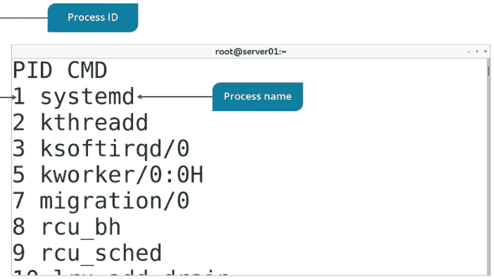

在排查故障时，你需要知道进程的 PID 才能终止它、更改其优先级以及对其执行其他管理任务。

## `pgrep` 命令

`pgrep` 命令显示与任何给定模式匹配的进程 PID，类似于 `grep` 用于在文本文件中匹配模式的方式。模式可以包括：调用它的用户的名称或用户 ID（UID）；启动时间；父进程 PID；等等。

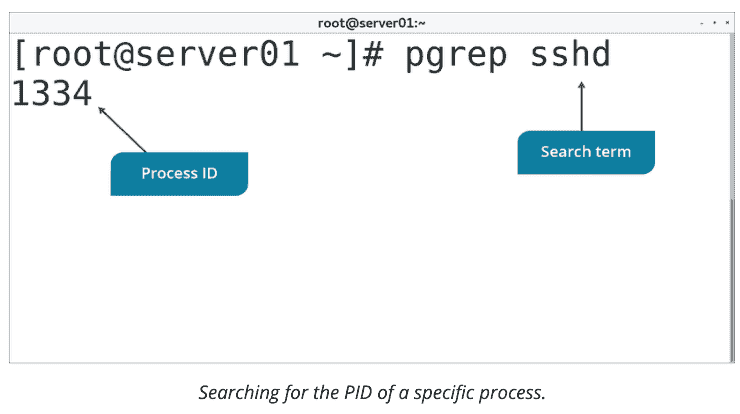

第八课：管理系统组件 主题 D

当你不知道进程的确切 PID 时，可以使用 `pgrep` 根据多个因素来帮助你识别进程。识别 PID 通常是管理进程的第一步。

### 语法

`pgrep` 命令的语法为 `pgrep [options] {pattern}`

## `ps` 命令

`ps` 命令调用**进程表**，这是一个汇总系统当前运行进程的记录。当不带任何选项运行该命令时，它会显示当前 shell 运行的进程，包括 PID、与进程关联的终端、累计 CPU 时间以及启动进程的命令等详细信息。但是，可以使用不同的选项与该命令一起使用，以过滤显示的字段或进程。

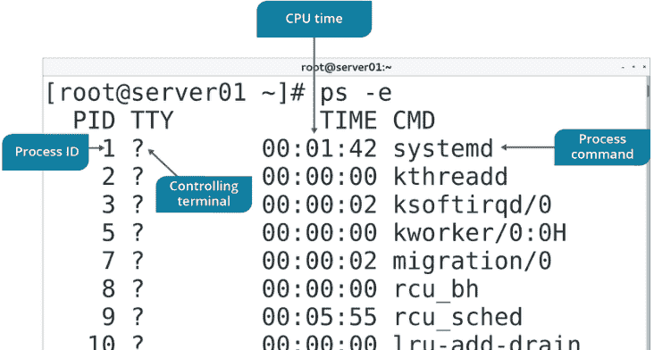

> 列出系统上的所有进程。请注意，问号表示进程没有控制终端。

### 语法

`ps` 命令的语法为 `ps [options]`

### `ps` 命令选项

`ps` 命令支持多个选项。以下是一些较突出的选项。

| 选项 | 用途 |
| --- | --- |
| `a` | 列出所有用户触发的进程。 |
| `-e` | 列出所有进程。 |
| `-l` | 使用长列表格式列出进程。 |
| `u` | 连同用户名和启动时间一起列出进程。 |
| `r` | 排除当前未运行的进程。 |
| `x` | 包含没有终端的进程。 |
| `T` | 排除由除当前终端以外的任何终端启动的进程。 |
| `-U {user name}` | 根据指定的用户显示进程。 |
| `-p {PID}` | 仅显示与指定 PID 关联的进程。 |
| `-C {command}` | 按命令名显示所有进程。 |
| `--tty {terminal number}` | 显示在指定终端上运行的所有进程。 |

### 命令选项语法风格

`ps` 命令支持三种不同的命令选项语法风格：Unix 风格（前面加连字符）、GNU 风格（前面加两个连字符）和 BSD 风格（不加连字符）。混合使用这些风格并不总是能产生相同的结果。例如，`ps a` 命令（BSD 风格）将打印所有具有控制终端的进程，包括会话领导者（一组进程的第一个成员）。它还会打印每个进程的状态，以及每个进程的完整命令（包括选项）。`ps -a` 命令（Unix 风格）也会打印所有具有控制终端的进程，但不包括会话领导者、每个进程的状态以及每个进程的完整命令。

## `top` 命令

与 `ps` 类似，`top` 命令列出 Linux 系统上运行的所有进程。它通过允许你以交互方式确定优先级、排序或终止进程来充当进程管理工具。它显示动态的进程状态，反映实时变化。

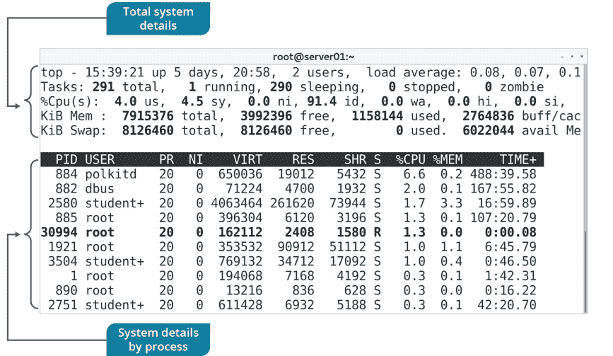

列出运行中进程的状态。

在此工具中，不同的按键可执行各种进程管理操作。以下一些是常用的命令键。

| 按键 | 用途 |
| --- | --- |
| `Enter` | 刷新所有进程的状态。 |
| `Shift+N` | 按 PID 降序排列进程。 |
| `M` | 按内存使用率排序进程。 |
| `P` | 按 CPU 使用率排序进程。 |
| `u` | 显示属于提示中指定的用户的进程。 |
| `k` | 终止你指定 PID 的进程。 |
| `r` | 对你指定 PID 的进程进行 `renice` 操作。 |
| `q` | 退出进程列表。 |

### 语法

`top` 命令的语法为 `top [options]`

## `systemd-analyze` 命令

`systemd-analyze` 命令用于检索启动操作的性能统计信息。该命令接受一个或多个子命令，这些子命令决定打印什么类型的信息以及如何打印。对于进程管理和故障排除，`blame` 是最相关的子命令。这将打印启动时执行的所有 `systemd` 单元的列表，以及每个单元执行所花费的时间。你可以使用 `systemd-analyze blame` 来识别导致系统启动缓慢的服务和其他单元。

```
[root@server01 ~]# systemd-analyze blame
6.643s systemd-udev-settle.service
2.658s kdump.service
1.852s dev-mapper-centos\x2droot.device
1.768s NetworkManager-wait-online.service
1.572s lvm2-pvscan@8:4.service
1.491s lvm2-monitor.service
1.359s lvm2-pvscan@8:5.service
1.194s postfix.service
1.175s lvm2-pvscan@8:3.service
1.156s tuned.service
1.064s vdo.service
697ms network.service
564ms NetworkManager.service
```

分析服务在启动时执行所需的时间。

### 语法

`systemd-analyze` 命令的语法为 `systemd-analyze [options] [subcommand]`

## `lsof` 命令

`lsof` 命令打印当前所有活动进程打开的所有文件的列表。这可以包括从文本文件到设备文件的所有内容——任何对象系统可以将其解析为文件。如果文件在另一个进程中打开，您可能会被阻止修改该文件。通过使用 `lsof`，您可以识别出需要终止的违规进程。您还可以使用 `lsof` 分析进程如何使用文件，这有助于识别恶意进程或具有不良副作用的进程。

`lsof` 命令将每个由进程打开的文件单独打印在一行上。它打印的信息包括：

- 命令/进程的名称。
- PID。
- 调用用户。
- 文件描述符（FD），包括文件以什么权限打开。
- 文件类型。
- 文件名称。

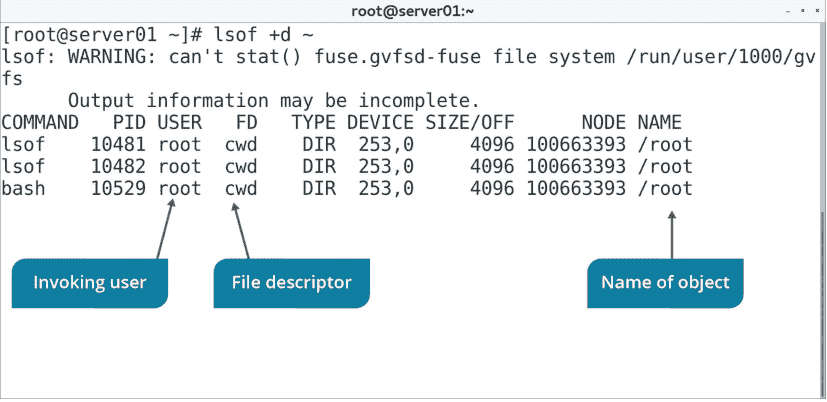

### 语法

`lsof` 命令的语法是 `lsof [options]`

## 进程优先级

操作系统提供一个调度程序，决定哪些进程获得 CPU 时间。调度程序通常在分配 CPU 时间方面很有效，但并非它的每个决定都是最优的。在某些情况下，您可能需要手动告诉 CPU 优先处理某些进程而不是其他进程。一个进程可能比另一个不太关键的进程更快完成更为关键；您可能希望降低由非特权用户启动的进程的优先级；一个进程可能消耗太多资源并导致系统迟缓；等等。

进程根据一个从 -20 到 19 的数字进行优先级排序，称为 **nice 值** 或优先级值。数字越低，优先级越高。nice 值为 -18 的进程比 nice 值为 15 的进程更有可能获得 CPU 时间。进程从其父进程继承 nice 值，默认情况下，该值为 0。

### `nice` 命令

`nice` 命令使您能够以不同于默认值的 nice 值运行命令。`-n` 选项将 nice 值增加给定的整数；如果您不提供整数，则命令将假设增量为 10。通过不带任何选项运行 `nice`，您将看到默认的 nice 值。您必须具有 root 用户权限才能以更高优先级运行命令。一旦降低，任何进程的优先级都不能由普通用户增加，即使他们拥有该进程。

#### 语法

`nice` 命令的语法是 `nice [-n {nice value increment}] [command]`

### `renice` 命令

`nice` 用于启动新进程，而 `renice` 命令使您能够更改已运行进程的调度优先级。您使用 `-n` 选项指定希望进程拥有的新 nice 值。

当您使用 `-g` 选项重新设置进程组的优先级时，会导致进程组中的所有进程的 nice 值被更改。当您使用 `-u` 选项重新设置用户的优先级时，会更改该用户拥有的所有进程的 nice 值。默认情况下，受影响的进程通过其 PID 指定。

#### 语法

`renice` 命令的语法是 `renice [-n {nice value}] [options] {identifier}`

## 前台和后台进程

在 Bash 中，大多数命令将在前台执行。这样做的效果是命令提示符将被"占用"，直到命令处理完成。对于简单的命令，如 `date` 命令，这不是问题。对于较长的命令或脚本，这可能是个问题。例如，如果您执行一个已知需要 45 分钟才能完成的备份脚本，在脚本完成之前，您将无法在该 shell 中输入命令。

可以在后台运行命令，它们仍然执行但不占用 shell。您可以使用 `fg`（前台）和 `bg`（后台）命令将进程移入视图。

### 前台和后台进程的管理

以下是如何管理长时间运行脚本的示例：

1. 首先，您可以通过输入 `backup-script.sh &` 在后台执行脚本。
2. 接下来，您将使用 `jobs` 命令来发现脚本的作业 ID 号。此命令还会向您显示作业的当前状态（例如，正在运行）。
3. 您可以通过输入 `fg %<job ID>` 命令将脚本的执行移入前台。如果脚本包含交互式提示，这可能很有用。


4. 然后按 `Ctrl+Z` 暂时暂停作业，释放命令提示符。

5. 通过输入 `bg %<job ID>` 将脚本移回后台。

## 命令摘要

下表总结了上例中每个命令的用途。

| 命令 | 用途 |
| --- | --- |
| `fg %{job ID}` | 将作业带到前台。 |
| `Ctrl+Z` | 暂时停止作业，以便您可以使用 `bg` 命令。 |
| `bg %{job ID}` | 将作业推送到后台。 |
| `&` | 添加到命令末尾时，启动在后台运行的命令。 |

## nohup 命令

`nohup`（"no hangup"，不挂起）命令防止进程在用户注销时结束。例如，如果管理员启动备份脚本，然后注销系统，脚本将停止运行。通过在正常命令前放置 `nohup` 命令，即使管理员注销后，脚本仍会继续运行。

## 语法

`nohup` 命令的语法是 `nohup {command/script}`。

## 终止命令

不同的命令用于向进程发送信号以终止或"杀死"它们。当进程变得无响应（挂起）、导致系统不稳定或未能释放对您尝试修改的文件的控制时，这是必要的。

| 命令 | 描述 |
| --- | --- |
| `kill` | 向一个或多个进程发送任何指定的信号，或默认发送终止信号。必须将 PID 指定为参数。此命令的语法是 `kill [options] {PID}`。 |
| `pkill` | 根据匹配模式向进程发送任何指定的信号，或默认发送终止信号。类似于 `pgrep` 命令，但实际发送信号而不是打印到 stdout。例如，如果您在一个终端中启动 `top`，然后在另一个终端中发出 `pkill top`，您将看到 `top` 终止。该命令匹配名称模式而不是进程 ID。此命令的语法是 `pkill [options] {pattern}`。 |
| `killall` | 向所有匹配指定名称的进程发送任何指定的信号，或默认终止信号。类似于 `pkill`，但有一些功能差异，例如精确匹配进程名称。此命令的语法是 `killall [options] {process name}`。 |

## 使用 PID 号终止进程

您可以将 `kill` 命令与进程表结合使用来结束进程。通过输入 `kill` 后跟 PID，您可以终止特定进程。但是，进程表可能显示不属于您的进程。作为用户，您只能将 `kill` 命令用于您拥有的进程。作为 root，您可以终止任何进程。

## 终止信号

有多种方式终止进程，每种方式映射到一个信号。该信号决定*如何*终止进程。在某些情况下，某些信号比其他信号更合适。例如，您可能希望优雅地终止进程，给它时间来清理任何最后的活动。然而，某些进程将忽略此信号或根本无法在合理的时间内终止。为此，您可能必须发出更具攻击性的信号。

有许多不同的终止信号。每个信号都有一个名称和一个或多个对应的数值；您可以在 `kill` 命令中使用任一方式。下表描述了一些最常见的信号。

| 信号 | 值 | 用途 |
| --- | --- | --- |
| SIGINT | 2 | 从终端中断进程，使其能够优雅地结束。该信号可以被捕获或忽略。这与在终端按 `Ctrl+C` 相同；然而，进程可能会更改此快捷方式行为。 |
| SIGKILL | 9 | 立即终止进程。该信号不能被捕获或忽略。这通常用作最后的手段。 |
| SIGTERM | 15 | 终止进程，使其能够优雅地结束。该信号可以被捕获或忽略。这通常从 `kill` 或另一个程序发送，而不是终端。 |
| SIGSTOP | 17, 19, 23 | 暂停进程。该信号不能被捕获或忽略。这通常从 `kill` 或另一个程序发送，而不是终端。 |
| SIGSTP | 18, 20, 24 | 从终端暂停进程。该信号可以被捕获或忽略。这与在终端按 `Ctrl+Z` 相同；然而，进程可能会更改此快捷方式行为。 |

## 示例

以下是实现终止信号的一些示例。要优雅地终止 ID 为 921 的进程：

```
kill 15 921
```

如果失败，要立即终止该进程：

```
kill 9 921
```

或者，要暂停而不是完全移除进程：

```
kill 17 921
```

## 进程问题故障排除指南

排除进程问题时，请使用以下指南。

## 进程问题故障排除

排除进程问题时：

- 收集有关进程的信息，包括其进程 ID（PID）和状态。
- 使用 `ps` 打印所有正在运行的进程的信息，包括 CPU 使用率。例如，某个进程消耗超过 50% 的 CPU 可能会导致性能问题，值得进一步调查。
- 使用 `top` 获取所有正在运行进程的动态交互式列表。
- 使用 `systemd-analyze blame` 确定哪些启动进程正在拖慢启动操作。
- 使用 `lsof` 识别哪些进程打开了文件。
- 使用 `nice` 和 `renice` 为某些进程设置优先级，使其高于其他进程。
- 使用 `fg` 和 `bg` 管理前台和后台进程。
- 使用 `nohup` 使命令即使注销后仍继续运行。
- 使用 `kill` 及其相关命令终止有问题的进程。

## 活动 8-7

### 讨论进程问题

### 场景

回答以下问题以检查您对该主题的理解。

1. 您团队中的另一位系统管理员说某个进程现在变成了僵尸进程。僵尸进程的什么特征使其成为管理员的问题？
2. 控制电话系统的 Linux 系统最近出现了一些内存问题，您很好奇问题所在。经进一步调查，您发现系统已完全更新并修补。您决定检查正在运行的进程，以确定是否有服务出现了问题。您可以使用哪个命令来检查正在运行的进程？
3. 您收到了几起关于某台系统性能的投诉。您登录后发现系统对命令响应缓慢。您想查看可能消耗过多资源的进程。您可以使用哪个命令？
4. 在调查系统"缓慢"的投诉时，您使用了 `top` 命令，但从 CPU 使用率的角度来看并未发现任何问题。您想在使用 `top` 命令的同时检查内存使用情况。您可以使用哪个按键命令来按内存使用显示进程？
5. 现在是下午 6:00，您需要下班了。但您还需要运行一个审计脚本，该脚本会生成一份报告，列出所有超过 180 天未被访问的文件。如果您注销，脚本将停止运行。您如何才能同时做到两件事——运行脚本并下班？

## 活动 8-8

### 进程问题故障排除

### 开始之前

您已以学生账户身份登录到 GUI。

### 场景

一些用户抱怨 Linux 服务器上的进程完成时间比平时长。您发现有几个不再需要的进程仍在运行，且从未成功终止。您需要管理系统进程和其他用户发起的进程。此外，您还需要查看是否有任何有问题的进程消耗了过多资源或导致启动过程延迟。

1. 查看当前正在运行的进程和所有其他正在运行的进程。
   a) 输入 `ps` 仅列出当前终端上运行的进程。
   b) 验证是否仅列出您账户启动的进程。
   c) 输入 `ps -e` 列出系统上所有正在运行的进程。
   d) 验证与标准 `ps` 命令的输出相比，是否列出了更多进程。

2. 查找您知道名称的进程的进程 ID 号。
   a) 输入 `pgrep sshd`。
   b) 记下 `sshd` 服务的进程 ID 号。

3. 发出后台命令。
   a) 输入 `sleep 300 &` 使系统暂停 300 秒。
   b) 记下 `sleep 300 &` 命令的 PID。
   c) 输入 `ps`。
   d) 验证 `sleep` 命令是否在运行进程列表中。

4. 终止命令。
   a) 输入 `kill <PID>`，其中 `<PID>` 是您之前记下的 `sleep` 进程 ID。
   b) 输入 `ps`。
   c) 验证 `sleep` 命令不在运行进程列表中。

5. 使用 `top` 命令探索更多进程信息。
   a) 输入 `top` 打开进程管理工具。
   b) 按 `M` 按内存使用情况重新组织输出。
   c) 按 `P` 按 CPU 使用情况重新组织输出。
   d) 按 `q` 退出 `top` 程序。

6. 发现哪些文件是打开的，以及哪些进程打开了它们。
   a) 输入 `lsof`。
   b) 输入 `lsof -u student##` 查看特定用户打开的文件。

7. 查看启动性能信息。
   a) 输入 `systemd-analyze`。

`systemd-analyze` 命令的结果将启动过程分为三个部分：内核启动所花的时间、initrd 镜像加载所花的时间，以及用户启动应用程序和服务启动所花的时间。该命令还显示启动所花的总时间。这些信息可用于排除启动时间过长的问题。

   b) 输入 `systemd-analyze blame` 查看哪些进程在启动时耗时最长。
   c) 按 `q`。

## 活动 8-9

### 进程优先级设置

### 开始之前

您已以学生账户身份登录到 GUI。

### 场景

您想要备份 `/etc/` 配置目录的本地副本。您预计复制过程会耗时较长，并且会在您注销系统后继续运行。您决定提高该进程的优先级，以确保其按时完成。

1. 查看正在运行进程的 nice 值。
   a) 输入 `ps xl | less` 查看用户运行的所有进程。
   b) 检查 nice 值最高的进程。
   c) 按 `Page Down` 直到到达整个列表的末尾。
   d) 按 `q` 退出列表。

2. 发出作为后台进程复制文件的命令。
   a) 输入以下内容开始复制过程：

```
for i in {1..100}; do sudo cp -R /etc /backup/sys; done &
```

   b) 验证是否显示了 PID 和作业号。
   c) 记下 PID。

这将执行 100 次复制命令，以模拟长时间运行的任务。

3. 使用 `top` 命令重新调整复制进程的优先级。
   a) 输入 `sudo top` 打开进程管理工具。
   b) 按 `r`。
   c) 输入您之前记下的复制操作的进程 ID。
   d) 输入 `-15` 指定 nice 值。
   e) 按 `q` 退出进程列表。
   f) 输入 `ls /backup/sys`。
   g) 验证是否列出了 `/etc` 目录中的文件，表明复制过程成功。

## 主题 E

## CPU 和内存问题故障排除

### 涵盖的考试目标

4.1 根据场景分析系统属性并进行相应修复。

系统需要访问某些硬件资源——特别是处理器和内存——才能提供功能。影响这些资源的问题将对系统造成严重干扰。因此，在本主题中，您将使用各种 Linux 命令来识别和解决与 CPU 和 RAM 相关的问题。

## 常见 CPU 问题

有许多可能影响或由 CPU 引起的问题。这些问题可能包括：

- CPU 性能低于所需的速度和响应水平。
- CPU 被过多请求超载，无法及时响应。
- 一个或多个 CPU 核心无法正常工作和/或性能下降。
- 进程无法获得足够的 CPU 时间来有效运行。
- 进程消耗了过多的 CPU 时间，使其他进程没有资源可用。
- CPU 空闲时间过长，而不是在处理任务。
- CPU 不支持虚拟化或超线程等功能。

## /proc/cpuinfo 文件

`/proc/cpuinfo` 文件包含有关系统处理器的信息。您可以使用这些信息来识别 CPU 的特性，这些特性可能表明与性能或缺少功能支持相关的问题。

```
[root@server01 ~]# cat /proc/cpuinfo
processor       : 0
vendor_id       : GenuineIntel
cpu family      : 6
model           : 69
model name      : Intel(R) Core(TM) i7-4510U CPU @ 2.00GHz
stepping        : 1
microcode       : 0x20
cpu MHz         : 1279.370
cache size      : 4096 KB
physical id     : 0
siblings        : 4
core id         : 0
cpu cores       : 2
```

查看 CPU 信息。

每个逻辑处理器核心都有自己的条目。CPU 可能支持多线程，即在单个物理核心上同时执行多个操作。逻辑核心代表每个可能的线程。因此，标称为四核处理器的 CPU 可能拥有八个逻辑核心。

`/proc/cpuinfo` 文件中一些有用的字段包括：

- `processor` —逻辑核心的编号，从 `0` 开始。
- `vendor_id` —CPU 制造商。
- `model name` —CPU 的具体型号。
- `cpu MHz` —逻辑核心的时钟速度，精确到千分位。
- `cache size` —CPU 的缓存大小。
- `flags` —CPU 的特性以及支持的功能。

## 基于 CPU 的内核参数

如前所述，`sysctl` 命令允许你在运行时查看内核参数。

## uptime 命令

`uptime` 命令显示系统开始运行以来的时间。`uptime` 命令的输出提供了当前时间、系统已运行多长时间以及当前登录的用户数量等信息。

然而，与 CPU 故障排除最相关的是负载平均值字段。CPU 的负载表示为正在使用或等待使用 CPU 的进程数。它还可以包括在存储 I/O 队列中的进程数。使用 `uptime`，你可以找到三个不同时间段的平均负载，从输出中从左到右依次为：过去 1 分钟、过去 5 分钟和过去 15 分钟。

*查看系统运行时间和平均 CPU 负载。*

你可以使用这些值来确定 CPU 何时过载，这可能导致性能问题。例如，如果你有 4 个逻辑核心，且过去 15 分钟的负载平均值为 4.0，则你的 CPU 正在被完全使用。如果你的负载平均值为 8.0，则你的 CPU 将处于 100% 过载状态。

## sar 命令

`sar` 命令基于从系统活动收集的数据，显示系统使用报告。这些报告由多个部分组成，每个部分包含数据类型和数据收集的时间。`sar` 命令的默认模式以不同的时间增量显示访问 CPU 的各类资源的 CPU 使用情况，例如用户、系统、I/O 调度等。它还显示在给定时间内 CPU 空闲的百分比。在报告底部是各个数据点在所列时间段内的平均值。默认情况下，`sar` 报告每 10 分钟收集的数据，不过你可以使用各种选项来筛选和调整这些报告。

查看 CPU 时间使用情况。

与 `uptime` 命令类似，你可以使用 `sar` 来识别 CPU 的过载情况。它会提供更多关于过载原因的详细信息，以及可能导致过载的因素。

## 语法

`sar` 命令的语法为 `sar [options]`。

## 基于 CPU 的内核参数

你也可以使用 `sysctl` 命令，通过在运行时获取基于 CPU 的内核参数来排查 CPU 问题。一组有用的参数涉及调度域，这是内核对共享调度策略和其他属性的逻辑核心进行分组的一种方法。这些参数通常采用以下格式：`kernel.sched_domain.cpu#.domain#.param`。

## 常见内存问题

有许多可能影响内存或由内存引起的问题。这些问题可能包括：

- 总内存不足，无法同时服务所有进程。
- 可用内存不足，无法服务新进程。
- 尽管内存可用，进程却无法访问。
- 进程占用了过多内存，导致其他进程没有内存可用。
- 系统无法快速从缓存或缓冲区访问文件。
- 系统在内存不足时终止关键进程。
- 交换分区占用过多或过少的存储空间。

## /proc/meminfo 文件

`/proc/meminfo` 文件包含有关系统内存使用的大量信息。你可以使用这些信息来确保系统的 RAM 模块按规格运行；操作系统以预期的速率消耗内存；以及系统有足够的可用内存来执行密集型任务。

`/proc/meminfo` 文件中一些有用的字段包括：

- `MemTotal` —系统上物理内存的总量。
- `MemFree` —当前未使用的物理内存总量。
- `Cached` —用作缓存内存的物理内存总量。
- `SwapTotal` —系统上交换空间的总量。
- `SwapFree` —当前未使用的交换空间总量。
- `Dirty` —等待写入存储的内存总量。
- `Writeback` —当前正在写入存储的内存总量。

> **注意：** 大多数值以千字节（KB）为单位表示。

```
[root@server01 ~]# cat /proc/meminfo
MemTotal:        7915376 kB
MemFree:         3989720 kB
MemAvailable:    6022184 kB
Buffers:           12876 kB
Cached:          2472828 kB
SwapCached:            0 kB
Active:          2205036 kB
Inactive:        1215360 kB
Active(anon):     936132 kB
Inactive(anon):   337836 kB
Active(file):    1268904 kB
```

查看内存信息。

## free 命令

`free` 命令解析 `/proc/meminfo` 文件，以便更容易分析内存使用统计信息。其默认行为是显示以下有关系统内存和交换空间的信息：

- 总内存。
- 已使用的总量。
- 空闲的总量。
- 共享的总量。
- 缓冲和缓存的总量。
- 可用于启动新应用的总量（估算值）。

```
[root@server01 ~]# free -h
              total        used        free      shared  buff/cache   available
Mem:          7.5G        1.1G        3.8G       341M        2.6G        5.7G
Swap:         7.7G          0B        7.7G
```

> 内存和交换空间信息


解析内存和交换空间使用信息。

## 语法

`free` 命令的语法为 `free [options]`

## free 选项

`free` 命令有多个可用的命令选项。

| 选项 | 用途 |
|------|------|
| `-b, -k, -m, -g, --tera` | 分别以字节、千字节、兆字节、吉字节和太字节为单位显示内存。 |
| `-s {seconds}` | 按指定的秒数延迟更新内存统计信息。 |
| `-o` | 禁用缓冲/缓存信息的显示。 |
| `-t` | 显示合并物理 RAM 与交换空间的总计行。 |
| `-h` | 使输出更易于阅读。 |

## 缓冲/缓存输出

内存可以被缓存，即临时存储，以便将来可以更快地访问其中包含的数据。`/proc/meminfo` 中的 `Buffers` 字段表示分配给特定块设备的内存。此内存用于缓存文件系统元数据，如目录内容、权限等。`Cached` 内存类似，但它存储的是文件的实际内容而非文件元数据。`free` 命令在输出时将这两个值合并在一起。

> **注意：** 当缓冲/缓存值较低时，表示系统内存不足。

## vmstat 命令

`vmstat` 命令显示有关虚拟内存的各类统计信息，以及进程、CPU 和 I/O 统计信息。默认情况下，报告将提供自上次系统启动以来各项统计信息的平均值，但你也可以指定延迟值以在一段时间内进行采样。

一些基于内存的统计信息包括：

- 可用的虚拟内存总量。
- 空闲可用的虚拟内存总量。
- 缓冲和缓存中使用的内存总量。
- 交换空间中使用的内存总量。

一些基于 CPU 的统计信息包括：

- 运行用户空间所用的时间。
- 运行内核空间所用的时间。
- 空闲时间。
- 等待 I/O 的时间。

**注意：** CPU 时间以总 CPU 时间的百分比表示。

*查看各类内存、CPU 和其他系统统计信息。*

## 语法

`vmstat` 命令的语法为 `vmstat [options] [delay [count]]`

## 输出延迟

建议为 `vmstat` 提供延迟值以获得更准确的报告。例如，`vmstat 5 5` 将以五秒为间隔运行命令五次。

## OOM 杀手

**内存不足（OOM）杀手**是 Linux 内核的一个功能，用于在系统内存极度不足时决定终止哪些进程。OOM 杀手会持续终止进程，直到有足够的内存供内核和系统顺畅运行。OOM 杀手不会随机终止进程，而是利用一种算法为每个进程分配一个 OOM 分数，该分数决定了终止哪些进程可以释放最多的内存，以及哪些进程对系统稳定性最不重要。然后它根据所确定的最佳终止目标来分配分数。

虽然这一机制主要由内核自动完成，但你确实能够控制其中一些行为。你可以在所需的挂载点上挂载 `oom` 控制组。例如，如果你想指定一组进程作为优先被杀死的对象，可以在该挂载点创建一个目录，并在目录中创建一个 `tasks` 文件，其中列出相关进程的 PID。然后，创建一个 `oom.priority` 文件，赋予一个较高的整数值（如 `256`），从而为这些进程设置更高的 OOM 杀手优先级。反之，若要完全避免某些进程被杀死，则将其优先级值设为 `0`。

> **注意：** 添加更多内存或减少工作负载，是比依赖 OOM 杀手更彻底、更持久的解决方案。

## 交换空间配置

交换空间的配置可以缓解与内存相关的问题，尤其是在系统和应用程序请求的内存超出系统可用内存时。内存容量较低的系统尤其容易受到这些问题的影响。交换空间并不能替代添加更多内存，但它有助于减少系统和应用程序的卡顿、无响应和崩溃。

## 交换空间类型

交换空间可分为三种类型。

| 交换类型 | 说明 |
|----------|------|
| 设备交换 | 设备交换空间在对存储设备进行分区时配置。它供操作系统运行大型应用程序时使用。 |
| 文件系统交换 | 文件系统交换空间主要在安装 Linux 时配置。当可用交换空间耗尽时，它作为操作系统的应急资源使用。 |
| 伪交换 | 伪交换空间使大型应用程序能够在内存有限的计算机上运行。 |

## 交换文件

交换文件用于存储从系统内存传输到存储设备的数据。它们是动态的，在数据进出内存时大小会发生变化。交换文件用作将数据从 RAM 传输到存储设备的介质。

## 交换分区

交换分区是存储设备上的一个虚拟内存区域，用于补充计算机的物理 RAM。Linux 使用交换分区，因为其性能优于交换文件系统。

## mkswap 命令

`mkswap` 命令用于在存储分区上创建交换空间。通常在希望将交换空间移动到与系统安装时不同的分区时使用。例如，你可能希望在容量较低的启动驱动器上节省空间。

它提供了执行各种任务的选项。

| 选项 | 用途 |
|------|------|
| `-c` | 在挂载交换空间之前，验证设备无坏扇区。 |
| `-p` | 设置 `mkswap` 命令使用的页面大小。页面是交换过程中复制到存储设备的内存块。 |
| `-L {label}` | 使用应用于分区或文件系统的标签来激活交换空间。 |

## 交换分区管理命令

`swapon` 命令用于在指定设备中激活交换分区。`swapoff` 命令用于停用设备上的交换空间。

`swapon` 和 `swapoff` 命令的一些常用选项如下表所示。

| 选项 | 用途 |
|------|------|
| `swapon -e` | 跳过不存在的设备。 |
| `swapon -a` | 激活所有交换空间。 |
| `swapoff -a` | 停用所有交换空间。 |

## CPU 和内存问题排查指南

排查 CPU 和内存问题时，请遵循以下指南。

### CPU 和内存问题排查

排查 CPU 和内存问题时：

- 使用 `/proc/cpuinfo` 文件识别 CPU 及其逻辑核心的关键信息。
- 使用 `uptime` 命令识别 CPU 平均负载。
- 使用 `sar` 查看哪些组件导致 CPU 负载过高，以及何时发生。
- 使用 `/proc/meminfo` 文件识别内存使用的关键信息。
- 使用 `free` 更轻松地分析内存使用信息。
- 使用 `vmstat` 获取更多关于 CPU 和内存使用的信息。
- 考虑调整 OOM 杀手，以便在内存不足时保留或牺牲特定进程。
- 如果添加物理内存不可行，考虑创建更多交换空间。

```
Activity 8-10
讨论 CPU 和内存问题
```

## 情景

回答以下问题以检验你对本主题的理解。

1. 要快速查看 CPU 性能，`uptime` 命令能告诉你关于系统的什么信息？
2. 公司的性能与容量团队需要你提供一台 Linux 系统的系统活动报告。团队联系人要求提供 CPU 报告。你可以使用哪个命令来收集报告所需的信息？
3. 一些用户抱怨某台开发服务器运行缓慢。你可以使用什么命令来查看能提供内存性能最佳快速概览的内存统计信息？
4. `vmstat` 命令有助于显示整体性能快照，但只运行一次仅显示自上次重启以来的信息。如何使用 `vmstat` 命令获得更全面的系统性能视图？
5. 你可以在 Linux 系统上配置交换空间，但不一定立即激活，而是等到系统需要时再启用。如何启用系统已配置的交换空间？

## 活动 8-11

## CPU 和内存问题排查

### 准备工作

你已使用学生账户登录到图形界面。

### 情景

你希望识别一些有助于管理系统组件的基本工具。具体而言，你将查看处理器和内存使用情况，以确认结果是否符合预期性能。

1. 收集 CPU 信息。
   a) 输入 `less /proc/cpuinfo` 显示处理器信息。
   b) 按 **q** 退出。
   c) 输入 `uptime` 查看系统运行时长，以及 CPU 基本性能信息。

2. 使用 `sar` 收集系统信息。
   a) 输入 `sar -u` 获取基本性能信息。
   b) 输入 `sar 2 6` 每两秒获取一次信息，共查询六次。
   c) 输入 `sar -S` 获取交换空间使用信息。

3. 收集系统内存信息。
   a) 输入 `less /proc/meminfo` 显示内存信息。
   b) 按 **q** 退出。
   c) 输入 `free` 获取基本内存使用信息。
   d) 输入 `free -m` 查看以兆字节为单位的内存使用信息。
   e) 输入 `free -h` 以人类可读的格式查看内存使用信息。

4. 使用 `vmstat` 命令收集虚拟内存使用信息。
   a) 输入 `vmstat 5 3` 并等待报告完成。
   b) 输入 `vmstat -d 5 3` 按每个存储设备查看信息。

## 总结

在本课程中，你配置了系统组件并管理了服务。你还参与了系统组件（如进程）以及 CPU 和内存等基本计算组件的故障排查。通过管理这些 Linux 系统的关键要素，你将能够确保最佳性能，同时保障用户体验。

你更喜欢在图形界面环境中管理 Linux 系统，还是仅通过命令行？为什么？如果你更喜欢在图形界面中工作，你更喜欢使用哪个桌面环境？

你认为哪些进程管理工具在你的环境中会很有用？为什么？

**练习题：** 课程网站上提供了额外的练习题。

## 第 9 课

设备管理

课程时间：1 小时 30 分钟

## 课程简介

你可以配置的下一个组件类别是设备。在某些时候，物理硬件需要与 Linux® 操作系统进行交互，即使你不与系统位于同一地点。因此，你必须确保连接到系统的任何硬件设备都能被系统识别并正确配置。所以，在本课程中，你将管理几种不同类型的设备。

## 课程目标

在本课程中，你将：

- 识别支持 Linux 操作系统的不同设备类型。
- 配置设备。
- 监控设备。
- 排查与硬件设备相关的各种问题。

## 识别 Linux 设备的类型

#### 涵盖的考试目标

2.7 解释 Linux 设备的使用和操作。

在开始使用 Linux® 命令管理设备之前，你需要先熟悉 Linux 支持的设备类型。

## 设备驱动程序的重要性

如你所知，设备驱动程序充当操作系统与硬件设备之间的接口。驱动程序对于设备在 Linux 环境中正常运作、甚至对于能否运作都至关重要。尽管 Linux 内核开发者和设备制造商在编写 Linux 兼容驱动程序方面已取得长足进步，但某些硬件仍可能存在兼容性问题。归根结底，无论你试图使用何种设备，都需要确保它在 Linux 下有合适的驱动支持，并且你的 Linux 系统确实安装了这些驱动。否则，你可能无法使用该设备，或者无法很好地使用它。

## 瘦客户端

客户端设备，通常称为**瘦客户端**，是指任何连接到功能更强大的服务器以进行工作的轻量级计算设备。服务器承担大部分繁重工作，包括处理和存储数据，而瘦客户端基本上只充当用户界面。这种计算架构将操作集中化，使管理员能够更轻松地管理分布在组织各处的工作站后端的服务器群组。

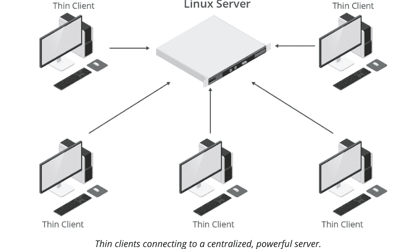

*瘦客户端连接到集中式的高性能服务器。*

如前所述，Linux 具有强大的远程连接支持，无论是通过远程桌面应用程序实现的 GUI，还是通过 SSH 实现的终端。瘦客户端通常连接有键盘、鼠标和监视器等基本 I/O 设备。它可能运行 Linux，也可能不运行；如果运行 Linux，通常会是功能非常精简的轻量级发行版，用户可用或可使用的功能很少。客户端连接的服务器通常会构建一个虚拟环境，以便用户在沙盒中工作，与服务器或网络的其他部分隔离。服务器与客户端类似，可能运行 Linux，也可能运行其他操作系统。

## USB 设备

*通用串行总线（Universal Serial Bus，USB）*是一种外设接口技术，已成为连接输入设备、外部存储设备、移动设备等设备的*事实*标准。USB 还集成了即插即用技术，使设备在连接时能够自我配置。

Linux 支持多种 USB 设备类型，包括但不限于：

- U 盘
- 外置 HDD 和 SSD
- 数码相机
- 智能手机和平板电脑
- 打印机和扫描仪
- 键盘和鼠标
- 麦克风和网络摄像头
- 游戏手柄

## USB 存储和设备分配

Linux 以 `/dev/sd#` 的格式注册连接到系统的 USB 存储设备，与 SCSI/SATA 命名约定相同。

## 无线设备

无线设备通过空中传输和接收信号，而非通过连接到端口的物理线缆。有许多不同的无线网络协议，每种协议可能都有特定或最佳的应用场景。Linux 支持的常见无线网络协议示例包括：

- **Wi-Fi**：一种主要用于在家庭和办公环境中建立无线局域网（WLAN）的技术。常见设备包括用于网络基础设施的无线路由器和接入点；以及作为 Wi-Fi 客户端的移动设备、台式计算机、物联网（IoT）设备等。无线路由器和接入点通常可能运行某种 Linux 发行版，而基于 Linux 的客户端（如 Android™ 智能手机和台式计算机）可以连接到这些基础设施设备。
- **蓝牙**：一种主要用于建立个人局域网（PAN）的技术，在该网络中设备在彼此几英尺范围内无线通信。一个常见的应用场景是无线耳机或头戴式耳机与智能手机或其他计算设备配对，使用户无需线缆即可收听音频。如前所述，Linux 具有蓝牙®驱动支持，可以作为配对的任一端。
- **近场通信（NFC）**：一种由移动设备和外设使用的通信协议，这些设备要么相互接触，要么仅相距几英寸。NFC 通常用于快速将一个设备的数据共享给另一个设备。与蓝牙类似，Android 移动设备对 NFC 的支持非常完善。传统计算机连接的一些 NFC 适配器和独立设备也有 Linux 支持。


WLAN 中的无线设备。

## 视频和音频设备

视频和音频设备是 I/O 外设，通常连接到台式机、笔记本电脑或瘦客户端等客户端系统。常见的视频输入外设包括网络摄像头、监控摄像头和数码相机。常见的视频输出外设包括监视器、电视和投影仪。麦克风是最常见的音频输入外设，但某些视频输入外设也能捕获音频。同样，监视器和电视通常可以输出音频，但仅输出音频的设备（如扬声器和耳机）也很受欢迎。

当你将视频/音频外设连接到运行任何操作系统（包括 Linux）的系统时，需要注意它使用的连接类型以及系统上有哪些可用类型。麦克风和网络摄像头通常使用 USB，而 USB 对于实时流式传输视频/音频输出的效果则差得多。例如，监视器更可能使用 HDMI 和 DisplayPort 等接口，这些接口能够以高度的实时性能同时传输视频和音频信号。某些监视器可能使用仅传输视频的较旧接口，如 DVI 和 VGA。

## 打印机

与其他大多数操作系统一样，Linux 提供对打印机的支持。对特定类型打印机的支持取决于是否有 Linux 内核可用的驱动程序，以及这些驱动程序的完善程度如何。随着内核驱动支持多年来的不断改进，大多数主要厂商提供的许多打印机的支持也在不断改善。

你可以使用一种或多种接口和方法连接到打印机。大多数现代打印机通过 USB 接口提供本地连接支持。然而，特别是在办公环境中，客户端通常通过网络连接到打印机。在这种情况下，打印机可能包含 Wi-Fi 适配器、以太网适配器，或两者兼有，以便打印机在局域网中可被识别。因此，多个客户端可以同时连接并使用同一台打印机。Linux 计算机甚至可以充当打印管理服务器，与一个或多个物理打印机对接。

## 网络适配器

**网络适配器**，也称为**网络接口卡（NIC）**，是一种提供主机通过网络交换数据接口的设备。对于任何需要访问网络的计算设备（无论是小型局域网还是像互联网这样的广域网）来说，网络适配器都是必不可少的。

在许多情况下，网络适配器内置在计算机的主板中。然而，某些适配器可以通过扩展总线添加到系统中，或作为通过 USB 等接口连接的外部外设。一个系统可以拥有多个适配器；这在服务器和防火墙等安全系统中尤为常见。此外，每种网络连接协议都需要自己的适配器类型。Wi-Fi 适配器在 WLAN 中发送和接收无线信号，而以太网适配器则包含一个以太网端口，你可以插入线缆以连接到局域网。

## GPIO

**通用输入/输出（GPIO）**是指电路板上没有指定用途的引脚，但用户可以在运行时对其进行控制。这些引脚发送和接收数字信号，可以处于开启或关闭状态。例如，被指定为输出的引脚可以打开或关闭 LED 灯；而被指定为输入的引脚本身可以通过外部开关或传感器打开或关闭。在大多数情况下，GPIO 功能通过软件以编程方式控制。开发人员可以设计他们的应用程序，以向引脚发送或从引脚接收信号，从而使应用程序能够与外部世界交互。

GPIO 引脚常见于 Arduino 和 Raspberry Pi 等单板微控制器上。虽然这些设备通常被爱好者使用，并作为教授基本计算概念的一种方式，但它们在物联网领域也有应用。Raspbian 等专业 Linux 发行版可用于通过各种编程库控制单板微控制器上的 GPIO 功能。

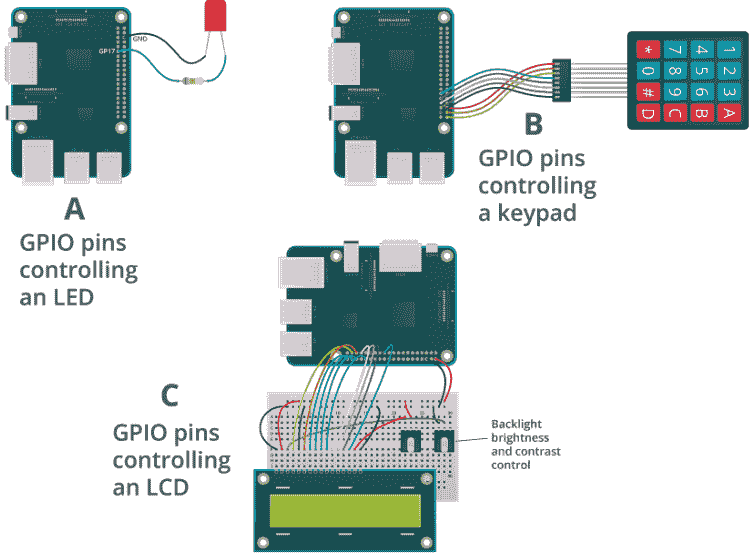

Raspberry Pi 设备上的 GPIO 引脚。

## SATA

**串行ATA（SATA）**是一种用于将存储设备连接到传统计算机的总线接口标准。在现代个人电脑中，SATA已在很大程度上取代了早期的标准，如并行ATA（PATA）和集成驱动电子（IDE），成为存储连接技术中的主导标准之一。

过去，SATA被视为在容量和成本至关重要的场景下的良好解决方案。SATA支持多TB驱动器，且制造成本相对较低。然而，与替代标准相比，其数据传输速率较慢（6 Gb/s），这使其不太适合企业环境，它最常用于备份用途和消费级存储。SATA的最新版本（版本3.2）将SATA与另一种称为PCI Express的总线技术相结合，使其能够支持高达16 Gb/s的原始数据速率——终于可与竞争对手媲美。

## SCSI

**小型计算机系统接口（SCSI）**是一种用于将外围设备连接到传统计算机的总线接口。SATA主要用于连接存储设备，而SCSI还可以用于连接其他类型的设备，如DVD-ROM驱动器、打印机、扫描仪等。然而，其在存储领域的应用要常见得多。


传统上，SCSI使用并行接口，其制造成本往往高于串行接口。然而，在过去，SCSI提供了较高的传输速率，因此在速度至关重要的企业存储阵列中广受欢迎。**串行连接SCSI（SAS）**标准被开发出来，旨在将串行接口应用于SCSI技术。SAS比传统SCSI提供更高的速度——在最近的SAS-4中高达24 Gb/s——并支持更高容量的驱动器。串行接口还支持更可靠的数据传输速率。SAS已成为许多企业存储环境的首选技术。

## HBA

**主机总线适配器（HBA）**是一种硬件组件，它将主机系统连接到存储设备，例如在存储区域网络（SAN）中，以促进数据的输入和输出。它们之于存储设备，就像网络适配器之于网络一样。HBA通常与SATA和SCSI等接口技术配合使用。HBA可能内置在主板上，也可能是连接到主板的独立扩展卡。无论哪种情况，您都需要通过相应的接口将存储设备连接到HBA，以便系统能够使用该存储设备。

## PCI

**外设组件互连（PCI）**是一种连接接口标准，主要用作连接外围设备的扩展总线。最初的PCI规范已在很大程度上被更新的**PCI Express（PCIe）**所取代。PCIe支持更高的传输速度、更可靠的错误检测，且物理尺寸比传统PCI更小。在现代计算机中，PCIe是占主导地位的扩展总线技术。

就非存储设备而言，PCIe有许多应用。显卡通常使用这种接口进行连接，扩展卡也常用于为系统添加更多端口，如USB和SATA。近年来，PCIe还被用于连接利用非易失性内存主机控制器接口（NVMe）的固态硬盘，NVMe是专门为与PCIe集成而设计的。NVMe固态硬盘甚至比通过SATA和SAS连接的固态硬盘更快；它们很可能成为企业存储领域的重要力量。

# 练习 9-1

## 识别 Linux 设备类型

### 场景

您在Develetech的管理职责之一包括配置和维护客户端和服务器系统中使用的各种硬件设备。在Linux环境中应用您的技能和知识之前，您需要确保对常见的设备及其连接计算机的方式有扎实的理解。

1. 判断题？Linux支持一组独特的设备标准，在其他操作系统上工作的设备通常无法在Linux上工作。

   - 正确

   - 错误

2. `/dev/sdb`是什么类型的设备？

3. 一些用户担心他们的设备，无论是USB、无线、SCSI等，都无法与Linux兼容。您可以采取什么措施来帮助确保这些设备能在Linux上工作？

4. 网络适配器的目的和功能是什么？

   - 将无线信号转换为物理数据传输，反之亦然。

   - 提供一个接口，用于将主机连接到网络，以便它们能够相互交换数据。

   - 建立一个网络段，使多台计算机可以连接并相互交换数据。

   - 将传输的数据从一个网络转发到另一个网络。

5. 判断题？对于专用Linux服务器（如防火墙），包含多个网络适配器是常见的。

   - 正确

   - 错误

6. 判断题？打印机可以使用多种接口，甚至可以通过网络访问。

   - 正确

   - 错误

7. 以下哪种硬件接口传输音频和视频信号，用于连接显示器等设备？

   - USB

   - HDMI

   - Wi-Fi

   - VGA

8. 以下哪种无线连接标准主要用于为家庭和办公计算创建局域网（LAN）？

   - NFC

   - Bluetooth

   - Wi-Fi

   - RFID

9. 以下哪项是连接主机系统与存储设备以促进数据输入和输出的硬件组件？

   - HBA

   - SATA

   - SCSI

   - GPIO

10. 以下哪项是PCI Express标准的当前版本？

    - SATA

    - SCSI

    - PCIe

    - SAS

11. 以下哪种硬件连接技术因其快速的速度和高可靠性而主要用于企业存储？

    - SCSI

    - SAS

    - PCI

    - SATA

## 主题 B

## 配置设备

**涵盖的考试目标**

2.7 解释Linux设备的使用和操作。

现在您可以准备使用Linux工具来配置设备了。在本主题中，您将使用一些常见服务，使您能够自定义系统与某些硬件的交互方式。

## 设备文件位置

设备文件代表有关硬件设备的信息，在某些情况下，定义了您可以自定义的这些设备的设置。这些文件位于多个不同的目录和子目录中，其中许多您以前已经见过。

| 位置 | 描述 |

|----------|-------------|

| `/proc/` | 包含代表内核报告的系统信息的各种文件。特别是，`/proc/devices`文件包含内核当前正在运行的所有设备驱动程序的列表，按字符和块存储设备分类。 |

| `/sys/` | 一个类似于`/proc/`的虚拟文件系统，但更侧重于创建设备信息的分层视图。特别是，`/sys/devices/`子目录包含公开特定设备详细信息的文件。 |

| `/dev/` | 包含使系统和用户能够访问设备本身的设备驱动程序文件。例如，您可以通过从`/dev/`引用块存储设备来挂载它，如`/dev/sda1`。同样，`/dev/mapper/`包含由设备映射器管理的逻辑卷、加密卷和其他设备。 |

| `/etc/` | 包含许多组件的配置文件，包括与设备交互的组件。例如，`/etc/X11/`子目录包含可能影响X.Org服务器环境的输入和输出设备的配置文件，如键盘、鼠标和显示器。 |

## 热插拔设备

**热插拔设备**可以物理添加到系统中或从系统中移除，而无需重新启动即可使用该设备。热插拔设备接入系统时会被检测到，而冷插拔设备，如RAM模块、CPU和某些内部存储设备，在连接到运行中的系统时不会被检测到；它们需要完全重新启动系统才能工作。事实上，对于RAM模块等内部设备，强烈建议在尝试插入设备之前关闭系统电源。

现代 Linux 发行版支持许多标准总线类型的热插拔，特别是 USB、FireWire、SATA 及其他相关技术。甚至像 PCIe 这样的扩展总线技术也支持热插拔。

## udev

设备管理器 **udev** 负责管理硬件设备的自动检测和配置。作为 systemd 的一项功能，udev 是内核的一个组成部分，在系统引导时初始化。udev 工具为冷插拔和热插拔设备处理模块加载。系统在启动时为冷插拔设备加载模块。热插拔设备的模块则由 udev 在系统运行时动态加载。

## udev 规则

`/etc/udev/rules.d/` 目录用于配置 udev 的运行规则。你可以在该目录中创建文件，告诉 udev 以某种方式配置设备，或者在设备插入时执行某个命令。例如，你可能希望在每次插入某个特定设备时为其创建一个符号链接；这样，你就可以始终用相同的方式引用该设备，而不必依赖难以预测且缺乏描述性的 `/dev/` 命名方案，如 `/dev/sda1`、`/dev/sdb2` 等。在规则文件中，你需要用该设备独有的属性来引用设备，比如其厂商 ID 和产品 ID。例如，规则文件中的以下行将在特定 USB 闪存盘插入时为其创建一个符号链接：

```
KERNEL=="sd*", ATTRS{idVendor}=="334455",
ATTRS{idProduct}=="667788", SYMLINK+="myusb"
```

与编写 GRUB 规则类似，你将此规则文件命名为 `##-name.rules` 的格式，其中 `##` 决定其在 udev 中的执行顺序。

## 额外的 udev 规则目录

实际上有多个目录用于配置 udev 规则。前面提到的 `/etc/udev/rules.d/` 目录主要用于 udev 的本地管理。管理员将自定义配置应用于此目录，以使 udev 按照管理员的偏好和/或组织的业务需求运行。因此，该目录中的文件具有最高优先级。

`/usr/lib/udev/rules.d/` 目录也包含 udev 规则。然而，这些规则由系统生成，你应避免编辑它们。此目录中的规则优先级较低，因此 `/etc/udev/rules.d/` 中名为 `60-keyboard.rules` 的自定义规则将覆盖 `/usr/lib/udev/rules.d/` 路径中的默认 `60-keyboard.rules` 文件。

规则文件也可以放在 `/run/udev/rules.d/` 目录中。这些规则同样优先于系统规则路径。此路径中的规则是临时的，意味着它们仅在运行时生效，系统重启后将丢失。临时规则在你需要临时覆盖某个系统规则而不希望更改持久化时非常有用。

## udevadm 命令

`udevadm` 命令用于管理 udev。它接受各种子命令，每个子命令执行特定任务，以修改 `systemd-udevd` 守护进程及相关组件的行为。以下表格描述了一些子命令。

| 子命令 | 用途 |

|--------|---------|

| `info` | 检索存储在 udev 数据库中的设备信息，以及从 `/sys/` 文件系统获取详细的设备属性。例如，你可以查看设备的厂商 ID、产品 ID、序列号等更多信息。 |

| `control` | 修改 udev 的运行状态。例如，提供 `--reload-rules` 选项将确保 udev 读取你已添加的任何新规则文件。 |

| `trigger` | 执行适用于当前已插入任何设备的规则。你也可以使用 `-c` 选项指定一个操作，如 `add`（添加）、`remove`（移除）或 `change`（更改）。顾名思义，这些将触发设备在运行内核中被添加、移除或更改的事件。 |

| `monitor` | 监视由内核或 udev 规则发送的事件。 |

| `test` | 模拟为某个设备运行 udev 事件，并在输出中显示结果。 |

*显示设备属性及其他信息。*

## 语法

`udevadm` 命令的语法为 `udevadm [选项] [子命令] [参数]`

## 打印软件

打印机通常附带软件工具，使你能够配置打印机的设置。这些工具可能针对特定操作系统，因此你需要确认它们是否设计为在 Linux 上运行。即使无法运行制造商的软件工具，你仍然可能通过 Linux 工具使用该打印机。主要厂商通常会在其网站上提供最新的驱动程序供下载。

## CUPS

**CUPS** 是 Linux 的打印管理系统，使计算机能够作为打印服务器运行。运行 CUPS 的系统是一个主机，可以从客户端系统发起打印作业。这些作业经过处理后发送到相应的打印机。CUPS 的主要优势在于它能够在同一打印服务器上处理不同的数据格式。

CUPS 设计用于调度打印作业、处理管理命令，以及向本地和远程程序提供打印机状态信息。CUPS 提供基于 Web 的界面来配置服务。通过此界面进行的更改会修改 `/etc/cups/cupsd.conf` 和 `/etc/cups/cups-files.conf` 文件。

> **注意：** CUPS 以前代表 *Common Unix Printing System*（通用 Unix 打印系统），由 Apple 公司开发。

*CUPS Web 界面。*

## lpr 命令

`lpr` 命令提交文件进行打印。在命令行提供的文件将被发送到指定打印机，如果打印机正忙则发送到打印队列。如果不指定要使用的打印机，该命令将把打印作业发送到默认打印机，你可以通过 CUPS 配置默认打印机。如果命令行没有提供文件，`lpr` 命令将从标准输入读取打印文件。

## 语法

`lpr` 命令的语法为 `lpr [选项] [文件名]`

## lpr 命令选项

`lpr` 命令的选项在以下表格中描述。

| 选项 | 用途 |

|--------|---------|

| `-E` | 连接服务器时强制加密。 |

| `-P {目标}` | 将打印作业发送到指定的目标打印机。 |

| `-# {份数}` | 设置打印份数，范围为 1 到 100。 |

| `-T {名称}` | 设置作业名称。 |

| `-l` | 指定打印文件已格式化，应直接发送到目标而不经过过滤。 |

| `-o {选项}` | 设置作业选项，如横向打印、缩放打印输出、双面打印等。作业选项因打印机而异。 |

| `-p` | 打印指定文件，并添加阴影标题，包含日期、时间、作业名称和页码。 |

| `-r` | 指定打印后删除已打印的文件。 |

**注意：** 欲了解更多信息，请查看课程网站上的视频标签，获取补充本课内容的任何视频。

## 活动 9-2

### 讨论配置设备

### 场景

回答以下问题以检查你对该主题的理解。

- 1. 你可以执行什么操作，以便每次插入设备时都能用相同的自定义名称引用设备？

- 2. udev 的意义是什么？

- 3. 如何启动 CUPS 服务？

- 4. 如何将文件 `students.txt` 发送到 HPLJ5 打印机？

- 5. udev 设备管理系统识别两种设备类型：冷插拔和热插拔。系统何时为每种设备类型加载模块？

## 活动 9-3

### （可选）使用 udev 管理热插拔设备

### 开始之前

你已使用学生账户登录到 GUI。你有一个 USB 闪存盘。

### 场景

你的一位同事使用 Linux 系统准备 USB 闪存盘上的操作系统安装介质。然而，每次她将 USB 驱动器插入系统时，系统都会自动为其分配一个缺乏描述性的名称，如 `/dev/sdb`。她希望能用更有帮助的名字来引用该驱动器。因此，你将使用 `udev` 根据其唯一属性为该驱动器创建符号链接。

- 1. 收集 USB 闪存盘的唯一信息。

   - a) 将 USB 闪存盘插入你的计算机。

   - b) 在终端中，输入 `lsblk` 并记下你 USB 驱动器的设备名称：

     可能是类似 `sdb` 的名称。如果需要帮助识别设备，可以使用显示最大存储容量的列。

   - c) 输入 `udevadm info /dev/<设备名称>`，其中 `<设备名称>` 是你刚记下的设备名称。

     例如：`udevadm info /dev/sdb`

   - d) 验证你是否能看到有关该设备的各种识别信息。

   - e) 输入 `udevadm info -a /dev/<设备名称> | less` 以检索设备属性。

   - f) 输入 `/serial` 搜索设备的序列号，然后记下它：

   - g) 查看此父设备的其余属性。

     `idVendor` 和 `idProduct` 属性特别有用，因为它们往往对每个设备都是唯一的。

   - h) 记下 `idVendor` 和 `idProduct` 属性：

     `idVendor:`

     `idProduct:`

   - i) 保持此窗口打开。

- 2. 创建一个 `udev` 规则，当 USB 驱动器插入时自动将自定义设备名称链接到该驱动器。

   - a) 在终端中右键单击并选择 **Open Terminal** 以打开新窗口。

   - b) 在新的终端窗口中，切换到 `/etc/udev/rules.d` 目录。

使用 `sudo`，以你选择的文本编辑器创建一个名为 `10-local.rules` 的文本文件。

在此文本文件中，输入以下内容，全部放在一行：

```
KERNEL=="<device name>", ATTRS{serial}=="<value>", ATTRS{idVendor}=="<value>", ATTRS{idProduct}=="<value>", SYMLINK+="install"
```

用另一个终端中识别出的值替换占位符。确保这些值来自你识别出具有串行号的同一父设备。此外，`<device name>` 应采用 `sdb` 格式，而非 `/dev/sdb`。

保存并关闭文件。

## 3. 确保新规则已重新加载并触发。

输入 `sudo udevadm control --reload-rules`

udev 通常会自动重新加载规则，但你可以执行此命令以确保。

输入 `udevadm trigger`

这将触发当前已连接设备的规则。否则，你需要断开然后重新连接设备才能使规则触发，这将在下一步中进行。

## 4. 测试规则，查看是否成功创建符号链接。

从桌面菜单中，选择**应用程序**→**收藏夹**→**文件**。

在导航窗格中，选择 USB 闪存盘旁边的**卸载**按钮。

从计算机上拔下 USB 驱动器。

重新插入 USB 驱动器。

在终端中，输入 `lsblk /dev/install`

验证 USB 驱动器是否显示，这表示连接驱动器时已自动激活符号链接。

卸载并拔下 USB 驱动器。

关闭文件浏览器窗口。

## 活动 9-4

### 配置虚拟（PDF）打印机

### 开始之前

你以学员账户身份登录到 GUI。你有一个 `~/policies/aup_v2.txt` 文件。

### 场景

人力资源部希望向 Develetech 的员工分发可接受使用政策（AUP），包括纸质和电子形式。目前，你的 Linux 系统上没有连接实际打印机，但你仍然可以将 AUP 文本文件打印为 PDF，这比原始文本文件更适合分发目的。在创建 PDF 之前，你需要设置一个虚拟打印机。

- 1. 查看当前打印机列表。

  - a) 从桌面菜单中，选择**应用程序**→**系统工具**→**设置**。

  - b) 从导航菜单中，选择**设备**。

  - c) 选择**打印机**。

  - d) 验证当前没有列出任何打印机。

  - e) 保持此窗口打开。

- 2. 安装 `Cups-PDF` 软件包。

  - a) 在终端中，输入 `sudo yum -y install epel-release cups-pdf`

> 注意：你可能需要执行此命令两次才能成功下载软件包。

- 3. 将 **Cups-PDF** 打印机设为默认打印机。

  - a) 返回**设置**窗口，验证 **Cups-PDF** 是否列在打印机列表中。


  - b) 选择**解锁**，然后输入 root 密码。

  - c) 在 **Cups-PDF** 打印机旁边，选择选项齿轮图标，然后选择**默认使用此打印机**。

  - d) 关闭**设置**窗口。

- 4. 将文本文件打印为 PDF。

  - a) 打开一个终端窗口，验证你位于主目录中。

  - b) 输入 `lpr policies/aup_v2.txt`


- c) 验证桌面是否弹出打印通知。

- d) 在桌面上，双击`aup_v2.pdf`将其打开。

- e) 完成后关闭 PDF 查看器。

## 主题 C 监控设备


#### 涵盖的考试目标

2.7 解释 Linux 设备的使用和操作。

现在你的设备配置已就位，你需要监控这些设备以确保它们被系统识别并按预期运行。因此，在本主题中，你将收集有关已连接硬件的信息。

### lsdev 命令

`lsdev`命令显示内核报告的系统硬件的各种信息。它从`/proc/`目录中的三个文件编译此信息：

- `/proc/interrupts` — 此文件列出每个逻辑 CPU 核心及其关联的中断请求（IRQ）。IRQ 是由设备发送给处理器的信号，以便处理器可以停止当前工作并处理硬件需要执行的任务，如按键或移动鼠标。有多个 IRQ 地址可以沿其发送信号，对于每个地址，此文件列出沿该地址发送给每个 CPU 核心的信号数量。它还命名映射到每个 IRQ 地址的硬件设备。

- `/proc/ioports` — 此文件列出 I/O 端口及映射到它们的硬件设备。

- `/proc/dma` — 此文件列出系统上的所有行业标准架构（ISA）直接内存访问（DMA）通道。ISA DMA 是一种硬件控制器，通常支持软盘等遗留技术。


> 注意：`lsdev`命令在基于 Debian 的发行版上更常见，可从`procinfo`软件包中获取。

### lsusb 命令

`lsusb`命令用于显示有关连接到系统 USB 总线的设备的信息。此命令扫描`/dev/bus/usb/`目录以获取信息。默认情况下，该命令将打印总线和连接设备的编号、设备 ID，以及与该设备匹配的供应商和产品名称。

你可以使用`-v`标志查看有关每个设备的详细信息，类似于使用`udevadm info`命令。你还可以按总线（`-s`）和按供应商/产品（`-d`）过滤结果。

```
[root@server01 ~]# lsusb
Bus 002 Device 001: ID 1d6b:0003 Linux Foundation 3.0 root hub
Bus 001 Device 005: ID 03eb:8a1c Atmel Corp.
Bus 001 Device 006: ID 0cf3:3004 Qualcomm Atheros Communications AR3012 Bluetooth 4.0
Bus 001 Device 003: ID 5986:055d Acer, Inc
Bus 001 Device 002: ID 04f2:0939 Chicony Electronics Co., Ltd
Bus 001 Device 001: ID 1d6b:0002 Linux Foundation 2.0 root hub
```

列出 USB 设备信息。

## 语法

`lsusb`命令的语法是`lsusb [选项]`

### lspci 命令

`lspci`命令用于显示有关连接到系统 PCI 总线的设备的信息。默认情况下，输出将列出逻辑插槽地址（通常格式为`总线:设备.功能`）、设备的类别（如网络控制器、存储控制器、输入设备或桥接设备）、供应商名称和设备名称。与`lsusb`类似，`lspci`提供详细模式以获取有关每个设备的更详细信息。例如，你可以使用详细模式来标识安装适配器的物理插槽。

```
[root@server01 ~]# lspci
00:00.0 Host bridge: Intel Corporation Haswell-ULT DRAM Controller (rev 0b)
00:02.0 VGA compatible controller: Intel Corporation Haswell-ULT Integrated Graphics Controller (rev 0b)
00:03.0 Audio device: Intel Corporation Haswell-ULT HD Audio Controller (rev 0b)
00:14.0 USB controller: Intel Corporation 8 Series USB xHCI HC (rev 04)
00:16.0 Communication controller: Intel Corporation 8 Series HECI #0 (rev 04)
00:1b.0 Audio device: Intel Corporation 8 Series HD Audio Controller (rev 04)
00:1c.0 PCI bridge: Intel Corporation 8 Series PCI Express Root Port 1 (rev e4)
00:1c.2 PCI bridge: Intel Corporation 8 Series PCI Express Root Port 3 (rev e4)
00:1c.3 PCI bridge: Intel Corporation 8 Series PCI Express Root Port 4 (rev e4)
00:1f.0 ISA bridge: Intel Corporation 8 Series LPC Controller (rev 04)
00:1f.2 SATA controller: Intel Corporation 8 Series SATA Controller 1 [AHCI mode] (rev 04)
00:1f.3 SMBus: Intel Corporation 8 Series SMBus Controller (rev 04)
02:00.0 Network controller: Qualcomm Atheros QCA9565 / AR9565 Wireless Network Adapter (rev 01)
03:00.0 Ethernet controller: Realtek Semiconductor Co., Ltd. RTL8111/8168/8411 PCI Express Gigabit Ethernet Controller
```

列出 PCI 设备信息。

## 语法

`lspci`命令的语法是`lspci [选项]`

### lpq 命令

`lpq`命令显示打印队列的状态。默认情况下，它将报告每个打印作业在队列中的排名、作业所有者、作业编号、作业中的文件以及作业大小。你还可以使用`+间隔`选项让报告每隔你指定的秒数更新一次，直到队列为空。如果未指定要监控的打印机，`lpq`命令将监控默认打印机。

```
[root@server01 ~]# lpq
Cups-PDF is ready and printing
Rank   Owner   Job   File(s)                          Total Size
active root    9     messages                         251904 bytes
[root@server01 ~]#
```

活动打印作业

列出打印队列。

## 语法

`lpq`命令的语法是`lpq [选项]`

### 其他设备监控工具

你此前已使用的一些工具也可用于监控硬件设备。例如，你可以使用`lsblk`来识别连接到系统的块存储设备。此命令的输出可帮助你确保存储设备被识别，并且它们已正确分区和挂载。

另一个例子是`dmesg`命令。回想一下，这会打印系统启动后发送到内核消息缓冲区的所有消息，包括设备驱动程序发送的消息。如果硬件设备在操作中遇到错误或无法将预期模块加载到内核中，`dmesg`的输出可能会指示这一点。使用此输出来监控与设备驱动程序及其控制的底层硬件相关的问题。

> 注意：要了解更多信息，请查看课程网站的视频标签，获取补充本课内容的任何视频。

## 活动 9-5

### 讨论监控设备

### 场景

回答以下问题以检验你对该主题的理解。

1. 在尝试重新启动系统之前，你想检查打印队列。如何检查非默认打印机 HPLJ5 的打印队列？

2. `lpq -a`命令会显示什么？

3. `lsusb`命令会显示什么？

4. 你可以使用哪个命令来显示所有块设备的信息，以及如何查找列表中每个设备的更多信息？

5. `lsdev`命令从哪里获取其显示的信息？

## 活动 9-6

### 监控设备

### 开始之前

你以学员账户登录到图形用户界面。

### 场景

作为日常系统管理任务的一部分，你需要跟踪网络上所有计算机中使用的设备，并维护一份正在使用的硬件资源列表。

1. 监控连接到系统的任何 PCI 设备。

   a) 在终端窗口中，输入`lspci`

   b) 查看连接到 PCI 总线的硬件设备的简要列表。每行列出设备所连接的 PCI 插槽，以及设备的厂商和产品型号。

   c) 输入`sudo lspci -v`以查看有关每个设备的更多信息。

   d) 确认你可以看到每个设备的属性，例如：

      - 其厂商和产品型号。

      - 其 I/O 端口。

      - 其各种功能。

      - 它使用的内核模块和驱动程序。

2. 监控连接到系统的任何 USB 设备。

   a) 输入`lsusb`

   b) 查看连接到 USB 总线的硬件设备的简要列表。每行列出设备所连接的 USB 总线，以及设备的厂商和产品型号。

   c) 输入`sudo lsusb -v`以查看有关每个设备的更多信息。

   d) 确认你可以看到每个设备的属性，例如：

      - 其厂商和产品型号。

      - 它支持的规范版本（`bcdUSB`）。

      - 设备可以从总线吸取的最大功率（`bMaxPower`）。

      - 受支持的设备类别，例如，大容量存储 vs. 通信（`bInterfaceClass`）。

3. 监控打印作业。

   a) 输入`base64 /dev/urandom | head -c 10000000 > printfile.txt`

   > **注意：** 有 7 个零。

   这将创建一个 10 MB 大小的文本文件，使用可读文本（Base64）编码的随机数据。该文件足够大，打印需要一些时间，因此你将有机会在队列中监控它。

   b) 输入`lpr printfile.txt`以开始打印作业。

   c) 输入`lpq`并注意你可以看到队列中的打印作业，包括以下信息：

      - 其等级（状态）。

      - 谁拥有该打印作业。

      - 作业的编号。

      - 正在打印哪些文件。

      - 请求的总大小。

   d) 允许打印作业完成。

## 主题 D

## 排查硬件问题

#### 涵盖的考试目标

2.7 解释 Linux 设备的使用和操作。

4.4 给定一个场景，分析和排查应用程序及硬件问题。

正如你所预料的，硬件设备与其他任何 Linux 组件一样容易出现故障。在本主题中，你将了解一些表明设备问题的常见症状，以及处理这些问题的建议解决方案。

### 常见硬件问题

问题可能影响各种各样的硬件设备。缺失或配置不当的驱动程序是这些问题的常见根源，正如某些硬件不兼容的用户空间软件一样。然而，还有许多其他潜在的根源。同样，根据你正在排查的组件类型，可能存在许多不同的潜在解决方案。一般来说，硬件问题可以分为以下几类：

- 键盘映射问题。

- 通信端口问题。

- 打印机问题。

- 内存问题。

- 视频问题。

- 存储适配器问题。

### 键盘映射问题

某些键盘按键在按下时，可能会在屏幕上产生非预期的字符，或根本不产生任何字符。这是键盘映射问题最常见和最明显的症状。这些问题最可能的原因是系统配置了错误的键盘布局和/或语言。

要解决这个问题，请确保你能正确识别物理键盘的布局——不仅仅是其整体设计类型（例如，QWERTY vs. Dvorak），还要包括其特定的区域布局。即使是为同一语言设计的标准 QWERTY 键盘，其布局也不一定相同；例如，美式英语键盘与英式英语键盘的按键位置不同。一旦你确定了键盘的物理布局，请使用`localectl status`来验证系统正在使用的布局。如果不正确，请列出可用的键位图，找出正确的键位图，然后在系统上进行设置。你可能还需要调整系统语言以确保一对一的准确性。

### 解决远程终端的问题

如果你正在远程访问 Linux 系统，你的远程终端客户端可能有一些选项可用于解决键盘映射问题。像 PuTTY 这样的 SSH 客户端允许你更改某些按键对环境的影响。例如，你可以配置 **Backspace** 字符仅向左移动一个字符而不删除该字符。这在某些不能很好地处理默认行为的应用程序中可能会有所帮助。

### 通信端口问题

通信端口（如 USB）可能无法识别连接的设备，或者与该设备的连接可能不可靠。你的第一步应该是确保设备正确插入端口，并且任何物理电缆没有松动或损坏。还要确保总线适配器正在供电。如果这不能解决问题，那么请确保安装了所有必要的驱动程序并将其加载到内核中，具体取决于你正在使用的接口类型。还要确保你的设备支持正确的总线接口版本。例如，每个版本的 USB 都有一个最大数据吞吐量值，旧版本可能无法满足你的性能预期。

某些设备连接到串行端口时，会请求与 Linux 操作系统建立控制台接口。Linux 通常会为该端口分配一个在`/dev/ttyS#`的接口，其中`#`是控制台的编号（从 0 开始）。在某些情况下，你可能需要确保连接的设备配置为自动使用这些控制台之一。此外，默认情况下，只有 root 用户被授予访问这些串行控制台的权限。你可能需要使用`chmod`更改相关串行控制台的权限，以确保其他用户可以使用它。

### 打印机问题

打印机是非常常见的故障来源。在许多情况下，打印机本身存在问题：

- 可能缺墨或缺纸。

- 可能发生卡纸。

- 机械部件可能损坏或错位。

- 以及许多其他问题。

对于这些问题，请参阅打印机的帮助手册和/或制造商的网站。

然而，在其他情况下，你可能能够从你的 Linux 客户端或服务器排查问题。与往常一样，确保你的特定打印机受 Linux 兼容驱动程序的支持，并且这些驱动程序已加载。如果你尝试通过网络连接到打印机但无法连接，请使用`ping`等网络诊断工具确保你的打印机在网络上可识别且可到达。

如果你在办公环境中将 Linux 用作打印服务器，如果多个用户尝试向其打印，打印机可能会变得缓慢或无响应。使用`lpq`检查打印作业的状态；如果有任何作业太大，或队列中有太多作业，你可以使用`lprm`命令停止你提供的作业编号的作业。例如，`lprm 4`将从队列中删除作业 4。这将有助于清理队列并减轻打印机的负担。

### 内存问题

从软件角度来看，当进程在不再需要时未能释放已分配的内存，内存可能会"泄漏"。系统的总可用内存很快就会被耗尽。这可能导致性能普遍下降和系统不稳定，因为其他软件无法访问其所需的内存。在这些情况下，你可以使用`free`等内存监控工具以及`top`等进程监控工具来识别问题，然后处理有问题的进程（例如，通过终止它）。

然而，某些内存问题表明故障出在物理 RAM 模块或 RAM 所插入的主板上。与其他操作系统一样，Linux 有办法在运行期间检测这些故障。例如，记录"Machine Check Exception"错误消息的系统日志通常表明 RAM 存在问题。`mcelog`命令可以检索并打印这些错误消息，以便更容易进行分析。如果消息中包含纠错码（ECC）错误，则很可能有一个内存模块已经故障。

要确认 RAM 模块故障，您可以使用 MemTest、MemTest86+ 和`memtester`等工具对所有 RAM 模块执行数小时压力测试，并报告遇到的任何错误。

## 视频问题

常见的与视频相关的问题包括：

- 持续性或间歇性的黑屏。

- 颜色显示不正确。

- 检测不到多台显示器。

- 视频密集型应用程序性能迟缓。

- 等等。

其中一些问题可以通过确保显示器及其他显示设备连接正确，并且与系统和用户软件兼容来解决。就视频密集型应用程序的性能而言，GPU 驱动程序支持是最大的障碍之一。历史上，Linux 获得的 GPU 制造商支持一直不如 Windows，特别是与两大主要 GPU 供应商 AMD 和 Nvidia 相比。不过，两家供应商近来的支持都有所改善。为确保最佳视频性能，拥有最新的驱动程序至关重要。这些驱动程序可从供应商网站下载。

## 存储适配器问题

总线适配器故障可能有以下几种表现：

- 数据传输速度低下。

- 可用总空间低于预期。

- 过多的读写错误。

- 完全无法读写。

- 系统完全无法检测到设备。

- 等等。

问题可能出在物理 HBA 本身，也可能出在 HBA 所使用的接口上，例如 SCSI 或 SATA。第一步是确保 HBA 已供电。然后，您需要确保连接到 HBA 的存储设备使用适当的接口。尽管不同代的 SCSI 和 SATA 通常向后兼容，但如果总线接口使用的技术比驱动器更旧，则驱动器将被限制在该较旧的规范内。当然，还要确保所有设备都已正确插入，所有线缆均已连接且无损坏。

在某些情况下，如果系统无法识别新的 SCSI 设备，您可能需要重新扫描它所连接到的 SCSI 总线。以下命令重新扫描特定的 SCSI 总线：

```
echo "- - -" > /sys/class/scsi_host/host#/scan
```

其中`#`代表您要扫描的总线编号。`echo`语句中的连字符分别是 SCSI 控制器、SCSI 通道和逻辑单元号（LUN）的通配符。这将提示系统扫描此总线上的新设备，并添加检测到的任何设备。然而，此过程可能会造成中断，因此仅应在必要时使用。

## RAID 故障排除


如您所见，`mdadm`命令用于管理RAID阵列。`-F`选项激活监视模式，使您能够识别阵列中缺失或故障的驱动器。然后，您可以使用该命令的其他一些模式，在移除故障驱动器后重建阵列。

用于RAID问题故障排除的其他一些有用的`mdadm`选项如下：

- `-f` —将指定设备标记为故障，以便将其从阵列中移除。
- `-r` —从阵列中移除指定设备。使用关键字`failed`来指定应移除所有标记为故障的设备。
- `--re-add` —将已移除的设备重新添加到阵列中，以恢复存储在该设备上的数据。
- `-a` —将设备作为热备盘添加到阵列中。如果阵列处于降级状态，它将在该备盘上重建数据。此行为仅适用于无法重新添加的设备，或原本就不属于阵列一部分的设备。

## lshw命令

`lshw`命令列出系统上每个检测到的硬件组件，并提供有关每个设备的详细信息。该命令从`/proc/`等多个设备文件位置中的许多不同文件中提取信息，并以分层格式输出。`lshw`输出的信息包括主板、CPU、RAM模块、外围设备、存储设备等的供应商、产品名称、容量、速度以及许多其他属性。

与其他检索设备信息的命令和文件一样，您可以使用`lshw`来识别设备是否存在，以及查看设备的功能和特性。

> **注意：** 根据版本不同，`lshw`命令可能检测不到FireWire设备。请查看其man页以确认。

### 语法

`lshw`命令的语法为`lshw [选项]`。

### 设备类别

`lshw`的输出将设备分组到多个类别之一。您可以使用`-c`选项指定类别来过滤总结果。例如，执行`lshw -c network`将只输出网络类别设备的详细信息。要查看系统当前使用的类别列表，请输入`lshw -short | sort -k2`以生成按类别列排序的非详细设备列表。

## dmidecode命令

`dmidecode`命令转储系统的桌面管理接口（DMI）表，并以人类可读的格式呈现。DMI表是跟踪硬件组件信息的行业标准。它将组件按类型分类，每种类型给定一个编号——例如，类型4是处理器，类型39是电源等。与类似的命令一样，您可以使用`dmidecode`来验证连接的设备以及它们是否支持某些功能。然而，`dmidecode`的作者警告说，DMI表中的信息往往"不准确、不完整或干脆就是错的"。因此，不要将DMI表作为硬件信息的唯一来源。

### 语法

`dmidecode`命令的语法为`dmidecode [选项]`。

## ABRT

**自动错误报告工具（ABRT）**是一种实用程序，通常用于基于Fedora和RHEL的发行版，用于分析和报告系统运行期间检测到的问题。ABRT收集崩溃应用程序的内存转储等数据，以帮助管理员诊断和排除问题。它还可以报告各种设备的问题，例如通常表明硬件故障的MCE。

ABRT可以将问题数据重定向到许多不同的目的地，包括公共问题跟踪器（如Bugzilla）和支持站点（如Red Hat技术支持（RHTSupport））。或者，它可以标准格式写入本地或远程文件。问题数据的默认位置在`/var/spool/abrt/`中，每个检测到的问题都有带时间戳的子目录。

### ABRT实用工具

ABRT以`abrtd`守护进程的形式运行，可以使用`abrt-cli`或`abrt-gui`进行配置，具体取决于您的系统（以及您自己的偏好）。您可以使用这两种实用工具来列出问题数据、查看问题数据的详细信息、分析和报告问题数据，以及删除不必要的报告。

## 硬件问题故障排除指南

排除硬件问题时，请遵循以下指导原则。

### 硬件问题故障排除

排除硬件问题时：

- 确保硬件设备有稳健的驱动程序支持。
- 确保必要的驱动程序已安装并在内核中加载。
- 确保硬件设备与控制和接口它们的Linux软件兼容。
- 确认系统设置了正确的键盘布局和语言。
- 确认支持网络的打印机可在网络上识别。
- 使用`lprm`命令停止大型或大量的打印作业。
- 检查`mcelog`以查看内存错误。
- 运行`memtester`等工具对RAM模块进行压力测试。
- 从供应商网站下载最新的GPU驱动程序。
- 确保存储和外围设备正确插入到正确的总线中。
- 确保连接的线缆没有松动或损坏。
- 使用`lshw`等命令识别连接的硬件。
- 注意`dmidecode`可能产生不准确的结果。
- 查看ABRT工具编译的崩溃数据。

## 活动 9-7

### 硬件故障排除

#### 场景

Develetech 公司的 Linux 系统承担着各种各样的任务，因此必须与许多不同类型的硬件进行交互。你的部分职责包括对硬件设备不可避免出现的问题进行故障排除。

1. 键盘、打印机和存储适配器问题的常见来源是什么？
2. 用什么术语来描述进程在不再需要内存时未能释放已分配内存的情况？
3. 两种常见的与硬件相关且并非由驱动程序故障或内存不足引起的问题是什么？
4. 以下哪个命令是查询系统附加硬件组件时往往不可靠的方式？
   - `lshw`
   - `vmstat`
   - `free`
   - `dmidecode`
5. `lshw` 可能无法检测以下哪种连接协议？
   - USB
   - FireWire
   - SCSI
   - PCI
6. 有用户抱怨他们的 USB 鼠标无响应。你可以使用以下哪个命令来快速获取有关该设备的信息，包括其厂商、产品型号和驱动程序？
   - `lshw -c input`
   - `lshw -c mouse`
   - `dmidecode -t input`
   - `dmidecode -t mouse`
7. 当用户按下键盘上的 Shift+2 时，他们期望输入 @ 符号，但实际输入的却是 # 符号。你可以如何排查此问题？
8. 多名用户向打印机发送了多个打印任务，导致打印机积压并无响应。你输入`lpq`命令查询打印任务，发现有一个任务非常大，很可能是造成瓶颈的原因。你应该输入以下哪个命令来停止该异常打印任务并释放队列？
   - `lpq -s {作业编号}`
   - `lprm {作业编号}`
   - `lpq -s {打印文件名}`
   - `lprm {打印文件名}`
9. 你最近在一台 Linux 系统中安装了一块新的显卡，该显卡将供 Develetech 的视频编辑人员使用。视频编辑人员注意到视频编辑软件运行迟缓且反复崩溃。你已推断出软件不是问题的根源；显卡才是。你应该采取哪些步骤来尝试解决此问题？
10. 一位管理员报告说，一台 Linux 服务器运行迟缓、无响应，并且频繁触发内核崩溃，错误信息为 "Machine Check Exception"。你可以如何诊断和修复此问题？
11. Develetech 的一位软件开发人员一直在 Raspberry Pi 设备上进行编程。他一直尝试将 Pi 的串行电缆连接到 Linux 系统，以便在 Linux 控制台上查看程序的输出。然而，输出并未显示。你可以如何排查此问题？

## 小结

在本课程中，你管理了可与 Linux 操作系统配合使用的各种类型的硬件设备。你根据需要配置了这些设备，并对其进行了监控，以确保系统能够识别并完全访问它们。你还识别了硬件可能存在的任何问题，并为这些问题制定了解决方案。

**你的组织中使用或期望使用哪种类型的存储和外围总线接口？**

**你或你的同事在工作场所遇到的最常见的硬件问题是什么？**

*练习题：课程网站上提供了额外的练习题。*

# 第 10 课

# 网络管理

**课程时间：4 小时**

## 课程简介

操作系统的另一个主要组成部分是网络。网络对几乎所有现代系统都至关重要，包括运行 Linux® 的系统。在本课程中，你将复习与网络相关的一些基本概念，然后将在 Linux 系统中配置网络。这将确保你的系统，尤其是服务器，能够与本地和世界各地的其他计算机进行通信。

## 课程目标

在本课程中，你将：

- 识别 TCP/IP 网络协议的基本概念。
- 识别各种 Linux 服务器可以扮演的角色。
- 连接到网络。
- 配置 DNS 和 DHCP 客户端服务。
- 配置云和虚拟化技术。
- 排除网络和连接问题。

## 主题 A

### 识别 TCP/IP 基础知识

在开始培养 Linux 特定的网络技能之前，你需要复习构成现代 TCP/IP 网络的一些基本概念。这是必不可少的知识，将为你之后的配置工作做好准备。

### TCP/IP

网络通信由协议控制。就像人类对话一样，计算机网络通信也由规则管理。这些规则控制任何给定时间传达的信息量、用于表示节点的地址、节点如何在网络上轮流通信、可能存在哪些错误检查等。多年来存在过许多协议族或协议套件，但今天唯一值得注意的协议套件是**传输控制协议/网际协议（TCP/IP）**。这是互联网和大多数内部专用网络的默认协议。

### OSI 模型

**开放系统互连（OSI）模型**将网络功能的标准化方式进行了规范。OSI 模型包含七个层次。每个层次代表网络通信过程中必须满足的职责范围。IT 专业人员需要了解这些层次的工作原理。你应该按顺序记住它们，并简要了解每个层次的定义。

OSI 模型还作为与其他网络专业人员沟通时的标准参考点。例如，你可能被要求购买"二层交换机"或排查"三层"问题。它为设备提供了共同的参考点，也为开发网络应用程序的开发人员提供了指导。

| 层次 | 名称 | 基本功能 |
|-------|------|---------------|
| 7 | 应用层 | 支持应用程序和最终用户。 |
| 6 | 表示层 | 格式化数据以供使用。 |
| 5 | 会话层 | 建立、维持和拆除连接。 |
| 4 | 传输层 | 实现信息的可靠传输。 |
| 3 | 网络层 | 实现逻辑寻址（IP 地址）。 |
| 2 | 数据链路层 | 实现物理寻址（MAC 地址）。 |
| 1 | 物理层 | 实现物理网络连接。 |

> **注意：** OSI 模型还有许多额外的功能和细节。作为一名网络专业人员，你必须熟悉这些功能。此表仅作为简要概述。

### TCP/IP 层次

TCP/IP 协议套件以四个层次满足 OSI 模型的要求。该套件用于管理大多数内部网络上的网络通信。它也是互联网的协议套件。Linux、Unix®、macOS®、Windows® 等都使用 TCP/IP。你必须对 TCP/IP 套件及其层次有基本的了解。

理解 TCP/IP 套件有助于故障排除和网络配置。例如，IP 地址支持发生在 IP 层，而应用程序支持发生在应用层。


*TCP/IP 套件的层次。*

### 网络标识

"节点"一词指在网络中具有标识的设备。该标识可以由物理地址或两种逻辑地址之一表示，也可以是这三种地址的任意组合。

| 标识符 | 描述 |
|---|---|
| **MAC 地址** | 每个网络接口卡（NIC）都编码有唯一标识，用于在网络段上标识该网卡。该编码称为介质访问控制（MAC）地址。它是最基本的网络标识，被视为物理地址。 |
| **IP 地址** | 每个网卡可以被分配一个称为 IP 地址的逻辑地址。IP 地址在网络环境中唯一标识该网卡。IP 地址以点分十进制（十进制）显示，范围是 0–9。计算机以二进制（二进制）处理 IP 地址，范围是 0–1。 |
| **主机名** | 节点可以被赋予一个人类可读的名称，帮助人们更好地了解他们正在使用的是什么设备。此标识通常在操作系统安装期间配置，有时也称为"计算机名"。主机名限制为 255 个字符。 |

> **注意：** 网络上的不同设备使用不同的地址进行引用。通常交换机将根据MAC地址来管理流量，而路由器将根据IP地址来管理流量。

## 网络设备与组件

有几种必备的网络设备和组件需要了解。这些设备或组件可能成为故障排查过程或网络安装的一部分。Linux系统需要进行适当配置，才能与这些网络设备和组件进行交互。

| 网络设备/组件 | 说明 |
| --- | --- |
| **交换机** | 该设备充当集中器，将某个网段的所有网络连接集中到一个设备上。交换机可用于出于性能和安全性考虑来管理流量。通常而言，交换机在OSI模型的第2层处理MAC地址。也有一些交换机工作在更高的层次。 |
| **路由器** | 该设备充当网段之间通信的控制点。管理员可以配置路由器以允许或拒绝某些类型的流量，并将流量从一个网段传递到另一个网段。路由器在OSI模型的第3层处理IP地址。 |
| **传输介质** | 通常，网络线缆是双绞线以太网电缆。双绞线可以是屏蔽的（STP）或非屏蔽的（UTP）。它价格低廉且相对易于使用。这是最常见的网络线缆类型。其他线缆类型包括同轴电缆（coax）和光纤。无线网络无需使用线缆，可以通过空中传输数据。 |

## 帧与包

TCP/IP网络在通信时有两个主要的数据单位，随着数据在TCP/IP协议栈中上下移动而使用。当数据传输处于网络层（第3层）时，被称为"包"。当数据处于数据链路层（第2层）时，被称为"帧"。

## DNS与DHCP

有两个网络服务通常涉及TCP/IP网络配置。你需要了解这些服务的作用，以便正确配置你的Linux系统。

人类很难处理长串数字，例如IP地址。域名系统（DNS）服务提供名称解析，即一种将易于记忆的主机名与难以记忆的IP地址关联起来的方式。DNS作为数据库实现，托管在一个或多个服务器上。该数据库可能只包含你自己网络中节点的名称和IP，或者它可能是更大的互联网DNS基础设施的一部分。

网络上的所有节点都必须配置唯一的IP地址和其他相应信息。有两种方式可以完成此配置——静态方式或动态方式。静态配置通常适用于服务器和网络设备，而动态配置通常用于最终用户工作站。动态主机配置协议（DHCP）服务提供动态配置。

## IPv4地址

IP地址提供了一种用于管理网络身份的寻址系统。互联网协议第4版于1981年定义。地址长度为32位，提供约43亿个地址。人类通常使用IPv4地址的十进制形式，例如`192.168.2.200`，而网络设备使用二进制形式处理地址。

IPv4地址至少分为两个部分——网络标识符和主机标识符。网络标识符定义主机属于哪个网段，主机标识符在该网段内唯一标识该主机。由于网络ID可能使用地址中的不同位数，因此使用第二个数值来显示IP地址的哪部分是网络ID，哪部分是主机ID。该值称为子网掩码。理解子网掩码的作用至关重要。它指示了IP地址中网络ID与主机ID之间的划分位置。

## IPv4地址分类

大约43亿个IPv4地址分为五类。这些类别为网络的可能分段提供了框架。每个类别提供指定数量的网络，以及每个网络上可用主机的数量。对于前三个类别，网络ID与主机ID之间的划分点位于其中一个点号处。网络专业人员必须能够通过第一个八位位组的值识别所有五类地址，并了解每个类别的默认子网掩码。

43亿个IPv4地址分为以下五类。

| 类别 | 起始地址 | 结束地址 | 网络数 | 每个网络的主机数 | 默认子网掩码 |
|-------|------------------|----------------|----------|-------------------|---------------------|
| A类 | 0.0.0.0 | 127.0.0.0 | 126 | 16,777,214 | 255.0.0.0 或 /8 |
| B类 | 128.0.0.0 | 191.255.0.0 | 16,384 | 65,534 | 255.255.0.0 或 /16 |
| C类 | 192.0.0.0 | 223.255.255.0 | 2,097,152 | 254 | 255.255.255.0 或 /24 |
| D类 | 224.0.0.0 | 239.255.255.255 | 不适用 | 不适用 | 不适用 |
| E类 | 240.0.0.0 | 255.255.255.255 | 不适用 | 不适用 | 不适用 |

> **注意：** D类用于组播，E类用于实验目的。

## 保留地址范围

除了了解五类IP地址外，还有其他一些IP地址或地址范围也很重要。由于IPv4地址的耗尽，有三个IP地址范围仅保留供内部使用。你几乎总是会在内部企业网络和家庭网络中发现这些地址在使用。

- A类保留地址：`10.0.0.0–10.255.255.255`
- B类保留地址：`172.16.0.0–172.31.255.255`
- C类保留地址：`192.168.0.0–192.168.255.255`

*C类保留地址用于内部局域网。*

## 回环地址与链路本地地址

还有另外两种IP地址配置需要了解。回环地址用于诊断目的，并使系统能够通过网络与自身通信。链路本地地址范围用于零配置局域网，或在DHCP租约生成过程失败时使用。链路本地地址也称为自动私有IP寻址（APIPA）。

- 回环地址：`127.0.0.1`
- 链路本地地址：`169.254.0.0–169.254.255.255`

## IPv6

IPv4寻址方案存在许多局限性。一种更新标准正在以互联网协议第6版的形式实施。IPv6解决了IPv4的许多弱点。

IPv6相对于IPv4的主要优势包括：

- IPv6具有更大的地址空间。
- IPv6内置加密功能。
- IPv6具有更高效的路由功能。

Linux完全兼容IPv6，因此在网络环境中部署IPv6时，Linux服务器和工作站不应成为限制因素。

## 网络端口

**网络端口**号是分配给各种应用层协议的数值。网络设备使用这些端口号来理解哪个应用程序将处理通信。人类通过名称来使用应用层协议，例如超文本传输协议（HTTP）。计算机需要通过端口号来处理这些协议。

一些常见的端口号包括：

- 22：安全外壳协议（SSH）
- 25：简单邮件传输协议（SMTP）
- 80：超文本传输协议（HTTP）
- 110：邮局协议第3版（POP3）
- 443：安全超文本传输协议（HTTPS）

## 网段

网络管理员会将网络划分为多个网段，以便更好地管理网络流量。他们的目标可能是更高效地管理该流量，从而获得更好的网络性能，和/或为了安全目的将该流量隔离。

网络的逻辑划分被称为子网，并通过网络ID标识。该网络ID是各节点使用的IP地址的一部分。该子网中的所有节点在其IP地址中具有相同的网络ID。每个节点在该子网内具有唯一的主机ID。请记住，子网掩码显示了哪部分是网络ID，哪部分是主机ID。

## 活动 10-1：识别 TCP/IP 基础知识

### 场景


在开始配置 Linux 服务器的网络之前，你决定回顾自己关于 TCP/IP 基础知识的了解。通过讨论这些关键概念，你将能够更好地管理 Linux 上的网络。

1. 列出至少五种应用层协议。
2. 传输层的两个协议是什么？
3. TCP/IP 协议栈中哪种协议负责逻辑寻址？
4. OSI 模型每一层的名称和编号是什么？每一层的功能是什么？
5. 以太网中使用的物理地址的名称是什么？
6. TCP/IP 协议套件使用的逻辑地址的名称是什么？
7. 网络设备的可读名称是什么？
8. IP 地址的两个组成部分是什么？
9. IPv4 地址的位长度是多少？
10. 列出 A 类、B 类和 C 类 IP 地址的地址范围。
11. 列出 A 类、B 类和 C 类 IP 地址的默认子网掩码。
12. 与环回地址关联的 IP 地址是什么？
13. 与链路本地/APIPA 地址关联的 IP 地址范围是什么？
14. 网络管理员可能将网络分段的原因有哪些？（列出两个）

## 主题 B：识别 Linux 服务器角色

> **涵盖的考试目标**
> 2.5 总结并解释服务器角色。

在 TCP/IP 网络中，特定的协议或服务类别可供网络上的客户端使用。可以部署 Linux 服务器来实现这些服务。因此，在本主题中，你将识别一些最常见的服务器角色。

### NTP 服务

**网络时间协议（NTP）**服务使节点的时间能够与指定的权威时间源同步。时间同步在网络中至关重要，因此 NTP 配置非常重要。Linux 系统可以配置为 NTP 源或 NTP 客户端。NTP 使用 UDP 端口 123。

*NTP 客户端与内部 NTP 服务器同步，该服务器本身与互联网上的 NTP 服务器同步。*

### SSH 服务

安全外壳（SSH）服务提供了一种经过身份验证的加密方法，用于连接到远程（甚至本地）系统。SSH 最常用于远程管理，但它也可以作为隧道来安全地承载其他类型的网络通信。SSH 管理在 Linux 和 Unix 世界中非常普遍。Linux 可以配置为 SSH 客户端和/或服务器。SSH 使用 TCP 端口 22。

*SSH 客户端连接到远程 SSH 服务器。*

### PuTTY

Microsoft Windows 操作系统通常不使用 SSH，尽管可以为其添加该功能。最常见的 Windows SSH 客户端之一是 PuTTY，它是一个出色的工具，适用于同时使用 Linux 和 Windows 系统的工作人员。

### Web 服务

Web 服务器托管构成网站的文件和图像。客户端计算机连接到 Web 服务器并下载文件和图像。Linux 是托管网站的非常常见的平台。Linux 上的 Web 服务通常通过名为 Apache 的服务来托管。

Web 服务主要使用两种协议：超文本传输协议（HTTP）使用 TCP 端口 80，安全超文本传输协议（HTTPS）使用 TCP 端口 443。

### 证书颁发机构服务

证书提供了一种保证身份的方法。它们基于公钥基础设施（PKI）和非对称加密的使用。证书颁发机构（CA）服务器管理证书的注册、批准、过期和吊销。证书的一种用途是保证网站身份，以便用于 HTTPS 连接。Linux 服务器可以配置为证书颁发机构。

### 名称服务器/DNS 服务

名称解析是将易于记忆的主机名与难以记忆的 IP 地址相关联的过程。这些关系通常存储在域名系统（DNS）服务器的数据库中。DNS 服务器可能包含公司内部网络的记录，也可能是互联网名称解析基础设施的一部分。Linux 系统可以配置为 DNS 服务器和/或 DNS 客户端。DNS 对 TCP 和 UDP 都使用端口 53。

### DHCP 服务

Linux 服务器和工作站需要正确配置才能参与网络。这些配置包括 IP 地址、子网掩码、默认网关（路由器）和其他值。这些配置可以手动设置，称为"静态"，或自动设置，称为"动态"。当客户端配置为动态获取 IP 地址时，它通过从**动态主机配置协议（DHCP）**服务器租用配置来实现。

Linux 系统可以配置为 DHCP 服务器，向其他系统提供 IP 地址配置；或配置为 DHCP 客户端，从 DHCP 服务器租用 IP 地址配置。通常，扮演服务器角色的系统会有静态 IP 配置，而客户端计算机会有动态 IP 配置。DHCP 服务使用 UDP 端口 67 和 68。

### SNMP 服务

某些网络设备能够将其性能和工作负载信息传递给中央管理数据库。这些设备使用**简单网络管理协议（SNMP）**服务来实现这一目标。Linux 可以作为 SNMP 设备的中央管理服务器，或作为 SNMP 设备本身。由于安全问题，SNMP 不如以前常见。SNMP 使用 UDP 端口 161，以及 TCP 和 UDP 的端口 162。

### 身份验证服务

用户身份的集中式身份验证，而不是本地身份验证，使网络更安全、更易于管理，也更便于用户使用。身份验证服务器在目录存储中保存有关用户身份的信息。当用户尝试对系统进行身份验证时，其登录名和密码会与身份验证服务器存储的内容进行比较，而不是与本地工作站存储的内容进行比较。Linux 使用的身份验证方式有很多种。一个是 Kerberos，另一个是轻量级目录访问协议（LDAP）。

### 代理服务

代理服务位于一个系统上，该系统具有直接的互联网连接（不受信任的连接）和内部网络连接（受信任的连接）。代理的目的是在两个网络之间传递互联网请求。代理服务的一个例子是 Web 浏览。客户端计算机会将 Web 请求传递给代理，然后代理连接到互联网来满足请求。返回信息来到代理，代理然后将 Web 数据传递给最初请求它的客户端计算机。

Linux 系统可以配置为代理服务器。Linux 通常是这个角色不错的选择，因为它可以以非常轻量的配置运行，并且被认为相对安全。Linux 代理服务的一个常见例子是 Squid。Squid 已经存在了很长时间，并且经常包含在许多 Linux 发行版中。

### 日志服务

Linux 系统管理员了解其负责的服务器上发生的事件至关重要。日志文件可以提供大量信息，关于服务器如何启动、哪些服务正在运行及其性能、用户可能在系统上做什么等。Linux 传统的日志文件机制是 syslog，尽管现在有几种不同的日志服务可用。

这些日志服务的关键功能之一是将许多 Linux 服务器的日志文件集中到一个位置。这使它们更容易归档以满足服务级别协议（SLA）、故障排除和诊断，以及性能审计。通过集中化，Linux 系统会将其日志转发到单个服务器，该服务器可以存储所有日志文件。这种长期存储可能采用 SQL 数据库或其他数据库技术的形式。

### 监控服务

Linux 中有许多可用的监控服务。有些监控特定应用程序，如 Apache Web 服务，而其他则监控 Linux 操作系统本身。这些特定工具是否默认安装将取决于你使用的发行版。

监控服务的例子包括：

- `top` — 监控 CPU 和内存使用情况。
- ApacheTop — 为 Apache 提供日志文件分析，以及连接响应时间等信息。
- Monit — 一个用于 Linux 的简单监控工具，监控硬件使用情况以及目录和文件信息。
- System Monitor — 用于收集系统资源使用信息的 GNOME GUI 工具。

### 负载均衡服务

负载均衡服务用于将入站连接请求分发到多个服务器。负载均衡的一个常见用途是在 Web 服务器之间分发连接尝试。Web 服务器将是单点故障，并且很容易被大量流量淹没。使用多个 Web 服务器可以缓解这些问题，但需要负载均衡服务来确保连接分散到可用的服务器上。

### 集群服务

在内部网络上，对数据库等服务访问对生产力至关重要。数据可能驻留在存储区域网络（SAN）上。对 SAN 及其存储内容的访问可能通过服务器集群来提供。集群中的每个服务器被称为节点，可以接受客户端连接。如果集群中的一个节点发生故障，无论是计划内还是计划外，其他节点都可以保持可用性。

### 文件/打印服务

文件和打印服务是最常见的两种网络服务；几乎每个网络都建立在基本的文件存储和打印能力之上。文件服务器，如使用文件传输协议（FTP）的文件服务器，使用户数据能够集中化。这种集中化在企业网络中提供了许多优势。这些优势包括更容易和更高效的备份、更安全的存储信息、更高的容错能力以及更容易地访问信息。在单个文件服务器上管理数据比管理可能分布在许多最终用户工作站上的信息要容易得多。

集中式打印服务还包括更高的效率和显著的成本节约。打印成本是按每页价格来衡量的。单个大型、非常快速、非常高效的网络打印设备在每页基础上的成本将比多个较小的设备更低。

## SAMBA 和 NFS

回顾一下，Linux 有一种与服务器消息块（SMB）兼容的文件共享协议，称为 Samba，以及另一种名为 NFS 的独立文件共享协议。Samba 通过 Windows 原生协议实现 Linux 和 Windows 系统的集成。当 Linux 工作站上安装 Samba 后，该工作站可以使用 Windows 原生文件和打印共享协议访问 Windows 服务器上的共享资源。当 Linux 服务器上添加 Samba 服务后，服务器使用 Windows 原生协议向 Windows 客户端共享目录。

另一方面，NFS 是一种原生的 Unix/Linux 协议，用于为工作站提供对服务器上存储的目录的访问。将文件集中在单个服务器上是非常可取的，因为这使物理安全性和备份工作变得更加简单直接。NFS 的主要配置文件是`/etc/exports`文件。该文件用于指定哪些目录被导出或在网络上可用，同时提供对这些目录的访问控制。

## 数据库服务

数据库用于存储大量数据，并使查询数据库以检索所需信息变得更加容易。在 Linux 环境中经常遇到两种数据库类型——SQL 和 NoSQL 数据库结构。**结构化查询语言（Structured Query Language, SQL）**数据库使用关系表来关联信息，而 **NoSQL** 数据库不使用关系表来组织信息。SQL 数据库的示例包括：MySQL™、MariaDB® 和 PostgreSQL。NoSQL 数据库的一个示例是 MongoDB®。

## VPN 服务

**虚拟专用网络（Virtual Private Network, VPN）**服务器使远程用户能够连接到公司内部网络，并像实际位于网络现场一样访问内部资源。这对于在家工作或外出工作的用户非常有用。Linux 既可以充当 VPN 服务器，也可以充当 VPN 客户端。

VPN 服务尤为重要，因为家庭网络和酒店网络都是不可信的，互联网也是如此。内容在 VPN 客户端计算机上先进行加密，然后通过不可信网络发送，在连接另一端的 VPN 服务器上进行解密。任何在不可信网络上截获的数据都因为加密而保持安全。

## 虚拟化/容器主机服务

**虚拟化**在过去十年中已成为商业服务的重要组成部分。虚拟化分为两种通用类型：虚拟机和容器。

**虚拟机（Virtual Machines, VMs）**依赖于计算机硬件的虚拟化。一层称为 hypervisor 的软件位于物理硬件之上，管理将物理硬件分配给所创建的虚拟机。包括 Linux 在内的操作系统可以随后安装到虚拟机中。虚拟机可以提供与传统物理服务器相同的功能。虚拟机通常通过更高效的硬件利用以及许多额外的容错和管理优势来节省成本。虚拟化的示例包括 Oracle® VM VirtualBox、VMware Workstation™、Microsoft Hyper-V® 和基于内核的虚拟机（Kernel-Based Virtual Machine, KVM）。

**容器**采用不同的结构运行。单个主机操作系统运行多个相互隔离的应用程序，但所有应用程序共享操作系统及其资源。容器也提供了大量的效率和管理优势。容器服务的一个示例是 Docker。

## 电子邮件服务

电子邮件服务是商业通信的关键组成部分。电子邮件服务器负责组织内部或组织之间的电子邮件事务。Linux 电子邮件服务的示例包括 Sendmail 和 Postfix。常见的电子邮件协议有：

- 简单邮件传输协议（Simple Mail Transfer Protocol, SMTP）（TCP 端口 25）
- 邮局协议（Post Office Protocol, POP3）（TCP 端口 110）
- 互联网消息访问协议（Internet Message Access Protocol, IMAP）（TCP 端口 143）

## 活动 10-2

### 识别 Linux 服务器角色

#### 场景

Develetech 技术支持部门要求你处理他们收到的一些关于网络设置和配置选项的问题。通过回答这些问题，你将更好地了解可能需要配置哪些服务器角色，以满足 Develetech 的业务需求。

1. 你希望为公司用户提供安全的连接，使其能够访问共享服务器进行网页和基于 shell 的命令行访问。你会选择哪些协议？
2. 你的 Windows 用户抱怨说，他们较旧版本的 Windows 中没有原生的 SSH 客户端。你可以推荐什么？
3. 你需要向 Windows 用户共享 Linux 资源。你可以在 Linux 系统上设置哪个服务来实现这一点？
4. 电子邮件是一项必不可少的网络服务。你可能会选择哪些程序在 Linux 服务器上设置电子邮件服务？
5. 移动设备造就了一支移动办公队伍。你的用户需要能够连接到企业网络以访问共享资源、打印机和其他内部工具。你可以设置哪个服务来为移动用户启用安全连接？
6. Develetech 的平面设计师 Rose Stanley 请求你的帮助。她经常传输许多非常大的图像文件。她希望有一种通过网络进行此操作的高效方式。你推荐什么网络服务？
7. Develetech 的销售主管 Chris Mason 被告知要连接到特定服务器以访问资源。他向你求助，因为说明中指示他应该通过 IP 地址连接。他很难记住 IP 地址，并问你是否有更简单的方式连接到服务器。你可以使用什么服务让 Chris 的连接更容易？
8. Develetech 员工联系技术支持部门，因为他们无法连接到特定服务器。你的部分调查显示该服务器配置了动态 IP 地址。这可能如何导致问题，应该采取什么步骤来解决？
9. Develetech 的安全团队要求将日志文件存档以供将来参考和审计。由于你负责多台 Linux 服务器，如何使这个过程更高效？
10. Develetech 的一位开发人员请求你的帮助。她需要一个 Linux 测试环境来验证她的应用程序是否按设计运行。她希望能够自己管理它，并在每次测试后将其恢复到原始配置。你可以建议什么解决方案？

## 主题 C

### 连接到网络

涵盖的考试目标

1.3 给定一个场景，配置和验证网络连接参数。
4.1 给定一个场景，分析系统属性并进行相应的修复。

既然你已经熟悉了基础网络概念，就可以开始在 Linux 服务器上配置网络了。你将使用各种工具来确保你的系统能够连接到网络并与其他计算机通信。

### 主机名配置

systemd 启动机制使用名为`hostnamectl set-hostname`的命令来配置系统的主机名值。与其他服务一样，配置更改后，你还必须重新启动服务。以下是使用`hostnamectl`命令设置新主机名的示例：

```
sudo hostnamectl set-hostname server01
```

### IP 配置

计算机要参与网络，必须具有有效的身份，并且知道几个关键服务的位置。身份包括 MAC 地址、IP 地址和主机名。IP 地址必须在系统上进行配置。主机名通常在操作系统安装期间配置。

所需的 IP 配置包括 IP 地址、相关的子网掩码、默认网关（路由器）的位置，以及通常一个或多个域名服务器（DNS 服务器）的位置。

在配置和故障排除过程的早期验证这些信息至关重要。这些值中的任何错误或配置错误通常都会导致系统无法参与网络。

### NetworkManager

Linux 发行版通常包含一个名为 **NetworkManager** 的工具来帮助正确配置 IP 信息。NetworkManager 包含三种不同的接口，可根据 Linux 系统上是否有图形界面来使用。

### nmcli 命令

`nmcli`工具是 NetworkManager 最基本的接口。它包含许多子命令，使您能够查看和配置网络信息。由于许多网络服务器不包含图形界面，因此熟悉`nmcli`以管理网络设置非常重要。

### 网络接口

```
[root@server01 ~]# nmcli device status
DEVICE       TYPE      STATE        CONNECTION
enp3s0       ethernet  connected    enp3s0
virbr0       bridge    connected    virbr0
wlp2s0       wifi      disconnected --
lo           loopback  unmanaged    --
virbr0-nic   tun       unmanaged    --
[root@server01 ~]#
```

*显示所有已连接网络接口的状态。*

以下是一些可以与`nmcli`配合使用的子命令示例。

| 子命令 | 用途 |
|---|---|
| `general status` | 查看网络连接数据的摘要。 |
| `connection show` | 查看每个网络接口卡的识别信息。 |
| `con up {device ID}` | 启用指定的网络接口卡。 |
| `con down {device ID}` | 禁用指定的网络接口卡。 |
| `con edit {device ID}` | 进入交互模式以配置指定的网络接口卡。 |
| `device status` | 显示每个网络接口卡的当前状态。 |

### 语法

`nmcli`命令的语法为`nmcli [options] [subcommand] [arguments]`

### nmtui 工具


虽然 Linux 管理员经常在命令行中工作，但拥有网络配置选项的可视化表示 certainly 是有用的。通过运行`nmtui`命令，你可以调用基于文本的用户界面，即 TUI。在 TUI 中导航需要使用 **Tab** 键、**空格键**、**Enter** 键和方向键。**Tab** 键用于将光标从一个字段移动到另一个字段。方向键用于在字段内进行选择。**Enter** 键用于激活设置，例如 **OK** 或 **Quit**。**空格键**用于选中或取消选中复选框。

## nmgui 工具

NetworkManager 还包含一个 GUI 工具，这对于管理局域网的网络连接特别有帮助。`nmgui`工具支持 IPv4 和 IPv6 配置，并提供对各种其他网络设置的访问。这个工具对于大多数终端用户来说一定很熟悉。

## ifconfig 命令

`ifconfig`命令使用户能够查看系统识别的每个网络接口卡的当前 IP 地址信息。查看 IP 地址配置是网络故障排除中最早的步骤之一。`ifconfig`命令显示 IP 地址、子网掩码、广播 ID、MAC 地址、基本性能信息和网络接口卡名称。该工具还可以将网络接口卡设置为启用或禁用状态。

`ifconfig`命令在 Linux 中已正式弃用，如 man 手册页中所述；然而，它仍然在许多当前的发行版中可用。

## 语法

`ifconfig`命令的语法为`ifconfig [options] [interface]`

## ip 命令

`ip`命令在许多发行版中取代了`ifconfig`。它提供与`ifconfig`类似的信息，包括 IP 地址、子网掩码、MAC 地址等。`ip`命令将是 Linux 系统上网络故障排除中最先使用的工具之一。

以下是使用`ip`命令的示例：

- `ip addr show`—显示所有接口的 IP 地址信息。
- `ip link`—显示每个接口的状态。
- `ip link set eth1 up`—启用标识为`eth1`的接口
- `ip link set eth1 down`—禁用标识为`eth1`的接口

显示网络接口的详细信息。

## 语法

`ip`命令的语法为`ip [options] {object} [subcommand]`

## iwconfig 命令

`iwconfig`命令用于提供无线网络接口卡配置，包括 SSID、加密信息等设置。

## 语法

`iwconfig`命令的语法为`iwconfig [options] [interface]`

### iwconfig 命令选项

下表描述了一些常见的`iwconfig`命令选项：

| 选项 | 用途 |
|--------|---------|
| `nick {name}` | 为网络接口卡设置昵称。 |
| `mode {mode}` | 设置与网络拓扑对应的网络接口卡操作模式。 |
| `freq {number}` | 设置网络接口卡使用的 Wi-Fi 频率 |
| `channel {number}` | 设置网络接口卡使用的 Wi-Fi 信道。 |
| `retry {number}` | 设置网络接口卡的最大 MAC 重传次数。 |

> **注意：** 想了解更多信息，请查看课程网站上的视频标签，了解补充本课内容的任何视频。

## 活动 10-3

## 配置服务器的网络标识

### 准备工作

你已使用学生账户登录到 GUI。

### 场景

你需要确保系统的 hostname 和 IP 地址配置正确。无论是否安装了 GUI，你都需要能够配置网络设置。你将使用静态 IP 地址和动态 IP 地址来配置系统。

1. 设置服务器的 hostname。
   - a) 在终端窗口中，输入`hostname`查看系统的当前 hostname。
   - b) 输入`nmcli general hostname`使用另一条命令查看系统的当前 hostname。
   - c) 输入`sudo hostnamectl set-hostname server##`配置一个新的 hostname。将`##`替换为你的学生编号。例如：`server01`
   - d) 输入`sudo systemctl restart systemd-hostnamed`重启服务，使更改持久化。
   - e) 验证你的系统 hostname 是否已更改。

2. 验证服务器的当前 IP 地址配置。
   - a) 输入`man ifconfig`并注意说明该工具已弃用（停用）的 man 手册页条目。
   - b) 按 **q** 退出。
   - c) 键入`ip`（不要按 **Enter**），添加一个空格，然后按两次 **Tab** 查看可用子命令列表。

   > **注意：** 确保在按两次 **Tab** 之前包含一个空格。

   - d) 输入`ip addr`显示可用网络接口的信息。在 CentOS 7 上，你应该使用的主以太网设备通常会以`enp#s#`的格式命名。对于以下步骤，请确保你使用的是此设备，而不是回环适配器或无线局域网适配器。
   - e) 输入`ip addr show <device ID>`显示特定网络接口卡的信息。使用上一步输出中的网络接口卡`<device ID>`。例如，device ID 值可能是`enp0s3`

   > **注意：** 网络故障排除中最早的步骤之一是验证当前的 IP 地址配置。因此，`ip`命令对于你的网络故障排除过程至关重要。

3. 使用`nmcli`显示网络信息
   - a) 输入`nmcli general status`根据 NetworkManager 查看当前网络连接状态。
   - b) 输入`nmcli connection show`查看每个网络接口卡的名称、UUID、类型和设备 ID。

4. 使用`nmcli`禁用和启用网络接口卡
   - a) 输入`nmcli con down <device ID>`停止网络接口卡，使其处于非活动状态。
   - b) 输入`nmcli device status`查看当前状态。
   - c) 输入`nmcli con up <device ID>`重新启用网络接口卡，使其处于活动状态。
   - d) 输入`nmcli device status`查看当前状态。

5. 使用`nmcli`将系统配置为静态 IP 地址
   - a) 输入`ip addr show <device ID>`查看当前 IP 地址。
   - b) 输入`nmcli con edit <device ID>`编辑网络接口卡的配置。
   - c) 在`nmcli`提示符下输入`set ipv4.addresses 10.50.1.1##/24`设置静态 IP 地址。将`##`替换为你的学生编号。例如：`10.50.1.101`

   > **注意：** 你的讲师可能会向你提供不同的 IP 地址信息。

   - d) 按 **Enter** 将`ipv4.method`设置为`manual`
   - e) 在`nmcli`提示符下输入`save`。
   - f) 在`nmcli`提示符下输入`quit`。
   - g) 输入`nmcli con down <device ID>`
   - h) 输入`nmcli con up <device ID>`重置设备。
   - i) 输入`ip addr show <device ID>`确认静态 IP 地址已配置。

```
2: enp3s0: <BROADCAST,MULTICAST,UP,LOWER_UP> mtu 1500 qdisc pfifo_fast state UP group default qlen 1000
    link/ether 54:ee:75:42:01:d3 brd ff:ff:ff:ff:ff:ff
    inet 10.50.1.101/24 brd 10.50.1.255 scope global noprefixroute enp3s0
       valid_lft forever preferred_lft forever
    inet6 fe80::cefd:54d8:f7ef:c892/64 scope link noprefixroute
       valid_lft forever preferred_lft forever
```

6. 将系统配置为 DHCP 客户端。
   - a) 在提示符下输入`nmtui`打开新界面。

   > **注意：** 使用 **Tab** 键和方向键导航基于文本的用户界面。使用 **空格键** 选中/取消选中设置。使用 **Enter** 键接受配置。

   - b) 确保 **Edit a connection**（编辑连接）已高亮显示，然后按 **Enter**。
   - c) 在 **Ethernet**（以太网）菜单中高亮显示你的设备 ID，按一次 **Right Arrow**（右方向键），然后按 **Down Arrow**（下方向键）高亮显示 **<Edit...>**，然后按 **Enter**。
   - d) 注意在上一个任务中配置的静态 IP 地址。
   - e) 按三次 **Tab** 键移动到 **IPv4 CONFIGURATION**（IPv4 配置）行。该行当前显示 **<Manual>**（<手动>）。
   - f) 按 **Enter** 并从菜单中选择 **Automatic**（自动）。
   - g) 多次按 **Tab** 键，直到到达界面底部且 **<OK>** 高亮显示。
   - h) 按 **Enter** 保存对网络配置的更改。
   - i) 使用 **Tab** 键高亮显示 **<Back>**，然后按 **Enter**。
   - j) 在 **NetworkManager TUI** 界面中，使用 **Down Arrow**（下方向键）高亮显示 **Quit**（退出），然后按 **Enter**。
   - k) 输入`ip addr show <device ID>`并注意旧的静态分配 IP 地址仍然在位。这是因为你需要重启网络服务才能使更改生效。
   - l) 输入`sudo systemctl restart network`
   - m) 输入`ip addr show <device ID>`并注意已配置一个新的 IP 地址，该地址是从 DHCP 服务器租用的。

7. 使用 GUI，重新配置网络接口卡以使用静态 IP 地址。
   - a) 从桌面菜单中，选择 **Applications→System Tools→Settings**（应用程序→系统工具→设置）。
   - b) 在 **Settings**（设置）菜单中，选择 **Network**（网络）。注意网络接口卡显示为 **Connected**（已连接）和 **On**（开启）。
   - c) 选择 **Configuration**（配置）齿轮按钮。

   > **注意：** 网络接口卡详细信息可能仍然显示静态 IP 地址。

   - d) 选择界面右上角的 **Apply**（应用）按钮。
   - e) 选择滑块将网络接口卡**关闭**，然后将其重新**打开**。
   - f) 再次选择 **Configuration**（配置）齿轮按钮，并注意租用的 IP 地址。
   - g) 选择 **IPv4** 标签。
   - h) 观察到 **Automatic (DHCP)**（自动 (DHCP)）按钮已被选中，这是在前一个`nmtui`任务中配置的。
   - i) 选择 **Manual**（手动）单选按钮，然后填写 **Address**（地址）、**Netmask**（子网掩码）和 **Gateway**（网关）字段：
     - IP address: **10.50.1.1##**
     - 子网掩码：**255.255.255.0**或**/24**
     - 网关：**10.50.1.1**

   > **注意：** 你的讲师可能会为你提供不同的 IP 地址配置信息。

   - j) 在 **DNS** 字段中，输入 **8.8.8.8**。这是谷歌的 DNS 服务器之一。
   - k) 选择**应用**。
   - l) 选择滑块将网卡**Off**（关闭），然后再将其切换**On**（打开）。
   - m) 关闭**设置**窗口。
   - n) 通过打开**应用程序→收藏夹→Firefox 网络浏览器**并浏览到 **https://www.comptia.org** 网站来测试网络配置。
   - o) 完成后，关闭浏览器。

## ethtool 命令

`ethtool`用于管理网卡驱动程序和网络配置。它是否默认安装取决于所使用的发行版。`ethtool`工具有很多选项可用于收集信息。

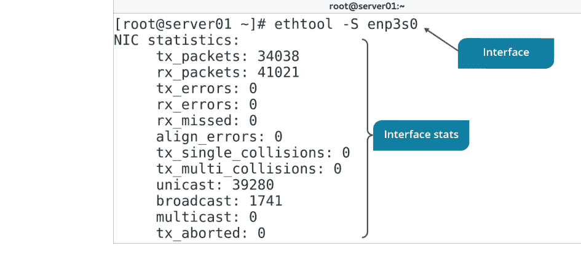

显示网络接口的统计信息。

## 语法

`ethtool`命令的语法为`ethtool [options] {device name}`。

### ethtool 命令选项

下表描述了一些常用的`ethtool`命令选项。

| 选项 | 用途 |
|---|---|
| `-S {interface}` | 显示网卡的统计信息。 |
| `-i {interface}` | 显示网卡的驱动程序信息。 |
| `-t {interface}` | 对网卡执行自检。 |
| `-s {interface} {setting} {value}` | 更改网卡的一些设置，例如其速度和双工模式。 |
| `-f {interface} {image}` | 将固件映像写入（"刷新"）网卡。 |

## brctl 命令

网络桥接涉及关联两个通常不会在它们之间传递网络流量的网络。桥接在 OSI 第二层使用 MAC 地址工作。Linux 系统可以配置为桥接两个网络。`brctl`（桥接控制）命令用于在 Linux 中配置桥接。

桥接的一个常见示例如下：

1. `brctl show` —查看桥接配置。
2. `brctl addbr {bridge name}` —创建一个空桥接。
3. `brctl addif {bridge name} eth0` —将`eth0`添加到桥接。
4. `brctl addif {bridge name} eth1` —将`eth1`添加到桥接，从而连接与`eth0`和`eth1`相连的网络。

## 语法

`brctl`命令的语法为`brctl [command]`。

## 网卡绑定

将同一系统上的两个或多个网卡关联在一起，可以实现其组合带宽的聚合、容错/冗余以及负载均衡。这两个接口通常独立管理，并具有不同的 IP 地址配置。使用**绑定**时，这些接口作为单个设备管理，并具有相同的 IP 地址配置。将两个或多个网卡绑定的能力对服务器来说是一项重要功能。如果绑定中有两个网卡，其中一个发生故障，另一个可以继续提供连接性。

网卡绑定可以配置为主动/被动模式。在此设置中，一个主网卡处于活动状态，另一个辅助网卡处于待机（被动）状态。如果活动网卡发生故障，系统会自动故障转移到辅助网卡以保持可用性。网卡绑定还可以配置为负载均衡模式，以组合每个网卡的带宽，从而避免其中一个网卡不堪重负。作为绑定成员的网卡被称为"从属网卡"。

网卡绑定在 Linux 中得到支持，但网络交换机中也必须存在相应的支持。这种支持称为 EtherChannel。这是大多数企业级交换机的一项功能。

> **注意：** 某些 Linux 发行版还支持网卡 teaming，这是一种类似但更灵活的链路聚合方法。例如，RHEL 6 支持网卡绑定，而 RHEL 7 同时支持网卡绑定和网卡 teaming。


同一交换机上的两个绑定网卡。

### 网卡绑定过程

创建网卡绑定配置的过程从创建绑定开始，然后将网卡添加到绑定中。

1. 确保支持网卡绑定的内核模块已加载。
2. 运行`modprobe --first-time bonding`命令加载该模块。
3. 运行`modinfo bonding`命令查看有关该内核模块的更多信息。
4. 在`/etc/modprobe.d/`目录中创建一个名为`bond.conf`的文件，内容如下：`alias bond0 bonding`。
5. 创建绑定接口：
   - a. `nmcli con add type bond con-name bond00 ifname bond00 mode active-passive`
6. 将网卡接口添加到绑定接口：
   - a. `nmcli con add type bond-slave con-name bond00-<device ID> ifname <device ID> master bond00`
   - b. `nmcli con add type bond-slave con-name bond00-<device ID> ifname <device ID> master bond00`
7. 为`bond00`接口设置 IP 配置，就像它是一个普通网卡一样。对于服务器，这通常意味着你需要设置一个静态 IP 地址。
8. 测试连接，包括任何故障转移设置。不要忘记，你可能还需要配置交换机以支持网卡绑定。

> **注意：** 可以使用`nmcli`、`nmtui`或 NetworkManager GUI 工具配置网卡绑定。

## /etc/sysconfig/network-scripts/ 目录

`/etc/sysconfig/network-scripts/`目录包含网络设备配置文件。这些文件包括 Linux 系统上可能存在的任何网卡、绑定和桥接的配置。这些文件通常采用`ifcfg-<NIC>`的形式。设置可以包括网卡配置为静态还是动态 IP 地址、网卡是否启用等。确切的设置因所需的配置和设备类型而异。

虽然可以使用 Vim 或 nano 等文本编辑器手动编辑这些文件，但 NetworkManager 实用程序通常是管理接口的更好方式。NetworkManager 有命令行、文本界面和图形界面。


进入`/etc/sysconfig/network-scripts/`目录，查看网络接口配置文件。

```
[root@server01 ~]# ls -l /etc/sysconfig/network-scripts/
total 248
-rw-r--r--. 1 root root  351 Dec 14 21:24 ifcfg-enp3s0
-rw-r--r--. 1 root root  254 Jan  2  2018 ifcfg-lo
lrwxrwxrwx. 1 root root   24 Dec 11 18:17 ifdown -> ../../../usr/sbin/ifdown
-rwxr-xr-x. 1 root root  654 Jan  2  2018 ifdown-bnep
-rwxr-xr-x. 1 root root 6569 Jan  2  2018 ifdown-eth
-rwxr-xr-x. 1 root root 6190 Apr 11  2018 ifdown-ib
-rwxr-xr-x. 1 root root  781 Jan  2  2018 ifdown-ippp
-rwxr-xr-x. 1 root root 4540 Jan  2  2018 ifdown-ipv6
lrwxrwxrwx. 1 root root   11 Dec 11 18:17 ifdown-isdn -> ifdown-ippp
-rwxr-xr-x. 1 root root 2102 Jan  2  2018 ifdown-post
-rwxr-xr-x. 1 root root 1068 Jan  2  2018 ifdown-ppp
-rwxr-xr-x. 1 root root  870 Jan  2  2018 ifdown-routes
-rwxr-xr-x. 1 root root 1456 Jan  2  2018 ifdown-sit
-rwxr-xr-x. 1 root root 1621 Mar 17  2017 ifdown-Team
-rwxr-xr-x. 1 root root 1556 Mar 17  2017 ifdown-TeamPort
-rwxr-xr-x. 1 root root 1462 Jan  2  2018 ifdown-tunnel
lrwxrwxrwx. 1 root root   22 Dec 11 18:17 ifup -> ../../../usr/sbin/ifup
-rwxr-xr-x. 1 root root 12415 Jan  2  2018 ifup-aliases
```

## `/etc/network/` 目录

对于基于 Debian 的发行版，代表接口的网络配置文件可以在`/etc/network/`目录中找到。许多基于 Debian 的发行版也使用 NetworkManager，因此通常不需要编辑`/etc/network/`中的文件。

## Netplan

Netplan 是某些发行版上的网络配置工具。它使用 YAML 描述文件来配置网络接口。这些文件存储在`/etc/netplan/`目录中。你需要使用文本编辑器来创建或修改接口配置文件。Netplan 包含子命令以使配置更可靠。例如，你可以输入`sudo netplan`来在尝试实施之前检查配置文件的语法错误。`sudo netplan apply`命令实际上执行配置更改。

## `/etc/sysconfig/network` 文件

`/etc/sysconfig/network`文件用于配置是否在启动时启用网络，以及主机名信息、网关信息等。这些设置也可以在`/etc/sysconfig/network-scripts/ifcfg-<NIC>`文件中按接口进行配置。

> **注意：**`/etc/sysconfig/network`文件通常存在于从 Red Hat Linux 派生的 Linux 发行版中。对于从 Debian 派生的 Linux 发行版，等效文件是`/etc/network/interfaces`。

> **注意：**要了解更多信息，请查看课程网站上的视频选项卡，了解补充本课内容的任何视频。

## 活动 10-4

## 讨论网络连接

### 场景

回答以下问题以检查您对该主题的理解。

1. 您正在公司网络上搭建一台新的 Linux 服务器。要使计算机参与网络，该服务器必须具备什么？

2. 您的经理为您和您的团队布置了一个新项目，要求为所有 Linux 服务器分配描述性的主机名。您如何将系统的主机名设置为`fswebserver01`？

3. 您让同事查看 server03 的 IP 地址。他尝试使用`ifconfig`，但该命令未安装。您如何指导他检查 IP 地址？

4. 您团队中的一位管理员更喜欢使用图形用户界面（GUI）而非命令行。然而，您的 Linux 服务器上未安装任何 GUI 组件。他需要为多个系统配置一些额外的网络元素。您可以建议他使用哪个命令？

5. 在已安装 GUI 的 Linux 系统上，您可以使用 NetworkManager 图形工具配置网络设置。该工具的名称是什么？

## 活动 10-5

## 验证网络配置

### 开始之前

您以学生账户身份登录到 GUI。此前，您已在服务器上配置了网络信息。

### 场景

现在您已配置好网卡，需要验证这些配置是否已生效且准确。因此，您将使用`ethtool`和设备的配置文件来确认网络详细信息。

1. **使用`ethtool`收集信息**

   - 如有必要，输入`ip a`来回忆您的以太网设备 ID。

   - 输入`ethtool <设备 ID>`

   - 验证您能否看到有关网卡功能和配置的信息。您应该能够看到网卡的最大带宽速度、双工业能力、支持的链路模式等。

2. **查看网络配置文件。**

   - 输入`ls /etc/sysconfig/network-scripts`以显示内容。

   - 验证是否存在`ifcfg-<设备 ID>`文件。

   - 输入`cat /etc/sysconfig/network-scripts/ifcfg-<设备 ID>`以查看内容。

   - 验证您能否看到该网卡的设备信息以及 IP 地址信息。

## 主题 D

## 配置 DHCP 和 DNS 客户端服务

**涵盖的考试目标**

1.3 根据场景，配置和验证网络连接参数。

如您所见，DHCP 和 DNS 都是 TCP/IP 网络世界中重要的协议。在本主题中，您将更深入地了解这些协议在 Linux 中的实现方式，以及如何配置它们以满足您的需求。

## 静态与动态 IP 地址配置

IP 地址配置可以通过两种方式设置：静态或动态。每种方法各有优缺点。了解何时使用每种方法非常重要。

静态 IP 地址配置意味着由管理员手动实施设置。这种方法增加了出错的风险，但能确保系统始终具有相同的身份。静态 IP 地址配置通常适用于网络设备（路由器、网络交换机等）和服务器。它们也可能用于网络打印设备。

静态配置的考虑因素：

- IP 地址配置永远不会改变。

- 手动输入时可能出现错误。

- 配置和重新配置的管理工作量增加。

动态 IP 地址配置意味着从服务器获取设置。这种方法减少了出错的风险，但也意味着系统可能不会始终具有相同的 IP 地址。动态 IP 地址配置通常适用于客户端机器。它们也可能用于网络打印设备。

动态配置的考虑因素：

- IP 地址配置可能随时间变化。

- 减少配置过程中的打字错误风险。

- 配置和重新配置的管理工作量减少。

## DHCP 配置

动态主机配置协议（DHCP）服务器包含一个或多个 IP 地址池以及相关配置选项，供客户端机器租用。这节省了大量的管理工作量，因为不需要为每个系统静态配置 IP 地址信息。

DHCP 服务器通过作用域（或可用 IP 地址范围）以及附加选项进行配置。DHCP 服务必须安装在将托管该服务的服务器上，并允许客户端机器租用配置。

## DHCP 租约生成和续订过程

工作站从 DHCP 服务器租用其 IP 地址配置。该过程包括四个步骤，由客户端发起。租约是临时的，因此客户端需要定期续订租约。续订过程提供了在网络配置发生变化时更新客户端的机会。租约通常包括客户端的 IP 地址、关联的子网掩码、默认网关（路由器）的 IP 地址、一个或多个 DNS 服务器的 IP 地址，以及租约的有效期。还可以配置其他附加选项。

DHCP 客户端必须定期续订其租用的 IP 地址配置。如果 DHCP 服务器检测到客户端的信息已过时，它将强制客户端租用新配置。如果没有变化，续订将成功。租约续订过程是初始租约生成过程的第三步和第四步。

DHCP 客户端从 DHCP 服务器租用 IP 地址的过程。

### `/etc/dhcp/dhclient.conf` 文件

主要的 DHCP 客户端参考文件是`/etc/dhcp/dhclient.conf`文件。该文件允许配置 DHCP 客户端设置，包括超时值、动态 DNS 配置等。该文件由 NetworkManager 调用和管理，NetworkManager 作为多个网络设置的网络配置服务，包括 DHCP 客户端配置。通常，使用 NetworkManager 管理 DHCP 客户端配置比直接编辑`/etc/dhcp/dhclient.conf`文件更合适。

> **注意：**要了解更多信息，请查看课程网站上的视频标签，了解补充本课内容的任何视频。

### 名称解析

TCP/IP 数据包必须包含源 IP 地址和目标 IP 地址。人类很难记住长串数字。例如，想象一下，如果您收藏的每个网站或通讯录中的每个电子邮件地址都以 IP 地址而非名称的形式记录给您！

人类使用易于记忆的名称，例如`www.redhat.com`或`www.ubuntu.com`。此类信息对计算机来说几乎毫无用处，计算机需要 IP 地址信息才能正确找到资源。名称是描述，而地址是位置。

名称解析是将这些易于记忆的名称与难以记忆的 IP 地址相关联的过程。名称解析通常有两种工作方式。第一种是通过静态文本文件，例如`/etc/hosts`文件。第二种方法是通过称为域名系统（DNS）的动态数据库。

*使用 DNS 服务器进行名称解析的过程。*

### 测试名称解析

可以使用各种工具来测试名称解析，包括`host`和`nslookup`命令。

### `/etc/hosts` 文件

早期的网络环境相对较小，网络节点的身份不经常变化。名称解析可以通过使用存储在每个系统本地的文本文件来管理，该文件包含所有系统及其相关 IP 地址。如果发生任何名称或 IP 地址更改、添加或删除，该文件必须手动更新。在当今现代化、临时性的网络中，这种方法不现实。文件中的条目数量以及身份条目的频繁变化将是难以应付的。

然而，`/etc/hosts`文件仍然很重要，因为它可以在特殊情况下使用——例如，某个开发工作站需要连接到未在网络上注册的实验服务器。虽然`/etc/hosts`文件不常用，但在某些场景下是必不可少的。

在本地配置名称解析。

## `/etc/resolv.conf` 文件

现代网络使用名称解析服务（如 DNS）来关联计算机名称和 IP 地址。网络设备会查询 DNS 服务器以解析名称与 IP 地址的关系。DNS 服务器包含资源记录，可为查询提供答案。DNS 服务器是集中式的，比维护`/etc/hosts`文件并保持其更新要容易得多。

`/etc/resolv.conf`文件存储在每个系统的本地，用于告知系统一个或多个 DNS 服务器的 IP 地址。DNS 是一项基本服务，因此在`/etc/resolv.conf`文件中至少列出两个 DNS 服务器是一种良好的做法。

使用公共 DNS 服务器配置名称解析。

## `/etc/nsswitch.conf` 文件

`/etc/nsswitch.conf`文件包含多个配置选项。与名称解析相关的选项定义了系统将使用的名称解析方法的顺序。顺序可能是先`/etc/hosts`文件，再 DNS；或者先 DNS，再`/etc/hosts`文件。首选的配置是先`/etc/hosts`，再 DNS。

```
[root@server01 ~]# cat /etc/nsswitch.conf | grep hosts
#hosts:     db files nisplus nis dns
hosts:      files dns myhostname
```

`/etc/nsswitch.conf`文件。

## 使用 NetworkManager 配置 DNS

DNS 配置也可以通过 NetworkManager 进行设置。NetworkManager 包括命令行、基于文本和图形界面的实用工具。在这三种实用工具中，配置至少一个 DNS 服务器的 IP 地址至关重要。

**注意：** 要了解更多信息，请查看课程网站上的"视频"标签，了解补充本课内容的任何视频。

## 活动 10-6

## 讨论 DHCP 和 DNS 客户端服务

### 场景

回答以下问题，以检查您对该主题的理解。

1. 您已在网络中设置了两台内部 DNS 服务器，需要检查它们是否能将主机名解析为 IP 地址，以及将 IP 地址解析为主机名。您可以使用哪个实用工具来完成此操作？

2. 您的团队在总公司和一个分支机构之间建立了 VPN 连接，但您无法连接到分支机构网络中的任何系统。分支机构的一台服务器 IP 地址为 192.168.1.10。您可以使用哪个命令来检查您的计算机与该服务器之间的网络路径，以帮助排查问题？

3. 您在 Linux 服务器 web01 上安装了 Apache Web 服务，但无法从另一台计算机连接到该 Web 服务（TCP 端口 80）。要开始故障排查，您需要使用一个实用工具来检查 web01 正在侦听的 TCP 连接和端口。您可以使用哪个实用工具？

4. 您团队中的另一位管理员对服务器进行了修补并重新启动，但他担心服务器恢复可用需要很长时间。您可以使用哪个实用工具来检查系统何时重新上线？

5. 您怀疑有人正试图入侵您的一台服务器，因此您决定在该系统上捕获几分钟的网络流量以进行进一步调查。您可以使用哪个命令行实用工具来捕获流量？

## 活动 10-7

## 配置 DNS 客户端

### 开始之前

您以学生帐户身份登录到 GUI。您将在此活动中与搭档一起工作。

### 场景

除了设置机器友好的 IP 地址之外，您还需要考虑到人类不擅长记住长串数字这一事实。因此，您将配置名称解析，将主机名与 IP 地址相关联，以便用户可以轻松引用网络上的特定计算机。

1. 查看系统的 IP 地址和主机名标识。

   - 输入`hostname`查看系统的人性化名称。

   - 输入`ip addr show <设备 ID>`查看系统的 IP 地址。人类往往不擅长记住长串数字。名称解析用于关联上面显示的主机名和 IP 地址值。

   - 如果仍然可以看到租用的 IP 地址，请使用`nmcli con down <设备 ID>`然后`up`来重置接口。

2. 为您的系统配置名称解析。

   - 输入`cat /etc/resolv.conf`显示系统配置为查询的 DNS 服务器。

   - 输入`cat /etc/hosts`显示可用于名称解析的静态文本文件。

   - 向您的搭档询问他们系统的主机名和 IP 地址。向他们提供关于您系统的相同信息。

   - 输入`ping <搭档主机名>`并验证它失败。

   - 输入`ping <搭档 IP 地址>`并验证它成功。

   - 按 **Ctrl+C** 中断进程。

   - 使用`sudo`，打开您选择的文本编辑器，将您搭档的主机名和 IP 地址信息添加到`/etc/hosts`文件中，格式为`<搭档 IP 地址> <搭档主机名>`

     例如：`10.50.1.-sources: server01`

   - 保存并关闭文件。

   - 再次 ping 您搭档的主机名和 IP 地址，并验证这次两者都成功。

3. 确保 Internet 身份的名称解析正常工作。

   - 输入`host www.google.com`

   - 输入`nslookup www.google.com`

   - 验证您使用每个命令都收到了 **google.com** 的 IP 地址结果。

```
[student01@localhost ~]$ host www.google.com
www.google.com has address 172.217.12.132
www.google.com has IPv6 address 2607:f8b0:4006:801::2004
[student01@localhost ~]$ nslookup www.google.com
Server:		8.8.8.8
Address:		8.8.8.8#53

Non-authoritative answer:
Name:	www.google.com
Address: 172.217.12.132
```

## 主题 E

## 配置云和虚拟化技术

**涵盖的考试目标**

1.5 比较和对比云和虚拟化概念及技术。

一个大量利用网络的现代概念是**云计算**。云计算彻底改变了 IT 行业，与之密切相关的虚拟化概念也是如此。在本主题中，您将配置这些技术以优化您的 Linux 基础设施。

## 云计算

IT 领域中一个相对较新且快速变化的方面是**云计算**的增长。云计算有很多例子和用途。根据美国国家标准与技术研究院（NIST）的定义，云计算有五个基本特征：

- 按需自助服务

- 广泛的网络访问

- 资源池化

- 快速弹性

- 可计量服务

这五个概念结合在一起，形成了当今 IT 行业最重要的方面之一。云计算已成为许多企业（无论大小）的关键任务服务。从根本上讲，您可以将云计算视为一种**卸载责任**的方法。这种责任可能是网络和服务基础设施的成本、所有权和维护，也可能是开发环境的责任，或者是操作系统和应用支持的责任。

云服务的特点是部署、规模、支持和容错的灵活性。企业能够按需快速扩展资源，并且只需为实际消耗的资源付费。基于订阅的付款提供了更大的财务灵活性和控制力。在传统基础设施中，网络和服务器组件由组织购买，资源可能会长时间闲置，或者无法快速扩展以支持业务敏捷性。

## 云模型

云计算有三种主要模型，每种都有许多变体。

| 模型 | 说明 |


|-------|-------------|

| 软件即服务 (SaaS) | SaaS 向最终用户提供应用程序。应用程序不直接安装在用户工作站上，尽管对用户来说，该应用程序似乎是本地的。部署、维护、升级和安全补丁都卸载给云服务提供商。云计算的这一领域通常为所有最终用户提供服务。 |

| 平台即服务 (PaaS) | PaaS 包括环境操作系统层的虚拟化。开发或数据库平台由云服务提供商支持，并以即用即用的方式提供给客户。平台支持卸载给云服务提供商。云计算的这一领域通常为开发人员和数据库管理员提供服务。 |

| 基础设施即服务 (IaaS) | 在 IaaS 中，物理设备（服务器、交换机、路由器等）被虚拟化并由云服务提供商拥有。硬件生命周期责任卸载给云服务提供商。云计算的这一领域通常为系统管理员提供服务。 |

> **注意：** 还有几种针对更具体服务的模型。

## 公有云、私有云和混合云

云服务可以通过不同的结构提供。公有云是指由云服务提供商拥有的硬件资源，客户资源、计算功能、存储等可能在多个客户之间共享。法律、行业法规和公司安全政策可能不允许所有公司使用此类共享资源。私有云是指将云技术用作本地解决方案。私有云通常满足安全要求，使公司能够对其数据在任何给定时刻的确切位置保留大量控制权，并可能提供更简单的管理。私有云确实要求公司继续拥有硬件生命周期、应用支持等。混合云是其他两个概念的组合，实现更有效的成本管理与严格的安全管理相结合。

> **注意：** 私有云也可能被称为*本地云*或*本地云部署*。

## 云服务提供商

存在许多云服务提供商 (CSP)，但亚马逊和微软云解决方案是云行业的两个主要提供商。亚马逊网络服务 (AWS™) 支持大量部署选项。AWS 构建在 Linux 解决方案之上。微软® Azure® 也支持大量部署选项。Azure 支持部署基于 Linux 的解决方案，而不仅仅是 Windows 解决方案。

红帽® Cloud Suite 是另一家 CSP。红帽的解决方案是基于 Linux 的全功能私有云。

尽管 AWS 和微软 Azure 被认为是云服务的行业领导者，但还有许多其他 CSP。许多提供商提供专业的服务用于 particular parts of the cloud market. Here are a few additional CSPs for you to investigate:

- **Google Cloud™**: 支持非常广泛的服务，包括计算、存储、数据库、物联网、开发工具等。

- **Rackspace**: 服务包括计算、数据库、业务连续性和数据中心管理。

- **Heroku™**: 为应用开发提供PaaS选项。

- **Digital Ocean™**: 一家提供可扩展性和管理功能的PaaS云服务商。

## 云与虚拟化

虚拟化能够显著提高硬件利用效率，同时还为容错、灾难恢复和可扩展性提供了许多额外的选项。它还允许更快的服务器和服务部署。正是出于这些原因，虚拟化成为云计算的基础。云服务提供商将其提供给客户的资源进行虚拟化，以便更轻松地管理这些资源。

这种虚拟化延伸到每一种模式：SaaS、PaaS和IaaS。例如，管理员可以通过单个操作轻松地构建或稍后拆除整个系统集群，甚至可以根据环境变化自动执行此过程。如果管理员必须在物理系统上完成所有这些操作，效率会低得多，因此虚拟化至关重要。

## 管理程序

**管理程序（hypervisor）**软件层在虚拟机和物理硬件之间提供控制。它管理硬件分配、网络控制、管理控制等。

管理程序有两种类型：第1类直接在硬件上以"裸机"部署方式运行。示例包括VMware ESXi和Microsoft Hyper-V。第2类作为服务在本地安装的操作系统上运行。示例包括Oracle VM VirtualBox和QEMU。

基于内核的虚拟机（KVM）是一种基于Linux的虚拟化解决方案，可以添加到大多数Linux发行版中。它使得在Linux平台上管理虚拟机成为可能，兼具第1类和第2类虚拟化的特性。

## 模板

虚拟机模板可以使部署更加高效。管理员和用户可以在自助服务环境中使用预定义模板自己部署服务器，这些模板指定了不同的处理器、内存、存储和网络配置。

可以使用不同的模板来简化部署。

| 模板 | 描述 |

| --- | --- |

| 开放虚拟化格式（OVF） | 包含虚拟机、网络设备等所需的配置文件、软件包等。这些文件可用于虚拟化环境中虚拟机的部署。此外，OVF文件易于分发。虚拟机的元数据，包括有关虚拟机需求和依赖项的信息，描述于扩展名为`.ovf`的XML格式文件中。开放虚拟化设备（OVA）特指代表网络设备的单个软件包，通常以不同格式存储，如`.tar`文件。 |

| JavaScript对象表示法（JSON） | 这些文件可用于存储大多数编程语言易于解释和使用的信息。因为JSON使用标准JavaScript®格式，所以人类也相对容易理解和编写。JSON文件的一种用途是快速部署和配置一个或多个虚拟机。 |

| YAML不是一种标记语言（YAML） | 可用于存储在新部署虚拟机上使用的配置信息。此信息可由`cloud-init`用于在虚拟机首次启动时安装软件或创建用户账户，也可由Ansible等编排工具使用。YAML文件由一系列键值对组成，用于指定所需的配置。 |

| 容器镜像 | 许多虚拟化解决方案使用虚拟机（VM）。VM是虚拟化主机上的完整、独立部署。容器化在操作系统层进行虚拟化，提供应用隔离，即使这些应用共享单个操作系统。容器可用于托管生产应用，也可供开发人员测试应用。您可以使用容器镜像（例如，Docker容器）部署容器，这些镜像可以是自己创建的，也可以从互联网下载。这些镜像可能包含容器所需的一切，包括应用和支持配置。 |

## 引导启动

术语引导启动（bootstrapping）指的是操作系统的启动。它指的是"自力更生"这句格言，意味着操作系统从简单的层开始，逐步走向更复杂的功能。对于虚拟机，引导启动步骤由虚拟化层处理。可以在引导启动序列期间修改虚拟机的启动和部署。管理引导启动的三种方式包括`cloud-init`、`Anaconda`和`Kickstart`。

`Cloud-init`是一种基于云的Linux机制，用于在虚拟机首次启动时对其进行自定义。这种自定义可能包括安全设置、软件包安装、用户和组创建等。`Cloud-init`引用YAML文件来查找必要的设置。`Cloud-init`受到许多发行版的支持，包括Ubuntu® Server 18和Red Hat® Enterprise Linux® (RHEL) 7。

许多Linux发行版使用`Anaconda`安装程序来管理其部署。该安装程序可以向管理员提供提示以配置新的Linux服务器，或者可以引用文件来自定义安装。Linux使用`Kickstart`文件来定制安装，提供无人值守安装。有关分区、软件包、用户账户、软件部署等的所有信息都包含在`Kickstart`文件中。`Anaconda`和`Kickstart`的结合实现了快速、一致和定制的Linux安装。

## 存储

对于传统物理计算机，存储容量以物理空间形式提供。这个空间通常是一个或多个存储驱动器。使用虚拟化时，存储容量可以作为虚拟存储驱动器暴露给虚拟机。虚拟存储驱动器是驻留在物理驱动器上的文件，就像任何其他数据文件一样。该文件被当作物理驱动器对待。它进行分区并赋予文件系统，安装引导加载程序，然后部署操作系统。虽然从管理员的角度来看，虚拟驱动器只是一个文件，但从虚拟机的角度来看，它是一个物理设备。

因为虚拟驱动器只是文件，与传统物理驱动器相比，它们可能提供更多容错机会、更简单的系统状态回滚、冗余和存储可扩展性。

## 精简与厚置备

部署虚拟机时，您可能会获得配置精简存储或厚置备存储的选项。精简存储指的是一个将根据需求增长至最大大小的虚拟存储设备文件。这可能使磁盘空间的使用更加高效，但也可能带来性能损失。厚置备虚拟存储设备会立即为虚拟设备保留分配的空间，无论实际上是否需要那么多容量。性能更好，但可能消耗比实际需要更多的磁盘空间。精简置备最适合于维护大型存储池的成本远比暂时耗尽存储的风险更令人担忧的环境。同样，厚置备最适合于持续存储过程中断带来不可接受的风险，这比未使用存储的开支更为重要的环境。

## 持久卷

一些组织会使用Kubernetes管理容器虚拟化。Kubernetes为容器管理提供编排解决方案。作为该编排的一部分，会创建持久卷。当与Linux集群结合使用时，它们将存储配置与 individual cluster nodes. This makes it easier for nodes to be replaced through their lifecycle without impacting the storage.

## BLOB 和 BLOCK 存储

数据可以通过多种方式存储。一种方式是使用传统的 SQL 数据库，如 MariaDB® 或 MySQL™。也可以非结构化的方式存储数据，这被称为 **blob**（二进制大对象）。音频、视频和其他多媒体文件以及文本文件都可以这种方式存储。这是对象存储的一个例子。

数据本身以称为块的较小片段写入存储设备（无论是物理的还是虚拟的）。这些块是驱动器的基本存储区域。大多数文件太大，无法存储在单个块中，因此文件被拆分成多个片段，然后写入到块中。当操作系统调用时，数据会被重新组装。

对象存储可能比块存储更高效，尤其是对于较大的文件。在多个地理区域存储数据时，它也可能更加灵活。

## 网络配置

虚拟化管理程序可以配置为以多种方式提供对网络服务的访问。可以为虚拟机配置一个或多个虚拟网卡（NIC）。然后，虚拟网卡可以连接到管理程序内的虚拟交换机。这些虚拟交换机随后可以被授予访问宿主计算机物理网卡的权限。

一些网络配置选项包括：

- **无网络**：模拟根本不包含网卡的计算机。

- **内部**：虚拟机连接到一个虚拟交换机，该交换机允许与其他虚拟机进行网络通信，但不允许与宿主操作系统或物理网卡进行网络通信。

- **公共**：虚拟机连接到一个虚拟交换机，该交换机允许与其他虚拟机、宿主操作系统和物理网卡进行网络通信。这种配置使虚拟机暴露于业务网络中，可以像普通客户端或服务器一样参与网络。

虚拟机的网络配置必须仔细管理，因为虚拟机经常被配置为生产服务器，最终用户需要访问这些服务器。一旦提供了网络连接，就必须遵循保护联网节点的最佳实践。网络节点是虚拟机这一事实并不能使其免于需要防范网络威胁。

## 额外的网络考虑因素

虚拟化环境中的网络与物理环境中的网络一样灵活。诸如网络地址转换（NAT）之类的服务提供了相同的功能。就 NAT 而言，它是在预留的私有 IP 地址范围和公共互联网地址范围之间进行转换。这些虚拟化网络可以被视为"覆盖网络"，尤其是部署在云环境中时。覆盖网络这个术语简单地指建立在另一个网络之上的网络。虚拟化网络环境也支持桥接，桥接将两个网络连接成一个单一的广播单元。

虚拟化还支持在虚拟机中使用多个网卡。如果网卡连接到不同的网段，则该服务器被称为"双宿主"服务器。

## 虚拟化工具

许多虚拟化宿主服务器运行不带图形用户界面的 Linux。这种配置使更多的硬件资源可用于虚拟机。虚拟机的管理则必须在命令行进行。

`virsh` 命令是 KVM 虚拟机的交互式 shell。以下是一些可以在 `virsh` 中使用的子命令。

| 子命令 | 用途 |

|--------|------|

| `help` | 获取 `virsh` 命令的帮助。 |

| `list` | 获取已识别虚拟机的列表。 |

| `shutdown {VM}` | 优雅地关闭虚拟机。 |

| `start {VM}` | 启动虚拟机。 |

| `reboot {VM}` | 重新启动虚拟机。 |

| `create {XML file name}` | 从 XML 文件创建虚拟机。 |

| `save {VM} {file name}` | 使用给定的文件名保存虚拟机的状态。 |

| `console {VM}` | 打开到虚拟机的控制台。 |

## libvirt

Linux 虚拟化解决方案构建在 `libvirt` 之上，`libvirt` 是一个应用程序编程接口（API），为开发人员编写自己的虚拟化解决方案提供了软件构建块。解决方案也可以由守护进程和管理界面组成。多个管理程序，包括 VMware ESXi、KVM、QEMU 等，都是使用 `libvirt` 构建的。它为基于 Linux 的虚拟化提供了坚实的基础。例如，`virsh` 工具就是 `libvirt` API 的一部分。

## GNOME VMM

GNOME 虚拟机管理器（VMM）实用工具可用于管理与虚拟机的连接。它使用直观的图形界面实现虚拟机的部署、配置和移除。下载并安装 `virt-manager` 软件包以开始使用 VMM。

> **注意：** 要了解更多信息，请查看课程网站上的视频标签，了解补充本课内容的任何视频。

## 活动 10-8

### 讨论云和虚拟化技术

### 场景

回答以下问题以检查您对该主题的理解。

1. 您的 CIO 交给您一项任务，为托管您的一些应用程序找到合适的云服务。该应用程序需要看起来像是本地安装的。您将选择哪种云模型？

2. 高管管理层已决定转向更敏捷的基础设施，包括移动用户和 100% 托管的应用程序和基础设施。该选项使员工能够从任何地点工作，并使公司摆脱硬件生命周期和应用支持的重担。高管管理层决定转向哪个选项？

3. 为了将您公司的应用程序迁移到公有云，您建议使用两家主要云服务提供商（CSP）公司之一。可以从哪两家主要 CSP 公司中进行选择？

4. 您的公司需要从个人在工作站上本地运行虚拟机转变为全公司范围内部署虚拟机。您的团队确定使用 VMware ESXi 更具成本效益。VMware ESXi 是哪种类型的管理程序？这意味着什么？

5. 您的团队内部对于是部署具有厚配置存储还是薄配置存储的虚拟机存在很多争论。争论的核心是性能。哪种配置类型具有更好的性能？

## 活动 10-9

### 配置虚拟化

### 数据文件

```
/opt/linuxplus/managing_networking/yum-script.sh
/opt/linuxplus/managing_networking/CentOS-7-x86_64-DVD-1804.iso
/opt/linuxplus/managing_networking/ubuntu-vm.qcow2
```

### 开始之前

您以学生账户登录到 GUI。

### 场景

Develetech 的一位开发人员请求您的帮助。她需要 Linux 测试环境来测试她的应用程序是否按设计运行。她希望自己管理这些环境，并且能够在每次测试后恢复到原始配置。您将为她安装 KVM 虚拟化解决方案。

1. **虚拟化的一些潜在好处是什么？**

2. 安装 KVM 虚拟化软件。

   a) 输入 `cat /proc/cpuinfo | grep vmx`，然后输入 `cat /proc/cpuinfo | grep svm` 以检查处理器。如果找到任一术语，则处理器应支持虚拟化。

   b) 输入 `sudo yum -y install qemu-kvm qemu-img virt-manager libvirt libvirt-python libvirt-client virt-install virt-viewer bridge-utils librbd1 librbd1 librbd1-devel libsolv`

   这将安装 KVM 及其依赖软件。

   c) 等待 KVM 完成安装。

3. 启动 KVM 服务。

   a) 输入 `sudo systemctl start libvirtd` 以启动服务。

   b) 输入 `sudo systemctl enable libvirtd` 以使服务持久化。

   c) 输入 `lsmod | grep kvm` 并验证 KVM 内核模块是否已加载。

4. 在 CLI 上创建虚拟机。

   a) 输入 `sudo virt-install --name=devtech-install --vcpus=1 --memory=2048 --cdrom=/opt/linuxplus/managing_networking/CentOS-7-x86_64-DVD-1804.iso --disk size=12 --os-variant=rhel7`

   这定义了要创建的虚拟机的硬件规格。该虚拟机将使用一个虚拟CPU，可访问2 GB内存，使用提供的系统镜像启动，并可访问一个12 GB的存储驱动器。

   b) 关闭弹出的虚拟机窗口。

   c) 输入 `sudo virsh save devtech-install saved-vm` 以停止虚拟机并保存其状态以供稍后使用。

5. 使用GUI虚拟机管理器导入虚拟机镜像。

   a) 从桌面菜单中，选择**应用程序**→**系统工具**→**虚拟机管理器**。

   b) 输入root密码以继续。

   c) 在虚拟机管理器中，选择**文件**→**新建虚拟机**。

   d) 在**新建虚拟机**向导中，第一步选择**导入现有磁盘镜像**，然后选择**前进**。

   e) 第二步选择**浏览**，然后选择**本地浏览**。

   f) 从导航菜单中，选择**+ 其他位置**。

   g) 选择**计算机**。

   h) 导航到 `/opt/linuxplus/managing_networking` 并打开 `ubuntu-vm.qcow2`。

   i) 选择**前进**。

   j) 第三步，将**内存（RAM）**更改为**2048**，并确保**CPU**设置为**1**。

   k) 选择**前进**。

   l) 第四步，将虚拟机命名为 `ubuntu-vm` 并选择**完成**。

6. 熟悉Ubuntu，另一种Linux发行版。

   a) 验证虚拟机窗口是否自动弹出。

   b) 在认证屏幕上，使用 `student` 作为账号，`Pa22w0rd` 作为密码登录到Ubuntu虚拟机。

   c) 验证您已成功登录到Ubuntu桌面。

> **注意：** 如果您收到设备上没有剩余空间的错误，请重新启动CentOS并重试。

   d) 从左下角选择**显示应用程序**按钮。您可能需要向下滚动虚拟机窗口才能找到此按钮。

> **注意：** 如果任何时候**软件更新器**对话框提示您，请选择**稍后提醒我**。


## 主题F

排查网络问题

### 涵盖的考试目标

1.3 给定一个场景，配置和验证网络连接参数。

4.1 给定一个场景，分析系统属性并进行相应修复。

网络问题在任何组织中都是不可避免的，无论规模大小。在本主题中，您将使用许多不同的Linux工具来诊断并帮助找到延迟、断开连接、无法解析的主机名等问题的解决方案。

## 常见网络问题

网络故障排查从一系列常规步骤开始，然后再转向更复杂的技术。

首先，检查基本项：设备是否已通电？设备是否已插入？电缆是否正确连接到正确的网络设备（交换机、路由器等）和主机本身？另外，请记住网卡可以处于"开启"或"关闭"状态。验证它们是否可用。接下来，验证网络接口配置是否正确。它们需要有适当的IP地址配置、子网掩码、默认网关值和名称解析设置。还要检查Linux是否检测到网络接口，并使用`ethtool`命令收集有关设备的驱动程序和其他信息。

您可以使用几种不同的技术来排查名称解析问题。第一个是同时通过主机名和IP地址对目标进行`ping`操作。如果基于主机名的`ping`失败，但基于IP地址的`ping`成功，则系统未能正确解析网络名称。此时，您可以使用`host`和`nslookup`等工具进一步测试名称解析。

网络本身也可能遇到问题。这些问题可能包括流量非常高，导致网络中各点的延迟和饱和问题。如果路由器配置错误或宕机，则可能找不到两个系统之间的最优路径，或者根本找不到路径。发生故障的网络接口卡可能导致网络上的数据包被丢弃，造成数据丢失、超时消息或网络吞吐量降低。您可能需要将这些问题上报给组织的网络团队。

## 应用程序性能故障排查

在排查应用程序性能问题时，开发人员可能需要选择与服务通信的方式。一种方法是`localhost`，它会创建完整的网络连接，包括所有TCP错误检查等。这种方法可能会明显更慢。开发人员的另一种设计选择是Unix套接字（或Unix域套接字）。这种方法通常可以通过从交易中移除TCP开销来提高性能。不需要该开销是因为连接完全是本地的。

## 网络适配器故障排查

如您所知，网络适配器也称为网络接口卡（NIC），提供与网络的物理连接。这些卡通常具有RJ-45连接器。它们可能集成在主板上，或通过扩展插槽添加到板上。网络卡需要安装适当的驱动程序，以便Linux能够利用其功能。

某些NIC支持远程直接内存访问（RDMA）接口，这些专用硬件组件部署在极低延迟、高速网络上，以提供显著的性能提升。对RDMA的支持通过内核模块提供，因此您必须检查服务器上的内核，查看该模块是否已加载。此外，如果内核尚未包含RDMA设备的驱动程序，您需要提供该驱动程序。

## `ping`命令

网络故障排查最早期的步骤之一是在两个系统之间发送测试数据包。这是使用称为`ping`的TCP/IP工具完成的。`ping`命令将从发送计算机生成响应请求，并应收到来自目标计算机的回复。

`ping`命令的可能结果包括：

- **来自 `<host>` 的回复**：连接成功。
- **目标不可达**：源计算机找不到通往目标的路径。这通常表明源计算机存在问题。
- **超时**：请求到达了目标计算机，但在源计算机超时之前响应未返回源计算机。这通常表明目标计算机存在问题。

尽管使用`ping`是网络故障排查过程中最早的步骤之一，但它只能告诉您*有*问题——而不是*什么*问题。

### 语法

`ping`命令的语法是 `ping [选项] {目标}`

`{目标}`可以是IP地址，例如`192.168.1.1`，也可以是主机名，例如`server01`。

### `ping`命令选项

一些常见的`ping`命令选项包括：

- `-c` —仅发送指定数量的`ping`尝试。默认情况下，Linux会连续发送`ping`，直到使用**Ctrl+C**中断。
- `-v` —指定详细输出。

### 序列号

`ping`命令还为每次`ping`尝试提供一个序列号（`icmp_seq`）。发送`ping`的主机可以使用此编号将每个请求与其响应匹配。不匹配的序列号可能表示数据包丢失。

## `traceroute`和`tracepath`命令

`traceroute`命令用于报告源计算机和目标计算机之间的网络路径，包括连接使用的任何路由器。数据包从一个路由器传输到下一个路由器的过程称为跳。因此，`traceroute`命令会输出路径上的每一跳。这在排查Internet连接问题或非常大的路由环境中的连接问题时特别有效。如果`traceroute`失败，能够识别路径中的哪个位置失败对于故障排除非常有用。

`tracepath`命令是`traceroute`的简化版本，不需要管理员权限即可运行。它的选项也更少。

### 语法

`traceroute`和`tracepath`命令的语法是 `traceroute/tracepath [options] {destination}`

## 路由问题

许多路由问题是由于路由表配置错误导致的。这些问题通常可以通过更新路由表来修复。但是，您必须首先确定导致问题的原因。`traceroute`和`tracepath`等命令可以揭示路由问题，如路由循环，即流量在多个节点之间持续来回路由，永远到不了目的地。例如，节点A使用节点B作为到节点C的路径；但节点B使用节点A作为到C的路径。如果流量的目的地是节点C，节点A和B会无限地在它们之间发送流量，因为它们都认为对方是到C的路径。

## `netstat`命令

`netstat`（网络统计）命令用于收集有关系统TCP连接的信息。根据使用的选项，`netstat`会通知用户现有连接、服务器上的监听端口、网卡信息等。

`netstat`命令的常用选项包括：

| 选项 | 用于 |
|--------|---------|
| `-v` | 激活详细模式。 |
| `-i [interface]` | 显示所有网络接口或指定接口的信息。 |
| `-c` | 每秒连续打印信息。 |
| `-l` | 仅显示正在监听的端口。 |

`netstat`命令已被弃用，取而代之的是`ss`命令，但某些Linux发行版上可能仍然安装有它。

### 语法

`netstat`命令的语法是 `netstat [options]`

### 输出

`netstat`的默认输出是列格式，如下所示：

- 套接字使用的协议。
- 附加到套接字的进程数。
- 提供有关套接字状态进一步信息的标志。
- 套接字访问的类型。
- 套接字的状态。
- 附加到套接字的进程ID。
- 附加到套接字的进程路径。

示例如下：

```
unix 2 [ ] STREAM CONNECTED 472 /run/dbus/system_bus_socket
```

## `ss`命令

`ss`（套接字状态）命令是一个信息收集工具，类似于`netstat`，但提供更简单的输出和语法。`ss`工具可以提供有关已建立TCP连接或系统可能正在监听的用于入站连接的端口的信息。这可以帮助您诊断客户端和服务器无法通过所需协议相互通信的问题；缺少套接字可能意味着服务未运行，而关闭的套接字可能意味着客户端或服务器过早终止了连接。使用`ss`的另一种方式是收集有关可能已连接的特定客户端的信息。

`ss`命令的常用选项包括以下内容：

| 选项 | 用于 |
|--------|---------|
| `-l` | 显示当前正在监听的套接字。 |
| `dst {host}` | 显示指定主机是否已连接以及连接统计信息。 |
| `-i` | 显示仅显示正在监听的端口。 |

```
[root@server01 ~]# ss -l | grep ssh
u_str LISTEN 0 128 /tmp/ssh-anqcWhPB1Axb/agent.2329 35364 * 0
u_str LISTEN 0 128 /run/user/1000/keyring/ssh 37090 * 0
tcp LISTEN 0 128 *:ssh *:*
tcp LISTEN 0 128 :::ssh :::*
[root@server01 ~]#
```

监听套接字

显示与SSH相关的监听套接字。

### 语法

`ss`命令的语法是 `ss [options]`

## `dig`、`nslookup`和`host`命令

最重要的网络服务之一是名称解析。如果系统无法访问或使用DNS名称解析服务器，它们很可能无法访问所需的网络服务。

可以使用三种不同的工具来测试和排除名称解析故障。在确认系统配置了一个或多个DNS服务器的正确IP地址（使用`cat /etc/resolv.conf`验证）并使用`ping`测试与DNS服务器的连接之后，应使用这些工具。

| 命令 | 说明 |
|---------|-------------|
| `dig` | 用于收集信息和测试名称解析的强大工具。大多数Linux发行版上都安装了它。输出显示在应答部分中。输出将包括映射到域名的IP地址、响应查询的DNS服务器以及接收该答案所需的时间。基本语法是 `dig {domain name}`。命令 `dig @{IP address} {domain name}` 将针对由IP地址指定的DNS服务器解析域名。 |
| `nslookup` | 用于收集名称解析信息和测试名称解析的工具。它在大多数Linux发行版以及Microsoft Windows上可用。此命令具有非交互模式，您可以在单个命令中提供域名，以及交互模式，您可以单独发出命令，然后在单独的连续提示中提供域名。非交互模式的语法是 `nslookup {domain name}` |
| `host` | 另一个简单的工具，能够收集信息和测试名称解析。大多数Linux发行版上都安装了它。基本语法是 `host {domain name}` 命令 `host {domain name} {IP address}` 将针对由IP地址指定的DNS服务器解析域名。 |

## 用于故障排除的`ip`命令

`ip`命令可用于故障排除以及网络配置。排除网络连接故障的第一步是验证所有设置是否正确。`ip addr`命令使管理员能够确保配置准确。

使用`ip addr`进行故障排除的示例包括：

- 检查IP地址配置：如果`ip addr`命令报告返回的地址在链路本地范围内，则网卡未配置合法的IP地址。链路本地范围是`169.254.#.#`。如果系统是DHCP客户端，则验证与DHCP服务器的连接。
- 检查网卡状态：`ip`命令可用于"up"或"down"网卡（启用或禁用它）。如果网卡显示为down，则它已被禁用且不工作。
- 检查网卡的使用统计信息：使用带有`-s`选项的`ip`可以查看连接的连接统计信息。

## `route`命令

可以将Linux系统配置为充当路由器。路由器的作用是根据数据包的网络ID将流量从一个网段传递到另一个网段。为了正确地将流量定向到适当的子网（并防止流量到达某些子网），配置了路由表条目。这不是Linux主机的常见配置，但需要了解。

`route`命令用于查看路由表。该命令还可用于操作路由表，使管理员能够配置所需的路由。示例包括以下内容。

| 命令 | 用于 |
|---------|---------|
| `route` | 查看系统上的当前路由表。 |
| `route add default gw {IP address}` | 通过IP地址配置默认网关。如果没有其他匹配其网络ID的路由，数据包将被发送到此目标。 |
| `route add -host {IP address} reject` | 过滤发往指定地址的流量，使管理员能够控制与特定主机的连接。也可以针对整个子网进行配置。 |

> **注意：**`route`命令已被视为弃用，建议使用`ip route`命令。

### 路由条目

```
[root@server01 ~]# route
Kernel IP routing table
Destination     Gateway         Genmask         Flags Metric Ref   Use Iface
default         gateway         0.0.0.0         UG    100    0     0 enp3s0
10.50.1.0       0.0.0.0         255.255.255.0   U     100    0     0 enp3s0
192.168.122.0   0.0.0.0         255.255.255.0   U     0      0     0 virbr0
[root@server01 ~]#
```


# 显示路由表

## 语法

`route`命令的语法为`route [options]`

## nmap 命令

网络映射器（Network Mapper），即`nmap`，是一款用于探索网络环境的强大工具。它可以识别节点，通常能够报告可用服务、操作系统版本、主机名、IP 地址、MAC 地址、网络设备（交换机、路由器）、网络打印机等。`nmap`工具有非常多的选项。它还有一个名为 Zenmap 的 GUI 版本。

`nmap`工具最初可用于审计和记录网络。在故障排除中，拥有此类文档至关重要。它也可以直接用于故障排除过程，以确认预期组件是否就位，或者网络环境是否发生了变化。

以下是一个故障排除过程的示例：

1. `ip addr` — 本地主机是否具有正确的 IP 配置？
2. `ping {destination}` — 流量是否能够从源端到目的地并返回？
3. `nmap` — 查看网络结构，以验证源系统和目标系统之间是否存在路径。

> **注意：**此过程中的前两个命令适用于大多数网络故障排除场景，包括使用本主题中讨论的许多其他工具的场景。

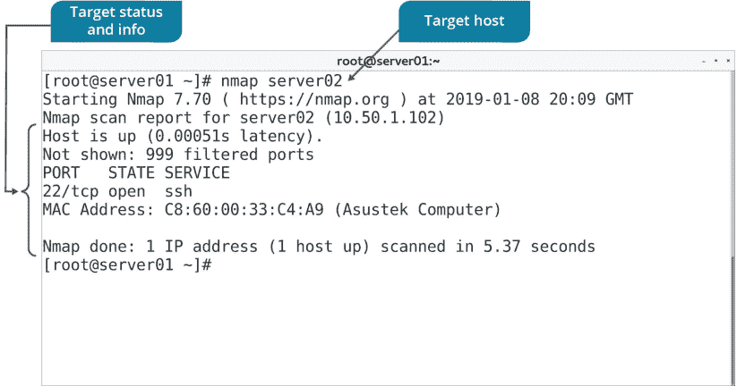

*通过网络扫描目标主机。*

## 语法

`nmap`命令的语法为`nmap [options] {target}`

## 故障排除示例

以下是使用`nmap`进行故障排除的一些示例：

- `nmap -p 1-65535 -sV -sS -T4 {target}` — 对指定目标（主机名、IP 地址、子网）上的所有监听端口进行端口扫描。这确保目标计算机正在监听源计算机的连接尝试。
- `firewall-cmd --list-services` — 查看本地防火墙可能过滤哪些流量。
- Wireshark — 识别给定网络子网中正在传输的网络流量。

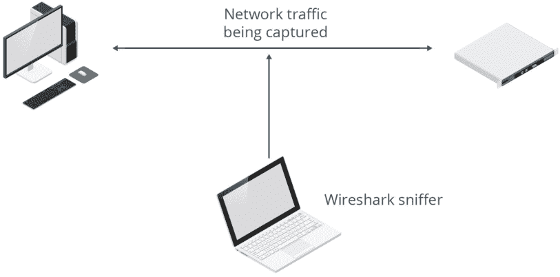

> 注意：Wireshark 主要用作 GUI 工具，但它确实包含用于 CLI 使用的`tshark`命令。

## tcpdump 命令

另一个网络分析器是`tcpdump`工具。`tcpdump`创建于 1987 年，至今仍是可用的最受欢迎的包嗅探器之一。它在许多 Linux 发行版上默认安装。用户可以使用此命令确定流量类型和内容。它提供与 Wireshark 类似的信息，并且可以在类似的故障排除过程中使用。

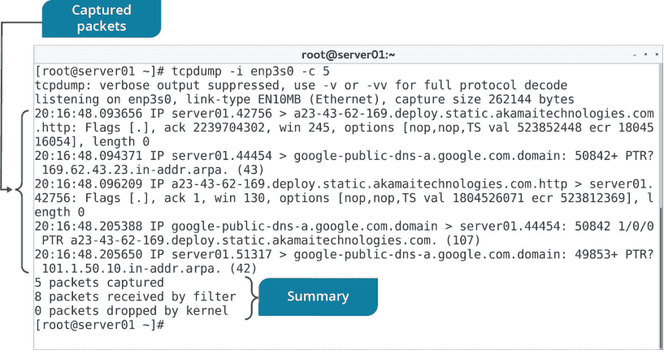

以下是`tcpdump`的一些常用选项。

| 选项 | 用途 |
|--------|---------|
| `-i` | 指定要使用的接口。 |
| `-n` | 不解析主机名，加快捕获速度。 |
| `-v` | 指定详细模式。 |

## 语法

`tcpdump`命令的语法为`tcpdump [options] [-i {interface}] [host {IP address}]`

## netcat 命令

`netcat`命令可用于测试连接性并通过网络连接发送数据。根据发行版的不同，该命令可以拼写为"netcat"或缩写为"nc"。系统可以通过 IP 地址或主机名来识别。

在故障排除时，使用`netcat`在目标计算机上监听，并从源计算机尝试连接，以验证网络功能。

下表提供了`netcat`命令的一些用例示例。

| 用例 | 命令示例 |
|----------|-----------------|
| 连接两台计算机以传输信息 | 在 comp1 上（监听端口）：`netcat -l 4242`<br>在 comp2 上（连接到监听器）：`netcat comp1 4242` |
| 在两台计算机之间传输文件内容 | 在 comp1 上（监听端口）：`netcat -l 4242 > received.file`<br>在 comp2 上（连接到监听器）：`netcat comp1 < original.file` |
| 对计算机进行端口扫描 | `netcat -z -v domain.tld 1-1000`（扫描端口 1 到 1000）。 |

> 注意：TLD 代表顶级域名，可以包括 .com、.net、.org 等。

## 语法

`netcat`命令的语法为`netcat [options]`

## iftop 命令

此命令可以帮助您通过显示该连接上的流量来识别特定链路为何缓慢。您可以使用它来查看接口上消耗最多带宽的内容。例如：`iftop -i eth0`

网络缓慢通常是带宽饱和的症状，即网络链路的容量被超过，也就是说，所有带宽都被用尽。这可能导致网络性能下降甚至服务中断。使用`iftop`命令，您可以调查您怀疑可能在该链路上发送或接收过多流量的任何网络接口卡（NIC）。例如，一台主机可能正在向内部 Web 服务器发出重复请求，而两台主机都可能用它们的请求和响应淹没网络。一旦您确定了问题的根源，就可以采取措施阻止有问题的主机继续发出这些请求，例如终止负责该请求的服务。

### 连接统计

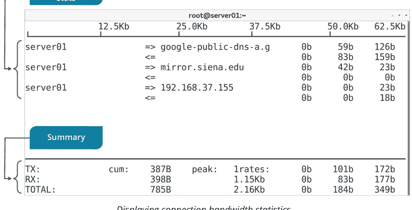

显示连接带宽统计信息。

## 语法

`iftop`命令的语法为`iftop [options] [-i {interface}]`

## iperf 命令

`iperf`命令用于测试接口支持的最大吞吐量。该工具必须在两个端点系统上安装。一个系统被指定为"服务器"，另一个为"客户端"。被测试的是`iperf`客户端。您可以使用此命令确保吞吐量符合您的预期。

基本测试如下：

1. 在服务器上，运行`iperf -s`
2. 在客户端上，运行`iperf -c {server address}`
3. 查看出现的结果。

```
[root@server01 ~]# iperf -c server02
------------------------------------------------------------
Client connecting to server02, TCP port 5001
TCP window size: 85.0 KByte (default)
------------------------------------------------------------
[  3] local 10.50.1.101 port 54382 connected with 10.50.1.102 port 5001
[ ID] Interval       Transfer     Bandwidth
[  3] 0.0-10.0 sec   112 MBytes  94.3 Mbits/sec
[root@server01 ~]#
```

远程主机

测试结果

测试两台主机之间的网络带宽。

## 语法

`iperf`命令的语法为`iperf {-c|-s} [options]`

## 吞吐量与带宽

带宽是在给定时间内可能通过网络连接传输的潜在数据量。吞吐量是在给定时间内实际通过网络连接传输的数据量。`iftop`和`iperf`工具都测量吞吐量。

## mtr 命令

`mtr`工具是`ping`和`traceroute`的组合，并进行了额外的改进，以支持测试网络连接质量。大量 ping 数据包被发送到目的地，`mtr`记录响应这些数据包所需的时间。

`mtr`命令还会记录丢失的数据包，这是称为丢包或分组丢失的问题的症状。这发生在从源发送的一个或多个数据包无法到达其预期目的地时。如果数据包排队等待重传，丢包可能导致延迟，或者数据可能根本无法成功传输。大量丢失的数据包是路径上存在网络问题的有力指标。通过识别问题存在的位置以及路径上的具体位置，`mtr`使管理员能够找到可能故障的网络组件。`mtr`的输出标识了路径上丢包的百分比，并且该路径上一个或多个经历高丢包率的节点可能是问题的根源。

分析连接到远程主机的信息。

## 语法

`mtr` 命令的语法为 `mtr [options] [hostname]`

## arp 命令

如你所知，网络中的节点通常有三个标识：主机名、IP 地址和 MAC 地址。DNS 将主机名转换为 IP 地址。**地址解析协议（Address Resolution Protocol, ARP）** 用于关联 IP 地址和 MAC 地址。管理员还可以运行 `arp` 命令来发现已知 MAC 地址的相关信息。

计算机会缓存最近解析的 MAC 和 IP 地址组合。如果计算机缓存了不正确或过时的信息，可能会导致与特定节点的连接丢失。ARP 缓存可以作为故障排除过程的一部分进行清除。例如，你可以运行 `arp -d {IP address}` 来清除特定 IP 地址的条目，然后再次尝试 ping 该主机。使用 `arp -a` 查看缓存。

ARP 缓存。

## 语法

`arp` 命令的语法为 `arp [options]`

## whois 命令

`whois` 命令提供有关组织互联网 DNS 注册信息。这有助于了解或验证域名所有权、组织的联系信息等。

一些示例包括：

- `whois google.com`
- `whois ubuntu.com`
- `whois redhat.com`

```
[root@server01 ~]# whois comptia.org
Domain Name: COMPTIA.ORG
Registry Domain ID: D5060168-LROR
Registrar WHOIS Server: whois.godaddy.com
Registrar URL: http://www.whois.godaddy.com
Updated Date: 2015-04-07T00:20:43Z
Creation Date: 1995-08-15T04:00:00Z
Registry Expiry Date: 2021-08-14T04:00:00Z
Registrar Registration Expiration Date:
Registrar: GoDaddy.com, LLC
Registrar IANA ID: 146
Registrar Abuse Contact Email: abuse@godaddy.com
Registrar Abuse Contact Phone: +1.4806242505
Reseller:
Domain Status: clientDeleteProhibited https://icann.org/epp#clientDeleteProhibited
Domain Status: clientRenewProhibited https://icann.org/epp#clientRenewProhibited
Domain Status: clientTransferProhibited https://icann.org/epp#clientTransferProhibited
Domain Status: clientUpdateProhibited https://icann.org/epp#clientUpdateProhibited
Registrant Organization: CompTIA
Registrant State/Province: Illinois
```

查询 CompTIA 公共域名的注册信息。

## 语法

`whois` 命令的语法为 `whois [options] {domain name}`

## 网络问题故障排除指南

排查网络问题时，请遵循以下指南。

## 网络问题故障排除

排查网络问题时：

- 缩小问题范围——如果问题发生在单台机器上，很可能是该机器的配置错误。如果问题发生在多台机器上，可能是网络问题。如果多个节点受到影响，请检查它们的共同点。它们是否都连接到同一个交换机或无线接入点？它们是否都在同一子网中？
- 使用 `ip` 命令验证系统上的 IP 地址配置。如果系统的 IP 地址以 169.254.x.x 开头，则说明它未能从 DHCP 服务器租用到 IP 地址配置，这为你提供了一个排查的起点。
  - 尝试从 DHCP 服务器重新获取动态 IP 地址配置。
  - 如果 IP 地址配置是静态的，请确认没有输入错误。
- 当遇到网络性能缓慢时，使用以下工具和流程来诊断带宽问题：
  - 持续 ping 受影响的主机，以确认主机之间的连接速度缓慢。
  - 使用 `traceroute` 识别网络瓶颈可能发生在路由路径的哪个位置。
  - 在受影响或可疑的主机上使用 `iftop` 识别哪些应用程序正在消耗带宽。某些应用程序，如流媒体，如果不加控制，可能会消耗大量带宽。
  - 如果连接速度缓慢但带宽不是问题，使用 `iperf` 测试网络接口吞吐量。接口本身可能无法处理所需的速度，需要升级或更换。
- 使用以下常规命令：
  - 使用 `ping` 命令测试连通性。
  - 使用 `traceroute` 命令了解两个端点之间的网络情况。
  - 使用 `nslookup` 和 `host` 命令测试名称解析。
  - 使用 `ethtool` 命令验证网卡驱动程序和配置信息。
  - 使用 `virsh` 子命令验证和管理 KVM 虚拟机。
  - 使用 `iperf` 工具测试两个端点之间的吞吐量。

## 活动 10-10

讨论网络问题

### 场景

回答以下问题以检查你对该主题的理解。

1. 你被要求在一个分支办公地点设计网络服务实施方案。办公室内将有服务器、打印机和工作站。你会采用哪种方法为工作站分配 IP 地址？

2. 你的团队决定只使用一台内部 DNS 服务器和一台外部 DNS 服务器。你必须在每台 Linux 服务器上更改 DNS 服务器 IP 地址。你可以编辑哪个文件来更改 IP 地址？

3. 为什么我们使用 DNS 这样的服务将 IP 地址映射为名称？

4. 你正在协助一群 Web 开发人员搭建他们的测试系统，但你不希望其他用户知道这些系统，因此你没有将它们注册到网络 DNS 服务器中。相反，你正在帮助开发人员编辑他们系统上的一个本地文件，该文件将充当本地 IP 地址到名称的映射器。你可以编辑哪个文件来实现这种私有名称解析服务？

5. 你的团队正在为 `/etc/nsswitch.conf` 文件制定标准。经过一些讨论，团队决定采用名称查找服务顺序的首选配置。这个顺序是什么？

## 活动 10-11

测试网络环境

### 开始之前

你以学生账户登录到 GUI。你将在此活动中与搭档合作。

### 场景

你想使用一些 Linux 网络故障排除工具，以便更好地了解 Develetech 网络环境。这些工具将帮助你诊断和解决与延迟、主机名解析失败、无法连接到其他主机等相关的问题。

1. 查看网络中主机当前正在监听的网络服务。

a) 输入 `ip addr` 验证系统是否具有正确的 IP 地址配置。

> **注意：** 故障排除时，以 169.254 开头的 IP 地址表示客户端无法从 DHCP 服务器租用到 IP 地址。

b) 输入 `ss -l | less` 查看系统当前正在侦听哪些 TCP 端口，然后按 **q** 返回提示符。

c) 输入 `nc localhost 21`
你应该收到"Connection refused"错误，表明你的系统没有在端口 21（FTP）上监听。

d) 输入 `nc <partner hostname> 22` 验证你搭档的主机是否在端口 22（SSH）上监听。

e) 按 **Ctrl+C** 断开连接。

你可以使用 `nc` 这样的工具来识别本地或远程主机上未在监听的网络服务。

2. 测试公共名称解析。

a) 输入 `host www.comptia.org`

b) 验证你是否将公共 CompTIA 主机名解析为特定 IP 地址。

你可以使用 `host` 这样的名称解析工具来确保你能够使用人类可理解的主机名建立与主机的连接。

3. 捕获网络流量。

a) 输入 `sudo tcpdump -i <device ID>`，其中 `<device ID>` 是你的以太网设备名称。

b) 验证该工具是否正在该设备上监听。

c) 右键单击桌面并选择**打开终端**以打开另一个终端。

d) 在这个新终端中，输入 `ping <partner hostname> -c 4`

e) 在另一个终端窗口中，验证 `tcpdump` 是否捕获到了 ICMP 回显流量。

```
20:45:52.678323 IP server02 > server01: ICMP echo request, id 27664, seq 1, length 64
20:45:52.678377 ARP, Request who-has server02 tell server01, length 28
20:45:52.678590 ARP, Reply server02 is-at c8:60:00:33:c4:a9 (oui Unknown), length 46
20:45:52.678594 IP server01 > server02: ICMP echo reply, id 27664, seq 1, length 64
20:45:53.678387 IP server02 > server01: ICMP echo request, id 27664, seq 2, length 64
20:45:53.678426 IP server01 > server02: ICMP echo reply, id 27664, seq 2, length 64
20:45:54.678387 IP server02 > server01: ICMP echo request, id 27664, seq 3, length 64
20:45:54.678420 IP server01 > server02: ICMP echo reply, id 27664, seq 3, length 64
20:45:55.678380 IP server02 > server01: ICMP echo request, id 27664, seq 4, length 64
```


`20:45:55.678419 IP server01 > server02: ICMP echo reply, id 27664, seq 4, length 64`


你可以使用`tcpdump`这样的网络捕获工具来进一步了解通过你的网络传输和接收的流量。

f) 关闭正在运行`tcpdump`捕获的终端窗口。

## 活动 10-12
排查网络问题

**场景**
Develetech 服务器团队根据帮助台工单收集了一系列常见的故障排查问题。他们要求你考虑这些场景，并推荐 Linux 工具和程序，以使故障排查更加高效。

1. Rose Stanley 向帮助台致电，提交工单称她的 Linux 工作站没有网络连接。你可能会建议什么流程和工具？

2. 网络团队的一名成员对路由器配置进行了更改。不幸的是，该更改未被记录，且该团队成员无法联系。你无法访问路由器本身。你希望调查路由器两侧的网络流量情况，以帮助确定哪些端口可能已被关闭。你可能会使用什么工具来收集路由器两侧的网络流量？

3. 关于实施收集网络流量的行动计划，你可能会采取哪些步骤？

4. Develetech IT 员工认识到完善文档的重要性，希望生成整个网络的表示图。他们希望信息包括所有路由器和服务器，以及每个服务器的监听服务和操作系统信息。你可能会建议什么工具用于此项目？

5. 一位 Develetech 初级服务器管理员认为，他的 Linux 服务器上的带宽正在被某个特定的网络服务消耗。你可以建议他使用什么工具来收集关于 NIC 上确切有哪些协议正在使用带宽的信息？

6. 管理员收集到所需信息后，发现服务并没有异常的带宽使用情况。他怀疑可能是网络本身存在问题。他想要了解一个能够为两台服务器之间的网络带宽进行实证测试的工具。你可能会建议什么？

7. 一位 Develetech 服务器管理员在名称解析方面遇到困难。她负责管理 Linux 和 Windows 服务器。她想知道是否有一个工具可以从这两类服务器上运行，以确认它们正在从特定的 DNS 服务器接收名称解析信息。

## 小结

在本课程中，你将 Linux 系统添加到了网络中，并配置和管理了各种网络服务。通过使系统具备网络感知能力，并为它们配置各种网络角色，你可以促进 LAN 或 Internet 上许多其他计算机之间的通信。

**你的组织向员工和客户提供什么样的网络服务？**

你的组织是否利用云计算或虚拟化技术？如果是，哪些资源使用了这些技术？如果不是，你认为这些技术会对组织有益吗？

*练习题目：课程网站上提供了额外的练习题目。*

## 第 11 课
## 管理软件包和软件

**课程时长：2 小时 30 分钟**

## 课程简介

与其他操作系统不同，Linux® 系统的软件有多种不同的提供方式。你需要能够获取和管理软件包，以便安装必要的应用程序并保持其更新。由于打包软件通常通过网络（如 Internet）交付，既然你已经配置好了 Linux 系统的网络，现在管理这些软件包对你来说将更加容易。

## 课程目标

在本课程中，你将：

- 识别 Linux 中最常见的包管理器，包括 RPM 和 dpkg。
- 使用 YUM 前端管理 RPM 软件包。
- 使用 APT 前端管理 Debian 软件包。
- 配置软件包仓库。
- 通过包管理器以外的方式获取软件。
- 编译源代码形式的软件包。
- 排查软件依赖问题。

## 主题 A
## 识别包管理器

#### 涵盖的考试目标

2.1 根据场景，执行软件的安装、配置、更新和移除。

有多种工具可用于管理 Linux 系统上的软件包。在本主题中，你将探索可用的主要包管理器。

## 包管理器

Linux 发行版依赖两种不同的方法来管理软件生命周期。第一种方法是**包管理器**——用于安装、更新、盘点和卸载打包软件的程序。第二种方法是手动从源代码编译软件。Linux 的开源性质意味着，与 Windows 或 macOS 用户相比，编译代码对 Linux 管理员来说要常见得多。

包管理器管理软件生命周期，使 Linux 管理员更容易控制安装了什么软件、管理软件版本以及卸载软件。*软件包*一词指的是特定程序所需的一组文件。这组文件包括预编译的应用程序本身、它可能需要任何的支持文件以及支持文档。软件包易于通过包管理器分发、验证和管理。

## 软件依赖

许多 Linux 应用程序是模块化的，依赖于已存在的其他软件组件。软件包会列出依赖项，即没有它们应用程序就无法正常工作的必需组件。包管理器会在安装软件包中的软件之前检查这些依赖项。"依赖失败"错误表示一个或多个依赖项尚未满足。

## Red Hat 安装 vs. Debian 安装 vs. 编译

管理软件包有两种主要方法。第一种方法由 Red Hat® 于 1995 年创建，称为 **Red Hat 包管理器（RPM）**。第二种方法创建于 1994 年，是 Debian 的 **dpkg** 系统。这两种管理器彼此差异显著，但在功能上提供了相同的最终效果。作为 Linux 用户，你的选择通常取决于你喜欢的 Linux 发行版。绝大多数 Linux 发行版都可以追溯到 Red Hat Linux 或 Debian Linux。

使用包管理器的替代方法是**自行编译**软件。这是管理软件的传统方法。它有优点也有缺点。Windows® 和 macOS® 用户通常不会考虑编译软件，因为大多数可用软件是闭源的，因此只能以预编译格式获得。由于 Linux 依赖开源软件，访问源代码要常见得多。用户可以对源代码进行更改，启用或禁用选项、自定义安装选择，甚至在系统中编译代码之前扩展软件的功能。

手动编译软件需要更多的精力和知识，但可以产生更有用的软件。

## 发行版起源

下表列出了几个常见 Linux 发行版的起源。

| Red Hat Linux（1995） | Debian Linux（1993） |
| --- | --- |
| Red Hat® Enterprise Linux®（RHEL） | Debian |
| CentOS® | Ubuntu® |
| Fedora® | Linux Mint |
| Scientific Linux | Kali Linux |
| VMware ESXi™ | Raspbian |
| Amazon™ Linux | SteamOS |
| Oracle® Linux | openSUSE |

## Red Hat 包管理器

Red Hat 的包管理器称为 RPM。它至今仍被许多管理员使用。为 RPM 准备的软件包使用`.rpm`文件扩展名。RPM 非常灵活且功能强大。其最有用的功能之一是能够盘点软件，使管理员可以轻松查看已安装的软件和软件版本信息。

Red Hat 衍生版常用的有一个更新、更先进的包管理器。这个包管理器称为 **Yellowdog Updater, Modified（YUM）**。它依赖 RPM 并使用`.rpm`软件包。它提供了一组更优雅的命令，以及在使用软件仓库和处理依赖项方面更大的灵活性。如今，即使是 Red Hat 也更倾向于使用 YUM 来管理软件生命周期。

## Debian 包管理器

Debian 的包管理器称为 dpkg。它仍可在 Debian 及其衍生版中使用。dpkg 管理器可以控制整个软件生命周期。使用`.deb`文件扩展名的软件包可以通过 dpkg 管理。

如今，Debian 衍生发行版中首选的软件包管理方法是**高级软件包工具（APT）**。它比最初的 dpkg 包管理器更加灵活，同样依赖于`.deb`软件包。Debian 衍生发行版上的大多数软件管理任务都会使用 APT。

## DNF 和 ZYPPER

**Dandified YUM（DNF）**包管理器是 YUM 的改进版本。它使用的资源更少，同时仍保持对基础 RPM 包管理器的支持。与 YUM 相比，它包含一套简化的命令。YUM 的大多数子命令都被 DNF 采用，因此对于那些习惯使用 YUM 的人来说，它会相对熟悉。

**Zypper** 是一款支持仓库、依赖项解决和软件生命周期管理的包管理器。Zypper 是 openSUSE 的包管理器，支持`.rpm`软件包。它非常高效，在管理软件包依赖项方面表现出色。

## DNF 语法

安装 DNF 软件包的语法是`dnf install {package name}`

卸载 DNF 软件包的语法是`dnf remove {package name}`

## ZYPPER 语法

安装 Zypper 软件包的语法是`zypper in {package name}`

卸载 Zypper 软件包的语法是`zypper rm {package name}`

## 活动 11-1
### 讨论包管理器

### 场景

回答以下问题以检查您对该主题的理解。

- 2. 您需要在新 CentOS Web 服务器集群上安装 Apache Web 服务，无法在包管理器安装和编译之间做出决定。您仔细研究了两种选项后认为，根据当前需求，通过包管理器安装即可满足需要。您使用哪个包管理器来安装 Apache？

- 3. Develetech 的开发团队需要修改一些 MySQL 数据库软件以针对数据库应用进行优化。您已经使用 YUM 安装了 MySQL。为满足修改需求，您需要做什么？

- 4. 使用包管理器安装软件的目的是什么？

- 5. 您使用过 Red Hat Enterprise Linux 及其一些衍生发行版，但您想尝试基于 Debian 的发行版，因为 APT 包管理器。除了 Debian 本身之外，还有哪些常见的基于 Debian 的发行版可供选择？

## 活动 11-2
### 识别包管理器

### 场景

Develetech 将在其基础设施中使用 Ubuntu 和 CentOS 服务器。需要您来设计和配置软件管理解决方案。首先，您将决定哪些解决方案是合适的。

- 1. Red Hat 衍生发行版常见的包管理器和包管理工具是什么？

- 2. Debian 衍生发行版常见的包管理器和包管理工具是什么？

- 3. 下面列出了 Develetech 的四台服务器和开发系统。为每台系统确定合适的包管理器。

**CentOS Web 服务器**

**Ubuntu 开发工作站**

**Raspberry Pi（运行 Raspbian Linux）**

**Scientific Linux**

- 4. 与使用预编译软件包相比，您为什么会选择从源代码编译软件？

#### 涵盖的考试目标

2.1 根据场景，进行软件安装、配置、更新和卸载。

由于 RPM 软件包是 Red Hat（最突出的发行版家族之一）的核心，因此您将使用多种工具来管理这些类型的软件包。

## rpm 命令

`rpm`命令用于管理 Red Hat 衍生发行版上的 RPM 软件包。它包含许多不同的选项，其中一些在下表中描述。

| 选项 | 用于 |
|--------|---------|
| `-i {package name}` | 安装指定的软件。 |
| `-e {package name}` | 删除（卸载）软件包。 |
| `-v` | 启用详细模式，提供更多详细信息。 |
| `-h` | 打印哈希标记以指示进度条。 |
| `-V {package name}` | 验证软件包的软件组件是否存在。 |

## 语法

`rpm`命令的语法是`rpm [options] [package name]`

## RPM 查询

RPM 包管理器最强大的功能之一是能够维护软件信息数据库。该数据库使管理员能够发现软件包版本信息、列出所有已安装的软件、发现依赖项信息等。示例命令查询包括以下内容。

| 命令 | 用于 |
|---------|---------|
| `rpm -qa` | 列出所有已安装的软件（通常输出量很大）。 |
| `rpm -qi {package name}` | 列出有关特定软件包的信息。 |
| `rpm -qc {package name}` | 列出特定软件包的配置文件。 |

## RPM 验证

RPM 可用于验证软件。验证将检查已安装的软件组件是否与 RPM 软件包指定应安装的组件一致。验证选项用于对安装的软件进行故障排除时，确保整个软件包已安装且有效。

## RPM 升级

软件生命周期的一部分是保持软件最新。RPM 提供两种主要方式来实现这一目标：

- `-U` — 升级已安装的软件包，如果尚未安装则安装该软件包。
- `-F` — 更新已安装的软件包，即升级，但如果尚未安装则不安装该软件包。

## yum 命令

`yum`命令在`rpm`的功能基础上进行了改进，同时仍然使用`.rpm`软件包并维护 RPM 数据库。它提供了一种更直接的包管理方法。

YUM 最大的优点之一是能够自动处理软件依赖项。这意味着管理员可以告诉 YUM 安装特定的软件包，同时自动安装该软件包所依赖的任何其他软件包。

YUM 的另一个优点是使用仓库。仓库是`.rpm`文件的存储位置。仓库使管理员能够更轻松地维护软件的版本控制。

## yum 子命令

`yum`命令附带多个用于管理软件包的子命令。

| 子命令 | 用于 |
|------------|---------|
| `install {package name}` | 从任何配置的仓库安装软件包。 |
| `localinstall {package name}` | 从本地仓库安装软件包。 |
| `remove {package name}` | 卸载软件包。 |
| `update [package name]` | 更新软件包；如未提供，则更新所有已安装的软件包（耗时）。 |
| `info {package name}` | 报告有关软件包的信息。 |
| `provides {file name}` | 报告哪个软件包提供指定的文件或库。 |

## 语法

`yum`命令的语法是`yum [options] [subcommand] [package name]`

## -y 选项

将`-y`选项与`yum`命令一起使用，以便自动回答是否安装额外的软件依赖项。如果不这样做，YUM 将提示您回答是或否，以确定是否应安装额外的依赖项。

**注意：** 要了解更多信息，请查看课程网站上的视频标签，了解补充本课内容的任何视频。

## 活动 11-3
### 讨论使用 RPM 和 YUM 管理软件

### 场景

回答以下问题以检查您对该主题的理解。

- 1. 您正在教初级管理员如何通过 YUM 安装软件。您要求他在测试系统上安装 Lynx 文本型 Web 浏览器（`lynx`）。安装命令应该是什么样的？

- 2. 您需要移除 Apache Web 服务软件包（`httpd`），以便通过源代码安装。使用 YUM，您可以发出什么命令来卸载 Apache？

- 3. 您想将`xterm`软件包安装到 Linux 工作站上，不想在确认安装之前等待`xterm`及其所有依赖项被找到。使用 YUM，如何在无需与安装交互的情况下安装`xterm`及其依赖项？

- 4. 您需要安装开发人员下载并放入共享目录（`/scratch`）中的几个软件包。这些都是 RPM 软件包。例如，如何安装`rd10.9.rpm`软件包？

- 5. 您已在新公司担任系统管理员，并对环境进行了一些发现工作。您注意到多个 CentOS 系统上的软件包已过期一年以上。使用 YUM，您可以发出哪个命令来更新每台系统上的所有软件包，而无需确认或确认更新？

## 活动 11-4
### 使用 RPM 和 YUM 管理软件

### 数据文件

`/Packages/ksh-20120801-137.el7.x86_64.rpm`

`/Packages/vsftpd-3.0.2-22.el7.x86_64.rpm`

### 开始之前

你已使用学生账户登录到图形界面。

### 场景

Develetech 的另一位管理员要求你演示在 CentOS 服务器上的软件管理生命周期。你将使用 Korn Shell (`ksh`) 作为示例来演示`rpm`命令，然后使用 Very Secure FTP 守护进程 (`vsftpd`) 来演示`yum`命令。

- 1. 使用`rpm`命令管理软件生命周期。
  a) 如有必要，打开终端。
  b) 输入`sudo rpm -ivh /Packages/ksh-20120801-137.el7.x86_64.rpm`以详细模式并带哈希进度条安装`ksh`包。
  c) 输入`rpm -qi ksh`查看`ksh`包的信息。
  d) 输入`sudo rpm -Vv ksh`验证`ksh`安装。
  e) 输入`sudo rpm -ql ksh`列出`ksh`包中的文件。
  f) 输入`sudo rpm -e ksh`以"擦除"或卸载`ksh`包。

- 2. 使用`yum`命令管理软件生命周期。
  a) 输入`yum info vsftpd`查找关于`vsftpd`包的信息。
  b) 输入`sudo yum localinstall /Packages/vsftpd-3.0.2-22.el7.x86_64.rpm`安装`vsftpd`包。
  c) 在提示时输入 y 完成安装。
  d) 输入`yum info vsftpd`查看`vsftpd`包的信息。
  e) 输入`yum provides /etc/vsftpd/vsftpd.conf`查找配置文件所属的包。
  f) 输入`sudo yum -y remove vsftpd`卸载`vsftpd`包。

> **注意：** 如果你在使用`yum`时包含`-y`选项，它将自动对此提示回答 yes，不会暂停安装。

## 主题 C
## 使用 APT 管理 Debian 包

**涵盖的考试目标**

2.1 根据给定场景，执行软件的安装、配置、更新和移除。

另一个拥有自己包管理器的著名发行版家族是 Debian。在本主题中，你将使用各种工具来管理 Debian 包。

### dpkg 命令

`dpkg`命令用于管理 Debian 衍生发行版上的包。它包含许多不同的选项，其中一些在下表中描述。

| 选项 | 用于 |
|--------|---------|
| `-i {package name}` | 安装包。 |
| `-r {package name}` | 移除（卸载）包。 |
| `-l [package name]` | 列出关于指定包的信息；如果未提供，则列出所有已安装的包。 |
| `-s {package name}` | 报告包是否已安装。 |

## 语法

`dpkg`命令的语法是`dpkg [options] [package name]`

### Debian 包验证

`dpkg`命令的`-i`安装选项通过确保所有必要组件都已安装来修复软件安装。

### apt 命令

虽然 dpkg 是 Debian 衍生发行版的原始安装程序，但如今`.deb`包更常使用 APT 进行管理。APT 是 dpkg 系统的前端管理器，就像 YUM 是 RPM 系统的前端管理器一样。

直到最近，常见的软件管理工具还是作为`apt-get`和`apt-cache`命令的混合实现的，以及`apt-*`格式的其他几个变体。许多 Debian 衍生发行版现在使用更简化、直接命名为`apt`的包管理器。

### apt 子命令

`apt`命令带有几个用于管理包的子命令。

| 子命令 | 用于 |
|------------|---------|
| `install {package name}` | 安装包。 |
| `remove {package name}` | 卸载包，保留其配置文件。 |
| `purge {package name}` | 卸载包并移除其配置文件。 |
| `show {package name}` | 报告包的信息。 |
| `version {package name}` | 显示包的版本信息。 |
| `update` | 更新 APT 可用包数据库。 |
| `upgrade [package name]` | 升级包，或如果未提供则升级所有包（耗时）。 |

## 语法

`apt`命令的语法是`apt [options] [subcommand] [package name]`

### apt-get 和 apt-cache 命令

`apt-get`和`apt-cache`命令仍然可用，因为它们提供了比`apt`命令更低级别的功能和更具体的控制，但由于其大量的选项和不够有组织的命令结构，它们可能更令人困惑。

前面提到的大多数`apt`子命令与`apt-get`命令具有相同的效果。你可以使用`apt-cache show {package name}`显示包信息。

### Debian 包升级

当使用`apt`或`apt-get`管理 Debian 衍生发行版上的包时，有两个子命令你必须了解。第一个是`update`，第二个是`upgrade`。

`apt update`命令更新 APT 可用包数据库，使 APT 能够了解仓库中可用的新版本软件。这不会安装任何软件。`apt upgrade`命令根据 APT 数据库中看到的新版本包升级所有已安装软件。这是所有软件的完整升级，因此可能耗时较长。`apt upgrade {package name}`命令根据 APT 数据库中看到的新版本包升级指定的包。

重要的是先运行`apt update`命令，然后运行`apt upgrade`命令。如果未先运行`apt update`命令，数据库将不会了解新包。

> **注意：** 要了解更多信息，请查看课程网站上的视频标签，获取补充本课内容的任何视频。

## 活动 11-5
### 讨论使用 dpkg 和 APT 管理软件

### 场景

回答以下问题以检查你对该主题的理解。

- 1. 你正在教一位 CentOS Linux 管理员如何通过 APT 在基于 Debian 的 Linux 系统上安装软件。你可以使用哪个命令来安装基于文本的浏览器 Lynx (`lynx`)？

- 2. 你需要移除 MySQL 软件包 (`mysql`)，以便通过源代码安装该程序，但你想保留所有配置文件。使用 APT，你可以发出什么命令来卸载 MySQL 同时保留配置文件？

- 3. 自从以前的系统管理员（现已不在公司）更新 Linux 系统以来，已经过去几个月了。你需要做的第一件事是使用最新的可用包列表更新 APT 数据库。如何更新 APT 数据库？

- 4. 你需要完全移除`emacs`包及其配置文件。使用 APT，你可以使用什么命令来完成此操作？

- 5. 你在一新公司担任系统管理员，并对环境进行了一些发现工作。你注意到多个 Debian 系统上的多个软件包已经过期一年以上。你可以发出什么命令来更新每个系统上的所有软件包？

## 活动 11-6
### 使用 dpkg 和 APT 管理软件

### 开始之前

你已使用学生账户登录到图形界面。已为你准备好了一个 Ubuntu 虚拟机供使用。

### 场景

Develetech 的一些 Linux 系统运行 Ubuntu 和其他版本的 Debian。就像基于 Red Hat 的系统一样，这些系统也需要不时进行网络故障排除。因此，你将在这些机器上下载并安装`nmap`包，以确保你拥有正确的工具集。你将使用 dpkg 和 APT。

- 1. 加载 Ubuntu 虚拟机。
  a) 从桌面菜单中，选择 **应用程序→系统工具→虚拟机管理器**。
  b) 输入 root 密码。
  c) 右键单击 **ubuntu-vm** 并选择 **运行**。
  d) 右键单击 **ubuntu-vm** 并选择 **打开**。
  e) 等待虚拟机加载。
  f) 选择 **student** 账户，然后输入 **Pa22w0rd** 作为密码。

- 2. 使用当前包版本信息更新 APT 数据库。
  a) 右键单击桌面并选择 **打开终端**。
  b) 输入`sudo apt update`
  c) 在提示时输入密码。

> **注意：** 如果 Ubuntu 虚拟机没有 Internet 连接，你可能需要重新启动 CentOS 主机，然后重新加载虚拟机。

  d) 验证数据库更新操作已完成。

系统会显示可以升级的包的数量。如果你想升级现有包，可以使用`apt upgrade {package name}`命令。现在，你将安装一个新包。

- 3. 下载并安装`nmap`包。
  a) 输入`sudo apt install nmap`

> **注意：** 如果你收到"Could not get lock..."错误，这意味着 APT 包管理器正在自动检查更新。你可以等待片刻或手动终止该进程。

  b) 输入`y`确认操作。

> **注意：** 你可能需要最大化虚拟机窗口或滚动查看提示你确认操作的内容。

  c) 等待安装完成。

  d) 输入`apt show nmap`以查看 nmap 软件包的相关信息。

  e) 输入`nmap localhost`以测试该工具，确认其能够执行并检查虚拟机的基本网络功能。

4. 关闭虚拟机。

  a) 在虚拟机管理器（VMM）界面中，选择**虚拟机→关机→关机**。

  b) 关闭虚拟机窗口。

  c) 关闭虚拟机管理器窗口。

## 主题 D
## 配置软件仓库

#### 涵盖的考试目标

2.1 根据给定场景，执行软件的安装、配置、更新和卸载。

你获取的大部分软件包可能来自软件仓库。你甚至可能自行搭建软件仓库，以便向网络中的其他系统分发软件包。在本主题中，你将学习如何配置软件仓库以满足你的需求。

## 软件仓库

**软件仓库**（Repositories，简称 repos）是可用软件包的存储位置。包管理器（如 YUM 和 APT）在安装或升级软件时会检查软件仓库。软件仓库有三种类型：

- **本地仓库**：这些仓库存储在系统的本地存储驱动器上。安装简单，但由于本地仓库的分散特性，版本控制较为困难。如果你管理 20 台 Linux 服务器，每台服务器都需要维护自己的仓库。

- **集中式内部仓库**：这些仓库存储在内部局域网中的一台或多台系统上，由 Linux 管理员管理。这种集中式方法使版本控制变得简单得多。如果你管理 20 台 Linux 服务器，可以由一台服务器托管仓库，其余 19 台服务器从中下载软件包。

- **供应商仓库**：这些仓库维护在互联网上，通常由发行版供应商提供。版本控制非常困难，因为供应商决定提供哪些软件包版本。

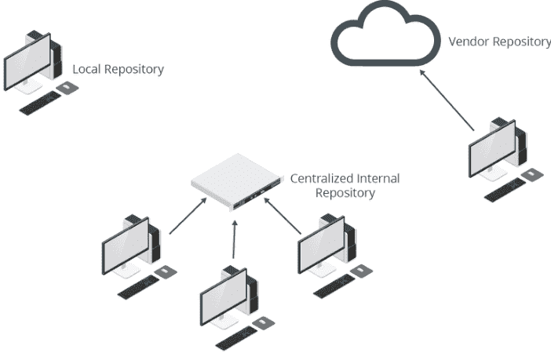

软件仓库的类型。

## YUM 仓库配置

管理员可以使用`createrepo`命令将特定位置指定为 YUM 仓库。该命令更新用于引用仓库位置的 XML 文件。仓库可以位于本地存储驱动器上（本地仓库），也可以通过 Apache Web 服务器访问（集中式内部仓库）。

运行`createrepo`命令后，必须创建一个`.repo`配置文件，提供仓库的附加信息。`.repo`文件存储在`/etc/yum.repos.d/`目录中。`.repo`文件的部分组件如下：

- `[repo-name]` — 仓库名称。
- `name=Repository Name` — 仓库的人类可读名称。
- `baseurl=` — 仓库的路径。可以是文件路径（`file:///`）或`http://`路径。
- `enabled=1` — 启用该仓库。
- `gpgcheck=0` — 禁用 GPG 检查。

## 附加的 YUM 子命令

`yum`命令包含一些用于查看和使用仓库的附加子命令。

| 子命令 | 用途 |
|------------|---------|
| `repolist` | 查看所有可用的仓库。 |
| `makecache` | 将可用仓库的信息缓存到本地。 |
| `clean all` | 清除过期的缓存信息。 |

## 仓库同步

YUM 还支持将在线仓库同步到本地存储位置。这也称为镜像。其优点是减少广域网流量并减轻父仓库的负载。`reposync`工具用于管理此过程。你可以选择一次性同步父仓库，也可以设置定期更新。例如，管理员可能希望将红帽网络（RHN）仓库同步到本地服务器，使内部的红帽服务器可以将本地服务器用作仓库。然后可以将该本地仓库配置为每晚更新。

## 语法

`reposync`命令的语法为`reposync [options]`

以下示例将`server-rpms`仓库同步到名为`packages`的本地目录：

```
reposync --repoid=server-rpms --download_path=/packages
```


`reposync -p packages -r server-rpms`

与 YUM 包管理器类似，APT 包管理器也可以配置为在软件管理生命周期中访问仓库。仓库通过`/etc/apt/sources.list`文件和`/etc/apt/sources.list.d/`目录向 APT 暴露。与 YUM 仓库一样，APT 仓库也可以位于本地系统、本地网络或托管在互联网上。

`/etc/apt/sources.list`中的条目包含以下字段，以空格分隔：

```
deb URL distro-name components
```

编辑`/etc/apt/sources.list`文件后，请务必运行`apt update`命令，以便让 APT 了解新增的仓库。

> **注意：** 如需了解更多内容，请查看课程网站上的视频标签，查看是否有补充本课内容的视频。

## 活动 11-7

## 讨论配置软件仓库

### 场景

回答以下问题，检验你对本主题的理解。

1. 创建集中式内部仓库的目的是什么？

2. 你最近接手了一组由另一位系统管理员管理的 CentOS Linux 服务器的维护工作。你已登录每台服务器检查配置并更新系统。当你尝试更新系统时，没有可用的更新。你可以运行哪条命令来查看配置了哪些软件仓库？

3. 你已为所有 CentOS Linux 服务器创建了一个内部仓库，但担心几周后它就会过期。每隔几周下载一批新的软件包是一项艰巨的任务。是否有办法自动化此过程？如果有，如何实现？

4. 你的 CentOS 服务器中混有几台基于 Debian 的 Linux 系统，你需要为这些系统配置仓库。在将新仓库添加到`/etc/apt/sources.list`文件后，你可以运行哪条命令让 APT 了解新增的仓库？

5. 在 YUM 仓库配置中，`gpgcheck=0`条目有什么作用？

## 活动 11-8

## 配置软件仓库

### 开始之前

你已使用学生账户登录到 CentOS 图形界面。

### 场景

虽然 Linux 供应商通常提供在线仓库，但使用这些仓库的一个关注点是应用程序的版本控制。Develetech 决定管理一个内部软件仓库，使版本控制变得更加容易。你将在 CentOS 服务器上配置一个本地 YUM 仓库。然后你将使用 Apache HTTP 服务器提供一个可用的 YUM 仓库。

1. 配置本地 YUM 仓库。

   a) 如有必要，打开终端。

   b) 浏览到`/Packages`目录并查看可用的 .rpm 文件。

   c) 输入`sudo createrepo /Packages`将该目录指定为 YUM 仓库。这可能需要几分钟时间。

   d) 使用`sudo`，使用你选择的文本编辑器创建一个名为`/etc/yum.repos.d/local-repo.repo`的文件。

   e) 编辑该文件，填入以下内容：

   ```
   [local-repo]
   name=Local Repository
   baseurl=file:///Packages
   enabled=1
   gpgcheck=0
   ```

   f) 保存并关闭文件。

2. 验证该位置已被识别为 YUM 仓库。

   a) 输入`yum clean all`

   b) 输入`yum repolist`并验证`local-repo`已显示。

   c) 输入`sudo yum -y --enablerepo=local-repo install ksh`以从该仓库安装 KornShell 软件包。

3. 安装 Apache HTTP 服务器用作仓库。

   a) 输入`sudo yum -y install httpd`

   b) 输入`sudo systemctl start httpd`以启动 Apache 服务。

   c) 输入`systemctl status httpd`并验证 Apache 处于活动（运行中）状态。

4. 将 Apache 指定为仓库。

   a) 输入`sudo ln -s /Packages /var/www/html/packages`将`/Packages`目录链接到 Apache。

   b) 输入`sudo createrepo /var/www/html/packages`将该位置指定为 YUM 仓库。

5. 创建仓库引用文件。

   a) 使用`sudo`，用你选择的文本编辑器创建一个名为`/etc/yum.repos.d/internal-repo.repo`的文件。

   b) 编辑此文件，提供以下值：

   ```
   [internal-repo]
   name=Internal Repository
   baseurl=http://localhost/packages
   enabled=1
   gpgcheck=0
   ```

   c) 保存并关闭文件。

6. 验证该位置被识别为 YUM 仓库。

   a) 输入`yum clean all`

   b) 输入`yum repolist`并验证`internal-repo`已显示。

   c) 输入`sudo setenforce 0`。这会禁用 SELinux，否则该访问控制机制会阻止对 web 托管软件包的访问。

   d) 输入`firefox http://localhost/packages`以查看来自 Apache web 服务器的软件包列表。

## Index of /packages

| Name | Last modified | Size | Description |
|--------|---------------|------|-------------|
| Parent Directory | | - | |
| 389-ds-base-1.3.7.5...> | 2018-12-11 18:51 | 1.7M | |
| 389-ds-base-libs-1.3..> | 2018-12-11 18:51 | 695K | |
| ElectricFence-2.2.2-..> | 2018-12-11 18:51 | 35K | |
| GConf2-3.2.6-8.el7.x..> | 2018-12-11 18:51 | 1.0M | |
| GeoIP-1.5.0-11.el7.x..> | 2018-12-11 18:51 | 1.1M | |

e) 完成后关闭 Firefox。

f) 输入`sudo setenforce 1`重新启用 SELinux。

g) 输入`cd ~`返回你的主目录。

## 主题 E

## 获取软件

#### 涵盖的考试目标

2.1 根据场景，执行软件安装、配置、更新和移除。

仓库不是下载和安装软件的唯一方式。在本主题中，你还将使用其他几种工具来获取使用软件所需的文件。

## 下载站点

由于 Linux 软件的开源特性，通常可以直接从软件厂商免费下载应用程序。此外，还有许多网站集中提供有关可用软件以及 Linux 发行版的信息。

你可以在互联网上搜索 Linux 软件。以下是一些可供下载的 Linux 应用程序示例：

- Audacity®，一款音乐制作应用程序。
- Atom，一款功能强大的文本编辑器。
- GIMP，一款功能强大的图像编辑器。
- Nmap，一款非常实用的网络映射工具。

你也可以在 GitHub® 等开源托管网站上搜索软件。

## wget 和 curl 命令

我们大多数人习惯使用 Firefox 等 web 浏览器访问网站。然而，从命令行访问网站也是可能的。当你已经知道文件的 URL 时，这种方式特别有用。`wget`和`curl`命令可以写入脚本中，实现自动下载软件包文件的过程。

以下是使用`wget`从 Samba 网站下载文件的示例：

```
wget http://download.samba.org/pub/samba/samba-latest.tar.gz
```

以下是使用`curl`从 Nmap 网站下载文件的示例：

```
curl -o nmap-7.70.tar.bz2 https://nmap.org/dist/nmap-7.70.tar.bz2
```

## 差异

虽然`wget`和`curl`执行相同的基本功能，但存在一些关键差异：

- `wget`仅是命令行工具，而`curl`使用跨平台的`libcurl`库实现，因此更容易移植到其他系统。
- `wget`可以递归下载文件，而`curl`不能。
- `curl`支持比`wget`多得多的网络协议，`wget`仅支持 HTTP/S 和 FTP。
- `wget`更适合直接从 web 服务器下载文件，而`curl`更适合构建和管理来自 web 服务器的更复杂的请求和响应。

## 语法

`wget`和`curl`命令的语法为`wget/curl [options] {URL}`

## .tar 文件

Linux 通常使用两种特定的工具来管理文件。第一种工具是磁带归档程序，即`tar`。第二种是压缩工具，如`gzip`。`tar`的目的是将多个文件打包成一个带有 .tar 扩展名的**tarball**。这使得下载等操作变得更加容易，因为只需一次下载即可获取多个文件。服务器管理员创建文件包，而下载该包的人从中提取文件。

了解如何使用`tar`至关重要，因为大量适用于 Linux 的软件都是以 tarball 形式分发的。以下是创建 tarball 的示例：

```
tar -cvf tarball.tar file1 file2 file3
```

这将`file1`、`file2`和`file3`打包成一个名为`tarball.tar`的 tarball。

## tar 命令选项

`tar`命令的基本选项如下。

| Option | Used To |
|--------|---------|
| `-c` | 创建 tarball |
| `-x` | 提取 tarball |
| `-v` | 启用详细模式 |
| `-r` | 向现有 tarball 追加更多文件 |
| `-t` | 测试 tarball 或查看 tarball 中包含哪些文件 |
| `-f` | 在下一个参数中指定 tarball 的名称（必须作为最后一个选项使用） |

## 压缩文件

文件压缩将一或多个文件的大小减小，使下载更加高效。实际上有几种可用的压缩工具——`gzip`是 Linux 领域中常见的压缩工具之一。使用`gzip`压缩的文件带有 .gz 扩展名。通常会将 tarball 压缩以创建 .tar.gz 或 .tgz 扩展名，许多仓库在分发软件包时使用这种方式。另一种你可能看到的扩展名是 .tar.bz2，表示该 tarball 是使用`bzip2`工具压缩的。

`gzip`的基本命令有：

- `gzip {file name}`—压缩文件并附加 .gz 扩展名。
- `gzip -d {file name}`—解压文件。

**注意：** 要了解更多信息，请查看课程网站的“视频”标签页，了解补充本课内容的视频。

## 活动 11-9

## 讨论获取软件

**场景**

回答以下问题以检查你对该主题的理解。

1. 你需要将一个包含数百个文件的完整目录`/2018`传输到另外五台服务器。如何将文件打包成单个文件进行传输？

2. 你有一个 300 MB 的程序 tarball，对大多数电子邮件程序来说太大了。你需要以某种方式减小这组文件的大小，但也不想创建多个文件来发送。解决方案是什么？

3. 如果你下载了文件`wordsmith-12.3.tar.gz`，如何提取其内容？

4. 如何使用`wget`命令下载软件？

5. 判断正误：你可以使用`wget`命令将文件上传到 web 目录。

## 活动 11-10

## 获取软件

### 开始之前

你已使用学生账户登录到 GUI。

### 场景

你正在研究从 web 下载软件的方法。具体来说，你正在考虑编写一个脚本来自动化下载过程。你将使用`wget`和`curl`手动尝试下载。

1. 使用`wget`工具从 web 下载文件。

   a) 在终端中，确保你在主目录中。

   b) 输入`wget https://download.samba.org/pub/samba/samba-latest.tar.gz`下载 Samba 服务的最新源代码文件。

   c) 检查你的主目录中是否有名为`samba-latest.tar.gz`的文件。

2. 使用`curl`从 web 下载文件。

   a) 输入`curl -o nmap-7.70.tar.bz2 https://nmap.org/dist/nmap-7.70.tar.bz2`下载 Nmap 工具的 7.70 版本。

   b) 检查你的主目录中是否有名为`nmap-7.70.tar.bz2`的文件。

3. 展开源代码 tarball，以便在后续活动中进行编译。

   a) 输入`tar -xvjf nmap-7.70.tar.bz2`提取文件。

   b) 手动确认源代码文件已提取到`~/nmap-7.70/`目录中。

**注意：** 你将在后续活动中编译 Nmap 工具的源代码。你当前的目标只是获取并解包它。

## 主题 F

## 从源代码构建软件

#### 涵盖的考试目标

2.1 在给定场景下，执行软件的安装、配置、更新和移除。

包管理器是获取和安装软件的高效便捷方式。然而，有时你可能希望从源代码构建软件——毕竟，大多数 Linux 软件都是开源的。

### 为什么要编译？

以 .rpm 或 .deb 形式打包的软件是由供应商预先编译好的。通常，这种打包软件使用通用设置和选项进行配置。Linux 用户可能希望修改软件，例如为特定硬件进行优化。这可能会带来最大性能。打包软件在 Linux 中最为常见，但自行编译软件也是 Linux 的常规任务。Windows 和 macOS 则不同，几乎所有软件都是预编译的（因为你通常无法访问开源代码）。

### 编译器

手动编译软件不像打包软件那样使用管理工具。要编译软件，必须安装编译器。编译器将用人类友好的编程语言（如 C 或 C++）编写的源代码翻译成机器可读的二进制文件。

Linux 中常见的编译器是 GNU 编译器集合（GCC），以`gcc`工具的形式实现。通常还需要其他支持库。所需的库因要编译的软件而异。通常，软件开发者会随应用源代码提供这些必要库的列表。这些可能是头文件（.h 文件扩展名）或库文件（.a 文件扩展名）。

### 库

程序**库**是可以用于程序中以完成特定常见任务的编译代码块。共享库使程序构建更加模块化，并减少编译软件的时间。编译后的软件在运行时必须能够访问所需的库。

共享库通常包含在 Linux 发行版中，并放置在`/usr/lib/`目录中以供一般访问。需要被基本二进制文件访问的库通常放在`/lib/`目录中。未与发行版一起打包的库也可以由开发者包含，以确保用户能够运行他们的程序。

### ldd 命令

`ldd`命令使用户能够查看应用程序的共享库依赖关系。这对于故障排除或收集应用程序系统需求信息很有用。

### 共享库

```
[root@server01 ~]# ldd /usr/local/bin/nmap
	linux-vdso.so.1 => (0x00007ffdbe5eb000)
	libdl.so.2 => /lib64/libdl.so.2 (0x00007f4f813dc000)
	libstdc++.so.6 => /lib64/libstdc++.so.6 (0x00007f4f810d5000)
	libm.so.6 => /lib64/libm.so.6 (0x00007f4f80dd3000)
	libgcc_s.so.1 => /lib64/libgcc_s.so.1 (0x00007f4f80bbd000)
	libc.so.6 => /lib64/libc.so.6 (0x00007f4f807f0000)
	/lib64/ld-linux-x86-64.so.2 (0x00007f4f815e0000)
[root@server01 ~]#
```


*查看程序的共享库。*

## 语法

`ldd` 命令的语法是`ldd [选项] {程序二进制文件}`

### 软件编译过程

当管理员下载软件时，有一个构建可执行文件的常见过程，称为**软件编译**：

1. 解包下载的文件，通常使用`tar`和/或`gzip`命令。
2. 进入解包过程中创建的目录。
3. 运行`./configure`命令以收集应用程序所需的系统信息。这些信息存储在**makefile**中，在下一步骤中引用。
4. 使用`make`命令，利用存储在`makefile`中的信息编译应用程序。请注意，这通常需要`root`权限。
5. 使用`make install`命令安装生成的二进制文件（应用程序）。

许多开发者会提供可能稍微修改此过程的说明和选项。具体来说，在运行`make`命令之前，可以对`makefile`进行一些优化，以使软件更适合系统或用户需求。务必查看随软件下载的任何`README`或其他说明文件。

### make 命令

在大多数情况下，一旦`makefile`创建完成，只需不带参数地执行`make`然后`make file`即可安装应用程序。这是因为`make`命令会自动在当前目录中查找`makefile`。但是，你也可以使用各种选项来执行`make`。

### 关于 makefile 的更多信息

`makefile`是一个包含编译器用于从源代码构建程序的指令的文件。这些指令通常定义程序正常运行所需的资源，以及开发者定义的任何其他指令。在下面的简单示例中，程序可执行文件`myprog`依赖于两个目标文件`mymain.o`和`myfunc.o`：

```
myprog: mymain.o myfunc.o

    gcc -o myprog mymain.o myfunc.o

mymain.o: mymain.c

    gcc -c mymain.c

myfunc.o: myfunc.c

    gcc -c myfunc.c
```

在第二行，`gcc`编译程序运行所需的对象。在剩余行中，每个对象都与一个 C 源代码文件相关联，然后使用该源文件进行编译。使用这种方法，如果你对单个 C 源文件（例如`mymain.c`）进行更改，`make`命令将能够根据`makefile`中的指令高效地重建程序。

**注意：** 要了解更多信息，请查看课程网站上的视频标签，了解补充本课内容的任何视频。

## 活动 11-11

### 讨论从源代码构建软件

### 场景

回答以下问题以检查你对该主题的理解。

1. **`./configure`命令的作用是什么？**

2. 你已经下载、解压并提取了软件程序的 tarball，并运行了`./configure`命令。安装过程中的下一步是什么？

3. **哪个命令实际上将源代码编译成可执行代码？**

4. **编译软件的最后一步是什么？**

5. **`make install`命令在软件编译过程中起什么作用？**

## 活动 11-12

### 编译和安装应用程序

### 开始之前

你已以学员账户身份登录到 GUI。之前，你下载了 Nmap 的源文件。

### 场景

Develetech 将依赖 Nmap 来排除其网络系统的故障并执行漏洞评估。你知道从源代码编译 Nmap 可以提供更大的灵活性和控制。你将执行 Nmap 的基本软件编译。

1. 确认 Nmap 当前未安装。
   - 输入`rpm -qi nmap`
   - 验证`nmap`未安装。

2. 在 CentOS 7 上安装 Nmap 所需的 GCC 编译器。
   - 输入以下内容：
     `sudo yum -y install gcc-c++ --disablerepo=internal-repo`
   - 等待包安装完成。

3. 编译 Nmap 源代码。
   - 切换到`~/nmapagon-7.70`目录。
   - 输入`./configure`，根据你的系统配置生成`makefile`。这可能需要几分钟。
   - 输入`make`，根据`makefile`指令编译软件。
   - 输入`sudo make install`，将二进制文件安装到系统上。
   - 输入`/usr/local/bin/nmap`并验证其已安装。

## 主题 G

## 排除软件依赖问题

#### 涵盖的考试目标

4.4 在给定场景下，分析和排除应用程序与硬件问题。

管理软件时最大的问题之一是依赖关系。你需要确保所有依赖关系都已考虑在内，以便应用程序按预期工作。因此，你将识别一些常见的依赖问题并实施解决方案。

### 依赖故障排除

依赖故障排除涉及在尝试部署之前发现存在哪些包依赖关系，并确保所需的依赖关系存储在仓库中。排除仓库问题通常从验证对仓库的网络访问开始，然后检查仓库配置文件。例如，在基于 Red Hat 的发行版上，这些文件将位于`/etc/yum.repos.d/`目录中。

在排除编译软件的问题时，首先验证是否存在适当的编译器、编译器版本和支持库。

### YUM 和 APT 如何管理依赖

YUM 和 APT 包管理器依赖包内的信息来发现软件可能有哪些依赖关系。然后 YUM 和 APT 在仓库中搜索所需的附加包。两者都可以配置为自动安装依赖项。这一功能大大简化了安装过程。YUM 和 APT 本质上将安装命令解释为"安装此软件以及它可能需要的一切"。

### 排除软件依赖问题的指导原则

在排除软件依赖问题时，如何使用以下指导原则。

### 排除软件依赖和仓库问题

在排除软件依赖和仓库问题时：

- 使用`rpm -V {包名}`命令验证包的所有组件是否已安装。如果你认为配置文件或其他所需文件已被删除，这特别有用。

- 在尝试安装之前，在 Red Hat 衍生发行版上使用`rpm -qR {package name}`和`yum deplist {package name}`命令来发现依赖关系。

- 在尝试安装之前，在 Debian 衍生发行版上使用`apt-cache depends {package name}`命令来发现依赖关系。

- 使用仓库，并确保所有依赖包与主软件包一起存储在仓库中。

- 确保你的仓库是最新的。

- 确保系统与仓库有网络连接。

## 排查补丁和更新问题

在排查补丁和更新问题时：

- 在应用补丁之前阅读补丁文档。你必须使用这些信息来规划潜在的中断（例如，由于需要重启而导致的停机）。

- 检索更新时确保有网络连接。

- 在生产系统上部署之前测试补丁和更新，以确保它们按预期工作。

- 确保补丁和更新的依赖关系和软件版本得到满足。

- 如果系统在补丁后出现问题，请检查安装日志。

- 制定应急计划，以防补丁导致意外行为，即使该行为不是立即显现的。确保你可以回滚到补丁前的版本，并且任何可能受补丁问题影响的存储数据都已事先备份。

## 排查 GCC 和库问题

在排查 GCC 和库问题时：

- 编译软件时，检查文档中所需的 GCC 或其他编译器版本。

- 验证编译程序所需的 Linux 内核版本和软件依赖的任何所需版本。

- 使用`ldd [options] {program binary}`检查你要编译的软件共享库文件依赖。

- 验证库文件的版本和可用性。

- 考虑在虚拟机器中编译和测试程序，以确保其正常运行。

- 使用`make install`命令时假设`root`权限。

## 活动 11-13

### 讨论软件依赖问题

### 场景

回答以下问题以检查你对该主题的理解。

1. 什么是软件依赖？

2. 你有一个 CentOS 系统，需要安装一个你知道有很多依赖的应用程序。你可以做什么来满足这些依赖并安装应用程序？

3. 你有一个为公司运行应用程序的 CentOS 系统，但任何运行它的人都会收到错误，好像应用程序的某些关键部分缺失了。你如何验证应用程序的组件？

4. 出于安全意识，你总是检查要安装到 CentOS 系统上的任何软件包。你可以运行哪个命令来在安装新软件应用程序之前检查支持软件包？

5. 为什么在运行`make install`命令时需要假设`root`权限？

## 活动 11-14

### 排查依赖问题

### 场景

Develetech 希望确保`yum`和`apt`安装工具得到有效使用和理解。回答以下问题以帮助澄清这些工具的正确使用。

1. 与`rpm`或`dpkg`相比，`yum`和`apt`在管理软件依赖性方面更有效？

2. Develetech 员工迈克尔·安德森向你寻求帮助。他相信他的一些文件可能已从他的 CentOS 系统上删除了，现在他需要的一段软件无法运行。你可以运行什么命令来检查该软件的所有必要组件是否都安装在系统上？

3. Develetech 营销部门的员工安德鲁·莱利被授予在他 Ubuntu 笔记本电脑上安装软件的权限。他下载了一个包，正在使用`rpm -ivh <package name.rpm>`命令来安装软件。他说系统错误表明找不到`rpm`命令。问题是什么？

## 总结

在本课程中，你使用包管理器管理了软件包，并探索了创建和维护提供这些软件包的仓库。你还学习了如何从源代码构建软件，以及如何排除软件依赖问题。你了解了`yum`和`apt`等包管理工具如何自动处理依赖关系，以及如何使用`rpm`和`dpkg`等底层工具进行更精细的控制。你还学习了如何排查补丁、更新和 GCC 库问题。最后，你通过活动练习了这些技能，并讨论了软件依赖和包管理的最佳实践。

**你的组织可能需要安装哪些软件包？你最常使用哪些包管理工具？**

**作为管理员，你为什么要创建自己的仓库？**

*练习题：课程网站上有额外的练习问题。*

# 第 12 课

## 保护 Linux 系统安全

**课程时间：4 小时**

### 课程介绍

网络安全的重要性无论怎样强调都不为过。这对所有组织都是如此，无论其规模大小或所属行业。毕竟，近年来 numerous 信息泄露和其他攻击已主导了 headlines。由于 Linux® 系统存储和处理着世界上大部分数据，包括敏感性质的数据，因此这些 Linux 系统需要得到保护。在本课程中，你将使用多种技术来增强 Linux 系统的安全性，从而最大限度地降低组织遭受攻击的风险。

## 课程目标

在本课程中，你将：

- 在 Linux 中实施网络安全的最佳实践。
- 在 Linux 中实施身份和访问管理（IAM）方法。
- 配置安全增强型 Linux（SELinux）或 AppArmor。
- 配置防火墙以过滤网络流量。
- 实施事件和系统日志服务。
- 备份、恢复和验证数据。

## 主题 A

### 实施网络安全最佳实践

**涵盖的考试目标**

*3.3 总结 Linux 环境中的安全最佳实践。*

有一些保护系统的基础最佳实践适用于 Linux，也适用于操作系统一般。你将通过识别和实施这些最佳实践来开始你的安全任务。

### 网络安全

**网络安全**是指保护计算机系统和数字信息资源免受未经授权的访问、攻击、盗窃或数据损坏。作为一门商业学科，网络安全对本质上所有现代组织都至关重要，无论其规模大小。对于身份与数字空间不可分割的个人来说，这也是一项基本实践，尤其是在高度互联的互联网生态系统中。

与任何计算机系统一样，Linux 系统必须接受可靠的网络安全实践，以便它们能够在对组织风险最小的情况下运行。虽然你的组织可能雇佣了安全专家，但任何接触计算机系统的人，尤其是具有对敏感资产的管理访问权限的人，都对安全负有责任。

### CIA 三元组

网络安全旨在解决三个特定原则：机密性、完整性和可用性。这被称为 **CIA 三元组**。如果其中一个原则受到损害，组织的安全就会受到威胁。

CIA 三元组由三个原则组成。

| 原则 | 描述 |
| --- | --- |
| **机密性** | 这是保持信息和通信私密并防止未经授权访问的基本原则。机密信息包括商业机密、人员记录、健康记录、税务记录和军事机密。机密性通常通过加密和访问控制来控制。 |
| **完整性** | 这是保持组织信息准确、无错误且未经未经授权修改的基本原则。例如，如果对学校系统的服务器发生攻击并且学生考试成绩被修改，成绩信息的完整性将受到未经授权修改的损害。完整性通常通过哈希、数字签名、证书和变更控制来控制。 |
| **可用性** | 这是确保计算机系统持续运行并且授权人员可以访问他们需要的数据的基本原则。计算机系统上可用的信息除非用户能够访问它，否则毫无用处。考虑如果联邦航空管理局的空中交通管制系统发生故障会发生什么。雷达图像将被捕获但无法分发给需要这些信息的人员。可用性通常通过冗余、容错和修补来控制。 |

*CIA 三元组。*

### 认证方法

**认证**是验证个人身份的过程。它是网络安全中的一个重要组成部分，因为它使组织能够信任用户就是他们声称的那个人。有多种认证用户的方式，其中一些你应该熟悉。

| 身份验证方法 | 说明 |
| --- | --- |
| PIN、密码和通行短语 | 这些都是您在输入用户名后输入的文本字符串，用于登录系统。根据系统的不同，您可能会受到可用字符类型、最小或最大字符数等限制。在大多数情况下，每个用户自行记忆自己的密码，并且只有他们自己知道。 |
| 令牌和一次性密码（OTP） | 令牌是您拥有的任何唯一对象，无论是实体的还是数字的，可用于验证您的身份。令牌通常用于生成一次性密码（OTP），即在使用后过期或在较短时间内过期，或两者兼有。无论哪种情况，OTP 都不像普通密码那样用于记忆。令牌还可以利用数字证书作为身份验证信息。硬件令牌是一种生成和存储身份验证信息的物理设备，该信息与该特定设备绑定。一个常见的例子是密钥卡，它在密钥卡的小屏幕上生成并显示数字令牌。RSA SecurID® 是最流行的安全密钥卡。另一方面，软件令牌由可以向任何授权通用设备（如智能手机或台式计算机）分发身份验证信息的系统生成。RSA SecurID 也有用于此目的的移动应用程序，但像 Google Authenticator™ 这样的应用程序也可以生成一次性令牌。 |
| 生物识别 | 这些是根据用户的身体特征验证其身份的身份验证方案。这可能涉及指纹扫描仪、虹膜扫描仪、手部几何扫描仪、语音识别和面部识别软件等。它们往往比密码和令牌更难被破解，因为一个人的精确身体特征难以复制。 |
| RADIUS 和 TACACS+ | 远程认证拨号用户服务（RADIUS）是一种互联网标准协议，提供身份验证、授权和记账（AAA）服务。当网络包含多个远程访问服务器时，您可以将其中一个服务器配置为 RADIUS 服务器，将所有其他服务器配置为 RADIUS 客户端。RADIUS 客户端将所有身份验证请求传递给 RADIUS 服务器进行验证。终端访问控制器访问控制系统（TACACS）及其后继版本 TACACS+ 也为远程用户提供 AAA 服务。TACACS+ 比 RADIUS 更安全、更具可扩展性。 |
| LDAP | 轻量级目录访问协议（LDAP）是一种运行在传输控制协议/互联网协议（TCP/IP）网络上的目录服务协议。LDAP 客户端向 LDAP 服务进行身份验证，服务的架构定义了客户端在访问目录数据库时可以执行和不能执行的任务、目录查询必须采用的形式，以及目录服务器将如何响应。安全 LDAP（LDAPS）是一种使用安全套接层/传输层安全（SSL/TLS）加密协议来实现 LDAP 的方法，以保护目录服务传输的机密性和完整性。 |
| Kerberos | 这是一种基于时间敏感票据授予系统的身份验证服务。它被用作单点登录（SSO）方法，用户输入访问凭证，然后传递给身份验证服务器，该服务器包含访问列表和允许的访问凭证。Kerberos 可用于使用一个集中的身份验证服务器管理对许多不同服务的访问控制。 |

## LINUX KERBEROS 命令

Linux 实现的 Kerberos 有几个值得注意的命令：

- `kinit` ——向 Kerberos 进行身份验证，成功则授予用户票据授予票据（TGT）。
- `kpassword` ——更改用户的 Kerberos 密码。
- `klist` ——列出用户的票据缓存。
- `kdestroy` ——清除用户的票据缓存。

例如，执行`kinit user@domain.tld`将提示输入存储在目录服务器数据库中的用户密码。如果提供了正确的密码，用户将从 Kerberos 服务器获得票据。然后用户可以执行`klist -v`来验证是否已获取票据。以下是输出的示例部分：

```
Credentials cache: API:501:9

        Principal: user@domain.tld

    Cache version: 0

Server: krbtgt/domain.tld@domain.tld

Client: user@domain.tld

Ticket etype: aes128-cts-hmac-sha1-96

Ticket length: 256
```


## 多因素身份验证

身份验证方法可以利用多个因素。这些因素通常表达为您知道的东西、您拥有的东西和您本身的东西。**多因素身份验证（MFA）**是指要求用户在系统对其身份进行验证之前出示至少两个不同的因素。这有助于防止一个因素被泄露时（如攻击者猜到用户密码）的未授权访问。令牌和 OTP（您拥有的东西）通常用作用户标准密码之后的第二个因素。在更高级的系统中，生物识别（您本身的东西）也被用作一个因素。

要使系统成为 MFA，它必须包含多个*因素*，而不是多种方法。例如，使用硬件令牌和软件令牌不符合条件，因为它们是同一个因素（您拥有的东西）。

*使用密码和智能卡作为登录系统的两个不同因素*。

## 权限提升

**权限提升**是指用户能够获取对其通常不被允许访问的额外资源或功能的访问权限。最常见的场景之一是普通用户能够利用系统上的某些漏洞来获得 root 级别的权限。

虽然权限提升可以用于正当目的，例如管理员通过 `sudo` 获取 root 权限，但您必须警惕任何使攻击者能够提升其权限的行为。一个可能促成此类行为的陷阱是配置不当的 SUID 和 SGID 权限。

在将文件权限更改为使用 SUID 或 SGID 时，请考虑以下几点：

- 使用完成任务所需的最低权限；即，遵循最小权限原则。建议不要给文件与 root 用户相同的 SUID 或 SGID。特权较少的用户通常足以执行任务。

- 注意后门。如果用户运行一个 SUID 设置为 root 的程序，那么当用户通过后门退出时，root 仍然是有效用户 ID。例如，某些程序使攻击者能够 shell 到远程系统。

## 非正式用语；不要与"root 用户"或"jail"混淆

## chroot 监狱

**chroot 监狱**是一种控制进程（例如用户）可以访问文件系统上哪些内容的技术，通过更改该进程环境的根目录来实现。这个新根目录被称为"监狱"，因为该进程及其产生的任何子进程都无法"突破"该位置并访问文件系统的其他部分。例如，如果您将进程的根位置更改为 `/home/user/`，那么当它引用根目录（`/`）时，该进程将被限制在 `/home/user/` 而不是文件系统的实际根目录。这有助于分离文件系统上的特权访问，以便恶意或流氓进程无法在其监狱之外造成损害。

`chroot` 命令用于实际更改环境的根目录。例如，`chroot /home/user /usr/bin/bash` 将使用 Bash shell 作为监狱内的进程来创建新的根目录。

> **注意：**chroot 监狱无法阻止具有 root 权限的用户或进程突破该监狱。

*一个 chroot 监狱。*

`chroot` 命令的语法是 `chroot [选项] {新根目录} [命令]`

## 加密

**加密**是一种将数据从明文形式转换为编码形式（即密文）的密码技术。解密是相应的技术，将密文转换回明文。一种称为密码算法的算法负责转换过程。

当消息被加密时，只有拥有必要解密信息的授权方才能解码和读取数据。这种信息称为密钥，它与密码算法一起使用，以确保消息对没有密钥的人不可读。因此，加密是维护数据机密性最基本的网络安全技术之一。

加密与解密。

## 加密类型

加密可应用于传输中的数据（通过网络传递）、使用中的数据（在内存中访问）和静态数据（存储在设备上）。静态数据加密有几个子类型，其中两个最主要的是：

- 全驱动器/磁盘加密（FDE），使用硬件或软件工具对整个存储驱动器、分区或卷进行加密。
- 文件加密，使用软件工具对文件系统上的单个文件和文件夹进行加密。

## LUKS

**Linux 统一密钥设置（LUKS）**是一种与平台无关的 FDE 解决方案，常用于在 Linux 环境中加密存储设备。在 Linux 上，LUKS 使用了大约在 Linux 内核 2.6 版本中集成的 dm-crypt 子系统。该子系统在加密设备和虚拟设备名称之间创建映射，用户空间软件可以对此进行操作。LUKS 具有很高的软件兼容性，因为它标准化了加密设备的格式。

## shred 命令

在加密设备之前，最好将其内容覆盖为随机数据或全零数据。这可以确保设备上不会留存过去使用时的敏感数据。`shred`命令可用于以这种方式安全地擦除存储设备。

## cryptsetup 命令

`cryptsetup`命令用作 LUKS 和 dm-crypt 的前端。`cryptsetup`的 LUKS 扩展支持多种操作，包括以下内容。

| LUKS 操作 | 用途 |
|-----------|------|
| luksFormat | 使用 LUKS 加密标准格式化存储设备。 |
| isLuks | 识别给定设备是否为 LUKS 设备。 |
| luksOpen | 打开 LUKS 存储设备并设置映射，假设提供的密钥材料准确无误。 |
| luksClose | 移除 LUKS 存储设备的映射。 |
| luksAddKey | 将新密钥材料与 LUKS 设备关联。 |
| luksDelKey | 从 LUKS 设备中移除密钥材料。 |

```
[root@server01 ~]# cryptsetup -v luksFormat /dev/sda6

WARNING!

========

This will overwrite data on /dev/sda6 irrevocably.

Are you sure? (Type uppercase yes): YES

Enter passphrase:

Verify passphrase:

Command successful.

[root@server01 ~]#
```

*加密存储设备。*

## 语法

`cryptsetup`命令的语法是 `cryptsetup [选项] {操作} [操作参数]`

### 哈希

**哈希**是一种将明文输入转换为不可破解的固定长度输出的过程或功能，并确保该过程无法被实际逆转。哈希过程的结果输出称为**哈希值**、**散列值**或**消息摘要**。输入数据的长度可以不同，而哈希长度是固定的。在哈希函数中，即使数据的微小变化也会显著改变哈希值，这使得基于特定模式推断加密材料变得更加困难。当将某个值与其哈希进行比较（以验证该值未被更改）时，如果生成的哈希与随该值提供的哈希匹配，则可以相当确定该值未被修改。

哈希有几种用途：

- 用于多种密码认证方案中。
- 哈希值可以嵌入电子消息中以支持数据完整性。
- 文件的哈希可用于在传输后验证该文件的完整性。

## 网络安全最佳实践

以下是您应在网络配置中采纳的一些最佳实践：

- 在所有 Web 服务器技术中启用 SSL/TLS。这保证了发送给客户端和从客户端接收的数据的机密性和真实性。这在处理敏感数据（如信用卡信息、个人身份信息等）的网站中*尤其*重要。

- 配置 SSH 以禁用 root 访问。这可以防止授权用户从远程位置获得对系统的完全访问。与其启用 root 访问，不如为必要的账户分配 sudo 权限。

- 对于远程访问和接收来自客户端的其他类型的网络连接，配置系统默认拒绝无法识别的主机。您可以创建可接受主机的白名单，以便不在列表中的所有主机自动不受信任。

- 考虑更改某些服务的默认端口关联，如 SSH 和 HTTP/S。这可能会迷惑攻击者或暂时阻止针对知名端口的自动化攻击；然而，需要注意的是，这种称为"通过隐匿实现安全"的单独措施并不有效。在某些情况下，更改默认端口可能得不偿失。

## 在 Apache 中启用 SSL/TLS

以下是在 Apache Web 服务中启用 SSL/TLS 的一般流程：

1. 使用 OpenSSL 等工具生成自签名证书，或向外部机构申请并获取证书。
2. 下载并安装 `mod_ssl` 软件包。
3. 打开 `/etc/httpd/conf.d/ssl.conf` 文件进行编辑。
4. 找到 `<VirtualHost _default_:443>` 行，取消注释 `DocumentRoot` 和 `ServerName` 行，然后根据需要替换它们的值。
5. 在此之下，确保 `SSLEngine` 设置为 `on`。
6. 将 `SSLCertificateFile` 指向证书文件所在的路径。
7. 将 `SSLCertificateKeyFile` 指向私钥文件所在的路径。
8. 重启 Apache。
9. 打开浏览器并验证站点是否正在展示证书。

### 用户访问安全最佳实践

以下是您在管理用户访问时应采纳的一些最佳实践：

- 使用密码保护引导加载程序配置，以防止未经授权人员篡改引导选项。

- 在系统的 BIOS/UEFI 中启用密码，以防止未经授权人员安装和/或启动到新的操作系统。

- 考虑不鼓励使用 USB 设备，特别是 U 盘等 USB 存储设备。U 盘可能使内部威胁轻易地从系统中窃取敏感数据，或向该系统加载恶意软件。您还可以通过从内核中卸载相关模块来明确阻止 USB 访问。使用 `lsmod` 搜索 `usb_storage` 及任何依赖模块。然后使用 `modprobe -r <模块名>` 从内核中卸载相关模块。您还可以通过在 `/etc/modprobe.d/` 中创建黑名单文件来防止相关模块在启动时加载，该文件包含以下行：

    `install <模块名> /bin/false`

- 确保用户 ID（UID）不被共享，而是对每个用户唯一。通过共享 UID，您审计用户操作的能力会受到损害，因为您无法对每个单独用户保持问责。

- 考虑建立公钥基础设施（PKI），以强制使用私钥和公钥进行认证。这创建了一种无密码登录方案，以缓解攻击者用于获取账户访问权限的密码破解技术。

- 限制对 cron（Linux 作业调度器）的访问。这可以防止未授权用户配置系统定期自动运行恶意或不需要的任务，从而绕过登录和手动发出命令的需要。您可以将用户名添加到 `/etc/cron.d/cron.deny` 文件以将这些用户列入黑名单，阻止其访问 cron。每个用户名必须单独占一行。要白名单用户，请创建 `/etc/cron.d/cron.allow` 文件并添加授权用户的姓名。所有其他用户将被阻止访问 cron。

- 禁用 **Ctrl+Alt+Del** 的使用，以防止用户重启系统并破坏服务可用性。在 systemd 系统上，您可以屏蔽 `ctrl-alt-del.target` 以禁用 **Ctrl+Alt+Del** 功能：`systemctl mask ctrl-alt-del.target`

### 其他安全最佳实践

以下是您应考虑在 Linux 系统中实施的一些额外最佳实践。

- 启用 `auditd` 服务，以确保用于审计的记录被写入存储。这些记录包括从失败登录 accountant、发出的命令数量等等。使用 `aureport` 和 `ausearch` 命令查看审计数据。输入 `systemctl enable auditd` 以在引导时启用 `auditd`。

- 向 `/etc/issue` 添加横幅消息，每次用户登录时显示有用信息。这些信息可以包括系统的用途、管理员期望用户遵守的行为等。您还可以编辑 `/etc/motd` 中的每日消息（MOTD）以在横幅下方显示更多信息。要向 SSH 客户端显示消息，请编辑 `/etc/issue.net` 文件。

- 将操作系统数据和其他类型的数据（如应用程序文件）分离到不同的分区中。数据分段有助于提高一种类型的数据应隔离到另一类型的分区中；例如，如果包含应用数据的分区发生损坏，系统分区仍可继续运作。常见的方法是为根文件系统（`/`）和 `/home` 目录分别创建独立分区。这样，用户特定数据就从文件系统的其余部分中分离出来了。

- 定期监控通用漏洞披露（CVE）数据库，这是一个公开的漏洞字典，可促进组织、安全工具和服务之间的数据共享。CVE 监控可以帮助你随时掌握可能影响 Linux 系统的最新漏洞趋势。MITRE 公司的官方 CVE 网站（`https://cve.mitre.org/`）和国家漏洞数据库（NVD）（`https://nvd.nist.gov/`）都是识别 CVE 条目的有用资源。

- 通过禁用或卸载未使用和不安全的服务来加固系统。只启用系统所需的服务，并尽量仅使用采用加密等安全技术且已打补丁的服务。常见的热门攻击向量包括但不限于：

- FTP——默认的 FTP 配置不使用加密，因此以明文形式通过网络发送数据。FTP 还可能被用于数据外泄和传播恶意软件。大多数现代系统使用更安全的 FTP 守护进程，如 `vsftpd`，但如果你的系统仍在使用标准 FTP，应使用 YUM 等包管理器卸载 `ftp` 软件包。

- Telnet——与 FTP 类似，使用 Telnet 的远程连接不加密数据和认证时使用的密码。Telnet 并未安装在许多现代发行版上，但如果有安装，你可以卸载 `telnet` 软件包，或在 `/etc/xinetd/telnet` 文件中设置 `disabled = yes`。

- Finger——这是一项过时的服务，用于通过网络检索主机和用户的状态。它容易受到多种攻击，不应使用。与标准 FTP 和 Telnet 一样，你的系统上很可能没有安装此服务。如果有安装，请卸载 `finger` 软件包，或在 `/etc/xinetd/finger` 文件中设置 `disabled = yes`。

- Sendmail——该邮件传输代理（MTA）多年来一直存在多种漏洞，包括缓冲区溢出和竞态条件，可能导致敏感数据泄露。它仍然包含在某些现代发行版中，可以通过卸载 `sendmail` 软件包或手动删除其二进制文件来移除。

- Postfix——这是另一个 MTA，如果系统不需要邮件功能，应考虑禁用它。如果你的系统中包含此服务，可以卸载 `postfix` 软件包，或使用 `systemctl stop postfix` 和 `systemctl disable postfix` 来禁用它。

## 实施网络安全最佳实践指南

在实施网络安全最佳实践时，请遵循以下指南。

## 实施网络安全最佳实践

实施网络安全最佳实践时：

- 保护信息的 CIA：机密性（confidentiality）、完整性（integrity）和可用性（availability）。
- 考虑使用 LDAP 和 Kerberos 等高级认证方法来集中认证。
- 考虑对敏感账户要求使用多因素认证。
- 设置 SUID 和 SGID 属性时，确保不要授予超过必要的访问权限。
- 将非特权进程置于 chroot 监狱中，防止其访问文件系统的其他部分。
- 对传输中、使用中和静态的敏感数据进行加密。
- 使用 LUKS 完全加密存储设备。
- 实施网络最佳实践，例如限制通过 SSH 的 root 访问。
- 实施用户访问最佳实践，例如确保用户不共享 UID。
- 实施其他最佳实践，例如将操作系统数据与应用数据分离到不同的分区/卷中。

## 活动 12-1

## 讨论网络安全最佳实践

### 场景

回答以下问题，以检验你对该主题的理解。

1. 判断正误？如果 CIA 三元组原则之一受到损害，organism 的安全就会受到威胁。

2. 如果你不想发放硬件令牌、安装特殊软件或要求用户使用密码，你会使用哪种认证方法？

3. 为什么多因素认证在保护网络和计算资产方面是有效的？

4. 使用 chroot 监狱的目的是什么？

5. 为什么加密对于确保系统上或网络中通信的安全性至关重要？

## 活动 12-2

### 加密卷

### 开始之前

你 GUI 中以学生账户身份登录。你有一个 `/backup/data` 卷。

### 场景

你将备份到各种逻辑卷中的数据本质上是敏感的，如果落入坏人之手不应被读取。为了保护备份数据的机密性，你将加密保存这些数据的卷。从 `databk` 卷开始。没有正确的密钥（例如，密码短语），用户将只能看到此卷的乱码密文，无法读取各个文件的纯文本数据。

1. 准备数据备份卷以供加密。

   a) 输入 `sudo umount /backup/data`

   b) 输入 `sudo shred -v --iterations=1 /dev/backup/databk`

   这将覆盖卷的内容，以安全擦除任何现有数据。这是一个良好的实践，确保在准备加密卷之前没有任何敏感数据残留。

   c) 验证 `shred` 命令成功完成。

2. 使用密码短语加密数据备份卷。

   a) 输入以下内容：
      `sudo cryptsetup -v --verify-passphrase luksFormat /dev/backup/databk`

   b) 当提示确认时，输入 `YES`。

   c) 当提示输入密码短语时，输入 `linuxplus`

   d) 验证密码短语。

   e) 验证命令已成功执行。

3. 打开加密卷并验证它是否已列出。

   a) 输入以下内容：
      `sudo cryptsetup luksOpen /dev/backup/databk databk`

   b) 输入 `linuxplus` 作为密码短语。

   c) 验证你已返回到没有错误的提示符。

   d) 输入 `ls -l /dev/mapper | grep databk`

   e) 验证加密卷已列出。

4. 格式化卷、挂载并创建文件。

   a) 输入 `sudo mkfs.ext4 /dev/mapper/databk`

   b) 验证文件系统已写入。

   c) 输入 `sudo mount /dev/mapper/databk /backup/data`

   d) 输入 `echo "Encrypted" | sudo tee /backup/data/encrypt.txt`

5. 将加密卷添加到 `/etc/crypttab` 和 `/etc/fstab` 文件中。

   a) 输入 `sudo bash -c "echo databk /dev/backup/databk none >> /etc/crypttab"`

   b) 输入 `sudo cat /etc/crypttab` 并确认该行已添加。

```
[student01@server01 nmap-7.70]$ sudo cat /etc/crypttab
```


`databk /dev/backup/databk none`

此文件类似于`/etc/fstab`，在启动时初始化加密存储设备。

c) 使用`sudo`，以你选择的文本编辑器打开`/etc/fstab`文件。

d) 编辑挂载`/dev/backup/databk`卷的那一行，改为以下内容：

```
/dev/m不死机 databk /backup/data ext4 nofail 0 0
```

这将在解锁后挂载加密卷。`nofail`选项表示如果未检测到卷，系统不应报告任何错误。

e) 保存并关闭文件。

6. 重新启动机器并解锁加密卷。

a) 输入`reboot`

b) 验证你否遇到正常的登录屏幕，而是被提示使用密码短语解锁加密卷。

c) 输入`linuxplus`

d) 以学生账户身份登录。

e) 使用你喜欢的方法，打开`/backup/data/encrypt.txt`文件并验证能否读取其纯文本内容。

f) 输入`sudo bash -c "echo > /etc/crypttab"`

你正在清除此文件，以便不会在每次重新启动时都被提示解锁卷。在操作系统启动后，你仍然可以手动解锁卷。

> **注意：** 以这种方式加密卷需要物理访问计算机才能解锁并完成启动过程。你将无法通过 SSH 进入系统来解锁它。

## 实现身份和访问管理方法

> **涵盖的考试目标**
> 3.2 根据给定场景，配置和实施适当的访问和认证方法。
> 4.3 根据给定场景，分析和排查用户问题。

网络安全的一个重要维度是身份和访问管理（IAM）。你将配置各种IAM解决方案，以便更好地保护你的Linux系统免受未经授权的访问。

## 身份和访问管理

**身份和访问管理（IAM）**是一种安全流程，为用户、计算机及其他实体提供身份识别、认证和授权机制，以便使用网络、操作系统和应用程序等组织资产。IAM使你能够定义构成实体身份的属性，如用途、职能、安全许可级别等。这些属性随后使访问管理系统能够就是否网络上的实体做出明智决策，决定是否授予或拒绝访问，如果授予，则确定实体被授权执行哪些操作。例如，单个员工可能在IAM系统中拥有其独立的身份。该员工在公司中的角色会影响其身份属性，如所属部门以及是否为管理人员。

在大多数企业环境中，IAM是一项关键服务，用于配置和管理访问权限，同时增强IT基础设施的整体安全性。

## SSH认证

在许多发行版中，SSH访问的默认认证方法是密码——通常与本地用户登录时输入的密码相同。然而，这种认证方式容易受到各种密码攻击。攻击者可以简单猜测弱密码，如基于常见单词的密码。或者，他们可以通过暴力破解或字典攻击自动化攻击过程，使用各种字符组合来破解密码。

一种更安全的替代方案，也是在敏感组织环境中常见的做法，是使用公钥加密。使用公钥加密时，用户生成一对密钥——一个公钥和一个私钥。用户尝试远程登录的服务器保存有该用户的公钥副本。服务器向用户发送一个加密挑战，只有用户的私钥才能解密。如果用户能成功响应该挑战，服务器即可验证其拥有该私钥。这消除了使用密码的风险（假设已关闭密码认证），因为私钥几乎不可能被猜测或暴力破解。然而，由于密钥属于"你所拥有的东西"这一因素，它必须存储在高度安全的系统中，以降低被盗风险。

> 使用公钥/私钥对的SSH挑战和响应过程。

## Linux中的SSH认证文件

以下是用于在Linux中配置基于SSH密钥认证的文件列表：

- `~/.ssh/` —包含与SSH密钥相关文件的目录。
- `id_rsa` —包含用户的私钥。
- `id_rsa.pub` —包含用户的公钥。
- `authorized_keys` —远程服务器上的一个文件，列出服务器接受的公钥。换句话说，服务器使用该文件来认证客户端。
- `known_hosts` —客户端上的一个文件，列出客户端接受的公钥。换句话说，客户端使用该文件来认证服务器。
- `config` —客户端上的一个文件，可用于配置SSH连接设置，例如使用`IdentityFile`指令将多个密钥与特定服务器关联。

> **注意：** `/etc/ssh/ssh_config`文件与`~/.ssh/config`类似，但前者是全局应用，而非针对特定用户。

## SSH密钥命令

有多种命令可用于处理SSH密钥，包括以下内容。

| 命令 | 用途 |
| --- | --- |
| `ssh-keygen` | 使用指定的非对称加密算法生成公钥/私钥对。 |
| `ssh-copy-id` | 将用户的公钥追加到远程服务器的`authorized_keys`文件中，以便服务器可以认证用户的私钥。公钥通过SSH发送，通常需要启用密码认证。 |
| `ssh-add` | 将私钥身份添加到SSH密钥代理。如果密钥受密码保护，用户只需输入一次密码，代理将自动认证用户。 |

```
[root@server01 ~]# ssh-keygen

Generating public/private rsa key pair.

Enter file in which to save the key (/root/.ssh/id_rsa):

Enter passphrase (empty for no passphrase):

Enter same passphrase again:

Your identification has been saved in /root/.ssh/id_rsa.

Your public key has been saved in /root/.ssh/id_rsa.pub.

The key fingerprint is:

SHA256:YpF1pXBVZBhiEZjbEGmq3mHym6B/D6BySvrELhdeezw

The key's randomart image is:

+---[RSA 2048]----+

|      +=B=+=+    |

|      O*= 0..     |

|      00 +.       |

|      ... .       |

|      ..0 S       |

|   ...++OO.       |

|  .O=+.B..        |

|+*0.O.Eo          |

|0++..00t.         |

+-----------------+
```

私钥位置

公钥位置

为SSH使用生成公钥/私钥对。

## sshd_config文件

`/etc/ssh/sshd_config`文件用于配置SSH服务器。可以配置的一些设置包括以下内容。

| 设置 | 用途 |
| --- | --- |
| `PasswordAuthentication` | 启用或禁用基于密码的认证。 |
| `PubkeyAuthentication` | 启用或禁用基于公钥的认证。 |
| `HostKey` | 引用服务器私钥的位置。 |
| `UsePAM` | 启用或禁用对可插拔认证模块（PAM）的支持。 |
| `Port` | 更改SSH服务绑定的端口号。 |
| `ListenAddress` | 更改SSH服务应监听的IP地址。 |
| `SyslogFacility` | 更改SSH事件的日志级别。 |
| `ChrootDirectory` | 引用用户的chroot jail路径。 |
| `AllowUsers`, `AllowGroups` | 通过允许指定用户或组通过SSH访问，实现用户特定的访问控制。 |
| `DenyUsers`, `DenyGroups` | 限制指定用户或组通过SSH访问服务器。 |
| `PermitRootLogin` | 启用或禁用root用户通过SSH登录的能力。 |

> 注意：`sshd_config`文件不应与前面提到的`ssh_config`文件混淆。

## TCP包装器

虽然你可以拒绝特定用户和组的访问，但你也可以拒绝来自特定主机的SSH连接。这是通过将SSH服务包装在TCP包装器中来实现的有能力，该包装器在允许主机与SSH服务连接之前，检查明确允许和拒绝哪些主机。你可以在`/etc/hosts.allow`中指定允许的主机，在`/etc/hosts.deny`中指定拒绝的主机。前者优先于后者，并首先应用。在这些文件中，你可以通过主机名、IP地址、网段等指定主机。

例如，要拒绝所有主机，将以下行添加到`/etc/hosts.deny`：

```
sshd : ALL
```

然后，要将你希望允许的主机列入白名单，将它们添加到`/etc/hosts.allow`：

```
sshd : 192.168.1.0/24
sshd : server01@domain.tld
```

## PAM

**可插拔认证模块（PAM）**定义了Kerberos和LDAP等认证服务所利用的基础框架和集中式认证方法。这为许多不同的认证服务和应用程序提供了通用机制。因此，认证可以在该单一框架内简化，而不是每个应用程序和服务都不同。

认证的简化也使管理员受益，因为PAM使他们更容易在系统上的所有应用程序和服务中配置认证策略，而不是根据不同服务以不同格式配置策略。开发人员还可以编写自己的PAM模块，以支持应用程序中的特定认证和授权功能。

## Active Directory

LDAP的一种流行实现是微软的Active Directory®（AD）。虽然AD主要在Windows®环境中实现，但Linux系统可以利用传递认证将AD凭据转发给PAM。例如，你可以配置系统安全服务守护程序（SSSD）来缓存AD或其他外部认证机制提供的凭据，然后SSSD可以使用PAM来管理身份。

## PAM配置

PAM配置文件位于`/etc/pam.d/`目录中，每个支持PAM的服务或应用程序都有自己的文件。每个文件包含指令，格式如下：

```
<模块接口> <控制标志> <模块名称> <模块参数>
```

模块接口定义模块中包含的认证/授权过程的功能。控制标志指示模块成功或失败时应采取的措施。模块名称定义指令所应用的模块。模块参数是可以传递给模块的附加选项。以下是密码策略指令的示例：

```
password required pam_cracklib.so retry=5
```

模块接口`password`表示该指令与更改密码相关。`required`控制标志意味着模块的结果必须成功，否则认证过程将无法继续。`pam_cracklib.so`模块包含提示用户输入密码，并会测试该密码以判断其是否能在字典攻击中被轻易破解。`retry=5`参数允许用户有五次机会未通过字典测试。

> **注意：** 在某些发行版中，你可以直接通过`/etc/pam.conf`文件配置PAM。该文件的语法与`/etc/pam.d/`目录中的单个文件类似。

## 模块接口

共有四种模块接口：

- `account` ——检查用户是否被允许访问某项资源。
- `auth` ——用于验证密码和设置凭证（例如Kerberos票据）。
- `password` ——用于更改密码。
- `session` ——用于在用户会话中执行访问所需的任务，例如挂载主目录。

## 控制标志

共有四种控制标志：

- `optional` ——模块结果将被忽略。
- `required` ——模块结果必须成功才能继续认证。当模块接口中的所有测试完成后，才会通知用户。
- `requisite` ——与`required`相同，但在失败时立即通知用户。
- `sufficient` ——失败时模块结果将被忽略。

## 密码策略

除了前面的字典测试示例外，以下是一些PAM密码策略指令的更多示例。

在以下示例中，该模块要求用户输入"高质量"（强）密码。非本地用户——即未在`/etc/passwd`中找到的用户——将被忽略：

```
password requisite pam_pwquality.so local_users_only
```

下一个示例强制执行密码历史策略，以防止用户在更改密码时重复使用旧密码。密码将被"记住"90天：

```
password requisite pam_pwhistory.so remember=90
```

最后，以下示例使用SHA-512算法对用户密码进行哈希处理。`use_authtok`参数基本上告诉模块不要进行任何密码检查，而是提取已由先前模块（如质量和历史模块）检查过的密码——前提是该密码实际上已通过这些检查：

```
password sufficient pam_unix.so sha512 use_authtok
```


## 用户锁定

有两个PAM模块可用于在多次认证尝试失败时触发临时用户锁定：`pam_tally2`和`pam_faillock`。推荐使用`pam_faillock`模块，因为它是一个较新的模块，通过支持在屏幕保护程序认证时进行用户锁定，改进了`pam_tally2`。

你可以将这些用户锁定指令放在`/etc/pam.d/password-auth`和`/etc/pam.d/system-auth`中。

要解锁用户并重置其失败次数，你可以执行`pam_tally2 -r -u user`。

## LDAP集成

你可以通过利用`pam_ldap`模块将PAM配置为使用LDAP。使用此模块，你可以指定其他限制用户登录和访问资源的指令。如果用户符合你设定的条件，`pam_ldap`模块便可以使用LDAP服务对该用户进行认证。你可以将这些指令添加到`/etc/pam.d/common-`文件中。

## TTY安全

回顾一下，在Linux中，控制终端由`/dev/tty#`引用，其中`#`是终端的唯一编号。每个用户可以同时使用一个或多个终端，包括root用户。然而，允许root用户使用终端可能会成为安全风险，因为任何具有root账户访问权限的人基本上都可以在系统上执行任何命令。

这就是`/etc/securetty`文件的作用所在。该文件由`pam_securetty`模块利用，以确定允许root用户登录哪些控制终端（`tty#`）。如果此文件不存在，root用户可以从任何控制终端登录。如果文件存在但为空，则root访问仅限于单用户模式和某些程序如`ssh`。否则，以`tty#`格式将控制终端的名称添加到此文件将赋予root用户对该终端的访问权限。

> **警告：** 使用`/etc/securetty`仅限制本地root访问——它无法阻止root通过SSH登录。你需要在服务器上的`sshd_config`设置中禁用该功能（`PermitRootLogin`）。

## 伪终端

伪终端（PTY）是标准控制终端的仿真，由程序使用。伪终端对其他软件而言就像真正的终端一样，但数据的输入和输出实际上是由仿真终端的程序处理的。例如，当你通过SSH登录服务器并输入命令时，该命令被发送到伪终端，而伪终端实际上由SSH服务控制。你可以通过向`/etc/securetty`文件添加`pts/#`条目来允许root用户登录伪终端。然而，这是有安全风险的，因为这将允许不安全或恶意的程序利用root权限。

## PKI

**公钥基础设施（PKI）**是一个由证书颁发机构、证书、软件、服务和其他加密组件组成的系统，旨在实现数据和实体的真实性与验证。PKI可以以多种层次结构实现，可以公开可用，也可以由组织私有维护。顾名思义，PKI采用非对称加密技术来加密和解密网络数据，包括互联网上的交易。

## PKI组件

PKI由许多加密组件组成。下表列出了其中一些最重要的组件。

| PKI组件 | 描述 |
|---------|------|
| **数字签名** | 数字签名是使用用户私钥加密的消息摘要。非对称加密算法可以与哈希算法结合使用来创建数字签名。发送方创建消息文本的哈希版本，然后使用发送方的私钥对哈希本身进行加密。加密后的哈希作为数字签名附加在消息上。 |
| **数字证书** | 数字证书是PKI最基本的组件，PKI的总体任务是以多种方式管理数字证书。数字证书是一种将凭证与公钥相关联的电子文档。用户和设备都可以持有证书。证书通过数字签名验证证书持有者的身份，也是分发持有者公钥的一种方式。此外，证书还包含有关持有者身份的信息。 |
| **证书颁发机构（CA）** | CA是为实体颁发数字证书并维护相关私钥/公钥对的服务器。CA对数字证书进行签名，以便客户端可以验证实体所拥有的证书的真实性。这与自签名证书形成对比——自签名证书由签署它的同一实体所拥有。换句话说，该证书不承认任何权威机构，本质上是在自我认证。自签名证书要求客户端直接信任该实体。 |
| **证书签名请求（CSR）** | CSR是发送给CA的消息，实体在其中申请证书。它通常包含应放入实体证书中的信息，如其公钥、数字签名和其他识别信息。 |

## OpenSSL

OpenSSL是SSL/TLS协议的开源实现，用于使用加密技术保护传输中的数据。在Linux上，`openssl`命令是访问各种OpenSSL功能的接口。它也是生成和管理PKI组件最常用的工具之一。使用`openssl`，你可以：

- 生成公钥和私钥。
- 以各种格式生成自签名数字证书。
- 基于CSR为其他实体生成数字证书。
- 使用各种函数计算哈希值。
- 使用各种算法加密和解密数据。
- 在CA中管理密钥和证书。
- 以及更多。

`openssl`命令可以通过多个子命令之一以交互方式使用，你也可以非交互式地提供这些子命令及其选项。

## 语法

`openssl`命令的语法为`openssl [子命令] [选项]`。

## VPN和IPSEC

为了认证客户端并加密传输中的数据，VPN采用几种隧道协议之一。站点到站点连接中最突出的协议之一是互联网协议安全（IPSec）。**IPSec**是一套开放的、非专有的标准，可用于保护数据在网络或互联网上传输时的安全。IPSec使用不同的协议和服务来提供数据真实性和完整性、防重放保护、不可否认性，以及防止窃听和嗅探。IPSec在OSI模型的网络层（第3层）运行，因此该协议不依赖于特定应用。

*使用IPSec加密连接VPN服务器的VPN客户端。*

IPSec有两种主要操作模式：传输模式和隧道模式。在传输模式中，仅加密数据包内容，而头部不加密。传输模式通常用于远程访问VPN。在隧道模式中，数据包内容和头部都被加密。隧道模式通常用于站点到站点VPN。

许多操作系统都支持IPSec，包括Linux。大多数路由器等网络设备也支持IPSec。尽管IPSec是行业标准，但它在每种操作系统和设备中的实现方式各不相同。

## StrongSwan

StrongSwan是用于为VPN客户端实现IPSec隧道的常用工具，可通过`strongswan`软件包获取。借助StrongSwan，你可以设置用户名和密码认证，还可以生成数字证书作为认证方式。StrongSwan的主配置文件位于`/etc/strongswan/ipsec.conf`，用户账户可在`/etc/strongswan/ipsec.secrets`文件中进行配置。

## VPN与SSL/TLS

SSL/TLS也可用作VPN的认证和加密协议，主要用于远程访问连接。与IPSec不同，SSL/TLS是应用层（第7层）协议，因此依赖于具体应用。Linux上最流行的SSL/TLS VPN实现之一是OpenVPN。OpenVPN支持基于密码、基于证书以及基于智能卡的客户端认证机制。对于基于证书的认证，OpenVPN可以生成自签名证书，也可以利用现有CA签发的证书。

OpenVPN可通过`openvpn`软件包获取。配置文件通常存储在`/etc/openvpn/`目录中。

## DTLS

**数据报传输层安全性（DTLS）**协议本质上实现了基于数据报的SSL/TLS（例如，使用UDP作为传输层协议）。这意味着DTLS流量不会像面向TCP的流量那样容易出现延迟，特别是在TCP数据包被封装在TCP连接内时（如某些VPN配置中）。因此，DTLS被用作替代的VPN隧道协议。OpenConnect是一款支持DTLS隧道的流行跨平台VPN。

## 访问与认证故障排除

在设置远程访问时，你可能会遇到用户无法成功认证的问题。你需要确保这些用户已为其账户设置了正确的凭据，并且正在将这些凭据传输给SSH、VPN或其他外部认证服务器。例如，在公钥SSH认证环境中，用户需要在其主目录中拥有正确的密钥对，并将SSH服务器添加到其已知主机列表中。你还应检查其远程连接尝试是否触发了策略违规；例如，当他们试图使用密码，而你的配置文件仅允许公钥认证时。

如果远程访问仍然失败，请尝试使用本地账户登录，以确定是服务问题还是其他网络问题。你还可以通过确认账户处于活动状态且未过期、密码仍然有效来测试是否为本地问题。如果账户已过期或密码无效，你可能需要使用`passwd`命令重置密码。此外，你应该使用`groups`命令验证该账户是否属于正确的组。

如果用户通过Kerberos或RADIUS/TACACS+等外部服务进行认证，你应该确保用户身份在这些服务中正确配置，并且这些服务可通过网络访问。

**注意：** 欲了解更多信息，请查看课程网站上的视频标签，获取补充本课内容的任何视频。

## PAM策略违规

策略违规也可能适用于PAM认证。例如，用户可能登录尝试失败次数过多而被锁定，或者用户未能为其账户配置强度足够的密码。你应确保提前让用户了解策略的要求。如果违规行为发生并阻止用户自行解决问题，你需要重置其账户状态。如果此类违规持续发生，从而对系统可用性产生负面影响，你可能需要考虑放宽策略指令（例如，降低密码复杂度、长度或历史要求）。另一方面，你可能会发现宽松的PAM策略导致未授权用户访问了不应访问的资源，这表明你需要收紧策略。

## 活动12-3

## 讨论IAM方法

### 场景

回答以下问题以检验你对该主题的理解。

1. 你和安全团队决定，为了增强Develetech的安全性，你需要为SSH会话使用比密码更安全的认证方式。你可以采用哪种其他认证方法来提高安全性？

2. 你注意到主目录下`.ssh`目录中有几个文件。其中一个是`id_rsa.pub`。这个文件的用途是什么？

3. 你想设置SSH密钥以更好地保护Linux桌面系统与Linux服务器之间的SSH通信。你可以使用哪个命令来生成公钥/私钥对？

4. OpenSSL在Linux系统上是标准工具，可用于保护数据。它有哪些常见用途？

5. 你需要设置一个VPN，以便用户可以在公共Wi-Fi连接、家庭网络以及任何有互联网接入的地方安全地连接到企业网络。你可以调研哪些支持密码、证书和智能卡认证方法的软件？

## 活动12-4

使用密钥对配置SSH认证

### 准备工作

你已以学员账户身份登录GUI。你将在此活动中与伙伴合作。

### 场景

你希望让其他管理员能够远程访问位于别处的物理服务器。默认情况下，服务器已设置为接受加密SSH连接。然而最近，Develetech遭遇了多次暴力破解密码攻击。攻击者试图通过尝试各种密码组合来获取远程访问权限。为了降低这些攻击的风险，你决定更改管理员远程连接时使用的认证方法。你将让他们各自生成一个加密密钥对来证明其身份。没有密钥的人将被拒绝访问。你还将在服务器上禁用密码认证，以减轻暴力破解攻击。

1. 生成用于SSH认证的公钥和私钥对。

   a) 输入`ssh-keygen`

   b) 按**Enter**接受保存密钥的默认路径。

   c) 输入`linuxplus`作为密码短语。

      你不需要用密码短语来保护私钥，但这样做可以为认证过程增加第二因素，因此推荐使用。密码短语将在私钥用于解决服务器的加密挑战之前对其进行解密。

   d) 再次输入密码短语。

   e) 验证密钥已生成并保存到主目录。

```
Enter passphrase (empty for no passphrase):
Enter same passphrase again:
Your identification has been saved in /home/student01/.ssh/id_rsa.
Your public key has been saved in /home/student01/.ssh/id_rsa.pub.
```

   f) 输入`cat .ssh/id_rsa`查看（加密的）私钥。

      这是你用于验证SSH服务器加密挑战的密钥。

   g) 输入`cat .ssh/id_rsa.pub`查看公钥。

      服务器需要安装此公钥一次。服务器将使用此公钥来验证私钥的真实性。

2. 将你的公钥复制到伙伴的服务器。

   a) 输入`ssh-copy-id student##@<伙伴的IP地址或主机名>`

   > **注意：** `student##`编号应该是你伙伴的编号，而不是你的。这是因为他们系统上没有你特定的学员账户，所以你必须使用他们的。

   例如：`ssh-copy-id student01@10.50.1.101`

   b) 输入`yes`接受你伙伴主机的真实性。

   c) 当提示输入密码时，输入`Pa22w0rd`。

   d) 验证密钥已添加。

3. 验证你伙伴的公钥是否已添加到你的服务器。

   a) 等待伙伴完成将其密钥复制到你的服务器。

   b) 输入`cat .ssh/authorized_keys`并验证你伙伴的密钥已添加。

```
ssh-rsa AAAAB3NzaC1yc2EAAAADAQABAAABAQDGFMf3V+W7hhWBjnNJGvqzXoYX3CcxoGGV0sf0i6ML7flS6fHW6390XdjSInXu0hLb2LNtNnh+6VaST36oLqB5NHrUUiZYtzS3dX82+AwXpXs402AX+d5ByGhnmcNHJKWmeYkdiqwt7w03slD+/wWmB4i0c7K4pQTkjOSAtkAeRTG6XDZYfJMDfwYS6pRN0vZ7CumARFxRwLtYaDcdbNBcxaz1fJroEsSh1H+79jF/e8LtfRr27P7o7MZLLHsJ5E6+vNpjKmyFRNTGjP0byYK0h3EM9n1yHy3y3d2mrvhbDqUQEQ0BKo7kEo2o3EvnrKQ7oytPV2c0ZmRNYca5bHS39 student02@server02
```


添加到此文件的任何公钥都被视为已授权，并将用于 SSH 认证。如果你想认证其他用户，可以让他们生成唯一的密钥对，然后将他们的公钥添加到此文件中。

- 4. 使用你的私钥认证你伙伴的 SSH 服务器。

   a) 输入 `ssh student##@<伙伴 IP 地址或主机名>`

   > 注意：记住，使用你伙伴的学员编号。

   b) 当提示时，输入（但不要按 **Enter**）`linuxplus` 作为解锁私钥的密码短语。

   c) 选中 **我登录时自动解锁此密钥** 复选框。

   d) 选择 **解锁**。

   e) 验证你已以伙伴的学员账户身份登录到其服务器。

   > 注意：如果你收到"认证失败"消息，请再次输入 `ssh` 命令。

你已成功地与伙伴的 SSH 服务器完成认证。

- 5. 为了增强安全性，禁用密码认证。

   a) 输入 `exit` 关闭 SSH 会话，返回本地登录。

   b) 使用 `sudo`，用你偏好的文本编辑器打开 `/etc/ssh/sshd_config` 文件。

   c) 向下滚动直到找到 `PasswordAuthentication yes` 行。

   d) 将 `yes` 改为 `no`，然后保存并退出文件。

   e) 输入 `sudo systemctl restart sshd`

   f) 等待伙伴在其服务器上禁用密码认证。

   g) 输入 `ssh ariley@<伙伴 IP 地址或主机名>`

   h) 验证权限被拒绝。

你没有此账户的私钥，且服务器不接受密码。

## 主题 C

## 配置 SELinux 或 AppArmor

### 涵盖的考试目标

- 3.1 根据场景，应用或获取适当的用户和/或组权限及所有权。
- 4.3 根据场景，分析和排查用户问题。
- 4.4 根据场景，分析和排查应用程序及硬件问题。

多个 Linux 发行版在操作系统之上提供了额外的安全层。该层通常以 SELinux 或 AppArmor 的形式实现，两者都可以进一步加固 Linux 系统，防范恶意或粗心的使用。

### 基于上下文的权限

**基于上下文的权限**描述关于进程和文件的多种信息类型，这些信息结合起来用于做出与访问控制相关的决策。换句话说，权限方案为文件或进程定义了各种属性，并将这些属性结合起来使用，而非单独使用，以确定是否授予或拒绝访问。这使得基于上下文的权限比直接向用户或组授予文件访问权限的默认方案更加先进。

在 Linux 中，有两种主要的基于上下文的权限方案可用：SELinux 和 AppArmor。

### MAC

**强制访问控制（MAC）**是一种模型，其中访问通过比较对象的安全标识和主体（用户或其他实体）的安全许可来控制。文件和其他资源等对象根据其敏感程度被分配不同级别的安全标签。主体被分配一个安全级别或许可，当他们尝试访问对象时，其许可级别必须与对象的安全级别相对应。如果匹配，主体可以访问对象；如果不匹配，主体将被拒绝访问。

Linux 中的两种基于上下文的权限方案都利用了 MAC。这与 Linux 中的默认方案——自主访问控制（DAC）不同，在 DAC 中，每个对象都有一个允许访问它的实体列表，且对象所有者可以直接更改该列表。

### SELinux

**安全增强型 Linux（SELinux）**是 CentOS 和 Red Hat Enterprise Linux 提供的默认基于上下文的权限方案，也可在其他发行版上选配。它由美国国家安全局（NSA）开发。它提供了额外的文件系统和网络安全，使未经授权的进程无法访问或篡改数据、绕过安全机制、违反安全策略或执行不受信任的程序。

SELinux 对进程和资源强制执行 MAC，并支持根据信息的机密性和完整性要求对信息进行分类和保护。这有助于减轻恶意应用程序和用户对信息造成的损害。

### SELinux 上下文

SELinux 为每个文件和进程定义了三个主要上下文。当你列出对象的上下文时，每个上下文用冒号分隔。

- **User（用户）**：此上下文定义哪些用户可以访问该对象。注意，这*不是*指 Linux 系统用户，而是指独立的 SELinux 用户。每个 Linux 系统用户都映射到这些 SELinux 用户值之一。不同的发行版提供不同的用户，但常见的包括：
  - `unconfined_u` — 所有用户。
  - `user_u` — 非特权用户。
  - `sysadm_u` — 系统管理员。
  - `root` — root 用户。

- **Role（角色）**：此上下文定义哪些角色可以访问该对象。SELinux 用户被授权处于某些角色中。角色通常用于允许或拒绝用户访问适用于进程的域。`object_r` 角色适用于文件和目录。

- **Type（类型）**：此上下文是 MAC 的"标签"部分，可能是细粒度访问控制中最重要的上下文。它是一种将具有类似安全需求或特征的对象分组的方式。"类型"一词通常适用于文件和目录，而"域"只是适用于进程的类型。例如，`ssh_t` 是 SSH 进程的域。

```
[root@server01 ~]# ls -lZ file1.txt anaconda-ks.cfg
-rwxrwxr-x. root root system_u:object_r:admin_home_t:s0 anaconda-ks.cfg
-rwxrwxr-x. root root unconfined_u:object_r:admin_home_t:s0 file1.txt
```

*文件 SELinux 上下文的示例。*

### 多级安全

多级安全（MLS）是 SELinux 的可选功能，它启用第四个上下文，称为级别，用于描述对象的敏感级别和/或类别。这使你可以在满足主要三个上下文时进一步微调和约束访问。

### SELinux 模式

SELinux 有三种不同的模式。每种模式配置系统上 SELinux 的整体实现方式。

| 模式 | 说明 |
|------|------|
| Disabled（禁用） | 在此模式下，SELinux 关闭。因此，MAC 不会实施，默认的 DAC 方法将占主导地位。 |
| Enforcing（强制） | 在此模式下，执行所有 SELinux 安全策略。因此，进程无法违反安全策略。 |
| Permissive（宽容） | 在此模式下，SELinux 已启用，但不强制执行安全策略。因此，进程可以绕过安全策略。然而，当发生安全违规时，会记录日志并向用户发送警告消息。 |

### SELinux 策略

SELinux 安全策略为系统上的每个进程和资源定义访问参数。它强制执行允许或拒绝不同域和类型相互访问的规则。位于 `/etc/selinux/` 目录中的配置文件和策略源文件可以由 root 用户配置。

每个策略被归类为**targeted（目标）**或**strict（严格）**。根据目标策略，除目标主体和对象外，所有其他主体和对象都将在非受限环境中运行。非目标主体和对象将使用 DAC 方法运行，而目标主体和对象将使用 MAC 方法运行。目标策略默认启用。

严格策略与目标策略相反，系统中每个主体和对象都被强制使用 MAC 方法运行。

### SELinux 命令

下表描述了一些可用于配置 SELinux 环境的主要命令。

| 命令 | 用途 |
|---------|---------|
| `semanage` | 配置 SELinux 策略。 |
| `sestatus` | 获取 SELinux 的状态，包括其当前模式、策略类型和挂载点。 |
| `getenforce` | 显示 SELinux 正在运行的模式。 |
| `setenforce` | 更改 SELinux 运行的模式。可以执行 `setenforce 1` 启用强制模式，执行 `setenforce 0` 启用宽容模式。 |
| `getsebool` | 显示 SELinux 布尔值的开关状态。布尔值支持你在运行时更改策略配置，而无需直接编写策略。 |
| `setsebool` | 更改 SELinux 布尔值的开关状态。 |
| `ls -Z` | 列出目录内容以及每个对象的安全上下文。可以执行 `ls -Z {文件或目录名}` 检查特定对象的上下文。 |
| `ps -Z` | 列出正在运行的进程以及每个进程的安全上下文。可以执行 `ps -Z {PID}` 检查特定进程的上下文。 |
| `chcon` | 更改文件的安全上下文。基本语法是 `chcon {-u|-r|-t} {上下文值} {文件或目录名}`，其中 `{-u|-r|-t}` 分别指用户、角色或类型。 |
| `restorecon` | 恢复一个或多个文件的默认安全上下文。执行 `restorecon {文件或目录名}` 来恢复对象。 |

### 状态和信息

```
[root@server01 ~]# sestatus
SELinux status:                   enabled
SELinuxfs mount:                  /sys/fs/selinux
SELinux root directory:           /etc/selinux
Loaded policy name:               targeted
Current mode:                     permissive
Mode from config file:            enforcing
Policy MLS status:                enabled
Policy deny_unknown status:       allowed
Max kernel policy version:        31
[root@server01 ~]#
```

检查 SELinux 的状态。

### SELinux 违规

当 SELinux 基于策略拒绝主体访问对象时，就会发生违规。这通常是因为主体的权限不足，因此 SELinux 环境未授权其执行特定操作。虽然在某些情况下违规是预期的，但它们有时会影响应该能够访问对象的用户和进程。

诊断和排查意外违规的一种方法是使用带 `-a` 选项的 `sealert` 命令，并提供审计日志作为参数。例如：

```
sealert -a /var/log/audit/audit.log
```


这将显示所有已发生的策略违规，以及关于每个违规的详细信息，包括时间戳、日志类型、请求的权限、进程名称及其尝试访问的目标、两者的安全上下文，等等。

`sealert` 的输出可能难以解析，因此可以使用 `audit2why` 命令将事件转换为更人性化的格式，解释违规发生的原因。可以将整个日志重定向到该命令。如果只想分析一个或几个事件，可以 `grep` 一个对某个事件唯一的标识符，如时间戳，然后将其管道输送到 `audit2why` 命令。

## AppArmor

**AppArmor** 是 Linux 的另一种基于上下文的权限方案和 MAC 实现。SELinux 更常与 RHEL 相关联，而 AppArmor 则与基于 Debian 和 SUSE 的 Linux 发行版一起打包。AppArmor 提供与 SELinux 相同的基本服务，但其方法在许多显著的不同之处。或许最根本的区别在于 SELinux 非常复杂，且通常难以配置，而 AppArmor 的设计则要简单得多。

在功能上，主要的区别在于 AppArmor 基于路径来处理文件系统对象，而 SELinux 则直接引用 inode。这些路径在平面配置文件（或称为配置文件，profiles）中被引用，AppArmor 使用这些配置文件来决定如何控制访问。这也意味着 AppArmor 中没有类型（types）或域（domains），只有这些配置文件。

## AppArmor 配置文件

每个可执行文件都可以有关联的 AppArmor 配置文件。配置文件位于 `/etc/apparmor.d/` 目录中。该目录中有多个文本文件，命名格式为 `path.binary`。例如，`/bin/dig` 命令二进制文件的 AppArmor 配置文件位于 `/etc/apparmor.d/bin.dig`。

在配置文件中，可以配置两种主要类型的规则：能力（capabilities）和路径条目（path entries）。能力为相关可执行文件提供对某些系统功能的访问权限。例如，`net_bind_service` 能力使可执行文件能够绑定到已知的 TCP/IP 端口（端口号低于 1024）。

路径条目使可执行文件能够访问文件系统中的特定文件。顾名思义，你通过文件的路径来引用它们。在路径之后，你指定要授予该可执行文件对这些文件的权限。有几种可能的权限，包括 `r`（读取）、`w`（写入）、`ux`（无限制执行，被访问的文件没有配置文件）、`l`（链接）等。

## AppArmor 模式

每个配置文件以两种模式之一运行：投诉模式（complain）和强制模式（enforce）。在投诉模式下，配置文件违规会被记录但不会阻止。在强制模式下，配置文件违规既会被记录也会被阻止。

## AppArmor 可调参数

可调参数使你能够在不直接修改配置文件的情况下配置 AppArmor 功能。例如，配置文件可能使用变量名来引用常用对象或路径，如使用 `@{HOME}` 来引用用户的主目录。如果用户的主目录不在默认位置，你可以调整适当的可调参数文件来解决这个问题。可调参数文件位于 `/etc/apparmor.d/tunables/` 目录中。

## AppArmor 命令

下表描述了一些可用于配置 AppArmor 环境的主要命令。

| 命令 | 用途 |
|---------|---------|
| `apparmor_status` | 显示 AppArmor 配置文件的当前状态。 |
| `aa-complain` | 将配置文件置于投诉模式。基本语法为 `aa-complain {配置文件路径}` |
| `aa-enforce` | 将配置文件置于强制模式。基本语法为 `aa-enforce {配置文件路径}` |
| `aa-disable` | 禁用配置文件，将其从内核中卸载。基本语法为 `aa-disable {配置文件路径}` |
| `aa-unconfined` | 列出具有开放网络套接字但没有加载 AppArmor 配置文件的进程。 |

> **注意：** 想了解更多信息，请查看课程网站的视频标签页，寻找补充本课内容的视频。

## 活动 12-5

### 讨论 SELinux 和 AppArmor

**场景**

回答以下问题以检查你对该主题的理解。

1. 你正处于实施一些新服务的测试阶段，而 SELinux 一直阻止外部用户进行测试。如何在不禁用 SELinux 或花费大量时间设置例外以允许所有测试所需端口的情况下允许访问？
2. 你通过 SSH 登录到一个仅允许 SSH 访问的 Linux 系统。该系统是一个 Web 服务器，你已检查确认一切正常工作。然而，没有人能够通过 Web 浏览器连接到 Web 服务器。你怀疑 SELinux 处于强制模式并阻止了访问。如何检查？
3. 你正在调查 SELinux 保护系统上的一起可能的入侵尝试。可以使用哪个命令来查看 SELinux 审计日志？
4. 你正在部署四台基于 Debian 的 Linux 服务器，并且不想使用 SELinux 进行访问控制。对于基于 Debian 的系统，SELinux 最常见的替代方案是什么？
5. 你想对某些可执行文件设置非常严格的保护。AppArmor 为你提供了这种能力。对于你的可执行文件，你应该对最严格的配置文件使用哪种模式？

## 活动 12-6

### 配置 SELinux

**开始之前**

你已使用学生账户登录到图形界面。之前，你已安装 Apache HTTP 服务器。

**场景**

你安装的 Apache Web 服务器正在发挥其作用，但团队希望用比默认的 `/var/www/html` 目录更具描述性的方式组织服务器文件。此外，系统最终将运行多个 Web 应用，每个应用位于不同的路径。目前，你需要将所有 Web 服务器文件放在新的 `/var/develweb` 目录中。即使你应用了正确的标准权限并配置 Apache 允许访问，SELinux 也会阻止 `httpd` 服务读取这个新目录中的文件。因此，你需要按需配置 SELinux 以确保顺利访问。

1. 检查 SELinux 的状态。
   - 输入 `sestatus`
   - 验证 SELinux 已启用且处于强制模式。
2. 创建一个新目录来存放 Web 服务器文件。
   - 输入 `sudo mkdir /var/develweb`
   - 输入 `sudo bash -c "echo This is a test > /var/develweb/test.html"`
   - 输入 `ls -al /var/develweb`
   - 验证所有用户都对此目录有读取和执行权限，且所有用户对你刚刚创建的文件有读取权限。
3. 配置 Apache 设置以使用新路径作为文档根目录并启用访问。
   - 使用 `sudo`，在你选择的文本编辑器中打开 `/etc/httpd/conf/httpd.conf`。
   - 输入 `/DocumentRoot` 搜索相应字段。
   - 将该字段更改为以下内容：
     `DocumentRoot "/var/develweb"`
   - 在此下方，找到 `<Directory "/var/www">` 行并将其更改为以下内容：
     `<Directory "/var/develweb">`
   - 保存并退出文件。
   - 输入 `sudo systemctl restart httpd`

从桌面菜单中，选择 **应用程序→收藏夹→Firefox Web 浏览器**。

导航到 **http://127.0.0.1/test.html**。

验证你看到了 **Forbidden** 消息。

该消息进一步说明你没有访问该 HTML 文件的权限。桌面还会弹出一个 SELinux 警报，但几秒后会最小化。

如果 SELinux 警报仍然打开，将鼠标悬停在其上并选择 **显示**。如果警报消失，选择时钟左侧的图标以打开相同的 **SELinux 警报浏览器** 对话框。

选择 **故障排除**。

在 **如果你正在尝试** 下，选择第一个选项。

验证建议的解决方案涉及更改新目录路径上的上下文标签。

故障排除工具提到了许多可能的文件类型，但有一种方法可以缩小范围，确定你需要使用哪一种。

关闭此对话框。

在终端中，输入 `ls -Z /var/www`

从默认文档根目录检索 SELinux 上下文信息应该能为你提供所需的内容。

验证 `html` 目录的"类型"上下文是 `httpd_sys_content_t`

这是你需要应用到新目录以允许 Apache 访问文件的上下文。

输入 `ls -aZ /var/develweb` 并验证你的新目录的"类型"上下文是 `var_t`

这个新目录继承了其容器目录（`/var`）的默认上下文。

输入以下命令：

```
sudo semanage fcontext -a -t httpd_sys_content_t "/var/develweb(/.*)?"
```

这为 `/var/develweb` 目录添加了提供的上下文。末尾的符号使用正则表达式将此上下文应用到该目录内的所有子目录和文件。

输入 `ls -aZ /var/develweb` 并验证该目录仍然没有正确的上下文。

输入 `sudo restorecon -Rv /var/develweb`

再次检查目录的上下文，验证它现在显示为 `httpd_sys_content_t`

切换回 Firefox 并刷新页面。

验证测试页面已显示。

关闭浏览器。

## 主题 D

配置防火墙

**涵盖的考试目标**

3.5 根据给定场景，实施和配置 Linux 防火墙。
4.1 根据给定场景，分析系统属性并进行相应修复。
4.4 根据给定场景，分析和排查应用程序及硬件问题。

你已经实现了 IAM 和基于上下文的权限管理，但 Linux 系统上仍然存在一个主要的风险来源：网络。通过配置防火墙，你可以帮助阻止不需要的网络流量，同时允许合法流量进入。

## 防火墙

**防火墙**是一种软件程序或硬件设备，用于通过阻止不需要的流量来保护系统或网络免受未经授权的访问。防火墙可以根据一组规则允许或拒绝传入和传出的流量，这些规则要么由管理员显式配置，要么是默认激活的。防火墙通常提供日志记录功能和警报，用于跟踪安全问题并向管理员报告。

防火墙主要有三代：

- **包过滤防火墙（第一代）**：这些防火墙根据与一个或多个网络数据包属性对应的规则做出决策。这些规则以访问控制列表（ACL）的形式出现。包过滤防火墙也称为*无状态*防火墙，因为它们只能单独检查一个数据包，无法确定在此之前发生了什么可能提供有价值上下文的信息。
- **有状态防火墙（第二代）**：与包过滤防火墙相比，有状态防火墙*能够*识别与数据包相关的过往流量。这意味着有状态防火墙可以查看整个传输对话，例如 TCP/IP 的三次握手。因此，有状态防火墙可以对拒绝和允许哪些流量做出更明智的决策。
- **应用层防火墙（第三代）**：这些防火墙可以检查应用层流量的内容（例如 HTTP 和 FTP 等协议），并根据这些内容做出决策。应用层防火墙可以检测试图绕过传统过滤和有状态检查的尝试，这些尝试利用了已知的软件漏洞。

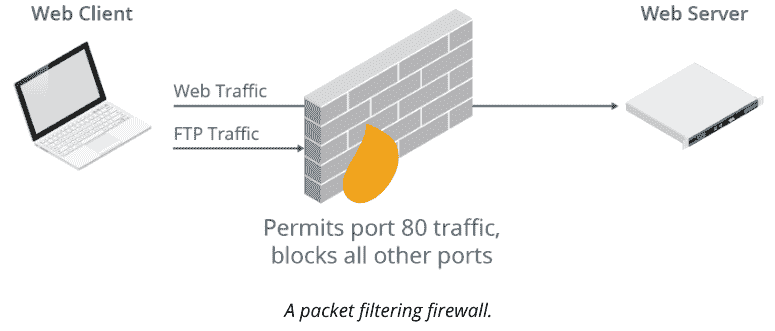

Web 客户端
Web 流量
FTP 流量
允许端口 80 流量，阻止所有其他端口
Web 服务器

*包过滤防火墙。*

## ACL 特性

无状态防火墙的 ACL 可以根据各种因素允许或拒绝数据包。这些因素包括：

- 源 IP 地址
- 目标 IP 地址
- 源 TCP 或 UDP 端口
- 目标 TCP 或 UDP 端口
- 使用的 TCP 或 UDP 协议

例如，配置 ACL 最常见的方法之一是拒绝使用网络或其系统不需要的端口的传入流量。如果目标系统不托管 FTP 服务器，你可以将 ACL 配置为阻止端口 21（FTP）上的传入流量。

一旦防火墙将流量与规则匹配，它需要执行以下操作之一：

- **接受**：流量被允许通过防火墙并发送到其目的地。
- **拒绝**：流量在防火墙处被阻止，防火墙会通知发送方。
- **丢弃**：流量在防火墙处被阻止，防火墙*不会*通知发送方。

此外，你可以配置防火墙以记录上述任何操作。这些日志通常包含有关数据包的信息，如其源和目标，以及时间戳和其他有用的数据。

## iptables 工具

`iptables` 工具使你能够通过各种表在 Linux 中管理包过滤以及有状态防火墙功能。每个表适用于特定的上下文，并由称为链的规则集组成，表使用这些链来实现防火墙。数据包与适当链中的第一条规则进行比较，如果不匹配该规则，则与链中的下一条规则进行比较，依此类推。如果数据包与规则匹配，则可以由新链对其进行评估，或对其应用三种操作之一：`ACCEPT`、`DROP` 或 `RETURN`（跳转到上一个链的下一条规则）。

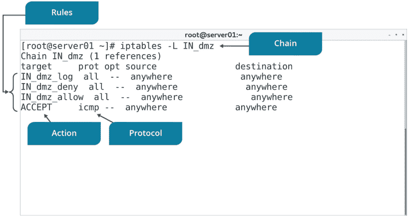

列出防火墙链中的规则。

每个表都有一个或多个内置链，但你也可以根据需要定义自己的链。

## 语法

`iptables` 命令的语法是 `iptables [options] [-t table] [commands] {chain/rule specification}`

### 默认表

根据内核的配置方式，可能有五个默认表处于活动状态：

- `filter` — 用于典型包过滤功能的默认表。
- `nat` — 用于实现网络地址转换（NAT）规则。
- `mangle` — 用于修改数据包的 TCP/IP 头部。
- `raw` — 用于为参与连接跟踪的数据包配置例外。
- `security` — 用于用 SELinux 安全上下文标记数据包。

### 持久性

默认情况下，使用 `iptables` 设置的规则在重启后会丢失。在 CentOS/RHEL 中，你可以安装 `iptables-services` 包并执行 `service iptables save` 命令以确保更改持久化。对于基于 Debian 的发行版，你可以安装 `iptables-persistent` 包。安装后，系统会要求你确认是否希望当前规则持久化。然后 `iptables-persistent` 服务将在启动时自动运行并加载你的规则。

## 日志记录

你可以通过包含 `LOG` 操作来为 `iptables` 规则启用日志记录。在以下示例中，所有被丢弃的数据包都会被记录：

```
iptables -N LOGCHN
iptables -I INPUT -j LOGCHN
iptables -I LOGCHN -j LOG
iptables -I LOGCHN -j DROP
```

第一行创建了一个名为 `LOGCHN` 的新链。第二行确保所有未被任何先前规则处理的传入数据包会"跳转"到 `LOGCHN` 链。第三行记录到达此链的所有数据包，第四行执行实际的数据包丢弃。如果你只想记录被接受的数据包，也可以用 `ACCEPT` 替换 `DROP`。

`iptables` 的事件通常写入 `/var/log/messages` 或 `/var/log/kern.log` 文件。

## UFW

**简易防火墙（UFW）**是一种防火墙管理工具，使配置 `iptables` 服务变得更加容易。UFW 起源于 Ubuntu®，但可以在其他发行版上下载和安装。它主要适用于没有防火墙配置经验的复杂细节的家庭用户。

`ufw` 命令使你能够在命令行界面中工作。例如，以下命令设置 HTTP 的允许规则，打开日志记录，并启用防火墙。这会自动为传入流量创建默认拒绝配置——换句话说，没有明确允许规则的所有内容都会被丢弃：

```
ufw allow http/tcp
ufw logging on
ufw enable
```

## 语法

`ufw` 命令的语法是 `ufw [options] {action}`

### 高级配置

如果你想使用 UFW 实现更复杂的防火墙配置，你需要编辑文本文件而不是使用 `ufw` 命令限制。`/etc/default/ufw` 文件用于配置高级设置，如策略默认值和内核模块使用。更细粒度的配置文件位于 `/etc/ufw/` 目录中。你可以编辑这些文件来控制规则何时应用、自定义何时随 `ufw` 命令运行，等等。

例如，UFW 默认允许通过防火墙的传出流量。你可以在 `/etc/default/ufw` 中指定不同的策略指令来更改此行为：

```
DEFAULT_OUTPUT_POLICY="DROP"
```

作为一个更细粒度的示例，你可以配置 `/etc/ufw/applications.d/myapp` 来指示 UFW 识别你的应用程序及其端口/协议信息：

```
[My App]
title=My App
description=My custom application
ports=23534/tcp
```

## firewalld 服务

防火墙守护进程（firewalld）用于动态管理防火墙，无需在修改时重新启动防火墙。它是 iptables 的替代方案，使用区域和服务而不是链和规则。

防火墙区域是可以应用于特定网络资源（如网络接口）的规则集。你通常会将资源放在某个区域中，以将其与具有类似安全要求或类似信任级别的资源分组。有各种默认区域，每个区域具有不同的信任级别。例如，信任级别最低的区域称为 drop，它会立即丢弃所有传入连接。防火墙服务是应用于特定区域内运行的服务的规则。例如，你可以将 HTTP 服务添加到 dmz 区域，以允许来自互联网等不受信任网络的传入连接，同时拒绝向网络其余部分发出传出访问。

## firewall-cmd 命令

`firewall-cmd` 命令使你能够通过查询、添加、修改和删除区域和服务来配置 firewalld。由于 firewalld 是许多 Linux 发行版的默认防火墙服务，包括 Red Hat® Enterprise Linux® 和 CentOS®，你将定期使用 `firewall-cmd` 命令。该命令包含用于指定要配置的区域和接口的选项，以及通过名称或端口号允许服务的功能。

```
[root@server01 ~]# firewall-cmd --list-all --zone=dmz
dmz (active)
  target: default
```


`icmp-block-inversion: no`

`interfaces: enp3s0`

`sources:`

`services: ssh http https`

`ports: 7743/tcp 601/tcp`

`protocols:`

`masquerade: no`

`forward-ports:`

`source-ports:`

`icmp-blocks:`

`rich rules:`

列出特定 `firewalld` 区域的配置。

## 语法

`firewall-cmd` 命令的语法为 `firewall-cmd [选项]`

## firewall-cmd 命令示例

以下是一些使用 `firewall-cmd` 命令的常见示例：

- `firewall-cmd --get-zones` —列出所有可用的 `firewalld` 区域。
- `firewall-cmd --zone=dmz --list-all` —列出 `dmz` 区域的所有详细信息，包括该区域适用的接口、端口、服务、协议等。
- `firewall-cmd --zone=dmz --change-interface=<设备 ID>` —将指定接口添加到 `dmz` 区域。
- `firewall-cmd --zone=dmz --add-service=http` —将 HTTP 服务添加到 `dmz` 区域。
- `firewall-cmd --zone=dmz --add-port=21/tcp` —将 TCP 端口 21（FTP）添加到 `dmz` 区域。
- `firewall-cmd --zone=dmz --remove-service=http` —从 `dmz` 区域移除 HTTP 服务。
- `firewall-cmd --zone=dmz --remove-port=21/tcp` —从 `dmz` 区域移除 TCP 端口 21（FTP）。
- `firewall-cmd --reload` —重新加载区域配置。

与 `iptables` 类似，`firewalld` 默认不会持久化其更改。这称为运行时模式。你必须使用 `--permanent` 选项提交更改，以便在守护进程重启后仍然保留。

## NETFILTER 框架

**Netfilter** 是一个 Linux 内核框架，用于处理流经网络接口的数据包。它提供的主要服务包括数据包过滤、NAT 和连接跟踪。Netfilter 通过在内核网络栈中提供钩子点来支持这些服务的配置。每个流经网络接口的数据包都会被这些钩子点"捕获"。注册到相关钩子点的用户空间程序能够与这些钩子点上的数据包进行交互。

`iptables` 工具与 Netfilter 紧密集成。它能够允许、丢弃以及执行其他防火墙操作，因为它可以与 Netfilter 钩子点上的数据包进行交互。UFW 和 `firewalld` 都在一定程度上调用了 `iptables`，因此它们同样依赖于 Netfilter。

## IP 转发

**IP 转发** 是 Linux 内核中网络路由功能的实现。它使得一个网络接口上的入站流量能够被转发到另一个网络接口。因此，IP 转发仅在具有多个接口的系统上有用，特别是那些在网络中充当路由器或网关的系统。

IP 转发通常与 `iptables` 防火墙配置结合使用。例如，假设你有一台 Linux 主机充当路由器。它有一个面向公网的接口和一个面向内网的接口。你还有另一台仅拥有私有接口的 Web 服务器。你希望来自互联网的流量能够通过你的路由器，并且只有在流量使用端口 80 或 443（HTTP/S）时才被转发到内部网络。你可以通过配置 FORWARD 链来实现这一点，该链将允许端口 80 和 443 上的流量被转发到私有接口，同时阻止其他任何类型的流量被转发。

要利用 IP 转发功能，你必须首先在内核中启用它。这很简单，只需修改相应文件中的一个值：

```
echo 1 > /proc/sys/net/ipv4/ip_forward
```

或者，对于 IPv6 流量：

```
echo 1 > /proc/sys/net/ipv6/conf/all/forwarding
```

> **注意**：若要使此更改持久化，必须在 `/etc/sysctl.conf` 文件中启用相应的设置。


## IP 集

**IP 集（IP sets）** 是存储的 IP 地址、网络范围、MAC 地址、端口号和网络接口名称的集合。`iptables` 工具可以利用 IP 集来实现更高效的规则匹配。例如，假设你想要丢弃来自几个已知恶意的 IP 地址范围的流量。与其直接在 `iptables` 中为每个范围配置规则，你可以创建一个 IP 集，然后在 `iptables` 规则中引用该集合。这使你的规则集变得动态且更易于配置；每当你需要添加或更换由防火墙处理的网络标识符时，只需修改 IP 集即可。

`ipset` 命令可用于创建和修改 IP 集。首先，你需要为集合设置名称、存储方法和数据类型，例如：

```
ipset create range_set hash:net
```

在此示例中，`range_set` 是名称，`hash` 是存储方法，`net` 是数据类型。然后，你可以将范围添加到集合中：

```
ipset add range_set 178.137.87.0/24
ipset add range_set 46.148.22.0/24
```

接着，使用 `iptables` 配置规则，以丢弃源地址匹配此集合中范围的流量：

```
iptables -I INPUT -m set --match-set range_set src -j DROP
```

或者，丢弃目的地址匹配此集合的流量：

```
iptables -I OUTPUT -m set --match-set range_set dst -j DROP
```

## 语法

`ipset` 命令的语法为 `ipset [选项] {命令}`

### 故障排除

`ipset` 工具也可用于 `iptables` 防火墙的故障排除。例如，你可以使用 `test` 子命令来测试某个条目是否存在：

```
ipset test range_set 178.137.87.5
```

如果防火墙仍未按预期处理 IP 地址范围，你可以列出使用相关集合的规则：

```
iptables -L | grep range_set
```

即使规则正在使用你的集合，请记住规则是按顺序处理的；意外行为可能是由于这些规则在表中的流转方式造成的。

## 应用程序的防火墙配置

如你所知，网络服务和应用程序需要使用端口来建立连接端点。大多数常见协议都有由互联网号码分配局（IANA）分配的专用端口号。然而，你可能需要运行一个需要网络访问的自定义或不常见的应用程序，而该应用程序可能没有标准化的端口号。在这种情况下，你需要选择一个端口号并将其与应用程序关联，然后在防火墙上开放该端口。

Linux 在 `/etc/services` 文件中维护着服务及其对应端口的数据库。此文件使服务在激活时默认尝试绑定到其对应端口。每个条目的格式为：

```
service-name port/protocol [aliases] [# comment]
```

因此，要将名为 `my-app` 的应用程序映射到端口号 55111，你需要添加以下行：

```
my-app 5511/tcp # My custom app
```

每当 `my-app` 启动时，它将尝试绑定到端口 55111 并开始在该端口上监听。因此，你需要使用 `iptables` 或 `firewalld` 等防火墙服务来允许网络中发往端口 `55111` 的流量。

## 可信端口

**可信端口**，也称为**特权端口**，是指公认范围（0–1023）内的端口。在 Linux 中，如果一个进程要在可信端口上开始监听，或从可信端口建立远程连接，它必须具有超级用户权限。这有助于连接的另一方确认他们所连接的服务是受信任的。这对于涉及数据传输的 FTP、HTTP、SSH 等常见协议尤为重要。由于许多服务器使用这些协议，你需要确保它们的端口在防火墙中是开放的。

## 防火墙故障排除

在配置和实施防火墙时，你可能会遇到一个常见问题：防火墙阻止了不该阻止的流量。下表列出了与此问题相关的一些潜在原因和解决方案。

| 原因 | 解决方案 |
|------|---------|
| 端口被阻止 | 检查防火墙的规则集，确保它没有过度阻止你的系统转发出站流量所需的端口。同样，你的防火墙可能对入站连接默认采取拒绝模式，因此请确保创建明确的规则以允许所需端口上的流量。 |
| 协议被阻止 | 即使你正确允许了某个端口，也可能没有为其配置正确的协议。确保根据连接所需的传输协议，在 TCP、UDP 或两者上都开放端口。此外，对于应用层防火墙，确保它们没有被配置为丢弃内容匹配特定应用层协议（如 HTTP、FTP、SSH）的数据包。 |
| 限制性的访问控制列表 | 访问控制列表（ACL）用于允许或拒绝流量的因素可以组合使用；例如，你可以配置 ACL，使其仅在源端口匹配已知 IP 地址**且**目标端口为特定端口时才阻止该源端口。如此细粒度的过滤非常有用，但也可能变得复杂，并且有更高的误报可能性。请将 ACL 规则配置得尽可能简洁，不要试图为每种可能的情况都编写过于细粒度的规则。 |

## 入侵防御系统

**入侵防御系统（IPS）** 是一种安全设备，它监控系统以寻找正在进行的攻击迹象，并能够主动阻止其判定为恶意的流量。IPS 与防火墙的目的相似，两者都可以阻止不希望的流量进入网络。然而，它们之间存在一些关键区别。防火墙就像一位根据预设规则决定是否让客人进入大楼的保安。IPS 更像是大楼内部的第二位保安。即使外部保安（防火墙）让某人进入了，内部保安（IPS）仍可能将其拦截。

IPS 会监视该用户是否存在可疑行为迹象。如果该用户反复表现出可疑行为模式，内部守卫会将其踢出。换句话说，IPS 是第二层防御机制，它监控通过防火墙的流量，查找异常行为的迹象。

另一个主要区别是，IPS 只关注管理传入流量，而防火墙同时适用于传入和传出流量。

> **注意**：入侵检测系统（IDS）与 IPS 相同，但它不会主动阻止流量，而只是通知相关人员。

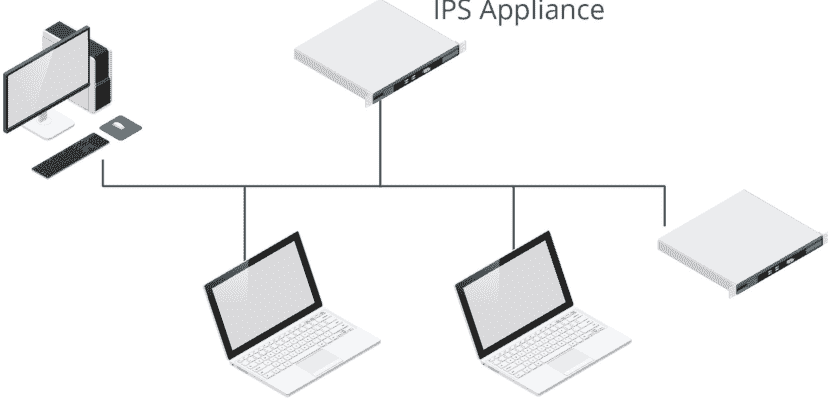

> 一台在 LAN 网段上监控流量的 IPS 设备。

## DENYHOSTS 和 FAIL2BAN

有许多 IPS 解决方案可供选择。两种常见的第三方解决方案是 DenyHosts 和 Fail2ban，它们都会检查日志文件以查找异常。

DenyHosts 主要保护 SSH 服务器免受暴力破解密码攻击。在这种攻击中，攻击者会反复尝试登录 SSH 服务器，每次使用的凭据都会递增。DenyHosts 监控身份验证日志以查找失败的登录条目。它会考虑源 IP 地址和失败尝试次数。如果来自同一来源的足够多失败尝试达到您配置的阈值（或默认阈值），DenyHosts 将使该来源失效。DenyHosts 的一个主要局限性是它只适用于 IPv4 流量，而不适用于 IPv6。

Fail2ban 也能防止暴力破解攻击，但与 DenyHosts 不同，它并不专注于任何单一服务。相反，它可以监控与任何具有身份验证组件的系统服务相关的日志文件。Fail2ban 利用 Netfilter 和 `iptables` 来实际执行阻止操作，甚至可以用来更新您的防火墙规则。Fail2ban 同时支持 IPv4 和 IPv6。

> **注意**：要了解更多信息，请查看课程网站上的视频标签页，寻找补充本课内容的视频。

## 配置

DenyHosts 的主要配置文件是 `/etc/denyhosts.conf` 文件。您可以在该文件中调整各种设置。一些示例包括：

- `ADMIN_EMAIL` — 定义要发送警报的电子邮件地址。
- `BLOCK_SERVICE` — 定义将阻止未授权用户访问哪些服务。
- `DENY_THRESHOLD_VALID` — 定义用户在不被阻止之前可以尝试登录现有账户的次数。

Fail2ban 的主要配置文件是 `/etc/fail2ban/jail.conf` 文件。但是，如果您计划配置 Fail2ban，最好将此文件复制到 `/etc/fail2ban/jail.local`，或在 `/etc/fail2ban/jail.d/` 目录中创建自定义的 `.conf` 文件。以下是一些示例设置：

- `bantime` — 定义主机被阻止访问资源的时长。
- `maxretry` — 定义主机在被阻止之前可以身份验证失败的次数。
- `ignoreip` — 定义受信任主机的白名单。

## 活动 12-7

### 讨论防火墙

### 场景

回答以下问题以检查您对该主题的理解。

1. 哪种类型的防火墙单独检查网络数据包，而不是在传输中其他数据包的上下文中检查？
2. 您的一些用户想在家中安装和使用 Linux，但对防火墙规则和管理自己的防火墙感到困惑。您可以推荐什么工具来帮助他们配置防火墙？
3. 判断对错？简单防火墙（UFW）起源于 Ubuntu，但可以在其他发行版上下载和安装。
4. 您的母公司收购了另一家较小的公司，其服务器机房中有六台 Linux 系统，现在这些都由您负责管理。它们都运行 `firewalld` 服务。您可以使用哪个命令来管理 `firewalld` 服务及其关联的区域？
5. 判断对错？IP 转发是 Linux 内核的网络路由功能实现。

## 活动 12-8

### 配置防火墙

### 开始之前

您以学员账户身份登录到 GUI。您将在此活动中与合作伙伴一起工作。早些时候，您已编译并安装了 Nmap 工具。

### 场景

您的网络管理员同事设计了一个 DMZ，您需要在其中放置几台面向公众的 Linux 系统。在大多数情况下，这些系统用作 Web 服务器，需要允许用户通过 HTTP 和 HTTPS 协议连接。这些服务器还运行着开发团队编程的自定义应用程序，该应用程序接受端口 7743 上的连接。

因此，您的工作是加强服务器的网络安全，同时不拒绝必要服务的访问。您将通过配置 `firewalld` 服务来实现这一点，这是 CentOS 7 上默认且首选的防火墙服务。

1. 测试防火墙是否在阻止知名端口。

   a) 输入 `systemctl status firewalld`
   
   b) 确认该服务当前处于活动状态并正在运行。
   
   **注意：** 如果不是，请输入 `sudo systemctl start firewalld`
   
   c) 输入 `sudo /usr/local/bin/nmap -sV <合作伙伴 IP 地址或主机名> -p 80`
   
   d) 验证端口 80 被列为 "filtered"，这意味着防火墙可能正在阻止此端口上的流量。


> **注意**：如果不是，请输入 `sudo systemctl start firewalld`

```
sudo systemctl start firewalld
```

```
systemctl status firewalld
```

```
sudo /usr/local/bin/nmap -sV <合作伙伴 IP 地址或主机名> -p 80
```

2. 获取有关特定区域的更多信息。

   a) 输入 `firewall-cmd --get-zones` 以获取所有默认区域的列表。
   
   b) 输入 `sudo firewall-cmd --zone=dmz --list-all`
   
   c) 验证您能看到有关此区域的详细信息，包括：
      - 其目标。目标定义了传入连接的行为（即接受、拒绝或丢弃流量）。`default` 设置是拒绝不匹配任何规则的流量。
      - 此区域当前应用于哪些网络接口。
      - 哪些服务、端口和协议应用于此区域。在本例中，SSH 是唯一将接受使用此区域的接口上传入连接的服务。
      - 端口转发、阻止 ICMP（ping）等的附加规则。
   
   d) 输入 `sudo firewall-cmd --get-active-zones`
   
   e) 验证当前您的主以太网接口正在使用 `public` 区域。

```
firewall-cmd --get-zones
```

```
sudo firewall-cmd --zone=dmz --list-all
```

```
default
```

```
sudo firewall-cmd --get-active-zones
```

```
public
```

3. 为您的主网络接口设置 `dmz` 区域。

```
dmz
```

   a) 输入 `ip a` 并记下您的主以太网接口的设备名称。这是您在 networking 课程中配置的接口。

   b) 输入 `sudo firewall-cmd --zone=dmz --change-interface=<设备 ID> --permanent`

   c) 验证更改是否成功。

4. 向区域添加服务和自定义端口。

   a) 输入以下内容：

```
sudo firewall-cmd --zone=dmz --add-service=http --permanent
```

   b) 输入以下内容：

```
sudo firewall-cmd --zone=dmz --add-service=https --permanent
```

您刚刚添加了 HTTP 和 HTTPS 作为将应用于 `dmz` 区域的服务。换句话说，前往这些服务的流量将被允许。

   c) 输入以下内容：

```
sudo firewall-cmd --zone=dmz --add-port=7743/tcp --permanent
```


这会向区域添加特定端口而非定义的服务。

5. 验证您的配置是否已应用于该区域。

   a) 输入`sudo firewall-cmd --reload`

   b) 输入`sudo firewall-cmd --zone=dmz --list-all`

   c) 验证有关此区域的以下内容：
      - 它正在由您的主网络接口使用。
      - HTTP 和 HTTPS 服务在该区域中处于活动状态。
      - TCP 端口 7743 也在该区域中处于活动状态。

```
dmz (active)

  target: default

  icmp-block-inversion: no

  interfaces: enp3s0

  sources:

  services: ssh http https

  ports: 7743/tcp

  protocols:

  masquerade: no

  forward-ports:
```

6. 测试防火墙以查看您的配置是否按预期工作。

   a) 等待您的合作伙伴完成前面的步骤。

   b) 输入`sudo /usr/local/bin/nmap -sV <合作伙伴 IP 地址或主机名> -p 80`

   c) 验证该端口现在已开放，表明防火墙正在允许此端口上的流量。

   d) 使用相同的`nmap`命令扫描端口 21（FTP）。

   e) 验证其已被过滤，表明防火墙正在按预期阻止该端口的流量。

   f) 输入`ssh student##@<partner's IP address or hostname>`

> **注意：** 记住，使用你同伴的学生编号。

   g) 验证你能够建立连接，表明 SSH 流量是被允许的。

   h) 输入`exit`以关闭 SSH 会话。

## 7. 大多数防火墙服务在一定程度上依赖的 Linux 内核框架是什么？

## 8. 在`iptables`表中，链的功能是什么，以及链之间如何相互交互？

## 9. 判断正误？IP 转发在仅有一个网络接口的系统上最有用。

- ☐ 正确
- ☐ 错误

## 10. 防火墙与入侵防御系统（IPS）之间的区别是什么？

## 主题 E

## 实现日志服务

#### 涵盖的考试目标

3.4 根据给定场景，实现日志服务。

安全不仅仅是设计加固系统的过程。另一个主要要素是对系统、软件和用户事件的分析。通过生成和维护这些事件的日志，你将能够更容易地识别恶意行为或增加被入侵风险的错误配置。

### 系统日志

系统日志是由`syslogd`守护进程跟踪和维护的系统活动与事件记录。系统日志使用 **syslog** 标准，该标准支持集中式日志服务器，可以接收和处理来自网络中多个系统的 syslog 数据。这称为远程日志记录。syslog 标准还支持本地日志记录，即日志存储在生成它们的同一系统上。

系统日志以简单的文本文件形式记录，你可以像处理任何其他文本一样检查和处理它们。syslog 系统中的条目通常包括事件的日期和时间、发送消息的进程名称和 ID，以及消息本身。syslog 格式还可以按设施和严重级别对消息进行优先级排序。设施代码表示受影响的系统，例如 "kern" 表示内核，"mail" 表示邮件系统。严重级别代码表示事件可能造成的影响程度，从 0（最严重）到 7（最不严重）。

### 日志文件位置

在大多数 Linux 发行版中，系统日志位于`/var/log/`目录中。此目录内部是日志文件本身，每个文件对应一个服务、应用程序或功能。下表列出了一些最常见的日志文件。

| 日志文件 | 包含内容 |
|----------|----------|
| `/var/log/syslog` | 除认证消息外的所有类型系统事件。主要由基于 Debian 的发行版使用。 |
| `/var/log/messages` | 一般非关键系统事件。主要由 RHEL 和 CentOS 使用。 |
| `/var/log/auth.log` | 认证消息（例如，登录成功和失败）。主要由基于 Debian 的发行版使用。 |
| `/var/log/secure` | 认证消息。主要由 RHEL 和 CentOS 使用。 |
| `/var/log/kern.log` | 内核消息（例如，`dmesg`输出）。 |
| `/var/log/[application]` | 来自各种应用程序的消息（例如，`cron`、`firewalld`、`maillog`等）。 |

### 日志轮转

**日志轮转**是创建日志文件新版本以保持最小日志文件大小的做法。`logrotate`实用程序用于执行日志的自动轮转。执行时，`logrotate`会在当前版本日志文件的文件名末尾添加 .1。先前轮转的文件后缀为 .2、.3，依此类推。该实用程序还可以配置为将日志日期附加到文件名，而不是十进制数字。

使用自动轮转，除非另有规定，否则日志文件的所有版本都将保留在系统上。日志文件可以按日、周、月或年进行轮转。当它们达到一定大小阈值时，也可以自动轮转。日志轮转使处理和分析日志变得更加容易，因为条目过多的日志文件可能变得难以管理。同样，如果日志轮转服务配置为清除较旧的日志文件，它可以节省存储空间。

### 配置

日志轮转行为可以在`/etc/logrotate.d/`目录中配置，每个相关服务都有自己的配置文件。以下是一个名为`myservice`的服务的示例配置文件：

```
/var/log/myservice.log {

    size 1k

    create 700 user group

    dateext

    rotate 10

}
```

第一行定义了日志应输出到的位置。`size`指令指示当日志达到 1,000 字节大小时应进行轮转。`create`指令通过创建具有指定权限、用户和组的新文件来轮转日志。`dateext`指令将日期附加到轮转后的日志。最后，`rotate`指定仅保留最近的 10 个日志文件。

### rsyslogd 服务

`syslogd`服务是 Linux 上最初的 syslog 服务。`rsyslogd`服务进行了多项改进，包括支持：

- 使用 TCP 而非 UDP 作为传输协议，提高传输数据的可靠性。
- 使用 SSL/TLS 进行数据加密。
- 将数据输出到 MySQL 等各种数据库技术。
- 当远程接收器未准备好接收时，在本地系统上缓冲数据。
- 基于内容过滤数据。

此外，`rsyslogd`保持了与其前身相同的基本配置格式，因此在这方面具有向后兼容性。

> 注意：许多现代发行版使用`rsyslogd`而非`syslogd`作为其主要日志服务。

### /etc/rsyslog.conf 文件

`/etc/rsyslog.conf`文件是`rsyslogd`服务的配置文件。该文件通过多种规则确定如何处理 syslog 消息，你可以根据需要修改这些规则。

该文件采用两列格式。第一列列出消息设施和/或严重级别。严重级别以单词格式定义，而不是以数字 0–7 表示。第二列定义应对与会话和/或严重级别匹配的消息采取的操作。操作包括将消息写入哪个文件；如果用户登录到终端，将消息打印给哪些用户；以及将消息转发到哪些远程主机。

```
#### RULES ####

# 将所有内核消息记录到控制台。

# 记录太多其他内容会弄乱屏幕。

#kern.*							/dev/console

# 记录任何级别为 info 或更高的内容（邮件除外）。

# 不要记录私有认证消息！

*.notice;mail.none;authpriv.none;cron.none	/var/log/messages
```

**格式：** `facility.severity`

**操作（记录到）**

`/etc/rsyslog.conf`文件。

> 注意：`syslogd`的等效文件是`/etc/syslog.conf`文件。

### syslog-ng 服务

`syslog-ng`服务是旧版`syslogd`服务的另一个替代品。尽管它提供与`rsyslogd`类似的功能，但`syslog-ng`有自己的语法。

### 第三方代理

尽管集中式管理能力使你对网络中的日志记录有更大的控制权，但 syslog 标准并未在所有平台上普遍支持。例如，Windows 使用专有的 Windows 事件日志格式来记录系统消息。为了促进 syslog 与非 syslog 平台之间的集成，你需要使用第三方代理。**代理**是代表其他程序或服务行事的软件程序。

你在通常不支持该标准的平台上（如 Windows）安装 syslog 代理。安装哪个代理将取决于平台，以及你面向的 syslog 服务类型。例如，rsyslog 和 syslog-ng 都需要各自的代理软件。安装代理后，你将能够配置它以 syslog 格式捕获消息，并将这些消息发送到你的集中式 syslog 服务器。

### journalctl 命令

`journalctl`命令使你可以查看和查询由 systemd 套件的 journal 组件创建的日志文件。日志信息通过 systemd `journald`服务收集和存储。你可以使用`journalctl`打印整个 journal 日志，也可以发出各种选项来过滤多种方式，例如匹配服务名称或仅打印与指定严重级别匹配的消息。

`journald`服务通常与传统的 syslog 守护进程（如`syslogd`或`rsyslogd`）一起使用。`journald`的设置配置在`/etc/systemd/journald.conf`文件中。

```
[root@server01 ~]# journalctl

-- Logs begin at Wed 2019-01-02 18:40:56 GMT, end at Wed 2019-01-09 15:04

Jan 02 18:40:56 localhost.localdomain systemd-journal[101]: Runtime journ

Jan 02 18:40:56 localhost.localdomain kernel: microcode: microcode update

Jan 02 18:40:56 localhost.localdomain kernel: Initializing cgroup subsys

Jan 02 18:40:56 localhost.localdomain kernel: Initializing cgroup subsys

Jan 02 18:40:56 localhost.localdomain kernel: Linux version 3.10.0-862.el

Jan 02 18:40:56 localhost.localdomain kernel: Command line: BOOT_IMAGE=/v

Jan 02 18:40:56 localhost.localdomain kernel: e820: BIOS-provided physica

Jan 02 18:40:56 localhost.localdomain kernel: BIOS-e820: [mem 0x00000000

Jan 02 18:40:56 localhost.localdomain kernel: BIOS-e820: [mem 0x00000000

Jan 02 18:40:56 localhost.localdomain kernel: BIOS-e820: [mem 0x00000000

Jan 02 18:40:56 localhost.localdomain kernel: BIOS-e820: [mem 0x00000000

Jan 02 18:40:56 localhost.localdomain kernel: BIOS-e820: [mem 0x0000000b
```

*查看 systemd 日志。*

## 语法

`journalctl`命令的语法为`journalctl [选项] [匹配条件]`

## journalctl 命令选项

`journalctl`实用程序提供了许多用于查询`journald`日志数据的选项。以下表格列出了一些常用选项。

| 选项 | 用途 |
| --- | --- |
| `-n {行数}` | 指定要显示的日志行数。 |
| `-o {输出格式}` | 指定输出格式。例如：`short`（简短）、`verbose`（详细）或`export`（导出）。 |
| `-f` | 显示最近的日志条目，并在新条目添加到日志时持续更新显示。 |
| `-p` | 按严重级别（`alert`（警报）、`err`（错误）、`warning`（警告）、`notice`（通知）、`info`（信息）等）过滤日志输出。 |
| `-u` | 按指定单元过滤日志输出，例如服务名称。 |
| `-b [启动 ID]` | 仅显示当前启动的日志消息，或显示指定的启动 ID 的日志消息。 |

## /var/log/journal/ 目录

在默认配置下，systemd 日志仅将日志存储在内存中，每次系统重启时日志都会被清除。你可以通过创建`/var/log/journal/`目录使`journald`日志在重启后持久保存。如果此目录存在，`systemd`服务会自动配置以维护此目录中的日志。

## last 命令

`last`命令显示用户登录和注销事件的运行历史，以及实际的时间和日期。它还具有各种选项，可让你过滤结果，例如通过特定终端登录的用户进行过滤。例如，`last 1`将显示使用第一个终端（`tty1`）登录的用户详细信息。`last`命令从`/var/log/wtmp`文件中检索信息。

若要仅获取失败登录事件的相同信息，可以使用`lastb`命令。此命令从`/var/log/btmp`文件中检索信息。

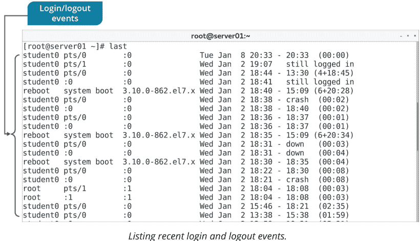

## 语法

`last`命令的语法为`last [选项]`

## lastlog 命令

`lastlog`命令与`last`命令类似，但它不是列出最近的登录事件，而是列出所有用户及其上次登录时间。此命令从`/var/log/lastlog`文件中检索信息。

> **注意：** 要了解更多信息，请查看课程网站上的视频标签页，了解补充本课内容的任何视频。

## 活动 12-9

### 讨论日志记录服务

### 场景

回答以下问题以检查你对该主题的理解。

- 1. 你为新 Linux 系统管理员安排了一次培训课程，正在讨论日志文件、其格式、位置和 contents。一般来说，大多数 Linux 系统日志位于何处？

- 2. 你正在向 IT 和安全团队做演示，说服他们应该在 Linux 系统上采用新的 syslog 服务的企业标准。你的论点是`rsyslogd`相比标准`syslogd`服务有几个优点或改进。这些改进有哪些？

- 3. 昨晚下班后，一些文件从共享目录中被删除，其他用户想知道是谁删除了这些文件。为了查明在怀疑的时间段内谁登录了系统，你使用`last`命令。`last`命令从哪个日志文件读取数据？

- 4. 你怀疑一些用户自新文件服务器投入生产以来就没有登录文件服务器更新密码。哪个命令列出所有用户及其上次登录时间？

- 5. 你需要设置一个相对免维护的日志轮转计划。换句话说，你不想定期从 30 台服务器上清除日志——你希望它自动发生。哪个实用程序按你确定的计划提供此服务？

## 活动 12-10

### 为本地和远程日志记录配置 rsyslog

### 开始之前

你已以你的学生账户登录到 GUI。你将与合作伙伴一起完成此活动。

### 场景

你希望确保系统仅记录对你和其他分析师有用的消息。因此，您将配置本地日志记录行为，使其更加精细且减少噪音。此外，每个系统都应将其身份验证日志发送到远程集中式服务器，以便于分析和存储。因此，您将配置 rsyslog 以通过网络将这些消息发送到远程主机。

- 1. 检查 rsyslog 配置中的默认规则。
   - a) 使用`sudo`，在你选择的文本编辑器中打开`/etc/rsyslog.conf`文件。
   - b) 向下滚动到`RULES`部分。
   - c) 验证左列中每行是否列出一个或多个严重级别和/或设施。

> 例如，`authpriv.*`设施指私有身份验证消息，如登录和注销事件。星号（*）表示应记录所有严重级别。

   - d) 验证每行在右列中都有相应的操作。

例如，`authpriv.*`设施将记录其消息到`/var/log/secure`文件中。

- 2. 过滤`messages`日志以减少其记录的事件数量。

   - a) 找到将事件记录到`/var/log/messages`文件的行。

此行告诉`rsyslogd`记录所有严重级别为`info`级别（6）及以上的事件（数字越小越严重）。它对邮件消息、私有身份验证消息和 cron 消息（调度器）做了例外处理。

   - b) 在此行上，将`*.info`文本替换为`*.notice`

`notice`严重程度（级别 5）记录正常但重要的条件。现在，`messages`日志将不会记录信息性消息（级别 6），而是从级别 5 的消息开始记录。

- 3. 配置您的服务器以通过 TCP 接收远程 rsyslog 消息。

   - a) 向上滚动到 MODULES 部分。

   - b) 找到显示`# Provides TCP syslog reception`的行

   - c) 更改下面的两行，使其显示如下：

```
$ModLoad imtcp

$InputTCPServerRun 601
```

> **注意：** 确保这些行开头没有 # 符号。

- 4. 配置客户端以将 rsyslog 流量发送至您的合作伙伴服务器。

   - a) 滚动至文件底部，在新的一行中输入以下内容：

```
authpriv.* @@<IP address>:601
```

将`<IP address>`替换为合作伙伴的IP地址。例如：


`authpriv.* @@10.50.1.101:601`

> **注意：** 确保此行开头没有`#`符号。

`@@`符号表示 TCP 连接，而单个`@`表示 UDP。

1. 保存并关闭文件。
2. 输入`sudo systemctl restart rsyslog`
3. 为 rsyslog 流量添加防火墙允许规则。
   - 输入以下内容：

```
sudo firewall-cmd --zone=dmz --add-port=601/tcp --permanent
```

   - 输入`sudo systemctl restart firewalld`
4. 生成身份验证失败消息并确认其已发送至您的合作伙伴服务器。
   - 输入`su - ariley`
   - 提供错误密码并确认您未能以该用户身份登录。
   - 等待您的合作伙伴完成执行上述所有步骤。
   - 输入`sudo tail /var/log/secure | grep ariley`
   - 验证你看到一条来自你的合作伙伴发送的身份验证失败消息。

```
Dec 14 16:33:26 server02 unix_chkpwd[7929]: password check failed for user (ariley)
Dec 14 16:33:26 server02 su: pam_unix(su-l:auth): authentication failure; logname=student01 uid=1001 euid=0 tty=pts/1 ruser=student02 rhost= user=ariley
```

5. 关闭远程日志记录，这是出于课堂环境的需要。
   - 使用`sudo`，在你选择的文本编辑器中打开`/etc/rsyslog.conf`文件。
   - 滚动到文件底部并删除整行`authpriv`。
   - 保存并关闭文件。

## 活动 12-11
检查日志文件

### 开始之前

你已使用学生帐户登录到图形界面。

### 场景

到目前为止，你已经使用`cat`和`less`等标准工具检查了一些日志，并使用`grep`等工具对这些日志进行了过滤。但是，你还可以使用`journalctl`更高效地整理这些日志消息，以便提取你要查找的特定信息。你还将使用`last`及其相关命令来查看登录事件的概览，例如用户上次登录的时间。

1. 使用`journalctl`检索和过滤消息。
   - 输入`sudo journalctl`并验证你可以逐页浏览多行内容。
   - 按**q**退出。
   - 输入`sudo journalctl -p notice`并验证日志已被过滤。仅显示严重级别为 5 的消息。
   - 按**q**退出。
   - 输入`sudo journalctl -p notice | grep kernel`
   - 验证内核消息是否显示。这些消息类似于`/var/log/messages`文件中的消息。
   - 输入`sudo journalctl -f`以检索最近的条目。
   - 按**Ctrl+C**终止进程。
   - 输入`sudo journalctl --since "2 hours ago" --until "30 minutes ago"`
   - 逐页浏览结果并验证第一个条目是两小时前的，最后一个条目是 30 分钟前的。
   - 按**q**退出。
   - 输入`sudo journalctl -u httpd.service`
   - 验证日志是否按 Apache 服务消息进行了过滤。
   - 按**q**退出。

2. 使用`last`及相关命令检查帐户登录事件。
   - 输入`last`
   - 验证你可以看到各个用户的登录和注销事件。
   - 输入`sudo lastb`
   - 验证你可以看到用户帐户列表以及使用该帐户进行身份验证尝试失败的时间。
   - 输入`lastlog`
   - 验证你可以看到每个用户上次登录的时间。

## 主题 F
备份、恢复和验证数据

**涵盖的考试目标**

2.3 根据场景创建、修改和重定向文件。

2.6 根据场景备份、恢复和压缩文件。

网络安全的另一个重要组成部分是备份过程。对于任何无法承受数据丢失或数据完整性受损的组织来说，备份数据至关重要。因此，在本主题中，你将备份敏感数据，测试你以后恢复数据的能力，然后验证数据未被篡改。

## 备份类型

**备份**是存在于与原始数据不同的逻辑或物理位置的数据副本。备份有助于在数据丢失时进行恢复。从备份中恢复数据的过程因原始备份计划中包含的备份类型而异。

备份主要有三种类型。

| 备份类型 | 说明 |
|-------------|-------------|
| 完全备份 | 备份所有选定的文件，无论其先前状态如何。多次完全备份会消耗大量存储空间，且备份过程可能较慢。但是，完全备份在恢复丢失数据方面快速且可靠。 |
| 差异备份 | 备份自上次完全备份以来已更改的所有选定文件。使用差异备份时，必须恢复上次完全备份和最新的差异备份。差异备份所需的存储空间和备份时间少于完全备份，但恢复速度较慢。 |
| 增量备份 | 备份自上次完全备份或增量备份（以最近者为准）以来已更改的所有选定文件。使用增量备份时，必须恢复上次完全备份及所有后续的增量备份。增量备份通常执行时间比差异备份短，因为其包含的数据较少，但在恢复数据时速度也较慢。 |

## 完全备份


完全备份。

## 差异备份

## 增量备份


差异备份与增量备份的对比。

## 备份存储方法

完全备份、差异备份和增量备份都描述了数据备份的频率。但也有不同的方式来存储备份数据。

| 备份存储方法 | 说明 |
|---|---|
| 快照 | 快照记录存储驱动器在某个时间点的状态，通常存在于同一驱动器上。它们是你可以将驱动器恢复到的"检查点"，而非存在于其他地方的真正数据副本。 |
| 镜像 | 你可以将数据备份为单个文件或文件集合，但也可以创建整个系统的一对一副本。基于镜像的备份以 ISO 等镜像文件格式保存操作系统的状态。你可以使用此镜像将系统恢复到捕获镜像时的状态。 |
| 克隆 | 克隆是将存储驱动器的所有内容复制到另一存储介质的过程。从技术上讲，镜像备份就是驱动器的克隆。但是，克隆操作通常更进一步，使用镜像文件在第二个驱动器上重建原始驱动器。 |

## tar 命令

`tar`命令使你能够创建数据档案。它通常用于从包含你要备份的数据的目录创建档案文件。你还可以对先前创建的档案使用此命令来提取文件、存储其他文件、更新文件以及列出已存储的文件。使用`tar`制作的文件档案通常具有 .tar 文件扩展名。`tar`命令还可以通过管道将输出发送到可用设备、文件或其他程序。

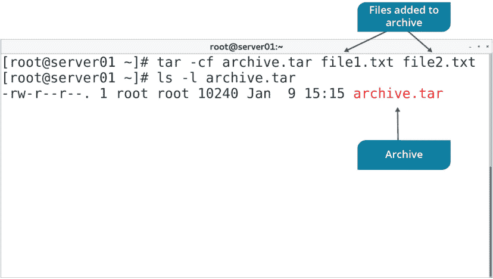

## 语法

`tar`命令的语法为`tar [选项] {文件名}`

## 使用 tar 命令恢复文件

命令`tar -xvf`将恢复源文件或目录结构的全部内容。要恢复 tar 文件的一部分，请使用要提取的文件的路径和名称。必须使用创建 tar 文件时使用的准确路径和名称。你还可以通过使用命令`tar -wxvf [目标] [源]`使恢复过程变为交互式。

## dar 命令

`dar`（"磁盘归档器"）命令旨在通过提供更多备份和归档功能来替代`tar`。它在创建完全备份、差异备份和增量备份方面特别有用。以下命令创建`mydata`目录的完全备份，并输出名为`full.bak`的备份文件：

```
dar -R mydata -c full.bak
```

要创建差异备份（`diff1.bak`），可以使用`-A`选项引用完全备份：

```
dar -R mydata -c diff1.bak -A full.bak
```

然后，你可以根据需要继续使用`-A`选项引用完全备份来创建更多差异备份。但是，要执行增量备份，则需要引用先前的增量备份，如下所示：

```
dar -R mydata -c incr1.bak -A full.bak
dar -R mydata -c incr2.bak -A incr1.bak
```

使用`-x`（提取）选项来恢复备份。如果执行了差异备份，需要先提取完全备份，然后提取最新的差异备份：

```
dar -x full.bak
dar -x diff1.bak -w
```

`-w`选项会自动覆盖对文件的更改；否则，系统将提示你确认。

要恢复增量备份，需要先提取完全备份，然后按顺序提取每个增量备份：

```
dar -x full.bak
dar -x incr1.bak -w
dar -x incr2.bak -w
```

## cpio 命令

`cpio`命令将文件复制到档案中或从档案中复制出来。`cpio`命令有三种操作模式。

| 操作模式 | 命令 | 用途 |
|---|---|---|
| 复制输出 | `cpio -o` | 将文件复制到档案中。它读取标准输入以获取文件名称列表，然后将这些文件复制到标准输出。 |
| 复制输入 | `cpio -i` | 从档案中复制文件。它从标准输入中提取文件。此选项用于数据恢复。 |
| 复制传递 | `cpio -p` | 将一个目录树中的文件复制到另一个目录树。它读取标准输入以获取创建并复制到目标目录中的文件名称列表。 |

## 语法

`cpio`命令的语法取决于其模式。在所有模式下，该命令都从标准输入读取。以下复制输出示例通过将`ls`管道传输到`cpio`并将档案输出发送到`dir_arch`来归档目录的所有内容：

```
ls | cpio -o > dir_arch
```

在复制输入模式下，可以如下提取档案：

```
cpio -i < dir_arch
```

在复制传递模式下，可以将`find`管道传输到`cpio`以将一个目录树复制到另一个目录树：

```
find . -depth -print | cpio -p new_dir
```

## dd 命令

`dd`命令用于复制和转换文件，使其能够从一种介质传输到另一种介质。`dd`命令有多种操作数（或称操作）可供执行。

| 操作数 | 用途 |
|---|---|
| `if={文件名}` | 指定要从中读取数据的文件。 |
| `of={文件名}` | 指定要将数据写入的文件。 |
| `bs={字节数}` | 指定以字节为单位的总块大小来进行读写。字节数也可以更人性化的格式表示，例如`50M`表示 50 兆字节，`10G`表示 10 千兆字节。 |
| `count={次数}` | 指定从输入文件写入输出文件的块数。 |
| `status={级别}` | 指定要打印到标准错误的信息级别：<br>- `none`表示仅抑制除错误消息外的所有内容。<br>- `noxfer`表示抑制总传输统计信息。<br>- `progress`表示定期显示传输统计信息。 |

> **注意**：选定的输入文件将被复制到选定的输出文件。如果未选择文件，则使用标准输入和标准输出。

## 语法

`dd`命令的语法为`dd [选项] [操作数]`

## 使用 dd 进行备份

您可以使用`dd`来执行存储分区的完整备份。以下示例将数据从`/dev/sda`复制到`/dev/sdb`：

```
dd if=/dev/sda of=/dev/sdb
```

使用`dd`，您还可以创建驱动器的镜像，然后用它来克隆第二个驱动器：

```
dd if=/dev/sda of=drive_image.iso
dd if=drive_image.iso of=/dev/sdb
```

## mirrorvg 命令

`mirrorvg`命令为指定逻辑卷组中的所有逻辑卷创建副本或镜像。默认情况下，该命令将在与卷组关联的相同驱动器上创建镜像。如果需要，您也可以指定其他驱动器来镜像卷。可以使用`-c`选项来创建逻辑卷的两份或三份副本，而不是默认的单份副本。

## 语法

`mirrorvg`命令的语法为`mirrorvg [选项] {卷组}`

## 镜像逻辑卷的其他方法

除了使用`mirrorvg`来镜像组中的所有卷外，您还可以使用`mklvcopy`命令来镜像卷组中的单个逻辑卷。您也可以使用`lvcreate`的`-m#`选项来创建一个或多个逻辑卷的镜像。例如，以下命令创建一个名为`mirrorlv`的 10 GB 镜像，该镜像从`volgr`卷组复制而来：

```
lvcreate -L 10G -m1 -n mirrorlv volgr
```


## 异地备份

**异地备份**是指位于主站点之外、用于存储数据副本的物理位置。异地备份是灾难恢复流程的组成部分，因为在主站点发生重大中断时，通常需要这些备份来重建数据。有多种方法可以将数据从主站点复制到备份站点。与其将备份存储设备从一个地点物理移动到另一个地点，通常更方便的是通过诸如 VPN 等网络将两个站点连接起来，并通过该网络传输数据。

## 数据传输工具

以下数据传输工具有助于促进异地备份过程。

| 数据传输工具 | 说明 |
|---|---|
| `scp` | 此工具用于通过 SSH 将数据复制到远程主机或从远程主机复制数据。由于它使用 SSH，因此发送到异地备份的数据在传输过程中将被加密，从而保护其机密性。与 SSH 一样，`scp` 默认使用 TCP 端口 22。以下是将文件复制到远程主机的示例：<br><br>`scp file.txt user@host:/home/dir` |
| `sftp` | 此命令是安全文件传输协议（SFTP）的实现。SFTP 使用 SSH 隧道作为传输机制来加密数据。`scp` 仅用于传输文件，而 `sftp` 则可以传输文件*并*管理文件和目录。因此，您可以在远程系统上列出、创建和删除目录。`sftp` 命令还支持恢复文件传输，而 `scp` 则不支持。<br><br>与标准的 `ftp` 命令一样，您可以交互式或非交互式地使用 `sftp`。例如，要以非交互方式检索文件：<br><br>`sftp user@host:file.txt` |

| 数据传输工具 | 说明 |
|---|---|
| `rsync` | 此工具用于在本地和远程系统之间复制文件。其真正强大之处在于对网络带宽的高效利用；它不是复制所有文件，而只复制文件之间的差异。因此，如果您对某个目录中的所有文件使用 `rsync`，它将检查目标目录中是否已存在完全相同的文件。只有目标目录中尚未存在的文件才会被复制。`rsync` 命令可以通过 SSH 复制文件，或者如果您在远程系统上设置了 `rsyncd` 守护进程，也可以使用该守护进程。以下是通过 SSH 将本地目录中的文件同步到远程目录的示例：<br><br>`rsync -a /home/mydir/ user@host:/home/mydir/` |

> **注意**：要了解更多信息，请查看课程网站上的"视频"标签，了解为本课内容补充的任何视频。

---

## 活动 12-12

### 归档和恢复文件

**数据文件**

以下目录中的所有文件：
`/opt/linuxplus/securing_linux_systems/employee_data`

**开始之前**

您以学生账户身份登录到 GUI。您有一个已加密的 `/backup/data` 卷。

**场景**

人力资源部每年都在编制关于 Develetech 员工的信息，并将其放入电子表格中。这些电子表格包含个人身份信息，如姓名、地址和电话号码。您需要确保历年报告都已存储在备份中，以便将来需要时能够检索。由于您不需要定期更新这些文件，因此决定将它们放入单个归档中。您还想测试从此归档中恢复文件的过程，以备不时之需。

**1.** 如有必要，解锁加密卷。

**2.** 将员工数据文件复制到您的主目录。

a) 确保您位于主目录中。

b) 输入以下内容：

```
cp -r /opt/linuxplus/securing_linux_systems/employee_data employee_data
```

c) 输入 `ls` 并验证目录已复制。

**3.** 归档员工数据文件，然后将归档复制到数据备份卷。

a) 输入 `tar -cvf employee_data.tar employee_data/*`
这将创建一个新的指定名称的归档。星号（`*`）表示应将目录中的所有文件添加到归档中。

b) 输入 `ls` 并验证 `.tar` 文件已存在。

c) 输入 `tar -tf employee_data.tar` 列出归档的内容。

d) 输入 `sudo cp employee_data.tar /backup/data/employee_data.tar`

e) 输入 `ls -l /backup/data` 并验证归档文件现在已在数据备份卷上。

**4.** 从归档中恢复所有文件，然后恢复单个文件。

a) 输入 `cd /backup/data` 更改当前工作目录。

b) 输入 `sudo tar -xf /backup/data/employee_data.tar`

c) 输入 `ls -l employee_data` 并验证所有文件都已提取到目录中。

d) 输入 `sudo rm -r employee_data` 删除目录。

e) 输入 `sudo tar -xf employee_data.tar employee_data/ emp_2018.csv`

f) 输入 `ls -l employee_data` 并验证只提取了一个文件。

g) 输入 `sudo rm -r employee_data` 删除目录。

---

## 活动 12-13

## 同步文件

**数据文件**

以下目录中的所有文件：
`/opt/linuxplus/securing_linux_systems/prototypes`

**开始之前**

您以学生账户身份登录到 GUI。您有一个已加密的 `/backup/data` 卷。

**场景**

研发（R&D）部门也有需要备份的敏感数据：产品原型的数据，包括型号、定价和发布日期。与员工数据不同，这些文件可能会定期更新。因此，您要确保备份副本与源副本始终保持一致。您将使用 `rsync` 来同步两个副本，确保备份副本只有在源文件发生变化时才需要更新。

1. 将原型产品文件复制到您的主目录。

   a) 输入 `cd ~` 返回您的主目录。

   b) 输入以下内容：
      `cp -r /opt/linuxplus/securing_linux_systems/prototypes prototypes`

   c) 输入 `ls -l` 并验证目录已复制。

2. 将原型文件与备份卷上的目录同步。

   a) 输入 `sudo rsync -av prototypes /backup/data`

   b) 在输出中，验证文件夹中的每个文件都已复制，并且命令发送了特定数量的字节。

   c) 输入 `ls -l /backup/data/prototypes` 并验证所有文件都已复制。

3. 对文件进行更改并重新与备份目录同步。

   a) 输入 `echo -e "\nSW950,749.99,12/5" >> prototypes/swatch.csv` 对其中一个文件进行更改。

   b) 输入 `sudo rsync -av prototypes /backup/data`

```
[student01@server01 ~]$ sudo rsync -av prototypes /backup/data

sending incremental file list

prototypes/swatch.csv

sent 377 bytes  received 36 bytes  826.00 bytes/sec

total size is 667  speedup is 1.62
```

输入 `cat /backup/data/prototypes/swatch.csv` 并验证您的更改已添加到该文件的备份版本中。

## 压缩

**压缩**是一种将数据进行编码以减少表示该数据所用位数的处理过程。压缩过程可以显著减小单个文件或文件集合的大小，从而使数据的存储和传输更加高效。尽管文件占用的空间更少，但它仍然包含必要的信息，因此只删除冗余数据（无损压缩）或仅丢失非关键数据（有损压缩）。

压缩通常用于减少创建、维护和恢复备份时涉及的存储和传输负担。您可以先压缩数据再进行存储，而不是一对一地备份数据。

## gzip 命令

GNU zip（`gzip`）是一种压缩工具，用于减小选定文件的大小。使用 `gzip` 压缩的文件通常具有 `.gz` 文件扩展名。`gzip` 命令有多个选项。下表描述了这些命令选项。

| 选项 | 用途 |
|--------|---------|
| `-d` | 反向文件压缩（解压缩）。 |
| `-f` | 强制压缩或解压缩文件，即使该文件有多个链接或已存在。 |
| `-n` | 不保存原始文件名和时间戳。 |
| `-N` | 保存原始文件名和时间戳。 |
| `-q` | 抑制所有警告。 |
| `-r` | 在压缩或解压缩期间启用目录递归。 |
| `-v` | 显示压缩或解压缩文件的名称和百分比缩减量。 |
| `-t` | 对压缩文件执行完整性检查。 |

```
[root@server01 ~]# ls -l archive.tar

-rw-r--r--. 1 root root 10240 Jan 9 15:20 archive.tar

[root@server01 ~]# gzip archive.tar

[root@server01 ~]# ls -l archive.tar.gz

-rw-r--r--. 1 root root 141 Jan 9 15:20 archive.tar.gz

[root@server01 ~]#
```

使用 `gzip` 压缩归档文件。

## 语法

`gzip` 命令的语法是 `gzip [options] [file names]`

## gunzip 命令

`gunzip` 命令等同于在命令行中执行 `gzip -d`。

## xz 命令

`xz` 命令是一种数据压缩工具，与 `gzip` 类似，用于减小选定文件的大小并管理 `.xz` 格式的文件。`xz` 命令有多个选项。

| 选项 | 用途 |
|--------|---------|
| `-d` | 解压缩文件。 |
| `-f` | 强制压缩或解压缩文件，即使该文件有多个链接或已存在。 |
| `-q` | 抑制所有警告。 |
| `-v` | 显示压缩或解压缩文件的名称和百分比缩减量。 |
| `-t` | 对压缩文件执行完整性检查。 |

```
[root@server01 ~]# ls -l archive.tar

-rw-r--r--. 1 root root 10240 Jan  9 15:22 archive.tar

[root@server01 ~]# xz archive.tar

[root@server01 ~]# ls -l archive.tar.xz

-rw-r--r--. 1 root root   180 Jan  9 15:22 archive.tar.xz

[root@server01 ~]#
```


使用 `xz` 压缩归档文件。

## 语法

`xz` 命令的语法是 `xz [options] [file names]`

## bzip2 套件

`bzip2` 命令及其相关命令管理文件压缩。使用 `bzip2` 压缩的文件通常具有 `.bz2` 文件扩展名。下表描述了与 `bzip2` 相关的命令。

| 命令 | 用途 |
|---------|---------|
| `bzip2` | 压缩文件。 |
| `bunzip2` | 解压缩文件。 |
| `bzcat` | 将文件解压缩到标准输出。 |
| `bzdiff` | 在压缩文件上运行 `diff` 命令。 |
| `bzip2recover` | 从损坏的 `.bz2` 文件中恢复数据。 |
| `bzless` | 在压缩文件上运行 `less` 命令。 |
| `bzmore` | 在压缩文件上运行 `more` 命令。 |

> 注意：使用 `tar` 创建的归档通常使用 `gzip` 压缩（生成 `.tar.gz` 文件扩展名）或使用 `bzip2` 压缩（生成 `.tar.bz2` 文件扩展名）。

使用 `bzip2` 压缩归档文件。

## 语法

`bzip2` 命令的语法是 `bzip2 [options] {file names}`

例如，要压缩 `file1` 和 `file2` 文件：

`bzip2 file1 file2`

## zip 命令

`zip` 命令是另一种压缩工具，但与 `gzip`、`xz` 和 `bzip2` 不同，它还具有文件归档功能。事实上，`zip` 是一种名为 `compress` 的旧压缩工具与 `tar` 归档命令的组合。使用 `zip` 压缩的文件通常具有 `.zip` 文件扩展名。`zip` 命令有多个选项。

| 选项 | 用途 |
|--------|---------|
| `-d` | 删除 `.zip` 归档中的条目。 |
| `-e` | 加密归档内容。 |
| `-F` | 修复损坏的 `.zip` 归档。 |
| `-r` | 启用递归。 |
| `-T` | 对归档文件执行完整性检查。 |

## 语法

`zip` 命令的语法是 `zip [options] [file names]`

## 应该选择哪种压缩方法？

使用哪种压缩工具通常取决于您自己的特定需求，但可以对每种工具做出一些概括。最重要的因素是压缩和解压缩的速度/时间以及压缩率，压缩率是指未压缩文件的大小除以压缩文件的大小（例如，一个 5 MB 的未压缩文件压缩后变为 1 MB，则压缩率为 5:1）。

就压缩速度而言，测试通常表明 `gzip` 略快于 `bzip2`，并且当应用的压缩级别增加时，`gzip` 和 `bzip2` 都比 `xz` 快得多。就解压缩速度而言，`gzip` 往往仍然是最快的，`xz` 和 `bzip2` 分别为第二和第三快。在压缩率方面，`xz` 通常表现最好，其次是 `bzip2`，`gzip` 的压缩率最差。最终，请考虑使用：

- 如果您只关心尽可能快地压缩和解压缩文件，而对存储空间不太在意，请选择 `gzip`。
- 如果存储空间非常宝贵，而时间不是主要因素，请选择 `xz`。
- 如果要取得平衡，并且数据很少需要解压缩，请选择 `bzip2`。

> **注意：** 考虑访问 https://www.rootusers.com/gzip-vs-bzip2-vs-xz-performance-comparison/ 获取更详细的测试报告。

> **注意：** 由于 `zip` 使用较旧的压缩算法，其性能不如上述其他三种工具。

> **注意：** 要了解更多信息，请查看课程网站上的视频选项卡，获取补充本课内容的视频。

## 活动 12-14 压缩文件

### 开始之前

您已以学生的学生帐户身份登录到 GUI。您已创建了员工作数据文件的 `.tar` 归档。

### 场景

随着您归档的数据越来越多，您意识到归档占用的空间与它们包含的文件一样多。这浪费了空间，特别是如果您不经常处理归档内容的话。因此，您将压缩归档，使其占用显著更少的空间而不丢失任何数据。您还将尝试几种不同的压缩算法并比较它们的性能。

1. 记下备份卷上员工作数据归档的大小。
   a) 输入 `cd /backup/data`
   b) 输入 `ls -lh` 并记下您之前创建的 `employee_data.tar` 的大小。

2. 使用 `gzip` 压缩归档
   a) 输入 `sudo bash -c "gzip -cv employee_data.tar > employee_data.tar.gz"`
      默认情况下，`gzip` 会将文件替换为压缩版本。使用此命令，您将使用 `-c` 选项配合输出重定向，以保持原始的 `.tar` 文件完整。
   b) 验证输出是否表明文件已缩减至原始大小的 90% 以上。
   c) 输入 `ls -lh` 并确认 `employee_data.tar.gz` 的大小要小得多。

3. 解压缩归档。
   a) 输入 `sudo tar -xzf employee_data.tar.gz`
   b) 输入 `ls -l employee_data` 并验证各个文件是否已提取。
      使用 `-z` 选项，`tar` 命令能够使用 `gzip` 来压缩和解压缩归档。您可以使用 `gzip` 解压缩文件，然后使用 `tar` 解归档，但这种方法更快。
   c) 输入 `sudo rm -r employee_data` 以删除目录。

4. 使用 `xz` 压缩和解压缩归档
   a) 输入 `sudo xz -kv employee_data.tar`
      `-k` 选项保持原始文件完整。

## 5. 使用 `bzip2` 压缩和解压缩归档文件

- a) 输入 `sudo bzip2 -kv employee_data.tar`
- b) 验证输出结果显示文件被压缩了原大小的90%以上。
- c) 输入 `ls -lh` 并确认 `employee_data.tar.bz2` 比对应的 `.gz` 文件稍大一些。
- d) 输入 `sudo tar -xjf employee_data.tar.bz2`

  `tar` 命令也可以通过 `-j` 选项处理 `.bz2` 文件。如前所述，此命令可一次性完成 `.tar` 归档文件的解压缩和解包。

- e) 输入 `ls -l employee_data` 并验证所有文件都在。
- f) 输入 `sudo rm -r employee_data` 删除目录。

## 完整性检查

**完整性检查**是验证数据是否以任何方式被有意或无意修改的过程。换句话说，完整性检查可以验证完整性的安全目标。在完成备份文件的压缩和归档后执行完整性检查是一种良好的做法，以确认数据没有发生变化。这将帮助你避免存储损坏和不准确的归档文件以供将来恢复，却为时已晚才发现数据未正确备份。

有几种方法可以检查数据完整性，每种方法可能因其安全要求或目标而有所不同。检查数据完整性最常见且最安全的方法之一是使用**哈希**。通过计算备份存档等文件的哈希值，你可以将其与过去的值进行比较，如果两者相同，则可以合理确信数据在此期间没有发生变化。

## 哈希函数

**哈希函数**是执行哈希操作的算法。有许多不同的哈希函数，每种都有其自身的安全优势和弱点。Linux 系统上检查数据完整性的两种最常见哈希函数是 MD5 和 SHA。

**消息摘要 5 (MD5)** 算法生成128位的消息摘要。它由罗纳德·李维斯特创建，现已处于公共领域。MD5 不再被认为是强哈希函数，应避免用于存储密码等敏感操作；然而，它仍用于完整性检查。

**安全哈希算法 (SHA)** 算法以 MD5 为模型，被认为是两者中更强的一个。SHA 的常见版本包括 SHA-1，它生成160位的哈希值，而 SHA-256、SHA-384 和 SHA-512 分别生成256位、384位和512位的摘要。SHA-1 由于一些安全弱点正在被弃用。

### md5sum 命令

`md5sum` 命令用于使用 MD5 哈希函数计算文件或标准输入的哈希值。你也可以使用 `-c` 选项指定一个包含 MD5 哈希值及其适用文件名的文件；`md5sum` 将计算所列文件的哈希值，然后将其与所列的哈希值进行比较。结果将告知你每个文件是通过、失败还是无法找到。

MD5 哈希长度为128位。与许多其他哈希值一样，它们通常以十六进制格式表示（MD5 为32个字符）。以下是字符串 "Linux" 的哈希值：

```
edc9f0a5a5d57797bf68e37364743831
```

## 语法

`md5sum` 命令的语法是 `md5sum [选项] [文件名]`

### SHA 命令

有几个不同的命令可用于计算 SHA 哈希值。这些命令在功能上与 `md5sum` 相同，但使用适用位大小的 SHA 函数：

- `sha1sum`
- `sha256sum`
- `sha384sum`
- `sha512sum`

## 语法

`sha#sum` 命令的语法是 `sha#sum [选项] [文件名]`

**注意：** 要了解更多信息，请查看课程网站上的视频标签，了解补充本课内容的任何视频。

## 活动 12-15

### 讨论备份、恢复和验证数据

### 场景

回答以下问题以检查你对该主题的理解。

1. 你和你的团队制定了一个备份计划，包括每月进行一次完全备份，然后在完全备份之间进行增量备份。这种备份方案的两个主要优点是什么？

2. 你的团队确定对于某些系统，快照是备份关键存储内容的适当方法。快照的优点是什么？

3. 使用异地备份的优点是什么，如何将文件从主站点传输到异地设施？

4. 有几个自动化进程在服务器之间复制文件以进行备份。这些进程使用标准文件传输协议（FTP）。使用 FTP 有什么问题，更好的替代方案是什么？

5. 一位高级管理员对你的备份进行了审计，并表扬你使用 SFTP 在数据通过网络和互联网传输时对其进行加密。然而，他向你介绍了一个新命令 `rsync`，它相对于 SFTP 有一个特别有趣的优势。这个优势是什么？

## 活动 12-16

### 对文件执行完整性检查

### 开始之前

你已以学生的账户登录 GUI。你已将个人原型数据文件从主目录同步到数据备份卷。

### 场景

研发团队担心未经授权的用户篡改原型数据。数据也可能以一种不明显的方式损坏，这将危及数据的完整性。因此，为了确信数据没有发生变化，你将让这些文件通过哈希函数运行，并将这些哈希值与在不同时间捕获的哈希值进行比较。如果哈希值相同，你就可以确信数据的完整性。如果不是，你就会知道出了问题。

1. 创建原型文件的哈希值。
   a) 输入 `sudo bash -c "sha256sum prototypes/* > hashes.txt"`
   b) 输入 `sudo cat hashes.txt`
   c) 验证文本文件列出了五个不同的哈希值，每个哈希值对应一个特定的 `.csv` 文件。

```
61266b2d7504071517f155db57e0d5c8808c6dde88180993f29d52b6fcb4e928  prototypes/gpu.csv
a49ed2f1b22bab6c02e7bd179a3b71a7be9ffcb2649dbc47960956e521554436  prototypes/hmd.csv
d38a12ace1a535f3e68635d6a4996590ecf20e51845a22239320167d8d1dae42  prototypes/ssd.csv
9c4b601e56b08b09a8979b1e373143c738d19ff091f55ff3fbb2209cc9827a1f  prototypes/stv.csv
f0874265115269d2c8b69d2a9ad2ed7f064efc496efe508e246d6b804bfa9289  prototypes/swatch.csv
```

2. 将捕获的哈希值与当前文件的哈希值进行比较。
   a) 输入 `sudo sha256sum -c hashes.txt`
   b) 验证输出显示所有文件均为"OK"。
      换句话说，`sha256sum` 对文件进行了哈希计算，然后将这些哈希值与你在上一步生成的哈希值列表进行比较。所有哈希值都相同，意味着文件没有发生变化。在生产环境中，你会在过一段时间、某些可能具有破坏性的事件之后，或者在重新同步之前比较这些哈希值。

3. 对文件进行修改并验证它们无法通过完整性检查。
   a) 输入 `sudo bash -c "echo GPU999 >> prototypes/gpu.csv"`
   b) 输入 `sudo rm prototypes/hmd.csv`
   c) 输入 `sudo sha256sum -c hashes.txt`
   d) 验证这一次，完整性检查在你修改的文件上失败了，并且找不到你删除的文件。

```
prototypes/gpu.csv: FAILED
sha256sum: prototypes/hmd.csv: No such file or directory
prototypes/hmd.csv: FAILED open or read
prototypes/ssd.csv: OK
prototypes/stv.csv: OK
prototypes/swatch.csv: OK
sha256sum: WARNING: 1 listed file could not be read
sha256sum: WARNING: 1 computed checksum did NOT match
```


## 小结

在本课中，你实施了各种安全解决方案，例如加密、防火墙、IAM 和备份。这些解决方案将各自助力 Linux 系统的加固，降低数据泄露或其他危害组织资产的风险。

你计划在你的 Linux 系统上利用基于上下文的权限方案（如 SELinux 或 AppArmor）吗？为什么或为什么不？

你的组织有关键数据的异地备份吗？如果有，你的组织如何进行这些备份？如果没有，你认为值得付出努力吗？

**练习题：** 课程网站上提供了额外的练习题。

---

## 第13课 释放 Bash 脚本的力量，实现系统自动化

**课程时间：3 小时**

有效编写和使用脚本可以通过自动化日常流程并提高整体效率，显著增强系统管理任务。Bash 脚本可以设计用于处理复杂的工作流，从简单的文件操作到复杂的系统监控和部署流程，使 Linux 管理员能够简化操作并减少各种服务器环境中的人工干预。

## 课程简介

编写和使用脚本是成为 Linux® 管理员**绝对必备**的技能。脚本通过减少你在 CLI 上需要做的重复性输入来极大地提高效率，而且它们还能让你在更短的时间内完成更多的工作。虽然脚本和编程的概念对一些管理员来说可能令人生畏，但 Bash 让使用脚本变得出人意料地简单。在本课中，你将利用脚本的力量来提高工作生产力。

## 课程目标

在本课中，你将：

- 为脚本执行定制 Bash shell 环境。
- 识别脚本和编程共有的基本概念。
- 编写一个简单的 Bash 脚本并执行它。
- 编写更复杂的 Bash 脚本，融入条件语句和循环等流程控制。

---

## 主题 A

### 定制 Bash Shell 环境

**涵盖的考试目标**

4.4 给定一个场景，分析和排除应用程序及硬件故障。

5.1 给定一个场景，部署和执行基本 Bash 脚本。

在本课程中，你一直在使用 Bash shell——默认的 Linux shell。到目前为止，Bash 仅仅是作为在 CLI 上工作的手段。然而，使用 Bash 你可以做更多的事情——例如，本课将从定制 shell 本身开始。

### Shell 环境

**Shell 环境**是 Bash 或任何其他 shell 用来维护关于 shell 的设置和其他行为细节的机制。Shell 在启动会话时创建这个环境，并使用环境的设置来确定如何与用户交互。

创建新会话的过程称为 **shell 生成（shell spawning）**。这个新会话是一个副本，称为子进程。例如，当用户输入命令时，shell 会生成一个子进程。这个子进程成为新进程，还可以创建更多进程，从而产生多代进程。每个进程都调用 shell 环境，并将其细节传递给下一代。

### 脚本

**脚本**是为特定运行时或 shell 环境自动执行任务而编写的任何计算机程序。脚本使用脚本语言编写，脚本语言是编程语言的一个子集。脚本通常不具备成熟程序的完整功能集，而是与其他程序和操作系统组件集成以实现自动化。然而，这些术语有时可以互换使用，而且某些语言既可以用来编写脚本，也可以用来编写功能完备的程序。

### 变量

**变量**是指其值会随时间变化的实体。大多数变量要么由操作系统在你登录时设置，要么由 shell 在初始调用时设置。变量是构成 shell 环境的关键组件。当你想要更改环境的细节时，你会改变其变量及其值。

在 Linux 中，变量可以分为 shell 变量和环境变量。**Shell 变量**默认不会将其值传递给之后生成的任何子进程。另一方面，环境变量会被传递。

> **注意：** Shell 变量有时称为*局部变量*，环境变量有时称为*全局变量*。然而，这些名称在脚本语境中有不同的含义。

### 变量设置与引用

要设置 shell 变量，只需输入 `VAR=value`，例如 `MYVAR=123`

要引用变量，你必须以 `${变量名}` 的格式输入它。

要检索变量的值，你可以在 CLI 中输入 `echo ${变量名}`。例如，`echo $SHELL` 将打印你的默认 shell（例如 `/bin/bash`）。

### 环境变量

**环境变量**是从父 shell 进程继承而来，随后传递给任何子进程的变量。环境变量由名称（通常以大写字母书写）和值（例如路径名）组成。

在环境中，变量以键值对的格式引用，格式为 `KEY=value`，对于具有多个值的变量，格式为 `KEY=value1:value2`。

### 默认环境变量

下表提供了一些默认环境变量及其功能。

| 环境变量 | 说明 |
|---|---|
| `HOSTNAME={hostname}` | 系统的主机名。 |
| `SHELL={shell path}` | 系统的 shell 路径。 |
| `MAIL={mail path}` | 存储邮件的路径。 |
| `HOME={home directory}` | 用户的主目录。 |
| `PATH={user path}` | 搜索路径。 |
| `HISTSIZE={number}` | 科学史馆。 |
| `USER={user name}` | 用户名。 |

### 本地化环境变量

环境变量还可用于配置本地化选项，通常通过编辑 `/etc/locale.conf` 文件并将适当的区域设置分配给变量来实现。下表描述了一些此类变量。

| 环境变量 | 说明 |
|---|---|
| `LC_*={locale}` | 一组本地化环境变量，包括但不限于：• `LC_ADDRESS` 设置邮政地址格式。• `LC_MONETARY` 设置货币值格式。• `LC_MEASUREMENT` 设置度量衡系统（例如公制与英制）。 |
| `LANG={locale}` | 用于所有未显式定义的 `LC_*` 变量的区域设置。 |
| `LC_ALL={locale}` | 用于所有选项的区域设置，覆盖任何 `LANG` 和 `LC_*` 值。通常用于故障排除目的。 |
| `TZ={time zone}` | 系统时区。这是使用 `date` 或 `timedatectl` 等命令设置时区的替代方法。 |

### export 命令

你可以使用 `export` 命令有效地将 shell 变量更改成环境变量。例如，如果你有一个 shell 变量 `SHL_VAR`，你可以输入 `export SHL_VAR` 使其成为环境变量。

你还可以在导出变量的同时更改变量的值，包括现有的环境变量。你可以在 CLI 中输入类似 `export SHL_VAR="New value"` 的内容。这将为从此 shell 生成的所有子进程设置该值。

更改 shell 变量的值。

若要为所有未来的 Bash 会话设置环境变量的值，可以在 `.bash_profile` 文件中添加一条 `export` 语句。要为新用户自动化此过程，并确保具有相似工作职责的用户拥有相同的环境变量设置，可以修改 `/etc/skel/` 目录中的 `.bash_profile` 文件。若要全局设置环境变量的值，请在 `/etc/profile.d/` 目录中的相应文件内添加一条 `export` 语句。

## 语法

`export` 命令的语法为 `export [options] [NAME[=value]]`

## `env` 命令

`env` 命令用于在修改环境变量的情况下运行命令。通过以键值对格式提供变量名和值，并提供要运行的命令，可以更改该特定命令会话中指定变量的值。如果变量不存在，则会将其添加到环境中。同样，您可以使用 `-u` 选项从指定命令运行的环境中移除指定变量。如果您想覆盖子进程中的值或添加新值，请考虑使用 `env`。

不带任何参数执行该命令将显示环境中的所有变量及其对应的值。

> **注意：**`printenv` 命令的功能与不带任何参数执行 `env` 相同。

```
[root@server01 ~]# env
XDG_VTNR=1
XDG_SESSION_ID=1
HOSTNAME=server01
SHELL=/bin/bash
TERM=xterm-256color
HISTSIZE=1000
QTDIR=/usr/lib64/qt-3.3
OLDPWD=/root/Documents
QTINC=/usr/lib64/qt-3.3/include
QT_GRAPHICSSYSTEM_CHECKED=1
USER=root
```

列出环境变量及其值。

## 语法

`env` 命令的语法为 `env [options] [NAME=value] [command]`

## 打印所有变量

您可以使用不带任何参数的 `set` 命令来打印所有 shell 变量、环境变量和 shell 函数。此命令还可以启用 shell 脚本中的选项以更改其行为。

## 比较 `export`、`env` 和 `set`

以下总结了这三个命令之间的区别：

- `export` — 更改所有子进程的变量值。
- `env` — 查看环境变量或更改指定命令的变量值。
- `set` — 查看 shell 变量或更改 shell 属性的值。

## 搜索路径

**搜索路径**是 shell 用于定位文件的各类目录路径序列。路径可以分配给 `PATH` 环境变量。`PATH` 变量包含以冒号分隔的目录名列表。您可以向现有路径组添加新路径、修改路径或删除路径。

通常，包含可执行文件的目录会被分配给 `PATH` 变量。这使您可以在 CLI 中输入可执行文件的名称，而无需指定其完整目录路径。这是因为 `PATH` 变量会在其目录中搜索可执行文件的名称。

## `HISTFILESIZE`

`HISTFILESIZE` 是一个 shell 变量的示例，它使您能够设置命令历史文件包含的最大行数。它还使您能够指定运行 `history` 命令时要显示的行数。例如，通过为该变量赋值 `20`，历史文件将被截断为仅包含 20 行。此变量的默认值为 `1000`。

## `alias` 命令

`alias` 命令用于通过生成命令行别名来自定义 shell 环境。别名是较长表达式的简写。使用别名，您可以创建一个短字符串来表示带有各种选项和参数的较长命令。例如，您可以创建一个名为 `myls` 的别名来执行 `ls -al` 命令。

Bash shell 维护着一个别名列表，您可以通过单独使用 `alias` 命令来查看。您还可以使用 `unalias` 命令来移除别名。默认情况下，别名仅对创建它们的当前 shell 和用户保持有效。要使其持久化，请将适当的 `alias` 命令添加到 `.bashrc` 或 `.bash_aliases`（由 `.bashrc` 调用）中。

```
[root@server01 ~]# alias myls="ls -al"
[root@server01 ~]# myls
total 112
dr-xr-x---. 19 root root 4096 Jan 9 15:37 .
dr-xr-xr-x. 21 root root 4096 Jan 2 18:41 ..
-rwxrwxr-x. 1 root root 1688 Dec 11 18:28 anaconda-ks.cfg
-rw-r--r--. 1 root root 133 Jan 9 15:23 archive.tar.bz2
-rw-r--r--. 1 root root 141 Jan 9 15:20 archive.tar.gz
-rw-r--r--. 1 root root 180 Jan 9 15:22 archive.tar.xz
-rw-------. 1 root root 6353 Jan 7 20:40 .bash_history
-rw-r--r--. 1 root root 18 Dec 29 2013 .bash_logout
-rw-r--r--. 1 root root 176 Dec 29 2013 .bash_profile
-rw-r--r--. 1 root root 176 Dec 29 2013 .bashrc
drwx------. 17 root root 4096 Jan 2 14:56 .cache
```

为命令表达式创建别名。

## 语法

`alias` 命令的语法为 `alias [alias name[='command with options']`

## `time` 命令

`time` 命令用于收集有关执行命令所耗时长的信息，以及有关命令执行中使用的 I/O 和内存的一些额外统计信息。您要计时的命令作为参数提供给 `time` 命令。默认情况下，该命令输出以下时间统计信息：

- 命令调用到终止之间经过的实际时间。
- 用户 CPU 时间；即在用户空间运行代码所花费的时间。
- 系统 CPU 时间；即在内核空间运行代码所花费的时间。

```
[root@server01 ~]# time ls -Rl /sys > /dev/null
real	0m0.883s
user	0m0.150s
sys	0m0.733s
```

为命令计时。

通过了解命令运行所需的时间，您可以更好地了解如何优化频繁执行的任务。某些命令可能比其他命令更快地完成相同的任务。

> **注意：**某些 shell（包括 Bash）提供自己的 `time` 命令作为默认命令。要使用完整命令，请引用其二进制文件 `/usr/bin/time`

## 语法

`time` 命令的语法为 `time [options] {command}`

## 环境和 Shell 故障排除

在使用或自定义 Bash shell 环境时，您可能会遇到一些问题。以下是一些故障排除提示。

- 添加别名时，请检查语法。例如：`ls='ls -la'`
- 执行脚本或其他程序时，如果它们未存储在可执行文件的常规位置，则将其位置添加到 `PATH` 变量中，或在命令前加上 `./` 来执行。
- 使用 `export` 命令为所有 shell 子进程设置变量。
- 在 `~/.bash_profile` 文件中配置环境变量，以使该变量对所有 shell 可用。例如，如果某个服务账户需要特定的环境变量，您可以在该账户的 `~/.bash_profile` 中设置它们。
- 编辑 `~/.bash_profile` 文件以更改默认变量。
- 确保为软件包所依赖的任何环境变量设置值。例如，如果 Java 应用程序依赖于 Java 运行时环境，则只有在 `PATH` 变量中引用了该运行时环境，它才能找到并访问该运行时环境。

> **注意：**要了解更多信息，请查看课程网站上的视频标签页，了解补充本课内容的任何视频。

## 活动 13-1

## 讨论 Bash Shell 环境

### 场景

回答以下问题以检查您对该主题的理解。

1. 您正在查看所管理的每个系统上的本地（shell）变量。您检查的第一个变量是 `SHELL` 变量。如何检查 `SHELL` 变量？您期望它显示什么？

2. 您见过其他管理员使用 `export` 命令，也曾在脚本文档中看到过它。`export` 命令有什么作用？

3. 您登录到一个系统，其配置似乎存在某些问题，但您难以 pinpoint 为什么某些路径不存在以及为什么某些 shell 变量被设置为非标准值。如何一次性查看所有 shell 变量？

4. 您认为要么是 `PATH` 变量设置不正确，要么是系统中缺少大量命令。如何显示 `PATH` 变量的值？

5. 另一位系统管理员已将 `ls` 命令别名为 `ls -la`，而您不希望在简单的 `ls` 命令中看到那么多输出。如何临时移除该别名？

## 活动 13-2

## 自定义 Bash Shell 环境

### 准备工作

你已以学生账户登录到图形界面。

### 场景

为了提高在命令行中的工作效率，你决定自定义你的 Bash shell 环境。出于安全考虑，你希望尽量减少 shell 历史记录中保存的命令数量，因此你需要调整相应的环境变量。你还计划创建一个目录来存放将来的脚本，并且为了能够轻松执行该目录中的脚本，你需要将其添加到你的搜索路径中。最后，作为审计工作的一部分，你发现自己时不时需要在命令行输入一条相当冗长的命令；这可能会很繁琐，因此你将为该命令创建一个简短的别名以便于使用。

1. 显示当前环境变量。
   - a) 输入 `env`
   - b) 验证当前环境变量及其值是否显示在屏幕上。
   - c) 验证 `HISTSIZE` 变量的值为 `1000_FATAL_ERROR_`，表示内存中最多存储最近输入的 1,000 条命令。

2. 通过导出环境变量来减小命令历史的最大容量。
   - a) 输入 `echo $HISTSIZE` 并验证该变量具有预期值。
   - b) 输入 `export HISTSIZE=5`

> 注意：此值故意设置得较低，以便于演示。

   - c) 连续输入超过五个不同的命令。例如，你可以输入 `echo 1`、`echo 2` 等。
   - d) 按 **上箭头** 并验证你最多只能返回到最近第五个命令。

> 注意：如果你愿意，可以恢复历史记录大小，或者注销后它会自动恢复。

3. 创建一个将存放脚本的目录。
   - a) 输入 `sudo mkdir /scripts`
   - b) 输入以下内容：

```
sudo cp /opt/linuxplus/working_with_bash_scripts/testscript.sh /scripts/testscript.sh
```

   - c) 输入 `testscript.sh`
   - d) 验证命令未找到。

4. 将 `/scripts` 添加为搜索路径，使其对学生账户持久生效。
   - a) 输入 `echo $PATH`
   - b) 验证此环境变量中设置的当前搜索路径。
   - c) 确保你位于主目录中。
   - d) 在你选择的文本编辑器中打开 `.bash_profile`。
   - e) 滚动到文件的最后一行，将其改为以下内容：

```
export PATH=$PATH:/scripts
```


> **注意：** 确保你是将`/scripts`追加到`$PATH`变量，否则你会覆盖现有路径，导致许多命令无法轻松输入。

- f) 保存并关闭文件。

**5.** 测试路径是否按预期工作。
- a) 输入`source .bash_profile`以重新加载你的 Bash 配置文件及其变量。
- b) 打开终端并输入`echo $PATH`，验证新路径是否已添加到变量末尾。

```
[student01@server01 ~]$ echo $PATH
/usr/lib64/qt-3.3/bin:/usr/local/sbin:/usr/local/bin:/usr/sbin:/usr/bin:/usr/sbin:/sbin:/home/student01/.local/bin:/home/student01/bin:/home/student01/.local/bin:/home/student01/bin:/scripts
```

- c) 输入`testscript.sh`并验证脚本成功执行。

**6.** 为冗长的命令创建别名。
- a) 输入`lastlog | tail -n +2 | sort -k1`
- b) 验证列表是按用户名排序，而不是默认的最后登录时间排序。这个命令反复输入有些繁琐，因此你将创建一个别名来节省时间。
- c) 在你选择的文本编辑器中打开`.bashrc`。
- d) 在文件底部的新行中，输入以下内容：

```
alias ulog='lastlog | tail -n +2 | sort -k1'
```

- e) 保存并关闭文件。
- f) 输入`source .bashrc`
- g) 输入`ulog`并验证它产生了预期结果。

## 主题 B

## 识别脚本和编程基础知识

#### 涵盖的考试目标

5.1 根据场景，部署和执行基本 Bash 脚本。

在你深入研究 Bash 脚本之前，你需要先熟悉一些当今许多脚本和编程语言共有的基本概念。这些概念将为你编写自己的脚本奠定基础。

## BASH 脚本

Bash 不仅是 Linux 中的默认 shell，它还是一个强大的脚本语言。创建 Bash 脚本对于提高 Linux 管理任务的效率和生产率非常有用。Bash 脚本可以进行 Linux 系统调用并利用用户空间中的现有工具。本质上，你可以在命令行调用的任何程序、工具、实用程序或系统功能，也可以在 Bash 脚本中调用。同样，Bash 脚本支持现代编程元素，如循环和条件语句，以增强自动化任务的逻辑性。

## 语法

正如命令行中的命令有语法一样，脚本语言也有语法。一种语言的**语法**是定义如何编写代码的规则。每种语言都有自己的语法，但许多语言有一些共同之处。由于其与底层 Linux 操作系统的关联，Bash 脚本的语法与你逐行在命令行输入的内容非常相似。

## 变量赋值

**变量赋值**是将变量定义为具有某个值的行为。在代码中，你将值赋给变量名。变量的值在脚本执行过程中可能会发生变化，但这并非必需。变量的目的是存储值以供后续使用，并使你能够引用这些值，而无需在代码中显式写出它们。

许多编程语言，如 C，要求你在将变量赋值之前定义变量的类型。类型包括整数、浮点数、字符串等。本质上，这些类型精确地定义了变量包含的信息类型。然而，在 Bash 中你不需要声明变量类型。相反，所有 Bash 变量都被视为字符串。

## BASH 变量赋值

Bash 变量的赋值方式如下。

```
my_str='Hello, World!'
```

注意等号周围没有空格——这是 Bash 中的严格规则。

## 变量替换

引用或检索变量值的行为称为**替换**或**参数扩展**。为变量赋值后，你可以在代码中稍后引用该变量，这样就不必将值硬编码到脚本逻辑中。

### BASH 变量替换

在 Bash 中引用变量时，需要在变量名称开头添加美元符号（`$`）：

```
echo $my_str
```

这将把 "Hello, World!" 打印到控制台。

### 常见运算符

运算符使你能够对代码中指定的变量和值执行某种任务。在大多数情况下，这个任务是对表达式进行求值。**运算符**是能够以多种方式对表达式求值的对象。操作数是被运算的值。有许多不同类型的运算符适用于大多数语言，包括：

- **算术运算符。** 包括加法、减法、乘法、除法和更高级的数学运算。
- **比较运算符。** 包括检查操作数是否相等、一个操作数是否小于或大于另一个操作数等。
- **逻辑运算符。** 这些运算符将多个值连接在一起以便进行求值，包括 AND、OR 和 NOT。
- **字符串运算符。** 用于以各种方式操作字符串的运算，包括连接字符串、返回字符串中的特定字符（切片）、验证字符串中是否存在特定字符等。

许多语言在表示运算符方面有共同点。例如，在许多语言中，`==`比较运算符用于求值操作数是否具有相等的值。因此，表达式`1 == 2`输出为 false。请注意，这个特定运算符与单个等号（`=`）不同，后者用于给变量赋值。

然而，某些语言不使用传统的符号作为比较运算符。相反，它们使用基于字母的语法。例如，考虑`>=`运算符用于求值左操作数是否大于或等于右操作数。在基于字母的语法中，该运算符为`-ge`。因此，`1 -ge 2`输出为 false。

> **注意：** 尽管 Bash 中的所有变量都是字符串，但当变量处于适当的上下文中时，Bash 允许进行算术运算。

### BASH 运算

以下是 Bash 中算术运算的示例。请注意，表达式在双括号中包裹时进行求值：

```
$((var1 + var2))
```

Bash 中比较运算的示例。请注意方括号和基于字母的运算符的使用：

```
[ $var1 -ge $var2 ]
```

Bash 中逻辑运算（AND）的示例：

```
[ $var1 -ge $var2 ] && [ $var3 -le $var4 ]
```

Bash 中字符串操作（连接）的示例：

```
$var1$var2
```

## 字符串常量

**字符串常量**（string literal）是源代码中代表一段文本固定值的任何值。字符串常量由单引号（`'`）或双引号（`"`）括起来。只要使用一致，使用单引号或双引号均可满足基本字符串输出需求。然而，在某些情况下，双引号无法保留引号内所有字符的字面含义。

例如，假设你已定义前文提到的`my_str`变量。接着你想将此变量嵌入到更大的字符串常量中，如下所示：

```
echo "My variable is $my_str"
echo 'My variable is $my_str'
```

第一行由于使用双引号，将输出"My variable is Hello, World!"。第二行由于使用单引号，将原样输出"My variable is $my_str"。因此，必须根据意图谨慎选择正确的引号类型。

## 何时使用字符串常量

并非总是有必要使用字符串常量。如果不将前面的`echo`示例用引号括起来，默认情况下其输出结果与使用双引号时相同。然而，将文本字符串用引号括起来仍是确保安全的良好实践。当为变量赋含空格的值时，则必须使用引号。

## 转义字符

在任何语言中，包括 Bash，某些字符具有特殊含义。**转义字符**用于消除该特殊含义，使字符按字面意义使用，而非被系统解释为其他含义。这与使用字符串常量类似，但转义字符的区别在于，每次仅消除一个字符的特殊含义。

在 Bash 中，转义字符是单独一个反斜杠（`\`）。例如，假设你想在命令行输出一个实际包含美元符号的字符串。美元符号具有特殊含义——用于变量替换。你可以通过使用单引号来处理，如下：

```
echo 'This $var is escaped'
```

此外，如果你想使用双引号或不使用引号，可以输入以下任一命令：

```
echo "This \$var is escaped"
echo This \$var is escaped
```

注意反斜杠转义字符如何置于美元符号之前，即你希望按字面含义解释的字符之前。

## 数组

**数组**（array）是值的集合。换言之，数组使你能够在单个变量中存储多个值。这可以让代码更易于阅读和维护。例如，你可能想对数十个不同值执行单一数学运算。无需为每个值创建变量，你可以创建数组来简化代码。数组的另一优势是你可以轻松地在代码中更新其值。

数组根据其索引排序。大多数语言以 0 作为数组起始索引。为数组赋值时，通常可以进行复合赋值以一次性赋值所有值。复合赋值中每个值的放置顺序将决定其索引——即第一个值位于索引 0，第二个值位于索引 1，以此类推。像 Bash 这样的语言还可以使用单独赋值，逐个为每个索引赋值具体值。

### Bash 数组

Bash 数组的复合赋值使用括号，每个值以空格分隔：

```
my_arr=(1 "Hello" 3.1)
```

单独赋值向括号中指定的索引添加值：

```
my_arr[0]=1
my_arr[1]="Hello"
my_arr[2]=3.1
```

你可以通过花括号括起来引用数组。你可以引用数组的特定索引：

```
echo ${my_arr[0]}
```

这将输出"1"。你还可以使用星号（`*`）或 at 符号（`@`）代替索引来引用数组中的所有值：

```
echo ${my_arr[*]}
```

## 函数

**函数**（function）是一组你可以：

## 主题 C

## 编写并执行简单的 Bash 脚本

#### 涵盖的考试目标

5.1 根据场景，部署并执行基本的 Bash 脚本。

现在你可以开始编写并执行自己的 Bash 脚本了。在本主题中，你将实现 Bash 脚本的一些基本组件，以创建一个简单可用的可执行文件。

### #!/bin/bash

Bash 脚本包含特定于 shell 的指令，这些指令可能与其他 Linux shell 不兼容。这会导致 Bash 脚本在 Bash shell 上正确运行，而在 Linux 的其他非 Bash shell 上失败。要指定你的脚本是为 Bash shell 编写的，你需要在每个脚本的开头添加`#!/bin/bash`这一行。这一行将指示操作系统在不兼容的 Linux shell 上执行脚本时使用 Bash shell 解释器。

> *注意：* 本示例中的解释器名称是`/bin/bash`，这是 Bash 解释器的实际文件名和位置。

### 元字符

**元字符**是 Bash shell 默认会以特定方式解释的特殊字符。这些字符必须经过转义或用引号括起来，才能被字面解释。Linux 中的元字符如下表所述。其中一些应该看起来很熟悉。

| 元字符 | 用途 |
| --- | --- |
| `>` | 输出重定向。 |
| `>>` | 输出重定向（追加）。 |
| `<` | 输入重定向。 |
| `<<` | 输入重定向（here 文档）。 |
| `\|` | 管道。 |
| `"` | 定义弱字符串字面量。 |
| `'` | 定义强字符串字面量。 |
| `` ` `` | 从字符串字面量中跳出，运行反引号之间的命令。 |
| `\\` | 转义字符。 |
| `=` | 变量赋值。 |
| `$` | 变量替换和其他类型的 shell 扩展。 |
| `#` | 注释。 |
| `\|\|` | 逻辑 OR 运算。 |
| `&&` | 逻辑 AND 运算。 |
| `*` | 通配符匹配（匹配任意数量的字符）。昵称为 "splat"。 |
| `?` | 通配符匹配（匹配单个字符）。昵称为 "hook"。 |
| `[ ]` | 通配符匹配（匹配方括号之间的任意字符）。 |
| `{ }` | 参数替换和数组。 |
| `( )` | 命令分组。 |
| `&` | 在后台运行进程。 |
| `;` | 在同一行上分隔多个命令。 |
| `!` | 引用命令历史。昵称为 "bang"。 |

### 退出码

**退出码**或**退出状态**是子进程终止时传递给其父进程的值。在 Linux 世界中，状态码 **0** 表示进程执行成功。退出码 **1** 或任何更高的数字表示进程在执行过程中遇到错误。

许多 Bash 脚本会调用其他脚本或让用户利用系统命令与脚本配合。退出码很有用，因为它们可以帮助这些外部实体检测初始脚本执行是否成功，然后可能根据此退出码改变其行为。

默认情况下，Bash 脚本会生成最后运行的命令的退出码。你也可以自己指定退出码的行为。最后运行的命令的退出码由特殊变量`$?`表示。例如，你可以将退出码重定向到标准输出（stdout）和/或标准错误（stderr）。例如：

```
#!/bin/bash
chmod 888 file
echo $? >&2
```

这将把退出码 1 重定向到 stderr。同样，你也可以使用输入重定向将退出码从标准输入（stdin）导入 Bash 脚本。

### exit 命令

你可以在脚本中使用`exit`命令来强制 shell 以你提供的任何退出码终止。例如，`exit 1`将导致脚本以失败状态终止。如果不提供数字，`exit`将以最后运行的命令的退出码终止。

### 重定向和管道

正如你可以在命令行界面（CLI）中利用重定向和管道一样，你也可以在脚本中结合它们使用。除了将退出码重定向到 stdout/stderr/stdin 之外，你还可以将数据重定向到文件或从文件重定向。例如，以下脚本使用`read`命令提示用户输入，将该输入赋给一个变量，然后将数据追加到文件中：

```
#!/bin/bash
echo 'What is your name?'
read name
echo $name >> name_list.txt
```

同样，你也可以在脚本内部向其他命令进行管道操作。以下示例读取一个姓名文本文件（`cat`），将该文本管道给搜索特定姓名的命令（`grep`），然后将其管道给统计该姓名总计数的命令（`wc`）。

```
#!/bin/bash
cat name_list.txt | grep 'John' | wc -l
```

### Shell 扩展

当在 Bash shell 中发出命令时，它会被分割成多个标记或单词。**Shell 扩展**是 shell 识别特殊标记并为其替换值的过程。变量替换是一种 shell 扩展，shell 通过它识别`$`特殊字符，然后将变量扩展为其实际值。换句话说，在`echo $var`中，`echo`命令"看不到"变量；它看到的是 Bash 扩展该变量时的值。

### 扩展的顺序

实际上还有几种更多的扩展类型——总共八种。Bash 按照定义的顺序执行这些扩展，类似于数学表达式中的运算顺序。该顺序为：

1. 大括号扩展
2. 波浪号扩展
3. 同时：
   - 参数扩展/变量替换
   - 算术扩展
   - 命令替换
   - 进程替换
4. 单词拆分
5. 文件名/路径名扩展

对于同时发生的四种扩展，扩展按照各自出现的从左到右的顺序进行。

### 使用大括号的变量替换

如你所见，`$var`格式是一种将变量替换为其值的扩展。然而，假设你有以下代码：

```
word=computer
echo "The plural of $word is $words."
```

这将打印：`The plural of computer is .` 这是因为 Bash 期望一个名为`$words`的变量，即使你的本意只是想在实际值后面加一个字母。你可以通过将变量用大括号括起来解决这个问题，如下所示：

```
word=computer
echo "The plural of $word is ${word}s."
```

因此，这将打印：`The plural of computer is computers.`

### 命令替换

**命令替换**是一种 shell 扩展方法，其中命令的输出替换命令本身。当你想在现有文本字符串中包含命令的输出时，这非常有用。例如：

```
echo "The current directory is `pwd`."
```

注意命令`pwd`被包含在反引号（`` ` ``）内。根据当前工作目录（CWD）的实际值，输出可能是：`The current directory is /root.`

你也可以使用`$(command)`格式来执行命令替换，如下所示：

```
echo "The current directory is $(pwd)."
```

> **注意：** 在 Bash 中，第二种格式更受推荐，因为使用反引号需要对某些字符进行转义（包括嵌套的反引号）。

### 通配符扩展

**通配符扩展**是文件名/路径名扩展的另一种名称。这种 shell 扩展方法用于将特定的通配符模式替换为匹配该模式的值。通配符扩展中使用三个特殊字符：星号（`*`）用于匹配任意数量的字符；问号（`?`）用于匹配单个字符；以及方括号（`[ ]`）内的字符用于匹配所列出的任意字符。

以下是三个通配符扩展的示例：

```
cp *.txt ~/dest
cp ?.txt ~/dest
cp [abc].txt ~/dest
```

第一个示例复制所有具有 .txt 扩展名的文件。这是因为通配符字符出现在句点之前，表示 Bash 应该扩展任意可能的字符组合。第二个示例只会复制文件名为单个字符的 .txt 文件，如`a.txt`和`b.txt`，但不会是`ab.txt`。第三个示例只会复制名为`a.txt`、`b.txt`或`c.txt`的文件。

### 位置参数

**位置参数**是 shell 脚本中的一个变量，在脚本被调用时分配给参数。例如，你可以像这样调用脚本`myscript.sh`：

```
myscript.sh arg1 arg2 arg3
```

`arg1`参数对应于位置参数`$1`，`arg2`对应于`$2`，`arg3`对应于`$3`，依此类推。注意，参数之间的空格用于分隔位置参数。

你可以像引用任何其他变量一样在脚本中直接引用位置参数：

```
#!/bin/bash
echo "The first argument is $1"
```

```
echo "The second argument is $2"
```


`echo "The third argument is $3"`

这很有用，因为脚本可以对传递过来的任何参数执行各种操作，大多数脚本和命令都是如此。

## 设置位置参数

你也可以使用`set`命令在脚本中直接设置位置参数。例如：

```
#!/bin/bash

set -- arg1 arg2 arg3

echo "The first argument is $1"

echo "The second argument is $2"

echo "The third argument is $3"
```

当这个脚本被调用且用户没有提供任何参数时，它仍然会拥有位置参数`$1`、`$2`和`$3`，因为它们是手动设置的。

## exec 命令

`exec`命令用于执行另一个命令，用新程序的进程替换当前的 shell 进程（不会创建新进程）。当你希望在遇到错误时防止用户返回到父进程，这会很有用。例如，你可能希望在命令失败时终止一个特权 shell。

你也可以不带命令参数地使用`exec`命令，将所有 shell 输出重定向到一个文件。这在脚本中常用于抑制 CLI 上的 stdout，而只将其发送到 one 或更多文件。例如：

```
#!/bin/bash

exec > out.txt

pwd

ls -al
```

当前工作目录和目录列表将输出到`out.txt`，而不是 CLI。

## source 命令

`source`命令用于在当前 shell 进程中执行另一个命令。从这个意义上说，它与`exec`命令的功能相反。当你希望在执行脚本时停留在当前 shell 中，这会很有用。一个例子是 source 一个执行目录切换（`cd`）的脚本。脚本执行后，你的位置将是切换到的那个目录，而正常执行脚本会让你停留在原来的位置。

另一个你可能想要 source 脚本的情况是当你的脚本修改或定义环境变量时。例如，以下脚本（`export.sh`）导出一个名为`MYVAR`的自定义环境变量：

```
#!/bin/bash

export MYVAR=1
```

如果你正常执行这个脚本并运行`env`命令，你会发现`MYVAR`没有被列出。这是因为脚本产生了一个新的 shell 进程，一旦终止，它对 shell 环境的修改就 destroyed 了。然而，如果你输入命令`source export.sh`，那么环境变量将会被保留，因为脚本是在你当前的 shell 中执行的。

## 脚本文件扩展名

在大多数情况下，Linux 中的文件扩展名是可选的。Linux 通过检查文件的元数据来确定文件类型。Bash 脚本也是如此——你不需要为脚本命名时添加扩展名。然而，许多开发人员已经采用了为 shell 脚本添加`.sh`扩展名的惯例，例如`myscript.sh`。虽然这不会赋予脚本任何特殊含义，但它可以让人更容易地一眼识别出该文件确实是一个脚本。包含文件扩展名还可以帮助搜索操作，让你只查找或在 shell 脚本中搜索。

## 脚本权限

记住，你使用任何文件（包括脚本）的能力都受到该脚本分配权限的限制。即使是你创建的脚本，你也不会自动拥有运行它的权限。你需要确保每个需要运行脚本的用户都设置了以下两个权限：

- 脚本本身的执行（`x`）位。
- 包含脚本的目录的写入（`w`）和执行（`x`）位。

你可以像对任何其他文件一样使用`chmod`设置这些权限。

> **注意：** 要了解更多信息，请查看课程网站上的“视频”标签，获取补充本课内容的视频。

# 活动 13-4

## 讨论编写和执行简单的 Bash 脚本

### 场景

回答以下问题以检查你对该主题的理解。

1. 你已经为一个脚本编写了日志文件来收集输出，但每天的输出都会被覆盖。你可以使用哪个运算符来追加而不是覆盖日志文件？

3. 存储设备控制器故障后，你从备份中恢复了修复的系统。你恢复的一个目录中有数百个具有`.ksh`、`.bsh`和`.csh`等扩展名的文件。与 Windows 不同，Linux 文件扩展名与文件类型无关。文件所有者为什么要添加这些扩展名？

4. 你正在编辑一个旧的备份脚本，并在脚本中发现了`source directories.sh`这一行。显示脚本内容后发现列出了一组导出的目录名作为变量。在备份脚本中使用`source`命令的目的是什么？

5. 脚本中的文件通配（file globbing）有什么作用？

# 活动 13-5

## 编写和执行简单的 Bash 脚本

### 开始之前

你已以学生帐户身份登录到 GUI。之前，你创建了`/scripts`目录并将其添加到了`PATH`变量中。

### 场景

作为管理 Linux 服务器上众多存储分区和卷的一部分，你 routinely 运行`df`之类的命令来查看是否有设备快满了。通过监控每个设备正在使用的存储空间，你可以在问题发生之前避免它们。然而，反复输入这个命令有些繁琐，而且它不会立即以最易读的格式获取最相关的信息。你希望能够生成一个更易读的"仪表板"报告，显示哪些存储设备快满了，哪些状态良好。因此，你决定通过编写一个脚本来实现自动化。

1. 创建脚本文件并给自己设置执行它所需的权限。
   a) 输入`sudo touch /scripts/check_storage.sh`
   b) 输入`sudo chown student## /scripts/check_storage.sh`
   c) 输入`chmod 755 /scripts/check_storage.sh`

> 注意：记得将`##`替换为你的学生编号。

你正在给自己完全访问权限，给其他人读取和执行权限。

2. 设置你的脚本编辑环境。
   a) 从桌面菜单中，选择 **Applications→Accessories→Text Editor**。你可以在 CLI 下编写源代码，但在可视化编辑器中编写通常更容易，尤其是如果你刚接触编程/脚本编写的话。
   b) 选择 **Open→Other Documents**。
   c) 导航到 **/scripts** 并打开 **check_storage.sh**。
   d) 在窗口右下角，选择 **Ln 1, Col 1** 下拉列表。
   e) 勾选 **Display line numbers** 复选框。

3. 开始编写脚本，写一些上下文`echo`语句。
   a) 在第 1 行，输入`#!/bin/bash`
   b) 按 **Enter** 两次，跳到第 3 行。
   c) 输入`echo "Beginning storage check..."`
   d) 在第 5 行和第 6 行，输入以下内容：

```
echo "Date: $(date)"

echo "-----------------"
```

第一行将简单地输出当前日期和时间。它通过使用命令替换来利用`date`命令。第二行只是让格式看起来更视觉舒适；你不需要输入确切数量的连字符。

4. 为脚本将要使用的主变量赋值。

   a) 在第 8 行新行上，输入`part=/dev/sda1`

   你正在定义这个变量，以便稍后将其用作要检查的分区名称。

   b) 在第 9 行新行上，输入以下内容：

```
checkper=$(df -h | grep $part | awk '{print $5}' | cut -d '%' -f1)
```

这个变量的赋值内容相当多。以下是分解说明：

- 首先，整个值是一个命令，因此它使用命令替换格式，即`$(...)`
- 第一个子命令使用`df`获取驱动器信息。
- 这通过管道传递给`grep`命令，后者在结果中搜索与你刚定义的`$part`变量匹配的内容（本例中为`/dev/sda1`）。
- `awk`命令提取这些结果的第五列数据。如果你单独运行`df -h`，可以看到第五列详细说明了存储设备正在被使用的百分比。
- 最后，`cut`命令简单地从值中去掉百分号（`%`），以便脚本可以对其执行算术运算。
- 最终结果只是一个代表`/dev/sda1`分区正被使用的百分比的数字。

5. 编写报告存储使用情况并指示检查已完成的`echo`语句。

   a) 在第 11 行新行上，输入以下内容：

```
echo "$part is $checkper% full."
```

   b) 在第 13 行新行上，输入以下内容：

```
echo "Storage check complete."
```

   c) 选择 **Save**。

6. 测试脚本。

   a) 切换到一个终端，但保持文本编辑器打开。

   b) 在终端处，输入`check_storage.sh`

   c) 验证输出是否显示了日期和时间、百分比已满消息以及完成消息。

```
[student01@server01 ~]$ check_storage.sh
Beginning storage check...
Date: Wed Jan  2 16:00:41 GMT 2019
-------------------
/dev/sda1 is 5% full.
Storage check complete.
```

7. 将相关输出重定向到文件，而不是 CLI。

   a) 返回文本编辑器。

   b) 将光标放在第 3 行的末尾，然后按**回车键**两次。

   c) 在第 5 行的新行中，输入以下内容：

```
exec >> ~/storage_report.txt
```

现在，此脚本中的所有输出都将重定向到文件，除非另有指定。

   d) 更改第 15 行的`echo`语句，使其为：

```
echo "Storage check complete. Report saved to
storage_report.txt." >&2
```

这会将消息重定向到 CLI（通过 stderr），以绕过`exec`命令。

   e) 保存脚本。

8. 再次测试脚本。

   a) 从终端再次运行脚本。

   b) 验证打印到 CLI 的唯一消息是开始和完成消息。

   c) 输入`cat storage_report.txt`并验证所有其他内容都发送到了此文件。

```
[student01@server01 ~]$ cat storage_report.txt
Date: Wed Jan  2 16:03:09 GMT 2019
-------------------
/dev/sda1 is 5% full.
```

9. 从功能角度来看，此脚本有哪些不足之处？如何改进？

## 主题 D

## 在 Bash 脚本中融入控制语句

**涵盖的考试目标**

5.1 根据场景，部署和执行基本 Bash 脚本。

有些脚本可以保持简单，但脚本真正的强大之处在于能够控制执行时的逻辑流程。在本主题中，您将通过使用条件语句和循环来增强脚本编写技能。

## 逻辑和控制语句

脚本的逻辑决定了它在执行期间如何处理编写好的代码。在 Bash 中，与大多数语言一样，有多种方式可以设计代码逻辑，以在本质上实现相同的执行结果。因此，逻辑对于最大化代码的效率和可读性非常重要。

实现编程逻辑的最重要组件之一是**控制语句**。控制语句开始一段代码，该代码将定义指令执行的顺序。通过控制这些指令的流程，您可以编写脚本，使其根据特定情况遵循一条或多条路径。

## 条件语句

**条件语句**是一种控制语句，它告诉程序必须根据各种因素做出决定。如果程序将这些因素评估为真，则继续执行条件语句中的代码。如果为假，程序则不执行此代码。

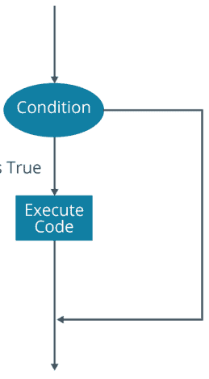

*条件语句的基本流程。*

条件语句是大多数程序和脚本的基础，因为它们帮助您控制执行代码的流程。例如，如果用户输入某些内容，您可能希望根据多个因素不同地处理该输入。用户可能提供了一个参数，而没有提供另一个。与其假设所有可能的参数都已提供而执行脚本，不如仅使用用户提供的参数来执行脚本。

## if 语句

在大多数语言中，包括 Bash，主要的条件语句是`if`语句。`if`语句包含一个要评估的条件和一个或多个要执行的操作（如果条件满足）。如果条件不满足，则跳过这些操作，并执行脚本中的下一个语句。在 Bash 中，指令集的结束由`fi`语句指示。

以下是一个简单的`if`语句示例：

```
var=5

if [ $var -gt 1 ]
then
    echo "$var is greater than 1!"
fi
```

`if`语句在两个方括号之间包含一个要评估的条件。在本例中，它是判断`$var`变量是否大于 1。下一行是`then`语句，其中包含如果前一个条件为真则将执行的代码。最后，`fi`语句表示整个`if`语句的结束。

因为 5 大于 1，消息将回显到屏幕。如果不为真，则不会发生任何情况。

## 语法

`if`语句的基本语法如下：

```
if [ <condition to be evaluated> ]
then
    <code to execute if condition is true>
fi
```

## if...else 语句

`if...else`语句根据条件的评估实现两个操作之间的选择。如果条件满足，则执行第一个操作；否则，执行`else`段之后的操作。如果有两组以上的指令，可以使用一个或多个`elif`语句来指定备选的执行序列。

以下是一个简单的`if...else`语句示例：

```
var=1

if [ $var -gt 1 ]
then
    echo "$var is greater than 1!"
else
    echo "$var is less than or equal to 1!"
fi
```

`$var`的值自上一个示例以来已更改，这意味着第一个`echo`命令将不会执行。不会发生没有任何情况，`else`语句指定了如果条件为假将会发生什么：在本例中，它会在屏幕上打印不同的消息。

## 语法

`if...else`语句的基本语法如下：

```
if [ <condition to be evaluated> ]
then
    <code to execute if condition is true>
else
    <code to execute if condition is false>
fi
```

`if...elif`语句的基本语法如下：

```
if [ <condition to be evaluated> ]
then
    <code to execute if condition is true>
elif [ <other condition to be evaluated> ]
then
    <code to execute if other condition is true>
fi
```

### 条件语句中的退出代码

`if...else`等条件语句善于处理进程退出代码。例如：

```
chmod 888 file 2> /dev/null

if [ $? -eq 0 ]
then
    echo "Permissions set successfully."
    exit 0
else
    echo "Could not set permissions."
    exit 1
fi
```

如果`chmod`命令以代码 0 退出，则成功消息会回显到屏幕，并且由于`exit`命令，任何其他执行此脚本的进程都会收到该退出代码。同样，如果退出代码为 1，则自定义错误消息会回显到屏幕。默认错误消息被抑制，因为它被重定向到了空设备。

## case 语句

有时您可能想要评估多个条件，例如一个可以保存许多不同值的变量，并且每个值都需要自己的操作。您可以在整体的`if`语句中定义多个`elif`分支，但这会使您的代码难以让人理解。`case`语句可帮助您避免此问题。

以下是一个简单的`case`语句示例：

```
var=blue

case $var in
    red)
        echo "Your color is red."
        ;;
    green)
        echo "Your color is green."
        ;;
    blue)
        echo "Your color is blue."
        ;;
    *)
        echo "Your color is neither red, green, nor blue."
        ;;
esac
```

`case`语句的第一行定义了您正在评估的变量。下面是第一个条件`red`，它有一个右括号来指示条件的结束。下一行是如果颜色确实是红色将执行的操作——屏幕上会显示一条消息说明这一点。双分号（`;;`）表示操作的结束。

此模式会重复，并且可以针对任意多个条件继续下去。在本例中，最后一个条件使用通配符（`*`）来指示如果变量与上述任何条件都不匹配，则将执行以下操作。`esac`语句结束`case`语句。

## 语法

`case`语句的基本语法如下：

```
case <variable> in
    <first condition>)
        <code to execute if first condition is true>
        ;;
    <second condition>)
        <code to execute if second condition is true>
        ;;
esac
```

## test 命令

`test`命令用于检查条件逻辑并执行比较。您可以在 shell 脚本中使用`test`命令来验证文件状态并执行相关任务。它评估条件表达式或逻辑操作并显示退出状态。如果表达式为真，则退出状态为 0；如果表达式为假，则退出状态为 1。

> **注意：** 这些代码与进程终止时生成的退出代码不同。

例如：

```
var=/etc

if test -d $var;
then
    echo "The $var directory exists!"
fi
```


本示例使用`-d`选项来测试目录是否存在。还有许多类似的条件选项可供使用。查阅`test`命令的 man 手册页以查看所有选项。

## 循环

除了条件语句之外，控制脚本代码中逻辑流的另一种有用方式是使用循环。循环是一种根据特定条件重复执行代码的控制语句。一般来说，循环是保持某个代码块持续运行直到不再需要的好方法。Bash 支持三种类型的循环：`while`循环、`until`循环和`for`循环。这三种循环都包含在`do`和`done`语句之间。

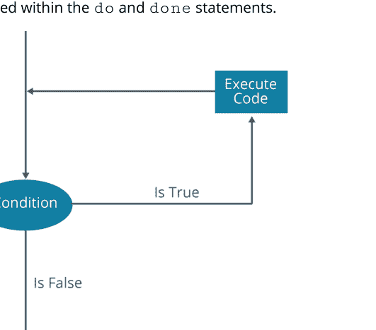

> 循环的基本流程。

## while 循环

`while`循环使你能够在满足特定条件时重复执行一组指令。先对表达式进行求值，如果表达式为真，则执行循环中的操作。执行返回到循环开头，再次对表达式进行求值。如果表达式在任何时候变为假，执行将跳出循环，继续执行脚本中的下一个代码块。

以下是一个简单的`while`循环示例：

```
var=1

while [ $var -le 5 ]
do
    echo "The current number is $var."
    ((var++))
done
```

在此示例中，测试的条件是变量`$var`是否小于或等于 5。只要满足此条件（即表达式为真），`do`下的代码就会执行。`echo`命令下方是一个迭代器，它将变量加 1。这在任何类型的循环中都很常见，因为如果没有它，`$var`将始终等于 1，因此永远无法跳出循环。

## 语法

`while`循环的基本语法如下：

```
while [ <待求值的条件> ]
do
    <条件为真时执行的代码>
done
```

## until 循环

`until`循环与`while`循环类似，区别在于当控制表达式为假时执行代码。例如：

```
var=1

until [ $var -ge 5 ]
do
    echo "The current number is $var."
    ((var++))
done
```

此循环中的条件是`$var`是否大于或等于 5。因此，代码将一直执行直到`$var`变为 5，此时它将跳出循环。

## 语法

`until`循环的基本语法如下：

```
until [ <待求值的条件> ]
do
    <条件为假时执行的代码>
done
```

## for 循环

`for`循环根据条件语句中数值变量指定的次数来执行代码块。与`while`或`until`循环不同，`for`循环不依赖于条件被求值为假或真来停止或开始。因此，`for`循环旨在始终执行给定次数的代码。这使它们非常适合处理可迭代对象，如数组。

以下是一个简单的`for`循环示例：

```
var=("Carla" "Robert" "Mary")

for i in ${var[*]}
do
    echo "$i is a member of the team."
done
```

`for`语句求值`$var`数组中的每个值。在本例中，每个值由迭代器`i`表示，不过你可以随意命名。通常将其命名为与正在遍历的变量相似的名字，或简单地称为`i`，表示迭代器（iterator）。

然后，循环本身将执行三次——数组中的每个值一次。因此，每个人的名字都会输出到屏幕上。

## 语法

`for`循环的基本语法如下：

```
for i in <要遍历的变量>
do
    <执行特定次数的代码>
done
```

## 遍历范围

`for`循环还可用于逐步遍历一系列数字。这些范围用花括号括起来，范围本身由两个句点（`..`）表示。例如：

```
for i in {1..5}
do
    echo "The current number is $i."
done
```

因此，此循环将恰好迭代五次。

> *注意：* 要了解更多信息，请查看课程网站上的"视频"标签页，了解补充本课内容的视频。

# 活动 13-6

## 讨论 Bash 脚本中的控制语句

### 场景

回答以下问题以检查你对该主题的理解。

- 1. `while`循环测试的是什么条件？

- 2. 你正在创建一个测试多个条件的脚本。根据测试结果，你希望发生三种情况之一：将结果发送到文件、执行另一个脚本，或将所有输出发送到`/dev/null`。你可以为此脚本使用哪种类型的条件语句？

- 3. 你已创建一个检查文件是否存在的脚本。如果文件存在，你希望脚本输出"Success"一词，然后以退出代码`0`退出。否则，它应输出"Doesn't exist"。你应该在脚本中的什么位置放置`exit 0`代码？

- 4. 对或错？`case`语句中的条件数量是有限制的。

- 5. 你的同事编写了一个名为`names`的数组脚本，其中包含各种用户的姓名。在脚本中，`for`循环遍历数组中的每个值。脚本应该将每个名字输出到 CLI，但实际上，它只多次输出了数组中的第一个名字。你确认`for`循环的语法正确，因此问题一定出在其他地方。你认为脚本的问题是什么？

# 活动 13-7

## 在 Bash 脚本中融入条件语句

### 开始之前

你以学生账户身份登录到 GUI。你已在文本编辑器中打开`check_storage.sh`。

### 场景

你希望让脚本对接收报告的管理员更有用。你可以通过启用脚本根据各种条件做出决策来实现这一点。因此，你将使用各种`if`语句，在存储设备达到特定的满百分比阈值时输出不同的消息。几乎已满的设备将触发紧急消息，而那些未满的设备将触发较不紧急的消息。

- 1. 返回文本编辑器中的`check_storage.sh`。

- 2. 编写第一个条件分支。

  - a) 将光标放在第 12 行的空白行上。

  - b) 按 **Enter** 键。

  - c) 在第 13 行新行上，输入以下内容：

```
if [ $checkper -ge 95 ] && [ $checkper -le 100 ]
```

  - d) 按 **Enter** 键。

  - e) 在第 14 行新行上，输入`then`

  - f) 将光标放在第 15 行的开头，按四次 **空格键**。你不一定需要缩进或创建空白，但这有助于提高代码的可读性。

  - g) 修改第 15 行的`echo`语句，如下所示：

```
echo "ALERT: $part is $checkper% full! Recommend immediate action!"
```

你刚刚创建了第一个`if`分支。此代码检查百分比满值是否大于或等于 95 *且* 小于 100。如果是，则脚本将向`storage_report.txt`文件输出警报。但是，你还需要编写更多分支来处理其他条件。

- 3. 编写下一个条件分支。

  - a) 将光标放在第 15 行的末尾，按 **Enter** 键。

  - b) 在第 16 行新行上，输入以下内容：

```
elif [ $checkper -ge 50 ] && [ $checkper -lt 95 ]
```

  - c) 按 **Enter** 键。

- 4. 完成编写剩余的条件分支。

  - d) 在第 17 行新行上，输入`then`

  - e) 按 **Enter** 键。

  - f) 在第 18 行新行上，缩进后输入以下内容：

```
echo "CAUTION: $part is $checkper% full! Consider freeing
up some space."
```

如果未满足之前的条件，脚本将继续求值此`elif`分支中的条件。此处的条件是检查百分比满值是否大于或等于 50 *且* 小于 95。如果是，则将向报告文件输出不同的消息。

- 4. 完成编写剩余的条件分支。

    a) 按 **Enter** 键。

    b) 从第 19 行新行开始，输入以下代码：

```
elif [ $checkper -lt 50 ]
    then
        echo "$part is $checkper% full. No action needed."
    else
        echo "Encountered an error. Status code: $?" >&2
        exit $?
fi
```

下一个分支将在百分比满值小于 50 时输出另一条消息。如果这些条件均未满足（即百分比值大于 100 或不是数字），则最后一个`else`分支将抛出错误。该退出代码将输出到 CLI，脚本将以该代码终止。

    c) 保存脚本。

- 5. 测试脚本，查看条件是否按预期工作。

    a) 从终端输入`check_storage.sh`

    b) 输入`cat storage_report.txt`并验证，由于`/dev/sda1`未满，报告显示无需采取操作。

```
[student01@server01 ~]$ cat storage_report.txt
Date: Wed Jan  2 16:03:09 GMT 2019
---------------------------------
/dev/sda1 is 5% full.
Date: Wed Jan  2 16:08:12 GMT 2019
---------------------------------
/dev/sda1 is 5% full. No action needed.
```

换言之，脚本根据你设置的条件选择了正确的操作。

> *注意：* 你将在下一个活动中测试其他一些条件。

# 活动 13-8

## 在 Bash 脚本中融入循环

**开始之前**

你以学生账户登录到了 GUI。你已在文本编辑器中打开`check_storage.sh`。你还有一个挂载在`/backup/sys`上的 2 GB 卷。

**场景**

你的脚本进展顺利，但仍需改进。你希望能够输出系统中所有相关存储分区/卷的状态，而不仅仅是一个或几个。你需要一种以编程方式对每个设备测试条件的方法，而不是在脚本中硬编码设备名称——尤其是在存储设备可能发生变化的情况下。因此，你将利用`for`循环遍历每个已识别的存储设备，执行必要的检查。

1. 调整`part`变量，使其保存设备名称数组。

   a) 将光标放在定义`part`变量的第 10 行。

   b) 将该行更改为以下内容：

```
part=$(df -h | awk '{print $1}' | grep '/dev')
```

这与`checkper`变量类似。不同之处在于，它会提取第一列（设备名称）中的所有文本，然后按以`/dev`开头的设备进行过滤，以排除临时文件系统。因此，`part`变量成为了一个保存系统中所有永久存储设备名称的数组。

2. 插入一个`for`循环来遍历`part`数组。

   a) 将光标放在第 10 行末尾，然后按两次 Enter。

   b) 在新的第 12 行，输入以下内容：

```
for i in ${part[*]}
```

这开始了`for`循环。变量`i`是迭代器。`part`变量以数组形式被引用，星号（`*`）表示该数组中的所有值。对于数组中的每个索引（即每个设备名称），脚本都会执行后续内容。

   c) 按 Enter，在第 13 行输入`do`

   d) 将光标放在第 28 行末尾并按 Enter。

   e) 在第 29 行输入`done`

这开始了循环在每次迭代中执行的代码。

这会终止`for`循环。循环内的条件语句将在每次迭代中执行。

3. 将`$part`引用更改为使用迭代器。

   a) 在第 14 行，将命令中的`grep $part`部分更改为`grep $i`

你需要单独获取每个设备的信息。这意味着你需要引用迭代器，而不是整个数组。

   b) 在第 18 行，将`$part`引用更改为`$i`

   c) 对第 21 行和第 24 行执行相同操作。

4. 清理源代码。

   a) 选中第 14 至 28 行的全部内容。

   b) 按 **Tab** 键缩进所选行。

   同样，这可以提高代码的可读性。

   c) 保存文件。

5. 测试脚本。

   a) 在终端中，输入`check_storage.sh`

   b) 输入`cat storage_report.txt`

   c) 验证报告是否列出了所有存储设备及其相应的警告信息。

```
CAUTION: /dev/mapper/centos-root is 51% full! Consider freeing up some space.

/dev/mapper/backup-logbk is 1% full. No action needed.

/dev/sda2 is 23% full. No action needed.

/dev/sda1 is 5% full. No action needed.

/dev/mapper/centos-home is 6% full. No action needed.

/dev/mapper/backup-sysbk is 4% full. No action needed.

ALERT: /dev/sr0 is 100% full! Recommend immediate action!
```

6. 模拟一个卷变满，然后再次测试脚本。

   a) 在终端中，输入以下内容：

```
sudo dd if=/dev/zero of=/backup/sys/test bs=1M count=1100
```

   b) 验证大约有 1.2 GB 的数据被复制到该卷。

   c) 再次运行你的脚本并读取报告。

   d) 验证这次由于卷的使用量超过了 50%，你会收到警告（caution）。

   e) 输入以下内容：

```
sudo dd if=/dev/zero of=/backup/sys/test2 bs=1M count=800
```


> **注意：** 输出文件名和`count`都已更改。

f) 再次运行脚本并查看报告。

g) 验证你收到了针对该卷的最紧急消息。

7. 关闭文本编辑器，但保持终端打开。

## 小结

在本课中，你定制了 Bash shell 并在其中执行了各种操作。你还创建并执行了 Bash 脚本。这将帮助你更高效地履行 Linux 管理员的职责。

**你可能会在 shell 环境中配置哪些环境变量？**

**你可能会通过在环境中运行 shell 脚本来执行哪些各种任务？**

*练习题：更多练习题可在课程网站上找到。*

# 第 14 课

## 自动化任务

课时：1 小时

## 课程简介

Bash 脚本在自动化你在 Linux® 上的管理职责方面大有帮助。但还有更多方法可以自动化你每天执行的任务。这些方法可以进一步提高你的工作效率，并全面提升任务的准确性和实用性。随着时间的推移，你将越来越少地依赖手动管理。

## 课程目标

在本课中，你将：

- 按计划运行作业。
- 使用 Git 为文件实现版本控制。
- 识别编排（orchestration）的基本概念。

## 主题 A

### 计划作业

📋 **涵盖的考试目标**

2.6 根据场景自动执行和计划作业。

某些任务需要按设定的时间表重复执行。通过计划这些任务，你无需记住手动执行它们，也无需在指定时间访问系统。

### at 命令

`at`命令用于在指定时间一次性运行任务。它不适用于重复或定期计划的任务。`at`命令非常灵活。用户可以指定特定的日期和时间，或让计划命令在给定时间段后运行。

该命令通常以交互方式使用，先指定`at`命令和时间间隔，然后在交互式提示符中定义任务。这允许用户输入脚本路径或要运行的命令。按 **Ctrl+D** 退出交互模式。

*在指定时间运行命令。*

## 语法

`at`命令的语法是`at [options] {time}`

### at 命令选项

下表描述了`at`命令的部分选项。

| 选项 | 用于 |
|--------|---------|
| -m | 作业完成时向用户发送邮件，无论是否有输出。 |
| -M | 阻止向用户发送邮件。 |
| -f {file name} | 从文件而不是标准输入读取作业。 |
| -t {time} | 在指定的时间值运行作业。 |
| -v | 显示作业将被执行的时间。 |

### 时间说明

`at`命令可接受多种时间参数。例如：

- noon（中午）用于指定中午 12 点。
- teatime（下午茶时间）用于指定下午 4 点。
- midnight（午夜）用于指定凌晨 12 点。
- now + 3 minutes 用于指定从现在起三分钟后。
- now + 1 hour 用于指定从现在起一小时后。

### 相关命令

`atq`命令可用于查看由`at`命令计划的任务队列。`atrm`命令可用于删除计划任务。

### cron 作业

管理员和用户可能希望脚本或命令定期执行。自动化此类任务高效且一致。cron 守护进程用于管理这些称为 cron 作业的计划任务。

cron 守护进程每分钟检查一次其 crontab 配置文件，以确定是否有任何任务需要完成。如果有，则执行它们；如果没有，则继续休眠直到下一分钟。

Cron 作业可用于指定每分钟、每小时、每天、每月以及每周的任意一天要执行的任务。这使它们非常灵活。

### crontab 命令

cron 守护进程通过`crontab`命令进行控制。除非指定了`-u`选项，否则该命令默认使用当前用户。你可以使用`crontab`命令创建、查看和删除 crontab 文件。

`crontab`命令的部分选项包括：

| 选项 | 用于 |
|--------|---------|
| -e | 编辑当前用户的 crontab 文件。 |
| -l | 查看当前用户的 crontab 文件。 |
| -r | 删除当前 crontab 文件。 |
| -u | 代表指定用户创建 crontab 文件。 |

## 语法

`crontab`命令的语法为`crontab [options] [file/user]`

## crontab 文件

`crontab`文件由`cron`守护进程引用，以确定可能存在哪些计划任务。`crontab`文件使用`crontab -e`命令进行管理。该命令会打开一个文本编辑器（大多数系统上默认为 Vim），使用户能够指定他们希望何时运行任务，以及该任务是什么。

> **注意：** 请勿使用常规编辑器来管理`cron`守护进程。`crontab -e`命令包含用于管理`cron`守护进程的其他功能。例如，编辑文件后，它会自动重启`cron`

以下是`crontab`文件中在特定时间安排任务的行示例：

- `* 20 * * 1-5 /path/to/command` ——在周一至周五晚上 8 点执行该命令。
- `15 2 * * * /path/to/command` ——在每天凌晨 2:15 执行该命令。
- `30 4 1 * * /path/to/command` ——在每月第一天的凌晨 4:30 执行该命令。

## cron 目录

包含计划任务信息的`crontab`文件可以在`/etc/cron.d/`目录和`/var/spool/cron/`目录中找到。root 用户可以使用`/etc/cron.d/`目录来安排系统范围的任务。服务也可以在此位置添加计划任务。root 用户可以向该目录添加任务，或者向`/etc/crontab`文件添加任务。

普通用户不允许填充`/etc/cron`目录，因此每个标准用户可以在`/var/spool/cron`的个人目录中安排他们自己的任务。此处列出的任何任务都将使用标准用户的凭据执行。

`/etc/`目录还包含几个默认的 cron 目录，管理员可以将脚本放入其中以便定期执行。这些目录是`/etc/cron.hourly`、`/etc/cron.daily`、`/etc/cron.weekly`和`/etc/cron.monthly`。将脚本链接或复制到这些目录中，即可使用它们的计划来运行你的命令。

某些 Linux 发行版会在`/etc/crontab`文件中预填充特定任务。你可能会发现`logrotate`、`tmpwatch`、`rkhunter`（Rootkit Hunter）等已经存在。安装这类服务时也可能包括创建`/etc/crontab`条目。

> **注意：** 要了解更多信息，请查看课程网站上的视频选项卡，寻找补充本课内容的视频。

## 活动 14-1
讨论计划作业

### 场景

回答以下问题以检查你对该主题的理解。

1. 你正在每台新配置和管理的 Linux 系统上安排新的备份任务。每个系统都需要备份其关键目录。使用`at`命令还是 cron 作业来安排备份脚本更好？为什么？

2. 任何人都可以安排 cron 作业。作为普通用户，你需要从本地工作站安排文件传输到某台开发服务器上的共享目录。你需要创建一个新的 cron 作业。你可以使用哪个命令来创建 cron 作业？

3. 作为 root 用户，你需要检查属于 root 的所有计划任务。你可以如何检查它们？

4. 如何从`at`命令队列中移除一个条目？

5. 你已向`at`队列添加了几项作业，现在需要检查状态。你可以如何检查`at`队列？

## 活动 14-2
安排单个任务

### 准备工作

你已使用学生账户登录到 GUI。

### 场景

Develetech 的开发人员需要在工作时间之后不定期地执行任务。时间表不可预测，他们需要能够自己管理这些任务。你将使用`at`命令来满足这一需求。

安排一个任务在当前时间两分钟后运行。

a) 在你的主目录中，使用`touch`命令创建一个名为`fileA`的文件

b) 检查你系统上的当前时间。

c) 输入`at now + 2 minutes`以访问命令的交互模式。

d) 输入`rm -f ~/fileA`，然后按 **Ctrl+D** 返回 Bash。

e) 输入`atq`查看已安排的任务。

f) 两分钟后，通过检查主目录的内容来确保命令已执行，看`fileA`是否已被删除。

## 活动 14-3
安排重复任务

### 准备工作

你已使用学生账户登录到 GUI。

### 场景

Develetech 采用了一项新政策，要求所有用户每天填写工时表。你将为所有用户系统创建每日提醒。

1. 安排一个 cron 作业，在指定时间每天发送电子邮件提醒。
   a) 输入`sudo crontab -u cmason -e`为 Chris Mason 指定一个 cron 作业。
   b) 验证 Vim 是否自动打开临时文件。
   c) 在文件中输入以下行：
      `<MM> <HH> * * * /bin/echo "Please fill in your time sheet."`
      将`<MM>`和`<HH>`替换为 24 小时制格式中的适当分钟和小时时间值。确保你输入的时间比当前系统时间晚三分钟。这样，你就能在课堂上看到消息。
      例如，如果时间是下午 2:30，你应输入：
      `33 14 * * * /bin/echo "Please fill in your time sheet."`
   d) 保存并关闭文件。
   e) 从桌面菜单中，选择右上角的图标，然后选择 **student→注销**。
   f) 选择 **注销**。

2. 验证 Chris Mason 是否收到了计划作业的提醒。
   a) 以 **Chris Mason** 身份登录。
   
   > **注意：** 你可以忽略*欢迎*屏幕，或者按步骤浏览向导将其关闭。
   
   b) 打开终端。
   c) 等待时间过去，让 cron 作业执行。
      记住，你可以使用`date`来检查时间。你也可以从 GUI 的桌面菜单中检查时间。
   d) 输入`mail`
   e) 输入`1`读取第一封电子邮件的内容。
   f) 验证邮件是否包含填写工时表的提醒。
   g) 按 **q** 退出邮件服务。
   h) 注销 **Chris Mason**，然后重新以学生账户登录。

> **注意：** 你可以忽略*欢迎*屏幕，或者按步骤浏览向导将其关闭。

```
sudo crontab -u cmason -e
```

```
<MM> <HH> * * * /bin/echo "Please fill in your time sheet."
```

```
33 14 * * * /bin/echo "Please fill in your time sheet."
```

```
date
```

```
mail
```


## 主题 B
使用 Git 实现版本控制

### 涵盖的考试目标

5.2 根据场景，使用 Git 执行版本控制。

如果你或你的同事正在开发软件，他们需要一个地方来存储和管理源代码。这可能很快成为一项繁重的任务，尤其是当涉及代码的多个版本时。在本主题中，你将通过名为 Git 的程序来自动化代码管理和版本控制。

## GIT

**Git** 是一个分布式版本控制系统，主要由协作开发项目的开发人员使用。Git 由 Linus Torvalds 开发，他也是 Linux 的创建者。Git 是当今开发世界中的标准版本控制程序。它通常与开发编辑器集成使用。

Git 的核心组件是 Git 仓库。这是一个存储区域，用于存储代码版本和相关文件。版本控制在此本地目录中进行管理。仓库可以存储在单个开发人员的工作站上，也可以集中存储然后克隆到开发人员的工作站上。组织可以选择在本地拥有集中式 Git 仓库，或使用 GitHub 等在线解决方案。但是，集中式仓库并非必需。

要开始使用 Git，请使用可用的包管理器安装 `git` 包。

## THE git COMMAND

`git` 命令用于管理 Git 仓库。使用 `git`，你可以创建仓库、向仓库添加文件、将更改提交到仓库、从其他仓库拉取文件等。你可以通过在更大的 `git` 命令中发出各种子命令来执行这些任务。

### SYNTAX

`git` 命令的语法为 `git [options] {subcommand}`

## git SUBCOMMANDS

以下是你可以与 `git` 命令一起使用的一些主要子命令。

| 子命令 | 用于 |
|---|---|
| `config` | 为仓库或 Git 用户设置选项，以及其他全局选项。 |
| `init` | 创建 Git 仓库或重新初始化现有仓库。 |
| `clone` | 创建现有仓库的工作副本。 |
| `add` | 添加要由 Git 仓库跟踪的文件。 |
| `commit` | 使用你的更改更新 Git 仓库，创建仓库的“快照”。 |
| `status` | 显示仓库的状态。 |
| `branch` | 管理分支，或在提交更改后指向特定仓库快照的指针。 |
| `merge` | 将更改从一个分支合并到“主分支（master）”中。 |
| `pull` | 获取并合并对其他仓库和分支所做的更改到本地工作副本中。 |
| `push` | 将仓库的本地工作副本上传到远程仓库，例如集中式仓库。 |
| `log` | 显示对本地仓库所做的更改。 |
| `checkout` | 切换到特定分支进行工作。 |

## 本地仓库的示例 Git 流程

以下是创建本地仓库并向其提交更改的示例流程：

1. 配置全局设置，包括用户名、电子邮件地址等：
   - `git config --global user.name 'User'`
   - `git config --global user.email 'user@domain.tld'`

2. 创建一个目录作为你项目的存放位置。进入该目录，然后使用 Git 初始化它，将其指定为 Git 仓库：
   - `mkdir /dev-project`
   - `git init /dev-project`

3. 将项目文件添加到仓库中。这些文件构成了你使用 Git 存储和控制实际开发项目的内容。正如你在 Linux 配置文件中所见，在开发项目中，你希望使用项目的副本，而非原始文件本身。这样在出现错误时，回滚到原始项目会容易得多。在 Git 中，你可以使用 `clone` 子命令创建工作副本：
   - `git clone /dev-project`

4. 将项目文件添加到 Git 跟踪系统中：
   - `git add myfile`

5. 提交更改以对你的项目创建快照。在此阶段，你还可以输入一条消息来总结你所做的更改。确保这些消息清晰明了：
   - `git commit -m 'Initial commit'`

6. 检索已更改文件的当前状态。如果一个项目中有三个文件正在处理，但此时只有两个文件准备提交，它们将在此处显示为“已添加”但尚未提交。一旦所有三个文件的编辑都完成后，即可执行提交过程：
   - `git status`

## 分支操作

你可以选择使用 Git 分支进行工作：

1. 创建主代码副本的一个分支：
   - `git branch newbranch`

2. 进行更改，然后将这些更改整合（合并）回主分支。这将整合更改，创建一个新改进版本。此时，用于创建更改的分支可以被删除。这些更改现已位于主分支中：
   - `git merge newbranch`

## 协作的示例 Git 流程

以下是与其他开发者使用 Git 进行协作的示例流程：

1. 拉取其他开发者的建议更改并将其合并到本地仓库（本地工作副本）中：
   - `git pull otherbranch`

2. 将你更改推送到远程仓库。开发环境通常包括一个中央仓库，可能在云端，每位开发者都有自己仓库的本地副本。然后可以使用 Git 的 `push` 命令将本地所做的更改上传到中央仓库：
   - `git push <remote repository> mybranch`

3. 查看已合并了哪些更改以及对仓库执行了哪些其他操作。在项目目录内运行 `git log` 命令。例如，输入 `git log --since=10.days` 以查看最近 10 天内的所有提交。你可以使用这些信息来排查配置文件、脚本或仓库跟踪的任何其他数据中引入的问题。

4. 使用 Git 的 `checkout` 命令在项目各分支之间导航或切换。这使开发者能够将注意力集中在同一项目的不同分支上：
   - `git checkout specificbranch`

*Git 流程示例图。*

## Git 文件

`.gitignore` 文件存在于仓库中。该文件的用途是在提交操作期间标识应忽略的文件。例如，你可能有一个 `README.txt` 文件或项目 `To-Do.txt` 列表，不需要将其作为项目的一部分提交，但为了方便起见存放在项目目录中。这些文件在项目 `.gitignore` 文件中标识。

`.git/` 目录包含 Git 用于管理你项目版本控制的全部文件。它是 Git 存储其所有信息的单一位置。该目录位于项目目录中，并通过 `git init` 命令创建。

> **注意：** 要了解更多信息，请查看课程网站的“视频”选项卡，了解补充本课内容的任何视频。

## 活动 14-4

### 使用 Git 讨论版本控制

#### 场景

回答以下问题以检查你对该主题的理解。

1. 你需要为一组开发者设置一个新的 Git 仓库。哪个命令开始设置新 Git 仓库的过程？

2. 你的开发者团队希望实现 Git 以便管理代码版本。他们要求你将其安装在 dev01 CentOS 服务器上。你如何安装 Git？

3. 你创建了一个新文件 `statistics.txt`，并希望将其添加到 Git 仓库中。你可以执行哪个命令来添加该文件？

4. 在过去一周中，你对 `markets.txt` 文件进行了多项更改，但尚未提交这些更改。你如何提交这些更改？

5. 今天度假回来后，你想查看你的团队正在开发的新编码项目的进展情况。你可以发出哪个命令来检查仓库的修订历史记录？

## 活动 14-5

### 使用 Git 实现版本控制

#### 开始前

你已使用你的学生账户登录到 GUI。

#### 场景

开发团队需要一种简单的方法来管理他们所编写代码的不同版本。多位开发者将协同进行同一项目，因此他们需要一种方法来最大限度地减少冲突，同时在必要时能够回退到旧版本的代码。因此，你将为开发者设置一个 Git 仓库，以便他们有一个分布式版本控制系统可以基于其进行工作。

1. 安装并配置 Git 仓库。

   a) 输入以下内容，然后等待安装过程完成：
   
   `sudo yum -y install git --disablerepo=internal-repo`
   
   b) 输入 `git config --global user.name 'Student User'`
   
   c) 输入以下内容：
   
   `git config --global user.email 'student##@develetech.com'`
   
   d) 在你主目录中创建一个名为 `dev-project` 的目录，并使用 `cd` 命令进入该目录。
   
   e) 输入 `git init` 以将 `dev-project` 目录指定为 Git 仓库。Git 将返回一条消息，指示仓库已初始化。
   
   f) 输入 `ls -a` 以查看初始化过程创建的 `.git` 目录。

2. 使用 Git 创建并管理项目。

   a) 使用文本编辑器创建一个名为 `HelloWorld.txt` 的文件
   
   b) 在 `HelloWorld.txt` 文件中输入以下文本：
   
   `Hello, World! From Student##`
   
   c) 保存更改并关闭编辑器。
   
   d) 输入 `git status` 以检查 `HelloWorld.txt` 文件的状态。该文件将标记为“未跟踪（Untracked）”，意思是尚未由 Git 管理。
   
   e) 输入 `git add HelloWorld.txt` 以使 Git 能够管理该文件。
   
   f) 输入 `git commit -m "Initial Commit"`
   
   这会使用 `HelloWorld.txt` 文件的版本信息更新 Git。
   
   g) 输入 `git status` 以检查 `HelloWorld.txt` 文件的状态。输出显示没有需要提交的更改，因为现在 `HelloWorld.txt` 文件版本已由 Git 管理。

3. 对 Git 仓库提交更改。

   a) 使用文本编辑器打开 `HelloWorld.txt` 文档，并在新的一行中添加以下内容：

   `Git version control test`

   b) 保存更改并关闭编辑器。

   c) 输入 `git status` 并观察 Git 报告 `HelloWorld.txt` 文件已被修改，但这些更改尚未提交到仓库。

   d) 输入 `git add HelloWorld.txt` 以暂存更改。

   e) 输入 `git commit -m "Revision 1"` 以将更改提交到文件的主副本。

   f) 输入 `git status` 并注意现在没有任何更改需要提交到仓库。

   g) 输入 `git log` 以查看仓库的修订历史记录。初始提交和修订的时间与日期都已被记录。

## 主题 C

### 识别编排概念

**涵盖的考试目标**

5.3 总结编排流程和概念。

到目前为止，你已在相对较小的规模上实现了自动化。然而，在大型企业基础设施中，你可能需要管理数百甚至数千台系统。仅靠自动化不足以管理所有这些系统的部署和维护。这就是编排发挥作用的地方。

## 编排

**编排**能够实现多个相关任务（即整个工作流）的自动化。编排的一个例子可能是部署 Web 应用程序。该部署可能包括 Web 服务器的安装和配置、MySQL™ 数据库服务器的安装和配置，以及应用服务器的安装和配置，还有所有支持软件。编排会管理其中涉及的每个步骤，即使可能涉及不同的操作系统和配置要求。编排既用于本地部署，也用于基于云的解决方案。

## 基础设施自动化

自动化是在没有人工干预的情况下完成配置任务的过程。这与编排不同。自动化指的是单个任务，而编排管理的是更大规模的一系列任务。例如，一位系统管理员可能会在 Linux 部署中自动化安装 Python® 软件包，而另一位管理员可能会编排组合式 Web 和数据库服务器的设置，并完成所有必要的配置。编排可以被视为一系列自动化任务，用于实现应用程序、虚拟机或整个相互关联的基础设施的规模部署。

## 构建自动化

构建自动化特别强调了初始操作系统的部署。构建自动化的一个例子是在基于 Red Hat 的发行版中使用 Kickstart 文件。这些文件可以被安装过程引用，然后操作系统将按照 Kickstart 文件中的指令进行部署。

## 基础设施即代码

**基础设施即代码**是指通过脚本和代码文件而非传统软件工具来管理整个部署和配置过程的编排工具的名称。基础设施即代码依赖单一配置规范来部署支持性基础设施（操作系统）和必要的应用程序。

## 编排工具

下表列出了一些用于实现编排的常见工具。

| 工具 | 描述 |
|------|-------------|
| Ansible | Ansible 使用 YAML 文件创建可重复的"playbook"，用于定义所需的配置状态。Ansible 是一种无代理解决方案，通过 SSH 连接传输文件。Red Hat 强调使用 Ansible。 |
| Puppet® | Puppet 使用清单文件（以 Ruby 编写）将基础设施定义为代码，用于应用程序、云和基础设施编排。Puppet 在目标节点上使用代理。 |
| Chef™ | Chef 使用"cookbook"向云和本地托管系统提供配置声明。 |
| Kubernetes | Kubernetes 是一种开源解决方案，为云和本地容器环境提供容器部署和应用程序编排。你定义所需状态，Kubernetes 将配置容器以匹配该状态。 |
| OpenStack® | OpenStack 最初是 Rackspace 和 NASA 的联合项目，通常作为 IaaS 解决方案部署以管理云资源。例如，OpenStack 可以编排 Linux、Apache、MySQL、PHP（LAMP）服务的部署。 |

## 基于代理与无代理编排

基于代理的编排工具要求软件组件驻留在被管理的设备上。无代理工具不要求在被管理的系统上预先存在额外的软件。

## 流程

编排流程会因使用的解决方案而异，但一般来说，编排步骤包括定义所需的配置，然后将该配置文件交付到目标系统。接着处理配置定义，将系统的配置设置为与定义文件匹配。

以下是 Chef 编排流程的示例：

1. 管理员配置并测试 Chef 配置 "cookbook"。
2. 将 cookbook 交付到指定的目标客户端系统。
3. Chef 客户端处理 cookbook，适当地配置节点。

## 属性

编排属性定义由编排流程管理的任务。管理员可以使用这些属性来识别编排流程需要设置的特定配置。例如，OpenStack 编排依赖于属性。

## 库存管理

硬件、虚拟机、操作系统、应用程序和配置的库存管理都可以通过编排工具来完成。不同的工具为库存管理提供不同的功能，包括报告。库存至关重要，因为管理员无法管理他们所不知道的东西。

## 自动化配置管理

配置管理的好处包括一致的系统配置和更高效的构建流程。确保所有系统符合给定的配置基线有助于强制执行安全要求和服务级别协议，并使变更管理更加高效。

## 活动 14-6

### 识别编排概念

#### 场景

Develetech 正在扩展其 Web 托管服务。你被要求研究如何使用编排使 Web 托管更高效、更具成本效益。

1. 自动化和编排之间有什么区别？为什么这种区别对 Develetech 很重要？

2. 给出企业中使用的开源编排工具的例子。

3. 解释编排中的三个一般步骤。

4. Ansible 是大型和小型企业网络中非常流行的编排工具。Ansible 如何将配置文件交付到节点？

5. Develetech 将为客户提供的 LAMP（Linux、Apache、MySQL、PHP）Web 托管包。在这种情况下，编排如何使 Develetech 受益？

6. 编排能否帮助 Develetech 进行基于云的 Web 托管？为什么或为什么不？

## 小结

在本课中，你使用 cron 作业和版本控制系统等技术实现了日常管理任务的自动化。通过这样做，你可以提高生产力并减少手动管理中常见的错误。

**你是否正在考虑或会考虑使用像 Git 这样的版本控制系统？为什么或为什么不？**

**你可能会在 Linux 系统上创建哪种类型的 cron 作业？**

**练习题：** 其他练习题可在课程网站上找到。

# 第 15 课

## 安装 Linux

课时：1 小时 30 分钟

### 课程介绍

在许多情况下，你要使用的 Linux® 系统已经为你构建好了。但有时，你需要从头开始构建系统。你必须能够以符合组织业务需求的方式安装 Linux，无论这些需求是什么。因此，你将通过将 Linux 安装配置到你想要的规格来完成本课程。

## 课程目标

在本课中，你将：

- 准备安装 Linux 操作系统。
- 执行 Linux 的安装。

## 准备 Linux 安装

在实际开始安装之前，您需要采取一些准备步骤，这非常重要。您需要做一些调研并收集适当的信息，以便在安装过程中为您提供指导。

## 系统要求

将系统要求仅仅视为启动和运行系统所需的硬件组件是不够的——它们还规定了保持系统正常运行并能够执行其指定功能所必需的条件。因此，您可能可以顺利地在计算机上安装 Linux，但这并不意味着它会以最佳性能运行。

Linux 系统的系统要求会因多种不同因素而有很大差异：

- 您使用的 Linux 发行版。不同的发行版对 CPU 速度、RAM、存储空间等有不同的建议和基准要求。有些发行版专门设计为轻量级；即，它们比标准的企业级或消费者发行版消耗更少的资源。

- 硬件兼容性。即使 CPU、GPU 等的性能足以运行某个 Linux 发行版，也并不意味着该发行版（或 Linux 内核）支持它。您需要选择具有可用、稳定驱动程序的硬件。

- 系统的一般类别。该系统是服务器？工作站？还是其他？每个类别适合不同类型的组件。例如，像 Intel® Xeon® 这样的 CPU 专为服务器设计，因为它们注重错误纠正和可靠性，并且每个处理器拥有众多核心。而另一方面，像 Intel® Core™ i7 这样的桌面 CPU 则是为单用户场景设计的，通常比服务器 CPU 性能较低。

- 系统的预期功能。除了该系统是服务器、工作站等之外，它在组织中实际扮演什么角色？该服务器是 Web 服务器？数据库服务器？该工作站是否需要用于图形设计？是否需要用于文字处理？最终，应用程序对性能的要求越高，您需要为它提供的资源就越多。Web 服务器可能需要每天处理数千个网络连接，因此应该在适当的网络基础设施上运行。

- 需要在系统上运行的特定应用程序。您可能可以估计用于图形设计的工作站需要独立显卡。但是，在知道用户将使用什么应用程序之前，您可能不知道该选择哪款具体的显卡。某些软件在特定硬件上运行效果最佳。

- 价格。任何组织的预算都不是无限的，您应该预料到并不总是能够购买最强大的硬件。您需要选择适合您组织的解决方案，同时又要符合您分配的预算。优先考虑资源是帮助您做出这些决策的关键技能。

## 分区策略

在安装过程之前，您必须仔细规划适当的分区策略。服务器的存储需求与个人工作站不同。如果挂载文件系统根目录的分区已满，您可能还需要为虚拟内存存储（即交换空间）分配一个分区。该分区不能用于任何其他类型的存储，并且有自己的文件系统。在规划数据存储分区的同时，规划交换分区非常重要。一般指导原则是交换分区的大小应为 RAM 容量的两倍，尽管这个数字会有所变化。

## 分区示例

以下是 Linux 服务器的一般分区策略：

- 单个分区作为 `/`（根文件系统）。
- 单个分区作为 `/home`，以将用户主目录与其余存储空间隔离。
- 单个分区作为 `/var`，以将日志文件与其余存储空间隔离。
- 单个分区专用于交换空间，通常为 RAM 容量的两倍。

以及 Linux 工作站的一般分区策略：

- 单个分区作为 `/`（根文件系统）。
- 单个分区专用于交换空间，通常为 RAM 容量的两倍。

> **注意：** 个人 Linux 工作站通常不会与其他用户共享，并且通常具有大容量存储驱动器，因此单个用户意外填满整个驱动器的风险显著降低。此外，单个工作站对业务的重要性通常低于 Linux 服务器。

**交换分区**

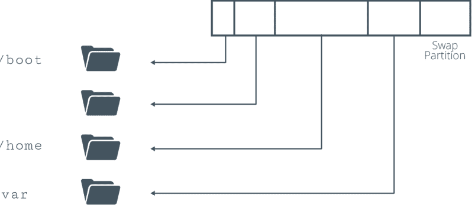

*分区策略示例。*

## 硬件兼容性

在购买任何硬件组件之前，您应该做的第一件事是检查它是否与相关的 Linux 发行版兼容。一些发行版维护有**硬件兼容性列表（HCL）**来帮助您完成这项工作。HCL 是一个数据库，存储了发行版在某种程度上支持的所有硬件设备的供应商和型号。每个发行版可能维护自己的 HCL，通常在网上发布。HCL 没有标准格式，许多发行版甚至没有权威的 HCL。

> **注意：** 对于通用的 Linux 硬件兼容性列表，请访问 *https://www.linuxquestions.org/hcl/*。

| 组件 | 需要解决的问题 |
|-----------|-------------------|
| 显示适配器 | • 使用什么芯片组？<br>• 使用多少显存？<br>• 它是集成到 CPU 或主板中的，还是独立显卡？<br>• 支持什么连接接口？ |

## 安装方法

在大多数情况下，安装操作系统需要您启动到特殊的安装环境。因此，您之前了解的不同启动方法也可以用于启动安装介质，包括：

- 从 DVD 和 USB 闪存驱动器等可移动安装介质启动。这种方法通常要求您将安装文件"刻录"到 DVD 上，或使用程序在 USB 驱动器上准备文件。像存储数据时那样正常地将文件添加到 USB 驱动器并不能使其可启动。安装文件通常以 ISO 或 IMG 等系统映像格式打包。默认情况下，大多数 BIOS/UEFI 环境启用从可移动介质启动，但在某些系统上您可能需要手动启用此功能。

- 从安装在本地驱动器上的介质启动。例如，您可以将不同发行版 Linux 的 ISO 下载到您现有的 Linux 系统上。然后您可以配置 GRUB 2 从此 ISO 启动，只要它放在当前不包含可启动操作系统的一个分区上。

- 从通过网络交付的介质启动。您可以使用 PXE 和 NFS 等协议向客户端提供安装介质，客户端可以使用该介质启动到安装环境。


## 指南

在准备安装 Linux 时，请遵循以下指导原则。

### 准备安装 Linux

在准备安装 Linux 时：

- 考虑确定系统要求的各种因素，例如成本、系统角色和要安装的 Linux 发行版。

- 根据 Linux 系统的角色考虑分区策略。Linux 服务器可能扮演多种角色，分区策略将取决于这些角色。Linux 工作站通常不需要复杂的分区策略。

- 检查 HCL 或其他在线资源，查看您的硬件是否受相关发行版支持。

- 在购买硬件之前，解决与每个硬件组件相关的各种问题。

- 选择对您和您的组织最有效的安装方法。

## 活动 15-1：准备安装 Linux

### 场景

作为 Develetech 的系统管理员，您需要创建用于不同用途的系统，作为向 Linux 全面迁移的一部分。这些系统将用于：

- 一个面向公众的 Web 服务器，每天将接收数万次页面浏览。
- 一个面向图形设计师的桌面 Linux 实施方案，用于开发插图和其他图形资产，以及测试网页。
- 一个用于在组织内部署之前测试软件的系统。

目前可供您使用的硬件系统包括：

- **系统 A**：一台全新构建的定制系统，配备 32 GB RAM、四核 Intel Core i7 处理器、2 TB 硬盘、快速以太网（100 Mb/s）网卡，以及带有 HDMI 和 DisplayPort 接口的独立显卡。
- **系统 B**：一台已退役的系统，配备 8 GB RAM、18 核 Xeon 处理器、500 GB SSD、千兆以太网（1 Gb/s）网卡，以及带有 DVI 接口的板载显卡。
- **系统 C**：一台笔记本电脑，配备 4 GB RAM、双核 AMD A6 处理器、250 GB 硬盘、快速以太网（100 Mb/s）网卡，以及带有 HDMI 接口的板载显卡。

1. **您会为每个用途设置哪个系统，为什么？**

2. **就硬件而言，在这些系统上安装 Linux 之前，您还需要考虑什么？**

## 主题 B

### 执行安装

既然你已经尽自己所能做好了准备，现在到了安装 Linux 的时候了。

### 手动安装步骤

尽管你可以自动化 Linux 系统的安装和部署——包括作为更大规模编排工作的一部分——但有时你可能需要执行分步手动安装。实际步骤会根据你所安装的发行版而有很大不同，因为每个发行版都有自己的安装程序。然而，大多数安装程序都提供图形界面，并允许你配置一些常见设置来安装 Linux。

*安装 CentOS 7。*

一般安装步骤包括但不限于：

- 配置系统要使用的语言和键盘布局。这一步几乎总是最先进行，以便为理解接下来的安装过程打下基础。

- 配置系统要使用的时区及其他日期和时间设置。可能会有与网络时间协议（NTP）服务器同步的选项。

- 选择要使用的安装介质。即使你通过安装介质启动到了安装程序，某些安装程序仍允许你选择不同的源来继续安装。例如，如果你使用准备在 USB 闪存驱动器上的 ISO 启动了安装程序，你可以将安装配置为使用网络仓库。

- 选择要安装的软件环境和组件。许多发行版提供几种基础环境之一供选择。基础环境可能是没有图形界面、只有少量用户空间程序的最小安装；包含所有可用程序的完整图形界面安装；以及介于两者之间的各种选项。根据发行版的不同，你可能可以进行更细粒度的选择，挑选特定的软件进行安装。

- 在一个或多个可用的存储驱动器上进行分区和配置逻辑卷。你可以在这里设计根文件系统的结构（其大小、文件系统类型等），以及任何其他要在安装时添加的文件系统。

- 配置系统的网络标识。你可以为一个或多个可用接口配置 IP 地址、主机名和其他网络信息。

- 配置用户账户。通常你会配置 root 用户的密码，以及/或特定的管理员账户或其他标准用户。

- 配置安全策略。某些安装程序允许你在安装时对系统应用安全配置和策略。

> **注意：** 想了解更多信息，请查看课程网站上的视频标签，了解补充本课内容的任何视频。

## 活动 15-2

### 讨论 Linux 的安装

#### 场景

回答以下问题，以检查你对本主题的理解。

1. 根据你选择的 Linux 发行版，在安装过程中会提示你设置哪些账户？

2. 在安装过程中，系统会提示你设置系统的网络标识。系统的网络标识包含哪些信息？

3. 在较大的网络中，每次手动安装 Linux 效率不高。大型组织如果不采用手动方式，会如何安装 Linux？

4. 你想在一台没有 DVD 驱动器的新笔记本电脑上手动安装 Linux，而且你也无法使用 DVD 驱动器。你可以如何将 Linux 安装到这台笔记本电脑上？

5. 在 Linux 安装过程中，通常最先要求你提供哪两项信息？

## 活动 15-3

### 安装 Linux

#### 开始之前

你已以学生账户身份登录到图形界面。此前，你已创建并保存了一台带有 CentOS 7 安装镜像的虚拟机。

#### 场景

既然准备工作已经完成，你就可以在选定的各种系统上安装 Linux 了。你将从在前创建的虚拟机上安装 CentOS 7 开始。在安装过程中，你将配置各种选项，以便自动按照你的规格设置基础环境。

1. 加载先前创建的虚拟机。
   a) 在终端中，输入 `sudo virsh restore saved-vm`
      这将从保存状态恢复你之前创建的虚拟机。
   b) 从桌面菜单中，选择 **应用程序→系统工具→虚拟机管理器**。
   c) 输入 root 密码。
   d) 右键单击 **devtech-install** 虚拟机，然后选择 **打开**。
   e) 等待安装介质完成检查。
      你可以按 **Esc** 跳过检查，但在设置生产系统时，至少检查一次介质是明智的做法。

2. 从配置本地化设置开始。
   a) 如有必要，展开虚拟机窗口以便更容易查看。
      
      *注意：你也可以选择 **切换到全屏视图** 按钮。*
   
   b) 在 **欢迎使用 CENTOS 7** 页面上，选择 **继续** 以接受默认语言设置。
   c) 在 **安装摘要** 页面上，在 **本地化** 部分下，选择 **日期和时间**。
   d) 选择你的时区，然后选择 **完成**。

3. 选择要安装的软件组件和基础环境。
   a) 在 **软件** 部分下，选择 **软件选择**。
   b) 从 **基础环境** 列表中，选择 **带 GUI 的服务器**。
   c) 从 **所选环境的附加组件** 列表中，勾选 **KDE** 复选框。
      默认情况下，**带 GUI 的服务器** 选择将安装配置和维护通用服务器基础设施所需的大多数工具，同时 GNOME 作为默认图形界面。你还同时安装 KDE，以便用户可以拥有桌面环境的选择权。
   d) 选择 **完成**。

4. 擦除存储设备以全新开始。
   a) 在 **系统** 部分下，选择 **安装位置**。
   b) 在设备选择页面上，查看 Virtio 块设备。
      这是你首次安装虚拟机时创建的 12 GB 虚拟存储设备。
   c) 在其他存储选项下，确保已选择自动配置分区。
   d) 勾选 **我想让额外空间可用** 复选框。
   e) 选择 **完成**。
   f) 在 **回收磁盘空间** 对话框中，确认已选择 vda 设备，并且它有 12 GB 的可用空间。
      这是因为你创建的虚拟存储设备目前为空。不过，练习擦除存储设备以便全新开始是有益的。
   g) 选择 **全部删除**。
   h) 选择 **回收空间**。

5. 配置要使用的分区方案。
   a) 在 **安装摘要** 页面上，再次选择 **安装位置**。
   b) 在其他存储选项下，选择 **我将配置分区**。
   c) 选择 **完成**。
   d) 在 **新 CentOS 7 安装** 下，确认尚未创建挂载点，并且默认分区方案将使用 LVM。
   e) 选择 **点击此处自动创建它们**。
   f) 确认已创建三个分区/卷：`/boot`、`/`（根）和 `swap`。
      注意没有单独的 `/home` 卷。这是因为 CentOS 7 安装程序仅在存储设备为 50 GB 或更大时才会默认创建单独的 `/home` 卷。在这种情况下，`/home` 目录将位于根卷内。
   g) 选择 `/boot` 分区并注意其默认容量、设备类型（分区方案）和文件系统类型。
   h) 也选择 `/`（根）卷和 `swap` 卷并注意它们的默认值。
      这些将作为 `centos` 卷组中的逻辑卷创建。
   i) 在页面左下角，注意存储设备的总空间及其可用空间。
      这反映了预期的分区方案；在正式开始安装之前，不会对驱动器进行任何更改。
   j) 选择 **完成**。
   k) 在 **变更摘要** 对话框中，选择 **接受更改**。

6. 配置网络。
   a) 在 **安装摘要** 页面上，选择 **网络和主机名**。
   b) 在左下角的主机名文本框中，输入 `devtech-vm##`，其中 `##` 是你的学号，然后选择 **应用**。
   c) 在左侧的设备列表中，确认已选择以太网 (`eth0`)。
      这是为虚拟机创建的虚拟网络接口。
   d) 选择页面右下角的 **配置**。
   e) 在编辑 `eth0` 对话框中，选择 **IPv4 设置** 选项卡。
   f) 从方法下拉列表中，选择 **手动**。
   g) 在地址列表右侧，选择 **添加** 按钮。
   h) 对于地址，输入 `10.50.1.2##`，其中 `##` 是你的学号。
      例如，学生 01 的虚拟机 IP 地址将是 `10.50.1.201`

> **注意：** 你的讲师可能会提供与这些步骤中列出的不同的地址。

   i) 按 **Tab** 键，然后在**子网掩码**处输入 `255.255.255.0`

   j) 按 **Tab** 键，然后在**网关**处输入 `10.50.1.1` 并按 **Enter**。

   k) 在 **DNS 服务器**文本框中输入 `8.8.8.8`

   l) 选择**保存**。

   m) 选择右上角的滑块以**开启**该接口。

   n) 验证接口细节符合预期，然后选择**完成**。

7. 开始安装并配置用户账户。

   a) 选择**开始安装**。

   b) 观察底部的进度条，指示 CentOS 正在安装过程中。

   

   c) 在**用户设置**下，选择**ROOT 密码**。

   d) 在 **Root 密码**文本框中输入 `Pa22w0rd`

   e) 在**确认**文本框中输入 `Pa22w0rd`

   f) 选择**完成**，然后在屏幕底部，验证 CentOS 提示此密码较弱，因为它基于字典单词。在生产环境中，您需要选择更强的密码。

   g) 再次选择**完成**以同意使用该密码。

   h) 选择**创建用户**。

   i) 在**用户名**文本框中输入 `student##`，其中 `##` 指您的学号。

   j) 勾选**将此用户设为管理员**复选框。

   k) 在**密码**和**确认密码**文本框中输入 `Pa22w0rd`

   l) 两次选择**完成**以确认密码。除了创建更强的密码外，在生产环境中，您还应使用户密码与 root 密码不同。

   m) 等待系统完成安装。

> **注意：** 安装过程的剩余部分可能需要长达 30 分钟。

8. 完成安装过程。

   a) 安装完成后，选择**重启**。

   b) 在 VM 窗口中，选择**虚拟机→运行**以重新启动 VM。

   c) 在**初始设置**页面，选择**许可信息**。

   d) 勾选**我接受许可协议**并选择**完成**。

   e) 选择**完成配置**。

   f) 验证您看到登录界面，表明 CentOS 7 已成功安装。

9. 验证新系统的配置。

   a) 使用您的学生账户登录。

   b) 利用所学知识，在 VM 中检查以下内容：

   - 存储分区和逻辑卷配置。
   - 用户账户。
   - 网络配置。
   - 与其他课堂计算机的连接。
   - 互联网连接。
   - 额外的软件包。

   完成后，在 VM 窗口中，选择**虚拟机**→**关机**→**关机**。

   关闭 VM 窗口。

## 总结

在本课程中，您通过验证基本系统要求以及组织业务需求所提示的要求，为安装 Linux 做好了准备。然后，您成功安装了 Linux 操作系统。

**您认为您的组织将安装哪些 Linux 发行版，或者您过去安装过哪些？**

**您是否预期在安装过程中会遇到任何硬件兼容性问题？为什么？**

**练习题：** 更多练习题可在课程网站上找到。


## 课程后续

祝贺您！您已完成*CompTIA® Linux+® 官方课程（考试 XK0-004）*。您已掌握配置、管理、操作和排除 Linux 环境故障所需的 essential 技能和知识，包括使用安全最佳实践、脚本和自动化。

您还涵盖了为 CompTIA Linux+（考试 XK0-004）认证考试做准备所需的目标。如果将本课程经验与复习、自主学习和实践经验相结合，您将充分准备好通过专业认证和扎实的技术能力来证明您的 Linux 管理专业知识。

## 下一步是什么？

成为 CompTIA Linux+ 认证专家！

CompTIA Linux+ 认证专家已验证早期职业 IT 专业人员支持 Linux 系统所需的能力。CompTIA Linux+ 是推动 IT 专业人员成功的引擎，帮助他们验证雇主所需的 Linux 技能，并确保他们能够充分利用云、物联网和网络安全投资。该考试是唯一面向工作的 Linux 认证，涵盖全球招聘经理要求的最新、最相关的主题。

要成为 CompTIA Linux+ 认证专家，您必须成功通过 Linux+（考试代码 XK0-004）考试。

为了帮助您准备考试，您可能需要投资 CompTIA 的考试备考产品——CertMaster Practice for Linux+。

CertMaster Practice 是一款在线知识评估和认证培训辅助工具，专为已完成*CompTIA Linux+ 官方课程*的人员设计。它有助于强化和测试您的知识，并在考试前弥补知识差距。

CertMaster Practice 功能：

- 涵盖 Linux+ 考试所有领域的自适应知识评估与反馈。
- 包含实践性能题的模拟测试。
- 问题优先设计和智能复习功能，针对答错的问题提供反馈。
- 学习分析功能，实时跟踪知识获取和主题难度，帮助您智能学习。

## 参加考试

当您认为自己已充分学习和练习了材料后，可以预约考试时间。

## 备考准备

我们已尝试平衡本课程以反映考试中的百分比，使您已学习到每个主题的适当细节水平，从而能够轻松回答考试问题。请阅读以下注意事项，了解如何注册考试，并获取有关考试期间预期内容以及如何准备的提示。

考试中的问题按领域权重如下。

| CompTIA Linux+（考试 XK0-004）认证领域 | 权重 |
| --- | --- |
| 1.0 硬件和系统配置 | 21% |
| 2.0 系统操作和维护 | 26% |
| 3.0 安全 | 19% |
| 4.0 Linux 故障排除和诊断 | 20% |
| 5.0 自动化和脚本 | 14% |

有关如何注册和参加考试的更多信息，请访问 CompTIA 网站：**https://certification.comptia.org/testing**

## 课程内容映射到 CompTIA® Linux+®（考试 XK0-004）

获得 CompTIA Linux+ 认证要求考生通过考试 XK0-004。下表描述了本课程涵盖考试目标的范围。

| 领域和目标 | 涵盖于 |
| --- | --- |
| **领域 1.0 硬件和系统配置** | |
| **1.1 解释 Linux 启动过程概念。** | |
| 启动加载程序 | 7A, 7B |
| GRUB | 7B |
| GRUB 2 | 7B |
| 启动选项 | 7A |
| UEFI/EFI | 7A |
| PXE | 7A |
| NFS | 7A |
| 从 ISO 启动 | 7A |
| 从 HTTP/FTP 启动 | 7A |
| 文件位置 | 7A, 7B |
| `/etc/default/grub` | 7B |
| `/etc/grub2.cfg` | 7B |
| `/boot` | 7A |
| `/boot/grub` | 7A |
| `/boot/grub2` | 7A |
| `/boot/efi` | 7A |
| 启动模块和文件 | 7A, 7B |
| 命令 | 7A, 7B |
| `mkinitrd` | 7A |
| `dracut` | 7A |
| `grub2-install` | 7B |
| `grub2-mkconfig` | 7B |
| `initramfs` | 7A |
| `efi` 文件 | 7A |
| `vmlinuz` | 7A |
| `vmlinux` | 7A |
| 内核崩溃 | 7A |
| **1.2 给定一个场景，安装、配置和监控内核模块。** | |
| 命令 | 6B, 6C |
| `lsmod` | 6B |
| `insmod` | 6B |
| `modprobe` | 6B |
| `modinfo` | 6B |
| `dmesg` | 6C |
| `rmmod` | 6B |
| `depmod` | 6B |
| **位置** | 6B |
| `/usr/lib/modules/[kernelversion]` | 6B |
| `/usr/lib/modules` | 6B |
| `/etc/modprobe.conf` | 6B |
| `/etc/modprobe.d` | 6B |
| **1.3 给定一个场景，配置和验证网络连接参数。** | |
| **诊断工具** | 10C, 10F |
| `ping` | 10F |
| `netstat` | 10F |
| `nslookup` | 10F |
| `dig` | 10F |
| `host` | 10F |
| `route` | 10F |
| `ip` | 10F |
| `ethtool` | 10C |
| `ss` | 10F |
| `iwconfig` | 10C |
| `nmcli` | 10C |
| `brctl` | 10C |
| `nmtui` | 10C |
| **配置文件** | 10C, 10D |
| `/etc/sysconfig/network-scripts/` | 10C |
| `/etc/sysconfig/network` | 10C |
| `/etc/hosts` | 10D |
| `/etc/network` | 10C |
| `/etc/nsswitch.conf` | 10D |
| `/etc/resolv.conf` | 10D |
| `/etc/netplan` | 10C |
| `/etc/sysctl.conf` | 6B |
| `/etc/dhcp/dhclient.conf` | 10D |
| **绑定** | 10C |
| 聚合 | 10C |
| 主动/被动 | 10C |
| 负载均衡 | 10C |
| **1.4 给定一个场景，在 Linux 环境中管理存储。** | |
| **基本分区** | 7A |
| 原始设备 | 7A |
| GPT | 7A |
| MBR | 7A |
| **文件系统层次结构** | 4A, 4E |
| 真实文件系统 | 4A |
| 虚拟文件系统 | 4A |
| 相对路径 | 4E |
| 绝对路径 | 4E |
| Device mapper | 4B |
| LVM | 4B |
| `mdadm` | 4B |
| Multipath | 4B |
| 工具 | 4A, 4B, 4C, 4D, 4F |
| XFS 工具 | 4D |
| LVM 工具 | 4B |
| EXT 工具 | 4D |
| 命令 | 4A, 4B, 4C, 4D, 4F |
| `mdadm` | 4B |
| `fdisk` | 4A |
| `parted` | 4A |
| `mkfs` | 4A |
| `iostat` | 4F |
| `df` | 4F |
| `du` | 4F |
| `mount` | 4C |
| `umount` | 4C |
| `lsblk` | 4D |
| `blkid` | 4D |
| `dumpe2fs` | 4D |
| `resize2fs` | 4D |
| `fsck` | 4D |
| `tune2fs` | 4D |
| `e2label` | 4A |
| 位置 | 4A, 4B, 4D, 4E |
| `/etc/fstab` | 4A |
| `/etc/crypttab` | 4A |
| `/dev/` | 4A |
| `/dev/mapper` | 4B |
| `/dev/disk/by-` | 4A |
| `id` | 4A |
| `uuid` | 4A |
| `path` | 4A |
| `multipath` | 4A |
| `/etc/mtab` | 4D |
| `/sys/block` | 4E |
| `/proc/partitions` | 4D |
| `/proc/mounts` | 4D |
| 文件系统类型 | 4A |
| `ext3` | 4A |
| `ext4` | 4A |
| `xfs` | 4A |
| `nfs` | 4A |
| `smb` | 4A |
| `cifs` | 4A |
| `ntfs` | 4A |

## 1.5 比较和对比云计算与虚拟化的概念和技术。

| 领域与目标 | 涵盖内容 |
|---|---|
| 模板 | 10E |
| VM | 10E |
| OVA | 10E |
| OVF | 10E |
| JSON | 10E |
| YAML | 10E |
| 容器镜像 | 10E |
| 引导启动 | 10E |
| Cloud-init | 10E |
| Anaconda | 10E |
| Kickstart | 10E |
| 存储 | 10E |
| 精简与厚置备 | 10E |
| 持久卷 | 10E |
| Blob | 10E |
| Block | 10E |
| 网络考虑因素 | 10E |
| 桥接 | 10E |
| 覆盖网络 | 10E |
| NAT | 10E |
| 本地 | 10E |
| 双宿主 | 10E |
| 虚拟机监控程序类型 | 10E |
| 工具 | 10E |
| `libvirt` | 10E |
| `virsh` | 10E |
| `vmm` | 10E |

## 1.6 根据场景，配置本地化选项。

| 领域与目标 | 涵盖内容 |
|---|---|
| 文件位置 | 8A |
| `/etc/timezone` | 8A |
| `/usr/share/zoneinfo` | 8A |
| 命令 | 8A |
| `localectl` | 8A |
| `timedatectl` | 8A |
| `date` | 8A |
| `hwclock` | 8A |
| 环境变量 | 13A |
| `LC_*` | 13A |
| `LC_ALL` | 13A |
| `LANG` | 13A |
| `TZ` | 13A |
| 字符集 | 8A |
| UTF-8 | 8A |
| ASCII | 8A |
| Unicode | 8A |

# 领域 2.0 系统运维

## 2.1 根据场景，执行软件的安装、配置、更新和卸载。

- 软件包类型
  - `.rpm`
  - `.deb`
  - `.tar`
  - `.tgz`
  - `.gz`
- 安装工具
  - RPM
  - dpkg
  - APT
  - YUM
  - DNF
  - Zypper
- 构建工具
  - 命令
    - `make`
    - `make install`
    - `ldd`
  - 编译器
  - 共享库
- 软件源
  - 配置
  - 创建
  - 同步
  - 位置
- 获取命令
  - `wget`
  - `curl`

| 领域与目标 | 涵盖内容 |
|---|---|
| 软件包类型 | 11A, 11E |
| `.rpm` | 11A |
| `.deb` | 11A |
| `.tar` | 11E |
| `.tgz` | 11E |
| `.gz` | 11E |
| 安装工具 | 11A, 11B, 11C |
| RPM | 11A, 11B |
| dpkg | 11A, 11C |
| APT | 11A, 11C |
| YUM | 11A, 11B |
| DNF | 11A |
| Zypper | 11A |
| 构建工具 | 11F |
| 命令 | 11F |
| `make` | 11F |
| `make install` | 11F |
| `ldd` | 11F |
| 编译器 | 11F |
| 共享库 | 11F |
| 软件源 | 11D |
| 配置 | 11D |
| 创建 | 11D |
| 同步 | 11D |
| 位置 | 11D |
| 获取命令 | 11E |
| `wget` | 11E |
| `curl` | 11E |

## 2.2 根据场景，管理用户和组。

- 创建
  - `useradd`
  - `groupadd`
- 修改
  - `usermod`
  - `groupmod`
  - `passwd`
  - `chage`
- 删除
  - `userdel`
  - `groupdel`
- 查询
  - `id`
  - `whoami`
  - `who`
  - `w`
  - `last`
- 配额
  - 用户配额
  - 组配额
- 配置文件
  - Bash 参数
  - 用户条目
  - `.bashrc`
  - `.bash_profile`
  - `.profile`
  - 全局条目
  - `/etc/bashrc`
  - `/etc/profile.d`
  - `/etc/skel`
  - `/etc/profile`
- 重要文件和文件内容
  - `/etc/passwd`
  - `/etc/group`
  - `/etc/shadow`

| 领域与目标 | 涵盖内容 |
|---|---|
| 创建 | 2B, 2C |
| `useradd` | 2B |
| `groupadd` | 2C |
| 修改 | 2B, 2C |
| `usermod` | 2B |
| `groupmod` | 2C |
| `passwd` | 2B |
| `chage` | 2B |
| 删除 | 2B, 2C |
| `userdel` | 2B |
| `groupdel` | 2C |
| 查询 | 2D |
| `id` | 2D |
| `whoami` | 2D |
| `who` | 2D |
| `w` | 2D |
| `last` | 2D |
| 配额 | 4F |
| 用户配额 | 4F |
| 组配额 | 4F |
| 配置文件 | 2E |
| Bash 参数 | 2E |
| 用户条目 | 2E |
| `.bashrc` | 2E |
| `.bash_profile` | 2E |
| `.profile` | 2E |
| 全局条目 | 2E |
| `/etc/bashrc` | 2E |
| `/etc/profile.d` | 2E |
| `/etc/skel` | 2E |
| `/etc/profile` | 2E |
| 重要文件和文件内容 | 2B, 2C |
| `/etc/passwd` | 2B |
| `/etc/group` | 2C |
| `/etc/shadow` | 2B |

## 2.3 根据场景，创建、修改和重定向文件。

| 领域与目标 | 涵盖内容 |
|---|---|
| 文本编辑器 | 5A |
| `nano` | 5A |
| `vi` | 5A |
| 文件读取器 | 5C, 5D |
| `grep` | 5D |
| `cat` | 5C |
| `tail` | 5C |
| `head` | 5C |
| `less` | 5C |
| `more` | 5C |
| 输出重定向 | 5E |
| `<` | 5E |
| `>` | 5E |
| `\|` | 5E |
| `<<` | 5E |
| `>>` | 5E |
| `2>` | 5E |
| `&>` | 5E |
| `stdin` | 5E |
| `stdout` | 5E |
| `stderr` | 5E |
| `/dev/null` | 5E |
| `/dev/tty` | 5E |
| `xargs` | 5E |
| `tee` | 5E |
| Here documents | 5E |
| 文本处理 | 5D, 5E |
| `grep` | 5D, 5E |
| `tr` | 5D |
| `echo` | 5D |
| `sort` | 5D |
| `awk` | 5D |
| `sed` | 5D |
| `cut` | 5D |
| `printf` | 5D |
| `egrep` | 5D |
| `wc` | 5D |
| `paste` | 5D |
| 文件和目录操作 | 4A, 5B, 5C, 5D, 12F |
| `touch` | 5C |
| `mv` | 5C |
| `cp` | 5C |
| `rm` | 5C |
| `scp` | 12F |
| `ls` | 5C |
| `rsync` | 12F |
| `mkdir` | 5C |
| `rmdir` | 5C |
| `ln` | 5D |
| 符号（软）链接 | 5D |
| 硬链接 | 5D |
| `unlink` | 5C |
| inodes | 4A |
| `find` | 5B |
| `locate` | 5B |
| `grep` | 5D |
| `which` | 5B |
| `whereis` | 5B |
| `diff` | 5D |
| `updatedb` | 5B |

## 2.4 根据场景，管理服务。

- systemd 管理
  - `systemctl`
    - `enabled`
    - `disabled`
    - `start`
    - `stop`
    - `mask`
    - `restart`
    - `status`
    - `daemon-reload`
  - `systemd-analyze blame`
  - 单元文件
    - 目录位置
    - 环境参数
  - 目标（Targets）
  - `hostnamectl`
  - `automount`
- SysVinit
  - `chkconfig`
    - `on`
    - `off`
    - `level`
  - 运行级别（Runlevels）
    - 0-6 的定义
    - `/etc/init.d`
    - `/etc/rc.d`
    - `/etc/rc.local`
    - `/etc/inittab`
    - 命令
      - `runlevel`
      - `telinit`
  - `service`
    - `restart`
    - `status`
    - `stop`
    - `start`
    - `reload`

| 领域与目标 | 涵盖内容 |
|---|---|
| systemd 管理 | 8C, 8D |
| `systemctl` | 8C |
| `enabled` | 8C |
| `disabled` | 8C |
| `start` | 8C |
| `stop` | 8C |
| `mask` | 8C |
| `restart` | 8C |
| `status` | 8C |
| `daemon-reload` | 8C |
| `systemd-analyze blame` | 8D |
| 单元文件 | 8C |
| 目录位置 | 8C |
| 环境参数 | 8C |
| 目标 | 8C |
| `hostnamectl` | 8C |
| `automount` | 8C |
| SysVinit | 8C |
| `chkconfig` | 8C |
| `on` | 8C |
| `off` | 8C |
| `level` | 8C |
| 运行级别 | 8C |
| 0-6 的定义 | 8C |
| `/etc/init.d` | 8C |
| `/etc/rc.d` | 8C |
| `/etc/rc.local` | 8C |
| `/etc/inittab` | 8C |
| 命令 | 8C |
| `runlevel` | 8C |
| `telinit` | 8C |
| `service` | 8C |
| `restart` | 8C |
| `status` | 8C |
| `stop` | 8C |
| `start` | 8C |
| `reload` | 8C |

## 2.5 总结并解释服务器角色。

| 领域与目标 | 涵盖内容 |
|---|---|
| NTP | 10B |
| SSH | 10B |
| Web | 10B |
| 证书颁发机构 | 10B |
| 名称服务器 | 10B |
| DHCP | 10B |
| 文件服务器 | 10B |
| 认证服务器 | 10B |
| 代理 | 10B |
| 日志记录 | 10B |
| 容器 | 10B |
| VPN | 10B |
| 监控 | 10B |
| 数据库 | 10B |
| 打印服务器 | 10B |
| 邮件服务器 | 10B |
| 负载均衡器 | 10B |
| 集群 | 10B |

## 2.6 根据场景，自动化和调度任务。

| 领域与目标 | 涵盖内容 |
|---|---|
| `cron` | 14A |
| `at` | 14A |
| `crontab` | 14A |
| `fg` | 8D |
| `bg` | 8D |
| `&` | 8D |
| `kill` | 8D |
| `Ctrl+C` | 8D |
| `Ctrl+Z` | 8D |
| `nohup` | 8D |

## 2.7 解释 Linux 设备的使用和操作。

| 领域与目标 | 涵盖内容 |
|---|---|
| 设备类型 | 9A |
| 客户端设备 | 9A |
| Bluetooth | 9A |
| Wi-Fi | 9A |
| USB | 9A |
| 显示器 | 9A |
| GPIO | 9A |
| 网卡 | 9A |
| PCI | 9A |
| HBA | 9A |
| SATA | 9A |
| SCSI | 9A |
| 打印机 | 9A |
| 视频设备 | 9A |
| 音频设备 | 9A |
| 监控和配置工具 | 4D, 6C, 9B, 9C, 9D |
| `lsdev` | 9C |
| `lsusb` | 9C |
| `lspci` | 9C |
| `lsblk` | 4D, 9C |
| `dmesg` | 6C, 9C |
| `lpr` | 9B |
| `lpq` | 9C |
| `abrt` | 9D |
| CUPS | 9B |
| `udevadm` | 9B |
| `add` | 9B |
| `reload-rules` | 9B |
| `control` | 9B |
| `trigger` | 9B |
| 文件位置 | 9B |
| `/proc` | 9B |
| `/sys` | 9B |
| `/dev` | 9B |
| `/dev/mapper` | 9B |
| `/etc/X11` | 9B |
| 热插拔设备 | 9B |
| `/usr/lib/udev/rules.d`（系统规则—最低优先级） | 9B |
| `/run/udev/rules.d`（易失性规则） | 9B |
| `/etc/udev/rules.d`（本地管理—最高优先级） | 9B |
| `/etc/udev/rules.d` | 9B |

## 2.8 比较和对比 Linux 图形用户界面。

| 领域与目标 | 涵盖内容 |
|---|---|
| 服务器 | 8B |
| Wayland | 8B |
| X11 | 8B |
| GUI | 8B |
| GNOME | 8B |
| Unity | 8B |
| Cinnamon | 8B |
| MATE | 8B |
| KDE | 8B |
| 远程桌面 | 8B |
| VNC | 8B |
| XRDP | 8B |
| NX | 8B |
| Spice | 8B |
| 控制台重定向 | 8B |
| SSH 端口转发 | 8B |
| 本地 | 8B |
| 远程 | 8B |
| X11 转发 | 8B |
| VNC | 8B |
| 无障碍功能 | 8B |

## 领域 3.0 安全

## 3.1 根据给定场景，应用或获取适当的用户和/或组权限及所有权。

| 领域与目标 | 所在章节 |
| --- | --- |
| 文件和目录权限 | 2B, 3A, 3B, 3C, 4F, 5C |
| 读取、写入、执行 | 3A |
| 用户、组、其他 | 3A |
| SUID | 3C |
| 八进制表示法 | 3A |
| `umask` | 3A |
| 粘滞位 | 3C |
| SGID | 3C |
| 继承 | 3C |
| 工具 | 2B, 3A, 3B, 3C, 4F, 5C |
| `chmod` | 3A |
| `chown` | 3B |
| `chgrp` | 3B |
| `getfacl` | 3C |
| `setfacl` | 3C |
| `ls` | 5C |
| `ulimit` | 4F |
| `chage` | 2B |
| 基于上下文的权限 | 12C |
| SELinux 配置 | 12C |
| `disabled` | 12C |
| `permissive` | 12C |
| `enforcing` | 12C |
| SELinux 策略 | 12C |
| `targeted` | 12C |
| SELinux 工具 | 12C |
| `setenforce` | 12C |
| `getenforce` | 12C |
| `sestatus` | 12C |
| `setsebool` | 12C |
| `getsebool` | 12C |
| `chcon` | 12C |
| `restorecon` | 12C |
| `ls -Z` | 12C |
| `ps -Z` | 12C |
| AppArmor | 12C |
| `aa-disable` | 12C |
| `aa-complain` | 12C |
| `aa-unconfined` | 12C |
| `/etc/apparmor.d/` | 12C |
| `/etc/apparmor.d/tunables` | 12C |
| 权限提升 | 2A |
| `su` | 2A |
| `sudo` | 2A |
| `wheel` | 2A |
| `visudo` | 2A |
| `sudoedit` | 2A |
| 用户类型 | 2A |
| Root | 2A |
| 标准用户 | 2A |
| 服务用户 | 2A |

### 3.2 根据给定场景，配置和实施适当的访问和认证方法。

| 领域与目标 | 所在章节 |
| --- | --- |
| PAM | 12B |
| 密码策略 | 12B |
| LDAP 集成 | 12B |
| LUT | 12B |
| 用户锁定 | 12B |
| `required`、`requisite`、`sufficient` | 12B |
| `/etc/pam.d/` | 12B |
| `pam_tally2` | 12B |
| `faillock` | 12B |
| SSH | 12B |
| `~/.ssh/` | 12B |
| `known_hosts` | 12B |
| `authorized_keys` | 12B |
| `config` | 12B |
| `id_rsa` | 12B |
| `id_rsa.pub` | 12B |
| 用户特定访问 | 12B |
| TCP 封装器 | 12B |
| `/etc/ssh/` | 12B |
| `ssh_config` | 12B |
| `sshd_config` | 12B |
| `ssh-copy-id` | 12B |
| `ssh-keygen` | 12B |
| `ssh-add` | 12B |
| TTY | 12B |
| `/etc/securetty` | 12B |
| `/dev/tty#` | 12B |
| PTY | 12B |
| PKI | 12A, 12B |
| 自签名 | 12B |
| 私钥 | 12B |
| 公钥 | 12B |
| 哈希 | 12B |
| 数字签名 | 12B |
| 消息摘要 | 12A, 12B |
| VPN 客户端 | 12B |
| SSL/TLS | 12B |
| 传输模式 | 12B |
| 隧道模式 | 12B |
| IPSec | 12B |
| DTLS | 12B |

### 3.3 总结 Linux 环境中的安全最佳实践。

| 领域与目标 | 所在章节 |
| --- | --- |
| 启动安全 | 12A |
| 引导加载程序密码 | 12A |
| UEFI/BIOS 密码 | 12A |
| 额外认证方法 | 12A |
| 多因素认证 | 12A |
| 令牌 | 12A |
| 硬件 | 12A |
| 软件 | 12A |
| OTP | 12A |
| 生物识别 | 12A |
| RADIUS | 12A |
| TACACS+ | 12A |
| LDAP | 12A |
| Kerberos | 12A |
| `kinit` | 12A |
| `klist` | 12A |
| 禁用通过 SSH 以 root 登录的重要性 | 12A |
| 无密码登录 | 12A |
| 强制使用 PKI | 12A |
| chroot 监禁服务 | 12A |
| 不共享 ID | 12A |
| 拒绝主机的重要性 | 12A, 12B |
| 操作系统数据与应用数据分离 | 12A |
| 磁盘分区以最大化系统可用性 | 12A |
| 更改默认端口 | 12A, 12D |
| 禁用或卸载未使用和不安全服务的重要性 | 12A |
| FTP | 12A |
| Telnet | 12A |
| Finger | 12A |
| Sendmail | 12A |
| Postfix | 12A |
| 启用 SSL/TLS 的重要性 | 12A |
| 启用 `auditd` 的重要性 | 12A |
| CVE 监控 | 12A |
| 不鼓励使用 USB 设备 | 12A |
| 磁盘加密 | 12A |
| LUKS | 12A |
| 限制 `cron` 访问 | 12A |
| 禁用 Ctrl+Alt+Del | 12A |
| 添加横幅 | 12A |
| MOTD | 12A |

### 3.4 根据给定场景，实施日志服务。

| 关键文件位置 | 12E |
| `/var/log/secure` | 12E |
| `/var/log/messages` | 12E |
| `/var/log/[application]` | 12E |
| `/var/log/kern.log` | 12E |
| 日志管理 | 12E |
| 第三方代理 | 12E |
| `logrotate` | 12E |
| `/etc/rsyslog.conf` | 12E |
| `journald` | 12E |
| `journalctl` | 12E |
| `lastb` | 12E |

### 3.5 根据给定场景，实施和配置 Linux 防火墙。

| 访问控制列表 | 12D |
| 源 | 12D |
| 目标 | 12D |
| 端口 | 12D |
| 协议 | 12D |
| 日志记录 | 12D |
| 有状态与无状态 | 12D |
| 接受 | 12D |
| 拒绝 | 12D |
| 丢弃 | 12D |
| 记录 | 12D |
| 技术 | 12D |
| `firewalld` | 12D |
| 区域 | 12D |
| 运行时 | 12D |
| `iptables` | 12D |
| 持久性 | 12D |
| 链 | 12D |
| `ufw` | 12D |
| `/etc/default/ufw` | 12D |
| `/etc/ufw/` | 12D |
| Netfilter | 12D |
| IP 转发 | 12D |
| `/proc/sys/net/ipv4/ip_forward` | 12D |
| `/proc/sys/net/ipv6/conf/all/forwarding` | 12D |
| 动态规则集 | 12D |
| DenyHosts | 12D |
| Fail2ban | 12D |
| IPset | 12D |
| 常见应用防火墙配置 | 12D |
| `/etc/services` | 12D |
| 特权端口 | 12D |

### 3.6 根据给定场景，备份、恢复和压缩文件。

| 领域与目标 | 所在章节 |
| --- | --- |
| 归档和恢复工具 | 12F |
| `tar` | 12F |
| `cpio` | 12F |
| `dd` | 12F |
| 压缩 | 12F |
| `gzip` | 12F |
| `xz` | 12F |
| `bzip2` | 12F |
| `zip` | 12F |
| 备份类型 | 12F |
| 增量备份 | 12F |
| 完全备份 | 12F |
| 快照克隆 | 12F |
| 差异备份 | 12F |
| 镜像备份 | 12F |
| 异地/非现场存储 | 12F |
| SFTP | 12F |
| SCP | 12F |
| `rsync` | 12F |
| 完整性检查 | 12F |
| MD5 | 12F |
| SHA | 12F |

## 领域 4.0 Linux 故障排除与诊断

### 4.1 根据给定场景，分析系统属性并进行相应修复。

| 领域与目标 | 所在章节 |
|---|---|
| 网络监控和配置 | 10C, 10F |
| 延迟 | 10F |
| 带宽 | 10F |
| 吞吐量 | 10F |
| 路由 | 10F |
| 饱和度 | 10F |
| 丢包 | 10F |
| 超时 | 10F |
| 名称解析 | 10F |
| Localhost 与 Unix socket | 10F |
| 适配器 | 10F |
| RDMA 驱动 | 10F |
| 接口配置 | 10F |
| 命令 | 10C, 10F |
| `nmap` | 10F |
| `netstat` | 10F |
| `iftop` | 10F |
| `route` | 10F |
| `iperf` | 10F |
| `tcpdump` | 10F |
| `ipset` | 12D |
| Wireshark | 10F |
| `tshark` | 10F |
| `netcat` | 10F |
| `traceroute` | 10F |
| `mtr` | 10F |
| `arp` | 10F |
| `nslookup` | 10F |
| `dig` | 10F |
| `host` | 10F |
| `whois` | 10F |
| `ping` | 10F |
| `nmcli` | 10C |
| `ip` | 10C, 10F |
| `tracepath` | 10F |
| 存储监控和配置 | 4B, 4D, 4F |
| `iostat` | 4F |
| `ioping` | 4F |
| IO 调度 | 4F |
| `cfq` | 4F |
| `noop` | 4F |
| `deadline` | 4F |
| `du` | 4F |
| `df` | 4F |
| LVM 工具 | 4B |
| `fsck` | 4D |
| `partprobe` | 4A |
| CPU 监控和配置 | 8E |
| `/proc/cpuinfo` | 8E |
| `uptime` | 8E |
| 平均负载 | 8E |
| `sar` | 8E |
| `sysctl` | 6B, 8E |
| 内存监控和配置 | 8E |
| `swapon` | 8E |
| `swapoff` | 8E |
| `mkswap` | 8E |
| `vmstat` | 8E |
| OOM killer（内存不足杀手） | 8E |
| `free` | 8E |
| `/proc/meminfo` | 8E |
| 缓冲区缓存输出 | 8E |
| 丢失 root 密码 | 8C |
| 单用户模式 | 8C |

### 4.2 根据给定场景，分析系统进程以优化性能。

| 领域与目标 | 所在章节 |
| --- | --- |
| 进程管理 | 8D, 13A |
| 进程状态 | 8D |
| 僵尸进程 | 8D |
| 不可中断睡眠 | 8D |
| 可中断睡眠 | 8D |
| 运行中 | 8D |
| 优先级 | 8D |
| 终止信号 | 8D |
| 命令 | 8D, 13A |
| `nice` | 8D |
| `renice` | 8D |
| `top` | 8D |
| `time` | 13A |
| `ps` | 8D |
| `lsof` | 8D |
| `pgrep` | 8D |
| `pkill` | 8D |
| PID | 8D |

### 4.3 根据给定场景，分析和排查用户问题。

| 领域与目标 | 所在章节 |
| --- | --- |
| 权限 | 3D |
| 文件 | 3D |
| 目录 | 3D |
| 访问 | 12B |
| 本地 | 12B |
| 远程 | 12B |
| 认证 | 12B, 12C |
| 本地 | 12B |
| 外部 | 12B |
| 策略违规 | 12B, 12C |
| 文件创建 | 3D, 4F |
| 配额 | 4F |
| 存储 | 4F |
| Inode 耗尽 | 4F |
| 不可变文件 | 3D |
| 授权权限不足 | 12C |
| SELinux 违规 | 12C |
| 环境与 Shell 问题 | 13A |

### 4.4 给定一个场景，分析和排查应用程序及硬件问题。

| 领域与目标 | 所在章节 |
| --- | --- |
| SELinux 上下文违规 | 12C |
| 存储 | 4F, 9D |
| 存储降级 | 4F |
| 设备丢失 | 4F |
| 卷丢失 | 4F |
| 挂载点丢失 | 4F |
| 性能问题 | 4F |
| 资源耗尽 | 4F |
| 适配器 | 9D |
| SCSI | 9D |
| RAID | 9D |
| SATA | 9D |
| HBA | 9D |
| `/sys/class/scsi_host/host#/scan` | 9D |
| 存储完整性 | 4F |
| 坏块 | 4F |
| 防火墙 | 12D |
| 限制性 ACL | 12D |
| 被阻止的端口 | 12D |
| 被阻止的协议 | 12D |
| 权限 | 2A, 3C, 3D |
| 所有权 | 3D |
| 可执行文件 | 3D |
| 继承 | 3C, 3D |
| 服务帐户 | 2A, 3D |
| 组成员身份 | 3D |
| 依赖关系 | 11G |
| 补丁 | 11G |
| 更新问题 | 11G |
| 版本管理 | 11G |
| 库 | 11G |
| 环境变量 | 13A |
| GCC 兼容性 | 11G |
| 软件仓库 | 11G |
| 排查其他硬件问题 | 9D |
| 内存 | 9D |
| 打印机 | 9D |
| 视频 | 9D |
| GPU 驱动 | 9D |
| 通信端口 | 9D |
| USB | 9D |
| 键盘映射 | 9D |
| 硬件或软件兼容性问题 | 9D |
| 命令 | 9D |
| `dmidecode` | 9D |
| `lshw` | 9D |

## 5.0 自动化与脚本

### 5.1 给定一个场景，部署和执行基本 Bash 脚本。

| 领域与目标 | 涵盖于 |
| --- | --- |
| Shell 环境与 Shell 变量 | 13A |
| `PATH` | 13A |
| 全局 | 13A |
| 局部 | 13A |
| `export` | 13A |
| `env` | 13A |
| `set` | 13A, 13B |
| `printenv` | 13A |
| `echo` | 13A |
| `#!/bin/bash` | 13C |
| 脚本引用（Sourcing） | 13C |
| 目录和文件权限 | 13C |
| `chmod` | 13C |
| 扩展名 | 13C |
| 注释 | 13B |
| `#` | 13B |
| 文件通配（Globbing） | 13C |
| Shell 扩展 | 13C |
| `${}` | 13C |
| `$()` | 13C |
| `` ` ` `` | 13C |
| 重定向与管道 | 13C |
| 退出码 | 13C |
| `stderr` | 13C |
| `stdin` | 13C |
| `stdout` | 13C |
| 元字符 | 13C |
| 位置参数 | 13C |
| 循环结构 | 13D |
| `while` | 13D |
| `for` | 13D |
| `until` | 13D |
| 条件语句 | 13D |
| `if` | 13D |
| `case` | 13D |
| 转义字符 | 13B |

### 5.2 给定一个场景，使用 Git 进行版本控制。

| 领域与目标 | 涵盖于 |
| --- | --- |
| 参数 | 14B |
| `clone` | 14B |
| `push` | 14B |
| `pull` | 14B |
| `commit` | 14B |
| `merge` | 14B |
| `branch` | 14B |
| `log` | 14B |
| `init` | 14B |
| `config` | 14B |
| 文件 | 14B |
| `.gitignore` | 14B |
| `.git/` | 14B |

### 5.3 总结编排流程和概念。

| 领域与目标 | 涵盖于 |
| --- | --- |
| Agent（代理） | 14C |
| Agentless（无代理） | 14C |
| 流程 | 14C |
| 属性 | 14C |
| 基础设施自动化 | 14C |
| 基础设施即代码 | 14C |
| 清单（Inventory） | 14C |
| 自动化配置管理 | 14C |
| 构建自动化 | 14C |

---

# 答案

## 活动 1-1：讨论 Linux 设计理念

1. **自由软件运动的创始人理查德·斯托曼给出的自由软件和开源软件之间的区别是什么？**

开源是一种开发方法；自由软件是一场社会运动。自由软件指的是自由，而不是指没有与之相关成本的软件。

2. **Linux 的主要优势之一是什么，使其能够应用于许多不同的计算角色？**

Linux 具有**高度可扩展性**，这使其成为服务器、工作站、大型机和移动设备等多种计算角色的绝佳选择。

3. **Linux 在哪四个主要计算角色中占据市场主导地位？**

Linux 在移动设备中占据超过 80% 的市场份额；在互联网服务器（如域名托管和亚马逊 EC2 平台）中占主导地位（>90%）；在嵌入式计算中占主导地位；以及在大型机/超级计算机中占主导地位。

4. **判断正误？存在单一的 Linux 主发行版，所有其他 Linux 子发行版都派生自该发行版。**

错误。不存在单一的 Linux 主发行版。有几个顶级发行版（不是从其他发行版派生而来），其他发行版都是从这些顶级发行版派生而来。Slackware、Debian 和 Red Hat Enterprise Linux 都是顶级发行版的例子。

5. **哪条 Unix 哲学指出，开发者应该创建功能有限的软件，因为这样更易于使用和维护？**

*worse is better（越简单越好）*。其假设是，有限的功能比创建无所不能的软件要"更糟糕"。

## 活动 1-2：识别 Linux 设计理念

1. **Linux 整合了来自以下哪些来源的软件工具？**

- ○ Unix
- ● GNU 项目
- ○ Berkeley Software Distribution (BSD)
- ○ macOS

2. 以下关于自由开源软件（FOSS）的陈述中，哪些是正确的？（选择两项。）

- [x] 任何人都可以访问源代码。
- [ ] 作者不能对源代码收费。
- [x] 任何人都可以修改源代码。
- [ ] 源代码只能分发给公共开发者社区。

3. Linux 内核是在以下哪种 FOSS 许可下发布的？

- [x] GNU General Public License (GPL) version 2
- [ ] GNU GPL version 3
- [ ] MIT License
- [ ] Apache License 2.0

4. 以下哪项最能描述典型的 Linux 发行版？

- [ ] Linux 内核搭配专有软件工具。
- [x] Linux 内核搭配 GNU 软件工具。
- [ ] 仅 Linux 内核。
- [ ] 仅 GNU 软件工具。

5. 判断正误？Linux 发行版默认可以包含专有软件。

- [x] True（正确）
- [ ] False（错误）

6. 以下哪种 Linux 发行版是 Red Hat Enterprise Linux (RHEL) 的免费版本？

- [ ] Ubuntu
- [ ] Fedora
- [ ] openSUSE
- [x] CentOS

## 答案

以下哪些特点是 Unix 设计理念所强调的？（选择两项。）

- [x] 模块化
- [ ] 稳定性
- [ ] 复杂性
- [x] 简洁性

判断正误？Linux 在设计上类似于 Unix。

- [x] True（正确）
- [ ] False（错误）

Linux 在市场份额上占主导地位的旗下哪些计算角色？（选择三项。）

- [ ] 工作站
- [x] Web 服务器
- [x] 移动设备
- [x] 超级计算机

## 活动 1-3：讨论 Shell 命令

判断正误？在 Linux 中，`Equipment.txt` 和 `equipment.txt` 指的是同一个文件。

错误。Linux 文件名是区分大小写的。这是两个不同的文件。

哪个命令使用户能够使用自己的凭据登录系统，然后成为 root 用户来执行管理任务？

`su` — `su` 命令使授权用户能够成为 root 用户。

一位管理员同事打电话给你，需要你检查 `/etc/shadow` 文件中是否有新用户的条目，确认该条目确实存在。你如何在不修改文件的情况下查看 `/etc/shadow` 文件的内容？

1) `su` — 2) `cat /etc/shadow` — 首先你必须成为 root 用户，因为 `/etc/shadow` 文件只能以 root 身份读取。要在不修改文件内容的情况下查看文件，使用 `cat` 命令将其内容列出到屏幕上。

你需要快速创建一个空文件（`log.txt`），以便应用程序可以将数据复制到其中。你可以使用哪个命令来创建该文件？

`touch log.txt` — `touch` 命令创建一个空文件。


`touch log.txt`

## 活动 1-5：讨论 Linux 中的帮助信息

1. 由于 Linux 通常是社区（用户）支持的，请说出三种 Linux 文档来源。

以下任意三种：手册页、内置帮助命令、在线文档项目、Usenet 新闻组、互联网邮件列表、问答网站、论坛和社交媒体，以及书籍和其他印刷资源。

2. 要访问完整的本地文档，你可以在命令行输入哪个命令来获取关于 `cp`（复制）命令的大量使用信息？

```
man cp
```

3. 一位同事给你发即时消息，询问如何为 `mv` 命令格式化手册页，以便她能将其发送到打印机并获得可读的输出。她可以输入什么命令？

```
man -t mv
```

4. 哪个在线文档站点提供全面的 Linux 文档资源，包括手册页、常见问题解答（FAQs）、操作指南（HOWTOs）和其他类型的文档？

Linux 文档项目（https://www.tldp.org）

5. 如果你知道某个命令的名称，并且想了解其功能是什么，你会使用哪个命令来查找？

```
whatis
```

## 活动 1-6：访问 Linux 中的帮助信息

3. 查看这些结果，你认为哪些命令最能满足你正在寻找的功能？

答案可能有所不同，但 `grep` 的某个变体可能是最合适的命令。`awk` 命令及其变体可能会有帮助，但似乎更高级。

5. 根据你目前在 `grep` 手册页中读到的内容，你认为以下命令的作用是什么：`grep -i hello myfile`

此命令将返回文件 `myfile` 中包含文本 "hello" 的任意行，无论该文本的大小写如何（不区分大小写）。

解决方案

7. 你对这个命令满足你的需求有多大把握？

答案可能有所不同，但 `grep` 命令通常确实能满足你的需求。然而，这并不意味着它是唯一的命令，也不意味着它是完成这项工作的最佳命令。

8. 你仍然想进一步了解团队可以用来搜索文本文件内容的其他命令。除了 Linux 内置的帮助选项之外，你还可以在研究过程中查阅哪些其他来源？

答案可能有所不同，但互联网上有各种各样有用的来源可以帮助你找到所需的内容。你可以在 Q&A 网站（如 Stack Exchange）上提出具体问题；在 Linux 支持专用的新闻组、邮件列表和论坛上发起讨论问题；通过 Linux 文档项目等资源查阅补充性和/或高级文档；或者查阅相关发行版网站上的发行版特定文档。

## 活动 2-1：讨论超级用户权限

1. 请说出三种 Linux 用户账户的类型。

Root 用户（超级用户）、标准用户和服务。

2. 你需要在 `/etc/sudoers` 文件中添加一位管理员，使其能够使用 `sudo` 命令。你必须使用哪个命令将用户添加到 `/etc/sudoers` 文件中？

你必须使用 `visudo`，因为你不能直接使用 Vim 或其他文本编辑器编辑 `/etc/sudoers` 文件。

3. 为什么使用普通用户账户而非 root 用户账户登录 Linux 系统是一项安全最佳实践？

主要原因是防止通过错误命令（如 `rm`（删除））对系统造成损害。能够使用 `sudo` 命令的用户应该针对需要提升权限的必要任务单独使用该命令，而在执行其他功能时保持在其用户 shell 中。

4. 为什么将最小权限原则付诸实践很重要？

通过仅授予用户执行某项任务所需的最小权限，可以大大增强系统安全性。

5. 描述使用 `su` 命令和使用 `sudo` 命令执行管理任务之间的区别。

`su` 命令使授权用户能够通过切换到完全由 root 拥有的 shell 来成为 root 用户。这对管理员来说很方便，但由于可能出现人为错误而非常危险。`sudo` 命令使授权用户能够以 root（或其他用户）身份发出单个命令，从而限制对系统可能造成的损害。

## 活动 2-5：讨论创建、修改和删除用户

1. 用户账户存储在哪个文件中？

`/etc/passwd`

2. 用于正确编辑 `/etc/passwd` 文件的三个命令是什么？

`useradd`、`usermod` 和 `userdel`

3. 哈希密码存储在哪个文件中？

`/etc/shadow`

4. 为什么 `/etc/passwd` 和 `/etc/shadow` 是不同的文件？

`/etc/passwd` 文件存储用户账户详细信息，如用户名、默认 shell、主目录和组名。`/etc/shadow` 文件包含仅 root 用户账户可读的哈希密码，而 `/etc/passwd` 则对所有用户可读。将每个文件分开设置，并具有不同的权限，可以增强安全性。

5. 使用哪个命令可以将用户 `bsmith` 的默认用户 shell 更改为 KornShell？

`sudo usermod -s /bin/ksh bsmith`

## 活动 2-7：讨论创建、修改和删除组

1. 为什么管理员、课程和最佳实践都指出应该通过管理组来管理用户？

管理组可以简化用户管理。与其向用户单独授予显式权限，不如将权限授予组，然后将用户添加到这些组中。

2. 哪个文件包含组以及这些组的用户成员？

`/etc/group`

3. 系统管理员使用哪三个命令来正确编辑 Linux 系统的组文件？

`groupadd`、`groupmod` 和 `groupdel`

4. 系统管理员使用哪个命令将用户（`bsmith`）添加到现有组（`finance`）中？

`sudo usermod -aG finance bsmith`

5. 对或错？`groupmod` 命令用于更改现有组的名称。

对。

## 活动 2-9：讨论查询用户和组

1. 作为 Linux 管理员，你可能经常需要在自己的账户与 root 用户或其他用户账户之间切换以执行任务。你可以发出哪个命令来查明当前正在使用哪个用户账户？

`whoami`

2. 你怀疑硬件即将发生故障，需要重新启动系统以确保一切正常工作或强制故障发生。在发出重新启动命令之前，你可以使用哪个命令来检查是否有其他用户登录到系统上？

`who`

3. 一位用户报告说，她正在编写一个重要脚本时，昨晚大约 6:30 系统重新启动了。没有任何警告。你如何查明当时谁登录到了系统上，以及谁可能在没有任何警告的情况下重新启动了系统？

`last` 命令会告诉你谁登录到了系统上。如果是管理员重新启动了系统，你将能够从显示的条目中识别出他/她。如果系统崩溃了，`last` 也会提供该信息。在发生崩溃的情况下，可能需要进一步调查系统日志。

4. 作为系统管理员，你为什么可能发出 `id` 命令？

`id` 命令以易于阅读的格式即时显示组信息。

5. 作为管理员，你可能需要重新启动系统或以其他方式执行维护。你会发出哪个命令来不仅查看已登录的用户，还查看他们当前的活动？

`w` 命令显示空闲时间和用户拥有的进程所消耗的 CPU 时间量。这些信息将告诉你重新启动系统是否安全，或者是否应该先让用户注销。

## 活动 2-11：讨论账户配置文件

1. 对或错？在文件名开头使用点可以使文件更安全。

错。该文件在正常视图中隐藏，这只是出于整理的目的，但对安全没有任何帮助。

2. `.bashrc` 和 `.bash_profile` 文件之间的主要区别是什么？

`.bash_profile` 文件在首次登录系统时执行，而 `.bashrc` 在后续登录时执行。

## 活动 3-2：讨论文件和目录权限

3. 在创建账户时，哪个目录的内容会被复制到用户的主目录？

```
/etc/skel
```

4. 哪个文件会强制对所有用户进行系统范围的自定义设置，而用户无法更改？

```
/etc/profile
```

5. 在 Linux 系统上，管理员应该在何处设置系统范围的变量，而不是直接编辑 `/etc/profile` 文件？

在 `/etc/profile.d` 目录内的脚本中。

1. 多名用户抱怨在共享目录中的文件访问问题，但你已经检查了每日备份报告，没有发现损坏的文件。你可以在相关目录中执行哪个命令来进一步调查问题？

`ls -l`——该命令显示目录中所有文件的权限，帮助你排查问题。很可能是该目录的组权限设置不正确。

2. 一组系统管理员在讨论文件权限时决定，将某个属于 root 的文本文件设置为对所有用户只读是最佳实践。该文件的权限应该是什么样？

`664` 或 `rw-rw-r--` 都是正确的。

3. 一个用户无法执行她创建的脚本（`collect.sh`），并通过电子邮件将脚本内容发给你检查。查看脚本后，你确定脚本编写正确，但权限存在问题。你可以执行什么命令来按需要调整文件权限？

```
chmod u+x collect.sh
```

4. 一个用户在共享目录中更改了脚本（`myscript.sh`）的权限。该用户很好奇，如果她拥有该脚本，而其他人只有读权限，为什么所有人都能执行该脚本。为了使脚本可执行，该用户错误地执行了什么命令？

`chmod +x myscript.sh`——权限变为 `rwxrwxr-x` 或 `775`，这会赋予所有人执行权限。要将执行权限仅限制给用户和组，应该使用命令：`chmod ug+x myscript.sh`

5. 你的团队负责人厌倦了收到帮助台工单，要求从包含数百个文件和子目录的目录中恢复已删除的文件。她决定让你通过将所有文件设置为只读来解决这个问题。你如何在不遍历每个目录的情况下将所有文件更改为只读？

```
chmod -R 644 *
```

——该命令递归地将当前目录中的所有文件更改为 644。

阻止写入。

## 活动 3-4：讨论文件和目录所有权

1. 一个用户（Bob Smith——用户名：`bsmith`）打电话请求你恢复他从主目录中意外删除的一组文件。你为他复制了文件，但之后他抱怨无法再编辑这些文件。你需要怎么做才能让他能够编辑自己的文件？

你需要将文件的所有权更改给他。递归更改用户和组所有权，使 Bob 拥有所有文件和目录的所有权。例如：

```
sudo chown -R bsmith:bsmith *
```

2. Gina 想要与团队中的另外两名成员共享一些营销文件，但不希望他们访问她主目录中的这些文件。她还希望该目录及其文件仅对营销组可用。作为管理员，你可以采取哪些步骤来满足这一请求？

- 你需要创建一个新组（`mkt`）：

```
sudo groupadd mkt
```

- 将用户添加到该组：

```
sudo usermod -aG mkt gina linda mark
```

- 创建共享目录：

```
sudo mkdir /opt/marketing
```

- 将组所有权更改为 `mkt`：

```
sudo chgrp mkt /opt/marketing
```

- 更改权限，使营销组对目录及其内容具有完全控制权，并移除其他所有人的权限：

```
sudo chmod 770 /opt/marketing
```

3. 执行 `chown :mygrp file1` 相当于什么命令？

```
chgrp mygrp file1
```

——两个命令都将文件的组更改为 `mygrp`，而不更改所有者。

4. 作为管理员，你已创建一个共享目录并进行了必要的权限更改，以允许一组用户访问该目录。你还将用户添加到了该组。当属于该组成员的用户（`susan`）在共享目录中创建文件时，新文件将具有什么样的用户和组权限？

文件的用户和组所有权都将是 `susan`。

5. 用户在共享目录中必须做什么，才能确保每个组成员对他们创建的文件具有完全的读写访问权限？

```
chgrp accounting salaries.txt
```

——用户不必是 root 或使用 `sudo` 来更改组所有权，因为文件创建者是文件的用户和组所有者，因此可以随意更改其权限。

## 活动 3-6：讨论特殊权限和属性

1. 营销经理联系你，称你为营销组设置的共享目录可以工作，但与他们预期的并不完全一样。当某个组成员在目录中创建文件时，文件会继承用户的用户和组权限。例如，当 Linda 创建新文件时，权限为 `-rw-rw-r-- linda linda`。经理希望文件都能保留 `mkt` 组权限，如果可能的话，而不是让用户自己更改组。你可以采取什么措施来满足这一请求？

```
sudo chmod -R g+s /opt/marketing
```

——通过在目录上设置 SGID，由 `mkt` 组中的任何人创建的每个文件都会以 `mkt` 作为组所有者。例如，如果 Martha 正在配置发行版，由 `mkt` 组中的任何人创建的每个文件都会保留 `mkt` 组所有权。

2. Gina 是营销组的成员，她决定保护自己的文件，使只有她自己能删除这些文件，尽管其他营销组成员需要能够处理和编辑这些文件。她可以如何解决其他人删除她文件的问题？

你可以向 Gina 展示以下命令，为她的文件设置粘滞位：

```
chmod +t filename.txt
```

——该命令也适用于目录。

3. Ruth 一直在寻找她问题的解决方案：她的一些培训文档不断被更改或删除，因为系统管理员会删除超过 180 天未被访问的文件。她发现文件可以设置为不可变（immutable），但她无法将自己的文件设置为不可变，需要你的帮助。你如何使文件 `/home/ruth/training1_doc.txt` 和 `/home/ruth/training2_doc.txt` 不可变？

```
sudo chattr +i /home/ruth/training*_doc.txt
```


4. 用户 John 提交了一个工单，抱怨他主目录中有一些文件他无法删除，尽管这些文件是他的文件，而且他是用户和组所有者。他请求你删除文件 `/home/john/billing1.txt`、`billing2.txt` 和 `summary.txt`。然而，当你尝试删除这些文件时，你收到错误提示，即使作为 root 用户也无法删除这些文件。对于 John 来说，可能的解决方案是什么？

你可以执行 `lsattr` 命令来查看这些文件是否设置了不可变标志。如果是，你可以通过移除不可变标志然后删除文件来解决问题：

1. `sudo chattr -i /home/john/billing1.txt`
2. `sudo chattr -i /home/john/billing2.txt`
3. `sudo chattr -i /home/john/summary.txt`
4. `sudo rm /home/john/billing1.txt`
5. `sudo rm /home/john/billing2.txt`
6. `sudo rm /home/john/summary.txt`

5. 你为营销规划员 Linda 和 Mark 创建了一个名为 `/opt/MPlans` 的共享目录。他们的组 `mplan` 对该目录具有独占访问权限。其他用户无法访问该目录或其内容。Linda 决定让 Gina 需要对该目录内的单个文件 `history.txt` 具有只读访问权限。这种限制性访问是否可行？如果是，你如何授予 Gina 访问权限？

是的，可以通过 ACL 实现。首先，授予 Gina 对目录的读和执行访问权限：`setfacl -m u:gina:rx /opt/MPlans`，然后，设置对 MPlans 目录内 `history.txt` 文件的读访问权限：`setfacl -m u:gina:r /opt/MPlans/history.txt` ——你可以通过在目录及其内容上执行 `getfacl` 来检查你的工作。

## 活动 3-10：排查权限问题

1. Rose Stanley 提交了一个工单，表示她被拒绝删除某个目录的权限。她向服务台确认她对该目录具有写权限。你会提出什么建议来解决这个问题？

用户还需要执行权限才能删除目录。

2. Jerry Robinson 收到文件上的访问被拒绝消息。他告诉服务台，用户权限显示所有者具有读访问权限。你会提出什么建议来解决这个问题？

检查 Jerry Robinson 的账户是否是该文件的所有者，如果不是，并且他应该是所有者，则将他设置为所有者。

3. Rose Stanley 收到文件上的访问被拒绝消息。她使用 `ls -l` 命令来发现哪个组被授予了对该文件的访问权限。她认为自己应该能够访问该文件。你会提出什么建议来解决这个问题？

使用 Rose Stanley 账户执行 `id` 命令，确保她是指定文件权限中该组的成员。

4. Jerry Robinson 无法使用 `cd` 命令进入某个特定目录。他告诉服务台他使用 `ls -l` 查看了与文件关联的组。他还确认该组被列为对该目录具有读访问权限。然后他使用 `id` 命令确认自己是该组的成员。你会提出什么建议来解决这个问题？

用户还需要执行权限才能进入目录。

5. 另一个管理员设置的一个共享目录组在该目录的权限方面遇到了几个问题。你被要求进行调查。你可以使用哪些命令来检查现有权限，以帮助评估当前设置？

`1) ls -al 2) getfacl 3) lsattr` ——这些命令将为你提供一个关于权限、ACL 以及共享目录和文件上设置的任何属性的良好视角。

6. 一个用户抱怨她创建的一个脚本（`rwxrwx---`）无法为她执行。这个脚本有什么问题？

执行位被 ACL 从脚本中移除了。可能是该脚本消耗了过多资源，管理员可能移除了对它的执行访问权限。

7. Bob 提交了一个工单，说明他在尝试使用 `cd` 进入 `/opt/Finance` 时收到权限被拒绝的错误。Bob 是 `FinanceDept` 组的成员。Bob 的访问存在什么问题？

虽然 Bob 是 `FinanceDept` 组的一员，并且可以访问所有其他 `FinanceDept` 组的资源，但他无法使用 `/opt/Finance`，因为他没有通过 ACL 访问该目录的权限。

8. 应用开发团队创建了一个新的 Web 应用，并请求你为该应用设置一个可通过 Web 服务器访问的目录和一个服务账户。在为团队完成所有设置后，他们提交了一个工单，声称应用无法向日志目录写入日志。问题是什么，你如何纠正？

作为 root 用户，你创建的目录归 root 所有。你必须显式编辑这些目录的权限。将服务需要写入的任何目录的用户和组所有权更改为服务账户。该服务账户对其访问的所有其他目录应具有读取和执行权限。在创建目录和子目录并复制文件后，通常最好执行以下命令：`chown -R webapp:webapp /www/webapp`——你可以根据需要为单个目录和文件调整权限。

9. 图形部门请求公司中的每个人都能访问公司徽标 artwork，以便插入电子邮件、信头和其他文档中。但是，他们不希望其组外的任何人拥有任何其他访问权限。请求更改几天后，其他用户仍然无法访问文件。你检查了共享目录的权限，发现权限如下：`drwxrwx--- graphics GraphicsDept 4096 Dec 1 09:42 logos`——你可以执行什么命令来解决这个问题？

```
sudo chmod o+r logos
```

## 活动 4-1：讨论分区

1. 你是一名新的系统管理员，你的经理来到你的工位，就一些概念对你进行突击测验。她问你的第一个问题是如何在 Linux 系统的第二个存储驱动器上设置一个新分区。你可以输入哪个命令来执行此操作？

```
sudo fdisk /dev/sdb
```

2. 一名初级管理员请求你帮助设置一个新的 Linux 文件系统 `/dev/sdb2`。他用 `fdisk` 回溯了他的步骤，创建了分区并保存了设置。但现在，他搞不清楚为什么无法使用这个文件系统——你如何帮助他？

在 `fdisk` 中检查了他的工作后，你告诉他必须使用 `mkfs` 命令构建文件系统。你通过输入以下命令来帮助他：

```
sudo mkfs.ext4 /dev/sdb2
```

3. 你创建了一个新分区 `/dev/sdb1`，创建了文件系统（XFS），并将文件系统挂载为 `/Files`。你还在 `/Files` 上为组织内的各个组创建了一些目录作为共享文件空间。几天后的维护重启后，用户抱怨你设置的目录和文件不再存在。问题是什么？

你没有在 `/etc/fstab` 中为新分区创建条目，因此文件系统没有在启动时挂载。

4. 其中一位开发人员告诉你的经理，他需要重建文件系统 `/code`，使用 XFS 文件系统类型。你可以使用哪个工具？

```
mkfs.xfs
```

5. 你和其他系统管理员有一个维护分区 `/maint`，你们只希望在需要进行管理活动时挂载它。你怎样才能只在需要时使用该文件系统？

不要在 `/etc/fstab` 文件中为 `/maint` 创建条目。只在需要时挂载文件系统，完成后卸载它。

## 活动 4-3：讨论逻辑卷

1. 你需要为人力资源部创建一个新卷。该部门已为他们的卷购买了一个新的 1 TB 驱动器。创建逻辑卷的过程的第一步是什么？

使用 `fdisk` 或类似工具创建一个分区。

2. 如何在 `/dev/sdd1` 上创建物理卷？

```
pvcreate /dev/sdd1
```

3. 如何删除物理卷 `/dev/sde1`？

```
pvremove /dev/sde1
```

4. 你可以使用哪个命令来创建一个新的卷组 `shared`，包含 `/dev/sdb1` 和 `/dev/sdd1`？然后如何查看你的卷组？

1) `vgcreate shared /dev/sdb1 /dev/sdd1` 2) `vgdisplay`

5. 你可以使用哪个命令来从卷组 `vg_finance` 创建一个 400 GB 的新逻辑卷 `finance`？

```
lvcreate --name finance --size 400G vg_finance
```

## 活动 4-5：讨论挂载文件系统

1. 挂载文件系统的三个要求是什么？

1) 一个设备（例如 `/dev/sdb1`） 2) 一个目录（挂载点） 3) Root/超级用户权限。

## 活动 4-7：讨论管理文件系统

2. 挂载新文件系统时，你需要完成的最终任务是什么，以使该新文件系统在启动时挂载？

将其条目添加到 `/etc/fstab` 文件中。

3. `/etc/fstab` 文件的通用格式是什么？

`<设备或 UUID> <挂载点> <文件系统类型> <挂载选项> <转储选项> <fsck 选项>`

4. 如何卸载 `/finance` 文件系统？

```
sudo umount /finance
```

5. 如果你执行以下命令：`sudo umount /share1` 并收到资源繁忙的错误，你如何解决问题并卸载文件系统？

某个程序或用户，可能是你自己，正在使用 `/share1` 目录。你必须关闭该程序或确保你自己或其他用户没有访问该文件系统。

1. 将文件系统 `/dev/data/datastore1` 从当前的 200 GB 大小扩展到 400 GB 需要哪些步骤？

1) `sudo umount /dev/data/datastore1` 2) `sudo e2fsck -f /dev/data/datastore1` 3) `sudo lvextend -L400G /dev/data/datastore1` 4) `sudo resizefs /dev/data/datastore1` 5) `sudo mount /dev/data/datastore1 /data1`

2. 为什么在执行 `fsck` 之前必须先卸载文件系统？

你应该卸载文件系统以防止损坏，如文件损坏。

3. 你知道对于 ext4 文件系统，可以使用 `resizefs` 工具来扩展文件系统，但对于 XFS 文件系统，你可以使用哪个工具来执行相同的操作？

```
xfs_growfs
```

4. 另一位系统管理员出现在你的工位，要求你显示 server05 上的存储设备及其文件系统。你可以使用哪个命令向他展示他需要的信息？

```
sudo lsblk -f
```


**5.** 你有一位同事尝试在 Linux 服务器上扩展文件系统。他的问题是，尽管输入了以下命令：`sudo lvextend -L150G /dev/shared/graphics`，文件系统却没有扩展。他将文件系统重新挂载到 `/Graphics` 但新空间没有显示出来。**问题是什么？**

他忘记执行 `resizefs` 命令来实际调整文件系统大小。`lvextend` 命令扩展了分区大小，但不会影响文件系统。

## 活动 4-8：管理文件系统

**2. 检查树形结构。你能识别出关于存储设备的什么信息？**

答案可能因底层硬件而异，但通常情况下，系统保留 `sda1` 和 `sda2` 作为引导文件系统。`sda3` 设备通常是系统创建的逻辑卷组，用于容纳根文件系统和交换空间。下面应该是你创建的两个物理卷，每个下面有一个或多个逻辑卷。一些逻辑卷可能会跨两个物理卷扩展。

## 活动 4-9：讨论 Linux 目录结构

**1.** 如果你 `cd` 到文件系统的根目录，你会看到哪三个目录？

文件系统的根是 `/`，一些可能的目录有：`/etc`、`/home`、`/opt`、`/mnt`、`/media`、`/boot`、`/dev`、`/proc`、`/tmp`、`/var`、`/lib`、`/bin`、`/sbin`、`/sys`、`/root` 和 `/usr`

**2.** 哪个标准目录包含系统日志？

`/var/` 或者，更具体地说，`/var/log/`

**3.** 如何列出隐藏目录中的文件？

与其他任何目录类似，要么你 `cd` 进入隐藏目录并执行 `ls` 命令，要么在命令中显式命名隐藏目录，例如 `ls .ssh`

**4.** 解释 `/root` 和 `/` 的区别

`/root` 目录是 root 用户的家目录，`/` 是文件系统的根。

**5.** 如果你 `cd` 进入 `/opt/log/first/test/test1`，然后输入 `cd ~` 并按回车，哪个目录现在是你当前的工作目录？

你的家目录。如果你的用户名是 `bsmith`，这就是 `/home/bsmith`。无论你在文件系统的什么位置，`cd ~` 命令都会返回到你的家目录。

## 活动 4-10：浏览 Linux 目录结构

**3. 为什么你明明刚在一个有此名称的目录中，却找不到任何文件或目录？**

这是因为你引用了一个相对路径，这意味着 Linux 试图在 `/etc/ssh` 中打开一个名为 `etc` 的目录。

**6. `bin` 是什么类型的文件对象？**

- 常规目录
- 特殊文件
- 链接
- 命名管道

**7. `/bin` 目录通常包含以下哪些文件？**

- 标记为删除的文件。
- 基本的命令行实用工具。
- 共享程序库。
- 可选软件包文件。

**以下哪个目录是虚拟文件系统（VFS），用于表示内核报告的系统信息？**

- `/usr`
- `/proc`
- `/lib`
- `/opt`

**你已安装了一个名为 MyApp 的第三方软件包。该软件包最可能存放在哪里？**

- `/opt/myapp`
- `/usr/myapp`
- `/sys/myapp`
- `/bin/myapp`

## 活动 4-11：讨论存储问题

**1. 命令 `df -h` 中的 `-h` 开关有什么作用？**

它以人类可读的格式（兆字节和千兆字节）显示磁盘可用空间（`df`）数据，适用于已挂载的文件系统。

**2. `iostat /dev/sda` 命令有什么作用，它在故障排除中如何发挥作用？**

该命令生成 `/dev/sda` 块存储设备的读写统计信息。它在故障排除中很有用，因为它可以帮助你监控存储使用统计信息，并识别与该设备相关的性能问题。

**3. 在共享 Linux 系统上，哪个目录或文件系统最可能需要实施存储配额？**

`/home` 目录或文件系统，因为用户往往不考虑已使用的空间而随意存储一切内容。配额有助于防止这种存储浪费和文件蔓延。

**4. 作为管理员，你尝试为 finance 组在 `/opt/finance` 上设置配额，但收到错误提示挂载点 `/opt/finance` 未找到或未启用配额。你确认 `/opt/finance` 存在。你正在尝试启用配额，因此文件系统未启用配额的错误毫无意义。问题是什么？**

你没有编辑 `/etc/fstab` 来为你希望实施配额的文件系统添加 `usrquota`、`grpquota` 选项。在对 `/etc/fstab` 进行更改后，你还必须卸载/重新挂载该文件系统。

**5. 管理员为什么会使用 `ioping` 实用工具？**

`ioping` 实用工具显示到指定卷的实时 I/O 延迟数据。

## 活动 4-12：跟踪存储空间使用情况

**2. 你可以使用什么命令来跟踪数据备份卷上文件的存储使用情况？**

答案可能有所不同，但一个例子是：`sudo du -h /backup/data`

**5. 你如何使用这些统计信息来诊断存储驱动器的问题？**

答案可能有所不同，但你可以将驱动器的读写统计信息与预期行为的基准进行比较。如果不匹配，该驱动器可能是瓶颈，并在用户和应用程序从存储读取和写入数据时导致系统运行缓慢。

**6. 你可以使用什么命令来通过向数据备份卷发送 100 个请求来实时跟踪 I/O 延迟？**

答案可能有所不同，但一个例子是 `ioping -c 100 /dev/backup/databk`

**7. 以下哪种 Linux I/O 调度程序在存储设备执行自己的 I/O 排序操作，或在使用 SSD 和 USB 闪存驱动器等非机械设备的场景中是最佳选择？**

- `cfq`
- `anticipatory`
- `deadline`
- `noop`

## 活动 4-13：配置存储配额

**7. 用户已达到存储块的软限制。这对用户向该文件系统写入数据的能力意味着什么？**

用户将能够在默认的七天内继续超过此软限制。如果他们降到软限制以下，计时器将重置。如果他们在宽限期内没有降到软限制以下，或者在宽限期内超过了硬限制，那么他们将无法向该文件系统写入数据。

## 活动 5-1：讨论创建和编辑文本文件

**1. 你正在 Vim 中编辑文件，意识到犯了几个错误，决定重新开始编辑。如何在不保存所做更改的情况下离开文件？**

按 Esc 进入命令模式，然后输入 `:q!`

**2. 你想使用 Vim 创建一个 shell 脚本。你进入 Vim 后无法输入任何字母。在开始输入之前你需要做什么？**

你必须按 `i` 进入插入模式，然后开始输入文本。

**3. 你在 Vim 中创建了一个脚本，注意到尚未在文件中输入任何说明或文档。标准做法是在你描述的代码行上方添加注释。如何在当前正在输入的行上方打开一个新行？**

按 Esc 进入命令模式，然后按 O。

**4. 如何在 Vim 编辑器中复制和粘贴文本？**

按 Esc 进入命令模式，然后输入 `y` 进行复制（yank），再输入 `p` 进行粘贴。

**5. 在 Linux 中编辑文本文件时，你有 Vim 之外的其他选择。请说出一个图形编辑器和一个其他命令行界面（CLI）编辑器，你可以用它们代替 Vim。**

你可以使用 `gedit` 作为图形编辑器，使用 GNU nano 作为 CLI 编辑器。

## 活动 5-4：讨论搜索文件

**1. 你尝试使用 `locate` 在新的 Linux 系统上查找 README 文件，但很快意识到它在构建时未安装。安装后，你尝试使用 `locate` 查找 README 文件，但该命令再次未能找到任何内容。你发现要使 `locate` 工作，必须构建 `mlocate` 数据库。你可以运行哪个命令来构建 `mlocate` 数据库？**

```
sudo updatedb
```

**2. 你尝试使用 `locate` 查找 `cat` 命令，但 `locate` 搜索字符串并返回了超过 2,000 个结果。你需要一种更有效的方法来搜索特定文件，尤其是命令。你可以运行哪个命令来有选择地查找 `cat` 命令？**

```
which cat
```

**3. 你和其他初级 Linux 管理员注意到一些基本命令没有关联的手册页。你想知道哪些命令有。其中一位管理员告诉你有一个命令还可以列出命令搜索的手册页。他指的是哪个命令？**

```
whereis
```

**4. `find` 命令是系统管理员工具箱中最强大的命令之一。以下 `find` 命令有什么作用？`find / -name "carbon*" -print`**

此 `find` 命令从根目录（`/`）和所有子目录中搜索任何以 "carbon" 开头的文件及其位置。

**5. 知道用户作为多个组织组的成员可以访问数十个目录和子目录，你会使用哪个搜索命令来定位用户丢失的文件？**

`find` 命令可以按所有者或组定位文件，此外它还显示绝对路径位置。

## 活动 5-5：搜索文件

**5. 与使用 `locate` 命令相比，使用 `find` 命令有哪些优势？**

`locate` 命令要求更新数据库才能执行准确的搜索，而 `find` 不需要。此外，`locate` 无法按特定目录过滤搜索，而 `find` 可以。然而，在某些情况下，`locate` 可能能够更快地执行搜索。

## 活动 5-6：讨论对文件和目录执行操作

**1. Linux 用户使用 `cat` 命令将文件内容打印到屏幕，但 `cat` 的最初目的是将两个或多个文件的内容连接或合并到一个文件中。你有文件 `test.1` 和 `test.2`，想将它们合并成一个文件 `test.3`。如何使用 `cat` 实现这一点？**

```
cat test.1 test.2 > test.3
```

**2. 作为系统管理员，你首先想到使用 `tail` 命令来检查系统状态或应用程序状态的应用场景是什么？**

使用 `tail` 查看日志文件以查看最新条目，这应该是检查系统或应用程序状态时首先想到的。

**3. 有两个实用工具适合分页浏览非常长的文件，并具有搜索功能。两者都允许你停止、逐行进行、逐页进行以及向上翻页。一些管理员更喜欢其中一个工具，因为它有更多选项。这两个实用工具是什么？**

`more` 和 `less`

**4. 你的经理要求你将 `/opt` 目录中的所有文件复制到 `/backup` 以供进一步检查和分析。与其手动复制每个文件和子目录，如何用一个命令将 `/opt` 及其所有内容复制到 `/backup`？**

```
sudo cp -R /opt /backup
```

此命令递归地将 `/opt` 目录复制到 `/backup`。

**5. Diane Smith 已离开公司，你想保留她的主目录，因此决定重命名它。如何将 `/home/dsmith` 重命名为 `/home/dsmith.keep`？**

```
mv /home/dsmith /home/dsmith.keep
```

## 活动 5-7：读取文件

**4. 为什么只打印前几行或后几行可能比读取整个文件更可取？**

答案可能有所不同，因为这取决于文本文件的目的和格式。对于日志，读取最后 10 行是比使用 `less` 更快的查看最新系统事件的方法。打印前 10 行可能在条目重复或多余的情况下很有用，你只需查看几个示例就能理解其含义。

## 活动 5-9：讨论处理文本文件

1. `echo` 命令确实非常强大。它可以在脚本中使用，也可以在命令行交互式地使用，以完成多种不同的操作。如何使用 `echo` 命令在屏幕上显示你的名字？

```
echo "Bob Jones"
```

2. 如何使用 `printf` 命令通过单一命令在不同行上显示你的名字和地址？

```
printf "Bob Jones\n 222 Pine Street"
```

3. 你有两个文件，每个文件包含超过 100 行的文本。你需要比较它们，因为虽然它们应该是相似的，但逐行检查非常耗时。幸运的是，Linux 有一个工具可以比较这两个文件。如何使用这个工具比较 `file1.txt` 和 `file2.txt`？

```
diff file1.txt file2.txt
```

4. 一个用户请求你帮助他在文件 `actors.txt` 中查找特定字符串（"audition"）。他似乎记不住是哪个演员来参加商业广告的试镜，他需要给她回电话。如何使用一个简单的命令来查找这位演员，而不是手动阅读文本文件？

```
grep audition actors.txt
```

5. 你有一个文件，其中包含同事建议的年度野餐活动的长列表（`activities.txt`）。它们没有特定的顺序，但如果按字母顺序排列，你会觉得更易读。如何快速将列表重新排列为字母顺序？

```
sort activities.txt
```

## 活动 5-11：链接文件

6. 为什么系统创建链接失败？你还能做什么来创建链接？

你不能在不同的文件系统之间创建硬链接，而主目录和备份日志目录位于不同的文件系统上。要解决这个问题，你必须创建一个软（符号）链接。

## 活动 5-12：讨论文件输出

1. 如何使用单一命令创建包含以下内容文件？注意每个组成部分应单独占一行（共三行），就像邮寄信件时的地址格式：Bob Jones
222 Main Street Dallas, TX

```
printf "Bob Jones\n222 Main Street\nDallas, TX" > bob.txt
```

2. 为什么以下命令会将名字 Sally Davis 发送到 `sally.txt` 文件中？

```
echo "Sally Davis" > sally.txt
```

因为 `echo` 命令配合重定向运算符（`>`），将标准输出（Sally Davis）重定向到了 `sally.txt` 文件中。

3. 你的经理要求你查找 IP 地址 10.0.10.5 连接到 server1 的次数。这些事件通常记录在 `/var/log/auth.log` 文件中。使用管道，你如何为他获取这个计数？

```
sudo grep 10.0.10.5 /var/log/auth.log | wc -l
```

此命令在认证日志中搜索字符串 "10.0.10.5"，然后将输出通过管道传递给按行计数的字数统计工具。

4. 以下命令有什么作用？

```
cat file.txt > /dev/null
```

任何重定向到 `/dev/null` 的内容都不会输出。它不会被保存到文件，也不会显示到屏幕上。它被发送到了空设备。

5. 如果你执行以下命令会发生什么？

```
mail bbates@domain.com < addresses.txt
```

`addresses.txt` 文件的内容将被发送给 `bbates@domain.com`。

## 活动 6-1：讨论 Linux 内核

1. 在单体内核与微内核的争论中，Linus Torvalds 为 Linux 选择了单体内核。为什么？

虽然单体内核比其微内核对应物更大，但在内核空间中运行系统模块、设备驱动程序和文件系统所带来的整体速度等优势，远远超过了尺寸这一主要缺点。

2. 作为管理员，你的工作之一是跟踪 Linux 系统上的内核版本，并尽可能保持一致。可以运行哪个命令查看内核版本？

```
uname -r
```


返回内核的主版本号和次版本号，使得跨多个系统比较版本更加容易。

**3. Linux 内核最重要的特性之一是它的模块化。这一特性对整个 Linux 有什么作用？**

模块化使用户能够配置和扩展内核的功能，以满足特定需求。

**4. Linux 内核如何管理设备？**

用户空间应用程序发送系统调用，内核读取请求并将其传递给管理设备活动的驱动程序。

**5. Linux 内核如何为应用程序管理内存？**

内核根据请求将可用内存映射或分配给应用程序或程序，并在程序执行完成后自动释放内存。这确保了内存可以分配给其他程序。

## 活动 6-2：探索 Linux 内核

**2. 根据 `uname` 命令，你当前运行的内核的基础版本是什么？**

- 2.4
- 2.6
- 3.4
- ● 3.10
- 4.18

**3. 判断正误？根据 `uname` 命令，你正在运行 32 位硬件平台。**

- True
- ● False

**4. 哪个功能与内核的 SCI 层相关联？**

- 将请求传递给设备驱动程序。
- ● 向内核发送服务请求。
- 为功能分配处理器时间。
- 处理调度功能。
- 在文件系统上组织文件。

**5. 内核执行的主要功能是什么？**（选择两项。）

- [ ] 内核初始化
- [x] 进程管理
- [x] 内存管理
- [ ] 模块安装
- [ ] 依赖管理

**6. 以下哪项准确描述了用户空间？**（选择两项。）

- [ ] 它是[System Checker / Integration] 内核执行其服务的内存区域。
- [x] 它是大多数高级软件运行的内存区域。
- [ ] 它是只有登录用户才能访问的系统部分。
- [x] 它是后台进程和大量低级系统库运行的内存区域。

**7. 与微内核相比，单体内核的一个缺点是什么？**

- [ ] 单体内核访问设备速度较慢。
- [x] 单体内核更大，消耗更多 RAM。
- [ ] 单体内核的内核空间更小，可扩展性更低。
- [ ] 单体内核只能运行使 OS 完全功能的最低限度软件。

**8. 判断正误？Linux 内核是模块化的，使用户能够扩展其功能。**

- [x] True
- [ ] False

## 活动 6-3：讨论安装和配置内核模块

**1. 你确定已经编译并加载了新网卡的内核模块，但网卡不工作。如何检查以确保内核模块已加载？**

使用 `lsmod` 命令列出所有当前已加载的内核模块。

2. 你下载了一个新的内核模块，想要加载到正在运行的系统内核中。你使用 `insmod` 命令进行加载。你检查后发现，该内核模块在已加载模块列表中，但它没有工作。可能出了什么问题？

`insmod` 命令只加载特定的模块，不加载任何依赖模块。很可能你加载的模块存在依赖关系。

3. 你加载了一个导致系统不稳定的内核模块。如何移除这个错误的模块？

使用 `rmmod` 命令。

4. 你公司的开发人员创建了自定义内核模块以优化内部应用程序性能。他们为你提供了加载新模块所需的所有文件，包括依赖模块。当你使用 `modprobe` 加载第一个主模块时，收到多个错误，模块因依赖关系损坏而无法加载。可以检查哪个或哪些文件来查找问题？

`modules.dep` 文件很可能是问题所在。此文件标识了模块及其依赖关系的链接方式。

5. 你的经理来找你讨论在你的 Linux 系统上执行一些零成本的安全加固。具体来说，她要求你保护内核免受攻击。可以调查哪个命令及其相关配置文件来协助你完成这项任务？

`sysctl` 命令及其配置文件 `sysctl.conf` 用于调整运行中的内核的安全参数。

## 活动 6-4：安装和配置内核模块

3. 这些中有哪些看起来像是能够发送和接收蓝牙信号的 USB 设备的驱动程序？

答案可能有所不同，但 `btusb.ko.xz` 是最可能的候选者。

7. 请注意，还有其他以 `bt` 开头的模块，以及一个名为 `bluetooth` 的模块。为什么这些也被添加到内核中？

这些是 `btusb` 正常运行所依赖的模块。`modprobe` 命令在必要时自动安装依赖模块。

## 活动 6-5：讨论监控内核模块

1. 你是一名新系统管理员，可能还不知道查找 Linux 系统所有细节的命令。虽然你不知道这些命令，但你可以在文件系统的哪个位置以文本文件格式找到相同的信息？

`/proc` 文件系统包含保存进程信息、硬件信息、内核参数、模块等的文本文件。

## 活动 6-6：监控内核模块

2. 一位初级系统管理员向你求助，想确定他使用的 Linux 服务器由哪些组件构成。他需要了解某些组件的品牌、型号和其他详细信息，以便购买替换零件。你可以指导他使用哪个命令或哪些文件？

他应该运行 `dmesg` 命令来查看所有已连接硬件组件及其详细信息的完整列表。此外，他还可以选择查看 `/var/log/dmesg` 文件。

3. 你认为其中一台服务器的网卡出现故障，需要获取其具体信息以便用相同产品替换。在不前往数据中心打开服务器机箱的情况下，你如何查找网卡的详细信息？

`dmesg | grep -i network`

4. 你的 Linux Web 服务器似乎存在内存问题，但你无法通过检查 Web 日志或系统日志来 pinpoint。你可以在哪里查找有关系统内存使用情况的详细信息？

`/proc/meminfo` 文件包含所有系统内存信息。

5. 你需要了解某个 Linux 系统支持哪些文件系统。如何查找？

查看 `/proc/filesystems` 文件以了解支持的文件系统列表。

# 活动 7-1：讨论 Linux 启动过程

1. 你的同事正试图在一些系统上选择使用 UEFI 还是传统 BIOS。他们征求你的意见。你可以告诉同事 UEFI 有哪些优势？

UEFI 速度更快，可以寻址更大的内存量，可以访问大容量驱动器，可以使用更多硬件类型，并且相比 BIOS 具有更高的安全性。

2. MBR 之于 BIOS 正如 ______ 之于 UEFI。

GPT。GPT 是 UEFI 标准的一部分，也是 MBR 的继任者。

# 3. 启动过程中 initrd 阶段的重要性是什么？

initrd 使系统能够分两个阶段启动。第一阶段，系统使用加载主（或永久）根文件系统所需的最小模块集进行启动。第二阶段，当主根文件系统挂载后，先前挂载的 initrd 文件系统被移除，用户空间启动过程继续进行。

# 4. 你担任了一个新的 Linux 管理员职位，发现每个 Linux 系统都包含 `/boot/efi/` 目录。这个 `/boot/efi/` 目录有什么意义？

包含 `/boot/efi/` 目录的系统使用 UEFI 启动过程，而非 BIOS 启动过程。

# 5. Linux 管理员不喜欢在启动过程中看到内核恐慌，因为这意味着系统无法自行恢复，并且发生了严重问题。启动过程中内核恐慌的可能原因有哪些？

系统内核已损坏、`systemd` 程序未能执行、内核无法找到或挂载根文件系统，或者某个硬件组件发生故障。

## 活动 7-2：识别 Linux 启动组件

# 1. 在引导加载程序运行之前，必须发生什么？

必须初始化 BIOS/UEFI。处理器检查 BIOS/UEFI 固件并执行它。BIOS/UEFI 检查可启动介质并定位有效的启动设备。然后 BIOS/UEFI 将主引导加载程序从 MBR 加载到内存中。

# 2. 引导加载程序完成其任务后，接下来会发生什么？

它将控制权转交给内核。

# 3. MBR 的作用是什么？

它包含分区表，确定当前活动分区，并确定哪些分区是可引导的。

# 4. 以下哪些是 GPT 相对于 MBR 的优势？（选择两项）

| 选项 | 描述 |
|--------|-------------|
| [x] | GPT 具有更大的最大分区存储空间。 |
| [ ] | GPT 使您能够选择要从多个操作系统启动。 |
| [x] | GPT 在多个位置存储引导数据以实现冗余。 |
| [ ] | GPT 可以支持多种文件系统类型。 |

# 5. `systemd` 在启动过程中的用途是什么？

它根据 `/etc/fstab` 文件挂载文件系统，并开始启动服务的过程。

6. 哪个启动过程组件配置设备驱动程序？
   - 引导加载程序。
   - 内核。
   - inittab 文件。
   - BIOS/UEFI。

7. 以下哪个引导选项允许用户将文件共享挂载为根文件系统，而不是在本地存储该文件系统？
   - 从 NFS 引导
   - 从 ISO 引导
   - 预启动执行环境 (PXE)
   - 从 HTTP/FTP 引导

## 活动 7-4：讨论 GRUB 2

1. 你想为一些自助服务终端计算机制作可启动 DVD-ROM Linux 发行版，供顾客在你的零售店中查找产品时使用。GRUB 2 的哪项新改进使这项任务比几年前更容易？

支持实时启动使得无需安装即可完全在内存中运行操作系统。

2. 你决定通过添加 GRUB 2 引导加载程序密码来提高所有系统的安全性。在对多个系统进行更改后，你对这项新安全措施将有效保护系统感到放心。你可以使用哪个命令为 GRUB 2 生成密码？

`grub2-mkpasswd-pbkdf2`

3. 你安排一名初级管理员向你的三台 Linux 系统添加一个引导加载程序选项。该管理员告诉你，他未能成功进行更改，因为收到了权限被拒绝的错误。问题是什么？

该管理员必须具有超级用户权限才能创建新的 GRUB 2 自定义菜单文件。

4. 如何在启动过程中编辑 GRUB 2 引导加载程序？

启动或重新启动系统，然后在 GRUB 2 菜单上按 **Esc**。接下来，高亮显示其中一个条目，按 **e**，编辑配置，然后按 **Esc**。最后，按 **Enter** 使用你的选项启动。

5. 你可以对默认 GRUB 配置进行哪些更改示例？

你可以更改诸如 GRUB 2 在自动选择默认启动选项前等待的秒数；GRUB 2 是否会在子菜单中按版本排列内核；GRUB 2 是否在图形终端中显示菜单等选项。

## 活动 8-1：讨论本地化选项

1. `date` 命令非常强大，尤其适用于脚本中。你可以为日志文件和脚本输出添加时间戳。如何使用 `date` 命令显示星期、日期和时间？

```
date +"%A %F %X" — date 命令本身也会产生类似的输出。
```

2. 你最近将几台 Linux 服务器系统从美国东部时区的本地数据中心迁移到了美国中部时区的灾难恢复数据中心。你需要为这些系统更改时区。可以采取哪些步骤来更改时区？

```
使用 sudo timedatectl list-timezones 查找新时区的正确格式，即 America/Chicago。使用 sudo timedatectl set-timezone America/Chicago 设置时间。使用 sudo timedatectl status 检查设置
```

3. 你的公司在数据中心部署了物理系统而非虚拟系统。物理系统如果未与外部源（如 NTP 服务器）校准，通常会出现一些时间漂移。你应将硬件时钟设置为 UTC，还可以通过让硬件时钟补偿漂移来纠正任何时间差异。如何设置硬件时钟并调整漂移？

```
sudo hwclock -u 将时钟设置为 UTC，sudo hwclock --adjust 补偿漂移。
```

4. 你的公司具有全球范围，在几个不同国家的数据中心都有系统。通常在打字时，你会发现屏幕上出现一些奇怪的字符。某个海外国家的同事告诉你，他们已更改键盘映射以更好地满足其需求。如何更改键盘映射以兼容美国标准？

```
localectl set-keymap us — 你可以作为普通用户设置键盘映射。
```

5. 为什么需要根据其全球位置更改系统的区域设置？

系统的区域设置决定了它将如何表示各种特定于文化的元素，其中最突出的是界面中使用的语言。然而，区域设置还可以决定诸如日期和时间的格式、货币值的格式等因素。

## 活动 8-3：讨论 GUI

1. 对或错？图形桌面环境是大多数管理活动（如创建新用户和安装新软件）所必需的。

错。事实上，在大多数企业中，根本不会安装 GUI。

2. X 和 Wayland 显示服务器的主要架构差异是什么？这种差异如何影响性能？

在 X 中，合成器与显示服务器是分离的。在 Wayland 中，合成器和显示服务器是一体的。因此，Wayland 合成器可以直接与客户端交互，从而最小化延迟。

3. 作为用户，你可以在哪里切换不同的图形用户界面（例如从 KDE 切换到 GNOME）？

在图形登录界面。

4. 从根本上说，许多远程桌面协议（例如 NX、xrdp、SPICE、VNC）在设计上并不是高度安全的。如何使它们更安全？

通过 SSH 隧道传输。

5. 管理员为什么需要或使用控制台重定向？

当硬件上没有操作系统时，管理员需要某种方法来连接"裸机"系统。控制台重定向就是这种方法。

## 活动 8-5：讨论服务

1. 安装 Apache Web 服务器 `httpd` 后，你想检查其状态。如何检查 `httpd` 服务的状态？

`sudo systemctl status httpd.service`

2. 如何激活诸如 `httpd` 之类的服务？

`sudo systemctl start httpd.service`

3. 你希望确保 Apache Web 服务器在启动时自动启动。可以使用哪个命令来确保它启动？

`sudo systemctl enable httpd.service`

4. `systemctl enable httpd.service` 的 SysVInit 等效命令是什么？

`sudo chkconfig httpd on`

5. 你对 `/etc/httpd/conf/httpd.conf` 文件进行了更改并保存了，但所做的更改尚未生效。问题是什么，如何修复？

需要重新启动服务，以便重新读取配置文件并应用更改：`sudo systemctl restart httpd.service`

## 活动 8-7：讨论进程问题

1. 团队中的另一位系统管理员说某个进程现在变成了僵尸进程。僵尸进程的什么特征使其成为管理员的问题？

僵尸进程是已经终止但尚未被其父进程释放的进程。它处于"类僵尸"状态，无法接受 kill 信号，因为该进程已经不存在了。

2. 控制电话系统的 Linux 系统最近出现了一些内存问题，你想知道问题所在。经过进一步调查，你发现系统已完全更新和修补。你决定检查正在运行的进程，以确定是否有服务出现了问题。可以使用哪个命令来检查正在运行的进程？

```
ps -aux
```

3. 你收到了几起关于系统性能不佳的投诉。你登录后发现系统对命令的响应很慢。你想查看可能消耗过多资源的进程。可以使用哪个命令？

```
top
```


## 活动 8-10：讨论 CPU 和内存问题

+ 1. 快速查看 CPU 性能时，`uptime` 命令能告诉你关于系统的什么信息？

`uptime` 命令显示过去 1 分钟、5 分钟和 15 分钟的 CPU 平均负载。

+ 2. 公司的性能和容量团队需要你提供一台 Linux 系统的系统活动报告。团队联系人要求提供 CPU 报告。可以执行哪个命令来收集报告所需的信息？

`sar -P ALL` 命令收集所有 CPU 的 CPU 统计数据。

+ 3. 一些用户抱怨其中一台开发服务器运行缓慢。可以使用什么命令检查内存统计信息，以便快速了解内存性能？

`free -h -t` 可以完整查看内存性能，并以人类可读的格式显示。这还包括已使用的交换空间，这对于确定系统是否存在严重的内存问题非常重要。

+ 4. `vmstat` 命令可用于显示整体性能快照，但只运行一次只能显示自上次重新启动以来的信息。如何使用 `vmstat` 命令更全面地了解系统性能？

使用 `vmstat` 命令查看系统性能统计的标准命令是 `vmstat 5 5`——这为你提供了自上次重新启动以来的比较视图和四个更新的快照。

+ 5. 你可以在 Linux 系统上配置交换空间，但不必立即激活它，直到你认为系统需要时。如何启用系统配置的交换空间？

`sudo swapon -a` 命令激活 Linux 系统上所有配置的交换空间。

## 活动 9-1：识别 Linux 设备类型

1. 判断正误？Linux 支持一套独特的设备标准，在其他操作系统上工作的设备通常无法在 Linux 上工作。

- [ ] 正确
- [x] 错误

2. `/dev/sdb` 是什么类型的设备？

它是存储设备，例如内部 SATA 驱动器或 USB 存储设备。

3. 一些用户担心他们的设备，无论是 USB、无线、SCSI 等，都无法与 Linux 兼容。你可以做些什么来帮助确保这些设备能在 Linux 上工作？

答案可能有所不同，但确保 Linux 为每个设备安装了正确的驱动程序将有助于确保设备正常工作。许多设备驱动程序默认随 Linux 一起提供，因此用户甚至可能不需要手动配置它们。

4. 网络适配器的用途和功能是什么？

- 将无线信号转换为物理数据传输，反之亦然。
- 提供用于将主机连接到网络的接口，以便它们可以相互交换数据。
- 建立一个网段，多台计算机可以连接到该网段以相互交换数据。
- 将传输的数据从一个网络转发到另一个网络。

5. 判断正误？专用的 Linux 服务器（如防火墙）通常包含多个网络适配器。

- 正确
- 错误

6. 判断正误？打印机可以使用多种接口，甚至可以通过网络访问。

- 正确
- 错误

7. 以下哪种硬件接口传输音频和视频信号，用于连接显示器等设备？

- USB
- HDMI
- Wi-Fi
- VGA

8. 以下哪种无线连接标准主要用于为家庭和办公计算创建局域网（LAN）？

- NFC
- Bluetooth
- Wi-Fi
- RFID

9. 以下哪项是将主机系统连接到存储设备以促进数据输入和输出的硬件组件？

- HBA
- SATA
- SCSI
- GPIO

10. 以下哪项是高性能 NVMe 固态硬盘（SSD）使用的计算机总线标准？

- SATA
- SCSI
- PCIe
- SAS

11. 以下哪种硬件连接技术主要因其高速和高可靠性而在企业存储中使用？

- SCSI
- SAS
- PCI
- SATA

## 活动 9-2：讨论配置设备

1. 要能够每次用相同的自定义名称引用设备，你可以执行什么任务？

通过在 `/etc/udev/rules.d/` 中创建 udev 规则，为设备创建符号链接。

2. udev 的意义是什么？

在 systemd 和新内核之前，`/dev/` 目录只包含静态设备文件——udev 带来了动态设备的创建和移除。

3. 如何启动 CUPS 服务？

```
systemctl start cups
```

4. 如何将文件 `students.txt` 发送到 `HPLJ5` 打印机？

```
lpr -P HPLJ5 students.txt
```

## 活动 9-5：讨论监控设备

udev 设备管理系统可以识别两种设备类型：coldpluggable（冷插拔）和 hotpluggable（热插拔）。系统何时为每种设备类型加载模块？

冷插拔设备模块在启动时加载，热插拔设备模块在内核正常运作期间插入新设备时动态加载。

你想在尝试重启系统前检查打印队列。如何检查非默认打印机 `HPLJ5` 的打印队列？

```
lpq -P HPLJ5
```


`lpq -a` 命令显示什么？

它显示所有已配置打印机上的打印作业。

`lsusb` 命令显示什么？

`lsusb` 显示所有 USB 总线以及连接在其上的 USB 设备列表及其连接的总线。该列表在每个系统上可能有所不同。

你可以使用哪个命令来显示所有块设备的信息，以及如何查找列表中每个设备的更多信息？

使用 `lsblk` 列出所有块设备及其父设备。使用 `udevadm info` 显示每个设备的具体信息。`dmesg` 命令也能提供一些设备详情。

`lsdev` 命令从哪里获取其显示的信息？

它从 `/proc/interrupts`、`/proc/ioports` 和 `/proc/dma` 文件中提取信息。

## 活动 9-7：排查硬件问题

键盘、打印机和存储适配器问题的常见原因是什么？

驱动程序缺失或配置不当是硬件问题的常见原因。

用于描述进程在不再需要时未能释放已分配内存的情况的术语是什么？

这被称为内存泄漏。

两个常见的与硬件相关且不是由故障驱动或内存不足引起的问题是什么？

松动或损坏的线缆，以及未正确插入或 Diane 插拔的设备。

4. 以下哪个命令是查询系统附加硬件组件时经常不可靠的方式？

- `lshw`
- `vmstat`
- `free`
- `dmidecode`

5. 以下哪种连接协议可能*不*被 `lshw` 检测到？

- USB
- FireWire
- SCSI
- PCI

6. 用户抱怨他们的 USB 鼠标无响应。你可以使用以下哪个命令快速获取有关该设备的信息，包括其制造商、产品型号和驱动程序？

- `lshw -c input`
- `lshw -c mouse`
- `dmidecode -t input`
- `dmidecode -t mouse`

7. 当用户按下键盘上的 Shift+2 时，他们期望输入 @ 符号，但实际输入的却是 # 符号。你可以如何排查此问题？

答案可能有所不同，但最有用的方法是检查计算机上的语言和键盘映射设置。很可能是错误的键盘格式被设置成了另一种语言、地区或键盘样式，导致某些按键输入了意外的字符。

8. 多名用户已向打印机发送了多个打印作业，导致打印机堆积且无响应。你输入 `lpq` 命令查询打印作业，注意到其中一个作业非常大，可能是造成瓶颈的原因。你应该输入以下哪个命令来停止有问题的打印作业并释放队列？

- `lpq -s {作业编号}`
- `lprm {作业编号}`
- `lpq -s {打印文件名}`
- `lprm {打印文件名}`

解答

9. 你最近在一台 Linux 系统中安装了新的显卡，该设备将被 Develetech 的视频编辑人员使用。视频编辑人员注意到其视频编辑软件性能迟缓且反复崩溃。你已推断出不是软件的问题，而是显卡的问题。你应该采取哪些步骤来尝试解决此问题？

答案可能有所不同，但对于显卡问题，最重要的排查步骤之一是确保始终下载制造商提供的最新驱动程序。这些驱动程序通常会修复性能和稳定性问题，尤其是当显卡被视频密集型软件使用时。

10. 管理员报告说一台 Linux 服务器运行缓慢、无响应，并且频繁触发内核崩溃，错误信息为"Machine Check Exception"。你可以如何诊断和修复此问题？

答案可能有所不同，但这个特定错误通常表明硬件故障。你可以将确切的错误代码重定向到 `mcelog` 命令以获取更多错误信息。由于系统运行缓慢且无响应，你可能会看到纠错码（ECC）错误，表明其中一个内存模块已损坏。然后你可以运行 `memtester` 等程序对内存模块进行压力测试。

11. Develetech 的一位软件开发人员一直在 Raspberry Pi 设备上编程。他一直在尝试将 Pi 的串行线缆连接到 Linux 系统，以便能在 Linux 控制台上看到程序的输出。但输出没有出现。你可以如何排查此问题？

答案可能有所不同。你应该执行标准步骤，如确保安装了正确的驱动程序、检查物理线缆是否损坏以及是否正确插入串行端口等。如果这不能解决问题，你应该确保串行设备正在使用预期的串行控制台，通常位于 `/dev/ttyS#`，其中 # 是控制台编号（从 `0` 开始）。你可能需要配置 Pi 的设置，使其默认使用此控制台。此外，默认情况下只有 root 用户才能访问串行端口。如有必要，请使用 `chmod` 为适当账户授予 `/dev/ttyS#` 的访问权限。

## 活动 10-1：识别 TCP/IP 基础知识

1. 列出至少五种应用层协议。

示例包括：HTTP、HTTPS、SMTP、SSH、Telnet、FTP、TFTP、SNMP、DNS、DHCP 等。

2. 两种传输层协议是什么？

传输控制协议（TCP）和用户数据报协议（UDP）

3. TCP/IP 栈中哪个协议负责逻辑寻址？

互联网协议（IP）

4. OSI 模型的每一层的名称和编号是什么？每一层的功能是什么？

第 7 层（应用层）支持软件和用户；第 6 层（表示层）格式化数据以供使用；第 5 层（会话层）管理连接；第 4 层（传输层）管理数据的可靠传输；第 3 层（网络层）管理逻辑寻址；第 2 层（数据链路层）管理物理寻址；第 1 层（物理层）实现物理连接。

5. 以太网中使用的物理地址的名称是什么？

媒体访问控制（MAC）地址，由制造商永久设置在网卡（NIC）上。

6. TCP/IP 协议套件使用的逻辑地址是什么？

IP 地址

7. 网络设备的人类可读名称是什么？

主机名

8. IP 地址的两个组成部分是什么？

网络 ID 和主机 ID

9. IPv4 地址的位长度是多少？

IPv4 地址长度为 32 位。

10. 列出 A 类、B 类和 C 类 IP 地址的地址范围。

A 类 = 0.0.0.0–127.0.0.0；B 类 = 128.0.0.0–191.255.0.0；C 类 = 192.0.0.0–223.255.255.0

11. 列出 A 类、B 类和 C 类 IP 地址的默认子网掩码：

A 类 = 255.0.0.0 或 /8；B 类 = 255.255.0.0 或 /16；C 类 = 255.255.255.0 或 /24

12. 与环回地址相关的 IP 地址是什么？

127.0.0.1

13. 与链路本地/APIPA 地址相关的 IP 地址范围是什么？

169.254.x.x

14. 网络管理员对网络进行分段的两个原因是什么？

答案可能有所不同，但常见原因包括：通过将具有相似安全要求的主机分组在一起来提高安全性；以及通过更高效的流量管理来提高性能。

## 活动 10-2：识别 Linux 服务器角色

1. 你想为公司用户提供到共享服务器的安全连接，用于 Web 和基于 Shell 的命令行访问。你会选择哪些协议？

用于 Shell/命令行的 SSH 和用于 Web 的 HTTPS，因为它们都是安全且标准的协议。

2. 你的 Windows 用户抱怨他们旧版本的 Windows 中没有原生 SSH 客户端。你可以推荐什么？

PuTTY 是 Windows 上常用的 SSH 客户端。

3. 你需要向 Windows 用户提供共享 Linux 资源。你可以在 Linux 系统上设置哪个服务来实现此目的？

你可以设置 Samba 来创建 Windows 类型的目录共享。

4. Email is an essential network service. Which programs might you select for setting up email services on your Linux server?

**Sendmail** or **Postfix** are common Linux email services.

5. Mobile devices have created a mobile workforce. Your users need to be able to connect to the corporate network to access shares, printers, and other internal tools. Which service can you set up to enable secure connectivity for your mobile users?

A **virtual private network (VPN)** service works well because it encrypts all data between the user's device and the corporate network.

6. Rose Stanley, a graphic designer at Develetech, has asked for your help. She regularly transfers many very large image files. She wants an efficient way of doing this over the network. What network service do you recommend?

Answers may vary, but **FTP** is a good choice because it is designed for simple file transferring within a client/server architecture.

7. Chris Mason, a sales executive at Develetech, has been told to connect to a particular server to access resources. He has asked you for help because the instructions indicate he should connect by IP address. He cannot easily remember the IP address and has asked you if there is an easier way to connect to the server. What service can you use to make the connection easier for Chris?

Answers may vary, but **DNS** is a good choice because it centralizes and streamlines the name resolution process.

8. Develetech employees have contacted the help desk because they cannot connect to a particular server. Part of your investigation indicates the server has been configured with a dynamic IP address. How could this contribute to the problem and what steps should be taken to address it?

**Dynamic IPs** could change, meaning the server's identity on the network has changed, keeping users from connecting to it. A solution is to use a **static IP address** configuration.

9. Develetech's security team requires that log files be archived for future reference and audits. Since you are responsible for several Linux servers, how can you make this process more efficient?

Answers may vary, but you can **centralize the log files** on a single Linux server.

10. One of the developers at Develetech has asked for your help. She needs a Linux test environment to verify her application functions as designed. She would like to manage it herself and be able to revert it back to its original configuration after each test. What solution can you suggest?

Answers may vary, but creating a **virtual machine** on a platform like **KVM** is a good choice because it is native to the Linux kernel.

## Activity 10-4: Discussing Connecting to a Network

1. You are setting up a new Linux server on your corporate network. For a computer to participate on a network, what must the server possess?

To participate on the network, the server must have a **valid identity** as well as know the location of a few **key services**.

2. Your manager has set up a new project for you and your team to give descriptive hostnames to all Linux servers. How can you set a system's hostname to `fswebserver01`?

`sudo hostnamectl set-hostname fswebserver01`

3. You ask a coworker to check the IP address on server03. He attempts to use `ifconfig` but it isn't installed. How can you instruct him to check the IP address?

Tell him to enter `ip addr show`

4. One of the administrators on your team prefers working with **graphical user interfaces (GUIs)** rather than at the command-line. However, there are no GUI elements installed on your Linux servers. He needs to configure some additional networking elements for several systems. Which command can you advise him to use?

The `nmtui` program is a text-based user interface to NetworkManager that is used at the command-line, but also provides a simplified interface.

5. On Linux systems that have a GUI installed, you configure network settings using a NetworkManager graphical utility. What is the name of that utility?

The graphical user tool for NetworkManager is `nmgui`

## Activity 10-6: Discussing DHCP and DNS Client Services

1. You have set up two internal DNS servers in your network and need to check if they're working to resolve hostnames to IP addresses and IP addresses to hostnames. Which utility can you use to do this?

Any of the name resolution utilities will work: `nslookup`, `host`, or `dig`

2. Your team set up a VPN connection between the main corporate office and one of your branch offices, but you cannot connect to any system in the branch office network. One of the servers at the branch office has an IP address of 192.168.1.10. Which command can you use to check the network path between your computer and that server to help troubleshoot the problem?

The `traceroute` command is useful in checking such a connection:
`traceroute 192.168.1.10`

3. You installed the Apache web service on Linux server web01, but you can't connect to the web service (TCP port 80) from another computer. To begin troubleshooting, you use a utility to check TCP connections and ports that web01 is listening on. Which utility can you use?

Use the `ss -l` command to display a list of listening sockets to determine if the web service is listening on port 80.

4. One of the other administrators on your team patched and rebooted a server, but is worried because it is taking a long time for the server to become available again. Which utility can you use to check when the system comes back online?

Use the `ping` command to check when the server is available on the network again.

5. You suspect that someone is attempting to hack into one of your servers, so you decide to capture a few minutes of network traffic on that system to investigate further. Which command-line utility can you use to capture the traffic?

Use the `tcpdump` command to capture the traffic for offline analysis.

## Activity 10-8: Discussing Cloud and Virtualization Technologies

1. Your CIO has tasked you with the job of finding an appropriate cloud service to host some of your applications. The application needs to appear as if it is locally installed. Which cloud model will you select?

The **Software as a Service (SaaS)** offering is the appropriate choice because your CIO has tasked you with the definition of SaaS itself—applications are hosted, but behave as if they are local.

2. Executive management has decided to move toward a more agile infrastructure with mobile users and 100 percent hosted applications and infrastructure. This option enables employees to work from any location and relieves the company of hardware lifecycle and application support. Which option has the executive management decided to move to?

**Public cloud** offerings provide companies with off-premise infrastructure with some control of resources, but without the responsibility of maintaining the hardware and software support.

3. To move to a public cloud offering for your company's applications, you respond with the recommendation of using one of the two primary cloud service provider (CSP) companies. What are the two primary CSP companies from which to choose?

**Amazon** (Amazon Web Services) and **Microsoft** (Microsoft Azure).

4. Your company needs to transition from individuals running virtual machines locally on workstations to deploying virtual machines company-wide. Your team determines that it is more cost-effective for you to use **VMware ESXi**. VMware ESXi is which type of hypervisor? What does this mean?

VMware ESXi is a **type 1 hypervisor**. This means that the hypervisor runs on "**bare metal**" rather than on top of an existing operating system.

5. There is much debate among your team concerning whether to deploy virtual machines with **thick-provisioned storage** or **thin-provisioned storage**. What the debate boils down to is **performance**. Which provisioning type has better performance?

**Thick provisioning** has better performance because all space is allocated at configuration time and the storage capacity is fixed rather than dynamic. Fixed capacity has better performance because there is no wait for expansion in the case of thin-provisioned storage.

# 活动 10-9：配置虚拟化

1. 虚拟化有哪些潜在优势？

答案将有所不同。虚拟化可以实现易于恢复的环境；实现更高效的硬件利用；支持按需可用性；支持环境的快速启动和停止；提供更好的灾难恢复支持；等等。

# 活动 10-10：讨论网络问题

1. 你被要求设计某个分支机构位置的网络服务实现。办公室内将有服务器、打印机和工作站。你会采用哪种方法来为工作站分配 IP 地址？

动态 IP 地址配置通常适用于客户端机器（工作站）。它们也可以用于网络打印设备。

2. 你的团队决定只使用一台内部 DNS 服务器和一台外部 DNS 服务器。你必须在每台 Linux 服务器上更改 DNS 服务器 IP 地址。你可以编辑哪个文件来更改 IP 地址？

`/etc/resolv.conf` 文件包含 DNS 服务器的 IP 地址。

3. 我们为什么要使用 DNS 等服务将 IP 地址映射到名称？

因为 IP 地址难以记忆，而名称对人类来说更容易记忆。

4. 你正在协助一组 Web 开发人员设置他们的测试系统，但你不想让其他用户知道这些系统，所以你没有将它们注册到你的网络 DNS 服务器。相反，你在帮助开发人员编辑他们系统上的一个本地文件，该文件将作为本地 IP 地址到名称的映射器。你可以编辑哪个文件来实现这种私有名称解析服务？

在每个开发人员的**工作站上编辑 `/etc/hosts` 文件，将测试系统的 IP 地址映射到名称。

5. 你的团队正在为 `/etc/nsswitch.conf` 文件制定标准。经过一些争论，团队决定使用名称查找服务排序的首选配置。这是什么顺序？

首选配置是 `/etc/hosts`，然后是 DNS。

# 活动 10-12：排除网络问题

1. **Rose Stanley 向帮助台打来电话，提交工单称她的 Linux 工作站没有网络连接。你可能会建议什么过程和工具？**

答案可能有所不同，但可能包括：a) 确认网络电缆已正确插入；b) 使用 `ip addr` 命令验证她是否具有有效的 IP 地址配置。如果返回 169.254.x.x IP 地址，则她的机器无法从 DHCP 服务器租用 IP 地址；c) 尝试 ping Rose 可能连接到的网络中的一台服务器。如果 ping 返回"目标主机不可达"消息，则她的 Linux 工作站上可能存在配置错误；d) 使用 `traceroute` 尝试连接到服务器。如果 traceroute 在路径中的某个特定"跳点"或路由器处失败，则该路由器上可能存在配置问题。

2. **网络团队的一名成员已对路由器配置进行了更改。不幸的是，该更改没有记录，且该团队成员无法联系。你无法访问路由器本身。你想调查路由器两侧的每个网络流量，以帮助确定可能关闭了哪些端口。你可能会使用什么工具来收集路由器两侧的流量？**

答案可能有所不同，但可能包括 `tcpdump` 和 **Wireshark** 等工具。

3. **你可能会采取哪些步骤来实施关于收集网络流量的行动计划？**

答案将有所不同，但可能包括：a) 使用 **Wireshark** 等数据包嗅探器观察一个网段上发往路由器的流量；b) 在另一个网段上使用数据包嗅探器观察已通过路由器的流量以及未通过的流量。通过此信息，您可以开始推断路由器正在阻止哪些流量。

4. **Develetech IT 员工认识到完善文档的重要性，并希望生成整个网络的表示。员工希望信息包括所有路由器和服务器，以及每个服务器的监听服务和操作系统信息。你可能会建议将此工具用于此项目吗？**

答案可能有所不同，但 `nmap` 是此工作最有用的工具之一。

5. **一位初级 Develetech 服务器管理员认为，他的 Linux 服务器上的带宽使用正在被特定网络服务消耗。你可能会建议他使用什么工具来收集有关网卡上哪些协议正在使用带宽的确切信息？**

答案可能有所不同，但 `iftop` 是此工作最有用的工具之一。

6. **管理员收集到所需信息后，他发现服务没有意外的带宽使用。她想知道网络本身是否存在问题。她询问是否有实用程序可以让她对两台服务器之间的网络带宽进行经验测试。你可能会建议什么？**

答案可能有所不同，但 `iperf` 是此工作最有用的工具之一。

7. **Develetech 的一位服务器管理员在名称解析方面遇到困难。她负责 Linux 和 Windows 服务器。她想知道是否可以从她的两台服务器上运行单个工具来确认它们正在接收来自特定 DNS 服务器的名称解析信息。**

答案可能有所不同，但 `nslookup` 是此工作最有用的工具之一。

# 活动 11-1：讨论包管理器

1. 你的公司已经选择 CentOS 作为企业 Linux 发行版。你希望对程序的安装方式、安装位置以及所有安装选项拥有最大的控制权。哪种安装方法最适合你的需求？

从源代码安装使管理员能够在编译时对选项拥有最大的控制权。

2. 你需要在新的 CentOS Web 服务器集群上安装 Apache Web 服务，你无法决定是使用包管理器还是编译。你仔细研究了这两个选项，并决定根据你当前的需求，通过包管理器安装就足够了。你使用哪个包管理器来安装 Apache？

CentOS 是 Red Hat Enterprise Linux 的衍生产品，**YUM** 是首选使用的包管理器。

3. Develetech 的开发团队需要修改一些 MySQL 数据库软件以优化数据库应用程序。你已使用 YUM 安装了 MySQL。你需要做什么来满足修改需求？

使用 YUM 卸载 MySQL。让开发人员获取 MySQL 源代码，进行修改，然后您可以手动编译和安装该软件。

4. 使用包管理器安装软件的目的是什么？

包管理器使安装软件、控制已安装的软件、管理软件版本和卸载软件变得更加容易。

5. 你已经使用过 Red Hat Enterprise Linux 及其一些衍生发行版，但你想尝试基于 Debian 的发行版，因为 APT 包管理器。除了 Debian 本身之外，你还可以选择哪些常见的基于 Debian 的发行版？

Ubuntu、**Linux Mint**、**Kali Linux**、**SteamOS** 和 openSUSE 都是可用的常见基于 Debian 的发行版，它们使用 APT 进行软件安装。

# 活动 11-2：识别包管理器

1. Red Hat 衍生发行版的常见包管理器和包管理实用程序是什么？

分别是 **RPM** 和 **YUM**。

2. Debian 衍生发行版的常见包管理器和包管理实用程序是什么？

分别是 `dpkg` 和 **APT**。

3. CentOS Web 服务器

**RPM**，因为 CentOS 衍生自 Red Hat Linux。

Ubuntu 开发工作站

`dpkg`，因为 Ubuntu 衍生自 Debian。

带有 Raspbian Linux 的 Raspberry Pi

`dpkg`，因为 Raspbian 衍生自 Debian。

Scientific Linux

**RPM**，因为 Scientific Linux 衍生自 Red Hat Linux。

4. 为什么你可能会选择从源代码编译软件而不是使用预编译的包？

答案可能有所不同，但可能包括：该软件可能仍在开发中，因此软件包尚未创建；根本没有人计划创建该软件的包；从源代码编译可以支持更大程度的软件定制和修改；等等。

# 活动 11-3：讨论使用 RPM 和 YUM 管理软件

1. 你正在教一位初级管理员如何通过 YUM 安装软件。你要求他在测试系统上安装 Lynx 基于文本的 Web 浏览器（`lynx`）。安装命令应该是什么样子？

```


`sudo yum install lynx`

2. 你需要移除 Apache Web 服务软件包（`httpd`），以便通过源代码安装。使用 YUM，你可以发出什么命令来卸载 Apache？

`sudo yum remove httpd`

3. 你想将 `xterm` 包安装到你的 Linux 工作站上，并且不想等待 `xterm` 及其所有依赖项找到后再确认安装。使用 YUM，如何无需与安装交互即可安装 `xterm` 及其依赖项？

`sudo yum -y install xterm`

4. 你需要安装开发人员下载并放置在共享目录（`/scratch`）中的多个包。这些都是 RPM 包。例如，如何安装 `rdesktop-0.9.rpm` 包？

`sudo yum localinstall /scratch/rdesktop-0.9.rpm`

5. 你入职了一家新公司并担任系统管理员，已经对环境进行了一些探查工作。你注意到几台 CentOS 系统上的多个软件包已经过期一年多。使用 YUM，你可以在每个系统上执行哪个命令来更新所有软件包，而无需确认或确认更新？

`sudo yum -y update`

## 活动 11-5：讨论使用 dpkg 和 APT 管理软件

1. 你正在教一位 CentOS Linux 管理员如何通过 APT 在基于 Debian 的 Linux 系统上安装软件。你可以使用哪个命令来安装基于文本的浏览器 Lynx（`lynx`）？

`sudo apt install lynx`

2. 你需要移除 MySQL 软件包（`mysql`），以便通过源代码安装该程序，但你希望保留所有配置文件。使用 APT，你可以执行什么命令来卸载 MySQL 同时保留配置文件？

`sudo apt remove mysql`

3. 自从前任系统管理员（现已离职）更新 Linux 系统以来，已经过去了几个月。你需要做的第一件事是使用最新的可用软件包列表更新 APT 数据库。你如何更新 APT 数据库？

`sudo apt update`

4. 你需要完全移除 `emacs` 软件包及其配置文件。使用 APT，你可以用什么命令来完成此操作？

`sudo apt purge emacs`

5. 你入职了一家新公司并担任系统管理员，已经对环境进行了一些探查工作。你注意到几台 Debian 系统上的多个软件包已经过期一年多。你可以在每个系统上执行什么命令来更新所有软件包？

`sudo apt upgrade`

## 活动 11-7：讨论配置仓库

1. 创建集中式内部仓库的目的是什么？

这种集中式方法使版本控制变得更加简单。

2. 你最近接管了一组以前由另一位系统管理员管理的 CentOS Linux 服务器的支持工作。你已登录每台服务器检查配置并更新每个系统。当你尝试更新系统时，没有可用的更新。你可以运行哪个命令来查看配置了哪些软件仓库？

`yum repolist`

3. 你已经为所有 CentOS Linux 服务器创建了一个内部仓库，但你担心它会在几周后过时。每隔几周下载一套新软件包是一项艰巨的任务。有没有办法自动化这个过程？如果有，如何做？

有，`reposync` 工具可以自动更新仓库。

4. 你的 CentOS 系统中混杂了一些基于 Debian 的 Linux 系统，你需要为这些系统配置仓库。在 `/etc/apt/sources.list` 文件中添加新仓库后，你可以运行哪个命令让 APT 知道新仓库？

运行 `apt update` 命令。

5. 在 YUM 仓库配置中，`gpgcheck=—0` 条目有什么作用？

它为该仓库禁用 GPG 检查。

## 活动 11-9：讨论获取软件

1. 你需要将整个目录 `/2018`（包含数百个文件）传输到另外五台服务器。你可以如何将文件打包成单个文件进行传输？

`tar -cvf 2018.financials.tar /2018`

2. 你有一个大小为 300 MB 的程序 tarball，对于大多数电子邮件程序来说太大了。你需要以某种方式减小这组文件的大小，但你也不想创建多个文件来发送。解决方案是什么？

使用 `gzip` 等压缩程序来压缩文件，使这组文件更小、更易于管理。

3. 如果你下载了文件 `wordsmith-12.3.tar.gz`，你要如何提取其内容？

首先，解压缩文件：`gzip -d wordsmith-12.3.tar.gz`，然后使用 `tar` 命令提取文件：`tar -xvf wordsmith-12.3.tar`

4. 你如何使用 `wget` 命令下载软件？

你需要知道要下载文件的完整路径。例如：`wget http://www.site.example/downloads/documents.1.tar.gz`

5. 判断正误？你可以使用 `wget` 命令将文件上传到 Web 目录。

错误。`wget` 命令仅用于下载文件。

## 活动 11-11：讨论从源代码构建软件

1. `./configure` 命令有什么作用？

它收集应用程序编译所需的系统信息，并将其存储在 makefile 中。

2. 你已经下载、解压并提取了一个软件程序 tarball，并运行了 `./configure` 命令。安装过程中的下一步是什么？

下一步是运行 `make` 命令。

3. 哪个命令实际上将源代码编译为可执行代码？

`make` 命令使用 makefile 中的信息编译源代码。

4. 编译软件的最后一步是什么？

`make install` 命令是最后一步。

5. 在软件编译过程中，`make install` 命令有什么作用？

`make install` 命令将编译后的二进制文件复制到预定目录。

## 活动 11-13：讨论软件依赖问题

1. 什么是软件依赖？

软件依赖是指在安装所需软件包之前必须安装的一个或多个软件包。

2. 你有一个 CentOS 系统，需要安装一个你知道有很多依赖的应用程序。你可以做什么来满足这些依赖并安装该应用程序？

使用 `yum install` 命令自动安装该应用程序及其依赖。

3. 你有一个运行公司应用程序的 CentOS 系统，但任何运行它的人都会收到错误，好像应用程序的某些关键部分缺失了一样。你如何验证应用程序的组件？

使用 `rpm -V <application name>` 命令来验证应用程序的所有组件是否已安装。

## 活动 11-14：排查依赖问题

4. 出于安全考虑，你总会检查要安装到 CentOS 系统的任何软件包。在安装新软件应用程序之前，你可以运行哪个命令来检查支持的软件包？

`yum deplist` 命令显示依赖关系，以便你可以看到在安装应用程序之前将要安装什么。

5. 为什么在执行 `make install` 命令时需要获取 root 权限？

因为 `make install` 命令会写入只有 root 才有权限写入的系统目录。

1. `yum` 和 `apt` 在管理软件依赖方面比 `rpm` 或 `dpkg` 更有效的方式是什么？

答案可能有所不同，但 `yum` 和 `apt` 可以自动安装依赖软件，前提是软件在仓库中可用。

2. Develetech 员工 Michael Anderson 打电话向你寻求软件方面的帮助。他相信他的一些文件可能已从他的 CentOS 系统中被删除，现在他需要的一段软件无法运行。你可以运行什么命令来检查该软件的所有必要组件是否已安装在系统上？

`rpm -V <package name>`


3. Develetech 市场部的员工 Andrew Riley 获得了在其 Ubuntu 笔记本电脑上安装软件的权限。他下载了一个软件包，并正在使用 `rpm -ivh <package name.rpm>` 命令来安装该软件。他说系统错误提示找不到 `rpm` 命令。问题出在哪里？

`rpm` 命令在 Ubuntu 上默认不可用，而是在基于 Red Hat 的发行版上才有。Andrew 应该改用 `apt`。

## 活动 12-1：讨论网络安全最佳实践

1. 判断正误？如果 CIA 三要素之一受到损害，组织的安全性就会受到威胁。

正确。

2. 如果你不想发放硬件令牌、安装特殊软件或要求用户设置密码，你会使用哪种认证方法？

生物识别是一种这样的认证方法。用户的物理特征（如视网膜、指纹或声音）被用来代替密码、令牌或专用软件。

3. 为什么多因素认证在保护网络和计算资产方面是有效的？

因为它不仅仅依赖于单一认证因素，而是添加了另一个极难伪造的外部知识项目、令牌或属性。

## 4. 使用 chroot jail 的目的是什么？

chroot jail 将进程或程序隔离或限制在其自身的目录结构中。该进程无法生存或访问超出隔离 chroot 位置（目录）之外的任何事物。

## 5. 为什么加密对于保护系统上或网络中的通信至关重要？

因为只有拥有正确密钥的人员或进程才能解密信息，这使得截获的信息对任何没有正确密钥的人来说都毫无用处。

## 活动 12-3：讨论 IAM 方法

### 1. 你和安全团队决定，为了提高 Develetech 的安全性，你需要为 SSH 会话使用比密码更安全的方式。你可以采用哪种其他认证方法来提高安全性？

你可以设置公钥加密。

### 2. 你注意到主目录下 `.ssh` 目录中有几个文件。其中一个是 `id_rsa.pub`。这个文件的用途是什么？

`id_rsa.pub` 文件包含你的 SSH 公钥。

### 3. 你想设置 SSH 密钥，以便更好地保护 Linux 桌面系统与 Linux 服务器之间的 SSH 通信。你可以使用哪个命令来生成公钥/密钥对？

`ssh-keygen` 命令用于生成公钥/密钥对。

### 4. OpenSSL 在 Linux 更新 Linux 系统上是标准配置，对于保护数据很有用。它的一些常见用途是什么？

常见用途包括：生成公钥和私钥；生成各种格式的自签名数字证书；基于 CSR 为其他实体生成数字证书；使用各种函数计算哈希值；使用各种算法加密和解密数据；以及在 CA 中管理密钥和证书。

### 5. 你需要设置一个 VPN，以便用户可以在公共 Wi-Fi 连接、家庭网络以及任何有互联网访问权限的位置安全地连接到企业网络。你可以调查哪些支持密码、证书和智能卡认证方法的软件？

OpenVPN 是一个值得进一步调查的好选择。

## 活动 12-5：讨论 SELinux 和 AppArmor

### 1. 你正处于实施一些新服务的测试阶段，SELinux 一直阻止外部用户进行测试。如何允许访问，而不禁用 SELinux 或花费大量时间设置例外以允许测试所需的所有端口？

将 SELinux 置于宽容模式——这会使策略保持原位，但不会强制执行。当发生违规时，它们会被记录。

### 2. 你通过 SSH 登录到仅允许 SSH 访问的 Linux 系统。该系统是一个 Web 服务器，你已经检查确认一切正常工作。然而，没有人可以使用 Web 浏览器连接到 Web 服务器。你怀疑 SELinux 处于强制模式并阻止了访问。如何检查？

运行 `sestatus` 命令。

### 3. 你正在调查针对其中一个受 SELinux 保护系统的可能的入侵尝试。你可以使用哪个命令来检查 SELinux 审计日志？

`sealert` 命令或 `audit2why` 命令都可以为你提供结果。

### 4. 你正在部署四台基于 Debian 的 Linux 服务器，并且不想使用 SELinux 进行访问控制。对于基于 Debian 的系统，SELinux 最常见的替代方案是什么？

AppArmor 是基于 Debian 的系统中使用最广泛的 SELinux 替代方案。

### 5. 你想对某些可执行文件设置一些非常严格的保护措施。AppArmor 为你提供了这种能力。对于你的可执行文件，哪种模式用于最严格的配置文件？

使用强制模式，因为它会记录违规行为并阻止任何违规行为的发生。

## 活动 12-7：讨论防火墙

### 1. 哪种类型的防火墙单独检查网络数据包，而不是在传输中其他数据包的上下文中进行检查？

无状态（数据包过滤）

### 2. 几位用户想在家中安装和使用 Linux，但对防火墙规则和管理自己的防火墙感到困惑。你可以推荐什么工具来帮助他们配置防火墙？

简单防火墙（UFW）是一个主要适用于没有防火墙配置经验的家庭用户的工具。

### 3. 判断正误？简单防火墙（UFW）起源于 Ubuntu，但可以在其他发行版上下载和安装。

正确。

## 活动 12-8：配置防火墙

### 4. 你的母公司收购了另一家较小的公司，其服务器机房中有六台 Linux 系统，现在都由你来管理。它们都运行 `firewalld` 服务。你可以使用哪个命令来管理 `firewalld` 服务及其关联的区域？

`firewall-cmd` 命令使你能够按需要查询、添加、修改和删除区域和服务，从而配置 `firewalld`。

### 5. 判断正误？IP 转发是 Linux 内核的网络路由功能实现。

正确。

### 7. 大多数防火墙服务在某种程度上依赖的 Linux 内核框架是什么？

Netfilter

### 8. 在 `iptables` 表中，链的功能是什么，链之间如何相互作用？

链是表用于实现防火墙功能的一组规则。链使防火墙规则的评估过程得以进行；与一个链中规则匹配的流量可以被传递到另一个链，在那里根据一组新规则进行评估。

### 9. 判断正误？IP 转发在只有一个网络接口的系统上最有用。

错误

### 10. 防火墙和入侵防御系统（IPS）之间有什么区别？

答案可能有所不同，但防火墙通常根据一组预定义的规则允许或拒绝进出网络的流量。IPS 评估已经通过防火墙的流量，寻找异常的或不必要的重复行为模式。因此，IPS 是第二层防御。防火墙也可以应用于出站流量，而 IPS 往往只关注入站流量。

## 活动 12-9：讨论日志服务

### 1. 你为新 Linux 系统管理员安排了一次培训课程，正在讨论日志文件、它们的格式、位置和 contents。一般来说，大多数 Linux 系统日志位于何处？

Linux 系统日志位于 `/var/log` 目录中。

## 活动 12-15：讨论备份、恢复和验证数据

### 2. 你正在向 IT 和安全团队做演示，说服他们在你的 Linux 系统上采用新的 syslog 服务作为公司标准。你的论点是 `rsyslogd` 相对于标准 `syslogd` 服务有几个优点或改进。这些改进有哪些？

改进包括：使用 TCP 而非 UDP 作为传输协议；提高传输数据的可靠性；使用 SSL/TLS 进行数据加密；将数据输出到 MySQL 等各种数据库技术；在远程接收器未准备好接收时在本地系统上缓冲数据；基于内容过滤数据；以及 `rsyslogd` 日志文件格式与 `syslogd` 文件格式向后兼容。

### 3. 昨晚正常工作小时后，一些文件从共享目录中被删除，其他用户想知道是谁删除了这些文件。为了找出在可疑时间段内谁在系统上，你使用 `last` 命令。`last` 命令从哪个日志文件读取数据？

`last` 命令从 `/var/log/wtmp` 文件中检索信息。

### 4. 你怀疑有些用户自新文件服务器投入生产以来就没有登录文件服务器更新密码。哪个命令列出所有用户及其上次登录时间？

`lastlog` 命令显示用户列表及其上次登录系统的时间。

### 5. 你需要设置一个相对免维护的日志轮换计划。换句话说，你不想定期从 30 台服务器中清除日志——你希望它自动发生。哪个实用程序按照你确定的时间表提供此服务？

`logrotate` 实用程序用于执行日志的自动轮换。

### 1. 你和你的团队制定了一个备份计划，包括每月进行一次完整备份，然后在完整备份之间进行增量备份。这种备份方案的两个主要优点是什么？

执行增量备份所需时间更少，并且备份所需空间更少。

### 2. 你的团队确定对于某些系统，快照是备份关键存储内容的适当方法。快照的优点是什么？

快照可以作为检查点，在需要时可以恢复到特定时间点。

### 3. 使用异地备份的优点是什么，如何从主站点将文件传输到异地设施？

优点是，在发生灾难时，异地设施的数据可能是安全的。你可以通过 VPN 或使用物理介质传输文件。

### 4. 有几个自动化流程会在服务器之间复制文件以进行备份。这些流程使用的是标准文件传输协议（FTP）。使用 FTP 有什么问题？更好的替代方案是什么？

FTP 数据以明文形式传输（无加密）。更好的替代方案是安全文件传输协议（SFTP），该协议是加密的。

### 5. 一位高级管理员对你的备份进行了审计，并称赞你使用了 SFTP 来加密数据在通过网络和 Internet 传输时的安全性。然而，他向你介绍了一条新命令 `rsync`，该命令相比 SFTP 有一个特别有趣的优势。这个优势是什么？

`rsync` 命令可以通过 SSH 复制文件，同时它还能同步（复制差异部分）文件，而不是复制整个目录的内容。因此，它能节省网络带宽。

## 活动 13-1：讨论 Bash Shell 环境

1. 你正在管理的每台系统上查看本地（shell）变量。你检查的第一个变量是 `SHELL` 变量。如何检查 `SHELL` 变量？你期望它显示什么？

使用 `echo $SHELL` 检查 `SHELL` 变量，期望输出为 `/bin/bash`。

2. 你曾经看到其他管理员使用 `export` 命令，也在脚本文档中看到过它的相关说明。`export` 命令的作用是什么？

`export` 命令将本地（shell）变量转换为全局变量。

3. 你登录到一个系统，其配置似乎存在某些错误，但难以准确 pinpoint 为什么某些路径不存在以及为什么某些 shell 变量被设置为非标准值。如何一次性查看所有 shell 变量？

使用无参数的 `set` 命令。

4. 你认为可能是 `PATH` 变量设置不正确，或者系统中有大量命令缺失。如何显示 `PATH` 变量的值？

使用 `echo $PATH` 命令。

5. 另一位系统管理员将 `ls` 命令别名设置为 `ls -la`，而你不喜欢在简单的 `ls` 命令中看到那么多输出。如何临时移除该别名？

使用 `unalias` 命令：`unalias ls`

## 活动 13-3：识别脚本和编程基础

1. 以下哪种是在 Bash 脚本中赋值变量的正确方式？
   - `my_name=Mary`
   - `my_name = 'Mary'`
   - `my_name Mary`
   - `my_name= 'Mary'`

2. 以下哪种是在 Bash 脚本中替换变量的正确方式？
   - `echo my_name`
   - `echo $my_name`
   - `echo 'my_name'`
   - `echo (my_name)`

3. 判断题？数组的索引从 1 开始
   - True
   - False

4. 以下哪种是在 Bash 脚本中替换数组索引 2 的正确方式？
   - `echo my_arr[2]`
   - `echo $my_arr[2]`
   - `echo my_arr{2}`
   - `echo ${my_arr[2]}`

5. 选择以下哪条代码语句能准确产生以下输出：`The total is $50.`
   - `echo The total is $50.`
   - `echo "The total is \$50."`
   - `echo 'The total is \$50.'`
   - `echo "The total is $50."`

6. 编程和脚本中函数的主要用途是什么？
   - 确保程序能够优雅地终止。
   - 创建可重用的代码块，以执行特定任务。
   - 计算算术表达式。
   - 在 shell 环境中生成新的子进程。

7. 编程和脚本中逻辑运算符的用途是什么？
   - 将值连接起来，以便一起进行求值。
   - 执行加法、减法、乘法和除法。
   - 连接字符串。
   - 检查两个操作数值是否相等。

8. 以下哪个符号表示 Bash 脚本中注释的开始？
   - `?`
   - `#`
   - `!`
   - `*`

## 活动 13-4：讨论编写和执行简单的 Bash 脚本

1. 你已经为运行的脚本编写了一个日志文件来收集输出，但每天的输出都会被覆盖。可以使用哪个运算符来追加而非覆盖日志文件？

使用 `>>` 追加运算符，每天将数据添加到文件末尾。

2. 在你的脚本中，你想向用户回显以下消息："Hello, user. Please select an option to begin." 你希望 "user" 被替换为当前登录用户的名称。无论谁登录，你该如何实现？

可以使用命令替换：`echo "Hello, $(whoami). Please select an option to begin."`

```
echo "Hello, $(whoami). Please select an option to begin."
```

解决方案

3. 存储设备控制器故障后，你从备份中恢复了修复后的系统。恢复的一个目录中有数百个带有 `.ksh`、`.bsh` 和 `.csh` 等扩展名的文件。与 Windows 不同，Linux 文件扩展名与文件类型无关。文件的所有者为什么会添加这些扩展名？

扩展名确实不能决定文件的类型，但它是组织文件以及了解文件在哪个 shell 中执行的一种简便方法。

4. 你正在编辑一个旧的备份脚本，并在脚本中发现了 `source directories.sh` 这一行。显示该脚本的内容后，发现其中列出了一系列作为变量的导出目录名称。在备份脚本中使用 `source` 命令的目的是什么？

`source` 命令在当前 shell 中执行另一个脚本 `directories.sh`。这会将所有导出的变量提供给备份脚本。

5. 脚本中文件通配符（globbing）的用途是什么？

文件通配符（例如将文件列表定义为 `*.sh`）是一种定义具有共同名称属性的文件列表的简写方法。

## 活动 13-5：编写和执行简单的 Bash 脚本

9. 从功能角度来看，这个脚本有什么不足之处？如何改进？

答案可能有所不同。该脚本不方便用户指定要检查的不同设备。`$part` 变量需要显式更改，或者脚本可以接受用户提供的参数。此外，系统上的所有块存储设备应该都被检查，而不仅仅是其中一个。另外，报告本身非常基础，没有提供太多指导。应该有一种根据百分比改变输出的方式——例如对超过一定阈值的百分比发出警告。错误检查程序也会很有帮助，特别是如果此脚本旨在被其他脚本调用的话。

## 活动 13-6：讨论 Bash 脚本中的控制语句

1. 触目惊心的发现？`while` 循环测试的是什么条件？

`while` 循环测试的是 true 条件。

2. 你正在创建一个测试多个条件的脚本。根据测试结果，你希望发生以下三种情况之一：将结果发送到文件、执行另一个脚本，或将所有输出发送到 `/dev/null`。对于这种脚本，可以使用哪种类型的条件语句？

`if...elif` 语句可以测试多个条件，并根据满足哪个条件执行不同的操作。你也可以使用 `case` 语句来实现相同的结果。

3. 你已经创建了一个检查文件是否存在的脚本。如果文件存在，你希望脚本回显 "Success" 一词，然后以退出代码 0 退出。否则，它应该回显 "Doesn't exist"。在脚本中应该将 `exit 0` 代码放在什么位置？

放在测试文件是否存在的 `if...then` 分支内，`else` 分支之前。

4. 判断题？`case` 语句中的条件数量有限制吗？

错误。可以有任意数量的条件。

5. 你的同事编写了一个名为 `names` 的数组，其中包含各种用户的姓名。在脚本中，`for` 循环遍历数组中的每个值。脚本应该将每个名称回显到 CLI，但实际上它只是多次回显数组中的第一个名称。你确认 `for` 循环的语法正确，因此问题一定出在其他地方。你认为脚本的问题是什么？

很可能是 `for` 循环中的 `echo` 语句直接引用了 `$names` 数组，而应该引用的是迭代变量。

## 活动 14-1：讨论计划任务

1. 你正在团队配置和管理的每个新 Linux 系统上调度新的备份任务。每个系统都需要备份其关键目录。对于调度备份脚本，`at` 命令还是 cron 作业更合适？为什么？

cron 作业是正确的选择，因为 `at` 用于一次性运行任务，而不适用于需要重复执行的任务。

2. 任何人都可以调度 cron 作业。作为普通用户，你需要将文件从本地工作站传输到其中一台开发服务器上的共享目录。你需要创建一个新的 cron 作业。可以使用哪个命令来创建 cron 作业？

`crontab -e` 命令用于进入 `crontab` 编辑器。

3. 作为 root 用户，你需要检查属于 root 的所有计划任务。如何检查它们？

使用 `crontab -l` 命令显示计划任务列表。

4. 如何从 `at` 命令队列中移除一个条目？

可以使用 `atrm` 命令删除计划任务。

5. 你已经向 `at` 队列中添加了多个作业，需要检查状态。如何检查 `at` 队列？

使用 `atq` 命令。

## 活动 14-4：使用 Git 讨论版本控制

1. 你需要为一组开发人员设置一个新的 Git 仓库。哪个命令开始注册会计师会计查询关联会计师开始这个过程？

```
git init
```

2. 你的开发团队希望实现 Git，以便他们能够管理代码版本控制。他们要求你在 dev01 CentOS 服务器上安装 Git。你如何安装 Git？

```
sudo yum install git
```

3. 你创建了一个新文件 `statistics.txt`，并希望将其添加到 Git 仓库中。你可以执行哪个命令来添加该文件？


运行`git add statistics.txt`

```
git add statistics.txt
```

4. 在过去的一周里，你对`markets.txt`文件做了多项更改，但尚未提交这些更改。你如何提交这些更改？

```
git add markets.txt
git commit -m "Week 1 Changes"
```

运行`git add markets.txt`，然后运行`git commit -m "Week 1 Changes"`

5. 今天度假回来，你想查看你的团队正在开发的新编码项目的进展情况。你可以发出哪个命令来查看仓库的修订历史？

```
git log
```


## 活动 14-6：识别编排概念

1. 自动化和编排之间有什么区别？为什么这种区别对 Develetech 很重要？

答案可能有所不同，但自动化管理一个特定任务，而编排管理整个流程或多个单独任务的组合。这很重要，因为编排带来的收益规模远大于自动化——例如，部署整个 Web 应用解决方案。

2. 给出企业中使用的开源编排工具的示例。

`Ansible`、`Puppet`、`Chef`、`Kubernetes` 和 `OpenStack` 都是开源编排工具的示例。

3. 解释编排中的三个一般步骤。

**1)** 管理员创建一组指令或配置。**2)** 编排工具将指令和配置传送到客户端系统。**3)** 编排客户端处理这些指令和配置。

4. `Ansible` 是大小公司网络中非常流行的编排工具。`Ansible` 如何将配置文件传送到节点？

`Ansible` 使用无代理解决方案通过 `SSH` 连接传送文件。

答案可能有所不同。编排可以管理 `LAMP` 服务的整个部署和配置过程。它可以自动化 `Linux` 的部署步骤、`Apache` Web 服务的配置、`MySQL` 数据库服务的数据库填充以及 `PHP` 编程语言（或 `Perl` 或 `Python`）组件的安装。

答案可能有所不同，但大多数情况下，是的，编排与按需自助服务和快速弹性等云解决方案配合良好。

## 活动 15-1：准备安装 Linux

1. 你会为每个用途设置哪个系统，为什么？

答案可能有所不同。系统 A 可能应该分配给平面设计师，他们需要大量 RAM、顶级显卡以及充足的存储空间来存储图像和视频文件。系统 B 可能应该成为 Web 服务器，因为这种配置具有最快的网络能力、足够的 RAM、快速存储技术和专为服务器设计的处理器。系统 C 可能应该成为测试系统，因为其较慢的速度更可能反映组织内生产环境中的系统，因此可以更清楚地展示新软件部署时的性能表现。

2. 就硬件而言，在这些系统上安装 Linux 之前，你还需要考虑什么？

答案会有所不同，但可能包括：确保系统 A 的显卡得到你计划安装的 Linux 发行版的支持；以及确保所有硬件组件在 Linux 内核中具有适当的驱动程序支持。

3. 作为 Develetech 全面推广的一部分，你需要向每位用户询问哪些问题，以确保新系统满足他们的需求？

答案会有所不同，但可能包括：确定用户可能需要运行哪些应用程序的问题，以便确认 Linux 支持以及足够的硬件要求；以及引出 Web 服务器的网络和安全要求的问题。

4. 尽管有多种方法可以在系统上安装 Linux，哪种是最常见的，也是大多数用户可能的选择？

安装 Linux 最常见的方法是从 USB 等可移动介质启动和安装。

5. 假设你想使用 USB 拇指驱动器在这些系统上安装 Linux，在这样做之前你需要考虑什么？

答案可能有所不同，但你需要确保安装文件在驱动器上正确准备，而不是像存储数据时那样只是将文件放到驱动器上。你还需要确保 BIOS/UEFI 环境支持从 USB 启动。

6. 在安装过程中，为什么将某些目录分离到它们自己的文件系统中很重要？

某些目录（如 `/home`）可能会填满并导致整个 Linux 服务器崩溃，因此最好将它们分离到它们自己的文件系统中，使根文件系统（`/`）上有可用空间。

7. 对于 Linux 服务器，哪些目录通常应该分离到它们自己的文件系统中？

应该为 `/`、`/home`、`/var` 和 `swap` 创建独立的文件系统。

## 活动 15-2：讨论安装 Linux

1. 根据你选择的 Linux 发行版，安装过程中会提示你设置哪些账户？

每个发行版都会提示输入用户账户，有些还会提示输入 root 密码。例如，`CentOS` 会提示输入用户账户和 root 密码。

2. 在安装过程中，会提示你设置系统的网络身份。系统的网络身份包括哪些信息？

主机名、IP 地址信息和 DNS 服务器用。大多数网络，尤其是企业网络，都有 DHCP 服务器提供 IP 地址和 DNS 信息。

3. 在更大的网络上，每次手动安装 Linux 并不高效。如果不手动安装，大型组织如何安装 Linux？

他们使用自动化的编排套件将预配置的系统映像分发到硬件上。

4. 你想在没有 DVD 驱动器的新笔记本电脑上手动安装 Linux，而且你无法访问 DVD 驱动器。如何将 Linux 安装到笔记本电脑上？

下载 ISO 并使用工具将 ISO 写入 USB 拇指驱动器。然后从 USB 拇指驱动器启动。

5. 在 Linux 安装过程中，通常会首先提示你提供哪两项信息？

你必须选择键盘布局和系统语言。

## 术语表

| 术语 | 定义 |
|------|-----------|
| **ABRT** | （自动错误报告工具）一种分析和报告系统运行时检测到的问题的实用工具。 |
| **absolute path** | 对文件系统上特定位置的引用，不受当前工作目录或组合路径的影响。 |
| **ACL** | （访问控制列表）附加到对象上的权限列表。 |
| **agent** | 代表其他程序或服务执行操作的软件程序。 |
| **AppArmor** | 基于 Debian 和 SUSE Linux 发行版提供的一种基于上下文的权限方案。 |
| **APT** | （高级包管理工具）与基于 Debian 发行版上的 dpkg 包一起使用的高级包管理实用工具。 |
| **ARP** | （地址解析协议）一种将 MAC 地址与 IP 地址匹配的网络协议。 |
| **array** | 一种作为值集合的编程对象。 |
| **authentication** | 验证个人身份的网络安全实践。 |
| **availability** | 确保计算机系统持续运行并且授权人员能够访问所需数据的网络安全原则。 |
| **backup** | 存在于与原始数据不同逻辑或物理位置的数据副本。 |
| **biometrics** | 基于用户身体特征验证其身份的身份验证方案。 |
| **BIOS** | （基本输入/输出系统）初始化硬件以供操作系统启动的固件接口。 |
| **blob** | （二进制大对象）以非结构化方式存储的数据集合。 |
| **block special file** | 一种用于数据存储的大文件类型。 |
| **Bluetooth** | 一种短距离无线无线电网络传输介质，通常用于连接两台个人设备，如手机和无线耳机。 |
| **boot loader** | 存储在只读内存中的小程序，从存储设备加载内核，然后启动操作系统。 |
| **booting** | 启动或重新启动计算机并加载操作系统供用户访问的过程。 |
| **CA** | （证书颁发机构）可以颁发数字证书及相关公钥/私钥对的服务器。 |
| **character special file** | 一种用于数据流的小文件类型。 |

### chroot jail

一种通过更改进程环境的根目录来控制该进程可以访问文件系统上哪些内容的技术。

### 三要素（CIA triad）

一个概述网络安全三大目标的概念：保密性（confidentiality）、完整性（integrity）和可用性（availability）。

### Cinnamon

Linux Mint 的默认桌面环境之一，是 GNOME 3 的一个分支。

### CLI

（命令行界面 command-line interface）用户与操作系统之间的基于文本的界面，以命令形式接受输入。

### cloud computing

通过分布式网络（如互联网）向客户端提供按需资源的实践。

### clustering

将多个系统连接在一起，使其像单个系统一样执行任务的技术。

### command mode

一种文本编辑模式，使用户能够使用单键执行不同的编辑操作。

### command substitution

一种 shell 扩展方法，其中命令的输出替换命令本身。

### compression

一种对数据进行编码以减少表示该数据所需位数的操作。

### conditional statement

编程中用于评估特定条件为真或为假的控制语句。

### confidentiality

保持信息和通信私密性并防止未授权访问的网络安全原则。

### console redirection

通过串行连接转发输入和输出的过程，而不是通过直接连接到系统的任何 I/O 外设。

### container

在宿主操作系统上运行的虚拟化应用程序，与其他容器隔离。

### context-based permissions

一种描述有关进程和文件的多种类型信息的权限方案，这些信息组合使用以做出与访问控制相关的决策。

### control statement

使程序能够按指定顺序执行指令的编程元素。

### copyleft

一种许可证，允许用户分发自由和开源软件（FOSS）的衍生作品，但衍生作品必须在相同的许可条款下发布。

### cron job

由 Linux `cron` 守护进程管理的计划任务。

### CSR

（证书签名请求 certificate signing request）实体向证书颁发机构（CA）申请证书时发送的消息。

### CUPS

Linux 的打印管理系统，使计算机能够作为打印服务器。

### CWD

（当前工作目录 current working directory）用户当前正在访问的目录。

### cybersecurity

保护计算机系统和数字信息资源免受未经授权的访问、攻击、盗窃或数据损坏。

### daemon

在后台运行且无需人工干预的程序。

### decoding

将字节转换为文本的过程。

### desktop environment

显示服务器的客户端，告诉服务器如何在屏幕上绘制图形元素。

### device driver

作为操作系统与硬件设备之间接口的软件程序。

### device management

Linux 内核中控制设备访问以及用户应用程序与硬件之间接口的层。

### device mapping

将物理存储设备抽象为虚拟存储设备的过程。

### DHCP

（动态主机配置协议 Dynamic Host Configuration Protocol）一种网络协议，用于自动向主机分配 IP 地址信息。

### differential backup

一种备份类型，备份自上次完整备份以来所有已更改的选定文件。

### digital certificate

将凭证与公钥关联的电子文档。

### digital signature

使用用户私钥加密的消息摘要。

### display server

GUI 的组件，通过通信协议在屏幕上构建和管理视觉元素。

### distro

参见 Linux distribution（Linux 发行版）。

### DM-Multipath

Linux 内核的一项功能，通过支持 CPU 与存储设备之间的多条 I/O 路径，为块存储设备提供冗余和更高的性能。

### DNF

（Dandified YUM）YUM 软件包管理器的改进版本。

### DNS

（域名系统 Domain Name System）一种将人类可读的主机名转换为 IP 地址的网络协议。

### dpkg

Debian Linux 衍生发行版使用的软件包管理系统。

### DTLS

（数据报传输层安全性 Datagram Transport Layer Security）一种使用数据报实现 SSL/TLS 服务的加密网络协议。

### editing operator

可以快速在文本编辑器中操作文本的按键。

### encoding

将文本转换为字节的过程。

### encryption

一种加密技术，将数据从明文形式转换为编码或密文形式。

### environment variable

一种变量，其值从父进程继承并传递给子进程。

### escape character

用于移除另一字符特殊含义以便按字面解释该字符的字符。

### execute mode

一种文本编辑模式，使用户能够在编辑器内执行命令。

### exit code

子进程终止时传递给父进程的值。

### exit status

参见 exit code（退出代码）。

### ext2

一种曾在旧版 Linux 中作为默认文件系统的文件系统。

### ext3

一种在多个方面对 ext2 进行改进的文件系统。

### ext4

现代 Linux 版本中的默认文件系统之一，支持日志记录和大容量卷。

### extended partition

作为其他逻辑分区容器的存储驱动器分区。

### FAT

（文件分配表 File Allocation Table）一种较旧的简单文件系统，提供高度的兼容性。

### FHS

（文件系统层次标准 Filesystem Hierarchy Standard）一组关于 Linux 系统上文件和目录名称及其位置的指导原则。

### FSF

（自由软件基金会 Free Software Foundation）由理查德·斯托曼（Richard Stallman）创立的组织，旨在推广自由软件运动并支持 GNU 项目。

### FOSS

（自由和开源软件 free and open source software）体现自由软件运动和开源软件（OSS）运动两者原则的计算机代码。

### free software

支持自由软件社会运动所阐述原则的计算机代码，该运动侧重于保护用户查看、复制、修改和分发软件的权利，不受限制。

### full backup

一种备份类型，无论先前状态如何，都备份所有选定的文件。

### function

可重复用于执行特定任务的代码块。

### file system

操作系统用于在存储设备上存储、检索、组织和管理文件和目录的数据结构。

### GCC

（GNU 编译器套件 GNU Compiler Collection）Linux 操作系统的标准编程语言编译器，用于编译 Linux 内核。

### file system integrity

文件系统的一种属性，指其正确性和有效性。

### gedit

GNOME 桌面环境中使用的默认 GUI 文本编辑器。

### file system management

Linux 内核中用于在系统上存储、组织和跟踪文件的层。

### Git

一种分布式版本控制系统，主要用于协作开发项目的开发人员。

### firewall

保护系统或网络免受未经授权访问的软件程序或硬件设备，通过阻止不需要的流量。

### globbing

一种 shell 扩展方法，用于将特定的通配符模式替换为匹配该模式的值。

### firewall zone

`firewalld` 规则集，可应用于特定的网络资源，如网络接口。

### GNOME

大多数运行 X Window System 或 Wayland 的 Linux 发行版的默认桌面环境。

### GNU GPL

（GNU 通用公共许可证 GNU General Public License）由自由软件基金会（FSF）创建的自由软件许可证，以支持 GNU 项目。

### GNU GRUB

（GNU 大一统引导加载程序 GNU GRand Unified Bootloader）由 GNU 项目开发的引导加载程序，在类 Unix 系统上广受欢迎。

### GNU nano

一个小巧、用户友好的文本编辑器，由为类 Unix 系统创建的 Pico 文本编辑器发展而来。

### GNU Parted

用于管理存储设备分区的实用工具。

### GNU Project

第一个自由软件项目，其目标是创建一个完全由自由软件组成的操作系统。

### GPIO

（通用输入输出 general-purpose input/output）电路板上没有指定用途的引脚，但用户可以在运行时控制。

### GPT

（GUID 分区表 GUID Partition Table）一种现代的分区结构，是主引导记录（MBR）的继任者。

### group

一种访问控制对象，包含具有类似安全要求的多个用户。

### GUI

（图形用户界面 graphical user interface）一种用户界面类型，用户通过视觉设计元素与系统或应用程序交互。

### hard link

对文件的引用，使文件的数据在同一文件系统上具有多个名称。

### hash

哈希过程理论上不可破解的固定长度输出。

### hash function

用于计算数据哈希值的算法。

### hash value

参见 hash（哈希值）。

### hashing

将明文输入转换为不可破解的固定长度输出，并确保该过程无法被实际逆转的过程。

### HBA

（主机总线适配器 host bus adapter）一种硬件组件，将主机系统连接到存储设备，以促进数据的输入和输出。

### HCL

（硬件兼容性列表 hardware compatibility list）一种数据库，存储操作系统发行版在某种程度上支持的所有硬件设备的厂商和型号。

### here document

一种脚本，从某个源获取输入，并在遇到包含指定字符串的行时停止处理输入。

### home directory

用户个人文件和其他特定于该用户的文件的容器。

### hostname

一种人类可读的名称，用于在网络中标识节点。

### hotpluggable device

一种硬件设备，可以物理添加或从系统中移除，无需重新启动即可使用该设备。

### HTTP

（超文本传输协议 Hypertext Transfer Protocol）一种定义 Web 服务器与浏览器之间交互的协议。

### HTTPS

（安全超文本传输协议 Hypertext Transfer Protocol Secure）一种 HTTP 版本，在 Web 浏览器与服务器之间提供安全连接。

### hypervisor

将虚拟机的软件与运行它的物理硬件分隔开的一层软件。

### I/O scheduling

操作系统确定输入和涉及块存储设备的输出操作。

### IAM

（身份和访问管理）一种安全流程，为用户、计算机及其他实体提供识别、身份验证和授权机制，以便其使用网络、操作系统和应用程序等组织资产。

### immutable flag

（不可变标志）文件或目录的一种属性，可防止其被修改，即使是 root 用户也无法修改。

### incremental backup

（增量备份）一种备份类型，备份自上次完整备份或增量备份（以最近的一次为准）以来所有已更改的选定文件。

### infrastructure as code

（基础设施即代码）通过编程脚本和其他代码文件而非标准软件工具快速配置和部署基础设施的过程。

### inheritance

（继承）在文件和目录权限中，对象获取其父对象部分相同权限的特性。

### init

（初始化进程）一种守护进程，用于初始化系统并作为所有进程的父进程。

### initrd

（初始内存盘，initial ramdisk）系统启动时加载到内存中的临时根文件系统。

### initrd image

（initrd 映像）一种归档文件，包含启动操作系统所需的所有基本文件。

### inode

（索引节点，index node）一种对象，用于存储文件系统中文件或目录的元数据。

### insert mode

（插入模式）一种文本编辑模式，允许用户通过输入来插入文本。

### integrity

（完整性）一种网络安全原则，旨在保持信息的准确性、无错误性，并防止未经授权的修改。

### integrity checking

（完整性检查）验证数据无论出于故意还是无意都未被以任何方式修改的过程。

### IP address

（互联网协议地址，Internet Protocol address）一种逻辑网络地址，用于唯一标识网络中的节点。

### IP forwarding

（IP 转发）Linux 内核实现的网络路由功能。

### IP sets

（IP 集合）存储的 IP 地址、网络范围、MAC 地址、端口号和网络接口名称的集合。

### IPS

（入侵防御系统，intrusion prevention system）一种安全设备，监控和评估系统以检测进行中的攻击迹象，并可以主动阻止其判定为恶意的流量。

### IPSec

（互联网协议安全，Internet Protocol Security）一组开放的、非专有的标准，用于在数据通过网络或互联网传输时通过身份验证和加密来保护数据。

### ISO image

（ISO 映像）一种经常用于打包和分发用于启动和安装的操作系统数据的归档文件。

### journaling

（日志记录）文件系统使用的一种方法，在称为日志的对象中记录尚未对文件系统进行的更改。

### KDE Plasma

（KDE Plasma）Linux 发行版中第二常见的桌面环境，适用于运行 X Window System 或 Wayland 的系统。

### Kerberos

（Kerberos）一种集中式单点登录（SSO）身份验证服务，基于对时间敏感的票据授予系统。

### kernel

（内核）操作系统的核心组件，控制所有其他组件。

### kernel module

（内核模块）一种系统级对象，用于扩展内核的功能。

### kernel panic

（内核崩溃）系统检测到出现致命错误并作出响应的机制。

### kernel space

（内核空间）系统内存中内核执行其提供的服务的区域。

### LDAP

（轻量级目录访问协议，Lightweight Directory Access Protocol）一种运行在传输控制协议/互联网协议（TCP/IP）网络上的目录服务协议。

### library

（库）在编程中，指可在程序中使用以完成特定常见任务的编译代码块。

### Linux

（Linux）一类基于 Linux 内核的操作系统，通常在内核之上集成 GNU 软件。

### Linux distribution

（Linux 发行版）多个功能完整的操作系统之一，属于 Linux 家族成员，运行 Linux 内核、GNU 软件及其他附加组件。

### Linux kernel

（Linux 内核）一种免费开源的宏内核，管理 Linux 操作系统上的所有其他资源。

### load balancing

（负载均衡）在网络中的多台设备之间分配网络流量或计算工作负载的技术。

### localization

（本地化）将系统组件调整为在特定文化中使用的过程，该文化与系统最初设计时所针对的文化不同。

### log rotation

（日志轮转）创建新版本的日志文件以保持最小日志文件大小的实践。

### logical partition

（逻辑分区）属于扩展分区一部分的存储驱动器分区，可以作为单独的驱动器运行。

### loop

（循环）一种控制语句，基于特定条件重复执行代码。

### LUKS

（Linux 统一密钥设置，Linux Unified Key Setup）一种与平台无关的全盘/磁盘加密（FDE）解决方案，通常用于在 Linux 环境中加密存储设备。

### LVM

（逻辑卷管理器，Logical Volume Manager）将物理设备和分区映射到逻辑卷的软件。

### MAC

（强制访问控制，mandatory access control）一种访问控制模型，通过比较对象的安全标识和主体的安全许可来控制访问。

### MAC address

（媒体访问控制地址，media access control address）编码到网络接口卡（NIC）中的唯一物理网络地址。

### makefile

（makefile）一种包含编译器使用的指令的文件，用于从源代码构建程序。

### manual pages

（手册页）针对特定 Linux 命令的内置文档，提供有关命令功能及使用方法的信息。也称为 man pages。

### MATE

（MATE）Linux Mint 的默认桌面环境之一，是 GNOME 2 的分支。

### MBR

（主引导记录，master boot record）存储驱动器上的第一个物理扇区，是一种分区结构类型。

### MD5

（消息摘要 5，Message Digest 5）一种已弃用的哈希函数，产生 128 位哈希值。

### memory management

（内存管理）Linux 内核的层级，负责为用户空间资源分配内存，并在内存不再使用时释放内存。

### message digest

（消息摘要）参见 hash（哈希）。

### metacharacter

（元字符）shell 以特定方式解释的特殊字符。

### MFA

（多因素身份验证，multi-factor authentication）要求用户在系统对其进行身份验证之前出示至少两种不同身份验证因素的实践。

### microkernel

（微内核）一种内核架构，其中内核空间仅运行作为操作系统所必需的最少资源。

### monolithic kernel

（宏内核）一种内核架构，其中所有系统组件都在内核空间中运行。

### motion

（移动命令）在文本编辑器的命令模式下用于在文件中导航的单键快捷键。

### mount point

（挂载点）访问本地或远程存储设备上信息的接入点。

### name resolution

（名称解析）将人类可读的域名转换为数字 IP 地址的过程。

### Netfilter

（Netfilter）一种 Linux 内核框架，处理穿过网络接口的数据包。

### network adapter

（网络适配器）一种提供接口以将主机连接到网络以便彼此之间可以交换数据的设备。

### network port

（网络端口）网络通信中的端点，标识通信中使用的应用层协议类型。

### NetworkManager

（NetworkManager）一种用于配置系统网络信息的 Linux 实用程序。

### NFC

（近场通信，Near Field Communication）一种移动设备通信标准，在非常短的距离内工作，通常通过物理接触。

### NIC

（网络接口卡，network interface card）参见 network adapter（网络适配器）。

### NIC bonding

（NIC 绑定）将两个网络接口关联在一起，使其作为单个设备进行管理和使用的技术。

### nice value

（nice 值）确定进程获取 CPU 时间优先级的值。

### NoSQL

（NoSQL）一种数据库设计类型，支持传统关系数据库模型之外的多种数据库模型。

### NTFS

（新技术文件系统，New Technology File System）微软创建的专有文件系统，作为 Windows 的主要文件系统。

### NTP

（网络时间协议，Network Time Protocol）一种将节点时间与指定的权威时间源同步的网络协议。

### null device

（空设备）一种设备文件，丢弃所有写入其中的数据。

### NX

（NoMachine）跨平台专有远程桌面软件，支持多会话环境。

### 八进制数

使用八个唯一数字之一表示的数，即以8为基数的数制系统。

### 场外备份

在主站点外部存储数据副本的物理位置。

### OOM killer

（内存不足杀了器，out-of-memory killer）Linux 内核的一项功能，用于在系统内存极度不足时确定要终止哪些进程。

### 运算符

能够以特定方式求值表达式的编程对象。

### 编排

多个相关任务的自动化。

### OSI 模型

（开放系统互连模型，Open Systems Interconnection model）一个标准，从不同层的角度定义了网络应该如何运作。

### OSS

（开源软件，open source software）一种开发方法论，允许用户出于任何原因查看、复制和修改计算机代码，以及将其分发给任何人——所有这一切都为了支持开放协作。

### OTP

（一次性密码，one-time password）在使用一次后或其有效时间很短后即过期的密码，以限制其仅供特定个人使用。

### 所有权

允许用户应用和修改文件或目录权限的属性。

### 软件包管理器

安装、更新、清点和卸载打包软件的程序。

### PAM

（可插拔认证模块，Pluggable Authentication Modules）一个框架，用于集中化其他服务和应用程序所利用的认证机制。

### 参数扩展

参见变量替换。

### 父目录

比当前工作目录高一级的目录。

### 分区

存储驱动器的一个区段，在逻辑上充当独立的驱动器。

### 路径

对文件系统上特定位置的引用。

### PATH 变量

一个环境变量，指定应用程序的可执行二进制文件在文件系统中的存储位置。

### PCI

（外设组件互连，Peripheral Component Interconnect）一种连接接口标准，主要用作连接外围设备的扩展总线。

### PCIe

（PCI Express）一种连接接口标准，在多个方面对原始 PCI 规范进行了改进。

### 权限字符串

对象权限的文本表示形式。

### 权限

分配给用户让其可以访问和/或修改文件和目录的访问权限。

### PID

（进程 ID，process ID）每个新进程启动时分配的唯一整数，以便系统和用户识别它。

### 管道

组合命令的标准输入/输出流的过程。

### PKI

（公钥基础设施，public key infrastructure）由各种加密组件组成的系统，用于认证和验证数据与实体。

### 位置参数

shell 脚本中的一个变量，在调用脚本时分配给参数。

### 主分区

可以包含一个文件系统或逻辑驱动器的存储驱动器分区。有时称为卷。

### 最小权限原则

一种信息安全最佳实践，指出用户应拥有完成工作所需的尽可能多的访问权限，但不应超过此范围。

### 权限提升

用户获取额外资源或功能访问权的行为，而这些资源或功能通常不允许其访问。

### 特权端口

参见受信任端口。

### 进程管理

Linux 内核的一个层级，为不同进程在处理器上分配执行空间。

汇总系统上当前运行进程的记录。

### PXE

（预启动执行环境，Preboot Execution Environment）一种网络启动规范，使客户端能够从网络上的服务器检索必要的引导加载程序和系统文件。

### RADIUS

（远程认证拨号用户服务，Remote Authentication Dial-In User Service）一种互联网标准协议，提供认证、授权和计费（AAA）服务。

### RAID

（独立磁盘冗余阵列，redundant array of independent disks）一组与供应商无关的规范，支持多设备存储系统配置中的冗余和容错。

### 原始分区

允许用户和应用程序直接从块存储设备读取和写入而无需使用系统缓存的分区。

### 重定向

从非默认输入/输出设备接收输入数据并向其发送输出数据的过程。

### 相对路径

相对于当前工作目录的文件系统上特定位置的引用。

### 远程桌面

客户端通过网络连接到远程系统，并能够登录和使用该系统桌面环境的概念。

### 仓库

软件包的存储位置。

### 路由器

充当网络段之间通信控制点的网络设备。

### RPM

（Red Hat 软件包管理器，Red Hat Package Manager）源自 Red Hat Linux 的 Linux 发行版所使用的软件包管理系统。

### 运行级别

在 SysVinit 中，控制系统操作模式的设置。

### SAS

（串行连接 SCSI，Serial Attached SCSI）一种计算机总线接口，是使用串行接口技术替代并行 SCSI 的方案。

### SATA

（串行高级技术附件，Serial AT Attachment）用于将存储设备连接到传统计算机的计算机总线接口标准。

### SCI

（系统调用接口，System Call Interface）Linux 内核的一个层级，处理从用户应用程序发送到内核的系统调用。

### 脚本

为特定运行时或 shell 环境自动执行任务的计算机程序。

### SCSI

（小型计算机系统接口，Small Computer System Interface）用于将外围设备连接到传统计算机的并行计算机总线接口。

### 搜索路径

shell 用于定位文件的各种目录路径序列。

### 扇区

从驱动器读取或写入的最小存储单元。

### SELinux

（安全增强型 Linux，Security-Enhanced Linux）CentOS 和 Red Hat Enterprise Linux 提供的默认基于上下文的权限方案。

### 服务

响应其他程序请求以提供某种专门功能的软件。

### 服务管理

启动服务、修改其运行状态和停止它们的生命周期过程。

### SGID

（设置组 ID，set group ID）一种特殊权限，使用户能够以文件所属组的权限执行文件。

### SHA

（安全哈希算法，Secure Hash Algorithm）一种模仿 MD5 设计的哈希函数，有多个版本可生成不同大小的哈希值。

### shell

允许用户向内核传递命令和信息的系统组件。

### shell 环境

shell 维护设置和其他有关 shell 行为细节的机制。

### shell 扩展

shell 识别特殊标记并为其替换值的过程。

### shell 派生

在 shell 环境中创建新会话的过程。

### shell 变量

包含在特定 shell 进程中的一种变量，其值不会传递给子进程。

### 单用户模式

Linux 系统启动到需要超级用户登录的环境中的操作模式。

### SNMP

（简单网络管理协议，Simple Network Management Protocol）一种用于在主机之间收集和传递设备信息的网络协议。

### 软件编译

将人类可读的源代码翻译成处理器可执行的计算机可读指令的过程。

### SPICE

（独立计算环境简单协议，Simple Protocol for Independent Computing Environments）一种专门为虚拟环境使用而设计的开源协议。

### SQL

（结构化查询语言，Structured Query Language）许多大型数据库系统通用的编程和查询语言。

### SSH

（安全外壳，Secure Shell）一种提供经过认证、加密连接远程系统方法的网络协议。

### SSH 端口转发

通过 SSH 协议隧道传输应用程序以加密传输中数据的过程。

### 标准错误

用于错误消息目的地的文本流。

### 标准输入

充当命令输入来源的文本流。

### 标准输出（standard output）

作为命令输出目标的文本流。

### 符号链接（symbolic link）

可以跨越多个文件系统的对文件或目录的引用。

### stderr

参见 standard error。

### 语法（syntax）

一组定义在脚本或编程语言中发布命令和编写代码格式的规则。

### stdin

参见 standard input。

### syslog

一种用于类 Unix 系统的事件日志标准，支持通过网络实现集中式日志服务。

### stdout

参见 standard output。

### 系统初始化（system initialization）

内核首次加载时开始的过程。

### 粘滞位（sticky bit）

一种特殊权限位，为目录中的文件提供保护。

### 系统漂移（systematic drift）

硬件时钟每天不可避免地产生的时间偏差，导致其不准确并与系统时钟失去同步。

### 存储设备（storage device）

能够记录数据并持久保存的物理组件。

### systemd

一套软件套件，取代了 SysVinit 等较旧的 init 方法，包含各种服务管理工具。

### 存储配额（storage quota）

分配给用户在计算机上进行文件存储的存储空间。

### SysVinit

一种较旧的系统初始化方法，已被 systemd 大量取代。

### 严格策略（strict policy）

在 SELinux 中，对所有主体和对象强制实施强制访问控制（MAC）的策略。

### Tab 补全（tab completion）

命令行 shell 自动补全您部分输入的命令名称的功能。

### 字符串字面量（string literal）

源代码中表示文本字符串的固定值。

### TACACS+

（终端访问控制器访问控制系统增强版，Terminal Access Controller Access-Control System Plus）一种网络认证协议，提供具有增强安全功能的认证、授权和计费（AAA）服务。

### SUID

（设置用户 ID，set user ID）一种特殊权限，使用户能够以文件所有者的权限执行文件。

### tarball

扩展名为 `.tar` 的归档文件。

### 超级块（superblock）

包含文件系统元数据的文件结构。

### 目标（target）

在 systemd 中，一种对单元文件进行分组的方法，可用于设置系统的操作模式。

### 超级用户（superuser）

Linux 系统上的本地管理账户，通常名为 root。

### 目标策略（targeted policy）

在 SELinux 中，对所有标记为目标的主体和对象强制实施强制访问控制（MAC），而对所有未标记为目标的主体和对象强制实施自主访问控制（DAC）的策略。

### 交换空间（swap space）

存储设备上用于系统物理内存不足时的分区。

### 交换机（switch）

一种网络设备，将网段的所有网络连接集中到一个设备上。

### TCP/IP

（传输控制协议/网际协议，Transmission Control Protocol/Internet Protocol） governing Internet communications and many other modern computer networks 的网络协议。

### 文本编辑器（text editor）

使您能够查看、创建或修改文本文件内容的应用程序。

### 文本流（text stream）

应用程序可以利用的一个或多个文本行序列，用于从特定设备或系统组件读取或写入。

### 瘦客户端（thin client）

任何连接到更强大的服务器以完成工作的轻量级计算设备。

### 令牌（token）

用户拥有的唯一对象，无论是物理的还是数字的，可用于验证该用户的身份。

### 故障排除（troubleshooting）

识别、诊断和解决问题的过程。

### 故障排除模型（troubleshooting model）

用于故障排除过程的逐步方法。

### 可信端口（trusted port）

众所周知范围内的网络端口（0–1023），任何尝试使用此端口的服务都需要超级用户权限。

### udev

自动检测和配置硬件设备的设备管理器。

### UEFI

（统一可扩展固件接口，Unified Extensible Firmware Interface）一种改进并旨在取代 BIOS 固件的固件接口。

### UFW

（uncomplicated 防火墙，Uncomplicated Firewall）用于配置 `iptables` 防火墙服务的简化接口。

### 单元文件（unit file）

systemd 用于确定如何处理 systemd 可管理的系统资源的配置文件。

### Unix 哲学（Unix philosophy）

由 Unix 操作系统的主要开发人员提出的一组软件开发最佳实践和方法，强调简单性和模块化。

### USB

（通用串行总线，Universal Serial Bus）连接外围设备到计算机的事实标准接口技术。

### 用户账户（user account）

代表个人身份给操作系统的对象，用于执行某些任务。

### 用户空间（user space）

内核空间之外的系统内存区域，包括访问内核服务的软件。

### 变量（variable）

其值随时间变化的实体。

### 变量赋值（variable assignment）

定义变量具有某个值的行为。

### 变量替换（variable substitution）

引用或检索变量值的行为。

### VFS

（虚拟文件系统，virtual file system）一种抽象层，在真实文件系统和 Linux 内核之间转换文件系统信息。

### Vim

vi 文本编辑器的扩展版本。

### 虚拟化（virtualization）

创建计算环境模拟的过程，其中虚拟化系统可以模拟典型计算机的硬件、操作系统和应用程序，而无需单独的物理计算机。

### 可视化模式（visual mode）

使用户能够突出显示或选择文本以进行复制、删除等操作的文本编辑模式。

### VM

（虚拟机，virtual machine）由操作系统和应用程序组成的虚拟化计算机，在模拟专用物理硬件的虚拟环境中运行。

### VNC

（虚拟网络计算，Virtual Network Computing）使用远程帧缓冲（RFB）协议的跨平台远程桌面服务。

### VPN

（虚拟专用网络，virtual private network）通过公共网络（如 Internet）进行隧道传输以扩展私有网络的方法。

### Wayland

类 Unix 操作系统中的显示服务器和参考实现，旨在改进和取代 X 窗口系统。

### Wi-Fi

一种无线通信协议，用于建立和连接到无线局域网（WLAN）。

### 窗口管理器（window manager）

参见桌面环境。

### Wireshark

一种常见的网络数据包嗅探和分析工具。

### X

参见 X 窗口系统。

### X 窗口系统（X Window System）

由麻省理工学院（MIT）于 1984 年开发的与平台无关的显示服务器和窗口系统。

### X.Org Server

适用于 Linux 和其他类 Unix 操作系统的 X 窗口系统的免费开源参考实现。

### X11

参见 X 窗口系统。

### XFS

现代 Linux 版本的默认文件系统之一，支持日志记录和高效处理大文件。

### xrdp

一种开源实用程序，为非 Windows 系统创建类似远程桌面协议（RDP）的环境。

### YUM

（黄狗更新器修改版，Yellowdog Updater, Modified）用于基于 Red Hat 的发行版上 RPM 软件包的高级软件包管理工具。

### Zypper

支持 `.rpm` 软件包的 openSUSE 软件包管理器。

## 索引

**A**

- ABRT *374*
- 绝对路径 *157*
- 访问控制列表，*参见* ACL
- ACL *96*
- 地址解析协议，*参见* ARP
- 高级软件包工具，*参见* APT
- 代理 *545*
- AppArmor *523*
- APT *456*
- ARP *444*
- 数组 *590*
- 认证 *493*
- 自动错误报告工具，*参见* ABRT
- 可用性 *493*

**B**

- 备份
  - 异地 *558*
- Bash
  - 脚本编写 *588*
- 基本输入/输出系统，*参见* BIOS
- 二进制大对象，*参见* blob
- 生物识别 *494*
- BIOS *263*
- blob *425*
- 块特殊文件 *154*
- 蓝牙 *347*
- 绑定 *407*
- 引导 *262*
- 引导加载程序 *262*

**C**

- CA *391, 513*
- 证书颁发机构，*参见* CA
- 证书签名请求，*参见* CSR
- 字符特殊文件 *154*
- chroot 监狱 *496*
- CIA 三元组 *492*
- CIFS *116*
- Cinnamon *299*
- CLI
  - 优点和挑战 *12*
- 云计算 *420*
- 集群 *393*
- 命令行界面，*参见* CLI
- 命令模式 *179*
- 命令替换 *598*
- 注释 *592*
- 通用 Internet 文件系统，*参见* CIFS
- 编译 *454*
- 编译器 *481*
- 压缩 *563*
- 条件语句 *605*
- 机密性 *492*
- 控制台重定向 *301*
- 容器 *395*
- 基于上下文的权限 *520*
- 控制语句 *605*
- 著佐权 *4*
- cron 作业 *621*
- CSR *513*
- CUPS *357*
- 当前工作目录，*参见* CWD
- CWD *157*
- 网络安全 *492*

**D**

- 守护进程 *308*
- 风雅的 YUM，*参见* DNF
- 数据报传输层安全，*参见* DTLS
- 解码 *289*
- 桌面环境 *298*
  - *另参见* 窗口管理器
- 设备驱动程序 *239*
- 设备管理 *241*
- 设备映射 *130*
- DHCP *384, 392, 412*
- 差异备份 *553*
- 数字证书 *513*
- 数字签名 *513*
- 显示服务器 *296*
- distros（发行版） 6
- DM-Multipath（DM-多路径） 130
- DNF 456
- DNS 384, 391
- 域名系统，*参见* DNS
- dpkg 454
- DTLS 515
- 动态主机配置协议，*参见* DHCP

**E**

- 编辑操作符 181
- 编码 289
- 加密 497
- 环境变量 479
- 转义字符 590
- 执行模式 179
- 退出码 596
  - *另见* 退出状态
- 退出状态 596
- ext2 115
- ext3 115
- ext4 115

**F**

- FAT 115
- FHS 155
- 文件分配表，*参见* FAT
- 文件系统层次结构标准，*参见* FHS
- 文件系统完整性 146
- 文件系统管理 241
- 文件系统
  - 类型 115
- 防火墙 529
- FOSS 3
- 自由及开源软件，*参见* FOSS
- 自由软件 3
- 自由软件基金会，*参见* FSF
- FSF 4
- 完全备份 553
- 函数 591

**G**

- GCC 253
- gedit 文本编辑器 183
- 通用输入/输出，*参见* GPIO
- Git 627
- 通配（globbing） 598
- GNOME 299
- GNU 编译器套件，*参见* GCC
- GNU 通用公共许可证，*参见* GPL
- GNU GRand Unified Bootloader，*参见* GNU GRUB
- GNU GRUB 274
- GNU nano 182
- GNU Parted
  - 菜单选项 121
- GNU 计划 3
- GPIO 349
- GPL 4
- GPT 265
- 图形用户界面，*参见* GUI
- 组 56
- GUI 295
- GUID 分区表，*参见* GPT

**H**

- 硬链接 218
- 硬件兼容性列表，*参见* HCL
- 哈希函数 569
- 哈希 499
- HBA 350
- HCL 641
- 主目录 156
- 主机总线适配器，*参见* HBA
- 主机名 383
- 热插拔设备 354
- HTTP 391
- HTTPS 391
- 超文本传输协议，*参见* HTTP
- 安全超文本传输协议，*参见* HTTPS
- 虚拟机监控程序（hypervisor） 422

**I**

- I/O 调度 164
- IAM 507
- 身份与访问管理，*参见* IAM
- 不可变标志 95
- 增量备份 553
- 索引节点，*参见* inodes
- 基础设施即代码 634
- init 308
- 初始内存盘，*参见* initrd
- initrd
  - 映像 266
- inodes 116
- 插入模式 179
- 完整性 493
- 完整性检查 569
- 互联网协议安全性，*参见* IPSec
- 入侵防御系统，*参见* IPSs
- IP 地址 383
- IP 转发 534
- IPSec 514
- IP 集 535
- IPSs 536
- ISO 映像 264

**J**

- 日志（journaling） 117

**K**

- KDE Plasma 299
- Kerberos 495
- 内核模块 245
- 内核崩溃 269
- 内核
  - 微内核 239
  - 宏内核 239
- 内核空间 238

**L**

- LDAP 495
- 库 481
- 轻量级目录访问协议，*参见* LDAP
- Linux
  - 优点 5
  - 缺点 5
  - 文档 24
  - 发行版列表 6
  - 操作系统家族 4
  - 用途 7
- Linux 发行版 6
  - *另见* distros
- Linux 内核 239
- Linux 统一密钥设置，*参见* LUKS
- 负载均衡 393
- 本地化 284
- 逻辑卷管理器，*参见* LVM
- 日志轮转 544
- 循环 609
- LUKS 498
- LVM
  - 优点 131
  - 工具 131

**M**

- MAC 520
- MAC 地址 383
- makefile 482
- 强制访问控制，*参见* MAC
- man 手册页 24
- 手册页 24
  - *另见* man pages
- 主引导记录，*参见* MBR
- MATE 300
- MBR 265
- MD5 569
- 内存管理 241
- 消息摘要算法 5，*参见* MD5
- 元字符 595
- MFA 495
- 微内核 239
- 宏内核 239
- 移动命令（motions） 181
- 挂载点 138
- 多因素认证，*参见* MFA

**N**

- 近场通信，*参见* NFC
- Netfilter 533
- 网络适配器 349
- 网络文件系统，*参见* NFS
- 网络接口卡，*参见* NICs
- NetworkManager 398
- 网络端口 386
- 网络时间协议，*参见* NTP
- 新技术文件系统，*参见* NTFS
- NFC 347
- NFS 116
- nice 值 325
- NICs 349
- NoMachine，*参见* NX
- NoSQL 394
- NTFS 115
- NTP 390
- 空设备 230
- NX 301

**O**

- 异地备份 558
- 一次性密码，*参见* OTPs
- OOM 终止程序（OOM killer） 339
- 开源软件，*参见* OSS
- 开放系统互连模型，*参见* OSI model
- 运算符 589
- 编排（orchestration） 634
- OSI 模型 382
- OSS 2
- OTPs 494
- 内存不足终止程序，*参见* OOM killer
- 所有权 87

**P**

- 软件包管理器 454
- PAM 510
- 参数扩展 589
- 父目录 157
- 分区
  - 扩展分区 118
  - 逻辑分区 118
  - 主分区 118
- 路径 157
- PATH 变量 192
- PCI 350
- PCIe 350
- PCI Express，*参见* PCIe
- 外设组件互连，*参见* PCI
- 权限
  - 属性 77
  - 上下文 77
  - 默认权限 82
  - 特殊权限 93
- 权限字符串 77
- PID 321
- 管道 228
- 管道操作 228
- PKI
  - 组件 513
- 可插拔认证模块，*参见* PAMs
- 位置参数 598
- 预启动执行环境，*参见* PXE
- 最小权限原则 37
- 特权端口 536
- 权限提升 496
- 进程 ID，*参见* PIDs
- 进程管理 241
- 进程表 322
- 配置文件（profiles） 68
- 公钥基础设施，*参见* PKI
- PXE 264

**Q**

- 配额管理 168
- 配额报告 168

**R**

- RADIUS 494
- RAID 130
- 原始分区 265
- Red Hat 软件包管理器，*参见* RPM
- 重定向
  - 运算符 226
- 独立硬盘冗余阵列，*参见* RAID
- 相对路径 157
- 远程认证拨号用户服务，*参见* RADIUS
- 远程桌面 300
- 仓库 470
- 路由器 384
- RPM 454
- 运行级别 313

**S**

- SAS 350
- SATA 350
- 调度器
  - 类型 164
- SCI 241
- 脚本 578
- SCSI 350
- 搜索路径 582
- 扇区 264
- 安全散列算法，*参见* SHA
- 安全外壳，*参见* SSH
- 安全增强型 Linux，*参见* SELinux
- SELinux 520
- 串行 ATA，*参见* SATA
- 串行连接 SCSI，*参见* SAS
- 服务器消息块，*参见* SMB
- 服务管理 308
- 服务 308
- setgid 93
- 设置组 ID，*参见* setgid
  - *另见* SGID
- setuid 93
- 设置用户 ID，*参见* setuid
  - *另见* SUID
- SGID 93
- SHA 570
- shell 环境 578
- shell 扩展 597
- shell 12
- shell 派生 578
- shell 变量 579
- 简单网络管理协议，*参见* SNMP
- 独立计算环境简单协议，*参见* SPICE
- 单用户模式 313
- 小型计算机系统接口，*参见* SCSI
- SMB 116
- SNMP 392
- 软件编译 482
- SPICE 301
- SQL 394
- SSH
  - 认证 507
  - 端口转发 302
  - 服务 390
- 标准错误 226
  - *另见* stderr
- 标准输入 226
  - *另见* stdin
- 标准输出 226
  - *另见* stdout
- stderr 226
- stdin 226
- stdout 226
- 粘滞位 94
- 存储设备 114
- 存储配额 167
- 字符串字面量 590
- 结构化查询语言，*参见* SQL
- 替换 589
  - *另见* 参数扩展
- SUID 93
- 超级块 148
- 超级用户 37
- 交换空间 119
- 交换机 384
- 切换模式 179
- 符号链接 219
- 语法 588
- syslog 543
- 系统漂移 288
- 系统调用接口，*参见* SCI
- systemd 309
- 系统初始化 308
- SysVinit 312

**T**

- Tab 补全 17
- TACACS+ 494
- 归档（tarball） 477
- 目标（targets） 310
- TCP/IP 382
- 模板 423
- 终端访问控制器访问控制系统增强版，*参见* TACACS+
- 文本编辑器 178
- 文本流 226
- 瘦客户端 346
- 令牌 494
- 传输控制协议/互联网协议，*参见* TCP/IP
- 故障排除
  - 模型 105
  - 策略 105
- 受信任端口 536
  - *另见* 特权端口

**U**

- udev 355
- UEFI 263
- UFW 531
- 简单防火墙，*参见* UFW
- 统一可扩展固件接口，*参见* UEFI
- 单元文件 309
- 通用串行总线，*参见* USB
- Unix 哲学 4
- USB 347
- 用户账户
  - 类型 36
- 用户空间 238

**V**

- 变量赋值 588
- 变量
  - 环境变量 579
  - shell 变量 579
- 变量替换 589
- VFS 117
- Vi 改进版，*参见* Vim
- Vim 178
- Vim 模式 179
- 虚拟文件系统，*参见* VFS
- 虚拟化 394
- 虚拟机，*参见* VMs
- 虚拟网络计算，*参见* VNC
- 虚拟专用网络，*参见* VPN
- 可视模式 179
- VMs 394
- VNC 300
- VPN 394

**W**

- Wayland 297
- Wi-Fi 347
- 窗口管理器 298
- Wireshark 439

**X**

- X.Org Server 296
- X11 296
- XFS
  - 工具 149
- xrdp 300
- X Window 系统 296
  - *另见* X11

**Y**

- Yellowdog Updater, Modified，*参见* YUM
- YUM 455

**Z**

- Zypper 456

ISBN 欢聚
ISBN-13 978-1-6427-4153-7

ISBN-10 1-6427-4153-1

9 781642 741537

90000
