# Damn Small Linux 官方书：可在任何设备上运行的微型可适配 Linux（Negus Live Linux 系列）

美国企业和政府销售<br>
(800) 382-3419<br>
corpsales@pearsontechgroup.com

美国以外销售请联系：

国际销售<br>
international@pearsoned.com

## 本书已启用 Safari

您喜爱的科技图书封面上的 Safari® Enabled 图标意味着该书可通过 Safari Bookshelf 获取。购买本书后，您可免费获得 45 天的在线版访问权限。

Safari Bookshelf 是一个电子参考图书馆，让您轻松搜索数千本技术书籍、查找代码示例、下载章节，并在您需要时随时随地访问技术信息。

获取 45 天 Safari Enabled 访问权限：

- 前往 http://www.prenhallprofessional.com/safarienabled
- 完成简短的注册表格
- 输入优惠券代码 MZM-WP3L-2RXB-HYLV-GTM1

如果您在 Safari Bookshelf 注册或访问在线版时遇到困难，请发送电子邮件至 customer-service@safaribooksonline.com。

访问我们的网站：www.prenhallprofessional.com

**John Andrews’ dedication:**

我谨将本书中由我撰写的部分献给 Jennifer、Marja、Kelsey 和 Maddie，她们在我撰写章节时，忍受了忙碌的丈夫和爸爸。

**Robert Shingledecker’s dedication:**

谨以此纪念我的父母，Winston 和 Stella。

**Christopher Negus’ dedication:**

一如既往，我将对本书的贡献献给我妻子 Sheree。

## 致谢

我想感谢 Prentice Hall 所有优秀的朋友们给我这个机会。特别感谢 Chris Negus 在写作过程中给予我的指导。站在 Richard Stallman、Linus Torvalds、Klaus Knopper 以及其他许多已经并继续为自由开源软件做出贡献的巨人的肩膀上，我深表感谢。因为没有他们，这个项目就不会存在。

感谢 John Andrews 创立并分享他的作品。非常感谢 DSL 用户社区。感谢你们提出的建议、提交的 bug 报告、与他人分享知识，以及构建了被称为 MyDSL 仓库的众多应用程序扩展。感谢社区成员 milkshaw、thehatsrule、cabbagar01 以及许多其他多年来持续帮助这个项目取得成功的人。

我还要感谢 Joe Rabinsy 阅读我的初稿并提出改进建议。

—Robert Shingledecker

我非常感激我的妻子 Jennifer Lew-Andrews，她就像一位无偿编辑，为我在这本书中写的所有内容付出了努力。Robert Shingledecker 主要负责将先进的功能整合到 DSL 中，使其如今如此受欢迎。

DSL 社区同样值得感谢。DSL 中的许多改革和改进都是我们知识渊博的用户在 DSL 论坛上发布反馈和技巧的直接成果。我要感谢 Melodie 和 Antonina，她们在幕后做了大量工作，在我们投入时间和金钱的同时，让 DSL 得以维持。最后，非常感谢 Chris Negus，他非常努力地促成了这本书的出版。

—John Andrews

特别感谢 Prentice Hall 的 Debra Williams Cauley 和 Mark Taub，他们相信一本关于小型免费操作系统的书能找到大量读者。感谢 Songlin Qiu、Jovana San Nicolas-Shirley 和 San Dee Phillips 在出版阶段的支持，以及 Kelli Brooks 细致的文字编辑。感谢 Joe Brockmeier 和 Bryan Helvey 深思熟虑的技术编辑。

最后，我想感谢 John Andrews 和 Robert Shingledecker 花时间分享他们对当今最优秀的紧凑型桌面操作系统的见解。

—Christopher Negus

## 关于作者

Robert Shingledecker 的 IT 职业生涯长达 35 年，始于为 Burroughs 公司小型机手工编写机器语言程序。后来，他喜欢使用汇编语言，然后是 COBOL。他对计算机始终充满热情，曾是 COMAL 的倡导者，也是 MINIX 和 Coherent OS 的早期黑客。

在 Linux 项目方面，Robert 领导了加利福尼亚州 Garden Grove 市首次大规模 Linux 部署，并于 1994 年在 DG/UX 系统上部署了 Samba。他还设计了一个大规模可扩展的 Linux/AOLserver/Sybase 电子商务系统。随后，Robert 成为几家基于 Linux 的互联网公司的首席技术官。

在构建基于 Linux 的免安装 live CD-ROM 设备（包括防火墙、VPN、Web、电子邮件和数据库设备）的过程中，他对 Damn Small Linux 产生了兴趣。不久，Robert 加入了 John Andrews，共同领导 Damn Small Linux 的开发。

如今 Robert 已退休，他把时间花在编写代码和开发 Damn Small Linux 上。他也喜欢旅行。

John Andrews 是 Damn Small Linux (DSL) 的创建者。1996 年，作为一家串珠和珠宝店的老板，John 学习了 HTML 和 Perl 来开发自己的网站。这最终扩展到在 Linux 服务器上为他人运营网站。他对 Linux 的兴趣促使他全职改用 Linux 桌面。

快速高效应用程序的吸引力促使 John 开发了 Damn Small Linux。在尝试了几个主要用于诊断和系统恢复的迷你发行版之后，John 想要构建一个本质上拥有什么的低于 50MB 的发行版
他需要完成一天的工作；结果是 Damn Small Linux 发行版。John 的专长包括 Perl、shell 脚本、Lua、awk、SQL、php，以及一些 C 编程语言。

**Christopher Negus** 几乎十年以来一直是世界上领先的 Linux 书籍作者之一。他的 *Red Hat Linux Bible* 系列在全球销量超过四分之一百万册。Chris 还为 Wiley Publishing 撰写或合著了书籍 *Linux Bible*（2005 年至 2007 年版）、*Linux Toys*、*Linux Toys II* 和 *Linux Troubleshooting Bible*。对于 Prentice Hall，Chris 是 *Negus Live Linux Series* 的编辑，并撰写了该系列的旗舰书籍 *Live Linux CDs*。

在成为全职作者之前，Chris Negus 在 1980 年代和 1990 年代在 AT&T Bell Labs、UNIX System Labs 和 Novell 的 UNIX 操作系统开发团队工作。特别是，Chris 在 UNIX 系统管理和网络领域工作。

当不从事计算机书籍工作时，Chris 喜欢与家人共度时光：Sheree、Seth 和 Caleb。Chris 还喜欢踢足球、唱歌剧（当没人能听到他时），以及用旧电脑制作东西。

## 引言

Damn Small Linux（DSL）始于 John Andrews 的一个练习，即将一个完整的桌面计算机系统压缩到 50MB 的映像中。在几年之内，DSL 发展成为世界上最受欢迎的 Linux 系统之一（据一些说法排名前十），而没有超出 50MB 的目标。

在一个桌面系统充斥着花哨的视觉效果和许多很少使用的功能的世界里，你可能会想知道这个小小的操作系统为何如此受欢迎？可能是因为人们不想因为最新的 Windows 系统无法运行而丢弃一台可用的电脑。也可能是因为人们厌倦了等待常见的计算机操作完成，而后台却不知发生了什么。或者也许只是对简洁和优雅的热爱。

DSL 致力于包含现代桌面计算机系统所需的所有基本功能——然后使这些功能具有功能性、快速和高效。因此，DSL 可以在比大多数当今桌面系统要求更小、更旧或更弱的硬件上良好运行。

DSL 开发的一些精彩分支是，你可以用 DSL 做以下事情：

- **随身携带。** 它可以放在一张实时 CD、USB 闪存驱动器（也称为笔式驱动器或拇指驱动器）、Zip 驱动器，或一张可随身携带的启动式名片 CD 上。
- **随处运行。** 你只需要一台标准 PC（具有最小的处理器、少量 RAM，且无需磁盘空间）即可重新启动。或者，你可以运行一个特别为从 Windows 桌面运行而设置的 DSL 版本。如果你愿意，甚至可以对 DSL 进行传统的硬盘安装。
- **添加软件。** 如果你只需要再安装几个应用程序，只需几次点击即可下载、安装并保存你需要的应用程序。


**构建项目。** 要将电脑变成音乐服务器、迷你网络服务器或数字媒体框架，DSL 不会在你的硬盘或 RAM 中填满你不需要的软件，这样你就有更多空间存放你想要的音乐、网页内容或数字图像（请参阅第 IV 部分“制作 Damn Small Linux 项目”，了解这些和其他项目）。

**安全运行。** 通过从 CD（或其他只读介质）运行 DSL，你可以确保一个安全的操作系统只需重新启动即可使用。如果你认为有人入侵或破坏了你的系统，只需检查保存的任何数据是否未被感染，重新启动你的 DSL 实时 CD，你就可以从干净的副本安全运行。

随着项目的增长，DSL 也通过增加一位重要的开发者而发展。当 Robert Shingledecker 加入 Damn Small Linux 开发团队时，他实现了前面提到的 DSL 的一些关键功能。Robert 的创新带来了将 DSL 安装到 USB 闪存驱动器以及向正在运行的 DSL 系统添加 MyDSL 扩展的简易流程。

今天，Damn Small Linux（www.damnsmalllinux.org）拥有一个蓬勃发展的支持者社区、活跃的论坛和邮件列表，以及大量有趣的使用和定制方式。本书为你提供了进入 Damn Small Linux 能够为你带来的所有可能性的入口。

## 阅读本书时

为了充分利用本书三位作者各自的才能，我们按章节划分了本书，使其最能发挥每个人的优势。在阅读时，你会注意到我们经常使用第一人称。因为描述某个功能的人通常就是开发该功能的人，第一人称似乎是更好的选择。

如果你发现自己在想每个章节中出现的“我”是谁，我们在这里提供该信息。

Robert Shingledecker 撰写了以下章节：

- “Booting DSL”（第 2 章）
- “Configuring and Saving DSL Settings”（第 4 章）
- “Extending Applications with MyDSL”（第 5 章）
- “Installing DSL in Alternate Ways”（第 8 章）
- “Adding Applications and Creating Shareable Extensions” (Chapter 10)
- “Setting Up a Full Remastering Environment” (Chapter 11)

John Andrews wrote these chapters:

- “Using DSL Applications” (Chapter 3)
- “Running a Native Pen Drive Install” (Chapter 6)
- “Running DSL Embedded in Windows” (Chapter 7)
- “Performing a Traditional Hard Drive Install” (Chapter 9)
- “Running DSL on Alternate Hardware” (Chapter 12)
- “Making an Edna Music Server in DSL” (Chapter 13)

Christopher Negus contributed most of the introductory material and appendices, as well as the following chapters:

- “Overview of Damn Small Linux” (Chapter 1) and this introduction
- “Using Skype VoIP Service in DSL” (Chapter 14)
- “Running a Digital Media Frame in DSL” (Chapter 15)
- “Setting Up an XAMPP Web Server in DSL.” (Chapter 16)

The bottom line is that most of the chapters Robert and John wrote tell you about features they developed for DSL. Chapters that Chris wrote help to introduce the features Robert and John describe and add a few fun and interesting projects to the mix.

## AUDIENCE FOR THIS BOOK

If you want to use, customize, or contribute to one of the world’s most popular compact Linux operating systems, Damn Small Linux, this book is for you.

You don’t have to be a computer expert to use Damn Small Linux. Even as a beginner, this book can help you use DSL as a portable computer system that you carry with you or as a permanently installed Linux system.

If you are a computer expert, you can use this book to learn more advanced skills, such as remastering DSL to make your own, custom DSL live CD. You can also learn how to package your own MyDSL software extensions to contribute to the growing repository of software available to use with Damn Small Linux.

If you are just someone who likes to tinker with computers, this book can teach you how to build interesting projects using Damn Small Linux as their base. Because the basic DSL is so extraordinarily compact in size and efficient in its use,

## ORGANIZATION OF THIS BOOK

This book is designed to get you up and running quickly with Damn Small Linux. After you have had your hands on DSL and understand how it works, we move quickly to present you with the many ways you can use this versatile mini-operating system. You will learn a variety of permanent and portable ways of using DSL.

The book is divided into four major parts and two appendices:

Part I, “Using Damn Small Linux”—In this part, you learn what DSL is and how to use it to do what you want. Chapter 1 provides an overview of the many uses and features of DSL. That chapter features a question-and-answer section where John Andrews and Robert Shingledecker describe DSL’s design decisions and goals of the project. Chapter 2 provides tips for booting up DSL, including ways to start services and deal with hardware issues from the boot prompt.


Chapter 3 provides descriptions of the applications (both graphical and command line) that come with DSL. Chapter 4 tells how to make DSL look and feel the way you like, and how to save all your personal settings and data for the next reboot. Chapter 5 shows how to get additional software, packaged as MyDSL extensions, to add the applications you want to your DSL configuration.

Part II, “DSL Beyond the Live CD”—To help you do more than simply run DSL from a live CD, chapters in this section address how to run DSL in different ways and on different media. Chapter 6 addresses how to install DSL on a USB flash drive (pen drive) to have a totally portable and writeable live DSL.

In Chapter 7, you learn how to run DSL virtualized so you can use it on a Windows desktop system. Chapter 8 describes alternate ways of installing DSL to a hard drive, including setups where a CD drive is not available (using floppies, Zip drives, or other media). Chapter 9 covers more traditional hard drive installs, where all DSL files are copied and booted from a hard drive.

- **第三部分，“创建扩展与重新制作”** — 本部分深入探讨 DSL 的更多技术层面。第 10 章介绍 DSL 的 MyDSL 功能如何为你的 DSL 系统添加应用程序，包括创建你自己的 MyDSL 扩展的方法。第 11 章描述重新制作过程，以便你可以为自己构建一个自定义版本的 DSL。
- **第四部分，“制作 Damn Small Linux 项目”** — 本部分介绍使用 DSL 构建有趣项目的方法。第 12 章介绍 DSL 可以运行的各种炫酷且不同类型的硬件。第 13 章中，你可以学习如何使用 Edna Music Server 软件在 DSL 中制作音乐服务器。第 14 章展示如何将 DSL 系统设置为 Skype VoIP 客户端，以便通过互联网进行音频通话。第 15 章学习构建基于 DSL 的数字媒体相框。第 16 章讲述如何使用 DSL 和 XAMPP 项目搭建一个体积虽小但功能完备的 Web 服务器。
- **附录 A，“关于 CD”** — 本附录详细介绍随书附带 CD 的内容。CD 包含了你运行书中所有过程并构建所描述项目所需的所有组件。
- **附录 B，“使用 MyDSL 扩展”** — 本附录介绍了一些免费的 MyDSL 扩展，你可以下载、安装并存储这些扩展，以便与你的 DSL 系统一起运行。

## 使用本书需要什么

你应该将本书与随书附带的 CD 一起使用。当然，你也可以不借助 CD 来阅读本书，但如果你手上有 DSL，书中的描述和说明将最有帮助。

要使用随书附带的 CD，你真正需要的只是一台个人电脑。最简单的方法是使用 PC 启动 CD。不过，如果你的 PC 没有 CD 驱动器，我们还提供了让 DSL 在旧机器上运行的说明，这些机器可能包括用于启动系统的软驱或 Zip 驱动器。

你可能需要准备替代介质来存储你的 DSL 数据。特别是，U 盘（也称为 pen drive 或 thumb drive）作为存储你的 DSL 设置、数据以及 DSL 本身的介质尤其有用。

本书最后一部分描述的一些项目需要额外硬件。查看第 12 章，了解一些适合运行 DSL 的有趣 PC 硬件。扬声器和麦克风对于第 13 章和第 14 章的音频项目很有用。制作数字媒体相框需要一台旧笔记本电脑、一个相框以及其他一些小部件。

## 第一部分：使用 Damn Small Linux

- **第 1 章** Damn Small Linux 概述 9
- **第 2 章** 启动 DSL 29
- **第 3 章** 使用 DSL 应用程序 47
- **第 4 章** 配置和保存 DSL 设置 71
- **第 5 章** 使用 MyDSL 扩展应用程序 99

### Damn Small Linux 概述

Damn Small Linux 的口号是 *小就是美*。

Damn Small Linux（DSL）体积约为 50MB，是一款功能完备的迷你 live CD 桌面操作系统。尽管体积小，DSL 几乎可以完成现代桌面系统所能做到的一切，例如浏览网页、收发电子邮件、编写文档、管理文件、播放音乐、处理电子表格以及编辑图像。

许多提供类似软件功能的操作系统需要大量昂贵的计算机硬件才能良好运行，并且背负着缓慢、臃肿的应用程序。Damn Small Linux 则采取了不同的策略。

与其他计算机系统不同，DSL 所打包的应用程序都是根据其体积、速度和高效特性来选择的。即使在低功耗硬件上，DSL 中的应用程序也快得惊人，且功能强大得令人惊叹。尽管体积很小，但在桌面操作系统需要完成的最重要任务上，DSL 的运行速度比许多桌面操作系统更快、更高效。

你手中拿的这本书是 *《官方 Damn Small Linux 手册》*。我们称之为官方，是因为本书的作者包括了 DSL 的两位关键开发者：Damn Small Linux 的创造者 John Andrews，以及 DSL 中许多技术创新的首席开发者 Robert Shingledecker。

虽然本书会逐步介绍你在 DSL 中可以使用的组件，它还会带你走得更远。你将学习如何从不同设备安装和运行 DSL，在重启后保存数据，以及根据需要向 DSL 添加应用程序。之后，本书将指导你如何使用 DSL 构建项目，例如音乐服务器、互联网电话服务和便携式 Web 服务器。

#### 衡量 DAMN SMALL LINUX 的成功

尽管体积小，Damn Small Linux 一直稳居最受欢迎的 Linux 发行版之列。根据监控 Linux 网站的各大网站排名，DSL 一直位居最活跃之列。据 Google 统计，网络上关于 Damn Small Linux 的引用接近 1,000,000 条。Yahoo 显示，指向 Damn Small Linux 主页的入站链接约为 1,480,000 条。

在 DistroWatch（www.distrowatch.com）过去三年中，DSL 在页面点击量上一直稳居 Linux 发行版前十名，常与 Debian、Slackware、KNOPPIX 和 Gentoo 等知名 Linux 系统并列。根据监控网站流量的 Alexa（www.alexa.com）数据显示，2007 年初，DSL 网站（www.damnsmalllinux.org）在网络上的流行度约为 33,350 名。这一排名使其比 Ubuntu、SuSE、Slackware、KNOPPIX、Mepis、Morphix 等 Linux 发行版的主页更受欢迎。

就媒体报道而言，关于 Damn Small Linux 的文章和评测不计其数。2004 年 5 月，DSL 在 TechTV 的 The Screen Savers 节目中被重点介绍。DSL CD 已随 Linux Format、Linux User & Developer、Sys Admin、Linux Journal、PC Magazine、PC World、Computer Power User（CPU）和 Linux Pro 等杂志附赠。

尽管 Damn Small Linux 并不是第一个 Linux live CD（事实上，它最初基于 KNOPPIX live CD），但它仍有诸多首创之举。DSL 是首个实现以下功能的 Linux live CD 发行版：

- 提供备份和恢复功能。
- 使用下载脚本在运行时（在 ramdisk 中）添加软件。
- 采用可扩展的软件模块，可从 live CD 或磁盘使用。
- 集成 USB 安装脚本。
- 使用包含 QEMU 虚拟化软件的特殊嵌入式 DSL 版本，可在 Windows 桌面上虚拟运行。
- 提供专为 live CD 或 USB 驱动器设计的低内存扩展。


DSL 还包含许多专门与桌面导向 live CD 相关的首创功能。它是首个可放入可启动名片的桌面导向 live CD，提供任何桌面操作系统中最小的占用空间。它也是首个使用 Tiny X KDrive 服务器作为桌面 X 显示服务器的发行版。为了实现许多标准 Linux 工具，DSL 是首个使用 BusyBox 节省空间实用程序的发行版。

## 理解 DAMN SMALL LINUX 最擅长做什么

当你启动 Damn Small Linux 时，首先看到的是启动屏幕。在大多数情况下，你可以按 `Enter`，片刻之后桌面系统就会出现。只需几次点击，你就可以浏览网页、编辑文档、播放音乐或进行数十种其他活动。图 1-1 显示了繁忙的 DSL 桌面的示例。

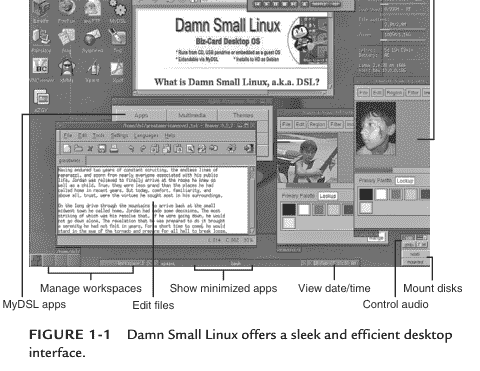

图 1-1 Damn Small Linux 提供了一个简洁高效的桌面界面。

图 1-1 中的 DSL 桌面展示了一些 DSL 桌面的基本功能以及一些应用程序。你可以通过屏幕左上角显示的图标（单击左键）启动应用程序。在右上角，可查看系统资源（CPU、进程、文件系统等）的数据。`dock.lua` 工具（右下角）可让你调整音频并挂载磁盘分区。底部面板显示当前日期/时间、最小化应用程序以及管理工作区的工具。使用左下角的工具可在工作区之间移动应用程序。

图 1-1 中显示正在运行的应用程序包括 Firefox 网络浏览器、XMMS 音乐播放器、XPaint 图像编辑器和 Beaver 文本编辑器。右上角是出色的 torsmo 系统监视器，可监控所有系统资源（处理器、RAM、交换空间、磁盘和其他资源使用情况）。这些以及 DSL 中原生可用的其他应用程序将在第 3 章“使用 DSL 应用程序”中详细介绍。

图 1-1 中显示的一个管理工具是 `MyDSL` 扩展工具。你可以使用该工具下载和安装预打包以在 DSL 中运行的应用程序（参见第 5 章“使用 MyDSL 扩展应用程序”）。

尽管图 1-1 中 DSL 桌面上显示的应用程序已打包在基本 50MB 可启动映像中，但 Damn Small Linux 的价值远不止于此。如果 DSL 不能完全满足你的需求（以及你想要使用它的位置），该项目会帮助你以以下方式改进使用 DSL 的体验：

- 可扩展——使用 `MyDSL` 功能和互联网连接，只需几次鼠标点击即可在运行的 DSL 系统上下载并安装大量额外应用程序。由于 DSL 的根源在于其他流行的 Linux 发行版（尤其是 Debian 和 KNOPPIX），为这些发行版创建的软件通常也可以直接放入 DSL 中运行。参见附录 B，“MyDSL 扩展。”

- 可移植——尽管标准 DSL 可在小至 50MB 可启动名片的介质上运行，但它可以轻松地从硬盘、标准 CD 或 DVD、USB 闪存盘或其他固定和可移动介质运行。它甚至可以从已安装的 Linux 或 Microsoft Windows 系统中嵌入运行。

- 许多人已将 DSL 放在 USB 闪存盘上，并附带其他应用程序和数据（文档、音乐、图像和演示文稿）。因此，你无需随身携带整台笔记本电脑，只需携带一个约指甲大小的 USB 闪存盘或笔式驱动器即可携带所需的一切。

保持基本 DSL 系统小巧、快速和高效，使其既是一个不错的工具本身，也是构建的基础。以下是使用 DSL 的一些最佳理由列表：

- 老机器焕发新生——DSL 可在仅有 16MB RAM 和 486DX 处理器的计算机上运行。DSL 开发人员提供 DSL 的版本

那台在旧机器上需要较小启动映像（使用 `Syslinux` 的）引导方式。这样一来，角落里积灰的 PC 可以重获新生，成为简单的桌面系统，或者通过添加一些额外软件，变成防火墙、网页服务器或音乐播放器 PC。

### 小巧玲珑

Damn Small Linux 可以装进一张可启动的名片大小 CD 中。因此，随身携带 DSL 所占的空间小到就像钱包里的一张信用卡。DSL 的小体积还意味着，在存储空间有限的地方（例如旧硬盘或手持设备），你可以把有限的空间用来存放额外的应用程序和个人文件。

### 运行飞快！

由于 DSL 操作系统及其附带的应用程序小巧、轻量且为高效而优化，即使在简陋的硬件上也能快速运行。如果你至少有 128MB 内存，还可以使用 DSL 的 `toram` 功能，将整个 DSL 操作系统从内存中运行。使用 `toram`，应用程序几乎瞬间启动，运行速度快得令人难以置信。

### 高效运行

通过专注于重要的桌面功能，而非所有可能的桌面功能，DSL 桌面让你轻松访问所需功能。只需在桌面任意位置右键单击鼠标，即可使用所有桌面应用程序和系统工具。桌面工具让你轻松查看系统进程、切换工作区、挂载存储介质以及调整音量。

### 随行相伴

从本质上讲，Live CD 操作系统就是为便携而生的。由于 DSL 拥有出色的硬件支持，它能在大多数常见的 PC 硬件上运行。因此，如果你要去的地方已经有可用的 PC，也许就不必随身携带笔记本电脑了。你只需把 DSL 以及所需的任何额外软件或数据装进口袋即可。

### 多才多艺

利用 DSL 自带的工具，你可以将 DSL 配置为以多种不同方式从不同存储设备运行。除了默认方式（将 DSL 启动映像烧录到 Live CD 上），简单的安装流程让你可以从 USB 闪存盘、硬盘或其他存储介质安装并运行 DSL。

你还可以用多种不同方式配置如何保存和使用 DSL、你的应用程序和数据。例如，你可以把数据保存在闪存盘上，而 DSL 本身从 Live CD 或硬盘运行。当新版本的 DSL 发布时，你只需启动新版本并将其与你的数据结合使用，无需繁琐的升级或重新安装流程。

### 安全性

从只读介质运行操作系统可以降低入侵者接管（并实际拥有）你计算机的能力。如果你怀疑计算机的安全性已受到威胁，只需干净地重新启动 DSL 即可。操作系统本身会恢复到原始状态，因此你只需检查已保存的数据是否存在潜在问题。

由于 DSL 最初主要定位为桌面系统，默认情况下也没有运行入侵者可能利用的网络服务。如果你想开启或添加新的网络服务，可以从 `MyDSL` 添加防火墙软件（见第 16 章“在 DSL 中设置 XAMPP Web 服务器”），并基于标准 Linux `iptables` 设施配置专业级防火墙。

- 网络和服务器功能——DSL 自动检测并配置大多数有线以太网卡，并包含配置多种无线网卡的工具。只要网络上有可用的 DHCP 服务器，DSL 通常开机就能直接连上互联网。DSL 基本发行版中包含了使用互联网、网页浏览、电子邮件、文件传输、即时通讯等应用程序。

DSL 还包含一些精简版网络服务器，你可以根据需要启用。从 DSL 菜单中选择 System、Daemon，然后选择要启动的服务。启动 `ssh` 以允许安全的远程登录（ssh）、文件复制（`scp`）或 FTP 服务（`sftp`）访问你的机器。或者选择 `nfs-common` 以便通过网络共享目录。选择 Monkey Web 服务器可启动简单的 Web 服务器（HTTP），或选择 `FTPd` 将你的 DSL 系统开放为 FTP 服务器。因为是 Linux，你还可以从开源项目向 DSL 添加大量其他服务。

- 构建项目——从最简操作系统开始，很容易构建一个专门执行特定任务的系统。例如，如果你想要一个专门用作防火墙、音乐播放器、电话设备或其它专用设备的系统，你可以在原本高效的系统中只添加所需软件。最终得到的系统可以只做你需要的事情，所有额外空间都可以用来存放数据。本书第四部分“打造 Damn Small Linux 项目”包含几个你可以从 DSL 开始构建的有趣项目。

以上所描述的 DSL 用途和优势是我们发现的。当你开始使用 DSL 后，你可能会找到许多自己的用途。

## 充分发挥 DAMN SMALL LINUX 的潜力

在短时间内，你应该就能弄清楚如何从 DSL Live CD 启动并使用 DSL 桌面。然而，本书的目的是教你如何改造

DSL 可以精确地实现你想要的功能。为此，本书各章节将指导你掌握调整 DSL 以满足需求的技术，并使 DSL 适应你的计算机设备。

以下是本书涵盖的一些主要主题。

## Booting DSL

只要有一台 PC 和一份 Damn Small Linux 拷贝（如本书光盘上的那样），大多数人都可以重新启动并在无需指导的情况下运行 DSL。如果某些硬件无法正常工作，按 `F2` 会显示启动选项，可帮助解决大多数简单问题。

启动 DSL 时，你可以向 DSL 传递其他启动选项来指导启动过程。其中一些选项可以使 DSL 更好地适用于你的特定硬件（如无法正确检测的显卡）。其他选项可让你以特殊方式运行 DSL（如完全从 RAM 运行 DSL）。还有其他选项可让你识别可拉入 DSL 系统的数据包位置（如你备份的桌面设置或已保存的应用程序）。

启动 DSL 时可能需要使用的启动选项包含在第 2 章“Booting DSL”中。有关识别个人设置备份位置和恢复位置的选项在第 4 章“Configuring and Saving DSL Settings”中介绍。有关在不同硬件环境中运行 DSL 的选项在第 8 章“Installing DSL in Alternate Ways”中介绍。

## Customizing the Desktop


Fluxbox 是 Damn Small Linux 默认使用的窗口管理器。尽管体积紧凑，但仍有许多方法可以调整 Fluxbox，使其外观和行为符合你的喜好。窗口管理器定义了菜单、鼠标操作、键盘导航、背景以及与图形界面外观和感觉相关的其他功能如何运行。

从 Fluxbox 桌面，大多数 DSL 活动都可通过单个桌面菜单进行控制（右键单击桌面即可看到 DSL 菜单）。选择 Desktop，Fluxbox Configuration 可查看可更改的桌面设置列表。图 1-2 显示了这些菜单的示例。

除了更改桌面的外观和感觉外，你还可以使用各种桌面实用程序来管理工作区、挂载和卸载文件系统以及管理任务。有关使用各种桌面工具和应用程序的说明在第 3 章中介绍。

### FIGURE 1-2 Customize your desktop settings from the DSL menu.

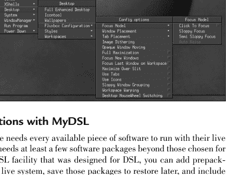

## Adding Applications with MyDSL

并非每个人都需要每一种可用的软件与他们的 live CD 一起运行，但几乎每个人都需要一些超出 DSL 所选软件的软件包。使用为 DSL 设计的 MyDSL 功能，你可以向 live 系统添加预打包软件，将这些软件包保存以便以后恢复，并在下次重新启动 DSL 时选择包含或不包含它们。

第 5 章包含对 MyDSL 功能的描述。MyDSL 的描述集中在图 1-3 所示的 MyDSL Extension 工具上。

### FIGURE 1-3 Customize your desktop settings from the DSL menu.

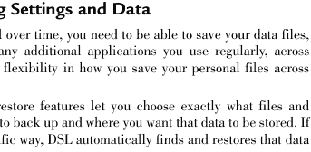

## Saving and Restoring Settings and Data

要使任何 live CD 长期有用，你需要在重新启动后保存数据文件、系统设置以及你经常使用的任何额外应用程序。DSL 在重新启动后保存个人文件的方式上提供了很大的灵活性。

DSL 的备份和恢复功能让你可以选择要备份的确切文件和数据目录，以及要将该数据存储在何处。如果你以特定方式保存该数据，DSL 会自动找到并恢复该数据

你可以学习如何重新制作自己的 DSL 映像，以包含你喜欢的任何应用程序或数据（无需在启动时合并额外的应用程序和数据）。

## What Is Damn Small Linux?

在继续之前，我们需要明确 Damn Small Linux 到底是什么。Damn Small Linux 是一种操作系统，设计为从 live 介质（如可启动的名片大小 CD）运行，其核心由 Linux 内核控制。它基于另一个名为 KNOPPIX 的 Linux live CD，而 KNOPPIX 本身则源自名为 Debian 的 Linux 发行版。

现在，我们需要理清所有这些。

## Understanding Operating Systems

操作系统是管理计算机硬件与你为使用该硬件而运行的应用程序之间交互的计算机软件。在专有个人计算世界中，你可能最熟悉 Microsoft Windows 和 Mac OS/X 操作系统。在自由和开源软件（FOSS）世界中，大多数操作系统都追溯到 UNIX。

Damn Small Linux 是众多以 Linux 命名的 FOSS 操作系统之一，因为它包含被称为内核的 Linux 软件。Linux 内核是操作系统的最关键部分，因为它提供最基本系统服务：进程管理、设备驱动框架、文件系统支持以及其他关键系统功能。随着新硬件、文件系统类型和其他组件连接到 Linux 系统，它们可以作为所谓的 loadable kernel modules 添加到内核中。

Linus Torvalds 创建了 Linux 内核，并至今仍领导 Linux 内核开发。该软件可从 Linux Kernel Archives（http://kernel.org）获得。大多数 Linux 发行版会添加来自 Free Software Foundation GNU 项目（www.gnu.org）的一组基本系统实用程序，其中包含许多最初在 UNIX 系统上可用的命令的克隆。

尽管最新可用的内核是 2.6 内核，但 DSL 选择继续使用 2.4 内核树。这主要是因为 2.6 内核明显更大。然而，随着安全漏洞被发现，从 2.6 内核回溯的修复程序会被包含在 DSL 使用的 2.4 内核中。改进的回溯也可以以同样的方式添加。

expect，一个名为 gnu-utils 的 MyDSL 包可用于将这些重要的实用程序带入 DSL。

尽管内核、一个命令解释器（称为 shell）和一些实用程序实际上是你拥有一个操作系统所需的一切，但大多数 Linux 系统也包含其他组件。例如，X Window System 为使用大多数 Linux 系统（包括 DSL）提供了图形框架。窗口管理器（如 DSL 中的 Fluxbox）实现了菜单、图标和其他图形桌面元素。

## 理解 Live CD

大多数计算机操作系统永久安装在硬盘上。另一方面，live CD 通常是这样创建的：你可以安全地忽略计算机硬盘上安装的任何软件，并且可以完全从 CD 上包含的操作系统运行。这有一些优点也有一些缺点。

Live CD 的优点在于让你能够组装一套已知的软件，并且确保下次重新启动时可以返回到该软件。这使得 live CD 成为演示、便携式桌面或救援介质的绝佳媒介。你可以将一整套计算机系统带在口袋里，可以在大多数 PC 上运行（前提是你被允许重新启动该 PC）。

Live CD 的缺点包括其属性的某些方面。例如，随着你使用系统的时间推移，你希望保存一些数据和应用程序。默认情况下，live CD 是从只读 CD-ROM 介质运行的。因此，你不能像从硬盘运行系统那样直接保存文件。

Damn Small Linux 克服了许多使用设计为从 live CD 运行的桌面系统的挑战。一些已经提到的功能（并且将在本书后面进一步描述）让你可以保存文件和应用程序，以便下次启动 DSL 时可用。也有方法可以将 DSL 安装到硬盘上，使其像大多数已安装的操作系统一样运行。

> **NOTE**
>
> 尽管术语 live CD 通常用于描述通常从只读介质启动和运行的计算机系统映像，但相同类型的映像也可以从其他介质运行。正如你将在本书的描述中看到的那样，live CD 也可以从 DVD、USB 闪存驱动器或 ZIP 驱动器运行。同样，live CD 可以从软盘启动，然后继续从 CD、硬盘或其他介质运行。

## 基于 Debian 和 KNOPPIX

由于 Linux 内核单独并不能让你对计算机做太多，大多数 Linux 发行版都利用了庞大的自由和开源软件生态。Debian GNU/Linux 是今天最受欢迎的自由操作系统之一。KNOPPIX 是一个从 Debian 软件创建的 live CD Linux 发行版。DSL 结合了这两个项目的技术。

Debian 发行版（http://debian.org） literally 有数千个已编译可在 Debian 上运行的软件包。Debian 软件包以 .deb 格式存储，可以通过 apt-get 和 dpkg 等工具从互联网下载和安装。许多 Debian 应用程序可以通过 apt-get 下载并安装到 DSL（可从 dsl-dpkg MyDSL 包获得）。

KNOPPIX（www.knopper.net/knoppix/index-en.html）是第一个流行的面向桌面的 live CD。它包含一个备受推崇的用于检测和配置硬件的设施（对 live CD 来说是必须的）。使用压缩技术，它能够将相当于约 1.5G 的软件放入标准的 700MB CD 映像中。KNOPPIX 中包含许多专门的实用程序来配置一些棘手的硬件组件，例如无线网卡、打印机和调制解调器。

Damn Small Linux 创建者 John Andrews 从刚刚描述的一些技术开始。然后他开始精简并优化它。

## ANSWERS FROM THE DSL DEVELOPERS

如果您没有从封面上注意到，本书结合了三位作者的经验。John Andrews 创建了 Damn Small Linux。Robert Shingledecker 开发了 DSL 的许多关键技术创新。Christopher Negus 已撰写了许多 Linux 书籍，例如 Red Hat Linux Bible、Linux Toys 和 Live Linux CDs。

因此在本节中，您可以第一手了解 DSL 是如何以及为何诞生的。Chris 向 John 和 Robert 提出了一些尖锐的问题，询问他们为何开发 DSL、其最伟大的属性是什么以及它将走向何方。

### John, what encouraged you to create DSL?

John: 这是对应用程序和典型 Linux 桌面环境不断增大的趋势的反应。我想看看是否可以将一个功能性桌面环境压缩到 50MB 中。


我最初被 Linux 吸引的原因之一是 90 年代末可用的快速轻量级应用程序。到我开始开发 DSL 时，我喜欢的许多应用程序似乎在我的计算机上变得缓慢无比。

本质上，典型的 Linux 桌面正以与微软和 Mac 操作系统趋同的方式，逼迫我进行硬件升级。我希望（并且仍然希望）Linux 社区能够在效率上复兴，人们把代码臃肿当作它本来的样子——一种癌症——来对待。

DSL 也是功能重于形式的一个证明。我们避免过度沉迷于视觉效果。DSL 中包含的一些核心应用程序，其功能甚至优于后来体积更大的版本。对 DSL 的开发者来说，重点不在于最新或最好看；而在于功能性和稳定性。

我正在寻找一个轻便的便携环境，可以随身携带在一张名片大小的 CD 上。当时，最好的 50MB 以下发行版是 LNX-BBC，但它的定位更偏向于救援盘。我认为在同样的有限空间内工作是可行的，但可以构建一个专注于拥有功能性桌面的发行版。作为一个效率爱好者，我以我的桌面为模型来打造 DSL，并使用了大部分相同的轻量级应用程序。

## Robert，是什么促使你加入 DSL 开发？

**Robert：** 我从 1990 年代初就开始参与 Linux CD-ROM 的工作。我在加州 Garden Grove 市工作期间，创建了安装型 CD 来自动化服务器和桌面的专用设置。后来，我在一家 Linux 初创公司工作，创建了 live Linux CD 服务器设备。我们创建了防火墙、邮件服务器、VPN、`LAMP` 风格系统、多个数据库服务器、`MySQL`、`Postgres`，甚至还有一些原型商业产品，如 Raining Data 的 `D3`。

这些 live CD 被自动化以提供客户所需的任何服务。在此开发过程中，我创建了自己的 live 桌面。偶尔我会查看 `DistroWatch.com`，看看是否有人也在做桌面方案。我一直觉得桌面远多于服务器。`DemoLinux` 以及后来的 `KNOPPIX` 在当时对于日常使用来说都太慢了。当我找到 John's Damn Small Linux 时，我喜欢所看到的，并开始探索扩展其功能的方法。

## Damn Small Linux 的最初目标是什么，它们有改变吗？

**John：** DSL 的第一个目标是拥有一个功能齐全且高效的 Linux 桌面发行版，大小在 50MB 以下，小到可以装在一张名片大小的 CD 上。多年来，随着价格实惠的 USB 闪存盘进入市场，名片 CD 已经变得不那么重要了。然而，我们仍然保持 50MB 的上限，这迫使我们以非常规的方式思考并创新，而不是简单地添加应用程序。

**Robert：** 我当然没有路线图。事情只是以进化方式进展：从添加灵活的备份/恢复系统，到需要可写的 `/opt` 目录来添加更多程序。后来，我们创建了自包含的压缩可挂载应用程序，最初称为 `.ci` 扩展，后来命名为 `UCI`。我的目标是尊重 John 最初将发行版保持在 50MB 或以下的目标。

很多人会重新制作 DSL 只是为了添加或更改一个应用程序。因此，我的想法集中在如何允许轻松且灵活地向 DSL 添加额外应用程序。这些额外的应用程序我称之为 `MyDSL` 扩展。最初，它们是 tarball 和 `UCI`。它们要么加载到 `/opt` 下的 RAM 磁盘，要么挂载在 `/opt` 下。一些用户社区真的希望在 live DSL CD 上使用 Debian。这导致了一个脚本，使大部分文件系统可写，这就产生了 `.dsl` 扩展类型。这基本上是一个 tarball，但独特的扩展类型会触发脚本来设置所需的所有符号链接。

最近，我添加了使用可挂载压缩覆盖镜像的功能。这些新的覆盖挂载不需要自包含，但它们在低系统资源使用方面与 `UCI` 具有相同的优势。我尝试在保持发行版在 50MB 以下的同时，用更新的技术保持 DSL 的更新，并承认并完全支持更小、更旧、能力较弱的硬件。

我们不断寻找最佳品种的 *small is beautiful* 应用程序和实用程序——例如 `Lua`。我们大量使用 `Lua` 和 `Lua FLTK` 并创建了许多自己的 GUI。我们不仅是一个小型发行版；我们在有限资源上运行良好。

## 什么吸引人们使用 DSL？

**John：** DSL 逆转了不断增加的臃肿和对硬件不断增加的需求的趋势。使用 DSL 的人并不是为了视觉效果而追求视觉效果。他们希望自己的计算机能够工作并且可靠。DSL 从 `ISO` 镜像运行并且本质上是耐用的，这也使其具有吸引力；DSL 很难损坏且易于修复。当然，还有模块化和便携性方面的优势。

如果你想要一个应用程序，你可以直接获取。如果你想把桌面带上路，通过 USB 闪存盘、live CD 和远程备份来做到这一点非常容易。DSL 小巧但功能齐全的基础也使其成为构建自定义应用程序的绝佳平台。DSL 是一个 Linux 桌面，没有 500 磅的泡沫塑料填充。

**Robert：** DSL 是一个小型发行版，并且在非常小的资源上运行得非常好。它在提供多种配置选择和可扩展性方面极其灵活。在你阅读接下来的章节后，你将开始意识到其潜力。

DSL 项目欢迎用户社区。`MyDSL` 扩展仅代表框架。实际的扩展由 DSL 用户社区提出、讨论并创建。这个活跃的社区共同拥有这些无缝扩展。

## 运行 DSL 最有趣的硬件是什么？

**Robert：** 让我想到的就是原版的 ThinkNic Internet Appliance，这是一台基于 CD 的机器，配备 4MB ramdisk（用于保存配置）、一个 `Winmodem` 和一个以太网端口。我们完全支持这款“首创”Linux 设备。

**John：** 对我来说，最有趣的运行 DSL 的硬件尚未被应用——可能性太多了。我个人正在制作一台基于 `eBox III` 薄客户端和廉价 8 英寸 LCD 显示器的自制笔记本。我希望能把它连接到一个小型太阳能板上。它必须运行 IDE 闪存 `Disk On Module (dom)`；它将是被动散热且 100% 静音的。

## DSL 对爱好者有什么好处？

**John：** 哦，你可以用 DSL 做的事情太多了。它很小，需要的 `RAM` 很少，可以在古老的硬件上运行，也可以不使用硬盘运行。DSL 可以在仅 128MB 的 `RAM` 中运行。它甚至可以在仅 16MB `RAM` 的传统硬盘安装下运行。有了 DSL，你可以把废品变成可用的硬件。

DSL 也很容易修改和升级。我们有一个扩展系统，允许 DSL 在任何开发者想要的方向上演变，而无需进行自定义重新制作。我们大量使用脚本语言。所以如果你想深入了解 DSL 的本质，只需四处挖掘即可。

**Robert：** 摆弄你从衣柜里找到的老硬件的乐趣。现在你有一个精致的小型网络服务器、一幅画框，或一台汽车 MP3 播放器。你的创造力可以自由探索并与 DSL 用户社区分享。你可以创建和分享 `MyDSL` 扩展，或学习使用 `Bash`、`Perl`、`C`、`Lua`、`Lua/FLTK` 编程。所有这些都在里面。

DSL 包含大量的硬件支持。因此，你可以为奶奶打造一个网页浏览设备。或者也许购买或获得旧的“一次性”笔记本电脑。我们支持其中许多。甚至可以购买嵌入式设备并使用 DSL 作为嵌入式操作系统。我们就像 Linux 的积木玩具：一个 Linux 构造套件。重点就是要好玩！

## 对于从 MS Windows 转向 DSL 的人来说，挑战是什么？

**John：** 在现代 `MS` 桌面上，你被禁止查看引擎盖下。在 DSL 中，根本没有引擎盖——你可以随意深入挖掘。没有任何限制，你会想要学习 DSL 的工作原理，以便充分利用它。

**Robert：** 并非所有决定都强加给你。如果你觉得积木玩具或构造套件不好玩，基本桌面在你开始使用时仍然完全可用。然而，随着可用于扩展 DSL 的众多选择和选项，新用户可能会感到不知所措。但他们很快就会想要探索。

甚至 DSL 用户社区也没有就 DSL 的单一安装或运行环境达成一致。我们经常有“好喝！更清爽！”类型的论坛争论。

此外，DSL 是 Linux，因此我们尊重 `UNIX` 文件权限。一些用户习惯以超级用户身份运行所有内容。我们不这样做。有些人期望每个新设备都能立即得到支持，这在我们的尺寸和开发限制下是不可能的。通常，答案和解决方案可以在社区资源中找到。

## 你们对 DSL 的未来计划是什么？

**John：** 我们未来将面临艰难抉择。事实是，Linux 应用开发社区中很少有人像我们一样看待 Linux 的未来。这让我们陷入困境。许多精简项目被放弃并被具有大量包依赖性的其他项目取代。

我们老朋友的 `GTK1.2` 正被大多数当前开发的项目抛弃。其他轻量级图形工具包开发缓慢，甚至有时停滞数年。外面有一些希望的火花，我永远不会放弃追求一个小巧而功能齐全的桌面的追求。我希望像 DSL 这样的项目能鼓励精简应用的开发者继续他们的工作。

在更短的时间内，你可能会看到一个更小和一个更大的 DSL 亲属，以及更多框架供那些想要基于 DSL 基础设施构建自定义应用的人使用。

**Robert：** 我希望看到 DSL 的模块化程度更高。为社区提供更多选择。我们的流程并不正式。它是基于我们自己的兴趣以及 DSL 用户社区表达的兴趣而演进的。而且对我和 John 来说也必须有趣且有意思！

## THE DAMN SMALL LINUX COMMUNITY


Damn Small Linux 拥有一个蓬勃发展、活跃的贡献者和用户社区。虽然 Robert 和 John 主导着中央 50MB DSL 发行版的活动，但 MyDSL 扩展的框架为任何人提供了扩展 DSL 功能供自己和他人的机会。为了增长知识 base of DSL, there are several communications venues available. And, of course, financial contributions are welcome for helping the project grow.

## 通信渠道

Communications opportunities for the DSL project include forums, a wiki, and a place to blog about DSL. Here’s where you can find out more about those opportunities:

- **DSL forums** (`www.damnsmalllinux.org/cgi-bin/forums/ikonboard.cgi`) — In the forums, you can find information on more than 30 topics relating to DSL. Popular topics include hard drive installs, DSL ideas and suggestions, and networking issues.

- **DSL wiki** (`www.damnsmalllinux.org/wiki`) — The DSL wiki brings together a lot of information related to the DSL project. From the wiki, you can find answers to frequently asked questions, learn about installation and boot options, and read about common issues that DSL users encounter.

- **DSL IRC** (`irc://irc.freenote.net/damnsmalllinux`) — Participate in real-time, online chats with other DSL users.

- **DSL blog** (`www.damnsmalllinux.org/talk`) — At the DSL blog, you can feel free to present your musings and personal experiences that relate to Damn Small Linux.

## 贡献方式

Because DSL is freely distributed, development is funded through contributions and through purchases from the DSL store. Contributing to DSL in one of these ways can do a lot to further development of Damn Small Linux. Here are suggestions for contributing:

- **DSL donations** (`www.damnsmalllinux.org/donate.html`) — If you enjoy DSL and can afford to contribute, monthly subscriptions of $1, $2, $5, and $10 contributions can be made from this page. You can also make one-time donations via PayPal or credit card.

- **DSL store** (`www.damnsmalllinux.org/store`) — At the DSL store, you can purchase a variety of mini-ITX computer supplies. This is also the place to buy a DSL CD or DSL on a bootable USB pen drive (currently, 1GB models are offered). One of the great features of the bootable USB drive is that it includes the QEMU version of DSL that can be booted and run on a Windows desktop.

Before I became associated with John and Robert to write this book, I purchased a DSL USB pen drive from the DSL store. I still use that drive today to show people DSL. I can plug the USB drive into a running Windows system, select one file from that drive, and in a few moments give a demonstration of Damn Small Linux within a window on the Windows desktop.

## ON THE CD

DSL itself only takes up about 50MB of space on your boot media. However, with several different versions of DSL (for booting from different media) and some available MyDSL software extensions, you can experience DSL in different ways. For those reasons, we have included a standard-size CD with this book (about 700MB) that we have filled with a whole lot of software you can use with DSL.

The CD that comes with this book boots up to the latest version of Damn Small Linux. By default (press `Enter`), you will get exactly what you would were you to download the standard 50MB DSL image from the Internet. With our specially remastered CD, however, you get a whole lot more.

- **Official Damn Small Linux** (`dsl-3.3.iso`)—This is the standard DSL that you would normally burn to CD and boot live.

- **Official DSL for older machines** (`dsl-3.3-syslinux.iso`)—If you have a PC that requires a floppy boot image on the CD to boot up, you can use this ISO image. This image (contained in the `/images` directory) features the Syslinux boot loader, which includes a small 1.4MB boot image. To use this ISO, you need to burn it to a separate CD.

- **Virtual DSL for Windows with QEMU** (`dsl-3.3-embedded.zip`)—This archive is unzipped on the live CD so that you can run DSL virtually within a window on your Windows desktop.


- **Virtual DSL scripts for VMware (`dsl-3.3-vmx.zip`)**—Using the scripts included in this zip file, you can run DSL virtually from a variety of environments using VMware.

- **Special DSL projects**—Chapters 13 through 16 describe how to create special software and hardware projects with Damn Small Linux. You can directly boot up to versions of DSL that include the software packages needed to complete those projects. These projects include:

  - **DSL Edna music server:** Manage, play, and serve your music collection from DSL using Edna music server software (see Chapter 13, “Making an Edna Music Server in DSL”).

  - **DSL Skype VoIP service:** Make Internet telephone calls using Skype IP telephony service (see Chapter 14, “Using Skype VoIP Service in DSL”).

  - **DSL digital picture frame:** Play slide shows of any collection of digital images from DSL as a standalone digital picture frame (see Chapter 15, “Running a Digital Picture Frame in DSL”).

—DSL 网页服务器：随 DSL 包含 XAMPP 软件，可创建即时网页服务器，通过互联网分享你的网页内容（参见第 16 章）。

- DSL 启动映像—某些没有可启动 CD 驱动器（或根本没有 CD 驱动器）的旧硬件可能需要软盘启动映像才能启动 DSL。CD 的 `/images` 目录中包含多个不同的启动映像。

- 第 10 章和第 11 章脚本—本书第 10 章“添加应用程序和创建可共享扩展”以及第 11 章中描述的脚本分别包含在 CD 上的 `/chapter10` 和 `/chapter11` 目录中。这些脚本将帮助你制作自己的 MyDSL 扩展并重新制作自己的 DSL Live CD。

- MyDSL 软件包—有几个非常受 DSL 用户欢迎的额外软件包。通过将其中一些软件包作为 MyDSL 设施的软件扩展包含在 CD 上，我们可以帮你省去通过互联网下载它们的麻烦。在 CD 顶层目录的 `/mydsl` 目录中，你可以找到用于安装标准 GNU 工具（`gnu-utils` 软件包）、ALSA 声音驱动程序和实用工具（`alsa-sound` 软件包）以及 OpenOffice.org 办公应用程序（`openoffice` 软件包）的软件包。

如果你没有互联网连接，可以使用 CD 上的软件。随着时间的推移，你应检查 Damn Small Linux 网站，以了解 CD 上包含的软件是否有更新版本。

## SUMMARY

Damn Small Linux 是目前可用的首屈一指的商务名片大小的 Linux 桌面 Live CD。在其 50MB 的占用空间内，DSL 包含几乎每种你期望在现代桌面操作系统中找到的应用程序。虽然 DSL 设计为从只读 CD 介质运行，但你可以添加数据、软件扩展和系统设置，这些都可以单独备份，并在下次重新启动时再次使用。

本章介绍了使 DSL 成为计算机爱好者既有用又有趣的操作系统的功能。它介绍了可在本书后续章节中更深入描述的启动、安装、重复使用和增强 DSL 的一些方法。它还讨论了你如何了解更多关于 DSL 社区的信息并为其成功做出贡献。

此页 intentionally left blank

## Booting DSL

无论你使用的是从 DamnSmallLinux.org 购买的可启动商务名片（感谢你的支持），还是随本书附带的 CD，或是你下载并刻录的 Damn Small Linux（DSL）映像，DSL 都旨在轻松地在几乎任何 PC 上启动。在大多数情况下，在你插入介质、重新启动并按 Enter 后，DSL 桌面（见图 2-1）会在几秒钟内出现。

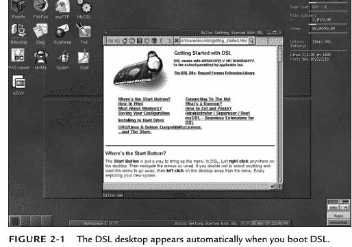

FIGURE 2-1 The DSL desktop appears automatically when you boot DSL.

## SOFTWARE REQUIREMENTS–DSL VERSIONS

Damn Small Linux 有多个不同版本可供使用。你使用的版本取决于运行 DSL 的环境。DSL 提供的四个版本包括：

- **A SYSLINUX version**—用于需要启动介质不超过软盘映像大小（即使该映像在 CD 上）的旧 PC。有关 SYSLINUX 启动加载程序的更多信息，请参阅 SYSLINUX FAQ（http://syslinux.zytor.com/faq.php）。

- **An ISOLINUX version**—最常用于启动 Live CD，因为它不需要特殊的软盘仿真磁盘。有关 ISOLINUX 启动加载程序的更多信息，请参阅 ISOLINUX FAQ（http://syslinux.zytor.com/iso.php）。

- **A Qemu Virtual Machine version**—设置 Qemu 在运行的 Linux 系统中虚拟运行 DSL。

- **A VMware Virtual Machine version**—设置 VMware 在运行的 Windows 系统中虚拟运行 DSL。

前两个版本涉及从 CD 启动，这是本章的主题。其他两个版本在第 7 章“在 Windows 中嵌入运行 DSL”中讨论。为什么 CD 有两个版本？因为 DSL 针对的是较旧且较小的硬件，许多此类系统只有在存在实际仿真启动软盘的情况下才能从 CD 启动。此仿真启动软盘受限于真实软盘的大小。后来生产的机器已不再受此限制。

因此，第一条规则是：如果你无法开始启动过程，或你的机器是较旧的类型，请使用 SYSLINUX 版本。

DSL 的 SYSLINUX 版本在启动时仿真单个软盘。由于所有驱动程序都必须适配到单个软盘大小的文件中，因此 SYSLINUX 版本中的驱动程序较少。Knoppix 和其他衍生版本使用 ISOLINUX 的原因是没有单软盘大小的限制。ISOLINUX 版本具有更多驱动程序，以支持从较新计算机启动。

## GETTING DAMN SMALL LINUX

随本书附带的 CD 上包含多个版本的 Damn Small Linux。你可以阅读这些版本是什么以及如何使用它们，参考附录 A，“On the CD”。然而，如果你手边没有 CD 或有更新版本的 DSL 可用，你可以考虑下载一份 DSL 来制作自己的可启动 CD。

### 下载 Damn Small Linux

如果你对 live CD 的概念还不熟悉，可能不知道如何下载 ISO 并制作可启动的 CD-ROM。第一步是找到一个本地的 DSL 下载镜像。你可以随时通过查看 Damn Small Linux 网站的下载部分来检查最新的可用下载站点列表，网址为：

```
http://www.damnsmalllinux.org/download.html
```

以 Ibiblio 站点为例，导航到该站点的当前目录：

```
ftp://ibiblio.org/pub/Linux/distributions/damnsmalllinux/current
```

根据之前的讨论，选择你想要下载的版本。你在大多数情况下想要的 DSL 的 ISOLINUX 版本，命名为 `dsl-??.??.iso`，其中 `??` 用 DSL 版本号替换。

有许多方法可以创建可启动的 CD，也有许多操作系统可以执行此任务。你需要使用具有刻录映像或写入磁盘选项的 CD 刻录程序。

许多 Linux 系统都有 `k3b` 实用程序和 `cdrecord` 命令来刻录 CD。对于 Windows 用户，Nero 和 Roxio 是流行的商业程序。Windows 上还提供免费软件 CD Burner XP Pro（www.cdburnerxp.se）和 Infra Recorder（http://infrarecorder.sourceforge.net）应用程序。

### 进入启动提示符

尝试启动 DSL live CD。如果 SYSLINUX 或 ISOLINUX 版本都无法让你进入启动屏幕，这里有一些你可以尝试的方法：


- 确保你的 CD 刻录没有失败。如果你自己下载并刻录了 CD，最好以非常低的速度刻录。我建议将刻录过程的速度降低到 4。 是的，即使你有新的 52X 刻录机。

- 有些计算机难以从 CD-RW CD 启动。最好使用 CD-R CD。

- 如果你有不同的 live CD（例如 KNOPPIX），尝试从该 live CD 启动，看看你的问题是否特定于 DSL。

- 你的计算机 BIOS 可能未设置为从 CD 启动。启动过程开始后立即进入计算机的 BIOS 设置（按 F2、Del 或其他键，如指示的那样进入 BIOS）。检查启动顺序是否包含从 CD 启动，并确保在启动顺序中 CD 在硬盘之前。

如果你的计算机无法从 CD 启动，你可以尝试创建启动软盘。下载 DSL 标准启动软盘映像，`bootfloppy.img`。你可能想检查本地下载镜像以减少下载时间。查看 Damn Small Linux 网站下载部分：`www.damnsmalllinux.org/download.html`。

接下来，定位要下载的文件。例如，

```
ftp://ibiblio.org/pub/Linux/distributions/damnsmalllinux/current/
bootfloppy.img
```

将此映像写入已知良好的软盘。不要使用旧软盘，因为它们在出现读取错误时很可能会导致问题。使用典型工具创建启动软盘。通常这意味着 Windows 下使用 `rawwrite` 或 Unix/Linux 类型系统使用 `dd`。

例如，如果你的 Unix/Linux 系统的第一个软盘设备位于 `/dev/fd0`，且 `bootfloppy.img` 位于你的当前目录，你可以使用以下 `dd` 命令将该映像写入插入的软盘：

```
# dd if=bootfloppy.img of=/dev/fd0 bs=16k
```

根据你使用的 `rawwrite` 版本，从 DOS 提示符下将 `bootfloppy.img` 文件写入软盘的过程（启动映像位于 C: 根目录，`rawwrite` 在 `C:\windows\command` 目录中）应类似于以下内容：

```
C:\> cd \windows\command
C:\windows\command> rawwrite
Enter disk image source file name: C:\bootfloppy.img
Enter target diskette drive: A:
Please insert a formatted diskette into drive
A: and press -Enter- : <Enter>
```

Windows 版的 `rawwrite` 程序可以在以下网站找到：

```
http://www.chrysocome.net/rawwrite
```

创建软盘后，请确保更改计算机的 BIOS，使软盘成为第一个启动设备。将新创建的软盘放入驱动器并打开或重新启动系统。如果你使用的是良好的软盘且没有读取错误，你将被呈现 DSL 启动屏幕。

希望你已到达 DSL 启动屏幕（参见图 2-2）。如果你因为需要启动软盘或需要下载并创建 SYSLINUX 版本而到达此处，只需在 DSL 启动提示符下按 Enter 即可。

在你可以看到 DSL 启动屏幕后，你可以在启动提示符下输入许多选项来引导启动过程的方向。以下各节描述了 DSL 启动过程以及如何修改它。

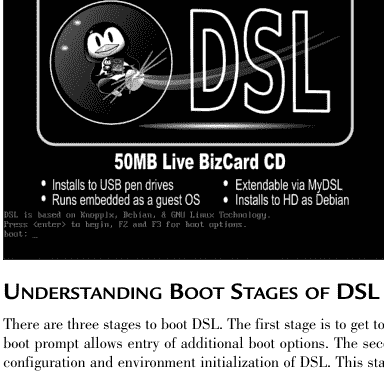

FIGURE 2-2

DSL 启动屏幕允许您为启动过程添加选项。

## UNDERSTANDING BOOT STAGES OF DSL

DSL 启动分为三个阶段。第一阶段是进入启动提示符。启动提示符允许输入额外的启动选项。第二阶段是 DSL 的自动配置和环境初始化。此阶段处理启动时选项并设置 DSL 的运行时环境。第三阶段有时是必需的，有时是请求的，用于执行自动配置不可用的额外设置——例如，串行、双按钮或 USB 鼠标、非美国键盘，或非默认的 1024x768 分辨率。

如果您的计算机可以启动 DSL CD，您应该会看到与图 2-2 所示类似的启动屏幕。

让我们更深入地了解 DSL 的启动过程。

> NOTE
>
> 本章仅涵盖与从 Live CD 正常启动任务相关的启动过程。更高级、更详细的讨论将在第 11 章“设置完整的重制环境”中介绍。

## The First Boot Stage: Choosing Boot Options

启动提示符让您可以自定义 DSL 启动过程。例如，您可以在启动时指定完全加载到 RAM 中，您的备份文件位于何处，甚至附加应用程序存储在哪里。要到达启动提示符，您可以使用 CD、软盘或 USB 闪存盘。了解此阶段的价值在于，您可以了解可用于更改 DSL 启动方式的启动选项。

> NOTE
>
> USB 闪存盘的详细信息在第 6 章“运行本地闪存盘安装”中讨论。

## Getting to the Boot Prompt

要进入启动提示符，请按照以下步骤操作：

- 1. 从计算机开机或关机开始：

  - 从计算机开机开始——如果计算机已开机，请插入 DSL CD。如果您碰巧正在运行 Windows 并且 CD 驱动器设置为自动运行模式，则会显示有关 DSL 的信息。重新启动计算机，使其从 DSL CD 启动。

  - 从计算机关机开始——如果计算机已关机，请打开它并立即插入 DSL CD。在某些计算机上，在打开电源后立即按 Pause/Break 键会暂停启动，为您提供更多时间插入 CD。再次按 Pause/Break 键以恢复启动。某些计算机有进入启动菜单的键序列；请参阅计算机的文档。您可能还想按键序列进入 BIOS 设置，以便有时间插入 DSL CD。

- 2. 启动屏幕出现——大多数较新的计算机会自动检查第一个 CD 驱动器中的可启动 CD。然后应出现 DSL 启动提示符，并显示 DSL 启动闪屏（见图 2-2）。如果您的计算机无法显示黑白 DSL 标志，您会得到一个蓝色背景，只显示三行文本和一个启动提示符。

- 3. 启动 DSL——在启动提示符处，按 Enter 启动 DSL 并接受所有默认值。如果您在 60 秒内什么都不做，DSL 将自动启动。

您是否看到了如图 2-1 所示的 DSL 桌面屏幕？如果没有，那么下一步是尝试以下各节中描述的一些启动选项。

## Help at the Boot Prompt

当显示 DSL 启动屏幕时，您应该熟悉左下角的启动提示符。在这里，您可以按 Enter、等待几秒钟，或按 F2 或 F3 查看帮助屏幕。

帮助屏幕是启动提示符选项的摘要。按 F2 或任何其他键会取消计时器，使 DSL 不会自动启动；这样，您就有足够的时间浏览所有显示的选项。

图 2-3 显示了在启动提示符下按 F2 后出现的屏幕。

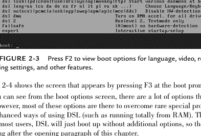

FIGURE 2-3 Press F2 to view boot options for language, video, restoring settings, and other features.

按 F3 在启动提示符下出现的屏幕如图 2-4 所示。

正如您从启动选项屏幕中看到的那样，有很多选项可以尝试。然而，其中大多数选项是为了克服罕见的特殊问题或提供增强 DSL 使用方式的方法（例如完全从 RAM 运行）。事实是，对于大多数用户来说，DSL 只需无需额外选项即可启动，因此他们可以在本章开头段落之后停止阅读。

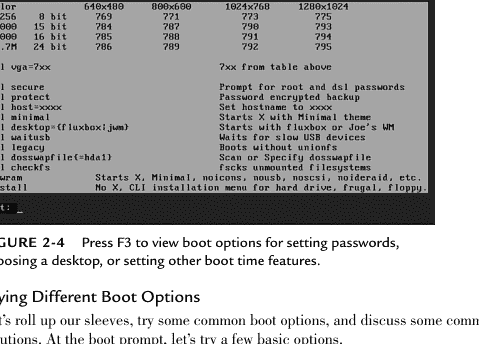

图 2-4 按 F3 可查看用于设置密码、选择桌面或设置其他启动时功能的启动选项。

## 尝试不同的启动选项

让我们卷起袖子，尝试一些常见的启动选项，并讨论一些常见问题的解决方案。在启动提示符下，让我们尝试几个基本选项。

- 视频启动选项——默认情况下，DSL 以高分辨率 `vga=791` 模式启动。这对你的计算机视频来说可能分辨率过高。使用启动选项 `vga=normal` 可能会有所帮助。

```
boot: dsl vga=normal
```

许多较旧的笔记本电脑需要 framebuffer 视频而不是 Xvesa。因此，你可能想尝试：

```
boot: fb800x600
```

请注意，我没有使用 `dsl` 作为第一个选项。根据你的笔记本电脑不同，它可能是 `fb1024x768`。如果你收到关于没有 fbdev 的错误，使用 framebuffer 可能不会有所帮助。

注意 F3 屏幕上的 vga 分辨率表（见图 2-4）。这些值中的任何一个都可以通过 `vga=` 选项来选择。

正如我所说，有时需要组合多个选项。尝试这个常见的选项组合：

```
boot: dsl vga=normal noapic noacpi pn bios=off acpi=off noapm
```

成功了吗？很好。现在，你应该再试一次，但这次逐个去掉上述选项，直到你得到启动所需的精确选项集。我们称之为针对你的特定机器微调选项。另一方面，你可能仍然面临问题，无法启动进入 DSL。


## failsafe 启动选项
一个强大的预设选项组合称为 `failsafe`。试试这个：

```
boot: failsafe
```

如果 `failsafe` 对你有效，你如何微调你的选项？你总是可以通过命令行或在 X Windows 中查看你的启动选项。在命令行或 shell 窗口中，输入 `showbootoptions`；或者从 DSL 桌面，选择 `DSLpanel`、`System Stats`、`Boot` 标签页。然后，你可以尝试通过逐个去掉 `failsafe` 显示的每个启动选项来启动。你应该这样做，因为其中一些选项会禁用声音和其他你之后想要使用和享受的功能。

## lowram 启动选项
对于内存为 64MB 或更少的机器，你可能需要考虑另一个预设选项组合。`lowram` 的使用方式与 `failsafe` 类似，并且针对低内存系统进行了优化。同样，你可能需要使用 `showbootoptions` 或 `System Stats` 的 `Boot` 标签页来查看预设选项，然后开始根据你的具体需求进行微调。

## toram 启动选项
对于内存充足的机器，你可能想尝试 `toram` 启动选项。将此选项添加到你的其他选项列表中，会将 DSL 完全加载到 RAM 中。这提供了超快的系统，因为不再需要访问 CD。你应该在首先确定你的机器所需的启动选项并至少拥有 128MB RAM 之后再尝试此操作。

# 第二阶段启动：自动配置

DSL 的第二阶段是自动配置和环境初始化。此阶段在按下第一阶段启动提示符的 Enter 键后立即开始。我们输入的所有启动选项都会被处理，以确定尝试自动配置的哪些部分。通常，此过程无需干预即可运行。图 2-5 显示了一个典型的自动配置过程。

成功完成后，此阶段通常以初始化 X Window 系统结束。X Window 系统用于承载图形化的 DSL 桌面。当然，使用启动时选项 `dsl 2` 会阻止 X 启动，并在 root 用户的 shell 提示符处终止启动过程。

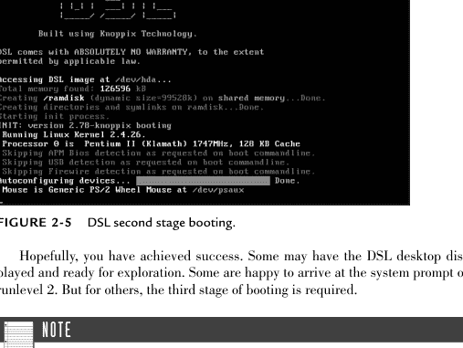

# 图 2-5 DSL 第二阶段启动过程。

希望你已经成功。有些人可能已经看到 DSL 桌面并准备进行探索。有些人很高兴到达运行级别 2 的系统提示符。但对其他人来说，需要第三阶段启动。

> 注意
>
> 如前所述，对于使用串口鼠标、双键鼠标或 USB 鼠标、外语键盘等的用户，可能希望进入 DSL 启动的第三阶段。你可以使用启动时选项 `xsetup` 来强制 DSL 进入第三阶段启动。

对于那些仍然无法继续前进的人，你可能拥有非常特殊的硬件，可能太新或太旧而不受支持。然而，借助互联网的力量和 Damn Small Linux 论坛（见 `www.damnsmalllinux.org/cgi-bin/forums/ikonboard.cgi`），仍然可以获得帮助和希望。

许多用户都浏览过这些论坛，集体知识非常丰富。尝试发布帮助请求，尽可能详细地描述你的系统。谁知道呢？也许有人和你有相同的系统，并且已经有了现成的答案。请记住，没有问题是太愚蠢而无法问的。我们都是从某个地方开始的。

## 第三阶段引导：设置 X

此阶段有时需要。它可能是指定视频引导选项的结果。也可以在使用 `xsetup` 引导选项时调用。但通常，用户永远不会看到 DSL 的第三阶段引导。

第一个屏幕（见图 2-6）允许选择要使用的 X 服务器类型。通常，如果你选择了 `fb800×600` 或类似的帧缓冲引导选项，选择就很明确。

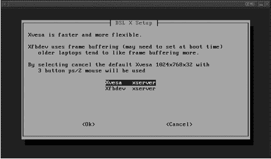

**图 2-6.** 第一个 DSL X 设置屏幕。

即使显示了此屏幕，你仍然有选择退出并使用 DSL 默认设置的选项。为此，只需按 Tab 取消然后按 Enter。如果选择了 OK，则会呈现以下一系列额外的设置屏幕。图 2-7 提示是否将使用 USB 鼠标。

图 2-8 用于串行鼠标和非滚轮 PS/2 鼠标选择。PS/2 端口是大多数 PC 背面上的圆形绿色端口。串行端口为矩形，通常标记为 `COM1`、`COM2` 等。

**图 2-7.** DSL X 设置鼠标选择。

**图 2-8.** DSL 备用鼠标选项。

图 2-9 对于拥有双键鼠标的用户至关重要。通过同时按下两个按钮，你可以模拟“第三”个按钮。许多应用程序使用或需要三键鼠标。

图 2-10 中的屏幕分辨率屏幕出现，是因为在初始 X 设置屏幕上选择了 `Xvesa`（参考图 2-6）。

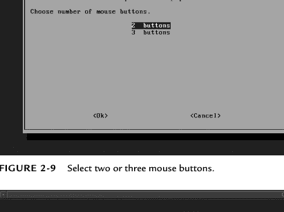

**图 2-9.** 选择两个或三个鼠标按钮。

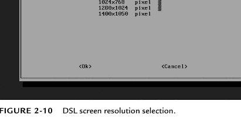

**图 2-10.** DSL 屏幕分辨率选择。

颜色深度选择，如图 2-11 所示，也是基于 `Xvesa` 的选择。位数越高代表可用颜色越多，但也可能导致桌面运行更慢。如果你选择 `Xfbdev` 作为你的 X 服务器，此屏幕不会出现。

最终的 X 设置屏幕提供键盘选择（见图 2-12）。

**图 2-11.** DSL 屏幕颜色深度选择。

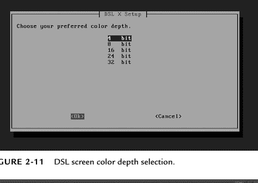

**图 2-12.** DSL 键盘语言选择。

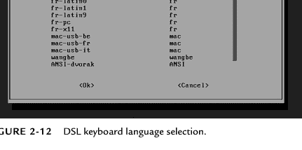

### 注意

并非 DSL 中的所有程序都支持所有语言。DSL 中选择的程序，如第 3 章“使用 DSL 应用程序”所述，是基于小尺寸和功能，而不是国际语言支持。

在选择所需键盘后，DSL 尝试启动 X Window 系统。如果一切顺利，你很快就会到达最终目的地，即 DSL 桌面（参考图 2-1）。如果你发现屏幕无法阅读或颜色严重错误，你可以继续你的探索以找到适合你特定硬件的引导代码。你可以按 `Ctrl+Alt+Backspace` 退出 X；在系统提示符下，输入 `xsetup.sh` 并为此 DSL 引导的第三阶段选择另一组选项。

在到达 DSL 桌面后，你需要保存 X、分辨率、鼠标和键盘的配置。配置备份和恢复的完整细节在第 4 章“配置和保存 DSL 设置”中介绍。

## 高级引导选项

要引导 DSL 并能够为超级用户 root 和用户 DSL 分配密码，请添加 `secure` 引导选项。如果你还计划启动守护进程——即供本地或网络使用的服务——此选项是必须的。在引导序列期间会提示你输入所选密码。例如，要启动 NFS（网络文件系统）和 SSH（安全外壳）服务，你可以在引导提示符下输入以下选项：

```
boot: dsl nfs ssh secure
```

使用 `host` 引导选项允许你设置机器的主机名。当提供其他网络服务或你恰好运行多个 DSL 盒子时，这非常有用。

如果你有较新的硬件，请将 `dma` 添加到你的引导选项列表中。这种直接内存访问方法可以加快对 CD 驱动器以及硬盘驱动器的访问速度。（过去十年内构建的大多数 PC 都支持 DMA。）

## 后台运行服务：DSL 的守护进程

DSL 提供多个本地和网络服务。这些服务在后台无人值守运行。大多数发行版启动许多后台进程。DSL 不会。事实上，这也是 DSL 不仅是一个小型发行版，而且在非常小的资源机器上运行良好的另一个原因。知道这一点后，你必须使用引导代码来启动 DSL 提供的每个服务。

你可以在 DSL 引导提示符下启动的服务包括打印服务（`lpd`）、远程登录服务（`ssh`）、计划命令执行（`cron`）、系统日志（`syslog`）、Web 服务（`monkey`）、文件传输服务（`ftp`）以及用户空间文件系统（`fuse`）。

## 摘要

成功启动 DSL 可以像插入光盘并按 Enter 一样简单。对于大多数用户来说，这就是他们的体验。鉴于规则总有例外，本章尝试引导你完成 DSL 启动的三个阶段。在每个阶段，你都会看到基于许多用户在 Damn Small Linux 论坛上提出的实际反馈、以及他们硬件的具体情况的常见示例。希望分享这些阶段能让启动 DSL 成为一种愉快的体验。

# 使用 DSL 应用

Damn Small Linux 被设计为一个功能齐全的桌面，但体积非常小。DSL 中的原生应用因其紧凑的尺寸、使用速度和功能性的结合而被选中。

DSL 开发人员和用户社区花费了三年多的时间来完善我们在 DSL 中对应用的选择，我们相信我们整体软件包的质量。在过去几年中，随着我们不断摸索出最适合我们小巧软件包的功能组合，已经进行了几次更改。

### 我们选择的逻辑

在为 DSL 选择应用时，最主要的三项问题是可靠性、库依赖性和可用性。在此过程中，我们更换了媒体播放器、电子表格应用、浏览器、文字处理器、计算器、文本编辑器，以及我们基于此构建桌面 GUI 的小部件语言。

`GTK+` 是一个用于创建图形用户界面的工具包。`GTK+` 最初是为 `Gimp` 图像编辑程序开发的。一位经验丰富的 Linux 用户可能会注意到 DSL 中没有 `GTK2` 应用，并会好奇原因。实际上，我们的许多应用都是基于较旧的 `GTK1.2` 工具包。原因有两个，即 `GTK1.2` 应用往往：


- **更小。** 它们占用空间更少，依赖项也更少。

- **更快。** 速度在 DSL 计算理念中非常重要。

分页器实际上非常方便，我们稍后会再提到它。对于没有滚轮鼠标的用户，你可以通过点击屏幕底部任务栏左侧的小箭头按钮在不同的工作环境之间切换（见图 3-1）。

**图 3-1 Damn Small Linux 桌面。**

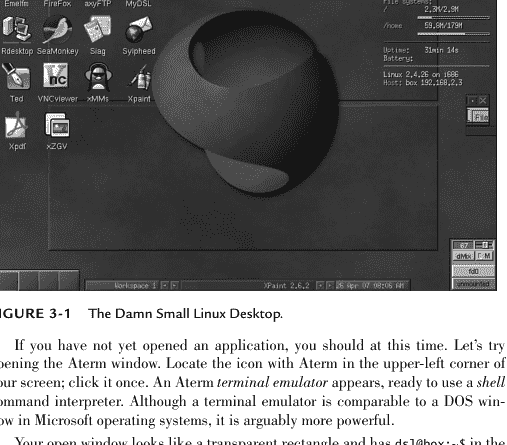

如果你尚未打开任何应用，你应该现在打开。让我们试着打开 Aterm 窗口。找到屏幕左上角带有 Aterm 的图标；单击一次。Aterm 终端模拟器出现，准备好使用 shell 命令解释器。虽然终端模拟器与 Microsoft 操作系统中的 DOS 窗口相当，但可以说它更强大。

你打开的窗口看起来像一个透明的矩形，左上角有 `dsl@box:~$`。正如你所见，Aterm 已准备好接收指令。然而，我们目前不会给它任何指令！我们打开这个 term 窗口（term 是 terminal emulator 的缩写）是为了演示另一种跳转到另一个工作区的方法。如果想将一个应用推送到工作区较少拥挤的地方，这种方法可能很有用。

在 Aterm 终端顶部，你应该会注意到一条写着 `Bash` 的栏——一端有一个点（`.`），另一端有一个下划线、一个方块和一个大 X。现在忽略它，而是将鼠标箭头移到写着“`Bash`”的位置附近。

有几种选项可以将此 Aterm 窗口移动到不同的工作区。一种方法是右键单击该栏。执行此操作会打开一个包含多个条目的菜单。现在，查看第一个条目，它写着“Send To”。将鼠标箭头移至其上；Send To 菜单项变为高亮，并打开一个 Workspace 1 子菜单。如果你选择其中一个选项，Aterm 窗口就会移动到另一个工作区。

或者，你也可以在同一栏中按下鼠标左键。与下拉菜单不同，你会得到一个多方向符号，表示你现在可以自由地将此 Aterm 窗口移动到任何你喜欢的位置。这包括通过将 Aterm 窗口移至屏幕的左侧或右侧来将其拖动到另一个虚拟工作区。试试看！如果你不习惯虚拟工作区，这可能看起来很陌生。当你多任务处理时，它们非常有用，最终你可能会依赖它们。

### Fluxbox 分页器

如前所述，左下角的应用是一个分页器；更具体地说，它被称为 Fluxter，一个专门为与 Fluxbox 配合使用而制作的轻量级分页器。Fluxter 可通过编辑 `/home/dsl/fluxbox/fluxter.bb` 文件来按你的喜好进行配置。默认设置在不拥挤工作空间的同时提供了良好的功能组合。Fluxter 智能地监控 Fluxbox 使用的主题，并更改其外观以匹配主题。

### 如何使用 Fluxter

Fluxter 使用起来非常简单。要了解它是如何工作的，请打开几个应用。随着它们出现在桌面上，注意它们在分页器中有对应的形状。见图 3-2。现在，用鼠标左键单击其中一个形状，按住鼠标按钮并移动形状。Fluxter 中形状对应的应用会在桌面上移动。如果你将形状拖动到 Fluxter 中的另一个立方体，对应的应用就会移动到它所代表的虚拟工作区。

**图 3-2 Fluxter：方块阴影代表应用。**


Fluxter 也可用于切换虚拟桌面。要执行此操作，只需在你想去的虚拟桌面上单击鼠标中键即可。

## NOTE

可以通过同时按下双键鼠标的左右键来模拟中键点击。但是，请注意，您必须配置 X 设置（`/usr/sbin/xsetup.sh`），使其默认认为您使用的是双键鼠标，而不是三键鼠标。要更改默认设置，请运行 `xsetup.sh` 脚本。运行 X 设置脚本后，在重新启动 X 服务器时将激活三键仿真。

## More Fluxbox Functionality

在每个应用程序窗口的顶部，您应该能看到四个按钮。在左侧，您可以看到一个只有一个点的按钮（:）；按下该按钮会使应用程序固定在屏幕上，意味着它将存在于所有虚拟工作区中。您可以在 Fluxbox 分页器中看到应用程序突然出现在所有立方体中。请注意，按下时点会变大。再按一次按钮，应用程序将恢复正常的虚拟桌面功能。

右侧的按钮可能更熟悉。带下划线图标的按钮用于图标化，这意味着它将应用程序从桌面空间拉到任务栏。您可以在任务栏中点击它来恢复应用程序。右侧中间带方框图标的按钮可最大化和收缩应用程序。最后，大大的 X 按钮关闭应用程序。

在顶部窗口装饰上使用左键双击，会使应用程序收起进入标题栏。Fluxbox 将此功能称为 shade。

调整应用程序大小非常简单：只需将鼠标箭头移到应用程序底部任一角，然后按住左键不放。您会注意到鼠标箭头被替换为直角图形。在按住鼠标按钮的同时移动鼠标，您会看到应用程序形状正在改变。松开鼠标，应用程序将保持新的形状。

## Grouping Applications with Tabs

Fluxbox 与其他窗口管理器区别开来的功能之一是能够对窗口化应用程序进行分组。这种强大的适配使工作环境非常节省空间且极其高效。由于这种能力，即使在 800×600 等紧凑分辨率下使用，Fluxbox 也非常愉快。

图 3-3 显示了一个多标签窗口的示例，其中当前显示的是终端。（Bash 表示在该终端中运行的 shell。）

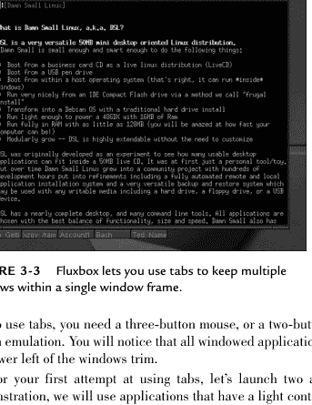

### FIGURE 3-3 Fluxbox lets you use tabs to keep multiple windows within a single window frame.

要使用标签，您需要一个三键鼠标，或一个带三键仿真的双键鼠标。您会注意到所有窗口化应用程序在窗口装饰的左下角都有一个小标签。

让我们先尝试使用标签，启动两个应用程序。对于本次演示，我们将使用对比度较轻的应用程序：Aterm 和 Dillo。点击 ATerminal 图标（左上图标）和 Dillo 图标（右上图标）以分别打开它们。现在，将鼠标箭头移到 Aterm 标签上（上面写着 Bash）。点击并按住中键鼠标按钮。

现在，在按住中键鼠标按钮的同时，将鼠标移动到第二个窗口中 Dillo 的中央。您应该会看到一个小矩形跟随鼠标移动。将该矩形拖到 Dillo 中间并松开中键鼠标按钮。现在您会看到 Aterm 占据了 Dillo 的形状和位置。Dillo 和 Aterm 共享相同的空间和窗口。

您是否注意到在窗口装饰的左下角，现在出现了两个标签？您可以通过左键点击相应的标签来切换显示的应用程序。如果您使用的是滚轮鼠标，可以将鼠标箭头移到顶部窗口装饰上并上下滚动滚轮来在应用程序之间切换。活动应用程序会以粗体字体显示。

当您调整一个标签化应用程序的大小时，所有应用程序都会随之调整大小。此外，没有数量限制。我相信很明显，这种应用程序分组如果您正在进行一个同时使用许多工具的项目，会非常方便。

我经常使用标签，特别是当我使用小尺寸或分辨率较差的显示器时。与其在小窗口中打开多个应用程序，我经常将应用程序堆叠在一起并最大化，使其处于全屏模式。我发现这种方式工作效率更高，特别是当我使用滚轮鼠标时。

可以将分组的应用程序移动到其他虚拟桌面，就像我之前描述移动单个应用程序一样。此外，您还可以通过点击窗口装饰的顶部边框区域来指定要将应用程序组发送到哪个虚拟工作区。菜单下拉后，将鼠标移到 Send Group To 上。此时，您可以通过点击其中一个选项来选择要发送到的虚拟工作区。

## Mounting Drives and Controlling Volume

在右下角查找应用程序，一个我们形象地称为 Docked.lua 的音量和驱动挂载应用程序。您会看到该应用程序基本上分为两个部分：

- **Volume Control**—顶部部分是音量控制。其功能很简单；您用鼠标移动旋钮来调节音量。带大 M 的按钮是静音——按下它声音就会停止。再按一次或调节音量，声音就会恢复。还有一个标记为 dMix 的按钮。点击它会启动更高级的音效混音器。

- **Drive Control**—在应用程序的下半部分，您会看到一条灰色条，上面有类似 hda1、sda1、cdrom 或其他变体的字样。这些是 DSL 发现可挂载的驱动器。

下方的按钮显示驱动器的状态。它会显示 mounted、unmounted 或 irregular，对应的颜色分别为绿色、红色和蓝色。要在驱动器之间切换，请点击上方的按钮。当您看到想要挂载或卸载的驱动器时，点击下方的按钮。然后，应用程序会按您的意愿执行操作，或显示错误，说明为什么无法更改挂载状态。

图 3-4 显示了 Docked.lua 工具的一个示例。

## 图 3-4 更改 Docked.lua 工具的音频设置并挂载和卸载驱动器。

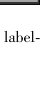

DSL 中的驱动器名称具有逻辑顺序；你只需要学习其命名规则即可：

- hda 是第一个 IDE 驱动器（主盘主设备）。

- hdb 是第二个 IDE 驱动器（主盘从设备）。

- sda 是第一个 SCSI 或 USB 驱动器。

- sdb 是第二个 SCSI 或 USB 驱动器。


对于分区，惯例是在驱动器名称末尾添加一个数字。

以下是几个示例：

- `hda1` 是第一个 IDE 驱动器上的第一个分区。
- `hdb5` 是第二个 IDE 驱动器上的第五个分区。
- `sda2` 是第一个 SCSI 或 USB 设备上的第二个分区。

通常，`hda1` 对应于 Microsoft Windows 中的 C 盘。`hdb1` 可能是你在 Microsoft Windows 中的 D 盘，但 Microsoft Windows 中的命名惯例有点神秘。

## 使用 JWM 窗口管理器

Damn Small Linux 还配备了另一个窗口管理器，名为 `JWM`——实际上，Damn Small Linux 中的 `JWM` 版本被精简了一些，部分功能被移除。`JWM` 对来自 Microsoft Windows 环境的用户来说更熟悉。`JWM` 有任务栏和开始按钮。如果你觉得 `Fluxbox` 的开放世界过于庞大，可以尝试 `JWM`。还值得注意的是，`JWM` 非常节省资源，因此如果你有一台性能非常低的电脑，可能想尝试一下 `JWM`。要尝试 `JWM`，请在 `Fluxbox` 菜单的 “WindowManager” 子菜单上点击 “Switch to JWM”。

## 使用 DSL 应用程序

在本节中，我将应用程序分为两类——GUI 和基于终端的。终端应用程序可以在窗口环境中的终端模拟器（如 `Aterm`）中使用，也可以在你处于文本模式时不使用 X 的情况下使用。因此，如果你曾经在一台无法运行 `Fluxbox` 的电脑上，被迫在命令行模式下工作，你可以放心，`DSL` 并不会让你无所适从。

好了，让我们开始查看应用程序。

## 基于 X 的应用程序

在本节第一部分，我们概述了 Damn Small Linux 中找到的基于 X 的应用程序。在这里，你可以找到大多数 Linux 发行版中常见的一些应用程序，以及一些你可能在 Damn Small Linux 中首次尝试的应用程序。

### Aterm—AfterStep 终端模拟器

`Aterm` 是我们选择的终端模拟器，因其体积小巧且可定制性强。尽管体积小，`Aterm` 功能齐全。它能够实现伪透明，而不会占用过多资源。`Aterm` 能够进行着色、字体颜色更改以及阴影设置。另一个视觉效果是，终端内容在失去焦点时会淡出。

> TIP
>
> 如果你想调整字体大小，请尝试 `Shift+KeyPad_Add` 和 `Shift+KeyPad_Subtract`。如果你想要一个易于阅读的大字体，可以从命令行启动 `Aterm`，输入 `aterm -fn 10x20`。
>
> 有关 `Aterm` 的更多信息，请参阅 `Aterm` 主页（`http://www.afterstep.org/aterm.php`）。

### The Ace of Penguins

Ace of Penguins 是一套单人游戏，包括 FreeCell、Golf、Mastermind、Merlin、Minesweeper、Pegged、Solitaire、Taipedit、Taipei 和 Thornq。我玩这些游戏玩得太多了。我建议如果你想保持高效，最好远离它们。

### AxY FTP a GUI FTP Client for X

由 Alexander Yukhimets 编写，我们在 `DSL` 中运行的 `AxY FTP` 版本是 GTK1.2 端口。`AxY FTP` 对许多人来说界面非常熟悉，因为它依赖于 1990 年代流行的经典双面板设计 `ws_ftp`（一个 Microsoft Windows 程序）。`AxY FTP` 有一个方便的会话管理器面板，可以保存你的账户和密码。它还支持递归下载、递归上传以及被动和非被动数据传输。

### Beaver—我们的 GUI 文本编辑器

`Beaver` 最初由 Damien Terrier 开发。它的名字实际上是 *Beaver is an Early AdVanced EditoR* 的缩写，这借用了 UNIX 中具有自递归名称的笑话。在 `DSL` 中，它是其体积范围内功能最丰富的编辑器。它拥有一些体积超过其两倍的浏览器所缺乏的功能。

`Beaver` 非常易用；它有多标签和在多个缓冲区中进行查找替换的能力。程序员会发现可选的颜色高亮对眼睛很友好。休闲桌面用户熟悉剪切和粘贴的典型快捷键。

`Beaver` 的另一个关键功能是能够撤销和重做操作。对于程序员来说，`Beaver` 能够打开和关闭自动换行的功能是必不可少的。`Beaver` 的一些鲜为人知的功能包括其能够将文本文档在 DOS 格式之间转换的能力。这在你在不同平台之间共享文件时非常方便。`Beaver` 还能够将文本大小写转换为大写、小写或正确大小写（每个单词的首字母大写）。`DSL` 中的 `Beaver` 版本是 0.2.7，并已更新了错误修复。

有关 `Beaver` 的更多信息，你可以访问项目的网站：`http://www.nongnu.org/beaver`。

### Calcoo—一个 RPN 和代数计算器

这个基于 GTK1.2 的计算器功能齐全，却只有 108Kbytes。有关 `Calcoo` 的更多信息，请访问其项目网站 `http://calcoo.sourceforge.net`。

### Dillo—一个非常轻量的网页浏览器

`Dillo` 是由 Jorge A. Arellano Cid 为嵌入式或其他受限系统设计的替代轻量级浏览器。这样的浏览器非常适合 `DSL`。

多年来，`Dillo` 的开发非常有条理，项目的作者非常注意编写干净简洁的代码。这意味着 `Dillo` 有一个非常坚实的基础，但它缺乏一个功能齐全的现代浏览器的特性。

尽管 `Dillo` 功能有限，但我们在 `DSL` 中使用的版本经过大量修改，并应用了多个补丁，极大地增强了其能力。我们的 `Dillo` 版本可以完成以下操作：

- 协商 SSL 页面和密码认证
- 渲染框架（frames）和内联框架（iframes）
- 文本搜索
- 执行 GUI 配置
- 支持 referer 数据
- 执行用户代理（user-agent）配置
- 执行 gzip 压缩
- 执行 meta 刷新

`Dillo` 用户会为其加载速度和页面渲染速度之快而感到惊讶。

有关 `Dillo` 的更多信息，请访问 `Dillo` 项目网站 `www.dillo.org`。关于 `Dillo` 国际化的详细信息，请参阅：`http://teki.jpn.ph/pc/software/index-e.shtml`。

### EmelFM——一个高度可配置的双面板文件管理器

`EmelFM` 拥有易于使用的界面；书签和历史记录列表；针对每种文件类型的多操作选择、文件名、大小和日期过滤器；非常方便的内置命令行；用户自定义菜单；可加载插件；以及可配置的工具栏。

在 `DSL` 中，为了方便用户，我们将 `EmelFM` 集成到桌面环境中。例如，在 `Fluxbox` 菜单中，我们同时提供了用户级和根级选项。我们还内置了用于扩展管理的 `MyDSL` 按钮，并让 `emelFM` 在适用时默认使用 `DSL` 原生应用程序。

基本上，我们对 `EmelFM` 进行了配置，使其能够在我们的轻量级环境中工作；因此，它会调用 `Aterm` 而不是 `Xterm`，还会调用我们的 `Wordview` Lua 程序（由 Robert Shingledecker 编写）来查看 Microsoft Word 文档。图 3-5 显示了一个 `EmelFM` 窗口的示例。

有关 `emelFM` 的详细信息，请访问其项目网站 `http://emelfm.sourceforge.net/`。

### Firefox——来自 Mozilla 基金会的开源网页浏览器

`Firefox` 是一款非常强大且功能丰富的浏览器。它是 Damn Small Linux 中目前最大的应用程序，但我们确实采取了一些措施来减小其体积，包括针对 GTK1.2 构建以及让我们的版本使用系统字体。

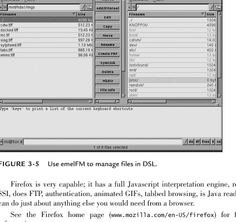

#### 图 3-5 使用 emelFM 管理 DSL 中的文件。

`Firefox` 功能非常强大；它拥有完整的 JavaScript 解释引擎，支持渲染 SSI、处理 FTP、认证、动画 GIF、标签页浏览，支持 Java，并且几乎可以完成浏览器所需的一切其他功能。

更多信息请参见 `Firefox` 主页 (`www.mozilla.com/en-US/firefox`)。

### gPhone——一款 VoIP 应用

`gPhone`，即 Gnome-a-Phone，是一款 IP 到 IP 的网络电话，使用 `librtp` 进行音频压缩。虽然 `gPhone` 并非设计用于拨打公共电话（如第 14 章“在 DSL 中使用 Skype VoIP 服务”中所述的 Skype 服务那样），但它确实包含对 RTP/RTCP 的基本支持。这使 `gPhone` 能够让你与支持这些协议的其他网络电话服务通话。

有关 `gPhone` 的更多信息，请访问 `http://gphone.sourceforge.net`。

### gRun——一个基于 GTK 的运行对话框

`gRun` 运行对话框是一个为 GTK1.2 编写的简单应用程序，它允许你无需打开 `Aterm` 窗口或选择菜单即可启动应用程序。

`gRun` 还会存储最近使用列表，因此你可以从下拉菜单中选择，以节省输入时间。


可通过根菜单中的“运行程序”访问。

## GtkFind——一个文件查找程序

GtkFind 程序为命令行 `find` 程序提供了一个出色的前端。它包含大量选项，并为不熟悉命令行的人省去了猜测的麻烦。

可通过根菜单中的 `/Applications->Tools->Find` 访问。

## Gvu——一个 PostScript 查看器

Gvu 即 PostScript 查看器，是 Siag 办公套件的一部分。它易于使用且直观。PostScript（PS）文件是一种由 `ghostscript` 解释器格式化以用于打印的文件。Firefox 等应用程序能够保存这些文件，供日后数字化查看，而不是直接发送到打印机。Gvu 可以放大 PS 文档的各个部分，这使得它在阅读困难内容时非常方便。

有关 Gvu 的信息，请参阅此网站：http://siag.nu/applets/gvu.html。

## Ted——一个简易的富文本处理器

Ted 是一个易于使用的文字处理器，可将文档保存为富文本格式（RTF）。RTF 是一种标准化的跨平台标记语言，可被许多文字处理程序读取，包括 Open Office、Gnumeric 和 Microsoft Word。Ted 有一个鲜为人知的功能，它还可以将文档保存为 HTML，而且底层代码异常简洁。Ted 的作者 Mark de Does 非常热心地为我们修复了它与 Fluxbox 的兼容性问题。

有关 Ted 的更多信息，请参阅：http://www.nl1gg.nl/Ted/。

## Siag（网格中的 Scheme）——一个电子表格程序

与当代电子表格应用程序相比，Siag 确实是一个紧凑的程序，但却非常强大。除了原生的 `.siag` 格式外，Siag 还可以读取逗号分隔值（CSV）、纯文本、Lotus 1-2-3、Scheme 代码、Open Office Calc 以及一些 Microsoft Excel 文档。

关于 Siag 的详细文档，请参阅 Siag 开发网站上的文档：http://siag.nu/online-docs/siag/siag.html。图 3-6 显示了 Siag 应用程序的一个示例。

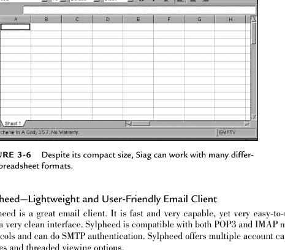

图 3-6 尽管体积紧凑，Siag 可以处理多种不同的电子表格格式。

## Sylpheed——轻量级且用户友好的电子邮件客户端

Sylpheed 是一款出色的电子邮件客户端。它快速且功能强大，同时界面非常简洁，非常易于使用。Sylpheed 兼容 POP3 和 IMAP 邮件协议，并支持 SMTP 认证。Sylpheed 提供多账户功能和线程化查看选项。

图 3-7 显示了 Sylpheed 窗口的一个示例。请参阅此处获取 Sylpheed 文档：

http://sylpheeddoc.sourceforge.net/en/manual/manual1.html

## VNC Viewer——VNC 远程桌面协议的客户端

VNC 即 Virtual Network Computing（虚拟网络计算）。VNC 是一款功能非常强大的远程桌面应用程序。使用 VNC，您可以远程管理 UNIX/Linux、Mac 和 Windows 平台的桌面。

VNC 文档请参考 RealVNC 网站（www.realvnc.com）：

http://www.realvnc.com/

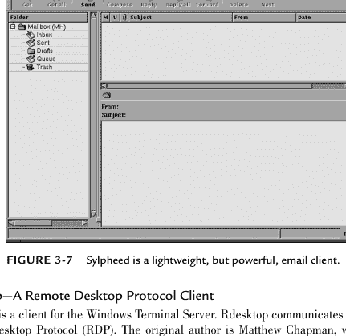

图 3-7 Sylpheed 是一款轻量但功能强大的电子邮件客户端。

## Rdesktop——远程桌面协议客户端

Rdesktop 是 Windows 终端服务器的客户端。Rdesktop 通过远程桌面协议（RDP）进行通信。原作者是 Matthew Chapman，他必须进行大量逆向工程并参考晦涩的文档才能使其正常工作。

更多信息请参考 Rdesktop 主页：www.rdesktop.org。

## Xpdf——运行在 X 下的 PDF 查看器

Xpdf 是便携式文档格式（PDF）的查看器。它设计得小巧而高效。更多信息请参考 www.foolabs.com/xpdf。

## XMMS——X 多媒体系统

XMMS 是 Linux 的媒体播放器。任何使用过 Winamp 的人都应该对 XMMS 界面感到熟悉。事实上，这两个应用程序可以共享皮肤。DSL 中的 XMMS 版本能够播放音频流、MP3、Ogg Vorbis、CD 音乐/音频、wave 文件和 MPEG 视频文件。

请注意前面提到的文件类型！DSL 中的 XMMS 版本不仅能够播放音乐文件，还能播放 MPEG 视频和音乐 CD，这使其成为一款强大的媒体播放器。

XMMS 主页是 www.xmms.org。图 3-8 显示了 XMMS 播放器的一个示例。

图 3-8 在 XMMS 播放器中播放各种音乐和其他音频文件。

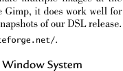

## Xpaint——一个简单的图像处理和绘画程序

Xpaint 具有一些高级功能，可以同时处理多个图像。虽然 Xpaint 不如 The Gimp 先进，但在简单的图像编辑方面表现良好。例如，我们用它对 DSL 版本进行了截图。

Xpaint 主页是 http://sf-xpaint.sourceforge.net/。

## xTris——用于 X Window 系统的多人版俄罗斯方块

Xtris 是经典俄罗斯方块游戏的单人版或多玩家版。它是一个真正的服务器/客户端应用程序，因此可以通过本地局域网或互联网连接到远程主机并与其他玩家竞争。如果没有其他玩家可用，你可以与一个或多个机器人对战以增加难度。

有关 xTris 游戏的更多信息，请参考以下页面：

http://www.ibiblio.org/pub/X11/contrib/games/xtris.README

## ZXGV——基于缩略图的图像查看器

ZXGV 是一款快速且功能实用的图像查看器。它可以旋转和调整图像大小以供查看。一个不错的功能是它可以缩放图像以适应窗口。

ZXGV 主页是 http://rus.members.beeb.net/zxgv.html。

## Xzoom 屏幕放大应用程序

这是一个很好的应用程序，适合视力受损或只是需要仔细查看桌面上某些内容的人。更多信息请参考 Xzoom 手册页：http://huygens.ca.infn.it/cgi-bin/man/man2html?xzoom+1。

## 基于终端的应用程序

Damn Small Linux 也有许多基于终端的程序。许多新手 Linux 用户对基于文本的应用程序感到畏惧，但很多人发现有些事情在终端窗口中做起来更简单。如果你是 Linux 新手，不妨给自己一个机会试试这些应用程序。你可能会发现它们的简洁令人愉快。

### ftp—一个基础的基于终端的 FTP 程序

`ftp` 工具其实非常容易使用。许多导航和观察命令与常规终端功能相同。例如，输入 `ls` 可以列出目录中可用的文件，或输入 `pwd` 查看当前工作环境。如果卡住了，只需输入 `help` 即可获得命令列表。如果需要了解某个命令的作用，只需输入 `help command`（将 `command` 替换为你感兴趣的命令名称）。

### index—个人数据库管理系统

Index 是一个极简的数据库管理系统。作者希望 Index 能被那些想要维护个人信息的数据库的用户使用。Index 易于设置和使用。只需简单输入 `index` 命令即可启动。

默认情况下，Index 开始时提供四个空数据库。有企业电话数据库（`bphone`）、用于保存你的 CD 收藏的数据库（`cdlist`）、用于保存你想要的 CD 的数据库（`cdwantlist`），以及个人电话数据库（`pphone`）。

输入你想要使用的数据库名称。然后你可以使用 Index 添加条目（`a`）、在数据库中查找条目（`f`）、以及逐条读取数据库（`r`）。完成后，输入 `s` 保存修改，`q` 保存并退出，或 `x` 退出。

### CDW CD 刻录应用程序

CDW 是使用 `cdrecord` 和 `mkisofs` 的更友好方式，它具有基于 ncurses 的 GUI。虽然熟悉命令后使用起来很容易，但 CDW 的用户应参考 `README` 以学习所有关键功能。要启动 CDW，输入 `cdw` 命令。

图 3-9 显示了 CDW 界面的示例。我们在 http://damnsmalllinux.org/docs/cdw_README.txt 有可用的主要 README 页面。

图 3-9 使用 CDW 界面复制和刻录 CD。

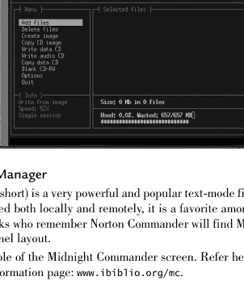

### Microcom 串行终端仿真器

Microcom 是一个类似 Minicom 的串行仿真器，支持脚本。Microcom 非常小巧（14k），因为它是为了适应基于软盘的 Linux 发行版而编写的。你可以通过输入 `microcom` 命令启动 Microcom。有关 Microcom 的更多信息，请访问其主页：


http://microcom.port5.com

### Midnight Commander 文件管理器

Midnight Commander（或简称为 `mc`）是一个非常强大且流行的文本模式文件管理器。由于 `mc` 既可本地也可远程使用，它深受 Linux 爱好者的喜爱。记得 Norton Commander 的老 DOS 用户会发现 MC 非常舒适，因为它采用双面板布局。

图 3-10 显示了 Midnight Commander 界面的示例。请在此处参考 Midnight Commander 信息页面：www.ibiblio.org/mc。

图 3-10 使用 Midnight Commander 在文本模式下管理文件。

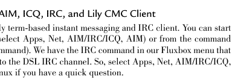

### `Naim`—一个基于控制台的 AIM、ICQ、IRC 和 Lily CMC 客户端

Naim 是一个用户友好的基于文本的即时消息和 IRC 客户端。你可以从桌面启动它（选择 Apps、Net、AIM/IRC/ICQ、AIM）或从命令行启动（输入 `naim` 命令）。我们在 Fluxbox 菜单中有 IRC 命令，可让你直接接入 DSL IRC 频道。因此，如果你有快速问题，请选择 Apps、Net、AIM/IRC/ICQ、nIRC #DamnSmallLinux。

快速开始 Naim，请查看 http://naim.n.ml.org/quickstart。

### Nano—一个简单的基于终端的文本编辑器

Nano 是著名 Pico 编辑器的 GNU 克隆，不过有一些改进使其更适合编码。改进包括正则表达式搜索和替换以及自动缩进。与 Pico 一样，Nano 异常易于使用。

Nano 的主页位于 www.nano-editor.org。

### Netrik—一个极简文本浏览器

根据作者的说法，“Netrik 是 ANTRIK Internet 查看器/浏览器/资源管理器/导航器/无论什么。” Netrik 对我们的 net-man 和 web-dictionary 应用程序至关重要。我们需要一个能够渲染 HTML，同时又足够小以不挤占其他应用程序的东西。Netrik 证明非常适合这项工作。令我们 DSL 惊讶的是，Netrik 的大小仅为 79.3Kbytes。

访问 Netrik 主页 http://netrik.sourceforge.net/。

### `smbclient`—Windows 文件共享的命令行客户端

`smbclient` 允许你以类似 FTP 的交互方式连接到 Microsoft Windows 共享网络。

有关 `smbclient` 的信息，请参考其手册页：

http://samba.org/samba/docs/man/manpages-3/smbclient.1.html

### SQLite—一个小型、自包含的 SQL 关系数据库管理系统

SQLite 小巧、稳定、可嵌入且快速。SQLite 附带一个独立的命令行程序，可在 DSL 中整合到 Bash 或 Perl 脚本中。我们还通过 murgaLua 为 SQLite 提供了 Lua 绑定。

我们有一个用 Perl 编写的个人信息管理器，它依赖 SQLite 进行后端数据库管理。

有关更多信息，请参考 SQLite 主页：www.sqlite.org。

### Vi(m)—一个高级基于终端的文本编辑器

许多人声称使用 Vim 是编辑文档最高效的方式。确实，Vim 的高级功能需要时间掌握，但在你将其记在脑中后，如此多的编辑能力触手可及，你无需将手指移离键盘。

Vim 的基本命令其实并不复杂。要查看基本命令的良好列表，请参考此 URL：http://www.selectorweb.com/vi.html。

## Lua 应用

DSL 的开发者们是编程语言 Lua（http://lua.org）的忠实粉丝。我们目前使用的是一个绑定了 Fast Light Tool Kit（FLTK）、SQLite 绑定以及网络功能的 Lua 构建版本。

这个 Lua 构建版本由 John Murga 开发，并恰如其名地以作者命名为 murgaLua。我们利用 GUI 绑定来开发许多工具、桌面实用程序以及命令行应用程序的前端，例如 DSL 控制面板和 MyDSL 管理器。

图 3-11 显示了依赖于 murgaLua 的工具示例。有关 murgaLua 的信息可以在这里找到：www.murga.org/devPages/murgaLua/index.html。

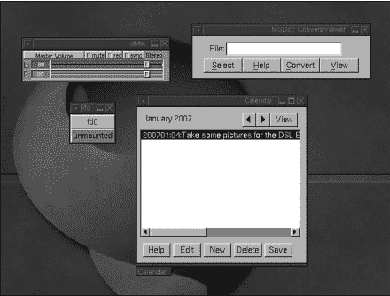

**图 3-11** 依赖于 murgaLua 的 DSL 工具包括 dMix、MSDoc、Calendar 和 `Mount.lua`。

以下是 DSL 中依赖于 murgaLua 的一些工具的简短列表。

### MS Word 查看器

这是一个用于命令行 `antiword` Microsoft Word 查看器的前端。使用此应用程序，你可以选择要查看的 `.doc` 文件并选择是否要将文档以 PDF 或 PostScript 格式查看。

### Calendar

这个巧妙的程序基于 murgaLua 和 PSeal 构建，可以帮助你保持井然有序。Calendar 在格式化日程安排方面做得非常出色，日程会以易于阅读的日历格式显示。

### dMix

dMix 是声音音量控制 `umix` 的 GUI 前端。dMix 非常简单易用，允许用户独立控制左右声道的音量控制，或将其同步以实现快速音量控制。

### `Mount.lua`

这是一个点击式挂载和卸载存储设备（软盘、CD-ROM 和磁盘分区）的 GUI 工具。

### Docked

docked 工具与 Fluxbox 一起使用，它整合了 dMix 和 `Mount.lua` 的许多实用功能。

## 守护进程应用程序

守护进程是一种在后台运行、等待被请求使用的程序。守护进程通常执行特定功能，如远程连接或打印。

Damn Small Linux 配备了四个守护进程来帮助与外部世界交互。它们是 Open Secure Shell、NFS、BetaFTP 和 Monkey Web Server。请注意，所有这些守护进程服务默认都是关闭的，你需要启用它们。服务可以通过 DSL 控制面板或 Fluxbox 菜单中的 System、Daemons 子菜单进行控制。另请注意，你必须设置用户密码才能通过 Secure Shell 或 FTP 协议远程登录到 Damn Small Linux 计算机。

### Open Secure Shell

尽管大多数发行版都标配了它，但许多人会惊讶地发现 Damn Small Linux 配备了 OpenSSH 安全 shell 守护进程。这使得可以通过以用户 `dsl` 或 `root` 登录的方式安全地访问运行 Damn Small Linux 的远程计算机。使用 `scp`（用于在计算机之间远程传输文件的命令行实用程序），也可以安全地将文件远程传输进或传出 Damn Small Linux。Damn Small Linux 既有服务器也有客户端工具来执行远程 shell 操作和 SCP 文件传输。此外，Damn Small Linux 还配备了一个非常方便的实用程序，允许通过 SSHD 远程挂载文件系统；该实用程序名为 `SSHFS`，我们非常喜欢它！

有关 OpenSSH 的信息，请访问手册页 www.openssh.com/manual1.html。

有关 SSH 文件系统的更多信息，请访问 http://fuse.sourceforge.net/sshfs.html。

### BetaFTPD

BetaFTPD 是一个极其小巧（27K）的单线程 FTP 服务器。其小巧的体积使其非常适合 Damn Small Linux，其作者 Steinar H. Gunderson 认为单线程使其更安全，同时对内存也更友好。然而，我们主要包含 BetaFTP 是为了在没有访问 SCP 客户端时实现跨平台文件共享。

有关 BetaFTPD 的更多信息，请访问 http://betaftpd.sourceforge.net/。

### 网络文件系统

顾名思义，网络文件系统（NFS）是一种允许通过远程挂载磁盘分区在网络上共享文件的系统。其概念与 Windows 文件共享系统类似。Damn Small Linux 配备了 NFS-Common，它提供了一套工具集，允许你使用 NFS 协议。

开发者说明：在许多方面，使用 Secure Shell 的 `SSHFS` 可以作为 NFS 的替代方案。许多人发现它更容易使用且更安全。

你可以在 http://nfs.sourceforge.net/nfs-howto/ar01s02.html 找到 NFS howto 页面。

### Monkey Web Server


Monkey Web Server 是一个简单且小巧的 Web 服务器，但易于配置并支持服务器端脚本。我们为 Monkey 包含了一个入门页面作为 localhost 的默认主页。要查看它，只需访问控制面板并点击 Monkey Web 按钮，然后将你的 Web 浏览器指向 `http://localhost`。服务器文件位于 `/opt/monkey/`，如果你想自定义设置。

Monkey Web Server 网站可以在 `http://monkeyd.sourceforge.net/` 找到。

## 摘要

就是这样：我们主要窗口管理器、基本桌面功能以及应用程序核心的概述。关于 DSL 还有更多内容需要学习，但希望本章足以让你开始探索。需要记住的一点是：从 CD 运行 DSL 时，你无法破坏 DSL。所以，不要害怕探索，尽情享受乐趣，让指甲沾点灰吧。

## 配置和保存 DSL 设置

创建 Damn Small Linux（DSL）面临的最大挑战之一是打造一个集成桌面。通常的集成桌面环境如 KDE 或 GNOME 都太大了。即使是 Xfce 等也并非最小的。John Andrews 最初选择了 Fluxbox 窗口管理器和一个名为 XtDesk 的图标程序。后来，我创建了 GUI 配置程序，以提供一定的集成感。无论你喜欢 Windows 风格的双击还是单击图标，现在设置起来都很简单。

DSL 的小巧也得益于 John 精心挑选的应用程序。但其中许多应用程序具有多种不同的用户界面。John 和我一直在改进 GUI 界面程序。其目的是提供一个通用、一致的用户界面。

DSL 也继续支持 CLI 或命令行界面程序。因此，创建这些新 GUI 程序的额外挑战是继续支持 CLI 版本。这里不可能涵盖所有可想到的配置。许多程序的设置可以在其各自的主页上找到。当然，John 和我创建的所有自定义应用程序和 GUI 界面都将得到全面介绍。

本章将涵盖 DSL 配置的大多数基本方面。涵盖的主题包括备份和恢复、桌面、连接网络、打印和网络备份。让我们从备份和恢复程序开始。如果无法将其包含在备份中并在下次系统启动时恢复，那么配置任何东西都没有意义。

`.filetool.1st` 文件的默认内容会导致整个 `home/dsl` 目录被备份。但是，你可以选择仅有选择性地备份某些文件。

> 注意
>
> 必须注意，条目 `/home/dsl/.filetool.1st` 必须不要从 `.filetool.1st` 中移除，因为这为 `.filetool.1st` 提供了持久性。

DSL 3.3 中默认的 `.filetool.1st` 文件如下所示：

- `opt/ppp`
- `opt/bootlocal.sh`
- `opt/powerdown.sh`
- `opt/.dslrc`
- `opt/.mydsl_dir`
- `home/dsl/`

### 从备份中排除文件和目录

使用文件 `/home/dsl/.xfiletool.1st` 从备份中排除文件。将条目添加到此文件即可将其从备份中排除。缓存和其他文件在默认的 `.xfiletool.1st` 中：

```
/home/dsl/.xfiletool.1st
```

此文件列出了 `.filetool.1st` 中文件的例外，这意味着如果你在 `.filetool.1st` 中列出了一个目录，你可以使用 `.xfiletool.1st` 来防止该目录中的某些文件或子目录被添加到你的备份中。

此文件通过使用模式匹配而不是完整文件路径名来工作。这样，你就可以排除可能在不同目录中找到的同名多个文件。如果你想排除特定文件，仍然可以使用文件的完整路径。DSL 3.3 中的默认文件如下所示：

- `Cache`
- `XUL.mfasl`
- `home/dsl/mnt`
- `home/dsl/.wmrc`
- `home/dsl/opera/cache4`
- `home/dsl/opera/images`
- `home/dsl/fluxbox/mydsl.menu`

请注意，`Cache` 是在没有路径的情况下列出的，这意味着在 `.filetool.1st` 中列出的目录内的所有名为 `Cache` 的文件都将被排除在备份之外。你也可以使用通配符来扩展排除范围。例如，如果列出 `Cache*`，则所有名称以 `Cache` 开头的文件都将被排除。

### 恢复你的设置

你所选文件和目录的备份会在启动过程中自动搜索并恢复。无需用户交互。DSL 会根据添加到 `/etc/fstab` 文件中的检测到的驱动器顺序，搜索你的存储介质上的备份归档。它会检查每个磁盘分区，直到在其中一个设备的根目录中找到 `backup.tar.gz` 文件。

你可以通过指定保存备份文件的设备来覆盖此功能：

```
boot: dsl restore=hda2
```

指定恢复设备实际上会加快启动过程，因为无需搜索已连接且可用的物理设备。但是，不指定恢复启动选项意味着免提自动启动。

> 注意
>
> 如果你某时决定不想使用备份的设置，请在 DSL 启动命令中添加 `norestore` 选项。如果你想永久删除设置，请从其存储的设备的根目录中删除 `backup.tar.gz` 文件。

恢复选项与 `.xinitrc` 文件一起使用，为用户提供了对其首选环境的更多控制。请参阅“配置桌面”部分，了解有关使用 `.xinitrc` 文件和其他功能以选择在桌面启动时启动哪些设置和应用程序的更多信息。

既然我们已经介绍了备份和恢复，让我们继续进行桌面配置选项。

### 配置桌面

在备份程序就位后，将桌面配置为你喜欢的偏好设置是下一步的好选择。首先选择桌面界面，然后以你喜欢的方式设置图标、背景和壁纸。

## 选择桌面环境

Fluxbox 是 Damn Small Linux 默认使用的窗口管理器。DSL 还允许你切换到 Joe’s Window Manager（JWM），如果你更喜欢的话。JWM 提供了一个桌面界面，其与 Microsoft Windows 桌面界面有些相似。DSL 中 JWM 的版本是对原始 JWM 进行大量修改并精简后的版本。

你可以通过显示桌面菜单（右键单击桌面）并选择 `WindowManager, Switch to JWM` 来更改窗口管理器。你可以从桌面菜单中选择 `Exit, Switch to Fluxbox` 来切换回 Fluxbox。（在切换窗口管理器之前，请记住，此操作将重新启动 X Window 系统并关闭你已打开的任何应用程序。）

你可以通过编辑 dsl 主目录 (`/home/dsl`) 中的配置文件来添加在桌面启动时打开的应用程序。例如，通过编辑 `.xinitrc`，你可以启动你喜欢的 X 程序。你可以通过编辑 `.bash_profile` 来启动非 X 程序，然后将其添加到你的 `filetool.lst` 中。

如果需要加载额外的模块和系统特定所需文件，你可以编辑 `/opt/bootlocal.sh` 文件，然后将其添加到你的 `filetool.lst` 中。

## 管理图标

大多数发行版都可以使用预构建的集成桌面系统，甚至图标管理系统，例如 Rox (`http://rox.sourceforge.net`)。为了保持 DSL “越小越好” 的主题，使用了 XtDesk 图标程序。挑战在于，虽然 XtDesk 图标功能非常强大，但没有 GUI 配置工具。我创建了一个小型 Lua/Fltk GUI，并对 XtDesk 代码做了一些修改，从而创建了 DSL 独特的图标管理工具。

首先，让我们讨论标准的 XtDesk 编辑功能。当你右键单击一个图标时，会出现一个小的弹出窗口。有时，弹出窗口包含启动的替代或相关程序，并且弹出窗口的底部部分标记为 Properties。单击 Properties 会弹出一个类似于图 4-3 所示的屏幕。

你可以移动框形光标并编辑任何图标属性。`MenuCommand1` 选项是启动程序的替代右键方式。`Status` 选项是 DSL 自定义的，应用于基础应用程序。额外的名为 MyDSL 扩展的应用程序不应使用 Status 字段。通常，此屏幕用于手动更改 X 和 Y 坐标、更改标题等。

### 图 4-3 编辑图标属性以更改应用程序的行为。

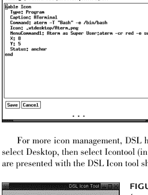

为了进行更多图标管理，DSL 拥有自己的 Icon Tool。从主菜单中选择 Desktop，然后选择 Icontool（在 JWM 中，选择 Setup, Desktop, Icontool）；你将看到如图 4-4 所示的 DSL Icon 工具。

### 图 4-4 选择是否显示图标（或不显示）以及单击或双击。

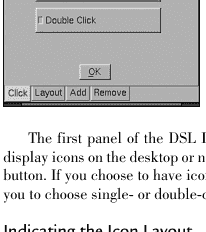

DSL Icon Tool 的第一个面板很明显。这里是你选择是否在桌面上显示图标。单击你选择的按钮，然后单击 OK 按钮。如果你选择显示图标，第二组按钮将被启用，允许你选择单击或双击来启用图标的关联操作。

## 指定图标布局


当选择 `Layout` 选项卡时（见图 4-5），你可以选择使用屏幕 X 和 Y 坐标或自动布局。如果你想使用 X 和 Y 坐标，那么同时从 `Click` 选项卡中选择 `Double Click` 也是有意义的。使用 `Double Click` 意味着第一次单击选择图标；因此，你可以将图标拖放到你想要的位置。

### 图 4-5 从 Layout 选项卡指示图标在屏幕上的排列方式。

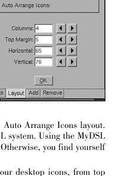

`DSL` 的默认设置是 `Single Click` 和 `Auto Arrange Icons` 布局。这工作得很好，尤其是在与 `MyDSL` 系统一起使用时。使用 `MyDSL` 系统和自动布局可以使系统更美观。否则，你会发现自己不断调整图标。

自动布局提供了对桌面图标的很大控制，从顶部边距、列数到垂直和水平间距。当然，与任何配置更改一样，备份恢复会使你的更改在重启后保持持久。

## 添加新的桌面图标

`Icon` 工具的 `Add` 面板允许轻松添加桌面图标（见图 4-6）。`DSL` 附带了一些内置的通用图标。所有 `XtDesk` 图标系统的图标都存储在 `/home/dsl/.xtdesktop` 中。在那里，你可以从自己的收藏中添加更多图标。

要开始使用 `Add` 选项卡，请从列表中选择一个图标。然后，只需填写表单。为你的图标指定一个标签。仅当你使用手动布局方法时才指定 X 和 Y 坐标。最后，输入应用程序可执行文件的完整路径。

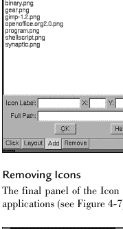

图4-6 在“添加”选项卡中，你可以向DSL桌面添加更多图标。

## 删除图标

图标工具的最后一个面板允许删除DSL标准基础应用程序（参见图4-7）。

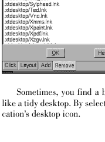

图4-7 指定要从DSL桌面删除哪些图标。

有时，你会发现一个你从不使用的内置应用程序。或者，也许你喜欢整洁的桌面。通过从上述列表中选择，你可以移除该应用程序的桌面图标。

## 注意

当你选择将其从桌面移除时，实际上并没有删除该应用程序。`DSL`作为live CD或其模拟，意味着基础系统是一个压缩的只读文件。此过程实际上只是隐藏所选图标。事实上，如果你查看图标目录 `/home/dsl/.xdesktop`，你会看到使用了`.hide`文件扩展名。要真正删除基础应用程序，需要进行完整的重新定制（remastering）。这个高级主题将在第11章“设置完整的重新定制环境”中讨论。

## 选择背景和壁纸

由于`DSL`有两个默认窗口管理器，更改背景图像甚至选择颜色都需要一个自定义程序。你可以通过桌面图标控制面板中的“背景”按钮访问该程序；或者从主菜单中选择“桌面”，然后点击“壁纸”以查看`DSL`背景选择器工具（参见图4-8）。

图4-8 使用壁纸/背景工具更改桌面背景。

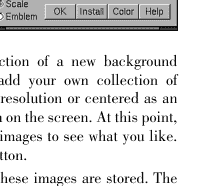

壁纸/背景工具允许选择新的背景图像。你可以从显示的列表中选择，或添加自己收藏的图片。图像可以缩放以适应屏幕分辨率，或作为徽标居中显示。点击“确定”后，你可以在屏幕上看到所选项目。此时，它尚未安装。这允许你尝试不同的图像，看看自己喜欢哪个。确定选择后，点击“安装”按钮。

按下“帮助”按钮，你可以查看这些图像的存储位置。建议添加更多图像的方法是将它们存储在 `/home/dsl/.fluxbox/backgrounds` 中。

`DSL`背景选择器工具还允许选择颜色。按下“颜色”按钮会显示一个颜色选择器，如图4-9所示。

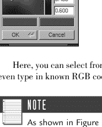

图4-9 选择用于DSL背景的颜色。

在这里，你可以从几乎任何可能的颜色或其任意色调中进行选择，甚至可以输入已知的RGB代码。

## 注意

> 如图4-9所示，所选的蓝色是`DSL`中`JWM`窗口管理器使用的默认背景。如果你选择了背景图像并希望恢复原始背景颜色，请使用这些设置。

你使用`DSL`背景选择器工具所做的任何选择都会通过标准的备份恢复过程持久保留。

## 设置日期和时间

要设置系统的日期和时间，请从`DSL`控制面板中选择“日期/时间”。从主桌面菜单中选择“系统”，然后选择“设置日期时间”。如果你恰好使用`JWM`桌面，可以点击任务栏右下角显示的时间。选择自定义日期应用程序后，将显示图4-10。

使用箭头将显示的值调整为正确的日期和时间。按下“确定”按钮。会显示一个小弹出窗口，要求你重启窗口管理器，以便桌面上的显示时间能够更新。仅当你使用标准的`Fluxbox`桌面时才需要此步骤。要重启`Fluxbox`，请从主系统菜单中选择“窗口管理器”，然后选择“重启”。此日期应用程序还会写入系统硬件时钟，因此即使在重启后，正确的日期和时间也应保持不变。

桌面会重启，任何打开的窗口都将关闭。因此，在点击“确定”之前，请务必保存你的工作。

## 连接到网络

要连接到互联网或其他网络，`DSL`包含用于配置调制解调器、有线以太网和无线以太网连接的配置工具。如果你的计算机具有能够访问互联网的物理有线以太网连接，它可能会自动启动，无需你进行任何配置。如果需要手动配置，请参阅以下各节。

## 配置调制解调器

`DSL`支持基于硬件的拨号调制解调器。几乎所有外部调制解调器都是基于硬件的。有一类调制解调器并非完全功能的硬件设备。这类调制解调器称为`WinModems`。`WinModems`的固件是专门为在Microsoft Windows上运行而创建的。因此，对于Linux来说，这些设备的行为不像标准调制解调器。

正如你可能预料的那样，大多数Linux发行版对`WinModems`的支持有限。事实上，有些`WinModems`是专有的。`DSL`支持最流行的`WinModems`之一，即`Lucent Technologies Ltmodem`。

从`DSL`控制面板图标中，点击“拨号”；或者从主菜单中，点击“系统”、“网络设置”，最后点击“拨号PPP”。会出现一个“PPP拨号”弹出窗口，如图4-12所示。

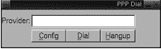

图4-12 配置PPP拨号连接时选择一个提供商名称。

要开始设置拨号PPP连接，请点击“配置”按钮。设置过程会经过许多屏幕。第一个是`pppconfig`主菜单，如图4-13所示。

主屏幕允许创建、更改和删除各个ISP提供商信息。让我们逐步完成提供商连接的创建。使用`Tab`键向下移动到“确定”并按回车。

下一个屏幕提示你为此连接记录输入唯一名称。你应该使用简单的单字标识符。例如，你雇主的连接信息可以称为`work`或`office`。注意，名称不能包含空格。输入名称后，使用`Tab`键向下移动到“确定”并按回车键。

**图 4-13** 开始设置 PPP 连接。

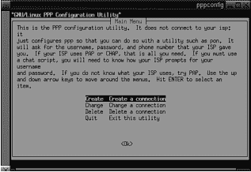

下一个屏幕（如图4-14所示）非常重要。它决定了你的 ISP 如何提供域名服务器信息。域名服务器通过名称提供对互联网站点的访问。如果没有正常工作的域名服务器，你的连接看起来就会像中断了一样。

**图 4-14** 选择动态或静态 DNS 服务。

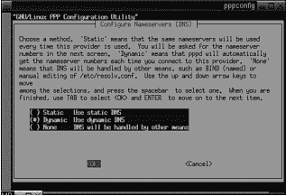

下一步是指定用于验证身份认证的握手方法。通常，使用 `PAP` 并应将其高亮显示，如图4-15所示。

下一步将显示用户名屏幕。在此屏幕中，你应该用提供商为你的账户分配的用户名替换示例文本。大多数情况下，这是一个单词。有时，它包含 ISP 名称，例如 `username@ispname`。你应该使用 ISP 提供给你的确切用户名。然后，按 `Tab` 键选择 `OK` 继续。

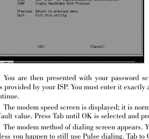

然后会显示密码屏幕。输入 ISP 提供的密码。你必须严格按照提供的内容输入。然后按 `Tab` 键选择 `OK` 继续。

显示调制解调器速度屏幕；保留默认值即可。按 `Tab` 键直到选中 `OK`，然后按 `Enter` 继续。

出现调制解调器拨号方式屏幕。你应该使用默认的音频（Tone）拨号，除非你仍然使用脉冲（Pulse）拨号。按 `Tab` 键选择 `OK` 并按 `Enter`。

接下来，输入拨号访问 ISP 所需的号码。不要包含短横线或空格。全部输入为数字。按 `Tab` 键选择 `OK` 并按 `Enter` 继续。

下一个屏幕提示你搜索调制解调器。按 `Tab` 键选择 `Yes` 并按 `Enter` 继续。通常，你必须指定调制解调器设备。如果你恰好使用 `WinModem`，则尤其如此。`DSL` 支持的唯一 `WinModem` 是 `Lucent WinModem`。

如果你看到如图4-16所示的屏幕，请使用帮助文本将 COM 端口转换为 `DSL` 要求的设备名称。在图4-16中，我为 `COM2` 输入了 `DSL` 设备名。现在，如果你恰好有 `Lucent WinModem`，请输入 `/dev/ttyS14`。输入设备名称后，按 `Tab` 键选择 `OK` 并按 `Enter` 继续。


如图4-17所示的屏幕显示了你所有具体数据的摘要。非常重要的一点是，你必须先选择 `Finished`，然后按 `Tab` 键选择 `OK` 并按 `Enter`。

图 4-16 输入代表连接到调制解调器的 COM 端口的 Linux 设备名。

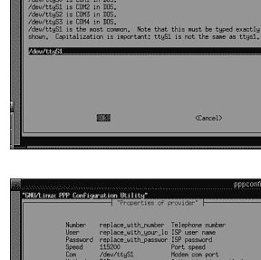

图 4-17 如果 PPP 拨号设置看起来正确，请选择 `OK` 保存这些设置。

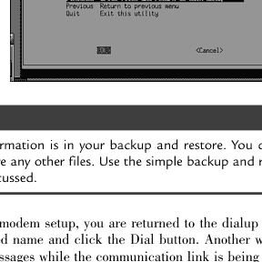

**注意**

你的所有设置信息都在备份和恢复中。你不需要编辑或准备任何其他文件。使用之前讨论过的简单备份和恢复过程即可。

完成调制解调器设置后，你会返回到拨号对话框。只需输入提供的名称并单击 `Dial` 按钮。另一个窗口会打开，并在建立通信链路期间显示所有消息。你不需要关心这些消息的细节。但是，如果出现错误，你需要了解可能的错误内容，以便从 ISP 或 DSL 论坛获得进一步帮助。在消息日志接近末尾处，会显示本次拨号会话分配给你的实际 IP 地址。当你看到 IP 地址时，说明通信链路已建立，你可以开始使用 DSL 附带的 Internet 应用程序。

## 以太网配置

DSL 支持有线和无线以太网连接。如果你无法自动连接到网络，以下小节将帮助你手动配置以太网连接。

### 有线选项

由于 DSL 启动时会自动发出 DHCP 请求，通常无需任何操作即可立即访问网络。对于有更高需求的用户，DSL 提供了 `Netcardconfig` 程序。要访问此程序，可以从 DSL 控制面板中选择 `Netcardconfig`；或者从系统菜单中选择 `System`、`Net Setup`、`Netcardconfig`。

按照提示逐步回答。如果你连接到具有可用 DHCP 服务器的设备或 LAN，可以选择 `Yes`，很可能就能连接到互联网。如果无法检测到 DHCP 服务器，或者需要手动配置地址，请选择 `No`。然后系统会要求你输入静态 IP 地址、子网掩码、广播地址、默认网关和 DNS 域名服务器。如果你不知道这些信息，请联系你的 Internet 服务提供商寻求帮助。

### 无线网络

无线网络访问无法在初始时自动设置，因为它需要网络接入点和加密密钥。你应该始终使用 `nodhcp` 启动选项启动系统。DSL 尝试连接到 DHCP 服务器可能会妨碍你手动设置无线连接，而 `nodhcp` 可以防止这种情况发生。

所有 DSL 无线设置尝试都会在正常关机时被自动检测到。系统会提示你保存无线设置。每个自定义 GUI 都会为你的无线设置信息创建一个脚本。这些脚本可以在 `/opt` 目录中找到。

许多旧式无线网卡可以使用 `iwconfig`、`Prism2 config` 或 `wlanconfig` 工具。然而，对于尚无可用开源驱动的较新无线网卡，你可能需要使用 `NDISwrapper`，它允许你提供无线网卡的 Windows 驱动程序，使该网卡在 Linux 中工作。

某些无线 PCMCIA 卡在某些老旧硬件上启动时会使系统挂起。我建议你在此查看一份在 DSL 中已验证可用的无线卡列表：

```
http://www.damnsmalllinux.org/wiki/index.php/Verified_Wireless_Cards
```

## 原生无线配置工具

DSL 提供了几个简单的 GUI 工具来帮助进行无线设置，仅包含最常用的必填字段。如果你的需求更复杂，`Wlanconfig` 程序会提示几乎所有可设想的选项。

你可以从 DSL 控制面板或从系统菜单中选择 `Wlanconfig`，选择 `系统`、`Net Setup`、`Wlanconfig`。然而，大多数用户只需要图 4-18 中显示的简单 GUI 工具即可。

图 4-18 使用简单的图形化 `iwconfig` 工具配置无线连接。

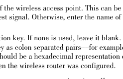

- `SSID` 字段是无线接入点的名称。可以留空以使用最近或信号最强的接入点。否则，输入接入点的名称。
- `WEP` 字段是加密密钥。如果未使用，则留空。否则，你必须以冒号分隔的对形式输入密钥——例如，`12:34:56:78:FF`。该密钥应为在配置无线路由器时输入的加密密钥的十六进制表示。

准备尝试连接时按 `OK`。会弹出一个小窗口显示连接尝试的结果，如图 4-19 所示。

图 4-19 添加信息以识别你的无线接入点和加密密钥。


## 使用 NDISwrapper 的其他无线卡

如果发现你的无线卡未被 DSL 内置的驱动程序原生支持，那么万能的无线解决方案是 `NDISwrapper`。`NDISwrapper` 使用与 Microsoft Windows 相同的驱动程序。驱动程序可以从购买无线卡时附带的软件光盘中获取。驱动程序也可以从厂商的支持网站获取。

一个非常好的选择 Windows 驱动程序的来源就是 `NDISwrapper` 官网本身：

```
http://ndiswrapper.sourceforge.net/mediawiki/index.php/List
```

要打开 `NDISwrapper` 设置窗口，请从 DSL 控制面板中选择 `NDISwrapper` 按钮。`NDISwrapper` 设置窗口显示如图 4-20 所示。

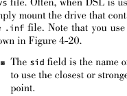

使用 `NDISwrapper` 通常意味着需要两个文件：一个 `.inf` 文件和一个 `.sys` 文件。通常，当 DSL 在也运行 Windows 的机器上使用时，你可以简单地挂载包含 Windows 的驱动器并指定 `.inf` 文件的完整 Windows 路径。请注意，你使用的是正斜杠而不是反斜杠，如图 4-20 所示。

- `SSID` 字段是无线接入点的名称。可以留空以使用最近或信号最强的接入点。否则，输入接入点的名称。
- `WEP` 字段是加密密钥。如果未使用，则留空。否则，你必须以冒号分隔的对形式输入密钥——例如，`12:34:56:78:FF`。该密钥应为在配置无线路由器时输入的加密密钥的十六进制表示。

准备尝试连接时按 `OK` 按钮。会弹出一个小窗口显示连接尝试的结果。

这里值得注意的是，有时希望手动输入 `NDISwrapper` 命令并测试每一步的结果。要这样做，你必须打开一个超级用户终端窗口。从 `Aterm` 图标中，右键单击选择 `Aterm as Super User` 以打开此终端窗口。以下是手动步骤：

```
# ndiswrapper -i NET8180.INF
# ndiswrapper -l
# modprobe ndiswrapper
# iwconfig
```

这些是查看 `NDISwrapper` 和两个 Windows 驱动程序是否可以访问你的卡的最小手动命令。如果 `iwconfig` 命令的结果显示 `wlan0`，你就知道可以使用 GUI 继续配置该卡。

## 使用 Apsfilter 打印

DSL 内置的打印系统是 `Apsfilter`。选择该打印子系统是因为它是当时可用的最小打印服务之一。

首先，你必须先设置打印机：使用 DSL 控制面板，选择 `Printer Setup` 或从主菜单中选择 `系统`、`Printing/lpd`、`Configure Printer`。

出现的第一个屏幕是许可屏幕。通过输入 `y` 并按 `Enter` 接受许可。然后你会看到一系列屏幕，其中一个关于 `Apsfilter` 系统创建者的电子邮件和其他信息屏幕。你可以接受电子邮件地址的提供，也可以按 `Enter` 阅读信息屏幕。当你看到 `/usr/share/apsfilter` 的权限屏幕时，输入 `y` 并按 `Enter`。因为你是从实时 CD 或其仿真运行，所以这些权限已为你预设。接下来，会出现 添加另一台打印机 或 覆盖现有条目 屏幕。如果这是第一次添加打印机，输入 `a` 并按 `Enter`。

图 4-21 显示了你开始为打印机进行实际设置的屏幕。通常，只需要前三个步骤。

### 打印机驱动程序选择

在本例中，我将设置我的 HP4050TN PostScript 打印机。第一步是输入 `1` 并按 `Enter` 键。打印机驱动程序选择屏幕出现，如图 4-22 所示。

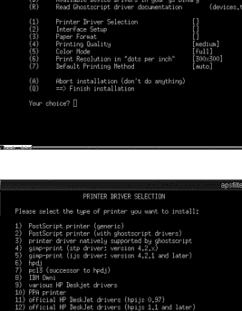

图 4-21 在 DSL 中使用 `Apsfilter` 配置打印机。

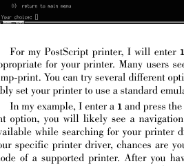

图 4-22 选择为打印机使用的驱动程序。

对于我的 PostScript 打印机，我将输入 `1`。你应选择适合你打印机的选项。许多用户似乎使用选项 `4` `gimp-print` 取得了不错的效果。你可以根据打印机尝试几种不同的选项，或者可能将打印机设置为使用标准仿真


在我示例中，我输入 `1` 然后按 Enter 键。如果你选择了不同的选项，你可能会看到一个导航屏幕。该屏幕显示在搜索打印机驱动程序时可用的选项。同样，如果你无法找到特定的打印机驱动程序，很可能你的打印机可以提供受支持打印机的仿真模式。在你选择打印机驱动程序后，主设置屏幕会出现。你现在可以准备选择接口。输入 `2` 并按 Enter。接口设置屏幕会出现。

## 打印机接口设置

接口设置屏幕如图 4-23 所示，其选项相当明显。在此示例中，我将使用网络打印，使用我 HP4050TN 中的 JetDirect 网络卡。在我的情况下，我输入 `3` 并按 Enter 键。

图 4-23 选择打印机连接到系统的接口或设备。

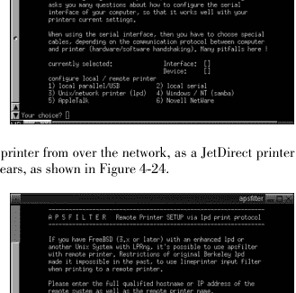

在你通过网络选择打印机后，如 JetDirect 打印机，会出现网络设置屏幕，如图 4-24 所示。

图 4-24 确定远程打印机的名称和 IP 地址。


要使用 JetDirect 或其他 UNIX 网络打印机，首先输入分配给打印机的内部 IP 号。在图 4-24 中，你可以看到我输入了地址 `10.1.3.8`，这是我的 JetDirect 卡的 IP 号。由于我使用的是 JetDirect 卡，我的远程打印机名称为 `raw`。如果你使用其他接口选择，会出现其他屏幕供你选择打印机端口，通常比网络打印机更容易设置。

例如，假设你没有网络打印机，而是选择了本地并行/USB 打印机，即接口设置屏幕上的选项 `1`。在这种情况下，而不是网络屏幕，你会看到设备选择屏幕。由于 DSL 基于 Linux，你从 Linux 选项中选择。通常，打印机直接连接到 `LPT1` 端口。因此，对于并行连接的打印机，你输入指向 `LPT1` 的 Linux 设备的完整路径，即 `/dev/lp0`；或者，如果你的打印机通过第一个 USB 端口连接，你输入 `/dev/usb/lp0`。

在你选择打印机设备后，你再次返回主设置屏幕。请注意，在主设置屏幕上，随着选项的被选择，它们会显示在此屏幕上。你现在可以准备选择打印机的纸张格式。从主设置屏幕选择选项 `3`。

## 纸张格式

显然，纸张格式选择是最容易的选择之一（见图 4-25）。选择你的纸张尺寸并按 Enter。

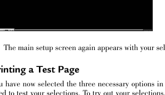

主设置屏幕再次出现，并显示你的选择。

## 打印测试页

你现在已选择了打印所需的三个必要选项。但首先，你需要测试你的选择。要尝试你的选择，输入 `T` 以打印测试页，如图 4-26 所示。

测试页屏幕再次提示输入字母 `T` 和后续的 `y`。输入这些值并按 Enter。一个显示发送到打印机的命令的屏幕会出现。你不必关心这些细节。如果测试页成功打印，按 Enter 返回主菜单设置屏幕。

## 图 4-26 打印测试页以确保打印机正常工作。

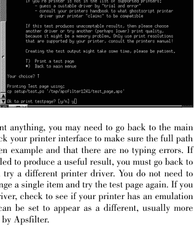

如果你的测试页没有打印任何内容，你可能需要返回主菜单（见图 4-27）并检查打印机接口，以确保完整路径与屏幕示例中显示的完全一致，并且没有输入错误。如果你的打印机尝试打印但未能产生有用的结果，你必须从主菜单返回步骤 `1` 并尝试不同的打印机驱动程序。你不需要重新输入全部三个步骤。只需更改单个项目并再次尝试测试页。如果你有困难找到打印机驱动程序，请检查你的打印机是否具有仿真模式，其中打印机本身可以设置为显示为另一种，通常更通用的受 Apsfilter 支持的打印机。

在成功生成测试页后，你就可以准备安装打印机规范。从主菜单，输入 `I` 作为你的选择。

系统会提示你为打印机输入一个名称，如图 4-28 所示。默认值为 `lp`。如果你有多台打印机，你可能想输入其他名称。

请注意，打印机名称中不允许有空格；你可以使用下划线代替。例如，我可以将我的打印机命名为 `HP_4050_TN`。输入名称后，会显示另一个显示设置结果的屏幕。按 Enter 继续。

你为打印机输入的名称用于标识应用程序将打印到哪个打印机。此步骤完成后，设置就完成了。此时，主菜单屏幕再次出现，你可能想继续设置另一台打印机或输入 `Q` 退出。选择退出选项后，你会再次看到几个信息屏幕。只需一直按 Enter 直到应用程序退出并返回到 DSL 控制面板。

从 DSL 控制面板，你应选择 `Printing/lpd` 以启动打印队列。或者，你也可以使用主菜单并选择 `System`，`Printing/lpd`，`Start`。

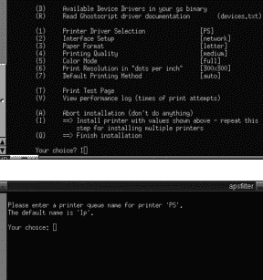

图 4-27 检查打印机设置是否正确。

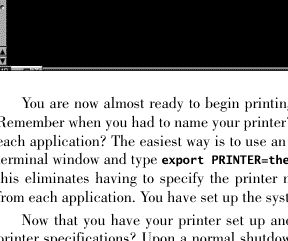

图 4-28 为打印机输入名称或使用默认的 `lp` 名称。

你现在几乎可以从任何 DSL 应用开始打印了。还记得你必须为打印机命名吗？如何为每个应用指定打印机？最简单的方法是使用环境变量。你可以打开终端窗口并输入 `export PRINTER=the_name_we_gave_our_printer`。这样就无需在每次从每个应用打印时都指定打印机名称。你已设置了系统默认打印机。

现在打印机已设置并可以使用，如何备份打印机规格？在正常关机时，系统会检测到曾尝试设置打印机。你会被提示保存打印机设置。如果确认，保存会自动进行。重新启动后，唯一必要的步骤是从 DSL 控制面板启动打印守护进程。

## 在网络上保存你的设置

DSL 一直以游牧式桌面操作系统为目标。你已经看到了备份和恢复流程。你也看到了许多自定义工具的配置。但有时，这些工具及其设置是特定于特定硬件的。你的某些保存的配置适用于任何地方。也许你想将这些通用的与机器无关的设置保存到网络上，以便在任何有网络访问的地方恢复它们。

我们将保存通用 DSL 设置以便以后通过网络恢复的流程称为 Webdata 备份。要使用 Webdata 备份功能，你必须拥有一个预先存在且完全可用的 FTP 账户。

开始设置自己的 Webdata 备份，请查看 `.webdata.lst` 文件（`/home/dsl/.webdata.lst`）。它只是要备份到 ftp 站点的文件的示例。`.webdata.lst` 文件与 `.filetool.lst` 非常相似。只需使用你选择的文本编辑器添加或删除此文件中的行即可。此文件中指定的所有项目都包含在网络备份中。由你决定。只需注意不要包含特定于机器的数据。

下面显示了默认 `.webdata.lst` 文件的内容：

```
home/dsl/.webdata.lst
home/dsl/Mail
home/dsl/.sylpheed
home/dsl/.mozilla
home/dsl/.vimrc
```

在备份 `.webdata.lst` 文件本身之后，该文件还列出了从 `/home/dsl` 备份的其他项目。`Mail` 文件夹是你的邮件客户端（Sylpheed）保存邮件的默认位置，而 `.sylpheed` 目录是它保存其设置的位置。在 `.mozilla` 目录中，你的网页书签、历史记录和其他网页浏览设置都存储在其中。`.vimrc` 文件是保存与 vi 文本编辑器相关设置的配置文件。你需要将包含你经常使用的应用程序的设置和数据的<|start|>文件和目录添加到 `.webdata.lst` 列表中。

如前所述，你不太感兴趣保存的文件是与特定机器相关联的文件，因为这种类型的备份旨在由你在前往不同位置时使用的不同机器共享。例如，`home/dsl/.xserverrc` 文件特定于你的显示器和显卡，因此可能无法在另一台机器上使用。最好让此类信息在启动时检测并设置。

一旦你按自己的意愿设置了 `.webdata.lst` 文件，请使用以下流程执行 Webdata 备份：

- 1. 从主菜单中选择 `System`，`Webdata Backup/Restore`。图 4-29 所示的窗口会出现。

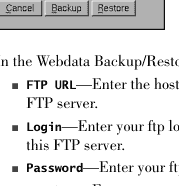

图 4-29 选择网络上的位置来备份你的数据。

- 2. 在 `Webdata Backup/Restore` 窗口中，输入以下信息：

  - FTP URL—输入你的 ISP 的 FTP 服务器的主机地址（主机名或 IP 地址）。
  - Login—输入获取对该 FTP 服务器的读写访问权限所需的 ftp 登录名。
  - Password—输入该用户登录的 ftp 密码。
  - Datakey—输入用于访问加密数据的密码。输入你喜欢的任何密码，但一定要记住它。你稍后恢复备份时需要它。

- 3. 选择 `Backup`。程序会显示 ftp 连接消息。如果一切正常，`data.des` 文件将被复制到你用于访问 FTP 服务器的用户账户的主目录中。如果出现问题，请查看打开的终端窗口。它应该会指示你是否输入了错误的主机名、用户名或地址，或者服务器是否不可用。


- 4. 要恢复数据，只需再次运行此 GUI 程序并选择 Restore。数据已备份到公共 FTP 服务器，你应该能够在下次从任何具有 Internet 连接的机器启动 DSL 时访问你的数据。

确保你知道你的加密密码；否则，没有人能够帮助你。当然，这也有好处，那就是即使入侵者获得了对 FTP 服务器的访问权限，如果不知道该密码，也无法访问你的备份数据。

`.netrc` 文件在运行 `webdata` 脚本时会自动在 `/home/dsl` 中创建，然后在完成后被销毁。这出于安全原因，并且

也不要干扰你可能需要用于其他服务器或其他用途的 ftp GUI 程序的使用。

我认为备份整个 `home/ds1` 没有意义，因为目的是让你能够在机器之间迁移并访问机器无关的数据。主要目的是让你的数据在你能连接网络的任何地方都可用。

但正如 always 所说，你有灵活度去做你想要或需要做的任何事情。

## SUMMARY

能够按照自己的方式设置 Damn Small Linux 桌面，对于让 DSL 成为一个有趣的系统至关重要。能够保存你在使用 Damn Small Linux 时积累的文件和设置，对于让 DSL 在一次重启到下一次重启之间更有价值至关重要。

DSL 在选择要备份哪些文件和目录，以及希望这些备份去往何处方面提供了巨大的灵活性。

一旦你知道如何进行基本备份，本章将描述你可能想要配置和自定义桌面环境的方式。配置包括设置网络连接的不同方式，使用拨号、无线或有线局域网。它还包括配置打印机的流程。自定义包括设置背景、排列图标以及选择屏幕分辨率的方式。

为了让你的 Damn Small Linux 系统更具移动性，本章描述了如何将数据备份到网络上的 FTP 服务器。之后，你可以从任何可以启动 DSL 并访问网络的计算机上恢复你的数据（例如网页书签、邮件文件夹和编辑器设置）。

## Extending Applications with MyDSL

本章涵盖了向 Damn Small Linux（DSL）Live CD 添加应用程序的流程的 *what*, *why* 和 *when*。我们称此流程为 *MyDSL system*。这些额外的应用程序被称为 *extensions*。

这些扩展可以通过多种方式添加到你的系统中。我将描述如何从最简单的 GUI 使用 MyDSL 系统，该 GUI 会逐步引导你完成流程，到通常通过网络浏览器下载，最后是如何从命令行下载和安装。

在你获得一个扩展后，你很可能希望将其保存以供将来使用。我将讨论这些扩展应如何保存以及持久存储的使用。讨论包括如何自动化无人工干预的启动，并在启动时加载你喜欢的应用程序扩展以及无人工干预与启动速度之间的权衡。本章的最后一节包含对一些常见设置和用法错误的讨论。

## INTRODUCING MyDSL

为了扩展标准 50MB DSL Live CD 上的软件，我们创建了 MyDSL 系统。MyDSL 已成为 DSL 最成功的特性之一。你可以使用 MyDSL 系统向正在运行的 DSL 系统添加软件扩展、保存扩展以供以后使用，甚至创建自己的扩展。

## Overcoming Shortcomings of Hard Drive Installations

如果你过去曾参与 Damn Small Linux 论坛（http://damnsmalllinux.org/cgi-bin/forums/ikinboard.cgi），你可能还记得论坛上的优势帖子。这些帖子讨论了 Live CD 用户在应用程序选择方面一直处于劣势。典型的 Live CD 包含发行版维护者，例如 John 和我，所选择的应用程序集合。他们的选择可能不是你的选择。

当时，无法向 Live CD 系统添加应用程序。因此，大多数 Live CD 提供的软件包都非常庞大，尽可能多地将应用程序打包到 CD 上。想要安装额外软件的用户知道硬盘安装才是正道。而且这一直都是这样做的：获取一张 CD 并将其安装到你的硬盘上。系统安装完成后，Debian `Apt` 系统是添加应用程序的优秀工具。

一个 50MB 的发行版如何竞争？在这些早期日子里，有许多人复制 DSL 并重新制作，只为提供更多应用程序并增加几 MB。一些重新制作会整体复制为 DSL 创建的每个新功能。我的想法转向想要提供一些不同的东西。我想要一些能够与稍大的重新制作竞争的东西。

我不想只是更大。我不想放弃在较小的硬件上使用我们用户的支持，或放弃 50MB 的限制。但我也想为 Live CD 用户提供优势，而这种优势似乎只有硬盘安装用户才有。我的解决方案是能够轻松添加软件，而无需复杂的重新制作过程。允许用户轻松创建他们想要的任何大小的 ISO。这将使 DSL 能够与稍大的发行版竞争。DSL 将变得可变大小。

## The Birth of MyDSL

凭借之前里程碑的积累经验，我着手创建 MyDSL 系统。我必须牢记 DSL 建立声誉的那些性能较弱的硬件。我开始利用 John 的下载脚本突破性技术，以及我可写的 `/opt` 用于共享应用程序。作为概念验证，我改编并打包了 OpenOffice.org 办公套件作为第一个 MyDSL 应用程序，名称为 `openoffice`。

我将 `openoffice` 创建为一个简单的 gzipped tarball 并将其放入 `/opt`。然后我创建了启动时选项以将软件从该包加载回 `/opt`。这样一来，该包就不必包含在基础 DSL 系统中。这也意味着该包不必包含在备份/恢复过程中，这将是每次 DSL 关闭时需要承担的巨大负担。然后我添加了一个单独的软件包（`oo-user.tar.gz`）来保存专门针对 DSL 作为 Live CD 以及默认用户 `ds1` 的图标和菜单项。这将会奏效！

我尝试将其他应用程序适配到 MyDSL 系统中。有些应用需要一个小的包装脚本来强制库和 bin 路径位于 `/opt` 下。还需要更多功能才能使其他应用正常工作。我曾看到一个 DSL 用户的脚本，该脚本使更多文件系统可写，以便在 DSL 中运行 Opera 浏览器。我给他发了邮件并征求了他使用其脚本中部分内容的许可。Opera 从未被包含在 DSL 中，因为它是广告赞助的。我截取了我想要的部分并将其修改为我心中的样子。

使用我刚刚描述的功能，我可以提供一种分层的启动时加载模块的方法。几乎在同一时间，我对可挂载应用程序产生了兴趣。我将这些应用程序格式化为压缩镜像（在这些文件后添加 `.ci`）。我很快就把 `openoffice` 改成了 `openoffice.ci`。这将极大地减少系统资源的使用，因为应用程序被挂载后，可以从该挂载点使用，而无需复制到内存中。后来，我将 `ci` 文件及其关联的用户文件合并为一个文件（后缀为 `.uci`）。

最后，我整理了六个示例模块。今天，它们被称为 *extensions*。我还制作了一个小而简单的脚本，可以快速轻松地创建自定义 `mydsl.iso` 并刻录到 CD。该脚本和其他重新制作内容在第 11 章“Setting Up a Full Remastering Environment”中有介绍。

能够将 DSL live CD 与多个扩展结合使用，克服了一些 live CD 用户面临的缺陷，这些缺陷可能会促使他们转向硬盘安装。DSL 在 MyDSL 的帮助下成为一个非常灵活、任意大小的发行版。

## Loading Extensions Dynamically

在发布了示例 MyDSL 扩展和 `mkmydsl` 自定义 CD 制作工具后，最受用户要求的功能是无需用户制作 CD 即可加载扩展。

John 和我起初有点犹豫。我们担心带宽问题。如果用户变得懒惰，他们每次都会下载扩展。因此，我添加了一个启动时选项来指定扩展的持久存储位置。这应通过 `mydsl=hdxx` 指定，其中 `hdxx` 应替换为扩展将存储的硬盘分区名称（如 `hda1` 代表第一块 IDE 硬盘的第一个分区）。

我添加了动态加载的代码。MyDSL 系统的 GUI 前端被创建。今天，DSL 甚至提供更广泛的类型，得益于 `unionfs`，另一种可挂载扩展类型。Unionfs 是一种特殊的


使用我刚刚描述的功能，我可以提供一种分层的启动时加载模块的方法。几乎在同一时间，我对可挂载应用程序产生了兴趣。我将这些应用程序格式化为压缩镜像（在这些文件后添加 `.ci`）。我很快就把 `openoffice` 改成了 `openoffice.ci`。这将极大地减少系统资源的使用，因为应用程序被挂载后，可以从该挂载点使用，而无需复制到内存中。后来，我将 `ci` 文件及其关联的用户文件合并为一个文件（后缀为 `.uci`）。

最后，我整理了六个示例模块。今天，它们被称为 *extensions*。我还制作了一个小而简单的脚本，可以快速轻松地创建自定义 `mydsl.iso` 并刻录到 CD。该脚本和其他重新制作内容在第 11 章“Setting Up a Full Remastering Environment”中有介绍。

能够将 DSL live CD 与多个扩展结合使用，克服了一些 live CD 用户面临的缺陷，这些缺陷可能会促使他们转向硬盘安装。DSL 在 MyDSL 的帮助下成为一个非常灵活、任意大小的发行版。

## Loading Extensions Dynamically

在发布了示例 MyDSL 扩展和 `mkmydsl` 自定义 CD 制作工具后，最受用户要求的功能是无需用户制作 CD 即可加载扩展。

John 和我起初有点犹豫。我们担心带宽问题。如果用户变得懒惰，他们每次都会下载扩展。因此，我添加了一个启动时选项来指定扩展的持久存储位置。这应通过 `mydsl=hdxx` 指定，其中 `hdxx` 应替换为扩展将存储的硬盘分区名称（如 `hda1` 代表第一块 IDE 硬盘的第一个分区）。

我添加了动态加载的代码。MyDSL 系统的 GUI 前端被创建。今天，DSL 甚至提供更广泛的类型，得益于 `unionfs`，另一种可挂载扩展类型。`Unionfs` 是一种特殊的文件系统类型，允许用户在整个文件系统中的任何位置添加或更改文件，而不仅仅是 `/opt` 和 `/home/dsl` 目录。使用 `unionfs`，对 DSL 文件系统的更改存储在特殊目录（通常在 RAM 中）`/ramdisk` 中，该目录覆盖在整个文件系统之上。

## Exploring the MyDSL Software Bazaar

MyDSL 系统取得了巨大成功。MyDSL 提供四种扩展类型。其中两种是可挂载的。因为 MyDSL 扩展是被挂载而不是加载到 RAM 中，即使是低内存系统的用户也能享受使用这些扩展的优势。

MyDSL 扩展的创建过程已公开，以便 DSL 用户社区可以加入其中，分享他们创建的软件包，从而获得参与和拥有感。事实上，这也是一个设计目标。John 和我将专注于核心 DSL，只创建和提供社区所需的基础设施。

许多 DSL 用户社区成员贡献了许多软件标题作为 MyDSL 扩展。这些应用程序通常是从 Debian 包重新打包的，但也可以从源代码编译。有关此构建过程的详细信息在第 10 章“Adding Applications and Creating Shareable Extensions”中有介绍。

对于 MyDSL 系统的用户来说，这是一种简单易用的图形化点击即加载的安装方法。事实上，大多数人发现使用 MyDSL 添加软件比许多其他包管理系统的体验更简单。

尽管硬盘安装用户可以使用 MyDSL 的功能，但没有卸载功能。当你从 live CD 运行 DSL 时，没有卸载功能并不是问题，因为你可以从扩展存储的 U 盘或硬盘中删除扩展。重新启动后，扩展就会消失。对于硬盘安装，没有简单的方法在安装后删除扩展。

> NOTE
>
> 硬盘安装系统应继续使用完整的 Debian 包管理系统来添加和删除软件。MyDSL 是为 live CD 及其仿真而设计的。

从这一点开始，我所有的讨论都是从运行 live CD 或其仿真以使用 MyDSL 系统的角度出发的。我将从最自动化的、因此也是推荐的方式开始。因为 MyDSL 扩展托管在互联网上的各个镜像上，所以你必须拥有一个正常工作的互联网连接。

## 使用桌面图标实现便捷的点选访问

在标准 DSL 桌面上，你会看到 MyDSL 图标。该图标是添加为 MyDSL 系统打包的软件的入口点。

### 使用桌面图标

点击 MyDSL 桌面图标即可访问 MyDSL 系统的图形用户界面。图 5-1 显示了该图标的示例。

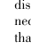

图 5-1 MyDSL 桌面图标。

偶尔，你可能会看到 Extension 工具显示空白屏幕，而不是显示可用的扩展。造成这种情况的原因可能是你未连接到互联网。如果你有可用的互联网连接，最可能的原因是配置的 MyDSL 下载镜像无法访问。如果是这种情况，你可以访问 DSL 面板以选择不同的镜像服务器来使用。参见本章中讨论的“更改下载仓库镜像”部分。

### 显示扩展工具

如果 DSL 可以连接到可用的仓库，MyDSL Extension 工具会显示从在线仓库可用的所有软件类别。类别包括测试区，以及用于加载存储在本地磁盘上的扩展的浏览器。图 5-2 显示了 MyDSL Extension 工具的示例。

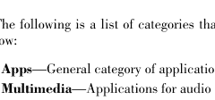

图 5-2 从扩展工具窗口显示可用的软件类别。

以下是在 MyDSL Extension 工具窗口中出现的类别列表：

- **Apps**—应用程序的通用类别。
- **Multimedia**—用于音频和视频播放和编辑的应用程序。
- **Themes**—用于帮助自定义桌面外观和感觉的软件包。
- **Games**—是的，你可以在 Linux 上玩游戏...
- **Net**—与网络和网页相关的任何内容。
- **UCI**—通用自包含可挂载应用程序类别。
- **UNC**—Unionfs 可挂载应用程序的通用类别。
- **Gtk2**—需要 Gtk2 运行时的应用程序。
- **System**—用于管理、调整和监控系统的工具和实用程序。
- **WM_Apps**—替代窗口管理器和特定于窗口管理器的工具。
- **Testing**—新创建扩展的通用类别（请谨慎使用）。
- **Load Local**—打开典型的文件浏览器以访问驱动器上保存的扩展。

> **NOTE**
>
> 测试区包含来自 DSL 用户社区的新提交的软件包。这些软件包应被视为实验性的，需要在移入常规区域之前进行测试和反馈。请极其谨慎使用。

除了这 12 个用于扩展分类的类别外，还有四种扩展类型：

- **tar.gz** 是最简单的类型。它必须安装到 DSL 唯一的原生可写区域。这意味着它必须解压到 `/opt`，因此必须是自包含的。
- **.dsl** 也基于使用 `tar` 命令。然而，这种扩展类型会导致大部分文件系统变为可写。

  > **NOTE**
  >
  > 在较早的 DSL 版本（传统启动）中，只有 `/home`、`/opt` 和 `/tmp` 目录是可写的。大部分剩余文件系统以只读方式挂载。由于 `.dsl` 扩展类型只是简单地提取到文件系统的根目录，因此对于这些安装能够工作，可能需要使文件系统的很大一部分变为可写。因此，安装 `.dsl` 扩展会进行检查，以确保系统脚本 `mkwritable` 已运行以使整个文件系统可写。
- **.uci** 类型扩展是压缩的 loop 镜像，自包含并挂载在 `/opt` 目录下。所有 tar.gz 扩展都可以轻松制作成 UCI 类型。
- **.unc** 代表我们最新的扩展类型。这种类型的扩展只能在支持 `unionfs` 文件系统的 DSL 后续版本上使用。这些扩展是压缩的 cloop 镜像，挂载到基础文件系统中。

不必完全理解这些扩展类型。只需知道 UCI 和 UNC 是首选类型。这两种类型都是挂载的，因此使用的系统资源比另外两种少得多。由于这些扩展类型是挂载的，你可以通过简单地卸载扩展或重新启动，将系统恢复到原始状态。这对于 DSL 提供的众多安装类型中的任何一种都是如此。你可以通过将 UCI 和 UNC 扩展存储在硬盘或U盘上，进一步节省 `/ramdisk` 空间。

`tar.gz` 和 `.dsl` 类型 really 只有在目前没有其他版本的扩展可用并且你的系统有资源支持它们时才应使用。因为 `tar.gz` 和 `.dsl` 类型会将扩展文件中的所有文件复制到文件系统中的不同位置，低内存系统可能会很快耗尽 `/ramdisk` 中的空间，以及耗尽 inode（每个文件和目录都会消耗一个）。

现在，让我们继续使用和享受 MyDSL 系统的正常流程。

### 选择和获取扩展

当你点击其中一个扩展类别时，扩展浏览器会打开并显示该类别中所有可用的 MyDSL 软件包列表。例如，点击 UCI 类别即可查看图 5-3 所示的 UCI 扩展列表。

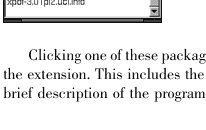

点击其中一个软件包会显示其信息文件，提供有关扩展的信息。这包括程序创建者的名称和网页地址、程序的简要描述，以及可能需要的任何额外信息以

运行程序。要跟随我们的示例，请点击 `xmahjongg.uci.info`。Xmahjongg 软件扩展的 info 页面会出现，如图 5-4 所示。


**FIGURE 5-4** MyDSL 扩展信息面板。

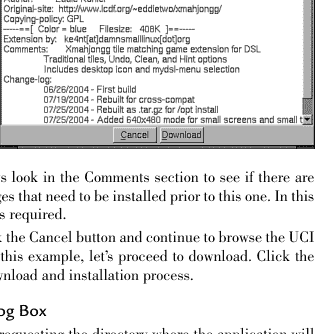

非常重要的一点是，始终查看 Comments 部分，以查看是否需要在安装此软件包之前安装任何先决条件软件包。在本例中，不需要其他软件包。

此时，您可以点击 Cancel 按钮并继续浏览 UCI 仓库。但为了继续本示例，让我们继续下载。点击 Download 按钮开始下载和安装过程。

## Application Download Dialog Box

接下来，会显示一个对话框，要求输入应用程序将被下载到的目录。该目录必须存在于您的系统上，并且用户 dsl 必须具有写入权限。通常希望使用默认的 `/tmp` 目录来保存扩展程序（见图 5-5）。

文件将下载到此目录中，并将使用 md5 校验和文件进行完整性验证。如果出现另一条消息框，指示下载失败，您需要重试。

点击 Download 按钮继续。

**FIGURE 5-5** 选择扩展将被下载到的目录。


## Viewing Application Download Status

进度条显示下载状态（见图 5-6）。进度条在达到 100% 时消失。


**FIGURE 5-6** 随着下载进行，观察应用程序下载状态。

使用 Extension 工具下载也意味着程序将被自动安装。这是安装扩展的首选方式，因为您不仅仅是为以后使用而下载它们。当扩展成功下载后，Extension 工具会安装并设置所选应用程序、菜单，通常还有桌面图标。Extension 工具还会对下载的扩展进行校验和，以确保下载良好。如果下载损坏，会弹出消息通知您，以便您可以重试。

## Launching Newly Installed Application

扩展下载并安装后，返回桌面并调出系统菜单。并非所有，但大多数应用程序都会在它们的 MyDSL 部分下列出菜单项。一些系统应用程序不需要菜单即可启动，例如 GNU 工具集合。图 5-7 显示我们的新游戏列在菜单的 MyDSL 部分下。


**FIGURE 5-7** 安装 Xmahjongg 后，MyDSL 菜单上会出现一个新条目。

选择 Xmahjongg 菜单项以启动应用程序。另请注意，许多 MyDSL 扩展会自动提供桌面图标。图 5-8 显示了 Xmahjongg 桌面图标。


**FIGURE 5-8** Xmahjongg 图标被添加到您的桌面以启动应用程序。

当扩展提供桌面图标时，只需点击即可启动应用程序。还请记住右键单击图标以查看是否还有其他应用程序选项可用。图 5-9 显示了 Xmahjongg 应用程序成功启动。

## Accessing Locally Stored Extensions with the MyDSL Extension Tool

存储在本地硬盘或U盘上的 MyDSL 扩展也可以使用 Extension 工具进行安装。Load Local 按钮打开一个文件浏览器，您可以使用它来定位并从任何已挂载的磁盘安装扩展。图 5-10 显示了此 Load Local MyDSL Extension 窗口。

**FIGURE 5-9** Xmahjongg 应用程序的成功启动。


**FIGURE 5-10** 从本地磁盘查找并选择扩展以在 DSL 中安装。


文件浏览器的使用就像任何典型的文件浏览器一样。当然，任何物理设备必须在显示任何文件之前先挂载。在前面的图中，我显示驱动器 hda2 已挂载在 `/mnt` 目录上，我已导航到相同的 UCI 集合。只是现在这是访问我的本地驱动器。在这种情况下，使用本地扩展浏览器不需要访问互联网。

## 更改下载仓库镜像

Damn Small Linux 在互联网上的许多站点托管。主要站点是 Ibiblio（http://distro.ibiblio.org）。Ibiblio 是默认站点。Ibiblio 也有镜像（对用户是透明的）。尽管如此，有时访问 Ibiblio 会变得缓慢。

其他互联网站点也同意托管 DSL 仓库。许多镜像可能离你更近。事实上，其中一些对你来说访问可能更快。出于这些原因，我们允许你更改默认下载站点。要更改默认下载站点，请从桌面选择 DSL 面板图标并点击 Select Mirror。会出现一个小对话框，如图 5-11 所示。


**图 5-11** Mirror select 对话框显示用于获取 DSL 扩展的镜像。

在这里，你可以看到默认的 Ibiblio 站点和默认协议。此时，你可以点击 Select 按钮查看当前镜像站点列表，如图 5-12 所示。


**图 5-12** 镜像选择。

你可以滚动此列表并选择任何镜像。镜像名称和协议均通过其完整 URL 显示。当你选择一个后，它会填充 Mirror Select 对话框，你可以点击 OK 继续。这样会保存你的新选择。它会通过正常的备份和恢复程序记住。

Mirror Select 对话框不仅限于当前可用的镜像站点。事实上，你可以输入任何你想要的站点和协议。其目的是你可能希望在本地服务器上托管自己的私有仓库。也许这是一个家庭网络的私有集合。这也可能是公司内网、学校或培训中心。

## 通过 Web 浏览器访问 DSL 扩展

除了使用 MyDSL 面板外，你还可以直接从 Web 浏览器查看和访问 DSL 扩展。

### 从官方 DSL 网站获取扩展

MyDSL 应用扩展可以在链接到 DSL 主项目页面的仓库中找到：

```
http://www.damnsmalllinux.org
```

向下滚动直到看到 Download 链接。点击该链接进入下载页面，如图 5-13 所示。


**图 5-13** 从 DSL 下载页面访问 myDSL 仓库。

点击 Browse the myDSL Repository 链接。这会带你到扩展区域。你也可以通过添加包含指向该站点的链接的桌面图标来快速访问扩展区域。

### 通过 DSL 的帮助屏幕获取扩展

也可以通过点击 Dillo 桌面图标来通过 Web 访问仓库。通常的 Getting Started 帮助屏幕会出现。该页面内提供了一个指向仓库（Extension Library）的活动链接。图 5-14 显示了使用 Dillo 浏览器访问扩展仓库的 Web 界面。

**图 5-14** 在线仓库的 Web 界面。


使用 Web 浏览器访问仓库时，获取和安装扩展并不是自动的。首选方式是使用前面讨论的 MyDSL 桌面图标，因为该方法可自动化整个过程。 （只需一键下载并验证扩展，而无需在网站上搜索，然后手动检查和安装。）以下步骤描述了如何通过 Web 浏览器获取 MyDSL 扩展。

1. 在浏览器中显示扩展仓库时，选择 UCI 链接。UCI 扩展将被显示。顶部的列为 Date、Lv、Description、Version、Size、Application、Info 和 md5sum。Lv 列按扩展类型进行颜色编码。绿色或蓝色用于可挂载的 uci 和 unc 类型。黄色用于 tar.gz。红色用于 .dsl。这些颜色旨在提供对系统资源和将对系统进行的修改的快速视觉提示。

   绿色和蓝色是最安全且首选的类型。点击 Date 标题可按日期排序扩展。点击 Application 标题可按名称排序。对成功下载和运行扩展至关重要的列是 Info、Application 和 md5sum。

2. 向下滚动 UCI 页面找到你想要的扩展，例如图 5-15 右下角所示的 xmahjongg 扩展。

   **FIGURE S-15** Web extension selection screen.

   

3. 点击 Info 列中的信息链接以查看扩展的信息页面，如自动化流程所述。此步骤至关重要。你应始终阅读信息文件。使用返回箭头返回到可用扩展列表。

4. 右键单击 Application 列（从右数第三列）中的扩展名称链接，然后在浏览器的子菜单中选择 Save Link As 项目。


## NOTE

我们不建议将 MyDSL 扩展下载到你的主目录。MyDSL 扩展体积庞大且为静态文件。鉴于 DSL 主要作为 live CD 或其仿真形式使用，这意味着保存个人设置需要备份/恢复。让庞大且静态的——即不改变的——项目存在于备份中只会拖慢你的系统。更糟的是，它们可能导致备份失败，因为备份可能变得过大而无法容纳所选的备份设备。最好为 MyDSL 扩展的集合提供一个持久存储。

到目前为止，这对于通过浏览器下载文件来说都相当标准。然而，有一些陷阱需要注意。不要忘记阅读那些信息文件。很多时候，一个扩展需要额外的扩展或可能有特殊说明。许多问题都源于未能执行额外步骤来阅读扩展的信息文件。

5. 右键单击对应你选择的 `md5sum` 链接。下载完成后，扩展和对应的 `md5.txt` 将保存在同一目录中，你必须手动验证你确实拥有有效的下载。为此，使用命令

```
$ md5sum -c extension_name.ext.md5.txt
```

`extension_name.ext` 用你下载的扩展名称替换。你应该看到 `OK` 作为结果。如果没有，你必须重新下载，直到扩展可以通过其校验和验证。

所有这些额外的手动步骤都可以通过使用我们的自动化 GUI 下载系统来避免。

## SAVING YOUR EXTENSIONS

由于 DSL 被创建为一个游牧式访客操作系统，没有驱动器或设备会被自动挂载。事实上，默认用户 `dsl` 并没有管理员权限来对物理设备进行写访问。使用 MyDSL 系统的默认设置是将扩展下载到 `/tmp`，该目录位于 RAM 磁盘 `(/ramdisk)` 上。

下载并试用扩展后，你很可能希望保留它。请记住，MyDSL 扩展是为 live CD 用户构建的。因此，在重启或关机后，扩展就会消失。

拥有你喜欢扩展的持久存储意味着你必须挂载一个驱动器并将扩展复制到该位置。有多种方法可以完成此任务：

- File manager—使用其中一个文件管理器保存文件在第 3 章“使用 DSL 应用程序”中进行了讨论。对于此任务，你必须选择相应文件管理器的 root 版本。
- Save during shutdown—I 在关机时提供了一种安全网。如果 `/tmp` 目录中仍有任何位于基于 RAM 磁盘的扩展，系统会提示你保存它们。如果选择 OK，系统文件管理器 `emelfm` 将以 root 权限打开，以便你保存扩展。

请记住，你可以使用 DSL 桌面右下角的挂载工具来挂载你想要安装扩展的硬盘或 U 盘分区。

## Boot Time Automatic Extension Loading

由于你将扩展以打包形式保存在持久存储中，你必须指定它们在下次启动时如何加载。

MyDSL 扩展在启动过程中自动安装，要么将其放置在默认搜索的位置，要么将其放置在你选择的目录中并使用启动时选项 `myds1=location`，其中 `location` 可以是 Linux 设备名称。例如，`myds1=hda1` 或 `myds1=sda1` 分别代表你的第一块 IDE 硬盘或 SCSI 硬盘（或 U 盘）上的第一个分区。`location` 甚至可以包含目录的完整路径（例如 `myds1=hda1/myds1`）。

首先，让我们讨论 DSL 的默认位置。通过使用默认值，你不需要启动时选项，因此可以实现免手动启动。

- On the boot disc—第一个默认位置是你的 DSL 安装的顶层。无论是 `mkmyDSL` CD（在第 11 章讨论）还是仿真类型安装（在第 8 章“以其他方式安装 DSL”中讨论），都是将你的扩展放置在 `/KNOPPIX` 和 `/boot` 目录所在的位置。
- On attached storage devices—第二个默认位置是在每个可用附加设备的顶层名为 `myds1` 的目录中。

使用这两种默认指定中的任何一种意味着你无需使用启动选项。系统会扫描每个可用驱动器设备以查找 `myds1` 目录。

> NOTE
>
> 指定设备名称可以加快启动时间。你无法获得免手动启动，但这也意味着系统无需扫描驱动器以查找 `myds1` 目录。

在 DSL 版本 1.2 中，我引入了指定你选择的目录用于 `mydsl` 扩展的功能。这在你拥有多套应用程序并希望为每个会话选择加载哪一套时非常有用。

例如，你可以将扩展放在名为 `/mnt/hda2/games` 的目录中，并使用启动选项 `myds1=hda2/games`。你甚至可以有多个设置。在名为 `/mnt/hda2/office` 的目录中再放另一组扩展。然后，在启动时决定玩游戏还是工作。这种灵活性有助于在低内存机器上节省资源。请记住，我们 `do with DSL we keep in mind the older, smaller machines. We want everyone to enjoy DSL.`

If you have multiple extension repositories, you can only indicate one at boot time (indicating more than one will cause only the last one entered at the boot prompt to be loaded). After DSL boots, you can add extensions from other directories using the Load Local option from the MyDSL tool.

Another design goal was to make an *optional* menu of rarely used extensions. You can create a directory called `optional` in a subdirectory of the `mydsl` directory. Extensions that are stored under this directory are not automatically loaded, but instead are listed in a separate menu section in the MyDSL desktop menu under the category Install Optional Extensions. This gives you quick access to installing these extensions at any time during your session.

## OPTIONAL COMMAND-LINE EXTENSION ACCESS

Besides offering nice and simple GUI tools or the usual web access, I also was sure to allow the use of command-line tools. These tools can be used in your own custom scripts to further automate access to the MyDSL repositories. These tools could also be used to set up and install in a command-line-only environment. You may choose to run DSL without the X windows system. Of course, you must be careful to read the extension’s info file to see that it can run without X.

These tools also allow the user who is comfortable with the CLI to quickly access the repositories. Let’s begin by exploring the command-line tools that make up the MyDSL system.

## Remote Access via the Command Line

The first such tool is the `mydsl-wget` command. This is a tool that uses the `wget` command to download a specific myDSL extension from your favorite DSL mirror.

```
Usage: mydsl-wget full-extension-name repository
```


`Full-extension-name`是`MyDSL`扩展的文件名及其扩展类型——例如，`xmahjongg.uci`。仓库对应于我之前一直在讨论的仓库。这些仓库的列表显示在图5-2的`Extension`工具中，以及图5-14所示的链接中。如果要将文件保存到特定的现有且可写的本地目录，应将目录作为文件名的一部分来指定，如下例所示：

```
$ mydsl-wget /mnt/hda2/mydsl/xmahjongg.uci uci
```

否则，文件将下载到当前目录。回想一下将扩展存储在您的主目录中的危险。

## 使用命令行进行本地访问

第二个工具是`mydsl-load`命令。运行`mydsl-load xmahjongg.uci`会加载指定的扩展（在此示例中为`xmahjongg.uci`）。您也可以使用完整路径名以这种方式手动加载扩展。此命令很少使用，除非与上述`mydsl-wget`结合使用。它可以用脚本方式使用，但由于有所有启动时加载选项，通常不需要。

## 设置与使用错误

正如我之前所述，DSL用户社区创建了`MyDSL`扩展集合。扩展并非DSL的官方组成部分。只有支持`MyDSL`的基础设施才是官方的。话虽如此，用户社区也负责与扩展相关的任何问题的更新和修正。

有时，使用扩展可能会影响您的系统。如果您刚刚下载了扩展，重新启动将消除它。如果扩展已在持久存储中并且是自动加载的一部分，您需要将其移除。

有些情况下，基础设施似乎无法正常工作。通常，我发现以下情况很常见：

- **无反应或出现空白屏幕**——检查您是否有可用的互联网连接。同时检查您是否可以访问所选下载镜像。

- **请装载包含optional目录的介质，然后重试**——此消息通常发生在以`toram`模式运行DSL时。在以`toram`模式运行时，介质会被卸载以便移除。如果此类介质上有`optional`目录，它们的安装子菜单预期介质已装载以访问存储的扩展。当手动下载的扩展损坏，或系统内存不足以支持所有已加载扩展时，也可能会出现此消息。

- **非DSL用户错误消息**——当除默认DSL用户以外的任何人尝试加载扩展时出现。正如我多次说过的，扩展是为Live CD设计的，因此为单个默认DSL用户设计。例外情况是之前讨论过的仅命令行安装。

## 摘要

要充分体验`DSL`，您希望能够“扩展”您的应用程序选择。在本章中，我介绍了使这成为可能的设计决策的历史。我将逐步带您使用这些应用程序扩展的各种安装模式。我不仅与您分享如何安装它们，还包括如何保存它们、在哪里以及为什么保存它们，以及当它们未正确使用时的影响。

## 第二部分

## 超越 Live CD 的 DSL

- CHAPTER 6 Running a Native Pen Drive Install 121

- CHAPTER 7 Running DSL Embedded in Windows 139

- CHAPTER 8 Installing DSL in Alternate Ways 151

- CHAPTER 9 Performing a Traditional Hard Drive Install 177

## 运行原生 Pen Drive 安装

USB 安装有两种基本设置：`USB-ZIP`和`USB-HDD`。根据您计算机的`BIOS`设置，其中一种安装可能比另一种更有效。不幸的是，目前似乎还没有USB启动的标准。然而，看起来最终`USB-HDD`将成为标准。许多系统会启动一种设置但拒绝另一种。如果您有一台较旧的计算机（即2001年之前），很可能`BIOS`根本无法通过USB启动。此外，许多系统只是不一致。例如，一些计算机要求您在`BIOS`中关闭快速启动，而另一些则要求打开USB键盘仿真；其他系统只会从计算机后部的USB端口启动。还有笔式驱动器不兼容的问题。一些支持`USB 2.0`标准的新计算机将无法与仅适用于`USB 1.1`标准的旧笔式驱动器一起使用，而仅支持`USB 1.1`标准的旧计算机与`2.0` USB笔不兼容。正如您所看到的，从USB启动可能很棘手！如果发现您的系统和硬件无法支持原生USB启动，您仍然可以选择使用启动软盘，我们将在本章后面讨论。

需要指出的是，在本讨论中，所有技术参考都是在`Damn Small Linux`操作系统内部进行的。也就是说，我们假设您在确定格式化或运行安装脚本的设备位置时正在运行`Damn Small Linux`——并非所有Linux系统都以相同的方式注册设备。

### USB 启动类型——两种USB布局类型的背景

本节概述了USB笔式驱动器预安装格式化、两种类型USB安装的过程，以及为什么有必要提供两种类型安装的一些历史。还有一些关于如何在没有USB兼容`BIOS`系统的旧计算机上安装`DSL`到笔式驱动器并运行的类型。

### USB-ZIP


这是与 Iomega 外部 Zip 驱动器一起使用的格式。当我们设置 USB 笔式驱动器通过 USB-ZIP 启动时，我们是在模拟旧 Iomega 驱动器的布局；实际上，我们是在欺骗 BIOS 让它认为正在启动旧 Zip 驱动器。我们通过将 USB 笔分成两个分区并保持第一个分区大小较小来实现这一点。分区的几何结构需要有 64 个磁头和 32 个扇区。如果你不知道这意味着什么，不用担心——我们的安装脚本会自动进行计算。

## USB-HDD

相比之下，我们的 USB-HDD 格式使用单个 `fat` 分区。这是一个更简单的设置，与只能识别笔式驱动器上第一个分区的其他操作系统更兼容。

你选择的方法取决于你的硬件支持情况。如果你要制作一个用于便携使用的可启动笔式驱动器，请选择 USB-HDD，因为它的硬件兼容性大于 USB-ZIP。此外，如果你的笔式驱动器同时用作便携存储设备，你的 Windows 操作系统将能够看到存储设备的完整大小。

### 确定你的 USB 驱动器的物理地址

在 Damn Small Linux 中运行，大多数系统上的大多数 USB 驱动器将被标记为 `sd`（某物），例如 `sda`、`sdb`、`sdc` 等等。如果你系统中有多个笔式驱动器，第一个驱动器将被标记为 `sda`，第二个驱动器将被标记为 `sdb`。第一个笔式驱动器上的第一个分区将称为 `sda1`，第二个笔式驱动器上的第三个分区将称为 `sdb3`，等等。这在 99% 的情况下都是正确的，但为了避免混淆，在运行安装脚本时，只保留一个 USB 设备在你的计算机中。

### TIP

在准备将 Damn Small Linux 安装到 U 盘时，请在插入 U 盘的情况下从 CD 启动。这样，该设备将在启动过程中被自动检测到，并在 `dmesg` 和 `/etc/fstab` 中被识别，以及依赖于其数据的 `mountapp` 中也被识别。

USB-ZIP 和 USB-HDD 安装脚本都提供列出可用 USB 存储设备的选项。如果你不确定 U 盘的逻辑位置，请在脚本中调用此选项以求安心。如果你不小心格式化了错误的驱动器，该驱动器上的所有数据都可能丢失。

如果你打算提前运行 `cfdisk`，你需要在运行安装脚本之前知道你的设备。要做到这一点，你需要查看 `dmesg` 的输出。

### Practical Prep for a USB Install

在做任何事情之前，你需要知道你的系统如何向 Damn Small Linux 显示你的 USB U 盘。

我做过很多 USB 安装，我总是提前在设备上运行 `cfdisk`。有时这一步是不需要的，但我发现设置全新的分区表似乎能降低失败率并加快启动过程。我读到过，如果用户篡改 U 盘的原生分区，可能会损坏设备使其无法使用；然而，在我为 DSL 商店格式化的所有 U 盘中，我从未遇到过这种情况。有些 U 盘的原生分区混乱到 `cfdisk` 无法读取的地步。当这种情况发生时，我使用 `-z` 标志启动 `cfdisk`，意思是使用零分区表开始。使用 `cfdisk`，我创建一个标记为 `FAT16` 的单一分区表——这确保 U 盘被正确分区，并且 USB 安装脚本能够完成其工作。

关于 `cfdisk` 的进一步阅读，请访问：

```
http://www.linux.org/docs/ldp/howto/IBM7248-HOWTO/cfdisk.html
```

我想花点时间跟你谈谈 USB-ZIP 和 USB-HDD 脚本所付出的工作。Robert 在这些脚本进入 Damn Small Linux ISO 之前做了大量的实地测试。此外，你需要的所有东西来让 Damn Small Linux 从 U 盘运行都包含在我们小小的 50MB 基础发行版中。因此，没有必要连接到互联网并下载额外的文件。幸运的是，对于 Damn Small Linux 用户来说，多步骤的过程已经被压缩成回答几个问题。

你现在应该看到一个终端窗口，其中显示一个对话框，看起来很像图 6-2 所示。


#### 图 6-2 USB-HDD 安装脚本打开对话框。

让我们逐步浏览对话框的各个部分，如图所示。

1. 你的 BIOS 必须支持 USB-HDD 启动。

   如本章开头所述，你需要确定你的系统 BIOS 是否支持 USB-HDD 启动。许多系统不支持，但越来越多的新计算机支持这种启动方式。

2. 将会创建一个单一的 `FAT` 分区。

   这是 USB-HDD 与 USB-ZIP 安装之间的主要区别。USB-HDD 的分区表很简单，无需设置任意分区表来欺骗 BIOS 使其认为它正在启动一个 Zip 驱动器。

3. 不要让你的 U 盘处于挂载状态。

   请不要！如果你在挂载状态下运行此脚本，可能会损坏你的 U 盘。

接下来有一个警告，Damn Small Linux 不对任何硬件损坏或数据丢失负责——你完全为自己的行为负责，知道如果有任何损坏，DSL 的开发者无法承担责任。如果你不愿意为自己运行此脚本的行为负责，那么就直接关闭窗口吧！

还在这里？酷！让我们继续....

下一行读取：

```
Display your USB storage device information log?
```

输入 `y` 并按 `Enter`。你应该会看到一个格式良好的读出，其中 U 盘的物理位置以绿色高亮显示，如图 6-3 所示。

#### 图 6-3 U 盘位置以绿色高亮显示。


你应该已经对 Damn Small Linux 如何看到你的 U 盘有一个很好的概念，因为你在运行 `cfdisk` 之前花了时间找到设备——这是我在本章开头推荐的初步步骤。希望这次打印能确认你之前的信息。

如果所有指示都一致，并且看起来你的 U 盘确实被识别为你期望的设备，请继续输入设备名称（在图中，设备被识别为 `sda`，因此在此示例中，你将输入 `sda` 并按 `Enter`）。请注意，这些问题没有默认答案，你需要向脚本提供信息。

下一个对话框询问这是否是升级——意思是你在 U 盘上重新安装 Damn Small Linux，而安装意味着你第一次将 Damn Small Linux 安装到 U 盘上。如果你正在升级，输入 `u` 并按 `Enter`。如果这是全新安装，输入 `i` 然后按 `Enter`。

#### FIGURE 6-4 选择 DSL 镜像的位置。


此时，你有机会添加启动选项，如 `toram`、`ssh` 或 `vga=normal`。有很多启动选项可以探索；如果你对可启动 U 盘有特殊需求，请花点时间研究它们，因为它运行的是 Damn Small Linux。我们的默认设置是合理的，所以如果你现在不想花时间深入研究选项，只需使用我们提供的设置即可——它在大多数计算机上都能工作。输入你的启动选项（如果有的话）并按 `Enter`。（要探索可用的启动选项以及如何使用它们，请参阅第 2 章“Booting DSL”。）

接下来，你需要选择语言选项：对于德语，输入 `de`；对于西班牙语，输入 `es`；依此类推。如果你想要英语，请将此选项留空。选择选项后，按 `Enter`。

脚本现在会询问你是否准备好继续。如果是，输入 `y` 并按 `Enter`。然后它会再问你一次是否真的要继续，并警告你即将销毁所选设备上的所有数据。这是在严重的事情发生之前退出脚本的最后机会；如果你有任何疑虑，现在是你退出脚本的最后机会。

脚本现在准备格式化你的 U 盘。这是你的驱动器上所有数据将被擦除的点，也是你最后一次退出的时候，如图 6-5 所示。

接下来，脚本格式化你 U 盘上的单个分区，将 `Syslinux` 应用于 U 盘分区，然后在该分区中设置系统镜像。如果一切顺利，你将以绿色看到“`USB installation has completed`”，然后你只需按 `Enter` 即可退出脚本。

#### FIGURE 6-5 不可回头的点——在继续之前仔细检查你的设置。


在过程结束时，安装脚本应与图 6-6 所示相近。安装完成后，你可以自由关闭终端窗口。

#### FIGURE 6-6 这就是脚本在一切完成后应有的样子。


## USB-ZIP 安装

在运行 `cfdisk` 格式化你的 U 盘后，是时候运行安装脚本了。要访问脚本，请打开 Fluxbox 菜单并导航到 `Apps -> Tools -> Install to USB Pen Drive`，然后单击 `For USB-ZIP Pen Drive`。这将打开一个带有对话框的终端窗口，或者如果你是从安装启动选项运行的，输入 `6`，然后按 `Enter`。一定要阅读文本，因为它包含重要的说明和警告。

启动脚本后，你将看到一个介绍性对话框，如图 6-7 所示。

#### FIGURE 6-7 USB-ZIP 安装脚本的打开对话框。


让我们回顾一下打开对话框。

- 1. 你的U盘必须至少为 64MB。
- 这是最低要求；当然，今天制造商甚至不再生产这么小的U盘。似乎U盘和所有闪存设备的价格正在迅速下降，而容量却不断扩大。在撰写本文时，1GB 的U盘售价为 20 美元。但不用担心多余的空间——你可以在第二个分区中使用所有这些空间来存放扩展或其他媒体。
- 2. 你的U盘将被格式化为两个分区。
- 3. 一个小的用于 USB_ZIP 启动兼容性，并用于存放 DSL。
- 编号 2 和 3 指的是为计算机 BIOS 设置几何结构，以便将笔式设备识别为可 USB-ZIP 启动的驱动器，其中分区需要有 64 个磁头和 32 个扇区作为第一个分区的操作空间。
- 4. 剩余的分区将用于备份和扩展。
- 第二个分区会自动用于备份你的主目录以及你认为必要并添加到 `filetool.lst` 中的任何其他文件或目录。此外，它还是你在U盘启动时 MyDSL 扩展的默认位置。

请注意警告并确保你的U盘未挂载。如果已挂载，请退出安装脚本，卸载你的U盘，然后重新启动安装脚本。

如果一切看起来都正常，你就可以开始安装过程了。输入 `y` 开始。

在 USB-ZIP 安装脚本的下一个对话框中，会询问你是否想查看 USB 存储设备信息。除非你完全确定设备位置，否则应输入 `y` 并验证位置。脚本会从 `dmesg` 中 `grep` 信息，探测 SCSI 仿真，并以易于阅读的方式显示信息。如果一切正常，设备将被高亮显示为绿色。

在确认了你的笔式驱动器的物理位置后，脚本现在会询问这是全新安装还是升级。如果是新的笔式驱动器安装，输入 `1`；如果是升级（意味着你已在此笔式驱动器上运行 Damn Small Linux，并且想要重新安装或升级你正在使用的 Damn Small Linux 版本），输入 `u`。

在脚本继续之前，它需要知道你是在首次安装 DSL 还是在升级。对话框显示在图 6-8 中。

### FIGURE 6-8 After the pen drive location is displayed, you are asked if you want to upgrade or install.


在接下来的步骤中，会询问目标设备是什么。查看脚本两步前完成的 `dmesg` 探测数据，并输入设备位置。务必输入正确的设备名称而不是完整路径——例如，对于 `/dev/sda`，只需输入 `sda`。

接下来会询问：Use DSL iso from [L]iveCD, from [F]ile, from [W]eb。最直接且最快的安装方式是选择 LiveCD。由于本教程中你是从 CD 运行，因此无需下载任何额外文件。如果想下载最新版本的 Damn Small Linux 并将其安装到 USB 驱动器，而无需额外刻录光盘的步骤，则可以调用 File 或 Web 选项。如果你想在从旧版 DSL 安装时使用最新的 ISO，可以提前下载并使用 File 选项，或选择 Web 选项让脚本为你下载。

接下来会询问你是否需要任何特殊启动选项，例如 `toram`、`ftp` 或 `vga=normal`。DSL 有很多可能有用或有助于在特定硬件上启动的启动选项；然而，开发者已选择合理的默认值，因此我们的标准启动配置适用于大多数用户。（请参阅第 2 章，Robert 在其中详细概述了可用的启动选项。）

通过在提示时添加变量，可以对启动过程进行自定义，如图 6-9 所示。


### FIGURE 6-9 Special boot options may be entered at this point.

在下一个问题中，你可以选择除英语之外的其他语言支持。英语是 Damn Small Linux 的默认语言，但也对其他语言提供一定支持。在 USB 启动安装中选择选项之前，先使用你选择的语言选项从 live CD 启动是个好主意。这样，你可以确认所选语言下的一切都符合你的预期。在提示时输入你的语言选择，如图 6-10 所示，如果选择的是“English”，则留空。


### FIGURE 6-10 Enter your choice of language.

下一个提示，如图 6-11 所示（红色部分），显示即将被格式化并写入的设备——这是不可回头的点。如果你输入 `y`，脚本将继续安装过程；如果你输入除 `y` 之外的任何内容并按 Enter，脚本将直接退出。仔细检查物理设备是否显示正确，如果你确信显示无误，请输入 `y` 并按 Enter 继续。

### FIGURE 6-11 Your last chance to exit the script before it begins the installation process.


从此时起，脚本开始执行其操作。首先，它设置分区几何结构，然后格式化启动分区和存储分区。接下来，脚本设置引导加载程序、启动映像和系统映像到第一个分区。最后，脚本完成，应该没有其他事情可做，只需按一个键退出程序即可。你的 USB 笔式驱动器应该可以启动了。在脚本结束时，对话框将如下图 6-12 所示。

### FIGURE 6-12 If all goes well, your USB pen drive script should conclude with a similar dialog.


## 当你的电脑 BIOS 不支持 USB 启动时该怎么办

如果你的笔式驱动器要在不支持 USB 启动的电脑上使用，你有两个选择：

- 使用我们特别创建的启动软盘 `bootfloppy-usb.img` 从软盘启动。
- 使用带有特殊启动参数的 CD 启动，该参数告诉 Syslinux 访问笔式驱动器所在设备位置的系统映像。

## 为 USB 笔式驱动器创建启动软盘

第一步是下载 USB 启动软盘映像。你可以在任何下载站点找到该映像。其中一个位置是：

```
ftp://ibiblio.org/pub/Linux/distributions/damnsmall/current/bootfloppy-usb.img
```

如果你正在运行 Damn Small Linux（或几乎任何其他 Linux 发行版），你可以通过打开一个终端窗口并输入以下内容来下载最新的 USB 启动软盘映像：

```
wget ftp://ibiblio.org/pub/Linux/distributions/damnsmall/current/bootfloppy-usb.img
```

使用 `wget` 下载 USB 启动软盘映像后，你可以通过在终端窗口中发出以下命令来格式化软盘：

```
dd if=bootfloppy-usb.img of=/dev/fd0
```

有了你新可启动的软盘驱动器后，即使你使用的电脑 BIOS 不支持 USB 启动，你也可以启动你的 USB 笔式驱动器。

## 使用 LiveCD 启动笔式驱动器

50MB 的 hockey ring 光盘比软盘更小巧，便于携带。对于许多人来说，使用可启动的 USB 笔式驱动器，然后使用迷你 CD 作为软盘驱动器的替代启动介质可能更容易。

当你使用一台无法原生从 USB 设备启动的电脑时，你可以使用启动 CD 和笔式驱动器来模拟大部分 USB 启动行为。我们将回顾在启动提示符下可以使用的一些选项，以利用你的笔式驱动器。

要从你的笔式驱动器使用你的 MyDSL 扩展，输入以下内容：

```
dsl mydsl=sda1
```

要从你的笔式驱动器使用你的备份/恢复文件，输入以下内容：

```
dsl restore=sda1
```

要访问你笔式驱动器上的映像，输入以下内容：

```
dsl fromhd=/dev/sda1
```

如果你的 CD 和笔式驱动器上都有相同版本的 DSL，那么实际上没有必要发出命令 `fromhd=/dev/sda1`；然而，如果你的 CD 上的 DSL 版本比你的笔式驱动器旧，你可能想要这样做。通过使用 `fromhd` 命令，每次 DSL 有新版本发布时，你就不必刻录新的 CD。

你也可以在启动提示符下使用全部三个命令，以几乎与从笔式驱动器原生启动相同的方式访问笔式驱动器：

```
dsl fromhd=sda1 mydsl=sda1 restore=sda1
```


当用户携带 DSL 旅行时，有很多混合的可能性。可以混搭使用；例如，你可以选择从笔式驱动器使用你的备份/恢复，并从硬盘访问你的 MyDSL 扩展，甚至从 FTP 服务器下载加密的恢复文件。要进一步了解这些强大而有用的选项，请参阅第 5 章“使用 MyDSL 扩展应用程序”以了解 MyDSL 扩展，并参阅第 4 章“配置和保存 DSL 设置”以了解备份和恢复选项。

## 安装后：设置默认备份/恢复和 MyDSL 分区

在 DSL V3.3 之前，`syslinux.cfg` 中的默认备份/恢复分区和 MyDSL 位置是硬编码的，并在启动时由安装脚本引用。随着时间的推移，很明显不同的系统会以不同的方式注册 USB 存储设备。甚至在某些情况下，系统在安装过程中“看到”设备在一个位置，而在启动过程中后来又将其视为不同的设备。因此，已采取措施使两种类型的笔式驱动器安装都与设备无关。启动过程会探测可用设备以查找备份文件和 `mydsl` 目录。备份/恢复过程现在对最终用户是透明的；然而，你需要在自动启动时间检测自动保存生效之前，首次选择你的设备用于 `mydsl` 扩展。

### 关于 DSL-embedded.zip 的说明

运行 MyDSL 应用并在下载前输入笔式驱动器上的目录路径。典型的路径为 `/mnt/sda2/mydsl1/`。

我们提供了一个捆绑了 Qemu 的 DSL 软件包；该设置的细节将在第 7 章“在 Windows 中运行 DSL Embedded”中讨论。然而，我们想对一些用户正在做的事情做一个简短说明，以便让他们的 DSL-embedded.zip 配置的笔式驱动器也能在 MS Windows 平台内从 BIOS 启动。结果不一致，但如果你想尝试，你需要先下载 Syslinux 的 win32 可执行版本。

你可以从以下位置下载 Windows 版的 Syslinux：

```
http://www.kernel.org/pub/linux/utils/boot/syslinux/
```

- 将 `syslinux.exe` 复制到 C 盘的根目录。
- 打开 DOS 提示符并输入以下内容：

```
syslinux.exe h:
```

Windows 识别你的笔式驱动器为 `h:`。如果不是该字母，请使用实际的字母。

DSL 中使用的 Syslinux 版本不能与非常大的笔式驱动器配合使用。它可以与 1GB 及更小的驱动器正常工作。如果你有一个超大驱动器，你可以下载 Syslinux 的更新版本，该版本兼容超过 1GB 的驱动器。

你可以在以下位置找到最新版本

```
http://www.kernel.org/pub/linux/utils/boot/syslinux/
```

### Wiki 中的发展

最后，值得注意的是，我们的用户群正在开发一些有趣的替代安装方法。如果你有兴趣探索最新的技巧，请参考我们的 wiki 页面：

```
http://damnsmalllinux.org/wiki/index.php/Installing_to_a_USB_Flash_Drive
```

## 摘要

我们概述了在 USB 笔式驱动器上安装 DSL-Embedded 所需的步骤，包括使用 MyDSL 扩展和自定义启动选项修改默认设置的方法。我们还回顾了如何在没有兼容 BIOS 的系统上使用你的笔式驱动器。

我们希望你会发现 Damn Small Linux 是一个宝贵的随行伙伴。携带笔式驱动器比携带笔记本电脑容易得多。因此，下次你在路上时，不妨尝试把你的桌面装进口袋，而不是装进公文包。

## 在 Windows 中运行 DSL Embedded

Damn Small Linux 运行快速且轻量。这不仅使 DSL 成为老旧硬件的热门选择，而且使其成为在虚拟环境中运行的首选。

在虚拟环境中运行操作系统会产生显著的开销。这是因为用户必须同时运行原生（或顶层）操作系统以及仿真层，然后才能使用嵌入式系统；因此，在虚拟环境中运行操作系统时存在多层资源分配。

从逻辑上讲，在虚拟环境中使用的操作系统越轻小，它作为资源占用者就越少。这就是 Damn Small Linux 非常适合这种环境的原因。

在本章中，我们将探讨在 Qemu 和 VMPlayer 中运行 Damn Small Linux 的方方面面。还有其他仿真程序可用，但由于其成本低廉（$0）、易于使用和性能良好，这两种程序目前很受欢迎。

### 在 Qemu 中运行 DSL

Qemu 是一个功能强大的机器仿真器。它能够仿真不同的计算机架构。例如，你可以在普通 PC 上运行为 ARM 处理器设计的操作系统。与其他仿真软件相比，Qemu 由于其开发者所称的动态翻译而实现了良好的性能。

动态翻译的技术细节超出了本概述的范围。然而，它本质上是一种技术，允许访客代码在原生操作系统中执行，即使主机操作系统运行在不同的 CPU 架构上。

我们使用 Qemu 的方式与在奇异处理器上运行操作系统的相比相对简单。我们将在主机操作系统（Microsoft Windows）——也为 x86 处理器设计——中运行为 x86 处理器设计的操作系统（Damn Small Linux）。然而，在这种设置下，可能性很大。使用 Qemu，你可以在任何 PC 上获得 DSL 的全部功能，包括网络工具和技术熟练者所依赖的所有命令行功能。图 7-1 显示了 DSL 在 Windows XP 主机上运行的示例。


图 7-1 Damn Small Linux 可以在 Windows XP 主机系统上通过 Qemu 运行。

DSL+Qemu 的另一个流行用途是在可能不够安全的计算机上相对私密地工作。虽然没有从 BIOS 级别（即从 LiveCD 或从笔式驱动器启动）运行 DSL 那么安全，但这种设置确实增加了额外的混淆层，至少可以让技术能力不足的人无法干涉你的事务。

我经常在被困在 Microsoft Windows 电脑上一整天并开始怀念我的 GNU/Linux 工具时使用 DSL+Qemu。与其费劲下载 Cygwin（一个模拟 Unix

在 Qemu 中运行时使用。设置完成后，它将是运行 DSL-Embedded 时访问备份文件和扩展的最简单方式。

大多数对创建虚拟硬盘感兴趣的人都是从 U 盘运行 DSL-Embedded 的。本节其余部分将以 U 盘作为物理参照点以保持一致性，但有些人可能希望将此设置放在个人电脑的普通硬盘上。步骤与下列相同；只需将任何对 U 盘的引用替换为你自己的本地路径即可。

要创建 Qemu 虚拟硬盘，你必须使用 `dsl-embedded.zip` 文件中包含的 `qemu-img.exe` 程序。解压后，该程序位于 MS Windows 识别的 Qemu 目录或文件夹中。以下步骤描述了如何为 DSL 创建虚拟硬盘：

- 1. 打开一个 DOS 窗口，并导航到 U 盘内的 `qemu` 文件夹。在 MS DOS 中，导航命令是 `CD`。如果你的 U 盘被 Microsoft Windows 识别为 `E` 盘，你应该输入以下内容：

```
CD E:\qemu\
```

- 2. 使用 `qemu-img.exe` 程序创建一个虚拟硬盘。该硬盘将在你的 U 盘上有一个物理存在；你会看到它以 `hddisk` 的形式出现。（这个虚拟硬盘稍后在选择 `dsl-vhd.bat` 文件启动 `dsl-embedded` 时使用。）导航到你的 Qemu 文件夹后，你需要使用 `qemu-img.exe` 来创建你的虚拟硬盘。你选择的大小受 U 盘可用空间的限制，并且由你自行决定最适合你需求的大小。

> **注意**
>
> 请记住，这个硬盘是*虚拟*的，因为它不是真正的驱动器（而是 U 盘上的一个文件）。虚拟硬盘实际上是*真实*的，因为它占用了 U 盘上真实的空间，而这些空间你不能用于存储与 DSL 无关的文件。

与 `qemu-img.exe` 一起使用的命令是

```
E:\qemu> qemu-img.exe create hddisk SIZE
```

其中 `SIZE` 是你希望虚拟硬盘拥有的实际大小。对于一个 64MB 的虚拟硬盘，输入

```
E:\qemu> qemu-img.exe create hddisk 64M
```

对于一个 500MB 的虚拟硬盘，输入

```
E:\qemu> qemu-img.exe create hddisk 500M
```

如果由于某些奇怪的原因，你无法导航到 U 盘上的 `qemu` 目录，你可以在命令中使用完整路径：

```
C:\> E:\qemu\qemu-img.exe create E:\qemu\hddisk 64M
```

重要的是要记住，虚拟硬盘实际上需要命名为 `hddisk`，因为这是它在 `dsl-vhd.bat` 文件中的引用方式。创建 `hddisk` 镜像后，继续关闭你的 DOS 窗口。

- 3. 运行以下命令，该命令在第二级别（命令行提示符）启动 DSL，以执行一些步骤来格式化你的虚拟硬盘（以便 DSL-Embedded 开始使用它进行文件恢复）：

```
E:\qemu> 1st-boot.bat
```

在启动阶段你可能会看到一些错误，因为虚拟硬盘尚未正确格式化。

- 4. 启动过程完成后，将虚拟硬盘格式化为 Linux 原生 `ext2` 文件系统。在 Linux shell 命令提示符下，输入


```
# mke2fs /dev/hdb

mke2fs warning:
Warning: /dev/hdb is entire device, not just one partition!
Proceed anyway? (y/n) y
```

你会收到一个警告，因为你告诉`mke2fs`格式化整个虚拟驱动器，而不仅仅是单个分区。

- 5. 输入`y`并按下Enter键。

`mke2fs`运行后，你挂载驱动器并将`cloop`模块复制到访问点。Damn Small Linux会自动探测查找模块。

- 6. 挂载新的虚拟驱动器：

```
# mount /mnt/hdb
```

- 7. 创建`mydsl`和`mydsl/modules`目录：

```
# mkdir /mnt/hdb/mydsl
# mkdir /mnt/hdb/mydsl/modules
```

- 8. 复制`cloop`模块：

```
# cp /KNOPPIX/7/lib/modules/2.4.26/kernel/drivers/block/cloop.o \
/mnt/hdb/mydsl/modules/
```

- 9. 输入以下命令关闭DSL：

```
# shutdown -h now
```

你自己的驱动器现在就可以开始使用`dsl-vhd.bat`了！运行`dsl-vhd.bat`时，备份和恢复应自动使用`/mnt/hdb`，你的`mydsl`扩展将在`/mnt/hdb/mydsl/`下访问。

> **注意**
>
> 当你第一次正常运行`dsl-vhd.bat`时，X设置脚本会运行并询问你偏好的分辨率设置。如果你只想使用默认值，请按Tab键高亮“取消”按钮，然后按Enter键退出脚本。

如果你想保存你的扩展，挂载`/mnt/hdb`并将你的扩展下载到`/mnt/hdb/mydsl`。

屏幕右下角的挂载工具无法识别你的虚拟硬盘。要挂载它，请打开一个终端窗口并输入以下内容：

```
# sudo mount /mnt/hdb
```

## 从虚拟环境中访问本地文件

Qemu的一个新功能是在虚拟机中启动时能够访问你的本地文件。`pendrive.bat`文件设计用于既可进行原生BIOS启动又可经由Qemu进入虚拟环境的U盘。

Qemu允许对你的文件进行读取访问，因此你可以加载你的默认设置，并访问你的扩展和个人文档。但是，通常你无法从虚拟环境中保存它们。

然而，使用SMBClient，我们可以通过Windows网络共享访问获得写入权限。

以下是`dsl-embedded.zip`归档中`readme`文件里的步骤：

- 1. 在Windows中，“共享”你的U盘。
- 2. 在Windows中，记下你机器的IP地址。为此，打开一个DOS窗口（命令提示符）并输入`ipconfig`。
- 3. 使用 `pendrive.bat` 启动 DSL。
- 4. 在 Qemu 中运行的 DSL 中，在你的主目录中添加文件并更改设置。
- 5. 从 DSL 下载你需要的任何扩展到 `/cdrom/mydsl` 目录。
- 6. 从 DSL，点击 DSLpanel，点击 Backup/Restore，然后点击 Backup。
- 7. 从 DSL 菜单中，选择 Apps->Net->SMBclient 并输入你的具体信息以连接（Domain、Machine、Share、Name 和 Password）。然后，从 SMB 提示符输入以下内容：

```
smb:\> lcd /cdrom
smb:\> put backup.tar.gz
smb:\> lcd mydsl
smb:\> cd mydsl
smb:\> put just_downloaded_extension
```

（对所有新下载的扩展重复此操作）

```
smb:\> quit
```

- 8. 关闭 DSL。

## 使用你的 DSL-Embedded 配备的 U 盘进行原生 BIOS 启动

本主题在第 6 章“运行原生 U 盘安装”中有所介绍，但我想提到的是，在 BIOS 识别 U 盘为可启动之前，你必须先将 Syslinux 应用到驱动器上。有一个可在 Windows 中使用的 Syslinux 版本，但我们收到的反馈是，有时它与用户的系统并不完全兼容。你始终可以通过从本书提供的 LiveCD 启动 Damn Small Linux 来设置 Syslinux。

请务必阅读 `dsl-embedded.zip` 文件中的 `readme.txt`。里面有一些提示，如果你遇到困难可能会有用。

## 使用 KQemu 提高 Qemu 的性能

那么，你认为拥有一个嵌入式 Linux 系统很酷，但希望速度能快一点？Qemu 开发者为你提供了解决方案。

KQemu 是一个 Qemu 加速器，效果很好。在我的实验中，我将虚拟启动时间减少了一半。这是一个伟大的发展，使得运行 DSL-Embedded 更加愉快。

在 DSL-Embedded bat 文件（`1st-boot.bat`、`dsl-base.bat`、`dsl-vhd.bat` 和 `printer.bat`）的默认配置中，我们让 Qemu 在未启用 KQemu 的情况下运行。你必须修改你选择的配置的 `.bat` 文件以启用 KQemu 加速。

查找 `qemu.exe` 命令行上的以下选项：

```
-no-kqemu
```

将其替换为

```
-kernel-kqemu
```

你需要在以下位置下载 KQEMU 的 Microsoft Windows 版本：

`http://www.h7.dion.ne.jp/~qemu-win/`

在撰写本文时，版本 `Kqemu-1.3.0pre11-install.exe` 可用。下载并安装 KQEMU 后，你需要运行以下命令：

```
net start kqemu
```

要么将其输入到运行命令中，要么打开命令提示符并在其中输入该命令。图 7-2 显示了从运行实用程序启用 KQemu 的示例：


**FIGURE 7-2** Enter `net start kqemu` into the Run utility.

这应该就是你需要做的所有事情来享受加速性能。现在以通常的方式启动 DSL-Embedded。

## 在 VMPLAYER 中运行 DSL——VMWARE 的免费虚拟机

VMPlayer 是 VMWare 的免费虚拟机。它是免费下载的，但不可自由分发。VMPlayer 背后的部分技术是开源的，显然是在 GPL 下许可的。我们将探讨在 Microsoft Windows 环境中使用 VMPlayer 虚拟机运行 Damn Small Linux。

图 7-3 显示了在 Windows XP 中在 VMPlayer 中运行 Damn Small Linux 的示例。


# FIGURE 7-3 Damn Small Linux running in VMPlayer on a Windows XP host system.

## 比较 VMPlayer 与 Qemu

在许多方面，Qemu 和 VMPlayer 的性能基准测试是相当的。一些研究表明，带有 KQEMU 加速器的 Qemu 在性能上领先。在我有限的测试中，VMPlayer 启动更快，并且在一般使用过程中似乎在资源上挣扎得更少。可能是我们的 Qemu 默认设置限制了系统；我们将不得不做进一步的测试来弄清这种差异。

VMPlayer 比 Qemu 大得多（25MB 对比不到 2MB），并且需要在主机操作系统上安装。因此，没有办法像 QEMU 那样从低影响的 U 盘运行 VMPlayer。如果你处于使用 Windows 计算机的情况，并且想要一种回到运行

Linux 嵌入式，这可能是一个实现你目标的绝佳方式。大型下载的 VMPlayer 安装和使用都很简单。

## 使用 Damn Small Linux 运行 VMPlayer

你的第一步是下载最新版本的 VMPlayer。在撰写本文时，VMWare 已发布 1.0.3 作为最新版本。

以下是下载 VMPlayer 的 URL：

```
http://www.vmware.com/download/player/
```

VMware 表示 VMPlayer 需要至少 400MHz 的处理器，最少 128MB 的 RAM，以及 150MB 的可用空间用于安装。

安装过程很简单：只需下载并运行自动安装程序即可。你可能会看到一些“附加组件”可供选择安装或不安装，但它们很容易取消选择。下载并安装 VMPlayer 后，你就可以运行 VMWare 网站上列出的任何虚拟设备，包括多个操作系统。

在以下位置有大量虚拟设备的列表：

```
http://www.vmware.com/vmtn/appliances/directory/
```

我们提供了预打包的 DSL 以便与 VMPlayer 一起运行。你可以从以下位置下载：


```
http://distro.ibiblio.org/pub/linux/distributions/damnsmall/current/
```

请注意，要在 `VMPlayer` 中运行 `DSL`，你需要选择以 `vmx.zip` 结尾的下载项。因此，文件看起来会像 `dsl-[版本号]-vmx.zip`。下载 `zip` 文件后，你所需要做的就是解压缩文件并将内容保存到本地。 （你可能想创建一个 `vmplayer` 文件夹并将内容保存到桌面以便轻松访问。）

我们捆绑文件的内容只有两个文件：`DSL` `ISO` 镜像和一个标记为 `dsl.vmx` 的配置文件。如果你已经安装了 `VMPlayer`，你的系统将已经识别 `dsl.vmx` 为 `VMPlayer` 配置文件。你现在需要做的就是双击 `dsl.vmx` 图标。

在 `VMPlayer` 中运行 `DSL` 时，如果你的计算机上这些服务正常工作，你应该可以访问互联网和音频。`VMPlayer` 与 `DSL` 配合使用非常简单，可以非常方便。

## 摘要

在运行嵌入式 `DSL` 时，有很多选择，无论是从便携式驱动器运行还是从本地文件使用。如果你已经习惯依赖 `Linux` 及其强大的命令行工具，`DSL-Embedded` 可能会让你在原本受限的 `PC` 中的使用体验变得愉快。

## 以其他方式安装 DSL

从实时 `CD` 运行 `Damn Small Linux`（`DSL`）在许多情况下效果良好。但也有充分的理由从硬盘运行 `DSL`。一些较旧的 `PC` 无法从 `CD` 驱动器启动或根本没有 `CD` 驱动器。也有速度和便利性的原因可以从硬盘运行 `DSL`。本章中描述的一些程序允许你在不擦除可能已安装的 `Windows` 或 `Linux` 系统的情况下将 `DSL` 安装到硬盘上。

第 2 章“启动 `DSL`”描述了如何从可启动 `CD` 或 `DSL CD` 和 `DSL` 启动软盘运行 `DSL`。本章讨论：

- 流行的替代 `DSL` 安装方法
- 如何在没有 `CD-ROM` 驱动器的情况下启动 `DSL`
- 在不重新分区当前基于 `Windows` 的计算机或更改主引导记录的情况下预览和安装 `DSL` 的方法

## 概述

`DSL` 支持许多较旧的笔记本电脑，而其中许多笔记本电脑没有 `CD` 驱动器，这可能是一个挑战。挑战在于你需要一种在无法从 `CD` 启动时启动 `Damn Small Linux` 的方法。许多较旧的计算机只有软盘驱动器和硬盘驱动器。一些 `PC` 可能有 `PCMCIA` 端口。一些计算机可能连接了 `Zip` 驱动器。一些计算机可能有 `USB` 端口，但仅支持旧的 `USB 1.1` 规范。

一些系统有 `CD` 驱动器，但该驱动器可能太慢。如果机器的 `CD` 驱动器很慢，你可能只想拥有运行 `DSL` 的速度优势。

本章中描述的安装方法假设你已安装 `Windows`，仅安装 `DOS`，甚至完全没有操作系统。这里讨论的安装方法也适用于标准的 *白盒* 计算机。但通常，这样的计算机有 `CD-ROM` 驱动器或可以轻松添加。

此外，请务必注意，第 2 章中讨论的所有启动时选项也适用于此处。本章的重点是替代安装类型以及如何在没有 `CD-ROM` 的情况下设置必要的 `DSL` 文件，以便你可以开始 `DSL` 的启动和因此的安装过程。

在成功使用一种替代方法后，很容易转向更高级的方法。在 `Poorman’s` 方法正常工作后，很容易设置精简的 `DSL` 安装，或精简混合，甚至传统的硬盘安装。

## 开始 DSL 安装

将 `DSL` 安装到硬盘上的第一种方法假设你的计算机可以从 `DSL CD` 启动。如果是这种情况，请启动 `DSL CD` 并输入以下启动选项：

```
boot: install
```

此启动选项会显示如图 8-1 所示的安装菜单。


这可以快速轻松地访问各种安装方法。`Pen drive` 安装在第 6 章“运行原生 `Pen Drive` 安装”中讨论，传统硬盘安装可在第 9 章“执行传统硬盘安装”中找到。请注意，`Poorman’s` 在此菜单中缺失。这是因为如果可以从 `CD` 启动，则不需要它。

## FRUGAL—安装 DSL 的最流行方式

安装程序的 `DSL` 启动选项为那些可以从 `CD` 启动的用户提供了轻松访问 `Frugal` 安装的方法。从此菜单可用的 `Frugal` 安装仅适用于 `Linux` 文件系统。你必须先准备好一个 `Linux` 分区才能使用此菜单中的 `Frugal` 安装选项。

请注意，`DSL` 提供了两种 `Frugal` 安装版本。菜单选项 4 使用流行的 `GRUB` 启动加载器（www.gnu.org/software/grub）安装到主引导记录中。菜单选项 5 提供 `LILO` 启动加载器（http://freshmeat.net/projects/lilo）安装到计算机硬盘上的一个分区。启动加载器是一个安装在启动介质（硬盘、`Live CD` 或其他可启动介质）上的程序，用于识别要启动的操作系统并提供添加启动选项的机会。早期的 `Linux` 系统使用 `LILO` 启动加载器，而较新的 `Linux` 系统最常使用 `GRUB`。

让我们开始逐步进行 `Frugal` 安装过程，并在安装后讨论如何更改启动选项。

> **NOTE**
>
> 你必须在开始任一 `Frugal` 安装脚本之前准备好你的 `Linux` 和 `Linux` 交换分区。`DSL` 提供了两个执行此任务的工具。`fdisk` 和 `cfdisk` 均可用。以下部分中的步骤描述了如何使用 `cfdisk` 对磁盘进行分区。

### 使用 Cfdisk 分区

如果你的磁盘已设置好 `Linux` 和 `Linux` 交换分区，则可以跳过此步骤。我将简要讨论使用 `cfdisk` 对整个磁盘进行分区以用于 `DSL` 的一个非常简单的设置。首先，从 `DSL` 安装选项屏幕中选择选项 12（参见图 8-1）。系统会提示你输入目标驱动器。默认值为 `hda`。请记住，在 `Linux` 中，第一个硬盘设备是 `hda`，第二个驱动器是 `hdb`，以此类推。这会调出如图 8-2 所示的 `Cfdisk` 分区工具。

要导航此程序，请使用上下箭头选择一个分区或 *空闲空间*。使用 `Tab` 键选择屏幕底部显示的操作。

> **NOTE**
>
> 如果你计划进行 `Frugal LILO` 安装，你还应将主 `Linux` 分区标记为可引导。`Frugal Grub` 类型安装使用主引导记录，因此不需要此类标记。你可能希望在提交 `cfdisk` 设置之前充分阅读接下来的两个部分以更好地理解差异。当然，随时可以重新启动 `cfdisk` 仅用于将分区标记为可引导。

5. 如果你确定已准备好擦除硬盘上的所有内容，请选择 `Write` 并按 `Enter`。
6. 在警告之后，如果你仍然认为这是个好主意，请输入 `yes` 并按 `Enter`。
7. 选择 `Quit` 并按 `Enter` 退出 `Cfdisk`。

返回 `DSL` 安装选项屏幕后，选择选项 0（`Quit`）。这会带你进入系统提示符，在那里你可以使用以下命令格式化交换分区：

```
# mkswap /dev/hda1
```

当然，如果你没有选择第一个硬盘作为交换分区，则需要调整 `mkswap` 命令。由于你已更改分区表，必须重新启动才能继续安装选项。请勿忘记按如下方式启动：

```
boot: install
```

你可能需要在 `install` 命令中添加一些启动选项。例如，如果你认为计算机硬件的 `PCMCIA` 接口未被正确检测和配置，可以输入 `install nopcmcia`。

### Frugal Grub 硬盘安装

如果你希望轻松访问以便稍后更改启动选项，或者如果你有一个典型的预先存在的 `Windows` 安装，你应该选择 `Grub` 安装。此安装脚本为大多数系统提供了简便的安装方法。如果你有多块驱动器，则有责任对 `Grub` 所需的最终编辑进行修改。

1. 从 `DSL` 安装选项屏幕中选择菜单选项 4 开始安装（参考图 8-1）。如果你尚未准备好 `Linux` 分区，脚本将以以下内容终止：

    ```
    Sorry system has not detected a linux partition.
    You may need to just reboot, so the system can re-read
    the partition table, or create your partition(s) with cfdisk
    and then reboot.
    ```

    如果分区被正确检测到，你会看到以下免责声明并被提示输入目标 `Linux` 分区：

    ```
    DSL Compressed Image Install/Upgrade.

    No responsibility for data loss or hardware damage!

    A linux partition large enough to hold the image file
    must be created prior to installation.

    Enter the target partition to hold image (EXAMPLE: hda2):
    ```


2. 输入目标分区的设备名称。例如，如果你使用的是计算机上的第一块 IDE 硬盘（`hda`），第一个分区（`hda1`）分配给交换分区，第二个分区（`hda2`）分配为 Linux 文件系统，你可以输入 `hda2` 并按 Enter。

接下来，系统会提示你输入正在安装的 DSL 软件的来源，如下所示：

```
Install from:
[L]iveCD or Frugal Install
[P]endrive
Local [I]so File
Fetching latest iso from [W]eb
From Poorman's via [B]ootfloppy
Choose (l/p/i/w/b):
```

3. 如果你是从 CD-ROM 启动的，选择显然是 L 代表 Live CD-ROM。

> **NOTE**
>
> 请注意，Frugal Grub 可以在从 pen drive 运行 DSL、从下载的 ISO 文件安装时进行安装，无论是 Isolinux 还是 Syslinux 版本，甚至可以从 Poorman's 通过 DSL 启动软盘进行安装。我将在本章“Poorman's—An Easy Way to Try DSL”部分中稍后谈论 Poorman's。

以下提示出现，询问是否格式化目标分区：

```
For INSTALL answer y to format, for UPGRADE answer n.
Format the target partition (y/..)? y
```

```
Last chance to exit before destroying all data on
Formatting target partition.
Setting up system image on target partition.
Setting up grub
```

4. 进行安装时，你需要格式化（`y`）。之后，当你想升级到 DSL 的新版本时，就不要格式化分区（`n`）。

> **NOTE**
>
> 升级 Frugal 安装就像再次运行安装脚本一样简单。因为 Frugal 意味着从未修改过的压缩映像运行，所以在升级期间，你的所有扩展和配置备份都不会受到影响。只有三个系统文件会被复制到目标介质。

Frugal Grub 安装的最后一个提示是为了兼容现有的 Windows 安装。因为 Frugal Grub 安装到主引导记录，所以你必须通知脚本为 Windows 添加一个条目。这包括所有版本的 Windows 直到 Windows XP。

> **NOTE**
>
> 稍后，在“Poorman's—An Easy Way to Try DSL”部分，我将讨论 Poorman's 安装，它允许 DSL 安装在现有的 Windows 分区内。

```
Do you have Windows installed on the first partition (y/..)?
Grub Installation Completed.
```

5. 如果你的第一个分区安装了 Windows，并且你希望能够从 Grub 引导提示中选择启动 Windows 或 DSL，请输入 `y`。如果没有 Windows 分区，则输入 `n`。

> **NOTE**
>
> 尽管我们尚未正式测试 Windows Vista 与 DSL 双启动，但 Windows Vista 的某些“功能”使得与 Linux 双启动变得困难。

一个问题是，安装 Windows Vista 时会擦除主引导记录（在我们的例子中是 Grub 或 Lilo）。因此，你应该先安装 Windows Vista 再安装 Linux，以免丢失 Grub 引导加载程序。第二个问题是 Windows Vista 使用了 Linux 或旧版 Windows 调整大小工具无法调整大小的不同版本的 NTFS。如果你能克服这些问题，使用 DSL 和 Windows Vista 双启动应该是可行的。

Poorman's 安装现已完成。然而，如果你的硬盘配置与上面描述的不同（即全部为 DSL 或 DSL 加上第一个分区上的单个 Windows 系统），你可能需要手动编辑你的 Grub 配置文件。

“如何在 Frugal Grub 安装中编辑启动选项？”是安装后最常被问到的问题之一。

所有 Frugal 类型安装都模拟从 CD-ROM 运行；对运行系统而言，这意味着系统挂载在 `/cdrom`。因此，作为超级用户 `root`，你可以编辑 Grub 的配置文件 `/cdrom/boot/grub/menu.lst`。然而，如果你使用 `toram` 启动选项启动系统，在你先挂载分区之前是找不到此文件的。例如，假设你安装到 `hda2` 并使用 `toram` 启动；作为超级用户，挂载 `/mnt/hda2`，如有必要，然后编辑 `/mnt/hda2/boot/grub/menu.lst`。

## Frugal Lilo CompactFlash Install

为什么此选项指的是 CompactFlash？我选择用 CompactFlash 命名此选项有两个原因：

- 对大多数用户来说，Lilo 引导加载程序更难编辑。
- 通常，使用 CompactFlash 意味着你正在构建一个设备，因此不希望出现易于访问的或甚至引导菜单选项。

Frugal Lilo 与 Frugal Grub 的不同之处在于它不会安装到主引导记录（MBR）。它将引导加载程序安装到目标分区。你需要将分区标记为活动分区。

使用 Frugal Lilo，你无需担心是否安装了其他操作系统，或谁将拥有 MBR。Frugal Lilo 在安装更改后有更多提示，以消除或减少你需要编辑 Lilo 配置文件的需求。

> **NOTE**
>
> 在安装 Frugal Lilo 之前，最好先从 DSL CD-ROM 启动并学习可能对你的特定机器或用途所需或期望的额外启动选项。

使用以下步骤进行 CompactFlash Lilo 安装：

1. 从 DSL Install Options 屏幕选择菜单选项 5（参见图 8-1）。你会看到以下免责声明和目标分区的提示：

```
DSL Compressed Image Install/Upgrade.

No responsibility for data loss or hardware damage!

A Linux partition large enough to hold the image file must be created prior to installation.

This version uses Lilo Boot Loader in the specified partition. You must therefore make that partition the active/boot one.

For Grub Boot Loader version, use frugal_grub.sh

Enter the target partition to hold DSL image & Lilo (EXAMPLE: hda1):
```

再次，如果你没有 Linux 分区，脚本会以错误退出。

2. 输入目标分区的设备名称。例如，如果你使用的是计算机上的第一块 IDE 硬盘（`hda`），第一个分区（`hda1`）分配给 swap，第二个分区（`hda2`）分配为 Linux 文件系统，你可以输入 `hda2` 然后按 Enter。

与 Frugal Grub 一样，你会被提示选择源位置，如下所示：

```
Install from:
[L]iveCD or Frugal Install
[P]endrive
Local [I]so File
Fetching latest iso from [W]eb
From Poorman's via [B]ootfloppy
Choose (l/p/i/w/b):
```

3. 如果你是从 CD-ROM 启动的，则应选择 L 来运行 live CD-ROM。

## 注意

与 Frugal Grub 一样，Frugal Lilo 可以在从 U 盘运行 DSL、从下载的 ISO 文件（Isolinix 或 Syslinux 版本）运行 DSL，甚至通过 DSL 启动软盘从 Poorman's 运行时安装。Poorman's 将在本章后面的“Poorman's——轻松尝试 DSL 的方法”一节中讨论。

因为我发现编辑 Lilo 配置对新用户来说并不容易，所以 Frugal Lilo 会预先提示许多用户可能需要使用的启动选项。


```
List boot options,
Example: toram ssh nfs syslog lpd monkey ftp:

Choose language/keyboard if other than english,
Example: cs da de es fr nl it pl ru sk:

Do you wish to specify a default restore partition (y/..)?

Enter the partition to be used for backup/restore.(EXAMPLE: hda3):

Use default Xvesa settings, }Xvesa (y/..)?

Do you wish to specify a different partition for myDSL (y/..)?
Enter the partition to be used for myDSL applications.(EXAMPLE: hda3):
```

4. 按顺序回答出现的问题。如果你不知道这些提示的答案，可以将它们留空。稍后，你将需要编辑 Lilo 的配置文件以进行必要的修改。

Frugal Lilo 安装的最后一个提示询问是否格式化目标分区，如下所示：

```
For INSTALL answer y to format, for UPGRADE answer n.
Format the target partition (y/..)?

Last chance to exit before destroying all data on target partition.

Formatting target partition"
```

正在目标分区上设置系统镜像。正在设置 `lilo`。安装完成。

5. 进行安装时，输入 `y` 来格式化分区。之后，当你想要升级到 DSL 的新版本时，不要格式化分区（`n`）。

> **注意**
>
> 升级 Frugal 安装就像再次运行安装脚本一样简单。由于 Frugal 意味着从未被修改的压缩镜像运行，因此在升级过程中，你的所有扩展和配置备份都不会受到影响。只有三个系统文件会被复制到目标介质上。

安装完成后，你可能会发现需要编辑 Lilo 配置文件 `lilo.conf`。编辑 `lilo.conf` 不仅需要找到并编辑该文件，还需要重新安装 Lilo。让我们从标准安装开始，以超级用户（root）身份打开 shell，并执行以下操作：

```
# beaver /cdrom/boot/lilo.conf
# ln -sf /cdrom/boot/ /
# lilo -C /cdrom/boot/lilo.conf
```

`beaver` 命令只是我们选择用来编辑 `lilo.conf` 文件的编辑器。`ln` 命令将 `/cdrom/boot` 目录软链接到你的文件系统根目录。`lilo` 命令使用 `lilo.conf` 文件中的信息，将更新后的引导加载程序信息添加到主引导记录中。

如果你的系统使用 `toram` 启动选项启动，则操作过程略有不同。如有必要，你需要挂载安装了 DSL 的分区。假设你将 DSL 安装在 `hda2` 分区中，所需操作如下：

```
# mount /mnt/hda2
# beaver /mnt/hda2/boot/lilo.conf
# ln -sf /mnt/hda2/boot/ /
# lilo -C /mnt/hda2/boot/lilo.conf
```

以上就是我对 DSL CD-ROM 发行版中提供的原生 Frugal 安装脚本的全部讨论。Grub 和 Lilo 两种类型各有优势，使用哪一种完全由你决定。

这两个安装脚本都提供了一种简单但典型的 DSL 安装方式。如果你的需求非常复杂，安装了多个操作系统且已有引导加载程序，那么编辑相应的引导加载程序就是你应尽的职责。

## POORMAN'S——轻松尝试 DSL 的方法

如果你想要运行 DSL 的 PC 配有软盘驱动器，那么 Poorman's 安装是配置 DSL 的好方法。通过创建启动软盘并将 DSL 安装到现有磁盘分区（Linux 或 Windows 分区），你就可以在许多旧机器上启动 DSL，而无需擦除机器上已安装的任何软件，也无需更改主引导记录。

回想一下图 8-1 中显示的 DSL 安装选项屏幕。进行 Poorman's 安装时，很多时候你可能需要使用一台性能更强的机器来启动 DSL CD-ROM 并准备启动软盘，甚至准备一套仅含软盘的安装集。以下步骤描述了如何获取所需的软盘镜像，并对现有 Linux 或 Windows 分区执行 Poorman's 安装。

### 准备启动软盘

如前所述，如果你的目标计算机无法从 CD 驱动器启动，或者只有软盘驱动器，则需要使用 Poorman's 安装。无论哪种情况，你都需要创建一张 DSL 启动软盘。我还准备了一张 DSL FreeDOS 工具软盘，其中包含一组 DOS 程序，用于协助安装和设置过程。

使用一台配有 CD 驱动器和软盘驱动器、由 DSL 启动的性能更强的机器，从 DSL 安装选项菜单创建这些软盘既简单又自动。不过，你也可以根据需要手动下载并创建这些软盘。

要下载这些软盘，你应该查找本地下载镜像。DSL 的镜像集合可在 `http://www.damnsmalllinux.org/download.html` 处获取。

1. 使用 Web 浏览器或 `ftp` 客户端找到要下载的文件。例如：

    ```
    ftp://ibiblio.org/pub/Linux/distributions/damnsmalllinux/current/bootfloppy.img
    ```

    以及

    ```
    ftp://ibiblio.org/pub/Linux/distributions/damnsmalllinux/current/bootfloppy-utils.img
    ```

2. 在下载完这些软盘映像文件后，使用常规工具将它们写入软盘。对于 Windows，这通常意味着使用 `rawwrite`。适用于 Windows 的 `rawwrite` 程序可以在这里找到：

    `http://www.chrysocome.net/rawwrite`

在将软盘映像写入软盘后，取出该磁盘，以便在目标机器上使用它来安装 DSL。（稍后，当指示从这两种软盘中的任意一个启动时，请确保已更改系统的 BIOS 设置，使软盘成为第一个启动设备。）

## DSL 安装在 Windows 9x 或 DOS 分区上

假设你有一台带有调制解调器或 Internet 访问的 Windows 9x 或 DOS 系统，并且你想尝试 DSL。你不想干扰你的 Windows 安装。你尤其不想重新分区硬盘。要在不影响当前系统的情况下安装 DSL，请按照以下步骤操作：

> **NOTE**
>
> 本节需要 Internet 访问。对于没有 Internet 访问的系统的方法将在本章下一节中讨论。

1. 启动你想要安装 DSL 的机器进入 Windows 或 DOS。

2. 将 DSL 的嵌入版下载到 `C:\`。我们不会尝试运行第 7 章中讨论的虚拟化。嵌入版以 Zip 文件提供，因此对于 DOS 和 Windows 系统来说解压非常容易。

    嵌入版，我称之为 DSL 的 Zip 文件版，可以在这里找到：

    `ftp://ibiblio.org/pub/Linux/distributions/damnsmalllinux/current/dsl-embedded.zip`

3. 如果你的 Windows 系统上已有 `unzip` 程序，将此 Zip 文件解压到工作目录——例如，`c:\work`。

    如果没有 `unzip`，你可以重新启动计算机使用 DSL Utilities 启动软盘，你会找到 `unzip` 和我们将要使用的其他实用程序。

    我现在将重点放在使用 DSL FreeDOS Utilities 软盘上。这样可以提供一个共同的基础来继续。如果你已经有 `unzip` 并且熟悉它，我相信仍然很容易跟随。

### NOTE

如果你使用的是 Windows XP，FreeDOS 启动软盘实用程序将无法工作。对于 XP，你已经有 `unzip`；因此不需要它。

从实用程序软盘启动，然后执行以下操作：

```
A:\> C:
C:\> unzip dsl-33-1.zip KNOPPIX/KNOPPIX
```

### NOTE

DSL Zip 文件名因 DOS 8.3 文件名限制而被修改。使用 FreeDOS 时，你可以输入几个字符并按 Tab 键，修改后的文件名将被自动补全。如果使用 Windows，你可能能够看到并使用完整的 Zip 文件名。

4. 用 DSL 启动软盘替换 DSL Utilities 软盘，并使用 DSL 启动软盘重新启动系统。

5. 在 DSL 启动提示符下，输入以下内容：

    ```
    boot: dsl 2 legacy frugal
    ```

在从 DSL 启动软盘启动时，如果出现错误或系统挂起，你可能需要使用额外的启动选项。DSL 启动选项在第 2 章中有讨论。


### 6. 当你看到系统提示符 `#` 时，输入以下内容：

`# mkdoss swapfile`

再次重新启动，你就完成了 Poorman's 安装。

恭喜！你现在正在 Windows 或 DOS 格式分区内运行 DSL Poorman's 安装。

## DSL 安装在现有的 Linux 分区上

Poorman's 方法也可以在现有的传统 Linux 安装中使用。你可能有另一个 Linux 发行版并且想尝试 Poorman's 安装方法。步骤与前面基本相同：

1. 下载 DSL 的嵌入版（Zip 文件）。
2. 解压以仅提取 `KNOPPIX/KNOPPIX` 文件作为 Linux 分区上的第一级目录。
3. 从 DSL 启动软盘启动你的系统。

在启动期间，你的分区将被扫描以查找 `KNOPPIX/KNOPPIX` 文件并开始启动 DSL。同样，你可能需要指定额外的启动参数，就像从 DSL CD-ROM 启动时一样。

## 在 Windows 9x 或 DOS 上进行 FRUGAL DSL 安装

请回顾前面对 Frugal 的定义：Frugal 安装是一种无需软盘且无需在每次启动时输入额外启动选项的 Poorman's 安装。接下来讨论的程序适用于 DOS、Windows 95 和 Windows 98。仅支持可以启动到 DOS 原生模式的系统。Windows ME 可以被修补以启动 DOS 原生模式，但这超出了本讨论的范围。如果你有 Windows XP，你可能想使用第 7 章中讨论的虚拟化。

在尝试这些程序之前，你应该成功完成前一节中的 Poorman's 安装。事实上，如果你发现需要额外的启动参数，你应该将它们写下来。此处的目标是无需软盘并且在每次启动时都不必输入额外的启动参数。

### 使用 LinLd 从原生 DOS 模式启动 DSL

`linld` 启动加载器是一个微小的 DOS COM 文件。使用 `linld`，你可以在 DOS 命令行上输入所有启动信息，类似于 DSL 启动提示符，或者你可以使用一个简单的 DOS 文本文件来存储启动选项。

有关 LinLd 的更多信息，请参阅

`http://www.lwn.net/Articles/102210/`

让我们继续从我们的 Poorman's 方法开始。你需要有 Poorman's 设置（换句话说，你应该在 `C:\KNOPPIX\KNOPPIX` 中有该文件，并且 Zip 文件仍驻留在 `C:\` 上）。然后，从 DSL FreeDOS Utilities 软盘启动并执行以下操作：

```
A:\> C:
C:\> unzip dsl-33-1.zip linux24
C:\> unzip dsl-33-1.zip minirt24.gz
```

回想一下 FreeDOS 中用于输入文件名的 Tab 键快捷方式。如果你正在使用 Windows，并且已经熟悉 `unzip`，那么你只需再解压两个 DSL 系统文件到 `C:\` 即可。

在将 DOS 启动文件复制到 `C:\` 驱动器之前，我们先测试一下你的设置。如果你不需要任何额外的启动选项，在启动的 FreeDOS `A:` 提示符下输入

```
A:\> bootdsl
```

如果需要额外的启动参数，应将其添加到文件 `linld.c1` 中。你可以使用 DOS 的 `type` 命令查看该文件的内容。DOS 软盘上也提供了 `vi` 编辑器，可以根据需要编辑此文件以添加或更改启动选项。

测试完通过 `bootdsl` 批处理文件启动后，你现在就可以复制通过原生 DOS 模式启动 DSL 所需的 DOS 文件了。在仍然从 DSL FreeDOS 工具软盘启动的情况下，执行以下操作：

```
A:\> copy a:\bin\linld.com c:\
A:\> copy a:\linld.c1 c:\
A:\> copy a:\bootdsl.bat c\
```

现在，将你的 DOS 或 Windows 计算机重启到原生 DOS 模式。对于 Windows 9x，通常意味着按住 `F8` 键。启动到原生 DOS 后，在 DOS 启动提示符下输入 `bootdsl` 即可启动 DSL。

恭喜！你现在已经使用 `linld` DOS 引导加载程序完成了 DSL 的 Frugal DOS 安装。接下来，你应该选择一个备份设备（参见第 4 章“配置和保存 DSL 设置”）；要开始使用 MyDSL 扩展，请参见第 5 章“使用 MyDSL 扩展应用程序”。

## 使用 LoadLin 从原生 DOS 模式引导 DSL

另一种流行的原生 DOS 模式 Linux 引导加载程序是 `loadlin.exe`，版本 1.6c，作者为 Hans Lermen。这是一个 DOS EXE 程序，而不是 COM 程序。更多信息请访问其网站：

```
http://elsrv.ffm.fgan.de/~lermen/
```

这个 DOS 引导加载程序使用一个简单的 DOS 文本文件来存储启动选项。因此，和 `linld.com` 一样，继续你现有的 Poorman 安装。你已经有位于 `c:\KNOPPIX\KNOPPIX` 的 `KNOPPIX` 文件，下载的 DSL.Zip 文件也在 `c:\` 上。你已经能够从 DSL 启动软盘启动，并且知道了你的额外启动选项（如果需要的话）。

让我们从 DSL FreeDOS 工具软盘启动，如果你还没有解压，请解压另外两个 DSL 系统文件：

```
A:\> C:
C:\> unzip dsl-33~1.zip linux24
C:\> unzip dsl-33~1.zip minirt24.gz
```

在 `C` 驱动器上设置任何 `loadlin` DOS 文件之前，你应该先尝试通过 `loadlin` 引导 DSL 来测试：

```
A:\> loadlin @options.txt
```

如果需要额外的启动选项，应将其添加到 `options.txt` 文件中，并重新启动，直到你满意 `loadlin` 能够正常工作。接下来，将 `loadlin` DOS 文件复制到你的 `C:` 驱动器：

```
C:\> copy a:\bin\loadlin.exe c:\
C:\> copy a:\options.txt c:\
```

将 DOS 或 Windows 计算机重启到原生 DOS 模式。Windows 98 通常需要按住 `F8` 键。启动到 DOS 提示符后，输入 `loadlin @options.txt` 来引导 DSL。

恭喜！你现在已经完成了 DSL 的 Frugal DOS Loadlin 安装。接下来，你应该选择一个备份设备（关于备份数据的信息，请参见第 4 章）；要开始使用 MyDSL 扩展，请参见第 5 章。

## 重新审视 POORMAN 安装

为什么重新讨论这个主题？对某些人来说，真正的挑战可能是如何将 `KNOPPIX/KNOPPIX` 文件放到他们系统的硬盘上。毕竟，没有那个关键文件，你两种方法都无法使用。以下是将 `KNOPPIX/KNOPPIX` 文件获取到硬盘上的几种方法。

## 使用另一台机器

你实际上可以拆下目标计算机的硬盘，临时将其安装到另一台具有可启动 CD-ROM 或网络访问权限的计算机中。安装 DSL。由于 DSL 使用 `KNOPPIX` 的硬件检测，将硬盘装回目标计算机后，开机时会检测到新的环境。你可能需要根据这台机器调整启动选项。拆卸硬盘，尤其是笔记本电脑的硬盘，可能不是一件容易或理想的任务。请继续阅读其他克服这一任务的方法。

## 通过 PCMCIA 实现 Poorman's DSL

许多笔记本电脑都有 PCMCIA 插槽。有些可能有 PCMCIA 硬盘。此外，还有 PCMCIA CompactFlash 适配器。有了这种易于移除的设备，你可以将此 PCMCIA 插入一台功能更强的计算机（可启动 CD-ROM 或网络访问），并将 `KNOPPIX/KNOPPIX` 复制到 PCMCIA 的内存中。

要在目标计算机上从 PCMCIA 启动，你需要准备第二张 DSL 启动软盘。PCMCIA 模块软盘，即图 8-1 中 DSL 安装选项中的菜单选项 11，可以创建该软盘。因此，再次使用功能更强的计算机创建此软盘，或者直接下载并使用 `rawrite` 创建它。

回到目标计算机，插入 PCMCIA 卡，并使用以下命令从 DSL 启动软盘启动：

```
boot: dsl frompcmcia
```

在启动过程中，系统会提示你插入 PCMCIA 模块软盘。和往常一样，你可能会发现需要额外的启动选项。关于可能需要使计算机硬件启动 DSL 的启动选项示例，请参见第 2 章。

## 通过 USB 驱动器实现 Poorman's DSL

这是什么？USB 在第 6 章中已讨论过，而你的机器无法从 USB 启动。但是你看，使用一台功能更强的机器来创建闪存盘，如第 6 章所述，你可以使用 DSL 标准启动软盘这样引导 DSL Poorman's：

```
boot: dsl fromusb
```

## 通过 Zip 驱动器实现 Poorman's DSL

你们中的一些人可能仍然拥有 Iomega zip 驱动器。因为这也是一种可移动设备，你可以将 `KNOPPIX/KNOPPIX` 文件复制到 zip 驱动器上。然后，使用 DSL 标准启动软盘，用以下命令启动：

```
boot: dsl fromzip
```

## 从一叠软盘安装

如果你有一台非常老的 PC，你可能没有 PCMCIA 接口，没有 USB 端口，当然也没有 zip 驱动器。那么，你肯定有一个软盘驱动器！

正如我前面提到的，有时你需要一台更强大的机器来为性能较弱的机器生成所需的内容。我们将称更强大的机器为源机器，另一台为目标机器。


你的源机器需要能够启动 DSL CD-ROM，无论是 Syslinux 版本还是 Isolinux 版本，并且还必须配备软盘驱动器。你还需要大约 35 张软盘。确保这些软盘质量良好——它们不应有坏扇区，并且处于全新或近乎全新的状态。你还需要本章开头提到的 DSL FreeDos 实用工具软盘。

在源机器的启动提示符下，输入 `install`。这会显示现在熟悉的 DSL 安装菜单，如图 8-1 所示。

你有两个选择。根据 DSL 版本的实际大小，菜单选项 8 会创建大约 34 个数据文件。这些数据文件将被命名为 `chunk01`、`chunk02`、... `chunk34`。请确保你有足够的空间来存储额外的 50MB。使用这种一次性选项可以让你在方便时复制到软盘。这些文件不是像启动软盘那样的软盘映像文件，而是数据文件。

当过程完成后，你会找到所有 chunk 文件。稍后，当你有时间时，你可以返回源计算机并手动将每个 chunk 文件复制到对应的软盘上。因为这些是数据文件而不是映像文件，所以你必须先挂载软盘，执行复制，然后使用 `umount` 命令卸载软盘。

或者，你可能更喜欢菜单选项 9。此选项会创建 chunk 并交互式提示你插入一张空白软盘。此选项会按顺序循环处理所有 chunk 文件。你的唯一操作就是按提示插入和取出软盘。此选项消除了选项 8 所需的所有手动命令。使用此选项，你需要腾出相当多的时间，但可以节省大量输入。

你可能会发现两种选项都会用到。你可能需要重新创建一张软盘，而使用选项 8，你可以选择性地复制哪个 chunk。

在所有软盘创建完成后，你可能想休息一下。说真的，这是一项耗时的工作。

要在目标机器上恢复所有 chunk 文件，请使用 DSL FreeDOS 实用工具磁盘启动目标机器。切换到 C 盘并创建 `KNOPPIX` 目录，然后按如下所示输入 `copy` 命令：

```
A:> c:
C:\> mkdir knoppix
C:\> cd knoppix
C:\KNOPPIX> copy b:\chunk*
```

从驱动器中取出实用工具磁盘并将第一张 chunk 磁盘插入软盘驱动器。准备好时按 Enter 键。

等待复制完成。你会在复制进行时看到进度消息。当磁盘盘片处于静止状态时，取出 chunk 磁盘并将下一张插入驱动器。

你可以使用上箭头键重复复制命令 `copy b:\chunk*`，然后按 Enter 键继续复制。

对所有磁盘重复此过程，应为 34 到 35 张软盘。

### NOTE

在复制过程运行时，你可能会看到一条消息：`Error reading from drive B:...`。如果发生这种情况，请按 `a` 进行中止。记下这个 chunk 编号。

返回源机器并执行以下操作：

- 1. 格式化这张“读取错误”软盘。
- 2. 挂载新格式化的软盘。
- 3. 尝试复制 chunk（`cp chunkxy /mnt/auto/floppy`）。
- 4. 输入 `sync` 以将数据缓存同步到永久存储。
- 5. 卸载软盘（`umount /mnt/auto/floppy`）。

回到目标机器，重新插入这张软盘，按上箭头键调出复制命令，然后按 Enter。如果这张软盘仍然失败，请换用另一张新软盘。

复制完所有“chunk”软盘后，返回到 A: 驱动器提示符。更换实用工具软盘。这应该会停止对任何 B: 驱动器的提示。接下来，移动到 `C:\knoppix` 文件夹：

```
A:\> C:
C:\> cd knoppix
C:\KNOPPIX> cat chunk* > knoppix
C:\KNOPPIX> del chunk*
C:\KNOPPIX> a:
A:\>
```

现在你有了 `C:\KNOPPIX\KNOPPIX`，可以取出实用工具软盘并插入 DSL 启动软盘。重新启动计算机。在启动提示符下，输入以下内容：

```
boot: dsl 2 legacy frugal
```

下一步是创建交换文件。当你看到系统提示符 `#` 时，输入以下内容：

```
# mkdoss swapfile
```

再次重新启动，你就完成了 DSL 的 Poorman's 安装。

你可能需要额外的启动参数（有关特定于启动过程的启动选项的更多详细信息，请参阅第 2 章）。

在成功安装 DSL 后，你可能希望消除对启动软盘的需求。参见“DSL Installed on Windows 9x or DOS Partition.” 部分。

## No Operating System Network Install via Tomsrtbt

一堆软盘听起来并不好玩？好吧，还有一个选项可以探索。此选项不如其他选项容易，因为需要一些手动配置。此选项也是基于 Linux 的选项。你的目标计算机需要能够从 1722k、3.5 英寸软盘启动。让我们先回顾一下硬件要求。

## Hardware Requirements for Network Install

执行 DSL 网络安装所需的硬件与第 2 章中所述的硬件相同，但有以下例外：

- 不需要 CD-ROM 驱动器。
- 需要能够启动 1722k 软盘的软盘驱动器。
- 需要一个 PCMCIA 和一张由 `tomsrtbt` 支持的 PCMCIA 网卡。

如果这样做，请将系统重新安装到另一个分区，可以是 frugal 安装或完整安装。接下来，你可以使用 `fdisk` 工具删除该分区上的 Poorman 安装。使用 `fdisk`，将分区类型更改为类型 82（swap），然后使用 `mkswap /dev/hdaX` 命令将其格式化为 swap。例如，如果它是第一块 IDE 硬盘上的第一个分区，你将输入 `/dev/hda1` 作为设备。

## SUMMARY

DSL 可以像从 CD-ROM 运行一样启动、安装和运行。从安装的压缩映像运行相比 CD-ROM 有速度优势，是一个不可破坏的原始可启动系统，释放 CD-ROM 用于其他用途，并共享 MyDSL 应用程序扩展系统。

以这种方式安装 DSL 还允许 DSL 在可能甚至没有 CD-ROM 驱动器的旧笔记本电脑上使用。只需要软盘驱动器、PCMCIA CF、USB 端口或 `tomsrtbt` 支持的网卡即可。DSL 可以在 Windows 平台上轻松预览，而无需分配分区，并且可能只需要一个文件即可。

## Performing a Traditional Hard Drive Install

本章介绍传统硬盘安装的各种方法（与第 8 章“以其他方式安装 DSL”中介绍的 Frugal 安装相对）。在本章中，我们将讨论何时实际进行 Damn Small Linux（DSL）传统安装是可行的，介绍硬盘准备，如何使用 DSL 硬盘安装脚本，最后展示一些为多启动设置 PC 的要点。

## CONVENTIONAL HARD DRIVE INSTALL VERSUS FRUGAL INSTALL

DSL 的大部分开发都致力于一个紧凑且模块化的操作系统，其基础仅为 50MB，但可用性良好，并且可以轻松集成扩展以按需构建功能。该系统已适配可在 CD、U盘、传统硬盘或 IDE Compact Flash 驱动器中运行。

这种方法如此通用，因为它本质上将这些单元（核心操作系统和扩展）视为相互链接的固态映像。这意味着 DSL 作为一个非常耐用的压缩映像运行，比传统硬盘安装更难损坏。Frugal 系统也非常适合非传统介质，例如 compact flash，因为它使用小型 ramdisk 运行。Linux 的传统硬盘安装会对磁盘进行大量写入，这最终会损坏 compact flash。

那么，如果 Frugal 有这么多优点，为什么有人会想使用 Damn Small Linux 进行传统硬盘安装呢？好吧，我们论坛中的一位用户提出了同样的问题，结果很有趣。大多数进行传统安装的用户并不知道 Frugal 方法。此外，有些人说他们想要的应用在仓库中没有提供，还有人说他们在低内存系统上使用 DSL。

即使了解 Frugal 方法，第二和第三种解释仍然合理。如果你知道自己在做什么，并且想在非常紧凑的系统中运行特定的应用程序，DSL 可能非常合适。另一方面，如果你拥有资源有限的系统，DSL 可能作为一种低脂操作系统运行良好（例如，原本为 Windows 95 或 Windows 98 构建的硬件）。

有一群 Linux 爱好者在配备 16MB RAM 的一对 486 电脑上安装了 Damn Small Linux。他们实际上发现这种特定安装的性能在某种程度上很有用。个人认为，除非你计划大部分时间在文本模式下度过，否则这已经触及了可用性的底线。

然而，有很多例子显示人们在只有 32MB RAM 的机器上运行 DSL。我认为，对于任何内存为 64MB 或更少的传统计算机，传统硬盘安装比 Frugal 安装更有意义。

在此示例中，你仅将计算机用作 DSL 机器；因此，我不会概述创建多启动系统的诸多方面。如果你遵循此过程，完成时你将得到一台仅启动 DSL 的计算机。如果你有兴趣设置多启动机器，互联网上有大量 how-to 可供参考。使用 DSL 设置单启动计算机是一个更简单的过程，并且你不需要任何外部工具来完成此操作。

一个关于多启动的好 how-to 可以在以下位置找到：


http://www.geocities.com/epark/linux/grub-w2k-HOWTO.html

传统硬盘安装 Damn Small Linux 并不是那么困难。然而，在开始之前，你应该了解一些关于软件兼容性和硬件要求的信息。

## Some Debian Compatibility

Damn Small Linux 不是 Debian！Damn Small Linux 是使用基于 Debian 技术构建的 KNOPPIX 技术构建的。然而，我们做了很多定制以实现如此小的软件包。

这意味着如果你想使用 Damn Small Linux 作为安装 Debian 系统的手段，你注定会遇到一些问题。例如，许多核心库都基于 `old stable`，而 Debian 已不再支持该版本。因此，如果你想从 DSL 升级到完整的 Debian 系统，你需要进行大量的更新。

另一个需要注意的是，DSL 使用了一个特殊的轻量级 Xserver 构建，称为 Kdrive，它是编译好的，并且与 Debian 系统不兼容。最终，`apt-get` 会尝试用更完整的 XFree86 配置覆盖该设置。

如果你想使用前沿的 `Unstable` Debian 版本，请不要从 DSL 开始。还有其他选择。即使使用 KNOPPIX，也能让你以更少的麻烦到达那里。

由于 DSL 中移除了大部分基础 Debian 结构，我们建议你不要尝试使用 DSL 升级到更新的版本。话虽如此，许多旧版 stable Debian 应用程序可以在 DSL 中轻松安装。如果你运行的是老旧硬件，你会发现 Debian old stable 提供的软件比后期软件更适合你的机器。因此，坚持使用与 DSL 最兼容的版本可能对你最有利。

## 硬件要求

你的硬盘应至少有 200MB 的空间。如果你计划在低内存系统上进行安装，你需要为 `swap` 分区分配空间，该分区用于补充 RAM。

一个通用的经验法则是为 swap 提供相当于 RAM 两倍大小的空间。因此，如果你有 128MB 的 RAM，你应该为 swap 分区提供 256MB。如果你的系统处于低端且 RAM 为 64MB 或更少，你可能希望将 swap 增加到 RAM 大小的三倍。这有助于你在运行较大应用程序（如 Firefox）时。

另一方面，如果你拥有充足的 RAM——例如超过 1Gig——你可能根本不需要 swap 空间。我曾成功使用一台 256MB RAM 且没有 swap 分区的系统，但我必须小心我的 RAM 分配。

记住：如果你的计算机具有 IDE Flash 驱动器，请不要进行常规的硬盘安装。而是执行 Frugal 安装。

## 安装前准备

在开始安装过程之前，你需要对硬盘进行分区并设置 swap 文件。为本次演示，我们假设你将通过 DSL live CD 安装 DSL。请注意，安装过程会销毁硬盘上的所有数据，因此请务必将任何重要文件归档到除你即将格式化的计算机之外的其他位置。

## 使用 Cfdisk 进行分区

你需要设置一个 Linux 分区和一个 swap 分区。你将使用 `cfdisk` 命令作为分区编辑器。选择 `cfdisk` 作为本示例是因为它相对直观易用。`Cfdisk` 可用于检查计算机当前的分区表，以及删除和添加新分区。

在 DSL 中，你的主 IDE 硬盘应被识别为 `/dev/hda`。为了对硬盘具有可写访问权限，你需要以 root 用户权限打开一个终端；这可以通过打开一个 root 终端窗口，或在文本模式下输入 `sudo su` 来完成。

要启动 `cfdisk`，输入

```
# cfdisk /dev/hda
```

在我这个示例中，我正在修改一台之前安装了 MS Windows 98 的计算机。图 9-1 显示了 `cfdisk` 界面。

FIGURE 9-1 Cfdisk displaying data for a hard drive partitioned for Windows 98 (note, it looks much the same way as Windows 95 would look to cfdisk).


该图显示了硬盘最初为 MS Windows 98 安装所设置的状况。

图像顶部部分包含大量有用信息：

- `Disk Drive:` 你正在查看/编辑的磁盘驱动器，此处显示为 `/dev/hda`。
- `Size:` 驱动器的大小，此例中约为 3200MB。
- `Heads/Sectors per Track/Cylinders:` 驱动器的几何结构显示了硬盘上的磁头数、每磁道扇区数和柱面数。

在设置分区时，你需要参考驱动器的大小。你将把驱动器分割为一个 Linux 分区，用于存放 DSL，以及一个较小的 Linux swap 分区，Linux 使用它类似于 MS Windows 使用 swap 文件的方式。

在本示例中，你将把引导分区放在最前面。然而，你需要为 swap 分区预留空间，因此你需要从驱动器的总大小中减去 swap 分区的大小。演示计算机有 256MB 的 RAM，你希望为该计算机提供一个 swap 分区，其大小是 RAM 的两倍。

你需要做一些计算：

```
3,200MB    Total Drive Space
- 512MB    The desired swap partition size
------
2,688MB    The size of the boot partition
```

现在你得到了数字：引导分区为 2688MB。在创建它之前，你需要删除现有的表。

`Cfdisk` 使用起来相当简单；要移动焦点，只需使用键盘上的方向键即可。第一步是导航到 Delete 选项卡并按 Enter。这会删除现有分区。如果你有多个预先存在的分区，请全部删除。

在只剩下空闲空间后，导航到 New 按钮并按 Enter。接下来，它会询问这应为 Primary 还是 Logical 分区；选择 Primary 并按 Enter。

第二个分区用于交换。创建新分区的第一步是按下键盘上的向下箭头键，以突出显示驱动器上剩余的空闲空间。接下来，使用右箭头键导航到 New 按钮。再次选择 Primary，然后按 Enter。

由于第一个分区的计算已经完成，这个分区的大小应该与你为交换文件想要的大小相符——你应该可以直接按 Enter 来设置大小。不要将此分区标记为可启动！导航到 Type 按钮并选择 #82，即 Linux swap。图 9-2 显示了 `cfdisk` 界面的示例，其中包含刚刚描述的分区。

## FIGURE 9-2 An example of a hard drive partitioned for Linux.


这就是现在同时映射出 Linux 启动分区和 Linux 交换分区的同一块硬盘。

现在，你应该已经为硬盘分配了所有空间。数字可能与你选择的值略有出入，但差别不大——可能只有几 MB。这是由硬盘内部几何结构的物理限制造成的。

接下来，导航到 Write 按钮并按 Enter。你会被提示输入 yes 或 no。如果一切看起来都很好，输入 yes 并按 q 退出程序。

## Creating the Swap File

现在是格式化交换分区的好时机。这是一个简单的过程；在具有 root 权限的终端中，输入 `mkswap` 然后输入你在 `Cfdisk` 中分配给交换分区的分区。

因此，如果交换分区分配给 `hda2`，你将输入：

```
# mkswap /dev/hda2
```

图 9-3 显示了在格式化 `/dev/hda2` 分区后 `mkswap` 命令输出的示例。


`FIGURE 9-3` The `mkswap` command sets up a Linux swap area.

## THE HARD DRIVE INSTALL SCRIPT

使用 Damn Small Linux 进行传统硬盘安装时，有很多选项。你可以不安装引导加载程序，也可以选择安装 Grub 或 Lilo。除非你要在多操作系统启动的计算机上安装 DSL，否则你可能希望脚本为你设置引导加载程序。

你可以以 `单用户模式` 安装 DSL，这会在启动时直接进入桌面。或者，你也可以选择多用户设置，这要求你在访问桌面或命令行之前先登录。你还有安装 DSL 使用 ext3，即日志文件系统，或较旧的 ext2 文件系统的选项。

在我们的演示中，我们将选择 Lilo，因为它简单（提供较少的启动选项），并且这是一台老旧的计算机，只会启动 DSL。此外，我们将安装 DSL 以设置为多用户，因为在用户被授予系统访问权限之前需要登录，这使其安全性稍高。


如果你不确定该做出什么选择，可以尝试几种不同的安装配置，看看哪种最符合你的需求且最舒适。对于本示例，我还选择了 `ext2`，即非日志文件系统，因为它具有更快的读写访问速度并使用更少的磁盘空间。其他人可能会发现 `ext3` 文件系统带来的可靠性提升值得付出性能损失。

如果你的系统性能不足（或你赶时间），你可能希望从 DSL CD 以“安装模式”进行安装。在启动提示符下输入 `install`：

```
boot: install
```

这会引导你进入以下 DSL Install Options：

```
┌──[ DSL Install Options ]──────────────────────────────┐
│                                                        Net Access Req’d │
│  1. Make Standard Boot Floppy                         yes              │
│  2. Make USB Boot Floppy                              yes              │
│                                                        │
│  3. **Install to Hard Drive**                         **no**            │
│  4. Frugal Grub Hard Drive Install                    no               │
│  5. Frugal Lilo Compact Flash Install                 no               │
│                                                        │
│  6. USB Pendrive ZIP boot Install                     no               │
│  7. USB Pendrive HDD boot Install                     no               │
│                                                        │
│  8. Split KNOPPIX into floppy sized chunks            no               │
└────────────────────────────────────────────────────────┘
```

+   9. Interactive KNOPPIX split onto floppies    no

+   10. DSL FreeDOS Utilities                      yes

+   11. PCMCIA Module Floppy                       yes

+   12. Reboot

+   13. Shutdown

+   

+       Command:

+   0. quit

要启动硬盘安装脚本，请按如下方式输入数字 `3`：

```
Command: 3
```

`ds1-hdinstall` 脚本开始运行，如图 9-4 所示。


系统会询问你希望将 DSL 安装到哪个分区。在本例中，我们已将 `/dev/hda1` 准备好用于接收 DSL，因此你需要在提示符下输入 `hda1`。

接下来，系统会询问你是否希望以多用户登录方式运行 DSL，还是直接以用户 DSL 启动到桌面。如果你希望在访问计算机前被提示输入用户名和密码，请输入 `y` 并按 Enter 键（否则，直接按 Enter）。

下一个问题询问你是否希望使用 `ext3`（日志文件系统）或保持默认的 `ext2` 文件系统。如果你想要 `ext3`，请输入 `y` 并按 Enter；如果你想继续使用更轻量的 `ext2` 文件系统，只需按 Enter 键即可。

如 图 9-5 所示，在擦除硬盘分区并开始安装之前，你有最后一次机会退出。

在你输入 `y` 并按 Enter 键后，脚本开始格式化分区并安装运行 DSL 所需的文件。此过程可能需要几分钟。


文件复制完成后，脚本会询问你是否要安装引导加载程序。如果你的计算机将专门用于 DSL 且不使用多启动选项（如果你按照本章作为指南，这应该是大多数人的做法），你 definitely 需要为此选项输入 `y`。

在这里，你需要在 `Grub` 和 `Lilo` 之间进行选择。两者各有优点；总体而言，大多数人认为 `Grub` 更具通用性，而 `Lilo` 如果你只是想设置好后就不用管它，则使用起来更简单。图 9-6 显示了选择 `Lilo` 的结果。


脚本完成后，有必要重新启动系统以完成整个过程。系统重新启动后，会要求你设置 `root` 和用户 `DSL` 的密码。这就是最后一步——现在你的计算机上已拥有一个常规安装的 Damn Small Linux。

## 对那些对多启动感兴趣的人的进一步阅读

对多启动系统感兴趣的人可能想查看 `Gparted LiveCD`，其中包含 `Gparted` 软件。使用此 Live CD，你将能够调整大小、移动或销毁现有分区。

`Gparted LiveCD` 网址为：http://gparted.sourceforge.net/

对于对使用 `grub` 双启动感兴趣的人，`tldp.org` 上有一个不错的 howto：http://tldp.org/HOWTO/Linux+win9x+Grub-HOWTO/index.html

对于对使用 `Lilo` 多启动感兴趣的人，`tldp.org` 上也有另一个 howto：http://tldp.org/HOWTO/Multiboot-with-LILO.html

## 使用 DPKG-RESTORE 启用 APT-GET

我们提供了一个脚本，可以简化在计算机上启用 `apt-get` 的过程。假设你的计算机具有 Internet 访问权限，你所需要做的就是打开一个终端窗口并以 `root` 身份输入以下内容：

```
# dpkg-restore
```

这将恢复缺失的 `apt` 工具，并用与 Debian Woody 兼容的应用程序填充你计算机的 `apt-cache`。我们从 Debian 的归档中提取应用程序列表。请记住，许多应用程序不可避免地会覆盖 DSL 框架，最终你会得到一个损坏的桌面或一个经典版本的 Debian（如果你下载了覆盖库的应用程序）。因此，请谨慎操作，并清楚你想对系统做什么。

## 总结

我们逐步介绍了在硬盘上常规安装 Damn Small Linux 的基本步骤，包括硬盘准备和安装过程。如前所述，常规硬盘可能不是许多人的最佳选择；然而，在某些特殊情况下，DSL 非常适合某些计算机，包括内存有限的情况。

如果你尝试了 DSL 的常规硬盘安装，恭喜你！我相信你一定有有趣的故事来解释为什么你选择完成这样一次冒险的过程。但是，如果它能让一台古老的计算机免于被送进垃圾填埋场，那就更值得了！

# 第三部分

# 创建扩展和重新制作

- 第10章 添加应用程序并创建可共享扩展 189

- 第11章 设置完整的重新制作环境 211

## 添加应用程序并创建可共享扩展

正如我们在第5章“使用 MyDSL 扩展应用程序”中所看到的，Damn Small Linux 可以通过 `MyDSL` 扩展系统轻松扩展，以运行比基础 50MB 系统提供的更多应用程序。在本章中，我们将讨论几种制作自己的 `MyDSL` 扩展的方法。

创建扩展的方法有很多——无论是修改现有的软件包，还是 `tarball`、`Debian` 软件包，或是从源代码编译。我们将学习如何制作全部四种类型的 `MyDSL` 扩展：从 `.tar.gz` 到 `.dsl`、`.uci` 和 `.unc`。

### 概述

所有基于 UNIX 的系统都将应用程序作为文件和目录的集合添加到文件系统中。通常使用的方法是 `TAR`（磁带归档）或 `CPIO`（复制输入输出）。后来的软件包管理系统会结合特定于其发行版的安装脚本。有些还会添加已安装应用程序及其所需依赖项的数据库。

不同的软件包管理系统通常具有不同的软件包格式，使用不同的命令来管理其软件包，并将软件包名称扩展更改为其发行版独有的名称。例如，Debian 软件包使用 `.deb`，Red Hat Linux 软件包使用 `.rpm`。`dpkg` 和 `apt-get` 工具通常用于安装和管理 Debian 软件包，而 `rpm` 和 `yum` 命令则最常用于源自 Red Hat Linux 的打包系统（如 Fedora、Red Hat Enterprise Linux 等）。


DSL 的扩展与我刚才给出的非常简化的描述并没有太大区别。但为什么要有它们呢？为什么不继续使用 Debian 软件包管理系统呢？Debian 已经可用于 DSL。

正如第5章中所讨论的，`MyDSL` 扩展为使用 live CD-ROM 或压缩的 DSL 文件系统映像安装到硬盘上的人提供了传统硬盘安装的许多相同好处。此外，直接从 DSL live CD-ROM 运行意味着文件系统很少被写入启用。live CD-ROM 和压缩类型的安装是从压缩的只读文件系统运行的。

尽管加载 `.dsl` 类型扩展会导致文件系统的很大一部分变为可写，但该文件系统仍在 RAM 磁盘上。如果我们依赖 Debian 或其他软件包管理系统，将所有文件、目录和软件包管理数据库都写入磁盘，很快就会超出 `ramdisk` 的容量。

此外，在 RAM 磁盘上维护已安装应用程序及其依赖项的数据库是没有意义的。将这些加载到 RAM 磁盘的应用程序的数据库维护在持久存储设备上也没有意义。

## 创建 MyDSL 扩展

我创建 `MyDSL` 扩展是为了以适合 Damn Small Linux 工作方式的方式添加应用程序。我称它们为扩展，而不是软件包，因为 `MyDSL` 设施不提供任何应用程序移除功能。因为扩展是加载或挂载在 `ramdisk` 上，只需重新启动即可。应用程序扩展就消失了。

但等等；这是否意味着每次想要使用它时都必须下载扩展？不是。DSL 与其他发行版一样，提供基于扩展名称扩展名的扩展加载器。扩展加载器可以正确加载和安装存储在各种持久介质上的扩展副本。

因此，`MyDSL` 扩展是一组相关文件、可执行文件和库的集合，需要添加到 DSL 中以提供该应用程序。就像几乎所有 UNIX 类系统中的软件包都是 tar 归档的变体一样，`MyDSL` `.tar.gz` 和 `.dsl` 扩展也是如此。另一方面，`.uci` 和 `.unc` 扩展是提供应用程序所需的一组相关目录和文件的压缩映像。

由于 DSL 的主要重点是作为游牧式 live CD-ROM 运行，或作为压缩安装映像运行，因此唯一可写区域是

`ramdisk`。既然如此，节省的每一比特空间都意味着为其他应用程序腾出更多空间。因此，无论打包的应用程序源自何处，某些区域会立即成为被削减的目标。此外，请注意，`.uci` 和 `.unc` 风格的扩展在利用 RAM 方面效率更高。

> NOTE
>
> 由于 `MyDSL` 扩展是为实时 CD-ROM 和压缩安装设计的，并且不维护软件包数据库，因此使用传统硬盘安装的用户不应使用 `MyDSL` 扩展。他们应使用 Debian 软件包管理系统。在传统硬盘安装上使用 `MyDSL` 扩展就像强制加载一个外来软件包，因为它不容易被移除。

> NOTE
>
> 反之则不成立。你可以使用 Debian 打包工具将应用程序加载到 DSL 的 `ramdisk` 上。有关如何将 Debian 打包工具添加到 DSL 的说明，包含在本章后面的“UNC 扩展类型”部分。

## Understanding MyDSL Extensions

让我们先来定义 `MyDSL` 的四种扩展类型：

- **`tar.gz`**: 一个 tar 归档文件集合，完全加载到 `ramdisk` 上定义的基写启用区域——主要为 `/opt`、`/tmp` 和 `/home/dsl`。在写启用区域如此有限的情况下，大多数 `.tar.gz` 扩展都是自包含的。
- **`uci`**: 一个自包含应用程序的压缩镜像，挂载在 `/opt` 下。通常包含一个 `user.tar.gz`、一个定义菜单的子扩展，以及应用程序的图标。大多数 `.tar.gz` 扩展可以转换为这种更节省 RAM 的方法。
- **`dsl`**: 一个 tar 归档文件集合，加载到从 `/` 锚定的 `ramdisk` 中。此扩展类型的首次调用会导致大部分文件系统变为写启用。
- **`unc`**: 一个从 `/` 锚定的文件和目录的压缩镜像。系统将此扩展类型挂载在 `/opt` 下，然后通过 `unionfs` 文件系统将每个基目录添加到系统中。默认情况下已是写启用的基目录不会被添加到联合空间中。此扩展类型通常包含一个 `user.tar.gz`、一个定义菜单的子扩展，以及此应用程序的图标。

请注意，`.tar.gz` 和 `.uci` 扩展类型都安装在 `/opt` 下。事实上，从 `.tar.gz` 转换为 `.uci` 通常很容易。同样，`.dsl` 和 `.unc` 扩展都安装在 `/` 下。从 `.dsl` 转换为 `.unc` 也很容易。稍后，我将讨论用于帮助构建和转换扩展的 DSL 工具。

在本章的其余部分，我将演示如何创建四种 `MyDSL` 扩展类型。我将使用常见的 Zile 应用程序。Zile 是一款类 Emacs 的命令行编辑器。

## COMMON ELEMENTS TO ALL MYDSL EXTENSIONS

让我们先讨论所有 DSL 扩展的共同元素：菜单和图标。作为实时 CD-ROM，因此本质上不是多用户系统，这意味着扩展是为默认用户 `dsl` 构建的。由于你使用的是最小化窗口管理器（随 `Fluxbox` 提供）和定制的图标管理器（称为 `xtdesk`），因此你需要为创建的每个扩展提供自己的菜单和图标。菜单和图标是可选的，但大多数用户至少期望包含一个菜单项。

> NOTE
>
> 如果应用程序基于控制台并且通常需要命令行选项，菜单项就不是很有用。菜单项不是必需的。

> NOTE
>
> 使用标准 Debian 流程加载 Debian 应用程序不会提供菜单项或图标。大量 Debian 菜单和图标支持的基础设施被删减以减小 DSL 的体积。

扩展的其他所有方面——实际的文件、目录、库和路径——对于任何 Linux 发行版来说都是通用的，前提是存在现有的内核、模块和库。

### The Menu Element

`MyDSL` 扩展的菜单实际上是 `Fluxbox` 标准的片段。此菜单片段是一个简单的文本文件，创建在 `/tmp/mydsl.menu` 目录下。它必须与基本扩展名称相同，并且必须唯一。例如，对于 `zile.dsl` 扩展，菜单项将是 `/tmp/mydsl.menu/zile`。为确保唯一性，请在扩展名称和对应的菜单项名称中都使用版本号作为名称的一部分。两者都不允许使用特殊字符或空格。通常，你会使用 DSL 的 `beaver` 来创建此文件：

```
$ beaver /tmp/mydsl.menu/zile
```

使用 `Fluxbox` 菜单文件的标准结构，以下是 Zile 扩展菜单项的内容：

```
[exec] (Zile) {aterm -e /usr/bin/zile}
```

> NOTE
>
> 因为 Zile 是一个控制台应用程序，它需要一个承载的终端窗口。DSL 使用 `Aterm` 作为此类终端窗口。因此，注意前面的命令路径包含 `aterm -e` 作为正常命令路径的前缀。如果 Zile 是一个基于 X 的应用程序，则不需要此类前缀。

### The Icon Element

图标元素由两个文件组成。第一个文件必须采用 DSL 图标管理器可读取的图像格式，DSL 图标管理器是 `xtdesk` 的修改版本。支持的图像格式有 `png`、`gif`、`jpg` 和 `xpm`。图标的图像文件位于 `/home/dsl/.xdesktop` 目录中。

> NOTE
>
> DSL 为你的扩展提供了几个通用图标。其中包括 `binary.png`、`gear.png` 和 `shellscript.png`。要使用其中一个通用图标，只需使用你的扩展名称作为基本名称将它们复制即可。有关详细信息，请参阅第 4 章，“配置和保存 DSL 设置”。

第二个必需文件是 `lnk`，它也位于 `/home/dsl/.xdesktop` 目录中。通常，你会使用你喜欢的文本编辑器，例如 DSL 的 `beaver`，来创建此文件：

```
$ beaver /home/dsl/.xdesktop/zile.lnk
```

`.lnk` 文件是一个简单的文本文件，其扩展名为 `.lnk`，例如 `zile.lnk`。文件的格式如下：

```
table Icon
Type: Program
Caption: zile
Command: aterm -e /usr/bin/zile
Icon: /home/dsl/.xdesktop/zile.jpg
X: 420
Y: 384
end
```

`caption` 条目是图标管理器将在图标图像下方显示的内容。按惯例，所有 `MyDSL` 扩展都应在此 `Caption` 字段条目中使用小写字母。DSL 的基础应用程序使用大写字母。按照此惯例，所有基础应用程序在使用图标自动布局时将始终显示在任何附加的 `MyDSL` 扩展之前。自动布局是 DSL 的默认值。

另请注意，因为 Zile 是一个基于控制台的应用程序，`Command` 条目也带有前缀 `aterm -e`。

`X` 和 `Y` 坐标可以是 DSL 支持的最小屏幕分辨率（`640×480`）内的任意数字。通常，这些坐标会被忽略，因为图标自动布局是 DSL 的默认值。`Icon` 工具和图标布局在第 4 章中进行了讨论。

> NOTE
>
> DSL 基础应用程序图标使用额外的 `Status: anchor` 字段。`MyDSL` 扩展绝不应使用 `anchor status`。

## CREATING DSL AND UNC EXTENSIONS


由于 DSL 基于 Debian Woody，因此从 Woody 仓库创建扩展并不困难。 由于 Debian Woody 仓库非常庞大，让我们先仔细看看如何从 Debian Woody 仓库创建 `zile.dsl` 扩展。

### The DSL Extension Type

DSL 扩展加载到 ramdisk 上的根文件系统上。 这种扩展类型虽然易于创建，但会消耗大量 RAM。 它还有能力覆盖核心系统文件和库，以及可能更改权限。

> NOTE
>
> 你需要保存 `dsl-dpkg.dsl` 扩展，以便在下次重新启动 DSL 时创建更多扩展。 使用第 4 章中描述的标准方法。 稍后，当你需要此系统扩展时，可以使用 MyDSL 桌面图标 Load Local，而不必每次都下载此扩展。

### Step 3: Install and Test Desired Package

现在，打开一个常规 shell（`dsl` 用户）以输入进一步的命令：

```
$ sudo apt-get install zile
```

由于 DSL 通常不使用 Debian 软件包，因此系统菜单没有更新。 因此，你必须知道启动新安装的软件包的命令。 因此，对于此示例，从 shell 提示符输入 `zile`。

> NOTE
>
> 如果你不熟悉 Zile/Emacs，你可能会发现自己卡住，无法退出此程序。 如果是这种情况，你只需按 `Ctrl-x Ctrl-c` 即可退出。

`whereis` 命令在确定 `zile` 命令的完整路径时非常有用。 稍后在你的配置中你将需要此完整路径。

彻底测试该应用程序。 然后你就可以将该应用程序及其所有依赖项重新打包为 `dsl` 类型扩展。

### Step 4: Create the Extension

从打开的 shell 中，输入以下内容：

```
$ deb2dsl
```

输入你的 DSL 扩展的完整名称。

示例：`rox.dsl` `zile.dsl`

输入你的程序的 MyDSL 菜单名称。

示例：`Rox Filer` `Zile Emacs`

这是一个 X 应用程序：`(y/n)` `n`

输入可执行文件的完整路径。

示例：`/usr/bin/rox` `/usr/bin/zile`

## Step 5: 保存你的扩展

由于你已经通过 Debian `apt-get` 命令安装了 Zile，在真正测试你新构建的扩展之前，你必须重启。请回忆你使用的是 `base` 和 `norestore` 选项启动的。因此，请谨慎操作，挂载一个持久存储并复制你的 `zile.dsl`。

## Step 6: 测试你的新 zile.dsl

复制你的新扩展后，使用 `base` 和 `norestore` 选项重启 DSL。使用 MyDSL 工具的 Load Local 选项，导航到你保存的扩展并加载它。由于你尚未制作图标，请使用系统菜单，MyDSL，Zile Emacs 来启动该应用程序。

## Step 7: 添加图标（可选）

虽然添加图标是可选的，但它给了我一个机会来讨论如何打开现有的 `dsl` 扩展。如果你需要添加、更改或编辑扩展中的任何文件，就需要这样做。

但首先，让我们创建图标文件。使用文本编辑器 `beaver`，按“图标元素”部分中所述创建图标。Zile 在 `/home/dsl/.xdesktop/zile.lnk` 中的图标被标识如下：

```
table Icon
Type: Program
Caption: Zile
Command: aterm -e /usr/bin/zile
Icon: /home/dsl/.xdesktop/program.png
X: 420
Y: 384
end
```

接下来，将 `zile.dsl` 复制到 `/home/dsl`，然后使用以下命令打开它：

```
# mkdir /home/dsl/work
# cd work
# tar -zxvf ../zile.dsl | tee > /tmp/zile.lst
```

使用文本编辑器 `beaver`，在 `/tmp/zile.lst` 中添加以下行：

```
/home/dsl/.xdesktop/zile.lnk
```

### NOTE

如果你还为此扩展使用了一个新的图像文件，你也应将其行添加到文件列表中。

为了确保附加文件的权限正确，你应使用以下命令：

```bash
$ sudo chown -R 0.0 /tmp
$ sudo chown -R 1001.50 /home/dsl/.xdesktop
```

现在，使用以下命令重新打包扩展：

```bash
$ cd /home/dsl/work
$ tar -T /tmp/zile.lst -czvf ../zile.dsl
```

## Step 8: 保存你的扩展

如果扩展创建成功，将你的 `zile.dsl` 复制到你为其他 MyDSL 扩展使用的任何持久存储中（通常是 `mydsl` 目录）。

现在，你拥有了同时包含菜单和图标元素的最终 `.dsl` 扩展。如果你想与 DSL 社区分享它，请跳到本章后面的“与世界分享你的扩展”部分。

## The UNC Extension Type

UNC 扩展可使用 `unionfs` 文件系统挂载。使用此方法的主要优势是 RAM 使用量非常低。如果仅使用 `unc` 和 `uci` 扩展，你将使用很少的 RAM。压缩挂载可节省 RAM，因为只有运行时被加载到内存中，与传统硬盘的 RAM 使用量非常相似。Unionfs 在 DSL 中的实现使文件系统的同一区域可写，就像 `dsl` 扩展类型一样。

从现有的 `dsl` 扩展创建 `unc` 扩展非常简单。基础 DSL 系统包含一个工具，可将任何 `dsl` 转换为 `unc`。打开一个 root `xterm` 并运行脚本：

```bash
$ ds1tounc.sh zile.dsl
```

以这种方式制作 `unc` 扩展是首选的，因为大部分工作是自动化的。

但是，如果你想手动从现有的 Debian 软件包制作 `unc`，请继续阅读。制作起来也不困难。让我们再看一下同一个 Debian Zile 示例。

## Step 1: 设置 DSL 用于扩展构建

如前所述，当你构建扩展时，你应消除所有可能的意外依赖。也就是说，你的扩展应在任何基础 DSL 安装上都能工作。因此，为确保这种通用且干净的环境，你应始终按如下方式启动 DSL：

```
boot: dsl base norestore
```

选项 `base` 和 `norestore` 以干净的环境启动 DSL。其他由你的硬件所需启动选项仍需添加。

## Step 2: 恢复 Debian 软件包管理系统

如果你已保存了你的 Debian 扩展 `dsl-dpkg.dsl`，加载此扩展然后执行 `apt-get update`。否则，从主菜单中选择 Apps，Tools，Enable Apt。Debian 环境将被再次下载并设置其环境。

## Step 3: 安装并测试所需软件包

现在，你必须打开一个 root shell 来输入进一步的命令：

```
# apt-get install zile
```

从 shell 中，对于此示例，输入 `zile`。彻底测试该应用程序。然后你就可以将该应用程序及其所有依赖项重新打包为 `unc` 类型扩展。

## Step 4: 重启

是的，正确。你希望确保机器的状态。通过重启，你将丢失此已安装的应用程序以及你可能使用的任何其他额外软件包。此步骤实际上只需要“从零基础状态开始”。

## Step 5: 恢复 Debian 软件包管理系统

与步骤 2 相同，你需要一些基础的 Debian 软件包管理工具。但是，你实际上并不安装 Zile 应用程序。

## Step 6: 创建 UNC

打开一个 root shell 并输入以下命令：

```
# apt-get clean
# apt-get -d -y install zile
# mkdir /tmp/zile
# for F in `ls -1 /var/cache/apt/archives/*.deb`; do
#   dpkg -x "$F" /tmp/zile
# done
# cd /tmp
# mkisofs -R -hide-rr-moved -cache-inodes -pad zile/ \
| create_compressed_fs - 65536 > /tmp/zile.unc
```

## 第 7 步：测试你的新 zile.unc

以普通用户 `dsl` 的身份，使用标准的 MyDSL 系统来加载该扩展。由于你还没有创建菜单或图标项，请打开一个 shell 窗口并执行命令 `zile`。

## 第 8 步：插入通用扩展元素

使用这种手动方式创建 `.unc` 扩展，意味着你必须按照前面“MyDSL 所有扩展的通用元素”一节中讨论的方法，制作菜单和图标元素。


对于 `.unc` 类型的扩展，菜单和图标元素存储在 `user.tar.gz` 文件中。这实际上是包含在 unc 内部的一个额外的 MyDSL 扩展。当 unc 被挂载时，系统会在挂载点内查找 `user.tar.gz`（`user.tar.gz` 是字面文件名），然后对该 `.tar.gz` 执行 `mydsl-load` 操作。这样就实现了简单的单文件下载和加载。`user.tar.gz` 文件是可选的，通常包含桌面图标、菜单项以及你的应用程序需要但不会自行创建的任何个人配置。此文件的构建方式必须与任何 `.tar.gz` 扩展相同，包括完整路径和正确的文件所有者/权限。

使用 DSL 的文本编辑器 `beaver`，在 `/tmp/mydsl.menu/zile` 中创建以下内容：

```text
[exec] (Zile) {aterm -e /usr/bin/zile}
```

要创建图标文件，请使用文本编辑器 `beaver`，按照前面“图标元素”一节中所述的方法创建图标。我们在 `/home/dsl/.xtdesktop/zile.lnk` 中为 Zile 创建的图标如下所示：

```text
table Icon
Type: Program
Caption: Zile
Command: aterm -e /usr/bin/zile
Icon: /home/dsl/.xtdesktop/program.png
X: 420
Y: 384
end
```

接下来，创建用户文件的迷你扩展。在这种情况下，使用 `beaver` 文本编辑器创建 `/tmp/user.lst`。`/tmp/user.lst` 文件的内容是用户文件的列表。其中包含 zile 菜单文件（`zile`）和图标文件（`zile.lnk`）。

```text
/home/dsl/.xtdesktop/zile.lnk
/tmp/mydsl.menu/zile
```

事实上，DSL 中定义和使用的 tar.gz 更接近于可重定位应用程序的概念，这种概念最早由 RISC OS 使用，后来被苹果公司的 Mac OS X 作为应用程序目录采用。

拥有自包含应用程序意味着安装和卸载都很简单。不需要包管理器，不需要管理依赖关系。由于 DSL tar.gz 扩展中的所有文件都包含在一个目录结构中，因此将这些扩展压缩成 uci 类型就变得非常简单。可惜的是，这些自包含应用程序在基于 Linux 的系统中要么不流行，要么不可用。

你只能从源码进行编译。通过使用编译器的 make 选项，从源码编译可以强制将应用程序重定位到 DSL 的原生可写区域 `/opt`。

## 从源码编译以创建 TAR.GZ 扩展

虽然介绍编译 Linux 源文件的所有方面超出了本章的范围，但目的是说明适用于 DSL 的概念。我将再次使用大家已经熟悉的 Zile 应用程序来进行说明。

让我们回顾一下为什么我们要选择 `.tar.gz` 扩展而不是前面讨论过的 `.dsl` 扩展。主要原因在于内存使用问题。仅使用 DSL 原生可写区域，意味着 `.tar.gz` 扩展类型不需要强制文件系统的其他区域变为可写。如前所述，在现有系统文件上写入文件可能会导致系统不稳定。

根据定义，`.tar.gz` 扩展对 `/opt`、`/tmp` 和 `/home` 具有写权限（`/etc` 也可以，但由于 RAM 空间不足，不建议使用）。

另一方面，现成的自包含应用程序并不多。有时，你可以将一个大型二进制可执行文件及其所需的独特库，通过包装器启动脚本强制打包为 `.tar.gz`。该脚本可以使用 `LD_LIBRARY_PATH` 环境变量将其库搜索路径强制指向其他地方。虽然这是可行的，但不推荐这样做，因为其非标准设置通常只针对特定用途，不具备足够的通用性。

出于这些原因，我们建议从源码编译。现在我将描述如何从现有的 DSL 现场 CD-ROM 构建 Zile：

1. 使用前面熟悉的 `base norestore legacy` 选项启动 DSL。这样做是为了确保不会引入意外的依赖关系，并且该扩展能在 DSL 的所有版本、安装和运行时选项中正常工作。

2. 通过 DSL 仓库的系统区域中的 MyDSL 系统下载以下扩展：

    `gnu-utils.dsl`

    `gcc1-with-libs.dsl`

    `dsl-dpkg.dsl`

3. 以 root 用户身份，输入以下命令：

    `# apt-get update`

    `# apt-get install texinfo`

4. 从 Sourceforge.net 网站 (`http://sourceforge.net/projects/zile`) 下载 Zile Is Lossy Emacs。撰写本文时使用的版本是 `zile-2.2.29.tar.gz`。

5. 解压源文件 `tar -zxvf zile-2.2.29.tar.gz`。

6. 切换目录到 `zile-2.2.29/`。

7. 务必阅读包含的 `README` 文件。如果你打算将其作为公开的 MyDSL 扩展发布，了解该软件的许可证非常重要。只有 GPL 及类似许可证的作品才能与 DSL 社区共享。

8. 你应该执行命令 `./configure --help`。查看 resulting 文本，了解使用 `prefix` 选项重新定位正在构建的软件的信息。

9. 要将 Zile 配置为在 `/opt` 下自包含，请执行以下命令：

    `# ./configure --prefix=/opt/zile --exec-prefix=/opt/zile`

10. 如果没有错误发生，请继续创建你的自包含 Zile 应用程序：

    `# make`

    `# mkdir /opt/zile`

    `# make install`

11. 如果你将目录更改为 `/opt/zile`，你应该会看到以下目录：`/opt/zile/bin` 和 `/opt/zile/share`。

12. 目标是能够从命令行运行 `zile` 命令。因此，使用仅原生可写区域，从 Zile zile 二进制文件创建一个链接到路径中的目录：

    `# ln -s /opt/zile/bin/zile /opt/bin/`

13. 创建菜单项，如前面“菜单元素”部分所述讨论的那样。因为 zile 是一个基于控制台的程序，其路径现在是 `/opt/bin/zile`，所以你的菜单项 `/tmp/mydsl.menu/zile` 看起来像这样：

    `[exec] (Zile) {aterm -e /opt/bin/zile}`

14. 创建图标，如前面“图标元素”部分所述。运行 zile 命令的图标在 `/home/dsl/.desktop/zile.lnk` 中看起来像这样：

```
table Icon
Type: Program
Caption: Zile
Command: aterm -e /opt/bin/zile
Icon: /home/dsl/.xtdesktop/program.png
X: 420
Y: 384
end
```

### NOTE

我使用的是 DSL 中可用的通用图标之一。其他通用图标有 `binary.png`、`gear.png` 和 `shellscript.png`。你可以通过右键单击显示的图标来稍后更改图标。详情请参阅第 4 章。

15. 为你的新应用程序创建文件列表。这会修剪目录并允许你添加菜单和图标。通过输入以下命令为整个 Zile 应用程序创建文件列表

```
# cd /
# find opt/zile -not -type d > /tmp/zile.list
```

16. 使用文本编辑器将链接、菜单和图标行添加到此文件列表中：

```
# beaver /tmp/zile.list
```

以下是添加 DSL 特定文件之前 `zile.lst` 文件的内容：

```
opt/zile/bin/zile
opt/zile/share/zile/dotzile.sample
opt/zile/share/zile/TUTORIAL
opt/zile/share/zile/HELP
opt/zile/share/zile/FAQ
opt/zile/share/zile/AUTODOC
opt/zile/share/man1/zile.1
opt/zile/share/info/zile.info
```

3. 将 `/opt/zile` 的内容复制到工作目录：

`# cd /home/ds1/work`

`# cp -a /opt/zile`

4. 创建用户目录并切换到它：

`# cd zile`

`# mkdir user`

`# cd user`

5. 从 `user.tar.gz` 文件的内容创建 `user.list` 文件：

`# tar -zxvf ../user.tar.gz | tee /tmp/user.list`

6. 根据需要编辑实际文件。

7. 编辑 `/tmp/user.list` 文件以反映任何添加或删除的文件。

8. 使用编辑后的 `user.list` 文件再次打包文件：

`# tar -T /tmp/user.list -czvf ../user.tar.gz`

9. 删除你创建的临时用户目录并返回工作目录：

`# cd ..`


# rm -rf user/

# cd ..

10. 运行 `mkisofs` 命令，将其通过 `create_compressed_fs` 命令压缩生成的 ISO 映像，并创建更新的 uci 文件（称为 `zile.uci`）。`mkisofs` 命令的选项允许 Rock Ridge 扩展用于 Linux 文件命名 (`-R`)、导致每个硬链接文件在 CD-ROM 映像上仅出现一次 (`-cache-inodes`)，并将映像填充 150 个扇区 (`-pad`)：

```
# mkisofs -R -hide-rr-moved -cache-inodes -pad zile/ \
| create_compressed_fs - 65536 > ../zile.uci
```

11. 删除工作目录：

```
# cd ..
# rm -rf work
```

执行此过程后，你应该在 `/home/ds1` 目录中拥有一个新的 `zile.uci` MyDSL 包。

## SHARING YOUR EXTENSION WITH THE WORLD

在你的扩展工作并且经过彻底测试后，你可能希望分享你的创作。DSL 为用户贡献提供了许多仓库 `extensions`。所有共享的扩展必须使用 GNU 公共许可证（GPL）或类似许可证。

参与社区仓库还需要几个额外的文件。第一个是信息文件。用户希望浏览描述您扩展的摘要。此摘要可通过仓库网站查看，并且也是用户选择 MyDSL 下载浏览器工具时显示屏幕的一部分。

### 所有人可读的信息文件

`.info` 文件是一个简单的文本文件，是扩展名称的附加后缀。例如，`zile.dsl` 的信息文件是 `zile.dsl.info`。使用 `beaver` 等文本编辑器，创建以下文件：

```
Title:              zile.dsl
Description:        Zile is an Emacs like text editor
Version:            2.2.29
Author:             http://www.my_program.org/
Original-site:      http://www.my_program.org/
Copying-policy:     GPL
--------------------------------------------------
Extension by:       <your email address>
Comments:           This is an Emacs like text editor.
                    It is a console-based application.
                    It can be run from CLI or X hosted by an aterm.
                    It requires the xxxx.dsl and the yyyy.dsl to function.
                    This was repackaged from my_program_42.0-0_i386.deb
                    found at ftp.us.debian.org woody.
                    Includes icon and menu.
Change-log:         2006/08/24 - First Version
Current:            2007/02/12 - Upgraded and Revised for xxxx-new.dsl
```

以上仅是一个示例。在 `Comments` 部分，您应包含您从何处获取该程序。列出您的扩展可能需要的其他 MyDSL 扩展。

### 质量保证校验文件

第二个必需文件是校验文件。该文件是强制性的，是用户使用 MyDSL 下载工具时自动化流程的一部分。此文件可确保用户已成功下载。

用户下载文件时可能会出现多种情况。自动化下载流程的一部分会验证校验和，并在校验和不同时通知用户。通过网络下载的用户也强烈建议在尝试使用扩展之前验证校验和。此文件的名称为基础扩展名称加上 `.md5.txt` 后缀。对于您的 Zile 示例，它将是 `zile.dsl.md5.txt`。要创建此文件，只需在 DSL 中使用 `md5sum` 程序为 Zile 创建它，输入以下命令：

```
# md5sum zile.dsl > zile.dsl.md5.txt
```

### 提交扩展以供发布

最后一步是将所有三个文件收集起来并通过电子邮件发送至 `extensions@damsmallinux.org`。对于您的 Zile 示例，您将发送一封电子邮件，主题行中至少包含以下词语：DSL Zile Extension。然后，附上 `zile.dsl`、`zile.dsl.info` 和 `zile.dsl.md5.txt`。

提交的扩展通常每周处理一次。一旦扩展被处理，会向您发送一封“感谢”邮件，表明提交的扩展已发布到 MyDSL 仓库的测试区域。DSL 论坛测试区也会发布公告。

每月为当月提交的扩展创建一个新主题。公告提醒用户社区开始测试新扩展。作为扩展提交者，您应回复问题并在必要时进行更正。

如果提交的扩展缺少其中一个必需文件或在处理过程中 `md5sum` 完整性检查失败，则会发送电子邮件说明在扩展被接受之前需要什么。

## SUMMARY

将应用程序添加到 DSL 可以像使用 Debian Apt 系统一样简单。由于使用 Apt 与 DSL 非常浪费内存，您学会了如何创建内存效率更高的 MyDSL 扩展。您看到它可以像运行两个脚本一样简单：`deb2dsl` 和 `dsl2unc`。

您看到添加菜单和图标可以通过易于制作的文本文件完成。您已了解 MyDSL 下载工具期望的结构，以及使用 `mydsl-load` 命令处理 MyDSL 桌面图标所需的结构。

您还看到了从源代码编译和创建自包含应用程序的更具挑战性的方面，以及如何打包最强大的 MyDSL 扩展类型：`uci`。

总体而言，MyDSL 扩展只是重新打包的文件和目录，外加一些通用元素，以支持 DSL 的 live CD-ROM 单用户环境。

## 设置完整的重制环境

使用许多基于 Live CD-ROM 的系统时，添加额外的软件包通常需要进行重制。在第 5 章“使用 MyDSL 扩展应用程序”中，你已经看到添加数十个名为 MyDSL 扩展的额外应用程序是多么容易。只需将它们复制到启动介质或放置在持久存储上（硬盘分区、U盘或 Compact Flash）；无需任何额外的启动选项，整个系统即可启动，并且看起来更大、更符合你的特定需求。

然而，总会有希望让单个可启动 CD-ROM 像你的 Damn Small Linux (DSL) 系统一样工作的愿望。你不能总是随身携带持久介质。DSL 提供了两种完成此任务的方法。

仅通过从 Live DSL CD-ROM 正常启动并在启动时加载所有 MyDSL 扩展，DSL 可以制作一个名为 `mydsl.iso` 的简单组合镜像；此过程称为 MakeMyDSL (`mkmydsl`)。此过程是增量的。它是将你所选的所有 MyDSL 选择和其他非更改数据组合成一个新的自包含、可启动的 CD-ROM 镜像。

这是一个极其简单的过程。事实上，它是会上瘾的。你可以用额外的 MyDSL 应用程序自定义 DSL，更改默认桌面和壁纸，然后帮助将 Linux 革命传播给你的朋友和亲戚。你可以创建自定义设备。通常，我建议只包含非机器和非本地环境特定的项目。毕竟，你仍然希望你的 `mydsl.iso` 能够像原始 DSL 一样享受相同的游牧式启动能力。

然而，有时你希望包含机器或网络环境功能。例如，教室可能共享一台常用打印机，或可能还有其他常用硬件设备。如果你能在 DSL 和/或 MyDSL 中配置它，你可以轻松创建一个自定义的 `mydsl.iso` 可启动 CD-ROM。

在你看到这个 `mkmydsl` 过程后，你可能不需要继续阅读。因为 DSL 非常小，使用增量方法非常有吸引力。然而，有时你希望实际删除核心 DSL 应用程序或更改系统内部结构。当这种情况发生时，你需要进行完整的 KNOPPIX 风格重制。关于重制 KNOPPIX 的书籍和文档有很多。本章的意图并不是重复这些努力。本章的意图是讨论特定于 DSL 的领域。

## 将你的 Frugal MyDSL 安装制作成可启动 CD-ROM

`mkmydsl` 过程是从本地运行的、从 CD-ROM 启动的 Live DSL 系统中完成的。它基于 MyDSL 扩展概念。这提供了一种快速简单的方法来制作自定义 DSL 版本，包括所有已知可与标准 DSL 系统配合使用的额外应用程序和配置。与完整重制过程相比，这有以下几个优势：

- **先试后烧**—你可以在承诺进行整个耗时的制作 ISO、刻录和测试周期之前下载扩展并试用它们。
- **构造集**—通过分部分下载，你真正拥有了一种构造集方法。这使得使用慢速调制解调器的用户能够分部分、随时间下载和测试。


- **隐私**—这就是 `myconf.tar.gz` 发挥作用的地方。这是你的“个人”和“私有”配置，包括密码（如需要）、闭源专有驱动程序等。

- **经过验证的系统**—你已经拥有基础 ISO，并且已证明它可在你的系统上运行。你已经拥有本地“经过验证”的扩展集合。创建 `mydsl.iso` 与完整重制相比是微不足道的。

- **天高任鸟飞**—一些用户使用 `mkmydsl` 脚本来创建 DVD 大小的镜像。你仅受创造力和硬件限制的限制。

> **NOTE**
>
> `myconf.tar.gz` 用于你不会更改的配置。因此，`filetool.lst` 仍用于备份。典型的 `myconf.tar.gz` 可能包含 Firefox 的 Flash 插件、Sylpheed 邮件设置、网络打印机设置，甚至几个 PPP 设置和提供商。

只需回答两个简单问题，你就可以创建好 `mydsl1.iso` 并准备刻录。如果有刻录机，你可以继续运行脚本刻录到 CD-R。

## 开始使用

假设你已在硬盘上下载了一套不错且经过验证的扩展集合（例如 `hda4`）。你知道这一点是因为你的扩展集合存储在 level 1 `mydsl` 目录中；这些扩展在启动时都会加载。你已通过在目标硬件平台上将其全部组装在一起进行了验证。

图 11-1 显示了一组 MyDSL 扩展存储在硬盘分区（`/mnt/hda4`）上的 `mydsl` 目录中的示例。


图 11-1 显示了包含你的扩展的典型 `mydsl` 目录。

现在，你想要创建一个可启动的 CD-ROM，其中包含你的扩展集合。CD 应无需额外启动选项即可启动，并应包含以下应用程序：

- AbiWord—文字处理器
- ALSA—高级 Linux 音频系统
- Gimp—图像处理应用程序
- GNU-Utils—基本 shell 工具的 Busybox 替代品
- GNU Cash—现金管理程序
- Gnumeric—电子表格
- GTK2—GTK2 应用程序所需的 GTK2 库
- Myplugins—用于专有 Firefox 插件的个人私有扩展

启动后，你希望启用安全外壳守护进程（`ssh`），以及用户空间文件系统（`fuse`）服务。你的桌面应为 Joe's Window Manager（`jwm`），系统时钟设置为美国太平洋时区。最后，你希望包含 Firefox 的 Flash 插件。你希望一切都能无缝运行并提供免干预启动。

听起来很难？其实并不难。在你熟悉 DSL 的基础知识后，从工具选项到 MyDSL 扩展的使用，以及对创建 MyDSL 扩展的某些理解，创建可启动 CD-ROM 就很简单。上面提到的功能在第 2 章“启动 DSL”、第 5 章和第 10 章“添加应用程序和创建可共享扩展”中进行了讨论。

下面是方法……

## 从 DSL CD-ROM 启动

要创建重新制作的 DSL CD，你可以从已启动的实时 DSL CD-ROM 本身进行操作。启动 Damn Small Linux CD，使用你通常需要启动 DSL 的任何启动选项。此过程不需要特定的启动选项，因此你只会添加特定硬件所需的选项。在重新制作过程中，你从已启动的实时 CD 工作，并使用该 CD 上的组件来创建你的重新制作 CD。

你可能想要添加的一个启动选项是 `toram` 选项。如果你的内存足够运行 DSL 完全在内存中，在此处输入 `toram` 将允许你在稍后过程中弹出 CD 并插入空白 CD，以便立即刻录你新重新制作的实时 CD。

## 挂载工作目录

你很可能需要挂载一个 Linux 分区（可能来自你的硬盘）来保存系统文件、扩展和新映像。在该分区内，你应该创建一个目录来保持组织有序。我建议你创建一个名为 `iso` 的目录。该分区应为 Linux 分区，因为在创建重新制作的 CD 时你需要维护 Linux 所有权、文件和目录权限。

你应仅在仅进行少量添加且有充足内存可用时，才使用 ramdisk（例如 `/home/dsl/iso`）来存储你的扩展、数据和其他项目。因为任何重新制作过程都会消耗大量空间。正如前面所说，一些用户创建 DVD 大小的映像。因此，假设你在硬盘分区上有可用空间，使用挂载工具（屏幕右下角）挂载一个磁盘分区（例如 `hda4`）来保存你的重新制作软件。

你不需要挂载包含你的扩展的驱动器。然而，你可以使用存储扩展的同一驱动器。但再次，我建议你创建一个单独的目录。因此，例如，要在 `hda4` 分区上创建 `iso` 目录，首先挂载该分区，然后以 root 用户身份从终端窗口输入以下内容：

```
# mkdir /mnt/hda4/iso
```

## 添加 MyDSL 扩展

一旦你知道想要哪些 MyDSL 扩展，就需要将这些扩展添加到重制 `mydsl` 目录中。例如，如果重制目录是 `/mnt/hda4/iso`，请从终端窗口输入以下命令来创建 `mydsl` 目录：

```
# mkdir -p /mnt/hda4/iso/mydsl
```

现在你可以使用 MyDSL 扩展工具下载并保存想要的 MyDSL 扩展，指定 `/mnt/hda4/iso/mydsl`（例如）作为保存扩展的目录。

### TIP

如果你想能够从 RAM 运行你的 live CD（使用 `toram` 功能）以便弹出 CD，请不要使用 `.unc` 或 `.uci` MyDSL 扩展。虽然这两种类型在 RAM 中节省空间，但它们会阻止 CD 被弹出，因为它们将直接从 CD 挂载。

因此，例如，如果你想使用 `mplayer` 这样的应用程序，需要弹出 CD 来播放该驱动器上的 CD 音乐或 DVD 电影，则只使用 `.dsl` 或 `.tar.gz` 类型的扩展。

## 启动 MkMyDSL 脚本

在运行 `MkMyDSL` 脚本之前，请确保重制目录（例如，`/mnt/hda4/iso`）中不包含你不希望写入重制 CD 的任何内容。特别是，如果你之前运行过脚本，请务必删除上一次 `MkMyDSL` 运行留下的 `mydsl.iso` 文件。

要从菜单启动脚本，请选择 Apps, Tools, Make MyDSL CD Remaster。图 11-2 显示了出现的 Make myDSL CD 窗口。


FIGURE 11-2 Displays the first of only two prompts needed to make a custom, bootable CD-ROM.

## 输入目标目录位置

输入一个用于存放所有源文件和最终映像的目录。例如，如果你在 `/mnt/hda4` 分区上创建了 `iso` 目录，你将输入以下内容：`/mnt/hda4/iso`。 （如果输入的目录名不存在，`MkMyDSL` 将退出，你必须重新开始。）

> NOTE
>
> 一个常见的错误是使用 Windows 分区。你应该始终使用 Linux 分区以便保留文件系统权限。使用 Windows 分区不提供此功能。有关在硬盘上分区以创建 Linux 分区的说明，请参阅第 8 章“以其他方式安装 DSL”中的 `cfdisk` 过程。

## 其他启动时选项

然后会提示你输入可选的启动时选项。这里需要输入你为成功启动 DSL 而必须使用的任何选项。你也可以输入任何其他选项。对于你的示例项目，输入以下内容：

```
ssh fuse tz=US/Pacific desktop=jwm
```

图 11-3 说明了此示例。

### FIGURE 11-3 Displays the second prompt needed to create your custom CD-ROM.


此示例显示安全外壳服务（`ssh`）启动以允许远程登录、文件复制和对机器的执行，文件系统在用户空间（`fuse`）支持被加载，并且时区设置为美国太平洋（`US/Pacific`）。此外，与默认的 Fluxbox 窗口管理器不同，`JWM`（`desktop=jwm`）被启动作为窗口管理器。

如果你确定你的 live CD 只会在至少有 128MB RAM（或如果重制了更大的 ISO 映像则可能更多）的计算机上使用，那么考虑添加 `toram` 作为启动选项。这将从 RAM 加载并运行整个 CD，从而使其运行速度更快。其他启动选项在第 2 章中有描述。

## 可启动映像的创建

输入启动选项后，可启动 ISO 映像的创建开始。显示 ISO 创建进度的消息如图所示 11-4。


FIGURE 11-4 Shows the beginning of the automated CD-ROM ISO process.

## 可选的映像刻录

如果你有 CD 刻录设备，你现在可以选择刻录映像。你将被提示继续选择你的 `cdwriter` 设备。

> NOTE
>
> 如果你只有一个 CD-ROM 设备，既用于启动也用于刻录，你必须使用 `toram` 启动选项启动。这是为了让你能够取出启动 CD 并放入空白 CD-R 进行刻录。


如果你没有使用 `toram` 选项启动，或者由于同时启动 `toram` 和重制所需的内存过高而无法使用，你始终可以对该提示回答 `n` 并稍后刻录。

如果你具备现在刻录映像的条件，你只需要再回答两个简单的问题，如图 11-5 所示。

通过回答 `y` 立即刻录，将执行扫描以查找你的 CD 刻录机。如图 11-5 所示，刻录机为位于地址 `0,0,0` 的 `YAMAHA CRW2200E`。在提示时输入你的 CD 刻录机的地址。对于刻录速度，我建议使用缓慢安全的速度 `4`（尽管较新的 CD 刻录机可以以更高的速度刻录）。请注意，CD 刻录机显示为 SCSI 设备，即使它是 IDE CD 驱动器，因为 CD 刻录是在 SCSI 仿真中完成的。

### 图 11-5 显示将图像记录到 CD-R 的选项。


## 使用 CDW 稍后记录您的 ISO

有时您会想稍后记录 `myds1.iso`。创建映像文件后，请确保将其复制到持久存储区域（例如硬盘分区）。您始终可以使用 `toram` 选项重新启动 DSL，而无需添加任何额外软件，以便您拥有足够的资源来记录映像。

DSL 提供了一个通用的 CD-ROM 刻录实用程序程序，称为 `CDW`。要访问此程序，请从主菜单中选择 Apps、Tools、CD Burn App。图 11-6 显示了 CDW 屏幕。

### 图 11-6 使用 CDW CD-ROM 刻录应用程序刻录您的 ISO 映像。


使用箭头键选择 Options。选项部分是您可以指定记录映像的位置和设置的地方，如图 11-7 所示。


**图 11-7** 显示记录 CD 映像所需的设置。

请务必输入 SCSI 设备地址、刻录速度以及 `myds1.iso` 文件的位置。接下来，选择 Write Data CD 开始记录映像，如图 11-8 所示。


**图 11-8** 显示开始记录您的新 `myds1.iso` 映像所需的选项。

应用程序在记录映像时显示进度条，如图 11-9 所示。

记录完映像后，选择 Quit 退出应用程序。

### 图 11-9 显示将映像文件写入 CD-R 的进度。


## 启动您的新 CD

记录映像后，无论是在 MkMyDSL 过程中，使用 CDW 应用程序，还是使用 Windows CD-ROM 刻录程序，您都可以启动您的新 CD-ROM 并查看您的新自定义可启动重制版。图 11-10 显示了构建 MkMyDSL ISO 映像过程的结果。


### 图 11-10 显示具有您所有新应用程序的最终产品。

您项目的全部要求都可以在图 11-10 中看到。Joe's Window Manager、`Gnumeric`、`AbiWord`、`GnuCash` 和 daemons 都在那里。

## 完全重制

互联网和各种出版物上提供了许多 KNOPPIX 重制 HOWTO。由于 DSL 是 KNOPPIX 的衍生产品，所有这些方法也应该适用于 DSL。然而，在本章中，记录了在 DSL 生产中实际使用的重制技术：从 DSL CD-ROM 的初始设置到 DSL Isolinix 版本、Syslinux 版本、Qemu 版本和 VMware 版本的 ISO 创建。该过程通过脚本自动化，在此进行了讨论。

### 从已发布的 DSL CD-ROM 设置

从 DSL CD-ROM 启动，并提供可用的 Linux 分区。该分区在重制过程中用于保存 `source`、`master` 和 `iso` 目录。我称我的方法为工作目录方法。所有脚本都从您最初设置的相对目录运行。

> NOTE
>
> 如果您的计算机硬盘上没有可用的 Linux 分区，您可以使用第 8 章中显示的 `cfdisk` 过程创建一个。如果您不想更改硬盘上的分区，您可以在其他可写介质上创建 Linux 分区（例如 1GB USB 闪存驱动器）。

开始时，我使用以下启动选项启动 DSL：

```
boot: ds1 2 base norestore legacy
```

我使用 `2` 来表示运行级别 `2`（无桌面的 shell 界面）以最大化可用资源。我包含 `base` 和 `norestore` 以从已知干净的状态开始。我使用 `legacy` 以在创建映像时不受到任何 unionfs 影响。DSL 启动后，执行以下操作：

- 1. 挂载 Linux 分区，然后更改到该目录。

```
# mount /mnt/hda4
# cd /mnt/hda4
```

- 2. 创建一个工作目录来包含您所有文件和目录并更改到它：

```
# mkdir remaster
# cd remaster
```

- 3. 从随附 CD-ROM 上的 `/chapter11` 目录复制脚本。

```
# cp -a /cdrom/chapter11/remaster/* .
# cp /cdrom/chapter11/remaster/.bash_profile .
```

- 4. 创建目录：

```
# mkdir source master iso
# mkdir source/KNOPPIX/
```

- 5. 将 CD-ROM 的内容复制到适当的目录：

```
# cp -Rp /KNOPPIX/* source/KNOPPIX
# cp -Rp /cdrom/index.html master/
# cp -Rp /cdrom/boot/ master/
```

- 6. 通过删除现有的 KNOPPIX 映像，然后同步所有文件来执行最终清理：

```
# rm master/KNOPPIX/KNOPPIX
# sync
```

由于上述步骤，您现在已正确设置了重制工作目录环境。在将设置脚本复制到工作目录后，您可以通过运行工作目录中包含的 `setupFromCD` 脚本来自动执行映像重制过程的设置。

`setupFromCD` 脚本如下所示：

```
#!/bin/sh
rm -rf source master iso
mkdir source master iso
mkdir source/KNOPPIX
cp -Rp /KNOPPIX/* source/KNOPPIX/
cp -Rp /cdrom/* master/
rm master/KNOPPIX/KNOPPIX
sync
```

此时，所有文件都已从 DSL CD-ROM 复制到 `source` 和 `master` 目录。我还使用另一个名为 `release.txt` 的文本文件。我在此放置我正在处理的版本的版本号，例如：

`ds1-3.3`

正如您所见，`release.txt` 是一个简单的单行文本文件。然而，这使得在不必记住在主映像文件中何处更新的情况下更改发行版编号变得容易。

此时，你的工作目录应包含以下文件和目录：

- `.bash_profile`
- `bootfloppy.img`
- `ds1.vmx.txt`
- `gnu/`
- `iso/`
- `makecd`
- `makeimage`
- `makeqemu`
- `makesys`
- `makevmx`
- `master/`
- `qemu/`
- `release.txt`
- `setupFromCD`
- `source/`
- `vmware/`

## Making Modifications, Additions, and Removals

有两种方法可以访问 DSL 系统进行修改、添加或删除。第一种方法是直接方法；第二种方法称为 `chroot`。

## Changing Content with the Direct Method

使用完整路径来标识你的 KNOPPIX 源的位置，或将该目录更改为你的当前工作目录。例如，如果你的 `remaster` 目录位于 `/mnt/hda4` 分区上，你可以输入：

```
# cd /mnt/hda4/remaster/source/KNOPPIX
```

通常，我会更改我挂载的磁盘分区上的工作目录（例如，`cd /mnt/hda4/remaster`），然后我为访问新源映像文件的前缀命令加上 `source/KNOPPIX`。从这一点开始，我的讨论将始终使用相对于工作目录的路径——即包含脚本、`master`、`source` 和 `iso` 目录的目录。

我主要使用直接方法。DSL 并非纯 Debian。许多软件包、二进制文件和脚本都不是来自 Debian 仓库。由于这一点，以及使用 Debian 通常会添加许多其他不需要的软件包的事实，直接方法通常被使用。


大多数时候，新应用程序、脚本和修改首先应用于一个 live DSL CD-ROM 或 frugal 系统。通常，这些添加可以制作成 MyDSL 扩展，并且在完全测试后，只需使用 `tar -C source/KNOPPIX` 选项即可直接提取。另一个我经常使用的方法是将新的 tar 文件复制到 `source/KNOPPIX`，然后稍后 `chroot` 进入并像往常一样进行 `tar` 解压。只需确保不要忘记删除位于 `chroot` 环境根目录（`/`）的 `tar` 文件。

使用这种风格可以非常严格地控制添加到 50MB 核心 DSL 系统中的内容、更改的内容或删除的内容。

## Changing Content with the chroot Method

你现在准备好发出 `chroot` 命令了。`chroot` 方法会将根（`/`）目录更改为包含源文件的目录：

```
# chroot source/KNOPPIX
```

此时，新的根目录现在指向 DSL 映像的“根”。所有复制、移动或删除文件的操作都相对于此目录。请务必在继续 remastering 过程之前退出此 `chroot` 环境！

最常见的是，当讨论 KNOPPIX remastering 时，通常使用的是 `chroot` 方法。使用此方法，你可以访问源目录，就好像它实际上是根文件系统一样。这意味着你会看到 `/mnt/hda4/remaster/source/KNOPPIX` 就好像它是 `/`。你现在可以完全以 root shell 访问将成为新映像根目录的内容。

要安装某些软件包，你需要挂载 proc 文件系统：

```
# mount -t proc /proc proc
```

很可能，你想从 Debian Woody 仓库安装软件。为此，你需要 Internet 访问。通过 `ping` 一个知名服务器来测试你的 Internet 连接：

```
# ping www.yahoo.com
```

现在，你准备好安装 Woody 软件包了。如果你知道你想要来自其他 Debian 仓库的软件包，请编辑 `/etc/apt/sources.list` 文件。以下是 `sources.list` 文件内容的示例：

```
deb http://archive.debian.org/debian-archive/ woody main contrib non-free
#deb http://mirror.arrnet.edu.au/debian oldstable main contrib non-free
#deb http://mirror.linux.org.au/debian oldstable main contrib non-free
#deb http://mirrors.usg.edu/pub/linux/distributions/debian oldstable
main contrib non-free
```

软件包 `Zile` 在第 10 章中被用作示例，说明如何使用 MyDSL 设施在 Damn Small Linux 中安装软件包。MyDSL 是在 DSL 中安装软件的正常方法。另一种在 DSL 中安装 Zile 软件的方法是使用以下命令：

```
# apt-get install zile
```

上述过程在 KNOPPIX 风格的 live CD-ROM 系统中最为常见。在 DSL 中通常不使用它。原因与第 5 章和第 10 章中所述相同。使用软件包管理器可能会迅速违背 DSL 的“小而美”格言。

正如第 10 章所示，许多 Debian 软件包首先被精简为 MyDSL 扩展，然后通过直接方法加载到 DSL 核心映像中。

> **NOTE**
>
> 如果你已挂载 proc 文件系统，请务必在退出 `chroot` 环境之前卸载它。

## Adding Common Elements: Menu and Icon

由于 DSL 通常不使用 Debian 软件包，菜单项和图标必须手动创建。这一区域在第 10 章中已进行了详细讨论。这次，与基于 `/tmp` 和 `/home/dsl/.xtdesktop` 不同，你必须编辑以下文件：

```
/etc/skel/.fluxbox/menu
/etc/skel/.jwmrc
/etc/skel/.xtdesktop/
```

以下是创建菜单项并添加桌面图标的建议：

+   要创建菜单项，请编辑 `/etc/ske1/.fluxbox/menu` 和 `/etc/ske1/.jwmrc`。因为 Zile 是一个基于控制台的程序，其路径为 `/usr/bin/zile`，我们要添加的菜单行看起来像这样：

```
[exec] (Zile) {aterm -e /usr/bin/zile}
```

+   Zile 在 `/etc/ske1/.xdesktop/zile.lnk` 中的图标如下所示：

```
table Icon
Type: Program
Caption: Zile
Command: aterm -e /usr/bin/zile
Icon: /home/dsl/.xdesktop/program.png
X: 420
Y: 384
end
```

> NOTE
>
> 我使用的是 DSL 中可用的通用图标之一。其他通用图标有 `binary.png`、`gear.png` 和 `shellscript.png`。你可以通过右键单击显示的图标来稍后更改图标。详情请参阅第 4 章“配置和保存 DSL 设置”。

## Removing Applications

由于 DSL 体积极小且并非纯 Debian，核心应用程序通常是通过强制方式移除的。这通常意味着使用 `find` 命令来定位所有相关文件。经常使用 `ldd` 命令来显示应用程序使用的所有依赖库。

尽管如此，移除应用程序的过程可能相当令人生畏。DSL 的紧凑和密集是大量代码 hack 的结果。例如，许多人想要移除的常见应用程序之一是 Firefox。使用标准方法，`find / -name firefox` 并不能揭示 DSL 中为 Firefox 使用的所有内容。配置文件中存在 Firefox 引用。`unionfs` 的系统配置中包含对 Firefox 的引用。`/etc/init.d/mkunion` 文件需要清除 Firefox 引用。从这个例子中，你可以看到要解开 DSL，其密集和紧凑的体积可能是一个挑战。

## Other Customizations

你可能想要自定义的其他功能包括密码、主题和背景、默认时区、DSL 特定功能以及默认桌面。

### Setting Passwords

如果你想更改密码，始终应使用 `chroot` 方法。然后，发出执行此操作的 standard 命令。

```
# passwd
Changing password for user root
Enter the new password (minimum of 5, maximum of 8 characters)
Please use a combination of upper and lower case letters and numbers.
Enter new password: (Password entered will not be displayed)
Re-enter new password: (Password entered will not be displayed)
Password changed.
```

### Themes and Backgrounds

DSL Fluxbox 桌面的标准主题是 `/usr/share/fluxbox/styles/default`。这实际上是当前默认主题 `envane` 的链接。背景图像实际上是在主题中指定的。在 DSL 中，你通常使用 Fluxbox `rootCommand` 标签来指定图像。Fluxbox 可用的默认图像位于 `/usr/share/fluxbox/backgrounds`。

> NOTE
>
> 使用直接方法时，始终将实际路径以 `source/KNOPPIX` 为前缀。

### Language

默认语言，目前为 `us`，可以作为启动选项提供（`lang=it`）或通过编辑标准 KNOPPIX 脚本 `/etc/init.d/knoppix-autoconfig` 的第 95 行来设置。

```
95 [ -n "$LANGUAGE" ] || LANGUAGE=us
```

### Default Timezone

默认时区与 `knoppix-autoconfig` 脚本中的语言选择相关。在第 97 行到第 340 行之间，你可以找到一个非常大的 `case` 语句。此 `case` 语句根据当前设置的语言分配基本时间和语言设置。根据语言选择，你也可以更改默认时区。例如，语言 `en` 指定时区为 `US/Eastern`。你可以在此处将其更改为例如 `US/Pacific`。

### DSL Specific

正如 KNOPPIX 使用 `bash` 脚本进行大部分启动时配置一样，DSL 也是如此。该脚本位于 `/etc/init.d/dsl-config`。许多启动选项可以在此处找到。这是处理启动时 MyDSL 扩展的地方。这里处理了许多守护进程请求。DSL 独有的大多数选项都在主启动时配置文件中。


### Default Desktop

默认桌面可以作为启动选项提供（例如，`desktop=jwm`）或通过编辑`/etc/init.d/dsl-config`脚本第240行来设置。此行按默认设置，将默认桌面设置为`fluxbox`，如果未明确识别`jwm`（可能来自启动选项）：

```
240 case "$DESKTOP" in fluxbox|jwm) ;; *) DESKTOP="fluxbox"; ;; esac
```

## Advanced Customizations

更高级的 DSL 自定义可直接修改 DSL 启动过程本身。这可以包括更改 Isolinux 启动加载程序文件（如启动屏幕和选项），以及修改 DSL 首次启动时使用的初始 ramdisk。

### Boot Screen and Initial Boot Options

使用前述的重新制作设置，相对于你的挂载点和工作重新制作目录，初始启动文件 `image`、`message` 和默认启动选项位于`master/isolinux`。以下三个文件值得关注：

- **`isolinux.cfg`**：这是 Isolinux 启动加载程序的配置文件。它指定要显示的图像、启动消息以及所有默认启动选项，以及要加载的多个启动图像。这是一个简单的文本文件，可以使用任何文本编辑器进行编辑。
- **`boot.msg`**：这是启动提示之前最初显示的文本。同样，它是一个简单的文本文件，任何文本编辑器都可以更改其内容。
- **`logo.16`**：这是初始启动屏幕上显示的图像。此图像文件必须是 LSS16 图像格式。这是一个 16 色、640×480 的图像。

其他尺寸或分辨率将无法工作。你可以使用 Gimp MyDSL 扩展来编辑和/或创建启动映像文件。

- **`f2` 和 `f3`**：这些是按下初始启动提示符处的 F2 和 F3 功能键时显示的帮助文件。这些是文本文件，可以用任何文本编辑器编辑。
- **`minirt24.gz`**：这是用于引导 DSL 的初始 ramdisk。

> **注意**
>
> Syslinux 版本将这些文件打包到一个软盘大小的映像中。这称为 `boot.img`。该映像文件的解包和打包将在后面讨论，具体在“创建 Syslinux ISO 映像”部分。

## 默认启动选项

默认的启动时选项存储在 `isolinux.cfg` 或 `syslinux.cfg` 中，具体取决于你选择的 CD-ROM 主类型。对于基于 Isolinux 的重新制作，文件位于 `master/boot/isolinux/isolinux.cfg`。这是一个简单的文本文件，可以轻松编辑。启动选项在 `APPEND` 行中指定。

## 启动闪屏

启动闪屏包含在启动时显示的图像。这是显示在 `boot:` 提示符上方的图像。该图像非常难以创建，因为它采用 LSS16 格式。我已在 CD-ROM 上的 `chapter11/remaster/gnu` 目录中提供了实用程序。

通常的流程是将图像文件 `logo.16` 复制到运行 X Windows 系统的机器上的工作目录。要将 LSS16 转换为 Gimp 可以显示的格式，请使用以下命令：

```
# lss16toppm < logo.16 > logo.ppm
# gimp logo.ppm
```

编辑或创建新的图像文件后，使用 `chapter11/remaster/gnu` 目录中提供的实用程序之一：`giftoppm`、`pngtoppm` 或 `bmptoppm`。然后，转换回 LSS16 格式。例如，如果在 Gimp 中将图像保存为 `.bmp`，请使用

```
# bmptoppm < logo.bmp > logo.ppm
# ppmto lss16 < logo.ppm > logo.16
```

完成对基础系统的所有更改后，你就可以创建新的压缩 `KNOPPIX/KNOPPIX` 文件了。

## makeimage 脚本

`makeimage` 脚本位于随附 CD-ROM 的 `chapter11/remaster` 目录中。脚本应从你的工作目录中运行。以下是脚本的内容，已添加行号：

```
1. #!/bin/sh
2. #
3. # Clean up .bash_history
4. if [ -f source/KNOPPIX/.bash_history ]; then
5. rm source/KNOPPIX/.bash_history
6. fi
7. if [ -f source/KNOPPIX/home/ds1/.bash_history ]; then
8. rm source/KNOPPIX/home/ds1/.bash_history
9. fi
10. #
11. # Clean up any ssh hosts
12. if [ -d source/KNOPPIX/root/.ssh ]; then
13. rm -rf source/KNOPPIX/root/.ssh
14. fi
15. #
16. # Check to see if need .bash_profile
17. if [ ! -f source/KNOPPIX/.bash_profile ]; then
18. cp .bash_profile source/KNOPPIX/.bash_profile
19. fi
20. # Copy over the release info.
21. cp -f release.txt source/KNOPPIX/usr/share/doc/ds1/.
22. #
23. mkisofs -R -U -hide-rr-moved -cache-inodes -no-bak -pad source/KNOPPIX | nice -5 create_compressed_fs -best - 65536 > master/KNOPPIX/KNOPPIX
24. #
25. sync
26. sync
```

`makeimage` 脚本执行以下操作：

- 第 4-9 行删除在 chroot 环境中记录的所有引用。
- 第 12-14 行删除你可能使用过的任何 ssh 连接的引用。
- 第 17-19 行检查是否需要 `.bash_profile`。
- 第 21 行使用直接方法写入发行版信息。
- 第 23 行从你的 `source/` 目录创建新的压缩 `KNOPPIX/KNOPPIX` 映像并写入 `master/` 目录。

根据你的机器资源运行 `makeimage` 脚本可能需要很长时间。成功构建新的压缩映像后，你必须下一步将启动文件、内核、初始 ramdisk 和压缩运行时映像组合起来。此过程会在你的 `iso/` 目录中创建实际的 ISO 映像文件。ISO 文件已准备好刻录到 CD-R CD-ROM 上。如果添加可选参数 `cd`，脚本会记录映像。

## makeiso 脚本

清理 chroot 环境后，下一个阶段实际创建 ISO 映像。此阶段将新创建的 `KNOPPIX` 映像文件与启动映像文件合并为单个可启动的 CD 或 DVD 映像。

```
1. #!/bin/sh
2. RELEASE=`cat release.txt`
3. #
4. if [ -f master/KNOPPIX/boot.img ]; then
5.   rm master/KNOPPIX/boot.img
6.   tar -zxvf boot/isolinux.tgz
7. fi
8. #
9. mkisofs -pad -l -r -J -v -V KNOPPIX -no-emul-boot -boot-load-size 4 -boot-info-table -b boot/isolinux/isolinux.bin -c boot/isolinux/boot.cat -hide-rr-moved -o iso/"$RELEASE".iso master
10. #
11. sync
12. sync
13. if [ -n "$1" ]; then
14.   if [ "$1" == "cd" ]; then
15.     cdrecord -v speed=4 dev=0,0,0 -data iso/"$RELEASE".iso
16.   fi
17. fi
18. cd iso
19. md5sum "$RELEASE".iso > "$RELEASE".iso.md5.txt
20. sync
21. md5sum -c "$RELEASE".iso.md5.txt
22. cd ../.
```

`makeiso` 脚本可在随附 CD-ROM 的 `chapter11/remaster` 目录中找到。脚本应从你的工作目录中运行。请注意以下几点：

- 第 2 行提供你的 ISO 映像文件和校验和文件的名称。
- 第 4 行至第 7 行允许处理 DSL 的 Isolinix 和 Syslinux 版本。Syslinux 使用 `boot.img` 用于启动文件，而 Isolinix 使用目录。这些行提供了一种备份/恢复你的 Isolinix 目录。Syslinux 的 `boot.img` 是标准 DSL 软盘镜像，因此不需要包含在备份/恢复过程中。


- 第 9 行是实际的 ISO 创建操作。它将 `master/` 目录中的文件合并到 `iso/` 目录中的 ISO 镜像文件中。

- 第 13 到 17 行检查脚本是否以 `cd` 作为选项启动。脚本默认将 CD-ROM 刻录机设置为设备位置 0,0,0。使用此选项会将新的 ISO 镜像写入 CD-R。

- 第 19 行创建用于网络传输和验证的 `md5sum` 校验和文件。

- 第 21 行验证校验和的一致性。

## 创建 Syslinux ISO 镜像

许多较旧的计算机无法引导基于 Isolinux 的 CD-ROM。这些较旧的计算机仅限于使用与实际软盘大小相同的初始引导镜像。较旧的 Syslinux 引导加载程序正是使用了这种机制。

## makesys 脚本

`makesys` 脚本位于随附 CD-ROM 的 `chapter11/remaster` 目录中。该脚本应在你的工作目录内运行，以创建 Syslinux 可引导 ISO 镜像。以下展示了该脚本的内容：

```sh
#!/bin/sh
RELEASE=`cat release.txt`
#
if [ -d master/boot ]; then
  tar -czvf boot.isolinux.tgz master/boot/
  rm -rf master/boot
fi
cp boot.img master/KNOPPIX/.
mkisofs -pad -l -r -J -b KNOPPIX/boot.img -c KNOPPIX/boot.cat -hide-rr-moved -o iso/"$RELEASE"-syslinux.iso master
sync
sync
if [ -n "$1" ]; then
if [ "$1" == "cd" ]; then
  cdrecord -v speed=4 dev=0,0,0 -data iso/"$RELEASE"-syslinux.iso
fi
fi
cd iso
md5sum "$RELEASE"-syslinux.iso > "$RELEASE"-syslinux.iso.md5.txt
sync
md5sum -c "$RELEASE"-syslinux.iso.md5.txt
cd ../.
```

关于 `makesys` 脚本，请注意以下几点：

- 第 2 行提供了你的 ISO 镜像文件和校验和文件的名称。

- 第 4 到 7 行允许同时处理 DSL 的 Isolinux 和 Syslinux 版本。Syslinux 使用 `boot.img` 作为引导文件，而 Isolinux 使用目录。这些行提供了一种备份/恢复 Isolinux 目录的机制。Syslinux 的 `boot.img` 是标准 DSL 软盘镜像，因此不需要包含在备份/恢复过程中。

- 第 8 行复制 DSL 标准引导软盘，以替换引导文件的 `isolinux/` 目录。

- 第 9 行是实际的 ISO 创建操作。它将 `master/` 目录中的文件与 `boot.img` 合并到 `iso/` 目录中的 ISO 镜像文件中。

- 第 12 到 16 行检查脚本是否以 `cd` 作为选项启动。脚本默认将 CD-ROM 刻录机设置为设备位置 0,0,0。使用此选项会将新的 ISO 镜像写入 CD-R。

- 第 18 行创建用于网络传输和验证的 `md5sum` 校验和文件。

- 第 20 行验证校验和的一致性。

## Syslinux 初始 RAM 磁盘

要更改 Syslinux 版本的初始 RAM 磁盘，请使用以下步骤：

1. 将目录更改为 `master/KNOPPIX`。在那里，你可以找到一个名为 `boot.img` 的文件。该文件实际上与用于从实际软盘引导 DSL 的 `bootfloppy.img` 相同。

2. 创建挂载点并挂载软盘镜像：

```
# mkdir boot
# mount boot.img boot/ -t msdos -o loop
```

3. 复制并解包 `minirt24.gz` 初始 RAM 磁盘：

```
# cp boot/minirt24.gz .
# gunzip minirt24.gz
```

4. 创建挂载点并挂载初始 RAM 磁盘：

```
# mkdir mroot
# mount minirt24 mroot/ -t ext2 -o loop
```

5. 和之前使用 Isolinux 版本时一样，将目录更改为 `mroot`，并按照之前对引导模块或引导脚本 `linuxrc` 更改的描述执行必要的编辑。请注意，Syslinux 版本的初始 RAM 磁盘必须保持在物理软盘的大小以内。

要反转此过程并将初始 RAM 磁盘及相关文件重新打包回 `boot.img` 文件，请执行以下操作：

1. 将目录移出 `mroot`，卸载并压缩初始 RAM 磁盘：

```
# cd ..
# umount mroot/
# gzip -9 minirt24
```

2. 将压缩后的 RAM 磁盘移回引导挂载点：

```
# mv minirt24.gz boot/
mv: Overwrite "boot/minirt24.gz"? y
```

3. 卸载引导挂载点并删除工作目录：

```
# umount boot
# rmdir boot/ mroot/
```

## 构建 DSL Qemu 嵌入式版本

虚拟化目前非常流行。DSL 包含了许多功能，使得在沙盒独立虚拟环境中运行 DSL 变得非常容易。使用工作目录中的 `mkqemu` 自动化脚本，创建 `zip` 镜像也非常容易。

## makeqemu 脚本

`makeqemu` 脚本位于 CD-ROM 的 `chapter11/remaster` 目录中。与其它脚本一样，该脚本应在你的工作目录根目录下运行。以下展示了 `makeqemu` 脚本的内容：

```
#!/bin/bash
RELEASE=`cat release.txt`
rm iso/"$RELEASE"-embedded.zip
cd qemu
pwd
cp ../master/KNOPPIX/KNOPPIX knoppix/.
../gnu/zip -r ../iso/"$RELEASE"-embedded.zip .
cd ../iso
md5sum "$RELEASE"-embedded.zip > "$RELEASE"-embedded.zip.md5.txt
sync
md5sum -c "$RELEASE"-embedded.zip.md5.txt
cd ../..
```

关于 `makeqemu` 脚本，请注意以下几点：

- 第 2 行为你的发行版文件命名。

- 第 3 行删除你的发行版文件的任何先前副本。

- 第 6 行将压缩的运行时镜像文件复制到 `qemu/` 目录中。

- 第 7 行使用 GNU 版本的 `zip` 来制作此版本的兼容 `zip` 文件。

- 第 9 行生成校验和文件。

- 第 11 行验证校验和完整性。

## 构建 DSL VMware 版本

另一种流行的虚拟化系统是 VMware。DSL 也通过发布 VMX 版本来支持它。从工作目录中运行 `mkvmx` 脚本可自动完成此过程。

### makevmx 脚本

`makevmx` 脚本也在 CD-ROM 的 `chapter11/remaster` 目录中。与其他脚本一样，它应在工作目录的根部运行。以下是 `makevmx` 脚本的内容。

```
1. #!/bin/bash
2. RELEASE=`cat release.txt`
3. rm iso/"$RELEASE"-vmx.zip
4. cd vmware
5. pwd
6. sed "s/XXXX/$RELEASE/" ../dsl.vmx.txt > dsl.vmx
7. cp ../iso/"$RELEASE".iso .
8. ../gnu/zip -r ../iso/"$RELEASE"-vmx.zip .
9. rm "$RELEASE".iso
10. cd ../iso
11. md5sum "$RELEASE"-vmx.zip > "$RELEASE"-vmx.zip.md5.txt
12. sync
13. md5sum -c "$RELEASE"-vmx.zip.md5.txt
14. cd ../
```

请注意 `makevmx` 脚本的以下内容：

- 第 2 行命名你的发行版文件。

- 第 3 行删除已存在的发行版文件副本。

- 第 6 行更新此版本的 VMware 配置文件。

- 第 7 行将完整的 ISO 映像文件复制到 `vmware/` 目录。

- 第 8 行使用 GNU 版本的 `zip` 来制作此版本的兼容 `zip` 文件。

- 第 11 行生成校验和文件。

- 第 13 行验证校验和完整性。

## 为 DSL 使用新内核


到目前为止，在本章中，你已经看到如何从 DSL/Frugal 系统的正常启动中轻松创建自定义可引导的 MyDSL CD-ROM。你已经看到如何从运行级别 2 启动的实时 DSL CD-ROM 重新制作全部四个 DSL 映像。那么如何在 DSL 中更改内核呢？正如始终一样，完成此任务的方法有很多。然而，我发现最好从 DSL 的传统硬盘安装中执行此任务。

使用传统硬盘安装，可以确保权限正确。可以采用标准 `make` 过程。可以轻松地在传统环境中测试新内核和模块。然后，最终，在彻底测试后，可以将新内核和模块复制到 DSL 实时 CD-ROM 系统所需的正确布局。

## 编译新内核

为了保持我通常建议的始终从已知状态开始的原则，让我们也对此任务这样做。

1. 使用安装菜单从实时 DSL CD-ROM 启动：

   `boot: install`
2. 安装到 Linux 硬盘分区。我建议你进行完整安装并使用 `Grub` 启动加载器。我还建议你编辑 `grub` 菜单以启动到运行级别 2。
3. 创建并切换到典型的源目录：

   ```
   # mkdir /usr/src
   # cd /usr/src
   ```
4. 加载实用程序和编译器（这些可能在随附的 CD-ROM 上找到）：

   ```
   # mds1-load /cdrom/chapter11/kernel/gnu-utils.dsl
   # mds1-load /cdrom/chapter11/kernel/gcc1-with-libs.dsl
   # mds1-load /cdrom/chapter11/kernel/gcc-2.95.dsl
   ```
5. 加载 Linux 内核和 `cloop` 源代码：

   ```
   # tar -zxvf /cdrom/chapter11/kernel/linux-2.4.31.tar.gz
   # tar -zxvf /cdrom/chapter11/kernel/cloop-2.01.tar.gz
   ```
6. 为 DSL 配置内核：

   ```
   # cd linux-2.4.31
   # make menuconfig
   ```
   加载替代配置文件：`dsl.configure`

   ```
   # patch -p1 < knoppix-kernel.patch
   ```
7. 编译内核：

   ```
   # make dep
   # make clean
   # make bzImage
   ```
8. 编译模块：

   ```
   # make modules
   ```
9. 安装内核和模块：

   ```
   # make install
   # make modules_install
   ```
10. 更新模块依赖关系：

    ```
    # depmod -a
    ```

在成功构建新内核和模块后，使用这些组件重新启动并充分测试它们。

DSL 还使用修改过的 `cloop` 模块。DSL 支持 64 个 `cloop`。因此我们需要修改 `cloop` 的源代码并构建此模块。

1. 切换到主源目录。

   ```
   # cd /usr/src
   ```
2. 提取 `cloop` 源文件并切换到其目录：

   ```
   # tar -zxvf /cdrom/chapter11/kernel/cloop-2.01.tar.gz
   # ln -s /usr/bin/gcc-2.95 cc
   # ln -s linux 2.4.31 linux
   # cd cloop-2.01/
   ```
3. 修改源文件以将 `cloop` 数量提高到 64：

   ```
   # vi compressed_loop.c
   ```
   将 `#define CLOOP_MAX 64`
4. 为 DSL 修改 `Makefile`：

   ```
   # vi Makefile
   ```
   注释掉以下行（第 9 行）

   `# include $(KERNEL_DIR)/conf.vars`

   编辑以下行（第 12 行）

   `CKERNOPS: + -O2 -D_KERNEL__ ...`
5. 最后，制作修改后的模块：

   ```
   # make all
   ```
6. 手动安装此修改后的模块并更新模块依赖关系：

   ```
   # cp cloop.o /lib/modules/2.4.31/kernel/drivers/block/.
   # depmod -a
   ```

如果需要创建额外的 `cloop` 设备，步骤如下：

```
# cd /dev
# mknod /dev/cloop4 b 240 4
# mknod /dev/cloop5 b 240 5
...
# mknod /dev/cloopN b 240 N
```

这应该是你在新环境中运行 DSL 所需的最低配置。当然，你可能希望或需要为特定的硬件编译特殊的模块。

安装 `cloop` 模块后，你应该重新启动硬盘安装。这可以很好地测试新内核和模块，特别是新的 `cloop` 模块。图 11-11 显示了新的 2.4.31 内核和 `cloop` 模块被成功用于加载 `xchat.uci`。


**图 11-11** 加载 MyDSL 扩展 (`xchat.uci`) 以检查 `cloop` 驱动是否正常工作。

最后一步是将新的内核和模块复制到 live CD-ROM 环境中。编译大多数较新的内核通常会导致内核过大而无法放入单张软盘。这就是 DSL 仍沿用当前内核的原因之一。过大而无法放入单张软盘意味着没有 Syslinux 版本的 DSL CD-ROM。这意味着许多较旧的计算机将无法启动 Isolinux CD-ROM。因此，以下讨论仅涉及使用 Isolinux 版本设置 DSL。

让我们再次从标准 DSL CD-ROM 启动，并在你安装 DSL 且拥有新内核和模块的同一分区上设置你的 remaster 工作目录。假设它是硬盘分区 `hda4`。简要回顾一下，请按以下步骤操作：

1. **使用最小选项启动 DSL：**

   ```
   boot: dsl 2 base norestore legacy
   ```
2. **挂载硬盘安装分区并更改目录到 `/tmp`：**

   ```
   # mount /mnt/hda4
   # cd /mnt/hda4
   ```
3. **创建 remaster 目录并进入：**

   ```
   # mkdir remaster
   # cd remaster
   ```
4. **从随附的 CD-ROM 复制 remaster 脚本：**

   ```
   # cp -a /cdrom/chapter11/remaster/* .
   # cp /cdrom/chapter11/remaster/.bash_profile .
   ```
5. **设置工作目录环境：**

   ```
   # ./setupFromCD
   ```

如前所述的工作目录 remaster 方法中所述，初始 ramdisk 包含启动时模块和内核。安装新内核和模块以供 live CD-ROM 使用的第一步是解包 `minirt24.gz`。请记住，该文件位于你的 remaster 工作目录 `master/boot/isolinux` 中。解包该文件以访问 `modules` 目录的步骤如下：

1. 更改目录到初始 ramdisk 文件，解包并挂载它：

   ```
   # cd master/boot/isolinux
   # gunzip minirt24.gz
   # mkdir mroot
   # mount minirt24 mroot/ -o loop
   ```
2. 更改目录到启动时模块：

   ```
   # cd mroot/modules
   ```
3. 复制新的 `cloop` 模块并有选择地复制所需的 SCSI 模块：

   ```
   # cp /mnt/hda4/lib/modules/2.4.31/kernel/drivers/block/cloop.o .
   # cd scsi
   # cp /mnt/hda4/lib/modules/2.4.31/kernel/drivers/scsi/* .
   ```
4. 卸载、重新打包并清理此过程：

   ```
   # cd ../../..
   # umount mroot
   # gzip -9 minirt24
   # rmdir mroot
   ```
5. 复制新的内核：

   ```
   # cp /mnt/hda4/boot/vmlinuz-2.4.31 linux24
   # cd ../../..
   ```
6. 将剩余模块复制到运行时映像中：


```
# cp -a /mnt/hda4/lib/modules/2.4.31 source/KNOPPIX/lib/modules/.
```

### 7. 更新运行时系统映射：

```
# cp /mnt/hda4/boot/System.map-2.4.31 source/KNOPPIX/boot/.
# chroot source/KNOPPIX
# cd /boot
# rm System.map-2.4.26
# ln -sf System.map-2.4.31 System.map
```

### 8. 删除对 2.4.26 模块的引用：

```
# cd /lib/modules
# rm -rf 2.4.26/
```

### 9. 可选地删除运行时映像中不需要的模块：

```
# cd 2.4.31/
# rm -rf kernel/drivers/atm
# rm -rf kernel/drivers/isdn
# rm -rf kernel/drivers/telephony
# rm -rf kernel/net/atm
# rm -rf kernel/net/ipv6
# rm -rf kernel/fs/affs
# rm -rf kernel/fs/coda
# rm -rf kernel/fs/cramfs
# rm -rf kernel/fs/freefs
# rm -rf kernel/fs/hpfs
# rm -rf kernel/fs/ncpfs
# rm -rf kernel/fs/qnx4
# rm -rf kernel/fs/romfs
```

### 10. 退出 chroot 环境：

```
# exit
```

### NOTE

> 在开始复制任何要添加的新模块之前，你应该先从初始 ramdisk 中删除现有的 SCSI 模块。你只需要复制实际启动系统所需的模块。如果你的系统不使用 SCSI，此区域可以大幅减少。启动 DSL 所需的最小模块是 `ide-scsi.o`。

前述的模块删除基于实际的 DSL v2.x 系统。你选择删除哪些模块完全取决于你。如果你不需要防火墙，可以删除 `netfilter` 模块。如果你不需要 SCSI，通过删除 SCSI 模块可以节省大量空间。DSL 的挑战在于为公众提供足够的模块。你不能说：“反正我这里能用！” DSL 中的模块经过了多年众多用户的考验。

至此，升级内核和模块的过程已完成。继续按照之前讨论的正常完整 remastering 过程进行。要从工作目录制作 ISO，只需依次运行 `./makeimage` 脚本和 `./makeiso` 脚本即可。

## SUMMARY

本章已全面涵盖了 remastering DSL 的内容。你已看到它可以有多么简单——从启动你典型的经过充分测试的 frugal 系统，生成一个完整的可启动 MyDSL CD-ROM，到使用工作目录方法进行完整 remastering。

通过完整 remastering，你看到了如何更好地控制默认设置和添加应用程序。你也应该对

应用移除的挑战。你还学习了创建全部四种 DSL 发布镜像的过程。

最后，你学习了重新制作中最困难的部分：编译新的内核和模块，然后将它们全部安装到 DSL Live CD-ROM 重新制作环境的 working directory 中。掌握了这些知识后，你现在应该能够创建自己的发行版，无论是小是大的 Live CD-ROM，还是虚拟嵌入式系统；它将属于你。

## 第四部分

## 制作 Damn Small Linux 项目

- 第 12 章 在替代硬件上运行 DSL 245
- 第 13 章 在 DSL 中制作 Edna 音乐服务器 259
- 第 14 章 在 DSL 中使用 Skype VOIP 服务 271
- 第 15 章 使用 DSL 运行数字媒体框架 291
- 第 16 章 在 DSL 中设置 XAMPP Web 服务器 313

## 在替代硬件上运行 DSL

大多数用于运行 Linux 的替代硬件都存在某种性能或物理限制。通常，这类硬件与传统 PC 相比，空间有限或性能显著降低。为了本章讨论的方便，我将此类设备分为两组：替代媒体设备和带 CPU 的替代设备。

替代媒体设备组包括可挂载的设备，如相机、mp3 播放器、手表、便携式视频播放器和 PDA。替代设备组包括瘦客户端、互联网设备、嵌入式计算机、无盘 PC、工业计算机、PC100 主板计算机、自制 mini-ITX 系统、AMD Geode 计算机，以及其他人的垃圾（稍后会详细介绍）。

## 使用 DSL 在嵌入式系统中的理由

为什么要在替代硬件系统中使用 Damn Small Linux 而不是其他发行版？DSL 很小（仅 50MB），它需要的 RAM 或 CPU 处理能力很少，并且可以通过 USB、CD 或磁盘映像模式运行（称为 Frugal 安装方法）。

Frugal 和 USB 启动方法使用 ramdisk，将磁盘写入如日志文件和缓存文件保存在内存中。这对于保持 CompactFlash 驱动器的存活至关重要。这种独特的组合使 DSL 成为该工作的最佳选择。虽然还有其他轻量级桌面导向的操作系统可用，但它们需要更多的磁盘空间和/或 RAM，并且不使用 ramdisk 来保护写入次数有限的驱动器。大多数制造商声称 CompactFlash 可承受数万次磁盘写入，这听起来很多，但在正常的 Linux 内核功能中，这些磁盘写入会迅速累积。

此外，我们投入了大量的研究，并在选择要包含在 DSL 中的程序时，选择了功能、小占用空间和 RAM 效率的最佳组合。有多年的调查和社区反馈帮助我们得出了当前的原生程序列表。

最后，我们拥有扩展系统，它可以在不需要传统安装的情况下极大地提高 DSL 的功能。由于我们的 UNC 和 UCI 扩展在 RAM 使用上非常高效，因此特别适合替代硬件。

## USB 可挂载设备

许多 USB 可挂载设备可以启动 DSL，但如果重写其主引导记录 MBR，则会出现操作问题。因此，如果你决定尝试使设备可启动（就像应用了 Syslinux 的笔式驱动器一样），应格外小心。更安全的做法是限制此类设备的使用以嵌入式运行 DSL，这样运行不需要对 MBR 进行任何修改。

除了这样做的 novelty 外，将你的设备用作可启动 USB 存储设备并没有多大价值。与传统笔式驱动器的成本相比，设备的实际成本（如 PDA、数码相机或媒体播放器）要高得多。我建议在设备绝对可丢弃之前再尝试此类实验。

到目前为止，如果你仍然不为我的警告所动摇，仍要继续修改设备的 MBR，那么你至少应该备份原始 MBR，以防以后需要恢复它。

要保存原始 MBR，你以 root 在终端窗口中输入 `dd` 命令：

```
# dd if=/dev/sda of=mbr.backup bs=512 count=1
```

此命令假定你的 USB 设备位于地址 `/dev/sda`。请自行核实并参考第 6 章“运行原生笔式驱动器安装”了解详情。确保将备份保存到另一驱动器以便安全保存。

如果以后需要恢复 MBR，你可以输入此命令：

```
# dd if=mbr.backup of=/dev/sda bs=512 count=1
```

该过程的其余部分与创建可引导U盘或在任何其他便携式媒体上创建嵌入式系统类似。将完全可用的USB可引导媒体设备集成到您的家电中，既不同寻常又颇具新意。然而，该过程结束后，您得到的本质上是一个具有双重功能的东西：其原始预期用途，以及兼作一个15美元U盘的能力（实际上，它比大多数相机、掌上电脑或媒体播放器更容易放进口袋）。对大多数用户而言，这确实不是最实用的做法。

既然存在损坏设备的风险，且将其用作便携式可引导设备并不实际，为什么还会有人这么做？大多数人尝试这样做只是为了看看能否实现，或是为了完成这样一个项目所带来的“极客”自豪感。或者，也许是为原本过时的产品找到新用途？

## 基于CPU的替代硬件

替代硬件通常意味着资源有限。通常，这类硬件具有以下一项或多项限制：

- RAM有限
- 处理器性能有限
- 存储设备不寻常
- 从闪存盘启动
- 存储空间有限
- 无交换分区

上述列表中的每项限制都有其自身的挑战。我将概述每项限制的难点，并回顾一些实用的步骤，以在DSL运行于此类环境时缓解这些限制。

## 嵌入式系统和瘦客户端

有一大批计算机系统从未打算运行完整的桌面操作系统。这些系统包括SBC（单板计算机）、工业计算机、设计为瘦客户端的系统，以及旨在作为网络家电的系统（例如21世纪初经典的200美元ThinkNic）。

基于Via芯片和AMD Geode的嵌入式系统的普及，在过去几年中迅速降低了基于SBC的单元的价格。目前，有中等性能的系统售价仅略高于100美元；以这个价格，您可以期望获得CPU非常普通（例如200MHz）和RAM有限（一个例子是128MB）的设备。


价格稍高一些，则存在性能足够运行DSL的单元。例如，`eBox III`，我们在DSL商店中以`Damn Small Machine`的名称出售；该型号配备700MHz的Via处理器和256MB的嵌入式RAM。这样的系统可以轻松运行DSL。

属于此类的计算机在性能上的差异很大，但它们常常有一些共同的限制：

- 大多数存储空间有限。
- 大多数CPU的性能低于普通日常使用计算机的预期水平。
- 大多数并非为运行原生操作系统而设计。
- 许多用闪存模块代替硬盘。
- 许多具有嵌入式RAM，这意味着其大小是固定的。

另一方面，这些计算机中的许多也有一些非常积极的特性：

- 它们非常小。
- 它们静音。
- 它们异常节能。
- 它们没有移动部件（意味着故障率相当低）。

## Mini-ITX系统

Mini-ITX系统基于17cm见方的Mini-ITX主板规格。该规格有多个制造商，但最常与Mini-ITX主板关联的公司是Via。

即使在标准主板尺寸内，配置也有多种变化。一些主板设计采用特殊低功耗处理器，无需CPU风扇；相比之下，一些主板则设置为可容纳奔腾4处理器。其他单元具有内置PCMCIA插槽和紧凑闪存读取器。此外，其他主板设计为模块化，可接受各种子板，这些子板可配置多个局域网线路、额外的SUB插头、串行端口，或CompactFlash卡总线以及PCMCIA读取器。

Mini-ITX系统在性能和配置上可能差异很大。一些Mini-ITX系统具有常见的PC功能，包括正常尺寸的硬盘、CD/DVD驱动器、充足的RAM以及常规CPU散热。这些Mini-ITX系统（尤其是那些配备更新更强CPU的系统）能够运行典型PC可以运行的任何操作系统。

然而，一个限制是许多Via Mini-ITX主板仅限于1GB内存。虽然这并非小数目，但对于热衷于游戏、视频处理或其他内存密集型用途的用户来说，这一点值得留意。如果你购买或构建这样的系统，在安装或运行Damn Small Linux时，实际上无需特别考虑。

相比之下，Mini-ITX计算机可以在没有硬盘、CD/DVD驱动器或任何类型的媒体存储设备的情况下设置。我测试过的每块Mini-ITX主板都能通过USB驱动器启动（早期的Via板需要USB Zip配置；参见第6章）。在最简配置下，Mini-ITX系统甚至可以无盘运行，没有任何形式的驱动器，并通过使用PXE服务器的网络启动。

Mini-ITX系统的一个特别好的特点是，你可以根据自己的喜好构建一台主机。如果你想构建一台紧凑而高性能的机器，可以选择最新的顶级主板，以及一个预制的机箱，其中包含安装硬盘和光驱所需的电源和支架。或者，如果你想自己制作机箱，可以单独购买组件（如电源）。

我测试过的每块Mini-ITX主板都足够强大，可以毫无困难地运行Damn Small Linux，并具有正常功能，包括声音和以太网。如果你拿到一块旧主板，它很可能也能很好地运行DSL。

## 约翰的廉价小型Mini（极简计算的一个例子）

我想构建一个100%静音、外观酷炫且没有活动部件的系统。我使用了价格实惠的部件：Via Epia 5000主板、PW-60电源和一个IDE Compact Flash适配器。这套系统构建成本不高。

虽然这个项目现在已有几年历史，但即使在创建时，Epia 5000也不是Via的顶级主板。然而，Epia 5000的CPU比Via后来的无风扇型号要凉爽得多。这很好，因为我使用了有机玻璃，希望将工作温度保持在足够低的水平，这样就不必担心有机玻璃熔化。侧面的网罩是排水沟防护网，在任何五金店或家装店都能买到。图12-1展示了这台机器的照片。

Epia 5000只有533MHz；相比之下，如今有无风扇的Mini-ITX主板，频率可达1.5GHz。自这个项目以来，电源也变得小得多，但我认为这种设置仍然是一个可行的选择。

## 图12-1 Mini的快照。


尽管与最新的Mini-ITX主板相比性能不足，但Epia 5000是一块高质量的主板，这种特定设置可以持续多年而没有任何问题。我只用256MB内存构建了这台机器，这完全满足了我的需求。我将Mini作为日常电脑使用了大约一年，没有任何问题。如果我再构建一次，我会使用更强大的主板和至少512MB内存，这样我就可以忘记内存使用情况，尽情享受我的静音电脑。

当DSL商店开始销售Damn Small Machines时，我终于让Mini退役，转而使用更小但更强大的瘦客户端。不过，我很怀念自制机箱的外观，将来可能会再次构建类似的东西。

如果你想了解更多关于我的Mini项目或查看更多图片，请访问：

```
http://www.damnsmalllinux.org/mini.html
```

## 运行替代硬件的特殊注意事项

在本节中，我们将探讨一些替代硬件的限制，并查看一些实际示例。

## 有限的处理能力

图形模式。如果你正在使用这些设备之一，可以考虑仅在文本模式下使用它。

我们提供了许多文本应用程序，可以将这台机器变成一个有用的应用工具（参见第3章“使用DSL应用程序”）。如果你确实冒险进入GUI桌面，你会希望避免任何需要大量CPU周期的程序。在这样的瘦客户端上应避免使用Firefox，以及任何GTK2扩展。此外，甚至不要尝试使用OpenOffice.org办公应用程序。

在图形模式下，尽量使用我们更轻量级的程序选项。例如，使用Ogg123或Mpg321听音乐。使用Dillo、Netrik或Links浏览网页。此外，使用Naim而不是Gaim扩展进行即时通讯。你可能想要下载gLinks.uci扩展并将其作为默认浏览器。它比Firefox轻量得多，但能很好地渲染表格，并且资源管理良好。

## 有限的内存和无硬盘

有限的内存可能带来挑战。许多瘦客户端类型的系统没有真正的硬盘，因此无法使用交换分区。在这种情况下，问题就变成了：“你有多少内存可用？”

在256MB内存的系统中，使用DSL而没有交换文件，你可以获得相当正常的PC操作。我每天使用Damn Small Machine，内存就是这么多。如果小心使用，128MB内存且没有交换驱动器也能实现正常功能，但你应该密切关注内存使用情况，尤其是在浏览网页时。图12-2是Damn Small Linux机器的照片。


在这种情况下，你需要限制内存使用，不要同时打开太多消耗内存的应用程序。你会惊讶于你能……

可在 128MB 内存上运行。DSL 中的所有原生应用都能正常启动和运行，从 XMMS 媒体播放器到 Ted 文字处理器。

Dillo 浏览器也能正常运行，但使用 Dillo 时需要小心，因为它会缓存显示过的每个页面和图像，直到程序关闭。如果你使用 Dillo，请限制其页面浏览量。

我们已经限制了 Firefox 的缓存大小，所以它自身的内存管理表现尚可。然而，它不会清除当前打开页面的缓存，所以如果你喜欢打开很多标签页浏览，或者查看包含大量图片的页面，就可能耗尽所有可用内存。

作为 Dillo 的替代方案，可以考虑使用 gLinks.uci 扩展并手动降低缓存用量。GLinks 在内存管理方面表现出色，而且比 Firefox 轻量得多。

如果你想在无硬盘且内存有限的机器上使用 OpenOffice.org，请获取 OpenOffice.uci 扩展。只要不与另一个大型应用程序（如 Firefox）共享内存空间，它在 128MB 内存、无交换分区的情况下也能正常运行。

请记住，如果耗尽所有内存且没有交换文件，计算机将死机，任何未保存的文档都会丢失。

## 他人的垃圾（复活旧笔记本电脑）

对大多数人来说，一台用了五年的笔记本电脑几乎一文不值。这些笔记本电脑似乎在许多办公室的角落里积灰。如果你逛逛 eBay 或 Craigslist，会发现许多售价低于 100 美元的旧笔记本。如果光驱或硬盘损坏，你很可能看到它们被扔进回收站或送人。然而，稍加改造，这些电脑中许多仍然可以使用。

最近，我得到了一台索尼 VAIO 笔记本电脑（型号 PCG-Z505SX），图 12-3 展示了这台笔记本的照片。

这是一款迷人的小型超轻笔记本。它外形很薄，分辨率也不错。原主人正打算把它送人，但他问过的前三个人都拒绝了。在和房间对面的两个人交谈后，主人走到我的工作区，又开始问起这台 VAIO 的情况。

对话大致如下：

主人：你觉得我的笔记本值多少钱？

第一人：它有多少内存？

主人：我想是 64MB。

第一人：哇，那它跑的是 Windows 98？

主人：是啊。那么，你想要吗？

第一人：不了，谢谢，我已经有够多没用的破烂了。

主人：John，你想要吗？

我：好啊，我要了。

事情就这样定了。


图 12-3 运行 DSL 的旧 VAIO 笔记本。

此外，这台电脑原来没有光驱也没有软驱！它仍然可以正常启动 Windows 98，但那确实不适合我。PCMCIA 插槽里插着一块旧的 Linksys WPC11 802.11B 无线网卡。


这台 VAIO 确实有 USB 接口，但不支持从 USB 启动。我唯一的选择就是拆开它。幸运的是，我在网上找到了一篇拆卸指南。这一发现非常幸运，因为这类旧 VAIO 结构非常紧凑，没有带照片的指南我很可能会损坏它。值得一提的是，网上有很多针对各种笔记本型号的类似教程。

拆开电脑后，我考虑用 DSL 商店的笔记本 IDE 紧凑型闪存适配器替换硬盘。但这台电脑只有

如果你从未在静音电脑上工作过，你真的不知道那会是多么惬意。你听到的唯一噪音就是你想听到的声音（例如一些音乐或电台直播）。我听过许多电脑用户说，一旦改用静音电脑，他们就再也无法忍受嘈杂的电脑了。

市面上有静音电脑，一些高端机型的售价高达数千美元。还有一些基于 Mini-ITX 的小型机专门为静音而设计，但这些电脑也往往非常昂贵（基础配置常常超过 800 美元）。这些电脑之所以定价昂贵，是因为它们是按特殊订单限量生产的。要让静音 PC 价格亲民，就需要大规模生产，但这是一个过于小众的市场，难以实现。

## 瘦客户机作为静音 PC

瘦客户机数量很多，而且许多价格实惠。它们通常没有活动部件，因此很安静，而是依靠被动散热来降低 CPU 温度。

专为瘦客户机设计的电脑也可以非常小巧、颇具吸引力。许多较新的瘦客户机都提供板载存储能力，例如 IDE 闪存、内置紧凑型闪存读卡器，或可安装笔记本尺寸硬盘的插槽。许多较新的瘦客户机还可以通过 USB 启动。

瘦客户机的价格通常低于 300 美元。在 eBay 等网站上，二手的几乎白送，不过它们通常是较老的型号，性能往往不足。

我们在 DSL 商店中最畅销的两款机型是 eBox III（又称 Damn Small Machine，DSM）和来自台湾的基于 Mini-ITX 的瘦客户机，我们称之为 Bargain BareBones。两者都面向瘦客户机市场，因此价格实惠，但它们也非常适合运行 DSL。图 12-4 展示了 eBox III 的一个例子。

DSM 采用板载内存，也就是固定为 256MB。这个容量确实不足以流畅运行某个知名操作系统，但运行 DSL 绰绰有余。DSM 出厂时就可以直接从 USB 闪存盘启动，因此如果你愿意，完全可以不用 IDE 硬盘。

如果你更喜欢 IDE 启动，确实有几个选择。你可以选择专为 DSM 制造的 IDE DOM（模块化磁盘）。此外，DSM 还预留了笔记本尺寸硬盘的位置。因此，你可以使用传统硬盘，也可以选择将传统 CF 卡安装到 IDE CF 适配器上。主板搭载 Via 700MHz Nano 处理器，这对 DSL 来说同样绰绰有余。图 12-5 展示我们的 BareBones 机器，旁边是一个更典型尺寸的 Mini-ITX 机箱。

FIGURE 12-4 The eBox III, a very compact machine with room for a hard drive.


FIGURE 12-5 Compare the size of the BareBones to a typical Mini-ITX case.


The Bargain BareBones is an example of a Mini-ITX-based thin client. Again, the design is very small, much more compact than a typical Mini-ITX computer. The BareBones was never intended to be a standalone workstation, and it has no provision for a hard drive or a media drive. Although the unit comes without RAM, it accepts 184-pin DIMM socket DDR RAM up to 1GB.

Unlike the DSM, the BareBones cannot take a hard drive, but there is room for an IDE DOM; at the DSL store, we have 1GB units available. The DOM is not needed if you are content with booting via USB.

Personally, I use one of each of these thin client computers. I have the DSM in my home office and the BareBones at work. Each of them has an IDE DOM, but I do not use them for booting. Instead, I only use them for occasional backup when I have important documents I want to save on them in one place.

I go back and forth between the two units using a single bootable pen drive that I use as my portable office. This way, regardless of where I am, I have my desktop the way I like it and I can continue working from the point at which I last stopped. DSL’s auto configuration automatically sets the ramdisk according to the available RAM.

Other than this adjustment, I have the same system, same files, same everything on both thin clients. It is a nice way to work. Unlike the traditional use of these computers as thin clients, I am not dependent on any network for my files or applications, and I have all my work with me on the pen drive.

If you are not the mobile type, you may want to consider running DSL from an IDE drive, whether it is a hard drive (DSM), IDE CF conversion (DSM), or disk on module (DSM or Bargain BareBones). The units are self-contained with this approach. The fact that most of the newer thin clients can boot from USB makes installing to an IDE drive easy. Simply boot up DSL via USB and perform a Frugal install (see Chapter 8).

## Green Machines

In general, alternative hardware is often environmentally friendly, whether it is a diskless homemade PC, a Mini-ITX system, a discarded laptop, or a thin client converted to run as a desktop PC. You can feel good about using less energy than with a conventional computer. In addition, when working with used equipment, you are keeping usable systems out of landfills. By using Damn Small Linux, you are contributing to a healthier planet. Now about that SUV…..

## SUMMARY


Alternative hardware is often cheap, silent, and very energy efficient. With the alternative installation methods available for DSL, such as the USB and Frugal installations, you have an operating system that is perfect for such systems.

## Making an Edna Music Server in DSL

Damn Small Linux is a very good base for creating an Edna Music Server. It is compact, yet it has everything needed to run a basic server and the tools in place to do remote streaming, while accessing files locally and over a network. This means that one may have access to one’s music shared over a local network even if the music files are stored elsewhere on the Internet. With DSL plus Edna, you have the power to get your music where you want without having to worry about storing local copies, which is a problem that occurs in many office situations. Let’s explore how this is done.

### ABOUT THE EDNA MUSIC SERVER

The Edna Music Server was written in the Python scripting language by Greg Stein. He calls it a quick hack, which is not a term that does it justice. Edna is an HTTP server that allows users to stream audio files, including MP3, Ogg Vorbis `.ogg`, and other audio files. It is compatible with XMMS (included in DSL) and other popular MP3 players such as Winamp, Sonique, and FreeAmp.

Edna is constructed so that you can browse a music selection remotely. It uses a URL construct that allows you to link to a specific song. Edna also automatically makes a playlist for directory structures that can be played in sequence or in a random shuffle.

Edna also dynamically builds pages according to the underlying directory structure of your music collection. Thus, categorizing is very simple and logical. You can organize your music by using the names of your directories and subdirectories as the categories and subcategories. Similarly, Edna servers offer `.m3u` playlists.

媒体播放器用来流式传输 MP3 的递归目录结构。就个人而言，我喜欢这种排序方法，因为它是一种无需数据库就能分类的方式。这使代码简单，并减少了音乐服务器的开销。这种巧妙做法帮助服务器保持仅有一千行代码。

Edna 采用 GPL 许可。此外，它是一个用 Python 编写的解释性脚本，Python 是一种因其简洁和代码严谨而拥有强大粉丝群的脚本语言。

## 在 DSL 上安装 EDNA 服务器

利用你的扩展是在 Damn Small Linux 操作系统上安装 Edna 音乐服务器的最简单方式。你需要一个 Python 扩展来获得可用的 Python 解释器。仓库中有几个可用的构建；`python.uci` 和 `python2.3.tar.gz` 都基于 Python 2.3.4。如果你从 live CD、USB 安装或 frugal 安装运行，使用 UCI 扩展会更有益。如果你从传统硬盘安装运行，请使用 tar.gz 构建。你还需要获取 Edna 扩展（`edna.ds1`），它位于仓库的 Net 部分。在我们的示例中，你将像从 frugal 或 USB 安装运行那样安装 Edna。

首先，你需要安装 Python 脚本语言。你将要安装 `python.uci` 扩展。打开 MyDSL 面板并点击 UCI。然后点击 `python.uci` 扩展——它有 12MB 的下载量。不需要对 Python 进行任何配置。

接下来，你需要下载 Edna 扩展。它位于 Net 部分之下。`Edna.ds1` 是一个较小的下载（小于 1MB），所以下载时间应该比 Python 扩展快得多。DSL 加载后，Edna 扩展就可以运行了。

Edna 文件可以在以下位置找到：

```
/usr/bin/ednastart
/usr/share/edna/MP3Info.py
/usr/share/edna/MP3Info.pyc
/usr/share/edna/daemon
/usr/share/edna/daemon/edna
/usr/share/edna/daemon/ednad
/usr/share/edna/edna.conf
/usr/share/edna/edna.py
/usr/share/edna/ezT.py
/usr/share/edna/ezT.pyc
/usr/share/edna/ntsvc/
/usr/share/edna/ntsvc/TCPServerService.py
/usr/share/edna/ntsvc/ednaNTSvc.py
/usr/share/edna/ntsvc/regsetup.py
/usr/share/edna/templates/
/usr/share/edna/templates/default.ezt
/usr/share/edna/templates/default_complex.ezt
/usr/share/edna/templates/stats.ezt
/usr/share/edna/templates/style-xml.ezt
/usr/share/edna/www/
/usr/share/edna/www/anoncsv.html
/usr/share/edna/www/client.html
/usr/share/edna/www/images/
/usr/share/edna/www/images/browser.jpg
/usr/share/edna/www/images/chalk.jpg
/usr/share/edna/www/images/client.jpg
/usr/share/edna/www/images/redpix.gif
/usr/share/edna/www/images/taskbar.jpg
/usr/share/edna/www/images/term.jpg
/usr/share/edna/www/index.html
/usr/share/edna/www/new-index.html
/usr/share/edna/www/taskbar.html
/opt/mp3s
```

你可以通过在 MyDSL 子菜单中选择 Edna MP3 Server 来启动 Edna 服务器，或者也可以打开一个终端窗口并输入 `sudo python edna.py`。此时，你正在以默认配置启动 Edna，该配置会在 `/opt/mp3s/` 中查找文件。如果你查看 `/opt/mp3s/`，会看到一个随 Edna 扩展提供的示例 MP3。

此时，你应该能够将浏览器指向服务器，检查它是否正常工作。在 DSL 中，你可以启动 Firefox 并将其指向 `http://127.0.0.1:8080`。图 13-1 显示了 Edna 音乐服务器的默认布局。


如你所见，默认配置中列出了两个子目录。MP3 CDROM 指向 `/mnt/cdrom`，Edna 会在你的光驱设备上搜索音乐文件。需要特别注意的是，Edna 无法读取那些不能以常规方式挂载的音乐 CD 格式，而是会像探查普通文件目录一样查找媒体文件。因此，如果你将 Ogg Vorbis 或 MP3 文件存储在 CD 上，Edna 可以访问它们并通过网络共享。值得注意，在 DSL 扩展仓库的 Media 部分，有许多用于从 Damn Small Linux 抓取和编码音乐 CD 的选项。即使没有任何扩展，你也可以通过将音频首选项切换为“Disk Writer Plugin”来用 XMMS 抓取 CD，这会将音频保存为 wav 文件，然后你可以使用命令行工具 `oggenc` 将 wave 文件编码为 Ogg Vorbis 文件。


图 13-1 在 DSL 中通过 Firefox 浏览器看到的 Edna 的默认配置。

另一个列出的目录是 Jukebox。它指向 `/opt/mp3s`，而该目录位于 DSL 启动时创建的 ramdisk 内。这意味着 `/opt/mp3s` 的大小受限于 DSL 分配的 RAM 空间。显然，这不是存放大量音乐的合适位置。大多数时候，用户希望访问硬盘上的音乐。幸运的是，有一个配置文件可以轻松编辑音乐路径。

## 编辑音乐路径

要让 Edna 指向正确的目录，你需要编辑 `edna.conf` 文件。该文件位于 `/usr/share/edna/edna.conf`。

你可以使用自己喜欢的编辑器打开它。在本示例中，你使用 Beaver 作为编辑器。你需要拥有超级用户 `root` 权限才能编辑此文档，如图 13-2 所示。

打开一个终端窗口并输入以下命令：

```
sudo beaver /usr/share/edna/edna.conf
```

图 13-2 打开 `edna.conf` 文件的 Beaver。


对于大多数人来说，配置文件的默认值是可以的。你需要编辑的是第 56 行和第 57 行。

该部分应如下所示：

```
# Unix example:
dir1 = /mnt/cdrom = MP3 CDROM
dir2 = /opt/mp3s = Jukebox
```

如果你不打算从 CD 运行 MP3，可以在行首加上井号 `#` 来注释掉 `dir1`。你可以自由地在服务器文件路径中添加和删除目录，Edna 会自动调整以包含或排除它们。但是，在 Edna 运行后，如果你更改了文件路径，就必须重启服务器才能使其重新读取配置文件。最简单的方法是给出一个命令行命令来重启服务器。此过程也会重启你正在运行的任何其他 Python 脚本。注意：Damn Small Linux 没有任何原生 Python 脚本，所以除非你是一个 Python 黑客，否则应该是安全的；如果你是，那你为什么要读这篇 How To？

要重启 Edna，输入：

```
sudo killall -HUP python
```

如果你将音乐保存在特定驱动器上，就需要配置 Edna 去查找该驱动器上的目录。请注意，驱动器需要先挂载。

以下是配置文件中访问硬盘音乐的示例条目：

```
dir3 = /mnt/hda1/music/ = Hard Drive Tunes
```

以下是音乐存储在 U 盘上的示例：

```
dir4 = /mnt/sda1/mp3s_and_oggs/ = My Portable Music
```

如果你使用 DSL 的电脑同时也是 MS Windows 机器，并且将音乐存储在 Windows 那一边，你应该能够挂载 Windows 分区并让 Edna 指向音乐的正确路径。只需记住路径应为 `/mnt` 加上驱动器和 Windows 操作系统所在的分区路径，再加上音乐的物理路径，而非 MS Explorer 给出的虚拟路径。如果你对 Windows 分区上音乐的真实路径有任何疑问，可以挂载驱动器，然后在文件管理器 Emelfm 中导航到该目录。你会注意到 Emelfm 在导航时会显示完整目录路径——你可以用它作为参考。务必在尝试导航前先挂载驱动器，否则你将看不到任何内容！

## 设置演练

在本演练中，我将使用从 archive.org 获取的公共领域音乐。顺便说一下，archive.org 有一个非常不错的免费音乐收藏，可以合法且免费地添加到你的音乐收藏中。这也是发现新音乐的好方法。好吧，回到正题。

在本演示中，我将在硬盘的第一个分区上创建一个目录树。我将很有创意地将其命名为 `music`。

因此，目录的初始路径为：

```
/mnt/hda1/music
```

接下来，我在 `music` 目录内创建几个目录：`Live_Music`、`Grateful_Dead` 和 `Jazz`。本演示我们保持简单。

这些目录的完整路径看起来像这样：

```
/mnt/hda1/music/Live_Music
/mnt/hda1/music/Grateful_Dead
/mnt/hda1/music/Jazz
```

因此，在 Edna 配置文件中，我的文件路径条目看起来像这样：

```
dir1 = /mnt/hda1/music/Live_Music = Live Music
dir2 = /mnt/hda1/music/Grateful_Dead = The Grateful Dead
dir3 = /mnt/hda1/music/Jazz = Jazz
```

在注释掉原始目录路径并添加我的条目后，我使用 `sudo killall -HUP python` 命令重启服务器。为了确认一切顺利，我重新检查服务器中的显示。参考图 13-3，了解添加文件路径后 Edna 的示例外观。


FIGURE 13-3 Edna with the new categories displayed.

在你有了初始目录路径后，你可以随意填充它。你可以让音乐组织得深达数层，也可以让音乐目录浅而广。你也可以混合使用，即在顶层目录放置一些音乐文件，同时为更有序的音乐建立庞大的子目录树。仅仅下载几分钟来自 Archive.org 的现场音乐会后，你就可以看到


**FIGURE 13-5** View a snapshot of local use and remote access to your Edna Server.

## CONFIGURATION OPTIONS, CUSTOMIZATION, AND SAVING SETTING

配置文件中有几个选项你可能会感兴趣。你可以将默认端口从 `8080` 改为任何你想要的空闲端口。这有助于绕过某些防火墙。还有将 Edna 绑定到主机名的选项，这样服务器标题将符合远程域名访问。还提供用户和密码身份验证以及将访问限制为仅特定解析域名或远程 IP 的功能（选择端口时请务必参考 `/etc/services` 以避免与其他应用程序冲突）——两者都很方便，如果你想限制对远程音乐的访问。

你也可以通过编辑 HTML 或图像来自定义 Edna 服务器的外观。需要编辑的文件位于以下目录：

```
/usr/share/edna/www/
/usr/share/edna/www/images/
```

如果你编辑了默认设置，请务必备份你的工作，并将 Edna 目录包含在你的 `.filetool.lst` 中。

`~/.filetool.lst` 中的条目应如下所示：

```
usr/share/edna/
```

此条目可确保你的配置文件和任何修改在关机和启动时自动保存和恢复。如果你仅使用修改过的配置文件运行 Edna，你只需要备份和恢复该文件本身。

要仅备份配置文件，请在 `~/.filetool.lst` 中添加此行：

```
usr/share/edna/edna.conf
```

要使 Edna 在启动时自动启动并运行，你需要将 Edna 启动脚本输入到启动本地文件中，该文件位于 `/opt/bootlocal.sh`。如果你的音乐位于特定驱动器上，你还必须先挂载该驱动器。

本章示例中，`bootlocal.sh` 条目如下所示：

```
mount /dev/hda1
cd /usr/share/edna
exec python edna.py &
```

## EDNA AND ACCESSING REMOTE MUSIC


好吧，假设你在一家压制性的公司工作，该公司不允许你带入音乐，并且还部署了限制性的防火墙，禁止你访问可以访问音乐的远程音乐服务器。怎么办？许多工作环境会监控并限制通过 HTTP 的访问，但对远程主机的安全 Shell（SSH）访问却无动于衷。如果音乐在你的私人服务器上，但你无法将其带到工作场所，这对你有什么帮助？你可能还记得在第 3 章“使用 DSL 应用程序”中，我谈论过 FUSE 文件系统（SSHFS）以及它有多酷，因为它允许通过 SSH 挂载远程驱动器。好吧，你可以将它与 Edna 服务器结合使用，就像音乐是本地托管的一样来访问你的远程音乐！是的，我知道这很极客，但它也相当他妈的酷！

你需要做的就是：第一步是通过 SSHFS 挂载你的远程文件系统。你需要 root 权限，因此打开一个 root 终端窗口。在使用 SSHFS 之前，你需要加载 `fuse` 模块。为此，输入 `modprobe fuse`。现在，你可以使用 SSHFS 访问你的远程驱动器。你需要为挂载点选择一个位置；我们很方便地在 DSL 中有 `/mnt/test/` 可用，因此你可能只想使用它。`sshfs` 命令的语法与 `ssh` 和 `scp` 命令类似——它使用 IP 地址或域名。

使用方法如下：

```
# sshfs user@remote_address:/path/to/music/ /mnt/test/
```

接下来，按回车键，然后像使用 SSH 或 SCP 一样输入密码。完成后，远程音乐（MP3、Ogg 文件等）就可以通过 `/mnt/test/path/to/music/` 访问了。你只需要将这个路径添加到 Edna 配置文件中，然后（重新）启动 Edna。瞧，完成了！现在，即使有人试图压制你，你也能访问自己的音乐了 ;-)。使用 SSHFS 和 Edna 最大的好处也许是，你还可以与网络上的其他人共享你的远程音乐。

下面是配置条目，与之前的示例条目保持一致：

```
dir4 = /mnt/test/path/to/music/ = Remote Tunes
```

如果 Edna 已经在运行，你需要重启它才能加载远程文件。让我们向 `python` 进程发送一个 `HUP` 信号来完成重启：

```
sudo killall -HUP python
```

现在，你应该可以通过 localhost 访问运行 DSL 的计算机上的远程文件，网址为 http://127.0.0.1:8080/Remote%20Tunes/。本地网络中的其他人也可以通过你的本地 IP 访问你的音乐。如果你不知道本地 IP 是什么，可以查看桌面右上角的 Torsmo 显示，或者打开终端窗口，输入 `/sbin/ifconfig`，然后在不是“local loopback”或“lo”列表的设备上查找 `inet addr:` 后面的四段数字。

例如，如果你的地址是 192.168.1.200，那么你局域网中的人就可以通过将浏览器指向 http://192.168.1.200:8080/Remote%20Tunes/ 来访问你的远程音乐。

## 总结

以上内容应该足以让你开始基本的 Edna 设置了。如你所见，使用 Edna 享受音乐或任何其他类型的音频文件有很多方法。最后一个提示：如果你在与音乐相同的目录中放置一张图片，Edna 会在访问时显示该图片。这可以为你的音乐服务器增添一些个性化色彩。

## 在 DSL 中使用 Skype VoIP 服务

通过在 Damn Small Linux (DSL) 中添加 Skype 软件，你可以从自己的计算机向另一台计算机的用户拨打电话（免费），或拨打世界上任何一部电话（需付费）。你也可以使用文本聊天与其他 Skype 用户交流。

除了提供 Linux 版本外，Skype 软件还适用于 Windows、Mac OS X 和 Pocket PC。因此，如果你能让一群家人、朋友或同事注册 Skype 帐户，就能在他们之间进行通话、发送文件并参与聊天，即使他们使用的不是同一类型的计算机。

由于 Skype 软件已经为 Damn Small Linux 打包，你可以轻松地使用 MyDSL 功能安装 Skype。然后，你可以将使用 DSL 的所有优势应用到 Skype 应用程序中，从而在低端 PC 或自定义的便携式 USB 记忆棒或光盘上运行你自己的通话工具。

本章介绍如何使用适用于 DSL 的 Skype 软件包通过互联网与他人通话，还介绍如何扩展 Skype 的使用范围，以包括其他免费和廉价的服务。虽然本章介绍的是如何在你可能拥有的任何近期版本 DSL 上设置 Skype，但有关本书附带光盘中包含的 DSL 软件的信息，请参阅附录 A。

### 注意

虽然本章介绍了使用为 Linux 创建的软件提供的一些免费 Skype 服务，但也涉及 Skype 提供的一些付费服务。本书作者与 Skype 没有任何关联，我们对其产品的介绍并不代表对 Skype 的认可。如果你对这些服务感兴趣，应自行研究它们是否适合你。

## SKYPE 和 VOIP 简介

为了鼓励人们购买其互联网语音协议 (VoIP) 网络电话产品，Skype Limited (www.skype.com) 为注册免费用户帐户的人提供了各种免费的互联网通信服务。通过下载并安装 Skype 软件、设置用户帐户并执行一些简单配置，你在几分钟内即可通过互联网与他人通话。

Skype 将其基于互联网的电话服务描述为一个去中心化的点对点网络。点对点 (P2P) 网络应用的概念是由文件共享应用程序（如 KaZaA (www.kazaa.com)）推广开来的，在这种应用中，客户端可以直接向其他客户端提供和共享文件（包含文档、音乐、视频或其他内容）。在其 P2P VoIP 产品中，Skype 强调了其通信服务实现的去中心化特性。

通过分散运行 Skype 服务所需的处理能力和网络能力，Skype 网络可以在不增加更多集中式服务器的情况下扩展。换句话说，每个使用 Skype 的客户端都共享其处理能力和网络带宽，以增加所有 Skype 用户可用的总资源池。因此，理论上，增加更多 Skype 用户不应需要更多服务器、带宽和其他计算资源来为所有用户维持相同的性能水平。

传统上，标准电话服务在质量和可靠性方面远优于 VoIP。以下是 VoIP 服务的常见缺点列表以及 Skype 如何设计来应对这些缺点：

- **呼叫接通率差**——防火墙（通常会阻止大多数传入服务请求）和网络地址转换（可以将许多私有 IP 地址隐藏在单个公共 IP 地址后面）曾导致许多 VoIP 呼叫无法接通。为了更有效地路由呼叫，Skype 使用具有公共 IP 地址的 Skype 客户端作为代理，将呼叫路由到防火墙后面的客户端。

- **通话质量差**——低效的呼叫路由经常导致 VoIP 网络上传输质量不佳。Skype 使用多条连接路径，以便在需要时选择最佳的数据路由。

- **配置困难**——许多 VoIP 服务需要进行复杂的防火墙配置和手动识别服务器，而不是直接联系电话公司并插上电话即可。Skype 简化了用户界面，无需特殊的传入防火墙配置，使大多数用户都能轻松设置。（请参阅 Skype 和防火墙：www.skype.com/help/guides/firewall.html。）

- **昂贵的集中式服务器**——许多VoIP服务依赖中心目录服务器来维护用户信息，例如用户身份、IP地址以及当前是否在线。随着服务用户增多，VoIP提供商要么增加服务器，要么容忍整体服务质量下降。Skype使用的是去中心化的全局用户目录。这种*全局索引*技术由节点层级结构组成，能够让网络中的每个节点以极低延迟识别所有用户和资源。

- **不安全的传输**——由于互联网是公共网络，通话有可能被窃听。为了防止潜在入侵者窃听Skype通话，Skype会对所有文件传输、即时消息和通话在传输两端进行加密。

VoIP的某些方面与标准的传统电话系统（POTS）电话有着本质上的不同。在考虑用Skype或其他VoIP服务替代当前电话系统之前，你应该牢记这些方面：

- **无紧急服务**——与固定连接到特定位置的固定电话不同，VoIP服务绑定的是容易变化的IP地址。Skype文档明确指出，其服务不应用于替代当前的电话系统，因为它不支持拨打紧急电话911（或其他本地紧急服务）。

- **限制性防火墙**——尽管Skype不需要特殊的防火墙配置来允许来电，但某些限制性很强的企业防火墙也可能阻止一些出站服务。在这样防火墙之后的计算机上，Skype可能运行不佳或根本无法运行。

- **单部电话**——VoIP协议无法很好地处理同一条线路上的多部电话。使用Skype时，你只能在一个位置（你的计算机或无线手持设备）接听电话。

- **其他电话服务**——在切换到Skype之前，你应逐项比较当前电话服务，确保不会失去你所依赖的功能。例如，Skype尚不支持去电显示功能（虽然正在考虑中），因此许多不接匿名电话的人可能不会接听你的电话。

- **不可靠的互联网连接**——缓慢或不稳定的互联网连接也可能导致通话质量不佳。


尽管使用Skype替代传统电话服务的人数正在增长（尽管Skype对此发出警告），大多数Skype用户仍然保留原有电话服务，同时使用Skype。关于将Skype作为唯一电话服务的利弊，以及更多关于使用Skype的一般性讨论，请参阅Skype论坛（http://forum.skype.com）。有关在Linux中使用Skype的更具体信息，请参阅Skype Linux论坛（http://forum.skype.com/index.php?showforum=18）。

## 设置VoIP硬件

在Damn Small Linux中使用Skype VoIP服务所需的硬件门槛相当低。几乎所有能运行Damn Small Linux且具有可用声音硬件（输入和输出）的计算机都可以用于Skype。（例如，大多数配备奔腾处理器且内存至少64MB的PC都能正常工作。）

使用运行Damn Small Linux的计算机，以下是入门所需的最低硬件要求列表：

- **网络硬件**——你需要有连接到互联网的硬件。为了获得最佳性能，需要相对较快的互联网连接。

- **麦克风**——任何能插入声卡麦克风插孔（通常是粉色或红色）的麦克风都可以使用。

- **耳机**——虽然你可以使用电脑扬声器，但建议使用耳机，以防止麦克风拾取输出声音时产生反馈。

有多种耳麦可供购买，以实现免提操作。Skype直接提供的部分耳麦包含SkypeOut通话分钟数。你可以在Skype商店（http://us.accessories.skype.com）查看耳麦和其他Skype装备。

在设置Skype软件之前，你应该插好耳机（线路输出，绿色端口）和麦克风（麦克风，粉色或红色端口）。然后，在DSL启动并运行后，检查你的声音系统是否正常工作。

> 注意
>
> 尽管Skype的其他版本支持视频通话，但Linux版本（在撰写本文时）不支持。视频支持是Linux Skype论坛上最受要求的新功能之一，因此可以期待Skype for Linux的后续版本将包含视频支持。

## 在 DSL 中设置 ALSA 声音

要确保你的声音系统在 DSL 中正常工作并设置音量级别，你可以使用随 DSL 提供的多个应用程序，或使用 MyDSL 轻松添加。在 DSL 中使用 Skype 时，特别需要高级 Linux 声音架构（ALSA）声音系统，以及 gnu-utils 包（ALSA 所需）。

开始此操作前，启动 DSL。你可以直接从 DSL live CD 启动，或从你偏好的任何介质启动（U盘、硬盘等）。

由于我假设你希望在 DSL 中持久地设置 Skype 以使其工作（而不是在重启后消失），以下流程描述了如何获取 Skype 声音所需的扩展，并在重启时重新加载它们。具体操作如下：

- 1. 在开始下载 DSL 扩展之前，先确定要将它们保存到何处以供将来使用。例如，挂载一个硬盘分区或插入的 USB 闪存驱动器（U盘），使其准备好保存你的扩展。然后，在该设备的根目录下创建一个`mydsl`目录。以U盘为例，你可能需要在具有 root 权限的终端窗口中输入以下内容：

      `# mkdir /mnt/sda1/mydsl`

> **注意**
>
> 如果你的电脑是 Windows 系统，那么你的硬盘分区很可能格式化为 NTFS 文件系统。如果你的电脑就是这种情况，你需要使用 USB U盘，创建一个其他类型的硬盘分区（如 FAT32 或 ext3），或重新制作 CD（见第 4 章“配置和保存 DSL 设置”所述）来保存所需的软件包。DSL 不支持写入 NTFS 文件系统。

- 2. 从 DSL 桌面选择 MyDSL 图标。

- 3. 选择 UNC 并选择 ALSA 软件包。

- 4. 阅读 ALSA 软件包的描述。请注意，ALSA 软件包需要安装 gnu-utils 软件包（我们接下来会获取）并且需要一个 ALSA 启动选项才能工作。

- 5. 选择下载。弹出窗口会询问要将软件包安装到何处。

- 6. 在提示时，指定你希望 ALSA 软件包下载到的位置。默认使用`/tmp`目录。如果你想保存到U盘，则可以输入`/mnt/sda1/mydsl`代替。选择下载，你可以观看进度，软件包将被下载并安装。

- 7. 选择 UNC 并选择 gnu-utils 软件包。

- 8. 阅读 gnu-utils 软件包的描述。

- 9. 选择下载。弹出窗口会询问要将软件包安装到何处。

- 10. 在提示时，指定你希望 gnu-utils 软件包下载到的位置。默认使用`/tmp`目录。相反，你应该输入`/mnt/sda1/mydsl`以将扩展保存到U盘。选择下载，你可以观看进度，软件包将被下载并安装。

- 11. 打开一个终端窗口（右键单击桌面并选择 XShells, Root Access, Dark）并输入以下命令以启动 ALSA 声音系统：

```
# alsa_snddevices
# alsa_init
```

`alsa_snddevices`命令创建 ALSA 工作所需的音频组和声音设备（在`/dev`中）。`alsa_init`命令启动 ALSA 服务。你的 ALSA 声音系统现在应该正在运行。

接下来，你可以尝试在 DSL 中调整音频：

- 1. 启动音频混音器—通过右键单击桌面并选择 Apps→ Sound/MPEG/VoIP→ Dmix Sound Mixer 来启动 DMix 以调整音量级别。

- 2. 调整音频输出—在 DMix 窗口中，选择 Master Volume。然后，移动滑块以调整左右声道的音频级别。

- 3. 调整音频输入—在 DMix 窗口中，选择你的输入设备名称（可能是 Microphone、Phone Input 或 Line In）。点击 Rec 按钮（使按钮打开），以将麦克风选为录音设备。向上移动滑块以调整音频输入级别。

- 4. 播放声音—你可以在测试声音输出的同时检查你的 Internet 连接，通过启动 XMMS 播放流媒体电台。右键单击桌面并选择 Apps→ Sound/MPEG/VoIP→ XMMS→ Xmms News Feeds→ Xmms “KCPW NPR NEWS”。流媒体音频应该在你的耳机中播放。

此时，你可以关闭 DMix 和 XMMS 窗口。如果你的声音系统仍然无法工作，请参阅本章末尾附近的 Troubleshooting Skype 部分，了解调试问题的建议。

## 使用 DSL 开始 Skype

在 DSL 上开始使用 Skype 之前，您需要获取并安装 Skype 软件，然后创建用户账户。以下各节将说明如何操作。

### 安装 Skype

您可以使用 MyDSL 功能来获取并安装 Skype。具体操作如下：

- 1. 在 DSL 桌面上，选择 MyDSL 图标。

- 2. 选择 UNC 并选择可用的最新版本的 Skype 并选中它。对于本操作，我选择了`skype-1.2.0.18`。

- 3. 阅读 Skype 软件包的说明并选择下载。

- 4. 提示时，指定要将 Skype 软件包下载到何处。默认使用`/tmp`目录。相反，您应输入`/mnt/sda1/mydsl`以将扩展保存到 U 盘。选择下载，您可以观看 Skype 下载和安装的进度。

安装 Skype 后，桌面上会出现 Skype 图标，如图 14-1 所示。


*图 14-1：安装 Skype 后，DSL 桌面上会出现 Skype 图标。*

**注意**

如果您想在 Linux 版 Skype 软件有更新版本时查找，请查看 Linux 版 Skype 软件下载页面 (http://skype.com/download/skype/linux)。之后，从 Skype 窗口中，您可以依次选择 帮助 → 检查更新 以查找是否有可用的软件更新。

此时，一切都已准备好开始使用 Skype。

### 获取 Skype 用户账户

当您首次从 DSL 桌面上的图标启动 Skype 软件时，系统会要求您使用 Skype 用户账户登录，如果您还没有账户，可以按以下方式获取：

- 1. **启动 Skype**—选择 DSL 桌面上的 Skype 图标。会出现登录 Skype 窗口。

- 2. **用户账户**—如果您已有 Skype 用户账户，请按提示输入用户名和密码（然后跳至即将出现的“使用 Skype”部分）。否则，选择 新用户 选项卡，单击下一步，并继续本操作。

- 3. **添加新账户**—在创建新 Skype 账户屏幕中输入以下信息：

    - **选择 Skype 名称**—输入 6 到 32 个字符的用户名。第一个字符必须是字母，但第一个字符之后可以包含数字。用户名中不允许有空格。

    - **密码**—输入 4 到 20 个字符的密码。然后，在重复密码字段中再次输入该密码。

    - **存储我的联系人...**—如果您希望将联系人、通话历史和即时消息历史存储在本地计算机上，请单击此框。

    - **您的电子邮件地址**—输入您的电子邮件地址。


- **是的，我已阅读...**—单击 Skype 最终用户许可协议的链接并阅读许可。有关您应注意的许可要点，请参阅同意使用 Skype 侧边栏。

- **请联系...**—单击此框以同意让 Skype 就 Skype 功能和服务与您联系。

选择下一步以添加您的用户账户。

此时，Skype 主窗口会出现。

### 同意使用 Skype

在您拥有 Skype 用户账户之前，必须同意 Skype 最终用户许可协议（EULA）。除了帮助您了解 Skype Software Inc. 对使用 Skype 软件的使用条款外，该协议还有助于您了解软件本身的一些限制。

我强烈建议您自行阅读整个协议。以下是一些要点：

- **涵盖您的使用**—通过同意使用您安装的 Skype 版本，您同意遵守协议的条款，无论您是从本次安装还是其他安装使用 Skype。

- **处理器/带宽使用**—Skype 通过利用 Skype 客户端的资源来降低提供服务的成本。为此，许可要求您同意让 Skype 软件使用您的处理器和网络带宽以促进 Skype 用户之间的通信。

- **不提供紧急呼叫**—如前所述，Skype 不建议您使用 Skype 软件作为唯一的电话服务。原因之一是 Skype 软件不支持或承载紧急呼叫。

- **个人和非商业**—您不能将使用该软件的权利授予他人。因此，您不能合法地制作 Skype 系统转售给他人。

与大多数自由分发的软件一样，Skype 软件是无担保提供的。EULA 还提醒您，使用 Skype 软件并不授予您对该软件中包含的 Skype 任何知识产权的所有权。

- 4. 添加账户信息—如果您希望其他 Skype 用户能够找到您，您可能希望向用户账户中添加有关您自己的信息。首次登录时可能会自动打开编辑个人资料窗口。如果没有，请从 Skype 窗口中选择 文件 → 您的个人资料。图 14-2 显示了出现的我的个人资料屏幕示例。

如您从图 14-2 所见，您可以添加姓名、城市、州、电话号码和其他有关您自己的个人信息。此信息使人们更容易通过 Skype 搜索功能搜索到您。

现在您已准备好开始使用 Skype 与他人通信。

## 图 14-2 在 Skype 个人资料中添加信息以帮助他人找到你。


## 使用 SKYPE

拥有用户账户后，你就可以开始使用 Skype。如果 Skype 窗口尚未打开，请在 DSL 桌面上点击 Skype 图标打开它。系统提示时，使用你创建的 Skype 登录名和密码登录。Skype 窗口出现，如图 14-3 所示。

以下是你应该了解的 Skype 窗口的几个方面：

- **Toolbar**—默认工具栏可让你添加联系人（加号图标）、搜索 Skype 用户（放大镜图标）、发起会议呼叫（人物图标）、发送即时消息（气泡中的 A 图标）、发送文件（带上箭头的页面图标）或查看个人资料（圆圈中的 i 图标）。选择 Configure（右侧的工具图标）可更改工具栏上显示的图标。

- **Contacts**—显示你已添加到列表中的联系人。联系人可以添加到组中或保持未分组。每个联系人姓名旁的图标显示该联系人当前是否已连接到 Skype 服务。右键单击任意联系人姓名即可查看可对该联系人执行的操作列表（电话呼叫、即时消息、查看个人资料等）。

## 图 14-3

从 Skype 窗口开始会话。


- **Dial**—如果你使用付费的 SkypeOut 服务拨打传统电话，可以使用 Dial 选项卡上的键盘输入要拨打的电话号码。

- **Call List**—通话记录选项卡会记录你的未接来电、来电和去电。它还提供一个按钮用于检索语音邮件，如果你已在 Skype 注册该服务。

- **Events**—窗口的事件区域可让你查看发生的联系人事件。例如，它会显示未接聊天和通话。你可以选择一个事件以做出响应（例如，回拨该人）。

- **Services**—Skype 付费服务可从 Skype 窗口的此区域获得。选择 SkypeOut、VoiceMail 或 SkypeIn 以连接到 Skype 网站启用这些服务中的任何一项。

- **Phone call**—输入你想要呼叫的 Skype 用户名或电话号码，然后点击绿色电话图标进行呼叫。点击红色电话图标挂断。

- **Status list**—点击屏幕左下角的图标即可查看状态列表。状态列表中灰色的项目（在此例中为 Online）显示你的 Skype 会话当前状态。选择 Do Not Disturb 可将来电排队以便稍后响应，而不会在每次来电到达时向你发出提醒。选择 Skype Me 可打开你的会话，使任何 Skype 用户都可以尝试联系你。

当 Skype 运行时（DSL 中为 `/opt/skype/skype` 命令），即使你只是已登录但并未正在通话，你的计算机也对 Skype 服务可访问。你允许的那些联系人将能够看到你在线。Skype 服务本身将有权访问你计算机的处理器和带宽。

以下各节描述如何使用 Skype 以各种方式查找并与 Skype 用户通信。稍后，你可以找到有关如何使用 Skype 付费服务的信息，例如拨打传统电话。

如果你发现需要更多关于使用 Skype 的信息，可以参考 Skype 网站（`www.skype.com/help/guides`）提供的在线指南。特别是，你可以了解如何获取软件和在其他计算机系统（如 Windows 和 Mac OS X）上设置 Skype 的说明。

### 尝试测试呼叫

在继续之前，你应该通过尝试测试呼叫来检查麦克风和扬声器/耳机是否与 Skype 正常工作。在 Skype 屏幕底部附近的文本框中，输入账户名：

```
echo123
```

然后点击绿色呼叫图标。Skype 会呼叫 Skype Test Call 账户。语音会提示你在提示音后录制消息。在麦克风中说话几秒钟后，Skype Test Call 会为你播放刚刚录制的消息。如果你能听到它，说明你的 Skype 服务工作良好，可以继续使用 Skype。（如果不能，请参阅后面的“Troubleshooting Skype”部分。）

### 查找要连接的人

Skype 会保存每个 Skype 用户账户的公开记录，其中可选择包含大量个人信息。你可以搜索该信息数据库以查找要呼叫的人。然后，在找到你要找的人后，你可以查看他的个人资料，将他添加到你的联系人列表，或向他发送即时消息。方法如下：

1. 开始搜索—从 Skype 工具栏选择 Find 图标（放大镜）。搜索 Skype 用户屏幕出现。

2. 选择搜索词—在 Look For 框中输入要搜索的词并选择 Find。Skype 用户账户数据库中的 Skype Name 字段将被搜索该词。通过选择 Advanced，你可以改为搜索

user 按全名、出生日期、电子邮件地址、性别、语言、地址或电话号码进行搜索。继续完善你的搜索，直到你要找的人出现在列表上。

## 3. 选择一个用户—

右键单击你感兴趣联系的用户账户。图 14-4 显示了在搜索框中右键单击用户账户时出现的菜单示例。


图 14-4 搜索 Skype 用户后选择如何联系某人。

## 4. 查看用户资料—

选择查看用户资料，以确保你选择的用户账户代表你想要联系的人。

## 5. 添加到联系人—

从菜单中选择添加到联系人。会出现一个请求授权窗口，询问你是否要向该用户发送消息请求“请允许我查看你在线时”。你也可以输入不同的消息，以及提出以下其中一项请求：

- 请求授权查看他的/她的状态并允许此用户查看我在线时

- 请求授权查看他的/她的在线状态但不允许此用户查看我在线时

选择你想要的选项并选择确定。如果你要添加到列表的人当前已连接到 Skype，该人将看到一条消息询问她是否要：

- 允许此人查看你在线时并联系你

- 不允许此人查看你在线时

- 阻止此人将来联系你

- 将全名（Skype 名称）添加到我的联系人

如果该人允许你查看她在线时并将你添加到她的联系人列表中（默认行为），该人的全名将出现在你的联系人列表中未分组的好友下。你现在可以从联系人列表以不同方式联系该人，或将该人添加到联系人组。

## 管理联系人组

要创建联系人组，请在 Skype 窗口中右键单击用户名并选择组→创建新组。提示时输入新的组名。通过右键单击他们的名字，选择组，然后从菜单中选择新的组名，将其他人添加到该组。

## 发送联系人列表

在你整理好一份不错的联系人列表后，你可能想与朋友或同事分享该列表。要这样做，请选择工具→发送联系人。出现的发送联系人窗口中，在顶部框中输入你要发送联系人的 Skype 名称。接下来，从全部联系人框中选择你要发送的联系人并选择添加，将每个联系人添加到要发送的联系人框中。选择发送以发送列表。

如果接收列表的人当前已连接到 Skype，一个传入联系人列表应该会出现在该人的桌面上。图 14-5 显示了从 Mac OS X 桌面的 Skype 用户联系人列表中发送的联系人列表示例。


图 14-5 从 Skype 用户的联系人列表中选择发送的联系人。


接收列表的人可以选择添加所选以将发送给他的所有联系人添加到列表中。否则，他可以从那些他不想放在自己联系人列表中的用户中取消选中标记。

## 进行免费通话

在你设置好 Skype 会话后，进行通话就是容易的部分。以下是一些你可以用来向计算机上的其他 Skype 用户进行免费通话的方法：

- **联系人列表**—从你的联系人列表中选择一个用户，然后单击屏幕底部的绿色电话图标进行通话。或者，你也可以右键单击联系人姓名并从出现的菜单中选择呼叫此联系人。

- **搜索列表**—搜索你要找的联系人，如“查找要连接的人”部分所述。从列表中选择联系人并单击屏幕左下角的绿色呼叫图标来呼叫该人。

通话建立后，一个弹出窗口会出现在接收者的桌面上。图 14-6 显示了该弹出窗口出现在 Skype 用户的 Mac OS X 桌面上的示例。


接收者只需选择应答按钮即可开始交谈。任何一方都可以通过选择红色挂断按钮结束通话。

## 参与聊天

虽然有很多应用程序可以让你与一个或多个其他人进行文字聊天，但 Skype 让你可以利用相同的 Skype 联系人数据库与你已设置好呼叫的相同人员进行文字聊天。你可以以与开始音频通话大致相同的方式开始文字聊天：

- **联系人列表**—从你的联系人列表中右键单击一个用户，然后从出现的菜单中选择发送即时消息。

- **搜索列表**—搜索你要找的联系人，如“查找要连接的人”部分所述。从列表中右键单击联系人，然后选择发送即时消息。

聊天窗口打开，准备好让你向所选接收者输入消息。输入消息并按 Enter。聊天窗口会在接收者的桌面上打开。

双方都可以开始输入消息，结果看起来像图 14-7 所示的窗口。


图 14-7 打开即时消息窗口与另一位 Skype 联系人聊天。

你可以通过选择“将更多用户添加到此聊天”按钮来向聊天中添加其他联系人。然后，你可以从联系人列表中选择人员作为聊天参与者加入。结果是你选择的用户会被邀请参与。

在聊天期间，你可以使用许多在聊天会话中预期看到的功能。例如，你可以更改聊天主题或选择将聊天加入书签。

## 使用 Skype 付费服务和产品

在你能够开始通过 Skype 向标准电话系统上的电话拨打本地、国内或国际电话之前，你需要为其中一个允许你这样做的 Skype 程序付费。你也可以从 Skype 购买其他产品，包括无线电话和其他电话硬件。查看 Skype 网站（http://skype.com/products）以了解 Skype 提供的不同产品。

### 购买通话时间

由于这些程序经常变化，你需要查看 Skype 网站以了解最新的程序和价格。然而，在本书写作时，以下是一些可用的电话通话程序：

- **SkypeOut**—该程序让你可以从计算机拨打传统电话系统上的电话和移动设备。美国和加拿大境内无限通话有年费（目前为每年 $29.95）。对于国际通话，提供按分钟计费（目前起价为每分钟 2.1 美分）。

  对 Skype 最受欢迎的一组国家/地区的通话可按单一 SkypeOut 全球费率进行。涵盖该费率的国家包括北美、欧洲、澳大利亚、部分远东国家以及南美和中美洲的少数国家。查看 Skype 网站以了解确切涵盖哪些国家（www.skype.com/products/skypeout/rates）。

- **SkypeIn**—为了让其他人能够拨打你在计算机上的 Skype 账户，你可以注册 SkypeIn 服务。该服务会为你的 Skype 服务分配一个电话号码，以便通过传统电话联系。

  该服务的优势之一是，你可以从你预计会收到大量来电的特定区域分配电话号码。这样，从同一区域给你打电话的人只需支付本地费用，而非长途费用。另一方面，你可以从世界任何可以登录 Skype 账户的地方登录。

Skype 还提供一些传统附加电话服务。例如，你可以获得 Skype 语音邮件（在你不在时接听电话）或呼叫转移（将你的 Skype 电话转接到你的传统固定电话或移动电话）。

### 购买配件

Skype 出售可与 Skype 免费和付费通话服务一起使用的配件。Skype 配件商店提供最新产品（http://accessories.skype.com）。以下是一些可能对使用 DSL 有用的 Skype 产品。

- 耳机—虽然你可以在大多数销售计算机配件的商店购买到与 Skype 提供的类似耳机，但 Skype 提供一些价格适中的耳机，其中包含免费 SkypeOut 通话分钟数。Skype 还出售扬声器/耳机切换器，以便在不打电话时更容易切换回扬声器。

- 入门套件—如果你要同时为多人设置 Skype，使用包含耳机和软件（通常为 Windows 和/或 Mac OS X）的入门套件可以帮助大家快速上手。一些套件还包含 SkypeOut 通话分钟数。

如果你对使用 Skype 上瘾，但更喜欢使用手柄来拨打和接听电话，Skype 提供多种 VoIP 电话机型号。其中一些电话机通过 USB 电缆连接到计算机，而另一些则通过宽带互联网连接无线连接。

## 重新启动 DSL 以使用 Skype

如果你按照安装 Skype 和 ALSA 音频系统的步骤操作，则所需的扩展应该已经设置好，以便在下次重新启动 DSL 时加载。如果你启动 DSL 时表示要使用 ALSA 音频系统，你甚至不需要运行任何设置命令来启动 ALSA。它应该可以直接工作。

以下是你在重新启动 DSL 以启动 ALSA 音频系统（以便使用 Skype）时应在启动提示符下输入的示例：

```
boot: dsl alsa
```

如果 ALSA 因某种原因未启动，请尝试运行 `alsa_snddevices` 和 `alsa_init` 命令，如本章前面“在 DSL 中设置 ALSA 音频”部分所述。如果你将 MyDSL 扩展保存到除本地硬盘或笔式驱动器上的顶级 `mydsl` 目录之外的某个目录，你可能还需要使用其他启动选项。

## 故障排除 Skype

Skype 需要活跃的互联网连接、工作正常的声卡、麦克风以及扬声器/耳机才能进行音频通话。如果这些项目中任何一个无法正常工作，你将无法使用 Skype 进行音频通话。

由于 Skype 支持 Linux，如果出现问题，你可以借助一些 Skype 资源来解决。你可以从 Skype 帮助网站（http://support.skype.com）开始。接下来，可以试试 Skype for Linux 论坛（http://forum.skype.com/bb/viewtopic.php?f=18）。以下是解决 Skype 潜在问题的一些技巧：

- **电话无法接通**——检查你是否拥有有效的互联网连接。在许多情况下，如果存在 DHCP 服务器，有线以太网连接会自动启动。如果你无法浏览网页或 `ping` 远程计算机（`sudo ping example.com`），则可能需要手动配置网络。对于有线以太网连接，右键单击桌面，选择“系统→网络设置→Netcardconfig”，然后填写以太网连接的相应信息。

- **无法登录**——同一用户名不能多次登录。有时，如果 Skype 窗口没有正常关闭，Skype 进程可能不会被终止，这可能会阻止你再次登录。如果你认为可能是这种情况，请关闭 Skype 窗口，打开终端窗口，在提示符下输入 `killall skype`。重新启动 Skype 并尝试再次登录。

- **麦克风无法工作**——如果麦克风完全无法工作，请使用 dMix 音频混音器检查你是否选择了正确的输入设备，以及滑块是否处于向上位置（表示你正在录制的音量级别）。

如果你认为 Damn Small Linux 不支持你的声卡，请尝试从 MyDSL 安装 ALSA 驱动程序包。确定你拥有的声卡类型（输入 `dmesg | less` 或 `lspci -vv | less`）。通过在网上搜索音频设备名称和单词 Linux 来确定声卡所需的驱动程序名称。然后，使用 `modprobe` 命令（在终端窗口中作为 root 用户）加载驱动程序。

可以通过“选项”窗口对 Skype 进行一些额外配置。在 Skype 窗口中选择“工具→选项”以查看 Skype 选项窗口。除了能够从此窗口设置 Skype 的行为选项（例如 Skype 会话处于非活动状态时该怎么做以及使用哪个浏览器）之外，你还可以设置一些更高级的选项。

例如，听筒/耳机设置允许你选择代表用于通话的声卡的设备名称（默认为 `/dev/dsp1`）。“高级”选项卡允许你选择用于传入连接的端口，并允许你选择显示技术通话信息。

## 总结

Skype VoIP 服务提供了一种从 Linux、Windows、Mac OS X 或手持 PC 设备通过互联网进行免费通话的方式。Skype 软件的 Linux 移植版可用于 Damn Small Linux，你可以使用 MyDSL 功能轻松安装。


除了可以使用 Skype 进行免费互联网通话外，Skype 还提供了一个 Skype 用户数据库，你可以搜索该数据库来查找联系人。Skype 提供的另一项免费服务是能够向其他 Skype 用户发送即时消息，以进行互联网聊天。

如果你想扩展 Skype 的使用，可以注册使用付费的 SkypeOut 服务，以便从计算机拨打普通电话线用户。如果你希望其他人能够通过你计算机上的 Skype 会话呼叫你，可以注册 SkypeIn 服务（这也是一项付费服务）。

虽然不建议将 Skype 作为你唯一的电话服务（部分原因是它不提供紧急服务），但它可以成为一种低成本、便捷的方式，用于拨打世界各地的电话。

# 第 15 章：使用 DSL 运行数字媒体相框

自从人们开始淘汰用过的笔记本电脑以来，将其中一些旧机器改造成数字相框一直是流行的 DIY 项目。因为在这个项目上花几百美元也显得不划算，所以用来制作数字相框的笔记本电脑通常价格低廉（低于 100 美元）、内存较小、处理器性能较弱。凭借其低内存和低 CPU 需求，Damn Small Linux (DSL) 是此类项目的绝佳操作系统平台。

当然，如今免费开源软件中提供了大量多媒体工具，因此没有理由将数字相框仅限于图像。为什么不使用这样的相框来播放音乐、电影或其他内容呢？因此，该项目被称为数字媒体相框，并包含用音乐和视频播放器替代幻灯片软件的功能。（尽管在运行 Damn Small Linux 的性能最低的计算机上，你可能只能做幻灯片放映。）

从硬件角度来看，构建数字媒体相框的难点在于将所需的所有部件从笔记本电脑中取出，放入一个较厚的、类似影盒的相框中。在此过程中，你要尝试分离出不需要的部件（如外壳和键盘），并尽量不损坏需要的部件。除了必需的相框外，你可能还想添加的其他硬件包括有线或无线局域网卡。

在软件方面，你希望数字相框尽可能自动且无需干预地播放你选择的内容。然而，你至少还需要提供添加和移除内容的机制。毕竟，你多久才能只看堂兄哈维的婚礼照片而不想换成新的幻灯片呢？

制作一个数字媒体框可以是一个有趣的项目。但在开始之前，我强烈建议你阅读以下关于本项目硬件和软件方面的警告：

- **硬件警告！**—在制作数字媒体框时，你需要以一种可能无法再组装回去的方式拆开一台笔记本电脑。因此，如果你希望笔记本电脑仍然是笔记本电脑，就不要用它来做这个项目。此外，在将其改造成数字媒体框的过程中，你很可能会对笔记本造成无法修复的损坏。因此，请不要使用你负担不起失去的笔记本。最后， resulting 媒体框不会获得 UL 认证（`www.ul.com`），所以你有烧毁房屋的风险。
- **软件警告！**—在软件方面，这也不是一个点击即用的项目。在本项目中，你需要重新分区磁盘、修改引导加载程序，并处理初始化脚本。如果你觉得命令行很具挑战性，你很可能会觉得这个项目很难完成。

总之，这个项目是为拥有多余旧笔记本电脑的更高级的 Linux 自己动手者准备的。如果你不是这样的人，你可能只想限制自己玩玩本章中描述的一些多媒体软件。

## SETTING PROJECT GOALS

最基本的形式下，数字相框只是在启动后无需任何干预就能播放给定的大量数字图像。图像通常以幻灯片的形式播放，图像每隔几秒自动更换。

为了让这个项目与基本的数字相框不同，我希望以以下基本方式扩展功能，使其更像一个数字媒体框：

- **播放不同媒体类型**—允许设备播放音乐、演示文稿或视频，以及数字图像幻灯片。因此，例如，相框可以设置在贸易展或房地产开放日循环播放视频。
- **轻松添加内容**—设置使用不同类型的网络连接（有线或无线）以及可移动媒体（例如 USB 闪存盘）轻松添加任何受支持内容类型的方法。

为项目挑选软件很容易（它都在随书附带的 CD 上）。对我来说，获得相框意味着派我的妻子 Sheree 去寻找一个深度超过两英寸且足够大以显示笔记本电脑屏幕的相框。之后，需要一些额外的零件来将笔记本电脑安装在该相框中。但最大的任务是在合适的价格找到合适的笔记本电脑。

## CHOOSING A LAPTOP

当你去寻找用作媒体框的笔记本电脑时，你需要决定时间还是金钱更重要。笔记本电脑越便宜，它需要额外的工作来完成你想要的功能的可能性就越大。此外，请注意，替换零件有时可能比笔记本电脑本身的价值更贵（尤其是如果你需要添加 RAM 或更换损坏的屏幕）。因此，通常情况下，最便宜的笔记本电脑可能不是最好的选择。

### Asking About a Used Laptop

旧笔记本电脑在车库拍卖到在线网站随处可见。如果你要去二手电脑店或在线拍卖购买二手笔记本电脑，这里有一些你应该检查的内容：

- Working?—许多旧笔记本电脑仅作为零件出售。如果你在线购买笔记本电脑，请确保如果它不能工作，你可以退货。如果你能在购买前接触到笔记本电脑，请带上你方便的 Damn Small Linux CD 和一张启动软盘，以查看笔记本电脑是否可以启动 DSL。（在笔记本电脑启动时，使用 DSL 检查可用内容——磁盘空间、RAM 等——如本章“Evaluating a Used Laptop”部分所述。）请记住，我们对“可用”的定义与其他人的定义不同。例如，缺少硬盘和几个损坏的键盘键可能会让你以好价格买到，但仍然可以很好地用于你的数字框。没有硬盘，你可以从 CD 运行项目并通过 LAN 或 USB 闪存盘获取图像。
- Boot media—一些旧笔记本电脑没有 CD 驱动器。这不仅对启动造成问题，而且对访问运行 Damn Small Linux 所需的 50MB 镜像也造成问题。3.5 英寸软盘是在 CD 驱动器流行之前标准的便携式启动介质，但它一次只能容纳约 1.7MB 的数据（尽管它被称为 1.44MB 软盘）。使用软盘安装程序和一叠 35 张软盘（参见第 8 章“Installing DSL in Alternate Ways”），你可以将 DSL 安装到硬盘上并从那里启动。

    一些较旧的机器可能配备有 ZIP 驱动器（内置或外置）。DSL 提供了从 Zip 驱动器启动和安装 Damn Small Linux 的流程。Zip 驱动器比一堆软盘更容易使用，因为 Zip 介质容量更大。（100MB 是早期标准尺寸；不过后来，250MB 和 750MB 的 Zip 驱动器变得更受欢迎。）

    在 DSL 安装到这些较旧机器上之后，你可能会发现它缺少其他使机器有用的硬件。例如，一台没有光驱的老式笔记本电脑可能还配备有小硬盘、没有 LAN 接口，并且内存很少。

- Hard disk—Speaking of hard disks, you don’t need one at all to run DSL. However, consider that if you want to install DSL to hard disk, you need at least 64MB of disk space for DSL and at least that much space in a swap partition. You also need to consider whether you want to keep the content you play with the digital media frame on the hard disk (or get it from over the network or from some other removable medium, if available).
- RAM—There is no special RAM requirements, beyond what you already need to run DSL. Of course, having more than the minimum 32MB (CD boot) or 16MB (hard drive boot) doesn’t hurt. Honestly, I found that about 32MB was about as low as I wanted to go, even with just a slideshow media frame.
- Network interface—Having a wired or wireless Ethernet network interface makes everything easier with a digital media frame. From another computer on your LAN, you can use a variety of network services to get the images you want to display to your digital frame. You can also log in remotely to do any other maintenance on the machine. Remote login is a real plus because you probably won’t have a keyboard attached to the computer.


尽管大多数较新的笔记本电脑内置了有线和/或无线网络，但许多较老的笔记本电脑包含内置调制解调器（通常是廉价的 WinModems）。要添加 LAN 接口，通常需要添加 PCMCIA 卡（前提是有可用插槽）。如果有 USB 端口，USB 以太网适配器也是另一个选择（但同样，一些较旧的机器没有）。

对于没有以太网、没有 PCMCIA、没有 USB 的笔记本电脑，最后一个网络选项是使用并行端口（许多较旧的笔记本电脑都有）通过 Parallel Line Internet Protocol（PLIP）创建连接。DSL 包含 PLIP 驱动程序（`plip.o`）。因此，使用合适的电缆（www.tldp.org/HOWTO/NET3-4-HOWTO-9.html#ss9.2）和 PLIP HOWTO（www.tinux.com/howtos/PLIP.shtml），理论上你应该能够使其工作。说实话，我已经好几年没有尝试过 PLIP 了，而且在我尝试的时候，我在制作电缆方面遇到了一些麻烦。

- ■ **Accessories**—Make sure that you get a power supply and battery with the laptop. Without those items, even if the machine works otherwise, you really don't have a usable machine. If you can find a power cord, you might end up paying an extra $10 or $20 (or more if it's hard to find) to get a replacement.

有时，你可以找到企业或学校出售多台相似的笔记本电脑。如果其中一些无法工作，而你愿意尝试，可以拼凑出一台完好可用的笔记本电脑。此外，对于较旧的机器，备一些零件并不是坏主意。

## Evaluating a Used Laptop

如果你有条件测试一台笔记本电脑（无论是购买还是只是从衣柜里翻出来），Damn Small Linux 本身就是评估笔记本电脑是否适用于此数字媒体框的绝佳工具。对于真正低端的机器，你可能需要准备一个软盘 Linux 发行版。我建议准备以下介质：

- ■ **Damn Small Linux CD**—Use the CD that comes with this book or obtain one from Damnsmalllinux.org.

- ■ **Damn Small Linux Boot Image**—Copy the `bootfloppy.img` to floppy disk, as described in Chapter 8. Use this in case you find a laptop that has a CD drive but the CD drive is not bootable.

- ■ **Tom's Root Boot**—Download Tom's Root Boot floppy disk installer from http://toms.net/rb/download.html (`tomsrbt-*-tar.gz`). Extract the archive on a computer that has a floppy drive you can write to. Then, copy the floppy image to a blank floppy disk using the `install.s` script, as described in the `tomsrbt.FAQ` file. Use this floppy disk in case you encounter a laptop that has a floppy drive but no CD drive.

我手头用作数字媒体框候选的两台笔记本电脑，是说明如何评估有光驱和无光驱笔记本电脑的好例子。

## Evaluating a Laptop with Damn Small Linux

手持 Damn Small Linux CD，我尝试了衣柜里两台笔记本电脑中的第一台：一台 Compaq Pressario 1620 笔记本电脑。在默认启动使屏幕显示变得无法使用后，我通过输入 `fb800x600` 作为启动命令（帧缓冲）启动了 DSL。启动成功后，我在提示配置 X Setup 时选择了 Xfdev xserver。

在我的 Compaq Presario 上运行 DSL 后，我可以确定机器的很多信息。它告诉我的第一件，也是最重要的事情是

laptop 将运行 Damn Small Linux！接下来，我以 root 身份打开了一个终端窗口（右键单击 ATerminal 图标并选择 Aterm as Super User）。然后，我运行了 `dmesg` 命令以查看来自内核的启动消息。以下是一个示例：

```
# dmesg | less
<5>0MB HIGHMEM available.
<5>32MB LOWMEM available.
<4>Detected 167.049 MHz processor.
<6>Memory: 28652k/32768k available (1371k kernel code, 3728k reserved, 561k data, 140k init, 0k highmem)
<6>Floppy drive(s): fd0 is 1.44M
<4>hdc: TOSHIBA CD-ROM XM-1602B, ATAPI CD/DVD-ROM drive
<4>hda: attached ide-disk driver.
<6>hda: 4233600 sectors (2168 MB) w/96KiB Cache, CHS=525/128/63
<6>PCI: Found IRQ 11 for device 00:01.2
<6>usb-uhci.c: USB UHCI at I/O 0xfc0, IRQ 11
<4>usb-uhci.c: Detected 2 ports
<6>Yenta ISA IRQ mask 0x0498, PCI irq 5
<6>ttyS0 at 0x03f8 (irq = 4) is a 16550A
<6>parport0: PC-style at 0x378 [PCSPP,TRISTATE,EPP]
<6>parport0: irq 7 detected
```

上面显示的输出经过编辑后，告诉你一些你可以在笔记本上看到的东西和一些你看不到的东西。这台笔记本有 32MB 的 RAM 和一个 167.049MHz 的处理器（两者都较低，但对于我们的目的来说是可用的）。

该机器有一个软盘驱动器和 CD-ROM 驱动器（如果你正在查看机器，你已经可以看到），以及一个硬盘。硬盘大约有 2GB 的空间（2168MB）。笔记本上其他可用的端口包括两个 USB 端口、一个 CardBus 插槽（Yenta）、一个 COM1 端口（`ttyS0`）和一个并行端口（`parport0`）。接下来，我快速检查了处理器类型：

```
# cat /proc/cpuinfo
vendor_id  : GenuineIntel
cpu family : 5
model name : Pentium MMX
cpu MHz    : 167.049
```

到目前为止，看起来这台笔记本可以用于该项目。

## 使用 Tom’s Root Boot 评估笔记本

我需要尝试的第二台笔记本是 Texas Instruments TravelMate 4000E 486 WinDX2/50 MHz 笔记本。由于它没有 CD-ROM 驱动器，我启动了 Tom’s Root Boot 软盘并以 root 用户身份登录（xxxx 是密码）。由于只有一个 shell 界面，我可以立即输入 `dmesg` 来检查硬件：

```
# dmesg | less
Memory: 5836k/8192k available (1560k kernel code, 416k reserved, 288k data, 92k init)
CPU: 486
parport0: PC-style at 0x378, irq 7 [SPP]
ttyS0 at 0x03f8 (irq = 4) is a 16450
ttyS1 at 0x02f8 (irq = 3) is a 16550A
hda: ST9235AG, 200MB w/32kB Cache, CHS=985/13/32
Floppy drive(s): fd0 is 1.44M
Partition check
    hda: hda1
```

从输出中，你可以看到这台 486DX 机器上有 8MB 的 RAM。它有一个软盘驱动器（`fd0`）、并行端口（`parport0`）和两个串行端口（`ttyS0` 和 `ttyS1`）。它有一个 200MB 的硬盘，这在笔记本制造时可能相当大。IDE 硬盘上有一个分区（`hda1`）。


RAM 数量低立即使这台机器被淘汰（只有 8MB）。然而，如果它至少有 16MB 的 RAM，你可以尝试一下。你将面临的一些困难包括：从一堆软盘安装 DSL、为网络接口配置 PLIP，以及内容受限的磁盘空间。如果你愿意接受挑战的话，其他人已经在类似系统上运行过 DSL（请参阅 `www.damnsmalllinux.org/486.html`）。

本章的其余部分重新使用我刚刚描述的 Compaq Presario 1620 来创建一个数字媒体相框。

## 获取所需的零件

在评估完你的笔记本后，你需要考虑还需要为其添加什么。第一组零件是你需要让笔记本实现你想要的功能的零件。第二组零件是框架以及将笔记本安装到其中的零件。

### 为笔记本添加零件

你需要为笔记本添加哪些零件取决于你的笔记本缺少哪些零件以及你如何向笔记本添加内容。在我的例子中，以及其他拥有不到 100 美元笔记本的情况下，你可能缺少网络接口所需的硬件。

因为我使用的笔记本同时具有 USB 端口和 CardBus 插槽，所以我可以选择如何添加网络接口。再次翻找我的东西，我发现

up with a Linksys USB200M Compact USB 2.0 10/100 Network adapter (for wired Ethernet connection). I also found an old Lucent Orinoco Gold PC Card (for wireless Ethernet).

Both network adapters had drivers in Damn Small Linux. When I plugged the Linksys into my network switch, it was automatically configured from DHCP and I was up on my LAN immediately. I decided to go with a wired Ethernet, figuring that two cords coming out of the frame was no worse than one. I added a small cable extension to the USB adapter, so I had more flexibility in how it was attached to the frame. (See Chapter 4, “Configuring and Saving DSL Settings,” for more information on configuring your network interfaces.)

One other hardware addition you should consider is a USB flash drive (or pen drive). You can conceivably store your multimedia content, backed up DSL settings, MyDSL extensions, and even DSL itself on one of these removable drives. Using the drive in this way, you could create the whole project on the USB flash drive and update the project without a network connection, by modifying the device on another machine and then plugging it into the frame again and rebooting to get updated software and content.

## Getting Parts for the Frame

For the frame, I ended up with something a bit different than I expected. The visible area of the laptop screen is 7.25×9.5 inches. So, I asked my wife to buy a picture frame that was at least 8.5 inches high×11 inches wide×2 inches deep. What she came back with was a square wall shelf with a front like a picture frame. The opening was 12×12 inches and the frame itself was 5 inches deep. Figure 15-1 shows this frame and the laptop I had to adapt to it.

On the back of the frame was hardware for mounting the frame directly to your wall studs. So, the weight of the frame wasn’t going to be a problem. For mounting the laptop into the frame, I cut a 12×12-inch square pine board and cut out the 7.25×9.5-inch opening needed to display the screen. To connect the plywood to the frame, I got some strips of wood that could be attached around the side that faced into the frame and attached that to the frame as well.

I purchased some clamps for connecting the laptop screen to the plywood board. Then, I needed some screws for connecting the other laptop components to the frame. The final pieces I needed were an antistatic mat (to put the laptop on as I worked on it) and a good set of small screwdrivers and pliers.

Before starting to take apart the laptop, however, the next step was to get all the software installed on it.


FIGURE 15-1 The frame front and wide opening made this square shelf a good frame for an old Compaq Presario.

## Installing and Configuring the Software

Before starting to modify the laptop, it's a good idea to make sure all the software for the project works. One main reason for doing this first is that you won't have a keyboard to work from after a while, so it's easiest to get all the software working before dismantling the laptop.

At this point, you should already have an idea that DSL will boot. So, the next task is to get the laptop ready to install the software, get all the software needed, make sure it runs, and then store it so it can be available on the next reboot.

Note:


If your laptop doesn’t have a hard disk, you can still do this project. Instead of installing the software to hard disk, you can create a remastered Damn Small Linux, as described in Chapter 11, “Setting Up a Full Remastering Environment,” using the components described here. Then, you can add the digital media content from over the network (using Samba) or from any available removable medium (such as a USB flash drive or a Zip drive).

### Partitioning the Disk

Because I have enough room on the hard disk (and so I can disconnect the CD drive), I decided to install Damn Small Linux directly to the hard disk on the laptop. Before I could do that, however, I decided to partition the hard disk.

In Chapter 9, “Performing a Traditional Hard Drive Install,” there is a procedure for partitioning your hard disk to prepare it for a Damn Small Linux installation (type `install` from the boot prompt to start it, then type `12`). You can repartition during the installation instead, but doing partitioning separately gives you a bit more flexibility.

In my case, I created a 200MB swap partition (`hda2`) and assigned the rest (just under 2GB) to a Linux partition (`hda1`). Although the swap size is more than the general rule of double the amount of RAM, because the laptop has a small amount of RAM (under 128MB), it’s good to assign extra swap space.

### Choosing an Install Type

The installation type you choose depends somewhat on the amount of disk space and RAM you have. With a smaller amount of disk space, you can choose a Frugal install (which saves space by copying the compressed image to hard drive). I chose to do a regular hard drive installation because my computer had a low amount of RAM.

The traditional hard drive installation procedure (described in Chapter 9) uncompresses the operating system files and copies them from the CD to the Linux hard disk partition. Then, the procedure lets you choose to install a bootloader (I chose `Grub`) to actually boot the installed DSL from hard disk.

Another advantage of the hard drive installation procedure is that it steps you through additional configuration for your installed DSL system. Type `no` when you are asked if you want to add multiple user accounts (saying yes would force you to enter a password, which you don’t want to do). You can also select to use an `ext3` file system，运行速度可能会稍慢，但如果你的数字媒体框没有正确关闭，它会恢复得更好。我一直使用 `ext3`，但那是你的选择。

安装完成后，弹出 CD 并重新启动笔记本电脑，如建议的那样。实际上，关机后再重新开机。当机器启动时，你会看到 `Grub` 启动屏幕。在我的例子中，默认的启动命令不起作用，所以我使用方向键移动到 `fb800x600` 条目，以使用 800×600 分辨率的帧缓冲 X 驱动程序。

当被要求为 `root` 和 `ds1` 用户输入密码时，我只是按了 Enter。拥有空白密码允许笔记本电脑直接启动到 DSL（作为 `ds1` 用户）而无需输入密码。你还被要求选择你的 X 驱动程序。因为你将 DSL 安装到硬盘上，所有这些设置都会自动恢复，而无需备份（如果你从只读介质（如 CD）运行 DSL，则需要备份）。

安装了 DSL 后，我只使用了约 160MB 的磁盘空间。我仍然有 1.8GB 的空间剩余用于软件和数字媒体内容（图像、视频和音乐）。

在继续之前，请确保分配你的交换区并将其打开。在我的例子中，交换分区是 `hda2`（你的可能不同）。以 `root` 身份打开一个终端窗口并输入以下内容：

```
# mkswap /dev/hda2
# swapon /dev/hda2
```

接下来，关闭你的笔记本电脑并取出 CD。然后从硬盘重新启动笔记本电脑。

## 添加多媒体播放器和网络软件

如果到目前为止一切顺利，你应该有一台从笔记本电脑硬盘运行的 Damn Small Linux 版本。现在，你需要添加一些软件才能从该框架播放你的数字媒体。

对于传统的硬盘安装，你不需要为下次重启保存 MyDSL 扩展。只要你使用 `.dsl` 扩展，你就可以简单地安装你想要的软件扩展，下次重启时它们就会在你的硬盘上。

接下来，从 DSL 桌面选择 MyDSL 图标，并使用 MyDSL 扩展工具添加以下软件：

- `GQview`—从 Apps 菜单中，选择 `gqview` 包。此包可用于播放数字图像幻灯片。
- `Mplayer`—从 Multimedia 菜单中，你可以添加 `mplayer` 扩展。你可以使用 `mplayer` 播放视频。你还需要添加包含视频内容所需编解码器的软件扩展（例如，通过选择 System，然后 `codecpack` 即可获得）。（我建议你至少有 128MB 的 RAM 来使用 `mplayer`。）

要播放 PowerPoint 演示文稿，你可以从 MyDSL 扩展工具的 apps 菜单中安装 `openoffice` 扩展。你还应该考虑为你的媒体框添加可以帮助你通过网络获取内容的软件。特别是，考虑从 Net 菜单中添加 `Samba` 软件。有了 `Samba`，你可以共享你的目录，以便其他 Linux 和 Windows 机器可以访问它们（使用 Windows 文件共享）。

## 配置数字媒体框

你为设置数字媒体框所做的配置大部分是为了能够在无需人工干预的情况下启动数字媒体框。我将首先重点介绍如何让数字媒体框直接启动到幻灯片播放。

### 配置播放器

为了了解如何直接启动到媒体播放器，第一个示例展示了如何启动 `GQview` 图像查看器。总体方法是设置 `GQview` 的默认值，然后配置 `GQview` 从启动提示自动启动。安装了 `GQview`，如前所述，请执行以下操作：

- 1. 从桌面选择 `GQview` 图标。`GQview` 图像播放器启动。
- 2. 从 `GQview` 窗口中，选择 Edit 然后 Options。`GQview` 配置窗口出现，如图 15-2 所示。


- 3. 设置 GQview 的默认值以连续播放图像。特别是，我在 Slide Show 框中选择了 Random 和 Repeat。我还取消选择了 Cache Thumbnails 旁边的框，这样就不会用缩略图填满磁盘。默认情况下每 15 秒更换一次图像，但你可以根据自己的喜好更改。选择其他选项卡以更改不同的设置。例如，在 Image 选项卡上选择 Fit Image to Window 是一个好主意。选择 Preload New Image 可能有助于更快地加载图像。

- 4. 通过单击 Apply 然后 OK 保存设置。

尝试不同的选项。图像播放器准备就绪后，你就可以配置引导加载程序来告诉 DSL 启动到 GQview。


## 修改引导加载程序

引导加载程序定义了要启动的内核以及要传递给内核的任何选项。对于本示例，我使用了 Grub 引导加载程序。您可以通过编辑 `/boot/grub/menu.lst` 文件来更改 Grub 引导加载程序。对该文件的更改在重新启动时会自动生效。

下面显示了我如何编辑现有的 `menu.lst` 文件（为清晰起见，我删除了注释行）：

```
default 2
timeout 15

title DSL
kernel /boot/linux24 root=/dev/hda1 quiet vga=normal noacpi noapm nodma
noscsi frugal

title DSL fb800x600
kernel /boot/linux24 root=/dev/hda1 quiet vga=788 noacpi noapm nodma
noscsi frugal
```

```
title DSL fb800x600-F
kernel /boot/linux24 root=/dev/hda1 quiet vga=788 noacpi noapm nodma
noscsi frugal desktop=frame
```

对 `menu.lst` 文件的更改以粗体显示。对于默认值，我将 0 改为 2，以便默认启动第三个条目（DSL fb800x600-F）。然后我复制了 DSL fb800x600 条目并创建了一个新的第三个条目（将其命名为 DSL fb800x600-F）。之后，我添加了 `desktop=frame` 选项。`desktop=frame` 选项告诉 DSL 不要以 Fluxbox 或 jwm 作为窗口管理器运行，而是启动一个名为 frame 的窗口管理器定义（我们将在下一节中定义它）。

请记住，在这一点上，您的笔记本电脑将尝试直接启动到幻灯片查看器。因此，如果您需要 DSL 桌面进行进一步更改，请确保在启动屏幕上选择其他条目之一。

## 修改 `.xinitrc` 以启动播放器

Damn Small Linux 的配置方式是，未为 DSL 用户设置密码，DSL 会自动登录 ds1 用户并启动桌面。桌面的启动方式由 `/home/ds1/.xinitrc` 文件的内容决定。通过为您的 frame 桌面添加新的桌面条目，您可以设置 GQview 应用程序（`gqview`命令）在桌面启动时立即启动。

使用任何文本编辑器打开 `/home/ds1/.xinitrc` 文件。然后，按如下所示添加 frame 桌面的条目：

```
# put X windows programs that you want started here.
# Be sure to add at the end of each command the &
.
case $DESKTOP in
frame )
/usr/bin/gqview -s -f /var/mediaframe/pics
;;
fluxbox )
fluxter &>/dev/null &
wmsvallow -geometry 70x80 docked docked.lua &
exec fluxbox 2>/dev/null
;;
jwm )
./.background
sleep 2
    exec jwm 2>/dev/null
    ;;
    * )
        exec fluxbox 2>/dev/null
    ;;
esac
```

以粗体显示的文本说明了在启动选项 `desktop=frame` 使用时添加到 `$DESKTOP` case 语句的条目。此时 X 显示已经启动，而不是启动窗口管理器，`frame` 条目会启动 `gqview` 命令，并带上 `-s` 选项（幻灯片放映）、`-f` 选项（全屏）以及包含要播放图像的目录的名称（`/var/mediaframe/pics`）。

## 添加数字内容

此时，笔记本电脑已全部设置好以开始播放数字图像。您需要找到一种方法来持续地将它们添加到您的数字媒体框架中。有两种基本方法可以将图像添加到您的数字媒体框架：

- **可移动介质**—如果您没有数字媒体框架的网络接口，您可以通过 CD、USB 闪存驱动器或其他可移动介质添加内容。这不是一个好的长期解决方案，因为在键盘被移除后，您没有办法将文件从这些介质复制到硬盘上。在一切收纳进框架后访问可移动驱动器也可能很困难。

不过，在此期间，您可以将大量图像复制到 USB 闪存驱动器，然后将该驱动器插入笔记本电脑，挂载分区（可能是 `/dev/sda1`），并将文件复制到 `/var/mediaframe/pics` 目录。您也可以配置 DSL 在启动时自动挂载 USB 闪存驱动器，并让 `gqview` 使用驱动器上的目录来存放图像（例如 `/mnt/sda1/images`）。这样，您就完全不需要网络连接来更改内容。您只需在驱动器上更改图像，重新插入并重新启动即可。

- **网络接口**—拥有媒体框架的网络连接对于轻松添加图像以及对 DSL 和媒体内容进行持续更改非常重要。如我前面所述，我将一个 USB 以太网适配器连接到我的笔记本电脑，并将标准 RJ-45 以太网电缆插入该适配器和我的网络交换机。

为您的网络接口配置静态 IP 地址。对于有线以太网接口，运行 `netcardconfig` 命令（或选择 System，然后选择 Net Setup

以及从DSL菜单中选择`netcardconfig`）。选择不使用DHCP广播，并为你的DSL系统输入一个静态IP地址。之后你可以使用该地址从局域网上的其他计算机登录到你的数字媒体播放器。

## 使用`ssh`服务获取内容

在你让网络接口正常运行之后，我建议你让DSL自动启动`ssh`接口。该服务允许你从局域网上的其他计算机进行远程登录和远程复制。例如，你可以在`/etc/rc5.d/S99bootlocal`初始化脚本中添加以下一行：

```
/etc/init.d/ssh start
```

当你的网络接口和secure shell服务在DSL中运行后，有几种方法可以从局域网上的另一台计算机访问你的数字媒体播放器。首先，我建议你为DSL中的root用户添加一个密码。（不要为ds1添加密码，否则启动DSL时你将被提示输入密码，无法顺利启动。）

假设你的IP地址是10.0.10.1，下面是从局域网中另一台Linux计算机访问该媒体播放器的一些方法：

```
# ssh root@10.0.10.1
# scp *.jpg root@10.0.10.1:/var/mediaframe/pics/
```

对于这两条命令，系统都会提示你输入root密码。所示的`ssh`命令允许你以root身份登录到shell界面。所示的`scp`命令会将本地系统当前目录下所有以.jpg结尾的文件复制到媒体播放器上的`/var/mediaframe/pics/`目录中。

如果你使用的是Mac OS X系统，你的计算机上已经带有`ssh`（只需打开一个终端窗口即可使用该命令）。对于Windows系统，有一组名为PuTTY的开源工具，你可以用来从Windows系统访问`ssh`、`scp`及其他安全shell服务。参见www.chiark.greenend.org.uk/~sgtatham/putty。还有SSHDOS可以从DOS下使用这些工具（http://sshdos.sourceforge.net）。当然，你也可以直接从局域网中的任何一台PC启动DSL。

## 使用Samba获取内容

DSL也支持Samba，它可用于与Windows系统共享文件和文件夹。使用MyDSL安装好Samba（如前所述）后，下面是一个示例，说明如何从DSL创建一个共享目录，以便使用Windows客户端的用户可以添加和删除`/var/mediaframe/pics`目录中的图片：

- 1. 编辑`/etc/samba/smb.conf`文件，在Share Definitions部分添加一个如下所示的小节：


```
[mediaframe]
comment = Images for Digital Media Frame
path = /var/mediaframe/pics
writable = yes
read only = no
public = yes
```

这里显示的权限是完全开放的。在确认 Samba 正常工作后，你应该考虑为你的 Samba 服务提供密码保护以确保安全。系统名称会显示在“名称”框中（既然你已经在修改`/etc/samba/smb.conf`，不妨顺手改掉它）。

- 2. 启动 `nmbd` 和 `smbd` 服务。以 root 用户身份，输入以下内容：

```
# /usr/sbin/nmbd -D
# /usr/sbin/smbd -D
```

刚才显示的命令会以守护进程（后台）模式（`-D`）启动 NetBIOS（`nmbd`）和 Samba（`smbd`）服务。现在 `mediaframe` 共享应该可以在你的局域网上使用了。

- 3. 尝试从局域网上的另一台计算机访问 `mediaframe` 共享。打开“网络”或“网上邻居”窗口，查看你的 DSL 系统是否出现。在 Linux 系统中，你可以通过将该共享挂载到本地文件系统来访问它。例如：

```
# mkdir /mnt/box
# mount -t smbfs //box/mediaframe /mnt/box
```

然后，你应该可以将文件复制到 `/mnt/box` 目录中，或者从该目录中删除文件，并让它们显示在你的数字媒体播放器上。你可能需要重启 `GQview` 才能让新图像被识别。

> 注意
>
> 在我那台 167MHz Pentium、64MB 内存的机器上，通过 Samba 复制文件确实会拖慢媒体播放器的性能。有些图像效果还没完成，`GQview` 就切换到下一张图像了。不过，复制结束后，性能会恢复正常。

## 添加其他媒体播放器和内容

现在，数字媒体的基本结构已经搭建好，你可以添加其他类型的播放器和媒体内容。通过将 `ogg123` 音乐播放器和一些音乐内容添加到媒体播放器中，你可以创建一个音乐与幻灯片相结合的播放器，具体如下：

## 更改引导加载程序

在引导加载程序中添加另一个条目，但将其设置为 `desktop=music` 而不是 `desktop=frame`。将其添加到默认条目之后（以免破坏默认设置）。这里有一个示例：

```
title DSL fb800x600-V
kernel /boot/linux24 root=/dev/hda1 quiet vga=788 noacpi
noapm nodma noscsi frugal desktop=music
```

## 修改 .xinitrc 以启动播放器

添加另一个 `case` 条目，使 `ogg123` 播放器在启动提示符中使用 `desktop=music` 时启动，并在 `/var/mediaframe/music` 目录播放音乐，同时播放幻灯片：

```
case $DESKTOP in
  music )
    /usr/bin/gqview -s -f /var/mediaframe/pics &
    ogg123 -z /var/mediaframe/music
    ;;
    ...
```

如果您希望默认设置从 `frame` 改为 `music`，您只需在 `/boot/grub/menu.lst` 文件中将默认设置从 2 改为 3（或您引导顺序中的相应数字）。如果软件现在已按您想要的方式安装，您就可以准备拆卸笔记本电脑以创建数字媒体框。

如果笔记本电脑内置的扬声器在框架内播放效果不佳，您可以为笔记本电脑连接一些外部扬声器。框架上将有三根线缆伸出（电源、网络和音频）。如果声音无法工作，请尝试打开桌面上的 `xMMS` 图标。选择 X 多媒体系统播放器上的播放按钮来配置 OSS 声音。然后，播放测试声音。

## 修改笔记本电脑硬件

由于几个原因，您不会在这项项目中花费太多时间在硬件方面。首先，本书的重点是 Damn Small Linux，因此软件是我们的主要兴趣。其次，很难知道您具体使用的是什么硬件，因为我们建议从一台 100 美元以下可以买到的笔记本电脑开始。

因此，在本节中，我告诉您我组装该项目所使用的具体部件。然后，我提供大量提示，帮助您在将笔记本电脑拆开放入数字相框时可能遇到的问题。

## 警告

当您拆开笔记本电脑并将其重新安装到相框中时，除了明显使保修失效外，您还冒着受伤和损坏的风险。液晶显示器工作电压很高，如果触电会带来相当大的电击。即使在原装机箱中，笔记本电脑电池也曾发生过起火的情况。在相框中，不可能让相同的散热系统正常工作。因此请注意，虽然许多人制作了与此处描述类似的数字相框，但您需自行承担组装的设备的安全责任。

### 拆卸笔记本电脑之前

在拆卸笔记本电脑之前，请检查笔记本电脑的 BIOS。确保屏幕在几分钟后不会因省电而变黑。此外，在 BIOS 中禁用您不需要的硬件。例如，如果您想断开软盘驱动器，您也可以在 BIOS 中将其关闭。

另外，在笔记本电脑仍在运行时，检查显示区域并用一点胶带标记该区域的角落。您希望使用这些标记来选择在衬垫上切割开口的位置，以便只有显示区域显示出来。

### 拆卸和安装笔记本电脑的技巧

笔记本电脑在很小的空间内容纳了大量组件。当您尝试拆卸笔记本电脑以将所需组件放入相框时，必须非常小心，以免损坏精密连接或丢失所需的小螺丝和弹簧。以下是尽可能减少损坏地拆卸笔记本电脑的一些技巧：

- 准备工具—设置一个防静电垫来放置笔记本电脑。使其足够大，以便您可以将部件放在笔记本电脑机箱外，并在它们仍需要连接时放在垫上。准备一套小螺丝刀和剪线钳供使用。

- 制造商说明—即使是旧笔记本电脑，制造商通常也会在网上提供拆卸笔记本电脑以更换关键组件的说明。在开始拆卸之前，请查看您笔记本电脑制造商的支持区域。

- 轻柔操作—拆卸组件时不要强行操作。如果某物似乎卡住了，请寻找可能遗漏的螺丝。组件通常从多个侧面拧紧，螺丝可能隐藏在小塑料部件。连接电缆常常很脆弱。在必要时，请非常轻柔地断开这些电缆。LCD 的排线尤其容易撕裂。

- 偶尔重启——当你尝试从机壳中取出组件时，可能会发现自己反复拆装电缆。不妨每隔一段时间重启一次笔记本电脑，以确保它仍然能够启动。如果启动不了，至少需要检查的东西更少了。

- 移除组件——如果你是从硬盘启动，很可能可以移除光驱和软驱。触控板连同各种安装支架也可以一并拆掉。在移除键盘之前，做最后一次重启，确保一切正常。如果有外接键盘的端口，尽量让它保持可用。你可能会发现，在某些时候你需要连接键盘，而无法通过网络接口访问笔记本电脑。

- 将屏幕固定到背板上——有些人使用厚纸板衬垫，将 LCD 直接粘在衬垫上。对于薄木板，有些人用类似固定镜子的夹子将 LCD 夹在框架上。有些人则用泡沫塑料将屏幕牢固地卡住。也可以裁一块与框架匹配的有机玻璃。

- 安装主板——接下来通常安装主板。通常使用小块木头或垫高柱/隔离柱将主板抬高，使其离开屏幕。硬盘很可能是下一个要安装的组件。我听说用橡胶垫圈固定硬盘可以减少振动。

- 让连接器便于插拔——安装组件时，要使需要连接到笔记本电脑的线缆能够轻松插拔。例如，你可能需要访问 USB 端口来接入以太网适配器或 USB 闪存盘。我建议你使用一个 USB 小型延长线，这样在连接任何 USB 设备时就有更多位置选择。

- 为框架开设操作口——无论是为普通相框加装延伸框架，还是使用立体框类型的相框，都需要在框架上切割出开口。至少需要一个电源线的开口。对于有线以太网接口，你需要让网线能够进入。考虑在框架顶部开一个孔，以便散热。

你可能还想钻一些孔，以便将端口和开关暴露在框架外部。如果你想能够连接 USB 闪存盘或其他类型的 USB 设备，USB 延长线可能很有用。同样，一个电源开关可能比直接拔掉电源更合适。（要延长这类开关，可能需要额外做一些焊接工作。）

当你完成所有组件的安装后，检查一切是否牢固固定。启动笔记本电脑，确保它仍然正常工作，并尝试通过网络登录。

## 扩展你的数字媒体相框

关于扩展数字媒体相框的功能，有许多很好的想法。以下是一些示例：

- 遥控——如果能用遥控器操作数字媒体相框就太好了。Linux 红外遥控（LIRC）项目是让多媒体应用使用遥控器的常用方式。LIRC 网站（http://lirc.org/receivers.html）上介绍了一些便宜的接收器。将该技术与菜单系统结合，就可以选择不同的内容或播放器，而无需键盘。

- 添加小程序——你可以在播放幻灯片或其他内容时，在桌面上放置一些小应用程序。例如，你可能希望有常驻的时钟、天气预报或股票行情与多媒体内容一起显示。

- 定时器——为了避免数字媒体相框日夜运行，最好添加定时器，让媒体相框每晚在特定时间关机。例如，你可以使用 `cron` 工具在每晚午夜执行 `sudo shutdown -h now` 命令。

## 总结

数字媒体相框是重新利用旧笔记本电脑的一种有趣方式。通过本章的描述，你可以评估一台旧笔记本电脑，添加播放不同多媒体内容所需的软件，并改造笔记本电脑使其适合装入相框。

这里描述的数字媒体相框被设计为无需任何干预即可运行。相框内的笔记本电脑组件被配置为开机后直接进入幻灯片播放。通过改编制作数字图像幻灯片的过程，你还可以让该设备播放视频、音乐或其他内容。


## 在 DSL 中搭建 XAMPP Web 服务器

对于大多数常见的 Web 服务器来说，提供内容并不需要一台非常强大的计算机。借助 Damn Small Linux（DSL）的小巧体积和一些预打包的 Web 服务器软件，就可以在一台仅有 64MB 内存和约 120MB 磁盘空间的机器上配置出一个功能强大的 Web 服务器。

XAMPP 是一个精巧的小项目，它结合了一批强大的开源软件，可用于在大多数主流操作系统上创建专业质量的 Web 服务。这个通常被称为 LAMPP（Linux、Apache、MySQL、PHP 和 Perl）的流行 Web 服务器软件组合，将其中的“L”替换为“X”，表示该项目不仅限于 Linux，还可以在 OS X、Solaris 以及所有 32 位 Windows 系统上运行。

XAMPP for Linux（www.apachefriends.org/en/xampp-linux.html）可以直接放入包括 Damn Small Linux 在内的大多数 Linux 系统，并能快速配置以提供你的 Web 内容。XAMPP 包含以下软件：

- **Apache** — 提供 Web 内容
- **MySQL** — 用于组织和存储数据的数据库软件
- **PHP 和 PEAR** — 脚本语言支持
- **Perl** — 脚本语言支持
- **ProFTPD** — 用于将内容上传到服务器的 FTP 服务
- **OpenSSL** — 用于支持与服务器的加密通信
- **Webalizer** — 用于报告服务器活动（点击量、访问页面等）的软件

XAMPP 还包含许多较小的组件，例如字体、服务器模块和库。总而言之，一个 50MB 的 tarball 中打包了大量软件。

本章介绍的项目从一个基本的 DSL 安装开始，然后添加 XAMPP 和防火墙软件，以创建一个易于使用的 Web 服务器。由于体积小且资源利用高效，即使在资源非常有限的 PC 上，它也能运行。由于 XAMPP 交付时基本上处于即开即用的状态，按照本章的说明，你可以在不到一小时内让服务器启动并运行（并永久保存）。

在收集齐 Web 服务器的所有组件后，你可以用多种方式将它们永久保存（保存到硬盘、重新制作的 CD 等）。这一过程在几乎任何一台闲置的旧 PC 上都能很好地工作。该过程完成后，你将保存好一个可运行的 Web 服务器、Web 内容和 DSL 操作系统，使其可以从你的硬盘或随身携带的 U 盘中启动运行。

### 安装 XAMPP

尽管没有专门用于 XAMPP 的 MyDSL 包，但这里的情况是你可以直接从开源项目下载该软件并将其放入 Damn Small Linux。XAMPP 以这种方式特别适合 DSL，因为它可以解压并完全从 `/opt` 目录中使用。以下是获取并安装 XAMPP 的方法：

1. **访问 XAMPP for Linux** — 在 XAMPP for Linux 页面上，你可以下载完整的 XAMPP 软件 tarball。页面位置如下：

```
http://www.apachefriends.org/en/xampp-linux.html
```

2. **选择下载 XAMPP** — 在大多数情况下，选择列出的第一个可供下载的软件包：XAMPP Linux。在本例中，版本为 1.6。如果你已经安装了 XAMPP，可以选择升级包。此外还有一个开发包，以防你想自己编译软件。接下来，系统会询问你如何处理以下软件包名称：

```
xampp-linux-1.6.tar.gz
```

> **注意**
>
> 根据你希望使用的存储介质类型（硬盘、USB 闪存盘等）、可用内存和其他因素，你可能需要选择不同的方式来存储和恢复 XAMPP 软件。本章后面的“保存 XAMPP 服务器”一节将介绍使用 DSL 保存和恢复 XAMPP 服务器的不同方法。

3. **保存 XAMPP 软件包** — 选择将 XAMPP 软件包保存到磁盘。tarball 将下载到 `/home/dsl` 目录。（如果 `/home/dsl` 中没有足够的可用空间，你可能需要将 XAMPP 软件包保存到硬盘或 U 盘上。）

4. **解压 XAMPP 软件** — 打开一个终端窗口（右键单击桌面，然后选择 XShells、Root Access、Transparent）。然后，要将文件解压到 `/opt` 目录，请输入：

```
# tar xvzf /home/dsl/xampp-linux-1.6.tar.gz -C /opt
```

你使用的 `xampp-linux` 软件包的确切版本在你阅读本文时可能已经不同。该命令会将你所需的所有 XAMPP 文件复制到 `/opt` 目录。

在继续之前，请检查 XAMPP 网站上是否也提供你的 XAMPP 软件包的升级版本。如果有，你应该确保同时安装升级版本，因为它很可能包含保护 XAMPP 服务器所需的重要安全补丁。

> **警告**
>
> 务必以 root 用户身份运行上面显示的 `tar` 命令，而不是简单地运行 `sudo` 命令来解压文件。如果使用 `sudo`，DSL 用户将拥有所有 XAMPP 文件，服务器将无法运行。

### 检查 XAMPP 是否正常运行

由于 XAMPP 默认配置为便于使用，你可以通过一条命令立即启动所有 XAMPP 组件。然后，你可以采取以下几个步骤来确认它是否正常工作：

1. **启动 XAMPP** — 在仍以 root 用户身份登录的终端窗口中，输入以下内容：

```
# /opt/lampp/lampp start
Starting XAMPP for Linux 1.6...
XAMPP: Starting Apache with SSL (and PHP5)...
XAMPP: Starting MySQL...
XAMPP: Starting ProFTPD...
XAMPP for Linux started.
```

started. At this point, the features are running to serve web pages, store data, and access the server (via FTP) to upload and download content over the network.

- **2. View web page**—To check that the XAMPP web server is working, open a web browser and request a web page from the local host. For example, open Firefox from the DSL desktop and type in the address `http://localhost`. If you see an XAMPP splash page, select your language (in this example, English) and you should see the page shown in Figure 16-1.


As the message says, you have successfully installed XAMPP on your system.

- **3. Check status**—Using selections in your left column, you can now check out how your server is running. Select Status. You can see the status of services on your XAMPP server as shown in Figure 16-2.

As you can see, all the major features are running in Figure 16-2. Click the FAQ link for information on turning on certain PHP extensions.

If any of the major components aren’t running, try restarting the XAMPP server as root (`/opt/lampp/lampp restart`). If you find that you are still not able to start your XAMPP server, refer to the XAMPP forum for help in troubleshooting the problem (www.apachefriends.org/f/?language=english).


**FIGURE 16-2** Check that MySQL, PHP, Perl, CGI, and SSI are running.

- **4. Play demos**—Select from the following demos in the left column:

  - **CD Collection**—Add CD names, titles, and years. Then, display those titles on a list or as a PDF document.

  - **Biorhythm**—Display your biorhythms based on your birthday.

  - **Guest Book**—Enter name, email, and text for this simple guestbook.

  - **Instant Art**—Type a phrase and click OK to have the words appear as calligraphy on the page.

  - **Flash Art**—Same as the Instant Art, except that the calligraphy lines spin around. (A Flash plug-in is required by your browser to view the Flash Art text. Click the download link that appears to download the plug-in.)

  - `phpinfo`—Show the `phpinfo.php` page, which displays information about how PHP is configured for your XAMPP server.

  - **Phone Book**—A simple phone book application, where you enter a last name, first name, and phone number for people you want to appear in the phone listing.

- **5. Check over network**—Although XAMPP is not really ready yet to be shared over the Internet, you might want to check that you can access your XAMPP server from another computer on your local area network. The easiest way to do that is to determine your computer’s IP address and try to access the XAMPP server at that address from another computer on your LAN. To do that, type the following from your XAMPP server system:

```
# /sbin/ifconfig | grep inet
inet addr:10.0.0.100 Bcast:10.0.0.255 Mask:255.255.255.0
inet addr:127.0.0.1 Mask:255.0.0.0
```

In this example, the address 10.0.0.100 is the one you want. The other one (127.0.0.1) is your computer's loopback address. Going to another computer on your LAN, type in the IP address of the computer containing your XAMPP server into a web browser's location box. For example,

```
http://10.0.0.100
```

You should see the XAMPP splash page from the remote browser. You can then browse any content that interests you on the XAMPP server.

If the steps you just completed were successful, the components of your XAMPP server (Apache, MySQL, and PHP) are up and running and accessible to your LAN. The next step, before adding and sharing your content with the world, is to secure your server.

## Securing Your XAMPP Server

To make the default XAMPP server easy to start up, access to the server is wide open. Also, because Damn Small Linux itself is designed as a minimal desktop system, it doesn't include firewall software. These security issues might not be such a big deal if you use XAMPP as a temporary server behind a firewall—for example, in a classroom. If you plan to expose your server to the Internet, however, you will surely want to lock down the security a little tighter.

Luckily, XAMPP has some nice tools available for checking and tightening up the security of your system. As for a firewall, there is a MyDSL package you can install to lock down outside entry to your newly configured Damn Small Linux server.

### Understanding General Security Issues

Before getting into some specifics for securing your XAMPP server in DSL, you should be aware of some general security issues.

Securing a public Internet server that is exposed to the Internet 24x7 is not something you should do without some forethought. A vulnerable web server is a valuable asset for an intruder who wants to host all kinds of evil content. The level

本章所述的安全措施可能足以应对位于防火墙之后或用于临时环境的服务器。然而，要在更持久和公开的环境中使用此服务器，你需要进行更深入的学习。

XAMPP 服务器软件所包含的每一项服务都有相应的安全文档。我建议你，除了本章的建议外，还可以参考以下一些安全页面，以获取有关保护 XAMPP 服务器的进一步建议：

- **Apache 安全**

  (http://apache.org/docs/2.0/misc/security_tips.html)—包含与维护 Apache 服务器相关的警告，以及启用各种服务的风险。

- **PHP 安全** (www.php.net/manual/en/security.php)—PHP 手册的“安全”部分包含了保护 XAMPP 服务器中 PHP 内容的编码和配置信息。

- **MySQL 安全**

  (http://dev.mysql.com/doc/refman/4.1/en/security.html)—MySQL 手册的“安全”部分描述了保护 MySQL 数据库的方法。


还有一些组织提供帮助你保护 Web 服务器的信息。万维网联盟安全 FAQ（`www.w3.org/Security/Faq/`）包含有关 Web 安全和不同类型攻击的事实。Linux 安全 HOWTO（`http://tldp.org/HOWTO/Security-HOWTO/`）既包含保护 Linux 的通用信息，也包含针对保护网络服务的特定信息。

## 检查 XAMPP 基本安全性

XAMPP 软件中包含一些好用的工具，用于检查和纠正 XAMPP 中潜在的安全弱点。同样，首先将 Web 浏览器指向 XAMPP 服务器，然后选择“安全”（`http://localhost/xampp/security.php`）。出现 XAMPP 安全页面，如图 16-3 所示。


### 图 16-3 检查 XAMPP 服务器的安全性。

在开始对 XAMPP 服务器进行更精细的配置之前，你可以使用 XAMPP 提供的工具处理这些问题。首先，在终端窗口中作为 root 用户运行以下命令：

```
# /opt/lampp/lampp security
XAMPP: Quick security check...
XAMPP: Your XAMPP pages are NOT secured by a password.
XAMPP: Do you want to set a password? [yes] yes
XAMPP: Password: ********
XAMPP: Password (again): ********
XAMPP: Password protection active. Please use 'lampp' as user name!
XAMPP: MySQL is accessible via network.
XAMPP: Normally that's not recommended. Do you want me to turn it off?
[yes] yes
XAMPP: Turned off.
XAMPP: Stopping MySQL...
XAMPP: Starting MySQL...
XAMPP: The MySQL/phpMyAdmin user pma has no password set!!!
XAMPP: Do you want to set a password? [yes] yes
XAMPP: Password: ********
XAMPP: Password (again): ********
XAMPP: Setting new MySQL pma password.
```

```
XAMPP: Setting phpMyAdmin's pma password to the new one.
XAMPP: MySQL has no root password set!!
XAMPP: Do you want to set a password? [yes] yes
XAMPP: Write the password somewhere to make sure you won't forget it!!!
XAMPP: Password: ********
XAMPP: Password (again): ********
XAMPP: Setting new MySQL root password.
XAMPP: Change phpMyAdmin's authentication method.
XAMPP: The FTP password is still set to 'lampp'.
XAMPP: Do you want to change the password? [yes] yes
XAMPP: Password: *****
XAMPP: Password (again): *****
XAMPP: Reload ProFTPD...
XAMPP: Done.
```

通过逐步执行 `xampp security` 命令，你获得了为以下项目添加密码的机会：

- `lampp` 用户（允许你从网络访问 XAMPP 网页）。对于公共服务器，你可能不希望仅仅查看服务器上的 Web 内容也需要密码。
- MySQL/phpMyAdmin 服务的 `pma` 用户。
- MySQL 服务的 `root` 用户。
- ProFTPD 服务的 `nobody` 用户（该密码此前已设置为 `lampp`）。

你还设法使 MySQL 管理无法从网络访问。因此，要配置 MySQL，你必须从 DSL 机器上访问该服务，而不是从网络上访问。

在按照你的意愿设置了密码保护和服务访问权限之后，接下来你应该做的就是设置防火墙。

## 设置防火墙

可从 MyDSL 扩展工具获得的 `rc.firewall` 软件包提供了一种在 DSL 系统上配置防火墙的机制。你需要做的所有配置都可以在 `rc.firewall` 脚本（位于 `/etc/init.d` 目录中）中完成。RC.firewall Linux 防火墙项目（`http://lfw.sourceforge.net`）构建在 `iptables` 工具之上，该工具内置于内核中，用于大多数 Linux 防火墙。

## 注意

`rc.firewall` 脚本基本上为你的 DSL 系统添加 `iptables` 规则。由于 `rc.firewall` 软件包本身也包含了 `iptables` 功能，因此你可以直接使用 `iptables` 命令配置防火墙，或使用设置 `iptables` 规则的其他脚本。寻找此类脚本，特别是更复杂的防火墙时，LinuxGuruz 网站（`www.linuxguruz.com/iptables`）是一个很好的地方。

## 安装防火墙软件

要在 DSL 中使用 `rc.firewall` 软件包，必须从 MyDSL 功能中安装 `rc.firewall` 软件包和 `gnu-utils` 软件包。首先，从桌面选择 MyDSL 图标。之后，选择以下内容：

- **防火墙软件包**—选择 UNC→ `rc.firewall.unc.info`。当 `rc.firewall.unc.info` 页面出现时，选择 Download 并将软件包下载到 `/tmp` 目录。
- **GNU 工具软件包**—选择 UNC→ `gnu-utils.unc.info`。当 `gnu-utils.unc.info` 页面出现时，选择 Download 并将软件包下载到 `/tmp` 目录。

`rc.firewall` 和 `gnu-utils` 两个软件包在下载后会自动安装。虽然 `iptables` 立即启用，但 `rc.firewall` 脚本在安装时不会运行，也不会阻止任何传入连接。下一步是配置并运行 `rc.firewall` 脚本。

## 配置 rc.firewall 脚本

按原样提供时，`rc.firewall` 脚本配置为阻止所有传入到计算机的连接。你需要打开与你希望允许外部人员使用的服务相关联的端口的访问权限：即 Web 和 FTP 服务。

由于 `rc.firewall` 是一个 shell 脚本，你可以使用任何文本编辑器编辑它。我将首先将 `rc.firewall` 的副本制作到 `/opt` 目录，以便你可以从那里运行它。（另外，如果你搞砸了，你可以只制作一个文件的新副本。）例如，打开一个 root Terminal 窗口并运行此复制命令，然后使用 `vi` 命令或 Beaver 编辑器打开文件，如下所示：

```
# cp /etc/init.d/rc.firewall /opt/
# beaver /opt/rc.firewall
```

你可以在 `rc.firewall` 文件中有很多种方式更改防火墙配置。就我们的目的而言，我们只会打开几个端口以允许外部访问 Web 服务器（端口 80）和 FTP 服务器（端口 21）。

打开 `rc.firewall` 脚本后，你可以通过将这些端口号添加到 `PERMIT=""` 行来打开对 Web 服务器和 FTP 服务器端口的访问。因此，对于最简单的情况，编辑 permit 行使其如下所示：

```
PERMIT="80 21"
```

前面的 `PERMIT` 行打开对标准 Web 服务端口（80）和 FTP 服务端口（21）的访问。请注意，条目之间需要空格。有了这一行，所有网络接口都允许任何人访问这些接口以请求 Web 和 FTP 服务。当然，如果你用密码保护了这些服务，用户还需要该用户名/密码信息才能最终查看与这些服务相关的内容。

以下是你可以配置 `PERMIT` 行以打开对 Web 和 FTP 服务访问的几种不同方式：

```
PERMIT="80/tcp 21/tcp"
PERMIT="192.168.0.0/24:80 192.168.0.0/24:21"
PERMIT="192.168.0.0/24 10.0.0.150"
```


你可以使用前面任何 `PERMIT` 行中的示例来允许访问你的服务器。在第一个示例中，`tcp` 添加到每个端口号，以表示只有 TCP 协议可以访问这些服务（默认情况下，允许 TCP 和 UDP）。下一个示例仅允许 `192.168.0` 网络上的计算机访问端口 `80` 和 `21`（如果你想将访问限制在你的 LAN 上的计算机上，这是一个不错的方法）。最后一个示例允许访问 `192.168.0` 网络上的任何可用端口，并特别允许来自 IP 地址 `10.0.0.50` 的主机的访问。

在你的 `rc.firewall` 脚本中配置防火墙服务的方式还有很多很多。例如，如果你的 Web 服务器也用作你在 LAN 和 Internet 之间的路由器（这不是一个非常安全的安排，但很多人这样做），脚本允许你为此设置防火墙。假设你希望允许从你的 LAN（`eth1` 接口）计算机路由到 Internet（`eth0` 接口），以下行将告诉你的防火墙允许这样做：

```
INTERNAL_INTERFACES="eth0"
```

让你的服务器和 LAN 上的工作站位于同一 Internet 连接后面的更安全的方法是配置所谓的非军事区（DMZ）。使用 DMZ 配置，服务器位于一个防火墙后面，而你的私有 LAN（通常是你的用户工作站）位于

另一个独立的防火墙。有关使用 `rc.firewall` 配置 DMZ 或其他更复杂安排的更多信息，请参阅本项目的 Linux 防火墙配置页面 (`http://lfw.sourceforge.net/config.html`)。

## 启动你的防火墙

编辑好 `rc.firewall` 文件后，你可以通过手动运行 `rc.firewall` 脚本来试用新的防火墙配置，如下所示：

```
# /opt/rc.firewall
-> Projectfiles.com Linux Firewall version 2.0rc9 running.
-> Performing sanity checks..... [ PASSED ]
-> Building firewall.... [ DONE ]
-> Successfully secured the following addresses: 10.0.0.100
```

上面示例中没有错误提示。请确保 `rc.firewall` 文件中的信息格式正确。要查看防火墙上当前设置的规则，请使用以下方式运行 `iptables` 命令：

```
# /sbin/iptables -L
Chain INPUT (policy DROP)
target     prot opt source               destination
ACCEPT     all  --  anywhere             anywhere             state RELATED,ESTABLISHED
ACCEPT     tcp  --  anywhere             anywhere             state NEW tcp dpt:www
ACCEPT     udp  --  anywhere             anywhere             state NEW udp dpt:www
ACCEPT     tcp  --  anywhere             anywhere             state NEW tcp dpt:ftp
ACCEPT     udp  --  anywhere             anywhere             state NEW udp dpt:fsp
...
```

`iptables` 的部分输出显示了防火墙 `INPUT` 链的处理情况。策略是丢弃任何传入的连接请求，除非该连接与已建立的连接相关（ presumably 由防火墙后面的客户端发起）。然而，最后四条条目显示，来自任何地方的新传入连接将被允许建立，用于 `tcp` 和 `udp` `www`（端口 `80`）连接，以及 `tcp` 和 `udp` `ftp` 和 `fsp`（端口 `21`）连接。（FSP 协议类似于匿名 FTP，也在端口 `21` 上接受连接。）

此时，你可以通过登录另一台计算机（在你的局域网或互联网上）并尝试连接服务器来确保可以连接到你的 XAMPP 服务器。要检查 Web 服务，请将你的 Web 浏览器指向服务器的 IP 地址（如 `http://10.0.0.100`，前面已描述）。或者你可以连接 FTP 服务（例如，`ftp://nobody@10.0.0.100` 并输入前面创建的密码）。据推测，你将使用 FTP 向 Web 服务器添加内容或向用户提供文件下载服务。

## 配置你的 XAMPP 服务器

用于管理 XAMPP 服务器的工具也包含在 XAMPP 软件包中。与许多 Linux 服务一样，XAMPP 软件包中的大多数服务都可以使用纯文本文件进行配置。然而，还有几个图形化工具可用于通过浏览器管理 XAMPP。设置服务器的另一部分是为其分配静态 IP 地址，以便寻找你的 Web 服务器的人可以找到它。

### 设置你的网络接口

对于桌面系统，在启动时由 DHCP 服务分配一个任意 IP 地址通常工作得很好。然而，对于你希望人们找到的 Web 服务器，你通常希望分配一个永久的 IP 地址，该地址不会在每次重启时发生变化。

如果你创建 Web 服务器用于临时情况（如在课堂环境中），你可以简单地让 DHCP 服务器分配服务器的 IP 地址。然后，你可以告诉你的客户（或学生）该 IP 地址是什么以便他们连接到你的服务器。然而，对于更永久的 Web 服务器，你需要分配一个静态 IP 地址。

要在家庭或小型企业中运行永久 Web 服务器，你可能需要联系你的互联网服务提供商，申请一个静态 IP 地址并为你的服务器购买一个域名。ISP（或其他域名注册商）将收取每年维护互联网域名注册的费用，并且可能还会收取静态 IP 地址的费用。

无论你是从 ISP 获取静态 IP 地址和 DNS 名称，还是只是在家庭或企业防火墙后面使用一个私有的静态 IP 地址（这对你来说是免费的），你都可以使用 DSL Netconfig 工具来尝试你的静态 IP 地址。

从 DSL 桌面，选择 System→ Net Setup→ `netcardconfig`（假设你为有线以太网连接配置服务器）。然后，按以下方式配置你的静态 IP 地址：

- 1. 当被问及是否使用 DHCP 广播时，选择 No。你将被要求输入以太网接口的 IP 地址（很可能是 `eth0`）。

- 2. 输入 ISP 分配的 IP 地址或私有 IP 地址，然后选择 OK。（如果你仅在局域网上使用 Web 服务器，请从未被使用且未被本地 DHCP 服务器分配的私有 IP 地址池中选择一个。例如，`192.168.0.1` 到 `192.168.0.254` 的地址通常用于私有局域网。）

3. 输入你的 IP 地址的网络掩码并选择 OK。同样，你应该从 ISP 那里获取这个数字。对于私有 IP 地址，网络掩码 `255.255.255.0` 会为你的局域网提供 254 个可用 IP 地址。

4. 输入以太网接口的广播地址并选择 OK。对于刚才所示的示例，你的广播地址默认会被分配为 `192.168.0.255`。

5. 输入默认网关 IP 地址并按 Enter。这是连接到你的计算机或局域网、并让你接入互联网的路由器的 IP 地址。

6. 输入你的系统用于将 DNS 主机名解析为 IP 地址的 DNS 服务器 IP 地址。你也可以从 ISP 处获取此信息。

7. 要检查地址是否设置正确，请在终端窗口中输入 `/sbin/ifconfig`。你应该会看到刚为以太网接口（`eth0`）配置的 IP 地址、广播地址和网络掩码。

这里展示的过程会为当前会话设置你的 IP 地址信息，以便你确认它能正常工作。要永久设置 IP 地址，请参阅本章后面的“保存你的 XAMPP 服务器”一节。

## 编辑 XAMPP 配置文件

由于 XAMPP 将所有内容都保存在一个目录结构中，你也可以在那里找到配置文件。以下几节介绍 `/opt/lampp/etc` 目录中用于配置 XAMPP 服务的文件。

## 编辑 httpd.conf（Apache Web 服务）

在此文件中配置 Apache Web 服务器设置。如果你打算将其作为公共 Web 服务器，可以将 `ServerName` 项从 `localhost` 改为完整的 DNS 名称（如 `www.example.com`）或 IP 地址。

如果希望在同一台物理服务器上为多个域名托管 Web 内容，可以通过设置虚拟主机来实现。首先，让你的域名注册商（或其他 DNS 服务提供商）将你的域名配置为指向服务器的 IP 地址。然后，你需要在 `httpd.conf` 中添加一个 `NameVirtualHost` 行，并为每个希望由服务器处理的主机名添加一个 `VirtualHost` 容器。下面是一个示例：

```
NameVirtualHost *
<VirtualHost *>
ServerName www.example.com
```


```
DocumentRoot /opt/lampp/htdocs/example-com
</VirtualHost>

<VirtualHost *>
ServerName www.example.net
DocumentRoot /opt/lampp/htdocs/example-net
</VirtualHost>
```

在刚才展示的虚拟主机示例中，计算机上的所有网络接口都会监听发往名为 `www.example.com` 和 `www.example.net` 的服务器的 HTTP 请求。你可以将 `example.com` 的 Web 内容放在 `/opt/lampp/htdocs/example-com` 目录中，并将 `example.net` 的内容放在 `/opt/lampp/htdocs/example-net` 目录中。

通读 `httpd.conf` 文件，确定是否要更改其他功能。例如，你应该检查所需模块是否都已加载。请注意，`httpd` 守护进程以 `nobody` 用户和用户组身份运行。查看当请求目录名时会提供哪些文件（如 `index.html`、`index.html.var`、`index.php` 等）。

按照 `httpd.conf` 中的设置，日志文件存储在 `/opt/lampp/logs` 目录中。这些日志的日志级别和格式也定义在 `httpd.conf` 中。`httpd.conf` 文件的最后一行引入了 `httpd-xampp.conf` 文件，你可以检查其中由 XAMPP 项目添加的特殊设置。

有关配置 `httpd.conf` 和 Apache 2.2 中其他功能的更多信息，请参阅 Apache 在线文档：http://httpd.apache.org/docs/2.2。

## 编辑 php.ini（PHP 配置）

根据你托管的 PHP 内容类型，你可能需要更改 `php.ini` 文件中的某些设置。例如，ASP 风格标签（`<% %>`）默认关闭，2000 年兼容性也默认关闭。

你可能不需要更改此文件中的任何设置。不过，你可能还是想通读此文件，以确保这些设置不与你网站中包含的 PHP 代码类型冲突。

## 编辑 proftpd.conf（FTP 服务器配置）

`proftpd.conf` 文件已配置为允许在你的 FTP 站点中添加和删除内容。默认情况下，配置了 `nobody` 用户名，以便可以通过 FTP 服务登录（使用 `lampp` 作为密码）并上传文件来填充你的 Web 服务器内容。本章前面已指导你更改 `nobody` 用户的密码。

`DefaultRoot`，即用户登录 FTP 服务器时的主目录，设置为 `/opt/lampp/htdocs`。用户登录后，该用户有权覆盖主目录及其子目录中的任何内容。

你可以使用任何 FTP 客户端（在 Linux 中，通常可用的命令有 `ftp`、`ncftp` 或 `gftp`）登录到 FTP 服务器并上传内容。

## 从浏览器配置 XAMPP

XAMPP 提供了几个管理界面，可用于检查和更改 XAMPP 服务器的设置。你可以从本地系统或通过网络（如果配置 XAMPP 允许）上的浏览器打开这些界面：

- MySQL 管理（phpMyAdmin）——`phpMyAdmin` 工具随 XAMPP 提供，用于管理你的 MySQL 数据库。从本地系统，输入 `http://localhost/phpmyadmin/` 并输入 `lampp` 用户名和密码。（稍后用于网站登录时使用 `root` 账户。）图 16-4 显示了从 DSL 中的 XAMPP 服务器运行的 phpMyAdmin 页面的示例。


从 `phpMyAdmin` 屏幕，你可以立即看到有关服务器的信息（版本信息、主机名、字符集等）。从此页面的链接，你可以查看 MySQL 系统变量和运行时统计信息。你还可以查看和更改用户权限以及各种类型的数据库。对于如何使用 `phpMyAdmin` 的更多信息，请选择指向 `phpMyAdmin` 文档的链接。

- MySQL 数据库（phpSQLiteAdmin）——`phpSQLiteAdmin` 工具提供了另一个选项，可用于管理 XAMPP 服务器上的 MySQL 数据库。从 XAMPP for Linux 主屏幕的左侧列中选择 `phpSQLiteAdmin`，或输入 `http://localhost/phpsqliteadmin/index.php` 以查看图 16-5 所示的屏幕。


图 16-5 从 `phpSQLiteAdmin` 屏幕管理你的 MySQL 数据库。

从 `phpSQLiteAdmin`，你可以从 `Database Alias` 框中选择你感兴趣的数据库。然后，查看有关该数据库的信息，例如查看其结构、浏览其中包含的数据以及查询数据库。

- 网站使用统计（Webalizer）——通过从主 XAMPP 页面选择 `Webalizer`，你可以看到网站活动的每日和每月统计信息。你可以使用 `/opt/lampp/etc/webalizer.conf` 文件中的设置来配置这些统计信息的显示和收集方式。图 16-6 显示了仅安装了几天后的 XAMPP 服务器上的示例数据。


## 图 16-6 查看 XAMPP 服务器活动的 Webalizer 统计信息。

现在你已经掌握了 XAMPP 服务器配置，是时候添加一些内容了。

## 向你的 XAMPP 服务器添加内容

按默认配置，你的 XAMPP 服务器期望你添加到服务器的网络内容（HTTP）位于 `/opt/lampp/htdocs` 目录。你可以先向该目录添加一个索引页。当请求网站的首页时（例如 `http://localhost` 或 `www.example.com`），`htdocs` 目录中遇到的第一个具有以下名称之一的页面将被显示（按所示顺序）：

```
index.html  index.html.var  index.php  index.php3  index.php4
```

如前所述，ProFTPD FTP 服务器应该可供你登录并上传内容。如果你添加多个虚拟主机，你可能希望创建额外的登录以上传到多个目录，以便每个网站可以将内容与其余网站分开。除了这一点之外，只要找一本好的网页开发书籍，开始吧。

## 保存你的 XAMPP 服务器

现在你已经费了很大劲配置了 Web 服务器并构建了所有内容，你当然不希望在下次重启时全部丢失。为了保存你刚刚创建的所有优秀软件和设置，我们将使用你已经学到的有关 MyDSL 和备份的一些信息，将可启动的 Web 服务器永久保存下来。

因为我认为随身携带一个完整的 Web 服务器很酷，所以我要把整个系统放在一个 USB 闪存驱动器上（也称为笔式驱动器或拇指驱动器）。虽然 DSL Web 服务器中的大多数组件应小于 256MB，但我使用 1GB 的笔式驱动器以留出未来扩展的空间。

以下步骤指导你创建 DSL 系统到 USB 闪存驱动器上的过程，然后保存你的 XAMPP 软件、Web 服务器内容、额外软件包和桌面设置。最终结果是，你应该能够将 USB 驱动器插入 PC 的端口，重新启动并开始提供 Web 内容。

只是因为我是一个谨慎的人，我在开始该过程之前备份了我 DSL XAMPP 服务器的所有关键组件。我通过在我的硬盘上打开一个分区，在其上创建名为 `xamppstuff` 的目录，并将我的 `rc.firewall` 脚本、`/opt/lampp` 目录和 MyDSL 包（`rcfirewall` 和 `gnu-utils`）复制到该目录来完成此操作。

> 注意
>
> 因为 USB 闪存驱动器并不是需要大量写入驱动器的应用程序的最佳介质，所以将你的 XAMPP 服务器的一部分或全部放在硬盘上可能更有效。请参阅本过程之后的侧边栏“存储 Web 服务器的其他方式”，了解将 XAMPP 服务器存储在 USB 闪存驱动器之外的其他方式。

- 1. 添加启动脚本——到目前为止，我们手动运行了 XAMPP 服务器和防火墙脚本。为了让这些功能在保存的 DSL 系统启动时运行，你可以将它们的启动脚本添加到 `/opt/bootlocal.sh` 文件中。使用任何文本编辑器打开 `bootlocal.sh` 文件，然后添加最后两行，使文件如下所示：

```
#!/bin/bash
# put other system startup commands here
/opt/lampp/lampp start
/opt/rc.firewall
```

如果你安装了 XAMPP tarball 并如前所述复制了 `rc.firewall` 脚本，那么这两个服务现在都已设置好，下次 DSL 启动时会自动启动。

如果你还想为服务器添加静态 IP 地址，而不是从 DHCP 服务器获取地址分配，你可以在 `bootlocal.sh` 脚本中添加相关命令。例如，你可以添加以下行将 `eth0` 接口的 IP 地址设置为 `192.168.0.10`，将默认路由器（网关）设置为 `192.168.0.1`，并将 DNS 服务器标识为 `192.168.0.5` 和 `192.168.0.6`。


```
ifconfig eth0 192.168.0.10
route add default gw 192.168.0.1
echo nameserver 192.168.0.5 > /etc/resolv.conf
echo nameserver 192.168.0.6 >> /etc/resolv.conf
```

请注意，这里使用的地址都是私有 IP 地址。如果你正在配置公共服务器，你要么需要分配公共 IP 地址，要么使用某种从公共 IP 地址到防火墙/路由器后面机器的端口转发。

## 2. 在 USB 闪存驱动器上创建 DSL

插入你准备擦除并用作 Web 服务器的 USB 闪存驱动器到计算机的 USB 端口（不要挂载它）。接下来，从桌面上的 DSL 菜单中选择 Apps、Tools、Install to USB Pendrive。然后，选择 For USB-ZIP Pendrive（如果你期望在较旧的 PC 上运行服务器）或 For USB-HDD Pendrive（在较新的 PC 上运行服务器）。

此过程会擦除 USB 驱动器上的所有内容！因此请确保已从驱动器中移走所需的一切。按提示回答问题。 （有关将 DSL 安装到笔式驱动器的详细信息，请参阅第 6 章“运行原生 Pen Drive 安装”。）

## 3. 选择要备份的文件/目录

DSL 为你备份的文件和目录需要在 `/home/dsl/.filetool.lst` 文件中列出。该文件中已有若干条目。使用任何文本编辑器打开该文件并添加此处以粗体显示的最后几行：

```
opt/ppp
opt/bootlocal.sh
opt/powerdown.sh
opt/.dslrc
opt/.mydsl_dir
opt/lamp/
opt/rc.firewall
```

- **4. 备份文件和目录**—要将你在 `.filetool.lst` 文件中刚刚添加的文件备份到你的 USB 闪存驱动器，从桌面选择 DSLpanel、Backup/Restore。你会被提示输入要备份文件的设备。正确输入非常重要。

  对于没有其他 SCSI 或 SATA 驱动器的系统，USB 闪存驱动器设备很可能为 `sda1`（对于 USB-HDD 驱动器）或 `sda2`（对于 USB-ZIP 驱动器）。输入设备名称后，选择 Backup。

  结果是 USB 驱动器设备根目录下会生成一个 `backup.tar.gz` 文件。

- **5. 保存 MyDSL 软件包**—你想要恢复的任何 MyDSL 软件包也可以复制到 USB 闪存驱动器上。如果你刚刚下载了它们，它们应该仍在 `/tmp` 目录中。

  在重新启动 DSL 时，你将有机会复制你的 MyDSL 软件包。或者你可以手动复制。例如，你可以使用屏幕右下角的挂载工具挂载 USB 闪存设备。然后，例如，要将此项目所需的文件复制到 `sda1` 上的 `mydsl` 目录，你可以在终端窗口中输入以下内容：

  ```
  # cd /tmp
  # mkdir /mnt/sda1/mydsl/
  # cp gnu-utils* firewall* /mnt/sda1/mydsl/
  ```

此时，你所需的一切都应该已安装在你的 USB 闪存驱动器上。在添加网页内容之前，我的 XAMPP 安装需要 50MB 的空间用于 DSL，以及 61MB 的空间用于 XAMPP 和我添加的其他软件包。在 256MB 的 USB 闪存驱动器上，这将为我留下超过 140MB 用于网页内容或其他想要添加的软件包。

当你重新启动计算机时（从 DSL 菜单中选择 Power Down→ Reboot），DSL 会再次备份你的设置并询问是否要保存你的 MyDSL 软件包。

## 其他存储 Web 服务器的方式

虽然在 USB 闪存驱动器上拥有完整的 DSL Web 服务器很有趣，但更实用、永久的解决方案是将项目的一部分或全部放在硬盘上。以刚刚展示的流程为指导，以下是改变该流程以不同方式存储服务器的思路：

- **将 MyDSL 软件包保存到硬盘**—不要先将 MyDSL 软件包下载到 `/tmp`，然后再复制到存储设备，你可以直接将页面下载到永久存储。例如，使用桌面挂载工具挂载硬盘分区（如 `hda1` 为你的第一个 IDE 硬盘分区）。然后，在设备上创建一个 `mydsl` 目录（`mkdir /mnt/hda1/mydsl`）。当被问及下载软件包的位置时，输入 `/mnt/hda1/mydsl`。

  稍后，当你重新启动时，DSL 应该会自动找到并恢复 `/mnt/hda1/mydsl` 目录中的软件包。为了从启动提示符明确标识该目录（以防你在多个位置有 MyDSL 软件包），在启动提示符下使用 `mydsl=/mnt/hda1/mydsl` 选项。

- **将备份归档保存到硬盘**—不要使用 `sda1` 或 `sda2`（假定它们代表你的 USB 闪存驱动器），当你选择备份文件的位置时，选择一个硬盘分区（如 `hda1`、`hda2` 等）。`backup.tar.gz` 归档文件会被放置在该分区的根目录中，以便日后恢复。

- **创建持久的 /opt**—通过为 `/opt` 目录专门分配一个磁盘分区，你可以免去每次重新启动时恢复文件的麻烦。相反，你只需告诉 DSL 将专用分区挂载到 `/opt`，它就准备就绪了。

要设置与你的 XAMPP 服务器配合使用的持久 `/opt` 分区，你需要修改设置流程中的几个步骤。首先，创建一个空的硬盘分区（例如，`/dev/hda2`）并按如下方式启动 DSL：

```
boot: dsl opt=hda2
```

接下来，将 XAMPP 软件安装到 `/opt` 目录并将你的 MyDSL 软件包复制到 `/opt/mydsl` 目录。编辑 `.filetool.lst` 文件并删除有关备份 `/opt` 目录中文件的引用。当你稍后重新启动系统时，使用以下启动选项启动 DSL 和 XAMPP 服务器：

> `boot: dsl nodhcp opt=hda2 mydsl=hda2/mydsl`

> 使用这种方式使用持久化的 `/opt` 目录可以节省你备份 XAMPP 文件所花费的时间。

> 

> 请参考第 6 章至第 9 章，了解安装和配置 DSL 的其他方法，这些方法可能最适合你的 XAMPP 配置和你使用的设备类型。

## RESTARTING YOUR XAMPP SERVER

根据你放置 XAMPP 软件的位置，你需要在启动提示符中输入不同的选项，以便 DSL 找到、恢复并启动正确的软件。以下各节根据你是否将软件存储在 USB 闪存驱动器或硬盘上，如前所述，描述了如何重新启动你的 XAMPP 服务器。

### Restarting from a USB Flash Drive

要重新启动你刚刚安装在 USB 闪存驱动器上的 XAMPP 服务器，只需将 USB 闪存驱动器插入 PC 上的 USB 端口并重新启动即可。如果你的 PC 跳过 USB 驱动器并尝试从硬盘或其他设备启动，你可能需要更改 BIOS 设置以从 USB 设备启动。

当你看到启动提示符时，按如下方式识别你的备份归档和 MyDSL 包的位置：

```
boot: ds1 mydsl=sda1/mydsl restore=sda1 secure
```

`ds1` 的第一个选项（`mydsl=`）会恢复你保存的 MyDSL 应用程序，而第二个选项（`restore=`）会将你备份的文件恢复到 DSL 文件系统。下次你重新启动 DSL 时，只要记住，你对备份文件所做的任何后续更改（例如 `/home/ds1` 和 `/opt/lampp` 中的文件）都将被再次备份。

我加入了 `secure` 选项，这样你就可以被提示输入密码来保护你的服务器免受入侵。如果你使用静态 IP 地址，可以通过在启动提示符中添加 `nodhcp` 来告诉 DSL 不要使用 DHCP 启动网络连接。

### Restarting from the Hard Drive

如果你已将备份归档和 MyDSL 包安装到硬盘上（如“其他存储 Web 服务器的方式”侧边栏所述），并且使用静态 IP 地址，你可以简单地启动一个 DSL live CD 并在启动提示符中输入以下内容：

`boot: dsl nodhcp mydsl=hda1/mydsl restore=hda1 secure`

另一种重新启动 DSL 以包含存储在硬盘上的软件的方法（同样来自侧边栏中的描述）是，如果你在硬盘分区上创建了一个持久的 `/opt` 目录。例如，如果你的持久 `/opt` 目录位于你的第一块 IDE 硬盘的第二个分区上，你可以按如下方式启动 DSL：

`boot: dsl nodhcp mydsl=hda1/mydsl opt=hda2 secure`

如果你的计算机有大量 RAM，你也可以考虑在启动提示符中添加 `toram` 选项。这有助于使你的流畅 XAMPP 服务器变得极快。

## BACKING UP YOUR XAMPP SERVER

XAMPP 服务提供了一个功能，让你可以安全地备份你的 XAMPP 数据库、配置文件、日志文件和内容（`htdocs`）文件。为此，你可以按如下方式使用 `backup` 选项运行 `lamp` 命令：

```
# /opt/lampp/lampp backup mysecretpwd
```


```text
Backing up databases...

Backing up configuration, log, and htdocs files...

Calculating checksums...

Building final backup file...

Backup finished.

Take care of /opt/lampp/backup/xampp-backup-12-02-07.sh
```

生成的备份文件（`xampp-backup-??-??-??.sh`）会被复制到`/opt/lampp/backup`目录，你可以从该目录将其复制到备份介质。密码（此处显示为`mysecretpwd`）是你的 MySQL 服务器的 root 密码。

如果在任何时候你的数据变得损坏或被破坏，你可以通过将其作为 shell 脚本运行来恢复备份归档。例如，使用前面的示例，你可以输入以下内容：

```text
# sh /opt/lampp/backup/xampp-backup-22-01-04.sh mysecretpwd

Checking integrity of files...

Restoring configuration, log and htdocs files...

Checking versions...

Installed:  XAMPP 1.6

Backup from: XAMPP 1.6

Restoring MySQL databases...

Restoring MySQL user databases...

Backup complete. Have fun!

You may need to restart XAMPP to complete the restore.
```

同样，你需要输入 MySQL root 密码才能将文件恢复到 MySQL 数据库。文件恢复后，如消息所示，你可能需要重新启动 MySQL 服务器才能完成恢复（输入`/opt/lampp/lampp restart`）。

## SUMMARY

XAMPP 是一个强大的 Web 服务器解决方案，它结合了提供包含脚本语言（PHP、PEAR 和 Perl）、数据库表（MySQL）、FTP 服务（ProFTPD）以及当然的 Web HTTP 服务（Apache）的内容的所需组件。XAMPP 的所有组件都包含在一个目录结构中，并且由于有 Linux 版本，可以在 Damn Small Linux 中几乎开箱即用。

本章描述了如何在 Damn Small Linux 中获取和安装 XAMPP。它还说明了如何配置 XAMPP、添加 Web 内容并保存所有设置，以便服务器可以在重新启动后继续工作。特别是，本章中的描述可以帮助你将 DSL XAMPP 服务器和所有内容存储在小于 256MB 的 USB 闪存驱动器上。

## 第五部分

## 附录

- 附录 A 随书光盘 341
- 附录 B 使用 MyDSL 扩展 345

### 随书光盘

本书附带的 CD 汇集了 Damn Small Linux 项目生成的不同版本的 Damn Small Linux。它包含一些可用于重新制作 Damn Small Linux 的额外工具，以及一些 MyDSL 扩展，这些扩展对构建本书所述的项目特别有用。

这张 CD 既是可启动的 Damn Small Linux，也是 Damn Small Linux 软件仓库。它不仅能像常规 Damn Small Linux 映像那样直接启动，还能在启动后显示用于创建随书附带的不同项目的 Damn Small Linux 增强版本。

> **注意**
>
> 如果你无法从本书附带的 CD 启动 Damn Small Linux，请尝试禁用那些看起来会阻碍启动过程的硬件设备。要做到这一点，请添加启动帮助屏幕（按 F2）上显示的启动选项，或其他选项，如`acpi=off`或`nodma`。如果仍不行，请尝试在 www.damnsmalllinux.org 上搜索你的计算机型号，看看其他人在这种类型的计算机上使用 DSL 时是否遇到过问题。

这张 CD 还包含一些软件，你可以用它们在 Windows 桌面的虚拟环境中运行 DSL（只需插入 CD，选择正确的 .bat 文件运行即可）。此外还有一些工具可以帮助你重新制作 DSL。

以下列表描述了这张 CD 中包含的软件：

- **官方版 Damn Small Linux（`dsl-3.3.iso`）**——只需在启动提示符下按 Enter 或输入`ds1`，标准 Damn Small Linux 就会启动。这是 Damn Small Linux 的 Isolinux 版本，这意味着它应该能在大多数配有近几年 BIOS 的 PC 上启动。按 F2 或 F3 功能键可查看一些选项，你可以将这些选项添加到`ds1`启动命令中，以不同方式运行 Damn Small Linux。除非另有说明，否则你应在本书所述的示例中使用这个版本的 Damn Small Linux。

- **官方版 Damn Small Linux，syslinux（`dsl-3.3-syslinux.iso`）**——这张 CD 中包含 DSL 的 Syslinux 版本。因为无法从同一张 CD 启动 Syslinux 和 Isolinux，所以我们提供了 DSL Syslinux 版本的 ISO 镜像，你可以自己将其刻录到 CD。该镜像位于 CD 的`/images`目录中，名为`ds1-3.3-syslinux.iso`。

- **DSL 启动镜像**——`/images`目录中还包含几个不同的启动镜像，你可以配合 DSL 使用。这些启动镜像允许你在软盘、PCMCIA 软盘或 USB 驱动器上创建启动介质。其中还包含`frugal_lite.sh`脚本。

- **使用 QEMU 的虚拟 DSL（`dsl-3.3-embedded.zip`）**——CD 上的`/ds1-qemu`目录中包含在 Windows 桌面上使用名为 Qemu 的开源 PC 模拟软件运行 Damn Small Linux 所需的组件。该目录中的`ds1-base.bat`命令在 Windows 下运行时，会启动一个基础 DSL。可以运行`ds1-vhd.bat`命令，以利用虚拟硬盘。（`/ds1-qemu`目录的内容是解压缩`ds1-3.3-embedded.zip`文件的结果。你可以从 CD 的`/images`目录中获取压缩文件本身。）

- **使用 VMware 的虚拟 DSL（`dsl-3.3-vmx.zip`）**——CD 上的`/ds1-vm`目录包含在 Windows 桌面上使用 VMware 虚拟运行 DSL 所需的组件。这些组件包括一个 VMware 配置文件，以及在 Windows 中运行所需的 DSL 镜像。你需要下载一份 VMware Player 来配合这些文件使用（如第 7 章“在 Windows 中运行嵌入式 DSL”所述）。`/ds1-vm`目录的内容是解压缩`dsl-3.3-vmx.zip`文件的结果。（你可以从 CD 的`/images`目录中获取压缩文件本身。）

- **DSL 项目**——第四部分“制作 Damn Small Linux 项目”中描述的项目，都需要向基础 DSL 系统添加一些软件。`/extras`目录包含多个子目录，其中包含软件，用于 each of the projects in those chapters. That software is automatically loaded when you boot the selected project from the CD.

- **DSL Remastering Tools**—The tools needed to do the remastering procedures in Chapter 11, “Setting Up a Full Remastering Environment,” are contained in the `/chapter11` directory on the CD. Tools for building your own MyDSL extensions, described in Chapter 10, “Adding Applications and Creating Sharable Extensions,” are contained in the `/chapter10` directory.

All the software contained on the CD is also available from Damn Small Linux mirror sites (www.damnsmalllinux.org/download.html) or purchased on CD or pen drive from DamnSmallLinux.org. You can also go to the DamnSmallLinux.org website to get software updates as they become available.

### MyDSL Extensions


To extend beyond the applications available in the base Damn Small Linux system, the Damn Small Linux project offers hundreds of downloadable and installable software packages referred to as `MyDSL` extensions. This appendix contains a listing of available `MyDSL` extensions that you can download and install from online software repositories by opening the `MyDSL` icon on the DSL desktop.

Most of the descriptions in this appendix come directly from info files included with each package extension. In many cases, you can find longer descriptions of each extension when you select to download and install it. Because extensions come from the Damn Small Linux community, you may find that the quality of both the descriptions and the extensions themselves can vary quite a bit.

You may notice that there are multiple versions of some extensions. That is because there are times when you may want an extension that copies its files directly to your file system (for example, with `.dsl` extensions), whereas other times it's more useful to have the extensions mounted (as is done with `.uci` extensions). See Chapter 5, “Extending Applications with MyDSL,” for further information on different `MyDSL` extension types.

Besides providing the name and descriptions of each `MyDSL` extension, the table lists the version number, website containing more information, and size of the extension. You can also get more information on each extension by selecting that extension from the `MyDSL Extension Tool` (which displays the extension's info file). Extension headings in the table align with buttons on the `MyDSL Extension Tool` window (`Apps`, `Games`, `UNC`, `Multimedia`, and so on).

| Title | Description / Version / Site / Size | Comments |
|---|---|---|
| APPS EXTENSIONS |  |  |
| `abiword.dsl` | AbiWord word processor / 2.0.1 / http://www.abisource.com / 8.4MB | A free word processing program. Similar to Microsoft Word. |
| `antiword.dsl` | Word document converter / 0.32-2 / http://www.winfield.demon.nl/index.html / 86KB | Converts Word 6, 7, 97, and 2000 docs to text or PostScript for viewing. There is no menu item for this package as it is invoked from the command line. |
| `bc.dsl` | Arbitrary precision calculator language / 1.06-8 / http://www.gnu.org/software/bc/bc.html / 112KB | An arbitrary precision calculator language. It allows you to write and execute simple or complex programs to do calculations using arbitrary precision real numbers. |
| `chameleon.dsl` | X Display Control app / 1.1-3 / http://packages.qa.debian.org/c/chameleon.html / 151KB | Using GTK and ImLib, Chameleon allows the user to place a picture in any format or color chosen from a color wheel in the root window of X (the background). |
| `cinepaint.dsl` | CinePaint photo retouch app / 1.3.0-7 / http://www.cinepaint.org / 4.4MB | A free open source painting and image retouching program designed to work best with 35mm film and other high resolution high dynamic range images. |
| `dia-0.88.1.dsl` | Dia / 0.88.1 / http://www.gnome.org/projects/dia / 1.3MB | A diagram and blueprint creation program much like Microsoft Visio. It can be used to create detailed layout of buildings, network layouts, and so on. |
| `dosbox.dsl` | DOSBox DOS emulator / 0.63 / http://dosbox.sf.net / 1.6MB | DOS emulator used to run old DOS apps and games. |
| `dsl-atemr.tar.gz` | Terminal shell for Linux similar to `rxvt` / 0.4.2 / http://atemr.sourceforge.net / 51KB | Transparent `atemr` extension for DSL. |

## APPS EXTENSIONS

| Title | Description / Version / Site / Size | Comments |
|---|---|---|
| `endeavour2.ds1` | UNIX 文件管理套件 / 2.5.2 / http://wolfpack.twu.net/Endeavour2 / 4.7MB | Endeavour Mark II 是一款 UNIX 文件管理套件，附带文件浏览器、图像查看器、归档器和回收站。 |
| `figurine.ds1` | Figurine 绘图编辑器 / 1.0.5-6 / http://figurine.sourceforge.net/ / 359KB | 一个用于 xfig FIG3.2 格式矢量图形的 X11 编辑器。与 xfig 相比使用更简单，同时提供大致相似的功能集。它包含 transfig，因此可以导出到多种其他格式。 |
| `gambas.ds1` | GUI 编译器 / 1.0 / http://gambas.sourceforge.net / 9.5MB | 带有对象扩展的 BASIC 语言。 |


# 软件包列表

| `gimp-1.2.ds1` | GNU 图像处理程序 / 1.2 / http://www.gimp.org / 8.9MB | 用于合成图像、修复照片和制作图像的首选开源软件。 |
| `gmoo.ds1` | gmoo mud 客户端 / 2.0.1 / ftp://nowmoo.demon.nl/pub/gmoo / 1.4MB | 一个 mud 客户端，GTK+，界面友好。 |
| `gnuplot.tar.gz` | 2D 和 3D 绘图 / 4.0.0 / http://www.gnuplot.info / 1.0MB | 一个处理 2D 和 3D 绘图的绘图程序。Gnuplot 可以直接将数据输出到打印机、笔式绘图仪、交互式屏幕终端和许多类型的文件。 |
| `gpsk31.ds1` | 带 GTK+ 的 Linux PSK31 / 0.2.3 / http://sunsite.unc.edu/pub/Linux/apps/ham / 290KB | 带 GTK+ 界面的 Linux PSK31。使用 DL9RDZ 的新 PSK31 实现版 0.75。 |
| `gqview.ds1` | GQview 图像查看器 / 1.0.2 / http://gqview.sourceforge.net / 258KB | 适用于 UNIX 操作系统（在 Linux 上开发）的图像查看器。其主要功能包括单击文件查看、外部编辑器支持、缩略图预览和缩放功能。 |
| `gtkedit.tar.gz` | 基于 GTK+ 的记事本克隆 / 0.2 / http://gtkedit1.sourceforge.net | Microsoft Windows 记事本的功能对等克隆。它是迁移自该平台的用户的一个不错的文本编辑器。 |
| `gtkfind.dsl` | 文件系统搜索工具 / 25KB | 根据名称、atime、ctime、mtime、模式、类型、所有者和内容搜索文件。 |
| `gtksee.dsl` | 图像查看器 / 0.5.6 / http://gtksee.berlios.de / 153KB | 基于 GTK1.2 的简单图像查看器。支持的文件格式包括 JPG、GIF、BMP、PCX、PNG、XWD 等。 |
| `gv.dsl` | X 系统的 PostScript 和 PDF 查看器 / 1.3.5.8-26.1 / http://www.thep.physik.uni-mainz.de/~plass/gv / 341KB | PostScript 和 PDF 文件的简单查看器。 |
| `imagemagick.tar.gz` | 图像工具箱 / 6.2.2-0 / http://www.imagemagick.org / 2.8MB | 一组用于创建和编辑多种格式图像的有用工具。 |
| `impress1.1_beta9.dsl` | X 系统的 PowerPoint 克隆 / 1.1_beta9 / http://www.ntlug.org/~ccos/impress/Main.html / 1.1MB | 专门为 Linux 设计的所见即所得布局程序。它允许您使用完全可缩放的图形创建演示文稿和 PostScript 文档。 |
| `jpilot.dsl` | Palm PDA 接口 / 0.99.2-2 / http://jpilot.org / 719KB | 一个用于支持 Palm OS PDA 的 GTK 应用程序。该扩展还包含 jpilot 依赖项。 |
| `kjvbible.dsl` | HTML KJV HTML 圣经 / 1.0.0 / http://www.latedecember.com / 1.4MB | 基于古腾堡计划电子书的 HTML 框架集。 |
| `latex2rtf.dsl` | 将 .tex 文件中的文本转换为 .rtf / 1.9.13-2 / http://latex2rtf.sourceforge.net / 64KB | 在没有 LaTeX 安装的情况下使用时，其功能仅限于此；但足以从文档中提取文本并转换为 .rtf。 |
| `lifelines.dsl` | 基于文本的家谱软件 / 3.0.10-3 / http://lifelines.sourceforge.net / 215KB | 适用于 UNIX 及相关系统的家谱软件系统。它允许您在 LifeLines 数据库中存储任何种类和任意数量的家谱数据，并可以以任何方式和任何格式处理和生成输出。 |
| `linpsk.dsl` | LinPSK Psk31/RTTY 终端 / 0.6.2 / http://linpsk.sourceforge.net/ / 2.2MB | LinPSK 是 Linux 的 Psk31 和 RTTY 程序。使用声卡对来自接收机的音频进行调制/解调。提供频谱、瀑布和输入视图。 |
| `lout.dsl` | Lout 排版系统 / 3.25-1 / http://snark.ptc.spbu.ru/~uwe/lout/ / 1.2MB | 一种高级排版系统，如 LaTeX、groff 等。虽然 LaTeX 庞大且对 DSL 来说有时过于复杂，但 Lout 体积小，却具有许多相同功能。 |
| `maxima.dsl` | 符号数学包 / 5.9.1 / http://maxima.sourceforge.net / 17MB | 一个完整的符号计算程序。它功能齐全，可进行多项式、矩阵、有理函数、积分、Todd-Coxeter、绘图和大浮点数的符号运算。 |
| `nedit.tar.gz` | Nirvana 编辑器 / 5.5 / http://www.nedit.org / 905KB | X Window 系统的多用途文本编辑器。 |
| `octave.tar.gz` | MatLab 克隆 / 2.0.16.92 / http://www.octave.org / 1.3MB | 用于矩阵数学和数值处理的 MatLab 克隆。 |
| `openoffice-1.1.4.tar.gz` | OpenOffice 办公套件 / 1.1.4 / http://www.openoffice.org / 384MB RAM | 一个与所有主要办公套件兼容的免费生产力套件。它设置为使用 Java 增强功能。 |
| `openoffice.tar.gz` | OpenOffice 办公套件 / 1.1 / （需要 384MB RAM） / http://www.openoffice.org / 66MB | 一个与所有主要办公套件兼容的免费生产力套件。 |
| `parted.dsl` | 分区管理应用 / 1.6.21 / http://www.gnu.org/software/parted/parted.html / 196KB | 用于创建、销毁、调整大小、检查和复制分区（及其上的文件系统）的程序。 |

## APPS EXTENSIONS

| Title | Description / Version / Site / Size | Comments |
|---|---|---|
| `predict-gsat-2.2.2.ds1` | Predict Element Server / GSat / 2.2.2 / http://www.qsl.net/kd2lbd/predict.html / 1.7MB | 一个开源的、多用户卫星跟踪和轨道预测程序，在 Linux 操作系统下编写。 |
| `pspp.ds1` | 统计分析工具 / 0.3.0-7 / http://savannah.gnu.org/projects/pspp / 651KB | 用于对采样数据进行统计分析的程序。它解释 SPSS 语言中的命令并以 ASCII 或 PostScript 格式生成表格输出。 |
| `qcad.tar.gz` | QCad Linux Autocad 应用 / 2.0.3.1 / http://www.ribbonsoft.com/qcad.html / 39MB | QCad 是一个用于二维计算机辅助绘图的应用程序。借助 QCad，您可以创建技术图纸，例如建筑物、室内或机械零件的平面图。 |
| `qsstv-5.2.ds1` | Ham Radio 软件 for Linux / 05.2d / http://users.telenet.be/on4qz/ 3.9MB | 用于 Linux 的慢扫描业余无线电程序。使用 QT 3.3.3 并支持 WeFax 接收。 |
| `R.tar.gz` | R（统计计算和图形） / 2.0.1 / http://directory.fsf.org/science/math/stats/R.html / 15MB | 提供各种统计（线性与非线性建模、经典统计检验、时间序列分析、分类、聚类等）和图形技术。R 为参与 S 语言统计方法提供了开源途径。 |
| `rkhunter.ds1` | Root Kit Hunter / 1.1.7 / http://www.rootkit.nl / 86KB | Root Kit 检测器。 |


| 标题 | 描述 / 版本 / 网站 / 大小 | 备注 |
|---|---|---|
| `rox.ds1` | 图形文件管理器和查看器 / 1.2.0-1 / http://rox.sourceforge.net/phpwiki/index.php/ROX-Filer / 914KB | 为 DSL 打包的图形文件管理器、缩略图查看器和桌面图标生成器。 |
| `sc.ds1` | 基于文本的电子表格 / 7.13-2 / http://freshmeat.net/projects/sc / 134KB | 一个基于 `curses` 的电子表格程序，使用与 `vi` 和 `less` 相似的键绑定。它不具备 numeric 和类似软件的所有功能，但仍然很有用。 |
| `scite.dsl` | Scite GTK-based 编辑器 / 1.44-1 / http://scintilla.sourceforge.net/SciTE.html / 381KB | 轻量级基于 GTK 的编程编辑器，具有语法高亮并支持多种语言。也支持折叠区段、将高亮文本导出为彩色 HTML 和 RTF。 |
| `sketch-0.6.15.dsl` | 矢量绘图程序 / 0.6.15.1 / http://www.nongnu.org/skencil/index.html / 7.3MB | 一个交互式矢量绘图程序，可与 CorelDraw 相媲美。 |
| `soundmodem.dsl` | 业余用途的软件调制/解调 / 0.7.1 / http://www.baycom.org/~ton/ham/soundmodem / 372KB | 允许标准 PC 声卡用作分组无线电调制解调器。 |
| `ted.dsl` | Ted RTF 文字处理器 / 2.14 / http://www.nllgg.nl/Ted/ / 4.0MB | 一个富文本格式文字处理器。包含英语拼写检查和帮助文件。 |
| `tlf.dsl` | TLF 竞赛记录器 / 0.9.20 / http://home.iae.nl/users/reinc/TLF-0.2.html / 918KB | 一个控制台（nurses）模式的通用 CW/VOICE 键控、记录和竞赛程序，用于业余无线电。 |
| `tuxpaint.dsl` | 儿童简易绘图程序 / 0.9.13 / http://www.newbreedsoftware.com/tuxpaint / 15MB | 使用此简易绘图程序创建各种形状和颜色。 |
| `tuxtype.dsl` | Tuxtype 打字游戏 / 1.5.3 / http://tuxtype.sourceforge.net / 4.5MB | DSL 的游戏扩展。它由 Tux4Kids 设计，用于打字辅导和触摸打字技能训练。 |
| `twisted-1.3.0.tar.gz` | Twisted / 1.3.0 / http://twistedmatrix.com / 1.0MB | 一个用 Python 编写的网络应用程序框架。它包含许多常用网络服务的实现，如 Web 服务器、IRC 聊天服务器、邮件服务器、关系数据库接口和对象代理。 |
| `twlog.ds1` | The TWLog Ham radio logger for X / 1.72 / http://wa0eir.home.mchsi.com/ / 507KB | 用于 X 的业余无线电记录程序。用于记录联系的简单轻量记录器。 |
| `vim_full.tar.gz` | Vi IMproved + 扩展 / 6.3 / http://www.vim.org/ / 3.1MB | Vim 的完整版本。此包包含 DSL 版本中缺少的帮助文件、脚本和其他功能，包括语法高亮和折叠，以及使用 GTK 的 GUI 版本。 |
| `worker.tar.gz` | X 的文件管理器 / 2.10.0 / http://www.boomerangsworld.de/worker / 591KB | 一个小巧、快速且高度可配置的文件管理器，结合了 EmelFM 和 Midnight Commander 的功能。 |
| `wvdial.ds1` | WVDial/ISP 拨号器 / 1.53.0.1 / http://open.nit.ca / 68KB | 用于建立与 Internet 服务提供商连接的调制解调器拨号器。 |
| `wv.ds1` | 转换/预览 MS Word 文档 / 0.7.1+rvt-2 stripped / http://download.sourceforge.net/wvware / 509KB | `wv` 工具的精简版本，用于将 MS Word 文档转换为可预览形式（例如 Dillo 和 Ted）。提供 `wvHtml` 和 `wvLatex`。`wvLatex` 可与 `latex2rtf`（如果可用）一起使用。 |
| `xastir-1.4.0.ds1` | APRS HamRadio 终端 / 1.4.0 / http://www.xastir.org / 11MB | 用于接收和绘制 APRS 位置数据包的业余无线电程序。 |
| `xcalc.ds1` | 来自 Xfree86 的 Xcalc 计算器 / 4.2.1 / http://www.xfree86.org | 包含来自 Xfree86 基础包的 `xcalc`。 |
| `xastir.ds1` | Xastir APRS 跟踪程序 / 1.0.0 / http://www.xastir.org / 800KB | 用于 X 的跟踪/记录程序，提供 Net、IGate 和 VHF 连接。 |
| `xdesktopwaves.tar.gz` | 背景上的波浪 / 1.3 / http://xdesktopwaves.sourceforge.net / 29KB | 一个细胞自动机，将您的 X Windows 桌面背景设置为水下。窗口和鼠标就像海上的船只。每一次移动都会产生移动的水波。 |

## 应用程序扩展

| 标题 | 描述 / 版本 / 网站 / 大小 | 备注 |
|---|---|---|
| `xephem.ds1` | X 的星历表 / 3.5.2 / http://www.xephem.com / 2.9MB | 一个用于 X 的交互式天文星历表程序，支持行星、恒星、天气和星座。可连接互联网获取最新更新。 |
| `xeyes.tar.gz` | 来自 XFree86 的经典 Xeyes 玩具 / 4.3.0 / http://www.xfree86.org / 6.4KB | 该软件包包含 XFree86 基础包中的 Xeyes 玩具。 |
| `xfireworks.ds1` | 屏幕烟花 / 1.3-2 / http://wwwmiya.ee.kagu.sut.ac.jp/~sakai/myfreesoft / 18KB | 在屏幕上显示烟花。 |
| `xfishtank.tar.gz` | 屏幕鱼缸 / 2.2-20 / ftp://ftp.x.org/R5contrib / 69KB | 在屏幕上显示一个鱼缸。（Debian 格式由 Joey Hess 制作。） |
| `xfoil.ds1` | `xfoil` 亚音速翼型开发系统 / 6.94 / http://raphael.mit.edu/xfoil/ | 一个用于设计和分析亚音速孤立翼型的交互式程序。 |
| `xlog-0.9.9.ds1` | XLog 业余无线电日志记录应用 / 0.9.9 / http://www.qsl.net/pg4i/linux/xlog.html / 13MB | 一个易于使用的程序，用于记录您的业余无线电通联。通联记录保存在可浏览且可编辑的列表中。 |
| `xmgr.ds1` | 一个 XY 绘图工具 / 4.1.2-10 / ftp://plasma-gate.weizmann.ac.il/pub/xmgr4/src/xmgr-4.0.1.tar.gz / 924KB | 用于绘制 XY 图形的点击式工具。 |
| `xplanet.ds1` | XPlanet 行星视图模拟器 / 1.1.0 / http://xplanet.sourceforge.net / 8.5MB | Xplanet 的灵感来源于 Xearth，后者将地球图像渲染到 X 根窗口中。与太阳系模拟器类似，它可以绘制所有主要行星和大多数卫星。 |
| `xscreensaverGTK.ds1` | Xscreensaver GTK 版本 / 3.34 / http://www.jwz.org/xscreensaver / 1.9MB | 一套免费屏幕保护程序。 |
| `xv.ds1` | XV 图片文件查看器 / 3.10 / http://www.trilon.com/xv / 2.5MB | 用于查看 `.jpg`、`.ps`、`.gif` 及其他格式图片文件的查看器。 |
| `xvkbd.tar.gz` | 虚拟键盘 / 2.6 / http://homepage3.nifty.com/tsato/xvkbd / 99KB | 一个用于 X Windows 的虚拟键盘程序。 |


| 标题 | 描述 / 版本 / 网站 / 大小 | 备注 |
|---|---|---|
| `yacas.tar.gz` | 又一个计算机代数系统 / 1.0.57 / http://www.xs4all.nl/~apinkus/yacas.html / 3.8MB | 一个轻量级软件包，以符号和数值方式处理积分、微分和常微分方程。还可处理大数运算。 |
| `zgv.tar.gz` | Zgv svgAlib 图片查看器 / 5.9 / http://www.svgAlib.org/ rus/zgv / 257KB | 一个基于控制台的图片查看器，带有基于缩略图的文件选择器。 |
| `zile.ds1` | Zile 是有损的 Emacs / 1.6.2 / http://zile.sourceforge.net / 72KB | 一个 Emacs 克隆。 |

### 游戏扩展

| 标题 | 描述 / 版本 / 网站 / 大小 | 备注 |
|---|---|---|
| `abe-sd1.ds1` | Abe 的奇妙冒险 / 1.1-1 / http://abe.sourceforge.net | 一款探索古老金字塔的游戏。 |
| `abuse.ds1` | Abuse - 杀戮一切射击游戏 / 0.6.1-1 / http://www.labyrinth.net.au/~trandor/abuse | 第一人称射击游戏。 |
| `ace.ds1` | 企鹅王牌纸牌游戏合集 / 1.1 / http://www.delorie.com/store/ace / 163KB | 一组 UNIX/X 单人纸牌游戏，类似于 Windows 上的游戏，并有所增强。 |
| `acm.ds1` | ACM，飞行模拟器 / 5.0-3 / http://www.websimulations.com / 394KB | 飞行模拟（由 Phil Brooke 转换为 Debian 格式）。 |
| `armagetron.ds1` | 一款 3D 类 Tron 高速游戏 / http://armagetron.sourceforge.net / 13MB | 类 Tron 高速游戏，需要 3D 加速才能运行（`nvidia.ds1`）。 |
| `armagetron.ds1` | 一款 3D 类 Tron 高速游戏 / http://armagetron.sourceforge.net / 13MB | 一款多人 3D 游戏，模拟了电影《电子世界争霸战》中的生命周期序列。需要 `xfree.ds1` 和 3D 加速（`nvidia.ds1`）。 |

## 附录 B MyDSL 扩展

### 游戏扩展

| 标题 | 描述 / 版本 / 网站 / 大小 | 备注 |
|---|---|---|
| `a_steroid.dsl` | XFree 小行星克隆版 / 5.0 / http://vcg.iei.pi.cnr.it/~cignoni/a_steroid / 735KB | 在这款 Atari 街机游戏《Asteroids》的克隆版中击落小行星。游戏玩法为 2D，但物体使用 OpenGL 以 3D 渲染。 |
| `billard-gl.dsl` | 3D 台球游戏 / 1.75.6 / www.tobias-nopper.de/BillardGL/index-en.html / 668KB | 一款与电脑对战的 3D 台球游戏。这需要一台高速机器和出色的 3D 显卡。 |
| `blast.tar.gz` | 在应用程序上炸出洞 / 1.1-12 / http://lune.csc.liv.ac.uk/huux/X11/Demos / 3.1KB | 在当前桌面上显示的应用程序上炸出洞。 |
| `briquolo.tar.gz` | 3D 打砖块游戏 / 0.5 / http://briquolo.free.fr / 1.6MB | 提供 3D 打砖块的乐趣，并包含关卡编辑器。 |
| `bugsquish.dsl` | Bugsquish / 0.0.4 / http://www.newbreedsoftware.com/bugsquish / 716KB | 保护你的手臂免受吸血昆虫的来袭。在它们吸干你之前，用你的苍蝇拍拍扁它们。基于共享软件游戏《Blood Suckers》。 |
| `buzz.tar.gz` | 巴兹·奥尔德林的太空竞赛 / 1 / 9.1MB | 这是我当年最喜欢的游戏之一。游戏提示位于 `/opt/BARIS/buzztips.txt`。防拷贝答案位于 `/opt/BARIS/copyprotect.txt`。需要 `dosbox.dsl`。 |
| `cgoban.dsl` | 围住你的对手 / 1.9.11-3 / http://www.igoweb.org/~wms/comp/cgoban / 177KB | 如果你喜欢策略棋盘游戏，值得一玩（由 Richard Braakman 转换为 Debian 格式）。 |
| `chromium.dsl` | 2D 太空射击游戏 / 0.9.12 / http://www.reptilelabour.com/software/chromium / 2.6MB | Chromium B.S.U. 是一款快节奏、街机风格、纵向卷轴的太空射击游戏。要求 - OpenGL（`XFree86.dsl`）。要求 - 硬件加速（`nvidia.dsl`）。要求 - Linux 工具（`gnu-utils.dsl`）。 |
| `circuslinux.ds1` | Circus Linux 气球爆破 / 1.0.3 / http://www.newbreedsoftware.com/circus-linux / 1.7MB | 小丑戳破气球的游戏！ |
| `doom.ds1` | 用于《毁灭战士》的 LXDoom 游戏引擎 / 1.4-4.7 / http://prboom.sourceforge.net / 1.9MB | 适用于第一人称射击游戏《毁灭战士》的 LXDoom 游戏引擎扩展（包含原始地图）。（在 X 环境下运行。） |
| `dossizola.ds1` | 阻止对手移动 / 1.0-6 / http://lune.cse.liv.ac.uk/hpux/X11/Demos/blast-1.0.html / 1.1MB | 画面精美且趣味十足的游戏（由 Yann Dirson 转换为 Debian 格式）。 |
| `ds1-cube.tar.gz` | 3D 第一人称射击游戏 / 2004_05_22 / http://www.cubeengine.com / 7.0MB | 一款开源 3D 射击游戏，具有游戏内编辑功能，玩法简单直接。由于带宽限制，软件包缺少一些地图、纹理、模型和音乐文件，但游戏本身未作改动。 |
| `eboard.ds1` | 支持不同引擎的棋盘 / 0.43 / http://eboard.sourceforge.net / 2.6MB | 漂亮的图形化棋盘。你可以通过 FICS-Server 远程在互联网上对弈。 |
| `enrapture.tar.gz` | 太空角色扮演游戏 / 0.53 / http://enrapture.janq.org / 27MB | 一款基于 OpenGL 的太空角色扮演游戏，深受经典杰作《Elite》的影响。 |
| `falling_tower.tar.gz` | 坠落之塔——跳上高塔 / 2.7.5-1 / http://packages.debian.org/stable/games / 10KB | 跳上高塔（出乎意料地难且令人上瘾）（由 Masato Taruishi 转换为 Debian 格式）。 |
| `freeciv.ds1` | 文明 II 克隆版 / 1.12.0 / http://www.freeciv.org / 3.8MB | 一款可在线游玩的回合制多人策略游戏，灵感源自席德·梅尔的经典游戏《文明 2》。包含服务器端和客户端应用程序。 |
| `frozen-bubble.ds1` | 泡泡射击游戏 / 1.0.0 / http://www.frozen-bubble.org / 17MB | 色彩缤纷、生动有趣的企鹅视觉盛宴：单人游戏 100 关，双人游戏可玩数小时，还配有关卡编辑器、三首专业品质的 20 通道音乐曲目、15 种立体声音效和七种独特的图形过渡效果。 |
| `gcompris-1.2.1-2.ds1` | GCompris 教育软件 / 1.2.1-2 / http://www.ofset.org/gcompris / 15MB | 为 2 至 10 岁儿童提供多种活动的教育软件。 |
| `gcompris2.ds1` | GCompris 教育软件 / 6.4 / http://gcompris.net / 39MB | 为 2 至 10 岁儿童提供多种活动的教育软件。 |
| `glest.ds1` | Glest 3D 冒险/策略游戏 / 1.0.10 / http://www.glest.org/eng/index.htm / 46MB | 一个制作免费 3D 实时可定制策略游戏的项目。需要 Xfree86/Nvidia 加速。 |


| `getrinet.ds1` | 用于 GNOME 的 TeTriNeT 1.13 客户端 / 0.4.1-9woody1.1 / http://getrinet.sourceforge.net / 1.0MB | 基于 StormCat 为 Windows 制作的经典 TeTriNeT 游戏，该客户端兼容 1.13 版 TeTriNeT 协议。最多支持六名玩家。我强烈建议所有感兴趣的人在 IRC 上相约一起玩。 |
| `hexxagon.tar.gz` | Hexxagon 的征服棋盘 / 0.3.1-2 / http://nesqi.homeip.net/hexxagon / 90KB | 征服棋盘。 |
| `intellivision_gamepak.ds1` | Intellivision 克隆版 / http://sarra.zip.com/dev/cosmosmash.html / 1.1MB | Intellivision 游戏《午夜追踪者》的克隆版以及 Intellivision 游戏《Astrosmash》的克隆版。 |
| `invaders.tar.gz` | 适用于 DosBox 的《太空侵略者》 / v02 / http://www.dosgames.com / 51KB | 适用于 DosBox 的《太空侵略者》，经典 20 世纪 80 年代 DOS 游戏。射击并击败外星人。 |
| `koth.dsl` | 双人坦克策略游戏 / 0.7.6a-3 / http://www-unix.oit.umass.edu/~tetron/koth / 313KB | 多系统坦克策略游戏（由 Gustavo Noronha Silva 转换为 Debian 格式）。 |
| `koules.dsl` | Koules 的竞争性推挤游戏 / 1.4-9 / http://www.paru.cas.cz/~hubicka/koules/English/koules.html / 187KB | 尽量别被推出竞技场（由 Klee Dienes 转换为 Debian 格式）。 |
| `lgames.dsl` | Linux 经典游戏 / 1.0.* / http://lgames.sourceforge.net / 2.5MB | 经典 Linux 游戏合集，包括 LBreakout（《打砖块》克隆版）、LTris（《俄罗斯方块》克隆版）、LPairs（经典记忆游戏）和 LMarbles（《Atomix》克隆版）。 |
| `lincity.dsl` | LinCity 的策略游戏 / 1.11-6 / http://www.floot.demon.co.uk/lincity.html / 354KB | 一款非常棒的策略游戏（由 John Goerzen 转换为 Debian 格式）。 |
| `liquidwar.dsl` | LiquidWar 的世界统治 / 5.4.5-2 / http://www.ufu.org/liquidwar / 1.6MB | 一款很棒的、但画面并非一流的游戏。 |
| `mathwar.dsl` | MathWar 的数学卡牌游戏 / 0.1.1 / stufflehead@bigfoot.com / 1.7MB | 一款简单而有趣的数学游戏，适合学龄儿童。大致基于流行的《战争》卡牌游戏。 |
| `mmgolf.tar.gz` | 适用于 DosBox 的迷你高尔夫 / 1.0 / http://www.dosgames.com / 58KB | 适用于 DosBox 的迷你高尔夫。 |
| `nethack.tar.gz` | 广受欢迎的 NetHack RPG X11 版本 / 3.4.3 / http://www.nethack.org / 1.4MB | 一直广受欢迎的 NetHack 角色扮演游戏。 |
| `pacpc.tar.gz` | 适用于 DosBox 的吃豆人 / v2 / http://jrok.com / 201KB | 经典 20 世纪 80 年代《吃豆人》DosBox 街机游戏克隆版。PacPC 是一款免费克隆版，将饥饿的黄色小圆点和更饥饿的幽灵带到你的 PC 桌面上。 |
| `penguin-command.dsl` | 导弹指令游戏克隆版 / 1.6.6 / http://www.linux-games.com / 1.3MB | 这款《导弹指令》克隆版比原版拥有更好的图形和声音！ |

## GAMES EXTENSIONS

| Title | Description / Version / Site / Size | Comments |
|---|---|---|

| `supermario.tar.gz` | Super Mario Bros. DosBox Clone / 1.0 / http://www.zone.ee/bloodll/smario.html / 123KB | Dosbox implementation of Super Mario Brothers arcade game. |
| `supertux.dsl` | SuperTux SuperMario clone / 0.1.2 / http://super-tux.sourceforge.net / 7.1MB | Based on the classic 2D jump-and-run SuperMario arcade game. |
| `toppler.dsl` | Linux implementation of Tower Toppler game / 1.0.6 / http://toppler.sourceforge.net / 1.1MB | A fully playable Tower Toppler game. Everything is in place. |
| `torcs.dsl` | Linux racing simulator / 1.2.2 / http://torcs.sourceforge.net / 28MB | A 3D racing cars simulator using OpenGL. The goal is to have programmed robot drivers racing against each other. You can also drive yourself with either a wheel, keyboard, or mouse. |
| `tuxnes.tar.gz` | TuxNES + gTuxNES frontend / 0.75 / http://tuxnes.sourceforge.net / http://www.scottweber.com/projects/gtuxnes / 128KB | An emulator for the 8-bit Nintendo Entertainment System. gTuxNES provides an easy-to-use GTK frontend. |
| `tuxracer.dsl` | TuxRacer for DSL / 0.61 / http://www.sunspires-studios.com / 8.8MB | 3D racing game (for NVidia video card owners). |
| `Ultima-AOD.tar.gz` | Ultima 1-2-3 for DosBox / 1.0 / http://www.uo.com / 367KB | Classic Ultima Age of Darkness role playing games for DosBox. Includes U1 (1st Age of Darkness), U2 (Revenge of the Enchantress), and U3 (Exodus). |
| `Ultima-AOE.tar.gz` | Ultima 4-5-6 for DosBox / 1.0 / http://www.uo.com / 3.0MB | Classic Ultima Age of Enlightenment role-playing games for DosBox. Includes U4 (Quest of the Avatar), U5 (Warriors of Destiny), and U6 (The False Prophet). |
| `vba.dsl` | Visual Boy Advance emulator for X / 1.72 / http://vba.ngemu.com / 428KB | Visual Boy Advance extension for DSL Gameboy emulator. (Add your own ROMs from shell by typing `vba name-of-rom`.) |
| `wesnoth.dsl` | The Battle for Wesnoth / 0.8.8 / http://www.wesnoth.org / 27MB | A turn-based strategy game with a fantasy theme. |


## 游戏扩展

| Title | Description / Version / Site / Size | Comments |
|---|---|---|
| `wof.tar.gz` | Wings of Fury for DosBox / 1.0 / http://www.abandonia.com / 358KB | Classic 1980's DOS game. Launch from aircraft carrier and drop bombs, torpedoes, and missiles. |
| `wolfgl.tar.gz` | Wolfenstein 3D / 0.93 / leo@gerf.org / 648KB | Old IDSoftware first-person 3D shooter. |
| `xasteroids.tar.gz` | Asteroids clone / 0.6.1-1 / http://packages.debian.org/testing/games/xasteroids / 10KB | Clone of the arcade game by Atari. |
| `xboing.dsl` | XBoing Breakout style game / 2.4-26 / http://www.techrescue.org/xboing / 471KB | Breakout style game. |
| `xbubble.tar.gz` | A Frozen Bubble clone / 0.5.3 / http://savannah.nongnu.org/projects/xbubble / 1.8MB | XBubble Game extension for DSL. Bubble shooting game for X. Offers one or two player, challenge mode, and demo. |
| `xgalaga.dsl` | Shooting game / 2.0.34 / http://sourceforge.net/projects/xgalaga / 176KB | Xgalaga space shooting game (stripped from KNOPPIX 3.3). |
| `xgammon.dsl` | XGammon backgammon game / 0.98 / http://fawn.uniw-hamburg.de/steuer5/xgammon/xgammon.html / 858KB | Game extension for DSL. Offers one or two player games, saves, and doubling. |
| `xmahjongg.tar.gz` | The Xmahjongg tile game for X / 3.6.1 / http://www.lcdf.org/~eddie/two/xmahjongg / 408KB | Game extension for DSL. Traditional tiles and Undo, Clean, and Hint options. |
| Title | Description / Version / Site / Size | Comments |
|---|---|---|
| `xmame.dsl` | The XMAme arcade emulator for X / 0.74 / http://x.mame.net / 8.7MB | Emulates classic arcade consoles to play console games from the 1980s and 1990s. |
| `xpat2.dsl` | XPat2 card game collection / 1.07 / http://sunsite.une.edu / 276KB | Card game collection that includes Spyder, Klondike, Canfield, and FreeCell. |
| `xpuyopuyo.dsl` | Puzzle game similar to Tetris / GTK - 0.95 / http://chaos2.org/xpuyopuyo / 653KB | Tetri-type game for X. One- or two-player games, network play, and AI play. |
| `xskat.dsl` | Xskat card game / 3.41 / http://www.xskat.de / 223KB | German card game for three players. |
| `zsnes-1.42.dsl` | ZS NES / 1.42 / http://www.zsnes.com / 497K | Emulator for Super Nintendo games (snes). |

## GTK2 EXTENSIONS

| Title | Description / Version / Site / Size | Comments |
|---|---|---|
| `abiword-gtk2-2.2.7.dsl` | AbiWord W/P / 2.2.7 / http://www.abisource.com / 8.2MB | A free word processing program similar to Microsoft Word. It is suitable for typing papers, letters, reports, memos, and so forth. |
| `airsnort-gtk2-0.2.7.dsl` | AirSnort Key Retrieval / 0.2.7 / http://airsnort.shmoo.com / 103KB | A wireless LAN (WLAN) tool that recovers encryption keys. AirSnort passively monitors transmissions, computing the encryption key when enough packets have been gathered. |
| `amule-gtk2-2.1.3.dsl` | aMule peer-to-peer (P2P) filesharing program, Edonkey emule clone / 2.1.3 / http://www.amule.org / 8.78MB | A multiplatform ed2k client, fork of the eMule client, using the wxWidgets class library. |
| `cbb-gtk2-0.79.dsl` | Check Book Balancer / 1.0 / http://prdownloads.sourceforge.net/cbb / 1.2MB | A checkbook balancing application. |
| `emelfm2-gtk2-1.12.dsl` | GTK2 version of Emelfm File Manager / 1.12 / http://emelfm2.org / 419KB | A factored GTK2 version of the popular file manager Emelfm. |

## 附录 B MyDSL 扩展

| 名称 | 描述 / 版本 / 网站 / 大小 | 备注 |
|---|---|---|
| `GTK2 扩展` |  |  |
| `firefox-gtk2-1.0.4.tar.gz` | Mozilla Firefox 1.0.4 / 1.0.4 | 打过补丁的 Mozilla Firefox 版本（需要 GTK2）。 |
| `gaim-gtk2-1.3.1.dsl` | Gaim AOL 即时通讯 / 1.3.1 / gaim.sourceforge.net / 5.6MB | Gaim AOL 即时通讯软件（GTK2 版本）。 |
| `gftp-gtk2-2.0.17.dsl` | gFTP FTP 客户端 / 2.0.17 / http://gftp.seul.org / 873KB | *仅与 GTK2-0705.DSL 一起使用——它缺少 GTK2。gFTP 是一款免费多线程 FTP 客户端，适用于 *NIX 机器。* |
| `gimp-gtk2-2.2.8.dsl` | Gimp 2.2.8 / 2.2.8 / http://www.gimp.org / 13MB | GNU 图像处理程序，适合照片润饰、图像合成和图像创作。 |
| `gkrellm-gtk2-2.2.2.dsl` | 系统监视器 / 2.2.2 / http://web.wt.net/~billw/gkrellm/gkrellm.html / 629KB | 一组以单进程堆栈方式运行的系统监视器，支持应用主题，使其外观与您的窗口管理器、GTK 或任何其他主题匹配。 |


## GTK2 扩展

| `gnucash.dsl` | GnuCash 财务程序 / 1.8.10 / http://www.gnucash.org / 16MB | 让您可以跟踪银行账户、股票、收入和支出。它就像支票簿登记一样简单，却基于专业会计原则，确保账面平衡和准确的报表。 |
| `gnumeric.dsl` | Gnumeric 电子表格程序 / 1.5.2 / http://www.gnome.org/projects/gnumeric/ / 7.9MB | Gnumeric 电子表格应用程序的初步构建版本。它可以读取其他电子表格程序保存的文件。 |
| `gscore-gtk2-0.79.dsl` | 音乐记谱应用程序 / 0.79 / http://www.gscore.org / 473KB | 音乐记谱软件。 |
| `gtk2-0705.dsl` | GTK/Perl/Deforma/Pango / 1.1 / www.debian.org / 14MB | 与分解式应用程序配合使用的 GTK2-0705 版本。 |
| `gtkpod-gtk2-0.93.dsl` | iPod 同步/管理应用 / 0.93 / http://gtkpod.sourceforge.net / 488KB | 使用 GTK2 的 Apple iPod 跨平台 GUI。允许您将歌曲和播放列表上传到 iPod。支持 ID3 标签编辑、多种 ID3 标签字符集等功能。 |

| 名称 | 描述 / 版本 / 网站 / 大小 | 备注 |
|---|---|---|

| GTK2 扩展 |  |  |
| `inkscape-gtk2-0.39.dsl` | Inkscape SVG 编辑器 / 0.39 / www.inkscape.org / 3.8MB | 一款开源 SVG 编辑器，功能与 Illustrator、CorelDraw、Visio 等相似。支持的 SVG 功能包括基本形状、路径、文本、Alpha 混合、变换等。 |
| `mozilla-tbird-gtk2-1.0.2.dsl` | Mozilla T-Bird 邮件 / 1.0.2 / www.mozilla.org / 11MB | Thunderbird 邮件客户端，包含智能垃圾邮件过滤器、拼写检查、安全性、自定义和新闻组支持。 |
| `nvu-gtk2-0.50.dsl` | 所见即所得 HTML 编辑器 / 0.50 / http://www.nvu.com / 11MB | 网页编写系统。Nvu（发音为 N-view，意为“新视角”）。适合没有专业技术或 HTML 知识、但想创建自己网页的用户。 |
| `pan-gtk2-0.14.2.dsl` | Pan 新闻阅读器 / 0.14.2 / http://pan.rebelbase.com / 2.5MB | Pan 新闻组阅读器。 |
| `pure-ftpd-gtk2-1.0.19.dsl` | 一款安全的 FTP 服务器 / 1.0.19 / http://www.pureftpd.org / 89KB | 一款免费（BSD 许可）、安全、生产级且符合标准的 FTP 服务器。 |
| `qtparted-gtk2-0.4.4.dsl` | QTParted 分区调整工具 / 0.4.4 / http://qtparted.sourceforge.net / 3.3MB | 试图创建一款基于 Linux 的 Partition Magic 克隆。 |
| `tuxcmd-gtk2-0.5.39.dsl` | Tux Commander 文件管理器 / 0.5.39 / http://tuxcmd.sourceforge.net/download.php / 347KB | 一款带有并排双栏的开源文件管理器（GTK2 版本）。 |
| `xchat-gtk2-2.4.3.dsl` | XChat GTK2 IRC 客户端 / 2.4.3 / http://www.xchat.org / 4.0MB | XChat 的 GTK2 版本。用于 UNIX 操作系统的 IRC 客户端。 |

## 多媒体扩展

| `audacity-1.2.2.tar.gz` | 音频编辑器 / 1.2.2 / http://audacity.sourceforge.net / 5.2MB | 一款好用的数字音频文件编辑器，支持多声道、mp3、Ogg Vorbis 和 LADSPA 插件。 |

| 名称 | 描述 / 版本 / 网站 / 大小 | 备注 |
|---|---|---|

| 多媒体扩展 |  |  |
| `aumix.dsl` | 基于文本的混音器控制 / 2.7.18 / http://jp1.net/~trevor/aumix.html / 36KB | 用于从命令行更改音量（或其他音频功能）。 |
| `blender223.dsl` | 3D 建模和动画 / 2.23 / http://www.blender3d.com / 2.4MB | 开源 3D 建模和动画程序。 |
| `camserv.dsl` | 适用于 X Window 的摄像头服务器 / 0.5.1 / http://cserv.sourceforge.net / 131KB | 小型摄像头服务器，可与 Video4Linux 配合使用；也可以与 Firefox 一起使用。 |
| `cdparanoia-9.8.tar.gz` | CDDA 提取工具 / 9.8 和 1.0.2 / www.xiph.org/paranoia / 74KB | CDDA 提取工具或抓轨工具。该软件包包含 dekagen，它是一个作为 GUI 前端的交互式脚本，也可以从命令行使用。 |
| `easytag-1.0.dsl` | EasyTag 的 GTK+ 版本 / 1.0-1 / http://easytag.sourceforge.net / 780KB | 用于查看和编辑 MP3、MP2、FLAC、Ogg Vorbis、MusePack 和 Monkey's 音频文件标签的工具。 |
| `etree-scripts_3.1-2.dsl` | 面向 etree 用户的各种音频脚本 / 3.1-2 / http://etree-scripts.sourceforge.net | 一组音频脚本，包括 burn-shns、cdfill、flacify、make-toc、makehlbx、md5check、parseinfo、shn2mp3 和 shn2ogg。 |
| `festival.dsl` | Festival 语音合成器/服务器 / 1.4.3 / http://www.cstr.ed.ac.uk/projects/festival / 14MB | 提供了构建语音合成系统的通用框架，并包含各种模块的示例。 |
| `flac.dsl` | FLAC 无损音频编码器/解码器 / 1.1.0-3 / http://flac.sourceforge.net | FLAC 是一种无损音频编码器/解码器。当您希望在通过压缩节省空间的同时保持高质量音频时，可以使用它。 |

## 多媒体扩展

| Title | 描述 / 版本 / 网站 / 大小 | 备注 |
|---|---|---|

| freebirth.ds1 | Freebirth 合成器/贝斯音序器 / 0.3.2 / http://www.bitmechanic.com/projects/freebirth / 2.3MB | 音序器/合成器、音高移位器、贝斯线、追踪器。包含桌面图标和 MyDSL 菜单选择。 |
| gnupod.ds1 | GNU iPod 实用工具 / 0.94 / http://www.gnu.org/software/gnupod / 7.5MB | 一组 Perl 脚本，允许你在 GNU/Linux 下使用你的 iPod。 |
| grip-3.0.0.ds1 | GRip CD 播放器和抓轨器 / 3.0.0-0.1 / http://www.nostatic.org/grip / 1.3MB | Gnome 桌面的 CD 播放器和 CD 抓轨器。它内置了 cdparanoia 的抓轨功能，但也可以使用外部抓轨器（如 cdda2wav）。 |
| gtkam.ds1 | 用于数码相机的 GTK+ 应用程序 / 0.1.2-2 / http://www.gphoto.org/proj/gtkam / 1.9MB | libgphoto2 的官方 GTK2 GUI。其目的是为面向 Gnome 用户的 libgphoto2 提供标准客户端。 |
| gtkgep.ds1 | 吉他效果处理器 / 0.2.3 / http://gtkgep.prv.pl | 将你的电脑变成实时效果处理器。例如，你可以将吉他插入电脑并使用酷炫的失真效果演奏。它具有模块化插件结构，标准插件包括失真、过载、延迟、混响、均衡器和镶边器。它以 16 位分辨率工作，单声道模式，频率范围为 11KHz 至 44KHz |


| 标题 | 描述 / 版本 / 网站 / 大小 | 注释 |
|---|---|---|
| `gtk-guitune.ds1` | X 的 GUI 调音器 / 0.7 / `http://www.geocities.com/harpin_floh/kguitune_page.html` / 418KB | X 的小型 GUI 调音器。可用于调音吉他和其他乐器。 |
| `gtoaster_1.0beta6.ds1` | Gnome Toaster / 1.0beta6 / `http://gnometoaster.rulez.org` / 2.7MB | X/GTK 的 CD 刻录前端。（X 的拖放式 CD 烧录器。） |
| `hydrogen.ds1` | 高级鼓机 / 0.9.1 / `http://www.hydrogen-music.org` / 11MB | GNU/Linux 的高级鼓机。它允许专业、直观的基于模式的鼓编程。 |
| `k3b.ds1` | CD 烧录套件 / 0.11.17 / `http://www.k3b.org` / 47MB | 为 KDE 优化的 Linux 系统 CD 和 DVD 烧录应用程序。它提供舒适的用户界面来执行大多数 CD/DVD 烧录任务，如从一组音频文件创建音频 CD 或复制 CD。 |
| `lame.ds1` | MP3 编码/解码器 / 3.97 / `http://www.mp3dev.org` | MP3 编码/解码器。被各种音频和视频播放器用于播放以 mp3 格式存储的音频文件。 |
| `monkeys-audio.ds1` | Monkey's 无损音频编码/解码器 / 3.99 / `http://sourceforge.net/projects/mac-port` | 另一款无损音频编码/解码器。保持高质量的音频输出。 |
| `motion.tar.gz` | 运动检测视频捕获软件 / 3.1.19 / `http://www.larvesen.dk/twiki/bin/view/Motion/WebHome` / 144KB | 执行定时视频捕获或运动视频捕获。 |
| `mp3blaster.tar.gz` | 交互式基于文本的音频播放器 / 3.2.2 / `http://mp3blaster.sourceforge.net` | 一个播放 MP3、Ogg Vorbis、WAV 和 SID 音频文件的程序。 |
| `mp3gain.ds1` | 无损 MP3 响度归一化器 / 1.4.5-1 / `http://www.mp3gain.sourceforge.net` / 47KB | 具有统计分析的命令行 MP3 归一化器。将 MP3 文件中的增益字段修改为预设值，无需先转换为 wav 再重新转换。 |
| `mpc.tar.gz` | MPD 命令行客户端 / 0.11.2 / `http://www.musicpd.org` / 21KB | MPD 音乐播放守护进程的命令行客户端。如果你的网络上没有指向它的 MPD 服务器，此扩展几乎无用。 |
| `mplayer.ds1` | MPlayer 多媒体播放器 / 0.92 / `http://www.uhulinux.hu` / 4.5MB | DSL 的 MPlayer 多媒体播放器扩展，用于音频/视频文件播放。已向包中添加了多个皮肤。 |
| `mplayerplug-in.ds1` | Firefox 网页浏览器的 MPlayer 插件 / 2.66 / `http://mplayerplug-in.sourceforge.net` / 1.0MB | 使 Mozilla 能够在不读取源 HTML 并手动获取 URL 的情况下播放来自互联网网站的媒体。媒体嵌入在页面中播放或在单独窗口中播放，具体取决于网页作者的意图。 |
| `mplayer-xfree86.tar.gz` | MPlayer 媒体播放器 / 1.0pre6 / `http://www.mplayerhq.hu` / 3.0MB | 此版本的 MPlayer 专门为 `Xfree86.ds1` 扩展编译，可实现全屏观看。 |
| `qiv.ds1` | 小型图片查看器 / 1.7 / `http://www.klografx.net/qiv` / 70.17KB | 一个非常小且相当快的 GTK+/ImLib 图像查看器。它具有工作的增量缩放和在 Fluxbox 中无边框全屏（与 `xzg` 不同），以及亮度、对比度和伽马控制（与 `ggview` 不同）。 |
| `sdl-libs.ds1` | Simple DirectMedia Layer / 1.2 / `http://www.libsdl.org/index.php` | 一个跨平台多媒体库，旨在提供对音频、键盘、鼠标、摇杆、通过 OpenGL 的 3D 硬件以及 2D 视频帧缓冲的低级访问。 |
| `shntool.ds1` | 用于处理 `.shn` 无损音频格式的工具 / 2.0.3 / `http://shnutils.freeshell.org` | 多用途波形数据处理和报告实用程序。 |
| `shorten.ds1` | 用于处理 `.shn` 无损音频格式的工具 / 3.60 / `http://shnutils.freeshell.org` | 一种快速、低复杂度的波形编码器（即音频压缩器）。它可以在有损和无损模式下运行。 |
| `sox-12.17.6.tar.gz` | Sound eXchange 声音处理 / 12.17.6 / `http://sox.sourceforge.net` / 477KB | 声音处理程序的瑞士军刀。SoX 是一个命令行实用程序，可将各种格式的计算机音频文件转换为其他格式。 |
| `stellarium.dsl` | 实时逼真天空生成器 / 0.6.2-2 / `http://www.stellarium.org` / 9.13 MB | 实时渲染 3D 逼真天空。使用 Stellarium，你真的能看到用肉眼、双筒望远镜或小型望远镜可以看到的东西。 |
| `streamripper.dsl` | 命令行流媒体广播抓取工具 / 1.61.4 / `http://streamripper.sourceforge.net` / 85KB | Shoutcast 和 Icecast 流媒体广播抓取工具。附带更新的 `libmad`。 |
| `sweep.dsl` | 音频文件编辑器 / 0.8.2 / `http://www.metadecks.org/software/sweep/index.html` / 725KB | 一个音频编辑器和实时播放工具，支持多种音频格式，包括 WAV、AIFF、Ogg Vorbis、Speex 和 MP3。 |
| `tkdvd.dsl` | 用于刻录 DVD 5 和 9 的 TelTk 应用 / 3.4 / `http://regis.damongeot.free.fr/tkdvd` / 2.0MB | 从文件或 `.iso` 刻录 DVD 的前端。使用 `growisofs` 命令和更新的 `cdrecord` 命令。 |
| `trommler-3.4.tar.gz` | GTK 鼓机 / 3.4 / `http://muth.org/Robert/Trommler` / 781KB | 包含 16 位 44100KHz 单声道鼓采样。使用 `/dev/dsp` 设备或音频输出到文件进行实时音频输出。 |
| `wavbreaker_0.6.1-1-fixed.dsl` | 在扇区边界上分割 WAV 文件（即 win32 `cdway`） / 0.6.1-1 / `http://huli.org/wavbreaker` | 一个程序，可在你放置音轨标记的位置分割 WAV 文件，并在扇区边界上切割音轨。该程序的外观和运行方式与 Windows 程序 `cdwav` 非常相似。 |
| `xawtvdebs.dsl` | TV 和网络摄像头应用程序 / 3.72 / `http://linux.bytesex.org/xawtv` / 1.1MB | 用于 X 的 TV 和网络摄像头应用（用于 `video4linux`）。 |
| `xdrum.dsl` | 用于 X 的小型鼓机 / 1.7.2 / unknown / 1013KB | 鼓机可在小型系统上运行。 |
| `xine.dsl` | Linux 的 Xine 多媒体播放器 / 0.99-1 / `http://www.xinehq.de` / 5.3MB | DSL 的 Xine 多媒体播放器扩展。用于音频/视频文件和流的播放器。在 X 中可很好地调整大小。 |
| `xmms-alarm.dsl` | XMMS 的闹钟插件 / 0.3.6 / `http://packages.debian.org/stable/utils/xmms-alarm` / 24.15KB | XMMS 闹钟包含许多用于激活和设置闹钟的功能。 |


## XMMS 插件

| `xmms-cdread.dsl` | 用于数字播放 CD 的 XMMS 插件 / 0.14a-12 177KB | 可读取音频 CD 作为数据并实时播放的 XMMS 输入插件。 |
| `xmms_chiptunes_plugins.dsl` | 三个用于芯片音乐的 XMMS 插件 / http://modplug.xmms.sourceforge.net / 433KB | 播放使用 C64、任天堂、Amiga/PC 制作的电脑音乐。如果与 chiptunes.dsl 一起使用，你将获得 231 首歌曲文件。 |
| `xmms_chiptunes_song_s.tar.gz` | 231 个 chiptune 文件 / 1.0 / http://www.modarchive.org / http://www.2a03.org / 2.9MB | 包含 231 个由电子游戏或电脑声音芯片实时创建的音乐文件（也称为芯片音乐）。 |
| `xmms.dsl` | Linux 的 XMMS 多媒体播放器 / 1.2.8 / http://www.xmms.org / 665KB | DSL 的 XMMS 多媒体播放器扩展。用于音频/视频文件和流的播放器。 |
| `xmms-equ.dsl` | XMMS 的均衡器 / 0.6 / http://equ.sourceforge.net / 336KB | 一个适用于 XMMS 的 EQ，可与 OGG 文件一起使用。 |
| `xmms-flac.dsl` | XMMS 插件用于播放 flac 音频文件 / 1.1.0-3 / http://pkgsrc.se/audio/xmms-flac | XMMS 插件用于播放 Flac 音频文件。Flac 是一种开源无损音频格式。Flac 提供的音频质量比 OGG 或 MP3 音乐文件更好，但 Flac 文件要大得多。 |
| `xmms-musepack-1.1.dsl` | 使 XMMS 能够播放 MPC 文件 / 1.1 | 使用 XMMS 播放 MPC 文件。 |
| `xmms-shn.dsl` | XMMS 插件用于播放 SHN 音频文件 / 2.40 / http://shnutils.freeshell.org | XMMS 输入插件用于播放 shorten（.shn）文件。 |

## 多媒体扩展

| Title | DESCRIPTION / VERSION / SITE / SIZE | COMMENTS |
|---|---|---|
| `xmms_skins.tar.gz` | XMMS skins collection / 1.0 / http://www.xmms.org / 2.2MB | XMMS skins collection for DSL. With this collection, you have more than 30 different skins you can choose to change the look of the XMMS player. |
| `xvid4conf-gtk2.ds1` | XviD configuration tool / 1.12 / http://zebra.fl-weigarten.de/~transcode/xvid4conf / 45KB | Creates XviD configuration files. The generated configuration file can be read by transcode and XviD, which are included in the mplayer-1.0pre8cvs.uci package. |
| `xwave.ds1` | Wave recorder for X / 0.6 / http://www.funet.fi/~kouhia/waves/xwave2.tar.gz / 82KB | Wave recorder for small machines. |
| `yasr.ds1` | Console screen reader voice/synth / 0.6.7 / http://yasr.sourceforge.net / 7.3MB | A general purpose console screen reader for GNU/Linux and other UNIX-like operating systems. |

## 网络扩展

| Title | Description / Version / Site / Size | Comments |
|---|---|---|
| `airsnort-0.1.1.ds1` | AirSnort Key Retrieval / 0.1.1 / http://airsnort.shmoo.com / 779KB | A wireless LAN (WLAN) tool that recovers encryption keys. |
| `amsn-0.94.tar.gz` | Alvaro's MSN messenger / 0.94 / http://amsn.sourceforge.net / 1.6MB | A full-featured messenger for one of the most popular chat clients around. This is version 0.94. |
| `amsn.tar.gz` | Alvaro's MSN messenger / 0.93 / http://amsn.sourceforge.net / 1.9MB | A full-featured messenger for one of the most popular chat clients around. This is version 0.93. |
| `amsn-tcltk-0.95-ver3.ds1` | Alvaro's MSN messenger / 0.95 / http://amsn.sourceforge.net / 2.25MB | A full-featured messenger for one of the most popular chat clients around. This is version 0.95. |
| `apache-2.0.54.tar.gz` | Apache Web Server with PHP / 2.0.54 / http://www.apache.org / 7.3MB | Apache 2.0.54 Web Server, including PHP-4.4.0. Compiled from sources at www.apache.org and www.php.net. |
| `bittorrent-cli.ds1` | BitTorrent p2p client / 3.4.2 / http://www.bittorrent.com / 2.0MB | A protocol for distributing files over the Internet by swarming the file between all users downloading it. |
| `bittorrent-gui.ds1` | BitTorrent File Protocol / 3.4.2 / http://bitconjurer.org / 8.0MB | A protocol for distributing files. When multiple downloads of the same file happen concurrently, the downloaders upload to each other, making it possible for the file source to support very large numbers of downloaders. |
| `cheops.ds1` | Network Swiss army knife / 0.61-2 / http://www.marko.net/cheops / 797KB | A combination of a variety of network tools to provide system administrators and users with a simple interface to managing and accessing their networks. |
| `cicq.ds1` | Centericq multiprotocol IM / 4.11.0 / www.centericq.org / 2.9MB | Centericq multiprotocol Instant Messenger Console mode. |


## 软件列表

| `ctorrent.tar.gz` | CTorrent's small BitTorrent client in C / 1.3.4 / http://ctorrent.sf.net / 168KB | A very popular file swarming application. This is a tiny client. |
| `d4x.ds1` | File downloader for X / http://www.krasu.ru/soft/chuchelo / 928KB | X-based tool that you can use to download files from the Internet. It supports FTP and HTTP download. |
| `eciadsl-usermode-0.11-ver2.ds1` | Globespan chipset-based driver for ADSL USB modems / 0.11 / http://eciadsl.flashtux.org / 200KB | A GNU/Linux driver for Globespan chipset-based ADSL USB modems. The driver works in many countries, for many ADSL USB modems, with different PPP encapsulation layers modes. |
| `edna.ds1` | An MP3 server / 0.5 / http://edna.sourceforge.net / 1.0MB | Allows you to access your MP3 collection from any networked computer. |
| `elmo.ds1` | Elmo mail client / 1.3.2 / http://elmo.sourceforge.net / 218KB | A feature-rich, highly configurable, and fast mail client. It's a mail user agent that offers much more than traditional MUAs. |
| `epic4.dsl` | Enhanced programmable IRCII client / 1.12 / http://www.epicsol.org / 1.4MB | An IRC client, very similar to irssi, but not 100% compatible. EPIC offers a staggering number of features. |
| `firefox-gtk1.2-1.0.4.tar.gz` | Mozilla Firefox GTK1.2 version / 1.0.4 / www.mozilla.org / 7.1MB | Mozilla Firefox compiled against the GTK1.2 toolkit. The GTK2 libraries are not required. |
| `firefox.tar.gz` | Firefox web browser (Mozilla based) / 0.9 / http://www.mozilla.org / 8.1MB | Firefox 0.9 is the award-winning preview of Mozilla’s next generation browser. Firefox empowers you to browse faster, more safely, and more efficiently than any other browser. |
| `gnomeicu.dsl` | Internet communications utility / http://gnomeicu.sourceforge.net / 2.1MB | Internet chat utility. |
| `inadayn.dsl` | A free dynDNS IP updater / 1.96 / http://inadyina-tech.net | A free DynDNS client. It lets you have a hostname registered on the Internet, although your IP might be changing. |
| `iscribe.dsl` | i.scribe mail program / 1.87 / www.memecode.com/scribe.php / 1.4MB | A small and fast email client with an integrated contact database and calendar. It supports all the major Internet mail protocols and uses international standards where possible. |
| `limewire4.8.0.dsl` | File-sharing app for X / 4.8.0 / http://www.limewire.com / 4.3MB | Offers an advanced peer-to-peer client software package compatible with the Gnutella file-sharing protocol. |
| `lynx.dsl` | Text web browser / 2.8.4.re1.1 / lynx.isc.org / 1.4MB | Very tiny but powerful web browser similar to links. |
| `micq.dsl` | Console mode ICQ IM / 0.4.11 / www.micq.org / 1.1MB | Instant Messenger ICQ protocol Console mode. |

## NET 扩展

| Title | Description / Version / Site / Size | Comments |
|---|---|---|

| `nessus.dsl` | Nessus 客户端 / 1.0.10 / http://www.nessus.org / 303KB | Linux 远程安全扫描器。这是 Nessus 的客户端程序。 |
| `nessusd.dsl` | Nessus 服务器守护进程 / 1.0.10 / http://www.nessus.org / 314KB | Linux 远程安全扫描器。这是 Nessus 的服务器守护进程程序。 |
| `netcat.dsl` | Netcat：TCP/IP 瑞士军刀 / 1.10 http://netcat.sourceforge.net / 58.5K | 一个简单的 UNIX 实用程序，可使用 TCP 或 UDP 协议在网络连接上读写数据。 |
| `nmap.dsl` | nmap 端口扫描器 / 3.50 / http://www.insecure.org / 592KB | Nmap（Network Mapper）是一款用于网络探索或安全审计的免费开源实用程序。 |
| `no-ip.dsl` | 动态 IP 更新器 / 2.1.1 - D1.0 / http://www.no-ip.com / 50KB | 用于使用 DNS 服务更新服务器 IP 地址的客户端。 |
| `nxclient-1.4.0-75.dsl` | NoMachine/Freenx 客户端 / 1.4.0-75 / http://www.nomachine.com / 3.4MB | NoMachine 及其 GPL 版本 freenx 是为拨号和 Wi-Fi 等低延迟链路设计的远程桌面工具。 |
| `nxclient.tar.gz` | NoMachine 的 NX 客户端 v1.5.0 / 1.5.0-135 / http://www.nomachine.com | 包含来自 Nomachine.com 的 nxclient。 |
| `opera852.dsl` | Opera 8.52 网页浏览器 / 8.52 / http://www.opera.com | 现在无广告！Opera 是一款快速、功能齐全的网页浏览器，在旧式和新型计算机上运行良好。这是不再包含小横幅的免费版本。 |
| `ProzGUI.dsl` | 带 GUI 的下载加速器 / ProzGUI v2.0.4beta3 Prozilla v1.3.6 / http://prozilla.genesys.ro / 620KB | 加速 FTP 和 HTTP 协议的文件下载。 |


## 软件列表

| 名称 | 描述 | 备注 |
|---|---|---|
| `ProZilla.dsl` | CLI 下载加速器 / Prozilla v1.3.6 / http://prozilla.genesys.ro / 50KB | ProZilla 加速下载工具的小型命令行界面。 |
| `pureadmin-0.2.2-1.dsl` | pureftpd 的 GUI / 0.2.2-1 / http://purify.sourceforge.net | pureftpd 的 GUI 工具。你需要运行 `pureftpd.dsl` 才能使其工作。 |
| `rcfirewall.dsl` | iptables 的 rc.firewall / 2.0rc9 / http://projectfiles.com/firewall / 291KB | Projectfiles.com Linux 防火墙是一款基于 netfilter/iptables 的强大防火墙，专为 Linux 工作站、路由器和服务器设计。 |
| `samba.dsl` | Samba/LinNeighborhood 文件/打印服务 / 0.6.5 / http://www.bnro.de/~schmidjo | 一套开源/自由软件，为 SMB/CIFS 客户端提供无缝的文件和打印服务。 |
| `skype-0.93.tar.gz` | Skype 互联网电话信使 / 0.93.0.3 / http://www.skype.com / 6.7MB | Skype Telephone Messenger 版本 0.93.0.3。 |
| `skype-1.2.0.18.dsl` | Skype 互联网电话信使 / 1.2.0.18 / http://www.skype.com / 11MB | Skype Telephone Messenger 版本 1.2.0.18。与 ALSA 兼容。 |
| `skype.tar.gz` | Skype 互联网电话信使 / 0.91 / http://www.skype.com / 6.1MB | Skype Telephone Messenger 的早期版本（0.91）。 |
| `snownews.dsl` | Snownews RSS/RDF 新闻阅读器 / 1.5.5.1 / http://kiza.kcore.de | 一种文本模式 RSS/RDF 新闻阅读器。它原生支持所有版本的 RSS，并通过插件支持其他格式。 |
| `sshfs.dsl` | Fuse 和 SSHFS / fuse 2.5.3 / sshfs-fuse 1.6 / http://fuse.sourceforge.net / 612KB | 允许你挂载远程 SSH 站点，使其看起来像一个已挂载的目录。这有许多用途。例如，你可以轻松地在远程站点之间复制文件。 |
| `sunbird_0.2a.tar.gz` | 重新设计的 Mozilla 日历 / 0.2a / http://www.mozilla.org/projects/calendar/sunbird.html / 8.3MB | Sunbird 项目是对 Mozilla 日历组件的重新设计。 |
| `synaptic.dsl` | APT 的 GUI（先安装 dsl-dpkg.dsl）/ 0.16-6 / http://www.nongnu.org/synaptic / 584KB | Apt 的 GUI 前端。允许轻松安装和更新程序。 |
| `tf.tar.gz` | TinyFuge MUD 客户端 / 5.0 beta 7 / http://tf.tcp.com/~hawkeye/tf/ 357.9KB | 一个 MUD/MUSH 客户端。它具有宏和多连接等许多功能。 |
| `tinyfuge.tar.gz` | TinyFuge MUD 客户端 / 4.0 / http://www.tf.tcp.com/~hawkeye/tf/ 208KB | 一个 MUD 客户端。它帮助你以比 Telnet 更方便的方式连接到 MUD。 |
| `tinyirc.tar.gz` | TinyIRC / 1.1-7 / http://linux.maruhn.com/sec/tinyirc.html / 10KB | TinyIRC IRC 客户端。因为有时即使 Naim（nirc）也太大了。 |
| `tor.dsl` | Tor 和 Privoxy / 0.1.1.20 http://tor.eff.org and http://privoxy.org / 1.1MB | 包含 Tor 和 Privoxy 代理应用程序。 |
| `vnc4x-1.4.6.dsl` | Realvnc 桌面共享实用程序 1.4.6 / http://www.realvnc.com / 2.6MB | 一个免费的桌面共享实用程序。 |
| `wavemon.dsl` | Wavemon 无线网络信号监视器 / 0.4.0 / http://www.janmorgenstern.de/projects-software.html / 20KB | 一个无线网络信号监视器。它显示你所连接网络的信号属性。 |
| `wvdial.dsl` | WVDial ISP 拨号器 / 1.53.0.1 / http://open.nit.ca / 68KB | 安装并运行 `/usr/bin/wvdialconf` 调制解调器拨号器。 |
| `xchat.tar.gz` | XChat IRC 客户端 / 1.8.9 / http://www.xchat.org / 1.7MB | UNIX 操作系统的 IRC 客户端。IRC 代表 Internet Relay Chat。 |

## SYSTEM 扩展

| Title | Description / Version / Site / Size | Comments |
|---|---|---|
| `aespipe.dsl` | 管道中的强加密 / 2.3b / 73KB | 一个加密工具，从标准输入读取并写入标准输出。它使用 AES（Rijndael）密码。 |

## 系统扩展

| 标题 | 描述 / 版本 / 网站 / 大小 | 备注 |
|---|---|---|
| `alien deb s.dsl` | .rpm 转 .deb 转换器 / 2.0.1 / www.Debian.org / 13MB | 复制 `alien` 命令，用于将 RPM 包转换为 DEB 包。 |
| `alsa4dslv2.dsl` | 适用于 DSL v2.0 v2.1 的 ALSA / 1.0.9 / http://www.alsa-project.org / 4.4MB | 高级 Linux 声音架构（ALSA）为 Linux 操作系统提供音频和 MIDI 功能。 |
| `alsadebs.dsl` | 来自 KNOPPIX 3.4 的 ALSA 软件包 / 1.0.4 / http://www.alsa-project.org / 1.8MB | 安装 KNOPPIX 附带的 ALSA 驱动和支持软件包。某些声卡和集成声音系统需要 ALSA 来提供声音支持。 |
| `ALSA-Drivers-1.0.11.dsl` | Damn Small Linux 的 ALSA 模块 / 1.0.11 / http://www.alsa-project.org | 包含 ALSA 项目当前支持的所有声卡。 |
| `alsa.dsl` | 来自 KNOPPIX 3.4 的 ALSA 软件包 /1.0.4 / http://www.alsa-project.org / 1.8MB | 这些是 KNOPPIX 3.4 5-17-2004 版本（DSL 构建所基于的版本）中附带的 ALSA 驱动和支持软件包。 |
| `atmelusbdrivers.dsl` | Atmel USB WLAN 驱动程序 / 0.11 / http://at76c503a.berlios.de / 191KB | 包含 BerliOS at76c503a Linux 驱动程序包 0.11 版，适用于基于 Atmel AT76C503/505A 的 USB WLAN 适配器。 |
| `atmelwlandrivers.dsl` | Atmel WLAN 驱动程序 / 3.4.1.0 http://atmelwlandriver.sourceforge.net / 830KB | 包含 atmelwlandriver 软件包 3.4.1.0 版，适用于基于 Atmel AT76C5XX 的无线设备。 |
| `bcm5700.tar.gz` | broadcom 57xx 以太网驱动程序 / 7.3.5 / http://www.broadcom.com/drivers/driver-sla.php?driver=570x-Linux / 117KB | 适用于新型网卡的驱动程序。菜单项会运行 `insmod`，之后用户需要自行设置 pppoe。 |
| `checkinstall.dsl` | 软件包构建工具 / 1.6.0 / http://asic-linux.com.mx/~izto/checkinstall / 50KB | 可从大多数安装过程构建 .deb、.rpm 或 slackware 软件包。 |


| `codecpack.dsl` | 音频/视频编解码器集合 / 1.0 / apt-get.org / 16MB | 供播放器使用的音频/视频编解码器集合。 |
| `cron30.dsl` | Cron 自动化任务 / 3.0pl1.72 / 50KB | 用于自动化任务的 Cron 功能。 |
| `cups.dsl` | 通用 UNIX 打印系统 / 1.1.14 / ftp://ftp2.easysw.com/pub/cups / 5.7MB | 为基于 UNIX 的操作系统提供可移植的打印层。由 Easy Software Products 开发，旨在为 UNIX 供应商和用户推广标准打印解决方案。 |
| `cups-client.dsl` | 通用 UNIX 打印系统（CUPS）的客户端程序 / http://packages.debian.org/stable/net/cupsys-bsd / 303KB | 为 CUPS 打印系统提供各种客户端——命令行和图形界面。 |
| `cvs.dsl` | CVS 版本控制系统 / 1.11.21 / http://directory.fsf.org/cvs.html / 762KB | 控制新文件的发布和更改。它还允许所有者对更改保持清晰的审计跟踪。此程序可让你获取某些程序源码的最新版本。 |
| `dfm.dsl` | 文件和桌面管理器 / 0.99.9 | 一个 Linux 文件管理器。其设计理念是编写一个类似 OS/2 WPS 的文件管理器。DFM 的功能与 ROX 几乎相同，但它更小，在旧机器上运行速度应更快。（此扩展目前似乎已损坏。在修复之前，我建议你不要尝试使用。） |
| `dsl-dpkg.dsl` | 为 DSL 启用 Apt 的 dpkg 附加组件 / 1.10.10 / http://www.delorie.com/store/ace / 1.5MB | Debian 的软件包维护系统。 |
| `flex-bison-libtool.dsl` | flex、bison、libtool 和 m4 / flex 2.5.33、bison 2.1、libtool 1.5.22、m4 1.4.4 / http://www.gnu.org / 1.4MB | `flex` 是 GNU 版的 `lex`（词法分析器）；`bison` 是 GNU 版的 `yacc`；`m4` 是 GNU 宏语言；`libtool` 是一组用于处理库的工具。 |
| `gcc1.dsl` | 适用于 DSL 2.2+ 的 gcc、g++、make / 3.3.4 / http://packages.debian.org / 19MB | `gcc`、`g++`、`make` 和 `patch` 命令是从源代码编译应用程序所需的核心工具。包含大量头文件，以便在新程序中使用 DSL 中已有的库。 |
| `gcc1-with-libs.dsl` | 适用于 DSL 2.2+ 的 gcc、g++、make / 3.3.4 / http://packages.debian.org / 19MB | `gcc`、`g++`、`make` 和 `patch` 命令是从源代码编译应用程序所需的核心工具。还包含各种头文件，以便在新程序中使用 DSL 中已有的库。 |
| `gnupg.dsl` | PGP 替代品 / 1.2.5-3 / www.gnupg.org / 2.6MB | 一个完整且免费的 PGP 加密功能替代品。 |
| `gnu-utils.dsl` | GNU 核心工具集——Busybox 替代品 / 5.2 / http://www.gnu.org/home / 9.0MB | GNU 操作系统的文件、Shell 和文本处理基本工具。 |
| `gps.dsl` | gPS 任务管理器 / 0.9.4 / http://gps.seul.org / 108KB | 包含图形化进程统计工具。 |
| `grub.dsl` | 大统一引导加载程序 / 0.95 / http://www.gnu.org/software/grub / 239KB | 一个非常强大的引导加载程序。 |
| `imlib-palette.dsl` | 支持 8bpp 视频的库 / 0 / http://stuff.mit.edu/afs/athena/contrib/graphics/etc/ | DSL 缺少一些文件，这些文件可让系统在 8bpp 视频模式下相对正常地运行，而某些旧硬件可能需要此模式。允许 `xtdesk` 等程序在 8bpp 模式下工作。 |
| `iptables.dsl` | 用于 DSL 安全的 IPTables / 1.2.6a / 276KB | 适用于 DSL 的 IPTables 防火墙功能。 |
| `ipw2100-k2.4.31.dsl` | 适用于 IPW2100 的 Intel PRO/wireless ipw2100 驱动程序 / 1.1.0 / http://ipw2100.sourceforge.net / 1130KB | 包含 Intel PRO ipw2100 无线驱动程序。 |

## SYSTEM EXTENSIONS

| Title | Description / Version / Site / Size | Comments |
|---|---|---|

| `ipw2200-k2.4.31.ds1` | Intel PRO/wireless ipw2200 driver for the IPW2200BG and IPW2915ABG / 1.0.1 / http://ipw2200.sourceforge.net / 1040KB | Contains Intel PRO ipw2200 wireless drivers. |
| `john-1.7.0.2.tar.gz` | John the Ripper Brute Force Password Cracker / 1.7.0.2 / http://www.openwall.com/john | Because optimization is important for a brute force cracker, three versions of john are included in this extension: `john-linux-x86-any`, `john-linux-x86-mmx`, and `john-linux-x86-64`. |
| `lfp_fixed_fonts.tar.gz` | Linux Font Project fixed-width fonts / 0.83 / http://dreamer.nitro.dk/linux/lfp | A collection of various fixed-width bitmap fonts for use in X. |
| `libC6-dev.ds1` | Standard C dev library / 2.3.2.ds1-22_i386.deb / http://packages.debian.org/stable/libdevel/libc6-dev / 2.4MB | Contains the symlinks, headers, and object files needed to compile and link programs that use the standard C library. |
| `libc6.ds1` | Standard C libraries / 6_2.3.2.ds1-22_i386.deb / http://packages.debian.org/stable/base/libc6 / 4.6MB | Contains the standard libraries that are used by nearly all programs on the system. This package includes shared versions of the standard C library and the standard math library, as well as many others. Timezone data is also included. |
| `libmysqlclient10.ds1` | Mysql client library 1.0 library. / 3.23.49-8.13 / http://www.mysql.com / 234KB | For applications using the `libmysqlclient10`. This library gives access to a Mysql Server 3.0 to 4.1. |


| `libncurses5-dev.ds1` | ncurses dev / libncurses5-dev_5.4-4_i386.deb / http://packages.debian.org/stable/libdevel/libncurses5-dev / 1005.6KB | This package contains the header files, static libraries, and symbolic links that developers using ncurses need. It also includes the libraries' man pages and other documentation. |
| `libncurses5.ds1` | Shared libraries needed to run ncurses programs / 5_5.4-4_i386.deb / http://packages.debian.org/stable/base/libncurses5 / 267.7KB | Contains ncurses libraries. |

## APPENDIX B MyDSL Extensions

| Title | Description / Version / Site / Size | Comments |
|---|---|---|
| **System Extensions** |  |  |
| `libssh-0.11.dsl` | The SSH library / 0.11 / http://0xadb0cde.be | This is an SSH library in C. It is compiled for i386, and should work on any computer running DSL or DSL-N. |
| `linux-kernel-headers.dsl` | Kernel headers / 2.5.99-test7-bk-17_i386.deb / http://packages.debian.org/stable/devel/linux-kernel-headers / 1.3MB | Provides headers from the Linux kernel, glibc, and other system libraries. These installed headers for GNU uses these headers. |
| `madwifi.dsl` | Madwifi (Atheros) wi-fi drivers for DSL v2.x / r1325-20051111 / http://sourceforge.net/projects/madwifi-fi / 260KB | Contains Madwifi (Atheros) wi-fi drivers. |
| `ntpdate_4.1.0-8_i386.dsl` | Ntpdate / 4.1.0-8 / http://www.eecis.udel.edu/~mills/ntp.html / 217KB | Contains the ntpdate utility for setting date and time via a Network Time Protocol (NTP) server. |
| `nvidia_1.0.8762.dsl` | NVidia accelerated drivers / 1.0.8762 / http://www.nvidia.com / 6.0MB | This package contains the NVidia driver for the 2.4.26 kernel build for DSL 3.0.1. |
| `nvidia2.dsl` | NVidia accelerated drivers / 1.0.8178 / http://www.nvidia.com / 6.7MB | This package contains the NVidia driver for the 2.4.31 kernel. Use with the XFree86.dsl to improve your graphic performance when using NVidia graphic cards. |
| `nvidia.dsl` | NVidia accelerated drivers / 1.0.6111 / http://www.nvidia.com / 4.2MB | Contains the NVidia driver for the 2.4.26 kernel in DSL 0.8.X and later. |
| `opengl-libs.dsl` | Libraries for supertux-0.1.3.uci / | Contains OpenGL libraries for SuperTux. (This extension seems to be broken at the moment. I recommend you not try it until it is fixed.) |
| `openssl-0.9.7j-includes.dsl` | OpenSSL Library Include header files / 0.9.7j / http://www.openssl.org | Include files necessary for compiling code against SSL libraries. |

## APPENDIX B MyDSL Extensions

| TITLE | DESCRIPTION / VERSION / SITE / SIZE | COMMENTS |
|---|---|---|
| SYSTEM EXTENSIONS |  |  |
| `p7zip-4.42.ds1` | 7-zip for Linux / 4.42 / http://www.7-zip.org / 2.5MB | A powerful all-in-one archiver. |
| `p7zip.ds1` | 7-zip for Linux / 4.14 / http://www.7-zip.org / 1.3MB | A powerful all-in-one archiver for all operating systems. |
| `php-4-monkey-0.9.1.tar.gz` | The PHP general scripting language / 4.3.7 / www.php.net / 1.9MB | PHP is a widely used general purpose scripting language that is especially suited for web development and can be embedded into HTML. This extension adds PHP support to the Monkey Web server. |
| `php.tar.gz` | The PHP general scripting language / 4.3.7 / www.php.net / 1.9MB | PHP is a widely used general purpose scripting language that is especially suited for web development and can be embedded into HTML. |
| `ptbr.ds1` | Brazilian language pack / 1.0 / http://dotproject.net / 37KB | Brazilian language pack locale files. |
| `python2.3.tar.gz` | The Python general scripting language / 2.3.4 / www.python.org / 12MB | An interpreted, interactive, object-oriented, extensible programming language. |
| `rar.ds1` | RAR utilities for Linux / 3.41 CLI / http://www.rarlabs.com or http://www.win-rar.com / 291KB | A popular set of compression utilities (zip, ace, 7z). |


| `reiserfsprogs.ds1` | Utilities to create, check, resize, and debug ReiserFS filesystems. / 3.6.17 / http://www.namesys.org | Contains ReiserFS file system command-line tools such as `debugreiserfs`, `fsck.reiserfs`, `mkfs.reiserfs`, `nkresiserfs`, and others. |

| `ruby.ds1` | Ruby general scripting language / 1.8 / http://www.ruby-lang.org / 308KB | The interpreted scripting language for quick and easy object-oriented programming. It has many features to process text files and do system management tasks (as in Perl). |

| `sgi-fonts.tar.gz` | SGI fonts / 1.0-709 / http://www.novell.com/products/suselinux/downloads/ftp | A few extra fonts from SGI. These fonts were extracted directly from the SGI fonts RPM package for Suse Linux 9.3 i586. |

| `tcc.dsl` | Tiny C compiler / 0.9.20 / http://fabrice.bellard.free.fr/tcc | Tiny C compiler. |

| `tcl_lib-blt.tar.gz` | Tcl/Tk widget set / 2.4z / http://blt.sourceforge.net | Contains the Tcl/Tk widget set. |

| `tcl_lib-bwidget.tar.gz` | Tcl/Tk widget set / 1.7.0 / http://tcllib.sourceforge.net | A high-level Tcl/Tk widget set featuring a professional look and feel. |

| `tcl_lib-img.tar.gz` | Tk image support / 1.3 / http://sourceforge.net/projects/tkimg | A Tk extension that adds support for many image formats not supported natively (formerly Img). |

| `tcl_lib-tablelist.tar.gz` | Tcl/Tk widget set / 4.2 / http://www.nemethi.de/ | A multicolumn listbox supporting resizable columns, column headings, editable cells, and other features. |

| `tcl_lib-tix.tar.gz` | Tix Tcl/Tk widget set / 4.2 / http://tix.sourceforge.net/ | Adds many new widgets, image types, and other commands that allow you to create compelling GUIs. |

| `tcl_lib-tkhtml.tar.gz` | Tcl/Tk HTML widget / 3-alpha-11 / http://tkhtml.tcl.tk/ | A Tk widget to render HTML documents. |

| `tcl_lib-tkpng.tar.gz` | PNG support for Tcl/Tk / 0.7.7 / http://www.muonics.com/FreeStuff/TkPNG/ | Implements support for loading and using PNG images with Tcl/Tk without the dependency of libpng. |

| `tcl_lib-tktable.tar.gz` | Tcl/Tk table widget / 2.9 / http://tkTable.sourceforge.net/ | A table/matrix widget extension to Tk/Tcl. |

| `tcltk8.3.dsl` | Tcl 8.3 + Tk GUI Toolkit / 8.3 / http://www.tcl.tk/software/tcltk/8.3/ | A simple and programmable syntax and can be either used as a standalone application or embedded in application programs. Tk is a graphical user interface toolkit that makes it possible to create powerful GUIs quickly. |

| `terminus_font.tar.gz` | Terminus bitmap font / 4.16 / http://www.is-vn.bg/hamster/jimmy-en.html | A nice clean font for the Linux console and X11 Window System. |

| `tkdvd.ds1` | TeITk App for burning DVD 5 and 9 / 3.9 / http://regis.damongeot.free.fr/tkdvd / 2.0MB | Frontend for burning DVDs from files or ISOs. |

| `torsmo.tar.gz` | Typoysta ORvelo System MOnitor / 0.17 / http://torsmo.sourceforge.net / 50KB | A system monitor for Linux that sits in the corner of your desktop. Torsmo renders itself on the root window or to its own transparent window and shows lots of info about your system. |

| `unionfs.ds1` | A stackable unification file system / 1.0.14 / http://www.fsl.cs.sunysb.edu/project-unionfs.html / 1.5MB | Developed at Stony Brook University since 2004, Unionfs is a stackable unification file system that can merge the contents of several directories (so called branches) while keeping their physical content separate. |

| `USBview` | USB connection viewer / 196KB | Tool for viewing USB connections. |

| `vgui.ds1` | Vgui C++ Gui Library + IDE + Tools / D1.2 (Vgui-1.9 Vide-2.0) / http://www.objectcentral.com / 648KB | Contains the Vgui C++ GUI library. Includes a simple app generator Vgen and an icon editor (right-click the desktop icon). |

| `vgui_light.tar.gz` | Vgui C++ GUI library + IDE + tools / Vgui 1.9 Vide 2.0 (light, no X11 libs) / http://www.objectcentral.com / 1.88MB | Contains the Vgui C++ library, IDE, and other tools needed to create applications for the V graphical user interface framework. |


| wine-0.9.22.ds1 | Wine Windows API on X and UNIX / 0.9.22 / http://www.winehq.com | An open source implementation of the Windows API on top of the X Window System and UNIX. You can then run Windows programs from the command prompt by using the `wine` command. |

## 系统扩展

| 标题 | 描述 / 版本 / 网站 / 大小 | 注释 |
|---|---|---|
| wipe.dsl | 安全文件擦除工具 / 0.16 / http://abaababa.ouvaton.org/wipe / 20KB | 包含用于从各种磁性介质中擦除文件和目录的 `wipe` 命令。 |
| X11Basic.tar.gz | X11-Basic：UNIX 的 BASIC 解释器 / 1.13-2 / http://x11basic.sourceforge.net / 182KB | 包含 BASIC 解释器。 |
| xbindkeys.tar.gz | X 的键抓取工具 / 1.7.2 / http://hoowp.free.fr/xbindkeys/xbindkeys.html / 12KB | 允许您轻松为 X windows 中的任何命令设置热键，可与任何窗口管理器一起使用。 |
| xf86config.dsl | XFree86 配置工具 / 4.3.0.1（XFree86 版本） / http://www.xfree86.org / 328KB | 一个用于生成 XF86Config 文件的交互式文本程序，供 XFree86.dsl 使用。 |
| XFree86.dsl | XFree86 / 4.3.0 / http://www.xfree86.org / 9.9MB | 包含 XFree86 X 服务器以及许多视频和输入驱动程序。此 X 服务器为 Damn Small Linux 中使用的桌面图形用户界面（GUI）提供了基础。 |
| XFree86-devel.dsl | Xlib 开发包 / 4.3.0 / ftp://ftp.xfree86.org/pub/XFree86/4.3.0/binaries/Linux-iX86-glibc23/Xprog.tgz / 3.7MB | Xlib 开发软件。 |

## 主题扩展

| 标题 | 描述 / 版本 / 网站 / 大小 | 注释 |
|---|---|---|
| 7color-theme.tar.gz | Fluxbox 的 No. 7 主题 / 1.0 / http://themes.freshmeat.net / 321K | 荧光 7 主题。 |
| 7matrix-theme.tar.gz | Fluxbox 的 7Matrix 主题 / 1.0 / http://themes.freshmeat.net / 542KB | Fluxbox 的 7Matrix 主题。 |
| almostX-theme.tar.gz | Fluxbox 的蓝色主题 / 0.5 / http://themes.freshmeat.net/~elfelipe / 17KB | Fluxbox 的蓝色主题。 |
| altitude-theme.tar.gz | Fluxbox 的宁静主题 / 1.0.0 / http://fusionsx.deviantart.com / 120KB | 基于 Perfect Blue 的舒缓主题。 |
| amber-theme.tar.gz | Fluxbox 的琥珀主题 / 1.0 / http://themes.freshmeat.net / 416KB | Fluxbox 的琥珀主题，背景取自 NV-91 风格。 |
| clapton-theme.tar.gz | Eric Clapton Fluxbox 主题 / 1.0.0 / http://themes.freshmeat.net/projects / 60KB | Eric Clapton 主题。 |
| copperwine-theme.tar.gz | Fluxbox 的 Copperwine 主题 / 1.0.0 / http://geekgirl.bz / 101KB | Fluxbox 的 Copperwine 主题。具有超凡脱俗背景和酒红色元素的 Fluxbox 主题。 |
| dreaming-theme.tar.gz | Dreaming Fluxbox 主题 / 1.0.0 / http://themes.freshmeat.net/projects/dreaming / 46KB | 基于 Results 主题的主题，配有酷炫的眼部背景。 |
| dsl_logo-theme.tar.gz | Fluxbox 的 DSL logo 主题 / 1.0 / 19KB | 一个以 DSL 为特色的主题。 |
| fusion_dsl_xmms_skin.tar.gz | 紫色 Fusion DSL XMMS 皮肤 / 0 / http://www.xmms.org / 98KB | 基于原始 Fusion AMP 桌面主题。 |
| linwin-theme.tar.gz | Bill versus Tux 主题 / 1.0 / 5.1KB | 一个以 Tux 和比尔·盖茨为特色的主题。 |
| liquidglass-theme.tar.gz | 3D 深色 Fluxbox 主题 / 1.0.0 / http://themes.freshmeat.net/projects / 263KB | 一个深色 Fluxbox 主题。 |
| naturered-theme.tar.gz | Fluxbox 的 Nature Red 主题 / 1.0 / http://themes.freshmeat.net / 110KB | Fluxbox 的 Nature Red 主题。 |
| nature-themes.tar.gz | Fluxbox 的 Nature 主题 / 1.0.0 / http://themes.freshmeat.net/projects / 744KB | 各种自然场景。 |
| perfect-blue.tar.gz | Perfect Blue Fluxbox 主题 / 1.0.0 / http://themes.freshmeat.net/projects/perfectblue_flux / 126KB | Window Maker 主题 Perfect Blue 的 Fluxbox 移植版。它具有非常出色的 CG 背景。 |

## UCI 扩展

| 标题 | 描述 / 版本 / 网站 / 大小 | 注释 |
|---|---|---|
| ace.uci | Ace of Penguins 扑克牌游戏合集 / 1.1 / http://www.delorie.com/store/ace / 172KB | 一套基于 Windows 上提供的单人纸牌游戏的 UNIX/X 填字游戏，但增加了许多增强功能。 |
| amaya.uci | GTK2 Amaya 网页编辑器 / 9.5.1 - DL1 / http://www.w3.org/Amaya / 11.2MB | 实用的 HTML 网页编辑器。 |
| amsn-0.94.uci | Alvaro 的 MSN 消息传递工具 / 0.94 / http://amsn.sourceforge.net / 1.6MB | 一个功能齐全的即时通讯工具，适用于最流行的聊天客户端之一。 |
| audacity.uci | 音频编辑器 / 1.2.4 / http://audacity.sourceforge.net | 一个不错的数字音频文件编辑器，支持多通道、MP3、Ogg Vorbis 和 LADSPA 插件。 |
| audacity-1.2.2.uci | 音频编辑器 / 1.2.2 / http://audacity.sourceforge.net / 5.2MB | 一个不错的数字音频文件编辑器，支持多通道、MP3、Ogg Vorbis 和 LADSPA 插件。 |
| azbook.uci | AZ Book 地址簿 / 2.0 / http://peterp.hopto.org/azbook/azbook.html / 79KB | 简单的地址簿，每个记录有 20 个字段。记录可以标记为 10 个组之一。读取和写入 CSV 文件。 |
| azureus-2.3.0.6.uci | BitTorrent 客户端 / 2.3.0.6 / http://azureus.sourceforge.net | 用于 BitTorrent 协议的点对点 P2P 文件共享客户端。需要 Java 并使用 jre1_5_0.uci。 |


# UCI 扩展（UCI EXTENSIONS）

| 标题 | 描述 / 版本 / 网站 / 大小 | 备注 |
|---|---|---|
| `BitTornado.uci` | BitTornado（替代 BitTorrent GUI） / 0.3.17 D4.0 / http://www.bittornado.com / 203KB | 包含 BitTornado 替代 BitTorrent GUI。 |
| `blender.uci` | 3D 绘图软件包 / 2.36 / http://www.blender.org / 4.3MB | 该软件包由 Blender 静态版制作，不使用硬件加速。因此，只要机器内存充足即可运行，但不会因使用最先进的图形处理器而获得太多性能提升。 |
| `briquolo.uci` | 3D 打砖块游戏 / 0.5 / http://briquolo.free.fr / 1.6MB | 3D 打砖块游戏乐趣，包含关卡编辑器。 |
| `calc.uci` | 精确计算器 / 2.11.10.1 / http://www.isthe.com/chongo/tech/comp/calc/index.html / 4.1MB | `Calc` C 风格任意精度计算器。`Calc` 在 Debian 软件包中也被称为 `Apcalc`。 |
| `conky.uci` | 系统监视器 / 1.3.3 / http://conky.sourceforge.net | 最初基于 Torsmo 源代码。它提供了一种直接在桌面上显示系统信息的方法。 |
| `consolefonts.uci` | 控制台字体 + `setfont` / `setfont` 来自 kbd-1.08 / | 用于 Linux 控制台的字体以及用于将字体应用到控制台的 `setfont` 程序。 |
| `coreutils.uci` | 文件 shell 和文本处理工具 / 5.92 / http://www.gnu.org/software/coreutils | GNU 核心工具。虽然 DSL 中 Busybox 已包含其中许多应用程序，但这些工具的功能有所限制，以换取更小的文件大小。 |
| `e16.uci` | Enlightenment 窗口管理器 / 0.16.8.4 / http://www.enlightenment.org / 3.7MB | 可用于替换 DSL 中的 Fluxbox 或 jwm 的 Enlightenment 窗口管理器。 |
| `enigma.uci` | 益智游戏 / 0.92 / http://www.nongnu.org/enigma | 向 1990 年代最原创和最引人入胜的计算机游戏之一 Oxyd 致敬并重新实现。 |
| `evilwm.uci` | X 的极简窗口管理器 / 0.99.25 / http://www.6809.org.uk/evilwm | 基于 ae wm 的极简窗口管理器，扩展了键盘控制功能并在其他方面进行了修改以更友好。 |
| `findutils.uci` | GNU `find` `locate` `xargs` / 4.2.25 / http://www.gnu.org/software/findutils | Busybox 版本的 `find` 和 `xargs` 已包含在 DSL 中，因此必须使用完整路径或修改 `PATH` 变量才能使用这些 GNU 版本。 |
| `firefox-1.5.0.6.uci` | Mozilla Firefox 网络浏览器 / 1.5.0.6 / http://www.mozilla.com | 来自 mozilla.com 的 Mozilla Firefox 网络浏览器二进制文件，已重新打包用于 DSL。 |
| `firefox-1.5.uci` | Mozilla Firefox 网络浏览器 / 1.5 / http://www.mozilla.com | 包含 Flash 插件以及指向 Java 的符号链接的 Firefox 网络浏览器，如果你使用 `jre1_5_0.uci`。 |
| `firefox-2.0-gtk1.uci` | 适用于 DSL 的 Firefox 网络浏览器 / 2.0 / http://www.mozilla.com | 从 Mozilla 源代码编译的 Firefox 版本，具有各种选项。包含不同的桌面标志和品牌。 |
| `firefox-gtk1.2-1.0.6.uci` | Mozilla Firefox GTK1.2 版本 / 1.0.6 / www.mozilla.org / 7.38MB | 编译为 GTK1.2 工具包的 Mozilla Firefox。 |
| `fltk.uci` | Fast Light Toolkit / 1.1.7 / http://www.fltk.org | 提供构建 FLTK 应用程序所需的头文件、Fluid 界面设计器，以及 John Murga 将 FLTK `*.cxx` 文件转换为 murgaLua 脚本的工具。 |
| `fluxbox_0.9.14.uci` | X 的窗口管理器 / 0.9.14 / http://www.fluxbox.org | 包含 fluxbox 窗口管理器的 UCI 版本 0.9.14。Fluxbox 是 DSL 中默认使用的窗口管理器。 |
| `frob tads.uci` | TADS 交互式小说文件的 `frob` 播放器 / 0.6 / http://www.tads.org/frobtads.htm / 3MB | 播放 TADS 2 和 3 文件。它还包含 `t3make` 和 `tadscc` 用于编译你自己的文字冒险游戏。 |
| `glinks.uci` | Links 网络浏览器（修改版） / 030709 / http://xray.sai.msu.ru/~karpov/links-hacked / 2.3MB | 小巧快速的图形网络浏览器。最初是 DSL 基础的一部分。 |
| `gqview-1.2.2.uci` | GQview 图像查看器 / 1.2.2 / http://gqview.sourceforge.net / 275KB | 适用于 UNIX 操作系统的图像查看器（在 Linux 上开发）。其主要功能包括单击文件查看、外部编辑器支持、缩略图预览和缩放功能。 |
| `guile.uci` | GUILE Scheme 解释器 / 1.6.7 / http://www.gnu.org/software/guile/guile.html / 2.5MB | GNU 可扩展性库（GUILE），Scheme 编程语言的一种实现。 |
| `helixplayer.uci` | 开源媒体播放器 / 1.0.6.778（gold） / https://player.helixcommunity.org | 多媒体 Helixplayer 应用程序。 |
| `hydra-5.2.uci` | THC-hydra 并行化登录破解器 / 5.2 / http://www.thc.org/thc-hydra | THC-hydra 是一个并行化登录破解器，可用于测试不同登录服务（FTP、telnet、SMB、POP3、HTTP 等）的密码安全性。 |
| `icewm.uci` | 酷炫窗口管理器 / 1.2.26 / http://www.icewm.org | 为 X11 窗口系统提供一个小巧、快速且熟悉的窗口管理器。 |
| `imagemagick.uci` | 图像工具箱 / 6.2.4-1 / http://www.imagemagick.org / 1.9MB | 一组用于创建和编辑多种格式图像的有用工具。 |
| `inform.uci` | Inform 编译器 `xfrotz` 播放器 / 6.30 / http://www.inform-fiction.org/inform6.html / 3MB | 用于编译交互式文字冒险游戏的 inform 编译器，以及用于播放生成的 Z 代码文件的 `xfrotz` 包。 |
| `irssi.uci` | 文本模式 IRC 客户端 / 0.8.10a / http://irssi.org | 此文本模式 IRC 客户端是在不带 Perl 支持的情况下编译的。 |
| `jhead.uci` | 数码相机 JPEG Exif 头部处理工具 / v2.6 / http://www.sentex.net/~mwandel/jhead / 50KB | 用于显示和操作数码相机 JPEG 图像 Exif 头部中包含的数据。默认情况下，`jhead` 以用户友好的方式显示文件中的有用相机设置。 |
| `jre1_5_0.uci` | 适用于 Firefox 的 Java 运行时插件 / 1.5.0 / java.sun.com / 30MB | 适用于 Firefox 的 Java 运行时插件，已重新打包用于 DSL。 |


| `kismet-2006-04-R1.uci` | 802.11 第二层无线流量监视器 / 2006-04-R1 / http://www.kismetwireless.net | Kismet 是一个无线局域网检测器、嗅探器和入侵检测系统。 |

## UCI 扩展

| Title | 描述 / 版本 / 网站 / 大小 | 注释 |

|---|---|---|

| `lighttpd.uci` | 轻量级 Web 服务器 / 1.4.12 / http://www.lighttpd.net | 小巧、安全、快速、合规且灵活的 Web 服务器，已针对高性能环境进行了优化。 |

| `madwifi-ng-2.4.26.uci` | Madwifi-NG（Atheros）Wi-Fi 驱动程序，适用于运行内核 2.4.26 的 Damn Small Linux / r1453-20060220 / http://www.madwifi.org | Madwifi Atheros 驱动程序。 |

| `man.uci` | Linux 手册分页器 / 1.6 / http://primates.ximian.com/~flucifredi/man / 5.1MB | 包含 `man` 应用程序，以及标准 Linux 手册页集合和 DSL 1.2 中许多程序的手册页。 |

| `mc.uci` | GNU Midnight Commander / 4.6.1 / http://www.ibiblio.org/mc | Midnight Commander 的“完整”版本。它包含诸如子 shell 支持、虚拟文件系统和内置编辑器等功能，这些功能在 DSL 中不可用。 |

| `mozilla-1.7.uci` | Mozilla 套件 / 1.7 / http://www.mozilla.com | 完整的 Mozilla 套件。包含 flash 插件，如果你使用 `jre1_5_0.uci`，则包含指向 Java 插件的符号链接。 |

| `mplayer-1.0pre8cvs.uci` | MPlayer-CVS mencoder 及相关工具 / MPlayer + mencoder dev-CVS-060515 / http://www.mplayerhq.hu / 30MB | MPlayer 的最新 CVS 构建，包含 `mencoder`、当前稳定的转码套件、`ffmpeg`（CVS）、`vorbis`、`lame`、`oggvorbis`、`ogm` 工具等。功能强大的最新媒体工具包。 |

| `mrxvt.uci` | 带标签的 VT102 终端模拟器 / 0.5.2 / http://matern.sourceforge.net | 基于 rxvt 版本 2.7.11 CVS，并具有 rxvt 的大部分功能，同时增加了一些主要增强功能（主要是多个标签页和透明度）。 |

| `naim_TOC2.uci` | nAIM nIRC nICQ / 0.11.7.4-jw4 / http://joshuawise.com/code/naim / 169KB | AOL 即时通讯器（AIM）、AOL 我找你（ICQ）、Internet Relay Chat（IRC）和 lily CMC 的控制台客户端。 |

| `nedit-5.5.uci` | Nirvana 编辑器 / 5.5 / http://www.nedit.org / 905KB | X Window 系统的多用途文本编辑器，结合了标准、易于使用的图形用户界面和用户每天编辑文本八小时所需的全面功能和稳定性。 |

| `nmap-4.03.uci` | nmap 网络映射器 / 4.03 / http://www.insecure.org/nmap | 网络探索工具和安全/端口扫描器。 |

| `nvu-1.0.uci` | GTK2-所见即所得 HTML 编辑器 GTK2 / 1.0 - D1.1 / http://www.nvu.com / 9.2MB | 功能非常全面且易于使用的 HTML 编辑器。 |

| `NX.uci` | NoMachine 的 NX 客户端 v2.0 / 2.0.0-98 / http://www.nomachine.com | `nxclient` 命令的最新版本。它由 nomachine 网站上提供的静态编译版本制作，具体来说是无需 xft 扩展的 .tar 版本。 |

| `openoffice.org2.0.uci` | Openoffice 办公套件 / 2.0.4 / http://www.openoffice.org | 既是跨平台多语言办公套件，也是开源项目。与所有其他主要办公套件兼容，该产品可免费下载、使用和分发。 |

| `openoffice.uci` | Openoffice 办公套件 / 1.1 / http://www.openoffice.org / 66MB | OpenOffice.org 办公套件的压缩 .iso + userfiles 版本。 |

| `openoffice-2.0.uci` | Openoffice 办公套件 / 2.0 beta / http://www.openoffice.org / 110MB | 既是跨平台多语言办公套件，也是开源项目。与所有其他主要办公套件兼容，该产品可免费下载、使用和分发。 |

| `opera-8.01.uci` | Opera 8.01 网页浏览器 / 8.01 / http://www.opera.com / 6.1MB | 一个快速、功能齐全的网页浏览器，在旧电脑和新电脑上运行都很出色。这是包含小横幅的免费版本。 |

| `opera850.uci` | Opera 8.50 网页浏览器 / 8.50 / http://www.opera.com | 一个快速、功能齐全的网页浏览器，在旧电脑和新电脑上运行都很出色。这是不再包含小横幅的免费版本。 |

| `opera9.uci` | Opera 9.0 网页浏览器 / 9.0 Build 334 / http://www.opera.com / 7.3MB | 目前最好的浏览器之一的最新版本。此软件包仅包含英语。可能需要 `opera9_prefs.ds1`。 |

| `outguess.uci` | Outguess 通用隐写工具 / 0.2 / http://www.outguess.org/download.php / 123KB | 一个通用的隐写工具，允许将隐藏信息插入到数据源的冗余位中。 |

| `owfs.uci` | One Wire 文件系统 / 2.2 / http://owfs.sourceforge.net / 131KB | 从命令行使用 Dallas one-wire 传感器。 |

| `procps.uci` | 查看和控制进程的工具 / 3.2.6 / http://procps.sourceforge.net | 虽然这些应用程序已作为 Busybox 的一部分包含在 DSL 中，但这些工具的功能在一定程度上受限，以换取更小的文件大小。 |

| `python.uci` | Python 通用脚本语言 / 2.3.4 / www.python.org / 12MB | 一种解释型、交互式、面向对象、可扩展的编程语言。 |

| `python2.3-gtk2.uci` | 包含允许你在 Python 程序中使用 GTK+ 的模块的存档 / 2.3-gtk2 | 包含该工具包新版本 2.0 的绑定包。 |

| `qcad.uci` | QCad Linux Autocad 应用 / 2.0.3.1 / http://www.ribbonssoft.com/qcad.html / 41MB | QCad 是一个用于二维计算机辅助绘图的应用程序。使用 QCad，你可以创建技术图纸，例如建筑、室内或机械零件的平面图。 |

| Title | Description / Version / Site / Size | Comments |

|---|---|---|

| UCI EXTENSIONS |  |  |

| `realplayer.uci` | 来自 Real Networks 的多媒体播放器 / 10.0.6.776 (gold) / https://helixcommunity.org | 来自 Real Networks 的 Real Player 版本。 |

| `rexima.uci` | 基于 Curses 的（命令行）混音器 / 1.4 / http://rus.members.beeb.net/rexima.html | 一个基于 curses 的交互式混音器，也可从命令行或脚本中使用。它可在任何屏幕尺寸为 80×24 或更大的终端上运行。其旨在成为一个简单、通用、可用的混音器，没有其他混音器通常存在的多余装饰。 |

| `scite.uci` | SciTE，一个程序员的文本编辑器 / 1.54 / http://www.scintilla.org / 481.54KB | 面向程序员的 SciTE 文本编辑器。 |

| `scummvm-0.8.0.uci` | 旧点击式冒险游戏的虚拟机 / 0.8.0 / http://www.scummvm.org | 在 DSL 下享受经典 LucasArts 游戏的绝佳工具！ |


## UCI Extensions

| Title | Description / Version / Site / Size | Comments |
|---|---|---|
| `seamonkey.uci` | 新的 Mozilla 套件项目 / 1.0 / http://www.mozilla.com | Mozilla 网页浏览器套件，最近更名为 SeaMonkey。 |
| `seamonkey-1.0.3-gtk1.uci` | SeaMonkey 项目的 GTK1 版本 / 1.0.3 / http://www.mozilla.org/projects/seamonkey | 一个社区努力，交付源自原名 Mozilla Application Suite 的应用程序的制作质量发行版。 |
| `simutrans.uci` | 经济和交通模拟游戏 / 0.84.16.4 / http://www.simutrans.de / 1.9MB | 一款类似 SimCity/交通大亨的模拟游戏，Simutrans 由 Hansjorg Malthaner 作为非商业项目开发。 |
| `snes9x.uci` | SNES 模拟器 / 1.43 / http://www.my_program.org | 另一款优秀的 SNES 模拟器。因为它没有像 `zsnes` 那样的 GUI，所以包含了一个用 `flua` 编写的简单用户界面。 |
| `snownews.uci` | 一个文本模式 RSS 阅读器 / 1.5.7 / http://kiza.kcore.de/software/snownews | 一个文本模式 RSS/RDF 新闻阅读器。它原生支持所有版本的 RSS，并通过插件支持其他格式。 |

## UCI Extensions

| Title | Description / Version / Site / Size | Comments |
|---|---|---|
| `tuxrip.uci` | DVD 抓取工具 / v0.99beta6 / http://tuxrip.free.fr / 432KB | 用于抓取 DVD 内容。（您应仅使用此软件来复制您有权根据适用法律复制的未加密 DVD 内容。） |
| `tuxtype.uci` | Tuxtype 打字游戏 / 1.5.3 / http://tuxtype.sourceforge.net / 4.5MB | 适用于 DSL 的 Tuxtype 游戏扩展。 |
| `vim.uci` | Vi IMproved 完整版 / 6.4 / http://www.vim.org | 包含 DSL 版本中缺少的帮助文件、脚本和其他功能，包括语法高亮和折叠，以及使用 GTK 的 GUI 版本。 |
| `vtcl1.uci` | Visual Tcl / 1.6.0 / http://vtcl.sourceforge.net | 一个使用 Tcl/Tk 的应用程序开发环境。它完全用 Tcl/Tk 编写并生成纯 Tcl/Tk 代码。 |
| `wesnoth-0.9.7.uci` | 西诺斯之战 / 0.9.7 / http://www.wesnoth.org / 31MB | 一款具有奇幻主题的回合制策略游戏。 |
| `wine-20050524.uci` | X 和 UNIX 的 Windows API 开源实现 / 20050524 / http://www.winehq.com | 在 DSL 中运行 Windows 应用程序。 |
| `wmdrawer.uci` | 一个图标管理器 dock 应用 / 0.10.4.1 / http://people.easter-eggs.org/~valos/wmdrawer 362KB. | 一个 dock 应用程序（dockapp），提供一个抽屉（可伸缩按钮栏）来启动应用程序。从 DSL 菜单中选择 WMDrawer 以将抽屉添加到桌面上的其他 dock 应用。 |
| `wmii.uci` | Window Manager Improved 2 / wmii-3.1 / http://wmii.suckless.org | X11 的动态窗口管理器。它支持经典和平铺窗口管理，具有扩展的键盘、鼠标和基于文件系统的远程控制。 |

## UCI EXTENSIONS

| Title | Description / Version / Site / Size | Comments |
|---|---|---|
| `xbubble.uci` | 一个 Frozen Bubble 克隆 / 0.5.3 / http://savannah.nongnu.org/projects/xbubble / 1.8MB | 适用于 DSL 的 XBubbles 游戏扩展。 |
| `xchat.uci` | XChat IRC 客户端 / 1.8.9 / http://www.xchat.org / 1.7MB | 适用于 UNIX 操作系统的 IRC 客户端。IRC 代表 Internet Relay Chat。 |
| `xjig.uci` | Xjig，拼图游戏 / 2.4 / ftp.x.org/contrib/games/xjig-2.4.tgz | 一个拼图游戏，尽可能在屏幕上复制拼图。Gif 图像可以加载并切成碎片。和所有拼图一样，目标是重新拼合各部分。 |
| `xmahjongg.uci` | X 的 Xmahjongg 骨牌游戏 / 3.6.1 / http://www.ledft.org/~eddie two/xmahjongg / 403KB | 适用于 DSL 的 Xmahjongg 骨牌匹配游戏扩展。 |
| `xnview.uci` | Xnview 多格式图形查看器/转换器 / 1.70 / http://www.xnview.com / 2.44MB | 多格式图形查看器和转换器。 |
| `xpdf-3.01p12.uci` | Xpdf，X 的 PDF 查看器 / 3.01p12 / http://www.foolabs.com/xpdf | xpdf PDF 文件阅读器的 Linux 二进制文件，提供在原始网站上。 |

## WM_APPS EXTENSIONS

| 标题 | 描述 / 版本 / 网站 / 大小 | 备注 |
|---|---|---|
| `evilwm.tar.gz` | 极简窗口管理器 / 0.99.17 / http://evilwm.sourceforge.net / 13KB | X 的一个微型窗口管理器。没有菜单、工具栏或图标，只有根窗口和键盘。这使其极其精简快速。 |
| `fluxbox-0.9.11.tar.gz` | X 的窗口管理器 / 0.9.11 / http://fluxbox.sourceforge.net / 478KB | Fluxbox 窗口管理器（0.9.11）。 |

## WM_APPS 扩展

| 标题 | 描述 / 版本 / 网站 / 大小 | 备注 |
|---|---|---|
| `ion2.ds1` | Ion2，一个 X 窗口管理器 / 2-20040407 / http://iki.fi/tuomov/ion / 344KB | 一个轻量级、键盘驱动的窗口管理器，具有窗口拆分和标签页功能，并支持鼠标。Ion 2 需要 Lua 作为其配置，而 Lua 在 DSL 中已提供。 |
| `pclock.tar.gz` | 时钟 Dock 应用 / 0.13.1 / http://web.cs.mun.ca/~gstarkes/wmaker/dockapps/time.html#pclock / 57KB | 一个漂亮的模拟时钟。它允许使用不同的 XPM 作为背景，并支持不同的指针等配置，以匹配 XPM。 |
| `ratpoison-1.3.0.ds1` | 无需鼠标的窗口管理器 / 1.3.0 / http://www.nongnu.org/ratpoison / 281KB | 一个简单的窗口管理器，没有臃肿的库依赖、没有花哨的图形、没有窗口装饰，也不需要鼠标。它主要模仿 GNU Screen，而 GNU Screen 在虚拟终端市场上取得了奇效。 |
| `screen.ds1` | 终端复用器 / 0.1 / http://www.gnu.org/software/screen / 354KB | 一个全屏窗口管理器，在多个进程（通常是交互式 shell）之间复用物理终端。 |
| `twm.tar.gz` | Tab/Tom 的窗口管理器 / 4.3.0.dfsg-1-12.0.1 / 73.5KB | 一个极其灵活、轻量级的窗口管理器。 |
| `whitebox.ds1` | Fluxbox 配置编辑器 / 5.0 已修补 / http://whitebox.sourceforge.net / 243KB | 易于使用的 Fluxbox/Blackbox 配置编辑器。编辑用户菜单、添加桌面壁纸图像、创建自己的主题或修改现有主题。 |
| `wmacpi_1.99r7.ds1` | ACPI 电池监控 Dock 应用 / 1.99r7-1 / http://packages.debian.org/unstable/x11/wmacpi / 18KB | 与 `libdockapp1` (1.0.4-8) 捆绑。 |


# WM_APPS 扩展

| 标题 | 描述 / 版本 / 网站 / 大小 | 备注 |
|---|---|---|
| `wmapm.tar.gz` | APM 电池监控 Dock 应用 / 3.1 / http://www.debian.org / 10KB | 在 Dock 上监控电池电量。 |
| `wmbubble.ds1` | WMBubble Dock 应用 / 1.46-1 / http://packages.debian.org/unstable/x11/wmbubble.html / 18KB | 一个系统监视器，带有一只鸭子和几个随负载变化的气泡。 |
| `wmc alc.ds1` | 可停靠计算器应用 / 0.3.2 / http://members.access1.net/ehflora / 12KB | 可停靠的计算器应用程序。 |
| `wmclock.tar.gz` | WMClock Dock 应用 / 1.0.12.2-2.1 / http://www.bensincliar.com/dockapp / 8.1KB | 美观、实用的可停靠桌面时钟。 |
| `wmcube.ds1` | WM3D 立方体 Dock 应用 / 0.98-6 / http://boombox.campus.luth.se / 23KB | 一个系统监视器，根据工作负载显示不同的 3D 对象和速度。 |
| `wmdiskmon.tar.gz` | WMDiskMon Dock 应用 / 0.0.1 / http://nemeth.free.fr/projets/dockapps.html / 11KB | 此 Dock 应用监视磁盘使用情况。该程序使用 POSIX 命令 `df -P`。它包含在 coreutils 包中。 |
| `wmdrawer.tar.gz` | 图标管理器 Dock 应用 / 0.10.4.1 / http://people.easter-eggs.org/~valos/wmdrawer / 357KB | 一个提供抽屉（可伸缩按钮栏）来启动应用程序的 Dock 应用程序（dockapp）。 |
| `wmfrog.ds1` | WMFrog 天气 Dock 应用 / 0.1.6-2 / http://www.colar.net/wmapps / 54KB | 可停靠的天气预报应用程序。 |
| `wmmatrix.ds1` | 黑客帝国风格 Dock 应用 / 0.2 / 155KB | 一个围绕电影《黑客帝国》的显示效果构建的 CPU 监视器早期测试版。 |
| `wmmemmon.tar.gz` | WMMemMon Dock 应用 / 1.0.1 / http://www.sh.rim.or.jp/~ssato/dockapp/index.shtml / 30KB | 一个监控内存/交换空间使用情况的程序。 |
| `wmm oonclock.ds1` | WMMoonclock Dock 应用 / 1.27-4 / 249KB | 在桌面 Dock 上显示月相。对于使用 Linux 的狼人来说，这是必备下载。 |

| 标题 | 描述 / 版本 / 网站 / 大小 | 备注 |
|---|---|---|
| `wmnetload.ds1` | WMNetLoad Dock 应用 / 1.3 / http://freshmeat.net/projects/wmnetload / 16KB | 一个简单的网络接口监控工具。 |
| `wmpinboard.ds1` | WMPinboard Dock 应用 / 1.0-10 / http://www.tu-ilmenau.de/~gomat/stuff/wmpinboard / 33KB | 适用于 DSL 的可停靠便利贴。 |
| `wmppp.ds1` | WMppp 拨号状态 Dock 应用 / 1.3.0-7 / 9.8KB | 可停靠的拨号状态应用程序（与 `wvdial` 配合使用）。 |
| `wmpuzzle.ds1` | WMPuzzle 拼图 Dock 应用 / 0.1.1-2 / http://packages.debian.org/stable/games/wmpuzzle / 50KB | 一个很酷的可停靠拼图游戏。 |
| `wmrrack.tar.gz` | WMRack 音频 CD/混音器 Dock 应用 / 1.2.1 / http://wmrack.sourceforge.net / 21KB | 一个结合了混音器和 CD 播放器的应用，专为 WindowMaker 停靠栏设计。 |
| `wmtictactoe.tar.gz` | WMtictactoe Dock 游戏应用 / 1.1-3 / http://atlas.uepel.tche.br/~acamargo / 11KB | 用于在桌面上玩井字棋的可停靠游戏。 |
| `wmwav e.tar.gz` | 无线链路质量监视器 / 0.4 / http://www.schuemann.org/~dockapps / 8.8KB | 显示当前无线以太网连接的统计信息。 |
| `wmweather+2.9.ds1` | WmWeather+ Dock 应用 / 2.9 / www.sourceforge.net/projects/wmweatherplus / 769KB | 下载美国国家气象局的 METAR 公报；AVN、ETA 和 MRF 预报；以及任何天气图，用于在 WindowMaker Dock 应用中显示。它类似于 wmweather，但字体更小，并带有预报、天气图和天空状况显示。 |
| `wmwifi.ds1` | WMWifi 无线监视器 / 0.4 / http://wmwifi.digitallssg.net / 9.9KB | 为无线用户显示信号强度和其他重要信息。 |
| `wmwifi.tar.gz` | 无线监控 Dock 应用 / 0.5 / http://wmwifi.digitallssg.net / 11KB | 显示当前接入点的信号强度、链路级别、噪声级别和比特率，以及接入点名称。 |

# UNC 扩展

| 标题 | 描述 / 版本 / 网站 / 大小 | 注释 |
|---|---|---|
| `abiword.unc` | AbiWord 文字处理器 / 2.0.1 / http://www.abisource.com / 8.4MB | 一个类似 Microsoft Word 的免费文字处理程序。适用于打论文、信件、报告等。 |
| `abiword-gtk2-2.2.7.unc` | AbiWord 文字处理器 / 2.2.7 / http://www.abisource.com / 8.2MB | 一个类似 Microsoft Word 的免费文字处理程序。适用于打论文、备忘录等。 |
| `acpid.unc` | Acpid 守护进程和事件脚本 / 1.0.4 / http://acpid.sourceforge.net / 15KB | 在兼容的机器上检测 ACPI 事件，但不适用于 APM。必须加载 AC、电池、按钮和处理器模块。 |
| `alsa.unc` | 来自 KNOPPIX 3.4 的 ALSA 软件包 / 1.0.4 / http://www.alsa-project.org / 1.8MB | 安装了随 KNOPPIX 3.4 2004-5-17 版本发布（DSL 基于此版本构建）的 ALSA 驱动程序和支持软件包。ALSA 用于为某些声卡和集成音响系统提供声音支持。 |
| `bluez-utils.unc` | 来自 KNOPPIX 3.4 的 Bluetooth 实用工具和模块 / 1.1 / http://www.bluez.org / 13,576KB | 在 DSL 下使用 Bluetooth 设备所必需。 |
| `cups.unc` | 通用 UNIX 打印系统（CUPS） / 1.1.14 / ftp://ftp2.easysw.com/pub/cups / 5.7MB | 为基于 UNIX 的操作系统提供可移植的打印层。它由 Easy Software Products 开发，以推广所有 UNIX 厂商和用户通用的标准打印解决方案。它提供 System V 和 Berkeley 命令行接口。 |
| `dsl-dpkg.unc` | 用于为 DSL 启用 Apt 的 dpkg 插件 / 1.10.10 / http://www.delorie.com/store/ace / 1.5MB | Debian 的 dpkg 软件包维护系统。 |
| `emacs-21.4.unc` | Emacs 文本编辑器及更多功能 / 21.4 / http://www.gnu.org/software/emacs / 16.2MB | 从 gnu.org 获取源码构建的 emacs 文本编辑器软件包。 |
| `feh.unc` | Feh 图像查看器 / 1.1.1 / http://linuxbrit.co.uk/feh | 功能强大的图像查看器，可将文件列表显示为幻灯片和拼贴。提供多种显示选项。 |


| `festival.unc` | Festival 语音合成器/服务器 / 1.4.3 / `http://www.cstr.ed.ac.uk/projects/festival` / 14MB | 提供构建语音合成系统的通用框架，并包含各种模块的示例。整体上通过多个 API 提供完整的文本转语音功能。 |
| `gaim-1.5.0.unc` | 文本消息应用程序 / 1.5.0 / `http://gaim.sourceforge.net` / 2.2MB | 一个即时通讯客户端，可使用 MSN、Yahoo、AIM/ICQ、Jabber 等进行文本聊天。 |
| `gcc1-with-libs.unc` | DSL 的 gcc、g++、make / 3.3.4 / `http://packages.debian.org` / 20MB | gcc、g++、make 和 patch 是从源码为 DSL 编译应用程序所需的核心工具。还包含各种头文件，以便在这些新程序中使用 DSL 中已有的库。 |
| `gcc-2.95.unc` | 对应内核 2.4.26 的 gcc-2.95 / 2.95.4 / `http://www.gnu.org/software` / 1.76MB | gcc-2.95 用于重新编译 Linux 2.4.26 内核源码。还需 gcc1-with-libs 和 gnu-utils。 |
| `gnumeric.unc` | Gnumeric 电子表格程序 / 1.5.2 / `http://www.gnome.org/projects/gnumeric` / 7.9MB | 一个可读取其他电子表格保存的文件的电子表格应用程序。 |
| `gnupg.unc` | PGP 替代品 / 1.2.5.3 / `www.gnupg.org` / 2.6MB | PGP 的完整免费替代品。由于不使用专利的 IDEA 算法，因此可以无限制使用。 |
| `gnu-utils.unc` | GNU 核心实用程序，Busybox 替代品 / 5.2 / `http://www.gnu.org/home` / 9.0MB | GNU 操作系统的基本文件、shell 和文本处理实用程序。 |
| `gtk+-2.10.9.unc` | 用于 GTK2 应用的一组基础库 / 2.10.9 // 15.7MB | 包含 GTK2 基础库。 |
| `gtk2-0705.unc` | GTK/Perl/Defoma/Pango / 1.1 / `www.debian.org` | 为 Damn Small Linux 提供运行 GTK 应用程序所需的库。 |
| `gtk-theme-switch.unc` | GTK1.2 主题切换器 / 1.0-2 / `http://www.muhri.net/nav.php?node=gts` / 1.05MB | 一种轻松美化 GTK1.2 应用程序外观的方法，并包含多个可选主题。 |
| `irda-utils.unc` | IRDA 实用工具 / 1.0 / `http://irda.sourceforge.net` / 71KB | 红外设备实用工具。DSL 中包含的 irda-utils 和 irda 模块是 DSL 下使用 IRDA 设备所必需的。 |
| `konsole.unc` | Konsole 终端程序 / 3.5.5 / `http://konsole.kde.org` / 12.0MB | 随 KDE 桌面环境一起提供的终端程序。 |
| `mplayer.unc` | MPlayer 多媒体播放器 / 0.92 / `http://www.uhulinux.hu` / 4.5MB | 用于音频/视频文件的 MPlayer 多媒体播放器扩展。已向软件包中添加了多个皮肤。 |
| `mplayerplug-in.unc` | Firefox 的 MPlayer 插件 / 2.66 / `http://mplayerplug-in.sourceforge.net` / 1.0MB | 使 Firefox 能够在不手动读取源 HTML 并获取 URL 的情况下，从互联网网站播放媒体。 |
| `nicotine-python-gtk2-1.0.8.unc` | 用于 P2P 文件共享的 SoulSeek 克隆 / 1.0.8 / `http://nicotine.thegraveyard.org` | 一个用 Python 编写的 SoulSeek 客户端，基于 PySoulSeek 项目。它具有等功能，其中包括使用 PyGTK-2 工具包的完全重写的图形用户界面。 |
| `opera910.unc` | Opera 9.10 网页浏览器 / 9.10 / `http://www.opera.com` / 7.3MB | 目前最好的浏览器之一的最新版本。 |

### UNC 扩展

| 标题 | 描述 / 版本 / 站点 / 大小 | 注释 |
|---|---|---|

| UNC 扩展 |  |  |

| `python2.5.unc` | Python 2.5 for DSL 3.1+ / 2.5 / `http://www.python.org` / 13MB | 一种解释型、交互式、面向对象、可扩展的编程语言。 |
| `rc firewall.unc` | rc.firewall for iptables / 2.0rc9 / `http://projectfiles.com/firewall` / 291KB | Projectfiles.com Linux 防火墙是一款基于 netfilter/iptables 的强大防火墙，专为 Linux 工作站、路由器和服务器设计。 |
| `samba.unc` | Samba/LinNeighborhood 文件 / 打印服务 / 0.6.5 / `http://www.bnro.de/~schmidjo` | 一套开源/自由软件套件，为 SMB/CIFS 客户端提供无缝的文件和打印服务。 |
| `scsi.unc` | 来自 KNOPPIX 3.4 的 SCSI 模块 / 3.4 / `http://www.knoppix.org` / 9.0MB | 来自 KNOPPIX 3.4 的 SCSI 模块。 |
| `skype-1.2.0.18.unc` | Skype 互联网电话信使 / 1.2.0.18 / `http://www.skype.com` / 11MB | Skype 电话信使。与 ALSA 兼容。 |
| `sox.unc` | Sound eXchange 声音处理 / 12.17.6 / `http://sox.sourceforge.net` / 477KB | 声音处理程序的瑞士军刀。SoX 是一款命令行实用程序，可将各种格式的计算机音频文件转换为其他格式。 |
| `synaptic.unc` | Apt 的 GUI / 0.16-6 / `http://www.nongnu.org/synaptic` / 584KB | Apt 的 GUI 前端。 |
| `synergy-1.3.1.unc` | Synergy 让你在不同电脑的显示器之间共享单个鼠标和键盘 / 1.3.1 / `http://synergy2.sourceforge.net` | 桌面上所有电脑的显示器组成一个单一的虚拟屏幕。你只需使用其中一台电脑的鼠标和键盘即可使用所有电脑上的所有显示器。 |
| `texinfo-4.8.unc` | 生成手册、ASCII 文本和在线文档 / 4.8 / `http://www.gnu.org/software/texinfo` / 859.5KB | 包含 texinfo 在线、基于文本的文档系统。 |
| `wine-0.9.17.unc` | X 和 UNIX 的 Windows API 开源实现 / 0.9.17 / `http://www.winehq.com` | 在 DSL 中运行 Windows 应用程序。 |
| `wine-0.9.22.unc` | X 和 UNIX 的 Windows API 开源实现 / 0.9.22 / `http://www.winehq.com` | 在 DSL 中运行 Windows 应用程序。 |
| `wine-0.9.28_with_opengl.unc` | X 和 UNIX 的 Windows API 开源实现 / 0.9.28 / `http://www.winehq.com` | 在 DSL 中运行 Windows 应用程序。 |
| `xfe-0.88.unc` | Xfe 文件管理器 / 0.88 / `http://roland63.free.fr/xfe` / 3.71MB | 一个类似 MS Explorer 的 X 文件管理器。它基于流行的但已停止维护的 X Win Commander。Xfe 旨在成为首选的轻量级文件管理器。 |
| `XFree86.unc` | Damn Small Linux 的 XFree86 服务器 / 4.3.0 / `http://www.xfree.org` | XFree86 X Window System 服务器及相关软件。 |


| 标题 | 描述 / 版本 / 站点 / 大小 | 注释 |
|---|---|---|
| `XFree86-devel.unc` | Xlib 开发 / 4.3.0 / `ftp://ftp.xfree86.org/pub/XFree86/4.3.0/binaries/Linux-i586-glibc23/Xprog.tgz` / 3.0MB | XFree86 X Windows System 服务器开发组件。 |
| `xine-0.99.4.unc` | Linux 的 Xine 多媒体播放器 / 0.99.4 / `http://www.xinehq.de` / 5.39MB | 一个免费的 GPL 许可的高性能、可移植、可重用的多媒体回放引擎。Xine 本身是一个共享库，具有易用且功能强大的视频回放处理 API。 |
| `xpdf-3.01p12.unc` | Xpdf，X 的 PDF 阅读器 / 3.01p12 / `http://www.foolabs.com/xpdf` | `xpdf` 的 Linux 二进制文件，提供在原始网站上。 |

## 模块扩展

| 标题 | 描述 / 版本 / 站点 / 大小 | 注释 |
|---|---|---|
| `8211.o` | 基于 adm8211 芯片组的无线网卡 / adm8211-20041111 / `http://www.latinsud.com/adm8211` | 包含 adm8211 芯片组的无线局域网卡的驱动程序（仅建议在开源 adm8211 驱动程序无法工作时使用）。 |
| `855patch` | Intel 855 显卡 BIOS/内存错误修复 / 1.00 / `http://www.chzsoft.com.ar/855patch.html` / 21KB | 一些配备 Intel 845/855/865GM 嵌入式视频芯片的 PC 未为 XFree86 分配足够的共享内存以在高分辨率下运行，导致出现一片青绿色空白屏幕。`855patch` 和 `855wrap` 解决了此问题。`855patch` 用于较旧的 BIOS；`855wrap` 用于较新的 BIOS。 |
| `855wrap` | Intel 855 显卡 BIOS/内存错误修复 / 1.00 / `http://www.chzsoft.com.ar/855patch.html` / 14KB | 一些配备 Intel 845/855/865GM 嵌入式视频芯片的 PC 未为 XFree86 分配足够的共享内存以在高分辨率下运行，导致出现一片青绿色空白屏幕。`855patch` 和 `855wrap` 解决了此问题。`855patch` 用于较旧的 BIOS；`855wrap` 用于较新的 BIOS。 |
| `adm8211.o` | 基于 adm8211 芯片组的无线网卡 / adm8211-20041111 / `http://aluminum.sourmilk.net/adm8211` | 包含 adm8211 芯片组的无线局域网卡的驱动程序。 |
| `drmP.h` | 修改的内核源文件 / 2.4.26 / `http://lkml.org/lkml/2004/4/19/202` / 34KB | 修改后的文件，用于修复在重新编译使用 KNOPPIX `.config` 文件的 2.4.26 内核时，`make modules` 命令失败的错误。 |
| `synaptics_drv.o` | 用于 XFree86 的 Synaptics 和 Alps 触摸板的驱动程序 / 0.14.6 / `http://web.telia.com/~u89404340/touchpad/files` / 38.93KB | 使用 XFree86 X Windows System 服务器使用 Synaptics 和 Alps 触摸板所需的驱动程序。 |

## A

- applets，311
- applications。参见具体应用程序
- apps extensions，103，348-354
- `Apsfilter` 工具
  - 纸张格式，93
  - 打印机驱动选择，90-91
  - 打印机接口设置，92-93
  - 测试页，93-95
- `apt-get`，通过 `dpkg-restore` 启用，186
- `armagetron.dsl` 扩展，354
- `Aterm`，55
- `atmelusbdrivers.dsl` 扩展，377
- `atmelwlandrivers.dsl` 扩展，377
- `audacity-1.2.2.tar.gz` 扩展，364
- `audacity-1.2.2.uci` 扩展，388
- `audacity.uci` 扩展，388
- audio。参见 ALSA（高级 Linux 声音架构）；Skype VoIP 服务
- `aumix.dsl` 扩展，365
- DSL 启动过程中的自动配置，39-40
- AxY FTP，56
- `azbook.uci` 扩展，388
- `azureus-2.3.0.6.uci` 扩展，388

## B

- 背景，80-81，227
- 备份数据，16-17
  - DSL 设置，72-75
  - XAMPP 服务器，336-337
  - Webdata 备份，96-98
- 备份/恢复分区，134-135
- `bc.dsl` 扩展，346
- `bcm5700.tar.gz` 扩展，377
- `Beaver`，56
- `BetaFTPD` 守护进程，68
- `billard-gldsl` 扩展，355
- `BitTornado.uci` 扩展，388
- `bittorrent-chl.dsl` 扩展，372
- `bittorrent-gui.dsl` 扩展，372
- `blast.tar.gz` 扩展，355
- `blender.uci` 扩展，388
- `blender223.dsl` 扩展，365
- `bluez-utils.nic` 扩展，402
- 启动命令，75
- 启动软盘，34，133，163-164
- 启动映像，342
- 启动加载器，185
  - 数字媒体框架，303-304
  - `lilo`，166-167
  - `loadlin.exe`，167-168
- 启动提示，36
- `boot.msg` 文件，228
- 创建可启动 CD-ROM
  - 优点，212-213
  - 从 DSL CD-ROM 启动，214
  - 启动新 CD，220-221
  - `CDW` 实用工具，218-219
  - `MkMyDSL` 脚本，215-217
  - MyDSL 扩展，215
  - 概述，213-214
  - 工作目录，挂载，214
- 创建可启动映像，217
- Bootcamp（Apple），31
- 启动
  - 自动配置，39-40
  - 启动软盘，34
  - 启动选项，30，33，38-39
  - 启动安装，124
  - `dma`，45
  - 失败保护，39
  - 主机，45
  - `toram`，39
  - 从启动提示运行后台服务，45
  - 安全，45
  - `toram`，39
  - 视频选项，38-39
  - 启动提示，36
  - 从 DSL CD-ROM 启动，214
  - 启动新 CD，220-221
  - 默认设置，30
  - 硬件要求，31
  - 帮助，37
  - 安装选项，153
  - 概述，15，29-30
  - 重新制作启动选项，228-230
  - 软件要求，32
  - 故障排除，33
  - X 设置，41-45
- `briquolo.tar.gz` 扩展，355
- `briquolo.uci` 扩展，389
- `bug squish.dsl` 扩展，355
- `buzz.tar.gz` 扩展，355

## C

- `calc.uci` 扩展，389
- `Calcoo`，56
- 日历，67
- Call List 选项卡（Skype），281
- 通话（Skype），285-287
- `camserv.dsl` 扩展，365
- `cbb-gtk2-0.79.dsl` 扩展，362
- `cdparanoia-9.8.tar.gz` 扩展，365
- CD
  - 创建可启动 CD-ROM
    - 优点，212-213
    - 从 DSL CD-ROM 启动，214
    - 启动新 CD，220-221
    - `CDW` 实用工具，218-219
    - `MkMyDSL` 脚本，215-217
    - MyDSL 扩展，215
    - 概述，213-214
    - 工作目录，挂载，214
  - `Gparted`，186
  - 克服其局限性，99-100
  - 《官方 Damn Small Linux 书籍》CD，26-27，341-343
- `efdisk` 命令，123，154-156，180-182
- `egoban.dsl` 扩展，355
- `chameleon.dsl` 扩展，346
- 聊天会话（Skype），285-286
- 校验和文件，208-209
- `cheops.dsl` 扩展，372
- `chromium.dsl` 扩展，355
- `chroot` 命令，224-225
- `cieq.dsl` 扩展，372
- `cinepaint.dsl` 扩展，346
- `circuslinux.dsl` 扩展，356
- `clapton-theme.tar.gz` 扩展，386
- 客户端，瘦客户端，247-248，254-255
- `codecpack.dsl` 扩展，378
- 颜色深度，43
- 命令。参见具体命令


## C

- CompactFlash 安装（Libo），159-163
- 编译内核，237-241
- 配置
  - ALSA（高级 Linux 声音架构），273-276
  - 备份，72-75
  - 桌面，75
    - 背景/壁纸，80-81
    - 日期/时间，81
    - 图标，76-80
    - 分辨率，82-83
    - 选择，76
  - 数字媒体框架，302-305
  - Edna Music Server，267-268
  - FTP 服务器，327-328
  - 调制解调器，83-85，87
  - PHP，327
  - 打印
    - 纸张格式，93
    - 打印机驱动选择，90-91
    - 打印机接口设置，92-93
    - 测试页，93-95
  - `re.firewall` 脚本，322-324
  - 恢复，75
  - 保存到 Web，96-98
  - 有线以太网，87
  - 无线以太网，87-88
    - `Ndiswrapper`，89-90
    - `Wlanconfig`，88
  - XAMP 服务器
    - `httpd.conf` 文件（Apache Web 服务），326-327
    - 网络接口，325-326
    - 概述，325
    - `php.ini` 文件（PHP 配置），327
    - phpMyAdmin，328
    - phpMySQLAdmin，329
    - `proftpd.conf` 文件（FTP 服务器配置），327-328
    - Webalizer，329-330
- `conky.uci` 扩展，389
- 连接互联网。参见 Internet 连接
- `consolefonts.uci` 扩展，389
- 联系人（Skype），282-284
- `copperwine-theme.tar.gz` 扩展，386
- `coretutils.uci` 扩展，389
- `cron30.dsl` 扩展，378
- `ctorrent.tar.gz` 扩展，372
- `cups-client.dsl` 扩展，378
- `cups.dsl` 扩展，378
- `cups.unc` 扩展，402
- `cvs.dsl` 扩展，378

## D

- `dlx.dsl` 扩展，372
- 守护进程
  - BetaFTPD，68
  - Monkey Web Server，68-69
  - 网络文件系统（NFS），68
  - OpenSSH，67
  - SSHD，67
  - 从 DSL 启动提示启动，45
- Damn Small Machine（DSM），248，255
- DamnSmallLinux.org 网站, 33, 40, 110, 343
- date/time, 81
- daughterboards, 248
- `dd` command, 34, 246
- Debian, 20, 178-179
- decentralized peer-to-peer networks, 272
- depth of color, 43
- desktop, 11-12
  - backgrounds/wallpapers, 80-81
  - customizing, 15
  - date/time, 81
  - default desktop, 228
  - icons, 76
    - adding, 78
    - displaying, 77
    - layout, 77-78
    - removing, 79-80
  - screen resolution, 82-83
  - selecting, 76
- `dfm.dl` extension, 378
- `dia-0.88.1.dsl` extension, 346
- Dial tab (Skype), 281
- digital media frames
  - applets, 311
  - configuration
    - bootloader, 303-304
    - overview, 302
    - players, 302
    - `.xinitrc` file, 304-305
  - digital content, adding
    - removable media, 305
    - via network interface, 305
    - via Samba, 306-307
    - via SSH, 306
  - goals of, 292-293
  - laptops
    - adding parts to, 297-298
    - dismantling and mounting, 308-311
    - evaluating with Damn Small Linux, 295-296
    - evaluating with Tom's Root Boot, 296-297
    - requirements, 293-295
    - obtaining parts for, 298
  - overview, 291
  - remote control, 311
  - software installation
    - disk partitions, 300
    - install types, 300-301
    - multimedia player and networking software, 301-302, 307-308
    - overview, 299
    - timers, 311
  - warnings, 292
- Dillo, 36-57, 252
- directories
  - excluding from backup, 74-75
  - `/home/dsl/xdesktop`, 193
  - `/opt`, 334
  - selecting for backup, 73-74
  - `/tmp/mydsl.menu`, 192
  - working directories, mounting, 214
- Distrowatch, 10
- `dma` boot option, 45
- `dmix`, 67
- Docked, lua tool (Fluxbox), 53-54, 67
- `doom.dsl` extension, 356
- DOS systems, installing DSL on
  - Frugal installs, 166-168
  - Poorman's installs, 164-165
- `dosbox.dsl` extension, 346
- `dossiola.dsl` extension, 356
- download repository mirror, 109
- downloading
  - DSL, 32-33
  - MyDSL Extensions
    - with Extension tool, 106-107
    - from DSL website, 110
    - with DSL help screen, 110-113
  - Skype VoIP service, 277
- `dpkg-restore`, 186
- `dreaming-theme.tar.gz` extension, 386
- drivers, printer, 90-91
- drives, See hard drives; USB drives
- `drmP.h` extension, 407
- DSL
  - advantages, 12-14, 22-23
  - challenges, 23-24
  - downloading, 32-33
  - DSL blog, 25
  - expandability, 12
  - forums, 25
  - future plans for, 24
  - goals, 21-22
  - history, 20-21
  - popularity, 10
  - portability, 12
  - store, 25
  - versions, 32
  - website, 33, 40, 110, 343
  - wiki, 25
- `dsl-3.3-embedded.zip` file, 342
- `dsl-3.3-syslinux.iso` file, 342
- `dsl-3.3-vmxx.zip` file, 342
- `dsl-3.3.iso` file, 342
- `dsl-aterem.tar.gz` extension, 346
- `dsl-base.bat`, 141
- `dsl-config` script, 228
- `dsl-cube.tar.gz` extension, 356
- `dsl-dpkg.dsl` extension, 378
- `dsl-dpkg.unc` extension, 402
- DSL-Embedded
  - installing on USB pen drives
    - backup/restore partitions, 134-135
    - boot floppies, 133
    - boot install option, 124
    - `DSL-embedded.zip` drives, booting
      - within Windows, 136
    - LiveCDs, 133-134
    - MyDSL partitions, 134-135
    - native BIOS booting, 145
    - USB-HDD, 122-128, 135
    - USB-ZIP, 122, 128-132, 135
  - overview, 121


- wiki resources, 136
- running in Qemu
  - dynamic translation, 139
  - generic virtual DSL, setting up with `dsl-base.bat`, 141
  - KQemu, 145-146
  - native files, accessing within virtual environment, 144-145
  - overview, 139-141
  - virtual hard drives, setting up, 141-144
- running in VMPlayer, 146-149
- dsl extensions, 104
  - creating, 194
  - adding icons, 197-198
  - creating extension, 196
  - installing and testing packages, 196
  - restoring Debian Package Management System, 195
  - saving extension, 197-198
  - setting up DSL for extension building, 195
  - testing extension, 197
  - definition of, 191
- `dsl-hdinstall` script, 183-185
- DSL IRC, 25
- `dsl_logo-theme.tar.gz` extension, 386
- `dsl-vhd.bat`, 144
- DSL VMWare, 236
- DSM (Damn Small Machine), 248, 255
- dynamic translation, 139
- dynamically loading extensions, 101

## E

- `e16.nci` extension, 389
- `easytag-1.0.dsl` extension, 365
- `eboard.dsl` extension, 356
- eBox III, 248, 255
- `eciadsl-usermode-0.11-ver2.dsl` extension, 372
- Edna Music Server
  - accessing remote music, 268-269
  - configuration options, 267-268
  - customizing, 267
  - editing path to music, 262-264
  - `edna.dsl` extension, 372
  - installing on DSL, 260-262
  - overview, 259-260
  - restarting, 264
  - walk-through, 264-266
- `elmo.dsl` extension, 372
- `emacss-21.4.unc` extension, 403
- email, Sylpheed, 60
- embedded systems, 245-248
- EmelFM, 57
- `emellim2-gtk2-1.12.dsl` extension, 362
- End User License Agreement (Skype), 279
- `endeavour2.dsl` extension, 347
- `enigma.nci` extension, 389
- `enrapture.tar.gz` extension, 356
- environmentally friendly hardware solutions, 257
- `epic4.dsl` extension, 373
- errors
  - Error reading from drive B, 171
  - MyDSL extensions, 116
  - Non DSL User, 116
  - Please mount media containing optional dir and try again, 116
  - Skype VoIP service, 288-289
- Ethernet configuration
  - wired Ethernet, 87
  - wireless Ethernet, 87-88
    - `Ndiswrapper`, 89-90
    - `Wlanconfig`, 88

## F

- `evilwm.uci` 扩展, 389
- DSL 的可扩展性, 12
- ext2 文件系统, 184
- ext3 文件系统, 184
- 扩展. 参见具体扩展
- `f2` 文件, 229
- `f3` 文件, 229
- `failsafe` 启动选项, 39
- `falling_tower.tar.gz` 扩展, 356
- `feh.uci` 扩展, 403
- `festival.dsl` 扩展, 365
- `festival.uci` 扩展, 403
- `figurine.dsl` 扩展, 347
- 文件. 参见具体文件
- 文件系统, 184
- `.filetool.lst` 工具, 73-74
- `findutils.uci` 扩展, 389
- Firefox, 57-58
- `firefox-1.5.0.6.uci` 扩展, 390
- `firefox-1.5.uci` 扩展, 390
- `firefox-2.0-gtk1.uci` 扩展, 390
- `firefox-gtk1-2.1.0.uci` 扩展, 390
- `firefox-gtk2-1.0.4.tar.gz` 扩展, 363
- 防火墙, 321-324
- `flac.dsl` 扩展, 365
- `flex-bison-libtool.dsl` 扩展, 378
- 软盘, 启动
  - 创建, 34, 133, 163-164
  - 从软盘安装 DSL, 169-172
  - Tom's Root Boot, 296-297
- `fltk.uci` 扩展, 390
- Fluxbox
  - `Docked.lua` 工具, 53-54
  - `fluxbox-0.9.11.tar.gz` 扩展, 398
  - `fluxbox_0.9.14.uci` 扩展, 390
  - Fluxter, 50-51
  - 概述, 15, 48
  - 选项卡式应用程序, 51-53
  - 虚拟桌面, 导航, 48-50
  - Fluxter, 50-51
- 格式化交换分区, 182
- 论坛 (DSL), 40
- FOSS（自由和开源软件）, 18
- 自由软件基金会 GNU 项目, 18
- `freebird.dsl` 扩展, 366
- `freeciv.dsl` 扩展, 356
- `frobtds.uci` 扩展, 390
- `frozen-bubble.dsl` 扩展, 357
- Frugal 安装
  - 与硬盘安装相比, 177-178
  - 定义, 152
  - Grub 硬盘安装, 156-159
  - Lilo CompactFlash 安装, 159-163
  - 概述, 154
  - 使用 `Cfdisk` 进行分区, 154-156
  - 在 Windows 9x 或 DOS 上
    - Lilo 引导加载程序, 166-167
    - `loadlin.exe` 引导加载程序, 167-168
- FTP, 63
  - AsY FTP, 56
  - 配置, 327-328
- 完整 KNOPPIX 重制. 参见 KNOPPIX 重制
- `fuse` 模块, 268
- `fusion_dsl_xmms_skin.tar.gz` 扩展, 386

## G

- `gaim-1.5.0.uci` 扩展, 403
- `gaim-gtk2-1.3.1.dsl` 扩展, 363
- `gambas.dsl` 扩展, 347
- 游戏, 103, 355-364
  - Ace of Penguins, 55
  - Xtris, 62
- `gcc1.dsl` 扩展, 379
- `gcc1-with-libs.dsl` 扩展, 379
- `gcc1-with-libs.uci` 扩展, 403
- `gcc-2.95.uci` 扩展, 403
- `gcompris-1.2.1-2.dsl` 扩展, 357
- `gcompris2.dsl` 扩展, 357
- 通用虚拟 DSL, 使用以下工具设置
  - `dsl-base.bat`, 141
- `gftp-gtk2-0.17.7.dsl` 扩展, 363
- `gimp-1.2.dsl` 扩展, 347
- `gimp-gtk2-2.2.8.dsl` 扩展, 363
- `gkrellm-gtk2-2.2.2.dsl` 扩展, 363
- `glest.dsl` 扩展, 357
- `gLinks.uci` 扩展, 252, 390
- 全局索引技术 (Skype), 273
- `gmtoo.dsl` 扩展, 347
- `gnomeicu.dsl` 扩展, 373
- GNU 项目, 18
- `gnu-utils.dsl` 扩展, 379


- `gnu-utils.uci` 扩展, 404
- `gnucash.dsl` 扩展, 363
- `gnumeric.dsl` 扩展, 363
- `gnumeric.uci` 扩展, 403
- `gnupg.dsl` 扩展, 379
- `gnupg.uci` 扩展, 403
- `gnuplot.tar.gz` 扩展, 347
- `gnuplot.dsl` 扩展, 366
- GParted live CD, 186
- gPhone, 58
- `gps.dsl` 扩展, 379
- `gpsk31.dsl` 扩展, 347
- GQview, 301-302
- `gqview-1.2.2.uci` 扩展, 390
- `gqview.dsl` 扩展, 347
- 图形. 参见图像
- `grip-3.0.0.dsl` 扩展, 366
- 联系人分组 (Skype), 284
- Grub, 185-186
  - `grub.dsl` 扩展, 379
  - 硬盘安装, 156-159
- gRun, 58
- `gscore-gtk2-0.79.dsl` 扩展, 363
- `gtetrinet.dsl` 扩展, 357
- GTK+, 47
- `gtk+-2.10.9.mce` 扩展, 404
- `gtk-theme-switch.uci` 扩展, 404
- Gtk2 扩展 (MyDSL), 104
- `gtk2-0705.dsl` 扩展, 363
- `gtk2-0705.uci` 扩展, 404
- `gtkam.dsl` 扩展, 366
- `gtkedit.tar.gz` 扩展, 347
- GtkFind, 59
- `gtkfind.dsl` 扩展, 348
- `gtkgep.dsl` 扩展, 366
- `gtkguitune.dsl` 扩展, 366
- `gtkpod-gtk2-0.93.dsl` 扩展, 363
- `gtksee.dsl` 扩展, 348
- `gtoaster_1.0beta6.dsl` 扩展, 366
- `guile.uci` 扩展, 391
- `gv.dsl` 扩展, 348
- Gvu, 59

## H

- 硬盘安装
  - `apt-get`, 使用 `dpkg-restore` 启用, 186
  - 与 Frugal 安装相比, 177-178
  - Debian 兼容性, 178-179
  - `dsl-hdinstall` 脚本, 183-185
  - Grub, 156-159
  - 硬件要求, 179
  - 多启动系统, 186
  - 使用 Cfdisk 进行分区, 180-182
  - 单用户模式, 183
  - 交换文件格式化, 182
- 硬盘
  - 分区, 300
    - 使用 Cfdisk 创建, 154-156, 180-182
    - 交换分区, 182
  - 从硬盘重启 XAMPP, 335-336
  - 将 XAMPP 服务器保存到硬盘, 334-335
  - 交换文件格式化, 182
  - 虚拟硬盘, 141-144
- 硬件要求, 31
  - 硬盘安装, 179
  - 网络安装, 172-173
  - Skype VoIP 服务, 274
  - 耳机 (Skype), 288
- `helixplayer.uci` 扩展, 391
- 帮助, 37
- `hexagon.tar.gz` 扩展, 357
- `/home/dsl/.xdesktop` 目录, 193
- `host` 启动选项, 45
- `httpd.conf` 文件（Apache Web 服务）, 326-327
- `hydra-5.2.uci` 扩展, 391
- `hydrogen.dsl` 扩展, 366

## I

- libbio, 109
- `icewm.uci` 扩展, 391
- 图标, 76
  - 添加, 78
  - 创建, 225-226
  - 显示, 77
  - 布局, 77-78
  - 移除, 79-80
- `ifconfig` 命令, 173
- `imagemagick.tar.gz` 扩展, 348
- `imagemagick.uci` 扩展, 391
- 图像
  - 背景/壁纸, 80-81
  - 可启动映像, 217
  - 图标, 76
    - 添加, 78
    - 创建, 225-226
    - 显示, 77
    - 布局, 77-78
    - 移除, 79-80
  - Isolinux ISO 映像, 230-233
  - Syslinux ISO 映像, 233-235
- `imlib-palette.dsl` 扩展, 379
- `impress1_1_beta9.dsl` 扩展, 348
- `inadyn.dsl` 扩展, 373

## 索引

- 索引工具，63
- `.info` 文件，208
- `info.uci` 扩展名，391
- `inkscape-gtk2-0.39.dsl` 扩展名，364
- `install` 命令，156
- 安装
  - 数字媒体相框软件
    - 磁盘分区，300
    - 安装类型，300-301
    - 多媒体播放器和网络软件，301-302、307-308
    - 概述，299
  - 在 USB 闪存盘上的 DSL
    - 备份/恢复分区，134-135
    - 引导软盘，133
    - 启动安装选项，124
    - `DSL-embedded.zip` 驱动器，在 Windows 内启动，136
    - LiveCD，133-134
    - MyDSL 分区，134-135
    - 原生 BIOS 启动，145
    - 概述，121
    - USB-HDD，122-128、135
    - USB-ZIP，122-123、128-132、135
    - wiki 资源，136
  - Edna Music Server，260-262
  - 防火墙，322
  - Frugal 安装
    - 与硬盘安装相比，177-178
    - 定义，152
    - Grub 硬盘安装，156-159
    - Lilo CompactFlash 安装，159-163
    - 恢复，154
    - 使用 Cfdisk 分区，154-156
    - 在 Windows 9x 或 DOS 上，166-168
  - 硬盘安装
    - `apt-get`，通过 `dpkg-restore` 启用，186
    - 与 Frugal 安装相比，177-178
    - Debian 兼容性，178-179
    - `dsl-hdinstall` 脚本，183-185
    - 硬件要求，179
    - 多启动系统，186
    - 使用 Cfdisk 分区，180-182
    - 单用户模式，183
    - 交换文件格式化，182
  - 安装菜单，153
  - 网络安装
    - 硬件要求，172-173
    - 概述，172
    - 分步过程，173-175
    - 概述，151-152
  - Poorman's 安装
    - 在备用机器上，168
    - 准备引导软盘，163-164
    - 在现有 Linux 分区上，165-166
    - 从软盘，169-172
    - 定义，152
    - 概述，163
    - 从 PCMCIA，169
    - 从 USB 驱动器，169
    - 在 Windows 9x 或 DOS 上，164-165
    - 从 Zip 驱动器，169
  - Skype VoIP 服务，277
  - XAMPP，314-315
- `intellivision_gamepak.dsl` 扩展名，357
- Internet 连接
  - 调制解调器，83-87
  - 有线以太网，87
  - 无线以太网
    - 配置，87-88
    - Niswrapper，89-90
    - Wlanconfig，88
- `invaders.tar.gz` 扩展名，357
- `ion2.dsl` 扩展名，399
- `iptables.dsl` 扩展名，379
- `ipw2100-k2.4.31.dsl` 扩展名，379
- `ipw2200-k2.4.31.dsl` 扩展名，380
- `irda-utils.tgz` 扩展名，404
- `irssi.uci` 扩展名，391
- `iscribe.dsl` 扩展名，373
- 创建 Isolinux ISO 镜像，230-233
  - `makemagic` 脚本，231-232
  - `makeiso` 脚本，232-233
- ISOLINUX 版本，32
- `isolinux.cfg` 文件，228

### J-K

- `jhead.uci` 扩展名，391
- `john-1.7.0.2.tar.gz` 扩展名，380


- `jpilot.dsl` 扩展名，348
- `jre1_5_0.uci` 扩展名，391
- JWM（乔的窗口管理器），54、76
- `k3b.dsl` 扩展名，367
- KaZaA，272
- 编译内核，237-241
- 键盘，DSL X 设置选项，43-45
- `killall skype` 命令，289
- `kismet-2006-04-R1.nci` 扩展名，391
- `kjv bible.dsl` 扩展名，348
- KNOPPIX 重制
  - 删除应用程序，226
  - 启动选项，228-230
  - 使用 `chroot` 方法更改内容，224-225
  - 使用直接方法更改内容，223-224
  - 默认桌面，228
  - DSL VMware 版本，236
  - `dsl-config` 脚本，226
  - Isolinux ISO 镜像，230-233
    - `makeimage` 脚本，231-232
    - `makeiso` 脚本，232-233
  - 内核，237-241
  - 语言，227
  - 菜单/图标，225-226
  - 概述，20、221
  - 密码，227
  - `Qemu` 嵌入式版本，235-236
  - 从已发布的 DSL 进行设置
    - CD-ROM，221-223
  - Syslinux ISO 镜像
    - 初始 ramdisk，234-235
    - `makesys` 脚本，233-234
  - 主题/背景，227
  - 时区，227
- `konsole.unc` 扩展名，404
- `koth.dsl` 扩展名，358
- `koules.dsl` 扩展名，358
- `KQemu`，145-146

### L

- `lame.dsl` 扩展名，367
- 语言，设置，227
- 笔记本电脑
  - 添加部件，297-298
  - 为数字媒体相框选择，293-295
  - 拆卸与安装，308-311
  - 评估
    - 使用 Damn Small Linux，295-296
    - 使用 Tom's Root Boot，296-297
  - 在其上运行 DSL，252-254
- `latex2rtf.dsl` 扩展名，348
- 桌面图标布局，77-78
- `llp_fixed_fonts.tar.gz` 扩展名，380
- `lgames.dsl` 扩展名，358
- `libe6-dev.dsl` 扩展名，380
- `libe6.dsl` 扩展名，380
- `libmysqlclient10.dsl` 扩展名，380
- `libncurses5-dev.dsl` 扩展名，380
- `libncurses5.dsl` 扩展名，380
- `libssh-0.11.dsl` 扩展名，381
- `lifelines.dsl` 扩展名，348
- `lighttpd.nci` 扩展名，392
- `Lilo`，159-163、185-186
- `limewire4.8.0.dsl` 扩展名，373
- `lincty.dsl` 扩展名，358
- `linld` 引导加载程序，166-167
- `linskpk.dsl` 扩展名，349
- Linux
  - 安装 DSL，165-166
- Linux 安全 HOWTO，319
- `linux-kernel-headers.dsl` 扩展名，381
- `linwin-theme.tar.gz` 扩展名，386
- `liquidglass-theme.tar.gz` 扩展名，386
- `liquidwar.dsl` 扩展名，358
- 列表，Skype 联系人，284
- Live CD，19、133-134
  - 用 Live CD 启动 U 盘，133-134
  - `Gparted`，186
  - 克服其缺点，99-100
- 加载本地扩展（MyDSL），104
- 可加载内核模块，18
- 加载
  - 扩展
    - 启动时，114-115
    - 动态加载，101
  - `fuse` 模块，268
- `loadlin.exe` 引导加载程序，167-168
- `logo.16` 文件，228
- `lout.dsl` 扩展名，349
- `lowram` 启动选项，39
- Lua 应用程序，66-67
- `lynx.dsl` 扩展名，373

### M

- `madwifi-ng-2.4.26.nci` 扩展名，392
- `madwifi.dsl` 扩展名，381
- `makeimage` 脚本，231-232
- `makeiso` 脚本，232-233
- `makesys` 脚本，233-234
- `man.unc` 扩展名，392
- `mathwar.dsl` 扩展名，358
- `maxima.dsl` 扩展名，349
- MBR（主引导记录），246
- `mc`（Midnight Commander），64
- `mc.uci` 扩展，392
- `md5sum` 程序，209
- 媒体帧。参见数字媒体帧
- 内存
  - 替代设备，251-252
  - 硬盘安装要求，179
- 菜单
  - 创建，225-226
  - 元素（扩展），192-193
- `micq.dsl` 扩展，373
- Microcom，63
- Midnight Commander，64
- 迷你项目，249-250
- Mini-ITX 系统，248-249
- `minirt24.gz` 文件，229
- 镜像选择对话框，109
- `mkisofs` 命令，207
- `mkmydsl` 过程
  - 优点，212-213
  - 启动时选项，216
  - 可启动映像，创建，217
  - 从 DSL CD-ROM 启动，214
  - 启动新 CD，220-221
  - `CDW` 实用程序，218-219
  - `MkMyDSL` 脚本，215-217
  - 添加 MyDSL 扩展，215
  - 概述，213-217
  - 目标目录位置，216
  - 工作目录，挂载，214
- `mkqemu` 脚本，235-236
- `mkswap` 命令，156，182
- `mkvmx` 脚本，236
- `mmgolf.tar.gz` 扩展，358
- 调制解调器，配置，83-87
- `modules` 扩展，407
- Monkey Web Server，68-69
- `monkey-audio.dsl` 扩展，367
- `motion.tar.gz` 扩展，367
- `Mount.hua`，67
- 挂载
  - 驱动器，53-54
  - 笔记本电脑，303-311
  - 工作目录，214
- 鼠标，DSL X 设置选项，41-42
- `mozilla-1.7.nci` 扩展，392
- `mozilla-third-gtk2-1.0.2.dsl` 扩展，364
- `mp3blaster.tar.gz` 扩展，367
- `mp3gain.dsl` 扩展，367
- `mpc.tar.gz` 扩展，367
- `mplayer-1.0pre8cvs.uci` 扩展，392
- `mplayer.dsl` 扩展，367
- `mplayer.uci` 扩展，404
- `mplayer-xfree86.tar.gz` 扩展，368
- `mplayerplug-in.dsl` 扩展，368
- `mplayerplug-in.uci` 扩展，404
- `mrxvt.uci` 扩展，392
- MS Word Viewer，66
- 多启动系统，186
- 多媒体扩展，103，365-371
- 多媒体播放器，301-302，307-308
- 音乐服务器。参见 Edna Music Server
- MyDSL
  - 使用 MyDSL 桌面图标访问，103
  - 优点，99-100
  - 开发，100-101
  - 下载存储库镜像，更改，109
  - Extension 工具，103-108
  - 扩展。另请参阅特定扩展
    - 使用 MyDSL Extension 工具访问，107-108
  - Apps 分类，103
  - 选择，105-106
  - 命令行访问，115-116
  - 定义，99
  - 使用 DSL 帮助屏幕下载，110-113
  - 从 DSL 网站下载，110
  - 使用 Extension 工具下载，106-107
  - `.dsl` 扩展类型，104
  - 错误，116
  - Games 分类，103
  - `Gtk2` 分类，104
  - 启动新安装的扩展，107
  - Load Local 分类，104
  - 启动过程中加载，114-115
  - 动态加载，101
  - Multimedia 分类，103
  - Net 分类，103
  - 保存，113
  - System 分类，104
  - `tar.gz` 扩展类型，104
  - Testing 分类，104
  - Themes 分类，103
  - `UCI` 分类，104-105
  - `UNC` 分类，104-105
  - `WM_Apps` 分类，104
  - 概述，99
  - 软件，102

## 索引

- `mydsl-load` 命令，116
- `mydsl-wget` 命令，115-116
- MySQL，319

## N

- Naim，64
- `naim_TCO2.uci` 扩展，392
- `Nano`，65


- 原生文件，在虚拟环境中访问，144-145
- `nature-themes.tar.gz` 扩展，386
- `nature-red-theme.tar.gz` 扩展，386
- `Ndiswrapper` 工具，89-90
- `nedit-5.5.uci` 扩展，393
- `nedit.tar.gz` 扩展，349
- `nessus.dsl` 扩展，374
- `nessusd.dsl` 扩展，374
- Net 扩展，103，372-376
- `netcat.dsl` 扩展，374
- `Netconfig` 工具，325-326
- `nethack.tar.gz` 扩展，358
- Netrik，65
- 网络文件系统（NFS），68
- 网络安装
    - 硬件要求，172-173
    - 逐步过程，173-175
- 网络
    - 去中心化点对点，272
    - 网络接口，305
    - 网络软件，301-302
- `nicotine-python-gtk-2.1.0.8.uci` 扩展，404
- `nmap-4.03.uci` 扩展，393
- `nmap.dsl` 扩展，374
- `no-ip.dsl` 扩展，374
- Non DSL User（错误消息），116
- `norestore` 选项（启动命令），75
- `ntpdate_4.1.0-8_i386.dsl` 扩展，381
- `nvidia.dsl` 扩展，381
- `nvidia_1.0.8762.dsl` 扩展，381
- `nvidia2.dsl` 扩展，381
- `nvu-1.0.uci` 扩展，393
- `nvu-gtk2-0.50.dsl` 扩展，364
- `NX.uci` 扩展，393
- `nxclient-1.4.0-75.dsl` 扩展，374
- `nxclient.tar.gz` 扩展，374

## O

- `octave.tar.gz` 扩展，349
- *《The Official Damn Small Linux Book》* CD，26-27，341-342
- 旧 PC，在其上运行 DSL，17，252-254
- `openlg-lib.dsl` 扩展，381
- OpenOffice.org 办公套件，100
    - `openoffice-1.1.4.tar.gz` 扩展，349
    - `openoffice-2.0.uci` 扩展，393
    - `openoffice.org2.0.uci` 扩展，393
    - `openoffice.tar.gz` 扩展，349
    - `OpenOffice.uci` 扩展，252，393
- OpenSSH 守护进程，67
    - `openssl-0.9.7j-includes.dsl` 扩展，381
- `opera-8.01.uci` 扩展，393
- `opera850.uci` 扩展，394
- `opera852.dsl` 扩展，374
- `opera9.uci` 扩展，394
- `opera910.uci` 扩展，404
- 操作系统，18-19
- `/opt` 目录，334
- `outguess.uci` 扩展，394
- `owfs.uci` 扩展，394

## P

- P2P（点对点）网络，272
- `p7zip-4.42.dsl` 扩展，382
- `p7zip.dsl` 扩展，382
- 包，创建，17-18
- `pacpc.tar.gz` 扩展，358
- 分页器，Fluxter，50-51
- `pan-gtk2-0.14.2.dsl` 扩展，364
- 纸张格式，选择，93
- `parted.dsl` 扩展，349
- 分区，300
    - 备份/恢复分区，134-135
    - 使用 `cfdisk` 创建，154-156，180-182
    - MyDSL 分区，134-135
    - 交换分区，182
- `passwd` 命令，227
- 密码，更改，227
- `pclock.tar.gz` 扩展，399
- PCMCIA，从中进行 Poorman’s 安装，169
- 点对点（P2P）网络，272
- `penguin-command.dsl` 扩展，358
- `pente.tar.gz` 扩展，359
- `perfect-blue.tar.gz` 扩展，386

## PHP

- 配置，327
- `php-4-monkey-0.9.1.tar.gz` 扩展，382
- `php.in` 文件，327
- `php.tar.gz` 扩展，382
- phpMyAdmin 工具，328
- phpSQLiteAdmin 工具，329
- 安全页面，319
- `pipenightdreams.dsl` 扩展，359
- 请挂载包含可选目录的介质并重试（错误信息），116

## 穷人式安装

- 在备用机器上，168
- 引导软盘，准备，163-164
- 定义，152
- 在现有的 Linux 分区上，165-166
- 从软盘启动，169-172
- 概述，163
- 从 PCMCIA 启动，169
- 从 USB 驱动器启动，169
- 在 Windows 9x 或 DOS 上，164-165
- 从 Zip 驱动器启动，169
- `predict-gsat-2.2.2.dsl` 扩展，350

## 打印

- 配置
    - 纸张格式，93
    - 打印机驱动程序，90-91
    - 打印机接口设置，92-93
    - 测试页，93-95

## Q

## R

- 通用虚拟 DSL，使用 `dsl-base.bat` 进行设置，141
- KQemu，145-146
- 在虚拟环境中访问本机文件，144-145
- 概述，139-141
- 虚拟硬盘，设置，141-144
- `qemu-img.exe` 程序，142-143
- `qiv.dsl` 扩展，368
- `qstv-5.2.5.dsl` 扩展，350
- `qtparted-gtk2-0.4.4.dsl` 扩展，364
- `quake2.dsl` 扩展，359
- `R.tar.gz` 扩展，350
- RAM，179，251-252
- `rar.dsl` 扩展，382
- `ratpoison-1.3.0.dsl` 扩展，399
- `rawwrite` 程序，34
- `rc.firewall` 脚本，322-324
- `refirewall.dsl` 扩展，375
- `retirewall.unc` 扩展，405
- Rdesktop，61
- `realplayer.unc` 扩展，395
- `reiserfsprogs.dsl` 扩展，382

## 重新定制

- 可引导 CD-ROM，创建
- 优点，212-213
- 从 DSL CD-ROM 引导，214
- 引导新 CD，220-221
- `CDW` 工具，218-219
- `MkMyDSL` 脚本，215-217
- MyDSL 扩展，215
- 概述，213-214
- 工作目录，挂载，214
- 密码，227
- Qemu 嵌入式版本，235-236
- 从已发布的 DSL CD-ROM 进行设置，221-223
- Syslinux ISO 镜像，233-235
- 主题/背景，227
- 时区，227
- 概述，211-212
- 工具，343
- 远程控制，311
- 远程音乐，通过 Edna Music Server 访问，268-269
- 可移动介质，添加到数字媒体相框，305
- 软件仓库，向其中添加扩展，207-209
- 屏幕分辨率，42，82-83
- 恢复数据，16-17
- Debian 软件包管理系统，195，199
- DSL 设置，75
- `rexima.uci` 扩展，395
- `rkhunter.dsl` 扩展，350
- `rogue_theme.tar.gz` 扩展，387
- `rootCommand` 标签（Fluxbox），227
- `rox-theme.tar.gz` 扩展，387
- `rox.dsl` 扩展，350
- `ruby.dsl` 扩展，382
- 脚本。参见具体脚本
- `sesi.unc` 扩展，405
- `scummvm-0.8.0.dsl` 扩展，359
- `scummvm-0.8.0.uci` 扩展，395
- `sdl-libs.dsl` 扩展，368
- `sdlroids.dsl` 扩展，359
- `seamonkey-1.0.3-gtk1.uci` 扩展，395
- `seamonkey.uci` 扩展，395
- 安全启动选项，45
- 安全
    - 防火墙
        - 安装，322
        - 概述，321
        - `rc.firewall` 脚本
            - 配置，322-324
            - 启动，324
        - XAMPP
            - 文档，318-319
            - 防火墙，321-324
            - 概述，318
            - `xampp` 安全命令，319-321
    - 服务器
        - Edna Music Server
            - 访问远程音乐，268-269
            - 配置选项，267-268
            - 自定义，267
            - 编辑音乐路径，262-264
            - 在 DSL 上安装，260-262
            - 概述，259-260
            - 恢复，264
            - 演练，264-266
        - Monkey Web Server，68-69
        - XAMPP
            - 添加内容到，330-331
            - 备份，336-337
            - 组件软件，313
            - 配置，325-330
            - 安装，314-315
            - 概述，313-314
            - 恢复，335-336
            - 保存，331-335
            - 安全，318-324
            - 验证其配置，315-318
    - 服务
        - Apache Web 服务，326-327
        - Skype。参见 Skype VoIP
        - 从 DSL 引导提示符启动，45
        - `setupFromCD` 脚本，222
        - `sgi-fonts.tar.gz` 扩展，383

## S

- Samba，306-307
- `samba.dsl` 扩展，375
- `samba.unc` 扩展，405
- 保存


- 将 DSL 设置保存到 Web，96-98
- 扩展
- `dsl` 扩展，197-198
- `unc` 扩展，201
- 在 USB-HDD 安装上，135
- 在 USB-ZIP 安装上，135
- MBR（主引导记录），246
- MyDSL 扩展，113
- XAMPP 服务器
- 到硬盘，334-335
- 到 USB 闪存驱动器，331-333
- `sc.dsl` 扩展，350
- `scite.dsl` 扩展，351
- `scite.uci` 扩展，395
- 屏幕分辨率，42，82-83
- `screen.dsl` 扩展，399
- 可共享扩展，创建
- 添加到软件仓库，207
- 校验和文件，208-209
- 信息文件，208
- 提交扩展以发布，209
- `dsl` 扩展，194-198
- 添加图标，197-198
- 创建扩展，196
- 定义，191
- 安装和测试软件包，196
- 恢复 Debian 软件包管理系统，195
- 保存扩展，197-198
- 为构建扩展设置 DSL，195
- 测试扩展，197
- 图标元素，193-194
- 扩展的局限性，191
- 菜单元素，192-193
- 概述，189-191
- `tar.gz` 扩展，191, 201-205
- `uci` 扩展，191, 201-202, 205-207
- `unc` 扩展，198-201
- 添加菜单/图标，200-201
- 创建扩展，199
- 定义，191
- 安装和测试软件包，199
- 重新引导，199
- 恢复 Debian 软件包管理，199
- 保存扩展，201
- 为构建扩展设置 DSL，198
- 测试扩展，200
- Shingledecker, Robert（访谈），20-24
- `shntool.dsl` 扩展，368
- `shorten.dsl` 扩展，368
- Siag（网格中的 Scheme），59-60
- `sidl-12.theme.tar.gz` 扩展，387
- `simutrans.uci` 扩展，395
- 单用户模式，183
- `sketch-0.6.15.dsl` 扩展，351
- Skype VoIP
- 相对于典型 VoIP 服务的优势，272-273
- ALSA（高级 Linux 声音架构）配置，273-276
- 通话时间，购买，287
- 聊天会话，285-286
- 联系人
- 联系人列表，284
- 查找，282-283
- 免费通话，拨打，285
- 联系人分组，创建，284
- 去中心化对等网络，272
- 下载，277
- EULA（最终用户许可协议），279
- 免费通话，拨打，285
- 硬件要求，274
- 耳机，288
- 安装，277
- 局限性，273
- 在线指南，282
- 概述，271-274
- Skype 论坛，274
- `skype-0.93.tar.gz` 扩展，375
- `skype-1.2.0.18.dsl` 扩展，375
- `skype-1.2.0.18.unc` 扩展，405
- `skype.tar.gz` 扩展，375
- SkypeIn，287
- SkypeOut，287
- 入门套件，288
- 开机启动，288
- 测试通话，282
- 故障排除，283-289
- 用户账户，创建，278-279
- 用户界面，280-282
- 视频支持，274
- `smbclient`，65，144
- `smc-0.97-music.dsl` 扩展，359
- `smc-0.97.dsl` 扩展，359
- `snake.dsl` 扩展，359
- `snes9x.uci` 扩展，395
- `snownews.dsl` 扩展，375
- `snownews.uci` 扩展，395
- 软件要求，32
- `soundmodem.dsl` 扩展，351
- `soundtracker.dsl` 扩展，368
- `sox-12.17.6.tar.gz` 扩展，369
- `sox.uci` 扩展，396
- `sox.unc` 扩展，405
- `spearofdestiny.tar.gz` 扩展，359
- `spice.uci` 扩展，396
- 电子表格，Siag（网格中的 Scheme），59-60
- `SQLite`，65
- SSH，通过其获取数字内容，306
- `SSHD` 守护进程，67
- `sshfs.dsl` 扩展，375
- 入门套件（Skype），288
- `steghide.uci` 扩展，396
- Stein, Greg, 259
- `stella-2600.dsl` 扩展, 359
- `stellarium.dsl` 扩展, 369
- `strawberry-theme.tar.gz` 扩展, 387
- `streamripper.dsl` 扩展, 369
- `striking-theme.tar.gz` 扩展, 387
- DSL（Damn Small Linux）成功, 10
- `sunbird.uci` 扩展, 396
- `sunbird_0.2a.tar.gz` 扩展, 375
- `supermario.tar.gz` 扩展, 360
- `supertux-0.1.3.uci` 扩展, 396
- `supertux.dsl` 扩展, 360
- `sweep.dsl` 扩展, 369
- `switch.dsl` 扩展, 387
- Sylpheed, 60
- `synaptic.dsl` 扩展, 376
- `synaptic.uci` 扩展, 405
- `synapsis`, `drv.o` 扩展, 407
- `synergy-1.3.1.uci` 扩展, 405
- Syslinux, 342

### 创建 Syslinux ISO 镜像

  - 初始 ramdisk, 234-235
  - `makesys` 脚本, 233-234

- SYSLINUX 版本, 32
- 系统扩展。参见特定扩展

## T

- 选项卡式应用程序, Fluxbox, 51-53
- `tar.gz` 扩展, 104, 191-192, 201-205
- `tce.dsl` 扩展, 383
- `tcl_lib-blt.tar.gz` 扩展, 383
- `tcl_lib-bwidget.tar.gz` 扩展, 383
- `tcl_lib-img.tar.gz` 扩展, 383
- `tcl_lib-tablelist.tar.gz` 扩展, 383
- `tcl_lib-tix.tar.gz` 扩展, 383
- `tcl_lib-tkhtml.tar.gz` 扩展, 383
- `tcl_lib-tkpng.tar.gz` 扩展, 383
- `tcl_lib-tktable.tar.gz` 扩展, 383
- `tcltk-8.4.uci` 扩展, 396
- `tcltk8.3.dsl` 扩展, 383
- `TelTutor.uci` 扩展, 396
- Ted, 59
- `ted.dsl` 扩展, 351

### 基于终端的应用程序

  - `ftp` 工具, 63
  - `index` 工具, 63
  - Microcom, 63
  - Midnight Commander, 64
  - Naim, 64
  - `Nano`, 65
  - Netrik, 65
  - `smbclient`, 65
  - `SQLite`, 65
  - `Vim`, 65

- 终端模拟器, Aterm, 55
- `terminus_font.tar.gz` 扩展, 384
- 测试通话（Skype）, 282
- 测试页面, 打印, 93-95

### 测试扩展, 104

  - `dsl` 扩展, 197
  - `uci` 扩展, 200

- `texinfo-4.8.uci` 扩展, 405

### 文本编辑器

  - Beaver, 56
  - `Nano`, 65
  - Ted, 59
  - `Vim`, 65

- `tf.tar.gz` 扩展, 376
- 主题, 103, 227, 386-387
- 轻量客户端, 247-248, 254-257
- ThinkNic Internet Appliance, 23
- `thunderbird-1.5.nci` 扩展, 396
- 时间, 81
- 定时器, 311
- 时区, 227
- `tinyfugue.tar.gz` 扩展, 376
- `tinyirc.tar.gz` 扩展, 376
- `tkdvd.dsl` 扩展, 369, 384
- `tlf.dsl` 扩展, 351
- `/tmp/mydsl.menu` 目录, 192
- Tom's Root Boot, 296-297
- `tomsrbt` 发行版, 172-173
- 工具栏, Skype, 280
- `toppler.dsl` 扩展, 360
- `tor.dsl` 扩展, 376
- `toram` 启动选项, 39
- `tores.dsl` 扩展, 360
- `torsmo.tar.gz` 扩展, 384
- Torvalds, Linus, 18
- `trippy-theme.tar.gz` 扩展, 387
- `trommler-3.4i.tar.gz` 扩展, 369

### 故障排除。另见错误

  - DSL 启动过程, 33
  - MyDSL 扩展, 116
  - Skype VoIP 服务, 288-289

- `tuxemd-gtk2-0.5.39.dsl` 扩展, 364
- `tuxnes.tar.gz` 扩展, 360


## U

- `tuxpaint.dsl` 扩展, 351
- `tuxracer.dsl` 扩展, 360
- `tuxpic.uci` 扩展, 397
- `tuxtype.dsl` 扩展, 351
- `tuxtype.uci` 扩展, 397
- `tuxxp-theme.tar.gz` 扩展, 387
- `twisted-1.3.0.tar.gz` 扩展, 351
- `twlog.dsl` 扩展, 352
- `twm.tar.gz` 扩展, 399

### uci 扩展, 104-105, 191-192, 202, 205-207, 389-398

- `Ultima-AOD.tar.gz` 扩展, 360
- `Ultima-AOE.tar.gz` 扩展, 360

### unc 扩展, 104-105, 403-406
- 创建, 198-201
- 添加菜单/图标, 200-201
- 创建扩展, 199
- 安装和测试软件包, 199
- 重启, 199
- 恢复 Debian 软件包管理, 199
- 保存扩展, 201
- 为扩展构建设置 DSL, 196
- 测试扩展, 200
- 定义, 191

- `unionfs.dsl` 扩展, 384

### USB 驱动器
- 闪存驱动器
  - 从中重启 XAMPP, 335
  - 保存 XAMPP 服务器到, 331-333
- 可挂载设备, 246
- 安装 DSL 到便携式驱动器
  - 备份/恢复分区, 134-135
  - 启动软盘, 133
  - 启动安装选项, 124
  - `DSL-embedded.zip` 驱动器, 在 Windows 内启动, 136
  - LiveCD, 133-134
  - MyDSL 分区, 134-135
  - 原生 BIOS 启动, 145
  - 概述, 121
  - USB-HDD, 122-128, 135
  - USB-ZIP, 122-123, 128-132, 135
  - wiki 资源, 136
- 从中进行 Poorman's 安装, 169
- USB-HDD, 安装 DSL 到, 122-128, 135
  - `cfdisk` 命令, 123
  - 确定 USB 驱动器地址, 122-123
- USB-ZIP, 122-123, 128-132, 135

- `USBview` 扩展, 384

### 已使用笔记本电脑
- 添加部件到, 297-298
- 为数字媒体框架选择, 293-295
- 拆卸和安装, 308-311
- 评估
  - 使用 Damn Small Linux, 295-296
  - 使用 Tom's Root Boot, 296-297

- 用户账户（Skype）, 278-279

## V

- `vba.dsl` 扩展, 361
- 版本（DSL）, 32
- `vgui.dsl` 扩展, 384
- `vgui_light.tar.gz` 扩展, 384
- 视频启动选项, 38
- 视频支持（Skype）, 274
- Vim, 65
- `vim_uci` 扩展, 397
- `vim_full.tar.gz` 扩展, 352
- 虚拟桌面, 48-50
- 虚拟硬盘, 141-144
- VMPlayer, 146-149
- VMware, 32, 236, 342
- VNC Viewer, 60
- `vnc-1.4.1.dsl` 扩展, 376
- VoIP。参见 Skype VoIP
- 音量控制（Fluxbox）, 53
- `vtel.uci` 扩展, 397

## W

- 壁纸, 80-81
- `waybreaker_0.6.1-1-fixed.dsl` 扩展, 369
- `wavemon.dsl` 扩展, 376

### Web 浏览器
- Dillo, 56-57, 252
- Firefox, 57-58
- GLinks, 252

- Web 服务器。参见服务器
- Webalizer, 329-330
- Webdata 备份, 96-98
- `.webdata.lst` 工具, 96-98
- `wesnoth-0.9.7.uci` 扩展, 397
- `wesnoth.dsl` 扩展, 361
- `wget` 命令, 133
- `whitebox.dsl` 扩展, 399

### wikis
- DSL wiki, 25
- Installing_to_a_USB_Flash_Drive, 136

### 窗口管理器
Fluxbox
Docked.lua 工具，53-54
Fluxter，50-51
概述，48
标签式应用程序，51-53
虚拟桌面，导航，48-50
Joe's Window Manager (JWM)，54，76

### Windows
DSL-嵌入式 zip 驱动器的启动
在其中，136
在 Windows 上安装 DSL
Frugal 安装，166-168
Poorman's 安装，164-165
`rawrite` 程序，34
在 Windows 中运行 DSL-Embedded
概述，139
Qemu，139-145
VMPlayer，146-149
`wine-0.9.17.unc` 扩展，406
`wine-0.9.22.dsl` 扩展，384
`wine-0.9.22.unc` 扩展，406
`wine-0.9.26_with_opengl.unc` 扩展，406
`wine-20050254.unc` 扩展，397
`wingmaker-theme.tar.gz` 扩展，387
WinModems，83-87
`winespace-theme.tar.gz` 扩展，387
`wipe.dsl` 扩展，385
有线以太网，87
无线以太网，配置，87-88
Ndiswrapper 工具，89-90
Wlanconfig 工具，88
`WM_apps` 扩展，104，400-401
`wmacpi_1.9.97.dsl` 扩展，399
`wmapm.tar.gz` 扩展，399
`wmcalc.dsl` 扩展，400
`wmclock.tar.gz` 扩展，400
`wmcube.dsl` 扩展，400
`wmdiskmon.tar.gz` 扩展，400
`wmdrawer.tar.gz` 扩展，400
`wm drawer.unc` 扩展，397
`wmfrog.dsl` 扩展，400
`wmii.unc` 扩展，397
`wmmatrix.dsl` 扩展，400
`wmmemmon.tar.gz` 扩展，400
`wmmoonclock.dsl` 扩展，400
`wmnetload.dsl` 扩展，401
`wmpinboard.dsl` 扩展，401
`wmppp.dsl` 扩展，401
`wmpuzzle.dsl` 扩展，401
`wmrack.tar.gz` 扩展，401
`wmtictactoe.tar.gz` 扩展，401
`wmwave.tar.gz` 扩展，401
`wmweather2.9.dsl` 扩展，401
`wmwifi.dsl` 扩展，401
`wmwifi.tar.gz` 扩展，401
`wof.tar.gz` 扩展，361
`wolfg1.tar.gz` 扩展，361
`worker.tar.gz` 扩展，352
`wx.dsl` 扩展，352
`wvdial.dsl` 扩展，352，376

## X

### X
在 DSL 启动过程中设置
颜色深度，43
键盘选择，43-45
屏幕分辨率，42
服务器类型，41
`smouse` 选择，41-42

### 基于 X 的应用程序
Ace of Penguins，55
Aterm，55
Axyl FTP，56
Beaver，56
Calco，56
Dillo，56-57
EmelfM，57
Firefox，57-58
gPhone，58
gRun，58
GtkFind，59
Gnu，59
Rdesktop，61
Siag (Scheme in a Grid)，59-60
Sylpheed，60
Ted，59
VNC Viewer，60
XMMS，61-62
Xpaint，62
Xpdf，61
Xris，62
Xzoom，62
ZXGV，62

- `X11Basic.tar.gz` 扩展，385
- `xampp security` 命令，319-321

### XAMPP 服务器
添加内容，330-331
备份，336-337
组件软件，313

## 索引

### 配置
`httpd.conf` 文件 (Apache Web Services)，326–327
网络接口，325–326
概述，325
`php.ini` 文件 (PHP 配置)，327
`phpMyAdmin` 工具，328
`phpSQLiteAdmin` 工具，329
`proftpd.conf` 文件 (FTP 服务器配置)，327–328


`Webalizer` 工具，329–330

安装，313–315

概述，313–314

重启
从硬盘，335–336
从 USB 闪存驱动器，335

保存到 USB 闪存驱动器，331–335

安全
文档，318–319
防火墙，321–324
概述，318
`XAMPP security` 命令，319–321

验证配置，315–318

`xasteroids.tar.gz` 扩展，361

`xastir-1.4.0.dsl` 扩展，352

`xastir.dsl` 扩展，352

`xawtvdebs.dsl` 扩展，369

`xbindkeys.tar.gz` 扩展，385

`xboing.dsl` 扩展，361

`x bubble.tar.gz` 扩展，361

`x bubble.ui` 扩展，398

`xcalc.dsl` 扩展，352

`xchat-gtk-2.4.3.dsl` 扩展，364

`xchat.tar.gz` 扩展，376

`xchat.ui` 扩展，398

`xdesktopviewers.tar.gz` 扩展，352

`xdrum.dsl` 扩展，369

`xeph em.dsl` 扩展，353

`xeyes.tar.gz` 扩展，353

`xf86config.dsl` 扩展，385

`xfe-0.88.une` 扩展，406

`xfireworks.dsl` 扩展，353

`xfishtank.tar.gz` 扩展，353

`xfoil.dsl` 扩展，353

`XFree86-devel.dsl` 扩展，385

`XFree86-devel.une` 扩展，406

`XFree86.dsl` 扩展，385

`XFree86.une` 扩展，406

`xgalaga.dsl` 扩展，361

`xgammon.dsl` 扩展，361

`xine-0.99.4.une` 扩展，406

`xine.dsl` 扩展，370

`.xinitrc` 文件，304–305

`xjig.ui` 扩展，398

`xlog-0.9.9.dsl` 扩展，353

`xmahjongg.tar.gz` 扩展，361

`xmahjongg.ui` 扩展，398

`xmanne.dsl` 扩展，362

`xmgr.dsl` 扩展，353

`XMMS`，61–62

`xmms-alarm.dsl` 扩展，370

`xmms-dread.dsl` 扩展，370

`xmms-equ.dsl` 扩展，370

`xmms-flac.dsl` 扩展，370

`xmms-musepack-1.1.dsl` 扩展，370

`xmms-shn.dsl` 扩展，370

`xmms.dsl` 扩展，370

`xmms_chipmusic_plugins.dsl` 扩展，370

`xmms_chipmusic_songs.tar.gz` 扩展，370

`xmms_skins.tar.gz` 扩展，370

`xview.ui` 扩展，398

`Xpaint`，62

`xpat2.dsl` 扩展，362

`Xpdf`，61

`xpdf-3.0lp12.uci` 扩展，398

`xpdf-3.0lp12.une` 扩展，406

`xplanet.dsl` 扩展，353

`xpupoyupoy.dsl` 扩展，362

`xscreensaverGTK.dsl` 扩展，353

`xskat.dsl` 扩展，362

`XtDesk`，76–80

`Xtris`，62

`xv.dsl` 扩展，353

`Xvesa` 2.0 标准，82

`xvid4conf-gtk2.dsl` 扩展，371

`xvkbd.tar.gz` 扩展，354

`xwave.dsl` 扩展，371

`Xzoom`，62

## Y-Z

`yacais.tar.gz` 扩展，354

`yasr.dsl` 扩展，371

`zgv.tar.gz` 扩展，354

`zile.dsl` 扩展，354

Zip 驱动器，Poorman’s 安装，169

`zsnes-1.42.dsl` 扩展，362

`ZXGV`，62
