# Ubuntu 官方指南

本书献给乌班图社区。正是你们的不懈努力与坚定投入，才让这一切成为可能。

# 序言

能写下这篇序言，于我而言是一件值得庆贺的小事——那正好是两年前一群自由软件专业人士的首次聚会的时间，那次聚会后来催生了乌班图项目。

这份庆贺源于两年前的我们没人能预料到：我们的梦想最终会孕育出数百万张光盘、三四百万热情用户、大大小小数百家承诺提供支持的公司、一次黄金时段的电视小范围报道，还有如今的*《乌班图官方指南》*。

将我们凝聚在一起的梦想，可以很简单地表述为：

> 为普通桌面电脑用户打造一款真正自由、免费获取、上手即用、且凝聚了当前自由软件界最高成果的世界级操作系统。

起初，我们要为“普通桌面电脑用户”打造平台，我从没想过自己竟有幸结识这么多*卓尔不凡*的桌面电脑用户，并与他们共事。

这些卓尔不凡的人中，有不少是本书的作者——他们既理解自由软件运动的重要性，又有足够的才华，为其成功做出了切实贡献。

其他人则构成了乌班图社区的中流砥柱——这支数百人的小规模团队尽职尽责，每六个月就会发布一个新的乌班图版本。

他们位于一个庞大网络的核心，这个网络贯穿全球自由软件社区——其中就包括了`Debian`项目，它本身就是一项极为出色的项目，没有它就没有乌班图，除此之外，还有成千上万个大大小小的项目，它们产出我们整合在一起并称之为*乌班图*的代码和文档。

尽管这个庞大的延伸社区看似因细枝末节的意识形态分歧而四分五裂、内部分裂，但我们在四个核心理念上有着广泛的共识，而这些理念正是乌班图承诺的核心：

- 我们的软件不应收取许可费用。我们应当能够共享、修改自己的软件，也能共享修改后的版本。
- 这款自由软件应当是当前可用的最优版本，包含定期的安全更新，而非更优的商业产品的诱饵。
- 本地和全球公司应当能为这一免费平台提供全面、高质量的商业支持。
- 这款软件应当尽可能支持更多语言，尽可能让所有用户（包括残障人士）都能使用。

两年前我们在伦敦聚会的17个人，来自不同的国家、拥有各异的背景，但我们一致认为，打造出一款能兑现上述承诺的平台，是一个值得全心投入的目标。

之后的几个月里，我们一直在默默工作。我们不仅想向世界发布一份宣言，更想拿出我们为达成目标所做工作的明确成果，让人们可以测试并提出意见。

起初我们还没有名字（尽管行业内的人把我们叫作“超级机密Debian创业团队”），因此我们把大部分工作都托管在`www.no-name-yet.com`网站上。

我们想要一个能体现自由软件社区开发过程之美的名字——这种美包括协作、相互依存、分享、温柔地站在巨人的肩膀上，以及追求远大的目标。

据我所知，唯一接近这个含义的词，是一个非洲词汇：`ubuntu`（乌班图）。

这个词在非洲多种语言中有不同的表现形式。

于是我们把它定为项目的名称。

我们知道首个版本必然会存在缺陷——瑕疵，因此给它起了个代号：“长疣的疣猪”。

我们自称为“疣猪团队”，在`IRC`频道`#warthogs`上协调工作。

时至今日，无论好坏，这已经演变成了一种代号传统，诸如“轻风獾（Breezy Badger）”和“精神抖擞公鸭（Dapper Drake）”。

这些代号听起来轻松诙谐，却体现了我们社区在为特定版本而努力时的精神。

下一个代号——`Dapper`（精神抖擞）——恰好体现了这一点：一个走出青年时代、专业、果敢、自信又充满活力的男性形象。

这是我们首个专为同时满足大型组织、开发者和工程师需求而设计的版本。

与此类似，乌班图社区也从最初挑战“Linux建制派”的叛逆者，成长为了一个强大、组织专业的团体。

# 乌班图为何如此流行？

首先，当前正是自由软件走上前台的时代，而乌班图正是`GNU/Linux`领域多年积累的大量工作的受益者。

这项工作以各种形式已经开展了近三十年，而乌班图正是这些成果突然向非专业电脑用户显现的一种方式。

我们正处在一场颠覆行业现状的伟大变革之中。

上一次发生这种变革是在20世纪90年代中期，当时世界突然通过互联网实现了互联互通。

所有大公司，尤其是科技领域的公司，都必须审视自身，思考“我们要如何适应互联网时代？”这一问题。

如今，每家大型科技公司都必须思考“我要如何适应自由软件时代？”这一问题。

我敢断言，乌班图代表的正是应运而生的理念。

我们并非自由软件运动的发明者——这一荣誉属于理查德·斯托曼（Richard Stallman）以及许多其他人，在那个自由软件还看似遥不可及的时代，他们就拥有了更为深远的愿景。

但乌班图或许有幸将这些愿景以我们所有人都能理解的形式，推向了更广泛的受众。

我希望真正的先驱者——那些领路的人——能理解我们为了推出这个项目所做出的决定与选择。

有些人可能会提出异议——比如我知道林纳斯（Linus）更喜欢`KDE`而非`GNOME`，因此他可能更青睐`Kubuntu`而非乌班图。

但总体来说，他人的理念、自由软件运动的原则，都在乌班图中得到了良好体现。

其次，你可以在乌班图项目上发挥真正的价值。

乌班图拥有深厚且可靠的资金支持，还有企业团队为其提供助力，但从各方面来看，它都是一个开放项目，最高层级的参与者也都是真正的志愿者。

我们的工作完全透明——所有会议都在线上公开论坛中举行。

这可能会有些棘手。打造操作系统是一项节奏很快的工作，充满了妥协与艰难决策，在

面对信息匮乏的情况，存在分歧、家丑，也会犯错误（这事我最有发言权，其中一些还是我犯的呢。有空你得听听关于疣猪桌面壁纸的那个糗事）。然而，我们环境的透明性意味着我们可以就所有方案展开充分深入的讨论——哪怕是核心团队从来没想到过的方案，我们也会纳入讨论范围。这也意味着，错误会被更快地发现、讨论并最终解决，速度远胜于我们关起门来生活和工作的模式。最终你会得到一个更优秀的平台。

作为一个社区，我们竭力认可各类贡献者的付出——无论是倡导者、设计师、网络论坛版主、频道管理员、社区活动组织者、作家、译者，还是提交并分拣缺陷的用户……无论你有什么样的兴趣或特长，我们都会找到方式将你的贡献融入社区。或许最重要的是，我们的社区理念让`Ubuntu`与其他拥有相同愿景的自由软件项目区分开来。我们做这一切的初衷，是认可分歧的价值，同时避免这些分歧在我们的社区里造成严重的裂痕。我们的行为准则或许并不完美，但它提醒着我们每个人牢记“乌班图”这个词的含义——我们每个人只有通过彼此维系的关系，才能发挥最大的价值。从长远来看，对社区而言，求同存异、保持健康的沟通，比某一个具体的技术决策，或是“`File`”一词在西班牙语中的具体译法更重要。

我们的社区治理架构——技术委员会和社区理事会——存在的目的，就是确保讨论不会演变成人身攻击，确保所有方的意见都被听取之后再做决策。如果你是软件从业者，或是想了解`Linux`，这本书和这个平台都是绝佳的选择。你会了解`Ubuntu`的世界，进而间接了解`Debian`和`GNU/Linux`。这些都是非常坚实的基础，能帮你掌握我认为未来会成为行业标准的工具，这些工具就是我们搭建家庭和办公室数字环境的日常计算基础。

我曾听一家专有软件厂商说过：“`Linux`更贵，因为熟练的`Linux`专业人员成本更高。”这话没错。当然，这也意味着`Linux`技能的价值更高！这种情况不会永远持续，因为`Linux`世界拓展的速度太快了，我们迟早会被主流接纳，届时“参与未来科技”的那层极客光环也会褪去不少。但毫无疑问，现在站在`Linux`和`Ubuntu`的前沿，是最正确的选择。

如果你能读到序言这里，那显然你已经入门了。;-)

我很难预测`Ubuntu`项目的未来会走向何方。我知道，我和许许多多的人一样，很珍惜能身处这项激动人心的事业中心的机会，也期待见证它在未来数年的发展。我相信它会成为我们日常计算环境中无处不在的一部分，所以我希望能尽量帮大家避免走太多的弯路！欢迎你加入我们的“鱼缸”讨论，帮我们把事情做得尽善尽美。

> ——马克·沙特尔沃思
>
> `Ubuntu`创始人

# 前言

写一本书是一个艰难的过程。当你决定为某个主题写书时，你需要梳理该领域的知识，以清晰易懂的方式呈现，并将自己的思路和知识按合理的顺序整理。如果你写的主题在创作期间基本保持不变，这个难度已经足够大了；如果你写的是不断变化的主题，难度就更大了。

我们开始写这本书的时候，`Ubuntu`的`Dapper Drake`版本虽然已经发布并在全球的电脑上投入使用，但实际上仍未最终完成。在`Dapper Drake`尚在全力开发阶段的时候，我们萌生了编写*《Ubuntu官方指南》*的想法。经过几个月的作者会议敲定大纲后，我们在`Dapper Drake`完成前三个月左右就开始了写作。这个不断变化的目标让写作过程变得格外有趣。

举个例子，`Jono`在撰写`Ubuntu`安装章节时，新的图形化安装程序`Ubiquity`还没有完成。`Jono`每天都会下载最新的代码，并相应更新章节内容。由于`Jono`一直密切关注`Ubiquity`的进展，他逐渐参与到其开发中，向`Ubiquity`的主要开发者`Colin Watson`提交缺陷报告和想法。这格外有意思，因为这本书的开发过程很大程度上呼应了`Ubuntu`本身开发的理念和精髓。

`Ubuntu`是一个有机生长的操作系统。`Ubuntu`社区内提议的功能集和开发流程大多是迭代生成的。这个发行版每天都会在不同领域取得微小进展，各领域的成员协同合作，推动`Ubuntu`不断向前。在书籍的开发过程中，内容也同样经历了创作、重写、调整，以不同方式逐步成熟——和`Ubuntu`本身的发展如出一辙。

因为采取了如此不同的书籍开发模式，我们必须强调：*《Ubuntu官方指南》*根本不是一本普通的书。传统书籍通常由一两位作者撰写某个特定主题的内容，出版后在书店售卖，*仅此而已*。但*《Ubuntu官方指南》*不一样。

首先，尽管这本书的大部分内容由封面列出的作者撰写，我们也直接向`Ubuntu`社区征集了贡献内容。`Jono`起草了一则征集技巧的公告，随后`Jeff Waugh`将这则公告发布在`Ubuntu`的新闻网站`The Fridge`上（[Ubuntu新闻网站](http://fridge.ubuntu.com/)）。尽管`Jono`已经完成了该章节的一半内容，他还是希望增加多样性，向社区开放该章节的投稿渠道。十几位贡献者向`Jono`提交了技巧内容，这些内容都收录在了第6章中。其他社区成员也纷纷伸以援手。`James Stanger`讲解了打印的基础知识，我们优秀的技术编辑`Quim Gil`分享了`Guadalinex`发行版的成功经验。`Jorge O. Castro`帮忙撰写了`Edubuntu`相关的内容，`Dennis Kaarsemaker`则撰写了关于使用无线网络的章节。`Matthew East`加入技术编辑团队，为全书提供了宝贵的反馈意见。

`Ubuntu`本质上是一个社区驱动、协作共进的平台，这本书的开发也受到这一模式的启发、并由此推动。这就是为什么本书采用知识共享署名-相同方式共享许可协议发布，部分章节（第3、4、7章）甚至直接随`Dapper Drake`发行版一同提供。基于这一理念，我们希望本书的内容能在更多领域持续丰富演进，吸引越来越多的用户使用`Ubuntu`。这是一个属于开源的好时代，也是一个属于`Ubuntu`的好时代。

# 致谢

**特别致谢**马克·沙特尔沃思和简·西尔伯，感谢你们为让这本书面世、服务新老`Ubuntu`用户付出的所有努力。同时也感谢`Canonical`公司总监`Victor Ferns`对本项目的关注。`Canonical`的许多人都为本书的制作提供了难以估量的帮助。

我们从`Ubuntu`社区邀请了一批顶尖审稿人，每个人都极大地提升了文稿的质量，包括`Dennis Kaarsemaker`、`Matthew East`、`Jorge O. Castro`、`Quim Gil`、`Jonathan Riddell`和`Dinko Korunic`。在前期帮助打磨本书的其他人还包括`Micah Anderson`、`Chris Negus`、`Peter C. Norton`和`Scott Dier`。非常感谢他们前期提供的宝贵见解。

当我们在`The Fridge`上发起常见问题解决方案的征集时，`Ubuntu`社区给出了真正全球范围的响应。不到一周时间，我们就收到了来自美国阿拉巴马州、加利福尼亚州、明尼苏达州，澳大利亚，英国，牙买加，毛里求斯，荷兰，法国巴黎，加拿大魁北克省，瑞典的用户的实用技巧。

衷心感谢以下的`Ubuntu`热心用户分享自己的经验：`David Bain`、`Alan Barnard`、`David Clayton`、`Manu Cornet`、`Scott Dier`、`Oskar Jönfors`、`Avinash Meetoo`、`Julien Rottenberg`、`Stephen Sandlin`、`David Symons`、`Paul van Genderen`和`Andrew Zajac`。`James Stanger`也贡献了关于如何从`Ubuntu`打印的非常实用的章节。最后，我们要感谢`Prentice Hall`团队的努力，包括`Debra Williams Cauley`、`Chris Zahn`、`Mark Taub`、`Noreen Regina`、`John Fuller`、`Elizabeth Ryan`、`Nancy Hendryx`和`Kathy Glidden`。

## 关于作者

### 本杰明·马科·希尔

本杰明·马科·希尔是西雅图本地人，目前工作生活于美国马萨诸塞州波士顿。马科是资深的自由软件开发者和倡导者，曾参与`Ubuntu`创始团队，也是`Canonical`公司的首批员工之一。除了部分技术工作外，他在`Canonical`的主要职责是在项目启动的第一年协助发展`Ubuntu`的开发者和用户社区。社区走上正轨后，马科离开`Canonical`，回到麻省理工学院媒体实验室攻读研究生，目前他正参与“每个孩子一台笔记本电脑”项目的100美元笔记本电脑研发工作。马科始终参与`Ubuntu`相关事务：作为社区理事会管理委员会成员参与治理，通过开发工作贡献力量，也通过本书这类项目持续输出。

### 乔诺·培根

乔诺·培根（`www.jonobacon.org`）是知名作家和顾问，目前就职于英国政府资助的、位于英格兰的`OpenAdvantage`（`www.openadvantage.org`）中心。乔诺日常工作就是与各类企业、教育及慈善机构、个人合作，帮助他们转向开源软件和开放标准。乔诺同时也是经验丰富的公开演讲者，曾围绕开源、可用性和桌面相关主题在全球发表演讲，以内容坦诚、风格幽默、演讲生动有趣而闻名。除此之外，乔诺是多类开源项目的常规贡献者，曾为15余家杂志和网站撰写了400多篇文章，也是热门播客`LugRadio`（`www.lugradio.org`）的联合创作者。

### 科里·伯格

科里·伯格居住于加拿大不列颠哥伦比亚省维多利亚市，是`Ubuntu`的长期使用者和贡献者。他是`Ubuntu`文档团队、笔记本测试团队的成员，自`Ubuntu`首次发布就参与其中。科里目前参与安全互联网实时会议（`SILC`）项目，协助在温哥华岛各地的非政府组织中部署`Ubuntu`。他也积极参与`Ubuntu`和开源的推广工作，曾在多次会议和`Linux`用户组（`LUG`）中发表关于`Ubuntu`的演讲。科里的日常工作是在加拿大一家多席位`Linux`供应商`Userful`担任销售。

### 乔纳森·杰西

乔纳森·杰西比较特别：他的主业是美国密歇根州大急流城的微软`Windows`网络管理员，同时对`Linux`和开源软件有浓厚兴趣。他曾尝试过许多不同的`Linux`发行版，但始终没有找到“开箱即用”的那一个，直到`Ubuntu`和`Kubuntu`满足了他的需求。由于他不是开发者或程序员，一直苦于找不到回馈开源社区的方法。从长毛豪猪版本发布起，乔纳森通过校对邮件列表内容、提交补丁的方式加入了`Ubuntu`文档团队，之后他开始参与`Kubuntu`相关文档的编写工作。他还开始为笔记本测试团队测试构建版本，为`Kubuntu`团队修复`bug`，同时也在维基上提供帮助。`Ubuntu`和`Kubuntu`让乔纳森找到了无需成为开发者也能回馈社区的方式，他鼓励所有人都来一起参与贡献。

### 伊万·克尔斯蒂奇

伊万·克尔斯蒂奇是软件架构师和记者，目前处于哈佛大学的休假状态。伊万自1994年末就开始使用`Debian Linux`，`Ubuntu`首次发布时他就切换到了该系统，目前是`Ubuntu`服务器团队的管理员之一。他曾任扎格瑞布儿童医院医学信息学实验室的研究主任，当时该实验室的核心后台任务都依赖`Ubuntu`服务器运行。伊万目前正负责“每个孩子一台笔记本电脑”项目的用户栈架构搭建与安全防护工作。

# 简介

**欢迎阅读《Ubuntu官方指南》！**

近年来，`Ubuntu`操作系统在开源和`IT`领域掀起了热潮。起初名不见经传的“小操作系统”已经成长为功能全面的桌面和服务器产品，赢得了全球用户的喜爱。除了扎实的技术平台和对品质的极致追求外，`Ubuntu`的成功还得益于其庞大的热情用户社区——这些用户为`Ubuntu`生态的每一个角落提供支持、文档编写和测试服务。你手中拿着的正是这款卓越操作系统的官方授权指南。本书的每一位作者都展现出极高的专业能力、对`Ubuntu`毫无保留的热忱，以及将知识清晰易懂地传递的能力。这些作者齐聚一堂，旨在打造一本能让读者扎实掌握`Ubuntu`使用、讲透`Ubuntu`各项功能与特性的书籍。

## 关于本书

每本书、每个书店的货架、每家商店的开头，都会有一段概括本书写作意图和目标的文字。有些时候，这段文字会变成作者的自省式哲理箴言，就差宣称本书能帮读者治病、开驴子庇护所了。*《Ubuntu官方指南》*不一样。我们只有一个非常朴实的目标：让用户的`Ubuntu`使用体验更愉悦。`Ubuntu`的开发者和社区倾注了大量心血，打造出了一款易用、实用、灵活的操作系统，能满足用户处理事务、浏览内容、创作各类有趣作品的需求。本书是对这一成果的有力补充。

### 本书涵盖范围

`Ubuntu`是一款功能广泛且灵活的操作系统，要写一本足够详尽的书籍介绍它，对我们来说是个不小的挑战。但要是我们把`Ubuntu`的每一项功能都详细介绍，光这些内容就需要你买个新书柜来存放，而我们这些作者也得写到变成骨架才写得完——有人可能会说这根本不可能发生。创作《Ubuntu官方指南》的挑战之一，就是在一本篇幅合理的书籍中挑选可以涵盖的主题和内容。因此，我们确定了最核心的内容进行撰写。这些选定的主题不仅涵盖了安装、桌面使用、应用程序、多媒体、系统管理、软件管理，还讨论了融于`Ubuntu`与开源之中的理念、线上资源以及社区相关内容。除此之外，我们还尽可能挤出篇幅，收录了一整章实用的故障排查方案，供你在遇到问题时取用。总而言之，本书是上手`Ubuntu`的理想一站式指南。

### 目录概览

接下来让我们看看本书包含的章节及各章内容：

- 第1章——认识`Ubuntu`：对`Ubuntu`项目、其发行版、开发流程，以及推动其诞生的部分历史进行充满活力的介绍。
- 第2章——安装`Ubuntu`：一步步走完安装流程，准备好在你的电脑上运行`Ubuntu`。


# 第3章——Ubuntu桌面使用

快速浏览Ubuntu桌面、预装应用程序，探索配置桌面的各种方法。

# 第4章——高级用法与Ubuntu管理

探索Ubuntu的高级用法，包括系统管理。学习如何安装和管理软件、使用硬件设备和打印机、与远程计算机交互、使用终端，以及在Ubuntu下运行部分Windows程序。

# 第5章——Ubuntu服务器

介绍Ubuntu服务器的安装和管理，涵盖命令行包管理、基础安全主题，以及逻辑卷管理（LVM）、RAID等高级安装器功能。

# 第6章——支持与常见问题

收录了大量独立的小型实用方案，教你如何解决常见问题或满足特定需求。

# 第7章——使用Kubuntu

Kubuntu是Ubuntu最受欢迎的分支项目，本章为你提供上手所需的基础指南。

# 第8章——Ubuntu社区

了解Ubuntu社区的广泛构成，包括社区成员为构建、推广、发行、支持、文档编写、翻译、倡导Ubuntu所做的工作，以及你可以如何参与其中享受乐趣。

# 第9章——Ubuntu相关项目

探索Ubuntu生态中的其他发行版，包括Edubuntu和nUbuntu。

# 附录A——命令行入门

通过本入门指南中清晰易懂的示例，掌握命令行的强大功能。

# 附录B——Ubuntu核心文档

阅读定义Ubuntu的核心文档，包括行为准则、Ubuntu许可政策、Ubuntu哲学理念、Ubuntu组件说明。

# 附录C——知识共享署名-相同方式共享2.0开放出版许可

# 附录D——Ubuntu对应Windows程序对照表

# 引言

Ubuntu 团队为 Ubuntu 用户提供了灵活的安装选项，提供三种 CD 镜像：“桌面 CD”“备用安装 CD”和“服务器安装 CD”。这三张 CD 镜像被方便地整合到本书附带的一张 DVD 中，你可以仅用这张磁盘为不同配置安装 Ubuntu。DVD 还提供了检测光盘缺陷的选项，以及检查计算机的内存测试选项。DVD 上的第一个启动选项“启动或安装 Ubuntu”将满足大多数用户的需求。要获取更全面的信息，你可以在启动菜单中按下 `F1` 键选择帮助功能。你也可以参考第 2 章，其中详细介绍了 Ubuntu 的安装流程。你可以在 `http://www.ubuntu.com/download` 找到 DVD 镜像、单独的 CD 镜像（供没有 DVD 驱动的用户使用），以及 Kubuntu 和 Edubuntu 的镜像。

# 第1章 认识 Ubuntu

- 惊险旅程
- 自由软件、开源软件与 GNU/Linux
- Ubuntu 简史
- 什么是 Ubuntu？
- Ubuntu 的承诺与目标
- Canonical 公司与 Ubuntu 基金会
- Ubuntu 子项目、衍生版与分叉项目
- 总结

本章将介绍 Ubuntu 项目、其发行版、开发流程，以及使它成为可能的诸多历史背景。如果你想直接上手开始使用 Ubuntu，请立即翻阅第2章《安装 Ubuntu》。如果你有兴趣先了解 Ubuntu 的起源与发展方向，本章将为你提供良好的入门介绍。

## 惊险旅程

2004年4月，马克·沙特尔沃思（Mark Shuttleworth）召集了来自 Debian、GNOME 和 GNU Arch 项目的大约十二名开发者进行头脑风暴。沙特尔沃思询问开发者们，是否有可能制造出更优秀的操作系统（OS），他们的回答是“可以”。他又询问这类系统会是什么样子，还要求他们描述会构建这种操作系统的社区。这个小团队与马克一起研究这些问题并得出答案，随后他们决定努力将这些答案变为现实。团队将自己命名为“疣猪小组”，并给自己设置了六个月的时间来开发概念验证操作系统。他们给首个版本起了个外号叫“有瑕疵的疣猪”，合理推测他们的首个产品必然存在缺陷。随后他们便投入了实际开发。

对于我们这些有幸成为早期疣猪小组成员的人来说，很难想象 Ubuntu 项目背后的头脑风暴会议发生在不过两年前。这个“有瑕疵的疣猪”远非瑕疵之作，它超出了我们最乐观的预期和所有人的预测。不到六个月，Ubuntu 就在多个 GNU/Linux 发行版流行度榜单上位居第一。Ubuntu 展现了近些年来所有 GNU/Linux 发行版中最爆炸式的增长，也是历史上所有自由或开源软件项目中首年表现最出色的之一。想到不到两年时间里，就有数百万人在使用 Ubuntu，这令人震惊。成千上万如此多的用户通过撰写文档、翻译、编写代码的方式回馈 Ubuntu 社区，Ubuntu 每天都在进步。成千上万用户为蓬勃发展的宣传与支持社区做贡献——既包括线上社区，也包括本地社区——Ubuntu 的增长依然未被遏制。Ubuntu 子项目（包含现已逐渐成熟的 Kubuntu 和 Edubuntu 项目）正在将 Ubuntu 项目的影响力和目标拓展到新领域。与此同时，数百万张量产的 Ubuntu 光盘被免费发送到全球各地的大学、网吧、电脑店和社区中心。几乎任何有人使用计算机的地方，都能看到 Ubuntu 标志性的棕色背景和标题栏。

我个人曾在西班牙的火车上、波士顿的图书馆、克罗地亚的博物馆、墨西哥的高中，以及多到无法在此列举的许多其他地方见过陌生人使用 Ubuntu。两年时间里，Ubuntu 已经开始走向成熟。Ubuntu 6.06——“潇洒的公鸭”（Dapper Drake）的发布，提供了一个打磨完善、为桌面和服务器提供长期支持的发行版。然而，尽管 Ubuntu 开始迈入长期稳定发展的轨道，该项目仍保持着年轻的活力、进取的态度、对原则的坚守以及社区驱动的运作方式。随着项目日益成熟，它证明了它既能从失败中学习，也能从成功中学习，并且能够在保持增长的同时不牺牲稳定性。我们已经走了很长的路——但我们才刚刚起步。

## 自由软件、开源软件与 GNU/Linux

尽管有数千人曾以各种形式为 Ubuntu 做出贡献，但该项目的成功离不开更多数以千计的人间接为 Ubuntu 的成功打下技术、社会和经济基础。虽然许多其他地方都有自由软件、开源软件和 GNU/Linux 的相关介绍，但若不简要讨论这些概念及其背后的相关人与历史，任何 Ubuntu 的介绍都是不完整的。正是围绕这些概念、在这些社区之中，Ubuntu 获得了动力并诞生。最终，正是这些理念支撑着 Ubuntu 不断发展。

### 自由软件与 GNU

在一系列几乎因反复提及而成为传奇的事件中，理查德·马修·斯托曼（Richard M. Stallman）于1983年提出了“自由软件”的概念。斯托曼在20世纪60至70年代与计算机一同成长，当时计算机用户购买的是体积庞大、价格极其昂贵的大型计算机，这些设备由大量程序员共用。在大多数情况下，软件被视为硬件的附加品，每位用户都有能力与权利修改或重写自己计算机上的软件，并自由分享这些软件。到了20世纪70年代末，随着计算机价格降低、保有量上升，软件生产商开始意识到软件本身的价值。计算机制造商开始主张他们的软件受版权保护，是一种与音乐唱片、电影、图书文本类似的知识产权。他们开始通过许可证分发软件，并以限制用户使用、再分发或修改代码的形式发布。到20世纪80年代初，限制性软件许可证已成为了行业常态。当时就职于麻省理工学院人工智能实验室的程序员斯托曼，对软件用户和开发者此前一直享有的自由遭到他认为危险的侵蚀深感担忧。他关心的是计算机用户能否成为合格的邻居，以及成为他所认为的道德、高效的计算机用户社区的一员。为了对抗这股不良潮流，斯托曼描绘了一个开发解放代码的社区愿景——用他自己的话说，就是“自由软件”。他将“自由软件”定义为具备以下四项特性的软件——编号从0到3而非1到4，是程序员的幽默玩笑：

- 出于任何目的运行该程序的权利（自由0）
- 研究程序如何运行并按其需求进行修改的权利（自由1）
- 再分发副本以帮助他人的权利（自由2）
- 改进程序并向公众发布改进版本以使整个社区受益的权利（自由3）

获取源代码——即任何软件可被人类阅读和修改的蓝图，与大多数软件发行时采用的计算机可读代码版本不同——是上述第一项和第三项自由的前提。除了发布自由软件的定义外，斯托曼还发起了一个项目，目标是打造一个完全“自由”的操作系统，以取代当时流行的 UNIX。1984年，斯托曼宣布了该项目，将其命名为“GNU”——这是另一个玩笑，是递归缩略语，全称为“GNU's Not UNIX”（GNU 不是 UNIX）。

### Linux

到20世纪90年代初，斯托曼和其他一众参与GNU项目的程序员已经开发出了一套几乎完整、可自由共享的操作系统。不过，他们仍然缺少一个关键组成部分——“内核”，即任何操作系统核心的复杂系统命令处理器。1991年，林纳斯·托瓦兹（Linus Torvalds）编写了这一内核的早期版本，以“自由”许可证发布，并将其命名为“Linux”。林纳斯的内核与GNU项目的开发工具、操作系统，以及被称为X的图形窗口系统结合，由此诞生了完全自由的操作系统——这种自由既体现在价格上，也符合斯托曼对软件自由的定义。如今所有被称为“Linux”的系统，实际上都是建立在这项合作成果的基础之上。从技术层面来说，“Linux”一词仅指代内核。包括斯托曼在内的许多GNU程序员与贡献者都强调，完整的操作系统应当被称为“GNU/Linux”，这不仅是为了认可Linux的贡献，也是为了赞许GNU项目，并凸显GNU推广软件自由的目标——而这一目标并非林纳斯·托瓦兹必然认同的。许多其他人则认为这个名称过于冗长，更愿意直接将该系统称为“Linux”。还有一些人，比如Ubuntu项目，试图完全回避这一争议，仅在提及自身项目名称时指代GNU/Linux。

### 开源

关于命名的争论并未随着GNU与Linux组合的命名讨论结束。事实上，随着GNU和Linux的贡献者名单不断变长，一部分得益于互联网接入的普及，一个充满活力的新自由软件项目世界蓬勃兴起。随着这个社区不断发展壮大、日益多元化，一些人开始注意到斯托曼的自由软件带来的意外副作用。由于自由软件以开放式方式开发，任何人都可以通过查看代码、发现并修复漏洞的方式为软件做出贡献。由于最终有大量程序员会审查软件，自由软件

## 第1章 介绍Ubuntu

开源软件通常比通过专有开发机制开发的同类软件质量更高、性能更好、功能更丰富。在很多情况下，自由软件背后的开发模式所诞生的软件比专有替代品*本质上更优秀*。

随着计算机和信息技术行业进入互联网泡沫期，一群自由软件开发者和领导者——由两位自由软件开发者及倡导者埃里克·S·雷蒙德和布鲁斯·佩伦斯牵头——看到了一个能调动志愿劳动、开展企业间协作、开发出更优质软件的模型所蕴含的重要商业价值。然而，他们担心“自由软件”这一术语至少存在两个问题：第一，这个词歧义极大——英文中的“free”既表示“免费、零成本”（例如像免费啤酒含义里的“free”），也指“自由层面的解放”（例如像言论自由含义里的“free”）；第二，正如雷蒙德最著名地指出的那样，所有人都觉得，这些关于“自由”的讨论会吓走自由软件运动需要争取认可才能获得成功的那些企业高管和决策者。

为了解决这两个问题，这群人创造了一个新术语——开源（Open Source），并成立了一个名为开源促进会（Open Source Initiative）的新组织。该组织确立的开源软件核心定义，与斯托曼提出的四部分自由软件定义，以及其他同样基于斯托曼定义形成的社区定义完全重合、完全一致。

理解自由软件运动和开源运动之间分歧的一个有效方式是，将其视为与宗教分裂相反的情况。在宗教分裂中，各教会会因为信仰、解读或动机上的细微差异而分开，不再共同工作或礼拜。例如，当代大多数新教教派在*几乎所有事务*上都达成共识，却因为一些微小但不可调和的分歧而分开。然而，自由软件和开源运动的情况并非如此：两个群体在动机和理念上存在根本分歧。一个群体关注自由，另一个群体关注实用价值。自由软件最准确的定位是一种社会运动，而开源是一种开发方法论。不过，两个群体在项目合作上毫无障碍，完全可以携手推进。从动机和目标来看，开源和自由软件差异极大；但从软件、项目以及它们使用的许可证来看，二者完全同义。

尽管认同其中任意一个群体的人会将这两个运动视为对立，但Ubuntu项目认为这两种意识形态之间没有冲突。Ubuntu项目的人认同其中任意一个群体，很多人甚至同时认同两个。在本书中，我们会交替使用这两个术语，因为Ubuntu的不同项目和人员对其中一个术语的认同感更强。不过，出于本书的写作目的，除非另有说明，否则任意一个术语都默认暗含另一个的含义。

### Ubuntu简史

Ubuntu诞生于2004年4月，在本书撰写时仅有不到两年的历史，此时梳理Ubuntu的历史似乎为时尚早。不过，过去两年对Ubuntu而言已经经历了诸多重大变化。凭借爆炸式的增长速度，即便是和项目关联最密切的人，也很难追踪和记录下它的所有高光时刻。重要的是，要全面理解Ubuntu，必须介绍一些关键人物的经历。这段简要概述试图快速为你梳理Ubuntu至今的历史要点，以及理解Ubuntu起源所必需的相关背景知识。

### 马克·沙特尔沃思

任何缺少马克·沙特尔沃思介绍的Ubuntu历史都不能称之为完整。毫无疑问，沙特尔沃思是Ubuntu中最具知名度、也最重要的人物。从历史角度看更为重要的是，沙特尔沃思还是这个项目的发起人和创始者——是他推动了第一块雪球滚动，最终滚雪球般发展成了今天的Ubuntu项目。

沙特尔沃思1973年出生于南非自由州省的韦尔科姆。他就读于教区学院，并在开普敦大学获得了金融和信息系统的商科学位。求学期间，他是一名狂热的计算机爱好者，并加入到了自由和开源软件社区中。他至少参与过Apache项目和Debian项目的部分工作，而且是第一个将Apache Web服务器（有可能是GNU/Linux平台上最重要的服务器软件）上传到Debian项目仓库的人。

沙特尔沃思早早看到了互联网早期的机遇，在他的车库里创办了一家名为Thawte的证书颁发机构和互联网安全公司。经过数年的发展，他将Thawte打造成了全球第二大证书颁发机构，仅次于安全巨头威瑞信（Verisign）。整个发展期间，Thawte的产品和服务几乎完全基于自由和开源软件构建和提供。1999年12月，沙特尔沃思以未公开的金额（高达数亿美元）将Thawte卖给了威瑞信。

年纪轻轻就赚取财富的沙特尔沃思本可以过上休闲的生活——他或许也考虑过这种选择。相反，他决定追求自己毕生的太空旅行梦想。在向俄罗斯太空项目支付了约2000万美元、投入了近一年时间做准备（包括学习俄语，以及在俄罗斯星城接受了7个月训练）之后，沙特尔沃思作为平民宇航员，乘坐俄罗斯联盟TM-34号飞船实现了自己的梦想。

在这次任务中，沙特尔沃思在联盟号飞船上停留了2天，在国际空间站停留了8天，参与了与艾滋病和基因组研究相关的实验。2002年5月初，马克·沙特尔沃思返回地球。

除了太空探索和一次并不算特别出名的南极之旅外，沙特尔沃思还以慈善家和风险资本家的身份发挥了积极作用。2001年，沙特尔沃思创办了沙特尔沃思基金会（TSF）——一家总部位于南非的非营利组织。该基金会的章程是资助、推动和引领教育领域的社会创新。当然，TSF试图实现这些目标的手段经常涉及自由软件。通过这些项目，该组织已成为南非乃至全球最知名的自由和开源软件倡导者之一。

在风险投资领域，沙特尔沃思通过一家名为HBD的新风险投资公司向初创企业进行战略注资，推动南非的研发和创业发展——HBD是“此处有龙”的缩写。在这段时间里，沙特尔沃思一直在构思他的下一个大型项目——这个项目最终将成为Ubuntu。

### 疣猪项目

一直以来，都有大量项目试图将GNU、Linux和其他自由开源软件整合成一个整洁、可用且用户友好的软件包。马克·沙特尔沃思和其他许多人一样，相信自由软件所提供的理念和实用优势，会让它走向广泛成功。不过，这些发行版都没有特别出彩的地方，它们都缺少某种关键要素。沙特尔沃思将这一点视为机遇。如果有人能打造出一款优秀的自由软件发行版，推动GNU/Linux进入主流，那他就能占据具有战略意义的重要地位。

沙特尔沃思和其他许多精通技术的人一样，是Debian项目（本章稍后会深入讨论）的忠实粉丝。不过，Debian有很多地方不符合沙特尔沃思心中理想操作系统的构想。有一段时间，沙特尔沃思曾考虑竞选Debian项目负责人，试图从内部改革Debian项目。但随着时间推移，他逐渐明白，推动GNU/Linux进入主流的最佳方式不是从Debian项目内部着手——Debian在很多情况下都有充分的理由保持现状。相反，沙特尔沃思将会打造一个新项目，与Debian协同运作，构建一个更好、更优秀的GNU/Linux系统。

该团队的目标包括：

- 可预测且频繁的发布周期
- 高度重视本地化和无障碍功能
- 高度重视桌面端的易用性和用户友好性
- 高度重视将Python作为构建和扩展整个系统的唯一编程语言
- 采用社区驱动的方式，与现有自由软件项目合作，并且采用边做边回馈社区的方法——而非仅在发布时才进行回馈

这套围绕发行版构建流程设计的新工具套件，既能让开发者在不同项目构成的生态系统中开展工作，也能让用户以任何力所能及的方式回馈项目。团队成员一致认同“行胜于言”，因此没有发布任何公开通告或新闻稿。相反，团队为自己设定了截止期限——距离彼时仅剩短短六个月。沙特尔沃思同意资助这项工作，并为开发人员支付全职薪资，让他们全身心投入项目开发。六个月后，他们将正式对外公布项目，并展示首项工作成果。团队列出了一份希望在截止期限前达成的目标清单，到场的成员各自认领了任务，他们共同以“疣猪（Warthogs）”为团队名称。

## “乌班图”的含义是什么？

到了这个阶段，疣猪团队已经拥有了优秀的成员、明确的目标，也对如何实现大部分目标有了清晰的规划。但当时团队还没有给项目确定名称。沙特尔沃思强烈建议将项目命名为“乌班图（Ubuntu）”。“乌班图”是源自多种南非语言（包括祖鲁语和科萨语）的概念与词汇，指的是一种南非意识形态或伦理准则，虽然难以用英语精准表述，但大致可译为“仁者爱人”或“我存在，因为我们共存”。也有人将乌班图描述为“相信全人类由共享的纽带联结在一起的信念”。南非著名人权领袖、大主教德斯蒙德·图图曾如此解释乌班图：

> 拥有乌班图精神的人待人坦诚、乐于助人，能够认可他人的优势与能力，不会因为别人优秀而感到威胁。因为他们有足够的自信，深知自己属于一个更庞大的整体，当他人被羞辱、被打压、被折磨、被压迫时，他们自身的价值也会被削弱。


乌班图作为后种族隔离时代南非的立国原则之一，发挥了重要作用，至今仍是绝大多数南非人熟知的概念。沙特尔沃思之所以青睐用“乌班图”作为新项目的名称，主要有几方面原因：第一，它是源自南非的概念。虽然参与乌班图项目开发的大多数人并非南非籍，但项目的根源在南非，沙特尔沃思希望选一个能体现这点的名称。第二，该项目强调个体是通过与他人的关系来定义的，倡导深层次的社群感与共享精神——而这正是自由软件核心所倡导的共享、社群、协作理念。这个词代表了团队希望向世界传递的自由软件的内核特质。第三，基于相互尊重与联结的人际关系理念，正是乌班图团队希望打造的、高效运转的社群的基本原则。“乌班图”这个词完美概括了项目的起源、发展方向以及实现路径，这个名称再合适不过，也沿用至今。

## 创立佳能乐公司（Canonical）

为了给开发人员支付全职薪资，让他们全身心投入乌班图的开发，沙特尔沃思需要一家公司来雇佣他们。他希望从全球自由及开源软件社区中招募最优秀的人才。这些社区最让沙特尔沃思头疼的是，它们不受国界与地理边界的限制。沙特尔沃思没有选择让所有人搬到同一个地点、入驻同一间办公室，而是决定通过“虚拟公司”的模式雇佣这些开发人员。这种模式虽然存在明显的弊端：网络延迟高、带宽低、时区差异大等诸多问题，但针对项目的实际情况，也带来了一些显著优势：一方面，员工分散办公的特点意味着新公司可以招募到全球各地的人才，无需要求候选人放弃原有生活、举家搬迁到另一国家。更重要的是，这意味着公司里的*所有人*都依赖`IRC`、邮件列表及其他线上沟通工具完成工作。这无意间自动解决了困扰许多企业资助的自由软件项目的“茶水间问题”——即开发人员会在线下闲聊工作内容，完全将未在办公室工作的社区成员和其他相关人员排除在对话之外。第一年，佳能乐公司几乎没有实体办公室，唯一的办公场所就是沙特尔沃思位于伦敦的公寓。后来，公司被正式命名为佳能乐（`Canonical`）。这个名字呼应了项目的宏伟目标：成为自由及开源软件（尤其是乌班图）服务与支持的权威渠道。“`Canonical`”一词本身含义即为“被公认为权威的”，是程序员词汇中的常用词。需要特别说明的是，“`canonical`（权威的）”和“标准”类似，并不具备强制性。不同于垄断地位，成为某一领域的权威渠道意味着取得了一定程度的成功，但这种地位*永远不会*是永久不可动摇的，也*永远不会*是排他的。其他公司同样可以支持乌班图，并基于乌班图开发操作系统——只要佳能乐公司表现出色，它的核心地位就会一直保持。

## 什么是乌班图？

疣猪团队的目标、佳能乐公司的旗舰项目就是乌班图。如果你读到了这里，想必已经对乌班图有了初步的了解。尽管如此，本章节还是会提供一些背景信息，帮助你准确理解乌班图究竟是*什么*，以及它的目标是什么。

## 什么是发行版？

对大多数人来说，乌班图是一个操作系统显然是不言而喻的，但全貌远比这复杂。乌班图是所谓的`GNU/Linux`发行版，简称“`distro`”。要准确理解这一概念，我们仍需简单回顾一段历史。

`GNU`与`Linux`发展的早期，使用者需要掌握大量的技术知识，只有极客才敢尝试。按照我们通常对操作系统的定义，当时并不存在`Linux`“操作系统”——没有一张安装光盘、也没有一套磁盘可以用来安装系统。当时的软件是几十甚至上百个独立的程序，每个程序由不同的人独立开发，也单独分发。哪怕仅安装必要的应用程序，都要耗费极长的时间。很多情况下，软件之间的不兼容以及安装所需的技术操作，让将`GNU/Linux`系统安装到硬盘难如登天。要让系统顺利运行，使用者需要掌握大量的配置与编程知识。因此，早期`GNU/Linux`系统的使用者几乎都是程序员。

早期的发行版项目会将来自不同来源的所有必要软件收集起来，预先完成最基础的配置，打包成更易安装的形式。这些发行版的目标是降低`GNU/Linux`的使用门槛，让更多普通用户也能接触和使用。如今，几乎没人会在不使用发行版的情况下直接使用`GNU/Linux`，因此各发行版的名称也广为人知。乌班图就是这样一款发行版，其他广受欢迎的发行版包括：

- 红帽（`Red Hat`）
- `Novell`公司的`SuSE`
- `TurboLinux`
- `Linspire`
- `Gentoo`
- `Debian`

大多数发行版都包含类似的软件集合。比如，它们都包含`GNU`的核心组件和`Linux`内核，几乎也都包含`X`窗口系统以及构建在其上的一系列应用，可能涵盖网页浏览器、桌面环境和办公套件。早期发行版仅分发操作系统的核心组件，如今已经囊括了越来越多种类的应用程序。现代发行版包含操作系统“预装的所有软件”，也就是若干张`CD`或`DVD`，里面收录了发行版在法律允许范围内分发的大多数用户可能需要的全部软件。

和其他当代发行版一样，乌班图也提供以下功能：

- 自定义安装程序
- 包含软件和服务器的框架，支持系统安装完成后安装新软件
- 标准配置方法，可用于配置多数程序
- 标准机制，供用户报告软件中的缺陷（`bug`）
- 更多功能

多数发行版还会包含存储在可联网访问服务器上的大型软件仓库。以乌班图为例，它的中央服务器上收录了约17000款软件，每款软件都经过微调和测试，确保能和系统中的其他软件良好兼容，这个数字还在每日增长。需要特别说明的是，发行版本身绝大多数情况下并不会编写或开发你使用的应用程序：乌班图团队并未开发`Linux`，也没有开发`GNU`——尽管团队中的个人曾为这两个项目贡献过代码。实际上，乌班图会整合`GNU`、`Linux`以及数千款其他应用程序，经过测试后将它们打包到同一个安装程序中。乌班图就像是胶水，让你只需一张`CD`，就能安装上百款独立的软件，并让它们作为一套完整的集成桌面系统协同工作。如果你拿到一张其他发行版的光盘，比如`Debian`、红帽或`Novell`的，其中安装的软件和乌班图的几乎完全一致，差异体现在软件的安装、维护、升级、呈现方式，以及和系统中其他软件的集成方式上。

## 发行版生态系统

如今有数百种`GNU/Linux`发行版正被活跃使用。只需瞥一眼`Distrowatch`（`www.distrowatch.com`）的数据库，就能直观感受到发行版数量之庞大、增长之惊人。最早的`GNU/Linux`发行版之一是`Softlanding Linux System`（简称`SLS`）。

出于多种原因，名叫帕特里克·沃尔克丁的程序员认为他可以优化`SLS`。由于`SLS`是自由软件，沃尔克丁有权制作`SLS`的衍生版本并对外分发。沃尔克丁正是这样做的：他采用`SLS`的代码作为基础框架，开发了自主研制的衍生版本`Slackware`。此后，`Slackware`成为首款大获成功的`GNU/Linux`发行版，至今仍处于维护状态。

随着时间推移，`GNU/Linux`发行版的格局已发生改变。然而，让`Slackware`成为可能的衍生工作的重要作用依然完全保留，并仍在塑造这一格局。

如今，数百种`GNU/Linux`发行版为无数用户、满足多样化的需求而服务：

- 有专门为儿童、牙医以及全球多种语言使用者设计的发行版。
- 有针对科学研究、商业用途、服务器、`PDA`、非营利组织、音乐人等无数群体打造的发行版。

尽管发行版种类如此多元，绝大多数衍生版都可追溯到两个“父级”发行版之一：红帽（`Red Hat`）和`Debian`。虽然没必要深入了解这两个项目的差异细节，但知道红帽和`Debian`提供了两个极具吸引力却又常有区别的平台，是很有帮助的。每个项目都有自身的优势和劣势。几乎所有开发基于`Linux`操作系统的群体都会从这两个项目之一起步（少数知名例外如`Gentoo`项目）。

然而，尽管发行版衍生过程催生了大量满足多样化需求的操作系统平台，但历史上这一衍生流程大多属于单向操作。例如，基于红帽的新发行版（如`Mandriva`和`Novell`的`SuSE`）会以红帽本身或其技术子集为基础，随后进行定制并逐步分化。这些改动的极少部分会回流到红帽中，随着时间推移，发行版往往会分化到无法兼容的地步。

尽管所有发行版包含的软件内容大体一致，但软件的打包、呈现、安装和配置方式却差异越来越大。在这一过程中，发行版之间的共享与协作也变得越来越困难。

这种日益严重的分化也暴露出发行版在将改动推送至上游时面临的一个普遍问题。`GNU/Linux`发行版的用户经常会发现并反馈软件中的问题，发行版也经常会修复这些缺陷。虽然有时这些缺陷是发行版自行引入的改动导致的，但很多时候这些缺陷存在于软件的上游版本中，修复方案也适用于所有发行版。这些缺陷修复被推送至上游、让所有发行版和用户都能使用的情况并不罕见，但不幸的是这类情况少之又少。

这种协作缺失很少是由开发人员或其雇主的恶意、能力不足，或任何战术、战略决策导致的。相反，追踪和监控跨发行版的改动、以及与上游开发者的相关改动，是非常复杂且困难的。有时候改动石沉大海也是生活常态。这些失败本质上是发行版构建流程、政策和工具的产物——这些流程、政策和工具将发行版视为独立产品，而非生态系统中的组成部分。

和其他许多发行版一样，`Ubuntu`是`Debian`的衍生版。不同于许多衍生版，`Ubuntu`将探索更优的发行版衍生流程作为核心目标之一，这一流程涵盖与`Debian`、`Debian`和`Ubuntu`的共同上游（如`Linux`或`GNU`等项目），以及`Ubuntu`自身衍生版的协作。接下来对`Debian`的更深入讨论，将帮助你理解`Ubuntu`在自由软件世界中的定位。

## Debian项目与自由软件宇宙

`Debian`是一个由志愿者项目支撑的发行版，拥有1000名正式成员以及更多的志愿者和贡献者。如今它已扩展到涵盖近17000个自由及开源应用和文档软件包。`Debian`的历史和结构决定了它在某些方面表现优异：例如，它在集成包管理和提供大量自由软件应用列表方面享有实至名归的声誉。但作为一个志愿性质、基本无层级架构的组织，`Debian`也有几项难以提供的内容：频繁且可靠的版本发布、企业级支持与责任、以及桌面端自上而下的整体一致性，这些对`Debian`来说都曾证明难以实现。

每个新发行版的诞生都有其理由。创建新发行版，哪怕是衍生版，都绝非易事。很大程度上，`Ubuntu`的诞生就是为了在借鉴`Debian`项目的诸多成功经验的同时，解决`Debian`自身难以应对的一些问题。目标是打造一个综合性的整体，吸引那些此前无法或不愿使用`Debian`的用户。

在基于`Debian`项目、以及`Debian`所依托的`GNU`、`Linux`和其他项目的卓越成果进行构建的同时，`Ubuntu`希望探索一种新的衍生模式，该模式聚焦于不同开发者组成的生态系统内更紧密的跨项目协作。尽管`Ubuntu`试图在`Debian`的成功基础上进行改进和拓展，但该项目从未打算取代`Debian`。恰恰相反，如果没有`Debian`项目及其庞大的志愿者和软件基础，还有`Debian`持续提供的高质量成果，`Ubuntu`根本不可能存在。

`Ubuntu`和`Debian`之间的这种共生关系，也体现在两者都高度依赖`GNU`、`Linux`等项目产出优秀软件，再各自对这些软件进行打包和分发。`Ubuntu`明确致力于与`Debian`及其共同上游建立共生关系。`Ubuntu`和`Debian`之间的关系并不简单、直接，也不轻松，双方都为此付出了耐心并从中学习。随着时间推移，双方找到了多种协作方式，相比传统的“衍生即遗忘”模式，这些方式似乎能带来巨大收益。通过一系列复杂的技术、社会乃至政治流程（其中许多将在本章后续部分介绍），`Ubuntu`试图探索出一条更优的自由软件发行版构建路径。

## Ubuntu社区

如果你读到了这里，可能已经注意到一个贯穿`Ubuntu`项目多个层面的核心主题。自由软件和开源软件的历史，就是一个*社群*发挥极高效能的历史。同理，在构建`GNU/Linux`发行版时，`Ubuntu`也一直聚焦于生态系统模式——也就是组织的集合，换句话说就是社群。*乌班图*这个词本身的定义，也围绕社群中人们的互动展开。因此，“内部”社群在`Ubuntu`发行版的创建过程中发挥重要作用，也就不足为奇了。

虽然`Ubuntu 4.10`版本（代号`Warty Warthog`）主要由少数人构建，但`Ubuntu`能取得广泛成功，靠的是规模大得多的群体的贡献，其中包括程序员、文档撰写者、志愿支持人员和用户。尽管`Canonical`雇佣了数十名为`Ubuntu`做出贡献的活跃人员，但该发行版从诞生第一天起，就鼓励社群中*任何人*做出贡献，并认可和奖励所有人的付出。

带薪贡献者*并非*由`Ubuntu`雇佣，而是由`Canonical Ltd.`雇佣，因此他们并不处于核心地位。这些员工仅仅被视为另一群社群成员。他们必须申请加入`Ubuntu`社群，其贡献也会和其他人一样得到认可。

所有与`Ubuntu`项目相关的非商业沟通都在公开场合和社群内进行。志愿社群成员占据了`Ubuntu`项目两个最重要管理机构的席位：技术委员会（负责监管所有技术事务）和社群委员会（负责批准新`Ubuntu`成员、解决争端）。两个机构的所有席位都由相关社群投票批准：技术委员会的席位由开发者投票产生，社群委员会的席位由`Ubuntu`成员投票产生。

为了激发和鼓励社群的贡献，`Ubuntu`一直努力平衡`Canonical`所发挥的重要作用与赋能社群个体的价值。`Ubuntu`项目基于一个基本信念：伟大的软件只有在与软件使用者建立紧密联系的前提下，才能被开发、支持和维护。因此，通过培育和支持充满活力的社群，`Ubuntu`能取得的成就会远超仅靠带薪开发所能实现的范围。

项目成员认为，尽管`Canonical`和沙特尔沃思的贡献为`Ubuntu`的构建流程提供了重要催化作用，但迄今为止是社群为这个发行版带来了成功。项目成员还认为，只有加大对社群的依赖，项目的成功才能持续增长。我们在资金投入上永远无法超过专有软件行业，但作为一个社群，我们的力量强大得多。

`Ubuntu`社群的特性将在完全以此为主题的第8章中进行深入介绍。最后需要说明的是，尽管本书是官方出版物，但其作者都不是`Canonical`的员工。本书和`Ubuntu`的其他大多数成果一样，完全是该项目社群的产物。

## Ubuntu 的承诺与目标

截至目前，本书主要介绍了 `Ubuntu` 项目的前世今生与背景。从下一章开始，本书将聚焦于 `Ubuntu` 发行版本身。在继续阅读前，了解驱动该项目设立的目标至关重要。

### 哲学层面的目标

`Ubuntu` 项目最重要的目标本质上是哲学层面的。`Ubuntu` 项目在其官方网站上发布了一系列阐述其理念的文档，这些文档十分重要，本书已将其中多数内容完整收录于附录 B 中。

> `Ubuntu` 是一个社区驱动的项目，旨在使用自由及开源软件打造操作系统与全套应用程序。`Ubuntu` 软件自由理念的核心包含以下几项核心理念：

1. 每一位计算机用户都应拥有为任意目的运行、复制、分发、学习、共享、修改及改进其软件的自由，无需支付许可费用。
2. 每一位计算机用户都应能够使用自己选定语言的软件。
3. 即使存在行动障碍，每一位计算机用户也应获得使用软件的所有机会。

到目前为止，第一项内容应该已经为大家所熟知。它只是上文自由软件历史章节中引用的斯托曼自由软件定义的复述。其中，`Ubuntu` 项目明确提出了目标：每一位软件用户都应拥有自由软件所要求的各项自由。这一点至关重要，原因如下：

首先，它能为用户提供所有实用优势：软件运行更稳定、速度更快、灵活性更高。更重要的是，它赋予每一位用户超越自身“软件使用者、消费者”身份的能力。`Ubuntu` 希望软件能够赋能用户，以用户期望的方式运作，同时让每一位用户都有能力确保软件适配自身需求。要实现这一点，软件*必须*是自由的，因此 `Ubuntu` 将其作为一项要求和理念承诺。

当然，`Ubuntu` 的核心目标不止于自由软件定义。相反，该项目还提出了两项全新的、同等重要的目标。其中第一项是：每一位计算机用户都应能够使用自己选定语言的计算机——这是对现实的呼应：全球绝大多数人口并不说英语，而绝大部分软件仅支持英语交互。

要发挥实际作用，源代码注释、编程语言、文档以及计算机程序中的文本和菜单都必须用*某种*语言编写。诚然，全球通用度最高的语言是不错的选择。但世上并不存在一种所有人都掌握的语言，而对于全球大部分不会说英语的人口而言，英语并无实用价值。

计算机本是可以赋能与教育的绝佳工具，但*前提只有*用户能够理解其设备界面的文字。因此，`Ubuntu` 认为，确保每一位用户都能轻松使用 `Ubuntu`，用自己最擅长的语言进行读写，是项目与社区共同的责任。

修改能力——这是自由软件的要求，也是 `Ubuntu` 第一项哲学理念的要求——使得这类翻译成为可能。本书就是典型案例。尽管本书仅能帮助全球已经会说英语的较小群体理解 `Ubuntu`，但选择用英语撰写本书是为了让本书发挥最广泛的影响。

更重要的是，本书以允许翻译、修改和再发行的许可协议发布。本书作者不可能用全世界所有语言撰写本书，甚至无法用多语言版本完成。因此，我们试图消除不必要的法律限制和其他障碍，避免社区因这些阻碍无法开展翻译工作。

最后，正如不应有人因不懂某种特定语言就被剥夺使用计算机的权利，也不应有用户因存在行动障碍、视力障碍或听力障碍而被禁止使用计算机。`Ubuntu` 必须面向存在行动、视力、听力障碍的用户提供无障碍支持，应当提供多种形式的输入输出方式，以适应上述及更多其他场景。

全球相当比例的极具智慧与创造力的人士都存在障碍。如果 `Ubuntu` 能够实现完全包容，其影响力就不应局限于世界的某一部分。更重要的是，`Ubuntu` 应当能借助这些人士作为社区成员的能力，构建更完善、更高效的社区。

### 行为准则与规范

如果说 `Ubuntu` 的哲学理念回答了“`Ubuntu` 项目为何要做”的问题，那么行为准则（`Code of Conduct`，简称 `CoC`）则回答了“`Ubuntu` 要如何做”的问题。可以说，`Ubuntu` 行为准则是 `Ubuntu` 社区日常运营中最重要的文件，为项目内部的工作与协作设定了基本规则。

明确同意该文件是成为官方认可的 `Ubuntu` 活跃贡献者（即“`Ubuntero`”）的唯一标准，也是获得项目成员资格的必要步骤。签署 `Ubuntu` 行为准则、成为 `Ubuntu` 成员的详细说明可参见第 6 章。

完整版 `CoC` 可参见附录 B，其适用范围涵盖“作为 `Ubuntu` 社区成员，在任意论坛、邮件列表、维基、官方网站、`IRC` 频道、安装派对、公开会议或私人通信中的所有行为”。

`CoC` 针对一系列要点作出了详细规定，这些要点分为以下几类：

- 体谅他人
- 尊重他人
- 协同合作
- 意见不合时，咨询他人意见
- 不确定时，主动求助
- 合理退出

对很多人来说，这些类目中的不少内容似乎是常识或基本礼仪，而这正是设立时的初衷。`CoC` 中没有任何具有争议性或激进的内容，也从未被设计成具有争议性的文件。

更困难的是，这些内容很难被强制执行或判定，因为体谅、尊重、协同的行为标准往往带有很强的主观性，难免会出现坦率的异议和情感伤害。而这些都是被认可的局限性。

`CoC` 并非旨在成为对措辞、语言或行为作出明确禁止的法律条文，而是旨在提供一份根本准则，并提醒大家：彼此尊重、体谅的讨论对于项目的健康运作与活力至关重要。


如果出现严重分歧，无法确定某位社区成员是否已经或正在违反准则，社区委员会（Community Council，该机构将在第 8 章详细介绍）可介入仲裁争议，并决定是否需要采取相应措施。

包括沙特尔沃思（Shuttleworth）和社区委员会其他成员在内的所有 Ubuntu 项目参与者，都没有超越 `CoC` 的特权。`CoC` 从来都不是可选择的，也从未被豁免。

当然，`CoC` 绝非旨在消除冲突或分歧。Ubuntu 中的争论至少与其他项目及线上社区一样普遍。不过，项目内部有一项共识：争论应当在协作与相互尊重的氛围中进行。这样才能得出更好的结论、取得更好的成果，同时减少情感伤害和自尊受损。

尽管 `CoC` 有时会被误用为争论中攻击对方的工具，但它本身并不是这样的“棍棒”。相反，它是一份有用的参考准则，Ubuntu 社区成员可以基于它达成共识。

通常情况下，如果社区内的团体认为某位成员的行为不符合准则，该团体往往会私下温和地提醒该成员注意 `CoC` 的适用性。几乎在所有情况下，这样的提醒都足以避免后续的措施或冲突。极少有 `CoC` 违规事件会被提交至社区委员会处理。

## 技术层面的目标

虽然相互尊重的社区氛围与对一系列哲学目标的遵守，为 Ubuntu 项目的运作提供了重要的框架，但归根结底 Ubuntu 是一个技术项目。因此，除了哲学目标和项目章程之外，Ubuntu 还有一套技术层面的目标，这是顺理成章的。

该项目首要、或许也是最重要的技术目标是协调定期、可预期的版本发布。2004 年 4 月，在疣猪（Warthogs）会议上，项目设定了在 6 个月内发布初始概念验证版本的目标。该项目的初步成功（部分归功于此），以及更大程度上受 GNOME 发布日程的影响，团队

Ubuntu一直遵守规律且可预期的六个月发布周期，直到现在——也就是两年后——才在获得社区对该决策的共识后，决定将发布周期延长六周。频繁发布非常重要，这意味着用户能够使用当下最新、最优秀的自由软件——这对于像自由软件社区一样充满活力、快速变化且持续迭代的开发环境而言至关重要。可预期的发布节奏同样非常重要，尤其是对企业而言，这意味着它们可以围绕Ubuntu规划自身的商业布局。通过保持稳定的发布节奏，Ubuntu能够为企业及衍生发行版提供一个可供其依托成长、搭建生态的平台。

尽管频繁且可靠的发布非常重要，但发布后的软件也必须得到相应的支持。和所有发行版一样，Ubuntu也必须面对一个事实：所有软件都存在缺陷。大部分缺陷都很轻微，但修复它们可能会引发更严重的问题。因此，发布后修复缺陷必须慎之又慎，否则不如不做。Ubuntu仅在两次发布之间、且变更能够经过充分测试时，才会进行包含缺陷修复在内的大规模调整。不过，部分缺陷可能导致用户信息丢失，或是存在严重的安全漏洞。这类缺陷会被立即修复，并作为更新包提供给已发布的发行版使用。Ubuntu会在发布前尽力排查并尽量减少各类缺陷，且在清除严重缺陷方面成效显著。但由于始终存在发现更多同类缺陷的可能性，Ubuntu承诺为每个发布版本提供18个月的发布后支持。以Ubuntu 6.06（Dapper Drake）为例，该项目的支持周期甚至远超这一标准：桌面版提供整整三年的支持，服务器版提供五年的支持。这种针对服务器和桌面的双轨策略，也意味着Ubuntu项目的第三项核心技术承诺：分别为服务器和桌面系统提供独立但同等重视的支持模式。尽管Ubuntu在桌面配置场景中更为知名，可能也更受欢迎，但存在同时专注于服务器和桌面用户的Ubuntu开发者团队。Ubuntu项目认为桌面和服务器都不可或缺，因此每张安装光盘都为这两类系统提供了对应的安装方式。Ubuntu会提供经过测试、适配两类环境中最常见操作的相关软件，以及对应的使用文档。本书包含在桌面和服务器上运行Ubuntu的相关信息。

最后，Ubuntu致力于让用户尽可能轻松地摆脱软件消费者的单一身份，充分利用我们理念核心中的各项自由。因此，Ubuntu一直尝试以Python这一种编程语言的使用和推广为核心来开展开发工作。该项目一直致力于确保Python在整个系统中得到广泛应用。通过确保桌面应用、基于文本或控制台的应用，以及系统的诸多核心组件均使用Python编写或支持用Python扩展，Ubuntu正在努力让用户仅需学习一门语言，就能实现对计算机系统多个部分的调用、自动化定制及调整。

## Bug #1

Ubuntu的目标并不仅是打造一款符合我们的理念与技术目标、且按我们自身节奏推进的操作系统——尽管如果仅实现这一点，我们大概也会感到满意。我们的终极目标，也就是凌驾于并影响所有其他目标的目标，是将我们优秀的软件、频繁的发布节奏，以及我们理念中蕴含的自由，传递给尽可能多国家、尽可能多的计算机用户。Ubuntu的终极目标不是成为全球使用率最高的GNU/Linux发行版，而是成为全球使用率最高的操作系统。

Ubuntu使用的缺陷跟踪系统`Malone`中的第一个缺陷条目，就印证了这一点。该缺陷由沙特尔沃思提交，严重等级为“严重”，至今仍未关闭，可在线访问`https://launchpad.net/distros/ubuntu/+bug/1`查看。

缺陷内容如下：

> 微软拥有多数市场份额

> 非自由软件正在阻碍IT行业的创新，将IT技术的访问权限限制在世界人口的少部分群体中，同时在全球范围内限制了软件开发者充分发挥自身潜力的能力。

复现步骤：

- 1. 造访本地电脑商店

### 发生的情况：

- 1. 观察到市面上大部分售卖的电脑都预装了非自由软件

- 2. 观察到预装了Ubuntu和自由软件的电脑非常少

### 期望发生的情况：

- 1. 市面上大部分售卖的电脑应仅预装Ubuntu这类自由软件

- 2. Ubuntu的推广方式应让所有人都能清晰了解其出色的功能与优势

- 3. 该系统应随着时间的推移变得越来越易用

很多人都将Ubuntu在过去两年的发展称为奇迹。对于一款全新的GNU/Linux发行版而言，其成就的水平和速度都无疑是前所未有的。在这段时间里，Ubuntu既践行了自身的理念与技术承诺，也达成了诸多目标，还构建了一个充满活力的用户与贡献者社区——大家在完全符合Ubuntu行为准则的尊重、互信氛围中协作，取得了诸多丰硕成果。不过，`Bug #1`也表明，只有当Ubuntu所秉持的自由、卓越技术、规范行为的标准成为软件世界*处处*通用的准则时，Ubuntu项目才会被视为取得了完全的成功。

## Canonical与Ubuntu基金会

尽管Ubuntu是一个由社区驱动的组织，但仍有几家机构在其架构与运作中发挥着重要作用。其中最主要的两家是Canonical有限公司（一家在Ubuntu历史介绍中提及的营利性公司），以及下文将要介绍的Ubuntu基金会。

### Canonical有限公司

如上所述，Canonical有限公司是由沙特尔沃思创办的企业，核心目标是开发和维护Ubuntu发行版。尽管Ubuntu的核心开发者中，为Canonical有限公司全职或兼职工作的已不再占多数，但仍有不少核心开发者与该公司签有雇佣合同。Canonical提供的资金支持，让Ubuntu得以做出相应的服务承诺。Ubuntu能够承诺每六个月发布一次新版本，是因为无论如何，发布工作都由Canonical的受薪员工保障推进。作为一个完全由志愿者驱动的组织，Debian曾长期受困于无法设定并达成截止日期——志愿者们可能事务繁忙，或是在有薪工作中存在优先级更高的其他截止日期，导致无法保障开源工作的交付。通过为部分开发者提供有薪岗位，Canonical得以设定支持和发布的截止日期，并确保这些期限得到兑现。通过这种方式，Canonical保障了Ubuntu的核心承诺能够得到切实落实。当然，Canonical既不会为所有Ubuntu相关工作提供资金，也不可能做到这一点。Canonical确实可以每六个月发布*一个发行版*，但只有借助社区用户的贡献，这个发行版才会变得*更加*完善、易用。绝大多数功能、大部分新软件、几乎所有的翻译工作、几乎所有文档，以及其他诸多内容，都是在Canonical之外由社区完成的。相反，Canonical的职责是确保截止日期得到遵守，无论工作是否有趣，所有核心任务都能完成。

Canonical有限公司在曼岛注册——曼岛是位于威尔士和爱尔兰之间的小岛国，最广为人知的身份是国际企业的避风港。由于Canonical的员工分布在全球各地，无需设立实体办公室，因此曼岛和任何其他地方一样，都是该公司注册的理想选择。

### Canonical的服务与支持

尽管这一点让很多人感到意外，但Canonical不足一半的员工参与Ubuntu项目的工作。其余员工大致分为几类：业务拓展、支持与行政，以及Bazaar和Launchpad项目的开发工作。负责业务拓展的员工会协助与其他企业达成战略合作、建立认证体系，且这些合作大多围绕Ubuntu展开。很大程度上，这些工作是社区整体要么不擅长、要么不感兴趣的内容。业务拓展工作的一个典型例子，就是与企业协作确保其软件（通常是专有软件）能够适配Ubuntu并完成运行认证。比如，Canonical曾与IBM合作，确保其流行的DB2数据库能够在Ubuntu上运行，达成这一目标后，又推动了Ubuntu获得可运行DB2的平台认证。类似地，Canonical也曾与惠普合作，确保Ubuntu能够在惠普工厂生产的笔记本电脑上预装，以便对外销售。

作为面向欧洲客户的可选方案。第三个例子是本书的出版，本书由培生旗下Prentice Hall品牌出版，是与Canonical合作的成果。

Canonical在Ubuntu项目中同样发挥着重要的支持作用，具体体现在三个方面。

第一，Canonical支持Ubuntu项目的开发。例如，Canonical的系统管理员会维护那些为Ubuntu开发和发布提供支持的服务器，确保其正常运行。

第二，Canonical会直接为Ubuntu用户提供支持。Canonical会为用户提供电话和邮件支持，还会与大型公司及机构签订支持协议，以此提供相关服务。这类支持是社区提供的免费（即无偿）支持之外的附加服务——这类“商业支持”需要付费，要么是长期固定费用支持合同的一部分，要么是按次计费。

最后，Canonical还会为其他支持机构提供支持。Canonical并不谋求或试图垄断Ubuntu支持业务；它还在Ubuntu官网上自豪地列出了*数百家*其他可提供Ubuntu支持服务的机构。相反，Canonical会为这些机构提供所谓的二级支持。由于Canonical雇佣了多位Ubuntu核心开发者，该公司非常擅长解决这些支持机构可能遇到的许多棘手问题。凭借其集中的专业知识，Canonical能够为这些机构提供这类备份（即二级）支持。

## Bazaar 和 Launchpad

除对Ubuntu提供支持与开发外，Canonical有限公司还资助Bazaar-NG（一款分布式版本控制工具）和Launchpad项目的开发。Bazaar-NG是一款软件开发工具，在Ubuntu中被广泛使用，在Ubuntu构建的技术流程中发挥着重要作用。不过这款软件的功能与CVS、Subversion或BitKeeper等其他版本控制系统类似，也可用于许多其他项目。更重要的是，Bazaar-NG是Launchpad的底层核心工具。超过一半的Canonical技术员工都参与Launchpad项目的工作。

Launchpad是一款雄心勃勃的基于Web的综合应用平台，由多个高度集成的工具组成。该软件在Ubuntu开发中处于核心地位，同时也用于其他发行版（尤其是基于Ubuntu的发行版）的开发。

### Rosetta：一款基于Web的系统，可轻松将几乎所有自由软件从英语翻译成几乎任何语言。

Rosetta的名字来源于罗塞塔石碑，该石碑帮助语言学家最终破译了埃及象形文字的密码。

### Malone：Ubuntu用于管理和跟踪缺陷的缺陷跟踪系统。它既可以跟踪Ubuntu不同版本的缺陷，也允许Ubuntu社区查看该缺陷在其他地方（包括其他发行版，以及可能的上游项目）的状态。

Malone的名字来源于黑帮歌舞电影*《巴格西·马龙》*。

### Soyuz：Launchpad中负责发行版管理的部分，目前控制着Ubuntu软件包的构建、测试以及在发行版不同部分之间迁移的流程。

Soyuz的名字来源于将马克·沙特尔沃思送入太空的俄罗斯火箭型号。俄语中的单词*soyuz*意为“联盟”。

Launchpad及其组件将在第9章进行更深入的讨论。Launchpad在Ubuntu项目中的重要性无论怎么强调都不为过。除处理缺陷、翻译和发行版构建外，Launchpad还负责网站身份验证，并明确了Ubuntu项目中的团队成员资格。所有Ubuntu相关的工作都会在这里被跟踪和记录。Ubuntu社区的任何成员，以及任何以任何方式为Ubuntu做出贡献的人，最终都会发现自己需要创建Launchpad账户。

## Ubuntu基金会

最后，除Canonical和整个Ubuntu社区外，Ubuntu项目还得到了Ubuntu基金会的支持，该基金会由沙特尔沃思宣布成立，初始认捐资金为1000万美元。该基金会和Canonical一样，总部位于马恩岛。该组织由Ubuntu社区委员会提供咨询建议。与Canonical不同，该基金会不会参与Ubuntu的日常运营。目前，该基金会几乎只是一笔资金，存在的目的是为Ubuntu的未来提供资金保障。由于Canonical是一家年轻的公司，许多企业和个人都难以相信Canonical能够在其承诺的时间范围（例如三到五年）内为Ubuntu提供支持。Ubuntu基金会就是为了消除这些担忧而设立的。如果沙特尔沃思或Canonical遭遇不利情况，导致其无法继续支持Ubuntu开发和维护该发行版，Ubuntu基金会有责任在未來长期延续Canonical的许多核心业务。正是因为有了该基金会，Ubuntu才能够做出各类长期承诺。该基金会唯一可以开展、也确实在开展的活动，是代表Ubuntu项目接收捐赠。这些捐赠（且只有这些捐赠）会遵照开发团队和技术委员会的意愿，代表Ubuntu投入使用。大部分捐赠会被用于支付“赏金”，发放给那些完成了Ubuntu项目重要功能目标的社区成员。

## Ubuntu子项目、衍生发行版与分拆项目

最后，介绍Ubuntu时若不提及不断增多的Ubuntu子项目与衍生发行版，就算不上完整的介绍。尽管Ubuntu源自Debian，但过去两年間，该项目已经衍生出了众多自己的衍生发行版。

- Kubuntu：一款使用KDE而非GNOME作为默认桌面环境的Ubuntu版本。Kubuntu会在专属章节（第7章《使用Kubuntu》）中详细介绍，因此此处不会深入探讨。但需要明确的是，Kubuntu与Ubuntu的关系和Ubuntu与Debian的关系不同。从技术层面来看，Kubuntu*完全*属于Ubuntu发行版的一部分；从组织层面来看，Kubuntu团队也完全归属Ubuntu团队管理。

- Edubuntu：一个旨在助力Ubuntu开发的项目，目标是让该发行版的配置能够轻松、高效地应用于学校场景。该项目有两个核心关注方向：一是教育和学校相关的软件，二是Linux终端服务器项目（LTSP）方案，该方案允许学校使用一台或多台高性能服务器，搭配大量连接到服务器、通过服务器运行软件的“瘦客户端”，来支撑众多学生的计算机使用需求。这种相对简单的技术方案能为教育场景带来巨大的成本节约。

- Guadalinex：由西班牙安达卢西亚政府创建并维护的发行版。

- Xubuntu：一款轻量级Ubuntu版本，适用于配置较低的计算机。

- nUbuntu（网络Ubuntu）：一款专为网络安全测试设计的系统。

目前，项目内外都有大量其他系统的开发工作正在进行中。从某种角度来看，正是通过这些衍生发行版，Ubuntu项目的工作和目标才得以汇聚并具象化。正是因为自由及开源软件运动对源代码公开可获取的坚持，Ubuntu才得以被构建出来。同理，也正是因为Ubuntu一直坚守这些理念，衍生发行版才能从Ubuntu中诞生。作为生态系统视角下的衍生发行版，Ubuntu并不将衍生过程视为冒犯或批评，恰恰相反。Ubuntu认为，衍生是对其最高的认可。在Ubuntu之外，Canonical有限公司的工作大多围绕Launchpad和Bazaar这类专门为促进此类衍生流程而设计的软件展开。这一流程如果运作得当，将构建出一个各方都能受益的开发生态系统——包括衍生发行版、Ubuntu本身以及Ubuntu的上游项目。正是通过这一衍生流程，各方才能得偿所愿。正确的衍生流程允许各团体在必要时求同存异，在可能时协同合作。最终，这能带来更多成果、更多满意的用户，以及更广泛的整体协作。正是通过这种增强的协作，Ubuntu的理念和技术目标才能

得以实现。正是通过这种深度的社区参与，`Bug #1` 将会被关闭。正是通过这种项目内外有意义的协作，Ubuntu 在前两年取得的惊人增长将在接下来的两年、乃至二十年间持续保持。

## 小结

本章向你介绍了 Ubuntu 这一颇具影响力的发行版。内容首先梳理了自由软件与开源运动的部分历史，随后讲述了 Ubuntu 的发展历程。接着介绍了 Ubuntu 的相关产品、设计理念与目标，以及 Canonical 有限公司与 Ubuntu 基金会之间的关系。最后还探讨了各类 Ubuntu 子项目、衍生发行版及相关分支项目。

## 第2章

## 安装 Ubuntu

- 选择你的 Ubuntu 版本

- 获取 Ubuntu

- 从桌面版 CD 安装

- 使用备用安装 CD 安装

- 安装后配置

- 小结

如果你正在阅读本章，那么基本可以确定你已经决定尝试使用 Ubuntu 了，这可是非常明智的选择。Ubuntu 是一款专注于自由、易用性与灵活性的前沿 Linux 发行版。这种灵活性不仅体现在为你的电脑打造功能强大、可扩展的操作系统（OS）上，也体现在你可以自由选择评估和安装它的方式。

试用 Ubuntu 非常简单。Ubuntu 桌面版 CD 是一张特殊的 Live CD，你可以直接通过这张光盘运行 Ubuntu，无需将其安装到硬盘中，全程不会接触你的硬盘数据。如果你正在使用 Windows 系统，这种方式再合适不过：你可以通过光盘运行 Ubuntu 进行试用，完全不用担心它会覆盖你 Windows 系统的硬盘数据。

## 选择你的 Ubuntu 版本

Ubuntu 的开发者们一直致力于让这款软件的安装尽可能简单、灵活。他们了解到用户会在不同类型的设备（台式机、服务器、笔记本等）上安装 Ubuntu，也会使用不同架构的电脑（PC、64 位计算机、Mac 等）。为了适配所有用户的需求，共提供两张可用的 Ubuntu CD。本书附赠的 DVD 中包含了桌面版 CD 和备用安装 CD 的镜像文件。


**桌面版：** 桌面版 CD 推荐用于台式机和笔记本。通过这张 CD，你可以从光盘启动 Ubuntu，如果喜欢的话还可以直接安装。注意这是 DVD 或 CD 中的默认选项。

**备用安装版：** 备用安装 CD 推荐在服务器上安装时使用。通过这张 CD 启动后会进入安装程序，安装完成即可运行 Ubuntu。

当你确定好要使用的 CD 类型后，接下来需要选择对应正确的计算机架构。Live 光盘和安装光盘都支持以下所有类型的计算机：

- **PC 版：** 如果你使用的是 Intel 386、486、至强（Xeon）或奔腾（Pentium）系列的处理器，应选择 PC 版本。该版本也适用于除 AMD64 之外的所有 AMD 处理器。
- **AMD64 版：** 如果你使用的是 64 位 AMD 处理器，选择该版本即可。
- **PowerPC 版：** 如果你使用的是基于 PowerPC 架构的处理器（常见于多款 Apple Mac、PowerBook 和 Mac Mini 设备），选择该版本即可。

举例如下，如果你想在 Intel 奔腾 IV 笔记本上安装 Ubuntu，应选择 PC 版桌面 CD；如果你想在至强服务器上安装 Ubuntu，应选择 PC 版备用安装 CD。

## 其他 Ubuntu 衍生发行版

除了官方发布的 Ubuntu 之外，还有一些基于 Ubuntu 打造但略有差异的衍生发行版，包括以下几类：

- **Kubuntu：** Kubuntu 是基于 Ubuntu 的衍生版，默认采用 KDE 桌面环境，而非 Ubuntu 原生的 GNOME 桌面。更多信息可访问 `www.kubuntu.org/` 查看。
- **Edubuntu：** Edubuntu 是为教育场景定制化的 Ubuntu 版本，内置了一系列适合儿童使用的教育类软件。如果你希望在学校、大学环境或孩子的电脑上运行 Ubuntu，这个发行版会非常实用。更多信息可访问 `www.edubuntu.org/` 查看。
- **Xubuntu：** Xubuntu 用 Xfce 4 桌面环境替代了原生的 GNOME 桌面环境。如果你希望在老旧硬件上运行 Ubuntu，Xubuntu 会是相当合适的选择。更多信息可访问 `https://wiki.ubuntu.com/Xubuntu` 查看。

凭借丰富的发行版与可选配置，Ubuntu 具备足够的灵活性，几乎可以在所有场景下使用。

## 这还是 Ubuntu 吗？

你可能在阅读 Kubuntu、Edubuntu 和 Xubuntu 的相关介绍时，会好奇它们和正式发布的 Ubuntu 版本有哪些区别。这些发行版的主要差异在于预装的应用和桌面界面不同，因此使用体验会有较大差别，但它们的底层操作系统和软件安装系统是完全一致的。

## 获取 Ubuntu

Ubuntu 是一款完全免费的操作系统，你获取到它的副本后可以随意分享给任意多的人。正是这种免费特性，使得获取 Ubuntu 副本变得非常简单。

如果你拥有 DSL 或更高速的网络连接，可以访问 `www.ubuntu.com/download`，从下载站点列表中选择你所在的国家，之后就可以根据你的设备架构选择桌面版或备用安装版 CD 进行下载。

> **注意：** 关于如何将你刚刚下载的文件制作成 Ubuntu CD 的详细步骤，请参见下文的“刻录 CD”部分。

如果你不介意等待，还可以免费获得邮寄到家的实体 Ubuntu CD。具体操作方式是访问 `https://shipit.ubuntu.com/` 并登录，使用 ShipIt 服务需要你拥有 Launchpad 网站的账号，如果没有的话，点击“创建新账号”链接即可完成注册。使用 ShipIt 服务时，只需填写简单的表单并提交，你的 CD 就会尽快寄出。

### 刻录 CD

当你下载 Ubuntu CD 时，实际下载的是一个特殊的 `.iso` 文件，其大小和 CD 一致（约 650MB）。要制作成可用的安装 CD，你需要将这个文件刻录到空白光盘中。你下载的文件包含了 CD 的完整结构映射，囊括了 Ubuntu 的所有相关文件。当你把 `.iso` 文件刻录到 CD-ROM 后，原始的 CD 布局就会被还原，你就得到了一张可以直接使用的完整安装 CD。

> **提示：** **什么是镜像？** 你在阅读关于 `.iso` 文件的资料时，经常会看到它们被称为*CD 镜像*。这里的“镜像”指的不是照片、图片这类视觉图像，而是 CD 的快照。你需要使用 CD 刻录应用来正确将 `.iso` 文件刻录到光盘中，这类应用一般会提供名为“从磁盘镜像刻录”或类似名称的菜单选项。你只需选择对应的 `.iso` 文件，插入空白 CD，几分钟后就能得到一张全新的 Ubuntu 安装 CD。

为了让你快速上手，接下来的部分将介绍几款常用工具的 CD 刻录步骤。

#### 在 Windows 系统中使用 ISO Recorder

要使用免费可用的 ISO Recorder 刻录 `.iso` 文件，首先请访问 `http://isorecorder.alexfeinman.com/`，下载并安装 ISO Recorder。刻录镜像请按以下步骤操作：

1. 将空白 CD 插入你的光盘刻录机中。
2. 找到你下载的 `.iso` 文件，右键单击该文件，选择“复制镜像到 CD”选项。
3. 单击“下一步”，刻录流程随即启动。
4. 镜像写入完成后，单击“完成”退出 ISO Recorder。

#### 在 Windows 系统中使用 Nero Burning ROM

要使用 Nero Burning ROM 刻录镜像，请按以下步骤操作：

1. 将空白 CD 插入你的光盘刻录机中。
2. 启动 Nero Burning ROM。
3. 按照向导提示操作，选择“数据 CD”选项。
4. 向导完成后，在文件菜单中单击“刻录镜像”选项。
5. 在打开对话框中选中你下载的 `.iso` 文件，然后单击“打开”。
6. 在向导中单击“刻录”按钮制作 Ubuntu CD，完成后单击“完成”按钮退出即可。

#### 在 Linux 系统中使用 GNOME 桌面环境

要使用 GNOME 桌面环境的 Linux 系统刻录镜像，请按以下步骤操作：

1. 将空白 CD 插入你的光盘刻录机中。
2. 在 Nautilus 文件管理器中，右键单击你刚刚下载的文件，选择“写入磁盘”选项，此时会弹出“写入磁盘”对话框。
3. 在对话框中选中你的光盘刻录机并设置刻录速度，然后单击“写入”按钮。此时会弹出“正在向磁盘写入文件”进度对话框，Nautilus 会开始执行刻录操作。

## 第2章 - 安装 Ubuntu

### 在 Mac OS X 下刻录镜像

要在 Mac OS X 下刻录镜像，请按以下步骤操作：

1. 打开「磁盘工具」应用程序（位于「实用工具」文件夹中）。
2. 插入空白 CD，然后选择「映像」>「刻录」，再选中 `.iso` 文件。

> **提示**
>
> **选择正确的选项**
>
> 你需要确保使用的是「从映像刻录」或类似选项，而不是直接将 `.iso` 镜像文件复制到要刻录的 CD 上。如果直接刻录文件，最终得到的 CD 里只会包含单个 `.iso` 文件，这是没有用的。「从映像刻录」功能会解析 `.iso` 文件，将安装 CD 中的所有原始文件还原到光盘中，确保你得到一张正常的安装 CD。

```
if (condVar > someVal) {console.log("xxx")}
```

### 从桌面 CD 安装

假设你正在使用桌面 CD 体验 Ubuntu，并且你决定很喜欢它，甚至想把它安装到自己的电脑上。这是不是意味着你需要再准备一张单独的 CD 来安装？当然不用。全新升级后的 Ubuntu 支持你只需点击一个图标、按照提示操作，就能完成硬盘安装——一张盘搞定所有需求。

如果你还没有启动桌面 CD，把它插入电脑的 DVD/CD 光驱，然后重启电脑。如果电脑无法从 CD 启动，你需要进入电脑的 BIOS，修改启动顺序，确保优先尝试从 CD-ROM 驱动器启动，其次才是硬盘。保存 BIOS 设置后再次重启，现在光盘应该可以正常启动了。

> **提示**
>
> **BIOS 相关故障**
>
> 如果你在配置 BIOS 从 CD 启动时遇到问题，可以查阅说明书。如果找不到说明书，可以访问制造商的官方网站，看看是否能下载到对应手册。

几秒后就会显示 Ubuntu 的标志，最上方的选项是「启动 Ubuntu」，按 Enter 键选中该选项，Ubuntu 就会开始启动。大约一分钟后就会出现 Ubuntu 桌面，你就可以直接使用该系统了。这种情况下，系统是从 CD 运行的，不会修改你的硬盘。不过请注意的是，因为 Ubuntu 是从 CD 运行，速度会比安装到硬盘上的版本慢。如果你决定将系统永久安装到电脑硬盘上，点击屏幕左上角的「永久安装系统」图标即可。

随后会出现安装程序，它会引导你完成永久安装 Ubuntu 的各个步骤。接下来我们逐页介绍这些步骤。

> **提示**
>
> **记得备份！**
>
> 点击「永久安装系统」图标就会将 Ubuntu 安装到硬盘上，建议你在执行安装前备份所有重要文件。

#### 语言选择

在图 2-1 所示的页面中，你需要为 Ubuntu 系统选择语言。Ubuntu 支持大量不同的语言，在左侧列表中选择你的语言，然后点击「下一步」继续。

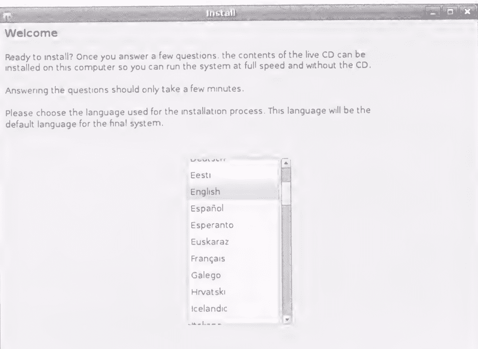

**图 2-1** 选择你的语言。

#### 配置键盘

下一个页面（如图 2-2 所示）用于配置键盘。从列表中选择你的国家/地区来匹配对应的键盘布局。你也可以使用窗口底部的输入框测试键盘布局是否正常，尝试输入键盘上的部分符号（如“、/、|），确认它们可以正常显示。如果按下某个键后显示出其他符号，说明你选择了错误的键盘布局。

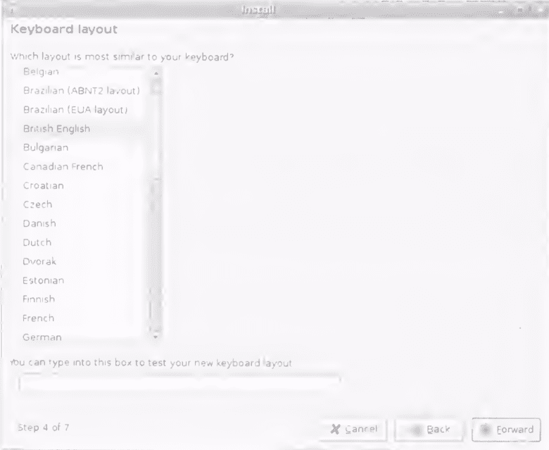

**图 2-2** 选择正确的键盘，确保按键上的符号可以正常显示。

#### 位置选择

现在你可以告诉安装程序你所在的地理位置（如图 2-3 所示）。你可以通过以下几种方式选择位置：首先，将鼠标悬停在你所在地区的地图红点上，选择最近的地点即可；确定所选位置后点击它，地图会放大，之后你就可以选择距离你最近的城市。另外，你也可以使用「最近城市」下拉框查找距离你最近的城市。选择完成后，点击「下一步」继续。


**图 2-3** 点击地图可放大，方便你更轻松地选择位置。

#### 身份信息

下一步需要填写你的个人信息，这些信息将用于在电脑上创建用户账户（如图 2-4 所示）。首先填写「真实姓名」输入框，该框内的信息会用于系统不同位置，标识该账户对应的使用者。接着在「用户名」输入框中添加用户名，用户名最好易于记忆，很多人会使用自己的名字，或在名字后加首字母（例如 `jbacon`、`jonob`）。电脑上的每个用户名必须唯一，不能存在两个使用相同用户名的账户。之后在「密码」输入框中设置密码，并在「验证密码」输入框中再次输入密码。该密码会在你使用刚创建的用户名登录电脑时使用。选择密码时请遵循以下简单准则：

- 确保你能记住密码。如果必须把密码写下来，请将其保存在安全的地方。不要犯*《战争游戏》*里的错误，把密码放在其他人容易接触到的地方。

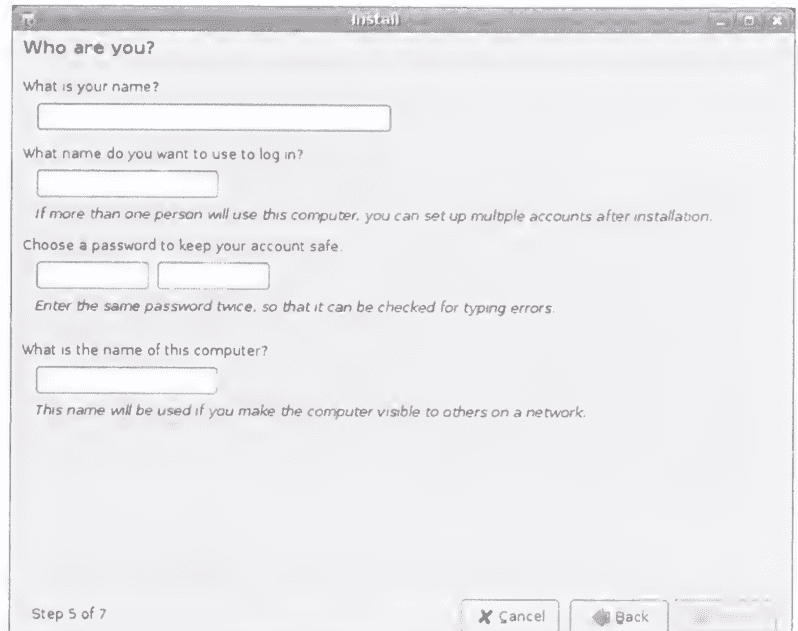

**图 2-4** 该用户账户同时也会作为主系统管理员账户使用。

- 选择密码时尽量不要使用字典里的单词，比如 `"chicken"` 或 `"beard"`。一个保持密码安全的巧妙方法是使用字典单词，但将部分字母替换为数字（例如 `"chicken"` 可以改成 `"ch1ck3n"`）。
- 密码最好超过 6 位，且包含字母、符号和数字的组合。密码越长、字母、数字、符号混合得越复杂，安全性就越高。

最后在「主机名」输入框中填写主机名。主机名是单个单词，用于标识你当前的设备，在局域网中可以通过它区分不同的设备。信不信由你，给设备起主机名其实非常有意思。很多人会为主题式的主机名，比如用超级英雄作为主题，给局域网里的每台电脑都起一个超级英雄的名字（比如超人、蝙蝠侠、蜘蛛侠等）。你可以想一个有趣的主机名主题。填写完所有信息后，点击「下一步」继续。

### 磁盘空间

安装流程的下一步是准备硬盘来安装软件，这一步需要创建多个*分区*来存储 Ubuntu 系统和你的文件。硬盘会被划分为多个分区，每个分区会预留硬盘的特定区域供某个操作系统使用。比如，你可以把整个硬盘都分配给新的 Ubuntu 系统使用，也可以共享硬盘空间，同时安装 Windows 和 Ubuntu，这种共享场景被称为双系统启动。在使用双系统启动时，硬盘通常会同时有 Windows 分区和 Linux 分区，启动时会弹出一个小菜单，让你选择启动 Windows 还是 Linux。安装程序的这一步会为你的新系统创建分区，这是安装过程中最复杂、也最危险的一步。如果硬盘上已有分区（比如安装了 Windows），强烈建议你提前备份重要文件。

> **提示**
>
> **我们真的没开玩笑**
>
> 一定要、一定要、一定要备份所有重要文件。如果在这部分安装过程中出错，你可能会丢失文件，甚至导致系统无法启动。

#### 确定分区方案

在创建分区前，你需要先明确你的需求。如果你对硬盘的分区方式有清晰的规划，就更容易快速完成配置并投入使用。以下是常见的分区方式：

- **仅安装 Ubuntu：** 如果你只需要在硬盘上安装 Ubuntu，且愿意清除*整个硬盘*的所有数据，那事情就很简单了，Ubuntu 可以自动完成所有操作。
- **双系统启动：** 如果你想在 Windows 或 Mac OS X 之外，再安装 Ubuntu 实现双系统启动，你可以将硬盘空间分配给 Ubuntu 分区和 Windows 或 Mac OS X 分区。无论你是仅安装 Ubuntu 还是实现双系统启动，都需要确定 Ubuntu 的分区方式，Ubuntu 至少需要 2 个分区（一个用于系统，一个用于虚拟内存交换空间），如果需要的话你也可以使用更多分区。

### 使用整个磁盘

如果你要擦除整个硬盘，只需选择**擦除整个磁盘**选项，然后点击“下一步”。之后会要求你确认操作，点击“是”继续即可，就这么简单！

### 手动分区

点击**手动编辑分区表**选项，然后点击“下一步”继续。你会看到如图 2-5 所示的界面。这个界面有多个用于创建分区的控件。首先，界面右上角的下拉框可以让你选择要分区的硬盘，选择需要添加分区的对应磁盘即可。磁盘会按设备名称的字母顺序列出，因此磁盘 A（比如 `/dev/hda`）是系统中的第一块磁盘。如果你的电脑只有一块硬盘，系统会自动为你选中该磁盘。界面中间的大矩形区域显示当前磁盘的分区情况，如果你是在空白磁盘上安装，由于还没有添加任何分区，所以不会显示任何内容。点击这个矩形区域，就可以开始操作了。

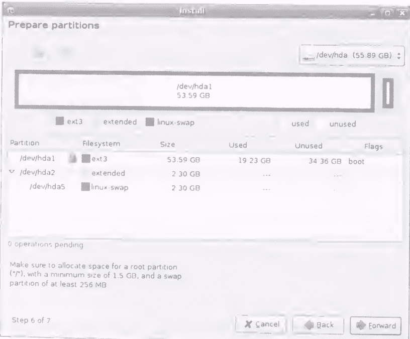

图 2-5 主分区界面。

开始前你需要先为分区准备好磁盘，点击“新建”，会弹出对话框询问你是否要创建 MS-DOS 磁盘标签，点击“创建”继续。之后会询问你是否确认要销毁磁盘上的数据，点击“确定”继续。此时磁盘上会全部变为未分配空间，接下来你就可以添加 Ubuntu 分区了。要添加分区，点击大矩形区域中的未分配空间，再点击“新建”，就会出现如图 2-6 所示的新窗口。这个窗口用于配置分区，最简单的方法是用鼠标拖动分区来调整位置，用分区两侧的箭头拉伸到合适的大小。如果你希望输入具体数值，可以使用对话框左侧的控件。文件系统下拉框用于选择分区要使用的文件系统类型，Ubuntu 默认自带的文件系统是 `ext3`，建议所有 Ubuntu 分区都使用 `ext3`。虽然 `ext3` 对 Ubuntu 来说是很好的选择，但 Windows 无法读取 `ext3` 分区，如果需要创建 Windows 和 Ubuntu 共享的分区，应该使用 FAT32 文件系统。添加完所有分区后，点击“下一步”。

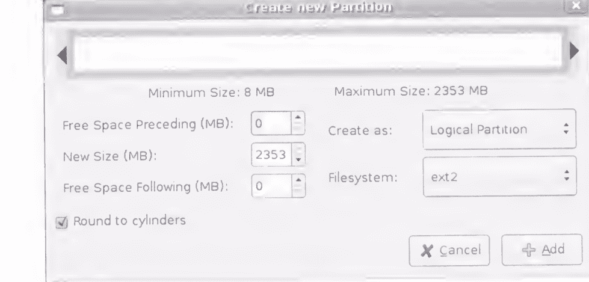

图 2-6 配置分区。

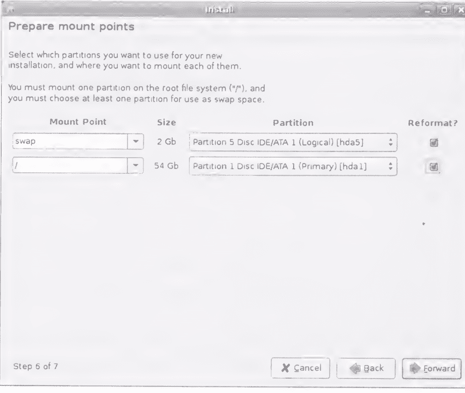

图 2-7 挂载点。

添加完分区后，你需要指定每个分区的用途，接下来会看到如图 2-7 所示的界面。使用“挂载点”下拉框选择不同的挂载点，再用“分区”下拉框选择要应用该挂载点的分区。

## 完成安装

分区设置完成后，安装就基本完成了。系统会给出你之前所作选择的摘要，当你确认这些选择后，Ubuntu 软件就会安装到你的电脑上。安装过程结束后，会要求你重启电脑，至此安装就完成了！

### 提示：更好地利用你宝贵的时间

桌面版 CD 安装器的一大优势是，在从光盘复制文件的过程中你仍然可以使用系统。不用坐在电脑前盯着进度条，你可以玩几款游戏打发时间。

## 使用备用安装 CD 安装

虽然桌面版 CD 是安装 Ubuntu 的理想选择，但你可能想用传统安装器的方式安装系统，这种方式需要启动备用安装 CD、运行安装程序，之后再启动系统。这类安装器非常适合服务器安装或在老旧硬件上安装。要开始安装，把 CD 放入光驱，然后重启电脑。当 CD 启动后，你会看到如图 2-8 所示的菜单，用方向键选择**安装到硬盘**选项，按 Enter 键确认。几分钟后，安装程序会首先要求你选择语言，用上下方向键选择不同的语言，然后按 Tab 键跳转到红色按钮，继续完成后续设置。

### 提示：安装服务器

如果你选择**安装服务器**选项，Ubuntu 会安装典型服务器所需的软件工具，不会包含桌面版安装附带的任何图形应用或界面。这使得 Ubuntu 非常适合运行无头服务器，更多关于将 Ubuntu 作为服务器运行的细节请参阅第 5 章。

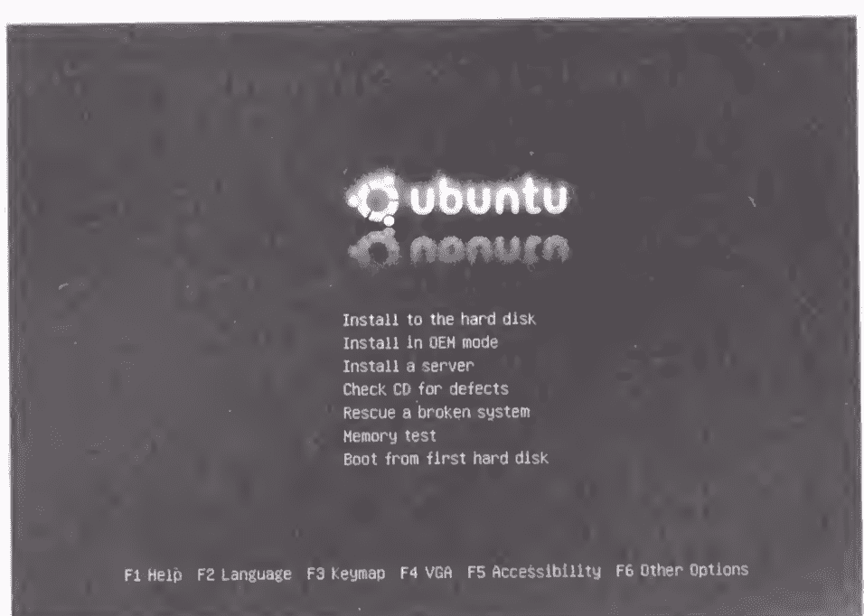

图 2-8 备用安装 CD 菜单。

### 选择你的所在地

接下来会要求你选择所在地（见图 2-9），选择你所在的国家后按 Enter 键确认，这些信息将用于配置你的时区。下一个界面用于配置键盘布局，全球的键盘布局各不相同，以适配不同国家使用的多种多样的符号和字母。即使你使用的是通用的拉丁字符集（大多数欧洲国家、美洲、非洲和澳大利亚都使用该字符集），也存在一些变体和附加字符（比如德语变音符号）。系统会默认为你选择对应的键盘布局（如果你所在地设置为英国，会默认选择英式英语键盘），但对话框中还包含一些额外选项：

- 按键查找布局：选择该选项后，系统会让你输入不同的字母、数字和符号，自动为你匹配对应的键盘布局
- 从完整键盘列表选择：从列表中选择你的键盘布局


测试布局是否正确：该选项允许你输入一些字母、数字和符号，确认你选择的键盘布局是否正确。

选择完语言后，系统会检测并扫描你的光驱，加载额外的组件。

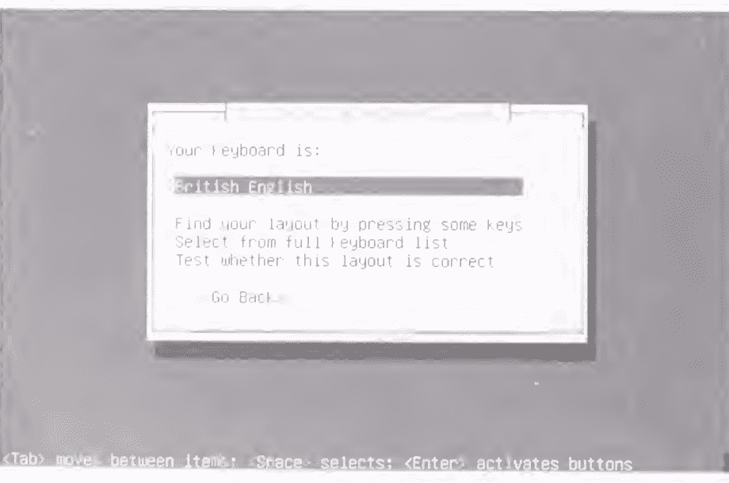

图2-9 选择你的键盘布局。

## 网络配置

接下来系统会尝试检测所有网络硬件并配置你的网络访问权限。如果你连接到无线或有线网络，且通过DHCP自动分配了IP地址，那么你的网络设置会自动配置完成。如果你要连接无线网络，需要输入WEP密钥的密码，系统会提示你输入。

> **提示：WEP密码**
>
> 如果你输入的是ASCII格式的WEP密码，需要在前面加上`s:`前缀（例如`s:theboinggreed`）。

有些情况下会出现问题，你的网络硬件或网络设置无法自动配置，这可能是因为你的网卡不被Ubuntu支持，也可能是Ubuntu无法连接到网络。目前不需要太担心，你可以在电脑启动后再配置网络，更多解决网络问题的细节请参阅第6章。

> **快速提示**
>
> `wpa`、`atheros`（`madwifi`）、`ndiswrapper`和`bcm43xx`模块在安装过程中不受支持，但安装完成后可以正常使用。

接下来会要求你为电脑设置主机名（见图2-10）。

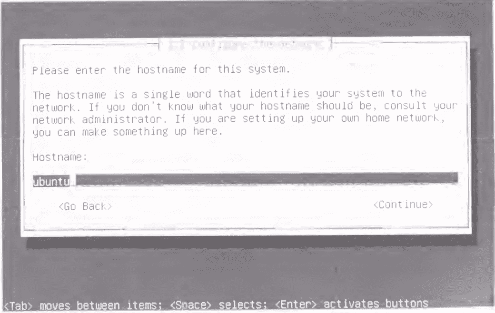

图2-10 主机名用于在你的局域网中标识你的设备。你可以在文本框中输入自定义主机名，也可以使用默认的Ubuntu主机名。你可以充分发挥想象力，为你的主机名设定一个主题（比如超级英雄），网络中的每台主机都可以沿用该主题（例如超人、蝙蝠侠、蜘蛛侠）。

## 创建分区

创建分区是安装过程中最具挑战性的部分，在分区前你需要先考虑好分区的组织方式。你会看到如图2-11所示的界面，系统会提供多个分区选项：

- **擦除整个磁盘**
- **擦除整个磁盘并使用LVM**
- **手动编辑分区表**

大多数情况下你可能会选择**擦除整个磁盘**选项，该选项会擦除你电脑硬盘上的所有内容，并自动为你完成所有设置。第二个选项**擦除整个磁盘并使用LVM**允许你使用逻辑卷管理（LVM）。最后，如果

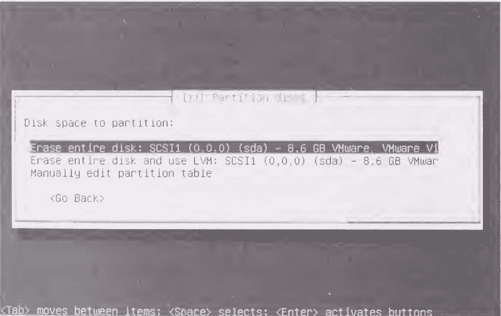

图2-11 磁盘分区。

如果要设置特定分区，请使用**手动编辑分区表**选项。接下来我们逐一介绍这些选项及其用法。

### 擦除整个磁盘

选择该选项后，整个磁盘会自动完成分区。安装程序会提示将会创建一个主分区和一个逻辑分区，随后询问你是否要继续创建分区。点击“是”即可完成操作。

### 擦除整个磁盘并使用LVM

LVM的配置方法将在第5章介绍。

### 手动编辑分区表

如果你想手动创建自定义分区，请选择该选项。在这里你可以创建多种不同类型的分区，设置分区大小，并配置分区属性。和Live CD安装程序不同，这里创建分区不是通过图形化界面操作，因此操作会稍复杂一些。不过整体操作流程仍以选择项目、按Enter键确认为主。系统会提供多个起始选项：

- 配置软件RAID
- 配置逻辑卷管理器
- 引导式分区

> **快速提示**
>
> 关于软件RAID和逻辑卷管理器的相关内容将在第5章介绍。

这些选项下方会列出你的磁盘，可能还会显示已有的若干个分区。如果要删除已有分区，请选中对应分区，按下Enter键，然后选择“删除分区”。删除部分分区后，你会看到一行“FREE SPACE（可用空间）”的条目。该可用空间条目可用于创建新分区。如果磁盘原本为空，没有显示可用空间条目，请选中硬盘，按下Enter键。当系统询问是否要创建空分区表时，点击“是”。此时你应当能看到可用空间条目了。

要创建新分区，请选中可用空间条目，按下Enter键。在下一界面中，选择“创建新分区”并按下Enter键。现在输入分区的大小。你可以用GB（吉字节）和M（兆字节）表示大小，例如`4.2GB`代表4.2吉字节，`100M`代表100兆字节。你也可以输入百分比，或者直接输入`max`来使用整个磁盘。输入大小后，按下Tab键选中“继续”，再按下Enter键。接下来系统会询问你要创建主分区还是逻辑分区，通常主分区是更合适的选择，做出选择后继续即可。如果这是第一个分区，系统会询问你要将分区放在磁盘开头还是末尾。建议在老式电脑上创建根分区（即`/`）时将其放在磁盘开头。这样可以规避旧硬件上可能出现的BIOS问题。新式电脑已不存在这个问题，你可以把分区放在磁盘的任意位置。在接下来显示的界面中（见图2-12），你可以配置分区的一些参数。

#### 图2-12 设置分区选项

**表2-1 分区设置**

| 设置项 | 说明 | 示例 |
| --- | --- | --- |
| 使用类型 | 这是文件系统的类型，普通Ubuntu系统推荐使用`ext3`。 | `ext3` |
| 挂载点 | 用于指定分区存储的内容，本章前文有关于应创建的分区类型的说明，可供参考。 | `/` |
| 挂载选项 | 可以为挂载点传递多个选项，但使用默认设置即可。 | `defaults` |
| 标签 | 用于描述分区的文本标签，通常设置为和挂载点相同的值。 | `/` |
| 保留块 | 这是文件系统中为超级用户保留的空间占比，`5%`是较为合适的默认值。 | `5.00%` |
| 典型用途 | 该选项可用于优化文件系统的组织方式，但一般使用标准设置即可。 | `standard` |
| 可引导标志 | 该分区是否包含内核和引导程序？如果这是根分区（即`/`），请将其设置为开启。 | 关闭 |

各项设置的详细说明见表2-1。配置完分区后，点击“完成分区设置”选项。如果有剩余可用空间，你可以再次选中“可用空间”来创建其他分区。完成所有分区操作后，点击“完成分区并将更改写入磁盘”选项。

## 配置用户

安装程序下一步会为计算机配置用户账户。该用户角色非常重要，不仅可以作为普通用户使用，还能通过`sudo`命令执行系统管理员任务。首先需要输入用户的全名（例如艾伦·克莱门特）。随后需要设置用户名，系统会默认从你输入的全名中生成一个（例如`alanc`）。如果你想使用其他用户名，直接输入即可。最后需要输入用户密码，并再次输入密码进行验证。

## 完成安装

至此，安装程序将自动开始安装系统。安装完成后计算机将自动重启，安装流程就此结束。

### 配置登录界面

虽然默认登录界面对大多数用户来说已经足够，但你也可以对其进行自定义设置。自定义选项包括替换界面背景为所在机构的Logo而非默认的Ubuntu Logo、启用自动登录等其他自定义操作。你可以通过点击“系统 > 管理 > 登录窗口”来配置登录界面。弹出的窗口支持配置登录界面的多项参数。本书不会逐一介绍每个按钮的功能，而是聚焦于如何完成特定配置任务，这样效率更高。其中最重要的配置项包括更换背景、启用自动登录和配置远程访问。

**更换背景**

要更换自定义背景，首先需要创建适配你屏幕分辨率的图片。你可以通过点击“首选项 > 屏幕分辨率”查看当前分辨率，然后创建对应尺寸的图片。记录图片的保存路径（例如`/home/jono`），然后点击“本地”选项卡中的“添加”按钮，选中新创建的图片。选中的图片会被添加到列表中。现在选中新添加的图片即可。

**启用自动登录**

点击“安全”选项卡，勾选“启用自动登录”复选框。接着在“用户”下拉菜单中选择要自动登录的用户即可。

> **提示：“安全”大问题**
>
> 请始终记住，启用自动登录会带来安全风险。他人在你不知情的情况下就可以使用你的计算机。如果你能接受这一风险，或者因为这是你的个人计算机所以风险较低，那么启用该功能没有问题。

### 启用远程图形登录

X窗口系统（驱动Ubuntu桌面的图形引擎）最强大的功能之一，就是可以在本地计算机上运行来自其他计算机的图形应用程序。默认情况下，Ubuntu会禁用该功能。要启用该功能，请点击“远程”选项卡，然后在下拉菜单中选择“与本地相同”。你可以使用以下命令连接该计算机（请替换为对应的IP地址）：

```
foo@bar~$ X -query 192.168.0.2
```

该命令会在你当前的X服务器上运行远程连接。如果要在其他服务器上运行，请执行以下命令：

```
foo@bar~$ X :1 -query 192.168.0.2
```

## 配置打印机

Ubuntu对打印机的支持非常完善，许多常见打印机的驱动程序都已内置。打印机分为本地打印机和远程打印机两种类型，Ubuntu对二者都支持。远程打印机部署在网络中的某台设备上，通常你可以扫描到这些打印机并自动完成配置。要执行该操作，请点击“全局设置”，然后选择“检测局域网打印机”。此时会弹出警告框，提示将在你的计算机上打开一个端口，该端口可能被用于恶意用途。建议仅可在受信任的局域网中执行扫描。如果你对该网络的信任度不足100%，请取消扫描。如果确认要继续，点击“确定”，等待一分钟后打印机就会出现在列表中。

本地打印机是指直接连接到你的计算机的打印机。如今绝大多数打印机都配备USB接口，通常只要插入打印机，系统就会自动识别并完成配置。插入打印机后，点击“新打印机”图标。如果系统检测到打印机，你可以选中“使用检测到的打印机”单选按钮，然后从列表中选择对应的打印机。如果未检测到打印机，请在“打印机端口”下拉菜单中选择对应端口，然后点击下一步。在下一个界面中选择你打印机的制造商和型号，然后点击“下一步”。最后点击“应用”。要测试打印机（无论是本地还是远程）是否正常工作，请右键点击打印机图标，然后选择“属性”。在弹出的对话框中，点击“打印测试页”。随后会向打印机发送一页内容。如果打印遇到问题，请查阅第7章，或访问 `http://help.ubuntu.com/` 或 `www.ubuntuforums.org/` 寻求帮助。

## 摘要

恭喜你拥有全新的Ubuntu系统。无论你是通过桌面版CD还是传统的备用安装CD将Ubuntu安装到你的电脑上，现在你都拥有了一款功能强大、可扩展、易于使用的操作系统，内置海量可用软件。与其他操作系统不同，Ubuntu提供了端到端的完整软件选择，涵盖办公效率、系统配置、网络访问、电子邮件等各类工具。除了这套令人印象深刻的桌面软件外，你的新系统还拥有极其强大的底层架构，支持深度自定义。喜欢代码和编程的用户还可以在预装的各种应用中，找到数以百万计的开源代码，乐在其中。Ubuntu还提供了丰富的开发工具，可用于创建桌面应用、Web应用等各类程序。你即将开启一段激动人心的旅程，现在让我们启程吧……

## 第3章 在桌面上使用Ubuntu

- 体验你的桌面
- 使用应用程序
- Ubuntu文件选择器与书签
- Ubuntu的语言设置
- 自定义Ubuntu的外观与交互
- 管理你的文件
- Ubuntu与多媒体
- 摘要

Ubuntu已经安装完成、蓄势待发，现在可以开始使用你的新桌面了。Ubuntu默认安装的系统非常完善且灵活：以微软Windows等其他操作系统为例，Ubuntu内置了所有入门所需的工具，比如办公套件、媒体工具、网页浏览器、图形处理工具、电子邮件客户端等。安装完成后即可直接上手使用。电脑的使用是非常个人化的行为，不同的人使用电脑的方式各不相同。为了支持这种多样化选择，Linux可以支持多种不同的图形界面。这种灵活性，再加上Linux和开源软件日益增长的普及度，催生了数百种不同的图形环境陆续涌现，每种环境都覆盖了不同类型的用户和使用习惯。尽管现有环境种类繁多，KDE和GNOME毫无疑问是其中两大主流选择。两款环境都提供了全面且易于使用的桌面体验，但在桌面使用逻辑上存在差异。KDE系统更接近Windows，目标是实现桌面的完全可配置。而作为竞品的GNOME桌面则借鉴了Windows和Mac OS X的设计理念，将简洁易用作为优先目标。幸运的是，Ubuntu用户可以自由选择两种桌面——默认安装的Ubuntu使用GNOME桌面，而Kubuntu发行版则采用KDE桌面。Kubuntu相关内容将在第7章介绍。在本章中，你将学习使用GNOME，用它完成日常电脑操作中常见的、以及一些不太常见的任务，包括打开和运行应用程序、管理文件、调整界面外观与交互、使用各类应用、管理媒体文件等。系好安全带，准备好驾驶你的全新桌面启程吧！

> **提示：Ubuntu桌面即GNOME**
>
> 在阅读Ubuntu相关资料时，你经常会看到*Ubuntu桌面*和*GNOME*这两个术语被交替使用。这两个术语指向的是同一事物——Ubuntu桌面本身使用的就是GNOME环境。不过，还有Xubuntu发行版，它在Ubuntu操作系统的基础上，将桌面环境替换为轻量级的Xfce环境。对于想要在低性能电脑上运行Ubuntu的用户来说，这个发行版尤为实用。

## 体验你的桌面

当你启动Ubuntu系统时，系统会要求你输入用户名和密码完成登录。你在上一章安装系统时已经设置了用户账户，请使用该账户登录。首先输入你的用户名并按回车键，然后输入你的密码再按回车键。

> **提示：要选什么语言？Sprache？Langue？Lingua？**
>
> 点击「选项 > 选择语言」按钮即可更改桌面语言。如果点击按钮后发现可选语言中没有你需要的语言，请跳转到第100页的「Ubuntu语言设置」部分，添加新的语言包。

几秒后你就会看到Ubuntu桌面出现（见图3-1）。桌面主要由三个区域组成：

- 屏幕顶部是*面板*。这个横条左侧包含桌面菜单选项和应用程序快捷图标，右侧是通知区域。你可以通过这个横条启动应用程序，查看系统中部分活动的状态。使用桌面时，面板会一直显示。
- 屏幕中部的大面积区域是*桌面*。这部分区域通常会被你使用的应用程序覆盖，但你也可以在桌面上放置图标和快捷方式。
- 屏幕底部区域被称为*任务栏*。这个区域会为每个已打开的应用程序显示一个矩形条目，和Windows中的任务栏类似。


**图3-1** Ubuntu桌面简洁清爽，而且……是棕色调的。

你可能已经注意到，和其他操作系统不同，Ubuntu桌面上默认没有图标。这是因为桌面上的图标通常会被打开的应用程序遮挡，你无法直接访问它们。如果需要启动应用程序，你通常可以使用应用程序菜单或快捷方式。

> **提示：设备图标**
>
> 尽管桌面上默认没有应用程序图标，但当你插入便携式音乐播放器、钥匙扣、数码相机等USB设备时，设备图标会显示在桌面上。

## 启动应用程序与查找资源

启动应用程序非常简单。只需点击面板左侧的「应用程序」菜单，该菜单内包含多个按应用类型划分的子菜单。将鼠标悬停在各个分类上，然后点击你想要启动的应用程序即可。举个例子，点击「应用程序 > 互联网 > Firefox 网页浏览器」，几秒后浏览器就会弹出。

当应用程序启动后，棕色窗口边框的右侧有三个按钮：

- **左侧按钮**（细白线）：用于最小化应用程序，将其收至任务栏中。
- **中间按钮**（白色方块）：用于最大化窗口，使其占据整个桌面区域。
- **右侧按钮**（白色叉号）：用于关闭应用程序。

所有已打开的应用程序都会在屏幕底部的任务栏中显示对应条目。你可以点击这些条目来最小化或最大化对应应用程序，也可以右键点击条目查看更多选项。

## 更改菜单布局

系统菜单默认为逻辑化分类，你可能想要进一步自定义菜单，比如将条目移动到不同的子菜单、隐藏特定项目等。所有这些操作都可以通过内置的菜单编辑器轻松完成。要编辑菜单，请右键点击某一菜单，然后选择「编辑菜单」。此时会弹出菜单编辑器，如图3-2所示。菜单编辑器的操作非常直观：要调整显示的条目，点击对应子菜单，然后取消勾选你不想显示的项目即可。要添加新条目，先选择该条目要归属的子菜单，然后选择**文件 > 新建条目**，此时会弹出图3-3所示的对话框。

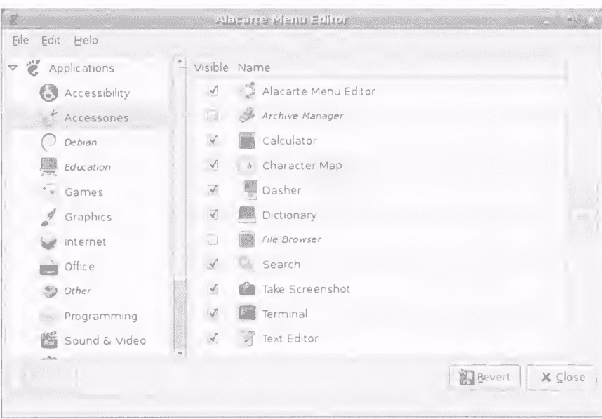

**图3-2** 菜单编辑器可以让你轻松修改Ubuntu菜单。

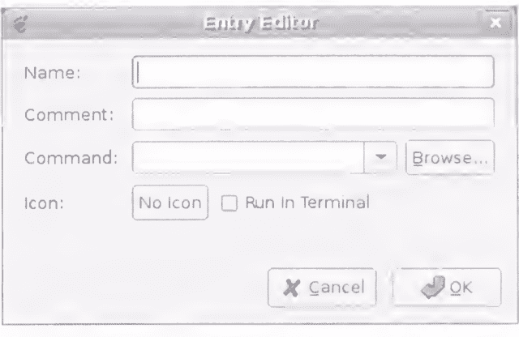

**图3-3** 你可以自由添加自定义菜单条目。

在「名称」框中输入你要添加的应用名称，在「注释」框中输入该应用的简要描述，然后在「命令」框中填入运行该应用的命令。你也可以使用「浏览」按钮来选择要运行的应用。最后，点击「无图标」按钮，为该项目选择一个图标。点击「确定」完成添加。

### 查找你的文件和文件夹

使用计算机时，你经常需要保存和打开文件和文件夹、移动它们，以及执行其他操作。「位置」菜单包含多个选项，用于访问计算机和网络的不同区域，具体包括：

- **主文件夹**：主文件夹用于存储每个已登录用户的文件和工作内容，是系统中最关键的文件夹，你可以把它理解为Windows系统中「我的文档」的对应位置——你保存的所有内容几乎都存储在这里。每个用户都有独立的主文件夹。
- **桌面**：桌面文件夹位于主文件夹内，存储了所有以图标形式显示在桌面上的文件。因此，如果你把文件拖到桌面上，该文件就会出现在桌面文件夹中，反之亦然。
- **计算机**：点击该选项会显示连接到计算机的不同存储设备，包括软盘驱动器、CD/DVD驱动器、U盘等，对应Windows系统中的「我的电脑」图标。
- **网络服务器**：该选项用于访问本地网络中可用的服务器，对应Windows系统中的「网上邻居」。
- **连接到服务器**：点击该选项会启动向导，用于创建到网络服务器的连接。你可以在桌面添加一个图标，点击该图标就能在桌面文件管理器中查看远程文件列表。你可以像操作其他文件管理器窗口一样处理这个窗口，自由拖拽文件，在复制文件到其他计算机时非常实用。
- **搜索文件**：使用该选项搜索计算机中的文件。
- **最近的文档**：点击该子菜单可显示最近使用过的文档。

## 配置系统

第三个也是最后一个菜单「系统」用于配置系统、自定义桌面，该菜单下包含两个子菜单。

### 偏好设置

该子菜单包含用于自定义桌面外观与使用体验的选项，所有设置仅对当前登录用户的桌面生效。若你登录其他用户账号，设置会自动切换为该用户的偏好配置。

### 系统管理

该子菜单用于配置网络、用户、打印等全系统范围的设置，使用这些菜单选项需要输入系统管理员密码。

> **提示：感受权限的力量**
>
> 安装Ubuntu时，系统会让你设置一个用户名和密码。该密码不仅用于访问你的普通用户账号，还能解锁权限极高的系统管理功能。因此，当你访问这些菜单选项、被要求输入密码时，只需输入你常用的用户密码即可使用这些功能。


> 该功能仅适用于你在系统中创建的第一个用户，如果你添加了其他账号，除非你明确赋予其权限，否则该用户无法访问系统管理选项。

### 快捷图标

面板的菜单旁边设有一些快捷图标，这些小图标始终可见，单击即可快速打开你常用的应用。Ubuntu的面板默认自带了一些快捷方式，你也可以自行添加。添加自定义图标非常简单：只要在菜单中找到想要添加的应用，将其拖到面板上即可。之后你可以右键单击新添加的快捷图标，选择「移动」来调整它的位置。

### 小程序

Ubuntu最实用的功能之一，就是可以在面板上运行被称为「小程序」的小型程序。这些小工具可用于完成各类不同任务，通过面板就能快速便捷地访问。

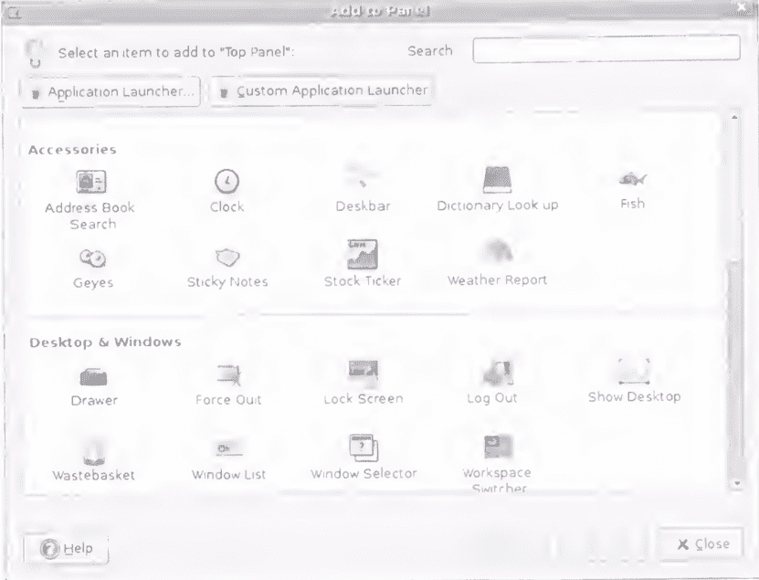

**图3-4**

Ubuntu默认自带多款小程序。要添加小程序，只需右键单击面板，选择「添加到面板」，就会弹出如图3-4所示的窗口。选择你想要的小程序，点击「添加」即可。小程序添加到面板后，你可以按鼠标中键（或同时按下左右键）来拖动它调整位置。

### 通知区域

面板的右上角是通知区域和时钟。通知区域和Windows系统托盘类似，会显示一系列代表特定状态的小图标，电池电量监控就是典型例子：这个小图标会显示笔记本电脑剩余电量，将鼠标悬停在上面还能看到距离电脑自动关机还剩多少时间。你可以右键单击通知区域的图标打开上下文菜单来调整相关设置，部分图标（比如音量控制）支持左击打开对应功能。你可以尝试单击小喇叭图标，调整滑块来修改音量。

> **快速提示** 右键单击音量图标，选择「打开音量控制」即可访问声卡的混音器设置。这些设置可以配置扬声器、麦克风、线路输入以及声卡的其他任何输入输出设备。

### 时钟

通知区域旁边是时钟。单击时钟可以查看日历。之后当你使用Evolution（进化邮件客户端）时，你添加到日历中的事项也会显示在时钟小程序中。不用打开Evolution查看你怕得要死的牙医预约时间，只要单击时钟就能立刻看到。

> **快速提示** 右键单击时钟，选择「偏好设置」即可自定义时钟。

### 任务栏

任务栏位于屏幕底部，这个小条始终可见，会显示当前正在运行的应用。此外，任务栏还集成了一些实用的小功能。任务栏最左侧是「显示/隐藏桌面」按钮：单击该按钮会隐藏所有打开的应用程序，仅显示桌面；再次单击则会恢复所有窗口。当你需要快速访问桌面上的内容时，这个按钮非常实用。该按钮旁边是应用区域，会显示所有当前打开的应用。每个打开的应用都会在这里生成一个条目，你可以右键单击条目打开上下文菜单，通过该菜单可以实现最小化、最大化、调整大小、关闭应用等操作。

> **快速提示** 在Ubuntu中，你可以像在Windows中一样，通过按`Alt+Tab`组合键在多个应用间切换。按下该组合键后会弹出一个小窗口，你可以在其中选择切换到其他正在运行的应用。要将应用移动到其他桌面，只需右键单击窗口边框或任务栏中的应用条目，选择「移动到其他工作区」，再选择对应的工作区编号即可。菜单中还有「移动到左侧工作区」和「移动到右侧工作区」选项，让工作区间移动应用变得非常简单。工作区的右侧是回收站，拖拽到该图标上的文件会被标记为待删除状态。要彻底删除这些文件，右键单击回收站，选择「清空回收站」即可。

> **提示** Ubuntu桌面的可用性

> 在Ubuntu桌面的开发过程中，团队始终非常重视可用性优化。例如，屏幕的四个角落被设定为易于访问的区域——你不需要精准地将鼠标移动到角落，只要随意把鼠标甩到边缘就能触发对应功能，这也是每个角落都设置了重要功能的原因，让访问功能变得更加便捷。Ubuntu中充满了这类细小的可用性优化，尽可能让系统操作更符合直觉。

## 关闭计算机与注销账号

要锁定屏幕、关闭计算机、注销账号、休眠或睡眠，请依次点击「系统」>「注销」。之后会弹出如图3-5所示的对话框。

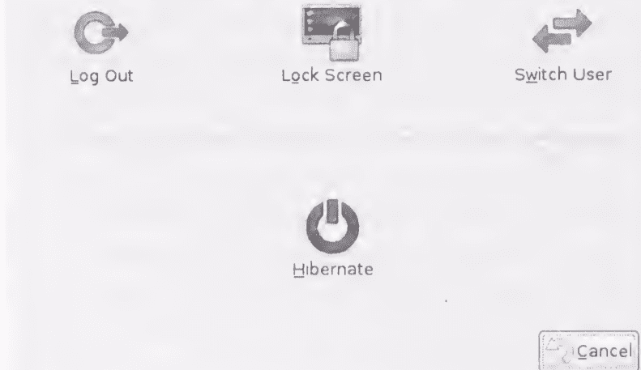

**图3-5**

谁能想到注销账号居然有这么多功能呢？

注销后可用的选项有以下几种：

- **注销：** 该选项可让你退出当前会话，返回主登录界面。

- **切换用户：** 点击该选项后，你的当前用户账户仍保持登录状态，同时可使用其他用户账户。当第二个用户账户注销后，Ubuntu会自动切换回原来的账户。

- **锁定屏幕：** 该选项可锁定屏幕。当你需要去洗手间或吃午饭时，这个功能非常实用。它会锁定电脑，重新启用桌面时需要输入你的密码。

- **睡眠：** 如果你的电脑支持挂起功能，点击该图标即可暂停供电。下次开机时，桌面会恢复到之前的状态。

- **休眠：** 点击该选项后，系统的当前状态会保存到硬盘中，之后可以关机。该功能与睡眠选项类似，但速度更慢，且所有电脑都支持。

- **重启：** 点击该选项即可重启电脑。

- **关机：** 点击该选项即可关闭你的电脑。

### 使用应用程序

现在你已经熟悉了桌面，接下来我们来探索新系统中预装的大量应用程序。默认情况下，Ubuntu内置了多种流行且成熟的应用程序，可用于听音乐、看视频、创建文档、浏览网页、管理日程、阅读邮件、制作图片等。这些应用程序都经过开发者的审核，确保都是当前可用的最佳Linux应用程序。尽管Ubuntu已经预装了多种不同的软件应用，但你很可能还会想要安装额外的应用、探索其他可用的软件。幸运的是，Ubuntu系统基于强大的基础架构构建，软件安装非常简单，只需点选即可完成。点击「应用程序」>「添加应用程序」，就会弹出可用于安装新应用的对话框。只需浏览不同分类，勾选想要安装的应用程序，再点击「应用」按钮，应用程序就会自动下载并安装完成。

## 第3章 在桌面上使用Ubuntu

该工具提供了一种便捷方式来访问一小部分核心常用应用，但你的Ubuntu系统实际上可使用的软件包超过16000个。软件安装相关内容将在第4章详细说明。

### **提示** 另一种运行应用程序的方式

虽然你通常可以通过「应用程序」菜单选择来启动应用，但也可以按下`Alt+F2`组合键，弹出输入框后输入应用名称即可运行。

### 使用Firefox浏览网页

Firefox是Ubuntu默认的网页浏览器，为你提供简单、安全且功能强大的浏览体验。Firefox已成为全球最成功的开源项目之一，持续受到广泛欢迎。凭借超过1.5亿次的下载量和不断增长的市场份额，Firefox取得了无与伦比的成功，它确实非常出色。

你可以通过点击面板上的蓝色地球快捷图标，或者选择「应用程序」>「互联网」>「Firefox网页浏览器」来启动Firefox。几秒后就会弹出Firefox主窗口（见图3-6）。

> 图3-6 Firefox界面简洁且可扩展。

Firefox窗口与大多数网页浏览器外观相似，包含常用的后退、前进、重新加载和停止按钮，还有地址栏和若干菜单。这些熟悉的元素可以帮助你快速上手Firefox，如果你之前使用过IE、Opera、Netscape或Safari浏览器，肯定能立刻熟练使用。在Firefox中浏览互联网与其他浏览器没有区别——只需在地址栏输入网址，按下回车键即可。Firefox还有一些实用功能，可以让你更方便地访问常用站点。

举个例子，如果你想访问Ubuntu官网，只需输入`www.ubuntu.com`即可，不用输入多余的`http://`前缀。另外，你也可以直接输入“Ubuntu”，Firefox会自动跳转到Google，将“Ubuntu”作为搜索词，带你进入搜索结果的第一条。对于通常排在搜索结果页首位的热门站点，这个功能非常实用。

### **快速提示**

地址栏旁的搜索框可用于在Google上搜索。只需输入搜索关键词，按下回车键即可。你也可以点击小图标选择其他搜索平台（如亚马逊、eBay等），切换搜索选项。这个搜索框几乎可以搜索任何内容。如需添加更多搜索引擎，点击小图标后选择「添加搜索引擎」即可。

### **标签页浏览**

如果你和本书的作者一样，每次上网都会浏览多个不同的网站。同时开着网页邮箱、eBay、多个论坛、新闻网站、博客等是非常常见的。要不了多久，你的桌面上就会堆满浏览器窗口，任务栏也会被占满。

Firefox通过*标签页浏览*功能巧妙解决了这个问题。如果你正在浏览朋友做的关于浣熊的网站，突然想查看你喜欢的运动员的官网，只需点击「文件」>「新建标签页」，或按下`Ctrl+T`组合键，浏览器窗口中就会弹出一个新标签页，你可以在该标签页中加载其他页面。

标签页浏览的乐趣还不止于此——哦对！当你浏览网页时看到感兴趣的链接，右键点击该链接，选择「在新标签页中打开链接」，页面就会在新标签页中加载，你可以继续阅读当前文章，之后再查看打开的链接。

### **收藏常用网站**

要收藏当前浏览的页面，点击「书签」>「将此页添加为书签」。在弹出的对话框中，使用下拉框选择保存书签的文件夹。如果要新建文件夹，点击下拉框右侧的小箭头按钮，下拉框就会展开。要创建主文件夹，先选中书签文件夹，再点击「新建文件夹」。你也可以通过选中已有文件夹，再次点击「新建文件夹」来创建子文件夹。完成文件夹的选择或新建后，点击「添加」即可完成书签收藏。

### **用实时书签节省时间**

Firefox还内置了一项名为*实时书签*的实用功能，无需访问网站就能自动抓取网站内容。举个例子，访问`http://fridge.ubuntu.com/`（一个热门的Ubuntu新闻站），你会看到地址栏右侧有一个橙色小图标。点击这个橙色方块，会弹出对话框让你选择书签的保存位置。使用默认选项（工具栏文件夹），点击「添加」即可。之后会新增一个工具栏按钮，点击该按钮就会显示网站的内容列表。每次启动Firefox时，它都会在后台自动更新这个列表，无需你亲自访问网站。

> **小提示：如果你喜欢新闻站**

> 你可能还会喜欢Ubuntu星球网站`http://planet.ubuntu.com/`。该网站收录了多位Ubuntu开发者的个人博客，可以让你独特地了解开发者们正在做的工作。

### **快速安装扩展，让浏览器更酷**

尽管Firefox已经是一款功能强大且灵活的网页浏览器，但通过安装特殊的插件扩展，还能进一步扩展其功能。这些扩展不仅涵盖常见的浏览需求（如Macromedia Flash插件），还包含其他更多专业化的附加功能，可扩展浏览器本身的能力。

要安装常规网页插件，只需访问需要该插件的网站即可。页面顶部会出现黄色提示条，提示你缺少相应的插件。点击「安装缺失的插件」按钮即可获取所需插件。默认情况下，Ubuntu没有预装Macromedia Flash插件，因此你需要单独安装。

要扩展浏览器本身的功能，可以前往`https://addons.mozilla.org/`，浏览你感兴趣的扩展。当你找到想要安装的项目，请点击“安装”链接。会弹出一个对话框要求你确认安装，点击“立即安装”即可。你的新扩展现在会自动下载并安装完成，通常需要重启Firefox，之后扩展就可以使用了。

> **提示**：注意下载渠道

> 浏览扩展时，建议你仅从`http://addons.mozilla.org`下载扩展。如果你确实需要从其他网站安装扩展，请确保该网站值得信赖，否则扩展可能包含不安全软件、病毒或间谍软件。

## 使用OpenOffice.org创建文档

Ubuntu自带一套名为OpenOffice.org的完整办公套件。这套应用集合包含文字处理器、表格、演示文稿、数据库、绘图编辑器和数学编辑器，功能十分全面，支持读写Microsoft Office文件格式，还可以将文档导出为网页、PDF文件和Macromedia Flash动画。我们就用OpenOffice.org来写一封信，试试它的功能吧。

通过“应用程序 > 办公”菜单选择OpenOffice.org Writer来启动它。加载完成后，你会看到如图3-7所示的界面。

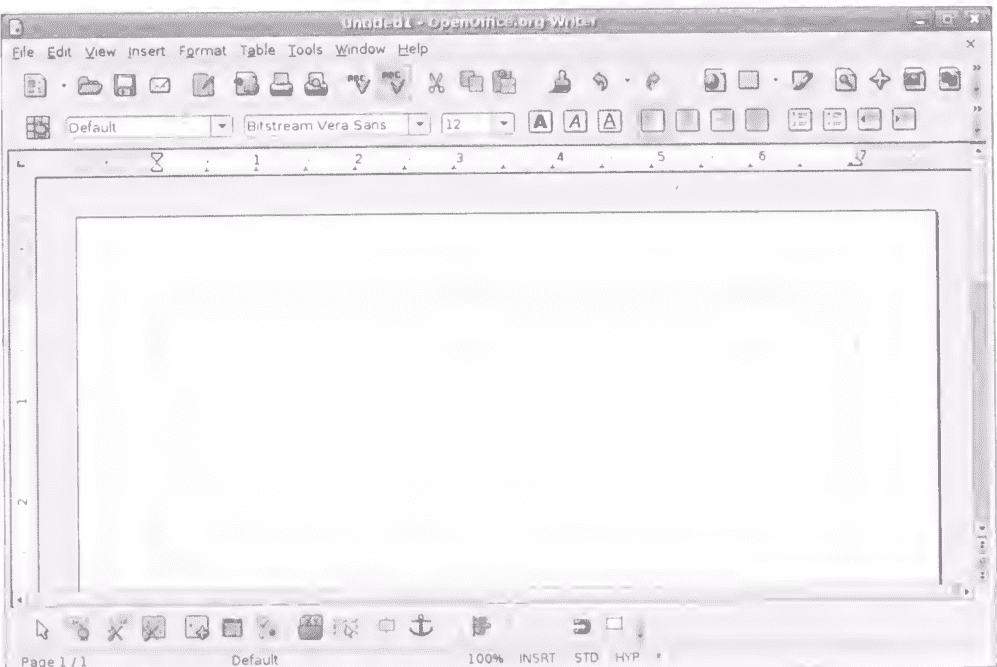

图3-7：OpenOffice.org的界面与Microsoft Office相似，因此迁移成本很低。

## 在桌面上使用Ubuntu

如果你之前使用过文字处理程序，大部分通用界面元素比如字体类型与大小、加粗、斜体、下划线和对齐按钮的样式与操作逻辑都是相同的。如果你之前用过Microsoft Office之类的软件，OpenOffice.org的开发者也特意将套件设计得容易迁移。花几个小时熟悉OpenOffice.org后，你肯定就能掌握自己需要的操作了。

首先选一款好看的字体来开始写信吧。在字体组合框中，默认选中的应该是Nimbus Roman字体，点击该框，换为漂亮的Bitstream Vera Sans字体。要修改字体大小，点击字体框右侧的组合框，选择字号10即可。现在光标在页面左侧，在信中填入你的家庭住址。按下`Enter`键在地址下方留出一行空白，然后点击工具栏的“右对齐”按钮（图标是几行右对齐的线条）。如果你不确定每个按钮的作用，把鼠标悬停在按钮上，就会弹出提示信息。现在填入收件人地址，再次按下`Enter`键留出空白行，然后输入信件正文。你可以随意使用加粗、斜体和下划线按钮来强调内容，也可以用其他工具栏按钮添加项目符号、编号列表，或是修改字体颜色。

如果你要添加图形、表格、特殊字符和边框之类的元素，点击“插入”菜单，选择对应的选项即可。添加到页面的每个元素都可以通过右键单击它，在弹出的上下文菜单中选择对应选项来进行自定义修改。信写完后，你可以通过选择“文件 > 保存”、点击工具栏的软盘图标，或是按下`Ctrl+S`快捷键来保存文件。

OpenOffice.org的默认文件格式是开放文档格式（OpenDocument Format）。这一开放标准文件格式是官方认可的通用标准，在全球范围内广泛使用。不同类型的应用对应的文件格式略有差异（文字处理文件为`.odt`，表格文件为`.ods`等），但所有格式都采用开放标准，不会受到供应商锁定。你也可以将文件保存为多种其他格式，包括Microsoft Office格式。

## 供应商锁定？

在专有软件领域，通常每个应用都有专属的封闭文件格式，只有供应商知道如何实现这一格式。用户用这类软件创建文档后，由于格式封闭，只有对应的工具可以读写该格式。只要你还想访问自己的文档，就必须使用这个工具，这就是所谓的供应商锁定。

为了解决这一问题，OpenOffice.org套件（以及绝大多数其他开源应用）都采用公开文档记录的开放文件格式。这意味着其他应用也可以实现开放文档格式，你可以放心，你的文档始终可用，也不会被任何特定工具锁定。

OpenOffice.org还有一个实用功能，可以将文档保存为Adobe PDF格式。近些年PDF文件的使用越来越广泛，适合发送给对方不应修改的文档（比如发票）。PDF文件能保留文档的高质量副本，在所有操作系统上都有良好的支持，非常适合用来制作目录、宣传册和传单。

要保存为PDF文件，点击主工具栏上的PDF按钮（位于打印机图标旁），点击按钮、输入文件名即可完成，操作非常简单。

## 使用Evolution管理电子邮件和日历

Evolution是一款全能型个人信息管理工具，你可以在这里一站式处理所有信息：收发电子邮件、管理日程、存储联系人信息、整理待办事项等。因此Evolution尤其适合需要便捷获取这类信息的商务人士。

## 设置电子邮件账户

要使用Evolution收发电子邮件，你需要了解以下连接邮件服务器的配置信息（你可以从自己的互联网服务提供商或系统管理员处获取这些信息）：

- 电子邮件服务器类型（比如POP或IMAP）

- 邮件服务器名称（比如`mail.chin.com`）

- 邮件账户的用户名和密码

- 认证类型（通常为“密码”）

- 发件服务器类型（通常为SMTP）

- 发件服务器名称

> **提示**：Evolution与网页版邮箱

> 除非你将网页版邮箱配置为通过POP协议接收邮件、通过SMTP协议发送邮件，否则无法使用Evolution读取Gmail、雅虎邮箱或Hotmail这类网页版邮箱的邮件，更多详情请咨询你的网页版邮箱服务提供商。

你可以通过点击面板上的信封和时钟快捷图标（将鼠标悬停在快捷图标上即可查看对应功能），或是点击“应用程序 > 互联网 > Evolution邮件”来启动Evolution。应用加载完成后，会弹出向导引导你设置邮件服务器（如图3-8所示）。点击“下一步”继续设置，之后会让你填写身份信息，在“电子邮件地址”栏填入你的邮箱地址，如果有需要也可以填写可选信息，这些额外信息不是使用Evolution的必需项，填写完成后点击“下一步”继续。

接下来会让你从下拉菜单中选择你的邮件服务器类型，选择后就会显示对应的附加设置项。

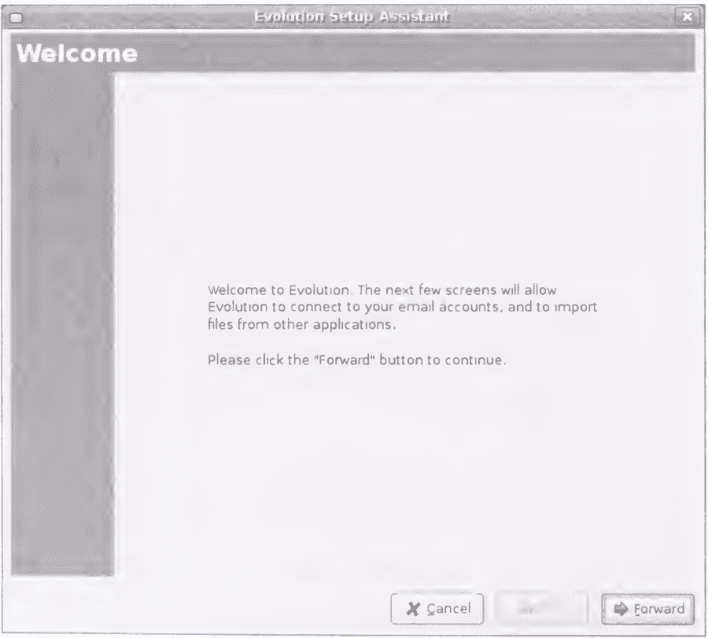

图3-8：只要你知道邮件服务器的相关信息，Evolution的设置非常简单。

填入服务器名称和用户名，你可能需要调整安全与认证类型的设置，但大多数账户使用默认设置即可，点击“下一步”继续。

下一页会配置接收电子邮件的相关选项，这些选项都不是必需的，不过你可以勾选第一个选项来自动检查新邮件，完成后点击“下一步”继续。

下一页配置发送邮件的相关选项，在组合框中选择服务器类型（通常为SMTP），然后在服务器栏填入服务器名称，完成后点击“下一步”继续。

下一页会让你输入用于描述该账户的名称，默认填入的你的电子邮件地址即可，你也可以输入更有意义的名称，比如“工作邮箱”或“个人邮箱”，填写完成后点击“下一步”继续。

最后，在地图上选择你的位置，点击你所在的世界区域，地图就会放大，完成后点击“应用”即可完成设置并关闭向导。

向导设置完成后，就会出现Evolution的主界面，如图3-9所示。

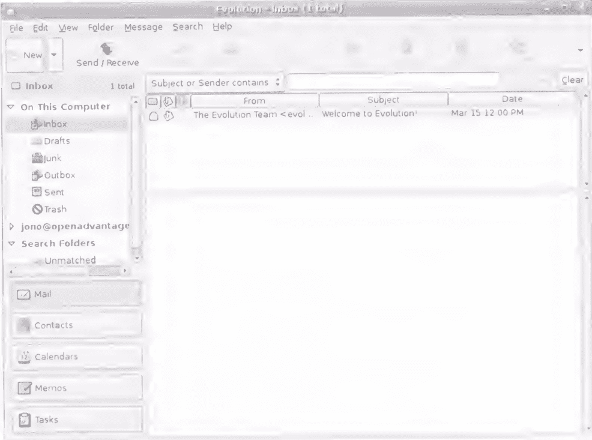

图3-9：如果你之前使用过Microsoft Outlook，会发现Evolution的界面和它非常相似。

在左侧边栏中你可以看到多个按钮，用于访问Evolution中的邮件、联系人、日历、备忘录和任务组件。

## 使用您的电子邮箱

在电子邮件组件中，你可以在左侧面板看到邮件文件夹，在顶部面板看到邮件列表。当你点击某一封邮件时，它会在底部面板中显示，你可以在此阅读。

完成新账户配置后，你首先需要从邮件服务器获取邮件。点击「发送/接收」，即可从服务器获取新邮件，同时也会发送所有待发的邮件。

> **提示：遇到问题？**


> 如果你无法连接到邮件服务器，可能是账户配置出现了错误。要再次编辑账户设置，请点击「编辑 > 偏好设置」，在列表中选择对应账户，再点击「编辑」。

邮件加载完成后，新邮件会在顶部面板中以粗体显示。使用上下方向键可以浏览不同的邮件，每封邮件的内容都会随之显示。你可以通过点击工具栏上的「回复」或「全部回复」按钮来回复邮件。点击工具栏上的「新邮件」按钮即可撰写并发送新邮件。默认情况下，你在邮件撰写窗口点击「发送」按钮后，新邮件和回复邮件都会自动发出，无需再点击「发送/接收」按钮来投递。

## 管理日历

在日历模式下，Evolution 提供了便捷的方式来管理日程、添加新事件，以及以不同方式查看日历。点击「日历」按钮启用该模式后，你可以看到今日的时间表以及月视图。月视图会显示近几个月的日历，其中加粗的日期代表当天有事件。

你可以向日历中添加两种类型的事件：

- **会议：** 这类事件有特定的参与人群。
- **预约：** 这类是通用事件。

要添加新的预约，请在月视图中找到对应日期，右键点击「今日」视图，选择「新建预约」。在弹出的窗口中填写「摘要」、「地点」、「时间」和「描述」栏位。你还可以通过日历下拉框选择该事件要显示在哪个日历中。

> **提示：多日历功能**
>
> Evolution 支持多日历功能，如果你希望为不同类型的活动（比如个人事务和工作相关事项）设置不同的日历，这个功能会非常实用。要创建新日历，请在左侧边栏的日历列表上点击鼠标右键，选择「新建日历」。

要添加新的会议，同样先找到对应日期，右键点击「今日」视图，选择「新建会议」。在弹出的对话框中，你需要添加出席会议的参会人员。有两种方式可以添加参会人员：如果对方不在你的通讯录中，请使用「添加」按钮；如果对方在你的通讯录中，请使用「参会者」按钮。

点击「参会者」按钮后，会弹出一个新对话框，左侧显示参会者列表，你可以使用「添加」和「移除」按钮选择联系人，并将其添加到「主持人」、「必须参会者」、「可选参会者」和「资源」这些不同分类中。

由于你刚接触 Evolution，通讯录中很可能还没有联系人，因此你可以点击 Evolution 主窗口左侧的主「联系人」按钮来添加联系人。

你可以通过点击工具栏上的不同按钮（比如「周」、「月」、「列表」）来以多种方式查看日历，多尝试一下，找到最适合你的查看方式。

> **快速提示**
>
> 请注意，你无需打开 Evolution，只需点击面板上的时钟，就可以查看你的预约。

## 使用 GIMP 创作图形

GNU 图像处理程序（GNU Image Manipulation Package）被爱好者亲切地称为 GIMP，是一款功能强大的图形处理软件。GIMP 提供了全面的功能，可用于创作不同类型的图形，包含选区、绘图、创建路径、遮罩、滤镜、特效等各类工具。它还内置了多种媒体模板，包括网络横幅、不同尺寸的纸张、视频帧、CD 封面、软盘标签，甚至还有卫生纸模板——没错，就是卫生纸。

你可以通过点击「应用程序 > 图形 > GIMP 图像编辑器」来启动 GIMP。和 Adobe Photoshop 不同，GIMP 不会将所有窗口都放在一个大的主窗口中，而是会打开多个独立的子窗口，新用户一开始可能会觉得有点困惑。

## 示例

通过点击「应用程序 > 图形 > GIMP 图像编辑器」启动 GIMP。GIMP 加载完成后，你会看到多个不同的窗口，如下图所示。

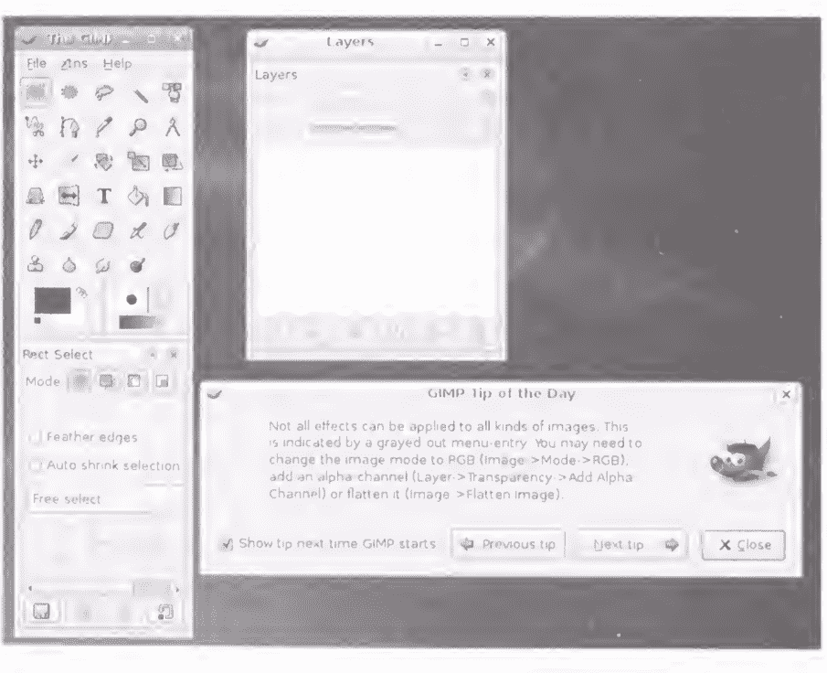

**图 3-10**

GIMP 不会像 Adobe Photoshop 那样把所有内容都放在同一个窗口中。关闭「每日提示」窗口后，你会剩下另外两个窗口。截图左侧的是主工具栏面板，这个面板提供了多种可用于创作图像的各类工具。截图右侧的窗口则显示了图层、画笔和其他相关信息。GIMP 有大量用于不同用途的窗口，这只是其中一种。

要创建新图像，请点击「文件 > 新建」，会弹出如下图所示的窗口。

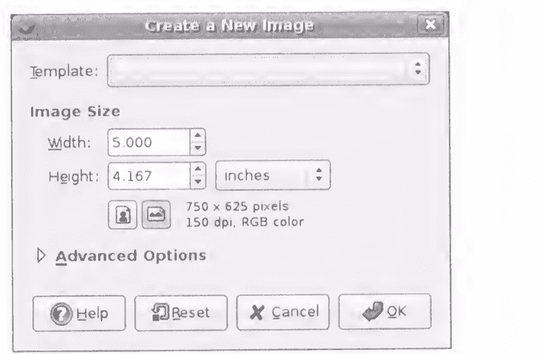

**图 3-11**

有大量模板可供选择，甚至还有卫生纸的模板！入门最简单的方式就是选择其中一个模板。点击「模板」下拉框，选择「640×480」。如果点击「高级选项」展开栏，你还可以通过「色彩空间」栏选择图像使用的颜色类型，以及通过相关选项设置背景填充方式。「填充」下拉框可以用来选择填充色，或者设置透明背景。点击「确定」后，你就可以看到新建的图像了。


**图 3-12**

右键点击图像可以打开大量 GIMP 选项和功能。要编辑图像，请使用工具栏面板选择要在新图像窗口中使用的工具。每次点击面板中的工具时，该工具的选项都会出现在面板窗口的底部。

点击面板中的「T」按钮即可选择文本工具。在面板底部你可以看到不同的选项。点击「字体」按钮，选择「无衬线粗体」。接着点击「大小」栏的上箭头，将字号设置为 45。

将鼠标移动到空白图像上，你会看到鼠标指针变成了文本输入光标。点击图像后，会弹出一个输入框，你可以在其中输入要添加到图像中的文本，输入「Ubuntu」。

在文本输入框仍处于打开状态时，点击「大小」栏的上箭头，让文本大小调整到占据窗口的大部分区域。如你所见，你可以在文本位于图像上时随时调整它。当你对文本的格式满意后，点击文本输入框上的「关闭」按钮。

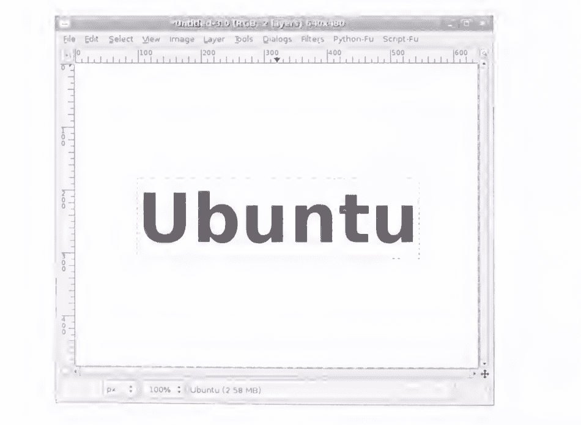

**图 3-13**

Ubuntu 自带多种美观的字体，可用于你的图像创作。现在点击面板上带有四个箭头的按钮，你可以用它在图像中移动文本。点击黑色文本，然后移动鼠标即可调整位置。

现在我们来添加特效滤镜。GIMP 内置了多种不同的滤镜，你可以右键点击图像，选择「滤镜」子菜单来使用这些滤镜。GIMP 还支持你创建脚本，将多个滤镜组合起来生成有趣的合成效果。另外，GIMP 也内置了多款此类脚本，你可以右键点击图像，选择「Python-Fu」和「Script-Fu」子菜单来使用它们。

针对我们的图像，右键点击图像，选择「滤镜 > 模糊 > 高斯模糊」。在「水平」和「垂直」栏位中将数值设置为 20，点击「确定」应用效果。几秒后，模糊效果就会应用到你的文本上。GIMP 中的所有操作都可以撤销，你可以点击「编辑 > 撤销」，或者按下快捷键 Ctrl+Z 来撤销操作。

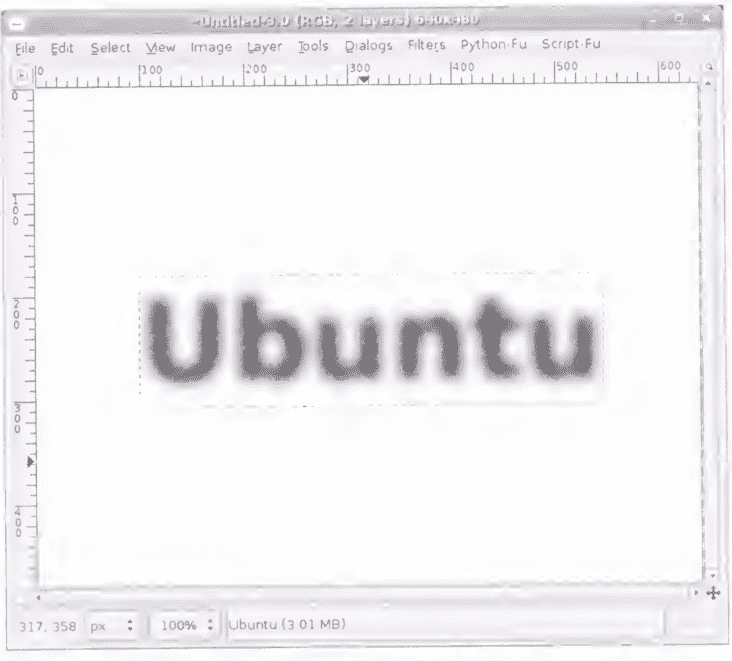

> **图 3-14**

你的电脑上的 GIMP 内置了大量滤镜和特效。现在我们将创建一个新图层，在已模糊的文本上添加新的文本，来生成有趣的效果。在图像窗口中，点击「对话框 > 图层」，此时会弹出图层窗口（见图 3-15）。

图层就像可以相互堆叠的透明塑料片，你可以在一个图层上创作部分图像，再在上方的新图层上添加其他图像内容。多个图层组合在一起可以生成看起来很复杂的图像，而且你只需要编辑想要修改的图层即可，非常方便。

目前，我们模糊后的文本在某个图层上。点击图层对话框中的纸张图标即可添加新图层。随后会弹出一个窗口用于配置图层，默认设置就很好（是和你的图像尺寸一致的透明图层），直接点击「确定」即可。

## 第3章 在桌面上使用Ubuntu

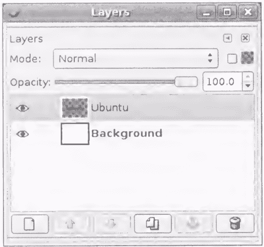

**图3-15** 图层是制作包含大量部件的复杂图像时的必备要素。现在双击调色板窗口中的黑色色块，选择浅色。你可以在色域范围内移动鼠标，找到满意的颜色后点击“确定”即可完成操作。现在点击调色板中的文字按钮，再次添加Ubuntu文字。添加的文字会和之前的尺寸一致。现在使用移动工具，将其定位到模糊的文字上方。现在你就得到了带有柔和光晕的“Ubuntu”文字，效果如图3-16所示！

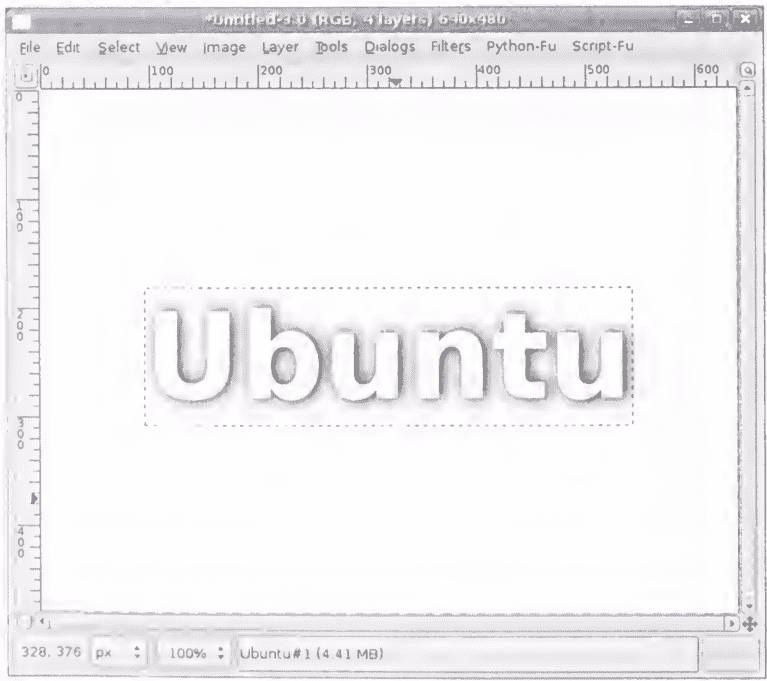

**图3-16** 按照我们刚才的操作组合步骤，就能得到类似这样的有趣效果。最后一步是裁剪图像，去除图中未使用的空白区域。点击“工具 > 变换工具 > 裁剪 > 调整大小”，用鼠标在Ubuntu文字周围绘制选框。你可以使用选框外侧的黑色控制点更精确地移动选框。点击“裁剪”，图像就完成裁剪了。要保存你的作品，点击“文件 > 保存”，输入文件名即可。你可以使用“选择文件类型”下拉菜单从众多不同的文件格式中选择一种。

## 使用Gaim进行通讯

随着互联网席卷全球，无处不在的全球网络已经成为日常生活的一部分，人们普遍可以接入网络也已成为共识。这反过来催生了一系列网络服务，有趣的是，也催生了各种各样的通讯方式。Ubuntu自带Gaim，这是一款集成了多种即时通讯方式的程序，你可以通过它在一个软件中给好友发送即时消息。你无需分别为MSN、AIM、ICQ和Jabber安装独立的客户端应用来和好友聊天，Gaim就可以在一个地方完成所有这些操作。你可以通过点击“应用程序 > 互联网 > Gaim即时通讯”打开Gaim。

## 设置你的账户

启动Gaim后，第一步是为你要使用的每一种不同网络创建对应账户。点击主界面的“账户”按钮，就会弹出账户对话框。点击“添加”按钮添加新账户，就会弹出“添加账户”窗口（图3-17）。这个窗口会根据你选择的协议显示可用的文本框。不同的可用网络会以选项的形式列在“协议”下拉框中。要创建账户，你需要拥有对应网络上的已有账户。Gaim支持同时运行不同网络上的多个账户——你只需要为每个协议创建一个新账户即可。选择好协议后，填写剩余的文本框。“用户名”框需要填入你注册的用户名（MSN需要填电子邮箱地址），“密码”框需要填入对应的密码。你还可以使用“别名”框添加一个有趣的名称，当其他人在线上看到你时就会显示这个名称。如果你想配置其他选项，点击“显示更多选项”下拉菜单即可。

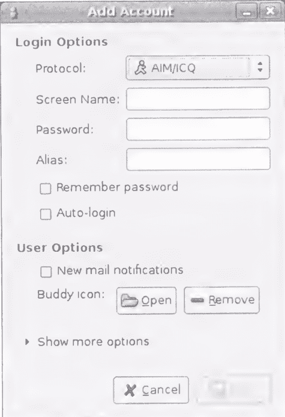

**图3-17** Gaim支持多种类型的账户（MSN、AIM、Jabber、ICQ、IRC等）。

## 使用即时通讯

设置好账户后，点击“登录”即可登录。登录成功后，你的好友列表（在Gaim中称为“好友”）就会显示出来（图3-18）。

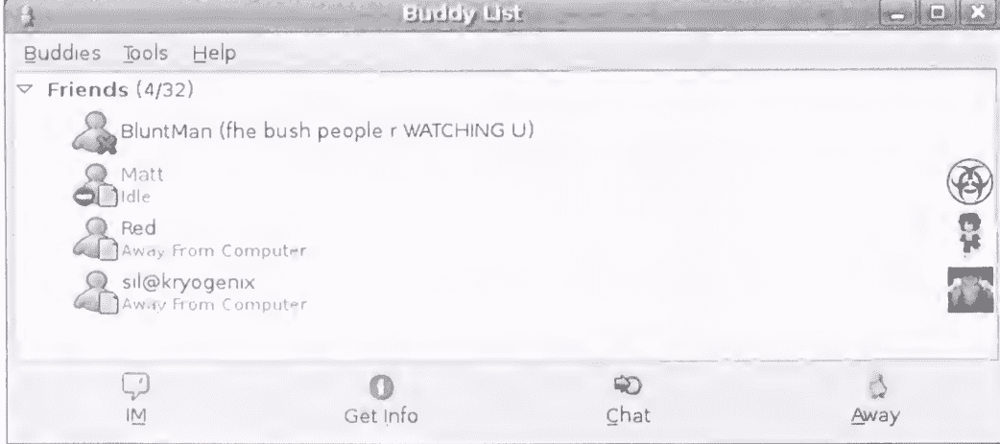

**图3-18** Gaim可以让你快速轻松地联系好友——点击好友条目即可发起聊天！你可以通过“好友”菜单的“添加好友”选项，把更多好友添加到列表中。要和好友聊天，双击好友名称，就会弹出聊天窗口。

## 使用IRC

Gaim内置了对IRC频道的支持，并且有非常友好的IRC讨论界面。要使用IRC功能，首先创建一个账户。接下来登录，然后点击“好友 > 添加聊天”，在“频道”框中输入IRC频道名称。最后双击频道名称即可进入该频道。

## 使用Ekiga体验前沿的IP语音通话

Ubuntu自带一款简单易用且功能强大的网络电话Ekiga。它的前身是GNOME Meeting，通过它可以和互联网上的其他人进行语音和视频通话。除了支持传统的微软NetMeeting协议外，Ekiga现在还支持SIP协议，该协议通常用于让Ekiga这类软电话用户和硬件IP电话用户进行通讯。SIP是行业标准，众多硬件电话、软电话、服务和提供商都支持该协议。如果选择使用SIP，互联网上两部电话之间的通话是免费的。除此之外，许多提供商还支持以极低的价格拨打普通固定电话。Ekiga可以让你直接通过电脑轻松呼叫世界上任何人。你可以通过点击“应用程序 > 互联网 > Ekiga软电话”打开Ekiga。

## 设置Ekiga

首次启动Ekiga时，会引导你进入设置向导（图3-19）。点击“下一步”开始设置，你会看到下一页（图3-20）。在这个框中输入你的名和姓（例如Susan Curtis）。点击“下一步”继续。现在你可以配置Ekiga.net账户（图3-21）。Ekiga.net提供免费的SIP服务。如果你还没有账户（如果你第一次使用Ekiga，大概率还没有），点击“获取Ekiga.net SIP账户”按钮。随后会打开Firefox浏览器，你可以使用在线表单注册。如果你不需要账户，只需勾选向导中“我不想注册”的复选框即可。如果注册，输入你的用户名和密码，然后点击“下一步”。现在你可以配置你的连接速度（图3-22）。

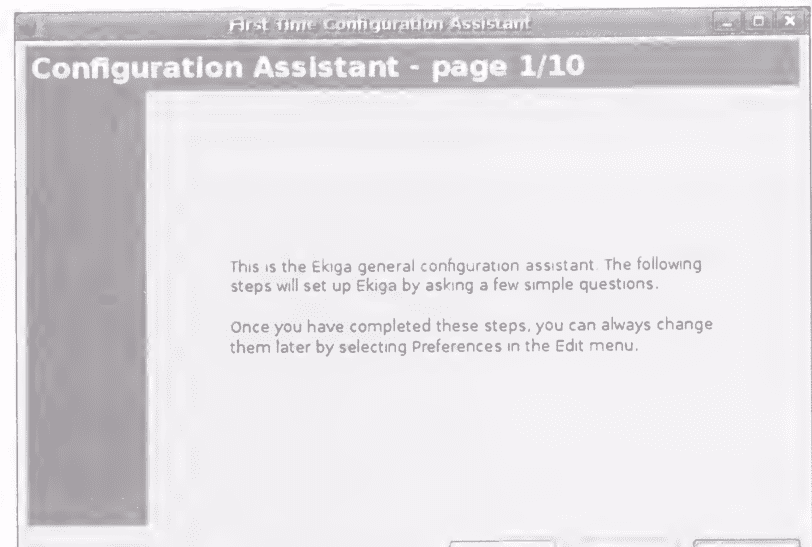

**图3-19** 通过设置向导，Ekiga的设置非常简单。

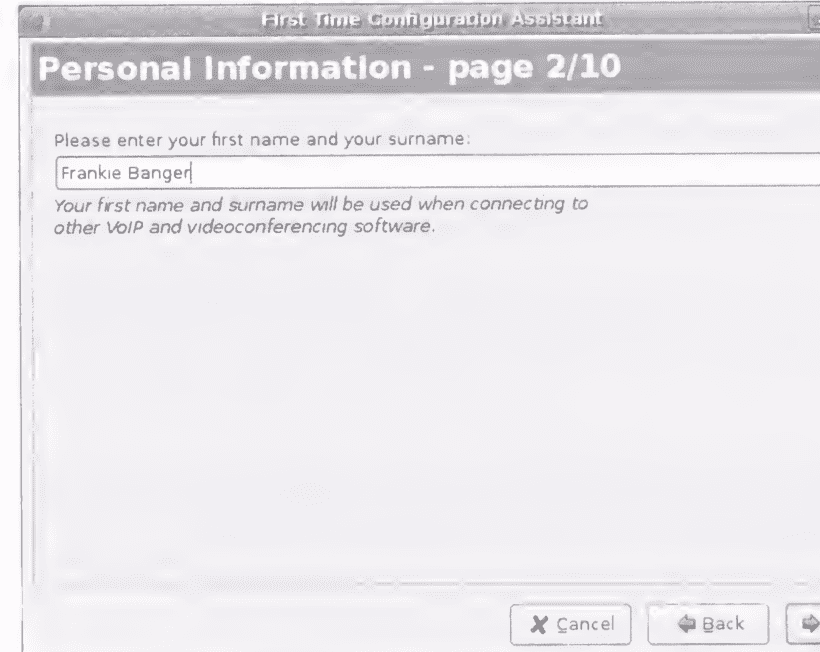

**图3-20** 添加你的姓名可以让其他人更容易在网上找到你。

### 首次配置助手

| 项目 | 内容 |
| --- | --- |
| 请输入你的用户名 | frankiebanger |
| 请输入你的密码 | |
| 说明 | 用户名和密码用于登录你在ekiga.net免费SIP服务上的已有账户。如果你还没有ekiga.net的SIP地址，可以先在下方创建一个账户。这会生成一个SIP地址，其他人可以通过该地址呼叫你。如果你使用其他SIP服务，或者希望稍后指定登录信息，可以跳过此步骤。 |
| 选项 | ☐ 获取ekiga.net的SIP账户 ☐ 我不想注册ekiga.net的免费服务 |
| 按钮 | 取消 上一步 下一步 |

**图3-21** Ekiga.net提供免费的SIP服务。

### 首次配置助手 — 连接类型 - 第4/10页

| 项目 | 内容 |
| --- | --- |
| 请选择你的连接类型 | xDSL/有线宽带 |
| 说明 | 连接类型将用于确定Ekiga在通话中会使用的最佳质量设置。你之后可以在偏好设置窗口中单独修改这些设置。 |
| 按钮 | 取消 上一步 下一步 |

**图3-22** 这里请如实选择——选择更快的速率并不会让通话更快！只要选择你实际的连接类型，然后点击“下一步”即可。

过去，网络电话普遍存在一个问题，就是需要修改防火墙（如果你运行了防火墙）才能正常使用。这通常涉及配置网络地址转换（NAT）设置。幸运的是，Ekiga可以自动检测你需要的NAT设置类型（图3-23）。检测你的NAT类型几秒后，它会给出一个可选方案。点击“是”继续，然后点击“下一步”。接下来配置音频（图3-24）。在下拉菜单中选择ALSA，然后点击“下一步”继续。现在你可以选择音频输入和输出设备（图3-25）。这些设置用于确保你可以听到和录制音频。要测试设置，点击“测试设置”。如果一切正常，点击“下一步”继续。

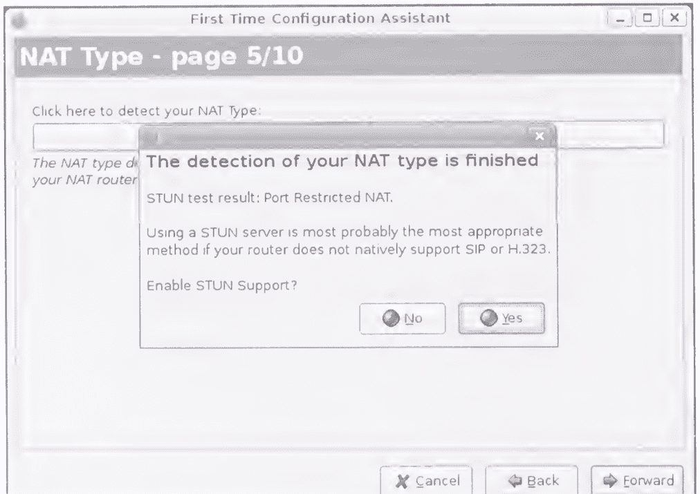

**图3-23** 过去，配置网络电话的NAT一直很麻烦——直到现在。

### 音频管理器

请选择您的音频管理器：

ALSA

音频管理器是用来管理音频设备的插件。如果支持的话，ALSA可能是最佳选择。

取消 前进 后退

**图 3-24** Ubuntu支持多种不同类型的音频框架，但高级Linux声音架构（ALSA）是最常用的。

### 音频设备

请选择音频输出设备：

HDA Intel

音频输出设备是由音频管理器管理、用于播放音频的设备。

请选择音频输入设备：

HDA Intel

音频输入设备是由音频管理器管理、用于录制您声音的设备。

取消 前进 后退

**图 3-25** 请确保这些设置正确，否则您将听不到任何声音。

**图 3-26** Ubuntu支持多种不同类型的视频格式，但V4L是最常用的。接下来请选择视频管理器类型（见图3-26）。视频管理器可确保视频在您的屏幕上正确显示。从列表中选择V4L，然后点击“前进”按钮继续。

最后一项需要配置的是您的网络摄像头（见图3-27）。

**图 3-27** 记得在网上展示最好的一面哦！

**图 3-28** 现在您已经可以准备拨打电话了。请确保摄像头已插好，然后从组合框中选择一个设备。如果您看不到任何选项，则需要先配置摄像头驱动。选择设备后，点击“测试设置”按钮以验证其是否正常工作。

最后，会显示您的选项摘要（见图3-28）。

Ekiga现已配置完成。

## 拨打电话

配置向导完成后，会显示Ekiga的主窗口（见图3-29）。现在您可以拨打电话了。只需输入您要呼叫的人的电话号码或SIP地址，然后点击地址栏旁边的“连接”按钮即可发起呼叫。通话便会接通，您就可以开始对话了。

**图 3-29** Ekiga窗口简洁流畅。窗口左侧有多个功能不同的图标：

- **文本聊天：** 聊天时点击此图标可打开文本聊天窗口，您可以用它向用户发送文本消息。
- **视图模式：** 点击此图标可选择Ekiga的视图模式，通常在与他人进行视频聊天时需要用到此功能。
- **地址簿：** 点击此图标可访问地址簿，您可以在其中保存联系人，还可以访问ekiga.net在线白页查看其他在线用户。
- **查看摄像头：** 此图标可开启网络摄像头，让您能看到正在通话的人。

除了这些图标外，数字键盘下方还有一些选项卡，点击这些选项卡可配置Ekiga的音频和视频设置。

## 探索Ubuntu全貌

与其他许多操作系统不同，Ubuntu系统内置了一整套全面的应用程序。这套工具经过精心挑选，可让您在安装Ubuntu后即可完成工作、与他人沟通、阅读和创建文档、观看/收听媒体等各类操作。

遗憾的是，由于篇幅限制，本书只能对现有应用程序进行简要介绍。为在一定程度上弥补这一缺憾，以下对Ubuntu“应用程序”菜单中的众多应用进行了简要汇总，包含应用的查找方式和功能简介。

### 文本编辑器应用

应用程序 > 附件 > 文本编辑器

这款简单且功能强大的文本编辑器非常适合用于编辑文档、快速记笔记以及编程。它内置了拼写检查、统计、文件列表等一系列插件。

### 计算器应用

应用程序 > 附件 > 计算器

当您需要计算百分比、核算雇主是否克扣工资时，计算器就能派上用场。它提供了普通计算和科学计算等多种功能。

### 终端应用

应用程序 > 附件 > 终端

桌面环境背后是极为强大的命令行核心。该应用程序为命令行界面提供了窗口封装，支持您配置透明度、字体、行为等参数。对于喜欢使用命令行的用户来说，这是必备工具。

### 词典应用

应用程序 > 附件 > 词典


词典是查询单词拼写、了解词义的绝佳工具。词典采用的是在线词典的最新释义。对于小时候曾在词典里查脏话查一下午的人来说，这款应用绝对能带来数小时的乐趣。

## Gnometris 游戏应用

应用程序 > 游戏 > Gnometris

如果您闲得发慌，玩这款俄罗斯方块游戏绝对是消磨时间的绝佳方式。如果您觉得单机俄罗斯方块不过瘾，可以去下载`gtetrinet`。

## Nibbles 游戏应用

应用程序 > 游戏 > Nibbles

经典的贪吃蛇游戏登陆 Ubuntu 了。这也是打发下午时光的绝佳选择。

## Mahjongg 游戏应用

应用程序 > 游戏 > Mahjongg

如果您真的懂麻将规则，这款应用会为您带来很棒的游戏体验。

## 空当接龙应用

应用程序 > 游戏 > 空当接龙

有观点认为，空当接龙可能导致人们浪费数不清的工作时间。如果您没耐心玩接龙类游戏，那就选择空当接龙吧。

## 网络电话应用

应用程序 > 互联网 > Ekiga 网络电话

Ekiga 前身为 GNOME Meeting，新增了大量功能并完成了品牌更名。您可以使用 Ekiga 进行网络语音通话，通过互联网和朋友聊天几乎无需花费。由于大多数网络电话服务和设备都使用 SIP 协议，Ekiga 近期新增的 SIP 集成功能让您也能享受网络通话的乐趣。再加上它支持视频通话，您肯定会在这款优秀应用上花费不少时间。

## 互联网中继聊天应用

应用程序 > 互联网 > XChat-GNOME IRC 聊天工具

互联网中继聊天（IRC）是一种通过在讨论频道中输入文本与其他网友交流的方式。目前有成千上万的在线用户和频道可供选择。IRC 也是获取 Ubuntu 和 Linux 相关帮助的实用工具。请务必登录 Freenode 网络，并访问 `#ubuntu` 频道。

## 终端服务器客户端应用

应用程序 > 互联网 > 终端服务器客户端

如果您需要连接到远程终端服务器，就可以使用这款工具。

## 电影播放器应用

应用程序 > 声音和视频 > 电影播放器

虽然这款应用被归类为电影播放器，但实际上它可以播放多种不同类型的媒体，包括视频和音频。

### 录音机

应用程序 > 声音和视频 > 录音机

如果您需要录制内容，例如用于播客或音频消息的语音，可以使用这款简单工具。

### 音频 CD 创建工具

应用程序 > 声音和视频 > Serpentine 音频 CD 创建工具

如果您有一系列想要转换成音频 CD 的音频文件，这款工具可以满足您的需求。如果您要长途驾驶，想刻录一张装有音乐或播客的 CD 来收听，这款工具会非常方便。

### CD 抓轨工具

应用程序 > 声音和视频 > Sound Juicer CD 抓轨工具

这款应用的功能与前一款正好相反，它可以将 CD 中的歌曲转换成存储在硬盘或便携式音乐播放器中的音频文件。

### 系统管理员终端

应用程序 > 系统工具 > 根终端

如果您需要以系统管理员身份运行多条命令，打开这款终端即可，无需反复使用`sudo`命令。

### 系统监视器

系统 > 管理 > 系统监视器

想要了解您当前的计算机性能，可以点击这款工具。系统监视器可以显示正在运行的应用程序及其占用的内存/处理能力，还允许您终止或重启占用过多资源的进程。

## 其他值得尝试的应用

您的 Ubuntu 电脑上可以安装的软件包有成千上万个。这些软件包涵盖多个不同领域，本节将介绍其中一些热门的应用。软件安装的相关内容将在第 4 章介绍。以下是几款实用的应用推荐：

### 要安装的 Blender 软件包：Blender

Blender（见图 3-30）是一款功能极其强大的 3D 建模、动画、渲染和制作工作室。Blender 拥有令人瞩目的丰富功能，可用于制作照片级写实场景、动画和实时虚拟漫游。Blender 还完全支持用 Python 编写脚本。

> 图 3-30 Blender。

### 要安装的 Inkscape 软件包：Inkscape

Inkscape（见图 3-31）是一款用于创建可缩放矢量图形（SVG）的绘图软件包。自 SVG 格式推出以来，它在设计界风靡一时，能够制作可缩放至任意尺寸的图形。Inkscape 是制作这类图形的灵活性极高的工具，大量开源项目中的海量图标和美术作品都是用 Inkscape 制作的。

> 图 3-31 Inkscape。

### 要安装的 Beagle 软件包：Beagle

Beagle（见图 3-32）是一款几乎可以索引所有内容的搜索系统。安装 Beagle 后，你可以搜索“篝火”，它就会返回所有包含该词的文档、图片、网页、博客文章、即时通讯对话等内容。Beagle 目前仍处于开发阶段，但已经是一款非常实用的工具。

> 图 3-32 Beagle。

### 要安装的 F-Spot 软件包：F-Spot

F-Spot（见图 3-33）是一款功能完整的照片管理应用。借助它，你可以从数码相机或 U 盘导入照片，用熟悉的标签为照片分类，进行修图，还能以不同方式编辑照片。除此之外，F-Spot 还可以轻松将照片上传至 Flickr 及其他在线相册。F-Spot 对喜欢用数码相机狂按快门的用户尤为实用。

> 图 3-33 F-Spot。

### 要安装的 NVU 软件包：NVU

NVU（见图 3-34）是一款功能完整的所见即所得（WYSIWYG）网页编辑器。如果你想在无需学习 HTML 和 CSS 代码的情况下可视化创建网页，NVU 是绝佳选择。NVU 支持你轻松创建并上传网页。

> 图 3-34 NVU。

### 要安装的 Bluefish 软件包：Bluefish

如果你想创建网页但更偏好编写代码，Bluefish（见图 3-35）是一款出色的网页编辑器。Bluefish 是一款轻量但功能丰富的编辑器，支持多种编程语言以及 HTML 和 CSS。

> 图 3-35 Bluefish。

### 要安装的 Eclipse 软件包：Eclipse

如果你是开发者，且需要一整套开发环境，Eclipse（见图 3-36）是不错的选择。Eclipse 通过插件支持海量编程语言，其中包括对 C、C++、Java、Python、Perl、Ruby、PHP 等语言的支持。Eclipse 还内置了对版本控制（CVS 或 Subversion）和调试的支持，还能自动处理自身及插件的软件更新。

> 图 3-36 Eclipse。

## Ubuntu 文件选择器和书签

GNOME 开发者投入大量精力打造的区域之一，就是一款直观实用的文件选择器，可通过应用程序中的「文件 > 打开」选项调用。你可能会疑惑，为什么他们要在桌面这么小、看似不起眼的部分花费这么多时间。但实际上，查找文件是使用电脑时最令人沮丧的环节之一，往往需要翻遍一个又一个文件夹才能找到需要的内容。幸运的是，GNOME 文件选择器能大幅减少这类文件查找的麻烦。文件选择器如图 3-37 所示。

右侧的文件列表用于查找所需文件，你可以点击列表中的文件夹进入更深层的子文件夹。请注意，每个文件夹都以按钮组的形式显示在列表上方。需要时，你可以点击这些按钮快速返回上一级文件夹。除了手动选择文件外，该选择器还支持书签功能。选择器左侧是设备和书签列表，其中包括「主文件夹」（你的个人主目录）、「桌面」（桌面上的文件）、「文件系统」（整个硬盘），以及 CD 光驱、软驱、U 盘等设备。

> 图 3-37 文件选择器有许多贴心的功能，比如书签。

要创建自己的书签，请使用右侧列表找到想要添加书签的文件夹，单击选中该文件夹，再点击书签框下方的「添加」按钮即可。此时该文件夹就会出现在书签列表中。之后你需要访问该文件夹时，只需点击对应的书签即可。除了显示在文件选择器中，书签还支持在桌面其他区域使用，比如「位置」菜单和文件管理器中。

## 设置 Ubuntu 的系统语言

安装 Ubuntu 时，系统会询问你希望使用哪种语言。虽然这设定了系统的初始语言，但你后续也可能想要更改语言。如需更改，请点击「系统 > 管理 > 语言选择器」。Ubuntu 支持海量不同语言，许多应用程序的「帮助」菜单中都提供「翻译此应用程序」选项，普通 Ubuntu 用户也可以贡献自己所用语言的翻译。如果你愿意参与这项工作，将为 Ubuntu 项目做出极有价值的贡献。

首次打开语言选择器时，系统可能会提示你更新语言包。只需点击「是」继续即可。弹出的对话框中会列出多种语言，每种语言都对应「翻译」和「写作辅助」两个复选框。对于你希望在系统中使用的语言，请勾选对应的复选框。「翻译」复选框用于让菜单、标签和按钮转换为对应语言，「写作辅助」复选框用于安装词典和语法检查工具。勾选完成后，点击「应用」按钮，系统就会下载并安装对应的语言包。接下来使用「默认语言」下拉框选择新语言。你需要注销后重新登录，更改才能生效。

> **提示**
>
> **选择新语言**
>
> 当你看到登录界面时，可以使用「语言」按钮为当前登录会话选择语言。选择语言后，系统会询问你是希望将其设为默认语言，还是仅用于当前会话。

## 自定义 Ubuntu 的外观与交互

每当有人第一次使用 Ubuntu 时，似乎都会自然地想要调整桌面的外观与交互效果。在越来越多元的社会中，每个人的喜好都是独立且独一无二的。调整桌面让它符合自己的审美很有趣，Ubuntu 也支持对桌面进行各类自定义调整。你想要背景是亮绿色、使用怪异字体的独特风格的应用程序吗？没问题，只要别拿给别人看就行……

### 更换桌面背景

要更换桌面背景，请在桌面空白处右键单击，选择「更改桌面背景」。在打开的对话框中，点击任意图片即可选择壁纸，桌面背景会自动更换。Ubuntu 自带的预装壁纸数量有限，因此你很可能想要添加自己的壁纸。操作方法为：先将壁纸保存在电脑的任意位置，再点击「添加壁纸」按钮选择该文件即可。新的壁纸会出现在列表中，选中即可使用。如果你不喜欢用壁纸，更想要纯色背景，可以使用对话框底部的「桌面颜色」控件设置。下拉框提供三种背景类型：纯色、水平渐变和垂直渐变。点击下拉框旁的颜色块，即可选择对应的颜色。

### 更换主题

使用应用程序时，按钮、滚动条、小组件及其他 UI 元素的视觉外观都由主题控制。内置的主题系统可以让你的应用程序外观焕然一新，Ubuntu 也预置了多种主题可供你尝试。

### 选择新主题

要选择新主题，请点击「系统 > 首选项 > 主题」。弹出的对话框中会列出可供选择的多款主题。只需点击某个主题，桌面就会自动调整为对应的风格。你还可以通过点击“主题详细信息”按钮来进一步自定义主题。点击后会打开一个新对话框，其中包含可配置主题不同部分的选项卡。逐个点击选项卡并从列表中选择条目，即可打造专属你的完美主题。

## 安装新主题

要安装新主题，首先访问 `http://art.gnome.org/`，找到你喜欢的主题。浏览该网站时请查找“应用程序主题”。找到喜欢的主题后将其下载到你的电脑中。依次点击“系统”>“首选项”>“主题”，再点击“安装主题”按钮。通过文件选择器找到你刚刚下载的主题，系统会自动完成安装。之后从列表中选择你的新主题即可。

## 配置屏幕保护程序

要更换屏幕保护程序，请依次点击“系统”>“首选项”>“屏幕保护程序”，屏幕保护程序配置工具随即加载（图 3-38）。窗口左侧是可用屏幕保护程序的列表，点击某个屏幕保护程序后，列表右侧的区域会显示其预览效果。你可以拖动滑块设置电脑闲置多久后启动屏幕保护程序。

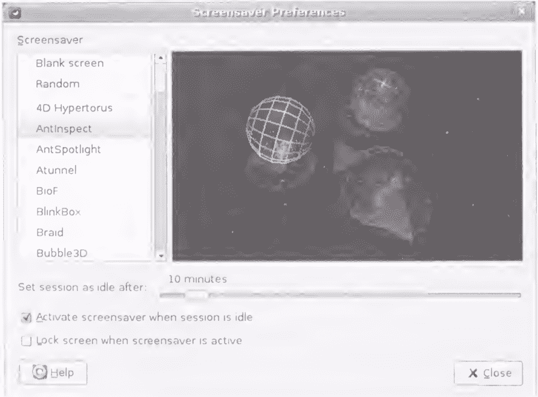

勾选“屏幕保护程序启动时锁定屏幕”复选框，即可在屏幕保护程序启动时锁定屏幕，用户需要输入密码才能重新激活桌面。如果你在办公室工作，希望离开时确保无人擅自操作你的电脑，该功能非常实用。

## 管理文件

文件是任何电脑的核心要素，需要对文件进行管理、复制、移动、重命名、分组和加载等操作。Ubuntu 内置了一款功能强大且简单易用的文件管理器 Nautilus，它与桌面系统深度集成。Nautilus 广泛支持拖放操作。与 Windows 系统中使用的带树状视图和文件列表的文件管理器不同，Nautilus 会以一系列窗口的形式展示文件，你可以轻松地在窗口中拖放文件。对于无法舍弃树状视图的用户，Nautilus 也提供了对该视图的支持。除了提供更简洁的用户界面外，Nautilus 还具备多项实用功能，例如视频和图像预览、标记、书签、权限管理等。

## Linux 如何存储和组织文件

在使用 Nautilus 之前，我们先快速了解一下 Linux 系统中文件和文件夹的组织方式会很有帮助。如果你之前从未使用过 Linux，这部分内容对你来说可能会很陌生，因为其布局与 Windows 和 Mac OS X 的系统差异很大。

> **提示** **文件夹与目录**
>
> 阅读文件管理相关内容时，不要被“文件夹”和“目录”这两个术语搞混——二者指的是同一事物。在 Windows 系统中，每个磁盘驱动器都有标识字母，例如硬盘为 `C:`，软驱为 `A:`。而在 Linux 系统中，所有设备都属于同一文件系统组织的一部分。因此，如果你插入了两块或三块硬盘、一个 CD 驱动器和一个 U 盘，它们都会归属于同一个文件夹结构中。

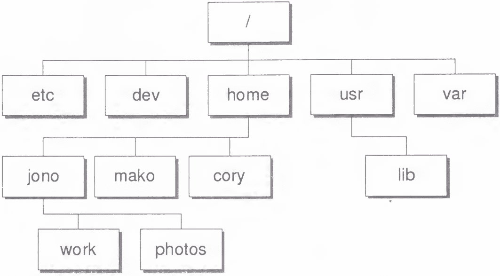

图 3-39 展示的示意图能帮助你理解各部分的关联关系。文件夹结构的最顶层是根文件夹，即 `/`。该文件夹内包含多个具有特定用途的特殊系统文件夹。例如，`/home` 文件夹包含系统中每个用户的主目录，因此用户 `jono` 的主文件夹设置为 `/home/jono`。

## 各文件夹的用途是什么？

Ubuntu 这类现代 Linux 发行版的文件夹结构，很大程度上借鉴了最初由 Unix 基础架构创建者设计的布局。虽然你并不需要了解这些文件夹的具体作用，因为 Ubuntu 会自动帮你完成系统维护工作，但部分用户可能对其中较为重要的文件夹感兴趣。因此，我们整理了 Linux 常用文件夹速查表，如表 3-1 所示。

## 配置文件

在表格中，`/etc` 被描述为存储计算机全局系统配置文件的目录。除了这些影响所有用户的配置文件外，每个特定用户也有专属的配置文件。之前你自定义 Ubuntu 的外观时，设置仅会应用到当前用户账号。那么这些设置存储在哪里呢？你的主目录中有许多以点（`.`）开头的文件夹，例如 `.gnome2` 和 `.openoffice2`。这些文件夹存储了对应特定用户的具体应用程序的配置设置。默认情况下，这些点开头的文件夹在 Nautilus 中是隐藏的，因为你很少需要访问它们。以后如需查看这些隐藏文件和文件夹，可以点击“查看”>“显示隐藏文件”。

### 表 3-1 Linux 文件夹

| 文件夹 | 用途 |
|--------|------|
| `/boot` | 存储计算机启动所需的重要文件，包括引导加载程序配置和内核。 |
| `/dev` | 系统中的每个设备（例如声卡、网络摄像头等）都在此文件夹中有对应条目。每个应用程序通过使用 `/dev` 内的相关条目访问设备。 |
| `/etc` | 存储安装在你的系统中的软件的全局配置文件。 |
| `/home` | 系统中的每个用户账号都拥有一个主目录，均存储在此处。 |
| `/lib` | 存储重要的系统软件库。你通常不需要深入了解这个未知领域。 |
| `/media` | 插入 CD 驱动器、U 盘等媒体设备时，会在此处关联对应设备。后续会详细介绍。 |
| `/mnt` | 其他设备可在此处挂载。后续也会详细介绍。 |
| `/opt` | 可在此处安装可选软件。该文件夹通常用于安装你自己编译的软件。如果你不需要自行编译软件，可以忽略此文件夹。 |
| `/proc` `/sys` | 存储系统当前运行状态的相关信息。 |
| `/root` | 这是主超级用户的主目录。 |
| `/sbin` | 仅应由超级用户运行的软件存储在此处。 |
| `/usr` | 通用软件均安装在此处。 |
| `/var` | 该文件夹存储计算机上相关软件的日志文件。 |

你可以通过多个路径启动 Nautilus，例如“应用程序”>“附件”>“文件浏览器”，更常用的方式是点击“位置”>“主文件夹”来加载你的主文件夹。文件夹加载完成后，你会看到与图 3-40 相似的内容。

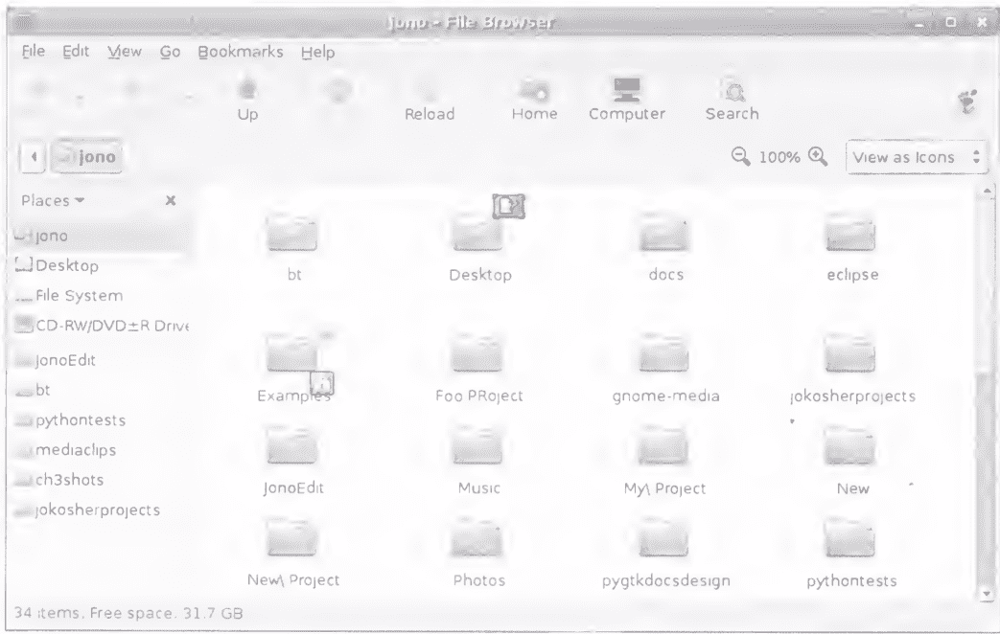

Nautilus 窗口分为两个部分，左侧边栏显示书签、文件夹、标记（后续会详细介绍）等信息分类，窗口主区域则显示当前文件夹内的子文件夹和文件。默认情况下，Nautilus 会在左侧边栏显示你的书签，同时展示主文件夹的内容。现在让我们动手操作 Nautilus，看看它能实现哪些功能。首先要学习的基础技能是通用文件管理，你需要完成的多数任务都可以通过右键点击文件/文件夹并选择对应选项来完成，“编辑”菜单中也包含多项相关功能。首先创建文件夹：右键点击窗口主区域，选择“创建文件夹”，即可新增一个文件夹，你可以为其输入名称。如果之后想要修改名称，右键点击该文件夹并选择“重命名”即可。双击文件夹即可进入该文件夹，并在子文件夹中执行相同的操作。Nautilus 在文件展示方式上也十分灵活，你可以选择默认的图标视图，或切换为列表视图。要切换到列表视图，请点击“查看”>“以列表查看”。你也可以通过右键点击窗口主区域，在“排列项目”菜单中选择对应选项，配置文件和文件夹的排列方式。你可以尝试这些选项，找到最适合你的使用习惯。

> **快速提示**
>
> 与文件对话框类似，Nautilus 会将路径的每个部分显示为不同的按钮。例如路径 `/home/jono/work` 会显示为三个按钮：`home`、`jono` 和 `work`。

### 选择、复制和移动文件/文件夹


使用 Nautilus 复制和移动文件和文件夹非常简单，有多种方式可以实现。为了测试相关功能，请在你的主目录中创建两个分别名为 `Work` 和 `Invoices` 的文件夹，在每个文件夹中保存一些文件。你可以快速创建空文件：双击进入目标文件夹，右键点击空白处，选择“创建文档”>“空文件”，再将文件重命名为有意义的名称即可。现在我们已经在两个文件夹中放入了文件，接下来尝试移动它们。第一种方法是使用两个窗口：右键点击 `Work` 文件夹，选择“在新窗口中打开”，此时会打开两个窗口，一个显示 `Work` 文件夹的内容，另一个显示主目录的内容。现在点击 `Invoices` 文件夹并将其拖动到第二个窗口（即显示 `Work` 内容的窗口）中，即可完成复制。默认情况下，将项目从一个窗口拖动到另一个窗口会执行复制操作。另一种方法是选择要复制的内容后执行粘贴操作，选择项目也有多种方式：一种是在按住 `Shift` 或 `Ctrl` 键的同时点击每个文件/文件夹，实现多选。两个按键的区别是，按住 `Shift` 键可以选择多个相邻的文件/文件夹，按住 `Ctrl` 键则可以选择文件夹列表视图中任意位置的独立文件和文件夹。选中需要复制的内容后，右键点击并选择“剪切”或“复制”：剪切会复制原始文件并将其从原位置移除，复制则仅复制文件而不保留原始文件完好。现在前往目标文件夹，右键单击它，然后选择“粘贴”。文件/文件夹现在便已添加。

### 使用侧边栏

Nautilus 文件管理器的侧边栏可以切换为多种不同的视图，几乎可以满足所有人的喜好。每种侧边栏视图都有一系列不同的功能。表 3-2 对每种视图进行了说明。尽管您肯定会固定使用其中某一种视图，但为了完成特定任务在不同视图间切换也并不罕见。正因如此，多种侧边栏选项提供的灵活性非常实用。

> **拖放** 若要将某个项目放入“位置”视图，请拖放该项目。Ubuntu 桌面中充满了这类拖放快捷操作。如果您觉得某个项目可以拖放，不妨试试！

### 使用徽章

徽章功能可以为文件和文件夹添加标记以标注相关信息。这些小型图形图标用于表明文件/文件夹属于特定类别，徽章即为其可视化标识。例如，您可能需要给文件添加标记以说明它是草稿。

**表 3-2** Nautilus 侧边栏的不同选项

| 选项 | 功能 |
| --- | --- |
| 位置 | 这是默认视图，包含侧边栏中的设备和书签，也是您在文件选择器中通常会看到的元素。 |
| 信息 | 显示当前文件夹的部分有限信息。 |
| 树状 | 显示与 Windows/Mac OS X 类似的树状视图。习惯 Windows/Mac OS X 操作方式的用户可能会想使用该视图。 |
| 历史记录 | 显示您点击过的文件夹的历史记录。 |
| 笔记 | 这个实用的小功能允许您在侧边栏中写入笔记，笔记会保存在当前文件夹中。当您需要说明或评论当前文件夹时，这个功能非常方便。 |
| 徽章 | 列出附有特定徽章的文件和文件夹。徽章的详细信息将单独介绍。 |

当您选择徽章侧边栏时，会出现多种不同的徽章。若要为文件/文件夹添加徽章，只需将徽章拖放到该项目上即可。您还可以为文件拖放多个徽章，以标注多种信息。

## Ubuntu 与多媒体

近年来，多媒体已成为计算机使用中不可或缺的一部分。观看 DVD 和视频、聆听 CD 和音乐已成为现代桌面电脑体验的固有构成。合法音乐下载的巨大流行进一步增强了这些多媒体能力。如今有众多不同类型的在线音乐商店，大多数人听音乐时不用见到闪亮的小银盘也很正常。

## 安装编解码器

多媒体文件和光盘有多种不同类型，每种类型都使用专用的编解码器（Codec）来压缩内容，使其体积更小的同时保留特定程度的质量。要播放这些媒体，您需要确保已安装对应的编解码器。

不幸的是，由于法律限制，编解码器一直以来都是开源软件面临的一个难题。问题在于许多编解码器（包括 MP3、Windows Media 格式、QuickTime 和 Realmedia）都是专有软件，对其使用、分发和许可都设置了限制。尽管开源社区的开发者已经开发出这些编解码器的免费实现版本，但围绕它们的许可协议与 Ubuntu 设定的法律和理念定位相冲突。

这些编解码器不仅因法律层面存在争议未被纳入系统，还因为它们违背了 Ubuntu 所遵循的理念——创建一款完全由最纯粹意义上的自由软件构成的发行版。

> **快速提示** 如果您想了解更多关于安装这些编解码器的信息，请访问 https://wiki.ubuntu.com/RestrictedFormats。

为了解决这些问题，许多开发者正在开发诸如 Ogg Vorbis 和 Ogg Theora 这类免费编解码器，它们能提供高质量的输出结果和开放的许可协议。Ogg Vorbis 编解码器用于音频，可在更小的文件体积下提供比 MP3 更优的效果。Ogg Theora 编解码器用于视频，与 MPEG-4 编解码器竞争。Ubuntu 已内置 Ogg Vorbis 和 Ogg Theora 编解码器，您可以使用它们编码和播放所有使用这两种编解码器的媒体。尽管如果所有编解码器都是自由的，世界会变得更美好，但现实并非如此，许多 Ubuntu 用户仍然想在新桌面电脑上播放自己的媒体。

**表 3-3** 编解码器支持情况

| 编解码器 | 文件类型 | 内置 | 支持情况 |
|----------|----------|------|----------|
| MP3 | .MP3 | 否 | 是 |
| Ogg | .ogg | 是 | 不适用 |
| Windows Media Audio | .wma | 否 | 是* |
| Wave | .wav | 是 | 不适用 |
| MPEG-1 | .mpg | 否 | 是 |
| MPEG-2 | .mpg | 否 | 是 |
| Raw DV | .dv | 是 | 不适用 |
| Quicktime | .mov | 否 | 是* |
| Windows Media Video | .wmv | 否 | 是* |
| Realmedia | .rm | 否 | 是* |
| \*这些编解码器需要安装非自由软件，其在您所在国家/地区是否合法因地区而异。 |

## 聆听音频文件

Ubuntu 内置了一款名为 Rhythmbox 的强大音乐播放器，可用于整理和播放您的音乐文件合集。不过，在启动 Rhythmbox 之前，您需要创建一个文件夹来存储音乐文件。这个文件夹可以放在任何位置，但放在桌面上更为合理，因为这样当您想要添加新歌曲时，就可以轻松访问它。右键单击桌面，选择“创建文件夹”。此时会新建一个文件夹，您需要为其输入名称，暂时将其命名为“Music”即可。

您可以按照自己喜欢的方式在该目录中整理音乐。许多人常用的合理方式是：先为每个艺人/乐队创建一个文件夹，然后在每个文件夹内为每张专辑创建一个包含歌曲的子文件夹。举个例子，在 `Music` 文件夹中，您可以先创建一个名为 `Overkill` 的文件夹，在其中再创建一个名为 `Horrorscope` 的文件夹，里面存放着具体的歌曲。如果您不想使用这种整理方式也完全可以，但随着音乐收藏不断增加，这样整理会更合理。许多 CD 抓取工具也会以这种方式存储歌曲，因此您之后无需重新配置 CD 抓取工具。

### 快速提示

何不将新创建的音乐文件夹添加为书签，这样它就会出现在文件选择器、“位置”菜单以及其他位置中？

## 使用 Rhythmbox

依次单击“应用程序”>“声音和视频”>“Rhythmbox 音乐播放器”即可启动 Rhythmbox（见图 3-41）。Rhythmbox 首次启动时会提示您选择音乐存储目录，请选择您创建的 `Music` 文件夹。若要导入音乐，请右键单击左侧面板中的“媒体库”选项，然后选择“导入文件夹”。您的歌曲便会添加到音乐收藏中。

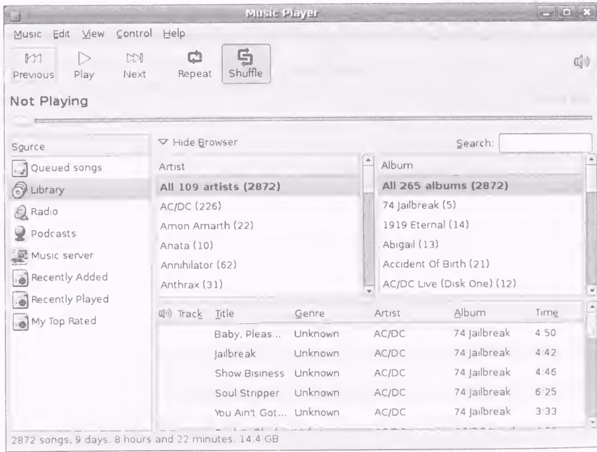

图 3-41 Rhythmbox 是管理音乐收藏的绝佳工具。

Rhythmbox 窗口分为多个不同的窗格，每个窗格都显示音乐收藏的不同详细信息。左侧窗格（源）允许您选择音乐来源，例如媒体库、播客和网络电台。每个选项都配有对应的浏览窗格，用以显示内容的来源。举个例子，当您使用媒体库时，会显示一个展示艺人的窗格和一个展示专辑的窗格，您可以通过它们浏览音乐。

### 收听播客

播客是您可以订阅的音频节目，正逐渐成为收听音频和音乐的新方式。订阅播客后，每期新节目都会自动为您下载，这让定期收听音频节目变得非常方便。如果您是播客新手，不妨找个自己喜欢的播客订阅源。`www.podcast.net` 这类网站就是不错的起点。在 Firefox 中打开该网站，当看到标注“播客订阅源”或“RSS 订阅源”的链接时，右键单击该链接，选择“复制链接地址”。Rhythmbox 对播客订阅源有良好的支持，订阅订阅源的操作非常简单。在侧边栏中，右键单击“播客”选项，然后单击“新建播客订阅源”，接着右键单击输入框，选择“粘贴”即可输入订阅源。相关文件会自动下载，双击即可收听。每次启动 Rhythmbox 时，程序都会检查是否有新节目，如果有，会自动下载。

### 注意：Rhythmbox 与 iPod

Rhythmbox 还可以读取 iPod 中的歌曲——只需将 iPod 连接到电脑，它就会显示在 Rhythmbox 中。但遗憾的是，目前 Rhythmbox 只能从 iPod 读取内容，无法向 iPod 写入内容。

### 播放和抓取 CD

当您将 CD 插入光驱时，一款名为 Sound Juicer 的应用程序会自动启动以播放 CD。如果您已连接到互联网，程序会在网上查询该 CD 的信息，并显示专辑详情和歌曲标题。

## 将歌曲翻录为 Ogg 格式

Sound Juicer 不只是一款 CD 播放器，还是一款翻录工具。使用翻录工具，你可以把 CD 里的歌曲转换成可在电脑上播放的文件。默认情况下，Sound Juicer 会将文件以 Ogg 格式翻录，该格式体积更小，音质却优于 MP3。

翻录 CD 前，请点击「编辑 > 首选项」，接着使用「音乐文件夹」下拉框选择你之前创建的用来存储音乐文件的文件夹。如果你没有把这个文件夹设为书签，就需要点击下拉框，再点击「其他」来调出文件选择器。

默认情况下，翻录得到的文件会按照之前提到的格式存储：每位艺术家对应一个文件夹，专辑则是其中的子文件夹。

要翻录歌曲，只需勾选你想要翻录的曲目对应的复选框（默认所有歌曲都会被勾选），然后点击「提取」。之后每首歌曲都会存入你的音乐文件夹，文件名则为对应的歌曲标题。

## 将歌曲翻录为 MP3 格式

尽管大多数情况下都推荐使用默认的 Ogg 格式，但如果你有无法播放 Ogg 文件的数字音频播放器，也可以选择翻录为 MP3 文件。要实现这一点，你需要配置 Sound Juicer 以启用 MP3 支持。

你首先需要安装 `gstreamer0.10-ugly-multiverse` 软件包（从 Multiverse 软件源获取）。接下来，在 Sound Juicer 中点击「编辑 > 首选项」，再点击「编辑配置方案」按钮。在弹出的对话框中，点击「新建」，将配置方案命名为 MP3，之后从列表中选中它并点击「编辑」。现在按照以下信息填写配置：

- 配置方案描述：MP3 编码器
- GStreamer 管道：`audio/x-raw-int,rate=44100,channels=2 ! lame name=enc`
- 文件扩展名：MP3

勾选「启用」复选框，然后点击「确定」。现在关闭「配置方案」对话框，再点击「关闭」按钮关闭首选项窗口。重启 Sound Juicer 后，你就可以在首选项窗口的「格式」下拉框中选择 MP3 了。

> **提示** **注意事项** 一定要记住，翻录不属于你的 CD 属于盗版行为。这是不道德的，请勿这样做！

## 观看视频

在 Ubuntu 中观看视频，你需要确保已经安装了正确的编解码器。如前所述，由于将这些编解码器集成到 Ubuntu 系统中存在法律风险，部分编解码器需要单独安装。安装方法的详细信息可参考 Ubuntu 维基：http://wiki.ubuntu.com/。

## 使用 Totem 播放器

在 Ubuntu 中观看视频需要使用 Totem 媒体播放器（见图 3-42）。你可以通过点击「应用程序 > 声音与视频 > Totem 媒体播放器」来启动它。要播放硬盘中的视频，请点击「电影 > 打开」，然后从磁盘中选择对应的文件。

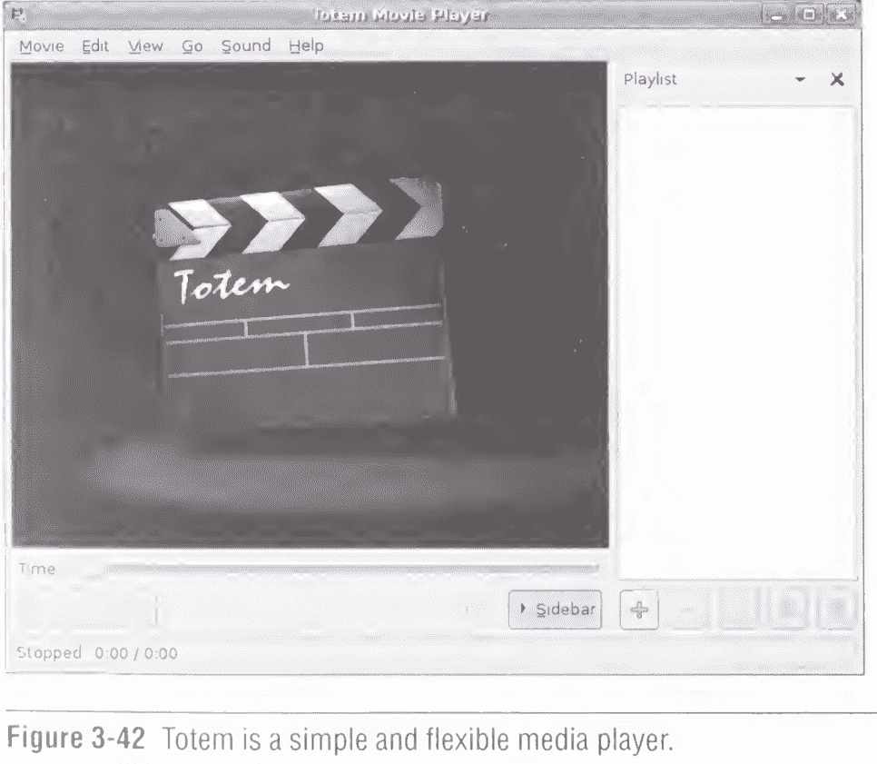

> **提示** **将文件载入 Totem 的其他方法** 你也可以通过在桌面或文件管理器中双击多媒体文件，将其载入 Totem 播放器。

Totem 还支持视频流播放。播放流媒体时，请点击「电影 > 打开位置」，然后输入该流媒体的互联网地址。随后视频流就会被加载并播放。

## DVD 播放设置

Ubuntu 原生支持播放未加密的 DVD。但由于 DVD 行业的现状，大多数 DVD 都是加密的，如果要播放这类 DVD，你需要确保已经安装了能够解密这些 DVD 的库。不过遗憾的是，这个库需要单独安装，并未预装在 Ubuntu 中。具体安装方法可参考 Ubuntu 维基的受限格式页面：https://wiki.ubuntu.com/RestrictedFormats。

安装好解密库后，将 DVD 插入电脑，Ubuntu 就会自动启动 Totem 来播放光盘。你也可以手动启动 Totem，点击「电影 > 播放光盘」来播放 DVD。Totem 完全支持 DVD 菜单，你可以用鼠标选择不同的菜单选项。

如果你准备观看电影，还可以配置一些其他设置：首先点击「视图 > 宽高比」，选择适合你屏幕的宽高比，然后点击「视图 > 全屏」切换到全屏模式。要退出全屏，只需移动鼠标，屏幕上就会出现控制选项。

> **提示** **使用遥控器控制 Totem** Totem 支持 Linux 红外控制（LIRC）库，因此你可以在观看媒体时使用遥控器操作。

## 总结

本章中，你已经学会了如何使用新桌面的核心功能。本章所学的内容可以支撑你完成使用电脑时的大部分日常任务，也能作为你探索系统中其他预装应用的基础。对桌面的熟练掌握能帮你顺畅阅读本书后续内容，学习新系统更高级的用法，探索 Ubuntu 提供的强大灵活性。请务必记得，网上有海量的帮助和文档资源可供查阅。如果你遇到问题，可以访问 Ubuntu 官网 www.ubuntu.com/ 或 Ubuntu 文档站 http://help.ubuntu.com/，还可以利用论坛、维基、邮件列表和 IRC 频道获取帮助。

## 第 4 章

## 高级用法与 Ubuntu 管理

- 程序的安装与卸载
- 保持电脑为最新版本
- 升级到新版 Ubuntu
- 设备与媒体的使用与管理
- 在 Ubuntu 中配置打印机
- 图形化访问远程文件
- 终端
- 与 Windows 系统协作
- 总结

## 程序的安装与卸载

尽管 Ubuntu 已经预装了大多数人需要的大部分软件，但有时你还是会有额外需求，比如用于学习的桌面排版软件，或是用于消磨时间的游戏。添加这类软件最简单的方法是使用「添加应用」，它操作非常简便，但也有一些局限性。

## 安装与使用「添加应用」

目前安装桌面应用最简单的方法就是使用「添加应用」，它位于应用程序菜单的底部。和本章介绍的 Synaptic 及其他工具一样，「添加应用」也会从相同的在线软件源获取软件进行安装。因此，通过任意一个工具安装软件后，其他工具都能识别到这次变更。

要启动「添加应用」，只需像启动菜单中的其他程序一样点击它即可。首次启动以及偶尔后续启动时，它都会进行自初始化。这个过程可能需要几秒钟，请耐心等待。稍等片刻，你就会看到如图 4-1 所示的主界面。

该界面分为三个部分。左侧是所有应用类型的列表，排列方式和系统菜单一致。选中某个分类后，右上角就会显示该分类下的所有应用列表。选中右上角的某个应用后，右下角就会显示该应用的功能描述。

「添加应用」还支持搜索功能，你可以通过程序名称、软件包名称，或是程序描述进行搜索。在右上角的文本框中输入搜索关键词，然后按下回车键即可。图 4-2 展示了搜索栏的搜索结果示例。

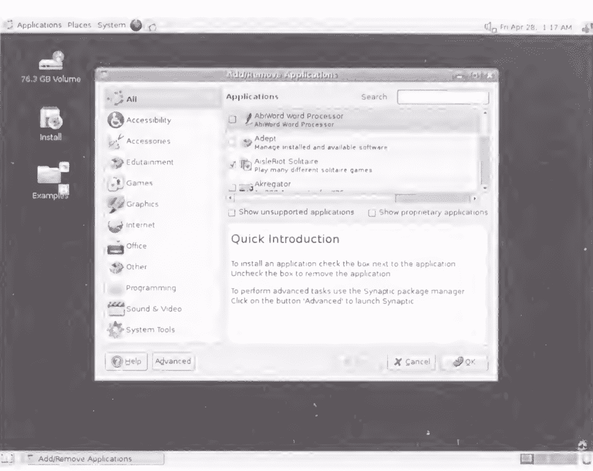

图 4-1 「添加应用」主界面。

默认情况下，「添加应用」只会显示受支持的应用。这些应用都属于主组件和受限组件（不同 Ubuntu 组件的说明可参见附录 B）。虽然这个列表已经十分庞大，但还有更多应用可供发现。勾选左下角标有「显示不受支持的应用」的复选框后，你就能看到社区支持板块中的所有程序了。

勾选该选项后，这些应用虽然可以查看，但还需要启用对应的在线软件源才能安装。只需选中社区支持板块中的某个应用，就会自动启用对应的软件源。图 4-3 展示了安装 universe 组件应用的完整流程。

此外，「添加应用」还可以列出专有应用：也就是未按照开源协议发布的应用程序。勾选对应复选框后，这些应用就会出现在列表和搜索结果中。和其他应用一样，点击它们即可进行安装。

**图4-2** 带搜索结果的搜索栏。

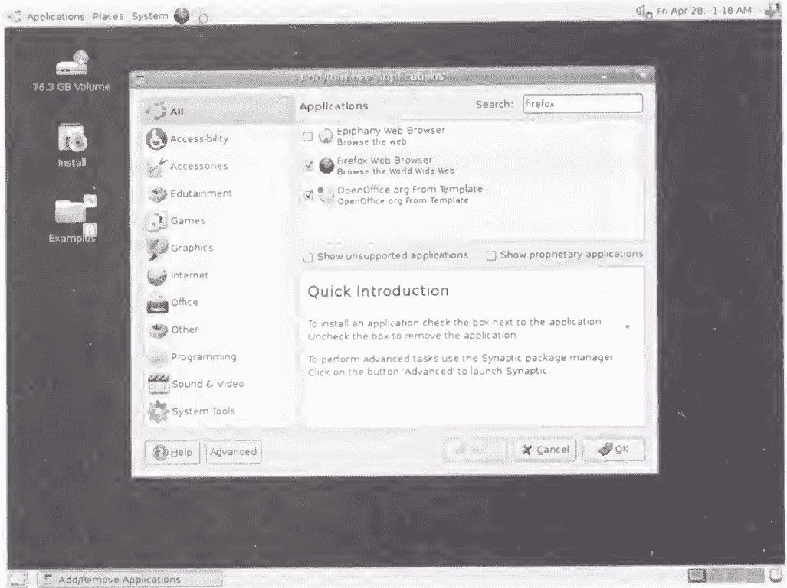

**图4-3** 安装Universe应用程序所涉及的事件序列。

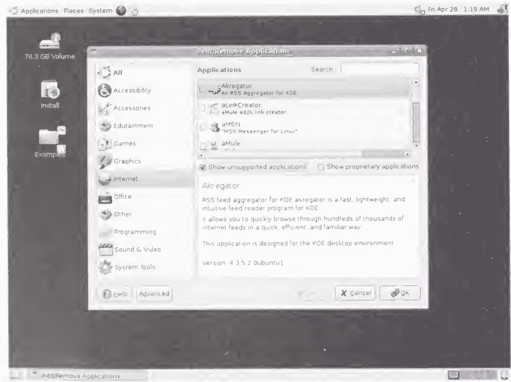

## 术语

在开始之前，有几个你可能需要了解的术语，包括用来描述软件如何安装到你的设备上、以及系统如何运作的相关术语：

- **APT**：高级软件包工具（Advanced Package Tool，简称APT），指的是包含在线仓库、下载并安装软件组件的整套系统。
- **Repository or Software Channel**：即软件仓库或软件频道，是一个巨大的在线软件仓库。在Ubuntu生态中，这些仓库分为官方Ubuntu仓库和非官方仓库两类。
- **Packages**：即软件包，应用程序以软件包的形式存储，软件包不仅包含你要安装的程序本身的相关信息，还列出程序运行所需的依赖，以及如何安全安装和卸载的相关说明。

## 使用 Synaptic 安装


Synaptic 是一个名为软件包管理器的强大图形化工具。添加应用程序（Add Applications）工具处理的是包含应用程序的软件包，而 Synaptic 则处理所有类型的软件包，包括应用程序、系统库以及其他软件组件。对系统进行这一层级的修改难度更高，但能够实现更精细的控制。举例来说，如果你需要一个未以软件包形式发布的程序所需的特定库，你就可以选择安装该库。

要找到 Synaptic，依次打开“系统”菜单和“管理”菜单即可找到，它被列为“Synaptic 软件包管理器”。启动该程序后，你会看到主窗口，如**图4-4**所示。

> **提示**
>
> **名称背后的含义？**
>
> 为什么叫 Synaptic 这个名字呢？这个名字是一个文字游戏，源于 apt——也就是 Debian 的软件包管理系统。Ubuntu 基于 Debian 开发，也使用了 APT 系统。Synaptic 是一款图形化软件包管理器，工作方式和“添加应用程序”工具略有不同。和“添加应用程序”工具不同，Synaptic 直接处理软件包，这样在展示软件包管理的工作细节的同时，能够实现更高层级的控制。

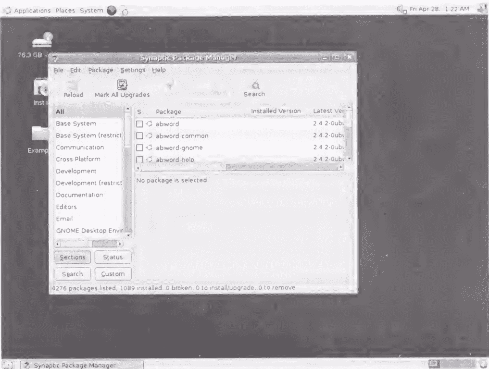

**图4-4** Synaptic 主窗口。

### 安装软件包

和使用“添加应用程序”工具一样，用 Synaptic 安装软件包非常简单。找到你想要安装的软件包后，点击右侧的灰色选框，选择“标记为安装”。此时会弹出一个对话框（见**图4-5**），显示需要安装的其他组件（如果有需要的话）。选好所有要安装的软件包后，点击“应用”即可开始下载和安装。

### 移除软件包

要移除软件包，点击绿色选框，选择“标记为移除”（见**图4-6**）。如果你还想移除所有的配置文件，可以选择“标记为完全移除”。选好所有要移除的软件包后，点击工具栏上的“应用”即可开始实际的移除流程。

### 更新你的系统

Synaptic 提供了一种便捷的系统更新方式。查看工具栏，首先点击“重新加载”，确保软件包信息是最新的。然后点击“标记所有可升级项”，将所有新版本标记为待更新。最后，点击“应用”即可实际下载并安装更新（见**图4-7**）。

标记额外所需更改？选中的操作还会影响其他软件包。要继续操作，需要进行以下更改：

| 操作类型 | 包名 |
|----------|------|
| 待安装 | apache2-common |
| 待安装 | apache2-mpm-worker |
| 待安装 | apache2-utils |
| 待安装 | libapr0 |
| 待安装 | libapr3 |
| 待移除 | firefox-gnome-support |
| 待移除 | gnome-app-install |
| 待移除 | ubuntu-desktop |
| 待移除 | yelp |

**图4-5** “标记为安装”时弹出的对话框。

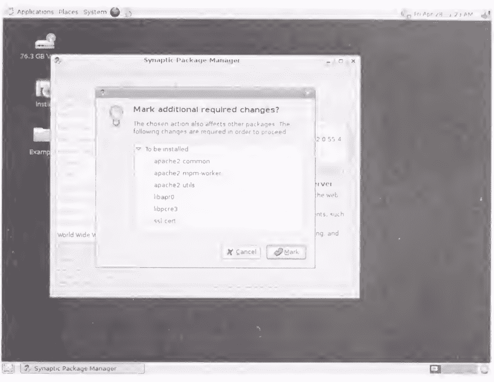

**图4-6** “标记为移除”界面。

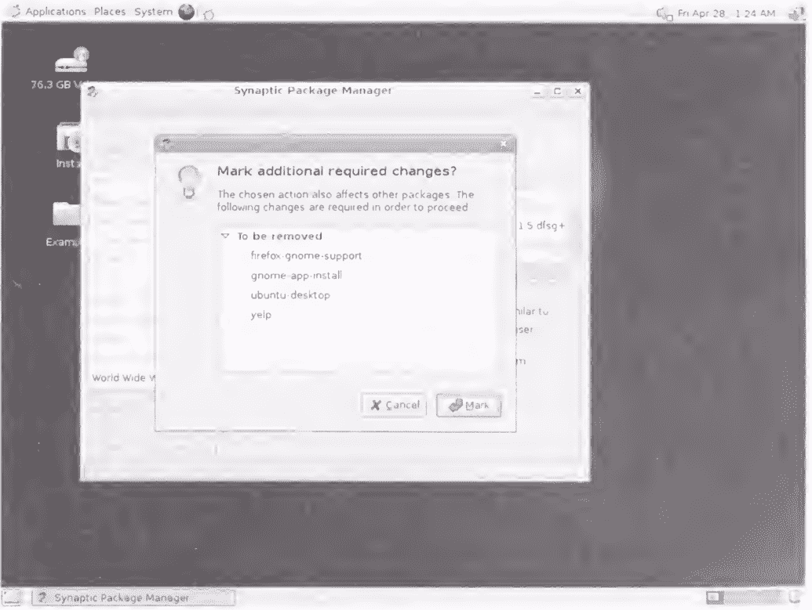

## 第4章 高级用法与 Ubuntu 系统管理

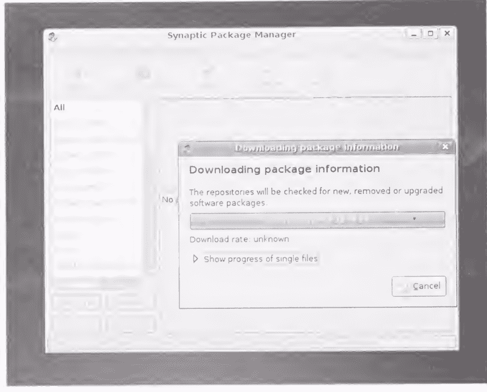

**图4-7** 更新仅需点击三次按钮即可完成。

### 查找软件包

如果你正在找一个软件包却不知道从何下手？最快最简单的方法是直接点击工具栏上的“搜索”按钮，或者按下 `Ctrl-F` 组合键。这会打开一个搜索对话框。默认情况下，它会同时搜索软件包名称和描述，你也可以选择仅按名称或若干其他字段搜索。如果你知道该软件包所属的板块，可以在左侧面板中选择它（可能需要先回到“板块”面板）。选择右下角标注为“板块”的按钮，浏览该板块下的所有软件包。右上方面板还有一个名为“输入即搜索（Type-ahead）”的实用功能（见**图4-8**）。只需选择任意软件包，然后输入该软件包名称的前几个字母，光标就会自动跳转到对应位置。

通常情况下，安装软件包需要其他被称为“依赖”的软件包配合才能完成。（本章开头部分有关于程序、软件包和依赖的详细介绍。）如果需要更多软件包，会弹出对话框列出所有需要进行的更改。有时候安装某个软件包可能导致另一个软件包被移除。点击“标记”按钮接受这些更改。在你点击工具栏上的“应用”之前，Synaptic 不会实际进行任何修改。这是为了方便你一次性排列好所有更改，然后统一应用。点击“应用”后，系统会提示你哪些软件包将要被修改。点击“应用”按钮，即可观看 Synaptic 安装你需要的软件包。

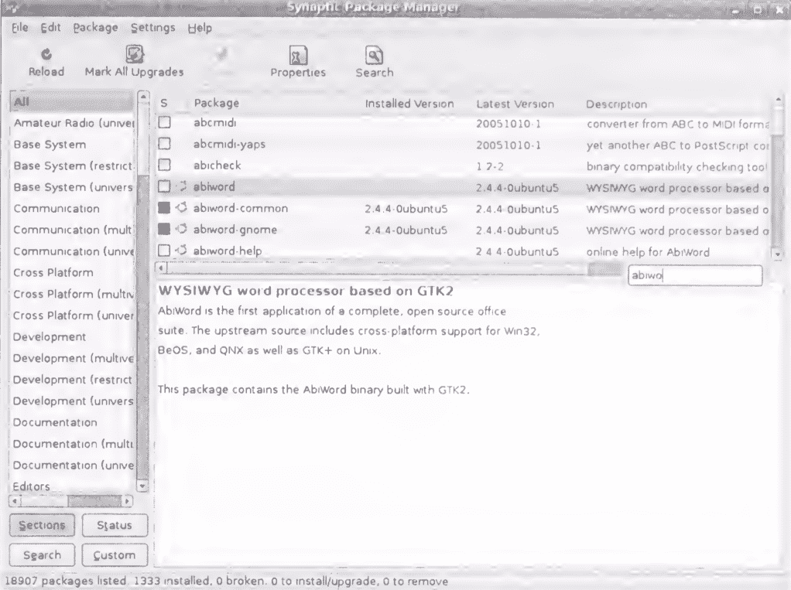

**图4-8** 输入即搜索功能。

### 保持你的计算机为最新状态

没有任何软件或操作系统（OS）是完美的。这意味着 Ubuntu 开发者会发布若干安全更新及其他更新。这些更新会根据需要发布，安装起来也非常简单。你设备上的大部分更新都与安全相关，也就是说开发者在 Ubuntu 的某个特定程序中发现了漏洞，并发布了修复补丁。还有少量更新用于修复一些关键 bug。对于家庭用户而言，通常没有理由不立即安装这些更新，因为如果不安装，你的计算机可能会面临安全漏洞、病毒感染，甚至更严重的风险。Ubuntu 开发者还有一项非常严格的政策，不会将新版本的程序放入 Ubuntu 稳定版中，这避免了引入新问题，让你的系统更加稳定。


**图4-9** 安全更新图标。

### 安装更新

非常贴心的是，Ubuntu 会在你需要更新设备时发出提示。只需查看屏幕右上角**图4-9**中展示的图标即可。此外，还会弹出一个小气泡提示你有新更新（**图4-10**）。点击气泡或图标即可启动更新程序。它会要求你输入密码，然后显示你需要更新的内容列表。要开始更新，点击安装按钮。更新窗口如**图4-11**所示。

### 查看更新内容

更新窗口还会具体展示将要修复的内容。在详情面板中，它会展示修复的内容以及修复方式。


**图4-10** 提示新更新的气泡。

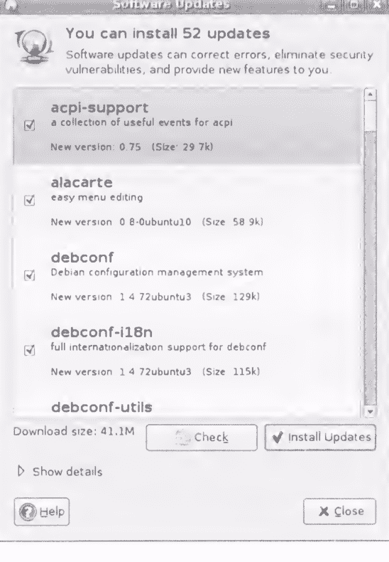

**图4-11** 更新窗口。

它可能还会列出 CVE 编号。CVE 编号是安全漏洞的唯一标识符，你可以在 `http://cve.mitre.org` 上查询该编号，了解具体的漏洞信息。不过通常情况下，你不需要关注这些细节。

### 使用 Synaptic 检查更新

Synaptic 不仅可以用来管理软件包，还可以用来检查更新。启动 Synaptic 时，它会要求你输入密码。启动完成后，首先点击左上角的“重新加载”按钮，这会提示 Synaptic 检查仓库中的新更新。检查完成后，点击“标记所有可升级项”，这会将所有你想要安装的软件升级项标记出来。如果 Synaptic 提示你没有可执行的更新，说明你的系统已经是最新状态。如果有需要更新的内容，它会告诉你哪些软件包需要更新。关闭窗口后，点击“应用”，即可安装所有需要的升级项。

### 图4-12 Synaptic 新立得偏好设置

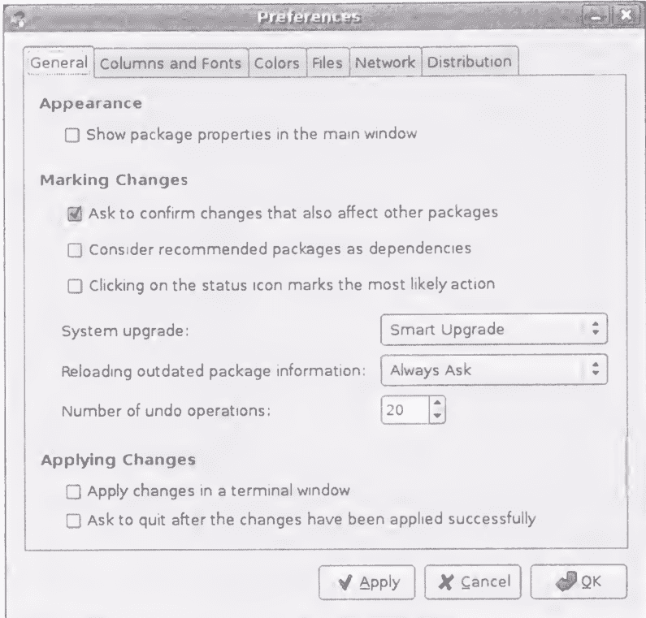

有时更新程序会告知你无法更新某些程序。这是因为更新这些程序需要在系统中移除或添加特定的软件包。这时就需要用到 Synaptic（新立得）。Synaptic 可以实现智能更新，它会自动计算需要添加或移除的软件包。Synaptic 默认会使用智能更新，你只需按照上一段介绍的方法执行更新即可。你可以进入「设置 > 偏好设置」确认智能更新已启用（见图4-12），同时要确保系统升级选项设置为「智能升级」。

### 升级到下一版 Ubuntu

现在你的系统已经是最新状态了。但如果此时发布了新版 Ubuntu，你是否需要升级？如果需要的话又要如何操作呢？

要回答第一个问题，首先你需要知道随本书附赠的 Ubuntu 6.06 版本有些特殊：Ubuntu 目前每 6 个月发布一个新版本，并为每个版本提供 18 个月的支持，但桌面版 6.06 的支持周期长达 3 年。这意味着你无需在 2009 年 6.06 的安全支持结束前升级到其他版本。而 2006 年 10 月发布的 6.10 版本仅提供常规的 18 个月支持。

那么这些信息对你意味着什么呢？如果你觉得 6.06 足够满足使用需求，且不想每 6 个月就升级一次 Ubuntu 版本，我建议你一直使用到 2009 年 4 月，届时可以升级到下一个长期支持版本的 Ubuntu；但如果你想体验最新的稳定版，也可以每 6 个月升级一次。

## 执行实际升级

在 Ubuntu 6.06 发布之前，升级操作并不像听起来那么简单，用户需要手动编辑几个文本文件，还要进行一些手动调整。从 5.10 升级到更新版本的操作会简单很多，因为现在有图形化工具会在新版本发布时发出提醒，并引导你完成整个升级流程。当然，如果你已经掌握或想要学习手动升级方法也完全没有问题，两种方式最终都能达到相同的效果。

当有新版本发布时，更新管理器会弹出提示告知你有可用更新。点击「升级」按钮即可启动升级流程。首先会显示发行说明，其中会介绍新版本的新功能以及尚未修复的缺陷。在此页面点击「升级」按钮后，程序会自动对你的软件源进行必要的修改，随后下载并安装新发行版。如果你曾修改过任何配置文件，系统会弹出提示询问你是否要保留修改。实际安装完成后，系统会告知你哪些软件包已不再受支持（已移至 universe 源）。最后，当系统提示时重启计算机，稍后你就能使用上新版本的 Ubuntu 了。

## 设备与媒体的使用与滥用

随着硬件和媒体价格不断走低，普通电脑用户刻录的 CD 越来越多、使用的 U 盘也越来越多，几乎不再使用那些困扰了行业多年的老式软盘。现代电脑不再配备软驱，也真正标志着容量有限、速度慢、限制多的软盘已经退出了历史舞台。

在 Ubuntu 中使用这类设备非常简单直观，多数情况下你只需插入设备即可直接使用。所有设备在使用前都需要挂载，但 Ubuntu 会自动为你完成挂载操作。你需要记住的重点是：移除设备前一定要先卸载它，即使是软盘，也必须在移除前正确卸载。卸载设备可以确保你拔出设备前，所有数据都已成功写入设备。

> **提示：卸载遇到的问题**
>
> 如果你无法卸载某个设备，请确保你当前没有使用该设备。例如，如果你打开了文件管理器窗口正在浏览设备内的文件，说明设备正处于使用状态，此时无法被卸载。通用的解决方法是关闭所有访问该设备的程序，这样通常就能正常卸载了。如果你不确定电脑上连接了哪些设备，可以点击「位置 > 计算机」查看所有可用驱动器的列表。

### 使用 U 盘

近几年来，U 盘、随身碟已经成为在不同电脑间传输文件的常用解决方案。这类设备价格低廉，且多数容量较大，可以方便高效地帮你随身携带文件。虽然这类 USB 存储设备的外观、形态多种多样，但在 Ubuntu 中的使用方法基本相同，非常简单。

你只需将 U 盘插入电脑，桌面上就会出现对应的设备图标，同时还会弹出文件管理器窗口显示设备内的文件。你可以像操作硬盘中的文件一样，自由读写设备里的内容。使用完 U 盘后，右键点击桌面上的设备图标，选择「卸载」即可。当图标从桌面消失后，你就可以安全地从 USB 接口拔出设备了。

> **提示：将文件复制到硬盘**
>
> USB 主要有 USB1 和 USB2 两种规格，后者速度要快得多。如果你要使用音频、视频等多媒体文件或其他大文件，建议在加载前先将其复制到硬盘中，硬盘的读取速度远快于这类存储介质。

### 刻录光盘

Ubuntu 内置了对光盘刻录的支持，刻录文件非常简单。只需将可写光盘插入光驱，桌面上就会出现对应的图标，双击该图标会打开一个空白的文件管理器窗口，现在只需将需要刻录的文件拖入这个窗口即可。

准备刻录时，点击「文件 > 写入磁盘」，会弹出对话框，你可以在刻录前配置几个参数：在「磁盘名称」输入框中输入磁盘的名称，通过「写入速度」下拉菜单选择适合你光驱的最佳写入速度。如果你的光驱比较老旧或性能不稳定，可以选择更低的写入速度以避免刻录失败。最后点击「写入磁盘」按钮即可开始刻录。

> **提示：小技巧**
>
> 你也可以通过点击「位置 > CD/DVD 刻录器」来打开刻录工具。

- **创建音频 CD**

  使用 Serpentine 工具可以轻松将电脑中的多个音频文件刻录为音频 CD。点击「应用程序 > 影音 > Serpentine 音频 CD 创作工具」打开 Serpentine，程序加载后点击「添加」，导航到你的音乐文件夹，选中要刻录到 CD 的文件。要选择多个文件，可以在选中时按住 Shift 或 Ctrl 键。添加完所有歌曲后，点击「写入磁盘」按钮即可开始刻录 CD。

- **从镜像刻录 CD**

  随着越来越多的人下载开源软件，安装盘通常以 `.iso` 镜像文件的形式提供。将这类文件刻录到 CD 后，镜像中的文件会被还原，最终得到的 CD 和普通 CD 没有区别。要将 `.iso` 文件刻录到 CD，只需右键点击该文件，选择「写入磁盘」即可。

> **提示：更复杂的刻录需求**
>
> 如果你需要一款能满足几乎所有刻录需求的完整应用程序，可以通过 Synaptic 安装 GNOME Baker 应用。

### 使用软盘

要在 Ubuntu 中使用软盘，先将软盘插入软驱，然后点击「位置 > 计算机」，双击软驱图标即可挂载软盘并显示其中的文件。使用完软盘后，右键点击软驱图标，选择「卸载」即可。

### 使用数码相机

将数码相机连接到电脑后，桌面上会自动出现对应的设备图标，同时 Ubuntu 会弹出窗口询问你是否要查看相机中的照片。你可以在照片查看窗口中浏览照片，然后将照片拖拽到文件管理器窗口中保存即可。你需要记住，绝大多数数码相机本质上都是 USB 设备，你可以像访问其他 USB 设备一样，通过文件管理器直接访问相机中的照片。

> **提示：Ubuntu 与数码摄影**
>
> Ubuntu 是非常出色的数码摄影及图像处理平台。建议你通过「应用程序 > 添加/删除程序」安装 F-Spot 工具，它提供了完整的照片收藏管理方案。图像处理方面，GIMP 是一款功能全面的工具，且已预装在系统中，你可以通过点击「应用程序 > 图形 > GIMP 图像编辑器」打开它。

### 在 Ubuntu 中配置打印机

在 Linux 领域，配置打印机一直以来都是个难题，多年来 Linux 新手们不断被“CUPS”“lpd”“以 root 身份编辑 `/etc/cups/printers.conf`”这类术语、命令和说法折磨。用户往往需要手动编辑以往手动处理相当复杂的文本文档、还得花大量时间学习如何输入晦涩指令，才能让打印机正常工作。不过这种情况在 Ubuntu 中已经有所改变。

## 借助 GNOME CUPS 管理器简化操作

尽管你仍可能遇到一些难题，但 Ubuntu 借助 GNOME CUPS 管理器应用，让配置普通家用打印机变得简便许多。使用 CUPS 管理器，你可以配置本地连接的打印机，以及部署在远程网络系统中的打印机。你可以通过将鼠标指向「系统 > 管理」菜单，再点击「打印」选项来运行此应用，如下文图 4-13 所示。选择该选项后会弹出「打印机」窗口，如 4-14 所示。请注意当前没有已定义的打印机，接下来你就要完成这项设置。

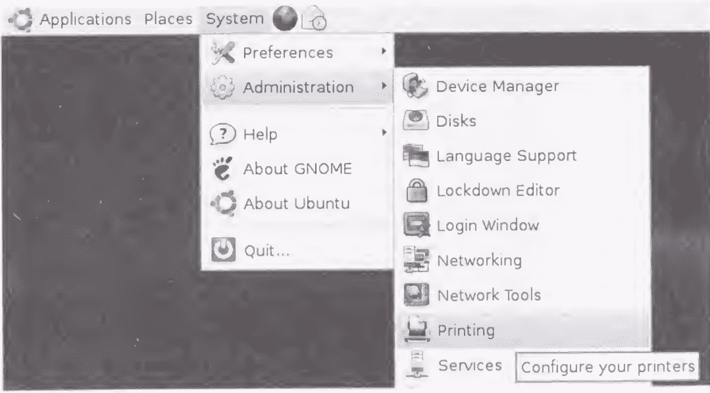

图 4-13 在 Ubuntu 的「管理」菜单中选择「打印」应用

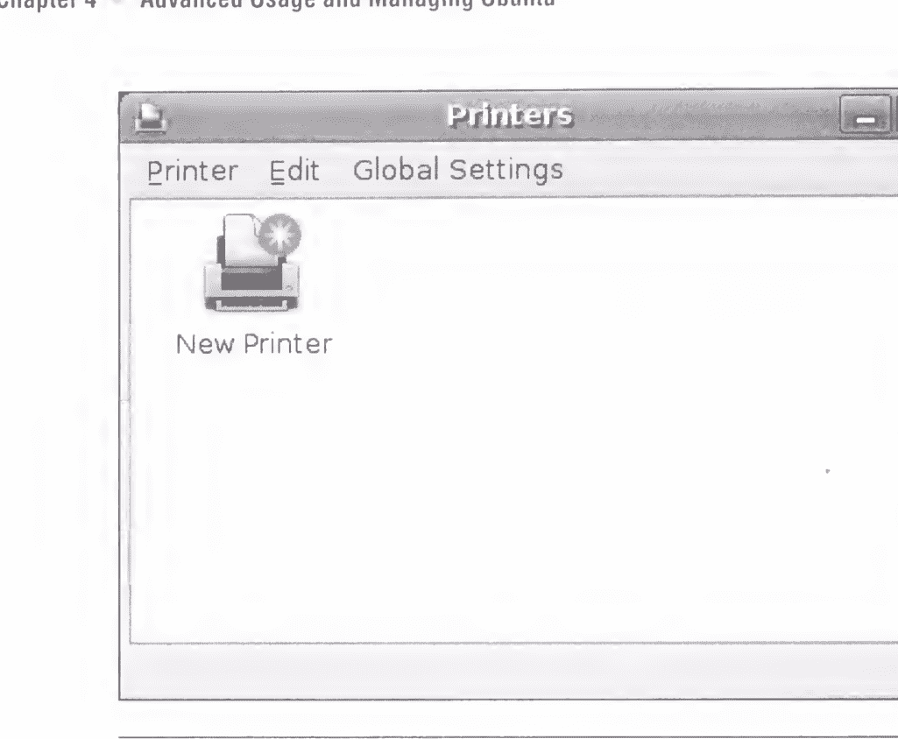

图 4-14 GNOME「打印机」对话框

### 关于使用 GNOME 的说明

本节将介绍 GNOME 工具的使用。GNOME CUPS 管理器应用支持添加打印机、修改打印机设置。你还可以用该应用监控正在执行的打印任务、禁用打印机或者重启打印机。下方的示例中，你将添加一台新打印机，并查看其设置。

## 收集信息

配置打印机时需要谨记的最重要的一点是：不要操之过急。在开始点击图标、运行任何程序之前，请确保你已完成以下步骤：

1. 获取打印机的品牌和型号。下方的示例中，我们将添加一台利盟 Z33 打印机。
2. 连接打印机并开机。

如本例所示，有时候你可能找不到与你打印机型号完全匹配的驱动程序。例如，本次使用的打印机是利盟 Z33，但由于没有对应的 Z33 驱动程序，因此选择了 Z32 的驱动。通常情况下，如果没有对应你打印机型号的驱动，请选择最接近的型号进行测试。如果测试不通过，可以尝试其他驱动程序。

## 启动向导

完成打印机安装的前期准备后，右键点击「新建打印机」，再点击「添加」。如果没有看到「添加」图标，点击「打印机」图标，再选择「添加」。此时会弹出「添加打印机」向导，如 4-15 所示。本文的说明默认你正在安装本地打印机。安装网络打印机需要你选中「网络打印机」单选按钮，再选择网络协议。如果你已将打印机连接到电脑并开机，系统会自动检测到它，如上文所示。选择好打印机或端口后，点击「下一步」。接下来你需要选择打印机驱动程序。如果你的打印机已被自动检测到，你不需要费力查找就能找到它。如果没有出现，你可以在搜索框中输入端口号或打印机描述来搜索驱动数据库。

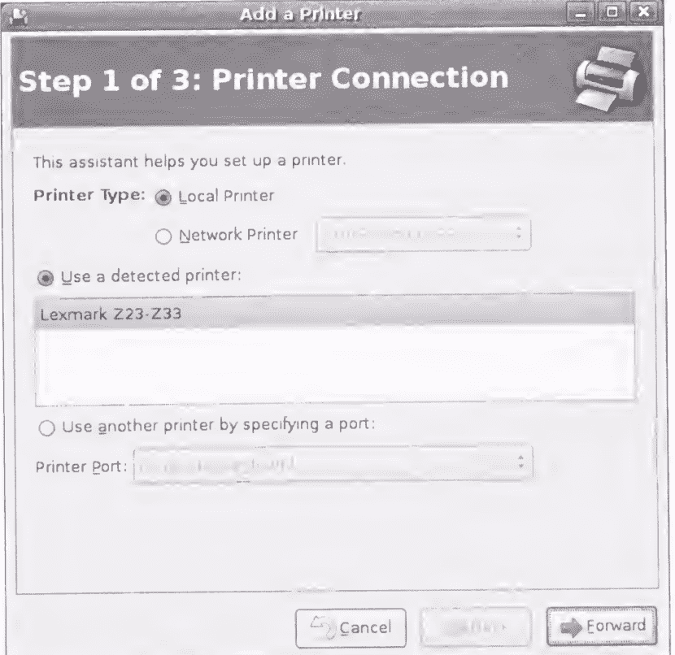

图 4-15 Ubuntu 中添加打印机的步骤 1

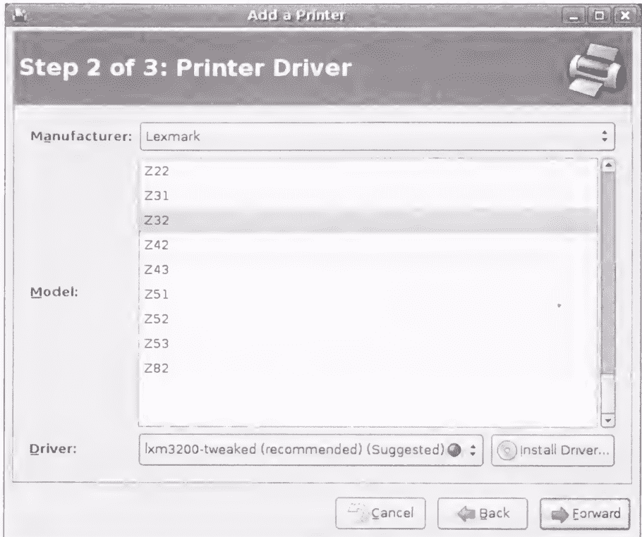

图 4-16 选择驱动程序

检测到打印机后，向导会自动为你选择驱动程序，该驱动通常可以正常使用。你之后也可以随时更换驱动。如果没有自动选中驱动，你可以按制造商浏览选项列表进行选择。4-16 展示了如何为利盟 Z33 选择驱动程序（此处选用了 Z32 的驱动）。点击「应用」，即可完成驱动安装。如果需要安装自定义驱动，点击「安装驱动」按钮。该按钮在如上图 4-16 中可以看到。最后，你可以输入打印机的描述和位置信息，如 4-17 所示。

## 远程打印


例如，如果你的网络中有一台连接了打印机的Windows系统，只需选中「网络打印机」单选按钮，再输入该Windows系统的主机名或IP地址即可。接下来你需要指定连接协议。如果你的Windows系统正在共享打印机，你需要指定Samba协议，这是让Linux和Windows系统互相通信的标准方式。你仍需要如上所述指定打印驱动程序。

## 大功告成！

点击「应用」后，你就可以打印测试页了。打印后请确认页面打印正常。如果测试页打印正常，你就完成了全部设置。现在你可以从已安装的应用中发起打印了。例如，你可以从OpenOffice、Mozilla，甚至命令行中发起打印。

## 「打印机」窗口

图4-18展示了已添加你刚配置的打印机（此处为利盟Z33）的「打印机」窗口。「打印机」窗口还可以查看打印任务的状态。双击打印机图标，你就可以查看队列中每个等待打印的任务。打开你的打印机窗口后，点击「打印机 > 属性」，即可弹出该打印机的属性窗口。在这里你可以查看和修改打印机的各项设置。属性窗口包含五个选项卡。下面对每个选项卡进行简要说明：

- **常规：** 可用于描述打印机信息、设置打印机位置，部分情况下还可以选择打印机分辨率。
- **纸张：** 可用于选择纸张尺寸、类型（如A4、普通纸）和纸张来源。
- **高级：** 可用于进一步自定义页面、分辨率和打印选项，包括每份请求的打印份数、手动进纸选项、墨粉用量设置（如图4-19所示）。

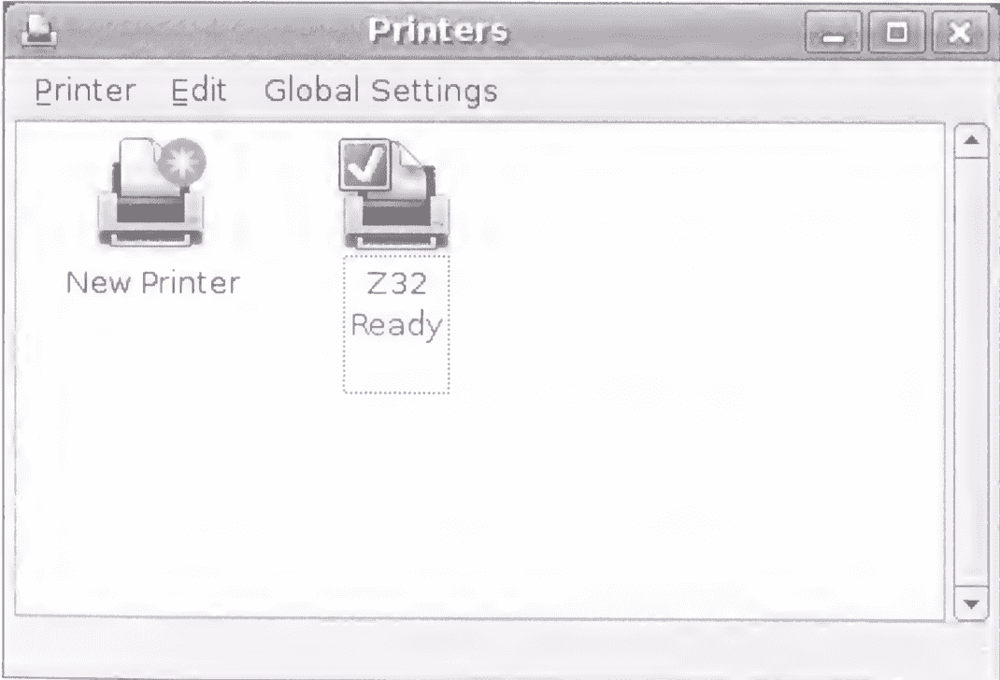

图4-18 显示新添加的利盟Z33打印机的「打印机」窗口

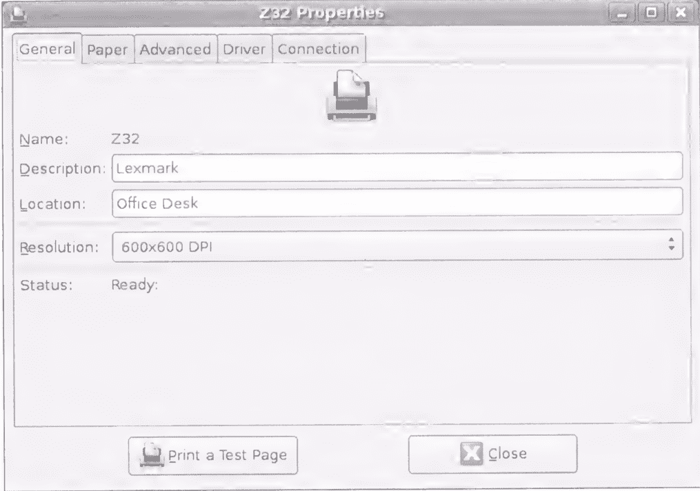

图4-19 显示「高级」选项卡的打印机属性窗口

- **驱动：** 可用于指定打印机使用的驱动程序，你可以手动修改相关参数。
- **连接：** 可用于确定打印机的具体连接类型，上方的示例中选择的是USB连接。如果你将打印机移到其他端口或更换连接类型，可以在这里修改设置，你也可以在这里指定网络连接。

你可以通过这些选项卡修改各项设置。如果你打算对打印机配置进行大幅调整，删除现有打印机图标后重新添加，可能比逐一修改这些设置更简便。不过，修改这些设置可以帮你更精准地满足打印需求。

## 图形化访问远程文件

在Ubuntu桌面环境中，你可以使用同样强大的文件管理器管理远程服务器上的文件，这些服务器既可以是本地网络中的，也可以是互联网上远在世界各地的。当你需要传输大量文件时，这个功能非常实用，比如制作网页、或是需要将自己的作品远程分享给他人时都能用到。要访问这些远程文件，你可以通过多种方式连接服务器，每种方式都需要对应的连接配置文件。该配置文件用于配置连接参数，你需要收集服务器的相关设置来创建它。要设置连接，点击「位置 > 连接到服务器」，即可看到如图4-20所示的对话框。此时你的桌面上会出现该连接的图标。双击该图标，系统会提示你输入服务器密码。输入密码后，系统会询问你是否要将密码存储在密钥环中。桌面密钥环是存储所有连接密码的便捷工具，你只需要记住密钥环本身的密码即可。如果选择将密码存入密钥环，你需要为密钥环设置一个密码。之后每次双击图标访问服务器时，你都需要输入密钥环密码。

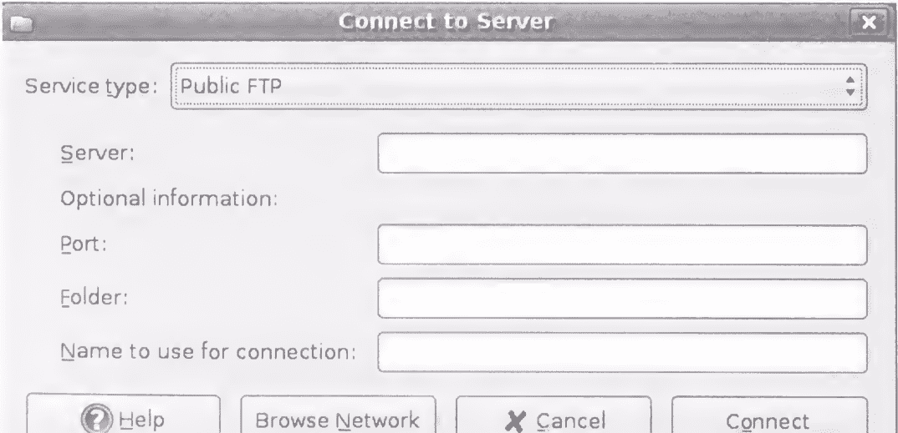

图4-20 在桌面上图形化访问远程服务器的文件

当你完成身份验证获得服务器访问权限后，你的文件会出现在文件管理器窗口中，此时你可以正常使用文件管理器。

## 终端

尽管Ubuntu是面向桌面的操作系统，但它的核心是功能强大且极为灵活的命令行系统。受超过20年UNIX传承的启发，Linux系统中的命令行环境允许你通过以不同方式组合不同命令，完成一些功能极为强大的任务。UNIX背后的理念是打造大量小型工具，每个工具仅用于完成一项任务，但会把这项任务做到极致。举个例子，`ls`命令的功能仅仅是列出文件夹中的文件。尽管列出文件是它唯一的功能，但它配备了所有能想到的文件列表相关选项。尽管`ls`本身功能有限，但它可以和其他灵活度相当的命令组合，形成功能强大的组合指令。要实现这一目的，需要使用`|`符号创建*管道*，将这些不同的命令串联起来。管道的组合方式多种多样，一旦用户了解了不同命令的作用，将多条命令串联成管道，几乎可以解决你能想到的任何任务。需要明确说明的是，使用命令行*并非*使用Ubuntu的必备技能，但掌握这项技能可以让你的电脑更灵活，从而完成更高级、更个性化的任务。

## 终端入门教程

依次点击「应用程序」>「附件」>「终端」即可打开终端。你会看到一个与图4-21类似的终端窗口。终端窗口中可以看到终端提示符和黑色光标。提示符会显示你当前的用户名、主机名以及你所在的文件夹名称。首次打开终端时，文件夹会显示为波浪号（~），这是用户主目录的简写。


图4-21

当你需要对特定内容进行调整时，打开终端会非常方便。

## 入门指南

首先运行以下命令查看主文件夹中的文件：

```
foo@bar$ ls
```

`ls`命令用于列出当前文件夹中的所有文件。默认情况下，该命令仅显示文件夹中的所有项目。为了让`ls`命令更实用，你可以给它添加选项：

```
foo@bar$ ls -al
```

`-al`是传递给该命令的选项。本例中使用了两个选项：a（列出所有文件）和l（使用长格式显示，展示文件权限、日期、大小等更多信息），搭配`ls`命令即可显示所有文件（包括隐藏文件）及其详细信息。

> **提示**

> **选项前要不要加短横线？**

> 许多命令行工具需要在选项前添加短横线（-），但部分工具不需要短横线。

现在切换到其他目录：

```
foo@bar~$ cd Desktop
```

`cd`命令的作用是切换到命令后面指定的目录（本例中即桌面目录）。输入文件或文件夹名称时有个实用技巧：输入前几个字母后按下Tab键，即可自动补全剩余的文件/文件夹名称。举个例子，在刚才的命令中，你可以输入`cd Des`然后按下Tab键，就能自动补全为`Desktop`。进入目录后，你可能想快速查看文本文件的内容，此时可以使用`cat`命令：

```
foo@bar~$ cat myfile.txt
```

该命令会将文件内容输出到屏幕上。可想而知，系统中内置了数百种不同的命令，本文篇幅有限无法一一介绍。你可以通过一些优秀的网站和书籍了解这些命令的用法。

## 构建管道

当你开始将命令组合成管道时，才能真正体会到命令行的强大之处。管道使用管道符号（`|`）将多条命令串联起来，以完成特定任务。举个例子，如果你使用`cat`命令将文件内容输出到屏幕，但文件内容滚动过快来不及查看，就可以创建管道并使用`less`命令来浏览文件：

```
foo@bar~$ cat foo.txt | less
```

想要了解它的工作原理，可以将命令按管道符号拆分为不同部分：左侧部分（输出文件内容）的结果会传递给右侧的`less`命令，这样你就可以用方向键浏览文件了。管道还可以用于查找系统中的特定信息。举个例子，如果你想统计某个特定进程的运行数量，可以运行如下命令：

```
foo@bar~$ ps ax | grep getty | wc -l
```

这个命令的作用是统计正在运行的"getty"进程的数量（getty是用于控制台会话的软件）。左侧的`ps ax`命令会列出系统中的所有进程，随后`grep`命令会搜索进程列表，返回所有包含"getty"字符串的行。此时只会返回包含"getty"的行，最后这些行会被传递给`wc`，这是一个用于统计单词数或行数的小工具，`-1`选项用于指定统计行数。

## 以超级用户身份运行命令

登录电脑时，你使用的账户是普通用户账户，该账户无法执行多种系统管理任务。Ubuntu背后的安全模型是：你应该一直以普通用户身份运行系统，仅在需要时才切换到系统管理员账户。在终端中要切换到超级用户账户，需要使用`sudo`命令，用法是在你要执行的命令前加上`sudo`即可。举个例子，如果你想通过命令行重启网络系统，可以运行：

```
foo@bar~$ sudo /etc/init.d/networking restart
```

`sudo`后面的命令是需要以管理员身份执行的命令，但`sudo`允许你以当前用户的身份运行该命令。运行上述命令时，系统会要求你输入管理员密码，该密码与安装Ubuntu时添加的第一个用户的密码相同。如果你正在使用该用户的账户，直接输入你的普通密码即可。完成`sudo`的身份验证后，15分钟内再次执行相关命令都无需输入密码。

## 查找帮助

你电脑上的每个命令都包含一个手册页（简称man page），其中列出了该命令的所有可用选项。传统上手册页的内容非常简练，仅用于参考命令的不同用法。如果想获得更友好的命令使用指南，建议使用谷歌搜索。要查看手册页（比如`ls`命令的手册页），可以运行：

```
foo@bar~$ man ls
```

`man`命令本身也有许多选项（运行`man man`即可查看），其中最有用的一个是`-k`。该选项允许你在所有手册页中搜索特定关键词，在你忘记某个命令时非常实用。举个例子，你可以通过运行以下命令查找所有与进程相关的命令：

```
foo@bar~$ man -k processes
```

## 运行Windows程序

尽管Linux平台作为桌面系统的吸引力越来越强，但有时仍会出现没有替代应用的情况。特定的商业应用、教育工具和游戏经常会出现这种情况。幸运的是，你可以在Ubuntu桌面上直接运行许多这类应用。在过去12年里，Wine项目的成员一直在努力开发一款可在Linux上运行Windows应用的自由软件。他们在让越来越多的Windows应用可运行方面取得了长足进展。尽管软件仍可能存在一些这样那样的小问题，但仍有大量程序可以在Wine中完美运行。建议你在将应用用于重要工作前先测试其运行情况。使用新立得软件包管理器安装Wine软件包。软件包下载安装完成后，运行`winecfg`工具，按下Alt+F2组合键，输入`winecfg`即可打开该工具。这个小程序用于配置Wine环境，并提供了一些配置Wine系统运行方式的选项。默认设置适用于大多数应用。

## 运行应用

要运行应用，只需右键点击该应用，然后选择*使用Wine Windows模拟器打开*即可。大多数Windows应用使用前需要先安装，因此首先右键点击安装程序，然后在Wine中运行它。程序安装完成后，你可以在主文件夹的`.wine/c_drive/Program Files`文件夹中找到它。导航到该目录（确保你在*Nautilus*中开启了隐藏文件显示功能），然后运行所有`.exe`后缀的文件即可。

## 在另一个分区使用Windows文件

如果你在Windows分区中存储了大量个人数据，可能希望从Ubuntu中访问这些分区。这不是问题，不过你需要编辑一个特殊的配置文件来完成设置。幸运的是，你只需要编辑一次该文件，之后所有配置就会自动生效。

首先你应该打开「管理 > 磁盘」，记下Windows分区的分区号和文件系统。分区号的格式类似`/dev/hdb1`或`/dev/sdb1`，文件系统通常是FAT、VFAT或NTFS。如果你的分区采用FAT或VFAT文件系统，那你很幸运——你可以读写该分区。如果你的分区是NTFS文件系统，很不幸你只能读取其中的内容。

下一步是创建挂载点。启用Windows分区后，可以通过Ubuntu中的特定文件夹访问它们，这个文件夹就被称为挂载点。举个例子，如果你的挂载点是`/media/win1`，而你想访问Windows分区里的「Work」文件夹，那么在Ubuntu中对应的访问路径就是`/media/win1/work`。挂载点通常存储在`/media`文件夹下。每个Windows分区需要创建单独的挂载点。举个例子，如果你有三个Windows分区，请运行以下命令：

```shell
foo@bar:~$ sudo mkdir /media/win1
foo@bar:~$ sudo mkdir /media/win2
foo@bar:~$ sudo mkdir /media/win3
```

现在打开以下配置文件：

```shell
foo@bar:~$ sudo gedit /etc/fstab
```

`/etc/fstab`文件的作用是将分区号映射到对应的挂载点。在文件末尾为每个挂载点添加下面这样的行：

```
/dev/hdb1 /media/win1 vfat users,rw,owner,umask=000 0 0
```

你需要根据你自己的分区情况修改对应的分区号（第一列）、挂载点（第二列）和文件系统（第三列）。现在重新加载`/etc/fstab`来启用这些分区：

```shell
foo@bar:~$ sudo mount -a
```


现在新的分区图标就会出现在硬盘列表里了。

## 总结

本章我们介绍了多个与Ubuntu系统运行和管理相关的高级主题，包括通过「添加/删除程序」对话框和Synaptic工具进行软件的安装、卸载与升级，多种不同类型硬件设备的安装和使用（其中重点讲解了打印机配置），远程文件访问的若干方法，以及强大的Ubuntu终端的快速入门教程。最后我们还介绍了在Ubuntu下运行部分微软Windows平台软件的方案。

## 第5章

### Ubuntu服务器

- 什么是Ubuntu服务器？
- 安装Ubuntu服务器
- Ubuntu包管理
- Ubuntu服务器安全
- 总结

Ubuntu 4.10，亲切被称为“疣猪（Warty Warthog）”，是Ubuntu的第一个公开发行版本。它的安装介质没有提供明显的方法可以不安装完整桌面环境，只安装最基础的操作系统（OS）。系统管理员群体生性容易烦躁、性格刚烈，对此十分不满：他们宣称Ubuntu只是个桌面发行版，随后轻蔑地回到了自己的“洞穴”里。接下来发布的Ubuntu版本Hoary Hedgehog（长毛豪猪）解决了这个问题，允许轻松安装适合服务器的精简版Ubuntu。但Ubuntu只是纯粹面向桌面的发行版的流言还是流传开了。幸运的是，这种观点只是个流言而已。如今的Ubuntu已经是世界级的服务器平台，提供了服务器操作系统应有的一切功能，同时保留了Ubuntu独有的人性化设计。Ubuntu服务器团队的专职开发人员会 meticulously 处理硬件支持与测试的细枝末节，还会对最新版本的服务器软件进行严苛测试，确保其符合纳入发行版的标准。他们随时可以接收像你这样的用户的反馈、疑问和抱怨。话虽如此，搭建服务器可不是一件小事。服务器管理员时刻都要处理系统安全、容错、数据安全等复杂问题，虽然Ubuntu让这些问题更易处理，但也不能掉以轻心。因此本章的目的不是教你如何成为系统管理员——我们要写够十二本书才能把这个话题讲透——而是提供一个快速入门教程。我们还会重点介绍Ubuntu服务器与其他服务器平台的区别细节，提供常见服务器使用场景的实用技巧，并告诉你到哪里能找到更多相关信息。让我们开始吧！

## 什么是Ubuntu服务器？

初次接触Ubuntu服务器的用户最常见的反应就是彻底的、无助的困惑。很多人都搞不清Ubuntu服务器是一个全新的发行版，还是像Kubuntu（仅面向服务器）那样的Ubuntu衍生版，又或者完全是别的东西。让我们来澄清一下。

Ubuntu及其官方衍生版的主软件仓库叫做Ubuntu软件源（archive）。这个软件源本质上是Debian“deb”格式的软件包集合，包含了构成Ubuntu、Edubuntu、Xubuntu、Kubuntu和Ubuntu服务器等所有发行版的每一个软件包。因此，Kubuntu和Ubuntu的区别，仅仅在于其安装程序默认安装的、以及安装介质中包含的软件源包集合不同。Ubuntu服务器也是如此。

它和标准Ubuntu发行版使用的是同一个软件源，但默认安装的软件包集合是独特的。值得注意的是，构成Ubuntu服务器的软件包集合非常小。安装程序默认不会安装图形环境或大量用户程序。但由于Ubuntu服务器的所有软件包都来自同一个官方Ubuntu软件源，你之后可以安装任何你想要的软件包。理论上来说，没有什么能阻止你把Ubuntu服务器安装转变为常规Ubuntu桌面安装，或者反过来（不过实际操作起来很复杂，我们不建议你尝试）。你甚至可以从不运行Kubuntu转为运行Ubuntu服务器。软件源架构给了你最大的灵活性。

我们已经知道，Ubuntu服务器和Ubuntu的区别仅仅在于默认软件包集合不同。但这个不同的集合有什么重要的地方？是什么让Ubuntu服务器成为服务器平台？最显著的区别是一个不可抢占的服务器内核，其内部内核定时器频率为100Hz，而桌面版默认是1kHz。我们就不跟你讲操作系统理论了：这么做是为了给服务器应用提供额外的性能和吞吐量。此外，服务器内核支持SMP和基础NUMA。SMP即对称多处理，是让你能够在服务器中使用多个处理器的代码；NUMA是部分多处理器系统中使用的内存设计，能够大幅提升多处理性能。

### 提示：大型机内核

除了标准服务器内核之外，Ubuntu服务器还提供所谓的“大型机内核”，这是为那些运行极其昂贵的超级计算机系统的极少数人准备的。你几乎肯定不需要运行大型机内核。正如一位Ubuntu开发者所说：如果你能用手指数清你服务器的处理器数量，就不要用这个内核。如果你下单服务器时只需要在“数量”框里输入“1”，那这个内核不适合你。如果你的服务器不需要职业安全与健康管理局来检查安装位置的结构支撑是否合格，就不要用这个内核。如果你的BIOS启动流程少于10分钟，且涉及的界面不到5个，就不要用这个内核。如果开启服务器不需要看说明书，也不会把整栋楼的灯光都调暗，就不要用这个内核。如果……嗯，你明白我的意思了。

那么Ubuntu Server还有什么不同呢？除了服务器内核和极简的软件包集合之外，也没有太多差异。尽管Ubuntu已经在多个版本中支持极简安装模式，但将Ubuntu Server拆分出正式的衍生发行版仍是一项较新的工作，许多好用的功能还处于规划阶段，暂时还未上线。

代号为Dapper的Ubuntu Server 6.06 LTS确实提供了官方支持的软件包，涵盖红帽集群套件、红帽全局文件系统（GFS）、Oracle的OCFS2文件系统，以及Linux虚拟服务器工具：keepalived和ipvsadm。配合专用的服务器内核，这些组件已经足以让Ubuntu Server承担繁重的工作任务了。

考虑到LAMP（Linux、Apache、MySQL、PHP）技术栈的极高人气，Ubuntu Server安装光盘在启动界面就提供了LAMP安装选项。此外还有一系列即将推出的重磅功能：

其中包括：我们计划为集群用户新增资源管理器、自动将系统配置文件纳入版本控制、原生支持服务器集群监控和网络硬盘复制，还将在Ubuntu安装光盘中直接提供已安装系统的完整性校验工具。

## 安装Ubuntu Server

当你从`http://releases.ubuntu.com/ubuntu-server`下载了Ubuntu Server安装光盘，烧录完成后满怀期待地放入光驱，重启机器，就能看到友好的Ubuntu启动菜单。第一个选项「文本模式安装」用于安装Ubuntu服务器；第二个选项「安装LAMP服务器」会运行和前者相同的安装程序，还会自动帮你安装并配置Apache、MySQL和PHP。不过如果你用的是DVD安装盘，需要选择「安装服务器」选项来开始安装流程。

整体来说，服务器安装流程和普通Ubuntu系统的安装基本一致。这是因为Ubuntu在安装程序中只询问最核心的基础问题，而这些内容在桌面系统和服务器系统之间几乎没有区别。如果需要快速回顾安装流程，可以回到第2章查看。本章接下来会介绍上一章未提及的安装程序高级功能，这些功能都是专门为服务器用户设计的。

实用的功能从安装程序的分区环节就开始体现了。如果安装桌面系统，你通常会选择让安装程序自动配置基础分区后轻松完成安装。但服务器安装的情况会更复杂一些。

### 几个安装程序小技巧

正如我们接下来要介绍的，在分区和存储方面，服务器安装比桌面安装复杂得多。安装程序内置了一些实用小技巧，遇到棘手问题时可以派上用场。

安装程序本身运行在虚拟控制台1上。按下`Alt+F2`可以切换到控制台2，按`Enter`键激活后，就会进入一个极简的（`busybox`）shell环境。你可以在这个环境中探索完整的安装程序环境，遇到问题时也可以自行手动处理。按下`Alt+F1`即可切换回安装程序控制台。

控制台4会实时输出非交互式的安装日志，按下`Alt+F4`即可查看。

最后，安装过程中如果能连接到其他服务器会非常实用，比如上传日志文件，或者访问你的邮箱和其他通信工具。默认情况下，控制台2的shell不会提供`ssh`客户端，但你可以等安装程序配置完网络后，运行`anna-install openssh-client-udeb`来安装它。之后你就可以使用`ssh`和`scp`二进制文件登录你选定的服务器，或向其中复制数据。

```bash
anna-install openssh-client-udeb
```


### 为Ubuntu Server分区

如何为服务器存储分区是一项十分精细的工作，当然也没有绝对的标准答案。通常建议至少设置三个与系统其余部分独立的分区：

- `/home`：所有用户文件的存储目录
- `/tmp`：运行应用程序的临时暂存空间
- `/var`：邮件池和日志文件的存储目录

> **提示 分区安全与日志、邮件池分离**
> 针对特定系统分区，你可以开启多个选项来强化安全性，我们会在本章后续的安全章节中详细介绍这些选项。另外，如果这台服务器需要存储大量邮件和新闻池，你可能需要进一步将`/var`拆分为`/var/log`和`/var/spool`两个独立分区。如果这两个目录放在同一分区下，高负载使用时可能会出现严重的I/O拥堵。

将数据存储在不同分区上，可以让管理员针对不同用途精细选择适用的文件系统。例如，你可以选择将`/tmp`放在ReiserFS分区上，因为它在处理目录内大量文件、以及小文件性能方面表现优异；而ext3文件系统稳定性极强，你可以把`/home`和`/var`放在ext3分区上。此外，独立的`/home`分区还允许你在挂载时使用特殊选项，比如设置磁盘空间配额，或为用户数据开启扩展安全功能。

将`/tmp`和`/var`与系统其余部分分开的原因非常实际：这两个目录很容易被占满。`/tmp`属于暂存区域，管理员通常会在这里给用户设置非常宽松的配额（例如政策规定`/tmp`中超过两天的用户数据会被自动删除），这意味着`/tmp`很容易被塞满。而`/var`存储的是日志文件和邮件池，无论是恶意活动还是正常系统使用量激增，都可能导致这两个目录占用大量的磁盘空间。

成为系统管理员意味着你要学会站在管理员的视角思考问题。如果`/tmp`和`/var`很容易被占满，就把它们独立分区，避免最终耗尽服务器上所有的可用磁盘空间。

### RAID的故事

如果你的服务器只有一块硬盘，可以跳过本节继续往后阅读。否则我们就来聊聊如何利用这些额外的硬盘。RAID是冗余廉价磁盘阵列的缩写，不过如果你是个商人，也可以把「廉价（inexpensive）」换成「独立（independent）」，我们允许你这么用。另外如果你在法国，RAID是 recherche assistance intervention dissuasion 的缩写，指的是国家警察的一支精英突击部队——不过如果你需要的是这支RAID的帮助，那你找错书了。我们认为RAID其实就是「数据存储的超棒创意」：处理数据时，它要么能提升读写速度，要么能增强容错能力，要么两者兼具。

本质上，RAID就是把相同的数据复制到多块物理硬盘上的技术。实现方式有多种，特定的硬盘配置被称为RAID级别。如今即使是中低端服务器也会搭载集成硬件RAID控制器，不需要操作系统提供任何支持即可运行。如果你的新服务器没有搭载RAID控制器，也可以使用Ubuntu内核的软件RAID功能实现同样的目标。就在不久之前，安装Linux系统时配置软件RAID还十分麻烦繁琐，但现在非常简单：Ubuntu安装程序提供了方便易用的配置界面，所有必要的后台操作都会自动完成。你可以选择三种RAID级别：0、1和5。

#### RAID 0

RAID 0也叫条带集，它可以把多块独立硬盘的存储空间合并成一块大型虚拟硬盘。需要特别注意的是，RAID 0并不是简单地把物理硬盘串联起来——它实际上是把数据均匀分布在所有硬盘上，这意味着每块物理硬盘用到的空间都不会超过最小的那块硬盘的容量。举个例子，如果你有两块250GB的硬盘和一块200GB的硬盘，虚拟硬盘的总容量就是600GB，两块大硬盘各自会有50GB的空间无法使用。这种数据分布方式能带来极高的性能，但也会大幅降低可靠性：只要RAID 0阵列中的任意一块硬盘故障，整个阵列就会崩溃，其中的数据也会一并丢失。

#### RAID 1

该级别提供非常直接的数据复制功能：它会将一块物理硬盘上的内容同步到你指定的任意多块其他硬盘上。RAID 1阵列的容量不会随着新增硬盘而变大，反而会增加可靠性和读取性能。整个阵列的总容量受限于阵列中最小那块硬盘的容量。

#### RAID 5

如果你的存储主要目标是容错，且想获得比RAID 1单盘更大的存储空间，这个级别是最佳选择。RAID 5支持使用`n`块容量相同的物理硬盘（如果硬盘容量不同，每块硬盘用到的空间不会超过最小那块硬盘的容量）组建阵列，阵列的总可用空间等于`n-1`块硬盘的容量，且阵列可以承受任意一块硬盘（最多一块）故障而不丢失数据。

> **提示 传说中的奇偶校验盘**
> 如果你把5块200GB的硬盘组成RAID 5阵列，阵列的总可用容量是800GB，相当于4块硬盘的容量。这就很容易让人误以为RAID 5阵列会「牺牲」一块硬盘来维持冗余和奇偶校验，但事实并非如此。通过伽罗瓦域上多项式系数的一些巧妙数学运算，实际的奇偶校验信息会被均匀分布到所有硬盘上，这样任意一块硬盘故障都不会影响数据安全。不过不用担心，我们不会考你这些数学知识。

### 选择哪种RAID？

如果你天生犹豫不决，前面几段内容可能会让你尴尬地蜷在椅子里，没完没了地啃着2号铅笔，双脚紧张地敲着地板。幸运的是，最初选择RAID级别往往根本不用费脑子，所以你可以把犹豫不决用到别处去。如果你只有一块硬盘，那就不用搞RAID了。别经过起点，也别拿200美元。有两块硬盘？把它们组RAID 1，晚上能睡得更香。三块及以上？组RAID 5。除非你真的清楚自己在做什么，否则像躲瘟疫一样避开RAID 0。如果你要存储的不是大部分只读、完全不在乎冗余的数据，那RAID 0就不是你的菜。

### 其他RAID模式

虽然安装程序只提供最常见的RAID模式——0、1和5，但还有很多其他RAID模式存在，可以在安装完成后配置。你可以查看`http://en.wikipedia.org/wiki/RAID`了解所有模式的详细说明。

## 配置RAID

仔细研读完上一节内容，说不定还翻了几本抽象代数书和几本有限域理论的书之后，你终于选定了适合自己的RAID级别。由于书还没法读心，我们暂且假设你选了RAID 1。那要怎么配置呢？回到安装程序就好。当系统提示你分区磁盘时，你要勇敢选择最后一个选项：手动编辑分区表。新对话框里的第一个选项是配置软件RAID，但现在先别点它。你需要先准备好物理分区。在屏幕上方的四个选项（RAID、逻辑卷管理器、向导式分区、帮助）下方，你会看到Ubuntu安装程序检测到的你服务器里的所有物理硬盘列表。

### 避免“哦不！”的尴尬时刻

> 我们之前说过，现在还要再强调一遍：给系统分区的时候，非常容易误删重要数据。不过既然你在安装服务器，我们默认你接受删除硬盘上可能已有的所有数据。如果不是这样，现在就给你关心的所有数据做备份！我们说的是真的。

每个硬盘的下方缩进处，会列出所有预先存在的分区，以及它们在磁盘上的序号、大小、可启动状态、文件系统类型，可能还有挂载点。用方向键选中总结整块物理硬盘的那一行（不要选它的分区），按回车——系统会要求你确认是否要用新的分区表替换已有的分区表。选择是，该硬盘下方列出的唯一条目就会变成可用空间。在我们虚构的服务器里，有两块80GB的硬盘——`hda`和`hdb`，所以我们要对这两块硬盘都执行这个操作，给它们都换成分区表。

假设我们决定做一个20GB的`/home`分区。把光标移到可用空间上，按回车创建分区——如果你需要复习所有选项的用法，可以翻回第一章。输入新分区的大小后，会弹出一个对话框，你可以在里面选择文件系统和挂载选项。不过不要直接在原始分区上创建文件系统，你要点击「使用方式」对话框，把这个新分区设置为RAID的物理卷。

还没跟丢吧？现在对另一块硬盘重复刚才的操作——创建大小完全一致的分区，把它也设置为RAID卷。全部完成后，你应该回到了初始的分区界面，每块硬盘下面都有一个大小完全一致的分区。此时，选择屏幕上方的「配置软件RAID」选项，必要时同意将更改写入存储设备，然后选择创建MD（多磁盘）设备。选择RAID 1后，系统会要求你输入该阵列的活动设备数量。在我们虚构的两块硬盘的服务器里，这个数量是2。下一个问题是阵列的备用设备数量，你可以把它设为0。现在只需按空格键，给你创建的两个分区（`hda1`和`hdb1`）前打上勾，然后在多磁盘对话框中点击完成，返回基础分区工具。

如果你看之前显示两块物理硬盘的位置下方，会发现一个新的设备——软件RAID设备，它下面有一个分区。那就是你未来的`/home`分区，愉快地待在RAID阵列上。如果把光标移到它上面按回车，你现在就可以像配置真实分区一样配置它了。你要加入RAID的其他分区，配置流程也一样：在所有参与的物理硬盘上创建大小一致的分区，选择把它们用作RAID空间，进入多磁盘配置工具（软件RAID），最后创建使用这些真实分区的阵列。然后在新创建的阵列上创建文件系统。

> **提示：阵列故障与备用设备**
> 当提供冗余级别的RAID阵列（比如1级或5级）中的某块物理硬盘故障时，阵列会进入所谓的降级模式（永远不要辱骂或虐待你的RAID阵列！）。根据阵列中的设备数量不同，降级模式运行可能只会带来性能下降，但也可能意味着再有一块物理硬盘故障就会导致整个阵列崩溃，造成全部数据丢失。要想让阵列从降级模式恢复，你需要向系统中添加一块可正常工作的物理硬盘（旧硬盘可以拆下来），并指令阵列使用新硬盘进行“重建”。
> 为了尽量减少阵列处于降级模式的时间，同时避免在服务器不支持热插拔的情况下，不得不关机才能插入新硬盘，你可以向机器中加装额外的物理硬盘，并将它们标记为热备用盘，这意味着系统会让它们保持激活但未使用的状态，直到有硬盘故障发生。冷备用盘顾名思义，就是额外备用的硬盘，你平时把它们放在架子上，直到发生故障时再手动将它们加入阵列。
> 就是这么简单！就算你选择把根分区放在阵列上，Ubuntu安装程序也会处理好所有琐碎的细节，确保系统在正确的时间启动RAID阵列并使用它们。

## 逻辑卷管理器（LVM）的前世今生

我们先从RAID的探索中退一步，看看数据存储的大局。整体情况很不乐观：硬盘速度慢还容易坏，虽然固定大小分区早就被弃用作运行内存了，但至今仍是存储空间分配的主要模式。本来就够愁速度慢和数据丢失的了，你还要操心安装服务器时算的分区尺寸是不是刚好合适，会不会落到进退两难的境地：某个分区满了，另一个分区却还有大半空间没用。如果还不得不在运行中的系统上把分区移到其他物理卷里，那你可就惨了。

RAID能起到一定的缓解作用。它能大幅缓解你对性能和容错率的担忧，但它作用层级太低，解决不了分区尺寸和灵活性的问题。我们真正需要的是把分区的概念往上抽象一层，让它不直接作用于底层的物理存储介质。这样我们就可以轻松调整分区的大小，或者让分区跨越多块硬盘，可以很随便地从某个分区划出一部分空间加到另一个分区上，还能在运行的服务器上随意调整物理硬盘上的分区。听起来很酷吧？确实很酷，而且通过逻辑卷管理（LVM）完全可以实现，这套系统把存储的基本单元从物理硬盘变成了虚拟的“逻辑”卷（不过我怀疑“逻辑”这个词就是在吐槽当前的存储现状——现在的存储根本算不上逻辑）。

LVM传统上都是昂贵的企业级Unix操作系统的功能，或者需要从第三方厂商处购买。多亏了自由软件的魔力，一个名叫海因茨·毛埃尔施哈根的人在1998年为Linux写了逻辑卷管理器的实现，我们后面说的LVM就是指这个。此后LVM经历了巨大的改进，如今已在生产环境中被广泛使用，而且正如你所料，Ubuntu安装程序让你在安装服务器时就能轻松配置LVM。

### LVM的原理与术语

理解LVM比理解RAID要难一点，因为LVM重新思考了存储处理的整个逻辑，自然引入了一些需要学习的术语。在LVM中，物理卷（简称PV）只是磁盘空间的提供者，本身没有任何固有组织结构（比如不会像普通分区那样映射到操作系统的某个挂载点）。我们把多个PV划分到卷组（简称VG）中，卷组是虚拟存储池，看起来和传统的老式千篇一律的硬盘一样。我们再把卷组切割成逻辑卷（简称LV），它们的作用和我们平时用到的普通分区一样。我们在这些LV上创建文件系统，然后把它们挂载到目录树中。而在后台，LVM会把物理卷分割成小块字节（默认4MB），每一块叫做物理扩展（简称PE）。

好了，刚才一堆缩写是不是有点绕？但只要你能理解这个流程就没问题：你拿一块物理硬盘，在上面创建一个或多个用于LVM的分区。这些分区现在就成为了物理卷（PV），它们会被分割成物理扩展（PE），再划分到卷组（VG）中，最后你在卷组上创建逻辑卷。承载文件系统、被映射并挂载到操作系统里的，是这些LV虚拟分区，而不是物理硬盘上的那些分区。如果你搞不懂，费这么大劲搞这么多复杂操作，最后得到的还是和原来一样的固定大小分区，到底有什么意义，先别急，你马上就会明白了。

# 第5章 Ubuntu 服务器

逻辑卷管理器（LVM）将物理卷（PV）拆分为大小相等的微小物理区（PE），原因是卷组（VG）（后续会被切割为逻辑卷（LV）的空间）的定义就变成了“物理区的集合”，而非传统分区那样的“物理驱动器上的物理区域”。

注意，“物理区的集合”并未指明这些区的来源，自然也不会对VG的大小设定固定限制。我们可以从多块不同的硬盘中提取物理区，并将它们归入同一个VG，这就实现了将分区与物理驱动器抽象分离的需求。我们可以向VG中添加若干物理区来扩容，既可以是从其他VG中调配，也可以是加入新的物理卷并从中提取物理区。我们还可以将VG迁移到其他物理存储，只需指示它切换到不同的物理区集合即可。最棒的是，我们可以动态完成以上所有操作，无需服务器停机。

你闻到了吗？那是存储革命散发出的清新气息。

## 设置 LVM

到现在，你应该已经相信LVM是有史以来最出色的创举之一了吧？确实如此——而且出人意料的是，在安装过程中配置LVM和配置RAID同样简单。

和配置RAID时一样，在每个你想用于LVM的物理驱动器上创建分区，但要把它们指定为“LVM的物理空间”。注意在本场景中，物理卷（PV）并非实际的物理硬盘，而是你正在创建的分区。你不需要把整块硬盘都划为LVM分区。如果需要，你可以同时创建包含实际文件系统的分区和用于LVM的存储分区，但请确保在继续操作前你对自己的分区选择感到满意。

一旦在安装程序中进入LVM配置界面，所有包含LVM分区的硬盘的分区布局将被锁定。

我们回到之前虚构的那台服务器，现在给它配备四块硬盘，容量分别为10GB、20GB、80GB和120GB。假设我们想要在使用每块硬盘的全部可用空间创建LVM分区（即PV）后，将前两块PV合并为一个30GB的卷组，后两块合并为一个200GB的卷组。每个VG都可以作为大型虚拟硬盘，我们可以在其上像创建普通分区一样创建逻辑卷。

和配置RAID时一样，将光标移动到每块硬盘的名称上并按Enter键，即可擦除其分区表。接着在“空闲空间”条目上按Enter键，即可创建物理卷——也就是被设置为LVM物理空间的分区。

所有3个LVM分区创建完成后，我们在分区菜单中选择“配置逻辑卷管理器”。跳过关于分区布局的警告提示后，会进入一个非常简洁的LVM对话框，你可以在其中修改VG和LV。根据我们的规划，选择前者选项，创建我们想要的两个VG，并选择对应的PV。接着我们选择“修改逻辑卷”，创建对应系统中普通分区的LV——比如为`/`、`/var`、`/home`和`/tmp`各创建一个。

你已经能感受到LVM带来的分区灵活性了。如果你决定为`/var`分配25GB的逻辑卷，你可以从之前创建的第一个VG中划分出来，`/var`就会神奇地跨越两块较小的硬盘。如果之后你发现给`/var`分配的空间过多，可以缩小文件系统，然后只需将部分存储空间从第一个VG转移到第二个VG即可。可能性无穷无尽。

> **提示 LVM 不提供冗余**
> LVM的核心作用是存储灵活性，而非容错能力。在上面的例子中，存放`/var`文件系统的逻辑卷位于一个跨越两块硬盘的VG上。不幸的是，这意味着任何一块硬盘故障都会损坏整个文件系统，而且LVM特意没有包含预防此类问题的功能。相反，当你需要容错能力时，请基于位于RAID上的物理卷来创建卷组！
> 在我们的例子中，我们本可以创建一个覆盖10GB硬盘全部容量的分区，并将其分配为RAID卷的物理空间。然后，我们可以在20GB的硬盘上创建两个10GB的分区，将第一个也设为RAID的物理空间。进入RAID配置界面后，我们会基于两块硬盘上的10GB RAID分区创建RAID 1阵列，但和之前不同，我们不会在RAID阵列上放置普通文件系统，而是将RAID阵列指定为LVM的物理空间。进入LVM配置环节后，RAID阵列会和其他物理卷一样显示出来，但我们知道这个物理卷是冗余的。如果其下的物理硬盘发生故障，LVM完全不会察觉，也不会发生数据丢失。当然，标准的RAID阵列注意事项仍然适用，如果有足够多的硬盘故障导致阵列停止运行，LVM还是会崩溃报错。

## 完成安装——注意 root 账户！

呼，存储部分搞定了，剩下的服务器安装过程和安装普通Ubuntu工作站没有任何区别。现在服务器已经安装完成，我们可以进入更有趣的部分了。

从现在开始，我们所有的操作都会在shell中完成。首次启动Ubuntu服务器时，你需要用安装过程中创建的用户登录。这里有一个很多Ubuntu新手都会踩的坑：和大多数发行版不同，Ubuntu在安装过程中不会启用root账户！取而代之的是，安装程序会将你在安装过程中创建的用户添加到admin组，让你可以使用名为*sudo*的机制执行管理任务。我们稍后会介绍*sudo*的使用方法。如果你对禁用root账户直接登录的决策背后的原因感兴趣，登录后只需运行`man sudo_root`命令即可。

**提示** RAID与LVM阵列的维护

如果你在安装过程中配置了这类阵列，你会希望了解服务器安装完成后如何管理这些阵列。我们推荐你参考Linux文档项目（The Linux Documentation Project）的相关指南，网址分别是`http://www.tldp.org/HOWTO/Software-RAID-HOWTO.html`和`http://www.tldp.org/HOWTO/LVM-HOWTO`。这些指南有时会涉及较多技术内容，但如果你理解了本章我们给出的相关入门介绍，大部分细节应该都会觉得很熟悉。

## Ubuntu 包管理

服务器安装完成后，仅包含启动和正常运行所需的少量软件包。要让它实际提供服务，我们需要安装特定的服务器软件。

在Ubuntu桌面的GNOME图形化环境中，我们可以启动Synaptic，通过点选操作完成应用的查找与安装。但在服务器上，我们必须成为shell高手。

## Ubuntu 软件源

在深入包管理的细节之前，我们先简要概述一下本章开头提到的Ubuntu主软件源的架构。每个新版本在软件源中包含五个仓库，分别名为`main`、`restricted`、`backports`、`universe`和`multiverse`。新安装的系统默认仅启用前两个仓库（以及安全更新仓库，我们稍后会提到）。以下是各仓库的说明：

- **Main**：包含所有默认安装的软件包，这些软件包享有官方支持。
- **Restricted**：这些是版权受限的软件包，通常是硬件驱动程序。
- **Backports**：这些是软件源中较新版本的软件包，由社区提供。
- **Universe**：包含由Ubuntu社区维护的软件包。
- **Multiverse**：包含非自由（就自由而言）的软件包。

“官方支持”这个说法有点名不副实，它并不指代人们购买或获取的技术支持，而是指Ubuntu版本发布后，软件是否可获得安全更新。标准的Ubuntu版本提供18个月的支持周期，也就是说Ubuntu的母公司Canonical Ltd.保证在版本发布后的18个月内，免费为*main*仓库中软件发现的任何漏洞提供安全更新。其他仓库的软件不做此类保证。特别需要注意的是，部分Ubuntu版本拥有更长的支持周期。这些版本的版本号中会标注LTS（长期支持）缩写。Ubuntu 6.06 LTS（代号Dapper）在服务器上将获得长达5年的支持！

## APT 源与软件库

现在你已经了解了Ubuntu软件源的架构

# 第5章 Ubuntu服务器

请注意：我们接下来要讨论的许多包管理工具都以“apt”为前缀。这些源会告诉APT从哪里获取可用软件包：Ubuntu的互联网软件源、你的光盘，或是第三方软件源。APT源在`/etc/apt/sources.list`文件中指定。

我们用一个编辑器打开这个文件——如果你不习惯使用`vim`，可以用更易上手、对新手更友好的`nano`替代它：

```shell


$ vim /etc/apt/sources.list

以井号（或`#`）开头的行是注释行，APT会跳过这些行。在文件顶部，你会看到安装程序添加的光盘源，其后跟着这两行：

```shell
deb http://us.archive.ubuntu.com/ubuntu/ dapper main restricted
deb-src http://us.archive.ubuntu.com/ubuntu/ dapper main restricted
```

通过观察这两行，我们可以推断出APT源列表的通用格式。该文件由多个独立的源组成，每行一个源，每行包含多个以空格分隔的字段。第一个字段说明该行描述的源类型，比如二进制软件包源（`deb`）或源代码包源（`deb-src`）；第二个字段是软件包源的实际URI，第三个字段是我们要获取软件包的发行版名称（`dapper`），剩余字段则告诉APT要从我们描述的源中使用哪些组件——默认是`main`和`restricted`。

如果你浏览文件的其余部分，会发现它带有清晰的注释，你可以轻松启用另外两个软件源：非常实用的`universe`源，以及收录最新软件的`backports`源。

总的来说，现在你已经了解了每个源行的格式，就可以完全自主控制要使用的软件源了。我们强烈不建议在服务器上使用`backports`源，但启用`universe`源通常是个不错的选择。

有了这些基础，接下来我们介绍Ubuntu系统中一些基本的命令行包管理工具。Ubuntu继承了Debian的包管理机制，所以如果你熟悉Debian，接下来要讲的这些工具对你来说一定不陌生。

## dpkg

我们要介绍的第一个工具是Debian包管理器`dpkg`，它位于包管理堆栈的最底层。`dpkg`通过名为`dpkg-deb`的工具处理单个Debian软件包文件，这类文件因文件扩展名为`.deb`也被称为“debs”。`dpkg`在系统手册页中有详尽的文档，你可以在shell中输入`man dpkg`查看它支持的各种选项。我们会介绍`dpkg`最常用的操作：列出和安装软件包。当然，`dpkg`也可以删除软件包，但我们会用更高级的工具`apt-get`来实现这个操作，这里暂不介绍。

### 列出软件包

在shell中运行`dpkg -l | less`，会以六列格式列出`dpkg`跟踪的你系统上的所有软件包。前三列每列仅一个字符，分别代表期望的软件包状态、当前软件包状态和错误状态。大多数情况下，错误状态列为空。`dpkg`输出的前三行是图例，用于解释前三列中各个字母的含义。你可以借助`grep`工具搜索软件包列表，比如只查看已移除的软件包，或是配置失败的软件包。

### 手动安装软件包

每个版本的Ubuntu软件源中都包含超过17000个软件包。其中只有一小部分获得官方支持，但其余所有软件包也都要满足相当严格的收录要求。因此，Ubuntu软件源中的软件包几乎普遍质量很高，已知可以在你的Ubuntu系统上良好运行。正因如此，当你选择安装新软件时，软件源应该是你的首选查找位置。但极少数情况下，你想要安装的软件在软件源中找不到，要么是因为它发布时间较短，要么是存在再发行限制导致无法被收录。这种情况下，你可能需要自己从源代码编译软件、运行厂商提供的二进制文件，或是寻找第三方的Ubuntu或Debian软件包来安装。

> **提示：安全第一，无事勿试**

这是个很烂的双关语，我们为此道歉。但它大概引起了你的注意，所以请仔细阅读：处理第三方软件包时要极其谨慎。Ubuntu软件源中的软件包都经过了全面的质量保证，几乎可以确定不会携带病毒、蠕虫、木马或其他恶意程序。如果你只从软件源安装软件，就再也不用担心病毒问题。但第三方软件包你完全不知道会安装什么内容。如果你安装了恶意软件包，相当于把系统的完全控制权交给了软件包的创建者。所以最理想的情况是，根本不要安装第三方软件包。如果实在必须安装，一定要确保你完全信任软件包的来源！急躁是程序员和系统管理员共有的“标志性优点”，所以如果你刚才太心急没看这条警告，现在就请仔细阅读。这可不是小事。

我们继续：假设你已经下载了一个名为“myspecial-server.deb”的软件包，你只需要输入以下命令就能安装它：

```shell
$ sudo dpkg -i myspecial-server.deb
```

`dpkg`会解压该deb包，确认其依赖项已满足，然后继续安装软件包。还记得我们之前说过默认情况下无法使用root账户吗？安装软件包需要管理员权限，我们通过在要执行的命令前加上`sudo`前缀，并在`sudo`的提示符下输入用户密码来获取该权限。

> **提示：关于shell示例的简要说明**

在上面的dpkg示例中，美元符号是标准的Unix shell符号，你不需要实际输入它。本章其余部分我们都会用这个符号表示需要在shell中输入的内容。在你的Ubuntu系统上，shell提示符不会只是一个美元符号，而是会呈现为如下形式：

```shell
user@server:~$
```

`user`和`server`会分别替换为你的用户名，以及安装服务器时设置的主机名，冒号和美元符号之间的部分会显示你当前的工作目录。波浪号是Unix中家目录的简写。

## apt-get和apt-cache

现在我们来介绍堆栈中更高层级的工具。`dpkg`主要处理软件包文件，而`apt-get`知道如何从Ubuntu软件源下载软件包，或从你的Ubuntu光盘获取软件包。它提供了便捷、简洁的接口，难怪大多数系统管理员在Ubuntu服务器上进行包管理时都会使用它。`apt-get`处理的是高层级的包操作，但不会告诉你软件源中实际有哪些软件包可供安装。它会通过软件包缓存后台获取这些信息，而你可以用名为`apt-cache`的简单工具操作这个缓存。我们通过一个示例来看看这两个命令如何配合使用：假设我们要查找并安装能够处理扩展文件系统属性的软件。

### 搜索软件包缓存并查看软件包信息

我们首先让`apt-cache`搜索关键词“extended attributes”：

```shell
$ apt-cache search "extended attributes"
```

- attr - 用于操作文件系统扩展属性的工具
- libattr1 - 扩展属性共享库
- libattr1-dev - 扩展属性静态库和头文件
- python-pyXattr - 用于操作文件系统扩展属性的Python模块
- python2.4-pyXattr - 用于操作文件系统扩展属性的Python 2.4模块
- rdiff-backup - 远程增量备份工具
- xfsdump - XFS文件系统管理工具
- xfsprogs - XFS文件系统管理实用工具

`apt-cache search`的参数可以是软件包名称，也可以是如上描述软件包的关键词。上述命令执行后的输出就是返回的结果，左侧是软件包名称，右侧是一行描述。看起来`attr`软件包正是我们需要的，接下来我们查看它的详细信息：

```shell
$ apt-cache show attr
```

| 字段 | 值 |
| --- | --- |
| 软件包 | attr |
| 优先级 | 可选 |
| 分类 | 工具 |
| 安装大小 | 192 |
| 维护者 | Nathan Scott <nathans@debian.org> |
| 架构 | i386 |
| 版本 | 2.4.25-1 |
| 依赖 | libattr1, libc6 (>= 2.3.4-1) |
| 冲突 | xfsdump (<< 2.0.0) |
| 文件名 | pool/main/a/attr/attr_2.4.25-1_i386.deb |
| 大小 | 34192 |
| MD5校验和 | fc71e19f1fff7017998332d96459baba |
| 描述 | 用于操作文件系统扩展属性的工具 |

这是一组用于操作用文件系统对象扩展属性的工具，尤其是`getfattr(1)`和`setfattr(1)`。此外还提供`attr(1)`命令，该命令与同名的SGI IRIX工具大体兼容。

缺陷反馈：mailto:ubuntu-users@lists.ubuntu.com 来源：Ubuntu

别被冗长的输出吓到，提取其中有用的信息其实非常简单。从描述字段我们已经能看出，这正是我们要找的软件包。还能看到该打包软件的确切版本、它的所有依赖项和冲突包，以及可以发送缺陷报告的邮箱地址。再看文件名字段，`pool/main`片段说明这是主软件源中的软件包。

### 安装软件包

到目前为止一切顺利，我们来执行实际安装操作：

```bash
$ sudo apt-get install attr
```

apt-get 会查找软件包的来源，比如Ubuntu安装光盘或互联网上的Ubuntu软件存档，下载deb包，验证其完整性，再对该软件包的所有依赖项执行同样的操作，最后完成软件包的安装。

### 卸载软件包

为了便于讲解，我们继续假设你非常犹豫不决：刚安装完attr软件包，你就意识到你和它“相处不来”。干脆把attr扔进回收站吧！

```bash
$ sudo apt-get remove attr
```

进行一次确认后，attr就会从你的系统中彻底消失，不过它安装的配置文件会被保留下来。如果你也想删除这些配置文件，就需要运行以下命令：

```bash
$ sudo apt-get --purge remove attr
```

### 执行系统更新

安装和卸载软件包是常见的系统管理任务，但不如保持系统更新常见。这并不意味着要升级到越来越新的软件版本（好吧，确实如此，但不是传统意义上的升级）：因为某个Ubuntu版本发布后，除了向后移植软件源外，主软件源不会引入新的软件版本。不过在服务器上，我们强烈不建议使用向后移植软件源，因为它们只经过了非常有限的质量保证和测试，而且服务器通常没有必要追赶新的软件功能。新功能会带来新缺陷，作为系统管理员，稳定性和可靠性远比新功能重要。Ubuntu短暂的6个月开发周期意味着，无论如何你都能在半年后获得所有新功能。到那时这些功能已经进入主软件源，并且经过了充分的测试。因此，保持系统更新意味着确保系统运行最新的安全补丁，防止发布后发现的安全漏洞危害你的系统。

幸运的是，apt-get让这个过程非常简单。首先你需要从Ubuntu软件存档获取更新的软件包列表：

```bash
$ sudo apt-get update
```

然后只需执行升级命令：

```bash
$ sudo apt-get upgrade
```

执行后，apt-get会告诉你系统已经是最新状态，或者告知你它计划升级的内容，并且会自动完成升级操作。是不是很省心？

### 执行发行版升级

当新的Ubuntu版本发布，你想将服务器升级到该版本时，依然会用到apt-get。我们稍后会讨论apt源，现在先看一下从Breezy升级到Dapper的操作示例：

```bash
$ sudo sed -i "s/breezy/dapper/" /etc/apt/sources.list
$ sudo apt-get update
$ sudo apt-get dist-upgrade
```

我们来拆解一下这些操作的含义：第一行使用名为sed（流编辑器）的工具，将`/etc/apt/sources.list`（也就是apt源配置文件）中所有“breezy”替换为“dapper”。

然后我们让apt-get重新加载软件存档中的软件包列表，由于我们修改了apt源，这一步会下载Dapper版本中可用的软件包列表。

`dist-upgrade`是`upgrade`的“老大哥”，它更“聪明”，知道如何在新软件版本出现时处理依赖关系。因此`apt-get`会计算好将软件包替换为新版本的顺序，然后像普通升级一样执行。当然，也有例外情况。

使用简单又功能强大，难怪`apt-get`是Ubuntu最受喜爱的功能之一。这是经过时间考验的工具，能很好地处理绝大多数软件包场景，让系统管理员在处理软件维护工作时事半功倍。

但偶尔`apt-get`也会陷入困境，很多时候这种情况发生在尝试升级到新发行版时。在Dapper版本中，开发团队做了大量工作来让发行版升级流程更顺畅，也做出了一些改进，但`apt-get`的灵活性毕竟有限，目前还不清楚在其现有框架内是否能解决这些深层问题。

这就是为什么Ubuntu瞄准了另一款名为*Smart*的包管理器，它可能会取代`apt-get`。*Smart*采用高级动态语言编写，拥有更出色的依赖图解析能力，在保留`apt-get`所有易用性的同时，能更好地处理边缘情况。不过Smart仍是实验性软件，因此它能否承担包管理这样核心的角色还不确定，也没有明确的时间表。我们只是提前给你提个醒：`apt-get`仍然是你最好的选择。

### 从源码构建软件包

与Debian软件存档不同，Ubuntu软件存档不允许直接上传二进制包。当Ubuntu开发者想往存档中添加软件时，需要按照特定规范准备其源码，然后放入构建队列。之后系统会自动编译、构建软件包，如果这些步骤成功，就会将构建好的包推入存档。

为什么要经历这些繁琐的步骤？为什么不让开发者直接在他们的机器上构建软件，然后把二进制包上传到存档，跳过可能需要数小时才能完成软件构建的构建队列？原因如下：Ubuntu官方支持三种硬件架构（Intel x86、AMD64/EM64T和PowerPC）。如果没有构建队列，开发者需要为每个架构分别构建软件的二进制包，这意味着要么得购置每个架构的计算机（成本极高！），要么搭建复杂的交叉编译工具链。而且就算这样，等待三次软件构建完成也是对开发者宝贵时间的巨大浪费。

构建队列方案解决了这个问题，因为自动构建系统只需要一个源码包，就能为所有需要的架构构建软件包。而且这个方案还能给作为系统管理员的你带来一个非常实用的好处：你可以借助apt-get的依赖解析能力和易用性，将其应用到从源码构建软件包的流程中！

现在你是不是很感兴趣？我们先退一步讲：从源码构建软件包主要面向开发者，而非系统管理员。事实上，作为系统管理员，你应该尽可能避免使用手动构建的软件包，而是享受Ubuntu存档中软件包经过质量保证的好处。

不过有时候，你可能需要在安装软件前为其应用自定义补丁。我们依然以attr软件包为例，下面展示的是从源码构建attr并安装新软件包的完整操作流程——如果你想尝试，请确保已经安装了`dpkg-dev`和`devscripts`软件包。

```bash
$ mkdir attr-build
$ cd attr-build
$ apt-get source attr
$ sudo apt-get build-dep attr
$ cd attr-2.4.25
<apply a patch or edit the source code>
$ dch -i
$ dpkg-buildpackage -rfakeroot
$ cd ..
$ sudo dpkg -i *.deb
```

我们用到的所有命令在系统手册页中都有详细说明，详细讲解它们超出了本章的范围。不过可以简单介绍下我们的操作步骤：

- 我们创建了一个名为`attr-build`的临时目录，并进入该目录。
- `apt-get source attr`会下载attr软件包的源码，并将其解压到当前目录中。
- `apt-get build-dep attr`会安装从源码构建attr软件包所需的所有依赖包。
- 我们进入解压后的`attr-2.4.25`目录，应用了一个补丁，并编辑了包更新日志来记录我们对源代码的修改。
- `dpkg -buildpackage -rfakeroot` 命令可以为我们的包构建一个或多个可安装的deb包。
- 我们在文件系统中返回上一级目录，并安装了刚才构建的所有deb包。

这是一份针对需要长时间掌握的主题编写的超精简速查表。我们省略了很多内容，因此如果你需要为生产环境打补丁包，请先阅读我们上面提到的工具的`man`手册页，充分了解相关运行原理！

## aptitude

在包管理栈的最高层级，是aptitude，这是一个简洁、多彩的文本前端工具，可以与`apt-get`互换使用。我们这里不会详细介绍aptitude的用法；你可以通过系统手册页和在线aptitude帮助系统（如果在shell中运行`aptitude`启动它）获取大量相关信息。不过值得一提的是，部分系统管理员更喜欢使用`aptitude`而非`apt-get`，其主要原因是aptitude对所谓孤立包的处理更完善。孤立包是指最初作为其他已被移除的包的依赖项安装、如今已无正当理由保留在系统中的包。`apt-get`没有自动处理孤立包的机制，而是将这项任务交给可以从软件源安装的`deborphan`工具。相比之下，`aptitude`会自动删除孤立包。

## 技巧与提示

恭喜你。如果你已经读到这里，说明你已经熟悉了在Ubuntu服务器上高效处理软件包的大部分内容。不过在你转向其他主题之前，我们想介绍一些零散的小技巧，说不定你什么时候就能用得上。

### 查询包所拥有的文件

有时候查看系统中特定文件属于哪个包非常有用，比如查询`cron`包。这时`dpkg`工具就能派上用场：

```shell
$ dpkg -L cron
```

不过要注意，`dpkg -L`的输出可能包含并非该包独有、而是与其他包共享的目录。

### 查找文件所属的包

上一项操作的逆操作同样非常简单：

```shell
$ dpkg -S /etc/crontab
cron: /etc/crontab
```

这行输出中的左侧内容就是所属包的名称。

### 查找提供特定文件的包

`dpkg -S`和`dpkg -L`都是针对已安装包的数据库进行操作。但有时候你需要查找提供某个文件、可能尚未安装的包。比如我们可能想找可以安装bzr二进制文件、即`/usr/bin/bzr`的包。要实现这个目的，首先需要安装apt-file包（需要universe软件源支持），然后执行以下命令：

```shell
$ apt-file update
$ apt-file search /usr/bin/bzr
```

看！apt-file会告诉你需要的包是bzr，输出格式和`dpkg -S`相同。

我们的软件包管理技巧就到这里——接下来要介绍安全相关的知识了。

## Ubuntu服务器安全


作为系统管理员，处理服务器安全是你的一项核心任务。如果你的服务器连接了互联网，出于安全考虑，它相当于身处战区。如果它只是内部服务器，你仍然需要应对（意外）恶意用户、心怀不满的员工，以及那个*非常想*查看老板秘书邮件的财务部人员。

一般来说，Ubuntu服务器是非常安全的平台。制作所有官方安全更新的Ubuntu安全团队，是业内响应速度最快的团队之一。Ubuntu默认采用无开放端口策略，也就是说，在你安装完系统（无论是Ubuntu桌面版还是服务器版）之后，默认情况下不会有任何应用接受来自互联网的连接。和Ubuntu桌面版一样，Ubuntu服务器也使用`sudo`机制进行系统管理，不使用root账户。最后，每个版本的安全更新至少会免费提供18个月（部分版本如Dapper会提供5年）。

在本节中，我们将了解文件系统安全、系统资源限制、日志处理，最后还会涉及一些网络安全知识。但Linux安全是一个内容庞杂的领域，请记住我们这里只是做快速入门讲解，省略了很多内容——要成为一名优秀的系统管理员，你还需要进一步学习。

### 用户账户管理

Linux系统上的用户管理有很多方面在不同发行版间是通用的。Debian提供了一些便捷工具，比如`useradd`命令，来简化操作。但由于Ubuntu完全继承了Debian的用户管理模型，我们这里不会详细介绍相关内容。你可以参考www.oreilly.com/catalog/debian/chapter/book/ch07_01.html了解基础知识。读完该页面后，你就能完全掌握标准模型，接下来我们可以简单聊聊Ubuntu的差异化设计：`sudo`。

正如我们在安装部分末尾提到的（“你已完成安装——现在注意root账户！”），Ubuntu默认不会启用root（管理员）账户。这种方式有极大的安全优势，且几乎没有弊端，相关说明都可以在`sudo_root`的man手册页中找到。你在安装过程中添加的用户，默认会被加入admin组，可以使用sudo执行系统管理任务。

向系统添加新用户后，你可以通过以下命令将其加入admin组：

```
$ sudo adduser username admin
```

只需在上述命令中用`deluser`替换`adduser`，即可将用户从该组中移除。

需要记住的一点是，`sudo`不仅仅是给人root权限的替代方案。它还可以处理细粒度的权限控制，比如“允许该用户仅以超级用户权限执行这三个命令”。有关配置这些权限的说明可以在`sudoers` man手册页中找到，该手册页可能看起来有点复杂——你可以跳过前面大部分内容，直接查看末尾的EXAMPLES部分即可。你大概只需要花10到15分钟就能理解它，它涵盖了绝大多数你会遇到的需要使用sudo的场景。

当你准备好应用新学到的知识时，只需运行以下命令：

```
$ visudo
```

这里要格外小心：存储在`/etc/sudoers`中的sudoers数据库，不能直接用普通编辑器打开，因为编辑器不会帮你检查语法！如果你搞乱了sudoers数据库，你可能会发现自己无法再以管理员身份操作这台机器。

### 文件系统安全

大多数类Unix操作系统的文件安全模型都是标准化的，称为POSIX模型。该模型要求每个文件和目录都有三类访问权限：所有者、所属组和其他用户。它在任何Linux发行版上的工作原理完全相同，因此我们这里不会重点介绍。如果需要复习，可以查阅`chmod`和`chown`的man手册页，或者浏览互联网相关内容。

我们接下来要实际了解通过挂载选项保护分区的方法，这是系统安全中经常被忽视、但使用得当效果非常显著的一个方面。在讲解如何对系统分区时，我们曾强调了至少为`/home`、`/tmp`和`/var`目录设置独立分区的优势，提到了挂载这些分区时可以使用特殊选项。很多特殊挂载选项依赖于具体的文件系统类型，但我们要讨论的几个选项并不依赖于此。以下是我们关注的选项：

- **nodev** 使用`nodev`选项挂载的文件系统，不允许使用或创建设备文件。大多数文件系统通常都没有理由允许解释块设备或字符设备，允许这类操作会带来潜在的安全风险。

- **nosuid** 如果你了解Unix文件权限，就会知道某些文件可以被标记为允许任何人以其他用户或组的权限执行，通常是系统管理员的权限。这个标记分别叫做`setuid`（`suid`）或`setgid`位，在存放系统二进制文件的目录之外允许这种行为通常是没有必要的，会降低安全性。如果用户能以任何方式创建或获取自己选择的`suid`二进制文件，就等于已经破坏了系统安全。

- **noexec** 如果文件系统被标记为`noexec`，用户将无法运行存储在其中的任何可执行文件。

- **noatime** 这个标记告诉文件系统不要记录文件最后被访问的时间。如果不加区分地使用它，会在发生安全事件（尤其是需要进行计算机取证时）限制可用信息的数量，从而降低安全性。不过该标记确实能提升特定使用场景下的性能，因此在安全可以为实现速度让步的分区上，它是一个很好的选择。

决定每个分区使用哪些挂载选项又是一门模糊的学科，随着你对机器管理的日益熟练，你会逐渐形成自己的偏好。不过这里有一个基础方案，可以作为不错的起点：

- `/home`——`nosuid`, `nodev`

- `/tmp`——`noatime`, `noexec`, `nodev`, `nosuid`

- `/var`——`noexec`, `nodev`, `nosuid`

### 系统资源限制

默认情况下，Linux不会对用户进程设置任何资源限制。这意味着任何用户都可以随意占满整台机器的工作内存，或者无限循环生成进程，几秒钟内就能让系统陷入无法使用的状态。解决方案是通过编辑`/etc/security/limits.conf`文件来设置自定义资源限制：

```
$ sudoedit /etc/security/limits.conf
```

文件中注释里已说明所有可用的设置项，不存在通用的万能推荐值，不过我们建议你至少配置`nproc`限制，也可以考虑配置`as`/`data`/`memlock`/`rss`相关设置。

> **提示** **实际资源限制示例**
> 为了让你们了解这些限制在生产服务器上的配置情况，以下是哈佛大学计算机协会通用登录服务器的配置：
> - `- as 2097152`
> - `- data 131072`
> - `- memlock 131072`
> - `- rss 1013352`
> - `- hard nproc 128`
> 该配置将普通用户的最大进程数限制为128，最大地址空间为2GB，最大数据大小和内存锁定地址空间为128MB，最大常驻集大小为1GB。
> 如果你需要为用户设置磁盘配额，请安装`quota`软件包，并查看其`man`手册页。

## 系统日志文件

作为系统管理员，系统日志文件是你最好的帮手之一。如果你仔细查看日志，往往能在系统出现故障前提前发现问题，在故障升级前解决大部分问题。

遗憾的是，你负责管理的服务器越多，能投入精力仔细查看日志的能力就越有限，因此管理员们通常会使用可配置的日志处理软件，在特定事件发生时向自己发送告警，或是用Perl、Python等语言编写专属工具。

日志通常存储在`/var/log`目录下，服务器运行一段时间后，你会发现该目录下有很多历史版本的日志文件，其中大部分都经过gzip压缩，文件名后缀为`.gz`。

以下是一些值得关注的日志文件：

- `/var/log/syslog`——通用系统日志
- `/var/log/auth.log`——系统认证日志
- `/var/log/mail.log`——系统邮件日志
- `/var/log/messages`——通用日志消息
- `/var/log/dmesg`——内核环形缓冲区消息，通常记录自系统启动以来的内容

## 你的日志工具箱

查看日志时，有几款首选工具你需要熟悉。`tail`工具默认输出文件的最后10行，是快速了解某日志文件近期内容的好工具：

```
$ tail /var/log/syslog
```

加上`-f`参数后，`tail`会进入跟踪模式，即打开文件后持续在屏幕上显示新增的日志内容。

如果你想向朋友展示自己新学的系统管理员技能，现在你可以轻松复刻好莱坞黑客电影里的经典场景：文字疯狂地在屏幕上滚动。

同样非常实用的还有`zgrep`、`zcat`和`zless`工具，它们的功能和去掉前缀“z”的对应工具一致，但支持处理gzip压缩的文件。

例如，如果你想在所有压缩日志中查找包含单词“warthog”且不区分大小写的行，可以执行以下命令：

```
$ zgrep -i warthog /var/log/*.gz
```

你处理日志的工具箱会随着经验积累和个人偏好不断丰富，如果想了解有哪些现成工具，可以用`apt-cache`搜索“log files”。

## 网络安全入门

网络安全管理是操作系统提供的核心功能之一，Ubuntu在这方面和其他现代Linux发行版没有区别。

因此我们不会在这里展开讲解，只会给你指个方向。

`iptables`命令是功能强大的Linux防火墙表的前端工具。

遗憾的是，操作`iptables`难度较高，尤其是当你需要配置复杂防火墙策略时。

先给你举个例子勾起你的兴趣，下面是`iptables`的实际用法：丢弃来自声名狼藉的耗时域名的所有数据包：

```
$ sudo iptables -A INPUT -s www.slashdot.org -j DROP
```

互联网上有大量关于`iptables`的教程、指南和文章，系统man手册页也提供了所有可用选项的详细信息。

花时间学习`iptables`非常值得，因为它能让你在任何Linux机器上配置网络安全，有需要时也能轻松学习其他操作系统的防火墙系统。

## 安全方面的最后说明

在本小节中，我们甚至都没有触及系统安全的皮毛，不过已经为你指出了入门方向，以及获取更多学习资料的渠道。

下面给大家一些通用的安全金玉良言，这可是很多人付出了代价才明白的真相：

根本不存在完全安全的系统。

系统安全的本质不是让攻击完全不可能发生，而是提高攻击成本，让攻击者觉得得不偿失。

这个标准的弹性很大，如果你的攻击者只是个百无聊赖、缩在某个地下室里啃冷披萨的14岁少年，你大可以放心，只要你的系统有一点安全措施，他根本懒得费功夫攻击你。

但如果你存储的是绝密信息，那要让系统安全到让攻击者从成本收益角度看觉得得不偿失，难度就高得多了。

安全领域还有个很吸引人的地方：作为一个概念，它渗透进了整个计算机科学的知识体系。

精通安全需要对计算机系统的内部运作有极深的理解，这还有个隐藏的好处：如果你想深入了解计算机系统却不知道从何入手，可以从安全领域开始，顺着脉络逐步探索。

好好利用这一点！祝你好运。

## 总结

如果你从未管理过系统，那么从普通用户转变为管理员会很难，不管你要学的是哪个操作系统的管理。

这种难度来自于需要完成的思维模式的整体转变。

就好比之前你只需要保证自己的房间整洁，现在却要运营并保护整栋公寓楼。

但这种难度也很有教育意义，而且最终会给你带来回报。（我们知道你的大学理论物理课老师也这么说过，但我们没骗你。）

学习维护Ubuntu服务器是个绝佳的选择，你会受益于活跃且乐于助人的用户社区，全程都会使用顶尖的操作系统。

就在本书进入最终编辑阶段时，Ubuntu创始人马克·沙特尔沃思与太阳微系统公司新任CEO乔纳森·施瓦茨一同登上了太阳公司年度JavaOne大会的舞台，台下有15000名观众。

2001年，太阳公司前任CEO斯科特·麦克尼利曾有名地将大型机上运行Linux比作“在你的庄园后院里建个移动房屋社区”。

但在旧金山，施瓦茨和沙特尔沃思共同宣布，太阳公司计划为运行在Sun硬件上的Ubuntu Server提供商业支持。

在演讲结束后接受记者采访时，施瓦茨称Ubuntu是“最重要的Linux发行版之一，甚至可以说就是最重要的”，他还补充道“{Sun}极有可能会大力支持Ubuntu所做的工作。”

虽然现在预测Sun与Ubuntu的合作具体会如何开展还为时过早，但JavaOne大会宣布消息后有一点已经可以确定：业界将Ubuntu Server视为服务器操作系统领域非常有竞争力的参与者。

如果你是资深管理员，好奇Ubuntu Server为何如此受关注，不妨持续关注后续动态。

虽然Ubuntu Server在稳定性方面已经坚如磐石，但功能层面还处于发展初期，服务器团队正在全力打磨，争取把它打造成最优秀的服务器平台。

我们目前聚焦于高级功能的开发。现在已经提供了一些优秀的集群基础功能，后续还会扩展集群支持，加入资源管理和单系统镜像（SSI）集群相关功能。

我们正在将出色的Xen虚拟机监视器集成到Ubuntu Server中。

我们对所有细节的打磨都非常严苛，力求做到尽善尽美。

在两种情况下，如果你要安装新服务器，不妨试试Ubuntu Server。这是一个先进的系统，我们相信你会喜欢使用它。联系我们，告诉我们如何让它变得更好，也请伸出援手。帮我们让Ubuntu在大容量服务器和重型硬件上表现得更出色！

## 提示

## 联系我们

如果你想告诉我们你为什么喜欢Ubuntu Server，或者你为什么讨厌它，或者给我们寄饼干，又或者只是远远地关注我们，欢迎进来！请访问 https://lists.ubuntu.com/mailman/listinfo/ubuntu-server 加入ubuntu-server邮件列表，访问我们在Launchpad上的页面 https://launchpad.net/people/ubuntu-server ，或者接入IRC。我们在FreeNode的#ubuntu-server频道。期待在那里见到你！

## 第6章

## 支持与常见问题

- 你的系统
- 应用程序
- 多媒体
- 网络
- 硬件
- 系统管理
- 其他
- 小结

尽管Ubuntu开发者不知疲倦地工作，力求让Ubuntu的用户体验尽可能流畅、尽可能无问题，但软件中永远会有漏洞、故障和错误。这并非Ubuntu独有，这是所有软件都具备的特性。人类创造的任何东西都可能出现错误。开源开发过程的众多好处之一就是，错误和漏洞通常会在比专有软件短得多的时间框架内被报告、发现和修复。这确保了Ubuntu附带的软件比许多专有替代品更加可靠稳定。

尽管漏洞通常会被快速修复，但仍然存在用户操作失误的情况。即使一款软件完全没有漏洞，也可能被错误使用、配置错误，或者以其他方式无法按预期运行。这完全正常，本章旨在讨论用户面临的一些最常见问题，并探索如何修复或以其他方式解决这些问题。

本章采用食谱式编排，每个问题后会附上简洁的解决方案。如果你已经读过本书其他章节，且在本章中未找到解决方案，下一步可以试试出色的Ubuntu论坛 www.ubuntuforums.org/。近些年来，该论坛已被证明是有用信息的宝库。不仅包含他人遇到的相关问题的讨论，还充满了社区贡献的教程，涵盖了大量不同领域。

> **提示**
> **开始之前**
> 和大多数书籍一样，我们根本没有足够的空间详细介绍所有内容。当你遇到问题时，部分挑战在于识别问题原因，之后你可以利用论坛、IRC、网络搜索等方式进一步探索。在下面的许多问题中，我们会向你指向其他资源，这些资源会提供更多关于修复问题的信息。

## 你的系统

你的Ubuntu系统有点像生态系统。要使某些功能正常运行，其他功能必须先正常运行。当你刚开始接触任何操作系统（OS）时，通常都很难了解这些核心系统功能是如何工作的。在本节中，我们将介绍Ubuntu的核心系统技术，以及使用它时可能出现的问题。

#### Ubuntu无法启动！

Ubuntu首次启动时，GRUB引导加载程序会为你加载一个操作系统。如果你的电脑上只安装了Ubuntu，它会自动加载。否则，如果你安装了多个操作系统（例如Ubuntu和微软Windows），你可以从菜单中选择要加载的系统。如果你没有看到菜单，请重启电脑，等待你看到GRUB字样，然后按Enter键。接下来使用方向键选择一个选项。

Ubuntu启动时加载的核心软件是内核，你的系统上有时会安装多个不同的内核。在菜单中，每个内核版本（例如2.6.15）都有两个选项：标准内核和一个名为“恢复模式”的选项。请尝试启动最新的非恢复模式内核，看看你的系统能否正常启动。

##### 引导加载程序

如果你的系统仍然无法启动，很可能是引导加载程序损坏了。当你使用GRUB这类引导加载程序时，一个名为*引导扇区*的小文件会被复制到硬盘的最开头部分。如果这个文件损坏或损毁，你的系统通常无法启动。不过别担心，你可以修复它！

重启电脑，选择最新的恢复模式选项。使用恢复模式时，系统将以有限的单用户命令行模式启动。你可以使用此模式从命令行修复任何问题。在本例中，你需要修复GRUB引导加载程序。为此，请进入`/boot/grub`目录，在文本编辑器中打开`menu.lst`文件。不幸的是，我们这里没有足够的空间介绍GRUB配置，因此建议你查阅GRUB官网 www.gnu.org/software/grub/ 上的优秀文档。

##### 备份与恢复引导扇区

GRUB运行时，硬盘的引导扇区部分包含你可以启动的操作系统的相关信息。如果系统崩溃或断电，这个扇区有时会损坏，导致电脑无法启动。幸运的是，只需几条精心选择的命令，你就可以备份和恢复这个重要扇区。使用以下命令备份它：

```
foo@bar:~$ sudo dd if=/dev/hda of=MBR-backup bs=512 count=1
```

`dd`命令会将第一个磁盘（`/dev/hda`——请将其替换为你的磁盘）的扇区复制出来，以`MBR-backup`为名保存在当前目录中。

> **快速提示**
> 提到引导扇区时，你可能会看到它带有MBR前缀——这是*主引导记录*的缩写。

恢复扇区请运行以下命令：

```
foo@bar:~$ sudo dd if=MBR-backup of=/dev/hda bs=512 count=1
```

当你在恢复模式下启动电脑时，可以使用这些命令来管理你的引导扇区。

#### Ubuntu启动时显示标志损坏或看起来很奇怪

系统启动时会使用一张特殊的启动映像，让启动过程更美观，如图6-1所示。

图6-1 必要时可以关闭图形化启动界面。


如果你遇到这个启动画面的问题，可以禁用它。为此，请在文本编辑器中打开`/boot/grub/menu.lst`文件，滚动到文件底部。你应该会看到类似下面的一行：

```
kernel /boot/vmlinuz-2.6.15-10-386 root=/dev/hda1 ro quiet splash
```

只需从这行中删除`splash`这个词，然后重启电脑。现在系统启动时会显示纯文本启动消息。

#### 我启动电脑时看到的是文本而非图形界面


Ubuntu使用的图形界面分为两部分：X和GNOME。X服务器是一块底层核心软件，可确保你的显卡和显示器正常工作，并为GNOME的运行提供基础。GNOME桌面将X作为引擎，创建你一直在使用的丰富的桌面平台。

如果你启动电脑后只能看到文本而没有图形界面，那就是X出了问题。首先，重启电脑看看能否解决问题。当电脑启动后，如果问题依旧，Ubuntu可能已经提示你无法启动X。如果你没看到这条消息，请按`Ctrl-Alt-F7`看看能否进入图形界面。如果这不起作用，那就是X的配置出了问题。

X将其配置文件保存在`/etc/X11/xorg.conf`中。在你修改配置之前，最好先备份该文件。即使X无法启动，配置的其他部分可能也运行正常。

```
foo@bar:~$ cd /etc/X11
foo@bar:~$ sudo cp xorg.conf xorg.conf.old
```

首先你移动到`/etc/X11`目录，然后使用`cp`命令将现有文件（`xorg.conf`）复制为备份文件（`xorg.conf.old`）。现在你同时拥有内容相同的`xorg.conf`和`xorg.conf.old`两个文件。

现在运行X配置流程：

```
foo@bar:~$ sudo dpkg-reconfigure xserver-xorg
```

将会启动一个配置例程，你可以在该例程中尝试不同的设置。

遗憾的是，我们没有足够的篇幅详细介绍X的配置，因此请参考`https://wiki.ubuntu.com/debuggingxautoconfiguration`。

> **提示：专有驱动** Ubuntu仅自带完全开源的图形驱动程序。不过，针对ATI和NVIDIA显卡有闭源驱动可供使用。要获取这些驱动的更多信息，请访问对应制造商的官网。

### 我尝试使用Word或PowerPoint文档，但字体全都显示异常

在OpenOffice.org中加载Microsoft Office文档时，文档可能用到你的系统中没有的Windows字体。

这些字体中有很多可以在线获取，并且可以通过`multiverse`软件源中的`msttcorefonts`软件包自动下载。

安装`msttcorefonts`时，它会自动下载并安装以下常见Windows字体：

- Andale Mono
- Arial Black
- Arial (Bold, Italic, Bold Italic)
- Comic Sans MS (Bold)
- Courier New (Bold, Italic, Bold Italic)
- Georgia (Bold, Italic, Bold Italic)
- Impact
- Times New Roman (Bold, Italic, Bold Italic)
- Trebuchet (Bold, Italic, Bold Italic)
- Verdana (Bold, Italic, Bold Italic)
- Webdings

安装完成后，重启X，即可使用这些字体。

## 如何安装软件包？

在Ubuntu中，所有组件（应用程序、文档、图形资源等）都被拆分为独立的软件包，每个软件包仅对应一个功能。例如，Firefox软件包包含Mozilla Firefox浏览器，Ubuntu-audio软件包包含Ubuntu默认音频主题。

要安装程序，请选择「应用程序」>「添加/删除」。当弹出密码询问时，输入你的登录密码。

在左侧面板中选择一个分类，该分类与「应用程序」菜单对应。在右上方面板中，点击你想要安装的应用程序对应的空白复选框，即可选中它进行安装；取消勾选应用程序的复选框即可卸载该程序。在你点击「应用」或「确定」之前，不会有任何实际操作被执行。

弹出的对话框会列出待执行的变更，如果你点击「确定」，所需的软件包就会被下载并安装（如果你选择的是卸载则会执行卸载操作）。操作完成后，点击「关闭」。

如果找不到你需要的程序，可以在右上角的搜索框中输入关键词。例如输入「图片」，就会显示出GIMP这个强大的图片编辑工具。你也可以搜索特定的应用程序，比如Patience（纸牌游戏）。

如果仍然找不到，或者想要安装「添加/删除」中没有列出的软件包，点击「高级」按钮。你也可以通过选择「系统」>「管理」>「Synaptic软件管理器」来打开Synaptic。如果弹出密码提示，输入你的登录密码。

首先点击工具栏中的「重新加载」按钮，下载最新的软件包列表。要搜索软件包，点击工具栏中的「搜索」按钮。例如输入「Tux Paint」，然后点击搜索。连续的搜索查询会保存在左侧面板中，搜索结果会显示在右侧面板中。

要安装软件包，点击名称左侧的复选框。从列表中选择「标记为待安装」。如果你要安装的软件包需要其他软件包（依赖项）才能运行，Synaptic会发出警告。点击「标记」即可自动将所需的软件包标记为待安装。你选中的软件包会以绿色高亮显示，标记为待删除的软件包会以红色显示。

对于Tux Paint，你会看到另外两个软件包也被绿色高亮显示。其他标记为待安装的必需软件包没有出现在Tux Paint的搜索结果中，因为它们不是专门为Tux Paint制作的，因此也可以被其他应用程序使用。

要浏览软件包，点击左下角的「组件」。左侧面板中显示的分类与「应用程序」菜单并不对应。「universe」和「multiverse」分类中包含的软件包不受Ubuntu官方支持。建议仅在你清楚自己所做操作的情况下安装这些软件包。

选中某个软件包后，底部面板会显示其描述。要获取更详细的信息（比如下载大小、安装大小），点击工具栏中的「属性」按钮。完成软件包标记后，点击工具栏中的「应用」按钮。这会打开一个对话框，你可以在其中查看待执行的变更。如果确认无误，点击「应用」，所需的软件包就会被下载并安装。操作完成后，点击「关闭」。

## 我想安装Synaptic中没有的应用程序

虽然Synaptic中包含海量可选软件包，但有时你需要的软件包并不在内。你要做的第一件事是确认已经启用了`universe`、`multiverse`等额外软件源。通过「系统」>「管理」>「Synaptic软件管理器」打开Synaptic，然后依次点击「设置」>「软件源」>「添加」。确保所有「组件」复选框都已被勾选。更多详情请参考`https://wiki.Ubuntu.com/AddingRepositoriesHowto`。

## 软件源概览

「universe」软件源包含数千个软件包，这些软件包是Ubuntu所基于的Debian发行版的一部分。所有这些软件包完全免费，由Ubuntu贡献者社区提供支持。

「multiverse」软件源包含大量可以免费下载但并非完全开源的软件包。如果你只想运行开源软件，那么不建议使用该软件源。

如果你已经启用了这些额外软件源，但仍然找不到你需要的软件包，可以用搜索引擎快速查找是否有对应软件包的软件源（称为Debian或APT软件源）。如果找到了，就使用你刚才打开的「软件源」对话框添加新的软件源，之后就可以用Synaptic安装该软件包了。

如果没有可用的软件源，就查找对应应用程序的Debian软件包（`.deb`格式）。如果找到了，下载后双击即可安装。如果没有Debian软件包，就查找Autopackage格式的安装包。（Autopackage的安装细节将在本章后续部分说明。）

如果以上方法都不行，最后可以下载源代码自行编译安装。

## 如何测试ISO文件是否可用？

下载Ubuntu这类Linux发行版时，通常会下载`.iso`文件，该文件包含了一张CD的镜像。这个文件会被用来制作安装CD，用于安装该发行版。下载文件后，你可能希望先检查文件是否可用，其次验证该文件是合法的下载源。

## Nautilus运行极慢——如何提升它的运行速度？

你可以禁用一些选项来提升Nautilus的运行速度。首先，点击「编辑」>「首选项」，找到标记为「预览」的标签页并点击进入。如果「在图标中显示文本」（第一个选项）处于启用状态，它会在文件图标中预览文本文档的部分内容。请将该选项设置为「从不」。

接下来有一个名为「显示缩略图」的选项，该选项会将图片文件预览为缩略图。请将该选项也设置为「从不」，以进一步提升Nautilus的浏览速度。

如果启用「预览声音文件」选项，就可以在不实际打开声音文件的情况下预览它们。也请将该选项设置为「从不」。

最后一个选项「统计项目数量」会显示你当前浏览目录中所列文件夹内的项目数量。也请将该选项设置为「从不」。

如果你仍然对Nautilus的速度不满意，可以尝试其他文件管理器，比如Rox Filer或Thunar。

## 快速向桌面添加TrueType字体

字体对桌面的美观度和易用性有很大影响。虽然Ubuntu自带多种高质量字体，但你可能需要安装一些额外的字体，比如需要使用特定公司定制字体时就会出现这种情况。在现代操作系统中，大多数字体都是TrueType格式。Ubuntu对TrueType字体提供全面支持，添加新字体的操作也非常简单。

# 第6章 支持与常见问题


**图6-2** 安装字体只需将它们拖入字体目录即可。

要添加字体，按下`Alt+F2`组合键。在弹出的对话框中输入`fonts:///`，然后按回车。会打开一个如图6-2所示的字体文件夹。将你的新字体拖入这个打开的文件夹中即可。

要检查新字体是否安装成功，按下`Alt+F2`，在弹出的对话框中输入`~/.fonts`。在出现的文件夹中应该能看到你新安装的字体。你可以在GIMP这类应用程序中试用新字体。你需要重启已经打开的应用程序，它们才能识别出新字体。

> **注意** 如果你以普通用户的身份执行这些步骤，字体将仅对你的用户账户可用。

## 检查ISO镜像是否可用

打开终端，然后进入你下载ISO镜像的文件夹。举个例子，如果你用Firefox将镜像保存到磁盘，它会存到你主文件夹的Desktop文件夹中：

```
foo@bar:~$ cd Desktop
```

要测试ISO镜像是否可用，你需要将其挂载到指定文件夹并访问其中的文件。首先创建这个文件夹：

```
foo@bar:~$ mkdir test_iso
```

现在将它挂载到该文件夹上：

```
foo@bar:~$ sudo mount -o loop -t iso9660 my_iso_file.iso test_iso
```

完成！现在你可以浏览`test_iso`文件夹了。

## 验证ISO镜像

要验证ISO镜像，打开终端并运行以下命令：

```
foo@bar:~$ md5sum my_iso_file.iso
```

稍等片刻，Ubuntu会打印出一串33个字符长的字符串。现在前往你下载文件的网站，将这个字符串与ISO镜像所有者提供的`md5`值对比，通常该值会记录在名为`MD5SUMS`的文件中。两个字符串应当一致。

## 我下载了Autopackage但不知道如何运行

Autopackage是可在任意Linux发行版（包括Ubuntu）上安装的软件包。对于Synaptic软件中心无法提供的软件，Autopackage是安装在系统上的理想选择。如果你需要Synaptic没有的软件，Autopackage是非常棒的替代方案。

> **提示 用Autopackage替换应用程序**
> 如果你要运行的应用程序是通过Synaptic安装的，想用Autopackage替换它，请确保先通过Synaptic卸载该应用程序。Autopackage与Synaptic无法同时使用，因此安装Autopackage前一定要卸载对应的应用程序。

找到想要安装的Autopackage后，将其下载到桌面。然后右键点击该软件包，选择“属性”。在“权限”标签页中，勾选“所有者”行的“执行”复选框。关闭对话框后，双击该软件包。安装程序随即启动，你只需要按照屏幕提示操作即可。

## 如何编译应用程序？

如果发行版没有对应的软件包，开源应用的源代码总是可以编译的。编译是将编程代码转换为可运行使用的程序的过程。虽然听起来很复杂，但通常非常简单。你应该先查看应用的官方网页，或是代码包中附带的`INSTALL`、`README`文件，了解运行该应用所需的软件。明确需求后，使用Synaptic搜索所需的工具。很多依赖项是软件库（即应用程序运行所需的底层软件），这类软件包的名称通常以“lib”开头。举个例子，如果你需要安装Vorbis音频编解码器，就在Synaptic中搜索Vorbis，`libvorbis`会是搜索结果中的软件包之一。你还应该安装名称以`-dev`结尾的包（例如`libvorbis-dev`），这类包允许你编译对应库的软件。

编译软件的过程包含三个步骤：

- 配置
- 编译
- 安装

打开终端，进入你解压源代码的目录，执行配置命令：

```
foo@bar:yourapp$ ./configure
```

运行`./configure`时，它会检查你是否安装了所有必需的软件。如果报错，很可能是缺少必需的工具或库。查明缺失项后安装即可，通常`configure`会告诉你需要安装什么。如果`configure`脚本运行正常，使用以下命令编译代码：

```
foo@bar:yourapp$ make
```

如果编译软件时出现问题，可能是源代码存在缺陷或错误。建议你将问题反馈给代码作者以获取进一步帮助。如果编译过程成功，使用以下命令安装应用：

```
foo@bar:~/yourapp$ sudo make install
```

现在软件就完全安装好了。

**快速提示**

如果你想要确保已经安装了构建应用所需的所有正确工具，运行以下命令：

```
foo@bar:~$ sudo apt-get build-dep packagename
```

## 我在文件管理器里看不到隐藏的点文件和文件夹

以点开头的文件和目录（例如`.openoffice2`）通常用于存储特定应用程序的设置和配置详情。默认情况下，文件管理器不会显示这些文件。那么如何查看、移动和复制它们呢？很简单。只需点击“查看”>“显示隐藏文件”，或者按下`Ctrl-H`，隐藏文件就会显示出来，如图6-3所示。

> 提示 **警告！**
> 除非你完全清楚自己在做什么，否则不要随意修改隐藏文件和目录。操作这些文件或目录出错可能会导致系统故障！

## 如何恢复我在文件管理器里删除的内容？

在Ubuntu中删除内容时，文件不会立即被永久删除，而是会被移到回收站。如果你不小心删除了重要报告，不想被老板开除，双击屏幕右下角的小回收站图标打开回收站，然后把文件拖回文件管理器即可。世界又会回到你误删文件之前的愉快状态。


**图6-3** 当你需要编辑隐藏文件时，显示它们会非常有用。

### 桌面卡住了怎么办？

在极少数桌面卡死的情况下，首先尝试同时按下`Alt+Ctrl+Backspace`重启桌面，这会终止并重启X服务器。另一种终止X服务器的方法是按下`Alt+F2`切换到终端，登录后运行以下命令：

```
foo@bar:~$ /etc/init.d/gdm stop
```

该命令会停止图形登录界面，进而停止X服务器。你可以使用以下命令重启它：

```
foo@bar:~$ /etc/init.d/gdm start
```

### 我的屏幕分辨率不正确

如果你的屏幕分辨率出现错误，点击“系统”>“偏好设置”>“屏幕分辨率”，然后从下拉框中选择新的分辨率。如果下拉框中没有你想要的分辨率，请参考重配X服务器的相关教程。

### 如何设置自动登录无需输入登录信息？

如果你觉得登录很麻烦，点击“系统”>“系统管理”>“登录窗口设置”，勾选“首次启动时自动登录用户”复选框。在下方的选项中，选择要自动登录的用户。设置自动登录需谨慎——电脑启动后任何人都能访问它。如果你不希望某些人接触到电脑，自动登录可能不是个好选择。

#### 自动登录root用户

在窗口的“安全”标签页中，你可以允许`root`自动登录。虽然可以这么做，但由于安全风险，*不* *推荐*这样做。自动登录`root`会让任何人都能篡改你的电脑——因此一定要小心！

#### 我尝试升级系统但遇到错误

如果你尝试安装软件或升级电脑时遇到错误，可能是包管理器出现了故障。要尝试解决这个问题，打开终端并运行以下命令：

```
foo@bar:~$ sudo apt-get update
```

```
foo@bar:~$ sudo apt-get -f install
```

第一条命令会更新你的软件包列表，第二条命令会尝试修复包管理器。如果执行成功，之前安装失败的软件包就会被正确安装。除了这两条命令，你还可以运行以下命令重新配置所有尚未配置的软件包：

```
foo@bar:~$ sudo dpkg --configure -pending
```

#### 我的磁盘空间快用完了——怎么腾出一些空间？

如果你担心磁盘空间不足，可以使用以下几种方法清理空间。在你进行任何操作之前

# 第六章 支持与常见问题

你应该获取一份可用磁盘空间的相关报告。打开终端，运行以下命令：

```
foo@bar:~$ df -h
```

`df`命令会打印你磁盘的可用空间列表。加上`-h`参数后，会显示更易读的文件大小（例如显示为`9.5G`而非`9887776`）。除了文件大小之外，还会显示剩余空间的百分比。如果「挂载点」列中包含`/`的那一行占比接近100%，你就需要清理一些空间。`/`分区是大多数软件的安装位置。

你首先要做的是清理软件包缓存。每次通过新立得（Synaptic）或自动升级管理器下载软件包时，它们都会被存储在`/var/cache/apt/archives/`目录下。清理这些软件包不会影响你的系统，只需运行以下命令：

```
foo@bar:~$ sudo apt-get clean
```

清理完软件包缓存后，现在你需要找到系统中占用空间最大的目录。这正是命令行大显身手的地方。运行以下命令：


```foo@bar:~$ du -h /home | sort -nr | less```

`du` 命令会列出 `/home` 目录（用户存储文件的目录）的磁盘占用情况。`-h` 参数同样可以让显示的大小更易读。这条命令的输出会传入 `sort` 命令，`sort` 会按数值（`-n`）对输出排序，并反转顺序（`-r`）以优先显示最大的文件。最后，输出会传入 `less` 命令，你可以用它上下滚动查看列表。找到最大的目录后，你可以通过图形化文件管理器或 `rm` 命令删除不需要的文件。

> **提示** **图形化方案**
> 可以安装一个名为 Baobab（硬盘分析器）的实用小工具，来以图形化方式查看硬盘占用情况。Baobab 还为 Nautilus（文件管理器）附带了一个脚本，你可以右键点击文件夹，通过 Baobab 来浏览该文件夹。Baobab 已经打包完毕，可直接在 Ubuntu 中安装——只需使用新立得下载安装即可。

### 我在文件管理器中删除了文件，但没有看到腾出额外的磁盘空间

在文件管理器中删除文件时，文件会被复制到回收站。要彻底删除这些文件，请右键点击屏幕右下角的回收站，选择「清空回收站」。会弹出一个对话框要求你确认删除操作，点击「清空回收站」按钮，文件就会被彻底移除。

### Ubuntu 推出了新版本——如何升级到新版本？

如果 Ubuntu 发布了新版本，更新管理器会通过升级通知弹窗提醒你。要升级的话，点击「升级」按钮，然后按照提示操作即可。如果你想要手动升级，首先需要获取下一版 Ubuntu 的代号（和 Warty、Hoary、Breezy、Dapper 这类代号规则一致）。现在打开 `/etc/apt/sources.list` 文件，将里面的 `dapper` 替换为新的代号。现在运行以下命令：

```foo@bar:~$ sudo apt-get update```

这条命令会更新你的软件包列表。现在升级系统：

```foo@bar:~$ sudo apt-get dist-upgrade```

系统会询问你是否要继续，输入 `Y` 后按下回车键即可继续。你的整个系统现在就升级完成了。

> **提示** 和往常一样……
> 在进行发行版升级前，记得备份所有重要文件！

### 应用程序

应用程序是任何桌面电脑的核心，但它们也配备了大量配置选项、不同类型的功能，还有一些可能让你遇到麻烦的地方。本节将介绍 Ubuntu 中一些常见的与应用程序相关的问题。

#### 我点击关闭窗口图标，但程序没有退出

如果你的应用程序看起来卡住了，窗口关不掉，你可以持续点击 X 图标。几秒后会弹出一个对话框，提示程序已无响应，询问你是否要关闭它。如果这个方法没用，你可以用 `xkill` 命令来终止它：按下 `Alt+F2`，输入 `xkill` 后按下回车。你的鼠标光标会变成一个小骷髅头，点击那个出问题的应用程序窗口，它就会被彻底关掉。

#### 升级通知弹窗一直出现，我想把它关掉

当你的系统检测到有可用升级时，通知区域会出现一个小弹窗。要关闭这个功能，右键点击升级图标，取消勾选「显示通知」选项即可。

#### 通过脚本扩展 Nautilus（文件管理器）

你的 Ubuntu 桌面所使用的文件管理器名为 Nautilus。这款功能全面的工具不仅开箱即用，还支持通过特殊脚本扩展和增强功能。Nautilus 脚本就是可执行的 shell 脚本（通常使用 Ubuntu 默认的 bash shell），只需要将它放在特定的脚本目录下，Nautilus 图形界面就能找到它。这是 Nautilus 非常实用的一个功能，它让你可以扩展文件浏览器的功能，几乎可以实现任何你想要的操作。要调用脚本，只需要选中一个或多个文件，右键点击鼠标打开上下文菜单，菜单中有一个「脚本」子菜单，你可以选择要对选中文件执行的脚本。

### 安装脚本

要让脚本出现在「脚本」子菜单中，你需要将它放在你的脚本目录下，并且设置为可执行。如果你把可执行脚本放进了脚本目录，它的名字不一定马上会出现在「脚本」菜单中。你首先需要点击「脚本」菜单的最后一个选项，用 Nautilus 打开脚本目录。一旦访问过该目录，Nautilus 就会识别你目录下的所有脚本，你就可以使用它们了。目前脚本目录的位置在你的主目录下的 `.GNOME2/Nautilus-scripts` 路径中。

### Nautilus 脚本示例

为了帮你入门 Nautilus 脚本，我们来看一个示例脚本。这个脚本会弹出一个窗口询问文件夹位置，然后在指定位置打开 Nautilus。这是一个简单的示例，但能向你展示如何创建并运行脚本。打开你喜欢的文本编辑器，把以下代码粘贴到新文件中：

```bash
#!/bin/bash

#

## GoTo script for Nautilus scripts

## by ardoille

## This script is released under the GPL

## February 20, 2006

#

mylocation='zenity --entry --text="Enter the desired location:" --width=300 --title="Nautilus location"'

Nautilus --no-desktop -browser $mylocation

exit
```

把这个新文件以「GoTo」为文件名保存到你的 Nautilus 脚本目录中（其实你可以用任何文件名）。现在用以下命令把新脚本设置为可执行：

```foo@bar:~$ chmod a+x filename```

在 Nautilus 中右键点击，选择「脚本 > GoTo」，会弹出一个 zenity 对话框，要求你输入有效的路径。输入路径后点击「确定」按钮，Nautilus 就会在指定的路径下打开。

> **提示** 更多有趣玩法……
> 安装 Nautilus-actions 软件包，可以为 Nautilus 添加扩展，让你可以根据在 Nautilus 中的选择配置要启动的程序。

### 我在 Firefox 中访问网站时，提示缺少 Macromedia Flash 插件

如果你在 Firefox 中访问需要 Flash 插件的网站，会出现一个小提示栏，说明你需要安装额外的插件。要安装的话，点击「安装缺失的插件」按钮，然后按照提示操作即可。程序下载并安装完插件后，重启 Firefox 就完成了。

#### 我的系统中没有安装 Java

要在你的系统中运行 Java 应用程序，或在 Firefox 中访问 Java 网站，你需要先安装 Java 库。要安装的话，打开新立得，安装 `j2re1.4` 和 `j2re1.4-mozilla-plug-in` 这两个软件包。如果你想使用 Ubuntu 未自带的 Java 版本，可以参考 https://wiki.Ubuntu.com/RestrictedFormats。

#### 我听说桌面搜索很酷——如何安装它？

近几个月来，桌面搜索在各大媒体获得了越来越多的关注。随着 Mac OS X Tiger 的发布，以及 Windows Vista 中 WinFS 的传闻曝光，桌面搜索的热度进一步升高。好消息是 Linux 用户也无需错过这项功能。桌面搜索的核心逻辑是自动为桌面上的所有文件建立索引，当你创建或删除文件时，索引会自动更新。有了这项功能，你只需要通过一个搜索界面就能查找系统中的任何内容。Linux 平台的桌面搜索工具叫做 Beagle。目前 Beagle 仍处于开发阶段，因此 Ubuntu 默认没有附带它。要安装 Beagle，请依次点击「应用程序 > 添加/删除应用程序」，选择 Beagle 软件包即可。Beagle 不仅会为你的文件名称和内容建立索引，还会对 Evolution 中的邮件、Gaim 中的即时聊天记录、博客、网页等内容建立索引。要执行搜索，请依次点击「应用程序 > 附件 > Beagle 搜索」，输入你的搜索关键词后按下回车，就能看到搜索结果，如图 6-4 所示。

> **提示** Deskbar 万岁
> 如果你安装了 Beagle 并且喜欢它，还可以安装 deskbar 软件包。这个小面板小程序可以让你方便地搜索电脑中的各类内容，它简单、便捷且可靠。

图 6-4 Beagle 简单又好用。

### Evolution 邮件无法收发

首次启动 Evolution 时，程序会运行配置向导来设置你的电子邮箱地址。要顺利完成配置，你需要提前准备好以下信息：

- 邮箱服务器类型（例如 POP 或 IMAP）
- 邮箱服务器地址（例如 mail.chin.com）
- 邮箱账号的用户名和密码
- 认证类型（通常为密码认证）
- 发件服务器类型（通常为 SMTP）
- 发件服务器地址

如果你已经完成账号配置但邮件仍无法使用，可以点击 编辑 > 偏好设置，在列表中选择对应账号后点击编辑按钮。请确认上述所有配置项都正确无误。如果仍然无法连接邮箱服务器，那么可能是配置问题或网络问题。网络问题通常有两种情况：你的电脑未接入网络，或是邮件服务器本身未接入网络。要排查这个问题，可以在终端中运行以下命令：

```foo@bar:~$ ping mail.chin.com```

将 `mail.chin.com` 替换为你自己的邮箱服务器地址即可。`ping` 命令会向服务器发送若干数据包，以此检测服务器是否有响应。如果服务器有响应，就会显示一系列包含响应时间的输出行。如果出现这类输出，说明你的网络运行正常，问题大概率是配置错误。

配置错误可能出现在你的电脑端，也可能出现在邮件服务器端，其中电脑端出现问题的概率大得多。你需要联系邮件服务器的管理员，确认你之前的配置项是否正确，同时也要确认邮件服务器本身运行正常。如果配置错误在邮件服务端，那么在问题修复前你无法自行解决，这种情况下可以请管理员在修复后通知你。当你确认了正确的配置项后，将其输入到 Evolution 中，再次尝试即可。

## 多媒体

多媒体在现代桌面系统中扮演着越来越重要的角色，大多数人喜欢在电脑上听音乐、看电影、看视频。遗憾的是，由于播放和观看媒体文件所需的关键编解码器存在授权问题，多媒体在 Linux 世界的发展一直磕磕绊绊。本节将介绍 Ubuntu 桌面端常见的多媒体相关问题。

> **提示：受限格式**
> 你可以通过访问 https://wiki.Ubuntu.com/RestrictedFormats 获取关于 Ubuntu 未预装的受限媒体格式的更多帮助和指导。

### 我下载了特定媒体文件却无法播放

Ubuntu 预装了 Ogg Vorbis、Ogg Theora 等开源编解码器，但互联网上的绝大多数媒体文件使用的是受许可证限制的编解码器，例如 MP3、Windows Media、QuickTime 等。出于法律和理念原因，Ubuntu 不会预装这些编解码器：预装这些编解码器可能会违反原始许可证，而且 Ubuntu 的核心定位是完全自由的开源桌面系统。目前已有方法可以播放这些媒体格式，如果你想安装相关组件，可以前往 Ubuntu 论坛获取更多详细信息。

### 我的 DVD 无法播放

和上一个问题类似，DVD 播放也需要安装专用软件，属于有一定限制的操作。需要的话可以获取相关软件，具体方法同样可以参考 Ubuntu 论坛的详细说明。

### DVD 播放卡顿、跳帧

在电脑上观看 DVD 电影时，你可能会发现画面卡顿、不稳定。绝大多数情况下，问题出在你的 DVD 光驱未开启直接内存访问（DMA）模式，开启该模式后问题就会消失。你可以通过运行以下命令检查 DMA 模式是否已开启：

```foo@bar:~$ sudo /sbin/hdparm /dev/hdc | grep dma```

大多数 DVD 光驱的设备路径是 `/dev/hdc`，如果你的光驱设备路径不同，请修改对应字母即可。

```using_dma = 1 (on)```

要开启 DMA 模式，请运行以下命令：

```foo@bar:~$ sudo /sbin/hdparm -d1 /dev/hdc```

现在尝试播放 DVD 即可。如果这个问题解决了，你应该编辑 `/etc/hdparm.conf` 文件，添加以下配置块：


`/dev/hdc { dma = on }`

### 我启动部分应用时，Ubuntu 提示我没有 /dev/dsp 的访问权限

Linux 系统有数十万款应用，很多应用的需求和依赖各不相同，其中一个常见问题出现在音频软件领域。每款音频应用都依赖多种音频服务器中的一个：音频服务器是负责管理声卡通信的软件组件。这类音频服务器有很多种，包括 `esd`、`gstreamer`、`arts` 和 `Jack`。在 Ubuntu 中，`esd` 是默认的音频服务器。虽然桌面预装的多媒体应用可以正常运行，但部分其他应用（例如图 6-5 所示的 Audacity）启动时可能会提示其他程序已占用 `/dev/dsp`。


要解决这个问题，请依次点击 应用 > 系统工具 > 系统监视器。在进程列表中找到 `esd`，点击结束进程按钮。关闭 `esd` 后你就可以正常使用该应用了。

> **提示：但请注意……**
> 当然，关闭 `esd` 后，依赖 `esd` 的应用将无法运行。如果要使用这类应用（例如 Ubuntu 预装的默认多媒体应用），可以按 Alt+F2 打开运行对话框，输入 `esd` 启动服务。你听到的蜂鸣提示音说明 `esd` 已经成功运行。

### 我的麦克风无法使用

首先要检查的也是最基础的一点：确保你的麦克风插在了正确的接口上。很多电脑配有多个音频输入/输出接口，很容易插错。近年来不少硬件厂商似乎故意不清晰标注这些接口，所以插错也不用着急，不确定的话可以查阅产品说明书。

确认麦克风插接正确后，请依次点击 应用 > 音视频 > 录音电平监视器，然后对着麦克风说话。如果仪表盘没有显示任何变化，你需要开启麦克风并调整其音量。具体操作是：右键点击通知区域的音量图标，选择打开音量控制。在弹出的对话框中，切换到“录音”选项卡，确保麦克风滑块调至接近顶部的位置，且麦克风小图标上没有红色叉号。这个图标是静音开关，点击即可切换静音状态。现在对着麦克风说话，你应该能看到录音电平监视器的指针跳动。如果要录制声音，可以依次点击 应用 > 附件 > 录音机。

### 如何修改视觉主题？

要修改 Ubuntu 桌面的外观，请依次点击 系统 > 偏好设置 > 主题，即可看到图 6-6。在这里你可以选择预置主题，也可以点击“细节”按钮创建自定义主题。修改会立即生效。如果你点击了“细节”，会弹出一个包含三个选项卡的对话框：所有主题都分为三个部分，分别是控件（按钮、文本框等）、窗口框架（标题栏）和图标。


如果你下载了新的主题，可以将其拖拽到主题细节窗口中，点击安装即可。操作完成后点击关闭按钮。

### 如何查找并安装新的桌面主题和壁纸？

我们都喜欢自定义桌面，让它符合自己的审美和偏好。幸运的是，桌面视觉配置非常灵活。为了让这个过程更简单，GNOME Art 网站被创建出来，提供了海量的壁纸和主题资源，你可以用这个网站来美化你的桌面。

> **提示：艺术类网站**
> 有很多网站可以帮助你美化桌面，例如 `http://art.ubuntu.com`、`http://art.gnome.org` 或 `http://gnome-look.org`。为了让操作更便捷，有一个名为 art manager（艺术管理器）的工具可以帮你查找新的主题和壁纸，但该工具未默认预装。要安装它，可以使用 Synaptic 软件包管理器安装 `GNOME-art`。安装完成后，依次点击 系统 > 偏好设置 > 艺术管理器 即可打开该工具。

要查找桌面壁纸，请点击 艺术 > 壁纸 > 全部。如果你不想查看 GNOME 壁纸，请点击 艺术 > 壁纸 > 其他。或者，如果你只需要 GNOME 壁纸，请点击 艺术 > 壁纸 > GNOME。壁纸管理器会下载所有可用壁纸的缩略图和描述。最新的壁纸位于列表底部。从列表中选择一个。要查看壁纸的详细预览，请点击预览。要安装它，请点击安装。随后更改壁纸窗口会显示已安装的壁纸。你可以在此处选择更改其样式。完成后，点击完成返回壁纸管理器。

要查找桌面主题元素，请点击 艺术 > 桌面主题 > 应用程序。最新的元素位于列表底部。要查看显示所选主题的示例窗口，请点击预览。要安装该主题，请点击安装。随后在主题偏好设置窗口中，点击主题详情，从列表中选择新元素。点击两个关闭按钮即可返回壁纸管理器。查找新的窗口边框和图标主题的操作方式类似。你也可以安装闪屏和登录界面，但前者在 Ubuntu 中默认未启用（不过可以在会话管理器中开启），后者则无法直接安装。`GTK+` 引擎很少被使用，所有默认安装的应用程序都不会使用它。

### 如何将我的 Ubuntu 电脑变成 MythTV 电视盒？

MythTV 是一系列应用程序的集合，可以将电脑转换为功能完整的媒体中心，支持暂停直播电视、录制节目、播放音乐、播放视频、播放 DVD、获取天气信息等功能。更多关于 MythTV 的详情可访问 `www.mythtv.org/`。MythTV 还尽可能做得像普通电视设备，而不像是一台接入电视的电脑（示例见图 6-7）。

要安装完整的 MythTV 系统，请在 Synaptic 中安装所有可用的 `mythtv` 软件包。你还需要安装其他几个软件包：

- **xmltv：** 该软件包用于抓取 XML 格式的电视节目单
- **DVD 支持：** 要观看 DVD，请参考 Ubuntu Wiki 并安装相关软件包
- **lirc：** 如果你想使用遥控器，请安装该软件包


图 6-7 MythTV 让电视娱乐有趣得多！

MythTV 主要分为两部分：前端和后端。后端用于执行录制、处理节目等繁重工作，前端则提供美观的用户界面。借助这种架构，你可以把后端运行在家里其他位置的大而嘈杂的机器上，把前端运行在客厅里无风扇、外观精美的小机器上。遗憾的是，我们没有篇幅介绍 MythTV 的配置方法，请参考 Ubuntu 论坛。

## 网络

如今几乎所有的现代电脑都接入了互联网。网络是如此重要的功能，一旦出现网络问题会让人感觉深受打击，尤其对于我们这些长时间盯着网页浏览器的人来说更是如此。本节将介绍有线网络和无线网络的一些常见问题。

### 我无法访问局域网

首先请检查你的网线是否已正确插入。许多集线器在网线插入接口时会有小灯亮起，很多以太网卡也会显示连接指示灯。接下来请检查网卡是否已被系统识别。要确认这一点，请依次点击“系统 > 管理 > 网络”打开网络工具，你应该能在窗口中看到代表你网卡的图标。如果没有看到该图标，说明 Ubuntu 未检测到你的网卡，也未加载其驱动。

**提示**

### 如何判断你的设备是否受支持

如果你的设备当前不受支持，请在 Ubuntu Wiki（`http://wiki.ubuntu.com/`）和 Ubuntu 论坛（`http://ubuntuforums.org/`）中搜索。搜索你的设备名称和型号最有可能得到相关结果。你也可以在网络上搜索你的设备+Linux 或 Ubuntu，查看是否正在开发通用的支持。在网络工具中，再次检查你的设置是否正确。你可以通过依次点击“应用程序 > 附件 > 终端”打开终端，输入以下命令来检查网卡是否正常工作并拥有接口：

```
foo@bar:~$ ifconfig
```

你应该能看到多个区块，例如 `eth0` 或 `ra0`。其中一块应该包含本地 IP 地址。该地址的格式取决于你网络所属的 IP 范围，`192.168.0.n`（`n` 为 1 到 254 之间的数字）是常用的 IP 段。如果你在 `ifconfig` 的输出中看到了 IP 地址，请尝试 ping 你设置的网关 IP。如果你没有设置网关（通常通过 DHCP 自动获取 IP 地址时会这样），你的 IP 地址很可能是 `192.168.0.1`。请尝试向该 IP 发送数据包：

```
foo@bar:~$ ping 192.168.0.1
```

如果你的 IP 段不同，请更换对应的 IP 地址。如果输出多行且末尾带有 `time=` 属性，说明你的网卡工作正常。如果你已将网卡设置为通过 DHCP 自动获取 IP 地址，可以通过运行以下命令获取新地址：

```
foo@bar:~$ sudo dhclient
```

### 域名服务器问题

用户经常遇到的一个常见问题是：网络连接正常，但域名服务器的地址不正确。域名服务器（也称为 DNS 服务器）会将网址（例如 `www.ubuntu.com`）转换为访问站点所需的数字 IP 地址。如果你网络连接正常，但无法访问域名，那一定是域名服务器的问题。要验证这一点，你需要知道一个 IP 地址。你的网络运营商（ISP）可能会提供不同服务的 IP 地址，你也可以用另一台电脑查找可供测试的 IP 地址。请尝试 ping 该地址，如果能收到回包，就可以确定是域名服务器的问题。要解决这个问题，请在 DNS 标签页中指定正确的域名服务器。

### 如何使用 SSH（安全外壳协议）跨网络传输文件？

安全外壳协议是一种用于安全连接远程计算机的协议。要在客户端连接远程计算机，请依次点击“位置 > 连接到服务器”，并将服务类型选择为 SSH。在第一个输入框中，输入远程计算机的主机名或 IP 地址。文件夹输入框可以留空，但如果在文件管理器中打开连接时，你可以用它直接进入指定文件夹。例如，用户 `joe` 的主文件夹通常是 `/home/joe`，其他文件夹仍然可以通过点击工具栏上的“向上”按钮访问。在用户名输入框中输入远程计算机上的对应用户名。如果和本地用户名相同，可以直接留空。文件夹输入框和用户名输入框都区分大小写。点击连接继续。第一次连接时，会弹出提示称远程计算机的身份未知，这是正常现象。点击“仍要登录”按钮继续。如果提示输入密码，请输入远程计算机对应用户的密码。勾选“记住本次会话的密码”后点击连接。如果密码错误或输入密码耗时过长，会再次提示输入。连接会显示在桌面上。如果你选择不记住会话或钥匙串中的密码，可能会再次提示输入。现在你可以像使用本地文件一样使用远程文件，甚至可以在不同的 SSH 连接之间以及 SSH 与其他网络协议（如 FTP）之间复制文件。

### 如何通过 SSH（安全外壳协议）远程运行图形化应用程序？

要在客户端连接远程计算机，首先打开终端。依次点击“应用程序 > 工具 > 终端窗口”。现在运行以下命令：

```
foo@bar:~$ ssh -X user@host
```

其中 `user` 是远程计算机的用户名，`host` 是主机名或 IP 地址。如果用户名相同，可以省略 `user@` 部分。这里的 `-X` 参数是告知 SSH 你要运行图形化应用程序，请确保参数的大小写和示例完全一致。用户名也区分大小写。如果是第一次连接，你会收到类似以下的警告：

```
The authenticity of host '251.152.123.101' (251.152.123.101) can't be established. RSA key fingerprint is 01:12:23:34:45:56:67:78:89:9a:ab:bc:cd:de:ef:ff. Are you sure you want to continue connecting (yes/no)?
```

输入 Yes 后按回车。提示输入密码时，请输入远程计算机对应用户的密码。现在你应该已经获得了远程计算机的 shell，可以远程运行命令。例如你可以输入 `Firefox` 打开 Mozilla Firefox 浏览器，或者输入 `Gaim` 和自己聊天。

### 我的无线网卡无法工作

对 Ubuntu 的笔记本电脑用户来说，最棒的新功能之一就是网络管理器（Network-Manager）。凭借这款出色的新应用程序，将 Ubuntu 系统连接到任何无线网络变得前所未有的简单。过去你需要经历繁琐的步骤才能完成 WPA 或 802.1x 认证，而网络管理器让这一切完全透明。只需点击网络管理器图标即可查看所有可用的无线网络，点击对应的网络即可连接。如果需要无线认证

无论是需要 WEP、WPA 还是 802.1x 认证，网络管理器对话框都会弹出，要求你提供身份验证信息。当然，这些改进并不局限于笔记本电脑甚至台式机用户。甚至对于没有图形界面的设备，Debian 和 Ubuntu 开发者也将 WPA 认证集成到了标准网络配置系统中，让网络配置变得简单。

如果网络管理器无法解决问题，第一步应该是查看你的无线网卡需要什么驱动。在 Google 和 Ubuntu 论坛上搜索你的网卡型号，确认需要的驱动。很多驱动已经包含在 Ubuntu 中，但一些较新的驱动可能没有预装。

接下来，你需要确认驱动是否已经加载。举个例子，如果你用的是英特尔迅驰（Intel Centrino）平台，且使用 `ipw2200` 驱动，请运行以下命令：

```
foo@bar:~$ sudo lsmod | grep ipw2200
```

将 `ipw2200` 替换为你网卡对应的驱动名称即可。如果返回了若干行内容，说明驱动已经加载并正常运行。如果没有任何返回内容，说明你的网卡要么不受支持，要么对应的驱动没有包含在 Ubuntu 中。你可以前往 Ubuntu 论坛寻求进一步的支持。

确认网卡型号后，接下来你需要连接到无线网络。最简单的方法是依次选择「系统」>「管理」>「网络」。在这个工具中，你应该能看到你的无线网卡对应的图标。选中它，然后点击「属性」按钮。现在输入无线网络的名称，如果需要的话再输入密码。如果你使用的是类似 `s3cr3tpass` 的普通密码，请在「密钥类型」下拉框中选择「明文（ASCII）」；如果你输入的是长串数字密码，请选择「十六进制」选项。

### 快速提示

如果你的无线网络没有设置密码，请将「密钥类型」和「WEP 密钥」输入框留空。如果你的 IP 地址是自动分配的，请在「配置」下拉框中选择 DHCP；否则选择「静态 IP 地址」，然后在对应输入框中填写你的网络参数。更多信息请访问 `https://wiki.Ubuntu.com/HardwareSupportComponentsWirelessNetworkCards`。

## 我需要使用 WPA，或者我的无线接入点使用 WPA-PSK

要使用 WPA，你需要一张受支持的网卡。这类网卡的列表可以在 WPA Supplicant 官网查看：`http://hostap.epitest.fi/wpa_supplicant/`。支持 WPA 的常见驱动包括 `ipw2200`、`ipw2100` 和 `madwifi`。

要在 Ubuntu 中使用 WPA（Wi-Fi 保护访问）功能，需要先安装 `wpasupplicant` 软件包。安装完成后，编辑 `/etc/wpa_supplicant.conf` 文件。通过在该配置文件中添加网络块来配置无线网络，每个网络块都可以设置优先级，如果同时检测到多个网络，系统会自动选择优先级更高的网络连接。常见网络配置的示例可以在 `/usr/share/doc/wpasupplicant/examples/wpa_supplicant.conf.gz` 文件中找到。部分配置需要证书，你可以向网络管理员获取。如示例文件所述，WPA Supplicant 还可以配置你的无线网卡连接到未加密的网络。

文件编辑完成后，编辑 `/etc/default/wpasupplicant` 文件，修改 `ENABLED`、`DRIVER` 和 `INTERFACE` 三个选项。`DRIVER` 选项需要与你使用的无线设备类型匹配，你可以通过输入以下命令查看可用的驱动类型：

```
foo@bar:~$ wpa_supplicant --help
```

要启动 Supplicant，请运行以下命令：

```
foo@bar:~$ /etc/init.d/wpasupplicant start
```

最后，需要将 `wpasupplicant` 添加到 `/etc/default/acpi-support` 文件的 `STOP_SERVICES` 列表中，以确保系统从挂起或休眠状态唤醒后该服务能正常运行。

要检查连接是否正常，请运行以下命令：

```
foo@bar:~$ sudo wpa_cli
```

该命令会显示当前连接的相关信息，同时滚动输出日志来指示当前状态。默认情况下，`wpa_cli` 需要以 root 权限运行。输入 `status` 命令可以查看无线网卡当前连接的网络以及链路相关参数。输入 `scan` 命令会让 `supplicant` 搜索新的接入点，而输入 `scan_results` 则会显示设备可访问的本地接入点列表。一旦 `supplicant` 完成认证，`ifplugd` 就会通过 `ifup` 启动网络接口，很快网络就会可用。如果 `supplicant` 似乎无法正常工作，可能需要你在 `/etc/default/wpasupplicant` 配置文件中选择其他驱动。另外，部分网卡无法在混合 TKIP/CCMP（两种加密类型）模式下工作。如果 `wpa_cli` 日志中列出的 PTK 是 CCMP，但 GTK 是 TKIP，将网络配置块中的 `pairwise` 和 `group` 条目设置为 TKIP 或许可以解决这个问题。

## 硬件

计算机可用的硬件种类非常丰富，包括网络摄像头、网卡、硬盘、显卡、声卡等等。这些设备要正常工作，都需要 Linux 内核加载对应的驱动。和 Windows 等系统不同，你不需要安装设备自带的专用驱动，Ubuntu 已经包含了所需的驱动，开箱即可直接使用。当然，实际情况并不总是如此，有时候让硬件正常工作会非常麻烦。在本节中，我们会拆解部分与硬件相关的问题，并尝试给出解决方案。

### Ubuntu 未检测到我的旧声卡

很多旧设备无法被当前的 2.6 内核系列自动检测，这么做是为了避免出现崩溃等硬件问题。如果你有旧的声卡，很不幸，这意味着你需要撸起袖子自己排查配置才能让它正常工作。你需要先知道你的声卡需要哪个内核模块，然后手动加载该模块。加载正确的驱动模块不会导致系统崩溃，但加载错误的模块很可能会引发崩溃，你可能需要尝试加载不同的模块。

你可以通过查看电脑规格说明书、Windows 系统中该设备的名称（如果还装有 Windows 的话），或者打开机箱查看声卡芯片来确认你的声卡型号。你可以用 Google 搜索芯片序列号来匹配对应的芯片组类型。

以下是设备和对应内核模块的列表（来源：`www.icewalkers.com/linux/howto/bootprompt-howto-8.html`）：

- `snd-dummy` = 虚拟声卡
- `snd-mpu401` = `mpu401` UART
- `snd-mtpav` = MOTU Midi Timepiece
- `snd-serial` = 串口 UART 16450/16550 MIDI
- `snd-virmidi` = 虚拟原始 MIDI 设备的虚拟声卡
- `snd-ad1816a` = ADI SoundPort AD1816A


# 声卡模块列表

- `snd-ad1848` = AD1848/AD1847/CS4248的通用驱动
- `snd-als100` = Avance Logic ALS100
- `snd-azt2320` = Aztech Systems AZT2320（及2316）
- `snd-cmi8330` = 骅讯CMI8330
- `snd-cs4231` = CS4231芯片通用驱动
- `snd-cs4232` = CS4232芯片通用驱动
- `snd-cs4236` = CS4235/6/7/8/9芯片通用驱动
- `snd-dt019x` = Diamond Technologies DT-019x
- `snd-es168` = ESS AudioDrive ESx688通用驱动
- `snd-es18xx` = ESS AudioDrive ES18xx通用驱动
- `snd-gusclassic` = Gus classic
- `snd-gusextreme` = Gus extreme
- `snd-gusmax` = Gus Max
- `snd-interwave` = Interwave
- `snd-interwave-stb` = Interwave
- `snd-opl3sa2` = 雅马哈OPL3SA2
- `snd-opti93x` = 基于OPTi 82c93x的声卡
- `snd-opti92x-cs4231` = OPTi 82c92x/CS4231
- `snd-opti92x-ad1848` = OPTi 82c92x/AD1848
- `snd-es968` = ESS AudioDrive ES968
- `snd-sb16` = 创新SoundBlaster 16
- `snd-sbawe` = 创新SoundBlaster 16 AWE
- `snd-sb8` = 老款8位创新SoundBlaster（1.0、2.0、Pro版）
- `snd-sgalaxy` = 三星Sound galaxy
- `snd-wavefront` = Wavefront
- `ad1848` = AD1848
- `adlib` = Adlib
- `mad16` = MAD16
- `pas2` = ProAudioSpectrum PAS16
- `sb` = 创新SoundBlaster
- `uart401` = 卡载UART 401芯片
- `uart6850` = 卡载UART 6850芯片
- `opl3` = 卡载雅马哈OPL2/OPL3/OPL4 FM合成器芯片
- `opl3sa` = 卡载雅马哈OPL3-SA FM合成器芯片
- `opl3sa2` = 卡载雅马哈OPL3-SA2/SA3 FM合成器芯片

找到所需的模块名称后，尝试将其加载到内核中：

```
foo@bar:~$ sudo modprobe themodule
```

如果没有报错，说明这个模块很可能就是正确的！运行`alsamixer`命令查看是否存在可配置的声卡设备：

```
foo@bar:~$ alsamixer
```

如果模块不正确，`alsamixer`将无法让你调整声音参数。如果模块正确，你可以将模块名称添加到`/etc/modules`文件中，让它每次开机时自动加载：

```
foo@bar:~$ sudo gedit /etc/modules
```

## 我的Cardbus适配器未被识别

如果您有Cardbus适配器且无法让其正常工作，请打开终端并运行以下命令：

```
foo@bar:~$ sudo gedit /boot/grub/menu.lst
```

找到内核下方的`## End Default Options ##`行，示例如下：

```
title Ubuntu, kernel 2.6.12-10-686-smp
root (hd0,0)
kernel /boot/vmlinuz-2.6.12-10-686-smp root=/dev/sda1 ro quiet splash
initrd /boot/initrd.img-2.6.12-10-686-smp
```

在第三行的`splash`后添加一个空格，加上以下内容：

```
pci=assign-busses
```

现在对应行应该变成这样：

```
title Ubuntu, kernel 2.6.12-10-686-smp
root (hd0,0)
kernel /boot/vmlinuz-2.6.12-10-686-smp root=/dev/sda1 ro quiet splash pci=assign-busses
initrd /boot/initrd.img-2.6.12-10-686-smp
```

重启计算机，您的Cardbus设备应该就可以正常工作了。

## 我插入U盘后没有任何反应

插入U盘后，需要先挂载才能访问其中的内容。通常这一过程是自动完成的，您会在桌面上看到类似图6-8的图标。但遗憾的是，少数情况下该过程可能失效。要解决此问题，首先请检查系统是否已设置为自动挂载U盘。点击「系统」>「偏好设置」>「可移动驱动器与介质」，切换到「存储」选项卡查看。需要勾选以下选项：

- 热插拔时挂载可移动驱动器
- 插入可移动介质时挂载
- 插入可移动介质时浏览

> **图6-8** 要使用USB存储设备，只需双击出现的设备图标即可。

勾选完选项后点击关闭，再尝试插入U盘。如果仍然无效，请插入U盘后点击「位置」>「计算机」。如果计算机窗口中出现额外的驱动器，右键点击它，选择「挂载卷」。如果还是不行，您就需要手动挂载磁盘。首先点击「应用程序」>「附件」>「终端」，然后插入U盘。现在运行以下命令：

```
foo@bar:~$ sudo mount -t vfat /dev/sda1 /mnt
```

要查看文件，请使用文件管理器访问`/mnt`目录。使用完磁盘后，请用以下命令卸载它：

```
foo@bar:~$ umount /dev/sda1
```

> **提示** **驱动器名称** 部分计算机上可能需要使用`/dev/sdb1`或`/dev/sdc1`。插入磁盘后输入以下命令，即可查看可用的驱动器：

```
foo@bar:~$ ls -l /dev/sd*
```

### 我向U盘复制了一些文件，但之后访问时文件不存在

插入U盘时，Ubuntu会自动挂载它。向U盘复制或从中复制文件时，数据传输以突发方式进行。由于Ubuntu内核的工作机制，文件复制完成后可能会有轻微延迟。如果在复制完成前就拔掉U盘，部分或全部文件可能复制失败。要确保移除U盘前所有操作都已完成，您需要先卸载它。操作方式是右键点击桌面或「位置」>「计算机」中的驱动器图标，选择「卸载」。等待几秒，当U盘指示灯停止闪烁后，就可以安全地从计算机中拔出了。

### 我的CD-ROM/DVD无法使用

如果您无法访问CD-ROM/DVD驱动器，大概率是因为它没有挂载。点击「位置」>「计算机」，查看窗口中的CD-ROM/DVD驱动器图标。如果驱动器未挂载，图标显示为驱动器样式；如果已挂载，则显示为光盘样式。如果驱动器未挂载，右键点击它，选择「挂载卷」。

### 我的CD-ROM/DVD驱动器无法弹出

如果按下CD-ROM驱动器上的弹出按钮后无法弹出光盘，请点击「位置」>「计算机」，右键点击CD-ROM/DVD驱动器，选择「弹出」。如果仍然无效，请点击「应用程序」>「附件」>「终端」打开终端，输入：

```
foo@bar:~$ eject
```

### 我购买了硬件设备，但在Ubuntu中无法使用

当您购买显卡、声卡、DVD驱动器或摄像头这类硬件设备时，需要安装对应的驱动程序才能正常使用。在Windows系统中，这类驱动会随设备附带，插入设备后直接安装即可。而在Linux系统中，流程略有不同。您的Ubuntu系统包含一个名为内核的重要软件组件，用于管理设备的使用方式。内核自带大量驱动程序，可覆盖绝大多数硬件，无需额外安装即可直接使用。Linux世界的理念是您甚至不需要安装驱动，只要插入硬件，内核就会自动识别。尽管内核对设备的支持非常全面，但仍有部分设备的驱动未包含在内。此时您需要确认该设备是否在Ubuntu中受支持。您可以通过搜索Ubuntu论坛、维基，或在互联网上搜索「设备名称 + Linux」关键词来查询。稍加搜索后，您很可能会找到可用的驱动，只是该驱动未包含在Ubuntu中。您首先需要提交一个错误报告，说明该驱动未包含在Ubuntu中（详见本章后续的「有人建议我提交错误报告，但我不知道怎么做」一节）。报告中请附上提供该驱动的网站地址。

### 我的计算机提示内存不足

如果您遇到内存错误，且计算机拥有足够的内存（256MB及以上）和交换分区，那么可能是内存出现了故障。要检查内存是否正常工作，请重启计算机，在GRUB加载界面出现时按Esc键显示启动菜单，选择Memtest选项，该工具会自动检查内存是否存在错误。Memtest工具会尽力排查内存问题，但存在部分情况：Memtest检测通过，但内存仍然存在问题。要排查此类问题，您可以尝试更换一条确认可正常工作的内存，看故障是否消失。如果故障消失，说明原来的内存确实存在故障。

### 如何通过蓝牙将手机中的照片复制到我的Ubuntu电脑？

Ubuntu内置了蓝牙支持，但您需要安装`gnome-bluetooth`软件包。该软件包中包含一个名为`gnome-obex-server`的小工具，该应用支持从手机向电脑传输文件。安装完软件包后，按下Alt+F2，输入`gnome-obex-server`并回车。通知区域会出现一个蓝色小图标，之后您就可以通过蓝牙从手机发送文件到电脑了。

### 我可以读取USB存储设备，但无法写入

如果您无法向U盘或外接USB硬盘写入数据，可能的原因有很多。最易于排查的第一种原因是您可能没有该设备的写入权限。插入驱动器后，右键点击桌面出现的图标，选择「属性」。在弹出的窗口中切换到「权限」选项卡，确保「其他」选项下的「写入」复选框已被勾选。如果未勾选，说明您没有该驱动器的访问权限。

**快速提示** 如果您确认拥有足够权限但仍无法写入，请直接跳转到下文的「文件系统趣谈」部分。

要修改权限，请打开终端，切换到`/media`目录：

```
foo@bar:~$ cd /media
```

然后查看该目录下的驱动器：

```
foo@bar:~$ ls -al
```

输出结果中应该能看到名为`usbdisk`的条目。现在修改权限，让所有用户都可以访问该设备：

```
foo@bar:~$ sudo chmod a+w usbdisk
```

之后您就可以访问该磁盘了。

## 文件系统趣谈

如果您拥有驱动器的访问权限但仍无法写入，那么问题大概率出在文件系统上。软盘、U盘、硬盘这类存储设备都会使用特定类型的文件系统来管理文件向物理磁盘的写入。通常您不需要关注这部分内容，但出现问题时，就需要了解相关细节了。目前存在多种不同的文件系统，Linux默认的文件系统是ext3。在Windows系统中，常见的文件系统有FAT16、FAT32，以及Windows NT使用的NTFS系统。尽管Ubuntu完全支持FAT16和FAT32，但在Linux计算机上暂时无法向NTFS文件系统写入数据。不过，最近Linux内核已新增相关代码，可以通过FUSE向NTFS写入数据，或使用内核模块。这段代码仍处于试验阶段，未包含在默认的Ubuntu系统中，因此使用时请多加小心。

要查看设备使用的文件系统，请运行以下命令：

```
foo@bar:~$ sudo mount
```

在输出结果中，查找包含`/dev/sda1`或`/dev/sdb1`的行。USB设备通常位于这两个位置之一。在`type`字段旁可以看到对应的文件系统类型。

示例如下：

```
/dev/sda1 on /media/usbdisk type ext3 (rw,noexec,nosuid,nodev)
```

在这个例子中，文件系统是ext3。如果你希望允许所有用户读取磁盘，还可以添加`umask=0000`选项。

如果文件系统属于受支持的类型（ext3、VFAT、FAT16、FAT32），但你仍然无法访问磁盘，可能是文件系统已损坏。

遇到这种情况时，可以尝试将磁盘格式化为新的文件系统。请在格式化磁盘前*务必完全确认*你已经准备好删除磁盘中的所有内容。如果你需要磁盘中的文件，请先在互联网上搜索相关信息，或在Ubuntu论坛发帖求助，确认没有其他解决办法后再格式化磁盘。

*格式化确实是你能用的最后手段！*

### 如何格式化磁盘？

大多数人提到格式化磁盘，都会认为这是删除磁盘上所有内容的过程。但实际上格式化磁盘不止如此，它会完全替换磁盘上的文件系统。

格式化磁盘还有一个附带好处，就是能让磁盘在不同计算机上正常使用。每个操作系统只支持特定类型的文件系统，将磁盘格式化为通用的文件系统可以确保它在不同操作系统中都能正常使用。

举个例子，如果你把U盘格式化为ext3文件系统，它在Windows系统中就无法使用。如果你使用VFAT文件系统，它就能在Windows和Linux系统中都正常工作。

格式化的操作非常简单，你只需要知道设备的存储位置即可。USB存储设备（例如U盘、钥匙扣U盘）通常位于`/dev/sda1`或`/dev/sdb1`这两个位置。

请确认你选对了设备，之后使用众多`mkfs`命令中的任意一个来创建对应的文件系统。举个例子，要创建ext3文件系统，请运行以下命令：

```
foo@bar:~$ sudo mkfs.ext3 /dev/sda1
```

还有很多其他的`mkfs`命令可用于创建其他类型的文件系统：

- `mkfs`
- `mkfs.cramfs`
- `mkfs.ext2`
- `mkfs.ext3`
- `mkfs.jfs`
- `mkfs.minix`
- `mkfs.msdos`
- `mkfs.reiser4`
- `mkfs.reiserfs`
- `mkfs.vfat`
- `mkfs.xfs`

所有这些命令的使用方式都相同。

### 我键盘按键打出的字母/符号错误

每台计算机上的键盘都对应特定的键盘布局和区域设置。

键盘布局规定了键盘按键的数量和排列顺序，而区域设置则规定了每个按键对应的功能。

区域设置尤为重要，因为不同区域设置下，字母和符号的对应关系差异极大。

除了字母类型不同外，常用符号的按键位置也往往不同。

举个例子，部分键盘的双引号（""）位于右Shift键上方的按键上，还有部分键盘则需要按Shift+2才能输入双引号。

错误的键盘设置会带来极大的困扰，如果按键上印刷的符号和你按下按键后输出的符号不一致，就说明你的键盘设置有问题。

要解决这个问题，请点击「系统」>「首选项」>「键盘」。

点击「布局」选项卡，如果你知道自己的键盘型号，就点击「键盘型号」框旁边的「...」按钮选择对应型号。如果不知道型号，使用默认设置即可。

现在点击「添加」按钮，调整窗口大小，以便更清楚地查看键盘布局图。选择与你的键盘匹配的区域设置，然后点击「确定」。

现在点击「键盘」选项卡，使用「键入内容以测试设置」框测试键盘设置是否正确。

### 我的串口鼠标无法使用

要让非USB接口的串口鼠标正常工作，首先请运行以下命令：

```
foo@bar:~$ sudo dpkg-reconfigure xserver-xorg
```

当提示选择鼠标设备时，COM1对应选择`/dev/ttyS0`，COM2对应选择`/dev/ttyS1`。

### 我的鼠标滚轮无法使用

要启用鼠标滚轮，你需要运行X配置程序：

```
foo@bar:~$ sudo dpkg-reconfigure xserver-xorg
```

程序会询问你是否要启用滚轮功能，选择启用后重启桌面即可。这样你心爱的小滚轮就能正常工作了。

### 我的遥控器无法使用

如果你想在Ubuntu电脑上使用遥控器，需要在Synaptic软件包管理器中安装Linux红外控制（LIRC）软件包。

LIRC是对应的功能库，支持多种遥控设备。

第一步需要确定你的遥控器需要哪种LIRC驱动。你可以访问LIRC官网www.lirc.org/查看支持的遥控器列表，如果你的遥控器未在列表中，也可以用你常用的搜索引擎搜索。

LIRC内置了多种驱动，你可以通过运行以下命令查看包含的驱动列表：

```
foo@bar:~$ lircd -driver=help
```

当你确定所需驱动且你的LIRC版本支持该驱动后，可以编辑`/etc/lirc`目录下的`hardware.conf`文件，配置要使用的驱动。只需将`DRIVER`行的值设置为你选定的驱动即可。

配置完成后，重启LIRC：

```
foo@bar:~$ /etc/init.d/lirc restart
```

LIRC准备就绪并运行后，你可以通过运行以下命令测试：

```
foo@bar:~$ irw
```

按下遥控器上的按键时，应该会显示对应的代码。你可以通过编辑`/etc/lirc`目录下的`lircd.conf`文件，将这个代码映射到遥控器的对应按键上。具体的配置细节请参考LIRC官方网站。

### 如何在下单前确认硬件是否兼容Ubuntu？

目前还没有集中的设备数据库可以查询Ubuntu兼容的硬件，不过相关工作正在开展，未来版本的Ubuntu会支持这一功能。

首先可以访问https://wiki.ubuntu.com/hardware support查看相关信息。之后你可以在讨论论坛搜索，或用谷歌搜索，看是否有其他用户使用过该硬件。虽然这不是获取信息的理想方式，但在完整的设备数据库建成之前，论坛和谷歌很可能会提供你需要的相关信息。

## 系统管理

一直以来，Linux在系统管理员群体中都广受欢迎。这不仅仅是因为Linux拥有极高的灵活性和强大的功能，还因为驱动Linux平台大部分特性的Unix哲学。

系统管理员每天大部分时间都在命令行中拼接命令，完成各种有趣的操作。凭借这一强大的底层命令行平台，几乎可以实现所有想要的功能。

不过系统管理工作中也常常会遇到各种各样的问题，本节列举了一些常见问题并尝试给出解决方案。

### 如何定时执行任务？

Ubuntu内置了一套非常强大的定时任务系统，可以在指定时间或固定间隔自动执行任务。这套系统名为cron，你可以通过一个名为crontab的特殊文件指定定时任务的执行时间和对应命令。

crontab是一个简单的文本文件，其中存储了需要在指定时间执行的命令列表。这些命令及其对应的执行时间由cron守护进程管理，并在系统后台运行。


你可以通过查看`crontab`的`man`手册获取更多信息，我们稍后会通过一个简单的`crontab`示例演示它的使用方法。

系统会为每个用户维护独立的`crontab`文件。要编辑或创建`crontab`，你需要先将其载入文本编辑器。使用`crontab`命令的`-e`选项即可打开对应的文本编辑器。

要创建`crontab`，请打开终端并运行以下命令：

```
foo@bar:~$ crontab -e
```

默认的`nano`文本编辑器会打开一个空的`crontab`文件。添加`crontab`规则时，每一行代表一条独立的`crontab`记录，也称为定时任务。

### crontab 配置分段

`crontab`中的典型配置行如下所示：

```
00 1 3 5 10 ps ax
```

每个分段之间用空格分隔，最后一个分段内部可以有一个或多个空格。第 1 到第 5 个分段内部不允许出现空格，只能在分段之间添加空格。

第 1 到第 5 个分段用于指定任务的执行时间和执行频率。定时任务从左到右的配置规则如下：

- 分钟：(0–59)
- 小时：(0–23，0 代表午夜)
- 日期：(1–31)
- 月份：(1–12)
- 星期：(0–6，0 代表星期日)
- 命令项：如果您从左到右读取`crontab`的每一行，并结合上述列的说明，就能看出指令是如何构成的。举个例子：

```
01 04 1 1 1 /usr/bin/somedirectory/somecommand
```

上面的示例会在1月1日（恰好是星期一）的凌晨4:01运行`/usr/bin/somedirectory/somecommand`。

可以使用星号（`*`），这样时间段的每一个实例（每一个小时、每一个工作日、每一个月等）都会被匹配到。

```
01 04 * * * /usr/bin/somedirectory/somecommand
```

上面的示例会在每年每个月的每一天的凌晨4:01运行`/usr/bin/somedirectory/somecommand`。

可以使用逗号分隔的数值，在同一个时间段内多次运行特定命令。

可以使用连字符分隔的数值，让命令持续运行：

```
01,31 04,05 1-15 1,6 * /usr/bin/somedirectory/somecommand
```

上面的示例会在每年1月和6月的1日到15日之间，每天的4:00和5:00的01分和31分运行`/usr/bin/somedirectory/somecommand`。

上述示例中的`/usr/bin/somedirectory/somecommand`文本表示将在指定时间运行的任务。建议您像上述示例那样，使用所需命令的完整路径。

修改并正确保存`crontab`文件后，它就会开始运行。

## crontab 命令选项

您可以向`crontab`命令传递多个参数，让它执行不同的操作。以下是一些常用选项：

- `-l`参数会在标准输出中显示当前的`crontab`。
- `-r`参数会删除当前的`crontab`。
- `-e`参数用于通过`VISUAL`或`EDITOR`环境变量指定的编辑器，编辑当前的`crontab`。

编辑`crontab`文件时，系统会检查修改后的`crontab`是否正确，如果没有错误，会自动安装。

### 示例

下面是一个设置`crontab`来运行`updatedb`（更新`slocate`数据库）的示例：

打开`Konsole`终端，输入`crontab -e`后按回车，在编辑器中输入以下行，将其中显示的路径替换为实际的完整路径：

```
45 04 * * * /usr/bin/updatedb
```

保存修改并退出编辑器。`crontab`会提示您是否存在错误。如果没有错误，`crontab`会被安装并开始运行。

大功告成。现在你已经设置好了一个`cron`任务，会在每天早上4:45运行`updatedb`来更新`slocate`数据库。

注意：命令部分也可以使用分号（`;`）或双与运算符（`&&`）来连续运行多个命令：

```
45 04 * * * /usr/sbin/chkrootkit && /usr/bin/updatedb
```

分号会让两条命令都执行。双与运算符仅当第一条命令执行成功时，才会执行第二条命令。上面的示例会在每天凌晨4:45运行`chkrootkit`和`updatedb`，前提是你已经安装了所有列出的应用程序。

### 如何将文件从一台电脑复制到另一台电脑？

在两台机器之间复制文件最简单的方法是使用图形化文件管理器的「位置 > 连接到服务器」对话框建立连接。如果你更喜欢在命令行中完成这个操作，可以使用以下命令：

```
foo@bar:~$ scp file.txt jimmy@chin.com:/home/jimmy
```

`scp`命令和普通的`cp`命令用法相同，只是它会通过特定的用户账户（`jimmy`），将文件（`file.txt`）复制到另一台服务器（`chin.com`）上的指定目录（`/home/jimmy`）。

### 我知道某个应用在 Ubuntu 中可用，但 Synaptic 找不到它

如果你在`Synaptic`中浏览，找不到你知道 Ubuntu 可用的软件包，很可能是你没有启用额外的软件源。要解决这个问题，打开`Synaptic`，点击「设置 > 软件源」。点击「添加」按钮，勾选「社区」和「非自由」选项。点击「确定」接受设置，然后在软件源窗口再次点击「确定」。最后，点击「重新加载」按钮刷新软件包列表。你的软件包现在应该会显示出来了。

### 我在旧电脑上运行 Ubuntu，想要更快的桌面

和其他操作系统不同，Linux 的可扩展性极强，可以在不同配置的电脑上都有出色的表现。海量的开源软件可供选择，你可以调整系统，在多个不同的方面进行优化。这对旧电脑回收再利用尤其有用。很多大型机构会淘汰无法运行微软最新操作系统的旧硬件。很多情况下，只要稍作软件优化，这些电脑完全还能正常使用。一些开源组织会收集这些旧设备，安装 Linux 后提供给本地社区。

首先要优化的是图形用户界面（GUI）。Ubuntu 的默认桌面使用 GNOME，而 GNOME 对处理能力有一定要求。如果你不需要 GNOME 的很多功能，只想用来启动应用程序，那么使用 ICEWM 这类桌面环境会是更好的选择。打开`Synaptic`，确保已启用社区软件源。安装`icewm`和`menu`软件包。现在注销，在重新登录之前，点击「选项」菜单，将默认会话切换为`icewm`会话。

还有很多备选桌面环境可供选择。如果需要比`icewm`更多的功能，可以尝试安装`xubuntu-desktop`软件包，使用`xfce`会话，也就是 Xubuntu 中使用的会话（见图 6-9）。

除了用 OpenOffice.org 处理文档，你也可以试试 Abiword。它是一款功能丰富但轻量级的文字处理软件。


**图 6-9**

也可以看看 Xubuntu 发行版，它使用的是轻量级的`xfce4`而非 GNOME。

### 尝试以下替代方案：

- **网页浏览器：** 不用 Firefox，改用 Galeon。
- **终端：** 使用`xterm`替代 GNOME 终端。
- **电子表格：** 替代 OpenOffice.org 的电子表格软件是 Gnumeric。

### 我重装了 Windows，现在 Ubuntu 无法启动了！

你开机时电脑做的第一件事，是读取硬盘上一个叫做主引导记录（MBR）的特殊区域。那里写入的信息告诉电脑下一步该做什么。安装 Ubuntu 时，它会在 MBR 中写入一个引导菜单，让你选择要启动的系统。不幸的是，重装 Windows 时会重新生成 MBR，它不会考虑其他操作系统的存在，会将其替换为仅能启动 Windows 的 MBR。这显然不行，你自然想把它换回可以让你选择启动系统的菜单。

拿出你当初用来在电脑上安装 Ubuntu 的光盘。如果你没有光盘了，可以从`www.Ubuntu.com/download`下载光盘镜像，刻录到空白光盘上。如果你当初用桌面光盘安装，那么你需要使用带传统文本模式安装程序的备用安装光盘。

把光盘插入光驱，重启电脑。它会从光盘启动，而不是像往常一样从硬盘启动。

现在选中「修复损坏的系统」选项，按回车。选择你的语言和键盘，让安装程序检测网络（计算机名可以保留默认的 Ubuntu），就像你第一次安装 Ubuntu 时一样。

接下来会显示你硬盘上所有可用分区的列表。不用管第一行（`/dev/disks/disk0/part1`），看其他的行。你需要记住 Ubuntu 安装在哪个磁盘的哪个分区。大多数情况下你很可能只有一块硬盘。如果上面装了 Windows，一般会在这块硬盘的第一个分区，Ubuntu 应该在第二个分区。因此，除非你的情况更复杂，否则你很可能需要选择`/dev/disks/disk1/part2`（然后按回车）。

在最后一个屏幕，选择第一项「执行 shell…」。现在你可以输入命令了。首先挂载系统中的磁盘：

```
foo@bar:~# mount -a
```

现在输入：

```
foo@bar:~# df
```

查看屏幕上打印的列表。在最后一列中找到单独的`/`字符，在对应的行中查看第一列。它应该显示类似`/dev/hda2`的内容（最后几位字符可能因你的情况而异）。

现在输入以下命令，并将`/dev/hda`替换为即你刚才读到的内容，但省略最后一位数字（以上示例中为`/dev/hda`，而非`/dev/hda2`）：

```
foo@bar:~# grub-install /dev/hda
```

等待进程结束，该过程可能需要几分钟。屏幕上应当会出现十几行输出。检查是否能看到“installation finished.”字样，如果能看到，说明一切正常。现在你可以输入以下命令重启电脑：

```
foo@bar:~# exit
```

弹出光盘，然后选择“重启系统”。欢迎回到Ubuntu！

### 断电后如何修复磁盘？

尽管Ubuntu开发团队已经尽最大努力覆盖所有可能的情况，但最难解决的问题之一就是断电。计算机依赖电力运行，一旦电力被突然切断，你电脑里的整个Ubuntu系统会立刻关机。这会导致的问题是，突然断电会让你的Ubuntu机器非正常关机。下次开机时，你可能会看到一条令人困惑的`fsck`提示信息。这是什么？又该如何解决呢？

`fsck`程序是一个修复文件系统不一致硬盘的小工具，文件系统因断电出现不一致是常见情况。当磁盘出现不一致时，Ubuntu会自动运行`fsck`进行修复。它会向你提出一堆只有文件系统开发人员才能看懂的问题，你会觉得必须对每个问题都回答Yes。于是你只能坐在那里反复敲击Y键来回答这些问题。

这个问题有一个快速简单的解决方法。你不用再反复敲Y键磨损按键，只需要编辑一个文件，就能让系统自动修复所有错误。如果你的系统已经运行桌面环境，打开终端并输入以下命令：

```
foo@bar:~$ sudo gedit /etc/default/rcS
```

现在将`FSCKFIX`那一行修改为如下内容：

```
FSCKFIX=yes
```

保存文件后，下次重启时`fsck`会自动修复检测到的所有磁盘问题，无需你手动干预。如果你使用的是字符界面登录，请使用以下命令：

```
foo@bar:~$ sudo nano /etc/default/rcS
```

同样修改`FSCKFIX`那一行，然后按下`Ctrl-O`和`Ctrl-X`保存并退出。

### Ubuntu在我的旧电脑上占用了太多磁盘空间

如果你在磁盘空间有限的旧电脑上运行Ubuntu，可能想要选择占用空间更小的软件。幸运的是，Ubuntu在软件选择方面非常灵活。请使用备用安装盘（而非桌面CD）安装Ubuntu。启动安装程序后，选择“安装服务器版”，正常安装Ubuntu即可。重启进入最小化安装的系统后，登录并输入以下命令：

```
foo@bar:~$ sudo nano /etc/apt/sources.list
```

按下光标向下键，直到找到这一行：

```
# deb http://archive.Ubuntu.com/Ubuntu/ dapper universe main restricted multiverse
```

按两次X键删除行首的`#`符号。输入`:wq`保存文件，然后按下回车。至此你就已经启用了一个软件源。如果你过去曾在`Synaptic`中启用过软件源，这就是其背后的执行逻辑。你只需要编辑`/etc/apt/sources.list`文件就可以管理你的软件源。现在运行以下命令：

```
foo@bar:~$ sudo apt-get update
foo@bar:~$ sudo apt-get install x-window-system-core xterm wdm icewm menu
```

整个系统可以在不足1GB可用空间的磁盘上安装。

### 我的电脑运行很慢——如何查看问题所在？

如果你遇到性能问题，可能是电脑上的某个进程占用了所有内存。要查看具体情况，请运行以下命令：

```
foo@bar:~$ top
```

`top`命令会显示当前你电脑上占用系统资源最多的进程。如果你看到某个程序占用了异常高的资源，那它很可能就是罪魁祸首。有些进程（比如Apache Web服务器）在运行时会产生大量自身副本。另一个实用技巧是查看这类进程的运行数量：

```
foo@bar:~$ ps ax | grep theprogram | wc -l
```

这条命令会列出系统上所有运行的进程，用`grep`搜索指定进程，然后统计返回的行数，以此显示该进程的运行数量。

### 如何查看命令的不同选项？

Ubuntu包含的每一条命令都附带一份名为`man page`（手册页）的小型参考卡，会显示该命令所有可用的选项。输入`man`再加上对应命令即可查看手册页，例如：

```
foo@bar:~$ man grep
```

另一种查看选项的方法是使用`-h`或`--help`参数：

```
foo@bar:~$ grep --help
```

### 如何恢复root账户？

默认Ubuntu安装中，`root`账户是禁用的。安装过程中创建的用户账户会通过`sudo`命令来获取管理员权限。`sudo`命令被广泛用于在需要时临时获取`root`权限。如果你想恢复`root`账户，请运行以下命令：

```
foo@bar:~$ sudo passwd root
```

现在输入你的用户账户密码，然后输入新的`root`密码。系统会要求你再次验证新的`root`密码。

> **提示**
> **厌倦了反复输入sudo？**
> 如果你需要输入多条`root`命令，不想每次都输入`sudo`作为前缀，可以运行以下命令：
> ```
> foo@bar:~$ su -
> ```
> 这会将你的终端切换到`root`用户。你也可以使用`sudo`的`-i`参数：
> ```
> foo@bar:~$ sudo -i
> ```
> 此时你输入的所有命令都将以`root`用户身份执行。要返回原来的用户，请运行以下命令：
> ```
> foo@bar:~# exit
> ```
> 注意这个命令的使用规则：普通用户的命令提示符以`$`符号结尾，而`root`用户的提示符以`#`符号结尾。如果之后想要禁用`root`账户，可以运行以下命令：
> ```
> foo@bar:~$ sudo passwd -l root
> ```
> 这会锁定`root`账户。

### 我忘记了系统密码怎么办？

尽管密码确实必不可少且非常实用，但它们也很容易被遗忘。互联网上的恶意攻击者越来越多，试图窃取你的密码，你需要设置更复杂的密码，而复杂的密码更难记住，也更容易忘记。如果你忘记了系统密码，需要多走几步流程来重置密码。重启电脑，当屏幕上出现GRUB字样时，按下`Esc`键打开启动菜单，从菜单中选择恢复模式选项。电脑启动后会为你提供一个`root`命令行终端，在提示符处输入以下命令：

```
foo@bar:~# passwd <username>
```

按照提示设置新密码。最后，使用以下命令重启电脑：

```
foo@bar:~# reboot
```

### 如何访问Windows分区？

如果你在带Windows磁盘的电脑上运行Ubuntu，可能想要读写该磁盘。Ubuntu可以安全读取Windows NTFS分区，并且可以读写Windows 95/98/2000的FAT32分区。首先打开终端，使用`fdisk`命令查看你当前的磁盘分区：

```
foo@bar:~$ sudo fdisk -l
```

输出结果应当类似于以下内容：

```
Disk /dev/hda: 81.9 GB
```

| Device | Boot | Start | End | Blocks | Id | System |
|--------|------|-------|-----|--------|----|--------|
| /dev/hda1 | * | 1 | 1306 | 10490413+ | 7 | HPFS/NTFS |
| /dev/hda2 | | 1307 | 1311 | 40162+ | 83 | Linux |
| /dev/hda3 | | 1312 | 1344 | 265072+ | 82 | Linux swap |
| /dev/hda4 | | 1345 | 9964 | 69240150 | f | W95 Ext'd (LBA) |
| /dev/hda5 | | 1345 | 1606 | 2104483+ | b | W95 FAT32 |
| /dev/hda6 | | 1607 | 2852 | 10008463+ | 83 | Linux |
| ... | | | | | | |

在上面的输出中，`/dev/hda1`分区（第一块磁盘的第一个分区）是一个10GB的Windows NTFS分区（通常被称为C:盘），`/dev/hda5`是一个2GB的FAT32分区（通常被称为D:盘）。访问磁盘时，需要先挂载它。挂载时需要指定一个用于访问磁盘文件的目录，这个目录被称为挂载点。要在`/media`目录下为Windows分区创建挂载点。

为了方便记忆，建议将C盘挂载到`/media/C`目录，D盘挂载到`/media/D`目录，以此类推。


进入`/path/to/xxx`目录，找到`xxx.json`。

在表达式`cvar = avar + bvar`中，加法运算符（`+`）将`avar`与`bvar`相加，得到它们的和`cvar`。

在`List.of(arg0, arg1, arg2)`中，`List`接口的工厂方法`of()`接受一系列的元素，返回包含它们的只读列表。

之后我们这样调用`cmd`命令：`cmd arg0 arg1 arg2`。

```
if (condVar > someVal) {console.log("xxx")}
```


`http://ubuntuforums.org/attachment.php?attachmentid=656&d=1112834131`


**图6-11 Ubuntu大面包。** 制作这款面包需要以下食材：

- 3个鸡蛋
- 1茶匙酵母
- 3/4杯温水（40摄氏度）
- 少许盐
- 1/4杯油
- 1/4杯糖
- 3至5杯面粉

首先，在收集其他食材的同时，先把酵母放入温水中。把三个鸡蛋打入碗中搅散，留出一茶匙蛋液备用。把三杯面粉倒入大碗，加入蛋液、糖、油和盐。等酵母起泡后，也倒入碗中。开始揉面：如果面团松散易碎就加些水，如果太黏手就再加些面粉。为了让面包能保持形状，面团的硬度要比普通面包面团更硬一些。用湿毛巾盖住碗，把面团放在温暖的地方发酵。等面团体积翻倍后，按压排气，擀成三条长条。长条厚度不要超过1英寸（2.5厘米），这样面包才能均匀受热。操作时要选用大平面，你需要足够的操作空间。如果粘手可以抹一点油，这个面团偏硬，一般不会出现严重粘手的情况。最终你会得到三条长度略小于3英尺（75厘米）的长条面剂子。

把三条面剂子的一端捏紧，然后编成辫子。把最下方的面剂子放到另外两条中间；此时中间的面剂子就成了最下方的，把它移到原先最下方面剂子的位置；再把最上方的面剂子放到另外两条中间；把现在处于最高位置的面剂子拉到最上方的位置；再把最下方的面剂子放到另外两条中间……以此类推，你应该能明白操作方式。

编好合适长度的长辫子后，剪掉两端，把两端捏在一起围成圆形。尽量把每条面剂子的接口捏紧，然后放在抹了油的烤盘上。把剪下来的边角料搓成两条长条，把它们并排放在一起，捏住一端，用掌心搓动另一端把它们绞在一起，然后围在大辫子的底部，把两端捏紧。

用湿毛巾盖住这款卡拉克面包，放在温暖的地方发酵至体积翻倍（大概1小时，天热的话时间会更短）。把之前预留的蛋液刷在整个面包表面，确保完全覆盖。放入350华氏度的烤箱烤至深棕色。取出后放凉，操作时要非常小心。我家狗会跳上桌子偷吃这款面包。我一般只在特殊场合做这个，要是客人发现狗躲在桌子底下啃没吃完的半块面包，真的超级尴尬。

## 打字时手指疼痛该如何缓解？

如果手指有疼痛或麻木的感觉，很可能患上了重复性劳损（RSI）。这种常见问题通常困扰着每天长时间使用电脑的人群。手指长期重复性的活动会导致手指和手腕肿胀疼痛，RSI还可能影响颈部、背部、腿部等其他部位。如果你怀疑自己患上了RSI，首先应该咨询医生。RSI是一种需要治疗的病症，治疗方法包括物理治疗、定期休息、调整办公环境，极端情况下还需要用药或手术。

缓解RSI最常见的方法之一就是定期休息，建议每小时休息一次。你的桌面系统可以帮你设置：点击`System > Preferences > Keyboard`，然后切换到「打字休息」选项卡，你可以在该选项卡中设置每小时强制休息一次。

另一种休息方式是微型休息，这类休息通常每隔几分钟进行一次，每次仅持续几秒钟。这类休息不会过多打断工作，能让你的手定期短暂休息，促进血液循环。目前有一款名为Workrave的小工具可以用来提醒你进行定时微型休息，你可以通过Synaptic软件包管理器安装它。

> **提示** 记住！有任何健康问题都要咨询医生。多数情况下RSI都是可以治愈的，但医生能给你最合适的治疗建议。

## 总结

软件本身难免存在不准确、bug和易用性问题，而用户本身也难免会犯错误、出现失误和误判。虽然每一版Ubuntu的发布都会让Linux和电脑操作比上一版更易用、更灵活，但总会有一些功能不生效的情况。希望本章提供的解决方案能帮你解决使用Ubuntu时遇到的常见问题，如果还是没有解决你的疑问，可以前往超棒的Ubuntu论坛`www.ubuntuforums.org/`，那里有庞大的社区用户可以帮到你。

## 第7章 使用Kubuntu

- Kubuntu简介
- 安装Kubuntu
- 定制Kubuntu
- 系统管理
- 用Kubuntu管理文件
- 常用软件
- 获取帮助与回馈社区
- 总结

Kubuntu项目致力于融合Ubuntu和K桌面环境（KDE）的最优秀特性，打造一款出色的Linux发行版。本章内容涵盖Kubuntu的定义，以及如何管理Kubuntu系统、更新最新的软件和补丁。Kubuntu的目标是打造一款优秀的Linux操作系统（OS），它拥有出色的图形化工具，操作简单易用，同时支持根据用户需求自由定制。

## Kubuntu简介

Kubuntu是Ubuntu的官方项目，是Ubuntu操作系统的完整实现版本，由Canonical有限公司的员工Jonathan Riddell带领一众开发者开发。和Ubuntu使用GNOME桌面环境不同，Kubuntu使用的是KDE桌面环境。Kubuntu的核心目标是打造一款基于KDE的、集成所有Ubuntu优秀特性的优质Linux发行版。

作为Ubuntu社区的正式组成部分，Kubuntu遵守和Ubuntu相同的宣言：优秀的软件应该免费提供给用户，应该支持用户的本国语言，兼顾残障人士的使用需求，同时用户应该可以根据自身需求自由定制和修改软件。和Ubuntu一样，Kubuntu做出以下承诺：提供自由软件社区所能提供的最优质的翻译和无障碍基础设施；Kubuntu永远免费，不存在需要额外付费的“企业版”；Kubuntu始终提供KDE社区的最新最优软件。

在找特定的软件？Kubuntu都能满足你，它的软件仓库中包含超过1000款软件，包括最新的内核版本，当然还有最新版的KDE，本书撰写时KDE的版本为3.5.2。标准的桌面应用（网页浏览、电子邮件、文字处理、表格处理）让Kubuntu可以替代任何主流桌面操作系统。如果你需要运行服务器，无论是网页服务器、邮件服务器还是数据库服务器，Kubuntu都可以胜任。

## KDE的发展历程

> Unix的流行得益于其免费的衍生版本，尤其是Linux。但当时仍然缺少一款统一、美观、免费的桌面环境。市面上已经有很多不错的免费或低价应用，只要能提供真正的图形用户界面（GUI），Linux/X11几乎可以满足所有人的需求……
>
> 在我看来，图形用户界面应该提供完整的图形环境，用户可以通过它完成日常操作，比如启动应用、查阅邮件、配置桌面……所有组件必须彼此适配、协同工作……
>
> 我们的目标不是为完整的Unix系统或系统管理员打造图形界面……我们的想法是为最终用户打造图形界面。正是这篇帖子开启了KDE项目的建设。

KDE最初是Kool Desktop Environment（酷桌面环境）的缩写，后来调整为K Desktop Environment。KDE的吉祥物是一只名为Konqi的绿色小龙，你可以在各类应用里看到它。Matthias选择基于QT工具包开发KDE，到1997年时，第一批大型复杂应用已经发布。1998年，KDE1.0版本正式发布。但由于QT当时未采用自由软件许可证，引发了大量争议，由此衍生出两个项目：一个是仅使用自由库的"Harmony"项目，另一个是GNOME项目。1998年，QT工具包采用了新的开源许可证Q Public License（QPL），2000年QT又基于GNU通用公共许可证（GPL）发布。

KDE主要是由志愿者参与开发的项目，不过也有很多公司雇佣开发者参与该项目的开发，其中包括Novell（通过收购SUSE Linux进入）、开发QT工具包的Trolltech等众多公司。本书撰写时，KDE的最新版本为3.5.2，下一个主要版本是KDE4，将包含大量更新。想要了解更多KDE相关信息，可以访问项目官网`www.kde.org`，项目主页还提供了如何参与项目开发、为KDE社区做贡献的相关信息。

## Kubuntu的发展历程

最初讨论Ubuntu时，有传言称Ubuntu仅基于GNOME开发，不会包含KDE桌面环境，Jonathan Riddell，一位KDE开发者在其个人网站（博客）上发布了一篇文章，该文章很快成为Ubuntu Linux相关内容的Google搜索排名第一。文章中写道：

> 种种迹象表明，这可能会是一件大事，比Linspire、Xandros或Lindows这些公司更有影响力。与那些公司不同，他们 [Canonical Ltd. Software] 理解自由软件和开放开发。这很可能是一个基于GNOME的项目，但也许有KDE开发者在为他们工作，只是没有声张。如果目前还没有，我随时有空。

这篇帖子引发了Riddell以及其他希望参与者的大量活动。为了让Kubuntu正常工作，需要进行许多更改。需要修改一个硬件访问库。需要创建程序和软件包，同时需要修改清爽的K菜单以符合Ubuntu的理念。在这个过程中，也需要更多的人加入该项目。为了尽可能接近KDE，保留默认的KDE颜色和图标是一个有意识的决定。

一旦Ubuntu的预览版（Hoary Hedgehog）发布，又引发了另一轮活动，开发者们上传了最后一刻的更改——其中一些几乎破坏了他们设置的一切——然后第一张CD发布了。

自首次发布以来，Kubuntu不断发展和变化。Breezy（5.10）版本中的新内容包括系统设置、插入USB驱动器时自动挂载，当然还有最新的KDE。

在下一个版本Dapper Drake（6.04）中，更改的数量几乎与最新版本的KDE（版本3.5.2）一样多，同时还增加了零配置发现（zeroconf discovery）、新的安装程序、默认启用的Katapult以及CJK（中文、日文和韩文）支持。

Kubuntu正在迅速建立一个相当规模的自己的社区。不仅有新的软件包管理器和专门的文档团队，还有许多社区和爱好者网站提供支持和最新信息。Kubuntu从只有一个开发者发展到一个庞大的团队，同时持续改进发行版的质量，成长巨大。

## 在Kubuntu中导航

Kubuntu中的所有应用程序都存储在任务栏左下角的K菜单中。这个菜单以流畅且合理的方式组织。涉及互联网连接的项目归类在Internet部分下，而处理音乐、视频或图片的项目则归类在Multimedia部分下。像其他一切一样，这可以自定义或更改以满足您的需求。这将在后面讨论。任何新安装的应用程序都会在K菜单中找到其适当的位置。

**提示**

**Katapult**

Katapult是一个很棒的应用程序，默认启用，将帮助您导航Kubuntu。这个方便的程序将改变您的计算方式。如果您需要回到Windows世界，这是您最会想念的一个程序。Katapult是一个无需快捷方式或在K菜单中导航即可启动程序的应用程序。只需按`Alt-Space`，Katapult就会启动。要运行一个应用程序，只需开始输入程序的名称，Katapult将使用制表符补全来填写剩余的名称。一个很棒的功能是，Katapult也适用于存储在主目录根目录中的文件。


**图 7-1** Katapult提供了一种简单的方法来打开几乎任何应用程序，而无需浪费时间在K菜单中搜索其位置。

任务栏上的接下来三个图标是系统菜单、Konqueror和Kontact的快捷方式。系统菜单允许您快速导航到主目录、附加媒体设备列表甚至远程位置等地方。Konqueror快捷方式启动默认的文件管理工具。我们将在本章后面更详细地介绍它。

Kontact是默认的个人信息管理器（PIM），也将在后面讨论。


> 图 7-2 Kubuntu桌面的清爽外观。

为了进一步强调Kubuntu的清爽外观，桌面上没有任何图标。开发人员花了很多时间使Kubuntu易于导航，同时也非常易于自定义。

## 关闭计算机和注销

要关闭计算机、注销或切换用户，请转到K菜单，然后选择您想要的选项。Kubuntu是一个多用户（一个系统多个用户）操作系统。您可以锁定会话并切换到新用户，或者只是启动一个新会话。另一个选项是锁定会话，这样没有密码其他人就无法访问您的Kubuntu会话。K菜单底部的最后一个选择是结束当前会话。结束会话是您选择关闭计算机、重新启动或结束当前会话（注销）的位置。


**图 7-3** 注销Kubuntu。

## 安装Kubuntu

安装Kubuntu就像安装Ubuntu一样简单。基本上是小菜一碟。让我们从在哪里找到它开始。

### 在哪里找到Kubuntu

Kubuntu与Ubuntu在相同位置可用，`www.kubuntu.org/download.php`。可以下载一个镜像文件，然后刻录到DVD或CD-ROM上。可以下载并使用两种不同类型的Kubuntu镜像。第一种是桌面CD，允许用户在不更改任何设置的情况下测试和运行Kubuntu。第二种是实际的安装程序。Kubuntu 6.06的新功能是，桌面CD将包含一个安装程序，因此如果一切测试成功，您无需下载单独的版本。展示Kubuntu强大功能的一个好方法是用桌面CD向朋友们展示，当他们喜欢时为他们安装。另一种获取Kubuntu的方法是通过Ubuntu订购免费CD（`shipit.kubuntu.org`）。这样做的好处是无需支付运费和手续费，并且您将获得一张包含封面艺术等的官方CD。这对于用户组或安装聚会（一群人将使用Kubuntu）来说也非常棒。

### 如果已经安装了Ubuntu，我能切换到Kubuntu吗？

如果您已经在系统上安装了Ubuntu，那么安装和配置Kubuntu非常容易。在Synaptic中，找到软件包`Kubuntu-desktop`，它将提供所有必要的程序，使您的系统看起来和运行起来像Kubuntu。别担心。您仍然可以在使用GNOME作为桌面管理器的Ubuntu和使用KDE作为桌面环境的Kubuntu之间切换。安装Kubuntu后，可以选择使用哪个桌面环境，是GNOME还是KDE。同样，如果您希望使用Ubuntu，切换很简单；只需安装`Ubuntu-desktop`，您就可以使用GNOME桌面。安装`Kubuntu-desktop`后，结束您的GNOME会话，然后从菜单中选择“会话”。选择KDE而不是GNOME作为您的窗口管理器，然后选择“设为默认”。从现在起，当您登录时，KDE将为您启动。

### 引导式安装

Kubuntu遵循易于使用的Ubuntu安装程序来设置和配置您的系统。与Ubuntu一样，有多种方式安装新副本，包括专家模式和普通模式。现在，这个版本的Kubuntu提供了一种修复损坏系统并使其恢复运行的方法。普通安装是最简单和最常用的，它会询问一些基本问题，例如主机名、网络配置方式、用户名和密码以及驱动器的格式化方式。回答完这些问题后，系统将继续格式化您的硬盘驱动器并安装Kubuntu。第一次登录后，下一步是确保您的系统是最新的，包括任何错误修复或安全补丁。这是通过Adept完成的，将在本章后面讨论。

### 从桌面CD安装

此版本Kubuntu的新功能是能够直接从桌面CD安装。这消除了下载单独CD的需要。只需下载桌面CD，向您的朋友展示Kubuntu有多棒，或者首次进行测试运行。Kubuntu的实时安装程序名为Ubiquity。


图7-4 Ubiquity欢迎界面。选择安装Kubuntu后，Ubiquity就会引导你完成整个安装流程（见图7-4）。Ubiquity会先询问你要安装的语言（见图7-4），然后引导你设置正确的国家和时区（见图7-5）。


图7-5 选择正确的时区。图7-6 选择键盘布局。

完成上述设置后，Ubiquity会提示你选择正确的键盘布局（见图7-6），帮你创建用户名和密码，并协助你为安装好的计算机命名（见图7-7）。


图7-7 配置计算机名和用户名。


图7-8 配置磁盘分区。

填写完上述信息后，Ubiquity会协助你设置并划分磁盘分区（见图7-8）。所有设置完成后，就会开始安装Kubuntu。


图7-9 完成安装。

所有操作完成后，系统会提示你重启计算机（见图7-9）。此时你就可以开始使用你的Kubuntu系统了。

## 使用Sudo

## 自定义Kubuntu

Kubuntu的一大特色就是可自定义的程度极高。由于开源软件的自由属性，只要你想要用某款应用程序，基本都能找到。从桌面背景、应用程序字体大小，到K菜单的顺序和布局，所有元素都可以自定义。

### 自定义桌面

只需右键点击桌面，选择「配置桌面」，就可以进行大量自定义设置。这款名为KDesktop的应用程序分为五个不同的设置板块：背景、行为、多桌面、屏幕保护程序、显示设置。如图7-10所示，这套系统与微软Windows中调整同类属性的程序非常相似。

Kubuntu默认自带多款壁纸，你可以在列表中任意选择。还可以通过点击「获取新壁纸」从`KDE.org`下载更多壁纸。由于Kubuntu是多桌面系统，每个桌面都可以设置相同或不同的背景，甚至可以设置不同的尺寸。这套系统提供了充足的个性化定制空间。

「行为」板块允许用户自定义桌面的运行方式：想在桌面上显示图标吗？想在屏幕顶部显示菜单栏吗？鼠标要怎么操作？除了这些选项外，用户还可以为每个应用选择图标类型，以及设置文件关联。想要使用多桌面吗？要不要试试20个桌面？用户可以根据任务来组织不同的桌面，把当前任务相关的应用程序放在同一个桌面里。例如，编写本书时就专门用到了这个功能：日常使用的应用程序放在一个桌面上，文字处理软件、帮助程序和网页浏览器则都放在另一个桌面上。

另一个可以修改的重要设置是屏幕保护程序及其运行方式。该设置项位于「配置桌面」下，用户可以选择预装的选项，或是从互联网下载的屏幕保护程序。选择好正确的屏幕保护程序后，只需设置其自动启动，并决定是否同时锁定屏幕即可。

「显示设置」板块可以帮助用户选择不同的屏幕分辨率和刷新率。你还可以在此调整显示器的电源设置，这对笔记本用户来说非常实用。电源控制功能允许显示器在设定的时间后进入休眠或关机，如果需要，这些设置也可以在开机时自动生效。

自定义桌面外观可以让Kubuntu更具个人特色。如果你觉得外观还不够满意，还可以通过「系统设置 > 外观」进行更多调整，自定义颜色、图标、样式等元素。个性化定制是Kubuntu的核心特性，你可以通过多种方式修改桌面外观，几乎不会有两个用户的桌面是完全相同的。

## 获取新鲜热门内容（Get Hot New Stuff，GHNS）

正在为你的Kubuntu系统寻找最新的屏幕保护程序、桌面背景或其他酷炫内容吗？Kubuntu完整支持KDE的获取新鲜热门内容（Get Hot New Stuff，简称GHNS）框架。GHNS允许用户将模板上传至服务器，其他用户可以下载并使用这些模板。在一篇发布于`KDE.news`的采访（`http://dot.kde.org/1110652641`）中，Josef Spillner详细介绍了这一流程的工作原理：

> 用户A正在使用电子表格应用程序，并修改了该应用自带的模板。随后，用户A可将此模板上传至服务器，用户B打开「获取新鲜热门内容」下载对话框查看内容后，就能下载该模板了。

GHNS框架在Kubuntu的多个位置都有体现，其中一个可以直观看到该功能的位置是桌面背景设置界面。该设置项的右侧有「获取新壁纸」按钮，点击后会弹出新窗口，展示可供使用的新壁纸，这些图片均来自`www.kde-look.org`。图7-11展示了该功能的工作流程。


| 名称 | 版本 | 评分 |
|------|---------|--------|
| 73Lab Family | | 75 |
| World Linux Revolution | | 74 |
| White Water Lily | 10 | 74 |
| Wetterhorn | 1280x1024 | 74 |
| Tibet, Mount View | | 74 |
| The Linuxtopia | | 74 |
| The Document | | 74 |
| SuSE Wallpaper 1280x1024 | | 74 |
| SuSE Comic | | 74 |
| small river | 10 | 74 |
| Praia Mole | | 74 |
| Pearls in the Sky | | 74 |
| opensuse.org & Baby Tux | 12 | 74 |
| Open BSD - Fugue (Female Fugue) | 10 | 74 |
| Noob Desktop | | 74 |
| My Cool Desktop | | 74 |
| Monte Cristallo, Dolomites, Italy | | 74 |
| lde_waveit_again | | 74 |
| kde Blue | 1.0 | 74 |

图7-11 GHNS框架运行效果。

## 自定义小程序与Kicker启动器

Kicker是KDE的应用程序启动器，还可以运行多种停靠式小程序，例如页面、任务栏或时钟。小程序是在Kicker中运行的小型应用程序，其中最广为人知的当属任务栏。它默认位于屏幕底部，包含K菜单和当前正在运行的程序。

下一个小程序是小型桌面预览器，它可以预览不同的桌面以及这些桌面上正在运行的应用程序。另一个常用的小程序是快速启动器，它允许用户快速启动常用或收藏的应用程序。

Kicker中的所有组件都可以根据用户需求自定义，甚至可以直接移除。要向快速启动器添加新项目，只需右键点击该小程序，然后将应用程序添加到面板中即可。你可以在列表中找到对应程序，也可以直接拖拽桌面的快捷方式到此处，之后随时都能快速访问。

### 自定义K菜单

K菜单让应用程序的添加、修改、移除操作变得非常简单。安装完成后，每个应用程序都会被放到特定位置，但这个位置是可以修改的。只需右键点击K菜单，然后选择「菜单编辑器」即可，如图7-12所示。


图7-12 选择菜单编辑器。

事实上，用户甚至可以修改K菜单的位置，或是将其完全移除。选择菜单编辑器后，会弹出一个新窗口，用户可以在其中完成所有想要的修改操作。这款软件最明显的特征之一就是，列表中的文件夹数量比K菜单里的更多。这是因为开发团队决定只显示安装了程序的文件夹。

要自定义K菜单，只需使用「文件」菜单下提供的工具即可。Kubuntu的一大优势就是，如果用户不喜欢系统的外观，完全可以自行修改。几乎所有的元素都可以自定义，让你真正打造专属的系统。

## 系统管理

和其他任何计算机软件一样，Kubuntu偶尔也需要管理支持。不要害怕亲自管理Kubuntu系统。虽然它并非完全不会出错，但已经有了很多这些调整旨在让操作更便捷。熟悉命令行对配置系统会很有帮助，但开发者也确保了在合适的场景提供图形化界面。无论是将IP地址从动态主机配置协议（DHCP）改为静态，还是安装软件包，都无需切换到命令行即可完成。本节将专门介绍通过图形界面进行系统管理的方法。

## 安装新软件包

如前所述，Kubuntu与Ubuntu基于部分相同的应用程序和系统构建。所有应用程序都可以通过软件包安装。和Ubuntu一样，Kubuntu也使用高级打包工具（APT），并且同样拥有一款非常好用的图形化界面，名为Adept。Adept正成为基于Debian的系统中KDE环境的事实标准安装工具。该程序由Canonical有限公司赞助，旨在推动Kubuntu及其他Linux发行版的项目发展。旧版的包管理器Kynaptic功能缺失较多，且用户体验不佳，Adept正是为了解决这一问题而诞生。Adept由四个部分组成：安装器（添加/删除程序）、主程序（Adept）、`adept更新通知器`以及`adept更新器`。这些程序可以帮助你安装软件包，并让系统始终保持最新状态，获取最新的优质更新。

要启动Adept并开始安装新应用程序，打开K菜单，点击「添加/删除程序」，也可以在Katapult中直接输入「添加/删除程序」。启动后，会显示**图7-13**所示的界面。添加/删除程序将软件分为三类：可在KDE下安装的软件包、可在GNOME下安装的应用程序，以及可在任意桌面环境下安装的应用程序。查找所需应用程序非常简单，只需输入你要找的应用名称，点击对应条目后选择安装即可。**图7-14**展示了这一操作的示例。点击「应用更改」后，添加/删除程序会从软件源下载相关信息并完成应用程序安装，操作简单且无障碍。此外，它还会自动下载所有依赖项，避免出现冲突或程序损坏的情况。

## 第7章 使用Kubuntu


**图7-13** 添加/删除程序主窗口


**KWiFiManager**

软件包：`kwifimanager`，适用于KDE的无线局域网管理器

KWiFiManager套件是一组工具，可帮助你在K桌面环境下管理无线局域网连接，它能提供当前连接的相关信息。KWiFiManager支持所有使用无线扩展接口的无线网卡。该软件包是KDE网络模块的组成部分，属于KDE的一部分。想要了解更多信息，可以查看`kde`和`kdenetwork`软件包。

**图7-14** 使用添加/删除程序安装应用程序


**图7-15** Adept

Adept主程序的功能比添加/删除程序更强大。除了安装程序和更新系统外，你还可以管理不同的软件源，这些软件源是下载程序的来源。要启动Adept并开始安装新应用程序，请打开K菜单，进入「系统」文件夹后找到Adept即可。不同的功能分区如**图7-15**所示。Adept拥有易用的搜索功能，用户可以快速定位到需要安装的应用程序。只需找到对应应用程序的名称，点击下拉菜单并选择安装，即可将该软件包加入安装队列；再点击「应用更改」，就能在系统中完成该应用程序的安装。与微软Windows不同，Kubuntu不会强制要求重启系统才能让新安装的应用程序正常运行。

> **注意** 如果KDE版本发生更新，可能需要重启系统。

软件包被划分为四个不同的组，也就是软件源：`main`（主源码）、`restricted`（受限源码）、`universe`（社群源码）和`multiverse`（非自由源码）。标准安装会将系统设置为仅从主软件源安装软件包。该软件源内的应用均为自由软件，允许完全再分发，且由Kubuntu团队提供全面支持。用户从主软件源安装软件时，可保证获得安全更新，以及通过各类渠道获得技术支持。受限软件组收录的是常用且由Kubuntu团队提供支持的软件，即便团队无法对其修改或更新也不例外，该组内的典型软件包括部分厂商发布的二进制显卡驱动。社群软件源中收录了几乎所有已知的开源软件应用，这里的软件采用多种不同的许可证，部分软件在某些国家可能存在使用限制，用户需注意不要违反相关限制。该组内的项目由Masters of the Universe（简称MOTU，宇宙主人）团队构建和维护，但核心开发人员不会为这些项目提供支持。非自由软件源内的软件均不符合Kubuntu主组件许可证政策定义的「自由软件」标准，使用这些软件需用户自行承担风险。

## 使用Adept管理软件源

使用Adept时，你无需掌握手动编辑` sources.list`文件的方法，Adept会引导你完成相关修改。打开「文件」菜单，选择「管理软件源」，即可看到如**图7-16**所示的窗口。要启用社群软件源（`universe`），请编辑标注为`universe`的软件源条目，按照以下步骤删除注释即可：

- 双击`http://us.archive.ubuntu.com/ubuntu/`旁的注释项，将注释字段修改为「deb」。
- 双击实际地址，删除用于注释该软件源的`##`符号。
- 点击底部的「应用」保存修改，此时你的列表会呈现如**图7-17**所示的样子。
- 点击「关闭」按钮关闭该窗口。
- 点击「获取更新」重新加载软件源。


**图7-16** 在Adept中编辑软件源

```plaintext


# Major bug fix updates produced after the final release of the distribution

```
deb http://us.archive.ubuntu.com/ubuntu/ dapper-updates main restricted
deb-src http://us.archive.ubuntu.com/ubuntu/ dapper-updates main restricted
```

## Uncomment the following two lines to add software from the 'universe' repository

> **N B** software from this repository is ENTIRELY UNSUPPORTED by the Ubuntu team, and may not be under a free license. Please satisfy yourself as to your rights to use the software. Also, please note that software in universe WILL NOT receive any review or updates from the Ubuntu security team.

```
deb http://us.archive.ubuntu.com/ubuntu/ dapper universe
deb-src http://us.archive.ubuntu.com/ubuntu/ dapper universe
```

## Uncomment the following two lines to add software from the 'backports' repository

> **N B** software from this repository may not have been tested as extensively as that contained in the main release, although it includes newer versions of some applications which may provide useful features.


**图7-17** 已启用社群软件源的软件源列表

有时需要向软件源列表中添加新的软件源，操作和启用软件源一样简单。

- 打开「文件」菜单中的「管理软件源」。
- 添加所需的软件源。
- 依次点击「应用」和「关闭」保存修改。
- 点击「获取更新」重新加载新软件源的源列表。

### 安装软件包

在系统中查找需要安装的软件包，最简单的方法是使用Adept内置的搜索功能。打开Adept并输入密码后，就会进入Adept主界面。只需输入你要查找的软件包名称，Adept就会列出所有包含你搜索内容的软件包（参见**图7-18**）。


**图7-18** 使用Adept的搜索栏查找软件包

**图7-19** 展示特定软件包的扩展信息。通过筛选功能，Adept可帮你缩小正在查找的软件包列表范围。这些筛选条件包括：显示未安装的软件包、显示已安装的软件包、显示可升级的软件包。找到目标软件包后，点击其名称或下拉箭头，Adept就会展示该程序的介绍和当前版本（见图7-19）。此时会出现两个操作选项：安装该软件包、查看软件包详情。详情页面会展示更多信息，包括依赖包以及文件将被安装的位置。一旦应用被标记为待安装，Adept也会同步标记所有依赖文件为待安装状态，这能避免所谓的「依赖地狱」问题——即因部分必需文件未安装，导致应用无法正常运行的情况。注意，此时请求的操作状态会从「无变更」变为「安装」。图7-20展示了被标记为待安装的`mysql-server`（一款开源数据库服务器）。通过Adept安装软件包时，有一个非常重要的注意事项：*务必*在点击「应用变更」*之前*，先点击顶部的「预览变更」按钮确认所有变更内容。所有已标记的变更，在点击「应用」前都可以通过点击「撤销」按钮取消。图7-21展示了会和主软件包一起安装的额外软件包。


**图7-20** 使用Adept安装`mysql-server`。


**图7-21** 在Adept中预览变更。

## 升级Kubuntu

如果你正在使用上一版本的Kubuntu（Kubuntu 5.10，代号Breezy Badger），只需编辑软件源即可升级到最新版本。要从Breezy Badger升级到Dapper Drake，只需在「管理软件源」中把所有相关的Breezy引用改成Dapper，然后保存变更即可。之后一定要选择「获取更新」来重新加载软件源，以获取所有更新内容。信息下载完成后，选择「完整升级」即可。整个过程非常简单，无需购买新的操作系统，也无需担心新版本会对预算造成压力，只要升级到最新版的Kubuntu即可。现在可以泡杯咖啡，放松坐好，看着系统自动完成升级——因为下载所有变更的软件包并将其安装到系统中需要一定时间。

## 如何保持系统为最新状态

Adept的两个组件——Adept Updater（更新器）和Adept-Updater-Notifier（更新通知器），可以帮助你的系统始终保持最新，获取最新的修复补丁和更新内容。打开K菜单，在「系统」文件夹下启动系统更新向导（Adept Updater），输入密码后应用就会启动，允许你为系统安装所有需要的更新。和所有软件一样，系统也需要更新，而Adept更新器可以帮你始终保持系统为最新最优版本。和安装新软件包时一样，这些更新在大多数情况下都不需要重启系统就能生效。Adept更新通知器会定期检查可用更新，之后允许用户启动Adept-Updater安装修复补丁。该应用的功能和Windows系统中的Windows Update图标类似：当系统有可用更新时，任务栏会出现一个红色三角形图标，点击该图标就会启动Adept-Updater，输入密码后，必要的更新就会被下载，随后会提示你进行安装。

## 系统设置

系统设置应用（见图7-22）是Kubuntu的新增功能。该程序允许用户对系统进行多项修改，包括设置声音、用户账户、鼠标行为，以及其他网络相关设置。对于熟悉KDE的用户来说，系统设置替代了原有的K控制中心，不过原应用仍保留在系统中，你可以通过按下`Alt+F2`打开运行命令输入`Kcontrol`，或者在Katapult中输入`Kcontrol`来启动它。系统设置也可以在K菜单中找到，或者在Katapult中输入「System Settings」搜索打开。进行部分设置修改时，系统会提示你输入密码：这些变更属于系统级设置，会影响Kubuntu的所有用户，需要进入「管理模式」才能完成修改。系统设置分为四个板块：个人设置、硬件设置、互联网与网络设置、系统管理。在浏览不同设置选项时，如果要返回主界面，一定要选择「显示全部」，而不是直接关闭应用——这是很多人容易犯的错误，需要适应一段时间。选择「显示全部」选项就会回到系统设置主窗口。


**图7-22** 系统设置应用。

## 个人设置

此板块内的修改仅会影响当前登录的用户。用户可以修改字体、面板的行为样式，以及各类KDE组件的设置。在个人设置板块中，你可以修改面板、桌面，甚至是用户信息。桌面背景和相关设置的修改方法在本章前文已经介绍过，不过这里提供了另一套访问路径。个人设置中有一个可以做大量个性化修改的板块——用户账户板块，你甚至可以在这里修改自己的密码。另一个重要板块是会话管理，它可以帮助你在注销时保存当前的各项设置。你可以进行大量个性化设置，把Kubuntu打造成专属你的操作系统。

## 硬件设置

该板块包含鼠标功能调整、电源控制设置，以及其他硬件相关的配置项。你可以在这个板块中学习如何配置连接到Kubuntu系统的打印机。选择「打印机」选项后，通用Unix打印系统（CUPS）就会初始化，允许你管理打印子系统。图7-23展示了打开的打印机窗口。要添加打印机，选择「添加」按钮，然后按照指引完成打印机配置即可。CUPS支持打印到本地连接的打印机、网络连接的打印机，甚至是通过Windows打印服务器共享的打印机。部分硬件设置需要输入密码进入管理模式才能完成修改。Kubuntu 6.06版本新增了图形系统显示设置功能，Kubuntu提供了易用的图形化工具（显示设置）来帮你管理X窗口系统的配置。现在修改屏幕尺寸或分辨率不再是一件麻烦事，只需在系统设置窗口中就能轻松完成。


**图7-23** 打印机窗口。

## 互联网与网络设置

在系统设置的这个板块中，你可以修改影响系统网络运作的相关配置。如果你使用无线网络，网卡大概率在安装时就会被自动识别，相关的配置也可以在这个板块中完成。本版Kubuntu新增了Zeroconf发现功能，Zeroconf可以让计算机无需任何配置就能在网络中通信。该工具可以发现所有网络连接上可用计算机中运行的不同服务。举个例子，当多用户想要用交叉线连接两台笔记本电脑传输文件或进行联机游戏时，就会用到Zeroconf功能。Kubuntu还可以配置为在网络上共享文件和会话。选择「共享」选项后，会打开一个新窗口，允许用户管理桌面共享、文件共享，甚至是本地网络浏览功能。如果开启了桌面共享，其他用户就可以连接到该用户的Kubuntu系统，查看其桌面上的所有操作，这个功能对于需要远程协助、排查其他计算机问题的用户来说非常实用。文件共享和本地网络浏览功能可以让系统充当迷你文件服务器，为外部提供访问系统内文件的权限。「网络」板块下可以修改大量配置，但操作时需谨慎：用户可能会大幅改动系统运作逻辑，甚至不小心做出导致无法联网的修改。该板块的界面示例见图7-24。安装Kubuntu时，安装程序会询问一些基础网络配置问题，包括是否使用静态IP地址。

（可配置）静态或动态地址、默认网关及其他必要信息。所有这些选项都可以在此处修改。对此部分的任何修改都需要输入你的用户密码。在此部分，用户可以修改网络接口、路由、域名系统（DNS）的配置方式，还可以创建额外的网络配置文件（见图7-25）。过去完成这些修改需要掌握命令行知识，但现在所有操作都可以在Kubuntu系统内完成。网络设置窗口的第一个选项卡可用于配置不同的网络接口，以及确定地址分配方式是静态还是动态。从左到右看，下一个选项卡允许修改默认路由以及要使用的接口。无需再手动编辑主机文件，在DNS选项卡下你就可以设置不同的静态主机名和条目。这些信息都是在安装过程中设置的，但之后也可以在此处修改。过去配置和修改系统运行方式需要掌握文本文件和命令行知识，这让许多人不敢使用Linux。如今随着各类图形化工具的出现和程序的直观分组，系统管理已经变得简单许多。

**图7-25** 配置网络接口。

## 系统管理

系统设置的最后一个部分用于管理你的Kubuntu系统，对此部分的修改需要输入密码。该部分可修改的选项包括日期和时间、用户和组、区域设置、服务及其他选项。在用户和组部分，你可以管理系统访问权限以及用户所属的组。如果希望有多人能够访问`sudo`账户，需将该用户添加到`admin`组中。不过，在此处进行任何修改都需要`sudo`密码。添加和修改用户的相关流程已经过简化，为你提供便利，图7-26展示了该流程。

你新安装的Web服务器是否无法自动启动？你是否遇到了服务无法正常运行的问题？系统服务功能会引导你了解不同的运行级别，以及设置服务的启动时机。图7-27展示了进行此类修改的示例。该部分的修改需要`root`权限，点击“管理员模式”按钮即可允许修改。

| 服务 | 开机启动 | 状态 |
|---------|---------|--------|
| `acpid` | 是 | 未运行 |
| `pxsupport` | | 未运行 |
| `alsa-utils` | 否 | 未运行 |
| `anacron` | 是 | 未运行 |
| `apmd` | res | 运行中 |
| `atd` | 是 | 运行中 |
| `bluez-utils` | 是 | 未运行 |
| `bootlogd` | 否 | 未运行 |
| `casper-shutdown` | 否 | 未运行 |
| `cron` | 是 | 运行中 |
| `cupsys` | 是 | 运行中 |
| `dbus` | 是 | 运行中 |
| `displayconfig-hook-probe.py` | 否 | 未运行 |
| `evms` | 否 | 未运行 |
| `glibc sh` | 否 | 未运行 |
| `hdparm` | 否 | 未运行 |
| `hotkey-setup` | 是 | 未运行 |

### 服务详情

描述：`acpi`的有用事件集合

状态：未运行

**图7-27** 配置服务。

## 使用Kubuntu管理文件

现在你已经按照需求完成系统的安装和配置，接下来可以了解如何在Kubuntu中导航不同文件、访问信息了，这要从默认文件管理器Konqueror开始说起。

### Konqueror简介

Konqueror是一款功能非常强大的文件管理器，它不仅能浏览你的目录，还是第二款通过ACID2测试的Web浏览器。作为文件管理器，Konqueror可以实现所有“现代”文件管理器的功能（见图7-28）。文件既可以通过图标视图浏览，也可以通过树形视图浏览。复制、粘贴、移动和删除文件都是简单的操作，都可以通过Konqueror完成。Konqueror的一个实用功能是目录会自动更新，这意味着如果在正在查看的目录中创建了新文件，无需刷新目录即可看到变化。Konqueror的一大优势是它可完成的操作非常多。需要访问媒体文件？只需输入`media:/`即可浏览你的媒体文件。Konqueror中还有各类称为`kioslaves`的快捷方式，包括用Google搜索网页（输入`gg:`关键词），甚至可以通过`ssh`协议使用`sftp://`浏览文件。需要在系统中查找文件却毫无头绪？只需使用`locate:/`，Konqueror就会帮你找到它。你可以通过`system:/`访问不同的系统文件夹。Konqueror内置了各类此类快捷方式和关键词，包括搜索栏中的Google搜索建议。Kubuntu的另一个功能是内置通用查看器，点击文件即可显示其内容，该功能支持图片、PostScript文件及多种其他文件类型。任何新类型的文件只需完成注册即可支持该功能。

**图7-28** Konqueror。

`ubuntu - Konqueror 位置 编辑 视图 书签 工具 设置 帮助 /home/ubuntu 书 桌面 2 个项目 - 无文件 - 2 个文件夹`

#### 查找文件和文件夹

Konqueror内置的搜索功能可以帮你找到所需的文件或文件夹。其中一种名为`kioslaves`的快捷方式是`locate:`，可帮你搜索文件。在地址栏输入`locate:`后跟上文件或文件夹名称，按下回车键即可，Konqueror就会为你找到目标内容。图7-29展示了`locate:`的使用示例。地址栏旁的搜索栏也能帮你查找文件和文件夹，其功能与网页浏览器中的搜索栏完全一致：只需输入你要查找的文件或文件夹名称，按下回车键，Konqueror就会检索并找到你需要的文件或文件夹。

**图7-29** 使用Konqueror中的`locate:`查找文件。

#### 翻录音频CD

虽然Amarok（后续章节会介绍）可以帮你管理音乐收藏，但Konqueror也能帮你将CD内容添加到（即翻录）你的收藏中，方便你在iPod或MP3设备上播放。只需将CD放入光驱，弹出提示后在新窗口中打开它。其中会有多个以不同媒体格式命名的文件夹，例如如果你使用的是Ogg Vorbis格式（Kubuntu中媒体文件的默认格式），打开对应文件夹，将文件复制到你的收藏目录即可。另一款可用于翻录音乐的软件是KaudioCreator，相关内容会在后续章节介绍。

#### 访问Windows分区

许多人的硬盘上仍有Windows分区，希望访问其中存储的信息。Kubuntu可以以只读模式浏览这些文件。在Konqueror中访问每个Windows分区前都需要先将其挂载，这一过程非常简单。默认情况下，Kubuntu会将所有媒体挂载到`/media`目录下，你的Windows目录也会挂载到该位置。首先创建一个目录，然后将分区挂载到该目录即可。所有这些操作都需要通过命令行完成，因此打开Kubuntu的终端程序Konsole（见图7-30），输入`sudo mkdir /media/windows`命令创建目录，然后输入密码。目录创建完成后，输入以下命令将其挂载：`sudo mount /dev/hda1 /media/windows -t ntfs -o nls=utf8,umask=0222`。简单来说，这条命令会将目录挂载到正确的文件夹，并配置相应权限，使你可以在Konqueror中访问它。（注：只读访问仅支持NTFS分区，Kubuntu可读写以FAT格式格式化的分区。）现在你就可以浏览存储在Windows分区中的文件了。

**图7-30** 带命令的Konsole界面。

#### 访问USB驱动器

如今USB驱动器非常普及，Kubuntu对它们的支持也十分便捷。只需插入USB驱动器，它就会自动挂载，之后你就可以通过Konqueror中的`media`文件夹访问这些驱动器了。

弹出驱动器时，请右键点击设备并选择「弹出」，确认设备已卸载后即可安全拔出。

## 管理音乐

Kubuntu自带一款强大的音乐文件管理程序，名为`amarok`（见图7-31）。这款应用可以作为功能完整的媒体库，支持创建播放列表、统计用户收听某首歌曲的频率，甚至还能与iPod交互。想找正在播放歌曲的歌词？Amarok可以帮你找到。想知道你喜爱的新专辑的封面长什么样？Amarok也可以为用户获取这类信息。除了管理本地存储的媒体，Amarok还支持订阅播客，甚至可以让你收听你喜爱的网络电台。

音乐文件会按照内置标签，以艺术家、专辑、歌曲为单位整理存放在媒体库中。每首歌曲都可以评分，评分结果会决定该歌曲在随机播放模式中出现的频率。


**图7-31** Amarok界面。

首次启动`amaroK`时，会出现一个友好的配置向导，帮助用户配置媒体库。首次运行向导会设置程序的显示方式，以及音乐文件的存储文件夹位置。（没错，媒体库可以跨多个不同的文件夹和子文件夹构建。）设置完这两个选项后，Amarok会询问用户音乐的存储方式。由于该应用使用数据库存储，相关信息可以根据已安装的组件和你的偏好，存储在`SQLite`、`MySQL`或`PostgreSQL`中。如果用户随时需要修改配置，可以从「工具」菜单中随时重新运行首次运行向导。图7-32到图7-35展示了首次运行向导的多个截图。

若要播放`.mp3`文件，需要通过Adept从`multiverse`软件源安装额外软件包（参见「管理软件源」章节）。`libxine-extradecs`软件包还可以让你播放部分VCD、QuickTime视频、(S)VCD以及大多数常见视频文件。

现在你的媒体库已经配置完成，接下来就可以创建播放列表了。只需选中你想听的歌曲，然后将它们拖拽到播放列表面板即可。

- 播放器与播放列表功能合并在同一窗口（如JuK）
- 播放器与播放列表分属独立窗口（如XMMS或Winamp）

**图7-32** 欢迎使用首次运行向导。

## 欢迎！

如今市面上的媒体播放器确实很多，但大多数播放器都缺少一款不会对用户造成干扰的界面。只是向播放列表添加媒体时，你需要按多少次按钮？Amarok做出了一些差异化设计，提供了简洁的拖放界面，让播放列表操作非常简单。

> *“Amarok真的超级好用！”*
> ——罗德尼叔叔

## 首次运行向导

该向导将分三步帮你完成Amarok的设置。点击*下一步*开始，如果你不喜欢使用向导，可以点击*跳过*。


- **下一步** - **跳过**

**图7-33** 选择Amarok的默认外观。

## 媒体库（2/3）

请选择右侧存放你音乐文件的文件夹。强烈建议你完成该操作，这能让你使用更多可用功能。如果需要，Amarok可以监控这些文件夹的新增文件，并自动将它们添加到媒体库中。系统会扫描这些文件夹中的媒体文件，以此构建你的媒体库。

| 选中状态 | 文件夹 |
|----------|--------|
| ☐ | `/` |
| ☐ | `bin` |
| ☐ | `boot` |
| ☐ | `cdrom` |
| ☐ | `dev` |
| ☐ | `etc` |
| ☐ | `home` |
| ☑ | `ubuntu` |
| ☐ | `initrd` |
| ☐ | `lib` |
| ☐ | `media` |
| ☐ | `mnt` |

- [x] 递归扫描文件夹
- [x] 监控文件夹变更
- [x] 导入播放列表
- ← 返回
- → 下一步
- ✕ 取消

**图7-34** 选择你的目录存储位置。


**图7-35** 选择用于存储媒体库的数据库类型。

如果你想播放所有音乐，可选择动态模式，系统会基于你过去的收听习惯生成播放列表。你收听某首歌曲的次数越多，该歌曲重复出现，或是相似的歌曲出现在动态播放列表中的概率就越高。

## 常用应用

Kubuntu预装并配置了大量应用，包括网页浏览器、办公套件和电子邮件客户端。请记住，可定制性是Kubuntu的一大优势，如果你不喜欢默认应用，随时可以更换。所有这些应用都可以通过K菜单找到。

## OpenOffice.org

Kubuntu的默认办公套件是OpenOffice.org 2.0。该版本是该办公套件的第二个大版本，包含Writer、Calc、Draw、Impress和Math组件。这些程序都非常易用，可以帮助你从微软Office产品线平滑迁移。

# 第7章 使用Kubuntu

事实上，可在Windows系统上安装的OpenOffice.org套件会随安装光盘提供，帮助你提前熟悉该套件，为切换到Kubuntu做好准备。每个应用都对应微软产品线中的同类应用：Calc与Excel高度相似，Writer等同于Word，Impress对应PowerPoint，Base的功能与Access类似。

OpenOffice.org可以无障碍处理除Microsoft Access文件外的所有文件，整个套件既适合企业环境使用，也适合个人使用。为了展示OpenOffice.org的功能，我们将演示如何创建一份新文档。要打开OpenOffice.org Writer，请依次打开K菜单，进入「办公」分类，再选择OpenOffice.org Writer。你也可以启动Katapult，输入Writer后按回车键打开。

Writer的界面和你之前用过的任何文字处理软件都很相似。只需像平时一样开始输入你的信件或文稿，通过工具栏使用你需要的格式化选项，包括调整对齐方式、加粗、倾斜文本等。完成文档编辑后，通过「文件」>「保存」选项，或按下`Ctrl+S`快捷键保存文档。OpenOffice.org会以开放式文档格式保存文件，该文件格式是全球通用的标准。你也可以将文档保存为其他格式，包括微软Office格式和Adobe PDF格式。要保存为PDF文件，只需点击主工具栏上的PDF按钮（位于打印图标旁），然后输入文件名即可。

如前所述，Kubuntu安装光盘附带可在Windows电脑上安装的开源软件，如果你愿意，可以在安装Kubuntu之前先学习使用OpenOffice.org套件。

## 网页浏览

如前所述，Konqueror既可以作为文件管理器，也可以作为网页浏览器使用。要启动Konqueror，请打开K菜单，依次进入「互联网」>「Konqueror」。你也可以启动Katapult（快捷键`Alt+Space`），输入Konqueror后回车启动。

和其他现代网页浏览器一样，Konqueror支持标签页浏览，可以在同一窗口中打开多个网页。要新建标签页，可进入「文件」>「新建标签页」，或按下`Ctrl+T`快捷键，即可在当前打开的Konqueror窗口中新建一个标签页。Konqueror有一个很实用的功能：你可以在一个标签页中浏览网页，在另一个标签页中浏览主目录，在第三个标签页中浏览网络文件夹。所有这些功能都有助于管理任务栏，让你的桌面保持整洁清爽。

作为网页浏览器，Konqueror支持设置书签、修改主页，还有你期待的其他网页浏览器应有尽有的功能。在Konqueror中上网的操作和Firefox、Opera、Netscape、Internet Explorer等其他任何网页浏览器都没有区别。只需在地址栏输入网址，然后按回车键即可访问。例如，输入`www.kubuntu.com`即可访问Kubuntu的官方主页。

要使用谷歌搜索，只需移动到搜索栏，在地址栏右侧直接输入你要搜索的内容即可。Konqueror会调用谷歌帮你找到结果（示例见图7-36）。


**图7-36** 使用谷歌搜索栏搜索网页。

## 第7章 使用Kubuntu

**提示** 如果你使用的是文件管理器模式下的Konqueror，那么谷歌搜索栏默认执行本地搜索，会检索你的硬盘。上网浏览时，你经常会在Konqueror底部看到一个橙色图标，这说明有可用的RSS（真正简单的聚合）订阅源。要追踪该订阅源，只需点击它，Konqueror就会将其添加到Akregator的已订阅源列表中。本章后续会介绍更多关于Akregator的内容。

## 使用Firefox浏览网页

提供多样选择是Ubuntu的核心特性，Kubuntu预装了撰写本文时可用的最新Firefox版本（1.5.1）。Firefox在浏览器领域掀起了风暴，表现不逊于甚至优于IE浏览器。Firefox不仅功能更丰富、浏览体验更佳，还更好地遵循网页标准。和Konqueror一样，Firefox支持标签页浏览（文件 > 新建标签页 或 `Ctrl+T`）、书签功能，以及所有现代浏览器具备的功能。Firefox支持大量可安装的扩展，能为你的浏览器提供更高的灵活性。部分网页所需的常见插件包括Macromedia Flash和Java。安装插件非常简单，只需访问需要该插件的网站即可，页面顶部会出现黄色提示条，说明你缺少对应插件，点击“安装缺失插件”按钮即可安装所需插件。

## 刻录CD——音频与数据光盘

另一项常见操作是创建或刻录CD，既可以用来听音乐，也可以用来备份系统。Kubuntu默认的CD制作工具是K3b，它提供了非常熟悉的（见图7-37）刻录、复制CD界面。只需点击K3b主界面中对应你想要创建的项目图标即可：新建音频CD、新建数据CD、新建数据DVD项目，甚至是复制CD。新建项目启动后，只需将文件从上方区域拖到下方区域即可（见图7-38）。

### 图7-37 K3b


### 图7-38 只需拖放文件即可


| 名称 | 类型 | 大小 | 本地路径 | 链接 |
|------|------|------|------------|------|
| `book` | 目录 | 1.8 MB | | |
| `Desktop` | 目录 | 0 B | | |

文件选择完成后，点击“刻录”按钮，等待新CD制作完成即可。K3b是一款非常易用的工具，可以帮助你制作备份CD甚至是新的音乐CD。

### KAudioCreator

你可以通过K菜单的“多媒体”分类，或者在Katapault中输入`KAudioCreator`来启动该工具。抓取音乐前，你需要先配置正确的编码器：只需进入“设置 > 配置KAudioCreator”下的向导，选择`OggEnc`或`FLAC`这两种编码器即可。如果要制作MP3文件，你需要用Adept工具从`universe`软件源安装`Lame`编码器。选择编码器后，文件会自动存放到`/home/username/encoder`路径下。图7-39是配置KAudioCreator的示例。

KAudioCreator会自动尝试连接CDDB（光盘数据库），下载歌手和音轨信息，帮助你更好地管理音乐收藏。


**图7-39** KAudioCreator运行界面。

从CDDB（紧凑光盘数据库）下载完音轨信息后，只需点击你想要抓取的音轨，或者点击“选择全部音轨”。音轨选择完成后，点击设置菜单下的“抓取所选”，或者进入“文件 > 抓取所选”。KAudioCreator会帮你把CD中的音乐转换成可在iPod或其他MP3播放器中使用的格式。

## 即时通讯

如今即时通讯几乎是人们不可或缺的应用，Kubuntu默认的即时通讯客户端Kopete在这一领域表现非常出色。你可以在K菜单的“网络”分类中找到它，也可以在Katapault中输入`Kopete`来启动它。Kopete的优势在于可以连接所有主流服务商，无需同时打开多个程序。它支持ICQ、MSN Messenger、雅虎通和AIM。Kubuntu搭载的最新版Kopete还支持MSN网络摄像头。由于谷歌talk（Gtalk，谷歌的即时通讯软件）基于Jabber协议开发，Kopete同样可以支持它。


**图7-40** Kopete界面。

首次启动Kopete时，会打开Kopete配置向导。第一步需要设置你要用来登录的不同账号。Kopete可以保存这些账号的密码，甚至支持开机自动登录。账号配置完成后，你可以根据个人偏好调整Kopete的行为，可配置的选项非常多，包括离开状态设置、新消息到达时的处理方式，甚至系统启动时的相关设置。如前所述，最新版Kopete新增了支持MSN网络摄像头聊天功能，在这里最后可以配置Kopete的摄像头相关处理选项。

## Kontact

如今几乎所有人都会使用电子邮件，也都会用某种日历程序来记录日程和约定。Kubuntu默认的个人信息管理器Kontact可以处理所有这些任务，甚至更多。打开Kontact后，界面如图7-41所示。


**图7-41** Kontact界面。

从示例中可以看到，Kontact拥有非常丰富的功能，我们会在后续章节介绍该程序的诸多选项。要启动Kontact，可以进入K菜单 > 网络分类，也可以在Katapault中输入`Kontact`来启动它。Kmail是负责处理电子邮件的程序，如果你需要，也可以单独运行Kmail，无需依赖Kontact。配置Kontact的第一步是设置Kmail的收发邮件功能。

### 设置电子邮件账号

配置这些功能前，你需要准备以下信息，你的互联网服务提供商（ISP）或系统管理员可以为你提供这些详细信息：

- 邮件服务器类型（例如POP或IMAP）
- 邮件服务器名称（例如`mail.domainname.com`）
- 邮件账号用户名和密码
- 认证类型（通常为“密码”）
- 发送邮件服务器名称

首次启动Kontact时，会有向导引导你完成这些信息的设置。第一步需要填写“电子邮件地址”框中的邮箱地址来设置你的身份信息，你还可以添加任何你想要的附加信息，点击“下一步”继续。选择你使用的邮件服务器类型后，会出现对应的选项，填写服务器名称和用户名即可。“安全”和“认证类型”设置可能需要调整，但大多数账号使用默认设置即可，点击“下一步”继续。下一个界面无需填写内容，你可以根据自己的偏好选择相关设置。接下来会引导你设置发件功能，选择服务器类型（通常为SMTP），在服务器框中填写服务器名称，点击“下一步”继续。最后点击“完成”关闭向导，即可开始使用Kmail。

### 使用Korganize

Korganize是Kontact的集成组件，可以追踪你的日程，并在约定时间发送提醒。将Kontact切换到日历模式后，你会看到右侧是月视图，右侧是具体日期，如图7-42所示。


**图7-42** 处于日历模式下的Kontact（包含Korganize组件）。

你可以在Kontact中设置两种不同类型的事件：

- **会议：** 与他人约定的日程事项
- **普通日程：** 一般性事件

添加新日程非常简单：在月视图中找到对应日期，右键点击，选择“新建事件”。在弹出的新窗口中，填写“摘要”“地点”“时间”和“描述”栏即可。你还可以设置Kontact在日程到期时向你发送提醒。

Kontact还包括另一款实用工具Akregator，这是一款RSS（真正简单的聚合）程序，可以用来追踪你喜欢的网页订阅源，你也可以单独使用它。由于Akregator和Konqueror浏览器中，任何带有RSS源的网页都会在程序角落显示一个橙色图标（参见图7-43），方便你将其添加到列表中。只需点击该图标并选择“添加到Akregator”。Akregator会通过自动检查新内容来保持你的订阅源更新。Konqueror与Akregator集成的另一个好处是，可以在Akregator中直接打开网页，以发布评论和查看更多信息，而不仅仅是网页源提供的内容。


> **图7-43** 使用RSS图标将源添加到Akregator。

Kontact是一款出色的程序，可以帮助你组织生活、通过RSS追踪你喜爱的网站，并作为你的电子邮件应用程序。

## Krita

Kubuntu附带了一款出色的程序来帮助编辑和创建照片或绘图。Krita可以在K菜单的“图形”部分找到，或者通过在Katapult中输入`Krita`来启动。它是一款功能齐全的图形程序。包括照片修饰、图像编辑和创作原创艺术在内的所有工作都可以用Krita完成。Krita可以处理几乎任何类型的图像文件格式，包括用Photoshop版本6创建的文件。

## 创建新图像

启动Krita后，你会被提示创建一个新图像或打开一个现有图像。在“创建文档”下，有一组模板可用于创建图像，按颜色模型排序。由于我们将创建一个新图像，只需使用“空白文档”，然后你会看到“新建图像”对话框（图7-44）。


> **图7-44** Krita中的自定义文档。

此时，你可以命名文档、指定宽度、高度和分辨率，并设置图像的颜色模式和深度。Krita的主屏幕会显示出来，可能会有些令人困惑。窗口的左侧、右侧和顶部都有工具栏，实际的绘图区域在中间（图7-45）。


> **图7-45** Krita的主窗口。

## 操作现有文档

使用Krita的另一个例子是将现有文档裁剪成新的大小。使用不同的工具可以轻松完成。打开一个现有图像，并使用Krita工具栏左侧的“选择矩形区域”工具。


> **图7-46** 在Krita中选择区域。

选择你想要的区域后，Krita会将外部区域变为灰色。一旦选择了图像中你想要的部分，按`Ctrl-X`剪切图像。Krita的一个酷炫功能是，你可以通过从“编辑”菜单中选择“粘贴到新图像”将剪切的内容粘贴到新图像中（图7-47）。


> **图7-47** 在Krita中粘贴到新图像。

Krita是一款出色的图像处理工具，可以帮助你处理所有图像需求。关于如何使用Krita的更多信息，请参考Kubuntu附带的Krita手册，如本章后面所述。

| 接口 | IP地址 | 协议 | 状态 | 备注 |
| :--- | :--- | :--- | :--- | :--- |
| `eth0` | `192.168.1.102` | `dhcp` | 已启用 | 以太网网络设备 |
| `eth1` | - | - | 已禁用 | 无线网络设备 |

### 观看电影和播放CD

用于观看电影和听CD的默认媒体播放器是一款名为Kaffeine的出色程序。Kaffeine可以在K菜单的“多媒体”下找到，或者通过在Katapult中输入`Kaffeine`来启动。对于来自Windows背景的用户来说，这个程序的功能与Windows Media Player非常相似。

## Internet中继聊天

寻找Kubuntu支持的一个好地方是通过Konversation和不同的IRC频道进行的Internet中继聊天(IRC)。加入`irc.freenode.org`，然后来到`#Kubuntu`频道，以解决你的任何支持问题。那里的人知识渊博，很可能能解决你遇到的任何问题或难题。Konversation可以在K菜单的“互联网”部分找到。首次启动时，会打开一个向导，允许你配置你的身份，即用于连接到不同频道的账户。参见图7-48的示例。请记住，`#Kubuntu`是寻找Kubuntu安装帮助的好地方，因此请设置Konversation在启动时自动连接到该频道。


> **图7-48** 在Konversation中管理身份。

## 亭模式

Kubuntu允许你完全配置你的桌面，其中最好的例子之一就是在Kiosk模式下使用Kubuntu。亭模式允许管理员配置KDE和桌面的所有方面，并防止最终用户更改设置。KDE将其所有配置信息存储在类似于Windows INI文件的文本文件中。这些文件控制着从默认背景到是否允许用户添加书签的所有内容。要查看配置文件的位置，只需在Konsole中输入`kde-config-path config`。请注意，应用的顺序与显示的顺序相反。只需更改最高优先级文件中的一个（在`kde-config`中最后列出的文件），你就可以影响所有用户看到的内容。要更改所有用户的背景，只需编辑位于`/usr/share/kubuntu-default-settings/kde-profile/default/share/config`的`kdesktoprc`文件中的Wallpaper部分。参见图7-49的示例。


> **图7-49** 编辑亭模式的Wallpaper部分。

如前所述，每个用户都可以更改其桌面以满足他或她自己的需求。但是，管理员可以设置某些内容不可更改。只需在你希望使其不可变的每个应用程序的文件顶部插入`[$i]`。图7-50显示了背景更改并设为不可变。除了启用或设置更改外，管理员还可以通过编辑`kdeglobals`文件并添加`[KDE Action Restrictions] [$i]`部分来移除用户对某些项目的访问权限。图7-51显示了移除启动`konsole`能力的过程。一个可以帮助设置亭模式的优秀工具是`kiosktool`。Kubuntu中还有许多额外的项目可以被限制和更改。


> **图7-50** 设为不可变的默认背景。


# KDE 配置示例

## 配置段说明

以下内容展示了 KDE 桌面环境中的典型配置文件结构，包含多个配置段（Section），每个段以方括号中的段名开头，后续为键值对配置项。

## 配置内容

### [KDE Action Restrictions] 与 [$i]

该段用于定义 KDE 操作限制，`$i` 为相关变量标识。

### konsole

`konsole` 段用于配置终端模拟器 Konsole 的相关选项。

### [DesktopIcons]

桌面图标相关配置：

- `Animated=true`：启用图标动画效果
- `Size=48`：图标大小为 48 像素

### [General]

通用外观与字体配置：

- `font=DejaVu Sans,9,-1,5,50,0,0,0,0`：默认字体设置
- `fixed=DejaVu Sans Mono,9,-1,5,50,0,0,0,0,0`：等宽字体设置
- `menuFont=DejaVu Sans,9,-1,5,50,0,0,0,0`：菜单字体设置
- `taskbarFont=DejaVu Sans,9,-1,5,50,0,0,0,0,0`：任务栏字体设置
- `toolBarFont=DejaVu Sans,9,-1,5,50,0,0,0,0,0`：工具栏字体设置
- `widgetStyle=lipstick`：控件样式为 `lipstick`
- `selectBackground=74,149,214`：选中项背景色（RGB 值）
- `selectForeground=255,255,255`：选中项前景色（RGB 值）
- `buttonBackground=240,240,240`：按钮背景色（RGB 值）

### [PreviewSettings]

预览设置：

- `BoostSize=true`：启用尺寸增强
- `MaximumSize=5242880`：最大尺寸限制（字节）

### [KDE]

KDE 通用行为设置：

- `ShowIconsOnPushButtons=true`：在按钮上显示图标
- `ChangeCursor=true`：允许更改光标
- `EffectAnimateCombo=true`：启用组合框动画效果
- `EffectFadeMenu=false`：禁用菜单淡入淡出效果


> **图 7-51** 移除启动 `konsole` 会话的权限。

## 探索 Kubuntu 景观

与许多其他操作系统不同，Kubuntu 在系统内部就包含了大量的应用程序。这些工具已经过精选，使你可以在安装 Kubuntu 后直接开始工作。其中一些默认安装的应用程序已经介绍过了。不幸的是（或者幸运的是，这取决于你的看法），由于篇幅限制，有太多的应用程序无法一一介绍。为了部分解决这个问题，以下是 K 菜单中许多可用程序的快速摘要，包括如何找到它们以及简要描述。

- **Kate**：`K菜单 > 实用工具 > Kate`
  这个简单而强大的文本编辑器非常适合编辑文档、做快速笔记和编程。它拥有丰富的插件，用于拼写检查、统计和语法高亮等项目。

### 计算器（Speedcrunch）

`K菜单 > 实用工具 > 计算器`

Speedcrunch 是一款功能极为强大的计算器，能够帮你解决基础与高等数学问题。

### 控制台（Konsole）

`K菜单 > 实用工具 > 控制台`

桌面之下是功能非常强大的命令行核心。控制台为这个强大的命令行套上了友好的窗口框架，让你能够使用它。控制台非常适合命令行爱好者，也适合那些更习惯用图形界面操作的用户。你可以完全自定义控制台，满足你的命令行使用需求。

### 信息中心（KinfoCenter）

`K菜单 > 系统 > 信息中心`

KinfoCenter 可以提供你系统的相关信息，包括分区、网络接口以及其他系统重要特性。

### 性能监视器（KsysGuard）

`K菜单 > 系统 > 性能监视器`

性能监视器能够展示你的 Kubuntu 系统的运行状态。是不是有应用占用了过多内存？你怎么才能知道呢？KsysGuard 就可以提供这类信息。

### 系统日志查看器（KsystemLog）

`K菜单 > 系统 > 系统日志查看器`

想要了解你的系统正在发生什么吗？Kubuntu 会记录文件和访问日志，你可以通过这个程序查看这些内容。

### CD 播放器（KsCD）

`K菜单 > 多媒体 > CD 播放器`

KsCD 是一款出色的小程序，可以让你播放 CD。KsCD 会从 FreeDB 抓取音轨信息，并在播放音轨时展示这些信息。

### 互联网拨号工具（KPPP）

`K菜单 > 互联网 > 互联网拨号工具`

需要通过调制解调器连接互联网服务提供商（ISP）时需要帮助吗？KPPP 可以帮你搞定这个问题。它还能帮你设置调制解调器，甚至配置拨号连接。

### 远程桌面连接（KRDC）

`K菜单 > 互联网 > 远程桌面连接`

KRDC 支持通过远程桌面协议（RDP）或虚拟网络连接（VNC）连接远程系统，你只需要输入地址，点击连接即可。远程桌面连接功能还可以保存你连接过的每台电脑的设置。

### 蓝牙聊天与蓝牙 OBEX 客户端

- `K菜单 > 互联网 > 蓝牙聊天`
- `K菜单 > 互联网 > 蓝牙 OBEX 客户端`

这两个应用是本次 Kubuntu 版本的新增应用，默认已经安装。它们都可以帮你连接各类支持蓝牙的设备。

### PDF 查看器（KPDF）

`K菜单 > 图形 > PDF 查看器`

KPDF 支持打开和查看以 Adobe PDF 格式存储的文件。

### 屏幕截图程序（KsnapShot）

`K菜单 > 图形 > 屏幕截图程序`

KsnapShot 是一款出色的应用，支持你截取屏幕并保存为不同格式。它的优势在于你可以精确指定要截取的屏幕区域。本章的截图就是用它截取的。

### 图片查看器（Gwenview）

`K菜单 > 图形 > 图片查看器`

Gwenview 是 Kubuntu 默认的图片查看应用，支持打开所有类型的图片，包括 `.png`、`.jpeg` 和 `.bmp` 格式。

### Kdevelop

虽然 Kdevelop 默认没有安装，但它是一款非常出色的集成开发环境（IDE），能够辅助你完成编码项目。你只需要用 Adept 安装它，就可以在 K 菜单的开发分类下找到它。

### 技巧与窍门

你使用 Kubuntu 的时间越久，就越能学会一些让使用体验更顺畅的实用技巧。Kubuntu 几乎可以按照你的需求进行任意配置。

### Kubuntu 启动时自动运行程序

有时候你会希望某些程序在你每次登录系统时自动启动，本章之前提到过的 Katapult 就是这样的例子，它会自动启动并在后台运行。你可以通过 KDE 的会话管理功能，用四个简单的步骤实现这个设置，KDE 会保存所有相关配置，并在之后自动恢复这些设置。

1. 从 K 菜单打开系统设置，点击用户账户板块。
2. 点击左侧的会话管理器按钮，确保“恢复手动保存的会话”复选框处于勾选状态。
3. 注销系统，同时保存当前会话。

### 电脑启动时自动登录 Kubuntu

你可以配置 Kubuntu 实现电脑启动时自动登录用户。*这项修改不推荐在多数电脑上使用*，因为它存在安全风险，可能会导致他人访问你的信息。

1. 从 K 菜单打开系统设置。
2. 点击管理员模式，输入你的密码以获取管理员权限。
3. 选择便捷性标签页，勾选“启用自动登录”。
4. 从下拉菜单中选择要自动登录的用户，并设置合适的延迟时间。

### Kubuntu 启动时自动开启数字锁定键

如果你厌倦了每次都要手动开启数字锁定键，这个修改非常简单。

1. 从 K 菜单打开系统设置，选择键盘选项。
2. 在“KDE 启动时开启数字锁定键”选项下，勾选“开启”复选框。
3. 点击应用以保存你的设置。

## 获取帮助与回馈社区

KDE 是现有文档最完善的桌面环境，Kubuntu 也致力于达到同样的文档水平。目前 Kubuntu 自带三份文档：《发行说明》《关于 Kubuntu》和《桌面指南》，这些文档都包含 Kubuntu 专属内容，由 Ubuntu 文档团队维护。

### 获取帮助

你可以通过 KHelpCenter 获取帮助，帮助内容按照应用和任务分类整理。你可以通过 K 菜单的帮助选项启动 KHelpCenter，也可以在主屏幕或 Konqueror 的起始页面找到它。图 7-52 展示了 KHelpCenter 的界面。


图 7-52 KHelpCenter 界面。

### 访问 KDE 帮助手册

除了 Kubuntu 自带文档外，Kubuntu 还包含了所有主要应用的帮助文档，你也可以通过 KHelpCenter 访问这些文档。这些手册可以帮助你解决常见问题，解答你的诸多疑问。

Konqueror 的默认主页列出了 Kubuntu 自带的帮助文档，列表包含以下内容：

- **关于 Kubuntu**：这份文档包含与 Kubuntu 及 Kubuntu 项目相关的信息。
- **发行说明**：想知道 Kubuntu 默认安装了哪些内容？这份指南会快速概述新特性与支持的功能。
- **桌面指南**：这份文档是 Kubuntu 6.06 版本的全新增内容，会指导你完成 Kubuntu 系统的基础操作需求。
- **打包指南**：你想学习如何打包应用，为 Kubuntu 项目贡献一份力吗？这份指南会告诉你创建可被维护者接纳的软件包需要满足的条件。
- **服务器指南**：如果你有兴趣将 Kubuntu 作为服务器使用，这份指南会帮你完成配置。指南包含将 Kubuntu 设置为文件服务器和/或 Web 服务器的相关内容，是高级用户的优质资源。

如果查阅文档后你仍然需要帮助，Kubuntu 还提供了其他获取信息的渠道。首先推荐的是 IRC 频道 `#Kubuntu`，我们之前提到过，你可以通过 Konversation 访问这个频道。频道里总有热心且专业的人士，几乎可以解答任何问题。

如果你更习惯通过网络查找答案，Kubuntu 维基（地址：`wiki.kubuntu.org`）有大量分类较为松散但内置了强大搜索功能的海量信息。第三处获取信息的渠道是 Kubuntu 论坛，地址是 `www.kubuntuforums.org`。另外别忘了谷歌也是你的好帮手，很可能之前就有人遇到过和你一样的问题，并且已经写出了解决方案。

### 回馈社区

Kubuntu 由一个愿意共享所学知识的大型社区共同构建，你有许多方式可以参与其中，分享你对 Kubuntu 的热爱。想要了解如何为社区做出贡献，可以访问 `www.ubuntu.com/community/participate` 网站获取相关信息。

参与社区并不意味着你必须会打包软件、懂内核原理，或是成为出色的程序员，Kubuntu 也为愿意编写维基页面、协助完成文档工作的人提供了参与渠道。

## 总结

Kubuntu 是 Ubuntu 项目的重要组成部分，目前正在快速成熟。从最初单个开发者的构想，到如今众多人共同协作，Kubuntu 正逐步成为 KDE 发行版的首选。不过目前它在配置方面仍有改进和增补的空间。大量社区成员每天都会通过 IRC 或电子邮件讨论优化方案，bug 和其他问题都能快速得到解决，无需额外支出新程序的成本。Kubuntu 将会长期存续，每一次新版本发布都会带来更完善、更简洁、更精致的操作系统。欢迎你帮忙宣传这个项目，也可以通过参与贡献加入我们。

# 第8章 - 参与渠道

- Ubuntu邮件列表
- IRC频道列表
- 团队、流程与社区治理
- 如何参与
- 总结

“社区”一词常出现在Ubuntu相关讨论中。早年介绍Ubuntu的文章曾用过“要不要加点社区属性？”之类的副标题。项目最早的新闻稿和公告都强调操作系统开发与分发采用“社区驱动”模式。此外，Ubuntu的最高治理机构名为社区委员会。本书作者特意决定用整整一章的篇幅介绍Ubuntu社区，事实上，本书本身就是奉献给Ubuntu社区的！

尽管如此，Ubuntu社区意义重大，却总难以用简洁的语言描述清楚。Ubuntu在很大程度上由Canonical有限公司开发并提供资金支持。从定义来看，社区的范围远超出Canonical有限公司的边界。Ubuntu项目有正式成员和自称为活动家的人群（Ubunteros，旧称Ubuntites），但Ubuntu社区的范围甚至比这些有明确身份关联的群体更广。项目提供了五花八门的参与渠道。尽管社区在上述每个领域都很活跃，但其覆盖范围远比这些更广。Ubuntu社区是由所有以无数种方式、在无数个渠道上构建、推广、分发、支持、文档化、翻译和宣传Ubuntu的个人组成的集合。Ubuntu社区里的绝大多数人从未见过面、交谈过，甚至从未听说过彼此。社区成员通过技术性与非技术性的贡献，以及Ubuntu本身联结在一起。这些贡献将Ubuntu打造成了一个操作系统发行版、一场社会运动、一套支持基础设施，以及一个开源项目。简言之，这些贡献将Ubuntu打造成了*一个社区*。不过，尽管任何活跃的软件开发项目都有不少贡献者，却不是每个项目都能形成真正的社区。“社区”这个词也代表着Ubuntu项目对包容性的承诺：社区意味着志愿者不仅受欢迎，更是必不可少的。它意味着Ubuntu是一个能让个体聚集在一起、创造出大于各部分之和的成果的“场所”。“社区”这个词也暗含一个事实：尽管大部分开发工作由Canonical有限公司出资，尽管有些人比其他人投入了更多的时间、精力、代码、翻译、文档或宣传工作在Ubuntu上，但Ubuntu能有今天的成就，没有任何个人或小团体可以独揽所有功劳。在Ubuntu，没有哪一份贡献是多余的。社区也体现了Ubuntu的目标：为各类贡献提供低准入门槛。任何关心Ubuntu的人都可以为项目做出贡献，也可以通过最合适的方式成为Ubuntu社区的一员。本章将介绍Ubuntu社区活跃的渠道与流程的全局概览。首先会介绍Ubuntu社区进行沟通的各个渠道；接下来会介绍社区的组织架构，以及该架构运行的流程；最后会指导读者了解*他们*自身可以如何参与Ubuntu社区，为其成功做出贡献。

## 参与渠道

正如本书简介所述，透明公开的沟通是Ubuntu项目早期的核心目标之一。技术和社区相关决策都是公开制定的，所有感兴趣的人都可以获取相关信息。如果某些决策无法公开（例如线下面对面会议，所有感兴趣的人不可能全部到场），社区会尽量发布会议纪要和总结，并提供反馈渠道。除非出于保护个人隐私或安全的需要，Ubuntu从不设置“仅成员可见”“仅开发者可见”或“仅决策者可见”的非公开渠道——Ubuntu社区拒绝创建这类渠道。Ubuntu的所有工作都是在所有人都能查看、任何愿意以建设性且尊重的方式参与的人都能加入的场所开展的。当然，这些活动只有知道去哪查找的人才能看到。本节会尽可能完整地记录Ubuntu的沟通渠道，介绍开发、支持和宣传相关讨论的开展场所。虽然没人能在*所有*上述渠道中参与沟通，但了解这些渠道的存在，能让参与者在需要选择合适的地方提问或提建议时更有把握。

### 邮件列表

Ubuntu中最重要的沟通渠道就是Ubuntu邮件列表。这些列表是所有重要公告的发布场所，也是大量开发讨论的开展平台。截至本文写作时，Ubuntu共有75个公开邮件列表，且数量还在持续增长。完整的邮件列表（不含本地社区团队）见下方。

### Ubuntu邮件列表

Ubuntu的最新完整邮件列表页面可在`http://lists.ubuntu.com/`找到，用户可以在该页面查看可用列表、浏览历史讨论存档，还能通过网页界面订阅列表。

**表8-1 通用Ubuntu列表**

| 列表名称 | 描述 |
|----------|-------------|
| `ubuntu-accessibility` | Ubuntu无障碍团队 |
| `ubuntu-announce` | Ubuntu公告列表 |
| `ubuntu-art` | Ubuntu视觉设计相关讨论 |
| `ubuntu-backports` | 软件包向后移植相关讨论 |
| `ubuntu-desktop` | 桌面团队协调与讨论 |
| `ubuntu-devel` | Ubuntu开发者讨论 |
| `ubuntu-devel-announce` | 开发者相关公告与信息 |
| `ubuntu-doc` | 文档团队协调与讨论 |
| `ubuntu-doc-commits` | Ubuntu文档团队提交记录 |
| `ubuntu-hardened` | Ubuntu Linux主动安全部署与开发 |
| `kernel-bugs` | 内核缺陷跟踪 |
| `kernel-team` | 内核团队讨论 |
| `laptop-devel` | 笔记本专属开发 |
| `laptop-testing-team` | Ubuntu笔记本测试 |
| `loco-contacts` | Ubuntu本地社区团队（LoCo）联系方式 |
| `ubuntu-marketing` | Ubuntu社区营销相关讨论 |
| `ubuntu-mirrors` | Ubuntu镜像维护者公告、反馈与讨论 |
| `ubuntu-mirrors` | Ubuntu FTP仓库镜像相关列表 |
| `ubuntu-mono` | Ubuntu Mono软件包打包 |
| `ubuntu-motu` | 宇宙大师（Masters of the Universe）邮件列表 |
| `ubuntu-news` | 面向用户与开发者的Ubuntu相关资讯 |
| `ubuntu-security-announce` | Ubuntu安全公告 |
| `sounder` | Ubuntu社区闲聊列表 |
| `technical-board` | 技术委员会成员列表 |
| `ubuntu-translators` | Ubuntu翻译相关讨论 |
| `ubuntu-users` | Ubuntu用户帮助与讨论 |
| `ubuntu-women` | Ubuntu女性社区 |

### Ubuntu缺陷与通知列表（非讨论列表）

- `ubuntu-changes-auto` | 软件源上传通知列表，用于所有Ubuntu版本的自动上传
- `ubuntu-bugs` | Ubuntu缺陷跟踪器变更通知——高流量
- `desktop-bugs` | 桌面缺陷跟踪器变更通知——高流量
- `kubuntu-bugs` | Kubuntu缺陷跟踪器变更通知——高流量
- `universe-bugs` | Universe软件源缺陷跟踪器变更通知——高流量
- `warty-changes` | Warty Warthog（疣猪）版本软件源上传通知列表
- `hoary-changes` | Hoary Hedgehog（豪猪）版本软件源上传通知列表
- `breezy-changes` | Breezy Badger（活泼獾）版本软件源上传通知列表
- `dapper-changes` | Dapper Drake（机灵鸭）版本软件源上传通知列表

### 子项目列表

- `edubuntu-devel` | Edubuntu开发者讨论
- `kubuntu-devel` | Kubuntu开发者讨论
- `kubuntu-users` | Kubuntu用户帮助与讨论
- `xubuntu-devel` | Xubuntu开发讨论

## 基础设施开发与支持列表

| 列表 | 描述 |
| --- | --- |
| `bazaar` | 关于Bazaar分布式版本控制系统的用户与开发讨论 |
| `bazaar-announce` | Bazaar项目公告 |
| `bazaar-commits` | Bazaar仓库提交通知 |
| `bazaar-ng` | Bazaar-ng相关讨论 |
| `hct` | 关于假设变更集工具的讨论 |
| `launchpad-users` | Launchpad用户讨论 |
| `rosetta-users` | Rosetta用户讨论 |

### 其他列表

| 列表 | 描述 |
| --- | --- |
| `security-review` | 关于解决安全漏洞的讨论 |

邮件列表是最古老的电子邮件通信形式之一。邮件列表提供一个单一邮箱地址，向该地址发送邮件后，系统会将收到的消息转发给大量用户。在Ubuntu中，邮件列表都是按主题划分的，用户如果想接收列表相关主题的信息，可以订阅对应的邮件列表。所有Ubuntu官方的邮件列表都托管在`lists.ubuntu.com`。如果你想向某个邮件列表发送消息，只需发送邮件至`<mailing list name>@lists.ubuntu.com`，将`<mailing list name>`替换为你想要发送邮件的对应列表名称即可。除极少数例外（例如技术委员会邮件列表）外，*任何人*都可以订阅任何Ubuntu邮件列表。大多数情况下，向邮件列表发送邮件的权限仅对列表成员开放（当然，任何人都可以申请成为列表成员）。这意味着，非列表成员发送到列表的所有邮件都会被放入待审队列，经人工“版主”审核后才会广播给所有列表成员。这是反垃圾邮件措施。用户可以订阅邮件列表，然后配置系统不接收任何邮件。部分邮件列表的*所有*消息都需要经过审核。这主要是为了确保列表保持“低流量”或“仅发布公告”的特性。

Ubuntu的邮件列表由常用的Mailman软件管理，部分用户可能对该软件有所了解。Mailman可以简化列表订阅、退订，以及配置邮件投递相关选项的操作。其中一个常用选项是接收每日消息摘要，而非每次有新消息发出时都收到单独的邮件。所有这些功能都可以通过网址`http://lists.ubuntu.com`上的Web界面完成。用户还可以通过发送邮件主题包含“subscribe”的邮件至`<mailing list name>-REQUEST@lists.ubuntu.com`来订阅邮件列表。

虽然每个邮件列表在Ubuntu社区中都扮演着重要角色，但有几个核心列表值得更详细的介绍，用户可以考虑订阅这些列表。具体如下。

### *ubuntu-announce*

这是一个完全审核的列表，用于转发Ubuntu项目的所有重要公告，通常每周发送的邮件不超过一封。它是新版本发布的*首要*公告渠道，也是第一时间获取其他重要信息的*首要*来源。如果你使用Ubuntu，可以考虑订阅这个列表。如果你只订阅一个邮件列表，那应该就是这个。

### *ubuntu-devel-announce*

这是一个完全审核的列表，用于发布与Ubuntu开发相关的公告。该列表流量很低，每周仅发送1至3封邮件。如果你在Ubuntu中从事代码相关工作、使用开发版系统，或在任何技术层面参与贡献，你都应该订阅这个列表。只要你参与Ubuntu的任何开发工作，这个列表（除*ubuntu-announce*外）都是你必须订阅的*那个*列表。

### *ubuntu-users*

这是一个以支持为导向的列表，用于解答Ubuntu用户遇到的各种问题。这是一个*非常*高流量的列表，但非常适合提问和获取解答。它是讨论任何与Ubuntu使用相关问题的通用型实用列表。

### *ubuntu-devel*

这个列表是讨论Ubuntu开发相关通用事宜的主要场所。如果你想以任何技术方式为Ubuntu做贡献，你应该订阅这个列表并开始关注讨论内容。该列表的流量相对较高。

### sounder

Sounder是未经过审核的社区“闲聊”列表。Sounder是用于描述一群“疣猪”的集合名词，最初是供一小群受邀用户在Ubuntu 4.10 Warty Warthog版本向全球发布之前参与测试的邮件列表。该列表因历史原因保留了旧名称，但现在为其他场合中属于“跑题”的内容提供了讨论场所。该列表经常开展关于Ubuntu新闻、活动、宣传和行动的讨论，对于任何以非技术方式参与和贡献Ubuntu的社区成员来说，这都是一个重要的列表。

## 互联网中继聊天（IRC）

虽然邮件列表是非同步通信（即无需同时在线）的主要渠道，但同步或实时协作仍然有重要需求。互联网中继聊天（IRC）恰好能满足这一需求。IRC最初的设计目的是用于“频道”中的多对多通信，同时也具备支持一对一通信的私信功能——所有通信都是即时的。它和即时通讯或聊天室类的通信方式非常相似。尽管时区和地球的球形导致全球Ubuntu社区难以同时聚会，但许多用户和开发者利用IRC的实时聊天功能就某一问题进行讨论，或提出问题并立即获得解答。和邮件列表类似，IRC频道为Ubuntu中各类不同的子社区提供了多种不同类型的通信渠道。IRC设有大量不同的频道，其中包括多种语言的频道。以下是截至本文撰写时的完整频道列表。

### 表8-2 Freenode上的Ubuntu IRC频道

| 频道 | 描述 |
| --- | --- |
| 支持与交流频道 | |
| `#ubuntu` | Ubuntu帮助频道 |
| `#ubuntu+1` | 开发版系统帮助频道 |
| `#kubuntu` | Kubuntu帮助频道 |
| `#edubuntu` | Edubuntu频道 |
| `#xubuntu` | Xubuntu频道 |
| `#ubuntu-offtopic` | 跑题频道，所有话题均允许讨论 |
| `#kubuntu-offtopic` | 跑题频道，所有话题均允许讨论 |
| 团队频道 | |
| `#kubuntu-devel` | Kubuntu开发协调频道 |
| `#ubuntu-accessibility` | 无障碍团队频道 |
| `#ubuntu-boot` | 启动/初始化团队频道 |
| `#ubuntu-bugs` | Bug Days（漏洞修复日）频道 |
| `#ubuntu-desktop` | Ubuntu桌面团队频道 |
| `#ubuntu-devel` | Ubuntu开发协调频道 |
| `#ubuntu-doc` | Ubuntu文档团队协调频道 |
| `#ubuntu-hardened` | Ubuntu加固项目讨论频道 |
| `#ubuntu-java` | Ubuntu Java开发协调频道 |
| `#ubuntu-kernel` | Ubuntu内核团队协调频道 |
| `#ubuntu-laptop` | Ubuntu笔记本电脑开发频道 |
| `#ubuntu-locoteams` | 所有本地团队协调频道 |
| `#ubuntu-love` | Ubuntu参与贡献相关频道 |
| `#ubuntu-meeting` | 所有会议均在此频道召开 |
| `#ubuntu-motu` | Ubuntu MOTU团队协调频道 |
| `#ubuntu-motu-school` | Ubuntu MOTU团队培训频道 |
| `#ubuntu-server` | Ubuntu服务器帮助与讨论频道 |
| `#ubuntu-toolchain` | Ubuntu工具链团队协调频道 |
| `#ubuntu-translators` | Ubuntu翻译相关协调与讨论频道 |
| `#ubuntu-women` | Ubuntu女性参与者频道 |
| `#ubuntu-xgl` | 没错，我们都爱炫酷的图形界面！ |
| 本地化频道 | |
| `#ubuntu-au` | 澳大利亚 |
| `#ubuntu-br` | 巴西 |
| `#ubuntu-ca` | 加拿大 |
| `#ubuntu-qc` | |
| `#ubuntu-co` | 哥伦比亚 |
| `#ubuntu-cz` | 捷克 |
| `#ubuntu-de` | |
| `#ubuntu-de-treffpunkt` | 德国 |
| `#kubuntu-de` | |
| `#edubuntu-de` | |
| `#ubuntu-es` | |
| `#kubuntu-es` | 拉丁美洲西班牙语使用者 |
| `#edubuntu-es` | |
| `#ubuntu-fi` | 芬兰 |
| `#ubuntu-fr` | |
| `#kubuntu-fr` | 法国 |
| `#ubuntu-fr-meeting` | |
| `#ubuntu-gr` | 希腊 |
| `#ubuntu-hr` | 克罗地亚 |
| `#ubuntu.hu` | 匈牙利 |
| `#ubuntu-il` | 以色列 |
| `#ubuntu-it` | 意大利 |
| `#ubuntu-ko` | 韩国 |
| `#ubuntumexico` | 墨西哥 |
| `#ubuntu-nl` | 荷兰 |
| `#ubuntu-no` | 挪威 |
| `#ubuntu.pl` | 波兰 |
| `#ubuntu-ph` | 菲律宾 |
| `#ubuntu-pt` | 葡萄牙 |
| `#ubuntu-ru` | 俄罗斯 |

### 表 8-2 Freenode 上的 Ubuntu IRC 频道（续）

### 本地化频道

| 频道 | 地区 |
| :--- | :--- |
| `#ubuntu.se` | 瑞典 |
| `#ubuntu.tr` | 土耳其 |
| `#ubuntu-tw` | 台湾 |
| `#ubuntu-uk` | 英国 |
| `#ubuntu-zh` | 中文 |

### 非官方频道

| 频道 | 团队 |
| :--- | :--- |
| `#ubuntuforums` | Ubuntu 论坛团队 |

所有官方 Ubuntu IRC 频道都位于 Freenode IRC 网络，该网络还托管了一系列其他自由开源软件项目。用户可以使用 Ubuntu 中的多款软件连接到 IRC，包括 GAIM、XChat 或 IRSSI。


图 8-1 XChat 是 Ubuntu 内置的 IRC 客户端，可供 Ubuntu 用户连接到 Ubuntu IRC 频道。

和 `ubuntu-users` 邮件列表一样，`#ubuntu` 频道旨在提供帮助与支持。加入任何频道时，用户都应仔细阅读频道主题，因为许多常见问题都会在频道主题中得到解答，频道管理员会讨厌那些提问已经在频道主题中给出过答案的用户。目前`#ubuntu`频道是 Freenode 网络上第三大的频道，且正在快速增长。在本书撰写前的九个月里，该频道的用户数量几乎翻了一番。另一个重要频道是`#ubuntu-devel`，该频道专门用于讨论 Ubuntu 开发相关事宜。同理，Kubuntu 开发者通常聚集在`#kubuntu`频道。为了让`#ubuntu`专注于支持类讨论，所有闲聊内容都被移到了`#ubuntu-offtopic`频道。同理，开发版本的支持相关讨论也被移到了`#ubuntu+1`频道。保持频道的特定定位，让支持社区能够始终保持专注，帮助尽可能多的用户。

### 网络论坛

官方 Ubuntu 论坛是 Ubuntu 生态中另一类常用的沟通渠道。出于多方面原因，许多用户更倾向于通过网页论坛或公告板进行沟通。Ubuntu 论坛正是为满足这类用户的需求而创建的，且取得了惊人的成功。图 8-2 展示了论坛的使用示例。


图 8-2 Ubuntu 论坛中公开“帖子”的示例。

该论坛可通过在线地址 `www.ubuntuforums.org/` 访问，使用率非常高。截至本书撰写时的统计数据显示，论坛共有超过 15 万个主题，发帖量超过 86 万条。论坛还拥有超过 8 万名注册用户，任意时刻都有超过 1000 人活跃在论坛上。这些用户群体讨论的话题覆盖面极广，大致可分为以下几类：

针对最新 Ubuntu 发布版本的支持论坛包括：

- Ubuntu 用户支持
- Kubuntu 用户支持
- Ubuntu 硬件支持帮助
- 安装与升级帮助
- 各类操作指南、技巧与窍门合集
- 面向希望在 Ubuntu 上运行最新游戏的用户提供的信息

其他各类讨论区也提供了丰富的资源，包括：

- 常规支持区以外的讨论区（例如 artwork 设计、服务器支持）
- 第三方 Ubuntu 项目与产品的支持
- 旧版本 Ubuntu 的支持
- 面向开发人员与程序员的支持渠道

其他资源还包括：

- 用于日常闲聊的社区聊天区

```text
ubuntu-announce and ubuntu-devel-announce
```


上述每个区域都包含 1 到 9 个不同的子论坛，每个子论坛下又有大量帖子。覆盖如此广泛的内容，让 Ubuntu 论坛成为非常出色的支持资源。这里既是提问、获取支持的绝佳场所，也是回答他人问题、为 Ubuntu 社区的健康发展作出重要贡献的好地方。如果你对上述任意一项（或两项都）感兴趣，论坛是不错的起点。

关于论坛唯一值得注意的不足是，开发 Ubuntu 的人员并不常使用论坛——当然这条规则也有例外。如果用户想直接给 Ubuntu 开发者发送消息，论坛可能不是最高效的工具。如果用户想参与项目的技术贡献，几乎肯定需要同时使用邮件列表，而不能只逛论坛。为解决这个问题，论坛工作人员创建了几个充当论坛与邮件列表双向网关的板块。`ubuntu-users` 邮件列表就是其中之一。这意味着用户只需参与对应的网页论坛，就能通过网页阅读和参与 `ubuntu-users` 邮件列表的讨论——相关软件会确保消息在两个平台之间同步。同理，也有面向 `ubuntu-announce` 和 `ubuntu-devel-announce` 邮件列表的单向论坛板块。

Ubuntu 论坛在另一层面也极具 Ubuntu 社区的代表性：它由社区自身创建，且在很长一段时间内完全由社区资助。论坛创始人 Ryan Troy 创建论坛时，与 Canonical 公司没有任何关联。他创建论坛时没有获得 Canonical 公司或 Ubuntu 社区其他成员的帮助或建议。Canonical 公司和 Ubuntu 项目的其他成员都意识到论坛正在作出极其宝贵的贡献，填补了重要的生态空白，因此邀请论坛成为 Ubuntu 社区的“官方”组成部分。直到今天，论坛仍完全由志愿者进行审核和维护，资金大部分来自 Canonical 公司提供的支持之外的捐助。

## 维基

从 Ubuntu 诞生之初起，大量官方文档和支持工作就通过官方 Ubuntu“维基”（见图 8-3）开展。对于还不了解维基的用户来说，维基（发音为“wik-ee”）是一种允许任何访问者添加、删除或编辑内容的网站。第一个维基由 Ward Cunningham 于 1995 年创建，近年来维基已被证明是协作写作的极其高效的工具。这个词是“wiki wiki”的缩写，在夏威夷语中意为“快速”。目前已有大量维基被创建，其中最著名的是在线百科全书维基百科，仅英文版就拥有超过一百万篇条目。


图 8-3 Ubuntu 维基首页。

Ubuntu 主维基的地址是 `http://wiki.ubuntu.com`。Ubuntu 社区中的任何人都可以编辑、增添或重新整理其中的内容，编辑没有任何限制。通过要求用户注册，每一次修改都可以追溯到具体的用户。随着时间推移，维基已经积累了大量对支持、开发和文档工作有用的信息。目前维基包含超过 6000 份文档和页面。与 Ubuntu 自带的官方文档不同，任何人都可以修正维基中的错误、不准确或过时的内容。因此，很难判断维基中的信息是否准确，它无法像本书之类的正式文档那样接受同类型的质量保证流程。但在快速迭代的 Ubuntu 开发领域（每六个月就会发布一个新版本），维基信息往往*更有可能*保持最新。维基以极低的门槛为用户提供最新信息，因此成为社区不可或缺的资源。

使用维基时，既可以搜索也可以浏览。搜索是从维基获取信息最常用的方式，用户可以轻松搜索维基的标题或全文。为了获得最佳搜索结果，通常建议先搜索标题，再搜索全文，以确保优先找到更相关的信息。对于喜欢浏览的用户，维基明确划分了多个分类，包括：

- 文档
- 社区
- 活动
- 资源
- 发布版本
- 非英语信息
- 政策

这些分类大多顾名思义。“政策”板块主要包含大量技术类信息，大部分内容描述了 Ubuntu 软件源的划分流程。另外值得关注的是非英语信息板块。虽然 Ubuntu 维基的首页是英文，但也有大量其他语言的页面。语言支持维基页面（`http://wiki.ubuntu.com/LocalSupport`）既提供了维基内部非英语文档和信息页面的链接，也提供了十多个完全使用其他语言编写的独立维基的链接。寻找非英语维基页面的用户建议访问这个页面。

## The Fridge

The Fridge（`http://fridge.ubuntu.com/`）是 Ubuntu 年轻、有趣的社区门户。在许多西方文化中，冰箱是家庭中核心的“公告板”。因为冰箱带有磁性，孩子和家长可以用磁铁把想要和接触冰箱的家人分享的纸张贴在冰箱上。对孩子来说，这些内容通常包括好成绩、新闻报道，或是其他人引以为豪、想要分享的信息。The Fridge 的标语是“够新鲜，够酷，快贴到冰箱上！”，它致力于在 Ubuntu 社区内打造这样的共享资源。The Fridge 的首页如图 8-4 所示。


图 8-4 “冰箱”（Fridge）首页示例。

“冰箱”（Fridge）可以说得上是 Ubuntu 的社区门户网站。它兼具新闻网站、基层营销和宣传网站的性质。网站包含开发者访谈、新闻、图片库、列有近期活动的日历、投票、媒体报道引用列表等丰富内容。网站的核心内容以网络日志的形式呈现。用户经常将 Fridge 设为浏览器首页，或通过 RSS 订阅源订阅该网站。Fridge 在社区中独树一帜，它覆盖各类 Ubuntu 参与者——开发者、推广者、翻译者、普通用户，为不同群体提供了信息共享的平台。

Fridge 通常每两到三天更新一篇内容，后期更新频率可能提升至每天数篇。用户可以在 Ubuntu 论坛的相关板块中，对 Fridge 上的每篇内容发表评论、参与讨论。任何人都可以向 Fridge 投稿。如果你想投稿，可以将功能建议、文章投稿，甚至是原创作品（如文章、照片、活动评测）发送至 Fridge 编辑团队，邮箱地址为 `fridge-devel@lists.ubuntu.com`。

## 会议与冲刺开发

尽管 Ubuntu 社区的绝大多数工作都在线上开展，但 Ubuntu 开发者偶尔也会举行线下见面会。Ubuntu 发布以来，共举办过三场由佳能有限公司组织并资助的公开会议：

- 2004 年 12 月在西班牙加泰罗尼亚马塔罗举办的马塔罗会议
- 2005 年 4 月在澳大利亚悉尼举办的 Ubuntu 南半球会议
- 2005 年 11 月在加拿大蒙特利尔举办的零度以下 Ubuntu 会议

Ubuntu 与佳能有限公司合作举办这些会议，目标是每发布一个版本就举办一次，通常安排在版本周期的最初阶段，以便讨论、商议并确定下一版的规格和目标。纵观已举办的会议可以看出，举办地会全球轮换，这样在数年内，绝大多数 Ubuntu 社区成员都能至少参加一次会议，与其他开发者见面。尽管每届会议的形式略有调整，会期都在 1 到 2 周之间。通常参会者只会停留 1 周。在零度以下 Ubuntu 会议中，第二周几乎全部用于讨论、落地和开发与 Launchpad 相关的基础设施，相关内容会在第 9 章详细介绍。

随着参会者尝试不同的活动组织方式、优化短会期的效率，会议的形式也在不断变化。不过，会议始终有一个核心环节：撰写规格说明。会议上，参会者会描述希望在下一版 Ubuntu 中上线的功能。在约定时间或一系列会议中，少数感兴趣的用户和开发者会共同起草书面规格说明。起草过程会经过头脑风暴，最终形成正式的、获批的“规格说明”，其中会说明对应的问题或需求，并详细介绍解决方案或落地路径。尽管这些规格说明通常涉及技术内容，也会用于描述本地化、文档、社区建设相关的目标。例如，Fridge 网站和每届会议的策划最初都源于一份规格说明。

随着时间推移，这些规格说明会按照对应版本的优先级进行分类。之后，个人可以主动申请或被分配负责部分规格说明。佳能有限公司的付费开发者通常会负责优先级最高的技术类规格说明。每份规格说明都会在维基上撰写、完善，让无法参会的 Ubuntu 开发者也能参与其中。截至目前，所有会议都设在配备会议中心的酒店举办，参会人数最多可达数百人。会议完全由佳能有限公司组织并资助，该公司会确保自身员工参会，同时也会拨款资助其他活跃的志愿者前来参会。资助金额通常会根据志愿者在上一个版本周期的贡献，以及他们与会议举办地的地理距离来划分。这样做是为了尽量减少出行成本，同时确保世界各地的用户在会议靠近自己所在地时都有机会参会。

除了一年两度的会议之外，佳能有限公司每年还会组织多场“冲刺开发”活动。这类冲刺开发通常是 1 到 3 周的高强度集中办公活动，参与的都是承担了明确目标的团队或子团队。活动期间，团队成员可以编写代码、撰写文档、制定规划，或开展任何实现目标所需的其他工作。冲刺开发旨在短时间内完成大量工作，以其耗时耗力、收获满满、效率极高、体验有趣的特性而闻名。

这类冲刺开发属于工作会议，通常仅限佳能有限公司的一小部分员工参加。很多情况下也会吸纳志愿者参会。会议既是重大技术创意研讨和开发落地的场所，也是充满乐趣的体验。会议让用户能够将彼此的名字、IRC 昵称、电子邮箱地址与真实面孔对应起来，也为大家提供了轻松愉快、富有趣味且高效的互动机会。除工作之外，会议期间还会经常组织扑克牌游戏、聚餐、饮酒、体育活动等。很多出于好奇参会的本地 Ubuntu 用户，后来都成了社区最重要的贡献者之一。

参加 Ubuntu 会议就像对着 Ubuntu 消防水带喝水一样。过程往往让人应接不暇，但最终也会是一次有收获、高效且令人满意的体验。

## Ubuntu 聚合站（Planet Ubuntu）

绝大多数 Ubuntu 社区成员都致力于收集、传播与 Ubuntu 相关的信息与资讯，这一点并不奇怪。当然，在作为“致力于开发、维护和推广 GNU/Linux 发行版的群体”之前，Ubuntu 社区首先是一个*由人组成的群体*。要让 Ubuntu 社区真正拥有社区感，成员需要对其他成员的动向有所了解，既包括他们在 Ubuntu 相关工作中的动向，也包括 Ubuntu 工作之外的生活动向。

Ubuntu 聚合站（Planet Ubuntu，`http://planet.ubuntu.com`）试图展现 Ubuntu 社区的这一面（见图 8-5）。Ubuntu 聚合站是一个网络日志聚合工具，可以理解为“博客的博客”。聚合站会从主动添加内容的 Ubuntu 成员那里获取最新的日志或网络日志条目，随后发布一篇按时间倒序排列所有新内容的聚合网络日志。

Ubuntu 聚合站中的大部分内容都与 Ubuntu 相关。有时是因为成员仅选择发布与 Ubuntu 直接相关的内容。也有成员会发布生活中的全部内容，包括与项目无直接关联的内容。很多时候，内容还会包含社区成员的私人生活信息，让社区了解成员的最新动向。如此一来，Ubuntu 聚合站为参与者提供了一个很好的方式，让他们能够从技术与非技术两个层面为 Ubuntu 社区留下自己的印记。


图 8-5 Ubuntu 聚合站（Planet Ubuntu）示例。

## 团队、流程与社区治理

Ubuntu 遵循黑客圈著名的信条：“大致共识，可运行代码”。项目致力于达成共识、做出合理的技术决策、持续推进。项目尽可能避免政治化，将权力赋予最能出色完成任务的人。

马克·沙特尔沃思解释道：“这不是民主制度，而是贤能政治。我们更倾向于通过共识而非投票来运作，征询必须执行工作的相关人员的意见。”

项目通过落实第 1 章介绍的《行为准则》，要求所有人始终保持相互尊重，避免分歧失控。当然，分歧不可避免，可能涉及技术问题，也可能与非技术问题相关。社区需要有能力处理分歧，因此建立了一套轻量级治理体系，旨在确保分歧得到妥善解决，项目始终保持强大、公平、响应及时的发展方向。

Ubuntu 官网将其社区治理体系的目标概括为三点：

- 明确相关流程，允许参与者对 Ubuntu 社区和发行版的相关决策发表意见
- 确保 Ubuntu 发行版和社区的相关决策以公平、透明的方式做出
- 确保必要的决策能够落地，即便社区未形成明确共识

基于上述目标，Ubuntu 的治理体系以决策权下放至中小型团队为核心。出现分歧时，由相关团队内部处理。当团队无法自行解决分歧，或出现团队之间的问题时，要么提交给社区委员会，要么提交给技术委员会——具体取决于问题本身是否属于技术范畴。作为项目的出资人和创始人，马克·沙特尔沃思同时担任两个委员会的成员，并拥有自称的终身仁慈独裁者（SABDFL）这一特殊身份。用户可以通过加入团队、投票认可社区委员会和技术委员会的成员成为 Ubuntu 成员及维护者的方式，参与 Ubuntu 的治理架构。

### 团队

Ubuntu 的大部分工作都下放给负责特定领域的专门团队。重要团队的示例（绝非全部）包括市场、文档、内核、服务器、笔记本和翻译团队。任何对 Ubuntu 项目的某个方面感兴趣的人都可以加入团队的讨论，参与团队决策。当一群参与者认为某个领域缺乏足够支持时，他们可以先启动相关工作，起草提案提交社区委员会审核，由社区委员会批准所有新团队的成立。社区委员会不会通过成立团队来催化工作，而是倾向于赋予已有工作官方团队的身份以示认可。团队必须要有多个成员参与，Ubuntu 中没有单人团队。

### 本地社区（LoCo）团队

本地社区团队在社区中被亲昵地称为 LoCo 团队，是一类非常重要的团队。每个 LoCo 团队负责在特定地区推广、支持 Ubuntu 并代表 Ubuntu。这些地区通常是按地理划分的，大多覆盖全国范围，不过部分情况下也可能出现地理范围重叠。Ubuntu 会尽可能鼓励各 LoCo 团队协同合作。LoCo 团队类似于 Linux 用户组（LUG），经常会与 LUG 密切合作或有关联。LoCo 团队通常会参与 Ubuntu 的本地化或本地语言翻译工作，也会在当地学校、公共机构和社区中开展推广活动。表现优异的 LoCo 团队会定期举办社交活动、讲座和讨论会。很多时候，团队会举办“安装聚会”，在活动中成员会帮助新用户在自己的电脑上安装 Ubuntu。LoCo 团队的代表需要协助处理本地化相关事务，在当地会议和展会上代表 Ubuntu 项目发言，并策划此类活动的展位或参展安排。Canonical 有限公司为每个团队提供邮件列表和域名（通常格式为 `ubuntu-<CC>.org`，其中 CC 是国家两位字母代码）。Canonical 有限公司还愿意为 LoCo 团队托管网页、维基、论坛、博客、下载区以及额外的邮件列表。所有人都可以参与 LoCo 团队的相关活动。

### MOTU

本书需要深入介绍的另一个非常特殊的团队是 MOTU。MOTU 是 Ubuntu 的 `universe` 软件仓库的维护者，这个缩写是“宇宙大师（Masters of the Universe）”的戏称（甚至有点尴尬）。MOTU 成员自称“努力让 Ubuntu 的 `universe` 板块保持良好状态的勇敢之士”。关于 `universe` 的更多信息，请参阅附录 B 中不同组件的说明。MOTU 成员都是软件包维护者。他们作为一个群体，维护着 Ubuntu 存档中的绝大多数软件包。经过一段时间的良好维护后，MOTU 维护的部分软件包会被迁移到 `main` 组件中，成为 Ubuntu 发行版的官方组成部分。由于 Ubuntu 不会对 `universe` 中的软件包提供支持或质量承诺，MOTU 团队为维护者提供了一个历练的机会：在接手 `main` 中责任更重的软件包之前，他们可以先在这里积累经验，（不可避免的情况下）犯点错也没关系。

MOTU 的职责有很多，其中两项重要的职责是：

- 使用 Malone 工具提交并修复 Ubuntu 软件包的缺陷
- 让新的或更新的软件包纳入 Ubuntu 的 `universe` 仓库

这些工作主要由正式的 MOTU 成员完成，作为团队成员，他们可以直接向 Ubuntu 上传软件包。这个群体还会得到“MOTU 候选人”的帮助，候选人与 MOTU 成员密切合作，他们的工作成果会由 MOTU 成员担保后上传到 Ubuntu。很多候选人在积累足够经验后会成为正式的 MOTU 成员，不少 MOTU 成员最终还会获得核心开发者的完整身份。这套三步流程是几乎所有新维护者学习 Ubuntu 软件包维护、积累经验的过程。

### 社区委员会

社区委员会和技术委员会是 Ubuntu 内部最高级别的治理架构。社区委员会管辖所有 Ubuntu 成员和活动相关事务，可以说是 Ubuntu 项目中最具影响力的团队。社区委员会负责监督项目的社交架构、相关渠道和流程。

社区委员会的日常工作涉及五大领域，其中第一项也是最直接的，是维护《Ubuntu 行为准则》。社区委员会是唯一有权批准准则修订的机构。由于社区委员会在准则修订后不会要求所有成员重新同意，因此每次修订都必须完全符合先前版本的宗旨。

社区委员会的第二项职责是仲裁团队内部无法解决、或团队之间产生的纠纷。这类纠纷大多与行为准则相关，可能需要明确准则的某部分内容，或裁定某一 行径是否确实违反了准则规定。不过社区委员会的管辖范围不限于行为准则违规事件，任何非技术类的纠纷都可以提交社区委员会处理。在大多数情况下，社区委员会不会针对个人采取行动，而是协助各方自行达成共识或一致。如果协调无效，社区委员会可以要求相关维护者或其他社区成员为不当行为道歉、停止特定行为，或是离开社区。委员会承诺，不会在未经充分审查和给予当事人辩护机会的情况下，要求任何人离开社区。

委员会的第三项工作是团队的成立与解散，以及团队负责人的任免。新团队的提案需按照上文团队章节描述的流程提交社区委员会，委员会要么批准申请，要么要求提案人等待。失效或无活跃活动的团队也可以由社区委员会解散。当团队提出负责人任命需求时，社区委员会可以任命团队负责人，或将负责人职务移交给其他团队成员。大多数情况下，团队负责人的任命属于团队内部事务，但如果有需求，社区委员会会介入处理。

第四，社区委员会负责批准新成员加入项目并予以欢迎。相关内容将在下文的成员章节中详细介绍。

最后，社区委员会负责所有与社区相关的架构和流程。新型团队、成员资格要求、核心理念类文件都需要先获得社区委员会的批准。希望提议新架构或新流程的社区成员可以将提案提交社区委员会讨论和审批。

社区委员会每两周在 IRC 上召开一次会议。任何社区参与者都可以提交议题或提案，供社区委员会讨论。会议对社区开放，但委员会仅从委员会成员处寻求共识或投票——不过会咨询提案提交团队的代表以及其他社区成员的意见。如果公开会议过于嘈杂，委员会有权将会议转到私有频道进行。截至本文写作时，这种情况从未发生过。所有会议的完整文字记录都会在社区委员会会议结束后立即发布。

截至本文写作时，社区委员会的成员包括 Benjamin Mako Hill、马克·沙特尔沃思、Colin Watson 和 James Troup。委员会成员的任命由马克·沙特尔沃思做出，需经全体成员投票确认，每届任期为两年。

### 技术委员会

Ubuntu 技术委员会负责 Ubuntu 项目的技术方向规划。通过处理所有技术类事务，技术委员会与社区委员会共同构成 Ubuntu 项目治理的最高层级。具体来说，技术委员会的职责包括


# 乌班图政策的三大核心领域

乌班图政策的三大核心领域：软件包策略、版本功能目标以及软件包筛选。此外，技术委员会可参照上述社区委员会的相关方式，仲裁团队内部或团队之间的任何技术分歧或问题。

技术委员会的首要职责是制定乌班图软件包策略。技术委员会负责维护相关政策文件，该文件规定了所有乌班图软件包需遵循的流程与标准。由于政策持续更新，每个乌班图版本都会对应由技术委员会确定的特定版本的乌班图软件包策略。所有与策略相关的建议或提案都会提交给技术委员会审议。

此外，技术委员会还负责维护每个乌班图版本的功能目标。每个版本开发周期内都会设置一个名为“功能冻结”的截止日期，该日期之后不再新增功能。技术委员会负责设定这些日期，并决定特定功能或软件是否可以放宽规则。

最后，技术委员会负责维护乌班图的软件*列表*（即软件包列表）。据此职责，技术委员会会确定默认桌面安装中包含哪些软件，以及哪些软件包有资格作为乌班图的*主组件*获得完全支持（见附录B）。用户和开发者可以提议将特定软件纳入*主组件*、基础安装或桌面安装中。所有情况的最终决定权均由技术委员会行使。

与社区委员会类似，技术委员会至少每两周通过`IRC`召开一次会议。同样与社区委员会一致的是，任何用户都可以在会议前向技术委员会提交讨论议题或提案。会议对所有相关方开放，但决策权和投票权仅限技术委员会成员享有。适用于社区委员会的完整会议记录及发言秩序规则同样适用于技术委员会。截至本文撰写时，技术委员会成员包括主席马特·齐默尔曼、斯科特·詹姆斯·雷姆南特、马克·沙特尔沃思以及马修·加勒特。技术委员会的提名在每个版本开发周期开始时审议。与社区委员会相同，任命权由马克·沙特尔沃思行使，但需经维护者投票确认，而非全体成员投票。任命任期为一年。

## SABDFL

马克·沙特尔沃思戏称自己是乌班图的`SABDFL`——即“自我任命的终身仁慈独裁者”。作为乌班图项目的赞助商以及`Canonical`有限公司的唯一所有者，马克坦承自己扮演的并非民主角色。沙特尔沃思有权要求`Canonical`有限公司的员工参与特定项目、完成功能目标、修复缺陷，他也确实照此行事。马克在技术委员会和社区委员会中均拥有打破平局的投票权，但他从未动用过这项权力，也公开表示不会轻易使用该权力。若两个委员会出现意见分歧、没有唯一的“正确”解法时，`SABDFL`会直接做出决策，无需再进行额外讨论。`SABDFL`这一职位的设置，旨在为棘手问题提供明确的领导方向，为项目确定推进节奏与发展规划。作为行使该权力的交换，他有责任倾听社区意见，且需清楚意识到滥用`SABDFL`职权可能会削弱项目的发展。

## Ubunteros与乌班图成员

成为乌班图项目的成员，是项目认可持续、重大贡献的官方方式之一。乌班图成员的第一个层级是`Ubuntero`（旧称`Ubuntite`）。`Ubuntero`即“乌班图行动者”，可以是乌班图社区中任何公开承诺遵守《乌班图行为准则》的个人。`Ubuntero`采用自我提名、自我确认的方式。参与者可通过`Launchpad`生成`GPG`加密密钥，“签署”行为准则，以此承诺在乌班图社区内遵守该准则。完成上述操作后，该参与者将自动获得`Ubuntero`身份。

下一个更为重要的层级是官方成员资格。所有为乌班图社区做出过持续重大贡献的`Ubuntero`均可申请成为官方成员。贡献类型不限，可以是技术类或非技术类，但需要以可提交给社区委员会的形式呈现，社区委员会将对每份申请单独审议。符合要求的贡献类型完整列表可在后续“参与贡献”章节中查阅。社区委员会在审核成员资格时，会对接受的贡献类型保持灵活。现有成员需通过投票确认所有乌班图社区委员会的提名，也可能应社区委员会要求，对提交给全体成员的决议进行投票。作为权益，成员可获得`@ubuntu.com`后缀的邮箱地址，以及使用乌班图名片的权限。成员资格有效期为两年，可续期。未按时续期的成员会被标记为非活跃状态，在恢复活跃活动并完成需社区委员会批准的简单流程后，即可轻松重新激活。成为成员的流程相对简单，乌班图官网有详细说明。最重要的是，申请人需要在`wiki`页面中记录自己的贡献，附上代码、邮件列表消息、文档或其他相关材料的链接。此外，成员申请还需包含现有乌班图成员对申请人工作及乌班图参与情况的评价。

# 参与贡献

用户可以通过多种不同层级、多种方式参与乌班图社区。以下参与方式列表主要改编自乌班图官网（`www.ubuntu.com/community/participate`）上提供相关资源链接的页面，可为用户快速融入乌班图社区提供良好参考。该列表按照主要参与方式划分。

## 宣传推广

为乌班图社区做贡献最简单的方式，就是向他人介绍乌班图。宣传推广的方式多种多样，其中一种有效方式是加入或组建`LoCo`团队。上文提到的`LoCo`（本地社区团队）是参与乌班图活动的途径之一。如果用户所在地区没有`LoCo`团队，也没有足够用户基数组建新团队，可以在本地`Linux`用户组或其他技术团体中开展乌班图相关宣讲，以此扩大影响力。宣传者还可以免费申领`CD`并发放给他人。通过这些及其他方式，宣传推广既能扩大乌班图的知名度，也是低门槛参与社区贡献的好途径。

## 支持帮助

用户对乌班图最有意义的贡献方式之一，就是帮助他人使用软件。用户可以加入本章前文详细介绍的面向支持的邮件列表、`IRC`频道或论坛，在相关渠道中回应求助请求，帮助其他用户顺利上手乌班图。即使用户本身是初学者，在解决简单问题的过程中积累的知识，也能帮助到遇到同类问题的其他用户。

## 想法与反馈

另一种贡献乌班图的方式，是通过描绘项目愿景、提供想法来引导项目发展方向。用户可以参与各类会议及乌班图`wiki`上的讨论、头脑风暴环节来实现这一点。通过跟踪规范的撰写进度、及时提出反馈，尤其是在早期阶段提出意见，用户就能为项目做出有意义的贡献。不过，提供想法的用户需要记住“空谈无益”。用户最好与他人协作，将自己的愿景落地为实际成果。

## 文档撰写

当用户被某个问题难住时，其他用户很可能也会遇到同样的困扰。如果用户没有能力编写代码解决该问题，可以通过整理自身经验、记录解决方案的方式帮助他人。乌班图拥有活跃的文档团队和社区，撰写文档是低门槛为乌班图社区做出有意义贡献的好方式。有意为乌班图文档做贡献的用户，建议在排查问题的过程中做好笔记，找到解决方案后及时整理记录。动笔前，用户还需要确认针对特定问题的文档已经存在。遇到这种情况时，用户明智的选择是改进或补充现有文档，而非重新撰写新文档。同样，用户也可以通过通读现有文档、修正其中的事实性、技术性、风格性、拼写和语法错误，做出有意义的贡献。长期投入文档工作的用户，或许还会希望加入`Ubuntu`文档团队，该团队能够围绕`Ubuntu`的文档目标，协助组织和协调相关工作。

## 艺术创作

对于认为自己主要擅长艺术创作的用户来说，有很多方式可以通过纯艺术类的贡献来改进`Ubuntu`桌面的风格与观感。例如，`Ubuntu`始终需要壁纸、图标和图形主题的新创意。`Inkscape`是`Ubuntu`中一款非常出色的免费软件，它在多个方面与`Adobe Illustrator`相似，非常适合这类工作。和文档工作一样，`Ubuntu`设有艺术团队，负责协调`Ubuntu`社区内的艺术类工作。

## 翻译与本地化

前面关于本地社群团队的讨论应当已经表明，翻译是任何精通英语和另一种语言的人为`Ubuntu`社区做贡献的绝佳方式。通过`Rosetta`（第9章将对其做更详细的介绍）进行翻译，用户既可以只翻译单个字符串，也可以翻译整个应用程序。凭借简洁的界面和基于`Web`的特性，`Rosetta`为贡献者提供了低门槛的便捷参与渠道。专业的译者应当加入本地社群团队和`ubuntu-translators`邮件列表，以便与其他`Ubuntu`本地化工作者保持联系。

## 质量保证与漏洞处理

质量保证（`QA`）是很多公司会聘请专业工程师负责的工作。在`Ubuntu`中，开发团队依靠自身和社区的力量，在软件发布前进行测试，向开发者反馈问题，从而在绝大多数用户接触到软件之前修复这些漏洞。要参与软件测试，用户只需升级到最新的`Ubuntu`开发版本，并定期更新即可。参与质量保证工作的用户发现漏洞后，应当在`Ubuntu`的漏洞追踪系统`Malone`中提交报告（第9章将对该系统做详细介绍）。他们还可以通过漏洞分诊、关闭或合并重复报告、验证漏洞并为漏洞描述补充信息的方式提供帮助。如果你计划参与质量保证工作，应当订阅`ubuntu-devel-announce`邮件列表，同时也可以考虑关注`ubuntu-devel`邮件列表。

## 编程与软件打包

用户为`Ubuntu`社区做贡献的最终方式是参与代码开发。由于`Ubuntu`是自由开源软件，用户可以获取`Ubuntu`支持的所有软件的访问权限。这使得用户可以将额外的软件打包纳入`Ubuntu`、修复漏洞以及添加新功能。开发者和参与软件测试的用户一样，应当订阅`ubuntu-devel-announce`邮件列表，同时也可以考虑关注`ubuntu-devel`邮件列表。开始贡献代码的最佳方式是如前述那样，以`MOTU`候选人的身份加入`MOTU`团队。用户还可以浏览规格清单，找到自己感兴趣的项目。在某些情况下，甚至还有“赏金任务”——为完成某个长时间未实现的小功能目标的用户提供小额奖金。

# 摘要

`Ubuntu`是一个充满活力、多元化的全球性社区，支持多种语言，活动遍及世界各地。其活动主要在线开展，涵盖多种虚拟渠道，包括邮件列表、`IRC`、网络论坛、维基，以及两个名为`The Fridge`和`Planet Ubuntu`的专属网络社区门户。`Ubuntu`还通过线下聚会和会议来补充线上活动。`Ubuntu`社区由多个团队和流程构成。该治理结构的最顶层是`Ubuntu`社区委员会、技术委员会以及`SABDFL`马克·沙特尔沃思。该社区通过多种方式设计，旨在降低贡献门槛，方便用户参与贡献。最终，这些贡献会通过一套流程得到认可，最终获得正式项目成员资格和相应权限。

# 第9章 Ubuntu相关项目

- 合作伙伴项目
- 衍生发行版
- `Launchpad`
- `Bazaar`
- 摘要

`Ubuntu`不仅仅是一个完整的操作系统（`OS`），它还是不断壮大的、基于`GNU/Linux`和`Solaris`的发行版生态系统的核心。其中一部分被称为“合作伙伴项目”，它们与`Ubuntu`紧密协作，甚至嵌于`Ubuntu`体系内。另一些则更倾向于在项目外独立运作，被视为完整的衍生发行版。这些项目通常是为了突出特定的软件选型或使用场景而创建，比如专注于安全和网络工具的`nUbuntu`项目。另一些衍生发行版的出现则与`Linux`和开源技术的国际化特性相关。虽然大部分`Ubuntu`开发工作以英语开展，但其他语言和国家的开发者与用户社区也十分庞大。因此，可能会诞生像意大利的`Ufficio Zero`这样的衍生发行版，来满足这类需求。你是否应该选择这些发行版而非`Ubuntu`？我们无法替你回答这个问题。其中一些项目完全属于`Ubuntu`生态体系，因此与`Ubuntu`并不互斥。另一些则可能更适合开发者使用，尤其是当你更熟悉特定语言环境时。你可以混合、搭配、试用这些发行版，直到找到最适合你的那一款。正如我们在前言中提到的，`Ubuntu`将这些衍生发行版视为社区健康且有活力的标志。该项目的目标之一，就是让这类发行版的出现变得更加容易。我们完全可以预见，未来会出现更多这类发行版。

## 合作伙伴项目

合作伙伴项目是指与`Ubuntu`有紧密关联的项目。所有合作伙伴项目都由`Canonical Ltd.`官方提供支持。合作伙伴项目还共享通用的软件包仓库，且发布时间与`Ubuntu`保持同步。

### Kubuntu

`Kubuntu`是所有合作伙伴项目中最早成立、历史最久的一个。`Kubuntu`最早与`Ubuntu 5.04`（`Hoary Hedgehog`，长毛豪猪）同步发布，在班图语中意为“面向人类”，它基于`K`桌面环境（`KDE`）而非`Ubuntu`使用的`GNOME`构建。该项目由乔纳森·里德尔领导，他目前就职于`Canonical Ltd.`。和`Ubuntu`一样，`Kubuntu`也是一个完整的桌面系统，但围绕`KDE`和`QT`框架构建。`Kubuntu`没有采用`Ubuntu`的棕色主题，而是选择了更传统的蓝色，并做了一些其他的视觉调整。`Ubuntu`搭配`GNOME`使用双面板和三个菜单，而`Kubuntu`采用两个菜单和单个底部面板，风格更接近微软`Windows`。`Kubuntu`也内置了`OpenOffice.org`，和`Ubuntu`搭载的办公套件相同。除了这套办公套件，`Kubuntu`还包含了图像处理工具`Krita`、`K3b CD`刻录工具以及媒体播放器`amaroK`，这些都是`KDE`的组成部分。`Kubuntu`将在第7章做详细介绍，因此此处不做全面阐述。

> **提示：Kubuntu**
> 可访问`www.kubuntu.org`获取`Kubuntu`

### Edubuntu

顾名思义，`Edubuntu`是面向学校及其他教育场景的`Ubuntu`版本。`Edubuntu`使用了`Linux`终端服务器项目（`LTSP`）的瘦客户端技术，还搭载了针对教育市场开发的诸多程序，比如`Gcompris`和`KDE`教育套件。`Edubuntu`的开发由`Canonical Ltd.`的员工奥利弗·格拉沃特负责。和`Ubuntu`一样，`Edubuntu`也使用`GNOME`桌面环境。其默认桌面如图9-1所示。


图9-1 默认桌面

`Edubuntu`的独特特性之一，是内置了开箱即用、易于使用的`LTSP`安装程序。和传统的计算机部署方式相比，`LTSP`采用了不同的网络客户端部署方法。`LTSP`不使用完整的计算机，而是采用瘦客户端——这类计算机需要连接到功能更强大的服务器来完成所有计算工作。大规模部署时，用几台高性能服务器为多台低性能瘦客户端提供应用服务，往往比部署一组中等性能计算机各自独立运算的成本更低。由于瘦客户端本质上只是一台增强版显示器，`LTSP`通常被用于那些性能不足以运行完整操作系统的旧设备。这类部署通常会拆除设备中的硬盘，还能让设备运行噪音更低。由于这些客户端使用标准的`X11`协议，许多独立厂商也专门销售适配这类用途的瘦客户端。奥利弗·格拉沃特已与`LTSP`社区的成员合作，旨在让`Edubuntu`版本的部署和管理更加简单。具备基础技术能力的教师，不到一小时就能完成整间教室的`Edubuntu`部署。此外，`Edubuntu`还搭载了`KDE`教育套件，覆盖3到18岁的更广泛年龄群体。其中一些知名程序包括：天文馆程序`KStars`、元素周期表程序`Kalzium`（见图9-3）以及用于创建和进行测试的`KEduca`。此外还有一批辅助语言和数学学习的程序。

> **提示：Edubuntu**
> 可访问`www.edubuntu.org`获取`Edubuntu`

### 衍生发行版

衍生发行版通常在`Ubuntu`社区之外独立运作，一般拥有自己的软件包仓库。它们的发布时间可能和`Ubuntu`并不同步。过去，不少衍生发行版基于`Arch`或`Debian`等其他发行版构建。

衍生发行版的列表


### 图 9-2 Gcompris。


### 图 9-3 KStars。

## 第9章 Ubuntu相关项目

`Ubuntu`相关的发行版正在快速增多，等你读到本章时，这份列表已经既不完整也过时了。

### Guadalinex

`Guadalinex`是西班牙人口最多的自治区——近800万居民的安达卢西亚地区政府推广的`GNU/Linux`发行版。它目前是全球最大的自由软件部署案例之一，已部署超过20万台桌面设备，且数量还在持续增长。该项目源于安达卢西亚议会对2002、2003年批准的信息社会与创新政策的一致支持，议会敦促所有地区机构推广并使用自由软件与开源许可证，这也让`Guadalinex`成为全球独一份的举措。

`Guadalinex`最初于2003年发布，前两个版本均基于`Debian`开发。2005年，`Guadalinex`项目决定基于`Ubuntu`开发第三版。2006年1月发布的`Guadalinex V3`基于`Ubuntu 5.10`（活泼獾），安达卢西亚地区当年正在推进向这一最新版本的升级工作。

该项目是政府计划的一部分，旨在将自由软件作为公立学校的默认选项。2006年初，该项目已覆盖500所学校，共约20万台桌面设备仅预装了`Guadalinex`和自由软件。每年9月新学期开学、采购新电脑（2006年计划采购约4万台），这些数字都会逐年增长。仅凭这一举措，`Guadalinex`就成为全球规模最大的自由软件部署项目。此外，该软件还被用于公共上网中心、老年活动中心、图书馆、女性协会，同时也直接提供给民众家庭使用。

> 提示 **Guadalinex** `Guadalinex`可访问网址`www.guadalinex.org/`

### Xubuntu

`Xubuntu`基于`Ubuntu`开发，并搭载了`Xfce`桌面环境。`Xfce`桌面主要面向老旧设备设计，其内存占用远低于体量更大的同类产品`GNOME`和`KDE`。与其他列出的衍生发行版不同，`Xubuntu`以`Ubuntu`软件仓库为基础。因此，内核及其他底层组件可获得安全支持，但由`Xfce`驱动的图形与桌面组件不在此列。

> 提示 **Xubuntu** `Xubuntu`可访问网址`www.xubuntu.org`

### Nexenta

在衍生发行版中，`Nexenta`十分特殊：它不使用`Linux`内核，而是基于`Sun Microsystems`开发的`Unix`版本`OpenSolaris`进行开发。`Nexenta`一词是“`next`”和“`cento`”的缩写，其中`cento`是古罗马的一种诗歌体裁，意为“拼缀而成的诗”，每句诗都来自不同的出处。由于两者都使用`GNOME`桌面，`Nexenta`在外观上与`Ubuntu`差异不大。`Nexenta`由位于加利福尼亚州旧金山的`Nexenta Systems`公司开发并提供支持。

由于`Nexenta`使用`OpenSolaris`内核而非`Ubuntu`内核，出现了不少技术及法律层面的问题。从技术层面看，`Linux`内核与`Solaris`内核差异极大，其他各层也做了对应调整。这意味着大部分程序都需要移植到`Solaris`内核上运行。

> 提示 **Nexenta** `Nexenta`可访问网址`www.gnusolaris.org/`

### nUbuntu

`nUbuntu`是一套安全与网络工具合集，最初于2006年1月发布。它由来自美国和英国的三名开发者创建，面向安全与网络领域的专业人士。

> 提示 **nUbuntu** `nUbuntu`可访问网址`www.nubuntu.org/`

### Ufficio Zero


# Ufficio Zero

`Ufficio Zero`是由CreaLabs出资开发的意大利发行版，仅提供Live CD版本。它仅做了两项修改：将默认语言从英语改为意大利语，更换了默认主题。`Ufficio Zero`的核心理念是展示适配现代办公环境的Linux桌面系统。在Ubuntu 6.06之前，`Ufficio`基于Arch Linux开发，近期版本已切换为基于Ubuntu开发。

> 提示 **Ufficio** `Ufficio`可访问网址www.ufficiozero.org/

## The Open CD

`The Open CD`是一套可安装于微软Windows系统的开源程序集，包含GIMP、OpenOffice.org、《韦诺之战》、Firefox和Thunderbird等软件。该项目由Canonical Ltd.的员工Henrik Omma牵头。它实际上是一套经过修改和重新品牌化的Ubuntu Live CD，因此也可以引导进入Ubuntu系统。

> 提示 **The Open CD** `The Open CD`可访问网址www.theopencd.org

## Baltix

`Baltix`是立陶宛与拉脱维亚的发行版，同时还支持爱沙尼亚语、俄语、英语和挪威语。和Ubuntu一样，`Baltix`采用GNOME桌面环境，并搭载大量相同的程序。

> 提示 **Baltix** `Baltix`可访问网址baltix.akl.lt

## ImpiLinux

`ImpiLinux`是南非的发行版，设计为Ubuntu的商业衍生版本。通过付费授权，`ImpiLinux`可以附带Ubuntu无法合法提供的软件，例如MP3与DVD支持。1.x版本最初基于Debian开发，2.x版本则完全从零开始构建。截至本文写作时尚未发布的下一个版本将基于Ubuntu开发——2005年Mark Shuttleworth宣布向南非`ImpiLinux`（Pty）公司投资1000万南非兰特。`ImpiLinux`将提供英语、科萨语和南非荷兰语版本，未来还计划增加更多语言。

> 提示 **ImpiLinux** `ImpiLinux`可访问网址www.impilinux.org/

## The Launchpad

如本书前言所述，Canonical Ltd.的大部分技术人员并不参与Ubuntu的开发，而是从事基础设施相关工作。这些基础设施大多是一系列服务的集合，共同构成了Ubuntu的开发框架。这套关联应用的上层结构统称为`Launchpad`。尽管它包含若干非Web系统，但几乎全部功能都可通过Web访问。

尽管`Launchpad`主要用于Ubuntu的开发，但这套基础设施的设计初衷是为所有自由软件项目提供服务。它旨在为这些项目提供代码、缺陷、翻译追踪工具，帮助项目更高效、更强力地开展协作，开发自由与开源软件。这些功能（代码、缺陷、翻译追踪）高度集成，相较于目标相似的传统Web解决方案，`Launchpad`的设想更宏大，潜力也更强。

`Launchpad`官网对该项目的描述如下：

> 面向开源宇宙中各类项目的服务集合。你可以注册自己的项目，随后与开源社区协作开展翻译、缺陷追踪和代码相关工作。

除代码、缺陷和翻译追踪功能外，`Launchpad`还支持在软件包、项目层面之外，在发行版层面处理代码。如果某款Ubuntu中的软件被报告了缺陷，那么该缺陷对“上游”和“下游”项目都可见。项目可以追踪自身软件随时间的演化情况，一眼就能看出缺陷是否仍然适用。开发者也可以用类似的方式追踪翻译进度。

自由与开源软件领域的一个争议点是：`Launchpad`的源代码并未公开发布。这让一些人担忧，使用一款开发者无法修改、更新或复制的工具，存在被垄断或产生依赖的风险。此外，尽管所有代码和历史记录都可以完全复制，但部分信息（如缺陷信息和元数据）仍保留在`Launchpad`系统内。部分开发者感到不安，因为他们将这些数据提供给Canonical Ltd.后，自己无法复制或复现这些数据。Mark Shuttleworth针对这些担忧回应称，`Launchpad`的目标要求他在发布允许分叉的代码之前先建立社区，未来所有`Launchpad`的代码都将公开发布。

> 提示 **Launchpad** `Launchpad`可访问网址www.launchpad.net/

### Soyuz

`Soyuz`是集成在`Launchpad`中的发行版与归档管理软件，负责处理Ubuntu在所有架构上的软件自动构建，以及构建成功的软件集成到归档中的相关工作。`Soyuz`在俄语中意为“联合”，也是Mark Shuttleworth太空之旅所乘坐的航天器的名称。`Soyuz`几乎完全在后台运行，它于2006年2月初首次启用，起初并未对软件的开发方式产生影响。

软件包在Ubuntu中的上传或下载流程。`Soyuz`的作用是将软件构建并插入到Ubuntu归档不同部分的流程整合起来。无法通过`Launchpad` Web基础设施追踪软件的构建过程。

> **提示**
>
> **近期构建**
>
> Ubuntu近期构建的状态可在此查询：https://launchpad.net/distros/ubuntu/+builds

## Rosetta

`Rosetta`是一个集成到`Launchpad`中的基于Web的翻译系统。它是`Launchpad`首个公开发布的组件。它的名字来源于罗塞塔石碑——那块著名的深灰色花岗岩，上面刻有三种文字版本的相同文本，正是它帮助人们破译了埃及象形文字。`Rosetta`是基于Web的PO文件编辑器。换句话说，它提供了一种简单的机制，让翻译人员可以查看未翻译短语或"字符串"列表，再将其各自翻译成目标语言。目前，该系统仅支持*从*英语的翻译。`Rosetta`的非Web端前身是`Kbabel`和`Gtranslate`，二者都可以在Ubuntu上下载安装。

通过将这一功能放到Web上并集成到归档管理脚本中，`Rosetta`降低了翻译的入门门槛，也减少了翻译无法被纳入发行的概率。`Rosetta`收录了Ubuntu中每个应用程序包含的所有可翻译字符串。当新软件上传到Ubuntu时，`Rosetta`会检查是否有字符串被修改或新增。

若已翻译过的字符串发生变更，对应的翻译会被标记为"模糊"，直到翻译人员核对翻译内容与新字符串、完成必要修改后，再将翻译标记为不再模糊。通过追踪新字符串，`Rosetta`可以在新字符串出现时轻松提醒翻译人员进行翻译，同时还能统计特定应用程序内、或整个Ubuntu中已翻译成某种语言的字符串占比。

用户翻译字符串时，会在系统中积累正向"贡献值（karma）"。用户还可以组成本地化团队协作（这类团队被称为"l10n团队"，因为"localization"一词的首尾字母之间有10个字母）。`Rosetta`为Ubuntu用户参与发行贡献提供了绝佳途径。任何掌握英语和另一门语言的人都可以开始贡献。由于系统已集成到`Launchpad`中，用户无需"提交"翻译，贡献的内容就会被纳入Ubuntu——项目方已自动收录。数天后，新翻译就会推送给使用对应翻译语言的Ubuntu用户。

> **提示**
>
> **Rosetta**
>
> `Rosetta`的访问地址为 www.launchpad.net/rosetta

## Malone

`Malone`是一个基于Web的缺陷跟踪系统，类似于部分用户可能熟悉的Mozilla项目的"Bugzilla"。用户可以通过`Bug Buddy`这类易于使用的软件、命令行工具`reportbug`或Web端提交在Ubuntu软件中发现的缺陷，`Malone`为用户提供了对应的提交入口。`Malone`的名字来源于黑帮歌舞电影*《巴格西·马隆》*。

`Malone`的首要作用是为用户提供缺陷提交入口。但它的作用并非只是收集投诉，而是要对缺陷从提交到关闭的整个生命周期进行追踪和记录。缺陷可以被分配给特定开发人员，也可以被重新分配。如果缺陷实际上属于另一款应用，可以将缺陷重新分配给对应的软件包。缺陷可以按严重程度评级，也可以通过"标签"以多种有用的方式分类。修复缺陷的相关信息、文件和"补丁"都可以上传到`Malone`中。缺陷解决后即可关闭。

`Malone`的缺陷报告提供了一个统一平台，可以收集来自缺陷提交者、修复者、必要时的上游维护者以及其他相关方的信息。当然，这些都是任何可用的现代缺陷跟踪器的基本功能。`Malone`力求与竞品差异化的核心在于它和`Launchpad`的集成。

首先，这意味着`Malone`用户可以追踪缺陷与特定补丁或特定代码段的关联状态。由于Ubuntu为*每个版本*提供18个月的支持，部分版本（如Ubuntu 6.06）的支持周期更长，因此Ubuntu需要能够追踪哪些缺陷出现在哪些版本中。随着Ubuntu的衍生版本在`Launchpad`中创建，`Malone`还允许这些衍生版本使用`Malone`检查针对Ubuntu或其他发行版提交的缺陷是否适用于自身代码，若适用则可快速获取修复方案。

`cfengine`的一个缺陷已在Ubuntu通用版本中得到确认，在Ubuntu Breezy（5.10）版本中得到修复，但尚未得到`cfengine`官方开发者的确认。和`Rosetta`一样，用户可以通过长期修复、报告缺陷以及与缺陷互动来积累`Launchpad`的"贡献值（karma）"。缺陷"分诊"（即关闭无法复现的缺陷、合并重复缺陷）是用户积累karma的方式之一。当然，运行开发者版本并提交新缺陷也是积累良好karma的绝佳途径。

> **提示**
>
> **Malone**
>
> `Malone`的访问地址为 www.launchpad.net/malone

## Other Functionality

除了`Launchpad`中两款广为人知的旗舰产品`Malone`和`Rosetta`，以及默默支撑Ubuntu运行的后台核心`Soyuz`之外，`Launchpad`还有其他多项重要用途。我们之前提到过，`Launchpad`负责所有Ubuntu网站的身份验证。如果你想编辑或创建Ubuntu维基的网页，甚至订购Ubuntu CD，都首先需要在`Launchpad`创建账户。除了设置用户名和密码外，账户还可以存储每个用户的丰富信息，包括GNU Privacy Guard加密密钥、维基页面、联系信息等。更重要的是，它还收录了Ubuntu内所有团队和组织的相关信息，负责整个Ubuntu生态的权限管理。例如，只有加入`Launchpad`中Ubuntu核心开发团队的用户，才被允许向Ubuntu上传核心软件包。

**注意** 该系统还在协调冲刺开发、追踪日历事件、追踪描述Ubuntu工作内容的规范状态方面发挥着越来越重要的作用，相关内容在上文会议部分已详细说明。

随着时间推移，`Launchpad`的功能还会持续扩展，在支持新型开发模式方面的作用也会日益凸显。

## Bazaar

`Bazaar`是一个分布式版本控制系统。这具体是什么意思呢？版本控制系统是用来追踪程序源代码变更的程序。它记录具体的变更内容，比如新增了一段代码，以及是谁做出了这次变更。它还允许开发人员回滚到之前的版本，或创建分支来测试新想法。`Bazaar`的另一大核心特性是分布式。传统版本控制系统有唯一的代码存储位置，只有特定人员可以访问该位置并修改其中的代码。而分布式版本控制系统不同，它没有单一的代码存储位置，每个开发人员正在工作的分支都是平等的，所有分支之间可以互相获取代码。这个系统非常像集市里众多地位平等的商户，因此得名。`Bazaar`最初是分布式版本控制系统`Arch`的一个分支（fork）。“分支（fork）”指的是开发人员对程序的后续发展方向产生分歧，分裂成不同小组，各自实现不同的开发目标。不过`Bazaar 2`被完全重写了，因为团队发现原有代码长期来看无法满足需求。

> **提示**
>
> **Bazaar**
>
> `Bazaar`的访问地址为 www.bazaar-ng.org/

## Summary

除了打造出众多用户使用的优秀操作系统外，Ubuntu还发展成了其他操作系统开发者的基础构建系统。这类应用既包括内部合作项目，也包括外部衍生发行版，共同覆盖了多种语言、大洲和市场。此外，Ubuntu与Canonical有限公司的其他项目`Launchpad`和`Bazaar`紧密关联。`Bazaar`提供了极具吸引力的版本控制系统，而`Launchpad`则为缺陷追踪、翻译等需求提供了一站式服务。

## 附录A 欢迎使用命令行

Ubuntu系统中最强大的功能之一就是命令行，它也可能是最让人望而却步的部分。通常缺少辅助说明，而且命令也不容易查找。但如果你愿意学习，命令行将大幅提升你的工作效率，还能让你获益匪浅。虽然命令行能很好地提升桌面用户的使用体验，但如果你要操作服务器，它的价值是完全无法替代的。Ubuntu服务器安装时不带任何图形用户界面，因此本章以及其他相关书籍中讲解的工具，对于成功操作服务器来说至关重要。还有，记得玩得开心哦！

## 启动终端

你可以在「附件」>「终端」中找到终端程序。首次启动时，你会看到与图A-1类似的内容。你会看到一个闪烁的光标，光标前紧挨着一个以`$`结尾的字符串。该字符串的第一个词是你的用户名，后面跟着`@`符号；`@`符号后面依次是你的计算机主机名，以及你当前所在的文件夹名称（默认为你的主文件夹），后者用`~`符号表示。


**图A-1**：终端窗口。

例如，在桌面目录输入`pwd`会输出`~/Desktop`。注意GNOME终端还会在窗口的标题栏中显示这些信息，详见图A-1中的示例。

## 浏览文件系统

用于浏览文件系统的命令如下：

- **pwd**：`pwd`命令可以让你查看当前所在的目录（`pwd`是**“打印工作目录”**的缩写）。`cd`命令可以让你切换目录。打开终端时，你会默认位于主目录。要浏览文件系统，需要使用`cd`命令。例如，输入`cd ~/Desktop`即可切换到桌面目录。

  - 要进入根目录，请使用`cd /`

  - 要进入主目录，请使用`cd ~`

  - 要向上移动一级目录，请使用`cd ..`

  - 要返回上一级目录（即后退），请使用`cd -`

  - 要一次性切换至多级目录，可以使用`cd /var/www`，该命令会直接带你进入`/var`目录下的`/www`子目录。

### 操作文件和文件夹

你可以使用以下命令操作文件和文件夹：

**cp**：`cp`命令可以用于复制文件。例如，`cp file foo`会完全复制`file`文件，并将其命名为“foo”，但原`file`文件仍会保留。如果使用`mv`命令，原文件会被移走消失；而使用`cp`命令时，原文件会保留，同时生成一个新的副本。

**mv**：`mv`命令可以将文件移动到其他位置，或重命名文件。示例如下：`mv file foo`会将名为“file”的文件重命名为“foo”；`mv foo ~/Desktop`会将名为“foo”的文件移动到你的桌面目录，但不会重命名。如果要重命名文件，必须指定新的文件名。为了减少输入量，你可以用`~`代替主目录路径。

> **注意**：如果使用`mv`命令时搭配了`sudo`，就无法使用`~`快捷方式，此时你必须输入文件的完整路径。

**rm**：使用该命令可以删除目录中的文件。如果目录内包含其他文件，该命令无法删除整个目录。

**ls**：`ls`命令可以显示当前目录下的所有文件。搭配特定参数使用时，你可以查看文件大小、创建时间和文件权限。例如，`ls ~`会显示你主目录下的所有文件。

**mkdir**：`mkdir`命令可以用于创建目录。例如，`mkdir music`会创建一个名为`music`的目录。

**chmod**：`chmod`命令可以修改指定文件的权限。权限基于一个相当简单的模型：你可以为用户、用户组和其他人分别设置权限，还能指定每一类角色是否可以读取、写入和执行该文件。例如，如果一个文件的权限设置为所有人可读、仅所有者可写，那么权限标识会显示为`rwxr-r--`。要添加或移除某项权限，你需要在对应权限标识前加上`+`或`-`。例如，要给上一例中的用户组添加编辑权限，你可以输入`chmod g+x file`。

**chown**：`chown`命令允许用户修改文件的所有者和所属用户组。例如，`chown jim file`会将文件的所有者修改为“Jim”。

## 系统信息命令

系统信息命令包括以下内容：

- **df**：`df`命令可以显示所有分区的文件系统磁盘空间使用情况。其中`df -h`是最实用的命令之一，它会以MB（兆字节）和GB（吉字节）为单位输出信息，而非以磁盘块为单位。（`-h`代表“人类可读格式”。）

- **free**：`free`命令可以显示系统的可用内存和已用内存大小。例如，`free -m`会以MB为单位输出信息，对当前计算机来说是最实用的显示单位。

- **top**：`top`命令可以显示你的Linux系统信息、正在运行的进程以及系统资源，包括CPU、内存、交换空间使用率和正在运行的任务总数。要退出`top`，按下`Q`键即可。

- **uname -a**：搭配`-a`参数使用的`uname`命令会打印所有系统信息，包括机器名称、内核名称、版本以及其他细节，主要用于查看你当前使用的内核版本。

- **lsb_release -a**：搭配`-a`参数使用的`lsb_release`命令会打印你正在使用的Linux发行版的版本信息。例如：

```bash
user@computer:~$ lsb_release -a
LSB Version: n/a
Distributor ID: Ubuntu
Description: Ubuntu (The Breezy Badger Release)
Release:
Codename: breezy
```

- **ifconfig**：该命令会报告你系统的网络接口信息。

- **iwconfig**：`iwconfig`命令会显示所有无线网络适配器及其专属无线信息，例如传输速度和已连接的网络。

以下命令可以列出你计算机的硬件信息，支持按特定类型或特定方式查询。当某款硬件运行异常时，这些命令对故障排查非常有用：

- **ps**：`ps`命令可以让你查看计算机上正在运行的所有进程。

- **lspci**：`lspci`命令可以列出所有PCI总线及连接到这些总线上的设备，通常包括网卡和声卡。

- **lsusb**：`lsusb`命令可以列出所有USB总线及连接到这些总线上的USB设备，例如打印机和U盘。

- **lshal**：`lshal`命令可以列出硬件抽象层（HAL）识别的所有设备，通常包含你系统中的绝大多数硬件。

- **lshw**：`lshw`命令可以列出你系统中的所有硬件信息，包括制造商、类型和连接位置。

## 搜索和编辑文本文件

使用以下命令可以搜索和编辑文本文件：


- **grep**：`grep`命令可以在多个文件中搜索特定匹配模式，并输出匹配的行。例如，`grep blah file`会在`file`文件中搜索文本“blah”，并输出所有匹配的行。

- **sed**：`sed`（全称Stream EDitor，流编辑器）命令可以在文件中搜索并替换特定字符串。例如，如果要在名为`pets`的文件中将字符串“cat”替换为“dog”，你可以输入`sed s/cat/dog/g`。`grep`和`sed`都是非常强大的工具。关于它们的使用教程有很多，以下是几个不错的入门网站：

  - http://pegasus.rutgers.edu/~elflord/unix/grep.html

  - http://pegasus.rutgers.edu/~elflord/unix/sed.html

  - www.itworld.com/Comp/2378/swol-1199-unix101/

另外三个实用的文本处理命令包括：

**cat**：`cat`是concatenate（拼接）的缩写，该命令可用于查看和追加文本文件内容。简单的`cat FILENAME`命令会显示文件的内容；使用`cat filename1 file2`则会将第一个文件的内容追加到第二个文件中。

**nano**：`nano`是一款简易的命令行文本编辑器。要打开文件，只需使用`nano filename`命令。屏幕底部列出的命令可以通过`ctrl`+对应按键来调用。

**less**：`less`命令可用于查看文本文件和标准输出。常见的用法是将其他命令的输出通过管道传递给`less`，以便查看全部输出内容，例如`ls | less`。

## 用户和组管理

你可以使用以下命令来管理用户和用户组：

**adduser**：`adduser`命令可以创建新用户。要创建新用户，只需输入`sudo adduser $loginname`即可。该命令会自动创建用户的主目录和默认用户组，然后提示你输入用户密码以及更多用户相关信息。

**passwd**：`passwd`命令可以修改用户密码。如果由普通用户直接运行，会修改该用户自身的密码；如果搭配`sudo`运行，则可以修改任意用户的密码。例如，`sudo passwd joe`会修改`Joe`的密码。

**who**：`who`命令可以告诉你当前有哪些用户登录了这台计算机。

**addgroup**：`addgroup`命令可以添加新用户组。要创建新用户组，输入`sudo addgroup $groupname`即可。

**deluser**：`deluser`命令可以从系统中移除用户。如果要同时删除用户的文件和主目录，你需要添加`-remove-home`参数。

**delgroup**：`delgroup`命令可以从系统中移除用户组。无法移除作为任何用户主用户组的组。

## 在命令行获取帮助

本节将为你提供一些在命令行获取帮助的技巧。命令`-help`和`man`是命令行中两个最重要的工具。几乎所有的命令都理解`-h`（或`-help`）选项，该选项将生成该命令及其选项的简短用法描述，然后返回到命令提示符。尝试`man -h`或`man -help`以实际查看其效果。Linux中的每个命令和几乎每个应用程序都会有一个`man`（手册）文件，因此查找它们就像输入`man command`来显示指定命令的较长手册条目一样简单。例如，`man mv`将显示`mv`（移动）的手册。

一些使用`man`命令的实用技巧包括：

- **方向键：** 使用方向键在`man`文件中上下移动。

- **q：** 输入`q`退出并返回到命令提示符。

- **man man：** `man man`将显示`man`命令的手册条目，这是一个很好的起点！

- **man intro：** `man intro`特别有用。它显示《用户命令简介》，这是一份写得很好、相当简短的Linux命令行介绍。

还有一些`info`页面，通常比`man`页面更深入。尝试`info info`来获取`info`页面的介绍。

## 搜索手册文件

如果你不确定需要使用哪个命令或应用程序，可以尝试搜索手册文件。

**man -k foo：** 这将在手册文件中搜索"foo"。尝试`man -k nautilus`以查看其工作方式。

> **注意** `man -k foo`与`apropos`命令相同。

**man -f foo**：这仅搜索系统手册文件的标题。例如，尝试`man -f gnome`。

> **注意** `man -f foo`与`whatis`命令相同。

### 使用通配符

有时你需要同时查看或使用多个文件。例如，你可能想删除所有`.rar`文件或将所有`.odt`文件移动到另一个目录。幸运的是，有一系列通配符可以用来完成此操作。

- `*`将匹配任意数量的字符。例如，`*.rar`将匹配以`.rar`结尾的任何文件。

- `?`将匹配任何单个字符。例如，`?.rar`将匹配`a.rar`但不会匹配`ab.rar`。

- `[characters]`将匹配括号内的任何字符。例如，`[ab].rar`将匹配`a.rar`和`b.rar`但不会匹配`c.rar`。

- `[!characters]`将匹配未列出的任何字符。例如，`[!ab].rar`将匹配`c.rar`但不会匹配`a.rar`或`b.rar`。

### 执行多个命令

你可能经常想要一起执行多个命令，要么一个接一个地执行，要么将一个命令的输出传递给另一个。

### 顺序运行

如果你需要按顺序执行多个命令，但不需要在它们之间传递输出，可以在每个命令之间使用`;`运行它们。每个命令都将被执行，然后运行下一个命令。如果你想让第二个命令的运行取决于第一个命令是否成功完成，请使用`&&`分隔命令。

如果你需要按顺序执行多个命令，但不需要在它们之间传递输出，有两种选择，具体取决于你是否希望后续命令仅在先前命令成功时运行。如果你想让命令无论先前命令是否成功都一个接一个地运行，请在命令之间放置`;`。例如，如果你想获取有关硬件的信息，你可以运行`lspci ; lsusb`，这将按顺序输出有关PCI总线和USB设备的信息。但是，如果你需要根据先前命令是否成功来有条件地运行命令，请在命令之间插入`&&`。一个这样的例子是从源代码构建程序，传统上使用`./configure`、`make`和`make install`。命令`make`和`make install`需要先前的命令已成功完成，因此你会使用`./configure && make && make install`。

### 传递输出

如果你需要传递一个命令的输出，使其成为下一个命令的输入，你需要在命令之间使用的字符`|`（看起来像竖线或管道符）之后使用称为*管道*的东西。要使用管道符，请在每个命令之间插入`|`。例如，在命令`ls | less`中使用`|`可以让你更轻松地查看`ls`的内容。

## 进阶到更高级的命令行用法

市面上有大量关于使用命令行的好书。此外，由于命令行在很多年里大多没有改变，因此互联网上有大量的信息可用。如果你需要帮助，通常只需搜索该命令就能找到你需要的内容。为了帮助你入门，这里有一些建议：

### 书籍和网站

> *《Linux命令、编辑器与Shell编程实用指南》*，作者：Mark G. Sobell，由Prentice Hall于2005年出版。

- **Linux Command.org**，可在 http://linuxcommand.org/ 找到，是一个优秀的网站，旨在帮助刚开始使用命令行的人。

- **Linux文档项目**，可在 www.tldp.org/ 找到，是关于Linux各方面内容的优秀免费资源。

## Ubuntu基础文档

本附录包含Ubuntu项目的基础文档。这些文档在Canonical Ltd.的位置是Ubuntu网站，任何更新版本都可以在那里找到。这些文档按原文呈现，除非措辞或呈现方式假定是基于网络的阅读。本附录包含以下文档：

- 行为准则

- Ubuntu理念

- Ubuntu组件描述

- Ubuntu许可政策

## 行为准则

Ubuntu是一个非洲概念，意为“对他人的仁慈”。它是“相信一种连接全人类的共享纽带”。同样的理念是Ubuntu社区协作方式的核心。Ubuntu社区的成员需要有效合作，本行为准则为我们的合作制定了“基本规则”。

> **注意** 行为准则的最新版本可在以下网址找到：www.ubuntu.com/community/conduct

### 简介

德斯蒙德·图图以如下方式描述了Ubuntu：

> 拥有Ubuntu的人是开放的，并且乐于接纳他人，肯定他人，不会因为他人能干和优秀而感到威胁，因为他或她有一种来自知道自己属于一个更大整体的适当自信。

> ——大主教德斯蒙德·图图，在*《没有宽恕就没有未来》*中

我们选择Ubuntu作为这个发行版的名称，是因为我们认为它完美地捕捉了开源运动核心的合作与共享精神。在自由软件的世界里，我们以志愿者的身份自由合作，为所有人的利益构建软件。我们在他人免费提供的作品上进行改进，然后以相同的方式分享我们的改进。这种合作依赖于开发者之间良好的关系。为此，我们同意制定以下行为准则，以帮助定义我们心目中的合作与协作应如何运作。

### Ubuntu行为准则

本行为准则涵盖了你作为Ubuntu社区成员在任何论坛、邮件列表、维基、网站、IRC频道、安装聚会、公共会议或私人通信中的行为。Ubuntu社区委员会将对社区成员行为的任何争议进行仲裁。

- **体贴。** 你的工作将被其他人使用，而你反过来也将依赖于他人的工作。你做出的任何决定都会影响用户和同事，我们希望你在做决定时考虑到这些后果。例如，当我们处于功能冻结期时，请不要上传关键系统软件的重大新版本，因为其他人将测试冻结的系统，并且不期望大的变化。

- **尊重。** Ubuntu社区及其成员相互尊重。每个人都可以对Ubuntu做出有价值的贡献。我们可能并不总是同意，但分歧不能成为行为不当和缺乏礼貌的借口。我们可能偶尔都会经历一些挫折，但我们不能让这种挫折变成人身攻击。重要的是要记住，一个让人感到不适或受到威胁的社区不是一个有成效的社区。我们期望Ubuntu社区的成员在与其他贡献者以及Ubuntu项目之外的人和Ubuntu用户打交道时保持尊重。

- **协作。** Ubuntu和自由软件关乎协作与协同工作。协作减少了工作中重复的自由软件生态，同时提升了产出的软件质量。你应当致力于与其他Ubuntu维护者，以及对你所做工作感兴趣的上游社区协作。你的工作应当公开透明，Ubuntu的补丁应在生成时就回馈给社区，而非等到发行版发布时。如果你想为现有上游项目开发新代码，至少要告知这些项目你的想法和进展。可能无法从上游甚至同事处获得关于想法正确实现方式的共识，因此不必在开始前就必须达成一致，但至少要向外界同步你的工作进度，并以允许外部人员测试、讨论和贡献的方式发布你的工作。

### 意见不合时，咨询他人

分歧（无论是政治层面还是技术层面）总会发生，Ubuntu社区也不例外。重要的目标不是避免分歧或不同观点，而是建设性地解决分歧。你应当依托社区和社区流程寻求建议、解决分歧。我们有技术委员会和社区理事会，二者都会帮助确定Ubuntu的正确发展方向。还有多个项目团队和团队负责人，他们或许可以帮你判断哪种方向更容易被接受。如果你确实想走不同的路线，我们鼓励你使用Ubuntu包管理框架发布衍生发行版或替代软件包集合，让社区可以自行测试你的变更和想法，参与相关讨论。

### 不确定时，主动求助

没有人无所不知，Ubuntu社区也不要求任何人做到完美（当然仁慈终身独裁者SABDFL除外）。提问可以避免后续出现很多问题，因此我们鼓励提问。被提问的人应当及时回应、热心提供帮助。但提问时需要注意选择恰当的论坛。在开发邮件列表等场合提出偏离主题的问题（比如求助请求），会干扰富有成效的讨论。

### 审慎卸任

每个项目的开发者都会来来去去，Ubuntu也不例外。当你完全或部分离开、不再参与项目时，我们要求你尽可能减少对项目的干扰。这意味着你应当告知他人你即将离开，并采取必要措施确保其他人能够衔接你留下的工作。

## 邮件列表与网络论坛

邮件列表和网络论坛是Ubuntu社区平台的重要组成部分。本行为准则同样适用于你在这些论坛中的行为。除遵循通用行为准则外，请遵守以下指南：

- 1. 请使用可直接收到回复的有效电子邮箱地址。

- 2. 请避免骂战、引战、人身攻击和重复争论。技术类事项由技术审查委员会作出最终决定，社区治理类事项由社区理事会作出最终决定。

## Ubuntu理念

我们在Ubuntu上的工作秉持软件自由的理念，我们希望这一理念能够传播，让软件技术的好处惠及全球各个角落。

> 注 最新版本的Ubuntu理念可查阅：www.ubuntu.com/ubuntu/philosophy

## 自由及开源软件

Ubuntu是一个社区驱动的项目，旨在使用自由及开源软件打造操作系统和完整的应用程序套件。Ubuntu软件自由理念的核心是以下核心哲学准则：

- 1. 每位计算机用户都应当拥有为任何目的运行、复制、分发、学习、共享、修改和改进其软件的自由，无需支付许可费用。

- 2. 每位计算机用户都应当能够使用自己选择的语言的软件。

- 3. 每位计算机用户都应当获得使用软件的一切机会，即便其存在残疾。

我们的理念反映在我们生产的软件和发行的发行版中。因此，我们发行的软件的许可条款会通过Ubuntu许可政策与我们的理念进行对照校准。安装Ubuntu时，几乎所有已安装的软件都符合这些理念，我们也在努力确保你需要的每一款软件都能在赋予你上述自由的许可下提供。目前，我们对部分仅以二进制形式提供的“驱动”做了特殊豁免，没有这些驱动，许多计算机将无法完成Ubuntu安装。我们会将这些驱动放在系统的受限分区中，如果你不需要，可以非常轻松地移除。如需了解Ubuntu组件的更多信息，请参阅下文组件部分。

### Ubuntu所定义的“自由软件”

对Ubuntu而言，“自由软件”中的“自由”主要指自由，而非价格——尽管我们承诺不会对Ubuntu收费。Ubuntu最重要的一点并非免费提供，而是它为安装和使用它的人们赋予了软件自由的权利。正是这些自由让Ubuntu社区得以发展壮大，通过共享集体经验与专业知识，改进Ubuntu，使其适配更多国家和行业的使用需求。引用自由软件基金会的《什么是自由软件》中的定义，自由软件的核心自由包括：

- 有权出于任何目的运行该程序。

- 有权研究程序的工作原理并按需修改它。

- 有权分发副本以帮助他人。

- 有权改进程序并公开发布你的改进版本，让所有人都能受益。

自由软件作为一个连贯的社会运动已持续二十余年。这一运动产出数百万行代码、大量文档，以及一个充满活力的社区，Ubuntu很荣幸成为其中一员。

## 开源

“开源”是1998年提出的术语，旨在消除英文单词“free”的歧义。开源倡议在《开源定义》中对开源软件作出了描述。开源持续取得成功，认可度也不断提升。Ubuntu很乐意被归类为开源项目。尽管有人将自由软件和开源软件视为目标不同的竞争性运动，但我们不认为二者相互独立或互不兼容。Ubuntu自豪地拥有认同自由软件阵营的成员、认同开源阵营的成员，也有大量同时认同两个阵营的成员。

### 组件

Ubuntu软件仓库包含数千个软件包，根据我们能为它们提供的支持程度，以及其是否符合我们的自由软件理念，划分为四个“组件”，分别是“main”（主组件）、“restricted”（受限组件）、“universe”（社群维护组件）和“multiverse”（非自由组件）。

> 注 最新版本的组件说明可查阅：www.ubuntu.com/ubuntu/components

Ubuntu软件仓库根据我们支持相关软件的能力，以及其是否符合自由软件理念设定的目标，划分为`main`、`restricted`、`universe`和`multiverse`四个组件。标准Ubuntu安装仅包含来自`main`和`restricted`组件的软件子集。你可以通过`Synaptic`包管理器或`Aptitude`安装额外软件。其他组件可通过编辑`/etc/apt/sources.list`文件添加。编辑`sources.list`文件的更多信息可参阅`man sources.list`手册页。

### “Main”主组件

`Main`组件包含符合自由软件许可、可自由再分发、且由Ubuntu团队完全支持的应用程序。其中包括安装Ubuntu时默认安装的大部分最流行、最可靠的开源应用。`Main`组件中的软件是Ubuntu开发者、社区和用户共同筛选出的、被认为重要的应用列表，且Ubuntu安全团队和发行版团队愿意为其提供支持。从`Main`组件安装软件时，你可以放心该软件会收到安全更新和技术支持。我们相信`Main`组件中的软件涵盖了大多数人使用纯开源软件运行全功能桌面或互联网服务器所需的一切。`Main`组件中应用的许可必须是自由许可，但`Main`组件也可包含无需作者许可即可修改的二进制固件和精选字体。所有情况下再分发均不受限制。

### “Restricted”受限组件

`Restricted`组件专用于非常普及的软件，尽管这些软件未采用完全自由的许可，Ubuntu团队仍为其提供支持。请注意，我们可能无法为这些软件提供完整的支持，因为我们自身无法修复这些软件，仅能将问题报告转交给实际作者。部分`Restricted`组件中的软件会被预装在Ubuntu光盘中，但会明确分区，确保可以轻松移除。我们包含这些软件是因为它们对于Ubuntu在某些设备上运行至关重要。典型例子是部分显卡厂商发布的二进制驱动，这是Ubuntu运行在这些设备上的唯一方式。默认情况下，除非完全没有其他方式安装Ubuntu，否则我们只会使用开源软件。Ubuntu团队正在与这些厂商合作，推动其软件开源，以确保尽可能多的软件能够以自由许可提供。

## “宇宙（Universe）”组件


宇宙（Universe）组件是自由、开源及 Linux 世界的快照。在宇宙组件中，你可以找到几乎所有开源软件，以及以多种限制更宽松的许可证发布的软件，所有软件均自动从各类公共源构建。所有这些软件均基于主组件（main）的库和工具编译，因此应当能与主组件中的软件正常安装、协同运行，但不保证提供安全修复与支持服务。宇宙组件包含数千款软件。通过宇宙组件，用户能够在稳定的 Ubuntu 核心之上，享受庞大开源世界带来的多样性与灵活性。

> **注意：** 安装 Ubuntu 时，宇宙组件默认未启用，你需要手动开启。Canonical 有限公司不会为宇宙组件中的软件提供定期安全更新的保证，仅在社区发布相关更新时提供对应支持。用户需了解使用宇宙组件包存在的内在风险。

> 你可以在安装 Ubuntu 后，通过编辑`/etc/apt/sources.list`文件启用宇宙组件。若某款软件流行度较高或社区支持充足，且其维护者愿意达到 Ubuntu 团队为主组件设定的标准，该软件便会从宇宙组件移至主组件。

## 多元宇宙（Multiverse）组件

多元宇宙（Multiverse）组件包含“非自由”软件，即这类软件的许可要求不满足 Ubuntu 主组件许可政策。你需自行核实使用该软件的权利，并遵守版权方的许可条款。这类软件不提供支持，通常也无法修复或更新，使用时风险自担。

## 许可政策

Ubuntu 是由数千名个人、团队和企业开发的众多计算机程序与文档的集合，每项作品的许可可能各不相同。我们的许可政策描述了我们在确定要发布、并默认收入 Ubuntu 安装光盘的软件时所遵循的流程。许可政策的最新版本可查阅：`www.ubuntu.com/ubuntu/licensing`

Ubuntu 团队致力于自由与开源软件。其具体定义可能引发非常漫长的争论，往往以双方激烈争辩但最终达成共识收场。简单来说，我们坚信：如果掌握计算机上所有软件的源代码，并有权以建设性方式*使用*这些源代码，世界会变得更加美好（更高效、更易维护、更安全、更有趣、更包容、更公平——对此有无数种定义）。我们认为这一点非常重要，*即便你不是软件开发人员*也是如此：因为你家里其他使用你计算机的成员可能拥有相关的兴趣与天赋，你也可以雇佣他人代为行使这些权利。我们真心相信，这是未来 20 年驱动软件行业创新与发展的核心理念——直到计算机接管世界的那一天，谁知道呢，说不定它们也会有同样的想法。我们也希望成为众多能长久存续的团队之一，在那个新世界中靠从事相关工作谋生。

我们邀请你阅读更多关于我们的自由软件理念的内容，共同参与完善这项政策。Ubuntu 自由软件理念实际上仅涉及主组件和受限组件中的软件：这些组件包含 Ubuntu 团队完全支持的软件，必须符合本政策。在宇宙组件中，你能找到几乎所有能想到的其他软件，涵盖大量不同类型的许可——也就是完整的软件宇宙。如果你从宇宙组件安装软件，请花时间自行核查其许可。自由软件有诸多定义，因此我们在下方列出了我们自己的准则集。为符合 Ubuntu 主组件许可政策，所有纳入 Ubuntu 主组件的应用软件需满足以下要求：

- 必须包含源代码。主组件有严格且无商量余地的要求：纳入其中的应用软件必须附带完整源代码。
- 必须允许在相同许可下修改和分发修改后的副本。仅有源代码并不意味着享有与修改权利同等的自由。如果没有修改软件的能力，Ubuntu 社区将无法为该软件提供支持、修复漏洞、翻译或改进它。

### Ubuntu 主（Main）与受限（Restricted）组件许可政策

主组件和受限组件中的所有应用软件均需满足以下要求：

- 允许再分发。你单独或作为聚合软件发行版的一部分出售、赠与该软件的权利非常重要，原因如下：
  - 作为用户，你必须能够以源代码或编译后的形式传递从 Ubuntu 接收到的任何软件。
  - 虽然 Ubuntu 不会因分发收取许可费，但你可能希望为印刷 Ubuntu 光盘、或制作可出售的自定义 Ubuntu 版本收费，你应当拥有这样做的自由。
- 不得要求为再分发或修改支付版权费或其他费用。重要的是，你无需为行使这些软件的权利支付费用，也能够在完全相同的基础上将这些权利传递给他人。
- 允许随软件一同传递这些权利。你应当能够获得与我们完全相同的软件使用权利。
- 不得歧视个人、群体或特定领域。纳入 Ubuntu 的软件许可不得歧视任何个人或用户群体，也不得限制用户将软件用于特定领域（例如商业用途）。因此，我们不会分发许可为“仅限非商业用途免费”的软件。
- **不得以仅针对 Ubuntu 的许可分发**。软件附带的权利不得取决于该程序是 Ubuntu 系统的一部分。因此，我们不会分发 Ubuntu 拥有“特别”豁免或权利的软件，也不会将我们自己的软件放入 Ubuntu 后拒绝赋予你转授的权利。
- **不得污染其他软件许可**。许可不得对随其一同分发的其他软件施加限制。例如，许可不得强制要求同一存储介质上的所有其他程序均为自由软件。
- **如必要，要求以补丁形式分发源代码修改**。部分情况下，软件作者愿意让我们分发其软件及对该软件的修改，但要求两者分开分发，以确保人们始终能获得其原始代码的副本。我们乐于尊重这一偏好。但许可必须明确允许分发由修改后的源代码构建的软件。

### 文档、固件与驱动程序

Ubuntu 包含非应用软件的授权及版权作品，例如 Ubuntu 默认安装中包含的文档、图像、音频、视频片段和固件。Ubuntu 社区将针对每项作品是否纳入做出个案决策，确保这些作品不会限制我们免费提供 Ubuntu 的能力，也确保你能够再分发 Ubuntu。Ubuntu 团队意识到许多用户的计算机中有关键硬件需要当前仅能以二进制格式提供的驱动程序。我们敦促所有硬件厂商要求其供应商为组件提供开源驱动程序，但我们也认可部分情况下二进制驱动程序是让硬件正常工作的唯一方式。因此，Ubuntu 在光盘和仓库中包含若干此类驱动程序，通过将其归入受限组件，与其余软件明确区分开来。

二进制驱动程序是较差的选择，如果你有其他选择的话。由于没有源代码，Ubuntu 无法为该软件提供支持。我们仅将它提供给需要使用它来运行主软件源（main）中我们提供的自由软件的用户。

此外，如果我们无法自行移植软件源代码，也无法为其他架构（例如 Mac 或 iPAQ）提供二进制驱动程序。

如果你的硬件已被开源驱动程序完全支持，你可以直接移除受限组件，我们也鼓励你这么做。

## 默认安装的软件

安装 Ubuntu 时，你通常会安装一套完整的桌面环境。你也可以仅安装最少的软件集（仅够启动你的设备），之后再手动选择要安装的具体软件应用。这种“自定义”安装方式通常受到服务器管理员的青睐，他们更倾向于只在服务器上保留绝对必需的软件。所有默认安装的应用软件均为自由软件。此外，我们会安装一些仅提供二进制格式的硬件驱动程序，这类软件包会在受限组件中明确标注。

# 附录 C

## 知识共享署名-相同方式共享 2.0 开放出版许可协议

### 署名-相同方式共享 2.0

知识共享公司并非律师事务所，不提供法律服务。分发本许可协议不会建立委托代理关系。知识共享公司按“原样”提供本信息，不对所提供信息作任何保证，且不就因使用本信息造成的损害承担任何责任。

### 许可协议

本作品（定义见下文）依据本知识共享公共许可协议（以下简称“CCPL”或“许可协议”）的条款提供。本作品受版权及/或其他适用法律保护。除本许可协议或版权法允许的情况外，任何未经授权的作品使用均被禁止。一旦行使此处授予的任何作品相关权利，即表示你接受并同意受本许可协议条款的约束。许可方授予你本协议包含的权利，是考虑到你接受上述条款和条件。

#### 1. 定义

- a. “汇编作品”指将本作品以未经修改的完整形式，连同若干本身构成独立作品的贡献集合为整体的作品，例如期刊、文集或百科全书。就本许可协议而言，构成汇编作品的作品不会被认定为下文定义的“演绎作品”。
- b. **“演绎作品”**指基于本作品，或基于本作品及其他既有作品创作的作品，例如翻译作品、音乐改编作品、戏剧化改编作品、小说化改编作品、影视版本作品、录音制品、艺术复制品、删节本、缩简本，或任何其他可对本作品进行重构、转化或改编的形式；但构成汇编作品的作品在本许可协议下不视为演绎作品。为避免疑问，若本作品为音乐作品或录音制品，将本作品与动态图像按时间关系同步（“声画同步”）的行为，在本许可协议下将被视为创作演绎作品。
- c. **“许可方”**指依据本许可协议条款提供本作品的个人或实体。
- d. **“原作者”**指创作本作品的个人或实体。
- e. **“作品”**指依据本许可协议条款提供的、受版权保护的原创作品。
- f. **“你”**指行使本许可协议下权利的、此前未就本作品违反过本许可协议条款的个人或实体，或虽曾违反本许可协议条款但已获得许可方明确授权、可行使本许可协议下权利的个人或实体。
- g. **“许可要素”**指由许可方选择并在本许可协议标题中标明的以下高层许可属性：署名、相同方式共享。

#### 2. 合理使用权利

本许可协议的任何条款均无意削弱、限制或缩减版权法或其他适用法律中关于版权所有者专有权利的合理使用、首次销售或其他限制所产生的任何权利。

#### 3. 许可授予

在本许可协议的条款和条件约束下，许可方在此授予你一项全球性、免版税、非独占、永久（覆盖适用版权有效期）的许可，可行使以下作品相关权利：

- a. 复制本作品，将本作品并入一部或多部汇编作品，以及复制并入汇编作品后的本作品；
- b. 创作并复制演绎作品；
- c. 分发本作品（包括并入汇编作品的本作品）的副本或录音制品，公开展示、公开表演，以及通过数字音频传输方式公开表演本作品；
- d. 分发演绎作品的副本或录音制品，公开展示、公开表演，以及通过数字音频传输方式公开表演演绎作品。
- e. 为避免疑问，若本作品为音乐作品：
  - **i. 包干许可下的表演版税。** 许可方放弃以下专有权利：无论单独还是通过表演权协会（例如 ASCAP、BMI、SESAC）收取本作品公开表演或公开数字表演（例如网络广播）的版税。
  - **ii. 机械权与法定版税。** 许可方放弃以下专有权利：无论单独还是通过音乐版权协会或指定代理机构（例如 Harry Fox 代理公司）收取你基于本作品创作并分发的任何录音制品（“翻唱版本”）的版税，该权利受《美国版权法》第 17 篇第 115 条（或其他司法辖区相当条款）规定的强制许可约束。
- f. **网络广播权与法定版税。** 为避免疑问，若本作品为录音制品，许可方放弃以下专有权利：无论单独还是通过表演权协会（例如 SoundExchange）收取本作品公开数字表演（例如网络广播）的版税，该权利受《美国版权法》第 17 篇第 114 条（或其他司法辖区相当条款）规定的强制许可约束。

上述权利可在所有当前已知或未来研发的媒体和格式中行使。上述权利包含为在其他媒体和格式中行使权利而进行技术上必要修改的权利。许可方未明确授予的所有权利均在此保留。

#### 4. 限制条款

上文第 3 条授予的许可以明示方式受以下限制条款约束，且受其限制：

- a. 你仅能依据本许可协议的条款分发、公开展示、公开表演或以数字方式公开表演本作品，且你分发、公开展示、公开表演或以数字方式公开表演本作品的每一份副本或录音制品中，必须附上本许可协议的副本或其统一资源标识符。你不得对本作品附加任何更改或限制本许可协议条款、或限制获许可人行使本协议授予的权利的条款。你不得再许可本作品。你必须保留所有提及本许可协议及免责声明的完整通知。你不得以任何与本许可协议条款不一致的技术措施来控制本作品的访问或使用，进而分发、公开展示、公开表演或以数字方式公开表演本作品。上述规定适用于并入汇编作品的本作品，但并不要求汇编作品本身（除本作品外）受本许可协议条款约束。如果你创作了汇编作品，在收到任一许可方的通知后，你必须在可行范围内，按要求从汇编作品中移除对该许可方或原作者的所有引用。如果你创作了演绎作品，在收到任一许可方的通知后，你必须在可行范围内，按要求从演绎作品中移除对该许可方或原作者的所有引用。
- b. 你仅能依据本许可协议的条款、本许可协议后续的相同许可要素版本，或包含与本许可协议相同许可要素（例如署名-相同方式共享 2.0 日本版）的知识共享 iCommons 许可协议的条款，分发、公开展示、公开表演或以数字方式公开表演演绎作品。你分发演绎作品的每一份副本或录音制品时，必须附上本许可协议的副本或其统一资源标识符。你不得对演绎作品提供或施加任何条款，以变更或限制本许可的条款或接收者行使本许可授予的权利，且你必须完整保留所有提及本许可及保证免责声明的通知。你不得使用与本许可协议条款不符的任何技术措施来控制对作品的访问或使用，从而分发、公开展示、公开表演或公开数字表演演绎作品。上述规定适用于作为集体作品组成部分的演绎作品，但这并不要求除演绎作品本身之外的集体作品也须遵守本许可的条款。
- c. 如果您分发、公开展示、公开表演或公开数字表演本作品或任何演绎作品或集体作品，您必须完整保留本作品的所有版权声明，并通过以下方式对原创作者给予适当署名：传达原创作者的姓名（或适用时的笔名）；传达本作品的标题（如有提供）；在合理可行的范围内，传达许可方指定的与本作品关联的统一资源标识符（如有），除非该统一资源标识符不涉及本作品的版权声明或许可信息；对于演绎作品，则需署名以标识本作品在演绎作品中的使用（例如，“原创作者的本作品法语译本”或“根据原创作者的原作改编的剧本”）。此类署名可以任何合理方式实施；但须规定，对于演绎作品或集体作品，此类署名至少需出现在任何其他类似作者署名出现的位置，且其显著程度至少不低于该等其他类似作者署名。

### 5. 陈述、保证与免责声明

除非双方另有书面约定，许可方按“原样”提供本作品，不作任何明示、暗示、法定或其他形式的陈述或保证，包括但不限于对所有权、适销性、特定用途适用性、不侵权的保证，或不存在潜在或其他缺陷、准确性、是否存在错误的保证，无论该等错误是否可发现。某些司法管辖区不允许排除暗示保证，因此此类排除可能不适用于您。

### 6. 责任限制

除适用法律要求的范围外，对于因本许可或使用本作品而引起的任何特殊、附带、后果性、惩罚性或惩戒性损害赔偿，许可方在任何法律理论下均不对您承担责任，即使许可方已被告知此类损害的可能性。

### 7. 终止

- a. 如果您违反本许可的任何条款，本许可及本许可授予的权利将自动终止。但是，已从您处根据本许可获得演绎作品或集体作品的个人或实体，其许可不会终止，前提是该等个人或实体完全遵守其许可。第 1、2、5、6、7 和 8 条将在本许可终止后继续有效。
- b. 在遵守上述条款和条件的前提下，本许可授予的权利是永久的（在本作品适用版权的存续期间内）。尽管有上述规定，许可方保留随时以不同的许可条款发布本作品或停止分发本作品的权利；但须规定，任何此类选择均不会导致本许可（或任何其他已根据本许可条款授予或需要根据本许可条款授予的许可）的撤销，本许可将继续完全有效，除非根据上述规定终止。

### 8. 其他条款

- a. 每次您分发或公开数字表演本作品或集体作品时，许可方根据与授予您的本许可相同的条款和条件，向接收者提供对本作品的许可。
- b. 每次您分发或公开数字表演演绎作品时，许可方根据与授予您的本许可相同的条款和条件，向接收者提供对原始作品的许可。
- c. 如果本许可的任何条款在适用法律下无效或不可执行，则不影响本许可其余条款的有效性或可执行性，且无需本协议双方进一步行动，该等条款应被修改至使其有效和可执行所需的最小程度。
- d. 未经被追究责任方的书面签署同意，不得视为放弃本许可的任何条款或规定，也不得视为同意任何违约。
- e. 本许可构成双方之间关于本许可所涉作品的完整协议。除本许可规定外，不存在关于本作品的任何其他理解、协议或陈述。许可方不受您可能通过任何通信提供的任何附加条款的约束。未经许可方和您双方的书面同意，本许可不得修改。知识共享组织（Creative Commons）并非本许可的一方，不提供与本作品相关的任何保证。知识共享组织在任何法律理论下均不对您或任何方承担任何损害赔偿责任，包括但不限于因本许可引起的任何一般性、特殊性、附带性或后果性损害赔偿。尽管有前述两（2）句话的规定，如果知识共享组织已明确其作为本许可下的许可方，则其应拥有许可方的所有权利和义务。除为有限目的向公众表明本作品是根据 CCPL 许可之外，任何一方未经知识共享组织事先书面同意，不得使用“知识共享”商标或任何相关商标或标识。任何允许的使用均须遵守知识共享组织当时有效的商标使用指南，该指南可能在其网站上发布或应要求不时提供。知识共享组织可通过 `http://creativecommons.org/` 联系。

## 附录 D

### Ubuntu 与 Windows 程序的对应关系

对于那些从 Windows 转向 Ubuntu 的用户来说，通常只需知道使用哪个应用程序就成功了一半。下面是一个表格，显示了常见的 Windows 应用程序及其 Ubuntu 对应程序。您的 Windows 用户朋友不应完全被排除在外，因此也提供了一些供他们使用的应用程序。

## 在 Ubuntu 桌面上

下面列出了常见的 Windows 应用程序，这些程序在 Ubuntu 桌面上已有对应的等效程序。同时还列出了一些常见的替代方案。

| 类别 | Windows 应用程序 | Ubuntu 等效程序 | 替代方案 | 备注 |
|---|---|---|---|---|
| 文字处理 | Word | OpenOffice.org Writer | Abiword | |


| 电子表格 | Excel | OpenOffice.org Calc | Gnumeric | |
| --- | --- | --- | --- | --- |
| 演示文稿 | PowerPoint | OpenOffice.org Impress | — | |
| 数据库 | Access | OpenOffice.org Base | Glom | |
| 网页浏览器 | Internet Explorer 或 Mozilla Firefox | Mozilla Firefox | Epiphany, Mozilla | Mozilla Firefox 可在 Windows 和 Linux 上运行，使您能获得相同的浏览体验。 |
| 电子邮件 | Outlook Express, Outlook 或 Mozilla Thunderbird | Evolution | Mozilla Thunderbird | |
| 媒体播放器 | Windows Media Player, iTunes, Winamp | Rhythmbox, Totem Movie Player | Banshee, Muine, Beep Media Player | 由于专利限制，Ubuntu 无法安装某些媒体编解码器的编解码器。请参阅第 3 章了解相关信息。 |
| 照片编辑器 | Adobe Photoshop 或 GIMP | GIMP | — | |

## 即时通讯

- Windows: AIM、Yahoo、ICQ 或 Gaim
- Ubuntu: Gaim

> **注意** Gaim 可以连接到 AIM、Yahoo、ICQ 和 Google Talk 网络。

## 网络语音协议

- Windows: Skype 或 GizmoProject
- Ubuntu: Ekiga 软电话 或 Skype

> **注意** Skype 使用专有协议，只有 Skype 能理解。Ekiga 使用一种名为 SIP 的开放协议，因此如果您刚开始使用网络语音协议，请使用 Ekiga 以避免被锁定在某个程序中。Ekiga 也支持 H.323，因此您也可以连接到 Windows NetMeeting 客户端。

## 其他应用程序

Ubuntu 桌面并非为所有人量身定制，因此有一些类别的应用程序默认并未安装。本节列出了一些常见的应用程序。

## 办公与财务

### 个人会计

- Windows: Quicken, Microsoft Money
- Ubuntu 替代方案: Grisbi, Gnucash

### 会计

- Windows: Intuit Quickbooks
- Ubuntu 替代方案: TurboCASH

## 桌面出版

- **Windows:** Microsoft Publisher
- **Ubuntu 替代方案:** Scribus

## 项目管理

- **Windows:** Microsoft Project
- **Ubuntu 替代方案:** Planner

## 绘图与建模

### 矢量绘图

- **Windows:** Adobe Illustrator, Inkscape
- **Ubuntu 替代方案:** Inkscape

### 3D 建模

- **Windows:** Alias Maya, Blender
- **Ubuntu 替代方案:** Blender

### 图表编辑

- **Windows:** Microsoft Visio
- **Ubuntu 替代方案:** Dia

## 游戏与教育娱乐

### 天象馆

- **Windows:** Starry Night, Voyager III
- **Ubuntu 替代方案:** Stellarium

### 太空模拟器

- **Windows:** Orbiter
- **Ubuntu 替代方案:** Celestia

### 飞行模拟器

- **Windows:** Microsoft Flight Simulator, FlightGear
- **Ubuntu 替代方案:** FlightGear

### 打字辅导

- **Windows:** Mavis Beacon Teaches Typing
- **Ubuntu 替代方案:** Tux Typing, KTouch

## 索引

注：斜体页码指示器表示图表；表格用 *t* 表示。

- Abiword, 232
- About Kubuntu document, 308, 309
- Accounting, Ubuntu equivalents to Windows programs for, 389
- Accounts dialog box, in Gaim, 81
- Account settings, editing in Evolution, 74
- ACID2 test, 279
- **Add Applications**
  - installing and using, 118, 119, 121
  - main screen, 119
  - search bar with results, 120
  - sequence involved in installing a universe application, 120
- **Add a Printer wizard**, 135
- `addgroup` command, 362
- **Add/Remove Programs (Adept)**, installing applications with, 265, 266
  - editing repositories in, 269
  - installing `mysql-server` with, 272
  - keeping system up-to-date with, 273–274
  - package installation with, 269–272
  - parts within, 265
  - previewing changes in, 272
  - repositories with universe enabled in, 270
  - repository management with, 268–269
  - search bar in, for finding packages, 271
  - search feature with, 267
  - starting, 265
- **Address book icon**, Ekiga window, 90
- `adduser` command, 240, 362
- **Adept**, 256
  - Add/Remove Programs in, 266
  - editing repositories in, 269
  - installing `mysql-server` with, 272
  - keeping system up-to-date with, 273–274
  - package installation with, 269–272
  - parts within, 265
  - previewing changes in, 272
  - repositories with universe enabled in, 270
  - repository management with, 268–269
  - search bar in, for finding packages, 271
  - search feature with, 267
  - starting, 265
- **Adept Manager**, 268
- **Adept Updater**, 273
- **Adept-Updater-Notifier**, 273
- **Administration submenu**, 61
- **Adobe Photoshop**, GIMP vs., 76
- **Advanced Linux Sound Architecture**, 86, 87
- **Advanced Package Tool**, 121, 265
  - sources and repositories, 163–164
- **Advanced tab**, in printer properties window, 139
- **Advocacy**, 338–339
- **AIM**, Kopete and, 293
- **Akregator**, 290, 296, 297
  - using RSS icon to add a feed to, 297
- **Alias box**, in Gaim, 81
- **ALSA.** *请参阅* Advanced Linux Sound Architecture
- **Alternative CD installation**, 45–54
  - changing artwork, 52
  - configuring login screen, 52
  - configuring user, 51–52
  - creating partitions, 48–51
  - enabling automatic logins, 52
  - enabling remote graphical logins, 53
  - finishing up, 52
  - location, 46
  - networking, 47–48
  - post-installation, 52–53
  - printer set up, 53–54
- **Alternative CD menu**, 45
- **amarok**, 281, 284, 345
  - choosing default look of, 286
  - music management with, 284–287
- **AMD K7 computer**, slow speed with Ubuntu on, 239
- **AMD64/EM64T**, Ubuntu support for, 170
- **AMD64 Ubuntu version**, 32
- **Andalusian Parliament on the Information Society and Innovation policies**, 348
- **Apache project**, 7
- **Apache Webserver**, 236
- **Applets**, 61–62
  - customizing in Kubuntu, 262–263
- **Applications**, 199
  - another way of running, 66
  - compiling, 194–195
  - hanging, 200
  - replacing with autopackages, 193
- **Applications continued**
  - starting, 58
  - using, 65–66
- **Applications area**, Ubuntu desktop taskbar, 63
- **Apply button**, 65
- **Appointments**
  - adding to calendar, 74
  - setting up in Kontact, 296–297
- **APT.** *请参阅* Advanced Package Tool
- `apt-cache`, 167
- **apt-get tool**, 165, 166–167
  - `aptitude` and, 172
  - running distribution upgrades and, 169–170
- `aptitude`, 172
- **Arch Linux**, 346, 350, 356
- **Arguments**, 21
- **Arrow keys**, `man` command and, 365
- **Artificial Intelligence Laboratory (MIT)**, 4
- **Art manager**, 208, 209
- **Arts sound server**, 206
- **Art web sites**, 208
- **Artwork**
  - changing with alternate install CD, 52
  - contributions of, to Ubuntu community, 342
- **Attribute-ShareAlike 2.0**
  - fair use rights, 380
  - license definitions, 379–380
  - license grant, 380–381
  - limitation on liability, 384
  - mechanical rights and statutory royalties, 381
  - miscellaneous, 384–385
  - performance royalties under blanket licenses, 381
  - representations, warranties, and disclaimer, 383–384
  - restrictions, 382–383
  - termination, 384
- `attr` package, 167–168, 171
- **Audacity**, 207
- **Audio**, configuring with Ekiga, 86, 87
- **Audio applications**, problems with, 206
- **Audio CD creator**, 93
- **Audio CDs**
  - creating, 131
  - ripping with Konqueror, 281–282
- **Audio files**, listening to, with Ubuntu, 110–112
- **Authentication**, wireless, 213–214
- **Automatic logins**, 197
  - enabling with alternate install CD, 52
- **Autopackages**, running, 193–194
- **Backgrounds**
  - changing in Kiosk mode, 302, 303
  - changing in Ubuntu, 101
  - finding and installing, 208–209
  - in Kubuntu, 261
- **Backing up data**
  - creating partitions and, 41
  - before doing distribution upgrade, 199
  - RAID setup and, 156
- **Backports repository**, in Ubuntu package archive, 163, 164
- **Baltix**, 350
- **Baobab**, 198
- **Battery monitor**, 62
- **Battle for Wesnoth**, 350
- **Bazaar**, 26, 29, 356
- **Bazaar-NG**, 26
- **Beagle**, 95, 96
  - installing, 202
- **Big Iron kernel**, 151
- **BIOS problems**
  - Desktop CD install and, 36


- root partition and, 50

- **BitKeeper**, 26

- **Blanket licenses**, performance royalties under, 381

- **Blender**, 94

- **Bluefish**, 97, 98

- **Bluetooth**
  - copying photos from mobile phone to Ubuntu computer with, 222

- **Bluetooth Chat**, 306

- **Bluetooth OBEX Client**, 306

- **Bookmarking favorite sites**, with Firefox, 68

- **Bookmarks**, file chooser and, 99–100

- **Books**, on command line, 367

- **Bootloader**, broken, 185

- **Boot sector**, 185
  - backing up and restoring, 185–186

- **Bread**, Ubuntu, 243–245

- **Breezy Badger**, 169, 273, 348

- **Bug #1**, 23–24, 30
  - closing, 30
  - text of, 23–24

- **Bug Buddy**, 354

- **Bug fixes**, distribution and, 15

- **Bug reports**, filing, 241–243

- **Bugs**, 22, 246, 310
  - fixing, released distributions and, 22
  - quality assurance and, 342–343

- **Bugs and Notification Lists**, 315t

- **Bug tracking**
  - another way into system, 242
  - with Malone, 27

- **Bugzilla**, 356

- **Bulletin boards**, 322

- **Burn from Disc Image function**, 36

- **Burning CDs**, 34, 131–132
  - from an image, 131–132
  - creating audio CDs, 131

- **Business cards**, Ubuntu, 338

- **C**, Eclipse support for, 98

- **C++**, Eclipse support for, 98

- **Calc program**, within OpenOffice.org, 288

- **Calculator**, 91

- **Calculator (Speedcrunch)**, 305

- **Calendar(s)**
  - managing in Evolution, 74–75
  - multiple, 75

- **Canonical**
  - creating, 11–12

- **Canonical Ltd.**
  - 17, 29, 30, 163, 250, 265, 312, 324, 350
  - Bazaar-NG and, 26
  - conferences organized and funded by, 330, 331
  - founding of, 24
  - incorporation of, 25
  - Launchpad and, 26, 27, 351, 352
  - LoCo Team's Web pages, wikis, forums, Web logs, etc. hosted by, 335
  - Mark Shuttleworth's sole ownership of, 339
  - partner projects supported by, 346
  - service and support through, 25–26
  - sprints organized by, 331

- **Cardbus adapter**, difficulties with, 219

- `cat` command, 364

- **CCMP**, 216

- **CD burning application**, 34–36
  - in Linux with GNOME, 35
  - with Mac OS X, 36
  - in Windows with ISO Recorder, 35
  - in Windows with Nero Burning ROM, 35

- `cd` command, 143, 358

- **CD creation**, in Kubuntu, 290–292

- **CDDB.** *请参阅* Compact Disk Database

- **CD images**, 34

- **CD Player (KsCD) menu**, 305

- **CD ripper**, 93

- **CD-ROM**, problems with, 221

- **CDs**
  - burning, in Ubuntu, 131–132
  - playing and ripping, 112
  - playing with Kaffeine, 299–301

- **CD writers**, 131

- **Certificate authorities**, 8

- **Certificates**, 215

- `cfengine`, 357

- `chmod` command, 175, 359

- `chown` command, 175

- **CJK** (Chinese, Japanese, and Korean Language) support, with Kubuntu, 252

- **Clock**, 63

- **Close Window icon**, hanging application and, 200

- **CoC.** *请参阅* Code of Conduct

- **Code**, contributing to community through production of, 343

- **Codecs**, 205
  - installing, 109–110
  - support for, 110

- **Code of Conduct**
  - 20–21, 331, 337
  - approving revisions to, 334
  - mailing lists and Web forums, 369–370
  - Ubuntu, 367–370

- **Collaboration**, 21
  - Ubuntu Code of Conduct and, 368–369

- **Collective work**, definition of, 379–380

- **Colorspace box**, in GIMP, 77

- **Command box**, 60

- **Command line**, 141
  - advanced uses of, 365–366
  - dealing with users and groups, 362
  - executing multiple commands, 364
  - getting help on, 363
  - manipulating files and folders, 359–360
  - moving around filesystem, 357–358
  - searching and editing text files, 361–362
  - searching for man files, 363–364
  - starting up terminal, 357
  - system information command, 360–361
  - using wildcards, 364

- **Commands**
  - finding different options for, 236
  - multiple, executing, 364

- **Comment box**, 60

- **Common Unix Print System**, 275

- **Communication**, with Gaim, 81–83

- **Community**, giving back to, 308–309. *另请参阅* Ubuntu community

- **Community Council**
  - 17, 21, 28, 312, 332, 334–335, 336, 341
  - arbitration of disputes by, 334
  - community related structures, processes and, 335
  - new project members welcomed by, 335

## 索引

### 社区委员会 *续*

- 由提议方提名的团队；由任命方任命的团队负责人，334–335
- 由社区委员会维护的《Ubuntu行为准则》，334
- 社区治理体系的目标，331
- 紧凑光盘数据库，293
- Ubuntu软件仓库内的组件，372–374
- 计算机，关机操作，64–65
- 位置菜单中的“计算机”选项，60
- 计算机速度及相关性能问题，236
- Ubuntu项目的行为目标与《行为准则》，20–21
- 会议，328–329
- Linux中的配置文件，104
- 系统配置，61
- 远程打印所用连接协议的指定，137
- Ekiga中的连接速度配置，84、86
- 打印机属性窗口中的“连接”选项卡，139
- 连接到服务器，60
- 位置菜单中的“连接到服务器”，60
- 《Ubuntu行为准则》相关考量，368–369
- `cp`命令，359
- 创巨（Creative Labs），350
- 知识共享署名-相同方式共享2.0开源出版许可，379–385
- 知识共享公司（Creative Commons Corporation），379
- `cron`守护进程，228
- `cron`作业布局，228–229
- 用于定时执行任务的`cron`系统，228
- `crontab`，228
- 命令选项，229–230
- `crontab`文件编辑，230
- `crontab`分区，228
- 在GIMP中裁剪图像，81
- CUPS。*见* 通用Unix打印系统
- 使用CUPS管理器配置打印机，133
- 安全漏洞的CVE编号，126–127
- CVS，26
- Dapper Drake（Ubuntu 6.06），22、152、169、170、174、252
- 从Breezy Badger升级至本版本，273
- 版本发布，3
- 横线（-），命令行工具相关，143
- 数据库应用类Ubuntu对应Windows程序，388
- DB2数据库，25
- `.deb`文件扩展名，165
- Debian项目，2、7、9、13、14、28、164、346、351
- 与自由软件生态，15–16
- 软件包文件（“deb包”），165
- 文件管理器中已删除项的恢复，195
- `delgroup`命令，362
- `deluser`命令，362
- 依赖项，134、206
- “依赖地狱”的避免，272
- 衍生，作为最高赞誉的形式，29
- 衍生版本，15
- 衍生作品的定义，380
- 衍生发行版，344、346–351
  - Baltix，350
  - Guadalinex，348
  - ImpiLinux，350–351
  - Nexenta，349
  - nUbuntu，349
  - OpenCD，350
  - Ufficio Zero，350
  - Xubuntu，348–349
- `Deskbar`软件包，202
- 桌面
  - 图形化访问远程服务器文件，140–141
  - 添加TrueType字体，191–192
  - 桌面卡死，196
- Kubuntu桌面版CD，255
- 桌面版CD安装，36–44
  - 磁盘空间，41–44
  - 完成安装，44
  - 身份核验，39–40
  - 键盘配置，38
  - 语言设置，37
  - 地区设置，38
- 位置菜单中的“桌面”文件夹，60
- Kubuntu桌面指南，306、308
- 桌面排版类Ubuntu对应Windows程序，390
- 桌面环境，Ubuntu桌面版CD，32
- 桌面搜索安装，202
- 桌面主题的查找与安装，208–209
- 开发团队与质量保证，340
- 设备图标，58
- `devscripts`软件包，171
- `df`命令，198、360
- DHCP。*见* 动态主机配置协议
- 图表编辑类Ubuntu对应Windows程序，390
- 词典功能，100
- 词典工具，91
- Ubuntu中的数码相机使用，132
- Ubuntu与数码摄影，132
- Konqueror中的目录，281
- 分歧
  - 解决方法，331
  - 与《Ubuntu行为准则》相关，369
- Kubuntu中的磁盘分区，258、259
- 磁盘
  - 断电后的修复，234–235
  - 格式化，224–225
- 磁盘空间，41–44
  - 分区方案决策，41–42
  - 释放磁盘空间，197–198
  - 手动分区，42–44
  - 使用整个磁盘，42
- 争议仲裁，334
- 发行版（“distros”）
  - 错误修复支持，15
  - 发行版简介，12–13
  - 发行版生态，14–15
- 发行版升级执行，169–172
- Distrowatch，14
- `dist-upgrade`，169
- DMA模式启用，205
- DNS。见域名服务
- DNS服务器，212
- Ubuntu官方文档，339–340
- 文档
  - 使用OpenOffice.org创建，69–71
  - 使用Writer程序保存，288
- 美元符号（$），标准Unix Shell符号，166
- Kubuntu中的域名服务，278
- 双与符号（&&），多命令间的使用，364、365
- 扩展下载，69
- `dpkg`（Debian软件包管理器），165
- `dpkg-deb`工具，165
- `dpkg-dev`开发包，171
- Krita中的绘图编辑与创建，298
- OpenOffice.org中的Draw绘图程序，288
- DRIVER选项，215
- 驱动程序，377、378
  - Linux红外控制驱动程序，227
  - 无线网卡驱动程序，214
- 打印机配置的驱动程序选择，136
- 打印机属性窗口中的“驱动程序”选项卡，139
- 双系统启动，41
- `du`命令，198
- DVD驱动器弹出故障，221
- DVD播放，205
- 播放卡顿、跳帧问题，205–206
- Ubuntu对未加密DVD光盘的支持，115
- DVD支持软件包，209
- 动态主机配置协议，265
- Eclipse集成开发环境，97、98
- 编辑
  - Adept中的软件源编辑，269、269
  - 文本文件编辑命令，361–362
  - 自助终端模式的壁纸设置，302
- 编辑菜单，59
- Edubuntu，151、345–346
  - 默认桌面，345
  - 发行版，33
- Edubuntu项目，3、29
- GIMP中的效果滤镜添加，78–79
- 802.1x，214
- Ekiga，92
  - 音频配置，86、87
  - 使用Ekiga拨打电话，89–90
  - NAT设置检测，86
  - Ekiga安装设置，83、84
  - 视频配置，88、89
  - 网络电话（VoIP）使用，83–90
  - 网络摄像头配置，88–89
- 使用Ekiga.net免费SIP服务，83、85
- 电子邮件
  - 账户设置，71–74
  - 使用Evolution管理，71–74
  - Evolution中邮件运行，203–204
  - 使用Kontact设置，296
  - Evolution中的邮件使用，74
- 电子邮件应用类Ubuntu对应Windows程序，388
- 邮件列表订阅，316
- Nautilus中的徽标功能，108–109
- Ubuntu社区的工作人员，17
- 清空回收站，64、199
- ENABLED选项，215
- 加密，216
- 百科全书“维基百科”，324
- 错误
  - 内存错误，222
  - 系统升级错误，197
- `esd`声音服务器，206
- Ubiquity安装程序
  - Kubuntu安装流程，256–260
  - 欢迎界面，257
- 以太网卡，211
- 马蒂亚斯·埃特里希（Matthias Ettrich），250、251
- Evolution，63
  - 日历管理，74–75
  - Evolution中邮件无法使用，203–204
  - Evolution中邮件索引，202
  - Evolution加载，72、72
  - 主界面，73


- 使用 Evolution 管理邮件，71–74
- Evolution 多日历支持，75
- Evolution 与 Webmail，72
- Excel，288
- ext3，223、224、225
  - 用于 Ubuntu 分区，43
- 扩展下载，69
  - Firefox 插件，68
- 合理使用权，380
- FAT16，223、224
- FAT32，223、224
  - 使用 FAT32 创建 Ubuntu 与 Windows 共享分区，43
- `fdisk` 命令，238
- 功能冻结，336
- 反馈，339
- Ubuntu 中的文件选择对话框，99
- Kubuntu 文件管理，279–288
- 文件管理器
  - 文件永久删除，199
  - 无法显示隐藏的点文件与文件夹，195
  - 已删除项恢复，195
- 文件
  - 计算机间文件复制，230
  - 复制到硬盘，131
  - 复制到或从 U 盘复制，220–221
  - 文件查找，60
  - 列出软件包所属的文件，172–173
  - Ubuntu 中的文件管理，103
  - 命令行文件操作，359
  - 文件与所属软件包，173
  - 文件与软件包提供方，173
  - Nautilus 中的文件选择、复制与移动，107–108
  - Linux 中的文件存储与组织，103–105、104
  - 使用安全 Shell 传输文件，212–213
- 文件系统相关操作，223–224
- 文件系统下拉框，43
- 文件系统安全，175–176
  - `noatime` 选项，176
  - `nodev` 选项，175–176
  - `noexec` 选项，176
  - `nosuid` 选项，176
- GIMP 中的填充下拉框，77
- Adept 软件包列表的筛选功能，270
- 手指疼痛或麻木，246
- Firefox 浏览器，189、232、289、350
  - 收藏常用网站，68
  - 使用 Firefox 浏览网页，66–69、290
  - Firefox 加载，84
  - Firefox 的 Macromedia Flash 插件，201–202
  - 打开 Firefox，66
  - 插件扩展，68–69
  - 使用实时书签节省时间，68
  - 标签页浏览，67
- 防火墙，86
- 固件，377–378
- amaroK 的首次运行向导，285、286
  - 选择音乐收藏存储数据库，287
  - 选择音乐目录位置，286
- 飞行模拟器类 Ubuntu 对应 Windows 程序，391
- 软盘，130
  - 在 Ubuntu 中使用软盘，132
- 文件夹
  - 查找，60
  - 使用 Konqueror 查找文件夹，282
  - Linux 中的文件夹，105
  - 命令行文件夹操作，359
  - Nautilus 中的文件夹，106–107
  - Nautilus 中的文件夹选择、复制与移动，107–108
- Linux 中的文件夹结构，104
- 字体
  - OpenOffice.org 中的字体，70
  - 字体问题，188–189
  - Ubuntu 中的字体，78
- 忘记系统密码，237–238
- 磁盘格式化，224–225
- 空当接龙，92
- `free` 命令，360
- Freenode IRC 网络，321
  - 其上的 Ubuntu IRC 频道，319–321
- 自由软件，3–5
  - 自由软件与社区，16–17
  - 自由软件的核心自由，371
  - Ubuntu 对自由软件的哲学理念，370、371–372
- 自由软件基金会，371
- 自由软件运动与开源运动，6
- 可用空间，49、50、51、157、161
- 磁盘可用空间，197–198
- 《冰箱》，326–327、328、341
  - 向《冰箱》投稿，327
  - 《冰箱》主页，327
- `fsck` 文件系统检查程序，234–235
- F-Spot，95、96
- Gaim
  - 通信使用，81–83
  - 支持的不同账户类型，81、82

# 目录 399

## 索引

- 即时通讯
  - 其中的会话，202
  - 即时通讯的使用场景，82–83
  - 账户设置，81–82
  - IRC 频道支持，83

## Galeon，232

## 加勒特，马修，336

## Gcompris，345，346

## 打印机属性窗口中的“常规”选项卡，139

## Gentoo 项目，13，14

## Get Hot New Stuff，262

- 工作框架，263，263

## GFS 参见 全局文件系统

## GHNS 参见 Get Hot New Stuff

## 千兆字节（GB），分区大小以此为单位，50

## GIMP，350

- 使用其添加的滤镜，78–79，79
- 使用其创建的图形，75–81
- 启动，76
- 其中的模板，77

## 全局文件系统，152

## GNOME，56，231，251，256

- 艺术网站，208
- 背景，209
- Baker 应用程序，132

## GNOME-Bluetooth 软件包，222

## GNOME CUPS 管理器，使用其配置打印机，133–134

## GNOME 桌面，186–187

## GNOME 桌面环境，345

## GNOME Meeting，83，92

## GNOME-obex-server，222

## GNOME 打印机对话框，134

## GNOME 项目，2

## GNOME 终端，232

- 其窗口，358

## GNOME 工具，使用，134

## Gnometris，91

## GNU，8，15，16

- 其早期历史，12

## GNU Arch 项目，2

## GNU 通用公共许可证，251

## GNU 图像处理包 参见 GIMP

## GNU/Linux，3，5，9

- 相关发行版，12–13

## Gnumeric，232

## GNU 隐私保护加密密钥，355

## 谷歌，67，227，310

- 与 Konqueror 的关系，289，289
- 在其上搜索无线网卡，214

## 治理

- 社区委员会，334–335，336
- 技术委员会，334，335–337

## GPG 加密密钥，337

## GPL 参见 GNU 通用公共许可证

## 语法检查工具，100

## 图形应用程序，远程使用

- 通过 `ssh`，213

## 图形界面，启动计算机时出现文本而非界面的问题，186–187

## Kubuntu 中的图形系统显示，275–276

## 图形，使用 GIMP 创建，75–81

## 格拉沃特，奥利弗，345，346

## `grep` 命令，144，361

## 用户组，管理，相关命令，362

## GRUB 引导加载程序，185

## GStreamer 声音服务器，206

## GStreamer-10-ugly-multiverse 软件包，安装，113

## Gtalk，293

## GTK，216

## Gtranslate，353

## Guadalinex，29，348

## 图形用户界面，优化，231

## Gwenview，306

## `gzip`，177

## HAL 参见 硬件抽象层

## 硬盘，216

- 向其中复制文件，131

## 硬件

- 购买前了解与 Ubuntu 的兼容性，227
- 故障排除，216–227

## 硬件抽象层，361

## 硬件设备，在 Ubuntu 中的相关问题，221–222

## 硬件平台，Ubuntu 的支持情况，170

## Kubuntu 系统设置中的硬件部分，275

## Harmony，251

## 哈佛计算机协会，177

## HBD，8

## 帮助

- 命令行中的帮助，363
- 查找，145，308
- Ubuntu 行为准则及求助，369

## `-help` 命令，363

## `-help` 选项，236

## 休眠选项，64，65

## 隐藏文件，195

## 显示/隐藏桌面按钮，63

## 希尔，本杰明·马科，335

## Hoary Hedgehog（Ubuntu 5.04），150，252，344

## 主文件夹

- 在位置菜单中，60
- 在其中查找文件，142

## `-h` 选项，198

## 主机名

- 在备用安装 CD 中添加，47
- 趣味主题，40

## 惠普笔记本电脑，在欧洲预装 Ubuntu 的，25–26

## IBM，25

## ICEWM，231

## 图标，快捷方式，61

## ICQ，Kopete 与，294

## 想法与反馈，339

## `ifconfig` 命令，360

## `ifplugd`，216

## `ifup`，216

## 镜像

- 从镜像刻录 CD，131–132
- 在 Krita 中创建，298
- 在 GIMP 中裁剪，81

## 图像查看器（Gwenview），306

## ImpiLinux，350–351

## OpenOffice.org 中的 Impress 程序，288

## 索引，使用桌面搜索更新，202

## 信息中心（KInfoCenter），305

## `info info` 命令，363

## Ubuntu 基础设施开发与支持列表，316t

## Inkscape，94，95

## 安装 CD，32

## “安装聚会”，333

## `INSTALL` 文件，194

## 安装缺失插件按钮，201

## 即时通讯

- 使用 Kopete，293–295
- Ubuntu 中对应的 Windows 程序，389
- 在 Gaim 中使用，82–83

## Eclipse 集成开发环境，307

## 英特尔迅驰，214

## 英特尔 x86 架构，Ubuntu 的支持情况，170

## `INTERFACE` 选项，215

## 国际空间站，8

## 互联网

- 使用 Konqueror 浏览，289

## Kubuntu 系统设置中的“互联网与网络”部分，276–278

## 互联网拨号工具（KPPP），305

## Internet Explorer，67，289

## 网络电话，92

- 使用 Ekiga，83–86，89

## 互联网中继聊天（IRC），92，301，318，341

## 互联网服务提供商，295

## IP 地址，更改，211

## iPod，KaudioCreator 及将 CD 音乐转换为适配其的格式，293

## `iptables` 命令，179

## IRC 参见 互联网中继聊天

## IRC 频道列表，318，319–321t

## IRC 频道，339

- Gaim 对其的支持，83

## 马恩岛，25，28

## `iso`，验证，193

## ISO 文件，测试可用性，192–193

## ISO Recorder，使用其刻录镜像，35

## ISP 参见 互联网服务提供商

## `sudo` 中的 `-i` 参数，237

## `iwconfig` 命令，360

## Jabber 协议，293

## Jack 声音服务器，206

## Java，Eclipse 对其的支持，98

## Java 库，安装，202

## Kaffeine，299–301

## Kalach（乌克兰鸡蛋面包），243–245

## Kalzium，346

## 善缘，积累，353，355

## Katapult，252，253，288，293

- 通过其启动 KaudioCreator，293
- 其中的 Kcontrol，274
- 通过其启动 Krita，297

## K 菜单，304

## KaudioCreator，283，292–293

## Kbabel，353

## Kcontrol，274

## K 控制中心，被系统设置应用程序取代，274

## `kdeglobals` 文件，编辑，303

## KDE（K 桌面环境），256，307，344，345

- 教育套件，345，346
- 帮助手册，访问，309–310
- 其发展历史，250

## Kdesktop，261

- 自定义，261–262

## Kdevelop，306–307

## KEdu.ca，346

## 内核，185

- 其支持的设备，222

## 键盘

- 处理设置错误的问题，225–226
- 桌面 CD 安装及配置，38
- 在 Kubuntu 中选择布局，258

## Khelpcenter，308

## Kicker，在 Kubuntu 中自定义，263–264

## KinfoCenter，305

## Kiosk 模式，302–303

- 为其编辑壁纸部分，303

## `kioslaves`，281，282

## Kmail，295

## K 菜单

- 可通过其访问的应用程序，288
- 在 Kuntu 中自定义，260，264–265
- 在 Kubuntu 中，252，253
- 可从中获取的程序，304–306
- 关闭计算机，254
- 系统更新，273

## KDE 的吉祥物 Konqi，251

## Konqueror，282

- 在其中访问 U 盘，283–284
- 使用其进行文件管理，279
- 使用其查找文件和文件夹，281
- 使用其抓取音频 CD，281–282
- 快捷方式，253
- 使用 `locate:` 在其中查找文件，282
- 使用其浏览网页，288–290
- 在其中访问 Windows 分区，283

## Konsole，283

- 使用其中的命令，283

## Konsole 的 K 菜单，305

## Konsole 会话，移除启动权限，304

## Kontact，295–297

- 使用其设置电子邮件账户，295
- 打开，294
- 快捷方式，253
- 使用 Korganize，296–297

## Konversation，301

- 通过其访问 `#Kubuntu` 频道，309
- 在其中管理身份，301

## Kopete

- 使用其进行即时通讯，293–295
- 启动，294
- 欢迎界面，293

## Korganize，使用，296

## KPDF，306

## KPPP，305

## KRDC，306

## Krdc，306

## K3b CD Kreator，292

## Krita，297–301，345

- 使用其创建新图像，297
- 在其中创建自定义文档，298
- 其中的主窗口，299
- 在其中编辑现有文档，298
- 在其中粘贴到新图像，300
- 在其中选择区域，300

## KsCD，305

## KSnapShot，306

## Kstars，347

## KsysGuard，305

## KsystemLog，306

## K3b，290，291

## K3b CD Kreator，345

## Kubuntu，28，29，151，344–345

- 通过其中的系统设置添加用户，279
- 启动时自动开启数字锁定，308
- 其中的背景，261
- 刻录 CD（音频和数据），290–292
- 选择语言，257
- 其中的干净桌面，254
- 配置计算机名称和用户名，259
- 自定义，260–265
- 其中的磁盘分区，258，259
- 发行版，33
- 使用其进行文件管理，279–288
- 获取，255–256
- 完成安装，260
- 回馈社区，310
- 其中的图形界面，265
- 向导式安装，256
- 其发展历史，251–252
- 安装，255–260
- 从桌面 CD 安装，256–258
- 在其中安装新软件包，265–268
- 在其中自定义 Kicker，263–264
- 在 Kiosk 模式中，302–303
- 在其中自定义 K 菜单，264–265
- 计算机启动时自动登录，307
- 其核心目标，250
- 在其中导航，252–254
- 其中的 OpenOffice.org 应用程序，288–289，345
- 概述，249
- 启动时自动运行程序，307
- 关闭计算机和注销，254
- 即使已安装 Ubuntu 也可切换至，256
- 其中的系统管理，265–280
- 其中的系统设置应用程序，274–280
- 使用技巧，307–308
- 其中的通用查看器，281
- 升级，273

### 语言

- Kubuntu 的语言选择，257
- 桌面 CD 安装相关，37
- Ubuntu 对语言的支持，100
- Ubuntu 维基页面相关，326

### 笔记本电脑

- 适用于笔记本电脑的桌面 CD，32
- 适用于笔记本电脑的网络管理器，213-214

### 局域网

- 局域网访问相关问题，211
- 用于局域网识别的主机名，47

### 位置

- 备用安装 CD 安装相关，46
- 桌面 CD 安装相关，38、39
- Kubuntu 6.06 附带的桌面指南，309
- `#kubuntu` 频道，324
- Kubuntu 论坛，310
- Kubuntu 主组件许可策略，268
- Kubuntu 项目，3
- Kubuntu 维基，310
- Kynaptic 软件包管理器，265
- Lame 音频编码工具，292
- LAMP（Linux、Apache、MySQL、PHP）技术栈，152
- LAN，参见「局域网」
- Launchpad 平台，29、337、351-355、356
  - 用于提交 bug 报告，241、242
  - Malone bug 跟踪系统，354-355
  - Launchpad 其他相关功能，355
  - Rosetta 本地化工具，353-354
  - Soyuz 软件包管理工具，352-353
- Launchpad 项目，25、26、27
- 图层，79
  - GIMP 中的图层窗口，79、80
- `less` 命令，144、362
  - 将输出传入 `less` 命令，198
- 利盟 Z33 打印机，134、135
  - 打印机窗口中显示添加该打印机，138
- `libxine-extradecs` 解码库，285
- 许可要素的定义，380


- 许可授予，380-381
- 许可策略，374-377
- 许可相关：Ubuntu 的理念，370
- 许可方的定义，380
- Linspire 发行版，13
- Linux 系统，5、8、15、16、176
- Linux 早期发展，12
- Linux 中的文件存储与组织，103-105
- 文件夹，105t
- Linux 的流行度，56、227
- Linux 与打印机配置，132-133
- Linux 在不同计算机上的可扩展性，231
- Linux Command.org 网站，366
- 《Linux 文档项目》，366
- Linux 红外控制（LIRC）软件包的安装与远程控制，226-227
- Linux 内核，216
- 针对特定处理器优化内核，239
- Linux 终端服务器项目（LTSP），29
- 与 Edubuntu 结合使用，346
- 瘦客户端技术，345
- Linux 用户组，332、339
- Linux 虚拟服务器，152
- 带 GNOME 的 Linux 系统下使用工具刻录镜像，35
- `lirc` 软件包，209
- 实时书签节省时间，68
- Live CD，32

## 本地化

- Ubuntu 社区与本地化工作，340
- 本地化团队与 Rosetta 工具，353
- 本地打印机，Ubuntu 对本地打印机的支持，53
- 使用 `locate: kioslave` 查找文件，282
- 锁定屏幕选项，64、65
- 屏幕保护程序激活时锁定屏幕复选框，103
- LoCo（本地社区）团队，332-333
- LoCo 团队的宣传活动，338
- 注销，64-65
- 逻辑卷管理（LVM），48、49
- 逻辑卷管理器，158
- 逻辑卷管理器概述，158-159
- 逻辑卷与冗余，161
- 逻辑卷的配置，160-161
- 逻辑卷相关理论与术语，159-160
- 自动登录（无需输入登录信息），197
- 登录屏幕，209
- 使用备用安装 CD 配置登录屏幕，52
- 注销选项，64、65
- 日志与打印队列的分离，153
- 日志工具箱，178
- 长期支持（LTS），按版本号区分，163
- `ls` 命令，141、143、360
- `lsb_release -a` 命令，360
- `lshal` 命令，361
- `lshw` 命令，361
- `lsusb` 命令，361
- LTS，参见「长期支持」
- LTSP，参见「Linux 终端服务器项目」
- LUGs，参见「Linux 用户组」
- LVM，参见「逻辑卷管理」
- LVM 阵列的管理，162

## 邮件列表

- 行为准则与邮件列表，369–370
- 通用邮件列表，314–315t
- Ubuntu 官方邮件列表，314–318、341
- Mailman 邮件列表软件，317

## 多媒体

- Ubuntu 桌面的常见多媒体相关问题，204–210
- Ubuntu 与多媒体支持，109–115

## 网络

- 备用安装 CD 安装与网络配置，47–48
- 网络相关问题，210–216

## 开源运动

- 开源运动与自由软件运动，6
- Ubuntu 与开源运动，368

## 软件包

- 从源代码构建软件包，170–172
- 使用 Synaptic 查找软件包，124–125
- 软件包的安装，189–190
- Mac OS X 系统下使用相关工具刻录镜像，36
- Mac OS X Tiger 系统，202
- Mahjongg（Ubuntu 自带麻将游戏），92
- Ubuntu 软件仓库中的主发行版组件，372–373
- 主软件仓库
  - 在 Adept 中，267
  - 在 Ubuntu 软件包归档中，163
- Malone bug 跟踪系统，27、354–355
- Malone 中的 bug 跟踪系统，341
- Malone 中记录的第一个 bug，23
- `man` 命令，363
- Mandriva 发行版，14
- `man -f foo` 命令，364
- 联机手册（`man` 文件）的查找，363–364
- `man intro` 命令，363
- `man -k foo` 命令，363
- `man man` 命令，363
- 联机手册页，236
- 手册（联机手册）页，145
- 通过互联网中继聊天实现的多对多通信，318
- Synaptic 中的「标记所有可升级项」功能，127
- 标记为安装
  - 标记为安装时弹出的提示，123
  - 在 Synaptic 中标记软件为待安装，122
- 标记为删除，123
- 在 Synaptic 中标记软件为待删除，122
- 主引导记录（MBR），186、232、233
- 宇宙大师（Masters of the Universe）团队，268
- 马塔罗研讨会，328
- OpenOffice.org 中的数学程序，288
- 海因茨·毛埃尔肖根（Heinz Mauelshagen），159
- MBR，参见「主引导记录」
- 斯科特·麦克尼利（Scott McNealy），180
- 媒体文件
  - 使用 Konqueror 访问媒体文件，281
  - 媒体文件播放相关问题，205
- 媒体播放器：Ubuntu 对应 Windows 程序的版本，388
- 会议
  - 将会议添加到日历，74、75
  - 在 Kontact 中设置会议，296
- 分区大小以 MB（兆字节）为单位，50
- 内存错误，222
- `memtest` 内存检测选项，222
- 菜单编辑器，59、59
  - KDE 桌面环境的菜单编辑器，264、264
- 更改菜单布局，59–60
- 微暂停，246
- 麦克风问题解决，206–207
- Microsoft Office 办公套件，288、289
- 迷你寻呼机，263
- 麻省理工学院（MIT）人工智能实验室，4
- `mkdir` 命令，359
- `mkfs` 命令，225
- 通过蓝牙将手机照片传输到 Ubuntu 电脑，222
- MOTU，参见「宇宙大师团队」
- MOTU（宇宙大师）团队，341
- MOTU 团队的职责与分工，333–334
- 挂载
  - 磁盘的挂载，238
  - U 盘的挂载，219–220
- 挂载点，146、238
- 挂载点下拉框，44、44
- 启用鼠标滚轮，226
- 电影播放器，92
- 使用 Kaffeine 观看电影，299、301
- Mozilla Firefox 浏览器，189
- MP3 格式，109、205
- 安装 `libxine-extradecs` 解码库以支持 `.mp3` 文件，285
- 使用 KaudioCreator 将 CD 音乐转换为 MP3 格式供 `mp3` 播放器使用，293
- 将歌曲翻录为 MP3 格式，113
- MSN Messenger 与 Kopete 的兼容支持，293
- Kopete 对 MSN 网络摄像头的支持，293、294
- `msttcorefonts` 微软核心字体的安装，188–189
- 多条命令
  - 多条命令的执行，364
  - 多条命令间的输出传递，365
  - 多条命令的顺序执行，364–365
- Ubuntu 软件仓库中的 Multiverse 组件，374
- Multiverse 软件仓库，190
  - 在 Adept 中的 Multiverse 软件仓库，267、268
  - 在 Ubuntu 软件包归档中的 Multiverse 软件仓库，163
- 使用 KaudioCreator 翻录音乐，292
- 使用 amaroK 管理音乐文件，282、284–288
- `mv` 命令，359
- 将音乐存储到 MySQL 数据库，285、287
- 使用 Adept 安装 `mysql-server`，272
- MythTV 的前端与后端组件，210
- 将 Ubuntu 电脑改造为 MythTV 机顶盒，209–210
- 域名服务器（Nameserver）问题，212
- `nano` 命令，362
- NAT 设置，参见「网络地址转换设置」
- Nautilus 文件管理器，103
  - 在 Nautilus 中创建文件夹，106–107
  - Nautilus 中的文件标识，108–109
  - 使用脚本扩展 Nautilus 功能，200–201
  - 在 Nautilus 中选中、复制和移动文件/文件夹，107–108
  - Nautilus 的侧边栏，108、108f
  - 加速 Nautilus 运行，191
  - 启动 Nautilus，105–106
- `nautilus-actions` 软件包，201
- Nautilus 脚本示例，201
- Nautilus 窗口的各组成部分，106
- nUbuntu 项目，344
- 使用 Nero Burning ROM 刻录镜像，35
- Netscape 浏览器，67、289
- 通过安全外壳（SSH）在网络上传输文件，212–213
- 网络地址转换（NAT）设置，86
- 网络地址块，215
- 网卡，216
- 常见网络配置，215
- 在 Kubuntu 中配置网络接口，278
- 笔记本电脑用的网络管理器，213–214
- 网络打印机的安装，136
- 网络打印机单选按钮，136、137
- 网络协议的选择，136–137
- Kubuntu 系统设置中的网络板块，276–278
- 网络安全与管理，178–179
- 「位置」菜单中的网络服务器选项，60
- Network Ubuntu（nUbuntu）项目，29
- 新建日历，75
- 新建文件夹与书签，68
- Nexenta 系统，349
- Nexenta 系统公司，349
- Nibbles（贪吃蛇类小游戏），91
- 文件系统安全选项 `noatime`，176
- 文件系统安全选项 `nodev`，175
- 文件系统安全选项 `noexec`，176
- 普通用户账户，144
- 通知区域，62
- Novell 公司，251
- Novell 的 SuSE 发行版，13、14
- NTFS 文件系统，223
- nUbuntu（Network Ubuntu）项目，29、349
- NUMA（非一致内存访问）架构，151
- Kubuntu 启动时自动开启 Numlock 键，308
- NVU 网页编辑器，97
- OCFS2（Oracle 集群文件系统），152
- 办公与财务应用：Ubuntu 对应 Windows 程序的版本，389–390
- 将歌曲翻录为 Ogg 格式，113
- Ogg Theora 视频编码器，109、110、205
- Ogg Vorbis 音频编码器，109、110、205

## 老旧计算机

- 老旧计算机与更流畅的桌面体验，231–232
- Ubuntu 在老旧计算机上占用过多磁盘空间，235–236
- 亨里克·奥玛（Henrik Omma），350
- 通过互联网中继聊天实现的一对一通信，318
- Open CD 项目，350
- OpenOffice.org 办公套件，69、231、288–289、345、350
  - 使用 OpenOffice.org 创建文档，69–71
- OpenSolaris 系统，350

## 开源

- 开源的定义与核心原则，5–7
- 开源与社区发展，16
- 开源的流行度，56
- 《开源定义》，372
- 开源促进会（OSI），6、372
- 开源软件，8
- Ubuntu 的开源理念，370、372
- Opera 浏览器，67、289
- 在 Ubuntu 中运行其他操作系统，240–241
- 原作者的法定定义，380

## 软件包缓存

- 清理软件包缓存，198
- 软件包维护者，333–334
- 软件包管理器，121
- Ubuntu 软件包策略，336

## 软件包

- 在 Kubuntu 中安装，265-268 页
- 使用 Adept 安装，269-272 页
- 使用 Synaptic 安装，122 页
- 列出其拥有的文件，172-173 页
- 在 Synaptic 中定位，231 页
- 手动安装，165-166 页
- 使用 Synaptic 卸载，122 页
- 在 Ubuntu 中，121 页

## 软件包选择，技术委员会相关内容，336 页

## 打包指南，Kubuntu 相关，309 页

## 纸张选项卡，打印机属性窗口中，139 页

## 分区

- 磁盘，48 页
- 主视图，42 页
- Ubuntu Server，153-154 页

## 分区

- 配置，43 页
- 使用备用安装光盘创建，48-51 页
- 决策，41-42 页
- 选项，使用备用安装光盘时，49、50 页
- Windows 分区，访问，238-239 页

## 合作项目

- Edubuntu，346-347 页
- Kubuntu，345-346 页

## `passwd` 命令，362 页

## 密码输入框，Gaim 中，81 页

## 密码，57、61 页

- 在 Kubuntu 中创建，258 页
- 使用备用安装光盘输入，52 页
- 存储在桌面密钥环中，140 页
- 系统密码，忘记，237-238 页
- Kubuntu 中的系统管理板块相关内容，279 页

## WEP，47 页

## 耐心，189 页

## PC，适用于 PC 的 Ubuntu 版本，32 页

## PDF 查看器（KPDF），306 页

## Pentium 级别计算机，安装 - 在其上安装 `linux-686` 内核，239 页

## Perens，Bruce，6 页

## 性能监视器（KsysGuard），305 页

## 绩效版税，一揽子许可协议下的，381 页

## Perl，177 页 - Eclipse 对其的支持，98 页

## 权限

- 添加/移除，359 页
- 写入 USB 存储设备，223 页

## 个人记账，Ubuntu 中对应的 Windows 程序，389 页

## 个人信息管理器，Kubuntu 中的，254、294 页

## 个人板块，Kubuntu 系统设置中的，275 页

## PEs. 见物理扩展区（Physical extents）

## 哲学目标，Ubuntu 项目的，18-20 页

## 照片编辑器，Ubuntu 中对应的 Windows 程序，388 页

## 照片

- 通过蓝牙从手机复制到 Ubuntu 计算机，222 页
- 在 Krita 中编辑和创建，297 页

## PHP，Eclipse 对其的支持，98 页

## 物理扩展区，159、160 页

## 物理卷，159、160 页

## PIM. 见个人信息管理器（Personal Information Manager）

## `ping` 命令，204 页

## 管道，141 页 - 构建，143-144 页

## 管道符号，143 页

## 管道操作，365 页

## 位置菜单，60 页

## 天文馆软件，Ubuntu 中对应的 Windows 程序，390 页

## Ubuntu 星球，68、330-331、341 页 - 示例，330 页

## 插件，Firefox 中的，68、290 页

## 播客，收听，112 页

## 端口，USB，134 页

## POSIX 模型，175 页

## PostgreSQL，存储音乐，285、287 页

## 断电，断电后修复磁盘，234-235 页

## PowerPC，Ubuntu 对其的支持，170 页

## PowerPC 架构的 Ubuntu 版本，33 页

## PowerPoint，288 页

## 《Linux® 命令、编辑器与 Shell 编程实用指南》（Sobell 著），365 页

## 偏好设置子菜单，61 页

## 演示应用程序，Ubuntu 中对应的 Windows 程序，387 页

## 打印机配置

- 驱动程序选择，136 页
- 收集信息，134-135 页
- 使用 Gnome CUPS 管理器，133-134 页
- 在 Kubuntu 中，275 页
- 启动向导，135-137 页
- 远程打印，136-137 页
- Ubuntu 中添加打印机的步骤 1，135 页
- 在 Ubuntu 中，132-140 页

## 打印机，设置，53-54 页

## 打印机窗口，138 页

## 项目管理软件，Ubuntu 中对应的 Windows 程序，390 页

## 协议选择框，Gaim 中，81 页

`ps ax` 命令，144 页

`ps` 命令，361 页

## PVs. 见物理卷（Physical volumes）

`pwd` 命令，357-358 页

## Python，23、177 页 - Eclipse 对其的支持，98 页

## QA. 见质量保证（Quality assurance）

## QEMU 项目，240 页

## QPL. 见 Q 公共许可证（Q Public License）

## q 提示符，363 页

## Q 公共许可证，251 页

## QT，345 页

## QT 工具包，251 页

## 质量保证，缺陷与，340-341 页

## 快速启动小程序，263 页

## QuickTime，109、205 页

## 冗余独立磁盘阵列（RAID）

- 阵列故障与备用设备，158 页
- 其他模式，156 页
- 设置，156-158 页
- 背景故事，154-155 页
- RAID 阵列管理，162 页
- RAID 5，155 页
- RAID 级别选择，156 页
- RAID 1，155 页
- RAID 0（*条带集*），155 页

## Raymond，Eric S.，6 页

## README 文件，194 页

## 真正简单聚合（RSS），296 页

## Realmedia，109 页

## 最近使用的文档子菜单，位置菜单中的，60 页

## 恢复模式内核，185 页

## Red Hat，13、14 页

## Red Hat 集群套件，152 页

## 廉价磁盘冗余阵列。见 RAID

## 刷新率，在 Kubuntu 中选择，262 页

## 发布周期，22 页

## 发行说明，Kubuntu 相关，308、310 页

## 发行版

- KDE，251 页


# Kubuntu，252、272页

# 下一代，迁移至，128-129页

## 技术委员会与功能目标

- 针对，336页

- Ubuntu对其的支持周期，163、354-355页

## 重新加载按钮，Synaptic中的，127页

## Remnant，Scott James，336页

## 远程控制，使其生效，226-227页

## 远程桌面连接（Krdc），306页

## 远程文件，图形化访问，139-140页

## 远程图形登录，使用备用安装光盘启用，153页

## 远程打印机，Ubuntu对其的支持，53页

## 远程打印，137页 - 输入打印机位置与描述，147页

## 重复性劳损，预防，246页

## reportbug，354页

## 软件源

- Adept中的，267-268页

- 启用，235页

- 管理，Adept中的，269-270页

## 软件源对话框，191页

## 软件源或软件频道，121页

## 软件源概述，190-191页

## 资源限制，示例，177页

## 尊重，21页 - Ubuntu行为准则与，368页

## 重启选项，65页

## 休息，重要性，246页

## 受限组件，Ubuntu软件源中的，373页

## 受限软件源

- Adept中的，267、268页

- Ubuntu软件包归档中的，163页

## 版本控制系统，356页

## Rhythmbox

- 110、111页

- 使用，111-112页

## Riddell，Jonathan，250、251、252、344页

## rm命令，359页

## root用户，自动登录，197页

## root账户，启用/禁用，236-237页

## root分区，50页

## Rosetta

- 27、353-354页

- 通过其翻译，340页

## 罗塞塔石碑，27页

## RSI. 见重复性劳损（Repetitive Strain Injury）

## RSS（真正简单聚合）订阅源，290页

## Ruby，Eclipse对其的支持，98页

## 俄罗斯联盟TM-34任务，Shuttleworth作为平民宇航员参与的航行，8、352页

## SABDFL（自我任命的终身仁慈独裁者）- Mark Shuttleworth担任该角色，332、337、341页

## Safari，67页

## Samba，137页

## 可缩放矢量图形（SVG），94页

## Schwartz，Jonathan，180页

## scp命令，230页

## 屏幕捕获程序（KsnapShot），306页

## 屏幕名称输入框，Gaim中，81页

## 屏幕分辨率，错误，196页

## 屏幕保护程序

- 在Kubuntu中更改，262页

- 在Ubuntu中配置，102-103页

## 屏幕尺寸，在Kubuntu中选择，261页

## 脚本

- 安装，200-201页

- Nautilus脚本，示例，201页

- 使用脚本扩展Nautilus，200页

## 搜索文件，位置菜单中的，60页

## 搜索

- man文件，363-364页

- 文本文件，相关命令，361-362页

- Ubuntu维基，325-326页

## 安全，179页

- 与自动登录相关，52页

- 分区，153页

- 服务器，173-174页

- Ubuntu Server，173-179页

## 安全更新图标，126页

## 安全漏洞列表，316页（表格）

## sed命令，361页

## sed工具，169页

## 选择文件类型扩展器，81页

## 串口鼠标，故障，226页

## Serpentine，使用其创建音频CD，131页

## 服务器指南，Kubuntu相关，309页

## 服务器

- 针对服务器的备用安装光盘，32页

- 安装，45页

## 服务器安全，173-174页

## 服务，配置，Kubuntu中的，279、281、280页

## setgid位，176页

## setuid，176页

## Shell示例，166页

## 快捷方式图标，61页

## 显示通知选项，取消勾选，200页

## 关机选项，65页

## 关闭计算机，64-65页

## Shuttleworth，Mark

- 2、7-8、9、10、11、17、21、23、27、180、331页

- 创办Canonical有限公司，24页

- 任命社区委员会成员，335页

- 对Inkubuntu的投资，351页

- 与Launchpad相关，352页

- 作为SABDFL，332、337、341页

- 任命技术委员会成员，336-337页

- 作为平民宇航员乘坐俄罗斯联盟TM-34任务的航行，8、352页

## Shuttleworth基金会，8页

## 侧边栏，Nautilus中的，108、108f页

## 单一系统映像，180页

## SIP，免费服务，Ekiga中的，83、85页

## Slackware，14页

## 睡眠选项，65页

## slocate数据库，230页

## SLS. 见Softlanding Linux系统

## 智能更新，Synaptic中的，128页

## SMP，151页

## Sobell，Mark G.，365页

## Softlanding Linux系统，14页

## 软件

- 不准确性、缺陷和可用性问题，246页

- 优化，231页

- 编译步骤，194页

## 软件频道，121页

## 歌曲

- 翻录为MP3格式，113页

- 翻录为Ogg格式，113页

## sort，198页

## 声卡，216页

- 设备列表与相关内核模块，217-218页

- 旧声卡，Ubuntu的检测，216-218页

## 声音设备列表，318页

## 录音机，93页

## 声音服务器，206页

## 南非，后种族隔离时期，Ubuntu与，10页

## 联盟号，27、352-353、355页

## 太空模拟器，Ubuntu中对应的Windows程序，390页

## lspci命令，361页

## 规范，撰写，Ubuntu会议中的，328页

## Speedcrunch，305页

## Spillner，Josef，262页

## 启动画面，209页 - 相关问题，186页

## 假脱机文件与日志，分离，153页

## 电子表格，Ubuntu中对应的Windows程序，387页

## 冲刺开发，329页

## SQLite，存储音乐，285、287页

## ssh（安全Shell）

- 通过网络传输文件，212-213页

- 远程使用图形应用程序，213页

## SSI. 见单一系统映像（Single System Image）

## Stallman，Richard M.，3、4、5、6页

- **法定特许权使用费**

  - 机械复制权相关，381

  - 网络广播权相关，381–382

- **流编辑器（sed）**，361

- **子项目列表**，Ubuntu，315t

- **Subversion**，26，98

- **sudo**，使用，259

- **sudo 命令**，144，236，237

- **sudo 机制**，Ubuntu Server 及系统管理相关，173–174

- **Sun Microsystems**，349

- **超级用户账户**，144

- **支持**，339

- **SUSE Linux**，251

- **SuSE（Novell）**，13，14

- **挂起**，64

- **SVG**。参见可缩放矢量图形

- **切换用户选项**，64，65

- **Synaptic**，189，193，256

  - 使用其检查更新，127–128

  - 查找，121

  - 使用其查找软件包，124–125

  - 安装与使用，121

  - 安装不在其中的应用程序，190

  - 使用其安装 QEMU，240

  - Java 库安装相关，202

  - 在其中定位软件包，231

  - 主窗口，122

  - 名称含义，121

  - 已安装的软件包，122

  - 标记安装时的弹出窗口，122，123

  - 首选项，128

  - 使用其移除软件包，122

  - 使用其搜索所需工具，194

  - 使用其更新系统，122

- **语法**，crontab 命令相关，230

- **系统管理员**，171

- **系统管理**，解决相关问题，227–240

- **系统管理部分**，Kubuntu 系统设置中，279–280

- **系统管理员账户**，144

- **系统管理员终端**，93

- **系统配置**，61

- **系统信息命令**，360–361

- **系统日志文件**，177–178

- **系统日志查看器（KsystemLog）**

  - K 菜单，206

- **系统菜单**，61

- **系统菜单图标**，Kubuntu 任务栏上，253

- **系统监视器**，93

- **系统资源限制**，176–177

- **系统管理**，Kubuntu 中，265–280

- **系统设置应用程序**，Kubuntu 中，274，274–280

- **系统升级**，出现错误，197

- **标签式浏览**，Firefox 相关，67

- **任务栏**，63–64

- **团队**，331，332–333

- **技术委员会**，17，332，334，335–337，341

  - 软件包选择相关，336

  - 发布功能目标相关，336

  - Ubuntu 软件包策略相关，336

- **技术目标**，Ubuntu 项目相关，21–23

- **模板组合框**，GIMP 中，77

- **模板**，GIMP 中，77

- **终端**，91，141–145

  - 命令行与启动，367

  - 入门指南，142–143

- **终端服务器客户端**，92

- **测试设置**，89

- **俄罗斯方块**，91

- **文字聊天图标**，Ekiga 窗口中，89

- **文本编辑器**，91

- **文本编辑器**，crontab 加载到其中，228

- **Thawte**，8

- **主题**

  - 在 Ubuntu 中更改，101–102

  - 安装新主题到 Ubuntu 中，102

- **此命令**，215

- **3D 建模器**，Ubuntu 中 Windows 程序的等效替代，390

- **Thunderbird**，350

- **波浪号**，表示主目录，142

- **时区**，在 Kubuntu 中选择，257

- **每日提示窗口**，76

- **TKIP**，216

- **top 命令**，236，360

- **Torvalds，Linus**，5

- **Totem 媒体播放器**，114

- **翻译**，Ubuntu 社区相关，340

- **翻译框**，100

- **"分类"缺陷**，341，355

- **Trolltech**，251

- **Troup，James**，335

- **Troy，Ryan**，324

- **TrueType 字体**，快速添加到桌面，191–192

- **TurboLinux**，13

- **Tutu，Desmond**，对 ubuntu 的描述，10，367–368

- **Tux Paint**，190

- **提前输入**，124，125

- **打字教学**，Ubuntu 中 Windows 程序的等效替代，391

## Ubiquity

- Kubuntu 安装过程相关，256–260

- 欢迎界面，257

## Ubuntu

- 添加/移除程序和软件包，118，122

- 简要历史，7–10

- 缺陷与通知列表，315t

- 刻录 CD，131–132

- 选择版本，32–33

- CUPS 管理器，133

- 自定义，101–103

- 使用数码相机，132

- 数码摄影相关，132

- 旧电脑上占用的磁盘空间，235–236

- 发行版相关，12–13

- 文件选择器和书签，99–100

- 文件管理，103

- 查找软件包，124

- 使用软盘，132

- 字体相关，78

- 获取，34–36

- 图形方式访问远程文件，140–141

- 发行版增长，2–3

- 基础设施开发和支持列表，316t

- 安装/使用"添加应用程序"，118–121

- 保持计算机更新，125–128

- 含义，10–11

- 迁移到下一个版本，128–129

- 多媒体相关，109–115

- 分区方案，41–42

- 打印机配置，132–140

- 打印机设置，53–54

- 重装 Windows 后启动问题，232–234

- 在其中运行另一个操作系统，240–241

- 运行发行版升级，169–172

- 安全漏洞列表，316t

- 从管理菜单中选择打印应用程序，133

- 启动问题，185–186

- 子项目列表，315t

- 子项目、衍生版本和派生版本，28–30

- 与 Debian 的共生关系，16

- 终端，141–145

- 术语，121

- 使用其更新系统，122

- 升级到新版本，199

- 使用 USB 密钥盘，130

- USB 存储设备相关，130

- 网站，116

- 与 Windows 协同工作，145–147

- 无线网卡中使用的 WPA，215

- 你的语言版本，100

- ubuntu-announce 列表，317，324

- Ubuntu 归档，150，151

- Ubuntu-audio，189

- Ubuntu Below Zero 会议，328

- Ubuntu 面包，食谱，243–245

- #ubuntu 频道，322

- #ubuntu+1 频道，322

- **Ubuntu 中 Windows 程序的等效替代**，387–391

  - 会计软件，389

  - 数据库，388

  - 桌面出版，390

  - 图表编辑，390

  - 电子邮件，388

  - 飞行模拟器，391

  - 即时通讯，389

  - 媒体播放器，388

  - 个人财务管理，389

  - 图像编辑器，388

  - 天文馆，390

  - 演示文稿，387

  - 项目管理，390

  - 太空模拟器，390

  - 电子表格，387

  - 3D 建模器，390

  - 打字教学，391

  - 矢量绘图，390

  - 网络电话，389

  - 网页浏览器，388

  - 文字处理，387

- Ubuntu 5.04（Hoary Hedgehog），344

- Ubuntu 5.10（Breezy Badger），348

- Ubuntu 论坛，184，243，247，322–324

  - 开放"帖子"示例，322

  - 在论坛上搜索无线网卡，214

  - 主题分类，323

- Ubuntu 论坛 wiki，222

- Ubuntu 基金会，27–28，30

- Ubuntu 基金会文档

  - 行为准则，367–370

  - 组件，372–374

  - 文档、固件和驱动程序，377–378

  - 许可策略，374–377

  - 默认安装的软件，378

  - Ubuntu 理念，370–372

  - Ubuntu 自由软件理念，375

- Ubuntu 安装光盘，32

- Ubuntu 许可策略，370

- Ubuntu 标志，异常外观，186

- Ubuntu "主要"和"受限"组件许可策略，376–377

- Ubuntu 成员，成为，20

- \#ubuntu-offtopic 频道，322

- Ubuntu 软件包管理，162–173

  - apt-get 和 apt-cache，166–168

  - APT 源和软件仓库，163–164

  - dpkg 管理器，165

  - 查找哪个软件包拥有某文件，173

  - 查找哪个软件包提供某文件，173

  - 安装软件包，168

  - 列出软件包拥有的文件，172–173

  - 手动安装软件包，165–166

  - 执行系统更新，168–169

  - 移除软件包，168

  - 运行发行版升级，169–172

  - Ubuntu 归档，162–163

- Ubuntu 理念，关于自由和开源软件，370–372

- Ubuntu 软件自由理念，18，370

- Ubuntu 项目，2

  - Canonical 的支持角色，26

  - 成员资格，337–338

  - 透明公开的沟通相关，313

- Ubuntu 承诺与目标，18–24

  - 缺陷 #1，23–24

  - 行为目标与行为准则，20–21

  - 哲学目标，18–20

  - 技术目标，21–23

- Ubuntu 相关项目，344–356

  - Bazaar，356

  - 衍生发行版，346–351

  - Launchpad，351–355

  - 合作伙伴项目，344–346

- Ubuntu 版本，更长的支持周期，163

- Ubuntu 安全团队，173

- Ubuntu Server，150–152

  - 相关沟通，181

  - 描述，150–152

  - 安装，152–154

  - 分区，153–154

  - 安全，173–179

- Ubuntu Server 6.06，152

- Ubuntu Server 团队，150

- Ubuntu 6.06（Dapper Drake），22，128–129

  - 发布，3

- Ubuntu 6.10，129

- Ubuntu 软件仓库，其中的组件，372–374

- Ubuntu 应用程序套件

  - Audio CD Creator，93

  - Beagle，95，96

  - Blender，94，94


- Bluefish，97，98
- 计算器，91
- CD Ripper，93
- 字典，91
- Eclipse，97，98
- 探索，90–98
- FreeCell Patience，92

## Ubuntu 社区，16–17，312–341

- 倡导，338–339
- 美术设计，340
- 社区委员会，334–335
- 会议和冲刺活动，328–329
- 文档，339–340
- The Fridge，326–327
- 创意与反馈，339
- 互联网中继聊天，318
- IRC 频道列表，318–322
- 邮件列表，313–318
- MOTU，333–334
- 概览，312–313
- 参与方式，338–341
- Planet，330–331
- 编程和打包，341
- 质量保证和缺陷管理，340–341
- SABDFL，337
- 概要，341
- 支持，339
- 团队、流程和社区治理，331–333
- 技术委员会，335–337
- 翻译和本地化，340
- Ubuntu 用户和 Ubuntu 成员，337–338
- 场地，313
- Web 论坛，322–324
- Wiki，324–326

Ubuntu 社区委员会。参见社区委员会

## 社区委员会

- Ubuntu 桌面，57，187
  - 屏幕的桌面部分，58
  - 面板，57
  - 任务栏，58
  - 易用性相关，64
- ubuntu-devel-announce 列表，317，324，341
- #ubuntu-devel 频道，322
- ubuntu-devel 列表，317–318
- Ubuntu 开发者，发送消息给，324
- Ubuntu 文档团队，308
- Ubuntu Down Under 会议，328
- F-Spot，95、96
- Gnometris，91
- Inkscape，94、95
- 网络电话，92
- 互联网中继聊天，92
- 麻将游戏（Mahjongg），92
- 电影播放器，92–93
- Nibbles，91
- NVU，97、97
- 录音机，93
- 系统管理员终端，93
- 系统监视器，93
- 终端，91
- 终端服务器客户端，92
- 文本编辑器，91
- Ubuntu系统，184–185
- ubuntu-translators 邮件列表，340
- ubuntu-users 邮件列表，317、324
- Ubuntu维基，339
- 受限格式页面，115
- OpenOffice.org，344、350
- uname命令，360
- ubuntu-devel 列表，343
- 通用查看器（配合Kubuntu使用），281
- 启用universe源，164
- Universe应用程序，相关安装流程，120
- Ubuntu软件仓库中的Universe组件，374
- Universe软件仓库，190
- 在Adept中，267、268
- 在Adept中启用，269
- 在Ubuntu软件包归档中，163
- UNIX，5、141、349
- 卸载设备，相关问题，130
- 运行updateb，对应的crontab配置，230
- 更新 - 使用Synaptic检查更新，127–128
- 安装更新，126
- 了解更新，126–127
- 使用Synaptic管理系统更新，122、124
- 更新窗口，127
- 升级按钮，199
- 关闭升级通知气泡，200
- 执行升级，129
- USB接口类型，131
- USB连接，将打印机连接至USB接口，134
- 使用Konqueror访问USB驱动器，283
- 使用USB密钥环，130
- U盘 - 拷贝文件至U盘或从U盘拷贝文件，220–221
- U盘相关问题，219–220
- USB存储设备 - 写入相关问题，222–223
- 使用，220
- 美国版权法，381
- 在Kiosk模式下移除用户访问权限，303
- 用户账户，57
- 用户账户管理，174–175
- 创建用户账户，390–400
- useradd命令，174
- 使用备用安装光盘配置用户账户，51–52
- 在Kubuntu中创建用户名，258
- 用户 - 添加用户，239–240
- 管理用户，对应命令，362
- Ubuntu桌面的可用性，64
- 矢量绘图，Ubuntu对应的Windows程序，390
- 厂商锁定，71
- Ubuntu相关活动场地，313
- 威瑞信（Verisign），8
- 版本 - KDE版本，251
- Kubuntu版本，252
- 升级到新版本，199
- VFAT，224
- Ubuntu对V4L的支持，88
- VGs（卷组），参见卷组条目
- 视频，使用Ekiga配置视频功能，88、89
- 显卡，216
- 在Ubuntu中观看视频，114–115
- Totem对视频流支持，114
- Ekiga窗口中的视图模式图标，89
- Ekiga窗口中的查看摄像头图标，90
- 虚拟桌面，在虚拟桌面间移动应用程序，63–64
- 虚拟化技术，240
- 虚拟网络连接，306
- 更换视觉主题，207–208
- VNC，参见虚拟网络连接条目
- 网络电话（VoIP） - 使用Ekiga实现，83–90、92
- Ubuntu对应的Windows程序，389
- 帕特里克·沃尔克丁，14
- 卷组，159、160、161
- 壁纸 - 查找并安装壁纸，208
- 在Kubuntu中设置新壁纸，263
- 编辑Kiosk模式的壁纸设置，302
- 疣猪（Ubuntu代号），2、8–10
- 疣猪版（Ubuntu 4.10），2、16–17、150、318
- 回收站，64、195
- 文件删除与回收站，199
- 柯林·沃森，335
- wc工具，144
- 天气监测，243
- 天气小程序，243
- 网页浏览器应用，Ubuntu对应的Windows程序，388
- 网页浏览 - 使用Firefox，66–69、290–291
- 使用Konqueror，288–290
- 网络摄像头，216
- 使用Ekiga配置，88–89
- 网络广播权，法定版税相关，381–382
- 网络论坛，341
- 行为准则与网络论坛，369–370
- Ubuntu相关网络论坛，322–324
- 网页邮件，Evolution与网页邮件，72
- 在命令行中访问网站，365–366
- WEP，214
- 密码，47
- who命令，362
- 维基，341
- 维基首页，325、326
- Ubuntu维基，324–326、339
- 使用通配符，364
- Windows系统，另见Ubuntu对应的Windows程序条目
- 重新安装Windows后无法启动Ubuntu的问题，232–234
- 与Windows系统协同使用，145–147
- 运行Windows应用程序，146
- 在另一分区中使用Windows文件，146–147
- Windows字体，188–189
- Windows Media，205
- Windows Media格式，109
- Windows NT系统，223
- Windows分区 - 访问Windows分区，238–239
- 在Konqueror中访问，283
- Windows Vista系统中的WinFS，202
- winecfg工具，145
- Wine项目，145
- WinFS，202
- 无线认证，214
- 无线网卡，相关问题解决，213–215
- 无线网络，使用网络管理器将Ubuntu系统连接至无线网络，213–214
- 文字处理，Ubuntu对应的Windows程序，387
- Workrave，246
- 工作区，63
- WPA，214
- 使用WPA，215
- wpa_cli，215、216
- wpa_supplicant软件包，215
- WPA Supplicant官方网站，215
- OpenOffice.org中的Writer程序，288
- 写入USB存储设备，222–223
- 写作辅助框，100
- 所见即所得（WYSIWYG），97
- 使用Xchat连接IRC，321、321
- Xfce桌面环境，348
- Xfce环境，56
- Xubuntu发行版自带的Xfce4，232
- Xfce会话，231、232
- X图标，200
- xkill，200
- xmltv软件包，209
- X服务器，186
- xterm终端，232
- Xubuntu，29、56、151、348–349
- Xubuntu发行版，33
- 其中的Xfce4，232
- X Window系统，13
- 远程图形登录与X Window系统，53
- 雅虎通（Yahoo Messenger）与Kopete，293
- zcat文件命令，178
- Zerconf发现服务，252、276
- zgrep文件命令，178
- 马特·齐默尔曼，336
- zless文件命令，178


## 本书支持Safari功能，可免费获得45天在线版访问权限

您所喜爱的技术类图书封面上的Safari®启用图标，表示本书可在Safari Bookshelf平台获取。购买本书后，您可免费获得45天的在线版访问权限。Safari Bookshelf是一个电子参考图书馆，可让您轻松检索数千种技术类图书、查找代码示例、下载章节，并在需要时随时随地获取技术信息。

## 获取本书45天Safari启用访问权限的方法：

- 访问 http://www.prenhallprofessional.com/safarienabled
- 填写简短的注册表单
- 输入本书首页“版权”页上的优惠码

若您在Safari Bookshelf注册或访问在线版时遇到问题，请发送电子邮件至 customer-service@safaribooksonline.com 联系客服。


## DVD保修

普伦蒂斯霍尔PTR（Prentice Hall PTR）保证，所附DVD在正常使用情况下，自购买（全新购买）之日起90天内，不存在材料和工艺缺陷。若在此保修期内发现DVD存在缺陷，您可将有缺陷的DVD、预付邮费的邮寄凭证及购买证明寄至以下地址，即可免费获得更换光盘：

- 光盘兑换处
- 普伦蒂斯霍尔PTR
- 培生科技集团
- 地址：美国马萨诸塞州波士顿市阿灵顿街75号300室，邮编02116
- 电子邮件：AWPro@aw.com

普伦蒂斯霍尔PTR不就本软件的质量、性能、适销性或针对特定用途的适用性作出任何明示或暗示的保证或陈述。在任何情况下，普伦蒂斯霍尔PTR及其分销商或经销商均不对因使用或无法使用本软件而导致的任何直接、间接、特殊、附带或后果性损害承担责任。部分州不允许排除暗示保证，因此上述排除条款可能不适用于您。本保修赋予您特定的法律权利，您还可能拥有因州而异的其他权利。更多信息及更新请访问 http://www.phptr.com/

请查看背面获取打开说明


## Linux

Ubuntu是一款完整的免费操作系统，注重社区支持与易用性，同时不妥协于速度、性能和灵活性。它是为人而生的Linux系统——无论是电脑新手还是专家都能轻松使用。Ubuntu是最受欢迎的Linux发行版，这本官方指南能帮助你快速上手。

学习如何为家庭或小型企业无缝安装、定制Ubuntu。其开源能力可用于学校、政府及企业，同时适用于桌面和服务器场景。

Ubuntu社区建立在两个核心前提之上：一是软件应当免费提供，二是人们应当拥有按自身需求自由定制、修改软件的权利。

> *由核心Ubuntu社区成员编写，这是你成为资深Ubuntu用户的必备书籍。*

- 涵盖最新版本的Ubuntu——Ubuntu 6.06 LTS
- 涵盖所有标准桌面应用，从文字处理、电子表格、网页浏览、电子邮件、即时通讯、音乐、视频，当然还有游戏，一直到软件开发、数据库及其他服务器应用
- 包含全球Ubuntu用户贡献的实战故障排除建议
- 了解广泛的Ubuntu社区，成员包括翻译人员、软件开发人员、教师、喜欢派发光盘帮助朋友体验免费软件的用户、艺术家、撰写文档、技巧和指南的人员、会计，甚至还有一两名律师
- 涵盖Ubuntu和Kubuntu两款桌面系统
- 讲解Ubuntu服务器的安装与基础管理，包含LVM、RAID等高级安装功能


本书附带可直接从DVD运行的Ubuntu版本，以及完整的Ubuntu受支持软件包（包含Kubuntu）。你可以先在DVD上试用Ubuntu，若想长期使用，可直接从桌面安装。

### 社区贡献者：

- James Stanger
- Jorge O. Castro
- Matthew East
- Quim Gil
- Dennis Kaarsemaker
- David Bain
- Alan Barnard
- David Clayton
- Manu Cornet
- Scott Dier
- Oskar Jönefors
- Jason LaPrade
- Avinash Meetoo
- Julien Rottenberg
- Stephen Sandlin
- David Symons
- Paul van Genderen
- Andrew Zajac


| ISBN | 条形码 | 价格 |
|------|---------|-------|
| 0-13-243594-2 | | 34.99美元（美国） |
| 780132435949 | | 43.99加元（加拿大） |
| 53499 | | |


## 关于作者

**本杰明·马科·希尔（Benjamin Mako Hill）** 是Ubuntu社区委员会治理委员会成员，也是Ubuntu创始团队的一员，负责在成立第一年推动Ubuntu开发和用户社区的发展。社区步入正轨后，Mako回到麻省理工学院媒体实验室攻读研究生，目前参与“每个孩子一台笔记本”项目。

**乔诺·贝肯（Jono Bacon）** 是一位常驻英国的开源顾问、演讲者和作家。Jono日常工作是帮助人们迁移到开源系统，并在全球各地的会议上发表关于开源及其社区的主题演讲。

**科里·伯格（Corey Burger）** 是Ubuntu文档团队和笔记本测试团队的成员，自2004年12月起参与Ubuntu相关工作。作为Ubuntu加拿大团队的负责人，他致力于向加拿大各地的个人和组织推广Ubuntu。

**乔纳森·杰西（Jonathan Jesse）** 是Kubuntu文档团队成员，负责Kubuntu团队的缺陷修复工作，同时参与笔记本测试团队的版本测试，也为维基项目提供支持。

**伊万·克尔斯蒂奇（Ivan Krstić）** 是Ubuntu服务器团队管理员之一，此前曾任萨格勒布儿童医院医学信息学实验室的研究主管，期间依赖Ubuntu服务器完成关键后台任务。目前他正在为“每个孩子一台笔记本”项目开发软件架构。

www.prenhallprofessional.com

www.ubuntu.com

封面设计：Chuti Prasertsith
