# Ubuntu 服务器官方书（第2版）

## 对《官方 Ubuntu 服务器书籍》的赞誉

墨菲定律在管理 Linux 服务器时从未如此真实。你几乎可以肯定，你的机器会在你最需要它的时候出问题。这时，一本包含一些基本故障排除说明的书籍就物有所值了。第 11 章涵盖了出现问题时应采取的步骤。

> —Paul Ferrill, LinuxPlanet.com 评论员

面向 Linux 程序员和开发者的大学水平收藏，将会发现《官方 Ubuntu 服务器书籍》是收藏中的顶级补充，它涵盖了完整的免费服务器操作系统，并提供快速入门指南。从充分利用 Ubuntu Server 的最新技术，到自动化安装并使用 Ubuntu 内置安全工具保护服务器，《官方 Ubuntu 服务器书籍》为任何 Ubuntu 用户提供了成功的关键。

> —Jim Cox, Midwest Book Review

这本书将引导你踏上服务器管理员的道路，既在 Ubuntu 服务器的背景下，也在管理服务器基础设施的更大领域中。Ubuntu 的桌面版和服务器版仍在不断成熟。如果你想跟上步伐，请阅读这本书。

> —James Pyles, 作者

本页 intentionally left blank

本页 intentionally left blank


> 我谨将此书献给我的妻子乔伊。在全职工作、撰写书籍的同时还能抽出时间陪伴家庭并非易事。到目前为止，她已经经历了许多次书籍撰写的过程，一直是我主要的支持来源和动力。

> ——凯尔·兰金

此页 intentionally left blank

## 前言

欢迎阅读*《Ubuntu Server 官方手册》*！

如今，当大多数人谈论 Ubuntu 时，他们通常会谈论 Ubuntu 桌面版。毕竟，正是这种易用、“开箱即用”的桌面方案让 Ubuntu 成为最受欢迎的桌面 Linux 发行版之一。而 Ubuntu Server 得到的关注较少，不过这种情况已开始改变。事实证明，桌面 Linux 用户并不是唯一希望所用发行版“开箱即用”的人，系统管理员同样希望服务器也能如此。在 Ubuntu Server 中，你将找到来自 Debian 项目的所有强大服务器基础架构，以及 Ubuntu 特有的精细打磨、创新和对易用性的专注。

### 关于本书

本书不仅是几位主要作者的协作成果，更是 Ubuntu Server 团队本身共同努力的结晶。作为 Ubuntu Server 的官方授权书籍，本书重点是基于我们集体经验编写的一本服务器指南。除此之外，本书的目标是为初学者系统管理员和久经沙场的资深系统管理员都能提供一些有价值的内容。表面上这似乎是一个难以实现的平衡，但实际上，这两个群体最终想要的是同一件事：让服务器正常工作。确实，有些管理员热衷于用费力的方式做事，有些人甚至以此为傲。但问题是，我们这些管理服务器多年的人也能并且确实做过费力的事情，但最终你会意识到，凡事亲力亲为并不特别值得称道——毕竟你有太多事情要做，任何节省时间的步骤都是受欢迎的。

正如你将看到的，本书大部分内容采用务实的方法进行服务器管理。凡是 Ubuntu 提供了新的程序或功能来简化管理并节省时间的地方，你都会在这里找到它们。如果你是初学者管理员，你会发现管理 Ubuntu 服务器并不像你想象的那么困难。经验丰富的管理员，尤其是来自其他平台的管理员，将找到许多省时的技巧和程序，以及 Ubuntu 更新了服务组织方式的地方（Apache 就是一个很好的例子）；你可以将本书视为一张地图，指引你找到所有正确的目录。

Ubuntu 作为服务器的一大优点是有大量优秀的服务器软件包可供使用。当然，这给我们作者带来了一个难题：例如，不可能把每一种可用的电子邮件和 IMAP/POP3 服务器都收录进来。在这些情况下，我们力求挑选出在 Ubuntu 下易于安装、配置和使用的程序，同时也重点推荐作者和服务器团队偏好的程序。这样一来，你喜欢的用于 X、Y、Z 的程序很有可能被遗漏了。这绝不是对那些程序的轻视——我们只是需要在某处划定界限。

### 本书的结构

不同的人阅读技术书籍的方式不同。有些人从头读到尾，而有些人则直接跳到自己急需帮助的主题。你会发现本书的组织方式非常适合这两种阅读方式。前几章奠定了坚实的基础，即使你是第一次接触，也能安装 Ubuntu 并熟悉系统。之后的章节则聚焦于特定的服务器主题，从安全到监控再到系统救援。

- 第 1 章——安装。在第一章中，你将学习如何使用默认的 Ubuntu Server CD 在服务器上安装 Ubuntu。本指南完整地介绍了从初始启动屏幕到分区再到第一次登录提示符的安装过程。

- 第 2 章——基本系统管理。如果你是 Ubuntu 系统管理的新手，摆在你面前的学习量可能会让你望而生畏。在本章中，你不仅会找到如何操作 Linux 命令行的扎实基础指导，还会了解 Ubuntu 的启动过程以及 Ubuntu 系统上所有目录背后的标准。到本章结束时，你应该已经具备了继续阅读本书其余部分的良好基础。

- 第 3 章——软件包管理。本章介绍软件包和打包系统——Ubuntu 处理软件安装、移除和管理的方式。在深入探讨管理员如何以 Ubuntu 方式管理软件的细节之前，我们提供了关于软件包的作用及其实现方式的坚实基础。在最后几页，我们介绍了管理员如何从使用者转变为生产者并开始构建自己的软件包。

- 第 4 章——Ubuntu 自动化安装。虽然你当然可以从安装 CD 一步步安装 Ubuntu，但当你需要安装几十台或几百台服务器时，这种方法就不太适用了。本章介绍了用于自动化 Ubuntu 安装的 preseed 方法，以及 Kickseed——Ubuntu 对 Kickstart 的移植。除了介绍如何单独使用这两种技术之外，你还会发现将它们结合使用效果更佳。

- 第 5 章——常用 Ubuntu 服务器指南。你可以在 Ubuntu 服务器上运行的服务数量巨大。在本章中，我们重点介绍一些更流行的服务器，从 Web 到电子邮件再到文件服务。如果你是新手管理员，你会找到一份关于如何首次安装和配置这些服务的简明指南。如果你是从其他发行版转来的经验丰富的管理员，你会发现本章是一份方便的指南，帮助你了解 Ubuntu 是如何为你常用的服务组织所有配置文件的。

- 第 6 章——安全。安全对任何管理员来说都是一个重要话题。Ubuntu Server 在默认情况下已经相当安全，在本章中，我们重点介绍其中一些机制，以及你可以采取哪些步骤来进一步提高安全性。一些安全主题包括 `sudo`、防火墙配置、取证介绍，甚至还有 Ubuntu 的 AppArmor 软件。

- 第 7 章——备份。有两种管理员：一种会备份自己的服务器，另一种尚未丢失过宝贵的数据。备份软件在 Linux 整体上以及 Ubuntu 中都非常丰富。 specifically, and in this chapter you will see a few easy-to-set-up approaches to keeping your data secure.

- Chapter 8—Monitoring. Monitoring is one of the most valuable systems an administrator can set up while simultaneously being the most annoying (why do servers always seem to page you in the middle of the night?). In this chapter we cover some different approaches to monitoring systems both for trending purposes and to alert you to any problems. By the end of the chapter you will no longer lose sleep wondering if a server is up—you’ll lose sleep only when it goes down.


### Chapter 9—Virtualization.

Virtualization is one of the hot topics in system administration today. With more and more powerful hardware out there, virtualization provides you with a way to squeeze the most efficiency out of your servers. In this chapter we will cover two of the most popular server-based virtualization tools out there: KVM and VMware Server. Cloud computing is a new area where virtualization is making a big impact, so this chapter also covers how to set up your own Ubuntu EC2 Cloud environment.

### Chapter 10—Fault Tolerance.

If a lot is riding on your servers and your downtime is measured in dollars and not minutes, you realize very quickly that your servers need fault tolerance. The fault tolerance chapter covers Ubuntu software RAID, including steps to migrate from one type of RAID to another. Then we will cover how to set up redundant network connections and finish up with a guide to setting up your own Linux cluster. We also discuss how to get up and running with logical volume management (LVM).

### Chapter 11—Troubleshooting.

No matter how great an administrator you are, eventually something on your servers will fail. Over the years you develop a series of troubleshooting steps you go through whenever you find a problem on your systems. In this chapter we condense years of troubleshooting experience into a series of step-by-step guides to walk you through common server and network problems and how to use standard Ubuntu tools and techniques to diagnose them.

### Chapter 12—Rescue and Recovery.

We’ve often said that we’ve learned more about Linux from fixing a broken system than in any other way. In some environments when a system won’t boot, an administrator might just install a new operating system. Under Ubuntu, however, you’ll find that most common boot problems also have a common, easy solution. In this chapter we discuss how to use different stages of rescue modes both on Ubuntu and the Ubuntu Server install CD itself to repair your system.

### Chapter 13—Help and Resources.

One great thing about Ubuntu is just how many support avenues there are when you need help. Whether it’s documentation on the machine itself, guides on the official Ubuntu site, forums, or even professional Canonical support, when you are stuck you aren’t alone. In this chapter we cover all of the different ways to get support for your Ubuntu server.

### Chapter 14—Basic Linux Administration.

This chapter picks up where Chapter 2, Essential System Administration, left off. Here we discuss some of the core foundation concepts behind Linux administration, including file permissions, different file types, pipes, and other core Linux information. Beginner administrators will find this a very useful guide to flesh out any gaps in their command-line knowledge, and the experienced administrators will find it a good refresher on core concepts.

### Appendix—Cool Tips and Tricks.

Over the years you develop all sorts of useful tips, one-liners, and other shell commands that make your life as an administrator easier. Here you will find some of our favorite time-saving tips and hacks in rapid-fire form.

### Media with This Book

This book includes two versions of Ubuntu Server: Ubuntu 10.04 for i386 machines and a 64-bit version so you can pick the version that best matches your server hardware. Note that the 10.04 DVD includes the complete Ubuntu Linux operating system for installation on PC platforms, preconfigured with an outstanding desktop environment for both home and business computing. In addition to the Ubuntu Server, it can be used to install other complete variants of Ubuntu, including Kubuntu (with the KDE environment) and Edubuntu (for use in schools).


虽然我们同时提供了 Ubuntu 10.04 的 32 位和 64 位版本，并且本书是为 10.04 版本编写的，但你可能决定尝试更新的 Ubuntu 版本。在这种情况下，只需前往 http://ubuntu.com 然后下载 CD 映像或请求寄送一份拷贝即可。不管你选择哪张 Ubuntu Server CD，使用它们都相对容易。只需将你想要安装的版本插入计算机并从 CD-ROM 启动。当 CD 启动时，你会在屏幕上看到一些选项，但要安装 Ubuntu Server，只需选择 `Install Ubuntu Server`。启动的安装程序会询问一些与大多数安装光盘类似的相当直接的问题，如果你遇到困难，只需翻到第 1 章，里面有安装过程的更深入讲解。

### Acknowledgments

JORGE，如果没有你，我不会参与这本书。我是因 Jorge 而使用 Ubuntu 的众多人中的一员。他的热情极具感染力，我数不清他有多少次向我介绍某个酷炫的新程序或工具，我起初嗤之以鼻，最终却不知不觉地开始使用。

Debra 和 Mako，能与你们二位一起在这个项目上工作非常棒，感谢你们提供的机会和指导。还要感谢 Matthew 在支持章节提供的帮助。Robert，非常感谢你出色的细节关注以及追查我所有打字错误和失误的地方。感谢 Bill “the Cloud” Childers 为 UEC 部分提供了设备。

特别感谢 Dustin、Nick、Jamie、Kees、Alan、Mathias、Thierry 以及 Ubuntu Server 团队的其余成员，在整个过程中给予了我们所有优秀的反馈和帮助。

——Kyle Rankin

### Introduction

本介绍概述了 Ubuntu 和 Ubuntu Server。在简短的欢迎之后，它包括了自由软件、开源以及 GNU/Linux 的简要历史，以及 Ubuntu 项目本身的历史，重点关注 Ubuntu 圈中的一些主要人物。本介绍结束于本书其余部分将继续的地方：Ubuntu Server 项目的历史，以及该项目目标和成就的概述。

### Welcome to Ubuntu Server

在成立刚过六年多的时间里，Ubuntu 已成为最受欢迎的基于 GNU/Linux 的操作系统之一。然而，在此过程中，公众的认知却不成比例地集中在 Ubuntu 作为桌面操作系统的角色上。虽然对于我们这些参与项目的人来说，所有的受欢迎都是受欢迎的，但这种成功有时掩盖了 Ubuntu 作为服务器操作系统的坚实基础。对于我们这些帮助构建 Ubuntu 服务器特定功能并每天使用它的人来说，这既不幸又不公平。自第一天起就被设计并用作服务器，Ubuntu 支持了一个服务器团队，该团队是 Ubuntu 社区中最早活跃的团队之一，也是最成功的团队之一。尽管认知在很大程度上已经改变，但许多潜在用户——甚至一些现有的 Ubuntu 用户——仍然常常认为 Ubuntu 是用于桌面的。

也许只是人们对 Ubuntu 在桌面上的易用性感到惊讶——尤其是在早期，桌面 GNU/Linux 发行版的期望值很低时——公众的关注自然就偏离了 Ubuntu 的服务器产品。很多其他 GNU/Linux 发行版在服务器上运行得很好，但扎实的桌面体验仍然让许多用户感到惊讶。因此，当人们谈论 Ubuntu 时，他们往往倾向于谈论桌面。另一方面，也许人们只是认为如此精致的桌面一定是以牺牲服务器导向的功能和支持为代价的。当然，并没有做出任何牺牲。

在很大程度上，时代已经改变。Ubuntu Server 团队继续不懈地工作，既改善 Ubuntu 服务器用户的体验，也帮助推广 Ubuntu 作为服务器解决方案。文档、推荐、服务器软件认证、来自各种来源的支持合同、培训课程等等，都促成了 Ubuntu 成为服务器领域的一股强大力量。尽管其桌面资质并未减弱，但 Ubuntu 的服务器实力也越来越难以忽视。在过去两年里，Ubuntu 开始在 GNU/Linux 服务器市场中成为主要参与者。

最重要的是，推荐不断传播，早期 Ubuntu Server 用户的小群体传播了这一消息。越来越多的人每天选择 Ubuntu 作为他们的服务器。事实上，这本书只是 Ubuntu 在服务器上发展到何种程度的最新有力例证。人们现在不仅知道 Ubuntu 可以在服务器上运行，而且知道它运行得很好。这本书能够出版，只是因为存在市场。这个市场由那些听说了 Ubuntu 在服务器上的好消息并准备自己一试的人组成。欢迎。我们希望能帮助让这一过程更轻松。我们已经走了很远，而我们才刚刚开始。

### Free Software, Open Source, and Linux

Ubuntu Server 的历史在很大程度上必须是 Ubuntu 本身的历史。Ubuntu 的历史在很大程度上必须是自由软件运动和 Linux 内核的历史。虽然成千上万的个人以某种形式为 Ubuntu 做出了贡献，但该项目之所以成功，只是因为成千上万更多的人间接为 Ubuntu 的成功奠定了技术、社会和经济基础。虽然在许多其他地方都可以找到有关自由软件、开源和 GNU/Linux 的介绍，但没有这些内容，任何对 Ubuntu 的介绍都是不完整的

out a brief discussion of these concepts and the people and history behind them. It is around these concepts and within these communities that Ubuntu was motivated and born. Ultimately, it is through these ideas that it is sustained.

### Free Software and GNU

In a series of events that have almost become legend through constant repetition, Richard M. Stallman created the concept of free software in 1983. Stallman grew up with computers in the 1960s and 1970s, when computer users purchased very large and extremely expensive mainframe computers, which were then shared among large numbers of programmers. Software was, for the most part, seen as an add-on to the hardware, and every user had the ability and the right to modify or rewrite the software on his or her computer and to freely share this software. As computers became cheaper and more numerous in the late 1970s, producers of software began to see value in the software itself. Producers of computers began to argue that their software was copyrightable and a form of intellectual property much like a music recording, a film, or a book’s text. They began to distribute their software under licenses and in forms that restricted its users’ abilities to use, redistribute, or modify the code. By the early 1980s, restrictive software licenses had become the norm.


Stallman, then a programmer at MIT’s Artificial Intelligence Laboratory, became increasingly concerned with what he saw as a dangerous loss of the freedoms that software users and developers had up until that point enjoyed. He was concerned with computer users’ ability to be good neighbors and members of what he thought was an ethical and efficient computer-user community. To fight against this negative tide, Stallman articulated a vision for a community that developed related code—in his words, “free software.” He defined free software as software that had the following four characteristics—labeled as freedoms 0 through 3 instead of 1 through 4 as a computer programmer’s joke:

- The freedom to run the program for any purpose (freedom 0)
- The freedom to study how the program works and adapt it to your needs (freedom 1)
- The freedom to redistribute copies so you can help your neighbor (freedom 2)
- The freedom to improve the program and release your improvements to the public so that the whole community benefits (freedom 3)

Access to source code—the human-readable and modifiable blueprints of any piece of software that can be distinguished from the computer-readable version of the code that most software is distributed as—is a prerequisite to freedoms 1 and 3. In addition to releasing this definition of free software, Stallman began a project with the goal of creating a completely free OS to replace the then-popular UNIX. In 1984, Stallman announced this project and called it GNU—another joke in the form of a recursive acronym for “GNU’s Not UNIX.”

### Linux

By the early 1990s, Stallman and a collection of other programmers working on GNU had developed a near-complete OS that could be freely shared. They were, however, missing a final essential piece in the form of a kernel—a complex system command processor that lies at the center of any OS. In 1991, Linus Torvalds wrote an early version of just such a kernel, released it under a free license, and called it Linux. Linus’s kernel was paired with the GNU project’s development tools and OS and with the graphical windowing system called X. With this pairing, a completely free OS was born—free both in terms of price and in Stallman’s terms of freedom.

All systems referred to as Linux today are, in fact, built on the work of this collaboration. Technically, the term Linux refers only to the kernel. Many programmers and contributors to GNU, including Stallman, argue emphatically that the full OS should be referred to as GNU/Linux in order to give credit not only to Linux but also to the GNU project and to highlight GNU’s goals of spreading software freedom—goals not necessarily shared by Linus Torvalds. Many others find this name cumbersome and prefer calling the system simply Linux. Yet others, such as those working on the Ubuntu project, attempt to avoid the controversy altogether by referring to GNU/Linux only by using their own project’s name.

### 开源

关于命名的分歧并未随着围绕 GNU 和 Linux 组合名称的讨论而结束。事实上，随着 GNU 和 Linux 贡献者名单的扩大，一个充满活力的新自由软件项目世界如雨后春笋般涌现，部分得益于日益普及的互联网接入。随着这个社区的发展和多样化，许多人开始注意到斯托尔曼自由软件的一个无心副作用。由于自由软件是以开放的方式构建的，*任何人*都可以通过阅读代码、发现错误并修复它们来为软件做出贡献。因为软件最终会接受更多程序员的审查，自由软件在质量上更高、性能更好，并且比通过专有开发机制开发的类似软件提供更多功能。在许多情况下，自由软件背后的开发模式造就了*本质上更好*于专有替代品的软件。

随着计算机和信息技术行业开始进入互联网繁荣期，一群自由软件开发者与领导者——由埃里克·S·雷蒙德和布鲁斯·佩伦斯两位自由软件开发者兼倡导者牵头——看到了这样一种模式所提供的重要商业主张：它能够利用志愿劳动或企业间协作，创造出本质上更好的软件。然而，他们担心*自由软件*这一术语至少在两个方面存在问题。首先，它非常模棱两可——英文单词 *free* 既表示免费，即无需任何费用（例如“免费啤酒”），也表示自由意义上的解放（例如“自由言论”）。其次，雷蒙德最著名地表达了这样一种感觉：所有这些关于自由的谈论吓跑了自由软件运动为了成功而需要打动的那些商业高管和决策者。

为了解决这两个问题，这群人创造了一个新短语——*开源*——并创建了一个名为开放源代码倡议（Open Source Initiative）的新组织。该组织在核心上定义了开源软件，这一定义与斯托尔曼对自由软件的四部分定义以及其他同样基于斯托尔曼定义的社区定义完全一致，且仅与这些定义一致。

理解自由软件运动与开源运动之间分裂的一个有用方法，是将其视为教会分裂（schism）的对立面。在宗教分裂中，教会因信仰、解释或动机上相对较小的差异而分离，不再一起工作或礼拜。例如，大多数当代新教基督教形式在几乎所有方面都达成一致，却因某些微小但不可调和的分歧而分离。然而，就自由软件和开源运动而言，这两个群体在动机和信念上存在根本性分歧。一个群体关注自由，另一个群体关注实用性。自由软件最准确的描述是一场社会运动，而开源则是一种开发方法论。然而，这两个群体携手合作项目时毫无障碍。


就动机和目标而言，开源与自由软件大相径庭。但就软件、项目及其使用的许可证而言，它们完全相同。尽管认同其中任一群体的人们认为这两场运动存在对立，但 Ubuntu 项目认为这两种意识形态之间并无冲突。Ubuntu 项目中的人认同其中任一群体，且往往同时认同两者。在本书中，由于 Ubuntu 的不同项目和人员对其中一个术语的认同感更强，我们可能会在这两个术语之间来回切换。不过，就本书而言，除非另有说明，任何一个术语都应被理解为暗含另一术语。

### Ubuntu 项目简史

为诞生于 2004 年 4 月的 Ubuntu 撰写历史，或许显得为时过早。然而，过去的六年对 Ubuntu 而言是充实的六年。由于 Ubuntu 的爆炸式增长，即便是与项目关系最密切的人也难以追踪和记录其中的一些高光时刻。重要的是，要全面理解 Ubuntu，就必须了解一些关键人物的个人历史。这篇简短的概述勾勒了 Ubuntu 迄今历史上的高光时刻，并提供了理解 Ubuntu 来源所需的背景知识。

### 马克·沙特尔沃思

没有马克·沙特尔沃思的历史，任何 Ubuntu 历史都不能自称完整。不可否认，沙特尔沃思是 Ubuntu 中最显眼、最重要的人物。从历史的角度来看，更重要的是，

沙特尔沃思也是该项目的创始人和发起者——他创造了那个雪球，它最终滚动起来并成长为 Ubuntu 项目。

沙特尔沃思于1973年出生在南非自由邦省的韦尔科姆。他曾就读于教区学院，并在开普敦大学获得了金融与信息系统的商学学位。在此期间，他是一名狂热的计算机爱好者，并投身于自由和开源软件社区。他至少在一定程度上参与了 Apache 项目和 Debian 项目，并且是第一个将 Apache Web 服务器（或许是 GNU/Linux 平台上最重要的服务器软件）上传到 Debian 项目档案中的人。

在互联网早期，沙特尔沃思看到了机遇，在自己的车库里创立了一家名为 Thawte 的证书颁发机构和互联网安全公司。经过数年发展，他将 Thawte 打造成互联网上第二大证书颁发机构，仅次于安全巨头 VeriSign。在此期间，Thawte 的产品和服务几乎完全基于自由和开源软件构建和提供。1999年12月，沙特尔沃思将 Thawte 出售给 VeriSign，交易金额未披露，但达到了数亿美元。

年纪轻轻就积累了财富，沙特尔沃思本可以享受悠闲的生活——他可能也考虑过。但他决定追求自己毕生的太空旅行梦想。在向俄罗斯太空计划支付了约2000万美元，并投入近一年准备时间（包括学习俄语和在俄罗斯星城进行七个月的训练）后，沙特尔沃思作为平民宇航员搭乘俄罗斯联盟 TM-34 任务实现了梦想。在这次任务中，他在联盟号火箭上度过了两天，并在国际空间站上度过了八天，参与了与艾滋病和基因组研究相关的实验。2002年5月初，沙特尔沃思返回地球。

除了太空探索和一次不那么引人注目的南极之旅外，沙特尔沃思还积极扮演慈善家和风险投资家的角色。2001年，他创立了沙特尔沃思基金会（TSF），这是一个总部位于南非的非营利组织。该基金会旨在资助、发展并推动教育领域的社会创新。当然，TSF 实现这些目标的方式常常涉及自由软件。通过这些项目，该组织已成为南非乃至全球最引人注目的自由和开源软件倡导者之一。在风险投资领域，沙特尔沃思致力于通过一家名为 HBD（“Here Be Dragons”的缩写）的新风险投资公司，向南非的初创企业进行战略性注资，以促进南非的研究、发展和创业精神。在此期间，沙特尔沃思忙于构思他的下一个大项目——最终成为 Ubuntu 的那个项目。

### 疣猪们

从来就不乏试图将 GNU、Linux 以及其他自由和开源软件打包成一个简洁、可用且对用户友好的发行版的项目。马克·沙特尔沃思与许多其他技术倾向人士一样，相信自由软件在哲学和实用层面的优势使其注定走向广泛成功。尽管如此，现有的产品都并不特别令人印象深刻。它们全都缺少了某些东西。沙特尔沃思将此视为一个机遇。如果有人能够打造出一款伟大的自由软件发行版，推动 GNU/Linux 进入主流，那么他或她将占据一个具有战略意义的位置。

沙特尔沃思与许多其他技术倾向人士一样，是 Debian 项目（后文将深入讨论）的狂热粉丝。然而，Debian 的许多方面并不符合沙特尔沃思对理想操作系统的愿景。有一段时间，沙特尔沃思考虑竞选 Debian 项目领导人，以此从内部改革 Debian 项目。但随着时间的推移，事情变得很清楚：要让 GNU/Linux 进入主流，最好的方式并非从 Debian 项目内部入手——Debian 在很多情况下之所以是现在这个样子，是有其充分理由的。相反，沙特尔沃思将创建一个与 Debian 共生的新项目，以构建一个新的、更好的 GNU/Linux 系统。

为了启动这个项目，沙特尔沃思于2004年4月邀请了他认识并尊敬的大约十几位自由和开源软件开发者，来到他在伦敦的公寓。正是在这次会议上（在本文开头段落中提到的

single locale and office, Shuttleworth made the decision to employ these developers through a virtual company. While this had obvious drawbacks in the form of high-latency and low-bandwidth connections, different time zones, and much more, it also introduces some major benefits in the particular context of the project. On one hand, the distributed nature of employees meant that the new company could hire individuals without requiring them to pack up their lives and move to a new country. More important, it meant that everyone in the company was dependent on IRC, mailing lists, and online communication mechanisms to do their work. This unintentionally and automatically solved the water-cooler problem that plagued many other corporately funded free software projects—namely, that developers would casually speak about their work in person and cut the community and anyone else who didn’t work in the office out of the conversation completely. For the first year, the closest thing that Canonical had to an office was Shuttleworth’s flat in London. While the company has grown and now has several offices around the world, it remains distributed, and a large number of the engineers work from home. The group remains highly dependent on Internet collaboration.


With time, the company was named Canonical. The name was a nod to the project’s optimistic goals of becoming the canonical place for services and support for free and open source software and for Ubuntu in particular. Canonical, of course, refers to something that is accepted as authoritative. It is a common word in the computer programmer lexicon. It’s important to note that being canonical is like being standard; it is not coercive. Unlike holding a monopoly, becoming the canonical location for something implies a similar sort of success—but never one that cannot be undone and never one that is exclusive. Other companies will support Ubuntu and build operating systems based on it, but as long as Canonical is doing a good job, its role will remain central.

### The Ubuntu Community

By now you may have noticed a theme that permeates the Ubuntu project on several levels. The history of free software and open source is one of a profoundly effective community. Similarly, in building a GNU/Linux distribution, the Ubuntu community has tried to focus on an ecosystem model—an organization of organizations—in other words, a community.

Even the definition of the term ubuntu is one that revolves around people interacting in a community.

It comes as no surprise, then, that an “internal” community plays heavily into the way that the Ubuntu distribution is created. While the Ubuntu 4.10 version (Warty Warthog) was primarily built by a small number of people, Ubuntu achieved widespread success only through contributions by a much larger group that included programmers, documentation writers, volunteer support staff, and users. While Canonical employs a core group of several dozen active contributors to Ubuntu, the distribution has, from day one, encouraged and incorporated contributions from anyone in the community and rewards and recognizes contributions by all. Rather than taking center stage, paid contributors are not employed by the Ubuntu project—instead they are employed by Canonical, Ltd. These employees are treated simply as another set of community members. They must apply for membership in the Ubuntu community and have their contributions recognized in the same way as anyone else. All non-business-related communication about the Ubuntu project occurs in public and in the community. Volunteer community members occupy a majority of the seats on the two most important governing boards of the Ubuntu project: the Technical Board, which oversees all technical matters, and the Community Council, which approves new Ubuntu members and resolves disputes. Seats on both boards are approved by the relevant community groups, developers for the Technical Board and Ubuntu members for the Community Council.

In order to harness and encourage the contributions of its community, Ubuntu has striven to balance the important role that Canonical plays with the value of empowering individuals in the community. The Ubuntu project is based on a fundamental belief that great software is built, supported, and maintained only in a strong relationship with the individuals who use the software. In this way, by fostering and supporting a vibrant community, Ubuntu can achieve much more than it could through paid development alone. The people on the project believe that while the contributions of Canonical and Mark Shuttleworth have provided an important catalyst for the processes that have built Ubuntu, it is the community that has brought the distribution its success to date. The project members believe that it is only through increasing reliance on the community that 项目的成功将继续增长。Ubuntu 社区不会在花费上超过专有软件行业，但它所拥有的资源远超微软及其盟友所能企及。

最后，值得指出的是，虽然这本书是官方出版物，但两位作者都不是 Canonical 公司的雇员。这本书，正如 Ubuntu 的许多其他部分一样，完全属于该项目社区的产物。

### Ubuntu 的承诺与目标

到目前为止，这篇引言讲的是 Ubuntu 项目的史前史、历史与背景。本章之后，本书将集中介绍这个发行版本身。在继续之前，有必要理解那些激励这个项目的目标。

### 哲学目标

Ubuntu 项目最重要的目标本质上是哲学性的。Ubuntu 项目在其网站上的一系列文档中阐明了它的哲学。在这些最核心的文档中，团队总结了其章程以及主要的哲学目标和基础：


Ubuntu 是一个由社区驱动的项目，旨在使用自由和开源软件创建一个操作系统和一套完整的应用程序。Ubuntu 软件自由哲学的核心是这些核心哲学理想：

- 1. 每位电脑用户都应拥有运行、复制、分发、研究、共享、修改和改进其软件的自由，且无需支付许可费用，无论出于何种目的。
- 2. 每位电脑用户都应能够使用其所选语言的软件。
- 3. 每位电脑用户都应获得使用软件的每一种机会，即使他们身有残障。

第一条现在应该已经很熟悉了。它只是重述了前面“自由软件史”一节中引用的斯托曼的自由软件定义。在其中，Ubuntu 项目明确提出了其目标：每一位软件用户都应拥有自由软件所要求的自由。这一点之所以重要，有诸多原因。首先，它为用户提供了更出色、更快速、更灵活运行的软件所带来的所有实际效益。更重要的是，它赋予每个用户超越其作为软件用户和消费者角色的能力。Ubuntu 希望软件能够赋能于人，并按照用户期望的方式工作。Ubuntu 希望所有用户都有能力确保软件为他们服务。要做到这一点，软件必须是自由的，因此 Ubuntu 将其设为一项要求和一项哲学承诺。

当然，Ubuntu 的核心目标并未止步于自由软件定义。相反，该项目阐明了两个新的但同样重要的目标。其中第一个——所有电脑用户都应能够以他们所选择的语言使用电脑——是对以下事实的认可：世界上大多数人口不说英语，而绝大多数软件仅以英语进行交互。为了有用，源代码组件、编程语言、文档以及计算机程序中的文本和菜单都必须以某种语言编写。可以说，世界上最国际化的语言是一个相当好的选择。然而，没有一种语言是所有人都说的，而英语对世界上大多数不说英语的人来说并无用处。电脑可以成为赋能和教育的好工具，但前提是用户能理解电脑界面中的文字。因此，Ubuntu 认为，确保每个用户都能轻松使用 Ubuntu 以自己最熟悉的语言进行读写，是这个项目——也是社区——的责任。

最后，正如不应仅仅因为某人不了解某种特定语言就阻止其使用电脑一样，也不应因为残障而阻止任何用户使用电脑。Ubuntu 必须为有行动障碍、视觉障碍和听觉障碍的用户提供无障碍访问。它应以多种形式的输入和输出来应对这些情况以及其他情况。世界上相当高比例的极具智慧和创造力的人士都带有残障。当 Ubuntu 可以做到完全包容时，它的影响力不应仅限于世界的任何一部分。更重要的是，Ubuntu 应当能够借助这些人士作为社区成员的能力，来建设一个更好、更有效的社区。

## 行为准则与守则

如果 Ubuntu 的哲学承诺描述了 Ubuntu 项目的“为什么”，那么行为准则（`CoC`）就描述了 Ubuntu 的“怎么做”。Ubuntu 的 `CoC` 可以说是在 Ubuntu 社区日常运作中最重要的文件，它为项目内的协作和工作设定了基本规则。明确同意该文件是成为正式认可的 Ubuntu 活动人士——Ubuntero 的唯一标准，也是加入该项目的重要一步。

`CoC` 涵盖“作为 Ubuntu 社区成员在任何论坛、邮件列表、wiki、网站、IRC 频道、安装派对、公开会议或私人通信中的行为”。`CoC` 对一系列要点进行了相当程度的深入阐述，这些要点归纳在以下标题下：

- 考虑周到。
- 尊重他人。
- 协作。
- 当你不同意时，请咨询他人。
- 当你不确定时，请寻求帮助。
- 谨慎地退让。

对许多人来说，这些标题看起来像是常识或基本礼貌，这正是设计意图。`CoC` 中没有任何内容具有争议性或激进性，它也从未被设计为如此。

更困难的是，没有任何内容容易执行或判定，因为以体谅、尊重和协作的方式行事往往非常主观。存在诚实的分歧和受伤感情的空间，这些都是被接受的不足之处。`CoC` 并非旨在成为对短语、语言或行为有明确禁止的法律。相反，它旨在提供一部宪章并提醒人们，体谅和尊重的讨论对项目的健康和活力至关重要。在社区成员是否违反或正在违反准则存在严重分歧的情况下，社区委员会可提供仲裁服务并决定是否采取任何适当行动。

没有人参与 Ubuntu 项目，包括 Mark Shuttleworth 和社区委员会的其他成员，可以凌驾于 `CoC` 之上。`CoC` 从来不是可选项，也从不被豁免。事实上，Ubuntu 社区最近创建了领导力行为准则（`LCoC`），它在 `CoC` 的基础上进行了扩展和拓展，描述了社区领导职位人员额外的要求和期望。当然，这两种准则都绝非旨在消除冲突或分歧。争论在 Ubuntu 中至少与在其他项目和在线社区中一样常见。然而，项目内部存在一种共同理解，即争论应在协作和相互尊重的环境中进行。这可以带来更好的争论、更好的结果——以及更少的受伤感情和更少的自尊受损。

虽然有时被错误地用作此类工具，但 `CoC` 和 `LCoC` 并不是在争论中用来对付对手的棍棒。相反，它们是有用的参考点，Ubuntu 社区内部可以据此达成共识。经常，如果社区中的一个团体认为某成员的行为与准则不符，该团体会温和地提醒该成员，通常是私下，`CoC` 正在生效。在几乎所有情况下，这足以避免任何进一步的行动或冲突。极少有 `CoC` 违规行为会被提交给社区委员会。

## 技术目标

虽然尊重的社区和对一套哲学目标的遵守为 Ubuntu 项目的工作提供了重要的框架，但 Ubuntu 从根本上说是一个技术项目。因此，除了哲学目标和项目宪章之外，Ubuntu 还有一套技术目标才是有意义的。

项目的第一个技术目标，也许是最重要的一个，是协调定期和可预测的发布——这对服务器用户尤其重要。2004 年 4 月，在 `Warthogs` 会议上，项目为其最初的概念验证发布设定了六个月后的目标。部分归功于该项目的巨大成功，更大程度上归功于 `GNOME` 发布计划，团队一直坚持定期且可预测的六个月发布周期，并且仅有一次选择将发布计划延长六周，并且只有在获得社区共识后才可如此。随后，团队加倍努力，仅用了四个半月就完成了下一版本，使发布计划重回正轨。频繁发布之所以重要，是因为用户能够使用到最新、最棒的自由软件——这一点在像自由软件社区这样充满活力、快速变化和持续改进的开发环境中至关重要。可预测的发布对企业尤为重要，因为可预测性意味着他们能够围绕 Ubuntu 来组织业务计划。通过持续一致的发布，Ubuntu 可以提供一个平台，让企业和衍生发行版能够依赖它来成长和发展。

虽然频繁而可靠地发布很重要，但发布后的软件还必须得到支持。与所有发行版一样，Ubuntu 必须面对这样一个事实：所有软件都存在缺陷。大多数缺陷是轻微的，但修复它们可能会引入更严重的问题。因此，发布后修复缺陷必须谨慎进行，或者干脆不修复。Ubuntu 项目在两次发布之间进行重大更改（包括缺陷修复）时，只会在这些更改经过广泛测试之后才进行。然而，某些缺陷可能会导致用户信息丢失，或构成严重的安全漏洞。这些缺陷会立即修复，并作为已发布发行版的更新提供。Ubuntu 社区在发布前努力查找并尽量减少各类缺陷，并且在消除最严重问题方面取得了很大成功。然而，由于总有可能发现更多此类缺陷，Ubuntu 承诺为每个版本提供发布后 18 个月的支持。以 2006 年发布的 `Ubuntu 6.06 LTS`（`Dapper Drake`）为例，该项目甚至远超这一承诺，承诺在桌面电脑上提供整整三年的支持，在服务器配置中提供五年的支持（LTS 代表“长期支持”）。事实证明，这一做法在商业机构、院校和 Ubuntu 服务器用户中非常受欢迎，因此 `Ubuntu 8.04`（`Hardy Heron`）被认定为 Ubuntu 的第二个 LTS 版本，并做出了类似的桌面三年和服务器五年的扩展支持承诺。这些五年支持承诺专为服务器用户设计，使 Ubuntu 对于重要类别的服务器用户而言成为更具吸引力的选择。

这种对服务器和桌面系统的双轨做法，体现了 Ubuntu 项目第三个主要的技术承诺，从某种意义上说，也是本书最重要的一点：以分开但同等重要的模式同时支持服务器和桌面电脑。虽然 Ubuntu 在桌面配置中仍然更为知名，或许也更受欢迎，但已有专注于服务器和桌面用户的 Ubuntu 开发者团队。Ubuntu 项目相信桌面和服务器都至关重要，并在每张 CD 上提供针对这两种系统类型的安装方法。Ubuntu 提供经过测试和支持的软件，适用于两种环境中最常见的操作，并为每种环境提供文档。特别是 LTS 版本标志着向满足服务器用户需求迈出的重要一步。

最后，Ubuntu 项目致力于尽可能让用户轻松超越其作为软件消费者和使用者的角色，并充分利用 Ubuntu 哲学核心的每一项自由。因此，Ubuntu 一直尝试将其开发重点集中在单一编程语言 `Python` 的使用和推广上。该项目努力确保 `Python` 在整个系统中得到广泛应用。通过确保许多应用程序和系统中许多“核心部分”都用 `Python` 编写或可通过 `Python` 扩展，Ubuntu 正在努力确保用户只需学习一种语言，就能利用、自动化和调整其系统的许多部分。

## Canonical 与 Ubuntu 基金会

虽然 Ubuntu 由社区驱动，但有几个团体在其结构和组织中扮演着重要角色。其中最重要的是 `Canonical` 有限公司（一家营利性公司，在 Ubuntu 历史介绍中已被提及）以及 Ubuntu 基金会（本节稍后介绍）。

### Canonical 有限公司


如前所述，Canonical 有限公司是一家由 Mark Shuttleworth 创立的公司，其主要目标是开发和维护 Ubuntu 发行版。Ubuntu 的许多核心开发者——尽管已不再占多数——全职或兼职受雇于 Canonical 有限公司。Canonical 的这一资助使 Ubuntu 能够做出其所承诺的那种支持承诺。Ubuntu 可以声称它将

## 引言

Ubuntu 被认证为可以运行 DB2 的平台。类似地，Canonical 与戴尔合作，确保 Ubuntu 能够作为客户可选选项安装并受支持于戴尔笔记本电脑。第三个例子就是本书的出版，本书由培生教育旗下的 Prentice Hall 出版，是与 Canonical 合作的成果。

Canonical 还在 Ubuntu 项目中通过三种方式扮演重要的支持角色。首先，Canonical 支持 Ubuntu 项目的开发。例如，Canonical 的系统管理员确保支持 Ubuntu 开发和分发的服务器正常运行。其次，Canonical 通过提供电话和电子邮件支持直接帮助 Ubuntu 用户和企业。此外，Canonical 通过与大型公司和组织签订支持合同，帮助建立了一个庞大的商业 Ubuntu 支持运营体系。这种支持是在社区提供的免费（即 gratis）支持之外的——这种商业支持是有偿提供的，要么是长期固定费用支持合同的一部分，要么按实例付费。通过以多种方式为 Ubuntu 提供商业支持，Canonical 旨在为自己开创一项业务，并帮助 Ubuntu 成为大大小小的企业更乐于接受的选择，这些企业正在寻找具备类似其他商业 GNU/Linux 发行版所提供支持合同的企业级或企业类 GNU/Linux 产品。

最后，Ubuntu 支持其他支持机构。Canonical 并不寻求或试图在 Ubuntu 支持上实行垄断；它自豪地在 Ubuntu 网页上列出了数百家为 Ubuntu 提供支持的其他机构。相反，Canonical 向这些机构提供所谓的二级支持。由于 Canonical 雇用了许多 Ubuntu 核心开发者，该公司非常适合处理这些支持机构可能遇到的许多棘手问题。凭借其集中的专业知识，Canonical 可以向这些机构提供此类后备支持或次级支持。

## Ubuntu 基金会

最后，除了 Canonical 和整个 Ubuntu 社区之外，Ubuntu 项目还得到 Ubuntu 基金会的支持，该基金会由 Shuttleworth 宣布成立，并承诺初始资金 1000 万美元。与 Canonical 一样，基金会也设在马恩岛。该组织由 Ubuntu 社区委员会提供咨询建议。

与 Canonical 不同，基金会在 Ubuntu 的日常运作中并不发挥积极作用。目前，该基金会不过是一笔资金，其存在是为了资助并确保 Ubuntu 的未来。由于 Canonical 是一家年轻的公司，许多公司和个体难以相信 Canonical 能够在其声称的时间范围（例如三到五年）内为 Ubuntu 提供支持。Ubuntu 基金会的存在就是为了缓解这些担忧。

如果 Shuttleworth 或 Canonical 遭遇不测，导致无法支持 Ubuntu 开发并维护该发行版，Ubuntu 基金会将继续开展 Canonical 的许多核心活动，直至遥远的未来。通过基金会的存在，Ubuntu 项目能够做出其所做的各种长期承诺和保证。

基金会能够且确实参与的一项活动是代表 Ubuntu 项目接收捐赠。这些捐赠，且只有这些捐赠，会根据开发团队和技术委员会的意愿，用于 Ubuntu 的相关事务。在大多数情况下，这些捐款被用于“悬赏”，奖励那些为 Ubuntu 项目实现重要功能目标的社区成员。

## Ubuntu Server 的历史

首批运行 Ubuntu 的“生产”级机器是 Canonical 位于伦敦数据中心的自有开发机器。从这个意义上说，Ubuntu 从第一天起就被用于服务器，并且它始终是一个服务器操作系统。当然，正如我们在本章开头所暗示的那样，这一点并非总是得到普遍认可。在首次发布之后，公众的看法极大地倾向于将 Ubuntu 视为桌面版本，以至于在第一个完整发布周期之后，开发者们召开他们两年一度的开发者峰会时，议程上最重要的项目之一就是思考服务器上的 Ubuntu 以及如何为其提供支持。

因此，Ubuntu Server 项目在很大程度上是一个营销项目，而不仅仅是一个技术项目。当然，团队有办法让 Ubuntu 更适合服务器——他们花了大量时间在工作和思考上——但他们面临的最大问题只是简单地向所有用户和潜在用户传达 Ubuntu 已经非常适合服务器的信息。

最终 Canonical 资助了图形化安装程序的创建，但在最初几个版本中，只有一个非图形化的安装程序，基于 Debian 的命名非常形象的 Debian Installer 项目。在最初的 Ubuntu 发布版中，安装 Ubuntu 的用户会被提供两种模式的选择：“Desktop”——这解释起来足够清楚——以及“Custom”。在早期开发人员的观念中，Custom 就是任何人想要的服务器。Custom 只安装最基本的软件包集合，然后将用户放入这个基础安装中，并提示他们安装想要在系统上使用的软件包。它为用户提供了最基本的系统，并鼓励他们对其进行自定义。Ubuntu Server 项目的第一个行动纯粹是表面的：“Custom”安装被重命名为“Server”。尽管代码没有任何变化，Ubuntu Server 几乎立即开始获得更多认可。如果必须选出一个 Ubuntu Server 项目诞生的时间点，那就是这一刻。

Ubuntu Server 实际上与其他版本的 Ubuntu 并没有不同。随着桌面版转向基于 Live CD 的新图形化安装程序，Ubuntu Server 拥有自己的安装程序，为用户提供 RAID 和 LVM 等功能，这些功能对服务器用户来说更有趣。当然，确实有一些软件更可能出现在服务器上，而不太可能出现在桌面上——比如 Web 服务器和邮件服务器。当我们说服务器版将得到支持时，我们指的是这些应用程序加上核心，因此最准确的说法是将其归入 Ubuntu Server 的管辖范围。

但归根结底，服务器和桌面软件包都来自同一个仓库。这一事实，加上在项目不同部分工作的团队成员之间的整合——大多数核心开发者工作的部分会在服务器、桌面和其他版本中被使用和重用——带来了一种模糊性，使得很难确定 Ubuntu Server 到底是什么。当然，这也意味着 Ubuntu Server 可以从所有 Ubuntu 用户共享的操作系统核心部分的工作、错误报告和错误修复中受益。

Ubuntu Server 现在大致可以被解释为一类特别针对服务器用户并被他们使用的资源集合。最明显的是，它涉及你在机器上安装 Ubuntu Server 时会使用的自定义安装光盘。它还指的是主要安装在服务器上的受支持软件集合——本书其余部分将更详细讨论的大部分软件。它还指的是大量的文档，本书代表了其中的最新补充，可为问题提供答案。从更广的意义上讲，软件认证和管理员培训项目占据了不断增长的 Ubuntu Server 体系中的另一个位置。

但最重要的是，并且符合 Ubuntu 的传统，Ubuntu Server 指的是一个社区。这是一个使用 Ubuntu 在服务器上运行的开发者社区，他们深切关心 Ubuntu 在服务器上的表现，并孜孜不倦地工作以确保 Ubuntu 在世界各地的服务器上尽可能好地运行。当然，Ubuntu Server 也指的是日益壮大的社区，他们主要不是通过代码做出贡献，但同样重要。这些人花费时间在 IRC 频道提供支持，向邮件列表发送电子邮件，并在论坛上发帖。这些用户帮助其他用户，提交错误报告，可能为文档贡献自己的修复，并在各种方式和场合做出贡献。

当你“毕业”到本书所能教你的知识之外时，Ubuntu 代表了那些会帮助你迈出下一步的人。他们就是本书的服务器资源章节（第 13 章）中更详细描述的人。这就是你参与 Ubuntu 项目时将加入的群体。让我们第一个欢迎你加入 Ubuntu Server 社区。

## 简单、安全、受支持

早期，初始的核心 Ubuntu 团队——其中本书的一位作者很幸运地是其中一员——抵制了 Ubuntu 服务器版的想法。或者说，他们抵制了服务器发行版的想法

其他 GNU/Linux 发行版打造它们的方式，以及人们对它们的普遍看法。当然，Ubuntu 团队非常乐意在服务器上运行 Ubuntu，但他们反对“服务器发行版”这个概念，因为 Red Hat、SuSE 和其他大型发行版都是围绕“企业级 Linux”发行版来构建业务的，这些发行版庞大、笨重且昂贵。在许多早期 Ubuntu 核心开发者和 Canonical 员工看来，结果就是一些头重脚轻的怪物。这不是 Ubuntu 的宗旨。


大型基于服务器的 GNU/Linux 发行版似乎都在比谁包含更多服务、更多功能、更多花哨的附加物。发行版 1 会有一个 Web 服务器、一个 FTP 服务器、一个 DNS 服务器、几个文件服务器和一个邮件服务器。发行版 2 则会有以上所有这些，外加一个 DHCP 服务器！全新安装其中一个“服务器发行版”会运行几十个守护进程——每个都要占用数兆字节的内存、大量磁盘空间，而且（最重要的是）当它们出错或干扰其他程序时，会耗费管理员大量时间。但最糟糕的是，在大多数安装中，这些守护进程大多完全用不上。

如果这还不够，服务器安装还会运行防火墙，以防止人们访问所有这些现已开放的服务，并防止用户从新安装的机器上暴露安全漏洞。当然，还会有定期升级、安全更新等，来更新这些已被防火墙保护却没人使用的服务。Debian 提供了另一种模式，专注于只安装人们所需内容的定制安装。在 1990 年代末和 2000 年代初的一批精英系统管理员中，Debian 已成为服务器操作系统的首选。由于早期 Ubuntu 团队几乎所有人都是 Debian 开发者，Ubuntu 团队首先转向的正是这种模式和 Debian 技术。

当然，商业 GNU/Linux 服务器市场并非一无是处。例如，早期 Ubuntu 开发者喜欢为服务器提供商业支持的想法。他们喜欢定期、可预测的发布的想法。作为 Debian 开发者，他们都认识某个想在服务器上安装一个简单、定制版 Debian 的人，但由于缺乏商业支持和责任保障，这个人被公司或组织的高层拒绝了。他们喜欢这样的想法：一家公司利用 Debian 的技术提供简单、定制的服务器安装，同时还能提供商业支持合同。Warthogs 团队以及许多像他们一样的人已经为此等待多年，但没有人挺身而出。

正如我们在上一节所描述的，Ubuntu 服务器安装就是一种极简安装。我们都是管理员——至少是自己机器的管理员——当我们安装服务器时，我们从“裸机”开始，这样我们可以选择要装到机器上的每一个应用程序、每一个守护进程、每一项服务。作为管理员，我们想要大型企业发行版所提供的那些选项，但我们希望自己来选择这些选项。和所有管理员一样，我们用服务器来解决问题、向用户提供服务。这些问题和需求是独特的，因此，千篇一律的 GNU/Linux 服务器模式从来都无法很好地满足需求。

Warthogs 团队构建的正是这样的东西，今天的 Ubuntu Server 也依然如此。起初，有些人感到困惑。Ubuntu 的服务器产品在几篇评测中受到批评，因为它默认不包含防火墙。但 Ubuntu 默认不开放任何端口，所以没有什么需要防火墙保护的！当然，Ubuntu 提供了几种防火墙供用户按需安装，但 Ubuntu 把是否安装防火墙的决定——就像是否安装可能需要防火墙的服务的决定一样——留给了服务器管理员。对于所有安装，尤其是服务器安装，Ubuntu 的目标是让默认安装简单而安全，并把用户放在驾驶座上。Ubuntu 作为发行版生产者的职责，是让系统管理员的工作变得尽可能极其简单。在 Ubuntu Server 安装中，每台机器的复杂程度恰好是管理员所要求的，绝不会超出必要。不会包含多余的服务或不必要的功能——尽管它们随时待命，一旦需要就能轻松安装，具体方式将在第 3 章中描述。

这种简单性的一个重要影响就是安全性。运行的东西越少，出问题的可能性就越小。当然，Ubuntu 团队还在此基础上更进一步，在其他多个方面推行主动安全。Ubuntu 的第一个版本因为默认版本中发现了一个开放端口而推迟了一天。一台具有……的机器的目标

默认情况下不开放任何端口比按时发布更为重要。Ubuntu 的首席技术官兼技术委员会主席 Matt Zimmerman 是一位长期专注于安全领域的开发者，在加入 Warthogs 之前，他曾在一年的时间里几乎独自负责了 Debian 的所有安全更新。当 Ubuntu 在为发行版中包含哪些内容或舍弃哪些内容而做出艰难决定时，最重要的问题始终是安全和支持相关的。“我们能否——并且是否愿意——在接下来的18个月里为这款软件维持安全支持并提供安全更新？”每一个默认包含的软件都要经受这个问题的考验，许多流行的软件被排除在外，正是因为 Ubuntu 不愿为它们提供支持。被纳入官方支持的软件包意味着服务器管理员可以信任该软件——既因为 Canonical 表示信任它，也因为 Canonical 承诺通过修复重要 bug 并发布修复包来清理任何安全漏洞。Canonical 的安全保证不仅限于安全 bug，还包括其他可能导致数据丢失的 bug。除此之外，尽管没有更多保证，Canonical 在每次发布中都会提供数十个新更新，修复发行版中的其他重要 bug。其结果是一个坚实稳定的系统，并且有持续的承诺来维护它。

凭借可定制性、安全性和支持，Ubuntu 真正为进入数据机房做好了准备。本书其余部分将向您展示如何操作。

# 第1章

## 安装

我记得当年安装 Linux 真是一场磨难。你必须下载一整组软盘镜像，然后用某个奇怪的 Linux 或 Windows 工具把这些镜像写入软盘。好不容易凑齐了那套软盘并启动了安装过程，你会很快意识到安装程序假设你已经对 Linux 和计算机整体有了不少了解。我积极参与了一个 Linux 用户组，而 Linux 用户组的一个传统活动就是“安装节”——新手可以带着自己的电脑来，让专家指导他们完成整个安装过程。

如今，Linux 发行版在改进安装过程方面已经取得了巨大的进步。桌面版 Ubuntu 的安装几乎不会问什么可能会难住新手的问题，而服务器版安装（不像市面上某些其他服务器安装程序）也不会假设你是一位经验丰富的 Linux 系统管理员。虽然仅接受默认设置就能轻松完成服务器安装，但你也会发现它为高级管理员提供了极大的灵活性和控制力。更棒的是，你无需切换一个“专家模式”——那种模式会强迫你回答关于安装各个方面细节的问题——就能获得这种控制力。当默认设置适合你时，你可以接受它并继续；当不合适时，你只需轻松调整那些你关心的设置即可。

本章将引导你完成一次标准的 Ubuntu 安装。在此过程中，它涵盖了安装过程的每个主要部分，并重点指出了高级管理员可以调整和微调设置以进行自定义服务器安装的领域。

## 获取 Ubuntu

如果你拥有这本书，你应该已经拿到了 Ubuntu 10.04 LTS 的 Ubuntu 安装 CD，但万一你没有，或者你需要额外一份，了解一下如何从头获取 CD 也是好的。有些发行版要求你注册并登录到网站才能获取 CD 镜像，但 Ubuntu 让这件事变得相对简单。在`www.ubuntu.com/getubuntu/download`你可以访问 Ubuntu 所支持的每个平台的桌面版和服务器版 CD。下载 ISO 镜像后，你可以使用自己偏好的刻录工具将其刻录到 CD 上。每个程序都不同，所以要找到你的程序中刻录 CD 镜像的选项。如果你

已经在运行 Ubuntu 桌面版，下载完成后只需双击 ISO 镜像即可启动 CD/DVD 刻录工具。如果你的带宽不足以下载 ISO 镜像，你也可以在同一页面上购买 CD 或申请免费 CD。

## 启动画面

拿到 CD 后，将它插入服务器的 CD-ROM 插槽并启动服务器。服务器的 BIOS 之间可能差异很大。有些情况下，它们已经设置好，如果存在 CD-ROM 则从中引导。其他情况下，你可能需要在服务器启动时按某个键（如 Esc、Del、F12 或其他按键），以便它显示一个可引导设备列表。在某些系统上，你甚至可能需要进入 BIOS 配置页面来更改引导顺序。

在你让 BIOS 从 CD 引导之后，你会看到 Ubuntu 的启动闪屏。屏幕的最开始部分会询问你的语言，然后显示一些启动选项，如图 1-1 所示。如果你直接按回车并选择默认选项，就会启动 Ubuntu 安装程序。你还可以执行一些诊断操作。

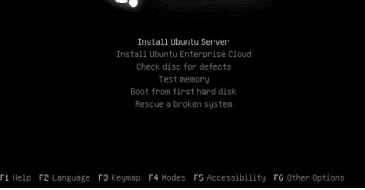

图 1-1 默认的 Ubuntu 启动闪屏

from this screen. If you downloaded and burned your own CD from an ISO file, you might want to select the “Check CD for defects” option. You can also test your system memory from this screen—quite useful even later on if your server starts crashing at strange times and you suspect bad RAM might be the cause. This CD also doubles as a basic rescue disk, which is a broad enough topic that it has gotten its own chapter: Chapter 12, Rescue and Recovery. Finally, if you left the CD in the drive by mistake, you can select “Boot from first hard disk” to bypass the CD altogether.


In an ideal world, you could boot the CD, press Enter, and start the installation process with no problems. Unfortunately, for some machines you might have to tweak some of the boot options so the installation works for your system. The Ubuntu developers know this sort of thing happens and have prepared a rich set of options for you. Along the bottom of the boot splash screen are a number of different options you can access with function keys. For instance, if you hit F1 you will see an interactive help screen with documentation for the rest of the options. If you accidentally chose the wrong language at boot time, hit F2 to change it. The boot screen will automatically choose a keyboard mapping based on your language. If you want a different mapping (for instance, you speak English but are doing an install in Germany on a German keyboard), hit F3 to choose from a list of keyboard mappings. The boot screen also has a lot of great accessibility options. The F5 key brings up an accessibility menu that allows you to choose a high-contrast screen, a screen magnifier, a screen reader and Braille terminal, keyboard modifiers, and even an on-screen keyboard.

The F4 and F6 options allow you to actually control aspects of the install. The F4 key displays a list of install modes from which you can choose: you may install an OEM install, a minimal system and a minimal virtualization guest. The OEM install is available for manufacturers. The minimal virtualization guest gives you an easy way to install a virtualized version of Ubuntu. Other Ubuntu CDs allow you to choose text-only install modes, but that isn’t necessary here because the Ubuntu server install is already text-only. The real power and control over the boot process are available once you hit the F6 key. Here you can see a menu of common arguments that help the CD to boot on difficult hardware. If you hit the Esc key, you will move from this menu to the boot prompt and can type any extra kernel boot parameters you might need for your hardware. The F1 help screen lists a number of common boot parameters, including some kernel arguments for particular SCSI controllers. If you still can’t seem to get the Ubuntu CD to boot after trying these arguments, check out some of the support options in Chapter 13, Help and Resources. Chances are, you aren’t the first person to try to boot Ubuntu on that hardware, and someone else might have already discovered the magic list of options you need for it to work.

> **NOTE**
> 
> **For Headless Server Installation**
> 
> One downside to the pretty boot splash screen Ubuntu uses is that if you install Ubuntu on a headless server (a server without a monitor connected to it that outputs its display over the serial port), you’ll notice that you can’t see anything over your serial console. There is a workaround. After your system boots past the BIOS, the serial console screen will go completely blank. At that point you will have to type without being able to see the output. First hit Enter to accept the default language. Then hit F6 so you can tweak the boot prompt, and hit Esc to exit out of the F6 menu into the boot prompt. Finally, type `console=ttyS0,9600n8` and hit Enter. If your serial console is on a different port or uses different settings, you will want to change this argument accordingly. Since you can’t see what you are typing, you will probably want to pay extra attention to each key. Once you hit Enter, the kernel will boot and within a few seconds you should start to see the output over the serial port. At that point you will be able to complete the install over the serial console, and the next time you reboot you’ll notice that the GRUB prompt and the kernel arguments are already set up for you.

### Disk Partitioning


Any Linux installer is essentially a series of questions, and the Ubuntu server install asks pretty simple questions for the most part. The first phase of the installation prompts you with questions about what language to use for the install, what hostname to use, and, if you don’t have DHCP on your network, the network settings for the host. There aren’t any real tricky decisions to be made until you get to the partitioning section of the installer.

### What Is a Partition?

If you are relatively new to Linux, you might be wondering what a partition is, and why Linux is prompting you to partition the first place. Think of a hard drive like a house with an open floor plan—no rooms and only outside walls. While many people do live in lofts that are organized like this, most people prefer a house that has rooms. With rooms you can organize your bed and all of your personal things in a bedroom, all of your cooking supplies in your kitchen, and your bathtub, sink, and toilet in a bathroom. 即使是阁楼里的住户也经常设置书架或其他结构来分隔、或划分阁楼的不同区域，使其成为房间。磁盘分区的工作方式与此类似，原因也相同。Linux 使用分区来分隔用于不同目的的文件系统不同部分。一个分区可能用于文件系统的核心（也称为根分区），而单独的分区则设置为交换空间——磁盘上 Linux 在内存不足时可作为 RAM 使用的地方。

除了基本的两个分区之外，系统管理员通常还喜欢将文件结构的其他部分分离到分区中。第 2 章《Essential System Administration》涵盖了 Ubuntu 系统上的所有主要目录及其用途，但现在这里列出管理员经常配置为单独分区的几个目录：

#### `/home`

`/home` 目录是管理员和桌面用户都喜欢的分区候选对象，因为它保存了该机器上用户账户的所有个人文件。如果你将 `/home` 维护为单独的分区，你可以安装发行版的新版本甚至完全不同的发行版，而不会抹掉任何用户设置。

#### `/var`

`/var` 目录设计用于存储大小变化的数据。从邮件队列到 HTML 文件再到系统日志，这个目录往往会迅速增长。管理员经常将 `/var` 分离到自己的分区中，这样如果例如日志文件快速增长并填满分区，从中恢复要比整个根分区被填满时容易得多。

#### `/opt`

大量第三方软件已知会安装在 `/opt` 下。取决于你是否使用这些软件，你的 `/opt` 目录可能完全为空，也可能大到数百 GB。在某些系统上，整体根分区可能只需要几 GB，而增长的大部分都在 `/opt` 中，因此管理员可能会将 `/opt` 设为自己的分区。

#### `/usr`

`/usr` 目录的一个有趣之处在于系统安装后它变化很少。一般来说，它只在你升级程序或安装新软件包时才会更改。正因如此，一些注重安全的管理员会将其设为自己的分区，并在正常操作期间以只读方式挂载，以防止攻击者用特洛伊木马或其他病毒替换程序。

#### `/tmp`

许多程序使用 `/tmp` 来存储在重启后无需保留的临时文件。然而一个常见问题是，程序可能会在 `/tmp` 中存储过多的数据，如果它属于根分区，整个根分区可能会被填满。一个常见的罪魁祸首是 `vi`。当你用 `vi` 打开一个文件时，文件的一个临时副本会被放在 `/tmp` 中。我数不清有多少次我被呼叫是因为服务器的根分区已满，结果发现是用户用 `vi` 打开了一个 500Mb 的日志文件，并在 `/tmp` 下生成了同样大小的临时文件。然后我不得不终止 `vi` 会话，并指示用户使用 `less` 或 `more` 等程序来查看大型文本文件。

#### `/boot`

过去 Linux 启动加载程序曾受到不同限制的制约。很长一段时间里，如果内核位于磁盘的 1024 个柱面之后，Linux 就无法启动。即使该问题得到解决，Linux 启动加载程序有时仍无法启动，如果你的根分区使用 XFS 等文件系统，或你使用 LVM 或软件 RAID。 其中许多问题已得到解决，但有些问题（如从 RAID5 根分区启动）仍然存在。然而，一个常见的变通方法是在磁盘开头创建一个小的（64–128Mb 应该足够）分区用于 `/boot` 目录。内核连同其初始根目录存放在此分区中，因此如果启动加载程序可以访问此分区并加载内核，内核通常可以在启动时处理更奇特的分区或 RAID/LVM 配置。

Ubuntu 安装程序为管理员提供了几种不同的分区选项。你可以选择其中一种 Guided 分区方法，该方法基于合理的默认值设置标准分区方案，或选择 Manual 选项并逐步分区你的磁盘。

> 注意 如果你的磁盘已有分区，你还将获得一个引导选项来调整安装程序找到的当前分区以释放空间用于新的安装。这主要是桌面选项，适用于希望在操作系统之间双启动的人。由于大多数服务器都不适合双启动，你可能更希望选择其他选项并覆盖整个磁盘。此选项适用于那些知道自己在做什么并且确实想要调整现有分区的人。

### Guided—Use Entire Disk

第一个分区方法是新管理员的最佳选择，他们不确定要创建哪些分区，以及经验丰富的管理员不需要额外分区。安装程序允许你从所有检测到的硬盘和分区中选择，并使用足够的交换分区和填充剩余磁盘的根分区。在任何内容写入磁盘之前，你会看到由“Write Changes to Disk”提示的两个分区的列表。你仍然有机会撤回你的决定，或者你可以选择 Yes，Ubuntu 将分区磁盘并继续安装。

### Guided with LVM

`LVM`（Logical Volume Management）允许你将多个分区或磁盘（甚至 RAID 阵列）组合在一起，并将其视为一个可以随时扩展的单个磁盘。`LVM` 还允许高级功能，如快照，这样你就可以创建磁盘的冻结状态并临时挂载到某处——这对于备份非常有用。

如果你想使用 `LVM` 但对它不太熟悉，Guided LVM 分区器可以轻松地为你的磁盘设置两个 `LVM` 卷组：一个用于根分区，一个用于交换。它甚至会为你设置小的 `/boot` 分区，以便 GRUB 可以轻松地从你的 `LVM` 分区启动。如果你选择带加密的 Guided LVM 分区器，你甚至可以用在安装时选择的密钥加密整个磁盘。

### Manual

最灵活的选项是手动分区器。如果你想在任何方面偏离标准的双分区系统，如果你想配置软件 RAID，如果你更喜欢 `ext3` 以外的文件系统，或者如果你只是喜欢动手操作并更清晰地了解磁盘将如何分区，那么手动分区器就是你的工具。

### Initialize a Blank Drive

当你进入手动分区器时，你会看到所有可见的磁盘以及它们当前拥有的任何分区。例如，如果你的系统上只有一个磁盘并且它还没有任何分区，请使用方向键突出显示该磁盘并按 `Enter`。如果磁盘完全空白，你将被提示初始化磁盘，然后在那时，如图 1-2 所示，你将看到该磁盘下的可用空间供你使用。

### Allocate Free Space

一旦驱动器初始化或如果它已经有分区，你就可以突出显示屏幕上任何可用的分区或可用空间并按 `Enter` 编辑它。当你选择可用空间时，你可以选择创建新分区、自动分区可用空间，或显示柱面、磁头和扇区信息。一般来说，你只会在计划基于柱面、磁头或扇区边界创建分区时才选择最后一个选项。如果你不确定我在说什么，没关系，因为在大多数情况下你不必再关心这些值——分区工具会为你处理它们。

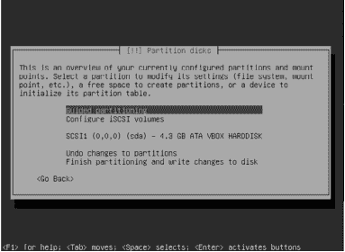

**Figure 1-2** Blank drive ready for manual partitioning

如果你选择自动分区可用空间，分区器将表现得好像你选择了 Guided 分区选项，并在可用空间中为你创建根驱动器和交换空间。通常人们选择手动选项是为了避免默认分区，所以如果你想手动分区，请选择“Create a new partition”选项。


对于每个你选择创建的新分区，你会被问到一系列问题，包括分区大小、它是主分区还是逻辑分区、分区在可用空间中的位置，最后你会看到文件系统选项列表。对于分区大小，你可以指定以 M 表示兆字节或 G 表示千兆字节结尾的实际分区大小，也可以指定使用 `%` 符号跟随的可用空间百分比，或只需输入 `max` 以使用全部可用空间。

分区应为主分区还是逻辑分区取决于一些基于磁盘分区限制的因素。磁盘最多只能有四个主分区。如果你想在磁盘上创建超过四个分区，就必须使用变通方法。如果你将其中一个主分区设置为扩展分区，那么你可以在该扩展分区内创建多达 24 个分区（尽管大多数人不需要这么多）。你在扩展分区内创建的分区被标记为逻辑分区。基本经验法则是，如果你计划在驱动器上只有两个或三个分区，你可以全部设置为主分区。如果有机会在驱动器上拥有四个或更多分区，你将希望设置一个扩展分区来跨越这些额外分区的空间，然后在此内设置逻辑分区。请注意，当你选择创建逻辑分区时，Ubuntu 安装程序会为你创建扩展分区。

图 1-3 显示了创建分区时你将看到的最终屏幕。此屏幕专门用于文件系统设置，其中一些选项值得额外说明。`Use as` 字段让你指定分区要使用的文件系统（如果你不确定使用什么文件系统，默认的 `ext4` 或甚至 `ext3` 文件系统是通用的不错选择）。如果你选择该选项并按 Enter，你会看到除了文件系统和交换存储选项外，这里也是你可以将分区设置为物理卷以用于加密、RAID 或 LVM 的地方。在第 10 章《Fault Tolerance》中，我详细介绍了如何设置这些 RAID 分区

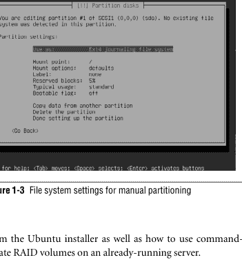

### Figure 1-3 File system settings for manual partitioning

同样来自 Ubuntu 安装程序，以及如何在已运行的服务器上使用命令行工具创建 RAID 卷。

手动安装程序甚至对于常规的 `ext4` 分区也不会隐藏太多设置。以下是每个选项的基本介绍以及你可能想要更改它们的原因：

- Mount point

如果你超出了标准的根分区和交换分区，就需要更改此选项，以指向系统启动时希望挂载此分区的位置。

- Mount options

你可以向文件系统传递许多高级选项以供挂载。当你选择此选项时，安装程序会向你显示可供选择的选项列表，并附带每个选项的简要说明。我的建议是，除非有充分理由将其禁用，否则请坚持使用默认的 `relatime` 选项。

在 Linux 下的网站，甚至 Ubuntu 已经将所有必要的软件包组合在一起。如果你选择 LAMP 服务器软件包组，Ubuntu 将添加 `apache2`、`apache2-mpm-prefork`、`mysql-server-5.0`、`mysql-client-5.0` 和 `php5-mysql` 软件包以及它们所有的库和其他依赖项。除了额外的软件包之外，当你选择此组时，安装程序会提示你为 MySQL root 用户选择一个可选密码（这是个好主意，因为默认密码为空）。

### Mail server

此选项安装 Postfix 邮件服务器软件包。当你启用此选项时，安装程序会启动初始 Postfix 配置脚本。这是一个交互式脚本，它为你提供几种常见的邮件服务器配置类型，并且根据你的选择，它会问你一些额外的问题，这样当你完成时，至少应该有一个可用的邮件服务器。需要记住的是，虽然邮件服务器可以运行，但如果你想添加垃圾邮件检查、灰名单、POP 或 IMAP 服务器或其他更高级的选项，就必须执行额外的配置。有关邮件服务器配置类型的列表，请参阅第 5 章《Guide to Common Ubuntu Servers》。

### OpenSSH server

此选项安装 `openssh-server` 软件包。如果你想使用 SSH 远程管理服务器，请选择此项。请注意，即使你不选择此选项，你仍然可以从主机 ssh；你只是无法 ssh 进入主机。

### PostgreSQL database

如果你想要一个 PostgreSQL 数据库服务器，请选择此选项。它将安装 `postgresql` 软件包以及其文档和任何必要的库和依赖项。

### Print server

此选项选择 `cupsys`、`cupsys-bsd`（为 cups 提供 lpr 服务）、`defoma`、`foomatic-db`、`foomatic-filters` 以及许多其他打印机驱动程序和库——所有你需要将服务器连接到一个或多个打印机（本地或通过网络）然后与你的局域网共享所需的东西。

- Samba file server

此选项添加 `samba`、`samba-doc`、`smbfs` 和 `winbind` 软件包以及依赖项和库。如果你想设置一个文件服务器来与 Windows、Linux 和 Mac 主机共享文件，但不想使用 NFS，请选择此选项。

- Tomcat Java server

如果你计划安装 Tomcat Java 服务器，此选项将安装你所需的所有 Java 软件包。

- Virtual machine host

如果你计划将此机器用作其他虚拟机的主机，此选项将安装你所需的全部 KVM 软件包。有关虚拟机的更多信息，请参阅第 9 章。

如果你选择其中任何一个选项，在某些情况下服务器就可以使用，但在许多情况下你仍需在自己的方面进行一些配置，以便服务器最终对你有用。在第 5 章中，我讨论了一些你可能想要配置的常见 Ubuntu 服务器，并为每种类型提供一些示例配置。顺便说一下，如果你完成安装后意识到你想再次查看此软件包列表，只需从终端运行 `sudo tasksel` 即可。请注意，本地版本的 `tasksel` 会显示一个更大的组列表，其中包括许多可能更适合桌面安装的选项。你也可以运行 `sudo tasksel -s`，以便只获取服务器任务列表。

### Installer Console

在大多数情况下，你将与默认的安装程序屏幕交互。在此屏幕中你基本上只能回答问题和选择一些选项。有时，安装并不会完全按照你的计划进行，特别是如果你使用的是特殊硬件或正在尝试新的 Kickstart 脚本。Ubuntu 安装程序通过可访问的其他控制台提供了多种诊断途径。例如，如果你按 `Alt-F4`，你将看到 Ubuntu 安装程序正在进行的操作的运行日志。或者，如果你似乎在网络上无法获得 DHCP 租约，你可以按 `Alt-F4` 切换到此控制台，查看主机上出现的错误。

除了 F4 安装程序日志之外，你还可以按 `Alt-F2` 或 `Alt-F3` 来访问一个有限的 BusyBox shell。虽然你无法使用你可能习惯的同样丰富的命令行工具列表，但你可以对系统执行一些基本诊断。例如，你可以对驱动器运行 `fdisk` 来查看其上的分区，甚至可以将分区挂载到临时位置以查看其中的文件。你可以 `ping` 一个主机来测试网络连接或 DNS 解析，或者你可以运行 `ps` 来查看安装程序上当前正在运行的进程，如果你有一个卡住的 Kickstart 脚本，你可以从此控制台将其终止。

当你准备好返回主安装程序时，只需按 `Alt-F1`。你可以在整个安装过程中随时返回这些窗口中的任何一个。

### 重启系统

一旦你通过了软件包组列表，Ubuntu 安装程序将完成初始安装过程并提示你重启。如果你是从 CD-ROM 启动的，请确保弹出并取出它，除非你的 BIOS 配置为优先从硬盘启动。否则，你也可以从 CD 启动菜单中选择“Boot from first hard disk”选项。

# 第 2 章

## 基本系统管理

在你完成 Ubuntu 服务器安装后，你可能会想：“接下来怎么办？”如果你是 Linux 管理的新手，你可能会觉得面对陡峭的学习曲线有点不知所措。一方面，有大量命令行工具需要学习。另一方面，有各种各样的配置文件散布在不同的位置。即使你是一位经验丰富的 Linux 管理员但对 Ubuntu 来说是新手，你也会发现配置文件可能并不完全在你期望的位置，而且你熟悉的一些程序可能甚至不存在。在许多方面，尝试一个新发行版就像驾驶一辆新车。没错，汽车有方向盘、油门和刹车，但你仍然需要一分钟来调整后视镜，找到所有仪表和控制装置的位置，并调整座椅直到感觉舒适。将本章视为在新车后座的这一分钟或两分钟。在这里我介绍新管理员应该知道的一些核心命令，解释 Ubuntu 启动过程，描述构成 Ubuntu 系统的主要目录，并谈谈网络。到本章结束时，你在登录到 Ubuntu 服务器时应该会感到相当自在。

## 基本命令行管理

整本书都写在命令行工具及其有效使用方法上，所以与其记录每一个主要 Linux 命令和流程，我将假设你对 Linux 服务器管理是新手，至少需要一套基本工具来在系统中移动、编辑文件和检查进程。如果你是一位经验丰富的管理员，请随意跳到下一节，我在那里记录 Ubuntu 启动过程。

### 在系统中移动

当你登录到服务器时，首先看到的是一个闪烁的光标。默认情况下，登录后你将位于用户的主目录中。如果你想确认这一点，可以使用 `pwd` 命令：

```
$ pwd
/home/kyle
```


管理员运行的最常见命令之一是`ls`命令。如果你来自 Windows 背景，这很像`dir`命令。当你单独输入此命令时，它将列出当前目录中的所有文件。如果你在一个全新的 Ubuntu 安装中的主目录中，你不会看到任何文件，因为该目录是空的，但如果你在`ls`命令后跟上一个目录名，它将列出该目录中的文件。例如，`/` 是根目录的名称（包含系统上所有其他目录的目录）：

```
$ ls /
bin  dev  initrd.img  media  proc  selinux  tmp  vmlinuz
boot  etc  lib  mnt  root  srv  usr
cdrom  home  lost+found  opt  sbin  sys  var
```

如果我想查看在该输出中看到的`etc`目录的内容，我可以输入`ls /etc`。`ls`命令有大量的选项（在命令行上输入`man ls`可查看列表），但最常见的参数之一是`-l`（长格式）。如果你输入`ls -l`，它将提供有关它看到的所有文件和目录的更多信息。例如，当我输入`ls -l /`时会发生以下情况：

```
$ ls -l /
total 85
drwxr-xr-x 2 root root 4096 2010-02-26 15:07 bin
drwxr-xr-x 4 root root 1024 2010-02-26 15:10 boot
drwxr-xr-x 2 root root 4096 2010-02-26 14:58 cdrom
drwxr-xr-x 14 root root 3720 2010-02-26 15:12 dev
drwxr-xr-x 83 root root 4096 2010-02-26 15:24 etc
drwxr-xr-x 3 root root 4096 2010-02-26 15:10 home
lrwxrwxrwx 1 root root 37 2010-02-26 14:59 initrd.img -> boot/initrd.img-2.6.32-14-generic-pae
drwxr-xr-x 17 root root 12288 2010-02-26 15:22 lib
drwx------ 2 root root 16384 2010-02-26 14:56 lost+found
drwxr-xr-x 3 root root 4096 2010-02-26 14:56 media
drwxr-xr-x 2 root root 4096 2009-12-07 16:32 mnt
drwxr-xr-x 2 root root 4096 2010-02-26 14:57 opt
dr-xr-xr-x 80 root root 0 2010-02-26 15:12 proc
drwx------ 4 root root 4096 2010-02-26 15:04 root
drwxr-xr-x 2 root root 4096 2010-02-26 15:10 sbin
drwxr-xr-x 2 root root 4096 2009-12-05 13:55 selinux
drwxr-xr-x 2 root root 4096 2010-02-26 14:57 srv
drwxr-xr-x 13 root root 0 2010-02-26 15:12 sys
drwxrwxrwt 4 root root 4096 2010-02-26 15:22 tmp
drwxr-xr-x 10 root root 4096 2010-02-26 14:57 usr
drwxr-xr-x 14 root root 4096 2010-02-26 15:07 var
lrwxrwxrwx 1 root root 34 2010-02-26 14:59 vmlinuz -> boot/vmlinuz-2.6.32-14-generic-pae
```

can even nest these aliases, so if you wanted to go two directories up, type `cd ../../..`.

## File Ownership

As you administer a system, you will find that you often need to change a file's owner, group, or permissions. The `chown` and `chgrp` commands allow you to change the owner and group of a file, respectively, provided that your user has permission to change the ownership to begin with. So if I wanted to change the group of a file to be the staff group, I would type `sudo chgrp staff filename`.

The `chmod` command allows you to change permissions on a file. There are a number of different ways to describe permissions for a file (type `man chmod` to see a full list), but one common way is to list `u`, `g`, or `o` for user, group, or everyone else (other) followed by a `+` or `-` sign, and then the permission to add or remove. So if I wanted to remove write access for the user who owns a file, I would type `chmod u-w filename`. If I wanted to add read permissions for a file's group, I would type `chmod g+r filename`. To add read permissions on a file for everyone else on the system, type `chmod o+r filename`. There's even a shortcut, `a`, that applies the change to the user, group, and everyone else, so to add read permissions on a file for user, group, and everyone else, type `chmod a+r filename`.

## Check Running Processes

An administrator will often need to check which programs are currently running on the system and what resources they are consuming. You might even need to stop a process on the system. Linux provides a number of tools to manage processes, but `top` and `ps` are among the most common. When you type `top` on the command line and press Enter, you will see a lot of system information all at once (Figure 2-1). This data will continually update so that you see live information on the system, including how long the system has been up, the load average, how many total processes are running on the system, how much memory you have—total, used, and free—and finally a list of processes on the system and how many resources they are using.

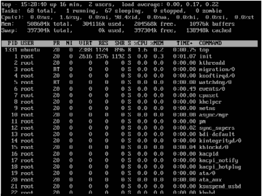


You probably won't be able to see every process that is currently running on your system with `top` because they wouldn't all fit on the screen. By default `top` sorts the processes according to how much CPU they use. That way you can see what processes are consuming CPU at a glance. So what if you do notice a process consuming all of your CPU and you want to kill it? The very first column for processes in `top` is labeled `PID` and shows a program's process ID—a unique number assigned to every process on a system. To kill a process, press the `K` key and then type in the `PID` you wish to kill, then hit Enter when prompted to kill with signal 15. `top` is a very powerful and informative program and I've only mentioned a small fraction of what it can do. If you want to find out more about `top`, including detailed information about each field in the output, how to sort by different fields, and much more, type `man top` in a terminal to bring up the command's manual page.

> **NOTE**
>
> You may have noticed that I mentioned the `man` command a few times already. This command, short for manual, is one of the most useful commands on a Linux system because it provides you with a manual for all of the major Linux commands. No matter how long you have used Linux, you never seem to memorize every argument for every command, but you don't have to. When you are stumped, just type `man command` to see a list of all of the arguments for a command and overall instructions for how to use the program. While in the `man` program, hit `q` to exit. For more information about the `man` program you can type—you guessed it—`man man`.

Another useful command-line program for listing processes is the `ps` command. When you run it with no arguments, it is not very useful—it lists only processes in your current shell. It's the arguments that make `ps` so powerful. When you type `ps -ef`, you will see volumes of information about all of the running processes on your system. The very top of the output will show you labels for each of the columns, but in the output you will see the user who owns a process, the `PID`, the `PID` of the parent process (the process that started this process), the time the process was started, and even the full command that was run with all of its arguments.

> NOTE
>
> When you get columns of output that scroll past your terminal, remember you can type `Shift + PgUp` to scroll up the terminal. You can also pipe any command to the `less` program (such as `ps -ef | less`) so you can page through the output more easily.

The `ps` command is another useful way to find the `PID` for a particular process so you can kill it, but unlike `top`, `ps` won't kill a process for you. To kill a process on the command line, type `kill` followed by the `PID`. So if I wanted to kill a program with a `PID` of 4023, I would type `kill 4023`. What you will find is that some programs are stubborn and don't go away even when you kill them. This is because by default the `kill` command sends a signal to the process that tells it to shut down—a signal that the process could possibly ignore. If you tried to kill a process and it doesn't seem to cooperate, you can force the process to die by passing the `-9` option to `kill`. So, if the 4023 process was being stubborn, I could type `kill -9 4023`. Just be sure before you use the `-9` option that you run the regular `kill` command first so the process has a chance to clean itself up.

### Edit Files

On a Linux server most programs store their configuration in text files. When you want to make changes to a program, the most common way is to locate its configuration file, open it in a text editor, make changes, and then save those changes to the file. Ubuntu has a number of text editors available, and even in the default server install there are two popular editors to choose from, `vi` and `nano`. While a number of administrators (myself included) prefer `vi`, it does have a steep learning curve, so when you are starting out, it's good to have a simpler option with `nano`.


要使用 `nano` 编辑文件，输入 `nano` 后跟文件名。一旦文件打开，你可以使用方向键在文件中移动光标。当你到达想要更改的部分时，可以使用标准的退格键和删除键来删除文本并在原处输入新文本。你还会注意到屏幕底部有一系列可以执行的操作。每个操作都有一个键绑定，每个键绑定都以 `^` 开头，这代表 Ctrl 键。当你完成文件编辑后，可以按 `Ctrl-X` 退出程序。`Nano` 会在关闭前提示你保存文件，因此如果你不想保存更改，你将有机会在不保存的情况下退出。

## 成为 Root

当你管理一个系统时，很快就会很明显作为普通用户能做的事情有多少。基本上每个配置文件都需要额外的权限才能编辑，每个主要服务也是如此。`root` 用户与 Windows 系统上的管理员用户非常相似，可以访问机器上的所有文件和服务。在某些 Linux 系统上，`root` 用户就像其他用户一样，账户有密码，但在 Ubuntu 上 `root` 密码是禁用的。相反，你可以以普通用户身份登录，然后使用 `sudo` 命令获得 `root` 权限。

你可以设置特定的访问控制来控制哪些用户可以使用 `sudo` 命令成为 `root`，在第 6 章 安全 中，我将深入介绍账户安全和 `sudo` 命令，但为了让你入门，你需要知道如何获得 `root` 权限。默认情况下，系统上设置的第一个用户可以通过 `sudo` 获得 `root` 权限。要以 `root` 身份运行任何命令，输入 `sudo` 后跟命令。例如，如果你想重启系统，你会输入 `sudo reboot`。当提示输入密码时，输入你在系统上的用户密码。

## Ubuntu 启动过程

在管理 Ubuntu 系统时，了解启动过程以及每个服务如何启动非常重要。与其他一些 Linux 发行版不同，Ubuntu 实际上使用了一种完全不同的服务启动过程，称为 Upstart，尽管除非仔细查看，否则你可能永远不会注意到，因为它已添加了与经典 System V init 模型的向后兼容性。我将在下面介绍这两种系统，但在先让我们先了解一下 Ubuntu 初始启动过程的一些重要部分。

### GRUB

当你首次启动 Ubuntu 服务器时，你会看到一个启动屏幕，称为 GRUB 启动加载器。该程序至少部分位于主引导记录的引导代码中（硬盘的前 512 字节），它控制系统从哪个 Linux 内核启动以及启动时使用哪些选项。

在当前版本的 Ubuntu Server（从 9.10 开始），原始的 GRUB 启动加载器已更新为 GRUB2。这在 GRUB 的配置方式上引入了相当多的变化，如果你使用 Linux 有一段时间，你可能不习惯。例如，主要的 GRUB 配置文件过去是 `/boot/grub/menu.lst`，但现在是 `/boot/grub/grub.cfg`。然而，如果你查看该文件，你会注意到一个警告，提示你不要直接编辑它。相反，如果你想更改 GRUB 设置，你应该编辑 `/etc/default/grub`，然后运行 `sudo update-grub` 来更新主配置文件。在标准的 Ubuntu 桌面安装中，你通常不需要查看或编辑此文件。然而在服务器上，你可能会遇到需要编辑该文件的情形。如果你想要 GRUB 的完整文档，你可以从阅读配置文件中的注释开始，也可以访问 `http://www.gnu.org/software/grub/grub.html`。

当你查看 `/boot/grub/grub.cfg` 或甚至 `/etc/default/grub` 时，你会发现对一个名为 `update-grub` 的程序的引用。这是一个辅助程序，使自动化 GRUB 配置文件在添加新内核时的更新变得更容易。该程序会读取并执行 `/etc/grub.d` 中的许多配置脚本。一般来说，对于你想要进行的任何配置更改，你应坚持使用 `/etc/default/grub`。

GRUB 的一大优点是，你可以在启动提示时对其设置进行临时更改。当 GRUB 加载时，你可能看不到菜单。按 `Shift` 键即可查看所有可用的内核选项。突出显示你想要编辑的内核并按 `E` 键。此时你可以更改你想要的特定配置行

`edit`，做出你想要的更改，然后按 `Ctrl x` 根据这些选项启动。

**注意** 如果你发现及时按下 `Shift` 键有困难，你可能需要编辑 `/etc/default/grub` 文件并将 `GRUB_HIDDEN_TIMEOUT` 值改为更大的数字（比如 `10`），然后运行 `sudo update-grub`。这样会给你更多时间按下 `Shift` 键。

### 内核启动过程

当你通过 GRUB 菜单选择一个内核启动时，GRUB 会将内核连同其 `initrd` 文件（初始 RAM 磁盘）一起加载到内存中。`initrd` 文件实际上是一个 `gzip` 压缩的 `cpio` 归档，在 Ubuntu 下被称为 `initramfs` 文件。如果你好奇某个特定的 `initramfs` 文件中包含哪些文件，可以执行以下步骤来提取它：

```bash
$ cp initrd.img-2.6.32-14-generic-pae /tmp/initrd.img-2.6.32-14-generic-pae.gz

$ cd /tmp

$ gunzip initrd.img-2.6.32-14-generic-pae.gz

$ mkdir initrd

$ cd initrd

$ cpio -idv < /tmp/initrd.img-2.6.32-14-generic-pae
```

现在在你的当前目录中，你应该会看到一组看起来很像常规根目录的目录。`bin`、`sbin`、`etc`、`lib` 以及其他目录都在那里，但内部只有有限的文件。

当内核启动时，它至少需要能够挂载根文件系统，以便访问基本配置文件、内核模块和系统二进制文件。几年前，拥有一个内置文件系统支持以及 SCSI 和 IDE 设备驱动程序的内核是很常见的。如今有太多硬件和文件系统需要支持，还有诸如软件 RAID、`LVM` 以及根文件系统加密等特性，因此让这些支持以模块形式存在，使内核在需要时才加载它们，这更有意义。这样可以保持整体内核大小更小，并在各种不同的环境中更灵活。

模块化内核的问题在于它需要从某个地方获取这些模块。如果模块位于根文件系统上，就会产生鸡生蛋蛋生鸡的问题——它必须先挂载根文件系统才能访问挂载根文件系统所需的文件。这就是 `initramfs` 文件发挥作用的地方。`initramfs` 文件为内核提供了挂载根文件系统并完成启动过程所必需的基本内核模块和系统二进制文件。当 Ubuntu 内核编译时，构建过程的一部分也会构建 `initramfs` 文件，并识别并包含内核启动时可能需要的所有核心模块和二进制文件。

当内核启动时，它会将 `initramfs` 解压到 RAM 中并运行位于 `initramfs` 根目录下的名为 `init` 的脚本。如果你对内核启动过程更感兴趣，可以提取 `initramfs` 并查看此脚本。这里其实并没有太多魔法——只是一个标准的 shell 脚本，它创建一些系统挂载点并挂载实际的根分区。顺便说一下，如果你想知道它如何知道根文件系统在哪里，GRUB 会将该信息作为参数传递给内核，使用 `root=` 启动参数。最后，在此 `init` 脚本挂载了真正的根文件系统后，它的最后一个任务是运行根文件系统上的 `/sbin/init` 程序，从而启动启动过程的下一阶段。

### /sbin/init

`/sbin/init` 程序是系统上运行的每个程序的父进程。此进程始终具有 PID 为 `1`，并且负责启动构成运行 Linux 系统的其他进程。那些使用 Linux 有一段时间的人知道，Ubuntu Server 上的 `init` 与你可能习惯的不同。初始化 UNIX 操作系统有几种不同的标准，但大多数经典 Linux 发行版都使用被称为 System V init 模型（如下所述）的模型，而 Ubuntu Server 已切换到一个名为 Upstart 的系统。Ubuntu 仍然保留了 System V init 的大部分外部结构，例如运行级别和 `/etc/rc?.d` 目录，以保持向后兼容；然而，Upstart 现在在幕后管理一切。

#### 经典 System V Init

在我解释 Upstart 的工作原理之前，先描述经典 System V init 系统的工作方式，然后讨论 Upstart 如何管理一切是有意义的。System V 指的是由

在这种 AT&T 风格的 `init` 中，`init` 进程会读取名为 `/etc/inittab` 的配置文件以发现其默认运行级别。然后它进入该运行级别并启动已配置为在该运行级别下运行的进程。

### RUNLEVELS

System V `init` 进程由不同的系统状态定义，这些状态被称为运行级别。运行级别由 `0` 到 `6` 的数字标记，每个数字可能代表完全不同的系统状态。例如，运行级别 `0` 保留用于已停止的系统状态。当你进入运行级别 `0` 时，系统会关闭所有正在运行的进程、卸载所有文件系统并断电。同样，运行级别 `6` 保留用于重启机器。运行级别 `1` 保留用于单用户模式——一种只有单个用户可以登录系统的状态。一般来说，单用户模式下启动的进程很少，因此当系统无法完全启动时，这是一个非常有用的用于诊断的运行级别。即使在默认的 GRUB 菜单中，你也会注意到一个恢复模式选项，它会将你引导至运行级别 `1`。


运行级别 2 到 5 留给发行版以及最终由你来定义。拥有这么多运行级别的想法是为了允许用户创建服务器可以进入的不同模式。传统上，许多 Linux 发行版会为图形桌面设置一个运行级别（在 Red Hat 中这是运行级别 5），并为无图形系统设置另一个运行级别（Red Hat 对此使用运行级别 3）。用户可以定义其他运行级别，例如启动一个无网络访问的系统。然后在启动时，你可以在启动提示符下传递一个参数，以用你选择的运行级别覆盖默认运行级别。系统启动后，你也可以使用 `init` 命令后跟运行级别来更改当前运行级别。因此，要在 Ubuntu 服务器系统上切换到单用户模式，你需要输入 `sudo init 1`。

### `init` Scripts

除了 `/etc/inittab` 之外，System V `init` 系统还有许多其他重要的文件和目录，用于组织所有主要服务的启动和关闭脚本，即 `init` 脚本。

- `/etc/init.d`: 该目录包含每个运行级别下每个服务的全部启动脚本。通常这些是标准的 shell 脚本，并且符合基本标准。每个脚本至少接受两个参数，start 和 stop，分别启动或停止一个服务（例如，你的 Web 服务器）。此外，`init` 脚本通常还接受一些额外选项，如 restart（停止后重新启动服务）、status（返回服务的当前状态）、reload（指示服务从其配置文件重新加载设置）以及 force-reload（强制服务重新加载其设置）。当你不带参数运行 `init` 脚本时，它通常应返回其接受的参数列表。

- `/etc/rc0.d` through `/etc/rc6.d`: 这些目录包含每个相应运行级别的 `init` 脚本。实际上，这些通常是对 `/etc/init.d` 下实际文件的符号链接。你会注意到的是，这些目录中的 `init` 脚本被赋予了特殊名称，以 S（start）、K（kill）或 D（disable）开头，然后跟一个数字。当 `init` 进入一个运行级别时，它会按数字顺序运行每个以 K 开头的脚本并传递 stop 参数，但仅当对应的 `init` 脚本在上一个运行级别中已启动时。然后 `init` 按数字顺序运行每个以 S 开头的脚本并传递 start 参数。任何以 D 开头的脚本，`init` 都会忽略——这允许你在特定运行级别中临时禁用一个脚本，或者你也可以直接删除符号链接。因此，如果你有两个脚本，`S01foo` 和 `S05bar`，`init` 在进入该特定运行级别时会先运行 `S01foo start`，然后运行 `S05bar start`。

- `/etc/rcS.d`: 在此目录中，你会找到 `init` 在更改到特定运行级别之前在启动时运行的所有系统 `init` 脚本。当你修改此目录中的脚本时要小心，因为如果它们卡住，可能会阻止你甚至进入单用户模式。

- `/etc/rc.local`: 并非每个发行版都使用 `rc.local`，但传统上这是为用户编辑而预留的 shell 脚本。它通常在 `init` 进程结束时执行，因此你可以将想要运行的额外脚本放在这里，而无需创建自己的 `init` 脚本。

所以这是一个标准 System V `init` 系统的示例启动过程。首先 `init` 启动并读取 `/etc/inittab` 以确定其默认运行级别，本例中该参数是运行级别 2。然后 `init` 转至 `/etc/rcS.d`，按数字顺序运行每个以 S 开头的脚本，并将 start 作为参数。随后 `init` 对 `/etc/rc2.d` 目录执行相同操作。最后 `init` 完成工作，但会留在后台运行，等待运行级别改变。

### Upstart

System V `init` 是一个优秀的系统，多年来在 Linux 上运行良好；然而，它也并非没有缺点。其一，`init` 脚本没有一种在服务终止时自动重新生成（respawn）的机制。因此，举例来说，如果 `cron` 守护进程因某种原因崩溃，你就必须另建工具来监控并重启该进程。

`init` 脚本的另一个问题是，它们通常只在运行级别改变或系统启动时才会执行；除此之外，除非你手动运行，否则不会被执行。依赖网络连接的 `init` 脚本就是一个很好的例子。在 Ubuntu 中，有一个名为 `networking` 的 `init` 脚本负责建立网络连接。所有依赖网络连接的 `init` 脚本都被赋予比该脚本更高的编号，以确保它们在 `networking` 脚本运行之后才执行。如果你从服务器上拔掉网线然后启动系统，会怎样？`networking` 脚本会运行，但所有需要网络连接的 `init` 脚本都会一个接一个地超时。最终你会看到登录提示并能够登录。登录之后，如果你插上网线并重启 `networking` 服务，你就能接上网络，但所有需要网络连接的服务都不会自动重启。你必须手动将它们一一启动。

Upstart 的设计不仅是为了解决 System V `init` 进程的部分缺陷，而且是为了提供一个更健壮的服务管理系统。Upstart 的一个主要特点是事件驱动。Upstart 持续监控系统以等待特定事件发生，一旦事件发生，Upstart 可被配置为针对这些事件采取相应动作。一些示例事件包括系统启动、系统关闭、按下 Ctrl-Alt-Del 组合键、运行级别改变，或者 Upstart 脚本启动或停止。为了了解事件驱动系统如何改进传统 `init` 脚本，让我们以之前那个在网线未插状态下启动的系统为例。你可以创建一个 Upstart 脚本，该脚本会被触发

接下来的几行导出一些环境变量，然后 `task` 选项告诉 `init` 这个脚本不会常驻——它会执行然后停止。

从 Upstart 脚本中实际运行的程序由 `script` 或 `exec` 选项来定义。对于 `exec` 选项，Upstart 会执行 `exec` 后面的命令及其所有参数，并跟踪其 PID。对于 `script` 选项，Upstart 会把后续各行当作一个 shell 脚本，直到遇到 `end script` 行为止。

尽管 Upstart 被设计为事件驱动，它仍然提供了检查 Upstart 作业状态以及按需启动/停止的方法。你可以使用名为 `status`、`start` 和 `stop` 的命令来检查状态、启动和停止 Upstart 脚本。Ubuntu 服务器上的一个 Upstart 作业是 `tty1` 作业，它会在 `tty1` 上启动 `getty` 程序。当管理员按下 Alt-F1 时，这给他/她提供了一个控制台。但是，假设出于某种原因你认为该控制台已挂起。下面是如何检查状态并重启该作业：

```text
$ sudo status tty1
tty1: start/running, process 789
$ sudo stop tty1
tty1 stop/waiting
$ sudo start tty1
tty1 start/running, process 2251
```

你还可以使用 `initctl list` 查询所有可用 Upstart 作业的状态：

```text
$ sudo initctl list
mountall-net stop/waiting
rc stop/waiting
rsyslog start/running, process 640
tty4 start/running, process 708
udev start/running, process 299
upstart-udev-bridge start/running, process 297
ureadahead-other stop/waiting
apport start/running
hwclock-save stop/waiting
irqbalance stop/waiting
```


```
plymouth-log stop/waiting
tty5 start/running, process 713
atd start/running, process 727
failsafe-x stop/waiting
plymouth stop/waiting
ssh start/running, process 1210
control-alt-delete stop/waiting
hwclock stop/waiting
module-init-tools stop/waiting
cron start/running, process 728
mountall stop/waiting
rcS stop/waiting
ufw start/running
mounted-varrun stop/waiting
rc-sysinit stop/waiting
tty2 start/running, process 717
udevtrigger stop/waiting
mounted-dev stop/waiting
tty3 start/running, process 718
udev-finish stop/waiting
hostname stop/waiting
mountall-reboot stop/waiting
mountall-shell stop/waiting
mounted-tmp stop/waiting
network-interface (lo) start/running
network-interface (eth0) start/running
plymouth-splash stop/waiting
tty1 start/running, process 2251
udevmonitor stop/waiting
dmesg stop/waiting
network-interface-security start/running
networking stop/waiting
procps stop/waiting
tty6 start/running, process 720
ureadahead stop/waiting
```

### 更改默认运行级别

从某种程度上说，Upstart 旨在最终取消多个运行级别，因为如果所有服务都通过 Upstart 脚本而不是 System V init 脚本启动和停止，你就可以简单地设置特定的事件来使系统进入一种状态或另一种状态。话虽如此，今天系统仍然存在多个运行级别，你可能想要设置不同的运行级别，甚至从默认的运行级别 2 更改过来，下面就是如何操作的方法。

默认的 Upstart 运行级别在`/etc/init/rc-sysinit.conf`中定义：

```text
# rc-sysinit - System V initialisation compatibility
#
# This task runs the old System V-style system initialisation
# scripts, and enters the default runlevel when finished.

description    "System V initialisation compatibility"
author         "Scott James Remnant <scott@netsplit.com>"
start on       started and net-device-up IFACE=lo
stop on        runlevel
# Default runlevel, this may be overridden on the kernel
# command-line or by faking an old /etc/inittab entry
env DEFAULT_RUNLEVEL=2
. . .
```

更改默认运行级别的一种方法是创建自己的`/etc/inittab`文件，并在其中添加一个`initdefault`段，就像经典的 System V init 一样。另一种可能更简单的方法是编辑`/etc/init/rc-sysinit.conf`并将`DEFAULT_RUNLEVEL`的值更改为你想要的默认运行级别。

### 服务

内核和初始引导过程是 Ubuntu 服务器的重要组成部分，但最终服务器之所以存在并因此得名，是因为服务。服务是你的计算机通过系统上的软件提供的某种功能。该软件，以及运行它的计算机，通常被称为服务器。一台计算机可能在同一台机器上运行多个服务，例如 Web 服务器、文件服务器和 DNS。

在 Ubuntu 上管理服务主要有两种方式：通过 init 脚本或一个名为`xinetd`的程序。虽然 Upstart 在幕后工作以管理运行级别，并且最终有一天也将管理 Ubuntu 上大多数服务，但今天系统上的许多服务仍然是通过 init 脚本启动和停止的。正如我在本章前面提到的，init 脚本位于`/etc/init.d`中，并在`/etc/rc?.d`目录中有符号链接，其中 ? 是一个代表运行级别的数字。这些脚本中的每一个至少接受两个参数，`start`和`stop`，分别启动和停止服务。大多数服务支持扩展选项，包括

- `restart`: 运行脚本的停止部分然后是启动部分
- `reload`: 告诉服务在可以时重新读取其配置文件
- `force-reload`: 强制重新加载服务的配置
- `status`: 报告服务的当前状态，通常是它是否正在运行

大多数写得好的 init 脚本，如果你不带参数运行 init 脚本，将返回受支持的参数列表：

```
$ /etc/init.d/networking
Usage: /etc/init.d/networking {start|stop|restart|force-reload}
```

如果我想重启网络服务，我可以输入

```
$ sudo /etc/init.d/networking stop
$ sudo /etc/init.d/networking start
```

或简写形式

```
$ sudo /etc/init.d/networking restart
$
```

现在我也可以从`/etc/rc?.d`目录运行网络脚本，如果我愿意的话，但我认识的大多数管理员都引用`/etc/init.d`目录，只是因为脚本名称在那里是一致的，你可以确信所有可用的 init 脚本都在那里。

除了`/etc/init.d`和`/etc/rc?.d`中的文件外，服务通常还在`/etc/default`中有特殊的配置文件。该目录包含以其管理的服务命名的配置文件，通常包含环境变量。当 init 脚本执行时，它通常会检查`/etc/default/`下是否有与其同名的文件，如果存在，它会从该文件加载所有环境变量和其他启动设置。诸如传递给服务的额外参数之类的设置通常可以在这里找到，因此如果你想更改系统上服务的默认设置，这是一个很好的查找位置。

大多数 init 脚本启动的程序随后会在后台运行，直到你明确终止它们或系统关闭为止。写得好的 init 脚本还 keeps track of the PID of the service it starts so that when it needs to stop the service, it knows the PID to kill. The convention is to keep track of these PIDs in the `/var/run/` directory, and if you look there on your Ubuntu system, you will see a number of `.pid` files (or directories that store `.pid` files) that contain the PIDs for various system services.


Generally speaking, when you install a new service on your machine, not only should it set up its init script and appropriate symlinks for each runlevel, it should also typically start the service once the package installation is complete. Now those of you who come from a Red Hat background are probably accustomed to using the `service` and `chkconfig` command-line tools to manage services. I have good and bad news for Red Hat administrators. The bad news is that currently Ubuntu has not ported `chkconfig` to Ubuntu. The good news is that it has ported the `service` command and there is a discouraged but available alternative to `chkconfig` as well.

The `service` tool basically provides a shorthand way to start and stop services. Instead of typing `sudo /etc/init.d/networking restart`, you can type `sudo service networking restart`. Red Hat has a very handy tool known as `chkconfig` that an administrator can use to enable and disable services. On a Red Hat system if you wanted to disable the `named` service, for instance, you could type `sudo chkconfig named off` and the `chkconfig` script would remove all of the relevant symlinks within `/etc/rc.d` for you. If you wanted to enable the service, you could just type `sudo chkconfig named on`.

Unfortunately, Ubuntu does not yet have a `chkconfig`-like tool. The closest thing to it is a program known as `update-rc.d`. It’s important to know that this script was designed for use by packages, not by users as its syntax shows. The original intention was to make it easy for a package to create all of the symlinks it needed upon installation and remove all of the symlinks upon package removal. That having been said, there are some basic arguments to `update-rc.d` you can use to get similar behavior to `chkconfig`. To disable an init script from starting up, type `sudo update-rc.d -f servicename remove`, and to enable a script type `sudo update-rc.d servicename defaults`.

## Write Your Own Init Script

Ultimately when you administer servers, you may need to run your own custom programs at start-up. The simple way to do this is to put the script in `/etc/rc.local` so it is run at the end of the boot process. However, if you have a more sophisticated script that needs to both start at boot time and stop as part of system shutdown, then you will want to write a custom init script. While you could certainly wing it and write one from scratch, Ubuntu has made the process much easier for you with a cheat sheet init script called `skeleton` on which you can base your init script. First make a copy of the `skeleton` init script and name the file after your service:

```
$ sudo cp /etc/init.d/skeleton /etc/init.d/myservice
$
```

Then edit your copy of the `skeleton` file and replace the generic placeholders you find in the file with custom information for your service:

```
##### BEGIN INIT INFO
# Provides:          skeleton
# Required-Start:    $remote_fs
# Required-Stop:     $remote_fs
# Default-Start:     2 3 4 5
# Default-Stop:      0 1 6
# Short-Description: Example initscript
# Description:       This file should be used to construct
#                    scripts to be placed in /etc/init.d.
##### END INIT INFO

# Author: Foo Bar <foobar@baz.org>
#
# Please remove the "Author" lines above and replace them
# with your own name if you copy and modify this script.
```

After you change the generic entries in the comments, what you change in the rest of the init script really depends on the complexity of your application. For basic applications you should concern yourself only with the series of environment variables that follow the initial set of comments:

```
PATH=/sbin:/usr/sbin:/bin:/usr/bin
DESC="Description of the service"
NAME=daemon executable name
DAEMON=/usr/sbin/$NAME
DAEMON_ARGS="--options args"
PIDFILE=/var/run/$NAME.pid
SCRIPTNAME=/etc/init.d/$NAME
```


骨架脚本中的初始注释集适用于基本情况，即你的服务是一个存在于`/usr/sbin`中的可执行程序。更改`DESC`和`NAME`变量，使其等于服务在`/usr/sbin`下的描述和可执行名称。如果你的服务安装在其他位置，例如`/usr/local/sbin/`或`/opt/`，则务必更改`DAEMON`变量中的路径以反映这一点。如果你的服务在运行时需要传递任何特殊参数，请在`DAEMON_ARGS`变量中设置它们，或将其更改为空。

完成`init`脚本后，你将需要为各种运行级别创建所有适当的符号链接。虽然你可以手工创建符号链接，但使用`update-rc.d`脚本肯定更容易。首先查看默认运行级别的当前`init`脚本，例如`/etc/rc2.d`中的那些，并决定你的`init`脚本应在何时启动。数字越低，它在启动过程中启动得越早，但请记住，如果你的服务依赖于其他服务运行，那么你希望使其序列号更高。一旦你决定了一个数字，比如`90`，然后运行

```
$ sudo update-rc.d myservice defaults 90
$
```

并将`myservice`替换为你在`/etc/init.d`中为服务指定的文件名。

## Xinetd

启动服务主要有两种方式。虽然系统上的大多数服务都是通过`init`脚本启动的，但有一些服务是由名为`xinetd`的程序管理的。`Xinetd`是经典`inetd`服务的更新版本，旨在使服务器上的资源利用更高效。`init`脚本的问题在于，当系统启动并启动服务时，服务可能会闲置数天或数周才被访问，浪费宝贵的服务器资源。`xinetd`的想法是监听其子服务使用的所有端口。如果在其中一个端口上建立连接，`xinetd`将启动与该端口对应的服务，一旦连接结束，服务就会退出，直到再次需要为止。

`Xinetd`在许多经典的`UNIX`服务中很受欢迎，包括`echo`（回显你发送给它的内容）、`daytime`（返回系统时间）和`TFTP D`（Trivial File Transfer Protocol Daemon）。`Xinetd`不再默认安装，但如果你想使用它，只需输入`sudo apt-get install xinetd`。你可以在`/etc/xinetd.d`目录中查看系统配置的所有可用`xinetd`服务。默认情况下所有这些服务都是禁用的；然而，启用服务相对简单。例如，要启用`echo`服务，打开`/etc/xinetd.d/echo`文本编辑器并将`disable = yes`改为`disable = no`。然后运行`sudo service xinetd reload`重新加载配置文件。现在你可以`telnet`到你本地主机的端口`7`，你输入的任何内容都会被原样返回：

```
$ telnet localhost 7
Trying 127.0.0.1...
Connected to localhost.
Escape character is '^]'.
hello
hello
echo
echo
^]

telnet> quit
Connection closed.
```

要退出`telnet`会话，请按`Ctrl-]`然后按`Enter`进入交互式`telnet`提示符。然后输入`quit`并按`Enter`退出`telnet`。

> 注意 我谈了很多关于 Ubuntu 如何启动，但你可能也想知道如何停止或重新启动它。虽然你当然可以使用像`init`这样的工具切换到运行级别`0`或`6`，但有两个易于记忆的命令称为`halt`和`reboot`，它们分别停止和重新启动系统。只需使用`root`权限运行其中一个命令，你的系统将立即开始关机过程，并在完成后重新启动或关机。

## 文件系统层次结构

在当今的 Ubuntu 桌面系统上，整体文件系统层次结构（系统上目录的组织方式）对普通用户来说并不重要。在桌面上，你通常与你的个人主目录、桌面目录以及主目录内的几个其他目录交互。系统上的所有其他目录都有些被隐藏，设置是通过 GUI 工具更改的。好吧，在 Ubuntu 服务器上你通过可靠的旧命令行管理事物，因此你很快就会接触到根文件系统上的许多目录。

Linux 的优点在于，这些目录中的每一个都有一个直接的目的，多年来不断演变，因为 Linux（以及之前的 UNIX）被用作服务器。你越了解这些目录是什么以及它们为什么存在，就越能快速排除故障，使系统更安全，并更好地添加自己的软件包和其他附加组件。下面是 Ubuntu 服务器上的一些重要目录。这个列表绝非详尽无遗或完整。重点是突出你作为管理员将交互的核心目录并解释它们存在的原因。如果你确实想要详尽的解释，请查看`http://tldp.org/LDP/Linux-Filesystem-Hierarchy/html/index.html`。

- **/bin**

  该目录包含核心二进制文件，可能由系统上的管理员和普通用户使用。你会在此目录中找到`ps`、`ls`、`rm`、`mv`、`chmod`、`df`等核心程序。

- **/sbin**

  `/sbin`目录与`/bin`的功能类似。它包含二进制文件；然而，它是仅供管理员使用的核心二进制文件。该目录应仅包含挂载系统其余部分和在系统无法启动时恢复系统所必需的系统二进制文件。你会在这里找到诸如`fsck`、`ifconfig`、`mkfs`、`route`和`init`等程序。虽然`/sbin`中的许多二进制文件可以由普通用户运行，但它们通常 intended 用于`root`用户。

- **/lib**

  在`/lib`下你会找到核心系统库，系统需要它们来完成启动过程并使用`/bin`和`/sbin`下的二进制文件。内核的所有模块也都位于此处的`/lib/modules/`下。

### /usr

`/usr`目录（缩写自 UNIX System Resources）用于存放系统所有非关键的二进制文件和库。为什么要这样分离呢？原因在于，如果你只将核心的二进制文件和库放在`/bin`、`/sbin`和`/lib`中，就能让主根分区保持相对较小，并且在系统生命周期内不会增长太多。这样磁盘的大部分空间就可以分配给`/usr`分区，如果你愿意的话，它可以挂载在单独的、更大的磁盘上。关于`/usr`的另一个有用的事实是，除非你在系统上更新软件包，否则`/usr`保持相对静态。这意味着如果你将`/usr`分到自己的分区上，你实际上可以增加一层安全性，将其以只读方式挂载，并在执行更新时重新挂载为读写。

### /usr/bin

此目录的作用与`/bin`类似，只是它存放系统上不被视为关键的其余二进制文件。你会在这里找到`man`、`gzip`、`nano`以及其他既供管理员又供普通用户使用的二进制文件。

### /usr/sbin

此目录与`/sbin`类似，只是它存放用于管理员但对启动并非关键的二进制文件。在这里你会找到`traceroute`、`chroot`和`ntpdate`等工具，以及由`init`脚本启动的大多数守护进程，如 Web 服务器、`ntp`守护进程和邮件服务器。

### /usr/lib

与`/lib`一样，你会在此目录下找到程序库，只是本例中它们是用于支持`/usr/bin`和`/usr/lib`下二进制文件的库。

### /usr/local

Ubuntu 作为服务器的优点在于，你想要运行的大多数服务和其他程序都已经打包好并可直接使用。但在某些情况下，你可能希望为系统提供自定义的服务或二进制文件，甚至是自己的自定义脚本。

这就是`/usr/local`目录发挥作用的地方。你会注意到它提供了`bin`、`sbin`和`lib`目录，就像`/usr`一样，只是这些目录 intended 用于任何你希望提供给系统、但并非由 Ubuntu 本身提供的第三方程序。

### /opt

在偏爱使用`/usr/local`来存放第三方程序的人和偏爱使用`/opt`的人之间一直存在争论。我会尽量不火上浇油，但可以说`/opt`和`/usr/local`具有相同的目的——存放第三方程序。两者之间的主要区别在于组织方式。通常安装在`/opt`下的程序会安装在自己的目录下（例如`/opt/someprogram`），然后在该目录下创建自己的`bin`、`sbin`和`lib`目录。一方面，这意味着你可以通过删除`/opt`下的该目录来移除程序，但另一方面，如果你大量使用`/opt`，你的`PATH`环境变量可能会变得相当庞大。

### /boot

我在讨论`/boot`过程时已经提到过`/boot`目录，但该目录存储内核映像、`initramfs`文件以及`GRUB`配置文件。`/boot`目录的存在是为了让你能够将其分离到自己的小型挂载点中。这在你想对根分区尝试 LVM 或实验性文件系统时很有用。你可以将单独的`/boot`分区格式化为`ext2`或`ext3`，且不配置软件 RAID 或 LVM，从而确保你的引导加载程序能够读取它。

### /etc


这是对系统管理员而言非常重要的一目录。在`/etc`下，你会找到系统和系统服务的全部配置文件。如我之前提到的，你还会在这里找到所有系统启动脚本，位于`/etc/init`和`/etc/init.d`，以及它们位于`/etc/default`下的配置文件。`cron`、你的邮件服务器、Web 服务器、网络设置以及所有其他重要配置文件的核心配置也都存放在这里。你在这里不会（或至少不应该）找到二进制文件和库。将所有配置文件都存储在`/etc`的好处是，配置文件是文本，文本可以压缩

非常好。这样使`/etc`非常容易备份，而且备份所需的空间非常小。我强烈建议如果你不备份系统上的任何其他内容，至少要备份`/etc`。

## `/var`

`/var`目录设计用于存储大小可能变化且经常更改的文件和目录。其目的是让管理员能够将`/var`挂载为其自己的大分区，并且可能作为比系统其余部分更快的磁盘上的分区。在`/var`下你会找到系统日志、邮件队列、Web 服务器文档以及其他可能频繁增长或更改的文件。虽然`/bin`、`/sbin`甚至`/usr`目录在各服务器之间可能相当一致，但`/var`目录在不同服务器之间可能差异很大，具体取决于服务器的功能。

### `/var/log`

所有系统日志都存储在`/var/log`下。正如任何经验丰富的管理员所知，日志不仅大小各异，而且在系统负载过重或出现问题时往往会失控增长。这也是你可能希望将`/var`挂载为单独分区的原因之一——如果你的日志真的失控增长了（相信我，总有一天会发生），你会填满`/var`，但不会填满`/`从而导致系统崩溃。

### `/var/spool`

此目录包含存储诸如用户`crontab`、打印机队列和邮件队列等信息的子目录。如果你特别运行邮件服务器，这个目录对你来说会非常重要，因为如果服务器为投递而排队大量邮件，该目录可能会变得非常庞大。

### `/var/www`

并非所有系统上都存在此目录，但如果你运行 Web 服务器，它将是 Web 服务器`docroot`和`cgi-bin`目录的默认位置。

## `/home`

这里存放你添加到系统上的所有用户的家目录。如果你计划让一组活跃用户登录到服务器，你可能希望将其挂载为单独分区，因为它可能变得非常庞大。将此目录分离的另一个优点是，如果你决定更换发行版，你可以在根分区上安装系统并覆盖原有内容，同时保留这里的所有用户设置。

### `/root`

这是一个仅供`root`用户使用的特殊家目录。它与`/home`分开，其中一个原因是为了在系统需要恢复且无法挂载`/home`时，`root`用户仍可使用它。

### `/dev`

这是一个特殊目录，包含系统上的所有设备文件。这些文件包括磁盘设备、键盘、鼠标以及系统检测到的任何其他设备。在经典的 Linux 系统上，这些文件相当静态，但在现代的 Ubuntu 服务器上，设备文件通常由`udev`程序在设备添加或模块加载时动态创建。

### `/mnt`

`/mnt`目录旨在作为管理员临时挂载磁盘的通用位置。例如，你可能会在此临时挂载一个 NFS 共享，以便将信息复制到系统或从系统复制。在过去，许多系统也使用`/mnt`来存放可移动介质，但最近已创建了`/media`目录用于此目的。

### `/media`

过去关于挂载软盘、CD-ROM 和 USB 驱动器等可移动介质的位置存在许多不同的标准。有些人主张为此目的创建额外的根目录，而另一些人则偏好`/mnt`。Ubuntu 使用`/media`目录来存放这些设备，以便将`/mnt`保留用于非可移动介质的临时挂载点。

### `/proc`

Linux 下有几个虚拟文件系统，`/proc`是其中最有用的一种。它不是磁盘上的实际区域，而是存在于 RAM 中。在此目录下你会找到实时的系统信息。例如，系统上创建的每个进程都会在`/proc`下有一个对应其 PID 的目录。在该目录内，有许多其他文件和目录，包含有关该进程的实时信息。除了进程信息外，`/proc`还存储与内核进程本身相关的虚拟文件。你可以查询诸如内核启动时传递的选项（`/proc/cmdline`）或查看不同内核设备或其他设置的设置。许多内核`/proc`文件不仅可用于读取设置，还可通过写入对应文件来设置它们。

### `/sys`

`/sys`目录是一个类似于`/proc`的虚拟文件系统。`/sys`中的文件提供有关系统上设备和驱动程序的信息，并且该文件系统部分创建的原因是为了使这类文件不再 clutter `/proc`。与`/proc`一样，`/sys`中的许多文件不仅提供有关系统各部分的信息，而且你也可以写入各种文件以动态更改设置。

### `/tmp`

`/tmp`目录是一个专门用于存储临时文件的特殊目录。每个用户都有权限在`/tmp`下创建文件，但用户创建的任何文件仅对其自己的用户和组可读可写（当然`root`除外）。系统上的许多程序会使用`/tmp`来存储临时状态信息。事实上，`/tmp`的这种用途为管理员带来了常见的麻烦，因为用户程序有时会在`/tmp`中存储过多信息并填满根分区。重要的是仅将`/tmp`用于临时文件存储，因为每次系统启动时该目录都会被清空。

## Networking

Linux 网络是一个足以填满多本书的话题，因此我不会在此尝试记录管理员需要了解的有关网络的所有内容。相反，我将提供一些基本信息，你需要了解这些信息才能在 Ubuntu 下更改网络设置。

### 网络配置文件

Ubuntu 在网络设置管理上与之前的 Debian 类似。主要的网络配置文件是`/etc/network/interfaces`，其中包含系统上所有网络设备的配置。如果你来自 Red Hat 系统，你可能习惯于每个接口在`/etc/sysconfig/network-scripts`下都有自己的配置文件，但在 Ubuntu 中，所有这些设置都将放在这一个文件中。

`/etc/network/interfaces`的语法可能会变得复杂，正如你通过输入`man 5 interfaces`参考其文档时所看到的那样，但对于大多数用途，尤其是服务器而言，它非常简单。我将假设由于这是一台服务器，我们通常只需要关心少数几个接口，环回接口和以太网设备。环回接口被称为`lo`，始终具有地址`127.0.0.1`，用于系统上的程序需要与系统本身建立网络连接时；这样它们就不必浪费时间通过网络出去再被路由回来。一般来说，你不必担心配置此接口，因为 Ubuntu 应该会为你完成，但如果你要配置，它看起来会是这样：

```
auto lo
iface lo inet loopback
```

`auto`行指定`lo`接口应在启动时自动启用。`iface`行定义`lo`接口并创建其设置（在本例中将`lo`定义为环回设备）。

在 Linux 下，以太网设备通常标记为`eth`后跟一个数字，从 0 开始。因此，如果你的服务器上有两个以太网端口，它们将被引用为`eth0`和`eth1`。以太网设备的配置取决于设备是否通过 DHCP 获取地址和设置，或是静态分配。如果你的服务器通过 DHCP 获取`eth0`的网络设置，那么以下将是一个有效的配置：

```
auto eth0
iface eth0 inet dhcp
```

如果另一方面你的网络设置是静态的，这里有一个示例配置：

```
iface eth0 inet static
address 10.1.1.10
netmask 255.255.255.0
gateway 10.1.1.1
```

这些字段解释起来很简单。第一行将`eth0`定义为静态接口而不是使用 DHCP 的接口。然后设置接口的地址（`10.1.1.10`），然后是子网掩码（`255.255.255.0`），最后是网关（`10.1.1.1`）地址——机器用于访问其他网络的路由器的 IP。

除了`/etc/network/interfaces`之外，还有两个用于网络设置的核心文件。第一个是`/etc/resolv.conf`，第二个是`/etc/hosts`。`/etc/resolv.conf`文件长期以来被 UNIX 系统用来定义要使用的域名服务器。现在如果你的服务器通过 DHCP 获取设置，此文件将自动设置，如果你更改此文件，那些设置将在机器下次获取 DHCP 租约时被覆盖。否则，如果你有静态地址并在初始安装期间为此机器设置了域名服务器，它们将显示在这里。如果你需要更改设置，语法非常简单，如此示例所示：

```
search example.com site1.example.com
nameserver 10.1.1.2
nameserver 10.1.1.3
```

第一行是可选的，但配置了要使用的 DNS 搜索路径。这样，如果我想访问`web.example.com`，我只需引用`web`，系统就会首先尝试获取`web.example.com`的地址，然后再尝试`web.site1.example.com`。接下来的几行定义了要使用的域名服务器的 IP 地址。


在 DNS 出现之前，互联网上的所有主机都定义在 `/etc/hosts` 文件中。当然，现在主机太多无法全部列在 `/etc/hosts` 中，但你仍然可以使用 `/etc/hosts` 文件来覆盖或补充 DNS。默认情况下你只会找到 `localhost` 和环回地址的配置，但如果你想覆盖 DNS 地址，或确保即使 DNS 宕机系统仍有主机的 IP 地址，你也可以将地址和名称静态添加到此文件中。

### 核心网络程序

在 Ubuntu 服务器上，管理员应该了解一些重要的网络程序。首先是 `ifup` 和 `ifdown`。当系统首次启动时，`/etc/init.d/networking` 脚本会读取 `/etc/network/interfaces` 并自动启动配置为在启动时加载的任何接口，但有时你可能想要手动关闭或启动一个接口。`ifup` 和 `ifdown` 脚本将分别启动和关闭你作为参数传递的接口，所以如果我想关闭 `eth0`，我会输入 `sudo ifdown eth0`。

> NOTE
>
> 现在在关闭接口时要小心。不仅你可能会中断系统上的任何服务，而且如果你通过 SSH 连接到系统并关闭系统上的主接口，你将断开自己的连接。

另一个重要的网络程序是 `ifconfig`。这个命令传统上是你用来配置网络接口的命令，并且实际上仍然可以用这种方式使用，尽管 `ifup` 和 `ifdown` 是为了使过程更简单而创建的。即使你不再需要手动运行 `ifconfig` 来配置网络，它仍然是一个获取网络信息的有用工具。在不带任何参数运行的情况下，它将返回系统上所有接口的信息：

```
$ sudo ifconfig
eth0      Link encap:Ethernet  HWaddr 00:30:48:2a:fb:b0
          inet addr:10.1.1.10  Bcast:10.1.1.255  Mask:255.255.255.0
          inet6 addr: fe80::230:48ff:fe2a:fbb0/64 Scope:Link
          UP BROADCAST RUNNING MULTICAST  MTU:1500  Metric:1
          RX packets:803 errors:0 dropped:0 overruns:0 frame:0
          TX packets:741 errors:0 dropped:0 overruns:0 carrier:0
          collisions:0  txqueuelen:100
          RX bytes:70230 (68.5 KB)  TX bytes:68449 (66.8 KB)
          Base address:0x3000 Memory:fc200000-fc220000

lo        Link encap:Local Loopback
          inet addr:127.0.0.1  Mask:255.0.0.0
          inet6 addr: ::1/128 Scope:Host
          UP LOOPBACK RUNNING  MTU:16436  Metric:1
          RX packets:0 errors:0 dropped:0 overruns:0 frame:0
          TX packets:0 errors:0 dropped:0 overruns:0 carrier:0
          collisions:0  txqueuelen:0
          RX bytes:0 (0.0 B)  TX bytes:0 (0.0 B)
```

如你所见，这个命令不仅会告诉我接口的 IP 地址、网络掩码和广播设置，而且我还可以看到我的以太网卡的 MAC 地址，以及有多少数据包和字节已通过接口。

> NOTE
>
> 初学者管理员常遇到一个常见问题是，在某些系统上 `PATH` 环境变量可能不包含 `/sbin` 或 `/usr/sbin`，因此当他们运行 `ifconfig` 之类的命令时会得到 "`ifconfig: command not found.`" 如果你遇到这种情况，请尝试指定命令的完整路径，例如，`sudo /sbin/ifconfig`。

另一个重要的网络程序是 `route` 命令。与 `ifconfig` 一样，此命令可用于查看和设置网络设置——在这种情况下是网络路由。在许多服务器上，你的系统上只有一个主路由——指向默认网关的默认路由。如果你不带任何参数运行 `route`，它将返回网络的完整路由表，包括默认路由：

```
$ sudo route
Kernel IP routing table
Destination     Gateway         Genmask         Flags Metric Ref    Use Iface
10.1.1.0        *               255.255.255.0   U     0      0          0 eth0
default         10.1.1.1        0.0.0.0         UG    100    0          0 eth0
```

最后一个有用的网络程序是 `nslookup`。虽然我也建议你最终学习 `dig` 程序，因为它比 `nslookup` 功能更全，但 `nslookup` 工具是快速测试名称关联的 IP 地址的简便方法。输入 `nslookup` 后跟要解析的名称或 IP 地址，`nslookup` 将返回 DNS 查询的结果：

```
$ nslookup ubuntu.com

Server:         192.168.0.1
Address:  192.168.0.1#53

Non-authoritative answer:
Name:   ubuntu.com
Address: 91.189.94.156
```

这些网络工具中的大多数对于排除网络问题也非常有用。我在第 11 章《故障排除》中介绍了这些工具以及更多方便的网络诊断工具。

# CHAPTER 3 包管理

本章首先对包进行一般性讨论，同时聚焦于跨越大多数 GNU/Linux 发行版的包和包管理系统的核心特性。在此讨论中，我解释了包是什么以及包管理系统的作用。虽然我贯穿全文以 Ubuntu 为例，但此讨论侧重于建立坚实的概念基础。在建立了坚实基础后，我介绍了 Debian 包——Ubuntu 使用的包类型——并简要介绍了两种截然不同的包类型：源包和二进制包。本章的大部分内容都集中于使用命令行工具在 Ubuntu 中进行包管理。虽然许多使用桌面版 Ubuntu 的用户熟悉更新系统，但本章重点介绍在没有桌面系统的情况下如何完成此操作。它涵盖了基础知识，并逐步深入到许多服务器管理员认为有用的包系统的一些更高级用法。最后，我简要介绍了高级用户和管理员创建、修改和重新分发自己的包的过程。

## Introduction to Package Management 包管理简介

在 Ubuntu——以及其他 GNU/Linux 环境中——包是软件构建、部署和安装的主要方式。几乎每一种主要的 GNU/Linux 操作系统都以包的形式分发软件，既有二进制软件也有源代码。这些包通常要么采用 Rpm 包格式 `RPM`，要么采用 Debian 包格式 `DEB` 用于二进制软件，或采用相应的“源”RPM 和 DEB 格式。Ubuntu 与 Debian 项目有着密切的关系，作为一个继续基于 Debian 工作成果的项目，Ubuntu 自然使用 `DEB` 格式的包。

很简单地说，包是下载、构建和从头安装软件的替代方案。它们在安装、移除、监控以及处理软件各部分之间的交互方面，相较于标准的“从源代码构建”模型提供了诸多优势。由于打包在 GNU/Linux 世界之外并不常见——或者至少不是以相同的方式描述——在描述 Ubuntu 系统上如何进行打包之前，了解一些打包的背景知识是值得的。

## Background on Packages 包的背景

几乎每一种基于 GNU/Linux 的操作系统——Fedora、RHEL、open-SUSE、Slackware、Debian 等——都包含几乎完全重叠的核心软件集合。按定义，每个操作系统都包含 Linus Torvalds 的 Linux 内核以及 GNU 项目的大量面向开发者和用户的应用程序，这些应用程序对于构建和使用它都是必要的。大多数还包括面向服务器的软件，如 OpenSSH 和 Apache，要么是 XFree86 要么是 X.Org 的 X 窗口系统实现，以及通常是极其庞大的命令行和图形化应用程序集合。虽然人们经常随意使用这个术语，但重要的是要明确，这一软件集合统称为发行版。Ubuntu 是一个发行版。当人们把“Linux”称为操作系统时，他们通常指的是 Linux 或 GNU/Linux 发行版。


所有发行版的主要目标都是软件的自动安装、配置、移除、维护和更新——既通过为此目的创建基础设施，也通过对既有软件创建修改版本。后者以这种专门的方式对现有软件进行定制化的行为就是“打包”，它构成了 Ubuntu 开发者所做工作的绝大部分。它在很大程度上构成了 Ubuntu 超越其所包含软件的本质。而且，虽然打包主要是像 Ubuntu 这样的发行版制作者的工作，但它也可以由发行版的用户为将“未打包”的软件部分干净地集成到其系统中而完成，也可以由希望让其用户更易于安装和维护软件的软件供应商完成。

## What Are Packages?

什么是包？

在 Ubuntu 或其他地方创建包——始于需要被打包的软件。在大多数但并非所有情况下，这涉及获取源代码。在所有情况下，这都涉及来自原始来源的代码，通常在发行版世界中被称为“上游”`source`。打包者在此代码上的第一个补充将是创建额外的元数据，通常包括

- 软件的名称
- 上游作者的名称以及创建软件包的人
- 软件的许可证
- 软件的上游位置（或其获取位置的描述）
- 软件保证运行的体系结构或体系结构
- 用于对软件进行分类的信息，通常与软件包的使用有关，主要帮助浏览软件包的人
- 以计算机可解析格式对软件的描述
- 软件在更大的 Ubuntu 系统中的重要性或“优先级”信息（例如，必需、可选）

这些信息将被打包系统或一系列软件包选择工具使用，以允许用户搜索、排序、查询或与已安装或可用的软件交互——这是软件包系统的一项工作。然而，虽然这种类型的元数据很重要，因为它允许用户找到（并了解）他们的软件，但添加到软件包中最重要的元数据组与记录软件包中软件与发行版中其他软件包中软件的关系的文档有关。虽然这种关系的语法和语义在不同发行版之间差异很大，但它们包括与以下内容的关联：

- 构建软件所需的其他软件
- 软件安装或配置所需的其他软件
- 软件运行所需的其他软件
- 与软件不能同时安装或使用的其他软件
- 可以作为可直接替换的其他软件的软件
- 可以增强或改进软件的其他软件

现代软件包系统记录了更多信息。例如，与普通文件不同，配置文件在软件升级时不能总是简单地用新版本替换。因此，打包系统已发展到包括用于查询用户以及在软件包升级过程中随着时间的推移维护核心配置信息的若干基础设施。最后，软件包的一个更近期实现的目标是提供一个结构，以便软件包元数据——例如描述——可以被翻译，从而为用户提供本地化到其语言、脚本和文化的软件界面。有关在 Ubuntu 软件包中访问和创建所有这些元数据的详细信息包含在后续章节中。

## 软件包管理的基本功能

可以被视为软件包管理系统核心功能的广泛功能范围。这些功能通常由低级工具或工具套件实现。此脚本是 Ubuntu 和 Debian 中 `dpkg` 及相关脚本。在创建了为这些工具提供“前端”的更高级别的软件包管理工具后，数年前之前，这一直是大多数用户操作软件包的主要方式，但大多数基于软件包系统的用户很少使用它们，尽管它们对于构建自己的软件包的开发人员或系统管理员仍然高度核心。广泛且有些不精确地说，许多这些工具在 Debian 和 Ubuntu 上被称为 `APT`。

打包的第一个目标是自动化软件的编译。`DEB` 格式的软件包提供两种格式：一种用于源软件包，一种用于二进制软件包。这些源软件包是分发和编译源代码的优秀系统。软件包在 Ubuntu 和其他地方被设计为非交互式构建——在官方 Ubuntu 软件包的情况下——可以由称为“自动构建器”的自动软件包构建软件在各种不同的体系结构上自动构建。

软件包提供了一种简单——通常是一条命令——的构建方法，该方法在所有软件包中保持一致。构建配置和选择的问题由打包者在事先解决。代价是构建时可配置性，但回报，如你在本章其余部分将看到的，是巨大的。必要的构建时依赖项在软件包中声明，以便可以自动满足。例如，体系结构相关的源软件包（即必须为每个体系结构重新构建的软件包）以源代码形式上传到 Ubuntu，并且在大多数情况下，在无需更改源软件包的情况下自动在 Ubuntu 支持的所有体系结构上构建。

可以从单个源软件包创建任意数量的二进制软件包。从单个源软件包创建多个二进制软件包对于发布大型或单体源软件包的大型项目很有用，这些源软件包包含各种不同的软件——甚至是高度相关的软件和/或文档，将其拆分可能更有利。前一种情况的例子是 `XFree86` 窗口系统——现在已被已模块化的 `X.Org` 取代——它包含在一个源软件包中，但会创建多达数十个二进制软件包。在这种情况下，打包正是让用户能够独立于终端模拟器、`xlib` 库软件包或窗口管理器分发、安装和删除 Xserver 的原因。

正如前面的讨论所推断的那样，打包系统的关键好处之一是它们有助于自动化软件的安装。当二进制软件包被安装时：

- 软件的“内容”可以被验证以确保软件包的完整性。软件的来源可以使用加密身份验证进行验证。
- 软件的依赖项可以被分析，系统可以查询软件所依赖的软件的安装状态。如果依赖项未满足，则会提示用户缺少的情况以及所需软件的性质，并中止安装。
- 可以在安装过程的某个阶段查询正在安装软件包的用户以获取配置选项。答案到这些查询可以保存在系统上，然后用于正在安装的软件的配置文件定制。
- 软件包的内容存储在系统上。
- 各种形式的元数据和记账信息被放置在每个系统的数据库中，以包含已安装软件包的当前信息及其安装状态（例如，已安装但未配置）、文件列表及其所属的软件包，以及其他信息。

也许这里最核心的元素是对正在安装的软件包的依赖项的检查以及系统上已安装的软件包列表。有了依赖信息，用户可以一目了然地确定运行该软件包中的软件所需的软件。因此，最终将被打包的软件的编写者可以轻松地为基于共享库构建的软件编写并部署软件。软件包系统的成功是 `GNU/Linux` 环境中广泛使用动态链接共享库的一个原因。

当用户想要删除一段软件时，软件包系统凭借其对属于该软件包的文件的目录以及安装期间执行的操作，能够很好地确保干净地卸载。

虽然与安装类似，软件的自动升级是软件包系统可以同样有效运用的另一个领域：软件包系统的用户可以安全、轻松地从一个版本的软件升级到另一个版本。软件的升级几乎与软件的安装完全相同。在大多数情况下，软件是在现有软件包之上安装的，并且不再由软件包提供的文件会被删除。由安装定制的且此后未被用户更改的配置文件可以由用户自动重新生成，或者用户可以被提示查看并合并更改。

依赖信息在涉及共享库的软件包升级中可以发挥重要作用。在 ABI 更改的情况下，软件包系统会提醒用户，软件包的升级无法在不安装新库的情况下完成，并且用户还可以被提醒在此上传中会破坏的其他软件包。因此，用户可以构建上传——或系统可以为他们构建——以便 API 和 ABI 破坏不会出乎意料，并且用户可以确保所有依赖于单个共享库的软件包可以同步升级。

最后，在任何时候，用户都可以使用软件包上的加密签名以及该软件包中包含的文件的哈希列表（通常是 `MD5` 校验和）来验证其系统上的文件完整性，以防止损坏或被攻击者入侵。

## 软件包管理系统的高级功能

虽然这些功能带来了在系统上管理软件的强大潜力，但仅具有这些功能的打包系统——本质上是 20 世纪 90 年代中期打包的状态——引入了重要的限制。大规模的 API 和 ABI 过渡需要下载许多软件包，并且需要用户高度协调。用户被迫在安装或升级期间弄清程序的依赖状态，然后找到、下载并同时安装新的软件组件。对于具有许多依赖项的复杂软件，此过程通常非常繁琐。


# 软件包管理与 Debian 包系统

因此，大多数系统升级和 ABI/API 更改都是通过发行版之间的大型升级脚本完成的。用户预计会一次性安装涉及重大过渡的每个软件包，并使用升级脚本正确安排顺序并适当处理依赖关系。虽然这些问题是有限的软件包管理系统的局限性，但它们大多是存在于软件包管理系统之外的問題。在没有软件包管理系统的情况下，经历 API 和 ABI 更改的共享库要么从未或很少被处理（对一致性和安全性都有危险影响），要么受同样的限制而没有软件包系统提供的警告。

受 Debian 项目创建的名为 `dselect` 的程序以及其备受称赞的高级打包工具 `APT`，最初名为 `deity`，主要在名为 `apt-get` 的程序中实现 的推动，过去几年见证了软件包管理器范围和成功的重大演变。其中大多数工具是对其的抽象层或“前端”

“前端”到之前描述的低层包管理工具。与大多数其他基于 DEB 的发行版一样，Ubuntu 使用 `apt-get`、`Aptitude`、`dselect` 以及图形化前端 `Synaptic`。

由于跟踪和编目依赖关系的能力或许是任何包管理系统最重要的一方面，这些高级工具的主要功能一直是在现有包工具之上添加功能类别，并以一次处理多个包的方式操作包。这些工具中的每一个都包含额外的数据库，这些数据库不仅描述了已安装的包，还描述了可通过存储在本地、CD 或（在当今几乎所有情况下）网络上的包存档作为安装候选的包。

这些系统可以自动理清依赖关系和顺序，下载包（包括依赖项），先安装依赖项，然后使用上一节详述的低层工具安装和配置所讨论的包。

同样，这些高级工具也可用于卸载包。例如，如果用户想要卸载一个共享库，系统会提示一个屏幕，描述后果，列出因卸载后其依赖项将不再存在于系统中而必须卸载的包。涉及更改依赖关系（例如被替换的包）的升级也可以由此系统处理。

此类系统的真正潜力在包的依赖关系随时间变化或多个包可作为直接替代品时显现。需要发送邮件能力的包可以仅依赖于其他包“提供”的虚拟包。新版本的包可以与其他包冲突，并声明“替换”其他包，或提供原始包的功能。例如，如果多个包合并为一个包，使得另外三个包过时，高级包系统应能跟踪变化的依赖信息，并在升级时做出正确决策。沿着这些思路，大多数高级包管理工具使用包依赖项中声明的数据，让用户能够对系统上的每个包进行策略性的“智能升级”，升级到可用包的最新版本。

对一些用户来说更令人兴奋的是，可以跟踪 `GNU/Linux` 操作系统的开发中版本，并每天升级到所有软件的最新版本。包管理器能够找出安全升级路径并据此处理。在这些升级过程中，ABI 和 API 版本变化也可以自动处理，因为系统会拒绝全面升级某个库，直到系统上所有依赖于包含该共享库的包的包能够同时升级为止。系统无需长期保留或跟踪共享库的多个版本。

## Debian 包

正如本书前面提到的，Ubuntu 项目基于 Debian GNU/Linux 发行版。在众多其他技术遗产中，Ubuntu 继承了 Debian 包系统。事实上，许多早期参与的 Ubuntu 核心开发者会将 Debian 的打包系统视为 Debian 被证明是一个如此有吸引力的出发点、并且相对于其他 GNU/Linux 发行版具有主要吸引力的原因。因此，包管理的几乎所有方面——从格式到工具——在 Ubuntu 和 Debian 上都是相同的。在许多情况下，未经修改的 Debian 包可以直接安装在 Ubuntu 上。在几乎所有情况下，未经修改的 Debian 源代码包都可以在 Ubuntu 上构建。因此，我们的第一步是深入检查一个 Ubuntu DEB，以理解包的结构及其实现前面章节所描述功能的方式。

## 源代码包

`DEB` 源代码包通常以三文件或两文件格式清晰表达，但也可能包含由更多文件组成的源代码包。这意味着包本身包含多个文件，下载“一个源代码包”实际上可能涉及下载少量不同的文件。源代码包大致可分为原生 `DEB` 包和非原生 `DEB` 包。原生 `DEB` 是一种软件，其上游版本与 `DEB` 包之间没有区别。在大多数情况下，原生包是 Ubuntu、Debian 或其他基于 Debian 的发行版所特有的。换句话说，原生包无需任何更改即可创建包。`DEB` 源代码包始终由“原始”源代码组成。

archive in the form of a gzip-compressed GNU tar file and a DSC file that will list the contents of the package and can be considered the “core” of a source package. An example DSC for a program called most that I maintain looks like this:

```
-----BEGIN PGP SIGNED MESSAGE-----
Hash: SHA1

Format: 1.0
Source: most
Binary: most
Architecture: any
Version: 5.0.0a-1
Maintainer: Benjamin Mako Hill <mako@debian.org>
Standards-Version: 3.7.3
Build-Depends: debhelper (>= 4), libslang2-dev
Files:
  3f02131b67f61716f6fe1f65205da48b 155233 most_5.0.0a.orig.tar.gz
  07e3eb05ad5524fe6d885f5cdc2eb902 20160 most_5.0.0a-1.diff.gz

-----BEGIN PGP SIGNATURE-----
Version: GnuPG v1.4.6 (GNU/Linux)

iD8DBQFH4IOAiCl1LWBlWeYRAj0AKCrLCfuZA7b8JcvYTFYeuHrF7r34wCfVTBS
/jGUfIrELNq173sM9CorZA4=
=/Cia
-----END PGP SIGNATURE-----
```

该文件使用 `GnuPG` 或 `PGP` 密钥签名，以确保文件的完整性和作者的身份。如果你用 `GPG` 检查此签名，你会看到它是由我的 `GPG` 密钥签名的。`DSC` 文件还包含有关源格式版本的信息（在本例中为“旧”格式 1.0）、源包的名称、包的版本（分为上游源的版本和最终 − 之后的包版本）、维护者的姓名和电子邮件、软件将运行的架构、软件所创建的策略版本（标记为“standards”）、构建包必须存在的软件，以及由文件大小和 MD5 哈希标识的此源包包含的其他文件列表。

在原生 `DEB` 中，只会有一个压缩的 `tar`（`tar.gz`）文件。在此非原生包中，会有额外的文件代表对包的所有更改。这样可以清楚地看到 `DEB` 打包者所做的所有更改。这有时是出于许可原因而做的，但通常只是为了让用户能够清楚地看到打包者做了什么以及更改了什么。这也使包维护者如果出现错误时能够轻松地了解问题所在。对包所做的更改通常以 `gzip` 压缩的 `diff` 文件表示，该文件表达了包源与原始源之间的所有差异。在上一页的示例中，它列为 `most 5.0.0a-1.diff.gz`。在 `DEB` 源代码包格式的新版本中，还允许包含包含对原始源归档的添加或更改的额外 `tar` 文件，只要它们在 `DSC` 文件的文件列表中列出即可。

解压并应用所有必要的补丁后，每个 `DEB` 源包都会解压到一个名为 `packagename-version` 的单个目录中，其中包含一个强制性的 `debian` 子目录。在绝大多数包中，源的几乎所有更改都将在此目录中进行。该目录包含许多文件——我这里没有足够的空间全部介绍。其中最重要的是 `control` 文件和 `rules` 文件。`control` 文件包含 `DSC` 文件中关于源包的大部分信息（该文件使用 `control` 文件数据自动生成）以及描述每个二进制包的额外信息。`control` 文件表达了所有包间关系，包括 `Depends`、`Conflicts`、`Provides`、`Replaces`、`Recommends`、`Suggests` 和 `Enhances`。作为“硬性”要求，前四项最为重要。`Suggests` 和 `Enhances` 很少被任何程序使用。该文件还包含单行和多行描述。以下是示例 `control` 文件（`most` 的 `control`）：

```
Source: most
Section: text
Priority: optional
Maintainer: Benjamin Mako Hill <mako@debian.org>
Standards-Version: 3.7.3
Build-Depends: debhelper (>=4), libslang2-dev

Package: most
Architecture: any
Depends: ${shlibs:Depends}
Description: Pager program similar to more and less
```

长格式描述已从输出中删除，但实际上它跟在最终的描述行之后，并包含缩进一个空格的文本，其中段落由单个“.”分隔。如前所述


之前，控制文件由一系列段落组成。第一个段落总是以 `Source:` 开始，并包含有关源包的信息。每个后续段落将描述一个单独的二进制包。在这种情况下，只有一个二进制包，其名称与源包相同，都是 `most`。这种情况下——单个源包创建单个同名二进制包——是非常常见的情况。

规则文件是一个 GNU Make `makefile`，包含创建和构建包所需的所有 `makefile` 规则。在解压后的源包目录中运行 `debian/rules binary` 将在上一级目录（`../`）中创建 Debian 包，前提是你的系统已安装所有必要的依赖项。在大多数情况下，软件会构建并“安装”到 `debian` 目录内的多个子目录中；这些文件在其临时位置将被包含为包内容。

`debian` 目录中的其他文件包括版权文件、包的变更日志、安装或移除包前后运行的可选脚本，以及额外的配置数据以及打包者希望包含的任何其他内容。

## 二进制包

Debian 二进制包格式非常简单，因此在此无需花费太多时间。更重要的是，它们几乎从不手动操作。二进制包仅被安装和移除。对二进制包的更改首先在源包中进行，然后重建新的、更改后的二进制包。在 Ubuntu 和 Debian 中，二进制包是 `ar` 格式归档中的单个文件。归档中包含 `debian-binary`，其中包含由换行符分隔的一系列行。目前，仅包含格式版本号。归档的第二个成员名为 `control.tar.gz`，其中包含包控制信息（如前所述）。第三个也是最后一个成员名为 `data.tar.gz`，其中包含作为 `gzip` 压缩的 `tar` 归档的文件系统归档。

## Ubuntu 中的包管理

每个 Ubuntu 安装——服务器和桌面——的管理员都必须学习包管理的基本机制。当管理员需要寻找新软件来解决特定问题时，打包系统中的元数据可以是一个很好的起点。当管理员想要安装新软件时，打包系统提供了最佳方式。Ubuntu 包系统还允许用户安装和移除软件、检查更新——特别是安全更新——并安装这些更新。最后，当发布新的 Ubuntu 版本时，打包系统将允许管理员更新其系统。

Ubuntu 为包管理提供了多种不同的工具。在桌面 Ubuntu 系统上，用户与包管理系统的主要交互是通过桌面上的一个小图标来提醒他们软件的新版本，以及通过图形化的添加/移除程序应用程序和一个名为 `Synaptic` 的第二个图形包管理程序，该程序提供功能让用户浏览包归档。由于这些程序在《官方 Ubuntu 书》中已深入介绍，并且本书的重点是服务器，因此本节重点介绍命令行工具用于包浏览和管理。

大多数服务器管理员主要使用 APT 家族中的工具来处理高级包管理。为此最初开发的工具是 `apt-get`。`Aptitude` 是 `apt-get` 的常用替代方案，它提供了一个交互式前端并接受大多数默认的 `apt-get` 命令。本章其余部分中调用 `aptitude` 的许多命令也可以使用 `apt-get` 使用，输出或行为几乎没有区别。主要区别在于系统解决复杂依赖关系的方式，肯定不会影响这里描述的相当简单的操作。

## 保持最新

每个 Ubuntu 系统都在 `/etc/apt/sources.list` 中存储包仓库列表。这描述了你的包管理器——最初只是 APT，现在还有其他几个工具——将查找软件更新版本的“位置”列表。这些源可能包括文件系统上的本地仓库、计算机中的光盘，或——在绝大多数情况下很常见——网络位置。要更新系统的包列表，你可以运行 `apt-get update` 或 `aptitude update`。

此命令为 `/etc/apt/sources.list` 文件中列出的所有仓库下载最新的更新包列表并检查任何加密

在这些更新上对签名进行验证，与存储在您机器上的密钥进行比对。在新系统上，它仅检查您安装软件包时使用的 Ubuntu 软件包仓库以及安全仓库。

安装任何新版本的软件包与运行 `aptitude safe-upgrade` 一样简单，这是一种替代 `apt-get upgrade` 命令的方案，可能更熟悉的老手用户会更熟悉。`safe-upgrade` 只是尝试将所有已安装的软件包升级到最新版本。已安装的软件包不会被移除，除非它们未被使用，尽管也可能会安装额外的软件包以解决新增的依赖关系。

APT 可以配置为自动下载并升级具有新版本的软件包。这对喜欢无需登录系统即可保持系统更新的管理员来说是一个有吸引力的提议。然而，自动软件包升级会因系统上软件的特定状态或甚至所做的特定配置更改而出现错误，因此这些自动软件包升级可能会使系统处于不稳定或无法工作的状态。因此，自动升级既未在本书中涵盖，也未被作者推荐。

## 搜索和浏览

历史上，搜索新软件包的主要方式是使用 `dselect` 程序。Ubuntu 桌面用户主要使用“添加/删除程序”应用程序和图形程序 `Synaptic`。控制台用户还有其他几个选项。

其中首选的是简单的程序 `apt-cache`，它可以提供有关软件包的统计信息和信息。例如，如果我决定想要一个像 `less` 这样的分页器，我可以按以下方式搜索：

```
$ apt-cache search pager less
less - Pager program similar to more
wdiff - Compares two files word by word
console-log - Puts a logfile pager on virtual consoles
gdeskleets-data - Applets for gdesklets
jless - A file pager program, similar to more(1) supporting ISO2022
most - Pager program similar to more and less
nagios-plugins-basic - Plugins for the nagios network monitoring and management system
```

正如您从前面的列表中看到的那样，`apt-cache search` 命令对我的两个关键词 `pager` 和 `less` 的搜索返回了八个“命中”，并返回了软件包名称及其简短的一行描述的列表。关键词搜索查看了所有可用软件包的完整列表，并聚焦于软件包名称、简短描述以及返回列表中未显示的完整描述。如果我想了解更多关于某个软件包的信息，`apt-cache` 还可以使用 `show` 子命令向我展示更多信息，如以下示例所示：


``` 
$ apt-cache show most
Package: most
Priority: optional
Section: universe/text
Installed-Size: 172
Maintainer: Ubuntu MOTU Developers <ubuntu-motu@lists.ubuntu.com>
Original-Maintainer: Benjamin Mako Hill <mako@debian.org>
Architecture: i386
Version: 5.0.0a-1
Depends: libbc6 (>= 2.7), libslang2 (>= 2.0.7-1)
Filename: pool/universe/m/most/most_5.0.0a-1_i386.deb
Size: 48092
MD5sum: e089c00005b5361eb884b8b7087df2bae
SHA1: 4f4ab395f340be4804732452aa112007916f90cb
SHA256: ccf50fb49270e7ddf7735da2e699afcd11dcfc8e241973bb17ad03bf49e6f4a
Description: Pager program similar to more and less
 Most is a paging program that displays, one windowful at a time, the
 contents of a file on a terminal. A status line at the bottom of the
 screen displays the file name, the current line number, and the
 percentage of the file so far displayed.
 .
 Unlike other paging programs, most is capable of displaying an
 arbitrary number of windows as long as they all fit on the screen,
 and different windows could be used to view the same file in
 different positions.
 .
 In addition to displaying ordinary text files, most can also display
 binary files as well as files with arbitrary ascii characters.
Bugs: mailto:ubuntu-users@lists.ubuntu.com
Origin: Ubuntu
```

您可能会认出其中相当多的信息看起来像源软件包信息，以及对应于此二进制的相应段落

package in the control file described previously. Sure enough, this is exactly where this metadata has been extracted.

当然，输出的大部分由之前示例中省略的长格式描述组成。还有一些可能感兴趣的其他字段，包括“Original-Maintainer”或在 Debian 中打包该系统的人，“Maintainer”或负责处理有关该软件包的问题或疑问的人员或团体，以及大小和哈希值（如 `MD5Sum`、`SHA1` 和 `SHA256`），它们描述了识别特定版本的软件包是否已正确下载且未被修改的方法。

不带参数调用时，`Aptitude` 还可以为用户提供基于 Curses 的文本界面，允许更交互地浏览所有可用的软件包。对于熟悉 `Synaptic` 的用户，可以将其视为 `Synaptic` 界面的文本版本。在此模式下，许多搜索结果可以通过箭头键进行导航，并且可以对不同的应用程序进行“标记”以便安装。

在结束对搜索和浏览软件包选项的介绍之前，值得指出的是 http://packages.ubuntu.com 网站。该界面让用户可以以与我在此展示的一些工具相似的方式进行搜索，但还提供了几个额外的有用选项。特别是，该网站允许用户在 Ubuntu 的任何软件包中搜索特定文件。通常，用户只能在系统上安装了该软件包的情况下才能够查出哪个软件包“拥有”某个文件。如果例如你需要某个特定的头文件或共享库，而你只知道文件名，你可以在该网站上对 Ubuntu 档案中的所有软件包搜索该文件名。

## 安装和移除

安装和移除软件包是另一项你会经常执行的简单任务。要安装软件包，你可以以类似的方式调用 `apt-get` 或 `Aptitude`，不过与搜索不同，用户必须以 root 权限运行才能执行此操作。推荐的做法是使用 `sudo` 命令。由于在这一节的每个命令前加上 `sudo` 会很繁琐，我假设用户是 root，虽然用户以 root 登录并不被认为是最佳做法。如果我想安装 `most`，我只需以 root 身份运行以下命令：

```
#### aptitude install most
Reading package lists... Done
Building dependency tree
Reading state information... Done
Reading extended state information
Initializing package states... Done
Writing extended state information... Done
The following NEW packages will be installed:
libslang2(a) most
0 packages upgraded, 2 newly installed, 0 to remove and 0 not upgraded.
Need to get 0B/509kB of archives. After unpacking 1323kB will be used.
Do you want to continue? [Y/n/?] y
Writing extended state information... Done
Selecting previously deselected package libslang2.
(Reading database ... 362131 files and directories currently installed.)
Unpacking libslang2 (from .../libslang2_2.1.3-3ubuntu1_i386.deb) ...
Setting up libslang2 (2.1.3-3ubuntu1) ...
Selecting previously deselected package most.
(Reading database ... 362143 files and directories currently installed.)
Unpacking most (from .../most_5.0.0a-1_i386.deb) ...
Processing triggers for man-db ...
Setting up most (5.0.0a-1) ...

Reading package lists... Done
Building dependency tree
Reading state information... Done
Reading extended state information
Initializing package states... Done
Writing extended state information... Done
```

你可以在上面的命令输出中看到 `libslang2` 与 `most` 一起被安装。在这种情况下，`Aptitude` 看到 `most` 需要 S-Lang 库，但它尚未安装。`Aptitude` 提示我确认是否安装额外的软件包（我已批准），下载了两个软件包，然后在我的系统上安装并配置它们。

移除软件包同样简单。如果我决定移除 `most`，我可以运行以下命令来执行：

```
#### aptitude remove most
```

在这种情况下，`libslang2` 不会被移除（因为我没有要求移除它）。如果我改为尝试移除 `libslang2`，`Aptitude` 会提示我并解释说移除 `libslang2` 还需要移除所有依赖它的软件包——在此系统上那只是 `most`，但在其他软件包或系统上可能有相当多的软件包。这种类型的依赖管理意味着，例如，用户不应（也无法轻易）移除核心或必要的软件包。额外的“未使用”软件包可以使用命令 `apt-get autoremove` 移除。


最后，虽然这些示例都使用了 `Aptitude`，但软件包的安装和移除也可以使用更底层的工具 `dpkg` 来完成。事实上，在这两种情况下，`Aptitude` 只是在幕后对下载的软件包文件调用 `dpkg`。`Aptitude`——或 `apt-get`——总会先下载软件包并解决依赖关系，然后再转向 `dpkg`。如果你已经安装了现有的依赖项，你可以使用 `-i` 命令并将软件包文件名作为参数，直接用 `dpkg` 安装一个 DEB。例如，如果我得到一个 most 的 DEB 文件，我可以用如下命令安装它：

```
$ dpkg -i most_5.0.0a-1_i386.deb
```

`dpkg` 会检查依赖关系，并在缺少依赖时产生错误，但不会自动下载或安装软件包，因为它不包含执行此操作的功能。我可以用命令`dpkg -r most`用`dpkg`卸载 most。

## 操作已安装的软件包

`dpkg` 提供了数十种查询、搜索和操作已安装软件包的方法。它包含有关软件包的信息数据库已安装在系统上。若想快速了解其大致外观，可运行以下命令：

```
$ dpkg -l most
Desired=Unknown/Install/Remove/Purge/Hold
| Status=Not/Inst/Cfg-files/Unpacked/Failed-cfg/Half-inst/
| Err?=(none)/Hold/Reinst-required/X/both-problems
|/ Err?=(none)/Hold/Reinst-required/X/both-problems
(Status,Err: uppercase=bad)
||/ Name           Version        Description
+++=+==============+==============+================================
ii most           5.0.0a-1       Pager program similar to more and less
```

不带任何参数运行，`dpkg -l` 将显示系统上每个软件包的安装状态、名称、版本和描述等基本信息。

另一个简单的任务是获取软件包中包含的文件列表。如果您有一个尚未安装的 DEB 文件，可以通过运行 `dpkg --contents` 来获取此信息，如下例所示：

```
$ dpkg --contents /var/cache/apt/archives/most_5.0.0a-1_i386.deb
drwrxr-xr-x root/root         0 2008-05-06 12:06 ./
drwrxr-xr-x root/root         0 2008-05-06 12:06 ./usr/
drwrxr-xr-x root/root         0 2008-05-06 12:06 ./usr/bin/
-rw-r--r-- root/root     59940 2008-05-06 12:06 ./usr/bin/most
drwrxr-xr-x root/root         0 2008-05-06 12:06 ./usr/share/
drwrxr-xr-x root/root         0 2008-05-06 12:06 ./usr/share/man/
drwrxr-xr-x root/root         0 2008-05-06 12:06 ./usr/share/man/man1/
-rw-r--r-- root/root      5912 2008-05-06 12:06 ./usr/share/man/man1/most.1.gz
drwrxr-xr-x root/root         0 2008-05-06 12:06 ./usr/share/doc/
drwrxr-xr-x root/root         0 2008-05-06 12:06 ./usr/share/doc/most/
-rw-r--r-- root/root      2989 2007-09-09 12:14 ./usr/share/doc/most/changelog.gz
-rw-r--r-- root/root      5544 2008-05-06 12:06 ./usr/share/doc/most/copyright
-rw-r--r-- root/root      3335 2007-09-06 10:15 ./usr/share/doc/most/README
-rw-r--r-- root/root      1386 2006-05-01 13:51 ./usr/share/doc/most/lesskeys.rc
-rw-r--r-- root/root       492 2006-05-01 13:51 ./usr/share/doc/most/most.fun.txt
-rw-r--r-- root/root      3086 2006-05-01 13:51 ./usr/share/doc/most/most.rc
-rw-r--r-- root/root        2028 2008-05-06 12:06 ./usr/share/doc/most/changelog.Debian.gz
drwxr-xr-x root/root           0 2008-05-06 12:06 ./usr/lib/
drwxr-xr-x root/root           0 2008-05-06 12:06 ./usr/lib/mime/
drwxr-xr-x root/root           0 2008-05-06 12:06 ./usr/lib/mime/packages/
-rw-r--r-- root/root          94 2008-05-06 12:06 ./usr/lib/mime/packages/most
```

对于已安装的软件包，可以使用 `dpkg -L` 获取类似信息。反向操作，如果您有一个特定文件并想知道哪个软件包“拥有”它，可以使用 `dpkg -S` 查询数据库获取此信息。例如：

```
dpkg -S /usr/bin/most
most: /usr/bin/most
```

二进制文件 `/usr/bin/most` 属于——对于走到这一步的人来说并不意外——名为 most 的二进制软件包。由于此命令会搜索系统中每个软件包的文件列表，因此完成可能需要一些时间。

## 操作软件源

在“Ubuntu 方式”中安装新软件的最佳方式永远不是简单地下载新的 DEB 软件包并用 `dpkg` 手动安装。但 `APT` 仅对它已知的软件包保持更新。虽然 `dpkg` 操作的是软件包，但 `APT` 操作的是包含不同软件包、其版本和依赖关系信息的软件包仓库。因此，要通过 `APT` 管理一个软件包，需要添加到系统中的不是软件包本身，而是包含它的仓库。这是通过添加或编辑“源”列表来完成的。虽然 Ubuntu 桌面发行版包含一个用于操作仓库的图形工具，但也可以轻松手动完成，这将在大多数系统上成为默认方式。

`sources.list` 文件，本章中已多次提到，位于每个 Ubuntu 和 Debian 系统的 `/etc/apt/sources.list`，由类似这样的行组成：

```
deb http://us.archive.ubuntu.com/ubuntu/ lucid main universe
deb-src http://us.archive.ubuntu.com/ubuntu/ lucid main universe
```

第一项将是一个 # 符号，表示该行为注释，或者是 `deb` 或 `deb-src`。这指定了仓库是源代码包仓库还是二进制包仓库。第二项是位置，采用 URI 形式。第三项是发行版的名称，或者更准确地说，是发行版版本。在之前的示例中，该发行版版本是 lucid，它指的是 Ubuntu 的 Lucid Lynx 版本。剩余的参数是组件列表。核心 Ubuntu 仓库中提供的组件在下一节中详细介绍。

一个示例有助于说明添加仓库的过程。如果我想安装 Bazaar 的最新发布版本，我需要从默认的 Ubuntu 仓库之外获取，因为默认仓库仅根据 Ubuntu 发布周期进行更新。幸运的是，Bazaar 开发者提供了自己的“个人包仓库”——这是我在本章结尾会再次提及的内容。在他们的网站上，他们提供了我可以直接放入 `sources.list` 的 `deb` 和 `deb-src` 行：

```
deb http://ppa.launchpad.net/bzr/ubuntu lucid main
deb-src http://ppa.launchpad.net/bzr/ubuntu lucid main
```

如果我执行更新，我首先会收到一个错误，声称我没有正确的加密密钥来验证仓库中的软件包是否确实来自 Bazaar 开发者：


```
W: GPG error: http://ppa.launchpad.net lucid Release: The following
signatures couldn't be verified because the public key is not
available: NO_PUBKEY FE8956A73C5EE1C9
```

我可以轻松地通过从可信来源（如 PPA 提供商的网站）下载密钥并将其保存到文件中（示例中称为 `/tmp/keyfile`），验证其正确性，然后使用如下命令将其添加到包管理器的密钥数据库中

```
apt-key add - < /tmp/key
OK
```

`apt-key` 手册页提供了有关如何使用此有用的命令管理仓库密钥的更多详细信息。

## Ubuntu 默认仓库

你所需的大多数软件包都已为 Ubuntu 打包。这是因为，利用 Debian 的工作，Ubuntu 提供了对绝大多数最受欢迎的自由软件的访问，这些软件作为其自己的仓库中的软件包提供。

这些数万个软件包被划分为一系列不同的部分或组件。你可以通过在 `sources.list` 的组件列表中包含它们来打开或关闭这些组件。由于这对你将获得的软件支持水平有重要影响，因此了解这些不同的组件是值得的，以便你可以决定从哪些区域获取软件。Ubuntu 服务器上可用的组件包括 `main`、`restricted`、`universe` 和 `multiverse`。以下描述改编自 Ubuntu 网站上的组件描述。

- **Main**

  主发行版组件包含可自由重新分发的自由软件，并由 Ubuntu 团队完全支持。其中包括最受欢迎和最可靠的开源应用程序，其中许多在安装 Ubuntu 时默认已安装。`main` 中的软件包括 Ubuntu 开发者、社区和用户认为重要且 Ubuntu 安全和发行团队愿意支持的手选应用程序列表。当你从 `main` 组件安装软件时，可以保证该软件将附带安全更新和技术支持。

- **Restricted**

  `restricted` 组件保留给使用非常广泛且由 Ubuntu 团队支持的软件，即使它不是在完全自由的许可证下提供的。请注意，由于 Ubuntu 团队无法修复软件，只能将问题报告转发给实际作者，因此 Ubuntu 可能无法为此软件提供完整支持。

- **Universe**

  在 `universe` 中可以找到几乎所有开源软件以及在各种较不开放的许可证下提供的软件，所有这些软件都是从各种公共源自动构建的。所有这些软件都是针对构成 `main` 的库并使用其中的工具编译的，因此它应该能与 `main` 中的软件一起安装并正常工作，但*它不提供安全修复和支持的保证*。

- **Multiverse**

  `multiverse` 组件包含非自由软件，这意味着该软件的许可要求不符合“`main`”组件的许可政策。验证你使用该软件的权利并遵守版权持有者的许可条款的责任在于你。此软件不受支持，通常无法修复或更新。自行承担风险使用。

## 使用其他仓库

正如我在几节之前添加 Bazaar 仓库时所看到的，用户仍有时希望使用超出 Ubuntu 提供的各种外部仓库。例如，用户可能希望从 Ubuntu 开发版本安装特定应用程序或库的新版本，但可能不想将所有软件包升级到最新版本。

Ubuntu 中准官方的“backports”仓库是一个有用的资源。它包含从 Ubuntu 开发版本回溯移植到可在 Ubuntu 稳定版本上干净安装的软件版本。你可以通过手动使用 `dpkg` 一次安装一个 DEB 软件包来添加 backports，也可以通过在 `sources.list` 中添加一行额外内容来添加。有关这两种方法的详细信息可以在 Ubuntu 网站 `https://help.ubuntu.com/community/UbuntuBackports` 上找到。

许多用户选择 à la carte 方法的原因——即手动下载软件包并使用 `dpkg` 安装它们的方法——而不是直接添加仓库，是因为

`APT` 的工作方式：`APT` 及其他工具默认情况下总是会安装任何可用软件包的最新版本。这意味着，如果你在 `sources.list` 中添加了 backports 仓库，或者开发仓库，运行升级时，该仓库中的所有最新版本都会被安装。对于小型仓库（例如几节之前描述的仅包含 Bazaar 和几个紧密关联软件包的 Bazaar PPA）来说，这不会构成问题。然而，在你想要添加一个包含大量软件包的大型仓库，如 backports 仓库或 Ubuntu 的开发版，但只想要其中几个软件包的情况下，其效果往往不是你想要的。

解决此问题的通用方案称为“固定”或“apt 固定”。固定功能非常强大，但在高级形式下也可能非常复杂。因此，完整的讨论超出了本章的范围。话虽如此，下面给出了一个示例，说明我安装了 Karmic，但希望 `APT` 优先选择 Lucid 中的软件包的情况。为此，我需要在 `/etc/apt/preferences.d` 中创建一个文件，其中包含类似以下部分的内容：

```
Package: *
Pin: release a=karmic
Pin-Priority: 700

Package: *
Pin: release a=lucid
Pin-Priority: 600
```

每个段落描述一个发行版，并且如第一行中的通配符所示，适用于所有软件包。在每个段落的最后一行，`pin-priority` 描述了相对位置（即在上面的示例中，Karmic 优先于 Lucid）以及将赋予每个发行版的权重。权重可以进行调整，以便在特殊情况下安装或不安装软件包。有关固定的更多信息可在 `apt_preferences` 手册页以及 Ubuntu 和 Debian wiki 上的几篇优秀文档中找到。

## 升级整个系统

每个系统管理员都需要完成的一项最终基本任务是升级整个系统。在桌面版 Ubuntu 系统中，处理升级的默认方式是使用更新管理器软件。然而，该软件专门设计用于升级图形系统。由于该过程同样可以从命令行完成，因此在大多数服务器上可能更合适。

过去，升级大多数系统是一个两步过程。首先，管理员会更新仓库列表（在上一节中详细说明），以便将对旧版本的引用替换为新版本。例如，如果我要从 Hardy Heron 升级到 Gutsy Gibbon，我会在 `sources.list` 文件中将所有 `hardy` 的实例替换为 `gutsy`。完成此操作后，我会像上面“保持最新”一节中描述的那样运行 `aptitude update`。这将使用新发行版中所有软件包的列表刷新我的本地软件包元数据缓存。

最后，我会运行 `aptitude full-upgrade`，与之前描述的 `safe-upgrade` 不同，`full-upgrade` 会将所有已安装的软件包升级到最新版本，并在必要时删除或安装额外的软件包。`full-upgrade` 比 `safe-upgrade` 更少保守，更可能执行不必要的操作。然而，它能够升级 `safe-upgrade` 无法升级的软件包。由于在不同发行版之间出现这种情况更为常见，使用 `full-upgrade` 成为了在发行版之间升级的推荐方法。然而，现在两种方法都不再受支持。

在当前版本的 Ubuntu 中，升级系统的正确方法是使用 `do-release-upgrade` 程序。`do-release-upgrade` 是一个脚本，它自动化了上面描述的过程，同时还能智能地处理许多边界情况和例外。它是升级 Ubuntu 服务器的受支持方式。

## 镜像系统

许多系统管理员想要完成的一项常见任务是将一台机器上安装的软件镜像到另一台机器上。由于默认 Ubuntu 系统上的所有软件都是以软件包形式安装的，因此打包系统可以使此操作变得简单。使用 `dpkg`，可以通过以下命令获取机器上所有软件包的列表：

```
#### dpkg --get-selections > package_list
```

该命令输出一个简单的软件包列表，然后将该输出重定向到名为 `package_list` 的文件中。我可以将此文件复制到另一台机器上，然后使用以下命令来设置可安装软件包的列表：

```
#### dpkg --set-selections < package_list
```

最后，我可以使用以下命令将这些选择安装到目标系统上：

```
#### apt-get dselect-upgrade
```

`dselect-upgrade` 是对 `APT` 前身 `dselect` 的引用，但它只会简单地升级系统上的软件包，并在过程中安装由 `dpkg --set-selections` “标记”为升级的任何新软件包。

## 自行制作软件包

软件包管理系统的强大之处在于你可以跟踪依赖关系和冲突，进行自动升级，并跟踪系统上的每个文件以及它属于哪个软件。 通过软件包安装比直接从源码下载和构建要容易得多，但在卸载或升级时，软件包管理系统真正展现出其优势。 如果你是从源码安装的，文件可能散布在文件系统的各个位置。 如果你是从软件包安装的，移除你的软件包将像执行 `apt-get remove` 一样简单。


因此，许多负责任的系统管理员发现，确保系统上的所有软件都从软件包安装非常方便。 这听起来很棒，但有时你想要的某个软件——或你想要的某个软件的版本——并未打包，或者未为你运行的 Ubuntu 版本构建。 结果是，你需要以某种方式构建自己的软件包。 本章的其余部分简要概述了这一过程，并为希望超越简单消费软件包、成为生产者的系统管理员提供了一个起点。

## 重新构建软件包

正如我在本章前面暗示的那样，许多用户希望重新构建现有软件包，以便将一个 Ubuntu 版本——或 Debian——中可用的软件版本回溯移植到当前版本。 有时，如果 ABI 发生了变化，某个软件在 Ubuntu 的某个版本上无法工作，仅仅是因为它是在不再存在的库集上编译的。 这是最容易修复的情况，因为调整它只是下载源码并针对新版本的库重新构建的问题。 本节将介绍如何完成此操作。

为此，首先需要一个源码软件包。 源码软件包，如你可能记得本章前面提到的，由一个 DSC 文件和至少一个其他文件组成。 这些可以作为普通文件从 `http://packages.ubuntu.com` 下载，并使用 `dpkg-source -x filename.dsc` 解包，或者可以通过使用 `apt-get source package` 命令自动安装。

如果有人想从特定发行版下载并编译一个软件包——这通常是情况——可以使用 `-t` 选项明确指定，这在幕后通过运行（例如）将发行版的默认 PIN 设置为非常高的优先级（事实上为 990）

```
$ apt-get -t jaunty source --compile most
```

这将下载并解包来自 Jaunty 的 most 源码包的版本——当然，前提是 `/etc/apt/sources.list` 中包含了必要的 `deb-src` 行。 解包的源代码将位于由软件包名称和版本组成的当前目录的子目录中。 在这种情况下，目录将称为 `most-5.0.0a`，因为 5.0.0a 是我下载的 most 的版本。 通过在上面的 `apt-get` 调用中添加 `--compile` 标志，二进制软件包也将被自动构建——即使程序是用解释型语言编写的，并且实际上没有编译发生。 如果不使用 compile 标志，可以在之后以几种方式调用它。 其中最简单的一种是进入目录然后运行 `dpkg-buildpackage`，如下所示：

```
$ cd most-5.0.0a
$ dpkg-buildpackage -us -uc -rfakeroot
```

该命令将创建一个未签名的软件包（`-us` 和 `-uc` 分别指未签名的源码和未签名的变更日志文件），而无需 root 权限（`fakeroot` 是一个允许在不

root). 当然，包可能还需要构建依赖项，而这些依赖项并不会通过运行以下形式的命令来安装：

```
#### apt-get -t jaunty build-dep most
```

`apt-get` 的 `build-dep` 子命令可以自动化安装构建给定包所需的所有软件的过程。运行它是在首次重建任何包时的常见第一步，前提是该包来自已安装的仓库。

当相关软件成功重建后，目录将包含该源包的一组二进制包，这些包以 `.deb` 结尾，位于运行该命令的目录中。在本例中，创建的单个二进制包名为 `most 5.0.0a-1 i386.deb`。软件版本号之后的 `-1` 指的是包的版本，每次我们制作包的新版本时都可以递增该版本号。在本例中，`i386` 仅指二进制包所构建的架构。在本例中，我是在一台 Intel 机器上构建的。对于许多用户来说，这将显示为 `amd64`，这是一种越来越流行的架构。对于可在任何架构上运行的大多数解释型程序，这将显示为 `all`。

## 新的上游版本

新上游版本的包比简单地重建一个没有修改的现有包要稍微复杂一些。安装 `devscripts` 包可为用户提供一个名为 `usupdate` 的程序，有助于完成此过程。要使用 `usupdate`，用户必须首先使用类似 `apt-get source most` 的命令下载源包。暂时去掉编译选项，然后下载新的上游版本 tarball。此时没有必要解压它，并且可以将其重命名为 `name-version.tar.gz` 格式。进入旧包源代码的目录并运行 `usupdate`，将新的上游 tarball 作为参数，通常就能解决问题：

```
$ cd most-5.0.0a $ usupdate ../most-5.0.1.tar.gz
```

通常，`usupdate` 然后会从上游 tarball 推断出版本号，并将对旧版本所做的所有更改应用到新的上游版本

如果你打算继续创建要与其他人共享的包，甚至最终上传到 Ubuntu 仓库中，*非常*建议你仔细遵循打包指南中的说明，并使用 `lintian` 之类的程序，它会检查你的包是否存在许多常见错误——在任何情况下都是有用的步骤。如果你只是想让事情正常工作，浏览一下指南并使用 `dh_make` 可能就足以让你应付自如。

## 自行托管你的包

创建包的最后一步是将它们托管在其他人可以获取的地方，采用我在本章中反复提到的那种简单的“在你的 `source.list` 文件中添加一行”的方式。有几种不同的方法可以做到这一点。最简单的一种，也是 Ubuntu 世界中最常见的做法，是使用 Launchpad——由 Canonical 构建并在 Ubuntu 自身开发中广泛使用的基础设施——来托管所谓的个人包档案库 PPA。

有了 PPA，开发者只需将源包上传到 Launchpad，包就会在多种架构上构建并发布到 PPA 中。PPA 的工作方式与为 Ubuntu 开发完全相同，因此使用它们是你在决定最终将软件上传到 Ubuntu 并参与开发方面时所会经历情况的绝佳预览。前面，当我展示如何将 Bazaar 包添加到包列表时，我输入了 Bazaar PPA 的列表。有关 PPA 的更多信息可在以下网址找到：`https://help.launchpad.net/Packaging/PPA` 和 `https://launchpad.net/ubuntu/+ppas`。

另外，你也可以使用多种不同的工具在自己的服务器上托管自己的仓库。虽然运行这些仓库的经典工具是一个名为 `apt-ftparchive` 的包，但更新的项目 `reprepro` 可能更合适。安装同名包并查阅文档是开始的好方法。

# CHAPTER 4

## 自动化 Ubuntu 安装

第一步是设置一个默认的 `preseed.cfg` 文件。下面是一个基本的 preseed 文件，描述了美国系统中默认的 Ubuntu 服务器安装。将这些设置复制到名为 `preseed.cfg` 的文件中：


## Options to set on the command line

```
d-i debian-installer/locale string en_US
d-i console-setup/ask_detect boolean false
d-i console-setup/layoutcode string us
d-i netcfg/get_hostname string unassigned-hostname
d-i netcfg/get_domain string unassigned-domain

d-i netcfg/choose_interface select auto
d-i netcfg/wireless_wep string

d-i base-installer/kernel/override-image string linux-server
d-i clock-setup/utc-auto boolean true
d-i clock-setup/utc boolean true
d-i time/zone string US/Pacific
d-i clock-setup/ntp boolean true

d-i mirror/country string US
d-i mirror/http/proxy string
d-i pkgsel/install-language-support boolean false
d-i pkgsel/update-policy select none
tasksel tasksel/first multiselect standard, ubuntu-server

d-i partman-auto/method string regular
d-i partman-auto/purge_lvm_from_device boolean true
d-i partman-lvm/confirm boolean true
d-i partman-auto/choose_recipe select atomic
d-i partman/confirm_write_new_label boolean true
d-i partman/choose_partition select finish
d-i partman/confirm boolean true
d-i passwd/user-fullname string Ubuntu User
d-i passwd/username string ubuntu
d-i passwd/user-password password insecure
d-i passwd/user-password-again password insecure
user-setup/udeb user-setup/encrypt-home boolean false

d-i grub-installer/only_debian boolean true
d-i grub-installer/with_other_os boolean true
d-i finish-install/reboot_in_progress note
```

请记住，使用这些默认设置时，安装程序会找到它能找到的第一块磁盘，对其进行格式化，并在其上安装基础系统，因此在服务器上尝试此操作之前，请确保你愿意丢失其磁盘上的所有数据。否则，如果你确实想保留服务器上的数据，请务必先查看本章中的分区部分，以了解如何调整默认设置。

设置好 `preseed.cfg` 文件后，将其放在测试服务器可以访问的本地 Web 服务器上。对于本示例，我们假设服务器位于 `www.example.net`，并且你将文件放在主文档根目录中，以便可以通过 `www.example.net/preseed.cfg` 找到。现在使用 Ubuntu Server 安装 CD 从 Ubuntu 启动你希望安装的服务器。回答完语言提示后，按 `F6` 然后按 `Esc`，以便你可以编辑默认的启动参数，如图 4-1 所示。使用箭头键向左移动，越过 `initrd=` 参数，并退格删除提示中 `file=/cdrom/preseed/ubuntu-server.seed` 部分。那实际上是 Ubuntu 用于安装的自己的 preseed 文件，但我们将用自己的文件替换它。为此我们使用 `url` 选项指向我们的 Web 服务器，因此输入

```
url=http://www.example.net/preseed.cfg
```

当然，将其更改为指向你的实际 Web 服务器和 preseed 文件的路径。不幸的是，我们需要在命令行上指定一些额外的选项，以便安装程序能够通过初始阶段，接入网络并检索其余设置。如果你查看我的示例 `preseed.cfg` 文件的顶部，你会看到我将一些选项单独列出来以便放在启动提示中：

```
d-i debian-installer/locale string en_US
d-i console-setup/ask_detect boolean false
d-i console-setup/layoutcode string us
d-i netcfg/get_hostname string unassigned-hostname
d-i netcfg/get_domain string unassigned-domain
```

要将这些添加到启动提示中，只需输入某个特定选项的完整路径（例如 `debian-installer/locale`），然后输入 `=` 号，再输入要设置的值。完成后，你的完整启动提示，包括之前需要保留的所有选项，将如下所示：

```
url=http://www.example.net/preseed.cfg
debian-installer/locale=en_US console-setup/ask_detect=false
  console-setup/layoutcode=us
  netcfg/get_hostname=unassigned-hostname
  netcfg/get_domain=unassigned-domain
  initrd=/install/initrd.gz quiet --
```

这需要输入不少内容，但 Ubuntu 为其中一些选项提供了简写。例如，`debian-installer/locale` 可以替换为 `locale`，`netcfg/get_hostname` 可以替换为 `hostname`，`netcfg/get_domain` 可以替换为 `domain`。全部使用简写后，命令行看起来更易管理：

```
url=http://www.example.net/preseed.cfg locale=en_US
  console-setup/ask_detect=false console-setup/layoutcode=us
  hostname=unassigned-hostname domain=unassigned-domain
  initrd=/install/initrd.gz quiet --
```

输入所有这些值到启动提示后，按 `Enter`，然后去喝杯咖啡。安装程序应该通过 DHCP 获取自己的 IP 地址，从你的 Web 服务器检索 `preseed.cfg` 文件，完成安装，然后重新启动。回来后，你应该会看到默认的 Ubuntu 登录提示。当然，如果一切没有顺利进行，你可能会看到，例如，检索 `preseed.cfg` 文件时出错。如果是这种情况

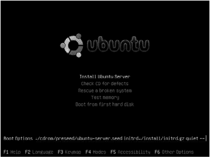

**Figure 4-1** Ubuntu install boot screen with boot arguments

the case, try retrieving the same file from a Web browser on the same network and make sure your path is correct and your Web server is configured correctly.


Other things that might halt the installation process could be the installer not being able to get a DHCP lease or, as is most often the case, a mistake in the `preseed.cfg` file. As you will discover, a good preseed file is something you get after a lot of trial and error. When you set an option incorrectly, the installer will simply stop at that point in the install and prompt you for that particular option. As you create more sophisticated `preseed.cfg` files, you might run through the same install multiple times before you get it exactly right.

The default `preseed.cfg` will get you started, but where do you go from there? This chapter digs into each of the main configuration categories and explains how to customize the default `preseed.cfg` file for your needs.

## Networking Options

In my sample `preseed.cfg` I introduced the following networking options:

```
d-i netcfg/get_hostname string unassigned-hostname
d-i netcfg/get_domain string unassigned-domain
d-i netcfg/choose_interface select auto
d-i netcfg/wireless_wep string
```

The first two options I used on the boot prompt with their aliases `hostname` and `domain` to set the hostname and domain, respectively, for this machine. The `choose_interface` option allows you to choose which network interface to use on the machine for the install. In my case I chose `auto`, which will pick the first interface that has link, if possible. Instead of choosing `auto`, you could also set this option to a specific interface, such as `eth1`. Now if `eth1` were a wireless card and your wireless network uses WEP, you could use the `wireless_wep` option to set the WEP key. Even though I didn’t use a wireless connection in my example, I still set this to a dummy value so I wouldn’t get prompted for a WEP key during the install.

With these default settings the installer will attempt to get all of its network settings via DHCP, which is probably what most administrators want, especially if they intend to install a machine over PXE. However, you might want to statically assign an IP for a machine, and in that case there are a number of preseed options that you will need to use. The following is an example set of preseed options that will set up a network manually:

```
d-i netcfg/disable_dhcp boolean true
d-i netcfg/get_nameservers string 192.168.1.1
d-i netcfg/get_ipaddress string 192.168.1.50
d-i netcfg/get_netmask string 255.255.255.0
d-i netcfg/get_gateway string 192.168.1.1
d-i netcfg/confirm_static boolean true
```

Most of these options are pretty self-explanatory, so you can just replace the IPs listed here with the IPs you want to use for your name server, the IP of the host itself, gateway, and netmask. The `disable_dhcp` option is what tells the installer to skip DHCP and use the static settings, and `confirm_static` simply confirms all of the static options you set; otherwise the installer would prompt you to confirm all of the settings in the middle of the install.


> NOTE One downside to installation with DHCP is that on many installs the machine could potentially attempt to get a lease multiple times. When this happens, you will often notice that the actual physical port will also reset. Now, depending on how your networking equipment is configured, it could take longer than 30 seconds (the default DHCP time-out) for the port to come back up because the switch needs to perform spanning tree calculations. I've had installs that seemed to get a lease only one out of ten or more times because of a race for the port to come back up before DHCP timed out. A Red Hat install I had got a new lease three or four times, and it was basically impossible to win the race that many times in a row. If you notice this is the case, you have a few options. For one, you (or your network administrator) can enable PortFast on that particular switch port so that it speeds up the spanning tree calculations, or you can set the `netcfg/dhcp_timeout` preseed option to a longer value, such as `d-i netcfg/dhcp_timeout string 60`, to set the DHCP time-out to 60 seconds.

There might be some circumstances when you have a preseed file you want to use both on a network with DHCP and on a network without it. There is a way to configure that with preseeding. Combine all of the netcfg options you would use for a DHCP install with the static settings, except comment out or remove the `disable_dhcp` option. Finally, add the following options to the preseed:

```
d-i netcfg/dhcp_failed note
d-i netcfg/dhcp_options select Configure network manually
```

## Partitioning

As you saw in the installation chapter (Chapter 1), there are many different ways to partition an Ubuntu server, and so it should be no surprise that there are also many preseeding options for partitioning. First, let’s break down the options I used in my default `preseed.cfg`:

```
d-i partman-auto/method string regular
d-i partman-auto/purge_lvm_from_device boolean true
d-i partman-lvm/confirm boolean true
d-i partman-auto/choose_recipe select atomic
d-i partman/confirm_write_new_label boolean true
d-i partman/choose_partition select finish
d-i partman/confirm boolean true
```

With these options, the installer will simply select the first available disk it can find and then overwrite it with one big `/` partition and a swap partition. For something so basic it certainly took quite a few options, so let’s go through these options one by one and discuss what part they play.

- `partman-auto/method`

  This option defines what partitioning method to use for the automatic partitioning and can accept the options `regular`, `lvm`, or `crypto`. As the options suggest, the latter two set up partitions as LVM or encrypted volumes.

- `partman-auto/purge_lvm_from_device` and `partman-lvm/confirm`

  These options just save you from having to acknowledge warning prompts in the installer. The former option will purge any old LVM configuration from the disk if it exists, and the latter confirms writing any LVM partitions you may have set up.

- `partman-auto/choose_recipe`

  The Ubuntu partition program allows a few different predefined partitioning recipes from which the user can choose. The `atomic` recipe sets up everything on a single partition. If you set the option to `home`, it will separate out a `/home` partition as well, and if you set it to `multi`, you will get separate `/home`, `/usr`, `/var`, and `/tmp` partitions.

- `partman/confirm_write_new_label`, `partman/choose_partition`, and `partman/confirm`

  These are more options that tell the installer to proceed with partitioning without extra user confirmation. If you did, however, want to require a user to confirm settings (possibly while debugging your preseed file), you could comment out one of these options.

### Expert Partition Recipes


The predefined partition recipes that Ubuntu provides are probably adequate for basic servers, but most administrators I know have strong feelings about how their systems are partitioned. In these cases you will likely want to create your own custom partitioning scheme for your servers. In the preceding world this is known as an `expert_recipe`. Custom partitioning recipes can get rather complex as there are a lot of options available. The complete documentation is available at http://d-i.alioth.debian.org/svn/debian-installer/installer/doc/devel/partman-auto-recipe.txt, but even that can be difficult to follow without some examples.

### 基础分区配方示例

First let’s examine a basic partitioning recipe that is provided in a lot of the example preseed files in official documentation. The following recipe will set up a small `/boot` partition and a swap partition and use up the rest of the disk for `/`:

```
d-i partman-auto/expert_recipe string                         \\
  boot-root ::                                               \\
    40 50 100 ext3                                           \\
            $primary{ } $bootable{ }                         \\
            method{ format }                                 \\
            use_filesystem{ } filesystem{ ext3 }             \\
            mountpoint{ /boot }                               \\
    .                                                         \\
```

```
500 10000 1000000000 ext3 \
  method{ format } format{ } \
  use_filesystem{ } filesystem{ ext3 } \
  mountpoint{ / } \
. \
64 512 300% linux-swap \
  method{ swap } format{ } \
.
```

请注意，整个配置旨在显示在一行上，因此为了使其更易读，你可以使用行尾的 `\` 符号将选项扩展到多行，就像 shell 脚本一样。

第一行将此配方标记为 `boot-root`，其余所有行都被视为 `boot-root` 配方的一部分。行格式的方式将三个分区彼此分开。首先让我们更仔细地看一下 `/boot` 分区：

```
40 50 100 ext3 \
  $primary{ } $bootable{ } \
  method{ format } format{ } \
  use_filesystem{ } filesystem{ ext3 } \
  mountpoint{ /boot } \
.
```

第一行有四个不同的字段，对应于分区的最小大小、优先级、最大大小和 parted 风格的文件系统。此文件中的所有磁盘大小均以兆字节为单位，因此这里我们将有一个至少 40Mb 的磁盘，但如果可用则可增长到 100Mb，并且它是一个标准 Linux 分区，使用 `ext3` 文件系统。如果你将此行与 swap 分区的对应行进行比较，你会注意到其最大字段使用了 `300%`。当使用百分比时，大小是根据系统上的 RAM 数量确定的。在这种情况下，`300%` 的含义是 swap 分区的最大大小将为机器上 RAM 量的 300%。

优先级字段值得多做一些描述。它也代表以兆字节为单位的分区大小，通常设置为最小值和最大值之间的某个值。安装程序在决定为每个分区分配多少可用空间时，会使用每个分区的优先级设置。与其他分区相比，优先级越高，特定分区获得空间的可能性就越大。事实上，对于某些小分区，你甚至可能希望将优先级设置为高于最大值，以确保它获得足够的空间（或者你可以只增加最小值）。最终，这又是一项反复试验的练习，以确保你的所有分区都获得足够的空间。

下一行，`$primary{ } $bootable{ }`，为分区设置了两个不同的选项。第一个使分区成为主分区（如果可能的话；值得注意的是，分区将按照在此文件中列出的顺序创建）。第二个选项在此分区上设置可引导标志。

第三行指示分区将被格式化。`method{ }` 设置接受三个不同的参数：`format`（格式化分区）、`swap`（将分区格式化为交换空间）或 `keep`（保留当前分区不变且不格式化它）。`format{ }` 参数也是必需的，以确保此分区被格式化。如果你为分区选择的文件系统支持标签，你也可以在此处添加 `label{ }` 选项为其分配标签。因此，要为分区命名为 `boot`，你可以添加 `label{ boot }`。

而第三行定义分区应被格式化，第四行定义应如何格式化。`use_filesystem{ }` 选项告诉安装程序此分区上将有一个分区，而 `filesystem{ }` 选项定义要使用哪个文件系统进行格式化。

第五行包含 `mountpoint{ }` 选项，它告诉分区程序在最终安装的系统上将此分区挂载到何处。安装程序会为你处理 `/etc/fstab` 设置，但如果你愿意，也可以为分区添加特殊的挂载选项。例如，要以只读方式挂载分区，你通常会将 `ro` 添加到 `/etc/fstab` 中的挂载选项列表中。在这种情况下，你将添加包含 `options/ro{ ro }` 的行。如果你还想添加 `noatime` 选项（停止在文件系统上记录访问时间，这可以提高其性能），你将添加 `options/noatime{ noatime }`。

请注意，每个分区在最后一行的末尾使用单个句点来表示其选项的结束，并将其与可能定义的任何其他分区分隔开。

## LVM

你也可以在 preseed 文件中仅通过少量修改来配置 LVM 分区。首先，将 `partman-auto/method` 选项从 `regular` 改为 `lvm`，然后在你想要使用 LVM 的每个分区中添加 `lvmok{ }`。不过，如果你没有配置一个非 LVM 的 `/boot` 分区，安装时你会收到警告。解决此问题的一个简单方法是确保你的 `expert_recipe` 中配置了一个 `/boot` 分区，并且其中没有 `lvmok{ }`。一个简单的示例使用我上面列出的 `expert_recipe`，并在根分区和交换分区中添加了额外的选项 `lvmok{ }`。最终的 `expert_recipe` 将如下所示：

```
d-i partman-auto/expert_recipe string \
boot-root-lvm ::
 40 50 100 ext3 \
   $primary{ } $bootable{ } \
   method{ format } format{ } \
   use_filesystem{ } filesystem{ ext3 } \
   mountpoint{ /boot } \
 . \
 500 10000 1000000000 ext3 \
   method{ format } format{ } \
   use_filesystem{ } filesystem{ ext3 } \
   mountpoint{ / } \
   lvmok{ } \
 . \
 64 512 300% linux-swap \
   method{ swap } format{ } \
   lvmok{ } \
 .
```

最后，你可以在分区配方中创建自己的自定义 LVM 物理卷。以下是将消耗整个 `/dev/sda` 驱动器并设置名为 `vg00` 的卷组的示例物理卷。请注意，在这种情况下 `method{ }` 选项被设置为 `lvm`。


```
100 1000 1000000000 ext3 \
  $defaultignore{ } \
  $primary{ } \
  method{ lvm } \
  device{ /dev/sda } \
  vg_name{ vg00 } .
```

当你设置自己的卷组时，你可能还想控制特定分区属于哪个卷组。使用`in_vg{ }`选项来指定特定分区所属的卷组，并使用`lv_name{ }`来命名逻辑卷。例如，如果我想让上面创建的交换分区明确成为`vg00`的一部分并标记为`testswap`，我可以将其更改为如下：

```
64 512 300% linux-swap \
    method{ swap } format{ } \
    lvmok{ } \
    in_vg{ vg00 } \
    lv_name{ testswap } \
.
```

> 注意 由于这些分区声明中的每一行都是上一行的延续，你可以将每个选项单独放在一行或将多个选项放在同一行——由你决定。只要确保在每一行的末尾使用 `\` 符号，并在每个分区的末尾使用 `.` 即可。

## Packages and Mirrors

一种服务器类型与另一种服务器类型的区别在于它运行哪些服务，而在 Ubuntu 上，这最终取决于你决定在系统上安装哪些软件包。虽然你当然可以使用安装程序仅设置一个基础安装镜像，然后稍后再自行添加软件包，但如果你追求完全自动化，你应该研究 preseed 流程中内置的软件包设置。

preseed 文件中的基本软件包选项相当直接且不言自明。让我们从我在默认 preseed 文件中使用的选项开始：

```
d-i mirror/country string US
d-i mirror/http/proxy string
d-i pkgsel/install-language-support boolean false
d-i pkgsel/update-policy select none
tasksel tasksel/first multiselect standard, ubuntu-server
```

第一个选项定义了用于检索软件包和更新的 Ubuntu 镜像（美国的默认镜像）。我不使用代理，但我也不想被提示输入代理，因此我将此选项留空。我不想安装额外的语言包，所以我将`pkgsel/install-language-support`设置为`false`。`pkgsel/update-policy`选项让你可以定义系统是否会自动应用更新。我们将其设置为`none`，因此任何更新都必须手动应用。最后，你可以看到你也可以为`tasksel`预设值；在我的例子中，我告诉它选择`standard`软件包以及`ubuntu-server`任务。我也可以根据需要添加通过手动`tasksel`流程可用的其他任务，例如`lamp-server`。有时你想要安装的额外软件包并不属于特定任务。在这种情况下，你可以使用`pkgsel/include`选项来添加安装程序将为你添加的一系列特定软件包。此示例添加了 openssh-server 和 build-essential 软件包：

```
d-i pkgsel/include string openssh-server build-essential
```

### Custom Package Repositories

除了需要定义的标准设置之外，你还可以在 preseed 文件中对 APT 配置进行许多调整。例如，你可以选择要在 APT 中包含哪些存储库。下面的值包含了 restricted、universe 和 backports 存储库：

```
d-i apt-setup/restricted boolean true
d-i apt-setup/universe boolean true
d-i apt-setup/backports boolean true
```

你可能还决定指定从哪个 Ubuntu 镜像检索软件包，因为你拥有自己的存储库，或者你知道某个对你来说更快的存储库。在任何一种情况下，你只需要将`mirror/country`选项设置为`manual`，然后指定要使用的镜像即可。我将`mirror/http/proxy`值留空，但如果你使用 HTTP 代理，你会将它的值放在那里。

```
d-i mirror/country string manual
d-i mirror/http/hostname string us.archive.ubuntu.com
d-i mirror/http/directory string /ubuntu
d-i mirror/http/proxy string
```

```
d-i apt-setup/local0/repository string \
  http://apt.example.net/ubuntu $release-name; main
d-i apt-setup/local0/comment string local server
d-i apt-setup/local0/source boolean true
d-i apt-setup/local0/key string http://apt.example.net/key
```

这个示例添加了存储在`apt.example.net`上的本地仓库并将其标记为`local1`服务器。`apt-setup/local10/`源行也会添加源代码仓库，而`apt-setup/local10/key`指向你的 APT 仓库必须设置的用于签名软件包的 GPG 密钥。如果你没有设置并提供此密钥，安装时会报错。

## 用户设置

在几乎所有 Linux 安装程序中，你都会找到一个用于配置用户账户的部分。与安装程序的每个其他部分一样，此部分也可以预设。以下是我在默认`preseed.cfg`文件中使用的内容：

```
d-i passwd/user-fullname string Ubuntu User
d-i passwd/username string ubuntu
d-i passwd/user-password password insecure
d-i passwd/user-password-again password insecure
user-setup/udeb user-setup/encrypt-home boolean false
```

每个字段都很容易理解，但请注意我必须指定两次密码。最后一个选项让你定义主目录是否加密。由于这是一台服务器，我们希望安装过程自动化，最简单的方法就是将该选项设置为`false`。现在如果你不想以明文形式列出密码，请在`user-password`行中替换为以下内容：

```
d-i passwd/user-password-crypted password [MD5 hash]
```

如果你确定如何为特定密码计算 MD5 哈希，可以在另一台系统上将用户的密码更改为你想要使用的密码，然后查看`/etc/shadow`文件中为其设置的 MD5 哈希。

Ubuntu 会使用默认 UID 和组 membership 为默认用户设置账户。你也可以使用预设值来覆盖它：

```
d-i passwd/user-uid string 1010
d-i passwd/user-default-groups string audio cdrom video
```

Ubuntu 为提高安全性而做的一件事是默认禁用`root`账户。取而代之的是，用户使用`sudo`程序获得超级用户权限。当然，你也可以使用预设值来覆盖此设置。以下一组选项将同时设置`root`用户和默认用户：

想要在多个设备上安装 GRUB，只需在`grub-installer/bootdev`行上一个接一个地列出它们，用空格分隔。

如果你希望为服务器提供额外安全保护，以防止用户修改 GRUB 以进入单用户模式等，此选项可以对 GRUB 进行密码保护。此选项也可以通过 preseed 自动化：

```
d-i grub-installer/password password insecure
```

```
d-i grub-installer/password-again password insecure
```

与用户密码设置一样，你可以使用上面所示的明文密码，或使用下面所示的 MD5 哈希。

```
d-i grub-installer/password-crypted password [MD5 hash]
```

## 杂项

最后，还有一些额外的选项并非关键，但在某些环境下可能很有用。例如，默认情况下 Ubuntu 会在安装完成后弹出光盘。好吧，如果你远程安装 Ubuntu 而且相隔数千英里，这意味着你只有一次机会在有人重新插入光盘之前完成安装。相反，你可以设置一个 preseed 选项来禁用此操作：

```
d-i cdrom-detect/eject boolean false
```

或者，你可能不想立即重启进入新系统，而是让其停止。这在例如你想提前构建一群机器但不会立即使用它们时可能很有用。

```
d-i debian-installer/exit/halt boolean true
```


# 动态预设

预设安装过程具有极大的灵活性，但在你开发 preseed 基础设施时，最终会发现一个 preseed 配置文件无法适用于你想要安装的所有不同服务器。此时你可能会为这些情况开发第二个、第三个或第四个`preseed.cfg`文件，然后手动在命令行中指向这些文件。这可行，但随着时间的推移维护起来会很麻烦。更好的方法是利用安装程序在安装的不同阶段动态加载 preseed 设置的能力。这样你就可以维护一个包含适用于所有安装的选项的基础`preseed.cfg`文件，然后创建仅包含与基本配置不同之处的自定义 preseed 文件。然后你可以加载这些文件，它们的更改最终会覆盖主`preseed.cfg`中的设置。

## 链式加载 Preseed 文件

管理所有 preseed 设置的一种方法是将其差异分离到多个文件中。例如，你可以将所有分区信息放入`partition.cfg`文件中，或者如果你为每个网络有不同的网络设置，你可能有相同的 base `preseed.cfg`文件但不同的`network.cfg`文件。这些网络中的每一个都可能有自己的 preseed 服务器，共享`preseed.cfg`但具有自定义的`network.cfg`。在`preseed.cfg`文件中，你随后可以添加如下行：

```
d-i preseed/include string network.cfg
```

安装程序随后会从找到原始 preseed 文件的同一位置检索`network.cfg`文件。你可以在此行上指定多个文件；只需用空格分隔即可。你也可以使用相对目录路径。安装程序将从主 preseed 文件被检索的目录开始，然后从那里移动。所以如果我的`preseed.cfg`文件在`http://example.com/preseed.cfg`但我的网络文件在`http://example.com/network/network.cfg`，我的 include 字符串将读取

```
d-i preseed/include string network/network.cfg
```

使用这种静态包含文件可以帮助组织，但通常你会发现你只想在某些情况下包含某些 preseed 文件。在这种情况下，有一个`include_command` preseed 选项允许你编写一个简短的 shell 脚本，该脚本将输出要包含的文件名。这允许你根据环境选择自定义 preseed 文件。这个简单的示例只是回显一个粒子文件名：

```
d-i preseed/include_command \
    string echo partition.cfg
```

这个功能实际上可以为管理员打开很多选项。例如，假设你管理着纽约、伦敦和东京的三个数据中心。作为一名优秀的管理员，你为每个数据中心设置了唯一的子域名，因此纽约、伦敦和东京的服务器分别使用`ny.example.net`、`london.example.net`和`tokyo.example.net`作为其域名。更有可能的是，你会希望为每个不同的数据中心设置自定义的 preseed 选项，因此你可以将这些自定义选项放在与通用`preseed.cfg`文件相同的服务器上的`ny.example.net.cfg`、`london.example.net.cfg`和`tokyo.example.net.cfg`中。然后在你的`preseed.cfg`文件中可以添加

```
d-i preseed/include_command \
string echo `hostname -d`.cfg
```

`hostname -d`命令会输出主机的域名，因此如果纽约的一台主机的完全限定域名是`web1.ny.example.net`，那么`hostname -d`将输出`ny.example.net`。我们的 preseed 命令随后会 `echo ny.example.net.cfg`。

## 在安装期间运行自定义命令

如果你发现自己在`include_command`选项中编写越来越长的单行命令，那么你肯定会想了解一下其他一些 preseed 选项，这些选项允许你运行整个脚本。有三个不同的 preseed 选项允许你在安装程序环境中执行命令。

我首先要提到的第一个选项在某种程度上是`include`选项的扩展。那些选项允许你列出要下载并读取的额外 preseed 文件，而`preseed/run`选项则会下载并执行你选择的脚本：

```
d-i preseed/run string command.sh
```

这个`command.sh`脚本可以执行你在`include_command`中之前可能使用的所有 shell 逻辑，只是现在组织起来容易得多。你甚至可以在脚本中读取和设置 preseed 值。只需使用`debconf-get`和`debconf-set`命令来获取和设置安装的不同 preseed 设置即可。例如，如果我想检索预设的主机名，我可以运行

```
debconf-get netcfg/get_hostname
```

如果我想在脚本中将该选项设置为`web1`，我会运行

```
debconf-set netcfg/get_hostname web1
```

下一个允许你在安装中运行命令的 preseed 选项是`preseed/early_command`。该选项允许你指定一个命令，该命令将在安装中尽可能早地运行——基本上是在读取 preseed 文件后立即运行。这与`preseed/run`命令类似，只是你不必检索要执行的脚本——你可以直接从安装环境运行 shell 命令。如果你愿意，可以使用`preseed_fetch`命令使`preseed/early_command`的行为与`preseed/run`完全相同，该命令会为你从 preseed 服务器检索文件。它的第一个参数是要检索的文件，第二个参数告诉命令将下载的文件放置在何处。在此示例中，我重新创建了上面`preseed/run`示例的功能。

```
d-i preseed/early_command string preseed_fetch command.sh \
/tmp/command.sh; sh /tmp/command.sh
```

而`preseed/early_command`在安装过程中尽可能早地执行，`preseed/late_command`则尽可能晚地执行。`early_command`有助于在安装程序开始大部分安装过程之前为安装程序设置动态值，但`late_command`适用于在你知道基础映像已安装后运行自己的自定义程序。在安装程序的此阶段，服务器的根分区仍安装在`/target`目录下，因此你可以潜在地`chroot`到该目录并运行命令，就好像你直接从已安装的服务器上运行它们一样。

与`early_command`一样，你可以使用`preseed_fetch`来检索要运行的脚本。其中一些最常见的事情已经通过`in-target`和`apt-install`命令为你自动化了。`in-target`命令为你自动化了`chroot`过程，因此你在`in-target`之后列出的任何命令都将在已安装的环境中执行。`apt-install`命令将使用 APT 来安装任何额外的你可能想要添加的软件包。下面的示例将在你的服务器上安装 Mutt 邮件客户端，然后将当前的环境变量集转储到`/root`目录中的一个文件中：

```
d-i preseed/late_command string apt-install mutt; \
in-target set > /root/environment
```

虽然你当然可以在`preseed.cfg`文件的其他部分列出要安装的额外软件包，但这里的真正强大之处在于，通过`late_command`，你可以下载一个脚本，该脚本动态地从环境中提取信息，然后根据这些信息决定要安装哪些软件包。本章后面部分，当我讨论如何使用 PXE 启动通过 Kickstart 和预设来部署服务器时，我将更详细地介绍如何在自动化安装中使用动态脚本。

# Kickstart

用于自动化 Ubuntu 服务器安装的第二种主要方法是使用 Kickstart。Kickstart 最初是由 Red Hat 使用的技术，已被移植用于 Ubuntu。与预设一样，Kickstart 通过一个配置文件工作，该文件包含对安装程序问题的回答，你可以将其通过 HTTP 或 FTP 获取或从本地文件获取。Kickstart 无疑更容易使用，并且由于许多管理员已经为他们的 Red Hat 机器建立了 Kickstart 环境，因此将 Kickstart 作为 Ubuntu 自动化的主要工具是有意义的。大多数 Kickstart 功能，但并非全部，已被移植，但由于配置简单以及图形化配置管理工具的好处，我建议从 Kickstart 开始，并在必要时用预设文件补充它。

## CD-ROM 的基本 Kickstart 配置


与本章的预设部分一样，我将从最简单的 Kickstart 场景开始：从 CD-ROM 安装的默认 Ubuntu 服务器。即使 Kickstart 文件的选项也相当自解释，好消息是 Ubuntu 提供了一个图形程序来帮助你生成 Kickstart 文件。不仅可以节省你查找每个 Kickstart 选项语法的麻烦，还可以节省时间——系统管理员永远不够用。作为一个亲手创建了大量 Kickstart 配置文件的人，我建议尽可能使用 GUI 来设置你的基本模板，然后仅在需要时手动调整生成的配置文件。

### 安装 Kickstart GUI 工具

Kickstart GUI 工具默认未安装在典型的 Ubuntu 桌面系统上，因此使用你偏好的包管理工具安装 `system-config-kickstart` 包。安装后，你可以在 `Applications->System Tools->Kickstart` 中找到该程序。当你启动程序时，你会看到它被分为一个基本双窗格窗口，如图 4-2 所示。左侧是你可以更改的配置类别集合，当你选择其中一个时，右窗格会更改为列出你可以配置的选项。浏览每个类别并确保默认设置与你在服务器上想要的设置相匹配。还要确保进入分区信息类别并设置你的分区。与预设不同，你必须为 Kickstart 文件提供某种关于如何分区系统的指导。完成 GUI 中的设置后，点击 `File->Save` 并将文件保存为 `ks.cfg`。

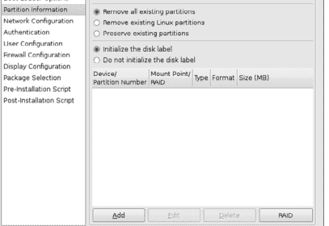

图 4-2 Kickstart Configurator 程序

> NOTE GUI 程序的优点在于它已经知道每个选项应使用的正确语法，因此它可以作为 Ubuntu Kickstart 选项的很好的参考。只需启动程序并设置你想要查找的选项，然后点击 `File->Preview`。工具随后会将示例 `ks.cfg` 输出到屏幕上，以便你可以查看语法。

### 添加服务器预设和软件包

正如我提到的，我需要调整此文件以便它创建一个默认的 Ubuntu 服务器。基本上它需要一些服务器特定的预设选项，这些选项通常由 Ubuntu Server CD-ROM 提供，以及要安装的默认任务列表。要将这些预设选项添加到 Kickstart 文件中，我只需在主配置部分添加行，以单词 `preseed` 开头，后跟我想要设置的特定预设选项。你需要在服务器上安装的所有额外任务和软件包都在 `%packages` 部分中定义（Kickstart 文件的不同部分以 `%` 开头命名）。我们对此服务器需要的两个任务是 `standard` 和 `ubuntu-server`。以下是我附加到 GUI 工具创建的 `ks.cfg` 文件末尾的组合预设选项和 `%packages` 部分：

```
preseed base-installer/kernel/override-image string linux-server
preseed pkgsel/language-pack-patterns string
preseed pkgsel/install-language-support boolean false
%packages
@ standard
@ ubuntu-server
```

请注意，任务以 `@` 符号开头，因此如果我想在安装期间选择 LAMP Server，我可以在此列表中添加 `@ lamp-server`。如果你想要可用任务的完整列表，运行 `tasksel --list-tasks`。你也可以将单个软件包添加到此列表中；只需将每个软件包名称单独放在一行上，不要在前面加上 `@`。由于我只想要一个默认的 Ubuntu 安装，与我之前的 `preseed.cfg` 文件相匹配，因此我没有添加任何额外软件包。以下是生成的 `ks.cfg` 文件：

```
#Generated by Kickstart Configurator
#platform=x86

#System language
lang en_US
#Language modules to install
langsupport en_US
#System keyboard
keyboard us
#System mouse
mouse
#System timezone
timezone America/Los_Angeles
#Root password
rootpw --disabled
#Initial user
user ubuntu --fullname "ubuntu" --password insecure
#Reboot after installation
reboot
#Use text mode install
text
#Install OS instead of upgrade
install
#Use CDROM installation media
cdrom
#System bootloader configuration
bootloader --location=mbr
#Clear the Master Boot Record
zerombr yes
#Partition clearing information
clearpart --all --initlabel
#Disk partitioning information
part / --fstype ext3 --size 1 --grow --asprimary
part swap --recommended
#System authorization information
auth --useshadow --enablemd5
#Firewall configuration
firewall --disabled
#Do not configure the X Window System
skipx
#### This section was added by hand
preseed base-installer/kernel/override-image string linux-server
preseed pkgsel/language-pack-patterns string
preseed pkgsel/install-language-support boolean false
%packages
@ standard
@ ubuntu-server
```

正如我对 `preseed` 文件所做的那样，我设置了一个单独的 `/` 分区，并使用 `--grow` 选项使其填满整个驱动器（实际上我只是在 GUI 中切换了该设置）。然后我将这个 `ks.cfg` 文件复制到我之前使用的同一个 Web 服务器上。使用这个 Kickstart 文件的另一个好处是，我不需要在启动时手动输入大量设置。事实上，我只需要将已有的 `file preseed` 选项替换为指向我的 Kickstart 文件的选项。启动 CD-ROM，然后按 F6 以

这些设置已经在 `%packages` 部分中的 Kickstart 文件中管理，但如果它们没有被管理，你可以使用以下方式设置此设置：

```
preseed --owner tasksel tasksel/first multiselect \
standard, ubuntu-server
```

## 账户选项

Kickstart 语法中另外两个重要的新增功能为账户管理提供了额外选项。由于 Ubuntu 默认禁用 root 用户，`rootpw` Kickstart 命令现在可以采用 `--disabled` 选项。这会禁用 root 密码，并赋予第一个用户通过 `sudo` 获得的 root 权限。

Ubuntu 的 Kickstart 文件还添加了一个 `user` 命令来为初始用户添加设置。该命令的语法如下：

```
user --disabled | username [--fullname "Firstname Lastname"] \
--password insecure [--iscrypted]
```

该命令要么采用 `--disabled` 选项来完全禁用初始用户，要么采用用户名、可选的全名以及最后的密码作为选项。默认情况下，密码是明文，但你也可以选择列出密码的 MD5 哈希；只需确保添加 `--iscrypted` 选项，以便 Kickstart 知道。

## 局限性

目前，Ubuntu 的 Kickstart 并未实现 Red Hat Kickstart 的全部功能。这些限制是提倡将 Kickstart 与 preseeding 结合使用的原因之一。Kickstart 文件可以处理基本配置，而在功能不可用的地方，可以通过 `preseed` 选项进行补充。以下列表列出了 Ubuntu Kickstart 尚未实现的主要功能：

- 不支持 LDAP、Kerberos 5、Hesios 或 Samba 认证。

- 没有针对 `lilo` 的 `bootloader --linear`、`--nonlinear` 或 `--lba32` 选项。

- 没有 `lilocheck` 命令。

- Ubuntu 在 Kickstart 文件之外处理系统升级。

- Ubuntu Kickstart 中的分区功能还不够完善。因此，如果你有更复杂的分区需求，我建议使用 `preseed` 选项进行补充。以下是当前分区的限制：

  - 只能对主磁盘进行分区


- 不支持 LVM 配置
- 不检查坏扇区
- 不支持 RAID 分区
- 你不能将分区限制到特定磁盘，也不能指定起始或结束柱面。
- 安装期间不支持补充驱动程序盘。
- 不支持 `device` 命令。
- 不支持防火墙配置。
- 无法通过 DHCP 自动发现 Kickstart 源；你必须明确指定 Kickstart 源。
- 不支持将 NFS 和本地磁盘作为安装源。
- 不支持 `xconfig --monitor` 选项（选择特定的显示器名称）。
- Ubuntu 和 Red Hat 中的软件包组名称不同，在 Ubuntu 下，软件包组引用的是 Ubuntu 任务。
- 你不能在 `%packages` 部分排除软件包。
- 你只能在安装前和安装后部分使用 shell 脚本。

## 在安装期间运行自定义命令

与 preseeding 一样，Kickstart 支持在安装期间运行自定义命令。同样，与 preseeding 一样，这是通过安装前和安装后脚本完成的。在 Kickstart 文件中，这些分别在 `%pre` 和 `%post` 部分中定义。你放在这些部分中的任何 shell 命令将分别在安装过程之前或之后立即执行。Kickstart 中这些脚本的一个不错特性是，只要它们保持在 `%pre` 或 `%post` 部分内，就可以跨越多行。

> 注意 即使将大型 shell 脚本放在 `%pre` 和 `%post` 部分中也很简单，但一旦你的脚本达到一定复杂度，你可能应该考虑将它们放到 Kickstart 服务器上的脚本中，然后通过 `wget` 获取并执行。采用这种方法的一个额外好处是，你可以在 `%pre` 和 `%post` 部分中根据正在安装的服务器类型执行逻辑来拉取自定义 shell 脚本。

开始编写预安装或后安装脚本最简单的方法可能是使用 Kickstart Configurator 工具。每个安装脚本在左侧窗格中都作为一个类别设置，并在右侧窗格中有一个区域可供你编写脚本。你甚至可以通过 GUI 指定 shell 脚本的自定义解释器。即使是 GUI 也在这些部分中提供了警告，指出这些 shell 脚本中的错误可能导致整个 Kickstart 失败。

在预安装和后安装脚本之间需要做一个重要的区分，即预安装脚本在安装程序环境中运行，而后安装脚本默认在已安装系统内部的 `chroot` 环境中运行。这意味着你可以在后安装部分安装额外的软件包或对已安装系统执行其他自定义调整，而在预安装部分你主要希望调整 preseed 设置。

## PXE Boot Server Deployment

我前面给出的示例是一个不错的起点，但当你想要自动化服务器安装时，最终需要设置一个 PXE 启动服务器来管理该过程。毕竟，你真的想手动去每台新服务器上插入 CD-ROM 吗？如果你的服务器在另一个大洲，或者你有 200 台服务器需要安装怎么办？使用 PXE 启动部署，你的新服务器将从网络启动，从 PXE 服务器拉取其安装镜像，然后开始安装过程——全部通过网络完成。

要使 PXE 启动部署正常工作，你需要以下几种不同的服务：

- 一个为 PXE 启动配置的 DHCP 服务器，为每次安装分配 IP 地址并将其指向 TFTP 服务器和要加载的启动程序
- 一个 TFTP 服务器，用于通过网络提供 PXE 启动加载程序
- 一个 Web 服务器，用于托管任何 Kickstart 和 preseed 文件以及任何自定义脚本

虽然这些服务中的每一个都可以位于完全不同的主机上，但对于我的示例，我将逐步指导你如何设置它们，从我迄今为止在本章中一直使用的同一个默认 Ubuntu 镜像和相同的默认设置开始。在此示例中，我将设置一个 IP 地址为 10.1.1.5 的 PXE 服务器。在此网络中，我的网关路由器位于 10.1.1.1，我的 DNS 服务器位于 10.1.1.2 和 10.1.1.3。

### DHCP

第一步是设置一个 DHCP 服务器，可以为每个安装候选者分配 IP 地址。首先安装 `dhcp3-server` 软件包：

```bash
$ sudo apt-get install dhcp3-server
```

默认情况下你的 DHCP 服务器不会被配置。你真正需要开始使用的只是在 `/etc/dhcp3/dhcpd.conf` 文件中的一个简短的子网部分。当你用首选的文本编辑器打开该文件时，你会注意到其中有一个基本的配置骨架以及许多被注释掉的示例。只需转到文件的底部并添加以下子网部分：

```text
subnet 10.1.1.1 netmask 255.255.255.0 {

    option domain-name-servers 10.1.1.2, 10.1.1.3;

    option routers 10.1.1.1;

    range dynamic-bootp 10.1.1.50 10.1.1.99;

    next-server 10.1.1.5;

    filename "pxelinux.0";

}
```

我将在第 5 章更详细地介绍整体 DHCP 配置，但在这里我已指示 DHCP 在 10.1.1.0/255.255.255.0 子网上响应查询。我列出了该网络上的两个 DNS 服务器以及要使用的路由器。`dynamic-bootp` 行定义了此 DHCP 服务器将分配的 IP 地址范围。在本例中，我将分配 10.1.1.50 到 10.1.1.99 之间的地址。`next-server` 行配置了要使用的 `TFTPd` 服务器的 IP 地址，以便任何通过 PXE 启动的主机都可以通过 `TFTPd` 检索其启动加载程序（在本例中为此服务器）。`filename` 行告诉它要检索的文件名。下一节将详细介绍。

显然，你需要调整这个示例配置，使其与你特定网络上的设置匹配，然后输入 `sudo service dhcp3-server start` 启动 DHCP 服务器。你应该看到

```
$ sudo service dhcp3-server start
* Starting DHCP server dhcpd3                    [OK]
```

如果服务因配置文件中的错误而无法启动，你会在屏幕上的输出中看到相关的错误引用。在 `dhcpd.conf` 文件中找到那一行，并检查行尾是否缺少分号，或是否存在你可能犯的其他语法错误。

### TFTPD

DHCP 服务器设置完成后，下一步是在你的 PXE 引导服务器上安装 TFTPD 服务。输入

```bash
$ sudo apt-get install tftpd-hpa
```

APT 将拉取 TFTPD 服务器及其依赖的 `openbsd-inetd` 软件包。由于该服务由 `inetd` 管理，只有当用户访问此机器上的 UDP 69 号端口时它才会启动。在我的 Kickstart 和 preseed 示例中，防火墙默认是禁用的，但如果你启用了防火墙，请务必为 UDP 69 号端口开放一个端口。

### 配置 Pxelinux

现在 TFTPD 已安装，你可以开始安装和配置 `pxelinux` 了。`pxelinux` 是 `syslinux` 软件包的一个组件，该软件包提供了一种用于光盘（包括 Ubuntu）的引导加载程序，称为 `isolinux`；一个标准的引导加载程序，称为 `syslinux`；以及一个 PXE 引导加载程序，称为 `pxelinux`。虽然你可以自己安装 `syslinux` 软件包并复制这些文件，但 Ubuntu 已经在镜像站点上为你提供了一个现成的 netboot 配置。你只需进入 `TFTPD` 根目录，然后下载并解压适用于你的 Lucid 版本的 netboot 压缩包即可。例如，以下是获取 Lucid Lynx 的 netboot 压缩包的步骤：

```bash
$ sudo cd /var/lib/tftpboot
$ sudo wget http://us.archive.ubuntu.com/ubuntu/dists/lucid/main/installer-i386/current/images/netboot/netboot.tar.gz
$ sudo tar -xzvf netboot.tar.gz
```

这个压缩包已经包含了 `pxelinux.0` 二进制文件、位于 `pxelinux.cfg/default` 中的一个极佳的示例 `pxelinux` 配置文件，以及 `ubuntu-installer` 目录下的一系列引导菜单和帮助文档。

当 `pxelinux` 加载时，它会在 TFTP 服务器上的 `pxelinux.cfg` 目录中搜索多个不同的配置文件。你可以利用这个搜索顺序将自定义设置传递给特定主机。`pxelinux` 将按以下顺序搜索文件：

- 文件名为 `01-MACADDRESS`，每个十六进制对之间用连字符分隔。因此，对于 MAC 地址为 88:99:AA:BB:CC:DD 的服务器，仅针对该机器的配置文件将命名为 `01-88-99-aa-bb-cc-dd`（而且我注意到，必须是小写字母才行）。


文件名为主机 IP 地址的十六进制表示形式。在这里，`pxelinux` 会从十六进制 IP 的末尾去掉一个数字，并在每次文件搜索失败后重试。这通常用于管理员购买大量相同品牌的机器时，这些机器的 MAC 地址往往非常相似。然后管理员可以配置 DHCP，为这些 MAC 地址分配一个特定的 IP 范围。接着，一个启动选项就可以应用于整个组。

最后，如果找不到任何特定文件，`pxelinux` 将查找名为 `default` 的文件并使用它。

在本示例中，我们将继续使用 `netboot.tar.gz` 提供的 `pxelinux.cfg/default` 配置文件。你以后随时可以为特定服务器创建自定义配置文件，并且有多种不同的方法来组织和定义独立的安装选项，我将在接下来讨论。

使用 Ubuntu 的 netboot 压缩包的一大好处是，它开箱即用地为你搭建了一个漂亮的 PXE 引导环境，包含菜单、帮助，并且大部分困难工作都已经替你完成。你只需要调整默认配置，使其指向你的 Kickstart 文件。在你喜欢的文本编辑器中打开 `/var/lib/tftpboot/ubuntu-installer/i386/boot-screens/text.cfg`，你将看到以下几行：

```
default install

label install
    menu label ^Install
    menu default
```

```
kernel ubuntu-installer/i386/linux
append vga=normal initrd=ubuntu-installer/i386/initrd.gz -- quiet
label cli
    menu label ^Command-line install
    kernel ubuntu-installer/i386/linux
    append tasks=standard pkgsel/language-pack-patterns= pkgsel/install-language-support=false vga=normal initrd=ubuntu-installer/i386/initrd.gz -- quiet
```

默认行告诉 `pxelinux`，标签为 `install` 的部分是用户在启动提示符下仅按下 Enter 时默认加载的部分。`label install` 部分定义了用户可以选择的特定配置。每个以 `label` 开头的部分都定义了另一个配置。当你浏览此配置文件时，你会看到为你预先设置了许多不同的标签。你可以通过在启动提示符下输入特定的标签然后按 Enter 在不同的部分之间进行选择。因此，虽然我可以直接按 Enter 选择上面标记为 `install` 且设为默认的部分，但我也可以在启动提示符下输入 `install` 然后按 Enter。我们需要对这个文件做的只是更改默认启动选项，使其也指向我们的 Kickstart 文件。为此我只需将我的选项添加到 `append` 行。文件的开头部分从这个：

```
default install
label install
    menu label ^Install
    menu default
    kernel ubuntu-installer/i386/linux
    append vga=normal initrd=ubuntu-installer/i386/initrd.gz -- quiet
```

改为这个：

```
default install
label install
    menu label ^Install
    menu default
    kernel ubuntu-installer/i386/linux
    append vga=normal initrd=ubuntu-installer/i386/initrd.gz ks=http://10.1.1.5/ks.cfg -- quiet
```

保存更改并退出文本编辑器。`Pxelinux` 现在已配置完成，你可以进入最后一步。

### Web

过程中的最后一步是设置一个 Web 服务器来托管你的 Kickstart 和 preseed 文件以及你可能拥有的任何自定义脚本。首先安装 `apache2` 包，它将提供你的 Web 服务器软件及其所有必要的依赖项：

```
$ sudo apt-get install apache2
```

`apache2` 包会自动为你设置并启动一个功能正常的 Web 服务器，其默认文档根目录为 `/var/www`。我在这里不会介绍 Apache 的任何更高级配置，因为我们只需要一个 Web 服务器来托管几个文本文件。此时你需要做的就是将你的 `ks.cfg` 文件移动到此服务器上的 `/var/www`。你只需要对 `ks.cfg` 文件做一个更改以便 PXE 启动。由于我们不会从 CD-ROM 下载文件，我们需要告诉 Kickstart 文件从 Ubuntu 镜像获取文件，因此找到并更改读取以下内容的行

```
cdrom
```

为

```
url --url http://us.archive.ubuntu.com/ubuntu
```

> **NOTE** 由于此服务器将直接从 Ubuntu 镜像拉取所有软件包，安装肯定会比从 CD-ROM 安装花费更长时间。如果你计划进行大量自动化的 Ubuntu 安装，你可能需要考虑设置自己的 Ubuntu 归档镜像。

在继续之前，尝试通过 Web 浏览器或使用 `wget` 之类的工具访问你的 `ks.cfg` 文件，并确保 Apache 正在提供该文件。如果无法访问该文件，请检查 Apache 错误日志 `/var/log/apache2/error.log` 以获取可能出错的线索，并检查 `ks.cfg` 的权限以确保它是世界可读的。如果不是，输入 `chmod a+r ks.cfg` 使其可读。

## Test Your PXE Server

此时你应该准备好使用新安装来测试你的 PXE 服务器。如何将服务器设置为 PXE 启动并没有单一的说明。在某些服务器上，只需按功能键获取启动选项列表然后选择网络启动即可。在其他服务器上，你需要进入 BIOS 并更改启动顺序。还有一些服务器提供自动网络启动的功能键。你需要研究如何指示你的特定服务器进行网络启动，并确保它连接到与你的 PXE 启动服务器相同的子网。

一旦你通过 PXE 启动服务器，你将看到如图 4-3 所示的 Ubuntu 菜单。由于我们将默认标签设置为使用我们的 Kickstart 选项启动，我们在这里需要做的只是按 Enter。

> **NOTE** 即使是这种自动化的安装也需要一些用户交互，因为你至少需要在每个启动提示符下按 Enter 来开始安装过程。这在某种程度上是一种安全机制，因为如果六个月后你的其中一台服务器重新启动然后进行网络启动会怎样？如果一切完全自动化，该服务器将再次开始安装过程并可能覆盖其所有当前文件——这可能是一件非常糟糕的事情。对于某些组织来说，这种行为是可取的，特别是对于大量相同的机器集群。他们已采取适当的保护措施，确保除非他们希望机器从网络启动，否则不会启动，如果启动了，他们确实希望它执行重新安装。如果你想要一个 100% 自动化的安装，除了打开服务器外不需要任何用户交互，那么只需在 `pxelinux.cfg/default` 文件中定位 `TIMEOUT` 值。默认情况下它设置为 0，这意味着它永远不会超时。只需将其更改为 1，任何启动并获取该配置文件

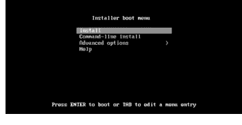

Figure 4-3 Ubuntu PXE boot menu

```
default install
label install
    menu label ^Install
    menu default
    kernel ubuntu-installer/i386/linux
    append vga=normal initrd=ubuntu-installer/i386/initrd.gz
ks=http://10.1.1.5/ks.cfg -- quiet
```

所以我们需要做的就是克隆 `label install` 部分两次，并调整每个部分以指向我们的其他 Kickstart 文件：


```default install
label install
    menu label ^Install
    menu default
    kernel ubuntu-installer/i386/linux
    append vga=normal initrd=ubuntu-installer/i386/initrd.gz
ks=http://10.1.1.5/ks.cfg -- quiet
label web
    menu label ^Install
    menu default
    kernel ubuntu-installer/i386/linux
    append vga=normal initrd=ubuntu-installer/i386/initrd.gz
ks=http://10.1.1.5/ks-web.cfg -- quiet
label mysql
    menu label ^Install
    menu default
    kernel ubuntu-installer/i386/linux
    append vga=normal initrd=ubuntu-installer/i386/initrd.gz
ks=http://10.1.1.5/ks-mysql.cfg -- quiet
```

正如你所见，我在每个部分中做的唯一实质性更改就是指向我创建的不同 `Kickstart` 文件。现在一旦我启动，我可以输入 `web` 或 `mysql` 然后按 `Enter` 来选择这些特定选项。

## Boot Cheat Codes

区分不同安装类型的另一种有用方法是使用 `cheat codes`（我借用自 `Knoppix` 的名称）。`cheat code` 是你在命令行上输入的选项，会传递给系统。关于启动提示符的有趣之处在于，启动提示符上的所有内容在安装过程中都可以通过 `/proc/cmdline` 文件访问。如果你想创建自定义 `cheat codes`，你所需要做的就是提供一个 `pre-` 或 `post-install` 脚本，该脚本解析 `/proc/cmdline` 并将这些设置存储到环境变量中。然后你可以在脚本中引用这些环境变量，并根据它们对 `pre-` 或 `post-install` 过程进行自定义更改。

例如，假设我们在启动提示符下定义两个 `cheat codes`：`mytype`，用于标记服务器类型（Web、MySQL、DNS），以及 `myraid`，用于指示是否应使用 `RAID`。与其设置三个不同的 `Kickstart` 文件，我可以使用单个 `Kickstart` 文件，该文件在 `pre-installation` 脚本中包含逻辑来解析这些选项并据此更改设置。以下是会解析 `/proc/cmdline` 文件、设置环境变量，然后根据它们执行特殊操作的示例 `pre-install` 脚本：

```%pre
for i in `cat /proc/cmdline` ; do
echo $i | grep -iq MYTYPE=
if [ $? -eq 0 ] ; then
export MYTYPE=`echo $i | awk -F"=" '{ print $2; }'`
fi
echo $i | grep -iq MYRAID=
if [ $? -eq 0 ] ; then
export MYRAID=`echo $i | awk -F"=" '{ print $2; }'`
fi
done

if [ $MYTYPE == "web" ]; then
#### Change preseed settings for web servers
elif [ $MYTYPE == "mysql" ]; then
#### Change preseed settings for mysql servers
elif [ $MYTYPE == "dns" ]; then
#### Change preseed settings for dns servers
fi

if [ $MYRAID ]; then
#### Change preseed settings for RAID
fi
```

现在在启动提示符下，如果我想设置一个带 `RAID` 的 `MySQL` 服务器，我可以输入 `install mytype=mysql myraid=1`。再次强调，这种方法的优点是它允许你维护单个 `Kickstart` 文件，该文件包含逻辑以根据特定服务器类型更改设置。这种方法的缺点是，随着时间的推移，结果的 `Kickstart` 文件可能会变得相当庞大和复杂。

## DHCP Selection

如果你的组织为服务器使用静态 `DHCP` 分配，这种方法尤其有效。使用静态 `DHCP` 租约，`DHCP` 服务器会根据主机的 `MAC` 地址，每次为请求 `IP` 地址的主机分配相同的 `IP` 地址。通常在此设置中，你的服务器在从网络启动时会自动安装新镜像。你会发现这种方法在大型集群或服务器在可能获得操作系统之前就已物理安装的环境中很受欢迎。一旦你将 `pxelinux` 配置更改为自动安装默认镜像，你的 `DHCP` 配置文件就会控制每个服务器最终会变成什么。管理员要做的就是将服务器连接到网络并打开电源，即可安装 `Ubuntu`。

在此场景中，你在 `/var/lib/tftpboot` 下创建多个目录，每个目录都包含 `netboot.tar.gz` 的解压副本。例如，如果我想为 `Web`、`MySQL` 和 `DNS` 服务器设置三个单独的配置，我可以执行以下操作：

```
$ sudo cd /var/lib/tftpboot
$ sudo wget http://archive.ubuntu.com/ubuntu/dists/hardy/main/installer-i386/current/images/netboot/netboot.tar.gz
$ sudo mkdir web mysql dns
$ cd web
$ sudo tar -xzvf netboot.tar.gz
$ cd ../mysql
$ sudo tar -xzvf netboot.tar.gz
$ cd ../dns
$ sudo tar -xzvf netboot.tar.gz
```

现在我会更改这些子目录中每个 `pxelinux.cfg/default` 文件以反映我想要更改的任何特殊设置。此外，如果我想让此安装完全不需要用户交互，我将编辑 `pxelinux.cfg/default` 配置文件并将 `TIMEOUT` 值设置为 `1`，以便在一秒后自动开始安装过程。

再次，如果你使用此方法，请设置适当的保护措施，以防止机器意外通过网络启动并覆盖其设置。

一旦我的 `TFTP` 服务器设置完成，大部分配置工作都在 `DHCP` 服务器上进行。我需要修改我的 `/etc/dhcp3/dhcpd.conf` 文件，以便根据哪个 `MAC` 地址请求租约，就将其指向其中一个子目录下的特定 `pxelinux.0` 文件。对于每个 `MAC` 地址，我都会添加一个单独的段。下面我添加了三个特定的服务器，每个服务器分别指向 `Web`、`MySQL` 或 `DNS` 配置：

```
host web1 {
    hardware ethernet 00:0c:c0:ff:ee:00;
    option host-name "web1";
    fixed-address 10.1.1.101;
    filename "/web/pxelinux.0";
}
host mysql1 {
    hardware ethernet 00:0c:c0:ff:ee:01;
    option host-name "mysql1";
    fixed-address 10.1.1.101;
    filename "/mysql/pxelinux.0";
}
host dns1 {
    hardware ethernet 00:0c:c0:ff:ee:02;
    option host-name "dns1";
    fixed-address 10.1.1.101;
    filename "/dns/pxelinux.0";
}
```

这种方法的最大缺点是，这意味着你需要在 `TFTP` 服务器上维护多个 `pxelinux` 配置文件。另一个缺点是，在对服务器进行任何安装之前，你必须查找每台服务器的 `MAC` 地址。当然，如果你使用静态 `DHCP`，这本来就是你必须执行的一步。

这种方法的一个好处，特别是在设置超时使 `PXE` 启动的机器自动开始安装的情况下，是在你设置好环境后，当出现新主机时，你只需获取其 `MAC` 地址并设置 `dhcpd.conf` 文件。此时，任何人只需将服务器连接到网络并开机，即可设置 `Ubuntu` 服务器，前提是服务器默认设置为从网络启动。

## DHCP 按子网选择

这种方法的一个变体利用了这样一个事实：许多网络将不同类型的服务器 segregated 到各自的子网中。如果你的网络就是这样，那么你所需要做的就是在 `dhcpd.conf` 文件中为每种类型的服务器设置不同的子网段。例如，假设我的所有 `Web` 服务器都在 `10.1.1.0` 子网上，而我的所有 `MySQL` 服务器都在 `10.1.2.0` 子网上。与为每台服务器设置特定段不同，我可以让每个子网指向一个特定文件：


```
subnet 10.1.1.0 netmask 255.255.255.0 {
    option domain-name-servers 10.1.1.2, 10.1.1.3;
    option routers 10.1.1.1;
    range dynamic-bootp 10.1.1.50 10.1.1.99;
    next-server 10.1.1.5;
    filename "/web/pxelinux.0";
}
subnet 10.1.2.0 netmask 255.255.255.0 {
    option domain-name-servers 10.1.2.2, 10.1.1.3;
    option routers 10.1.2.1;
    range dynamic-bootp 10.1.2.50 10.1.2.99;
    next-server 10.1.1.5;
    filename "/mysql/pxelinux.0";
}
```

请注意，两个子网中的 `next-server` 部分保持不变，因为我仍然使用同一个 TFTP 服务器。我还假设这台单一的 DHCP 服务器为两个子网提供租约。有了这种安装环境，我可以通过控制服务器所属的子网来控制在服务器上安装什么内容。根据你的环境，这可能就像在交换机上更改一个设置一样简单。

# 第 5 章

## Ubuntu 常见服务器指南

虽然 Linux 很长时间以来一直被用作桌面操作系统，但可以说它作为服务器的使用时间更长、用户也更多。多年以来，Linux 累积了数百种不同的服务，这些服务要么从其他操作系统移植而来，要么主要在 Linux 上开发。这意味着当你想将 Ubuntu 用作服务器时，Ubuntu 实际上可以成为数百种不同的服务器，其中许多只需调用包管理器即可安装。

在一本书中，甚至一章中，记录 Ubuntu 的所有可能服务将是极其困难的，如果不是不可能的话。我意识到的是，在你可以安装的数百种服务中，有少数常见服务是大多数管理员每天都会处理的。本章涵盖了管理员会遇到的最常见的 Ubuntu 服务器类型。如果你是初级管理员，我将为你提供一步一步的指南，设置你可能拥有的第一个 DNS 服务器，并介绍一些常见的配置方案和最佳实践。如果你是高级管理员，可以将本章视为 Ubuntu 服务器方法的指南。我展示了 Ubuntu 如何组织配置文件，以及它为服务提供的任何特定工具或快捷方式。我还涵盖了主要的文件位置，以便你确切知道核心配置文件在哪里查找，哪些 init 脚本很重要，以及日志存储在哪里。

已经写过整本书来说明如何管理这里讨论的基本上每一种服务。我并没有尝试记录所有主要的 Apache 模块，例如，也没有讨论 BIND 或 Postfix 的每个配置选项。我提供给你的是一个良好的起点，附带可工作的示例配置文件。系统管理员总是很忙，所以在 Ubuntu 提供了节省时间的快捷方式时，我会指出它们。毕竟，你只能用那种困难的、“老派的”、耗时的方式做某事这么多次，然后它就会失去神秘感。

## DNS 服务器

我讨论的第一个服务也是最古老的服务之一。DNS，即域名系统，是使互联网运行的基础服务之一。简单来说，DNS 是在其他事情中将主机名，例如 `www.ubuntu.com`，翻译成 IP 地址的服务，例如 `91.189.94.8`。DNS 服务器维护着一个本地目录，其中包含其具有权威性的名称和 IP 地址，因此如果您向 DNS 服务器请求其具有权威性的名称的 IP 地址，它通常会直接给出答案。许多 DNS 服务器也可以提供递归请求服务。对于递归查询，DNS 服务器本身可能不包含您要查找的记录，但它可以访问互联网为您找到答案。

在 Ubuntu 上提供 DNS 服务的程序有很多种，但最常见且历史最悠久的还是 BIND。BIND 是 Berkeley Internet Name Domain 的缩写，具有许多高级功能，但功能越多，配置文件往往就越复杂。说实话，让大多数管理员困惑的只是从零开始构建 BIND 服务器，但正如您将看到的，在 Ubuntu 下，繁重的工作已经为您完成。

## 安装 BIND

在 Ubuntu 下安装 BIND 有几种方法。在初始 Ubuntu 安装过程中，您可以从服务器类型列表中选择 DNS 服务器。如果您已经安装了 Ubuntu，可以输入 `sudo tasksel` 进入同一菜单。选择 DNS 服务器然后按 OK 后，`bind9` 和 `bind9-doc` 软件包将被自动下载并安装。或者您也可以直接运行

```
$ sudo apt-get install bind9 bind9-doc
```

您会发现（我将在下一部分详细介绍）一旦 Ubuntu 的 BIND 软件包安装完成，您实际上已经拥有一个完全配置并可正常运行的域名服务器，至少可以作为递归查询的缓存域名服务器使用。示例配置文件、根区域文件、本地区域文件，甚至 `rndc` 密钥都已为您预先配置好。

## Ubuntu 约定

Ubuntu 的 BIND 使用了一些关键的文件约定，这可能与您习惯的不同，具体取决于您使用过的其他

- `/var/log/syslog`

  这是 BIND 的默认日志文件。许多不同的服务都会向此文件写入日志，但 BIND 的日志条目会以关键字 `named` 为前缀，因此如果您只想查看 BIND 的日志条目，可以运行 `sudo grep named /var/log/syslog`。

## 缓存域名服务器

默认的 Ubuntu BIND 配置开箱即用即可作为缓存域名服务器。基本上，缓存域名服务器充当 DNS 查询的中介。一旦您将一些主机配置为指向缓存域名服务器，当某台主机请求特定记录时，缓存域名服务器会访问互联网，检索该记录并将其本地存储。如果第二台主机请求同一记录，且该记录尚未从缓存中过期，缓存域名服务器只需返回缓存的结果即可。这可以显著提高主机网络的响应时间，尤其是在网页浏览时，因为通常相同的记录（例如 `www.google.com`）会被多个主机请求。

## DNS 主服务器

缓存域名服务器非常有用，但大多数人在安装 BIND 时，意图是托管自己的一些区域文件。当一台域名服务器在本地托管区域文件且无需从其他来源检索时，它被称为主服务器。当您想向 DNS 服务器添加区域时，基本上分为三个步骤：创建区域文件、在 `named.conf` 中添加对该区域文件的引用，并通知 BIND 重新加载其配置。

以我的示例为例，假设我在网络内部有一个位于 `192.168.0.5` 的域名服务器，并且我注册了 `example.net`。我希望此域名服务器具有以下条目：

- `ns1.example.net` 指向 `192.168.0.5`（域名服务器本身）。
- `example.net` 也指向 `192.168.0.7`。
- `www.example.net` 指向 `192.168.0.7`。
- `gateway.example.net` 指向 `192.168.0.1`。

创建新区域文件最简单的方法是复制已有的文件并进行修改。在这种情况下，最合适的候选文件是 `/etc/bind/db.local` 文件，因此我将其复制为 `db.example.net`：

```
$ sudo cp /etc/bind/db.local /etc/bind/db.example.net
```

当我用文本编辑器打开 `db.example.net` 时，会看到以下配置：

```
; 
; BIND data file for local loopback interface
; 
$TTL 604800
@ IN SOA localhost. root.localhost. (
 2 ; Serial
 604800 ; Refresh
 86400 ; Retry
 2419200 ; Expire
 604800 ) ; Negative Cache TTL

@ IN NS localhost.
@ IN A 127.0.0.1
@ IN AAAA ::1
```

由于本文并非 BIND 的完整指南，我不会详细介绍此文件中的每个选项，但默认情况下它配置的 `$TTL`（生存时间，即请求记录的域名服务器认为该记录过时的时长）为 604,800 秒，即七天。接下来它列出 `localhost` 作为 `SOA`（起始授权机构，应被视为信息最佳来源），而 `root@localhost` 是用于此主机的联系电子邮件地址（由 `root.localhost` 引用）。更下方，文件将 `localhost` 列为该区域的域名服务器，使用 `NS` 记录，然后将 `localhost` 的 IP 地址设置为 `127.0.0.1`，甚至使用 `AAAA` 记录为 `localhost` 添加了 IPv6 地址。

我随后根据之前设定的要求修改了此记录，这就是 resulting 区域文件：

```
; 
; BIND data file for example.net
; 
$TTL 1d
```

@  IN  SOA  ns1.example.net. root.example.net. (

            2              ; Serial

            604800         ; Refresh


            86400          ; Retry

            2419200        ; Expire

            604800 )       ; Negative Cache TTL

;

@  IN  NS  ns1.example.net.

@  IN  A   192.168.0.6

ns1 IN  A   192.168.0.5

www IN  A   192.168.0.7

gateway IN  A   192.168.0.1

在本区域文件中，有一些需要注意的地方。首先，我将 TTL 从七天改为了一天。虽然我本可以用秒来指定，但 BIND 支持简写，所以我可以用 `1d` 表示一天，或用 `4h` 表示四小时。我将 `ns1.example.net` 设置为 SOA，并将 `root@example.net` 设置为联系电子邮件地址。我还将 `ns1.example.net` 设置为此区域使用的名称服务器，但请注意 NS 记录引用的是主机名。由于此名称服务器位于同一域 `example.net` 中，因此我需要在这里为其添加一条记录，列出其 IP 地址。另请注意，我不需要在任何 A 记录中添加 `.example.net`。

> NOTE
> 
> 请确保保存区域文件后，其权限和所有权与目录中其他区域文件相同——这是避免在重新加载 BIND 后出现权限问题的最佳方法。

现在我已经创建了区域文件，我需要在 `named.conf` 中添加对其的引用。当我用文本编辑器打开它时，我可以看到许多类似的区域示例，例如 `db.local` 文件的示例：

```
zone "localhost" {
    type master;
    file "/etc/bind/db.local";
};
```

因此我只需在文件最底部添加一个类似的条目：

```
zone "example.net" {
    type master;
    file "/etc/bind/db.example.net";
};
```

保存更改后，我只需告诉 BIND 重新加载其配置，然后我应该能够查询名称服务器以获取其中一条新记录：

```
$ sudo service bind9 reload
```

执行后输出：

```
 * Reloading domain name server... bind        [OK]

$ nslookup www.example.net localhost

Server:         localhost

Address:        127.0.0.1#53

Name:   www.example.net

Address: 192.168.0.7
```

如果 BIND 重新加载失败，它会在命令行上显示。如果该命令行输出没有告诉你 BIND 为什么拒绝重新加载，你可以查看 `/var/log/syslog` 以寻找线索。

## DNS Slave

DNS 从服务器是一种从称为主服务器的另一台 DNS 服务器检索其区域信息的 DNS 服务器。事实上，BIND 服务器可以作为一个区域的主服务器，同时作为另一个区域的从服务器。拥有主服务器和一个或多个从服务器大大简化了你的 DNS 管理，因为你只需在主服务器上更新区域信息，它就会自动传播到从服务器。当你在主服务器上更新区域并递增该区域内的序列号时，一旦 BIND 重新加载，所有从服务器都会收到区域已更改的通知，并会自动拉取更新。

由于 DNS 从服务器从主服务器检索其区域信息，因此其配置要简单得多。只要主服务器配置为允许从服务器进行区域传输，在从服务器上你只需在 `/etc/bind/named.conf` 中添加一个条目即可。对于我们的示例，假设我想添加一台第二台名称服务器，`ns2.example.net`，地址为 `192.168.0.10`。

### Configure the Master Server

在我的主服务器 `192.168.0.5` 上，我需要编辑我的 `db.example.net` 文件并添加对 `ns2.example.net` 的引用：

```
;

; BIND data file for example.net

```

## Manage BIND with rndc

到目前为止，我一直使用 `bind9` 初始化脚本来重新加载 BIND。Ubuntu 包含另一个名为 `rndc` 的工具，可帮助你进行 BIND 管理。例如，要使用 `rndc` 重新加载 BIND 配置，我会输入

```
$ sudo rndc reload
```

你可以向 `rndc` 传递许多其他参数，以获取有关 BIND 服务的更多信息或向其提交命令。`rndc` 命令的一个有用之处在于，如果你希望管理员能够更新 DNS 但没有完全的 root 权限，你可以给该人 `sudo` 访问 `rndc` 命令的权限。如果你不带任何参数输入 `rndc`，你将获得一个帮助页面，其中列出了可用命令。以下是其中一些更有趣的命令：

- `reload` — 重新加载所有配置文件和区域。如果你指定 `reload` 命令后的特定区域，它将只重新加载该区域。

- `retransfer zone` — 无论序列号是否已递增，都重新传输区域。

- `reconfig` — 与 `reload` 命令类似，只是它只重新加载 `named.conf` 和任何新区域。

- `flush` — 刷新服务器的所有缓存。如果缓存名称服务器保留了不再有效的陈旧 IP 地址，这很有用。

- `status` — 输出有关 BIND 进程当前状态的一些统计信息，包括它管理的区域数量以及其当前工作负载的一些统计信息。

如果你想了解更多关于 BIND 配置文件语法或 DNS 管理的一般信息，有大量资源可用。`bind9-doc` 包包含一系列位于 `/usr/share/doc/bind9-doc/` 下的文档文件，是一个很好的起点。例如，要查看 BIND 版本 9 HTML 手册的第一章，请输入 `w3m /usr/share/doc/bind9-doc/arm/Bv9ARM.ch01.html`。

## Web 服务器

LAMP 是 Linux、Apache、MySQL、PHP（有时也指 Perl 或 Python）的缩写。它指的是这样一种认识：一种非常常见的 Web 服务器部署是将 Apache Web 服务器程序与 Perl、PHP 或 Python 用于动态内容以及后端 MySQL 数据库结合起来，所有这些都在 Linux 上运行。这种在 Linux 下搭建网站的方式已变得如此常见，以至于 Ubuntu 甚至将所有必要的软件包都打包在了一起。

事实上，LAMP 环境有许多不同的实现方式。对于高流量的网站，Web 服务器通常与 MySQL 数据库服务器运行在不同的硬件上。即使你在安装时选择了 LAMP 服务器选项，也可能需要额外安装一些 Apache 模块或其他软件。我将在本章的数据库服务器部分介绍 MySQL 服务器，因此如果你计划在一台服务器上运行完整的 LAMP 环境，请务必也查看该部分。

### 安装 Web 服务器

在默认的 Ubuntu 服务器安装上，有几种不同的方式来设置 Web 服务器。最简单的方法是在初始安装时或之后使用 `tasksel` 工具选择 LAMP 服务器。这将添加 `apache2`、`apache2-mpm-prefork`、`mysql-server-5.1`、`mysql-client-5.1` 和 `php5-mysql` 软件包以及它们所有的库和其他依赖项。或者你也可以从命令行安装这些软件包：

```
$ sudo apt-get install apache2 apache2-mpm-prefork \
 mysql-server-5.1 mysql-client-5.1 php5-mysql
```

无论哪种情况，包管理器在安装过程中都会提示你为 MySQL 输入 root 密码。这是可选步骤，但我强烈建议你在此时设置密码。一方面，没有密码，系统上的任何人都可以访问你的数据库并更改和删除数据。另一个不太技术性的原因是，在此阶段指定它比在命令行上运行额外的 MySQL 命令要简单得多。`apache2` 和 `mysql` init 脚本都将被配置为在启动时自动启动。

现在如果你的网站不使用 MySQL 后端，或计划在单独的服务器上运行 MySQL，你可以跳过 `mysql-server-5.1` 软件包：

```
$ sudo apt-get install apache2 apache2-mpm-prefork \
 mysql-client-5.1 php5-mysql
```

### Ubuntu Apache 惯例

与大多数其他发行版一样，Ubuntu 在 Apache 管理方面也有某些惯例。配置文件按特定方式组织，管理工具和日志也是如此。如果你不习惯 Debian 和 Ubuntu 对 Apache 的组织方式，它与你在其他发行版上看到的会大不相同。以下是 Apache 的主要文件惯例：

- **/etc/apache2**


所有 Apache 配置文件都可以在此目录下找到。传统上 Apache 是通过一个包含大量选项、设置和不同虚拟主机的庞大 `httpd.conf` 文件进行配置的。当然，如果你只是在这里开始使用 `httpd.conf` 文件，你会发现它是空的。Ubuntu 已放弃单体 `httpd.conf` 模式，并将配置分散到多个文件和子目录中。

- `/etc/apache2/apache2.conf`

  这是 Ubuntu `apache2` 二进制程序使用的主 Apache 配置文件。默认的 `apache2.conf` 注释非常详细，因此本身就可作为每个配置选项及其作用的指南。

- `/etc/apache2/envvars`

  Apache 启动时，不同脚本使用的许多环境变量定义了 PID 文件位置等设置。这些环境变量在此定义。

- `/etc/apache2/ports.conf`

  此文件用于定义 Apache 启动时监听哪些端口。默认设置使其监听标准端口 80，如果启用了 SSL 模块，则 additionally 监听端口 443。

- `/etc/apache2/conf.d/`

  此目录在主 `apache2.conf` 文件中被列为包含目录，这意味着 Apache 启动时也会包含在此目录中找到的任何配置文件并将其添加到整体配置中。一些管理员（例如我本人）过去曾在此目录中存储所有虚拟主机，每个虚拟主机分开一个文件，但 Ubuntu 现在有更好的解决方案，本章后面会提到。相反，此目录用于存放管理员（或软件包）可能希望单独添加的核心 `apache2.conf` 之外的额外 Apache 选项。

- `/etc/apache2/mods-available/`

  以前向 Apache 添加模块总是很麻烦。模块本身安装后，你必须在巨大的 `httpd.conf` 文件中挖掘并找到可能被注释掉的包含模块的引用，而且大多数时候还必须粘贴某种 `IfModule` 逻辑才能使其加载。Ubuntu 提供了一种更简单、更模块化的方式。系统中所有可用的模块都以 `.load` 和 `.conf` 文件的形式表示在此目录中。`.load` 文件包含将模块加载到 Apache 所需的所有配置，而可选的 `.conf` 文件包含 Apache 在加载文件后使用它可能需要的任何额外配置。如果你想知道 Apache 安装中有哪些可用模块，只需查看此目录即可。

- `/etc/apache2/mods-enabled/`

  此目录的操作方式与 System V init 中的不同运行级别目录类似，因此如果 `mods-available` 就像你的 `init.d` 目录，那么此目录就像 `rcS.d`（如果你不确定我的意思，请查看我在第 2 章中对 System V init 的描述）。基本上，此目录包含指向 `mods-available` 目录中 `.load` 和 `.conf` 文件的符号链接。Apache 启动时将扫描此目录并加载其中引用的所有模块。因此，如果我想启用 CGI 模块，例如，我可以输入

  ```
  $ sudo ln -s /etc/apache2/mods-available/cgi.load \
  /etc/apache2/mods-enabled/cgi.load
  ```

当然，Ubuntu 甚至提供了简化此操作的工具。要启用一个模块，只需运行 `a2enmod` 然后加上你想要启用的模块名称。要像上面那样启用 CGI 模块，我只需运行

```
$ sudo a2enmod cgi
```

同样，`a2dismod` 程序也可以为你禁用一个模块。它的语法与 `a2enmod` 相同，所以要禁用 CGI，输入

```
$ sudo a2dismod cgi
```

### `/etc/apache2/sites-available/`

Ubuntu 对 Apache 虚拟主机的组织方式与模块类似。在 Apache 出现之前，市场上的可用 Web 服务器软件只能在一台物理服务器上托管单个站点。Apache 引入了虚拟主机的概念，使其能够在一台物理服务器上托管多个站点。每个虚拟主机可以拥有完全不同的域名和完全不同的文档根目录。在 Ubuntu 下，每个可由 Apache 在本机上提供服务的虚拟主机或站点，其配置都放在 `sites-available` 下的一个单独文件中。默认情况下，该目录中唯一的文件是恰如其名的 `default` 文件，它定义了默认虚拟主机，如果没有其他配置，或如果没有其他站点的配置与请求的主机名匹配时，该虚拟主机就会显示。

### `/etc/apache2/sites-enabled/`

与 `mods-enabled` 类似，此目录包含指向 `sites-available` 中配置文件的符号链接。因此，当你想向 Apache 添加一个新的虚拟主机时，只需在 `sites-available` 下为该主机创建一个新的配置文件，其中包含完整的 `<VirtualHost>` 块，然后在此处创建符号链接：

```
$ sudo ln -s /etc/apache2/sites-available/mysite \
/etc/apache2/sites-enabled/mysite
```

或者你可以使用 `a2ensite` 脚本，它的工作方式与 `a2enmod` 相同。只需运行 `a2ensite` 并将你想要启用的站点作为参数传入。要启用 `mysite`，我会输入

```
$ sudo a2ensite mysite
```

要禁用它，我可以使用 `a2dissite`：

```
$ sudo a2dissite mysite
```

默认站点是一个特例，它在 `sites-enabled` 下的符号链接前加上 `000`，以确保它最先加载并能作为默认虚拟主机正常工作。

- `/var/www/`

  这是 Apache 的默认文档根目录。任何可被 Apache 读取并放置在此目录中的 HTML 文件，一旦你将 Web 浏览器指向服务器，就会可用。该目录中已有一个默认的 `index.html`。

- `/usr/lib/cgi-bin/`

  这是 CGI 脚本的默认位置。Web 服务器上通过 `/cgi-bin` 引用的任何脚本都将指向此处。

- `/var/log/apache2/`

  这是 Apache 日志存储的标准目录。`access.log` 文件包含有关 Web 服务器上访问了哪些文件的信息，而 `error.log` 文件列出了任何 Apache 错误。例如，如果你启动 Apache 时遇到问题，请查看 `error.log` 以寻找线索。

### `apache2ctl`

`/usr/sbin/apache2ctl` 程序是你将在 Ubuntu 下管理 Apache 时主要使用的命令行程序。该命令的语法相当直接。从命令行运行 `apache2ctl` 并将单个命令作为参数传递给它。简单的命令 `start`、`stop` 和 `restart` 将分别启动、停止和重启 Apache 进程。你也可以通过 `apache2` 初始化脚本实现相同的功能，因此执行相同操作的三个命令是

```
$ sudo apache2ctl restart
$ sudo /etc/init.d/apache2 restart
$ sudo service apache2 restart
```

### 优雅地停止 Apache

`restart` 和 `stop` 命令存在潜在风险。当你使用这些命令重启或停止 Apache 时，所有当前运行的 Apache 进程都会被杀掉，即使它们正在为用户提供文件服务。如果你在一个用户正在加载页面的过程中发出重启命令，它只会加载当前已有的信息然后停滞——迫使用户重新加载页面。为避免这种情况，`apache2ctl` 提供了 `graceful` 和 `graceful-stop` 命令。这两个命令分别重启和停止 Apache，但在执行时，它们会先等待每个进程完成任何未完成的请求。在一个活跃的站点上，优雅重启甚至不会被任何使用该服务的人察觉。一般来说，除非你知道站点当前没有提供流量服务，或除非你不在意是否关闭所有活动连接，否则你应该使用 `graceful` 和 `graceful-stop`。唯一的例外是在你为站点添加新的 SSL 证书或进行其他需要完全重启 Apache 才能生效的更改时。

### 诊断 `apache2ctl` 命令

`apache2ctl` 的其他主要命令提供了更多诊断功能。第一个是 `configtest`，它会测试当前 Apache 配置文件是否存在错误。如果你决定自动化部署 Apache 脚本，这会非常有用。当你设置脚本来部署配置文件并重启 Apache 时面临的一个挑战是，如果你在配置文件中犯了错误，Apache 可能无法重新启动。如果你将同一文件部署到整个 Web 农场，一个语法错误和一个盲目部署并重启 Apache 的脚本就可能导致整个农场瘫痪。使用 `configtest`，你可以在部署脚本中设置逻辑，只有在服务器通过 `configtest` 后才重启 Apache。


随着 Apache 服务器接收流量，你通常希望从中获取诊断信息，例如有多少 Apache 进程处于活动状态，这些进程在做什么，以及你还有多少可用空闲槽。`status` 和 `fullstatus` `apache2ctl` 命令为你提供了大量优秀的诊断数据。`status` 命令输出 Apache 服务器的通用整体状态，包括服务器已运行多久、活动请求数量以及空闲进程数量，此外还输出所有可用进程的 ASCII 艺术图，不同字母代表不同的进程状态，如图 5-1 所示。`fullstatus` 命令输出类似的信息，只是更多、更详细。

在 Ubuntu 中，我将一步一步地引导您完成一个常见的 LAMP 部署——安装 WordPress。WordPress 是广受欢迎的博客软件，由 Ubuntu 打包，为单个或多个博客提供了一个良好的、功能丰富的平台。

## 安装 WordPress

在本示例中，我在同一台主机上同时运行 Web 服务器和 MySQL 数据库，该主机名为 `blog.example.net`，因此在安装过程中我选择了 LAMP Server 任务。我还已经确保在 DNS 服务器中将 `blog.example.net` 设置为指向此特定 Web 服务器。接下来，我使用包管理器安装 WordPress 软件包，它会连同所需的额外库一起下载 WordPress 软件：

```
$ sudo apt-get install wordpress
```

## 配置 Apache

有几种不同的方式可以配置 Apache 以用于 WordPress，位于 `/usr/share/doc/wordpress/example/apache.conf` 的随附 Apache 示例文件提供了您所需的主要选项。文件中的第一个示例提供了最佳的全面方案，因为它使得在同一站点上托管多个 WordPress 博客变得容易。请将以下配置保存到 `/etc/apache2/sites-available/wordpress`：

```
NameVirtualHost *:80

<VirtualHost *:80>
UseCanonicalName Off
VirtualDocumentRoot /var/www/%0
Options All
</VirtualHost>
```

配置文件就绪后，我使用 `a2ensite` 启用站点，并使用 `a2dissite` 禁用可能存在的任何默认站点：

```
$ sudo a2ensite wordpress
$ sudo a2dissite default
```

由于配置使用了 `VirtualDocumentRoot` 选项，我需要确保 `vhost_alias` 模块已启用，因此我使用 `a2enmod` 命令：

```
$ sudo a2enmod vhost_alias
```

> 注意：我怎么知道 `VirtualDocumentRoot` 需要 `vhost_alias` 模块？首先，如果没有该模块而尝试重新加载 Apache，Apache 会报错提示未知配置选项。此时，在 Web 上快速搜索 `VirtualDocumentRoot`，就能找到提供该功能的 `vhost_alias` 模块。

现在，我需要为我的网站在 `/var/www` 下创建一个符号链接，并将其指向包含所有 PHP 文件的 WordPress 根目录。如果我想托管多个 WordPress 站点，可以在这里创建多个符号链接。

```
$ sudo ln -s /usr/share/wordpress /var/www/blog.example.net
```

现在我可以重新加载 Apache：

```
$ sudo apache2ctl graceful
```

## 配置 MySQL

WordPress 在 `/usr/share/doc/wordpress/examples/setup-mysql` 下提供了一个简单脚本，该脚本将为指定的 MySQL 用户和网站域名设置 WordPress 的 MySQL 配置：

```
$ sudo bash /usr/share/doc/wordpress/examples/setup-mysql \
-n wordpress blog.example.net
```

就这样，博客已经可以使用了。此时我只需要在 Web 浏览器中打开 `http://blog.example.net`，就会看到如图 5-2 所示的 WordPress 安装网页。最后一步是在提供的字段中输入站点名称和电子邮件地址，然后点击标有“Install WordPress”的大按钮。随后，系统将为您的站点设置数据库，并加载一个新页面，列出您的管理员用户名和临时密码，以及登录博客的链接。至此，其余配置由您自行决定。您可以更换主题、创建“Hello World”文章、安装插件，或者更好的做法是，将密码改成您能记住的。


## 图 5-2 WordPress Web 安装页面

## 邮件服务器

与 Web 一样，电子邮件可能是人们想到互联网时最常想到的服务。与 Web 服务器一样，邮件服务器传统上相当难以配置，且有很多关于该主题的指南和书籍。不过，您会发现，在 Ubuntu 下配置和使用邮件服务器相当容易。有很多不同的邮件服务器可供选择，但在本节中，我将讨论 Postfix。原因之一是，当您在 `tasksel` 中选择“邮件服务器”时，它是 Ubuntu 使用的默认邮件服务器。其次，它是一个优秀、安全、易于管理的邮件服务器。

## 安装 Postfix

Postfix 可以使用我在本章中提到的许多其他服务所用的相同方法来安装。您可以在初始安装时或运行 `tasksel` 程序时选择“邮件服务器”，或者也可以输入

```
$ sudo apt-get install postfix
```

当你安装 Postfix 时，安装程序会启动初始的 Postfix 配置脚本。这是一个交互式脚本，会为你提供几种常见的邮件服务器配置类型，并且根据你的选择，会再问你几个问题，这样当你完成时，至少应该有一个可用的邮件服务器。需要注意的是，虽然邮件服务器可以运行，但如果你想添加垃圾邮件检查、灰名单、POP 或 IMAP 服务器或其他更高级的选项，你将需要执行额外的配置。

## Postfix 配置类型

如果你第一次接触 Postfix 邮件服务器配置，你可能不确定要选择哪种邮件服务器配置类型。以下是不同的配置类型以及你可能想要选择它们的原因：

- `No configuration`

  此选项不会进行任何 Postfix 配置。如果你已有想要添加的 Postfix 配置文件，或如果你想从头构建配置文件，请选择此选项。

- `Internet site`

  此选项创建一个基本的邮件服务器，可以直接从互联网接收传入邮件，也可以直接向互联网上的其他邮件服务器发送电子邮件。如果你需要一个基本的邮件服务器，并且该服务器不会被禁止（通过防火墙或其他网络配置）通过互联网发送和接收电子邮件，请选择此选项。

- `Internet with smarthost`

  此选项与 `Internet site` 非常相似，只是所有传出电子邮件都通过 `smarthost` 发送。`Smarthost` 是另一个充当电子邮件代理的邮件服务器。组织通常使用 `smarthost`，以便他们拥有一个具有外发邮件访问权限的单一邮件服务器。这样他们就可以集中进行外发垃圾邮件和病毒扫描，并且可以将其他邮件服务器防火墙隔离，使其无法直接通过互联网发送电子邮件。不要忘记确认 `smarthost` 已配置为接受来自此新服务器的电子邮件。

- `Satellite system`

  此配置选项将传出 *和* 传入邮件都通过 `smarthost` 转发。你可能会选择此选项，如果你想提供邮件服务器冗余。你的 `smarthost` 可以是电子邮件的最终目的地，并可以负责发送所有传出邮件，但你的卫星系统可以是你的主要、次要或第三邮件服务器，可以帮助抵消 `smarthost` 的负载。

- `Local only`

  如果你选择此选项，此服务器将只投递本地邮件，例如 `cron` 进程发送给 `root` 的电子邮件或从另一个本地用户发送给本地用户的电子邮件。服务器不会接受来自网络的任何邮件。如果你想将 Postfix 用作本地邮件服务器，但不打算发送或接受来自网络其余部分的任何电子邮件，请选择此选项。

根据你为 Postfix 选择的配置，你将被提示选择邮件服务器将用于传出邮件的主机名。这可能与你的服务器主机名相同，也可能不同。这是 Postfix 将用于标记传出电子邮件的主机名。例如，如果你内部将服务器命名为 `zeus`，但在互联网上该主机被称为 `mail2.example.com`，那么你应该在此字段中输入 `mail2.example.com`。

## Ubuntu Postfix 惯例

Ubuntu 的 Postfix 惯例并没有太多令人惊讶的地方，但以下是在 Ubuntu 下 Postfix 使用的主要目录和文件：

- `/etc/postfix/`


此目录包含所有主要的 Postfix 配置。当然，与 Postfix 一起工作的程序，如垃圾邮件过滤器和灰名单软件，通常会将它们的配置存储在其他地方。

### `/etc/postfix/main.cf`

这是主要的 Postfix 配置文件。上游的 `main.cf` 注释非常详细，列出了所有主要选项、其默认值和很好的描述。在你想了解 Postfix 时它很棒，但在实际用作配置文件时可能很笨重。因此，Ubuntu 的 Postfix 软件包安装脚本会生成自己的较小的 `main.cf` 文件，虽然你仍然可以在 `/usr/share/postfix/main.cf.dist` 引用完全注释的版本。

### `/etc/aliases`

此文件包含 Postfix 在邮件投递时引用的用户别名映射。基本语法本质上是 `username1: username2`，这告诉 Postfix 将发给 `username1` 的邮件重定向到 `username2`。你也可以将邮件重定向到管道命令以进行更复杂的重定向。

### `/var/spool/mail/`

此目录默认包含系统上每个用户的邮箱。默认情况下 Postfix 将使用 `mbox` 格式，因此每个用户的每封电子邮件都将位于此目录下以该用户命名的单个文件中。当然，如果你安装 POP 或 IMAP 服务器或改用 Maildirs 存储邮件，这可能会改变，但有关更多信息，请参阅本章的 POP/IMAP 部分。

### `/var/spool/postfix/`

Postfix 在此目录内存储许多不同的子目录，并使用它们来组织系统正在排队以供在服务器上投递或投递到另一台邮件服务器的邮件。一般来说，你不想在此目录中胡乱操作。Postfix 提供了工具供你获取有关当前邮件队列的信息。

### `/var/log/mail.*`

Postfix 日志在 Ubuntu 下被组织到几个不同的日志文件中，这样你可以更轻松地找到所需的信息。`mail.log` 文件存储所有邮件日志，因此如果你不确定要检查哪些其他日志（或无论如何都要使用 `grep` 查找所需信息），请使用此日志文件。类似地，`mail.info` 日志包含所有信息性日志，例如已排队的邮件、与远程服务器每次事务的日志条目以及其他常见日志条目。`mail.err` 和 `mail.warn` 文件将错误或 `warnings` from the rest of the Postfix logs, respectively, so look here if you want a quick view of errors or warnings.

### `/etc/init.d/postfix`

这是 Postfix 的初始化脚本，并且应该自动设置在系统启动时启动。

## Administering Postfix

你用来管理 Postfix 的主要工具恰好命名为 `postfix`。它与 `apache2ctl` 的工作方式非常相似，因为它接受几个不同的命令作为参数，并且也可以用作 init 脚本的替代品来启动和停止服务。例如，要停止 Postfix 然后重新启动它，你需要输入

```
$ sudo postfix stop
$ sudo postfix start
```

其他命令通常以相同的方式工作。以下是你可以传递给 Postfix 的主要命令及其功能：

### `reload`

每当你对 Postfix 配置进行更改并希望加载它时，使用此命令。此操作与 `apache2ctl graceful` 函数非常相似，因为它允许每个进程在可以时终止并重新加载，因此它比停止然后启动 Postfix 更安全，并且提供更平滑的过程。

### `flush`

此命令告诉 Postfix 刷新其邮件队列。通常 Postfix 会分散其邮件投递以免占用网络，当消息因某种原因被延迟时，它会在队列中延迟一段时间，然后 Postfix 才会尝试重新投递。有时你会遇到一些问题，例如网络中断，导致大量电子邮件在服务器上积压，一旦问题得到解决，你希望将其投递。当你使用 `flush` 命令时，Postfix 会立即强制投递所有延迟的消息。一般来说，你应该让 Postfix 按照自己的计划积压和投递消息，因此只有在你确实需要时才使用此命令。

### `status`

返回当前的 Postfix 状态。如果 Postfix 正在运行，此命令还会返回 `master` 进程的 PID。

### `abort`

这是 `stop` 命令的更强制版本，并且会立即杀死所有正在运行的 Postfix 进程，无论它们是否已完成。

### `check`

此命令与 `apache2ctl check` 非常相似。它扫描 Postfix 目录结构以查找不好的文件或目录权限，并警告你它发现的任何问题并纠正它们。

除了 Postfix 命令行工具之外，Postfix 还提供一些其他工具来帮助管理服务。`postfix` 命令可以被普通用户使用来获取有关当前邮件队列的信息。这很有用，这样你就可以跟踪延迟的消息并回答“我在两小时前发送了这封电子邮件，收件人说他们没有收到。发生了什么？”之类的问题。例如，要获取当前队列中所有消息的完整列表，输入

```
$ postqueue -p
```

有时你希望对队列中的消息采取除简单刷新之外的操作。有时你可能想要删除队列中的某条消息（甚至可能是所有消息）。`postsuper` 命令允许超级用户对队列执行特权操作。例如，要删除队列 ID 为 `522` 的消息，你需要输入

```
$ sudo postsuper -d 522
```

如果你确实想要删除队列中的所有消息，可以使用大写的单词 `ALL` 代替特定的队列 ID。你可能还想将一条消息挂起，以便 Postfix 将其保留在队列中但不尝试投递它。使用 `-h` 选项后跟队列 ID 将消息挂起，然后使用 `-H` 选项和相同的队列 ID 将消息放回队列。

之前我讨论了 `/etc/alias` 文件以及它如何用于将一个用户名映射到另一个用户名以进行邮件投递。`/etc/alias` 文件实际上只是供人类编辑的。Postfix 并不会直接读取它。相反，它会从该文件创建一个数据库，以便可以更快地引用它。每当你编辑该文件时，输入 `sudo newaliases` 以更新 `/etc/alias.db` 文件。此外，对于一些更高级的 Postfix 配置，例如规范映射、虚拟账户或其他功能，你将在 `/etc/postfix` 中有一个单独的文件也需要数据库。你可以在 `main.cf` 文件中通过其路径前面带有 `hash:` 来识别这些文件。如果你确实创建或编辑了其中一个查找表，运行 `sudo postmap /path/to/file`。如果我在 `/etc/postfix/virtual` 中设置虚拟用户，我会使用以下命令更新数据库

```
$ sudo postmap /etc/postfix/virtual
```

最后，有时当你调整 `main.cf` 文件时，你想查看 Postfix 运行实例上的当前活动设置。`postconf` 命令会将每个（我的意思是每个）Postfix 设置及其值输出到屏幕上。因此，如果我想查看运行配置中 `myhostname` 的当前值，我可以输入

```
$ sudo postconf | grep ^myhostname
myhostname = mail1.example.net
```

## Default Postfix Example

Postfix 安装脚本的优点之一是，一旦你完成它，你应该拥有一个功能性的邮件服务器。当然，这取决于你计划如何使用服务器，可能仍需要进行更多配置。虽然你可以用 Postfix 进行几乎无限的调整和微调，但有许多常见的配置选项你会想要查看。我介绍了一些主要选项，然后提供几种不同的邮件服务器配置示例。

对于所有这些示例，我从 Postfix 安装脚本设置的 Internet 站点的基本 `main.cf` 文件开始。此配置接受来自

本地网络以及发送到 `example.org` 和 `mail1.example.org` 的邮件。以下是完整的 `main.cf` 文件：


```
#### 有关带注释的更完整版本，请参阅 /usr/share/postfix/main.cf.dist

#### Debian 特有：指定文件名将导致该文件的第一行被用作名称。Debian 默认
#### 是 /etc/mailname。
#myorigin = /etc/mailname

smtpdbanner = $myhostname ESMTP $mail_name (Ubuntu)
biff = no

#### 追加 .domain 是 MUA 的工作。
append_dot_mydomain = no

#### 取消注释下一行以生成“延迟邮件”警告
#delay_warning_time = 4h

readme_directory = no

#### TLS 参数
smtpdbanner = $myhostname ESMTP $mail_name (Ubuntu)
smtpd_tls_cert_file=/etc/ssl/certs/ssl-cert-snakeoil.pem
smtpd_tls_key_file=/etc/ssl/private/ssl-cert-snakeoil.key
smtpd_use_tls=yes
smtpd_tls_session_cache_database =
btree:${data_directory}/smtpd_scache
smtpd_tls_session_cache_database =
btree:${data_directory}/smtpd_scache

#### 有关在 smtp 客户端中启用 SSL 的信息，请参阅 postfix-doc
#### 软件包中的 /usr/share/doc/postfix/TLS_README.gz

myhostname = mail1.example.org
alias_maps = hash:/etc/aliases
alias_database = hash:/etc/aliases
myorigin = /etc/mailname
mydestination = mail1.example.org, example.org, localhost.example.org, localhost
relayhost =
mynetworks = 127.0.0.0/8 [::ffff:127.0.0.0]/104 [::1]/128
mailbox_size_limit = 0
recipient_delimiter = +
inet_interfaces = all
```

文件的开头部分主要设置了与标准 Postfix 默认值不同的 Ubuntu 默认值。您需要调整的核心配置从 `myhostname` 开始。要获取每个选项的完整文档，请键入 `man 5 postconf`。该手册包含所有 Postfix 配置选项及其用途说明。以下是示例配置文件中您将经常使用的几个选项：

- `myhostname`

  这是邮件服务器的 Internet 主机名。如果您没有在此文件中显式设置它，它将使用 `gethostname()` 并使用该值。许多其他选项（例如 `myorigin`）如果未显式设置，将使用或引用 `myhostname` 的值。

- `myorigin`

  此处列出的域名是从此机器发送的邮件显示来源的域名。例如，如果您的服务器名为 mail1.example.org，但您希望从它发送的电子邮件看起来来自 example.org，则应将此值设置为 example.org。

- `mydestination`

  这是此邮件服务器将接受邮件并认为自己是最终目的地的域名列表。如果邮件到达此服务器并发送到这些域名之一，Postfix 将在本地投递它。

- `relayhost`

  在此示例中此值为空，但如果您确实想通过另一台邮件服务器路由所有外发邮件，则应将此值设置为该服务器的主机名。您可以在数据中心的所有服务器上使用此值，使它们都指向单个外发邮件主机。这样您就可以更严格地控制防火墙访问，并拥有一个用于查看所有外发消息的单一控制点。

- `mynetworks`

  此值是一个逗号分隔的网络列表（IP 地址和子网掩码），此服务器将为其中继邮件。请务必小心此值！如果您将此值设置得过宽并允许互联网上的随机主机通过您的服务器中继，那么您就设置了一个所谓的开放中继。垃圾邮件发送者经常使用开放中继来转发他们的垃圾邮件，如果您错误地将服务器设为开放中继，很快就会被发现，您的服务器也会被列入垃圾邮件黑名单。一般来说，此值将设置为 localhost，如果您希望允许网络上的其他主机通过您中继邮件，可能还会设置为您的内部网络接口。

- `mailbox_size_limit`

  此选项设置任何本地用户邮箱的最大值。此示例中的默认值将其设置为无限制。

## 辅助邮件服务器

我给出的默认示例对于小型域（例如您自己的个人邮件服务器）来说，作为一个默认的互联网邮件服务器效果很好。一旦您设置了接受某个域邮件的邮件服务器并开始依赖它，您应该考虑设置一个辅助邮件服务器作为备份。如果您只有一台邮件服务器，并且由于某种原因它宕机了，任何想要向它投递邮件的主机理想情况下会将消息排队几天。但是，如果服务器在设定时间内没有恢复，消息将作为无法投递而退回给发件人。每个管理员可能设置其邮件服务器在不同的时间段后退回。Postfix 默认通过 `bounce_queue_lifetime` 选项将此设置为五天。

为了避免退回的消息，您需要设置至少一台额外的邮件服务器，它可以在主要邮件服务器恢复之前接受并暂存您的域的邮件。然后，这台服务器将在主要邮件服务器恢复后把消息投递给它。

使用 Ubuntu 和 Postfix 设置辅助邮件服务器实际上非常简单。首先，我们将从安装时的 Internet 站点选项开始，这将为您提供一个与我上面列出的 `main.cf` 非常相似的配置。此时，您真正需要添加到 `main.cf` 的唯一其他选项是 `relay_domains` 选项。此选项定义此机器将接受并中继邮件的域。因此，例如，如果您想设置一个 secondary mail server for example.org and example.net, you would set this value to

```
relay_domains = example.org, example.net
```

Once you reload this configuration with `postfix reload`, all you need to do to start using the secondary mail server is to add an MX record to your domain's DNS zone and be sure that its priority number is larger than the primary mail server's. If my primary mail server is mail1.example.org and the secondary is mail2.example.org, the zone entries might look like the following:

```
example.org. IN MX 100 mail1.example.org.
example.org. IN MX 200 mail2.example.org.
```

Once the DNS changes have propagated, your mail server will start to be used. One final setting you may want to consider for your secondary mail server is an increase in the number of days it will queue mail before it bounces. If you know that a primary mail server will be down for more than five days, you might want to increase the limit so that the secondary mail server will still hold mail for you until the primary mail server comes back online. To increase the queue limit to two weeks, for instance, add the following settings to your `/etc/postfix/main.cf`:

```
bounce_queue_lifetime = 14d
maximal_queue_lifetime = 14d
```


Once the primary server does come back online, run `postfix flush` on the secondary server so that it immediately starts delivering all of the deferred messages.

## Greylisting Mail Server

Spam is a definite problem for just about every mail server administrator. There are many solutions out there to help cut down on the amount of spam a server receives, and one such concept is known as greylisting.

Greylisting is based on the notion that since spammers send out millions of e-mails, they generally don't set up a deferred queue if an e-mail is not immediately delivered. There is a special response in the SMTP protocol called `450` that basically says, "Please come back later." Most legitimate mail servers on the Internet will honor that request and come back later. Most spammers won’t. With greylisting, your mail server will respond to all new mail servers with a `450` command. Once a server does come back, the greylisting program makes a note of it in a local database of servers, To:, and From: addresses. That means (depending on how many successes you configured before a server is whitelisted) that after a server waits once, it won’t have to wait anymore in the future.

There are a number of different programs that implement greylisting for Ubuntu, but one of the simplest to set up with Postfix is called Postgrey. It implements greylisting as I mentioned above and also includes whitelists for major mail servers that are known to not work well with greylisting; it also allows you to whitelist servers so that they never see the initial delay.

### Install and Configure Postgrey

To install Postgrey, use your package manager to install the package of the same name:

```
$ sudo apt-get install postgrey
```

The Postgrey program is started via an init script at start-up and listens on the local `10023` port for queries from Postfix. Once it is installed and running, all you need to do is modify the `smtpd_recipient_restrictions` option in Postfix’s `main.cf` to add the `localhost:10023` service. If you haven’t tweaked your `smtpd_recipient_restrictions` setting at all, here’s a sample that should work for you:

```
smtpd_recipient_restrictions = permit_mynetworks, \
    permit_sasl_authenticated, \
    reject_unauth_destination, \
    check_policy_service inet:127.0.0.1:10023
```

Once you add that option, reload Postfix and it will start implementing greylisting immediately. If you aren’t too familiar with greylisting, then this should work well for you to start. If you do wish to tweak the whitelists, for instance, the default Postgrey configuration is stored under `/etc/postgrey`. The `whitelist_clients` and `whitelist_recipients` are provided by the Postgrey package and have some good defaults set. If you would like to

添加额外条目，创建一个 `whitelist_clients.local` 或 `whitelist_recipients.local` 文件，这样你可以将设置分开保存。然后输入 `sudo service postfix reload` 以便 Postgrey 重新加载其设置。如果你想了解有关配置文件语法或其他 Postgrey 选项的更具体信息，请查看 `/usr/share/doc/postgrey/` 下的文档。

## POP/IMAP 服务器

大多数设置邮件服务器的人实际上不再登录邮件服务器来检索邮件。他们通常使用某种邮件客户端，然后连接到某个目标邮件服务器并通过 POP 或 IMAP 检索邮件。使用 POP，邮件在访问时会被下载并从服务器中移除，而使用 IMAP，邮件会继续存储在服务器上。最终提供这两种选项是好的，但如今大多数人更喜欢 IMAP，这样他们就可以从多个客户端连接到邮件服务器，仍然可以看到所有邮件。

有许多不同的软件包提供 POP 和 IMAP 支持，选择其中一个在一定程度上是个人偏好问题。在本示例中我介绍 Dovecot POP 和 IMAP 服务器，因为它们与 Postfix 集成良好，支持 Maildirs，并且有许多附加软件包提供更高级的功能，例如 LDAP、MySQL 和 Postgres 支持。步骤非常简单。它们首先在 Postfix 上启用 Maildirs，然后安装 Dovecot。

## 在 Postfix 上启用 Maildirs

邮件服务器存储电子邮件的方式有很多种。很长一段时间以来，邮件存储的主要格式是 mbox 格式。在 mbox 格式中，所有用户的邮件都存储在一个大型文本文件中。这种方法可行；然而，它并非没有缺点。首先，使用 mbox 意味着所有鸡蛋都在一个篮子里。如果该文件损坏，你的所有电子邮件也会损坏。

如今除了 mbox 格式外，邮件通常还存储在数据库（Exchange）或 Maildir 中。Maildir 基本上将每个电子邮件文件夹拆分为主机上的独立目录。在该目录内有子目录用于存储新邮件和已读邮件。在这些子目录中，每封电子邮件都作为独立的文本文件存储。Maildir 的好处是，任何 Linux 系统上都已有大量工具可以解析和管理文件，使得在系统上查找单个电子邮件并备份、删除或复制它变得简单。

要在 Postfix 下启用 Maildirs，你只需设置 `home_mailbox` 选项来指定将用于 Maildirs 的目录名称。打开 `/etc/postfix/main.cf` 并添加以下选项：

```
home_mailbox = Maildir/
```


请务必记住在目录名称后加上尾随的 `/`，因为在使用 Maildirs 时它是必需的。在此示例中，Postfix 将使用每个用户主目录中的 Maildir 目录来存储电子邮件。做出更改后，输入 `sudo postfix reload` 重新加载配置。此时所有新邮件都将投递到本地用户主目录中的 Maildir 目录。如果目录不存在，Postfix 将创建它。

## 安装 Dovecot

你在 Ubuntu 中需要的所有 Dovecot 软件包默认都可用。如果你是在安装期间或之后使用 `tasksel` 安装了 Postfix，则 Dovecot 软件包已包含在内。否则，你只需使用软件包管理器安装它们。我将安装的软件包将启用 POP、带 SSL 的 POP、IMAP 和带 SSL 的 IMAP：

```
$ sudo apt-get install dovecot-imapd dovecot-pop3d
```

默认情况下，Dovecot 将为 POP、带 SSL 的 POP、IMAP 和带 SSL 的 IMAP 设置好。如果由于某种原因你想禁用其中任何一个选项，请打开 Dovecot 的默认配置文件 `/etc/dovecot/dovecot.conf`，并找到写着

```
protocols = imap imaps pop3 pop3s
```

的行。只需删除你不想启用的任何协议，然后运行 `sudo /etc/init.d/dovecot reload` 以使更改生效。下一步是告诉 Dovecot 使用 Maildirs，并让它知道在系统上可以找到它们的位置。为此，检查是否已有以 `mail_location` 开头的未注释行（在默认安装中它是被注释掉的）。如果没有

## Ubuntu OpenSSH Conventions

OpenSSH is the open source implementation of the SSH protocol. The SSH protocol is a secure protocol for logging in to remote machines and for moving files from one machine to another. In addition to the standard remote console uses, SSH also allows a number of interesting hacks so that you can set up tunnels, run remote X applications, and do all sorts of other interesting tricks. It seems an article on a new SSH trick shows up online every few days.

To install OpenSSH, you can either select OpenSSH Server during the task selection process in the installer, run `sudo tasksel` after the install and select it there, or run

```
sudo apt-get install openssh-server
```

Once the package is installed, the `sshd` process will start. To log in to the server from a remote host, type

```
ssh username@hostname
```

Replace `username` and `hostname` with your username on the machine and the hostname or IP address of the machine, respectively. Once you log in over SSH, you can run commands on the remote server as though you were on the machine with a keyboard and mouse. To log out of a current SSH session, just type `exit` in the terminal.

### Ubuntu OpenSSH Conventions

- `/etc/ssh/`

  This directory contains all of the major configuration files for both the OpenSSH server and the client.

- `/etc/ssh/ssh_config`

  This file defines the default client settings for SSH clients on this machine. Local users can override these options with their own options in `~/.ssh/config`.

- `/etc/ssh/sshd_config`

  In this file you will find the default settings for the SSH server. It’s worth noting that by default root logins over SSH are enabled, even though Ubuntu doesn’t set up root logins on the system itself by default. If you want to disable root logins, edit the file and set the `PermitRootLogin` value to `no`.

- `/etc/ssh/ssh_host_dsa_key` and `/etc/ssh/ssh_host_dsa_key.pub`

  These files provide the private and public DSA keys for the system, respectively. These keys are used to authenticate the system so that you can better detect man-in-the-middle attacks.

- `/etc/ssh/ssh_host_rsa_key` and `/etc/ssh/ssh_host_rsa_key.pub`

  These files are like the DSA keys I mentioned above, only they are created using the RSA algorithm instead.

- `/etc/init.d/ssh`

  This is the init script for the OpenSSH server and provides the standard start, stop, and restart commands as well as reload and force-reload commands for when you change its configuration files.

- `/var/log/auth.log`

  The OpenSSH server will log its information to this log file, including informational messages, errors, and user logins.

## DHCP Server

It’s easy to take DHCP for granted these days. After all, even the most basic home wireless routers seem to provide a DHCP server as part of the firmware, and most corporate networks seem to use DHCP, at least for desktops. If you’ve ever had to administer a large network of desktop machines without DHCP, though, you probably recall the pain of manually entering static IP information into Windows desktop after Windows desktop.

DHCP stands for Dynamic Host Configuration Protocol, and with this protocol a new host on the network can issue a request for IP information. The DHCP server will then provide the host with all of the necessary information it needs to communicate on the network, such as its IP address and netmask and the gateway and DNS servers to use.

### Install DHCP


To install a DHCP server under Ubuntu, type

```
$ sudo apt-get install dhcp3-server
```

### Ubuntu DHCP Conventions

- **`/etc/dhcp3/dhcpd.conf`**

  This is the configuration file for the DHCP server. By default it is a heavily commented file that should provide plenty of examples for you to work from.

- **`/var/lib/dhcp3/dhcpd.leases`**

  This file contains the current list of DHCP leases your server has handed out. If you are wondering what MAC address got a particular IP, or when a particular lease will expire, look in this file.

- **`/var/log/syslog`**

  DHCP uses the standard syslog file for all of its logs. Here you will be able to find any requests from the network for a DHCP request along with the DHCP server's reply.

### Configure DHCP

Ubuntu provides a heavily commented DHCP configuration file that explains all of the major options and gives a number of different configuration examples. For basic DHCP services you generally want to set up one or possibly two scenarios: dynamic DHCP and static DHCP. In a dynamic DHCP configuration new hosts get assigned an IP out of a possible range of IPs. There's no guarantee a host will get assigned the same IP every time. With static DHCP you can bind a particular IP address to a host's MAC address and ensure that every time it shows up on the network it will get the same IP. Dynamic DHCP is good for a simple, easy-to-maintain DHCP server, and static DHCP gives you a lot of the benefits of static IPs without nearly as many headaches. Plus with static IPs, if you do want to change the IP address of a host, you can do so in the `dhcpd.conf` file and reload DHCP instead of having to track down and change the host.

For both of my examples I set up DHCP for a local office network, example.net, on 10.1.1.0, subnet 255.255.255.0. The gateway is at 10.1.1.1 and the name servers are at 10.1.1.2 and 10.1.1.3.

### Dynamic DHCP Configuration

To set up dynamic DHCP, open the `/etc/dhcp3/dhcpd.conf` file and move to the bottom of the file to pass all of the example options. All you need to add is a single subnet declaration that

UP BROADCAST MULTICAST  MTU:1500  Metric:1

RX packets:0  errors:0 dropped:0 overruns:0 frame:0

TX packets:0 errors:0 dropped:0 overruns:0 carrier:0

collisions:0  txqueuelen:1000

RX bytes:0 (0.0 B)  TX bytes:0 (0.0 B)

Interrupt:10

lo

Link encap:Local Loopback

inet addr:127.0.0.1  Mask:255.0.0.0

inet6 addr: ::1/128 Scope:Host

UP LOOPBACK RUNNING  MTU:16436  Metric:1

RX packets:2741 errors:0 dropped:0 overruns:0 frame:0

TX packets:2741 errors:0 dropped:0 overruns:0 carrier:0

collisions:0  txqueuelen:0

RX bytes:148411 (148.4 KB)  TX bytes:148411 (148.4 KB)

在输出中查找 `HWaddr` 部分。该部分将显示该网络设备的 MAC 地址，在我的例子中为 00:0c:c0:ff:ee:00。

## 数据库服务器

平面文件和电子表格可以在一段时间里用于数据存储，但最终你会认识到需要一个真正的数据库。如今大多数复杂的网站（包括本章中的 WordPress 示例）都期望后端有一个数据库来存储账户信息、博文、论坛设置以及有关网站的任何其他信息。Ubuntu 可用的数据库有很多，包括 Oracle，但在这里我讨论如何设置两种最常见的数据库：MySQL 和 Postgres。

## MySQL

MySQL 长期以来一直是人们喜爱的数据库服务器，特别是作为网站的后端数据库，因为其设置简单且性能快速。它因这一用途而如此流行，以至于创造了一个缩写 LAMP（Linux Apache MySQL Perl/PHP/Python）来描述它。

## 安装 MySQL

安装 MySQL 服务器有几种不同的方法。如果你在 Ubuntu 安装期间或之后使用 `tasksel` 选择 LAMP 服务器，MySQL 将会连同 Apache 和 PHP 一起安装。或者，你也可以直接安装 MySQL 服务器软件包：

```
$ sudo apt-get install mysql-server
```

在软件包安装期间，你会被提示为 root MySQL 账户设置密码。你可以选择将其留空；然而，我建议你利用这个机会设置密码。在这里设置肯定比以后查找设置它的 MySQL 命令要简单得多。一旦软件包安装完成，MySQL 守护进程将启动并准备好供你使用。

NOTE 如果你确实更改了 root MySQL 用户的密码（你应该这样做），你将需要为 cron 设置一个小型配置文件，以便它可以成功运行其 MySQL `/etc/cron.daily/` 脚本。要做到这一点，创建包含以下信息的 `/root/.my.cnf` 文件：

```
[mysqladmin]
user = root
password = yourpassword
```

由于此文件以明文形式包含密码，你需要确保权限安全，以确保除 root 之外的任何人都无法读取它：

```
$ sudo chown root:root /root/.my.cnf
$ sudo chmod 0600 /root/.my.cnf
```

## Ubuntu MySQL 惯例

- **`/etc/mysql/`**

  此目录包含 MySQL 的主要配置文件。

- **`/etc/mysql/my.cnf`**

  这是核心 MySQL 配置文件。单个用户也可以创建自己的自定义配置并将其存储在 `~/.my.cnf` 中（如我们为 root 用户所做的那样）。

- **`/etc/mysql/debian-start` and `/etc/mysql/debian.cnf`**


这些文件分别是脚本和配置文件，用于管理 Ubuntu 在 MySQL init 脚本启动或重启时运行的进程。此脚本检查崩溃的表和损坏的数据，并总体检查以确保数据库干净地启动。你可以将此脚本视为系统在启动时执行的文件系统检查。

### `/etc/mysql/conf.d/`

此目录由主 `my.cnf` 包含，并允许以更好的方式组织特定数据库或站点的配置文件。此处创建的任何配置文件都将在 MySQL 启动时与 MySQL 的主设置一起包含。

### `/etc/init.d/mysql`

主要的 MySQL init 脚本设置为在启动时自动启动，并在系统重启或停止时停止。与许多服务 init 脚本一样，它支持额外的选项，例如 `reload` 和 `force-reload` 以重新加载配置文件，以及 `status` 以报告服务的当前状态。正如你将在下面看到的，Ubuntu 还包含一个更好的命令行工具来管理 MySQL。

### `/var/log/syslog`

Ubuntu 将 MySQL 设置为记录到标准系统日志文件，而不是 `/var/log/mysql.log` 或 `/var/log/mysql/` 下的文件。因此，要仅查看 syslog 中与 MySQL 相关的日志条目，你可以使用简单的 `grep` 命令：

```
$ sudo grep mysqld /var/log/syslog
```

### `/var/lib/mysql/`

在此目录下你会找到活动数据库使用的所有数据库文件。

## `mysqladmin`

Ubuntu 包含 `mysqladmin` 工具来帮助进行 MySQL 管理。你可以将其视为类似于 `apache2ctl` 程序，它在命令行上接受某些命令然后为你与 `mysqld` 进程交互。例如，要获取 MySQL 进程的当前状态，你可以运行

```
$ sudo mysqladmin -p status
```

该程序将返回诸如当前运行时间、活动线程数、正在运行的慢查询数以及每秒处理的平均查询数等信息。请注意，我在此命令中使用了 `-p` 参数，这将告诉 `mysqladmin` 提示我输入密码在命令行中。如果为 root 用户设置了密码，则需要使用 `-p` 与你的命令一起使用，或者如果你计划运行一批命令并且不想每次都输入密码，可以将密码添加到 `-p` 选项中。例如，如果我的 MySQL 密码是 `insecure`，我会输入以下内容：

```
$ sudo mysqladmin -pinsecure status
```

`mysqladmin` 手册页（在控制台上输入 `man mysqladmin`）列出了完整的命令集，但这里重点介绍了其中一些常用命令：

- `create` and `drop`

  `create` 和 `drop` 命令以数据库名称作为参数，分别在你的 MySQL 实例中创建或删除一个数据库。

- `flush-*`

  有许多命令可以刷新 MySQL 内部的缓存或其他设置。`flush-hosts`、`flush-threads` 和 `flush-logs` 命令分别刷新主机缓存、线程缓存和所有日志。`flush-privileges`、`flush-status` 和 `flush-tables` 命令分别重新加载授权表、清除状态变量并刷新所有表。

- `password`

  如果你一开始从未设置 root 密码，或想要更改它，请使用此命令并将新密码作为下一个参数。如果密码包含任何特殊字符或空格，请确保将其放在双引号中。

- `status`, `extended-status`, `processlist`

  所有这些命令都为你提供有关当前 MySQL 实例的信息。我已经讨论过 `status` 命令。`extended-status` 命令提供更完整的状态信息，而 `processlist` 命令列出所有活动的服务器线程及其 ID。你可以使用该 ID 作为参考，如果需要终止特定进程。

- `kill`

  `mysqladmin processlist` 命令列出所有进程及其 ID，而 `kill` 命令会终止你作为参数传递的所有进程 ID。如果指定多个进程，请用逗号分隔它们。

## MySQL Web Administration

虽然硬核数据库管理员可能会嘲笑使用 Web 界面来管理 MySQL，但它是一种流行的创建和修改数据库的方式，尤其是在 Web 设计师中。`phpMyAdmin` 程序是 MySQL 的流行 Web 界面，并且在 Ubuntu 下易于设置。

### INSTALL PHPMYADMIN

要安装 `phpMyAdmin`，请使用你的包管理器安装 `phpmyadmin` 包：

```
sudo apt-get install phpmyadmin
```

这将不仅获取 `phpmyadmin` 包，还会获取其依赖项，包括 `apache2`，如果你尚未安装 Web 服务器。在包安装期间，你将被提示一些问题来配置 phpMyAdmin。第一个问题是使用哪个 Web 服务器。除非你专门为此任务设置了另一个 Web 服务器，否则在此处选择 `apache2`。

一旦包安装完成，`phpMyAdmin` 应该就可以使用了。只需打开一个 Web 浏览器并指向 phpMyAdmin 服务器的 IP 地址或主机名，然后在其后加上 `/phpmyadmin`。因此，如果我的服务器位于 `192.168.1.7`，我会浏览到 `http://192.168.1.7/phpmyadmin`。你将看到的第一个屏幕是登录屏幕，如图 5-3 所示。重要的是要记住 `phpMyAdmin` 本身不会维护任何用户账户——它只是将你的登录名和密码直接传递给 MySQL——因此输入 `root` 和你的 MySQL 密码（或者如果你在 MySQL 上设置了其他用户，则在此处输入该信息）。登录后，你将看到如图 5-4 所示的主配置屏幕，从那里你可以调整你的 MySQL 设置、创建和修改数据库和表，并访问 `phpMyAdmin` 文档本身。

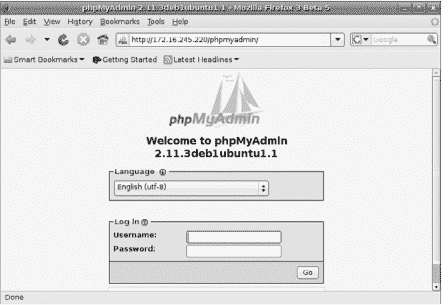

**Figure 5-3** phpMyAdmin login screen

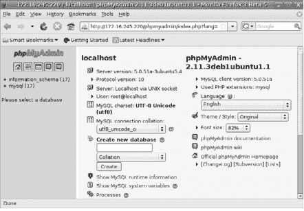

**Figure 5-4** Main phpMyAdmin configuration screen

## PostgreSQL

PostgreSQL 和 MySQL 是开源数据库世界的阴阳两面。MySQL 最初专注于速度和易用性，然后开始添加更多高级数据库功能，而 PostgreSQL 则首先专注于高级数据库功能，然后才着手优化和易用性。两者都有各自的拥护者，所有主要开源数据库支持的 Web 软件都支持这两种数据库。然而 PostgreSQL 远不止网站数据库，其高级功能集包括完整的 ACID 合规性、外键、连接、视图、触发器和存储过程。

### Install PostgreSQL

尽管 MySQL 以易用性著称，但在 Ubuntu 下 PostgreSQL 也很容易安装和使用。要安装 PostgreSQL，你可以在安装 Ubuntu 时选择 PostgreSQL Server，或之后使用 `tasksel`，或者你可以使用包管理器安装 `postgresql` 包：

```
$ sudo apt-get install postgresql
```

一旦 `postgresql` 包安装完成，数据库服务将在后台启动，然后你可以设置你的超级用户账户并创建数据库。初始管理将由 `postgres` 用户执行，因此首先使用 `sudo` 成为该用户：

```
$ sudo -u postgres -s
```

现在从此 shell 你可以创建一个新的用户账户。你可以选择将 `postgres` 用户作为主要超级用户保留，然后使用 `sudo` 控制谁可以成为该用户，或者 alternatively 你可以设置一个具有超级用户权限的新数据库用户。如果我想在我的 PostgreSQL 数据库上创建一个用户名为 `kyle` 的新超级用户，我只需向 `createuser` 程序传递正确的标志：

```
$ createuser -P -s -e kyle
Enter password for new role:
Enter it again:
CREATE ROLE kyle PASSWORD 'md56966c432c869202883876a8b4f925ccc' SUPERUSER CREATEDB CREATEROLE INHERIT LOGIN;
```

另外，如果我只需要创建一个普通的非特权用户：

```bash
$ createuser -P -DRS kyle
Enter password for new role:
Enter it again:
```

如果你犯了错误想重试，或者只是需要删除某个用户，直接使用 `dropuser` 命令，并把用户名作为参数传入。现在我已经创建了一个用户，接下来我可以设置一个由该用户拥有的数据库。`createdb` 会处理所有繁重的工作；我只需要指定所有者 `owner` 和数据库名称，这里叫作 `kyledatabase`。所以当我仍以 `postgres` 用户身份登录时：


```bash
$ createdb -O kyle kyledatabase
```

现在我可以输入 `exit` 退出 postgres shell，回到我的普通用户。要访问这个数据库，我可以以普通用户身份使用 `psql` 命令：

```bash
$ psql --password kyledatabase
```

如果我的 PostgreSQL 用户名与我的 shell 账户名不同，由于默认情况下 `psql` 会尝试使用本地账户的用户名，这就会报错。在这种情况下，我可以在命令末尾加上 PostgreSQL 用户名：

```bash
$ psql --password kyledatabase kyle
```

## Ubuntu 中 PostgreSQL 的惯例

- `/etc/postgresql/`

  这里存放着系统上所有 PostgreSQL 实例的主要配置文件。由于不同 PostgreSQL 版本的配置文件可能不兼容，Ubuntu 为每个 PostgreSQL 版本在这里提供了各自的子目录。这样你就可以在同一台机器上轻松维护多个 PostgreSQL 版本。例如，Lucid 下默认的 `postgresql` 软件包会安装 PostgreSQL 8.4 版本，那么它的所有配置都会放在 `/etc/postgresql/8.4/` 下。

- `/etc/postgresql/8.4/main/postgresql.conf`

  `/etc/postgresql/8.4/main/` 目录包含 PostgreSQL 8.4 的主要配置文件，其中 `postgresql.conf` 是主要的配置文件。这个文件带有大量的注释，因此你可以在修改选项时参考该文件。

- `/etc/postgresql/8.4/main/pg_hba.conf`

  这是一个存储所有主机认证信息的配置文件。你可以在这里控制网络上哪些主机可以访问 PostgreSQL 数据库。

- `/etc/postgresql/8.4/main/pg_ident.conf`

  `pg_ident.conf` 文件允许你将服务器上的本地用户名映射到不同的 PostgreSQL 用户名。因此，如果你的本地用户名和 PostgreSQL 用户名不一致，你可以在这里添加映射，从而避免每次运行 `psql` 时都在命令行中加上 PostgreSQL 用户名。

- `/etc/init.d/postgresql-8.4`

  这是 PostgreSQL 8.4 的初始化脚本。如你所见，Ubuntu 会根据数据库版本来命名初始化脚本，因此你可以在同一台主机上安装并使用多个 PostgreSQL 版本。

- `/var/log/postgresql/`

  与 MySQL 记录到 syslog 不同，PostgreSQL 将其所有日志都独立存放在 `/var/log/postgresql` 下。每个日志都会根据其版本进行标注，因此在 Lucid 下默认的 PostgreSQL 8.4 数据库会记录到 `/var/log/postgresql/postgresql-8.4-main.log`。

## 基于 Web 的 PostgreSQL 管理

如果你觉得核心 MySQL 管理员会不屑于基于 Web 的管理工具，那你真该看看核心 PostgreSQL 管理员是如何反应的。即便如此，如果你只是想创建一个由可靠 PostgreSQL 数据库支撑的网站，你可能会觉得从 Web 管理数据库的简便性很不错。与 MySQL 一样，有一个基于 PHP 的管理工具叫作 phpPgAdmin。要安装 phpPgAdmin，你只需安装 `phppgadmin` 软件包：

```bash
$ sudo apt-get install phppgadmin
```

该软件包会下载其所有依赖项，如果尚未安装 Web 服务器，也会一并安装。安装完成后，创建一个指向 `/etc/apache2/sites-available` 下 Apache 配置文件的符号链接，然后使用 `a2ensite` 启用该站点：

```bash
$ sudo ln -s /etc/phppgadmin/apache.conf /etc/apache2/sites-available/phppgadmin
$ sudo a2ensite phppgadmin
$ sudo apache2ctl graceful
```

默认情况下，phpPgAdmin 被配置为只允许 localhost 访问该站点，因此若要允许来自本地网络的访问，请打开 `/etc/phppgadmin/apache.conf`，找到这样一行：

```bash
allow from 127.0.0.0/255.0.0.0
```

为了同时允许 `192.168.1.0` 网络访问该工具，请在另一行 `allow from` 下方添加：

```bash
allow from 192.168.1.0/255.255.255.0
```

然后运行 `sudo apache2ctl graceful` 以重新加载更改。现在，你可以在网络中的一台计算机上打开 Web 浏览器，并访问 phpPgAdmin 主机上的 `/phppgadmin` 目录。比如，如果其 IP 地址为 `192.168.1.7`，你就可以浏览到 `http://192.168.1.7/phppgadmin/`，并看到图 5-5 中显示的默认网页。

主页左侧边栏会列出所有可用的 PostgreSQL 服务器。默认情况下你只配置了一个，因此点击它，然后使用你的 PostgreSQL 凭据登录并管理服务器。如图 5-6 所示，该界面与 phpMyAdmin 的有所不同，但与 phpMyAdmin 一样，你也可以修改数据库、更改表，以及执行你可能需要的所有其他主要数据库管理工作。

## 文件服务器

我想你可以在某种程度上把 Web 服务器视为文件服务器——它确实会共享文件——但一般来说，当人们想到文件服务器时，他们想到的是本地网络上的一台机器，这台机器拥有大量存储空间，并且网络上的多台主机可以访问和修改其上的文件。

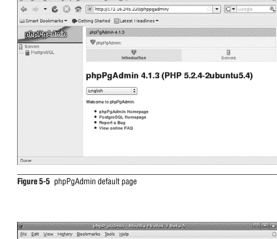

## 图 5-5 phpPgAdmin 默认页面

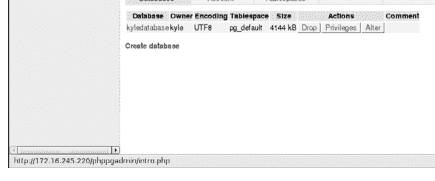

## 图 5-6 phpPgAdmin 数据库管理

`server`. Ubuntu 最受欢迎的两个主要文件服务器是 Samba 和 NFS。虽然两者都可以在多个平台上运行，但大多数管理员在客户端主要是 Windows 时倾向于使用 Samba，而在客户端主要是 Linux 时倾向于使用 NFS。两者在 Ubuntu 上都相对简单易于设置。

### Samba

Samba 是一个实现 Windows 文件共享协议 SMB 和 CIFS 的程序。因此它非常适合作为 Windows 下的文件共享平台，因为所有客户端都可以在无需额外软件的情况下访问服务器。随着时间的推移，Samba 已发展到支持 Windows 文件共享的高级部分，以至于它可以像任何其他 Windows 文件服务器或主要域控制器一样运行。

#### 安装 Samba

要安装 Samba，你可以在 Ubuntu 安装期间选择 Samba Server 选项，或在安装后使用 `tasksel` 程序进行选择，也可以使用包管理器单独安装 `samba`、`samba-doc`、`smbfs` 和 `winbind` 包：

```
$ sudo apt-get install samba samba-doc smbfs winbind
```

Samba 服务将自动启动；当然，默认情况下不会共享太多有趣的内容，因此在共享任何目录之前，你需要调整 Samba 的配置文件。

#### Ubuntu Samba 惯例

- `/etc/samba/`

  该目录包含 Samba 使用的所有主要配置文件，包括本地密码文件。

- `/etc/samba/smb.conf`

  `smb.conf` 文件是 Samba 的核心配置文件，用于定义文件共享和 Samba 本身的全局设置。默认的 `smb.conf` 文件注释丰富，并为文件服务器设置了合理的默认值，例如默认的工作组为 `Workgroup`。该文件还包含许多设置共享的不同示例，

包括一个有用的示例配置，用于共享所有用户的主目录，但默认情况下所有这些示例共享都被注释掉了。

- `/etc/init.d/smbd`, `/etc/init/smbd.conf`

  Samba 的 init 脚本已转换为 Upstart 脚本，尽管仍保留了一个旧的 init 脚本作为占位符。这意味着你将使用标准的 Upstart 程序如 `start`、`stop` 和 `status` 来管理服务。Samba 默认在系统启动时自动启动。

- `/etc/init.d/nmbd`, `/etc/init/nmbd.conf`

  与 `smbd` init 脚本一样，`nmbd` init 脚本现在也由 Upstart 管理。

- `/usr/bin/smbpasswd`


此工具用于为 Samba 创建用户帐户。如果你想设置需要身份验证的 Samba 共享，则使用此工具创建 Samba 用户数据库。你添加的 Samba 用户名也需要在系统上已存在。例如，要将 `ubuntu` 用户添加到 Samba，我会输入

```
$ sudo smbpasswd -a ubuntu
```

我也可以在想要更改特定用户的密码时使用此命令。要从 Samba 中删除用户，请将 `-a` 选项替换为 `-x`。你也可以在不删除其帐户的情况下暂时禁用 Samba 用户。为此，使用 `-d` 和 `-e` 选项分别禁用和启用用户。

- `/usr/share/doc/samba-doc/`

  如果你安装了 `samba-doc` 程序，你将在此目录下找到 Samba 文档和示例配置文件。

- `/var/lib/samba`

  该目录包含 Samba 使用的所有不同数据库，包括 `smbpasswd` 使用的用户和密码数据库。

- `/var/log/samba/`

  Samba 记录到自己的目录，并为 `smbd` 和 `nmbd` 进程分别创建单独的日志文件（`log.nmbd` 和 `log.smbd`），以及为访问 Samba 的每个主机创建单独的日志。这种组织方式可以更轻松地缩小到你需要的日志信息。

## 示例 Samba 配置

设置新的 Samba 共享的一个好方法是阅读 `/etc/samba/smb.conf` 文件中的注释。其中有许多不同的示例，展示了如何共享用户主目录或 CD-ROM 驱动器等。在此示例中，我将展示如何共享位于 `/mnt/share` 的目录，以便网络上的每个人都可以访问并写入它作为通用存储位置。打开 `/etc/samba/smb.conf` 并移动到文件底部。然后添加以下内容：

```
[general]
    path = /mnt/share
    comment = General Storage
    writeable = Yes
    browseable = Yes
    guest ok = Yes
    force user = ubuntu
```

在此示例中，我将 `/mnt/share` 目录设置为网络上的任何人都可以写入（`writeable = Yes`，`guest ok = Yes`），并使用 `force user = ubuntu` 选项，以便当用户在共享上创建文件时，它将归本地名为 `ubuntu` 的用户所有。当然，你需要将此用户从 `ubuntu` 更改为系统上存在的用户。现在我可以创建共享目录并确保其权限设置正确，以便本地 `ubuntu` 用户可以写入它：

```
$ sudo mkdir /mnt/share
$ sudo chown ubuntu:ubuntu /mnt/share
```

Samba 的一个不错功能是，我可以在不重启 Samba 的情况下添加或调整像上面这样的共享。这很方便，因为当你重启 Samba 时，任何访问共享上文件的用户都会暂时与文件断开连接。某些程序对断开连接的反应非常糟糕，他们的文件被临时从下面抽走，我甚至见过有些系统在这种情况下直接崩溃。

现在 Samba 已经配置好了，去网络上的另一台主机尝试连接你的 Samba 服务器。在 Ubuntu 桌面上，你会点击 Places > Connect to Server...，然后从“Service type”下拉菜单中选择“Windows share”。最后输入你的 Samba 服务器的 IP 地址或主机名，然后在 share 名称处输入 `general`（或你在 `smb.conf` 中方括号之间指定的其他名称）。点击 Connect，Ubuntu 就会挂载并在桌面上显示已挂载的共享。

### NFS

NFS 是一种源自 UNIX 而非 Windows 的文件共享服务。如今 Linux 和 Windows 都可以挂载 NFS 共享，但你仍然倾向于在 Linux 或 UNIX 客户端网络中使用 NFS。正如你将看到的，如果你想通过 NFS 共享一个目录，并没有太多复杂之处。

### 安装 NFS

要安装 NFS，在你的包管理器中选择 `nfs-kernel-server`。这将下载并安装该服务以及你需要的任何额外依赖项。

```
$ sudo apt-get install nfs-kernel-server
```

安装包后，NFS 就准备好进行配置了。默认情况下不会配置任何 NFS 导出，因此在你明确配置之前不会共享任何内容。

### Ubuntu NFS 惯例

- `/etc/exports` — 这是 NFS 的核心配置文件，包含 NFS 将导出给用户的所有文件系统的列表。

- `/etc/init.d/nfs-kernel-server` — 这个 init 脚本控制 NFS 服务器并接受标准的 init 脚本选项列表，包括 `reload`，这样你就可以在不重启服务的情况下重新加载配置。

#### `/var/log/syslog`

NFS 记录到标准的 `syslog` 文件中，作为 `NFSd` 进程。这是查找远程主机无法访问共享时具体失败原因的地方。要仅查看此文件中的 NFS 日志，运行 `sudo grep NFSd /var/log/syslog`。

### 示例 NFS 配置

添加 NFS 共享相对简单，你的所有工作都将在 `/etc/exports` 文件中完成。该文件的语法在 `exports` 手册页中有详细说明，你可以通过输入 `man 5 exports` 来访问。一般来说，文件每行包含一个导出，每行有两个列，由一个或多个空格分隔。第一列是要共享的目录的路径，第二列是可以访问共享的主机或网络以及在一对括号内的选项集。

我创建一个与我在 Samba 部分给出的示例类似的示例共享。我将 `ubuntu` 用户拥有的 `/mnt/share` 目录导出给 192.168.1.x 网络上的所有人。为此，我只需在 `/etc/exports` 中添加以下行：

```
/mnt/share 192.168.1.0/255.255.255.0(rw)
```

现在如果 `/mnt/share` 目录还不存在，我就创建它：

```
$ sudo mkdir /mnt/share
$ sudo chown ubuntu:ubuntu /mnt/share
```

最后，我可以重新加载 NFS 以启用此共享：

```
$ sudo service nfs-kernel-server reload
```

一旦 NFS 重新加载，我就可以在 192.168.1.0 网络上的任何主机上挂载该共享。如果 NFS 服务器位于 192.168.1.7，我想将其挂载到 `/mnt/local`，我会输入

```
$ sudo mount -t nfs 192.168.1.7:/mnt/share /mnt/local
```

如果你的 Ubuntu 主机出现关于错误文件系统类型的错误，你可能没有在系统上安装 NFS 客户端支持。只需运行

```
$ sudo apt-get install nfs-common
```

然后再次尝试挂载命令。

### NFS 用户权限

NFS 处理用户权限的一个有趣且有争议的特性。当你挂载 NFS 共享时，文件所有权将基于 NFS 服务器上用户的用户 ID。远程系统上的用户要能够读取和写入共享，他们的用户 ID 需要与 NFS 服务器匹配。如果你使用 LDAP 或其他系统在服务器之间保持用户 ID 一致，这不应该构成太大问题，但如果例如我的 NFS 服务器上的 `ubuntu` 用户的用户 ID 为 1000，而我的客户端上的 `ubuntu` 用户的用户 ID 为 1001，客户端将无法写入挂载点。

NFS 权限的另一个关注点是它如何处理 `root`。在 Ubuntu 上，默认情况下 `root` 账户会被压缩，因为 NFS 阻止远程 `root` 用户以其 `root` 权限访问共享。否则，网络上任何使用 Ubuntu live CD 的主机都可以启动它，挂载 NFS 共享，并读取和写入该共享上的任何文件，而不管权限如何。考虑到这个安全问题，你可能仍想禁用 `root` 压缩。要这样做，将 `no_root_squash` 选项添加到 `/etc/exports` 中的导出选项列表中。每个选项由逗号分隔，所以如果我想在之前创建的共享上禁用 `root` 压缩，该文件将如下所示：

```
/mnt/share 192.168.1.0/255.255.255.0(rw,no_root_squash)
```

## Edubuntu 和 LTSP

社区驱动的 Edubuntu 项目旨在为 Ubuntu 创建一个专门为初级和中学教育量身定制的插件。Edubuntu 作为教师和管理员工具的平台而存在。但真正的推动力，当然，也是真正的目的，是将自由和开源软件交到孩子们手中。在此过程中，Edubuntu 提供了


它为孩子们提供了一个灵活而强大的技术环境，供其学习和实验。基于自由软件，它提供了可自由修改（hackable）的教育技术，最终学生和教师可以按照自己的方式使用它们。由于免费分发，其免费特性满足了那些技术项目总是人员不足和资金匮乏的学校的重要需求。目前，伴随着Edubuntu长大的孩子们精通Ubuntu和自由软件，他们正让Ubuntu社区得以一窥其未来可能走向，以及可能带领我们到达那里的新一代Ubunteros。

Ubuntu、Kubuntu 和 Xubuntu 桌面分别突出了 GNOME、KDE 和 Xfce 社区的成果，而 Edubuntu 项目则提供了 Ubuntu 中所有最佳内容——经过适当调整，适合学校使用，并且尽可能易于使用。让 Edubuntu 广受欢迎的一点是它出色的瘦客户端集成能力，允许使用一台强大的机器（服务器）为许多性能很低、通常无盘的机器（客户端）提供完整的操作系统。（更多信息请参见下一节。）这种模式虽然对大多数家庭或商业用户的工作站和笔记本电脑使用来说并不吸引人，但在教室环境中却是一个重要特性，可以缓解配置和维护的麻烦，并大幅降低教室部署的成本。

## 什么是 LTSP？

LTSP 是 Linux 终端服务器项目（Linux Terminal Server Project）的缩写。它为当前的客户端/服务器模型提供了与多年前盛行的大型机/哑终端设置相同的功能。

LTSP 模型的核心是一台充当服务器的高性能机器，以及若干通常性能低得多的客户端机器。这些机器都连接在同一个局域网中。

该网络允许启动客户端计算机所需的所有数据（通常存储在客户端硬盘上）通过网络传输到客户端。如果启动计算机所需的全部数据都通过网络提供，客户端机器就完全不需要存储介质，因此有了“无盘客户端”一词。

### 提示

客户端需要一张网卡，可以通过 PXE 或 Etherboot 启动，以便在从网络引导之前允许本地介质进行初始引导。更多信息可在 http://rom-o-matic.net 找到，你可以为网络硬件创建可启动映像。Etherboot 本质上是在较旧硬件上模拟 PXE 系统的一种便捷方式。大多数较新的主板和网卡在芯片上都带有 PXE 软件。

## LTSP 引导过程的技术细节

客户端机器开机。硬件初始化后，网卡通过 DHCP 协议查找 IP 地址。在大多数情况下，LTSP 服务器充当本地网络的 DHCP 服务器，并将 IP 地址发送给客户端机器。图 5-7 展示了 LTSP 引导过程的示意图。

一旦网卡将 IP 地址绑定到自己，它就会连接到 LTSP 服务器并请求 PXE 配置文件。LTSP 服务器将该文件发送回客户端机器，客户端随后请求内核映像。这是操作系统的基础，它提供客户端与服务器通信所需的全部硬件驱动程序。

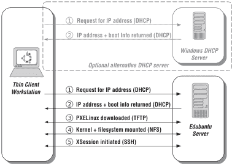

接下来，与服务器建立 NFS 连接。这几乎就像一个标准的网络共享。NFS 共享包含一个精简版的 Ubuntu 安装，几乎完全由一个 X 服务器和一个基于 SSH 的登录管理器组成，用于连接到服务器。当客户端机器完成启动这个精简版 Ubuntu 后，用户会看到登录界面。

当用户登录时，会打开一个到服务器的 SSH 隧道，并通过该隧道启动 X 会话。所有程序都在服务器上运行，只有图形界面会被传回客户端机器。这允许用户与会话交互，并像平常一样使用计算机。

整个过程对用户来说是完全透明的，但了解 LTSP 中底层技术的基础知识对于排查问题和评估 LTSP 是否适合特定任务是很重要的。

## LTSP 的优势

以这种方式引导计算机确实比当前许多高性能桌面的首选模式有一些明显的优势，尤其是在预算有限的情况下。

- 单一管理点：使用这种模式意味着只需要在一台计算机上安装新软件。通过使用本章后面演示的添加/删除工具，你可以让应用程序自动对所有客户端可用，因为它们本质上都在使用同一台机器。
- 低成本硬件：瘦客户端机器不需要非常强大，因为所有处理都由服务器完成。这使得人们可以使用更旧的硬件作为客户端机器，通常可以重新使用那些几年前因运行缓慢而被淘汰的机器。
- 无盘客户端：任何花时间管理过网络的人都知道，经常使用的计算机常常会因硬盘上的文件损坏而需要重装。如果客户端没有磁盘，用户就没有机会损坏客户端硬盘上的数据。
+ 轻松替换：如果其中一台瘦客户端机器出现故障，你的所有数据仍然存储在服务器上。只需更换客户端硬件即可继续工作。真的就像更换灯泡一样简单。

> TIP
>
> 瘦客户端可以在极低规格的机器上运行。人们在回收的电脑上运行瘦客户端，这些电脑的性能低至 133MHz Pentium 处理器和 64MB 内存。虽然在如此缓慢的硬件上性能会成为问题，但避免通过 SSH 进行加密的简单调整可以缓解这一问题。一般来说，至少配备 400MHz 处理器和 128MB 内存的机器将成为一台出色的瘦客户端。

## 其他用途

LTSP 系统在许多其他应用中也有其用途。想象一下你正在经营一家网吧，许多人以完全相同的方式使用电脑。每台工作站都需要安装相同的一套应用程序。他们执行的任务并不非常依赖 CPU，因此瘦客户端系统非常适合这种类型的应用。你还会发现 LTSP 解决方案在信息系统（例如机场）和销售点系统中非常常见。

## Ubuntu 中的 LTSP 可用性

使用 Ubuntu alternate CD，用户可以自动安装和配置 LTSP 系统。由于 Edubuntu 不再作为 live 或 alternate CD 提供，LTSP 服务器安装已移至 Ubuntu alternate CD。如果需要在已安装的 Ubuntu、Kubuntu 或 Xubuntu 桌面或 Ubuntu 服务器上安装 LTSP，你应遵循下一节提供的说明。

## 安装 LTSP 服务器

从 Ubuntu 9.04 开始，LTSP 安装过程在继续之前需要一个小步骤。首先需要做的是获取 Ubuntu alternate CD。由于 Edubuntu 的状态已从发行版变为附加组件，因此不再通过 Edubuntu CD 提供 LTSP 服务器安装。如果你想将 LTSP 添加到已安装的 Ubuntu 服务器，请跳至标题为“在 Ubuntu 或桌面安装中安装 LTSP 环境”的部分。

## LTSP 服务器配置

LTSP 服务器安装允许很大的灵活性，并旨在使其能够适应任何当前网络配置。从本质上讲，这些配置分为两类：那些将 LTSP 服务器用作所有 LTSP 客户端的主要网关的配置，以及那些不这样做的配置。让我们花几分钟时间讨论每种系统的相对优点。

使用推荐的配置要求 LTSP 服务器机器具有两个网络接口卡（NIC）。其中一张卡连接到网络的其余部分，即连接到 Internet 或内部网络上的其他服务器。另一张卡通常连接到网络的私有子网，其中仅存在 Edubuntu LTSP 客户端。图 5-8 显示了这种双 NIC 设置。第二个网络卡不会将网络数据路由到第一个网络卡，因此客户端机器必须在 LTSP 服务器上经过身份验证后才能访问 Internet 或网络的其余部分。这使得网络设置更加安全。

这种设置的优点是客户端计算机无法在未经 LTSP 服务器许可的情况下连接到网络。这也减少了网络其余部分的网络流量，因为当 LTSP 客户端从 LTSP 服务器启动时，数据仅在私有子网上传输，而不会在网络其余部分传输。此外，客户端从 LTSP 服务器接收其网络地址，这释放了网络其余部分的地址。

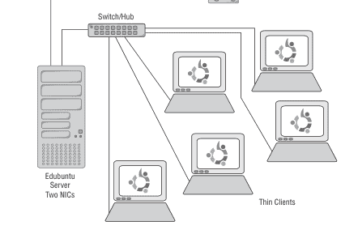

Figure 5-8 Two-NIC setup

将 LTSP 仅用作网络上的另一台服务器可以提供更灵活的环境。首先，使用此配置运行服务器只需要一个网络接口卡。LTSP 客户端连接到普通网络，并且假设它们具有启动能力，可以在无需 LTSP 服务器帮助的情况下访问网络。图 5-9 显示了这种单 NIC 设置。

这种设置的优点是瘦客户端可以与多个操作系统一起使用。例如，有一家机构运行双启动 Microsoft Windows 和 Edubuntu 客户端。此设置还允许用户的 LTSP 瘦客户端从单个网络服务器接收其 DHCP 网络地址。

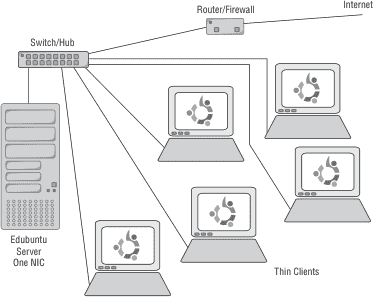

**Figure 5-9** One-NIC setup

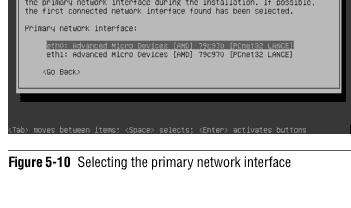

## Figure 5-10 Selecting the primary network interface

for the LTSP server. If your network doesn’t have DHCP enabled, you must set up the IP address manually.


The next step is to set up the hard disk for installation. By far the easiest method here is to select the default option of Guided Partitioning. If you require more in-depth partitioning or already have data on the hard drive that you do not want to lose, you must plan how you are going to proceed. If you are installing onto a computer that has partitions Ubuntu can resize, it will offer you that option. This option allows you to have two OSes installed on one computer and to switch between them at bootup. Whichever method you select, you are asked to confirm your partitioning choices.

> TIP While the resizing utilities in Ubuntu are excellent, you should always back up your data before performing an operation such as this.

After this, you must choose whether or not your clock is set to Coordinated Universal Time (UTC). Your system clock should be set to UTC. Your OS is then responsible for converting the system time into local time. Unless you have another OS that expects the system time to be the local time, you should answer yes here.

Now it’s time to set up the first user on the system. Remember that this user will have full administrative rights. First, enter the user’s full name, then the desired username, followed by the password twice. After this, the base system is installed.

After plowing through several steps, you are presented with a question about screen resolutions. For the type of system you are installing, a very high screen resolution could result in a slow connection between the server and the client. The default options are fine.

When this is completed, the installer begins building the LTSP client root filesystem (Figure 5-11). This is the very small version of Ubuntu mentioned earlier in this chapter. Essentially it consists of just a kernel and an X server.

> TIP
> This step appears to take a long time, and the progress bar isn't updated often. Be patient, have a snack—it will finish eventually.

Once the installation is complete, a prompt asks you to remove the CD and press Enter to reboot the system into your new Edubuntu server.

## Initial LTSP Server Setup

The DHCP server installed on your Ubuntu machine should start up automatically, so all that is left to do is to make your thin clients bootable from the network. If you are using the single-network card setup described earlier and your network already has a DHCP server running, do not start the Ubuntu DHCP server, because doing so will likely cause both DHCP services to be unavailable.


Figure 5-11 Building the LTSP filesystem

TIP If you are still running the Dapper 6.06 LTS version of Edubuntu, there is a little bit more work to do. The latest versions of Ubuntu have an automatic DHCP configuration generator. This means that they do not require manual configuration in usual LTSP environments. The 6.06 LTS release needs manual configuration of the DHCP server; please visit https://www.edubuntu.org/GettingStarted for further instructions.

## Initial LTSP Client Setup

Modifying a client computer to boot from the network is usually done by altering a setting in the machine's BIOS. It's a good idea to look at the manual for the computer's motherboard to find out how to alter these settings. For most machines it is simply a case of entering the BIOS by pressing the Delete key at bootup and changing the boot device priority.

Once you've set up your client machines to boot from the network card, you should see a screen similar to the one Figure 5-12 shows on each of the clients. This means that the client machine has been issued with a DHCP address and that the PXELinux file has been loaded from the network.

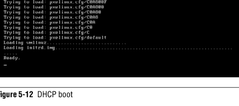

Figure 5-12 DHCP boot

如果你的客户端启动到图形登录界面，并且屏幕看起来与图 5-13 所示相似，恭喜你——你已成功设置了你的 LTSP 终端客户端系统。

## 在 Ubuntu 或桌面安装中安装 LTSP 环境


也许你已经有一台 Ubuntu 机器，并希望将其用于 LTSP 设置中。做到这一点是一个简单的过程，并且需要的配置很少。首先，你必须决定是否需要一个 DHCP 服务器。如果需要，安装 `ltsp-server-standalone` 包。如果你已经有一个 DHCP 服务器，并且打算通过修改 `filename`、`next-server` 和 `root-path` 选项来使其指向 LTSP 服务器，则应安装 `ltsp-server` 包。

如果你的客户端启动到图形登录界面，并且屏幕看起来与图 5-13 所示相似，恭喜你——你已成功设置了你的 LTSP 终端客户端系统。

## 在 Ubuntu 或桌面安装中安装 LTSP 环境

也许你已经有一台 Ubuntu 机器，并希望将其用于 LTSP 设置中。做到这一点是一个简单的过程，并且需要的配置很少。首先，你必须决定是否需要一个 DHCP 服务器。如果需要，安装 `ltsp-server-standalone` 包。如果你已经有一个 DHCP 服务器，并且打算通过修改 `filename`、`next-server` 和 `root-path` 选项来使其指向 LTSP 服务器，则应安装 `ltsp-server` 包。同时，你还需要 `openssh-server` 包。

最简单的方法是登录到你的服务器并输入以下命令来安装 LTSP 服务器和 SSH 服务器。在我们的示例中，并不需要 DHCP 服务器。

```
sudo apt-get install ltsp-server openssh-server
```


图 5-13 LDM 登录屏幕

> **提示**
>
> 如果你需要一个 DHCP 服务器，将上面的行中的 `ltsp-server` 修改为 `ltsp-server-standalone`。在运行本小节所述的流程之前，你还需要将第二个网络设备配置为 IP 地址 `192.168.0.1`。

现在剩下要做的就是通过运行以下命令来安装客户端 chroot：

```
sudo ltsp-build-client
```

之后，你应该能够启动你的第一个终端客户端。

## 特殊 LTSP 情况

### 设置 LTSP 与现有 DHCP 服务器共存

有时你可能不希望你的机器位于完全独立的子网中。然而，问题在于当前的 DHCP 服务器将不会被设置成提供正确的选项以使客户端能够从网络启动。修改基于 Linux 的 DHCP 服务器是有据可查的；然而，一些机构将需要修改 Microsoft Windows DHCP 服务器以允许网络客户端从网络启动。

以下设置假设当前 Windows 网络上还没有运行任何终端客户端系统。打开 Windows DHCP 管理工具将允许你为你的机器创建 *保留*。保留是将特定 MAC 地址绑定到 IP 地址的方式。这样，每次机器从 DHCP 服务器请求 IP 地址时，它总是会获得相同的 IP 地址。这有其好处，因为你也可以为客户端设置高级选项。

对于每个客户端，你必须创建一个保留，然后为每个客户端添加以下选项（图 5-14）。

- 017 根路径：`/opt/ltsp/i386`
- 066 启动服务器主机名：`<server ip>`
- 067 启动文件名：`/ltsp/i386/pxelinux.0`

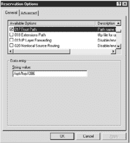

**图 5-14** Windows DHCP 保留

建议你重启 DHCP 服务器。之后，客户端应该能够正确地从服务器获取其 IP 地址，然后通过 NFS 从 LTSP 服务器启动。

> **提示**
>
> 你也可以将这些选项设置为全局参数，以在整个网络中推广。然而，在开始时，至少最好跟踪哪些机器是从 LTSP 服务器启动的。

## 与硬盘上的另一个操作系统双启动

也许你有一套计算机已经愉快地运行着另一个操作系统，并且你希望在一段时间内同时保留两个系统。希望在任何一段时间的 Edubuntu 使用之后，你最终会永久切换。在这些情况下，很容易设置服务器以允许客户端从网络或计算机中的第一块硬盘启动。

大部分编辑工作都在目录 `/var/lib/tftpboot/ltsp/<arch>/` 中的 `pxelinux.cfg/default` 配置文件中进行。该文件的格式与旧的 LILO 配置语法非常相似（对于熟悉该引导加载程序的人来说）。以下示例配置将向客户端显示一条稍后会解释的消息。用户可以然后

选择让系统启动其默认配置，在本例中为本地硬盘，或输入单词 `linux` 并按 Enter，这将加载 LTSP 终端。

```
DEFAULT localboot
TIMEOUT 50
PROMPT 1
DISPLAY display.msg

LABEL linux
    KERNEL vmlinuz
    APPEND ro initrd=initrd.img quiet splash

LABEL localboot
    LOCALBOOT 0
```

让我们来看一下配置文件并逐项分解，以便你可以根据自己的环境创建自己的配置。 （如果此示例文件符合你的需求，可以跳到关于创建 `display.msg` 文件的部分。）

`DEFAULT` 关键字指定在超时到期后将选择的启动选项。 `TIMEOUT` 选项指定在启动默认选项之前等待的时间。 此超时以十分之一秒为单位测量；因此值为 50 将其设置为 5 秒。 `PROMPT` 选项指定 PXE 软件是否显示 `boot:` 提示以使用户可以选择操作系统。 `DISPLAY` 选项在屏幕上显示一个文本文件作为介绍。 在本例中，该文件名为 `display.msg`，必须与 `pxelinux.0` 文件一起放置在根 LTSP 目录中。 稍后会提出此文件的示例。

从 *LABEL linux* 开始的三行定义了用于启动的 *linux* 选项。 这由 `KERNEL` 和 `APPEND` 选项配置，你会注意到它们是从原始默认文件中提取的，如下所示：

```
DEFAULT vmlinuz ro initrd=initrd.img quiet splash
```

现在只需要从本地硬盘启动的选项，由以 `LABEL localboot` 开始的两行显示。 这些行定义了 `localboot` 选项，如文件中前面 `DEFAULT` 关键字所使用。 此选项中包含的唯一定义是 `LOCALBOOT` 选项，其参数为 0。 这提供了正常的硬盘启动。 其他参数可用，你可以通过访问 Syslinux 主页，`http://syslinux.zytor.com` 来查看。

`display.msg` 文件应包含一些信息，告诉用户如何选择操作系统。 以下是适用于上述配置的示例文件。 创建此文件时，在文本实际开始之前使用若干空白行很有帮助。 这会清除屏幕的效果，使用户不会因 PXELinux 启动文本而感到困惑。

```
================================================================

Welcome to the Multiboot System

The system will start in 5 seconds...

for Linux users type : linux
at the boot: prompt and press <enter>

=================================================================
```

重新启动客户端后，你应该会看到来自显示消息文件中的文本。 它应与图 5-15 所示类似。

## Changing Your IP Address

在某些时候，可能需要更改服务器的 IP 地址。 更改普通机器的 IP 地址通常不会对客户端机器产生太大影响。 然而，在 LTSP 环境中，更改 IP 地址会导致客户端无法登录。 这是因为在构建 LTSP 根目录时，它会填充 SSH 授权密钥，这些密钥允许客户端和服务器之间无需密码进行身份验证。

解决此问题的过程相当简单。 首先，登录到你的服务器，然后通过在终端中输入以下命令并按 Enter 来运行 LTSP SSH 密钥更新脚本。 系统会提示你输入密码。

```
sudo ltsp-update-sshkeys
```

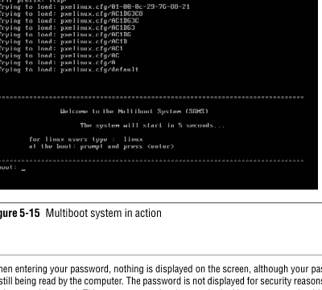

Figure 5-15 Multiboot system in action

### TIP

输入密码时，屏幕上不会显示任何内容，尽管你的密码仍在被计算机读取。 出于安全原因，密码不会显示，但也不会被混淆。 这可以防止可能在你身后窥视的人看到你的密码有多少个字符。

### TIP

在这里，也可以通过简单地重新启动网络接口来更新 SSH 密钥，使用类似以下命令。 你需要将 `<iface>` 替换为接口标识符，通常是类似 `eth0` 或 `eth1` 的名称。

```
sudo ifdown <iface> && sudo ifup <iface>
```

完成后，你的 SSH 密钥将被更新，客户端重新启动后，它们应该能够再次登录。


## Local Devices over LTSP

自 Ubuntu Edgy 6.10 以来，Edubuntu 已包含对 LTSP 的更新，以允许所谓的本地设备。例如，将 USB 存储设备插入终端机时，将触发本地设备机制，并且该设备将被正确挂载并显示在客户端机器的桌面上。

使用 Ubuntu 时，使用 USB 闪存盘通常需要在物理拔出前先卸载该设备。这样做是为了让 Ubuntu 有足够时间将所需数据全部写入 USB 闪存盘并能够安全卸载。在 LTSP 环境中，使用 USB 闪存盘的方式略有不同。因为数据会定期写入 USB 闪存盘，所以没有卸载选项。因此你无需卸载它，只需在计算机完成信息写入后即可直接拔出。

本地设备支持在 Edubuntu 中默认已设置；不过，要使用它，你必须将需要访问该支持的用户添加到 `fuse` 组。你可以从用户管理器中完成此操作。首先进入 系统 > 管理 > 用户和组 选项。从这里，选择你希望授予本地设备访问权限的用户并点击 用户属性 按钮。点击 用户权限 选项卡，然后勾选允许使用 `fuse` 文件系统的复选框，如图 5-16 所示。

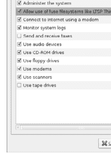

图 5-16 设置 `fuse` 首选项

## 通过 LTSP 播放声音

自 Ubuntu Dapper 6.06 起，Edubuntu 具备了通过客户端机器的扬声器播放声音的能力。对于 6.10 之前的 Edubuntu 版本以及安装在 Ubuntu 之上的 LTSP 设置，你必须在 `/opt/ltsp/i386/etc/lts.conf` 文件中添加一个条目以启用客户端机器的声音。

编辑此文件的最简单方法是按住 `Alt-F2`，这将弹出运行命令对话框。输入以下命令：

```
gksudo "gedit /opt/ltsp/i386/etc/lts.conf"
```

点击确定后将弹出编辑窗口。确保 `lts.conf` 文件中至少有一个 `[default]` 部分，在其中添加以下行：

```
SOUND=True
```

> 注意 Dapper 6.06 LTS 对 `SOUND=True` 语句要求非常严格。你必须完全按所示输入，注意大小写等细节。

对于 6.10 之后的全部 Edubuntu 版本，这项设置已为你完成，声音应可开箱即用在客户端机器上。

# 第 6 章

安全

安全绝对是计算机世界内外都十分热门的话题。很难区分真正的威胁和基本的偏执，但任何连接高速网络并查看过日志的人都知道，如今有成群的服务器在试图攻击你。

尽管其他操作系统和产品似乎因其安全漏洞而占据了大部分报道，Ubuntu 用户也并非完全安全。即使 Ubuntu 开箱即用的安全性良好，一旦你设置了新服务，就有风险打开攻击入口。本章讨论了一些常见的安全实践以及你可以采取的简单步骤来保护你的 Ubuntu 服务器安全。万一你仍遭到攻击，我也在最后加入了一个关于如何应对安全漏洞的章节。

### 通用安全原则

安全圈子里有一句话：“安全是一种流程，而非产品。” 这意味着尽管你的厂商可能会告诉你，你无法仅靠某种设备或软件解决所有安全问题。真正的保障来自于遵循健全的安全原则并建立健全的安全流程。虽然本章后面我会介绍一些可用于提高系统安全性的具体工具和选项，但我无法讨论如何锁定 Ubuntu 下的每一种主要服务。然而，这些原则是可以应用于你可能运行的任何软件的：

- 保持简单。

- 安全圈子里你还会听到另一句话：“复杂性是安全的敌人。” 系统越复杂，就越难以理解其每个部分，也越有可能在某些方面忽视了安全。每当你设计一个系统时，尽量将相互协作的组件数量保持在最小。不仅有助于安全，也有助于故障排除和整体管理。

- 遵循最小权限原则。

- 最小权限原则是指程序和人员应以尽可能低的权限级别运行。这就是

`much more robust set of features to increase user privileges compared to the traditional su program. Here is a list of some of the more interesting features of sudo:` 

### Uses the user's password for authentication

When the `sudo` command is run and the user is prompted for a password, each user enters his or her own password instead of the password for the user he or she wants to become. This helps with security because it means that you can give people superuser privileges without having to tell them the root password (if it is enabled) or the password for any other users on the system. It also means that a user can't directly log in to the system as the root user since there is no password—since all Linux machines have a root user, it's the most common account someone will try to brute force.

### Limitation on superuser access

With `sudo` a user doesn't have to have complete root access. Instead, you can define a list of programs a user can execute with superuser privileges. With this feature you can better follow the principle of least privilege. If a user really needs root privileges only to run `apache2ctl`, why give the user root access over the entire system? With `sudo` you can easily limit the user's access strictly to `apache2ctl`.

### Support for group-based and host-based access

The `sudo` configuration file allows you to put users into groups and then assign access to that group. If you find that you have a number of different `sudo` rules for the same set of users, this makes it much easier to organize the file and add or remove users from the group. You can also define rules based on the host. With this feature you can maintain a single `sudoers` file (`sudo` configuration file) that can be copied to all hosts on your network (or even shared via LDAP).

### Auto-expiration of sudo access

Once you pass the password check once, you can continue to run `sudo` commands and `sudo` won't prompt you for a password for a configurable amount of time. This certainly saves time when you need to run multiple `sudo` commands in a row and provides extra protection in case you forget to lock your terminal and leave your desk.

### Logging of all sudo access


Every time users run `sudo` they generate a new log entry in `/var/log/auth.log` that lists the time, the users who ran `sudo`, and what commands they ran. This gives an administrator a nice forensics trail. Also, `sudo` can send the administrator an e-mail whenever a user fails the password check.

### Can configure passwordless access to rules

While you wouldn't necessarily want to enable this for every `sudo` rule, there is sometimes a need for a script (particularly cron scripts) to gain root access to run a particular command. Since it's a cron script, it's much easier if it can run without your having to code support for the interactive password prompt. It might be tempting to give complete passwordless `sudo` access to a user, but I recommend you limit rules like this to individual commands.

### Configure sudo

`sudo`'s configuration file can be found at `/etc/sudoers`. Ubuntu provides a basic file by default that allows the root user to do anything as any other user and allows members of the admin group to become root (the user you create at install time is automatically added to this group). Your natural inclination might be to open the file with your favorite text editor; however, this is not recommended. The `sudo` package provides a tool called `visudo` that you should use whenever you want to make changes to the file, so to view and edit the `/etc/sudoers` file, type

```
$ sudo visudo
```

The reason you want to use `visudo` is that it automatically checks your `sudoers` file for mistakes. Since a mistake in the `sudoers` file could potentially lock you out of root access, this syntax check is pretty important. If you do make a mistake, `visudo` will tell you about it after you save and exit. You will have the option to go back and fix your mistake, exit without saving, or ignore its warnings and save anyway (which is not recommended).

While the basics of `sudoers` syntax are pretty straightforward, the full set of features and syntax for things like user or command groups can get complicated rather quickly, especially without an example to work from. Luckily you can access the `sudoers` manual by typing `man sudoers`. This manual defines this file's syntax and gives a number of examples you can use for your own `sudoers` file. Instead of documenting that manual again here, to start let's look at two lines from the default `/etc/sudoers` file and break down each of the fields:

```
root    ALL=(ALL) ALL
%admin  ALL=(ALL) ALL
```

The first column defines which user or group this rule applies to. To refer to a user, you can just list the user, or you can list multiple users separated by commas. To reference a group add the `%` sign in front of the group's name. The second column before the `=` sign defines which hosts this rule applies to. In this case it is set to `ALL`, which means it applies to all hosts. The value within the parentheses sets which user this `sudo` rule will be run as. In this case it is also set to `ALL` so it can be run as any user. The final column defines which commands the user can run. In this example it is set to `ALL` so any command can be run.

It's easier to see how all of these options fit in when you see an example that isn't set to `ALL`. Let's assume I have a Web server named `web1`. I have an administrator with a username of `jorge` who manages only this Web server. I don't want to give him full root access to the machine because he has a history of accidents with the `rm -rf` command. All I really want to give him is the ability to use `apache2ctl` so he can reload and restart Apache on this one server. I copy my `sudoers` file to all of the servers on my network, so I need to restrict the rule to `web1` only. The resulting rule would look like this:

```
jorge web1 = (root) /usr/sbin/apache2ctl
```


Notice that I specified the full path to `apache2ctl`. If I had just listed `apache2ctl` without the path, I would have opened up a way to full root access on the system. The user could have created a bash script in his home directory named `apache2ctl` and run whatever he wanted as root.

Now let's say that the `jorge` user never really used `apache2ctl` except to reload changes he made to configuration files. He wanted to automate this process and wrote a script to deploy his configuration files, but he still has to manually log in to run `apache2ctl` because it asks for a password. To remove the password requirement for this rule, add the `NOPASSWD:` statement before the command:

```
jorge web1 = (root) NOPASSWD: /usr/sbin/apache2ctl
```

Keep in mind that you want to restrict how often you use `NOPASSWD` since it bypasses one of sudo’s main security measures. You also want to avoid using it if the command is set to `ALL` if you can help it. Even in this case I may not want the full `apache2ctl` command available without a password. If I wanted to restrict this further, I could create my own shell script that ran `/usr/sbin/apache2ctl graceful` and then give the `jorge` user `NOPASSWD` access to that script instead.

## sudo Aliases

As your `sudoers` file gets larger and more complicated, or as you deploy it to a larger number of servers, you will see that it easily becomes disorganized and difficult to manage. A new developer gets hired and needs sudo access to a machine, and you find yourself poring over line after line in the `sudoers` file looking for all of the different rules that might apply. Aliases save you from that trouble and allow you to define groups for each of the columns in an entry. The basic syntax for each of these aliases is as follows:

```
User_Alias ALIASNAME = user1,user2,user3
Host_Alias ALIASNAME = host1,host2,host3
Runas_Alias ALIASNAME = user4,user5,user6
Cmnd_Alias ALIASNAME = /bin/command1,/sbin/command2
```

There are some restrictions given to the alias name. You can use only uppercase letters, `0–9`, and the `_` symbol for them. That not only helps you distinguish them from regular users, it helps sudo distinguish them as well.

So let’s extend our previous scenario to incorporate groups. Instead of just the `jorge` user, I have a number of users, `jorge`, `allan`, and `ben`, who work on our Web cluster, `web1`, `web2`, and `web3`. I want to grant them access both to `apache2ctl` and also some of the other useful Apache commands Ubuntu includes, such as `a2enmod`, `a2dismod`, `a2ensite`, and `a2dissite`, so they can

启用和禁用模块及站点。最后，我希望他们能够以 `webadmin` 和 `apache` 用户——我们专门为 Web 管理员设置的两个特殊用户——的身份运行任何命令。以下是我要添加到 `/etc/sudoers` 中的规则：

```
User_Alias WEB_ADMIN = jorge,allan,ben
Host_Alias WEB_CLUSTER1 = web1,web2,web3
Cmnd_Alias WEB_COMMANDS = /usr/sbin/apache2ctl, \
    /usr/sbin/a2enmod, \
    /usr/sbin/a2dismod, \
    /usr/sbin/a2ensite, \
    /usr/sbin/a2dissite
RunAs_Alias WEB_ACCOUNTS = webadmin,apache
WEB_ADMIN WEB_CLUSTER1 = (root) WEB_COMMANDS
WEB_ADMIN WEB_CLUSTER1 = (WEB_ACCOUNTS) ALL
```

请注意，使用 `WEB_COMMANDS` 别名时，我可以跨多行，只要我在行尾使用 `\` 即可。有了这些别名，如果我们聘请新用户，我只需将他们添加到 `WEB_ADMIN` 别名中即可。如果我们在集群中添加第四台 Web 服务器，我只需要更新 `WEB_CLUSTER1` 别名。

## AppArmor

UNIX 权限模型长期以来一直用于限制用户和程序的访问。尽管它运行良好，但在某些领域仍然可以利用额外的访问控制。例如，许多服务仍然以 `root` 用户运行，因此如果它们被利用，攻击者可能能够以 `root` 用户身份在系统的其余部分运行命令。有多种方法可以解决这个问题，包括沙箱、`chroot jail` 等，但 Ubuntu 已包含一个名为 `AppArmor` 的系统，默认安装，它为特定系统服务添加了访问控制。

`AppArmor` 基于最小权限的安全原则；也就是说，它试图将程序限制为其正常 functioning 所需的最小权限集。它通过分配给特定程序的一系列规则来工作。这些规则定义了例如程序被允许读取和写入或仅读取哪些文件或目录。当一个由 `AppArmor` 管理的应用程序违反这些访问控制时，`AppArmor` 会介入阻止它并记录该事件。许多服务包含默认强制执行的 `AppArmor` 配置文件，并且在每个 Ubuntu 版本中都会添加更多配置文件。除了默认配置文件外，`universe` 仓库中还有一个 `apparmor-profiles` 软件包，您可以安装它以添加其他服务的更多配置文件。一旦您学习了 `AppArmor` 规则的语法，甚至可以添加自己的配置文件。

了解 `AppArmor` 如何工作的最简单方法可能是使用示例程序。`BIND DNS` 服务器是 Ubuntu 下由 `AppArmor` 自动管理的程序之一，因此我首先使用 `sudo apt-get install bind9` 安装 `BIND` 软件包。软件包安装后，我可以使用 `aa-status` 程序查看 `AppArmor` 是否已在管理它：


```
$ sudo aa-status
apparmor module is loaded.
5 profiles are loaded.
5 profiles are in enforce mode.
/sbin/dhclient3
/usr/lib/NetworkManager/nm-dhcp-client.action
/usr/lib/connman/scripts/dhclient-script
/usr/sbin/named
/usr/sbin/tcpdump
0 profiles are in complain mode.
2 processes have profiles defined.
1 processes are in enforce mode :
/usr/sbin/named (5020)
0 processes are in complain mode.
1 processes are unconfined but have a profile defined.
/sbin/dhclient3 (607)
```

在这里可以看到 `/usr/sbin/named` 配置文件已加载并且处于强制模式，并且我当前运行的 `/usr/sbin/named` 进程（PID 5020）正在由 AppArmor 管理。

## AppArmor 配置文件

AppArmor 配置文件存储在 `/etc/apparmor.d/` 中，并以它们管理的二进制文件的名称命名。例如，`/usr/sbin/named` 的配置文件位于 `/etc/apparmor.d/usr.sbin.named`。如果查看该文件的内容，您可以了解 AppArmor 配置文件的工作原理以及它们提供的保护类型：

```
#### vim:syntax=apparmor
#### Last Modified: Fri Jun 1 16:43:22 2007
#include <tunables/global>

/usr/sbin/named {
    #include <abstractions/base>
    #include <abstractions/nameservice>

    capability net_bind_service,
    capability setgid,
    capability setuid,
    capability sys_chroot,

    # /etc/bind should be read-only for bind
    # /var/lib/bind is for dynamically updated zone (and journal) files.
    # /var/cache/bind is for slave/stub data, since we're not the origin
    #of it.
    # See /usr/share/doc/bind9/README.Debian.gz
    /etc/bind/** r,
    /var/lib/bind/** rw,
    /var/lib/bind/ rw,
    /var/cache/bind/** rw,
    /var/cache/bind/ rw,

    # some people like to put logs in /var/log/named/
    /var/log/named/** rw,

    # dnscsvutil package
    /var/lib/dnscsvutil/compiled/** rw,

    /proc/net/if_inet6 r,
    /usr/sbin/named mr,
    /var/run/bind/run.named.pid w,
    # support for resolvconf
    /var/run/bind/named.options r,
}
```

例如，查看该文件中的以下摘录：

```
/etc/bind/** r,
/var/lib/bind/** rw,
/var/lib/bind/ rw,
/var/cache/bind/** rw,
/var/cache/bind/ rw,
```

这些文件的语法相当简单。首先是文件或目录路径，然后是允许的权限。还允许使用通配符，例如 `/etc/bind/**` 递归应用于 `/etc/bind` 目录下的所有文件。单个 `*` 仅适用于当前目录中的文件。在该规则中可以看到 `/usr/sbin/named` 程序只被允许读取该目录中的文件，而不能写入。这是合理的，因为该目录仅包含 BIND 配置文件——`named` 程序不应该需要在那里写入。摘录中的第二行允许 `named` 读取和写入 `/var/lib/bind/` 下的文件或目录。这同样合理，因为 BIND（除其他用途外）可能在此存储从属区域文件，而每当区域发生变化时这些文件都会被写入，因此 `named` 需要写入权限。

## 强制模式与抱怨模式

你可能已经注意到 `aa-status` 输出中提到了两种模式：强制模式和抱怨模式。在强制模式下，AppArmor 会主动阻止程序任何违反其配置文件的行为。在抱怨模式下，AppArmor 仅记录尝试但允许其发生。`aa-enforce` 和 `aa-complain` 程序分别允许你将配置文件设置为强制或抱怨模式。因此，如果我的 `/usr/sbin/named` 程序确实需要写入 `/etc/bind` 或某个其他不允许写入的目录中的文件，我可以修改 AppArmor 配置文件以允许它，或者将其设置为抱怨模式：

```
$ sudo aa-complain /usr/sbin/named
Setting /usr/sbin/named to complain mode
```

如果稍后我决定要再次强制执行该规则，我会以同样的方式使用 `aa-enforce` 命令：

```
$ sudo aa-enforce /usr/sbin/named
Setting /usr/sbin/named to enforce mode
```

如果我决定修改 `/etc/apparmor.d/usr.sbin.named` 处的默认规则集，我需要确保重新加载 AppArmor，以便它能够看到更改。你可以运行 AppArmor 的初始化脚本并传入 `reload` 选项来实现这一点：

```
$ sudo /etc/init.d/apparmor reload
```

修改 AppArmor 规则时要小心。当你刚开始修改规则时，你可能会希望将特定规则置于抱怨模式，然后监视 `/var/log/syslog` 中的任何违规记录。例如，如果 `/usr/sbin/named` 处于强制模式，而我注释掉了 `/usr/sbin/named` 配置文件中授予对 `/etc/bind/**` 读取权限的那一行，然后重新加载 AppArmor 并重启 BIND，那么 BIND 不仅无法启动（因为它无法读取其配置文件），我还会在 `/var/log/syslog` 中看到内核生成的日志条目，报告被拒绝的尝试：

```
Jan  7 19:03:02 kickseed kernel: [ 2311.120236]
audit(123138782.081:3): type=1503 operation="inode_permission"
requested_mask="::r" denied_mask="::r" name="/etc/bind/named.conf"
pid=5225 profile="/usr/sbin/named" namespace="default"
```

## Ubuntu AppArmor 约定

- `/etc/apparmor/`

  该目录包含 AppArmor 程序的主配置文件，但请注意它*不*包含 AppArmor 规则。

- `/etc/apparmor.d/`

  你将在此目录下找到所有 AppArmor 规则，以及包含不同集合的引用文件的子目录，这些引用文件是某些规则集所引用的。

- `/etc/init.d/apparmor`

  这是 AppArmor 的初始化脚本。默认情况下 AppArmor 是启用的。

- `/var/log/apparmor/`

  AppArmor 将日志存储在此目录下。

- `/var/log/syslog`

  当 AppArmor 规则在强制模式或抱怨模式下被违反时，内核会在标准系统日志下生成一条日志条目。

## SSH 安全性

如果你打算在服务器上运行服务，那么这些天可以肯定地说其中一种会是 SSH。SSH 在你的桌面和服务器之间提供一条安全、加密的通道，这样你就可以运行命令和管理机器，而无须亲自带着键盘和鼠标在那里。尽管 SSH 在设计时将安全性放在首位，但对服务的糟糕管理可能会让你面临攻击。事实上，目前 Linux 服务器最常受到攻击的方式之一就是通过 SSH 暴力破解攻击。我会介绍如何管理这些攻击，但首先我会讨论一些其他增强 SSH 安全性的方法。

## `sshd_config`


`/etc/ssh/sshd_config`文件是你能找到 SSH 服务器所有设置的地方。默认的 Ubuntu `sshd_config`文件开箱即用时就相当安全，因为它仅允许 SSH 协议 2，使用权限分离，并允许使用认证密钥。唯一有问题的设置是 `PermitRootLogin yes`。该选项允许 root 用户通过 SSH 登录。从某种程度上说，这个设置在默认 Ubuntu 安装上是无用的，因为 root 账户被禁用了，但如果你决定启用 root 账户，你可能会想将该选项设置为 no，并运行 `sudo service ssh reload` 以保存设置。这样你就可以强制用户使用其常规账户登录，再通过 sudo 提升到 root，同时也防止用户猜测 root 密码并获得访问权限。

## 基于密钥的身份验证

如果说 SSH 安全性中有一个薄弱环节，那很可能就是密码身份验证。我认识很多人仅仅因为用户密码太弱而被入侵。目前有许多活跃的 SSH 暴力破解脚本，它们不断扫描新机器，并运行满是密码的字典，直到某个密码起作用。我知道有一台蜜罐服务器，被故意设置了弱密码，结果在上线后几小时内就被入侵并用作僵尸网络的一部分。

好消息是，你不需要密码身份验证就能登录 SSH 服务器。SSH 支持基于密钥的身份验证。在这种方法中，用户生成一个公钥和一个私钥。然后公钥被放置在远程服务器上的一个特殊文件中。当用户登录时，这些密钥用于验证用户身份，而不是使用密码。能够无需每次输入密码就登录一台机器当然更方便，不过如果你想要额外的安全层，你也可以在你的密钥上设置一个口令短语。

设置基于密钥的身份验证相对简单。在本示例中，我们有一台名为 `desktop1` 的机器上的用户 `ubuntu`，他希望在 `server1` 上设置密钥身份验证。第一步是使用 `ssh-keygen` 程序在 `desktop1` 上创建 RSA 公钥和私钥。在每个提示时，你可以按 Enter 接受默认值。

```
ubuntu@desktop1:~$ ssh-keygen -t rsa
Generating public/private rsa key pair.
Enter file in which to save the key (/home/ubuntu/.ssh/id_rsa):
Created directory '/home/ubuntu/.ssh'.
Enter passphrase (empty for no passphrase):
Enter same passphrase again:
Your identification has been saved in /home/ubuntu/.ssh/id_rsa.
Your public key has been saved in /home/ubuntu/.ssh/id_rsa.pub.
The key fingerprint is:
91:ae:0c:ff:16:a2:67:98:19:34:71:5b:71:e3:d2:2c ubuntu@desktop1
```

脚本会在你的主目录下的 `.ssh` 目录中创建密钥，在本例中为 `/home/ubuntu/.ssh`。私钥和公钥分别命名为 `id_rsa` 和 `id_rsa.pub`。非常重要的是（尤其如果你选择了空密码短语）要妥善保管私钥（`id_rsa`）！如果其他人获得了此文件的访问权限，他或她可以复制它并能够登录你使用此密钥设置的所有机器。

创建密钥后，下一步是将 `id_rsa.pub` 密钥复制到服务器，然后将其追加到 `~/.ssh/authorized_keys` 文件中。有多种方法可以做到这一点。例如，你可以 SSH 登录到远程机器，用文本编辑器打开 `~/.ssh/authorized_keys`，然后粘贴 `id_rsa.pub` 的内容。下面是另外两种方法。第一种方法易于理解但步骤较多。第二种方法用一条命令完成整个操作。在方法一中，我使用 `scp` 命令将 `id_rsa.pub` 文件复制到远程服务器的主目录，然后将其追加到 `~/.ssh/authorized_keys` 文件中：

```
ubuntu@desktop1:~$ scp ~/.ssh/id_rsa.pub ubuntu@server1:/home/ubuntu/id_rsa-desktop1.pub
ubuntu@server1:/home/ubuntu/id_rsa-desktop1.pub
ubuntu@desktop1:~$ ssh ubuntu@server1
ubuntu@server1:~$ mkdir ~/.ssh
ubuntu@server1:~$ chmod 700 ~/.ssh
ubuntu@server1:~$ cat ~/id_rsa-desktop1.pub >> ~/.ssh/authorized_keys
```

如果远程主机上已有 `~/.ssh` 目录，你可以跳过其中大部分步骤。另外，如果你已有 `~/.ssh` 目录，可以利用文件重定向在一行命令中添加你的公钥：

```
ubuntu@desktop1:~$ ssh ubuntu@server1 "cat >> ~/.ssh/authorized_keys" < ~/.ssh/id_rsa.pub
```

一旦在机器上设置了密钥，你应该能够在不提示密码的情况下登录，除非你为密钥设置了密码短语，在这种情况下你需要输入它。密钥工作正常后，你可能想完全禁用 SSH 密码身份验证。只要先确保你的 SSH 密钥能正常工作，否则你可能会把自己锁在外面！要禁用密码身份验证，编辑 `/etc/ssh/sshd_config` 并找到写着

```
#PasswordAuthentication yes
```

的那一行

取消注释该行并将其设置为 no：

```
PasswordAuthentication no
```

最后，运行 `sudo service sshd reload` 以加载新的更改。

## SSH 暴力破解攻击

正如本章前面提到的，SSH 暴力破解攻击已成为 Linux 服务器的常见威胁。即使你的密码难以猜测，除非你在服务器上实施严格的密码限制，否则无法保证每个其他用户都有强密码。抵御 SSH 暴力破解攻击的最佳方法是简单地禁用密码身份验证并使用 SSH 密钥。不幸的是，这对每个管理员来说都不是一个选项。如果你必须使用密码身份验证，还有另一种保护方法：名为 `denyhosts` 的软件包。

`denyhosts` 的工作原理是监控失败的 SSH 登录。当一台主机尝试以不存在的用户登录或尝试次数过多时，该主机将被添加到 `/etc/hosts.deny` 中并被阻止进行未来的 SSH 访问。

此外，如果一台主机尝试使用有效用户登录但失败次数过多，该主机将被阻止。

许多管理员使用此工具或类似工具来抵御暴力攻击，并且对结果感到满意，但我很难推荐它。我提到它只是为了让你知道它可用，因为你可能与我的观点不同。如果你决定部署它，这里有一些需要注意的地方：

- 任何自动修改防火墙（或 TCP wrappers）规则的程序都是危险的。如果攻击者能够检测到此类工具的存在，他或她就可以远程修改你的防火墙规则。如果攻击者能够伪装成来自另一台主机，例如你的桌面，并将你锁在外面，会发生什么？

- 仔细设置你的阈值。即使使用相对较大的阈值，例如有效用户十次失败尝试，你仍可能将忘记密码的有效用户锁在外面。我甚至见过这种情况发生在一位用户设置了密钥并有一个 cron 脚本登录并执行各种任务时。当服务器超载且 SSH 连接超时时，失败的 SSH 连接超过了阈值并锁定了该脚本。

- 为受信任的主机设置白名单。务必将任何你无法承受被阻止的主机或网络添加到 `/etc/hosts.allow`。务必将白名单与新主机或网络保持最新。请记住，如果攻击者设法入侵这些网络中的另一台机器，他们将能够攻击这些机器。

- 僵尸网络知道 `denyhosts` 并且可以绕过它。`denyhosts` 确实使暴力攻击变得更加困难，但足够大的僵尸网络可以通过让特定主机仅攻击几次，或在第一个主机被锁定后切换到不同的主机来绕过这个问题。

### 防火墙

保护网络上机器最常见的方法之一是使用防火墙。从本质上讲，防火墙赋予你限制网络服务访问的能力。有了防火墙，你就可以将 SSH 访问限制为仅内部网络内的主机，同时允许每个人访问 HTTP。组织中使用的防火墙主要有两种类型：所谓的硬件和软件防火墙。硬件防火墙通常是一台独立的机器，位于你的主机和其他网络（通常是互联网）之间。然后配置这台机器有一组规则来控制允许什么访问。软件防火墙是运行在主机本身上的程序，具有类似的限制访问的能力，只是这种情况下它仅适用于该特定主机。

许多组织同时部署硬件和软件防火墙，这符合“提供多层保护”安全原则。硬件防火墙通常充当特定网络的网关，有助于限制进出网络的访问，而每个主机上的软件防火墙有助于强化硬件防火墙的规则，并可以提供额外的保护，防止来自其自身网络内部的主机的攻击——这是独立的硬件防火墙无法做到的。老实说，许多“硬件防火墙”实际上只是运行 Linux 并使用相同软件防火墙工具的独立机器。在本章中，我将讨论如何使用 Ubuntu 的工具在你的服务器上设置安全的软件防火墙。


传统上，Linux 下的防火墙规则要求深入研究 `iptables` 程序的黑暗艺术。`iptables`（以及之前的 `ipchains`）是 Linux 发行版中包含的一个程序，它与 Linux 内核协同工作，根据你定义的规则评估并可能阻止数据包。除了标准的端口和主机阻止之外，`iptables` 还支持有状态数据包匹配，这意味着它可以监控并识别流量属于特定主机对，并可以跟踪该连接的状态。然后你可以定义基于这些状态激活的规则。

你可以（我也这样做过）创建非常复杂的 `iptables` 规则集，但老实说，`iptables` 语法构造的方式，即使是最基本的规则有时也显得复杂。这种复杂性违背了“保持简单”的安全原则，以至于初级管理员要么完全禁用防火墙，要么依赖于从互联网上找到的一长串 `iptables` 规则——管理员不理解因此无法轻松调试。高级管理员坚持下去，要么开发出一组最少的规则，要么学习有状态数据包匹配并制定一套冗长的规则，难免会出错。

起初，编写重量级、复杂的 `iptables` 规则带来的自豪感终会消退，你会希望它更简单些。最终，普通的 `iptables` 管理员会发现 OpenBSD `pf` 防火墙工具，并心生羡慕。在 `pf` 中，语法简单易懂，同时依然安全。幸运的是，对于 Ubuntu 管理员来说，现在有一个类似的工具 `ufw`，它通过为 `iptables` 命令提供前端来简化防火墙管理。

`ufw` 程序默认会安装在你的服务器上，但处于禁用状态。由于默认的 Ubuntu 安装没有启用任何外部网络服务，实际上没有什么东西需要防火墙来保护。然而，当你开始添加服务时，你就会希望启用防火墙并添加规则。

## ufw 命令

`ufw` 的基本命令集相当简单直接。如果你运行 `ufw -h`，会得到一个描述主要 `ufw` 命令的帮助页面；但如果你需要完整的语法信息，应该输入 `man ufw` 阅读完整的手册页。首先我会介绍主要命令，然后提供一些示例。

### 启用和禁用

这两个命令分别用于启用和禁用 `ufw`。默认情况下 `ufw` 是禁用的，所以如果你想启用它，可以输入 `sudo ufw enable`。

### 状态

如果你不确定防火墙是否已启用，输入 `sudo ufw status` 进行检查。如果 `ufw` 已启用，并且你用 `ufw` 定义了一些规则，`status` 命令还会输出所有规则。

### 默认

一个非常重要的命令是 `default` 命令。该命令定义防火墙的默认策略，即默认情况下是允许还是拒绝所有数据包。普遍共识是，如果默认拒绝所有数据包，然后按需启用服务，防火墙会更安全。这样一来，如果你启动了一个新服务（或者更糟，某个用户启动了一个服务）而忘了为其设置防火墙规则，它默认会被阻止。因此，要默认拒绝，你可以输入 `sudo ufw default deny`。要默认允许，输入 `sudo ufw default allow`。注意，`ufw` 默认会拒绝，除非你更改它。

### 日志

该命令用于切换防火墙是否要转储它阻止的任何内容以及任何违反默认策略的内容的日志。要启用日志，输入 `sudo ufw logging on`。要禁用，输入 `sudo ufw logging off`。

### 允许和拒绝

这些命令是你最常运行的命令，因为它们定义你的防火墙规则。它们接受的参数更复杂，因为它们可以定义复杂的防火墙规则，所以我将在下面讨论它们的语法。

### 删除允许和删除拒绝

这些命令会撤销你创建的某条特定防火墙规则。每当你想移除一条规则时，复制你创建该规则时使用的相同命令，然后在最前面加上 `delete`。

> **注意：** 在我所有的示例中，我都假设你的防火墙默认拒绝。当你默认拒绝（`sudo ufw default deny`）时，你会构建规则，使其专注于允许哪些访问。如果你反而决定默认允许，那么你的规则集就必须专注于拒绝哪些访问。一般来说，你会发现默认拒绝会使安全防火墙的规则列表更短。

## ufw 规则语法

一条基本的 `ufw` 规则以一个端口或服务作为参数。要打开端口 53（用于 DNS 服务器），你可以输入

```
$ sudo ufw allow 53
```

`ufw` 也接受 `/etc/services` 文件中定义的服务名称，而不是特定端口。如果你查看 `/etc/services` 文件，可以看到端口 53 的 TCP 和 UDP 被设置为 `domain` 服务。因此，表达这条规则的另一种方式是

```
$ sudo ufw allow domain
```

这种基于名称的访问方式让规则定义变得非常简单，因为你不需要过多关注端口，而只需关注服务名称。例如，要打开对邮件服务器的访问，你可以输入

```
$ sudo ufw allow smtp
```

`SMTP` 服务仅通过 TCP 运行，而不是 UDP，`ufw` 会在 `/etc/services` 文件中看到这一点，只允许 25 号端口的 TCP 流量通过。你也可以在命令行中指定 TCP 或 UDP，因此与上面命令等价的是

```
$ sudo ufw allow 25/tcp
```

创建了一些规则后，你可以使用 `status` 命令查看它们：

```
$ sudo ufw status
Status: active
```

| 目标 | 动作 | 来源 |
| --- | ------ | ---- |
| 53 | 允许 | 任意位置 |
| 25/tcp | 允许 | 任意位置 |

## 扩展 ufw 规则

当你设置了一些基本规则后查看 `ufw` 状态，你会注意到默认情况下这些端口对任何 IP 地址都是开放的。这可能正是你想要的。然而，你可能希望进一步锁定特定服务，只允许某些主机访问它们。要做到这一点，你需要扩展基本的 `ufw` 规则。

一个基于 IP 地址限制访问的好例子是内网站点，比如内部维基。如果你用维基来存放内部文档，你可能不希望整个世界都能阅读它。你甚至可能只为特定用户群体托管维基，并希望限制访问，以便只有他们的网络能看到。当你定义更高级的 `ufw` 规则时，你必须使用扩展的 `ufw` 语法。这种语法要求你明确指定协议和端口号，因此你不能像简单命令那样使用快捷方式。下面是一个示例命令，将 Web 访问（端口 80）限制为仅允许 `10.1.1.0` 网络访问：

```
$ sudo ufw allow proto tcp from 10.1.1.0/24 to any port 80
```

让我们分解这条命令。`proto tcp` 部分定义此规则适用于 TCP 还是 UDP。我通过 `from 10.1.1.0/24` 限制此规则适用的网络。命令的 `to any port 80` 部分表示此规则适用于机器上任何目标地址的端口 80。

即使你默认拒绝，有时也可能需要添加拒绝规则。例如，假设你正在运行一个外部 SMTP（邮件）服务器，你注意到网络内部一台位于 `10.1.1.75` 的主机似乎感染了病毒，并正用无效消息淹没你的邮件服务器。要仅阻止该 IP 地址，你可以输入：

```
$ sudo ufw deny proto tcp from 10.1.1.75 to any port 25
```

如果你想阻止来自该主机的所有数据包，而不仅仅是 SMTP，你不需要定义 `proto` 或 `to` 参数：

```
$ sudo ufw deny from 10.1.1.75
```

之后，一旦病毒被清除，主机恢复正常，你可以用以下命令删除该规则：

```
$ sudo ufw delete deny proto tcp from 10.1.1.75 to any port 25
```

或者，如果你丢弃了来自该主机的所有数据包，这条命令将移除它：

```
$ sudo ufw delete deny from 10.1.1.75
```

## ufw 示例

以下是为特定服务设置防火墙的完整 `ufw` 命令列表。我假设你从默认状态开始，即 `ufw` 是禁用的。另外，我假设你可能希望通过 SSH 远程管理服务器，即使它是 Web、邮件或 DNS 服务器，因此我在每个示例中都添加了启用 SSH 的规则。

### 注意

**关于远程防火墙管理**

如果这是你第一次启用 `ufw`，并且你计划通过网络远程设置，那么你应该小心操作。很容易犯错并把自己锁在外面。具体来说，当 `ufw` 启用时，它会刷新所有连接数据，所以如果你通过 SSH 管理服务器，你的连接会被关闭；如果你默认拒绝且尚未设置 SSH 规则，那么 `ufw` 启用时，你将被锁在外面。你可以采取的一个简单保护措施是设置一个 `cron` 任务，每 15 分钟左右禁用一次 `ufw`。这样，如果你犯错并锁定了自己，你最多只需要等待 15 分钟，防火墙就会被重置。要做到这一点，请将以下行添加到你的 `/etc/crontab` 文件中：

```
*/15 * * * * root  ufw disable
```

当然，这样做的缺点是，在你调整防火墙的每 15 分钟间隔期间，`ufw` 会被禁用，你必须记得重新启用它。不过，这总比完全被锁在系统外要好。只需记得在调整完成后删除 `crontab` 规则。在 Ubuntu 8.10 及更高版本上，如果你在使用 SSH 时启用 `ufw`，`ufw` 实际上会发出警告，并在启用前提示你。

### SSH


我假设你可能希望在你管理的任何服务器上启用 SSH。注意我在这里运行命令的顺序，因为我在最后才启用 `ufw`。这样，我就不会因为 SSH 规则在 `ufw` 启用之前已定义而冒着被锁在外面的风险：

```
$ sudo ufw allow ssh
$ sudo ufw default deny
$ sudo ufw enable
$ sudo ufw status
Status: active
```

| 目标 | 动作 | 来源 |
|---|---|---|
| 22 | ALLOW | 任意位置 |

### DNS

```
$ sudo ufw allow ssh
$ sudo ufw allow domain
$ sudo ufw default deny
$ sudo ufw enable
$ sudo ufw status
Status: active
```

| 目标 | 动作 | 来源 |
|---|---|---|
| 22 | ALLOW | 任意位置 |
| 53 | ALLOW | 任意位置 |

### Web

这里我为 HTTP（80）和 HTTPS（443）都开放了端口，但如果你不使用 HTTPS，可以从列表中移除那条规则：

```
$ sudo ufw allow ssh
$ sudo ufw allow www
$ sudo ufw allow https
$ sudo ufw default deny
$ sudo ufw enable
$ sudo ufw status
Status: active
```

| 目标 | 动作 | 来源 |
|---|---|---|
| 22 | ALLOW | 任意位置 |
| 80 | ALLOW | 任意位置 |
| 443 | ALLOW | 任意位置 |

### SMTP

```
$ sudo ufw allow ssh
$ sudo ufw allow smtp
$ sudo ufw default deny
$ sudo ufw enable
$ sudo ufw status
Status: active
```

| 目标 | 动作 | 来源 |
|---|---|---|
| 22 | ALLOW | 任意位置 |
| 25/tcp | ALLOW | 任意位置 |

## POP/IMAP

为了简化操作，我列出了启用 POP2、POP3、带 SSL 的 POP3、IMAP2、IMAP3 以及带 SSL 的 IMAP 的规则，因为许多管理员最终会在同一台服务器上支持所有这些协议。

```
$ sudo ufw allow ssh
$ sudo ufw allow pop2
$ sudo ufw allow pop3
$ sudo ufw allow pop3s
$ sudo ufw allow imap2
$ sudo ufw allow imap3
$ sudo ufw allow imaps
$ sudo ufw default deny
$ sudo ufw enable
$ sudo ufw status
Status: active
```

| To | Action | From |
| --- | ------ | ---- |
| 22 | ALLOW | Anywhere |
| 109 | ALLOW | Anywhere |
| 110 | ALLOW | Anywhere |
| 995 | ALLOW | Anywhere |
| 143 | ALLOW | Anywhere |
| 220 | ALLOW | Anywhere |
| 993 | ALLOW | Anywhere |

## MySQL

此示例使用默认的 MySQL 端口。当然，如果你将 MySQL 移动到不同的端口进行监听，你将需要手动指定要开放的端口。

```
$ sudo ufw allow ssh
$ sudo ufw allow mysql
$ sudo ufw default deny
$ sudo ufw enable
$ sudo ufw status
Status: active
```

| To | Action | From |
| --- | ------ | ---- |
| 22 | ALLOW | Anywhere |
| 3306 | ALLOW | Anywhere |

## PostgreSQL

此示例使用默认的 PostgreSQL 端口。当然，如果你将 PostgreSQL 移动到不同的端口进行监听，你将需要手动指定要开放的端口。

```
$ sudo ufw allow ssh
$ sudo ufw allow postgresql
$ sudo ufw default deny
$ sudo ufw enable
$ sudo ufw status
Status: active
```

| To | Action | From |
| -- | ------ | ---- |
| 22 | ALLOW | Anywhere |
| 5432 | ALLOW | Anywhere |

### Samba

由于 Samba 监听的端口集在 `/etc/services` 中没有被标记为“Samba”，因此打开 Samba 稍微复杂一些。

```
$ sudo ufw allow ssh
$ sudo ufw allow netbios-ns
$ sudo ufw allow netbios-dgm
$ sudo ufw allow netbios-ssn
$ sudo ufw default deny
$ sudo ufw enable
$ sudo ufw status
Status: active
```

| To | Action | From |
| -- | ------ | ---- |
| 22 | ALLOW | Anywhere |
| 137 | ALLOW | Anywhere |
| 138 | ALLOW | Anywhere |
| 139 | ALLOW | Anywhere |

### NFS

与大多数其他服务相比，对 NFS 进行防火墙设置稍微复杂一些，因为连接不一定使用一组固定的端口。因此，很难为 NFS 开放一个长期有效的端口范围。最简单的解决方案，如果你想在 NFS 服务器上启用防火墙，就是默认拒绝，然后允许来自特定 NFS 客户端的所有端口访问。如果你不想为每个主机单独添加防火墙规则，因为主机太多，你可以考虑将所有 NFS 客户端放在自己的子网中，然后允许该子网。我展示了两个示例。第一个允许来自 10.1.1.7、10.1.1.8 和 10.1.1.9 主机的所有访问。第二个示例为整个 10.1.2.0/24 子网开放访问权限：

```
$ sudo ufw allow ssh
$ sudo ufw allow from 10.1.1.7
$ sudo ufw allow from 10.1.1.8
$ sudo ufw allow from 10.1.1.9
$ sudo ufw default deny
$ sudo ufw enable
$ sudo ufw status
Status: active
```

| To | Action | From |
| -- | ------ | ---- |
| 22 | ALLOW | Anywhere |
| Anywhere | ALLOW | 10.1.1.7 |
| Anywhere | ALLOW | 10.1.1.8 |
| Anywhere | ALLOW | 10.1.1.9 |

以下是允许整个 10.1.2.0/24 访问 NFS 的步骤：

```
$ sudo ufw allow ssh
$ sudo ufw allow from 10.1.2.0/24
$ sudo ufw default deny
$ sudo ufw enable
$ sudo ufw status
Status: active
```

| To | Action | From |
| -- | ------ | ---- |
| 22 | ALLOW | Anywhere |
| Anywhere | ALLOW | 10.1.2.0/24 |

## Ubuntu ufw 惯例

在大多数情况下，你应该能够使用 `ufw` 设置防火墙，而无需担心配置文件。`ufw` 程序会为你更新其配置文件，因此如果你从命令行将其设置为启用，就无需再调整其他内容。话虽如此，你可能对 `ufw` 背后的工作原理感兴趣，因此我在此列出 `ufw` 的文件惯例：

- `/etc/ufw/`

  该目录包含 `ufw` 的所有配置文件，包括 `/etc/ufw/ufw.conf`，即主配置文件。该文件中的唯一默认设置，不过是定义防火墙是否在启动时启用——这是你可以用 `ufw` 本身设置的。

- `/etc/ufw/before.rules` and `/etc/ufw/before6.rules`

  这些文件分别包含一组 IPv4 和 IPv6 `iptables` 规则，`ufw` 会在启用任何 `ufw` 规则之前设置这些规则。高级 `iptables`


## ufw 相关文件

如果用户对 `ufw` 的行为感到好奇，可以参考这些文件。如果你真的清楚自己在做什么，并且想通过自己的 `iptables` 规则来修改这种行为，可以根据规则所属的链，将它们添加到 `ufw-before-input`、`ufw-before-output` 或 `ufw-before-forward` 链中。如果你不明白我在说什么，那也不用担心；普通用户不需要编辑这些文件。

### `/etc/ufw/after.rules` 和 `/etc/ufw/after6.rules`

这两个文件与 `before.rules` 和 `before6.rules` 类似，区别在于它们是在 `ufw` 规则启用之后加载的。同样，如果你确实精通 `iptables`，可能希望在该文件中设置特定的 `iptables` 规则，让它们在 `ufw` 之后启动。

### `/etc/init.d/ufw`

这是 `ufw` 的初始化脚本。一般来说，你不需要修改这个脚本，因为你可以通过命令行添加和删除规则、启用和禁用 `ufw`。

### `/etc/defaults/ufw`

与其他初始化脚本一样，`ufw` 在 `/etc/defaults` 下有一个文件，用于定义其启动时使用的环境变量。这个文件中有一些设置对更高级的管理员很有意义；例如，你可以在这里启用 IPv6 支持，或者为 `iptables` 添加或删除额外的连接跟踪模块。

### `/lib/ufw/user.rules` 和 `/lib/ufw/user6.rules`

当你定义自己的 `ufw` 规则时，它们会保存在 `user.rules` 文件中，IPv6 规则则保存在 `user6.rules` 文件中。如果你想知道某条特定的 `ufw` 规则对应哪条 `iptables` 命令，可以在这里查看。一般来说，你不应直接编辑这些文件。

### `/var/log/syslog`

如果你已启用日志记录，`ufw` 会将日志输出到标准的 `/var/log/syslog` 文件中。如果日志功能已启用，每次针对你的 `ufw` 策略的连接尝试都会被记录在这里，因此你可以看到每次连接尝试的源主机和端口、协议以及目标主机和端口。

## 入侵检测

设置好防火墙并加固系统之后，你如何判断系统是否已被入侵？一种方法是部署入侵检测系统（IDS）。如果你把计算机系统比作一栋房子，那么防火墙和文件权限就好比门窗上的锁。而入侵检测系统则相当于防盗警报器——它的作用不是阻止别人闯入，而是在闯入发生时向你发出警报。

目前有多种不同的入侵检测系统，大多数时候你听说的是网络入侵检测系统，它们监听网络流量并寻找可疑活动。但我在这里说的不是那种 IDS，而是一种用来检测攻击者是否已侵入某台特定服务器的系统。这类系统中最古老也最常见的一种是 Tripwire。Tripwire 维护着一个关于系统核心文件信息的数据库。一旦数据库创建完成，Tripwire 每天扫描一次系统，并通过电子邮件向你发送报告。如果数据库中的任何文件被修改，Tripwire 会在报告中提醒你。Tripwire 数据库中的大多数文件通常是容易被替换成木马程序的文件。其他文件，如 `/etc/passwd` 文件，则只有 root 才能更改。这意味着，如果其中任何文件发生了变化，而你确定自己和你的员工没有修改过，那么你基本可以确认系统遭到了某种入侵。

由于 Tripwire 是通过检测文件与其数据库中的版本是否不同来发现入侵的，所以如果系统在 Tripwire 安装*之前*就遭到攻击，Tripwire 无法察觉。此外，Tripwire 的有效性还取决于其数据库的完整性。如果攻击者能够写入该数据库，他们就可以用被篡改的系统文件的签名来更新数据库，从而继续隐藏自己。因此，尽快在系统上安装 Tripwire 非常重要，最好在系统安装时就装好。另外，如果可能的话，你可以考虑在安装前切换到单用户模式（在控制台中输入 `sudo init 1`）。请注意，单用户模式仅在你物理登录到机器时有效（不能通过 SSH）。在单用户模式下，你可以确保没有其他用户干扰 Tripwire 的初始安装。

Tripwire 由 Ubuntu 提供软件包；但开箱即用并不现实。你必须调整其策略数据库，并考虑如何……

在安装完成之前，请安全地存储签名数据库。首先，安装 Tripwire 软件包：

```
$ sudo apt-get install tripwire
```

如果您尚未安装 MTA（邮件传输代理），Tripwire 软件包会将其作为依赖项添加。在 Tripwire 软件包安装过程中，您将被询问一系列关于密钥的问题。Tripwire 使用两个不同的密钥来签名文件并确保其未被篡改。第一个密钥是站点范围的密钥，您可能将其用于特定网络上的所有服务器。第二个密钥是本地密钥，唯一适用于此特定机器。如果您尚未拥有站点密钥或不确定其含义，请回答 Yes 以创建站点密钥。接下来会出现关于本地密钥的类似提示。除非您已拥有本地 Tripwire 密钥，否则在此处也应回答 Yes，以便安装程序可以创建它。在下一个提示中，回答 Yes 以重建 Tripwire 配置文件，并在最后一次提示中再次回答 Yes 以重新创建策略文件。最后，输入用于站点和本地密钥的密码短语。务必记录您选择的密码短语，因为如果忘记，没有方法可以检索或重置它们。

## 更新 Tripwire 策略

Tripwire 策略文件位于 `/etc/tripwire/twpol.txt`，并定义了 Tripwire 将监控的所有文件和目录，以及要监控的信息和对每个文件更改的响应方式。默认的 `twpol.txt` 文件是一个不错的起点，但其中包含一些文件和目录，您需要将其删除以避免每次运行 Tripwire 检查时出现大量误报。用文本编辑器打开该文件，并按下面每个文件所述删除行：

- `/etc/rc.boot`

  Ubuntu 没有此文件，因此删除写有以下内容的行

  ```
  /etc/rc.boot   -> $(SEC_BIN) ;
  ```

- `/proc`

  `/proc` 目录中的文件会不断变化，因此如果扫描此目录，您将收到大量误报。从文件中删除以下行：

  ```
  /proc   -> $(Device) ;
  ```

### `/root`

`twpol.txt` 文件中有一大段列出了 `/root` 目录下的文件。问题是默认情况下这些文件不存在，因此会产生误报。找到文件中看起来像这样的部分：

```
#### These files change the behavior of the root account
(
    rulename = "Root config files",
    severity = 100
)
{
    /root    -> $(SEC_CRIT) ; # Catch all additions to /root
```

删除对 `/root` 目录下所有文件的引用，除了 `/root/.bashrc`。修改后的 `twpol.txt` 文件片段如下所示：

```
#### These files change the behavior of the root account
(
    rulename = "Root config files",
    severity = 100
)
{
    /root    -> $(SEC_CRIT) ; # Catch all additions to /root
    /root/.bashrc  -> $(SEC_CONFIG) ;
}
```

保存所有更改，然后使用 `twadmin` 工具更新策略文件：

```
$ sudo twadmin -m P /etc/tripwire/twpol.txt
```

## 初始化 Tripwire 数据库

策略文件更改后，您就可以初始化数据库了。请注意，Tripwire 将此时系统的状态视为黄金标准，因此您希望在系统创建后尽快初始化数据库。以下是初始化 Tripwire 数据库的命令：

```
$ sudo tripwire -m i
```

不必担心关于 `/var/lib/tripwire/foo.twd` 文件不存在的任何错误——这就是您现在正在创建的数据库。数据库初始化后，您应该将其安全存储，因为如果攻击者获得 root 权限，他们可以更新数据库并隐藏其踪迹。有几种方法可以保护数据库。其一，您可以将数据库存储在设置了物理写保护位的软盘上，并更改 `/etc/tripwire/twcfg.txt` 文件以指向该新位置。或者，您可以设置一个您认为安全的 NFS 服务器来托管所有 Tripwire 数据库文件，并将所有数据库设为只读。


由于软盘越来越难获得，我将介绍如何使用 NFS 设置。假设您的 Tripwire 数据库位于 `/var/lib/tripwire/host1.twd`。您有一个 NFS 服务器位于 `10.1.1.7`，并且已将 `host1.twd` 文件复制到 `/mnt/tripwire/host1/`。然后您将使用 `chmod 400 /mnt/tripwire/host1/host1.twd` 来确保文件无法被更改。由于 Tripwire 检查以 root 用户身份运行，您可能需要在 NFS 服务器上禁用 root 压缩，至少在您需要更新数据库时。如果您想要额外的安全性，您还可以修改 `/etc/exports` 文件，以便此共享只能以只读方式挂载。NFS 服务器管理超出了本章的范围，但有关 NFS 服务器配置的更多信息，请参阅第 5 章的 NFS 部分。

配置好 NFS 后，在本地机器上创建名为 `/mnt/tripwire` 的目录并挂载 NFS 共享：

```bash
$ sudo mkdir /mnt/tripwire
$ sudo mount -o ro 10.1.1.7:/mnt/tripwire/host1/ /mnt/tripwire
```

如果您收到此文件系统类型未知的错误，请确保已安装 `nfs-common` 软件包。共享成功挂载后，在 `/etc/fstab` 中添加一行新内容，以确保每次系统启动时自动挂载：

```text
10.1.1.7:/mnt/tripwire/host1 /mnt/tripwire nfs defaults,ro 0 0
```

现在如果您运行 `sudo ls -l /mnt/tripwire/`，您应该能够看到 `/mnt/tripwire/host1.twd` 文件（文件名将以您的主机名命名 name，当然）。以 root 身份编辑 `/etc/tripwire/twcfg.txt` 文件并将文件中读取的部分改为

```
DBFILE =/var/lib/tripwire/$(HOSTNAME).twd
```

为

```
DBFILE =/mnt/tripwire/$(HOSTNAME).twd
```

最后，你需要重新创建加密的 Tripwire 配置文件：

```
$ sudo twadmin -m F -S /etc/tripwire/site.key /etc/tripwire/twcfg.txt
```

一旦 Tripwire 数据库位于安全位置，你的基础 Tripwire 配置就完成了。现在任何时候你想检查系统，都可以运行

```
$ sudo tripwire --check
```

Tripwire 将输出一份报告，列出所有已更改的文件。除了屏幕上的输出外，Tripwire 还会将所有报告存储在 `/var/lib/tripwire/reports/` 下的带日期戳文件中。默认情况下，Tripwire 每晚运行一次系统检查并通过电子邮件向你发送报告。

## 更新 Tripwire 数据库

第一次运行 `sudo tripwire --check` 时，你可能会注意到它抱怨，因为你修改了 `/etc/tripwire/twcfg.txt` 以及其他几个 Tripwire 文件。时不时地，例如当你更新系统上的主要软件包时，你会合法地更新 Tripwire 扫描的文件，除非你更新 Tripwire 数据库以记录这些更改，否则每次夜间扫描都会出现误报。事实上，在进行主要软件包更新后，你可能希望运行一次 Tripwire 检查，以确保捕获任何更改并立即更新它们。

要更新 Tripwire 数据库，首先你必须设置它以便可以写入 `.twd` 文件。如果你像示例中那样在 NFS 共享上设置它，你需要前往 NFS 服务器并运行 `sudo chmod a+w /mnt/tripwire/host1/host1.twd`（用你导出的文件路径替换该路径）。此外，在数据库更新的短暂时间内，你需要禁用 root squashing 并将共享设置为 `rw`。你还需要以 `rw` 重新挂载 NFS 共享。一旦 NFS 服务器准备就绪，请前往主机本身并找到包含你想要覆盖的错误的报告。这很可能是在 `/var/lib/tripwire/report` 中的最新文件。然后运行以下 Tripwire 命令来更新数据库：

```
$ sudo tripwire -m u -r /var/lib/tripwire/report/
hostname-20090107-190736.twr
```

在此处将文件名替换为你的报告名称。更新工具会将报告输出到屏幕上的 root 用户默认文本编辑器中（可能是 `vi`，除非你将 `EDITOR` 环境变量设置为其他值）。如果这是默认的 `vi` 编辑器，你应该能够使用箭头键（或标准的 H、J、K 和 L 键）在报告中移动。每个计划更新数据库的项目都将在以 `[x]` 开头的行上。只要该 x 在框内，该文件就会被更新。如果你不想更新某个特定文件，将光标移到该 x 上并输入 `r` 然后按空格键将其删除。编辑完成后，按 `:wq`。你将被提示输入本地密钥，然后数据库将被更新。

一旦此命令完成且数据库已更新，你必须返回 NFS 服务器并重新实施你为使此文件变为只读而设置的所有权限和其他保护措施。

## Ubuntu Tripwire 惯例

- **`/etc/tripwire/`**

  此目录包含 Tripwire 使用的所有主要配置文件。

- **`/etc/tripwire/*-local.key` and `/etc/tripwire/site.key`**

  这些文件分别是你的本地密钥和站点密钥。本地密钥将以 localhost 命名。

- **`/etc/tripwire/tw.cfg` and `/etc/tripwire/twcfg.txt`**

  `tw.cfg` 是 Tripwire 设置的加密数据库，而 `twcfg.txt` 是明文版本。每当你想要更改 Tripwire 设置，例如数据库文件的位置时，你将在 `twcfg.txt` 中进行更改，然后使用 `twadmin` 更新加密数据库。

- **`/etc/tripwire/tw.pol` and `/etc/tripwire/twpol.txt`**

  这些文件定义了 Tripwire 在扫描文件系统时使用的策略。此策略包括要扫描哪些文件，要注意这些文件的哪些属性，以及对这些文件的任何更改应以何种严重程度进行评级。`tw.pol` 文件是加密数据库，而 `twpol.txt` 文件是用于进行更改的明文文件。修改 `twpol.txt` 后，你必须运行 `twadmin` 来更新 `tw.pol` 文件。

- **`/var/lib/tripwire/`**

  此目录是 Tripwire 数据库的默认位置。通常，你最终会将数据库文件移动到另一个更安全、只读的位置。

- **`/var/lib/tripwire/reports`**

  当你运行 `sudo tripwire --check`（或它每晚自动运行时），会生成一个新的报告文件并存储在此目录中。这提供了核心文件在系统上如何更改的良好历史记录。

- **`/var/log/syslog`**

  Tripwire 记录到标准系统日志。要仅查看 Tripwire 日志，你可以运行 `sudo grep tripwire /var/log/syslog`。

## 事件响应

本章的大部分内容侧重于如何保护你的系统以免被攻击者入侵，但当攻击者成功时你该怎么办？在这里，我概述了如何为成功攻击做好准备并做出响应。

在攻击发生前的准备与攻击发生时的行动同样重要。即使你在危机期间天生冷静沉着，从救援光盘对系统进行分区。这样你就可以在不覆盖原始证据的情况下对镜像进行取证分析。此外，一旦你有了可用的镜像，就可以考虑重新部署服务器。如果主机是虚拟机并且你能够创建快照，那么你将拥有更多可用的数据。复制整个虚拟机，包括快照。之后你就可以反复重现发现攻击的时间点，并在运行的快照镜像上运行工具，而不用担心损坏数据。如果有足够的空间，建议创建两个镜像。一个是黄金镜像，存好后不要触碰，另一个是用于你可能进行的任何取证分析的镜像。当你拥有多个镜像时，如果在分析过程中犯错并意外写入其中一个，至少你仍有黄金镜像可以复制。

### 服务器重新部署

在危机发生前需要考虑的另一件事是是否以及何时重建服务器。最佳实践是在发生入侵后重建服务器。至少如果攻击者很粗心，看到软件公然存在时，很容易证明他/她确实安装了 rootkit，但除非你精通取证分析，否则很难证明攻击者没有在系统上安装 rootkit 或某种特洛伊木马。rootkit 可以隐藏各种东西不让管理员看到，因此除非你绝对确定没有 rootkit，否则应重建机器。

重建服务器的方式可能需要逐案决定。一些服务器（特别是集群中的服务器）通常可以从零开始重建而无需多想。其他服务器，例如不在集群中的大型数据库或邮件服务器，则可能更困难，因为它们保存了需要转移到新主机的數據。这类机器可能必须隔离，直到你能确保数据可信。为了安全，你甚至可能需要追踪攻击发生的时间，并从之前的备份中回滚系统文件。此外，你可能需要将机器隔离，直到你能查明攻击者是如何进入的并在再次遭受入侵的风险前修补漏洞。

## 取证


一旦你获得了系统分区的有效镜像，你可能想要对其进行某种取证分析。计算机取证是一个庞大的主题，要精通可能需要数年的工作。话虽如此，即使你不是熟练的取证专家，你也可能想尝试找出攻击者是如何进入的。

一种基本的取证分析方法就是简单地将受攻击服务器的镜像复制到另一台主机上，以回环和只读方式挂载，然后在挂载的系统上查找线索。例如，如果我有一个分区镜像在外部 USB 驱动器上挂载在`/media/disk1/`，而镜像本身位于`/media/disk1/web1-sda1.img`，我可以使用以下命令将磁盘挂载到`/mnt/temp`：

```
$ sudo mkdir /mnt/temp
$ sudo mount -o loop,ro /media/disk1/web1-sda1.img /mnt/temp
```

如果你准备进行更高级的取证分析，我建议你查看 Sleuth Kit (`http://sleuthkit.org`)。Sleuth Kit 是一套完整的取证工具，包括一个名为 Autopsy 的基于 Web 的前端。这些工具在 Ubuntu 中打包为` sleuthkit`和`autopsy`，因此你可以使用首选的包管理器在 Ubuntu 桌面上安装它们。安装完两个工具后，在终端中输入`autopsy`启动程序，然后按照屏幕上的说明查看 Autopsy 将其文件存储在何处（默认为`/var/lib/autopsy`）以及在 Web 浏览器中打开哪个 URL 来使用 Autopsy（默认为`http://localhost:9999/autopsy`）。该 URL 将显示如图 6-1 所示的默认 Autopsy 页面，从那里你可以浏览工具、开始新的调查并添加要扫描的镜像。有关如何使用 Autopsy 的更多信息，请阅读官方 Autopsy 用户指南`http://wiki.sleuthkit.org/index.php?title=Autopsy_User's_Guide`。

另一个有用的取证工具是`chkrootkit`。该程序可以检查文件系统中的常见 rootkit 然后输出报告。该工具也为 Ubuntu 打包，包名为`chkrootkit`。请注意，你通常不想在实时系统上运行它，因为你可能会覆盖证据。相反，将镜像挂载到你的

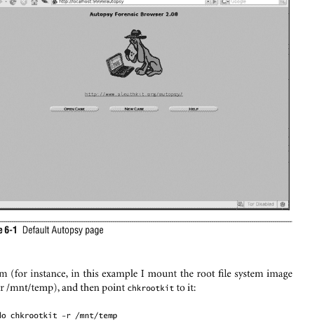

## 图 6-1 默认 Autopsy 页面

`system`（例如，在本例中我将根文件系统镜像挂载在`/mnt/temp`下），然后将`chkrootkit`指向它：

```
$ sudo chkrootkit -r /mnt/temp
```

最终，对一台主机的完整取证工作可能需要几天、几周甚至几个月才能完成，具体取决于你的经验、攻击的性质以及你希望做得多彻底。即使你决定重建主机并且已经知道攻击者是如何进入的，也值得尝试这些取证工具，因为它们将为你提供更深入的了解，从而长期更好地理解你的系统如何工作。

# 第 7 章 备份

你的数据有许多敌人。谈到磁盘时，问题不是你的硬盘会不会故障，而是何时故障。除了硬盘故障之外，还有`rm`、`dd`以及其他许多 Linux 命令，它们在销毁数据方面效率极高。只要问问我的一位好朋友，他当时正试图清理他的 MP3 目录。我们很多人都在帮他完善一个`find`脚本，该脚本会删除 MP3 目录中所有不以`.mp3`结尾的文件。尽管我们警告他先用`echo`测试脚本，他还是运行了完整命令：`find . -type f ! -name '*.mp3' -exec rm -f {} \;`。起初看起来似乎运行正常，直到他发现自己并没有在 MP3 目录中运行该命令——他在`~`，即他的主目录中运行了它。没错，他清理了 MP3 目录，连同其他所有文件。归根结底，确保数据安全的唯一真正方法就是备份它。

在 Ubuntu 下备份数据的方法有很多种，在本章中我介绍了一个名为 BackupPC 的图形化工具。我还讨论了一些常识性的备份技巧，并描述如何创建驱动器或分区的完整镜像。我还包括了备份数据库时的一些特殊注意事项。到本章结束时，如果你还没有设置备份系统，我希望你会被 Ubuntu 下设置备份系统是多么容易所鼓舞。

## 备份原则

在设置备份策略时，有一些原则应该指导你。大多数这些都是常识，但值得重申：

- **备份数据到独立的系统。** 该独立系统可能是一个单独的驱动器、一盘磁带，或理想情况下是一个完全独立的主机。重点是不将数据备份到同一驱动器上。你真的希望备份与系统尽可能隔离——即使是我家里的个人数据，我也设置了一个备份系统，将我最重要的文件复制到州外的服务器上。这样，如果我的房子烧毁或服务器发生严重的文件系统损坏，我的重要数据仍然存在。

- **测试你的备份。**

如果你还没有成功地从备份中恢复，你就真的没有备份任何东西。在设置备份系统后，你必须确保能够从中恢复。之后定期跟进测试恢复过程是一个好习惯。最糟糕的时候才发现备份不起作用，就是当你真的需要文件的时候。

- **RAID 不是备份的替代品。**

初级管理员常见的错误是将 RAID 误认为备份。RAID 为你提供硬盘的冗余，以便如果某个磁盘故障，你的数据仍安全地保存在其他磁盘上。RAID *不会* 保护你免受用户删除文件或更糟的完整文件系统损坏的影响。在 RAID 镜像的情况下，如果你向一个驱动器写入了错误数据，该错误数据只会被复制到第二个驱动器。此外，RAID 控制器在关闭时死亡并向磁盘写入错误数据的情况并不罕见。在这些情况下的任何一种，如果你没有保留与 RAID 分开的备份，你的数据就会丢失。

- **创建完整和增量备份计划。**

服务器上的大多数文件往往保持不变，特别是当谈到核心操作系统文件时。因此大多数管理员选择在较长时间内进行完整备份（每个文件的完整副本），例如每周一次，以及在较短时间内进行增量备份（仅自上次备份以来更改过的文件），通常是每天。由于增量备份通常涉及的文件较少，因此占用空间更小，完成速度更快。只要记住，如果你恢复多个文件，就有可能某些文件未包含在最新的增量备份中。安全的做法是从完整备份恢复，然后再恢复所有后续的增量备份，如果你不确定每个文件是否都进入了最近一次备份。

- **决定备份频率。**

一个常见的问题可能是“应该多久备份一次？” 基本答案是“你能承受损失多少工作？” 许多组织可以承受损失多达一天的工作，因此他们备份

每晚。如果你只能承受丢失几个小时的工作，那么你需要每隔几小时备份一次数据。

- 归档你的备份。

虽然能够永远保存备份固然很好，但现实是备份会消耗惊人的存储空间。你可能只能在系统上保留一个月的备份，然后就会耗尽空间。即便如此，也请考虑将旧备份归档到独立存储中，例如磁带、USB 驱动器，甚至刻录成 DVD 并贴上标签存放在保险柜里。许多组织保留一个月的备份，然后每月、每季度或每年将完整备份归档。这样，他们在那个时间点拥有数据快照，即使备份服务器本身着火，仍然有一份数据可用。

## 驱动器镜像

镜像是驱动器的逐位完整副本。一旦你对驱动器进行了镜像，其镜像应与原始驱动器无法区分。备份系统最可靠（虽然可能有些浪费）的方法之一就是对驱动器进行镜像。即使你不采用驱动器镜像作为备份策略，你也会发现许多其他场合下驱动器镜像能派上用场，从克隆系统到文件系统恢复，再到取证分析。

> 注意：在对驱动器进行镜像时，务必确保该驱动器未被使用。如果在镜像过程中驱动器发生变化，则无法保证镜像的一致性，因此请确保驱动器上的所有文件系统均已卸载。要求被镜像的驱动器不在使用中，正是大多数人不将镜像作为主要备份策略的另一个原因。

经典的 UNIX 镜像工具是`dd`，你几乎可以在任何 Linux 系统上找到它，而且任何 Ubuntu 服务器上肯定都有。这个直接而粗暴的工具在其最基本的形式下，逐位读取输入文件并逐位复制到输出文件。如果你有两个大小相同的驱动器`/dev/sda`和`/dev/sdb`，以下是将`sda`镜像到`sdb`的命令：

```
$ sudo dd if=/dev/sda of=/dev/sdb
```

当然，`dd`可以使用任何文件作为输入和输出文件，因此你可以不镜像到另一个驱动器，而是镜像到一个文件。这在取证分析时特别方便，因为你可以将大量文件系统镜像存储在一个大容量 USB 驱动器上。假设你已将 USB 驱动器挂载到`/media/disk1`，下面是如何将`/dev/sda`镜像到该驱动器上的文件：

```
$ sudo dd if=/dev/sda of=/media/disk1/sda-image.img
```

要从该镜像还原，只需将两个参数互换即可。以下是还原前面两个示例的命令：

```
$ sudo dd if=/dev/sdb of=/dev/sda
$ sudo dd if=/media/disk1/sda-image.img of=/dev/sda
```

你还可以对单个分区进行镜像。这很有用，因为你可以轻松地以回环方式挂载镜像并读取其中的内容。首先，让我们对`/dev/sda`上的一个分区进行镜像：

```
$ sudo dd if=/dev/sda1 of=/media/disk1/sda1-image.img
```

现在，你可以创建一个目录`/mnt/temp`，并使用`loop`挂载选项挂载此镜像：


```
$ sudo mkdir /mnt/temp
$ sudo mount -o loop /media/disk1/sda1-image.img /mnt/temp
```

当你只需要从镜像中恢复几个文件时，这非常方便。你可以像浏览其他文件系统一样浏览 `/mnt/temp`，并从中复制单个文件或整个目录。要将此镜像复制回原始驱动器，再次颠倒参数即可：

```
$ sudo dd if=/media/disk1/sda1-image.img of=/dev/sda1
```

另一个有用的技巧是通过网络进行镜像。事实上，某些服务器可能没有连接单独磁盘来存放镜像。一种方法是设置一台存储空间充足的远程 NFS 服务器，然后在本地系统上挂载 NFS 共享，并通过这种方式创建镜像文件。当然，这要求你先设置好 NFS 服务器。另一种方法是将 `dd` 的输出通过管道传给 `SSH`。由于大多数服务器可能都装有 `SSH`，你无需额外配置任何东西即可创建此镜像，所有数据都将通过加密通道传输。

要将 `/dev/sda` 从本地机器通过网络传输到 `10.1.1.5`，并将镜像转储到 `/media/disk1/sda-image.img`，你可以输入

```bash
$ sudo dd if=/dev/sda | ssh username@10.1.1.5 \
"cat > /media/disk1/sda-image.img"
```

要还原此镜像：

```bash
$ ssh username@10.1.1.5 "cat /media/disk1/sda-image.img" |
sudo dd of=/dev/sda
```

## 数据库备份

在大多数情况下，备份系统就像复制其文件一样简单。然而，在数据库系统上，事情就不那么简单了。数据库通常不会立即将更改提交到磁盘，因此如果你只是简单地复制数据库文件，数据库本身可能处于不一致的状态。当你还原它时，不一定能保证它是一个未损坏的副本。

解决这个问题的方法是使用数据库自带的工具，将整个数据库一致地转储到一个可以进行备份的文件中。下面我将介绍如何在 Ubuntu 下使用 MySQL 和 PostgreSQL 数据库提供的工具。

## MySQL

MySQL 用于创建数据库备份的工具称为 `mysqldump`。该工具会将整个数据库或多个数据库转储到屏幕。大多数人随后会将输出重定向到文件，或通过管道传给 `gzip` 等工具先进行压缩。例如，如果你这个用户有一个名为 `wordpress` 的数据库，下面是你备份它的方式：

```
$ mysqldump wordpress > wordpress_backup.sql
```

如果你想在导出数据库的同时进行压缩，可以在中间加上管道到 `gzip`：

```
$ mysqldump wordpress | gzip > wordpress_backup.sql.gz
```

现在如果你想备份不止一个数据库，主要有两种方法。第一种方法是使用 `--databases` 参数，后面跟要备份的数据库的空格分隔列表。另一种方法是使用 `--all-databases` 参数，它会备份所有内容：

```
$ mysqldump --all-databases > all_databases_backup.sql
```

当然，我假设你为数据库用户设置了密码，因此这些命令对这些用户不起作用。特别是如果你想备份所有数据库，就尤其不会起作用，因为其中至少有一些是 root 用户拥有的。解决方案是使用 `-u` 和 `-p` 选项来指定要使用的用户和密码：

```
$ mysqldump --all-databases -u root -pinsecure > all_databases_backup.sql
```

上面的命令将使用密码 `insecure` 以 root 用户身份备份所有数据库。我列出这个例子只是想说，虽然这个选项可行，但它是不安全的。原因在于，完整的参数列表，包括密码，会对系统上运行 `ps` 命令的所有用户可见。更好的方法是使用 `-p` 但不指定密码：

```
$ mysqldump --all-databases -u root -p > all_databases_backup.sql
```

当你指定 `-p` 而不带密码时，`mysqldump` 的行为就像 `mysql` 命令一样，会提示你输入密码。这提供了良好的安全性，但当然也意味着你必须手动输入密码。大多数备份 MySQL 数据库的人会设置一个 `cron` 作业在夜间执行。MySQL 建议你解决这个问题的方法是，在执行备份的用户 `~/.my.cnf` 文件的 `client` 部分中添加密码。如果你还没有 `~/.my.cnf` 文件，创建一个新文件并添加以下文本：

```
[client]
password=moresecure
```

将 `moresecure` 替换为你的用户登录时使用的密码。一旦设置好此文件，你就不再需要指定 `-p` 选项，因为 `mysqldump` 会从此文件中读取密码。当然，这里的问题是该密码以明文形式存储在系统文件中，因此你需要设置其权限以便只有你的用户可以查看：

```
$ chmod 400 ~/.my.cnf
```

## 恢复 MySQL 备份

如果无法从中恢复，备份就没什么用。要在 MySQL 中恢复备份，请使用 `mysql` 命令行工具并指向你的备份。例如，要将 `test` 数据库备份到 `test_backup.sql`，你需要输入

```
$ mysql test < test_backup.sql
```

如果你备份的是多个数据库，只需输入

```
$ mysql < multiple_database_backup.sql
```

要恢复所有数据库，你需要以 root 用户身份登录。当然，你是一位安全的 MySQL 管理员，并且已设置了 root 密码，因此你必须使用 `-p` 选项（除非你设置了 `.my.cnf` 文件，在这种情况下可以省略 `-p`）：

```
$ mysql -u root -p < all_databases.sql
```

## MySQL 备份 Cron 作业

由于大多数人通常希望至少每天提供一次 MySQL 备份，这里有一个快速简单的方法来设置 `cron` 作业。首先选择你要存储备份的位置。在此示例中，我仍然将备份存储在 `/root` 中，因为我知道只有 root 可以读取该目录，但你可能希望将其存储在其他有更多空间的位置。

主要需要考虑的是你要保留多少个备份。如果你已经有某种备份系统来备份所有文件，你可能只需要保留一个数据库备份文件在系统上，因为旧版本将存储在你的远程备份服务器上。如果你想存储比如一周的备份，可以使用一个简单的 shell 技巧。`date` 命令不带参数可以输出当前日期，但你可以添加一些参数使其仅输出，例如当前星期几：

```
$ date +%A
Friday
```

运行 `mysqldump` 时，你可以将整个命令用反引号括起来，shell 将用命令的输出替换脚本的该部分。因此，如果你写

```
$ mysqldump -u root --all-databases > /root/all_databases_backup-`date +%A`.sql
```

shell 实际上会将数据库保存到 `/root/all_databases_backup-Friday.sql`。这意味着第二天运行该命令时它会命名为 Saturday，以此类推。一周后，新备份将自动覆盖前一周的备份，而无需你编写额外的 shell 逻辑。要使此命令每晚运行，你只需以 root 身份创建一个名为 `/etc/cron.daily/mysqlbackup` 的文件，其中包含以下脚本：

```
#!/bin/sh

mysqldump -u root --all-databases > /root/all_databases_backup-`date +%A`.sql
```

然后你需要输入 `chmod a+x /etc/cron.daily/mysqlbackup` 使脚本可执行。

最后，如果你为 MySQL 设置了 root 密码，你必须创建 `/root/.my.cnf` 文件并在其中放入密码，如前所述。现在每晚当 `cron.daily` 脚本运行时，此脚本也会运行。如果你想更改要保留的备份数量，只需更改反引号中的 `date` 命令即可。如果你只想要一个备份，可以

just save to an ordinary file. If you want to keep a month's worth of backups, for instance, just replace `%A` with `%d`, which lists the day of the month starting with 01.

## PostgreSQL


PostgreSQL uses a backup mechanism similar to MySQL's in that it provides a command-line dump tool called `pg_dump` that dumps one or more databases to the command line. In its simplest form it behaves a lot like the `mysql` dump command. To back up a database named `test`, created by your user, you could type

```
$ pg_dump test > test_backup.sql
```

The main database user for PostgreSQL is the `postgres` user, so you are more likely to do backups as that user:

```
$ sudo -u postgres pg_dump test > test_backup.sql
```

To back up all PostgreSQL databases, use the `pg_dumpall` command instead:

```
$ sudo -u postgres pg_dumpall > all_databases_backup.sql
```

Restoring PostgreSQL databases works much like MySQL except you use the `psql` tool. Here is how you would restore each of the backups I did previously:

```
$ psql test < test.sql
$ sudo -u postgres psql test < test.sql
$ sudo -u postgres psql < all_databases_backup.sql
```

## PostgreSQL Backup Cron Job

The cron job to back up PostgreSQL is very similar to the one for MySQL, except in this case there's no need to set up any `/root/my.cnf` files. You just need to create a new file called `/etc/cron.daily/postgresqlbackup` containing the following:

```
#!/bin/sh

/usr/bin/sudo -u postgres /usr/bin/pg_dumpall >
/root/all_databases_backup-`date +%A`.sql
```

Then you would make the script executable with `chmod a+x /etc/cron.daily/postgresqlbackup`. Now every night when the `cron.daily` scripts run, this script will run as well. Changing how many backups you keep is as easy as changing the `date` command within the backticks. If you wanted only one backup, you can just remove the backticks and everything between them. If you wanted to keep a month's worth of backups, for instance, just replace `%A` with `%d`, which will output the day of the month starting with 01.

## BackupPC

One of the simpler but still powerful backup programs for Ubuntu is called `BackupPC`. `BackupPC` is written in Perl and can make use of `tar` and `rsync` to back up Linux and UNIX hosts, and it can mount and back up SMB shares. Unlike many other backup programs, `BackupPC` does not necessarily back up a particular machine at the same time every day. This software was designed with networks of desktops that power off at the end of the day in mind, so as you add hosts, it probes them to see if they are up. If `BackupPC` is able to back them up during the evening backup window it will, but if it can't, it will attempt to back up the host during the day.

A nice feature of `BackupPC` is that it not only compresses files it has backed up, it also scans through all of the files daily and, where it sees duplicates, creates a hard link. Since a lot of servers tend to have the same system files, this method means that you can squeeze a lot more data on a lot less disk. `BackupPC` is packaged for Ubuntu, so you can use your package manager to install it:

```
$ sudo apt-get install backuppc
```

`BackupPC` includes a Web-based interface you can use to manage backup jobs, view logs, and restore files, so it will include the Apache packages it needs if they aren't already installed. During the install process you will be prompted to select a Web server for `BackupPC`. Unless you set up your own Web server ahead of time and know what you are doing, select `apache2` here. `BackupPC` uses Apache `htpasswd` accounts to password-protect the page, and the installer creates a `backuppc` user and outputs a random password to the screen, so be sure to jot it down. If you forget to do that or forget the password later on, you can use the `htpasswd` command against the `/etc/backuppc/htpasswd` file.


After the installer completes, open a Web browser and point it to the `/backuppc` directory on that host, so if your host was 10.1.1.7, you would point it to http://10.1.1.7/backuppc/. You will be prompted for login credentials, so use the login and password you were given during the install. Once you are logged in, you will see the default BackupPC admin page as shown in Figure 7-1.

## BackupPC Storage

As with any other backup server, BackupPC needs a lot of storage. All of the backups are ultimately stored under `/var/lib/backuppc`. so if you have a separate disk (or set of disks in a RAID) for BackupPC, this is a good place to mount it. Let’s assume you have a second SCSI partition at `/dev/sdb1` that you want to use for BackupPC. First move the old directory out of the way, mount the new drive, and copy over the current `/var/lib/backuppc`

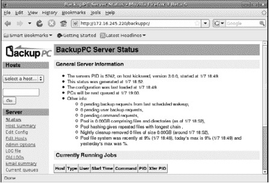

**Figure 7-1** Default BackupPC Web interface

首先，在进行此操作时，必须停止 BackupPC，以免它在你更改目录时写入该目录：

```
$ sudo service backuppc stop
$ sudo mv /var/lib/backuppc /var/lib/backuppc.orig
$ sudo mkdir /var/lib/backuppc
$ sudo chown backuppc:backuppc /var/lib/backuppc
$ sudo mount /dev/sdb1 /var/lib/backuppc
$ sudo rsync -av /var/lib/backuppc.orig/ /var/lib/backuppc/
$ sudo service backuppc start
```

最后，不要忘记将新的 `/dev/sdb1` 挂载点添加到 `/etc/fstab` 中，以便系统下次启动时自动挂载。

## 默认 BackupPC 配置

当然，在添加主机之前，默认的 Web 界面并不是很有用。BackupPC 的默认行为由 `/etc/backuppc/config.pl` 定义，这是其核心配置文件。如果你不熟悉 Perl，这个文件乍一看可能会有点令人生畏，因为所有选项都是在 Perl 数据结构中配置的。我将带你逐步添加一个 Ubuntu 主机并使用 rsync 对其进行备份，正如你将看到的，一旦核心配置文件设置好，添加主机就相对简单了。

`config.pl` 文件定义了 BackupPC 备份所有主机的默认设置，例如备份频率、备份哪些目录、是使用 smb、rsync 还是 tar 进行备份，甚至要向这些命令传递什么参数。你想要做的是生成一个适用于大多数主机的 `config.pl`，然后在主机需要特殊选项时创建主机特定的配置文件。任何主机特定的配置都进入 `/etc/backuppc/` 下以主机命名的 `.pl` 文件。因此，如果你有一个名为 `web1` 的主机并且只想为其更改一些设置，你就会将这些特定选项从 `/etc/backuppc/config.pl` 复制到 `/etc/backuppc/web1.pl`。当备份 `web1` 时，`web1.pl` 中设置的任何选项都会覆盖 `config.pl` 中的任何内容。

在本示例中，我假设网络主要由其他 Ubuntu 服务器组成，并使用 rsync 进行备份。这非常重要，因为默认情况下 BackupPC 通过 SSH 以 root 身份登录。在由 Ubuntu 服务器组成的网络中这行不通，因为 root 默认是禁用的，所以我们需要更改一些设置。

编辑 BackupPC 配置有两种不同的方法。第一种（也更简单）是通过 Web 界面；第二种你只需用文本编辑器打开 `/etc/backuppc/config.pl` 并直接查找和调整设置。

### 基于 Web 的配置

你实际上可以直接从 Web 界面更改所需的所有选项。从 BackupPC 主页点击左侧窗格中的 Edit Config 链接，然后点击右侧窗格顶部 Xfer 链接。你将看到类似图 7-2 的配置屏幕。在 XferMethod 下拉菜单中将 smb 改为 rsync。然后向下滚动直到看到 `RsyncClientCmd` 和 `RsyncClientRestoreCmd` 选项。将两者都从

```
$sshPath -q -x -l root $host $rsyncPath $argList+
```

改为

```
$sshPath -q -x -l backuppc $host sudo $rsyncPath $argList+
```

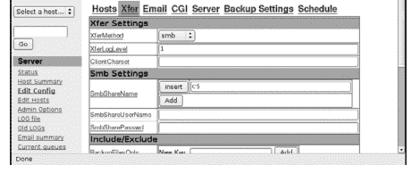

图 7-2 BackupPC Xfer 配置选项

然后滚动回页面顶部并点击 Save 按钮。完成所有更改后，点击左侧边栏中的 Admin Options 链接，然后点击 Reload，以便 BackupPC 可以读取你的新设置。

### 命令行配置

虽然 Web 界面提供了配置 BackupPC 的简便方法，但有些人更喜欢全部通过命令行完成。如果你是其中之一，请在你喜欢的文本编辑器中打开 `/etc/backuppc/config.pl` 文件，然后搜索匹配以下行的行：

```
$Conf{XferMethod} = 'smb';
```

此选项定义了 BackupPC 用于传输文件的默认方法。SMB 可能适用于 Windows 机器网络，但由于我们有 Ubuntu 主机，所以我们将其更改为 rsync：

```
$Conf{XferMethod} = 'rsync';
```

接下来，我们需要设置 BackupPC 使其以普通用户身份登录到每台机器，然后使用 sudo 成为 root。我们在每台主机上创建一个 `backuppc` 用户以及一个安全的 sudo 角色，以便 BackupPC 可以登录并备份该机器。首先找到以下行：

```
$Conf{RsyncClientCmd} = '$sshPath -q -x -l root $host $rsyncPath $argList+';
```

这定义了 BackupPC 使用 rsync 备份时使用的命令。将其更改为

```
$Conf{RsyncClientCmd} = '$sshPath -q -x -l backuppc $host sudo $rsyncPath $argList+';
```

并且沿着与之前选项相同的思路更改该设置：

```
$Conf{RsyncClientRestoreCmd} = '$sshPath -q -x -l backuppc $host sudo $rsyncPath $argList+';
```

默认情况下，BackupPC 会备份整个根文件系统以及所有挂载的文件系统。我现在保留此设置不变，因为我确实希望备份主机上的所有文件，但我在本章后面讨论了如何更改它。

## 配置客户端机器

现在你已经更改了 `config.pl` 选项，可以设置 BackupPC 使其能够登录并备份你的客户端。在此示例中，我们将客户端称为 `web1`，因此在示例中看到 `web1` 的地方，请将其替换为你的客户端主机名。

## 配置 SSH 密钥

由于 BackupPC 需要能够无需交互地登录到主机，因此你必须为 `backuppc` 用户设置无密码 SSH 密钥。在 BackupPC 服务器上输入

```
$ sudo -u backuppc ssh-keygen -t rsa
```

在每个提示处按 Enter 接受默认值。公钥和私钥将存储在 `/var/lib/backuppc/.ssh/` 中。

## 设置客户端

现在登录到你的客户端并创建一个 `backuppc` 用户（在提示输入姓名和房间号以及有关用户的其他信息时按 Enter）并为同一用户创建 `.ssh` 目录：


```
$ sudo adduser backuppc --disabled-password
$ sudo mkdir /home/backuppc/.ssh
$ sudo chown backuppc /home/backuppc/.ssh
```

> 注意 如果你的客户端尚未运行 SSH 服务器，则运行 `sudo apt-get install openssh-server`。

现在你需要将 BackupPC 服务器上 `/var/lib/backuppc/.ssh/id_rsa.pub` 文件的内容复制到 `/home/backuppc/.ssh/authorized_keys` 文件中。一种方法是分别在两个终端窗口中登录到两台机器，打开两个文件，然后使用鼠标在它们之间复制粘贴。另一种方法是在服务器上使用 `scp` 将文件复制到客户端的 `/tmp` 目录，然后登录到客户端再从那里复制。

在服务器上：

```
$ sudo scp /var/lib/backuppc/.ssh/id_rsa.pub user@web1:/tmp/
```

将 `user@web1` 替换为客户端上的用户名和主机名。然后在客户端上：

```
$ sudo sh -c "cat /tmp/id_rsa.pub >> /home/backuppc/.ssh/authorized_keys"
```

现在你应该能够前往 BackupPC 服务器并以 `backuppc` 用户身份无需密码登录到客户端：

```
$ sudo -u backuppc ssh web1
```

### 配置 sudo

现在我们需要在客户端机器上配置 sudo，以便 `backuppc` 用户可以无需密码以 root 身份运行 `rsync`。为此，在客户端上运行 `sudo visudo` 并在 `/etc/sudoers` 文件中添加以下行：

```
backuppc ALL=(root) NOPASSWD:/usr/bin/rsync
```

## 将客户端添加到 BackupPC

现在 BackupPC 可以登录到客户端并以 root 身份运行 `rsync`，我们准备好将其添加到 BackupPC 备份的主机列表中。所有主机都定义在 `/etc/backuppc/hosts` 中，你可以通过直接编辑文件或通过 Web 界面添加主机。

### Web 界面

要在 Web 界面中添加主机，请单击左侧边栏中的 Edit Config，然后单击右窗格顶部的主机链接。单击 Add 按钮添加新主机，完成后单击 Save 按钮。最后，单击左侧边栏中的 Admin Options，然后单击 Reload 按钮，以便 BackupPC 重新加载更改。

### 命令行

要通过命令行添加主机，请在文本编辑器中打开 `/etc/backuppc/hosts` 并在底部添加以下行：

```
web1 0 backuppc
```

将 `web1` 更改为你想要备份的服务器的主机名。`0` 告诉 BackupPC 该主机具有静态 IP 地址，最后的 `backuppc` 设置了可在 Web 界面中管理此主机的用户。我在此示例中只使用了单个空格，但你可以用多个空格分隔列，使其对齐并看起来更美观。如果希望其他用户也能通过 Web 界面备份和恢复此主机，可以在此行添加第四列并列出这些用户，用逗号分隔。因此，如果我有两个用户 `allan` 和 `jorge` 我希望他们能够管理 `web1`，该行将读作

```
web1 0 backuppc allan,jorge
```

保存对 `/etc/backuppc/hosts` 的更改后，使用 `sudo service backuppc reload` 或 `sudo /etc/init.d/backuppc reload` 告诉 BackupPC 重新加载其配置。

## 启动第一次备份作业

BackupPC 程序重新加载其配置后，返回 BackupPC Web 界面并重新加载页面。你应该能在页面左侧的“Select a host…”下拉菜单中看到你的主机。选择该选项，你将看到如图 7-3 所示的默认主机页面。要测试一切是否设置正确，请单击 Start Full Backup 以启动该主机的首次备份。然后你可以单击左侧边栏中的 Status 进入主状态页面，查看备份作业是否已启动。它应类似于图 7-4。 要停止特定主机的作业，请转到该主机的页面，然后单击 Stop/Dequeue Backup 按钮。

## rsync 微调

虽然对于大多数普通用户来说，默认的 `rsync` 选项应该已经足够，但根据你的环境，你可能还想启用一些额外的选项。

### 校验和种子

如果你的主机相对较新，那么它应该带有版本号大于或等于 2.6.3 的 `rsync`（如果你不确定自己的版本，可以输入 `rsync --version` 查看）。如果是这样，你可以利用 `--checksum-seed` 选项，它可以缓存 `rsync` 的校验和，从而整体上加快 `rsync` 进程。为此，你需要将该选项添加到 BackupPC 配置中的 `RsyncArgs` 和 `RsyncRestoreArgs` 选项中。

要通过 Web 添加此设置，请点击侧边栏中的 Web Config，然后点击 Xfer 链接。向下滚动到 `RsyncArgs` 选项，你可以看到每个选项单独占一行。在这些选项的末尾有一个 Add 按钮。点击该按钮并添加 `--checksum-seed=32761`。然后向下滚动，将相同的选项添加到 `RsyncRestoreArgs` 部分。

要在命令行上做同样的更改，请用文本编辑器打开 `/etc/backuppc/config.pl`，并找到包含 `$Conf(RsyncArgs)` 的那一行。每个 `rsync` 选项单独占一行，但如果你仍在使用随软件包附带的 `config.pl`，你会看到该选项被注释掉了：

```
#' --checksum-seed=32761' ,
```

只需将该选项开头的 `#` 去掉即可。如果你没有看到这个被注释掉的选项，只需在最后一个 `RsyncArgs` 选项下方添加一行，内容为：

```
' --checksum-seed=32761' ,
```

然后向下移动到 `RsyncRestoreArgs` 部分（通常它就是下一个选项），对该选项执行同样的操作。

### 单一文件系统

默认情况下，BackupPC 会遍历主机上的所有文件系统，并备份所有内容。在某些情况下，你可能不希望这是默认行为，尤其是在集群环境中，你可以通过重建主机来轻松替换主系统文件。在这种情况下，你真正想要做的是让 `rsync` 一次只处理一个文件系统，然后指定 BackupPC 应备份哪些挂载点。

第一步相对简单，因为这个选项与 `--checksum-seed` 选项位于同一位置。按照我上面描述的步骤，在 Web 界面或命令行中将 `--checksum-seed` 选项添加到 `RsyncArgs` 和 `RsyncRestoreArgs`。不过，这次你要添加的选项是：

```
--one-file-system
```

设置该选项后，你必须定义 BackupPC 将要备份的每个文件系统。在此示例中，假设你将 `/home` 和 `/var` 放在不同的分区上，并且只想备份它们。你要更改的选项称为 `rsyncShareName`。在 Web 界面中，返回到你用来将 `--one-file-system` 添加到 `RsyncArgs` 的 Xfer 配置界面。在该部分上方，你会看到名为 `RsyncShareName` 的部分。与 `RsyncArgs` 一样，每个共享独占一行。首先，将第一个选项从 `/` 改为 `/home`。然后点击 Add 按钮，添加一个名为 `/var` 的新共享。

要在命令行中更改同一选项，请打开 `config.pl`，找到类似于以下内容的行：

```
$Conf{RsyncShareName} = '/';
```

并将其改为：

```
$Conf{RsyncShareName} = ['/home', '/var'];
```

**排除目录**

你可能会发现，你通常想要备份主机上的所有文件，但有几个目录除外。例如，在上面的示例中，你可能想要备份 `/home` 和 `/var`，但也许你想跳过 `/var/spool/mail` 和 `/var/tmp`。要做到这一点，你可以回到 Web 界面的 Xfer 配置界面，向下滚动到 `BackupFilesExclude` 选项。然后在 New Key 字段中输入 `/var/tmp`，并点击 Add。刷新屏幕后，你可以向下滚动，以同样的方式添加 `/var/spool/mail`。

如果你想在命令行中更改此项，请在文件中搜索，直到看到类似这样的行：

```
$Conf{BackupFilesExclude} = undef;
```

默认情况下，不会排除任何文件。要添加这两个目录，请将该选项改为：

```
$Conf{BackupFilesExclude} = ['/var/tmp', '/var/spool/mail'];
```

与任何配置更改一样，完成所有更改后，不要忘记保存然后重新加载 BackupPC，以便更改生效。

### 主机特定的微调


虽然你可以设置一个适用于大多数主机的默认 BackupPC 配置，但你很可能会遇到一些需要与默认配置略有不同的机器。使用 BackupPC，从默认配置中分支出来并自定义选项尤其容易。例如，你可能只想在某台主机上应用`--one-file-system`选项或排除某些目录。

基本上，要为特定主机添加自定义选项，请将这些选项从`/etc/backuppc/config.pl`文件复制到`/etc/backuppc/hostname.pl`中，其中 hostname 是你要更改的主机的名称。因此，举例来说，如果你想在 BackupPC 主机上只备份`/home`和`/var`，并且不遍历名为 web1 的主机上的文件系统，你需要将整个`RsyncArgs`和`RsyncRestoreArgs`以及`RsyncShareName`选项复制到名为`/etc/backuppc/web1.pl`的文件中。结果大致如下：

```
$Conf{RsyncShareName} = ['/home', '/var'];
$Conf{RsyncArgs} = [
    #
    # Do not edit these!
    #
    '--numeric-ids',
    '--perms',
    '--owner',
    '--group',
    '-D',
    '--links',
    '--hard-links',

    '--times',

    '--block-size=2048',

    '--recursive',

    # my custom options

    '--one-file-system',

];

$Conf{RsyncRestoreArgs} = [

    # Do not edit these!

    #

    '--numeric-ids',

    '--perms',

    '--owner',

    '--group',

    '-D',

    '--links',

    '--hard-links',

    '--times',

    '--block-size=2048',

    '--recursive',

    # my custom options

    '--one-file-system',

];
```

## Change the Backup Schedule

默认情况下，BackupPC 每周进行一次完整备份，期间对每个主机进行增量备份。BackupPC 会保留一次完整备份和六次增量备份，然后才删除任何内容。最后，BackupPC 不会在工作日上午 7:00 至下午 7:30 之间为始终在线网络的主机启动新任务。这些默认值并不适合所有人。例如，你可能需要保留一个月的完整备份，或者大家可能在下午 6:00 就离开办公室，这样你就可以在那时开始备份。所有这些选项都可以在 BackupPC Web 界面中轻松更改。

首先，点击左侧边栏中的 Edit Config 链接，然后点击屏幕右上角的 Schedule 链接。你将看到如图 7-5 所示的计划编辑屏幕。第一组选项让你可以安排完整备份。每个选项都链接到手册页，以便你可以阅读它们所更改的内容。

`FullPeriod`选项定义了在安排新的完整备份之前应经过的时间（以天为单位）。此选项始终设置为略低于一个完整数字。以默认值 6.97 为例，完整备份将每七天安排一次。`FullKeepCnt`和`FullKeepCntMin`选项分别配置要保留的完整备份数量和要保留的最小数量，而`FullAgeMax`定义了在删除旧完整备份之前的最长天数。增量备份可以通过仅备份自上次完整备份以来发生更改的内容来节省备份资源。它们采用与完整备份大部分相同的选项，默认情况下每天运行并保存最后六个。

此页面的 Blackouts 部分让你可以定义 BackupPC 的黑名单时段。黑名单时段是在此期间 BackupPC 不会尝试备份始终在线网络的主机的范围。这样，如果你有在晚上可能关机的桌面电脑，BackupPC 会在白天备份它们，但对于始终在线的服务器，BackupPC 知道可以在晚上它们负载较低时再备份。当你向 BackupPC 添加新主机时，它会定期`ping`该主机以确定它是否始终在线网络。如果是，BackupPC 只会在黑名单时段内备份它。`hourBegin`选项定义黑名单时段开始的小时或小时的分数，而`hourEnd`选项设置其结束时间。`weekDays`选项设置黑名单时段生效的星期几。默认情况下，黑名单时段为周一至周五上午 7:00 至下午 7:30。

为了演示如何更改这些选项，我定义了一种可能在组织中使用的不同备份策略。在该组织中，我们希望每周进行完整备份并每天进行增量备份，但我们希望在丢弃之前保存长达一个月的完整备份。我们还希望保留最近两周的增量备份。最后，办公室里每个人都在下午 6:00 离开，所以我们希望在那时开始备份。要进行这些更改，我只需要更改以下值：

```
FullKeepCnt = 4
IncrKeepCnt = 12
hourEnd = 18
```

## Restore Files

备份文件固然好，但如果不能恢复它们就没什么用。我认为 BackupPC 最好的功能之一就是其易于使用的基于 Web 的恢复。如果你为`backuppc`设置了额外的 Web 账户（使用`htpasswd -c /etc/backuppc/htpasswd username`），你可以将这些账户添加到`/etc/backuppc/hosts.conf`中的特定主机（或在 Web 界面中），然后这些用户可以登录 BackupPC 并恢复自己的文件。

要恢复主机上的文件或目录，首先转到 BackupPC 上该主机的主页（在左侧边栏的下拉菜单中选择主机）。在主机的主页面上，你会看到一个已完成的备份列表的表格，其中列出了备份是完整还是增量、备份开始时间、耗时以及这些文件存储在文件系统中的位置。点击某一行开头的超链接备份编号以从该备份恢复。然后你将看到主机在页面上的整个目录结构，文件和目录旁边有复选框（图 7-6）。该界面类似于大多数文件管理器，你可以点击单个目录将其展开。选择好要恢复的所有文件后，点击页面顶部或底部的“Restore selected files”按钮。

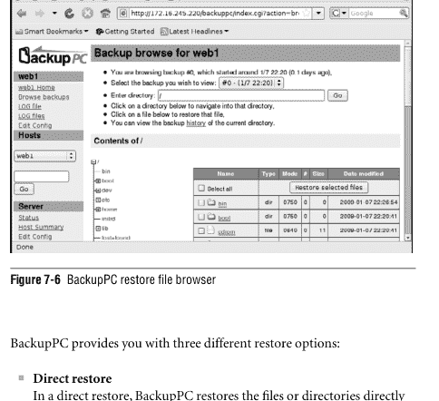

## Figure 7-6 BackupPC restore file browser

BackupPC 为您提供了三种不同的恢复选项：

- Direct restore

在直接恢复中，BackupPC 将文件或目录直接恢复到一台主机。您实际上可以选择恢复到哪台主机，因为 BackupPC 允许您选择其配置的任何主机。默认情况下 BackupPC 会恢复到文件原本所在的共享以及共享下的目录，因此如果您想覆盖或替换当前的内容，只需点击 Start Restore 按钮即可。您甚至可以在需要时用完整备份完全覆盖远程主机上的整个`/`目录。您也可以不将文件恢复到原始目录，而是恢复到不同的目录，以便比较两个文件。

- Download zip archive

当您备份 Windows 桌面并允许用户自行恢复其文件时，此选项非常有用。与直接将文件恢复到主机不同，您可以生成一个包含所有恢复文件和目录的 .zip 文件并将其下载到当前计算机。

- **Download tar archive**

此选项与 zip 归档选项本质上相同，只是这种情况下您获得的是 tar 归档，这对 Linux 桌面更有用。

## Ubuntu BackupPC Conventions

- `/etc/backuppc`：此目录包含 BackupPC 的所有配置文件，包括其 Apache 配置和任何主机特定的配置文件。

- `/etc/backuppc/config.pl`：所有默认的 BackupPC 选项都设置在`config.pl`文件中。随软件包默认提供的`config.pl`版本充满了文档，解释每个选项并给出示例。任何主机特定的配置都进入一个以主机命名并以`.pl`结尾的单独文件。

- `/etc/backuppc/hosts`：BackupPC 将备份的所有主机都在此处定义。

- `/etc/backuppc/htpasswd`：Web 用户及其密码默认设置在此文件中。这是标准的 Apache 密码文件，因此您可以使用`htpasswd`命令进行更改（输入`man htpasswd`以了解如何使用该程序）。

- `/etc/backuppc/apache.conf`：此文件定义了 BackupPC Web 管理页面的所有虚拟主机设置。BackupPC 从`/etc/apache2/conf.d/backuppc.conf`创建到此文件的符号链接，尽管如今它更适合放在`/etc/apache2/sites-available`下。

- `/etc/init.d/backuppc`：这是 BackupPC 的 init 脚本。BackupPC 在安装后默认启动服务，并在启动时自动启动。

- `/var/lib/backuppc`


此目录包含 BackupPC 备份的所有文件，因此您应考虑将此目录放在单独的大型挂载点上，或至少确保其有足够的可用空间。

- `/var/lib/backuppc/log`

每个备份的日志都可以在此目录下找到。您也可以从 Web 界面访问日志。

- `/var/lib/backuppc/pc`

每个主机在此都有自己的目录，包含其最新的文件集。BackupPC 使用硬链接将多个主机的相同文件合并在一起，但如果您已从 BackupPC 中删除一台主机并且也想删除其文件，请先删除此处的该主机目录。

# CHAPTER 8

## Monitoring


工具，然而，它能够扫描您的硬盘以查找故障，并在故障实际发生前发出警告。

第一步是安装 smartmontools 软件包：

```
$ sudo apt-get install smartmontools
```

该软件包包含一个名为 `smartd` 的守护进程，可以在系统启动时启动并开始监控您的驱动器。默认情况下 `smartd` 不会启动，因此您需要编辑 `/etc/default/smartmontools` 并取消注释读取为

```
#### start_smartd=yes
```

的行

现在 `smartd` 将在启动时启动，但您也希望手动启动它，以便它现在可用：

```
$ sudo /etc/init.d/smartmontools start
```

默认情况下 `smartd` 会扫描所有驱动器以查找启用了 SMART 的驱动器并对其进行监控，因此您此时无需执行任何特殊配置。当 `smartd` 检测到错误时，它会运行在 `/etc/smartmontools/run.d/` 下找到的任何脚本。默认情况下该目录下只有一个名为 `10mail` 的脚本，它会向 `root` 用户发送电子邮件以便其了解问题，但您也可以向此目录添加任意数量的自定义脚本，并且它们将按字母顺序运行。当 `smartd` 发现问题时，它会执行您的脚本并将错误文件的完整路径作为参数传递，因此在您的脚本中您可以通过 `$1` 变量访问它，例如。查看 `/etc/smartmontools/run.d/10mail` 脚本以获取一个简单的示例，您可以基于此创建自己的脚本。

## sysstat

让我们面对现实吧，您可能没有使用像 `top` 这样的工具登录到您管理的每个系统的终端。即使您这样做了，您在睡觉时仍然不会知道系统负载或 RAM 统计信息。现在一些管理员通过 `cron` 作业运行 `top` 来解决这个问题，但 Ubuntu 通过 sysstat 提供了更好的系统。sysstat 软件包提供了一个 number of useful system-monitoring tools, including `iostat`, which I cover in Chapter 11, Troubleshooting. These tools are useful for troubleshooting, but what makes them even more useful is that the sysstat package provides a simple mechanism to log system statistics like CPU load, RAM, and I/O stats. With these statistics, when someone complains that a system was slow around noon yesterday, you can play back these logs and see what could have caused the problem.

The first step is to install the sysstat package:

```
$ sudo apt-get install sysstat
```

Once the package is installed, you want to enable the data collection tool, so type

```
$ sudo dpkg-reconfigure sysstat
```

and answer Yes when prompted to activate sysstat’s cron job. Alternatively, you can also enable this in `/etc/default/sysstat`. Once enabled, sysstat gathers system stats every ten minutes and stores them under `/var/log/sysstat`. In addition, it will rotate out the statistics file every night before midnight. Both of these actions are run in the `/etc/cron.d/sysstat` script, so if you want to change how frequently sysstat gathers information, you can modify it from that file.

As sysstat gathers statistics, it stores them under `/var/log/sysstat` in files named `sa` and then the current day of the month. This means that you can go back up to a month from the current date and retrieve old statistics. Use the `sar` tool to view these statistics. By default `sar` outputs the CPU statistics for the current day:

```
$ sar
Linux 2.6.24-22-server (kickseed)      01/07/2009
...
07:44:20 PM   CPU   %user   %nice   %system   %iowait   %steal   %idle
07:45:01 PM   all    0.00    0.00     0.54      0.51      0.00    98.95
07:55:01 PM   all    0.54    0.00     1.66      1.26      0.00    96.54
08:05:01 PM   all    0.20    0.00     0.72      1.08      0.00    98.80
08:15:01 PM   all    0.49    0.00     1.12      0.62      0.00    97.77
08:25:01 PM   all    0.49    0.00     2.15      1.21      0.00    96.16
```

Another useful metric to pull from `sar` is disk statistics. The `-b` option gives you a basic list of disk I/O information:


```
$ sar -b
Linux 2.6.24-22-server (kickseed)  01/07/2009

07:44:20 PM        tps     rtps     wtps   bread/s   bwrtn/s
07:45:01 PM       8.03     0.00     8.03      0.00    106.61
07:55:01 PM       8.78     0.14     8.64      3.35    127.59
08:05:01 PM       7.16     0.00     7.16      0.00     61.14
08:15:01 PM       8.17     0.14     8.03      5.82    139.02
08:25:01 PM       9.50     0.06     9.44      4.09    212.62
08:35:01 PM       8.27     0.00     8.27      0.01     74.66
08:45:01 PM       8.04     0.00     8.04      0.00     71.51
08:55:01 PM       7.64     0.00     7.64      0.00     66.46
09:01:18 PM       7.11     0.00     7.11      0.36     63.73
09:05:01 PM       7.61     0.00     7.61      0.00     72.11
Average:          8.11     0.04     8.06      1.67    102.52
```

Here you can see the number of total transactions per second (`tps`) plus how many of those transactions were reads and writes (`rtps` and `wtps` respectively). The `bread/s` column doesn’t measure bread I/O but instead tells you the average number of bytes read per second. The `bwrtn/s` similarly tells you average bytes written per second.

There are tons of individual arguments you can pass `sar` to pull out specific sets of data, but sometimes you just want to see everything all at once. For that just use the `-A` option. That will output all of the statistics from load average, CPU load, RAM, disk I/O, network I/O, and all sorts of other interesting statistics. This can give you a good idea of what sorts of statistics `sar` can output, so you can then read the `sar` manual (type `man sar`) to see what flags to pass `sar` to see particular statistics.

Of course, so far I’ve just listed how to pull all of the statistics for the current day. Often you want data from only a portion of the day. To pull out data for a certain time range, use the `-s` and `-e` arguments to specify the starting time and ending time you are interested in, respectively. For instance, if I wanted to pull CPU data just from 8:00 p.m. to 8:30 p.m., I would type

```
$ sar -s 20:00:00 -e 20:30:00
```

下面是 `sar` 命令的输出：

```
Linux 2.6.24-22-server (kickseed)    01/07/2009

08:05:01 PM  CPU   %user  %nice  %system  %iowait  %steal  %idle
08:15:01 PM  all   0.49   0.00   1.12     0.62     0.00    97.77
08:25:01 PM  all   0.49   0.00   2.15     1.21     0.00    96.16
Average:     all   0.49   0.00   1.63     0.91     0.00    96.96
```

如果你想从今天之外的某一天提取数据，只需使用 `-f` 选项后跟存储在 `/var/log/sysstat` 下的特定统计文件的完整路径。例如，要从当月第六天的统计数据中提取数据，我会输入

```
$ sar -f /var/log/sysstat/sa06
```

你可以使用其他任何 `sar` 选项来提取特定类型的统计数据，就像平常一样。

## Ganglia

当你想要查看数小时或数天前的系统情况时，本地监控非常有用，但缺点是你必须登录到每台主机并提取这些统计数据。此外，有时在有图表或其他可视化时，更容易判断系统的健康状况。有许多工具可以为服务器网络聚合统计数据，但其中最简单、最轻量的工具之一叫做 Ganglia。

Ganglia (http://ganglia.info) 被设计用于监控集群，并提供了一个很棒的轻量级守护进程 `gmond`，在每台主机上运行并通过多播 IP 地址将其统计数据广播给同一集群中的其他主机。我在这里说“集群”，但你并不需要拥有集群服务器才能使用 Ganglia。对于本章的其余部分，你可以将集群简单地视为按提供相同类型服务的方式对服务器进行逻辑分组的方式。由于特定集群中的所有主机都监听并与相同的多播地址通信，因此它们都可以感知彼此的健康状况。

除了监控守护进程 `gmond` 之外，Ganglia 还提供了一个名为 `gmetad` 的服务器，可以指向不同的集群，并将其数据聚合到本地 RRD 文件中。RRD 是小型统计数据库的常见格式，许多工具可以使用这些文件生成图表。Ganglia 本身提供了一个漂亮的基于 PHP 的 Web 前端，可以安装在你的 `gmetad` 主机上，它将为你提供访问各种统计图表的权限，这些图表可针对整个集群聚合，或深入到单个主机。

## 在所有主机上安装 `ganglia-monitor`

第一步是在你希望 Ganglia 监控的所有机器上安装 `ganglia-monitor` 包，该包提供了 `gmond`：

```
$ sudo apt-get install ganglia-monitor
```

`gmond` 程序期望不同的集群要么在不同的多播 IP 上通信，要么至少在不同的端口上通信。所有 `gmond` 配置都通过 `/etc/ganglia/gmond.conf` 文件完成。默认情况下 `/etc/ganglia/gmond.conf` 已设置为在多播 IP 239.2.11.71 和端口 8649 上通信。如果你只想为所有主机创建一个大型集群，你需要做的唯一配置更改是在 `/etc/ganglia/gmond.conf` 文件的 `cluster` 部分添加 `name = "clustername"`。在我的示例中，我将集群命名为 Ubuntu Cluster，因此我的部分如下所示：

```
cluster {
    name = "Ubuntu Cluster"
    owner = "unspecified"
    latlong = "unspecified"
    url = "unspecified"
}
```


将其添加到`gmond.conf`的底部并重启`ganglia-monitor`服务（`sudo /etc/init.d/ganglia-monitor restart`）。默认的`gmond.conf`充满了注释和示例选项，你可以设置这些选项。其中大多数选项允许你用位置、纬度和经度等可选信息标记特定集群。如果你确实决定运行多个集群，则需要更改`gmond`将要通信的多播频道或多播端口。你可以根据网络的简便性为每个集群更改其中一个或两个。一些管理员可能希望保持端口不变而更改 IP，以便其本地防火墙配置更简单。其他人可能希望保持 IP 不变而仅更改端口，以便他们可以将所有 Ganglia 流量保持在同一个多播 IP 上。在任何情况下，需要更改的选项都是`udp_send_channel`部分中的`mcast_join`和`port`。以下是这两个选项均设置为默认值的一个示例：

```text
udp_send_channel {
  mcast_join = 239.2.11.71
  port = 8649
  ttl = 1
}
```

一旦你以想要的方式为集群配置了`gmond.conf`，就将其部署到该集群中的所有剩余服务器，并在所有服务器上重启`ganglia-monitor` init 脚本。如果你启用了任何防火墙，请确保它们允许来自多播 IP 的流量，并且还允许 TCP 和 UDP 端口 8649（或你设置的特定端口）上的流量。一旦`gmond`设置正确，你可以登录到特定主机并`telnet` 到 `localhost` 的端口 8649，你应该会得到大量 XML 输出：

```xml
$ telnet localhost 8649
Trying 127.0.0.1...
Connected to localhost.
Escape character is '^]'.
<?xml version="1.0" encoding="ISO-8859-1" standalone="yes"?>
<!DOCTYPE GANGLIA_XML>
<GANGLIA_XML VERSION="3.1.2" SOURCE="gmond">
  <CLUSTER NAME="unspecified" LOCALTIME="..." OWNER="unspecified" LATLONG="unspecified" URL="unspecified">
    <HOST NAME="..." IP="..." REPORTED="..." TN="..." TMAX="..." DMAX="..." LOCATION="...">
      <METRIC NAME="swap_free" VAL="88316" TYPE="uint32" UNITS="KB" TN="77" TMAX="180" DMAX="0" SLOPE="both" SOURCE="gmond"/>
      <METRIC NAME="os_name" VAL="Linux" TYPE="string" UNITS="" TN="612" TMAX="1200" DMAX="0" SLOPE="zero" SOURCE="gmond"/>
      <METRIC NAME="pkts_out" VAL="0.19" TYPE="float" UNITS="packets/sec" TN="93" TMAX="300" DMAX="0" SLOPE="both" SOURCE="gmond"/>
    </HOST>
  </CLUSTER>
</GANGLIA_XML>
```

我在这台主机上安装了`ganglia-monitor`，并将其配置为属于 Ubuntu 集群，由于我只需探测`localhost`，于是用下面这一行替换了上面的那行：

```
data_source "Ubuntu Cluster" localhost
```

我把`localhost`列在这里，是因为运行`gmetad`的这台机器也是 Ubuntu 集群的一部分；但如果你配置了多个集群，就需要为每个集群添加`data_source` 行，其中填入该集群中一个或多个代表主机的 IP 地址和`gmond`端口。例如，如果我为自己的一组 Web 服务器单独配置了一个名为 Web Cluster 的`gmond`集群，其中两台主机分别在`192.168.10.5:8650`和`192.168.10.6:8650`上运行`gmond`，那么我就需要为该集群再添加一行，最终的配置看起来就像这样：

```
data_source "Ubuntu Cluster" localhost
data_source "Web Cluster" 192.168.10.5:8650 192.168.10.6:8650
```

注意，我无需为`localhost`指定端口，因为它已被配置为使用默认端口 8849。为了冗余，你应该为每个集群添加多个 IP 地址，这样即使某台主机离线，你仍然可以获取统计数据。

上述步骤是让`gmetad`正常工作唯一必须设置在`gmetad.conf`中的配置。正如你在文件中看到的那样，还有许多其他可选设置，你可以用它们来为集群添加标签或对集群进行其他组织管理。下面我会列出几个这样的选项。

Ganglia 将系统组织成集群和网格。集群是一组机器，网格是一组集群。网格是你希望用于该`gmetad`服务所监控的所有不同集群的总名称。例如，如果你每个数据中心运行一个`gmetad`进程，你可以用数据中心的名称来命名这个网格。请找到文件中提及网格名称的部分：

```
#### gridname "MyGrid"
```

并在其下方添加一个新行来为你的网格命名：

```
gridname "London Datacenter"
```

下一个可选设置允许你配置`gmetad`，使其指向你的 Ganglia Web 服务。找到引用`authority`的部分：

```
#### authority "http://mycluster.org/newprefix/"
```

并在其下方添加一行，指向你的服务器。在我的例子中，我将服务器命名为 ganglia.example.org：

```
authority "http://ganglia.example.org/ganglia/"
```

现在保存你的更改并重启`gmetad`服务：

```
$ sudo /etc/init.d/gmetad restart
```

如果你的`gmetad`主机可以访问你在`data_source`下设置的主机，那么系统将会在`/var/lib/ganglia/rrds`下为每个集群创建目录。在每个集群目录下，又有为每台主机创建的目录，其中包含它们各自统计数据的 RRD 文件。

## 安装 Ganglia Web 前端

Ganglia 包含一个用 PHP 编写的 Web 前端，让你可以通过易于使用的 Web 界面查看所有 Ganglia 图表。这是一个可选步骤，但 Web 前端无疑能让查看所有统计数据变得更加轻松。首先，在你的`gmetad`服务器上安装`ganglia-webfrontend`软件包：

```
$ sudo apt-get install ganglia-webfrontend
```

这会拉取 Ganglia Web 前端运行所需的所有必要程序和库。如果主机上启用了防火墙，请务必开放对 80 端口的访问。最后，将 Ganglia 的 Apache 配置符号链接到标准的 Apache 站点目录中，并启用该站点：

```
$ sudo ln -s /etc/ganglia-webfrontend/apache.conf /etc/apache2/sites-available/ganglia
$ sudo a2ensite ganglia
```

现在，在网络上任意一台装有 Web 浏览器的客户端上，浏览`gmetad`主机上的 Ganglia 目录。就我而言，我会访问`http://ganglia.example.org/ganglia/`。你应该会看到你的网格主界面，如图 8-1 所示。Ganglia 的一个好处是，它不仅显示单个主机的统计数据，还会将整个网格以及你定义的每个集群的统计数据合并展示。例如，如果你想了解整个 Web 集群消耗了多少 CPU 负载、内存或网络流量，甚至整个数据中心（或网格）消耗了多少负载，这项功能会非常有用。

你可以使用主页上的下拉菜单来更改监控的时间范围，也可以深入查看单个集群或集群内的主机。向下滚动每个页面，查看 Ganglia 捕获的完整统计列表。所有图表也都是超链接，因此你可以点击任意图表查看其放大版本。

现在你的 Ganglia 监控系统已经完成了。要向集群中添加新主机，只需确保它们安装了`ganglia-monitor`软件包，并且其`/etc/ganglia/gmond.conf`文件与集群中其他成员保持一致。一旦`ganglia-monitor`初始化脚本以正确的配置重启，`gmetad`就会自动开始记录该主机的统计数据，并通过 Web 界面提供这些数据。


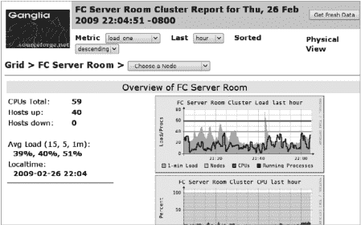

**图 8-1** 默认的 Ganglia 网格页面

## Nagios

趋势分析是任何系统监控的重要组成部分，但收集统计数据只是监控的一面。另一面是在主机或服务宕机时收到警报。市面上有很多优秀的商业和开源监控工具，但 Nagios 似乎总是一再被提及。Nagios 是一款开源监控工具，因其插件架构而变得流行，原因之一是它相对容易编写自己的插件来监控特定事物，而且许多你想要监控的常见项目已经有现成的插件。

Nagios 是一个很棒的工具，但如果你和足够多的使用它的系统管理员交谈，你会发现一个共同主题：它很棒，但配置起来可能很麻烦。Nagios 使用一系列不同的配置文件来配置要监控的主机、这些主机上的服务检查、主机组以及其余设置。任何特定文件的语法本身并不太令人生畏，但对于新手来说，它的学习曲线相当陡峭。如果你必须用 Nagios 监控大量系统，你最终会做两件事之一：编写自己的脚本来输出 Nagios 配置文件，或使用 Nagios 配置前端。我倾向于不重复造轮子，所以虽然我过去写过不少 Nagios 配置文件和脚本，现在我更喜欢基于 Web 的前端。

由于 Nagios 的强大功能，许多个人和公司都基于它创建了监控软件。可供选择的优秀 Nagios 前端有很多，而在本章中选择一个作为重点是一个棘手（甚至可能有争议）的任务。最终我选择了 GroundWork Monitor Community Edition（http://groundworkopensource.com），原因如下：

- **它是一个开源项目。** 尽管 GroundWork 由一家同时拥有该产品商业版的公司创建和支持，但 Community Edition 是一个完全开源且免费的项目。

- **提供专业支持。** 尽管许多 Linux 系统管理员对没有商业软件支持也没问题，但他们工作的公司往往不行。GroundWork 公司不仅为其商业产品提供支持，还为 Community Edition 提供付费按事件计费的支持。这让你可以在使用开源许可软件和需要时获得支持之间取得一个很好的平衡。

- **在 Nagios 功能和简易性之间取得了良好平衡。** Nagios 设置起来可能很复杂，尤其是在初期，但 GroundWork 在为你提供完整的 Nagios 选项集和为初学者提供基本界面以便入门之间保持了不错的平衡。

- **有完全商业产品的选项。** 尽管 Community Edition 很棒，但如果你的企业需要更多功能，拥有购买不同版本的选择也很不错。

### 安装 GroundWork

Nagios 是一款复杂的软件，虽然 GroundWork 简化了它的管理，但它仍然允许你在需要微调时访问所有这些复杂性。它本身也增加了大量选项。你完全可以写一整本书来讲述如何配置主机组、调整可用的服务检查并编写自己的检查，以及为通知配置升级计划，以及该软件中的其他高级选项。为了本示例的目的，我将带你完成一个基本配置，用 `ping` 监控几台主机，展示如何添加服务检查，并说明如何配置 GroundWork 在主机宕机时通过电子邮件通知你。

不幸的是，GroundWork 不能通过 Ubuntu 的包管理器获得，但安装起来仍然相对简单。不幸的是，在撰写本文时，Community Edition 的下载链接在 http://groundworkopensource.com 页面上相当难以找到，但你应该能在 http://sourceforge.net/projects/gwmos/files/ 上找到最新版本。我的示例基于 6.0.1 版本。GroundWork 将其自己的 Apache、Nagios、MySQL 以及其余软件作为一个大包包含在内，下载形式是一个大的 `.bin` 文件，你运行它来提取和安装：

```
$ sudo chmod a+x groundwork-6.0.1-br124-linux-32-installer.bin
$ sudo ./groundwork-6.0.1-br124-linux-32-installer.bin
```

二进制文件包含图形和基于文本的安装程序，因此如果你的机器上安装了 X 服务器，你就可以使用图形安装程序。我假设在这台特定服务器上你没有安装，所以当你运行程序时，安装程序会提示你继续使用文本模式。安装程序首先检查系统的规格，以确保你有足够的内存和存储空间。如果不满足最低要求，安装程序将退出；但如果你高于最低要求但低于推荐规格，它只会给出警告并允许你继续。

此时安装程序基本上是非交互式的，除了初始提示输入 MySQL root 密码以及是否获取 GroundWork 软件更新通知的选项。设置完这些选项后，你只需看到进度条，软件正在解包。

## GroundWork 文件约定

了解 GroundWork 如何组织其所有文件是很有用的，因为它与大多数其他原生 Ubuntu 软件有所不同。下面我讨论平均管理员会感兴趣的核心文件和目录位置。

- `/usr/local/groundwork`

  这是核心 GroundWork 目录。在这里你会找到所有包含的脚本和集成程序，如 Nagios、Apache 和 MySQL。

- `/usr/local/groundwork/apache2`

  在这里你可以找到完整的 GroundWork Apache 安装，包括所有二进制文件和 Apache 配置。

- `/usr/local/groundwork/nagios`

  所有 Nagios 配置和支持文件都位于此目录。当你提交新的 GroundWork 配置时，它会将其数据库中的设置转换为此目录内的原始 Nagios 文件。在此目录中，你还可以在 `var` 目录下找到 Nagios 日志文件，以及 `libexec` 目录中的所有包含的 Nagios 检查。

### `/etc/init.d/groundwork`

这是启动时启动 GroundWork 的初始化脚本，也是你可以手动启动、停止和重启服务的脚本。此脚本随后会在幕后启动或停止各个守护进程，如 Web 界面、MySQL 和 Nagios。

## 初始配置

GroundWork 安装完成后，打开 Web 浏览器并输入你的 GroundWork 主机的主机名。在我的示例中是 groundwork.example.org。在登录屏幕，以 `admin` 用户名和密码 `admin` 登录，你将看到默认的 GroundWork 页面。GroundWork 将不同的配置和监控页面分为屏幕顶部的标签。在图 8-2 中可以看到默认的仪表板页面。首先，选择 Administration 标签。此屏幕允许你配置此机器上的用户、组和角色。通过角色你可以选择特定用户可以看到哪些菜单选项，因此如果你不希望用户能够配置 GroundWork，你可以将该用户限制为菜单中的显示选项。现在我们唯一想做的是更改 `admin` 密码。点击屏幕右上角的 My Preferences 链接，选择 Edit Profile，最后点击 Change Password。

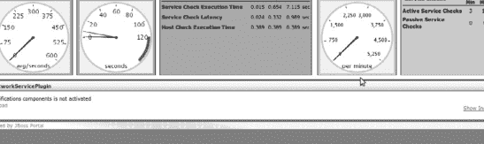

**图 8-2** GroundWork 默认仪表板

> 注意 如果你处于 Administration 窗口中，你也可以添加自己的用户。点击 User Management 标签，然后在右窗格中点击 Create new user account 链接。填写你的用户信息，并在 Assign Roles 屏幕时务必选择 Administrators 角色。现在当你以你的用户登录时，你将拥有与管理员相同的访问级别。

## 初始主机扫描

监控系统的初始配置每个主机都令人烦恼。如果有大量主机需要监控，一次一个地将它们添加到系统中会很痛苦。GroundWork 提供了一个向导，使初始配置变得简单得多。从主标签行中选择 Auto Discovery。有几种不同的扫描模式可供选择：Interactive、Auto 和 Auto Commit。Interactive 模式会在流程的每个阶段提示你。Auto 模式会自动将检测到的每个主机添加到 GroundWork 配置中，但不会提交更改。Auto Commit 选项与 Auto 类似，但也会自动将更改提交到 Nagios。先从 Interactive 模式开始，直到你很好地掌握了其工作原理，然后如果发现你总是倾向于添加 GroundWork 检测到的主机，再尝试其他模式。

在屏幕底部你会看到定义要扫描的 IP 范围的选项。你可以在这里不仅定义要包含的 IP，还定义不希望扫描的 IP。一般来说，你至少要扫描监控服务器所在的同一子网，因此在此处添加该子网。添加子网后，取消选中 localhost 子网（127.0.1.*），以免为你的 localhost 接口添加大量条目，然后点击屏幕顶部的 Go 按钮继续。在下一屏幕确认你想继续后，GroundWork 将扫描你定义的子网中的每个 IP。当它找到特定主机时，它会扫描该主机的开放端口并尝试检测该机器上的服务。对于每个检测到的具有可用 Nagios 检查的服务，GroundWork 会自动将该服务检查添加到该主机。


扫描完成后，如果你选择了 Interactive 模式，点击屏幕底部的 Next，你将看到 GroundWork 检测到的主机的完整列表，如图 8-3 所示。如果你选择了 Auto 或 Auto Commit 模式，

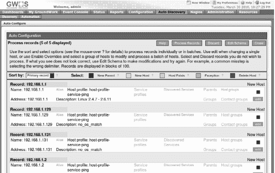

**Figure 8-3** Auto scan results

it will bypass this screen. At a bare minimum each host will have ping monitoring enabled, but if other services are detected, appropriate Nagios checks will be added as well. Click the check box on the right-hand side of each host if you want to add it to your configuration. When you are finished selecting hosts, click Process Records to add the selected hosts to your configuration.

**Check Host Status** Once you add the initial set of hosts and commit the changes, select the Status tab from the top of the screen. The status screen provides you with an overall view of the health of your network. Here you can see how many hosts and services are up or down at a glance. Each host group is listed in the left pane, and you can click any host groups you configure to gather statistics just for that group. Figure 8-4 shows a sample status page. The data updates in real time so as hosts recover, the status will change.

## Profiles

Profiles allow you to define different templates you can use for different types of hosts. You can set up service profiles that group certain service checks together, so, for instance, a default service profile might include checks for the services you know all of your servers have, such as SSH. A service profile for your Web servers might include a number of different Apache checks.

The host profiles let you create templates for host settings such as how often to check if the host is up and whether to monitor the host 24x7. You can also add service profiles to a host profile. This way you could set up a host profile for your production Web servers that makes sure they are monitored 24x7, includes a default service profile for SSH and other default services, and adds your Web service profile.

## Hosts

The hosts configuration contains all of the hosts you have added to GroundWork. Here you can select individual hosts and tweak their settings; add, remove, or change settings for their services; and configure what group they are in. This page also contains host group configurations so you can group different sets of servers together to make it easier to monitor their status.

## Contacts

The contacts page lets you add contact information for people who will receive notifications when services go down. You can also set up contact groups that contain multiple individual contacts, then assign those contact groups to hosts so that the entire group will get notified. Within these contacts you can also configure what sorts of notifications a particular contact should receive, how to contact the person, and even at what times of day.

## Escalations

Escalations are very useful if you rotate on-call duties or have on-call staff in different parts of the globe. You can set up escalations so that the first three alerts, for instance, go to your on-call person, and if that person doesn’t respond by the third alert, the rest will go to the secondary contact. You can also define time periods to go with the escalations so that if you have nighttime on-call staff and daytime on-call staff, you can contact one or the other based on the time of day.

## Commands

It’s easy to confuse commands and services. Commands are the Nagios check scripts that typically live in `/usr/local/groundwork/nagios/libexec`. These are usually generic commands that accept a whole host of options. Services will then point to one of these commands and run them with a particular set of options. For instance, there is a generic command called `check_tcp` that will test a TCP connection on a particular port. If you wanted to test port 80, for instance, you could set up a service you call `check_port80` that calls the `check_tcp` command to test port 80 only. Use this page if you wrote your own custom Nagios plug-in and want to make it available to GroundWork.


## Time periods

As the name indicates, this page lets you configure different time periods to which Nagios can refer. By default some standard time periods are already defined, such as `24x7`, work hours, and non-work hours. These can be handy if you want to monitor certain services only during certain hours.

## Groups

On this page you can configure particular groups within the GroundWork interface. These groups would contain groups of hosts, contact groups, and other settings. With these groups defined you can easily change a particular setting (such as add a new service check) and deploy it to all of the hosts within a particular group. This is really handy when you manage large numbers of hosts and want to be able to change entire groups at a time.

## Control

The control page is where you go whenever you want to commit your changes. Here you can also view the Nagios configuration and test your current changes before you commit them.

+ 工具
+ 工具页面提供了一些额外的 GroundWork 工具。在这里你可以将设置导出到文件，也可以根据模式删除一组主机或服务。
+ 性能
+ 在性能页面你可以配置图表和其他指标的选项。

## 将更改提交到 Nagios

由于 GroundWork 将其设置维护在单独的数据库中，你在 Web 界面中做的更改不会直接加载到 Nagios。只要你在 Web 界面中进行更改，就必须提交它。提交过程会将 GroundWork 的配置转换为有效的 Nagios 文件。要提交更改，请从主选项卡中选择配置，然后在页面顶部选择控制选项卡。从那里在左侧窗格中选择提交链接。你可以选择备份旧配置；否则点击提交按钮来更新 Nagios 配置并重启 Nagios。

## 配置联系人列表

在设置好初始主机集后，你需要配置一个联系人来接收警报。选择配置选项卡，然后选择联系人选项卡。点击左侧窗格中的联系人链接进行展开，显示新建、复制和修改选项。由于我们要添加一个新联系人，请点击新建。图 8-5 给出了一个联系人条目的示例。填写你的联系人信息，并手动设置通知时段和其他选项，或从下拉菜单中选择适合你的联系人模板。如果没有可用的选项适合你，你也可以从左侧窗格添加一个新的联系人模板，使用你想要的设置。我选择了 `generic-contact-2`，因为它为 `24x7` 监控提供了很好的默认设置。

GroundWork 会设置一个名为 `nagiosadmin` 的默认联系人组。GroundWork 已预先设置好的默认模板将使用此联系人组进行通知，因此如果你不想做太多调整，

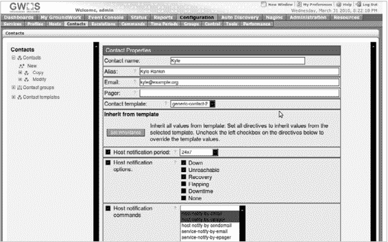

**图 8-5** 示例联系人属性页面

点击左侧窗格中的“联系人组”链接进行展开，点击修改，选择 `nagiosadmin` 并更改设置以将你添加到该组并删除任何默认联系人，然后点击保存。或者，你也可以创建自己的联系人组；只需确保将该组添加到你监控的主机上，这样你就能收到警报。一旦更改了所有联系人设置，记得提交更改。

## 为 Nagios 启用通知

即使你设置了联系人并且它属于正确的联系人组，默认情况下 GroundWork 也不会发送通知，直到你明确告诉它开始。这是一个很好的默认值，因为你可以先设置所有主机并调整服务检查，使一切在线后再触发通知。这样在你准备好之前就不会收到不必要的电子邮件或页面。当你准备好启用通知时，点击任何配置页面的顶部控制选项卡，然后在加载的页面左侧窗格中选择“ Nagios 主配置”

在右侧窗格中间附近你会看到一个名为“启用通知”的选项。选中该选项，然后滚动到底部点击保存并下一步。你需要点击保存并下一步通过几屏，直到看到并点击保存并完成。现在在左侧窗格中点击提交并将更改提交到 Nagios。现在你将开始向任何已配置的联系人发送警报。

> **注意** 如果你通过电子邮件设置通知，请确保你的主机已配置了功能正常的本地邮件服务器；否则通知永远也收不到。有关如何在 Ubuntu 上配置邮件服务器的更多信息，请查看第 5 章的邮件服务器部分。

## 为主机添加服务检查

对于大多数主机，你至少应该做某种 ping 探测来查看服务器是否在线。大多数人希望监控的不止于此。GroundWork 开箱即用提供了许多不同的服务检查，以及你可以参考以创建自己的自定义服务检查的命令。首先，我将带你逐步添加一个新的服务检查到主机，以检查 SSH 是否存活。

首先选择配置选项卡，然后选择主机选项卡。在左侧窗格中展开主机树，直到找到你想要更改的主机。展开该主机后，你会看到一个详细信息链接，可以点击它来配置该主机的所有设置。每组选项在右侧窗格中组织成不同的选项卡，因此点击服务选项卡来配置此主机上监控的服务。`ssh_alive` 服务可用于测试 SSH 是否可用，因此我选择该服务以及在此页面上可能想要添加的其他服务，然后点击添加服务按钮将其添加到列表中。然后点击主机详细信息选项卡，滚动到该选项卡底部，点击保存以保存更改。现在将更改提交到 Nagios 以使其生效。

## 添加新主机

要在不进行自动扫描的情况下向 GroundWork 添加新主机，请选择配置选项卡，然后点击页面顶部的 `hosts` 选项卡。在左侧窗格中，找到名为“主机向导”的链接并点击它。用主机名、别名、IP地址和

用于主机的主机配置文件。如果您尚未配置任何自定义主机配置文件，`host-profile-service-ping` 选项是一个安全的默认值。完成后，点击 `Next`。

下一页让您选择可能已配置的任何主机模板以及主机可能拥有的任何父级。选择 `generic-host` 模板，除非您已设置自定义模板。`parents` 字段让您选择先前配置的主机作为此主机的父级。当一台主机是另一台主机的父级时，如果它宕机，Nagios 也会将子主机视为宕机。这有助于您从网络设备到主机构建依赖树。如果您不确定要配置哪些父级，留空也可以。

在下一页中，您可以将新主机分配给已定义的主机组。如果您想使用 Nagios 的映射功能，也可以在此处输入地图坐标。此页面也是您在已定义的情况下选择任何升级树的地方。如果您刚开始使用，您可能会将这些选项大部分留空。

下一页是配置在此主机上要监控哪些服务的地方。如果您配置了任何服务配置文件，可以在此处添加它们；否则您可以手动选择服务。点击 `Next` 后，您将到达向导的最后一页。您可以选择将所有设置保存为配置文件。如果您知道要对一组主机重复此向导，并且它们将具有相同的选项集，这会很有用。您可以将其保存为配置文件，然后在添加下一台主机时选择它。点击 `Continue` 完成向 GroundWork 添加主机。完成后不要忘记提交您的更改。

## 高级配置

Nagios 中的选项实在太多，无法在此全部描述，但我讨论了一些原则，这些原则将在您浏览漫长的设置列表时有所帮助。我从主机设置开始，然后描述如何在 GroundWork 中添加新的自定义服务检查。

当您查看主机的自定义选项时，您会注意到每个选项左侧都有一个复选框；右侧有一个复选框、下拉菜单或文本输入框；以及一个小问号。图 8-6 显示了示例主机配置页面。右侧的复选框、文本输入或菜单会显示特定设置的当前状态。

左侧的复选框告诉您此特定设置当前是否从模板获取其值。如果该框被选中，您将无法手动更改该设置。当您更改它并保存更改时，您会注意到它会恢复为模板中设置的内容。因此，如果您想覆盖设置，请取消选中左侧的复选框；只是要意识到，如果您在模板中更新该选项，它将不再传递给此主机。一般来说，除非您要做例外，否则使用模板进行更改比逐个主机进行更改更简单。

问号伴随着 GroundWork 中的大多数配置选项，如果您将鼠标悬停在其上，您将获得对特定选项的更深入解释。选项如此之多，像这样的提示绝对派上用场。

您也可以覆盖主机上特定服务检查的默认设置。只需在主机下方的左侧窗格中点击该服务检查，然后

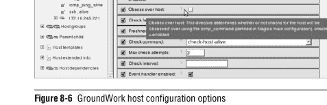

图 8-6 GroundWork 主机配置选项


进行更改。此处的 `Service Check` 选项卡让您可以更改将传递给服务检查的默认参数。这在您想要修改特定服务器的警告和严重阈值时非常有用。例如，如果您因负载高而收到警报，但您知道特定服务器有时会超过默认阈值，但对它来说更高的负载是正常的，您可以调整其阈值，而其余主机保持不变。

## 创建新的服务检查

尽管 GroundWork 默认自带相当数量的服务检查，但一旦您了解了一些核心 Nagios 命令的工作原理，您可以创建的数量令人惊讶。对于本示例，我展示如何添加一个名为 `tcp_smtp` 的自定义服务检查，用于检查主机上的端口 `25`（SMTP 端口）是否打开。

首先选择 `Configuration` 选项卡。然后点击页面顶部的 `Services` 选项卡较小的标签。在左侧窗格中点击“New service”以创建新的服务检查。在第一页，我被提示输入服务的名称以及要使用的服务模板。我将其命名为 `tcp_smtp`，选择 `generic-service` 模板，然后点击 `Add`。

服务添加后，我可以看到 `generic-service` 模板设置的所有默认选项，例如是否 `24x7` 检查服务、检查频率以及在发出警报前重试多少次。我将保持这些默认值不变，但根据服务的敏感程度，您可能希望调整这些选项以更频繁或更少地监控服务。

我最感兴趣的是 `Service Check` 选项卡。我可以在那里定义此服务要使用的命令。我点击该选项卡，然后找到“Check command”下拉菜单。现在，如果您是 Nagios 新手，您可能不知道该选择什么。您可以通过服务名称获得一些提示，但现实中您需要做的就是查看标准 Nagios 命令的作用，要么通过在线研究，要么前往 `/usr/local/groundwork/nagios/libexec` 并手动运行命令。许多命令只是 shell 脚本，因此您甚至可以打开它们查看它们的工作原理。根据我的经验，我知道我想要名为 `check_smtp` 的命令，所以我在这里选择它。

一旦你选择了一个命令，“Command line” 文本输入框就会被加载该命令及其每个默认参数，参数之间用感叹号分隔。在我的例子中我有 `ARG1` 和 `ARG2`。当我查看命令定义时，我可以看到它将 `ARG1` 传递给 `check_smtp` 的 `-w` 参数，将 `ARG2` 传递给 `-c`。大多数标准的 Nagios 命令都使用 `-w` 和 `-c` 分别设置警告和严重阈值，但再次强调你需要在这里做一些研究。在这种情况下，他们正在查找 SMTP 响应我的测试所需的时间（秒）。不同的 SMTP 服务器有不同的响应时间，但我将其设置为如果响应需要五秒则警告我，如果需要十秒则发送警报。所以在“Command line” 文本输入框中，

```
check_smtp!ARG1!ARG2
```

我改为输入

```
check_smtp!5!10
```

你可以在图 8-7 中看到我的 `Service Check` 选项卡的示例。现在我点击 `Save` 保存我的更改。从这一点开始，我可以进入主机配置部分并将此检查添加到我想要监控的任何主机中。再次记住，要使更改生效，必须将更改提交到 Nagios。

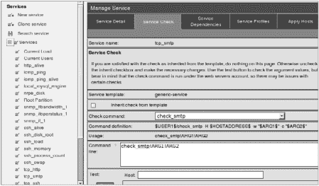

**Figure 8-7** Service Check settings for a new service

## More GroundWork Information

我对 Nagios 和 GroundWork 配置的介绍仅是皮毛。GroundWork 通过 Web 界面顶部 `Bookshelf` 链接提供自己的文档。点击它后会弹出一个新窗口，其中包含可搜索的索引和可供浏览的预定义文档主题列表。此外，`http://groundworkopensource.com` 也有许多不同的配置指南，以及一个你可以加入的论坛，在那里提问并从其他 GroundWork 用户那里获得提示。

# CHAPTER 9

## Virtualization

系统管理领域最热门的趋势之一是虚拟化。通过虚拟化，你可以在同一硬件上创建多个 Ubuntu 实例。你可以将服务器资源的一部分分配给每台虚拟机。现代服务器拥有惊人的处理能力，而通过虚拟化，你可以从现有硬件中获得更多价值。我甚至在本书中将虚拟机用作测试实验室；当你可以在虚拟机内完成时，设置新的 Ubuntu 服务器并尝试特定软件包的速度要快得多，而无需另行准备多台硬件机器。

在 Ubuntu Server 下有多种不同的虚拟化技术可用，本章将介绍其中两种最受欢迎的技术：`VMware Server` 和 `KVM`。`VMware Server` 是 VMware 生产的免费产品，而 `KVM`（Kernel-based Virtual Machine）是免费软件，其支持已内置于 Linux 内核中。最后我将讨论 Ubuntu Server 可用的一些新 Cloud 功能。

### KVM

`KVM` 是 Ubuntu 支持的默认虚拟化技术。该软件利用 Intel 和 AMD 处理器内置的虚拟化支持，让你可以在单个主机上运行多个不同的发行版和操作系统作为 VMs（虚拟机）。

### Install KVM

关于 `KVM` 的一个“gotcha”是它不仅仅利用处理器中的虚拟化支持，而是需要它。因此在做任何其他事情之前，你应该确认你的处理器是否具有虚拟化扩展。在主机上运行以下命令：

```
$ egrep '(vmx|svm)' /proc/cpuinfo
```

如果得到一些输出，则说明你的服务器具有必要的扩展，可以继续。如果没有，则无法在该机器上使用 `KVM`。不过你也没那么倒霉；只需继续阅读本章后面的 `VMware Server` 部分即可，因为该产品不需要这些扩展。

### Enable Support in BIOS

一旦确认你的服务器支持 `KVM`，你可能仍需要在 BIOS 中启用这些扩展。每个 BIOS 都不同，但重新启动机器并查找包含处理器设置或高级设置的 BIOS 设置部分，确保虚拟化扩展已启用。

### Install KVM Packages

BIOS 设置完成后，重新启动到服务器并安装 `KVM` 所需的所有软件包：

```
$ sudo apt-get install qemu-kvm libvirt-bin ubuntu-vm-builder
```

除了 `KVM` 软件和必要的库之外，这组软件包还将为你提供管理 VMs 所需的 `virsh` 命令行工具。这也会安装 `ubuntu-vm-builder` 脚本，该脚本使启动新的 Ubuntu VM 变得非常简单。

除了 `root` 用户之外，你可能还希望在系统上至少设置一个可以直接管理 VMs 的用户。要做到这一点，只需将该用户添加到 `libvirtd` 组即可：

```
$ sudo adduser username libvirtd
```

将 `username` 替换为你的用户名。注意，你必须注销并重新登录才能使组更改生效。重新登录后，运行 `groups` 命令并确保 `libvirtd` 在你的用户组列表中。此时你可以测试 `KVM` 是否正常运行以及你的用户是否可以管理它，因此运行以下 `virsh` 命令：

```
$ virsh -c qemu:///system list
Connecting to uri: qemu:///system
Id Name State
-------------------------
```

你将经常使用这个 `virsh` 命令。在这种情况下，它会输出当前在这台机器上运行的所有虚拟机的列表。我们还没有设置任何虚拟机，但我们获得了有效的输出而不是错误，这意味着我们已准备好继续。如果出现某种权限错误，很可能是因为你的用户不在 `libvirt` 组中。

## 配置 KVM 网络

你可以为虚拟机设置网络主要有两种方式。默认的网络设置提供了一个位于 `192.168.122.0/24` 下的私有网络。`DHCP` 服务器会分配剩余的 IP 地址；或者，你也可以为虚拟机设置静态 IP。`KVM` 主机的 IP 为 `192.168.122.1`，虚拟机随后通过该网关使用 NAT（网络地址转换）与外部世界通信。这工作得很好，尤其对于桌面上的虚拟机，但由于我们这里谈论的是服务器，我的假设是你希望 `KVM` 主机外部的机器能够与你的虚拟机通信。虽然你当然可以设置某种 `iptables` `DNAT` 规则并将流量转发回来，但这种解决方案的可扩展性并不好。真正的解决方案是设置桥接网络，以便你的虚拟机看起来与主机在同一网络上。

在 Ubuntu 上设置 `br0` 桥接接口相对简单。基本上，你需要确定想要桥接流量的接口（可能是 `eth0`，或者如果你设置了绑定，则可能是 `bond0`），将它的所有配置连同一些额外的桥接选项一起转移到 `br0`，然后将原始接口更改为手动模式。看到示例后会更清楚。例如，如果我为 `eth0` 设置了 `DHCP`，并且我的旧配置在 `/etc/network/interfaces` 中如下所示：

```
auto eth0
iface eth0 inet dhcp
```

那么我的新配置将如下所示：

```
auto eth0
iface eth0 inet manual

auto br0
```


```
iface br0 inet dhcp
    bridge_ports eth0
    bridge_fd 9
    bridge_hello 2
    bridge_maxage 12
    bridge_stp off
```

注意我将 `eth0` 的 `inet` 模式从 `dhcp` 改为 `manual`。如果 `eth0` 配置了静态 IP，我只需将所有配置转移到 `br0` 即可，因此它将从以下配置：

```
auto eth0
iface eth0 inet static
    address 192.168.0.5
    network 192.168.0.0
    netmask 255.255.255.0
    broadcast 192.168.0.255
    gateway 192.168.0.1
```

改为以下配置：

```
auto eth0
iface eth0 inet manual

auto br0
iface br0 inet static
    address 192.168.0.5
    network 192.168.0.0
    netmask 255.255.255.0
    broadcast 192.168.0.255
    gateway 192.168.0.1
    bridge_ports eth0
    bridge_fd 9
    bridge_hello 2
    bridge_maxage 12
    bridge_stp off
```

一旦我将 `/etc/network/interfaces` 设置为桥接，我随后重启网络：

```
$ sudo /etc/init.d/networking restart
```

现在我的 `ifconfig` 输出应该列出新的桥接接口：

```
$ ifconfig
br0      Link encap:Ethernet  HWaddr 00:17:42:f1:18:be
          inet addr:192.168.0.5  Bcast:192.168.0.255  Mask:255.255.255.0
          inet6 addr: fe80::217:42ff:felf:18be/64 Scope:Link
          UP BROADCAST RUNNING MULTICAST  MTU:1500  Metric:1
          RX packets:17226 errors:0 dropped:0 overruns:0 frame:0
          TX packets:13277 errors:0 dropped:0 overruns:0 carrier:0
          collisions:0 txqueuelen:0
          RX bytes:16519186 (16.5 MB)  TX bytes:1455348 (1.4 MB)
```

> 注意 尽管我们这里谈论的是具有物理网络连接的服务器，但我应该提到，大多数无线适配器不支持桥接，因此如果你尝试在笔记本电脑上设置并通过无线接口桥接，桥接模式将无法工作。

一旦桥接接口设置好，当前的 KVM 安装默认应该能够利用它。现在你已准备好创建你的第一个虚拟机。

## 创建新的虚拟机

一旦 KVM 和你的桥接网络设置好，你就可以创建第一个虚拟机了。Ubuntu 提供了一个名为 `ubuntu-vm-builder` 的工具（在较新版本中更名为 `vmbuilder`），你可以用它来自动化创建虚拟机的过程。使用 `vmbuilder`，你可以定义虚拟机的设置，包括你想要的 Ubuntu 版本，工具将为你创建本地虚拟磁盘并执行基础安装。它甚至会在系统上注册虚拟机，以便完成后即可使用。

为了进一步简化流程，Ubuntu 创建了一个专为虚拟机设计的特殊 Ubuntu 安装，称为 JeOS（发音为“juice”）。所有非必要的内核模块都被移除，操作系统总体上针对作为虚拟机的性能进行了调优。在下面的示例中，我创建的虚拟机基于 JeOS。

它将安装的操作系统（套件）。下面是我们将基于其构建的命令的第一段（但现在先别按回车）：

```
$ sudo vmbuilder kvm ubuntu
```

你可以根据所选的管理程序和套件选择不同的选项，并且可以在每个选项后传递 `--help` 参数以获取特定选项列表：

```
$ sudo vmbuilder kvm ubuntu --help
```

`vmbuilder` 脚本会在当前目录下创建一个目录，并将 VM 的磁盘文件放在那里。因此，如果你在磁盘上划出了专门存放 VM 文件的地方，请务必先切换到该目录。下面是一个相对基本的 `vmbuilder` 命令示例，它将创建一个名为 `test1` 的 Ubuntu Lucid VM：

```
$ sudo vmbuilder kvm ubuntu --suite lucid --flavour virtual --arch i386 --hostname test1 --libvirt qemu:///system --rootsize=2048 --swap size=256 --user ubuntu --pass insecure -d test1-kvm
2010-04-17 12:17:04,193 INFO : Calling hook: preflight_check
2010-04-17 12:17:04,196 INFO : Calling hook: set_defaults
2010-04-17 12:17:04,197 INFO : Calling hook: bootstrap
...
2009-02-27 16:52:31,480 INFO    Cleaning up
```

运行该命令后，脚本会自行获取所需的全部包和文件，并自动为我构建 VM。下面我来逐一描述我所选择的每个选项：

- `--suite lucid`

  `--suite` 选项用于选择要安装的 Ubuntu 版本。我这里选择了 `lucid`，但你也可以选择 `dapper`、`feisty`、`gutsy`、`hardy`、`intrepid`、`jaunty` 或 `karmic`。

- `--flavour virtual`

  Ubuntu 提供了多种不同的内核风格。`virtual` 风格会选择针对 VM 优化的 JeOS 内核，但你可选择的内核种类还有很多，具体取决于你选择的 Ubuntu 套件和架构。

- `--arch i386`

  这是用于我的 VM 的处理器架构。如果我不指定它，默认将使用宿主机架构。有效选项为 `i386`、`amd64` 和 `lpia`。

- `--hostname test1`

  如果不指定主机名，VM 将默认为主机名 `ubuntu`。当你决定创建多个 VM 时，这就会出问题，此时你会得到错误提示：域 `ubuntu` 已存在。使用 `--hostname` 选项，这样你不仅可以指定操作系统内部的主机名，还可以指定将注册到 KVM 中的唯一名称。

- `--libvirt qemu:///system`

  `--libvirt` 选项会自动将此 VM 添加到我的本地 KVM 实例中。

- `--rootsize 2048` 和 `--swapsize 256`

  对于基本 VM，你可能只希望有一个包含根分区和交换分区的单一磁盘。在这种情况下，你可以使用 `--rootsize` 和 `--swapsize` 以兆字节为单位指定根分区和交换分区的大小。还有一个 `--optsize` 选项可以设置单独的 `/opt` 分区。

- `--user ubuntu` 和 `--pass insecure`

  你会希望系统上有某种默认用户，这样构建完成后你就可以登录，除非你的网络使用 LDAP 或其他网络认证。`--user` 和 `--pass` 参数让我可以指定要使用的默认用户和密码；否则两者都会默认为 `ubuntu`。你还可以使用 `--name` 选项来设置用户的全名。

- `-d test1-kvm`

  默认情况下，`vm-builder` 会将 VM 的根磁盘安装在用户主目录下的 `ubuntu-kvm` 目录中。当然，一旦你设置了一个 VM，你将无法重用同一个目录，因此 `-d` 选项允许你指定目标目录的位置。

安装完成后，我会看到当前目录下创建了一个新的 `test1-kvm` 目录，里面是该 VM 的磁盘文件：

```bash
$ ls test1-kvm/
run.sh tmpHHSJGZ.qcow2
```

此外，我的新 VM 将被注册到 KVM，其定义设置的 XML 文件将安装在 `/etc/libvirt/qemu/test1.xml` 下，内容类似于：


```xml
<domain type='kvm'>
  <name>test1</name>
  <uuid>907a0091-e31f-ef2b-6181-dc2d1225ed65</uuid>
  <memory>131072</memory>
  <currentMemory>131072</currentMemory>
  <vcpu>1</vcpu>
  <os>
    <type arch='i686' machine='pc-0.12'>hvm</type>
    <boot dev='hd'/>
  </os>
  <features>
    <acpi/>
  </features>
  <clock offset='utc'/>
  <on_poweroff>destroy</on_poweroff>
  <on_reboot>restart</on_reboot>
  <on_crash>destroy</on_crash>
  <devices>
    <emulator>/usr/bin/kvm</emulator>
    <disk type='file' device='disk'>
      <source file='/home/ubuntu/vms/test1-kvm/tmpHHSJGZ.qcow2'/>
      <target dev='hda' bus='ide'/>
    </disk>
    <interface type='network'>
      <mac address='52:54:00:c6:18:b7'/>
      <source network='default'/>
      <model type='virtio'/>
    </interface>
    <input type='mouse' bus='ps2'/>
    <graphics type='vnc' port='-1' autoport='yes' listen='127.0.0.1'/>
    <video>
      <model type='cirrus' vram='9216' heads='1'/>
    </video>
  </devices>
</domain>
```

## Extra `vmbuilder` 选项

我给出的示例 `vmbuilder` 命令肯定能正常工作，但该脚本支持大量额外的选项，可能对你的虚拟机很有用。例如，在我的示例中我列出了 `--rootsize` 和 `--swap size` 选项来设置虚拟机磁盘中的根分区和交换分区大小。你可能希望使用比仅根分区和交换分区更复杂的分区布局，在这种情况下可以使用 `--part` 选项。`--part` 选项从你创建的包含分区信息的文件中读取，并在设置磁盘时使用它。该文件具有非常基础的语法。每行包含一个挂载点，后跟以兆字节为单位的分区大小。你甚至可以设置多个磁盘——只需在单独一行使用 `---` 来分隔一个磁盘和另一个磁盘。

例如，假设我想创建两个磁盘。第一个磁盘将有一个 100Mb `/boot` 分区、一个 2Gb `/` 分区和一个 512Mb 交换分区。第二个磁盘将有一个 5Gb `/var` 分区。我可以创建一个名为 `test1.partitions` 的文件，其中包含以下数据：

```
/boot 100
root 2000
swap 512
---
/var 5000
```

现在当我运行 `vm-builder` 时，我用 `--part /path/to/test1.partitions` 替换命令中的 `--root 2000 --swap 256` 行。最终的命令将如下所示：

```
$ sudo vmbuilder kvm ubuntu --suite lucid --flavour virtual
--arch i386 --hostname test1 --libvirt qemu:///system
--part /home/ubuntu/vminfo/test1.partitions --user ubuntu
--pass insecure -d test1-kvm
```

### 包管理

`vmbuilder` 脚本还具有许多方便的类似 preseed 的选项，用于自动化安装。以下是一些专门针对包管理的选项：

- `--addpkg packagename` 和 `--removepkg packagename`

  `--addpkg` 和 `--removepkg` 命令将分别添加和删除你作为参数指定的软件包。如果你想添加或删除多个软件包，可以在命令行上添加多个 `--addpkg` 或 `--removepkg` 命令。请记住，任何在安装时是交互式的软件包（即它们会向你提问）在这里都无法工作。

- `--mirror URL`

  如果你想使用默认 Ubuntu 服务器以外的服务器，使用 `--mirror` 命令后跟特定 Ubuntu 镜像的 URL。这在你设置了本地 Ubuntu 镜像时非常方便，因为安装会快得多。

- `--components main,universe`

  如果你想向 Ubuntu 虚拟机添加特定存储库，例如 universe 或 multiverse，使用 `--components` 参数后跟以逗号分隔的存储库列表。

- `--ppa PPA`

  如果你想添加来自 ppa.launchpad.net 的特定 PPA（个人软件包存档），只需在此处指定其名称即可。

### 网络设置

默认情况下，虚拟机将使用 DHCP 创建其网络信息。你可以 optionally 在命令行上指定静态网络设置。以下是每个网络选项的描述以及示例设置：

- `--domain example.org`

  这设置了虚拟机的默认域；否则它将设置为主机的域。

- `--ip 192.168.0.100`

  在这里你设置要分配给虚拟机的静态 IP 地址。

- `--mask 255.255.255.0`

  此值设置为子网掩码。

- `--net 192.168.0.0`

  此值设置为主机的网络地址。

- `--bcast 192.168.0.255`

  在这里你可以指定广播地址。

- `--gw 192.168.0.1`

  如果你没有使用此选项指定网关地址，将选择你网络的第一个地址。

- `--dns 192.168.0.5`

  与网关地址类似，如果你没有在此处指定地址，它将使用你网络上的第一个地址。

### 安装后脚本

你可以使用 `vmbuilder` 设置许多选项，可以设置安装后脚本和其他操作，以进一步自动化安装。以下是你可能使用的一些主要选项的描述：

- `--ssh-key /root/.ssh/authorized_keys` 和 `--ssh-user-key /home/username/.ssh/authorized_keys`

  这些选项接受 root 用户（`--ssh-key`）或普通用户（`--ssh-user-key`）的 SSH authorized keys 文件的完整路径，并将其复制到主机。你可能会设置它，以便在虚拟机安装后可以自动 SSH 进入虚拟机并无需密码即可开始。

- `--copy filename`

  此选项读取你指定的包含源文件和目标文件列表的文件，例如

  `/home/ubuntu/vmfiles/filename /etc/filename`

  它会将文件从主机上的源文件复制到虚拟机上的目标文件。

- `--execscript script`

  此参数将在安装结束时使用 `chroot` 在虚拟机内部运行你在命令行上指定的脚本。

- `--firstboot script`

  此选项与 `--execscript` 类似，只是它会将你指定的脚本复制到 VM 中，并在 VM 第一次启动时执行它。

- `--firstlogin script`

  大多数自动化安装程序选项的缺点是它们要求脚本是非交互式的。`--firstlogin` 选项没有此限制。它会获取你指定的脚本，并在用户首次登录到 VM 时执行它。由于第一个登录的用户会看到脚本，因此你可以使其具有交互性。你可能还想使用此脚本在 VM 上安装任何具有交互式安装程序的软件包。

一旦你使用 `virt-builder` 成功创建了 VM，你就可以首次启动 VM 并使用 `virsh` 管理它。

## Manage VMs with `virsh`

`virsh` 命令是你用来管理 VM 的主要工具之一。KVM 的基本语法是 `virsh -c qemu:///system` 后跟某种命令。例如，要列出所有正在运行的 VM，请输入

```
$ virsh -c qemu:///system list
Connecting to uri: qemu:///system
 Id Name State
---------------------------
```

现在你已经创建了一个新的 VM，你可以使用 `start` 命令启动它：


```
$ virsh -c qemu:///system start test1
Connecting to uri: qemu:///system
Domain test1 started
```

```
$ virsh -c qemu:///system list
Connecting to uri: qemu:///system
 Id Name State
---------------------------
 9 test1 running
```

请注意，`start` 命令后跟你想要启动的 VM。与 `start` 类似的命令有 `shutdown` 和 `destroy`，它们将分别关闭 VM 并切断 VM 的电源。如果你希望 VM 在启动时自动启动，请使用 `autostart` 命令：

```
$ virsh -c qemu:///system autostart test1
Connecting to uri: qemu:///system
Domain test1 marked as autostarted
```

如果你想删除 `autostart` 选项，请在命令中添加 `--disable`：

```
$ virsh -c qemu:///system autostart --disable test1
Connecting to uri: qemu:///system
Domain test1 unmarked as autostarted
```

KVM 还支持快照，因此你可以保存 VM 的当前状态并稍后回滚到该状态。要拍摄快照，请使用 `save` 命令，后跟 VM 和保存状态的文件：

```
$ virsh -c qemu:///system save test1 test1-snapshot.state
Connecting to uri: qemu:///system
Domain test1 saved to test1-snapshot.state
```

稍后你可以使用 `restore` 命令，后跟之前保存的状态文件，以将 VM 恢复到该状态：

```
$ virsh -c qemu:///system restore test1-snapshot.state
Connecting to uri: qemu:///system
Domain restored from test1-snapshot.state
```

你也可以使用 `suspend` 和 `resume` 命令挂起和恢复 VM。请记住，挂起的 VM 仍然会消耗内存资源。挂起的 VM 在列表中会显示为 `paused` 状态：

```
$ virsh -c qemu:///system suspend test1
Connecting to uri: qemu:///system
Domain test1 suspended
```

```
$ virsh -c qemu:///system list
Connecting to uri: qemu:///system
```

```
Id Name State
-----------------------------
11 test2 running
12 test1 paused
```

```
$ virsh -c qemu:///system resume test1
Connecting to uri: qemu:///system
Domain test1 resumed
```

```
$ virsh -c qemu:///system list
Connecting to uri: qemu:///system
Id Name State
-----------------------------
11 test2 running
12 test1 running
```

使用 VM 的一个特别好的功能是，如果 VM 需要更多 RAM 而你的主机有可用资源，你可以相对轻松地进行更改。首先使用 `dominfo` 命令查看 VM 当前使用的 RAM 量。VM 关闭后，使用 `setmaxmem` 命令更改 VM 可用的最大 RAM，并使用 `setmem` 命令更改 VM 当前可使用的 RAM（两者可以是不同的值，前提是最大内存更大）。重新启动 VM 后，它将使用新的 RAM 量启动：

```
$ virsh -c qemu:///system dominfo test1
Connecting to uri: qemu:///system
-
Id:
Name: test1
UUID: e1c9cbd2-a160-bef6-771d-18c762efa098
OS Type: hvm
State: shut off
CPU(s): 1
Max memory: 131072 kB
Used memory: 131072 kB
Autostart: disable
Security model: apparmor
Security DOI: 0
```

```
$ virsh -c qemu:///system setmaxmem test1 262144
Connecting to uri: qemu:///system
```

```
$ virsh -c qemu:///system dominfo test1
Connecting to uri: qemu:///system
```

Id:

名称：test1

UUID：e1c9cbd2-a160-bef6-771d-18c762efa098

OS 类型：hvm

状态：已关闭

CPU 数：1

最大内存：262144 kB

已用内存：131072 kB

开机自启：禁用

安全模型：apparmor

安全 DOI：0

```
$ virsh -c qemu:///system setmem test1 262144
Connecting to uri: qemu:///system
```

```
$ virsh -c qemu:///system dominfo test1
Connecting to uri: qemu:///system
```

Id:

名称：test1

UUID：e1c9cbd2-a160-bef6-771d-18c762efa098

OS 类型：hvm

状态：已关闭

CPU 数：1

最大内存：262144 kB

已用内存：262144 kB

开机自启：禁用

安全模型：apparmor

安全 DOI：0

## KVM 图形控制台与管理工具

有多种方式可以为 KVM 虚拟机获取控制台。有些人会提前配置好 SSH，然后通过 SSH 登录到机器；也有人会使用 VNC 搭建某种远程桌面。不过在刚开始接触时，你可能还没有这些基础设施，因此如果能有一种工具为虚拟机提供图形控制台，将会非常方便。`virt-manager` 实用工具就能轻松完成这项工作。

首先，使用 `sudo apt-get install virt-manager` 安装 `virt-manager` 软件包。如果你的服务器带有某种图形桌面环境，可以直接在其中运行它。此时你会看到潜在本地 KVM 实例的列表，可以从中连接。双击 `localhost (System)` 条目，它会连接并展开，显示出你所有的虚拟机，如图 9-1 所示。如果有任何虚拟机正在运行，你还可以看到它们当前的 CPU 和内存统计信息。

如果从主屏幕选择某个虚拟机并点击 `Open` 按钮，它会打开该机器的一个图形控制台，如图 9-2 所示。在该窗口中，你可以登录虚拟机并运行命令，就像连接了键盘、鼠标和显示器一样。你也可以在这个界面中执行关机、挂起和拍摄快照等操作。

回到主菜单，你还可以获取某个虚拟机的更详细信息。选择该虚拟机，然后点击 `Edit→Machine Details`。在这里，你不仅可以看到当前负载的更详细图表，还可以点击 `Hardware` 选项卡（图 9-3）来查看、添加和移除硬件，不过根据你要更改的内容，主机可能需要先关机。

## 远程 KVM 管理

该工具并不局限于本地 KVM 管理，因为你的服务器上很可能没有图形环境。

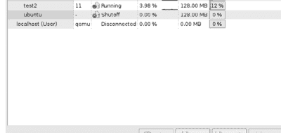

图 9-1 虚拟机管理器默认屏幕

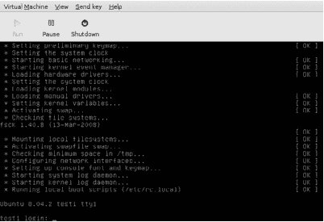

**图 9-2** 虚拟机图形控制台

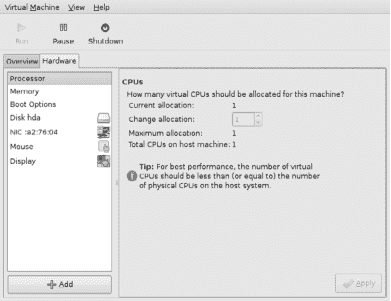

**图 9-3** 虚拟机硬件详细信息

你也可以将软件包安装到网络中的某台桌面机上，然后通过 SSH 隧道连接到你的 KVM 服务器。只需确保已配置好 SSH，然后在虚拟机管理器主窗口中点击 `File→Open Connection`。接着在 `Connection` 下拉菜单中选择“Remote tunnel over SSH”，确认虚拟机监控程序设置为 `QEMU`，然后输入 KVM 服务器的主机名并点击 `Connect`。

## VMware Server


VMware Server 是 VMware 公司开发的众多虚拟化产品之一。该产品并非开源软件，但在 http://vmware.com 注册后即可免费下载。VMware Server 通过 Web 界面提供了良好的虚拟机图形管理功能，并对 x86 硬件提供完全虚拟化支持，因此你可以在同一台 Ubuntu 服务器上同时运行 Linux 甚至 Windows 虚拟机。

## 安装 VMware Server

要安装 VMware Server，你需要访问 http://vmware.com 的 Products 部分并选择 VMware Server。你需要在网站上创建一个账户，以便下载软件并获取免费许可证。在下载页面中，你会看到多个不同的下载选项，包括 Windows `.exe` 以及 Linux `.rpm` 和 `.tar.gz` 映像。请选择 Linux `.tar.gz` 映像。

在软件包下载期间，请在 Ubuntu 服务器上安装 `build-essential` 软件包，以便安装程序能够构建其特殊内核模块。你还需要为你的特定内核安装 Linux 内核头文件包：

```
$ sudo apt-get install build-essential linux-headers-`uname -r`
```

下载完 tarball 后，将其复制到 Ubuntu 服务器，解压并进入 `vmware-server-distrib` 目录。

```
$ tar xzvf VMware-server-2.0.2-203138.i386.tar.gz
$ cd vmware-server-distrib
```

不幸的是，Vmware Server 的当前版本无法在 Lucid 附带的 2.6.32 内核上正常构建，因此在运行安装程序之前，你必须先提取并修补一些文件。

```
$ cd lib/modules/source/
$ sudo tar xf vmci.tar
$ sudo tar xf vmmon.tar
$ sudo tar xf vmnet.tar
$ sudo tar xf vsock.tar
```

社区提供了不同的补丁供你使用以进行修改。下载并在你解压 tarball 的同一目录中使用补丁文件：

```
$ cd ../../..
$ wget -N http://www.risesecurity.org/~rcvalle/VMware-server-2.0.2-203138-update.patch
$ sudo patch -p1 < VMware-server-2.0.2-203138-update.patch
```

接下来，更新你提取的 tar 文件以包含你的更改，返回到根 `vmware-server-distrib` 目录，并以 root 身份运行 `vmware-install.pl` 脚本：

```
$ cd lib/modules/source/
$ sudo tar cf vmci.tar vmci-only
$ sudo tar cf vmmon.tar vmmon-only
$ sudo tar cf vmnet.tar vmnet-only
$ sudo tar cf vsock.tar vsock-only
$ cd ../../..
$ sudo ./vmware-install.pl
```

如果机器上已安装旧版本的 VMware Server，安装程序会先将其移除。安装脚本开始后，你将被询问一些关于系统的信息。默认设置即可正常使用；不过我更喜欢将二进制文件安装到 `/usr/local/bin` 而不是 `/usr/bin`，以便分开存放。可以对安装程序中的其余问题使用默认答案，除非你知道某些设置的用途并想更改它们。安装程序会负责创建所需的任何目录。

## 配置 VMware Server

安装程序结束时，你将被提示运行 `vmware-config.pl` 脚本，该脚本包含在你安装 VMware 二进制文件的任何位置。此脚本将配置 VMware Server 在你的系统上运行，并设置网络设备，因此在被提示运行时请回答 Yes。你也可以随时手动运行该脚本以更改默认答案。VMware Server 不包含 Ubuntu Server 内核模块，因此配置脚本会提示你编译 `vmmon` 模块。在此阶段，你可能会收到警告，因为内核是用与你当前系统上不同的 gcc 版本编译的。告诉程序继续即可。此时程序应该能够找到你的内核头文件，因此在它提示你编译额外模块时，你可以接受默认值。

一旦所有模块编译完成，`vmware-config.pl` 将提示你为虚拟机设置网络，因此在此处回答 Yes。VMware 有三种不同的网络类型概念：

- `Bridged`

  如果 VM 连接到桥接网络，其所有流量都将从服务器的以太网接口发出，就好像它是一台独立的机器。在此模式下，如果你的网络上设置了 DHCP，VM 可能会获取常规租约。

- `NAT`

  在 NAT 网络上，VMware 会创建一个内部子网，VM 在该子网上通信，并将其实虚拟网络接口设为该子网的网关。NAT 网络上的所有 VM 都可以相互通信，如果它们想与子网外部通信，VMware 将使用 NAT，使其所有流量看起来都来自主机 IP 地址而不是 VM 的地址。

- `Host-only`

  主机专用网络是一个私有网络。VMware 会探测一个未使用的私有子网来使用，主机专用网络上的所有主机都可以相互通信，但无法访问外部网络。

随着配置脚本的进行，除非你知道自己在做什么，否则使用 VMware 的默认设置是安全的，因为它将为三种网络类型中的每一种创建一个新的 VMware 网络接口。如果主机上有多个以太网接口，你将被提示为桥接网络选择一个接口。除非你想自行设置内部私有 IP，否则 VMware 将为 NAT 和主机专用网络探测未使用的私有子网。

接下来，配置工具将编译 `vmnet` 内核模块并提示你为远程连接、HTTP 连接和 HTTPS 连接使用哪些端口。在此处接受所有默认值。当被提示指定 VMware Server 管理员时，选择你希望通过 Web 界面登录以管理 VMware 的系统用户。除非你为其设置了单独的目录，否则接受存储 VM 的默认位置 (`/var/lib/vmware/Virtual Machines`)。最后，输入你在下载 `.tar.gz` 镜像时应通过电子邮件收到的序列号。最后一步将安装 VIX 软件到系统上（用于从外部程序控制 VMware 的一组 API），然后 VMware Server 将启动。

VMware Server 的所有配置文件都以普通文本文件的形式存储在 `/etc/vmware` 中，因此如果你知道自己在做什么，可以进入该目录手动编辑配置。一般来说，我建议在你想要进行配置更改时始终使用 `vmware-config.pl` 脚本。

## VMware Server 初始化脚本

安装工具将为 VMware 设置初始化脚本，以便它在启动时自动启动。`/etc/init.d/vmware` 脚本是你将来想要手动启动或停止 VMware 时主要使用的脚本。只要记住，当你停止该服务时，它所管理的 VM 也会停止或挂起（取决于你的配置）。

一旦 VMware 启动，如果你查看 `ifconfig` 的输出，你应该会注意到至少创建了两个 `vmnet` 接口，用于你的 NAT 和主机专用网络：

```
$ /sbin/ifconfig
...
vmnet1   Link encap:Ethernet  HWaddr 00:50:56:c0:00:01
          inet addr:192.168.170.1  Bcast:192.168.170.255
          Mask:255.255.255.0
          inet6 addr: fe80::250:56ff:fec0:1/64 Scope:Link
          UP BROADCAST RUNNING MULTICAST  MTU:1500  Metric:1
          RX packets:0 errors:0 dropped:0 overruns:0 frame:0
          TX packets:6 errors:0 dropped:0 overruns:0 carrier:0
          collisions:0 txqueuelen:1000
          RX bytes:0 (0.0 B)  TX bytes:0 (0.0 B)
vmnet8   Link encap:Ethernet  HWaddr 00:50:56:c0:00:08
          inet addr:172.16.45.1  Bcast:172.16.45.255
          Mask:255.255.255.0
          inet6 addr: fe80::250:56ff:fec0:8/64 Scope:Link
          UP BROADCAST RUNNING MULTICAST  MTU:1500  Metric:1
          RX packets:0 errors:0 dropped:0 overruns:0 frame:0
```


```
TX packets:6 errors:0 dropped:0 overruns:0 carrier:0
collisions:0 txqueuelen:1000
RX bytes:0 (0.0 B)  TX bytes:0 (0.0 B)
```

有了这些接口，你就可以通过 SSH 或主机上的其他网络工具连接到同一网络上创建的任何虚拟机。

## VMware Web 管理

过去 VMware 曾提供可用于管理 VMware 的本地应用程序，但从 VMware Server 2.0 开始，所有虚拟机管理都通过 Web 界面完成。该界面默认在 8222 端口监听 HTTP，在 8333 端口监听 HTTPS，因此打开 Web 浏览器并浏览到你的 VMware Server。如果服务器的主机名为 vmhost.example.org，你将浏览到 `http://vmhost.example.org:8222` 或 `https://vmhost.example.org:8333`，但在任何情况下你都会被重定向到 HTTPS 会话。一旦接受自签名证书并加载页面，你将被提示输入用户名和密码，因此使用你在 VMware 配置工具中指定用于管理的用户的凭据。登录后，你将看到如图 9-4 所示的默认 VMware 管理页面。

在默认管理页面上，你可以看到机器的 CPU 和内存使用情况以及 VMware Server 使用的所有数据存储。The

## 图 9-4 默认 VMware 管理页面

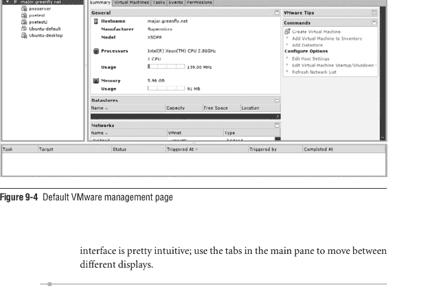

界面相当直观；使用主窗格中的标签在不同显示之间切换。

> 注意 如果你需要有关如何导航 Web 管理工具的额外帮助，请点击页面顶部沿线的 `Help` 链接。这将打开一个新窗口，其中包含 VMware Server、Web 界面以及运行和调优虚拟机的文档的完整文档。

## 创建新的虚拟机

要创建新的虚拟机，请点击页面顶部的 Virtual Machine 按钮并选择 Create Virtual Machine。这将启动一个向导，会询问你有关主机的一系列问题，例如其名称、你将在其上安装的操作系统类型，以及分配多少 RAM 和存储空间。当然，所有这些选项都将根据你想要创建的虚拟机类型而有所不同，但相对简单地浏览菜单并做出选择。

当你到达 Network Adapter 部分时，你将能够在之前设置的桥接、NAT 和仅主机网络之间进行选择。你在这里的选择很大程度上取决于你是否希望将此虚拟机与 rest of the network 隔离。如果希望虚拟机看起来像网络上的任何其他机器，请选择 Bridged。如果希望它可以访问 rest of the network 但希望它位于自己的私有网络上，请选择 NAT。如果希望它完全隔离，请选择 Host-only。

当你到达 CD/DVD 驱动器部分时，你将能够选择是让此虚拟机访问服务器上的物理 CD-ROM 驱动器还是系统上的 ISO。ISO 选项很方便，因为你可以将多个安装和救援 CD 的 ISO 存储在服务器上并通过几次点击从中启动。我在 `/var/lib/vmware/Virtual Machines` 下创建了一个名为 `isos` 的目录，用来存储我想要使用的所有 ISO。你也可以添加虚拟软盘驱动器和 USB 控制器，如果需要的话。

完成向导后，你的主机将与你创建的任何其他虚拟机一起显示在左侧窗格中。点击它即可看到类似图 9-5 的屏幕，显示虚拟机的 Summary 屏幕。从此屏幕你可以监视虚拟机的 CPU 和 RAM 使用情况，查看其当前配置的硬件，并添加个人备注。

屏幕顶部你会看到形如标准停止、暂停和播放图标的快捷图标，以及一个重置电源的图标。停止按钮将切断虚拟机的电源，就像你按住服务器上的电源按钮或将其从墙上拔掉一样。播放按钮将开机机器，暂停按钮将暂停其

## 存储设置

创建新磁盘时，请注意你拥有的一些选项。如果担心空间问题，你可以告诉 VMware 根据需要增长磁盘文件，因此即使你设置了 20Gb 磁盘，如果磁盘仅使用 20%，它只会占用那么多存储空间。这节省了空间，但可能会损害磁盘性能。创建磁盘时，你必须在性能和存储之间做出决定。你还可以选择将 VMware 磁盘保存为最大 2Gb 的文件。除非你计划将虚拟机移动到文件系统最大文件大小限制为 2Gb 的系统，否则请保持此选项未选中。

## 图 9-5 VM 摘要屏幕

current state to disk. 最后，重置按钮的作用就像你按下了服务器前面的重置按钮一样。在右侧主窗格中，你会看到一个 Commands 部分，其中包含执行相同操作集的链接，以及快照选项，我将在后面介绍，还有添加硬件和配置 VM 的选项。

## VM 控制台访问

当你打开 VM 的电源时，它将开始启动过程并在后台运行。当然，如果这是你第一次打开这台机器的电源，它上面不会有操作系统，所以你可能想要某种控制台访问权限，以便你可以安装操作系统。每个 VM 可用的选项卡之一都标记为 Console。第一次点击此选项卡时，你会被提示安装浏览器插件。插件安装后，每次进入此选项卡时，你都可以点击其中以在屏幕上启动一个单独的窗口，该窗口会为你提供对机器的控制台访问权限，就像你通过远程桌面或 KVM 会话连接到它一样。图 9-6 显示了一个示例远程控制台屏幕，其中我的 VM 处于 Ubuntu Server 安装 CD 启动屏幕。

storage. 如果你想回到快照状态，只需选择 VM 并从 Commands 部分点击 `Revert to Snapshot`。

快照在你即将对服务器进行重大升级时非常有用。先拍摄快照，执行升级，如果出现问题，你知道可以轻松回滚并重试。我在撰写本书时大量使用了快照。我会启动一两个 VM 并在上面安装最基本的默认 Ubuntu Server 安装。然后我会拍摄一个快照。每当我想演示某段特定软件时，我就可以在 VM 上安装并设置它。当我完成并准备测试完全不同的软件时，我可以恢复到快照并回到干净的状态。这比每次都重新安装 Ubuntu 要快得多。

> NOTE 使用快照时请注意你的可用存储空间。你对系统所做的每一次更改都必须与原始状态一起保存。这意味着根据自上次快照以来系统上更改的数据量，你可能会分配到比预期多得多的存储空间。

## Suspend

挂起功能独立于任何操作系统级别的挂起支持。与 VMware 挂起相比，VM 的整个状态都会被挂起到磁盘，类似于快照。一旦机器被挂起，你就可以移动其文件，甚至移动到其他 VMware 服务器，然后取消挂起，它将从中断处继续。

挂起功能在你的机器被黑客入侵后的取证工作中特别有用。一旦确认 VM 已被入侵，将其挂起到磁盘并复制 VM 的整个目录。这样你就拥有了一个原始的 RAM 和磁盘映像，甚至可能仍有攻击者的进程在内存中运行。然后你可以将该 VM 转移到其他 VMware 服务器并反复重放被攻击的状态。

## 本地 VM 存储

VMware Server 使用 `/var/lib/vmware/Virtual Machines` 作为存储所有 VM 文件的默认位置。你通常希望该位置有尽可能多的存储空间，并且存储速度尽可能快，因为可能有多个 VM 存储在这里并且会同时访问存储。每个 VM 都将其所有文件保存在以 VM 名称命名的自己的目录中。以下是为我的测试 VM 创建的示例文件：

```
$ ls /var/lib/vmware/Virtual\ Machines/Test/
Test.nvram Test.vmdk Test.vmsd Test.vmx Test.vmxf vmware-0.log
vmware.log
```

`.nvram` 文件存储 VM 的 BIOS 和所有 BIOS 设置。如果你看到 `.vmsn` 或 `.vmsd` 文件，那是 VMware 用于存储快照数据和快照元数据的文件。如果你看到 `.vmem` 文件，VMware 已经复制了 VM 的分页文件。一般来说，这发生在 VM 运行时或崩溃时。任何 `.vmdk` 文件都是虚拟磁盘文件。这些文件很可能是占用你大部分存储空间的文件，除去潜在的快照文件。

VM 的所有设置，例如它有多少 RAM，连接了哪些硬盘或 CD-ROM 驱动器，以及网络设置，都存储在 `.vmx` 文件中。虽然你通常不应手动修改此文件，除非你真的知道自己在做什么，但它只是一个文本文件。`.vmx` 文件的内容只是键值对，看起来像这样：


```
#!/usr/local/bin/vmware
.encoding = "UTF-8"
config.version = "8"
virtualHW.version = "7"
floppy0.present = "FALSE"
mks.enable3d = "TRUE"
...
vmci0.present = "TRUE"
nvram = "Test.nvram"

scsi0.present = "TRUE"
scsi0.sharedBus = "none"
scsi0.virtualDev = "lsilogic"
memsize = "512"
scsi0:0.present = "TRUE"
scsi0:0.fileName = "Test.vmdk"
scsi0:0.writeThrough = "TRUE"
ide1:0.present = "TRUE"
ide1:0.fileName = "/var/lib/vmware/Virtual Machines/isos/ubuntu-8.04.1-server-i386.iso"
ide1:0.deviceType = "cdrom-image"
ide1:0.allowGuestConnectionControl = "FALSE"
```

每个虚拟机目录中的 `.log` 文件维护着该虚拟机发生的所有事件的日志。你可以通过 Web 界面访问这些日志的子集，但日志文件本身包含更详细的信息。如果虚拟机因意外原因崩溃，或者你只是想从更底层了解 VMware 在启动或停止虚拟机时做了什么，请查看此处。

由于构成虚拟机的所有内容实际上只是系统上的文件，只要虚拟机处于挂起或关闭状态，你就可以使用常规的 Linux 命令（如 `mv`、`cp` 和 `rsync`）来移动这些文件。如果你想将虚拟机从一台机器迁移或复制到另一台机器，只需确保其已关闭或挂起，然后使用 `rsync` 或 `scp` 进行传输。请注意，当你移动或复制虚拟机并在新主机上重新启动它时，VMware 会检测到这一情况，并提示你生成新的 UUID（一个通用字符串，每个虚拟机都应唯一）。

## 虚拟设备

所有虚拟机设置和磁盘都位于一个目录中的另一个有用之处在于，许多人创建了所谓的“虚拟设备”。本质上，虚拟设备是为特定目的而创建的虚拟机，例如垃圾邮件过滤或防火墙。许多公司甚至提供了预装其软件的虚拟设备，以便你可以轻松演示。虚拟设备通常压缩为单个 `.zip` 文件，因此下载后，你只需将 `.zip` 文件解压到 `/var/lib/vmware/Virtual Machines`，进入 Web 界面，点击“虚拟机_将虚拟机添加到清单”，然后浏览到新虚拟机的 `.vmx` 文件即可完成安装。VMware 本身在其网站上托管了许多虚拟设备，甚至在 Web 界面上提供了一个名为“虚拟设备市场”的链接，可直接带你前往。

## Ubuntu 企业云

如果你一直关注虚拟化领域，那么无疑听说过“云”这个术语，它很可能指的是亚马逊的弹性计算云（EC2）服务。亚马逊已经构建了一个庞大的服务器基础设施，可以运行虚拟机。然后，亚马逊出售这些机器上的时间和资源，这样你就可以在亚马逊的基础设施上部署自己的虚拟服务器，而不再需要担心存储、内存或 CPU 资源，甚至不必担心你的虚拟机运行在哪台物理服务器上。相反，服务器运行在亚马逊云的某个地方。

虽然在 EC2 上部署你自己的 Ubuntu 服务器简单直接，但一些管理员更希望完全控制自己的基础设施，无论是物理的还是虚拟的。Ubuntu 提供了一个名为 Ubuntu 企业云（UEC）的解决方案，允许你建立自己的“私有云”——一组可以运行虚拟机且行为与 EC2 非常相似的服务器。借助 UEC，你可以向自己的云中添加多个节点，并通过一个易于使用的界面管理它以及你所有的虚拟机。

虽然你可能认为部署自己的私有云相当困难，但 Ubuntu 已经极大地自动化了这一过程，而且你会发现，只需几个步骤即可完成。不过，首先让我们来看看你需要什么。

### UEC 系统要求

至少需要两台物理服务器才能运行 UEC：一台前端服务器和一个节点。前端服务器将管理你的私有云，并提供以下服务：

- 云控制器（称为 `cic`）
- 集群控制器（称为 `cc`）
- Walrus（类似亚马逊 S3 的存储服务）
- 存储控制器（称为 `sc`）

由于前端服务器本身不会运行任何虚拟机，你可以使用一台不支持虚拟化扩展的较旧服务器。前端服务器还将存储所有不同的服务器镜像类型，并通过网络将它们部署到每个节点，因此这台机器拥有的存储空间越大（且速度越快）、网络速度越快，效果就越好。

节点服务器是可能由前端管理的众多服务器之一，它将通过节点控制器（`nc`）服务实际运行虚拟机。你的节点服务器需要支持虚拟化扩展节点就像设置常规 KVM 服务器一样。节点拥有的资源（RAM、CPU 和磁盘）越多，它能够托管的虚拟机就越多。

### 安装 UEC 前端服务器

安装前端服务器与安装其他任何 Ubuntu Server 实例一样简单。只需用 Ubuntu Server 光盘引导机器，在启动菜单中你会看到第二个选项是 Install Ubuntu Enterprise Cloud。选择该选项，然后按照标准的 Ubuntu 安装菜单完成安装。

安装进行到中途时，系统会询问几个问题，以便你配置 UEC。安装程序会自动探测网络，检查是否存在前端服务器；由于目前没有（因为我们正在设置它），安装程序默认会将此实例设置为前端服务器。接下来，系统会要求你为集群命名，最后你必须提供一段 IP 地址范围，供前端服务器分配给你创建的实例。请务必选择一段未被任何其他机器使用的 IP 地址范围，并且该范围要包含你的前端服务器和节点。最后，完成安装并重新启动进入你的新服务器。

### 安装 UEC 节点服务器

设置节点服务器比安装前端服务器还要简单。只需用 Ubuntu Server 安装光盘引导节点服务器，并从启动菜单中选择 Install Ubuntu Enterprise Cloud。安装程序会自动检测你的前端服务器，并默认将该机器设置为节点。只需确认默认设置并完成安装即可。安装程序会自动管理节点在集群中的注册，因此一旦节点启动完成，你就可以获取凭据并管理你的 UEC 集群了。

### 管理你的云

服务器安装并运行后，下一步是从云中获取凭据，以便你能注册并管理它。所有将要使用该云的人都必须遵循相同的过程。

在你自己的电脑上（也可以选择在前端服务器本身上）打开 Web 浏览器，浏览到 `https://frontendserver:8443`。将 `frontendserver` 替换为你的前端服务器的主机名或 IP 地址。接受证书，并使用用户名和密码 `admin` 登录。首次登录时，你会进入一个首次配置界面，需要修改 `admin` 密码并设置一个要使用的联系电子邮件地址。完成此过程后，你将看到默认的 UEC 管理界面（图 9-7）。

在此界面上，你可以添加其他有权查看和管理云实例的用户，但你首先要做的应该是选择 Credentials（凭据）选项卡，并单击 Download Credentials（下载凭据）。然后，在本地机器上创建一个名为 `~/.euca` 的目录，并将凭据解压到那里：

```
$ mkdir ~/.euca
$ cd ~/.euca/
$ unzip ~/Desktop/euca2-admin-x509.zip
Archive: ~/Desktop/euca2-admin-x509.zip
To setup the environment run: source /path/to/eucarc
inflating: eucarc
inflating: cloud-cert.pem
inflating: jssecacerts
inflating: euca2-admin-9f543bf5-pk.pem
inflating: euca2-admin-9f543bf5-cert.pem
```

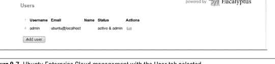

图 9-7 选中 User 选项卡时的 Ubuntu Enterprise Cloud 管理界面

最后，在管理你的云之前，你需要在已下载并解压凭据的机器上安装 `euca2ools` 软件包，并测试凭据是否可用：


```
$ sudo apt-get install euca2ools
$ . ~/.euca/eucarc
$ euca-describe-availability-zones verbose
AVAILABILITYZONE	cluster1	192.168.0.74
AVAILABILITYZONE	|- vm types	free / max	cpu	 ram	disk
AVAILABILITYZONE	|- m1.small	0002 / 0002	1	192	2
AVAILABILITYZONE	|- c1.medium	0002 / 0002	1	256	5
AVAILABILITYZONE	|- m1.large	0001 / 0001	2	512	10
AVAILABILITYZONE	|- m1.xlarge	0001 / 0001	2	1024	20
AVAILABILITYZONE	|- c1.xlarge	0000 / 0000	4	2048	20
```

## 安装新服务器镜像

终于，你可以在集群上设置第一个服务器了。回到 `https://frontendserver:8443` 的 Web 界面，并选择 Store（商店）选项卡。Store（商店）选项卡列出了许多已经为你构建好的服务器镜像。你只需选择 Install（安装），镜像就会下载到你的本地集群。镜像下载完成后，点击 Install 按钮下方出现的“如何运行？”链接，获取有关如何运行该镜像的说明（图 9-8）。

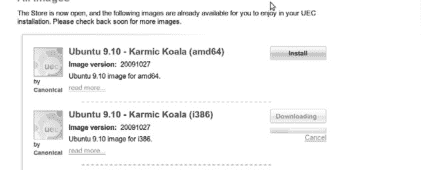

图 9-8 UEC Store 正在下载 Karmic i386 镜像

## 启动新实例

现在，你至少已经下载了一个镜像并准备安装。你会发现有几种不同的方式可以基于该镜像启动新服务器，例如通过 `euca-run-instances` 命令行，或者通过其他 UEC 管理工具（如 Landscape），甚至可以通过 Web 浏览器使用 ElasticFox Firefox 扩展。由于图形化工具通常不言自明，我将讨论如何使用命令行工具，你应该已经在本地系统上安装好了。

## 创建并启用 SSH 密钥对

在 UEC 上创建新实例之前，你需要设置一些 SSH 密钥对。如果没有密钥对，实例创建后将无法远程登录服务器。以下脚本将创建你的密钥对：

```
if [ ! -e ~/.euca/mykey.priv ]; then
mkdir -p -m 700 ~/.euca
touch ~/.euca/mykey.priv
chmod 0600 ~/.euca/mykey.priv
euca-add-keypair mykey > ~/.euca/mykey.priv
fi
```

现在运行以下命令，允许实例上的 22 端口流量：

```
$ euca-authorize default -P tcp -p 22 -s 0.0.0.0/0
GROUP default
PERMISSION default ALLOWS tcp 22 22 FROM CIDR 0.0.0.0/0
```

## 查看 VM 类型

UEC 设置了多个默认 VM 类型，并为它们分配了不同的资源。这样，当你创建新实例时，不必手动输入实例的 RAM 大小、CPU 数量和磁盘大小，而是可以参考这些快捷方式之一。如果你点击 UEC Web 界面上的配置选项卡并滚动到底部，你会看到预定义的 VM 类型列表（图 9-9），并且可以更改它们。

默认情况下，有五种配置的 VM 类型：

- `m1.small`：1 个 CPU、192MB RAM、2GB 磁盘
- `c1.medium`：1 个 CPU、256MB RAM、5GB 磁盘

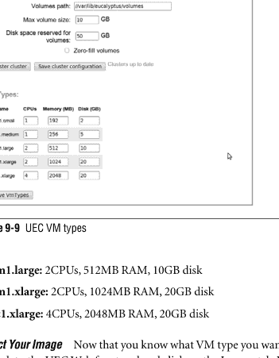

### 图 9-9 UEC VM 类型

- `m1.large`：2 个 CPU、512MB RAM、10GB 磁盘
- `m1.xlarge`：2 个 CPU、1024MB RAM、20GB 磁盘
- `c1.xlarge`：4 个 CPU、2048MB RAM、20GB 磁盘

## 选择你的镜像

既然你已经知道要创建什么 VM 类型，请返回 UEC Web 前端并点击“镜像”选项卡。你应该至少看到一个以 `emi-` 开头的镜像 ID。复制此 ID，然后在终端中使用 `euca-run-instances` 工具启动你的实例：

```
$ euca-run-instances -k mykey -t c1.medium emi-DE4C106E
RESERVATION r-3F6071A admin admin-default
INSTANCE i-3EFA0858 emi-DE4C106E 0.0.0.0 0.0.0.0 pending
    mykey 2010-04-17T22:04:54.647Z eki-fA3A10D7
    eri-08B41143
```

启动实例后，你可能会希望监视 `euca-describe-instances` 的输出，以便了解实例状态何时从 `pending` 变为 `running`：

```
$ euca-describe-instances
RESERVATION r-41DB083A admin default
```

```
INSTANCE  i-48D40805  ami-DE4C106E  192.168.0.235
172.19.1.2  pending  mykey  0  c1.medium
2010-04-17T22:50:37.016Z  cluster1  eki-F43A10D7
eri-08B41143
```

如果创建实例时出现问题，你会发现实例从 `pending` 变为 `terminated`。如果发生这种情况，请检查节点上 `/var/log/eucalyptus/nc.log` 的输出，以获取实例无法启动的线索。

> 注意：当我启动第一个实例时，我使用 `m1.small` VM 类型进行了测试。不幸的是，该 VM 类型分配的 2GB 磁盘对于该镜像来说不够大，因此实例始终无法启动——它从 `pending` 变为 `terminated` 状态。最终我在 `/var/log/eucalyptus/nc.log` 中看到了错误，当我改用具有更多存储空间的 VM 类型重试后，虚拟机成功创建。如果你的实例直接变为 `terminated`，还需要检查节点 BIOS 中是否启用了虚拟化扩展。

当实例变为 `running` 状态后，你可以像管理任何其他服务器一样通过 SSH 连接到它。只需从 `euca-describe-instances` 获取其 IP 地址，然后使用你之前创建的 SSH 密钥通过 SSH 连接到该 IP。在此示例中，IP 地址是 `192.168.0.235`：

```
$ euca-describe-instances
RESERVATION  r-41DB083A  admin  default
INSTANCE  i-48D40805  ami-DE4C106E  192.168.0.235
172.19.1.2  running  mykey  0  c1.medium
2010-04-17T22:50:37.016Z  cluster1  eki-F43A10D7
eri-08B41143
$ ssh -i ~/.euca/mykey.priv ubuntu@192.168.0.235
```

当你准备终止实例时，只需记下以字母 `i` 开头的实例 ID。在我的示例中，实例 ID 是 `i-48D40805`。要终止实例，请使用 `euca-terminate-instances`：

```
$ euca-terminate-instances i-48D40805
INSTANCE  i-48D40805
```

> 注意：如果所有这些命令行操作不适合你，我建议改用 ElasticFox 或其他图形化前端。它设置起来相对简单，并且可以非常轻松地管理和监控你的实例。

# 第10章

## 容错


### 检验你的冗余性。

与备份一样，如果你没有测试过容错能力，那就等于没有容错能力。如果可能的话，在部署新的冗余系统（如网卡绑定或服务器集群）之前，请务必模拟故障，并了解系统如何响应故障，以及故障修复后系统如何响应。系统在处理故障以及故障修复后恢复的方式上可能截然不同，这完全取决于你的配置方式。这个测试阶段也是测试你为检测这些故障而部署的任何监控的好时机。

### 消除一切单点故障。

虽然拥有一些冗余比没有强，但要努力审视整个服务器堆栈，找出并消除任何单点故障。例如，如果你为数据中心设置了冗余电源，并且每台服务器都有一个电源连接到其中一个电源，但如果服务器连接到一个带单电源的交换机上，那就没什么作用了。对于规模较大的运营，甚至数据中心本身也被视为单点故障，因此在这种情况下降服务器分布在地理位置完全不同的多个数据中心。

### 快速响应故障。


当组件发生故障时，尽快识别并修复问题。例如，在RAID中，许多系统管理员会设置一块磁盘作为热备盘，这样一旦磁盘发生故障，备用盘就能立即接管。如果在另一块磁盘故障之前热备盘已完成同步，数据仍然完好。虽然并非每个组件都能做到这一点，但当确实发生故障时，尽量在失去故障转移端之前完成修复。

## RAID

服务器硬件中最容易发生故障的部分是硬盘驱动器，因此如果你想要一个容错系统，硬盘冗余应该是你的首要任务。这通常通过RAID来实现。RAID代表廉价磁盘冗余阵列，尽管有些人称之为独立磁盘冗余阵列（这些人一定给光纤通道驱动器标过高价）。

RAID通常被称为硬件RAID或软件RAID。使用硬件RAID时，服务器会有一个组件内置于主板或作为附加卡提供，硬盘驱动器连接到该卡上。该硬件支持各种RAID级别，通常拥有自己的处理器和内存来执行任何计算（例如RAID 5上的奇偶校验计算）。然后该卡将存储呈现为单个设备（有时是通用SCSI驱动器，有时是不同块设备，具体取决于供应商），你可以对其进行分区、格式化和使用。任何配置、恢复或监控通常都需要主机上的特殊软件或在BIOS中操作。

使用软件RAID时，操作系统通过驱动或模块利用常规CPU实现RAID算法。在Linux上，你既可以看到原始磁盘和分区，也可以看到表示RAID存储的特殊设备。Linux软件RAID的优点是它不需要Linux下的任何特殊供应商支持，而且它实际上性能出色，稳定性惊人，并且免费。此外，除非你投资高端RAID卡，否则Linux软件RAID在扩展RAID方面提供了更多灵活性。在本章的其余部分中，我将重点介绍Linux软件RAID，并讨论如何将系统从单驱动器迁移到RAID、从RAID 1迁移到RAID 5，以及如何将驱动器添加到RAID 5阵列中。

> **注意** 还有第三种类型的RAID，介于硬件RAID和软件RAID之间。它常见于廉价的RAID卡中，如今这些卡甚至内置于许多台式机主板中。虽然涉及硬件，但RAID本身是通过在主机上运行的驱动来实现的，因此它使用主机CPU。此外，这种混合RAID需要特定供应商的驱动，操作系统才能看到RAID磁盘。

## RAID级别

有多种不同的RAID实现方式。每种方式都有优缺点，具体取决于你想要实现的目标。接下来我将介绍你最可能用到的Linux软件RAID类型。

### RAID 0

你可能会认为 `RAID 0`，也称为条带化，有点具有误导性。它实际上根本不是冗余阵列。`RAID 0` 阵列至少需要两块磁盘。对此阵列的每次写入都会条带化到两块磁盘上，因此实际上这两块驱动器变成了一块大磁盘。所以如果你在 `RAID 0` 阵列中有两块 100GB 硬盘，你将拥有 200GB 的存储空间。虽然 `RAID 0` 提供了极佳的速度，但缺点是没有冗余。如果 `RAID 0` 阵列中丢失了一块驱动器，你的所有数据都会丢失。本章中的示例我使用 `RAID 1` 和 `RAID 5`；我只是提到 `RAID 0` 来说明 RAID 级别之间的差异。

### RAID 1

`RAID 1` 也称为镜像。在 `RAID 1` 阵列中，写入一块磁盘的每一位都会复制到另一块磁盘上。与 `RAID 0` 一样，`RAID 1` 也至少需要两块驱动器；然而，在这种情况下，`RAID 1` 阵列的大小仅与其中一块驱动器一样大。所以如果你在 `RAID 1` 阵列中有两块 100GB 驱动器，你将拥有 100GB 的存储空间。好处是你可以丢失阵列中的一块驱动器仍然拥有所有数据。

### RAID 5

`RAID 5` 也称为条带化加奇偶校验。`RAID 5` 阵列至少需要三块驱动器。每次写入阵列时，数据都会分割到三块驱动器上。除了数据之外，奇偶校验信息也会分割到驱动器中，这样阵列中的任何一块驱动器都可以失效，并且剩余的驱动器仍然拥有所有数据，一旦失效的驱动器被更换，其他驱动器就可以重建它。在 `RAID 5` 阵列中，你基本上会损失一块驱动器的存储空间，因此由三块 100GB 磁盘组成的 `RAID 5` 阵列将拥有 200GB 的存储空间。由四块 100GB 磁盘组成的 `RAID 5` 阵列将拥有 300GB 的存储空间。

## NOTE

### RAID 5 作为根分区

需要注意的是，虽然 `GRUB` 可以读取软件 `RAID 1` 阵列，但它不能读取软件 `RAID 5` 阵列。这意味着如果你选择为根分区使用 `RAID 5` 阵列，你必须为 `GRUB` 使用创建一个单独的非 `RAID 5` 分区作为 `/boot` 目录。一个常见的三磁盘场景是为 `/boot` 创建一个三分区 `RAID 1` 阵列，以及为根目录创建一个三分区 `RAID 5` 阵列。

## Configure RAID during Installation

你可以在 Ubuntu 初始安装期间或安装后设置 RAID 阵列。安装程序提供了一个漂亮的图形界面来创建在安装完成后即可使用的阵列，因此如果你正在安装一台新机器，从安装程序中设置 RAID 是有意义的。

RAID 配置是在安装过程的分区部分完成的。一旦看到主分区屏幕，选择“`Manual partitioning`”。在我示例中，我在一台三磁盘机器上设置了 RAID。我有一个用于 `/boot` 的三分区 `RAID 1` 阵列，一个用于 `/` 的三分区 `RAID 5` 阵列，以及一个用于 swap 的三分区 `RAID 5` 阵列。

第一步是分区每块磁盘，使其具有 `/boot`、 `/` 和 swap 分区。在你调整分区大小时，请记住 `RAID 1` 阵列的大小仅与其中一个分区一样大，而 `RAID 5` 阵列的大小等于所有分区总和减去一个分区的大小。虽然不要求每个分区大小相等，但阵列以最小的分区为基准，因此如果你能使阵列中的每个分区大小相同，你会更容易处理。

当你进入每个新分区的分区设置时，在可以選擇文件系统和挂载点的部分，将“Use as”选项更改为“`physical volume for RAID`”，如图 10-1 所示。

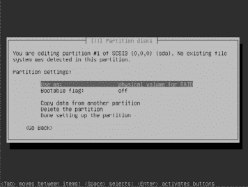

**Figure 10-1** Partition settings for software RAID

分区完成后，你将在每块驱动器上拥有多个类型为 K raid 的分区，如图 10-2 所示。屏幕顶部有“`Configure software RAID`”选项。选择该选项，并在下一屏幕确认每个分区的大小是你想要的后，选择 Yes 将更改写入每块磁盘的分区表。

下一步是为每个 RAID 阵列创建一个多磁盘 MD 设备。在我的例子中，我想创建三个 MD 设备，一个用于我的 `RAID 1` `/boot`，一个用于我的 `RAID 5` swap，一个用于我的 `RAID 5` `/`。对于这些 MD 设备中的每一个，我选择 `Create MD`，然后选择我想要的 RAID 级别；然后我选择我在阵列中想要的活动设备和备用设备数量。在我的例子中我不会有任何备用设备，所以我将此选项设置为每个阵列三个活动设备和零个备用设备。最后，我选择用于特定 MD 设备的分区。如果你按相同顺序在驱动器上创建每个分区，这将很简单，因为 `/dev/sda1`、`/dev/sdb1` 和 `/dev/sdc1`（在我例子中）都属于同一个 MD 设备。重复此过程直到创建所有 MD 设备，然后选择 `Finish`。

完成后，分区屏幕将显示你的 RAID 设备，如图 10-3 所示。你会注意到每个 SCSI 驱动器

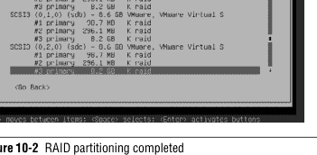

#### Figure 10-2 RAID partitioning completed

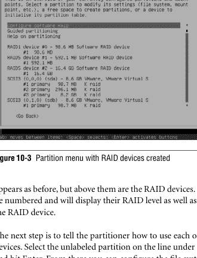

Figure 10-3 Partition menu with RAID devices created

与之前一样出现，但在其上方是 RAID 设备。这些设备将被编号，并会显示其 RAID 级别以及 RAID 设备的总体大小。

下一步是告诉分区器如何使用这些新的 RAID 设备。选择每个 RAID 设备下方行上的未标记分区并按 Enter。从那里你可以像对待普通分区一样配置文件系统、挂载点和其他选项。参见 Figure 10-4，了解我完成后最终分区菜单的示例。一旦完成，选择“`Finish partitioning`”并将更改写入磁盘。如果出现提示询问是否在阵列降级时启动，请阅读有关这样做的风险的描述，然后选择 Yes 或 No。安装程序将继续安装的其余过程。跳到 Software RAID Management 部分，了解如何使用 `mdadm` 包的功能来管理你的软件 RAID。

## Configure RAID after Installation

你可能选择在初始安装后向服务器添加 RAID 存储。稍后在本章中我将讨论如何从单磁盘迁移到 RAID 阵列以及如何从一种 RAID 类型迁移到另一种 RAID 类型，但现在我将

### Figure 10-4 Completed RAID partitioning

假设你只是想向现有服务器添加一个 RAID 阵列。对于此示例，我假设我添加了三个新驱动器，`/dev/sdb`、`/dev/sdc` 和 `/dev/sdd`，并且我想对驱动器进行分区并在所有三个分区上创建一个 `RAID 5` 阵列，然后将其挂载在 `/mnt/storage`。


# 软件 RAID 阵列在 Ubuntu 下使用 mdadm 工具创建和管理

软件 RAID 阵列在 Ubuntu 下使用 `mdadm` 工具创建和管理。此工具可能未默认安装；如果没有，请运行 `sudo apt-get install mdadm` 来安装该包。

下一步是对这些驱动器中的每一个进行分区。在我的例子中，我只创建一个跨越整个驱动器的单个分区。使用你喜欢的任何分区工具（如 `fdisk` 或 `cfdisk`）就像创建任何其他分区一样。这里唯一的差别是需要将分区类型从默认的 `82` 改为 `fd`。`fd` 分区类型是为 Linux RAID 自动检测保留的。如果分区被设置为该类型，它会告诉 Linux 它是软件 RAID 阵列的一部分。

## 创建 MD 设备

一旦分区设置好，你就可以在命令行上使用 `mdadm` 来创建 MD 设备。在 RAID 1 阵列的情况下，你会输入

```
$ sudo mdadm --create /dev/md0 --level=1 --raid-devices=2 /dev/sdb1 /dev/sdc1
mdadm: array /dev/md0 started.
```

这里的大多数参数都很容易理解。`--create` 选项告诉 `mdadm` 我想在 `/dev/md0` 创建一个新的 MD 设备。如果我已经在 `/dev/md0` 有一个 RAID 阵列，我就会选择下一个数字，例如 `/dev/md1`。`--level` 选项设置此阵列使用的 RAID 级别，`--raid-devices` 设置活动设备的数量，最后你指定要用于阵列的每个分区。

在我的例子中，我想在 `/dev/sdb1`、`/dev/sdc1` 和 `/dev/sdd1` 上设置一个 RAID 5 阵列，所以我会输入

```bash
$ sudo mdadm --create /dev/md0 --level=5 --raid-devices=3 /dev/sdb1
  /dev/sdc1 /dev/sdd1
mdadm: array /dev/md0 started.
```

## 检查阵列健康状况

一旦我创建了阵列，我就可以在 `/proc/mdstat` 文件中检查其当前健康状况：

```text
$ cat /proc/mdstat
Personalities : [raid6] [raid5] [raid4]
md0 : active raid5 sdd1[2] sdc1[1] sdb1[0]
      16771584 blocks level 5, 64k chunk, algorithm 2 [3/3] [UUU]

unused devices: <none>
```

现在我可以像对待任何其他分区一样对待 `/dev/md0`，为其格式化为我选择的文件系统然后挂载它：

```bash
$ sudo mkfs -t ext3 /dev/md0
$ sudo mkdir /mnt/storage
$ sudo mount /dev/md0 /mnt/storage
```

## 启动时自动启动和挂载

现在这个阵列已经启动并运行；然而，它尚未设置在启动时自动启动和挂载。如果不设置此项，你每次系统启动时都必须运行 `mdadm` 命令来组装阵列以及 `mount` 命令。

要在启动时启动阵列，你需要使用有关阵列的详细信息配置 `/etc/mdadm/mdadm.conf`。现在你当然可以手工完成，但 `mdadm` 提供了更简单的方法。`mdadm --detail --scan` 命令将输出一个 `mdadm.conf` 为每个数组生成兼容的字符串，所以你所要做的就是将该输出重定向到 `/etc/mdadm/mdadm.conf` 文件：

```
$ sudo sh -c 'mdadm --detail --scan >> /etc/mdadm/mdadm.conf'
```

现在编辑你的 `/etc/fstab` 并添加一个 `/dev/md0` 的条目，就像对待其他任何挂载点一样。在我的例子中我会添加

```
/dev/md0  /mnt/storage  ext3  defaults  0 0
```

或者，我也可以在 `fstab` 中指定该设备的 UUID，就像其他分区一样。要查明这一点，我会输入

```
$ sudo blkid | grep /dev/md0
/dev/md0: UUID="99e190a7-dfe7-48ee-bf56-f426ef5343af" type="ext4"
```

一旦 `/etc/mdadm/mdadm.conf` 和 `/etc/fstab` 设置好，我就可以重启，然后检查 `/proc/mdstat` 以确保阵列启动，然后确认它已挂载。

# Software RAID Management

你对软件 RAID 阵列的大部分管理是在两个地方进行的：`/proc/mdstat` 和 `mdadm`。`/proc/mdstat` 文件提供了所有正在运行的 RAID 阵列的当前状态，包括如果其中任何一个重建磁盘时应有的进度条。单个 RAID 阵列的标准 `/proc/mdstat` 文件可能如下所示：

```
$ cat /proc/mdstat
Personalities : [raid6] [raid5] [raid4]
md0 : active raid5 sdd1[2] sdc1[1] sdb1[0]
16771584 blocks level 5, 64k chunk, algorithm 2 [3/3] [UUU]

unused devices: <none>
```

在输出中你可以看到哪个阵列处于活动状态（`md0`），它使用什么 RAID 级别（`raid5`），以及它使用哪些分区（`sdd1`、`sdc1` 和 `sdb1`）。在最后一行你可以看到 RAID 是健康的，因为它有三个磁盘全部处于活动状态（`[3/3] [UUU]`）。如果任何磁盘出现故障，该部分会发生变化，如下所示。

虽然你可以通过 `/proc/mdstat` 获取状态，但大部分实际的 RAID 管理是通过 `mdadm` 完成的。例如，此工具可以使用 `--query` 和 `--detail` 参数分别报告有关阵列的基本和更完整的信息：

```
$ sudo mdadm --query /dev/md0
/dev/md0: 15.99GiB raid5 3 devices, 0 spares. Use mdadm --detail for more detail.
$ sudo mdadm --detail /dev/md0
/dev/md0:
        Version : 00.90.03
        Creation Time : Wed Feb 11 21:31:16 2009
        Raid Level : raid5
        Array Size : 16771584 (15.99 GiB 17.17 GB)
        Used Dev Size : 8385792 (8.00 GiB 8.59 GB)
        Raid Devices : 3
        Total Devices : 3
        Preferred Minor : 0
        Persistence : Superblock is persistent
        Update Time : Wed Feb 11 22:11:49 2009
        State : clean
        Active Devices : 3
        Working Devices : 3
        Failed Devices : 0
        Spare Devices : 0
        Layout : left-symmetric
        Chunk Size : 64K
        UUID : 37090db5:5fafad78:e368bf24:bd0fce41 (local to host ubuntu)
        Events : 0.4
```

| Number | Major | Minor | RaidDevice | State |
| 0 | 8 | 17 | 0 | active sync | `/dev/sdb1` |
| 1 | 8 | 33 | 1 | active sync | `/dev/sdc1` |
| 2 | 8 | 49 | 2 | active sync | `/dev/sdd1` |

# Replace a Failed Disk

虽然 `mdadm` 的所有信息都可能有用，但你会发现你主要在驱动器故障时使用 `mdadm`。当驱动器故障时，系统上运行的 `mdadm` 守护进程会自动向主机上的 root 用户发送电子邮件。要更改此设置，请编辑 `/etc/mdadm/mdadm.conf` 并在文件中找到 `MAILADDR` 选项。保存更改后，运行 `sudo /etc/init.d/mdadm reload` 以加载新选项。除了电子邮件之外，你也可以从 `/proc/mdstat` 看到驱动器已故障：


在这里你可以看到 `sdd1` 被标记为 `(F)` 表示它已故障，并且在输出的第三行阵列显示三个磁盘中有两个 `[3/2] [UU_]`。下一步是从 `/dev/md0` 中移除该磁盘，以便我可以用新驱动器替换它。为此我运行带有 `--remove` 选项的 `mdadm`：

```
$ sudo mdadm /dev/md0 --remove /dev/sdd1
```

驱动器必须被设置为故障驱动器才能将其移除，因此如果由于某种原因 `mdadm` 没有检测到驱动器故障但你想将其替换，你可能需要在移除之前将其设置为故障：

```
$ sudo mdadm /dev/md0 --fail /dev/sdd1
```

`mdadm` 命令支持命令链，所以你可以在同一行中使驱动器故障并移除它：

```
$ sudo mdadm /dev/md0 --fail /dev/sdd1 --remove /dev/sdd1
```

一旦你从阵列中移除驱动器，它将从 `/proc/mdstat` 中消失：

```
$ cat /proc/mdstat
Personalities : [linear] [multipath] [raid0] [raid1] [raid6]
[raid5] [raid4] [raid10]
md0 : active raid5 sdb1[0] sdc1[1]
16771584 blocks level 5, 64k chunk, algorithm 2 [3/2] [UU_]

unused devices: <none>
```

现在你可以用全新的硬盘替换旧盘并对其进行分区。确保在更换硬盘时创建的新分区大小等于或大于 RAID 阵列中其他分区的大小。新的分区准备好后，使用 `--add` 命令将其添加到阵列中：

```
$ sudo mdadm /dev/md0 --add /dev/sdd1
```

现在 `mdadm` 将开始重新同步数据的过程。这可能需要一些时间，具体取决于磁盘的速度和大小。你可以从 `/proc/mdstat` 中监控进度：

```
$ cat /proc/mdstat
```

```
Personalities : [linear] [multipath] [raid0] [raid1] [raid6]
[raid5] [raid4] [raid10]
md0 : active raid5 sdd1[3] sdb1[0] sdc1[1]
 16771584 blocks level 5, 64K chunk, algorithm 2 [3/2] [UU_]
  [>...................] recovery = 2.0% (170112/8385792)
 finish=1.6min speed=85056K/sec

unused devices: <none>
```

除了这种基本的 RAID 管理之外，你还可以对 RAID 阵列进行许多不同的调整和自定义，特别是创建时。有关完整选项和设置列表，请查看 `mdadm` 手册 `man mdadm`。

## 将非 RAID 迁移到软件 RAID

如果你在构建系统时没有考虑到 RAID，可能会发现自己处于想要将单盘系统迁移到软件 RAID 的情况。我甚至遇到过想要将 RAID 1 阵列迁移到 RAID 5 以增加存储空间的情况。本节我将讨论如何执行这两种迁移，以及如何向 RAID 5 阵列添加磁盘。

在本示例中，我假设我已经在 `/dev/sda` 上安装了系统。这是一个基本的 Ubuntu 安装，根分区位于 `/dev/sda1`，交换分区位于 `/dev/sda5`。我已向系统添加了第二个磁盘 `/dev/sdb1`，并且希望为根分区和交换分区都创建一个 RAID 1 阵列。在执行任何额外步骤之前，我想确保 `mdadm` 包已安装在我的服务器上，因此我运行

```
$ sudo apt-get install mdadm
```

由于我需要能够将所有文件从旧系统复制到新的 RAID 阵列，因此我不能从正在运行的系统执行所有这些步骤。相反，我需要某种 live CD 或救援光盘，以便没有任何分区正在被写入。Ubuntu Server 安装光盘对此效果不错；只需从中启动并选择 `Rescue a broken system` 选项。回答完基本的键盘和布局问题后，你将进入一个包含几种不同恢复选项的恢复菜单。在这里选择 `Execute a shell in the installer environment.`。

进入安装程序环境后，第一步是使用 `fdisk` 对 `/dev/sdb` 进行分区，至少创建一个与 `/dev/sda1` 大小相同或更大的 `/dev/sdb1` 分区。如果驱动器大小相同会更容易，因为你可以重新创建 `/dev/sda` 上的分区，包括交换分区。在创建分区时，记得将其分区类型设置为 `fd`。

> NOTE 本示例适用于 RAID 1 阵列，但如果你想从单盘迁移到 RAID 5 阵列，请记住 GRUB 无法从 RAID 5 阵列读取，因此你必须创建一个单独的 `/boot` 分区，并且不使用 RAID 或为其创建 RAID 1 阵列。

分区创建完成后，你就可以创建阵列了。由于我们目前正在使用系统上的 `/dev/sda1` 和 `/dev/sda5`，因此我们以降级模式创建阵列，对其进行格式化，将所有数据复制到新的 RAID 阵列中，以降级模式从阵列启动，然后最后热添加原始分区。这样在每一步我们都有数据的安全副本。降级阵列的创建方式与普通阵列类似，只是用 `missing` 代替缺失的驱动器：

```
#### mdadm --create /dev/md0 --level=1 --raid-devices=2 /dev/sdb1 missing
mdadm: array /dev/md0 started
#### mdadm --create /dev/md1 --level=1 --raid-devices=2 /dev/sdb5 missing
mdadm: array /dev/md1 started
```

现在我使用 `ext4` 文件系统格式化 `/dev/md0`，并使用 `swap` 文件系统格式化 `/dev/md1`：

```
#### mkfs.ext4 /dev/md0
#### mkswap /dev/md1
```

现在你可以为 `/dev/md0` 创建一个临时挂载点，并将根分区中的所有文件迁移到此新分区。Ubuntu 恢复模式默认会将根分区挂载在 `/target` 下，但如果你使用其他救援光盘，或者需要将多个分区迁移到多个阵列，则必须单独挂载它们。

不幸的是，Ubuntu Server 恢复模式不包含我喜欢用于复制文件到新系统的工具，例如 `cpio` 或 `rsync`，甚至 `find` 的版本也不是功能齐全的，因此我改用服务器根分区中的 `find` 和 `cpio` 命令：

```
#### mkdir /mnt/temp
#### mount /dev/md0 /mnt/temp
#### cd /target
#### ./usr/bin/find . -xdev -print0 | ./bin/cpio -pa0V /mnt/temp
```

当然，如果你将根分区挂载在 `/target` 以外的其他位置，则改为 `cd` 到该目录。此命令可能需要一些时间运行，因为它必须复制系统中的所有文件。

系统迁移到 `/dev/md0` 后，你需要设置阵列以便在启动时自动加载。首先，我们将配置的阵列添加到 `/dev/md0` 挂载位置内的 `/etc/mdadm/mdadm.conf` 中。然后更新其 `initramfs`，以便在启动时创建这些设备：

```
#### mdadm --detail --scan >> /mnt/temp/etc/mdadm/mdadm.conf
#### chroot /mnt/temp update-initramfs -u 2.6.32-19-generic-pae
update-initramfs: Generating /boot/initrd.img-2.6.32-19-generic-pae
```

请确保将 `update-initramfs` 参数更改为指向你的 `initrd` 文件，检查 `/mnt/temp/boot/` 中的 `initramfs` 文件以供选择。


接下来我需要编辑 RAID 数组上的`/etc/fstab`文件，使其指向 RAID 数组而不是`/dev/sda`上的分区。由于救援光盘上的工具有限，这意味着使用`nano`文本编辑器。首先编辑`/mnt/temp/etc/fstab`，注释掉当前`/`的条目，并添加一条指向`/dev/md0`的类似行。然后对 swap 文件行执行相同的操作。你可以在此处添加实际的设备名称或这些设备的 UUID，但请记下 UUID 以便以后参考。

现在你已准备好重启进入新系统。在你所在的 shell 中输入`exit`，然后选择“Reboot the system”选项。当系统重启并看到 GRUB 初始加载时，按 Shift 键停止 GRUB 启动以便你可以编辑启动选项。一旦可以看到启动选项列表，请确保第一个选项，即应为你的主内核，已被高亮，然后按 E 编辑它。其中一行会写着`set root='(hd0,1)'`，或者如果不是，它会指向你的旧 root 设备，因此将其更改为指向新设备。在我的例子中我将其更改为`set root='(hd1,1)'`。接下来有两行不同的行列出了原始 root 分区的 UUID。将这两个 UUID 都更改为你刚才记下的新 RAID 设备的 UUID。在我的例子中，最终的 GRUB 选项如下

```
recordfail
insmod ext2
set root='(hd1,1)'
search --no-floppy --fs-uuid --set 65fc1772-3996-4012-af59-491d6b2e74e4
linux /boot/vmlinuz-2.6.32-19-generic-pae root=UUID=65fc1772-3996-4012-af59-491d6b2e74e4 ro quiet splash
initrd /boot/initrd.img-2.6.32-19-generic-pae
```

完成更改这些选项后，按 Ctrl-X 启动进入 RAID 数组上的系统。如果设置了正确的启动参数和`/etc/fstab`，当你启动并输入`df`时，你应该会看到你的 root 设备是`/dev/md0`（或你为 RAID 数组分配的名称）：

```
$ df
Filesystem     1K-blocks    Used Available Use% Mounted on
/dev/md0       8231864   634492   7182500   9% /
...
```

当你检查`/proc/mdstat`时，你会看到你的活动数组在单块磁盘上运行：

```
$ cat /proc/mdstat
Personalities : [linear] [multipath] [raid0] [raid1] [raid6]
[raid5] [raid4] [raid10]
md1 : active raid1 sdb5[0]
88256 blocks [2/1] [_U_]

md0 : active raid1 sdb1[0]
8297472 blocks [2/1] [_U_]

unused devices: <none>
```

现在你可以将原始分区添加到每个数组中：

```
$ sudo mdadm /dev/md0 --add /dev/sda1
$ sudo mdadm /dev/md1 --add /dev/sda5
$ cat /proc/mdstat
Personalities : [linear] [multipath] [raid0] [raid1] [raid6]
[raid5] [raid4] [raid10]
md1 : active raid1 sda5[2] sdb5[0]
88256 blocks [2/1] [_U_]
resync=DELAYED

md0 : active raid1 sda1[2] sdb1[0]
8297472 blocks [2/1] [_U_]
[=>...................] recovery = 5.6% (471936/8297472)
finish=12.3min speed=10550K/sec

unused devices: <none>
```

数组将在后台同步，但在此期间你仍可使用系统。现在你需要更新 GRUB 配置，使其指向新的 UUID 和设备（否则每次都必须手动编辑）。过去你必须手动编辑，但如果你只需输入`sudo update-grub`，更新程序将为你检测并更改所有相关条目。

现在你在运行软件 RAID 数组时遇到的问题是 GRUB 只会安装在第一块磁盘上。如果第一块磁盘丢失，第二块磁盘将无法自动启动系统。要修复此问题，你必须手动将 GRUB 安装到第二块磁盘。这很容易——只需输入`sudo grub-install /dev/sdb`。如果你的第二个 RAID 设备不同，请将设备从`/dev/sdb`更改为你的第二个 RAID 设备。如果有第三个 RAID 设备，也为该设备运行`grub-install`。

最后一步是使用`/dev/sda`上的分区工具并将两个分区都设置为分区类型 fd，以便它们能自动被检测为 RAID 设备。最后一次重启系统以确保它能启动到你的 RAID 数组。现在你的系统具有容错能力并且可以使用。

## 从 RAID 1 迁移到 RAID 5

在某个时候你可能会决定将特定系统从 RAID 1 扩展到 RAID 5。在大多数情况下，这是因为你的 RAID 数组需要更多存储空间。如果添加一块额外驱动并迁移到 RAID 5，你可以在保持冗余的同时将可用存储空间翻倍。

在此示例中，我将上面提到的 RAID 1 系统迁移到 RAID 5 系统。目前它有两个 RAID 1 数组，`/dev/md0`由`/dev/sda1`和`/dev/sdb1`组成，用于我的`/`分区，以及`/dev/md1`由`/dev/sda5`和`/dev/sdb5`组成，我将其用于交换空间。我添加了第三块驱动`/dev/sdc`，并将系统迁移到 RAID 5 数组。

当你的 root 分区位于 RAID 5 上时，有一些特殊考虑，因为 GRUB 不能直接从中启动。你需要设置一个不属于 RAID 5 的小型`/boot`分区供 GRUB 启动。你仍然可以在这里实现容错；你只需将`/boot`分区设为 RAID 1 即可。

正如我从单块驱动迁移到 RAID 1 数组时一样，要迁移到 RAID 5 数组，我需要使用救援光盘。在本例中我使用 Ubuntu Server 救援模式，因此从你的 Ubuntu Server 安装 CD 启动并在启动菜单中选择“Rescue a broken system”。当你到达选择 root 文件系统的部分时，请确保选择正确的 MD 设备（在我的例子中为`/dev/md0`）。在主救援操作菜单中选择“Execute a shell in the installer environment”。

此迁移的总体流程与从单块磁盘迁移到 RAID 1 非常相似。我们按新数组的期望方式对`/dev/sdc`进行分区，从两个 RAID 1 数组中移除`/dev/sdb`，然后重新分区它，然后创建我们新的降级 RAID 阵列，并对其进行设置，以便系统可以从它们启动。一旦我们成功从新阵列启动，就销毁旧阵列，重新分区最后一块驱动器，并将其热添加。

所以我首先对`/dev/sdc`进行分区。我在`/dev/sdc1`上创建一个 100MB 的`/boot`分区，然后用剩余空间创建根分区和交换分区。由于 RAID 5 阵列无论如何都会更大，我不必担心从根分区中占用 100MB。请记住，每个分区的类型都要设为 fd。我的最终磁盘布局如下：

| 设备 | 启动 | 开始 | 结束 | 块数 | ID | 系统 |
|---|---|---|---|---|---|---|
| `/dev/sdc1` |  | 1 | 13 | 104391 | fd | Linux RAID 自动检测 |
| `/dev/sdc2` |  | 14 | 1033 | 8193150 | fd | Linux RAID 自动检测 |
| `/dev/sdc3` |  | 1034 | 1044 | 88357+ | 5 | 扩展 |
| `/dev/sdc5` |  | 1034 | 1044 | 88326 | fd | Linux RAID 自动检测 |

现在，我使用`mdadm`从两个 RAID 阵列中移除`/dev/sdb`分区：

```
#### mdadm /dev/md0 --fail /dev/sdb1
mdadm: set /dev/sdb1 faulty in /dev/md0
#### mdadm /dev/md0 --remove /dev/sdb1
mdadm: hot removed /dev/sdb1
#### mdadm /dev/md1 --fail /dev/sdb5
mdadm: set /dev/sdb5 faulty in /dev/md1
#### mdadm /dev/md1 --remove /dev/sdb5
mdadm: hot removed /dev/sdb5
```


# 修改分区表

现在使用 `fdisk` 修改 `/dev/sdb` 的分区表，使其与 `/dev/sdc` 匹配。修改 `/dev/sdb` 的分区表并写入更改后，你可能会收到一个错误，提示内核在系统重启前将使用旧分区表。如果发生这种情况，你必须重新启动回到救援光盘，然后才能继续。如果没有收到该错误，请继续下一步。

# 创建 RAID 阵列

此时，我准备创建三个新的 RAID 阵列。我的 `/boot` 分区将是 RAID 1 `/dev/md2`，我的根分区将是 RAID 5 `/dev/md3`，新的交换驱动器将是 RAID 5 `/dev/md4`。使用 `mdadm` 以降级模式创建所有这些阵列：

```
#### mdadm --create /dev/md2 --level=1 --raid-devices=3 /dev/sdb1
/dev/sdc1 missing
#### mdadm --create /dev/md3 --level=5 --raid-devices=3 /dev/sdb2
/dev/sdc2 missing
#### mdadm --create /dev/md4 --level=5 --raid-devices=3 /dev/sdb5
/dev/sdc5 missing
```

在创建这些阵列时，你可能会收到关于 `/dev/sdb` 分区包含文件系统的警告，但这是预期的，所以输入 Y 以继续。完成后，如果我检查 `/proc/mdstat`，我会看到所有五个 RAID 阵列均处于降级模式：

```
#### cat /proc/mdstat
Personalities : [linear] [multipath] [raid0] [raid1] [raid6]
[raid5] [raid4] [raid10]
md4 : active raid5 sdc5[1] sdb5[0]
176512 blocks level 5, 64k chunk, algorithm 2 [3/2] [UU_]

md3 : active raid5 sdc2[1] sdb1[0]
16386048 blocks level 5, 64k chunk, algorithm 2 [3/2] [UU_]

md2 : active raid1 sdc1[1] sdb1[0]
104328 blocks [3/2] [UU_]

md1 : active raid1 sda5[0]
88256 blocks [2/1] [_U]

md0 : active raid1 sda1[0]
8297472 blocks [2/1] [_U]

unused devices: <none>
```

# 格式化并挂载

现在，你可以格式化新的 RAID 阵列，并为新的 `/boot` 和 `/` 分区创建挂载点，以便将文件传输到它们：

```
#### mkfs.ext4 /dev/md2
#### mkfs.ext4 /dev/md3
#### mkswap /dev/md4
#### mkdir /mnt/boot
#### mkdir /mnt/root
#### mount /dev/md2 /mnt/boot
#### mount /dev/md3 /mnt/root
```

不幸的是，Ubuntu Server 恢复模式不包含我偏好的、用于将文件复制到新系统的工具，例如 `cpio` 或 `rsync`，而且 `find` 的版本也不是全功能的，因此我改用服务器上的版本。最后，我将 `/boot` 目录复制到新的 `/boot` RAID 阵列，并在 `/mnt/root` 下重新挂载驱动器：

```
#### cd /target
#### ./usr/bin/find . -xdev -print0 | ./bin/cpio -pa0V /mnt/root
#### mv /mnt/root/boot/* /mnt/boot/
#### umount /mnt/boot
#### mount /dev/md2 /mnt/root/boot
```

# 配置启动

现在系统已迁移到 `/dev/md3` 和 `/dev/md2`，你需要设置阵列在启动时自动加载。首先，我们将已配置的阵列添加到挂载了 `/dev/md3` 的 `/etc/mdadm/mdadm.conf` 文件中，并更新其 `initramfs`，以便在启动时创建这些设备：

```
#### mdadm --detail --scan >> /mnt/root/etc/mdadm/mdadm.conf
#### chroot /mnt/root update-initramfs -u 2.6.32-19-generic-pae
update-initramfs: Generating /boot/initrd.img-2.6.32-19-generic-pae
```

务必更改 `update-initramfs` 的参数，使其指向你的 `initrd` 文件（请查看 `/mnt/root/boot/` 目录，你可以从中选择 `initramfs` 文件）。

接下来，我需要编辑 RAID 5 阵列上的 `/etc/fstab` 文件，使其指向 RAID 5 阵列，而不是 `/dev/md0`。我还需要添加对新 `/boot` 分区的引用。首先编辑 `/mnt/root/etc/fstab`，注释掉当前 `/` 条目，并添加一行指向 `/dev/md3` 的类似行。然后为 `/boot` 添加一行。最后，对交换文件行执行相同操作。你可以在这里添加这些设备的实际设备名或 `UUID`。以下是一个使用设备名的示例 `fstab` 文件：

```
#### /etc/fstab: static file system information.
#
#### <file system> <mount point>   <type>  <options>       <dump>  <pass>
proc            /proc           proc    defaults        0       0
#/dev/md0        /               ext4    errors=remount-ro 0       1
/dev/md3        /               ext4    errors=remount-ro 0       1
```

```
/dev/md2      /boot  ext4    defaults    0    0
#/dev/md1      none   swap    sw          0    0
/dev/md4       none   swap    sw          0    0
/dev/scd0      /media/cdrom0  udf,iso9660  user,noauto,exec,utf8  0  0
/dev/fd0       /media/floppy0  auto  rw,user,noauto,exec,utf8  0  0
```

即使在 `fstab` 文件中不使用 `UUID`，也请务必记下 `md3` 和 `md2` 的新 `UUID`。现在，你已准备好重启进入新系统。在当前所在的 `shell` 中输入 `exit`，然后选择“Reboot the system”选项。当系统重启并看到 GRUB 初始加载时，按下 `Shift` 键阻止 GRUB 继续引导，以便编辑启动选项。看到启动选项列表后，确保第一项（应该是你的主内核）处于高亮状态，然后按 `E` 进行编辑。其中一行会显示 `set root='(md0)'`，如果没有，则指向旧根设备，请将其改为指向新设备。就我而言，我将其改为 `set root='(md3)'`。接下来有两行不同的内容列出了原根分区的 `UUID`。将以 `search` 开头的那一行中的 `UUID` 改为新 `/boot` 分区（示例中为 `/dev/md2`）的 `UUID`。这告诉 `grub2` 到哪里寻找其文件。将以 `linux` 开头的那一行中的 `UUID` 改为新根设备（`/dev/md3`）的 `UUID`。另外，由于你的 `/boot` 分区与根分区是分开的，你需要从任何引用 `/boot` 的行中移除 `/boot`，因为 `initrd` 和内核文件位于主 `/boot` 目录内。就我而言，最终的 GRUB 选项如下：

```
recordfail
insmod raid
insmod mdraid
insmod ext2
set root='(md2)'
search --no-floppy --fs-uuid --set 5452717c-727c-4ba9-8a75-4ac362f0lee6
linux /vmlinuz-2.6.32-19-generic-pae
root=UUID=2bfc0697-f109-4986-83a5-1f7c162e37bf ro quiet splash
initrd /initrd.img-2.6.32-19-generic-pae
```

完成这些选项的修改后，按 `Ctrl-X` 从 RAID 阵列启动进入系统。如果你正确设置了启动参数和 `/etc/fstab`，那么启动后输入 `df`，你应该会看到根分区为 `/dev/md3`（或你分配给 RAID 阵列的名称）以及你的 `/boot` 分区：


```
$ df
Filesystem     1K-blocks      Used Available Use% Mounted on
/dev/md3       16254420    638276   14796844  5% /
... 
/dev/md2        101018     23974     71828  26% /boot
```

当你检查 `/proc/mdstat` 时，会看到你的活动阵列在一块磁盘上运行：

```
$ cat /proc/mdstat
Personalities : [linear] [multipath] [raid0] [raid1] [raid6]
[raid5] [raid4] [raid10]
md4 : active raid5 sdc5[1] sdb5[0]
  176512 blocks level 5, 64k chunk, algorithm 2 [3/2] [UU_]
md3 : active raid5 sdc2[1] sdb1[0]
  16386048 blocks level 5, 64k chunk, algorithm 2 [3/2] [UU_]
md2 : active raid1 sdc1[1] sdb1[0]
  104320 blocks [2/2] [UU]
md1 : active raid1 sda5[0]
  88256 blocks [2/1] [_U]
md0 : active raid1 sda1[0]
  8297472 blocks [2/1] [_U]
unused devices: <none>
```

检查 `/proc/mdstat` 时，`md0` 和 `md1` 可能不会显示。在这种情况下，你就不需要销毁这些阵列。否则，你必须销毁原有的 RAID 阵列 `/dev/md0` 和 `/dev/md1`，以便我们重新对驱动器进行分区，并将这些新分区分配给新阵列：

```
$ sudo mdadm --stop /dev/md0
mdadm: stopped /dev/md0
$ sudo mdadm --stop /dev/md1
mdadm: stopped /dev/md1
```

当你准备好对原始驱动器重新分区时，可以检查 `/proc/mdstat`，会看到这些阵列已不再可用：

```
$ cat /proc/mdstat
Personalities : [linear] [multipath] [raid0] [raid1] [raid6]
[raid5] [raid4] [raid10]
md4 : active raid5 sdb5[0]
176512 blocks level 5, 64k chunk, algorithm 2 [3/2] [UU_]

md3 : active raid5 sdc2[1] sdb1[0]
16386048 blocks level 5, 64k chunk, algorithm 2 [3/2] [UU_]

md2 : active raid1 sdc1[1] sdb1[0]
104320 blocks [3/2] [UU_]

unused devices: <none>
```

现在像对待 `/dev/sdb` 那样对 `/dev/sda` 重新分区，使其分区与另外两块驱动器匹配。记得将分区类型设置为 `fd`。保存更改后，如果 `fdisk` 提示内核将使用旧分区表，你会遇到一个小问题——此时无法安全地将新的 `/dev/sda` 分区添加到 RAID 中。这种情况下，请重新启动进入救援光盘，选择你的 RAID 5 根文件系统，然后选择“Execute a shell in /dev/md3”（或你的根文件系统名称）。进入提示符后，输入 `mount /boot` 以挂载 `/boot` 分区。否则，如果 `fdisk` 没有给出该提示，请继续执行后续步骤。

最后，你可以将原始分区添加到各个阵列中：

```
$ sudo mdadm /dev/md2 --add /dev/sda1
$ sudo mdadm /dev/md3 --add /dev/sda2
$ sudo mdadm /dev/md4 --add /dev/sda5
$ cat /proc/mdstat
Personalities : [linear] [multipath] [raid0] [raid1] [raid6]
[raid5] [raid4] [raid10]
md4 : active raid5 sda5[3] sdc5[1] sdb5[0]
176512 blocks level 5, 64k chunk, algorithm 2 [3/2] [UU_]
resync=DELAYED

md3 : active raid5 sda5[3] sdc2[1] sdb1[0]
16386048 blocks level 5, 64k chunk, algorithm 2 [3/2] [UU_]
[=>.................] recovery = 5.6% (471936/8297472)
finish=12.3min speed=10550K/sec

md2 : active raid1 sda1[2] sdc1[1] sdb1[0]
104320 blocks [3/3] [UUU]

unused devices: <none>
```

数组将在后台同步，但在此期间你仍可以使用系统。现在你需要更新 GRUB 配置，使其指向新的 UUID 和设备（否则每次都必须手动编辑）。过去你必须手动编辑，但现在只需输入 `sudo update-grub`，更新程序就会为你检测并更改所有相关条目。现在运行 `sudo grub-install /dev/sda`，以便更新 `/dev/sda` 上的 GRUB 实例。

现在你在运行软件 RAID 数组时遇到的问题是，GRUB 只会安装在第一块磁盘上。如果第一块磁盘丢失，第二块磁盘将无法自动启动系统。要解决这个问题，你必须手动将 GRUB 安装到第二块磁盘。这很容易——只需输入 `sudo grub-install /dev/sdb`。将设备从 `/dev/sdb` 更改为你的第二个 RAID 设备，如果它不同的话。如果你有第三块或第四块 RAID 设备，也只需为该设备运行 `grub-install` 即可。

最后一步，如果你尚未执行，则是使用 `/dev/sda` 上的分区工具并将两个分区都设置为分区类型 `fd`，以便它们能自动被检测为 RAID 设备。最后重启一次系统以确保它能启动到你的 RAID 数组。现在你的系统具有容错能力并且可以使用。

## 向 RAID 5 数组添加驱动器

为系统规划存储可能很困难。即使计划再好，有时机器的用途也会发生变化。无论如何，当你在 RAID 5 数组上需要更多存储时，你有几个选择。你可以备份所有数据，创建一个带额外驱动器的全新 RAID 5 数组，然后恢复，或者你可以尝试热扩展 RAID 5 数组。现在热扩展 RAID 5 数组可不是胆小者能做的事。我建议你尽可能备份数据，以防万一。

抛开所有警告不谈，假设我有一个标准的三磁盘系统使用 RAID 5，如我之前的 RAID 1 到 RAID 5 迁移示例中所述。我已向服务器添加了第四块磁盘 `/dev/sdd`，并且我想将我的 RAID 数组扩展到其上。由于我们想要扩展根分区的系统，我们需要从救援光盘执行所有这些步骤，因此将你的 Ubuntu Server 安装 CD 启动到恢复模式。当提示选择根文件系统时，按 `Alt-F2` 切换到另一个控制台。我们不想挂载任何文件系统，因为我们计划扩展它们。

进入救援模式 shell 后，使用 `fdisk` 为新驱动器分区，使其与其它驱动器匹配。完成后，使用 `mdadm` 将新分区添加到每个 RAID 数组中：

```
#### mdadm /dev/md2 --add /dev/sdd1
mdadm: added /dev/sdd1
#### mdadm /dev/md3 --add /dev/sdd2
mdadm: added /dev/sdd2
#### mdadm /dev/md4 --add /dev/sdd5
mdadm: added /dev/sdd5
#### cat /proc/mdstat
Personalities : [linear] [multipath] [raid0] [raid1] [raid6]
[raid5] [raid4] [raid10]
md4 : active raid5 sdd5[3](S) sda5[2] sdc5[1] sdb5[0]
176512 blocks level 5, 64k chunk, algorithm 2 [3/3] [UUU]

md3 : active raid5 sdd2[3](S) sda2[2] sdc2[1] sdb1[0]
16386048 blocks level 5, 64k chunk, algorithm 2 [3/3] [UUU]

md2 : active raid1 sdd1[3](S) sda1[2] sdc1[1] sdb1[0]
104320 blocks [3/3] [UUU]

unused devices: <none>
```


请注意，新分区已添加到每个数组中，但在它们后面带有 `(S)` 表示它们目前是热备盘。要扩展数组以同时使用这些驱动器，我们需要额外的 `mdadm` 命令：

```
mdadm --grow --raid-devices=4 /dev/md2
mdadm --grow --raid-devices=4 /dev/md3
mdadm --grow --raid-devices=4 /dev/md4
```

此时所有驱动器都会变得非常繁忙，因为它们会在四个驱动器之间均匀地移动数据。由于 RAID 1 数组只需镜像而无需重新计算奇偶校验，因此应该完成得快得多，但扩展 RAID 5 数组可能需要数小时。在此期间，你可以监视 `/proc/mdstat` 来衡量进度。

```
while [ 1 ]; do cat /proc/mdstat; sleep 15; done;
```

## LVM

### 逻辑卷管理器的故事

让我们先从 RAID 的冒险中退一步，看看数据存储中的大局。整个状况令人不快。硬盘很慢而且经常故障，虽然固定大小的分区早在工作内存时代就被废弃了，但它仍然是存储空间分配的主要模式。仿佛担心速度和数据丢失还不够，你还得担心在安装服务器时分区大小的计算是否恰到好处，或者是否会陷入尴尬的境地——某个分区空间耗尽，而另一个分区却可能大部分未被使用。而如果你可能需要在运行的系统上跨物理卷边界移动分区，唉，那你就惨了。

RAID 在某种程度上有所帮助。它能极大地缓解你对性能和容错性的担忧，但它运行在太低的层级，无法解决分区大小或灵活性问题。我们真正想要的是将分区概念提升一个抽象层级的方法，使其不直接作用于底层物理介质。然后我们就可以拥有可以轻松调整大小或跨多个驱动器扩展的分区，我们可以轻松地从一个分区取走一些空间并附加到另一个分区，并且可以在实时服务器上在物理驱动器之间随意移动分区。听起来很酷，对吧？

非常酷，而且通过 LVM 完全可以实现，LVM 这一系统将存储的基本单元从物理驱动器转移到虚拟或逻辑驱动器上（尽管我们怀疑“逻辑”这个词是对存储现状的讽刺，而现状无疑是另一回事）。LVM 传统上是昂贵的企业级 UNIX 操作系统的功能，或可从第三方供应商处购买。通过自由软件的魔力，一位名叫 Heinz Mauelshagen 的人在 1998 年为 Linux 编写了逻辑卷管理器实现。此后 LVM 经历了巨大的改进，并在今天被广泛用于生产环境，正如你所期望的，Ubuntu 安装程序在安装期间让配置它变得非常容易。

按 `Ctrl-C` 退出此脚本。RAID 最终完成重同步后，你就可以准备调整文件系统大小了。不同的文件系统使用不同的工具来调整大小（如果它们支持扩展文件系统），但对于标准的 `ext4` 文件系统，你首先运行文件系统检查（`e2fsck`），然后运行 `resize2fs`：

```bash
e2fsck -f /dev/md3
resize2fs /dev/md3
```

注意我只调整了 RAID 5 阵列的大小，而没有调整 `/dev/md2`。因为 RAID 1 只是镜像，无论你添加多少驱动器，它的大小都保持不变。对于 swap 分区，我只需要重新格式化它：

```bash
mkswap /dev/md4
```

现在请注意，这将更改 swap 分区的 UUID，因此如果你在 `/etc/fstab` 文件中引用 UUID，你必须将 `/dev/md3` 挂载到临时挂载点并更新你的 `/etc/fstab`。文件系统调整大小完成后，键入 `Alt-F1` 返回救援菜单并选择你的根文件系统（在我这里是 `/dev/md3`）。然后选择“在 `/dev/md3` 中执行 shell”（而不是 `/dev/md3`，你的救援操作菜单将引用你选择的根分区）。

一旦我在 `/dev/md3` 内的 shell 中，我键入 `mount /boot` 使 `/boot` 分区可用。然后编辑 `/etc/mdadm/mdadm.conf` 并更新每个 `ARRAY` 引用，使 `num-devices` 值等于 4 而不是 3（或者如果你将阵列从四个磁盘更新到五个，将其更改为 5）。保存更改，然后运行 `update-initramfs` 以使 initramfs 文件具有新的 `mdadm.conf`：

```bash
update-initramfs -u 2.6.32-19-generic-pae
update-initramfs: Generating /boot/initrd.img-2.6.32-19-generic-pae
```

如果你的内核版本不同，请将 `2.6.32-19-generic-pae` 替换为你的内核版本。现在你可以键入 `exit` 返回救援操作菜单并选择“重新启动系统”以重新启动到你的新扩展 RAID 阵列。

## LVM 理论与术语

理解 LVM 比理解 RAID 要困难一些，因为 LVM 重新思考了整个存储处理方式，这可以预见地引入了一些你需要学习的行话。在 LVM 下，物理卷，或 `PV`，被视为磁盘空间的提供者，而没有固有的组织结构（例如分区映射到操作系统中的挂载点）。我们将 `PV` 分组为卷组，或 `VG`，它们是看起来像老式标准硬盘的虚拟存储池。我们将它们分割成逻辑卷，或 `LV`，它们像我们习惯处理的普通分区一样。我们在这些 `LV` 上创建文件系统并将它们挂载到目录树中。而在幕后，LVM 将 `PV` 拆分为小块字节（默认 4MB），每个都称为物理扩展，或 `PE`。

好吧，这是一大堆缩写，但只要你理解了这个进展，你就没问题了。你拿一个物理硬盘并在其上设置一个或多个将用于 LVM 的分区。这些分区现在是 `PV`，它们被拆分为 `PE`，然后分组到 `VG` 中，在其之上你最终创建 `LV`。是 `LV`，这些虚拟分区，而不是物理硬盘上的分区，承载文件系统并被映射和挂载到操作系统中。如果你真的很困惑，为什么要增加所有这些复杂性，最后却得到相同大小固定的分区，坚持住。马上就会明白。

LVM 将 `PV` 拆分为小而等大的 `PE` 的原因在于，卷组的定义（将被分割成逻辑卷的空间）变成了“物理扩展的集合”，而不是像传统分区那样的“物理驱动器上的物理区域”。注意，“扩展的集合”并没有说明扩展来自何处，也绝对没有对 `VG` 大小施加固定限制。我们可以从一堆不同的驱动器中取出 `PE` 并扔进一个 `VG` 中，这满足了我们将分区从物理驱动器抽象出来的愿望。我们可以通过向其中添加几个扩展来使 `VG` 变大，也许是从另一个 `VG` 中取出，也许是扔进一个新的 `PV` 并使用其中的扩展。我们还可以将 `VG` 移动到不同的物理存储，只需告诉它重新定位到不同的扩展集合即可。最棒的是，我们可以在不中断服务器的情况下实时完成所有这些操作。

你闻到了吗？那是存储革命清新的气味。

## 设置 LVM

到现在为止，你一定被说服了 LVM 是自切片面包以来最好的东西。它确实是——令人惊讶的是，在安装期间设置它并不比设置 RAID 更难。在每个你想用于 LVM 的物理驱动器上创建分区，就像你对 RAID 所做的那样，但告诉安装程序将它们用作 LVM 的物理空间。请注意，在这种情况下，`PV` 并不是实际的物理硬盘；它们是你正在创建的分区。

你不必将整个驱动器都用于 LVM 分区。如果你愿意，你可以自由地在用于 LVM 的存储分区旁边创建实际包含文件系统的分区，但在继续之前请确保你对分区选择感到满意。一旦你在安装程序中进入 LVM 配置器，包含 LVM 分区的驱动器上的分区布局将被冻结。

让我们回顾一下我们的虚构服务器，但这次给它四个驱动器，大小分别为 10GB、20GB、80GB 和 120GB。假设我们想在每个驱动器上使用所有可用空间创建一个 LVM 分区，或 `PV`，然后将前两个 `PV` 合并成一个 30GB 的 `VG`，将后两个合并成一个 200GB 的 `VG`。每个 `VG` 都将充当一个大型虚拟硬盘，我们可以在其上创建 `LV`，就像创建普通分区一样。

与 RAID 一样，将光标移到每个驱动器名称上并按 `Enter` 可以擦除分区表。然后在 `FREE SPACE` 条目上按 `Enter` 可以创建一个 `PV`——一个我们设置为用作 LVM 物理空间的分区。一旦所有三个 LVM 分区就位，我们在分区菜单上选择 `Configure the Logical Volume Manager`。

在关于分区布局的警告之后，我们进入了一个相当简陋的 LVM 对话框，可以修改 `VG` 和 `LV`。根据我们的计划，我们选择前一个选项并创建我们想要的两个 `VG`，选择适当的 `PV`。然后我们选择 `Modify Logical Volumes` 并创建与我们想要放在系统上的普通分区相对应的 `LV`——比如分别用于 `/`, `/var`, `/home` 和 `/tmp` 的一个。

你已经可以看到 LVM 为你带来的一些分区灵活性。如果你决定想要一个 25GB 的逻辑卷用于 `/var`，你可以从你创建的第一个 `VG` 中划分出来，而 `/var` 将神奇地跨越两块较小的硬盘。如果你后来决定给 `/var` 分配的空间太多，你可以缩小文件系统，然后只需将一些存储空间从第一个 `VG` 移动到第二个。可能性是无穷的。


最后但并非最不重要的一点是，最近的 Ubuntu 版本支持在安装程序中直接加密你的 LVM 卷，这对偏执狂的耳朵来说是天籁之音：这意味着你可以在安装机器的那一刻就拥有全盘加密。加密 LVM 作为分区菜单中的“引导”选项之一提供，但你也可以手动实现相同的结果。

## TIP LVM 不提供冗余

LVM 的目的在于存储灵活性，而非容错。在我们的示例中，包含 `/var` 文件系统的逻辑卷位于跨越两块硬盘的卷组上。不幸的是，这意味着任一硬盘出现故障都会损坏整个文件系统，而 LVM 故意不包含防止此问题的功能。

相反，当你需要容错时，请从位于 RAID 上的物理卷构建你的卷组！在我们的示例中，我们本可以创建一个跨越 10GB 硬盘整个大小的分区并将其分配给 RAID 卷的物理空间。然后，我们可以在 20GB 硬盘上创建两个 10GB 分区，并将第一个也作为 RAID 的物理空间。在进入 RAID 配置器后，我们会从两块硬盘上的 10GB RAID 分区创建一个 RAID 1 阵列，但与之前不同的是，我们不会在 RAID 阵列上放置常规文件系统，而是实际指定该 RAID 阵列用作 LVM 的物理空间。当我们进入 LVM 配置时，RAID 阵列会显示为任何其他物理卷，但我们会知道该物理卷是冗余的。如果其下的物理硬盘发生故障，LVM 甚至不会察觉，也不会发生数据丢失。当然，标准的 RAID 阵列注意事项仍然适用，因此如果足够多的硬盘发生故障并关闭阵列，LVM 仍会大声抗议而崩溃。

## 以太网绑定

当你开发容错系统时，你很快就会意识到在磁盘故障之后，网络问题可能是需要冗余的第二大领域。毕竟，交换机有时需要维护并且会发生故障，网络卡甚至以太网电缆也会如此。如果你想能够在交换机故障或维护时存活下来，你需要一个具有多个以太网端口连接到冗余交换机的系统。如今大多数服务器都至少有两个以太网端口，如果不是更多的话，因此设置以太网绑定是有意义的，尤其是当你看到它有多么容易时。

以太网绑定是 Linux 内核作为模块内置的一个功能。通过以太网绑定，你可以拥有多个以太网端口响应同一个 IP 地址。根据你选择的绑定模式，你可以拥有一个主/备场景，其中一个端口只有在另一个端口离线时才激活，或者你也可以拥有一个主/主场景，在该场景中你接受所有端口上的流量。

所有以太网绑定模式的完整文档可在任何 Linux 内核源代码中包含的 `Documentation/networking/bonding.txt` 文件中找到。以下是该文档的摘录，描述了每种绑定模式：

### balance-rr or 0

轮询策略：按顺序从第一个可用从设备到最后一个依次传输数据包。此模式提供负载均衡和容错。

### active-backup or 1

主备策略：绑定中只有一个从设备处于活动状态。只有在活动从设备发生故障时，才会有不同的从设备变为活动状态。绑定 MAC 地址在外部仅在一个端口上可见，以避免混淆交换机。

### balance-xor or 2

XOR 策略：基于所选的传输哈希策略进行传输。默认策略是简单的 [(源 MAC 地址 XOR 目标 MAC 地址) 对从设备数量取模]。可通过下面描述的 `xmit_hash_policy` 选项选择替代传输策略。此模式提供负载均衡和容错。

### broadcast or 3

广播策略：在所有从接口上传输所有内容。此模式提供容错。

### 802.3ad or 4

IEEE 802.3ad 动态链路聚合。创建共享相同速度和双工设置的聚合组。根据 802.3ad 规范利用活动聚合器中的所有从设备。

#### balance-tlb or 5

自适应传输负载均衡：一种无需任何特殊交换机支持的通道绑定。传出流量根据每个从设备当前的负载（相对于速度计算）进行分配。传入流量由当前从设备接收。如果接收从设备发生故障，另一个从设备将接管故障接收从设备的 MAC 地址。

#### balance-alb or 6

自适应负载均衡：包含 `balance-tlb` 加上用于 IPv4 流量的接收负载均衡（`rlb`），并且不需要任何特殊交换机支持。接收负载均衡通过 ARP 协商实现。绑定驱动程序拦截本地系统发出的 ARP 回复，并在其传出时用绑定中某个从设备的唯一硬件地址覆盖源硬件地址，使得不同的对等方对服务器使用不同的硬件地址。

那么你应该使用哪种绑定模式？这可能是一个难以回答的问题，因为不同的网络对某些模式的支持更好。我的建议是尝试一些不同的绑定模式，并在 ping 服务器的同时拔掉一根网线来测试其故障转移。不同的模式对端口故障的处理方式不同，尤其是在网线重新连接（或交换机重启）且端口需要 30 秒左右才能恢复的情况下。在某些绑定模式下，ping 将会持续进行且没有中断，而在其他模式下，端口恢复期间你可能会有 30 秒的中断。请注意，因为绑定模式是在绑定模块加载时设置的，如果你更改绑定模式，你可能需要重启（或至少关闭 `bond0` 接口并卸载然后重新加载模块）。在本示例中我选择绑定模式 1，因为它一次只有一个端口处于活动状态，因此在任何交换机上都相对安全。

配置绑定的第一步是安装 `ifenslave` 包：

```
sudo apt-get install ifenslave
```

该包包含 `ifenslave` 实用程序，系统将使用它将两个接口绑定在一起。下一步是打开 `/etc/modprobe.d/aliases`（如果不存在则创建它），滚动到文件底部，并添加

```
alias bond0 bonding
options bonding mode=1 miimon=100
```

`options` 行是你用来更改绑定模式的地方。`miimon` 选项告诉内核以毫秒为单位多久检查一次接口的链路状态。在本例中，每 100 毫秒检查一次。

下一步是打开你的 `/etc/network/interfaces` 文件并注释掉你将要绑定的网络接口的任何配置行（你可能只有 `eth0` 的配置）。此外，如果你有任何对 `auto eth0` 的引用，也将其注释掉。然后为 `bond0` 接口创建一个新的配置，其设置模仿你之前为 `eth0` 设置的设置。在 `bond0` 配置的最后，你添加一个名为 `slaves` 的额外行，列出你想要绑定在一起的不同接口。以下是我的服务器的 `interfaces` 文件示例：

```
#### This file describes the network interfaces available on your system
#### and how to activate them. For more information, see interfaces(5).

#### The loopback network interface
auto lo
iface lo inet loopback

#### The primary network interface
#auto eth0
#iface eth0 inet static
#### address 192.168.0.5
#### netmask 255.255.255.0
#### gateway 192.168.0.1

auto bond0
iface bond0 inet static
    address 192.168.0.5
    netmask 255.255.255.0
    gateway 192.168.0.1
    slaves eth0 eth1
```

保存更改后运行 `sudo service networking restart` 或 `sudo /etc/init.d/networking restart`。一旦运行 `ifconfig`，你应该能看到新的 `bond0` 设备：


```
$ sudo ifconfig

bond0     Link encap:Ethernet  HWaddr 00:0c:29:28:13:3b
          inet addr:192.168.0.5  Bcast:192.168.0.255  Mask:255.255.255.0
          inet6 addr: fe80::20c:29ff:fe28:133b/64 Scope:Link
          UP BROADCAST RUNNING MASTER MULTICAST  MTU:1500  Metric:1
          RX packets:38 errors:0 dropped:0 overruns:0 frame:0
          TX packets:43 errors:0 dropped:0 overruns:0 carrier:0
          collisions:0 txqueuelen:0
          RX bytes:16644 (16.2 KB)  TX bytes:3282 (3.2 KB)

eth0      Link encap:Ethernet  HWaddr 00:0c:29:28:13:3b
          UP BROADCAST RUNNING SLAVE MULTICAST  MTU:1500  Metric:1
          RX packets:37 errors:0 dropped:0 overruns:0 frame:0
          TX packets:43 errors:0 dropped:0 overruns:0 carrier:0
          collisions:0 txqueuelen:1000
          RX bytes:16584 (16.1 KB)  TX bytes:3282 (3.2 KB)
          Interrupt:17  Base address:0x1400

eth1      Link encap:Ethernet  HWaddr 00:0c:29:28:13:3b
          UP BROADCAST RUNNING SLAVE MULTICAST  MTU:1500  Metric:1
          RX packets:1 errors:0 dropped:0 overruns:0 frame:0
          TX packets:0 errors:0 dropped:0 overruns:0 carrier:0
          collisions:0 txqueuelen:1000
          RX bytes:60 (60.0 B)  TX bytes:0 (0.0 B)
          Interrupt:18  Base address:0x1480

lo        Link encap:Local Loopback
          inet addr:127.0.0.1  Mask:255.0.0.0
          inet6 addr: ::1/128 Scope:Host
          UP LOOPBACK RUNNING  MTU:16436  Metric:1
          RX packets:0 errors:0 dropped:0 overruns:0 frame:0
          TX packets:0 errors:0 dropped:0 overruns:0 carrier:0
          collisions:0 txqueuelen:0
          RX bytes:0 (0.0 B)  TX bytes:0 (0.0 B)
```

现在你可以通过在 `ping` IP 的同时拔掉 `eth0` 来测试故障转移。每当某个接口宕机时，内核都会同时记录到 `dmesg` 和 `/var/log/syslog`。以下是如果你拔掉 `eth0` 时会看到的示例日志条目：

Feb 14 16:43:28 kickseed kernel: [ 2901.700054] eth0: link down

Feb 14 16:43:29 kickseed kernel: [ 2901.731190] bonding: bond0: link status definitely down for interface eth0, disabling it

Feb 14 16:43:29 kickseed kernel: [ 2901.731300] bonding: bond0: making interface eth1 the new active one.

## Clusters

即使在主机上使用了 RAID 和以太网绑定，仍有许多其他组件可能发生故障，从 CPU 到主机上的软件。如果您需要服务即使主机发生故障也能保持运行，那么您需要一个集群。有多种设置 Linux 集群的方式，也有许多不同类型的集群。在本节中，我讨论了在基础 Linux 集群中最常用的工具之一 `Heartbeat`，以及如何使用它在两台服务器之间创建基础的容错服务。之后我将讨论如何使用名为 `DRBD` 的工具在网络上两台服务器之间复制数据。这两个工具为您提供了可用于任何数量容错服务的坚实基础。

随着您使用集群，您会发现大多数集群技术在集群管理中使用一些相同的概念。以下是人们在开发集群时使用的一些基本规则和术语：

- Floating IPs

在标准的 `active/passive` `Heartbeat` 集群中，每个节点（服务器）都有其主 IP，并且有一个额外的浮动 IP 在节点之间共享。只有被视为活动节点的节点才会使用并响应浮动 IP 地址。服务托管在浮动 IP 地址上，这样当特定主机宕机且故障转移节点接管浮动 IP 时，它可以接管服务。

- Active/active versus active/passive

在 `active/active` 集群中，所有节点都在运行并始终接受负载。在 `active/passive` 集群中，一个节点被视为主节点并接受所有负载，而其他任何节点只有在主节点宕机时才承担负载。我的示例基于 `active/passive` 集群。

## Split-brain syndrome

分裂脑综合征发生在 `active/passive` 集群中，当两个节点都认为自己是主节点并尝试承担负载时。这对集群来说可能是灾难性的，尤其是在共享存储和浮动 IP 的情况下，因为两个节点都会尝试写入存储（可能不接受来自多个来源的写入），并尝试为自己获取浮动 IP。正如您将看到的，集群中的一个主要挑战是识别主机是否真正宕机并避免分裂脑综合征。

## Quorum

集群通常使用法定人数的概念来确定主机是否宕机。法定人数背后的想法是让集群成员就谁能与谁通信达成共识。这通常仅在您至少有三个主机时才有效；在双节点集群中，如果节点 A 无法与节点 B 通信，则节点 A 很难知道是其网络宕机还是节点 B 的网络宕机。有了第三个节点，您可以设置法定人数为二，这样至少有两个节点无法到达另一个节点后，该节点才被视为宕机。

## Fencing

围栏是避免分裂脑综合征的方法之一。该名称源于在宕机节点周围建立围栏的想法，以便它在问题解决之前无法再次成为活动节点。有多种方法可以对机器进行围栏，从关闭其网络端口到重新启动它或触发内核恐慌（即开枪打死另一个节点）。

## Shooting the other node in the head

该术语用于描述一种特别直接的围栏服务器响应。当集群确定主机不可用时，它通常会强制杀死服务器，通过重新启动、内核恐慌，甚至远程循环机器电源。想法是系统重新启动后，应恢复到某种一致状态，并且能够安全地重新加入集群。

## Separate connection for node monitoring

集群的常见做法是拥有一个节点用于相互监控的单独连接。这里的想法是防止正常流量减慢或干扰通信 between nodes. Some administrators solve this by monitoring over each node’s serial port or connecting a crossover network cable between a second set of Ethernet ports.

## Heartbeat


Heartbeat is one of the core Linux clustering tools. The idea behind Heartbeat is to provide a system to describe a cluster and then monitor each node to see if it is available. When a node is unavailable, Heartbeat can then take some sort of action in response. Responses might include moving a floating IP to a fail-over host, starting or stopping particular services, mounting particular file systems, and fencing the unavailable host.

There are two main methods of Heartbeat configuration these days. The classic Heartbeat configuration is based on a few basic text configuration files that are relatively easy to configure by hand. The traditional Heartbeat cluster works with only two nodes. The newer Heartbeat 2 configuration model relies on XML files and can support clusters of more than two nodes. These new features and file formats can introduce some complexity, especially when you are just getting started with clustering, so for the purposes of this chapter, since my example features only a two-node cluster, I am going to stick with the traditional Heartbeat configuration. The traditional Heartbeat configuration relies on three main configuration files: `ha.cf`, `haresources`, and `authkeys`.

- `ha.cf`
  This file defines all of the settings for a particular cluster, including the nodes in the cluster, what methods Heartbeat uses to communicate with each node, and also time-outs to use for any fail-over.
- `haresources`
  Here you will configure the responses a node will take as a result of a fail-over. This might be assuming a floating IP, mounting or unmounting file systems, or starting or stopping services.
- `authkeys`
  This file contains a secret key that all of the nodes have in common. This key is used as a method of authentication so that the nodes know they are speaking to valid members of the cluster.

### Example Cluster

In my example I set up a two-node active/passive Apache cluster. I will assume that Apache hosts static files (i.e., I don’t need replicated storage at this point). Here is the information about `node1` and `node2`, the two different servers in my cluster:

```
node1
eth0: 172.16.245.220/255.255.255.0
eth1: 192.168.10.1/255.255.255.0

node2
eth0: 172.16.245.221/255.255.255.0
eth1: 192.168.10.2/255.255.255.0
```

I use `eth0` to host the service. I use `eth1` as a private network between each host. You could set this up either with a crossover cable between the ports on both servers or through a separate switch. In addition, I will set up a floating IP at `172.16.245.222` that any host that wants to access this Web site will use. I have already installed and configured Apache on each of these hosts.

### Install and Configure Heartbeat

The Heartbeat software is packaged and available for Ubuntu Server as the package `heartbeat`, so you can use your preferred package manager to install it:

```
$ sudo apt-get install heartbeat
```

The package automatically creates the `/etc/ha.d` directory and the init scripts you need for the service, but it won’t set up any of the main three configuration files, `ha.cf`, `haresources`, or `authkeys`, so I go into how to configure those here.

### HA.CF

The Heartbeat package provides an annotated sample `ha.cf` file under `/usr/share/doc/heartbeat`, so be sure to use that as a resource if you want examples or further information. Here is the `/etc/ha.d/ha.cf` file I used in my cluster:

```
autojoin none
bcast eth1
warntime 5
deadtime 10
initdead 30
keepalive 2
logfacility local0
node node1.example.org
node node2.example.org
respawn hacluster /usr/lib/heartbeat/ipfail
ping 172.16.245.5 172.16.245.1
auto_failback off
```

A copy of this file will go on both `node1` and `node2`. Each of these options is important, so I describe them here:

- `autojoin`


You can choose to have nodes automatically join a cluster using the shared secret in the `authkey` file as authentication. For large clusters that constantly add or delete nodes this might be a useful option to enable so that you aren’t constantly rolling out and updating your `ha.cf` file to list new nodes. In my case, since I have only two nodes, I have disabled this option.

- `bcast`

  There are a number of different ways each node can communicate to the others for Heartbeat and other communications. Each of these options is documented in `/usr/share/doc/heartbeat/ha.cf.gz`, but here is a summary. If you use the `serial` option, you can check Heartbeat over a null modem cable connected to each node’s serial port. If you use `mcast`, you can define a multicast interface and IP address to use. In my case I used `bcast`, which broadcasts over my `eth1` interface (the private network I set up). You can also specify `ucast`, which allows you to simply communicate via a unicast IP. That could be useful if you want to limit broadcast traffic or if you have only one interface (or a pair of bonded ports) and want to use standard IP addresses to communicate. By default Heartbeat uses UDP port 694 for communication, so if you have a firewall enabled, be sure to add a rule to allow that access.

- `warntime`

  This is the time in seconds during which a communication can time out before Heartbeat will add a note in the logs that a node has a delayed heartbeat. No action will be taken yet.

- `deadtime`

  这是在 Heartbeat 判定通信已死并开始故障转移流程之前，通信超时所用的秒数。

- `initdead`

  在某些机器上，Heartbeat 启动后可能需要一些时间才能让主机上的其他服务加载完成。此选项允许你配置一个特殊的超时设置，在系统启动时生效，在此之前节点不会被视为已死。

- `keepalive`

  这是每次心跳之间的秒数。

- `logfacility`

  在这里我可以配置要使用的 syslog 日志设施。`local0` 是一个安全的选择，会导致 Heartbeat 在 `/var/log/syslog` 中记录日志。

- `node`

  `node` 行是你手动定义集群中每个节点的地方。语法是 `node nodename`，其中 `nodename` 是在该主机上运行 `uname -n` 时主机返回的主机名。为集群中的每个主机添加 `node` 行。

- `respawn`

  由于我为 Heartbeat 通信和常规服务分别使用了不同的接口，我希望启用 `ipfail` 脚本。该脚本对每个主机执行各种网络检查，以便确定主机是否已与网络隔离但仍能与其他节点通信。此 `respawn` 行告诉 Heartbeat 以 `hacluster` 用户身份启动 `ipfail` 脚本，如果它退出，则重新生成它。

- `ping`

  此选项与 `ipfail` 脚本一起使用。在这里我可以定义节点可用于衡量其网络连接性的额外主机。你需要选择稳定的、非集群节点的主机，因此网络网关或其他网络基础设施主机是很好的选择。

## auto_failback

这是一个可选设置。Heartbeat 定义了它认为的主节点。该节点是从服务运行的默认节点。默认情况下，当主节点宕机后恢复时，集群会故障回该主机。为了避免 IP 和服务在前后之间反复切换，你可以选择禁用自动故障回。

一旦 `ha.cf` 文件保存并部署到 `node1` 和 `node2`，我就可以继续进行 `haresources`。

## HARESOURCES

`/etc/ha.d/haresources` 文件定义了集群管理的资源，以便在需要故障转移时确定要执行的操作。在此文件中你可以定义要使用的浮动 IP，还可以列出要启动或停止的服务、要挂载和卸载的文件系统（我在 DRBD 部分讨论过）、要发送的电子邮件，以及位于 `/etc/ha.d/resource.d` 下的许多其他脚本。在我的例子中 `haresources` 文件非常简单：

```
node1 172.16.245.222 apache2
```

第一列定义了被视为默认的节点，在我的例子中是 `node1`。接下来我定义此集群要使用的浮动 IP，`172.16.245.222`。最后，我可以定义当此节点处于活动状态时要启动或停止的服务列表。由于 Apache 由 `/etc/init.d/apache2` 启动，我在这里选择 `apache2`。上面的示例使用了一些配置简写，因为我的需求比较基础。同一行的完整形式是

```
node1 IPaddr::172.16.245.222 apache2
```

`IPaddr` 部分告诉 Heartbeat 使用 `/etc/ha.d/resource.d/IPaddr` 脚本并向其传递 `172.16.245.222` 参数。按照 `IPaddr` 脚本的默认设置，浮动 IP 地址将采用与同一接口上其他 IP 地址相同的子网和广播设置。如果我希望子网掩码为 `/26`，例如，我可以写

```
node1 IPaddr::172.16.245.222/26 apache2
```

末尾的 `apache2` 部分也是简写。默认情况下，Heartbeat 会在节点变为活动状态时使用 `start` 参数运行服务，并在节点被禁用时使用 `stop` 参数。如果你创建了 `/etc/ha.d/resource.d/` 或 `/etc/init.d/` 中的特殊脚本并希望传递特殊参数，你只需列出服务名称、两个冒号，然后是参数。例如，如果我创建了一个名为 `pageme` 的特殊脚本来向电话号码发送短信，我的 `haresources` 行可能如下所示

```
node1 172.16.245.222 apache2 pageme::650-555-1212
```

创建 `haresources` 文件后，将其复制到两个节点的 `/etc/ha.d/` 中，并确保其保持一致。

## AUTHKEYS

过程中的最后一步是创建 `/etc/ha.d/authkeys` 文件。该文件包含 Heartbeat 可用于对节点进行身份验证的方法。配置文件包含以 `auth` 开头的一行，后面跟一个数字，定义其下方要使用的行。下一行以数字开头，然后是身份验证方法类型。如果你使用像交叉电缆这样的安全专用网络，你的 `authkeys` 可能如下所示：

```
auth 1
1 crc
```

此选项不需要大量 CPU 资源，因为通信不会使用任何特定密钥进行签名。如果你要在开放网络上通信，你可能希望使用 MD5 或 SHA1 密钥。在任何情况下语法都类似：

```
auth 2
1 crc
2 sha1 thisisasecretsha1key
3 md5 thisisasecretmd5key
```

在这里你可以看到我定义了所有三个潜在选项。传递给 `sha1` 或 `md5` 之后的密钥基本上是你想要编造的任何秘密。请注意，在上面的示例中，我在顶行设置了 `auth 2`，因此它将选择使用 SHA1 进行身份验证。如果我想在此示例中使用 MD5，我将把 `auth` 设置为 3，因为 MD5 配置在以`with 3`。创建此文件并将其部署到所有节点后，请确保将其设置为只有 `root` 可以读取，因为任何能够读取此文件的人都可能冒充集群成员：


```
$ sudo chmod 600 /etc/ha.d/authkeys
```

文件就位后，您就可以开始集群了。从`haresources`中选择的默认节点开始（在我的例子中是`node1`）并输入

```
$ sudo /etc/init.d/heartbeat start
```

启动后，移动到集群中的另一个节点并运行相同的命令。您应该能够在`/var/log/syslog`文件中看到 Heartbeat 开始 ping 节点并确认集群的健康状态。此时您已准备好测试故障转移。在第三台主机上打开 Web 浏览器并尝试访问浮动 IP 上的 Web 服务器（在我的例子中是`172.16.245.222`）并确保它正常工作。然后断开活动主机上的主网络接口。根据你在`/etc/ha.d/ha.cf`中配置的超时时间，它需要几秒钟，但你的故障转移主机应该开始在日志中谈论故障并将接管浮动 IP 并启动所需的任何服务。以下是从`node1`到`node2`故障转移期间`syslog`文件中的一些示例输出：

```
Feb 16 17:37:56 node2 ipfail: [4340]: debug: Got asked for num_ping.
Feb 16 17:37:57 node2 ipfail: [4340]: debug: Found ping node
172.16.245.1!
Feb 16 17:37:57 node2 ipfail: [4340]: debug: Found ping node
172.16.245.5!
Feb 16 17:37:58 node2 ipfail: [4340]: info: Telling other node that we
have more visible ping nodes.
Feb 16 17:37:58 node2 ipfail: [4340]: debug: Sending you_are_dead.
Feb 16 17:37:58 node2 ipfail: [4340]: debug: Message [you_are_dead]
sent.
Feb 16 17:37:58 node2 ipfail: [4340]: debug: Got asked for num_ping.
Feb 16 17:37:58 node2 ipfail: [4340]: debug: Found ping node
172.16.245.1!
Feb 16 17:37:59 node2 ipfail: [4340]: debug: Found ping node
172.16.245.5!
Feb 16 17:37:59 node2 ipfail: [4340]: info: Telling other node that we
have more visible ping nodes.
Feb 16 17:37:59 node2 ipfail: [4340]: debug: Sending you_are_dead.
Feb 16 17:37:59 node2 ipfail: [4340]: debug: Message [you_are_dead] sent.
Feb 16 17:38:05 node2 heartbeat: [4255]: info: node1 wants to go standby [all]
Feb 16 17:38:06 node2 ipfail: [4340]: debug: Other side is unstable.
Feb 16 17:38:06 node2 heartbeat: [4255]: info: standby: acquire [all] resources from node1
Feb 16 17:38:06 node2 heartbeat: [4443]: info: acquire all HA resources (standby).
Feb 16 17:38:06 node2 ResourceManager[4457]: info: Acquiring resource group: node1 172.16.245.222 apache2
Feb 16 17:38:06 node2 IPaddr[4483]: INFO: Resource is stopped
Feb 16 17:38:06 node2 ResourceManager[4457]: info: Running /etc/ha.d/resource.d/IPaddr 172.16.245.222 start
Feb 16 17:38:06 node2 ResourceManager[4457]: debug: Starting /etc/ha.d/resource.d/IPaddr 172.16.245.222 start
Feb 16 17:38:07 node2 IPaddr[4554]: INFO: Using calculated nic for 172.16.245.222: eth0
Feb 16 17:38:07 node2 IPaddr[4554]: INFO: Using calculated netmask for 172.16.245.222: 255.255.255.0
Feb 16 17:38:07 node2 IPaddr[4554]: DEBUG: Using calculated broadcast for 172.16.245.222: 172.16.245.255
Feb 16 17:38:07 node2 IPaddr[4554]: INFO: eval ifconfig eth0:0 172.16.245.222 netmask 255.255.255.0 broadcast 172.16.245.255
Feb 16 17:38:07 node2 IPaddr[4554]: DEBUG: Sending gratuitous Arp for 172.16.245.222 on eth0: [eth0]
Feb 16 17:38:07 node2 kernel: [ 7391.316832] NET: Registered protocol family 17
Feb 16 17:38:07 node2 IPaddr[4539]: INFO: Success
Feb 16 17:38:07 node2 ResourceManager[4457]: debug: /etc/ha.d/resource.d/IPaddr 172.16.245.222 start done. RC=0
Feb 16 17:38:07 node2 ResourceManager[4457]: info: Running /etc/init.d/apache2 start
Feb 16 17:38:07 node2 ResourceManager[4457]: debug: Starting /etc/init.d/apache2 start
Feb 16 17:38:07 node2 ResourceManager[4457]: debug: /etc/init.d/apache2 start done. RC=0
Feb 16 17:38:07 node2 heartbeat: [4443]: info: all HA resource acquisition completed (standby).
Feb 16 17:38:08 node2 heartbeat: [4255]: info: Standby resource acquisition done [all].
Feb 16 17:38:08 node2 heartbeat: [4255]: info: remote resource transition completed.
Feb 16 17:38:08 node2 ipfail: [4340]: debug: Other side is now stable.
Feb 16 17:38:08 node2 ipfail: [4340]: debug: Other side is now stable.
```

现在你可以重新插入接口。如果禁用了自动故障转移，另一个节点仍将保留浮动 IP。否则集群将 fail back. 此时你的集群应该已准备好进行任何剩余的测试以适当调整超时时间，然后，最终投入实际使用。

前面的示例是构建你自己的集群服务的良好起点，但肯定不能涵盖 Heartbeat 的所有功能。有关 Heartbeat 的更多信息以及配置选项的更多细节和额外指南，请查看 www.linux-ha.org。

## DRBD

集群中常见的需求是复制存储。当一台主机宕机时，接管的主机需要访问相同的数据。在静态 Web 服务器或具有独立数据库服务器的 Web 服务器上，此要求很容易满足，因为数据可以部署到集群的两个节点上。然而，在许多情况下，例如允许文件上传的更复杂的网站，或集群的 NFS 或 Samba 服务器，你需要一种更复杂的方法来在集群中保持文件同步。


# 使用 DRBD 实现集群同步存储

## 背景

面对同步存储的需求，许多管理员会从使用 `cron` 定期运行的 `rsync` 命令等基本复制方法开始。然而，当你拥有一个集群时，你想要更复杂的东西。使用 `DRBD`，你可以设置一个文件系统，使每次写入都通过网络复制到另一台主机。这里我描述如何将 `DRBD` 添加到上面 `Heartbeat` 集群示例中。我已在每个节点上添加了第二个驱动器 `/dev/sdb` 并创建了一个填满驱动器的分区 `/dev/sdb1`。目标是在活动节点上提供一个可用的复制磁盘 `/mnt/shared`。

## 安装 DRBD 实用程序

第一步是安装 `DRBD` 实用程序。这些在 `drbd8-utils` 包中可用，因此使用你喜欢的包管理器安装它：

```
$ sudo apt-get install drbd8-utils
```

## 创建 DRBD 配置文件

下一步是为 `DRBD` 创建一个配置文件。包会自动安装一个示例 `/etc/drbd.conf` 文件，其中记录了所有主要选项。一定要将此示例用作参考，但我建议你将其移开并创建一个干净的 `/etc/drbd.conf` 文件

集群将参与 `DRBD` 的使用计数器。如果你想参与，请将其设置为 `Yes`。如果你希望你的 `DRBD` 使用更私密，请将其设置为 `No`。

`common` 部分允许你定义适用于每个资源定义选项的选项。例如，`protocol` 选项让你定义要使用的传输协议。不同的传输协议在随包提供的示例 `drbd.conf` 中定义。对于 `protocol`，除非你有特定的原因不这样做，否则选择 `C`。由于我在资源部分中有许多选项对每个节点都是相同的（如 `device`、`disk` 和 `meta-disk`），我实际上可以将所有这些选项放在 `common` 部分。你只需要意识到 `common` 部分中放置的任何内容都将适用于你定义的所有资源。

你设置的每个复制文件系统都称为资源，并有自己的资源定义。资源定义是你定义集群中将有哪些节点、要创建哪个 `DRBD` 磁盘、每个主机上使用哪个实际分区以及用于复制的网络 `IP` 和端口的位置。这里是我名为 `r0` 的资源的配置资源部分：

```
resource r0 {
    on node1 {
        device    /dev/drbd1;
        disk      /dev/sdb1;
        address   192.168.10.1:7789;
        meta-disk internal;
    }
    on node2 {
        device    /dev/drbd1;
        disk      /dev/sdb1;
        address   192.168.10.2:7789;
        meta-disk internal;
    }
    net {
        after-sb-0pri   discard-younger-primary;
        after-sb-1pri   consensus;
        after-sb-2pri   disconnect;
    }
}
```

如你所见，我在这里定义了两个节点，`node1` 和 `node2`，并在节点定义中为该主机指定了特定选项。我决定使用 `/dev/drbd1` 作为每个主机实际挂载和访问的 `DRBD` 虚拟设备，并使用 `/dev/sdb1` 作为 `DRBD` 在每个主机上使用的物理分区。`DRBD` 对每个资源的标准端口为 `7788` 及以上，因此我在这里选择了端口 `7789`。如果你已在主机上启用了防火墙，你需要确保此端口未被阻止。请注意，我还指定了之前为 `Heartbeat` 使用的私有网络的 `IP` 地址，而不是公共 `IP` 地址。由于我知道这个网络相当稳定（它是通过交叉电缆连接的），我希望使用它来复制数据。否则，你需要确保为 `DRBD` 使用的任何网络都是容错的。

每个节点的最后一个选项是 `meta-disk` 设置为 `internal`。`DRBD` 需要一些区域来存储其元数据。设置此项的理想、最简单的方法是使用内部元磁盘。使用内部元磁盘时，`DRBD` 将为其元数据预留分区（在本例中为 `/dev/sdb1`）的最后一部分。如果你使用的是新的、空的分区来设置 `DRBD`，我建议你使用内部元磁盘，因为它更容易维护，并且你能保证当磁盘发生故障时元磁盘和其余数据是一致的。如果你想复制你已经在使用的分区，你将必须在单独的分区上使用外部元磁盘并在 `drbd.conf` 中在此处定义它，否则你冒着 `DRBD` 在分区末尾覆盖部分数据的风险。如果你确实需要外部元磁盘，请访问 `www.drbd.org/docs/about/` 并查看他们的公式和示例，了解如何正确设置外部元磁盘。

我 `r0` 资源中的最后一部分如下：

```
net {
    after-sb-0pri    discard-younger-primary;
    after-sb-1pri    consensus;
    after-sb-2pri    disconnect;
}
```

这些实际上是 `DRBD` 的默认设置，因此我不需要在此处明确列出它们。我这样做只是为了展示你如何更改 `DRBD` 的默认脑裂策略。记住，当发生脑裂时，两个节点都无法相互通信，也不能确定哪个节点应处于活动状态。使用 `DRBD`，默认情况下只有一个节点被列为 `primary`，另一个为 `secondary`。在此 situation 你可以在不同的脑裂场景后定义行为。`after-sb-0pri` 部分定义了在脑裂后两个节点都被列为次要时该怎么做。默认情况下，使用脑裂发生前为主节点的节点的数据。下一个选项设置如果脑裂后其中一个节点为主节点时该怎么做。默认是共识。使用共识，如果 `after-sb-0pri` 设置也会销毁次要节点的数据，则次要节点的数据将被丢弃。否则节点将彼此断开连接，以便您可以决定哪个节点覆盖另一个节点。最后的 `after-sb-2pri` 选项定义了如果脑裂后两个节点都认为自己是主节点时该怎么做。这里 `DRBD` 将使两个节点彼此断开连接，以便您可以决定如何继续。查看示例 `drbd.conf` 文件以获取此部分可用的其他选项的完整列表。

## 精简配置示例

`NOTE` 我本可以大幅精简配置文件，因为两个节点将使用相同类型的元磁盘、磁盘和驱动设置。以下是精简的 `drbd.conf` 示例：

```
global {
    usage-count no;
}

common {
    protocol C;
}

resource r0 {
    device    /dev/drbd1;
    disk      /dev/sdb1;
    meta-disk internal;
    on node1 {
        address  192.168.10.1:7789;
    }
    on node2 {
        address  192.168.10.2:7789;
    }
    net {
        after-sb-0pri  discard-younger-primary;
        after-sb-1pri  consensus;
        after-sb-2pri  disconnect;
    }
}
```

## 同步数据

通过网络。现在如果你的磁盘上已有数据，那么选择它作为主节点至关重要。否则第二个节点上的空白磁盘将覆盖你所有的数据。如果两个磁盘当前都是空的，则影响不大。在我的例子中我选择 `node1` 作为主节点并在其上运行以下命令：

```
$ sudo drbdadm -- --overwrite-data-of-peer primary r0
```

此时数据将开始从 `node1` 同步到 `node2`。如果我检查 `/proc/drbd` 的输出，我可以看到其进度，就像使用 `/proc/mdstat` 和软件 `RAID` 一样：

```
$ cat /proc/drbd
version: 8.0.11 (api:86/proto:86)
GIT-hash: b3fe2bhfd3b9f7c2f923186883e9b2ea0d3a5b1b build by
phil@mescal, 2008-02-12 11:56:43

1: cs:SyncSource st:Primary/Secondary ds:UpToDate/Inconsistent
   C r---
   ns:9568 nr:0 dw:0 dr:9568 al:0 bm:0 lo:0 pe:0 ua:0 ap:0
   [>....................] sync'ed: 0.2% (8171/8181)M
   finish: 7:15:50 speed: 316 (316) K/sec
resync: used:0/31 hits:597 misses:1 starving:0 dirty:0
      changed:1
act_log: used:0/127 hits:0 misses:0 starving:0 dirty:0
      changed:0
```

现在你可以看到当前状态、状态和磁盘状态都已更改。一旦同步开始，你就可以像使用普通分区一样开始使用 `/dev/drbd1`，并在其上放置文件系统并挂载它。在我的例子中磁盘是空的，所以我需要在 `node1` 上同时执行以下操作：


```
$ sudo mkfs -t ext3 /dev/drbd1
$ sudo mkdir /mnt/shared
$ sudo mount /dev/drbd1 /mnt/shared
```

现在转到 node2 并确保 `/mnt/shared` 目录也在那里存在，但不要挂载 `/dev/drbd1`！由于我使用的是 ext3 而不是集群文件系统，我一次只能在一个节点上挂载 `/dev/drbd1`。一旦文件完成同步，状态将更改为 `Connected`，磁盘状态将更改为 `UpToDate`。然后你就可以设置 Heartbeat，以便它可以正确地故障转移 DRBD。

> **NOTE** 注意我在这里没有提到 `/etc/fstab`。你不希望将任何 DRBD 设备添加到 `/etc/fstab` 中，因为它们不一定会在启动时自动挂载。相反，Heartbeat 将负责在集群活动成员上挂载任何 DRBD 磁盘。

## Configure Heartbeat

Heartbeat 专门以 `/etc/ha.d/resource.d/` 下名为 `drbddisk` 的脚本形式包含 DRBD 支持。你可以使用此脚本告诉 Heartbeat 启动或停止哪些资源。除非你使用集群文件系统，否则一次只能有一个节点挂载并写入 DRBD 设备，因此你需要设置 Heartbeat，以便它根据哪个节点处于活动状态来挂载或卸载文件系统。之前我的 `/etc/ha.d/haresources` 文件中的一行是

```
node1 172.16.245.222 apache2
```

现在我将把它改为

```
node1 172.16.245.222 drbddisk::r0
Filesystem::/dev/drbd1::/mnt/shared::ext3 apache2
```

在 node2 上也对 `haresources` 文件做类似的更改。一旦你在两个主机上更改了 `/etc/ha.d/haresources` 文件，运行

```
$ sudo /etc/init.d/heartbeat reload
```

现在你的集群已准备就绪。你可以通过例如重新启动主主机来模拟故障。如果转到第二个节点，你应该会注意到 Heartbeat 立即启动并挂载 `/dev/drbd1`、启动 Apache 并接管浮动 IP。`/proc/drbd` 文件将列出状态为 `WFConnection`，因为它正在等待另一个主机恢复，并且应该显示节点现在是主节点。因为我们设置了 Heartbeat 集群更倾向于不进行故障回切，即使 node1 恢复，node2 仍将是集群的活动节点。要测试故障回切，只需重启 node2 并观察磁盘切换到 node1 即可。

> **NOTE** 要创建复制磁盘、容错的 Samba 或 NFS 集群而不是 Apache 集群，只需在两个节点上正常安装并配置 Samba 或 NFS 并共享 `/mnt/shared` 目录。然后根据使用的服务，将 `/etc/ha.d/haresources` 中的 `apache2` 替换为 `samba` 或 `nfs-user-server`，这样它将启动或停止这些 init 脚本而不是 `apache2`。你甚至可以在同一台机器上同时设置 Samba 和 NFS，并在 `haresources` 中同时列出 `samba` 和 `nfs-user-server`。

## `drbdadm` 磁盘管理

一旦你拥有一个可用的 DRBD 磁盘，`drbdadm` 就是你管理磁盘资源的主要工具。DRBD init 脚本应该负责初始化你的资源，但你可以使用

```
$ sudo drbdadm up r0
```

启动资源，将 `r0` 替换为你想要启动的资源名称。同样，你也可以使用以下命令关闭非活动资源

```
$ sudo drbdadm down r0
```

你也可以手动更改节点是处于主模式还是次模式，虽然在 Heartbeat 集群中我建议让 Heartbeat 来处理此事。如果你确实决定从主模式切换到次模式，请先卸载磁盘。另外，如果任何节点当前是主节点，DRBD 在节点连接时（`/proc/drbd` 中的 `cs` 值）不会让你将其更改为次模式，因此你必须先将它们彼此断开连接。要为特定资源手动设置主模式或次模式，运行

```
$ sudo drbdadm primary r0
$ sudo drbdadm secondary r0
```

## CHANGE `drbd.conf`

在某个时候你可能想要在 `/etc/drbd.conf` 文件中进行更改，例如更改脑裂恢复模式。每当你进行更改时，请确保相同的更改已添加到所有节点上的 `/etc/drbd.conf` 中，然后在两个节点上运行

```
$ sudo drbdadm adjust r0
```

将 `r0` 替换为你想要更改的资源名称。

## REPLACE A FAILED DISK

理想情况下，你用于 DRBD 的磁盘应设置在某种 RAID 中，以便磁盘故障不会导致节点宕机。如果你像本示例中一样将 DRBD 磁盘设置在单个驱动器上并且驱动器故障，你将需要运行几个命令来添加新的驱动器。在本示例中我假设 `/dev/sdb` 在我的 node1 服务器上故障。首先，默认情况下 DRBD 应该在磁盘发生故障时自动分离并移除磁盘，因此除非你有意调整了该默认值，否则 DRBD 应该为你完成这项工作。一旦你添加并分区了替换驱动器（在我的例子中它将是 `/dev/sdb1`），然后你首先需要在 `/dev/sdb1` 上重新创建内部元数据，然后附加资源：

```
$ sudo drbdadm create-md r0
$ sudo drbdadm attach r0
```

## MANUALLY SOLVE SPLIT BRAIN

DRBD 会尝试自动解决脑裂问题，但有时它无法确定哪个节点应覆盖另一个节点。在这种情况下，你可能有两个节点都已挂载其 DRBD 磁盘并正在写入它。如果发生这种情况，你必须决定哪个节点具有你想要保留的数据版本。假设在我的例子中 node1 和 node2 发生了脑裂并已彼此断开连接。我决定 node2 具有最新数据，应成为主节点并覆盖 node1。在这种情况下我必须告诉 node1 丢弃其数据，所以我去 node1，确保任何 DRBD 磁盘已卸载，然后输入

```
$ sudo drbdadm secondary r0
$ sudo drbdadm -- --discard-my-data connect r0
```

如果 node2 已经处于 `WFConnection` 状态，它将自动在此时重新连接到 node1。否则我需要去 node2，即具有良好数据的节点，并输入

```
$ sudo drbdadm connect r0
```

现在 node2 将同步其数据到 node1。

这些步骤应该能让你使用坚固的复制磁盘运行集群。有关 DRBD 的更详细信息，包括我在此处列出的更高级的集群选项，请访问官方网站 www.drbd.org。

# 第11章 故障排除

故障排除是我非常热衷的话题。虽然系统管理还有许多其他我喜欢的领域，但我认为没有什么能比追踪一个晦涩问题的根本原因更令人兴奋。良好的故障排除是福尔摩斯式侦探工作、直觉和一点运气的结合。你甚至可以说有些人天生擅长故障排除，而其他人则在其中挣扎，但在我看来，这是所有系统管理员随着遇到的问题越多而越擅长的技能。

本章讨论故障排除，但有许多常见问题会导致你的 Ubuntu 系统无法启动或以不完整状态运行。我已将所有这些主题移至专门的救援与恢复章节，并提供了使用 Ubuntu 救援 CD 修复常见问题的具体步骤。因此，如果你此刻正试图解决问题，请先查看第 12 章《救援与恢复》，看看我是否已概述了解决方案。如果没有，请回到这里获取更通用的步骤来隔离问题的成因并找出解决方案。

在本章中，我讨论了一些可应用于各种问题的故障排除的一般哲学方面。然后我介绍了一些你可能会遇到的常见问题，并介绍一些工具和技术来帮助解决它们。读完本章后，下次出现问题时你应该能抢占先机。毕竟，在许多组织中，停机时间是以美元而非分钟来衡量的，因此能够快速找到根本原因的人非常宝贵。

## 通用故障排除哲学

虽然你可以针对某些计算机问题采取具体步骤，但大多数故障排除技术都依赖于同一套规则。在这里，我讨论了一些可以帮助你成为更好的故障排除者的规则。

### 划分问题空间

当我面对一个未知问题时，我采用的技巧与在 1 到 100 之间猜数字时相同。如果你玩过这个游戏，你会知道大多数人分为两类：随机猜测者和缩小范围者。随机猜测者可能会先选择 15，然后听到数字更大就选 23，然后又听到仍然更大。以此类推。他们最终可能会碰巧猜中正确答案，或者猜到只剩下正确答案为止。无论哪种情况，他们使用的猜测次数都远超所需。许多人以同样的方式进行故障排除：他们随机选择解决方案，直到其中一个碰巧奏效。这样的人最终可能会找到问题，但花费的时间远比应有的长。

与随机猜测者相反，缩小范围者会策略性地选择每次都能将问题范围缩小一半的数字。假设数字是 80 呢；他们的猜测将如下进行：50、75、88、82、78、80。每次猜测后，可能包含答案的数字列表都会减半。当这样的人排查计算机问题时，他们花费的时间是寻找尽可能将问题空间一分为二的方法。在本章中，当我逐步介绍具体问题时，你会看到这种方法论的实践。


## 优先选择快速、简单的测试而非缓慢、复杂的测试

我的意思是，当你缩小问题的可能原因时，你经常会得到几个同样可能的假设。其中一个假设可以快速测试，而另一个则需要一些时间。例如，如果一台机器似乎无法与网络通信，一个快速测试可以是查看网络电缆是否已插入，而更长的测试则涉及对主机进行更复杂的软件测试。如果快速测试隔离了问题，你就能更快地得到解决方案。如果仍需要尝试更长的测试，你也不会浪费太多额外时间。

## 优先考虑过去的解决方案

除非你绝对防止问题再次发生，否则当你之前见过的症状再次出现时，很可能有相同的解决方案。多年后，你会发现自己形成了一份常见清单，当看到特定问题时首先尝试的内容，以排除所有常见原因，然后再转向更奇特的假设。当然，你也会遇到从未见过的问题——这也是其中的一部分 of the fun of troubleshooting—but when you test some of your past solutions first, you will find you solve problems faster.

## 良好的沟通在协作时至关重要

如果你是正在排查问题的团队的一员，那么团队成员之间绝对必须有良好的沟通。这可能简单到在隔间墙之间大喊大叫，也可能意味着设置一个聊天室。团队处理问题时常见的难题是多个成员测试相同的假设。有了良好的沟通，每个人都可以处理不同的假设并报告结果。这些结果随后可以引出新的假设，然后分配给团队成员。最后一点说明：优先选择允许多人同时沟通的沟通方式。这意味着聊天室通常比电话更适合解决问题，因为电话中每个人都必须等待发言的轮次；而在聊天室里，多个人可以同时交流。

## 理解系统的工作原理

你对系统的工作原理理解得越深入，就能越快排除问题的成因。多年来我注意到，当问题发生时，人们首先倾向于责怪他们最不了解的技术。在我职业生涯的某个阶段，每当网络问题出现时，每个人都会立刻责怪 DNS，即使看起来很明显（至少对我来说）DNS 不仅运行正常，而且从未真正导致过任何问题。有一天我们决定举办一次讲座来解释 DNS 的工作原理，并追踪一次普通的 DNS 请求从客户端到每个 DNS 服务器再返回的全过程。之后，参加课程的每个人都停止了把 DNS 当作网络问题的首要原因。有一些核心技术是每个系统管理员每天都要处理的，例如 TCP/IP 网络、DNS、Linux 进程、编程和内存管理；如果你想快速找到问题的解决方案，就必须尽可能深入地学习这些内容。

## 记录你的问题和解决方案

许多组织在每次生产问题后都会将事后分析会议作为标准实践的一部分。事后分析允许团队记录他们为找到根本原因所采取的排查步骤，以及最终修复问题的解决方案。这不仅有助于确保大家对根本原因没有分歧，而且当每个人都了解每一步排查过程时，也有助于让所有团队成员今后成为更好的问题解决者。当你记录问题解决步骤时，你就拥有了一个很好的指南，可以在下次出现类似问题时参考，从而更快地解决。

## 使用互联网，但要谨慎

互联网在排查问题时是一个极其宝贵的资源，尤其是当你能够用搜索词准确描述问题时。毕竟，你很少是遇到某个特定问题的人，很多人已经找到了解决方案。但要小心你的互联网研究。你的结果往往只和你对问题的理解一样好。我见过很多人因为在互联网上找到的潜在解决方案而完全走错方向去解决问题。毕竟，搜索“Ubuntu server not on network”会找到各种完全不同且与你的问题无关的问题。

## 抵制重启

好吧，我们这些有 Windows 管理经验的人多年来已经学到，当你遇到奇怪的问题时，重启通常可以修复它。在你的 Ubuntu 服务器上抵制这种“技巧”！我有过运行时间以年计的服务器，因为 Linux 机器上的大多数问题都可以在不重启的情况下解决。重启机器的问题（除了破坏你的运行时间）在于，如果问题消失了，你可能永远不知道真正导致它的是什么。这意味着你无法彻底解决它，最终还会再次看到该问题。重启可能很诱人，但请把它作为最后的手段。

## 本地主机排查

我会说，你在服务器上发现的大多数问题都与网络有关，但仍然有一类问题只涉及本地主机。棘手之处在于，一些本地和网络问题通常会产生相同的一组症状，而且事实上本地问题可能导致网络问题，反之亦然。在本节中，我将介绍专门发生在主机上的问题，而影响网络的问题留到下一节讨论。

### 主机反应迟缓或无响应

你在主机上遇到的最常见问题之一就是它反应迟缓或完全无响应。通常这可能是由网络问题引起的，但在这里我将讨论一些本地故障排除工具，你可以用它们来区分网络负载过高和机器负载过高。

当机器反应迟缓时，通常是因为你消耗了系统上的某种特定资源。主要的资源是 CPU、RAM、磁盘 I/O 和网络（我将网络留到下一节）。过度使用这些资源中的任何一个都可能导致系统严重变慢，以至于通常唯一的办法就是最后的手段——重启。然而，如果你能够登录到系统，就有许多工具可以用来识别原因。

### 系统负载

系统负载平均值可能是你在排查迟缓系统时首先开始使用的基本指标。我在排查缓慢系统时运行的第一个命令之一是 `uptime`：

```
$ uptime
13:35:03 up 103 days, 8 min, 5 users, load average: 2.03, 20.17, 15.09
```

load average 之后的三个数字 2.03、20.17 和 15.09 分别代表机器的 1 分钟、5 分钟和 15 分钟负载平均值。系统负载平均值等于处于可运行或不可中断状态的进程的平均数量。可运行进程要么正在使用 CPU，要么等待使用 CPU，而不可中断进程正在等待 I/O。单 CPU 系统的负载平均值为 1 表示该单 CPU 处于持续负载下。如果该单 CPU 系统的负载平均值为 4，则系统上的负载是其处理能力的 4 倍，因此四分之三个进程正在等待资源。系统报告的负载平均值不会根据你拥有的 CPU 数量进行调整，因此，如果你有一个双 CPU 系统，负载平均值为 1，则你的两个 CPU 之一始终处于负载状态——即你处于 50% 负载。所以单 CPU 系统的负载为 1 与四 CPU 系统的负载为 4 在可用资源使用量方面是相同的。

1 分钟、5 分钟和 15 分钟的负载平均值描述了在该相应时间段内的平均负载量，在你尝试确定系统的当前状态时很有价值。1 分钟负载平均值能很好地反映系统当前正在发生的情况，因此在我的前一个示例中，你可以看到我最近一分钟内的负载为 2，但在过去 5 分钟内负载飙升至平均 20。在过去 15 分钟内负载平均为 15。这告诉我机器至少在过去 15 分钟内处于高负载状态，负载似乎在大约 5 分钟前增加，但看起来已经有所缓解。让我们将其与完全不同的负载平均值进行比较：

```
$ uptime
05:11:52 up 20 days, 55 min, 2 users, load average: 17.29, 0.12, 0.01
```

在这种情况下，5 分钟和 15 分钟的负载平均值都很低，但 1 分钟的负载平均值很高，所以我知道这次负载飙升是相对最近发生的。在这种情况下，我通常会连续多次运行 `uptime`（或使用像 `top` 这样的工具，我稍后会讨论）来查看负载是否继续攀升还是正在回落。

### 什么是高负载平均值？

一个合理的问题是问你认为什么负载平均值算高。简短的回答是“取决于导致它的原因”。由于负载描述的是正在使用资源的活跃进程的平均数量，负载飙升可能意味着几件事。重要的是要确定负载是 CPU 限制的（进程等待 CPU 资源）、RAM 限制的（具体来说，高 RAM 使用已转移到交换区）还是 I/O 限制的（进程争夺磁盘或网络 I/O）。

例如，如果你运行一个在不同点生成大量并发线程的应用程序，并且所有这些线程同时启动，你可能会看到负载飙升至 20、40 或更高，因为它们都在竞争系统资源。随着它们的完成，负载可能会立即回落。在我的经验中，系统在 CPU 限制负载下似乎比在 I/O 限制负载下更具响应性。我见过负载达到数百的 CPU 限制系统，而且我可以运行在那些系统上诊断工具的响应时间相当不错。另一方面，我见过 I/O 占用相对较低的系统，仅仅登录就需要一分钟，因为磁盘 I/O 完全饱和了。当系统耗尽 RAM 资源时，往往看起来像是 I/O 占用负载，因为一旦系统开始使用磁盘上的交换存储，它就会消耗磁盘资源并导致恶性循环，进程逐渐停滞。

### `top`

当我需要诊断高负载时，我首先使用的工具之一是 `top`。我已在第 2 章讨论过如何使用 `top` 命令的基础知识，因此这里我将更侧重于如何利用其输出来诊断负载。基本步骤是检查 `top` 输出以确定你耗尽了哪些资源（CPU、RAM、磁盘 I/O）。一旦弄清楚这一点，你就可以尝试找出消耗这些资源最多的进程。首先让我们看一下来自系统的一些标准 `top` 输出：


```
top - 14:08:25 up 38 days,  8:02,  1 user,  load average: 1.70, 1.77, 1.68
Tasks: 107 total,   3 running, 104 sleeping,   0 stopped,   0 zombie
Cpu(s): 11.4%us, 29.6%sy,  0.0%ni, 58.3%id,  0.7%wa,  0.0%hi,  0.0%si,  0.0%st
Mem:   1024176k total,   997408k used,   26768k free,   85520k buffers
Swap:  1004052k total,   4360k used,   999692k free,   286040k cached
```

| PID | USER | PR | NI | VIRT | RES | SHR | %CPU | %MEM | TIME+ | COMMAND |
| --- | --- | --- | --- | --- | --- | --- | --- | --- | --- | --- |
| 9463 | mysql | 16 | 0 | 686m | 111m | 3328 | S | 53 | 5.5 | 569:17.64 mysqld |
| 18749 | nagios | 16 | 0 | 140m | 134m | 1868 | S | 12 | 6.6 | 1345:01 nagios2db_status |
| 24636 | nagios | 17 | 0 | 34660 | 10m | 712 | S | 8 | 0.5 | 1195:15 nagios |
| 22442 | nagios | 24 | 0 | 6048 | 2024 | 1452 | S | 8 | 0.1 | 0:00.04 check_time.pl |

输出的第一行与你从 `uptime` 命令看到的一样。正如你在此例中看到的，对于一台四核机器来说，这台机器的负载并不算太高：

```
top - 14:08:25 up 38 days,  8:02,  1 user,  load average: 1.70, 1.77, 1.68
```

`top` 还提供了超出标准系统负载的额外指标。例如，`Cpu(s)` 行提供了有关 CPU 当前正在做什么的信息：

```
Cpu(s): 11.4%us, 29.6%sy,  0.0%ni, 58.3%id,  0.7%wa,  0.0%hi,  0.0%si,  0.0%st
```

如果不知道这些缩写代表什么，它们可能没什么意义，所以我将在下面逐一解释。

- `us`: user CPU time

  这是 CPU 时间中用于运行未被 nice 的用户进程的百分比（nice 一个进程允许你相对于其他进程更改其优先级）。

- `sy`: system CPU time

  这是 CPU 时间中用于运行内核和内核进程的百分比。

- `ni`: nice CPU time

  如果你有被 nice 的用户进程，此指标会告诉你运行它们的 CPU 时间百分比。

- `id`: CPU idle time

  这是你希望保持较高的指标之一。它表示 CPU 时间中处于空闲状态的百分比。如果你系统反应迟缓但这个数字很高，你就知道原因不是 CPU 负载高。

- `wa`: I/O wait

  这个数字表示 CPU 时间中等待 I/O 的百分比。当你追踪迟缓系统的原因时，这是一个特别有价值的指标，因为如果该值较低，你就可以相当安全地排除磁盘或网络 I/O 作为原因。

- `hi`: hardware interrupts

  这是 CPU 时间中用于处理硬件中断的百分比。

- `si`: software interrupts

  这是 CPU 时间中用于处理软件中断的百分比。

- `st`: steal time

  如果你正在运行虚拟机，此指标会告诉你被窃取用于其他任务的 CPU 时间百分比。

在我的前一个示例中，你可以看到系统空闲超过 50%，这与四核系统上的 1.70 负载相符。当我诊断缓慢的系统时，我首先查看的值之一是 I/O 等待，以便排除磁盘 I/O。如果 I/O 等待较低，那么我就可以查看空闲百分比。如果 I/O 等待较高，那么下一步就是诊断导致高磁盘 I/O 的原因，我将在下面介绍。如果 I/O 等待和空闲时间都较低，那么你很可能会看到用户时间百分比很高，因此必须诊断导致用户时间高的原因。如果 I/O 等待较低且空闲百分比较高，你就知道任何迟缓都不是由于 CPU 资源造成的，并且必须在其他地方开始排查。这可能意味着查找网络问题，或者在 Web 服务器的情况下查看对 `MySQL` 的慢查询，例如。

## Diagnose High User Time

由于服务器上的服务很可能占用系统负载的大部分并且它们是用户进程，因此由于用户 CPU 时间百分比高而导致的高负载是一个常见且相对简单的诊断问题。如果你看到用户 CPU 时间高但 I/O 等待时间低，你只需识别系统中消耗 CPU 最多的进程即可。默认情况下，`top` 会按 CPU 使用率对所有进程进行排序：

```
PID USER      PR  NI  VIRT  RES  SHR S %CPU %MEM     TIME+  COMMAND
9463 mysql     16   0  686m 111m 3328 S  53  5.5 569:17.64 mysqld
18749 nagios   1    0  140m 134m 1868 S  12  6.0 1345:01 nagios2db_status
24636 nagios   17   0  34660 10m  712 S   8  0.5  1195:15 nagios
22442 nagios   24   0  6048 2024 1452 S   8  0.1   0:00.04 check_time.pl
```

在此示例中，`mysqld` 进程消耗了 53% 的 CPU，而 `nagios2db_status` 进程消耗了 12%。请注意，这是单个 CPU 的百分比，因此如果你有一台四核机器，你可能会看到多个进程消耗 99% 的 CPU。

你会看到的最常见的高 CPU 负载情况是所有 CPU 都被一个或两个进程消耗，或者被大量进程消耗。这两种情况都很容易识别，因为在第一种情况下，`top` 的一个或两个进程将具有非常高的 CPU 百分比，其余的则相对较低。在这种情况下，为了解决问题，你可以简单地杀掉使用 CPU 的进程（按 `K` 然后输入进程的 `PID` 号）。

在多进程的情况下，你可能只是遇到一个系统做了太多事情的情况。例如，Web 服务器上可能同时运行着大量 `Apache` 进程，以及一些从 `cron` 运行的日志解析脚本。所有这些进程可能都在消耗大致相同的 CPU 量。像这样问题的解决方案在长期来看可能更棘手，因为在 Web 服务器示例中，你确实需要所有这些 `Apache` 进程运行，同时你也可能需要日志解析程序。短期内你可以杀掉（或可能推迟）一些进程，直到负载下降，但在长期来看，你可能需要考虑增加机器的资源或将一些功能分散到多台服务器上。

## 诊断内存不足问题

`top` 输出中的接下来两行提供了有关 RAM 使用情况的宝贵信息。在诊断特定系统问题之前，能够排除内存问题很重要。

|  | total | used | free | buffers/cached |
|---|---|---|---|---|
| Mem | 1024176k | 997408k | 26768k | 85520k buffers |
| Swap | 1004052k | 4360k | 999692k | 286040k cached |

第一行告诉我有多少物理 RAM 可用，已用、空闲和缓冲。第二行提供了关于交换使用情况的类似信息，以及 Linux 文件缓存使用了多少 RAM。乍一看，系统似乎几乎用完了 RAM，因为系统报告只有 26,768k 是空闲的。许多初级系统管理员会被输出中的 `used` 和 `free` 行误导，这是因为 Linux 文件缓存。一旦 Linux 将文件加载到 RAM 中，程序使用完后它不一定会将其从 RAM 中移除。如果有 RAM 可用，Linux 会将文件缓存到 RAM 中，这样如果程序再次访问该文件，就能更快地访问。如果系统确实需要 RAM 来运行活动进程，它就不会缓存那么多文件。

要了解有多少 RAM 真正被进程使用，你必须从已用 RAM 中减去文件缓存。在上面的示例中，在使用的 997,408k RAM 中，286,040k 被 Linux 文件缓存使用，这意味着实际上只有 711,368k 正在被使用。


在我这个示例中，系统仍然有充足的可用内存，并且几乎根本没有使用交换。即使你确实看到一些交换被使用，这也不一定是问题的指标。如果一个进程变得空闲，Linux 通常会将其内存分页到交换中以释放 RAM 给其他进程。判断你是否用完 RAM 的一个好方法是查看文件缓存。如果你的实际使用内存减去文件缓存后很高，并且交换使用率也很高，你很可能确实存在内存问题。

如果你确实发现存在内存问题，下一步是识别哪些进程在消耗 RAM。`top` 默认按 CPU 使用率对进程进行排序，因此你需要改为按 RAM 使用率排序。要做到这一点，保持 `top` 打开并按下键盘上的 `M` 键。这将导致 `top` 按其 RAM 使用量对页面上的所有进程进行排序：

| PID | USER | PR | NI | VIRT | RES | SHR | S | %CPU | %MEM | TIME+ | COMMAND |
|---|---|---|---|---|---|---|---|---|---|---|---|
| 18749 | nagios | 16 | 0 | 140m | 134m | 1868 | S | 12 | 6.6 | 1345:01 | nagios2db_status |
| 9463 | mysql | 16 | 0 | 686m | 111m | 3328 | S | 53 | 5.5 | 569:17 | mysqld |
| 24636 | nagios | 17 | 0 | 34660 | 10m | 712 | S | 8 | 0.5 | 1195:15 | nagios |
| 22442 | nagios | 24 | 0 | 6048 | 2024 | 1452 | S | 8 | 0.1 | 0:00.04 | check_time.pl |

查看 `%MEM` 列，看看前面的进程是否消耗了大部分 RAM。如果你确实找到了导致高 RAM 使用的进程，你可以决定杀掉它们，或者，根据程序的不同，你可能需要执行特定的故障排除以找出是什么导致该进程使用如此多的 RAM。

> NOTE
>
> `top` 实际上可以按任何列对输出进行排序。要更改 `top` 按哪个列排序，请按 `F` 键切换到可以选择排序列的屏幕。按完对应特定列的键后（例如 CPU 列的 `K`），你可以按 `Enter` 返回到主 `top` 屏幕。

## OOM KILLER

Linux 内核还具有一个内存不足（OOM）杀手，当系统 RAM 危险地不足时它会启动。当系统几乎用完 RAM 时，OOM 杀手会开始杀掉进程。在某些情况下，这可能是消耗所有 RAM 的进程，但这并不能保证。我见过 OOM 杀手最终杀掉 `sshd` 或其他进程而不是真正的罪魁祸首。在许多情况下，系统在这些事件后不稳定到足以让你必须重启它以确保所有系统进程都在运行。如果

OOM killer 确实会启动，你会在 `/var/log/syslog` 中看到如下类似的行：

```
1228419127.32453_1704.hostname:2;5:Out of Memory: Killed process 21389 (java).
1228419127.32453_1710.hostname:2;5:Out of Memory: Killed process 21389 (java).
```

## Diagnose High I/O Wait

当我看到 I/O 等待很高时，我首先检查的一件事是机器是否使用了大量交换空间。由于硬盘比 RAM 慢得多，当系统用完 RAM 并开始使用交换空间时，几乎任何机器的性能都会受损。任何想要访问磁盘的东西都必须与交换竞争磁盘 I/O。所以首先诊断你是否内存不足，如果是，则在那里管理该问题。如果你有足够的 RAM，你将需要找出哪个程序消耗了最多的 I/O。

有时候很难准确弄清楚哪个进程在使用 I/O，但如果你系统上有多个分区，你可以通过找出大部分 I/O 在哪个分区上来缩小范围。为此你需要 `iostat` 程序，它由 `sysstat` Ubuntu 软件包提供，所以输入

```
$ sudo apt-get install sysstat
```

最好在你需要诊断问题之前就安装此程序。程序安装后，你可以不带任何参数运行 `iostat` 来查看系统的整体情况：

```
$ sudo iostat
Linux 2.6.24-19-server (hostname) 01/31/2009
```

| avg-cpu: | %user | %nice | %system | %iowait | %steal | %idle |
| --- | --- | --- | --- | --- | --- | --- |
|  | 5.73 | 0.07 | 2.03 | 0.53 | 0.00 | 91.64 |

| Device | tps | Blk_read/s | Blk_wrtn/s | Blk_read | Blk_wrtn |
| --- | --- | --- | --- | --- | --- |
| sda | 9.82 | 417.96 | 27.53 | 30227262 | 1990625 |
| sda1 | 6.55 | 219.10 | 7.12 | 15845129 | 515216 |
| sda2 | 0.04 | 0.74 | 3.31 | 53506 | 239328 |
| sda3 | 3.24 | 198.12 | 17.09 | 14328233 | 1236081 |

第一部分输出提供了与 `top` 中看到类似的 CPU 信息。其下方是系统上所有磁盘设备及其各自分区的 I/O 统计信息。以下是各列的含义：

- `tps`: 这列列出了设备每秒的传输次数。“传输”是发送到设备的 I/O 请求的另一种说法。
- `Blk_read/s`: 这是每秒从设备读取的块数。
- `Blk_wrtn/s`: 这是每秒向设备写入的块数。
- `Blk_read`: 此列中是设备读取的总块数。
- `Blk_wrtn`: 此列中是设备写入的总块数。

当系统处于重度 I/O 负载下时，第一步是查看每个分区并确定哪个分区承受了最重的 I/O 负载。举例来说，如果我有一个数据库服务器，数据库本身存储在 `/dev/sda3` 上。如果我看到大部分 I/O 来自那里，我就有很好的线索表明数据库很可能消耗了 I/O。弄清楚这一点后，下一步是确定 I/O 大多来自读取还是写入。假设我怀疑备份作业导致了 I/O 增加。由于备份作业主要关心从文件系统读取文件并通过网络写入备份服务器，如果我看到大部分 I/O 是由于写入而不是读取造成的，我就可以将其排除。

> **NOTE** 你可能需要运行多次 `iostat` 才能准确了解系统当前的 I/O 情况。如果你指定命令行参数中的一个数字，`iostat` 将继续运行并在该秒数后给出新的输出。例如，如果我想每两秒查看一次 `iostat` 输出，我可以输入 `sudo iostat 2`。如果有任何 NFS 共享，`iostat` 的另一个有用参数是 `-n`。指定 `-n` 时，`iostat` 会为你所有的 NFS 共享提供 I/O 统计信息。

除了 `iostat`，如今我们在 Ubuntu 中还有一个更简单的工具叫做 `iotop`。实际上它是将 `top` 和 `iostat` 融合在一起，它按 I/O 统计信息对系统上所有正在运行的进程进行排序。该程序默认未安装，但由 `iotop` Ubuntu 软件包提供，所以输入

```
$ sudo apt-get install iotop
```

安装软件包后，你可以以 root 身份运行 `iotop` 并看到如下输出：

```
$ sudo iotop
Total DISK READ: 189.52 K/s | Total DISK WRITE: 0.00 B/s
```

| TID | PRIO | USER | DISK READ | DISK WRITE | SWAPIN | IO> | COMMAND |
| --- | --- | --- | --- | --- | --- | --- | --- |
| 8169 | be/4 | root | 189.52 K/s | 0.00 B/s | 0.00 % | 0.00 % | rsync --server --se |
| 4243 | be/4 | kyle | 0.00 B/s | 3.79 K/s | 0.00 % | 0.00 % | cli /usr/lib/gnome- |
| 4244 | be/4 | kyle | 0.00 B/s | 3.79 K/s | 0.00 % | 0.00 % | cli /usr/lib/gnome- |
| 1 | be/4 | root | 0.00 B/s | 0.00 B/s | 0.00 % | 0.00 % | init |

在这种情况下，我可以看到有一个 `rsync` 进程占用了我的读取 I/O。

## Out of Disk Space

系统管理员遇到的另一个常见问题是系统用完了可用磁盘空间。如果你的监控已设置好捕获此类情况，你可能已经知道哪个文件系统已满，但如果没有，你可以使用 `df` 工具来检查：


```
$ sudo df -h
```

| Filesystem | Size | Used | Avail | Use% | Mounted on |
| --- | --- | --- | --- | --- | --- |
| `/dev/sda1` | 7.9G | 541M | 7.0G | 8% | `/` |
| varrun | 189M | 40K | 189M | 1% | `/var/run` |
| varlock | 189M | 0 | 189M | 0% | `/var/lock` |

```
udev          189M   44K  189M   1% /dev
devshm        189M     0  189M   0% /dev/shm
/dev/sda3      20G   15G  5.9G  71% /home
```

`df` 命令可以让你知道每个文件系统使用了多少空间，但在知道了这一点之后，你仍需要弄清楚是什么消耗了所有磁盘空间。名称相似的 `du` 命令对于此目的非常宝贵。加上正确的参数，这个命令可以扫描文件系统并报告每个目录消耗了多少磁盘空间。如果你将其通过管道传递给 `sort` 命令，就能轻松看到哪些目录消耗的磁盘空间最多。我喜欢做的是将结果保存到 `/tmp` 中（如果有足够的空闲空间的话），这样我就可以多次参考输出，而不必重新运行 `du`。我亲切地称之为“duck 命令”：

```
$ cd /
$ sudo du -ckx | sort -n > /tmp/duck-root
```

这个命令不会在屏幕上输出任何内容，而是创建一个按顺序排列的目录占用空间列表，并将列表输出到 `/tmp/duck-root`。如果我随后对该文件使用 `tail`，就可以看到占用空间最多的前十个目录：

```
$ sudo tail /tmp/duck-root
67872  /lib/modules/2.6.24-19-server
67876  /lib/modules
69092  /var/cache/apt
69448  /var/cache
76924  /usr/share
82832  /lib
124164 /usr
404168 /
404168 total
```

在这种情况下，我可以看到 `/usr` 占用了最多的空间，其次是 `/lib`、`/usr/share`，然后是 `/var/cache`。请注意，输出将 `/var/cache/apt` 和 `/var/cache` 分开，因此我可以看出 `/var/cache/apt` 是 `/var/cache` 下消耗空间最多的子目录。当然，我可能需要用 `less` 或文本编辑器等工具打开 `duck-root` 文件，以便查看最后十个目录之外的更多内容。

那么你能用这个输出做什么？在某些情况下，占用最多空间的目录是不能动的（例如 `/usr`），但通常当可用空间迅速消失时，是因为日志文件失控增长。如果发现 `/var/log` 占用了磁盘的大部分比例，你就可以进入该目录并输入 `sudo ls -1S` 来按文件大小排序列出所有文件。此时你可以截断（基本上擦除内容）某个特定文件：

```
sudo sh -c "> /var/log/messages"
```

或者，如果某个大文件已经被轮转（以类似 `.1` 或 `.2` 的后缀结尾），你可以在未压缩的情况下对其进行 `gzip` 压缩，或者如果你不再需要该日志，也可以直接删除它。

> **NOTE**
>
> **Full / due to `/tmp`**
>
> 我无法计数有多少次我被警报告知 `/` 文件系统已满（这是一种危险的情况，常常会导致系统冻结），结果发现是 `/tmp` 中的大文件造成的。具体来说，这些是大的 `.swp` 文件。当 `vim` 打开一个文件时，它会将整个内容复制到一个 `.swp` 文件中。某些版本的 `vim` 将此 `.swp` 文件存储在 `/tmp` 中，其他版本存储在 `/var/tmp` 中，还有一些存储在 `~/tmp` 中。无论如何，发生的情况是系统上的某个用户决定查看一个数 GB 大小的 Apache 日志文件。当用户打开该文件时，它在 `/tmp` 中创建了一个多 GB 的 `.swp` 文件并填满了根文件系统。为了解决这个问题，我不得不定位并杀掉导致问题的 `vim` 进程。

## Out of Inodes

另一种不太常见但棘手的情况是文件系统声称已满，但运行 `df` 时你会看到仍有足够空间。如果这种情况发生在你身上，首先应该检查是否已用完 inode。在格式化文件系统时，`mkfs` 工具会在此时根据分区大小决定最大 inode 数量。每个在该文件系统上创建的新文件都会获得一个唯一的 inode，一旦用完 inode，就无法再创建新文件。一般来说，你永远不会接近该最大值；然而，某些服务器在特定文件系统上存储数百万个文件，在这些情况下你可能会达到上限。`df -i` 命令会提供有关 inode 使用情况的信息：

```
$ df -i
Filesystem      Inodes   IUsed   IFree IUse% Mounted on
/dev/sda        520192   17539  502653    4% /
```

`ubuntu2` *可以* 访问 `web1`，那么我知道问题更可能出在 `ubuntu1` 上。首先，我们假设 `ubuntu2` 可以访问 `web1`，因此我们将故障排查重点放在 `ubuntu1` 上。

## 是否已连接？

首先要执行的故障排查步骤是在客户端。你首先要验证客户端到网络的连接是否正常。为此你可以使用 `ethtool` 程序（通过 `ethtool` 包安装）来验证链路是否已启动（以太网设备已物理连接到网络），因此如果你的以太网设备为 `eth0`：

```
$ sudo ethtool eth0
Settings for eth0:
    Supported ports: [ TP ]
    Supported link modes:   10baseT/Half 10baseT/Full
                            100baseT/Half 100baseT/Full
                            1000baseT/Half 1000baseT/Full
    Supports auto-negotiation: Yes
    Advertised link modes:  10baseT/Half 10baseT/Full
                            100baseT/Half 100baseT/Full
                            1000baseT/Half 1000baseT/Full
    Advertised auto-negotiation: Yes
    Speed: 100Mb/s
    Duplex: Full
    Port: Twisted Pair
    PHYAD: 0
    Transceiver: internal
    Auto-negotiation: on
    Supports Wake-on: pg
    Wake-on: d
    Current message level: 0x000000ff (255)
    Link detected: yes
```

这里在最后一行可以看到 `Link detected` 设置为 yes，因此 `ubuntu1` 已物理连接到网络。如果此项设置为 no，你需要物理检查 `ubuntu1` 的网络连接并确保其已连接。由于它已物理连接，我可以继续下一步。

### NOTE — 慢速网络

`ethtool` 的用途不仅限于检查链路。它还可以用于诊断和纠正双工问题。当 Linux 服务器连接到网络时，通常它会与网络自动协商以查看可以使用哪些速度以及网络是否支持全双工。示例 `ethtool` 输出中的 `Speed` 和 `Duplex` 行说明了 100Mb/s、全双工网络应报告的内容。如果你在主机上注意到网络速度缓慢，其速度和双工设置是很好的检查点。以与上面示例相同的方式运行 `ethtool`，如果你发现 `Duplex` 设置为 half，则运行：

```
$ sudo ethtool -s eth0 autoneg off duplex full
```

将 `eth0` 替换为你的以太网设备。

## 接口是否已启动？

一旦确认已物理连接到网络，下一步就是确认网络接口在主机上是否配置正确。检查此项的最佳方法是使用接口作为参数运行 `ifconfig` 命令，因此要测试 `eth0` 的设置，我会运行


```
$ sudo ifconfig eth0
eth0      Link encap:Ethernet  HWaddr 00:17:42:1f:18:be
          inet addr:10.1.1.7  Bcast:10.1.1.255  Mask:255.255.255.0
          inet6 addr: fe80::217:42ff:fef1:18be/64 Scope:Link
          UP BROADCAST MULTICAST  MTU:1500  Metric:1
          RX packets:1 errors:0 dropped:0 overruns:0 frame:0
          TX packets:11 errors:0 dropped:0 overruns:0 carrier:0
          collisions:0 txqueuelen:1000
          RX bytes:229 (229.0 B)  TX bytes:2178 (2.1 KB)
          Interrupt:10
```

此输出中最重要的行可能是第二行，它告诉我们主机已配置了 IP 地址（10.1.1.7）和子网掩码（255.255.255.0）。现在这些设置是否适用于此主机，你需要自行确认。如果接口未配置，尝试运行 `sudo ifup eth0`，然后再次运行 `ifconfig` 以查看接口是否启动。如果设置错误或接口无法启动，请检查 `/etc/network/interfaces`。在那里你可以纠正网络设置中的任何错误。现在如果主机通过 DHCP 获取 IP，你需要将故障排查转移到 DHCP 主机，以查明为什么无法获取租约。

## 是否在本地网络上？

一旦看到接口已启动，下一步就是查看是否已设置默认网关以及是否可以访问它。`route` 命令将显示你的当前路由表，包括默认网关：

```
$ sudo route -n
Kernel IP routing table
Destination     Gateway         Genmask         Flags Metric Ref    Use Iface
10.1.1.0        *               255.255.255.0   U     0      0      0 eth0
default         10.1.1.1        0.0.0.0         UG    100    0      0 eth0
```

你感兴趣的行是最后一行以 `default` 开头的行。在这里你可以看到我的主机网关值为 10.1.1.1。请注意我使用 `route` 的 `-n` 选项，这样它就不会尝试将这些 IP 地址解析为主机名。一方面，命令运行得更快，但更重要的是，我不想用任何潜在的 DNS 错误来干扰我的故障排除。现在，如果你在这里看不到配置了默认网关，并且你想访问的主机在不同的子网中（例如 `web1`，它在 10.1.2.5 上），那就是你问题的可能原因。确保在 `/etc/network/interfaces` 中设置网关，或者如果你通过 DHCP 获取 IP，请确保它在 DHCP 服务器上设置正确，然后使用 `sudo service networking restart` 重置你的接口。

一旦你确定了网关，使用 `ping` 命令确认你能够与网关通信：

```
$ ping -c 5 10.1.1.1
PING 10.1.1.1 (10.1.1.1) 56(84) bytes of data.
64 bytes from 10.1.1.1: icmp_seq=1 ttl=64 time=3.13 ms
64 bytes from 10.1.1.1: icmp_seq=2 ttl=64 time=1.43 ms
64 bytes from 10.1.1.1: icmp_seq=3 ttl=64 time=1.79 ms
64 bytes from 10.1.1.1: icmp_seq=4 ttl=64 time=1.50 ms
64 bytes from 10.1.1.1: icmp_seq=5 ttl=64 time=1.49 ms

--- 10.1.1.1 ping statistics ---
5 packets transmitted, 4 received, 20% packet loss, time 4020ms
rtt min/avg/max/mdev = 1.436/1.966/3.132/0.686 ms
```

如你所见，我成功 `ping` 通了网关，这意味着我至少可以与 10.1.1.0 网络通信。如果你无法 `ping` 通网关，可能意味着几件事。它可能意味着你的网关正在阻止 ICMP 数据包。如果是这样，告诉你的网络管理员阻止 ICMP 是一种令人讨厌的做法，几乎没有安全收益，然后尝试 `ping` 同一子网上的另一台 Linux 主机。如果 ICMP 没有被阻止，那么主机上的交换机端口可能设置为错误的 VLAN，因此你需要进一步检查它所连接的交换机。

## Is DNS Working?

一旦你确认可以与网关通信，下一步要测试的是 DNS 是否正常工作。`nslookup` 和 `dig` 工具都可用于排查 DNS 问题，但由于我现在只需要执行基本测试，我只使用 `nslookup` 来查看是否可以将 `web1` 解析为 IP：

```
$ nslookup web1
Server:         10.1.1.3
Address:        10.1.1.3#53

Name:   web1.example.net
Address: 10.1.2.5
```

在此示例中 DNS 正常工作。`web1` 主机扩展为 `web1.example.net` 并解析为地址 10.1.2.5。当然，确保此 IP 与 `web1` 应该拥有的 IP 匹配！在这种情况下 DNS 正常工作，所以我们可以继续到下一节；然而，DNS 失败的方式也有很多。

## NO NAME SERVER CONFIGURED OR INACCESSIBLE NAME SERVER

```
$ nslookup web1
;; connection timed out; no servers could be reached
```

如果你看到此错误，可能意味着你没有为你的主机配置名称服务器，或者它们无法访问。在任何一种情况下，你都需要检查 `/etc/resolv.conf` 并查看是否在其中配置了任何名称服务器。如果你没有看到任何 IP 地址配置在那里，你需要在文件中添加一个名称服务器。否则，如果你看到类似

```
search example.net
nameserver 10.1.1.3
```

的内容，你现在需要开始排查与你的名称服务器的连接，从 `ping` 开始。如果你无法 `ping` 通名称服务器并且其 IP 地址在同一子网中（在本例中 10.1.1.3 在我的子网内），名称服务器本身可能完全宕机。如果你无法 `ping` 通名称服务器并且其 IP 地址在不同的子网中，那么跳到 `Can I Route to the Remote Host?` 部分，仅应用那些故障排除步骤到名称服务器的 IP。如果可以 `ping` 通名称服务器但它没有响应，请跳到“远程端口是否打开？”部分。

## 缺少搜索路径或名称服务器问题

你执行 `nslookup` 命令时也可能收到以下错误：

```text
$ nslookup web1
Server:          10.1.1.3
Address:  10.1.1.3#53

** server can't find web1: NXDOMAIN
```

这里你可以看到服务器确实有响应，因为它返回了“server can't find web1”。这可能意味着两种不同的情况。其一，可能 `web1` 的域名不在你的 DNS 搜索路径中。这在 `/etc/resolv.conf` 中以 `search` 开头的行里设置。一个好的测试方法是执行相同的 `nslookup` 命令，只使用完全限定域名（本例中为 `web1.example.net`）。如果它能解析，那么要么始终使用完全限定域名，要么如果你想只使用主机名，就将域名添加到 `/etc/resolv.conf` 中的搜索路径。

如果即使完全限定域名也无法解析，那么问题出在名称服务器上。完整排查所有 DNS 问题的方法有点超出本章范围，但这里有一些基本提示。如果名称服务器本应有该记录，那么该区域的配置就需要检查。如果它是一个递归名称服务器，那么你需要通过查询其他域名来测试递归是否在名称服务器上不起作用。如果可以查询其他域名，那么你必须检查问题是否出在包含该区域的远程名称服务器上。

## 我能路由到远程主机吗？


在排除 DNS 问题并看到 `web1` 已解析为其 IP `10.1.2.5` 之后，你必须测试是否可以路由到远程主机。假设你的网络已启用 ICMP，一个快速测试可能是 `ping web1`。如果可以 ping 通主机，你就知道数据包正在被路由到那里，可以进入下一节“远程端口是否打开？”。如果无法 ping 通 `web1`，尝试识别该网络上的另一台主机并查看是否可以 ping 通它。如果可以，那么 `web1` 可能已宕机或阻止了你的请求，因此请进入下一节。

如果无法 ping 通该网络上的任何主机，数据包没有被正确路由。测试路由问题的最佳工具之一是 `traceroute`。一旦你为 `traceroute` 提供一个主机，它将测试你与主机之间的每个跳点。例如，`ubuntu1` 与 `web1` 之间成功的 `traceroute` 如下所示：

```text
$ traceroute 10.1.2.5
traceroute to 10.1.2.5 (10.1.2.5), 30 hops max, 40 byte packets
 1  10.1.1.1 (10.1.1.1)  5.432 ms  5.206 ms  5.472 ms
 2  web1 (10.1.2.5)  8.039 ms  8.348 ms  8.643 ms
```

这里可以看到数据包从 `ubuntu1` 到其网关 `10.1.1.1`，然后下一跳是 `web1`。这意味着 `10.1.1.1` 很可能是两个子网的网关。在你的网络上，如果你和主机之间有更多路由器，你可能会看到略有不同的输出。如果无法 ping 通 `web1`，你的输出可能更像这样：

```text
$ traceroute 10.1.2.5
traceroute to 10.1.2.5 (10.1.2.5), 30 hops max, 40 byte packets
 1  10.1.1.1 (10.1.1.1)  5.432 ms  5.206 ms  5.472 ms
 2  * * *
 3  * * *
```

一旦你在输出中开始看到星号，你就知道问题出在你的网关上。你需要去该路由器并调查为什么它无法在两个网络之间路由数据包。如果相反你看到类似以下内容：

```text
$ traceroute 10.1.2.5
traceroute to 10.1.2.5 (10.1.2.5), 30 hops max, 40 byte packets
 1  10.1.1.1 (10.1.1.1)  5.432 ms  5.206 ms  5.472 ms
 1  10.1.1.1 (10.1.1.1) 3006.477 ms !H 3006.779 ms !H 3007.072 ms
```

那么你就知道 ping 在网关处超时，因此主机可能已宕机或即使从同一子网也无法访问。此时如果我还没有尝试从与 `web1` 相同子网的机器访问 `web1`，我会现在尝试 ping 和其他测试。

> **NOTE:** 如果你有一个那些讨厌的阻止 ICMP 的网络，不用担心，你仍然可以排查路由问题。你只需要安装 `tcptraceroute` 包（`sudo apt-get install tcptraceroute`），然后运行与 `traceroute` 相同的命令，只需将 `traceroute` 替换为 `tcptraceroute` 即可。

## 远程端口是否打开？

所以你能够路由到机器但仍然无法访问端口 80 上的 Web 服务器。下一个测试是查看端口是否甚至打开。有多种不同的方法可以做到这一点。例如，你可以尝试 `telnet`：

```text
$ telnet 10.1.2.5 80
Trying 10.1.2.5...
telnet: Unable to connect to remote host: Connection refused
```

如果看到 `Connection refused`，那么端口可能已关闭（很可能远程主机上的 Apache 未运行或未监听该端口）或防火墙阻止了你的访问。如果 `telnet` 可以连接，那么好吧，你根本没有网络问题。如果 Web 服务没有按你怀疑的方式工作，你需要在 `web1` 上调查你的 Apache 配置。与 `telnet` 相比，我更喜欢使用 `nmap` 来测试端口，因为它通常可以为我检测防火墙。如果未安装 `nmap`，运行 `sudo apt-get install nmap` 来安装它。要测试 `web1`，我会输入以下命令：

```text
$ nmap -p 80 10.1.2.5

Starting Nmap 4.62 ( http://nmap.org ) at 2009-02-05 18:49 PST
Interesting ports on web1 (10.1.2.5):
PORT STATE SERVICE
80/tcp filtered http
```

啊哈！`nmap` 足够智能，通常可以区分真正关闭的端口和防火墙后面的关闭端口。现在通常当端口真正关闭时，`nmap` 会报告为 `closed`。这里它报告为 `filtered`。这告诉我中间有一些防火墙正在丢弃我的数据包。这意味着我需要

调查我的网关 `10.1.1.1` 以及 `web1` 本身上的任何防火墙规则，以查看端口 80 是否被阻止。

## 在本地测试远程主机

此时我们已经能够将问题缩小到网络问题，或者我们认为问题出在主机本身。如果我们认为问题出在主机本身，可以做几件事来测试端口 80 是否可用。

### 测试监听端口

我首先会在 `web1` 上测试端口 80 是否正在监听。`netstat --nlp` 命令会列出所有正在监听的端口以及占用该端口的进程。我可以直接运行该命令并在输出中查找任何监听端口 80 的内容，或者我可以使用 `grep` 只显示监听端口 80 的内容：

```
$ sudo netstat -nlp | grep :80
tcp        0      0 0.0.0.0:80      0.0.0.0:*      LISTEN      919/apache
```

第一列告诉你端口使用的是什么协议。第二列和第三列是接收和发送队列（此处都设为 0）。你需要关注的是第四列，因为它列出了主机正在监听的本地地址。这里的 `0.0.0.0:80` 告诉我们主机正在监听其所有 IP 上的端口 80 流量。如果 Apache 仅监听 `web1` 的以太网地址，我在这里会看到 `10.1.2.50:80`。最后一列会告诉你哪个进程占用了该端口。这里我可以看到 Apache 正在运行并监听。如果你在 `netstat` 输出中看不到这一点，你需要启动你的 Apache 服务器。

### 防火墙规则

如果进程正在运行并监听端口 80，那么 `web1` 可能设置了某种防火墙。使用 `ufw` 命令列出所有防火墙规则。如果你的防火墙已禁用，输出会如下所示：

```
$ sudo ufw status
Status: inactive
```

如果你的防火墙已启用但没有规则，可能看起来像这样：

```
$ sudo ufw status
Status: inactive
```

不过，也有可能是你的防火墙默认拒绝所有数据包，即使它没有列出任何规则。测试防火墙是否造成阻碍的一个好方法是，如果它已启用，则暂时禁用 `ufw`，看看是否可以连接：

```
$ sudo ufw disable
```

另一方面，如果你有一个阻止端口 80 的防火墙规则，它可能看起来像这样：

```
$ sudo ufw status
Status: inactive

To          Action   From
--          ------   ----
80:tcp      DENY     Anywhere
```

显然在后一种情况下，我需要修改我的防火墙规则以允许来自我的主机的端口 80 流量。要了解有关防火墙规则的更多信息，请参阅第 6 章《安全》中的防火墙部分。

## 硬件故障排除

在大多数情况下，你将花费时间排查主机或网络问题。毕竟，硬件故障通常很明显。硬盘会完全崩溃；CPU 很可能会导致整个系统宕机。然而，在某些情况下，硬件并不会完全失效，从而导致随机的奇怪行为。在这里我描述了如何测试几个硬件组件是否存在错误。

## 网卡错误

当网卡开始出现故障时，会让人感到不安，因为你会尝试各种网络故障排除步骤却收效甚微。通常当网卡或主机连接到的其他网络组件开始出现故障时，你可以在系统上看到数据包错误。我们之前用于网络故障排除的

`ifconfig` 命令也可以告诉你卡的 TX（传输）或 RX（接收）错误。以下是一个健康网卡的示例：


```
$ sudo ifconfig eth0
eth0      Link encap:Ethernet  HWaddr 00:17:42:1f:18:be
          inet addr:10.1.1.7  Bcast:10.1.255.255  Mask:255.255.255.0
          inet6 addr: fe80::217:42ff:fe1f:18be/64 Scope:Link
          UP BROADCAST MULTICAST  MTU:1500  Metric:1
          RX packets:1 errors:0 dropped:0 overruns:0 frame:0
          TX packets:11 errors:0 dropped:0 overruns:0 carrier:0
          collisions:0 txqueuelen:1000
          RX bytes:229 (229.0 B)  TX bytes:2178 (2.1 KB)
          Interrupt:10
```

你最感兴趣的行是

```
RX packets:1 errors:0 dropped:0 overruns:0 frame:0
TX packets:11 errors:0 dropped:0 overruns:0 carrier:0
collisions:0 txqueuelen:1000
```

这些行会告诉你设备上是否存在任何错误。如果你开始在这里看到大量错误，那么值得排查你的物理网络组件。网卡、电缆或交换机端口可能正在损坏。

## 测试硬盘

在你的系统上的所有硬件中，硬盘是最有可能出现故障的组件。如今大多数硬盘都支持 SMART，这是一种可以预测硬盘即将发生故障的系统。要测试你的驱动器，首先安装 `smartmontools` 包（`sudo apt-get install smartmontools`）。接下来，要测试特定驱动器的健康状况，请将 `smartctl` 工具的 `-H` 选项与要扫描的设备一起传递。以下是一个健康驱动器的示例：

```
$ sudo smartctl -H /dev/sda
smartctl version 5.37 [i686-pc-linux-gnu] Copyright (C) 2002-6 Bruce Allen
Home page is http://smartmontools.sourceforge.net/

SMART Health Status: OK
```

这在怀疑某个特定磁盘时很有用，但一般来说，能够持续监控磁盘的健康状况并向你报告会更好。`smartmontools` 软件包正是为此目的而设置的。你需要做的只是用文本编辑器打开 `/etc/default/smartmontools` 文件并取消注释以下这一行

```
#start_smartd=yes
```

使其看起来像

```
start_smartd=yes
```

然后在系统下次重启时，`smartd` 将自动启动。任何错误都会通过电子邮件发送给系统上的 root 用户。如果你想手动启动该服务，可以输入 `sudo service smartmontools start` 或 `sudo /etc/init.d/smartmontools start`。

## 测试 RAM

由坏 RAM 引起的错误是最令人恼火的故障类型之一。RAM 中的错误经常会在你的机器上造成随机的混乱，导致程序无缘无故崩溃，甚至出现随机的内核恐慌。Ubuntu 附带了一个易于使用的 RAM 测试工具 Memtest86+，它不仅默认已安装，而且作为启动选项也已准备就绪。在启动时，按 Esc 键即可查看完整的启动菜单。GRUB 菜单中的一个选项是 Memtest86+。选择该选项后，Memtest86+ 将立即启动并开始扫描你的 RAM，如图 11-1 所示。

Memtest86+ 会运行一系列详尽的测试，可以识别不同类型的 RAM 错误。在右上角可以看到当前正在运行的测试及其进度，而在 Pass 字段中可以看到完整测试的完成进度。一次彻底的内存测试可能需要数小时才能运行，我认识的一些 RAM 可疑的管理员会让测试在夜间或多天内运行，以确保完成多次完整测试。如果 Memtest86+ 发现任何错误，它们将在屏幕底部的结果输出中报告。

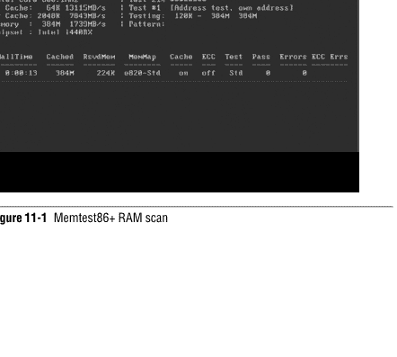

图 11-1 Memtest86+ RAM 扫描

# 第 12 章

## 救援与恢复

多年的 Linux 管理经验让我确信，你对系统的了解最多是在它损坏时修复它。没有什么比一台无法启动的关键系统更能逼迫你用到 `find` 参数、`dd` 命令或一般的 shell 知识。我多年来遇到过不少损坏的系统——有些是我的错，有些不是——在本章中我将描述一些我反复使用的恢复技术。

本章中我描述了三种主要的恢复工具。第一种是随默认 Ubuntu Server 安装一起提供的恢复启动模式。此模式提供的恢复工具集最有限，因为它要求系统至少能部分启动。第二种是随你的 Ubuntu Server 安装光盘一起提供的恢复 CD 模式。此选项提供了恢复模式的所有功能，但增加了一些可以直接从 CD 运行的额外恢复工具。不幸的是，这两种工具在能够恢复的灾难类型方面都有些受限，因此本章的最后一部分将描述一些需要单独救援光盘的恢复技术。在这种情况下，我描述了如何使用 Ubuntu Desktop live CD 进行救援，但你也可以使用任何允许你向 live CD 安装软件包的 live CD，例如 Knoppix。

## Ubuntu 恢复模式

Ubuntu 恢复模式是随默认服务器安装一起提供的启动选项。在启动系统时，GRUB 会在启动过程开始前提供一个基本提示。按下 Shift 后，你会看到服务器上的每个内核下方都有一个恢复模式选项。当你选择恢复模式时，Ubuntu 将开始正常的启动过程，但与启动系统上的所有服务不同，完成启动后你将看到如图 12-1 所示的恢复菜单。此菜单为你提供了六个选项：

- resume

  选择此选项以继续启动过程返回到你的常规系统。如果你不小心选择了救援模式，或者你在救援模式中成功完成了任何修复并准备返回正常系统时，就会选择此选项。

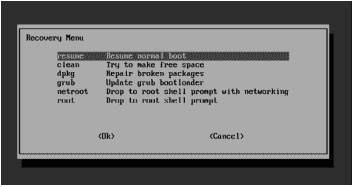

**Figure 12-1** Ubuntu recovery mode menu

- **clean**

  `clean` 选项会尝试清理系统上的一些可用空间，以防你已填满 `/` 且无法访问系统。

- **dpkg**

  此选项将执行 `apt-get update` 和 `upgrade`，并尝试修复你可能遇到的半安装包问题。如果你有一个软件包未完全安装或升级，且其 init 脚本卡住导致系统无法完全启动，你可能会选择此选项。此选项有可能修复软件包问题。

- **grub**

  如果你选择此选项，救援模式将更新 GRUB——如果不小心破坏了 GRUB 配置，这会很有用。

- **netroot**

  此模式是本菜单中选项中最有用的，因为它只是将你放到已启动服务器上的 root shell 中。我将在本节剩余部分集中讨论你可以用此选项恢复的内容。

- **root**

  此模式与 `netroot` 选项类似，只是未启用网络。

在本节剩余部分，我讨论了一些在从恢复菜单中选择 `netroot` 选项后可以采取的潜在救援步骤。这会将你放到系统上的 root 所有者 shell 中，启动你的网络，并且在启动过程中更进一步。此恢复模式要求你至少能部分启动并挂载根文件系统；根据系统损坏的情况，这可能无法实现。如果你无法启动到此模式并且需要恢复系统，请继续阅读本章后面的 Ubuntu Server Recovery CD 部分。

救援 root shell 既有限又无限。它有限的原因是看不到用于恢复系统常见问题的自动化工具；然而，它是无限的，因为你拥有对服务器上已有的任何工具的完全访问权限。通常你进入这种救援模式是因为系统无法完全启动，因此我将在此模式下介绍一些你可能想要修复的常见问题。

### File Systems Won’t Mount

文件系统在 `/etc/fstab` 中通常在系统启动时挂载。如果文件系统在启动时无法挂载，你通常需要进入救援 shell，以便修复文件系统或纠正 `/etc/fstab` 中的问题以使其可以挂载。当然，如果问题文件系统是根文件系统，你可能甚至无法进入此救援模式，因此请跳到 Ubuntu Server Rescue CD 部分。

### File System Corruption


文件系统可能因硬重启或其他错误而损坏的情况有多种。在这些情况下，启动时运行的默认 `fsck` 可能不足以修复文件系统。在对文件系统运行 `fsck` 之前，请确保它已卸载。你可以在 shell 中运行 `mount` 命令查看所有已挂载的文件系统，并输入 `umount <devicename>` 卸载已挂载的任何文件系统（根文件系统除外）。我们假设由于此文件系统阻止你完成启动过程，因此它未被挂载。在此示例中，假设你的 `/home` 目录挂载在 `/dev/sda5` 的单独分区上。要扫描并修复此文件系统上的任何文件系统错误，请输入

```
fsck -y -C /dev/sda5
```

`-y` 选项将自动回答 Yes 以修复文件系统错误。否则，如果你确实有任何错误，你会发现自己一次又一次地按 Y。`-C` 选项为你提供了一个不错的进度条，以便你可以看到 `fsck` 的进展情况。对大型文件系统进行完整的 `fsck` 可能需要一些时间，因此进度条会很有用。

有时文件系统损坏严重，以至于找不到主超级块。幸运的是，文件系统会在出现这种情况时创建备份超级块，因此你可以告诉 `fsck` 改用此超级块。现在我不指望你自动知道备份超级块的位置。你可以使用带 `-n` 选项的 `mke2fs` 工具列出文件系统上的所有超级块。

> **NOTE Warning**
>
> 请务必在此处使用 `-n` 选项！否则 `mke2fs` 只会格式化你的文件系统并擦除所有旧数据。

```
mke2fs -n /dev/sda5
```

一旦在输出中看到超级块列表，选择其中一个并将其作为参数传递给 `fsck` 的 `-b` 选项：

```
fsck -b 8193 -y -C /dev/sda5
```

当你指定备用超级块时，`fsck` 在完成文件系统检查后会自动更新你的主超级块。

## `Fstab` Mistakes or UUID Changed

你可能面临的另一个常见问题是，由于 `/etc/fstab` 文件中的错误，文件系统无法挂载。它可能是你将文件系统从一个分区迁移到另一个分区，但忘记在 `/etc/fstab` 中更新其 UUID。如果这发生在根分区，相同的步骤适用，但你可能必须从救援 CD 运行命令或在 boot time so that the `root=` option points to the partition's device name instead of the UUID.

在任何情况下，要发现任何文件系统的 UUID，请输入

```
ls -l /dev/disk/by-uuid
```

该目录提供了 UUID 与其分区之间的符号链接，因此很容易看出分配情况。只需记下正确的 UUID，打开 `/etc/fstab` 文本编辑器，然后更新 UUID 引用。

## 问题 Init 脚本

有时服务器上的一个 init 脚本会卡住。它可能需要一个不可用的网络连接，也可能是其他类型的其他问题。不管问题是什么，如果 init 脚本没有编写为自动超时，当它卡住时，它可能会完全占用其余的启动过程。在这些情况下，您可能希望暂时禁用 init 脚本在启动时启动，以便您可以完全启动系统并解决问题。

问题 init 脚本可能位于两个位置之一。如果它是系统 init 脚本，它将位于 `/etc/rc5.d` 下。否则，由于 Ubuntu 服务器的默认运行级别是运行级别 2，它很可能位于 `/etc/rc2.d` 下。在任何一种情况下，要禁用 init 脚本，请在这些目录之一下找到它，然后重命名它，使开头的 S 现在变为 D。例如，如果我在使用我放入 `rc.local` 脚本中的自定义程序时遇到某种问题，导致启动过程卡住，我会输入以下命令来禁用它：

```
mv /etc/rc2.d/S99rc.local /etc/rc2.d/D99rc.local
```

现在我可以正常恢复启动过程并查看问题 init 脚本。一旦我完成，只需再次重命名文件并将 D 替换为 S 即可。

## 重置密码

一个最终的系统问题可能会使您进入救援模式，即您忘记了用户的密码，或者您接管了前任管理员的系统并且不知道用户密码。在任何一种情况下，在恢复 shell 中重置密码都是微不足道的。只需键入 `passwd` 以及要重置的用户名：

```
passwd ubuntu
Enter new UNIX password:
Retype new UNIX password:
passwd: password updated successfully
```

如果您收到身份验证令牌锁忙的错误，您可能忘记重新挂载文件系统为读写，因此首先键入

```
mount -o remount,rw /
```

然后运行您的密码命令。

一旦您从 root shell 完成任何恢复，您可以键入 `exit` 返回救援菜单，在那里您可以选择恢复启动过程。

## Ubuntu Server Recovery CD

虽然 Ubuntu 恢复模式可以帮助您修复某些问题，但它要求 GRUB 正常工作，并且您能够至少通过启动过程的初始阶段。如果您的根文件系统已损坏或 GRUB 停止工作，您将需要其他方法来访问和修复服务器。好消息是，如果您仍然有 Ubuntu Server 安装 CD，它内置了恢复模式。此恢复模式允许您像 GRUB 恢复模式一样访问根文件系统，但由于它从自己的内核启动并提供自己的 Linux 工具集，您也可以使用它来从根文件系统问题中恢复。

不幸的是，Ubuntu Server 恢复 CD 也有其自身的局限性。从本质上讲，您将可以访问一个 BusyBox shell 提示符，并提供有限的恢复工具。虽然您可以肯定地修复文件系统并恢复 GRUB，但如果您想执行更复杂的恢复，例如删除文件恢复或分区表恢复，您将需要一个更高级的救援光盘，该光盘要么包含 `sleuthkit`、`gpart` 和 `ddrescue` 等工具，要么允许您从 live CD 安装这些软件包。在本节中，我将讨论 GRUB 恢复模式之外的一些情况，您可以在其中使用 Ubuntu Server 恢复 CD 来修复系统。

### 启动到 Recovery CD

要启动到恢复 CD，请将服务器设置为从 CD-ROM 驱动器启动并插入 Ubuntu Server 安装 CD。在选择语言后，您将看到标准安装程序屏幕。不要选择安装选项，而是使用箭头键选择“Rescue a broken system”，然后按 Enter。这将进入安装程序上的特殊恢复系统。

恢复 CD 启动后，您将被提示回答许多与标准服务器安装中可能看到的问题相同的问题，例如语言、键盘和时区问题。不要担心；这不会覆盖系统 [注：显示左上角的 Rescue 模式标题]。只需回答问题，直到看到选择根分区的提示。理想情况下，您已经知道哪个分区是根分区，但如果不知道，我想在这一点上您将需要进行一些试错，直到找到它。

在您选择根文件系统后，您将看到如图 12-2 所示的主恢复操作菜单。选项非常简单易懂：

- Execute a shell in `/dev/ubuntu/root`

  此第一个选项将在您的根文件系统中打开一个 shell。在这里我写了 `/dev/ubuntu/root`，但此菜单将指向您选择的分区。此选项为您提供了与 GRUB 恢复模式中基本相同的恢复选项，因为您可以从根文件系统内部运行任意数量的命令，例如包管理器或其他系统工具。

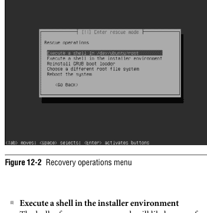

*Figure 12-2 Recovery operations menu*

- Execute a shell in the installer environment

你大部分的恢复工作很可能都会从这个选项进行。选择它后，你将进入安装光盘本身上的 BusyBox shell。根文件系统将被挂载在 `/target` 下，因此你可以在此模式下潜在地编辑配置文件。这种模式的优势在于它存在于实际根文件系统之外，因此你可以执行诸如对根分区运行 `fsck` 之类的操作——如果直接启动进入系统本身则不允许这样做。

- Reinstall GRUB boot loader

你可能启动救援光盘的最常见原因之一是 GRUB 损坏了。没有 GRUB，你就无法在没有一些高深的 Linux 功夫的情况下启动系统。选择此选项后，一个自动化脚本会将 GRUB 重新安装到你选择的磁盘或分区上。大多数人倾向于将 GRUB 安装在主引导记录上，因此当提示选择 GRUB 安装位置时，你很可能会选择 `(hd0)`。请注意，如果救援光盘无法在 `/boot/grub` 下找到 grub 配置文件，则此选项不会出现。

- Choose a different root file system

这个选项解释起来很简单。如果你不小心选择了错误的根文件系统，这个选项会让你更改它。

- Reboot the system

这里是另一个不言自明的选项。一旦你完成系统恢复，选择此选项以重新启动。

> **NOTE**
>
> 当你处于任一 shell 环境中时，可以输入 `exit` 返回到救援操作菜单。

### Recover GRUB


我已经提到过救援操作菜单中的“Reinstall GRUB boot loader”选项。这会将 GRUB 重新安装到你选择的磁盘或分区上，但有时 GRUB 本身已安装，但其配置文件丢失或损坏。当这种情况发生时，启动时你可能看不到 GRUB 菜单，什么都看不到。要修复此问题，请选择菜单选项在你的根分区内执行一个 shell。进入后，运行

```bash
update-grub
```

此选项将根据你可用的内核创建一个新的 `/boot/grub/grub.cfg` 文件。完成后，你可以输入 `exit` 返回主菜单并重新启动系统。

## Repair the Root File System

通常救援光盘会尝试挂载根文件系统（如果可能）。如果它能够挂载根文件系统，那么你将无法卸载它并在其上运行 `fsck` 等工具。当然，如果救援光盘能够挂载文件系统，你现在就不需要对它进行 `fsck` 了，对吧？如果根文件系统已损坏且救援光盘无法挂载它，那么进入安装程序 shell 并运行

```bash
fsck -y /dev/sda1
```

将 `/dev/sda1` 替换为你的根分区的路径。如果 `fsck` 抱怨超级块损坏，请按照 Ubuntu Recovery Mode 下“文件系统损坏”部分中的步骤操作。否则，根据文件系统损坏的程度，你可能会看到 `fsck` 在尝试修复时输出它找到的错误。

除了我上面列出的特定救援步骤外，你应该能够从 GRUB 恢复模式执行所有恢复步骤。只需从恢复操作菜单中选择“Execute a shell in /dev/ubuntu/root”（它会将 `/dev/ubuntu/root` 替换为你选择的根分区）并按照相同的步骤操作即可。

## Ubuntu Desktop Live CD

有一些系统救援操作需要你在服务器之外启动。任何系统映像、根分区 `fsck` 命令，或任何需要卸载 `/` 的情况，你都需要某种救援光盘。虽然我已经提到过如何使用 Ubuntu Server 安装光盘作为救援光盘，但不幸的是你受限于该光盘上的工具。有许多不同的 live CD 提供相同的一套工具，例如 Knoppix 和 DSL，但由于我假设你更可能手头有 Ubuntu Desktop 安装光盘，而且它也可用作 live CD，我讨论了一些可以从光盘上执行的高级恢复技术。

## Boot the Live CD

第一步是启动 live CD 进入标准的 GNOME 桌面。不要担心你的服务器没有复杂的显卡，因为我描述的大部分内容都可以通过命令行完成。

## Add the Universe Repository

一旦 live CD 启动到桌面，你需要将 universe 仓库添加到其软件包仓库列表中。我在这里使用的所有工具都来自 universe 仓库中的软件包，因此要么点击 `System_Administration_Software Sources` 并确保已勾选 Community-maintained Open Source software (`universe`) 选项，要么打开一个终端

`Applications_Accessories_Terminal`，然后以 root 身份使用你喜欢的文本编辑器编辑 `/etc/apt/sources.list` 并将

```
deb http://us.archive.ubuntu.com/ubuntu lucid main restricted
```

改为

```
deb http://us.archive.ubuntu.com/ubuntu lucid main restricted universe
```

当然，如果你运行的是比 Lucid 更新的 live CD，你可能会在这里看到其他名称，因此请根据你的 Ubuntu live CD 进行修改。然后在同一个终端中运行

```
sudo apt-get update
```

以更新可用软件包列表。现在你可以为以下任何救援技巧安装工具。

## 恢复已删除文件

这对我们所有人来说都曾发生过。我想每个系统管理员在职业生涯中都曾不小心删除过错误的文件。很长一段时间我都以为一旦在 Linux 下删除文件就无法恢复，但事实并非完全如此。当你在 Linux 上删除文件时，文件系统会将这些块返回到可用空间。在另一个文件使用这些块之前，旧文件的数据仍然存在并且可能可恢复。关键是在删除文件后尽快停止向该文件系统写入。这样可以降低数据被覆盖的概率。

在此示例中，我假设你已停止包含已删除文件的主机并已启动 Ubuntu live CD。CD 启动后并且你已添加 universe 仓库后，使用软件包管理器安装 `sleuthkit` 软件包或打开终端并输入

```
sudo apt-get install sleuthkit
```

`Sleuth Kit` 是一套取证工具，用于协助调查系统入侵。恢复已删除文件对于取证调查来说非常有价值。

`Sleuth Kit` 为此提供了 `icat` 工具——它类似于 `cat` 命令，只是它接受 inode 作为参数。要恢复此文件，我输入

```
sudo icat -f ext -r -s /dev/sda1 2094 > /home/ubuntu/recovery/shadow
```

如果文件确实可以恢复，命令完成后我将在 `/home/ubuntu/recovery/shadow` 下看到我的 `shadow` 文件的副本。然后我可以从救援盘挂载 `/dev/sda1` 文件系统并从这里恢复 `/etc/shadow`。现在如果你想恢复多个文件，你可以多次运行此命令一次恢复一个文件，也可以编写脚本来为你完成。有许多此类脚本在线上，而以下内容基于最初在 http://forums.gentoo.org/viewtopic-t-365703.html 找到的脚本，我随后对其进行了整理和改进：

```
#!/bin/bash

DISK="/dev/sda1" # disk to scan
RESTOREDIR="/home/ubuntu/recovery" # directory to restore to

mkdir -p "$RESTOREDIR"
cat $1 |
while read line; do
  filetype=`echo "$line" | awk '{print $1}'`
  filename=`echo "$line" | awk '{print $3}'`
  filename=${filename%:*}
  filename=${filename%(}
  filename=`echo "$line" | cut -f 2`

echo "$filename"

if [ $filetype == "d/d" ]; then
  mkdir -p "$RESTOREDIR/$filename"
else
  mkdir -p "$RESTOREDIR/"dirname $filename."
  icat -f ext -r -s "$DISK" "$filenode" > "$RESTOREDIR/$filename"
fi
done
```

将此文件保存到 `/home/ubuntu/restore` 并将 `DISK` 和 `RESTOREDIR` 变量分别更改为要扫描的分区和要恢复到的目录。然后要使用脚本，请赋予其执行权限并以已删除文件的完整列表的路径作为参数运行它：

```
sudo chmod a+x /home/ubuntu/restore
sudo /home/ubuntu/restore /home/ubuntu/recovery/deleted_files.txt
```

脚本将然后系统地遍历 `deleted_files.txt` 文件中的所有文件并尝试将它们恢复到 `RESTOREDIR`。它也会在必要时创建目录，因此完成后你应该在 `RESTOREDIR` 内看到与已删除文件匹配的目录结构。

## 恢复分区表

分区表是硬盘开头 512 字节的区域，即主引导记录中的 64 字节部分。这些 64 字节包含你在磁盘上创建的任何主分区或扩展分区的设置。分区表很容易被视为理所当然。毕竟，要擦除或损坏它确实需要一些努力。话虽如此，只需在错误的驱动器上运行一次 `fdisk` 命令，就可能使服务器的硬盘无法读取。

好消息是，即使分区表被擦除，每个分区的数据仍然在磁盘上。你需要做的只是弄清楚每个分区开始和结束的位置，然后你就可以重建分区表并恢复你的数据。当然，这手动操作起来可能相当困难，但 Linux 有一个名为 `gpart` 的工具（全称 Guess Partition），可以为你完成繁重的工作。

`gpart` 的工作方式是扫描整个磁盘，寻找与某种类型分区开头或结尾相匹配的区域。当它找到这些区域时，它会记录下来然后继续。`gpart` 完成后，它就有了它认为的磁盘的完整分区表。

在介绍如何使用 `gpart` 恢复分区表之前，值得讨论一下 `gpart` 的一些局限性。它主要的局限性在于扩展分区。虽然 `gpart` 在查找主分区方面做得很好，但扩展分区更难识别，因此如果你的磁盘有扩展


partitions 你可能会得到不完整的结果。此外，`gpart` 有时在分区开始（或更常见的是）结束的位置上会略有偏差。我见过 `gpart` 将分区的末尾偏差一兆字节或两兆字节，但由于我们大多数人都是将分区挨着建立，通常这些小错误很容易手动纠正。

要在 live CD 上安装 `gpart`，可以使用图形化包管理器安装 `gpart` 包，或打开终端并输入

```
sudo apt-get install gpart
```

安装 `gpart` 后，以 root 身份在终端中运行它，并将要扫描的驱动器作为参数传递：

```
sudo gpart /dev/sda
```

当然，将 `/dev/sda` 替换为你的设备的路径。`gpart` 完成后，它会将结果输出到屏幕，但不会写入磁盘。这样你就可以检查其输出，看看是否符合预期。一旦你认可输出结果，再次运行 `gpart`，这次使用 `-w` 选项以便将其更改写入磁盘：

```
sudo gpart -w /dev/sda /dev/sda
```

`-w` 选项需要一个要写入的磁盘作为参数，这就是为什么这里会看到 `/dev/sda` 两次。`gpart` 扫描完成后，你将被提示编辑其结果。在我看来，`gpart` 编辑器比 `fdisk` 或 `cfdisk` 更难使用，所以我通常先将更改写入磁盘，然后再用 `fdisk` 或 `cfdisk` 进行任何小的修正。记住，你可以移动分区表并将其写入磁盘，而不会直接影响你的数据，所以让 `gpart` 写入一个不正确的表，然后再跟进并纠正是可以的。

## 拯救濒死的驱动器

如果你读过第 11 章《故障排除》，你就会熟悉 Smartmontools。这个软件包可以扫描你的硬盘并报告其中任何一个看起来不健康的情况。当然，当硬盘不健康时，或者更糟糕的是，病得再也无法挂载时，你该怎么办呢？通常，病态的驱动器运行时间越长，丢失的数据就越多，所以你需要迅速反应。Ubuntu 有一个出色的工具叫做 `ddrescue`，你可以用它在驱动器出现大量错误的情况下创建驱动器的镜像。

`ddrescue` 的工作原理是逐位扫描驱动器。当它在驱动器上遇到错误时，它会记录下来并跳过。由于坏块通常成簇出现，这意味着 `ddrescue` 有可能跳到好的数据上。一旦 `ddrescue` 完成对整个驱动器的扫描，它会将剩余的坏块簇进行分割并逐一征服，直到它尝试恢复整个驱动器为止。采用这种算法，你有最好的机会恢复好的数据，而不是花费所有时间尝试恢复磁盘开头的一簇坏块，最终导致驱动器彻底失效。

> **NOTE**
>
> **Why Not dd?**
>
> 在 Linux 下用于镜像驱动器的传统工具是 `dd`。不幸的是，`dd` 并不适合处理有错误的硬盘。默认情况下，当 `dd` 遇到错误时，它会直接退出程序。虽然你可以告诉 `dd` 忽略错误，但这样做意味着它会简单地跳过该特定块且不写入任何内容，因此你可能会得到一个比原始镜像更小的镜像。这些原因，加上块簇跳过算法和进度输出，使得 `ddrescue` 成为此任务的更好选择。

要在你的 Ubuntu live CD 上安装 `ddrescue`，可以使用图形化包管理器安装 `ddrescue` 包，或打开终端并输入

```
$ sudo apt-get install ddrescue
```

在镜像濒死的驱动器之前，确保你有地方可以存储它。`ddrescue` 工具可以将硬盘或分区镜像到另一个硬盘或文件中，但你需要确保另一个设备与你要镜像的驱动器大小相等或更大。好的一点是，你甚至不一定需要将额外的存储连接到你的服务器。如果你有一个容量足够的 NFS 服务器，你可以在 live CD 上挂载 NFS 共享，并让 `ddrescue` 镜像到该位置上。对于本示例，我假设你想要镜像一个分区，`/dev/sda1`，在你的 server，你已将一个外部 USB 驱动器连接到服务器，并且桌面已找到它并将其挂载在 `/media/disk` 下。要对驱动器进行映像，你只需运行 `ddrescue` 并将要映像的驱动器和映像保存位置作为参数列出：

```
$ sudo ddrescue /dev/sda1 /media/disk/sda1_image.img /media/disk/sda1_image_logfile
```

将 `/dev/sda1` 替换为你要映像的分区或完整驱动器，并将 `/media/disk/sda1_image.img` 替换为你要映像到的挂载点和文件。如果你想从 `/dev/sda1` 映像到 `/dev/sdb1`，你只需将 `/media/disk/sda1_image.img` 替换为 `/dev/sdb1`。请注意我添加了第三个参数，`/media/disk/sda1_image_logfile`。第三个参数告诉 `ddrescue` 将其进度存储到可选的日志文件的位置。有了这个日志文件，你实际上可以在任何时候停止 `ddrescue`，并且当你再次启动它时，它可以从上次中断的地方继续。

`ddrescue` 的优点在于它为你提供了一个漂亮的进度条，让你可以跟踪它还需要多长时间。结合其恢复功能，这意味着如果你出于某种原因需要中断它，你知道你可以稍后返回并完成工作。

### NOTE Image Drives or Partitions?

你可能已经注意到，在我的示例中，我选择映像单个分区而不是整个驱动器。我这样做是因为分区映像在映像到文件时更容易进行 `fsck` 并以 loopback 方式挂载。一般来说，如果你映像到文件，最好一次对磁盘上的每个分区进行映像，尤其是在映像到文件时。如果你计划直接映像到另一块驱动器，那么映像整个驱动器，因为这样你可以轻松地单独访问每个分区。

一旦 `ddrescue` 完成，通过在其上运行 `fsck` 来检查你创建的映像是否有任何文件系统错误：

```
$ sudo fsck -y -C /media/disk/sda1_image.img
```

一旦 `fsck` 完成，你可以以 loopback 方式挂载映像并从磁盘中恢复所需的任何文件，或者 alternatively，你可以使用像 `dd` 这样的工具将此映像复制到另一块驱动器。要以 loopback 方式挂载驱动器，我在 `/mnt/temp` 创建一个临时挂载点并在那里挂载驱动器：

```
$ sudo mkdir /mnt/temp
$ sudo mount -o loop /media/disk/sda1_image.img /mnt/temp
```

从这里我可以将特定文件从 `/mnt/temp` 复制到其他存储，或以其他方式确认驱动器上的数据完好无损。稍后我可以使用常规的映像工具如 `dd` 甚至 `rsync` 将数据从此文件复制回分区。

# CHAPTER 13

## Help and Resources

你已安装了 UBUNTU SERVER，或者你正在开始安装过程。该系统对你来说是新的，你有疑问或需要帮助。你该去哪里？你的选择是什么？

这就是本章的全部目的：你并不孤单。无论你在一家大型工业环境中的大公司工作，还是作为业余爱好者在地下室搭建你的第一台服务器，都有适合你需求的帮助选项。

### Paid Support from Canonical

大多数系统管理员更喜欢自己提供支持，至少在可能的情况下。我们是一个独特的群体，通常感觉自己可以解决任何问题，如果不能，我们就可以学习。但偶尔我们会错，而且我们需要帮助。

企业管理者希望将风险降到最低。即使可能性很小，出现问题而不制定应急计划的想法也不是他们愿意考虑的。网络和系统停机意味着失去机会，甚至可能失去收入。这些人希望有安全网的保障。

Canonical，即 Ubuntu 背后的公司，提供了一种付费专业支持选项，非常适合这些情况。他们承诺在安装和部署、安全和性能优化、保护免受知识产权侵权索赔等方面提供快速且高质量的帮助，以及更多。

服务器、桌面系统（当你说服相关人员允许你在成功且令人惊叹的服务器迁移后迁移整个企业基础设施时）和瘦客户端/集群都有付费支持选项。你可以支付工作时间内的支持，或全天候 24x7 支持。（目前没有按次计费的支持选项。）选项非常广泛，可以轻松适应从小型企业到大型企业任何人的需求。你可以在 `www.ubuntu.com/support/paid/` 或 `www.canonical.com/services/support` 上了解更多信息。支持帮助可以通过电话、网络或电子邮件请求。

其中之一让这种支持对某些人具有吸引力的是，软件升级时有保证的帮助可用。即使从 Canonical 购买付费支持，所使用的软件也是标准的 Ubuntu 版本，要么是最新的长期支持（LTS）版本，要么是最新的常规版本。付费支持选项与原本会使用的内容之间没有区别，只是当你遇到问题时，有资助并组织了大部分 Ubuntu 开发流程的公司站在你身后。就像所有使用 Ubuntu 的人一样，常规版本的软件更新保证为 18 个月。LTS 版本会收到更长时间的安全更新，桌面版为三年，服务器版为五年。


付费支持客户将免费获得一个名为 Landscape 的出色工具。这是一项系统管理和监控服务，允许你同时管理多台 Ubuntu 机器。Landscape 允许管理员像管理一台机器一样轻松地执行软件更新、管理用户和进程、监控多台机器的资源使用情况，并做更多的事情，或许更轻松，因为它使用简单的 Web 界面。Landscape 也可通过订阅供不需要付费支持的客户使用。了解更多信息请访问 www.canonical.com/projects/landscape。

## Forums

Ubuntu 社区通过 Web 论坛提供免费的志愿者支持。任何人都可以注册免费账户并提问，这些问题会被其他 Ubuntu 用户阅读并回答。主要的支持论坛位于 http://ubuntuforums.org，截至本文撰写时已有近 100 万注册成员。

很可能你只需搜索论坛就能找到你遇到的任何常见问题的答案。在大多数情况下，有人已经问过同样的问题并得到了一个适用于你的情况的绝佳答案。如果没有，那里的社区对新手友好且热情，同时充满了知识渊博和乐于助人的人，所以请随意注册账户并提问。

## Internet Relay Chat

如果您有紧急求助需求，或只是更喜欢实时讨论，您可以使用 Internet Relay Chat（IRC）。将您的 IRC 客户端指向 Freenode 网络 irc.freenode.net，并选择最适合您问题的频道。

对于 Ubuntu 的一般帮助，最佳的开始地点是 #ubuntu，但也有一个专门用于运行 Ubuntu 服务器的优秀频道 #ubuntu-server。这些频道以及其他频道中都有乐于助人且知识渊博的用户。您可以找到当前频道的完整列表以及入门帮助，网址为 http://help.ubuntu.com/community/InternetRelayChat。

要在 Ubuntu 桌面机器上开始使用 IRC，您可以安装一个名为 XChat 的程序，该程序可从软件仓库安装。一旦安装完成，您可以在 Ubuntu 中从菜单 Applications > Internet > XChat IRC 启动它。

第一次启动 XChat 时，您将被要求选择要连接的网络（s）。为我们的目的，从列表中选择 Ubuntu Servers 并点击 Connect，如图 13-1 所示。

接下来，如果您在 Ubuntu 桌面计算机上运行，您将自动登录到主要的 Ubuntu 支持频道 #ubuntu。您可以通过在 XChat 屏幕底部用户名旁边的框中输入内容并按 Enter 开始提问，如图 13-2 所示。

要离开频道，请在频道列表中右键单击频道名称并选择 Close（图 13-3）。IRC 中的文本命令已标准化多年，可以从文本输入行发出，与您输入问题的地方相同。命令以 / 为前缀。例如，您可以在底部框中输入 `/part` 来发出离开频道的命令。

您也可以使用文本命令加入频道，如果您知道频道名称，如图 13-4 所示。

Figure 13-1 XChat 网络列表，你将看到的第一个屏幕

Figure 13-2 XChat 主屏幕

Figure 13-3 在 XChat 中离开频道

Figure 13-4 使用文本命令在 XChat 中加入频道


### Figure 13-5 使用图形化频道列表在 XChat 中加入频道

你也可以通过 XChat 菜单中的 Server List of Channels... 加入频道并查找可用频道列表。这会弹出一个新窗口，最初大部分是空的。要获取当前服务器上的频道列表，请点击右下角的 Download List，几秒钟后你的窗口将看起来像 Figure 13-5。然后你可以上下滚动以找到感兴趣的频道，例如 #ubuntu-server。用左键选择它，然后点击右下角附近的 Join Channel 按钮。

完成后，你可以从菜单 XChat Quit 退出 XChat，或通过输入 `/quit` 并关闭程序。

## Mailing Lists

大多数用于创建 Ubuntu 发行版并使其在技术上取得成功的开发和其他工作都在邮件列表上进行。这些是提出问题的好地方，问题会被开发者社区看到，也是阅读持续的技术讨论或接收通知和公告的绝佳场所，但它们并不是寻求一般帮助的好地方。

开发者欢迎有用的反馈和对讨论的有趣贡献，但他们专注于让 Ubuntu 尽可能好。其他资源更适合且更推荐用于即时帮助需求。

有关邮件列表的更多信息可在 www.ubuntu.com/support/community/mailinglists 获取。该页面上的第一个链接讨论了邮件列表礼仪。阅读、理解并遵守这些准则应能使任何邮件列表的使用都成为愉快且有益的体验。

完整的可用邮件列表可在 http://lists.ubuntu.com 找到。用户支持通常在以用户支持为重点的 ubuntu-users 邮件列表中进行，地址为 https://lists.ubuntu.com/mailman/listinfo/ubuntu-users。请注意，如果你订阅此邮件列表，你可以预期每天至少收到 200 封来自该列表的电子邮件。

## Online Documentation

Ubuntu 可用的文档分为两套：官方和社区。

官方文档直接来自 Ubuntu 文档项目并由其维护。这是由 Ubuntu 文档团队成员汇编而成，包含经过审核以确保准确性和有用性的信息。它随每个 Ubuntu 桌面版本一起提供，可在主桌面菜单中获取，也可在线供所有用户使用，网址为 https://help.ubuntu.com/。

社区文档并非主要用于用户支持，而是为感兴趣的用户提供讨论想法和为各个团队存储信息的方式，例如接下来要讨论的 LoCos，或刚刚提到的文档团队。即便如此，它通常包含非常有趣且有用的细节，值得一提。你可以在 https://wiki.ubuntu.com 进一步了解。

## Localhost Documentation

你的服务器上已经有几份精彩的文档。当从 Ubuntu 仓库安装软件包时，它通常至少包含一种、通常是几种可供使用的文档形式。我将讨论两种最常见且最重要的：man 手册页和 doc 文件。

man 手册页几乎随每个命令和许多程序一起提供，在安装时包含。它们并非旨在作为操作指南或手把手式的入门介绍，但通常是简洁而完整的命令行中任何命令或程序用法的语法指南。它们通常是查找你可能想要尝试做的任何事情的可用选项的最简单方法，也是快速刷新记忆的绝佳方式，例如当你记不清执行 rsync 备份时想要使用的选项时，可使用 `man rsync`。如果你知道要使用的命令或程序，从 man 手册页开始始终是明智之举。

man 手册页使用标准化的组织结构，清晰明了，便于快速找到所需细节。并非所有 man 手册页都使用每个章节，但这些是最常见的章节。man 手册页总是以命令的 NAME 和对其功能的简短一句话描述开始。随后是更长的 SYNOPSIS，提供了使用该命令的标准示例。接下来是 DESCRIPTION 部分，更详细地记录了命令或程序的设计目的并概述其功能。你可能会在此之后找到一个 GENERAL 部分，提供其他有趣且有用的细节，但可能不是理解所需内容的关键信息，不过这并不意味着不值得阅读。经常随后是 SETUP 部分，可能描述安装和配置，或告诉你在哪里获取此信息。对大多数需求而言最重要的部分是 USAGE，man 手册页会在此处具体讨论如何使用程序执行任务，并可能包含几个良好示例。一些命令和软件包包含 DOCUMENTATION 部分，明确说明在本地查找更多信息的 host。你可能还会看到像 ADVANCED USAGE、EXAMPLES、OPTIONS 和 SUMMARY 这样的章节，如果存在的话，每一个都非常有用。

文档文件是一个很好的资源，尤其是在你安装了新软件包并且不确定下一步该做什么的时候。许多系统管理员在 Ubuntu 服务器上安装新程序时做的第一件事就是阅读 `/usr/share/doc/<packagename>` 下的 `README.Debian.gz` 文件。例如，你可以使用 `sudo zless /usr/share/doc/apache2.2-common/README.Debian.gz` 来阅读 Apache 2.2 通用文档，并在完成后按 Q 退出。对于某些程序和软件包，可能只有一两个文档可用，但其他软件包有很多优秀的文档，有时在子目录中，就像在 `/usr/share/doc/apache2.2-common/examples/apache2/apache2.conf.gz` 找到的 `apache2.conf` 文件示例一样。

每当你有疑问时，花点时间挖掘一下，你可能会在不必向任何人提问甚至在服务器之外查找文档的情况下发现答案。

## Local Community Teams


有些人更喜欢面对面的互动。这种选择对于非专业用途来说既有趣又实用，例如在家中拥有服务器的业余爱好者级别的爱好者，或是希望找到一起学习的人的大学生。Local Community，或 LoCo Teams，在世界各地运营。它们的许多规划和协调都是通过各自的邮件列表、IRC 频道和论坛在线进行的（通常作为前面讨论的主要 Ubuntu 论坛中的子论坛）。在许多地方，LoCo Teams 使用其他语言运营，这可能更适合母语非英语的用户。

LoCo Teams 通常会安排聚会来讨论新发展、互相帮助解决技术问题，或只是为了与有相似兴趣的人一起度过愉快的时光。许多团队会在新的 Ubuntu 版本发布前后举行特别聚会，称为“发布派对”或“安装节”，以庆祝完成一个发布周期，同时安装或升级他们的操作系统，并帮助用户在需要时将 Ubuntu 安装到他们的设备上。有关 LoCo Teams 的更多信息可以在 `https://wiki.ubuntu.com/LoCoTeamList` 找到。

## Other Languages

前面提到的几个资源为不以英语为母语的人提供了其他语言选项。Ubuntu 作为一个发行版的初始和持续重点之一就是让尽可能多的人在全球范围内使用 Ubuntu，这意味着将软件界面翻译成其他语言，并为非英语使用者提供在其母语中找到优质支持的途径。

工作尚未完成，但 Ubuntu 在非常多的语言中提供支持和安装选项。前面列出的大多数资源在其网页上都包含其他语言选项。这些包括论坛、IRC 频道、LoCo Teams 等等。更多信息请查看 `www.ubuntu.com/support/community/local/language`。

## Tech Answers System (Launchpad)

Canonical 还参与了 Ubuntu 之外的项目，包括他们的出色协作和代码托管平台服务 Launchpad（`https://launchpad.net`），该平台被大量软件项目使用，包括 Ubuntu。Launchpad 为代码开发、错误报告甚至问答提供了一个中心位置。它不如网络论坛那样完整或用户友好，但对于更高级的用户来说是一个极好的资源。

以下是 Ubuntu 相关问题的网址：`https://answers.launchpad.net/ubuntu`。

## Bug Reporting

有时你会遇到任何文档中都未涵盖且似乎找不到帮助的问题。这可能是你发现了程序中的缺陷或错误。恭喜！为了帮助开发人员完成他们的任务并使 Ubuntu 尽可能正常工作，你可以提交错误报告。这将直接通知维护特定软件包的人员有关问题。他们随后会检查报告，尝试重现该行为，如果确认是问题，就会着手尝试修复它。

要为 Ubuntu 提交错误报告，你首先需要一个 Launchpad 账户。Launchpad 是用于跟踪错误并帮助开发其他方面的系统。你可以通过点击 `https://launchpad.net` 上的 `Register` 链接并按照给出的说明进行注册。这是一个有用且多功能的系统。我在这里只关注它可能被使用的一种小方面。

一旦你拥有了 Launchpad 账户，打开 `https://bugs.launchpad.net/ubuntu` 以进入 Ubuntu 项目的主页面。从那里，你可以搜索当前错误，以查看是否有与你所经历的情况相似或相同的错误。如果有，请随时对现有错误报告添加你的评论，以帮助确认问题或提供可能帮助开发人员理解和修复的信息。

如果你找不到符合你问题的内容，你可以通过点击页面中间的红色 `Report a Bug` 按钮来提交新的错误报告。你会得到一个文本框，用来写问题的简短摘要，最好是简短、清晰且描述性的，但少于一句话：例如，“LDTP server crashes when running the update-manager testcase。” 点击 `Continue`。

你会得到 Launchpad 找到的可能相似的错误列表。看一下。如果其中一个与你所经历的情况相同，你可以订阅以接收错误报告更新的新信息、工作变通方法或解决方案的通知。如果不是，勾选“No, I’d like to report a new bug”以进入下一步。

你将被询问在哪个软件包中发现了错误。如果你知道，可以输入它以协助开发人员。如果你不知道，可以点击“I don’t know”并让他们根据你在“Further Information”下撰写的摘要来尝试弄清楚。

在标题为“Further information:”的章节中，输入问题的清晰描述，使用尽可能多的具体信息而不啰嗦。你应该包括重现意外行为的步骤，以及当时你在做什么和试图完成什么的概述。你之后可能会被要求提供进一步的信息。本页底部还有一份很好的指南列表，帮助你了解应包含哪些信息以使你的错误报告尽可能有用，并尽可能获得帮助。你也可以包含附件，例如配置文件或错误日志的文本文件副本。完成后，点击页面底部的 `Submit Bug Report` 按钮以完成流程。

## Summary

切换到新系统可能会让人不知所措。使用成熟的系统并不能保证你永远不会有疑问。在每种情况下，都有需要支持的时候。本章描述了几个很棒的选择。如需进一步信息，请查看官方 Ubuntu 网站以获取最新的支持选项列表，网址为 `www.ubuntu.com/support`。

# CHAPTER 14

## Basic Linux Administration

可能最有用的 shell 通配符之一是 `*` 符号。这个通配符匹配任意数量的字符，包括零。在这个例子中，假设我的目录中有以下文件：

```
$ ls
aa.txt  ac.txt  a.txt  b.txt  c.txt  d.doc  e.tar
```

如果我想只列出以 a 开头的文件，我可以输入

```
$ ls a*
aa.txt  ac.txt  a.txt
```

请注意，`*` 符号充当文件名中不同字符的通配符。例如，如果我想将这些文件移动到 `/tmp` 目录，我可以输入

```
$ mv a* /tmp/
```

如果，我想将所有 `.txt` 文件移动到 `/tmp` 目录，我会输入

```
$ mv *.txt /tmp/
```

与 `?` 通配符不同，当我使用 `*` 时，我也会匹配 `aa.txt` 和 `ac.txt`。

### Regular Expressions

正则表达式可能对于像本章这样的章节来说主题过于密集，但本质上它是一种用于描述模式的特殊语言。`bash` 命令行支持一组基本的正则表达式，你可以用它来描述文件名中的模式，超出 shell 通配符所能实现的能力。例如，假设我想列出上面示例目录中以 a 或 b 开头的所有文件。一种方法是输入

```
$ ls a* b*
aa.txt  ac.txt  a.txt  b.txt
```

或者我可以用这个正则表达式：

```
$ ls [ab]*
aa.txt  ac.txt  a.txt  b.txt
```

当我在方括号内放一组字符时，就创建了一个字符类。字符类定义了一组可以匹配的字符。需要注意的是，这个字符类只匹配一个字符。那么，既然 shell 通配符也能完成同样的事情，为什么还要用它呢？我发现我经常在管理满是日志的目录时使用它。当 `/var/log/` 中的日志轮转时，它们会在文件名后追加一个数字，然后进行压缩。例如：

```
$ ls /var/log/messages*
/var/log/messages      /var/log/messages.2.gz
/var/log/messages.5.gz  /var/log/messages.3.gz
/var/log/messages.6.gz
/var/log/messages.1.gz  /var/log/messages.4.gz
```

通常你会发现，当需要释放磁盘空间时，`/var/log` 是一个不错的起点。假设我想只删除最后三个消息日志。虽然我当然可以手动将它们全部输入，但我也可以输入：

```
$ rm /var/log/messages.[456].gz
```

> 注意 当你学习 shell 通配符和正则表达式时，你会发现你匹配到的模式往往与你以为会匹配的模式不同。为了安全起见，在执行 `mv` 或 `rm` 这类难以或几乎不可能撤销的操作之前，一定要先用 `ls` 或 `echo` 加上你的模式来查看哪些文件会匹配。

### 管道与重定向

#### 管道

如果有一个工具最能体现命令行的强大之处，那非管道莫属。如果你看很多命令示例，最先注意到的东西之一就是 `|` 符号。这被称为管道，用于将一个程序的输出作为输入传递给另一个程序。你可以使用管道将多个命令串联起来，让一个命令生成输出，下一个命令过滤并修改该输出，再将其输出给其他程序。

`grep` 管道使用的最佳示例之一也是最实用的命令行工具之一：`grep`。`grep` 命令的核心功能是，根据你指定的关键字或模式过滤输入，然后输出所有匹配该模式的内容。例如：

```
$ ls
anotherfile.txt somedir somefile1.txt somefile2.txt
$ ls | grep some
somedir
somefile1.txt
somefile2.txt
```


在第二条命令中，你可以看到我将 `ls` 命令的输出通过管道传递给 `grep`，然后告诉 `grep` 只过滤包含关键字 some 的文本。如果我只想查看包含单词 file 的文本，我可以输入：

```
$ ls | grep file
anotherfile.txt
somefile1.txt
somefile2.txt
```

你还可以使用管道将多个 `grep` 命令串联在一起。例如，假设在我运行了上面的命令之后，我决定再次过滤输出，只不过这次只显示名称中包含 1 的文件：

```
$ ls | grep file | grep 1
somefile1.txt
```

你经常会看到 `grep` 以这种方式使用，即过滤一个命令的输出，然后通过管道传给另一个命令来处理新的过滤输入。`grep` 也可以用来过滤文件内部的文本。只需将关键字作为 `grep` 的第一个参数，然后在其后附上要过滤的文件即可。例如，假设我们的 `somefile1.txt` 文件包含以下行：

- 1. 第 1 行
- 2. 另一行
- 3. 最后一行
- 4. 其他一些文本

如果我想查看包含单词 line 的所有行，我会输入：

```
$ grep line somefile1.txt
2. Another line
3. Final line
```

注意，它没有显示 1. Line 1。那是因为在该行中 Line 的 l 是大写的，而 `grep` 默认区分大小写。如果你想进行不区分大小写的匹配，可以使用带 `-i` 参数的 `grep`：

```
$ grep -i line somefile1.txt
1. Line 1
2. Another line
3. Final line
```

你会发现你会经常使用 `grep` 在日志文件中搜索特定关键字。不过，有时当你过滤某些关键字时，你会注意到得到了你不感兴趣的额外输出。如果你给 `grep` 传递 `-v` 参数，它会反转其功能；也就是说，它只会显示不匹配你关键字的内容。例如，在我上面列出的同一个 `somefile1.txt` 中，假设我想显示所有不包含单词 Another 的行：

```
$ grep -v Another somefile1.txt
1. Line 1
3. Final line
4. Some other text
```

`sort` 另一个有用的命令行工具是 `sort`。顾名思义，`sort` 命令接受输入并将其排序。例如，让我们取两个文件，`somefile2.txt`：

+   5. 另一个示例
+   5. Another example
+   6. Linux

and our same `somefile1.txt`:

+   1. Line 1
+   2. Another line
+   3. Final line
+   4. Some other text

If we run the `cat` command with both of these files as arguments, it will output the contents of both files one after the other. Let's say that I list `somefile2.txt` first and then `somefile1.txt`:

```
$ cat somefile2.txt somefile1.txt
5. Another example
5. Another example
6. Linux
1. Line 1
2. Another line
3. Final line
4. Some other text
```

If I pipe this to the `sort` command, it will sort all of the input for me:

```
$ cat somefile2.txt somefile1.txt | sort
1. Line 1
2. Another line
3. Final line
4. Some other text
5. Another example
5. Another example
6. Linux
```

> NOTE By default the `sort` command actually sorts alphabetically. Sometimes, though, you want to sort output numerically. In that case pass `sort` the `-n` option.

`uniq` If you look at the output from the `sort` command, you will notice that there are two identical lines. That might be fine, but often when you sort through files you want to remove any lines that are duplicated. This might be especially true if you are merging the contents of two text files as I am here. In that case you can use the `uniq` command. The `uniq` command will remove any duplicates it gets from input, but that input must already be sorted. The beauty of pipes is that you can pipe output to the `sort` command first to sort it, then to the `uniq` command to strip out any duplicates. For instance, if we wanted to strip out the duplicate 5. Another example line from the previous output, we would just pipe the `sort` output to `uniq`:

```
$ cat somefile2.txt somefile1.txt | sort | uniq
1. Line 1
2. Another line
3. Final line
4. Some other text
5. Another example
6. Linux
```

## Redirection

As you parse through and filter text files and other output on the command line, often you will find it useful to put that output in another file. For instance, you might run `grep` on a log file to pull out specific log entries that you then want to save to a file. This is where redirection comes in.

Redirection uses the `>`, `>>`, and `<` symbols on the command line. For instance, the `>` character will redirect output to a file and overwrite anything that was previously in the file. If I had the same `somefile1.txt` and `somefile2.txt` files from the previous examples and I wanted to `cat somefile1.txt` and then save the output to `somefile3.txt`, I would type

```
$ cat somefile1.txt > somefile3.txt
$ cat somefile3.txt
1. Line 1
2. Another line
3. Final line
4. Some other text
```

Now notice what happens if I run the same command only with `somefile2.txt`. It will overwrite what used to be in `somefile3.txt` with new data:

## `chmod`


`chmod` 命令允许你更改文件上的权限。有多种不同的方式来描述文件的权限（输入 `man chmod` 查看完整列表），但一种常见的方式是列出 `u`、`g` 或 `o` 表示用户、组或其他类别，后跟 `+` 或 `-` 号，然后是添加或移除的权限。因此，如果我想移除拥有文件用户的写访问权限，我会输入 `chmod u-w filename`。如果我想为文件的组添加读权限，我会输入 `chmod g+r filename`。要为系统上的其他用户添加文件的读权限，我会输入 `chmod o+w filename`。让我们以我们的 `c.sh` 文件为例：

```
-rwxr-xr-- 1 kyle admin 52 2009-04-04 15:13 c.sh
```

如果我想允许系统上的其他用户执行此文件，我会输入

```
$ chmod o+x c.sh

$ ls -l c.sh

-rwxr-xr-x 1 kyle admin 52 2009-04-04 15:13 c.sh
```

除了 `u`（用户）、`g`（组）和 `o`（其他）之外，`chmod` 命令还接受 `a` 表示所有类别。例如，如果你想移除用户、组和其他的执行权限，你可以输入

```
$ chmod a-x c.sh

$ ls -l c.sh

-rw-r--r-- 1 kyle admin 52 2009-04-04 15:13 c.sh
```

要撤销我刚才的操作，我只需将其改为 `a+x`：

```
$ chmod a+x c.sh

$ ls -l c.sh

-rwxr-xr-x 1 kyle admin 52 2009-04-04 15:13 c.sh
```

## Linux File Types

大多数使用计算机一段时间的人都熟悉两种最常见的文件类型，即普通文件和目录。在 Linux 系统上，不过，一切从硬盘驱动器到其他物理设备都是

```
$ ls -l /home/kyle/isos/ubuntu-8.04.1-server-i386.iso
-rw-r--r-- 2 kyle kyle 584722432 2008-10-08 20:26 /home/kyle/isos/
    ubuntu-8.04.1-server-i386.iso
$ ls -l /home/kyle/Desktop/ubuntu-8.04.1-server-i386.iso
-rw-r--r-- 2 kyle kyle 584722432 2008-10-08 20:26 /home/kyle/
    Desktop/ubuntu-8.04.1-server-i386.iso
```

## 设备文件

最终当你学习 Linux 时，你会听到有人说在 Linux 下一切都是文件。如果你习惯于其他操作系统，这可能会很奇怪，但在 Linux 下，一切，包括你计算机上的硬件，都是一个文件。这些设备文件大多存储在 Linux 系统的 `/dev` 目录下。当你开始使用 Linux 分区时，你会经常听到这些设备文件。例如，你系统上的第一个 SCSI 驱动器由名为 `/dev/sda` 的文件表示，而该驱动器上的所有分区都从 1 开始编号，因此驱动器上的第一个分区是 `/dev/sda1`。即使这是一个特殊的设备文件，你 Linux 系统上的许多基于文件的工具仍会像处理其他任何文件一样处理它。例如，在 Linux 下镜像驱动器的常见方法是用一个名为 `dd` 的工具，该工具一次读取一个比特，从一个设备文件，例如 `/dev/sda1` 读取，并写入另一个设备文件，例如 `/dev/sdb1`。

那么你如何区分设备文件和普通文件呢？好吧，通常所有设备文件都位于 `/dev` 目录内。除此之外，如果你对设备文件运行 `ls -l`，你会在文件权限之前看到 `b` 或 `c`。`b` 表示这是一个块（无缓冲）设备，`c` 表示它是字符（缓冲）设备：

```
$ ls -l /dev/sda
brw-rw---- 1 root disk 8, 0 2009-04-03 06:17 /dev/sda
$ ls -l /dev/zero
crw-rw-rw- 1 root root 1, 5 2009-04-03 06:17 /dev/zero
```

我已经提到 `/dev/sda` 是我系统上第一个 SCSI 驱动器的设备文件，但 `/dev/zero` 是一个特殊设备。当你从 `/dev/zero` 读取输入时，你会得到一个无尽的零字符串。顺便说一下，这在你想用零覆盖硬盘时很有用；只需使用 `dd` 从 `/dev/zero` 读取并写入你想要擦除的驱动器即可。

以下是一些其他有趣的设备文件：

- `/dev/mem`

  这个文件实际上是系统 RAM 的完整副本。

- `/dev/random` 和 `/dev/urandom`

  这些设备的工作方式类似于 `/dev/zero`，只是它们输出随机数。

- `/dev/ttyS0`

  这是系统上的第一个串行端口。

- `/dev/null`

  这是你的 Ubuntu 系统上的“黑洞”。写入此文件的数据本质上会消失，而文件大小不会增长。管理员经常将程序输出重定向到此文件，以便它不会显示在控制台上。

## At 和 Cron

随着你对 Linux 越来越熟悉并从命令行运行程序，最终你会发现你需要一个程序在你不在时运行。例如，你可能会设置一个脚本来备份你的系统，但你希望它在凌晨 2 点无人使用系统时运行。Linux 包含两个不同的服务，`at` 和 `cron`，允许你在预定义的时间运行程序。你在想要程序在特定时间运行并且通常只运行一次时使用 `at`。当你想要定期运行程序（例如每天一次或每小时一次）时，你使用 `cron`。

### At

要使用 `at`，首先在终端中输入命令 `at`，然后输入你希望命令运行的时间。`at` 可以接受多种不同的时间和日期格式，但请确保不要混淆 AM 和 PM。你甚至可以用“tomorrow”这样的词代替具体日期。一旦按下 Enter，你将进入一个交互式 shell：

```
$ at 9pm

warning: commands will be executed using /bin/sh

at>
```

在该 shell 中，你可以输入你希望 `at` 运行的所有命令，就像在终端中一样。如果你想运行多个命令，只需在每个命令后按 Enter 即可进入新的 `at>` 提示。当你输入完在该时间要运行的所有命令后，在空的 `at>` 提示符下按 Ctrl-D，作业将被排队。

```
$ at 9pm

warning: commands will be executed using /bin/sh

at>
at> /usr/local/bin/my_backup_script
at> <EOT>

job 1 at Sat Apr 17 21:00:00 2010
```

一旦命令被排队，你可以使用 `atq` 命令查看所有已排队的作业。输出将列出作业编号、执行时间以及执行用户（即最初运行 `at` 命令的同一用户）：

```
$ atq

1   Sat Apr 17 21:00:00 2010 a kyle
```

如果你想从队列中删除一个作业，只需使用 `atrm` 命令后跟要删除的作业：

```
$ atrm 1
$
```

## Cron


大多数情况下，你会发现与使用 `at` 相比，你更希望定期运行命令。为此你会使用 `cron`。`Cron` 是在 Linux 系统后台运行的守护进程。每个用户和系统本身都有一个 `cron` 表（称为 `crontab`），列出了他们希望运行的任务以及运行频率。

系统范围的 `crontab` 位于 `/etc/crontab`，是了解 `cron` 语法的良好参考位置：

```
$ cat /etc/crontab
#### /etc/crontab: system-wide crontab
#### Unlike any other crontab, you don't have to run the 'crontab'
#### command to install the new version when you edit this file
#### and files in /etc/cron.d. These files also have username fields,
#### that none of the other crontabs do.

SHELL=/bin/sh

PATH=/usr/local/sbin:/usr/local/bin:/sbin:/bin:/usr/sbin:/usr/bin

#### m h dom mon dow user    command

17 * * * * root    cd / && run-parts --report /etc/cron.hourly

25 6 * * * root    test -x /usr/sbin/anacron ||
( cd / && run-parts --report /etc/cron.daily )

47 6 * * 7 root    test -x /usr/sbin/anacron ||
( cd / && run-parts --report /etc/cron.weekly )

52 6 1 * * root    test -x /usr/sbin/anacron ||
( cd / && run-parts --report /etc/cron.monthly )
#
```

此文件中每个 `crontab` 条目都以几个字段开头，这些字段告诉 `cron` 何时运行该条目。然后条目说明哪个用户将执行命令（这些示例中为 `root`），最后列出要运行的命令。让我们看几行来了解语法如何工作：

```
25 6 * * * root    test -x /usr/sbin/anacron ||
( cd / && run-parts --report /etc/cron.daily )
```

该行中的第一个字段告诉 `cron` 在每小时的哪一分钟触发命令，第二个字段设置小时。在此示例中，命令将在上午 6:25 触发。接下来的三个字段允许你设置运行命令的月份中的某一天、月份或星期几。在我们的例子中，这三个字段都是 `*`，它充当通配符，因此 `cron` 将在每天上午 6:25 运行命令。

`crontab` 中的下一行展示了如何让命令每周运行一次：

```
47 6 * * 7   root   test -x /usr/sbin/anacron ||
    ( cd / && run-parts --report /etc/cron.weekly )
```

在此命令中，分钟字段设置为 47，小时字段设置为 6（即上午 6:47），月份中的某一天和月份字段为通配符，而星期几字段设置为 7。星期几字段可以接受 0 到 7 之间的数字，其中 0 或 7 表示星期日，1 表示星期一，2 表示星期二，以此类推。在这种情况下，命令将在每周星期日上午 6:47 运行。

文件中的最后一行展示了如何让 `cron` 每月执行一次命令：

```
52 6 1 * *   root   test -x /usr/sbin/anacron ||
    ( cd / && run-parts --report /etc/cron.monthly )
```

这里我们看到分钟字段设置为 52，小时字段设置为 6，月份中的某一天字段设置为 1，而其余字段为通配符。这告诉 `cron` 在每月第一天上午 6:52 运行该命令。如果我想让命令在每月 20 号运行，我会将 1 改为 20。

除了每个字段中可以放入的标准数字外，`cron` 还接受范围和用逗号分隔的多个数字。你可以通过在两个数字之间放置连字符来定义范围。例如，如果我想每 15 分钟运行一次命令，我的字段将如下所示

```
0,15,30,45 * * * *    root    mycommand
```

这样 `cron` 将在每小时的 0、15、30 和 45 分钟运行命令。如果我想在周一至周五仅在上午 9 点运行命令，我可以这样写

```
0 9 * * 1-5    root    mycommand
```

最后，`cron` 还接受分数，这可以节省你输入所有以逗号分隔的数字。例如，上述每 15 分钟运行一次命令的简写形式可以是

```
*/15 * * * *    root    mycommand
```

过去，许多管理员会直接将命令放入 `/etc/crontab` 文件中，但随着时间的推移，这会导致文件变得很大且难以管理。实际上，你通常希望命令每小时、每天、每周或每月运行一次。不要直接将这些命令放入 `/etc/crontab` 中，只需创建一个包含你想要运行的 `shell` 脚本的文件，然后将其放在 `/etc/cron.hourly/`、`/etc/cron.daily/`、`/etc/cron.weekly/` 或 `/etc/cron.monthly/` 中，`cron` 就会以该频率运行它。如果你查看这些目录，你会发现系统上许多其他服务已经在那里设置了脚本，你可以效仿。

即使你确实有一个命令想要运行，但它并不方便地适合上述目录中的任何一个，你也不想直接将其添加到 `/etc/crontab` 中。相反，Ubuntu 设置了 `/etc/cron.d/` 目录。要使用此目录，请创建遵循正确语法的自定义 `/etc/cron.d` 风格文件，然后将其放在此目录中。例如，如果我想每天上午 7 点运行位于 `/usr/local/sbin/mybackup` 的特殊备份脚本，我可以创建一个名为 `/etc/cron.d/mybackup` 的文件，其中包含以下内容：

```
#### /etc/cron.d/mybackup: run my backup script outside of
#### regular cron.daily

SHELL=/bin/sh

PATH=/usr/local/sbin:/usr/local/bin:/sbin:/bin:/usr/sbin:/usr/bin

0 7    * * *    root  /usr/local/sbin/mybackup
```

## 附录

## 实用技巧与窍门

Linux 最令人惊叹的特性之一就是命令行的灵活性。多年来，我学到了许多有用的命令行技巧。有些省时，有些则能救命。无论你使用 Linux 多久，似乎总能不断学到这样的小窍门。在本节中，我整理了一些我最喜欢的简短命令行技巧和窍门。

### 避免 grep 出现在 grep 输出中

我使用 `grep` 的主要场景之一是在系统中查找特定进程。问题是 `grep` 命令本身似乎总是匹配并出现在输出中：

```bash
$ ps -ef | grep bash
kyle  982  2077  0 19:50 pts/2    00:00:00 grep bash
kyle  2077  6668  0 Apr06 pts/2    00:00:01 bash
kyle  6859  6668  0 Apr03 pts/1    00:00:00 bash
```

如你所见，我有两个有效的 `bash` 进程在运行，但输出中也包含了 `grep` 命令本身。如果你想要统计系统上 Apache 进程的数量，这会很烦人，因为你总是需要为 `grep` 命令减去一个——除非你使用方括号将关键字的第一个字符括起来：

```bash
$ ps -ef | grep [b]ash
kyle  2077  6668  0 Apr06 pts/2    00:00:01 bash
kyle  6859  6668  0 Apr03 pts/1    00:00:00 bash
```

这得益于正则表达式的强大能力。当我把第一个字符括在方括号中时，我实际上是在告诉 `grep` 在一个字符类中搜索。通常你使用字符类是为了列出多个可能的匹配字符，但在这种情况下，由于其中只有一个字符，它的行为就等同于我直接搜索 `bash`。当然，由于 `grep` 命令本身包含了方括号，它就不会出现在结果中了。

### 命令路径的快捷方式

有时你想查看二进制路径中的某个 `shell` 脚本，但不记得它是在 `/bin`、`/sbin`、`/usr/bin`、`/usr/local/bin` 还是其他地方。虽然你可以不断地按 Tab 键直到找到它，但 `which` 命令会搜索你的路径并输出你列出的命令的完整路径：

```
$ which vim
/usr/bin/vim
```

如果我想对 `vim` 二进制文件运行 `ls -l`，但不确定它位于哪个目录，我可以直接输入：


```
$ ls -l `which vim`
lrwxrwxrwx 1 root root 21 2008-03-21 22:22 /usr/bin/vim ->
/etc/alternatives/vim
```

当你用反引号（`）将命令括起来时，它会先运行该命令，然后将输出显示在相应位置。当我想要编辑自己编写的自定义 shell 脚本却不知道保存到哪里时，我特别喜欢这样做。

### 用一行命令擦除磁盘

使用这条命令要小心！作为系统管理员，你经常需要处理要淘汰的系统，并需要擦除硬盘，以防止公司私有数据泄露。一个简单的方法是使用 `dd` 命令从特殊的 `/dev/zero` 设备读取数据，并输出到你想要擦除的驱动器上。命令执行完毕后，整个驱动器将全部变为零。所以，如果我想彻底擦除 `/dev/sdb`，我会输入：

```
$ sudo dd if=/dev/zero of=/dev/sdb
```

### 反复运行一条命令

我经常需要将一个文件从一个文件系统或服务器复制到另一个，并且希望监控复制进度。虽然我可以反复输入 `ls -l`，但更好的方法是使用 `watch` 命令。`watch` 程序以一个命令作为参数，然后每两秒运行一次该命令并显示其输出。例如，如果我想监控 `ubuntu.iso` 的大小，我会输入 `watch "ls -l ubuntu.iso"`。`watch` 命令接受一些参数，比如 `-n` 参数，可以用来调整两次运行之间的等待秒数。

### 在服务器重新上线时发出提示音

我工作时通常同时处理多件事情。当我在服务器上工作并需要重启它时，我通常希望它一上线就能立刻知道，以便登录并完成手头的工作。当然，实际情况往往是：我开始重启服务器，然后被其他工作分心，等它上线时完全忘了这回事。一个不错的解决方案是使用带 `-a` 参数的 `ping` 程序。`-a` 参数让 `ping` 在每次收到响应时发出提示音（就像按 Tab 键时听到的哔声）。当系统上线时，这就会变成一声接一声的哔响。我喜欢在重启服务器时对特定主机名运行 `ping -a`。然后我就可以去做其他工作，一旦服务器重新网络上线，我的终端就会一直哔哔响，直到我停止 `ping` 进程。

### 在文件中搜索并替换文本

在文件中搜索并替换文本有许多不同的方法，从 `sed` 和 `awk` 脚本到在文本编辑器中打开文件。我最喜欢的一种方式是我喜欢称之为“Perl pie”的脚本。如果我想将 `file.txt` 中所有的 `kyle` 替换为 `Kyle`，我会输入：

```
$ perl -pi -e 's/kyle/Kyle/' file.txt
```

由于这个一行命令使用了 Perl，这也意味着你可以使用 Perl 的高级正则表达式引擎。

## find 和 exec 命令

一个非常常见的命令行需求是定位目录及其所有子目录中具有特定属性的所有文件并对其运行某些命令。例如，假设我想将当前目录及其下所有目录中以 `.txt` 结尾的所有文件移动到 `~/Documents` 目录。如果您只想列出所有文件，您将运行以下 `find` 命令：

```
$ find ./ -name "*.txt"
```

在输出中，您将获得每个以 `.txt` 结尾的文件及其路径的列表。要对这些文件执行某个程序，您将使用 `-exec` 参数来 `find`：

```
$ find ./ -name "*.txt" -exec mv {} ~/Documents/ \;
```

`-exec` 命令会用该文件的完整路径替换每个文件中的 `{}`。在这种情况下，它将对文件运行 `mv` 命令并将其移动到 `~/Documents` 目录。请注意命令末尾那个奇怪的 `\;` 文本。使用 `-exec` 参数时需要它，以便它知道命令已结束。

运行此命令时要小心。人们会犯错误，通常你会发现你的 `find` 输出与你认为的不同，或者你的 `-exec` 命令存在错误。我建议在运行任何有风险的操作之前，先用 `echo` 测试你的 `-exec` 命令。这样你就能在它实际执行之前看到 `-exec` 将运行什么内容。例如，我会用以下方式测试上面的命令

```
$ find ./ -name "*.txt" -exec echo mv {} ~/Documents/ \;
```

## 参数过多的 Bash 命令

随着你运行越来越多的 `find -exec` 命令，你最终会遇到输出中文件太多而导致错误的情况

并且会收到类似“too many arguments”的错误消息。你的 shell 中可用的参数数量是有限的，但幸运的是，如果你遇到这种情况，可以使用 `xargs` 程序来解决。`xargs` 程序会接受通过管道传递给它的参数集，并逐个对这些参数运行命令。因此，例如，如果我在 `find` 命令中遇到该错误，我可以改为输入

```
$ find ./ -name "*.txt" -print0 | xargs mv ~/Documents
```

## 使用你的 Bash 历史记录

虽然始终建议记录所有操作流程，尤其是在修复问题时，有时你却没有做到，不得不弄清楚上次修复系统时做了什么。很容易忘记 bash 会将所有之前的命令记录到其历史文件中。当我记不清之前是如何运行某个命令时，我做的第一件事就是输入 `history` 并查看输出以获取更多详细信息。

## 这些文件是否相同？

在对系统进行故障排除时，你经常会想知道问题是否源于一台服务器的配置文件与另一台正常工作的服务器不同。虽然你可以打开两个文件逐行比较它们或对它们运行 `diff`，但这两种方法都可能很繁琐。快速测试两个文件是否相同的方法是使用 `md5sum` 工具为两者创建校验和。如果输出匹配，则文件是相同的：

```
$ md5sum bar
 d41d8cd98f00b204e9800998ecf8427e  bar
$ md5sum foo
 d41d8cd98f00b204e9800998ecf8427e  foo
```

## 返回到上一个目录

这是一个很不错的小技巧。当你在系统上移动目录时，有时希望能快速跳回之前所在的目录。只需输入

```
$ cd -
```

Bash 会用 `$OLDPWD` 的值替换 `-` 符号——bash 用于跟踪你之前所在目录的环境变量。

## 找出占用你想要卸载的文件系统的进程

如果文件系统上有一个文件被打开，Linux 不会让你卸载该文件系统。如果你在一个文件系统上的目录中打开了一个 shell，通常就会看到这种情况。在这种情况下，你只需切换到另一个目录即可解决问题，然后就可以卸载文件系统；但有时你不确定是什么程序占用了它。在这种情况下，你可以使用 `lsof` 命令。`lsof` 命令会列出系统上所有打开的文件。你只需要 `grep` 你想要卸载的文件系统，你就会看到哪些进程在该文件系统上打开了文件。假设，例如，我想卸载 `/media/cdrom`。我会输入

```
$ sudo lsof | grep /media/cdrom
```

在 `lsof` 输出中，我会看到所有在该文件系统上打开了文件的进程的列表、它们的进程 ID，甚至它们打开了哪些文件。然后我可以关闭该程序或终止该进程并卸载文件系统。

## 使用 telnet 发送测试电子邮件

邮件服务器在端口 25 上监听 SMTP 连接，当你连接到该端口时，如果你知道要发出哪些 SMTP 命令，你就可以假装成另一台邮件服务器。一个非常有用的技巧是，只需使用 `telnet` 连接到机器上的端口 25 并输入原始电子邮件消息即可测试邮件服务器：

```
$ telnet localhost 25
Trying 127.0.0.1...
Connected to localhost.
Escape character is '^]'.
220 minimus ESMTP Postfix (Ubuntu)
HELO kyle
250 minimus
MAIL FROM: kyle@example.net
```

250 2.1.0 Ok

RCPT TO: kyle@localhost

250 2.1.5 Ok

DATA

354 End data with <CR><LF>.<CR><LF>

Subject: test

This is just a test

.

250 2.0.0 Ok: queued as 1ADD057CD0

quit

221 2.0.0 Bye

Connection closed by foreign host.

你输入的第一个命令是 `HELO` 后跟你希望系统识别你的名称。接下来输入 `MAIL FROM:` 后跟你希望邮件显示来自的电子邮件地址。之后输入 `RCPT TO:` 后跟你想要发送到的电子邮件地址。然后输入 `DATA`。此时之后你输入的所有内容都将被视为邮件正文。在我的示例中我添加了一个 `Subject:` 字段，但即使这也是可选的。继续输入你的消息，然后当你完成后，输入一个句点，然后再次按回车。最后输入 `quit` 以结束会话。

## 简单的 SSH 密钥共享


在 SSH 上设置密钥认证时令人烦恼的部分之一是必须将所有公钥移动到每个系统的 `authorized_keys` 文件中。多年来我会做一些花哨的 shell 脚本来复制密钥，但后来我发现 `openssh` 包中包含了一个名为 `ssh-copy-id` 的工具，专门用于此目的。要使用该程序，只需输入 `ssh-copy-id` 后跟你想要复制密钥到的远程服务器（以及可选的远程用户名）。例如，如果我想将我当前用户的密钥复制到名为 `web1` 的服务器，我可以输入：

```
$ ssh-copy-id web1
```

或者如果我想将密钥复制到名为 `db4` 的服务器上 `kyle` 用户的账户，我会输入：

```
$ ssh-copy-id kyle@db4
```

```
com.                 172800  IN  NS  J.GTLD-SERVERS.NET.
com.                 172800  IN  NS  A.GTLD-SERVERS.NET.
com.                 172800  IN  NS  M.GTLD-SERVERS.NET.
com.                 172800  IN  NS  G.GTLD-SERVERS.NET.
com.                 172800  IN  NS  E.GTLD-SERVERS.NET.
com.                 172800  IN  NS  I.GTLD-SERVERS.NET.
;; Received 504 bytes from 192.58.128.30#53(j.root-servers.net)
   in 110 ms
ubuntu.com.          172800  IN  NS  ns1.canonical.com.
ubuntu.com.          172800  IN  NS  ns2.canonical.com.
ubuntu.com.          172800  IN  NS  ns3.canonical.com.
;; Received 144 bytes from 192.41.162.30#53(L.GTLD-SERVERS.NET)
   in 91 ms
www.ubuntu.com.       600   IN  A   91.189.90.41
ubuntu.com.          172800  IN  NS  ns1.canonical.com.
ubuntu.com.          172800  IN  NS  ns2.canonical.com.
ubuntu.com.          172800  IN  NS  ns3.canonical.com.
;; Received 160 bytes from 91.189.94.173#53(ns1.canonical.com)
   in 151 ms
```

## 索引

- `\` (反斜杠)
  - 行 continuation 字符，93
  - 在 sudoer 别名中，206
- `%` (百分号)
  - 组名指示符，204
  - Kickstart 部分指示符，106
- `.` (点)
  - 当前目录的别名，20
  - 软件包段分隔符，62–63
  - 分区分隔符，94，96
- `..` (点点)，当前目录上方目录的别名，20
- `[ ]` (方括号)
  - 在 `grep` 搜索关键字中，477–478
  - 在正则表达式中，458
- `@` (at 符号)，Kickstart 任务指示符，106
- `^` (插入符号)，Ctrl 键符号，24
- `#` (井号)，注释指示符
  - `source.list` 文件，72
  - Upstart，31
- `<` (左尖括号)，重定向操作符，462–464
- `?` (问号)，通配符，456
- `>` (右尖括号)，重定向操作符，462–464
- `>>` (右尖括号)，重定向操作符，462–464
- `/` (斜杠)，在 IRC 命令中，444
- `|` (竖线)，管道符号，458–459
- `*` (星号)
  - 在 shell glob 中，208–209，457
  - 在 `traceroute` 输出中，414
  - 通配符，457
- `**` (星号)，在 shell glob 中，208–209
- `ln` 命令
  - 创建硬链接，468
  - 创建符号链接，467
- `450` 命令，155
- `802.3ad` 或 `4` 模式，366

### A

- `A` 时间，12
- `a2dissite` 脚本，139
- `a2ensite` 脚本，138
- `aa-complain` 程序，209
- `aa-enforce` 程序，209
- `abort` 命令，149
- 可访问性选项，4
- 账户选项，Kickstart，109
- 主/主集群，369
- 主/备份或 `1` 模式，365
- 主/备份策略，365
- 主/被动集群，369
- 自适应负载均衡，366
- 自适应传输负载均衡，366
- `--add` 命令，346
- 管理员。参见 系统管理员。
- 管理员 (Windows)。参见 Root 用户。
- 高级软件包工具 (APT)。参见 APT (高级软件包工具)。
- 警报升级，285–286
- 软件升级警报，64
- 别名
  - 目录的别名，20
  - 电子邮件用户，147，150
  - 嵌套，21
  - `newaliases` 命令，150
  - `sudo` 命令，205–206
  - 更新，150
- `allow` 命令，217
- Apache。另见 Web 服务器。
  - `a2dissite` 脚本，139
  - `a2ensite` 脚本，138
- Asterisk (`*`)
  - 在 shell 通配符中，208–209，457
  - 在 `traceroute` 输出中，414
  - 通配符字符，457
- 星号 (`**`)，在 shell 通配符中，208–209
- `at` 命令，470–471。另见 `cron` 命令。
- At 符号 (`@`)，Kickstart 任务指示符，106
- 可听警报，服务器，479
- `authkeys` 文件
  - 定义，371
  - 描述，376–377
  - 节点身份验证，376–379
  - syslog 文件示例，377–378
- 自动构建器，55–56
- 自动构建软件包，55–56
- `sudo` 访问的自动过期，202
- `auto_failback` 选项，375
- `autojoin` 选项，373
- 自动
  - 磁盘故障通知，345
  - 故障恢复，375
  - GRUB 启动加载器更新，25
  - 节点加入集群，373
  - 软件包构建，55–56
  - 软件包下载，65
  - 软件包升级，65
  - 软件升级，57
  - 源发现，Kickstart，110
  - 系统升级，76
  - 更新，启用，97
- 自动化
  - `chroot` 过程，103
  - Ubuntu Server 安装，118–123
  - 虚拟机（KVM）创建，306–307
- `autopsy` 软件包，235–236
- Autopsy 工具，235–236
- `autostart` 命令，308

### B

备份数据。另见 BackupPC；救援和恢复；从备份恢复；快照。
- 归档备份，240
- 黑名单时段，260–261
- `--checksum-seed` 选项，256
- `dd` 命令，240–242
- 驱动器映像，240–242
- 排除目录，257–258
- 频率，239–240
- 完全备份间隔，259–260
- 完全备份，239
- `FullAgeMax` 选项，260
- `FullKeepCnt` 选项，260
- `FullKeepCntMin` 选项，260
- `FullPeriod` 选项，259–260
- 增量备份，239
- 限制为一个文件系统，256–257
- `pg_dump` 工具，246
- 原则，238–239
- 使用 RAID，239
- 指定保留选项，260
- 安排备份，239，259–261
- 到单独的系统，238
- 测试备份，239

备份数据，数据库
- MySQL，242–246
- `mysqldump` 程序，242–246
- 指定备份文件数量，245
- 密码要求，243，245
- `pg_dump` 工具，246
- PostgreSQL，246–247
- 安排，244–246，246–247
- 到屏幕，242–243

- Backport 仓库，74–75
- Backporting，77–79
- 反斜杠 (`\`)
  - 行 continuation 字符，93
  - 在 sudoer 别名中，206
- 备份文件，位置，264

BackupPC。另见 备份数据；从备份恢复。
- 开始第一次备份，254–255
- 概述，247–248
- 密码保护，247–248
- 恢复文件浏览器，262
- 存储需求，248–249

BackupPC，客户端机器
- 添加到 BackupPC，253–254
- 命令行界面，254


# 索引

## 配置，252–253

## Web 界面，253–254

### BackupPC，配置

更改，250

客户端机器，252–253

### BackupPC，配置，续

基于命令行，251–252

`config.pl` 文件，249–250

默认，249–250

SSH 密钥，252

`sudo`，253

基于 Web，250–251

### BackupPC，rsync 调整

指定备份保留，260

黑名单时段，260–261

`--checksum-seed` 选项，256

排除目录，257–258

完全备份间隔，259–260

`FullAgeMax` 选项，260

`FullKeepCnt` 选项，260

`FullKeepCntMin` 选项，260

`FullPeriod` 选项，259–260

主机特定调整，258–259

限制为一个文件系统，256–257

安排备份，259–261

`balance-alb` 或 6 模式，366

`balance-rr` 或 0 模式，365

`balance-tlb` 或 5 模式，366

`balance-xor` 或 2 模式，365

`Bash` 命令，参数过多，480–481

`Bash` 历史记录，481

`bcast` 选项，306，373

`/bin` 目录，40

二进制目录，40–41

### 二进制软件包

自动构建，55–56

创建，55–56

安装，56–57

概述，63

`BIND`（伯克利互联网名称域）。另见 DNS 服务器，`BIND`。

`Bind 9` DNS 服务器，13

`bind9` 软件包，15

`bind9-doc` 软件包，13

黑洞，重定向文件到，470

黑名单时段，260–261

`Blk_read`：总读取块数，404

`Blk_read/s`：每秒读取块数，404

`Blk_wrtn`：总写入块数，404

`Blk_wrtn/s`：每秒写入块数，404

博客软件。另见 `WordPress`。

`Bond` 模式，以太网绑定，365–366

编辑启动参数，87–88

启动欺骗代码，119–121

`/boot` 目录，7，42

设置启动标志，13

启动加载器，分区 7。另见 `GRUB`。

列出启动参数，5

### 启动过程，GRUB 启动加载器

自动更新，25

临时更改，25–26

配置文件，25

定义，25–26

文档，25

内部注释，25

定义内核选项，25–26

`menu.lst` 文件，25

`update-grub` 程序，25

### 启动过程，内核

`init` 脚本，27

初始 RAM 磁盘文件，26

`initramfs` 文件，26–27

`initrd` 文件，26

模块化内核，26–27

挂载根文件系统，27

### 启动过程，`/sbin/init` 程序（System V init 模型）。另见 Upstart。

描述，27–28

缺点，30–31

`/etc/init.d` 脚本，28–29

`/etc/rc0.d` — `/etc/rc6.d` 脚本，29

`/etc/rc.local` 脚本，29

`/etc/rcS.d` 脚本，29

`force-reload` 命令，29

`init` 脚本，28–29

`reload` 命令，29

重新加载设置，29

`restart` 命令，29

运行级别，28

`start` 命令，29

启动/停止，29

启动脚本，28–30

`status` 命令，29

`stop` 命令，29

系统状态。另见 运行级别。

用户脚本，29

## 索引

### 启动过程，`/sbin/init` 程序（Upstart）。另请参阅 System V init 模型。

`#`（井号），注释指示符，31

优点，30–31

检查作业状态，32–33

注释，31

更改默认运行级别，33–34

描述，30–31

事件驱动操作，30–31

脚本位置，31

脚本语法，31

`start` 命令，32

启动/停止作业，32

`status` 命令，32

`stop` 命令，32

启动过程服务，定义，34

### 使用 init 脚本管理启动过程服务

参数，列出，35

`chkconfig` 工具，36

检查配置，36

配置文件，35–36

启用/禁用服务，36

扩展选项，34–35

`force-reload` 命令，35

`PID`，跟踪，36

`reload` 命令，35

重新加载配置文件，35

`restart` 命令，35

重新启动脚本，35

`service` 命令，36

检查服务状态，35

骨架脚本，37

`status` 命令，35

创建符号链接，38

`update-rc.d` 程序，36

编写自己的，36–38

### 使用 xinetd 管理启动过程服务

描述，38–39

`echo` 功能，39

启用服务，39

`FTP` 功能，39

显示系统时间，39

`TFTPD`（Trivial File Transfer Protocol Daemon），39

启动提示，响应，117

启动屏幕，3–5

“Bootable flag” 字段，13

### 启动 LTSP

`boot:` 提示，显示，193

设置默认启动选项，193

设置启动选项超时，193

从本地硬盘启动，193–194

从网络启动，189–190

`Bootloader` 选项，`Kickstart`，109

僵尸网络，214

邮件弹回，153–154

`Braille` 终端，启用，4

桥接网络，298–300，315

指定广播地址，306

`broadcast` 或 3 模式，365

广播策略，365

浏览软件包，65–67

暴力攻击，213–214

错误报告，451–453

`build-essential` 软件包，313

`BusyBox` shell，16

绕过安装 CD 启动，4

## C

`c1.medium` VM 类型，329

`c1.xlarge` VM 类型，330

缓存，刷新，166

`Canonical`，付费支持，442–443

插入符号 (`^`)，`Ctrl` 键符号，24

`cc`（Cluster Controller），325

`cd` 命令，20

禁用 CD 弹出，100

`CD/DVD` 驱动器，`VMs`（`VMware`），319

安装 CD。参见 安装 CD。

`CGI` 脚本目录，`Apache` Web 服务器，139

链接命令，`mdadm` 工具，345

字符类，458

`Cheat codes`，119–121

`check` 命令，149

检查作业状态，`Upstart`，32–33

创建校验和，481

`--checksum-seed` 选项，256

`chgrp` 命令，21

`chkconfig` 工具，36

`chrootkit` 程序，235–236

`chmod` 命令，21，466

选择不同的根文件系统，菜单选项，430

`choose_interface` 选项，89–91

`chown` 命令，21

自动化 `chroot` 过程，103

`cic`（Cloud Controller），325

`clean` 选项，423

验证客户端连接，408–409

客户端机器，`BackupPC`，252–254

客户端问题 vs 服务器，408–409

客户端根文件系统，188

客户端设置，默认值，159

时钟（`LTSP`），设置，187

关闭端口 vs 防火墙，415–416

`Cloud Controller`（`cic`），325

云管理，326–328

`Cluster Controller`（`cc`），325

集群。另请参阅 容错。

`active/active`，369

`active/passive`，369

向集群添加主机，277

定义，274–275

`fencing`，370

浮动 IP，369

强制杀死服务器，370

确定主机状态，370

监控节点。参见 `Heartbeat` 工具。

概述，369

`quorum`，370

复制存储。参见 `DRBD`。

资源描述，375–376

节点监控的单独连接，370–371

`shooting the other node in the head`，370

`split-brain` 综合征，370

### 命令行管理

成为 `root`，24

编辑文件，23–24

`nano` 编辑器，23–24

`sudo` 命令，24

`vi` 编辑器，23–24

### 命令行管理，目录

`.`（点），当前目录别名，20

`..`（点点），当前目录上方目录别名，20

别名，20–21

`cd` 命令，20

更改，20

当前，19–20

列出当前目录中的文件，18–19

显示组，20

确认主目录，18

列出信息，19–20


显示最后修改时间，20

显示链接，20

`ls` 命令，18,20

在系统中移动，18–21

显示名称，20

显示所有权，20

显示权限，20

`pwd` 命令，18

显示大小，20

识别符号链接，20

命令行管理，文件

`chgrp` 命令，21

`chmod` 命令，21

`chown` 命令，21

组，20–21

列出信息，19–20

显示最后访问时间，20

显示名称，20

所有权，20–21

权限，20–21

显示大小，20

符号链接，20

命令行管理，运行进程

杀死，22–23

实时监控，21–23

查找 PID，22–23

`ps` 命令，21–23

停止，21–23

`top` 命令，21

命令。另请参阅 特定命令。

参数，列出，22

`bash` 历史，481

查找路径名，478

重复，479

vs 服务，286

通配符字符，480

注释掉配置行，367

注释

`#`（井号），注释指示符，31,72

GRUB 启动加载器，25–26

Upstart，31

通用部分，DRBD 配置文件，380，381

通信超时，设置，373,374

比较文件，481

投诉模式，AppArmor，209–210

`config.pl` 文件，249–250

`configtest` 命令，140

配置。参见特定程序。

配置文件。参见特定程序。

配置工具，Kickstart，111

联系人列表，配置，287–288

联系人，配置，285

控制文件，源代码包，62–63

`--copy` 选项，306

复制

  将软件包复制到另一系统，77

  SSH 密钥文件，306

复制文件

  从非 RAID 磁盘复制到 RAID，348

  从 RAID 1 复制到 RAID 5，354

CPU，监控

  空闲时间，399

  负载，270

  系统时间，399

  用户时间，399

`create` 命令，166

`--create` 选项，342

`createdb` 命令，170

`createuser` 命令，169

关键阈值，设置，284

`cron` 命令，472–475。另见 `at` 命令。

`crontabs`，475

加密密钥，软件库，72–73

`cupsys` 软件包，14

`cupsys-bsd` 软件包，14

当前目录

  `.` （点），别名，20

  识别，18

  列出其中的文件，19–20

当前负载，分析，311–313

## D

`-d` 选项，302

数据库服务器。参见 MySQL 数据库；PostgreSQL 数据库。

数据库，备份

MySQL，242–246

`mysqldump` 程序，242–246

指定备份文件数量，245

密码要求，243,245

`pg_dump` 工具，246

`pg_dumpall` 工具，246

PostgreSQL，246–247

`psql` 工具，246

调度，244–246，246–247

到屏幕，242–243

Tripwire 数据库

默认目录，232

“file does not exist” 消息，229

初始化，228–230

“unknown file system type” 消息，229

更新，230–231

Samba 使用的数据库，175

`dd` 命令，240–242，437

`ddrescue` 命令，437

`deadtime` 选项，374

DEB（Debian）格式。参见软件包管理，DEB 格式。

`debconf` 数据库，导出，85

`debconf-get-selections`，85

`default` 命令，216–217

`DEFAULT` 关键字，193

默认运行级别，更改，33–34

纵深防御，201

`defoma` 软件包，14

降级阵列，347

deity。参见 APT（高级软件包工具）。

`delete allow` 命令，217

`delete` 命令，220

`delete deny` 命令，217

删除的文件，恢复，433–435

删除。另见移除。

主机，287

邮件队列消息，149

服务，287

用户账户，PostgreSQL，170

`deny` 命令，217

`denyhosts` 程序，213–214

依赖检查，软件包管理，57，59–60

软件升级桌面提醒，64

目标目录，指定，302

目标文件，列表，306

`destroy` 命令，308

`--detail` 参数，344

`--detail --scan` 命令，342-343

`/dev` 目录，44

`device` 命令，110

设备文件，469-470

设备文件目录，44

设备信息目录，45

`/dev/mem`，470

`/dev/null`，470

`/dev/random`，470

`devscripts` 软件包，79

`/dev/ttyS0`，470

`/dev/urandom`，470

`df` 命令，405-408

DHCP（动态主机配置协议）

自动化 Ubuntu Server 安装，118-123

租约，列表，161

通过静态租约选择，121-122

通过子网选择，123

超时时长，设置，90

超时，90

DHCP 服务器

与 LTSP 共存，191-192

配置文件，161

DHCP 租约，列表，161

动态配置，161-162

`/etc/dhcp3/dhcpd.conf`，161

文件约定，161

安装，160

日志文件，161

概述，160

为 PXE 启动服务器设置，112-113

静态配置，162-163

`/var/lib/dhcp3/dhcpd.leases`，161

`/var/log/syslog`，161

`dh-make` 程序，80-81

诊断命令，140-141

`diff` 命令，481

`dig` 命令，49

`dig` 工具，412，483-484

`dir` 命令（Windows）。参见 `ls` 命令。

直接恢复，262

目录。另见文件系统层次结构：特定目录。

别名，20-21

`cd` 命令，20

更改，20

命令行管理。参见命令行管理，目录。

从备份中排除，257-258

组，显示，20

列出信息，19-20

上次访问时间，12

上次修改时间，20

链接，显示，20

`ls` 命令，18-20

在系统中移动，18-21，481-482

返回上一个，481-482

名称，显示，20

`noatime` 选项，1,2

所有权，显示，20

权限，显示，20

`pwd` 命令，18

Samba，共享，176-177

大小，显示，20

符号链接，20

A 时间，12

可变大小目录，43

当前目录

`.`，（点），别名，20

识别，18

列出其中的文件，19-20

`disable` 命令，216

禁用用户。参见可访问性选项。

磁盘分区。另见安装 Ubuntu Server。

管理员选项，7-13

`/boot` 目录，7

用于引导加载程序，7

用于双启动功能，8

分组分区或磁盘，8

Guided，LVM，8

Guided，使用整个磁盘，8

`/home` 目录，6

Kickstart，110

使用 Kickstart，105-108

KVM 虚拟机，304

用于 LTSP，187

MD（多磁盘）设备，342

从 RAID 1 迁移到 RAID 5，351–354，356–357

将非 RAID 磁盘迁移到 RAID，347，350

`/opt` 目录，6

分区，定义，5–6

分区，每磁盘最大数量，10

用于用户账户的个人文件，6

用于 RAID 设备，338–340，341

调整当前分区大小，8

用于临时文件，7

用于第三方程序，6

`/tmp` 目录，7

`/usr` 目录，7

`/var` 目录，6

用于可变大小数据，6

磁盘分区，手动

分配空闲空间，9–10

设置启动标志，13

“Bootable flag”字段，13

扩展分区，10

指定文件系统，10

文件系统设置，10，13

初始化空白驱动器，9

设置 inode 数量，12

在扩展分区内部，10

“Label”字段，12

逻辑分区，10

挂载选项，11

“Mount options”字段，11

指定挂载点，11

“Mount point”字段，11

命名分区，12

指定分区大小，10

分区作为物理卷，10

主分区，10

“Reserved blocks”字段，12

为超级用户保留空间，12

“Typical usage”字段，12

“Use as”字段，10–11

磁盘分区，预设

自定义方案，92–94

`expert_recipe` 用于，92–94

格式化分区，94

LVM 分区，95–96

最大大小，93

指定最小大小，93

指定挂载点，94

概述，91

`partman-auto/choose_recipe` 选项，92

`partman-auto/method` 选项，91

`partman-auto/purge_lvm_from_device` 选项，91–92

`partman/choose_partition` 选项，92

`partman/confirm_option`，92


partman/confirm_write_new_label 选项，92

partman-lvm/confirm_option，91–92

主分区，94

指定优先级，93–94

禁用警告提示，91

磁盘空间

分配，9–10

释放，救援和恢复，423

为超级用户保留，12

磁盘空间，故障排除

`df` 命令，405–407

`du` 命令，406–407

过多的 tmp 文件，407

文件系统已满，407

inode 不足，407–408

按目录使用情况，406–407

按文件系统使用情况，406–407

无盘客户端，180

磁盘。另见 硬盘。

擦除，478

故障，自动通知，345。另见 硬盘，救援和恢复。

从映像恢复，241

I/O，监控，270

管理，`drbdadm` 命令，387–389

快照，8

DISPLAY 选项，193

发行版

定义，53

指定，78

划分问题空间，392–393

DNS（域名系统）

地址，指定，306

状态，检查，412–413

ufw 防火墙示例，221

`--dns` 选项，306

DNS 查询，`dig` 工具，483–484

DNS 服务器

缓存名称服务器，129

定义，13

DNS 主服务器，129–132

DNS 从服务器，132–133

指定主机电子邮件地址，130

概述，126–127

指定 SOA（起始授权），130

TTL（生存时间）默认设置，130

DNS 服务器，BIND

重新加载配置文件，134

检查当前状态，134

默认日志文件，129

文档，134

`/etc/bind/`，128

`/etc/bind/db.*`，128

`/etc/bind/named.conf`，128

`/etc/init.d/bind9`，128

文件约定，127–129

`flush` 命令，134

init 脚本位置，128

安装，127

使用 `rndc` 管理，134

作为名称服务器，127

`named.conf` 文件，128

`reconfig` 命令，134

`reload` 命令，134

`retransfer zone` 命令，134

刷新服务器缓存，134

从区域文件位置，128

`status` 命令，134

`/var/cache/bind`，128

`/var/log/syslog`，129

工作目录，128

重新加载区域，134

DNS 服务器，BIND 区域文件

添加，129–132

位置，128

所有权，131

权限，131

在 `named.conf` 中引用，131–132

重新加载，134

重新传输，134

DNS 从服务器

配置主服务器，132–133

配置从服务器，133

概述，132

文档根目录，139

文档。另见 帮助和资源。

Apache Web 服务器，141

DNS 服务器，BIND，134

`doc` 文件，450

`expert_recipe` 分区，92–94

GroundWork 前端，294

GRUB 启动加载器，25

安装 CD，4

`localhost`，449–450

`man` 命令，22

`man` 手册页，449–450

`mdadm` 工具，346

在线，448

软件包，54–55

`sudoers` 文件，204

故障排除问题和解决方案，394–395

指定默认域，305

发送邮件的域名，152

域名系统（DNS）。另见 DNS（域名系统）。

`--domain` 选项，305

接受邮件的域，152

`do-release-upgrade` 程序，76

点（.）

当前目录的别名，20

软件包段分隔符，62–63

分区分隔符，94，96

点点（..），当前目录上方目录的别名，20

Dovecot，157–158

自动下载软件包，65

`dpkg` 选项，423

`dpkg` 程序

将软件包复制到另一系统，77

识别文件所有者软件包，71

列出已安装软件包，76–77

列出软件包文件，70–71

操作已安装软件包，69–71

镜像系统，76–77

概述，55，69

查询已安装软件包，69–71

搜索已安装软件包，69–71

DRBD

配置 Heartbeat，386–387

`drbdisk` 脚本，386

初始化资源，384–386

安装，379

用于 NFS，387

概述，379

用于 Samba，387

DRBD，`drbdadm` 命令

磁盘管理，387–389

更改 `drbd.conf` 文件，388

初始化资源，384–386

更换故障磁盘，388

解决脑裂问题，388–389

DRBD 配置文件，创建

`common` 部分，380，381

示例，379–380

`global` 部分，380

内部元磁盘，382

`resource` 部分，381–382

更改脑裂策略，382–383

`drbdadm` 命令

磁盘管理，387–389

更改 `drbd.conf` 文件，388

初始化资源，384–386

更换故障磁盘，388

解决脑裂问题，388–389

`drbd.conf` 文件，更改，388

`drbdisk` 脚本，386

驱动信息目录，45

驱动器。参见 磁盘；硬盘。

`drop` 命令，166

`dropuser` 命令，170

DSA 密钥，OpenSSH 服务器，160

`dselect` 程序，38–59，65

`du` 命令，406–407

双启动

LTSP 服务器，192–194

分区，8

从排序输出中删除重复行，461–462

动态配置，DHCP 服务器，161–162

动态主机配置协议（DHCP）。参见 DHCP（动态主机配置协议）。

动态预设

链式加载文件，101–102

概述，100–101

`preseed/early_command` 选项，103

`preseed/late_command` 选项，103–104

`preseed/run` 选项，102–103

运行自定义命令，102–104

E

`echo` 功能，39

编辑

启动参数，87–88

命令行管理，23–24

`nano` 编辑器，23–24

`preseed.cfg` 文件，87–88

Tripwire 策略，227–228

`vi` 编辑器，23–24

Edubuntu。参见 LTSP（Linux 终端服务器项目）。

802.3ad 或 4 模式，365

电子邮件。另见 邮件。

避免退回消息，153–154

邮件服务器，14，144。另见 POP/IMAP 服务器；Postfix 邮件服务器。

通过 telnet 发送测试，482–483

发送通知，289

存储，156–157

电子邮件，示例

配置文件，151–153

发送邮件的域名，152

接受邮件的域，152

Internet 主机名，152

设置邮箱大小限制，153

`mailbox_size_limit` 选项，153

`mydestination` 选项，152

`myhostname` 选项，152

`mynetworks` 选项，152–153

`myorigin` 选项，152

`myrelayhost` 选项，152

中继邮件的网络，152–153

开放中继，153

概述，150

路由外发邮件，152

垃圾邮件暴露，153

`enable` 命令，216

加密。另见 OpenSSH 服务器；SSH 安全。

LVM（逻辑卷管理器），364

Tripwire 设置，231–232

强制模式，AppArmor，209–210

环境变量目录，225

脚本的环境变量，136

擦除磁盘，478

升级，285–286

`/etc` 目录，42–43

`/etc/aliases`，147

`/etc/apache2`，136

`/etc/apache2/apache2.conf`，136

`/etc/apache2/conf.d`，137

`/etc/apache2/envvars`，136

`/etc/apache2/mods-available/`，137

`/etc/apache2/mods-enabled/`，137–138

`/etc/apache2/ports.conf`，136

`/etc/apache2/sites-available/`，138

`/etc/apache2/sites-enabled/`，138–139

`/etc/apparmor/`，210

`/etc/apparmor.d/`，210

`/etc/backuppc`，263

`/etc/backuppc/apache.conf`，263

`/etc/backuppc/config.pl`，263

`/etc/backuppc/hosts`，263

`/etc/backuppc/htpasswd`，263

`/etc/bind`，128

`/etc/bind/db.*`，128

`/etc/bind/named.conf`，128

`/etc/default/ufw`，225

`/etc/dhcp3/dhcpd.conf`，161

`/etc/dovecot/`，158

`/etc/exports`，177

`/etc/fstab` 文件，指向阵列，349，354

`/etc/hosts` 目录，47


`/etc/init.d` 脚本，28–29

`/etc/init.d/apparmor`，210

`/etc/init.d/backuppc`，263

`/etc/init.d/bind9`，128

`/etc/init.d/dovecot`，158

`/etc/init.d/mysql`，165

`/etc/init.d/nfs-user-server`，177

`/etc/init.d/nmbd`，175

`/etc/init.d/postfix`，148

`/etc/init.d/postgresql-8.4`，171

`/etc/init.d/smbd`，175

`/etc/init.d/ssh`，160

`/etc/init.d/ufw`，225

`/etc/init.d/nmbd.conf`，175

`/etc/init.d/smbd.conf`，175

`/etc/mysql/`，164

`/etc/mysql/conf.d/`，165

`/etc/mysql/debian.cnf`，164

`/etc/mysql/debian-start`，164

`/etc/mysql/my.cnf`，164

`/etc/network/interfaces` 目录，46

`/etc/postfix/`，146

`/etc/postfix/main.cf`，146–147

`/etc/postgresql`，170

`/etc/postgresql/8.4/main/pg_hba.conf`，171

`/etc/postgresql/8.4/main/pg_ident.conf`，171

`/etc/postgresql/8.4/main/postgresql.conf`，171

`/etc/rc.d` — 参见 `/etc/rc6.d` 脚本，29

`/etc/rc/boot`，移除，227

`/etc/rc/local` 脚本，29

`/etc/rc5` 脚本，29

`/etc/resolv.conf` 目录，47

`/etc/samba/`，174

`/etc/samba/smb.conf`，174–175

`/etc/ssh/`，159

`/etc/ssh/sshd_config`，159

`/etc/ssh/sshd_config`，159

`/etc/ssh/ssh_host_dsa_key`，160

`/etc/ssh/ssh_host_dsa_key.pub`，160

`/etc/ssh/ssh_host_rsa`，160

`/etc/ssh/ssh_host_rsa.pub`，160

`/etc/tripwire/`，231

`/etc/tripwire/* local.key`，231

`/etc/tripwire/* site.key`，231

`/etc/tripwire/tw.cfg`，231–232

`/etc/tripwire/twcfg.txt`，231–232

`/etc/tripwire/tw.pol`，232

`/etc/tripwire/twpol.txt`，227，232

`/etc/ufw/`，224

`/etc/ufw/after6.rules`，225

`/etc/ufw/after.rules`，225

`/etc/ufw/before6.rules`，224

`/etc/ufw/before.rules`，224

Etherboot 启动，181

以太网绑定。另见 容错。

802.3ad 或 4 模式，365

active-backup 或 1 模式，365

## 文件系统层次结构，核心目录，*续*

- spool 文件，43

- `/sys`，45

- 系统配置文件，42–43

- 系统日志，43

- 临时文件存储，45

- 第三方程序，42

- `/tmp`，45

- 用户主目录，43–44

- `/usr`，41

- `/usr/bin`，41

- `/usr/lib`，41

- `/usr/local`，41

- `/usr/sbin`，41

- `/var`，43

- 可变大小文件和目录，43

- `/var/log`，43

- `/var/spool`，43

- `/var/www`，43

- 虚拟文件系统，45

- Web 服务器目录，43

- inodes，468

- 符号链接，467

- 文件。*另请参阅特定文件。*

  - 校验和，创建，481

  - `chgrp` 命令，21

  - `chmod` 命令，21

  - `chown` 命令，21

  - 命令行管理。*参见 命令行管理，文件。*

  - 比较，481

  - 组，20–21

  - 信息，列出，19–20

  - 最后访问时间，12，94

  - 最后修改时间，20

  - MAC（修改、访问、更改）时间，12

  - 名称，显示，20

  - `noatime` 选项，12

  - 打开，列出，482

  - 所有权，20–21，464–465

  - 权限，20–21

  - 重定向到空设备，470

  - 搜索并替换文本，479–480

  - 大小，显示，20

  - 符号链接，20

  - 临时存储，目录，45

  - `atime`，禁用，12

  - 用户账户，划分，6

  - 可变大小，目录，43

  - 可变大小数据，划分，6

- 文件系统

  - 格式化，MD（多磁盘）设备，342

  - 根，挂载，27

  - 设置，10–13

  - 指定磁盘分区，10

  - 意外擦除，425

  - 不会卸载，482

- 文件，包中

  - 完整性验证，58

  - 列出，70–71

  - 所属，识别，71

  - 所有者包，识别，71

  - 源包，60–63

- 文件系统，救援和恢复

  - 已损坏，424–425

  - `fsck` 命令，424–425

  - `fsck` 工具，424–425

  - `fstab` 文件错误，425–426

  - `mount` 命令，424

  - 已挂载，显示，424

  - 主超级块丢失，425

  - 意外擦除，425

  - `unmount` 命令，424

  - UUID，发现，426

  - UUID 已更改，425–426

  - 无法挂载，424–426

- 文件，权限

  - 更改，466

  - `chmod` 命令，466

  - 执行，464–465

  - 组，列出，465

  - `groups` 命令，465

  - 读取，464–465

  - 类型，464–465

  - 写入，464–465

- 文件类型

  - 设备文件，469–470

  - 硬链接，468–469

过滤输入到管道，459–460

`find` 命令，480

### 防火墙

- 与关闭端口对比，415–416

- 检测，415–416

- 硬件，215

- Kickstart，110

- 防护层原则，215

- 概述，214–216

- 规则，破解，214

- 规则，列出，416–417

- 软件，215

- `ufw` 命令，416

### 防火墙，ufw 程序

- 默认策略，定义，216–217

- 锁定自己，220

- 日志，导出，217

- 远程管理，220

- 规则，撤销，217

- 状态，检查，216

`--firstboot` 选项，307

`--firstlogin` 选项，307

`--flavour` 选项，301–302

浮动 IP，369

`fips` 工具，433–435

`flush` 命令，134，148–149

`flush-*` 命令，166

### 刷新

- DNS 服务器缓存，134

- 邮件队列，148–149

- MySQL 缓存和设置，166

`foomatic-db` 包，14

`foomatic-filters` 包，14

`force-reload` 命令，29,35

取证分析，235–236,322

取证工具，432–435

`format` 选项，94

格式，包，52

### 格式化

- 分区，预设，94

- RAID 数组，353

450 命令，155

自由软件仓库，73

`fsck` 工具，424–425

`fstab` 文件错误，425–426

FTP 功能，39

完整备份，计划，239，259–260

完整文件系统，407

`FullAgeMax` 选项，260

`FullKeepCnt` 选项，260

`FullKeepCntMin` 选项，260

`FullPeriod` 选项，259–260

`fullstatus` 命令，140–141

`full-upgrade` 命令，76

`Full-upgrade` 命令，76

完全受支持的软件仓库，73

### G

### Ganglia 监控。另请参阅 监控，工具。

- `gmond` 程序，271–274

- 在所有主机上安装，272–274

- 本地 RRD 文件，272

- `mcast_join` 选项，273

- 概述，271–272

- `port` 选项，273

### Ganglia 服务器

- 集群，添加主机，277

- 集群，定义，274–275

- 配置，274–276

- `gmetad` 程序，271–272，274–276

- 网格，定义，275–276


### Ganglia Web 前端

- 集群，添加主机，277
- `ganglia-webfrontend` 包，276–277
- 安装，276–277
- 监控时长，更改，277

`ganglia-monitor` 包，272–274

`ganglia-webfrontend` 包，276–277

网关访问，验证，410–411

网关地址，指定，306

全局部分，DRBD 配置文件，380–381

Globs，AppArmor，208–209

`gmetad` 程序，271–272，274–276

`gmond` 程序，271–274

`gpart` 工具，435–436

`graceful` 命令，140

`graceful-stop` 命令，140

图形控制台，VMs（KVM），311–312。另请参阅 VMware Server。

图形前端，UEC，331

`grep` 命令

`[]`（方括号），在搜索关键字中，477–478

过滤输入到管道，459–460

在搜索结果中，477–478

Greylisting，154–156

Grids，定义，275–276

GroundWork。参见 Nagios，GroundWork 前端。

基于组的访问，202

组

`chgrp` 命令，21

配置，286

显示，20

文件，20–21

主机，286

列出，465

成员资格，显示，465

成员资格默认值，98

分区或磁盘，8

`groups` 命令，465

GRUB

自动更新，25

指定启动设备，99

临时更改，25–26

配置文件，25

配置文件目录，42

默认设置，99

定义，25

描述，25–26

文档，25

内部注释，25

定义内核选项，25–26

`menu.lst` 文件，25

从 RAID 1 迁移到 RAID 5，351

密码保护，100

救援和恢复，429,430

`update-grub` 程序，25

更新，救援和恢复，423

GRUB，手动安装

从 RAID 1 迁移到 RAID 5，358

将非 RAID 磁盘迁移到 RAID，350–351

`grub` 选项，423

GRUB2，25

Guess Partition 工具，435–436

引导式分区，8

`--gw`，306

## H

`ha.cf` 文件

`auto_failback` 选项，375

`autojoin` 选项，373

`bcast` 选项，373

`deadtime` 选项，374

定义，371

示例，372–375

`initdead` 选项，374

`keepalive` 选项，374

`logfacility` 选项，374

`node` 选项，374

`ping` 选项，374

`respawn` 选项，374

`warntime` 选项，373

`halt` 命令，39

残障用户。参见 可访问性选项。

硬盘。另见 磁盘。

擦除，478

故障，更换，344–346,388。另见 硬盘，救援和恢复。

分组，8。另见 磁盘分区。

健康，监控，266–267

成像，240–242

分区。参见 磁盘分区。

设置为故障，345

统计监控，270

测试，418–419

硬盘，救援和恢复

`dd` 命令，437

`ddrescue` 工具，437

`drbdadm` 命令，388

成像驱动器，437–439

成像分区，438

`mdadm` 工具，344–346

更换故障磁盘，344–346,388

扫描问题，436–439

存储驱动器映像，437–439

硬链接，468–469

硬件。另见 特定硬件。

防火墙，215

中断，399

KVM 虚拟机，311,312

RAID，336

故障排除。参见 故障排除，硬件。

硬件/软件混合 RAID，336

`haresources` 文件

集群资源描述，375–376

定义，371

描述，375–376

井号（`#`），注释指示符

`source.list` 文件，72

Upstart，31

Headers 软件包，313

无头服务器，在其上安装 Ubuntu Server，5

听力障碍用户。参见 可访问性选项。

Heartbeat 工具

自动回退，375

集群示例，372

通信超时，设置，373,374

配置文件，371。另见 特定文件。

配置，主要方法，371

为 DRBD 配置，386–387

安装，372

启动 `ipfail` 脚本，374

网络连接，衡量，374

概述，371

心跳间隔秒数，设置，374

服务加载超时，设置，374

`syslog` 设施，指定，374

Heartbeat 工具，`authkeys` 文件

定义，371

描述，376–377

节点身份验证，376–379

`syslog` 文件示例，377–378

Heartbeat 工具，`ha.cf` 文件

`auto_failback` 选项，375

`autojoin` 选项，373

`bcast` 选项，373

`deadtime` 选项，374

定义，371

示例，372–375

`initdead` 选项，374

`keepalive` 选项，374

`logfacility` 选项，374

`node` 选项，374

`ping` 选项，374

`respawn` 选项，374

`warntime` 选项，373

Heartbeat 工具，`haresources` 文件

集群资源描述，375–376

定义，371

描述，375–376

Heartbeat 工具，节点

自动加入集群，373

通信，373

手动定义，374

帮助和资源。另见 救援和恢复；故障排除。

错误报告，451–453

Canonical，付费支持，442–443

通用 Ubuntu 帮助，444

安装 CD，4–5

IRC（Internet Relay Chat），444–447

Launchpad 项目，451–453

LoCo（Local Community）团队，450

邮件列表，447–448

`man` 命令，22

选项帮助的鼠标悬停，291

其他语言，451

`#ubuntu`，444

`#ubuntu-server`，444

VMware Server Web 管理，318

Web 论坛，443

XChat 程序，444–447

帮助和资源，文档

`doc` 文件，450

`localhost`，449–450

`man` 手册页，449–450

在线，448

Hesios，109

`hi`：硬件中断，399

高 I/O 等待，故障排除，403–405

高对比度屏幕选项，4

`history` 命令，481

保留邮件队列消息，149–150

`/home` 目录

确认，18

描述，43–44

分区，6

主机定义，BackupPC，263

主机网络地址，指定，305

主机状态，确定，370

基于主机的访问，`sudo` 命令，202

托管自己的软件包，81

## 索引

主机名

LTSP，指定，186–187

邮件服务器，152

翻译为 IP 地址。参见 DNS 服务器。

VM，指定，302

`--hostname` 选项，302

仅主机网络，315

主机

添加，289–290

定义，47

删除，287

分组，286

MAC 地址，确定，162–163

服务检查，添加，289

主机，Groundwork

配置文件，285

选择，285

设置，指定，285

热插拔组件，334

I

`icat` 工具，433–435

ICMP 被阻止，415

`id`：CPU 空闲时间，399

IDS（入侵检测系统），226–227。另见 Tripwire。

IEEE 802.3ad 动态链路聚合，366

`ifconfig` 命令

配置网络接口，48–49

确认网络配置，410

确定 MAC 地址，162–163

网卡错误，418

`ifdown` 命令，48–49

`ifenslave` 软件包，安装，366–367

`ifup` 命令，48–49

成像

硬盘，437–439

分区，438

服务器，233–234

立即重启，禁用，100

事件响应

`autopsy` 软件包，235–236

Autopsy 工具，235–236

`chkrootkit` 程序，235–236

取证分析，235–236

对服务器成像，233–234

起诉入侵者，233

拔掉电源，233

重新部署服务器，234

检查 rootkit，235–236

Sleuth Kit 工具，235–236

`sleuthkit` 软件包，235–236

增量备份，239

Init 脚本。另见 System V init 模型；Upstart。

缺点，30–31

内核启动过程，27

网络，30–31

救援和恢复，426

重新生成，30

重启，35

VMware Server，316–317

Init 脚本，管理服务

参数，列出，35

`chkconfig` 工具，36

配置，检查，36


配置文件，35–36

启用/禁用服务，36

扩展选项，35

`force-reload` 命令，35

PID，跟踪，36

`reload` 命令，35

重新加载配置文件，35

`restart` 命令，35

重启脚本，35

`service` 命令，36

服务状态，检查，35

`status` 命令，35

符号链接，创建，38

`update-rc.d` 程序，36

编写自己的脚本，36–38

`initctl` 命令，32–33

initd 选项，374

初始 RAM 磁盘文件，26

初始化

空白驱动器，9

DRBD 资源，384–386

Tripwire 数据库，228–230

initramfs 文件，26–27

initrd 文件，26

索引节点

硬链接，468

用完，407–408

设置数量，12

输入，重定向，463–464

安装 CD

在启动时绕过，4

检查缺陷，4

文档，4

获取，2–3

帮助，4–5

作为救援磁盘，4

安装程序控制台，15–16

安装

二进制软件包，56–57

DHCP 服务器，160

DNS 服务器，BIND，127

Dovecot，157–158

DRBD，379

Ganglia 监控，272–274

Ganglia Web 前端，276–277

Heartbeat，372

KVM。参见 KVM，安装。

`mdadm` 工具，341–342

MySQL，163–164

新软件包，65，67–68

OpenSSH 服务器，159

Postfix，144–145

PostgreSQL，14，169–170

Postgrey，155–156

Samba，174

`ufw` 程序，216

VMware Server，313–314

WordPress，142

安装 Ubuntu Server。另见 磁盘分区。

可访问性选项，4

参数，列出，5

Bind 9 DNS 服务器，13

`bind9` 软件包，13

`bind9-doc` 软件包，13

启动参数，列出，5

启动屏幕，3–5

盲文终端，启用，4

BusyBox shell，16

`cupsys` 软件包，14

`cupsys-bsd` 软件包，14

`defoma` 软件包，14

F1–F6，键功能，4–5

`foomatic-db` 软件包，14

`foomatic-filters` 软件包，14

在无头服务器上，5

高对比度屏幕选项，4

安装模式，选择，4

安装日志，查看，15–16

安装选项，4–5

安装程序控制台，15–16

键盘映射，4

键盘修饰键，启用，4

语言，指定，3，4

内存，测试，4

屏幕键盘，4

`openssh-server` 软件包，14

Postfix 邮件服务器，14

`postgresql` 软件包，14

重启系统，16

`samba` 软件包，15

`samba-doc` 软件包，15

屏幕放大镜，启用，4

屏幕阅读器，启用，4

服务器 BIOS，3

`smbfs` 软件包，15

`winbind` 软件包，15

无需显示器，5

安装 Ubuntu Server，自动化。另见 Kickstart；预设；PXE 启动服务器部署。

启动作弊代码，119–121

DHCP 方法，优点，118

DHCP 选择，按子网，123

DHCP 选择，静态租约，121–122

多个 Kickstart 文件，118–119

概述，84，118

`pxelinux` 菜单，修改，118

无人值守安装，118

安装 Ubuntu Server，服务器角色

DNS，13

LAMP，13–14

邮件服务器，14

OpenSSH，14

PostgreSQL 数据库，14

打印服务器，14

Samba 文件服务器，15

`in-target` 命令，103

内部元磁盘，382

Internet，作为故障排除参考，395

Internet 主机名，用于邮件服务器，152

Internet Relay Chat（IRC），444–447

Internet 站点选项，145

Internet with smarthost option，145

initramfs files，目录，42

入侵检测系统（IDSs），226–227。另见 Tripwire。

I/O 等待，399

`iostat` 程序，403–404

`iotop` 程序，405

IP 地址

更改，LTSP，194-195

显示，49

LTSP，绑定到 MAC 地址，191-192

将主机名翻译为。见 DNS 服务器。

`--ip` 选项，305

`ipchains` 程序，215

`ipfail` 脚本，启动，374

`iptables`，规则目录，224–225

`iptables` 程序，215

IRC（Internet Relay Chat），444-447

ISO 选项，319

## J

Java，Tomcat 服务器，15

JeOS，500

作业状态，使用 Upstart 查询，32–33

Juice。见 JeOS。

## K

`keep` 选项，94

`keepalive` 选项，374

保持简单

安全原则，200

SSH 安全，215–216

故障排除原则，393

Kerberos 5，Kickstart 支持，109

内核启动过程

init 脚本，27

初始 RAM 磁盘文件，26

initramfs 文件，26–27

initrd 文件，26

模块化内核，26–27

根文件系统，挂载，27

内核风格，指定，301-302

内核映像，目录，42

内核选项，使用 GRUB 启动加载器定义，25–26

基于密钥的身份验证，211–213

键盘

布局，LTSP，186

安装时映射，4

修饰键，启用，4

屏幕键盘，4

密钥，Tripwire，227，231

Kickstart。另见 Installing Ubuntu Server；Preseeding；PXE boot server deployment。

@（at 符号），任务指示符，106

%（百分号），段指示符，106

账户选项，109

自动源发现，110

启动加载器选项，109

Configurator 工具，111

配置 CD-ROM，104–108

`device` 命令，110

排除 %packages 包，110

防火墙，110

Hesiod，109

初始用户设置，109

Kerberos 5，109

启动，105

LDAP，109

`lilo` 选项，109

限制，109–110

本地磁盘支持，110

多个文件，118–119

新选项，108–109

NFS 支持，110

概述，104

包组名称，110

分区，105–108，110

%post 段脚本，110–111

%pre 段脚本，110–111

preseed 选项，108–109

root 密码，禁用，109

root 权限，启用，109

`rootpw` 命令，109

运行自定义命令，110–111

Samba 身份验证，109

shell 脚本，110

补充驱动磁盘，110

安装 `system-config-kickstart` 包，105

`user` 命令，109

`xconfig --monitor` 选项，110

`kill` 命令，167

终止进程

MySQL，167

按 PID，22–23

Postfix，149

KVM，安装。另见 VMware Server。

KVM 包，297–298

先决条件，296–297

设置用户，297

支持 BIOS，启用，297

测试安装，297–298

`ubuntu-vm-builder` 脚本，297。另见 `vmbuilder` 工具。

`virsh` 命令，297–298

虚拟化扩展，确认，296–297

KVM，网络配置

`bcast` 选项，306

桥接网络，298–301


- 广播地址，指定，306
- 默认设置，298
- 默认值，配置，298
- DNS 地址，指定，306
- `--dns` 选项，306
- 默认域，指定，305
- `--domain` 选项，305
- 网关地址，指定，306
- `--gw`，306
- 主机网络地址，指定，305
- `--ip` 选项，305
- `--mask` 选项，305
- `--net` 选项，305
- 静态 IP 地址，分配，305
- 子网掩码，指定，305
- 无线适配器，桥接支持，300
- KVM 虚拟机，创建。见 VMs（KVM），创建。

## L

- “Label” 字段，12
- `LABEL localhost` 选项，193
- LAMP 服务器，13–14
- 语言，指定，3，4，186
- 最后访问时间
    - 目录，12
    - 文件，12，94
    - 记录，94
- Launchpad
    - 错误报告，451
    - 帮助和资源，451
    - 主办您自己的包，81
- 防护层原则，201，215
- LDAP，在 Kickstart 中，109
- 左尖括号（`<`），重定向运算符，462–464
- `less` 程序，23
- `--level` 选项，342
- `/lib` 目录，41
- `--libvirt` 选项，302
- 许可软件仓库，74
- `lilo` 选项，在 Kickstart 中，109
- 链接，显示，20
- Linux 内核头包，313
- Linux Terminal Server Project（LTSP）。见 LTSP（Linux Terminal Server Project）。
- 列出
    - 启动参数，5
    - 目录信息，19–20
    - 当前目录中的文件，19–20
    - 防火墙规则，416–417
    - 已安装的包，76–77
    - 邮件队列消息，149
    - 打开的文件，482
    - 包文件，70–71
    - 进程，MySQL，166
- 列出参数
    - 在命令中，22
    - 在 `init` 脚本中，35
    - 在安装中，5
- LTSP 的本地设备，195–196
- Kickstart 本地磁盘支持，110
- Tripwire 本地密钥目录，231
- 仅本地选项，146
- Localhost
    - 文档，449–450。另见 Help and resources。
    - 故障排除。见 Troubleshooting，`localhost`。
- LoCo（Local Community）Teams，450
- 日志目录
    - AppArmor，210
    - Tripwire，232
- 日志条目，示例，368–369
- 日志文件
    - Apache Web 服务器，139
    - BackupPC，264
    - DHCP 服务器，161
    - DNS 服务器，BIND，129
    - Dovecot，158
    - MySQL，165
    - NFS，178
    - OpenSSH 服务器，160
    - Postfix，147–148
    - PostgreSQL，171
    - Samba，176
    - syslog 设施，374
    - syslog 文件示例，377–378
    - 系统日志目录，43
- `logfacility` 选项，374
- 记录访问，`sudo` 命令，203
- `logging` 命令，217
- 记录最后访问时间，94
- 逻辑分区，10
- 逻辑存储，参见 LVM（逻辑卷管理器）。
- 回环（`lo`）接口，46
- `ls` 命令，18–20
- `ls of` 命令，482
- LTSP（Linux 终端服务器项目）
    - 在 Ubuntu 中的可用性，183
    - 优点，182–183
    - 启动过程，技术细节，181–182
    - 无盘客户端，180
    - 与 Edubuntu，180
    - Etherboot 启动，181
    - 初始启动，181
    - 概述，180–181
    - PXE 启动，181
    - 所需网卡，181
    - 终端客户端，183
- LTSP 服务器，配置
    - `boot`：提示，显示，193
    - `boot` 选项 `default`，设置，193
    - `boot` 选项 `timeout`，设置，193
    - 从本地硬盘启动，193–194
    - 从网络启动，189–190
    - 客户端根文件系统，188
    - 时钟，187
    - `DEFAULT` 关键字，193
    - `DISPLAY` 选项，193
    - 创建第一个用户，187–188
    - 主机名，186–187
    - 初始客户端设置，189–190
    - 初始服务器设置，188–189
    - IP 地址，修改，194–195
    - 键盘布局，186
    - `LABEL localboot` 选项，193
    - 语言，186
    - 针对本地设备，195–196
    - NICs（网络接口卡），184–186
    - 分区硬盘，187
    - `PROMPT` 选项，193
    - 屏幕分辨率，187–188
    - 声音，197
    - `SOUND=True` 语句，197
    - SSH 密钥，更新，195
    - `TIMEOUT` 选项，193
    - 针对 USB 设备，195–196
- LTSP 服务器，安装
    - 与 DHCP 服务器共存，191–192
    - 在桌面上，190–191
    - 双启动，192–194
    - IP 地址，与 MAC 地址绑定，191–192
    - 先决条件，183
    - 预留，191–192
    - 在 Ubuntu 中，190–191
    - 从 Ubuntu 备选 CD，186–188
- LTSP 服务器，密码抑制，195
- LVM（逻辑卷管理器）
    - 加密，364
    - 容错，364
    - 引导分区，8
    - LVs（逻辑卷），362
    - 概述，361
    - 分区，预设，95–96
    - PEs（物理扩展），362
    - PVs（物理卷），362
    - 冗余，364
    - 设置，363–364
    - 理论，362
    - VGs（卷组），362
- LVs（逻辑卷），362

## M

- `m1.large` VM 类型，330
- `m1.small` VM 类型，329
- `m1.xlarge` VM 类型，330
- MAC 地址，确定，162–163
- MAC（修改、访问、更改）时间，12
- 放大镜（屏幕），启用，4
- 邮件队列。另见 电子邮件。
    - 刷新，148–149
    - `postqueue` 命令，149
    - 特权操作，149
    - 状态，检查，149
- 邮件队列，消息
    - 删除，149
    - 退回前的保留时间，154
    - 保留，149–150
    - 列出，149
- 邮件服务器，14，144。另见 POP/IMAP 服务器；Postfix 邮件服务器。
- 邮件 spool 目录，147
- 邮箱大小限制，设置，153
- `mailbox_size_limit` 选项，153
- Maildirs，启用，156–157
- `mail.err` 文件，147
- `mail.info` 文件，147
- 邮件列表，447–448
- `mail.log` 文件，147
- `mail.warn` 文件，147
- 主仓库，73
- 手册页，449–450。另见 帮助和资源。
- 管理
    - DNS 服务器，BIND，134
    - 软件包。参见 软件包管理。
    - 服务，使用 `xinetd`，38–39
- 管理启动过程服务，使用 `init` 脚本
    - 参数，列出，35
    - `chkconfig` 工具，36
    - 配置，检查，36
    - 配置文件，35–36
    - 启用/禁用服务，36
    - 扩展选项，34–35
    - `force-reload` 命令，35
    - PID，跟踪，36
    - `reload` 命令，35
    - 重新加载配置文件，35
    - `restart` 命令，35
    - 重启脚本，35
    - `service` 命令，36
    - 服务状态，检查，35
    - `status` 命令，35
    - 符号链接，创建，38
    - `update-rc.d` 程序，36
    - 编写自己的脚本，36–38
- `update-rc.d` 程序，36
- 编写自己的脚本，36–38
- 管理启动过程服务，使用 `xinetd`
    - 描述，38–39
    - `echo` 功能，39
    - 启用服务，39
    - FTP 功能，39
    - 显示系统时间，39
    - `TFTPD`（简单文件传输协议守护进程），39
- 使用 `init` 脚本管理服务
    - 参数，列出，35


## chkconfig 工具，36

配置，检查，36

配置文件，35–36

启用/禁用服务，36

扩展选项，34–35

`force-reload` 命令，35

PID，跟踪，36

`reload` 命令，35

重新加载配置文件，35

`restart` 命令，35

重启脚本，35

`service` 命令，36

服务状态，检查，35

`status` 命令，35

符号链接，创建，38

`update-rc.d` 程序，36

编写自己的脚本，36–38

## 管理 VMs（KVM）

`autostart` 命令，308

当前负载，311–313

`destroy` 命令，308

图形控制台，311–312。另见 VMware Server。

硬件，311,312

关机，308

RAM，修改，309–310

远程管理，311–313

`restore` 命令，308

`resume` 命令，308–309

恢复，308–309

回滚到快照，308

`save` 命令，308

`setmaxmem` 命令，309

`setmem` 命令，309

`shutdown` 命令，308

## 索引

- 管理虚拟机（KVM），*续*
  - 关闭，308
  - 快照，308, 311
  - `start` 命令，307–308
  - 启动时启动，308
  - 启动虚拟机，307–308
  - `suspend` 命令，308–309
  - 挂起当前状态，308–309。*另见* 快照。
  - `virsh` 命令，307–310
  - `virt-manager` 工具，310–313

- 手动分区。*另见* 磁盘分区。
  - 分配空闲空间，9–10
  - 设置启动标志，13
  - “Bootable flag” 字段，13
  - 扩展分区，10
  - 文件系统设置，10–13
  - 初始化空白驱动器，9
  - 设置 inode 数量，12
  - 在扩展分区内，10
  - “Label” 字段，12
  - 逻辑分区，10
  - 挂载选项，11
  - “Mount options” 字段，11
  - 指定挂载点，11
  - “Mount point” 字段，11
  - 分区命名，12
  - 指定分区大小，10
  - 主分区，10
  - “Reserved blocks” 字段，12
  - 为超级用户保留空间，12
  - “Typical usage” 字段，12
  - “Use as” 字段，10–11

- 手册。*见* 文档。

- `--mask` 选项，305

- Muelshausen, Heinz, 361

- `mcast_join` 选项，273

- MD（多磁盘）设备，创建和使用
  - 安装后，341–342
  - 文件系统，格式化，342
  - 安装期间，339–340
  - 挂载，342
  - 指定活动设备数量，342
  - 指定分区，342
  - 指定 RAID 级别，342

- `md5sum` 工具，481

- `mdadm` 工具
  - 链接命令，345
  - `--create` 选项，342
  - 创建 MD 设备，342–343
  - `--detail` 参数，344
  - `--detail --scan` 命令，342–343
  - 磁盘故障，自动通知，345
  - 将磁盘设置为故障，345
  - 文档，346
  - 安装，341
  - `--level` 选项，342
  - `--query` 参数，344
  - `--raid-devices` 选项，342
  - 更换故障磁盘，344–346
  - 重新同步交换的磁盘，346
  - 软件 RAID 管理，343–346
  - 交换磁盘，344–346

- `/media` 目录，44

- 内存。*见* RAM。

- Memtest86+ 工具，419–420

- `menu.lst` 文件，25

- 指标，排查 localhost
  - hi: 硬件中断，399
  - id: CPU 空闲时间，399
  - ni: nice CPU 时间，399
  - si: 软件中断，399
  - st: 抢占时间，399
  - sy: 系统 CPU 时间，399
  - 系统负载平均值，396–398
  - `top` 命令，398–400, 402
  - us: 用户 CPU 时间，399
  - wa: I/O 等待，399

- 从 RAID 1 迁移到 RAID 5
  - 启动 GRUB，351
  - 复制文件到新系统，354
  - 创建挂载点，353
  - 销毁原始阵列，356
  - 磁盘分区，351–354, 356–357
  - `/etc/fstab` 文件，指向阵列，354
  - 格式化 RAID 阵列，353
  - 一般流程，352–358
  - GRUB，手动安装，358
  - 概述，351
  - 分区，检测为 RAID 设备，358
  - “partitions contain a file system” 警告，353
  - 重启，355
  - 救援磁盘，351
  - 启动时启动，354
  - 同步阵列，358
  - `update-initramfs` 参数，354

- 从非 RAID 磁盘迁移到 RAID
  - 添加原始分区，350
  - 更改 UUID，350
  - 复制文件到新系统，348
  - 创建阵列，347
  - 降级阵列，347
  - 磁盘分区，347
  - `/etc/fstab` 文件，指向阵列，349
  - GRUB，手动安装，350–351
  - 概述，346–347
  - 分区，检测为 RAID 设备，351
  - 重启，349–350
  - 救援磁盘，347
  - 启动时启动，348–349
  - 同步阵列，350
  - 临时挂载点，348

- `mirror/country` 选项，97

- 镜像
  - 预设，96–98
  - RAID 磁盘，337
  - 一个系统，76–77
  - Ubuntu 归档，116

- `/mnt` 目录，44

- 修改、访问、更改（MAC）时间，12

- 模块化内核，26–27

- 无需监视器安装 Ubuntu Server，5

- 监控
  - 聚合统计。*见* Ganglia。
  - 警报。*见* Nagios。
  - CPU 负载，270–271
  - 磁盘 I/O，270–271
  - 磁盘统计，270–271
  - 驱动器健康，266–267
  - 文件缓存，269
  - 内存，269
  - 多播 IP 流量，274
  - 网络 I/O，270
  - 性能，270
  - RAM 统计，267–271
  - 实时运行进程，21–23
  - 选定时间段，270–271
  - 交换缓存，269
  - 系统负载，267–271
  - 趋势。*见* Nagios。
  - UEC 实例，330

- 监控，工具
  - 警报。*见* Nagios。
  - `ganglia-monitor` 软件包，272–274。*另见* Ganglia。
  - `sar` 工具，268–271
  - `smartd` 守护进程，266
  - Smartmontools，266–267
  - `sysstat` 工具，267–268
  - `tcpdump` 程序，274
  - 趋势。*见* Nagios。

- `mount` 命令，文件系统救援和恢复，424

- 挂载位置，44

- 挂载选项，分区，11

- “Mount options” 字段，11

- “Mount point” 字段，11

- 挂载点
  - 从 RAID 1 迁移到 RAID 5，353
  - 从非 RAID 磁盘迁移到 RAID，348
  - 分区，11
  - 预设分区，指定，94
  - 临时，348

- 已挂载文件系统，显示，424

- 挂载
  - MD（多磁盘）设备，342
  - 根文件系统，27

- `mountpoint` 选项，94

- 悬停查看选项帮助，291

- 在系统中移动，18–21

- MTA（邮件传输代理），227

- 多播 IP 流量，监控，274

- 多磁盘（MD）设备。*见* MD（多磁盘）设备。

- Multiverse 仓库，74

- `mydestination` 选项，152

- `myhostname` 选项，152

- `mynetworks` 选项，152–153

- `myorigin` 选项，152

- `myrelayhost` 选项，152

- `mysql` 命令，244


MySQL 数据库。另请参阅 PostgreSQL 数据库。

备份，242–246

缓存，刷新，166

配置文件，164–165

为 WordPress 配置，143

`create` 命令，166

创建/删除，166

当前状态，检查，165

数据库文件，位置，165

`drop` 命令，166

`/etc/init.d/mysql`，165

`/etc/mysql/`，164

`/etc/mysql/conf.d/`，165

`/etc/mysql/debian.cnf`，164

`/etc/mysql/debian-start`，164

`/etc/mysql/my.cnf`，164

`extended-status` 命令，166

文件约定，164–165

文件，165

`flush-*` 命令，166

init 脚本，165

安装，163–164

`kill` 命令，167

日志文件，165

`mysqldadmin` 工具，165–167

概述，163

`password` 命令，166

密码，14，164，166

phpMyAdmin 程序，安装，167–168

进程管理脚本，164

进程，166–167

`processlist` 命令，166

移除，166

从备份恢复，244

设置，刷新，166

状态，检查，166

`status` 命令，166

ufw 防火墙示例，222

`/var/lib/mysql`，165

`/var/log/syslog`，165

Web 管理，167–168

`mysqldadmin` 工具，165–167

`mysql-client-5.0` 软件包，14

`mysqldump` 程序，242–246

`mysql-server-5.0` 软件包，14

N

`ln` 命令

硬链接，创建，468

符号链接，创建，467

Nagios，GroundWork 前端

管理密码，修改，281

Apache 安装，280

配置文件，280

配置，281–284

核心目录，280

描述，278–279

文档，294

`/etc/init.d/groundwork`，281

文件约定，280–281

主机状态，检查，283–284

init 脚本，281

初始主机扫描，282–283

安装，279–280

`/usr/local/groundwork`，280

`/usr/local/groundwork/apache2`，280

`/usr/local/groundwork/nagios`，280

Nagios 配置

高级，290–293

告警升级，285–286

命令与服务，286

提交更改，286

联系人列表，287–288

联系人，285

控制，286

升级，285–286

组，286

鼠标悬停以获取选项帮助，291

通知，启用，288–289

通知，通过电子邮件发送，289

概述，284

性能分析，287

服务，删除，287

服务与命令，286

设置，导出，287

时间段，286

工具，287

Nagios 配置，主机

添加，289–290

删除，287

分组，286

配置文件，285

选择，285

服务检查，添加，289

设置，指定，285

Nagios 配置，服务检查

添加，284，289

创建，292–293

严重阈值，设置，284

默认设置，覆盖，291

选项，修改，284

警告阈值，设置，284

名称服务器

定义，47

作为 DNS 服务器，127

无法访问，412–413

未配置，412–413

问题，故障排除，412–413

`named.conf` 文件，128，131–132

文件名和目录名，显示，20

命名分区，12

NAT 网络，315

原生 DEB 软件包，60–63

`--net` 选项，305

Netboot tarball，113–115

`netroot` 选项，423

`netstat` 命令，416

网络卡错误，故障排除，417–418

网络接口卡 NICs，181，184–186

网络

配置，VMware Server，315–316，319

连接性，衡量，374

核心程序，48–49

`dig` 命令，49

以太网设备，标记，46

`ifconfig` 命令，48–49

`ifdown` 命令，48–49

`ifup` 命令，48–49

信息，获取，48–49

接口配置，验证，410

I/O，监控，270

IP地址，显示，49

在 KVM 下。参见 KVM，网络配置。

回环 lo 接口，46

`nslookup` 命令，49

开放中继，153

中继邮件，152–153

`route` 命令，49

设置，检查和更改，48–49

状态，检查，48–49

故障排除。参见 网络故障排除。

网络，配置文件

针对所有网络设备，46–47

`/etc/hosts`，47

`/etc/network/interfaces`，46

`/etc/resolve.conf`，47

主机，定义，47

名称服务器，定义，47

新绑定设备，示例，368

`newaliases` 命令，150

NFS。另请参阅 Samba。

配置文件，177

配置示例，178–179

DRBD，387

`/etc/exports`，177

`/etc/init.d/nfs-user-server`，177

文件约定，177–178

init 脚本，177

Kickstart 发现，110

日志文件，178

概述，177

root squashing，禁用，179

ufw 防火墙示例，223–224

用户权限，179

`/var/log/syslog`，178

“Wrong file system type” 消息，179

ni：nice CPU 时间，399

NICs 网络接口卡，181，184–186

`nmap` 命令，415–416

无配置选项，145

`noatime` 选项，12，94

节点身份验证，376–379

`node` 选项，374

Node 服务器，安装，326

集群节点

自动加入集群，373

通信，373

手动定义，374

非原生 DEB 软件包，60–63

`NOPASSWD` 语句，205

通知

启用，288–289

通过电子邮件发送，289

`nslookup` 命令，49，412–413

#### O

在线文档，448。另见 帮助和资源。

屏幕键盘，4

OOM（内存不足）杀手，402–403

开放中继，153

开源软件仓库，74

OpenSSH 服务器。另见 SSH 安全。

客户端设置，默认值，159

配置文件，159

DSA 密钥，160

`/etc/init.d/ssh`，160

`/etc/ssh/`，159

`/etc/ssh/ssh_config`，159

`/etc/ssh/sshd_config`，159

`/etc/ssh/ssh_host_dsa_key`，160

`/etc/ssh/ssh_host_dsa_key.pub`，160

`/etc/ssh/ssh_host_rsa`，160

`/etc/ssh/ssh_host_rsa.pub`，160

文件约定，159–160

初始化脚本，160

安装，14，159

日志文件，160

概述，158–159

RSA 密钥，160

服务器设置，默认值，159

`/var/log/auth.log`，160

`openssh-server` 软件包，14

`/opt` 目录

描述，42

分区，6

原始打包者，显示，67

内存不足问题故障排除，401–403

内存不足（OOM）杀手，402–403

输出，重定向，462–464

所有权

`chown` 命令，21

目录，显示，20

文件，21，464–465

文件，显示，20

区域文件，131

自动软件升级，57

基本功能，55–58

二进制软件包，55–57

浏览软件包，65–67

依赖检查，57，59–60

桌面提醒，64

`do-release-upgrade` 脚本，76

`dselect` 程序，58–59，65

文件完整性验证，58

格式，52

前端程序，58–59

全系统升级，75–76

用于开发中软件，60

安装新版本，65，67–68

镜像系统，76–77

原始打包者，显示，67

获取软件包信息，65–67

识别软件包维护者，67

获取软件包统计信息，65–67

列出仓库，64–65

RPM 格式，52

搜索软件包，65–67

共享库升级，57

`show` 子命令，66–67

智能升级，59

保持最新，64–65

Synaptic，64,65

工具，64，65–67，69。另见具体工具。

卸载软件包，57，59，69

VMs（KVM）。另见 VMs（KVM），软件包管理。

软件包管理，DEB 格式

二进制软件包，55–56，63

介绍，52

概述，60

软件包管理，DEB 格式 源软件包

自动构建，55–56

控制文件，62–63

定义，55

包含的文件，62–63

原生 DEB 软件包，60–63

非原生 DEB 软件包，60–63

规则文件，62–63

解包，61–62


# 软件包管理，`dpkg` 程序

复制软件包到另一系统，77

识别文件所属软件包，71

## P

软件包管理。另见 APT（高级软件包工具）；仓库。

`Aptitude` 程序，64，67–69

自动构建器，55–56

列出已安装软件包，76–77

列出软件包文件，70–71

操作已安装软件包，69–71

镜像系统，76–77

概述，69

查询已安装软件包，69–71

搜索已安装软件包，69–71

软件包。另见具体软件包。

自动构建器，55–56

背景，53

浏览，65–67

自动构建，55–56

内容，54

复制到另一系统，77

描述，53–55

发行版，53

文档，54–55

自动下载，65

文件，70–71

组名，Kickstart，110

获取信息，65–67

已安装，69–71

维护者，识别，67

原始打包者，显示，67

`%packages`，排除，110

预设，96–98

重建，77–79

移除，69

救援和恢复，423

确定服务器角色用，13

列出服务器角色用，15

获取统计信息，65–67

卸载，57，59，69

升级，76

自动升级，65

制作自己的软件包

`apt-ftparchive` 软件包，81

反向移植，77–79

`debscripts` 软件包，79

`dh-make` 程序，80–81

`fakeroot` 程序，78–79

指南，80–81

托管，81

Launchpad，81

新上游版本，79–80

概述，77

PPAs（个人软件包档案），81

重建软件包，77–79

`reprepro` 项目，81

从头开始，80–81

指定发行版，78

Ubuntu 打包指南，80

`update` 程序，79–80

无 root 权限，78–79

`--part` 选项，304

部分支持的软件仓库，73–74

分区表，恢复，435–436

分区。另见 磁盘分区。

为 RAID 设备创建分区，338–340，341

定义，5–6

检测为 RAID 设备，351，358

用于救援和恢复的映像，438

每磁盘最大数量，10

“分区包含文件系统”警告，353

`partman-auto/choose_recipe` 选项，92

`partman-auto/method` 选项，91

`partman-auto/purge_lvm_from_device` 选项，91–92

`partman/choose_partition` 选项，92

`partman/confirm` 选项，92

`partman/confirm_write_new_label` 选项，92

`partman-lvm/confirm` 选项，91–92

`--pass` 选项，302

密码短语，211–213，227

`password` 命令，166

无密码访问规则，203

密码

身份验证，202，211–213

备份数据库，243，245

BackupPC，247–248，263

默认值，指定，302

更改 GroundWork 管理，281

GRUB，100

MySQL，14，164，166

提示，绕过，213

移除，205

重置，427

Samba，175

抑制显示，195

补丁，安全，201

路径名，快捷方式，478

百分号（%）

组名指示符，204

Kickstart 部分指示符，106

性能、监控，270

性能分析，Nagios，287

句点 (..)。参见 Dot (..)。

权限

`chmod` 命令，21

目录，显示，20

文件，20–21

Postfix，检查，149

root 用户，假设，24

用户，NFS，179

区域文件，131

个人软件包档案 (PPAs)，81

PEs（物理扩展），362

`Pg_dumpall` 工具，246

`php5-mysql` 软件包，14

`phpMyAdmin` 程序，安装，167–168

`phpPgAdmin` 软件包，171–173

`phpPgAdmin` 工具，171–172，173

物理卷，分区作为，10。另见 PVs（物理卷）。

PID

查找，在运行进程中，22–23

通过 PID 杀死进程，22–23

使用 init 脚本跟踪，36

`ping` 命令，411

`ping` 选项，374

固定存储库，75

管道

`|`（竖线），管道符号，458–459

过滤输入到管道，459–460

`grep` 命令，459–460

概述，458–459

删除重复行，461–462

`sort` 命令，460–461

对输入进行排序，460–461

`uniq` 命令，461–462

`pkgrel/update-policy` 选项，97

策略文件，Tripwire，227–228，232

POP/IMAP 服务器。另见 E-mail；邮件服务器。

Dovecot，157–158

电子邮件，存储，156–157

Maildirs，启用，156–157

概述，156

`ufw` 防火墙示例，222

`port` 选项，273

端口

配置，136，316

第一个串口，470

监听，测试，416

远程，测试，415–416

`%post` 部分脚本，110–111

Postfix 邮件服务器

`450` 命令，155

`abort` 命令，149

管理，148–150

避免退回消息，153–154

`check` 命令，149

配置文件，146–147

配置文件，重新加载，148

配置类型，145–146

当前状态，检查，149

`/etc/aliases`，147

`/etc/init.d/postfix`，148

`/etc/postfix/`，146

`/etc/postfix/main.cf`，146–147

文件约定，146–148

`flush` 命令，148–149

灰名单，154–156

init 脚本，148

安装，14，144–145

Internet 站点选项，145

Internet with smarthost 选项，145

杀死进程，149

Local only 选项，146

日志文件，147–148

邮件 spool 目录，147

No configuration 选项，145

权限，检查，149

Postgrey，安装和配置，155–156

`postsuper` 命令，149

`relay_domains` 选项，153–154

`reload` 命令，148

Satellite system 选项，146

辅助服务器，153–154

垃圾邮件暴露，154–156

`status` 命令，149

用户别名映射，147，150

用户邮箱目录，147

`/var/log/mail/*`，147–148

`/var/spool/mail/`，147

`/var/spool/postfix/`，147

Postfix 邮件服务器，示例

配置文件，151–153

发送邮件的域名，152

域，接受邮件，152

Internet 主机名，152

设置邮箱大小限制，153

`mailbox_size_limit` 选项，153

`mydestination` 选项，152

`myhostname` 选项，152

`mynetworks` 选项，152–153

`myorigin` 选项，152

`myrelayhost` 选项，152

网络，中继邮件，152–153

开放中继，153

概述，150

路由外发邮件，152

垃圾邮件暴露，153

Postfix 邮件服务器，邮件队列消息

删除，149

退回前的保留时间，154

保留，149–150

列出，149

Postfix 邮件服务器，邮件队列

刷新，148–149

`postqueue` 命令，149

特权操作，149

状态，检查，149

PostgreSQL 数据库，另见 MySQL

身份验证信息，171

备份，246–247

配置文件，170–171

`createdb` 命令，170

`createuser` 命令，169

设置数据库，170

`dropuser` 命令，170

`/etc/init.d/postgresql 8.4`，171

`/etc/postgresql/`

`/etc/postgresql/8.4/main/pg_hba.conf`，171

`/etc/postgresql/8.4/main/pg_ident.conf`，171

`/etc/postgresql/8.4/main/postgresql.conf`，171

`exit` 命令，170

文件约定，170–171

init 脚本，171

安装，14，169–170

日志文件，171

概述，169

`phpPgAdmin` 软件包，171–172

`phpPgAdmin` 工具，171–172，173

从备份恢复，246

设置超级用户账户，169

`ufw` 防火墙示例，222–223

创建/删除用户账户，169–170

用户名，映射到 PostgreSQL

用户名，171

`/var/log/postgresql/`，171

基于 Web 的管理，171–172

`postgresql` 软件包，14

Postgrey


默认配置，155–156

安装和配置，155–156

重新加载设置，156

`smtpD`接收者限制选项，155

调整白名单，155–156

安装后脚本，306–307

`postqueue`命令，149

`postsuper`命令，149

Pound 符号（`#`），注释指示符

源列表文件，72

Upstart，31

电源开/关，308，319

PPAs（个人软件包档案），81

`%pre`部分脚本，110–111

`preseed`选项，108–109

`preseed.cfg`文件

创建，85–89

设置默认值，86–87

编辑，87–88

检索错误，88–89

示例，86

`preseed/early_command`选项，103

`preseed_fetch_command`选项，103–104

预设，另见 Installing Ubuntu Server；Kickstart；PXE 引导服务器部署。

启用自动更新，97

禁用 CD 弹出，100

`choose_interface`选项，89–91

为 CD-ROM 配置，85–89

自定义软件包存储库，97–98

转储 debconf 数据库，85

`debconf get-selections`，85

默认启动参数，编辑，87–88

预设，续

默认用户账户，禁用，99

默认组 membership，98

立即重启，禁用，100

镜像，96–98

网络选项，89–91

选项，显示，85

选项，简写，88

概述，84–85

软件包，96–98

保留服务器数据，86–87

root 账户，启用，98

UID 默认值，98

用户设置，98–99

预设，动态

`apt-install`命令，103

链式加载文件，101–102

`chroot`过程，自动化，103

安装额外软件包，103–104

`in-target`命令，103

概述，100–101

`preseed/early_command`，103

`preseed/fetch`命令选项，103–104

`preseed/late_command`，103–104

`preseed/run`选项，102–103

运行自定义命令，102–104

运行自定义程序，103

设置动态值，103

预设，GRUB

启动设备，指定，99

默认设置，99

密码保护，100

预设，分区

自定义方案，92–94

`expert_recipe`用法，92–94

格式化分区，94

LVM 分区，95–96

最大尺寸，93

最小尺寸，指定，93

挂载点，指定，94

概述，91

`partman-auto/choose_recipe`选项，92

`partman-auto/method`选项，91

`partman-auto/purge_lvm_from_device`选项，91–92

`partman/choose_partition`选项，92

`partman/confirm`选项，92

`partman/confirm_write_new_label`选项，92

`partman-lvm/confirm`选项，91–92

主分区，94

优先级，指定，93–94

警告提示，禁用，91

预设，`preseed.cfg`文件

创建，85–89

编辑，87–88

检索错误，88–89

示例，86

`preseed/late_command`选项，103–104

`preseed/run`选项，102–103

保留服务器数据，86–87

主分区，10，94

最小权限原则，200–201，206–207

打印服务器，安装，14

预设分区优先级，指定，93–94

邮件队列上的特权操作，149

特权。参见 权限。

`/proc`，编辑，227

`/proc`目录，44,45

进程

命令行管理。参见 命令行管理，运行进程。

列出，MySQL，166

实时监控，21–23

PID，查找，22–23

`ps`命令，21–23

停止，21–23

`top`命令，21

进程，杀死

MySQL，167

按 PID，22–23

Postfix，149

`processlist`命令，166

处理器架构，指定，302

`/proc/mdstat`文件，343–346

配置文件

AppArmor，207–209

Groundwork 主机，285

`PROMPT`选项，193

起诉入侵者，233

`ps`命令，21–23

`psql`工具，246

拔掉插头，233

PVs（物理卷），362

`pwd`命令，18

PXE 启动服务器部署，另见 安装 Ubuntu Server；Kickstart；预设。

`apache2`软件包，安装，116

启动提示，响应，117

DHCP 服务器，设置，112–113

镜像 Ubuntu 归档，116

netboot tarball，113–115

概述，111

Pxelinux，配置，113–115

所需服务，111–112

所需用户交互，117

服务器超时值，设置，117

测试，116–117

TFTP 服务器，设置，113

Web 服务器，设置，116

PXE 启动，181

pxelinux，配置，113–115

pxelinux 菜单，118

Q

`--query`参数，344

查询已安装软件包，69–71

问号（`?`），通配符，456

法定人数，370

R

RAID（廉价磁盘冗余阵列）

作为备份设备，239

安装后配置，340–343

安装期间配置，337–340

创建，341–343

检查当前状态，343–346

硬件，336

硬件/软件混合，336

级别，336–337

迁移到。参见 迁移到 RAID。

最小磁盘要求，337

镜像，337

分区磁盘，338–340，341

启动时启动，342

条带化，337

条带化加奇偶校验，337

UUID，指定，343

RAID（廉价磁盘冗余阵列），软件

描述，336

管理，343–346

迁移非 RAID 磁盘，346–352

`/proc/mdstat`文件，343–346

RAID 0，337

RAID 1，337

RAID 5。另见 从 RAID 1 迁移到 RAID 5。

添加驱动器，358–360

描述，337

作为根分区，337

RAID MD（多磁盘）设备，创建和使用

安装后，341–342

文件系统，格式化，342

安装期间，339–340

挂载，342

活动设备数量，指定，342

分区，指定，342

RAID 级别，指定，342

RAID `mdadm`工具

链式命令，345

`--create`选项，342

创建 MD 设备，342–343

`--detail`参数，344

`--detail --scan`命令，342–343

磁盘故障，自动通知，345

磁盘，设为故障，345

文档，346

安装，341

`--level`选项，342

`--query`参数，344

`--raid-devices`选项，342

更换故障磁盘，344–346

重新同步交换磁盘，346

软件 RAID 管理，343–346

交换磁盘，344–346

`--raid-devices`选项，342

RAM

更换，309–310

副本，470

监控，269

统计，监控，267–271

测试，4，419–420

使用情况，故障排除，401–403

随机数生成器，470

读权限，464–465

`reboot`命令，39

重启系统，菜单选项，430

重启

  立即，禁用，100

  Ubuntu，39

  故障排除时，395

重新构建软件包，77–79

`reconf`命令，134

恢复。参见 Rescue and recovery。

重新部署服务器，234

重定向

  `<`（左尖括号），重定向操作符，462–464

  `>`（右尖括号），重定向操作符，462–464

  `>>`（右尖括号），重定向操作符，462–464

  到黑洞，470

  串联操作符，464

  输入，463–464

  到空设备，470

  输出，462–464

  概述，462–464

  覆盖目标文件，463

冗余

磁盘。参见 RAID（廉价磁盘冗余阵列）。

容错，334,335

LVM（逻辑卷管理器），364

廉价磁盘冗余阵列（RAID）。参见 RAID（廉价磁盘冗余阵列）。

正则表达式，在 shell 通配符中，457–458

重新安装 GRUB 启动加载器，菜单选项，429

`relay_domains`选项，153–154

`reload`命令

  `init`脚本，35

  管理 BIND，134

  管理 Postfix，148

System V init 模型，29

重新加载配置文件

DNS 服务器，134

Postfix，148

服务，35

System V init 模型，29

重新加载区域文件，134

远程管理，311–313

可移动介质，挂载位置，44

删除。另见 Deleting。

  在排序输出中删除重复行，461–462


# 索引

## R

- `/etc/rc.boot`，227
- MySQL 数据库，166
- 软件包，使用 `Aptitude`，69
- 软件包，使用 VMs（KVM），304
- 密码，205
- `ufw` 规则，219
- 更换故障磁盘，344–346,388
- 报告目录，Tripwire，232
- 存储库。另见 Package management。
  - 添加，72
  - `apt` pinning，73
  - `backports`，74–75
  - 加密密钥，72–73
  - 免费软件，73
  - 完全支持的软件，73
  - 许可软件，74
  - 限制，74–75
  - 列出，64
  - `main`，73
  - 操作，71–73
  - `multiverse`，74
  - 开源软件，74
  - 部分支持的软件，73–74
  - pinning，75
  - `restricted`，73–74
  - Ubuntu 默认，73–74
  - 非预期更新，75
  - `universe`，74
- `reprepro` 项目，81
- 救援和恢复
  - 帮助。参见 Help and resources。
  - 资源。参见 Help and resources。
  - 故障排除。参见 Troubleshooting。
- 救援和恢复，Ubuntu 桌面 live CD
  - 从中启动，431
- `dd` 命令，437
- `ddrescue` 工具，437–439
- 已删除文件，恢复，432–435
- `fls` 工具，433–435
- 取证工具，432–435
- 取证工具，432–435
- `gpart` 工具，435–436
- Guess Partition 工具，435–436
- 硬盘救援，437–439
- `icat` 工具，433–435
- 镜像驱动器，437–439
- 镜像分区，438
- 分区表，恢复，435–436
- Sleuth Kit，432–435
- 存储驱动器镜像，437–439
- `universe` 仓库，添加，431–432
- 救援和恢复，Ubuntu 恢复模式
  - `clean` 选项，423
  - 损坏的文件系统，424–425
  - 磁盘空间，释放，423
  - `dpkg` 选项，423
  - 文件系统，424–426
  - `fsck` 工具，424–425
  - `fstab` 文件错误，425–426
  - GRUB，更新，423
  - `grub` 选项，423
  - `mount` 命令，424
  - 挂载文件系统，424–426
  - `netroot` 选项，423
  - 主超级块丢失，425
  - `init` 脚本问题，426
  - 恢复菜单，422–424
  - 修复软件包，423
  - 重置密码，427
  - `resume` 选项，422
  - `root` 选项，423
  - root shell，启用，423–424
  - 意外擦除文件系统，425
  - `unmount` 命令，424
  - UUID，发现，426
  - UUID 更改，425–426
- 救援和恢复，Ubuntu 服务器恢复 CD
  - 损坏的超级块，431
  - 启动到 CD，428
  - 选择不同的根文件系统，430
  - 在 `/dev/ubuntu/root` 中执行 shell，428
  - 在安装程序环境中执行 shell，429
  - GRUB 恢复，429,430
  - 菜单选项，428–430
  - 概述，427–428
  - 重启系统，430
  - 重新安装 GRUB 启动加载器，429
  - 根文件系统修复，430,431
- 救援磁盘，安装 CD 作为，4
- 保留，LTSP IP 地址，191–192
- “Reserved blocks” 字段，12
- 重置 VMs（VMware），320
- 调整大小。参见 Sizing。
- 资源部分，DRBD 配置文件，381–382
- 资源。参见 Help and resources；Rescue and recovery；Troubleshooting。
- `respawn` 选项，374
- 响应时间，容错，335
- `restart` 命令，29, 35, 139–140
- 重启
  - Apache，139–140
  - 脚本，35
- `restore` 命令，308
- 从备份恢复。另见 Backing up data；Rescue and recovery。
  - BackupPC 文件浏览器，262
  - 直接恢复，262
  - 磁盘镜像，241
  - 下载 `tar` 归档，262–263
  - 下载 `zip` 归档，262–263
  - `mysql` 命令，244
  - MySQL 数据库，244
  - 选项，262–263
  - 概述，261
  - PostgreSQL 数据库，246
- 从备份恢复，文件约定
  - 备份文件目录，264
  - 配置文件目录，263
  - `/etc/backuppc`，263
  - `/etc/backuppc/apache.conf`，263
  - `/etc/backuppc/config.pl`，263
  - `/etc/backuppc/hosts`，263
  - `/etc/backuppc/htpasswd`，263
  - `/etc/init.d/backuppc`，263
  - 主机定义，263
  - `init` 脚本目录，263
  - 日志文件目录，264
  - 密码目录，263
  - `/var/lib/backuppc`，264
  - `/var/lib/backuppc/log`，264
  - `/var/lib/backuppc/pc`，264
  - 虚拟主机设置，263
- 受限仓库，73–74
- `resume` 命令，308–309
- `resume` 选项，422
- 恢复 KVM 虚拟机，308–309
- 重新同步交换磁盘，346
- 检索区域命令，134
- 重新传输区域文件，134
- 右尖括号（`>`），重定向操作符，462–464
- 右尖括号（`>>`），重定向操作符，462–464
- `rndc` 工具，134
- 回滚到快照，308
- 编辑 `/root`，228
- 启用 `root` 账户，98
- `/root` 目录，44
- 根文件系统
  - 挂载，27
  - 修复，430–431
- 检查 rootkit，235–236
- `root` 选项，423
- 指定根分区大小，302
- 启用 `root` shell，423–424
- 禁用 root squashing，179
- `root` 用户。另请参阅：系统管理员。
  - 主目录，44
  - 禁用密码，109
  - 获取权限，24
  - 启用特权，109
- `rootpw` 命令，109
- `--rootsize` 选项，302
- 轮询策略，365
- `route` 命令，49, 410–411
- 路由出站邮件，152
- 排查到远程主机的路由问题
  - 输出中的星号，414
  - 关闭的端口与防火墙，415–416
  - 列出防火墙规则，416–417
  - 检测防火墙，415–416
  - ICMP 被阻止，415
  - 测试监听端口，416
  - `netstat` 命令，416
  - `nmap` 命令，415–416
  - 测试远程端口，415–416
  - `tcptraceroute` 软件包，414–415
  - 本地测试，416
  - 测试路由，414–415
  - `traceroute` 命令，414–415
  - `ufw` 命令，416–417
- RPM 软件包格式，52
- RRD 文件，272
- RSA 密钥，160
- `rsync` 调整
  - 指定备份保留期，260
  - 禁止备份时段，260–261
  - `--checksum-seed` 选项，256
  - 排除目录，257–258
  - 完整备份间隔，259–260
  - `FullAgeMax` 选项，260
  - `FullKeepCnt` 选项，260
  - `FullKeepCntMin` 选项，260
  - `FullPeriod` 选项，259–260
  - 主机特定调整，258–259
  - 限制在单个文件系统内，256–257
  - 计划备份，259–261
- 规则
  - AppArmor 目录，210
  - 防火墙（修改），214
  - 无密码访问规则，203
- `ufw` 程序规则
  - 删除命令，220
  - 扩展规则，218–219
  - 撤销防火墙，217
  - `iptables` 规则目录，224–225
  - 移除，219
  - 语法，217–218
  - 撤销，220
- 源码包规则文件，62–63
- 运行级别
  - 更改默认运行级别，33–34
  - System V `init` 模型，28

## S

- `safe-upgrade` 命令，65, 76
- Samba 文件服务器。另请参阅：NFS。
  - 配置，176–177
  - 配置文件，174–175
  - 使用的数据库，175
  - DRBD，387
  - `/etc/init.d/nmbd`，175
  - `/etc/init.d/smbd`，175
  - `/etc/init/nmbd.conf`，175
  - `/etc/init/samba/`，174
  - `/etc/samba/smb.conf`，174–175
  - 文件约定，174–176
  - `init` 脚本，175


- 安装，15, 174
- Kickstart 身份验证，109
- 日志文件，176
- 概述，174
- 设置密码，175
- 共享目录，176–177
- ufw 防火墙示例，223
- 创建或禁用用户账户，175
- `/usr/bin/smbpasswd`，175
- `/usr/share/doc/samba-doc/`，175
- `/var/lib/samba`，175
- `/var/log/samba/`，175
- samba 软件包，15
- samba-doc 软件包，15
- sar 工具，268–271
- Satellite 系统选项，146
- `save` 命令，308
- `/sbin` 目录，40
- `/sbin/init` 程序。另请参阅：启动过程，`/sbin/init` 程序。
- sc（存储控制器），325
- 扫描硬盘驱动器以发现问题，436–439
- 计划
  - 数据库备份，244–246, 246–247
  - 程序执行。另请参阅：`at` 命令；`cron` 命令。
- 启用屏幕放大器，4
- 启用屏幕阅读器，4
- 屏幕分辨率，LTSP，187–188
- `script` 选项，32
- 脚本。另请参阅：init 脚本。
- 滚动终端输出，23
- 搜索并替换文本，479–480
- 搜索路径缺失，413
- 搜索
  - 可用软件包，65–67
  - 文件。另请参阅：`grep` 命令。
  - 已安装软件包，69–71
- 辅助 Postfix 服务器，153–154
- 安全
  - 纵深防御，201
  - 加密。另请参阅：SSH 安全。
  - 一般原则，200–201
  - 邮件服务器灰名单，154–156
  - 入侵检测。另请参阅：IDS（入侵检测系统）；Tripwire。
  - 入侵响应。另请参阅：事件响应。
  - 保持简单，200
  - 保护层，201
  - 开放中继，153
  - 权限。另请参阅：AppArmor；`sudo` 命令。
  - 最小权限原则，200–201
  - 响应入侵。另请参阅：事件响应。
  - 通过隐藏实现安全，201
  - 安全补丁，201
  - 服务器。另请参阅：OpenSSH 服务器；SSH 安全。
  - 垃圾邮件暴露，153, 154–156
- 监控选定的时间段，270–271
- 服务器 BIOS，3
- 清除服务器缓存，134
- 排查服务器通信
  - 验证客户端连接，408–409
  - 客户端问题与服务器问题，408–409
  - 验证默认网关访问，410–411
  - `dig` 工具，412
  - 检查 DNS 状态，412–413
  - `ethtool` 程序，409
  - `ifconfig` 命令，410
  - 无法访问的名称服务器，412–413
  - 名称服务器未配置，412–413
  - 名称服务器问题，412–413
  - 验证网络接口配置，410
  - `nslookup` 命令，412–413
  - `nslookup` 工具，412
  - 概述，408
  - `ping` 命令，411
  - `route` 命令，410–411
  - 搜索路径缺失，413
- 服务器角色
  - DNS，13
  - LAMP，13–14

Slash (`/`), in IRC commands, 444

Slave server. See DNS slave server.

Slave zone files, location, 128

Sleuth Kit, 235–236, 432–435

`sleuthkit` package, 235–236

Smart upgrades, 59

`smartctl` tool, 418–419

`smartd` daemon, 267

Smartmontools, 266–267

`smartmontools` package, 418–419

`smbfs` package, 14

SMTP, 221

`smtp_pd` `recipient_restrictions` option, 155

Snapshots. See also Backing up data; Suspending current state.

KVM VMs, 308, 311

restoring from, 322

rolling back to, 308

taking, 308, 321

VMs (VMware), 321–322

Software. See also specific software.

description, 336

firewalls, 215

interrupts, 399

managing, 343–346

migrating non-RAID disks to, 346–352

RAID management, 343–346

`sort` command, 460–461

Sorting input to pipes, 460–461

Sound in LTSP, 197

`SOUND=True` statement, 197

Source files, list of, 306

Source packages. See Package management, DEB format source packages.

`source.list` file

#### (hash mark), comment indicator, 72

manipulating repositories, 71–72

Spam exposure, 153, 154–156

Specifying a distribution, 78

Split-brain policy, changing, 382–383

Split-brain problem, solving, 388–389

Split-brain syndrome, 370

Spool files, directory for, 43

Square brackets ({ }) 

in `grep` search keywords, 477–478

in regular expressions, 458

SSH keypairs, creating and enabling, 329

SSH keys

configuring for BackupPC, 252

copying, 306

sharing, 483

updating in LTSP, 195

SSH security. See also OpenSSH servers; Security; Ufw program.

botnets, 214

brute-force attacks, 213–214

configuration file, 211

`denyhosts` program, 213–214

failed logins, monitoring, 213–214

firewalls, 214–216

`ipchains` program, 215

`iptables` program, 215

keeping it simple, 215–216

key-based authentication, 211–213

overview, 210–211

passphrases, 211–213

password authentication, 211–213

password prompt, bypassing, 213

server settings, 211

`sshd_config` file, 211

TCP wrappers, hacking, 214

thresholds, setting, 214

whitelists for trusted hosts, 214

`ssh-copy-id` tool, 483

`sshd_config` file, 211

`--ssh-key` option, 306

`--ssh-user-key` option, 306

st: steal time, 399

`start` command, 29, 32, 139–140, 307–308

Starting/stopping

Apache, 139–140

running processes, 21–23

System V init model, 29

Ubuntu, 39

UEC instances, 329–331

Upstart jobs, 32

VMs (virtual machines), 307–308

VMware Server, 316–331

Start-up scripts. See Init scripts; System V init model; Upstart.

Static configuration, DHCP servers, 162–163


Static IP address, assigning, 305

Static leases, 121–122

Status checking

Apache, 140–141

DNS servers, BIND, 134

`extended-status` command, 166

`fullstatus` command, 140–141

mail queues, 149

MySQL, 165–166, 166

Postfix, 149

Status checking, `status` command

Apache, 140–141

DNS servers, 134

MySQL, 166

Postfix, 149

`service` option, 35

`status` command

Apache, 140–141

`service` option, 35

System V init model, 29

`ufw` program, 216

Upstart, 32

Steal time, 399

`stop` command

Apache, 139–140

System V init model, 29

Upstart, 32

Stopping/starting

Apache, 139–140

running processes, 21–23

System V init model, 29

Ubuntu, 39

UEC instances, 329–331

Upstart jobs, 32

VMs (virtual machines), 307–308

VMware Server, 316–317

Storage Controller (`sc`), 325

Storage settings, VMs (VMware), 319, 322–324

Storing drive images, 437–439

Striping plus parity, RAID disk, 337

Striping RAID disks, 337

Subnet mask, specifying, 305

`sudo` command. See also Security.

aliases, 205–206

assuming root permissions, 24

auto-expiration of access, 202

configuring for BackupPC, 253

features, 202–203

group-based access, 202

host-based access, 202

logging access, 203

password authentication, 202

passwordless access to rules, 203

superuser access, 202

`sudo` command, configuration file

`%` (percent sign), group name indicator, 204

changing, 203

checking for mistakes, 203

documentation, 204

location, 203

`NOPASSWD` statement, 205

passwords, removing, 205

`visudo` tool, 203

`--suite` option, 301

Super user account, setting up, 169

Superblock problems, rescue and recovery, 431

Superuser access, `sudo` command, 202

Supplemental driver disk, Kickstart, 110

Support. See Help and resources; Rescue and recovery, BIOS; Troubleshooting.

Support BIOS, enabling, 297

`suspend` command, 308–309

Suspending current state

KVM VMs, 308–309

VMs (VMware), 319–320

Swap cache, monitoring, 269

`swap` option, 94

Swap partition size, specifying, 302

Swapping (physical disks), 344–346

Swapping (data in memory), troubleshooting, 403–404

`--swapsize` option, 302

Symbolic links. See Symlinks.

Symlinks

to Apache `.load` and `.conf` files, 137–138

creating, 38, 467

directories, 20

files, 20

identifying, 20, 467

overview, 467

uses for, 467

to virtual hosts, 138

Synaptic, 64, 65

Synching arrays

- 从 RAID 1 迁移到 RAID 5，358
- 将非 RAID 磁盘迁移到 RAID，350
- `/sys` 目录，45
- Syslog 设施，374
- Syslog 文件示例，377–378
- `sysstat` 工具，267–268，403–404
- 系统管理。参见 命令行管理；管理。
- 系统管理员。另见 Root 用户。
  - 磁盘分区选项，7–13
  - VMware Server，选择，316
- 系统配置文件目录，42–43
- 系统库目录，41
- 系统负载
  - 平均值，396–398
  - 监控，267–271
- 系统日志目录，43
- 系统时间，显示，39
- System V init 模型。另见 Init 脚本；Upstart。
  - 描述，27–28
  - 缺点，30–31
  - `/etc/init.d` 脚本，28–29
  - `/etc/rc0.d` — `/etc/rc6.d` 脚本，29
  - `/etc/rc.local` 脚本，29
  - `/etc/rcS.d` 脚本，29
  - `force-reload` 命令，29
  - `init` 脚本，28–29
  - `reload` 命令，29
  - 重新加载设置，29
  - `restart` 命令，29
  - 运行级别，28
  - `start` 命令，29
  - 启动/停止，29
  - 启动脚本，28–30
  - `status` 命令，29
  - `stop` 命令，29
  - 用户脚本，29
- `system-config-kickstart` 软件包，安装，105

T

- Tar 归档，从中恢复，263
- `tasksel` 命令，15
- TCP wrappers，入侵，214
- `tcpdump` 程序，274
- `tcptrace` 软件包，415
- 技术支持。参见 帮助和资源；救援和恢复；故障排除。
- Telnet，测试电子邮件，482–483
- 临时文件，分区，7
- 终止 UEC 实例，331
- 测试
  - 备份，239
  - 故障切换，368–369
  - 容错，335
  - 硬盘，418–419
  - 监听端口，416
  - 内存，4
  - PXE 启动服务器部署，116–117
  - RAM，4，419–420
  - 远程端口，415–416
  - 路由到远程主机，414–416
- 文本在文件中，搜索和替换，479–480
- TFTPD（Trivial File Transfer Protocol Daemon），39
- TFTPD 服务器，设置，113
- 终端服务器，183
- 第三方程序
  - 目录，42
  - 分区，6
- SSH 安全阈值，设置，214
- 心跳间隔，设置，374
- 超时
  - DHCP 持续时间，设置，90
  - PXE 启动服务器，117
  - 服务加载，设置，374
- `TIMEOUT` 选项，193
- `TIMEOUT` 值，设置，117
- `/tmp` 目录，7，45
- `tmp` 文件，磁盘空间过度使用，407
- Tomcat Java 服务器，15
- 软件包管理工具，64，65–67，69
- `top` 命令，21，398–400，402
- `tps`：每秒传输次数，404
- `+trace` 选项，483–484
- `traceroute` 命令，414–415
- Tripwire
  - 配置文件目录，231
  - 加密设置目录，231–232
  - `/etc/rc.boot`，移除，227
  - `/etc/tripwire/`，231
  - `/etc/tripwire/*-local.key`，231


- `/etc/tripwire/*-site.key`，231
- `/etc/tripwire/tw.cfg`，231–232
- `/etc/tripwire/twcfg.txt`，231–232
- `/etc/tripwire/tw.pol`，232
- `/etc/tripwire/twpol.txt`，227，232
- 文件约定，227–228，231–232
- 密钥，227，231
- 本地密钥目录，231
- 日志目录，232
- MTA（邮件传输代理），227
- 密码短语，227
- 策略，更新，227–228
- 策略文件，编辑，227–228
- 策略文件目录，232
- `/proc`，编辑，227
- 报告目录，232
- `/root`，编辑，228
- 站点密钥目录，231
- `/var/lib/tripwire/`，232
- `/var/lib/tripwire/reports`，232
- `/var/log/syslog`，232

### Tripwire 数据库
- 默认目录，232
- "file does not exist" 消息，229
- 初始化，228–230
- "unknown file system type" 消息，229
- 更新，230–231

- Trivial File Transfer Protocol Daemon（TFTPD），59

- 故障排除。另见 帮助和资源；救援和恢复。
  - `bash` 命令，参数过多，480–481
  - 检查安装 CD 是否有缺陷，4
  - DHCP 超时，90
  - 检索 `preseed.cfg` 文件错误，88–89
  - "file does not exist" 消息，Tripwire，229
  - 文件系统无法卸载，482
  - "`ifconfig: command not found`" 消息，49
  - UEC 实例，331
  - "unknown file system type" 消息，Tripwire，229
  - "Wrong file system type" 消息，179

### 故障排除，一般原则
- 与协作者沟通，394
- 分割问题空间，392–393
- 记录问题和解决方案，394–395
- 优先使用过去的解决方案，393–394
- 互联网作为参考，395
- 抵制重启，395
- 简单优于复杂，393
- 理解系统，394

### 故障排除，硬件
- 硬盘，测试，418–419
- `ifconfig` 命令，49，417–418
- Memtest86+ 工具，419–420
- 网卡错误，417–418
- RAM，测试，419–420
- `smartctl` 工具，418–419
- `smartmontools` 软件包，418–419

### 故障排除，本地主机缓慢或无响应
- Blk_read：总读取块数，404
- Blk_read/s：每秒读取块数，404
- Blk_wrtn：总写入块数，404
- Blk_wrtn/s：每秒写入块数，404
- 过度交换，403–404
- hi：硬件中断，399
- 高 I/O 等待，403–404
- 高用户时间，400–401
- id：CPU 空闲时间，399
- `iostat` 程序，403–404
- `iotop` 程序，405
- 指标，396–399
- ni：nice CPU 时间，399
- OOM（内存不足）杀手，402–403
- 内存不足问题，401–403
- 概述，396
- RAM 使用，401–403
- si：软件中断，399
- st：窃取时间，399
- sy：系统 CPU 时间，399
- `systat` 工具，403–404
- 系统负载平均值，396–398
- `top` 命令，398–400
- tps：每秒传输次数，404
- `uptime` 命令，396–397
- us：用户 CPU 时间，399
- wa：I/O 等待，399

### 故障排除，磁盘空间不足
- `df` 命令，405–407
- `df` 命令，407–408
- `df` 命令，406–407
- `duck` 命令，406–407
- tmp 文件过度，407

`ufw` 程序，继续

文件约定，224–225

`init` 脚本目录，225

`iptables` 规则目录，225

`/var/lib/ufw/user.rules`，225

`/var/lib/ufw/user.rules`，225

`/var/log/syslog`，225

`ufw` 程序，防火墙示例

DNS，221

MySQL，222

NFS，223–224

POP/IMAP，222

PostgreSQL，222–223

Samba，223–224

SMTP，221

SSH，220–221

Web，221

`ufw` 程序，防火墙

`allow` 命令，217

`default` 命令，216–217

`delete allow` 命令，217

`delete deny` 命令，217

`deny` 命令，217

`disable` 命令，216

`enable` 命令，216

`enabling/disabling`，216

`extended rules`，218–219

`installing`，216

`locking yourself out`，220

`logging` 命令，217

`logs`，dumping，217

`periodic disabling`，220

`remote management`，220

`rule syntax`，217–218

`status` 命令，216

`undoing rules`，220

UID 默认值，98

理解系统，故障排除，394

卸载软件包，57，59，69

`uniq` 命令，461–462

Universe 仓库，74，431–432

`unmount` 命令

文件系统救援和恢复，424

文件系统无法卸载，482

解包源软件包，61–62

`update-grub` 程序，25

`Update–intramfs` 参数，更改，354

`update-rc.d` 程序，36

更新别名，150

`Upgrade` 命令，65

升级

自动化，76

`do-release-upgrade` 程序，76

全系统，75–76

软件包，自动，65

共享库，57

智能，59

升级到非预期版本，75

Upstart。另见 System V init 模型。

#### （井号），注释指示符，31

检查作业状态，32–33

注释，31

默认运行级别，更改，33–34

描述，30–31

事件驱动操作，30

`exec` 选项，32

`initctl` 命令，32–33

查询作业状态，32–33

脚本位置，31

`script` 选项，32

脚本语法，31

`start` 命令，32

启动/停止作业，32

`status` 命令，32

`stop` 命令，32

`uptime` 命令，396–397

us：用户 CPU 时间，399

USB 设备，LTSP，195–196

“Use as” 字段，10–11

用户账户。另见 Root 用户。

默认，禁用，99

默认，指定，302

PostgreSQL，创建/删除，169–170

Samba，创建/禁用，175

`user` 命令，109

用户邮箱目录，147

`--user` 选项，302

用户脚本，System V init 模型，30

用户时间过高，故障排除，400–401

用户名，映射到 PostgreSQL 用户名，171

用户

  别名映射，147，150

  组成员身份，显示，465

  KVM，设置，297

  LTSP，创建第一个，187-188

用户，初始设置

  Kickstart，109

  preseeding，98-99

  `/usr` 目录，7,41

  `usr/bin` 目录，41

  `/usr/bin/smbpasswd`，175

  `/usr/lib` 目录，41

  `/usr/lib/cgi-bin/`，139

  `/usr/local` 目录，41

  `/usr/sbin` 目录，41

  `/usr/share/doc/samba-doc/`，175

UUID

  已更改，救援和恢复，425-426

  发现，426

  将非 RAID 磁盘迁移到 RAID，350

  为 RAID 磁盘指定，343

  `uupdup` 程序，79-80

V

`/var` 目录，6,43

`/var/cache/bind`，128

可变大小数据，划分，6

`/var/lib/backuppc`，264

`/var/lib/backuppc/log`，264


`/var/lib/backuppc/pc`，264

`/var/lib/dhcp3/dhcpd.leases`，161

`/var/lib/mysql/`，165

`/var/lib/samba`，175

`/var/lib/tripwire/`，232

`/var/lib/tripwire/reports`，232

`/var/lib/ufw/user6.rules`，225

`/var/lib/ufw/user.rules`,225

`/var/log` 目录，43

`/var/log/apache2/`，139

`/var/log/apparmor/`，210

`/var/log/auth.log`，160

`/var/log/mail.*`，147-148

`/var/log/mail.log`，158

`/var/log/postgresql/`，171

`/var/log/samba/`，176

`/var/log/syslog`

AppArmor,210

DHCP 服务器，161

DNS 服务器，BIND，129

Dovecot，158

MySQL 数据库，165

NFS，178

SSH 安全，`ufw` 程序,225

Tripwire,232

`/var/spool` 目录，43

`/var/spool/mail/`，147

`/var/spool/postfix/`，147

`/var/www/`，139

`/var/www` 目录，43

垂直线（`|`），管道符号，458-459

VGs（卷组），362

`vi` 编辑器，23-24

`virsh` 命令，297-298，307-310

`virt-manager` 工具，310-313

虚拟设备，324

虚拟文件系统，目录，45

虚拟主机设置，BackupPC,263

虚拟主机，Apache Web 服务器,138

虚拟机。另见 VMs。

虚拟化。另见 VMs。

扩展，确认，296-297

概述，296

技术。另见 KVM；VMware Server。

虚拟机主机服务器，15

视障用户。另见 Accessibility 选项。

`visudo` 工具，203

VM 控制台访问，320-321

VM 类型（UEC），查看，329-330

`vmbuilder` 工具，301-307

`vmnet` 内核模块，316

VMs（KVM），创建。另见 KVM。

向本地 KVM 实例添加新 VM,302

`--arch` 选项，302

自动化，306-307

`--copy` 选项，306

`-d` 选项，302

目标目录，指定,302

目标文件，列表，306

## 虚拟机 (KVM)，创建，继续

- `--execscript` 选项，306

- `--firstboot` 选项，307

- `--firstlogin` 选项，307

- `--flavour` 选项，301–302

- 主机名，指定，302

- `--hostname` 选项，302

- JeOS，300

- 内核版本，指定，301–302

- `--libvirt` 选项，302

- `--part` 选项，304

- `--pass` 选项，302

- `--rootsize` 选项，302

- `--suite` 选项，301

- `--swap size` 选项，302

- `--user` 选项，302

## 虚拟机 (KVM)，管理

- `autostart` 命令，308

- 当前负载，311–313

- `destroy` 命令，308

- 图形控制台，311–312。另见 VMware Server

- 硬件，311，312

- 关机，308

- RAM，修改，309–310

- 远程管理，311–313

- `restore` 命令，308

- `resume` 命令，308–309

- 恢复，308–309

- 回滚到快照，308

- `save` 命令，308

- `setmaxmem` 命令，309

- `setmem` 命令，309

- `shutdown` 命令，308

- 关闭，308

- 快照，308，311

- `start` 命令，307–308

- 启动时启动，308

- 启动虚拟机，307–308

- `suspend` 命令，308–309

- 挂起当前状态，308–309。另见 快照。

- `virsh` 命令，307–310

- `virt-manager` 工具，310–313

## 虚拟机 (KVM)，网络

- `bcast` 选项，306

- 广播地址，指定，306

- 创建，300

- DNS 地址，指定，306

- `--dns` 选项，306

- 域默认值，指定，305

- `--domain` 选项，305

- 网关地址，指定，306

- `--gw`，306

- 主机网络地址，指定，305

- `--ip` 选项，305

- `--mask` 选项，305

- `--net` 选项，305

- 概述，298–300

- 分区磁盘，304

- 密码默认值，指定，302

- 安装后脚本，306–307

- 处理器架构，指定，302

- 根分区大小，指定，302

- 示例命令，301

- 示例网络，303

- 源文件，列表，306

- 复制 SSH 密钥文件，306

- `--ssh-key` 选项，306

- `--ssh-user-key` 选项，306

- 分配静态 IP 地址，305

- 子网掩码，指定，305

- 交换分区大小，指定，302

- 指定 Ubuntu 版本，301

- 用户默认值，指定，302

- `vmbuilder` 工具，301–307

## 虚拟机 (KVM)，包管理

- 添加包，304

- `--addpkg` 选项，304–305

- `--components` 选项，304，305

- `--mirror` 选项，305

- `--ppa` 选项，305

- PPAs（个人包档案），305

- `--removepkg` 选项，304–305

- 移除包，304

- 添加存储库，305

- 指定 Ubuntu 镜像，305

## 虚拟机 (KVM)，脚本

- 交互式，307

- 命令运行，306

- 在首次虚拟机启动时运行，307

## 虚拟机 (VMware)，创建。另见 VMware。

- CD/DVD 驱动器，319

- ISO 选项，319

- 网络配置，319

- 开机/关机，319

- 重置，320

- 存储设置，319

## 虚拟机 (VMware)，快照，319–320。另见 挂起当前状态。

## VMware Server

- 管理员，选择，316

- 桥接网络，315

- `build-essential` 包，313

- 配置文件，位置，316

- 配置，315–316

- 下载，313

- 仅主机网络，315

- `init` 脚本，316–317

- 安装，313–314

- Linux 内核头包，313

- 本地虚拟机存储，322–324

- NAT 网络，315

- 网络配置，315–316

- 端口配置，316

- 快照，321–322

- 手动启动/停止，316–317

- 挂起当前状态，319–320。另见 快照。

- 虚拟设备，324

- VM 控制台访问，320–321

- `vmnet` 内核模块，316

- 虚拟机，创建。另见 虚拟机 (VMware)，创建。

- `vmware-config.pl` 脚本，315–316

- Web 管理，317–318

- `vmware-config.pl` 脚本，315–316

## W

- `wa`：I/O 等待，399

- Walrus，325

- 禁用预设分区警告提示，91

- 设置警告阈值，284

- `wartime` 选项，373

- `watch` 命令，479

- Web 管理

  - MySQL，167–168

  - VMware Server，317–318

- Web 论坛，443

- Web 服务器。另见 Apache。

  - 安装，135–136

  - LAMP 环境，135，141–144

  - 为 PXE 引导服务器部署设置，116

- Web 服务，`ufw` 防火墙示例，221

- 基于 Web 的管理，PostgreSQL，171–172

- `which` 命令，478

- 白名单

  - 用于受信任主机，214

  - 调整，155–156

- 通配符字符

  - `*`（星号），在 shell glob 中，208–209，457

  - `**`（星号），在 shell glob 中，208–209

  - `?`（问号），通配符字符，456

  - 在 `exec` 命令中，480

  - 在 `find` 命令中，480

- `winbind` 包，14

- 无线适配器，桥接支持，300

- WordPress，141–144

- 写权限，464–465

## X

- `xargs` 程序，481

- XChat 程序，444–447

- `xconfig --monitor` 选项，110

- `xinetd`

  - 描述，38–39


- `echo` 功能，39
- 启用服务，39
- FTP 功能，39
- 管理服务，38–39
- 显示系统时间，39
- TFTP（简单文件传输协议守护进程），39
- XOR 策略，365

## Z

- Zip 归档，恢复，262–263
- 区域文件
  - 添加，129–132
  - 位置，128
  - 所有权，131
  - 权限，131
  - 在 `named.conf` 中引用，131–132
  - 重新加载，134
  - 重新传输，134
