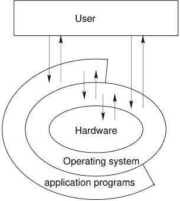
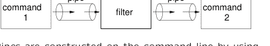
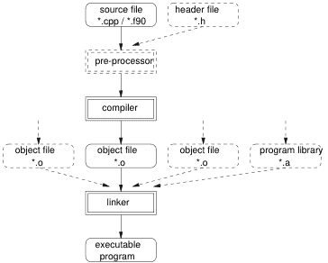

# 操作系统 Linux 与编程语言：导论

## 引言

附加材料

- vi 基础：`vi_brief.pdf`
- vi 参考：`vi_reference.pdf`
- emacs 参考：`emacs_reference.pdf`

*Acknowledgements.* 衷心感谢 Tadziu Hoffmann 仔细阅读手稿并提供有用的评论。

### 1 关于操作系统 UNIX/Linux 的一般说明

#### UNIX/Linux 的分类

UNIX 是一个 *多用户/多任务* 操作系统，存在许多不同的版本（“衍生版”）：Solaris、AIX、XENIX、HP-UX、SINIX、Linux。



操作系统 (OS)：操作计算机所需的所有程序的总和，其控制和监控应用程序。

#### 基本特性

#### UNIX

- 最初是用编程语言 C 编写的，因此是 C 程序的经典平台。UNIX 包含适合程序开发的环境（C、C++、Java、Fortran、...）。
- 主要用于大型机和工作站上的科学技术应用，但由于 Linux，在过去几年中也变得流行于经典 PC 应用。
- 非常适合在网络中应用。大型系统和网络需要一名管理员。
- 为大多数任务提供各种替代解决方案。命令众多（比任何其他 OS 都多），简洁灵活。
- 最初是命令行导向的，但可以通过图形用户界面（*X Window 系统*）使用。

Linux 可通过互联网在不同的 *发行版* 中获得（S.u.S.E.、Fedora、Debian 等）。目前已有多种 *即启（live）系统*，无需安装即可直接从 CD 或其他可启动存储设备启动（Knoppix、Ubuntu、...）。也有有趣的“迷你版本”（<100 MB），专为从 USB 闪存盘启动而设计（例如 Puppy）。Linux 的源代码是免费的。

#### 文献

- Peek, J., et al.: *Unix Power Tools.* O'Reilly Media 2002 (第 3 版)。
- Gilly, D., et al.: *UNIX in a Nutshell.* O'Reilly, Köln. 1998 (第 1 版)。
- Wielsch, M.: *Das große Buch zu UNIX.* Data Becker, Düsseldorf. 1994 (第 1 版)。
- 以及众多其他教科书
- 在线教程 http://www.ee.surrey.ac.uk/Teaching/Unix

### 2 在计算机上的第一步

#### 用户，登录，注销

由于 UNIX 是一个 *多用户* 操作系统，它可以同时处理多个用户。每个用户都需要一个 *用户账户*。

每个用户都有一个个人环境（*主目录，shell*），只能由他/她本人（以及系统管理员和知道密码的人——合法或通过黑客）访问。

在系统内部，用户由其 *用户 ID (`UID`)* 和其组身份（*组 ID, `GID`*）标识。

有两种用户类型：
- 具有 *受限* 权限的“普通”用户和
- 拥有全部特权的系统管理员（*root*）。后者负责系统的安装、配置和维护以及用户管理。

每个用户都必须登录和注销系统（*login/logout*）。每个用户账户都由 *密码* 保护。

##### 练习：

*使用你的用户账户登录系统！*

#### 图形用户界面

最初，UNIX 是命令行导向的。X Window 系统通过窗口式图形界面实现便捷交互，类似于其他操作系统。

*窗口管理器* 负责各个窗口的管理和显示。每个窗口管理器（而此类管理器种类繁多）都可通过其独特的 *外观和感觉*（窗口装饰和控制设备等的显示）来区分。大多数窗口管理器可在登录菜单中选择。

简单窗口管理器的示例：
- `twm`: 非常简单且节省资源
- `mwm`: Motif 窗口管理器，更常见且更高级
- `xfce`: 方便、简单、节省资源（推荐在虚拟机中使用）

此外，几乎所有 Linux 发行版都提供图形 *桌面环境*，例如 KDE 或 GNOME，其功能远超简单的窗口管理器。

command `xterm`

##### 语法：

```
xterm [options]
```

尽管有图形界面，UNIX 为了实际使用仍需要直接命令输入的可能性。因此，至少需要打开一个终端窗口。这可以通过窗口管理器或桌面环境（“控制台”）实现

然后可以使用命令 `xterm` 打开更多窗口。

通常，所有 UNIX 命令都有多种选项，通常以 `-` 开头。对于以下将介绍的命令，我们只提供最重要的选项。

##### 示例：

```
wegner@arber:~ > xterm -geo 80x40 -fn 10x20
```

命令 `xterm` 被调用时带有两个选项 `-geo`、`-fn`，在本例中需要额外的参数（窗口宽度和高度、字体名称和大小）。

##### 练习：

- 1. 通过 KDE 打开一个终端窗口（“终端程序”）。
- 2. 从那里，再启动另一个 `xterm`！

#### 命令 `man`

##### 语法：

```
man command
man -k expression
```

显示所提供命令的手册页（“man pages”）。`man -k` 搜索在 NAME 部分包含该表达式的手册页。一个 man 手册页通常包含以下部分：
- NAME 命令及用途
- SYNOPSIS 命令的语法
- DESCRIPTION 命令效果的描述
- FILES 被修改和/或需要的文件
- OPTIONS 选项（如果存在）
- EXAMPLE(S) 应用示例（很少见）
- BUGS 已知的错误（如果已知）
- SEE ALSO 相同上下文中的其他命令

##### 练习：

*显示关于命令 `xterm` 的信息！*

#### 命令 `passwd`

##### 语法：

```
passwd
```

设置一个新密码。

密码应由字母、数字和特殊字符的组合构成，并且不应出现在任何字典或类似列表中。否则，密码可能会被系统化的搜索算法破解。

设置/更改密码的命令以及所需的约定（长度、数字/字母/特殊字符的数量）可能因系统而异。下面的示例是一个常见的示例，例如适用于 CIP Pool 的工作站（但不适用于 USM 的工作站）。

##### 示例：

```
wegner@arber:~ > passwd
Changing password for wegner
Old password: myoldpasswd
Enter the new password
(minimum of 5, maximum of 8 characters)
Please use a combination
of upper and lower case letters and numbers.
New password: mynewpasswd
Re-enter new password: mynewpasswd
Password changed.
```

### 3 文件系统

#### 逻辑、文件类型

> “在 UNIX 中，一切都是文件。”

可以找到以下*文件系统对象*：
- “普通”（文本）文件
- 可执行文件（二进制文件或 *shell 脚本*）
- 目录
- 设备文件
- *管道*
- 符号链接或硬*链接*（对文件的引用）

所有文件和文件系统对象都按层级结构组织在一个*文件树*中，且只有一个*根目录* `/`。

与 MS-Windows 文件系统不同，UNIX 文件系统不区分不同的驱动器。所有物理设备（硬盘、DVD、CDROM、USB、软盘）都通过文件树中某个目录（通常位于 `/dev` 内）下的特定文件来表示。

文件名由字母、数字和某些特殊字符的序列组成，并且不能包含*斜杠*（为了方便起见，也不应包含空格）。

避免使用可能被 *shell* 以特殊方式解释的字符。

在文件树中，可以通过*绝对路径名*或*相对路径名*来引用文件。绝对路径名由到达该文件所需的所有目录和文件名组成，并且始终以 `/`（根目录）开头。

在许多 shell 和应用程序中，波浪号（`~`）表示主目录。

#### 命令 `pwd`

##### 语法：

```
pwd
```

显示当前目录。

##### 示例：

```
wegner@arber:~ > pwd
/home/wegner
wegner@arber:~ >
```

##### 练习：

*显示当前目录！*

#### 命令 `cd`

##### 语法：

```
cd [directory]
```

切换到指定目录，如果没有提供参数则切换到主目录。

与 MS-DOS/Windows 一样，“`..`” 表示父目录，“`.`” 表示当前目录。

##### 示例：


```
wegner@arber:~ > cd /home/puls
wegner@arber:/home/puls > pwd
/home/puls
wegner@arber:/home/puls > cd ..
wegner@arber:/home > pwd
/home
wegner@arber:/home > cd
wegner@arber:~ > pwd
/home/wegner
wegner@arber:~ >
```

### 练习：

*切换到目录 `/usr/share/templates`，然后再回到你的主目录！（-> 使用 TAB 键进行文件名补全）*

*使用 `pwd` 检查是否切换成功！*

### 文件名的搜索模式

原则上，`*shell*` 是一个处理输入命令解释的特定程序。如果这些命令的参数是文件名，则可以通过搜索模式同时指定多个文件，该模式由 `shell` 进行*展开*。无论如何，文件名展开都是在命令执行*之前*完成的。

| 表达式 | 含义 |
|---|---|
| `*` | “几乎”任意（包括空）字符串 |
| `?` | 单个“几乎”任意字符 |
| `[...]` | 一组字符范围 |
| `[!...]` | 取反的字符范围 |

“几乎”任意：排除前导点（例如隐藏文件、`../` 等）。

### 命令 `ls`

#### 语法：

```
ls [-alR] [file/directory]
```

显示文件的名称（以及可选属性），或列出目录的内容。文件和目录名称可以是绝对的，也可以是相对的。

#### 重要选项

- `-a` 同时列出以点开头的文件/目录（隐藏）
- `-l` 长格式列表。显示权限、用户和组、时间戳、大小等。
- `-R` 对于目录，所有子目录将被递归显示。

#### 示例：

```
wegner@arber:~ > ls
hello* hello.cpp hello.f90 nsemail/
wegner@arber:~ > ls -a
./ .bash_history .netscape/ hello.cpp
../ .bashrc* .ssh/ hello.f90
.Xauthority .history hello* nsemail/
wegner@arber:~ > ls /var/X11R6
app-defaults/ bin/ lib0 sax/
scores/ xfine/ xkb/
wegner@arber:~ > ls *.b*
.bash_history .bashrc*
wegner@arber:~ > ls [-h]*
hello* hello.cpp hello.f90
wegner@arber:~ > ls *.?[9]?
hello.cpp hello.f90
wegner@arber:~ >
```

#### 练习：

列出你的主目录的完整内容！

使用 `ls .*` 会显示什么？

### 复制、移动和删除文件/目录

除了 `ls` 之外，还有其他用于操作文件的命令，可以与文件名模式一起使用。

#### command `mkdir`, `rmdir`

#### 语法：

```
mkdir directory
rmdir directory
```

`mkdir` 创建一个空目录，`rmdir` 删除一个空目录。

#### 示例：

```
wegner@arber:~ > ls
hello* hello.cpp hello.f90 nsemail/
wegner@arber:~ > mkdir numerik
wegner@arber:~ > ls
hello* hello.cpp hello.f90 nsemail/ numerik/
wegner@arber:~ > rmdir numerik
wegner@arber:~ > ls
hello* hello.cpp hello.f90 nsemail/
wegner@arber:~ >
```

#### 练习：

在你的主目录中创建一个目录 `yourname.exercise`，其中 `yourname` 是你的实际姓名！

#### command `cp`

#### 语法：

```
cp file1 file2
cp file1 [file2 ...] directory
cp -r dir1 dir2
cp -r dir1 [dir2 ...] directory
```

复制文件或目录。原始文件/目录保持不变。

#### option：

`-r` 目录将连同所有子目录一起递归复制。

#### 几种可能性：

```
cp file1 file2
```

`file1` 被复制到 `file2`。注意：如果 `file2` 已存在，它将被覆盖（通常没有警告），原始 `file2` 将丢失！！！

```
cp file1 [file2 file3] dir
```

如果 `dir` 存在，`file1` [, `file2`, `file3`] 将被复制到 `dir` 中。如果 `dir` 不存在，你会得到一个错误警告（对于超过两个参数），或者，对于两个参数，`dir` 被解释为文件名，`file1` 被复制到名为 `dir` 的文件。

```
cp -r dir1 dir2
```

如果 `dir2` 已存在，`dir1` 将递归复制到 `dir2` 中。如果 `dir2` 不存在，将创建 `dir1` 的递归副本并命名为 `dir2`。

```
cp -r dir1 dir2 dir3 dir4
```

如果 `dir4` 已存在，`dir1`、`dir2`、`dir3` 将被复制到 `dir4` 中。如果 `dir4` 不存在，你会得到错误警告，以及命令中文件和目录的其他组合。

#### 示例：

```
wegner@arber:~ > ls
hello* hello.cpp hello.f90 nsmail/ numerik/
wegner@arber:~ > cp hello.cpp hello2.cpp
wegner@arber:~ > ls
hello* hello.f90 nsmail/
hello.cpp hello2.cpp numerik/
wegner@arber:~ > cp hello.cpp numerik
wegner@arber:~ > ls numerik
hello.cpp
wegner@arber:~ >
```

#### 练习：

- a) 检查你的主目录中是否存在目录 `ubung0`。如果不存在，通过 `scp` 从账户/主机 `numprakt@ltsp08.usm.uni-muenchen.de` 复制目录 `ubung0` 到你的主目录。
- b) 将 `ubung0` 中的文件复制到你的目录 `yourname.exercise` 中！

#### command `mv`

#### 语法：

```
mv file1 file2
mv file1 [file2 ...] directory
mv dir1 dir2
mv dir1 [dir2 ...] directory
```

重命名或移动文件或目录。与 `cp` 类似，但原始文件会被“销毁”。上面的第一个命令重命名文件，其他命令移动文件/目录。（实际上，只有 'inode table' 中的指针被更改，没有物理移动——除非你将文件移动到另一个文件系统）。

注意：不需要选项 `[-r]`

几种可能性，与 `cp` 类似。

#### 示例：

```
wegner@arber:~> ls
hello*      hello.f90  nsmail/
hello.cpp   hello2.cpp numerik/
wegner@arber:~> mv hello2.cpp hello3.cpp
wegner@arber:~> ls
hello*      hello.f90  nsmail/
hello.cpp   hello3.cpp numerik/
wegner@arber:~> ls numerik
hello.cpp
wegner@arber:~> mv hello3.cpp numerik
wegner@arber:~> ls
hello*  hello.cpp  hello.f90  nsmail/  numerik/
wegner@arber:~> ls numerik
hello.cpp  hello3.cpp
wegner@arber:~>
```

#### 练习：

- 1. 将你的目录 `yourname.exercise` 重命名为 `yourname.exercise0`！这将是以下练习的工作目录。
- 2. 将文件 `.plan` 从 `yourname.exercise0` 移动到你的主目录！尝试将主目录中的任意文件移动到根目录。会发生什么？

#### command `rm`

#### Syntax:

```
rm [-irf] file(s)/directory(ies)
```

删除文件和/或目录。删除后，被删除的文件无法恢复！使用 `rm` 时务必格外谨慎。例如，命令 `rm -r *` 会递归地（在大多数情况下无需进一步询问）删除当前目录下的完整文件树（尽管以 `.` 开头的隐藏文件/目录除外）。

#### Options:

- `-i` 删除前仅在确认后执行
- `-r` 目录将被递归删除（连同所有子目录）


- `-f` 强制：抑制所有安全询问。

注意：因系统而异，`rm` 在不带 `-f` 选项时可能需要确认也可能不需要（后者为标准）。

**示例：**

```
wegner@arber:~/numerik > ls
hello.cpp  hello3.cpp
wegner@arber:~/numerik > rm -i hello3.cpp
rm: remove ‘hello3.cpp’? y
wegner@arber:~/numerik > ls
hello.cpp
wegner@arber:~/numerik >
```

#### File permissions/Access rights

UNIX 文件系统区分三种不同的访问权限或文件模式位。 （注意：实际上还有更多访问权限，但这些仅对管理员感兴趣。）

`r` read：允许读取文件内容，或对于目录，列出其内容。

`w` write：允许修改文件（包括删除）。要创建或删除文件，父目录也需要写访问权限！

`x` execute：允许从命令行执行二进制文件（命令、程序）和 shell 脚本。对于目录，`x` 位是进入该目录并访问其内部文件/目录所必需的。

访问权限分别定义为

- `u` 对象的拥有者

- `g` 对象所属的组

- `o` 所有其他用户

- `a` 所有用户（即 `u + g + o`）

文件的访问权限可以通过 `chmod` 命令进行更改。

#### command `chmod`

**语法：**

```
chmod [ugoa][+-=][rwx] file(s)/directories
```

更改文件或目录的访问权限。这些权限由 `ls -l` 按以下模式显示

```
uuugggooo
rwxrwxrwx
```

**示例：**

```
wegner@arber:~/numerik > ls -l
total 4
-rw-r--r-- 1 wegner stud 100 Oct 20 15:02 hello.cpp
wegner@arber:~/numerik > chmod go+w hello.cpp
wegner@arber:~/numerik > ls -l
total 4
-rw-rw-rw- 1 wegner stud 100 Oct 20 15:02 hello.cpp
wegner@arber:~/numerik >
```

**练习：**

1. 删除目录 `yourname.exercise0!` 的执行权限。尝试切换到该目录。

2. 删除文件 `linux.txt` 的所有权限！如何撤销此操作？

### 4 Editing and printing text files

要修改（= 编辑）文本文件的内容，需要一个编辑器。在 UNIX 中有多种编辑器，主要区别在于易用性和内存需求。

#### The editor `vi` and `vim`

`vi` 是存在于 *所有* UNIX 系统上的唯一编辑器。编辑器 `vi`

- 可以完全通过键盘控制

- 极其灵活

- 相当难以学习

`vim` 是 `vi` 的衍生版本，也可以通过鼠标控制。

喜欢挑战的人应该学习使用此编辑器。

一个稍微简单且更方便的替代方案，也是（几乎）在所有 UNIX 系统中实现的，是

#### The editor `emacs`

编辑器 `emacs` 在自己的窗口中运行，可以通过菜单和鼠标（除键之外）进行控制。`emacs` 的内存需求相当大（对今天的计算机来说不是问题），因为这个“编辑器”可以做的事情远不止编辑。

**练习：**

1. *编辑程序* `hello.f90`！

   从命令行使用 `emacs hello.f90 &` 启动 emacs。`&` 号确保 `emacs` 在后台运行，因此你可以独立于 emacs 窗口继续从命令行工作（参见“进程管理”部分）。

   尝试更改以 `!` 开头的那些行的注释。

2. 使用 `Ctrl X 2` 分割屏幕。使用 `Ctrl X 1` 返回到一个屏幕。

3. 使用 `Ctrl X Ctrl S` 保存文件！

4. 使用 `Ctrl X Ctrl C` 退出 emacs！

注意：每当你在 `emacs` 中保存文件时，之前版本的备份会自动创建，名称为 `file~`。

**附加功能示例**

- 高级使用 `man` 手册（例如搜索特定字符串）：

  在 `emacs` 中，输入 `Esc X man CR xterm` 打开 `xterm` 的 `man` 手册。要搜索“terminal”，输入 `Ctrl S terminal`，然后 `Ctrl S` 查找下一个实例。

- 通过命令 `Esc x ispell` 在 `emacs` 中进行拼写检查。试试看！

尝试学习最重要的键盘控制命令。过一段时间后，你就可以比使用鼠标和菜单更快地编辑文件。附录中提供了快速参考。

#### command `cat`

**语法：**

```
cat file
```

在标准输出通道（通常是屏幕）上显示文件的内容。

与许多其他 UNIX 命令一样，`cat` 是一个过滤器，可以不仅从文件读取，还可以从标准输入通道读取（通常是通过命令行的键盘）。因此，`cat` 可用于直接创建较小的文本文件。在这种情况下，输出必须通过 `>` 重定向到文件。`cat` 然后期望从命令行输入一些内容，必须以 `Ctrl D` 结束。

**示例：**

```
wegner@arber:~ > cat > test
This is a test.
^D
wegner@arber:~ > cat test
This is a test.
wegner@arber:~ > more test
This is a test.
wegner@arber:~ >
```

**练习：**

1. 查看文件 `.plan`！

2. 查看文件 `linux.txt`！`cat` 是否是合适的工具？

#### 命令 `more`

**语法：**

```
more file
```

`more` 允许你分页查看较大的文件。在 `more` 中，重要的命令包括：按 `b` 回退，按 `q` 退出。

**示例：**

```
wegner@arber:~ > more hello.f90
```

**练习：**

使用 `more` 查看文件 `linux.txt`！按键 `CR` 和 `SPACE` 分别有什么效果？

#### 命令 `lpr, lpq, lprm`

**语法：**

```
lpr -Pprintername file
lpq -Pprintername
lprm job_id
```

`lpr` 将文件打印到名为 `printername` 的打印机上。要了解打印机名称，请询问同事或管理员。

`lpq` 列出打印机 `printername` 上的所有打印作业，并提供相应的作业 ID。

`lprm` 从打印队列中删除 ID 为 `job.id` 的打印作业。

**示例：**

```
wegner@arber:~ > a2ps hello.f90 -o hello.ps
[hello.f90 (Fortran): 1 page on 1 sheet]
[Total: 1 page on 1 sheet] saved into the file 'hello.ps'
wegner@arber:~ > ls
hello*  hello.f90  nsmail/  test
hello.cpp  hello.ps  numerik/
wegner@arber:~ > lpr -Plp0 hello.ps
wegner@arber:~ >
```

**练习：**

打印文件 `linux.txt`！

定位搜索表达式。列出本地数据库中与搜索表达式匹配的所有文件和目录。非常适合用于搜索文件（如果数据库频繁更新→系统管理员）。

`find` 在给定路径内递归搜索与搜索表达式匹配的文件。

示例：`find . -name '*.txt'` 从当前目录开始递归搜索所有 `*.txt` 文件。

`grep` 在给定文件中搜索文本。

示例：`grep 'test' ../*.f90` 在父目录的所有 `*.f90` 文件中搜索文本。

最重要的选项是 `[-i]`，它强制 `grep` 忽略大小写之间的任何区别。

### 5 Unix shell

shell 是一种服务程序，用户通过它与操作系统通信，并负责解释输入的命令。

#### 不同的 Unix shell

由于 shell 并不直接属于操作系统，因此在发展过程中出现了许多不同的 shell：

- Bourne shell（`sh`）。一种知名且广泛使用的 shell，以其发明者 Steven Bourne 的名字命名。其高级衍生版本 `bash`（Bourne again shell，注意这个双关语）在 Linux 下最为流行。

- C-Shell（`csh`）。在 Berkeley 开发，使用更接近 C 语言的语法。C-shell 的改进版本是 `tcsh`。

- Bash shell（`bash`）。高级 Bourne shell，是许多系统的标准 shell。


每个 shell 都包含一组系统变量，还可以由用户自定义变量加以扩充。该集合构成了 shell 内运行程序的进程环境。

此外，shell 还可以通过 shell 脚本运行（系统）程序。

## Shell 脚本

Shell 脚本是由 UNIX 命令和 shell 特有的程序结构（分支、循环等）组成的小程序，它们的行为类似 UNIX 命令，但以文本形式（而非二进制形式）存在。这些脚本由 shell *解释*执行。

不同 shell 的脚本语法（相当）不同。

某些 shell 脚本会在特定条件下*自动*被调用：

- 在登录时（即对于*登录 shell*），如果存在 `.profile` 和/或 `.login`，则执行它们，并且只执行一次。
- 每当打开新的 `bash` 或 `csh/tcsh` 时，会分别调用 `.bashrc` 和 `.cshrc` / `.tcshrc`。

### 练习

- 将文件 `.tcshrc` 复制到你的主目录并检查该文件！
- 在命令行中输入 `tcsh` 打开（新的）`tcsh`！会发生什么？用 `exit` 退出 `tcsh`！

## 重定向输入和输出

所有 UNIX 命令都使用*输入和输出通道*来读取数据和输出数据。通常，这些通道分别是分配给特定用户的键盘和屏幕。

这些标准通道可以在 shell 中重定向，这样命令就可以直接从文件读取（而不是从键盘读取）和/或写入文件（而不是写入屏幕）。进行重定向时，使用字符 `>`（用于输出）和 `<`（用于输入）。

使用 `>>` 时，输出将被*追加*到现有文件。如果文件不存在，该命令的行为与 `>` 相同。

### 示例

```
wegner@arber:~ > ls
hello.cpp  linux.txt  numerik/
hello.f90  nsmail/
wegner@arber:~ > cat linux.txt > linux2.txt
wegner@arber:~ > ls
hello.cpp  linux.txt  nsmail/
hello.f90  linux2.txt  numerik/
```

## 管道

此外，许多 UNIX 命令充当所谓的过滤器：它们从标准输入读取并写入标准输出。因此，它们可以通过所谓的管道组合，使得一个命令的输出作为另一个命令的输入：



管道是在命令行中通过在命令之间使用 `|` 字符来构造的。

使用 `>` 或 `>>` 将输出重定向到文件只能出现在这样的链的末尾。

### 示例

```
wegner@arber:~ > man g++ | a2ps -P printer
[Total: 151 pages on 76 sheets]
wegner@arber:~ >
```

通过这个管道，`g++` 的手册页被格式化并通过一条命令打印出来。

## 6 进程管理

进程是一个正在运行的程序或脚本，由以下部分组成

- 程序/脚本本身以及
- 相应的环境，它由确保正确程序流程所需的所有额外信息组成。

进程的特征有（其中包括）

- 唯一的进程 ID（PID），
- 父进程的 PID（PPID），
- 所有者的用户和组编号以及
- 进程的优先级。

通常，当进程从 shell 启动时，在进程结束之前 shell 不能用于其他输入。但进程和程序也可以在后台运行。为了启用此功能，调用进程/程序的命令行必须以 `&` 结尾。

### 示例

```
wegner@arber:~ > firefox &
[1] 21749
wegner@arber:~ >
```

### 练习

在后台启动程序 `xeyes`！

### 命令 `ps`

#### 语法

```
ps [-al] [-u user]
```

显示正在运行的进程及其特征。没有选项时，仅显示当前 shell 中用户自己的进程。

重要选项：

- `-a` 显示分配给任何终端（tty）的所有进程
- `-l` 长格式显示。有关所有者、父进程等的附加信息。
- `-u` 显示由特定用户拥有的所有进程。

#### 示例

```
wegner@arber:~ > ps
  PID TTY       TIME CMD
21733 pts/4    00:00:00 bash
22197 pts/4    00:00:00 xterm
22198 pts/5    00:00:00 bash
22212 pts/4    00:00:00 ps
wegner@arber:~ >
```

#### 练习

*查看 shell 中所有当前进程！*

### 命令 `kill`

#### 语法

```
kill [-9] PID
```

终止编号为 PID 的进程。只能由进程所有者或 *root* 执行。

重要选项：

- `-9` 用于‘顽固’的进程，这些进程无法通过正常 kill 终止。

#### 示例

```
wegner@arber:~ > ps
  PID TTY       TIME CMD
21733 pts/4    00:00:00 bash
22197 pts/4    00:00:00 xterm
22198 pts/5    00:00:00 bash
22212 pts/4    00:00:00 ps
wegner@arber:~ > kill 22197
wegner@arber:~ > ps
  PID TTY       TIME CMD
21733 pts/4    00:00:00 bash
22214 pts/4    00:00:00 ps
[1]+  Exit 15  xterm
wegner@arber:~ >
```

#### 练习

通过 `kill` 终止 `eyes`！

## 7 编程语言 C++：概述

*编程语言* 允许通过特定的语法规则来表述某些问题或算法。这样的 *程序* 可以由专用程序（*解释器、编译器*）‘翻译’成机器可读代码，然后由计算机执行。

历史上，建立了各种复杂程度不同的编程语言，这种复杂性由计算机科学/硬件的进步和预期应用决定。

解决特定问题的思路可以通过不同的编程 *范式* 来区分。

### 过程式和面向对象编程

#### 过程式编程

重点在于所使用的 *算法*。程序由将问题层级分解为 *功能* 单位组成。

数据和函数是分离的，且数据是公开可访问的。

**编程语言：** C, Fortran77, Pascal, …

#### 面向对象编程

有用介绍：

`https://www.youtube.com/watch?v=IbXsrHGhBAU`

引入了 *用户定义的类型（类）* 及其相关操作。

因此，数据和相关函数（方法）在 *类内* 构成一个单元。数据通常只能通过相关方法访问。

*继承* 共同属性允许区分类型/类的一般和特殊属性。

**示例：** 各种动物和植物类的家谱，科、目、种等。

在出现的 *层次结构* 中，可以实现具有相同接口但为每种特定类型/类定义特定行为的相似函数（*多态性*）。

通过这种方法，应创建一个（几乎）精确的现实模型，该模型反映程序中所有相关依赖关系。

面向对象编程的优点：

- 由于整体方法，更好的抽象可能性。
- 改进的结构和模块化，便于程序维护。
- 可重用性。

**编程语言：** C++, Java, Python,…

### C 和 C++ 的基本特性

- 目前，C++ 是使用最广泛的编程语言之一。
- C++ 源自 C，并且是 C 的超集。
- C++ 既允许高效的、面向硬件的编程（如 C 已有的），也允许在高层次的面向对象抽象层面上进行编程。因此，C++ 有时被称为 *混合* 语言。
- 操作系统 UNIX 完全用 C 编写。
- C++ 和 C 都是标准化的（由国际 ANSI 标准）。
- C 和 C++ 不包含用于输入输出、图形和硬件编程等的特殊函数，但有相应的 *库*。
- *标准库* 包含典型应用所需的全面函数和类集合，并随每个编译器一起安装。
- 根据爱好者们的说法，C++ 编程很有趣！

### 文献

- **Stroustrup, B.**: *The C++ Programming Language: Special Edition*, Addison-Wesley Longman, Amsterdam, 2000.
- **Kernighan, B., Ritchie, D.**: *The C Programming Language*, Prentice Hall, 1988 (2nd ed.).
- **Meyers, S.**: *Effective C++: 55 Specific Ways to Improve Your Programs and Designs*, Addison-Wesley, München, 2005 (3rd ed.).


- **Josuttis, N.**: *The C++ Standard Library: A Tutorial and Reference*, Addison-Wesley Longman, Amsterdam, 1999.

- **Booch, G., Maksimchuk, R. A., Engle, W. et al.**: *Object Oriented Analysis and Design with Applications*, Addison-Wesley Longman, Amsterdam, 2007 (3rd ed.).

C++ 标准（INCITS/ISO/IEC 14882-2003）可通过 `http://www.ansi.org` 下载（≈ 30$）。

#### 在线资源

WWW

- **C++ tutorial**  

  `http://www.cplusplus.com/doc/tutorial`

- **Bjarne Stroustrup’s homepage** (author of the C++ programming language)  

  `http://www2.research.att.com/~bs`

- **C++ FAQs**  

  `http://www.parashift.com/c++-faq-lite`

Newsgroups

- `comp.lang.c++.moderated`  

  General C++ discussion forum.

- `comp.std.c++`  

  Discussions related to the C++ standard.

### 8 Fortran 90/95：概述

#### 简史

- 1954 年引入。
- 由 Fortran II、Fortran IV、Fortran66、*Fortran77*（仍在使用）延续。
- Fortran 90，自 1991 年起为 ISO，自 1992 年起为 ANSI 标准。
- Fortran 95，自 1996/97 年起为 ISO/ANSI 标准。
- 同时 Fortran 2000 和 Fortran 2003（最新标准）。
- F95 和 Fortran 2000 包含对 F90 的相对较小的修订。
- Fortran 2003 是重大修订，支持（其中其他特性）面向对象编程（继承、多态）。
- Fortran 2008 正在开发中。
- 目前大多数编译器支持 F90/95，但 Fortran 2003 标准（几乎）已在 Intel *Fortran* 编译器的最新版本 v11 中实现。

#### 重要特性

- Fortran *曾经是* 且 *现在是* 用于解决物理问题，特别是数值模拟的最常用的语言。
- F90/95 的引入使其具备与 C/C++ 相似的特性，除了硬件导向之外。凭借 Fortran 2003，甚至面向对象编程也成为可能。
- F90 的功能相当强大，并且有众多 *标准* 操作和函数。例如，向量和矩阵运算属于标准：

  $$a = b + c$$

  可以表示标量、向量或矩阵加法，具体取决于 $a,b,c$ 的定义。向量和矩阵乘积也可以通过同样简单的指令计算（*快速执行*），

  $$a = \text{dot\_product}(b,c);\qquad a = \text{matmul}(b,c).$$

- 存在全面的程序库，特别是用于线性代数和特征值问题（既可作为源代码，也可作为高度优化的二进制对象提供），例如 `BLAS`、`LAPACK`、`EISPACK`。
- 优化的程序（多维、并行）执行速度通常比相应的 C++ 程序快（2 到 3 倍）。
- 通过 HPF（高性能 Fortran）实现并行化的 *简单* 可能性。
- 基本结构非常简单，语言比 C++ 更容易学习（至少就基本概念而言）。
- 在未来几年内，任何不只对纯实验/观测或纯理论工作感兴趣的物理学家都必须了解 Fortran。

  使用（几乎）完全 Fortran 的物理研究领域示例：空气/流体动力学、计算天体物理学、原子和核物理学、地球物理学、气象学。
- Fortran 编程速度很快！

#### 文献

- **参考手册**
  - Gehrke, W.: *Fortran90 Reference-Handbuch*, 1991, Hanser, München, ISBN 3446163212.
  - *‘Fortran 90’*, RRZN (可在 LRZ 获取)。

- **教科书**
  - Adams, J.C., et al.: *Fortran 2003 Handbook: The Complete Syntax, Features and Procedures*, Springer, Berlin, 2008, ISBN 184623787.
  - Metcalf, M., et al.: *Fortran 95/2003 explained*, Oxford Univ. Press, 2004, ISBN 0198526938 (平装本)。

#### 在线资源

- 利物浦大学在线教程  

  `http://www.liv.ac.uk/HPC/HTMLFrontPageF90.html`

- 德语 Fortran 网站  

  `http://www.fortran.de`

- Metcalf 的 Fortran 信息  

  `http://www.fortran.com/metcalf`

- Michel Olagnon 的 Fortran 90 列表  

  `http://www.fortran-2000.com/MichelList`

### 9 创建可执行程序

#### 三个连续阶段

在从 C++ 或 Fortran 源文件生成可执行程序时，始终需要执行相同的步骤（对于其他高级编程语言如 Basic 或 Pascal 也适用）。



*预处理器* 替换符号常量和宏，并在需要时插入附加文件。对于 Fortran 程序通常省略。

*编译器* 将源代码‘翻译’为机器可读代码，生成目标文件。

*链接器* 将所有现有的目标文件（以及可选的库中的目标文件）绑定为可执行程序（可执行对象）。

#### 命令 g++

##### 语法：

```
g++ [-c] [-g] [-O] file.cpp [-o outfile]
```

我们建议使用 GNU C++ 编译器，它包含在几乎所有 Linux 发行版中。链接器已包含在内，但可以单独调用。

##### 重要选项：

- `-o` 可执行对象（程序）的名称。默认 `a.out`。
- `-c` 仅编译，不链接。
- `-g` 包含调试信息。后续调试所必需。会增加程序的大小和执行时间。
- `-O` 优化（默认：中间优化）

##### 示例：

```
wegner@arber:~ > g++ hello.cpp
wegner@arber:~ > ./a.out
Hello, world!
wegner@arber:~ > g++ hello.cpp -o hello
wegner@arber:~ > ./hello
Hello, world!
```

在 `a.out` 和 `hello` 前面的字符 `./` 通常是必需的，以告诉 shell 可执行程序位于当前目录中。

现在分两步进行：先编译，然后链接

##### 示例：

```
wegner@arber:~ > g++ -c hello.cpp
wegner@arber:~ > g++ hello.o -o hello
```

如果存在多个源文件（例如，每个子程序包含在单独的源文件中），可以使用所谓的 makefile 来避免不必要的编译和大量的命令行输入，makefile 允许使用一条命令更新可执行程序。有关更多信息，请搜索 makefile 和/或联系您的导师。

#### 命令 ifort, gfortran

##### 语法：

```
ifort [-c -g -O] file.f90 [-o outputfile]
gfortran [-c -g -O] file.f90 [-o outputfile]
```

在 GNU 开源项目中，GNU Fortran 95 编译器可在命令 `gfortran` 下使用（如果在您的 Linux 发行版/系统中已实现并安装）。由于该编译器（在其最终阶段）相当新，且在我们研究所尚未经过充分测试，我们建议在可能的情况下使用 Intel Fortran 95 编译器 `ifort`（例如已安装在 USM 的工作站上。有时，您需要调用命令 `module load fortran` 使编译器可用）。

请注意，两个编译器都符合 F95 标准（`ifort` v11 及更高版本还额外支持大多数 Fortran 2000/2003 功能），并且与 `ifort` 相比，`gfortran` 不支持 16 字节实数。


如果您无法使用 `ifort`（例如在家工作且无法连接到 USM），请使用 `gfortran`，其选项与 `ifort` 相同或相似。`gfortran` 也可作为 MS-Windows 二进制文件使用。

如果您想使用 GNU 调试器 `ddd` 或 `gdb` 调试代码（下一主题），我们建议使用 `gfortran`。（`ifort` v12 及更高版本在大多数情况下也能工作）。

在两个编译器中，链接器再次包含在内，但可以单独调用。

## ifort 和 gfortran 的重要选项

- `-o` 可执行对象（程序）的名称。默认 `a.out`。
- `-c` 仅编译，不链接
- `-g` 包含调试信息（参见 `g++`）
- `-O` 优化（默认：中间优化）

### 示例

```
wegner@arber:~ > ifort hello.f90 -o hello
wegner@arber:~ > ./hello
Hello, world!
wegner@arber:~ >
```

### 练习

1. 使用 `ifort` 编译 Fortran 版的 HelloWorld 并启动程序！
2. 使用选项 `-c` 用 `gfortran` 编译程序，并在第二步通过 `gfortran hello.o` 进行链接！

## 调试

在你成功编译并链接程序之后，可以通过在 shell 中输入其名称作为命令来启动它（`a.out` 或使用 `-o ownname` 编译时的 `ownname`）。但这并不意味着

1. 你的程序能够成功运行到结束，
2. 它符合你的意图。

如果出现某些运行时的错误，你必须调试程序。你可以手动进行（通过打印出某些中间结果和测试语句），也可以使用所谓的调试器。这种工具允许，例如，

- 逐步执行语句
- 查看变量的当前内容
- 在由你自己定义的所谓断点处停止程序。

一个在 Linux 下可用的开源且面向窗口的调试器是 `ddd`（Data Display Debugger），它适用于 C++ 和 Fortran 程序（至少是用 `g++` 和 `gfortran` 分别编译的，并且带选项 `-g`）。

调试器只需通过以下方式调用

```
ddd program_name
```

其中 `program_name` 是可执行对象的名称（例如，`a.out`）。

`ddd` 的核心（实际上只提供窗口界面）是调试器 `gdb`，它也可以单独使用来调试程序（从控制台）。它通过以下方式调用

```
gdb program_name
```

但需要了解相关命令的知识。

记住：要调试程序，必须使用选项 `-g` 编译它，以便包含所需的调试信息。

### Example:

```
wegner@arber:> gfortran -g hello.f90 -o fhello
wegner@arber:> ddd fhello
GNU DDD 3.3.11 (x86_64-suse-linux-gnu),
by Dorothea Luetkehaus and Andreas Zeller.
...
(gdb)
```

### Exercise:

1. 编译程序 `p1.f90` 并运行它。重新使用选项 `-g` 编译！
2. 为可执行对象启动 `ddd`。熟悉控制面板和菜单栏中最重要的条目（`Run`、`Step`、`Next`、...）和按钮（`Break`、`Print`）。
