# Xilinx 设计师实验室实践指南：学生版 1.5；适用于 Microsoft Windows


## Trademarks

XILINX®

The Xilinx logo shown above is a registered trademark of Xilinx, Inc.

XILINX, XACT, XC2064, XC3090, XC4010, XC5200, XC5300, FPGA Architect, FPGA Foundry, NeoCAD, NeoCAD EXPT, NeoCAD PRISM, NeoROUTE, NeoRoute Plus, Logic, Plustran, Timing Wizard, XPF and TRACE are registered trademarks of Xilinx, Inc.

Σ

The shadow X shown above is a trademark of Xilinx, Inc.

All XC-prefix product designations, XACT step, XACT step Advanced, XACT Floorplanner, XACT-Performance, XAPP, XAM, X-BLOX, X-BLOX plus, XChecker, XDM, XDS, XELPD, XPF, XSI, BITA, Configurable Logic Cell, CLC, Dual Block, FastCLK, FastCONNECT, FastFLASH, FastMap, Foundation, HardWire, LCA, LogicBLOX, Logic Cell, LogiCORE, LogicProfessor, MicroVU, PLUSASM, PowerGuide, PowerMaze, SelectRAM, SMARTswitch, TrueMap, UIM, VectorMaze, VersaBlock, VersaRing, XABEL, Xilinx Foundation Series, and ZERO+ are trademarks of Xilinx, Inc. The Programmable Logic Company and The Programmable Gate Array Company are service marks of Xilinx, Inc.

Aldec is a trademark of Aldec, Inc. IBM is a registered trademark and PC/AT, PC/XT, PS/2 and Micro Channel are trademarks of International Business Machines Corporation. DASH, Data I/O and FutureNet are registered trademarks and ABEL, ABEL-HDL, and ABEL-PLA are trademarks of Data I/O Corporation. SimuCad and Siles are registered trademarks and P-Silos and PV-Silos are trademarks of SimuCad Corporation. Microsoft is a registered trademark and MS-DOS is a trademark of Microsoft Corporation. Contrinex is a registered trademark of Centronics Data Computer Corporation. PALASM is a registered trademark of Advanced Micro Devices, Inc. UNIX is a trademark of AT&T Technologies, Inc. CUPL, PROLINX, and MAKEPRG are trademarks of Logical Devices, Inc. Apollo and AEGIS are registered trademarks of Hewlett-Packard Corporation. Mentor and IDEA are registered trademarks and NETD, Design Architect, System Architect, QuickSim, QuickSim II, and EXPAND are trademarks of Mentor Graphics, Inc. Sun is a registered trademark of Sun Microsystems, Inc. SCHEMA II+ and SCHEMA III are trademarks of Omenation Corporation. OrcAD is a registered trademark of Orcad, Inc. Windows is a registered trademark of Microsoft Corporation. Xyquest is a registered trademark of Xyquest Systems, Inc. CASE Technology is a trademark of CASE Technology, a division of the Teradyne Electronic Design Automation Group. DECstation is a trademark of Digital Equipment Corporation. Synopsys is a registered trademark of Synopsys, Inc. Verilog is a registered trademark of Cadence Design Systems, Inc. FLEXlm is a trademark of Globetrotter, Inc. DynapT is a registered trademark of Aliso Corporation. All other trademarks are owned by their respective companies.

Xilinx, Inc. does not assume any liability arising out of the application or use of any product described or shown herein; nor does it convey any license under its patents, copyrights, or maskwork rights or any rights of others. Xilinx, Inc. reserves the right to make changes, at any time, in order to improve reliability, function or design and to supply the best product possible. Xilinx, Inc. will not assume responsibility for the use of any circuitry described herein other than circuitry entirely embodied in its products. Xilinx, Inc. devices and products are protected under one or more of the following U.S. Patents: 4,642,487; 4,695,740; 4,706,216; 4,713,557; 4,746,822; 4,750,155; 4,785,716; 4,896,316; 4,899,638; 4,899,410; 4,853,698; 4,682,619; 4,555,655; 4,907,810; 4,640,809; 4,667,107; 5,012,135; 5,023,606; 5,028,821; 5,047,710; 5,068,693; 5,140,193; 5,148,389; 5,155,432; 5,168,868; 5,224,056; 5,243,298; 5,245,277; 5,267,187; 5,291,079; 5,298,990; 5,302,666; 5,319,252; 5,319,254; 5,321,704; 5,329,174; 5,229,181; 5,321,220; 5,331,226; 5,352,928; 5,337,235; 5,343,406; 5,349,546; 5,349,249; 5,321,750; 5,349,691; 5,262,685; 5,321,322; 5,363,738; 5,362,126; 5,367,174; 5,430,610; 5,430,610; 5,430,610; 5,430,610; 5,410,021; 5,460,022; 5,453,706; 5,462,113; 5,498,378; 5,626,379; 5,430,687; 5,432,719; 5,448,181; 5,448,493; 5,450,021; 5,460,022; 5,453,706; 5,466,177; 5,469,003; 5,475,283; 5,477,416; 5,481,206; 5,483,478; 5,666,707; 5,485,716; 5,498,316; 5,498,638; 4,689,966; 4,701,353; 4,685,196; 5,978,978; 4,996,389; 4,900,100; 5,000,908; 5,500,609; 5,502,000; 5,502,440; RE 34,363; RE 34,444; and RE 34,908. Other U.S. and foreign patents pending.

Xilinx, Inc. does not represent that devices shown or products described herein are free from patent infringement or from any other third party right. Xilinx, Inc. assumes no obligation to correct any errors contained herein or to advise any user of this text of any correction if such be made. Xilinx, Inc. will not assume any liability for the accuracy or correctness of any engineering or software support or assistance provided for the use of any circuitry described herein. Xilinx products are not intended for use in life support appliances, devices, or systems. Use of a Xilinx product in such applications without the written consent of the appropriate Xilinx officer is prohibited.


### 引言

那么，这本书讲的是什么？这一切始于 1993 年 7 月，当时我在北卡罗来纳州立大学电气工程系的副系主任助理请我为大二入门数字设计课程的实验课授课。这在学术上相当于被要求去清理油脂陷阱，但助理教授不会对副系主任那样说。

既然我必须教实验课，我就想办法让它变得有趣。对我来说，至少！想想花三个小时试图帮助二十名学生调试十块布满意大利面式接线的原型板，威胁要把我们全部吞没，这并不吸引人。然后我们还必须在每次实验课结束时拆掉所有作品，为下一组腾出空间。这意味着每周的工作无法在此基础上继续。

我考虑过在大二实验室中使用 FPGA。FPGA 可以让学生编写“类软件”的硬件描述，而不是剪切和夹接导线。 granted，学生软件看起来可能和他们的接线一样像意大利面，但至少他们可以拿到一个可工作的电路描述，然后对其进行修改、编译并加载到 FPGA 中。而且编写硬件描述比接线芯片花费的时间更少（尤其是加上调试时间），因此学生在实验室中可以完成更具挑战性的设计。如果他们发现自己采用了错误的方法，更改电路的某些部分也会更容易。他们甚至可能进行更多迭代来改进设计，因为他们不必从头开始构建每一个设计。他们甚至可以在实验室课外完成设计，并将硬件描述带到软盘上，以便在实际 FPGA 中测试电路。

从讲师的角度来看，FPGA 降低了实验室运营成本，因为单个芯片取代了整柜的 TTL 器件。并且在课程之间清理实验室站点的耗时被消除了，因为 FPGA 可以在几秒钟内擦除。学生的设计甚至可以跨越多个课程，因为 FPGA 设计可以随时从磁盘保存和召回。这些因素将有助于提高学生可以处理的设计的规模和挑战性。看起来是个好主意。

我们在网络化工作站系统上拥有充足的 FPGA 设计软件工具。然而，学生在完成实验室课程后会怎样呢？


如果学生没有工作台和一堆价值10,000美元的工具，他/她该如何构建数字电路？如果这迫使学生回到用TTL芯片设计的老路，那么在实验室里教授基于FPGA的设计就不那么有用了。FPGA设计环境必须足够便宜，让学生能够拥有一套，并在完成实验课程后继续使用。

幸运的是，我参加了一次FPGA会议，看到了一款售价40美元、拥有3,500个门电路且附带一套免费软件工具的FPGA。这个FPGA不算便宜，但比装满一抽屉TTL芯片的成本要低。这款84引脚的FPGA可以安装在一块标准面包板上，再加上一些接口电路，总成本大约120美元。对于一套完整的FPGA设计环境来说，这已经相当便宜了。

这些基于FPGA的实验板在整个学期中用于两个不同的实验。当然，并非每个实验都一帆风顺，但考虑到从TTL器件到FPGA的转换规模之大，整个过程相对而言还算顺利。而且整个学期我们只烧毁了一个FPGA，所以运行成本很低。

几年后，为实验室提供FPGA的公司退出了可编程逻辑市场，这款芯片最终停产了。幸运的是，我设法联系到了XILINX的Jason Fein Smith，并达成协议，基于他们的XC9500 CPLD和XC4000 FPGA以及Foundation Series软件包重写实验内容。他们的芯片价格已降至10-20美元范围。他们还同意将Foundation工具以CDROM形式附带在每本实验教材中，这样每个学生都能拥有自己的副本。

本书包含一套完整的实验课程，涵盖使用CPLD和FPGA进行入门逻辑设计。内容组织为以下章节和附录：

- **数字设计流程** 讨论了设计数字电路所涉及的步骤，并展示了如何使用TTL芯片构建电路。
- **可编程逻辑设计技术** 列出了使用可编程逻辑的一些优点，讨论了可编程逻辑的演变，并演示了XILINX F1设计工具的使用。
- **组合逻辑** 讨论了几种常用的逻辑电路，并演示了如何设计和实现LED译码器电路。
- **模块化设计与层次结构** 讨论了在设计过程中逐步细化和封装的优势，并展示了F1软件包如何支持这些概念。
- **电气特性** 描述了CPLD和FPGA的各种I/O驱动器和时序/延迟模型。

### 触发器

通过构建多种电平敏感型和边沿触发型触发器电路来介绍时序逻辑。

### 状态机设计

展示了计数器以及多种版本饮料机控制器的设计示例。

#### 存储器

讨论了随机存取存储器如何组织，并展示了如何使用触发器和逻辑门构建小型存储器、如何使用FPGA内置存储器，以及如何使用外部存储芯片构建FIFO。

### GNOME微型计算机

描述了一台简单的四位微型计算机的体系结构、指令集和构建方法。

### DWARF微型计算机

描述了如何将GNOME微型计算机扩展到八位，并增加了更多寻址模式、子程序支持和中断功能。

### 附录A

展示了如何构建基于CPLD或FPGA的实验板。还展示了可编程逻辑器件与其他组件之间的连接。完成各章节的示例时，你将需要这些信息。

### 附录B

概述了如何在FPGA设计中使用ABEL硬件描述语言。

每章开头都会讨论该章将应用的逻辑设计原理。随后是一个实验部分，你可以构建和测试逻辑电路来验证这些原理。我的指导原则是，唯有通过构建和测试逻辑设计，才能真正培养出专业技能。为了让本书教会你如何使用FPGA和CPLD进行设计，你必须主动动手实践示例。这不是那种你可以躺在床上阅读并有所收获的书。它属于计算机旁——当你逐步操作示例时，或属于实验台——当你测试FPGA或CPLD是否正常工作时。等你完成所有章节时，这本书应当已被磨损和涂写得面目全非。熟能生巧，但过程往往并不美观。

每章末尾附有一份额外项目列表，为你在各章所描述设计的基础上进行扩展和构建提供一些思路。希望你会发现使用FPGA和CPLD进行设计如此容易，从而敢于挑战更多有难度的项目。

翻阅本书后，你会注意到许多重要主题并未在这些章节中涉及。如果你向我指出这些遗漏，我甚至会认同它们确实是重要主题。但任何书籍都是在“我们想做的事”和“我们有时间做好的事”之间的权衡。本书旨在成为你学习FPGA和CPLD使用的起点，而非终点。如果这本书能传授足够的知识，让你能够扩展自己的专业技能


通过进一步研究 FPGA/CPLD 数据手册、应用示例和案例研究，就达到了其目的。

本书的预期读者有两种：

初级电气和计算机工程学生。该读者正在学习数字逻辑设计的理论和实践方面。本书侧重于实践部分。只要具备布尔算术、布尔运算和二进制数系统方面的知识即可理解。对于正式的数字逻辑设计课程，本书的初始章节可作为对任何大量标准数字设计教材的实用补充。最后两章介绍了两种简单、可扩展的微计算机架构，学生可以在初级的计算机设计课程中对其进行实验。

在职工程师和业余爱好者。该读者已经精通数字逻辑电路的设计和构建，但可能没有足够的资金或时间去熟悉可编程逻辑。约 100 美元的原型环境搭建指南将帮助他们克服第一个障碍。虽然他们不需要阅读前几章中讨论的数字逻辑基础知识，但经过演算的示例将有助于他们快速入门。关于 GNOME 和 DWARF 微计算机的最后章节也应让他们很好地掌握可容纳在 FPGA 和 CPLD 中的设计规模。

没有一本书是在孤立的情况下完成的，这本书也不例外。我要感谢 XILINX 的 Jason Feinsmith 提供了将我的实验翻译成 XILINX 可编程逻辑系列的机会。以及 Prentice Hall 的 Tom Robbins、Nancy Garcia 和 Rose Kernan，他们在指导本文稿以创纪录的速度出版时令人鼓舞。此外，还要感谢在各个大学中忍受过本材料早期版本的学生、教师和审阅者，他们提出了宝贵的建议和更正。特别是，我要感谢加州理工学院的 Jim Harris、密西西比州立大学的 Bob Reese、宾夕法尼亚大学的 Jan Van der Spiegel、雪城大学的 Edward Stabler、哈福德大学的 John Froehlich、中央昆士兰大学的 Jack Sandell，以及田纳西大学的 Don Bouldin。最后，我要感谢我的妻子 Liz，她在整个过程中一直支持着我。

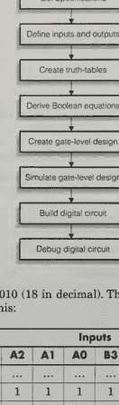

#### 图 1.1

数字设计中涉及的任务流程。

为 10010（二进制为 18）。这将是类似这样的真值表中的众多条目之一：

| Inputs |  |  |  |  |  |  |  | Outputs |  |  |  | |
|---|---|---|---|---|---|---|---|---|---|---|---|---|
| A3 | A2 | A1 | A0 | B3 | B2 | B1 | B0 | O4 | O3 | O2 | O1 | O0 |
| ... | ... | ... | ... | ... | ... | ... | ... | ... | ... | ... | ... | ... |
| 0 | 1 | 1 | 1 | 1 | 0 | 1 | 1 | 1 | 0 | 0 | 1 | 0 |
| ... | ... | ... | ... | ... | ... | ... | ... | ... | ... | ... | ... | ... |

一旦写下真值表，设计者就必须推导出布尔方程，描述每个二进制输出如何通过 AND、OR 和 NOT 的逻辑运算从二进制输入计算得出。完成此步骤有多种手工和计算机辅助方法。对于加法器示例，此步骤的结果将是五个布尔方程（每个二进制输出一个），使用八个二进制输入。

接下来，前一步推导出的布尔方程被转换为门级电路原理图绘制。布尔方程中的每个 AND、OR 和 NOT 运算都用原理图中的相应 AND 门、OR 门或反相器符号替换。线条连接这些符号的输入和输出，以表示二进制结果在逻辑运算之间的传递。

在构建电路之前，检查并确保所有先前的步骤都已正确完成是件好事。因此，对前一步的门级设计进行仿真以检查其操作。在最原始的形式中，仿真由设计者执行，他追踪各种输入组合通过原理图的门，以确定输出上产生的值是否与他在真值表中列出的值相匹配。如果是，太好了！如果不是，那么设计者必须回溯之前的步骤并找出错误所在。手动仿真非常乏味，因此计算机通常会负责此步骤。

此时设计看起来可能真的可行，因此设计者可以继续构建物理电路。一种方法是把包含单个反相器、AND 门和 OR 门的数字集成电路（IC）插入原型板中，然后根据门级原理图绘制的指示用导线将门连接起来。这是一项耗时且容易出错的操作。

一旦电路构建完成，乐趣就开始了！设计者向电路施加真实输入，看看输出是否与真值表中列出的相匹配。如果是，太好了！如果不是，那么设计者在之前的某个步骤中犯了错误。假设所执行的仿真是完整且正确的，那么设计者在构建电路时犯了错误。因此，他或她可以集中精力寻找电路中的物理问题。然而，如果没有进行仿真，则问题可能由任何前面的步骤中的错误引起。这使得寻找错误更加困难，并增加了找到后，纠正错误的补救措施会很昂贵的风险。例如，如果设计者在真值表中输入错误，则该错误会通过布尔方程、门级原理图和电路的物理构建传播。进行仿真所需的时间将少于查找错误条目并拆卸和重新组装电路以纠正问题所需的时间。

### 实验

#### 构建一个晶体管-晶体管逻辑电路

设计流程和设计框架听起来总是很棒，但你永远不会真正注意到它们的优缺点，直到你实际尝试使用它们。因此，刚才描述的设计流程将被用于一个简单的产品：面向旅行推销员的路由器。


### 规格说明

规格通常来自客户，在这个案例中，客户是一家小公司的老板。该公司雇有一组旅行推销员，负责服务四个城市：胡特维尔、梅伯里、派洛特山和赛勒城。老板的问题在于，他的推销员经常在城市之间的路线上做出糟糕的选择，花在路上的时间比销售产品的时间还多。老板已经查看了连接这些城市的各条公路的行车时间，并将这些信息标注在地图上（图 1.2）。他所


#### 图 1.2

四个城市以及推销员出行所经过的连接它们的公路。

想要的是一个可以交给每位推销员的小型手持设备，该设备能够显示任意两个城市之间的最快路线。他甚至已经有了他的 Trip-Genie™ 的“艺术家构想图”（图 1.3）。Trip-Genie 有四个


#### 图 1.3

Trip-Genie 显示六个 LED 输出，用于指示由四个拨动开关中的两个所选城市之间的最佳路线上的公路。

开关（每个城市一个）和六个发光二极管（LED）（每条公路一个）。推销员会拨动两个开关来指示起点和终点城市，之后 Trip-Genie 将点亮那些位于连接两个城市的最快路线上的公路对应的 LED。

显然，老板真正需要的是更聪明的销售队伍，或者至少是一些打印好的卡片，向推销员展示每对城市之间的最快路线。但是老板已经给了你他想要的规格。而且通常情况下，给别人他们想要的东西而不是他们需要的东西，你会更成功。因此，以下小节将演示 Trip-Genie 的设计。

### 输入与输出

Trip-Genie 的逻辑电路将有四个输入，用于指示路线的起点和终点城市（见图 1.4）。电路还将有六个输出来驱动 LED，这些 LED 指示城市之间最快路线上的公路。

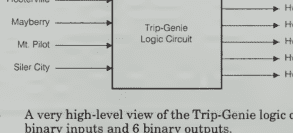

描述逻辑电路的布尔方程作用于二进制值 0 和 1。然而，物理逻辑电路使用电压来表示二进制逻辑值。作为定义 Trip-Genie 输入和输出的一部分，你还需要定义二进制逻辑值与电压之间的对应关系。在本书中，我们将保持简单：将任何小于 0.8 V 的电压赋为逻辑 0，任何大于 2.0 V 的电压赋为逻辑 1。（这些是许多由 5 V 电源供电的数字逻辑系列的标准阈值。）

最后，你必须决定每个给定输入和输出上逻辑 0 或 1 的含义。对于 Trip-Genie，任一输入上的逻辑 1 表示与该输入对应的城市是路线的起点或终点城市。但如果一个输入为 0，则对应的城市不在路线上。对于输出，如果任一输出为逻辑 1，则与该输出对应的公路是起点和终点城市之间最快路线的一部分。如果输出为逻辑 0，则对应的公路不在最快路线上。

### 真值表

现在输入和输出已经定义，你必须确定它们之间的关系，以便写出真值表。这归结为回答一个问题：给定任意两个城市，它们之间的最快路线由哪些公路组成？你可以想象构建一个非常智能的电路，分析一对城市之间的所有可能路径并选出最快的那条。这有点过头了，尤其是在本书靠前的章节中。由于只有四个城市，你可以手动为每种可能的情况找到最快路线。起点和终点城市共有 4 × 3 = 12 种可能的组合，这可以减少到六种组合，因为无论路径的行进方向如何，最快路线都是相同的。图 1.5 显示了六种可能的起点和终点城市组合以及它们之间的最快路线。

Trip-Genie 逻辑的真值表（见表 1.1）可以根据图 1.5 所示的信息来填写。检查图 1.5 中显示的第一条路线，我们可以看到起点和终点城市是胡特维尔和梅伯里。因此，在真值表的第 1 行中，胡特维尔和梅伯里输入的逻辑值设为 1，而派洛特山和赛勒城输入设为逻辑 0。胡特维尔和梅伯里之间的最快路线仅由 1 号公路组成，因此第 1 行中的 Hwy1 输出设为逻辑 1，而 Hwy2 到 Hwy6 输出设为 0，因为相应的公路不在最快路线上。真值表的接下来五行通过对图 1.5 的其余部分应用相同的推理来填写。

表 1.1 的其余 10 行定义了当 Trip-Genie 用户输入的路线端点城市少于或多于两个时会发生什么。在这些情况下，所有输出都保持在逻辑 0，表示出错状态。

### 布尔方程

一旦有了真值表，就必须为每个输出编写一个布尔方程。对于某些输出，例如从未使用过的 Hwy4 和 Hwy5，这非常简单：

```
Hwy4 = 0
Hwy5 = 0
```

对于其他输出，例如 Hwy3，可以首先说明输出在什么条件下将为逻辑 1，从而找到方程：


#### 图 1.5 各城市之间最快的路线。

如果在胡特维尔和赛勒城之间或梅伯里和赛勒城之间沿最快路线旅行，将会使用 3 号公路。

我们可以开始用使用布尔运算的语言替换这句话的片段：

(使用 3 号公路) 如果
(路线的其中一端是胡特维尔 且
另一端是赛勒城)

路线：胡特维尔 -> 1 号公路 -> 梅伯里
时间 = 3

路线：胡特维尔 -> 3 号公路 -> 赛勒城
时间 = 5

路线：胡特维尔 -> 2 号公路 -> 皮洛特山
时间 = 3

路线：梅伯里 -> 1 号公路 -> 2 号公路 -> 赛勒城
时间 = 3 + 5 = 8

路线：梅伯里 -> 1 号公路 -> 2 号公路 -> 皮洛特山
时间 = 3 + 3 = 6

路线：皮洛特山 -> 6 号公路 -> 赛勒城
时间 = 3

#### 表 1.1 Trip-Genie 逻辑的真值表。

| 输入 | | | | 输出 | | | | | |
| Hoot. | May. | Siler | Pilot | Hwy1 | Hwy2 | Hwy3 | Hwy4 | Hwy5 | Hwy6 |
| 1 | 1 | 0 | 0 | 1 | 0 | 0 | 0 | 0 | 0 |
| 1 | 0 | 1 | 0 | 0 | 0 | 1 | 0 | 0 | 0 |
| 1 | 0 | 0 | 1 | 0 | 1 | 0 | 0 | 0 | 0 |
| 0 | 1 | 1 | 0 | 1 | 0 | 1 | 0 | 0 | 0 |
| 0 | 1 | 0 | 1 | 1 | 1 | 0 | 0 | 0 | 0 |
| 0 | 0 | 1 | 1 | 0 | 0 | 0 | 0 | 0 | 1 |
| 0 | 0 | 0 | 0 | 0 | 0 | 0 | 0 | 0 | 0 |
| 1 | 0 | 0 | 0 | 0 | 0 | 0 | 0 | 0 | 0 |
| 0 | 1 | 0 | 0 | 0 | 0 | 0 | 0 | 0 | 0 |
| 0 | 0 | 1 | 0 | 0 | 0 | 0 | 0 | 0 | 0 |
| 0 | 0 | 0 | 1 | 0 | 0 | 0 | 0 | 0 | 0 |
| 1 | 1 | 1 | 0 | 0 | 0 | 0 | 0 | 0 | 0 |
| 1 | 1 | 0 | 1 | 0 | 0 | 0 | 0 | 0 | 0 |
| 1 | 0 | 1 | 1 | 0 | 0 | 0 | 0 | 0 | 0 |
| 0 | 1 | 1 | 1 | 0 | 0 | 0 | 0 | 0 | 0 |
| 1 | 1 | 1 | 1 | 0 | 0 | 0 | 0 | 0 | 0 |

或
(路线的其中一端是梅伯里 且 另一端是赛勒城)。

事实是其他城市不是路线的端点也必须包含在这句话中：

(使用 3 号公路) 如果
(路线的其中一端是胡特维尔 且 另一端是赛勒城 且 梅伯里不是路线的其中一端 且 皮洛特山不是路线的其中一端)
或
(路线的其中一端是梅伯里 且 另一端是赛勒城 且 胡特维尔不是路线的其中一端 且 皮洛特山不是路线的其中一端。)

这句话可以用更代数的记法重新表述。如果一个城市是路线的端点，则其关联的输入设为逻辑 1。如果城市不是路线的端点，则其输入显然设为逻辑 0。如果一条公路是<|message|> 最快路线的一部分，则其关联的输出设为逻辑 1。这给出

(Hwy3 = 1) 如果
(Hooterville = 1 且 Siler City = 1 且 Mayberry = 0 且 Mt. Pilot = 0)
或
(Mayberry = 1 且 Siler City = 1 且 Hooterville = 0 且 Mt. Pilot = 0)

我们将引入一些记号来简化之前的表述。如果一个输入或输出等于逻辑 1，我们将用输入或输出的名称替换等式。另一方面，如果一个输入或输出等于逻辑零，我们将用在其输入或输出名称上画一条线的名称来替换等式。 （这称为 NOT 或反相操作。）例如，

Hwy3 = 1 → Hwy3
Hooterville = 0 → Hooterville̅

我们还将用 =, · 和 + 布尔运算符分别替换单词 IF、AND 和 OR。做出这些更改后最终得到一个布尔方程：

Hwy3 = Hooterville · Siler City · Mayberry̅ · Mt. Pilot̅ + Mayberry · Siler City · Hooterville̅ · Mt. Pilot̅

该方程可以通过提取公共子表达式稍微简化如下：

Hwy3 = (Hooterville · Mayberry̅ + Hooterville̅ · Mayberry) · (Siler City · Mt. Pilot̅)

这就是我们现在能对该方程做的全部简化。你可以在任何数字设计的标准教材中阅读更多关于逻辑最小化技术的内容。我们刚刚进行的过程可以应用于 Hwy1、Hwy2 和 Hwy6，以获得这些输出的布尔方程。

### 门级设计

有了布尔方程，我们就可以为 Trip-Genie 逻辑电路创建门级原理图。我们通过用图 1.6 中所示的逻辑门原理图符号替换布尔方程中的 AND、OR 和反相运算符来实现这一点。NOT 门接收单个二进制输入并在其输出上产生逻辑反相。AND 和 OR 门输出逻辑


AND 或 OR 分别对应其两个输入。NAND 和 NOR 门与 AND 和 OR 门相同，只是它们的输出被反相（这由输出端的“气泡”表示）。

#### 图 1.6 (a) NOT、(b) AND、(c) OR、(d) NAND 和 (e) NOR 布尔运算的逻辑门原理图符号。

当然，说布尔运算符将被替换为原理图符号是一回事，实际操作又是另一回事。作为示例，让我们生成 Hwy3 的布尔方程的原理图。我们首先注意到 Hwy3 输出是两个项的逻辑 AND：

(Hooterville · Mayberry + Hooterville · Mayberry) (1.1)
(Siler City · Mt. Pilot) (1.2)

因此，Hwy3 输出由一个 AND 门产生，该门将前两个项作为其输入（见图 1.7a）。

我们可以继续该过程，注意到式 (1.1) 是 Hooterville · Mayberry 和 Hooterville · Mayberry 的逻辑 OR。因此，可以在图中添加一个 OR 门，该门将这两个项作为输入，其输出连接到第一个 AND 门的一个输入（见图 1.7b）。此外，式 (1.2) 是 Siler City 和 Mt. Pilot 的逻辑 AND。此 AND 门的输出连接到我们第一个 AND 门的另一个输入。

#### (a)

#### (b)

#### (c)

#### 图 1.7 Trip Genie 逻辑中 Hwy3 输出的门级原理图的构建过程。

可以看出 OR 门的输入是 AND 门的输出，因此也可以添加这些门（见图 1.7c）。最后，所有逻辑反相的输入都可以用反相器门替换，如图 1.8 所示。

在本章中，逻辑电路将使用小规模集成芯片（SSI 芯片）构建，这些芯片仅包含少数几个逻辑门。这将使你更好地体会到在后续章节中介绍的可编程逻辑的优势。SSI 芯片自 1960 年代以来就已存在，它们可以执行许多不同的功能。我们只会使用图 1.9 所示的简单 SSI 芯片。（这些是使用较老的晶体管-晶体管逻辑（TTL）技术制造的芯片示例，但互补金属氧化物半导体（CMOS）技术在大多数现代芯片中使用。）每个芯片都包含在一个双列直插式封装（DIP）中，该封装有 14 个引脚，允许你将导线连接到逻辑门的输入和输出，以及电源和地连接。


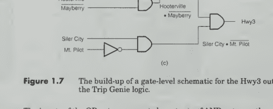

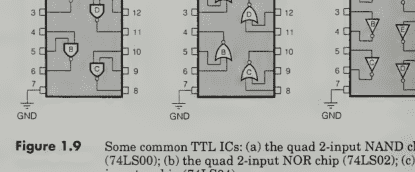

#### 图 1.9 一些常见的 TTL 集成电路：(a) 四路 2 输入 NAND 芯片（74LS00）；(b) 四路 2 输入 NOR 芯片（74LS02）；(c) 六路反相器芯片（74LS04）。

不幸的是，图 1.8 的原理图使用了 AND 和 OR 门，但 TTL 芯片只提供 NAND 和 NOR 门。必须执行适配操作以在不改变设计功能的情况下更改门的类型。在此示例中，可以使用 DeMorgan 定理进行适配，该定理大致说明

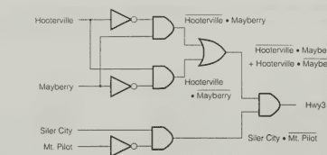

#### 图 1.8 计算高速公路 #3 是否在路线中的 AND-OR-NOT 逻辑原理图。

将 AND 门的所有输入和输出反相使其像 OR 门一样工作。将 OR 门的所有输入和输出反相使其像 AND 门一样工作。

DeMorgan 定理的含义的图示见图 1.10。


#### 图 1.10 DeMorgan 定理。

图 1.11 演示了如何使用 DeMorgan 定理将我们原始原理图中的 AND 和 OR 门替换为 NAND 和 NOR 门。该过程首先用具有反相输入的 NOR 门替换图 1.8 中的最终 AND 门（图 1.11a）。然后可以将该 NOR 门输入端的反相器移回前级 OR 门和 AND 门的输出，以将它们分别转换为 NOR 门和 NAND 门（图 1.11b）。原理图中剩余的两个 AND 门被替换为具有反相输入和输出的 NOR 门（图 1.11c）。现在我们注意到这些 NOR 门中的每一个都接收到一个之前已被反相的输入。这些双重反相器可以被移除。最后，每个 NOR 门的剩余反相输入可以重新绘制为单独的反相器门符号。这给出了图 1.11d 的最终原理图，其中仅包含 NAND 门、NOR 门和反相器。

在构建逻辑电路之前，有意义地检查其操作以确保在所有更改过程中没有引入错误。我们可以通过选择输入模式并追踪它们在电路中传播并到达输出时的效果来进行手动仿真。例如，假设我们选择输入模式，或向量，

- Hooterville = 1
- Mayberry = 0
- Siler City = 1
- Mt. Pilot = 0

这对应于在 Hooterville 和 Siler City 之间选择最快路线的問題。高速公路 3 应该是此路线的组成部分，因此如果将此输入向量应用于逻辑电路，Hwy3 应为逻辑 1。


#### 图 1.11 将图 1.8 中的与-或-非逻辑转换为与非-或非-非逻辑。

图 1.12 显示了图 1.11d 的逻辑电路对刚给出的输入向量的反应。在图 1.12a 中，输入已通过初始反相器并到达第一组与非和或非门。利用图 1.6 中所示的真值表，可以计算出这些与非和或非门的输出（图 1.12b）。继续此过程可得到最终输出（图 1.12c），它表明该电路对于此单一输入模式工作正确。

刚刚描述的步骤必须对逻辑电路的每个输出的每种可能的输入模式重复进行，以验证整个电路。Trip-Genie 有四个二进制输入，因此有 2⁴ = 16 种可能的输入模式。共有六个不同的输出，这意味着我们必须执行 16 × 6 = 96 次仿真追踪。这就是为什么使用计算机进行仿真的原因。

### 构建电路

假设我们已用全部 16 种可能的输入向量检查了 Hwy3 逻辑电路，现在是构建电路的时候了。图 1.13 显示了如何连接 TTL 芯片中的门来构建图 1.11d 所示的电路。

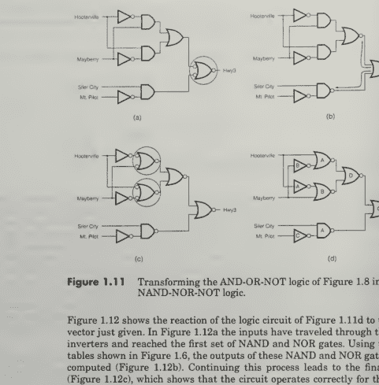

图 1.12 Trip-Genie 逻辑对输入模式的反应。

(a)

(b)

(c)

Hooterville = 1
Mayberry = 0
Siler City = 1
Mt. Pilot = 0
Hwy3 = ???

Hooterville = 1
Mayberry = 0
Siler City = 1
Mt. Pilot = 0
Hwy3 = ???

Hooterville = 1
Mayberry = 0
Siler City = 1
Mt. Pilot = 0
Hwy3 = 1

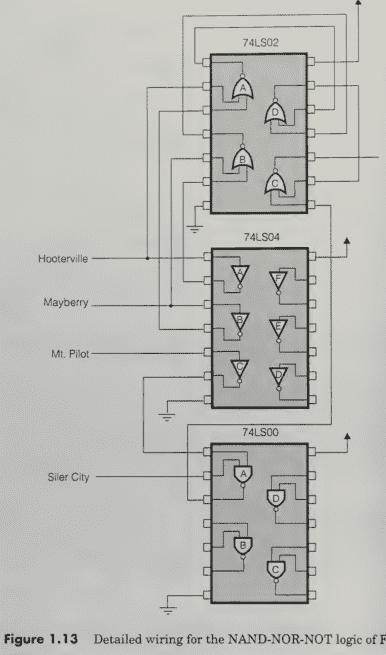

**图 1.13** 图 1.11 的与非-或非-非逻辑的详细布线。

图 1.14 显示了该电路在无焊面包板上实际构建时的外观。无焊面包板提供了一个“孔洞之海”，芯片和导线可以插入其中以建立连接。面包板内部的孔洞连接方式如下：

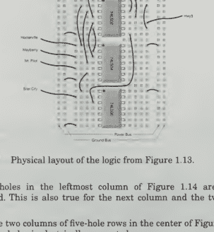

图 1.14 图 1.13 逻辑的物理布局。

- 1. 图 1.14 中最左侧一列的所有孔在电气上是连通的。对于下一列和最右侧的两列也是如此。
- 2. 图 1.14 中央有两个由五孔行组成的列。每行五个孔在电气上是连通的。

布线电路的步骤应按以下顺序完成：

- 1. 在开始构建任何东西之前，先关闭电源。
- 2. 在开始构建任何东西之前，确保电源已关闭。
- 3. 将电源的 +5 V 和地线连接到面包板的电源和地总线。 （这些是面包板的最左侧和最右侧列。）
- 4. 将要使用的芯片插入面包板。将所有芯片指向同一方向，1 脚位于左上角。 （1 脚通常在芯片封装上用一个点标出。）

5. 将每个芯片的 +5 V 和 GND 引脚连接到面包板上的电源和地总线。

6. 在原理图上选择一个连接，并确定芯片上的起始和结束引脚。然后在面包板上相应的芯片引脚之间放置一根 22 至 26 号的连接导线。导线的一端应插入包含起始引脚的行中的四个剩余孔之一。另一端应插入包含结束引脚的行中。 （记住在插入之前剥去导线末端的绝缘层。）通常最好先制作短连接，然后再添加较长的导线。在进行过程中，在原理图上突出显示每个连接，以免忘记并在以后再次制作相同的连接。并保持布线整洁且靠近面包板。最糟糕的事情莫过于不小心勾到一根长导线并将其从面包板上拉出，然后无法确定它应重新插入的位置。记住：先做短连接，保持整洁，并突出显示你已连接的内容。

### 调试电路

一旦电路构建完成，调试就开始了。这涉及在输入上放置一组逻辑 1 和 0 的模式，并用逻辑探针观察输出。在图 1.15 中，用于图 1.12 仿真的输入向量已放置在电路的输入上，通过将 Hooterville 和 Siler City 输入连接到 +5 V，同时将 Mt. Pilot 和 Mayberry 输入连接到地来实现。逻辑探针接触到 74LS02 的 10 脚，即 C 或非门的 Hwy3 输出。该引脚应具有对应于逻辑 1 的高电压，但探针检测到低电压，即逻辑 0。

显然，电路中存在某些错误。因此，我们必须从输出向后追踪以找到错误。我们首先检查 C 或非门的输入。探测由 A 与非门驱动的输入（74LS02 的 8 脚）显示逻辑 0，这与之前的仿真（图 1.16）一致。探测由 D 或非门驱动的 C 或非门的另一个输入显示逻辑 1，而不是正确的逻辑 0 电平（图 1.17）。因此，我们回溯并直接探测 D 或非门的输出，发现它确实是高的（图 1.18）。继续追踪到由 B 或非门驱动的 D 或非门的输入，我们发现逻辑 0，而它应该是逻辑 1（图 1.19）。直接探测 B 或非门的输出显示它为低而不是高（图 1.20）。当我们开始探测 B 或非门的输入时，我们可以看到一个明显的错误——连接反相器 A 输出到 B 或非门输入的导线丢失了。让 TTL 门的输入未连接会使其浮动到逻辑 1 电平。这会导致 B 或非门的输出变为低，并通过电路的其余部分传播，从而产生错误的结果。


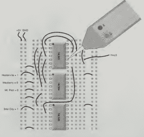

**图 1.15** 测试 Trip-Genie 逻辑电路的 Hwy 3 输出。输出为低电平（逻辑 0），而它应该是高电平（逻辑 1）。

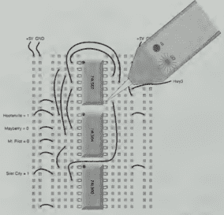

**图 1.16** 通过回溯调试电路以查找错误。来自 A NAND 门到 C NOR 门的输入是正确的。

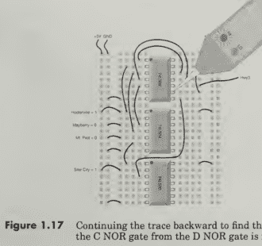

**图 1.17** 继续回溯查找错误，来自 D NOR 门到 C NOR 门的输入是不正确的。

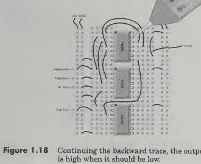

**图 1.18** 继续回溯，D NOR 门的输出为高电平，而它应该是低电平。

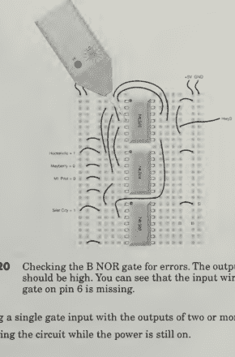

**图 1.20** 检查 B NOR 门是否存在错误。输出为低电平，而它应该是高电平。你可以看到连接到 B NOR 门 6 号引脚的输入导线是缺失的。

- 5. 用两个或多个门的输出驱动单个门输入
- 6. 在电源仍开启的情况下修改电路。

### 项目

- 1. 设计 Trip-Genie 其他输出的逻辑电路。
- 2. 搭建 Hwy1 输出的逻辑电路并测试其工作情况。
- 3. 在你看不见的情况下，让实验室搭档从你的 Hwy1 电路中拔掉一根导线。然后通过调试过程检测问题。

### 可编程逻辑设计技术

### 目标

- 讨论使用可编程逻辑设计的优点。
- 讨论可编程逻辑的演变。
- 介绍使用 XILINX Foundation Series 1.5 软件工具进行可编程逻辑设计。

### 讨论

#### 计算机辅助设计和可编程逻辑的优点

你可以使用 SSI 和中规模集成 MSI IC 搭建多达数百个门的数字电路。正如你在上一章看到的，这些 IC 通常插入面包板中，并使用 22 或 24 号接线导线在它们之间进行连接。然后开关和 LED 分别连接到输入和输出，电路被测试以查看其是否正常工作。正如你可能已经意识到的，这种搭建电路的方法有很多问题：

- 剪切和剥线以在 IC 之间建立连接非常耗时。
- 导线经常插到错误的位置，因此必须进行长时间检查以找到错误，才能使电路工作。
- 在预算有限的情况下，你可能没有每种类型的 TTL IC 立即可用。
- 一旦你的电路工作正常，你就必须将其拆开以腾出空间给下一个设计。将之前搭建的电路作为当前设计的一部分使用是困难的。

除了物理搭建电路所涉及的问题外，你在设计电路时也被迫使用原始的工具。对于组合电路，你从真值表开始，并通过观察或形式化逻辑最小化技术从中推导出高效的逻辑电路。对于包含内部状态信息的时序电路，你必须额外执行创建状态转换表和进行状态分配的步骤（你将在第 7 章看到）。手动执行所有这些步骤时，很容易出错。对电路操作的手动仿真通常是不完整的，因此当电路最终搭建好却无法正常工作时，你会发现额外的（可能严重的）错误。

从事实践的工程师在设计和搭建电路时使用完全不同的流程。他们可能仍然从逻辑电路的真值表或状态转换图开始描述。但随后，实现真值表所需的逻辑电路细节由逻辑综合程序来处理。该逻辑电路的操作使用仿真程序进行检查。如果电路仿真正确，门和导线就会被映射到现场可编程门阵列 FPGA 或复杂可编程逻辑器件 CPLD IC 中，使用专门的 place&route 或 fitter 程序。（我们将 FPGA 和 CPLD 合并为通用术语现场可编程逻辑器件 FPLD。）FPLD 包含逻辑门和在单个集成电路内互连它们的手段。软件程序确定器件中的门如何连接以构建逻辑电路。程序的输出是一个位流配置文件，被下载到 FPLD 中，使其表现得像逻辑电路一样。然后编程后的 FPLD 可以放置到更大的电路中，在其中执行其功能（可能经过一些调试之后）。请注意，图 2.1 中的常规机械性工作已被自动化，并由计算机辅助设计 CAD 程序和 FPLD 为工程师完成。

廉价的计算机和软件现在让我们其余的人也能利用计算机辅助设计程序和 FPLD 来消除搭建数字电路的繁琐工作。这使我们能够更专注于逻辑设计的创造性部分。你可以使用文本编辑器用硬件描述语言 HDL 编写逻辑程序，或使用原理图编辑器绘制电路。HDL 或原理图由 CAD 程序编译，以创建执行你在程序中指定的操作的详细逻辑电路。PC 上的程序仿真电路以确保其正常工作。然后设计通过 PC 的并口下载到 FPLD 中，在那里可以进行调试。

总之，使用 CAD 程序和 FPLD 允许你：

- 由于手动布线最少，设计构建速度更快。
- 避免因布线错误而导致的失误。
- 将设计以电子文件形式保存任意长时间，并在需要时随时调取。
- 在无需在你的供应柜中储备它们的情况下尝试许多类型的芯片。


- 避免或轻松纠正设计错误。
- 由于繁琐的手工流程被自动化，可以设计更大规模的项目。

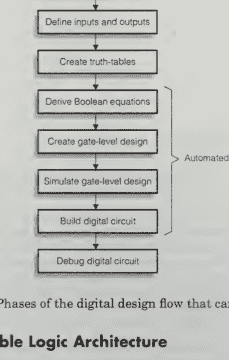

Figure 2.1 Phases of the digital design flow that can be automated.

### Programmable Logic Architecture

自然会问 FPGA 和 CPLD 芯片如何通过电子方式编程以执行任何可能的逻辑功能。这些器件实际上是从 20 世纪 70 年代初期的 PLA™（可编程逻辑阵列）器件演变而来的。基本 PLA 结构如图 2.2 所示，由一堆 AND 门、OR 门和反相器通过一些可编程开关阵列相互连接而成。在 PLA 中，每个输入及其逻辑反相都送入水平线上的 AND 阵列。AND 阵列中的垂直线是 AND 门行 的输入。AND 门通过将水平线和垂直线连接在一起接收输入信号（在 AND 阵列中用黑色圆点表示）。因此，最左边的 AND 门接收 C 信号的逻辑反相并将其与 A 信号相与。

OR 阵列的功能与 AND 阵列类似。垂直线将 AND 门的输出送入 OR 阵列。在那里它们可以连接到水平线，而水平线是 OR 门列的输入。通过

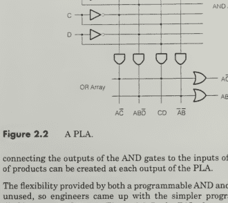

#### Figure 2.2 A PLA.

将 AND 门的输出连接到 OR 门的输入，可以在 PLA 的每个输出处产生积之和。

由可编程 AND 和 OR 阵列提供的灵活性通常未被充分利用，因此工程师提出了如图 2.3 所示的更简单的可编程阵列逻辑（PAL）结构。在 PAL 中，可编程 OR 阵列已被替换为从 AND 门到 OR 门的一组固定连接。因此你可以编程开关以形成你想要的任何乘积项。但每个 OR 门的输出被固定为仅为两个乘积项之和（在此示例中）。此外，PAL 输出会反馈到 AND 阵列。反馈项用于构建多级逻辑函数。

PAL 和 PLA 适用于组合逻辑，但如果不添加外部触发器，就不能用于时序逻辑。（如果你还不知道触发器是什么，你将在第 6 章中了解到。）因此，自然地，触发器被添加到 PAL 结构中，如图 2.4 所示。此时，该电路被称为 SPLD（简单可编程逻辑器件）。在每个输出处添加多路复用器以选择触发器输出或组合输出作为实际输出。驱动每个输出的 AND 门、OR 门、触发器和多路复用器统称为宏单元。现代 SPLD 具有多种可编程电路结构，并提供许多可启用的选项以提高芯片的实用性。

PLA、PAL 和 SPLD 仍需放置在印刷电路板上并与其他组件互连。如果板上发现小错误，板上的可编程逻辑器件可以用重新编程的器件替换，以“绕过”问题。然而，大错误只能通过手动更改连接芯片的布线模式来纠正。

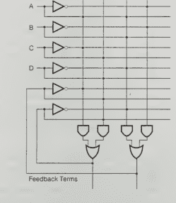

**Figure 2.3**  A PAL.

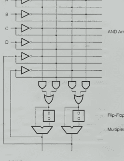

**Figure 2.4**  A SPLD.

#### Discussion

工程师很快就通过将多个 SPLD 组合成单个 IC 来解决这个问题，从而创建了复杂可编程逻辑器件（CPLD）。XILINX XC9500 系列 CPLD 就是此类 CPLD 的一个例子（图 2.5）。例如，XC95108 包含六个可配置功能块（CFB），每个 CFB 等效于一个具有 36 个输入和 18 个输出的 18 宏单元 SPLD。宏单元的输出通过 I/O 引脚离开芯片，但它们也会反馈到一个全局互连矩阵（XILINX 称之为“FastCONNECT Switch Matrix”）。每个 CFB 从进入开关矩阵的 6 × 18 = 108 个宏单元反馈信号中接受 36 个输入。通过编程每个 CFB 中每个宏单元的各个逻辑功能，然后通过开关矩阵连接它们，可以构建非常复杂的多级逻辑函数。其结果是一种设计，其中 CPLD 上的每个引脚都由一个宏单元驱动，该宏单元实现由许多输入组合构成的宽逻辑函数。

另一种架构见于现场可编程门阵列（FPGA）。FPGA 的基本构建块是查找表或 LUT（图 2.6）。典型的查找表只有四个输入和一个包含 16 位的小型存储器。将二进制组合应用于输入（例如 0110）将匹配特定存储器位的地址并使其输出其值。任何四输入逻辑函数都可以通过用适当的位编程查找表存储器来构建。例如，四输入 AND 门是通过将整个存储器加载为 0 位来构建的，除了在所有输入都为 1 时被激活的单元中放置一个 1 位。

在 XILINX XC4000 系列等 FPGA 中，三个 LUT 与两个触发器和一些额外的转向电路组合形成可配置逻辑块（CLB），如图 2.7 所示。然后 CLBs 以阵列形式排列，CLB 之间有可编程开关矩阵（PSM）（图 2.8）。PSM 类似于 XC9500 CPLD 中的 FastCONNECT 开关矩阵，用于将邻近 CLB 的输出路由到 CLB 的输入。FPGA I/O 引脚可以连接到 PSM 和 CLB，甚至可以连接到它们自己的大型路由矩阵。大多数 FPGA 的 CLB 数量远多于 I/O 引脚，因此每个 CLB 不能像 CPLD 中的宏单元那样直接连接到外部世界。例如，XILINX XC4006XL FPGA 在 14 × 14 阵列中有 196 个 CLB，但在 84 引脚塑料引线芯片载体（PLCC）封装中只有 64 个 I/O 引脚。

现在逻辑的问题是，“所有这些开关是如何设置的以在可编程器件中建立连接？” PLA、PAL、SPLD、CPLD 和 FPGA 中的所有布线都在 IC 内部，因此工程师无法物理进入并将连接接线在一起。相反，连接是通过电方式编程的。在可编程逻辑的早期版本中，开关阵列在每个交叉点都制造有熔丝，使得每个输入都连接到每个逻辑门。添加了专用电路，允许工程师在选定的垂直和水平线上施加高电压。


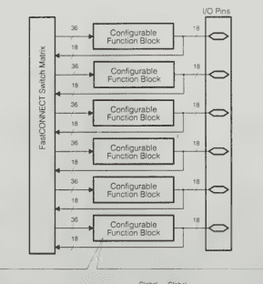

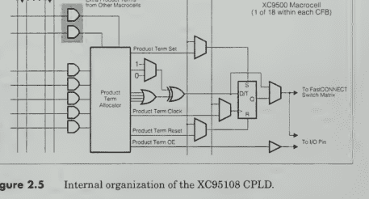

#### Figure 2.5 Internal organization of the XC95108 CPLD.

高压烧断了两根导线交叉点处的保险丝。工程师多次执行此操作以敲除所有不需要的连接。在编程过程结束时，只会保留构建所需逻辑功能所需的连接。

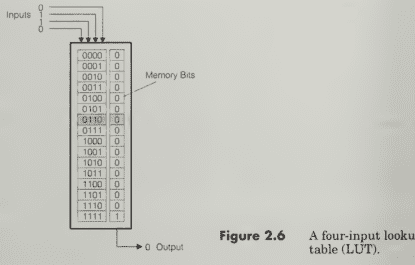

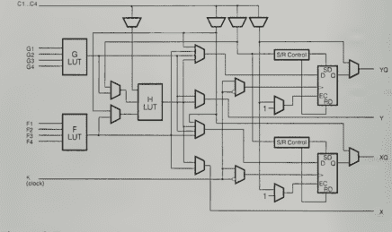

保险丝的缺点是一旦熔断就永久熔断。因此如果出现错误，可编程器件必须被丢弃并用新的器件重新编程。如果连接可以被擦除并重新编程会更方便也更便宜。XILINX XC9500 和 XC4000 可编程逻辑系列的主要优势就在于此：它们包含可重编程开关，正常情况下此处应为保险丝。每个开关都由一个存储单元控制，该单元记录所连接开关是打开还是关闭。改变这些存储单元中的值会改变开关的状态并改变可编程器件的功能。这些开关可以反复编程以实现新的设计或修复有缺陷的设计，从而无需为每次设计修改购买新器件。XC9500 CPLD 使用非易失性 FLASH 基存储单元，因此即使断电设备也能保留其编程。而 XC4000 FPGA 采用静态随机存取存储器 RAM 存储单元，因此每次断电后都需要重新编程。

现在问题出现了，“我如何告诉 FPLD 连接哪些导线？” 在下一节中，我将向你展示如何使用 XILINX Foundation Series 1.5 软件工具创建可下载到 XC95108 CPLD 和 XC4005XL FPGA 的逻辑设计。

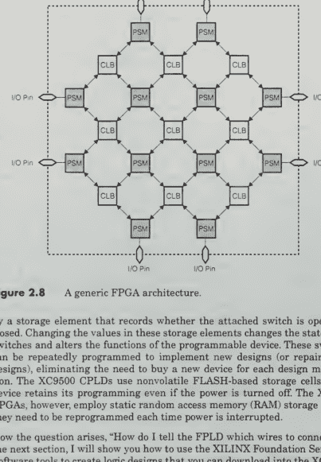

#### Figure 2.8 A generic FPGA architecture.

由一个存储单元控制，该单元记录所连接开关是打开还是关闭。改变这些存储单元中的值会改变开关的状态并改变可编程器件的功能。这些开关可以反复编程以实现新的设计或修复有缺陷的设计，从而无需为每次设计修改购买新器件。XC9500 CPLD 使用非易失性 FLASH 基存储单元，因此即使断电设备也能保留其编程。XC4000 FPGA 采用静态随机存取存储器 RAM 存储单元，因此每次断电后都需要重新编程。

现在问题出现了，“我如何告诉 FPLD 连接哪些导线？” 在下一节中，我将向你展示如何使用 XILINX Foundation Series 1.5 软件工具创建可下载到 XC95108 CPLD 和 XC4005XL FPGA 的逻辑设计。

#### Experimental

### The Programmable Logic Design Flow

XILINX 的 Foundation Series 软件是用于创建描述逻辑设计的程序的环境。使用 Foundation 时，你的主要设计流程如下所示，如图 2.9 所示：

- 1. 数字设计使用原理图编辑器、状态机编辑器输入，或通过 HDL 文本编辑器编写 ABEL 或 VHDL 程序。你可以用其中一种或多种方法混合描述设计。

- 2. 功能仿真器检查编译后设计的运行情况，并让你查看结果以确认其是否按预期工作。如果发现任何错误，你可以返回并编辑 ABEL 或 VHDL 文件、原理图和/或状态机图。

- 3. Foundation Implementation 工具将门和连接的列表，或网表，编译成用于编程 FPLD 的位流。在此步骤中会指定特定器件，例如 XC95108 或 XC4006XL。对于 XC9500 器件，适配器算法将网表映射到 CPLD 架构。对于 XC4000 器件，实现需要将电路映射到 FPGA 架构，将门放置在特定的 CLB 中，然后使用 PSM 进行布线。

- 4. 在 Foundation Implementation 工具确定了特定映射到 FPLD 架构的门和布线延迟后，可以运行设计的时序仿真。

- 5. XSLOAD 程序用于将位流下载到 XS95 板或 XS40 板中，参见附录 A 获取这些板子的描述。

- 6. 调试通过并行端口电缆向 XS95 或 XS40 板强制输入来执行。板上的 7 段 LED 显示 FPLD 的响应。

以下各节将描述这些步骤。作为修改后设计流程的入门示例，我们将重建第 1 章中 Trip-Genie 的 Hwy3 逻辑设计。由于规范和 I/O 步骤保持不变，我们可以从设计输入步骤开始。

XILINX Foundation 1.5 Series 软件有两个不同的设计流程：

原理图模式用于你的顶层设计使用原理图、状态图或 ABEL 描述的情况。

HDL 模式用于你的顶层设计使用 VHDL 描述的情况。

我们将展示如何使用这两种设计流程构建 TripGenie。


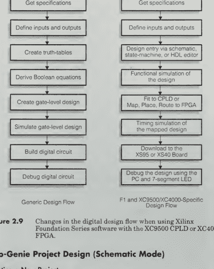

通用设计流程

F1 和 XC9500/XC4000 特定设计流程

图 2.9 使用 Xilinx Foundation 系列软件配合 XC9500 CPLD 或 XC4000 FPGA 时数字设计流程的变化。

### Trip-Genie 项目设计（原理图模式）

#### 开始新项目

在上一章中，我们可以通过拿一张空白纸并清除面包板上的旧电路来开始新的设计。在修改后的设计流程中，我们在启动 Foundation 并创建新项目时执行等效操作。

首先，为所有项目创建一个主目录。 （在我这里，我将所有原理图模式设计放在 C:\XCPROJ 中。）然后单击 Foundation Project Manager 图标。这将弹出如图 2.10 所示的窗口。

#### 图 2.10 Foundation Series 1.5 Project Manager 主窗口。

显示了 New Project 子窗口。 （您也可以通过选择 File → New Project 菜单项来调出此子窗口。）然后，输入项目名称、项目目录、设计流程类型、芯片系列、芯片型号和器件速度，针对 XC95108 CPLD 或 XC4005XL FPGA，如图所示。在图 2.10 中，我创建了一个名为 TRIPG_95 的项目，位于目录 C:\XCPROJ，目标为 84 引脚 PLCC 封装的 XC95108 CPLD 和最慢速度。 （您也可以在目录 C:\XCPROJ 中创建一个名为 TRIPG_40 的项目，目标为 84 引脚 PLCC 封装的 XC4005XL FPGA 和最慢速度。）我还单击了 Schematic 单选按钮以选择 Foundation 系列软件的原理图设计流程模式。然后单击 OK 返回 Project Manager 窗口。

现在您的窗口应与图 2.11 完全相同。Project Manager 窗口中有三个主要窗格。左侧窗格在 Files 选项卡中显示设计的源文件和库，而 Versions 选项卡显示 XILINX Foundation 软件为设计的所有版本生成的设计实现文件。右侧窗格具有用于控制设计流程各阶段所用工具激活的 Flow 选项卡、显示项目中文件状态的 Contents 选项卡、列出工具在工作时生成的报告文件的 Reports 选项卡，以及用于激活设计中各种 HDL 宏的逻辑综合器的 Synthesis 选项卡。底部窗格列出 Foundation 软件在处理设计文件时输出的诊断消息。目前，您将花费大部分时间在左侧和右侧窗格的 Files 和 Flow 选项卡中工作。

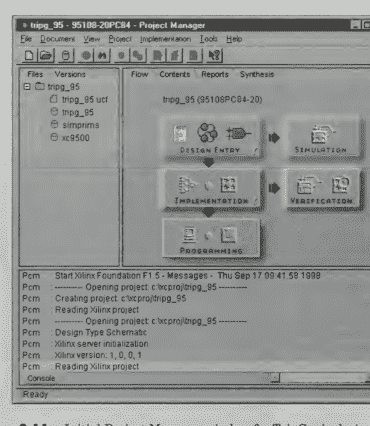

图 2.11 TripGenie 设计的初始 Project Manager 窗口（原理图设计流程）。

### 使用 ABEL 硬件描述语言输入设计

在本节中，我将向您展示如何使用 ABEL HDL 输入 Trip-Genie 的 Hwy3 输出设计。 （请转到下一节查看如何使用原理图编辑器输入设计。）ABEL 是一种简单的设计语言，随着可编程逻辑从 PAL、PLA 和 SPLD 发展到 FPLD 而成熟演进。

在 Project Manager 窗口中，选择“Tools → Design Entry → HDL Editor” （或单击 Project Manager 窗口 Flow 选项卡中的按钮）。在出现的窗口中，单击标记为 Use HDL Design Wizard 的单选按钮，然后单击 OK。然后在出现的 Design Wizard 窗口中单击 Next，以到达 Design Wizard-Language 窗口。在此处，选择 ABEL 单选按钮并单击 Next 以移动到 Design Wizard-Name 窗口。输入 TRIPGENI 作为名称并单击 Next。

现在我们应该在 Design Wizard-Ports 窗口中，在此指定设计的输入和输出（图 2.12）。要添加输入，单击 New，然后在 Name 字段中输入 Hooterville（例如）。单击 Input 单选按钮将端口设置为输入。对 Mayberry、SilerCity 和 MtPilot 输入重复这些步骤。

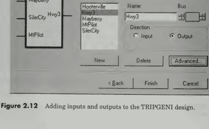

图 2.12 向 TRIPGENI 设计添加输入和输出。


要添加电路的输出，请单击 New（新建），在 Name（名称）字段中输入 Hwy3，然后选择 Output（输出）单选按钮。接着单击 Advanced（高级）按钮，打开 Advanced Port Settings（高级端口设置）窗口。单击 Combinatorial（组合）单选按钮，再单击 OK（确定）按钮。现在所有输入和输出都已定义，单击 Finish（完成）按钮即可。

此时，将出现一个 HDL 编辑器窗口（图 2.13），其中包含 Trip-Genie 逻辑的框架。你应该会在文件顶部看到模块名称和标题。接下来是输入引脚以及我们之前添加的一个组合输出引脚的声明。再往文件下方，是专门用于逻辑方程的部分。我们只需输入上一章中为 Hwy3 输出推导出的布尔方程。该方程输入在第 17 行和第 18 行，如下所示：

```
Hwy3 = (Hootersville & !Mayberry # (Hootersville & Mayberry) & (SilerCity & !MtPilot);
```

我们使用 ABEL 运算符来表示以下布尔运算：

| 布尔运算 | ABEL 运算符 |
|---|---|
| 与（AND） | & |
| 或（OR） | # |
| 非（NOT） | ! |

现在我们需要检查一下，以确保没有犯下简单的错误。选择 Synthesis → Check Syntax 菜单项。此时会弹出一个小窗口，提示正在检查 ABEL 代码中是否存在错误。几秒钟后，该窗口会被另一个显示 Check Successful（检查成功）的窗口取代。单击此窗口中的 OK（确定）按钮。

（当你第一次开始使用 ABEL 设计自己的电路时，很可能会遇到语法错误。每个错误都会在 HDL 编辑器窗口中高亮显示，错误信息会出现在窗口底部。通过选择 Tools → Language Assistant 菜单项，可以获得无错误的 ABEL 代码示例。此时会出现一个 Language Assistant-ABEL 窗口，左侧列出主题。单击 + 符号可逐级展开到特定主题。单击某个主题后，该主题的 ABEL 代码示例就会出现在窗口右侧。你可以将示例剪切并粘贴到自己的代码中，然后针对自己的特定设计进行编辑。）

一旦确认没有语法错误，我们就可以从 ABEL 代码生成网表。网表是将 ABEL 代码提炼为一组逻辑门以及它们之间连接的结果。首先，单击 Synthesis → Options... 菜单项。在出现的 ABEL6 窗口中，单击 Chip（芯片）单选按钮，然后点击 OK（确定）。这将指示综合器创建一个网表

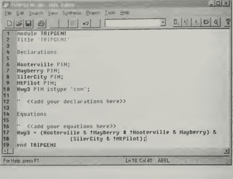

#### 图 2.13 已填入 Trip-Genie ABEL 代码框架的 HDL 编辑器窗口。

用于独立设计。（Macro（宏）单选按钮用于 ABEL 代码所描述的电路被用作更大设计的一部分时。）然后点击 Synthesis → Synthesize 菜单项，开始编译过程。此时会出现一个小弹出窗口，提示 ABEL 代码正在被综合。不到一分钟，该窗口就会被另一个显示 Synthesis Successful（综合成功）的窗口取代。单击此窗口中的 OK（确定）按钮。现在，Trip-Genie 的 Hwy3 输出的网表已经生成。

设计输入现已完成，请在 HDL 编辑器窗口中选择 File → Save。然后选择 File → Exit。

返回 Project Manager 窗口后，我们必须将 TRIP-GENI.ABL 文件纳入项目。选择 Document → Add... 菜单项，并在对话框窗口中列出类型为 ABEL (*.ABL)¹ 的项。选中 TRIPGENI.ABL 并单击 Open（打开）。然后你应该会在组成 TRIPGENI 项目的文件列表中找到 TRIPGENI.ABL（图 2.14）。

1. 如果你想避免重新输入所有内容，可以从随书附带的 CD-ROM 中获取本书的所有设计示例。

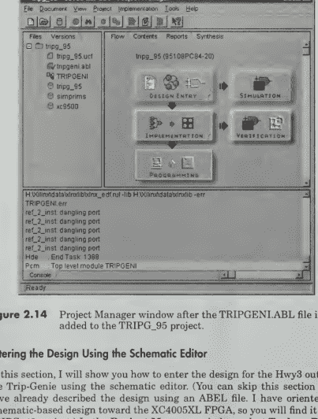

#### 图 2.14 将 TRIPGENI.ABL 文件添加到 TRIPG_95 项目后的 Project Manager 窗口。

### 使用原理图编辑器输入设计

在本节中，我将向你展示如何使用原理图编辑器输入 Trip-Genie 的 Hwy3 输出设计。（如果你已经使用 ABEL 文件描述了设计，可以跳过本节。这个基于原理图的设计针对的是 XC4000XL FPGA，因此你会在 TRIPG_40 项目中找到它。）在 Project Manager 窗口中，选择 Tools → Design Entry → Schematic Editor...（或单击 Project Manager 窗口的 Flow（流程）选项卡中的按钮），此时会出现一个原理图编辑器窗口。然后使用 File → Save As... 菜单项将原理图命名为 TRIPGENI.SCH。

我们需要做的第一件事是为 Hwy3 电路添加门电路。选择 Mode → Symbols 菜单项（或单击该按钮），屏幕会出现 SC Symbols 窗口，其中列出我们可以使用的所有组件类型。我们


将使用第 1 章中的以下布尔方程作为我们电路的基础：

```
Hwy3 = (Hooterville · Mayberry + Hooterville · Mayberry)\n       (Siler City · Mt. Pilot)
```

该方程需要四个 2 输入与门、一个 2 输入或门和 3 个反相器。滚动 SC 原理图窗口中的组件列表，直到找到 AND2。点击 AND2 进行选择，然后将光标移入原理图绘制区域。你会看到 2 输入与门的符号附着在光标上。只需点击即可将与门放置到绘制区域。你可以通过再次点击刚刚放置的与门，将另一份与门的副本附着到光标上。然后也可以将新的与门放置到原理图上。重复此过程两次，得到如图 2.15 所示的原理图。2 输入或门（OR2）和三个反相器（INV）也可以以类似方式添加。

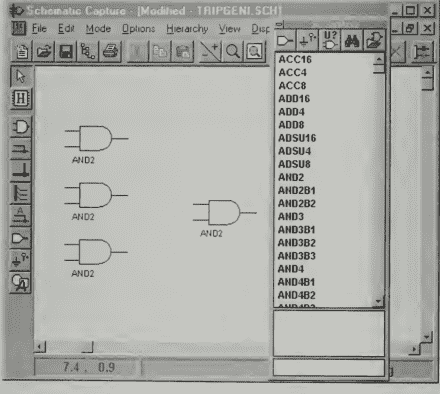

图 2.15 在原理图编辑器窗口中放置与门。

我们还需要将输入和输出引入电路。为此，点击 SC 符号窗口工具栏左上角的按钮。会出现一个对话框窗口，可在其中输入每个输入或输出的名称和类型。首先，按图 2.16 所示输入 Mayberry 输入的信息。点击确定，一个输入端子符号将被附着到你的光标上。只需点击鼠标即可将端子放置到你的原理图中。然后以相同方式添加其他 3 个输入。最后，可以以相同方式添加 Hwy3 输出，唯一变化是选择 OUTPUT 作为端子类型。

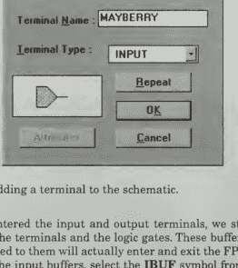

图 2.16 向原理图添加端子。

虽然我们已输入输入和输出端子，但仍需要在端子与逻辑门之间添加缓冲器。这些缓冲器表示附着在其上的信号将实际通过 I/O 引脚进入和退出 FPLD 芯片。要添加输入缓冲器，从 SC 符号窗口选择 IBUF 符号并将其放置在每个输入端子附近。然后选择输出缓冲器符号 OBUF 并将其放置在输出端子附近。此时，你对门、端子和缓冲器的放置应类似于图 2.17。

现在我们已拥有所需的所有组件，可以双击 SC 符号窗口左上角将其关闭。下一步是连接门。选择 Mode → Draw Wires 菜单项开始该过程。然后点击最上方与门的输出，接着点击或门的上面输入。会出现一条线连接输出到输入，如图 2.17 所示。

#### 图 2.17 在原理图编辑器窗口中连接门。

你可以继续以此方式操作，直到所有门按布尔方程要求连接好。记住仅将输入和输出端子分别连接到 IBUF 和 OBUF 符号。使用 IBUF 的输出驱动逻辑门的输入，并将唯一的 OBUF 的输入连接到最终与门的输出。完成的原理图如图 2.18 所示。

#### 图 2.18 完成的原理图。

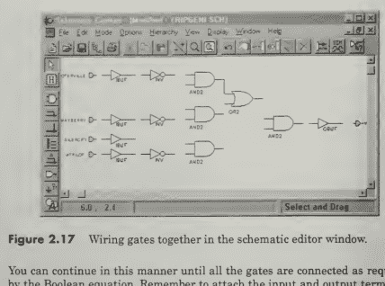

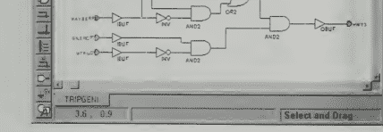

原理图完成后，我们需要检查其是否存在错误。首先，选择 Options → Create Netlist。这将激活一个程序，该程序检查我们的原理图绘制并生成一个机器可读的网表，描述使用了哪些类型的门以及它们如何相互连接。完成后，选择 Options → Integrity Test 以启动对网表的错误检查。检查应表明原理图中没有错误。然后使用 File → Save 菜单项保存原理图。

由于没有错误，我们可以继续导出设计的网表。网表由原理图生成，包含逻辑门及其连接之间的机器可读列表。网表必须以其他工具（如仿真器）能够理解的格式导出。首先，点击 Options → Export Netlist... 菜单项。会出现一个导出网表窗口（图 2.19）。在网表格式选择框中选择 EDIF 200 [*EDN]。 （EDIF 200 是 Foundation 工具的标准网表格式。）点击打开按钮。几秒钟内，进度将在弹出窗口中显示，因为原理图编辑器的内部网表格式被导出为 EDIF 200 并存储到 TRIPG_40.ALB 文件中。

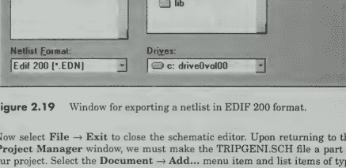

图 2.19 用于以 EDIF 200 格式导出网表的窗口。

现在选择 File → Exit 关闭原理图编辑器。返回项目管理器窗口后，我们必须将 TRIPGEN1.SCH 文件作为项目的一部分。选择 Document → Add... 菜单项并在对话框窗口中列出类型为 Schematic (*.SCH) 的项目。突出显示 TRIPGEN1.SCH 并点击打开。你应该然后在构成 TRIPG_40 项目的文件列表中看到 TRIPGEN1.SCH（图 2.20）。


**图 2.20** 将 TRIPGEN1.SCH 文件添加到 TRIPG_40 项目后的项目管理器窗口

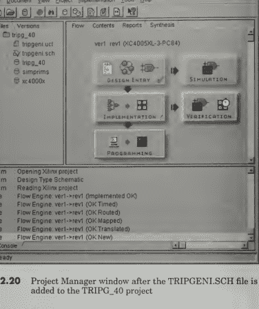

### 设计的功能仿真

此时，我们已经输入了 Trip-Genie 的 Hwy3 输出的逻辑。现在最好使用功能仿真器来查看我们输入的内容是否工作正确。

通过点击项目管理器窗口 Flow 选项卡中的按钮启动功能仿真器。这将打开 Logic Simulator - Xilinx Foundation F1.5 窗口以及一个单独的、空的 Waveform Viewer 窗口（图 2.21）。

我们必须做的第一件事是将 Hwy3 逻辑电路的输入和输出添加到 Waveform Viewer 中，以便在电路仿真时可以看到发生了什么。方法是选择 Signal → Add Signals... 菜单项。

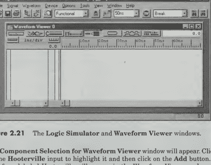

**图 2.21** Logic Simulator 和 Waveform Viewer 窗口。

Component Selection for Waveform Viewer 窗口将会出现。点击 Hooterville 输入以突出显示它，然后点击 Add 按钮。Waveform Viewer 中会出现一个标记为 Hooterville 的波形，并且所选信号旁边会出现一个红色复选标记（图 2.22）。我们可以对 Mayberry、SilerCity 和 MtPilot 输入以及 Hwy3 输出重复此操作。然后点击 Close 按钮。

**图 2.22** 向 Waveform Viewer 添加信号。

现在输入和输出已显示，但没有任何有趣的事情发生，因为所有输入都设置为逻辑 0。我们需要向电路施加激励，因此自然地选择 Signal → Add Stimulators... 菜单项。这会打开 Stimulator Selection 窗口（图 2.23）。这个东西里有令人害怕的许多按钮，但我们只对一个项目感兴趣：一个标记为 Bc 的 16 位二进制计数器。在仿真期间，该计数器的最右边的 4 位将经历以下序列：0000、0001、0010、0011、0100、0101、0110、0111、1000、1001、1010、1011、1100、1101、1110、1111。我们可以通过将逻辑电路的 4 个输入连接到计数器的这些位来完全测试我们的 Hwy3 电路对每种可能的输入组合的响应。方法是点击 Waveform Viewer 窗口中输入的名称，然后点击 Stimulator Selection 窗口 Bc 部分中的一个位圆圈。连接到电路输入的计数器位的标签将出现在 Waveform Viewer 中输入名称的右侧。一旦所有输入都连接到计数器位，我们就可以点击 Close 离开 Stimulator Selection 窗口。以下是我的连接设置：

| Input | Counter bit |
| --- | --- |
| Hooterville | B3 |
| Mayberry | B2 |
| SilerCity | B1 |
| MtPilot | B0 |

**图 2.23** Stimulator Selection 窗口。

现在我们需要设置一个控制仿真速度的参数。首先，选择 Options → Preferences... 菜单项。然后在 Preferences 窗口（图 2.24）中，将二进制计数器 B0 位的频率设置为 50 MHz。然后点击 OK。

**图 2.24** 设置仿真控制参数的窗口。

现在我们可以运行仿真。在 Logic Simulator 窗口工具栏中的小下拉菜单中将仿真模式设置为 Functional。这表示我们正在进行功能仿真，仅检查电路的逻辑操作，而忽略由电路物理实现产生的详细时序问题。然后点击按钮启动功能仿真。几秒钟内，仿真结果就会显示在图 2.25 所示的 Waveform Viewer 窗口中。请注意，Hwy3 输出仅在输入（Hooterville、Mayberry、SilerCity、MtPilot）= [1010] 或 [0110] 时变高。这与第 1 章中 Hwy3 输出所示的真值表相匹配。所以看起来我们的电路功能正确。

在完成所有仿真器的设置后，你可能想保留它。选择 File → Save Simulation State... 菜单项并将仿真保存为 TRIPGEN1.DES。然后选择 File → Exit 关闭 Logic Simulator 窗口。

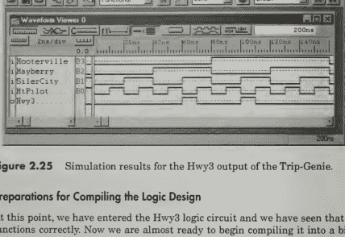

**图 2.25** Trip-Genie 的 Hwy3 输出的仿真结果。

### 编译逻辑设计的准备工作

此时，我们已经输入了 Hwy3 逻辑电路，并且已经看到它功能正确。现在我们几乎准备好开始将其编译成位流，以便我们可以将其加载到 FPLD 芯片中进行测试。但物理测试设计意味着我们将不得不向 FPLD 的某些引脚施加信号，这些引脚对应于我们的 Trip-Genie 电路的输入。我们还需要将一个 LED 连接到承载 Hwy3 输出的引脚，以便我们可以直观地观察电路是否正确运行。

如果你构建或购买了 XS95 或 XS40 板（附录 A），你就知道 XC95108 或 XC4005XL 芯片的某些引脚可以由连接到板上的 PC 并行端口驱动。这让我们可以使用并行端口向芯片施加测试模式。另一组 XC95108 或 XC4005XL 引脚连接到 7 段 LED（参见图 3.5，了解我在这本书中使用的 LED 段标记）。因此 XS95 和 XS40 板具有我们完成工作所需的东西。


然而，编译 ABEL 文件、VHDL 文件或原理图的 Foundation Series 实现工具并不知道哪些 FPLD 引脚连接到并行端口或 LED 段。任由其自行处理，工具会将 Trip-Genie 的输入和输出分配到任何方便的引脚。因此，我们需要一种方法将所需的引脚分配传递给 Foundation Series 工具。有三种方法可以做到这一点：

- 1. 在 ABEL 文件的 PIN 语句中嵌入引脚号。
- 2. 将引脚号作为原理图中 IBUF 和 OBUF 缓冲器的属性输入。
- 3. 创建一个单独的 User Constraint File（UCF），列出每个输入和输出的引脚号。

直接在 ABEL 文件中输入引脚号非常容易。图 2.26 显示了添加了引脚号的 TRIPGENI.ABL 文件，以便在 XS95 板上测试设计。

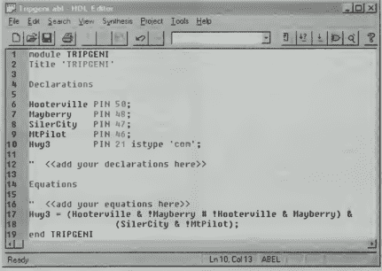

```
module TRIPGENI
Title 'TRIPGENI'

Declarations

Hooterville PIN 50;
Mayberry    PIN 48;
SilerCity   PIN 47;
MtPilot     PIN 46;
Hwy3        PIN 21 istype 'com';

// <Add your declarations here>

Equations

// <Add your equations here>
Hwy3 = (Hooterville & Mayberry & !Hooterville) &
       (SilerCity & !MtPilot);
end TRIPGENI
```

**Figure 2.26** 带嵌入引脚分配的 TRIPGENI.ABL 文件。

在 TRIPGENI.SCH 原理图中，我们可以双击任何 IBUF 或 OBUF 符号来设置其属性。例如，双击连接到 Hooterville 输入端子的 IBUF 会弹出图 2.27 的 Symbol Properties 窗口。以下步骤将该输入缓冲器分配到 XC4005XL FPGA 的引脚 47：

- 1. 在 Name 框中单击并输入 LOC。
- 2. 在 Description 框中单击并输入 p47。
- 3. 单击 Add 按钮。
- 4. 单击 OK。

你可以重复此过程将 MtPilot、SilerCity 和 Mayberry 输入分别分配到引脚 44、45 和 46，并将 Hwy3 输出分配到引脚 25。

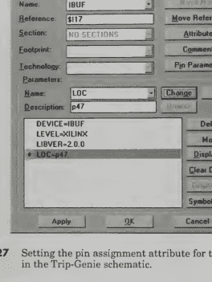

Figure 2.27 在 Trip-Genie 原理图中设置 Hooterville IBUF 的引脚分配属性。

最后，我们可以使用 HDL 编辑器创建一个 UCF（User Constraint File），将 I/O 端子分配到特定的 FPLD I/O 引脚。在 Project Manager 窗口的 Flow 选项卡中，单击按钮，然后单击 **empty** 单选按钮以打开一个空编辑器窗口。如果使用的是 XS95 板，请在窗口中输入以下行：

```
NET Hooterville      LOC=p50;
NET Mayberry         LOC=p48;
NET SilerCity        LOC=p47;
NET MtPilot          LOC=p46;
NET Hwy3             LOC=p21;
```

或如果使用的是 XS40 板，则输入以下内容：

```
NET 'HOOTERVILLE'    LOC='p47';
NET 'MAYBERRY'       LOC='p46';
NET 'SILERCITY'      LOC='p45';
NET 'MTPILOT'        LOC='p44';
NET 'HWY3'           LOC='p25';
```

（请注意，由于 TRIPGENI.SCH 原理图仅允许 I/O 端子名称使用大写字母，我们在第二个 UCF 中不得不使用大写字母作为名称。）

然后使用 **File → Save As...** 菜单项将文件保存为 TRIPGENI.UCF。这个 UCF 所做的只是告诉 Foundation Series 实现工具将 4 个城市输入分配到引脚 46、47、48 和 50，并将 Hwy3 输出分配到 XC95108 的引脚 21。我们已经从对 XS95 板的了解中知道，引脚 46、47、48 和 50 可以由 PC 并行端口驱动，而引脚 21 驱动 7 段 LED 的最底部水平段。（你可以填写 XS40 板上 XC4005XL 的等效引脚号。）

应该使用哪种方法输入引脚分配？如果您仅为一种类型的板（XS40 或 XS95 板）设计，那么将引脚分配嵌入设计文件中可能更容易。然而，如果您计划在两块板上实现设计，那么将引脚分配放在单独的 UCF 中是一种更清晰的方法。由于本书中的示例适用于两块板，我将专门使用 UCF 来分配引脚。

### 编译逻辑设计

一旦输入了引脚分配并返回到 **Project Manager** 窗口，单击 [toolbar button] 或选择 **Implementation → Implement Design...** 菜单项以开始编译过程。图 2.28 的 **Implement Design** 窗口将出现。**Device and Speed** 应与您在启动项目时输入的内容一致，而 **version and revision** 名称应分别为 **ver1** 和 **rev1**。 （如果需要，您可以更改其中任何一项。）


#### 图 2.28 实现窗口。

在实现窗口中，单击 Options... 按钮。这将打开用于设置 Foundation Series 实现工具运行控制参数的窗口，使用 User Constraints 框运行 UCF。你可以使用 Browse... 按钮查找 UCF，也可以在其中输入其位置。然后单击 OK 返回到 Implement Design 窗口。

返回 Implement Design 窗口后，单击 Run。Flow Engine 窗口出现，其中以图形方式呈现将网表映射到 FPLD 所需的各个阶段（在本例中，图 2.30 显示了映射到 XC5000 CPLD 所需的步骤）。Foundation Series 实现工具运行这些阶段。

Translate: EDIF 网表被转换为内部网表格式，进行设计规则检查，并尝试对逻辑电路进行各种优化以提高电路速度和/或减少使用的门数。

Fit: 网表中的门被分配到特定的宏单元，并且其互连通过 FastCONNECT 矩阵布线。

Timing: 通过宏单元和 FastCONNECT 矩阵的传播延迟被计算并存储在一个文件中，供时序仿真期间使用。

Bitstream: 生成比特流，将其下载到芯片中以使其执行 ABEL 或原理图文件中描述的逻辑功能。

如果你要为 XC4000XL FPGA 和 XS40 板实现设计，则图 2.31 所示的 Flow Engine 窗口将会出现。针对 FPGA 时，实现过程中有更多阶段。

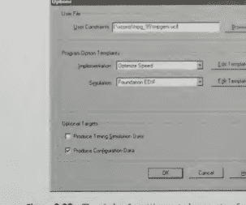

图 2.29 用于设置 Foundation Series 实现工具控制参数的窗口。

Translate: EDIF 网表被转换为内部网表格式并进行设计规则检查。

Map: 尝试对逻辑电路进行各种优化以提高电路速度和/或减少使用的门数。

Place&Route: 网表中的门被分配到特定的 CLBs，并且其互连通过 FPGA 的 PSMs 和其他布线资源布线。

Timing: 通过 CLBs 和布线 PSMs 的传播延迟被计算并存储在一个文件中，供时序仿真期间使用。

Configure: 生成比特流，将其下载到芯片中以将其配置为执行 ABEL 或原理图文件中描述的逻辑功能。

每个阶段下方的标签将在其完成时从 Running 更改为 Completed。（如果在处理过程中的某个特定阶段出现问题，则会出现 Aborted 标签，并且错误类型指示将出现在下方的对话框中。）所有阶段完成后，将出现一个弹出窗口

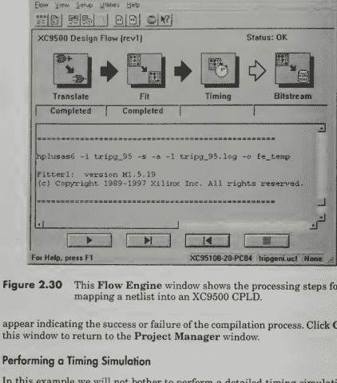

#### 图 2.30 此 Flow Engine 窗口显示将网表映射到 XC9500 CPLD 的处理步骤。

出现指示编译过程成功或失败。单击此窗口中的 OK 返回到 Project Manager 窗口。

### 执行时序仿真

在本例中，我们不会费心对 Hwy3 电路进行详细的时序仿真。第 5 章将介绍此主题。

### 为下载到 XS95 准备比特流

现在 Hwy3 电路比特流已经生成，我们需要在将其下载到 XS95 板上的 XC95108 CPLD 之前进行一些额外处理。（下载到 XS40 板上的 XC4005XL FPGA 的 TRIPG_40.BIT 比特流文件本身就可以使用，因此如果你使用的是它，可以跳过本节。）

#### 图 2.31 此 Flow Engine 窗口显示将网表映射到 XC4000XL CPLD 的处理步骤。

要开始将 Flow Engine 之前生成的比特流文件转换为可下载到 XC9500 CPLD 的形式，请选择 Tools → Device Programming → JTAG Programmer 菜单项或单击 Design Manager 窗口中的按钮。图 2.32 的 JTAG Programmer 窗口将会出现。此窗口让我们生成适合编程一个或多个串联连接的 XC9500 芯片的比特流。由于本例中我们只编程单个芯片，因此无需在窗口中显示的链中添加更多 CPLD。

XS95 板下载软件要求比特流文件以 SVF 文件格式存储。选择 Output → Create SVF File... 菜单项。然后会出现一个 SVF Options 弹出窗口。选择使初始转换通过 Test-Logic-Reset 进入 Run-Test/Idle 的单选按钮（不必担心这意味着什么——它与 XC9500 CPLD 中 JTAG 电路的初始化有关）。然后单击 OK，另一个弹出窗口将会出现，让你指定 SVF 文件的名称（TRIPFG_95.SVF 在


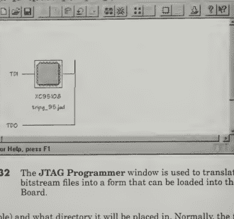

#### Figure 2.32

JTAG Programmer 窗口用于将位流文件翻译成可以加载到 XS95 板上的形式。

此示例）和它将被放置在哪个目录中。通常，文件将被放置在与设计版本和修订版关联的目录中，但这样在需要时更难找到。出于这个原因，我喜欢将其放置在项目的顶层目录中（本例中为 C:\XCPROJ\TRIPG_95）。指定名称和目录后，单击 Save 按钮。

现在在 JTAG Programmer 窗口中选择 Operations → Program 菜单项。在出现的 Options 窗口中（Figure 2.33），有几个复选框。你不需要将其中的任何一个从默认值更改。只需单击 OK，SVF 就会被生成。SVF 生成的中间结果会报告在一个弹出窗口中（Figure 2.34）。如果所有状态消息都报告成功，则 SVF 已生成。单击 OK 返回到 JTAG Programmer 窗口。然后选择 File → Exit 返回到 Design Manager 窗口。你会被问及是否要保存对 tripq_95 的更改。你可以单击 No 按钮，因为这只会保存链描述文件（CDF），对 SVF 没有任何影响。

### Downloading the Logic Design to the XS40 or XS95 Board

如果你以 XC95108 CPLD 和 XS95 板为目标，在这一点上你应该打开一个 DOS 窗口并输入：

```
CD C:\XCPROJ\TRIPG_95
```

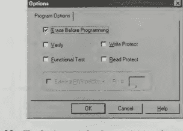

**Figure 2.33** The Options window lets you initiate the generation of the SVF file.

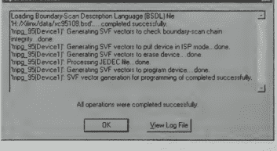

**Figure 2.34** The Operation Status window reports the intermediate results that occur during the generation of the SVF.

移动到存储 XS95 板 Trip-Genie 设计的项目目录。你应该将 XS95 连接到 PC 的并口并为板供电。然后你可以使用以下命令将 Hwv3 电路下载到 XS95 板上的 XC95108 CPLD：

```
XSLOAD TRIPG_95.SVF
```

另一方面，如果你以 XC4005XL FPGA 和 XS40 板为目标，你应该将 XS40 板连接到 PC 并口并输入：

```
CD C:\XCPROJ\TRIPG_40
```

然后发出命令：

```
XSLOAD TRIPG_40.BIT
```

将 Hwy3 电路下载到 XS40 板上的 XC4005XL FPGA。

完成 XSLOAD 命令后，XS95 或 XS40 板将被 Hwy3 逻辑编程。

### Testing the Downloaded Logic Design

现在我们需要将输入强制为各种逻辑电平，以查看我们下载到 XS95 或 XS40 板上的 Hwy3 电路是否正常工作。XSPORT 程序接受一个由 1 和 0 位组成的字符串，并在连接到 XS95 板（XS40 板）上 XC95108 CPLD（XC4005XL FPGA）引脚的并口 8 个数据引脚上输出它。给定命令

```
XSPORT b₇b₆b₅b₄b₃b₂b₁b₀
```

其中 b₇–b₀ 表示二进制位，字符串中的位与 XC95108 或 XC4005XL 上的引脚之间的对应关系如下：

| String Bit | XC95108 Pin | XC4005XL Pin |
|---|---|---|
| b₀ | 46 | 44 |
| b₁ | 47 | 45 |
| b₂ | 48 | 46 |
| b₃ | 50 | 47 |
| b₄ | 51 | 48 |
| b₅ | 52 | 49 |
| b₆ | 81 | 32 |
| b₇ | 80 | 34 |

如果 XSPORT 给出的位数少于 8 位，它会将最高有效位设为零。如果 XSPORT 给出的位数多于 8 位，它只保留 8 个最低有效位。

我们在 UCF 文件中使用的引脚分配导致了 XSPORT 传递的位串与 Hwy3 电路输入之间的以下对应关系：

| String Bit | Hwy3 Input |
|---|---|
| b0 | MtPilot |
| b1 | SilerCity |
| b2 | Mayberry |
| b3 | Hooterville |
| b4 | *** Not Used *** |
| b5 | *** Not Used *** |
| b6 | *** Not Used *** |
| b7 | *** Not Used *** |

UCF 还将 Hwy3 输出分配给 XC95108 CPLD（XC4005XL FPGA）的引脚 21（引脚 25）。该引脚连接到 7 段 LED 数码管（S0）的最下方水平段。当 Hwy3 = 1 时，S0 亮起。否则，S0 暗淡。

我们可以使用 XSPORT 对 Hwy3 电路的所有 16 种输入组合进行完全测试。以下是你可以发出的命令以及应有的结果：

| Command | Hooterville | Mayberry | SilerCity | MtPilot | Hwy3 |
|---|---|---|---|---|---|
| XSPORT 0000 | 0 | 0 | 0 | 0 | 0 (dark) |
| XSPORT 0001 | 0 | 0 | 0 | 1 | 0 (dark) |
| XSPORT 0010 | 0 | 0 | 1 | 0 | 0 (dark) |
| XSPORT 0011 | 0 | 0 | 1 | 1 | 0 (dark) |
| XSPORT 0100 | 0 | 1 | 0 | 0 | 0 (dark) |
| XSPORT 0101 | 0 | 1 | 0 | 1 | 0 (dark) |
| XSPORT 0110 | 0 | 1 | 1 | 0 | 1 (bright) |
| XSPORT 0111 | 0 | 1 | 1 | 1 | 0 (dark) |
| XSPORT 1000 | 1 | 0 | 0 | 0 | 0 (dark) |
| XSPORT 1001 | 1 | 0 | 0 | 1 | 0 (dark) |
| XSPORT 1010 | 1 | 0 | 1 | 0 | 1 (bright) |
| XSPORT 1011 | 1 | 0 | 1 | 1 | 1 |
| XSPORT 1100 | 1 | 1 | 0 | 0 | 0 (dark) |
| XSPORT 1101 | 1 | 1 | 0 | 1 | 0 (dark) |
| XSPORT 1110 | 1 | 1 | 1 | 0 | 0 (dark) |
| XSPORT 1111 | 1 | 1 | 1 | 1 | 0 (dark) |


如果一切操作正确，你对下载设计的测试结果应与仿真结果和真值表相匹配。

### Trip-Genie 项目设计（HDL 模式）

在本节中，我们将使用 VHDL 和 Xilinx Foundation 系列软件的 HDL 设计流程来实现 Trip-Genie 设计。原理图设计流程与 HDL 设计流程之间的唯一真正区别在于从设计描述中提取网表的方法。因此，本节仅讨论输入 Trip-Genie 设计的 VHDL 代码以及从该 VHDL 代码综合网表的步骤。后续步骤（功能仿真、编译为位流、将位流下载到 XS 板以及测试下载的设计）与上一节讨论的原理图设计流程中完全相同。

#### 开始新项目

首先，为所有项目创建一个主目录。（在我这里，我将所有 HDL 模式设计放在 C:\XCPROJ-V 中。）然后点击 Foundation Project Manager 图标。这将弹出如图 2.35 所示的窗口。

New Project 子窗口显示出来了。（你也可以通过选择 File → New Project 菜单项来调出此子窗口。）然后，输入项目名称、项目目录，并点击 HDL 单选按钮以选择 HDL 设计流程。一旦选择 HDL 模式，芯片系列、芯片型号和器件速度下拉菜单就会消失。（你将在设计流程的综合阶段稍后设置这些值。）在图 2.35 中，我创建了一个名为 TRIPG_95 的项目，目录为 C:\XCPROJ-V。然后点击 OK 返回 Project Manager 窗口。

现在你的窗口应该看起来就像图 2.36。Project Manager 窗口中有三个主要窗格。左侧窗格在 Files 选项卡中显示设计的源文件和库，而 Versions 选项卡显示 XILINX Foundation 软件为设计的所有版本生成的设计实现文件。右侧窗格具有用于控制设计流程各阶段所用工具激活的 Flow 选项卡、显示项目中文件状态的 Contents 选项卡，以及列出工具工作时生成的报告文件的 Reports 选项卡。底部窗格列出 Foundation 软件处理设计文件时输出的诊断消息。目前，你将花费大部分时间在左侧和右侧窗格的 Files 和 Flow 选项卡中工作。

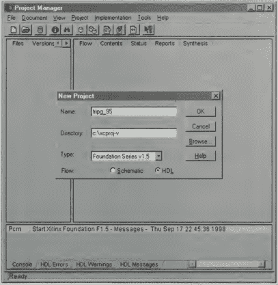

**Figure 2.35** Foundation Series 1.5 Project Manager main window.

#### 使用 VHDL 硬件描述语言输入设计

在本节中，我将向你展示如何使用 VHDL 输入 Trip-Genie 的 Hwy3 输出设计。VHDL 是一种比 ABEL 更复杂的语言，更适合用于高密度 FPLD 的大型设计。

在 **Project Manager** 窗口中，选择 **Tools → Design Entry → HDL Editor** 或点击 **Project Manager** 窗口 Flow 选项卡中的 [icon] 按钮。在出现的窗口中，点击标有 **Use HDL Design Wizard** 的单选按钮，然后点击 **OK**。然后在出现的 **Design Wizard** 窗口中点击 **Next**，以到达 **Design Wizard-Language** 窗口。在此，选择 **VHDL** 单选按钮并点击 **Next**，进入 **Design Wizard-Name** 窗口。输入 TRIPGEN1 作为名称并点击 Next。

Figure 2.36 Initial Project Manager window for TripGenie design (HDL design flow).

现在我们应该在 Design Wizard-Ports 窗口中，在此指定设计的输入和输出（图 2.37）。要添加一个输入，点击 New，然后在 Name 字段中输入 Hooterville（例如）。点击 Input 单选按钮将端口设置为输入。重复这些步骤为 Mayberry、SilerCity 和 MtPilot 输入。 要添加电路的输出，点击 New，在 Name 字段中输入 Hwy3，然后点击 Output 单选按钮。现在所有输入和输出都已定义，点击 Finish 按钮。

（你可以点击 Advanced 按钮调出 Advanced Port Settings 窗口。此窗口中的下拉菜单让你设置任何输入或输出的类型。默认设置是 STD_LOGIC，对于本示例来说是合适的。）


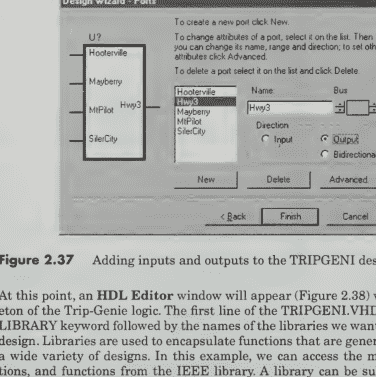

#### Figure 2.37 Adding inputs and outputs to the TRIPGENI design.

此时，一个 HDL 编辑器窗口将会出现（图 2.38），其中包含 Trip-Genie 逻辑的骨架。TRIPGENI.VHD 文件的第一行使用 LIBRARY 关键字，后跟我们在设计中想要使用的库的名称。库用于封装在各种设计中普遍有用的函数。在此示例中，我们可以访问 IEEE 库中的宏、定义和函数。库可以细分为包，这些包进一步封装了在特定领域或类型的应用中有用的功能。第 2 行中的 USE 关键字表示我们的设计将可以访问 IEEE 库中 STD_LOGIC_1164 包中的所有功能。 （IEEE 库和 STD_LOGIC_1164 包是所有 VHDL 工具都支持的标准。）

在库访问控制行之后，第 4 行到第 12 行定义了 Trip-Genie 电路的接口。接口声明输入和输出，外部电路可以通过这些输入和输出访问该电路的功能。接口定义以 ENTITY 关键字开头，后跟接口的名称（本例中为 TRIPGENI）。第 5 行的 PORT 关键字开始了随后在第 6 行到第 10 行的输入和输出声明列表。声明以输入或输出的标识符开头，后跟冒号（:）。然后使用 IN 和 OUT 关键字分别将标识符声明为输入或输出。这后面跟着通过输入或输出传输的数据的类型。对于本书中的大多数示例，我们将使用 STD_LOGIC 类型，该类型允许逻辑信号采用标准的 1 和 0 布尔状态以及未定义、高阻抗和其他状态。每个输入/输出声明都以

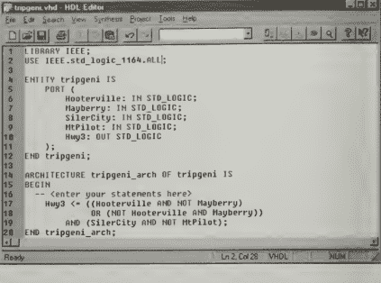

**Figure 2.38** HDL Editor window with the filled-in Trip-Genie VHDL code skeleton.

分号（;）终止，除了第 10 行的声明，该声明紧接在结束列表的括号之前（第 11 行）。整个接口定义由 END 关键字后跟第 12 行的接口名称终止。

接口定义后面是第 14 行到第 20 行的架构定义。架构部分中的 VHDL 语句描述了电路如何实际对通过接口传递的输入/输出值执行操作。ARCHITECTURE 关键字开始此部分，后跟架构的名称（TRIPGENI_ARCH）和架构所链接的接口（TRIPGENI）。

描述逻辑电路的 VHDL 语句由第 15 行和第 20 行的 BEGIN 和 END 关键字界定。第 17 行到第 20 行包含我们在上一章中推导出的 Hwy3 布尔方程：

```
Hwy3 <= ((Hooterville AND Mayberry) OR
         (NOT Hooterville AND Mayberry) AND
         (SilerCity AND NOT MtPilot);
```

Hwy3 输出标识符放置在 VHDL 信号赋值运算符（<=）的左侧。在右侧，原语 VHDL 逻辑运算符

（AND、OR、NOT）用于组合 Trip-Genie 电路的 4 个输入的值。VHDL 中没有运算符优先级，因此必须使用括号对 AND 和 OR 操作进行分组，以便正确计算乘积之和。逻辑方程可以跨多行断开，并以分号终止。

现在我们必须检查以确保没有犯任何简单错误。选择 Synthesis → Check Syntax 菜单项。一个小弹出窗口将会出现，告知您正在检查 VHDL 代码是否存在错误。几秒钟内，此窗口应被另一个窗口替换，显示 Check Successful。单击此窗口中的 OK 按钮。

> （当您首次开始使用 VHDL 进行自己的设计时，很可能会出现语法错误。每个错误都会在 HDL 编辑器窗口中突出显示，并且错误消息会出现在窗口底部。您可以通过选择 Tools → Language Assistant 菜单项来获取无错误的 VHDL 代码示例。将会出现一个 Language Assistant - VHDL 窗口，左侧列出主题。单击 + 符号以深入到特定主题。单击主题后，右侧窗口将显示该主题的 VHDL 代码示例。您可以将示例剪切并粘贴到自己的代码中，然后根据特定设计进行编辑。）

与 ABEL 不同，VHDL 并未在 HDL 编辑器窗口中进行综合，因此 Synthesis → Synthesize 菜单项处于空白状态。从 VHDL 综合网表的过程在下一节中进行。

现在设计输入已完成，请在 HDL 编辑器窗口中选择 File → Save。然后选择 File → Exit。

返回到 Project Manager 窗口后，我们必须将 TRIPGENI.VHD 文件作为项目的一部分。选择 Document → Add... 菜单项，并在对话框窗口中列出类型为 HDL (*.VHD;*.VER;*.VE;*.V) 的项目。突出显示列表中的 TRIPGENI.VHD 并单击 Open。您应该在构成 TRIPGENI 项目的文件列表中看到 TRIPGENI.VHD（图 2.39）。

### Synthesizing the Netlist

一旦 VHDL 源文件完成，我们接下来需要提取其网表。我通常首先做的就是在 Project Manager 窗口中选择 Synthesis → Force Analysis of All HDL Source Files。这会启动对所有 VHDL 文件的检查以检测任何错误。 （Foundation Series 软件通常会在没有您干预的情况下执行此操作，但我喜欢在启动综合器之前确保已完成。）

接下来，单击 Project Manager 窗口右窗格中的按钮。这会打开图


图 2.39　将 TRIPGEN1.VHD 文件添加到 TRIPG_95 工程后的 Project Manager 窗口。

2.40. 当窗口首次出现时，Trip-Genie 设计的接口名称将列在 Top Level 文本框中。Version Name 框中显示 ver1，每次你修改设计的源代码时，该版本号都会递增。

在窗口的 Target Device 区域中，你将在下拉菜单中选择器件系列、具体器件类型和器件速度（图 2.40 中选择了 84 引脚封装、速度最慢的 XC95108 CPLD）。这让综合软件知道你目标芯片架构的类型，以便生成能够利用芯片特性的网表。

你还可以使用 Synthesis Settings 区域中的控件来指导综合工具侧重于高速或面积效率高的电路。其中还有一个 Insert I/O Pads 复选框，用于控制是否在所有 I/O 信号上放置输入和输出缓冲器。此复选框应被勾选，因为 TRIPGEN1.VHD 代码位于该设计的顶层。（如果 TRIPGEN1.VHD 电路是作为宏被包含在更大的设计中，则不应勾选此复选框。）

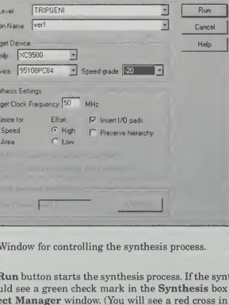

图 2.40　控制综合过程的窗口。

单击 Run 按钮启动综合过程。如果综合成功，你应在 Project Manager 窗口的 Flow 选项卡的 Synthesis 框中看到绿色对勾。（如果失败，你会看到一个红色叉号。）

至此，你已经从描述 Trip-Genie 电路的 VHDL 代码中提取出网表。利用该网表，你可以进行功能仿真、将网表编译为比特流，并以与上一节原理图设计流程完全相同的方式将比特流下载到 XS95 或 XS40 开发板上进行测试。（你唯一会遇到的差别是：Trip-Genie 设计的 HDL 模式版本存储在 XCPROJ-V 目录中，而不是原理图模式设计所存放的 XCPROJ 目录中。）

### 项目

- 设计并实现上一章讨论的完整 Trip-Genie。与使用 TTL SSI 芯片相比，用 FPLD 实现该设计的难度如何？

### 组合逻辑

### 目标

- 描述组合逻辑电路。
- 展示组合逻辑电路的示例。
- 进一步举例说明 FPLD 在组合逻辑电路中的应用。
- 介绍 Foundation Implementation 报告文件中包含的信息类型。

### 讨论

组合逻辑可能是最容易设计的电路。组合逻辑电路的输出仅取决于当前的输入。（电路不会记住它在过去任何时候做了什么。）但组合逻辑是所有其他逻辑设计的基础，因此值得花一些时间来研究它。

从前两章中，我们已经有了组合电路设计的经验。在明确了问题并确定输入和输出的数量之后，我们得出了一个真值表，列出每个输出在输入逻辑电平的每种组合下的逻辑值。然后我们手动将真值表化简为布尔方程，并通过互连逻辑门来实现该方程。有很多技术可以从给定的真值表最小化和综合布尔表达式，也有许多教科书描述这些技术。我们这里不讨论最小化技术。Foundation Series 工具包含一套完整的最小化和综合逻辑的工具。我们的工作是使用这些工具来设计逻辑，并把精力节省下来用于那些尚未自动化的任务。

许多逻辑设计都涉及连接简单、易于理解的电路，以构建执行更复杂功能的更大电路。在接下来的几个小节中，我将介绍几个简单、常用的组合逻辑电路。

### 多路选择器

多路选择器电路接受 N 个输入，并输出其中一个输入的逻辑值。选择哪个输入出现在输出端是由


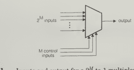

#### 图 3.1 2^M 对 1 多路复用器的输入和输出。

由一组 M 个控制输入决定。一个具有 M 个控制输入的多路复用器可以将多达 2^M 个输入切换到单个输出。多路复用器的 I/O 如图 3.1 所示。2 对 1 多路复用器的真值表如表 3.1 所示。

#### 表 3.1 2 对 1 多路复用器的真值表。

| Control | Input0 | Input1 | Output |
|---|---|---|---|
| 0 | 0 | 0 | 0 |
| 0 | 0 | 1 | 0 |
| 0 | 1 | 0 | 1 |
| 0 | 1 | 1 | 1 |
| 1 | 0 | 0 | 0 |
| 1 | 0 | 1 | 1 |
| 1 | 1 | 0 | 0 |
| 1 | 1 | 1 | 1 |

如果我们引入无关项符号 X，通常可以更简单地写出这些真值表。该符号用于在输入对输出值没有影响时，代替逻辑 0 或 1。例如，对于多路复用器，当控制输入为 0 时，Input1 对输出没有影响。同样，当控制为 1 时，Input0 没有影响。用无关项重写多路复用器真值表得到表 3.2。

#### 表 3.2 2 对 1 多路复用器的带“无关项”真值表。

| Control | Input0 | Input1 | Output |
|---|---|---|---|
| 0 | 0 | X | 0 |
| 0 | 1 | X | 1 |
| 1 | X | 0 | 0 |
| 1 | X | 1 | 1 |

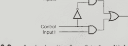

#### 图 3.2 2 对 1 多路复用器的逻辑电路。

表 3.2 中的真值表与表 3.1 中的原始表包含的信息一样多。如果我们将其中包含 X 的每一行展开为两行，用 0 或 1 替换 X，那么我们就会回到原始真值表。2 对 1 多路复用器的原理图如图 3.2 所示。

### 解码器

解码器具有 M 个输入和多达 2^M 个输出。如果将 M 个输入上的逻辑值解释为值为 P 的二进制数，则第 P 个输出将为逻辑 1，而其他输出均为逻辑 0。解码器的 I/O 如图 3.3 所示。

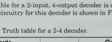

#### 图 3.3 M 输入、2^M 输出解码器的输入/输出。

2 输入、4 输出解码器的真值表如表 3.3 所示。该解码器的对应电路如图 3.4 所示。

#### 表 3.3 2-4 解码器的真值表。

| Inputs | | Outputs | | | |
|---|---|---|---|---|---|
| Input1 | Input0 | Out0 | Out1 | Out2 | Out3 |
| 0 | 0 | 1 | 0 | 0 | 0 |
| 0 | 1 | 0 | 1 | 0 | 0 |
| 1 | 0 | 0 | 0 | 1 | 0 |
| 1 | 1 | 0 | 0 | 0 | 1 |

解码器可以执行更复杂的功能。例如，LED 解码器接受一个 4 位二进制数并输出七个信号，这些信号将点亮

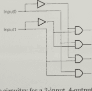

图 3.4 2 输入、4 输出解码器的逻辑电路。


图 3.5 七段 LED 数码管。

#### 表 3.4 用于数字 0 到 9 的 LED 解码器的真值表（输出为逻辑 1 表示对应的 LED 段被点亮）。

**表 3.4** 七段 LED 解码器的真值表。

| 4-bit Input |  |  |  | 7-segment LED Driver Outputs |  |  |  |  |  |  |
|---|---|---|---|---|---|---|---|---|---|---|
| D3 | D2 | D1 | D0 | S6 | S5 | S4 | S3 | S2 | S1 | S0 | Numeral |
| 0 | 0 | 0 | 0 | 1 | 1 | 0 | 1 | 1 | 1 | 1 | “0” |
| 0 | 0 | 0 | 1 | 1 | 0 | 0 | 0 | 0 | 1 | 0 | “1” |
| 0 | 0 | 1 | 0 | 1 | 0 | 1 | 1 | 1 | 0 | 1 | “2” |
| 0 | 0 | 1 | 1 | 1 | 0 | 1 | 1 | 0 | 1 | 1 | “3” |
| 0 | 1 | 0 | 0 | 1 | 1 | 1 | 0 | 0 | 1 | 1 | “4” |
| 0 | 1 | 0 | 1 | 1 | 1 | 0 | 1 | 0 | 1 | 1 | “5” |
| 0 | 1 | 1 | 0 | 1 | 1 | 0 | 1 | 1 | 1 | 1 | “6” |
| 0 | 1 | 1 | 1 | 1 | 0 | 1 | 1 | 0 | 1 | 1 | “7” |
| 1 | 0 | 0 | 0 | 1 | 1 | 1 | 1 | 1 | 1 | 1 | “8” |
| 1 | 0 | 0 | 1 | 1 | 1 | 1 | 1 | 0 | 1 | 1 | “9” |

### 优先编码器

解码器的相反设备是优先编码器：它输出当前为逻辑 1 的输入的最大索引。更精确地定义，我们说给定 2^M − 1 个输入，其中输入 P 是索引最大且也为逻辑 1 的输入，编码器输出表示 P 的 M 位二进制数。当然，如果没有输入为 1，则输出为零。图 3.6 显示了优先编码器的 I/O。表 3.5 列出了 3 输入、2 输出优先编码器的真值表。该优先编码器的对应电路如图 3.7 所示。


**图 3.6** 一个 2^M 输入、M 输出编码器。

**表 3.5** 3-2 优先编码器的真值表。

| Inputs |  |  | Outputs |  |
|---|---|---|---|---|
| Input3 | Input2 | Input1 | Output1 | Output0 |
| 0 | 0 | 0 | 0 | 0 |
| 0 | 0 | 1 | 0 | 1 |
| 0 | 1 | X | 1 | 0 |
| 1 | X | X | 1 | 1 |

### 奇偶校验生成器

偶校验生成器接受 M 个输入位并生成一个输出，使得逻辑 1 的总数为偶数。例如，如果一个三输入偶校验生成器接收到 010 作为输入，它将在其输出端产生一个 1，使得 1 的总数为 2——一个偶数。奇偶校验对于检测错误很有用，如果计算机系统设计为数字始终具有偶校验。那么如果看到一个具有奇数个


1 bits (odd parity), it must have an error in it. (That is why some PC memories have 9 bits—8 to store the actual data and a ninth parity bit.)

The I/O for an even-parity generator is shown in Figure 3.8. Table 3.6 shows the truth table for a 3-input, even-parity generator, and Figure 3.9 depicts the circuit for it. This parity circuit makes use of an exclusive-OR (XOR) gate that operates according to the truth table in Table 3.7.


### Adders

An M-bit adder accepts two M-bit binary numbers and outputs an M-bit sum. But it is possible the sum will not fit in M bits. For example, adding two 2-bit

**Table 3.6** Truth-table for a 3-bit parity generator.

| Input2 | Input1 | Input0 | Output |
|---:|---:|---:|---:|
| 0 | 0 | 0 | 0 |
| 0 | 0 | 1 | 1 |
| 0 | 1 | 0 | 1 |
| 0 | 1 | 1 | 0 |
| 1 | 0 | 0 | 1 |
| 1 | 0 | 1 | 0 |
| 1 | 1 | 0 | 0 |
| 1 | 1 | 1 | 1 |

numbers like 111 (7) and 110 (6), results in a sum of 1101 (13), which requires 4 bits to represent it. For this reason, an extra carry output bit is added to indicate when this overflow condition occurs. And if the adder can have a carry output, then it makes sense that it should also have a carry input. The symbol for this full adder is shown in Figure 3.10.


#### Figure 3.9 Logic circuitry for a 3-input even-parity generator.

#### Table 3.7 Truth-table for a 2-input XOR gate.

| Input1 | Input0 | Output |
|---|---|---|
| 0 | 0 | 0 |
| 0 | 1 | 1 |
| 1 | 0 | 1 |
| 1 | 1 | 0 |


#### Figure 3.10 An M-bit full adder.

Later we will see how to build an N x M-bit adder by chaining N of these M-bit adders through their carry inputs and outputs. For now, we will look at a simple 1-bit adder that obeys the truth table in Table 3.8. From this truth table, we can see that the sum output is the same as the output of a 3-input, even-parity generator. Also, the carry output goes high if two or more of the inputs are at logic 1. From this, we can draw the circuitry for the 1-bit adder, as shown in Figure 3.11.

#### Table 3.8 Truth-table for a 2-bit adder with carry input and output.

| Input1 | Input0 | Carry Input | Sum Output | Carry Output |
|---|---|---|---|---|
| 0 | 0 | 0 | 0 | 0 |
| 0 | 0 | 1 | 1 | 0 |
| 0 | 1 | 0 | 1 | 0 |
| 0 | 1 | 1 | 0 | 1 |
| 1 | 0 | 0 | 1 | 0 |
| 1 | 0 | 1 | 0 | 1 |
| 1 | 1 | 0 | 0 | 1 |
| 1 | 1 | 1 | 1 | 1 |


#### Figure 3.11 Logic circuitry for a 1-bit adder.

#### Experimental

#### 1-Bit Adder for the XS40 Board

Let's build the 1-bit adder using schematics for both the XC4005XL and the XC95108. First, create a schematic mode project called ADD1_40 that will hold the design for the XC4005XL (Figure 3.12).

Start the schematic editor and connect the gates as shown in Figure 3.11. Figure 3.13 shows the 1-bit adder with the additional input and output buffers.

Once the schematic is complete, save it as ADD1.SCH. Then generate a netlist using the Options → Create Netlist menu item and export it in EDIF 200 format using the Options → Export Netlist... menu item. (You can also activate the Options → Integrity Test to make sure everything is OK before you move on.) Then exit the schematic editor.

Now let's do a simulation to make sure the adder is functioning correctly. Click on the button in the Flow tab of the Project Manager window. Within the simulator, use the Signal → Add Signals... menu item to add the input


#### Figure 3.12 Initiating the 1-bit adder project for the XC4005XL FPGA.


#### Figure 3.13 Schematic for the 1-bit adder.

and output signals to the Waveform Viewer. Then use the **Signal → Add Stimulators...** menu item to connect the inputs to the lower 3 bits of the binary counter (Bc0, Bc1, Bc2). Finally, click on the [icon] button in the **Logic Simulator** toolbar and the waveform window shown in Figure 3.14 should appear. (You can use the [icon] button and the scrollbar in the **Waveform Viewer** window to expand and center the waveforms.) A careful check reveals that these waveform values match what is shown in the truth-table for the 1-bit adder.


### 实现报告文件

图 3.15 的报告浏览器窗口将会出现。双击任意图标即可查看关联报告的内容。


**图 3.15**  Foundation Series 实现工具生成的各种报告。

这些报告汇总了以下信息：

- **翻译报告：** 当网表被转换为 Foundation 实现工具使用的内部格式时检测到的任何问题都将在此列出。还会执行设计规则检查，并检查用户约束文件是否存在错误。你在此文件中最可能看到的错误将源于你输入的非法约束。对于本书中的设计示例不应出现这些错误，但在你开始自行实验时可能会导致一些错误。

- **映射报告：** 在这里，你将获得有关对网表尝试了哪些类型的优化的信息。逻辑门会被移除和添加以优化电路而不改变其功能。逻辑移除的一个例子是你在设计中放置了一个门但未使用其输出。另一个例子是输入连接到逻辑 0（GND）的与门，因此其输出始终为低。报告还指出了逻辑门是如何被收集成组并映射到 FPGA CLB 的 LUT 中的。

- **布局布线报告：** 本报告记录了我们为影响布局布线执行方式而选择的各种选项，列出任何警告和错误，并统计在各种布局布线阶段花费的总处理时间。它还报告了布线时序性能的各种统计数据。但最重要的是（现在），它给出了我们第一个问题的答案，即构建 1 位加法器使用了 XC4005XL 器件的多少。

  ```
  Device utilization summary:

           I/O             5/112    4% used
                           5/61     8% bonded
           LOGIC           1/196    0% used
           IOB             5/112    4% used
           CLB             1/196    0% used
  ```

- **异步延迟报告：** 每个已布线信号的传播延迟都列在此报告中。

- **布局后时序报告：** 本报告列出经过布局布线的逻辑中违反时序约束的任何路径。例如，如果你要求逻辑电路以 50 MHz 运行（即所有逻辑操作必须在 20 ns 或更短时间内完成），并且发现一条延迟大于 20 ns 的路径，则会列出违规。

- **Bitgen 报告：** 本报告记录了生成位流文件时生效的所有选项。位流生成期间发生的任何错误也都列在此处。

好的，我们已经回答了问题。现在我们可以开始测试实际设计。

打开一个 DOS 窗口并进入 C:\XCPROJ\ADD1_40 目录。将 1 位加法器电路下载到 XS40 板：

```
C:\XCPROJ\ADD1_40> XSLOAD ADD1_40.BIT
```

现在我们可以对加法器位的 3 个输入强制赋值以查看其是否正常工作。加法器电路输入端子、XC4005XL 引脚和 XSPORT 参数的映射如下所示：

| Adder Terminal | XC4005XL Pin | XSPORT |
|---|---|---|
| CARRY_INPUT | 44 | b0 |
| INPUT0 | 45 | b1 |
| INPUT1 | 46 | b2 |
| `*** Not Used ***` | 47 | b3 |
| `*** Not Used ***` | 48 | b4 |
| `*** Not Used ***` | 49 | b5 |
| `*** Not Used ***` | 32 | b6 |
| `*** Not Used ***` | 34 | b7 |

ADD1_40.UCF 文件还将 SUM 和 CARRY_OUT 输出分别分配给 XC4005XL FPGA 的引脚 25 和 26。引脚 25 连接到 7 段 LED 的段 S0，而引脚 26 驱动段 S1。

我们可以使用 XSPORT 对 1 位加法器电路进行完全测试，共 8 种输入组合。以下是你可以发出的命令以及应有的结果。

| Command | Input1 | Input0 | CARRY_INPUT | SUM | CARRY_OUTPUT |
|---|---:|---:|---:|---|---|
| XSPORT 000 | 0 | 0 | 0 | 0 (dark) | 0 (dark) |
| XSPORT 001 | 0 | 0 | 1 | 1 (bright) | 0 (dark) |
| XSPORT 010 | 0 | 1 | 0 | 1 (bright) | 0 (dark) |
| XSPORT 011 | 0 | 1 | 1 | 0 (dark) | 1 (bright) |
| XSPORT 100 | 1 | 0 | 0 | 1 (bright) | 0 (dark) |
| XSPORT 101 | 1 | 0 | 1 | 0 (dark) | 1 (bright) |
| XSPORT 110 | 1 | 1 | 0 | 0 (dark) | 1 (bright) |
| XSPORT 111 | 1 | 1 | 1 | 1 (bright) | 1 (bright) |

如果一切正确，你对下载设计的测试应与仿真结果和 1 位加法器的真值表相匹配。

### XS95 板的 1 位加法器

我们可以遵循相同的步骤序列在 XS95 板上设计和测试 1 位加法器：

1. 创建一个针对 84 引脚 PLCC 封装中的 XC95108 CPLD 的 ADD1_95 项目。

2. 按如下方式将 ADD1_40 项目中的 ADD1.SCH 原理图复制到此项目中，方法是选择项目管理器窗口中的 Document → Add... 菜单项。图 3.16 的窗口将会出现。选择 ADD1.SCH 文件并单击 Open 按钮以将原理图复制到 ADD1_95 目录。

3. 打开 ADD1.SCH 文件并生成并导出网表。

4. 对设计进行功能仿真。

5. 创建一个具有以下引脚分配的 ADD1_95.UCF 文件：

   ```
   NET INPUT1        LOC=P48;
   NET INPUT0        LOC=P47;
   NET CARRY_INPUT   LOC=P46;
   NET SUM           LOC=P21;
   NET CARRY_OUTPUT  LOC=P23;
   ```

6. 编译设计并检查报告文件。记得在 Implement Design 窗口中使用 Options 按钮通知 Foundation Series 实现工具你的 ADD1_95.UCF 文件的位置。


7. 在实现阶段完成后，在 Reports 选项卡中双击 Implementation Reports 文件图标。你会注意到 XC9500 fitter 只生成 Translation、Fitting 和 Post-Layout Timing 报告。双击 Fitting Report 图标会提供大量信息。我们感兴趣的只是关于管脚分配和器件利用率问题的答案。管脚分配与我们预期一致：

**Resources Used by Successfully Mapped Logic**

**Logic**

| Signal Name | Total Pt | Signals Used | Loc | Pwr Mode | Slew Rate # | Pin Type | Pin Use |
|---|---|---|---|---|---|---|---|
| CARRY_OUTPUT | 3 | 3 | FB3_12 | STD | FAST | 23 | I/O | 0 |
| SUM | 3 | 3 | FB3_11 | STD | FAST | 21 | I/O | 0 |

**Inputs**

| Signal Name | Loc | Pin # | Pin Type | Pin Use |
|---|---|---|---|---|
| CARRY_INPUT | FB6_3 | 46 | I/O | I |
| INPUT0 | FB6_5 | 47 | I/O | I |
| INPUT1 | FB6_6 | 48 | I/O | I |

器件利用率为：

**Resource Summary**

| Design Name | Device Used | Macrocells Used | Product Terms Used | Pins Used |
|---|---|---|---|---|
| add1_95 | XC95108-20-PC84 | 2/108 (1%) | 6/540 (1%) | 5/69 (7%) |

我们的电路有两个输出，因此我们至少需要使用两个宏单元（因为每个宏单元只有一个输出）。这与 Fitting Report 中报告的数字相符。CARRY_OUTPUT 和 SUM 两个输出各使用 3 个 product-terms，总共消耗 6 个 product terms，占 540 个中的一部分。与我们基于 XC4005XL 的设计一样，我们只使用了可编程逻辑块全部功能的可忽略一部分。

8. 现在我们必须将 Foundation Implementation 工具生成的 bitstream 文件转换为可以下载到 XC95108 CPLD 的形式。为此，选择 Tools → Device Programming → JTAG Programmer 菜单项并打开 JTAG Programmer 窗口。选择 Output → Create SVF File... 菜单项并使用 Create a New SVF File 窗口指定顶层 C:\XCVPROJ\ADD1_95 项目目录中的文件 ADD1_95.SVF。点击 Save 创建 SVF 文件。然后在 JTAG Programmer 窗口中选择 Operations → Program 菜单项并在出现的 Options 窗口中点击 OK。这将启动 SVF 文件的生成。SVF 文件生成后关闭窗口。

9. 打开一个 DOS 窗口，移动到 C:\XCVPROJ\ADD1_95 目录，并将电路下载到 XS95 Board：

```
C:\XCVPROJ\ADD1_95> XSLOAD ADD1_95.SVF
```

10. 使用 XSPORT 应用全部 8 种输入组合，并在 LED 段 S0 和 S1 上观察结果。再次，这应与真值表和仿真的结果相匹配。


Figure 3.16 The Add Document window is used to copy a file from another project.

### 1-Bit Adder in VHDL

在本节中，我们将使用 VHDL 和 Xilinx Foundation Series 软件的 HDL 设计流程模式创建 1 位加法器电路。我们将目标定为 XC4005XL FPGA，因此开始在 XCPROJ-V 目录中创建一个名为 ADD1_40 的项目（Figure 3.17）。确保点击 HDL 单选按钮以启用 HDL 设计流程模式。

启动 HDL 编辑器并选择使用 Design Wizard。选择 VHDL 作为 HDL 并将 VHDL 设计的名称设为 FULLADD。然后使用 Design Wizard-Ports 窗口设置输入和输出。从电路原理图可知我们需要 3 个输入。点击 New 按钮并在 Name 字段中输入 CARRY_INPUT。对 INPUT0 和 INPUT1 输入重复这些操作。

再次点击 New 并在 Name 字段中输入 CARRY_OUTPUT。点击 Output 单选按钮将其设为输出位。对 SUM 输出重复这些操作。Figure 3.18 显示了 1 位加法器的 I/O 端口分配。

#### Listing 3.1 The VHDL description of the 1-bit adder.

```
001 -- 1-Bit Adder
002
003 LIBRARY IEEE;
004 USE IEEE.std_logic_1164.ALL;
005
006 -- 1-Bit Adder interface description
007 ENTITY fulladd IS
008 PORT
009 (
010 input0: IN STD_LOGIC; -- addend bit
011 input1: IN STD_LOGIC; -- addend bit
012 carry_input: IN STD_LOGIC; -- carry input bit
013 sum: OUT STD_LOGIC; -- sum output bit
014 carry_output: OUT STD_LOGIC -- carry output bit
015 );
016 END fulladd;
017
018 -- 1-Bit Adder architecture
019 ARCHITECTURE fulladd_arch OF fulladd IS
020 BEGIN
021 sum <= input0 XOR input1 XOR carry_input;
022 carry_output <= (input0 AND input1)
023 OR (input0 AND carry_input)
024 OR (input1 AND carry_input);
025 END fulladd_arch;
```

Figure 3.11. The carry output is defined by a sum-of-products equation that also follows the gate circuitry of Figure 3.11.

输入 VHDL 代码后，使用 Synthesis → Check Syntax 菜单项进行语法检查。这会检查你是否已将所有逗号、分号、大括号和方括号放在正确的位置。如果没有错误，则将代码保存为 FULLADD.VHD。然后关闭 HDL Editor 窗口并在 Project Manager 窗口中使用 Document → Add 菜单项将 FULLADD.VHD 文件添加到 ADD1_40 项目中。

现在我们需要从 VHDL 代码综合出网表。点击 Project Manager 窗口 Flow 选项卡中的按钮。这将打开如图 Figure 3.19 所示的 Synthesis Implementation 窗口。将选项设置为如图所示，以将 1 位加法器目标定为 XC4005XL FPGA。（此时你也可以选择 XC95108 CPLD，如果你要用 XS95 Board 测试设计。）然后点击 Run 按钮，Foundation Series 综合软件将构建网表。


#### Figure 3.19 Targeting the synthesis of the 1-bit adder to the XC4005XL FPGA.

一旦 1 位加法器的网表创建完成，你就可以仿真其操作，编译位流，将位流下载到 XS 板上，并使用 XSPORT 命令对其进行测试，就像前面两节所示的那样。

### LED Decoder for the XS95 Board

现在我们可以尝试一个更复杂的设计，比如 LED 解码器。让我们先使用 ABEL 为 XC95108 CPLD 构建它，然后再将其移植到 XC4005XL FPGA。开始创建名为 LEDDCD95 的项目，用于 XC95108，如图 3.20 所示。

启动 HDL 编辑器并选择 ABEL 作为 HDL。然后使用 Design Wizard 设置输入和输出。根据真值表，我们知道需要 4 个输入和 7 个输出。我们可以输入所有这些名称，但有更聪明的方法。点击 New 按钮并在 Name 字段中输入 D。然后点击 Bus 标签下方的左上角按钮。你会看到名称字段中的 D 变为 D[1:0]。再点击两次，它会变为 D[3:0]。这指定了我们的 4 个输入（D0、D1、D2 和 D3）作为 4 位输入向量。


#### Figure 3.20 Initiating the LED decoder project for the XC95108 CPLD.

再次点击 New 并在 Name 字段中输入 S。然后点击按钮将名称推进到 S[6:0]。点击 Output 单选按钮将其设为 7 位输出向量。记得还要点击 Advanced 按钮并将输出类型设为 Combinatorial。图 3.21 显示了 LED 解码器 I/O 端口的分配。


#### Figure 3.21 Vector-type input and output ports for the LED decoder.

输入和输出定义完成后，点击 Finish 按钮，HDL 编辑器窗口会出现 LED 解码器的骨架。我们可以尝试将 LED 解码器的布尔方程输入到 ABEL 文件中，但这工作量太大。Foundation Series 工具可以为我们推导这些方程，只要我们输入真值表即可。清单 3.2 显示了带有真值表的完整 ABEL 文件（我添加了行号用于参考；它们不是 ABEL 代码的一部分）。

#### Listing 3.2 The ABEL HDL description of the LED decoder.

```
001- module LEDDCD
002- Title 'LEDDCD'
003-
004- Declarations
005-
006- D3..D0 PIN;
007- D = [D3..D0];
008- S6..S0 PIN istype 'com';
009- S = [S6..S0];
010-
011- Equations
012-
013- TRUTH_TABLE
014- (D -> [S6, S5, S4, S3, S2, S1, S0])
015- 0 -> [1, 1, 1, 1, 0, 1, 1];
016- 1 -> [0, 0, 1, 0, 0, 1, 0];
017- 2 -> [1, 0, 1, 1, 1, 0, 1];
018- 3 -> [1, 0, 1, 1, 0, 1, 1];
019- 4 -> [0, 1, 1, 1, 0, 1, 0];
020- 5 -> [1, 1, 0, 1, 0, 1, 1];
021- 6 -> [1, 1, 0, 1, 1, 1, 1];
022- 7 -> [1, 0, 1, 0, 0, 1, 0];
023- 8 -> [1, 1, 1, 1, 1, 1, 1];
024- 9 -> [1, 1, 1, 1, 0, 1, 1];
025-
026- end LEDDCD
```

清单 3.2 有许多我们以前没见过的新内容，所以让我们花点时间回顾一下：

Line 6: 这里声明了 4 个输入 D0、D1、D2 和 D3。‘..’ 记法让你只需给出起点和终点即可输入整个向量范围。

Line 7: 这只是一个等价语句，让我们可以使用 D 作为 [D3..D0] 输入向量的简写。

Lines 8-9: 这些声明了 7 元素输出向量及其简写名称。

Line 13: TRUTH_TABLE 是 ABEL 关键字，表示真值表的开始（显而易见）。

Line 14: 真值表的输入和输出列在此行列出。‘->’ 将输入列表（左侧）与输出列表（右侧）分隔开。使用了输入的简写名称，但输出名称的完整集合被写出。

Lines 15-24: 输入的每种组合及其产生的输出都列在这些行上。输入组合以十进制数字而不是布尔值书写。这是可以的，因为我们使用了向量字段，所以 ABEL 编译器有足够的信息来确定我们的意思。（例如，在第 21 行我们设置 D = 6，ABEL 将其展开为赋值 D3 = 0、D2 = 1、D1 = 1 和 D0 = 0。）我们本也可以在第 14 行对输出使用向量字段，但将 LED 段的输出单独列出更有意义。这样如果在某个段上犯了错误，更容易返回并修改真值表，而不会无意中影响另一个输出。

输入 ABEL 代码后，使用 Synthesis → Check Syntax 菜单项进行语法检查。这会检查你是否把所有的逗号、分号、大括号和小括号都放在了正确的位置。如果没有错误，则将代码保存为 LEDDCD.ABL。然后选择 Synthesis → Options 菜单项并在出现的 ABEL6 窗口中点击 Chip 单选按钮（因为这是一个自包含的设计）。选择 Synthesis → Synthesize 菜单项将生成网表。然后关闭 HDL 编辑器窗口，并在项目管理器窗口中使用 Document → Add 菜单项将 LEDDCD.ABL 文件添加到 LEDDCD95 项目中。

我们现在可以仿真设计，但这是在浪费时间。LED 解码器的功能是为我们提供数字的视觉呈现。仿真器只会向我们显示波形，因此我们必须在脑中构建这些波形点亮了哪些 LED 段。这是一项容易出错的任务，我们可以通过将设计下载到 CPLD 并观察每个输入组合下的 7 段 LED 来避免。

我们开始为 XC95108 CPLD 编译 LED 解码器的过程，是为 XS95 板创建用户约束文件。打开一个 HDL 编辑器窗口并输入以下行：

```
NET D0 LOC=P46;
NET D1 LOC=P47;
NET D2 LOC=P48;
```


```
NET D3 LOC=P50;
NET S0 LOC=P21;
NET S1 LOC=P23;
NET S2 LOC=P19;
NET S3 LOC=P17;
NET S4 LOC=P18;
NET S5 LOC=P14;
NET S6 LOC=P15;
```

然后将文件保存为 LEDDCD95.UCF 并退出编辑器。

现在点击按钮开始编译设计。然后在出现的 Implement Design 窗口中点击 Options... 按钮。在 Options 窗口中，在 User Constraints 框中输入你生成的 UCF 的名称，C:\XCPROJ\LEDDCD95\LEDDCD95.UCF，或使用 Browse... 按钮选择该 UCF。然后点击 OK 返回 Implement Design 窗口并点击 Run 按钮开始编译过程。它应该能成功且顺利地完成。

编译完成后，在 Project Manager 窗口的右窗格中选择 Reports 选项卡。然后双击 Fitting Report 以便我们检查构建 LED 解码器使用了 XC95108 CPLD 的多少部分。以下几行说明了情况：

| Design Name | Device Used | Macro cells Used | Product Terms Used | Pins Used |
|---|---|---|---|---|
| leddcd95 | XC95108-20-PC84 | 7/108 (6%) | 26/540 (4%) | 11/69 (15%) |

LED 解码器使用了 108 个可用宏单元中的 7 个。进一步查看报告，我们可以了解电路的哪些部分消耗了最多的资源：

| Signal Name | Total Pt | Signals Used | Loc | Pwr Mode | Slew Rate # | Pin Type | Pin Use | Pin |
|---|---|---|---|---|---|---|---|---|
| S0 | 5 | 4 | FB3_11 | STD | FAST 21 | I/O | 0 | |
| S1 | 3 | 4 | FB3_12 | STD | FAST 23 | I/O | 0 | |
| S2 | 2 | 4 | FB3_8 | STD | FAST 19 | I/O | 0 | |
| S3 | 4 | 4 | FB3_5 | STD | FAST 17 | I/O | 0 | |
| S4 | 4 | 4 | FB3_6 | STD | FAST 18 | I/O | 0 | |
| S5 | 4 | 4 | FB3_2 | STD | FAST 14 | I/O | 0 | |
| S6 | 4 | 4 | FB3_3 | STD | FAST 15 | I/O | 0 | |

7 个 LUT 可以打包到 4 个 CLB 中，这解释了报告的逻辑使用情况。

- 7. 打开一个 DOS 窗口，移动到 C:\XCPROJ\LEDDCD40 目录，并将电路下载到 XS40 板上：
- C:\XCPROJ\LEDDCD40> XSLOAD LEDDCD40.BIT

- 8. 使用 XSPORT 应用所有 10 种输入组合并观察七段数码管上显示的数字。

### LED Decoder in VHDL

作为我们最后的示例，我们将使用 VHDL 描述 LED 解码器，并使用 Xilinx Foundation Series 软件的 HDL 设计流程模式。我们将此目标定位到 XC95108 CPLD，因此开始在 XCPROJ-V 目录中创建一个名为 LEDDCD95 的项目（图 3.22）。确保点击 HDL 单选按钮以启用 HDL 设计流程模式。


图 3.22 为 XC95108 CPLD 启动 HDL 模式 LED 解码器项目。

启动 HDL 编辑器并选择使用 Design Wizard。选择 VHDL 作为 HDL 并将 VHDL 设计的名称设为 LEDDCD。然后使用 Design Wizard-Ports 窗口设置输入和输出。从真值表我们知道我们需要 4 个输入和 7 个输出。点击 New 按钮并在 Name 字段中输入 D。然后点击 Bus 标签下的左上角按钮。你会看到名称字段中的 D 变为 D[1:0]。再点击两次它会变为 D[3:0]。这指定了我们的 4 个输入（D0、D1、D2 和 D3）作为 4 位输入向量。

再次点击 New 并在 Name Field 中输入 S。然后点击按钮将名称推进到 S[6:0]。点击 Output 单选按钮将其设为 7 位输出向量。图 3.23 显示了 LED 解码器的 I/O 端口分配。

#### 图 3.23 1 位加法器的输入和输出端口。

输入和输出定义完成后，点击 Finish 按钮，一个 HDL Editor 窗口会出现，其中包含 LED 解码器的骨架。现在我们要做的就是使用 VHDL 语句表达 LED 解码器真值表，Foundation Series 综合软件将处理其余部分。清单 3.3 显示了完成的 VHDL 文件。

正如我们在其他 VHDL 示例中所见，清单 3.3 首先访问 IEEE 库的 STD_LOGIC_1164 包的功能（第 3 行和第 4 行）。ENTITY 块（第 7 行至第 13 行）声明了构成 LED 解码器接口的 4 个输入和 7 个输出。请注意，只需要两行 VHDL 源代码即可指定所有输入和输出。我们没有将每个输入和输出分别列为 IN 或 OUT 且类型为 STD_LOGIC，而是创建了输入和输出的数组 d 和 s，类型分别设为 STD_LOGIC_VECTOR。类型之后是一个括号列表，其中包含用指定数组元素顺序的关键字分隔的数组边界。例如，d 输入数组由 4 个输入 [d3,d2,d1,d0] 按此顺序组成。（如果我们将 d 数组边界设为 (0 TO 3)，则数组元素将按 [d0,d1,d2,d3] 的顺序排列）。

在 ENTITY 块之后是 ARCHITECTURE 块，其中包含 LED 解码器的真值表。与 ABEL 不同，VHDL 没有特定的真值表结构，而是使用 WITH-SELECT-WHEN 语句（第 20 行至第 31 行）。第 20 行指定 d 数组中的 4 个元素的值（选择器）将被用来选择一个值，该值将被加载到 7 元素 s 数组（接收器）中。例如，第 21 行说明当


#### 列表 3.3 LED 解码器的 VHDL 描述。

```
001- -- LED Decoder for 7-segment LED
002-
003- LIBRARY IEEE;
004- USE IEEE.std_logic_1164.ALL;
005-
006- -- LED Decoder interface description
007- ENTITY leddec IS
008- PORT
009- (
010- d: IN std_logic_vector (3 DOWNTO 0); -- 4-bit hex input
011- s: OUT std_logic_vector (6 DOWNTO 0) -- 7 LED drivers
012- );
013- END leddec;
014-
015- -- LED Decoder architecture description
016- ARCHITECTURE leddec_arch OF leddec IS
017- BEGIN
018- -- for all decimal values 0-9, drive the appropriate segments
019- -- on the 7-segment LED to display the numeral
020- WITH d SELECT
021- s <= "1110111" WHEN "0000", -- display numeral '0'
022- "0000100" WHEN "0001", -- display numeral '1'
023- "1011010" WHEN "0010", -- display numeral '2'
024- "1011011" WHEN "0011", -- display numeral '3'
025- "0111010" WHEN "0100", -- display numeral '4'
026- "1101011" WHEN "0101", -- display numeral '5'
027- "1101111" WHEN "0110", -- display numeral '6'
028- "1010000" WHEN "0111", -- display numeral '7'
029- "1111111" WHEN "1000", -- display numeral '8'
030- "1111011" WHEN "1001", -- display numeral '9'
031- "0000000" WHEN OTHERS; -- blank display for non-decimals
032- END leddec_arch;
```

输入数组 [d3,d2,d1,d0] = [0,0,0,0]，则输出数组被设置为 [s6,s5,s4,s3,s2,s1,s0] = [1,1,1,0,1,1,1]。

WHEN 关键字后面的 d 的值必须互斥，即不能重复。但不必列出 d 的所有可能值。第 31 行使用关键字 OTHERS 将 [s6,s5,s4,s3,s2,s1,s0] = [0,0,0,0,0,0,0] 设置为当 d 与第 21 行到第 30 行的值不匹配时。实际上，OTHERS 匹配选择器的任何未指定值。

一旦输入 VHDL 代码，使用 Synthesis → Check Syntax 菜单项进行语法检查。如果没有错误，则将代码保存为 LEDDCD.VHD。然后关闭 HDL 编辑器窗口，并在项目管理器窗口中使用 Document → Add 菜单项将 LEDDCD.VHD 文件添加到 LEDDCD95 项目中。

现在我们需要从 VHDL 代码综合网表。单击 Flow 选项卡中的按钮以调出如图 3.24 所示的 Synthesis/Implementation 窗口。将选项设置为将 LED 解码器定位到 XC95108 CPLD。此时你也可以选择 XC4005XL FPGA，如果你打算用 XS40 板测试你的设计。然后单击 Run 按钮，Foundation Series 综合软件将构建网表。


图 3.24 将 LED 解码器的综合定位到 XC95108 CPLD。

一旦为 1 位加法器创建了网表，你就可以模拟其操作，编译位流，将位流下载到 XS 板，并使用 XSPORT 命令进行测试，就像前面两个部分所示的那样。

### 项目

- 1. 设计一个 8 到 1 多路复用器。然后设计一个 4 位宽的 2 到 1 多路复用器，它接受两个 4 位输入并将其中的一个放在其 4 位输出上。这两个电路有何不同？每个电路消耗 XC95108 和 XC4005XL 的多少？
- 2. 修改 LED 解码器，使其对输入 10、11、12、13 和 15 输出有效数字。这些输入的数字应看起来像 "A"、"b"、"C"、"d"、"E" 和 "F"（在可用七段的情况下尽可能接近）。新设计消耗 XC95108 和 XC4005XL 的多少？
- 3. 创建一个名为 BARCD 的新设计项目。此新设计应接受 3 位输入并具有 7 个输出。打开的输出数量应与输入的二进制表示相同。因此，如果所有输入都为 0（即 000），则不应打开任何输出。如果输入为 001，则应仅打开一个输出。如果输入为 010（2），则应打开两个输出。这样的设计对于立体声接收器上的幅度表很有用：根据信号强度，会点亮更多 LED。将 LED 排列成堆栈可以很好地直观显示信号的幅度。新设计消耗 XC95108 和 XC4005XL 的多少？
- 4. 创建一个名为 ADD2 的新设计文件。此新设计应接受一对 2 位输入。设计的输出应为两个 2 位输入的二进制和。需要多少个输出位？新设计消耗 XC95108 或 XC4005XL 的多少？需要多少个输入模式才能完全测试新设计以确保其正常工作？扩展你的设计以构建一个 8 位加法器。测试这样一个设计需要多少步？


### 模块化设计与层次结构

### 目标

- 描述逻辑封装和层次化设计的优势。
- 演示如何使用 HDL 描述逻辑模块并以层次化方式将它们互连。
- 演示如何使用原理图编辑器描述逻辑模块并以层次化方式将它们互连。

### 讨论

到目前为止，你已经构建了组合逻辑电路，并使用仿真器以及将它们下载到 XS40 或 XS95 开发板上进行了测试。这一切都如此简单！事实上，简单到你可能会问：“既然计算机能仅仅根据真值表就得出逻辑设计，那还需要我做什么呢？”好吧，也许确实不需要！另一方面，我们有计算器，但仍然有会计师。重要的事实是，繁琐的计算已经实现自动化，留给我们的是一些更具挑战性、而计算机还不太擅长的任务。例如，会计师现在花在加数字上的时间更少，而花更多时间想出规避税务法规的巧妙办法。同样，你可以花更多时间构思巧妙的电路，而花更少时间机械地推敲细节。

然而，计算机辅助设计程序总会有局限性，因此你不能完全忽略门是如何连接以构建设计的细节。了解逻辑如何转换和化简，使你能够检查程序的输出，并判断是否出现了严重错误。在其他情况下，即使你知道某个解决方案存在，CAD 程序也可能无法找到它。在这些情况下，你将不得不手动介入，提供更详细的规格说明，以帮助 CAD 程序弄清一切。

如果你正在挑战设备的极限，也需要更详细的规格说明。例如，你可能试图构建一个能非常快速执行某种操作的电路，因此需要减少信号从输入端到输出端必须经过的门数量。你正在使用的 CAD 程序可能无法处理这种情况，所以可能需要你多做些工作。因此，就目前而言，你还没有完全被自动化所取代。

还有一种情况需要你更多地参与门级逻辑的设计。当一个设计的真值表表示在理论上可行但不切实际时，就会出现这种情况。例如，一个将两个 8 位数字相加的加法器可以用包含 2^8 × 2^8 = 65,536 项的真值表来指定，但你不会想去把它写出来！而且，虽然 CAD 程序可以推导出该电路（如果它有足够内存的话），但结果将是一个庞大而不切实际的电路。构建此类电路的解决方案在于人类将问题分解为一组更简单的问题，然后将较小的解决方案重新组合成原始问题的解决方案的能力。以 8 位加法器为例，你可以将问题分解为一组 1 位加法问题。然后，你可以使用与门、或门和非门的某种组合，设计一个对 1 位数进行相加的电路模块。最后，你将所有这些 1 位加法器模块组合起来，创建一个 8 位加法器。结果就是一个具有层次结构的设计（见图 4.1）。最底层是你所熟悉的简单逻辑门。在下一层，这些门被组合起来创建 1 位加法器模块。层次结构的顶层是 8 位加法器。但不必止步于此，因为 8 位加法器还可以作为一个模块来构建 32 位加法器，而 32 位加法器又可用于微处理器中，该微处理器只是多处理器系统中的一个模块……因此，层次结构可以扩展到许多层。


图 4.1 一个 8 位加法器的设计层次结构。

模块化设计和层次结构的一些优势如下：

- **设计复用：**一个设计良好的模块可以在多个设计中重复使用，从而为你以后省去工作量。
- **信息隐藏：**将设计封装到模块中，可以让你忽略电路如何运行的细节，而专注于模块输入与输出之间的关系。
- **复制：**通过复制一小群模块来构建大型电路，远比通过拼接大量原始门来构建大型电路容易。
- **测试：**在测试单个大型电路时，很难找到问题的根源。但模块化设计可以让你彻底测试每个小模块，因此最终系统中发现的任何错误很可能都位于模块之间的接口处。
- **团队协作设计：**设计团队可以在可划分为一组具有明确定义接口的模块的电路上并行工作，从而更快地完成设计。

毫不奇怪，这些正是模块化编程语言所提供的好处。下一节将展示如何使用 ABEL、VHDL 和原理图编辑器创建模块化、层次化的逻辑设计。

### 实验

### 适用于 XS95 开发板的奇偶校验生成器

让我们扩展前一章中的奇偶校验生成器。我们可以为一个 8 位偶校验生成器指定真值表，但它会有 2⁸ = 256 种可能的输入组合。虽然并非无法输入，但不太令人愉快。相反，让我们采用层次化方法，将问题分解为更简单的问题。

假设我们知道一个能为 4 位数生成奇偶校验的电路。我们能使用这个电路来计算 8 位数的奇偶校验吗？当然可以！（否则我何必费心提到它呢？）我们只需计算这些位的奇偶校验


使用两个4位奇偶校验电路分别计算0..3位和4..7位的奇偶性。然后，使用下表计算8位数字的总奇偶性：

| 0..3位奇偶性 | 4..7位奇偶性 | 0..7位奇偶性 |
|---|---|---|
| 偶 | 偶 | 偶 |
| 奇 | 偶 | 奇 |
| 偶 | 奇 | 奇 |
| 奇 | 奇 | 偶 |

假设奇偶校验电路在奇校验时输出逻辑1，偶校验时输出逻辑0，则上表可改写如下：

| 0..3位奇偶性 | 4..7位奇偶性 | 0..7位奇偶性 |
|---|---|---|
| 0 | 0 | 0 |
| 1 | 0 | 1 |
| 0 | 1 | 1 |
| 1 | 1 | 0 |

这正是异或门的真值表。因此，8位奇偶校验器的电路现在如图4.2(a)所示。

现在自然会产生一个问题：“那么，在8位电路中用到的4位奇偶校验电路该如何构建呢？”其实很简单：构建两个2位奇偶校验发生器，将它们的输出连接到一个异或门（见图4.2(b)）。进一步推理可知，2位奇偶校验发生器就是单个异或门。完整的8位偶校验发生器如图4.2(c)所示。

问题分解为我们提供了一个层次结构：最底层是2位奇偶校验发生器（又称异或门），下一个层次是4位奇偶校验发生器，最顶层是8位奇偶校验发生器。

我们如何在ABEL中描述这种层次结构和这些模块呢？这全部展示在列表4.1、4.2和4.3中。ABEL代码中使用的模块名称、模块实例化名称和模块输入/输出名称列于图4.2中。

#### 图4.2 奇偶校验发生器的构建。


### 2位偶校验发生器（列表4.1）：

#### 列表4.1 2位偶校验发生器的ABEL描述。

```abel
001- MODULE evpar2
002- INTERFACE (b0,b1)->par;"define interface
003- TITLE '2-bit even-parity generator'
004- DECLARATIONS
005- b1..b0 PIN;"declare interface pins
006- par PIN ISTYPE 'COM';
007- EQUATIONS
008- par = b1 $ b0;      "just a simple XOR
009- END evpar2        "end 2-bit parity module
```

MODULE关键字（第1行）开始定义2位奇偶校验发生器模块，后跟模块名称（evpar2）。第2行使用INTERFACE关键字定义括号内的输入列表（b0和b1）以及单个输出（par）。在此，INTERFACE关键字用于定义该模块的外部接口，供使用该模块的其他模块调用。两个输入和一个输出实际上是在第5行和第6行中，在DECLARATIONS关键字之后声明的。第8行的布尔方程将b0和b1输入进行异或，并在odd输出上输出奇偶校验结果。（该输出之所以称为odd，是因为当输入具有奇校验时，它变为逻辑1。但输入位与输出位的总组合具有偶校验。）然后END关键字结束2位奇偶校验发生器模块的定义。此ABEL代码存储在EVPAR2.ABL文件中。

### 4位偶校验发生器（列表4.2）：

4位奇偶校验发生器模块evpar4的接口在第2行定义。它接收4个输入位（b3..b0）并生成一个奇偶校验输出（par）。这些输入和输出在第5行和第6行声明。第8行指定了2位奇偶校验发生器模块的接口。这复制了最初在evpar2模块的INTERFACE行中声明的接口信息。然后第10行使用FUNCTIONAL BLOCK关键字声明了两个2位模块实例。evpar2模块的两个实例分别命名为par0和par1。第12行声明了两个新节点（tmp0和tmp1），其唯一目的是保存par0和par1模块的输出（这有点像使用临时变量）。第15行和第16行指定将4位奇偶校验发生器的低2位输入（b0和b1）连接到其中一个2输入奇偶校验发生器（par0.b0和par0.b1）的输入。（注意，模块的输入和输出是通过给出模块名称，然后以点扩展形式附加输入名称来指定的。）第17行将该模块的输出（par0.par）连接到tmp0节点。第19–21行列出了使用第二个2位奇偶校验发生器处理高2位输入时的等价连接。最后，第23行将两个模块的输出（现在位于节点tmp0和tmp1上）进行异或，并将最终奇偶校验结果传递到当前模块的输出（odd）。此ABEL代码存储在EVPAR4.ABL文件中。

### 8位偶校验发生器（列表4.3）：

8位奇偶校验发生器模块由两个4位奇偶校验器构成，其构建方式与上述4位奇偶校验器的构建方式类似。注意，这是设计的顶层，因此不需要INTERFACE定义来定义其输入和输出，因为没有其他模块会使用它。注意第15行和第18行中向量符号的使用如何减少了指定与较低层模块连接所需的行数。此ABEL代码存储在EVPAR8.ABL文件中。

您可以为XS95板创建一个名为EVPAR_95的原理图模式项目，或者为XS40板创建一个EVPAR_40项目。无论哪种情况，都将EVPAR8.ABL文件添加到项目中，然后用HDL编辑器打开它。通过在HDL编辑器窗口中选择Synthesis → Synthesize菜单项来为设计创建网表。综合器将自动在EVPAR2.ABL和EVPAR4.ABL文件中查找较低层模块的描述。

综合奇偶校验发生器的网表后，您可以运行功能仿真来查看其工作方式。使用Signal → Add Signals...菜单项将b0–b7输入和odd输出添加到波形查看器窗口中。然后应将8个输入连接到激励器选择窗口中二进制计数器的最低8位。然后多次单击逻辑仿真器窗口工具栏中的⏯按钮。这将使奇偶校验发生器接受所有可能的输入组合。奇偶校验的部分波形


#### 清单4.2 4位偶校验生成器的ABEL描述

```
001- MODULE evpar4
002- INTERFACE ({b3..b0}->par); "4 inputs, 1 output
003- TITLE '4-bit even-parity generator'
004- DECLARATIONS
005- b3..b0 PIN;
006- par PIN ISTYPE 'COM';
007- "declare the interface to the 2-bit parity module
008- evpar2 INTERFACE (b0,b1->par);
009- "declare 2 instances of the 2-bit parity module
010- par1,par0 FUNCTIONAL_BLOCK evpar2;
011- "these hold the outputs of the 2-bit parity modules
012- tmp0,tmp1 NODE ISTYPE 'COM';
013- EQUATIONS
014- "compute parity for lower 2 bits
015- par0.b0 = b0;      "connect inputs of the 4-bit module
016- par0.b1 = b1;      " to the inputs of the 2-bit modules
017- tmp0 = par0.par;   "connect module output to tmp0 node
018- "compute parity for upper 2 bits
019- par1.b0 = b2;      "now connect the upper two inputs
020- par1.b1 = b3;      " to the second 2-bit module
021- tmp1 = par1.par;   "and connect module output to tmp1
022- "combine outputs of the 2-bit parity modules
023- par = tmp1 $ tmp0;
024- END evpar4
```

图4.3显示了该生成器。请注意，只有当b0-b7输入中值为1的位的总数为1、3、5或7时，odd输出才会变为高电平。因此，加入odd输出可使值为1的位总数变为偶数。

使用XS95板时，奇偶校验生成器8个输入的适当XC95108 CPLD引脚分配如下所示。电路输出驱动7段LED的S0段。

```
NET b0      LOC=P46;
NET b1      LOC=P47;
NET b2      LOC=P48;
NET b3      LOC=P50;
NET b4      LOC=P51;
NET b5      LOC=P52;
NET b6      LOC=P81;
NET b7      LOC=P80;
NET odd     LOC=P21;# LED segment S0
```

将偶校验生成器编译为比特流，并将比特流转换为EVPAR_95.SVF文件后，您可以将其下载到XS95板（请记得将SVF文件存储到EVPAR_95项目的顶层目录中）：

```
C:\XCPROJ\EVPAR_95> XSLOAD EVPAR_95.SVF
```

现在您可以对奇偶校验生成器进行实际测试。例如，命令

```
C:\XCPROJ\EVPAR_95> XSPORT 01001001
```

应该点亮7段LED的S0段，因为该输入模式包含奇数个1。另一方面，命令

```
C:\XCPROJ\EVPAR_95> XCPORT 01011001
```

将熄灭S0段，因为该输入模式包含偶数个1。

在测试奇偶校验检测器时，您可能还会注意到，除了S0段以外的LED段在亮起和熄灭。如果出现这种情况，那是因为Foundation系列实现工具将较低层奇偶校验检测器模块的输出分配到了与LED数字的其他段相连的引脚上。（Foundation并非有意这样做——它只是在寻找一些可用的引脚，碰巧选中了一些连接到LED的引脚。）尽管这并非本意，但如果您知道每个奇偶校验检测器模块影响的是哪个段，这对于调试电路可能会很有用。您可以在引脚分配报告文件中找到此信息。

### 用于XS95板的VHDL奇偶校验生成器

让我们使用VHDL重新构建8位奇偶校验生成器。在XCPROJ-V目录中创建一个名为EVPAR_95的HDL模式项目。然后创建包含清单4.4中VHDL代码的EVPAR.VHD文件。（这很可能最容易通过使用空的HDL编辑器文件来完成，而不是尝试使用HDL设计向导。）

EVPAR.VHD文件包含三个模块：一个2位奇偶校验生成器（第3-17行）、一个4位奇偶校验生成器（第20-44行）和一个8位奇偶校验生成器（第47-81行）。每个模块首先包含IEEE库的STD_LOGIC_1164程序包，然后是描述模块接口的ENTITY块，接着是ARCHITECTURE部分。

evpar2模块有两个输入（b0和b1）和一个输出（par），分别在第9行和第10行声明。如ARCHITECTURE部分第16行所示，evpar2将两个输入进行异或运算，并将结果放在par输出上。


#### Listing 4.4 8位偶校验生成器的层次化 VHDL 描述。

```
001- -- Even-Parity Generator (hierarchical description)
002-
003- -- 2-bit even-parity generator
004- LIBRARY IEEE;
005- USE IEEE.std_logic_1164.ALL;
006-
007- ENTITY evpar2 IS
008- PORT (
009- b0,b1: IN STD_LOGIC;
010- par: OUT STD_LOGIC
011- );
012- END evpar2;
013-
014- ARCHITECTURE evpar2_arch OF evpar2 IS
015- BEGIN
016- par <= b0 XOR b1;
017- END evpar2_arch;
018-
019-
020- -- 4-bit even-parity generator
021- LIBRARY IEEE;
022- USE IEEE.std_logic_1164.ALL;
023-
024- ENTITY evpar4 IS
025- PORT (
026- b0,b1,b2,b3: IN STD_LOGIC;
027- par: OUT STD_LOGIC
028- );
029- END evpar4;
030-
031- ARCHITECTURE evpar4_arch OF evpar4 IS
032- COMPONENT evpar2
033- PORT
034- (
035- b0,b1: IN STD_LOGIC;
036- par: OUT STD_LOGIC
037- );
038- END COMPONENT;
039- SIGNAL tmp: STD_LOGIC_VECTOR (1 DOWNTO 0);
040- BEGIN
041- par0: evpar2 PORT MAP(b0=>b0,b1=>b1,par=>tmp(0));
042- par1: evpar2 PORT MAP(b0=>b2,b1=>b3,par=>tmp(1));
043- top: evpar2 PORT MAP(b0=>tmp(0),b1=>tmp(1),par=>par);
044- END evpar4_arch;
045-
046-
047- -- 8-bit even-parity generator
048- LIBRARY IEEE;
049- USE IEEE.std_logic_1164.ALL;
050-
051- ENTITY evpar8 IS
052- PORT
053- (
054- b: IN STD_LOGIC_VECTOR (7 DOWNTO 0);
055- odd: OUT STD_LOGIC
056- );
057- END evpar8;
058-
059- ARCHITECTURE evpar8_arch OF evpar8 IS
060- COMPONENT evpar2
061- PORT
062- (
063- b0,b1: IN STD_LOGIC;
064- par: OUT STD_LOGIC
065- );
066- END COMPONENT;
067- COMPONENT evpar4
068- PORT
069- (
070- b0,b1,b2,b3: IN STD_LOGIC;
071- par: OUT STD_LOGIC
072- );
073- END COMPONENT;
074- SIGNAL tmp: STD_LOGIC_VECTOR (1 DOWNTO 0);
075- BEGIN
076- par0: evpar4 PORT MAP(b0=>b(0),b1=>b(1),b2=>b(2),
077- b3=>b(3),par=>tmp(0));
078- par1: evpar4 PORT MAP(b0=>b(4),b1=>b(5),b2=>b(6),
079- b3=>b(7),par=>tmp(1));
080- top: evpar2 PORT MAP(b0=>tmp(0),b1=>tmp(1),par=>odd);
081- END evpar8_arch;
```

evpar4 模块使用 evpar2 模块构建一个 4 位奇偶校验生成器。为了将另一个模块用作组件，evpar4 模块需要知道 evpar2 模块的接口。这是通过 VHDL 的 COMPONENT 语句完成的。COMPONENT 语句放置在 ARCHITECTURE 部分的开始语句（第 31 行）与 BEGIN 关键字（第 40 行）之间。COMPONENT 关键字之后是即将使用的模块接口的名称（evpar2）。随后是 PORT 关键字，然后第 9 行和第 10 行找到的 I/O 声明的副本被放置在第 35 行和第 36 行。然后 COMPONENT 块以 END COMPONENT 关键字结束。

一旦知道了 evpar2 模块的接口，就可以在 ARCHITECTURE 部分中实例化它来构建 4 位奇偶校验生成器电路（第 41-43 行）。这些行的每一行都以一个唯一的标识符开头，该标识符命名正在实例化的模块。每个标识符以冒号结束，后面跟着正在实例化的模块类型（三个语句中均为 evpar2）。随后是 PORT MAP 关键字和一个括号列表，其中包含实例化模块与顶层模块（evpar4）中信号之间的连接。例如，在第 42 行，par1 模块的 b0 输入连接到 evpar4 顶层模块的 b2 输入。而 par1 模块的 b1 连接到 evpar4 的 b3 输入。最后，par1 模块的 par 输出连接到 tmp(1) 信号。（低层模块的 I/O 端子名称始终放置在 => 连接运算符的左侧，而顶层模块中的 I/O 或信号名称放置在右侧。）

tmp(1) 信号从何而来？这是第 39 行声明的 2 元素 tmp 数组的一个元素（另一个元素是 tmp(0)）。SIGNAL 关键字表示 tmp 数组包含信号的值，而类型 STD_LOGIC_VECTOR 表示这些信号承载逻辑值。SIGNAL 语句放置在 ARCHITECTURE 和 BEGIN 语句之间，这意味着 tmp 数组元素只能在 evpar4 模块的范围内访问（即 tmp 中的值是私有的，不能被任何其他模块看到）。tmp 数组用于保存 par0 和 par1 模块的输出（第 41 行和第 42 行）。然后 tmp 数组元素用作 top 模块的输入（第 43 行）。top 模块组合来自两个 2 位字段的奇偶校验位，并将所有 4 位的最终奇偶校验位放置到 par 输出上。

evpar8 模块与 evpar4 模块非常相似。主要区别在于 evpar8 模块使用 2 位和 4 位奇偶校验生成器模块来执行其计算。因此它必须在其 ARCHITECTURE 部分中使用 COMPONENT 语句来声明 evpar2 模块（第 60-66 行）和 evpar4 模块（第 67-73 行）的接口。4 位奇偶校验生成器用于计算输入向量的低 4 位的奇偶校验（第 76-77 行）和高 4 位（第 78-79 行）。4 位奇偶校验生成器的输出由 2 位奇偶校验生成器组合以创建最终输出（第 80 行）。


在 HDL 编辑器窗口中输入完 VHDL 代码后，您可以使用 Synthesis → Check Syntax 菜单项来查找错误。纠正任何错误后关闭 HDL 编辑器窗口。在 Project Manager 窗口中选择 Document → Add 菜单项，将 EVPAR.VHD 文件添加到项目中。然后单击 Project Manager 窗口 Flow 选项卡中的按钮。Synthesis/Implementation 窗口将像往常一样出现，但有一个不同之处。您现在拥有一个逻辑设计的层次描述，并且需要告诉 Foundation Series 综合软件哪个模块位于层次结构的顶部。为此，单击 Synthesis/Implementation 窗口中的 Top Level 下拉菜单，EVPAR.VHD 文件中所有模块的列表将会出现（图 4.4）。只需选择 evpar8 作为顶层模块。您还必须将项目定位到 XC95108 CPLD。然后单击 Run 开始为 8 位奇偶校验生成器综合网表。一旦网表可用，您就可以像我在上一节中讨论的那样，在 XS95 板上对奇偶校验生成器进行仿真、编译、下载和测试。由于 Foundation Series 综合软件格式化 VHDL I/O 数组名称的方式，您必须将 EVPAR_95.UCF 文件的格式更改为如下所示：

```
NET b<0>      LOC=P46;
NET b<1>      LOC=P47;
NET b<2>      LOC=P48;
NET b<3>      LOC=P50;
NET b<4>      LOC=P51;
NET b<5>      LOC=P52;
NET b<6>      LOC=P81;
NET b<7>      LOC=P80;
NET odd       LOC=P21;# LED segment S0
```

### XS40 板的奇偶校验生成器

用于偶奇偶校验模块的 ABEL 或 VHDL 代码也应适用于 XS40 板上的 XC4005XL FPGA。然而，当您尝试使用以下用户约束为 XS40 板编译偶奇偶校验生成器时：

```
NET b0   LOC=P44;
NET b1   LOC=P45;
NET b2   LOC=P46;
NET b3   LOC=P47;
NET b4   LOC=P48;
NET b5   LOC=P49;
NET b6   LOC=P32;
NET b7   LOC=P34;
NET odd  LOC=P25;
```


图 4.4 选择层次化 VHDL 设计的顶层模块。

您将从 Foundation Series 实现工具收到如下错误消息：

ERROR:baste:262 - Bad format for LOC constraint P34 on symbol 'b7.PAD' (pad signal=b7). No such site for this device. This may also indicate that a non-constrainable site (such as a VCC, GND, mode, configuration, or other special-purpose pin) has been used as a site name.

ERROR:baste:262 - Bad format for LOC constraint P32 on symbol 'b6.PAD' (pad signal=b6). No such site for this device. This may also indicate that a non-constrainable site (such as a VCC, GND, mode, configuration, or other special-purpose pin) has been used as a site name.

XS40 板使用 XC4000 FPGA 的 M0 和 M2（分别为引脚 32 和 34）作为由 PC 并行端口驱动的专用输入。但 M0 和 M2 也是在 XC4005XL FPGA 上电时设置模式的专用引脚。Foundation Series 软件不允许我们指定用户-

#### 图 4.5 将偶奇偶校验生成器符号添加到原理图。

在将输入和输出连接好后，只需使用 Options → Create Netlist、Options → Integrity Test 和 Options → Export Netlist... 菜单项来创建 EDIF 网表。

网表生成后，我们可以进行功能仿真。但当我们打开 Component Selection 窗口开始为 Waveform Viewer 窗口选择信号时，B6 和 B7 输入在 Signal Selection 窗格中找不到（见图 4.7）。它们缺失是因为这些输入连接到专用引脚。但我们需要向这两个输入驱动值，以为奇偶校验生成器提供完整的 8 个输入值。

解决我们问题的方法是双击 Chip Selection 窗格中的 U1 - EVPAR8 项。这会在 Component Selection 窗口的最右侧窗格中列出奇偶校验生成器模块的输入和输出。我们可以为该模块选择 B6 和 B7 输入引脚，然后单击 Add 按钮。这些输入在 Waveform Viewer 窗口中显示为 U1.B6 和 U1.B7。

在添加输入和输出后，8 个输入应连接到 Stimulator Selection 窗口中二进制计数器的 8 个最低位。然后多次单击 Simulator 窗口中的按钮。这将进行


Figure 4.6 将偶校验生成器符号连接到 I/O 引脚。

Figure 4.7 选择用于仿真的引脚。

the parity generator for all possible input combinations. The waveforms should resemble those of Figure 4.3.

在编译设计之前，将以下约束放置在 EVPAR_40.UCF 约束文件中：

```
NET B0    LOC=P44;
NET B1    LOC=P45;
NET B2    LOC=P46;
NET B3    LOC=P47;
NET B4    LOC=P48;
NET B5    LOC=P49;
#### NET B6  LOC=P32;
#### NET B7  LOC=P34;
NET ODD   LOC=P25;# LED segment SO
```

B6 和 B7 输入的约束被注释掉了，因此它们没有效果（我只是把它们留在那里，以免忘记这些输入仍在使用）。另请注意，所有输入和输出名称都已转换为大写，因为原理图中的 I/O 端子始终具有大写名称。

使用上面显示的用户约束文件编译偶校验生成器后，我们可以打开 Place&Route 报告文件并找到以下信息：

| Device utilization summary: |
| IO | 7/112 | 6% used |
|  | 7/61 | 11% bonded |
| LOGIC | 1/196 | 0% used |
| SPECIAL | 2/1167 | 0% used |
| IOB | 7/112 | 6% used |
| CLB | 1/196 | 0% used |
| MODE0 | 1/1 | 100% used |
| MODE2 | 1/1 | 100% used |

最后两行表明我们成功尝试将 M0 和 M2 专用引脚用作输入。

偶校验生成器的配置位流可以像这样下载到 XS40 板中：

```
C:\XCPROJ\EVPAR_40> XSLOAD EVPAR_40.BIT
```

现在你可以对校验生成器进行实际测试。例如，命令

C:\XCPROJ\EVPAR_40> XSPORT 00101100

将点亮 7 段 LED 的 S0 段，因为输入模式包含奇数个 1 位。另一方面，命令

C:\XCPROJ\EVPAR_40> XSPORT 10110001

将熄灭 S0 段，因为输入模式包含偶数个 1 位。

### 用于 X595 板的 8 位加法器

加法是经常使用的操作，因此定义一个可以在其他设计中使用的加法器模块是有意义的。我们可以使用上一章中的 1 位加法器模块来构建更大的加法器。由 1 位加法器模块构建 8 位加法器所需的连接如图 4.8 所示。唯一剩下的问题是程序性的：我们如何使用 Foundation Series 原理图编辑器制作 1 位加法器模块并将它们连接在一起？


Figure 4.8
使用 8 个 1 位加法器模块构建 8 位加法器模块。

让我们开始为 XC95108 CPLD 创建 ADD8_95 原理图模式项目。然后，使用 Document → Add 菜单项添加 C:\XCPROJ\ADD1_95\ADD1.SCH 原理图文件（见图 3.13）到当前项目。双击原理图名称以打开它。1 位加法器原理图显示后，按如下方式编辑它：

- 1. 双击 INPUT0 端子。当 I/O Terminal 窗口出现时，将端子的名称更改为 A。按照相同的方法将 INPUT1 更改为 B，将 CARRY_INPUT 更改为 CIN，并将 CARRY_OUTPUT

更改为 COUT 更短的名称在我们使用这些模块构建更大的加法器时显示起来会更容易。

- 2. 用一根将输入连接到输出的导线绕过每个 IBUF 和 OBUF 缓冲器。

- 3. 删除 IBUF 和 OBUF 缓冲器。由于我们将把 1 位加法器封装成一个模块，因此模块的 I/O 不一定需要连接到 CPLD 的引脚。请注意，如果你没有将缓冲器的输入连接到其输出，I/O 端子将随缓冲器一起消失。这就是之前步骤的原因。

完成所有这些步骤后，你的原理图应如下图 4.9 所示。接下来，我们必须创建一个符号来表示 1 位加法器，以便在其他原理图中使用它。为此，选择 Hierarchy → Create Macro Symbol from Current Sheet 菜单项。将出现如图 4.10 所示的 Create Symbol 窗口。在 Symbol Name 字段中输入你想要引用的 1 位加法器模块的名称（我选择了 MY_ADD1，但你可能想要更有创意）。你还可以输入一句话到 Comment 字段以引用此模块的功能。然后单击 OK。然后你会收到 MY_ADD1 已添加到符号列表中的通知，并被问及是否要修改 MY_ADD1 的符号。只需单击 No。


Figure 4.9 ADD1.SCH 修改为封装成模块（与图 3.13 对比）。


#### Figure 4.10 Creating a symbol for the 1-bit adder module.

此时，你应该处于空白原理图编辑器屏幕中。因此，选择 File → New Sheet 菜单项。 一个标为 ADD8_951.SCH 的空原理图页将会出现。选择 Mode → Symbols 菜单项以显示可输入到原理图中的元件列表。 在元件列表中滚动到 IC 部分，你应该能找到 MY_ADD1 模块（如果你就是这样命名的）。点击 MY_ADD1 并将光标移入原理图绘图区。1 位加法器的符号应附着在你的光标上。将其中 8 个放置到绘图中并排成一列。

除了 1 位加法器外，我们还需要 IBUF 和 OBUF 模块。从模块列表中选择 IBUF8 并在加法器位列的上方附近放置两个。IBUF8 模块是一组 8 个 IBUF，我们将用它来引入加法器的 8 位 A 和 B 操作数。另添加一个单独的 IBUF 模块用于 CIN 进位输入。在列的底部，添加一个 OBUF8 模块用于 8 位 SUM 输出，以及一个单独的 OBUF 用于 COUT 进位输出。此时，你的原理图顶部应类似于图 4.11 中的样子。

元件就位后，我们现在可以连接它们。首先，将每个 1 位加法器模块的 COUT 输出连接到其下方 1 位加法器的 CIN 输入。这就形成了进位链。然后将顶部 1 位加法器的 CIN 连接到 IBUF 模块的输出，并将底部 1 位加法器的 COUT 连接到 OBUF 模块的输入。

接下来，选择 Mode → Draw Buses 菜单项。点击其中一个 IBUF8 模块的输出并向下绘制一条总线到 1 位加法器列的底部。在底部，双击以结束总线。会出现一个 Edit Bus 窗口（图 4.12）。在 Bus Name 字段中输入 AIB，因为这条总线将携带缓冲后的 A 输入进入加法器。然后将总线范围的上限和下限分别设置为 7 和 0，因为这应为


#### Figure 4.11 Placing the components for the 8-bit adder.

8 位总线。选择 None 作为 I/O Marker。然后点击 OK。 对另一个 IBUF 模块重复此过程，但将总线命名为 BIB。然后创建一个名为 SUMOB 的总线连接到 OBUF8 模块的输入。这条总线将携带 SUM 输出到缓冲器。现在你的原理图应类似于图 4.13 中的样子。

总线就位后，我们接下来需要将 1 位加法器连接到它们。选择 Mode → Draw Bus Taps 菜单项开始此过程。然后用光标点击 AIB 总线。这将选中你要进行分接的总线。现在用光标点击顶部 1 位加法器模块的 A 输入。一根导线将从 A 输入延伸并分接至 AIB 总线。该导线将被标记为 AIB0，表示已连接到 AIB 总线的最低有效位。点击下一个 1 位加法器的 A 输入将创建另一个标记为 AIB1 的分接。向下移动通过加法器位以创建 AIB2-AIB7 分接。然后按 ESC 键结束总线分接过程。对每个 1 位加法器的 B 输入连接到 BIB 总线，以及将 SUM 输出连接到 SUMOB 总线重复这些步骤。如果在分接总线时出错，只需双击分接的名称即可编辑为你想要的内容。


Figure 4.12 Window for setting bus names and types.


Figure 4.13 Partial wiring for the 8-bit adder.

这就是所有内部布线。现在我们可以连接 I/O 端子。首先，创建一个 CIN 输入端子并将其连线到 IBUF 模块的输入。然后创建一个名为 COUT 的输出端子并将其连线到 OBUF 模块的输出。这就处理了将进位输入引入电路并将进位输出引出的工作。

我们需要使用总线将 IBUF8 和 OBUF8 模块连接到端子。选择 Mode → Draw Buses 并点击驱动 AIB 总线的 IBUF8 输入。将光标稍微向左移动并双击以结束总线。出现的 Edit Bus 窗口中，在 Bus Name 字段中输入 A，因为这是 A 操作数进入电路的地方。然后将总线范围的上限和下限设置为 7 和 0。选择 Input 作为 I/O Marker。然后点击 OK 完成 I/O 总线的创建。一个粗体的输入端子符号标记为 A[7:0] 将出现并连接到 IBUF8 模块的输入。重复此过程以创建连接到第二个 IBUF8 模块的 B[7:0] 总线。

对于加法器的输出，点击 OBUF8 模块的输出，将光标稍微向右移动，然后双击。将总线名称设置为 SUM 并选择 Output 作为 I/O Marker。然后点击 OK，SUM[7:0] 组的输出端子将会出现。

图 4.14 和图 4.15 是 8 位加法器最终原理图的顶部和底部部分，在所有总线连接完成后。

完成后保存原理图。然后使用 Options → Create Netlist、Options → Integrity Test 和 Options → Export Netlist... 菜单项来创建、检查并导出 8 位加法器的网表（EDIF 200 格式）。然后关闭原理图编辑器窗口。

此时，我们可以对 8 位加法器进行仿真以查看其是否工作。点击按钮启动仿真器。使用 Signal → Add Signals... 菜单项将 A 总线、B 总线、SUM 总线以及 CIN 和 COUT 信号添加到波形查看器窗口（见图 4.16）。

A 和 B 输入显示为总线，但在 Stimulator Selection 窗口中我们需要将单个输入线分配给二进制计数器的位。因此，我们需要将总线展开为其单个信号。点击波形查看器中的 A 总线名称然后选择 Signal → Bus → Flatten。这可以让你看到单个总线信号。对 B 总线重复此过程。

现在打开 Stimulator Selection 窗口。我们将把 A 和 B 输入的低位连接到二进制计数器。点击波形查看器中的 A0 然后点击 Stimulator Selection 窗口中的 Bc0 二进制计数器。然后点击波形查看器中的 B0 并点击 Stimulator Selection 窗口中的 Bc1。 对 A1、B1、A2 和 B2 重复此过程


图 4.14 完整的 8 位加法器的上半部分。


图 4.15 完整的 8 位加法器的下半部分。

#### 图 4.16 将 8 位加法器的总线添加到波形查看器窗口。

随二进制计数器的逐位变化。我们现在已将二进制计数器的变化信号连接到 A 和 B 总线。

我们现在已将来自二进制计数器的变化信号驱动到 A 和 B 总线的低 3 位。但我们也需要在这些总线的上位以及 CIN 输入上连接有效的逻辑电平。为此，在波形查看器窗口中高亮一个未连接的输入，然后单击激励选择窗口键盘区域中的 0 按钮。这将把输入连接到逻辑 0。连接完其余输入到 0 后，关闭激励选择窗口。你的波形查看器应如下图 4.17 所示。

现在输入已具有适当的激励，我们可以重新组装总线。单击波形查看器窗口中的 A7，然后按住 Shift 键的同时单击 A0。所有 A 总线输入将被高亮。然后选择 Signal → Bus → Combine。这将把 A7–A0 信号重新组装回 8 位总线。重复这些步骤以重建 B 总线。

现在我们可以运行 8 位加法器的仿真：单击浮动仿真器窗口中的 Long 按钮。所得波形的一部分如图 4.18 所示。请注意，在任何时候 SUM 总线上显示的值都等于

#### 图 4.17 添加激励后 8 位加法器输入的波形查看器窗口。

A 和 B 总线上显示的两个值的总和。这并不是 exhaustive 测试，但它确实让我们对 8 位加法器工作正常抱有希望。 （如果你的结果与所示不符，你可能需要更改总线的方向。单击总线名称然后选择 Signal → Bus → Direction。由总线位表示的十六进制值将通过反转总线线的位顺序重新计算。对每个出现问题的总线执行此操作。）

加法器似乎工作正常。在为 XS95 板编译 3 位加法器之前，将以下约束放在 ADD8_95.UCF 文件中（注意每个构成总线的各个输入的索引周围添加了 <...>）：

```
NET CIN      LOC=P46;
NET A<0>      LOC=P47;
```


#### 图 4.18 8 位加法器仿真的波形。

```
NET A<1>      LOC=P48;
NET A<2>      LOC=P50;
NET B<0>      LOC=P51;
NET B<1>      LOC=P52;
NET B<2>      LOC=P81;
NET SUM<0>    LOC=P21; # LED segment S0
NET SUM<1>    LOC=P23; # LED segment S1
NET SUM<2>    LOC=P19; # LED segment S2
#### the following constraints assign unused ADDB terminals to out-of-the-way pins
NET COUT      LOC=P7;
NET A<3>      LOC=P75;
NET A<4>      LOC=P79;
NET A<5>      LOC=P82;
NET A<6>      LOC=P84;
NET A<7>      LOC=P1;
NET B<3>      LOC=P61;
NET B<4>      LOC=P55;
NET B<5>      LOC=P57;
NET B<6>      LOC=P58;
NET B<7>      LOC=P83;
NET SUM<3>    LOC=P2;
NET SUM<4>    LOC=P53;
NET SUM<5>    LOC=P56;
NET SUM<6>    LOC=P54;
NET SUM<7>    LOC=P6;
```

PC 的并行端口仅限于驱动 8 位加法器输入中的 8 个。我将一位分配给进位输入，A 和 B 总线各分配 3 位。剩余的 A 和 B 输入位被分配到 XS95 板上不会干扰的引脚

上。 （你可以手动将这些引脚接地，但不是必须的，因为它们只影响 SUM 输出的上位。）此外，LED 数码管段仅由 SUM 总线的低 3 位输出驱动。其余 SUM 位和进位输出被分配到其他不碍事的引脚。

在生成 bitstream 文件后，使用 Tools → Device Programming → JTAG Programmer 菜单项将其转换为存储在 ADD8_95 项目顶层目录中的 SVF。ADD8_95.SVF 文件构建完成后，将其下载到 XS95 板。然后你可以测试设计。XSPORT 命令的位分配如下：

| XSPORT 位 | 加法器输入 |
|---|---|
| b0 | CIN |
| b1 | A0 |
| b2 | A1 |
| b3 | A2 |
| b4 | B0 |
| b5 | B1 |
| b6 | B2 |
| b7 | *** 未使用 *** |

LED 段与和位分配如下：

| LED 段 | 和位 |
|---|---|
| S0 | SUM0 |
| S1 | SUM1 |
| S2 | SUM2 |
| S3–S6 | *** 未使用 *** |

例如，要在没有进位输入（0）的情况下将 2（010）和 3（011）相加，你将发出命令：

```
C:\XCPROJ\ADD8_95\> XSPORT 0100110
```

然后你应期望结果为 5（101）。因此，7 段 LED 的左下段和底部段应亮起。

至此，你已使用 1 位加法器模块构建了 8 位加法器。你可以取出 8 位加法器，移除 XSPT 和 OBUF，并将其保存为 MY_ADD8 8 位加法器模块。MY_ADD8 模块可在设计中需要 8 位加法器的任何地方使用。比重新编码要省


每次需要时添加一个。最终，你将建立一套在设计中经常使用的模块集合。这些模块在作用上类似于“零件柜”。事实上，原理图编辑器中 SC 符号窗口显示的零件列表就是如此。

### 面向 XS40 板的 8 位加法器

你可以以与为 XS95 板所做的方式相同的方式为 XS40 板构建一个 8 位加法器模块：创建 MY_ADD1 1 位加法器模块，然后复制它并添加连接以构建 8 位加法器。

但需要做一个修改。正如我们在偶校验生成器设计中所看到的，PC 并行端口的 8 个输出中有 2 个驱动 XS40 板上 XC4000XL FPGA 的专用输入。这意味着我们必须在原理图中使用特殊符号，因为将约束写入以将网络或终端分配给专用引脚是非法的。

8 位加法器由并行端口的 7 个输出驱动：一个用于进位输入，三个用于两个被加数的低位。这意味着我们至少需要使用一个专用引脚。在本例中，我将使用 M0 引脚。图 4.19 显示了对 8 位加法器布线进行以下修改后得到的电路：

- 1. 已移除 BIB2 到 BIB 总线的连接。
- 2. 一个新的输入缓冲器已连接到 MY_ADD1 1 位加法器模块的 H3 实例的 B 输入。
- 3. 新 IBUF 模块的输入由 MD0 符号驱动，该符号对应于来自专用 M0 引脚的输入。

这些修改的结果是，8 位加法器 B 输入的第三位现在由 M0 引脚上的值驱动，而不是来自 B2 总线位。因此，B2 位被分配到以下 ADDB_40.UCF 用户约束文件中的一个偏僻引脚：

```
NET CIN          LOC=P44;
NET A<0>          LOC=P45;
NET A<1>          LOC=P46;
NET A<2>          LOC=P47;
NET B<0>          LOC=P48;
NET B<1>          LOC=P49;
NET B<2>          LOC=P6;     # assign to some out-of-the-way pin
NET SUM<0>        LOC=P25;    # LED segment S0
NET SUM<1>        LOC=P26;    # LED segment S1
NET SUM<2>        LOC=P24;    # LED segment S2
#### the following constraints assign unused ADDB terminals to out-of-the-way pins
NET COUT          LOC=P7;
```

#### 图 4.19 XS40 为基础的 8 位加法器布线更改。

```
NET A<3> LOC=P78;
NET A<4> LOC=P79;
NET A<5> LOC=P82;
NET A<6> LOC=P84;
NET A<7> LOC=P3;
NET B<3> LOC=P5;
NET B<4> LOC=P60;
NET B<5> LOC=P56;
NET B<6> LOC=P58;
NET B<7> LOC=P59;
NET SUM<3> LOC=P83;
NET SUM<4> LOC=P4;
NET SUM<5> LOC=P50;
```


```
NET SUM<6>    LOC=P57;
NET SUM<7>    LOC=P51;
```

编译完 XC405XL FPGA 的设计后，加法器的配置位流可以像这样下载到 XS40 板中：

```
C:\XCPROJ\ADD8_40> XSLOAD ADD8_40.BIT
```

现在你可以用加法器进行实际测试。例如，要在进位输入设为 1 的情况下将 3 (011) 加 3 (011)，你将发出命令：

```
C:\XCPROJ\ADD8_95> XSPORT 0110111
```

然后你期望得到 7 (111) 的结果。因此，7 段 LED 的左下、右下和底部段应亮起。

### VHDL 中的 8 位加法器

在本节中，我们将使用 VHDL 和 Foundation 系列软件的 HDL 设计流程模式为 XS95 板和 XS40 板构建一个 8 位加法器。我们还将看到如何在 VHDL 中创建自己的零件库。

首先在 XCPROJ-V 目录中创建一个名为 ADD8_95 的 HDL 模式项目。然后打开一个 HDL 编辑器窗口并创建一个名为 XSE.VHD 的 VHDL 文件，该文件将保存供其他设计使用的组件库。目前，XSE.VHD 仅包含一个组件，即单一位全加法器（清单 4.5）。

XSE.VHD 文件的底部部分（第 21 行至第 42 行）只是我们在第 3 章中完成的 fulladd 设计的 ENTITY 和 ARCHITECTURE 部分。此文件中唯一的新的特性是第 8 行至第 19 行的 PACKAGE 声明部分。PACKAGE 关键字之后是我们选择的包名（adder），随后是一个 COMPONENT 语句，声明了 fulladd 模块的接口。此 COMPONENT 语句的形式与我们在 EVPAR.VHD 文件中所有模块都在同一文件中声明时所使用的形式完全相同。如果我们想将多个模块放入 adder 包中，那么我们在 PACKAGE 部分中将有多个 COMPONENT 语句。


#### 清单4.5 包含一位全加器组件的VHDL库文件。

```
001- -- Xilinx Student Edition Library
002- -- Contains some components used in design examples.
003-
004- -- package declaration for 1-bit full-adder component
005- LIBRARY IEEE;
006- USE IEEE.std_logic_1164.ALL;
007-
008- PACKAGE adder IS
009- COMPONENT fulladd
010- PORT
011- (
012-     input0: IN STD_LOGIC;
013-     input1: IN STD_LOGIC;
014-     carry_input: IN STD_LOGIC;
015-     sum: OUT STD_LOGIC;
016-     carry_output: OUT STD_LOGIC
017- );
018- END COMPONENT;
019- END adder;
020-
021- -- interface and architecture definitions for the 1-bit full-adder
022- LIBRARY IEEE;
023- USE IEEE.std_logic_1164.ALL;
024-
025- ENTITY fulladd IS
026- PORT (
027-     input0: IN STD_LOGIC;
028-     input1: IN STD_LOGIC;
029-     carry_input: IN STD_LOGIC;
030-     sum: OUT STD_LOGIC;
031-     carry_output: OUT STD_LOGIC
032- );
033- END fulladd;
034-
035- ARCHITECTURE fulladd_arch OF fulladd IS
036- BEGIN
037- sum <= input0 XOR input1 XOR carry_input;
038- carry_output <= (input0 AND input1)
039- OR (input0 AND carry_input)
040- OR (input1 AND carry_input);
041- END fulladd_arch;
042-
```

#### 图4.20 已在ADD8_95 HDL模式工程中创建xse库。

现在，我们必须将VHDL源文件添加到xse库中，因此右键单击xse，并从出现的弹出菜单中选择“将源文件添加到“xse””。这将使“添加文档”窗口出现。选择XSE.VHD文件并点击“打开”。XSE.VHD文件将被添加到库中，项目管理器窗口将如图4.21所示。

现在，我们可以使用xse库中的fulladd模块创建描述8位加法器的顶层VHDL文件。清单4.6显示了此VHDL代码，它存储在BYTEADD.VHD文件中。

该文件中的第一个主要区别是，xse库被附加到第4行的LIBRARY语句中。然后第6行的USE语句使文件的其余部分能够访问xse库中加法器包的所有组件。


#### 图4.21 XSE.VHD文件已添加到xse库中。

8位加法器的ENTITY部分在第9行被命名为byteadd。PORT语句在第11至13行声明了两个8位加数输入（a和b）和一个进位输入（cin）。随后在第14和15行声明了一个8位求和输出（sum）和一个进位输出位（cout）。

ARCHITECTURE部分从第20行开始。请注意，byteadd模块无需使用COMPONENT语句来访问全加器位。这已经通过第4至6行对xse库的访问处理好了。

byteadd模块可以通过使用fulladd模块的8个单独实例化来编写，以创建8位加法器。相反，我们在第26行使用一个FOR循环来迭代实例化fulladd模块的8个副本。第27行和第36行的GENERATE和END GENERATE语句包围了fulladd模块的实例化。循环计数器i用于在循环进行时对输入和输出数组进行索引。例如，第一次循环时，

#### 清单4.6 迭代实例化全加器组件以创建8位加法器的VHDL代码。

```
001- -- 8-bit Adder
002- -- page 98
003-
004- LIBRARY IEEE;
005- USE IEEE.std_logic_1164.ALL;
006- USE xse.adder.ALL;-- access the adder package in the XSE library
007-
008- -- byte-wide adder interface description
009- ENTITY byteadd IS
010- PORT (
011- a: IN STD_LOGIC_VECTOR (7 DOWNTO 0);-- addend byte
012- b: IN STD_LOGIC_VECTOR (7 DOWNTO 0);-- addend byte
013- cin: IN STD_LOGIC;-- carry input bit
014- sum: OUT STD_LOGIC_VECTOR (7 DOWNTO 0);-- sum byte
015- cout: OUT STD_LOGIC;-- carry output bit
016- );
017- END byteadd;
018-
019- -- 8-bit adder architecture (generated structural)
020- ARCHITECTURE byteadd_arch OF byteadd IS
021- -- local signal array to transfer carry bits between adder stages
022- SIGNAL c: STD_LOGIC_VECTOR (8 DOWNTO 0);
023- BEGIN
024- c(0)<=cin;-- initialize first carry signal to carry input value
025- -- for-loop will generate 8 full-adder bits and hook them together
026- lb10: FOR i IN 0 TO 7
027- GENERATE
028- lb1: fulladd PORT MAP
029- (-- connect the adder bit I/O to I/O of the 8-bit adder
030- input0=>a(i), -- addend inputs connected to i'th bit of the
031- input1=>b(i), -- a and b addend input arrays
032- carry_input=>c(i), -- carry input feeds i'th carry signal
033- sum=>sum(i), -- sum connects to the i'th sum output
034- carry_output=>c(i+1)-- carry output becomes the input
035- );-- to the next stage of the adder
036- END GENERATE;
037- cout<=c(8);-- last bit of carry array drives carry output
038- END byteadd_arch;
```

fulladd模块的输入是a(0)、b(0)、c(0)（在第24行连接到进位输入），该模块的求和与进位输出分别连接到sum(0)和c(1)。c(1)数组元素连接进位


output from the first adder bit to the carry input of the next adder bit on the next loop iteration.

After the BYTEADD.VHD file is created, use **Document → Add...** to add it to the ADD8_95 project. Then click on the **Synthesis/Implementation** button in the Flow tab of the **Project Manager** window. The **Synthesis/Implementation** window will appear. Because of the hierarchical nature of this design, you need to tell the Foundation Series synthesis software which module it is at the top of the hierarchy. To do this, click on the **Top Level** drop-down menu in the **Synthesis/Implementation** window and a list of all the modules in the project will appear. Just select BYTEADD and press the **Implement** button. You must also target the design toward an XC95108 CPLD. Then click on **Run** to start the synthesis of a netlist for that bit adder. Once the netlist is available, you can simulate, compile, download, and test the adder on the XS95 Board just as was done in a preceding section.

We can retarget this design to the XS40 Board and the XC4005XL FPGA, but we need to figure out how to use the MDO pin as an input. We could create a macro from the BYTEADD.VHD file, include it in a schematic, and then connect an MDO symbol on one of its inputs. But this would require us to create a schematic mode project, and such projects do not allow us to add our private xse library. So we would have to re-write the BYTEADD.VHD code so it does not need the xse library. That is too much work. It would be easier if we could access the MDO and MDI pins directly from the VHDL file. Listing 4.7 shows the 8-bit adder VHDL code with modifications to do just that.

The COMPONENT statements on lines 24 and 25 declare the interfaces to modules for the MDO input pin and an input buffer, respectively. The MDO module has a single output (MD0) while the IBUF input buffer has an input (I) and an output (O).

On line 30, the MD0 output is connected to the tmp signal. Then the tmp signal is connected to the input of an IBUF on line 31. The output of the IBUF drives the bib(2) element of the bib signal array. The effect of these VHDL statements is to drive the MD0 input onto the intermediate bus bit (2). The other bits of the intermediate bus are being driven by bits from the b input on lines 28 and 29. This replicates the input arrangement for the 8-bit adder we created using schematics as shown in Figure 4.19. The intermediate bus is connected to the full adder modules on line 39. Other than that, Listing 4.7 is no different from Listing 4.6.

Now where did the IBUF and MDO modules come from? These modules are actually described by Xilinx Netlist Format (XNF) files. Listing 4.8 shows the contents of the MDO.XNF file. Line 5 defines the single output (O) pin with the net name of MD0. For the most part, you have to find the input and output pins in an XNF file and then place the associated net names in a COMPONENT statement before you can use the module in a VHDL design. I always copy the

#### Listing 4.7 8-bit adder VHDL code modified to get an input through the MD0 pin of the XC4005XL FPGA.

```
001-- 8-bit Adder
002-
003- LIBRARY IEEE,xse;
004- USE IEEE.std_logic_1164.ALL;
005- USE xse.adder.ALL;
006-
007- -- byte-wide adder interface description
008- ENTITY byteadd IS
009- PORT (
010- a: IN STD_LOGIC_VECTOR (7 DOWNTO 0);-- adder byte
011- b: IN STD_LOGIC_VECTOR (7 DOWNTO 0);-- adder byte
012- cin: IN STD_LOGIC;-- carry input
013- sum: OUT STD_LOGIC_VECTOR (7 DOWNTO 0);-- sum byte
014- cout: OUT STD_LOGIC;-- carry output
015- );
016- END byteadd;
017-
018- -- 8-bit adder architecture (generated structural)
019- ARCHITECTURE byteadd_arch OF byteadd IS
020- -- local signal arrays
021- SIGNAL a: STD_LOGIC_VECTOR (8 DOWNTO 0);
022- SIGNAL bib: STD_LOGIC_VECTOR (7 DOWNTO 0); -- intermediate bus
023- SIGNAL tmp: STD_LOGIC;
024- COMPONENT MDO PORT(MD0: OUT std_logic); END COMPONENT;
025- COMPONENT IBUF PORT(I: IN std_logic; O: OUT std_logic); END COMPONENT;
026- END;
027- BEGIN
028- bib(7 DOWNTO 3) <= b(7 DOWNTO 3);
029- bib(1 DOWNTO 0) <= b(1 DOWNTO 0);
030- u0: MDO PORT MAP(MD0=>tmp);-- connect MD0 input to tmp
031- u1: IBUF PORT MAP(I=>tmp, O=>bib(2)); -- tmp to intermediate bus
032- c(0)<=cin;
033- -- for-loop will generate 8 full-adder bits and hook them together
034- lbl0: FOR i IN 0 TO 7
035- GENERATE
036- lbl1: fulladd PORT MAP
037- (
```


#### Listing 4.7  修改为通过 XC4005XL FPGA 的 MD0 引脚获取输入的 8 位加法器 VHDL 代码。（续。）

```
038- input0=>a(i),
039- input1=>b(i), -- connect to intermediate bus bit
040- carry_input=>c(i),
041- sum=>sum(i),
042- carry_output=>c(i+1)
043- );
044- END GENERATE;
045- cout<=c(8);
046- END byteadd_arch;
```

将 MD0.XNF 和 MD2.XNF 文件复制到任何需要使用这些引脚的项目的目录中。（但不要使用 Document → Add... 菜单项将其实际添加到你的 HDL 模式项目中，因为这是不允许的。）其他模块的 XNF 通常存储在 Foundation Series 软件目录层次结构中的类似 Xilinx\Synth\xilinx\macros\Xc4000e\v6_xnf 的位置。你也可以通过从原理图编辑器工具导出其 XNF 互连表，然后将其输入和输出放置到 COMPONENT 语句中，从而将基于原理图的电路包含到 VHDL 设计中。

#### Listing 4.8  XC4005XL FPGA 的 MD0 引脚的 XNF 文件。

```
001- LCANET, 5
002- PROG, ACTIVE-CAD-2-XNF, 2.5.5.50, Sun Sep 13 11:53:37 1998
003- PART, 4000E
004- SYM, MD0, MD0, SCHNM=MD0, LIBVER=2.0.0
005- PIN, I, 0, MD0
006- END
007- EOF
```

一旦 BYTEADD VHD 文件完成并添加到 XCPROJ-V 目录中的 ADD8_40 项目中，你就可以为 XC4005XL FPGA 合成它。（不要忘记在 Synthesis/Implementation 窗口的 Top Level 下拉菜单中选择 byteadd 作为顶层模块。）由于 Listing 4.7 中未使用 b(2) 输入，Foundation Series 软件不会将此输入合成到互连表文件中。因此，你必须稍微修改 ADD8_40.UCF 文件，以便删除或注释掉 B<2> 上的约束，如下所示：

```
NET CIN        LOC=P44;
NET A<0>       LOC=P45;
NET A<1>       LOC=P46;
NET A<2>       LOC=P47;
NET B<0>       LOC=P48;
NET B<1>       LOC=P49;
```

```
#### NET B<2>      LOC=P6;    # DON'T LIST B<2>!!
NET SUM<0>      LOC=P25;   # LED segment S0
NET SUM<1>      LOC=P26;   # LED segment S1
NET SUM<2>      LOC=P24;   # LED segment S2
#### the following constraints assign unused ADD8 terminals to out-of-the-way pins
NET COUT        LOC=P7;
NET A<3>        LOC=P78;
NET A<4>        LOC=P79;
NET A<5>        LOC=P82;
NET A<6>        LOC=P84;
NET A<7>        LOC=P3;
NET B<3>        LOC=P5;
NET B<4>        LOC=P80;
NET B<5>        LOC=P86;
NET B<6>        LOC=P86;
NET B<7>        LOC=P59;
NET SUM<3>      LOC=P83;
NET SUM<4>      LOC=P4;
NET SUM<5>      LOC=P50;
NET SUM<6>      LOC=P57;
NET SUM<7>      LOC=P51;
```

此时，你可以在 XS40 板上编译、下载并测试 8 位加法器。

### Projects

+   1. 从 8 位加法器设计创建 MY_ADD8 模块。
+   2. 创建一个 LED 解码器模块，它接收 4 位输入并在 LED 数码管上输出十六进制数字。
+   3. 将 LED 解码器模块连接到 8 位加法器的输出，以便以更易于理解的形式显示和数。
+   4. 2 的补码电路输出其输入的否定值。此操作是通过反转输入的每一位然后加 1 来执行的。使用 MY_ADD8 模块制作一个 8 位 2 的补码电路。
+   5. 设计一个电路，它接收 8 位输入并在 LED 数码管上显示输入中 1 的个数。

### Electrical Characteristics

### Objectives

- 讨论各种类型数字输入和输出的一些电气特性。
- 介绍门延迟的概念及其对设计速度的影响。

#### Discussion

到目前为止，你已经编写了 ABEL 和 VHDL 并绘制了描述逻辑电路的原理图，编译它们，模拟它们，将它们下载到你的 XS40 或 XS95 板上，并且——神奇地——它们似乎做出了你所期望的事情。鉴于对输入和模拟设计文件所做的所有强调，很容易忘记实际上正在发生电气现象。本章将讨论并检查一些你需要了解的数字电路的简单电气特性，以便你能够弄清楚为什么有时事情并不按预期工作。

### I/O Characteristics

图 5.1a 所示为具有标准输出的简单反相器门。反相器有两个晶体管：Tₖ 连接在反相器的输出引脚和 +5 V 供电之间，以及 T₁ 连接在输出引脚和地之间。当反相器的输入被拉到地时（图 5.1b），晶体管 T₁ 被关断而 T₁ 被导通。这意味着 T₁ 像一个开关闭合而 T₁ 像一个闭合开关。因此，现在输出引脚和 +5 V 供电之间存在低电阻路径。这将输出引脚拉高到 +5 V。当输入连接到 +5 V 时（图 5.1c），会发生相反的一系列动作：Tₖ 关断而 T₁ 导通，从而在输出引脚和地之间形成低电阻路径。这将输出拉到地电位。

如果我们施加一个介于 +5 V 和地之间的电压到输入会怎样？在这种情况下，T₁ 和 T₁ 都可能导通并相互“对抗”。T₁ 试图将输出拉到地，而 T₁ 试图将输出拉到 +5 V。输出将稳定在 +5 V 和地之间的电压，并且大量电流将从 +5 V 供电通过 Tₖ 和 T₁ 流向地。问题是，


#### 图 5.1 简单反相器的操作。

输入必须多接近地线或 +5 V 才能防止这种情况？答案取决于 T1 和 T2 的详细电气特性，但对于 TTL 来说，答案是有效的低逻辑电平是 0 V 到 0.8 V 之间的任意电压，有效的高逻辑电平是 2.0 V 到 5.0 V 之间的任意电压。对于 CMOS 逻辑，电压范围略有不同：分别为 0V–1.0V 和 3.5 V–5.0 V。

如果我们不将输入连接到任何东西会怎样？在这种情况下，电路的状态是不明确的。晶体管的输入未被驱动到任何稳定的电压，晶体管可能处于导通或关断状态。因此，输出电压可能在 +5 V 和地之间任意。 为了防止未连接的输入导致逻辑电路进入不确定状态，一些 IC 在每个输入到 +5 V 电源之间都有上拉电阻（见图 6.2a）。当你将输入悬空时，上拉电阻 RP 将晶体管的输入拉到 +5 V。上拉电阻通常具有较大的电阻值


值（超过 10K），这样当你想将输入拉到地时，就不需要提供太多功率来完成。（你不会想使用低电阻上拉，因为将输入拉低会使大量电流从 +5 V 通过上拉电阻流向地。）


#### 图 5.2 FPLD I/O 选项。

输出电路也可以修改以具有不同的电气特性。标准输出，如我们所见，可以通过导通的晶体管的低电阻被拉到 +5 V 或地。然而，在某些情况下，你只希望输出被拉到地，而永远不拉到 +5 V。这样的开漏输出如图 5.2b 所示。当输入处于高逻辑电平时，输出通过晶体管 T_l 被拉到地。但当输入被拉到低逻辑电平时，输出不会被拉到 +5 V（像标准输出那样），因为 T_h 缺失。由于 T_h 缺失且 T_l 被关断，输出既不连接到 +5 V 也不连接到地，因此处于浮空状态。当然，在这种情况下，你可以从输出到 +5 V 连接一个外部电阻来将其拉高。

开漏输出的一种用途是结合上拉电阻执行线与操作（见图 5.3）。如果两个开漏输出直接连接在一起，结果将是如果任一输出为低，则输出电平为低。如果两个输出都处于浮空状态，则线与输出由上拉电阻拉到 +5 V。你不想尝试用具有标准输出的门来构建线与。那是因为一个门输出可能正试图通过其 T_l 将线与节点拉低，而另一个门试图通过其 T_h 将节点拉高。线与节点上的 resulting 电压是不确定的，大量电流流动，你可能会烧毁一个或两个门。


#### 图 5.3 使用开漏输出的线与。

另一种类型的输出是三态输出。三态输出可以驱动到 +5 V 或地，但也可以使其浮空。这与开漏输出不同，开漏输出只能驱动到地或浮空。三态输出的电路如图 5.4 所示。添加了两个新的 Tₑ 晶体管，它们由使能输入控制。当使能输入被拉到 +5 V 时，Tₑ 晶体管像闭合开关一样工作，门被使能（即输出可以被驱动到 +5 V 或地）。然而，当使能线被拉到地时，两个 Tₑ 晶体管都打开并完全将输出与 +5 V 电源和地断开。因此输出被禁用并处于浮空状态。这有什么用？多个三态输出可以连接到另一个门的同一输入，使能线可用于防止输出相互干扰。当一个输出驱动输入时，另一个输出被禁用因此浮空，无法干扰第一个输出。然后，通过禁用第一个输出并使能第二个，第二个输出可以在没有干扰的情况下传输信号。因此，通过智能控制输出的使能线，输入引脚可以从两个输出中的任一个接收信号。这一原理将在你创建多点总线时使用。例如，你 PC 中的内存总线允许微处理器从大量内存芯片中的任何一个接收信息。所有内存芯片输出都可以连接到同一总线，因为它们都有三态输出，只有在特定芯片应该传输某些


data to the microprocessor. They will not interfere with each other as long as only one output is enabled at a time.


#### Figure 5.4 Circuitry for a tristate output.

Where can all this get you in trouble? Obviously, if you use an open-drain output and do not provide a pull-up resistor, you cannot expect to drive the output to +5 V. Or if you use a tristate output and do not enable it, you won’t be able to drive the output to either +5 V or ground. But there can be, more subtle, problems. Suppose you have a single logic gate output that is driving a lot of inputs of other logic gates (see Figure 5.5). Further, suppose that these other inputs all have 10K pull-up resistors. Now, your output can be pulled to ground through T_7, but T_7 has some finite resistance (i.e., it is not a perfect conductor). Suppose that the ON-resistance of T_7 is about 100 Ω. The 100 Ω resistance will be trying to pull node A to ground while the pull-up resistors try to pull A to +5 V. Thus, a voltage divider is formed. The question is, How many inputs can be connected to the output before the combined pull-up resistors bring the voltage on node A above 0.8 V (the upper limit for a TTL low logic level)? The answer is given by solving

0.8 V = 5.0 V × 100 Ω / (100 Ω + (10,000 Ω / N))

and it turns out that N = 19. So you can drive 19 gate inputs from the single output. This is the maximum allowable fanout of your gate output. Trying to drive more gates could lead to problems caused by violating the limits on allowable logic levels. (Note that driving the inputs high is no problem because now the pull-up resistors help T_A pull the output to +5 V.)


Figure 5.5 Logic gate fanout.

### Circuit Delays

Driving 19 other gates may seem like quite a bit, so you might think that worrying about fanout is not a high priority. However, there are other factors you must consider. One of these is the delay in transmitting a signal. On every circuit node there is capacitance. Capacitance acts like a charge bucket that has to be filled or emptied before the node can reach +5 V or ground, respectively. There is capacitance you want, such as the power filtering capacitors on your XS40 or XS95 Boards. There is also parasitic capacitance, which arises just from the geometry of your circuit and the fundamental laws of electromagnetism. The parasitic capacitance causes most of your problems. Suppose that you are trying to pull 19 inputs to ground through a single output. Suppose also that each input has 10 pF of capacitance (1 pF = 10⁻¹² F). Thus, there is a total of 19 × 10 pF = 190 pF of capacitance being discharged through the 100 Ω ...

resistance of T1. How long will it take to discharge all this capacitance and pull all the inputs to ground? The time constant of this resistance-capacitance combination is 100 Ω × 190 pF = 19 ns. It takes approximately two or three times the time constant for the voltage to decay below the threshold, so that is between 38 and 57 nanoseconds.

Assume the worst case and let the time delay, t_d, be 57 ns. That is 57 billionths of a second, so you may say it is no big deal. However, consider a 200-MHz PC. It computes a new answer every 1/200 × 10^6 s = 5 ns. So in the time it takes the output to drive all 19 inputs to ground, the PC is able to perform almost 12 complete operations! The lesson is clear: Fast circuits need to limit their fanout.

The delays caused by fanout are not the only ones you have to worry about. The logic gates themselves have a built-in delay (see Figure 5.6). When the input to a gate changes, the output does not change instantaneously. This delay is primarily caused by parasitic capacitances inside the IC. The time between the change in the input to the change in the output is called propagation delay or gate delay. There are two types of gate delay:

t_PHL: This is the time delay between the change in the input and the time the output drops from +5 V to ground. (Propagation high → low)

t_PLH: This is the time delay between the change in the input and the time the output rises from ground to +5 V. (Propagation low → high)


#### Figure 5.6 Gate propagation delay.

Usually, t_PHL and t_PLH are not too different so we lump them together into a single gate delay parameter called t_pd. The t_pd of the XC95108 CPLD macro-cells ranges from 7.5 to 20 ns, depending upon how much you are willing to pay XILINX (faster is more expensive). The situation is more complicated for the XC4000XL FPGA because time delays are dependent on the way logic gates are mapped into the LUTs within a CLB. For instance, if the logic can be mapped into a single F or G LUT, the result is available on the CLB output just 1.6 ns after the inputs arrive (based on the timing for an XC4005XL FPGA with −3 speed rating). But if the logic function is more complicated and


需要使用 H LUT 来组合 F 和 G LUT 的输出，则传播延迟上升到 2.7 ns。这两种延迟都远低于 XC95108 的延迟，因为它们忽略了输入和输出通过 I/O 引脚的延迟。

为什么要担心门延迟？因为信号要经过的门越多，最终输出的计算所需的时间就越长。图 5.7 显示了 3 位行波进位加法器中进位信号的一种潜在路径。请注意，进位信号从最低有效位涓流到最高有效位，在加法器的每个阶段都会产生两个门延迟。假设进位链中的每个 AND-OR 电路都放置在一个宏单元（CLB）中，则通过 3 位加法器的最大延迟为 3 × 20 ns = 60 ns（3 × 3.2 ns = 9.6 ns），适用于最慢的 XC95108 CPLD（XC4005XL FPGA）。由此推断，通过 32 位行波进位加法器的最大延迟为 32 × 20 ns = 640 ns（32 × 4.7 ns = 102.4 ns）。因此，32 位行波进位加法器大约可以每秒执行 1,500,000 次加法（6,650,000 次加法/秒）。这比 PC 中的微处理器执行 32 位数字加法的速度慢得多。为什么 PC 中的加法器工作得如此快？

一个答案是进位超前电路。进位超前电路并行计算多个进位位，从而消除了行波进位加法器中的级联延迟。假设两个二进制数 aₙ₋₁aₙ₋₂...a₁a₀ 和 bₙ₋₁bₙ₋₂...b₁b₀ 正在相加。进位 cᵢ 在位位置 i 生成，如果 aᵢ = 1 且 bᵢ = 1。进位可以通过位位置 i 传播，如果 aᵢ 或 bᵢ 为 1 且来自前一位的进位输入 cᵢ₋₁ 为 1。因此，进位生成和进位传播信号为

Gᵢ = aᵢbᵢ
Pᵢ = aᵢ ⊕ bᵢ

下面的方程显示了 Gᵢ 和 Pᵢ 信号如何用于 4 位进位超前加法器中：

c₀ = G₀ + P₀ cᵢₙ
c₁ = G₁ + P₁ c₀
c₁ = G₁ + P₁ (G₀ + P₀ cᵢₙ)
c₁ = G₁ + P₁ G₀ + P₁ P₀ cᵢₙ

c₂ = G₂ + P₂ c₁
c₂ = G₂ + P₂ (G₁ + P₁ G₀ + P₁ P₀ cᵢₙ)
c₂ = G₂ + P₂ G₁ + P₂ P₁ G₀ + P₂ P₁ P₀ cᵢₙ

c₃ = G₃ + P₃ c₂
c₃ = G₃ + P₃ (G₂ + P₂ G₁ + P₂ P₁ G₀ + P₂ P₁ P₀ cᵢₙ)
c₃ = G₃ + P₃ G₂ + P₃ P₂ G₁ + P₃ P₂ P₁ G₀ + P₃ P₂ P₁ P₀ cᵢₙ


#### 图 5.7 行波进位加法器进位路径中的累积门延迟。

进位超前加法器的最大延迟是多少？生成所有位的 G_i 和 P_i 信号同时需要一个门延迟。然后每个 c_i 的乘积之和方程可以在两个门延迟内计算（一个用于 AND 门，一个用于 OR 门）。因此，加法器的最终进位输出在三个门延迟后计算完成。然而，总加法在进位位被用于计算和位 s_i 之前并不完成。这需要另一个门延迟，因此和最终在四个门延迟后准备就绪。XC95108 或 XC4005XL 的实际延迟将由这些门如何适配到宏单元和 LUT 中决定，但基本分析仍然有效。

假设你不断重复前面的方程，直到你拥有构建 32 位加法器所需的所有方程。具有全进位超前的 32 位加法器的最大延迟是多少？答案是四个门延迟！构建这样一个加法器需要多少逻辑？相当多！对于进位 c_i，需要一个 XOR 门来计算 P_i，并且必须将 i + 2 个 AND 门的输出进行 OR 运算（假设你能找到可以处理这里涉及的大量输入的 AND 和 OR 门。因此，每个进位位需要 i + 4 个门。仅用于处理 N 位加法器中进位的门总数为

```
#### of gates = Σ_{i=0}^{N-1} i + 4 = N(N - 1)/2 + 4N
```

因此，32 位全进位超前加法器仅用于处理进位逻辑就需要 624 个门（其中一些是大 32 输入门）。行波进位加法器的每个位进位逻辑使用四个门，因此 32 位行波进位加法器仅用于总进位逻辑就使用 128 个门（这些是小的 2 输入门）。重要统计数据如下：

| Gates | Gate Delay |
|---|---|
| 32-bit ripple-carry circuit | 128 | 64 |
| 32-bit carry-lookahead circuit | 624 | 4 |

要实现高速，需要更大、更复杂的电路。全进位超前对于 32 位加法器使用大量逻辑，因此进位超前通常仅在 4 位或 8 位块上执行（见图 5.8）。每个段的进位输出馈入下一段，从而实现进位超前和行波进位技术的组合。如果在 32 位加法器中使用 8 位超前，则加法器中的最大门延迟为

```
(32bits / 8bits) × 3 + 1 = 13 gate delays
```

进位电路中使用的门数为

```
(32bits/8bits) × [(8)(8 − 1)/2 + 4(8)] gates = 240 gates.
```


#### 图 5.8 由 8 位进位超前加法器段构成的 32 位加法器。


### 实验

以下各节将让你尝试不同类型的 I/O 选项并研究门延迟的影响。

#### 使用 FPLD I/O 选项

#### 使用三态输出

图 5.9 的电路是对具有三态输出的缓冲器的简单使用。我们有一个 2 线到 4 线译码器（D2_4E），其输出通过具有高电平有效使能的三态缓冲器（OBUFE4）。当 ENBL 处于逻辑 1 时，D2_4E 译码器的输出可以驱动 LED 数码管的段。当 ENBL 被拉低时，IN1 和 IN0 上的任何变化仍会影响译码器的输出 D3..D0，但这些输出不会出现在 FPLD 的 I/O 引脚上。

请注意，D2_4E 模块也具有高电平有效使能输入（E），我们已将其连接到 VCC。当为低电平时，该使能输入会使所有输出驱动到逻辑 0。输出不会像我们使用 ENBL 信号时那样被置于三态。图 5.10 显示了该电路的仿真。如预期，当 ENBL=0 时，输出处于浮空状态，但当 ENBL=1 时，它们被驱动到有效的 0 和 1 逻辑电平。


图 5.9 使用 4 输入三态缓冲器。


图 5.10 仿真显示了置于三态的输出的效果。

要将此设计映射到 XS40 板，请使用以下 IO_40.UCF 约束文件：

```
NET IN<0> LOC=P44;
NET IN<1> LOC=P45;
NET ENBL LOC=P46;
NET OUT<0> LOC=P25; # LED segment S0
NET OUT<1> LOC=P26; # LED segment S1
NET OUT<2> LOC=P24; # LED segment S2
NET OUT<3> LOC=P20; # LED segment S3
```

或将以下约束放置到 XS95 板的 IO_95.UCF 文件中：

```
NET IN<0> LOC=P46;
NET IN<1> LOC=P47;
NET ENBL LOC=P48;
NET OUT<0> LOC=P21; # LED segment S0
NET OUT<1> LOC=P23; # LED segment S1
NET OUT<2> LOC=P19; # LED segment S2
NET OUT<3> LOC=P17; # LED segment S3
```

一旦设计下载到 XS40 或 XS95 板，XSPORT 参数与电路输入之间的关联如下：

| XSPORT 位 | IO_40 输入 |
|---|---|
| b0 | IN0 |
| b1 | IN1 |
| b2 | ENBL |
| b3~b7 | *** 未使用 *** |

对 XS40 或 XS95 板施加测试输入将产生以下结果（请注意，三态输出使 LED 段变暗，就好像它们被驱动到逻辑 0 一样）：

| 命令 | ENBL | IN1 | IN0 | D3 | D2 | D1 | D0 | 注释 |
|---|---|---|---|---|---|---|---|---|
| XSPORT 000 | 0 | 0 | 0 | —(暗) | —(暗) | —(暗) | —(暗) | 三态 |
| XSPORT 001 | 0 | 0 | 1 | —(暗) | —(暗) | —(暗) | —(暗) | 三态 |
| XSPORT 010 | 0 | 1 | 0 | —(暗) | —(暗) | —(暗) | —(暗) | 三态 |
| XSPORT 011 | 0 | 1 | 1 | —(暗) | —(暗) | —(暗) | —(暗) | 三态 |
| XSPORT 100 | 1 | 0 | 0 | 0 (暗) | 0 (暗) | 0 (暗) | 1 (亮) | 驱动 |
| XSPORT 101 | 1 | 0 | 1 | 0 (暗) | 0 (暗) | 1 (亮) | 0 (暗) | 驱动 |
| XSPORT 110 | 1 | 1 | 0 | 0 (暗) | 1 (亮) | 0 (暗) | 0 (暗) | 驱动 |
| XSPORT 111 | 1 | 1 | 1 | 1 (亮) | 0 (暗) | 0 (暗) | 0 (暗) | 驱动 |

#### 为 XS95 板的 LED 译码器添加空白控制

三态输出也可以在基于 ABEL 的设计中使用（BLANK_95）。修改为添加空白输入的 LED 译码器如清单 5.1 所示。对设计的唯一更改如下：

第 6 行：该行声明了 BLANK 输入，该输入使驱动 LED 段的输出置于三态。

第 14 行：该行引入了新内容：信号扩展。信号扩展 .OE 使我们能够访问输出缓冲器的三态控制。对 .OE 输入的高电平将使能输出，而低电平会使输出浮空。向量表示法让我们可以使用单个语句控制所有 7 个 LED 段驱动器的输出使能输入。

将以下约束放置在 BLANK_95.UCF 文件中并为 XS95 板编译 LEDBLANK.ABL 文件：

```
NET D0 LOC=P46;
NET D1 LOC=P47;
NET D2 LOC=P48;
NET D3 LOC=P50;
NET BLANK LOC=P51;
NET S0 LOC=P21;
NET S1 LOC=P23;
NET S2 LOC=P19;
NET S3 LOC=P17;
NET S4 LOC=P18;
NET S5 LOC=P14;
NET S6 LOC=P15;
```


#### Listing 5.1 带消隐输入和三态输出的 LED 解码器。

```
001- MODULE LEDBLANK
002- TITLE 'LED decoder WITH blanking input'
003-
004- DECLARATIONS
005-
006- BLANK PIN; *blank LEDs when high
007- D3..D0 PIN;
008- D = [D3..D0];
009- S6..S0 PIN ISTYPE 'COM';
010- S = [S6..S0];
011-
012- EQUATIONS
013-
014- [S6..S0].OE = !BLANK; *disable LED drivers when BLANK=1
015-
016- TRUTH_TABLE
017- (D -> [S6, S5, S4, S3, S2, S1, S0])
018- 0 -> [1, 1, 1, 0, 1, 1, 1];
019- 1 -> [0, 0, 1, 1, 0, 1, 0];
020- 2 -> [1, 0, 1, 1, 1, 0, 1];
021- 3 -> [1, 0, 1, 1, 0, 1, 1];
022- 4 -> [0, 1, 1, 1, 0, 1, 0];
023- 5 -> [1, 1, 0, 1, 1, 1, 1];
024- 6 -> [1, 1, 0, 1, 1, 1, 1];
025- 7 -> [1, 0, 1, 0, 0, 1, 0];
026- 8 -> [1, 1, 1, 1, 1, 1, 1];
027- 9 -> [1, 1, 1, 1, 0, 1, 1];
028-
029- END LEDBLANK
```

设计编译并转换为 SVF 后，像这样下载到 XS95 板：

```
C:\XCPROJ\BLANK_95> XSLOAD BLANK_95.SVF
```

下载完成后，XSPORT 参数与电路输入之间的映射如下：

| XSPORT 位 | LED 解码器输入 |
|---|---|
| *b₀* | D0 |
| *b₁* | D1 |
| *b₂* | D2 |
| *b₃* | D3 |
| *b₄* | BLANK |
| *b₅–b₇* | *** 未使用 *** |

以下命令将测试消隐电路：

```
C:\XCPROJ\BLANK_95> XSPORT 00111
C:\XCPROJ\BLANK_95> XSPORT 10111
```

第一个命令应在七段 LED 上显示数字 7。第二个命令会熄灭所有 LED 段，因为驱动器被禁用。

请注意，你也可以不使用缓冲器的输出使能来实现相同的可观察效果。只需重新设计 LED 解码器的真值表，使当 BLANK 输入为高时所有输出都变为逻辑 0。但使用这种方法时，输出实际上被驱动到有效的 0 电平而不是浮空。

#### 为 XS40 板的 LED 解码器添加消隐控制

你能将 LEDBLANK.ABL 文件与 XS40 板一起使用吗？可以，如果你的 Foundation 系列软件是版本 1.5 或更高。对于更早的版本，Foundation 不会将带有 .OE 扩展名的信号编译为 XC4000 系列 FPGA 上的三态输出。在这种情况下，你必须将 LED 解码器嵌入原理图中并像这样将其输出连接到三态缓冲器：

- 1. 在 HDL 编辑器窗口中打开 LEDDCD.ABL。选择 **Synthesis → Options...** 菜单项，然后在出现的 **ABEL6** 窗口中点击 **Macro** 按钮。然后选择 **Project → Create Macro** 菜单项以启动综合过程并将网表添加到项目库中。
-   
- 2. 打开 **Schematic Editor** 窗口并从 **SC Symbols** 零件列表窗口中选择 **LEDDCD** 符号。将 LED 解码器放置到原理图绘制区域。

- 3. 将 LEDDCD 模块的输出通过 7 位总线连接到 OBUFT8 缓冲器（这是一组 8 个三态缓冲器）的输入。将缓冲器输出连接到 7 位输出总线。

- 4. 将名为 BLANK 的输入端子通过 IBUP 连接到 OBUFT8 符号的 T 控制输入。当 BLANK 被驱动为高时，它会使所有三态缓冲器进入高阻抗状态。

- 5. 将端子通过 IBUP 输入缓冲器连接到 LEDDCD 符号的数据输入。

这些步骤产生的原理图如图 5.11 所示。


#### Figure 5.11 连接带三态缓冲器的 LED 解码器。

原理图完成后，保存它并执行 Options → Create Netlist 和 Options → Export Netlist... 操作。在为 XC4005XL FPGA 编译网表之前，将以下约束放在 BLANK_40.UCF 文件中（不要忘记在驱动 LED 段的输出总线位的索引周围加上 c...>）：

```
NET D0    LOC=P44;
NET D1    LOC=P45;
```

```
NET D2      LOC=P46;
NET D3      LOC=P47;
NET BLANK   LOC=P48;
NET S<0>    LOC=P25;
NET S<1>    LOC=P26;
NET S<2>    LOC=P24;
NET S<3>    LOC=P20;
NET S<4>    LOC=P23;
NET S<5>    LOC=P18;
NET S<6>    LOC=P19;
```

设计编译后，你可以将其下载到 XS40 板：

```
C:\XCPROJ\BLANK_40> XSLOAD BLANK_40.BIT
```

下载完成后，XSPORT 参数与电路输入之间的映射如下：

| XSPORT 位 | LED 解码器输入 |
|---|---|
| b₀ | D0 |
| b₁ | D1 |
| b₂ | D2 |
| b₃ | D3 |
| b₄ | BLANK |
| b₅–b₇ | *** 未使用 *** |

以下命令将测试消隐电路：

```
C:\XCPROJ\BLANK_40> XSPORT 01001
C:\XCPROJ\BLANK_40> XSPORT 11001
```

第一个命令应在七段 LED 上显示数字 9。第二个命令会熄灭所有 LED 段，因为驱动器被禁用。

#### 使用 VHDL 添加 LED 解码器的消隐控制

Listing 5.2 显示了用 VHDL 编写的带消隐控制的 LED 解码器。（我已将 LED 解码器的 VHDL 代码放入 XSE.VHD 库源文件中以创建 Listing 5.3 中所示的 led 包）。LED 解码器模块在 LEDBLANK.VHD 文件的第 19 行实例化。LED 解码器的输出连接到 tmp 信号数组。第 20 行在 blank 输入不为高时将 tmp 的值传递给 s 输出（/= 是 VHDL 中的“不等于”运算符）。但当 blank 输入为逻辑 1 时，则 7 个元素 s


输出数组被设置为 ZZZZZZZ，其中 Z 是三态逻辑值的 VHDL 符号。

#### Listing 5.2 带消隐输入和三态输出的 LED 解码器的 VHDL 版本。

```
001- -- LED Blanking (LEDBLANK.VHD)
002-
003- LIBRARY IEEE,xse;
004- USE IEEE.std_logic_1164.ALL;
005- USE xse.led.ALL;
006-
007- ENTITY ledblank IS
008- PORT
009- (
010- d: IN STD_LOGIC_VECTOR (3 DOWNTO 0); -- 4-bit hex value
011- blank: IN STD_LOGIC; -- active-high blanking input
012- s: OUT STD_LOGIC_VECTOR (6 DOWNTO 0) -- drivers for LED
013- );
014- END ledblank;
015-
016- ARCHITECTURE ledblank_arch OF ledblank IS
017- SIGNAL tmp: STD_LOGIC_VECTOR (6 DOWNTO 0);
018- BEGIN
019- u0: leddcd PORT MAP(d=>d,s=>tmp);
020- s<=tmp WHEN blank='1' ELSE "ZZZZZZZ";
021- END ledblank_arch;
```

LEDBLANK.VHD 和 XSE.VHD 文件放置在 XCPROJ-V 目录中的 BLANK_95 和 BLANK_40 HDL 模式项目中。将 LEDBLANK.VHD 文件添加到项目中，并在项目中创建一个新库并将 XSE.VHD 添加到其中。然后如果目标是 XS40 板，请将以下约束放入 BLANK_40.UCF 文件中：

```
NET D<0> LOC=P44;
NET D<1> LOC=P45;
NET D<2> LOC=P46;
NET D<3> LOC=P47;
NET BLANK LOC=P48;
NET S<0> LOC=P25;
NET S<1> LOC=P26;
NET S<2> LOC=P24;
NET S<3> LOC=P20;
NET S<4> LOC=P23;
NET S<5> LOC=P18;
NET S<6> LOC=P19;
```

#### Listing 5.3 来自 XSE.VHDL 库 VHDL 源代码的 led 包和 LED 解码器模块描述。 (续。)

```
042-  "0101111" WHEN "1011",
043-  "1100101" WHEN "1100",
044-  "0011111" WHEN "1101",
045-  "1101101" WHEN "1110",
046-  "1101100" WHEN "1111",
047-  "0000000" WHEN OTHERS;
048- END ledcd_arch;
```

或者如果要使用 XS95 板，请将这些约束放入 BLANK_95.UCF 文件中：

```
NET D<0>        LOC=P46;
NET D<1>        LOC=P47;
NET D<2>        LOC=P48;
NET D<3>        LOC=P50;
NET BLANK       LOC=P51;
NET S<0>        LOC=P21;
NET S<1>        LOC=P23;
NET S<2>        LOC=P19;
NET S<3>        LOC=P17;
NET S<4>        LOC=P18;
NET S<5>        LOC=P14;
NET S<6>        LOC=P15;
```

设计编译完成后，可以将其下载到 XS40 板：

```
C:\XCPROJ_V\BLANK_40> XSLOAD BLANK_40.BIT
```

或者编译设计，创建 SVF 文件，并下载到 XS95 板：

```
C:\XCPROJ-V\BLANK_95> XSLOAD BLANK_95.SVF
```

下载完成后，以下 XSPORT 参数与电路输入之间的映射生效：

| XSPORT Bit | LED Decoder Input |
|---|---|
| $b_0$ | D<0> |
| $b_1$ | D<1> |
| $b_2$ | D<2> |
| $b_3$ | D<3> |
| $b_4$ | BLANK |
| $b_5$–$b_7$ | *** Not Used *** |

以下命令将测试消隐电路：

```text
C:\XCPROJ-V\BLANK_40> XSPORT 00110
C:\XCPROJ-V\BLANK_40> XSPORT 10110
```

第一个命令应在七段 LED 上显示数字 6。第二个命令将禁用所有驱动器并熄灭 LED 段。

### Measuring Gate Delay

图 5.12 显示了一个简单的电路 DELAY，用于演示门延迟。当 INP 转换到逻辑 0 值时，输出应在 1 个门延迟后变为逻辑 0。然后当 INP 回升到逻辑 1 时，OUT1 将在 1 个门延迟后变高。这会在第二个与门的两个输入上放置逻辑 1，因此 OUT2 将在 OUT1 之后 1 个门延迟变高。并且 OUT3 将在另一个门延迟后变为逻辑 1，其后 OUT4 再延迟 1 个门延迟。


**Figure 5.12** A simple circuit for demonstrating propagation delay.

请注意附着在每个输入和输出端子上的小方框。这些是探针，它们监视所附着的网络或端子，并将逻辑值发送到模拟器中的波形查看器窗口。它们是按如下方式添加的：

- 1. 在 **Schematic Capture** 窗口中选择 **Mode → Test Points** 菜单项。
- 2. 单击要在模拟器的 **Waveform Viewer** 窗口中显示的每个网络或端子。

一旦探针被添加到原理图中，信号将在我们启动模拟器后立即出现在波形查看器窗口中。

DELAY 电路的功能仿真并不很有趣 - 输出 OUT4..OUT1 与 INP 输入完全同步移动！为了看到门延迟的影响，请单击逻辑模拟器窗口工具栏中仿真模式的下拉菜单并选择 Unit 而不是 Functional。这将模拟器置于单位延迟模式，其中门的输出在输入变化后 1 个时间单位发生变化。

但一个门延迟有多长？这由模拟器算法使用的仿真精度决定。仿真精度是两个非同时信号转换之间最小的时间增量。您可以通过在逻辑模拟器窗口中选择 Options → Preferences... 菜单项来设置精度。在出现的首选项窗口中（图 5.13），在 Simulation 选项卡的 Simulation Precision 框中输入所需的精度。我在这个示例中选择了 1 纳秒。我还将 B0 激励器的周期设置为 10 纳秒，并将激励器的 B2 位连接到 INP 输入。这意味着 DELAY 电路的输入每二十纳秒变化一次，这为输出在输入再次变化之前稳定提供了充足的时间。


Figure 5.13 Setting the simulation precision.

一旦仿真精度和输入激励器设置好，我们就可以仿真设计并查看单位门延迟的效果。结果如图 5.14 所示。正如预期的那样，在上升转换时输出各自偏移 1 个门延迟，而在负向转换时它们同时下降。但请注意 OUT1 在信号转换后变化 3 ns（即 3 个门延迟）


position on the INP input. The 2 additional gate delays arise from the delays incurred by going through the input and output buffers.


#### Figure 5.14 Simulated waveforms for the DELAY circuit with unit gate delays.

The actual circuit delays in the DELAY circuit cannot be tested from your PC keyboard or observed using the LED digit. Instead, you have to drive the input with the oscillator on the XS40 or XS95 Boards and observe the outputs with a dual-trace oscilloscope. Use the following pin assignments for the XS40 Board:

```
NET INP    LOC=P13;   # the oscillator signal enters on pin 13 of the XS40
NET OUT1   LOC=P25;
NET OUT2   LOC=P26;
NET OUT3   LOC=P24;
NET OUT4   LOC=P20;
```

And use these pin assignments for the XS95 Board:

```
NET INP    LOC=P9;    # the oscillator signal enters on pin 9 of the XS95
NET OUT1   LOC=P21;
NET OUT2   LOC=P23;
NET OUT3   LOC=P19;
NET OUT4   LOC=P17;
```

After compiling and downloading the DELAY design, attach one channel of the oscilloscope to the pin driven by the on-board oscillator of the XS40 or XS95 Board. Attach the other channel to one of the pins driven by the outputs of the DELAY circuit. After some adjustment of the scope, you should see waveforms similar to those of Figure 5.14.

You can use the simulator with unit-gate delays to observe the delay through the 8-bit adder we built in the last chapter. The maximum delay through the

#### Figure 5.16 Displaying hierarchical signals in the 8-bit adder.

from how your circuit was mapped into the FPLD chip. You can tell the Foundation Series Implementation tools to generate this information for either schematic or HDL mode projects by selecting the Implementation → Options... menu item in the Project Manager window. Then check the Produce Timing Simulation Data box in the Options window (see Figure 5.17). Then run the Foundation Implementation tool and it will extract the routing and gate delays as it maps the netlist into the FPLD.

Once you have run the Foundation Implementation tools, you can click on the button in the Flow tab of the Project Manager window. This brings up the Logic Simulator window with the Timing mode selected. Other than that, you use the same steps to add signals and do simulations as you did for functional simulations.

The resulting waveforms for the 8-bit ripple-carry adder are shown in Figure 5.18. In this case, we compiled the adder for an XC4000XL FPGA with a −3 speed rating. In the simulation, the CIN input transitions at the 80 ns mark. The COUT output transitions in response at 121 ns. Thus, the delay through the 8 adder bits (including gate, I/O buffer, and wiring delays) is 41 ns. The worst-case combinatoral delays through an XC4000XL-3 CLB range from 1.6 ns to 3.2 ns. That would make the total gate delay through the 8 CLBs of the carry chain between 12.8 ns and 25.6 ns. The remainder of the delay is buffer propagation time and wiring delays.

All of our experiments have been done on ripple-carry adders. The ABEL and VHDL descriptions for a 4-bit carry-lookahead adder are shown in Listings 5.4 and 5.5, respectively. You should be able to see the correspondence between the

code and the equations for c_i, G_i, and P_i presented earlier in this chapter. You will compare the propagation delays of the carry-lookahead and ripple-carry adders in the project at the end of this chapter.

#### Listing 5.4 ABEL code for a 4-bit carry-lookahead adder (L.KADD.ABL).

```
001- MODULE lkadd
002- TITLE '4-bit carry-lookahead adder'
003-
004- DECLARATIONS
005-
006- cin PIN;
007- a3..a0 PIN;
008- b3..b0 PIN;
009- sum3..sum0 PIN ISTYPE 'COM';
010- cout PIN ISTYPE 'COM';
011- g3..g0 NODE ISTYPE 'COM'; "carry generate bits
012- p3..p0 NODE ISTYPE 'COM'; "carry-propagate bits
013- c2..c0 NODE ISTYPE 'COM'; "internal carry bits
014-
015- EQUATIONS
016-
017- g0 = a0 & b0; "first adder bit
018- p0 = a0 $ b0;
019- c0 = g0 # p0&cin;
020- sum0 = p0 $ cin;
021- g1 = a1 & b1; "second adder bit
022- p1 = a1 $ b1;
023- c1 = g1 # p1&g0 # p1&p0&cin;
024- sum1 = p1 $ c0;
025- g2 = a2 & b2; "third adder bit
026- p2 = a2 $ b2;
027- c2 = g2 # p2&g1 # p2&p1&g0 # p2&p1&p0&cin;
028- sum2 = p2 $ c1;
029- g3 = a3 & b3; "fourth adder bit
030- p3 = a3 $ b3;
031- cout = g3 # p3&g2 # p3&p2&g1 # p3&p2&p1&g0 #
032- p3&p2&p1&p0&cin;
033- sum3 = p3 $ c2;
034-
035- END lkadd
```


#### Listing 5.5 4位超前进位加法器的 VHDL 代码 (LKADD.VHD)。

```vhdl
-- Look-ahead Adder

LIBRARY IEEE;
USE IEEE.std_logic_1164.ALL;

-- Look-ahead Adder interface description
ENTITY lkadd IS
    PORT
    (
        a: IN STD_LOGIC_VECTOR (3 DOWNTO 0); -- 4-bit addend
        b: IN STD_LOGIC_VECTOR (3 DOWNTO 0); -- 4-bit addend
        cin: IN STD_LOGIC; -- input carry
        sum: OUT STD_LOGIC_VECTOR (3 DOWNTO 0); -- 4-bit sum
        cout: OUT STD_LOGIC -- carry output
    );
END lkadd;

-- Look-ahead Adder architecture description
ARCHITECTURE lkadd_arch OF lkadd IS
    -- signal vectors for transferring the carry-propagate,
    -- carry-generate, and carry signals between the adder stages
    SIGNAL g: STD_LOGIC_VECTOR (3 DOWNTO 0); -- carry-generate
    SIGNAL p: STD_LOGIC_VECTOR (3 DOWNTO 0); -- carry-propagate
    SIGNAL c: STD_LOGIC_VECTOR (3 DOWNTO 0); -- carry
BEGIN
    PROCESS (a,b,cin,g,p,c)
    BEGIN
        -- use a FOR loop to iteratively connect the logic operations
        -- for the carry-generate, carry-propagate, and sum signals
        FOR i IN 0 TO 3
        LOOP
            g(i) <= a(i) AND b(i);
            p(i) <= a(i) XOR b(i);
            sum(i) <= p(i) XOR c(i);
        END LOOP;
        -- compute the carry bits for each stage of the adder
        c(0) <= cin;
        c(1) <= g(0) OR (p(0) AND c(0));
        c(2) <= g(1) OR (p(1) AND g(0)) OR
                (p(1) AND p(0) AND c(0));
        c(3) <= g(2) OR (p(2) AND g(1)) OR
                (p(2) AND p(1) AND g(0)) OR
                (p(2) AND p(1) AND p(0) AND c(0));
        cout <= g(3) OR (p(3) AND g(2)) OR
                (p(3) AND p(2) AND g(1)) OR
                (p(3) AND p(2) AND p(1) AND g(0)) OR
                (p(3) AND p(2) AND p(1) AND p(0) AND c(0));
    END PROCESS;
END lkadd_arch;
```

### 项目

1. 编译上一章中的 8 位行波进位加法器。创建一个简单的输入模式，使加法器在将时钟波形作为 $c_{in}$ 输入到加法器时表现出最坏情况延迟。仿真加法器并观察延迟。将加法器下载到你的 XS40 或 XS95 板上，并用示波器测量延迟。

2. 使用 4 位超前进位模块设计一个 8 位超前进位加法器。对该加法器施加相同的输入模式。仿真加法器并观察最坏情况延迟。将加法器下载到你的 XS40 或 XS95 板上，并用示波器测量延迟。将该加法器的最坏情况延迟和大小与行波进位加法器进行比较（使用报告文件）。更快的设计在你的 FPGA 中是否占用更多空间？

### 触发器

### 目标

- 展示触发器的工作原理。
- 展示不同类型的触发器。
- 展示计数器是如何由触发器构成的。

### 讨论

到目前为止，我们实验的组合电路仅根据当前输入产生输出。当输入发生变化时，输出会立即发生变化（当然经过一定的门延迟）。组合电路没有记住过去发生的事情的方法；它们是当下的产物。

本章将向你介绍时序电路。时序电路能够记住它们所经历的事情，并利用它来改变未来的行为。计数器就是时序电路的一个例子，因为它记住当前值并可以对其加一以得到下一个值。计数器的当前值被称为其状态。当前状态决定了计数器的下一个状态。例如，如果计数器当前存储数字五，那么下一次计数器被命令递增时，它将存储值六。从五到六的状态变化称为状态转换。

状态的概念很容易理解，但我们目前还不足以构建计数器。我们必须从更简单的东西开始。最简单的时序电路是 S-R 触发器 (SRFF)。SRFF 可以记住单个位是 1 还是 0。这个单比特存储器可以用作所有其他时序电路的基础。

SRFF 的操作如图 6.1a 所示。SRFF 由两个 2 输入 NAND 门构成，每个门的输出都反馈到另一个门的其中一个输入。NAND 门的剩余输入标记为 /S 和 /R，而输出标记为 Q 和 /Q。在图 6.1a 中，/S 和 /R 均保持在 +5 V，而 Q = 1 且 /Q = 0。请注意，当 /S = 1 且 /Q = 0 时，Q 输出应为 1，因为其 NAND 门的一个输入为低电平。另请注意，当


#### 图 6.1 S-R 触发器的操作。

/R = 1 且 Q = 1 时，/Q 输出应为 0，因为其 NAND 门的两个输入都为高电平。所以一切都是一致的。

假设 /R 被拉到地（图 6.1b）。这将立即导致 /Q 变为 1，因为其 NAND 门的两个输入不再都为高电平。Q 上的高电平进入另一个 NAND 门，该门已有 /S = 1，从而使 Q 变为低电平逻辑 0。因此 Q 和 /Q 的逻辑值已被反转。如果 /R 输入恢复到 +5 V（图 6.1c），/Q 输出仍保持高电平，因为 Q 输出上的低电平使其保持如此。而 /Q 输出上的高电平和 /S 输入则使 Q 输出保持低电平。所以每个输出都帮助保持另一个输出在其当前电平。在这种情况下，SRFF 被称为处于复位状态，因为 Q 输出为 0。每当 /R 输入被拉到地时，触发器就会进入复位状态。只要 /S 和 /R 两个输入都保持高电平，它就会保持在此状态。

请注意，在图 6.1a 和图 6.1c 中，/S 和 /R 两个输入都为高电平，但 Q 和 /Q 的值已发生变化。对于给定的输入组合，组合电路总是产生相同的输出，但时序电路不必如此，因为它具有内部状态，可以记住过去发生的事情并在未来不同地行动。从本质上讲，时序电路的状态就像另一组输入，影响电路的操作。图 6.1d 和 6.1e 表明，/S 输入可以被拉低以将 Q 输出设置为逻辑 1。因此，/S 和 /R 输入可分别用于置位或复位触发器。

如果 /S 和 /R 同时被拉低会怎样？这将导致 Q 和 /Q 都变为逻辑 1。然后如果 /S 输入被拉回 +5 V，情况就会恢复到图 6.1b 所示的情况，SRFF 被复位。另一方面，如果 /R 输入先变高，则情况就会变为图 6.1d 所示的情况，SRFF 被置位。如果我们尝试同时将 /S 和 /R 都拉回 +5 V 会怎样？同时做两件事是非常困难的，尤其是在处理纳秒级响应的电路时。因此，SRFF 的最终状态可能 Q = 1 或 Q = 0，具体取决于 /S 或 /R 输入分别恢复到 +5 V 的速度。这是一个竞争条件的例子，当触发器的状态由电路中不可预测的延迟决定时就会发生竞争条件。竞争条件会导致逻辑电路出现间歇性故障，而且很难找到。

SRFF 会在 /S 或 /R 输入值发生变化时随时响应。有时我们希望触发器只在特定时间改变状态。图 6.2 显示了一个修改后的 SRFF，可实现此功能。当 C 输入为低电平时，两个初始 NAND 门的输出被保持为高电平。高电平输出使附带的 SRFF 保持其已加载的值。当 C 变高时，/S 和 /R 输入可以通过 NAND 门并改变 SRFF 的状态。（添加额外的反相器是为了校正 /S 和 /R 通过 NAND 门时发生的反相。）因此，这个时钟 SRFF 只会在时钟 C 为高时改变状态。


#### 图 6.2 一个时钟 S-R 触发器。

很多时候我们只想在触发器中存储一个数据位的值。图 6.3 显示了由时钟 SRFF 构建的此类时钟数据触发器（DFF）的电路。当 D = 0 时，则 /S = 1 且 /R = 0。这使得时钟为高时 Q = 0。当 D = 1 时，则 Q = 1。所以当时钟为高时，Q = D。当时钟为低时，DFF 存储时钟为高时 D 上的最后一个值。


#### 图 6.3 一个时钟 D 触发器。

我们可以通过更严格的要求来说明 DFF 应该只在时钟从高电平下降到低电平的瞬间改变状态。这相当于说触发器应为负边沿触发。负边沿触发 DFF 的电路如图 6.4 所示。它由两个时钟 DFF 和一个额外的反相器组成，以使 DFF 在时钟的相反相位上工作。当时钟为高时（图 6.5a 中 C = 1），主 DFF 的输出会响应 D 输入的任何变化。此输出上的变化不会影响从 DFF，因为其时钟信号为低，其输入端的 NAND 门被关闭。当时钟变低时（图 6.5b 中 C = 0），从 DFF 的输出将开始响应主 DFF 输出上的任何变化。但主 DFF 的输出不再变化，因为其时钟输入现在为低。所以从 DFF 的输出最多只会改变一次，以反映 C 从 1 转换到 0 时生效的值。


#### 图 6.4 一个负边沿触发的主从 D 触发器。

DFF 很适合存储状态，但问题在于电路首次上电时它处于什么状态。它存储的是 1 还是 0？我们需要一种方法将触发器初始化为已知状态。图 6.6 中的额外清零电路就是为我们做的。

图 6.6 中的同步清零输入的工作方式如下：

- 1. 在同步清零输入上施加低电平。
- 2. NAND 门 SR1 和 SR2 的输出变为逻辑 1。
- 3. 主触发器中 Q NAND 门的输出变为逻辑 0。
- 4. 负时钟边沿将主触发器的输出加载到从触发器中。
- 5. 从触发器的 Q 输出变为逻辑 0。触发器被清零。


#### Figure 6.5

负边沿触发的主从 D 触发器的操作。


#### Figure 6.6

具有异步和同步清零输入的 DFF。

现在很清楚为什么我们称之为同步清零操作：电路需要一个时钟信号，在该信号下触发器的输出会变为逻辑 0。如果我们需要在没有时钟边沿的情况下立即清零触发器怎么办？这时就需要异步清零的电路。异步电路看起来与同步电路一样，但由于它位于从触发器中，其结果会立即出现在 Q 输出上。在得到期望结果之前不需要时钟。

但有一个困难：当我们再次将异步清零输入置高时，有什么能阻止主触发器重新加载从触发器并撤销我们的清零操作？换句话说，如果时钟处于逻辑 1，因为进入从触发器的 NAND 门会阻止主触发器输出进入。但如果主触发器的输出处于逻辑 0，则可以进入时钟。因此，如果我们要进行异步清零，就必须同时清零主触发器和从触发器。这并不能阻止主触发器重新加载从触发器，但它确实保证了从触发器将被重新加载为逻辑 0。因此，异步清零输入必须触发图 6.6 中所示的异步和同步清零电路。

一旦触发器的主要电路构建完成，你就可以开始询问其操作更精细的细节，例如，“如果 D 输入在时钟从 1 变为 0 的同一时刻发生变化会怎样？”我们之前对门传播延迟的讨论让我们相信，这种情况不会产生影响，因为输入值在前两个时钟 NAND 门被低时钟关闭之前没有足够的时间传播到电路的其他部分。

然后你可能会问，“我能多接近时钟边沿才会被忽略信号变化？”这就引出了建立时间的概念，通常表示为 *t*<sub>su</sub>。你必须在时钟边沿发生前至少 *t*<sub>su</sub> 秒使触发器的输入稳定下来。*t*<sub>su</sub> 的确切值会根据逻辑输入级中的传播延迟而变化。如果你的信号在到达时钟门之前必须经过大量组合逻辑，那么你的 *t*<sub>su</sub> 就必须更长，以便提供足够的传播时间。对于 XC95108 CPLD，建立时间是针对封装引脚之一的变化相对于全局时钟输入之一的时钟转换计算的，并且该 *t*<sub>su</sub> 根据器件的速度等级在 6.5 到 10 ns 之间变化。该值反映了门和内部布线传播延迟。对于 XC4005XL-3 FPGA，*t*<sub>su</sub> 在 CLB 内部范围为 1.1 到 3.5 ns，从封装引脚测量时最坏情况为 6.8 ns。

最后，如果你真的很有好奇心，你可能会问，“时钟边沿通过后我多久可以改变我的输入？”现在你正在讨论保持时间或 *t*<sub>h</sub> 的问题。SRFF 可能会对时钟 NAND 门之一输入的变化做出反应，如果该变化发生在时钟刚变低后不久。这是由时钟布线和时钟 NAND 门内部的传播延迟引起的效应。因此，你可能需要在时钟边沿发生后将触发器的输入保持稳定几纳秒。XC4005XL FPGA 和 XC95108 CPLD 的保持时间均为 0 ns。

可以在 *t*<sub>su</sub> 和 *t*<sub>h</sub> 之间进行权衡。你可以通过在触发器输入上放置额外的门来减少保持时间。额外的门会延迟任何变化向触发器输入的传播。因此，你可以在时钟边沿后更早地改变输入，因为变化不会足够快地传播到电路的其他部分而导致问题。权衡之处在于，你现在必须更早地在时钟边沿之前设置输入，以便它们能够通过额外的门传播。在大多数情况下，*t*<sub>su</sub> 和 *t*<sub>h</sub> 的总和大致恒定。

你如何知道是否违反了触发器的建立时间和保持时间？通常你直到为时已晚才知道。电路经常看起来工作正常，但偶尔触发器会进入错误的状态。在某些情况下，触发器进入亚稳态。在亚稳态下，触发器的输出缓慢收敛到有效的 1 或 0 逻辑电平，但在此同时它们处于无效电平。时序问题在实践中很难调试，因为很难重复导致它们的确切条件。时序仿真器可以帮助，因为它们通常会在注意到触发器输入的变化违反 *t*<sub>su</sub> 或 *t*<sub>h</sub> 时发出警告。运气也有一点帮助。

你可以通过简单地反转驱动两个 DFF 的时钟信号来构建正边沿触发的 DFF。既然你知道正边沿触发的 DFF 如何工作，你就可以用它来制作一个触发器翻转触发器（Figure 6.7a）。触发器翻转触发器（TFF）由 DFF 构建而成，将 DFF 的反相 Q 输出反馈到其 D 输入。然后每当有上升时钟边沿时，DFF 就会将自身加载为其存储值的反相值。TFF 的 T 输出响应时钟波形的情况如图 6.7b 所示。请注意，T 输出的频率是时钟波形的一半（即周期是两倍长）。TFF 充当频率分频器。如果将多个 TFF 连接在一起，使每个 TFF 的 T 输出作为下一个 TFF 的时钟输入（Figure 6.7c），则会产生图 6.7d 所示的波形。TFF i 的输出频率是 TFF i − 1 输出频率的一半。如果将这些输出波形作为二进制数查看，以 T2 作为最高有效位，T0 作为最低有效位，你可以看到这三个 TFF 构成了一个 3 位减计数器。


#### 图 6.7 由触发器构建计数器。


### 实验

#### 一个 S-R 触发器

我们将从构建一个简单的 S-R 触发器开始。列表 6.1 显示了该触发器的 ABEL 代码。第 11 行和第 12 行描述了一对交叉耦合 NAND 门的连接。列表 6.2 以 VHDL 展示了相同的 S-R 触发器，交叉耦合 NAND 门位于第 18 行和第 19 行。

（注意我将使用以 B 结尾的名称来表示在逻辑 0 时有效的信号。因此 /S 在 ABEL 或 VHDL 文件中出现时被命名为 SB。这只是我个人的约定，你不必这样做。）

#### 列表 6.1 简单 SR 触发器的 ABEL 代码。

```
001- MODULE SRFF1
002- TITLE 'simple SR flip-flop'
003-
004- DECLARATIONS
005- SBPIN;             "/S input
006- RBPIN;             "/R input
007- Q PIN ISTYPE 'COM';  "Q output
008- QBPIN ISTYPE 'COM';  "/Q output
009-
010- EQUATIONS
011- Q = !(SB & QB);
012- QB = !(RB & Q);
013- END SRFF1
```

在对该设计的网表进行综合后，我们可以执行仿真以检查其操作。对于此示例，我们将使用 Stimulator Selection 窗口将 SB 和 RB 输入连接到键盘的键。只需在 Waveform Viewer 窗口中突出显示 SB 输入的名称，然后在 Stimulator Selection 窗口中单击鼠标上的 Q 键盘符号。这将把输入绑定到该键盘键。重复此操作将 RB 输入绑定到 W 键。然后关闭 Stimulator Selection 窗口。

现在我们可以通过按下 Q 和 W 键来切换 SB 或 RB 输入的值。单击 Logic Simulator 窗口工具栏上的按钮会使用当前输入执行一次仿真步。然后我们按下键盘上的 Q 和 W 键来更改输入并进行另一次仿真步。SRFF 的仿真操作如图 6.8 所示。

#### 列表 6.2 简单 SR 触发器的 VHDL 代码。

```
001- -- S-R Flip-Flop
002-
003- LIBRARY IEEE;
004- USE IEEE.std_logic_1164.ALL;
005-
006- ENTITY srff1 IS
007- PORT
008- (
009-   sb: IN STD_LOGIC;    -- active-low set input
010-   rb: IN STD_LOGIC;    -- active-low reset input
011-   q: BUFFER STD_LOGIC; -- data output
012-   qb: BUFFER STD_LOGIC -- inverted data output
013- );
014- END srff1;
015-
016- ARCHITECTURE srff1_arch OF srff1 IS
017- BEGIN
018-   q  <= (NOT sb AND qb);  -- cross-coupled NAND gates
019-   qb <= (NOT rb AND q);
020- END srff1_arch;
```


**图 6.8** 简单 SR 触发器的仿真波形。

请注意，仿真开始时 Q 和 QB 输出处于未知状态。NAND 门之间的反馈阻碍了仿真器尝试确定触发器的初始状态。一旦 SB 输入被拉低到 0，Q NAND 门的输出必须稳定在逻辑 1。随着 RB 和 Q 现在都为逻辑 1，QB 输出变为逻辑 0。因此触发器的状态不再未知。

当 SB 输入返回到 1 时，Q 输出保持为 1。因此，SRFF 存储了由 SB 输入加载的逻辑 1。然后当 RB 输入变低时，QB 输出被设置为逻辑 1 而 Q 输出变低。当 RB 输入返回到逻辑 1 时这种情况仍然持续，因此现在 SRFF 存储的是逻辑 0。看起来 SR 触发器工作正常，至少在仿真中是这样。

现在我们可以将 SRFF 下载到 XS40 或 XS95 板上进行实际测试。为 XS40 板创建用户约束文件，将输入和输出分配如下：

```
NET sb    LOC=P44;  # B0 argument of XSPORT
NET rb    LOC=P45;  # B1 argument of XSPORT
NET q     LOC=P25;  # S0 LED segment
NET qb    LOC=P26;  # S1 LED segment
```

或对 XS95 板使用以下约束：

```
NET sb    LOC=P46;  # B0 argument of XSPORT
NET rb    LOC=P47;  # B1 argument of XSPORT
NET q     LOC=P21;  # S0 LED segment
NET qb    LOC=P23;  # S1 LED segment
```

在编译并下载 SRFF1 设计后，当你使用给定的命令序列在 XS40 或 XS95 板上操作设计时，应该会看到以下结果：

| 命令 | RB | SB | LED S0 (Q) | LED S1 (Q_) |
|---|---|---|---|---|
| XSPORT 10 | 1 | 0 | 亮 (1) | 暗 (0) |
| XSPORT 11 | 1 | 1 | 亮 (1) | 暗 (0) |
| XSPORT 01 | 0 | 1 | 暗 (0) | 亮 (1) |
| XSPORT 11 | 1 | 1 | 暗 (0) | 亮 (1) |

这些结果与仿真中发现的结果相匹配。

列表 6.1 中的 ABEL 代码在 FPLD 中使用 2 个宏单元或 LUT，因为我们同时生成 Q 输出及其补码。如果只需要 Q 输出，列表 6.3 中的 ABEL 代码就足够了，它仅使用 1 个宏单元或 LUT。列表 6.3 用


第 12 行的方程式。这个 SRFF 与清单 6.3 所描述的 SRFF 完全相同。

#### 清单 6.3 单个宏单元或 LUT SR 触发器的 ABEL 代码。

```
001- MODULE SRFF2
002- TITLE 'simple SR flip-flop'
003-
004- DECLARATIONS
005- SB PIN;                 "S input
006- RB PIN;                 "R input
007- Q PIN ISTYPE 'COM';     "Q output
008-
009- EQUATIONS
010- Q = !(SB & !(RB & Q));
011-
012- END SRFF2
```

没有 QB 输出的 SRFF 的 VHDL 代码如清单 6.4 所示。该 SRFF 仅消耗 1 个 LUT 或 CLB，但它是以行为风格而非布尔方程的形式描述的。行为逻辑描述通常有一个或多个进程，由 `PROCESS...END PROCESS` 语句包围。`PROCESS` 关键字后跟一个带括号的敏感信号列表。若列表中任何信号的值发生变化，则执行进程块中的语句。

清单 6.4 中从第 17 行开始的进程，如果 sb 或 qb 输入或 q 输出发生变化，就会启动。通常，敏感信号列表包含所有在条件表达式中作为操作数出现，或在进程块语句的 `<=` 赋值运算符右侧出现的信号。

第 19 至 25 行的 `IF...ELSIF...ELSE` 条件语句描述了 SR 触发器的实际操作。第 20 行在 sb 输入为低时将 q 输出置 1。但如果 sb 不为 0 而 rb 为 0，则第 22 行将 q 复位为 0。最后，第 24 行说明，若 sb 和 rb 均不为低，则 q 的值不会改变。这正是我们在 SR 触发器中所需要的操作。

注意，我们甚至不需要第 23 和第 24 行的语句，删除它们不会影响触发器的操作。考虑 sb=0 且 rb=1 的情况。执行第 20 行后，q 输出为 1，然后进程结束。接着，如果 sb 变为高电平，这一变化将再次启动进程。但此时 sb 和 rb 都不为低，因此第 20 行或第 22 行的赋值语句都不会执行。由于没有显式语句设置其值，q 输出将保持其之前的值 1。当输出因为进程中没有执行任何赋值语句而保留其最后的值时，该输出就具有一个隐含锁存器。带有隐含锁存器的 SR 触发器与清单 6.4 中在第 23 和第 24 行带有显式锁存器的触发器工作原理相同。

清单 6.4 中的另一个新特性是，在接口描述的第 11 行，q 输出被声明为 `BUFFER` 而不是 `OUT`。VHDL 要求 `OUT` 信号的值只能从模块输出，而不能在模块的 `ARCHITECTURE` 部分内部读取。因此，如果 q 被声明为 `OUT`，那么像第 24 行那样将其用在赋值运算符右侧就是非法的。VHDL 提供了 `BUFFER` 和 `INOUT` 关键字，用来声明既可以作为输出、又能将其值反馈回模块的信号。

#### 清单 6.4 单个宏单元或 LUT SR 触发器的行为级 VHDL 代码。

```
001- -- S-R Flip-Flop
002-
003- LIBRARY IEEE;
004- USE IEEE.std_logic_1164.ALL;
005-
006- ENTITY srff2 IS
007- PORT
008- (
009- sb: IN STD_LOGIC;      -- active-low set input
010- rb: IN STD_LOGIC;      -- active-low reset input
011- q: BUFFER STD_LOGIC    -- data output
012- );
013- END srff2;
014-
015- ARCHITECTURE srff2_arch OF srff2 IS
016- BEGIN
017- PROCESS (sb,rb,q)
018- BEGIN
019- IF (sb='0') THEN
020- q <= '1';
021- ELSIF (rb='0') THEN
022- q <= '0';
023- ELSE
024- q <= q;
025- END IF;
026- END PROCESS;
027- END srff2_arch;
```

### 带时钟的 SR 触发器

接下来我们转向带时钟的 SR 触发器（清单 6.5）。我们所做的只是在原始的交叉耦合与非门组与 SB、RB 输入之间增加了一组与非门。同时，为了抵消所增加的与非门的反相作用，在 SB 和 RB 输入端添加了反相器。

**清单 6.5** 带时钟的 SR 触发器的 ABEL 代码。

```
001- MODULE CSRFF
002- TITLE 'clocked SR flip-flop'
003-
004- DECLARATIONS
005- C PIN;                 *clock input
006- SBPIN;                 *S input
007- RBPIN;                 */R input
008- Q PIN ISTYPE 'COM';    *Q output
009- QB PIN ISTYPE 'COM';   */Q output
010-
011- EQUATIONS
012- Q = !(!(!SB & C) & QB);  *gated SB and RB inputs
013- QB = !(!(!RB & C) & Q);   *with the clock input
014-
015- END CSRFF
```

清单 6.6 是带时钟的 SR 触发器的行为级 VHDL 描述。我们在接口描述中新增了一个时钟输入（第 8 行），并将时钟加入进程的敏感信号列表（第 17 行）。除非时钟输入为高，否则第 19 行的 `IF` 语句将阻止第 20 至 24 行的语句执行。因此，只有当 c=1 时，q 输出才能改变。（注意，q 输出被视为隐含锁存器。）

带时钟的 SR 触发器的仿真波形如图 6.9 所示。当时钟输入 C 为高时，波形与图 6.8 完全相同。当 C=0 时，SB 和 RB 输入不再对 Q 输出产生任何影响。该时钟 SR 触发器的仿真操作是正确的。

要将带时钟的 SR 触发器下载到 XS40 或 XS95 开发板进行实际测试，请创建一个用户约束文件，对 XS40 开发板分配输入和输出如下：

```
NET c      LOC=P44;   # B0 argument of XSPORT
NET sb     LOC=P45;   # B1 argument of XSPORT
NET rb     LOC=P46;   # B2 argument of XSPORT
NET q      LOC=P25;   # S0 LED segment
NET qb     LOC=P26;   # S1 LED segment
```


#### 列表 6.6 时钟 SRFF 的行为 VHDL 代码。

``` 
001- -- Clocked S-R Flip-Flop
002-
003- LIBRARY IEEE;
004- USE IEEE.std_logic_1164.ALL;
005-
006- ENTITY csrff IS
007- PORT (
008- c: IN STD_LOGIC; -- clock
009- sb: IN STD_LOGIC; -- active-low set input
010- rb: IN STD_LOGIC; -- active-low reset input
011- q: BUFFER STD_LOGIC; -- stored data bit value
012- qb: OUT STD_LOGIC -- inverted output
013- );
014- END csrff;
015-
016- ARCHITECTURE csrff_arch OF csrff IS
017- BEGIN
018- PROCESS (c,sb,rb,q)
019- BEGIN
020- IF c='1' THEN -- change state only when clock is high
021- IF (sb='0') THEN
022- q <= '1';
023- ELSIF (rb='0') THEN
024- q <= '0';
025- END IF;
026- END IF;
027- END PROCESS;
028- qb <= q; -- generate the inverted output
029- END csrff_arch;
030-
```

或对 XS95 板使用以下约束：

+   NET c LOC=P46; # B0 argument of XSPORT
+   NET sb LOC=P47; # B1 argument of XSPORT
+   NET rb LOC=P48; # B2 argument of XSPORT
+   NET q LOC=P21; # S0 LED segment
+   NET qb LOC=P23; # S1 LED segment


#### 图 6.9 时钟 SR 触发器的模拟波形。

编译并下载 CSRFF 设计后，当你使用给定的命令序列在 XS40 或 XS95 板上操作该设计时，应该会看到以下结果：

| Command | RB | SB | C | LED S0 (Q) | LED S1 (QB) |
|---|---|---|---|---|---|
| XSPORT 101 | 1 | 0 | 1 | Bright (1) | Dark (0) |
| XSPORT 111 | 1 | 1 | 1 | Bright (1) | Dark (0) |
| XSPORT 011 | 0 | 1 | 1 | Dark (0) | Bright (1) |
| XSPORT 111 | 1 | 1 | 1 | Dark (0) | Bright (1) |
| XSPORT 100 | 1 | 0 | 0 | Dark (0) | Bright (1) |
| XSPORT 110 | 1 | 1 | 0 | Dark (0) | Bright (1) |
| XSPORT 010 | 0 | 1 | 0 | Dark (0) | Bright (1) |
| XSPORT 110 | 1 | 1 | 0 | Dark (0) | Bright (1) |

这些结果显示时钟输入按预期通过并阻断 SB 和 RB 输入。

### 边沿触发 D 触发器

现在我们可以使用时钟 SRFF 来构建一个边沿触发的 D 触发器。ABEL 代码如列表 6.7 所示。第 13 行和第 14 行描述了主时钟 DFF，第 15 行和第 16 行描述了随后的从 DFF。从时钟是主时钟的反相拷贝。

#### 列表 6.7 边沿触发主从 D 触发器的 ABEL 代码。

``` 
001- MODULE MSDFF
002- TITLE 'edge-triggered D flip-flop'
003-
004- DECLARATIONS
005- C       PIN;                 "clock input
006- D       PIN;                 "D input
007- MQ      PIN ISTYPE 'COM';    "master Q output
008- MQB     PIN ISTYPE 'COM';    "master /Q output
009- SQ      PIN ISTYPE 'COM';    "slave Q output
010- SQB     PIN ISTYPE 'COM';    "slave /Q output
011-
012- EQUATIONS
013- MQ  = !( !( !(!D & C) & MQB) );  "master clocked DFF
014- MQB = !( !( !D & C) & MQ );
015- SQ  = !( !( !(!MQ & !C) & SQB) );  "slave clocked DFF
016- SQB = !( !( !MQ & !C) & SQ );    "with inverted clock
017-
018- END MSDFF
```

列表 6.8 是边沿触发 D 触发器的行为 VHDL 描述。进程现在对数据 d 和时钟 c 输入的变化敏感（第 18 行）。我们需要一种方法来描述时钟输入上的下降沿，以便触发 sq 输出的变化。这是通过 VHDL 属性 'event' 完成的，该属性可以附加到信号上，并在信号值与进程上次执行时不同时求值为 TRUE 条件。在第 20 行，IF 语句中的条件为真，如果 c 信号在进程上次执行期间为高但现在为低。然后第 21 行将执行并将 d 输入上的值传输到 sq 输出。现在如果 d 输入值发生变化但 c 不变（即 c 仍为低），进程将再次执行。但第 21 行不会执行，因为 c'event 为 FALSE（即 c 的值没有变化）。因此，列表 6.8 描述的触发器是边沿触发而不是电平敏感的。

ABEL 版本边沿触发 DFF 的模拟波形如图 6.10 所示。模拟开始时，主触发器和从触发器都处于未知状态。一旦时钟上升到高电平，主触发器就接受 D 输入上存在的逻辑 0。从触发器仍然处于未知状态，因为其时钟输入为低（C 输入的反相），这阻止了主触发器的输出进入。一旦时钟下降到逻辑 0，从触发器输出被设置为逻辑零。请注意，主触发器和从触发器如何以一种“桶形传送带”的方式传递 D 输入。


#### Listing 6.8 用于边沿触发的主从 D 触发器的行为 VHDL 代码。

```
001- -- Edge-triggered D Flip-flop
002-
003- LIBRARY IEEE;
004- USE IEEE.std_logic_1164.ALL;
005-
006- ENTITY msdff IS
007- PORT
008- (
009- c: IN STD_LOGIC; -- clock
010- d: IN STD_LOGIC; -- data input
011- sq: OUT STD_LOGIC; -- data output
012- sqb: OUT STD_LOGIC -- inverted data output
013- );
014- END msdff;
015-
016- ARCHITECTURE msdff_arch OF msdff IS
017- BEGIN
018- PROCESS (c,d)
019- BEGIN
020- IF (c'event AND c='0') THEN-- true on a falling edge of c
021- sq <= d;
022- END IF;
023- END PROCESS;
024- sqb <= sq; -- generate the inverted output
025- END msdff_arch;
026-
```

当 D 输入上升到逻辑 1 时，这不会反映在从触发器的输出上，直到下一个负时钟边沿在 250 ns 时刻到来。在所有情况下，从触发器输出的值始终与负向时钟边沿发生时 D 输入上的值相匹配。因此，边沿触发 DFF 的基本功能似乎正在正常工作。

MSDFF 设计的约束文件应为 XS40 板分配输入和输出，如下所示（对于 VHDL 版本的触发器，请移除 MQ 和 MQB 的分配）：

```
NET c LOC=P44; # B0 argument of XSPORT
NET d LOC=P45; # B1 argument of XSPORT
NET sq LOC=P25; # S0 LED segment
NET sqb LOC=P26; # S1 LED segment
NET mq LOC=P24; # S2 LED segment (not used in VHDL version)
NET mqb LOC=P20; # S3 LED segment (not used in VHDL version)
```


#### Figure 6.10 边沿触发主从 D 触发器的模拟波形。

或使用以下约束用于 XS95 板：

```
NET c LOC=F46; # B0 argument of XSPORT
NET d LOC=F47; # B1 argument of XSPORT
NET sq LOC=P21; # S0 LED segment
NET sqb LOC=P23; # S1 LED segment
NET mq LOC=P19; # S2 LED segment (not used in VHDL version)
NET mqb LOC=P17; # S3 LED segment (not used in VHDL version)
```

编译并下载 MSDFF 设计后，当你使用给定的命令序列在 XS40 或 XS95 板上操作该设计时，应看到以下结果：

| Command | D | C | LED S0 (SQ) |
|---|---|---|---|
| XSPORT 01 | 0 | 1 | ??? |
| XSPORT 00 | 0 | 0 | Dark (0) |
| XSPORT 11 | 1 | 1 | Dark (0) |
| XSPORT 10 | 1 | 0 | Bright (1) |
| XSPORT 01 | 0 | 1 | Bright (1) |

这些结果表明触发器输出仅在出现负向时钟边沿时才对输入做出反应。

### 带异步清零的边沿触发 D 触发器

Listing 6.9 显示了对边沿触发 DFF 的 ABEL 代码所做的修改，以添加异步清零。正如我们之前讨论的那样，异步清零电路必须添加到主触发器和从触发器中，以便在所有条件下都能正常工作。

#### Listing 6.9 Listing 6.9: 带异步清零的 D 触发器的 ABEL 代码。

```
001- MODULE MSDFFAC
002- TITLE 'edge-triggered D flip-flop with async. clear'
003-
004- DECLARATIONS
005- C       PIN;                 *clock input
006- D       PIN;                 *D input
007- ACLRB   PIN;                 *async. clear
008- MQ      PIN ISTYPE 'COM';    *master Q output
009- MQB     PIN ISTYPE 'COM';    *master /Q output
010- SQ      PIN ISTYPE 'COM';    *slave Q output
011- SQB     PIN ISTYPE 'COM';    *slave /Q output
012-
013- EQUATIONS
014- MQ = !((!(!D & C & ACLRB)) & MQB); *master FF with
015- MQB = !((!(!D & C) & ACLRB) & MQ); *sync. clear
016- SQ = !((!(!MQ & IC) & ACLRB) & SQB); *slave FF with
017- SQB = !((!(!MQ & IC) & ACLRB) & SQ); *async. clear
018-
019- END MSDFFAC
```

Listing 6.10 显示了对 Listing 6.8 的 VHDL 所做的等效修改，以添加异步清零。清零输入在第 11 行的接口定义和第 19 行的进程敏感列表中添加。第 23 行和 24 行的 sq 输出的边沿触发装载从属于第 21 行和 22 行的触发器清零。因此，如果 aclrb=0，则无论时钟输入上是否出现下降沿，触发器都会被清零。

DFF 的模拟波形如图 6.11 所示。当异步清零输入 ACLRB 保持高电平时，DFF 的工作方式与上一节相同。但当 ACLRB 在 250 ns 时变为低电平时，从输出 SQ 立即下降到逻辑 0，即使没有发生时钟边沿。

还请注意，清零输入优先于 D 输入。当在 350 ns 时出现负时钟边沿且 D=1 时，SQ 输出保持在逻辑 0，因为 ACLRB 输入仍被断言。

MSDFFAC 设计的用户约束文件应为 XS40 板分配输入和输出如下（对于 VHDL 版本的触发器，请移除 MQ 和 MQB 的分配）：

```
NET c     LOC=P44;  # B0 argument of XSPORT
NET d     LOC=P45;  # B1 argument of XSPORT
NET aclrb LOC=P46;  # B2 argument of XSPORT
```


#### 列表 6.10 带有异步清零的 D 触发器的行为级 VHDL 代码

```
001- -- edge-triggered D flip-flop with asynchronous clear
002-
003- LIBRARY IEEE;
004- USE IEEE.std_logic_1164.ALL;
005-
006- ENTITY msdac IS
007- PORT
008- (
009- c: IN STD_LOGIC; -- clock
010- d: IN STD_LOGIC; -- data input
011- aclrb: IN STD_LOGIC; -- active-low asynchronous clear
012- sq: BUFFER STD_LOGIC; -- data output
013- sqb: OUT STD_LOGIC -- inverted data output
014- );
015- END msdac;
016-
017- ARCHITECTURE msdac_arch OF msdac IS
018- BEGIN
019- PROCESS (c,d,aclrb)
020- BEGIN
021- IF aclrb='0' THEN -- asynch clear takes precedence
022- sq <= '0';
023- ELSIF (c'event AND c='0') THEN -- over falling clock edge
024- sq <= d;
025- END IF;
026- END PROCESS;
027- sqb <= sq; -- generate the inverted output
028- END msdac_arch;
029-
```

NET sq LOC=P25; # S0 LED segment
NET sqb LOC=P26; # S1 LED segment
NET mq LOC=P24; # S2 LED segment (not used in VHDL version)
NET mqb LOC=P20; # S3 LED segment (not used in VHDL version)

或者使用下列适用于 XS95 开发板的约束：

```
NET c LOC=P46; # B0 argument of XSPORT
NET d LOC=P47; # B1 argument of XSPORT
NET aclrb LOC=P48; # B2 argument of XSPORT
NET sq LOC=P21; # S0 LED segment
NET sqb LOC=P23; # S1 LED segment
NET mq LOC=P19; # S2 LED segment (not used in VHDL version)
NET mqb LOC=P17; # S3 LED segment (not used in VHDL version)
```


图 6.11 带有异步清零的 D 触发器的仿真波形。

将 MSDFAC 设计编译并下载到 XS40 或 XS95 开发板后，按以下命令序列操作，您应能得到表中所示的结果：

| 命令 | ACLRB | D | C | LED SO (SQ) |
|---|---|---|---|---|
| XSPORT 101 | 1 | 0 | 1 | ??? |
| XSPORT 110 | 1 | 1 | 0 | 亮（1） |
| XSPORT 010 | 0 | 1 | 0 | 灭（0） |
| XSPORT 011 | 0 | 1 | 1 | 灭（0） |
| XSPORT 010 | 0 | 1 | 0 | 灭（0） |

这些结果表明，触发器无需时钟沿即可响应异步清零，并且清零输入优先于数据输入。

### 内置 D 触发器

我们已经使用基本逻辑门构建了一些具有不同功能的触发器。但即使采用列表 6.2 的紧凑形式，一个边沿触发式 DFF 也至少需要 2 个宏单元或 LUT。为了提高 FPLD 中资源的利用率，XILINX 在其 XC95108 CPLD 和 XC4005XL FPGA 中都加入了内置触发器。现在我们要做的就是学习如何在 ABEL 中使用它们。

列表 6.11 复现了我们带有异步清零的边沿触发式 DFF 的功能。第 8 行声明了实际的 D 触发器，并将其命名为 Q。使用类型 REG 而不是 COM，将 Q 区分为寄存器输出，而不是像我们一直使用的那样是组合输出。

在第 12 行，触发器被加载 D 输入上的值。注意这里使用 `:=` 而不是 `=`。`:=` 表示只有当时钟输入发生跳变时，Q 输出才会取 D 输入的值。

第 13 行指定哪个信号作为控制 Q 输出加载的时钟输入。我们选择将 C 的反相信号连接到 Q DFF 的时钟输入。此连接通过使用 `.CLK` 信号扩展来指定。使用反相的 C 输入使得 Q 触发器的输出在 C 输入的下降沿发生变化。（内置触发器的正常操作是在上升沿改变状态。）

第 14 行指定 ACLRB 输入的反相信号连接到内置触发器的异步清零输入。之所以需要反相，是因为内置 DFF 在其异步清零输入为高电平时被清零，而我们希望在 ACLRB 为低电平时发生清零。

#### 列表 6.11 使用内置 D 触发器并带有异步清零的 ABEL 代码

```
001- MODULE BIDFF
002- TITLE 'using a built-in DFF'
003-
004- DECLARATIONS
005- C PIN; "clock input
006- D PIN; "D input
007- ACLRB PIN; "clear input
008- Q PIN ISTYPE 'REG'; "DFF
009-
010- EQUATIONS
011- 0 := D; "connect to the D input of the DFF
012- Q.CLK = !C; "connect the clock with inversion
013- Q.ACLR = !ACLRB; "connect the asynchronous clear
014-
015- END BIDFF
```

在 VHDL 中，我们实际上不需要做任何特殊处理来使用 XC9500 或 XC4000 芯片的内置触发器。Foundation Series 综合工具可以自动提取行为级 VHDL 代码所隐含的锁存器，并创建使用内置触发器的网表。但如果您确实想显式地使用内置 DFF，列表 6.12 展示了如何在 XC9500 中实现。每个 XC9500 宏单元中都包含的 FDPC 触发器的接口在 `bidff` 的 ARCHITECTURE 块的第 17 至 24 行被声明为组件。FDPC 模块是一个 DFF，它在时钟（C）的上升沿改变状态。CLR 或 PRE 输入上的逻辑 1 将分别清零或置位触发器。


#### Listing 6.12 使用 XC9500 内置 D 触发器带异步清零的 VHDL 代码。

```
001- -- Built-in D Flip-Flops
002-
003- LIBRARY IEEE;
004- USE IEEE.std_logic_1164.ALL;
005-
006- ENTITY bidff IS
007- PORT
008- (
009-   c: IN STD_LOGIC;       -- clock
010-   d: IN STD_LOGIC;       -- data
011-   aclr: IN STD_LOGIC;    -- active-low asynchronous clear
012-   q: OUT STD_LOGIC        -- stored data bit value
013- );
014- END bidff;
015-
016- ARCHITECTURE bidff_arch OF bidff IS
017-   COMPONENT FDPC PORT       -- interface to the built-in DFF
018-   (
019-     C: IN STD_LOGIC;
020-     CLR: IN STD_LOGIC;
021-     PRE: IN STD_LOGIC;
022-     D: IN STD_LOGIC;
023-     Q: OUT STD_LOGIC
024-   );
025-   END COMPONENT;
026-   SIGNAL aclr: STD_LOGIC;
027-   SIGNAL cb: STD_LOGIC;
028-   SIGNAL pre: STD_LOGIC;
029- BEGIN
030-   aclr <= NOT(aclr);       -- invert sense of clear
031-   cb <= NOT(c);            -- invert clock to falling edge
032-   pre <= '0';              -- disable preset
033-   u0: FDPC PORT MAP (C=>cb, D=>d, CLR=>aclr, PRE=>pre,
034-                      Q=>q);
035- END bidff_arch;
```

#### Listing 6.13 XC9500 CPLD 内置 D 触发器带异步清零的 XNF。

```
001- LCNAT, 5
002- SYM, Q, DFF, SCHNM=FDPC, LIBVER=2.0.0
003- PIN, D, I, D
004- PIN, C, I, C
005- PIN, PRE, I, PRE
006- PIN, CLR, I, CLR
007- PIN, Q, O, Q
008- END
009- EOF
```


#### Figure 6.12 内置 D 触发器的仿真波形。

将 BIDFF 设计编译并下载到 XS40 或 XS95 板上后，以下命令序列应给出所示结果：

| Command | ACLRB | D | C | LED SO (SQ) |
|---|---|---|---|---|
| XSPORT 101 | 1 | 0 | 1 | ??? |
| XSPORT 110 | 1 | 1 | 0 | Bright (1) |
| XSPORT 010 | 0 | 1 | 0 | Dark (0) |
| XSPORT 011 | 0 | 1 | 1 | Dark (0) |
| XSPORT 010 | 0 | 1 | 0 | Dark (0) |

### A Toggle Flip-Flop Counter

作为我们最后的示例，Listing 6.14 显示了一个由触发器构成的 3 位计数器。我们从第 7 行开始声明 3 个 DFF T0、T1 和 T2。这些 D 触发器通过加载其内容的反相值（第 11 行）被转换为触发器。然后计数器的最低有效位由第 12 行输入时钟 C 的正向边沿驱动。在第 13 行，计数器的下一位由 T0，即 LSB 的输出驱动。以同样的方式，计数器的最高有效位 T2 由第 14 行的 T1 驱动。最后，在第 15 行，我们为每个 TFF 提供一个有效高的异步清零，以便在需要时随时清除计数器。

#### Listing 6.14 由触发器构成的 3 位计数器的 ABEL 代码。

```
001- MODULE TGLCNT
002- TITLE '3-bit toggle flip-flop counter'
003-
004- DECLARATIONS
005- C PIN; "clock input
006- ACLR PIN; "clear input
007- T2..T0 PIN ISTYPE 'REG'; "DFFs for counter
008-
009- EQUATIONS
010- [T2..T0] := ![T2..T0]; "make DFFs into TFFs
011- T0.CLK = C; "LS bit clocked by input clock
012- T1.CLK = T0; "remaining bits clocked by output
013- T2.CLK = T1; "of the preceding bit
014- [T2..T0].ACLR = ACLR; "connect the asynchronous clear
015-
016- END TGLCNT
```

3 位计数器的等效 VHDL 代码如 Listing 6.15 所示。触发器被实现为 3 个不同的进程。在主时钟输入的上升沿，bit0 进程（第 27–35 行）通过加载其反相值（第 32 和 33 行）来切换 t0 TFF 输出。t0 输出是用于计数器下一位时钟的信号，由 bit1 进程（第 37–45 行）描述。而该位的 t1 输出则是用于计数器最高有效位时钟的信号，由 bit2 进程（第 47–55 行）描述。每个进程在异步清零输入为高电平时将覆盖切换操作并清除其位。

Listing 6.15 中的 VHDL 代码还具有特殊修改，以便它能在 XS40 板上运行。当针对 XC4000 FPGA 时，Foundation Series 综合软件会尝试使用特殊的时钟缓冲器来驱动时钟信号到触发器。这些缓冲器最大限度地减小了时钟信号到达各触发器的时间


#### 列表 6.15 由触发器构成的 3 位计数器的 VHDL 代码。

```
001- -- Toggle Flip-Flop Counter
002-
003- LIBRARY IEEE;
004- USE IEEE.std_logic_1164.ALL;
005-
006- ENTITY tglcnt IS
007- PORT
008- (
009- c: IN STD_LOGIC; -- clock
010- aclr: IN STD_LOGIC; -- asynchronous active-high clear
011- t0: BUFFER STD_LOGIC; -- counter bit 0
012- t1: BUFFER STD_LOGIC; -- counter bit 1
013- t2: BUFFER STD_LOGIC; -- counter bit 2
014- );
015- END tglcnt;
016-
017- ARCHITECTURE tglcnt_arch OF tglcnt IS
018- COMPONENT IBUF PORT(I:IN STD_LOGIC;
019- O:OUT STD_LOGIC); END COMPONENT;
020- COMPONENT BUFG PORT(I:IN STD_LOGIC;
021- O:OUT STD_LOGIC); END COMPONENT;
022- SIGNAL c_in, c_buf: STD_LOGIC;-- buffered clock signals
023- BEGIN
024- u0: IBUF PORT MAP(I=>c, O=>c_in); --bring in clock through IBUF
025- u1: BUFG PORT MAP(I=>c_in, O=>c_buf); -- route it to clock buffer
026-
027- bit0: PROCESS (c_buf,t0,aclr) --process for counter LSB
028- BEGIN
029- IF aclr='1' THEN -- async clear bit if clear is high
030- t0 <= '0';
031- -- toggle the bit on the rising edge of the clock
032- ELSIF (c_buf'event AND c_buf='1') THEN
033- t0 <= NOT t0;
034- END IF;
035- END PROCESS bit0;
036-
037- bit1: PROCESS (t0,t1,aclr) --process for middle counter bit
038- BEGIN
039- IF aclr='1' THEN
040- t1 <= '0';
041- -- toggle this bit when the LSB toggles from 0 to 1
042- ELSIF (t0'event AND t0='1') THEN
043- t1 <= NOT t1;
044- END IF;
045- END PROCESS bit1;
046-
047- bit2: PROCESS (t1,t2,aclr) -- process for counter MSB
048- BEGIN
049- IF aclr='1' THEN
050- t2 <= '0';
051- -- toggle the MSB when the middle bit toggles from 0 to 1
052- ELSIF (t1'event AND t1='1') THEN
053- t2 <= NOT t2;
054- END IF;
055- END PROCESS bit2;
056-
057- END tglcnt_arch;
```


#### 图 6.13 由触发器构成的 3 位计数器的仿真波形。

以下命令序列将下载的设计逐步推进到与仿真相同的状态序列：

| 命令 | ACLR | C | LED S2 (T2) | LED S1 (T1) | LED S0 (T0) |
|---|---|---|---|---|---|
| XSPORT 10 | 1 | 0 | Dark (0) | Dark (0) | Dark (0) |
| XSPORT 00 | 0 | 0 | Dark (0) | Dark (0) | Dark (0) |
| XSPORT 01 | 0 | 1 | Bright (1) | Bright (1) | Bright (1) |
| XSPORT 00 | 0 | 0 | Bright (1) | Bright (1) | Bright (1) |
| XSPORT 01 | 0 | 1 | Bright (1) | Bright (1) | Dark (0) |
| XSPORT 00 | 0 | 0 | Bright (1) | Bright (1) | Dark (0) |
| XSPORT 01 | 0 | 1 | Bright (1) | Dark (0) | Bright (1) |
| XSPORT 00 | 0 | 0 | Bright (1) | Dark (0) | Dark (0) |
| XSPORT 01 | 0 | 1 | Bright (1) | Dark (0) | Dark (0) |
| XSPORT 00 | 0 | 0 | Bright (1) | Dark (0) | Dark (0) |
| XSPORT 01 | 0 | 1 | Dark (0) | Bright (1) | Bright (1) |
| XSPORT 00 | 0 | 0 | Dark (0) | Bright (1) | Bright (1) |
| XSPORT 01 | 0 | 1 | Dark (0) | Bright (1) | Dark (0) |
| XSPORT 00 | 0 | 0 | Dark (0) | Bright (1) | Dark (0) |
| XSPORT 01 | 0 | 1 | Dark (0) | Dark (0) | Bright (1) |
| XSPORT 00 | 0 | 0 | Dark (0) | Dark (0) | Bright (1) |
| XSPORT 01 | 0 | 1 | Dark (0) | Dark (0) | Dark (0) |
| XSPORT 00 | 0 | 0 | Dark (0) | Dark (0) | Dark (0) |
| XSPORT 01 | 0 | 1 | Bright (1) | Bright (1) | Bright (1) |
| XSPORT 00 | 0 | 0 | Bright (1) | Bright (1) | Bright (1) |
| XSPORT 01 | 0 | 1 | Bright (1) | Bright (1) | Dark (0) |
| XSPORT 00 | 0 | 0 | Bright (1) | Bright (1) | Dark (0) |
| XSPORT 10 | 1 | 0 | Dark (0) | Dark (0) | Dark (0) |

### 项目

- 1. 修改边沿触发的 DFF，使其具有异步预置输入，将其置为逻辑 1。
- 2. 对边沿触发的 DFF 进行单位延迟仿真。你能看出建立时间和保持时间出现在哪里吗？
- 3. 使用原理图编辑器重新创建触发器计数器。 （D 触发器的符号在 SC Symbols 窗口中为 FD。）
- 4. 构建一个由七个 D 触发器串联而成的移位寄存器，每个触发器的输出连接到下一个触发器的输入。所有触发器接收相同的时钟。为 XS40 或 XS95 板创建一个用户约束文件，将时钟输入和串中初始 D 触发器的输入分配给由 XSPORT 命令的 B0 和 B1 驱动的引脚。还将触发器的输出分配给驱动 LED 段的引脚。将电路下载到板上并使用 XSPORT 在 LED 段上显示不同的模式。你能使用移位寄存器触发器的输出来驱动其他电路的逻辑输入吗？如果是这样，移位寄存器是否能让你用超过 PC 并行端口 I/O 能力、超过八个输入的其他电路进行测试？
- 5. 构建一个在 LED 数码管上“游走”的计数器，通过依次点亮每个段来显示。


### 状态机设计

### 目标
- 介绍状态机的概念。
- 讨论不同类型的状态机。
- 使用 D 触发器和组合逻辑构建计数器。
- 展示如何设计状态机来解决实际问题。

### 讨论

### 简单状态机

在上一章中，你看到可以通过改变其内部状态来构建存储先前输入的逻辑电路。你还使用这些触发器构建了一个简单的计数器。

一个简单的状态机使用一个或多个触发器来存储其内部状态（图 7.1）。触发器 Q 输出上的 1 和 0 的模式是状态机的当前状态。当上升时钟沿发生时，当前状态会被下一个状态取代。下一个状态是如何确定的？一个简单的方法是构建一个组合逻辑电路，将当前状态作为其输入，并将下一个状态作为其输出计算出来。组合逻辑的输出在下一个上升时钟沿被加载到触发器中。这样的状态机的一个好例子是什么？计数器！计数的当前值保存在 DFF 中，并且该值被传递给一个只是简单增量器的组合电路。增量器的输出在下一个上升时钟沿被时钟输入到 DFF 中。

因此，我们已经知道构建状态机所需的一切：
- 我们知道如何构建组合逻辑电路。
- 我们知道如何在 D 触发器中存储状态信息。
- 我们知道如何连接组合逻辑和 DFF。

一个仅使用其当前状态来计算其下一个状态的状态机并不有趣（有点像只和自己说话的人）。一个更有用的变体允许来自环境的输入影响状态转换（见图 7.2）。外部输入在组合逻辑内部与当前状态交互以确定下一个状态。这种类型状态机的一个例子是可加载计数器。这种计数器允许你强制一个值进入计数器，以便计数从该值开始。外部输入让你传入新的计数器值和一个加载信号，该信号指示何时应加载新值。

状态机的当前状态可以直接用作输出（例如计数器值）。但通常你希望处理当前


#### 图 7.1 一个简单的状态机。


#### 图 7.2 一个具有外部输入的状态机。


#### 图 7.4 一个 Mealy 状态机。

- 插入了另一个新步骤，其中列出了从每个当前状态到下一个状态的所有可能移动。
- 第三和第四步被拆分为两条单独的路径。一条路径开发输出真值表，该表描述了对于电路的每种可能的输入和当前状态组合，输出将是什么。并行路径生成状态转换真值表，该表列出了对于每种可能的输入和当前状态组合，状态机的下一个状态。

为设计定义状态需要你检查规范并列出机器可能进入的所有可能状态。作为一个简单示例，假设你被要求设计一个按序列 0、1、2、0、1、2、... 计数的计数器。你会立即看到计数器只有三个不同的状态。

在更复杂的设计中，状态定义通常以层次方式进行：你确定机器的主要状态，然后将每个主要状态分解为一组相关状态。例如，你可能会将激光打印机控制器的主要状态列为“打印”和“未打印”。仔细检查后，你可能会将“未打印”状态细分为与打印机电子设备初始化、定期加热调色剂转印辊、诊断检查以及只是空闲相关的状态。同样，“打印”状态可以划分为与将数据传输到缓冲区、激活进纸机构、向静电辊写入图案等相关的状态。然后你可以取这些更详细的每个状态并将其分解为更详细的子状态集。该过程在你无法将任何状态分解为子状态集时结束。例如，该状态


### 通用设计流程

### 状态机设计流程

#### 图 7.5 为状态机设计修改后的逻辑设计流程。

其中施加碳粉转印辊加热的区域可能无需进一步扩展，因为它只是在超时发生前向加热线圈施加电流。

在确定状态之后，你必须为每个状态分配一个不同的二进制模式。状态机中的一组 D 触发器存储这些模式。通过检查 DFF 的内容，我们可以确定电路处于什么状态。对于计数器，状态的二进制模式分配通常很简单：只需使用计数器的二进制值作为状态。对于其他设计，二进制模式可能更随意。对于激光打印机示例，你可能会使用以下状态分配：

| State | Binary Pattern |
| --- | --- |
| 初始化 | 000 |
| 诊断 | 001 |
| 碳粉转印预热 | 010 |
| 空闲 | 011 |
| 数据传输到缓冲 | 100 |
| 纸张送料激活 | 101 |
| 写入静电图案 | 110 |

如果总共有 N 个状态，你至少需要 n 个触发器，使得 2^n ≥ N。对于打印机示例，N = 7，因此 n ≥ 3。如果我们选择 n = 3，那么我们对状态使用了最小编码，因为它使用了最少可能的触发器数量。

一旦状态定义完成，你必须确定机器如何随着输入的变化从一个状态移动到另一个状态。你还需要指定在每个状态下输出的值。你可以用“气泡图”来做到这一点，如图 7.6 所示，但当状态数和可能转换变多时，这很快就变得难以管理。

作为替代方案，你可以使用像表 7.1 那样的状态转换表。状态转换表在最左列列出所有可能的状态，在顶部列出所有可能的输入组合。表内第 i 行第 j 列的条目列出了下一个状态和将要产生的输出，前提是当前状态为 i，当前输入模式为 j。例如，当计数器处于状态 1 且复位未激活（reset = 0）且计数器正在递增（up = 1）时，则当前输出为 01，下一个状态为状态 2。

状态转换表的优点是它迫使你为当前状态和输入模式的每种组合考虑状态机的行为。表中的空位置会立即表明你遗漏了某些指定。问题是表会变得很大，尤其是在输入数量增加时。尽管如此，对于我们在这里处理的题目来说，这仍然是一种合理的方法。

在完成状态转换表后，我们可以继续制作一个真值表，描述输入和当前状态如何影响输出和下一个状态。真值表将为状态转换表中的每个条目提供一行。真值表每一行的输入来自包含状态转换表条目的行和列的当前状态和输入组合。真值表每一行的输出只是来自状态转换表条目的下一个状态和输出。


#### 图 7.6 具有复位和上下输入的三状态计数器的气泡图。

#### 表 7.1 具有复位和上下输入的 3 状态计数器的状态转换表。

| | Inputs | | | | |
|---|---|---|---|---|---|
| Current State | reset = 0 up = 0 | reset = 0 up = 1 | reset = 1 up = 0 | reset = 1 up = 1 |
| state 0 | state2, output = 00 | state1, output = 00 | state0, output = 00 | state0, output = 00 |
| state 1 | state0, output = 01 | state2, output = 01 | state0, output = 01 | state0, output = 01 |
| state 2 | state1, output = 10 | state0, output = 10 | state0, output = 10 | state0, output = 10 |

表 7.2 中的完整真值表是从表 7.1 的状态转换表生成的。状态可以使用两个触发器 q1 和 q2 存储，我们使用了明显的态分配（状态 0 为 00，状态 1 为 01，状态 2 为 10）。例如，在第 6 行，机器处于状态 1（q1 = 0, q0 = 1），


reset 未被断言（reset = 0），且计数器处于递增模式（up = 1）。对于当前状态和输入的这种组合，下一个状态将是状态 2（q1=1, q0=0），输出与当前状态相同（out1=0, out0=1）。你可以以同样的方式解释表 7.2 的其他行。

还请注意，原来的状态转换表只有 12 个条目，但真值表有 16 行。这是因为两个触发器总共可以存储四个不同的状态，即使我们只需要其中三个。但如果我们的状态机进入了未使用的状态 q1 = 1 且 q0 = 1 会怎样？这显然是一个错误，因为我们的原始状态转换表根本没有提到第四个状态。但错误会发生，尤其是在现实世界中，电压和电流瞬态可能会扰乱电路的运行。我们的任务是确保能够从这些错误中恢复。真值表的最后四行通过将状态机返回到状态 0（q1 = q0 = 0）来执行错误恢复，无论输入的组合如何。你也可以在 out1 和 out0 上输出某种不同的模式来指示发生了错误以便诊断目的。（在本例中我们没有这样做。）

#### 表 7.2 三状态计数器的状态转换和输出真值表。

| 当前状态 |  | 输入 |  | 下一状态 |  | 输出 |  |
| q1 | q0 | reset | up | q1 | q0 | out1 | out0 |
| --- | --- | --- | --- | --- | --- | --- | --- |
| 0 | 0 | 0 | 0 | 1 | 0 | 0 | 0 |
| 0 | 0 | 0 | 1 | 0 | 1 | 0 | 0 |
| 0 | 0 | 1 | 0 | 0 | 0 | 0 | 0 |
| 0 | 0 | 1 | 1 | 0 | 0 | 0 | 0 |
| 0 | 1 | 0 | 0 | 0 | 0 | 0 | 1 |
| 0 | 1 | 0 | 1 | 1 | 0 | 0 | 1 |
| 0 | 1 | 1 | 0 | 0 | 0 | 0 | 1 |
| 0 | 1 | 1 | 1 | 0 | 0 | 0 | 1 |
| 1 | 0 | 0 | 0 | 0 | 1 | 1 | 0 |
| 1 | 0 | 0 | 1 | 0 | 0 | 1 | 0 |
| 1 | 0 | 1 | 0 | 0 | 0 | 1 | 0 |
| 1 | 0 | 1 | 1 | 0 | 0 | 1 | 0 |
| 1 | 1 | 0 | 0 | 0 | 0 | 0 | 0 |
| 1 | 1 | 0 | 1 | 0 | 0 | 0 | 0 |
| 1 | 1 | 1 | 0 | 0 | 0 | 0 | 0 |
| 1 | 1 | 1 | 1 | 0 | 0 | 0 | 0 |

现在我们有了真值表，我们可以推导出生成输出和下一状态的组合逻辑的布尔方程和门级图。或者我们可以让软件为我们完成。无论哪种方式，这都是我们以前做过很多次的事情，从这一点开始没有什么新东西。

你可能会担心生成下一状态所需的逻辑电路的复杂性。对于复杂的有限状态机，状态转换电路会消耗大量具有大扇入的门，并且在下一状态可用之前可能会有明显的延迟。如果我们使用最小编码的状态，这一点尤其正确。

最小状态编码的一种替代方案称为独热编码。采用独热编码时，具有 N 个状态的机器将有 N 个触发器。每个状态下只有一个触发器存储逻辑 1；其余的将被复位为逻辑 0。对于我们的三状态计数器示例，采用独热编码的状态分配将是

| 状态 | 独热模式 |
| --- | --- |
| state 0 | 001 |
| state 1 | 010 |
| state 2 | 100 |

判断独热状态机处于什么状态总是很容易的：只需查找存储了 1 的触发器即可。这种简单的状态编码也使下一状态生成电路更小、更快，并降低了其扇入。代价是需要大量的触发器。采用独热编码的 128 状态机需要 128 个触发器，但如果使用最小编码则只需要七个触发器。

像 XC4000 系列这样的 FPGA 有数百到数千个触发器，但其 LUT 的扇入有限，通常为四或五个输入。独热编码非常适合 FPGA 架构，尤其是在需要高电路速度时。像 XC95108 这样的 CPLD 没有大量触发器，但它们确实拥有大量快速的、具有宽扇入的积之和电路。这使得采用最小编码的状态机最适合 CPLD。

到目前为止，我们讨论的状态机使用同步设计理念：所有状态转换都在全局主时钟的单一边沿上发生。一般来说，这是一种安全的设计方法。但即使构建严格的同步设计，也会遇到麻烦吗？当然！你遇到的绝大多数问题将来自违反触发器的建立时间和保持时间。基本约束如图 7.7 所示。我们需要将当前状态从一个或多个触发器传输到生成下一状态的某些组合逻辑。然后下一状态必须到达触发器的输入端，以便在


#### 图 7.7 同步状态机的时序问题。

到下一个时钟沿为止。在这次传输中，我们需要考虑各种时间延迟：

- T_co：这是时钟沿到来与触发器输出发生变化之间的延迟。这有点类似于组合逻辑的传播延迟。（时钟到输出延迟）
- T_wd1：这是布线延迟，当触发器的输出通过 FPLD 的布线和开关矩阵时引入的。（布线延迟 1）
- T_pd：这是计算下一个状态的逻辑的组合门传播延迟。我们已经熟悉这一点。（门传播延迟）
- T_wd2：更多的布线延迟，因为来自组合逻辑的下一状态输出到达触发器的输入端。这不一定与之前的布线延迟持续时间相同。（布线延迟 2）
- T_su：下一个状态必须在下一个时钟沿到来之前至少在触发器的输入端保持设置时间。否则我们可能会将垃圾加载到触发器中或进入亚稳态。（建立时间）

所有这些时间之和必须小于或等于主时钟的周期时间：

```
T_co + T_wd1 + T_pd + T_wd2 + T_su ≤ T_cycle
```

如果我们满足这个等式，就不会有建立时间违例。这个不等式决定了我们的状态机可以运行多快。假设我们有一层组合逻辑为另一个 CLB 中的触发器提供输入，并且忽略与布线相关的布线延迟，XC4005XL-3 FPGA 的不等式为

1.9 ns + 3.2 ns + 1.2 ns ≤ T_cycle

因此我们的时钟频率不能超过 1/T_cycle = 159 MHz。这看起来相当快，但布线延迟很容易再增加 5 到 10 ns，这会使速度降至 100 MHz 以下。

我们还必须确保触发器的输入在时钟沿之后保持的时间长于最小保持时间。这个要求由以下不等式表示：

T_co + T_wd1 + T_pd + T_wd2 ≥ T_h

保持时间要求很容易满足，因为 XC95108 和 XC4005XL 器件的 T_h 均为 0 ns。

我们的时序分析是有效的，但它基于所有触发器同时接收到时钟沿的假设。但通往不同触发器时钟输入的布线会引入不同的延迟，因此所有时钟沿都不会保持对齐（图 7.8）。时钟沿之间的时间差称为时钟偏移，我们用 T_skew 表示它。现在我们可以修改我们的不等式以考虑时钟偏移：

T_co + T_wd1 + T_pd + T_wd2 + T_su + T_skew ≤ T_cycle
T_co + T_wd1 + T_pd + T_wd2 - T_skew ≥ T_h

通常，我们无法确定给定一对触发器的时钟偏移是正还是负。但我们假设时钟偏移总会使情况对我们更糟。因此我们假设时钟偏移会减少我们设置输入的时间（负时钟偏移），并且偏移也会增加我们需要保持输入稳定的时间（正时钟偏移）。时钟偏移的主要影响是它迫使我们增加 $T_{cycle}$ 并降低设计的最高时钟频率。


#### 图 7.8 时钟偏移。

FPLD 中的时钟偏移主要源于时钟信号通过各种开关电路时的布线延迟。出于这个原因，FPLD 包括全局时钟线，这些线可到达所有触发器而无需经过通用布线开关。全局线上的时钟沿具有非常低的偏移。XC95108 CPLD 有三个全局时钟输入，XC4005XL 有八个（四个具有最小偏移的全局时钟输入和四个具有稍大偏移的次级全局时钟输入）。

您也可以通过设计中的选择引入时钟偏移。例如，您可能需要一个仅在特定时间计数的计数器。您可以使用时钟在计数器禁用时关闭的标准计数器来构建它（图 7.9a），或者您可以持续时钟计数器但仅在启用时允许其加载递增的值（图 7.9b）。第一个选项会增加设计的偏移，因为通往该计数器的时钟被延迟，因为必须通过与门。第二个选项不会增加时钟偏移，但确实需要在计数器中构建更多逻辑以实现多路复用器。从可靠性角度来看，第二个选项更安全。第一个选项在您在 FPLD 中用完门、设计不需要运行太快并且您愿意彻底检查所有潜在时序违例时很有用。


#### 图 7.9 构建具有使能的计数器的引入偏移方法和无偏移方法。


#### Experimental
### 一个上/下计数器

既然我们已经完成了所有的设计工作，不妨构建这个 3 状态上/下计数器。它的 ABEL 代码如清单 7.1 所示。

用于存储状态信息的 2 个 DFF，Q1 和 Q0，在第 9 行声明。时钟输入在第 13 行连接到它们。

第 14–31 行包含状态机的真值表。第 15 行列出了真值表逻辑的输入和输出。请注意 Q1 和 Q0 既作为输入又作为输出，因为需要当前状态信息来确定下一个状态。还请注意使用了两种不同的输出列表分隔符。我们已经见过 -> 分隔符用于表示组合输出列表的开始。但现在 => 分隔符被添加来表示寄存器输出列表的开始。在这种情况下，寄存器输出是 Q1 和 Q0 触发器输出。=> 分隔符表示 Q1 和 Q0 输出只有在触发器接收到上升时钟沿时才会改变为表中列出的值。在这种情况下。这正是我们对状态机想要的行为。

真值表中剩余的每一行只是复制了我们在表 7.2 中已经看到的内容。

3 状态上/下计数器的 VHDL 版本在清单 7.2 中给出。在第 23 行，我定义了两个 2 元素信号数组：一个用于保存当前状态 curr_state，另一个用于保存下一个状态 next_state。在 ARCHITECTURE 部分的主体中，有 2 个进程使用这些数组。第一个进程接收当前状态以及复位和上/下控制输入，并计算下一个状态的值。例如，如果复位有效，则在第 37 行下一个状态被设为全零。在另一种情况下，如果复位无效，当前状态为 1 curr_state=01 且计数器向上计数 up=1，则第 43 行将下一个状态设为 2 next_state<=10。请注意该进程完全是组合的：下一个状态不会被该进程锁存。如果有其他组合输出是当前状态的函数，我们可以将它们的方程放入该进程的 IF...THEN...ELSE 语句中。在本例中，输出实际上放在进程外的第 29 行和第 30 行，因为它们只是当前状态数组元素的简单拷贝。

第 55 到 60 行的第二个进程只是在时钟上升沿将 next_state 数组中保存的状态值复制到 curr_state 数组中。因此，该进程将状态机从当前状态移动到下一个状态。实际的状态锁存器也是在此进程中隐含的。此外，下一个状态受第一个进程中的复位输入影响，但只有在第二个进程更新当前状态时才会生效。这使得复位是同步的。

因此我们必须显式描述时钟输入到其中一个时钟缓冲器的连接。这在第 26 行和第 27 行完成。在第 26 行，主时钟输入连接到一个输入缓冲器 IBUF 模块。然后在第 27 行，IBUF 模块的输出连接到通用时钟缓冲器 BUFG 的输入。BUFG 的输出 buf_c 成为驱动状态更新进程的时钟。IBUF 和 BUFG 接口由第 18–21 行的 COMPONENT 语句描述。当你针对 XC4000 FPGA 时，必须使用此时钟输入缓冲电路。对于 XS95 板和 XC9500 CPLD，你可以移除这些缓冲器并直接使用时钟输入。

上/下计数器的模拟波形如图 10.10 所示。RESET 输入在 0–10 ns 被激活并将 {Q1,Q0} 状态向量复位为 0。当 RESET 被释放时，计数器开始向下计数，因为 UP=0。计数器在 10–50 ns 的期间按序列 0、2、1、0 进展，并在 2 处回滚。然后我们在 50 ns 时抬高方向控制使 UP=1。这使得计数器在 50–100 ns 期间递增。最后，我们在 100 ns 时再次抬高 RESET。由于它是同步复位，计数器仅在下一个上升时钟沿 106 ns 时从状态 1 移动到 0。状态机似乎按我们期望的方式工作。

CNT3 设计的约束文件应为 XS40 板分配输入和输出，如下所示：

```
NET c      LOC=P44;  # B0 argument of XSPORT
NET reset  LOC=P45;  # B1 argument of XSPORT
NET up     LOC=P46;  # B2 argument of XSPORT
NET q0     LOC=P25;  # S0 LED segment
NET q1     LOC=P26;  # S1 LED segment
NET outp0  LOC=P24;  # S2 LED segment
NET outp1  LOC=P20;  # S3 LED segment
```

或使用以下约束用于 XS95 板：

```
NET c      LOC=P46;  # B0 argument of XSPORT
NET reset  LOC=P47;  # B1 argument of XSPORT
NET up     LOC=P48;  # B2 argument of XSPORT
NET q0     LOC=P21;  # S0 LED segment
NET q1     LOC=P23;  # S1 LED segment
NET outp0  LOC=P19;  # S2 LED segment
NET outp1  LOC=P17;  # S3 LED segment
```

时钟输入必须分配给 B0 或 B1。这些输入通过 XS40 或 XS95 板上的施密特触发器缓冲器，该缓冲器可消除 PC 并行端口信号缓慢转换引起的任何虚假毛刺。使用 B2–B7 中的任何一位都可能导致计数器不规则地递减。这对于我们做的任何时序设计都是如此。


#### Listing 7.2 3-state up/down 计数器的 VHDL 代码。

```
001- -- 3-state up/down counter
002-
003- LIBRARY IEEE;
004- USE IEEE.std_logic_1164.ALL;
005-
006- ENTITY cnt3 IS
007- PORT
008- (
009- c: IN STD_LOGIC; -- clock input
010- reset: IN STD_LOGIC; -- active-high reset
011- up: IN STD_LOGIC; -- up/down control input
012- outp0, outp1: OUT STD_LOGIC;-- outputs
013- q0,q1: OUT STD_LOGIC -- state outputs
014- );
015- END cnt3;
016-
017- ARCHITECTURE cnt3_arch OF cnt3 IS
018- COMPONENT IBUF PORT(I: IN STD_LOGIC;
019- O: OUT STD_LOGIC); END COMPONENT;
020- COMPONENT BUFG PORT(I: IN STD_LOGIC;
021- O: OUT STD_LOGIC); END COMPONENT;
022- SIGNAL in_c, buf_c: STD_LOGIC;
023- SIGNAL curr_state, next_state: STD_LOGIC_VECTOR(1 DOWNTO 0);
024- BEGIN
025-
026- u0: IBUF PORT MAP(I=>c, O=>in_c);-- connect clock to
027- u1: BUFG PORT MAP(I=>in_c, O=>buf_c);-- clock buffer
028-
029- outp0 <= curr_state(0); -- connect outputs to current state
030- outp1 <= curr_state(1)
031- q0 <= curr_state(0); -- connect state outputs to current state
032- q1 <= curr_state(1);
033-
034- PROCESS(reset,up,curr_state)-- compute next state from current
035- BEGIN
036- IF reset='1' THEN
037- next_state <= "00";
038- ELSIF curr_state="00" THEN
039- IF up='1' THEN next_state <= "01";
040- ELSE next_state <= "10";
041- END IF;
042- ELSIF curr_state="01" THEN
043- IF up='1' THEN next_state <= "10";
044- ELSE next_state <= "00";
045- END IF;
046- ELSIF curr_state="10" THEN
047- IF up='1' THEN next_state <= "00";
048- ELSE next_state <= "01";
049- END IF;
050- ELSE
051- next_state <= "00";
052- END IF;
053- END PROCESS;
054-
055- PROCESS(buf_c,next_state)-- update the current state vector
056- BEGIN
057- IF (buf_c'event AND buf_c='1') THEN
058- curr_state <= next_state;
059- END IF;
060- END PROCESS;
061-
062- END cnt3_arch;
```


#### Figure 7.10 3-state up/down 计数器的仿真波形。

将电路下载到 XS40 或 XS95 板后，您可以使用以下命令序列在状态机之间移动其各种状态。每一组命令激活特定的输入，然后向状态机发送一个上升时钟边沿。您可以通过观察 S0 和 S1 LED 段读取当前状态。

| Action | XSPORT Command Sequence |
|---|---|
| Reset the counter | XSPORT 010<br>XSPORT 011<br>XSPORT 000 |
| Increment by one | XSPORT 100<br>XSPORT 101<br>XSPORT 000 |
| Decrement by one | XSPORT 000<br>XSPORT 001<br>XSPORT 000 |

### A Drink Dispenser Controller

本示例将向您展示如何设计一个状态机来解决一个实际问题：分发软饮料。

您受聘设计一台软饮料机的逻辑，该机器分发两种品牌的汽水：Swill 和 Krunk。分配器应接受镍币和硬币，并允许买者在投入 25¢ 后选择其中一种软饮料。这就是要求的全部内容。

第一步是了解逻辑电路的输入和输出。从需求来看，您知道逻辑必须接收指示买者是否投入了镍币或硬币的输入。您还知道必须有两个输入来指示买者是否想要一罐清爽的 Swill 或 Krunk。最后，如果买者在交易中途改变主意怎么办？应该有一个输入来退还买者的钱。

逻辑的输出呢？应该有输出来控制 Swill 和 Krunk 的各个分配器，以便在存在高逻辑电平时分发一罐饮料。还应有两个输出来控制找零的返回：一个导致镍币掉入找零返回槽，另一个掉落硬币。

好的，您似乎对 I/O 有了初步的想法。下一步是确定状态机的状态，即您的逻辑需要记住什么。显而易见需要记住的是买者投入分配器中的钱数。该机器在收到 25¢ 的镍币或硬币后分发软饮料，因此机器可能的状态是已收到 0¢、5¢、10¢、15¢、20¢ 或 25¢。总共有 6 个状态。此时，饮料分配器控制器看起来像图 7.11。


#### 图 7.11：饮品分配器控制器的 I/O 和内部状态。

一旦确定了状态和 I/O，就必须决定逻辑在输入的影响下如何从一个状态转移到另一个状态，以及在每种情况下输出会做什么。这在表 7.3 的状态转换表中列出。

#### 表 7.3 饮品分配器控制器的状态转换表。

| Current State | Input | | | | | |
|---|---|---|---|---|---|---|
| Current State | Nickel | Dime | Coin Return | Swill | Krunk | Nothing |
| 0¢ | →5¢ | →10¢ | →0¢ | →0¢ | →0¢ | →0¢ |
| 5¢ | →10¢ | →15¢ | →0¢, ret_nick = 1 | →5¢ | →5¢ | →5¢ |
| 10¢ | →15¢ | →20¢ | →0¢, ret_dime = 1 | →10¢ | →10¢ | →10¢ |
| 15¢ | →20¢ | →25¢ | →5¢, ret_dime = 1 | →15¢ | →15¢ | →15¢ |
| 20¢ | →25¢ | →25¢, ret_nick = 1 | →10¢, ret_dime = 1 | →20¢ | →20¢ | →20¢ |
| 25¢ | →25¢, ret_nick = 1 | →25¢, ret_dime = 1 | →15¢, ret_dime = 1 | →0¢, disp_swill = 1 | →0¢, disp_krunk = 1 | →25¢ |

表中的条目非常简单。例如，当状态机处于 5¢ 状态且买家投入一枚十美分硬币时，状态机会转移到 15¢ 状态。更复杂的一个条目是当机器处于 20¢ 状态且买家投入一枚十美分硬币时。在这种情况下，状态机会转移到 25¢ 状态，同时激活返回一枚五美分硬币给买家的输出，从而为投入的十美分找零。状态机进入 25¢ 状态后，Swill 或 Krunk 输入中的任一个都会导致机器分配所选饮料罐，状态机会返回到 0¢ 状态，因为钱已换成软饮料。买家在任何时候都可以激活退币装置来取回已投入的任何钱。例如，如果状态机处于 20¢ 状态并且激活了退币输入，状态机会退还一枚十美分硬币并进入 10¢ 状态。如果买家再次按下退币按钮，状态机会再退还一枚十美分硬币并进入 0¢ 状态，之后退币输入将不再产生任何效果。

请注意，在表 7.3 中任何时候只有一个输入是激活的。例如，我们假设买家永远不会同时按下 Swill 和 Krunk 两个按钮。我们还必须添加一个名为 Nothing 的新输入条件，以表示当前没有输入处于高逻辑电平。在状态表中，只要发生 Nothing，状态机始终保持在其当前状态。

现在我们可以为每个状态分配位模式。在本例中，我们将使用表 7.4 中所示的一热编码。

#### 表 7.4 饮品分配器控制器的一热状态编码。

| State | Q5 | Q4 | Q3 | Q2 | Q1 | Q0 |
|---|---|---|---|---|---|---|
| 0¢ | 0 | 0 | 0 | 0 | 0 | 1 |
| 5¢ | 0 | 0 | 0 | 0 | 1 | 0 |
| 10¢ | 0 | 0 | 0 | 1 | 0 | 0 |
| 15¢ | 0 | 0 | 1 | 0 | 0 | 0 |
| 20¢ | 0 | 1 | 0 | 0 | 0 | 0 |
| 25¢ | 1 | 0 | 0 | 0 | 0 | 0 |

一旦确定了状态编码，你就可以写下组合逻辑的真值表，该逻辑根据当前状态和输入值确定下一个状态和输出值。对表 7.3 中状态转换表的每一行执行以下步骤：

- 1. 找到当前行第 1 列给出的当前状态的编码。在我们的示例中，第一行的当前状态是 0¢，其编码为 000001。然后，对该行中剩余的列执行以下步骤：
- 2. 对于该行中剩余的每一列，找到买家采取的动作的编码，该动作由每列顶部的标签指示。例如，对于第二列，买家正在投入一枚五美分硬币。可能输入的编码如表 7.5 所示。

#### 表 7.5 饮品分配器控制器的输入编码。

|  | Input to Drink Dispenser Logic |  |  |  |  |
|---|---|---|---|---|---|
| Buyer's Action | Nickel | Dime | Coin Return | Swill | Krunk |
| Put in 5¢ | 1 | 0 | 0 | 0 | 0 |
| Put in 10¢ | 0 | 1 | 0 | 0 | 0 |
| Push coin return | 0 | 0 | 1 | 0 | 0 |
| Select Swill | 0 | 0 | 0 | 1 | 0 |
| Select Krunk | 0 | 0 | 0 | 0 | 1 |
| Do nothing | 0 | 0 | 0 | 0 | 0 |

对于投入一枚五美分硬币的动作，表 7.5 表明镍币输入应为逻辑 1，所有其他输入应为逻辑 0。因此，该动作的二进制代码为 10000。

3. 找到状态转换表中当前行和当前列框中列出的下一个状态的编码。例如，在第一行第二列，买家投入了一枚五美分硬币，当前状态为 0¢，因此下一个状态为 5¢，其编码为 000010。

4. 根据当前状态和输入找到输出的值。继续举例，如果机器当前状态为 0¢，投入一枚五美分硬币不会激活 4 个输出中的任何一个。因此输出编码为 0000。

5. 对于真值表的当前行，在真值表当前行的输入侧写下当前状态编码和输入编码，并在真值表当前行的输出侧写下下一个状态编码和输出编码。完成我们开始的示例，这将在真值表中添加以下行：

```
0 0 0 0 0 1 1 0 0 0 0 :> 0 0 0 0 1 0 -> 0 0 0 0
```

表 7.6 显示了通过此过程生成的完成的饮品分配器真值表。完整的状态机如图 7.12 所示。

清单 7.2 显示了饮品分配器状态机的 ABEL 代码。它与之前的状态机描述并没有太大不同。只是触发器更多，真值表更大，但我们之前都见过。 由于使用了一热状态编码，我根据触发器存储逻辑 1 时存在的当前状态为每个触发器命名。这样更容易看出发生了什么。

该状态机设计的一个问题是，它可能在任意随机状态下上电，甚至是 25¢ 状态。如果发生这种情况，不诚实的顾客可以拔掉饮品机电源，再插上，机器就会启动


#### 表 7.6 饮料分配器逻辑的真值表

| 当前状态 | 硬币5分 | 硬币10分 | 退币 | 选Swill | 选Krunk | 下一状态 | 退硬币5分 | 退硬币10分 | 发放Swill | 发放Krunk |
|---|---:|---:|---:|---:|---:|---|---:|---:|---:|---:|
| 000001 | 1 | 0 | 0 | 0 | 0 | 000100 | 0 | 0 | 0 | 0 |
| 000001 | 0 | 1 | 0 | 0 | 0 | 000100 | 0 | 0 | 0 | 0 |
| 000001 | 0 | 0 | 1 | 0 | 0 | 000001 | 0 | 0 | 0 | 0 |
| 000001 | 0 | 0 | 0 | 1 | 0 | 000001 | 0 | 0 | 0 | 0 |
| 000001 | 0 | 0 | 0 | 0 | 1 | 000001 | 0 | 0 | 0 | 0 |
| 000001 | 0 | 0 | 0 | 0 | 0 | 000001 | 0 | 0 | 0 | 0 |
| 000010 | 1 | 0 | 0 | 0 | 0 | 000100 | 0 | 0 | 0 | 0 |
| 000010 | 0 | 1 | 0 | 0 | 0 | 001000 | 0 | 0 | 0 | 0 |
| 000010 | 0 | 0 | 1 | 0 | 0 | 000010 | 1 | 0 | 0 | 0 |
| 000010 | 0 | 0 | 0 | 1 | 0 | 000010 | 0 | 0 | 0 | 0 |
| 000010 | 0 | 0 | 0 | 0 | 1 | 000010 | 0 | 0 | 0 | 0 |
| 000010 | 0 | 0 | 0 | 0 | 0 | 000010 | 0 | 0 | 0 | 0 |
| 000100 | 1 | 0 | 0 | 0 | 0 | 001000 | 0 | 0 | 0 | 0 |
| 000100 | 0 | 1 | 0 | 0 | 0 | 010000 | 0 | 0 | 0 | 0 |
| 000100 | 0 | 0 | 1 | 0 | 0 | 000001 | 1 | 0 | 0 | 0 |
| 000100 | 0 | 0 | 0 | 1 | 0 | 000100 | 0 | 0 | 0 | 0 |
| 000100 | 0 | 0 | 0 | 0 | 1 | 000100 | 0 | 0 | 0 | 0 |
| 000100 | 0 | 0 | 0 | 0 | 0 | 000100 | 0 | 0 | 0 | 0 |
| 001000 | 1 | 0 | 0 | 0 | 0 | 010000 | 0 | 0 | 0 | 0 |
| 001000 | 0 | 1 | 0 | 0 | 0 | 100000 | 0 | 0 | 0 | 0 |
| 001000 | 0 | 0 | 1 | 0 | 0 | 000010 | 1 | 0 | 0 | 0 |
| 001000 | 0 | 0 | 0 | 1 | 0 | 001000 | 0 | 0 | 0 | 0 |
| 001000 | 0 | 0 | 0 | 0 | 1 | 001000 | 0 | 0 | 0 | 0 |
| 001000 | 0 | 0 | 0 | 0 | 0 | 001000 | 0 | 0 | 0 | 0 |
| 010000 | 1 | 0 | 0 | 0 | 0 | 100000 | 0 | 0 | 0 | 0 |
| 010000 | 0 | 1 | 0 | 0 | 0 | 100000 | 1 | 0 | 0 | 0 |
| 010000 | 0 | 0 | 1 | 0 | 0 | 000100 | 0 | 1 | 0 | 0 |
| 010000 | 0 | 0 | 0 | 1 | 0 | 010000 | 0 | 0 | 0 | 0 |
| 010000 | 0 | 0 | 0 | 0 | 1 | 010000 | 0 | 0 | 0 | 0 |
| 010000 | 0 | 0 | 0 | 0 | 0 | 010000 | 0 | 0 | 0 | 0 |
| 100000 | 1 | 0 | 0 | 0 | 0 | 100000 | 1 | 0 | 0 | 0 |
| 100000 | 0 | 1 | 0 | 0 | 0 | 100000 | 0 | 1 | 0 | 0 |
| 100000 | 0 | 0 | 1 | 0 | 0 | 001000 | 0 | 1 | 0 | 0 |
| 100000 | 0 | 0 | 0 | 1 | 0 | 000001 | 0 | 0 | 1 | 0 |
| 100000 | 0 | 0 | 0 | 0 | 1 | 000001 | 0 | 0 | 0 | 1 |
| 100000 | 0 | 0 | 0 | 0 | 0 | 100000 | 0 | 0 | 0 | 0 |

在 25¢ 状态下关闭并在未收到任何钱的情况下发放软饮料。这种情况可以通过提供一个复位信号来避免，该信号在首次上电时使状态机进入 0¢ 状态。专用同步复位输入可以像在向上计数器示例中那样实现。在本例中，我们使用异步复位，该复位由现有输入的特定组合触发。清单 7.3 的第 21 行规定，当所有输入都被强制为逻辑 1 时将触发复位。复位被应用于第 29 行和第 30 行的状态触发器的异步预置和复位输入。第 29 行使用 ACLR 信号扩展来异步清除 5¢、10¢、15¢、20¢ 和 25¢ 状态的触发器。第 30 行使用异步预置信号扩展 ASET，在相同的复位触发条件发生时将逻辑 1 强制输入到 0¢ 状态触发器中。因此，复位使状态机进入 0¢ 状态。

饮料分配器控制器的 VHDL 版本显示在清单 7.4 中。它很长（主要是因为我们试图与表 7.6 中的真值表保持密切对应），但相对直接。第 6 行至第 26 行的 ENTITY 块声明的输入和输出与 ABEL 版本相同。

ARCHITECTURE 部分有两个主要块：一个大的 WHEN...ELSE 语句用于计算输出（第 72–116 行），以及一个在时钟上升沿控制状态转换的过程（122–211）。这两个块都使用当前状态和输入数组来确定执行哪些语句。这些数组以及一个输出数组分别在第 36、45 和 46 行声明。对这些数组赋值和测试其值比使用单独的状态触发器和 I/O 信号更容易。输入数组在第 59 行连接到各个输入的聚合体，输出数组在第 60–63 行连接到各个输出。指示饮料分配器当前状态的输出在第 64–69 行连接到 drink_state 数组。


#### 图 7.12 饮料分配器状态机。

为了使 VHDL 语句的含义更明显，使用了 CONSTANT 关键字来定义不同状态的位模式（第 38-43 行）和输入组合（48-54 行）。声明常量与声明信号相同，只是使用 CONSTANT 关键字，并且可以使用 := 运算符初始化常量的值。

作为 VHDL 代码如何工作的示例，考虑当前状态为 20c 的情况。然后 cents20 触发器应被置位，因此 drink_state 数组应为 010000。这与 st_cents20 常量相匹配。如果插入一枚 dime，则第 59 行表示输入数组应为 01000（前提是其他输入均不活动）。这与 insert_dime 常量相匹配。基于这些匹配，我们可以看到第 103 行的语句将把值 1000 分配给 outputs 数组。这设置了 outputs(3) 数组元素。从第 60 行我们知道 outputs(3) 元素连接到 ret_nickel 输出。所以

#### 列表 7.3 饮料分配器控制器的 ABEL 代码。

```
001- MODULE DRINK1;
002- TITLE 'drink dispenser controller (1st version)'
003-
004- DECLARATIONS
005- C           PIN;                 'clock input
006- NICKEL      PIN;                 'nickel inserted input
007- DIME        PIN;                 'dime inserted input
008- COIN_RET    PIN;                 'coin-return input
009- SWILL       PIN;                 'Swill selection input
010- KRUNK       PIN;                 'Krunk selection input
011- RET_NICK    PIN ISTYPE 'COM';    'return nickel output
012- RET_DIME    PIN ISTYPE 'COM';    'return dime output
013- DISP_SWILL  PIN ISTYPE 'COM';    'dispense swill output
014- DISP_KRUNK  PIN ISTYPE 'COM';    'dispense Krunk output
015- CENTS0      PIN ISTYPE 'REG';    'DFF for 0-cents state
016- CENTS5      PIN ISTYPE 'REG';    'DFF for 5-cents state
017- CENTS10     PIN ISTYPE 'REG';    'DFF for 10-cents state
018- CENTS15     PIN ISTYPE 'REG';    'DFF for 15-cents state
019- CENTS20     PIN ISTYPE 'REG';    'DFF for 20-cents state
020- CENTS25     PIN ISTYPE 'REG';    'DFF for 25-cents state
021- RESET = NICKEL & DIME & COIN_RET & SWILL & KRUNK; 'reset trigger
022-
023- EQUATIONS
024-
025- 'connect clock input to controller state DFFs
026- [CENTS0,CENTS5,CENTS10,CENTS15,CENTS20,CENTS25].CLK = C;
027- 'next two statements asynchronously reset controller
028- 'to the cents0 state (000001)
029- [CENTS0,CENTS5,CENTS10,CENTS15,CENTS20,CENTS25].ACLR = RESET; 'clear
030- CENTS0.ASET = RESET; 'set cents0 flip-flop to 1
031-
032- TRUTH_TABLE
033- [[CENTS25,CENTS20,CENTS15,CENTS10,CENTS5,CENTS0],
034-    NICKEL,DIME,COIN_RET,SWILL,KRUNK]
035-    -> [CENTS25,CENTS20,CENTS15,CENTS10,CENTS5,CENTS0]
036-    -> [RET_NICK,RET_DIME,DISP_SWILL,DISP_KRUNK])
037- 'state: 0 cents
038- [0,0,0,0,0,1, 1,0,0,0,0,0] := [0,0,0,0,1,0] -> [0,0,0,0];
039- [0,0,0,0,0,1, 0,1,0,0,0,0] := [0,0,0,1,0,0] -> [0,0,0,0];
040- [0,0,0,0,0,1, 0,0,1,0,0,0] := [0,0,0,0,0,1] -> [0,0,0,0];
041- [0,0,0,0,0,1, 0,0,0,1,0,0] := [0,0,0,0,0,1] -> [0,0,0,0];
042- [0,0,0,0,0,1, 0,0,0,0,1,0] := [0,0,0,0,0,1] -> [0,0,0,0];
043- [0,0,0,0,0,1, 0,0,0,0,0] => [0,0,0,0,0,1] => [0,0,0,0];
044- *state: 5 cents
045- [0,0,0,0,1,0, 1,0,0,0,0] => [0,0,0,1,0,0] => [0,0,0,0];
046- [0,0,0,0,1,0, 0,1,1,0,0] => [0,0,1,1,0,0] => [0,0,0,0];
047- [0,0,0,0,1,0, 0,0,1,1,0] => [0,0,0,1,0,1] => [1,0,0,0];
048- [0,0,0,0,1,0, 0,0,0,1,0] => [0,0,0,0,1,0] => [0,0,0,0];
049- [0,0,0,0,1,0, 0,0,0,0,1] => [0,0,0,0,1,0] => [0,0,0,0];
050- [0,0,0,0,1,0, 0,0,0,0,0] => [0,0,0,0,1,0] => [0,0,0,0];
051- *state: 10 cents
052- [0,0,0,1,0,0, 1,0,0,0,0] => [0,0,1,1,0,0] => [0,0,0,0];
053- [0,0,0,1,0,0, 0,1,1,0,0] => [0,1,0,0,0,0] => [0,0,0,0];
054- [0,0,0,1,0,0, 0,0,1,1,0] => [0,0,0,1,0,1] => [0,1,0,0];
055- [0,0,0,1,0,0, 0,0,0,1,0] => [0,0,0,0,1,0] => [0,0,0,0];
056- [0,0,0,1,0,0, 0,0,0,0,1] => [0,0,0,0,1,0] => [0,0,0,0];
057- [0,0,0,1,0,0, 0,0,0,0,0] => [0,0,0,1,0,0] => [0,0,0,0];
058- *state: 15 cents
059- [0,0,1,0,0,0, 1,0,0,0,0] => [0,1,0,0,0,0] => [0,0,0,0];
060- [0,0,1,0,0,0, 0,1,1,0,0] => [1,0,0,0,0,0] => [0,0,0,0];
061- [0,0,1,0,0,0, 0,0,1,1,0] => [0,0,0,0,1,0] => [0,1,0,0];
062- [0,0,1,0,0,0, 0,0,0,1,0] => [0,0,1,1,0,0] => [0,0,0,0];
063- [0,0,1,0,0,0, 0,0,0,0,1] => [0,0,1,1,0,0] => [0,0,0,0];
064- [0,0,1,0,0,0, 0,0,0,0,0] => [0,0,1,1,0,0] => [0,0,0,0];
065- *state: 20 cents
066- [0,1,0,0,0,0, 1,0,0,0,0] => [1,0,0,0,0,0] => [0,0,0,0];
067- [0,1,0,0,0,0, 0,1,1,0,0] => [1,0,0,0,0,0] => [1,0,0,0];
068- [0,1,0,0,0,0, 0,0,1,1,0] => [0,0,0,1,0,0] => [0,1,0,0];
069- [0,1,0,0,0,0, 0,0,0,1,0] => [0,1,0,0,0,0] => [0,0,0,0];
070- [0,1,0,0,0,0, 0,0,0,0,1] => [0,1,0,0,0,0] => [0,0,0,0];
071- [0,1,0,0,0,0, 0,0,0,0,0] => [0,1,0,0,0,0] => [0,0,0,0];
072- *state: 25 cents
073- [1,0,0,0,0,0, 1,0,0,0,0] => [1,0,0,0,0,0] => [1,0,0,0];
074- [1,0,0,0,0,0, 0,1,1,0,0] => [1,0,0,0,0,0] => [1,0,1,0];
075- [1,0,0,0,0,0, 0,0,1,0,0] => [0,0,1,1,0,0] => [0,1,1,0];
076- [1,0,0,0,0,0, 0,0,0,1,0] => [0,0,0,0,0,1] => [0,0,1,0];
077- [1,0,0,0,0,0, 0,0,0,0,1] => [0,0,0,0,0,1] => [0,0,0,1];
078- [1,0,0,0,0,0, 0,0,0,0,0] => [1,0,0,0,0,0] => [0,0,0,0];
079-
080- END DRINK1
```


将向顾客退回一枚5美分硬币。同时，`drink_state` 数组由第184行的代码载入 `st_cents25`。`st_cents25` 常量是100000，因此 `drink_state(5)` 元素被置位，其余元素被清零。`drink_state(5)` 元素在第69行连接到 `cents25` 状态输出。于是饮料售货机进入25¢状态。最终结果是：如果售货机已收到20¢时再投入一枚10美分硬币，那么它将退回一枚5美分硬币并保留总共25¢。这正是我们想要的行为。

与上一节中的3状态计数器一样，这段VHDL代码已通过增加IBUF和BUFG模块来为状态机触发器提供经过缓冲、低偏移的时钟。当设计面向XS40板时，这是必需的。对于XS95板，你可以移除这些元件，直接用输入时钟驱动状态触发器。

图7.13给出了ABEL或VHDL版本的饮料自动售货机控制电路的仿真波形。下面是逐时刻发生情况的描述：

- 0–10 ns：所有输入被拉高以触发复位，因此控制器进入CENTS0状态。（只需查找存储有1的触发器，就能判断控制器处于哪个状态。）
- 10–20 ns：投入一枚5美分硬币（NICKEL=1），控制器进入CENTS5状态。
- 20–40 ns：投入两枚10美分硬币（DIME=1持续两个时钟周期），控制器经过CENTS15状态进入CENTS25状态。
- 40–50 ns：选择Swill作为所需的软饮料。控制器向售货机构发出信号，放出一罐Swill（DISP_SWILL=1）。随后控制器进入CENTS0状态。
- 50–60 ns：没有任何事情发生。控制器如预期那样安静地停留在CENTS0状态。
- 60–90 ns：投入三枚5美分硬币，使状态机经过CENTS5和CENTS10状态进入CENTS15状态。
- 90–100 ns：硬币退回功能被激活（COIN_RET=1）。这使控制器请求从硬币找零器中释放一枚10美分硬币（RET_DIME=1）。控制器同时转换到CENTS5状态。
- 100–110 ns：硬币退回输入仍然有效，因此控制器再释放一枚5美分硬币（RET_NICK=1），并进入CENTS0状态。
- 110–120 ns：硬币退回功能仍然有效。但是，控制器已经退回投入的所有钱币，因此它停留在CENTS0状态，不执行任何操作。

#### 清单7.4 饮料自动售货机控制器的VHDL代码

```
001- -- Drink Dispenser Controller
002-
003- LIBRARY IEEE;
004- USE IEEE.std_logic_1164.ALL;
005-
006- ENTITY drink1 IS
007- PORT
008- (
009- c: IN STD_LOGIC; -- clock
010- nickel: IN STD_LOGIC; -- nickel is inserted
011- dime: IN STD_LOGIC; -- dime is inserted
012- coin_ret: IN STD_LOGIC; -- coin-return is pressed
013- swill: IN STD_LOGIC; -- swill is selected
014- krunk: IN STD_LOGIC; -- krunk is selected
015- ret_nick: OUT STD_LOGIC; -- nickel is returned
016- ret_dime: OUT STD_LOGIC; -- dime is returned
017- disp_swill: OUT STD_LOGIC; -- swill is dispensed
018- disp_krunk: OUT STD_LOGIC; -- krunk is dispensed
019- cents0: OUT STD_LOGIC; -- no money has been inserted
020- cents5: OUT STD_LOGIC; -- 5 cents has been inserted
021- cents10: OUT STD_LOGIC; -- 10 cents has been inserted
022- cents15: OUT STD_LOGIC; -- 15 cents has been inserted
023- cents20: OUT STD_LOGIC; -- 20 cents has been inserted
024- cents25: OUT STD_LOGIC; -- 25 cents has been inserted
025- );
026- END drink1;
027-
028- ARCHITECTURE drink1_arch OF drink1 IS
029-
030- COMPONENT IBUF PORT(I: IN STD_LOGIC; O: OUT STD_LOGIC); END COMPONENT;
031- COMPONENT BUFG PORT(I: IN STD_LOGIC; O: OUT STD_LOGIC); END COMPONENT;
032- SIGNAL in_c: STD_LOGIC; -- input-buffered clock
033- SIGNAL buf_c: STD_LOGIC; -- global-buffered clock signal
034-
035- SIGNAL drink_state: STD_LOGIC_VECTOR (5 DOWNTO 0); -- state DFFs
036- -- the one-hot state definitions for the state machine
037- CONSTANT st_cents0: STD_LOGIC_VECTOR (5 DOWNTO 0) := "000001";
038- CONSTANT st_cents5: STD_LOGIC_VECTOR (5 DOWNTO 0) := "000010";
039- CONSTANT st_cents10: STD_LOGIC_VECTOR (5 DOWNTO 0) := "000100";
040- CONSTANT st_cents15: STD_LOGIC_VECTOR (5 DOWNTO 0) := "001000";
041- CONSTANT st_cents20: STD_LOGIC_VECTOR (5 DOWNTO 0) := "010000";
042- CONSTANT st_cents25: STD_LOGIC_VECTOR (5 DOWNTO 0) := "100000";
```


#### 清单 7.4 饮料分配器控制器的 VHDL 代码。

```
044-
045- SIGNAL inputs: STD_LOGIC_VECTOR (4 DOWNTO 0);-- vector of inputs
046- SIGNAL outputs: STD_LOGIC_VECTOR (3 DOWNTO 0);-- vector of outputs
047- -- definitions for different input vectors
048- CONSTANT no_input: STD_LOGIC_VECTOR (0 TO 4) := "00000";
049- CONSTANT insert_nickel: STD_LOGIC_VECTOR (0 TO 4) := "10000";
050- CONSTANT insert_dime: STD_LOGIC_VECTOR (0 TO 4) := "01000";
051- CONSTANT press_return: STD_LOGIC_VECTOR (0 TO 4) := "00100";
052- CONSTANT press_swill: STD_LOGIC_VECTOR (0 TO 4) := "00010";
053- CONSTANT press_krunk: STD_LOGIC_VECTOR (0 TO 4) := "00001";
054- CONSTANT reset: STD_LOGIC_VECTOR (0 TO 4) := "11111";
055-
056- BEGIN
057-
058- -- collect all the individual inputs into a single input vector
059- inputs <= (nickel,dime,coin_ret,swill,krunk); -- aggregate of inputs
060- ret_nick <= outputs(3); -- connect the components of
061- ret_dime <= outputs(2); -- the output vector to the
062- disp_swill <= outputs(1); -- individual outputs
063- disp_krunk <= outputs(0);
064- cents0 <= drink_state(0); -- connect the components of
065- cents5 <= drink_state(1); -- the state vector to the
066- cents10 <= drink_state(2); -- individual state outputs
067- cents15 <= drink_state(3);
068- cents20 <= drink_state(4);
069- cents25 <= drink_state(5);
070-
071- -- set the outputs according to the current drink machine state and inputs
072- outputs <=
073- -- current state = 0 cents
074- "0000" WHEN ((drink_state=st_cents0) AND (inputs=insert_nickel)) ELSE
075- "0000" WHEN ((drink_state=st_cents0) AND (inputs=insert_dime)) ELSE
076- "0000" WHEN ((drink_state=st_cents0) AND (inputs=press_return)) ELSE
077- "0000" WHEN ((drink_state=st_cents0) AND (inputs=press_swill)) ELSE
078- "0000" WHEN ((drink_state=st_cents0) AND (inputs=press_krunk)) ELSE
079- "0000" WHEN ((drink_state=st_cents0) AND (inputs=no_input)) ELSE
080- -- current state = 5 cents
081- "0000" WHEN ((drink_state=st_cents5) AND (inputs=insert_nickel)) ELSE
082- "0000" WHEN ((drink_state=st_cents5) AND (inputs=insert_dime)) ELSE
083- "1000" WHEN ((drink_state=st_cents5) AND (inputs=press_return)) ELSE
084- "0000" WHEN ((drink_state=st_cents5) AND (inputs=press_swill)) ELSE
085- "0000" WHEN ((drink_state=st_cents5) AND (inputs=press_krunk)) ELSE
086- "0000" WHEN ((drink_state=st_cents5) AND (inputs=no_input)) ELSE
087-        -- current state = 10 cents
088- "0000" WHEN ((drink_state=st_cents10) AND (inputs=insert_nickel)) ELSE
089- "0000" WHEN ((drink_state=st_cents10) AND (inputs=insert_dime)) ELSE
090- "0100" WHEN ((drink_state=st_cents10) AND (inputs=press_return)) ELSE
091- "0000" WHEN ((drink_state=st_cents10) AND (inputs=press_swill)) ELSE
092- "0000" WHEN ((drink_state=st_cents10) AND (inputs=press_krunk)) ELSE
093- "0000" WHEN ((drink_state=st_cents10) AND (inputs=no_input)) ELSE
094-        -- current state = 15 cents
095- "0000" WHEN ((drink_state=st_cents15) AND (inputs=insert_nickel)) ELSE
096- "0000" WHEN ((drink_state=st_cents15) AND (inputs=insert_dime)) ELSE
097- "0100" WHEN ((drink_state=st_cents15) AND (inputs=press_return)) ELSE
098- "0000" WHEN ((drink_state=st_cents15) AND (inputs=press_swill)) ELSE
099- "0000" WHEN ((drink_state=st_cents15) AND (inputs=press_krunk)) ELSE
100- "0000" WHEN ((drink_state=st_cents15) AND (inputs=no_input)) ELSE
101-        -- current state = 20 cents
102- "0000" WHEN ((drink_state=st_cents20) AND (inputs=insert_nickel)) ELSE
103- "1000" WHEN ((drink_state=st_cents20) AND (inputs=insert_dime)) ELSE
104- "0100" WHEN ((drink_state=st_cents20) AND (inputs=press_return)) ELSE
105- "0000" WHEN ((drink_state=st_cents20) AND (inputs=press_swill)) ELSE
106- "0000" WHEN ((drink_state=st_cents20) AND (inputs=press_krunk)) ELSE
107- "0000" WHEN ((drink_state=st_cents20) AND (inputs=no_input)) ELSE
108-        -- current state = 25 cents
109- "1000" WHEN ((drink_state=st_cents25) AND (inputs=insert_nickel)) ELSE
110- "0100" WHEN ((drink_state=st_cents25) AND (inputs=insert_dime)) ELSE
111- "0100" WHEN ((drink_state=st_cents25) AND (inputs=press_return)) ELSE
112- "0010" WHEN ((drink_state=st_cents25) AND (inputs=press_swill)) ELSE
113- "0001" WHEN ((drink_state=st_cents25) AND (inputs=press_krunk)) ELSE
114- "0000" WHEN ((drink_state=st_cents25) AND (inputs=no_input)) ELSE
115-        -- default output
116- "0000";

118- u0: IBUF PORT MAP(I=>c, O=>in_c);       -- buffer the clock
119- u1: BUFG PORT MAP(I=>in_c, O=>buf_c);

121- -- this process changes the drink machine state vector
122- PROCESS (buf_c,nickel,dime,coin_ret,swill,krunk)
123- BEGIN
124- IF inputs=reset THEN       -- asynchronous reset
125-   drink_state <= st_cents0;
126-   -- otherwise, change the state on each rising clock edge
127- ELSIF (buf_c'event AND buf_c='1') THEN
128-   -- current state = 0 cents
129-   IF ((drink_state=st_cents0) AND (inputs=insert_nickel)) THEN
```


#### 列表 7.4 饮料分配器控制器的 VHDL 代码。

```
130- drink_state <= st_cents5;
131- ELSIF ((drink_state=st_cents0) AND (inputs=insert_dime)) THEN
132- drink_state <= st_cents10;
133- ELSIF ((drink_state=st_cents0) AND (inputs=press_return)) THEN
134- drink_state <= st_cents0;
135- ELSIF ((drink_state=st_cents0) AND (inputs=press_swirl)) THEN
136- drink_state <= st_cents0;
137- ELSIF ((drink_state=st_cents0) AND (inputs=press_krunk)) THEN
138- drink_state <= st_cents0;
139- ELSIF ((drink_state=st_cents0) AND (inputs=no_input)) THEN
140- drink_state <= st_cents0;
141- -- current state = 5 cents
142- ELSIF ((drink_state=st_cents5) AND (inputs=insert_nickel)) THEN
143- drink_state <= st_cents10;
144- ELSIF ((drink_state=st_cents5) AND (inputs=insert_dime)) THEN
145- drink_state <= st_cents15;
146- ELSIF ((drink_state=st_cents5) AND (inputs=press_return)) THEN
147- drink_state <= st_cents0;
148- ELSIF ((drink_state=st_cents5) AND (inputs=press_swirl)) THEN
149- drink_state <= st_cents5;
150- ELSIF ((drink_state=st_cents5) AND (inputs=press_krunk)) THEN
151- drink_state <= st_cents5;
152- ELSIF ((drink_state=st_cents5) AND (inputs=no_input)) THEN
153- drink_state <= st_cents5;
154- -- current state = 10 cents
155- ELSIF ((drink_state=st_cents10) AND (inputs=insert_nickel)) THEN
156- drink_state <= st_cents15;
157- ELSIF ((drink_state=st_cents10) AND (inputs=insert_dime)) THEN
158- drink_state <= st_cents20;
159- ELSIF ((drink_state=st_cents10) AND (inputs=press_return)) THEN
160- drink_state <= st_cents0;
161- ELSIF ((drink_state=st_cents10) AND (inputs=press_swirl)) THEN
162- drink_state <= st_cents10;
163- ELSIF ((drink_state=st_cents10) AND (inputs=press_krunk)) THEN
164- drink_state <= st_cents10;
165- ELSIF ((drink_state=st_cents10) AND (inputs=no_input)) THEN
166- drink_state <= st_cents10;
167- -- current state = 15 cents
168- ELSIF ((drink_state=st_cents15) AND (inputs=insert_nickel)) THEN
169- drink_state <= st_cents20;
170- ELSIF ((drink_state=st_cents15) AND (inputs=insert_dime)) THEN
171- drink_state <= st_cents25;
172- ELSIF ((drink_state=st_cents15) AND (inputs=press_return)) THEN
173- drink_state <= st_cents5;
174- ELSIF ((drink_state=st_cents5) AND (inputs=press_swirl)) THEN
175- drink_state <= st_cents15;
176- ELSIF ((drink_state=st_cents5) AND (inputs=press_krunk)) THEN
177- drink_state <= st_cents15;
178- ELSIF ((drink_state=st_cents5) AND (inputs=no_input)) THEN
179- drink_state <= st_cents15;
180- -- current state = 20 cents
181- ELSIF ((drink_state=st_cents20) AND (inputs=insert_nickel)) THEN
182- drink_state <= st_cents25;
183- ELSIF ((drink_state=st_cents20) AND (inputs=insert_dime)) THEN
184- drink_state <= st_cents25;
185- ELSIF ((drink_state=st_cents20) AND (inputs=press_return)) THEN
186- drink_state <= st_cents10;
187- ELSIF ((drink_state=st_cents20) AND (inputs=press_swirl)) THEN
188- drink_state <= st_cents20;
189- ELSIF ((drink_state=st_cents20) AND (inputs=press_krunk)) THEN
190- drink_state <= st_cents20;
191- ELSIF ((drink_state=st_cents20) AND (inputs=no_input)) THEN
192- drink_state <= st_cents20;
193- -- current state = 25 cents
194- ELSIF ((drink_state=st_cents25) AND (inputs=insert_nickel)) THEN
195- drink_state <= st_cents25;
196- ELSIF ((drink_state=st_cents25) AND (inputs=insert_dime)) THEN
197- drink_state <= st_cents25;
198- ELSIF ((drink_state=st_cents25) AND (inputs=press_return)) THEN
199- drink_state <= st_cents15;
200- ELSIF ((drink_state=st_cents25) AND (inputs=press_swirl)) THEN
201- drink_state <= st_cents0;
202- ELSIF ((drink_state=st_cents25) AND (inputs=press_krunk)) THEN
203- drink_state <= st_cents0;
204- ELSIF ((drink_state=st_cents25) AND (inputs=no_input)) THEN
205- drink_state <= st_cents25;
206- -- default transition
207- ELSE
208- drink_state <= st_cents0;
209- END IF;
210- END IF;
211- END PROCESS;
212-
213- END drink1_arch;
214-
```


针对 XS40 开发板的 DRINK1 设计约束文件应如下分配输入和输出：

```
NET c        LOC=P44;    # B0 argument of XSPORT
NET nickel    LOC=P45;    # B1 argument of XSPORT
NET dime      LOC=P46;    # B2 argument of XSPORT
NET coin_ret  LOC=P47;    # B3 argument of XSPORT
NET swill     LOC=P48;    # B4 argument of XSPORT
NET krunk     LOC=P49;    # B5 argument of XSPORT
NET cents0    LOC=P25;    # S0 LED segment
NET cents5    LOC=P26;    # S1 LED segment
NET cents10   LOC=P24;    # S2 LED segment
NET cents15   LOC=P20;    # S3 LED segment
NET cents20   LOC=P23;    # S4 LED segment
NET cents25   LOC=P18;    # S5 LED segment
```

或者对 XS95 开发板使用以下约束：

```
NET c        LOC=P46;    # B0 argument of XSPORT
NET nickel    LOC=P47;    # B1 argument of XSPORT
NET dime      LOC=P48;    # B2 argument of XSPORT
NET coin_ret  LOC=P50;    # B3 argument of XSPORT
NET swill     LOC=P51;    # B4 argument of XSPORT
NET krunk     LOC=P52;    # B5 argument of XSPORT
NET cents0    LOC=P21;  # S0 LED segment
NET cents5    LOC=P23;  # S1 LED segment
NET cents10   LOC=P19;  # S2 LED segment
NET cents15   LOC=P17;  # S3 LED segment
NET cents20   LOC=P18;  # S4 LED segment
NET cents25   LOC=P14;  # S5 LED segment
```

BIT 或 SVF 文件也可以分别下载到 XS40 或 XS95 开发板，并通过 PC 并口进行测试。存储当前状态的 DFF 输出连接到 LED 数码管的段。这样可以在每次操作后直观地显示饮料机的状态。你可以通过以下命令序列的组合来逐步测试状态机的各种工作流程。每个序列都会激活一个特定输入，然后向饮料分配控制器发送一个时钟上升沿。

| 顾客输入 | XSPORT 命令序列 |
|---|---|
| 复位 | XSPORT 111110<br>XSPORT 111111<br>XSPORT 111110 |
| 投入 5 美分 | XSPORT 000010<br>XSPORT 000011<br>XSPORT 000000 |
| 投入 10 美分 | XSPORT 000100<br>XSPORT 000101<br>XSPORT 000000 |
| 退币 | XSPORT 001000<br>XSPORT 001001<br>XSPORT 000000 |
| 取 Swill | XSPORT 010000<br>XSPORT 010001<br>XSPORT 000000 |
| 取 Krunk | XSPORT 100000<br>XSPORT 100001<br>XSPORT 000000 |

### 重新审视饮料分配控制器

如果你仔细观察，就会注意到图 7.13 中仿真波形有一个问题：导致退出一枚 10 美分硬币的 RET_DIME 输出在 36-40 ns 期间有效。这是因为在 36 ns 时时钟上升沿输入了一枚 10 美分硬币，机器立即从 15 美分状态转移到 25 美分状态，而 DIME 输入在 40 ns 之前仍然有效。状态机看到 DIME 输入上仍然存在逻辑 1，便认为顾客正在投入一枚新的 10 美分硬币。由于状态机现在处于 25 美分状态，不再需要更多钱就能获得饮料，因此状态机理所当然地退出一枚 10 美分硬币。最终结果就是顾客只需 15 美分就能得到一罐 Swill 或 Krunk。

上述问题可以通过在状态机中增加一个名为“Armed”的新状态并修改 25 美分状态下的动作来解决，如表 7.7 所示。

**表 7.7**  修订后的饮料分配逻辑真值表。

| 当前状态 | 5 美分 | 10 美分 | 退币 | Swill | Krunk | 无输入 |
|---|---|---|---|---|---|---|
| 0 美分 | →5 美分 | →10 美分 | →0 美分 | →0 美分 | →0 美分 | →0 美分 |
| 5 美分 | →10 美分 | →15 美分 | →0 美分，ret_nick = 1 | →5 美分 | →5 美分 | →5 美分 |
| 10 美分 | →15 美分 | →20 美分 | →0 美分，ret_dime = 1 | →10 美分 | →10 美分 | →10 美分 |
| 15 美分 | →20 美分 | →25 美分 | →0 美分，ret_dime = 1 | →15 美分 | →15 美分 | →15 美分 |
| 20 美分 | →25 美分 | →25 美分，ret_nick = 1 | →10 美分，ret_dime = 1 | →20 美分 | →20 美分 | →20 美分 |
| 25 美分 | →25 美分 | →25 美分 | →25 美分 | →25 美分 | →25 美分 | →Armed |
| Armed | →Armed，ret_nick = 1 | →Armed，ret_dime = 1 | →15 美分，ret_dime = 1 | →0 美分，disp_swill = 1 | →0 美分，disp_krunk = 1 | →Armed |

在修订后的状态转移表中，只要任一输入处于逻辑 1 电平，状态机就保持在 25 美分状态。同时，在 25 美分状态下，不会为退币或饮料分配机制产生任何输出信号。只有当所有输入都处于逻辑 0 电平（即“无输入”）时，才会从 25 美分状态转移到 Armed 状态。在 Armed 状态下，状态机将再次响应输入，用于选择所需饮料以及接收和退还钱币。

现在你可能会想：“哦不！我得重新检查整个真值表，插入这个新状态，并修正所有转移和输出！”这种想法会让任何人都不愿意动手修改。正因如此，ABEL 提供了像 VHDL 中那样的语言结构，使描述状态机变得容易（至少比我们之前所做的要容易）。清单 7.5 展示了我们修订后的饮料分配控制器的 ABEL 代码。现在我们可以看看它与之前的 ABEL 设计有何不同。


首先，我们在第 21 行添加了一个新的状态触发器，名为 ARMED。当控制器处于 Armed 状态时，该触发器会为开启状态。在第 26–32 行我们定义了一组状态名称，并为每个状态分配特定的位模式。请注意，这只是我们之前使用的独热编码，只是增加了 ARMED 触发器。（触发器的名称在第 25 行的注释中列出，这样你就可以看到每个状态对应的活动触发器。）第 36–41 行将触发器的时钟、预置和复位输入连接起来，就像之前的设计一样。ARMED 触发器已添加到这些语句中。

第 43 行的 STATE_DIAGRAM 关键字开始描述我们饮料分配器控制器的行为。该关键字后面跟着一个方括号括起来的列表，其中列出了存储此状态机的状态的触发器状态。为了正确运行，这些触发器名称的顺序必须与你在第 26–32 行的状态分配中对触发器的排序相匹配。

状态机描述的其余部分由 7 组语句组成——控制器中每个状态对应一组。每组都以一个以冒号结尾的状态标签开始，该标签指示以下语句适用的状态。例如，在第 46 行，ST_CENTSO 标签表示第 47、48 和 49 行的语句将描述状态机在处于 0¢ 状态时应如何动作。

第 47–49 行是一个简单的 IF-THEN-ELSE 结构。其基本语法如下：

```
IF <boolean expression A == TRUE> THEN <next state B>
ELSE IF <boolean expression C == TRUE> THEN <next state D>
......
ELSE <next state Z>;
```

IF-THEN-ELSE 语句生成一个逻辑电路，用于评估涉及状态机输入的一组布尔表达式。第一个求值为逻辑 1（TRUE）的表达式将导致状态机进入对应 THEN 关键字后列出的下一个状态。如果没有任何表达式为 TRUE，则状态机将转换到最终 ELSE 子句中列出的下一个状态。（请注意一定要用分号终止 IF-THEN-ELSE 语句。）

为了更具体地说明，请查看第 46–49 行。假设状态机处于 0¢ 状态，第 47 行表示如果插入一枚镍币，控制器将移动到 5¢ 状态。如果没有插入镍币但插入了硬币，则控制器移动到 10¢ 状态。最后，如果既没有插入镍币也没有插入硬币，控制器将保持在 0¢ 状态。这种行为几乎与我们修订后的状态转换表第一行中描述的内容相匹配。（我们稍后会讨论细微的差异。）

IF-THEN-ELSE 语句是描述状态机状态转换的一种非常易读的方式，但我们如何描述控制分配器和退币机构的输出动作呢？这可以通过 WITH 关键字实现，它允许我们将布尔表达式分配给特定输出。WITH 用于 IF-THEN-ELSE 语句中下一个状态标签之后。修订后的语法如下：

```
IF <boolean expression A == TRUE> THEN <next state B>
    WITH <output E = boolean expression F>
ELSE IF <boolean expression C == TRUE> THEN <next state D>
    WITH <output G = boolean expression H>
...
ELSE <next state Z> WITH <output W = boolean expression X>;
```

基本上，IF-THEN-WITH-ELSE 语句不仅生成下一个状态逻辑，而且还会导致布尔表达式的值在特定条件适用时立即出现在指定的输出上。如前所述，电路评估涉及状态机输入的一组布尔表达式。第一个求值为逻辑 1（TRUE）的表达式将导致 WITH 关键字后列出的布尔方程的值立即出现在相关输出上。如果没有任何表达式为 TRUE，则最终 ELSE 子句中的 WITH 子句将被激活。

以第 83–89 行为例说明 WITH 关键字的用法。假设控制器处于 Armed 状态，第 84 行指出插入一枚镍币将导致控制器激活退币并退回一枚镍币（RET_NICK=1）。第 85 行和第 86 行要求如果插入硬币或按下退币按钮，则分别退回一枚硬币。第 87 行和第 88 行在激活 Swill 或 Krunk 按钮时分别激活 Swill 或 Krunk 罐分配的输出。如果之前没有任何输入为 TRUE，则不会激活任何输出（第 89 行）。

使用 WITH 子句和大括号括起来的布尔方程组，可以同时控制多个输出。例如，如果在 Armed 状态下按下退币输入，控制器可以同时退回一枚硬币和一枚镍币（前提是退币机构能够处理）。修改后的 IF-THEN-WITH-ELSE 语句如下所示：

```
STATE ST_ARMED:
IF NICKEL THEN ST_ARMED WITH RET_NICK=1
ELSE IF DIME THEN ST_ARMED WITH RET_DIME=1
ELSE IF COIN_RET THEN ST_CENTS10 WITH {RET_DIME=1; RET_NICK=1;}
ELSE IF SWILL THEN ST_CENTSO WITH DISP_SWILL=1
ELSE IF KRUNK THEN ST_CENTSO WITH DISP_KRUNK=1
ELSE ST_ARMED;
```


有了你对 ABEL 状态机语法的全新认识，你应该能够解释清单 7.5 的每一行，并将其与原始状态转换表联系起来。事实上，你用来综合网络表的 ABEL 编译器也是这样做的。编译器解析 STATE_DIAGRAM 语句并构建自己的状态转换表。然后编译器可以像你在前面各节中所做的那样，推导出用于生成下一状态和输出的电路。因此软件工具并没有做任何神奇的事情。

我们也可以重新制作饮品分配器状态机的 VHDL 版本，如清单 7.6 所示。与 3 状态计数器 VHDL 示例（清单 7.2）一样，此代码使用了两个进程：一个用于根据当前状态和输入的值计算输出和下一状态（第 59–113 行），另一个进程仅在时钟输入上更新当前状态为新的下一状态值（第 119–127 行）。因此，我们在第 37 行和第 38 行分别声明了两个数组来保存当前状态和下一状态。

新的 armed 输出在第 25 行的接口描述中添加，并且当前状态和下一状态数组以及状态定义在第 37 至 46 行扩展以处理这个额外位。此设计的输出状态连接到第 49 至 55 行的当前状态数组元素。

第一个进程首先将状态机的所有组合输出赋值为低逻辑电平（第 61–64 行）。这确保了如果以下条件语句未对其进行设置，这些输出仍会被设为某个值。如果我们不执行此初始化步骤，则这些输出将变成隐含锁存器。下一状态数组也在第 65 行初始化为复位状态（使用 0c）。这将导致状态机在进入非法状态时重新启动。

随后在第 67–112 行有一个大的 IF...THEN...ELSE 语句，它使用当前状态和输入来计算下一状态和输出。作为 VHDL 代码如何工作的示例，考虑当前状态为 20c 的情况。此时 cents20 触发器应为开启，因此 curr_drink_state 数组应为 0010000。这与 st_cents20 常量匹配，因此第 90 行的语句被执行。这激活了第 91–95 行的嵌套 IF...THEN...ELSE 语句。如果插入一枚十美分硬币，则执行会落到第 92 行。第 92 行的语句将 ret_nick 输出赋值为逻辑 1。因此一枚镍币将被退还给顾客。同时，next_drink_state 数组被加载为 st_cents25。st_cents25 常量为 0100000，因此 next_drink_state(5) 元素被置位，其他元素被清除。

继续该示例，第二个进程在时钟输入上出现上升沿时将 next_drink_state 数组传输到 curr_drink_state 数组。这会将 curr_drink_state 加载为 st_cents25，即 0100000。这会置位 curr_drink_state(5) 元素并复位其他所有元素。curr_drink_state(5) 元素在第

#### Listing 7.5 ABEL code for the revised drink dispenser controller.

```
001- MODULE DRINK2;
002- TITLE 'drink dispenser controller (2nd version)'
003-
004- DECLARATIONS
005- C PIN;                      *clock input
006- NICKEL PIN;                 *nickel inserted input
007- DIME PIN;                   *dime inserted input
008- COIN_RET PIN;               *coin-return input
009- SWILL PIN;                  *Swill selection
010- KRUNK PIN;                  *Krunk selection
011- RET_NICK PIN ISTYPE 'COM';  *return nickel output
012- RET_DIME PIN ISTYPE 'COM';  *return dime output
013- DISP_SWILL PIN ISTYPE 'COM'; *dispense swill output
014- DISP_KRUNK PIN ISTYPE 'COM'; *dispense krunk output
015- CENTS0 PIN ISTYPE 'REG';    *DFF for 0-cents state
016- CENTS5 PIN ISTYPE 'REG';    *DFF for 5-cents state
017- CENTS10 PIN ISTYPE 'REG';   *DFF for 10-cents state
018- CENTS15 PIN ISTYPE 'REG';   *DFF for 15-cents state
019- CENTS20 PIN ISTYPE 'REG';   *DFF for 20-cents state
020- CENTS25 PIN ISTYPE 'REG';   *DFF for 25-cents state
021- ARMED PIN ISTYPE 'REG';     *DFF for armed state
022- RESET = NICKEL & DIME & COIN_RET & SWILL & KRUNK; *reset trigger
023-
024- *now make some state assignments
025-
026- ARMED CENTS25 CENTS20 CENTS15 CENTS10 CENTS5 CENTS0
027- ST_CENTS0 = [0, 0, 0, 0, 0, 0, 1];
028- ST_CENTS5 = [0, 0, 0, 0, 0, 1, 0];
029- ST_CENTS10 = [0, 0, 0, 0, 1, 0, 0];
030- ST_CENTS15 = [0, 0, 0, 1, 0, 0, 0];
031- ST_CENTS20 = [0, 0, 1, 0, 0, 0, 0];
032- ST_CENTS25 = [0, 1, 0, 0, 0, 0, 0];
033- ST_ARMED = [1, 0, 0, 0, 0, 0, 0];
034-
035- EQUATIONS
036-
037- *clock controller state DFFs
038- [CENTS0,CENTS5,CENTS10,CENTS15,CENTS20,CENTS25,ARMED].CLK = C;
039- *next two statements asynchronously reset controller
040- *to the cents0 state (0000001)
041- CENTS0.ASET = RESET;
042- [CENTS5,CENTS10,CENTS15,CENTS20,CENTS25,ARMED].ACLR = RESET;
```


#### Listing 7.5 ABEL code for the revised drink dispenser controller.

```
043- STATE_DIAGRAM [ST_ARMED, ST_CENTS25, ST_CENTS20, ST_CENTS15,
044-               ST_CENTS10, ST_CENTS5, ST_CENTS0]
046-
STATE ST_CENTS0:
047- IF NICKEL THEN ST_CENTS5
048- ELSE IF DIME THEN ST_CENTS10
049- ELSE ST_CENTS0;
051-
STATE ST_CENTS5:
052- IF NICKEL THEN ST_CENTS10
053- ELSE IF DIME THEN ST_CENTS15
054- ELSE IF COIN_RET THEN ST_CENTS0 WITH RET_NICK=1
055- ELSE ST_CENTS5;
057-
STATE ST_CENTS10:
058- IF NICKEL THEN ST_CENTS15
059- ELSE IF DIME THEN ST_CENTS20
060- ELSE IF COIN_RET THEN ST_CENTS0 WITH RET_DIME=1
061- ELSE ST_CENTS10;
063-
STATE ST_CENTS15:
064- IF NICKEL THEN ST_CENTS20
065- ELSE IF DIME THEN ST_CENTS25
066- ELSE IF COIN_RET THEN ST_CENTS5 WITH RET_DIME=1
067- ELSE ST_CENTS15;
069-
STATE ST_CENTS20:
070- IF NICKEL THEN ST_CENTS25
071- ELSE IF DIME THEN ST_CENTS25 WITH RET_NICK=1
072- ELSE IF COIN_RET THEN ST_CENTS10 WITH RET_DIME=1
073- ELSE ST_CENTS20;
075-
STATE ST_CENTS25:
076- IF NICKEL THEN ST_CENTS25
077- ELSE IF DIME THEN ST_CENTS25
078- ELSE IF COIN_RET THEN ST_CENTS25
079- ELSE IF SWILL THEN ST_CENTS25
080- ELSE IF KRUNK THEN ST_CENTS25
081- ELSE ST_ARMED;
083-
STATE ST_ARMED:
084- IF NICKEL THEN ST_ARMED WITH RET_NICK=1
085- ELSE IF DIME THEN ST_ARMED WITH RET_DIME=1
086- ELSE IF COIN_RET THEN ST_CENTS15 WITH RET_DIME=1
087- ELSE IF SWILL THEN ST_CENTS0 WITH DISP_SWILL=1
088- ELSE IF KRUNK THEN ST_CENTS0 WITH DISP_KRUNK=1
089- ELSE ST_ARMED;
090-
091- END DRINK2
```

54. 所以饮料分配器进入 25¢ 状态。净结果是，如果在分配器已收到 20¢ 时插入一枚 dime，则分配器将退回一枚 nickel 并持有总计 25¢。这复制了由 Listing 7.4 描述的我们之前的状态机的行为。

修订后的 ABEL 或 VHDL 饮料分配器控制电路的模拟波形如图 7.14 所示。请注意，我们在 RET_DIME 输出上的“问题脉冲”在 36–40 ns 期间已不再存在。

修订后的饮料分配器控制器电路可以与上一节的控制器完全相同的方式下载和测试。

我们之前提到过，我们修订后的控制器的行为几乎与表 7.3 中描述的行为相匹配。记住我们在创建表 7.3 时，规定没有任何输入可以同时激活。例如，如果顾客同时按下 Swill 和 Krunk 按钮，结果将是未定义的，因为表中没有列出此类情况的条目。 （对于 5 个输入，表格需要 32 列来涵盖每一种可能性。我不会尝试写出来！）

但如 Listing 7.5 或 7.6 中所述的电路确实处理了多个输入同时激活的情况。例如，Listing 7.5 第 47 行（或 Listing 7.6 第 68 行）上的 IF 子句在 NICKEL=1 时激活，无论其他输入的状态如何。因此，如果 NICKEL=1 且 DIME=1，相同的子句也会激活。以这种方式解释，我们可以看到修订后的饮料分配器控制器中所有 7 个状态的所有 32 种可能的输入组合都被覆盖了。 不再有未指定的行为。当然，这并不意味着指定的行为是我们想要的！要确定这一点，我们必须检查每个状态下每种输入组合的每个响应，并问这是否是最理想的行为。但那是另一天的任务。

### Using the State Editor

到目前为止，我们已使用 ABEL 和 VHDL 描述了状态机。这些是基于文本的设计方法。对于想要更图形化方法的人来说，Foundation Series 软件包含一个状态编辑器，让您可以设计一个

#### Listing 7.6 VHDL code for the revised drink dispenser controller.

```
001- -- Drink Dispenser Controller
002-
003- LIBRARY IEEE;
004- USE IEEE.std_logic_1164.ALL;
005-
006- ENTITY drink2 IS
007- PORT
008- (
009-     c: IN STD_LOGIC;                 -- clock
010-     nickel: IN STD_LOGIC;            -- nickel is inserted
011-     dime: IN STD_LOGIC;              -- dime is inserted
012-     coin_ret: IN STD_LOGIC;          -- coin-return is pressed
013-     swill: IN STD_LOGIC;             -- swill is selected
014-     krunk: IN STD_LOGIC;             -- krunk is selected
015-     ret_nick: OUT STD_LOGIC;         -- nickel is returned
016-     ret_dime: OUT STD_LOGIC;         -- dime is returned
017-     disp_swill: OUT STD_LOGIC;       -- swill is dispensed
018-     disp_krunk: OUT STD_LOGIC;       -- krunk is dispensed
019-     cents0: OUT STD_LOGIC;           -- no money has been inserted
020-     cents5: OUT STD_LOGIC;           -- 5 cents has been inserted
021-     cents10: OUT STD_LOGIC;          -- 10 cents has been inserted
022-     cents15: OUT STD_LOGIC;          -- 15 cents has been inserted
023-     cents20: OUT STD_LOGIC;          -- 20 cents has been inserted
024-     cents25: OUT STD_LOGIC;          -- 25 cents has been inserted
025-     armed: OUT STD_LOGIC
026- );
027- END drink2;
028-
029- ARCHITECTURE drink2_arch OF drink2 IS
030-
031- COMPONENT IBUF PORT(I: IN STD_LOGIC; O: OUT STD_LOGIC); END COMPONENT;
032- COMPONENT BUFG PORT(I: IN STD_LOGIC; O: OUT STD_LOGIC); END COMPONENT;
033- SIGNAL in_c: STD_LOGIC; -- input-buffered clock
034- SIGNAL buf_c: STD_LOGIC; -- global-buffered clock
035-
036- -- declare current and next state vectors for drink machine state
037- SIGNAL curr_drink_state: STD_LOGIC_VECTOR (6 DOWNTO 0);
038- SIGNAL next_drink_state: STD_LOGIC_VECTOR (6 DOWNTO 0);
039- -- the one-hot state definitions for the state machine
040- CONSTANT st_cents0: STD_LOGIC_VECTOR (6 DOWNTO 0) := "0000001";
041- CONSTANT st_cents5: STD_LOGIC_VECTOR (6 DOWNTO 0) := "0000010";
042- CONSTANT st_cents10: STD_LOGIC_VECTOR (6 DOWNTO 0) := "0000100";
043- CONSTANT st_cents15: STD_LOGIC_VECTOR (6 DOWNTO 0) := "0001000";
```


#### 列表 7.6 修订后的饮料分配器控制器的 VHDL 代码。（续。）

```vhdl
044- CONSTANT st_cents20: STD_LOGIC_VECTOR (6 DOWNTO 0) := "0010000";
045- CONSTANT st_cents25: STD_LOGIC_VECTOR (6 DOWNTO 0) := "0100000";
046- CONSTANT st_armed:  STD_LOGIC_VECTOR (6 DOWNTO 0) := "1000000";

048- BEGIN
049- cents0  <= curr_drink_state(0);  -- connect the components of
050- cents5  <= curr_drink_state(1);  -- the current state vector
051- cents10 <= curr_drink_state(2);  -- to the state outputs
052- cents15 <= curr_drink_state(3);
053- cents20 <= curr_drink_state(4);
054- cents25 <= curr_drink_state(5);
055- armed   <= curr_drink_state(6);

057- -- this process sets both the outputs and the next state
058- -- given the current state and inputs
059- PROCESS (curr_drink_state,nickel,dime,coin_ret,swill,krunk)
060- BEGIN
061- ret_nick    <= '0';  -- first set the default values
062- ret_dime    <= '0';  -- for the combinational outputs
063- disp_swill  <= '0';
064- disp_krunk  <= '0';
065- next_drink_state <= st_cents0; -- set default next state

067- IF curr_drink_state=st_cents0 THEN
068-   IF nickel='1'       THEN next_drink_state <= st_cents5;
069-   ELSIF dime='1'      THEN next_drink_state <= st_cents10;
070-   ELSE                      next_drink_state <= st_cents0;
071-   END IF;
072- ELSIF curr_drink_state=st_cents5 THEN
073-   IF nickel='1'       THEN next_drink_state <= st_cents10;
074-   ELSIF dime='1'      THEN next_drink_state <= st_cents15;
075-   ELSIF coin_ret='1'  THEN next_drink_state <= st_cents0; ret_nick<='1';
076-   ELSE                      next_drink_state <= st_cents5;
077-   END IF;
078- ELSIF curr_drink_state=st_cents10 THEN
079-   IF nickel='1'       THEN next_drink_state <= st_cents15;
080-   ELSIF dime='1'      THEN next_drink_state <= st_cents20;
081-   ELSIF coin_ret='1'  THEN next_drink_state <= st_cents0; ret_dime<='1';
082-   ELSE                      next_drink_state <= st_cents10;
083-   END IF;
084- ELSIF curr_drink_state=st_cents15 THEN
085-   IF nickel='1'       THEN next_drink_state <= st_cents20;
086-   ELSIF dime='1'      THEN next_drink_state <= st_cents25;
087-   ELSIF coin_ret='1' THEN next_drink_state<=st_cents5; ret_dime<='1';
088-   ELSE next_drink_state <= st_cents15;
089-   END IF;
090- ELSIF curr_drink_state=st_cents20 THEN
091-   IF nickel='1' THEN next_drink_state <= st_cents25;
092-   ELSIF dime='1' THEN next_drink_state<=st_cents25; ret_nick<='1';
093-   ELSIF coin_ret='1' THEN next_drink_state <=st_cents10; ret_dime<='1';
094-   ELSE next_drink_state <= st_cents20;
095-   END IF;
096- ELSIF curr_drink_state=st_cents25 THEN
097-   IF nickel='1' THEN next_drink_state <= st_cents25;
098-   ELSIF dime='1' THEN next_drink_state <= st_cents25;
099-   ELSIF coin_ret='1' THEN next_drink_state <= st_cents25;
100-   ELSIF swill='1' THEN next_drink_state <= st_cents25;
101-   ELSIF krunk='1' THEN next_drink_state <= st_cents25;
102-   ELSE next_drink_state <= st_armed;
103-   END IF;
104- ELSIF curr_drink_state=st_armed THEN
105-   IF nickel='1' THEN next_drink_state<=st_armed; ret_nick<='1';
106-   ELSIF dime='1' THEN next_drink_state<=st_armed; ret_dime<='1';
107-   ELSIF coin_ret='1' THEN next_drink_state<=st_cents15; ret_dime<='1';
108-   ELSIF swill='1' THEN next_drink_state<=st_cents0; disp_swill<='1';
109-   ELSIF krunk='1' THEN next_drink_state<=st_cents0; disp_krunk<='1';
110-   ELSE next_drink_state <= st_armed;
111-   END IF;
112- END IF;
113- END PROCESS;
114-
115- u0: IBUF PORT MAP(i=>c, O=>in_c);
116- u1: BUFG PORT MAP(i=>in_c, O=>buf_c);
117-
118- -- this process for the current state with the next state
119- PROCESS (buf_c,nickel,dime,coin_ret,swill,krunk)
120- BEGIN
121-   -- asynchronously reset the state when all inputs are high
122-   IF (nickel AND dime AND coin_ret AND swill AND krunk)='1' THEN
123-     curr_drink_state <= st_cents0;
124-   ELSIF (buf_c'event AND buf_c='1') THEN
125-     curr_drink_state <= next_drink_state;
126-   END IF;
127- END PROCESS;
128- END drink2_arch;
129-

```


#### Figure 7.14 Simulated waveforms for the revised drink dispenser controller.

state machine using labeled circles for states and labeled arrows for conditional transitions.

We will go through an example of using the state editor to design the 3-state up/down counter (Figure 7.6). Start by creating a new schematic mode project called CNT3SE_4 for the XC4005XL FPGA (or CNT3SE_9 for the XC95108 CPLD) in the XCPROJ directory. Then select the Tools → Design Entry → State Editor menu item (or click on the icon button in the Flow tab) in the Project Manager window. This will bring up the initial window for the state editor (Figure 7.15). Check the Use HDL Design Wizard in the window so that we can be led through the initial stages of creating a state machine. Then click on OK.

Click Next on the Design Wizard window that appears, after which a window appears that asks us to select the type of HDL that will be used to describe the state machine (Figure 7.16). Check the radio-button labeled ABEL so the state machine compiler will output the design in ABEL. You could also select the VHDL button to output VHDL code. Then click the Next button.

Next, we are asked for the name of the state machine design file (Figure 7.17). Enter CNT3SE and click on the Next button.


#### Figure 7.15 Beginning window for using the state editor.


#### Figure 7.16 Selecting the type of HDL code generated by the state editor.

The next window lets us enter the names of the inputs and outputs for our state machine (Figure 7.18). From Figure 7.6, we can see we need an input called UP that sets the direction of the counter. We also need a RESET input to initialize the state machine. Two combinational ports (OUTPUT0 and OUTPUT1) are also needed to output the current count in the state machine. Finally, a clock input (CLK) is needed to step the counter through its states. After entering these inputs and outputs, click Next to advance to the next window.


Figure 7.17 Setting the name of the state editor design file.


Figure 7.18 Defining the input and output ports of the state machine.

The next window lets us select the number of concurrent state machines that will be running in our design (Figure 7.19). Since this is a simple counter, we only need a single state machine, so click the radio button labeled One. (More complicated designs may have multiple state machines running in parallel and communicating information back and forth. This is somewhat analogous to

modern computer operating systems which can have several independent processes running at the same time.) Then click on Finish.


#### Figure 7.19 Selecting the number of state machines in the design.

Finally we arrive in the window where we can graphically describe our counter (Figure 7.20). You can see the input and output ports arranged at the top of the drawing area. An area labeled Sreg0 appears below the ports. Our state machine will be entered here.

Our first step is to add the states for the counter. Select the FSM → State menu item (or click on the button) and then click in the Sreg0 area. A circle with a label will appear in the drawing area. You can double-click on the label in the circle and then type whatever state name you want. In this example, I will use S0, S1, and S2 for states 0, 1, and 2 in Figure 7.6. After adding all 3 states, your window should look like Figure 7.21.

Next, you need to add the transitions between the states. Select the FSM → Transition menu item or click on the button. Then click on the originating state for a transition. After this, click on the destination state for the transition. At this point an arrow will appear between the two states. Then you can use the mouse to pull the arrow into any shape you want. Figure 7.22 shows our state machine after all the transitions are added.

The transitions will do us no good unless we can specify the conditions under which each transition can occur. To do this, select the FSM → Condition menu item or click on the button. Then click on one of the transition arrows


#### 图7.20 CNT3SE_4设计的初始屏幕


#### 图7.21 为CNT3SE_4设计添加3个状态

#### 图7.22 为CNT3SE_4设计添加状态转换

在绘图区域中。将出现一个框，你可以在其中输入布尔方程，以说明何时应执行此转换。（你必须根据所选的HDL使用ABEL或VHDL运算符来编写表达式。）输入表达式后，可以使用鼠标将文本移动到箭头附近合适的位置。图7.23显示了我们在所有转换都标注了条件后的状态机。


#### 图7.23 为状态转换标注条件

即使转换条件中包含RESET输入，始终建议加入显式的复位条件。选择**FSM → Reset**菜单项（或单击按钮），将三角形的复位符号放入绘图区域中。然后用转换箭头将其连接到复位发生时应该进入的状态（即复位状态）。为转换标注一个布尔表达式，如果该表达式为真，将导致状态机进入复位状态。你可以在复位符号上单击鼠标右键，选择该复位是异步复位还是同步复位。带有显式同步复位的状态机如图7.24所示。


#### 图7.24 为状态机添加复位

> （既然状态机已添加了显式复位，我们真的还需要在所有其他状态转换条件中包含RESET输入吗？答案是不需要。我保留更复杂表达式的唯一原因，是为了让此示例尽可能贴近图7.6中的状态机图。）

最后，我们需要设置每个状态中将要发生的动作。在此示例中，唯一的动作是设置输出上出现的值。选择**FSM → Action → State**菜单项（或使用按钮），然后点击其中一个状态。将出现一个连接到状态圆的文本框。你可以在此框中输入两个输出的表达式。（例如，在状态S0中，两个输出都应为零，因此我输入了ABEL语句OUTPUT=^b00。）然后将带有文本的框移动到合适的位置。图7.25显示了我们在所有状态都标注了输出动作后的状态机。


#### 图7.25 为状态标注输出动作

绘制完状态机后，选择**File → Save**菜单项。现在我们可以生成与图形对应的HDL代码。选择**Synthesis → HDL Code Generation**菜单项来创建清单7.7中所示的ABEL代码。（到目前为止，你应该已经足够熟悉ABEL的STATE_DIAGRAM结构，能够发现代码与图形状态机之间的对应关系。）然后选择**Synthesis → Synthesize**菜单项，从ABEL代码生成网表。

此时，你可以在**Project Manager**窗口中使用**Document → Add**菜单项，将CNT3SE.ABL文件或CNT3SE.ASF文件（其中包含计数器的图形表示）添加到项目中。然后可以使用Foundation Series Implementation Tools对其进行编译，以适配XC4005XL FPGA或XC9500S CPLD。

#### 清单7.7 为CNT3SE状态机生成的ABEL代码

```abel
001- "*
002- "* File: L:\xcproj\CNT3SE_9\Cnt3se.abl
003- "* created:09/23/98 14:17:30
004- "* from: 'L:\xcproj\CNT3SE_9\Cnt3se.asf'
005- "* by: fsm2hdl - version: 2.0.1.49
006- "*
007- module cnt3se
008- Title 'cnt3se'
009-
010- Declarations
011-
012- "clocks
013- CLK PIN;
014-
015- "input ports
016- RESET PIN;
017- UP PIN;
018-
019- "output ports
020- OUTPUT1..OUTPUT0 PIN;
021- OUTPUT = [OUTPUT1..OUTPUT0];
022-
023- "******** SYMBOLIC state machine: Sreg0 *****
024- Sreg0 STATE REGISTER;
025- S0, S1, S2 STATE;
026-
027-
028- Equations
029-
030- "diagram ACTIONS
031-
032- "************ state machine: Sreg0 *************
033- "clock signals definitions
034- Sreg0.clk = CLK;
035-
036- state_diagram Sreg0
037- SYNC_RESET S0 : RESET;
038-
039-
040- State S0:
041-


#### 清单 7.7 为CNT3SE状态机生成的ABEL代码（续）

```
042-    OUTPUT='b00;
043-    IF (!RESET&!UP) THEN
044-        S2
045-    ELSE IF (!RESET) THEN
046-        S0
047-    ELSE IF (!RESET&UP) THEN
048-        S1;
049-
050-    State S1:
051-
052-    OUTPUT='b01;
053-    IF (!RESET&UP#!RESET) THEN
054-        S0
055-    ELSE IF (!RESET&UP) THEN
056-        S2;
057-
058-
059-    State S2:
060-
061-    OUTPUT='b10;
062-    IF (!RESET&UP#!RESET) THEN
063-        S0
064-    ELSE IF (!RESET&UP) THEN
065-        S1;
066-
067-
068-    " end of state machine - Sreg0
069-
070-    end cnt3se
071-
072-
```

CNT3SE设计的用户约束文件应为XS40板分配如下输入和输出：

```
NET CLK      LOC=P44;  # B0 argument of XSPORT
NET RESET    LOC=P45;  # B1 argument of XSPORT
NET UP       LOC=P46;  # B2 argument of XSPORT
NET OUTPUT0  LOC=P25;  # S0 LED segment
NET OUTPUT1  LOC=P26;  # S1 LED segment
```

或者为XS95板使用以下约束：

```
NET CLK      LOC=P46;   # B0 argument of XSPORT
NET RESET    LOC=P47;   # B1 argument of XSPORT
NET UP       LOC=P48;   # B2 argument of XSPORT
NET OUTPUT0  LOC=P21;   # S0 LED segment
NET OUTPUT1  LOC=P23;   # S1 LED segment
```

将电路下载到XS40或XS95板后，您可以使用以下命令序列在状态机的各个状态之间切换。每组命令激活一个特定输入，然后向状态机发送一个上升时钟沿。您可以通过观察S0和S1 LED段来查看每个状态的输出。

| 操作 | XSPORT命令序列 |
|---|---|
| 复位计数器 | XSPORT 010<br>XSPORT 011<br>XSPORT 000 |
| 递增一 | XSPORT 100<br>XSPORT 101<br>XSPORT 000 |
| 递减一 | XSPORT 000<br>XSPORT 001<br>XSPORT 000 |

### 项目

1. 设计一个按以下序列计数的电路：
   7,6,5,4,3,4,5,6,7,6,5,4,3,4,5,6,7,...
   电路应在时钟下降沿改变状态。电路应具有一个复位输入，使其在下一个下降时钟沿强制进入3状态。电路的输出应驱动一个LED数码管，并在其工作时显示相应的数字。

2. 设计一个4位计数器，当控制信号为逻辑0时向上计数，当控制信号为逻辑1时向下计数。电路的输出应驱动一个LED数码管，并在其工作时显示相应的数字。

3. 在DRINK2.ABL或DRINK2.VHD设计中添加一个新的20美分饮料选项。

4. 修改DRINK2.ABL或DRINK2.VHD，使其忽略多个同时按下的按钮。

5. 将DRINK2.ABL或DRINK2.VHD从独热状态编码改为最小编码。为XC4005XL FPGA和XC95108 CPLD编译该设计，并比较独热编码和最小编码的器件利用率。

6. 使用状态编辑器重新设计饮料分配器控制器。


以二进制形式）放到地址总线上。这会激活存储单元5，并使其将输入总线上的数字写入其4位存储单元中。图8.2b中发生了相同的写操作，只是地址和数据分别改为2和8。因此，数字8现在存储在存储单元2中。

通过将地址放到地址总线上，可以将存储的数字从存储器中读出。在图8.2c中，地址5处的存储单元被激活，使其将存储的数字输出到输出总线上。因此，先前写入的值13在输出总线上被读出。

请注意，只需指定地址，就可以读取或写入任何存储单元。这使您可以随时访问任意随机选定的存储单元。这就是为什么这种存储器被称为随机存取存储器（RAM）。

一旦了解了RAM的基本功能，就可以开始考虑如何构建它。您首先要构建的电路是用于选择读取或写入哪个存储单元的电路。这被称为地址解码器，如图8.3所示。本示例中的地址解码器接受五个输入：

- 三个地址输入（A0、A1和A2），用于指定寄存器地址
- 一个写输入，表示输入总线上的数字应写入被寻址的存储单元
- 一个读输入，表示被寻址的存储单元应将其存储的数据输出到输出总线上

地址解码器对每个存储单元有两个输出（在此示例中总共有16个输出）。一个输出指示存储单元输出


#### 图 8.2 写入和读取存储器。

其存储的数据，另一个输出使存储器位置写入新数据到自身。

四位置存储器的地址解码器的真值表如表 8.1 所示。对于存储器位置 n 的读线 rn，当读控制输入为高电平时并且地址总线上的值为 n 时，该线变为逻辑 1。存储器位置的写入方式类似，只是写控制线和每个存储器位置的各个写线在低逻辑电平时均为有效。请注意，如果用户同时激活读和写控制输入（read = 1 且 write = 0）并产生读/写冲突，则没有任何读或写线是有效的。还请注意，在一次存储器操作期间只有一个读或写线是有效的；不存在两个或多个寄存器同时读或写数据的情形。


#### 图 8.3 RAM 地址解码器。

#### 表 8.1 地址解码器的真值表。（读为高电平有效，写为低电平有效。）

| 地址 |  | 0 |  | 1 |  | 2 |  | 3 |  | 操作 |
|---|---|---|---|---|---|---|---|---|---|---|
| A1 | A0 | Read | Write | r0 | w0 | r1 | w1 | r2 | w2 | r3 | w3 | |
| 0 | 0 | 0 | 0 | 0 | 0 | 0 | 1 | 0 | 1 | 0 | 1 | write 0 |
| 0 | 0 | 0 | 1 | 0 | 1 | 0 | 1 | 0 | 1 | 0 | 1 | inactive |
| 0 | 0 | 1 | 0 | 0 | 1 | 0 | 1 | 0 | 1 | 0 | 1 | conflict |
| 0 | 0 | 1 | 1 | 1 | 1 | 0 | 1 | 0 | 1 | 0 | 1 | read 0 |
| 0 | 1 | 0 | 0 | 0 | 1 | 0 | 0 | 0 | 1 | 0 | 1 | write 1 |
| 0 | 1 | 0 | 1 | 0 | 1 | 0 | 1 | 0 | 1 | 0 | 1 | inactive |
| 0 | 1 | 1 | 0 | 0 | 1 | 0 | 1 | 0 | 1 | 0 | 1 | conflict |
| 0 | 1 | 1 | 1 | 0 | 1 | 0 | 1 | 0 | 1 | 0 | 1 | read 1 |
| 1 | 0 | 0 | 0 | 0 | 1 | 0 | 1 | 0 | 0 | 0 | 1 | write 2 |
| 1 | 0 | 0 | 1 | 0 | 1 | 0 | 1 | 0 | 1 | 0 | 1 | inactive |
| 1 | 0 | 1 | 0 | 0 | 1 | 0 | 1 | 0 | 1 | 0 | 1 | conflict |
| 1 | 0 | 1 | 1 | 0 | 1 | 0 | 1 | 1 | 1 | 0 | 1 | read 2 |
| 1 | 1 | 0 | 0 | 0 | 1 | 0 | 1 | 0 | 1 | 0 | 0 | write 3 |
| 1 | 1 | 0 | 1 | 0 | 1 | 0 | 1 | 0 | 1 | 0 | 1 | inactive |
| 1 | 1 | 1 | 0 | 0 | 1 | 0 | 1 | 0 | 1 | 0 | 1 | conflict |
| 1 | 1 | 1 | 1 | 0 | 1 | 0 | 1 | 0 | 1 | 1 | 1 | read 3 |

下一个问题是如何构建由地址解码器控制的存储器存储阵列。让我们从构建单个存储器位置或寄存器开始，如图 8.4 所示。四个 D 触发器的四个 D 输入充当 4 位存储器位置的输入总线。四个 Q 输出组成 4 位输出总线。所有 D 触发器的时钟输入相连，这充当该存储器位置的写线 w。每当 w 上出现上升沿时，输入总线上的逻辑电平将被锁存到 D 触发器中，从而满足写操作的要求。请注意，没有等效的读线 r，因为 Q 输出始终处于活动状态。这将在后面导致问题，正如你将看到的那样。


#### 图 8.4 一个单独的存储器位置。

如何将多个寄存器组合起来构建更大的存储阵列？同样，这很容易（至少在考虑写操作时）。图 8.5 显示了如何使用三个寄存器来实现。只需构造三个相同的寄存器并连接其等效的 D 输入。当写操作发生时，要写入的值会出现在输入总线上并传送到每个寄存器。然而，只有其中一个寄存器会存储数据，因为地址解码器只会激活 w0、w1 或 w2 中的一条线。例如，如果地址解码器的地址输入值为 001，则 w1 写线将被激活，输入总线上的值将被存储在存储器位置 1 中。更大的存储器只需通过连接更多寄存器并构建更大的地址解码器即可实现。

我刚刚描述的存储器是异步的，因为只要 w 线之一上出现上升沿就会发生写入。每一根 w 线都受地址输入和写控制输入的影响。没有全局时钟信号决定何时进行写入。由于地址解码器的工作方式，可以通过在保持写线为低电平的同时施加不同的 RAM 地址来写入一系列地址。只要 write = 0，变化的地址线就会导致 w 线上的上升沿。但这并不是一种非常可靠的写入存储器的方法，因为很难确保所有


#### 图 8.6

连接存储器输出总线的错误方式。


#### 图 8.7

使用 2 对 1 多路复用器构建可读存储器。


(a)


(b)

#### 图 8.8 读取存储器。

下组与非门的输出全为零，而存储器位置 0 中的 Q 输出的值出现在上组与非门的输出上。与非门逻辑或存储器位置 0 的内容（来自上组与非门）与一组零（来自下组与非门）。结果是或门输出存储在存储器位置 0 中的值。类似地，如果 r0 = 0 且 r1 = 1，则或门输出存储在存储器位置 1 中的值（图 8.8b）。与非门和读线的组合可阻止除一个寄存器之外的所有寄存器将其值放到输出总线上。存储器大小只需通过添加更多存储器位置并级联多路复用器即可增加。图 8.9 显示了一个具有四个存储器位置的 RAM。


图 8.9 一个具有四个存储器位置的 RAM。

到此时你应该意识到，实际的存储器并不是这样构建的。例如，一个包含 32,000 个存储器位置的存储器将需要寄存器中的数据经过多达 32,000 个门才能从芯片中出来。如果门延迟为 5 ns，则累计延迟将为 160 µs。相比之下，你可以为你的 PC 购买廉价的存储器，其访问时间为 70 ns——快 2000 多倍。此外，还需要单独的输入和输出总线，这很浪费，因为总线不会同时活动。在实际存储器中，这两个问题都通过使用三态门来解决（我们在第 5 章中讨论过）。图 8.10 显示了用三态门替换多路复用器并将输入和输出总线合并为单个存储器数据总线的存储器。三态门允许寄存器中的值被驱动到


#### 图 8.10 一个更现实的 RAM。

输出总线，如果相关的读线为高。否则，三态驱动器被禁用，寄存器的内容对总线没有影响。由于一次永远不会选择超过一个寄存器（因为解码电路的构建方式），因此存储器总线上永远不会有竞争。

当使用单总线写入存储器时，所有单独的读线都被禁用，以便没有任何寄存器驱动存储器总线。这使总线可作为输入总线使用，可将值带入存储器阵列。通过激活相关的写线，可以将该值存储在寄存器中。单总线方法之所以有效，是因为读线和写线永远不会同时活动。

### 专用存储器

#### 同步存储器

前一小节中描述的存储器是异步的，因为只需改变地址线和/或写控制输入即可向其写入新数据。正如我们所讨论的，可靠地向异步存储器写入数据要求地址线在写脉冲发生之前保持稳定。而正如我们在上一章中所看到的，所有组件都在全局时钟边沿改变状态的同步系统中，更容易分析建立时间和保持时间违规。同步 RAM 组件让我们能够保持这一优势。

图 8.11 显示了一个修改为同步写操作的 RAM。每个 D 触发器已被修改为在其输入端包含一个 2 对 1 多路复用器。多路复用器的一个输入是数据总线，另一个输入由触发器的输出驱动。w 线现在连接到多路复用器而不是 DFF 时钟。如果 w = 0，则数据总线上的值被传递到 DFF 的 D 输入。否则，DFF 的 Q 输出被回送到其输入。

同步 RAM 中的整个触发器组都接收相同的全局时钟。当时钟线上出现上升沿时，第 i 行的 DFF 将在 w_i = 0 时用来自总线的新数据写入。所有其他触发器将重新加载其当前内容。

#### 双端口存储器

我们迄今为止检查的 RAM 架构都是单端口类型：数据进入和退出都通过单一总线。在某些应用中，需要两个不同的系统同时访问 RAM。在这些应用中会使用双端口存储器。

图 8.12 显示了一个简单的双读/单写 RAM。该 RAM 具有一个用于读取和写入存储器位置的 I/O 总线，以及第二个


#### 图 8.11 同步 RAM。

用于读取存储器内容的输出-only 总线。提供第二条存储器地址总线和输出使能，以便第二总线可以在第一总线执行独立的读或写操作的同时输出一个值。

我们也可以构建电路以允许通过第二总线写入存储器位置。但我们也必须构建一些控制电路来检测两个端口同时尝试向同一寄存器写入数据的情况。


#### 图 8.12 双端口 RAM。

### 先进先出缓冲器

在通信系统中，发送器可能以接收器无法处理的速度突发发送数据。需要缓冲器来接收高速数据的短突发，然后按需读出数据。此外，数据流中的字节必须保持顺序，以便首先进入缓冲器的字节是首先从缓冲器读出的字节。执行这些操作的设备称为先进先出缓冲器或 FIFO。

FIFO 工作示例如图 8.13 所示。FIFO 由可容纳四个数据字节的 RAM 构建。两个称为 rdptr 和 wrptr 的存储器指针用于寻址 RAM 中将要被读或写的下一个位置。还有两个标志 empty 和 full 用于指示 FIFO 中有多少数据。当全部四个 RAM 位置被写入

(h) 又执行了一次读操作。在步骤 (c) 中加载的值 71 最终被读取并且 rdptr 被递增。FIFO 不再完全满，因此 full 标志被复位为零。

从示例中可以看出，FIFO 的读取器以写入器输入的相同顺序获取数据。使用 FIFO 的优点是它将读取器和写入器解耦，使它们不必同步进行操作。例如，一个传感器可能以 1 µs 间隔提供四个字节的数据，但每个突发每秒只发生一次。没有 FIFO，每个数据字节必须在到达时立即以 8 bits/byte × 1 byte/µs = 8 bits/µs = 8,000,000 bits/sec 的速率传输。相反，可以使用 FIFO 来接收高速传感器突发，然后缓慢地将其分发给以 8 bits/byte × 4 bytes/s = 32 bits/s 的速率运行的发送器。FIFO 对传感器和发送器的解耦使你能够基于传感器平均数据速率而不是峰值速率构建发送器。而且以 32 bits/s 传输所需的设备比以 8 megabytes/s 运行所需的设备便宜得多。

现在你已经了解了 FIFO 的工作原理及其提供的优势，你必须回到问题，“我该如何构建它？” 首先，你应按图 8.14 所示定义接口。有两个端口：

Write port: 写端口由一个 8 位 in 总线组成，用于输入数据字节。wr 控制线上的低脉冲将数据写入 FIFO。full 状态输出告知数据提供者 FIFO 是否已满且无法接受更多数据。

Read port: 读端口有一个 8 位 out 总线用于发送出数据字节。rd 线上的低电平将 FIFO 中的下一个数据字节置于 out 总线上。empty 状态输出告知数据消费者 FIFO 是否为空且没有数据可用。

接口中的最后一个信号是 reset，其明显功能是将 FIFO 初始化为空状态。

从接口描述出发，你可以向内工作创建如图 8.15 所示的简单框图。你需要的组件如下：

RAM: 显然，你需要静态 RAM 来存储数据。

rdptr: 读指针是一个计数器，按环绕序列 0, 1, ..., N−1, 0, 1 递增，以便可以寻址所有 N 个存储器位置。读操作必须导致指针递增，但如果 FIFO 为空则不能。如果发生了这种情况，那么写指针将落后于读指针一个位置，FIFO 将解释为 FIFO 中有 N−1 个数据字节。然后这 N−1 个旧数据将被错误地读出，好像它们是新数据一样。


**图 8.14** FIFO 接口信号。


**图 8.15** FIFO 组件。

**wrptr:** 写指针也在环绕序列 0, 1, ..., N − 1, 0, 1 中递增。写操作会递增指针，但如果 FIFO 已满则不执行写入。如果发生了这种情况，那么读指针将落后写指针一个位置，FIFO 就会包含两倍的数据字节。因此，将丢失 N − 1 字节的数据。

**多路复用器：** 该组件根据正在执行的操作，将读指针或写指针中的一个导向 RAM 的地址输入端。

**比较器：** 必须比较读指针和写指针的值是否相等，以确定 FIFO 是否已满或为空。

### 控制逻辑：

这就是你把所有还不知道如何处理的东西都扔进去的模块。它控制 RAM 的写使能线和地址多路复用器。它还根据 FIFO 是否为空或已满来控制读指针和写指针的递增。

FIFO 指针的电路如图 8.16 所示。指针具有 clk、clr 和 stop 输入，分别导致指针递增、异步清零或停止递增。寄存器由 D 触发器组成，用于保存指针中的当前地址。指针在 clk 信号的上升沿改变其值。如果 stop = 0，则多路复用器将寄存器的递增值导回寄存器，从而发生递增。如果 stop = 1，寄存器仅重新加载其当前值。


**图 8.16** FIFO 指针模块。

FIFO 指针模块被使用两次来构建读指针和写指针。这些指针的时钟为 rd 和 wr 输入。rd 和 wr 通常为高电平，并在执行读或写操作时分别脉冲至低电平。读或写脉冲结束时的上升沿会导致相应的指针改变状态。empty 或 full 输出用于停止 rdptr 或 wrptr 的递增。全局复位线也连接到每个指针的 clr 输入，以便在启动时将它们都复位为零。

两个指针的输出都连接到相等比较器和多路复用器。多路复用器使用 rd 输入选择哪个指针寻址 RAM。如果 rd 为低电平，即执行读操作，则读指针寻址 RAM。否则，写指针寻址 RAM。重要的是，只要没有读操作，写指针就应寻址 RAM。如果你构建相反的电路安排，即读指针在写入发生时除外通常寻址 RAM，则可能损坏 FIFO 中的数据。这是因为写地址没有足够的时间通过多路复用器传播并使能正确的 RAM 位置进行写入，然后写脉冲到达 RAM。因此，可能写入的是读指针寻址的位置。你可以通过在读操作发生时除外始终用写指针寻址 RAM 来避免此

问题。 （这确实意味着你必须稍等片刻才能读取 FIFO 的输出，以便地址有时间稳定，RAM 有时间访问存储位置。但在读操作期间不会有错误数据进入 FIFO。）

用于确定 FIFO 是否为空或已满的控制逻辑接下来描述。如果读指针和写指针存储不同的地址，则 FIFO 肯定既不为空也不为满。但当读指针和写指针具有相同值时，如何确定 FIFO 实际上是空还是满？（请查看图 8.13a 和 8.13g，指针相等不足以区分空与满。）答案在于记录 FIFO 上一次操作的类型。如果上一次操作是写入，则 FIFO 不可能为空，因为刚刚写入了数据。相反，如果上一次操作是读取，则 FIFO 不可能已满，因为刚刚从中读取了数据。因此我们可以将逻辑表述如下：

- 如果读指针和写指针相等且上一次操作是写入，则 FIFO 已满。
- 如果读指针和写指针相等且上一次操作是读取，则 FIFO 为空。

逻辑很简单，剩下的就是找到一种记录上一次操作类型的方法。显然你需要一个触发器，但它的时钟来自哪里？图 8.17 显示了该电路的电路图。prevop0 触发器可以


**图 8.17** FIFO 控制逻辑。

立即置为逻辑 1 以指示写操作，如果我们将 D 输入拉高并用写线的下降沿时钟触发该触发器。相反，我们可以用读线驱动异步清零，在读操作发生时复位触发器。否则，触发器保留其值。


prevop0 的输出不能直接使用，因为一旦开始读或写操作，其值就会发生变化。当前操作必须完成之后才能更新触发器。因此使用第二个触发器 prevop1 来延迟 prevop0 的输出，直到当前操作完成为止。prevop1 触发器的时钟由读控制线和写控制线的逻辑与形成，这样任一控制线出现低脉冲时，prevop1 触发器就会用存储在 prevop0 中的值进行更新。

还需要一段最终的控制逻辑来防止向已满的 FIFO 写数据而损坏 RAM。送往 RAM 的低电平有效写使能信号 gatewr 由一个或门驱动，该或门的输入为 FIFO 的写控制线和满状态信号。如果 FIFO 已满，则 gatewr 被保持为高电平，从而无法向 RAM 写入数据。如果 FIFO 未满，则来自 FIFO 写控制输入的写脉冲会原样通过到 RAM 写使能。

#### Experimental

#### Building a Small Asynchronous Memory

图 8.9 中所示的 4 个寄存器、每个寄存器 4 位的内存（我们称之为 4x4 内存）的 ABEL 代码如清单 8.1 所示。

第 6–9 行分别声明了写和输出使能控制输入、2 位地址总线以及 4 位输入数据总线的引脚。内部信号在第 10–14 行声明。第 10 行定义了一个由 4 个 D 触发器组成的 4 位寄存器。其余三个寄存器在第 11–13 行定义。控制向这些寄存器写入的信号在第 14 行声明。

4 位内存输出总线在第 15 行声明。遵循图 8.9，我们使用独立的输入和输出总线。如果设计仅针对 XC4000 FPGA，则可以使用组合的 I/O 总线（如图 8.10 所示）。I/O 总线需要内部三态总线，而 XC9500 CPLD 中没有提供。

我们还在第 16 行添加了另一组 7 个输出，用于在 LED 数码管上显示 RAM 的输出。

第 18–25 行只是为我们之前声明的一些信号定义了更短的名称。内存的构造从第 30–33 行将输入数据总线连接到 4 个寄存器开始。注意使用 := 运算符表示输入数据总线上的值被锁存到寄存器中。

第 35–48 行描述了实际用于时钟寄存器的信号。每个寄存器写线的操作在第 38–41 行使用 ABEL 的 WHEN...THEN...ELSE 结构描述。如果

#### Listing 8.1 ABEL version of a 4-bit wide asynchronous memory built from 4 register modules.

```
001- MODULE MEM1
002- TITLE 'A 4x4 asynchronous memory built from DFFs'
003- 
004- DECLARATIONS
005- 
006- WEB PIN; "active-low write-enable input
007- OE PIN; "active-high output enable
008- A1..A0 PIN; "2-bit address inputs
009- INP3..INP0 PIN; "4-bit input data bus
010- RGA3..RGA0 NODE ISTYPE 'REG'; "first 4-bit register
011- RGB3..RGB0 NODE ISTYPE 'REG'; "second 4-bit register
012- RGC3..RGC0 NODE ISTYPE 'REG'; "third 4-bit register
013- RGD3..RGD0 NODE ISTYPE 'REG'; "fourth 4-bit register
014- W3..W0 NODE ISTYPE 'COM'; "register write control lines
015- OUTP3..OUTP0 PIN ISTYPE 'COM'; "4-bit output data bus
016- S6..S0 PIN ISTYPE 'COM'; "LED driver outputs
017- 
018- A = [A1..A0]; "synonym for the address bus
019- INP = [INP3..INP0]; "synonym for input bus
020- OUTP = [OUTP3..OUTP0]; "synonym for output bus
021- RGA = [RGA3..RGA0]; "synonym for first register
022- RGB = [RGB3..RGB0]; "synonym for second register
023- RGC = [RGC3..RGC0]; "synonym for third register
024- RGD = [RGD3..RGD0]; "synonym for fourth register
025- S = [S6..S0]; "synonym for LED drivers
026- 
027- EQUATIONS
028- 
029- "each register receives its input from the input bus
030- RGA := INP;
031- RGB := INP;
032- RGC := INP;
033- RGD := INP;
034- 
035- "a simple address decoder that raises the write-line
036- "to the selected register when the input address
037- "matches its address and WEB=0
038- WHEN ((A==0) & !WEB) THEN W0=1;
039- ELSE WHEN ((A==1) & !WEB) THEN W1=1;
040- ELSE WHEN ((A==2) & !WEB) THEN W2=1;
041- ELSE WHEN ((A==3) & !WEB) THEN W3=1;
```


#### Listing 8.1  ABEL 版本的 4 位宽异步存储器，由 4 个寄存器模块构成。 (续)

```
042-
043-  "clock the registers with the inverse of the write
044-  "control lines so we get a rising edge when WEB rises
045- RGA.CLK = !W0;
046- RGB.CLK = !W1;
047- RGC.CLK = !W2;
048- RGD.CLK = !W3;
049-
050-  "a simple address decoder that passes the value from
051-  "one of the registers to the output bus
052- WHEN (A==0) THEN OUTP=RGA;
053- ELSE WHEN (A==1) THEN OUTP=RGB;
054- ELSE WHEN (A==2) THEN OUTP=RGC;
055- ELSE                 OUTP=RGD;
056-
057-  "enable the memory output drivers when OE=1
058- OUTP.OE = OE;
059-
060-  "drive LED digit to display memory output bus
061- TRUTH_TABLE (OUTP ->S)
062- 0 -> 'b1011110; "we've used binary number format
063- 1 -> 'b0000110; "to express the pattern of ones
064- 2 -> 'b1011011; "2 and zeroes on the LED segments
065- 3 -> 'b1001111; "for each numeral)
066- 4 -> 'b0110011; "4
067- 5 -> 'b1101101; "5
068- 6 -> 'b1101111; "6
069- 7 -> 'b1010100; "7
070- 8 -> 'b1111111; "8
071- 9 -> 'b1101111; "9
072- 10 -> 'b1110111; "A
073- 11 -> 'b0011111; "b
074- 12 -> 'b1001101; "C
075- 13 -> 'b1001111; "d
076- 14 -> 'b1101101; "E
077- 15 -> 'b1100111; "F
078-
079- END MEM1
```

WHEN 关键字求值为逻辑 1 时，其后 THEN 关键字后面的方程将被激活。如果表达式求值为逻辑 0，则其后 ELSE 关键字后面的方程处于活动状态。在本例中，所有写线 W0–W3 通常处于逻辑 0。然而，在第 38 行，如果输入地址等于 0 (A==0) 且写输入为低 (WEB)，则 W0 线变为逻辑 1。如果激活 W0 的条件不满足，而 A==1 且 WEB==0，则 W1 线变为逻辑 1 (第 39 行)。控制 W2 和 W3 写线的逻辑类似，描述于第 40 行和第 41 行。如果没有任何布尔表达式求值为逻辑 1，则没有任何方程被激活，写线全部保持在逻辑 0。

第 45–48 行将写控制线连接到各自寄存器的时钟输入。请注意，时钟输入被反相，因此它们在寄存器被写入时除外通常为高。因此，在写操作结束时，时钟输入上会出现上升沿，导致 D 触发器被加载新值。这会将输入总线上的值锁存到所选寄存器中。存储器是异步的，因为每个寄存器都接收到自己的独立时钟，该时钟源自 RAM 的主写控制输入。

第 52–55 行使用 WHEN…THEN…ELSE 结构来描述一个多路复用器电路。多路复用器只是检查输入地址并将其中一个寄存器的输出门控到输出总线上。第 58 行将 OE 输出连接到输出数据总线缓冲器的输出使能控制。因此，如果 OE 为低，缓冲器将处于高阻抗状态。只有当 OE 为逻辑 1 时，存储器位置的值才能被读出。

存储器的输出驱动一个 LED 解码电路，该电路由第 61–77 行的真值表描述。

4×4 存储器的 VHDL 版本显示在 Listing 8.2 中。第 1–7 行的 ENTITY 块声明了存储器的接口。以下 ARCHITECTURE 声明以四个 4 位信号数组的声明开始，这些数组将存储寄存器内容 (第 21–24 行)。随后是寄存器写使能控制的声明 (第 26 和 27 行)。

存储器地址解码器描述于第 33 至 41 行。如果其地址与地址输入匹配且主写使能输入为低，则寄存器的写控制线将被拉低。如果写使能输入不为低或没有任何地址匹配，则所有写控制线都保持在逻辑 1。

每个写控制线作为第 43–48 行、第 50–55 行、第 57–62 行或第 64–69 行的其中一个独立寄存器进程的时钟。在这些进程中，输入数据总线上的值会在写控制信号的上升沿写入寄存器。

第 71 至 74 行的输出多路复用器使用输入地址选择其中一个寄存器并将其内容传递到中间输出总线 outbus。然后，如果输出使能为高，则中间输出总线上的值会被传递到主输出总线 (第 75 行)。如果输出使能为低，则输出总线将被置于高阻抗状态。


#### Listing 8.2  由 4 个寄存器模块构成的 4 位宽异步存储器的 VHDL 版本。 (续)

```
041- w3 <= w(3);
042-
043- PROCESS (w0, inp)        -- register a
044- BEGIN
045-   IF(w0’event AND w0='1') THEN
046-      rga <= inp;           -- write register a with inp bus on
047-   END IF;                  -- a rising edge of the w0 write-enable
048- END PROCESS;
049-
050- PROCESS (w1, inp)        -- register b
051- BEGIN
052-   IF(w1’event AND w1='1') THEN
053-      rgb <= inp;           -- write register b with inp bus on
054-   END IF;                  -- a rising edge of the w1 write-enable
055- END PROCESS;
056-
057- PROCESS (w2, inp)        -- register c
058- BEGIN
059-   IF(w2’event AND w2='1') THEN
060-      rgc <= inp;           -- write register c with inp bus on
061-   END IF;                  -- a rising edge of the w2 write-enable
062- END PROCESS;
063-
064- PROCESS (w3, inp)        -- register d
065- BEGIN
066-   IF(w3’event AND w3='1') THEN
067-      rgd <= inp;           -- write register d with inp bus on
068-   END IF;                  -- a rising edge of the w3 write-enable
069- END PROCESS;
070-
071- outbus <=                 rga WHEN a="00" ELSE -- output addressed
072-                            rgb WHEN a="01" ELSE -- register value
073-                            rgc WHEN a="10" ELSE -- onto intermediate
074-                            rgd;
075- outp <= outbus WHEN oe='1' ELSE "ZZZZ"; -- tristate bus when oe=0
076-
077- u0: led4dc PORT MAP (d=>outp,s=>s); -- display digit on LEDs
078-
079- END mem1_arch;
080-
```

最后，输出总线上的值在第 77 行被传递给 LED 解码器模块。这使得 4 位输出值能够以十六进制数字的形式显示在 LED 显示器上。

小型存储器操作的仿真波形如图 8.18 所示。该设计针对 XC95108 CPLD。 通过施加地址和数据值然后将 WEB 输入脉冲拉低，对存储器进行了四次写入。 在 0–110 ns 的间隔内，十六进制值 0xC、0x5、0x5 和 0xA 分别写入存储器位置 0、1、2 和 3。 然后在 120 ns 至 160 ns 之间将这些值读回。 请注意，从每个位置读出的值与写入其中的数据相匹配。 在 160 ns 时输出使能被拉低，输出总线进入 Z 状态的三态。


**Figure 8.18**  异步存储器的仿真波形。

以下约束用于将 MEM1 设计的 ABEL 版本的 I/O 映射到 XS95 板上 XC95108 CPLD 的引脚：

```
NET WEB   LOC=P46;   # B0 argument of XSPORT
NET OE    LOC=P47;   # B1 argument of XSPORT
NET A0    LOC=P48;   # B2 argument of XSPORT
NET A1    LOC=P50;   # B3 argument of XSPORT
NET INP0  LOC=P51;   # B4 argument of XSPORT
NET INP1  LOC=P52;   # B5 argument of XSPORT
NET INP2  LOC=P81;   # B6 argument of XSPORT
NET INP3  LOC=P80;   # B7 argument of XSPORT
NET S0    LOC=P21;   # S0 LED segment
NET S1    LOC=P23;   # S1 LED segment
NET S2    LOC=P19;   # S2 LED segment
NET S3    LOC=P17;   # S3 LED segment
NET S4    LOC=P18;   # S4 LED segment
NET S5    LOC=P14;   # S5 LED segment
NET S6    LOC=P15;   # S6 LED segment
```

而以下约束用于将 MEM1 设计的 VHDL 版本映射到 XS95 板：

```
NET wb LOC=P46; # B0 argument of XSPORT
NET oe LOC=P47; # B1 argument of XSPORT
NET a<0> LOC=P48; # B2 argument of XSPORT
NET a<1> LOC=P50; # B3 argument of XSPORT
NET inp<0> LOC=P51; # B4 argument of XSPORT
NET inp<1> LOC=P52; # B5 argument of XSPORT
NET inp<2> LOC=P81; # B6 argument of XSPORT
NET inp<3> LOC=P80; # B7 argument of XSPORT
NET s<0> LOC=P21; # S0 LED segment
NET s<1> LOC=P23; # S1 LED segment
NET s<2> LOC=P19; # S2 LED segment
NET s<3> LOC=P17; # S3 LED segment
NET s<4> LOC=P18; # S4 LED segment
NET s<5> LOC=P14; # S5 LED segment
NET s<6> LOC=P15; # S6 LED segment
```

可以使用存储器执行的操作示例如下：

| Action | XSPORT Command Sequence |
|---|---|
| Write location 1 (01) with 7 (111) | XSPORT 01110111<br>XSPORT 01110110<br>XSPORT 01110111 |
| Write location 3 (11) with 10 (1010) | XSPORT 10110111<br>XSPORT 10110110<br>XSPORT 10110111 |
| Read location 0 (00) | XSPORT 0011 |
| Read location 2 (10) | XSPORT 1011 |

使用类似这样的命令序列，你可以重现图 8.18 仿真中显示的写入和读取序列。你将在 LED 数码管上看到写入每个寄存器的数据。

你必须对 MEM1.ABL 或 MEM1.VHD 设计进行一些修改，以便为 XS40 板编译。 MEM1 有 8 个输入，因此 XSPORT 命令的参数 B6 和 B7 是必要的。 但 B6 和 B7 映射到 XC4000XL FPGA 的专用 M0 和 M2 引脚，不能在用户约束文件中指定（如我们在第 4 章中看到的那样）。 因此，在这种情况下，我们将 MEM1.ABL 编译成一个宏，然后按如下方式将其连接到原理图中：

+   1. 创建一个针对 XC4000XL FPGA 的 MEM1_40 项目。一旦项目目录存在，使用操作系统的标准文件复制工具


使用操作系统将 MEM1.ABL 文件从 C:\XCPROJ\MEM1_95 目录移至 C:\XCPROJ\MEM1_40 目录。（不要使用**文档 → 添加...**菜单项来执行此操作，因为我们不希望这些 ABEL 文件真正添加到项目中。）

- 2. 在**HDL 编辑器**窗口中打开 MEM1.ABL 文件。删除清单8.1中的第57–58行，因为在此宏中三态输出将毫无用处。然后选择**符号 → 选项**菜单项。在**ABEL6**窗口中点击**宏**单选按钮。这将指示综合器为将包含在更大设计中的模块创建网表。点击**确定**关闭 ABEL6 窗口。然后选择**项目 → 创建宏**来综合 4×4 存储器宏的网表并将其添加到项目库中。然后关闭 HDL 编辑器窗口。

- 3. 打开**原理图编辑器**窗口，选择**模式 → 符号**菜单项以调出**SC 符号**窗口。滚动符号列表，直到找到 MEM1 器件。高亮该器件，将光标移到窗口的绘图区域，然后点击以将存储器模块放入原理图中。

- 4. 从 SC 符号窗口中选择 **IBUF** 符号，并将其输出连接到 MEM1 模块的 [A0–A1]、[INP3..INP0]、OE 和 WEB 输入。然后创建输入端子，并将它们连接到所有 IBUF 的输入，但连接到 INP2 和 INP3 输入的 IBUF 除外。

- 5. 从 SC 符号窗口中选择 **OBUF** 符号，并将其输入连接到 MEM1 模块的 [S6..S0] 输出。然后创建输出端子，并将它们连接到 OBUF 的输出。

- 6. 从 SC 符号窗口中选择 **MD0** 和 **MD2** 符号，并将它们分别连接到驱动 MEM1 模块的 INP2 和 INP3 输入的 IBUF 的输入。此时，你的原理图应类似于图8.19中的原理图。

- 7. 保存原理图，然后使用**选项 → 创建网表**、**选项 → 完整性测试**和**选项 → 导出网表...**菜单项来创建网表。

现在，你可以使用以下约束文件将存储器设计的引脚分配到 XC4005XL FPGA 的引脚上：

```
NET WEB     LOC=P44;    # B0 argument of XSPORT
NET OE      LOC=P45;    # B1 argument of XSPORT
NET A0      LOC=P46;    # B2 argument of XSPORT
NET A1      LOC=P47;    # B3 argument of XSPORT
NET INP0    LOC=P48;    # B4 argument of XSPORT
NET INP1    LOC=P49;    # B5 argument of XSPORT
#### NET INP2  LOC=P32;    # B6 argument of XSPORT
#### NET INP3  LOC=P34;    # B7 argument of XSPORT
```


图8.19 为 XS40 板连接 MEM1 模块。

```
NET S0    LOC=P25;   # S0 LED segment
NET S1    LOC=P26;   # S1 LED segment
NET S2    LOC=P24;   # S2 LED segment
NET S3    LOC=P20;   # S3 LED segment
NET S4    LOC=P23;   # S4 LED segment
NET S5    LOC=P18;   # S5 LED segment
NET S6    LOC=P19;   # S6 LED segment
```

请注意，INP2 和 INP3 输入已被注释掉，因此它们不起作用。我把它们保留下来只是为了说明 XSPORT 的哪些参数会影响它们。它们的引脚分配已经通过原理图中 MD0 和 MD2 符号的连接处理完毕。遗憾的是，这会将你的部分设计信息分散到两个不同格式的不同文件中。但生活就是这样。

现在你可以编译 MEM1_40 项目并将其下载到 XS40 板。为 XS95 板列出的相同命令序列也适用于 XS40 板，你应该会看到相同的结果。

### 构建一个小型同步存储器

清单8.3中描述的同步存储器与清单8.1中的异步存储器在以下方面有所不同：

- 第7行：输出使能信号被时钟信号替换。（没有理由说同步存储器不能有输出使能。我只是需要时钟输入的引脚，因为从 PC 只能驱动 8 个输入到 XS95 和 XS40 板。）

- 第25-28行：寄存器写控制信号的方程在这里指定，而不是在 EQUATIONS 部分使用 WHEN-THEN-ELSE 结构。这样做是为了精简第34-37行中各个寄存器及其多路复用器的描述。

- 第34-37行：每个寄存器的输入由多路复用器驱动，该多路复用器根据写控制信号的值选择输入数据总线或寄存器的输出。

- 第39-42行：所有寄存器都由主时钟输入提供时钟，而不是由各自的写控制线提供时钟。

同步存储器的 VHDL 版本如清单8.4所示。该设计面向 XC4005XL FPGA 和 XS40 板，这可以从第23-25行的时钟缓冲器以及第28-30行的模式输入组件和信号看出。模式输入在第43至46行实例化。在第47行，模式引脚模块的输出与 2 位输入总线连接，形成完整的 4 位输入总线。为 4 个寄存器生成写控制信号的电路在第49-57行中描述。

输入时钟到低偏移时钟缓冲器的连接在第60和61行。缓冲后的时钟和写控制线被第64-80行中的进程使用，以选择在时钟上升沿将输入总线上的值加载到哪个寄存器。

第82-85行的输出多路复用器根据当前地址输入选择其中一个寄存器，然后将其值放到输出总线上。输出值还会在第88行送入 LED 解码器，因此 4 位值的十六进制表示将出现在 LED 显示上。

图8.20显示了同步存储器操作的仿真波形。这里使用了与异步存储器相同的测试序列：将十六进制值 0xC、0x3、0x5 和 0xA 分别写入存储位置 0、1、2 和 3，然后读回。实际写入存储器发生在写控制输入为低电平并且时钟输入出现上升沿时。对于同步存储器，我们只需要在时钟上升沿期间保持地址和数据值稳定（当然，需要考虑建立时间和保持时间），而异步存储器则要求在整个写控制线为低电平期间保持地址和数据稳定。这使得同步存储器更易于使用。


The ABEL version of the MEM2 design can be compiled for the XS95 Board with these constraints:

```
NET CLK       LOC=P46;    # B0 argument of XSPORT
NET WEB       LOC=P48;    # B1 argument of XSPORT
NET A0        LOC=P50;    # B2 argument of XSPORT
NET A1        LOC=P49;    # B3 argument of XSPORT
NET INP0      LOC=P51;    # B4 argument of XSPORT
NET INP1      LOC=P52;    # B5 argument of XSPORT
NET INP2      LOC=P81;    # B6 argument of XSPORT
NET INP3      LOC=P80;    # B7 argument of XSPORT
NET S0        LOC=P21;    # S0 LED segment
NET S1        LOC=P23;    # S1 LED segment
NET S2        LOC=P19;    # S2 LED segment
NET S3        LOC=P17;    # S3 LED segment
NET S4        LOC=P18;    # S4 LED segment
NET S5        LOC=P14;    # S5 LED segment
NET S6        LOC=P15;    # S6 LED segment
```

For the VHDL version of MEM2, use these constraints when targeting the XS40 Board:

```
NET clk       LOC=P44;    # B0 argument of XSPORT
NET web       LOC=P45;    # B1 argument of XSPORT
NET a<0>      LOC=P46;    # B2 argument of XSPORT
NET a<1>      LOC=P47;    # B3 argument of XSPORT
NET inp<0>    LOC=P48;    # B4 argument of XSPORT
NET inp<1>    LOC=P49;    # B5 argument of XSPORT
#### NET inp<2>  LOC=P32;    # B6 argument of XSPORT mapped to M0
#### NET inp<3>  LOC=P34;    # B7 argument of XSPORT mapped to M2
NET s<0>      LOC=P25;    # S0 LED segment
NET s<1>      LOC=P26;    # S1 LED segment
NET s<2>      LOC=P24;    # S2 LED segment
NET s<3>      LOC=P20;    # S3 LED segment
NET s<4>      LOC=P23;    # S4 LED segment
NET s<5>      LOC=P18;    # S5 LED segment
NET s<6>      LOC=P19;    # S6 LED segment
```

#### Listing 8.3 ABEL version of a 4-bit wide synchronous memory built from 4 register modules.

```
001- MODULE MEM2
002- TITLE 'A 4x4 synchronous memory built from DFFs'
003-
004- DECLARATIONS
005-
006- WEB        PIN;              "active-low write-enable input
007- CLK        PIN;              "clock input
008- A1..A0     PIN;              "2-bit address inputs
009- INP3..INP0 PIN;              "4-bit input data bus
010- RGA3..RGA0 NODE ISTYPE 'REG'; "first 4-bit register
011- RGB3..RGB0 NODE ISTYPE 'REG'; "second 4-bit register
012- RGC3..RGC0 NODE ISTYPE 'REG'; "third 4-bit register
013- RGD3..RGD0 NODE ISTYPE 'REG'; "fourth 4-bit register
014- OUTP3..OUTP0 PIN ISTYPE 'COM'; "4-bit output data bus
015- S6..S0     PIN ISTYPE 'COM';   "LED driver outputs
016-
017- A   = [A1..A0];       "synonym for the address bus
018- INP = [INP3..INP0];   "synonym for input bus
019- OUTP = [OUTP3..OUTP0]; "synonym for output bus
020- RGA = [RGA3..RGA0];   "synonym for first register
021- RGB = [RGB3..RGB0];   "synonym for second register
022- RGC = [RGC3..RGC0];   "synonym for third register
023- RGD = [RGD3..RGD0];   "synonym for fourth register
024- S   = [S6..S0];       "synonym for LED drivers
025- W0  = ((A==0) & !WEB); "write signal for first register
026- W1  = ((A==1) & !WEB); "write signal for second register
027- W2  = ((A==2) & !WEB); "write signal for third register
028- W3  = ((A==3) & !WEB); "write signal for fourth register
029-
030- EQUATIONS
031-
032- "write signal for each register controls multiplexer which
033- "directs input bus or register contents back into register
034- RGA := W0 & INP # !W0 & RGA;
035- RGB := W1 & INP # !W1 & RGB;
036- RGC := W2 & INP # !W2 & RGC;
037- RGD := W3 & INP # !W3 & RGD;
038-
039- RGA.CLK = CLK; "all registers get the same clock
040- RGB.CLK = CLK; "so the entire memory is synchronous
041- RGC.CLK = CLK;
042- RGD.CLK = CLK;
043-
044- "a simple address decoder that passes the value from
045- "one of the registers to the output bus
046- WHEN        (A==0) THEN OUTP=RGA;
047- ELSE WHEN   (A==1) THEN OUTP=RGB;
048- ELSE WHEN   (A==2) THEN OUTP=RGC;
```

#### Listing 8.3 ABEL version of a 4-bit wide synchronous memory built from 4 register modules. (Cont'd.)

```
049- ELSE
OUTP=RGD;
050-
051- 'drive the LED digit to display the memory output
052- TRUTH_TABLE (OUTP->S)
053- 0 -> b'1110111'; '0'
054- 1 -> b'0010010'; '1'
055- 2 -> b'1011101'; '2'
056- 3 -> b'1011011'; '3'
057- 4 -> b'0111101'; '4'
058- 5 -> b'1101011'; '5'
059- 6 -> b'1110111'; '6'
060- 7 -> b'1010010'; '7'
061- 8 -> b'1111111'; '8'
062- 9 -> b'1111011'; '9'
063- 10 -> b'1111110'; 'A'
064- 11 -> b'1010111'; 'b'
065- 12 -> b'1101001'; 'C'
066- 13 -> b'1001111'; 'd'
067- 14 -> b'1110110'; 'E'
068- 15 -> b'1110110'; 'F'
069-
070- END MEM2
```


#### Listing 8.4: 由 4 个寄存器模块构成的 4 位宽同步存储器的 VHDL 版本。

```
001- -- 4x4 synchronous memory
002-
003- LIBRARY IEEE, xse;
004- USE IEEE.STD_LOGIC_1164.ALL;
005- USE xse.led.ALL;          -- access the LED decoder module
006-
007- ENTITY mem2 IS
008- PORT
009- (
010- web: IN STD_LOGIC;       -- active-low write-enable
011- clk: IN STD_LOGIC;       -- master clock
012- a: IN STD_LOGIC_VECTOR (1 DOWNTO 0); -- 2-bit address bus
013- inp: IN STD_LOGIC_VECTOR (3 DOWNTO 0); -- 4-bit input bus
014- outp: BUFFER STD_LOGIC_VECTOR (3 DOWNTO 0); -- 4-bit output bus
015- s: OUT STD_LOGIC_VECTOR (6 DOWNTO 0) -- LED outputs
016- );
017- END mem2;
018-
019-
020- ARCHITECTURE mem2_arch OF mem2 IS
021-
022- -- components and signals for buffering clock
023- COMPONENT IBUF PORT(I: IN STD_LOGIC; O: OUT STD_LOGIC); END COMPONENT;
024- COMPONENT BUFG PORT(I: IN STD_LOGIC; O: OUT STD_LOGIC); END COMPONENT;
025- SIGNAL in_clk, buf_clk: STD_LOGIC;
026-
027- -- components/signals for bringing in the special-purpose mode pin signals
028- COMPONENT md0 PORT(MD0: OUT STD_LOGIC); END COMPONENT;
029- COMPONENT md2 PORT(MD2: OUT STD_LOGIC); END COMPONENT;
030- SIGNAL MD0in, MD0out, MD2out: STD_LOGIC;
031- SIGNAL inbus: STD_LOGIC_VECTOR (3 DOWNTO 0);
032-
033- -- signals for the individual 4-bit registers that are in the memory
034- SIGNAL rga: STD_LOGIC_VECTOR (3 DOWNTO 0); -- register a
035- SIGNAL rgb: STD_LOGIC_VECTOR (3 DOWNTO 0); -- register b
036- SIGNAL rgc: STD_LOGIC_VECTOR (3 DOWNTO 0); -- register c
037- SIGNAL rgd: STD_LOGIC_VECTOR (3 DOWNTO 0); -- register d
038- SIGNAL w: STD_LOGIC_VECTOR (3 DOWNTO 0); -- active-low write-enables
039- SIGNAL w0,w1,w2,w3: STD_LOGIC; -- individual active-low write-enables
040-
041- BEGIN
042-
043- u0: md0 PORT MAP(MD0=>MD0in);      -- connect the mode inputs to
044- u1: md2 PORT MAP(MD2=>MD2in);      -- the bus feeding the registers
045- u2: IBUF PORT MAP(I=>MD0in, O=>MD0out);
046- u3: IBUF PORT MAP(I=>MD2in, O=>MD2out);
047- inbus <= MD2out & MD0out & inp(1 DOWNTO 0); -- group signals into inbus
048-
049- w <= "1110" WHEN (a="00") AND (web='0') ELSE
050-       "1101" WHEN (a="01") AND (web='0') ELSE
051-       "1011" WHEN (a="10") AND (web='0') ELSE
052-       "0111" WHEN (a="11") AND (web='0') ELSE
053-       "1111";
054- w0 <= w(0);
055- w1 <= w(1);
056- w2 <= w(2);
057- w3 <= w(3);
058-
059- -- buffer the input clock
060- u4: IBUF PORT MAP(I=>clk, O=>in_clk);
061- u5: BUFG PORT MAP(I=>in_clk, O=>buf_clk);
062-
063- -- this process loads the selected reg on the rising clock edge
064- PROCESS (buf_clk,w0,w1,w2,w3,inp)
065- BEGIN
066- IF(buf_clk'EVENT AND buf_clk='1') THEN
067-   IF w0='0' THEN
068-     rga <= inbus;
069-   END IF;
070-   IF w1='0' THEN
071-     rgb <= inbus;
072-   END IF;
073-   IF w2='0' THEN
074-     rgc <= inbus;
075-   END IF;
076-   IF w3='0' THEN
077-     rgd <= inbus;
078-   END IF;
079- END IF;
080- END PROCESS;
081-
082- outp <= rga WHEN a="00" ELSE    -- select one of the four
083-         rgb WHEN a="01" ELSE    -- registers and output
084-         rgc WHEN a="10" ELSE    -- its value on the output bus
085-         rgd;
086-
087- -- display the output value on the LED display
088- u6: leddcd PORT MAP (d=>outp,s=>s);
089-
090- END mem2_arch;
```


#### Figure 8.20 同步存储器的仿真波形。

XS95 和 XS40 板的实现方式将相同。以下是可使用同步存储器执行的一些操作示例：

| Action | XSPORT Command Sequence |
|---|---|
| Write location 1 (01) with 7 (0111) | XSPORT 01110100<br>XSPORT 01110101 |
| Write location 3 (11) with 10 (1010) | XSPORT 10101100<br>XSPORT 10101101 |
| Read location 0 (00) | XSPORT 0011 |
| Read location 2 (10) | XSPORT 1011 |

MEM2 设计使用了 XC95108 CPLD 的 51 个宏单元。由于 LED 解码器使用了 7 个宏单元，4×4 存储器必须使用其余的 51 − 7 = 44 个宏单元。这是 CPLD 总资源的大部分。显然，使用本节或上一节所示的技术无法构建非常大的存储器。

### 使用内置存储器

为了让设计人员在设计中使用更大容量的存储器，XC4000 系列 FPGA 配备了内部 RAM。由于 FPGA 中的 LUT 本质上是存储逻辑真值表的 RAM（请回顾图 2.6），因此合理地允许设计人员将这些 RAM 用于通用数据存储。XC4000 FPGA 中的每个 CLB 都有 2 个可作为 RAM 使用的 LUT（图 2.7）。每个 4 输入 LUT 可存储 2⁴=16 位，因此单个 CLB 可存储 32 位数据。数据可以组织为 16×2 RAM、32×1 RAM 或双 16×1 RAM。


（不幸的是，XC9500 系列 CPLD 不提供将宏单元用作逻辑或存储器的选项。因此，本节内容与使用 XS95 板的用户无关。抱歉。）

清单 8.5 显示了一些使用由两个 16x2 内置 RAM 构成的 RAM16X4 RAM 模块的 VHDL 代码。该模块的 COMPONENT 声明在第 20-28 行，是通过查看 Xilinx\Synth\xilinx\macros\Xc4000e\v6_xnf 目录下的 RAM16X4.V6X 文件确定的。RAM 模块具有 4 位输入和输出总线、4 位地址总线，以及一个高电平有效的写使能输入。

RAM 模块在第 52-58 行被实例化。由于我们只构建一个 4x4 存储器，因此只需要两个地址位。因此，在第 54 行，模块的下两个地址输入连接到地址总线。由于不需要，上两个地址位连接到在第 49 行保持逻辑 0 的 gnd 信号。

由于我们针对的是 XS40 板，因此需要从 XC4005XL FPGA 的模式引脚获取部分输入。这在第 43-46 行完成。从模式引脚输入的信号与 2 位输入总线连接起来形成 4 位 inb 总线。inb 总线在第 55 行连接到 RAM 模块。RAM 模块的剩余输出和写使能端口连接到 mem3 设计中的对应信号（第 56 行和第 57 行）。

图 8.21 显示了 MEM3 设计的仿真波形。对存储器进行了四次写入，通过施加地址和数据值，然后在 WE 输入上放置一个正脉冲。在 0-110 ns 的间隔内，十六进制值 0xC、0x3、0x5 和 0xA 分别写入存储器位置 0、1、2 和 3。然后在 120 ns 到 160 ns 之间将这些值读回这些位置。从每个位置读出的值与写入其中的数据相匹配，因此存储器似乎工作正常。

MEM3 设计的用户约束文件如下：

```
NET we              LOC=P44;    # B0 argument of XSPORT
#### NET NE oe          LOC=P45;    # OE is not used with the internal memories
NET a<0>             LOC=P46;    # B2 argument of XSPORT
NET a<1>             LOC=P47;    # B3 argument of XSPORT
NET inpc<0>          LOC=P48;    # B4 argument of XSPORT
NET inpc<1>          LOC=P49;    # B5 argument of XSPORT
#### NET inpc<2>         LOC=P32;    # B6 argument of XSPORT
#### NET inpc<3>         LOC=P34;    # B7 argument of XSPORT
NET s<0>             LOC=P25;    # S0 LED segment
NET s<1>             LOC=P26;    # S1 LED segment
NET s<2>             LOC=P24;    # S2 LED segment
NET s<3>             LOC=P20;    # S3 LED segment
NET s<4>             LOC=P23;    # S4 LED segment
```

#### 清单 8.5 使用内置 FPGA 存储器构建的 4 位宽异步存储器的 VHDL 版本。（续。）

```
042- u0: md0 PORT MAP (MD0=>MD0in); -- connect the mode inputs to
043- u0: md2 PORT MAP (MD2=>MD2in); -- the bus feeding the RAM module
044- u2: IBuf PORT MAP (I=>MD0in, O=>MD0out);
045- u3: IBuf PORT MAP (I=>MD2in, O=>MD2out);
046- inb <= MD2out & MD0out & inp(1 DOWNTO 0); -- concatenate bits into bus
047-
048- gnd <= '0'; -- connect signal to logic 0;
049-
050- -- connect the RAM16X4 component I/O to the I/O of this module
051- u4: ram16x4 PORT MAP
052-       (
053-         A0=>a(0), A1=>a(1), A2=>gnd, A3=>gnd,       -- connect address bus
054-         D0=>inb(0), D1=>inb(1), D2=>inb(2), D3=>inb(3), -- connect input bus
055-         Q0=>o(0), Q1=>o(1), Q2=>o(2), Q3=>o(3),    -- connect output bus
056-         WE=>we                                          -- connect write-enable
057-       );
058-
059- u5: ledcdcd PORT MAP (d=>o, s=>s); -- show output hex digit on LED
060- END mem3_arch;
```


**图 8.21** 使用 XC4005XL FPGA 的内置异步存储器的 VHDL 设计的仿真。

```
NET s<5>    LOC=P18;  # S5 LED segment
NET s<6>    LOC=P19;  # S6 LED segment
```

使用此存储器可以执行的操作与我们使用 D 触发器构建的异步存储器非常相似（只是写使能被反转）：

| 操作 | XSPORT 命令序列 |
|---|---|
| 写入位置 1 (01) 的值 7 (0111) | XSPORT 01110110<br>XSPORT 01110111<br>XSPORT 01110110 |
| 写入位置 3 (11) 的值 10 (1010) | XSPORT 10101110<br>XSPORT 10101111<br>XSPORT 10101110 |
| 读取位置 0 (00) | XSPORT 0010 |
| 读取位置 2 (10) | XSPORT 1010 |

除了异步 RAM 之外，XC4000 系列还提供同步 RAM 和双端口 RAM。图 8.22 给出了在原理图中使用的内部 16×2 双端口同步 RAM 的示例。RAM 是通过从原理图编辑器的 SC Symbols 窗口中选择 RAM16x2D 符号实例化的。它配备了一个正常的地址总线（A3..A0），该总线控制使用 INP0..INP0 输入总线和 SP01..SP00 输出总线分别写入或读取哪个存储器位置。此外，还提供了一个只读的第二端口，可让你通过 DPRA3..DPRA0 输入地址，并通过输出总线 DPO1..DPO0 读取存储器位置的内容。（PC 并行端口没有足够的引脚来驱动所有这些地址位，因此在原理图中每个地址的上两个位都连接到地。）

MEM4 设计的约束文件如下。注意，存储器的每个 2 位输出端口都连接到一对唯一的 LED 段，以便我们可以观察两个独立端口输出的值。

```
NET CLK     LOC=P44;  # B0 argument of XSPORT
NET WE      LOC=P45;  # B1 argument of XSPORT
NET INP0    LOC=P46;  # B2 argument of XSPORT
NET INP1    LOC=P47;  # B3 argument of XSPORT
NET A0      LOC=P48;  # B4 argument of XSPORT
NET A1      LOC=P49;  # B5 argument of XSPORT
#### NET DPRA0  LOC=P32;  # B6 argument of XSPORT
#### NET DPRA1  LOC=P34;  # B7 argument of XSPORT
NET S1      LOC=P26;  # S1 LED segment (for SP00)
NET S2      LOC=P24;  # S2 LED segment (for SP01)
```


图 8.22 使用 XC4005XL FPGA 的内置同步双端口存储器。

```
NET S4    LOC=P23;    # S4 LED segment (for DP00)
NET S5    LOC=P18;    # S5 LED segment (for DP01)
```

以下命令序列执行所示操作：

| Action | XSPORT Command Sequence |
|---|---|
| Write location 1 (01) with 3 (11) while reading from location 2 (10) | XSPORT 10011110 |
| Write location 0 (00) with 2 (10) while reading from location 1 (01) | XSPORT 01001011 |
| Read locations 0 (00) and 1 (01) | XSPORT 00010001 |
| Read location 3 (11) and 2 (10) | XSPORT 11100001 |

使用内部 RAM，异步存储器仅消耗 13 个 LUT（其中大部分用于 LED 解码器），而双端口同步设计占用 4 个 LUT。与前面章节基于触发器的设计相比，LUT 使用量有了相当大的减少。

### Using a Memory Chip

即使是 XC4000 FPGA 的内部 RAM，在需要大量存储器时也不够用。将外部存储器芯片连接到 FPLD 的引脚上是在需要超过几千字节 RAM 时的唯一解决方案。在本节中，我们将给出一个使用外部 RAM 芯片与 FPLD 构建 FIFO 的示例。


#### Figure 8.23 Connections between the FPLD and the external RAM for a FIFO.

图 8.23 中的高级框图显示了 FPLD 中 FIFO 控制电路与外部 RAM 之间连接的信号。外部 RAM 的接口与我们在前面章节中构建的 RAM 非常相似。它有一个单数据 I/O 总线、一个地址总线，以及有源低输出使能和写使能控制线。在外部 RAM 中，写使能输入控制 RAM 的读写：当 web=0 时，被寻址的存储器位置会被数据总线上的值覆盖，而当 web=1 且 oeb=0 时，存储器位置的内容会输出到数据总线上。还提供了一条片选控制线，当 csb=1 时禁用 RAM 的读写。在由多个 RAM 芯片构成的大型存储器中，片选输入被用来确保一次只有一个 RAM 芯片处于活动状态。我们的 FIFO 设计只使用一个 RAM 芯片，因此 csb 将被连接到逻辑 0 以使其永久使能。

清单 8.6 显示了操作外部 RAM 的 FIFO 控制器 ABEL 代码。第 7–10 行声明了 FIFO 的用户接口。第 13–17 行定义了连接到外部 RAM 的 FPLD 引脚。请注意，RAM 具有地址、数据、输出使能和写使能引脚，就像我们之前使用的小型 RAM 一样。对于一个 32 KByte RAM，有十五条地址线（2^15=32768）。还请注意，RAM 具有 8 位宽的数据总线，但我们将仅使用其中低 4 位用于我们的 FIFO。

第 20 行声明驱动 LED 数码管的输出。我们将使用这些输出来观察 FIFO 的 4 位输出。第 23-29 行声明 FIFO 控制电路的内部节点。复位信号被置高以清除内部触发器。empty 和 full 信号指示 FIFO 的状态。（通常，这些信号会引出到外部引脚，但在本示例中我们没有这样做。）读和写指针各声明为 4 个 D 触发器，给出总共 16 个寄存器的 FIFO 大小。（这比外部 RAM 的大小要小得多。您可以通过为每个指针添加更多触发器来增加 FIFO 的大小。）最后，声明了用于存储最后一次 FIFO 操作类型的标志触发器。

电路的描述从第 39 行之后开始。第 45-47 行和第 52-54 行分别描述读指针和写指针。ABEL 代码复制了图 8.16 中所示的功能。例如，读指针 rdptr 在发生读操作且 FIFO 不为空时递增。使用 ABEL 加法运算符 (+) 可以非常简洁地描述这种行为。

第 57 行生成指示读指针和写指针寻址同一存储器位置的信号。ABEL 等号运算符 == 在两个指针相等时提供逻辑 1。复位信号在第 61 行生成，只要读和写控制信号同时为低。 由于外部 RAM 只有一个数据端口，在 FIFO 的正常操作中，这两个信号同时为低的情况永远不会出现。因此，我们使用这种输入组合来生成复位信号。如果使用双端口 RAM，使得数据的生产者和消费者可以同时访问 FIFO，这种复位方式就不是一个好方法。

第 64-75 行描述了图 8.17 中所示的记录最后一次 FIFO 操作类型并生成 FIFO 空和满状态信号的电路。FPLD 与外部 RAM 之间接口电路的描述从第 77 行开始。必须激活 RAM，这通过将片选线保持为低电平来实现，如第 78 行所示。由于我们只使用一个外部 RAM，因此不需要更复杂的片选逻辑。

由于我们仅使用外部 RAM 的 16 个位置作为 FIFO，RAM 地址总线的上 11 位在第 81 行保持为逻辑 0。第 84 行描述了一个 4 位多路复用器，当 FIFO 正在被读取时，将读指针连接到 RAM 地址总线的低 4 位。其他所有时间，写指针驱动地址的低位部分。

第 87-90 行控制向外部 RAM 写入数据。4 位 FIFO 输入总线驱动 RAM 数据总线的低 4 位，而高 4 位


保持在逻辑 0。FIFO 在写入时（wrb=0）使能 FPLD 的输出引脚。这让 FPLD 能够将新数据驱动到 RAM 的数据总线上。数据流如图 8.24a 所示。只要 FIFO 未满，在 FIFO 写入操作期间，RAM 写控制线就会被脉冲拉低（第 90 行）。

第 94–96 行处理从 FIFO 读取数据的情况。在第 94 行，外部 RAM 的输出使能在 FIFO 读取操作期间被拉低，以便 RAM 数据总线驱动器被激活。这让 RAM 能够将数据值驱动到 FPLD 中，如图 8.24b 所示。自然地，我们不希望 FPLD 在同一时间尝试向 RAM 驱动数据，否则其中一个 I/O 引脚可能会烧毁，因此通过将写控制输入保持为高来禁用 FPLD 引脚驱动器（参见第 89 行）。第 95 行和第 96 行分别将数据从 RAM 传递到 FIFO 的输出并使能驱动器。这让 FIFO 输出总线能够驱动请求读取 FIFO 的任何电路。

最后，第 99–117 行定义了一个 LED 解码器，它接收 FIFO 在读取操作期间输出的值并将其显示在 LED 数码管上。

FIFO 可以为 XS95 板编译，使用的引脚分配如下。由于我们必须将信号通过连接到外部 RAM 的 15 条地址线、8 条数据线和 3 条控制线的 XC95108 CPLD 的正确引脚，因此引脚分配比我们通常使用的多得多。

```
NET wrb      LOC=P46;   # B0 argument of XSPORT
NET rdb      LOC=P47;   # B1 argument of XSPORT
NET inp0     LOC=P48;   # B2 argument of XSPORT
NET inp1     LOC=P50;   # B3 argument of XSPORT
NET inp2     LOC=P51;   # B4 argument of XSPORT
NET inp3     LOC=P52;   # B5 argument of XSPORT
NET out0     LOC=P5;
NET out1     LOC=P6;
NET out2     LOC=P7;
NET out3     LOC=P11;
NET csb      LOC=P65;
NET web      LOC=P63;
NET oeb      LOC=P62;
NET data0    LOC=P44;
NET data1    LOC=P43;
NET data2    LOC=P41;
NET data3    LOC=P40;
NET data4    LOC=P39;
NET data5    LOC=P37;
NET data6    LOC=P36;
```

#### Listing 8.6 A 4-bit wide FIFO built with an external RAM.

```
001- MODULE fifo
002- TITLE 'FIFO with 16 storage locations'
003-
004- DECLARATIONS
005-
006- "I/O pins for the user-interface of the FIFO
007- wrb        PIN; "active-low write control input
008- rdb        PIN; "active-low read control input
009- inp3..inp0 PIN; "4-bit input bus to FIFO
010- out3..out0 PIN; "4-bit output bus from FIFO
011-
012- "I/O pins to the external RAM
013- csb        PIN ISTYPE 'COM'; "active-low chip select
014- web        PIN ISTYPE 'COM'; "active low write control
015- oeb        PIN ISTYPE 'COM'; "active-low read control
016- data7..data0 PIN ISTYPE 'COM'; "RAM I/O bus
017- address14..address0 PIN ISTYPE 'COM'; "15-bit RAM address
018-
019- "output pins to the LED for diagnostic purposes
020- s6..s0     PIN ISTYPE 'COM';
021-
022- "internal nodes
023- reset      NODE;               "active-high FIFO reset
024- empty      NODE ISTYPE 'COM';  "FIFO empty signal
025- full       NODE ISTYPE 'COM';  "FIFO full signal
026- rdptr3..rdptr0 NODE ISTYPE 'REG'; "read ptr. flip-flops
027- wrptr3..wrptr0 NODE ISTYPE 'REG'; "write ptr. flip-flops
028- rdgeqwr    NODE ISTYPE 'COM';  "rdptr==wrptr?
029- prevop1..prevop0 NODE ISTYPE 'REG'; "previous op flags
030-
031- "some synonyms for groups of signals
032- inp = [inp3..inp0];            "4-bit input to FIFO
033- out= [out3..out0];             "4-bit output from FIFO
034- data= [data3..data0];          "4-bit intfc. to external RAM
035- rdptr = [rdptr3..rdptr0];      "FIFO read pointer
036- wrptr = [wrptr3..wrptr0];      "FIFO write pointer
037- address = [address3..address0]; "4-bit address to ext. RAM
038-
039- EQUATIONS
040-
041- "FIFO READ AND WRITE POINTERS
042- "read pointer logic. Increment pointer when reading
```

Listing 8.6    A 4-bit wide FIFO built with an external RAM. (Cont'd.)
```
043- "non-empty FIFO. If FIFO is empty, reload read pointer
044- "with its current contents. Clear pointer on reset.
045- rdptr := !empty & (rdptr+1) # empty & rdptr;
046- rdptr.CLK = rdb; "read operation updates pointer
047- rdptr.ACLR = reset;
048-
049- "write pointer logic. Increment pointer when writing
050- "non-full FIFO. If FIFO is full, reload write pointer
051- "with its current contents. Clear pointer on reset.
052- wrptr := !full & (wrptr+1) # full & wrptr;
053- wrptr.CLK = wrb; "write operation updates pointer
054- wrptr.ACLR = reset;
055-
056- "check read and write pointers to see if they are equal
057- rdeqwr = (rdptr==wrptr);
058-
059- "FIFO CONTROL LOGIC
060- "reset FIFO if both read and write lines are low
061- reset = !rdb & !wrb;
062- "prevop0=0 if most recent operation was a read or reset
063- "prevop0=1 if most recent operation was a write
064- prevop0 := 1;
065- prevop0.CLK = !wrb;
066- prevop0.ACLR = !rdb; "async. clear on read
067- "prevop0=prevop0 and gets updated whenever there is a
068- "read or a write or a reset.
069- prevop1 := prevop0;
070- prevop1.CLK = wrb & rdb;
071- prevop1.ACLR = reset; "async. clear on reset
072- "FIFO is empty if rdptr=wrptr and most recent op was a read
073- "FIFO is full if rdptr=wrptr and most recent op was a write
074- empty = rdeqwr & !prevop1;
075- full = rdeqwr & prevop1;
076-
077- "INTERFACE TO THE EXTERNAL RAM
078- csb = 0; "lower chip select to activate the external RAM
079- "upper bits of RAM address are 0 since we only use
080- "16 locations for the FIFO
081- [address4..address4] = 0;
082- "lower 4 bits come from read or write pointer depending
083- "upon whether it is a read of the FIFO or not.
084- address = !rdb & rdptr # rdb & wrptr;
085- "input data to the FIFO is passed to the external RAM,
```


#### Listing 8.6 使用外部 RAM 构建的 4 位宽 FIFO。（续。）

```
086- "but the drivers are only activated during a write operation
087- [data3..data0] = inp.PIN;
088- [data7..data4] = 0; "extend 4-bit input bus value with 0s
089- [data7..data0].OE = !wrb;
090- web = full # wrb; "write only occurs when FIFO is not full
091- "the external RAM output drivers are only activated during
092- a read of the FIFO. The data from the RAM is passed to
093- "the FIFO outputs.
094- oeb = rdb; "external RAM drivers active when oeb=0
095- out = [data3..data0].PIN;
096- out.OE = !rdb;
097-
098- "ATTACH LED DECODER TO FIFO OUTPUT
099- [s6..s0].OE = !rdb; "activate LED only during FIFO reads
100- TRUTH_TABLE
101- (out -> [s6, s5, s4, s3, s2, s1, s0])
102- 0 -> [1, 1, 1, 1, 1, 1, 1];
103- 1 -> [0, 0, 1, 0, 0, 1, 0];
104- 2 -> [1, 0, 1, 1, 1, 0, 1];
105- 3 -> [1, 0, 1, 1, 0, 1, 1];
106- 4 -> [0, 1, 1, 1, 0, 1, 0];
107- 5 -> [1, 1, 1, 0, 1, 0, 1];
108- 6 -> [1, 1, 0, 1, 1, 1, 1];
109- 7 -> [1, 0, 1, 0, 0, 1, 0];
110- 8 -> [1, 1, 1, 1, 1, 1, 1];
111- 9 -> [1, 1, 1, 1, 0, 1, 1];
112- 10-> [1, 1, 1, 1, 1, 1, 0];
113- 11-> [0, 1, 0, 1, 1, 1, 1];
114- 12-> [1, 1, 0, 0, 1, 0, 1];
115- 13-> [0, 0, 1, 1, 1, 1, 1];
116- 14-> [1, 1, 0, 0, 1, 0, 1];
117- 15-> [1, 1, 0, 1, 1, 0, 0];
118-
119- END fifo
```

```
NET data7 LOC=P35;
NET address0 LOC=P75;
NET address1 LOC=P79;
NET address2 LOC=P82;
NET address3 LOC=P84;
NET address4 LOC=P1;
NET address5 LOC=P3;
NET address6 LOC=P61;
```

```
NET address7 LOC=P55;
NET address8 LOC=P57;
NET address9 LOC=P58;
NET address10 LOC=P83;
NET address11 LOC=P2;
NET address12 LOC=P53;
NET address13 LOC=P56;
NET address14 LOC=P54;
NET s0 LOC=P21; # S0 LED segment
NET s1 LOC=P23; # S1 LED segment
NET s2 LOC=P19; # S2 LED segment
NET s3 LOC=P17; # S3 LED segment
NET s4 LOC=P18; # S4 LED segment
NET s5 LOC=P14; # S5 LED segment
NET s6 LOC=P15; # S6 LED segment
```

XS40 板的用户约束文件如下：

```
NET wrb LOC=P44; # B0 argument of XSPORT
NET rdb LOC=P45; # B1 argument of XSPORT
NET inp0 LOC=P46; # B2 argument of XSPORT
NET inp1 LOC=P47; # B3 argument of XSPORT
NET inp2 LOC=P48; # B4 argument of XSPORT
NET inp3 LOC=P49; # B5 argument of XSPORT
NET csb LOC=P65;
NET web LOC=P62;
NET oeb LOC=P61;
NET data0 LOC=P41;
NET data1 LOC=P40;
NET data2 LOC=P39;
NET data3 LOC=P38;
NET data4 LOC=P35;
NET data5 LOC=P81;
NET data6 LOC=P80;
NET data7 LOC=P10;
NET address0 LOC=P78;
NET address1 LOC=P79;
NET address2 LOC=P82;
NET address3 LOC=P84;
NET address4 LOC=P3;
NET address5 LOC=P5;
NET address6 LOC=P60;
NET address7 LOC=P56;
NET address8 LOC=P58;
NET address9 LOC=P59;
NET address10 LOC=P83;
```

```
NET address11 LOC=P4;
NET address12 LOC=P50;
NET address13 LOC=P57;
NET address14 LOC=P51;
NET s0      LOC=P25;   # S0 LED segment
NET s1      LOC=P26;   # S1 LED segment
NET s2      LOC=P24;   # S2 LED segment
NET s3      LOC=P20;   # S3 LED segment
NET s4      LOC=P23;   # S4 LED segment
NET s5      LOC=P18;   # S5 LED segment
NET s6      LOC=P19;   # S6 LED segment
```

可以对 FIFO 执行的操作示例如下：

| 操作 | XSPORT 命令序列 |
|---|---|
| 重置 FIFO | XSPORT 00<br>XSPORT 01<br>XSPORT 11 |
| 向 FIFO 中写入 12 (1100) | XSPORT 110011<br>XSPORT 110010<br>XSPORT 110011 |
| 从 FIFO 读取下一个值 | XSPORT 11<br>XSPORT 01<br>XSPORT 11 |

作为 FIFO 的简单测试，你可以重置 FIFO 并按顺序写入值 0、1、2、3、4、5、6、7。然后当你读取 FIFO 时，你将在 LED 数码管上看到相同的数值序列显示。一旦所有值都已从 FIFO 中读出，就不会再显示新的数字。

FIFO 控制器的 VHDL 版本显示在 Listing 8.7 中。在第 3 行我们像往常一样访问 IEEE 和 xse 库。但在第 5 行我们添加了一个 USE 语句以获取 IEEE 库中 std_logic_unsigned 包的访问权限。这为我们提供了一些算术运算符，可用于简洁地递增读写指针。

第 8-22 行声明 FIFO 的用户接口。第 15-19 行定义了连接到外部 RAM 的片选、写使能、输出使能、地址和数据引脚的 FPLD 引脚。第 20 行声明驱动 LED 数码管的输出。我们将使用这些输出来观察 FIFO 的 4 位输出。

第 27-37 行声明 FIFO 控制电路的内部信号。复位信号被置高以清除内部触发器。empty 和 full 信号指示 FIFO 的状态，并用于防止溢写或欠写


044- buf g1: BUFG PORT MAP (I=>bufg_wrb,O=>bufg_wrb);
045-
046- -- assert reset signal when both the read and write inputs are low
047- reset <= '1' WHEN (bufg_wrb='0' AND bufg_rdb='0') ELSE '0';
048-
049- -- next two processes describe the operation of the flags which
050- -- store the type of the last FIFO operation.
051- PROCESS (bufg_rdb,bufg_wrb)
052- BEGIN
053-   IF bufg_rdb='0' THEN
054-     prevop0 <= '0'; -- clear flag on FIFO read operation
055-   ELSIF (bufg_wrb'event AND bufg_wrb='0') THEN
056-     prevop0 <= '1'; -- set flag on initiation of a FIFO write
057-   END IF;
058- END PROCESS;
059-
060- PROCESS (bufg_rdb,bufg_wrb,prevop0)
061- BEGIN
062-   -- local clock signal pulses for either a FIFO read or write
063-   loc_clk <= bufg_wrb AND bufg_rdb;
064-   IF reset='1' THEN
065-     prevop1 <= '0';
066-   -- prevop1 loaded with prevop0 at end of read or write operation
067-   ELSIF (loc_clk'event AND loc_clk='1') THEN
068-     prevop1 <= prevop0;
069-   END IF;
070- END PROCESS;
071-
072- rdeqwr <= '1' WHEN rdptr=wrptr ELSE '0';
073- -- the FIFO is empty if the read and write pointers are equal and
074- -- the last FIFO operation was a read (prevop1=0).
075- empty <= rdeqwr AND NOT(prevop1);
076- -- the FIFO is full if the read and write pointers are equal and
077- -- the last FIFO operation was a write (prevop1=1).
078- full <= rdeqwr AND prevop1;
079-
080- PROCESS (bufg_rdb,reset) -- inc read pointer process
081- BEGIN
082-   IF reset='1' THEN   -- async reset of read pointer to start of RAM
083-     rdptr <= "0000";
084-   ELSIF (bufg_rdb'event AND bufg_rdb='1') THEN
085-   -- inc read ptr at end of read operation only if FIFO is not empty
086-  IF empty='0' THEN
087-      rdptr <= rdptr + 1;
088-  END IF;
089- END IF;
090- END PROCESS;
091-
092- PROCESS (bufg_wrb,reset) -- inc write pointer process
093- BEGIN
094-  IF reset='1' THEN       -- async reset of write pointer to start of RAM
095-      wrptr <= "0000";
096-  ELSIF (bufg_wrb'event AND bufg_wrb='1') THEN
097-      -- inc write ptr at end of write operation only if FIFO is not full
098-      IF full='0' THEN
099-          wrptr <= wrptr + 1;
100-      END IF;
101-  END IF;
102- END PROCESS;
103-
104- csb <= '0'; -- keep the chip-select low so the RAM is always enabled
105- -- address(14 DOWNTO 4) <= "000000000"; -- upper address bits forced to 0
106- -- addr: lower bits driven by FIFO address, else by wrptr
107- address(3 DOWNTO 0) <= rdptr WHEN bufg_rdb='0' ELSE wrptr;
108- -- data on the bus is RAM output when a read operation,
109- -- Otherwise, the drivers are disabled.
110- data(3 DOWNTO 0) <= inp  WHEN bufg_wrb='0' ELSE "ZZZZ";
111- data(7 DOWNTO 4) <= "0000" WHEN bufg_wrb='0' ELSE "ZZZZ";
112- -- RAM write-enable follows the FIFO output only if FIFO is not full
113- web <= bufg_wrb WHEN NOT(full) ELSE '1';
114- -- enable RAM data bus drivers during a FIFO read
115- oeb <= bufg_rdb;
116- -- FIFO output is driven by the lower four bits of the RAM data bus
117- outp <= data(3 DOWNTO 0);
118-
119- u0: leddcd PORT MAP(d=>data(3 DOWNTO 0),s=>s); -- show output on LED
120-
121- END fifo_arch;

#### Listing 8.7 (Cont’d.)

the RAM. The 4-bit read and write pointers will give us a total FIFO size of 16 registers. The prevop and prevpl flag flip-flops for storing the type of the last FIFO operation are declared. Then the various clock signals and buffers which drive the read/write pointers and the flags are declared.

The description of the circuitry begins on line 41–44 by connecting the read and write inputs to low-skew buffers (this is only necessary when targeting the XC4005XL FPGA). The internal reset signal is generated when the FIFO read and write inputs are both low (line 47).

The two processes on lines 51–58 and 60–70 describe the circuitry shown in Figure 8.17 that records the type of the last FIFO operation. Lines 72–78 use the values in the flag flip-flops to generate the FIFO full and empty status signals. The processes on lines 80–90 and 92–102 describe the read and write pointers, respectively. The VHDL code replicates the functions shown in Figure 8.16. For example, the read-pointer is incremented whenever a read operation occurs as long as the FIFO is not empty. The use of the addition operator (+) provided by the std_logic_unsigned package lets us describe this behavior very concisely.

The description of the interface circuitry between the FPLD and the external RAM follows. The external RAM is enabled by holding its chip select line low as shown on line 104. Since we are only using 16 locations of the external RAM for our FIFO, the upper 11 bits of the RAM address bus are held at logic 0 on line 105. Line 107 describes a 4-bit multiplexer that connects the read-pointer to the lower 4 bits of the RAM address bus when the FIFO is being read. At all other times, the write-pointer drives the lower part of the RAM address.

Lines 110–111 setup the data bus to the external RAM. The 4-bit input bus to the FIFO drives the lower 4 bits of the RAM data bus and the upper 4 bits are held at logic 0 during a FIFO write operation. This lets the FPLD drive new data into the data bus of the RAM. Also, the RAM write control line is pulsed low as long as the FIFO is not full (line 113). The flow of data is depicted in Figure 8.24a.

When data is being read from the FIFO, line 115 lowers the output enable of the external RAM so that the RAM data bus drivers are activated. This lets the RAM drive a data value into the FPLD as shown in Figure 8.24b. To prevent interfering with the data coming from the RAM, the FPLD pin drivers are tristated (lines 110 and 111 with the write control input at logic 1). Line 117 passes the data coming from the RAM to the outputs of the FIFO. This lets the FIFO output bus drive whatever circuitry is requesting a read of the FIFO.

Finally, line 119 instantiates an LED decoder module and connects it to the FIFO output bus so we can see what value is coming out of the FIFO.

The VHDL in Listing 8.7 is targeted at an XC4005XL FPGA, but it can also be used with an XC95108 CPLD by removing the clock buffers on the read and write control inputs. The constraint files used for the ABEL version can also be used with the VHDL version, but all the bus indices have to be surrounded with "<" and ">" (e.g., address4 should be changed to address<4> in the VHDL constraint file).


一旦编译完成，FIFO 的 VHDL 版本将像 ABEL 版本一样，对相同的 XSPORT 命令序列做出响应。

### 项目

- 1. 在单个 FPLD 中，仅使用触发器和门电路，设计出你所能实现的最大的 4 位宽存储器。
- 2. 使用 XC4005XL 的内部 RAM，设计出你所能实现的最大的 4 位宽存储器。
- 3. 仅使用内部 RAM，并利用 XC4005XL 配置时 RAM 可被加载这一特性，设计一个 7 段 LED 译码器。
- 4. 修改 FIFO 设计，使 `prevop0` 触发器的输出取代 `prevop1` 的输出。编译、下载并测试该设计。会发生什么？
- 5. 修改 FIFO 设计，使多路选择器在无操作发生时输出 `rdptr` 而不是 `wrptr`。编译、下载并测试该设计。会发生什么？
- 6. 将 FIFO 的容量从 16 增加到 32768。现在占用了多少 FPLD 资源？
- 7. 用 XC4005XL 的内部存储器替换外部 RAM。你如何处理与 RAM 数据输入和输出总线的接口？新设计的性能是否与原始设计相当？
- 8. 使用双端口 RAM 构建 FIFO，以便能够同时进行读写操作。

### GNOME 微型计算机

### 目标

- 讨论 GNOME 微型计算机的程序员模型。
- 演示如何对 GNOME 编程。
- 解释二进制乘法的过程。
- 描述 GNOME 的总体组织结构。
- 演示如何构建 GNOME 的控制器部分。
- 演示如何构建 GNOME 数据通路的电路。
- 演示 GNOME 控制器与数据通路如何协同工作。

### 讨论

你已经看到 RAM 是如何构建的，但你可能会问：“为什么需要大容量存储器？”毕竟，到目前为止你所需的最大存储器也只有几个比特，用来存储某些状态机的状态。你们中的一些人可能会回答：“我们需要大容量 RAM 的原因显而易见——它们是用来存储大量数据的！”当然，你们说得对——RAM 非常适合存储大量数据。

但是，仅仅有一个存储器来存储数据是相当无用的。想象一下，你拥有美国每个人在一年内每一笔购买行为的所有数据。现在假设你想找出购买过沃尔沃汽车的人群，以便向他们推销一种会发出约德尔调而不是哔哔声的喇叭。你唯一的办法是对每个存储单元寻址，并把需要的数据挑出来（这里说的是数万亿个存储单元）。

不过，你也可以写下详细的指令并交给别人，让他们去查找你想要的信息。这些指令构成一个程序，而写有这些指令的纸就是一种原始的存储器。如果你有办法把这些书面指令编码成二进制数，你就能像存储数据一样把它们存储到 RAM 中。然后，你可以构建一个状态机来解释存储在程序 RAM 中的二进制数（这些二进制数称为指令）。

图9.2 使用4位ALU将两个8位数相加。

要相加的两个8位数是0x48和0x29（这些数以十六进制表示）。GNOME 中的所有数据存储器都是4位宽。一个4位数称为一个半字节（nybble）。一个8位数（或字节）只能使用数据 RAM 中的两个存储单元来存储：一个存放最低有效半字节（LSN），另一个存放最高有效半字节（MSN）（见图9.3）。假设0x48的MSN（即4）存储在数据 RAM 的寄存器R1中，LSN存储在R0中。第二个操作数也以类似方式存储，MSN放在R3中，LSN放在R2中。这两个数相加得到的8位结果将存储在R5（MSN）和R4（LSN）中。


#### 图9.3 字节中位与半字节的排列

启动时，程序 RAM 已加载指令操作码，PC 被初始化为0，因此它指向第一条指令（图9.2a）。（图中显示的是指令助记符，而不是二进制操作码，以便更容易理解程序的执行。）操作数已经存储在R0、R1、R2和R3中。然而，用于结果的 RAM 尚未初始化，其中包含某个随机数（用?表示）。累加器也没有初始化，进位标志和零标志也没有初始化。进位标志既作为 ALU 的输入进位位，又在 ALU 将两个4位数相加后存储输出进位。对于这个程序，你需要从 C=0 开始。`clear_c` 指令会清除进位位。注意，在图9.2b中，进位位现在为零，PC 已经递增，因此它指向下一条指令。

下一条指令 `load R0` 用于将第一个操作数的 LSN 载入累加器。实际上，这条指令助记符的意思是“将R0中的值载入ACC”。注意，虽然保存数据的 RAM 单元地址（R0）是显式给出的，但数据被传送到的位置（ACC）只是隐含的。执行这条指令后，ACC 中的值为0x8，PC 已递增。

下一条指令（图9.2c）是 `add R2`，你可能会猜测这是一条将 R2 的内容加到某个对象上的指令。但加到什么上呢？同样，隐含的操作数是累加器。这条指令实际上表示：“将R2中的值、ACC中的值以及C标志位中的位相加，并将结果存入ACC，同时用进位输出加载C标志。”在本例中，结果（以十六进制和二进制两种表示形式）将是：


| 0x0 | 0 | 输入进位 |
|+0x8 | 1000 | 累加器的内容 |
|+0x9 | 1001 | R2 的内容 |
|0x11 | 10001 | 5 位结果 |
|0x1 | 0001 | 累加器中的四位结果 |
|0x1 | 1 | 1 位输出进位 |

0x8 与 0x9 的相加产生了一个无法放入 4 位累加器的数：0x11。该结果的最上位是输出进位，它取代了存储在 C 标志中的值（见图 9.2d）。在对操作数的最高有效位进行相加时需要用到进位输出。累加器存储了低四位（本例中为 0001）。

下一条指令 store R4 将累加器的内容存储到结果的最低有效位 R4 中（图 9.2e）。请注意，此指令复制值；它不会影响累加器和进位标志中保存的原始值。

一旦 PC 到达地址 4（图 9.2e），8 位加法就完成了一半。操作数的最低有效位段已相加并存储在 R4 中。C 标志现在保存了此次相加产生的进位，它将在对最高有效位段进行相加时使用。这首先通过从 R1 加载第一个操作数的最高有效位到累加器开始。add R3 指令（图 9.2f）将第二个操作数的最高有效位（R3）和进位位加到 ACC，过程如下：

| 0x1 | 1 | 输入进位 |
|+0x4 | 0100 | 累加器的内容 |
|+0x2 | 0010 | R3 的内容 |
|0x07 | 0111 | 5 位结果 |
|0x7 | 0111 | 累加器中的四位结果 |
|0x0 | 0 | 1 位输出进位 |

累加器的内容存储到结果的最高有效位（R5）之后，程序由 halt 指令停止（分别见图 9.2g 和 9.2h）。将操作数寄存器和结果寄存器的内容转换回十进制，我们可以看到加法程序得到了正确的结果：

```
R1,R0 = 0x48 = 4 × 16 + 8 = 72
R3,R2 = 0x29 = 2 × 16 + 9 = 41
R5,R4 = 0x71 = 7 × 16 + 1 = 113
```

加法程序展示了 GNOME 可以执行的某些操作。表 9.1 列出了 GNOME 的所有可能指令。指令可分为五大类：（1）加载/存储指令；（2）算术指令；（3）值测试指令；（4）标志指令；以及（5）分支指令。

set。例如，加法程序演示了需要清除进位位、加载和存储累加器、以及向累加器加数的指令。如果计划让微型计算机执行大量加法，你可能希望在指令集中包含这些指令。

表 9.1 中的许多指令是在我编写了一个用于做乘法的程序之后才选定的。因此，将解释用二进制数进行乘法的过程，并将该程序呈现出来。

在攻克二进制乘法之前，最好先回顾一下十进制乘法。考虑形成 456 × 123 的乘积：

```
        456
      × 123
      ─────
       1368 = 456 × 3 × 10⁰
       9120 = 456 × 2 × 10¹
     +45600 = 456 × 1 × 10²
      ─────
       56088
```

正如你所见，乘积是通过将乘数（456）与乘数（1，然后是 2，然后是 3）的每一位数字的次乘积求和而形成的。然而，乘数的每一位数字也会乘以 10 的幂，这会导致次乘积通过在最右边的数字中添加零而左移。

二进制乘法完全相同，只是基数（或基）发生了变化。例如，将 12（1100）乘以 6（0110）如下所示：

```
        1100
      × 0110
      ──────
        0000 = 1100 × 0 × 2⁰
       11000 = 1100 × 1 × 2¹
      110000 = 1100 × 1 × 2²
    +0000000 = 1100 × 0 × 2³
      ───────
      1001000
```

请注意，如果乘数对应的位为一，则将乘数左移并加到乘积上。但如果乘数位为零，则加零，这与什么都不做相同。因此，要执行二进制乘法，只需做几件事：

- 1. 我们需要能够确定乘数的给定位是零还是 one。
- 2. 如果乘数位为零，我们需要跳过将乘数加到和中的操作。


| 助记符 | 操作 | 描述 |
|---|---|---|
| `load Rd` | `ACC ← Rd` | 将RAM地址Rd中的内容加载到累加器。d是范围为[0..15]的地址。 |
| `load #d` | `ACC ← d` | 将值d加载到累加器。d是范围为[0..15]的值。 |
| `store Rd` | `Rd ← ACC` | 将累加器中的值存储到RAM单元Rd。d是范围为[0..15]的地址。 |
| `add Rd` | `ACC ← ACC + Rd + C; C ← carry out` | 将RAM地址Rd的内容与C标志加到累加器。d是范围为[0..15]的地址。 |
| `add #d` | `ACC ← ACC + d + C; C ← carry out` | 将值d和标志C加到累加器。d是范围为[0..15]的值。 |
| `xor Rd` | `ACC ← ACC$Rd` | 将RAM地址Rd的内容与累加器进行异或运算。d是范围为[0..15]的地址。 |
| `test Rd` | `Z ← ACC&Rd` | 若RAM地址Rd和累加器的逻辑与结果为零，则将Z标志置1；否则将Z标志清零。d是范围为[0..15]的地址。 |
| `clear_c` | `C ← 0` | 将C标志清零。 |
| `set_c` | `C ← 1` | 将C标志置1。 |
| `skip_c` | `PC ← PC + 1 + C` | 如果C=1，则将程序计数器加2而不是加1，从而跳过下一条指令；如果C=0，则执行下一条指令。 |
| `skip_z` | `PC ← PC + 1 + Z` | 如果Z=1，则将程序计数器加2而不是加1，从而跳过下一条指令；如果Z=0，则执行下一条指令。 |
| `jump #a` | `PC ← a` | 跳转到程序地址a，并从该地址开始执行指令。a是范围为[0..127]的地址。 |

3. 如果乘数位为1，我们需要能够将被乘数左移相应的位数，然后将其加到总和上。

执行二进制乘法的流程图如图9.4所示。流程图开始时先清除乘积寄存器，该寄存器将在程序结束时保存乘法运算的结果。掩码RAM单元被设置为0001，用于测试乘数的每一位是0还是1。


#### 图9.4 4位二进制数乘法的流程图

接下来，将掩码与乘数进行逻辑与运算。这将确定乘数的最低有效位是否为0。如果该位不为0，则将被乘数加到乘积中；如果为0，则跳过加法。

接下来，被乘数必须乘以2，以备下次需要时使用。然后，掩码也乘以2，因此它此时包含的值变为0010。由于该值不等于0，程序执行会循环回到程序的开始处。

现在，将值0010与乘数进行与运算，从而测试乘数的第二位是1还是0。如果该位为1，则再次将被乘数加到乘积中。但此时被乘数已经被乘以2，即左移了一位。因此我们可以看到，随着程序的进行，每次循环被乘数都会被左移。这种移位确保了每次将其加到乘积中时，乘数的右端都会被补上正确数量的0，正如我们在二进制乘法例子中所看到的那样。

当然，循环必须得在某个时刻停止，但何时停止？对于该程序，乘数只有4位，因此循环应在四次迭代后终止。这一点由程序底部的检查来判断掩码是否为零来处理。如果掩码从1开始，每次循环都要翻倍，它怎么可能等于零？难道它不是应该一直按1、2、4、8、16、32、……的顺序增长吗？由于GNOME处理的是4位数值，当掩码达到8（1000）并翻倍时，最左边的一位会从末尾溢出，结果为0000。这发生在四次翻倍之后，也就是程序经过四次迭代。因此，检查掩码是否为零会在正确的时点终止程序。

GNOME如何执行图9.4中的操作？让我们先把流程图中的各个量（或变量）分配到寄存器：

| 寄存器 | 变量 |
|---|---|
| R0 | 乘数 |
| R1 | 被乘数的低半字节 |
| R2 | 被乘数的高半字节 |
| R3 | 乘积的低半字节 |
| R4 | 乘积的高半字节 |
| R5 | 掩码 |

注意，乘积需要两个4位寄存器，因为4位乘数与4位被乘数相乘的结果可能是8位。由于被乘数需要加到8位乘积上，因此被乘数也被分配到两个4位寄存器。对寄存器进行操作并得到乘积的程序如程序清单9.1所示。

乘法程序的各种初始化步骤在程序清单9.1的第1–11行执行。第1–4行的指令分别将待相乘的值加载到乘数寄存器和被乘数寄存器。第


#### 表 9.2 GNOME 指令集操作码。

|助记符|编码|注释|
|---|---|---|
|load Rd|0100 d3 d2 d1 d0|d3..d0 是范围为 [0..15] 的 RAM 位置的地址位。|
|load #d|0001 d3 d2 d1 d0|d3..d0 是范围为 [0..15] 的值的位。|
|store Rd|0011 d3 d2 d1 d0|d3..d0 是范围为 [0..15] 的 RAM 位置的地址位。|
|add Rd|0101 d3 d2 d1 d0|d3..d0 是范围为 [0..15] 的 RAM 位置的地址位。|
|add #d|0010 d3 d2 d1 d0|d3..d0 是范围为 [0..15] 的值的位。|
|xor Rd|0110 d3 d2 d1 d0|d3..d0 是范围为 [0..15] 的 RAM 位置的地址位。|
|test Rd|0111 d3 d2 d1 d0|d3..d0 是范围为 [0..15] 的 RAM 位置的地址位。|
|clear_c|00000000||
|set_c|00000001||
|skip_c|00000110||
|skip_z|00000111||
|jump #a|1 a6 a5 a4 a3 a2 a1 a0|a7..a0 是范围为 [0..127] 的地址的位。|

并填入所需的任何立即数据或地址位。图 9.5 显示了 8 位加法程序指令对应的机器码。第一条指令是 clear_c，其编码为 00000000。此 8 位操作码放置在地址零的程序中。


#### 图 9.5 8 位加法程序的 GNOME 机器码。

下一条指令 load R0，其编码的最高有效 4 位为 0100。剩余的 4 位编码数据 RAM 位置的地址。在本例中该位置为 RAM 位置零，因此最低有效 4 位为 0000，总操作码为 01000000。

作为最后一个例子，指令 jump halt 执行程序跳转到标记为 halt 的地址。与标签 halt 关联的实际地址为七（7 位二进制为 0000111）。跳转指令操作码的第一位为 1。操作码的最后 7 位为要跳转到的地址。因此 jump halt 指令的操作码为 10000111。就这么简单。

一旦操作码存储在程序存储器中，GNOME 就可以读取位模式并执行程序。但执行每条指令必须发生的各个步骤是什么？每条指令都有三个基本步骤：

Fetch：GNOME 必须从程序存储器读取当前指令并将其存储到指令寄存器中。

Decode：GNOME 必须弄清楚要执行哪种类型的指令并获取所需的运算数。

Execute：GNOME 必须对运算数执行操作并存储结果。

表 9.3 显示了 GNOME 每条指令的这些步骤。在取指步骤期间，从外部 RAM 中 PC 指向的地址读取新的指令操作码。此操作码存储在指令寄存器 IR 中。程序计数器也会递增，以便指向下一条指令（因为所有 GNOME 指令长度均为 1 字节）。

在译码步骤期间，指令会根据其寻址模式需要不同的操作。例如，使用直接寻址的指令，如 add Rd，首先需要从内存获取其数据。这是通过使用操作码的低四位存储的内存地址访问外部内存来完成的。从内存读取的四位值替换指令寄存器中的这些地址位。另一方面，像 load immediate data 指令（load #d）这样的立即数模式指令在解码步骤中不做任何事情，因为它们已经拥有其运算数。

在最后的执行步骤中，指令完成。以直接 add 指令的描述为例，累加器被加载为运算数数据（存储在 IR 的低 4 位中）、累加器中的当前值以及进位标志之和。作为另一个例子，store Rd 指令将累加器中的值存储到操作码的低 4 位中存储地址的内存位置中。最后，skip_c 和 skip_z 指令如果 C 或 Z 标志被置位，将再次递增 PC（这将跳过 skip 指令之后的下一条指令）。


- 需要有一个用于存储数据的 RAM。由于 GNOME 在 4 位操作数上运行，因此 RAM 应为 4 位宽。指令集可以用 4 位地址寻址 RAM 位置，因此应有 2⁴ = 16 个 RAM 位置。因此，数据 RAM 需要一个 16×4 的存储器。对于数据存储器，我们可以使用与程序存储器共用的同一外部 RAM 中的 16 个位置的 LSN。
- 需要两个触发器来存储进位（C）和零（Z）标志。
- 需要一个 4 位 ALU 来对两个 4 位操作数进行操作并产生 4 位结果。
- 需要一个 4 位累加器（ACC）来存储来自 ALU 的结果。

GNOME 的这些部分如图 9.6 所示。


#### Figure 9.6 Major pieces of the GNOME microcomputer.

现在这些部分之间的通信总线必须确定。ALU 是一个相对简单的起点。根据表 9.3 中所示执行每条指令所需的运算，ALU 只需将 ACC 与指令寄存器中存储的 4 位操作数的 LSN 结合。然后将结果存储回 ACC。执行此操作所需的总线如图 9.7 所示。

我们需要从外部 RAM 获取数据和操作码才能执行任何操作。访问 RAM 的第一步是向其发送一个地址。此地址可以是直接寻址操作数正在处理的数据寄存器的地址，也可以是下一个操作码的地址。图 9.8 显示了如何使用多路复用器来选择外部 RAM 地址的来源。多路复用器的输入为（1）IR 中当前操作码的 LSN，或（2）7 位程序计数器。其中一个输入根据多路复用器选择输入的值传输到地址总线。（该选择输入的控制将在后面讨论。）

#### Figure 9.7 Buses for the ALU.

RAM

#### Figure 9.8 Multiplexing and extending addresses for the external RAM.

请记住，外部 32K RAM 需要 15 位地址。因此，我们必须在 7 位程序计数器上再添加 8 个额外位，或在 4 位操作数字段地址上再添加 11 位，才能得到完整的 RAM 地址。我们可以用零扩展程序计数器，用一扩展操作数字段地址。这将使程序位于 RAM 的一端（地址范围为 [0..127]），而数据寄存器位于另一端（地址范围为 [32752..32767]）。其余的 RAM 根本无法访问。

一旦地址发送到 RAM，GNOME 必须有一种方式从 RAM 接收数据并向 RAM 发送数据。这些总线如图 9.9 所示。累加器是写入 RAM 的数据的唯一来源，因此我们可以从 ACC 通过输出驱动器构建一条 4 位路径到 8 位 RAM 数据总线。在相反方向上，从 RAM 读取数据的唯一目的地是指令寄存器，因此我们将 8 位数据总线从输入缓冲器放置到 IR。GNOME 中的读写控制逻辑将控制 RAM 的输出缓冲器和 GNOME 数据总线，以使它们不会同时尝试驱动数据总线。


#### Figure 9.9 Input and output data buses for the external RAM.

此时，数据通路已完成。数据通路包含读取、操作和存储数据所需的电路。缺少的是获取指令、解释指令然后指挥数据通路操作的控制器。

获取指令的处理方式是通过内存地址多路复用器输出程序计数器并将 RAM 的输出数据锁存到 IR 中。获取指令后，图 9.10 中的简单加法器可以使 PC 前进到内存中的下一条指令。加法器在跳过指令时也可以使用。

但程序也可以跳转到新地址，而不是按顺序在内存中进行。因此，在图 9.11 中添加了一个多路复用器来选择 PC 是加载（1）由加法器计算的内存中下一条指令的地址；还是（2）存储在


#### 图 9.10 用于递增 PC 的电路。

跳转指令在 IR 中的低 7 位。 （该选择器输入的控制将在后面讨论。）


#### 图 9.11 支持跳转指令的附加电路。

GNOME 微型计算机中还缺少最后一个主要组件：指令译码器。指令译码器解释当前指令操作码以及进位和零标志，并输出控制信号，使 GNOME 的其他部分执行所需的操作。到底需要哪些控制信号？图 9.12 显示了指令译码器和进入 GNOME 各组件的 10 个控制信号。它们的作用如下：

sel_data_ram：该信号控制连接到地址总线的多路复用器。置高时，选择数据寄存器的地址。置低时，PC 中的地址被送到 RAM。

jump_pc：该信号控制连接到 PC 的多路复用器。置高时，PC 的新值来自当前指令中存储的地址。置低时，PC 用来自递增器的值进行更新。

inc_pc：该信号控制连接到 PC 的递增器。置高时，PC 中的值增加一。置低时，PC 保持其当前值。

ld_ir：该信号控制指令寄存器的装载。置高时，来自 RAM 的 8 位操作码被装入 IR。置低时，指令寄存器保留其内容。

ld_ir_lsn：该信号控制使用直接寻址模式操作数装载指令寄存器的 LSN。置高时，IR 的低 4 位被装入来自 RAM 的数据的低 4 位。置低时，IR 的 LSN 不变。

{ aop2..aop0 }：这些信号控制 ALU、累加器和标志的操作。这三个信号控制（1）进位标志的置位、清零和更新，（2）零标志的更新，（3）ALU 执行的操作，（4）累加器用 ALU 输出进行装载。

write：该信号控制向数据 RAM 写入数据。置高时，来自 ACC 的数据可以写入 RAM。置低时，FPLD I/O 驱动器被关闭，以便数据可以从 RAM 进入。

read：该信号控制从 RAM 读取数据。置高时，RAM 的数据总线驱动器被使能，以便它可以将值强制到 FPLD 中。

我们已经对 GNOME 的控制器和数据通路部分必须做什么以及它们如何与外部 RAM 接口有了概念。现在我们可以为 GNOME 编写 ABEL 代码（清单 9.2）。

第 6–13 行声明了 FPLD 与外部 RAM 和 LED 数码管之间的接口引脚。还有时钟和复位输入。第 15 行，声明了用于保存指令译码器状态的触发器。由于只有 3 个状态（取指、译码和执行），2 个触发器就足够了。第 16–20 行定义了指令寄存器、程序计数器、累加器以及进位和零标志的存储。图 9.12 中的内部控制信号在第 22–29 行声明。


**图 9.12** 指令译码器和控制信号。

第 31–48 行列出了各种项目的同义词。ALU 操作对应的位模式也列出（第 38–43 行），指令译码器状态的位模式也列出（第 46–48 行）。

第 52–63 行声明了每个操作码的位模式，如表 9.2 中最初定义的那样。注意在具有立即数模式或直接模式操作数的指令中使用了“无关”符号。由于这些操作数位存储在操作码中并且可能取任意值，因此它们对指令译码器判断正在执行哪条指令没有用。例如，指令译码器必须通过只查看操作码的 MSN 来决定对 load Rd 指令做什么，因为 LSN 将保存操作数的地址。

GNOME 组件的互连从第 65 行之后开始。第 69–74 行将时钟输入连接到 GNOME 中的所有触发器。GNOME 状态的所有变化都在时钟的上升沿发生。这给我们一个很好的同步系统。

第 76–81 行将复位输入连接到所有触发器的异步清零输入。因此，将逻辑 1 施加到复位输入上会使指令译码器进入 FETCH 状态（00），并且 PC 将指向内存的第一个位置（000000）。这就是 GNOME 程序总是开始的地方。

外部 RAM 控制线的接口在第 83–91 行描述。第 83 行将 RAM 芯片选择线拉低，以便 RAM 始终保持使能。第 84 行降低输出使能并使能数据总线驱动器，以便


每当内部读控制线变高时，RAM 就会被读取。第 85 行在内部写控制线变高时降低 RAM 的写使能。写使能由时钟门控，因此它仅在每个时钟周期的后半部分变低。这样做是为了确保在写入发生之前，RAM 的地址和数据总线在时钟周期的前半部分稳定下来。

RAM 地址的地址多路复用器在第 87 行和第 88 行描述。当 GNOME 尝试从 RAM 的数据区访问操作数值时（sel_data_ram=1），RAM 地址由存储在 IR 的 LSN 中的操作数地址驱动，并在其前面加上 1111111111。当 GNOME 从 RAM 的程序区获取操作码时（sel_data_ram=0），PC 被门控到 RAM 地址的低 7 位，并在其前面加上 00000000 作为高 8 位。

第 90-91 行描述了 GNOME 用于将其累加器值写入 RAM 的数据总线。从 FPLD 到外部 RAM 的数据总线驱动器仅在写操作期间启用。驱动到 RAM 的值在其 LSN 中具有累加器值，其 MSN 为 0000。

第 93-99 行涉及指令寄存器的加载。当 ld_ir 信号为高时，IR 会加载 RAM 数据总线输出引脚上的操作码。 （此时 FPLD 的数据总线驱动器应被禁用，以免干扰操作码。）当从 RAM 检索到直接模式操作数时，ld_ir_lsn 控制信号会被置高。在这种情况下，IR 的 LSN 会加载来自 RAM 的数据的 LSN，而 IR 的 MSN 保留其值。最后，如果 ld_ir 或 ld_ir_lsn 信号均不为逻辑 1，则指令寄存器保持不变。

更新程序计数器的电路在第 101-103 行描述。当 jump_pc 信号为逻辑 1 时，PC 会加载指令寄存器低 7 位中的值。如果没有执行跳转但 inc_pc 控制信号被置高，则程序计数器会加载其递增后的值。并且如果两个控制信号均未置高，则 PC 保留其值。

第 106-138 行展示了 ALU 如何执行各种操作。当指令解码器请求加法操作时（第 106-111 行），ALU 将累加器中的值、指令寄存器的 LSN 和进位标志相加。结果返回到累加器，进位标志会根据加法的进位输出进行更新。请注意，我们使用了 ABEL 中提供的加法运算符，而不是自行构建加法器电路。为了处理进位标志，我们必须执行 5 位加法而不是 4 位。输入进位被放置在 4 个零位之后的最低有效位，而累加器和操作数值则通过在每个值前添加一个最高有效位零扩展为 5 位。这种排列将进位输入置于最低有效位置，而进位输出则出现在结果的最高有效位中。结果的低 4 位替换累加器中的值，而第五位则加载到进位标志中。零标志只是重新加载其值（第 110 行）。

异或操作（第 112–116 行）将累加器加载为累加器与指令寄存器 LSN 的 XOR。进位标志和零标志不会改变。PASS 操作没做什么：它只是将累加器加载为指令寄存器的 LSN（第 119 行）并保持进位标志和零标志不变。

AND 操作（第 121–126 行）在执行测试指令期间使用。累加器会与指令寄存器的 LSN 按位进行 AND。然后将 4 个乘积项进行或运算，并将反相结果存储在零标志中。因此，如果所有乘积项都为零，则零标志将包含逻辑 1。否则，它将包含逻辑零。设置（清除）进位标志的 ALU 操作在第 127–130 行（131–134 行）描述。进位标志被加载，而累加器和零标志保持不变。最后，如果指令解码器没有请求合法的 ALU 操作，则累加器、进位标志和零标志保留其当前值（第 135–138 行）。

控制指令的获取、解码和执行的有限状态机在第 140–183 行描述。FETCH 状态相对简单（第 142–147 行）：PC 中的地址输出到 RAM 地址总线（sel_data_ram=0），RAM 数据总线驱动器打开（read=1），指令寄存器加载 RAM 输出的操作码（ld_ir=1），并且程序计数器递增（inc_pc=1）。请注意，这些控制线在指令解码器进入 FETCH 状态后立即被驱动到其指示的值。语句的顺序无关紧要。因为 sel_data_ram 和 read 控制线不控制触发器元件，所以其效果立即可见。然而，ld_ir 和 inc_pc 信号会影响出现在触发器输入上的值，但它们不会产生时钟信号。因此，指令寄存器和程序计数器要等到 FETCH 状态结束时下一个上升时钟沿到来时才更新。其结果之一是，当前指令的 PC 中的地址将在整个 FETCH 周期内保持稳定，并且只有在操作码锁存到 IR 之后才会递增。

下一个上升时钟沿结束 FETCH 状态并将指令解码器转换到 DECODE 状态（第 147 行）。DECODE 状态在第 149–167 行描述。与 FETCH 状态不同，DECODE 状态中执行的操作取决于指令寄存器中的操作码。我们使用 ABEL 的 CASE...ENDCASE 构造来简洁地表达指令解码器的操作。CASE 关键字之后是一组布尔表达式。如果某个表达式求值为非零逻辑值，则其 : 与 ; 分隔符之间的语句将被激活。例如，如果指令寄存器包含 CLEAR_C 操作码，则指令解码器


不会执行除在下一个时钟周期移动到 EXECUTE 状态之外的任何操作。只有需要在 DECODE 状态从外部 RAM 读取直接模式操作数的指令才会真正执行某些操作（第 159–166 行）。在这种情况下，下一个指令解码器状态仍为 EXECUTE，但在 WITH 关键字之后还列出了一个用大括号括起来的控制信号激活集合。RAM 地址总线由指令寄存器中 LSN 存储的地址驱动（sel_data_ram=1），并且 RAM 数据总线驱动器被使能（read=1）。来自 RAM 的数据的 LSN 被锁存到 IR 的 LSN 中（ld_ir_lsn=1）。此时，来自 RAM 的直接操作数已替换指令寄存器 LSN 中的寄存器地址。

指令解码器的最终 EXECUTE 状态在第 169–183 行描述。大多数指令只是将适当的位模式置于 alu_op 控制总线上，让 ALU 去执行其功能。然而，SKIP_C 和 SKIP_Z 指令（第 173 行和 174 行）利用进位和零标志通过在适当标志被置位时递增程序计数器来影响程序的流程。PC 已在 FETCH 阶段结束时递增，以便指向下一条指令。因此，再次递增会导致 GNOME 完全跳过下一条指令。（这是因为所有 GNOME 指令都是 1 字节长。）

STORE_DIR 操作码（第 178 行）还处理向 RAM 写入数据。sel_data_ram 控制信号被置高，使得 RAM 使用指令寄存器 LSN 中存储的地址寻址。写信号也被置高以使能 FPLD 中的数据总线驱动器并为 RAM 的写使能控制线产生脉冲。

LED 解码器在第 185–202 行连接到累加器。这使我们能够在程序执行时监视累加器中的值。（作为替代方案，我们也可以通过将其连接到程序计数器 LSN 来观察指令地址的序列。）

现在我们必须编译 GNOME1.ABL 文件。如果你尝试为 XC95108 CPLD 或 XC4005XL 编译附录 9.2 中的 ABEL 文件，你可能会收到软件提示设计无法容纳的消息。问题在于 ALU 和程序计数器的加法器逻辑的复杂性。适配器会尽力将尽可能多的逻辑打包到每个宏单元中。适配器更愿意将中间信号（即声明为 NODES 的信号）的逻辑折叠到包含由这些中间信号驱动的逻辑的 CLB 或宏单元中。对于加法器中的进位逻辑尤其如此。适配器会尝试进行完整的进位超前，以便无需为中间进位位使用宏单元。5 位或更多位的完整进位超前电路需要复杂的逻辑，很难容纳在单个宏单元中。

为了限制进位超前的数量，我们可以在第 67 行放置以下语句：@CARRY 1。这将进位超前的数量限制为 1 个加法器位，

有效地使其成为纹波进位加法器。如果没有此语句，逻辑综合工具将尝试为 PC 递增器的全部 7 位和 ALU 加法器的 5 位创建进位超前电路。

GNOME1.ABL 文件应能成功编译到 XC95108 CPLD。XC95108 的利用率为：

| 设计名称 | 器件 | 使用的宏单元 | 使用的产品项 | 使用的引脚 |
|---|---|---:|---:|---:|
| gnom1_95 | XC95108-20-PC84 | 75/108 (69%) | 230/540 (42%) | 35/69 (50%) |

你可以看到 CPLD 中仍有 33 个宏单元和 310 个产品项空闲。在限制进位链长度后，GNOME 映射到 XC4005 FPGA 时的等效统计数据为：

### 设计摘要

| 指标 | 值 |
|---|---:|
| 错误数 | 0 |
| 警告数 | 3 |
| CLB 数 | 116 out of 196 (59%) |
| CLB 触发器 | 23 |
| CLB 锁存器 | 0 |
| 4 输入 LUT | 213 |
| 3 输入 LUT | 34 |
| 绑定 IOB 数 | 35 out of 65 (53%) |
| IOB 触发器 | 0 |
| IOB 锁存器 | 0 |
| 设计的总等效门数 | 1524 |

GNOME1.ABL 文件可以使用以下引脚分配约束为 XS95 板编译：

```
NET clock    LOC=P46;
NET reset    LOC=P47;
NET csb      LOC=P65;
NET web      LOC=P63;
NET oeb      LOC=P62;
NET data0    LOC=P44;
NET data1    LOC=P43;
NET data2    LOC=P41;
NET data3    LOC=P40;
NET data4    LOC=P39;
NET data5    LOC=P37;
NET data6    LOC=P36;
NET data7    LOC=P35;
NET addr0    LOC=P75;
```


#### 列表 9.2 GNOME 微处理器的 ABEL 代码。

```
001- MODULE GNOME1
002- TITLE 'GNOME microcontroller -- V1.0'
003-
004- DECLARATIONS
005- '---- external signals ----
006- clock        PIN;                 "GNOME is synchronous
007- reset        PIN;                 zeros the internal state
008- addr14..addr0 PIN ISTYPE 'COM';   "external RAM address bus
009- data7..data0 PIN ISTYPE 'COM';    "external RAM data bus
010- csb          PIN ISTYPE 'COM';    "external RAM chip select
011- web          PIN ISTYPE 'COM';    "external RAM write control
012- oeb          PIN ISTYPE 'COM';    "external RAM read control
013- s6..s0        PIN ISTYPE 'COM';    LED digit drivers
014- '---- internal storage elements ----
015- st1..st0      NODE ISTYPE 'REG';   "GNOME internal state
016- ir7..ir0     NODE ISTYPE 'REG';   "instruction register (IR)
017- pc6..pc0     NODE ISTYPE 'REG';   "program counter (PC)
018- acc3..acc0   NODE ISTYPE 'REG';   "accumulator (ACC)
019- carry        NODE ISTYPE 'REG';   "carry flag (C)
020- zero         NODE ISTYPE 'REG';   "zero flag (Z)
021- '---- internal signals ----
022- read         NODE ISTYPE 'COM';   "1 when reading RAM
023- write        NODE ISTYPE 'COM';   "1 when writing RAM
024- sel_data_ram NODE ISTYPE 'COM';   "1 when accessing RO-R15
025- jump_pc      NODE ISTYPE 'COM';   "1 when overwriting PC
026- inc_pc       NODE ISTYPE 'COM';   "1 when incrementing PC
027- ld_ir        NODE ISTYPE 'COM';   "1 when loading IR
028- ld_ir_lsn    NODE ISTYPE 'COM';   "1 when loading LSN of IR
029- aop2..aop0   NODE ISTYPE 'COM';   "ALU operation code
030- '---- synonyms for various items ----
031- ir   = [ir7..ir0];
032- pc   = [pc6..pc0];
033- address = [addr14..addr0];
034- data = [data7..data0];
035- acc = [acc3..acc0];
036- '---- ALU operation codes ----
037- alu_op = [aop2..aop0];
038- PASS = 'b001'; "ALU passes input to output
039- ADD  = 'b010'; "ALU adds inputs
040- XOR  = 'b011'; "ALU exclusive-ORs inputs
041- AND  = 'b100'; "ALU logically ANDs inputs
042- SET_CARRY = 'b101'; "carry flag is set
```

#### 列表 9.2  GNOME 微处理器的 ABEL 代码 for the GNOME microprocessor. (续)

```
086- "address either the data or program sections of the external RAM
087- WHEN sel_data_ram THEN address:=[1,1,1,1,1,1,1,1,1,1,ir3..ir0];
088- ELSE                         address:=[0,0,0,0,0,0,0,pc6..pc0];
089- ELSE
090- data_0E := write;                         "drive RAM data bus during write ops
091- data := [0,0,0,acc3..acc0];                 "with the value in the accumulator

093- WHEN    ld_ir    THEN ir := data.PIN;       "IR<=opcode from RAM
094- ELSE WHEN ld_ir_lsn THEN
095-   { "load the lower 4 bits of IR with RAM data...
096-     [ir3..ir0] := [data3..data0].PIN
097-     [ir7..ir4] := [ir7..ir4]                "but keep the upper 4-bits of IR
098-   }
099- ELSE if ir := ir;                          "IR unchanged

101- WHEN    jmp_pc THEN pc := [ir6..ir0];       "PC<=address from opcode
102- ELSE WHEN inc_pc THEN pc := pc+1;           "increment PC
103- ELSE                  pc := pc;             "PC unchanged

105- "ALU operations
106- WHEN alu_op==ADD THEN
107-   { "add ACC, data from IR, and C and update ACC and C
108-     [carry,acc3..acc0] := [0,acc3..acc0] + [0,ir3..ir0] +
109-                            [0,0,0,0,carry];
110-     zero := zero;  "zero flag is unaffected by add operations
111-   }

112- ELSE WHEN alu_op==XOR THEN
113-   { "XOR ACC and data from IR and update the ACC but not the flags
114-     [acc3..acc0] := [acc3..acc0] $ [ir3..ir0];
115-     carry:=carry;  zero:=zero;  "flags unaffected by XOR operation
116-   }

117- ELSE WHEN alu_op==PASS THEN
118-   { "pass data from the IR into the ACC but leave flags alone
119-     [acc3..acc0] := [ir3..ir0]; carry:=carry; zero:=zero;
120-   }

121- ELSE WHEN alu_op==AND THEN
122-   { "AND ACC and data from IR and update the zero flag
123-     zero := !(acc3&ir3 # acc2&ir2 # acc1&ir1 # acc0&ir0);
124-     [acc3..acc0] := [acc3..acc0];  "don't change the accumulator
125-     carry := carry;                         carry unaffected by AND operation
126-   }

127- ELSE WHEN alu_op==SET_CARRY THEN
128-   { "set carry flag to 1 but leave ACC and Z unchanged
```


#### Listing 9.2 GNOME 微处理器的 ABEL 代码。 （续。）

```
abel
129-     carry:=1; [acc3..acc0]:=[acc3..acc0];  zero:=zero;
130-   }
131-   ELSE when alu_op=CLR_CARRY
132-     { 'clear flag to 0 but leave ACC and Z unchanged
133-       carry:=0; [acc3..acc0]:=[acc3..acc0];  zero:=zero;
134-     }
135-   ELSE
136-     { 'in every other case, leave everything unchanged
137-       [acc3..acc0]:=[acc3..acc0]; carry:=carry; zero:=zero;
138-     }
139-
140- STATE_DIAGRAM controller_state  'controls instruction execution
141-
142- STATE FETCH: 'get the opcode from external RAM
143-     sel_data_ram = 0; 'select PROGRAM section of RAM
144-     read = 1;         'enable output from RAM
145-     ld_ir = 1;        'load RAM data into IR
146-     inc_pc = 1;       'incremented the PC
147-     goto DECODE;      'now move on to the next state
148-
149- STATE DECODE: 'decode instruction and get operand if necessary
150-     CASE              'then move on to the next state
151-       (ir==CLEAR_C)  : EXECUTE; 'instructions with implied or
152-       (ir==SET_C)    : EXECUTE; 'immediate operands don't
153-       (ir==SKIP_C)   : EXECUTE; 'need to do anything during
154-       (ir==SKIP_Z)   : EXECUTE; 'this state
155-       (ir==LOAD_IMM) : EXECUTE;
156-       (ir==ADD_IMM)  : EXECUTE;
157-       (ir==JUMP)     : EXECUTE;
158-       (ir==STORE_DIR): EXECUTE;
159-       ((ir==LOAD_DIR) # (ir==ADD_DIR)) # 'need to get operands
160-       ((ir==XOR_DIR) # (ir==TEST_DIR))   'for these opcodes
161-                         : EXECUTE WITH
162-       { 'read direct operands from the RAM's data section
163-         sel_data_ram = 1; 'drive RAM with address in LSN of IR
164-         read = 1;         'enable output from RAM
165-         ld_ir_lsn = 1;    'load 4-bits from RAM into LSN of IR
166-       }
167-     endcase;
168-
169- STATE EXECUTE: 'execute operations on the operands
170-     CASE        'mostly just give the ALU the right opcode
```

#### Listing 9.2 GNOME 微处理器的 ABEL 代码。 （续。）

```
171- (ir==CLEAR_C) : FETCH WITH alu_op = CLR_CARRY;
172- (ir==SET_C) : FETCH WITH alu_op = SET_CARRY;
173- (ir==SKIP_C) : FETCH WITH WHEN carry THEN inc_pc = 1;
174- (ir==SKIP_Z) : FETCH WITH WHEN zero THEN inc_pc = 1;
175- (ir==LOAD_IMM) : FETCH WITH alu_op = PASS;
176- (ir==ADD_IMM) : FETCH WITH alu_op = ADD;
177- (ir==JUMP) : FETCH WITH jump_pc = 1;
178- (ir==STORE_DIR) : FETCH WITH {sel_data_ram; write=1;}
179- (ir==LOAD_DIR) : FETCH WITH alu_op = PASS;
180- (ir==ADD_DIR) : FETCH WITH alu_op = ADD;
181- (ir==XOR_DIR) : FETCH WITH alu_op = XOR;
182- (ir==TEST_DIR) : FETCH WITH alu_op = AND;
183- endcase;
184-
185- TRUTH_TABLE "LED displays the value in the accumulator"
186- (acc -> {s6, s5, s4, s3, s2, s1, s0})
187- 0 -> [1, 1, 1, 0, 1, 1, 1];
188- 1 -> [0, 0, 1, 0, 0, 1, 0];
189- 2 -> [1, 0, 1, 1, 1, 0, 1];
190- 3 -> [0, 1, 0, 1, 0, 1, 1];
191- 4 -> [1, 1, 1, 0, 1, 0, 1];
192- 5 -> [1, 1, 0, 1, 0, 1, 1];
193- 6 -> [1, 1, 0, 1, 1, 1, 1];
194- 7 -> [1, 0, 1, 0, 0, 1, 0];
195- 8 -> [1, 1, 1, 1, 1, 1, 1];
196- 9 -> [1, 1, 1, 1, 0, 1, 1];
197- 10-> [1, 1, 1, 1, 1, 1, 0];
198- 11-> [0, 1, 0, 1, 1, 1, 1];
199- 12-> [1, 1, 0, 0, 1, 0, 1];
200- 13-> [0, 0, 1, 1, 1, 1, 1];
201- 14-> [1, 1, 0, 1, 1, 0, 1];
202- 15-> [1, 1, 0, 1, 1, 0, 0];
203-
204- END GNOME1
```

NET addr1 LOC=P79;
NET addr2 LOC=P82;
NET addr3 LOC=P84;
NET addr4 LOC=P1;
NET addr5 LOC=P3;
NET addr6 LOC=P83;
NET addr7 LOC=P2;
NET addr8 LOC=P56;

NET addr9     LOC=P56;
NET addr10    LOC=P54;
NET addr11    LOC=P55;
NET addr12    LOC=P53;
NET addr13    LOC=P57;
NET addr14    LOC=P61;
NET s0        LOC=P21;
NET s1        LOC=P23;
NET s2        LOC=P19;
NET s3        LOC=P17;
NET s4        LOC=P18;
NET s5        LOC=P14;
NET s6        LOC=P15;

以下是将 GNOME 映射到 XS40 板时使用的引脚分配：

```
NET clock     LOC= P44;
NET reset     LOC= P45;
NET addr0     LOC= P3;
NET addr1     LOC= P4;
NET addr2     LOC= P5;
NET addr3     LOC= P78;
NET addr4     LOC= P79;
NET addr5     LOC= P82;
NET addr6     LOC= P83;
NET addr7     LOC= P84;
NET addr8     LOC= P59;
NET addr9     LOC= P57;
NET addr10    LOC= P51;
NET addr11    LOC= P56;
NET addr12    LOC= P50;
NET addr13    LOC= P58;
NET addr14    LOC= P60;
NET data0     LOC= P41;
NET data1     LOC= P40;
NET data2     LOC= P39;
NET data3     LOC= P38;
NET data4     LOC= P35;
NET data5     LOC= P81;
NET data6     LOC= P80;
NET data7     LOC= P10;
NET csb       LOC= P65;
NET oeb       LOC= P61;
NET web       LOC= P62;
NET s0        LOC= P25;
```


NET s1      LOC= P26;
NET s2      LOC= P24;
NET s3      LOC= P20;
NET s4      LOC= P23;
NET s5      LOC= P18;
NET s6      LOC= P19;

设计编译完成后，你可以将 GNOME1 微处理器下载到 XS95 或 XS40 板上。但要让它执行什么程序呢？程序必须加载到外部 RAM 中，以便 GNOME 可以取指令。让我们使用下面的加法程序来测试 GNOME。每个指令的地址和操作码列在左侧的两列中。

```
0000 18   load #8     ; initialize the data registers
0001 30   store R0    ; with the numbers to be added
0002 14   load #4     ; we will do 0x29 + 0x48 = 0x71
0003 31   store R1
0004 19   load #9
0005 32   store R2
0006 12   load #2
0007 33   store R3
0008 00   clear_c     ; start carry flag with zero
0009 40   load R0     ; add the LSNs of each number and
000A 52   add  R2     ; also set carry for next addition
000B 34   store R4    ; store LSN of sum
000C 41   load R1
000D 53   add  R3     ; add MSNs of both numbers + carry
000E 35   store R5    ; store MSN of sum
loop:
000F 44   load R4     ; display LSN of sum
0010 45   load R5     ; display MSN of sum
0011 8F   jump #loop  ; display sum repetitively
```

加法程序的操作码可以存储在一个名为 ADD.HEX 的文件中。该文件包含一系列行，每行以连字符 (-) 开头，后跟其包含的操作码数量、开始放置操作码的起始内存地址以及操作码列表。 （所有数字均以十六进制表示。）以下是 ADD.HEX 文件的内容：

```
- 12 0000 18 30 14 31 19 32 12 33 00 40 52 34 41 53 35 44 45 8F
```

ADD.HEX 的第一行（也是唯一一行）表示：“本行有 18 个操作码（0x12=18）。从地址 0x0000=0 开始将它们加载到内存中。以下是操作码列表。”

现在你可以使用以下命令将程序和 GNOME 微处理器下载到 XS95 板上：

C:\XCPROJ\GNOM1_95> XSLOAD ADD.HEX GNOM1_95.SVF

或对 XS40 板使用此命令：

C:\XCPROJ\GNOM1_40> XSLOAD ADD.HEX GNOM1_40.BIT

然后你可以使用以下命令序列将 GNOME 复位到程序开头并单步执行指令：

| Action | XSPORT Command Sequence |
|---|---|
| Reset | XSPORT 10<br>XSPORT 00 |
| Instruction single-step | XSPORT 00<br>XSPORT 01<br>XSPORT 00<br>XSPORT 01<br>XSPORT 00<br>XSPORT 01 |

复位操作首先使复位输入升高，以便 GNOME 程序计数器被加载为 0。 （这很好，因为那是我们程序在外部 RAM 中开始的地址。）然后复位被拉低到逻辑 0，以便程序计数器可以通过操作码递增。

使 GNOME 执行单条指令的命令序列只是将时钟输入脉冲 3 次。这将 GNOME 指令解码器依次通过每条指令的 FETCH、DECODE 和 EXECUTE 阶段。 （为了方便，你可以将这 6 条命令放入批处理文件中。然后你就可以使用单个命令单步执行 GNOME。）

led/digit LED 解码器模块连接到累加器。随着程序执行，你应该在 LED 数码管上看到中间结果的显示。最终，GNOME 将进入程序末尾的循环，并重复显示 2 位半字节的和：1...7...1...7....

### GNOME in VHDL

GNOME 微处理器的 VHDL 版本在第 9.3 节清单中给出。我保留了图 9.12 中显示的主要电路块、总线和控制线。

第 3-6 行提供了对 IEEE 和 xse 库的访问。第 5 行的 USE 语句让我们可以使用 IEEE 库的 std_logic_unsigned 包中的简洁算术运算。

第 11 行和第 12 行声明了主时钟输入和异步复位输入。第 13-18 行声明了 FPLD 与外部 RAM 和 LED 数码管之间的接口引脚。

架构描述首先声明了当 GNOME 针对 XS40 板时使用的低偏斜时钟缓冲器和缓冲时钟信号（第 26-28 行）。对于 XS95 板可以将其删除。用于存储指令执行过程状态的触发器在第 31 行声明。只有 3 种可能的状态（在第 34-36 行定义为 CONSTANT），因此 2 个元素的触发器数组就足够了。

第 39-43 行定义了程序计数器、累加器、指令寄存器以及进位和零标志的存储。每个量都用当前值和下一个值声明。当前值将在给定状态下用于控制 GNOME 的操作，而下一个值将在 GNOME 在状态之间转换时成为当前值。

图 9.12 中的内部控制信号在第 46-54 行声明。这包括一个 5 个元素的信号数组 sum，它将保存 GNOME ALU 加法器的输出。第 54 行声明了将操作码从指令解码器传导到 ALU 的 3 位数组。各种 ALU 操作的 3 位模式在第 57-62 行定义为 CONSTANT。随后在第 65-76 行给出了所有操作码的位模式定义，其原始定义见表 9.2。操作数位未包含在位串中。由于操作码中的立即数模式和直接数模式操作数位可以取任意值，因此它们对指令解码器判断正在执行哪个指令没有用。例如，指令解码器必须通过查看操作码的最高 4 位来决定对 load Rd 指令做什么，因为最低 4 位将保存操作数的地址。

外部 RAM 控制线的接口在第 81-83 行描述。第 81 行将 RAM 片选线拉低，以便 RAM 始终保持使能。第 82 行在内部读控制线变高时降低输出使能并使 RAM 中的数据总线驱动器使能。第 83 行在内部写控制线变高时降低 RAM 的写使能。写使能由时钟门控，因此它仅在每个时钟周期的后半部分变低。这样做是为了确保在写入发生之前，RAM 的地址和数据总线在时钟周期的前半部分稳定下来。

RAM 地址的地址多路复用器在第 86 和 87 行描述。当 GNOME 尝试从 RAM 的数据区访问操作数值（sel_data_ram=1）时，RAM 地址由 IR 的 LSN 中存储的操作数地址驱动，并在其前面加上 1111111111。否则当 GNOME 从 RAM 的程序区获取操作码（sel_data_ram=0）时，PC 的当前值被门控到 RAM 地址的低 7 位，并在其前面加上 00000000 作为高 8 位。


Line 91 描述了 GNOME 用于将其累加器值写入 RAM 的数据总线。FPLD 到外部 RAM 的数据总线驱动器仅在写操作期间（write=1）启用。驱动到 RAM 中的值在其 LSN 中具有累加器值，而其 MSN 为 0000。在其他所有时间，FPLD 数据总线驱动器被置于高阻抗状态。

Lines 94–98 涉及指令寄存器的加载。当 ld_ir 信号为高时，IR 会加载 RAM 数据总线输出引脚上的操作码。 （此时 FPLD 的数据总线驱动器应被禁用，以免干扰操作码。）当从 RAM 检索到直接模式操作数时，ld_ir_lsn 控制信号会被置高。在这种情况下，IR 的 LSN 会加载来自 RAM 的数据的 LSN，而 IR 的 MSN 保留其值。最后，如果 ld_ir 或 ld_ir_lsn 信号均未处于逻辑 1，则指令寄存器仅重新加载其当前内容。

更新程序计数器的电路在 lines 101–105 中描述。当 jump_pc 信号处于逻辑 1 时，PC 会加载指令寄存器低 7 位中的值。如果未执行跳转但 inc_pc 控制信号被置高，则程序计数器会加载其递增后的值（请注意使用了 std_logic_unsigned 包提供的 + 操作）。如果两个控制信号均未置高，则 PC 保留其值。

Lines 108–159 显示了 ALU 如何执行各种操作。本节使用了 VHDL 的 CASE...END CASE; 构造。alu_op 信号数组中的值与 lines 117、124、129、134、143 和 148 上 WHEN 关键字后的常量进行比较。如果找到匹配项，则 => 分隔符后的语句将被激活。如果未找到匹配项，则激活会落到 line 153 上的默认匹配后的语句。

当指令解码器请求加法操作时（lines 117–123），ALU 将累加器中的值、指令寄存器的 LSN 以及进位标志相加。结果返回到累加器，进位标志会根据加法的进位输出进行更新。我们再次使用了 std_logic_unsigned 包提供的加法运算符，而不是自行构建加法电路。为了处理进位标志，我们必须执行 5 位加法而不是 4 位。当前的进位标志被放置在 4 个零位之后的最不显著位，而累加器和操作数的值则通过在每个值前添加一个最高有效位为零来扩展为 5 位。这种安排将进位输入置于最不显著位置，而进位输出则出现在和结果的最显著位中。结果的低 4 位将替换累加器中的值，而第五位将被加载到进位标志中。零标志不会因加法操作而改变（line 123）。

异或操作（lines 124–128）将累加器加载为累加器与指令寄存器 LSN 的 XOR。进位标志和零标志不会改变。Lines 129–133 上的 PASS 操作没做什么：它只是将累加器加载为指令寄存器的 LSN（line 131），并保持进位标志和零标志不变。

AND 操作（lines 134–142）在执行测试指令期间使用。累加器会与指令寄存器的 LSN 按位进行 AND。然后将 4 个乘积项进行 OR 运算，并将反相结果存储在零标志中。因此，如果所有乘积项均为零，则零标志将包含逻辑 1。否则，它将包含逻辑零。累加器和进位标志不受影响。

设置（清除）进位标志的 ALU 操作在 lines 143–147（148–152）中描述。进位标志被加载，而累加器和零标志保持不变。最后，如果指令解码器未请求合法的 ALU 操作，则累加器、进位标志和零标志保留其当前值（lines 153–157）。

控制指令的获取、解码和执行的有限状态机由 lines 163–248 上的 process 描述。再次使用 CASE...END CASE; 构造，其中 curr_st 数组中的值选择三个信号分配组之一。所有控制信号在 lines 166–173 上被赋予默认值，以防止在没有任何情况匹配当前状态时综合出隐含锁存器。FETCH 状态相对简单（lines 176–181）：PC 中的地址输出到 RAM 地址总线，RAM 数据总线驱动器被打开，指令寄存器加载 RAM 输出的操作码，并且程序计数器递增。请注意，这些控制线在指令解码器进入 FETCH 状态后立即被驱动到其指示的值。语句的顺序无关紧要。由于 sel_data_ram 和 read 控制线不控制触发器元件，因此其效果会立即显现。然而，ld_ir 和 inc_pc 信号会影响出现在触发器输入上的值，但它们不会产生时钟信号。因此，指令寄存器和程序计数器要等到 FETCH 状态结束时下一个上升时钟沿到来时才会更新。其结果之一是，当前指令 PC 中的地址将在整个 FETCH 周期内保持稳定，并且只有在操作码被锁存到 IR 之后才会递增。

下一个上升时钟沿结束 FETCH 状态并将指令解码器转换到 DECODE 状态（lines 182–206）。与 FETCH 状态不同，DECODE 状态中执行的操作取决于指令寄存器中的操作码。我们使用一组 IF...END IF; 构造来表达解码操作。由于指令操作码位模式是不同的，因此不会有多个语句块被激活。大多数 GNOME 指令只是直接从 DECODE 传递到 EXECUTE 状态。只有需要读取直接模式的指令


operand from the external RAM actually do anything in the DECODE state. In these cases the next instruction decoder state is still EXECUTE. The RAM address bus is driven by the address stored in the LSN of the instruction register and the RAM data bus drivers are enabled. The LSN of the data from the RAM is latched into the LSN of the IR. At this point, the direct operand from RAM has replaced the register address in the LSN of the instruction register.

The final EXECUTE state of the instruction decoder is described on lines 207–245. Most of the instructions just place the appropriate bit pattern on the alu_op control bus and let the ALU do its thing. However, the SKIP_C (lines 214–216) and SKIP_Z (lines 217–219) instructions make use of the carry and zero flags to affect the flow of the program by incrementing the program counter if the appropriate flag is set. The PC was already incremented at the end of the FETCH phase so that it would point to the next instruction. Thus, another increment causes GNOME to skip the next instruction completely. (This works because all GNOME instructions are 1 byte long.)

The STORE_DIR opcode (lines 229–232) also handles writing data into the RAM. The sel_data_ram control signal is raised so that the data RAM is addressed with the address stored in the LSN of the instruction register. The write signal is also raised to enable the data bus drivers in the FPLD and to generate the pulse for the RAM’s write-enable control line.

Lines 251–252 connect the clock input to the low-skew buffer. The buffered clock drives the state changes in the process on lines 255–274. All changes to the state of GNOME occur on the rising edge of the clock (see line 266). This gives us a well-behaved, synchronous system. Lines 259–264 are activated whenever the reset input is held high. Thus, applying a logic 1 to the reset input will put the instruction decoder in the FETCH state and the PC will point to the first location of memory (000000). This is where GNOME programs always begin.

An LED decoder is connected to the current value of the accumulator on line 277. This lets us monitor the value in the accumulator as programs are executed. (As an alternative, we could observe the sequence of instruction addresses by connecting it to the LSN of the program counter.)

The VHDL in Listing 9.3 is targeted at an XC4005XL FPGA, but it can also be used with an XC95108 CPLD by removing the clock buffers on the clock input. The constraint files used for the ABEL version can also be used with the VHDL version, but all the bus indices have to be surrounded with "<" and ">" (e.g., addr4 should be changed to addr<4> in the VHDL constraint file). Once it is compiled, the VHDL version of GNOME will run the same programs and respond to the same XSPORT command sequences as the ABEL version does.

Observing the device utilizations, the GNOME microprocessor now consumes 60% of an XC95108 CPLD as shown below:

#### Listing 9.3 VHDL code for the GNOME microprocessor.

```vhdl
001- -- GNOME microcomputer
002-
003- LIBRARY IEEE,xse;
004- USE IEEE.std_logic_1164.ALL;
005- USE IEEE.std_logic_unsigned.ALL;
006- USE xse.led.ALL;
007-
008- ENTITY gnome IS
009- PORT
010- (
011- clock: IN STD_LOGIC; -- clock (naturally)
012- reset: IN STD_LOGIC; -- reset control input
013- addr: OUT STD_LOGIC_VECTOR (14 DOWNTO 0); -- address to RAM
014- data: INOUT STD_LOGIC_VECTOR (7 DOWNTO 0); -- data bus to RAM
015- csb: OUT STD_LOGIC; -- active-low chip-select for RAM
016- web: OUT STD_LOGIC; -- active-low write-enable for RAM
017- oeb: OUT STD_LOGIC; -- active-low output-enable for RAM
018- s: OUT STD_LOGIC_VECTOR (6 DOWNTO 0); -- drivers for 7-seg LED
019- );
020- END gnome;
021-
022-
023- ARCHITECTURE gnome_arch OF gnome IS
024-
025- -- buffered, low-skew clock signal
026- COMPONENT IBUF PORT(I: IN STD_LOGIC; O: OUT STD_LOGIC); END COMPONENT;
027- COMPONENT BUFG PORT(I: IN STD_LOGIC; O: OUT STD_LOGIC); END COMPONENT;
028- SIGNAL buf_clock, bufg_clock: STD_LOGIC;
029-
030- -- current and next GNOME state-machine state
031- SIGNAL curr_st, next_st: STD_LOGIC_VECTOR (1 DOWNTO 0);
032-
033- -- possible GNOME state-machine states and their definitions
034- CONSTANT FETCH: STD_LOGIC_VECTOR (1 DOWNTO 0) := "00"; -- fetch instr.
035- CONSTANT DECODE: STD_LOGIC_VECTOR (1 DOWNTO 0) := "01"; -- decode instr.
036- CONSTANT EXECUTE: STD_LOGIC_VECTOR (1 DOWNTO 0) := "11"; -- execute instr.
037-
038- -- current and next PC, ACC, IR, carry, and zero flag
039- SIGNAL curr_pc, next_pc: STD_LOGIC_VECTOR (6 DOWNTO 0);
040- SIGNAL curr_acc, next_acc: STD_LOGIC_VECTOR (3 DOWNTO 0);
041- SIGNAL curr_ir, next_ir: STD_LOGIC_VECTOR (7 DOWNTO 0);
042- SIGNAL curr_carry, next_carry: STD_LOGIC;
043- SIGNAL curr_zero, next_zero: STD_LOGIC;
```


### 第9.3节 GNOME 微处理器的 VHDL 代码

```vhdl
044-
045- -- control signals
046- SIGNAL read: STD_LOGIC;                 -- 1 when reading RAM
047- SIGNAL write: STD_LOGIC;                -- 1 when writing RAM
048- SIGNAL sel_data_ram: STD_LOGIC;         -- 1 when accessing R0-R15
049- SIGNAL jump_pc: STD_LOGIC;              -- 1 when overwriting PC
050- SIGNAL inc_pc: STD_LOGIC;               -- 1 when incrementing PC
051- SIGNAL ld_ir: STD_LOGIC;                -- 1 when loading IR
052- SIGNAL ld_ir_lsn: STD_LOGIC;            -- 1 when loading LSN of IR
053- SIGNAL sum: STD_LOGIC_VECTOR (4 DOWNTO 0);  -- for adder output
054- SIGNAL alu_op: STD_LOGIC_VECTOR (2 DOWNTO 0); -- ALU operation code
055-
056- -- possible ALU opcodes
057- CONSTANT PASS_OP: STD_LOGIC_VECTOR (2 DOWNTO 0) := "001"; -- in to out
058- CONSTANT ADD_OP: STD_LOGIC_VECTOR (2 DOWNTO 0) := "010"; -- add inputs
059- CONSTANT XOR_OP: STD_LOGIC_VECTOR (2 DOWNTO 0) := "011"; -- XOR inputs
060- CONSTANT AND_OP: STD_LOGIC_VECTOR (2 DOWNTO 0) := "100"; -- test input=0
061- CONSTANT SET_CARRY_OP: STD_LOGIC_VECTOR (2 DOWNTO 0) := "101"; -- set C
062- CONSTANT CLR_CARRY_OP: STD_LOGIC_VECTOR (2 DOWNTO 0) := "110"; -- clear C
063-
064- -- possible instruction opcodes
065- CONSTANT CLEAR_C: STD_LOGIC_VECTOR (7 DOWNTO 0) := "00000000";
066- CONSTANT SET_C:   STD_LOGIC_VECTOR (7 DOWNTO 0) := "00000001";
067- CONSTANT SKIP_C:  STD_LOGIC_VECTOR (7 DOWNTO 0) := "00000010";
068- CONSTANT SKIP_Z:  STD_LOGIC_VECTOR (7 DOWNTO 0) := "00000011";
069- CONSTANT LOAD_IMM: STD_LOGIC_VECTOR (3 DOWNTO 0) := "0001";
070- CONSTANT ADD_IMM: STD_LOGIC_VECTOR (3 DOWNTO 0) := "0010";
071- CONSTANT STORE_DIR:STD_LOGIC_VECTOR (3 DOWNTO 0) := "0011";
072- CONSTANT LOAD_DIR: STD_LOGIC_VECTOR (3 DOWNTO 0) := "0100";
073- CONSTANT ADD_DIR: STD_LOGIC_VECTOR (3 DOWNTO 0) := "0101";
074- CONSTANT XOR_DIR: STD_LOGIC_VECTOR (3 DOWNTO 0) := "0110";
075- CONSTANT TEST_DIR: STD_LOGIC_VECTOR (3 DOWNTO 0) := "0111";
076- CONSTANT JUMP:    STD_LOGIC                := '1';
077-
078- BEGIN
079-
080- -- external RAM control signals
081- csb <= '0'; -- always keep the RAM selected
082- oeb <= NOT(read); -- enable RAM drivers during RAM read operations
083- web <= NOT(write AND NOT(bufg_clock)); -- pulse write in last 1/2 of clock
084-
085- -- address either the data or program sections of the external RAM
086- addr <= "1111111111" & curr_ir(3 DOWNTO 0) WHEN sel_data_ram='1' ELSE
087- "00000000" & curr_pc;
088-
089- -- drive the accumulator into the RAM during write operations
090- -- but disable the drivers into high-impedance state at all other times
091- data <= "0000" & curr_acc WHEN write='1' ELSE "ZZZZZZZZ";
092-
093- -- load the instruction register with a new opcode
094- next_ir <= data WHEN ld_ir='1' ELSE
095- -- or load only the lower 4 bits of the IR with new data
096- curr_ir(7 DOWNTO 4) & data(3 DOWNTO 0) WHEN ld_ir_lsn='1' ELSE
097- -- or else don't change the IR
098- curr_ir;
099-
100- -- load the PC with an address to jump to
101- next_pc <= curr_ir(6 DOWNTO 0) WHEN jump_pc='1' ELSE
102- -- or increment the PC
103- curr_pc+1 WHEN inc_pc='1' ELSE
104- -- or else don't change the PC
105- curr_pc;
106-
107- -- this process describes the operations of the ALU
108- PROCESS (alu_op,curr_zero,curr_carry,curr_acc,curr_ir,sum)
109- BEGIN
110- -- set the defaults for these signals to avoid synthesis of latches
111- sum <= "00000";
112- next_acc <= "0000";
113- next_carry <= '0';
114- next_zero <= '0';
115-
116- CASE alu_op IS
117- WHEN ADD_OP =>
118- -- add acc with the lower 4 bits of the IR and the carry
119- sum <= ('0' & curr_acc) + ('0' & curr_ir(3 DOWNTO 0))
120- + ("0000" & curr_carry);
121- next_acc <= sum(3 DOWNTO 0); -- ACC gets low 4 bits of sum
122- next_carry <= sum(4); -- carry is most sig bit of the sum
123- next_zero <= curr_zero; -- zero flag is not changed
124- WHEN XOR_OP =>
125- -- XOR the accumulator with the lower 4 bits of the IR
126- next_acc <= curr_acc XOR curr_ir(3 DOWNTO 0);
127- next_carry <= curr_carry; -- carry flag is not changed
128- next_zero <= curr_zero; -- zero flag is not changed
```


129- WHEN PASS_OP =>
130-     -- 将 IR 的低 4 位传递到 ACC
131-     next_acc <= curr_ir(3 DOWNTO 0);
132-     next_carry <= curr_carry;-- 标志位未改变
133-     next_zero <= curr_zero;-- 零标志位未改变
134- WHEN AND_OP =>
135-     -- 测试未屏蔽位位置中 ACC 的零值
136-     next_acc <= curr_acc;-- ACC 未改变
137-     next_carry <= curr_carry;-- 进位未改变
138-     -- 如果 ACC 在 IR 为 1 的位置上有零，则置零标志
139-     next_zero <= NOT( (curr_acc(3) AND curr_ir(3))
140-                     OR (curr_acc(2) AND curr_ir(2))
141-                     OR (curr_acc(1) AND curr_ir(1))
142-                     OR (curr_acc(0) AND curr_ir(0)));
143- WHEN SET_CARRY_OP =>
144-     -- 置位进位位
145-     next_acc <= curr_acc;-- ACC 未改变
146-     next_carry <= '1';-- 置位进位位
147-     next_zero <= curr_zero;-- 零标志位未改变
148- WHEN CLR_CARRY_OP =>
149-     -- 清除进位位
150-     next_acc <= curr_acc;-- ACC 未改变
151-     next_carry <= '0';-- 清除进位位
152-     next_zero <= curr_zero;-- 零标志位未改变
153- WHEN OTHERS =>
154-     -- 对未定义的 ALU 操作码不执行任何操作
155-     next_acc <= curr_acc;
156-     next_carry <= curr_carry;
157-     next_zero <= curr_zero;
158- END CASE;
159- END PROCESS;
160- 
161- -- 该进程描述 GNOME 状态机的转换
162- -- 并设置在每个状态中激活的控制信号
163- PROCESS(curr_st,curr_carry,curr_zero,curr_ir)
164- BEGIN
165-     -- 将这些信号的默认值设置为避免综合出锁存器
166-     sel_data_ram <= '0';
167-     read <= '0';
168-     write <= '0';
169-     ld_ir <= '0';
170-     ld_ir_lsn <= '0';
171-     inc_pc <= '0';
172- jump_pc <= '0';
173- alu_op <= "000";
174- next_st <= FETCH;
175- CASE curr_st IS
176-     WHEN FETCH => -- 从外部 RAM 获取指令
177-         sel_data_ram <= '0'; -- 选择指令 RAM
178-         read <= '1'; -- 从 RAM 读取
179-         ld_ir <= '1'; -- 用新操作码加载指令寄存器
180-         inc_pc <= '1'; -- 将 PC 递增到下一条指令
181-         next_st <= DECODE; -- 然后解码新操作码
182-     WHEN DECODE =>
183-         -- 解码指令。实际上，此状态用于
184-         -- 从外部 RAM 的数据区读取直接寻址操作数并将其存储在 IR 的低 4 位中。
185-         IF curr_ir(7 DOWNTO 4)=LOAD_DIR THEN
186-             sel_data_ram <= '1'; -- 选择数据 RAM
187-             read <= '1'; -- 使能 RAM 读取
188-             ld_ir_lsn <= '1'; -- 加载 IR 的低 4 位
189-         END IF;
190-         IF curr_ir(7 DOWNTO 4)=ADD_DIR THEN
191-             sel_data_ram <= '1';
192-             read <= '1';
193-             ld_ir_lsn <= '1';
194-         END IF;
195-         IF curr_ir(7 DOWNTO 4)=XOR_DIR THEN
196-             sel_data_ram <= '1';
197-             read <= '1';
198-             ld_ir_lsn <= '1';
199-         END IF;
200-         IF curr_ir(7 DOWNTO 4)=TEST_DIR THEN
201-             sel_data_ram <= '1';
202-             read <= '1';
203-             ld_ir_lsn <= '1';
204-         END IF;
205-         next_st <= EXECUTE; -- 然后执行指令
206-     WHEN EXECUTE => -- 执行指令。
207-         IF curr_ir=CLEAR_C THEN
208-             alu_op <= CLR_CARRY_OP; -- 清除进位标志
209-         END IF;
210-         IF curr_ir=SET_C THEN
211-             alu_op <= SET_CARRY_OP; -- 置位进位标志
212-         END IF;
213-         IF curr_ir=SKIP_C THEN -- 跳过下一条指令
214-          inc_pc <= curr_carry; -- 如果进位标志被置位
215-          END IF;
216-          IF curr_ir=SKIP_Z THEN  -- 跳过下一条指令
217-              inc_pc <= curr_zero; -- 如果零标志被置位
218-          END IF;
219-          IF curr_ir(7 DOWNTO 4)=LOAD_IMM THEN -- 用立即数加载 ACC
220-              alu_op <= PASS_OP; -- 来自 IR 低 4 位的数据
221-          END IF;
222-          IF curr_ir(7 DOWNTO 4)=ADD_IMM THEN -- 将低 4 位的
223-              alu_op <= ADD_OP;     -- IR 加到 ACC
224-          END IF;
225-          IF curr_ir(7)=JUMP THEN-- 跳转到 IR
226-              jump_pc <= '1';-- 低 7 位中的地址
227-          END IF;
228-          IF curr_ir(7 DOWNTO 4)=STORE_DIR THEN -- 将 ACC 写入 RAM
229-              sel_data_ram <= '1';
230-              write <= '1';
231-          END IF;
232-          IF curr_ir(7 DOWNTO 4)=LOAD_DIR THEN -- 用从 RAM 读取的数据加载 ACC
233-              alu_op <= PASS_OP;-- 
234-          END IF;
235-          IF curr_ir(7 DOWNTO 4)=ADD_DIR THEN -- 将 RAM 数据
236-              alu_op <= ADD_OP;     -- 加到 ACC
237-          END IF;
238-          IF curr_ir(7 DOWNTO 4)=XOR_DIR THEN -- 将 RAM 数据与 ACC
239-              alu_op <= XOR_OP;     -- 进行异或
240-          END IF;
241-          IF curr_ir(7 DOWNTO 4)=TEST_DIR THEN -- 用从 RAM 读取的数据屏蔽 ACC
242-              alu_op <= AND_OP;     -- 并在所有位 =0 时置位
243-          END IF;               -- 零标志
244-          next_st <= FETCH;-- 执行完成，所以去取指
245-      WHEN OTHERS =>
246-  END CASE;
247- END PROCESS;
248-
249- -- 生成低偏斜时钟信号
250- buf1: IBUF PORT MAP(I=>clock, O=>buf_clock);
251- buf2: BUFG PORT MAP(I=>buf_clock, O=>bufg_clock);
252-
253- -- 该进程在时钟上升沿更新所有这些信号
254- PROCESS (bufg_clock,reset)
255- BEGIN
256- -- 异步复位 GNOME 微型计算机的状态
#### Listing 9.3 VHDL code for the GNOME microprocessor. (Cont’d.)


#### 列表 9.3 GNOME 微处理器的 VHDL 代码。（续。）

```
258- IF reset='1' THEN
259- curr_st <= FETCH;
260- curr_pc <= "0000000"; -- start at beginning of instr. RAM
261- curr_ir <= "00000000";
262- curr_acc <= "0000"; -- clear accumulator
263- curr_carry <= '0'; -- clear carry flag
264- curr_zero <= '0'; -- clear zero flag
265- ELSE -- otherwise, update state on the rising clock edge
266- ELSIF (bufg_clock'event AND bufg_clock='1') THEN
267- curr_st <= next_st;
268- curr_pc <= next_pc;
269- curr_ir <= next_ir;
270- curr_acc <= next_acc;
271- curr_carry <= next_carry;
272- curr_zero <= next_zero;
273- END IF;
274- END PROCESS;
275-
276- -- connect ACC to an LED decoder so we can monitor what is happening
277- u0: leddec PORT MAP (d=>curr_acc,s=>s);
278-
279- END gnome_arch;
280-
```

### 资源摘要

| 设计名称 | 使用器件 | 使用宏单元 | 使用乘积项 | 使用引脚 |
|---|---|---|---|---|
| gnome1_95 | XC95108-20-PC84 | 65/108 (60%) | 328/540 (60%) | 35/69 (50%) |

并且它仅使用了 XC4005XL FPGA 大约四分之一的资源：

### 设计摘要

错误数：0
警告数：6
CLB 数：48 / 196 24%
CLB 触发器：23
CLB 锁存器：0
4 输入 LUT：90
3 输入 LUT：11（5 个用作直通）
已绑定 IOB 数：35 / 65 53%
IOB 触发器：0
IOB 锁存器：0
BUFGLS 数：2 / 8 25%

设计总等效门数：813  
IOB 的额外 JTAG 门数：1680

为什么 GNOME 的 VHDL 版本消耗的门数比 ABEL 版本少？典型的答案是：（1）用于描述电路操作的语言结构在 VHDL 中比在 ABEL 中导致更高效的电路；以及（2）VHDL 综合算法比 ABEL 中的更复杂。在这种情况下，GNOME 微处理器的组织和描述方法在 VHDL 和 ABEL 版本之间保持非常相似。因此，器件利用率的大部分差异可能在于综合算法本身。

### 项目

+   1. 手工组装以下指令：
+   
+   ```text
+   start: load #0
+   start1: add R5
+           skip_c
+           jump #start
+           add R0
+           skip_z
+           jump #start
+           jump #start1
+   ```
+   
+   将操作码加载到程序存储器中。将代码下载到你的 XS40 或 XS95 板上并验证其操作。
+   
+   2. 你已经看到乘法流程图和相关的指令。计算将 1111 乘以 1111 需要执行的指令数。计算将 0000 乘以 0000 需要执行的指令数。
+   
+   3. 创建一个乘法程序，其执行的指令数少于本章中列出的程序。编写完整的指令序列，然后生成满足以下要求的机器码：
+      a. 程序必须接受两个 4 位数字，从中计算它们的 8 位乘积并将其存储在 RAM 中。
+      b. 你的程序最多只能使用 16 个 RAM 位置：R0、R1、...、Re、Rf。
+      c. 程序开始时 RAM 位置将包含随机数字。你必须将使用的 RAM 位置初始化为正确的值。这包括你将要相乘的两个数字。本问题的被乘数是 5，乘数是 14。

4. 手工组装你的乘法程序。将代码和 GNOME 位流下载到你的 XS85 或 XS40 板上并验证其操作。

### DWARF
微型计算机

### 目标

- 将 GNOME 数据通路扩展到 8 位。
- 为 GNOME 微处理器添加间接和索引寻址。
- 为 GNOME 微处理器添加子程序调用和返回指令。
- 为 GNOME 微处理器添加输入和输出指令。
- 为 GNOME 微处理器添加中断处理。

### 讨论

在本章中，我们将扩展 GNOME 微处理器的功能以创建 DWARF 微处理器。我们将添加的功能如下：

- 1. 处理 8 位数据的能力
- 2. 寄存器组
- 3. 索引和间接寻址
- 4. 输入和输出端口
- 5. 子程序调用和返回指令
- 6. 中断处理。

### 8 位数据通路

数据通路宽度可以通过为 ALU 和累加器添加更多位来轻松增加以处理 8 位数据。然而，这意味着立即数数据不能再直接存储在指令操作码中，因为它会占用全部 8 位。因此，立即数数据必须存储在指令操作码之后的内存位置。一旦我们做出该修改，我们不妨将数据内存地址从 4 位增加到 8 位。然后我们可以将数据内存增加到 256 字节。并且


这些改动使得许多指令将消耗 2 个字节，并且需要两次取指才能从外部 RAM 中读取它们。这些复杂性必须在 DWARF 指令解码器中加以考虑。

### 寄存器集

GNOME 使用从外部 RAM 获取的操作数对它的累加器进行操作。如果微处理器可以从一组内部寄存器获取操作数而不是从芯片外部引入，则可以更快地执行。 这些寄存器可以存储中间值并提供新的寻址模式（见下一小节）。 八个寄存器的集合提供了足够的内部存储，并且寄存器地址可以使用操作码中的八个位中的三个来存储。

### 索引和间接寻址

GNOME 的加法指令可以将任何数据 RAM 位置加到累加器上。 然而，数据 RAM 位置的地址必须存储在加法操作码的低 4 位中。 因此，如果你想对数据 RAM 位置 R0–R7 中存储的数据求和，你必须按如下方式编写代码：

```
clear C
load R0 ; ACC ← R0
add R1 ; ACC ← R0 + R1
add R2 ; ACC ← R0 + R1 + R2
add R3 ; ACC ← R0 + R1 + R2 + R3
add R4 ; ACC ← R0 + R1 + ... + R4
add R5 ; ACC ← R0 + R1 + ... + R5
add R6 ; ACC ← R0 + R1 + ... + R6
add R7 ; ACC ← R0 + R1 + ... + R7
```

如果要对许多值求和，这会变得非常乏味。 相反，想象一下微处理器有一个索引寄存器 X，它存储数据 RAM 位置的地址。 X 可用于提供将要加到累加器的操作数的地址。 然后可以递增 X，使其指向下一个数据 RAM 位置。 这就是索引寻址模式。

间接寻址与索引寻址类似，只是索引寄存器存储在外部 RAM 中。 在这种寻址模式下，指令包含一个内存位置的地址，该位置反过来包含具有操作数的内存位置的地址。 因此，具有间接模式操作数的指令必须从 RAM 中获取地址，然后使用该地址从 RAM 中获取数据值。 然后可以递增存储在 RAM 中的地址。 所以它就像索引寻址，但速度较慢，因为微处理器必须不断访问外部 RAM 而不是内部寄存器。

### 输入和输出端口

微处理器需要能够收集输入数据，以便它可以感知环境的变化。 它还必须具有允许其影响外部世界的输出。 例如，它可能需要读取数字温度计的值并向熔炉输出控制信号。

一组八个 I/O 线路可以轻松地与微处理器的内部数据通路接口。 实际上，I/O 端口的操作方式与外部 RAM 的数据总线接口完全相同。 微处理器只需要适当的控制信号，以便 I/O 端口的数字值不会与从 RAM 读取的数据冲突。 I/O 端口可以像其中一个内部寄存器一样寻址。 这将允许微处理器使用内部寄存器可以访问的所有相同资源与 I/O 端口交互。

### 子程序调用和返回指令

如果程序在多个位置执行特定操作，则将通用操作放在子程序中，程序会更小。 一个可能的子程序候选示例是执行 8 位加法的代码。 然后每当需要 8 位加法时，程序就可以跳转到子程序并执行该操作。 子程序完成后，程序返回到之前的位置并继续。 这可以节省程序员在需要加法操作的地方复制代码的麻烦。

调用和从子程序返回的序列如图 10.1 所示。 jsr add 指令导致 PC 被加载为加法子程序的地址（步骤 A）。 因此，下一个要执行的指令位于地址 add。 在加法子程序中的所有指令都已执行之后（步骤 B），ret 指令导致程序返回到 jsr 指令之后的指令（步骤 C）。 因此，程序可以分支去执行加法，然后在子程序调用之后立即恢复处理。

为了使子程序正常工作，程序计数器必须存储在某个地方，以便微处理器在子程序完成时记住要返回的地址。 实现此目的的一种简单方法是构建一个特殊的 SAVE 寄存器来保存子程序被调用时 PC 的值。 每当执行 jsr 指令时，SAVE 寄存器都会被加载程序计数器的递增值。 （因此，SAVE 包含紧跟在 jsr 指令之后的指令的地址。） 同时，子程序地址（作为指令中的操作数存储）被加载到程序计数器中。 子程序完成后，ret 指令激活导致多路复用器将 PC 用 SAVE 寄存器中存储的值加载的控制信号。 然后程序开始执行跟随 jsr 指令的指令。


**图 10.1** 调用子程序和从子程序返回。

前面讨论的电路仅在调用单个子程序时才有效。但如果子程序又调用了另一个子程序怎么办？这称为子程序嵌套。在这种情况下，SAVE 寄存器会被子程序代码中的地址覆盖，主程序的返回地址将会丢失。因此，微处理器在所有子程序执行完毕后将无法记住要返回哪个地址。为了支持 N 个子程序的嵌套，必须构建 N 个多个寄存器，(SAVE₁, SAVE₂, ..., SAVEₙ)。每当执行一条 jsr 指令时，就会发生以下地址传输：

```
SAVEₙ ← SAVEₙ₋₁

SAVE₂ ← SAVE₁
SAVE₁ ← PC₁
```

而每当执行一条 ret 指令时，就会发生相反的操作：

```
PC ← SAVE₁
SAVE₁ ← SAVE₂
⋮
SAVEₙ₋₁ ← SAVEₙ
```

多个 SAVE 寄存器构成了所谓的子程序栈。每当执行 jsr 指令时，地址就会被压入栈中。每当执行 ret 指令时，这些地址就会从栈中弹出并进入 PC。微处理器通常将其栈存储在外部 RAM 中，并使用一个专用寄存器（称为栈指针）来跟踪栈顶在内存中的位置。

### 中断处理

子程序的调用和返回是在程序的控制下进行的。然而，在某些情况下，外部条件需要立即处理，控制流必须被突然改变。这些中断不是微处理器可以预见并计划的事件。相反，它必须保存足够的信息来记录其当前状态，跳转到处理中断的代码段（称为中断服务程序或 ISR），然后恢复其状态并继续原来的指令流。

微处理器在接收到中断后必须存储的状态信息，至少是程序计数器的值。有了这些信息，微处理器在完成中断处理后就可以返回到它所在的位置。但如果为中断服务的指令可能会改变这些值，微处理器还必须保存寄存器和标志中的值。PC、寄存器和标志在任何给定时间的值通常称为上下文。保存上下文的一种常见技术是使用子程序调用期间采用的相同技术将值压入栈中。然后可以在 ISR 结束时通过将上下文从栈中弹出来恢复上下文。

### 实验

我们已经触及了基本思想，现在是时候在 DWARF 微处理器中实现它们了。该设计面向 XC4005XL FPGA，因为它比 XC95108 CPLD 有更多的剩余资源，因此更易于实现。XC4005XL 还具有内部三态缓冲器和内置 RAM，我们将在 DWARF 设计中使用它们。这并不意味着 DWARF 架构不能在 XC9500 CPLD 中实现，但我们在这里不会这样做。

表 10.1 显示了 DWARF 指令集。指令数量是 GNOME 的两倍。与 GNOME 指令集的主要区别如下：

- 1. 加载和存储指令已扩展，增加了寄存器寻址、变址寻址和间接寻址模式。
- 2. 增加了一条 in 指令，可将输入端口上的值加载到八个内部寄存器之一中。out 指令将累加器的值发送到输出端口。
- 3. xor、add 和 test 指令已限制为使用内部寄存器作为操作数。
- 4. skip_c 和 skip_z 指令被 jc 和 jz 指令取代，后者如果进位或零标志被置位，可以跳转到 PROGRAM 区域的任何位置。
- 5. 增加了一条跳转到子程序（jsr）指令，该指令将下一条指令的地址保存到栈中，然后转移到 PROGRAM 区域中的新地址。增加了一条 ret 指令，该指令从栈中取出保存的地址并将其恢复到 PC。
- 6. 增加了一条返回中断（reti）指令，该指令从栈中恢复累加器和程序计数器的值，然后在 PC 中的地址处恢复指令执行。该指令逆转了在中断服务程序启动时执行的操作（即 PC 和 ACC 被保存到栈上）。

#### 表 10.1 DWARF 指令集。

|助记符|操作|描述|
|---|---|---|
|load Rd|ACC ← Rd|用寄存器 Rd 的内容加载累加器。d 的地址范围为 [0..7]。|
|load (Rd)|ACC ← RAM[Rd]|用寄存器 Rd 中找到的地址的 DATA RAM 位置的内容加载累加器。|
|load #d|ACC ← d|用值 d 加载累加器。d 的范围为 [0..255]。|
|load d|ACC ← RAM[d]|用地址为 d 的 DATA RAM 位置的内容加载累加器。d 的范围为 [0..255]。|
|load (d)|ACC ← RAM[RAM[d]]|用 DATA RAM 位置 d 中找到的地址的 DATA RAM 位置的内容加载累加器。d 的范围为 [0..255]。|
|store Rd|Rd ← ACC|将累加器存储到寄存器 Rd 中。d 的地址范围为 [0..7]。|
|store (Rd)|RAM[Rd] ← ACC|将累加器存储到寄存器 Rd 中找到的地址的 DATA RAM 中。d 的范围为 [0..7]。|
|store d|RAM[d] ← ACC|将累加器存储到地址为 d 的 DATA RAM 中。d 的范围为 [0..255]。|
|store (d)|RAM[RAM[Rd]] ← ACC|将累加器存储到寄存器 Rd 中找到的地址的 DATA RAM 中找到的地址的 DATA RAM 位置中。d 的范围为 [0..7]。|
|in Rd|Rd ← IN_PORT|用输入端口上的值加载寄存器 Rd。|
|out|OUT_PORT ← ACC|在输出端口输出累加器的值。|
|xor Rd|ACC ← ACC⊕Rd|将寄存器 Rd 与累加器进行异或。d 的地址范围为 [0..7]。|
|add Rd|ACC ← ACC + Rd + C; C ← carry out|将寄存器 Rd 的内容和 C 标志加到累加器上。d 的地址范围为 [0..7]。|


#### 表 10.1 DWARF 指令集。（续）

| Mnem. | Operations | Descriptions |
|---|---|---|
| test Rd | Z ← ACC&Rd | 将寄存器 Rd 的内容与累加器进行 AND 运算，但不将结果存储在累加器中。相反，如果结果为 0 则置位 Z 标志；否则清除 Z 标志。d 的地址范围为 [0..7]。 |
| clear_c | C ← 0 | 将 C 标志清零。 |
| set_c | C ← 1 | 将 C 标志置为一。 |
| jc #a | IF C = 1 → PC ← a ELSE PC ← PC + 2 | 如果 C = 1，则分支到地址 a。如果 C = 0，则继续执行下一条指令。a 的范围为 [0..255]。 |
| jz #a | IF Z = 1 → PC ← a ELSE PC ← PC + 2 | 如果 Z = 1，则分支到地址 a。如果 Z = 0，则继续执行下一条指令。a 的范围为 [0..255]。 |
| jump #a | PC ← a | 无条件分支到地址 a。a 的范围为 [0..255]。 |
| jsr #a | RAM[SP] ← PC + 2<br>SP ← SP + 1<br>PC ← a | 将下一条指令的地址保存到栈中并递增栈指针。然后跳转到地址 a。a 的范围为 [0..255]。 |
| ret | SP ← SP − 1<br>PC ← RAM[SP] | 递减栈指针并用栈顶的地址加载 PC。 |
| reti | SP ← SP − 1<br>ACC ← RAM[SP]<br>SP ← SP − 1<br>PC ← RAM[SP] | 递减栈指针并用栈顶的值加载 ACC。然后递减 SP 并用要恢复非中断程序执行的地址加载 PC。 |

这些指令的编码如表 10.2 所示。操作码的最后三位用于存储指令所使用的内部寄存器的地址。（某些指令不操作寄存器，因此这些位未使用。）其余五位用于区分一条指令与另一条指令。请注意，使用 8 位数据和地址使得有必要将某些指令存储为两个字节而不是一个字节。

DWARF 的基本架构如图 10.2 所示。你已经从 GNOME 设计中熟悉了其中大部分基本组件，例如指令解码器、程序计数器（PC）、指令寄存器（IR）、算术逻辑单元（ALU）、累加器（ACC）以及进位和零标志（C 和 Z）。新的组件如下：

**栈指针（SP）：** 栈指针包含数据存储器中一个位置的地址，在子程序调用和中断期间，PC 和 ACC 可以存储于此。

#### 表 10.2 DWARF 指令集编码。

| Mnem. | # Bytes | Encoding |
|---|---|---|
| load Rd | 1 | 00100 d2 d1 d0 |
| load (Rd) | 1 | 00101 d2 d1 d0 |
| load #d | 2 | 0100000 d7 d6 d5 d4 d3 d2 d1 d0 |
| load d | 2 | 0110000 d7 d6 d5 d4 d3 d2 d1 d0 |
| load (d) | 2 | 00111000 d7 d6 d5 d4 d3 d2 d1 d0 |
| store Rd | 1 | 00000 d2 d1 d0 |
| store (Rd) | 1 | 00001 d2 d1 d0 |
| store d | 2 | 00010000 d7 d6 d5 d4 d3 d2 d1 d0 |
| store (d) | 2 | 00011000 d7 d6 d5 d4 d3 d2 d1 d0 |
| in Rd | 1 | 01100 d2 d1 d0 |
| out | 1 | 01101000 |
| xor Rd | 1 | 10000 d2 d1 d0 |
| add Rd | 1 | 10001 d2 d1 d0 |
| test Rd | 1 | 10010 d2 d1 d0 |
| clear_c | 1 | 10100000 |
| set_c | 1 | 10101000 |
| jc #a | 2 | 1100000 a7 a6 a5 a4 a3 a2 a1 a0 |
| jz #a | 2 | 11010000 a7 a6 a5 a4 a3 a2 a1 a0 |
| jump #a | 2 | 11010000 a7 a6 a5 a4 a3 a2 a1 a0 |
| jsr #a | 2 | 11011000 a7 a6 a5 a4 a3 a2 a1 a0 |
| ret | 1 | 11100000 |
| reti | 1 | 11101000 |

寄存器组（R0–R7）：DWARF 有 16 个用于保存数据值的内部寄存器。其中八个可用于正常使用，另外八个在中断期间使用。寄存器组由一个双端口存储器构建，具有两个 8 位输出（A_OUT 和 B_OUT）和一个 8 位输入（A_IN）。这使得寄存器组能在单个时钟周期内输出两个值并覆盖其中一个值。

I/O 端口（IOP）：DWARF 有八个输出引脚和八个输入引脚专用于通用输入/输出。

地址选择器：DWARF 将外部存储器分为三个区域：PROGRAM（256 字节）、DATA（256 字节）和 STACK（256 字节）。地址选择器使能其中一个区域并向其发送


#### Figure 10.2 DWARF architecture.

地址来自三个来源之一：PROGRAM 区域由 PC寻址；STACK 区域由 SP寻址；DATA 区域由寄存器中保存的值寻址。

中断检测器：中断引脚（INT）上的上升沿会触发中断电路，提醒 DWARF 需要改变其指令序列。

D 总线：该总线将大多数其他组件连接在一起。它可以由 PC、寄存器组的 B 输出、ACC、IOP 的输入侧以及连接到外部 RAM 的外部数据总线驱动。反过来，D 总线上的值可以加载到 PC、寄存器组的 A_IN 输入、ACC、IOP 的输出侧以及外部 RAM 中。

现在我们可以查看这些组件的细节，首先是寄存器组和 ALU 构建的数据通路（图 10.3，左侧）。双端口寄存器组（DWRF_REG）接收两个 3 位地址（A_ADDR 和 B_ADDR），但这两个地址都连接到指令寄存器（IR2..IR0）的低 3 位。A_ADDR 和 B_ADDR 输入控制哪个寄存器将内容输出到寄存器组的 A_OUT 和 B_OUT 输出。A_ADDR 输入还选择哪个寄存器将被 D 总线上的 A_IN 输入的值写入。如果 LD_REG 输入为逻辑 1，则新值将在 CLOCK 的下一个上升沿写入（寄存器组由同步存储器构建）。


#### Figure 10.3 DWARF's register set and ALU

执行指令时，DWARF 通常需要一个“草稿”寄存器来存储中间值和地址。R0 被选为此用途。但指令解码器需要一种在需要时寻址该寄存器的方法。因此，施加到 ROA 或 ROB 输入的逻辑 1 会强制将 R0 的地址置于 A_ADDR 或 B_ADDR 输入上，而与指令寄存器中存储的寄存器地址无关。

寄存器组实际上包含 16 个寄存器，因此 BANK_SEL 输入选择两个 8 寄存器组中的一个。IFLAG 信号在中断服务程序执行期间为高电平，这用于切换寄存器组。这为中断服务程序提供了一组专用的寄存器供其使用，并防止其更改 DWARF 正常操作期间使用的寄存器中的值。

寄存器组的 B_OUT 输出上的值可以通过抬高 DRV_D_REG 信号驱动到 D 总线上。这使内部三态缓冲器（BUFES）的驱动器使能，寄存器值可以穿过。该操作在将寄存器组的值传输到 DWARF 电路的其他部分或外部 RAM 时是必需的。

DWARF 寄存器组的细节如图 10.4 所示。寄存器组的核心是来自标准零件清单的双端口同步 RAM（RAM16X8D）。BANK_SEL 输入驱动两个寄存器地址的最高有效位。提供了两组与门，用于在 ROA 和 ROB 输入的控制下将寄存器地址强制为零（R0 的地址）。


#### Figure 10.4 Detailed circuitry for DWARF's register set.

ALU（图 10.3，右侧）包含用于对值进行加法和异或运算以及存储累加器和进位和状态标志的电路。8 位操作数通过寄存器组的 A_OUT 输出的 [R7..R0] 输入进入 ALU，并通过 D 总线的 [A7..A0] 输入进入 ALU。ADD 和 PASS 输入控制对这些操作数执行的算术操作如下：

| PASS | ADD | ALU Operation |
|---|---|---|
| 0 | 0 | ACC ← ACC⊕REGA |
| 0 | 1 | ACC ← ACC + REGA + CARRY |
| 1 | X | ACC ← D Bus |

算术电路的细节如图 10.5 所示。PASS 和 ADD 输入控制一对字节宽的多路复用器（标识符 H2 和 H5）。多路复用器选择 [A7..A0] 输入、8 位加法器（ADD8）的输出，或对两个 8 位值进行按位异或运算的模块（XOR_8X8）的输出。累加器（模块 ACCUM0）被加载输出


#### Figure 10.5 Details of DWARF's arithmetic circuitry.

当 LD_ACC 为逻辑 1 且 CLOCK 输入上有上升沿时，从 H2 多路复用器获取数据。

零标志和进位标志也在 CLOCK 上升沿时更新，分别当 LD_Z 或 LD_CRY 为逻辑 1 时。零标志始终被加载为来自 D 总线 8 位值与寄存器组进行按位 AND 后的所有位结果的 NOR，图 10.6 显示了 ZEROTEST 模块的细节。

进位标志（图 10.7）如果 ALU_CRY 输入为高，则被加载为 8 位加法器的进位输出（ADD8 模块的 CO）。这允许在多字节算术运算中传播进位位。但如果 ALU_CRY=0，则进位标志被加载为 SET_CRY 输入上的值，从而允许将进位标志强制为 1 或 0。

RESET 输入上的逻辑 1 会将累加器和状态标志清零。

进位和零标志通过 CARRY 和 ZERO 输出离开 ALU 模块。累加器值出现在 [ACC7..ACC0] 输出上。设置 DRV_D_ACC=1 可让累加器驱动 D 总线（图 10.3）。这为将累加器存储到外部存储器、寄存器组，或将累加器作为操作数反馈回 ALU 提供了路径。


#### Figure 10.6 Detailed circuitry for DWARF's ZEROTEST module.


#### Figure 10.7 Detailed circuitry for DWARF's carry flag.

DWARF 的存储器地址生成电路如图 10.8 所示。程序计数器（左上）显示 PC（参考标识符为 PC0）只是一个来自标准元件库的 8 位可加载计数器（CB8CLE）。

LD_PC 输入上的逻辑 1 会在 CLOCK 的下一个上升沿将 PC 从 D 总线加载新值。此操作用于程序内的跳转。另一方面，INC_PC 输入上的逻辑 1 会使 PC 增加其值。此操作在指令的正常顺序执行期间是必需的。

程序计数器中的值可以通过置高 DRV_D_PC 信号驱动到 D 总线上。这使内部三态缓冲器（BUFES）的驱动器启用，以便 PC 值可以通过。此操作在 PC 值被存储到外部 RAM 的堆栈时是必需的。

通过置高 RESET 或 CLR_PC 信号可清除 PC。此操作在 DWARF 首次启动时是必需的，以便程序执行可以从 PROGRAM 区域的地址 0 开始。程序计数器也在 ISR 开始时被清除。

接下来看堆栈指针（图 10.8，左下）显示 SP（参考标识符为 SP0）只是一个来自原理图编辑器标准元件库的 8 位可加载上下计数器（CC8CLED）。


#### Figure 10.8 DWARF's program counter, stack pointer, address selector, and RAM control circuitry.

CHG_SP 输入上的逻辑 1 会导致堆栈指针在 CLOCK 信号的上升沿改变其值。如果在 INC_SP 输入上施加逻辑 1，则该变化为递增。否则，SP 中的值将被递减。递增（递减）操作在值被压入（弹出）堆栈时是必需的。

通过置高 RESET 信号可清除 SP。此操作在 DWARF 启动时是必需的，以便堆栈从 STACK 区域的地址 0 开始向上增长。由于不需要随机寻址堆栈的内容，因此计数器的 DI[7:0] 输入保持未连接，且加载信号（L）连接到逻辑零。

寄存器组的 B 输出、SP 和 PC 是地址多路复用器模块（图 10.8，右下，ADDR_MUX）的 A、B 和 C 输入。地址多路复用器选择其输入之一作为 RAM 地址的低 8 位的来源，并设置高 7 位以使 DATA、STACK 和 PROGRAM 存储器区域分离。ADDR_MUX 在 SEL0 和 SEL1 输入设置下输出以下值：

| SEL1 | SEL0 | [ADDR14..ADDR8] | [ADDR7..ADDR0] | Region |
|---|---|---|---|---|
| 0 | 0 | 1111111 | [REG7..REG0] | DATA |
| 0 | 1 | 1111110 | [SP7..SP0] | STACK |
| 1 | 0 | 0000001 | [PC7..PC0] | unused |
| 1 | 1 | 0000000 | [PC7..PC0] | PROGRAM |

当 SEL0=SEL1=0 时访问外部 RAM 的 DATA 区域。寄存器组的 B 输出提供地址的低 8 位，而高 7 位被设置为 0x7F。因此，DATA 区域位于 RAM 的顶部，介于十六进制地址 0x7F00 和 0x7FFF 之间。以类似的方式，STACK 区域（SEL0=1，SEL1=0）占据地址范围 0x7E00–0x7EFF，堆栈指针提供低八位地址。PROGRAM 区域（SEL0 = SEL1 = 1）占据 RAM 的最低 256 字节（0x0000–0x00FF），PC 自然地作为该区域地址低 8 位的来源。

地址多路复用器的详细电路如图 10.9 所示。它主要由两个 8 位多路复用器组成，它们串联工作以在 SEL0 和 SEL1 输入的控制下将三个字节宽的 A、B 或 C 输入之一引导到 [07..00] 输出。SEL0 和 SEL1 还连接到一组反相器，为存储器地址的高 7 位生成每个存储器区域的正确位模式。

用于驱动外部 RAM 控制输入的杂项电路显示在图 10.8 的右上部分。RAM 通过将片选（CS_）连接到逻辑零（GND）永久使能。输出使能


#### 图 10.10 DWARF 的 I/O 端口电路。

由于在时钟边沿发生时其中一个输入发生变化而进入亚稳态。

图 10.11 显示了检测和记录中断状态的电路。INT 中断输入上的上升沿会向第一个 D 触发器加载逻辑 1。该逻辑 1 通过 INTRPT_DFF0 触发器传播，并在 CLOCK 的下一个上升沿出现在 INTRPT 输出上。这将中断与 DWARF 的时钟同步，并降低进入亚稳态的可能性。

除了用于记录中断发生的触发器外，DWARF 还需要一个触发器来指示其正在执行中断服务程序。IFLAG0 触发器用于此目的。当 SET_IFLAG=1 时，IFLAG0 被置为逻辑 1 状态。来自触发器的 IFLAG 输出用于在 DWARF_REG 模块中切换到另一组八个寄存器。此外，IFLAG 和 INTRPT 都是指令解码器的输入。如果 INTRPT=1 且 IFLAG=0，指令解码器将改变指令的流程，通过启动中断服务程序。但如果 INTRPT=1 且 IFLAG=1，DWARF 将忽略待处理的中断，因为它已经在处理中断。


#### 图 10.11 DWARF 的中断处理电路。

中断触发器在 CLR_INTRPT 和 CLR_IFLAG 为高时被清除。CLR_INTRPT 信号在进入中断例程时被断言以清除 INTRPT 标志。这最大限度地减少了在电路能够检测到另一个中断之前所经过的时间。然而，CLR_IFLAG 信号在处理器离开 ISR 时被断言。RESET 信号也会清除 INTRPT 和 IFLAG 触发器，以使 DWARF 在首次启动时不会错误地开始处理中断。

图 10.11 还显示了时钟和复位信号如何进入 DWARF。IN_RESET 和 IN_CLOCK 输入均通过普通的 IBUF 进入。但 IN_CLOCK 输入随后会通过一个主全局缓冲器（符号 BUFG P）。使用此类缓冲器允许时钟信号通过一条不会因信号通过路由开关而产生延迟的全局网络传输。因此，CLOCK 信号具有非常低的偏差，时钟边沿将几乎在同一瞬间到达所有触发器。

外部 RAM 的双向数据总线接口如图 10.12 所示。当 WRITE=1 时，D 总线上的数据值从 DWARF 驱动到

[DATA7..DATA0] 引脚。这使三态输出缓冲器（OBUFES）启用。当三态门被禁用时，外部设备（本例中为 RAM）可以向 DATA 总线驱动一个值。通过在 DRV_D_DATA 信号上放置逻辑 1，可以使该值到达 DWARF 的内部电路。这将启用内部三态缓冲器（BUFES），使 DATA 总线上的值出现在内部 D 总线上。


#### 图 10.12 DWARF 的指令寄存器和数据总线接口。

指令寄存器（模块 IR0）直接连接到 DATA 总线，在其到达内部三态缓冲器之前。因此，指令寄存器被加载为 [DATA7..DATA0] 引脚上的任何值（这将是从 RAM 获取的操作码）。加载发生在 CLOCK 的上升沿且 LD_IR=1 时。指令寄存器在 RESET 被断言时被清除。

最后一个模块是 DWARF 指令解码器（图 10.13）。它接收进位和零标志、中断状态信号以及指令寄存器的 8 位作为输入。指令解码器输出 29 个信号来控制我们已经讨论过的电路。

指令解码器模块是通过导入从第 10.1 节清单中的 ABEL 代码或第 10.2 节清单中的 VHDL 代码综合的网表创建的。该清单相当长，因为 DWARF 的指令数量是 GNOME 的两倍。我们将介绍其中几个指令序列（以粗体标出 VHDL 版本代码的行号）。之后，其余代码应该可以解读。


#### 图 10.13 DWARF 指令解码模块。

指令解码器从输入列表开始（第 6–12 行，第 10–16 行）、状态存储触发器（第 14 行，第 51 行），以及指令解码器的控制输出（第 16–43 行，第 17–44 行）。随后是各种定义，包括 DWARF 操作码的编码（第 45–79 行，第 54–89 行）。

指令解码器状态机可以处于七种状态（第 49–51 行，第 54–60 行）。其中两种状态（R0 和 R1）仅在 DWARF 在复位后初始化时占用。 四种状态（T0、T1、T2 和 T3）在执行指令时进入。 中断引脚也在状态 T0 期间被检查，如果有中断待处理，状态机将转移到状态 I1 以准备执行中断服务程序。

接下来是有关指令解码器如何在状态之间转换以及为 DWARF 其余电路的控制线设置值的描述（第 86–296 行，第 93–312 行）。 当发生复位时，DWARF 通过将状态触发器清零为 000 进入状态 R0，这就是状态 R0 的代码（第 84 行，第 95–96 行）。 复位后，程序计数器被清零。 在状态 R0（第 88–90 行，第 134–136 行）中，PC 增加一次，状态机移动到状态 R1。 在状态 R1（第 92–94 行，第 137–139 行）中，PC 再增加一次（现在它保存地址 2），状态机转换到状态 T0（第 96–109 行，第 140–152 行）。 在 T0 中，获取一条指令并开始程序执行。 这意味着所有 DWARF 程序都从地址 2 开始。 为什么要费这么大劲，而程序不能从地址零开始呢？

回答这个问题与处理中断的需求有关。 在 T0 中，进行检查（第 97 行，第 141 行）以查看是否发生中断（intrp=1）并且当前没有执行中断服务程序（iflag=0）。 如果这些条件为真，则清除待处理的中断（第 99 行，第 142 行），设置 iflag 以指示现在正在执行 ISR（第 100 行，第 143 行），将当前指令的地址写入堆栈指针所存储地址处的外部 RAM（第 101 行，第 144 行），并且在当前时钟周期结束时递增堆栈指针（第 102 行，第 145 行）。 然后指令解码器移动到状态 T1。 在这里，它将累加器存储到堆栈上（第 112 行，第 154 行），再次递增堆栈指针（第 113 行，第 155 行），并将程序计数器清零（第 114 行，第 156 行）。 然后状态机跳转到状态 T0 并开始从地址 0 处理指令。 因此，所有中断服务程序都从地址 0 开始，这就是为什么正常的 DWARF 程序不能在那里开始的原因。 请注意，一旦 DWARF 进入 ISR，它将不会响应任何进一步的中断，因为它已将其 iflag 设置为逻辑 1（请回忆第 97 行或第 141 行的条件测试）。 这使 DWARF 免于一种情况，即它不断设置以处理中断，但从未真正运行服务程序。

现在我们已经研究了 DWARF 如何进入 ISR，了解它如何退出也就有意义了。 这是通过 reti 指令（从中断返回）完成的。 该指令的执行始于状态 T0，从 RAM 的 PROGRAM 区域获取指令（第 106 行，第 148 行）。 来自 RAM 的操作码进入 DWARF 并被加载到指令寄存器中（第 107 行，第 149 行）。 在本时钟周期结束时程序计数器递增（第 108 行，第 150 行），但在这种情况下这并不重要，因为 reti 指令的目的是将执行流程返回到堆栈上存储的地址。

指令解码器接下来移动到状态 T1。 在 T1 中执行的操作取决于存储在 IR 中的操作码。 由于操作码是 reti 的操作码，因此启用了第 137–140 行或第 174–176 行所述的操作。 唯一的操作是递减堆栈指针。 这使 SP 指向在 ISR 启动时保存累加器值的存储位置。 然而，恢复累加器值必须等待进入状态 T2（第 246–251 行，第 264–268 行），因为堆栈指针要到 T1 状态结束时才更新。 在第 248 行或第 265 行，使用 SP 中的值寻址 RAM 的 STACK 区域。 RAM 输出的值被驱动到 D 总线上，经过 ALU 并加载到累加器中（第


249, 行 266)。在 T2 结束时（行 250，行 267）栈指针再次递减，指令解码器进入状态 T3。

进入状态 T3 后（行 280–285，行 293–297），SP 指向进入 ISR 时保存程序计数器的位置。程序计数器的恢复方式与累加器相同（行 282–283，行 294–295）。iflag 被清除（行 284，行 296）以表示不再执行 ISR。这将允许处理新的中断。然后控制传递到状态 T0，在那里获取新的指令。指令只会从 PC 中存储的地址获取。该指令就是中断被检测到时本应处理的指令。因此，正常程序执行将从中断发生的地方继续，就像什么都没发生一样。

作为指令执行的最后一个例子，我们将研究加载指令的间接寻址模式版本。在已经获取操作码的 T1 状态开始后，指令解码器必须读取操作码之后跟随的地址（行 187，行 215）。该地址通过将端口 A 地址强制为零（R0A=1）并置位 LD_REG 控制信号（行 188，行 216）写入寄存器 R0。程序计数器递增，以便 PC 指向此指令之后的下一条指令（行 189，行 217）。指令解码器进入状态 T2。

在状态 T2 中，指令解码器使用 R0 的内容寻址 RAM 的 DATA 区域（行 259，行 274）。RAM 输出的值传递到内部 D 总线上并加载到 R0 中（行 260，行 275）。因此，R0 的内容被 R0 原本存储的地址所保存的数据替换。在间接寻址的情况下，R0 现在保存另一个地址。指令解码器现在进入状态 T3。

在状态 T3 中，指令解码器再次使用 R0 的内容寻址 RAM 的 DATA 区域（行 288，行 299）。现在，RAM 输出的值被视为要送往累加器的数据。因此，RAM 数据被门控到 D 总线，经过 ALU 并加载到累加器中（行 289，行 300）。这完成了带间接操作数的加载指令的执行。指令解码器返回到状态 T0 并获取另一个操作码。

你可以以与此处相同的方式解释其他指令执行的动作。只需在 T1、T2 和 T3 各状态的 case 语句下查找所选操作码。通过检查置位到控制信号的值，你可以确定哪些多路复用器和三态缓冲器被使能以及数据流向何处。

下面是 DWARF 针对 XS40 板的目标引脚分配。PC 并行端口的三个输出连接到 DWARF 的时钟、中断和复位输入。DWARF 的

#### Listing 10.1 The ABEL version of the DWARF instruction decoder description.

```
001- MODULE DWARF1
002- TITLE 'DWARF controller -- V1.0'
003-
004- DECLARATIONS
005- "---- inputs ----
006- clock PIN;
007- reset PIN; "zeroes the internal state "
008- ir7..ir0 PIN; "instruction register (IR)
009- carry PIN; "carry flag (C)
010- zero PIN; "zero flag (Z)
011- intrpt PIN; "interrupt
012- iflag PIN; "set when processing interrupt-handling code
013- "---- internal storage elements ----
014- st2..st0 NODE ISTYPE 'REG'; "DWARF internal state
015- "---- outputs ----
016- read PIN ISTYPE 'COM'; "1 when reading RAM
017- write PIN ISTYPE 'COM'; "1 when writing RAM
018- addr_sel1..addr_sel0 PIN ISTYPE 'COM'; "2=PROG;1=DATA;0=STACK
019- inc_pc PIN ISTYPE 'COM'; "1 when incrementing PC
020- ld_pc PIN ISTYPE 'COM'; "1 when changing PC
021- clr_pc PIN ISTYPE 'COM'; "1 when clearing PC to zero
022- inc_sp PIN ISTYPE 'COM'; "0=--sp; 1=sp++
023- ld_sp PIN ISTYPE 'COM'; "1 when changing stack pointer
024- ld_ir PIN ISTYPE 'COM'; "1 when loading IR
025- ld_port PIN ISTYPE 'COM'; "1 when loading I/O port
026- drv_d_data PIN ISTYPE 'COM'; "1 when D bus driven by data bus
027- drv_d_acc PIN ISTYPE 'COM'; "1 when D bus driven by accumulator
028- drv_d_pc PIN ISTYPE 'COM'; "1 when D bus driven by PC
029- drv_d_port PIN ISTYPE 'COM'; "1 when D bus is driven by I/O port
030- drv_d_reg PIN ISTYPE 'COM'; "1 when D bus driven by register
031- ld_reg PIN ISTYPE 'COM'; "1 when loading a register
032- ROA PIN ISTYPE 'COM'; "1 forces A reg address to 0
033- ROB PIN ISTYPE 'COM'; "1 forces B reg address to 0
034- set_cry PIN ISTYPE 'COM'; "0=reset carry; 1=set carry
035- alu_cry PIN ISTYPE 'COM'; "1 when ALU operation updates carry
036- ld_cry PIN ISTYPE 'COM'; "1 when changing carry flag
037- ld_z PIN ISTYPE 'COM'; "1 when changing zero flag
038- add PIN ISTYPE 'COM'; "0=XOR; 1=ADD
039- pass PIN ISTYPE 'COM'; "0=adder output; 1=operand passes thru
040- ld_acc PIN ISTYPE 'COM'; "1 when changing accumulator
041- set_iflag PIN ISTYPE 'COM'; "1 when setting interrupt flag
042- clr_iflag PIN ISTYPE 'COM'; "1 when clearing interrupt flag
043- clr_intrpt PIN ISTYPE 'COM'; "1 when clearing interrupt flip-flop
```


#### Listing 10.1 DWARF 指令解码器描述的 ABEL 版本。 （续。）

```
044- "..... synonyms for various items .....
045- ir = [ir7..ir0];
046- addr_sel = [addr_sel1..addr_sel0];
047- "..... DWARF control section states .....
048- controller_state = [st2..st0];
049- R0,R1 = 'b000','b001';
050- T0,T1,T2,T3 = 'b011','b010','b110','b100'; "normal instruction states
051- I1 = 'b111'; "interrupt handling state
052- "..... memory regions .....
053- PROGRAM = 'b11'; "memory region for program opcodes & operands
054- DATA = 'b00'; "memory region for data values
055- STACK = 'b01'; "memory region for stack
056- X = .X.; "synonym for DON'T-CARE
057- "..... DWARF instruction opcodes .....
058- STORE_REG = [0,0,0,0,X,X,X];
059- STORE_INX = [0,0,0,0,1,X,X];
060- STORE_DIR = [0,0,0,1,0,X,X];
061- STORE_IND = [0,0,0,1,1,X,X];
062- LOAD_REG = [0,0,1,0,0,X,X];
063- LOAD_INX = [0,0,1,0,1,X,X];
064- LOAD_DIR = [0,0,1,1,0,X,X];
065- LOAD_IND = [0,0,1,1,1,X,X];
066- LOAD_IMM = [0,1,1,0,0,X,X];
067- IN_REG = [0,1,1,0,0,X,X];
068- OUT = [0,1,1,0,1,X,X];
069- XOR = [1,0,0,0,0,X,X];
070- ADD = [1,0,0,0,1,X,X];
071- TEST = [1,0,0,1,0,X,X];
072- CLEAR_C = [1,0,1,0,0,X,X];
073- SET_C = [1,0,1,1,0,X,X];
074- JC = [1,1,0,0,0,X,X];
075- JZ = [1,1,0,0,1,X,X];
076- JUMP = [1,1,0,1,0,X,X];
077- JSR = [1,1,0,1,1,X,X];
078- RET = [1,1,1,0,0,X,X];
079- RETI = [1,1,1,0,1,X,X];
080-
081- EQUATIONS
082-
083- controller_state.CLK = clock; "synchronously clock state machine
084- controller_state.ACLR = reset; "reset state machine
085-
086- STATE_DIAGRAM controller_state 'controls instruction execution
087-
088- STATE R0: "handles reset by incrementing PC to 0x02
089- ld_pc=1; inc_pc=1; "increments PC to 0x01
090- goto R1;
091-
092- STATE R1: "finishes incrementing PC to 0x02"
093- ld_pc=1; inc_pc=1; "increments PC to 0x02"
094- goto T0; "now executing instructions
095-
096- STATE T0: "handles interrupts or normal instruction flow
097- IF (intrpt & iiflag) THEN I1 WITH
098- { "handle interrupt -- store PC on stack
099- clr_intrpt=1; "clear current interrupt
100- set_i_flag=1; "and indicate that it is being processed
101- drv_d_pc=1; addr_sel=STACK; write=1; "store PC on stack
102- ld_sp=1; inc_sp=1; "increment the stack pointer
103- }
104- ELSE T1 WITH
105- { "handle normal instruction flow -- fetch opcode
106- addr_sel=PROGRAM; read=1; "read from program memory
107- drv_d_data=1; ld_ir=1; "load opcode into instruction register
108- ld_pc=1; inc_pc=1; "increment program counter
109- }
110-
111- STATE I1: "handles interrupts
112- drv_d_acc=1; addr_sel=STACK; write=1; "store ACC on stack
113- ld_sp=1; inc_sp=1; "increment the stack pointer
114- clr_pc=1; "reset PC to start of interrupt-handling code
115- goto T0; "start processing interrupt code instructions
116-
117- STATE T1:
118- CASE
119- (ir==IN_REG) : T0 WITH
120- {
121- drv_d_port=1; ld_reg=1; "register gets value on input port
122- }
123- (ir==OUT) : T0 WITH
124- {
125- drv_d_acc=1; ld_port=1; "output register gets value from ACC
126- }
127- { "get subroutine address and increment PC to next instr.
128- addr_sel=PROGRAM; read=1; "read subr. address from RAM
129- drv_d_data=1; ld_reg=1; ROA=1; "load address into R0
130-
131- ld_pc=1; inc_pc=1; "increment PC to next instruction
132- }
133- (ir==RET) : T2 WITH
134- { decrement stack pointer to point at return address
135- ld_sp=1; inc_sp=0; "decrement stack pointer
136- }
137- (ir==RETI) : T2 WITH
138- { decrement the stack pointer to point at the stored ACC
139- ld_sp=1; inc_sp=0; "decrement stack pointer
140- }
141- (ir==JUMP) : T0 WITH
142- {
143- addr_sel=PROGRAM; read=1; "read jump address from RAM
144- drv_d_data=1; ld_pc=1; "load it into program counter
145- }
146- ((ir==JC) & carry) : T0 WITH
147- { if carry flag is set, load PC with the jump address
148- addr_sel=PROGRAM; read=1; "read jump address from RAM
149- drv_d_data=1; ld_pc=1; "load it into program counter
150- }
151- ((ir==JC) & !carry) : T0 WITH
152- { otherwise, step over the jump address to the next instr.
153- ld_pc=1; inc_pc=1;
154- }
155- ((ir==JZ) & zero) : T0 WITH
156- { if zero flag is set, load PC with the jump address
157- addr_sel=PROGRAM; read=1; "read jump address from RAM
158- drv_d_data=1; ld_pc=1; "load it into program counter
159- }
160- ((ir==JZ) & !zero) : T0 WITH
161- { otherwise, step over the jump address to the next instr.
162- ld_pc=1; inc_pc=1;
163- }
164- (ir==LOAD_REG) : T0 WITH
165- { load ACC with data from a register
166- pass=1; ld_acc=1; "load ACC with data from register
167- }
168- (ir==LOAD_INX) : T0 WITH
169- { load ACC with data whose memory address is in register
170- addr_sel=DATA; read=1; "address memory with register value
171- drv_d_data=1; pass=1; ld_acc=1; "store RAM data into ACC
172- }
```


#### Listing 10.1 DWARF 指令解码器描述的 ABEL 版本。 (续。)

```
215-        ld_cry=1; alu_cry=1; 'update carry flag with ALU carry out
216-    }
217-    (ir==XOR) : TO WITH
218-    { 'ACC <- ACC $ Register
219-      pass=0; add=0; ld_acc=1;
220-    }
221-    (ir==TEST) : TO WITH
222-    { 'bitwise-AND test of ACC against a register
223-      ld_z = 1; 'zero flag is set if the result is 0
224-    }
225-    (ir==SET_C) : TO WITH
226-    { 'set carry flag
227-      ld_cry=1; set_cry=1;
228-    }
229-    (ir==CLEAR_C) : TO WITH
230-    { 'clear carry flag
231-      ld_cry=1; set_cry=0;
232-    }
233-    endcase;
234-    STATE T2:
235-    CASE
236-    (ir==JSR) : T3 WITH
237-    { 'store program counter on the stack and increment SP
238-      drv_d_pc=1; addr_sel=STACK; write=1; 'store PC onto stack
239-      ld_sp=1; inc_sp=1; 'increment stack pointer
240-    }
241-    (ir==RET) : TO WITH
242-    { 'load return address into program counter
243-      addr_sel=STACK; read=1; 'read return address from stack
244-      drv_d_data=1; ld_pc=1; 'load address into PC
245-    }
246-    (ir==RETI) : T3 WITH
247-    { 'restore ACC from the stack and decrement SP again
248-      addr_sel=STACK; read=1; 'read ACC value from the stack
249-      drv_d_data=1; pass=0; ld_acc=1; 'load it into ACC
250-      ld_sp=1; inc_sp=0; 'decrement stack pointer
251-    }
252-    (ir==LOAD_DIR) : TO WITH
253-    { 'load ACC with the data whose address is in RO
254-      ROB=1; addr_sel=DATA; read=1; 'read value at RAM address in RO
255-      drv_d_data=1; ld_acc=1; 'load value into ACC
256-    }
257-    (ir==LOAD_IND) : T3 WITH
258-    { "load RO with the address (pointed-to by RO) of the data
259-    ROB=1; addr_sel=DATA; read=1; "get address from RAM
260-    drv_d_data=1; ROA=1; ld_reg=1; "store address in RO
261-    }
262-    (ir==STORE_DIR) : TO WITH
263-    { "store ACC in RAM at address stored in RO
264-    ROB=1; addr_sel=DATA; write=1; "RAM address is value in RO
265-    drv_d_acc=1; write=1; "output ACC value into RAM
266-    }
267-    (ir==STORE_IND) : T3 WITH
268-    { "get address at which to store ACC
269-    ROB=1; addr_sel=DATA; read=1; "RAM address is stored in RO
270-    drv_d_data=1; ROA=1; ld_reg=1; "store new address in RO
271-    }
272-    endcase;
273-    STATE T3:
274-    CASE
275-    (ir==JSR) : TO WITH
276-    { "load subroutine address into program counter
277-    drv_d_reg=1; ROB=1; "read subroutine address from RO
278-    ld_pc=1; "and load it into the PC
279-    }
280-    (ir==RETI) : TO WITH
281-    { "PC gets return address and interrupt flag is cleared
282-    addr_sel=STACK; read=1; "read return address from stack
283-    drv_d_data=1; ld_pc=1; "load address into PC
284-    clr_iflag=1; "indicate interrupt processing is done
285-    }
286-    (ir==LOAD_IND) : TO WITH
287-    { "finally, load ACC with the data whose address is in RO
288-    ROB=1; addr_sel=DATA; read=1; "read value at RAM address in RO
289-    drv_d_acc=1; pass=1; ld_acc=1; "load value into ACC
290-    }
291-    (ir==STORE_IND) : TO WITH
292-    { "store ACC in RAM at address stored in RO
293-    ROB=1; addr_sel=DATA; write=1; "RAM address is value in RO
294-    drv_d_acc=1; write=1; "output ACC value into RAM
295-    }
296-    endcase;
297-
298-    END DWARF1
299-
300-
```

#### Listing 10.2 DWARF 指令解码器描述的 VHDL 版本。

```
001- -- DWARF controller -- V1.0
002-
003- LIBRARY IEEE;
004- USE IEEE.std_logic_1164.ALL;
005- USE IEEE.std_logic_unsigned.ALL;
006-
007- ENTITY dwarf_vhdl IS
008-   PORT
009-   (
010-     clock: IN STD_LOGIC;
011-     reset: IN STD_LOGIC; -- zeroes the internal state
012-     ir: IN STD_LOGIC_VECTOR (7 DOWNTO 0); -- instruction register (IR)
013-     carry: IN STD_LOGIC; -- carry flag (C)
014-     zero: IN STD_LOGIC; -- zero flag (Z)
015-     intrpt: IN STD_LOGIC; -- interrupt
016-     iflag: IN STD_LOGIC; -- set when processing interrupt routine
017-     read: OUT STD_LOGIC; -- 1 when reading RAM
018-     write: OUT STD_LOGIC; -- 1 when writing RAM
019-     addr_sel: OUT STD_LOGIC_VECTOR (1 DOWNTO 0); -- 2=PROG;1=DATA;0=STACK
020-     inc_pc: OUT STD_LOGIC; -- 1 when incrementing PC
021-     ld_pc: OUT STD_LOGIC; -- 1 when changing PC
022-     clr_pc: OUT STD_LOGIC; -- 1 when clearing PC to zero
023-     inc_sp: OUT STD_LOGIC; -- 0=--; sp=1; sp++
024-     ld_sp: OUT STD_LOGIC; -- 1 when changing stack pointer
025-     ld_ir: OUT STD_LOGIC; -- 1 when loading IR
026-     ld_port: OUT STD_LOGIC; -- 1 when loading I/O port
027-     drv_d_data: OUT STD_LOGIC; -- 1 when D bus driven by data bus
028-     drv_d_acc: OUT STD_LOGIC; -- 1 when D bus driven by accumulator
029-     drv_d_pc: OUT STD_LOGIC; -- 1 when D bus driven by PC
030-     drv_d_port: OUT STD_LOGIC; -- 1 when D bus is driven by I/O port
031-     drv_d_reg: OUT STD_LOGIC; -- 1 when D bus driven by register
032-     ld_reg: OUT STD_LOGIC; -- 1 when loading a register
033-     ROA: OUT STD_LOGIC; -- 1 forces A reg address to 0
034-     ROB: OUT STD_LOGIC; -- 1 forces B reg address to 0
035-     set_cry: OUT STD_LOGIC; -- 0=reset carry; 1=set carry
036-     alu_cry: OUT STD_LOGIC; -- 1 when ALU operation updates carry
037-     ld_cry: OUT STD_LOGIC; -- 1 when changing carry flag
038-     ld_z: OUT STD_LOGIC; -- 1 when changing zero flag
039-     add: OUT STD_LOGIC; -- 0=XOR; 1=ADD
040-     pass: OUT STD_LOGIC; -- 0=adder output; 1=operand passes thru
041-     ld_acc: OUT STD_LOGIC; -- 1 when changing accumulator
042-     set_iflag: OUT STD_LOGIC; -- 1 when setting interrupt flag
```


#### 列表 10.2 DWARF 指令解码器描述的 VHDL 版本。（续）

```
043-     clr_iflag: OUT STD_LOGIC; -- 1 when clearing interrupt flag
044-     clr_intrpt: OUT STD_LOGIC -- 1 when clearing interrupt flip-flop
045- );
046- END dwarf_vhdl;
047-
048- ARCHITECTURE dwarf_arch OF dwarf_vhdl IS
049- -- DWARF internal state
050- SIGNAL curr_st, next_st: STD_LOGIC_VECTOR (2 DOWNTO 0);
051-
052- -- DWARF control section states ----
053- CONSTANT R0: STD_LOGIC_VECTOR (2 DOWNTO 0) := "000";-- reset state 0
054- CONSTANT R1: STD_LOGIC_VECTOR (2 DOWNTO 0) := "001";-- reset state 1
055- CONSTANT T0: STD_LOGIC_VECTOR (2 DOWNTO 0) := "011";-- fetch state
056- CONSTANT T1: STD_LOGIC_VECTOR (2 DOWNTO 0) := "010";--
057- CONSTANT T2: STD_LOGIC_VECTOR (2 DOWNTO 0) := "110";--
058- CONSTANT T3: STD_LOGIC_VECTOR (2 DOWNTO 0) := "100";--
059- CONSTANT I1: STD_LOGIC_VECTOR (2 DOWNTO 0) := "111";-- interrupt state
060-
061- -- memory regions ----
062- CONSTANT PROGRAM: STD_LOGIC_VECTOR (1 DOWNTO 0) := "11"; -- program region
063- CONSTANT DATA: STD_LOGIC_VECTOR (1 DOWNTO 0) := "00"; -- data region
064- CONSTANT STACK: STD_LOGIC_VECTOR (1 DOWNTO 0) := "01"; -- stack region
065-
066- -- DWARF instruction opcodes ----
067- CONSTANT STORE_REG: STD_LOGIC_VECTOR (4 DOWNTO 0) := "00000";
068- CONSTANT STORE_INX: STD_LOGIC_VECTOR (4 DOWNTO 0) := "00001";
069- CONSTANT STORE_DIR: STD_LOGIC_VECTOR (4 DOWNTO 0) := "00010";
070- CONSTANT STORE_IND: STD_LOGIC_VECTOR (4 DOWNTO 0) := "00011";
071- CONSTANT LOAD_REG: STD_LOGIC_VECTOR (4 DOWNTO 0) := "00100";
072- CONSTANT LOAD_INX: STD_LOGIC_VECTOR (4 DOWNTO 0) := "00101";
073- CONSTANT LOAD_DIR: STD_LOGIC_VECTOR (4 DOWNTO 0) := "00110";
074- CONSTANT LOAD_IND: STD_LOGIC_VECTOR (4 DOWNTO 0) := "00111";
075- CONSTANT LOAD_IMM: STD_LOGIC_VECTOR (4 DOWNTO 0) := "01000";
076- CONSTANT IN_REG: STD_LOGIC_VECTOR (4 DOWNTO 0) := "01100";
077- CONSTANT OUT_OP: STD_LOGIC_VECTOR (4 DOWNTO 0) := "01101";
078- CONSTANT XOR_OP: STD_LOGIC_VECTOR (4 DOWNTO 0) := "10000";
079- CONSTANT ADD_OP: STD_LOGIC_VECTOR (4 DOWNTO 0) := "10001";
080- CONSTANT TEST: STD_LOGIC_VECTOR (4 DOWNTO 0) := "10010";
081- CONSTANT CLEAR_C: STD_LOGIC_VECTOR (4 DOWNTO 0) := "10100";
082- CONSTANT SET_C: STD_LOGIC_VECTOR (4 DOWNTO 0) := "10101";
083- CONSTANT JC: STD_LOGIC_VECTOR (4 DOWNTO 0) := "11000";
084- CONSTANT JZ: STD_LOGIC_VECTOR (4 DOWNTO 0) := "11001";
086- CONSTANT JUMP: STD_LOGIC_VECTOR (4 DOWNTO 0) := "1010";
087- CONSTANT JSR: STD_LOGIC_VECTOR (4 DOWNTO 0) := "1011";
088- CONSTANT RET: STD_LOGIC_VECTOR (4 DOWNTO 0) := "1100";
089- CONSTANT RETI: STD_LOGIC_VECTOR (4 DOWNTO 0) := "1101";
090-
091- BEGIN
092-
093- PROCESS(clock,curr_st,reset)
094- BEGIN
095- IF reset='1' THEN -- async reset to reset state
096- curr_st <= R0;
097- ELSIF (clock'event AND clock='1') THEN
098- curr_st <= next_st; -- go to next controller state on rising edge
099- END IF;
100- END PROCESS;
101-
102- PROCESS(curr_st,ir,carry,zero,iflag,intrpt)
103- BEGIN
104- -- set defaults of all control outputs to prevent latch synthesis
105- read<='0';
106- write <= '0';
107- addr_sel <= PROGRAM;
108- inc_pc <= '0';
109- ld_pc <= '0';
110- clr_pc <= '0';
111- inc_sp <= '0';
112- ld_sp <= '0';
113- ld_ir <= '0';
114- ld_port <= '0';
115- drv_d_data <= '0';
116- drv_d_acc <= '0';
117- drv_d_pc <= '0';
118- drv_d_port <= '0';
119- drv_d_reg <= '0';
120- ld_reg <= '0';
121- ROA <= '0';
122- ROB <= '0';
123- set_cry <= '0';
124- alu_cry <= '0';
125- ld_cry <= '0';
126- ld_z <= '0';
127- add <= '0';
128- pass <= '0';
129- ld_acc <= '0';
130- set_iflag <= '0';
131- clr_iflag <= '0';
132- clr_intrpt <= '0'; next_st <= R0;
133- CASE curr_st IS
134- WHEN R0 =>  -- handles reset by incrementing PC to 0x02
135- ld_pc <= '1'; inc_pc <= '1'; -- increments PC to 0x01
136- next_st <= R1;
137- WHEN R1 =>  -- finishes incrementing PC to 0x02
138- ld_pc <= '1'; inc_pc <= '1'; -- increments PC to 0x02
139- next_st <= T0; -- start fetching and executing instructions
140- WHEN T0 =>  -- handles interrupts or normal instruction flow
141- IF (intrpt='1' AND iflag='0') THEN  -- store context
142- clr_intrpt <= '1'; -- clear current interrupt
143- set_iflag <= '1'; -- and flag that it is being processed
144- drv_d_pc <= '1'; addr_sel<=STACK; write<= '1'; -- PC on stack
145- ld_sp<= '1'; inc_sp<= '1'; -- increment the stack pointer
146- next_st <= I1; -- go to interrupt handling state
147- ELSE -- handle normal instruction flow: fetch opcode
148- addr_sel<=PROGRAM; read<= '1'; -- read from program memory
149- drv_d_data<= '1'; ld_opcode<= '1'; -- load opcode into IR
150- ld_pc<= '1'; inc_pc<= '1'; -- increment program counter
151- next_st <= T1; -- execute instruction
152- END IF;
153- WHEN I1 =>  -- handles interrupts
154- drv_d_acc<= '1'; addr_sel<=STACK; write<= '1'; -- ACC on stack
155- ld_sp<= '1'; inc_sp<= '1'; -- increment the stack pointer
156- clr_pc<= '1'; -- reset PC to start of interrupt-handling code
157- next_st <= T0; -- start processing interrupt code instructions
158- WHEN T1 =>  -- instruction processing
159- CASE ir(7 DOWNTO 3) IS
160- WHEN IN_REG =>
161- drv_d_port<= '1'; ld_reg<= '1'; -- reg gets value on input port
162- next_st <= T0; -- done with this instruction; get another
163- WHEN OUT_OP =>
164- drv_d_acc<= '1'; ld_port<= '1'; -- output reg gets val from ACC
165- next_st <= T0; -- done with this instruction; get another
166- WHEN JSR => -- get subroutine addr and increment PC to next instr.
167- addr_sel<=PROGRAM; read<= '1'; -- read subr. address from RAM
168- drv_d_data<= '1'; ld_reg<= '1'; ROA<= '1'; -- load address into R0
169- ld_pc<= '1'; inc_pc<= '1'; -- increment PC past address
170- next_st <= T2; -- instruction not done; go on
```


#### 列表 10.2 DWARF 指令解码器描述的 VHDL 版本。（续）

```
171- WHEN RET =>          -- decrement stack pointer to point at return addr
172-     ld_sp<='1'; inc_sp<='0';-- decrement stack pointer
173-     next_st <= T2;        -- not done with this instruction; keep going
174- WHEN RETI =>           -- dec the stack ptr to point at the stored ACC
175-     ld_sp<='1'; inc_sp<='0';-- decrement stack pointer
176-     next_st <= T2;        -- not done with this instruction; keep going
177- WHEN JUMP =>
178-     addr_sel<=PROGRAM; read<='1';-- read jump address from RAM
179-     drv_d_data<='1'; ld_pc<='1';-- load it into program counter
180-     next_st <= T0;        -- done with this instruction; get another
181- WHEN JC =>
182-     IF carry='1' THEN    -- if carry then load PC with jump addr
183-         addr_sel<=PROGRAM; read<='1';-- read jump address from RAM
184-         drv_d_data<='1'; ld_pc<='1';-- load it into program counter
185-     ELSE                 -- else step over the jump address to the next instr.
186-         ld_pc<='1'; inc_pc<='1';-- increment PC past address
187-     END IF;
188-     next_st <= T0;        -- done with this instruction; get another
189- WHEN JZ =>
190-     IF zero='1' THEN    -- if zero then load PC with the jump address
191-         addr_sel<=PROGRAM; read<='1';-- read jump address from RAM
192-         drv_d_data<='1'; ld_pc<='1';-- load it into program counter
193-     ELSE                 -- else step over the jump address to the next instr.
194-         ld_pc<='1'; inc_pc<='1';-- increment PC past address
195-     END IF;
196-     next_st <= T0;        -- done with this instruction; get another
197- WHEN LOAD_REG =>        -- load ACC with data from a register
198-     pass<='1'; ld_acc<='1';
199-     next_st <= T0;        -- done with this instruction; get another
200- WHEN LOAD_INX =>        -- load ACC with data whose memory addr is in reg
201-     addr_sel<=DATA; read<='1';-- address memory with reg value
202-     drv_d_data<='1'; pass<='1'; ld_acc<='1';-- RAM data into ACC
203-     next_st <= T0;        -- done with this instruction; get another
204- WHEN LOAD_IMM =>        -- load ACC with data from program memory
205-     addr_sel<=PROGRAM; read<='1'; drv_d_data<='1';-- read RAM data
206-     pass<='1'; ld_acc<='1';-- pass it thru the ALU and into ACC
207-     ld_pc<='1'; inc_pc<='1';-- inc the PC to the next instr.
208-     next_st <= T0;        -- done with this instruction; get another
209- WHEN LOAD_DIR =>        -- load R0 with the address of the data
210-     addr_sel<=PROGRAM; read<='1'; drv_d_data<='1';-- get RAM addr
211-     R0A<='1'; ld_reg<='1';-- store address in R0
212-     ld_pc<='1'; inc_pc<='1';-- increment PC to the next instr.
213- next_st <= T2; -- not done with this instruction; keep going
214- WHEN LOAD_IND => -- load R0 with the addr of the addr of the data
215- addr_sel<=PROGRAM; read<='1'; drv_d_data<='1';-- get addr
216- R0A<='1'; ld_reg<='1';-- store address in R0
217- ld_pc<='1'; inc_pc<='1';-- increment PC to the next instr.
218- next_st <= T2; -- not done with this instruction; keep going
219- WHEN STORE_REG => -- store ACC into a register
220- drv_d_acc<='1'; ld_reg<='1';
221- next_st <= T0; -- done with this instruction; get another
222- WHEN STORE_INX => -- store ACC into memory whose addr is in reg
223- addr_sel<=DATA; -- address RAM with the contents of a register
224- drv_d_acc<='1'; write<='1';-- output ACC value on data bus
225- next_st <= T0; -- done with this instruction; get another
226- WHEN STORE_DIR => -- get address at which to store accumulator
227- addr_sel<=PROGRAM; read<='1'; drv_d_data<='1';-- get RAM addr
228- R0A<='1'; ld_reg<='1';-- store address in R0
229- ld_pc<='1'; inc_pc<='1';-- increment PC to the next instr.
230- next_st <= T2; -- not done with this instruction; keep going
231- WHEN STORE_IND => -- get addr of addr at which to store ACC
232- addr_sel<=PROGRAM; read<='1'; drv_d_data<='1';-- get address
233- R0A<='1'; ld_reg<='1';-- store address in R0
234- ld_pc<='1'; inc_pc<='1';-- increment PC to the next instr.
235- next_st <= T2; -- not done with this instruction; keep going
236- WHEN ADD_OP => -- ACC <- ACC + Register
237- pass<='0'; add<='1'; ld_acc<='1';
238- ld_cry<='1'; alu_cry<='1';-- update carry with ALU carry out
239- next_st <= T0; -- done with this instruction; get another
240- WHEN XOR_OP => -- ACC <- ACC $ Register
241- pass<='0'; add<='0'; ld_acc<='1';
242- next_st <= T0; -- done with this instruction; get another
243- WHEN TEST => -- bitwise-AND test of ACC against a register
244- ld_z <='1'; -- zero flag is set if the result is 0
245- next_st <= T0; -- done with this instruction; get another
246- WHEN SET_C => -- set carry flag
247- ld_cry<='1'; set_cry<='1';
248- next_st <= T0; -- done with this instruction; get another
249- WHEN CLEAR_C => -- clear carry flag
250- ld_cry<='1'; set_cry<='0';
251- next_st <= T0; -- done with this instruction; get another
252- WHEN OTHERS =>
253- END CASE;
254- WHEN T2 => -- instruction processing
```


#### 清单10.2 DWARF指令解码器描述的VHDL版本。（续）

```
255-    CASE ir(7 DOWNTO 3) IS
256-      WHEN JSR => -- store program counter on stack and increment SP
257-        drv_d_pc<='1'; addr_sel<=STACK; write<='1'; --store PC onto stk
258-        ld_sp<='1'; inc_sp<='1'; --increment stack pointer
259-        next_st <= T3; -- not done with this instruction; keep going
260-      WHEN RET => -- load return address into program counter
261-        addr_sel<=STACK; read<='1'; -- read return address from stack
262-        drv_d_data<='1'; ld_pc<='1'; -- load address info into PC
263-        next_st <= T0; -- done with this instruction; get another
264-      WHEN RETI => -- restore ACC from the stack and decrement SP again
265-        addr_sel<=STACK; read<='1'; -- read ACC value from the stack
266-        drv_d_data<='1'; pass<='1'; ld_acc<='1'; -- load it into ACC
267-        ld_sp<='1'; inc_sp<='0'; -- decrement stack pointer
268-        next_st <= T3; -- not done with this instruction; keep going
269-      WHEN LOAD_DIR => -- load ACC with the data whose address is in RO
270-        ROB<='1'; addr_sel<=DATA; read<='1'; -- read value at RAM[RO]
271-        drv_d_data<='1'; pass<='1'; ld_acc<='1'; -- load value into ACC
272-        next_st <= T0; -- done with this instruction; get another
273-      WHEN LOAD_IND => -- load RO with address pointed to by RO
274-        ROB<='1'; addr_sel<=DATA; read<='1'; -- get address from RAM
275-        drv_d_data<='1'; ROA<='1'; ld_reg<='1'; -- store address in RO
276-        next_st <= T3; -- not done with this instruction; keep going
277-      WHEN STORE_DIR => -- store ACC in RAM at address stored in RO
278-        ROB<='1'; addr_sel<=DATA; write<='1'; -- RAM addr is in RO
279-        drv_d_acc<='1'; write<='1'; -- output ACC value into RAM
280-        next_st <= T0; -- done with this instruction; get another
281-      WHEN STORE_IND => -- get address at which to store ACC
282-        ROB<='1'; addr_sel<=DATA; read<='1'; -- RAM addr is stored in RO
283-        drv_d_data<='1'; ROA<='1'; ld_reg<='1'; -- store new addr in RO
284-        next_st <= T3; -- not done with this instruction; keep going
285-      WHEN OTHERS =>
286-        END CASE;
287-      WHEN T3 => -- finish instruction processing
288-        CASE ir(7 DOWNTO 3) IS
289-          WHEN JSR => -- load subroutine address into program counter
290-            drv_d_reg<='1'; ROB<='1'; -- read subroutine address from RO
291-            ld_pc<='1'; -- and load it into the PC
292-            next_st <= T0; -- done with this instruction; get another
293-          WHEN RETI => -- PC gets return addr and interrupt flag is cleared
294-            addr_sel<=STACK; read<='1'; -- read return address from stack
295-            drv_d_data<='1'; ld_pc<='1'; -- load address into PC
296-            clr_iflag<='1'; -- indicate interrupt processing is done
297-            next_st <= T0; -- instruction done; get another
```

#### 清单10.2 DWARF指令解码器描述的VHDL版本。（续）

```
298- WHEN LOAD_IND =>-- load ACC with the data whose addr is in RO
299- ROB<='1'; addr_sel<=DATA; read<='1';--read value at RAM[RO]
300- drv_d_acc<='1'; pass<='1'; ld_acc<='1'; --load value into ACC
301- next_st <= T0; -- done with this instruction; get another
302- WHEN STORE_IND =>-- store ACC in RAM at address stored in RO
303- ROB<='1'; addr_sel<=DATA; write<='1'; --RAM addr is in RO
304- drv_d_acc<='1'; write<='1'; --output ACC value into RAM
305- next_st <= T0; -- done with this instruction; get another
306- WHEN OTHERS =>
307- END CASE;
308- WHEN OTHERS =>
309- END CASE;
310- END PROCESS;
311-
312- END dwarf_arch;
```

输出端口连接到七段LED显示器，因此显示状态信息的手段有限：

```
NET IN_CLOCK LOC=P44; # B0 argument of XSPORT
NET INT LOC=P45; # B1 argument of XSPORT
NET IN_RESET LOC=P46; # B2 argument of XSPORT
NET ADDR<0> LOC=P3;
NET ADDR<1> LOC=P4;
NET ADDR<2> LOC=P5;
NET ADDR<3> LOC=P78;
NET ADDR<4> LOC=P79;
NET ADDR<5> LOC=P82;
NET ADDR<6> LOC=P83;
NET ADDR<7> LOC=P84;
NET ADDR<8> LOC=P59;
NET ADDR<9> LOC=P57;
NET ADDR<10> LOC=P51;
NET ADDR<11> LOC=P56;
NET ADDR<12> LOC=P50;
NET ADDR<13> LOC=P58;
NET ADDR<14> LOC=P60;
NET DATA<0> LOC=P41;
NET DATA<1> LOC=P40;
NET DATA<2> LOC=P39;
NET DATA<3> LOC=P38;
NET DATA<4> LOC=P35;
```


NET DATA<5> LOC=P81;
NET DATA<6> LOC=P80;
NET DATA<7> LOC=P10;
NET CS_ LOC=P65;
NET OE_ LOC=P61;
NET WE_ LOC=P62;
NET OUT_PORT<0> LOC=P25; # S0 LED segment
NET OUT_PORT<1> LOC=P26; # S1 LED segment
NET OUT_PORT<2> LOC=P24; # S2 LED segment
NET OUT_PORT<3> LOC=P20; # S3 LED segment
NET OUT_PORT<4> LOC=P23; # S4 LED segment
NET OUT_PORT<5> LOC=P18; # S5 LED segment
NET OUT_PORT<6> LOC=P19; # S6 LED segment
NET OUT_PORT<7> LOC=P6;
NET IN_PORT<0> LOC=P7;
NET IN_PORT<1> LOC=P8;
NET IN_PORT<2> LOC=P9;
NET IN_PORT<3> LOC=P77;
NET IN_PORT<4> LOC=P70;
NET IN_PORT<5> LOC=P66;
NET IN_PORT<6> LOC=P67;
NET IN_PORT<7> LOC=P69;

现在的问题是：有了所有新的增加和特性，它还能装进 FPGA 吗？以下是装载了包含 ABEL 版本控制器的 DWARF 版本的 XC4005XL FPGA 的利用率：

### 设计摘要

Number of errors: 0
Number of warnings: 14
Number of CLBs: 188 out of 196 95%
CLB Flip Flops: 40
CLB Latches: 0
4 input LUTs: 323 (7 used as route-throughs)
3 input LUTs: 62 (4 used as route-throughs)
Dual Port RAMs: 8
Number of bonded IOBs: 45 out of 65 69%
IOB Flops: 16
IOB Latches: 0
Number of TBUFs: 40 out of 448 8%
Number of BUFGLSs: 1 out of 8 12%
Number of RPM macros: 2
Total equivalent gate count for design: 3784

以下是装载了包含 VHDL 版本控制器的 DWARF 版本的 XC4005XL FPGA 的利用率：

Design Summary
----------------
Number of errors:                  0
Number of warnings:               13
Number of CLBs:                 109 out of   196  55%
  CLB Flip Flops:                40
  CLB Latches:                    0
  4 input LUTs:                 174 (11 used as route-throughs)
  3 input LUTs:                  54 (2 used as route-throughs)
  Dual Port RAMs:                 8
Number of bonded IOBs:           45 out of    65  69%
  IOB Flops:                     16
  IOB Latches:                    0
Number of TBUFs:                 40 out of   448   8%
Number of BUFGLSs:                1 out of     8  12%
Number of RPM macros:             2
Total equivalent gate count for design: 2854

两种版本都能装进 XC4005XL FPGA，但 VHDL 版本使用了略多于一半的 FPGA，而 ABEL 版本几乎填满了 FPGA。

现在我们需要一个用于 DWARF 的测试程序。下面显示了一个简单的程序，它对一组数字进行求和。请注意程序从地址 2 开始，因为这是复位后 DWARF 开始取指令的 RAM 地址。

```
0002 40 00  load #0     ; R1 <- address of start of number
0004 01     store R1    ; list in DATA region
0005 40 10  load #10    ; R2 <- number of items in the list
0007 02     store R2
0008 40 00  load #0     ; R3 <- 0 (clear the sum register)
000A 03     store R3

loop:
000B 29     load (R1)   ; ACC <- the next item on the list
000C A0     clear_c     ; erase previous carry result
000D 88     add R3      ; add sum register to ACC
000E 03     store R3    ; store result back into sum register
000F 40 01  load #1     ; now, increment R1 so it points to
0011 A0     clear_c     ; the next item on the list
0012 B9     add R1
0013 01     store R1
0014 40 FF  load #FF    ; and decrement R2 since we've just
0016 A0     clear_c     ; added one more number
0017 8A      add   R2
0018 02      store R2
0019 40 FF   load  #FF   ; now test R2 to see if it is zero
001B 92      test  R2      ; (i.e., we've finished the list)
001C C8 20   jz    show    ; exit the loop if item counter is 0
001E D0 0B   jump  loop    ; otherwise, keep processing the list
show:
0020 23      load  R3      ; ACC <- sum stored in register R3
0021 6B      out           ; display sum bits on the LED display
halt:
0022 D0 22   jump  halt    ; just loop here forever
```

指令操作码存储在文件 ADDLIST.HEX 中如下：

- 0E 0002 40 00 01 40 10 02 40 00 03 29 A0 8B 03 40
- 10 0010 01 A0 89 01 40 FF A0 8A 02 40 FF 92 C8 20 00 0B
- 04 0020 23 6B D0 22
- 10 7F00 01 23 45 67 89 AB CD EF FE DC BA 98 76 54 32 10

ADDLIST.HEX 的前三行只是列出程序的指令操作码和操作数。这些被加载到 DWARF 的 PROGRAM 区域，从十六进制地址 0x0002 开始。然而，最后那一行上的 16 个值会被加载到 DWARF 内存的 DATA 区域，该区域从十六进制地址 0x7F00 开始。这将初始化程序将操作的数列。

你可以像我们为 GNOME 微处理器所做的那样，将 DWARF 微处理器和 ADDLIST.HEX 程序下载到 XS40 板上：

C:\XCPRO\DWARF_40> XSLOAD ADDLIST.HEX DWARF_40.BIT

然后你可以使用以下命令序列将 DWARF 复位到程序开头并中断它。 （我们没有将 ISR 加载到 DWARF 的内存中，因此中断将不会被正确处理。）你也可以单步执行 DWARF 的一个指令周期。由于不同的指令需要不同的时钟周期数，因此不可能给出一个固定的命令序列来单步执行整个指令。因此，


我们只能通过逐步执行指令周期来操作，并且你需要手动跟踪 DWARF 在指令执行方面的进度。

| Action | XSPORT Command Sequence |
|---|---|
| Reset | XSPORT 100<br>XSPORT 000 |
| Generate Interrupt | XSPORT 010<br>XSPORT 000 |
| Instruction cycle single-step | XSPORT 001<br>XSPORT 000 |

在 DWARF 程序执行期间，你不会在 LED 数码管上看到任何中间结果的显示。只有当程序到达加法循环的末尾并将和发送到连接到七段 LED 的输出端口时才会发生这种情况。和应为 0xF8，这将被截断为 0xF8 或 11111000。该结果的低 7 位为 1111000，因此你应该看到显示器的上四个段点亮，而下三个段保持熄灭。

如果你按如下方式更改时钟输入约束：

```
NET IN_CLOCK LOC=P13;   # 12 MHz oscillator on the XS40 Board
```

那么你就可以以 12 MHz 的频率为 DWARF 提供时钟。

### Projects

- 1. 向 DWARF 添加增量和减量指令。这些指令应该操作累加器还是寄存器？
- 2. 修改加载指令，使其加载寄存器而不是累加器。
- 3. 开发一种方法，在进入中断服务程序时保存进位和零标志。
- 4. 为一些常见操作编写程序，如乘法、除法和字符串比较。确定可以添加到 DWARF 以使这些操作更简单的指令，并将它们添加到 DWARF。
- 5. 构建一个简单的汇编器，将一组 DWARF 指令助记符转换为操作码。
- 6. 你能构建一个 DWARF 的 16 位数据通路版本吗？这对架构有什么影响？对外存储系统有什么影响？

### Final Word

好吧，我们已经走了很远。我们学习了简单的逻辑门，逐步发展到触发器和状态机，最后完成了实际工作的成对微型计算机的构建。

希望你在阅读本书的过程中完成了实验和项目。有些知识只能通过实践来传授。如果你已经完成了实验，那么三个月后你仍应能够设计和构建一个边沿触发的触发器或一台完整的微型计算机。如果你没有做实验，那么三个月后你能记得你把这本书放在哪里就已经很幸运了。

这本书让你熟悉了 CPLD 和 FPGA，但有很多主题我只是略过，甚至更多我完全省略了（如功耗估算、流水线，...）。作为辩护，我在开始时就告诉你我不会涵盖所有内容。但我希望我提供的信息足够让你阅读可编程器件的数据手册并理解其中 90% 的内容。更重要的是，你应该能够理解并扩展器件制造商提供的应用笔记中的设计。而且有了网络，你可以发布和分享设计（毕竟，设计只是数据文件）。最重要的是要继续设计和构建。经验是一位伟大的老师，而没有什么能像 FPLD 那样每天给你带来更多的经验。

就这些！

### Building the XS40 and XS95 Lite Boards

**Objectives**

- - 描述如何构建支持本书其余实验的基于 XC95108 CPLD 和 XC4005XL FPGA 的原型面包板。
- - 展示如何安装和使用 XSLOAD 和 XSPORT 实用程序程序，以下载和测试 XS40 和 XS95 板的电路。

#### Discussion

本附录描述了如何构建基于 CPLD 和 FPGA 的原型板。这些原型板复制了市售 XS40 和 XS95 板的足够功能，以便你可以在本书中完成所有设计示例。为讨论方便，我们称之为 XS40 Lite 和 XS95 Lite 板。

原型板最重要的组件是 XC95108 CPLD 或 XC4005XL FPGA。FPLD 由 XILINX F1 软件工具创建的位流文件加载。位流通过 PC 并行端口下载到 Lite 板。并行端口还用于向原型板施加信号以测试下载的逻辑电路。一个连接到 FPLD 的七段 LED 提供了电路工作情况的视觉指示。一个 32 KByte 静态 RAM 也连接到 FPLD，以提供外部数据存储。然后还有各种组件为其他组件提供时钟和稳压电源。

#### Experimental

以下各节将描述如何构建 XS40 和 XS95 Lite 板。与购买 XS40 或 XS95 板相比，除非你已经有大部分零件，否则自己构建原型板可能不会为你节省任何费用。而且如果你手头已有大部分零件，那么我假设你有连接芯片的经验，


使用无焊面包板，并且你能分辨出芯片上的引脚 #1。因此下面的说明会很简短。

### Building the XS40 Lite Board

XS40 Lite 板的原理图如图 A.1 所示。你可以将其分为以下几个部分，下面会分别描述：

- Power supply
- XC4005XL FPGA
- Parallel port interface
- LED display
- Memory
- Clock circuit


Figure A.1 XS40 Lite Board schematic.

#### Table A.1 XS40 Lite Board parts list.

| B1 | ACE 336 SOLDERLESS BREADBOARD BY 3M |
| C1, C2 | 22µF TANTALUM CAPACITOR |
| J1 | FEMALE DB25 CONNECTOR |
| J3 | 84-PIN PLCC/DIP ADAPTER |
| J9 | 2.1MM POWER PLUG |
| R1, R4 | 1/8W, 220Ω RESISTOR |
| R2 | 1/8W, 6.2KΩ RESISTOR |
| R3 | 1/8W, 3.0KΩ RESISTOR |
| R5 | 1/8W, 470Ω RESISTOR |
| R6 | 1/8W, 4.7KΩ RESISTOR |
| R8 | 1/8W, 750Ω RESISTOR |
| U1 | XC4005XL FPGA |
| U2 | MAN74 7-SEGMENT LED |
| U4 | 7805 +5V LINEAR REGULATOR |
| U3 | 74LS14 HEX SCHMITT-TRIGGER INVERTER |
| U8 | 32K x 8 STATIC RAM |
| U9 | LM317 PROGRAMMABLE LINEAR REGULATOR |
| X1 | 12 MHz RESONATOR |
| X2 | 9V DC, 300 mA, +CENTER, WALL XFORMER |

#### Power Supply

XS40 Lite 的电源来自壁挂式、正中心、300 mA、9V DC 变压器。如图 A.2 所示，LM317 可编程稳压器将 9V 转换为 XC4005XL FPGA 所需的 3.3V。实际上，由 470Ω 和 750Ω 电阻组成的分压器将输出电压设定为 3.24V，这在 FPGA 的容差范围内。剩余 XS40 Lite 电路所需的 5V 由 7805 线性稳压器提供。两个稳压器输出端的钽电容去除了大部分电压纹波。

#### XC4005XL FPGA

XC4005XL FPGA 是原型板的<|message|>。它封装在 84 引脚 PLCC 封装中。PLCC 不能直接插入无焊面包板，因此你必须使用带 XC4005XL 插座的 PLCC 原型适配器。适配器提供 84 个引脚可插入面包板。

一旦 XC4005XL 通过适配器插入面包板，你就可以访问 FPGA 的所有引脚。首先要做的是将 FPGA 的 VCC 和 GND 引脚连接到 3.3V 电源和系统地。确保在操作时不要带电！VCC 和 GND 引脚列在表 A.2 中。


**Figure A.2** XS40 Lite Board power supply schematic.

**Table A.2** Power (+3.3V) and ground pins for the XC4005XL FPGA.

| VCC Pins | GND Pins |
|---:|---:|
| 2 | 1 |
| 11 | 12 |
| 22 | 21 |
| 33 | 31 |
| 42 | 43 |
| 54 | 52 |
| 63 | 64 |
| 74 | 76 |

接下来，TDI 输入（引脚 15）连接到 DIN 输入（引脚 71），TCK 输入（引脚 16）连接到 CCLK 输入（引脚 73）。这将 JTAG 和配置电路的数据和时钟输入连接在一起。

FPGA 的所有其他引脚都汇集到 84 线 XCbus 中。你现在不必物理构建这个总线——它只是一个记号上的便利，使得很容易看出哪些 FPGA 引脚连接到其他芯片的引脚。


**Figure A.3** XS40 Lite Board XC4005XL FPGA bus connections.

#### Parallel Port Interface

XS40 Lite 与 PC 并行口的接口如图 A.4 所示。母头 DB25 连接器（J1）接受来自并行口的 25 线电缆。

J1 的引脚 1、14 和 17 用于将位流下载到 XC4005XL FPGA。J1 引脚 1 上的低电平脉冲被传输到 XC4005XL 的 /PROGRAM 输入（引脚 55）。这会清除 FPGA 并使其准备接受新的电路配置。位流数据通过 J1 引脚 17 进入并出现在 FPGA 的 DIN 输入（引脚 71）上。每当 XC4005XL 的 CCLK 输入（引脚 73）出现上升沿时，数据就会被加载到 FPGA 中。CCLK 由 J1 引脚 14 通过 74LS14 施密特触发器反相器驱动。74LS14 提供了迟滞，可清除因经过并行口电缆而劣化的时钟边沿。XSLOAD 程序考虑了 74LS14 引入的信号反相。

（在进行这些连接时，不要忘记将 74LS14 芯片的引脚 7 和 14 分别连接到地和 5V。）


J1 的第 16 引脚连接到 XC4005XL 的 JTAG 端口的 TMS 输入（第 17 引脚）。J1 的第 14 和第 17 引脚也连接到 JTAG 端口的 TCK 和 TDI 输入，因为 TCK 连接到 CCLK，TDI 连接到 DIN（如上一小节所述）。这些引脚用于将数据下载到 32 KByte RAM 中。

J1 的第 2-9 引脚用于在新电路下载后向 FPGA 施加测试信号。通过 J1 第 2-9 引脚施加的信号用作时序电路的时钟信号，因为它们经过施密特触发器反相器。（XSPORT 程序会考虑这些反相器。）其他信号可以用作电平输入，但不应将其用作时钟。


J1 的引脚、XC4005XL FPGA 的引脚以及 XSPORT 程序的参数之间的对应关系如表 A.3 所示。

**表 A.4 FPGA 与 LED 数码管段之间的连接。**

| LED 段 | XC4005XL 引脚 |
|---|---|
| S0 | 25 |
| S1 | 26 |
| S2 | 24 |
| S3 | 20 |
| S4 | 23 |
| S5 | 18 |
| S6 | 19 |

#### 存储器

XC4005XL FPGA 与 32 KByte 静态 RAM 之间的连接如图 A.6 所示。图中未显示 RAM 封装第 14 引脚和第 28 引脚分别连接到地和 5V 的情况。

芯片选择通过一个 4.7KΩ 电阻上拉至高电平，以便在 FPGA 配置期间禁用 RAM。这样，我们可以在 FPGA 引脚处于三态时，向 RAM 加载数值，然后重新配置 FPGA，而不会破坏 RAM 中的数据。


*图 A.6 XS40 Lite 板 32 KByte RAM 原理图。*

表 A.5 列出了从 XSLOAD 程序中向 RAM 下载数据部分的角度来看，RAM 地址、数据和控制线到 FPGA 引脚的分配。请注意，列表中数据和地址引脚的顺序与原理图中 RAM 器件引脚的顺序不同。然而，只要每个访问 RAM 的设备使用相同的顺序，地址或数据引脚哪一个是最低有效位或最高有效位对实际 RAM 芯片没有影响。表 A.5 中显示的顺序与 XS40 板中使用的顺序一致，该顺序是根据印制线路板的布局考虑而选择的。

**表 A.5 分配给 XC4005XL FPGA 引脚的 RAM 引脚功能。**

| 引脚功能 | XC4005XL 引脚 |
|---|---|
| A0 | 3 |
| A1 | 4 |
| A2 | 5 |
| A3 | 78 |
| A4 | 79 |
| A5 | 82 |
| A6 | 83 |
| A7 | 84 |
| A8 | 59 |
| A9 | 57 |
| A10 | 51 |
| A11 | 56 |
| A12 | 50 |
| A13 | 58 |
| A14 | 60 |
| D0 | 41 |
| D1 | 40 |
| D2 | 39 |
| D3 | 38 |
| D4 | 35 |
| D5 | 81 |
| D6 | 80 |
| D7 | 10 |
| /CS | 65 |
| /OE | 61 |
| /WE | 62 |

#### 时钟电路

图 A.7 所示的振荡器电路为 XC4005XL FPGA 生成 12 MHz 时钟信号。连接在第一个反相器输入和输出之间的 12 MHz 谐振器使其振荡。（两个电阻为反相器提供偏置，以确保振荡启动。）第二个反相器对第一个反相器的输出进行整形，然后将信号施加到 FPGA 的一个主全局时钟输入（第 13 引脚的 PGCK1）上。


*图 A.7 XS40 Lite 板时钟电路原理图。*

### 构建 XS95 Lite 板

XS95 Lite 板的原理图如图 A.8 所示。您可以将其分为以下几个部分，下面将对每一部分进行说明：

- 电源
- XC95108 CPLD
- 并口接口
- LED 显示
- 存储器
- 时钟电路

**表 A.6 XS95 Lite 板零件清单。**

| 参考位号 | 零件 |
|---|---|
| B1 | ACE 336 无焊面包板，3M 品牌 |
| C1,C2 | 22uF 钽电容 |
| J1 | 母头 DB25 连接器 |
| J3 | 84 引脚 PLCC/DIP 适配器 |
| J9 | 2.1MM 电源插头 |
| R1,R4 | 1/8W，220Ω 电阻 |
| R2 | 1/8W，6.2KΩ 电阻 |
| R3 | 1/8W，3.0KΩ 电阻 |
| R5 | 1/8W，470Ω 电阻 |
| R6 | 1/8W，10KΩ 电阻 |
| R7 | 1/8W，2.2KΩ 电阻 |
| R8 | 1/8W，750Ω 电阻 |
| U1 | XC95108 CPLD |
| U2 | MAN74 7 段 LED |
| U6 | 7805 +5V 线性稳压器 |
| U3 | 74LS14 六路施密特触发器反相器 |
| U8 | 32K x 8 静态 RAM |
| U9 | LM317 可编程线性稳压器 |
| X1 | 12 MHz 谐振器 |
| X2 | 9V 直流，300 mA，中心正极，壁挂式变压器 |

#### 电源

XS95 Lite 从壁挂式、中心正极、300 mA、9V 直流变压器获取电源。如图 A.9 所示，7805 线性稳压器将 9V 转换为 XC95108 CPLD 和其余电路所需的 5V。稳压器输出端的钽电容可消除大部分电压纹波。

#### XC95108 CPLD

XC95108 CPLD 是原型设计板的核心。它采用 84 引脚 PLCC 封装。PLCC 无法直接插入无焊面包板，因此您必须使用带 XC95108 插座的 PLCC 原型适配器。该适配器提供 84 个可插入面包板的引脚。

一旦 XC95108 通过适配器插入面包板，您就可以访问 CPLD 的所有引脚。您应该做的第一件事是将 CPLD 的 VCC 和 GND 引脚连接到 5V 电源和系统地。请确保在连接时不要施加电源！VCC 和 GND 引脚列于表 A.7 中。

CPLD 的所有引脚都被汇集到 84 线的 XCBUS 中。您不必现在就实际构建这条总线——它只是作为一种符号上的便利，方便查看哪些 CPLD 引脚连接到了其他芯片的引脚。


图 A.8 XS95 Lite 板原理图。


图 A.9 XS95 Lite 板电源原理图。

#### 表 A.7 XC95108 CPLD 的电源和地引脚。

| VCC 引脚 | GND 引脚 |
|---|---|
| 22 | 8 |
| 38 | 16 |
| 64 | 27 |
| 73 | 42 |
| 78 | 49 |
|  | 60 |


图 A.10 XS95 Lite 板 XC95108 CPLD 总线连接。

#### 并行端口接口

XS95 Lite 与 PC 并行端口的接口如图 A.11 所示。母头 DB25 连接器 J1 接收来自并行端口的 25 芯电缆。

J1 的 14、16 和 17 脚用于将位流下载到 XC95108 CPLD。XS95 Lite 使用 JTAG 端口配置 CPLD。位流数据通过 J1 的 16 和 17 脚进入，分别出现在 XC95108 的 TMS 和 TDI 输入端 29 脚和 28 脚上。数据在 XC95108 的 TCK 输入端 30 脚出现上升沿时被载入 CPLD。TCK 由 J1 的 14 脚通过 74LS14 施密特触发器反相器驱动。74LS14 提供迟滞，可清除因经过并行端口电缆而劣化的时钟边沿。XSLOAD 程序考虑了由 74LS14 引入的信号反相。

（进行这些连接时，不要忘记将 74LS14 芯片的 7 脚和 14 脚分别连接到地和 5V。）

还有一条从 XC95108 返回到 PC 并行端口的返回路径。CPLD JTAG 端口的 TDO 输出 59 脚通过另一个 74LS14 反相器驱动到 J1 的 11 脚。反相器输出上连接了一个上拉电阻，以提供额外的电流驱动到 PC 并行端口的电缆。PC 可通过并行端口的 11 脚监视 XC95108 的状态。

J1 的 2-9 脚用于在下载新电路后向 CPLD 施加测试信号。通过 J1 的 2 脚和 3 脚施加的信号可通过施密特触发器反相器，因此适合用作时序电路的时钟信号。其他信号可作为电平输入使用，但不应用作时钟。

J1 引脚、XC95108 CPLD 引脚与 XSPORT 程序参数之间的对应关系如表 A.8 所示。

#### LED 显示

LED 数码管与 XC95108 CPLD 之间的连接如图 A.12 所示。两个 220Ω 电阻放置在 LED 数码管的地回路中，以限制从 CPLD 输出源出的电流。CPLD 引脚与 LED 数码管段之间的连接列于表 A.9。 （请注意，与 XS40 Lite 不同，XS95 Lite 提供了对 LED 数码管的小数点段 S7 的访问。）

#### 存储器

XC95108 CPLD 与 32 KByte 静态 RAM 之间的连接如图 A.13 所示。未显示的是 RAM 封装的 14 脚和 28 脚分别连接到地和 5V 的连接。

片选通过 10KΩ 电阻上拉，以在 CPLD 配置期间禁用 RAM。这使我们能够在重新配置 CPLD 时将值载入 RAM，而不会在 CPLD 引脚处于高阻态时损坏 RAM 数据。


图 A.11

XS95 Lite 板并行端口接口原理图。

#### 表 A.8

J1 引脚与 CPLD 以及 XSPORT 参数之间的对应关系。

| J1 Pin | XC95108 Pin | XSPORT Arg. |
|---:|---:|:---|
| 2 | 46 | B0 |
| 3 | 47 | B1 |
| 4 | 48 | B2 |
| 5 | 50 | B3 |
| 6 | 51 | B4 |
| 7 | 52 | B5 |
| 8 | 81 | B6 |
| 9 | 80 | B7 |

#### 表 A.9 CPLD 与 LED 数码管段之间的连接。

| LED Segment | XC95108 Pin |
|---|---:|
| S0 | 21 |
| S1 | 23 |
| S2 | 19 |
| S3 | 17 |
| S4 | 18 |
| S5 | 14 |
| S6 | 15 |
| S7 | 24 |


图 A.12 XS95 Lite 板 LED 显示原理图。

表 A.10 列出了 RAM 地址、数据和控制线分配给 CPLD 引脚的情况，如 XSLOAD 程序下载数据到 RAM 的部分所见。请注意，列表中数据和地址引脚的顺序与原理图中 RAM 器件上引脚的顺序不同。然而，只要访问 RAM 的每个器件使用相同的顺序，对实际 RAM 芯片来说哪个地址或数据引脚是最低有效位或最高有效位并不重要。表 A.8 中显示的顺序与 XS95 板上使用的顺序相匹配，该顺序是基于印刷线路板布局考虑而选择的。

#### 时钟电路

图 A.14 所示的振荡器电路为 XC95108 CPLD 产生 12 MHz 时钟信号。连接在输入和


**图 A.13** XS95 Lite 板 32 KByte RAM 原理图。

**表 A.10** 分配给 XC95108 CPLD 引脚的 RAM 引脚功能。

| 引脚功能 | XC95108 引脚 |
|---|---:|
| A0 | 75 |
| A1 | 79 |
| A2 | 82 |
| A3 | 84 |
| A4 | 1 |
| A5 | 3 |
| A6 | 83 |
| A7 | 2 |
| A8 | 58 |
| A9 | 56 |

**表 A.10** 分配给 XC95108 CPLD 引脚的 RAM 引脚功能。（续）

| 引脚功能 | XC95108 引脚 |
|---|---:|
| A10 | 54 |
| A11 | 55 |
| A12 | 53 |
| A13 | 57 |
| A14 | 61 |
| D0 | 44 |
| D1 | 43 |
| D2 | 41 |
| D3 | 40 |
| D4 | 39 |
| D5 | 37 |
| D6 | 36 |
| D7 | 35 |
| /CS | 65 |
| /OE | 62 |
| /WE | 63 |

第一个反相器的输出会导致其振荡。（两个电阻将反相器偏置以确保振荡启动。）第二个反相器对第一个反相器的输出进行整形，然后将信号施加到 CPLD 的全局时钟输入之一（引脚 9）。


**图 A.14** XS95 Lite 板时钟电路原理图。

### 构建和测试 XS40 和 XS95 Lite 板的提示

你可能属于那种能一次就把东西造好并且能正常工作的人，但我们大多数人都没有那么幸运。所以这里有一些提示来帮助你构建 Lite 板，并在它不能工作时进行测试：

- 从面包板到电源和并行端口电缆的连接总是很难做得牢固。尝试将 2 英寸的导线焊接到电源插座上，用环氧树脂将插座粘到面包板上，然后将导线连接到面包板的电源总线上。对于 DB25 连接器，将 25 根导线焊接到它上面，然后用几个螺栓和 1 英寸的垫块将其固定到面包板上。然后你就可以在 DB25 连接器被螺栓和垫块牢牢固定住的情况下，将导线连接到所需的位置。

- 首先构建电源电路并确保其输出正确的电压。

- 接下来将 PLCC 适配器放在面包板上。不要现在就把 FPGA 或 CPLD 放入其中！连接 VCC 和 GND 引脚。然后加电并确保每个 VCC 和 GND 引脚上都出现正确的电压。然后关闭电源。

- 通过将 74LS14 芯片放在面包板上并连接来自 DB25 连接器的导线来构建并行端口接口。不要现在就把 FPGA 或 CPLD 放入 PLCC 适配器！使用 XILINX Foundation Series 工具创建一个位流文件，然后使用 XSLOAD 程序下载它。使用逻辑探针验证位流数据和时钟是否出现在适当的引脚上。

- 将 7 段 LED 放在面包板上并将其连接到 PLCC 适配器。然后打开电源并再次确保 PLCC 适配器的每个 VCC 和 GND 引脚上都出现正确的电压。然后关闭电源。

- 现在你可以在 PLCC 适配器的插座中插入 XC95108 CPLD 或 XC4005XL FPGA！然后打开电源并下载一个使用 7 段 LED 的电路的位流（LEDDCD40 或 LEDDCD95 项目对此是个不错的选择）。然后使用 XSPORT 程序测试设计并查看其是否正确运行。

- 如果测试不成功，请检查以下项目：

  * 检查 74LS14 以及 XC95108 或 XC4005XL 芯片是否在正确的引脚上获得电源，并且所有接地连接都已到位。

  * 确保 9V DC 墙装变压器已插入。

  * 验证 DB25 连接器是否正确布线。连接器接反并不是第一次发生。

  * 尝试使用 XSLOAD 程序使用不同的并行端口号进行下载。如果你不知道并行端口号，尝试全部：1、2、3 和 4。

  * 74LS14 可能出现故障。它很便宜——更换它。

  * 在证明你能成功向 Lite 板下载之后，将时钟生成电路放在面包板上并验证其是否产生 12 MHz 数字信号。

  * 最后，将 32 KByte 静态 RAM 放在你的面包板上并将其连接到 PLCC 适配器。不要忘记 RAM 的 /CS 输入上的上拉电阻。然后下载 GNOME 微控制器的位流和包含程序的 HEX 文件（参见第 9 章）。执行程序将验证内存是否正常工作。

### 安装和使用 XSLOAD 和 XSPORT 程序

XESS Corp. 为 XS40 和 XS95 板（及其 Lite 版本）提供以下两个程序：

XSLOAD.EXE 下载 XC9500 CPLD 的 .SVF 配置文件、XC4000 FPGA 的 .BIT 配置文件以及 32 KByte RAM 的 .HEX 文件。

XSPORT.EXE 将字节值强制到连接到 PC 并行端口的 XC9500 CPLD 或 XC4000 FPGA 的输入引脚上。

#### 安装程序

这些程序的安装很简单：

1. 进入存储工具的 CD-ROM 目录（D:\XSE）。
2. 要为 Windows 95 安装工具，请双击标记为 SETUPEXE 的图标。要为 Windows NT 安装工具，请双击标记为 NTSETUPEXE 的图标，然后双击 PORT95NT.EXE 图标以安装 NT 的并行端口驱动程序。

#### 使用 XSLOAD 下载配置文件

你可以按如下方式将基于 XC4000 的设计下载到 XS40 板（假设设计名称为 CIRCUIT）：

```
XSLOAD CIRCUIT.BIT
```

你可以按如下方式将基于 XC9572 或 XC95108 的设计下载到 XS95 板：

```
XSLOAD CIRCUIT.SVF
```


如果你也想将一个 HEX 文件下载到 XS40 或 XS95 板的 RAM 中，请使用以下其中一个命令（假设 HEX 文件名为 FILE.HEX）：

```
XSLOAD FILE.HEX CIRCUIT.BIT
```

```
XSLOAD FILE.HEX CIRCUIT.SVF
```

XSLOAD 假定 XS 板连接到你 PC 的并行端口 #1。如果你使用的是其他端口号，可以这样指定：

```
XSLOAD -p 2 FILE.HEX CIRCUIT.BIT
```

### 使用 XSPORT 测试设计

假设你的 CPLD 或 FPGA 设计的输入已分配到连接到 PC 并行端口的引脚上，那么你可以使用 XSPORT 在输入上强制值。XSPORT 支持最多八个输入。例如，要将二进制值 1、0 和 1 强制到并行端口的三个最低有效位上，请使用以下命令：

```
XSPORT 101
```

在上面的示例中，并行端口的最高五位被强制为逻辑 0。

与 XSLOAD 一样，XSPORT 假定 XS 板连接到你 PC 的并行端口 #1。如果你使用的是其他端口号，可以这样指定：

```
XSPORT -p 2 101
```

### 附录 B

### 使用 ABEL 与 Xilinx PLD

### 摘要

本应用笔记提供了 ABEL 语言的基本概述，并给出了使用 ABEL 充分利用 Xilinx PLD 特定功能的示例。

### 引言

ABEL（高级布尔表达式语言）结合 Xilinx fitter 软件，为输入、仿真和实现 Xilinx PLD 的设计提供了一个完整的行为开发环境。而且，由于 ABEL 是专门为可编程逻辑器件开发的，它提供了若干重要特性，支持 Xilinx FPGA 和 CPLD 架构。

### ABEL 语言结构

ABEL 设计按模块组织。每个模块至少包含一组声明、逻辑描述和可选的测试向量集。大多数设计在一个模块中完全指定。然而，使用 ABEL 6 中找到的层次结构特性，也可以指定多模块设计。图 B.1 显示了完全指定一个设计所必需的各个代码部分。

### 头部区段

模块名称由关键字 Module 指定。可选的 Title 也可在模块名称后使用，以进一步描述设计。双引号或双斜杠也可用于添加注释。在每个模块定义结束时，使用关键字 End 来指定设计的结束。


**Figure B.1**　ABEL Module Structure

例如：

```
MODULE mydesign

TITLE ‘version 1 of mydesign’
“Additionally, comments can be added using “the double quote
// or the double slash

END
```

### 声明区段

声明用于定义常量、信号和集合，并将属性语句传递给 fitter，以控制器件特定特性，而这些特性不直接由 ABEL 支持。声明区段包含的各种元素有：

- Constants—常量是通过为常量名分配值来声明的。
- Input pins—使用 **pin** 关键字指定，无类型。
- Output pins—使用 **pin** 关键字指定，并通过使用 **istype** 关键字指定为寄存器型或组合型。
- Nodes or buried logic—使用 node 关键字指定，可通过使用 istype 关键字为寄存器型或组合型。
- Arrays of signals—通过在信号名末尾加上数字并使用双点 (..) 语法来声明。
- Sets—声明以使 ABEL 代码更易于阅读和编写，通过用单个引用替换冗长的重复信号。此外，对集合执行的高级操作允许非常强大和复杂的设计被快速指定。

例如：

```
"Declaring constants
On = 1;
Off = 0;

"Declaring input pins
my_input, my_clk pin;

"Declaring output pins
my_combinatorial_output pin istype 'com';
my_registered_output   pin istype 'reg';

"Declaring nodes
my_combinatorial_node  node istype 'com';
my_registered_node     node istype 'reg';

"Declaring a 5-bit array of nodes
Count4..Count0         node istype 'reg';

"Declaring a set to reference all 5-bits
Counter = [Count4..Count0];

"Property statements
xepId PROPERTY 'fast on';"Sets all outputs      "to fast slew.
```

请注意，在声明区段中，常量和集合定义的顺序很重要。例如，如果常量 X 使用常量 Y 定义，则常量 Y 必须先定义。

### 逻辑描述区段

逻辑描述区段指定了设计的函数。这可以通过三种方式完成：方程、真值表和状态图。方程对于具有规律模式的设计很有用，例如计数器或多路复用器。真值表是对于没有规律模式的设计来说很好的输入方法——


模式，例如 7 段 LED 解码器。状态图对于指定具有复杂状态机的设计非常有用。

在 Declarations 部分之后，设计部分是通过使用关键字 Equations、Truth_Table 或 State_Diagram 来分隔的。使用顺序逻辑的状态图和真值表需要一个 accompanying equations 部分来定义时钟信号。这些关键字必须在三种设计方法之间切换时使用。

### Equations

方程设计输入主要由赋值语句组成。这些可以是组合赋值（=），或使用延迟运算符（:=）的寄存器赋值。所有使用延迟运算符（:=）的寄存器方程都将表现得像被实现为边沿触发的触发器。因此，它们也必须有一个与信号名关联的时钟。这是通过使用 .clk 点扩展来完成的。

例如：

```
my_registered_node := my_input;
my_registered_node.clk = my_clk;
```

这在逻辑上等同于使用详细的点扩展描述相同的逻辑如下。

```
my_registered_node.d = my_input;
my_registered_node.clk = my_clk;
```

使用方程指定设计类似于在其他语言中编程，只是方程的上下文是并行求值而不是顺序求值。在下面的示例中，方程的书写顺序仅在编程语言中才重要。

在 ABEL 中，所有方程都是并发求值的，因此它们呈现的顺序并不重要。

例如，在 C 等普通编程语言中，代码：

```
x = x + 1;
total = total +x;
```

与

```
total = total + x;
x = x+1;
```

不同

```
22  [.C.] -> [ 3, 3];
23  [.C.] -> [ 4, 6];
24  [.C.] -> [ 5, 10];
25  [.C.] -> [ 6, 15];
26  [.C.] -> [ 7, 21];
27

28  END
```

此设计的开头（与所有 ABEL 设计一样）定义了模块名称。在模块名称之后是模块的声明。在第 3 行，时钟输入被定义。第 4 行，将包含 x 的信息 的节点声明为 8 位寄存器。第 5 行声明 total 的输出引脚，为 8 位寄存器。第 7 行和第 8 行，将 8 位重命名为单个变量名，从而使方程能够快速清晰地编写。第 10 行是 ABEL 编译器指令，它将加法器的超前进位链限制为 4 位。第 12 行的 EQUATIONS 关键字标志着 Declarations 部分的结束和逻辑描述的开始。

每个寄存器都必须有一个与之关联的时钟，在此设计中，第 13 行指定 x 和 total 寄存器由输入 myclock 时钟。实际的逻辑赋值在第 15 行和第 16 行确定当 myclock 变高时寄存器如何受影响。在时钟上升沿，x（时钟后）将获得 x（时钟前）+ 1 的值，而 total（时钟后）将获得 total（时钟前）+ x（时钟前）的值。图 B.2 显示了此代码描述的电路的框图。


**Figure B.2**  Block Diagram

### Test Vectors

测试向量也包含在此设计的末尾。这些测试向量显示了每个时钟上升信号的输出的预期值，对于验证设计非常有用。测试向量也包含在 JEDEC 编程文件中，可用于在 XC9500 系列中通过 JTAG 端口执行 INTEST 操作。

### Dot Extensions

点扩展，如图 B.3 所示，可对设计的实现提供更多控制。点扩展如 .AP 或 .AR 用于指定触发器的异步预置和异步复位。其他常见的点扩展是用于指定输出使能的 .OE，以及与双向信号一起使用的 .PIN。有关支持的点扩展的完整集合，请参阅所用 ABEL 版本的文档。


Figure B.3 Directly Supported ABEL Dot Extensions

### Logical Operators

逻辑运算符允许用户在逻辑上操作信号，可应用于信号和集合。当应用于集合时，它们按位应用，且集合必须大小相同。

运算符如表 B.1 所示。

### Arithmetic Operators

算术和关系运算符可用于集合，以快速生成加法器、计数器和比较器。大型算术函数，例如加法器和幅度比较器，将生成非常宽的方程来实现超前进位信号。为了控制这些超前进位方程的宽度，可以使用编译器指令 @carry。例如，@carry 4 将把进位链限制为 4 位。因此 8 位加法器将


可实现为两个 4 位加法器。每个加法器将对其自身的四位并行执行进位超前。 然而，进位信号将由低四位产生并级联到高位加法器。 通常，进位链长度为 3 或 4 是速度与密度之间的一种良好折衷。

### 关系运算符

关系运算符也用于生成条件方程的布尔结果。 这些对于在地址解码中进行比较很有用。 关系运算符与条件方程一起使用，when...then...else 语句。 使用条件方程简化了使用控制信号构建组件的任务。

例如，使用运算符：

```
"Using the logical OR operator.
my_reg_output := my_input # my_reg_node;
my_reg_output.clk = my_clock;
```

```
"Using the arithmetic operator
sum := a + b;
sum.clk = my_clock;
```

```
"Using the relational operators with
"conditional equations
WHEN (a != b) THEN
    c := my_input;
ELSE
    c := my_reg_node;
c.clk = my_clock;
```

条件方程允许设计者在关系运算符的结果基础上进行某些赋值。 在前面的示例中，如果 a 不等于 b，则 c 被赋值为 my_input。 否则，c 将被赋值为 my_registered_node 中存储的值。 多个赋值是通过将它们包含在 {} 符号内来完成的。

else 语句不需要包含在每个条件方程中。 当存在多个条件时，可以一次指定一个条件，然而，必须覆盖所有可能性，否则设计中可能会出现意外行为。 例如：

```
"Using multiple WHEN without ELSE
"statements, the description of a mux
"is done by conditionally setting Output
"to Data_A or Data_B. Note the {} are used
```

```
"to make multiple assignments for each conditional.
Output2.clk = myclock;
WHEN (select == 0) THEN
    (Output = Data_A;
Output2 := ValueA;)
WHEN (select == 1) THEN
    (Output = Data_B;
Output2 := ValueB);
WHEN (select == 2) THEN
    (Output = Data_C;
Output2 := ValueC;)
"Note, select may also equal 3 and not defining the behavior for 3 will make the condition a don't care.
```

#### 表 B.1 ABEL 运算符

| Logical |  | Arithmetic |  | Relational |  |
|---|---|---|---|---|---|
| & | AND | - | Twos complement | == | Equal |
| # | OR | A-B | Subtraction | != | Not equal |
| ! | NOT | A+B | Addition | < | Less than |
| $ | XOR | << | Shift left | <= | Less than or equal |
|  |  | >> | Shift right | > | Greater than |
|  |  |  |  | >= | Greater than or equal |

### 使用真值表

真值表设计输入包括指定输入信号和响应的输出信号，这些信号可以是寄存器或组合的。 当指定具有不规则模式的设计时，真值表非常方便，例如 7 段 LED 解码器。

真值表以指定所有输入和输出信号的头开始。 使用 -> 语法指定的转换是组合转换，而 => 指定寄存器转换。 寄存器真值表还必须包含时钟方程以指定寄存器时钟输入。 例如：

```
"Syntax for defining a truth table
TRUTH_TABLE ({ my_input } -> [my_combinatorial output] :>
[my_registered_output])
"A mux described with a truth table
```

EQUATIONS

"Note that we define the clock with an equation first.

Output.clk = my_clock;

"Then, we specify the truth table input and outputs.
TRUTH_TABLE
[[select] > [Output_1]
[ 0 ] > [ Data_A ];
"If select is 0, then Output gets Data A
[ 1 ] > [ Data_B ];
"If select is 1, then Output gets Data_B

### 输入测试向量

可以可选地添加测试向量以执行逻辑描述的功能测试。 对于 XC9500 系列，它们包含在 JEDEC 文件中，该文件也可以与 JTAG INTEST 功能一起使用以测试系统中的物理设备功能。

TEST_VECTORS 关键字表示前一节的结束和用于功能模拟设计的测试向量的开始。 测试向量以与真值表相同的格式输入，并且定义了特殊信号以帮助使过程更轻松。 最常见的三个是 .C.、.Z. 和 .X.。 .C. 信号表示一个时钟，从逻辑低开始，变为逻辑高，然后返回到逻辑低。 这比为每个时钟脉冲输入三个测试向量更方便。 .Z. 用于表示三态信号，而 .X. 信号表示无关信号。 不关心信号可用于输入和输出。

### 使用状态图

状态图往往会产生非常易读且易于维护的代码。 使用状态图创建设计时使用以下步骤。

- 1. 声明状态位。
- 2. 为一组状态位声明一个名称。
- 3. 为每个状态分配一个值。
- 4. 使用方程定义状态机时钟信号。
- 5. 使用步骤 2 中定义的名称定义状态转换。

声明状态位并定义每个状态如何由这些状态位表示是通过使用前面介绍的集合和常量声明来完成的。 在定义状态位和状态之后，需要一个方程部分来指定


STOP = [ 0, 0, 1 ];

Equations
"Step 4. Set up the clock and reset lines
"for the state machine.
green.ap = reset;
red.ar = reset;
yellow.ar = reset;
Counter.ar = reset;
Counter.clk = clk;
{green, yellow, red}.clk = clk;

"Step 5. Define the state transitions
"using the name defined in step 2.

State_Diagram Light

state GO:
IF (Counter < 30) then GO with
    Counter := Counter + 1;
ELSE goto CAUTION with
    Counter := Counter + 1;

state CAUTION:
IF (Counter != 0) then CAUTION with
    Counter := Counter + 1;
ELSE goto STOP with
    Counter := Counter + 1;

state STOP:
IF (Counter < 30) then STOP with
    Counter := Counter + 1;
ELSE goto GO with
    Counter := 1;

test_vectors
({[clk,reset] -> [red, yellow, green]})

    [0,1] -> [0,0,1];

    {c., 0} -> [0,0,1];
    @repeat 29
    {c., 0} -> [0,0,1];

    {c., 0} -> [0,1,0];

时钟边沿。图B.5显示了该实现。要在ABEL中实现这一点，我们在状态图中使用with语句。

例如：

```
zero_state :
GOTO one_state
with output1 := 1;

one_state :
GOTO zero_state
with output1 := 0;
```


### 使用属性语句

尽管ABEL最初是为PLD开发的，但ABEL仍有一些不直接支持的设备特定功能。相反，ABEL提供了属性语句，允许将设备特定命令传递给适配器软件。属性语句必须放置在声明部分。这些属性语句允许用户控制以下内容：

+   - 转换速率
+   - 逻辑优化
+   - 逻辑布局
+   - 电源设置
+   - 预加载值

#### fast

fast属性控制输出转换速率，每个设计中只能使用一个fast属性。如果只有少数信号需要快速转换速率，则可以在属性后单独列出这些信号，其余信号将被限制转换速率。或者，如果只有少数信号需要限制转换速率，则可以列出这些信号。

```
xepId property ‘fast on’;
“all pins have fast slew rate

xepId property ‘fast on x1 x2’;
“ only x1 and x2 are fast
“ the remaining pins are slew limited

xepId property ‘fast off x1 x2’;
“only x1 and x2 are slew limited
“the remaining pins are fast
```

#### logic_opt

**logic_opt**属性允许用户控制适配器执行的逻辑优化。此属性应用于选择性节点，因为折叠这些节点会导致设计变得非常庞大。

```
xepId property ‘logic_opt off’;
“Preserves all combinatorial nodes

xepId property ‘logic_opt off x1’;
“preserve x1 and collapse other nodes to fitter limits
```

#### minimize

**minimize**属性用于防止对等式进行布尔最小化，主要用于防止删除组合逻辑中冗余的乘积项。

```
xepId property ‘minimize off x1 x2’;
“keep redundant product terms for x1 & x2
```

#### partition

**partition**属性用于需要对逻辑进行特定布局的情况。

```
xepId property ‘partition fb1 x1 x2’;
“place the functions of x1 and x2 in
“function block 1

xepId property ‘partition fb1_2 x1’;
“place the function x1 in
“function block 1, macrocell 2
```

#### pwr

pwr属性控制单个宏单元的电源设置。

```
xpld property 'pwr low';
"places all macrocells in low power mode"
```

```
xpld property 'pwr low x1 x2'
"places x1 and x2 in low power mode"
"the remaining in STD power mode"
```

```
xpld property 'pwr std x1 x2'
"places x1 and x2 in STD power mode"
"the remaining in low power mode"
```

#### .prld

.prld属性控制寄存器上电时的初始状态。请注意，由于该属性仅传递给适配器并由其使用，ABEL并不使用它，因此预加载值不会反映在测试向量中。所有XC9500寄存器的默认预加载值为0。因此，只需指定需要值为1的寄存器。

例如：

```
xpld property 'equation x1.prld = VCC';
"preload register x1 to a 1"
```

### 设计示例

以下示例演示了一些基本的、特定的设计原则。

#### 双向引脚

此示例演示如何在ABEL中实现双向信号。当总线被多个不同设备使用时，通常会出现双向信号。这通常涉及某种控制信号，以允许在给定时间内只有一个设备驱动总线。在此示例中，输入引脚write用于控制数据是从外部源（如微处理器）驱动到数据引脚D7..D0上，还是从CPLD驱动出来，以便外部源从数据引脚读取数据。

```
module bidi;
```

```
"This design will take a value from the"
"pins D7..D0 and store it in a Register"
```


```abel
"when the signal, write, is high. When write goes low, it will output the saved value at pins D7..D0

inputs
write        pin;
myclock      pin;

"Bi-directional signal also has a register associated with it.
D7..D0        pin istype 'reg';

"Define my sets
Data = [D7..D0];

Equations
Data.oe = !write;    "3-State the data lines
                     "when writing to register

Data.clk = myclock;

WHEN (write==1) THEN Data := Data.pin;
"When we are writing to the part, read the
"data pins and save in data register.
ELSE
Data := Data;
"Else, drive the data pins with the value
"saved in the register so we can read it back.
end;
```

### 锁存器

锁存器可以通过两种方式实现。在第一个示例中，`latch_output` 利用触发器的异步置位和复位来实现一个锁存器。

```abel
module ltest1

input,le        pin;
latch_output    pin istype 'reg';

equations

latch_output.ap = input & le;
latch_output.ar = !input & le;
latch_output.clk = 0; "Clock must be
"grounded

latch_output.d = 0; "D-input must be
"grounded

test_vectors ([input, le] -> [latch_output])
[0,0] -> [0];
[1,0] -> [0];
[0,1] -> [0];
[1,1] -> [1];
[1,0] -> [1];
[0,1] -> [0];

end;
```

锁存器也可以通过使用反馈路径和提供一个冗余乘积项来消除毛刺，以组合方式实现。这需要以下代码：

```abel
MODULE comlatch;

le      pin;
input   pin;
latch_out pin istype 'com,retain';

// The ABEL compiler will retain redundant
// logic for the latch_out output
// because they have the RETAIN attribute.
// However, the MINIMIZE OFF property
// statement is required to instruct the
// Xilinx fitter to also retain the
// redundant logic.

xeqid property 'minimize off latch_out';
" The fitter will retain redundant logic
" for these nodes

EQUATIONS;

    latch_out = input & le
    " latch is transparent high
#### latch_out & !le
    " latch data on falling edge of le
#### latch_out & input;
    " Redundant product term

TEST_VECTORS
([le, input] -> [latch_out])
[1, 0 ] -> [ 0 ]; " transparent
[1, 1 ] -> [ 1 ]; " transparent
[0, 1 ] -> [ 1 ]; " latch a 1
[0, 0 ] -> [ 1 ]; " change input
[1, 0 ] -> [ 0 ]; " transparent
[0, 0 ] -> [ 0 ]; " latch a 0
[0, 1 ] -> [ 0 ]; " change data

END; " All modules must have an END statement
```

### 计数器

计数器在各种应用中非常有用，例如存储器接口、生成延迟状态或简单的状态机。本示例演示了如何构建一个带有计数使能的可加载加/减计数器。

```abel
module counter

"32-bit Up/Down counter with parallel load and enable

"Outputs
Q31..00    pin istype 'reg';

"Inputs
D31..00    pin;          " Load Cmd
Load       pin;          " Count Cmd
Count_Enable pin;        " Up/Down Cmd
UpDown     pin;          " Clock
myclk      pin;

Counter = [Q31..00];
Input   = [D31..00];

Equations
@carry 4;
Counter.clk = myclk;
WHEN (!Load & Count_Enable & UpDown)
THEN Counter := Counter + 1
else
WHEN (!Load & Count_Enable & !UpDown)
THEN Counter := Counter - 1
else
WHEN (Load)
THEN Counter := Input;
else
```

### 多路选择器

多路选择器可用于控制设计中的数据流。以下示例演示了如何实现一个 16 位 4 选 1 寄存器型多路选择器：

```abel
module mux2
A15..A0    pin; " Inputs
B15..B0    pin; " Inputs
C15..C0    pin; " Inputs
D15..D0    pin; " Inputs
Q15..Q0    pin istype 'reg'; " output

Sel1..Sel0 pin;
clk        pin;

Output = [Q20..Q0];
DataA = [A20..A0];
DataB = [B20..B0];
DataC = [C20..C0];
DataD = [D20..D0];
Select = [Sel1..Sel0];

Equations

Output.clk = clk;

WHEN Select == 0 THEN Output := DataA
else WHEN Select == 1 THEN Output := DataB
else WHEN Select == 2 THEN Output := DataC
else Output := DataD;

end
```

### 结论

ABEL 使得复杂的行为级设计可以轻松地实现和仿真。此外，通过 ABEL 属性语句可以方便地访问器件的特殊特性和功能。ABEL 是一种简单而强大的软件工具，为设计者提供了一种高效的语言，用于开发 Xilinx FPGA 和 CPLD 设计。


### 索引

#### A

- ABEL6 窗口，37-38, 90, 155
  - Chip radio-button，37-38, 90
  - Macro radio-button，38
- ABEL：
  - 设计示例，438-42
    - 双向引脚，438-39
    - 计数器，441-42
    - 锁存器，439-41
    - 多路复用器，442
  - 语言结构，423-31
    - 声明部分，424-25
    - 头部部分，423-24
    - 逻辑描述部分，425-31
    - 属性语句，436-38
      - fast 属性，436-37
      - logicopi 属性，437
      - minimize 属性，437
      - partitioning 属性，437
      - -prid 属性，438
      - pwr 属性，438
    - 状态图，432-36
    - 真值表：
      - 测试向量，432
    - 使用方法，431-32
  - 与 Xilinx PLD 配合使用，423-42
- ABEL 硬件描述语言（HDL），使用其输入逻辑设计，36-38
- *ABL，38
- 累加器（ACC），314, 316
- 添加文档窗口，134
- 加法器，74-76
  - 一位加法器：
    - 在 VHDL 中，84-87
    - 用于 XS40 板，76-82
    - 用于 XS95 板，82-84
- 地址解码器，260-61
  - 真值表，261-62
- 地址多路复用器电路，DWARF 微型计算机，374
- 地址选择器，DWARF 微型计算机，366-67
- 高级按钮，Design Wizard-Ports 窗口，37
- 高级端口设置窗口，37, 62
  - Combinatorial radio-button，Architecture，DWARF 微型计算机，365-67
- 算术电路，DWARF 微型计算机，370
- 算术逻辑单元（ALU），314-16
  - DWARF 微型计算机，365-69
- 异步清零，带异步清零的边沿触发 D 触发器，189-92
- 异步延迟报告，81
- 异步存储器，小型构建，277-86

#### B

- 双向引脚，438-39
- Bitgen 报告，81-82
- 位流，准备下载到 XS95，54-56
- 位流阶段，Foundation Series 实现工具，52
- BLANK_40.UCF，156, 158
- BLANK_95.UCF，153, 158, 160
- 布尔方程，TTL 电路，2, 5, 6-9
- Browse... 按钮，52, 78
- 内置 D 触发器，192-96
  - ABEL 代码，193
  - VHDL 代码，195
  - XNF，196
- 内置存储器：
  - 用户约束文件，295-96
  - 使用方法，293-98
  - XS40PORT 命令序列，296
- 总线名称字段，编辑总线窗口，121-22

#### C

- 电容，146-47
- 进位标志，DWARF 微型计算机，370-71
- 检查成功窗口，37
- Chip radio-button，ABEL6 窗口，37-38, 90
- 芯片选择窗格，组件选择窗口，116, 164
- 电路延迟，146-50
- 时钟电路：
  - XS40 Lite 板，410
  - XS95 Lite 板，416-18
- 时钟数据触发器（DFF），173-74
- 时钟 S-R 触发器（时钟 SRFF），171-76, 184-86
  - ABEL 代码，184
  - 行为 VHDL 代码，185
  - 仿真波形，186
  - 另见 S-R 触发器
- 关闭按钮，45
- 组合逻辑，69-99
  - 加法器，74-76
    - VHDL 中的一位加法器，84-87
    - XS40 板的一位加法器，76-82
    - XS95 板的一位加法器，82-84
  - 解码器，71-72
    - VHDL 中的 LED 解码器，95-98
    - XS40 板的 LED 解码器，94-95
    - XS95 板的 LED 解码器，87-93
  - 多路复用器，69-71
  - 奇偶校验生成器，73-74
  - 优先编码器，72-73
- Combinatorial radio-button，Advanced Port Settings 窗口，37
- 注释字段，创建符号窗口，120
- 复杂可编程逻辑器件（CPLD），24
- 组件选择窗口，45, 164
  - 芯片选择窗格，116, 164
  - 信号选择窗格，116
- 计算机辅助设计，优势，23–25
- 可配置逻辑块（CLB），28
- 配置阶段，面向 FPGA 的实现过程中，53
- 内容标签，项目管理器窗口，35
- 计数器，设计示例，441–42
- 创建空 radio button，50–51
- 创建新的 SDF 文件窗口，83
- 创建符号窗口，120
  - 符号名称字段，120

#### D

- 数据总线接口，DWARF 微型计算机，376–77
- 数据触发器（DFF），173–74
  - 正边沿触发 DFF，构建，177
- D 总线，DWARF 微型计算机，367
- 声明部分，ABEL，424–25
- 解码器，71–72
  - LED 解码器：
    - 在 VHDL 中，95–98
    - 用于 XS40 板，94–95
    - 用于 XS95 板，87–93
- 德摩根定理，12–13
- 设计管理器窗口，55–56
- Design Wizard-Language Wizard 窗口，61
- Design Wizard-Name 窗口，61
- Design Wizard-Ports 窗口，36, 62, 84
  - 高级按钮，37
  - 名称字段，36, 84
  - 输出 radio-button，84, 87–88
- Design Wizard 窗口，36, 61
- D 触发器：
  - 内置，192–96
  - 边沿触发，186–89
- 数字设计流程，1–22
  - 步骤，1–2
  - TTL 电路，3–22
    - A NAND 门，18, 19
    - B NOR 门，18, 21, 22
    - 布尔方程，2, 5, 6–9
    - 构建，3, 4–18
    - C NOR 门，18, 19–20
    - 调试，18–22
    - D NOR 门，18, 20–21
    - 门级设计，9–14
    - 输入/输出，1, 5–6
    - 规范，1, 4–5
    - 真值表，6
- 文档 – 添加菜单项，项目管理器窗口，43, 82, 90, 94, 98, 113, 137, 139, 253, 285
- 点缓存符号 X0.70
- 饮料分配器控制器，220–43
  - ABEL 代码，227–28
  - 输入编码，223
  - 一热状态编码，222
  - 修订版，236–57
    - ABEL 代码，241–43
    - ARMED 触发器，238
    - IF-THEN-ELSE 语句，238–39
    - 真值表，237
    - 仿真波形，229–36
  - 状态机，226
  - 状态转换表，221
  - 真值表，224–25
  - VHDL 代码，230–34
- DSPC.XNF，194
- 双列直插式封装（DIP），12
- 双端口存储器，269–71
- 双读/单写 RAM，269–70
- DWARF 微型计算机，359–400
  - 地址多路复用器电路，374
  - 地址选择器，366–67
  - ALU，368–69
  - 架构，365–67
  - 算术电路，370
  - 进位标志，370–71
  - 数据总线接口，376–77
  - D 总线，367
  - 八位数据通路，359–60
  - 触发器，375–76
  - 索引寻址，360
  - 间接寻址，360
  - 输入和输出端口，361
  - 指令解码器描述：
    - ABEL 版本，381–87
    - VHDL 版本，388–95
  - 指令解码器模块，377–99
  - 指令寄存器，377–78
  - 指令集，364–66
    - 编码，366
  - 中断检测器，367
  - 中断处理，363
  - I/O 端口（IOP），366
    - 电路，374–75
  - 内存地址生成电路，372
  - 寄存器组，360, 366, 368–69
  - 返回指令，361–62
  - 临时寄存器，368
  - 堆栈指针（SP），365, 372
  - 子程序调用，361–62
  - 子程序堆栈，362
  - ZEROTEST 模块，371

#### E

- 边沿触发 D 触发器，186–89
  - ABEL 代码，187
  - 带异步清零，189–92
    - ABEL 代码，190
  - 行为 VHDL 代码，191
  - 仿真波形，192
  - 行为 VHDL 代码，188
  - 仿真波形，189
- 编辑总线窗口，121–22, 124
  - 总线名称字段，121–22
  - I/O 标记字段，122
- 八位加法器：
  - 设计层次结构，102
  - 在 VHDL 中，132–40
  - 用于 XS40 板，130–32
  - 用于 XS95 板，119–30
- 八位偶校验生成器，106–9
- 电气特性，141–70
  - 电路延迟，146–50
  - FPLD I/O 选项，151–61
  - 门延迟测量，161–70
  - I/O 特性，141–46
- 使用 VHDL 的 LED 解码器，添加闪烁控制，157–61


+   XS40 板的 LED 解码器，添加闪烁控制，155–57
+   XS95 板的 LED 解码器，添加闪烁控制，153–55
+   使用离散输出，151–53
+   EVPAR.VHD 文件，109
+   导出网表窗口，43
+   
+   FastCONNECT 开关矩阵，28
+   fast 属性，436–37
+   现场可编程门阵列 (FPGA)，281，311
+   现场可编程门阵列 (FPGA)，24
+   现场可编程逻辑器件 (FPLD)，24
+   FIFO 缓冲区，参见 先进先出 (FIFO) 缓冲区
+   File -> Exit，38，43，48，56，65
+   File -> New Project，34
+   File -> New Sheet 菜单项，原理图编辑器，121
+   File -> Save，38，65
+   File -> Save As，39，51
+   File -> Save Simulation State 菜单项，48
+   Files 选项卡，项目管理器窗口，35，132
+   先进先出 (FIFO) 缓冲区，271–77
+     组件，273–75
+     比较器，274
+     控制逻辑，275
+     读指针，273
+     RAM，273
+     读指针 (rdptr)，273
+     写指针 (wrptr)，274
+     控制逻辑，276–77
+     指针模块，275–76
+     读端口，273
+     写端口，273
+   Fit 阶段，Foundation 系列实现工具，52
+   Fitting Report 图标，82，91
+   触发器，171–202
+     内置 D 触发器，192–96
+     DWARF 微型计算机，375–76
+   边触发 D 触发器，186–89
+     带异步清零，189–92
+   S-R 触发器，171–83
+     时钟触发，184–86
+     操作，171–72
+   切换触发器计数器，197–201
+   Flow Engine 窗口，52–53，55
+     Configure 阶段，53
+     Map 阶段，53
+     Place&Route 阶段，53
+     Timing 阶段，53
+     Translate 阶段，53
+   Flow 选项卡，项目管理器窗口，35，39，50，61，67，86，113，137，247
+   Foundation Project Manager 图标，33
+   Foundation 系列实现：工具，216
+     工具阶段，52
+   四位事件奇偶校验生成器，106
+   FSM -> Action -> State 菜单项，状态编辑器，250
+   FSM -> Condition 菜单项，状态编辑器，250–52
+   FSM -> Reset 菜单项，状态编辑器，252
+   FSM -> State 菜单项，状态编辑器，250
+   FSM -> Transition 菜单项，状态编辑器，250
+   熔丝，缺点，30

+   门延迟：
+     测量，161–70
+     类型，147
+   门级设计，TTL 电路，9–14
+   GNOME 微型计算机，313–58
+     加法，314–17
+     分支指令，318
+     控制信号，332
+     解码状态，326
+     执行状态，326
+     取指状态，326
+   GNOME in ABEL，327–45
+   GNOME in VHDL，345–57
+     指令解码器，331–32
+     指令集，317–20

+   H
+   硬件描述语言 (HDL)，24
+     ABEL，36–39
+   HDL 编辑器窗口，37–38，63，65，90，106，113，132，155，285
+     Syntax -> Check Syntax 菜单项，65，86，90，98，113
+   Synthesis -> Options 菜单项，37，90，115，285
+   Synthesis -> Synthesize 菜单项，38，90，106，253
+   HDL 单选按钮，84，95
+   头部区段，ABEL，24–25
+   Hierarchy -> Create Macro Symbol from Current Sheet 菜单项，120

+   I
+   Implementation -> Implement Design 菜单项，51
+   Implementation -> Options 菜单项，项目管理器窗口，165
+   Implementation Report，83，94
+   Implementation Report Files 图标，79
+   索引
+     Implement Design 窗口，51，52，78，82，91，94
+       Options 按钮，82
+     Implement 窗口，52
+     索引寻址，DWARF 微型计算机，360
+     间接寻址，DWARF 微型计算机，360–66
+       输入/输出，140–46
+       输入和输出端口，DWARF 微型计算机，361
+     输入/输出，TTL 电路，1，5–6
+     Insert I/O Pads，66–67
+       指令解码器：
+         DWARF 微型计算机，377–99
+         GNOME 微型计算机，331–32
+   opcodes，325
+   主要部分，327–28
+   乘法，319–24
+   程序员模型，314

### Index

指令寄存器 (IR)，326
DWARF 微型计算机，377–78
指令集：
DWARF 微型计算机，364–66
编码，366
GNOME 微型计算机，317–18，320
opcodes，325
中断检测器，DWARF 微型计算机，367
中断处理，DWARF 微型计算机，363
I/O 寄存器字段，Edit Bus 窗口，122
I/O 端口 (IOP)：
DWARF 微型计算机，366
电路，374–75

添加闪烁控制，153–55
LED 显示：
XS40 Lite 板，407–8
XS95 Lite 板，414
逻辑描述区段，ABEL，425–31
算术运算符，429–30
点扩展，429
方程，426–28
逻辑运算符，429
关系运算符，430–31
测试向量，429
逻辑设计：
下载到 XS40/XS95 板，56–58
使用 ABEL HDL 输入，36–39
使用原理图编辑器输入，39–43
功能仿真，44–48
编译准备，48–51
测试下载设计，58–60
执行时序仿真，54

专用存储器，269–77
双端口存储器，269–71
先进先出 (FIFO) 缓冲区，271–77
同步存储器，269，268–93
XS40 Lite 板，408–10
XS95 Lite 板，414–16
存储器地址生成电路，DWARF 微型计算机，372
使用存储器芯片，298–311
minimize 属性，437
Mode -> Draw Buses 菜单项，原理图捕获，121，124
Mode -> Draw Bus Taps 菜单项，原理图捕获，122
Mode -> Draw Wires 菜单项，原理图编辑器，41
Mode -> Symbols 菜单项，原理图捕获，39，115，121
Mode -> Test Points 菜单项，原理图捕获，161
模块化设计和层次结构，101–40
优点，103
八位加法器：
在 VHDL 中，82–90
用于 XS40 板，130–32
用于 XS95 板，119–30
奇偶校验生成器：
用于 XS40 板，113–19
用于 XS95 板，103–9
奇偶校验生成器在 VHDL 中，用于 XS95 板，109–13
Moore 状态机，205
MSDFAC 设计，用户约束文件，190–92
乘法器，69–71
设计示例，442

### J

JTAG Programmer 窗口，55–56，83，92，129
Operations -> Program 菜单项，56，83，92
Output -> Create SVF File 菜单项，55，83

### K

键盘区域，Stimulator Selection 窗口，126

### L

Language Assistant-ABEL 窗口，37
锁存器，设计示例，439–41
最低有效位半字节 (LSN)，316
LEDBLANK.ABL，153
LEDBLANK.VHDL，157
LEDDCD 符号，155
LED 解码器：
使用 VHDL 添加闪烁控制，157–61
在 VHDL 中，95–98
用于 XS40 板，94–95
添加闪烁控制，156–57
用于 XS95 板，87–93

### M

Macro 单选按钮，38，115，155
ABEL6 窗口，38
Synthesis -> Options 菜单项，115，285
Map Report，79
Map 阶段，在面向 FPGA 的实现过程中，53
Mealy 状态机，205
存储器，259–311
内置存储器，293–98
使用存储器芯片，298–311
简单存储器，259–69
构建小型异步存储器，277–86
构建小型同步存储器，286–93

### N

Name 字段，Design Wizard-Ports 窗口，36，84
New Project 子窗口，34

### O

一位加法器：
在 VHDL 中，84–87

logicpt 属性，437
Logic Simulator 工具栏，77，106
Logic Simulator 窗口，48，182，165，179
Logic Simulator-Xilinx Foundation 窗口，44


- 针对 XS40 板卡，76–82
- 针对 XS95 板卡，82–84
- 独热编码，211，222
- 操作码，314
- 打开按钮，38，43
- 操作 -> 编程菜单项，JTAG 编程器窗口，56，83，92
- 选项 -> 创建网表菜单项，原理图编辑器，76，116，124，156，285
- 选项 -> 导出网表菜单项，原理图编辑器，43，76，116，124，285
- 选项 -> 完整性测试菜单项，原理图编辑器，43，76，116，124，285
- 选项 -> 首选项...菜单项，46，162
  - 逻辑仿真器窗口，162
  - 波形查看器窗口，44–46
- 选项按钮，实现设计窗口，82
- 输出 -> 创建 SVF 文件菜单项，JTAG 编程器窗口，55，83
- 输出单选按钮，设计向导-端口窗口，84，87–88

### P

- 焊盘报告，80–81
- PAL 结构，26–28
- 并行端口接口：
  - XS40 Lite 板卡，405–7
  - XS95 Lite 板卡，413–14
- 奇偶校验生成器，73–74
  - 在 VHDL 中，适用于 XS95 板卡，109–13
  - 适用于 XS40 板卡，113–19
  - 适用于 XS95 板卡，103–9
  - 八位偶校验生成器，106–9
  - 四位偶校验生成器，106
  - 两位偶校验生成器，104–6
- 分区属性，437
- 布局布线报告，79–80，94
- 布局布线阶段，在面向 FPGA 的实现过程中，53
- PLA（可编程逻辑阵列）器件，25–26
- 布局后时序报告，81
- 电源：
  - XS40 Lite 板卡，403
  - XS95 Lite 板卡，411
- 首选项窗口，波形查看器，162
- -prid 属性，438
- 优先编码器，72–73
- 程序计数器（PC），314
- 可编程阵列逻辑（PAL）结构，26–28
- 可编程逻辑：
  - 优点，23–25
  - 架构，26–31
  - 设计流程，32–33
  - 设计技术，23–68
  - 现场可编程门阵列（FPGA），28–31
  - PAL 结构，26–28
  - PLA 器件，25–26
  - SPLD（简单可编程逻辑器件），26–28
  - Tiny-Genie 项目设计：
    - XS95 Lite 模式，60–67
    - 原理图模式，33–60
  - 另见 Tiny-Genie 项目设计，HDL 模式；Tiny-Genie 项目设计，原理图模式
- 可编程开关矩阵（PSM），28
- 存储器编程模型，259–60
- 项目 -> 创建宏菜单项，155
- 项目管理器窗口，34–35，36–39，43，44，51，54，134
  - 内容选项卡，35
  - 文档 -> 添加菜单项，43，82，90，94，98，113，137，139，253，285
  - 文件选项卡，35，132
  - 完成按钮，55，88，96
  - 流程选项卡，35，39，50，61，67，76，86，113，137，247
  - 实现 -> 选项菜单项，165
  - 报告选项卡，35，78，91，94
  - 综合 -> 强制分析所有 HDL 源文件，65
  - 综合 -> 新建库菜单项，132
  - 综合选项卡，35
  - 工具 -> 设计输入 -> HDL 编辑器，36，61
  - 工具 -> 设计输入 -> 原理图编辑器，36，39
  - 版本选项卡，35
- 属性语句，436–38
  - fast 属性，436–37
  - logic_opt 属性，437
  - minimize 属性，437
  - 分区属性，437
  - -prid 属性，438
  - pwr 属性，438
- PSM（可编程开关矩阵），28
- pwr 属性，438

### R

- RAM16x2D 符号，296
- 读模式，存储器，259–60
- 寄存器组，DWARF 微计算机，366，368–69
- 报告浏览器窗口，79，91
  - 异步延迟报告，81
  - Bitgen 报告，81–82
  - 映射报告，79
  - 焊盘报告，80–81
  - 布局布线报告，79–80，94
  - 转换报告，79
- 报告选项卡，项目管理器窗口，35，78，91，94
- 返回指令，DWARF 微计算机，361–62
- 运行按钮，78，86

### S

- *.SCH，43
- 原理图采集窗口，115，161
  - 层次 -> 从当前图纸创建宏符号菜单项，120
  - 模式 -> 绘制总线菜单项，121，124
  - 模式 -> 绘制总线引出线菜单项，122
  - 模式 -> 符号菜单项，39，115，121，285
  - 模式 -> 测试点菜单项，161
- 原理图编辑器，使用其进行设计输入，39–43
- 原理图编辑器：
  - 文件 -> 新建图纸菜单项，121
  - 模式 -> 绘制导线菜单项，41
  - 选项 -> 创建网表菜单项，76，116，124，156，285
  - 选项 -> 导出网表菜单项，43，76，116，124，156，285
  - 选项 -> 完整性测试菜单项，43，76，116，124，285
- SC 符号窗口，39–41，115，130，155，286，296
- 时序电路，171
- 信号 -> 添加信号菜单项，44，76–77，106，124，164
- 信号 -> 添加激励器菜单项，45，77
- 信号 -> 总线 -> 合并，126
- 信号 -> 总线 -> 方向，127
- 信号 -> 总线 -> 展平，124
- 信号选择窗格，116
- 简单存储器，259–69
  - 地址译码器，260–61
  - 真值表，261–62
  - 读模式，259–60
  - 写模式，259–60
- 简单可编程逻辑器件（SPLD），26–28
- 简单状态机，203–14
- 仿真精度框，162
- 仿真选项卡，162
- 仿真器窗口，波形查看器，116，126
- 单端口 RAM 架构，269
- 构建小型异步存储器，277–86
- 小规模集成芯片（SSI 芯片），11
- 构建小型同步存储器，286–93
- 同步存储器，269，286–93
  - 双端口存储器，269–71
  - 先进先出（FIFO）缓冲器，271–77
- 规范，1
- SPLD（简单可编程逻辑器件），26–28
- S-R 触发器，171–83
  - 时钟控制的，184–86
  - 工作原理，171–72
  - 另见时钟控制的 S-R 触发器（时钟 SRF）
- 堆栈指针（SP），FOUR 微计算机，365，372
- 状态，171
- 状态图，432–36
- 状态编辑器：
  - FSM -> 动作 -> 状态菜单项，250
  - FSM -> 条件菜单项，250–52
  - FSM -> 复位菜单项，252
  - FSM -> 状态菜单项，250
  - FSM -> 转换菜单项，250
  - 综合 -> HDL 代码生成菜单项，253
  - 使用，243–57
- 状态机设计，203–58
  - 饮料分配器控制器，220–43
  - Mealy 状态机，205
  - Moore 状态机，205
  - 简单状态机，203–14
  - 使用状态编辑器，243–57
  - 加/减计数器，215–20
- 状态转换表，208–10
- 激励选择窗口，45，106，116，124–25，126，179
  - 键盘区域，126
- 子程序调用，DWARF 微计算机，361–62
- SVF 选项弹出窗口，55
- 符号名字段，创建符号窗口，120
- 符号属性窗口，49–50
- 同步清零输入，174–76
- 同步存储器，269–77
  - 构建小型同步存储器，286–93
- 综合 -> 检查语法菜单项，HDL 编辑器窗口，65，86，90，98，113
- 综合 -> 强制分析所有 HDL 源文件，项目管理器窗口，65
- 综合 -> HDL 代码生成菜单项，状态编辑器，253
- 综合 -> 新建库，项目管理器窗口，132
- 综合 -> 选项菜单项，HDL 编辑器窗口，37，90，115，155，285
- 综合 -> 综合菜单项，HDL 编辑器窗口，38，90，106，253
- 综合/实现窗口，65–66，98，113，137，139
- 综合选项卡，项目管理器窗口，35

### T

- 时序模式，仿真器，164–65
- 时序阶段：
  - Foundation 系列实现工具，52
  - 在面向 FPGA 的实现过程中，53
- 翻转触发器计数器，197–201
  - ABEL 代码，197
  - 命令序列，201
  - 仿真波形，197
  - VHDL 代码，199–200
- 工具 -> 设计输入 -> HDL 编辑器，36，61
- 工具 -> 设计输入 -> 原理图编辑器，3，36
- 工具 -> 设计输入 -> 状态编辑器，247
- 工具 -> 器件编程 -> JTAG 编程器，55，83，92，129
- 工具 -> 语言助手菜单项，37，65
- 顶层下拉菜单，综合/实现窗口，137
- 晶体管-晶体管逻辑（TTL）技术。另见 TTL 电路
- 真值表阶段：
  - Foundation 系列实现工具，52
  - 在面向 FPGA 的实现过程中，53
- TTL 电路，4–5


翻译使用，79
TRIPG_40.ALB，43
TRIPGENI.ABL，38，49
Trip-Genie，4-6，9，14-15
Trip-Genie 项目设计，HDL 模式，60-67
设计，使用 VHDL 硬件描述语言输入，61-65
网表，综合，65-67
Trip-Genie 项目设计，原理图模式，33-60
ABEL HDL，输入位流，为下载到 XS95 做准备，54-56
设计的功能仿真，44-48
逻辑设计：
下载到 XS40/XS95 板，56-58
编译准备，48-49
测试已下载的设计，58-60
新项目，开始，33-35
原理图编辑器，使用输入设计，39-43
时序仿真，执行，54
TRIPGENI.SCH，39，43，49，51
TRIPGENI.UCF，51
TRIPGENI.TXT 文件，63
三态输出，使用，151-53
地址解码器的真值，261-62
用于饮料分配器控制器，224-25
测试向量，432
使用，431-32
TTL 电路，3-22
A NAND 门，18，19
E NOR 门，18，21，22
布尔方程，2，5，6-9
构建，3，14-18
C NOR 门，18，19-20
调试，18-22
D NOR 门，18，20-21
门级设计，9-14
输入/输出，1，5-6
规格，1，4-5
真值表，6
两位偶校验生成器，104-6

U
上/下计数器，215-20
使用 HDL 设计向导单选按钮，36，61，247
用户约束框，52，78，91

V
VHDL 单选按钮，61
版本选项卡，项目管理器窗口，35
VHDL
内置 D 触发器，代码，195
时钟 S-R 触发器，代码，185
饮料分配器控制器，代码，230-34
边沿触发 D 触发器，代码，188
带异步清零的边沿触发 D 触发器，代码，191
VHDL 中的八位加法器，132-40
VHDL 中的 GNOME，345-57
指令解码器描述，VHDL 版本，388-95
VHDL 中的 LED 解码器，95-98
VHDL 中的一位加法器，84-87
VHDL 中的奇偶校验生成器，用于 XS95 板，109-13
切换触发器计数器；代码，199-200

W
波形查看器，44-46，47，77，106，116，124，126，161，179
选项 -> 首选项... 菜单项，44-46
首选项窗口，162
信号 -> 添加信号 菜单项，44，77，106，124，164
信号 -> 添加激励源 菜单项，45，77
信号 -> 总线 -> 合并，126
信号 -> 总线 -> 方向，127
信号 -> 总线 -> 展平，124
仿真器窗口，116，126

激励选择窗口，45，106，116，124-25，126，179
写模式，存储器，259-60

X
XC4000 CPLD，30-31
XC4005XL FPGA，31，48，51，214，284-85，403-5
XC9500，30-31
XC95108 CPLD，48，51，214，411-13
XC95108 CPLD，31
XCPROJ 目录，67
XPROJ-V 目录，95，158
XILINX，Foundation 系列软件，32，35
XS40 板，48
下载逻辑设计到，56-58
XS40 的八位加法器，130-32
XS40 的 LED 解码器，94-95
XS40 的一位加法器，76-82
XS40 的奇偶校验生成器，113-19
XS40 Lite 板：
构建，401-10
时钟电路，410
构建/测试提示，419-20
LED 显示，407-8
存储器，408-10
并行端口接口，405-7
电源，403
XC4005XL FPGA，403-5
板，48
XS95 下载逻辑设计到，56-58
XS95 的八位加法器，119-30
XS95 的 LED 解码器，87-93
XS95 的一位加法器，82-84
XS95 的奇偶校验生成器，103-9
八位偶校验生成器，106-9
四位偶校验生成器，106
两位偶校验生成器，104-6
XS95 Lite 板：
构建，401-18，410-18
时钟电路，416-18
构建/测试提示，419-20
LED 显示，414
存储器，414-16
并行端口接口，413-14
电源，411
XC95108 CPLD，411-13
XSLOAD：
安装，420-21
使用下载配置文件，421
XSPORT：
安装，420-21
用于测试设计，421
XSLOAD：
和 XS40/XS95 Lite 板：
安装，420-21
使用下载配置文件，421
XSPORT，152-53，157，160
和 XS40/XS95 Lite 板：
安装，420-21
用于测试设计，421
XSPORT 程序，58-60，64，98

Z
ZEROTEST 模块，DWARF 微型计算机，371

### THE PRACTICAL XILINX® DESIGNER LAB BOOK 1.5

现场可编程逻辑器件（FPLDs）提供了一个单芯片的完整 TTL 器件柜。每个 FPLD 包含数千个数字逻辑门，由内部电子开关互连。开关可以随时重新编程以创建完全不同的逻辑电路。

本书展示了读者如何使用 XILINX，inc. 的两种 FPLD 构造数字逻辑电路：可编程门阵列（FPGA）和复杂可编程逻辑器件（CPLD）。文本的理念基于这样一个思想：数字设计专长是通过构建电路来了解其工作原理而获得的。每章都介绍了逻辑电路的工作示例，读者可以通过将其加载到 XILINX FPGA 或 CPLD 中进行实验。虽然介绍了逻辑设计的某些理论，但整体基调更偏向实用。任何了解二进制算术和基本逻辑运算的人都可以理解。

### 目录

第 1 章：数字设计过程 讨论了设计数字电路所涉及的步骤，并展示了如何使用 TTL 芯片构建电路。
第 2 章：可编程逻辑设计技术 讨论了使用可编程逻辑的优点，并介绍了基于 XILINX M1 的实现工具。
第 3 章：组合逻辑 描述了常见的逻辑功能（例如编码器、解码器、多路复用器、奇偶校验生成器和加法器），并展示了如何使用 ABEL、VHDL 和原理图编辑器实现它们。
第 4 章：模块化设计和层次结构 讨论了在数字电路设计中使用奇偶校验生成器和二进制加法器作为示例的分步细化和封装的优点。
第 5 章：电气特性 涵盖了可编程器件的各种数字 I/O 引脚类型、传播延迟和功耗。

第 6 章：触发器 描述了各种非时钟、时钟和边沿触发触发器的工作原理，并为每种触发器提供了工作设计。
第 7 章：状态机设计 使用计数器和饮料机控制器的示例涵盖 Mealy 和 Moore 机。
第 8 章：存储器 讨论了半导体存储器的各种组件，然后展示了如何使用 CPLD 或 FPGA 中的触发器构建一个存储器。还展示了使用 FPGA 的内置 RAM 的示例。
第 9 章：GNOME 微型计算机 涵盖了 4 位处理器的指令集设计，在 CPLD 和 FPGA 内的构建，以及用于执行二进制乘法的用途。
第 10 章：DWARF 微型计算机 通过添加 8 位数据通路、新寻址模式、I/O 端口、嵌套子程序和中断处理扩展了 GNOME 微型计算机设计。

