# Python 书籍·第1卷：Python 编码终极指南

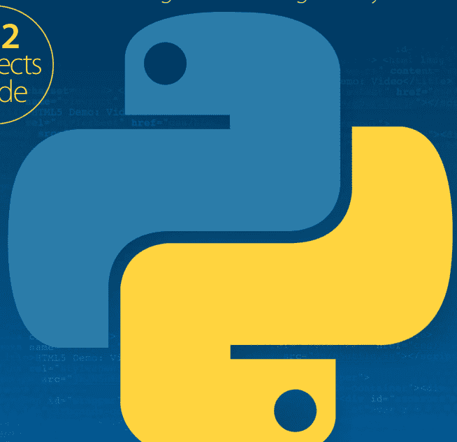

## Welcome to

The Python Book

Python is an incredibly versatile, expansive language which, due to its similarity to everyday language, is surprisingly easy to learn even for inexperienced programmers. It has seen a huge increase in popularity since the release and rise of the Raspberry Pi, for which Python is the officially recognised programming language. In The Python Book, you'll find plenty of creative projects to help you get to grips with the combination of your Raspberry Pi and Python's powerful functionality, but there are also plenty of tutorials that focus on Python's effectiveness away from the Raspberry Pi. You'll learn all about how to code with Python from the very beginning with our comprehensive masterclass, then go on to complete tutorials to consolidate your skills and become fluent in the language while also improving your computing experience. You'll learn how to make Python work for you with tutorials on coding with `Django`, `Flask`, `Pygame` and even more useful third-party applications and frameworks. Get ready to become a true Python expert with the wealth of information contained within these pages.


### Part of the Linux User & Developer bookazine series


```
Python 2.7.6 (default, Mar 22 2014, 22:59:51)
[GCC 4.8.2] on linux2
type "help", "copyright", "credits" or "license" for more information
>>> import scipy
>>> mysin = "scipy.sin(45.6)"
>>> eval(mysin)
6.98899006714502186
>>>
```

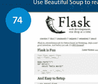


### 50 个 Python 技巧

#### Web 开发

- **134 使用 Python 开发** — 为什么 Python 非常适合 Web
- **140 搭建自己的博客** — 开始开发你的博客
- **144 为博客提供内容** — 向你的网站添加内容
- **148 增强你的博客** — 用插件完善你的博客

#### 在 Pi 上使用 Python

- **154 在 Raspberry Pi 上用 Python 编程** — 学习如何为 Pi 优化
- **158 编程 Minecraft Pi** — 在 Pi 上玩 Minecraft 游戏
- **162 构建 LED 矩阵** — 使用 Pi 控制灯光序列
- **166 Raspberry Pi 汽车电脑** — 用 Raspberry Pi 抵达目的地

> “Python 非常庞大，但你很快就会成为专家”

### 开始学习 Python

一直想尝试编程？别再找借口了，因为 Python 是入门的完美方式！

Python 是一种对初学者和专家都非常好的编程语言。它以代码可读性为设计核心，使其成为仍在熟悉各种编程概念的初学者的绝佳选择。

该语言很受欢迎，并且有大量可用的库，让程序员可以用相对较少的代码完成很多工作。

你可以用 Python 制作各种各样的应用程序：你可以使用 `Pygame` 框架编写简单的 2D 游戏，可以使用 `GTK` 库创建窗口化应用程序，或者尝试更雄心勃勃的东西，比如使用 Python 的蓝牙和输入库创建一个应用来捕获 USB 键盘的输入并将输入事件中继到 Android 手机。

在本教程中我们将使用 `Python 2.x`，因为这很可能是安装在你的 Linux 发行版上的版本。

在接下来的教程中，你将学习如何使用 Python 编程创建流行的游戏。我们还将向你展示如何为这些游戏添加音效和 AI。

### Hello World

让我们开始吧，没有什么比程序员的好朋友“Hello World”应用程序更合适的了！首先打开一个终端。它的当前工作目录将是你的主目录。最好为本教程中我们将创建的文件创建一个目录，而不是将它们散放在主目录中。你可以使用命令 `mkdir Python` 创建一个名为 `Python` 的目录。然后你需要使用命令 `cd Python` 进入该目录。

下一步是使用命令 `touch` 后跟文件名创建一个空文件。我们的专家使用了命令 `touch hello_world.py`。设置文件的最后一步也是最重要的一步是使其可执行。这使我们能够在 `hello_world.py` 文件中运行代码。我们使用命令 `chmod +x hello_world.py` 来实现这一点。现在文件已经设置好，我们可以继续在 `nano` 或你选择的任何文本编辑器中打开它。`Gedit` 是一款支持语法高亮的优秀编辑器，应该在任何发行版上都可用。如果你还没有它，可以使用你的包管理器安装它。

```
[liam@liam-laptop ~]$ mkdir Python
[liam@liam-laptop ~]$ cd Python/
[liam@liam-laptop Python]$ touch hello_world.py
[liam@liam-laptop Python]$ chmod +x hello_world.py
[liam@liam-laptop Python]$ nano hello_world.py
```

我们的 Hello World 程序非常简单，只需要两行。第一行以 'shebang' 开头（符号 `#!` – 也称为 hashbang），后跟 Python 解释器的路径。程序加载器使用这一行来确定其余行需要用什么来解释。如果你正在 IDE 如 `IDLE` 中运行，则不一定需要这样做。

实际被 Python 解释器读取的代码只有一行。我们通过在调用 `print` 函数后立即将其放在括号中，将值 `Hello World` 传递给 `print` 函数。`Hello World` 用引号括起来以表示它是一个字面值，不应被解释为源代码。正如预期的那样，Python 中的 `print` 函数会打印从控制台传递给它的任何值。

你可以在 `nano` 中使用快捷键 `Ctrl+O` 然后按 `Enter` 保存刚刚对文件所做的更改。使用 `Ctrl+X` 退出 `nano`。

```
#!/usr/bin/env python2
print("Hello World")
```

你可以通过在其文件名前加上 `./` 来运行 Hello World 程序 — 在这种情况下你需要输入：`./hello_world.py`

```
[liam@liam-laptop Python]$ ./hello_world.py
Hello World
```

### TIP

如果你使用的是图形编辑器，如 `gedit`，那么你只需要做最后一步使文件可执行。你只需要将文件标记为可执行一次即可。文件一旦可执行，你就可以自由编辑它。

### 变量和数据类型


变量是源代码中与内存中的一个区域相关联的名称，你可以使用它来存储数据，然后在整个代码中调用该数据。数据可以是多种类型中的一种，包括：

| 类型 | 描述 |
| --- | --- |
| Integer | 存储整数 |
| Float | 存储小数 |
| Boolean | 可以具有 True 或 False 的值 |
| String | 存储一组字符。"Hello World" 是一个字符串 |

除了这些主要数据类型外，还有序列类型（从技术上讲，字符串是一种序列类型，但由于使用非常普遍，我们将其归类为主要数据类型）：

| 类型 | 描述 |
| --- | --- |
| List | 包含按特定顺序排列的数据集合 |
| Tuple | 包含按特定顺序排列的不可变数据集合 |

元组可用于类似坐标的东西，包含存储为单个变量的 x 和 y 值，而列表通常用于存储更大的集合。存储在元组中的数据是不可变的，因为你无法更改元组中单个元素的值。但是，你可以在列表中这样做。

了解 Python 的字典类型也很有用。字典是一种映射数据类型。它以键值对的形式存储数据。这意味着你使用该值的对应键来访问字典中存储的值，这与使用列表的方式不同。在列表中，你会使用该元素的索引（表示元素在列表中位置的数字）来访问列表的元素。

让我们编写一个程序来演示如何使用变量和不同的数据类型。值得注意的是，在 Python 中你并不总是必须指定数据类型。请随意在你喜欢的任何编辑器中创建此文件。只要记得使文件可执行，一切都会正常工作。我们将它命名为 `variables.py`。

> “变量是源代码中与内存中的一个区域相关联的名称，你可以使用它来存储数据”

## 解释型 vs 编译型语言

解释型语言如 Python 是指源代码在程序每次运行时都被转换为机器代码然后执行。这与编译型语言如 C 不同，在编译型语言中，源代码只被转换为机器代码一次 — 然后每次运行程序时都执行生成的机器代码。

```
#!/usr/bin/env python2

# 我们通过写下想要的变量名，后跟等号，再跟上想要存储在变量中的值来创建一个变量。例如，下面的行创建了一个名为
# hello_str 的变量，包含字符串 Hello World。

hello_str = "Hello World"

hello_int = 21

hello_bool = True

hello_tuple = (21, 32)

hello_list = ["Hello", "this", "is", "a", "list"]

# 这个列表现在包含 5 个字符串。注意这些字符串之间没有空格
# 如果你想把它们连起来组成一个句子
# 你需要在每个元素之间加上空格。

hello_list = list()

hello_list.append("Hello,")

hello_list.append("this")

hello_list.append("is")

hello_list.append("a")

hello_list.append("list")

# 第一行创建了一个空列表，随后的行使用列表类型的 append
# 函数向列表中添加元素。这种使用列表的方式在处理事先已知的字符串时并不是很有用，但在处理动态数据（如用户输入）时可能很有用。这个列表将用相同的变量名覆盖第一个列表，而不会有任何警告。

hello_dict = {"first_name":"Liam",
              "last_name":"Fraser",
              "eye_colour":"Blue"}

# 让我们访问集合中的一些元素
# 我们先从更改 hello_list 中最后一个字符串的值开始
# 并在末尾添加一个感叹号。"list" 字符串是列表中的第 5 个元素
# 然而，Python 中的索引是从零开始的，这意味着
# 第一个元素的索引是 0。

print(hello_list[4])

hello_list[4] += "!"

# 上一行等同于
# hello_list[4] = hello_list[4] + "!"

print(hello_list[4])
```

以下行创建了一个名为 `hello_int` 的整数变量，其值为 21。注意它不需要放在引号中

布尔值也是同样的原理

我们以如下方式创建一个元组

以及以这种方式创建一个列表

你也可以以如下方式创建相同的列表

我们不妨顺便创建一个字典。注意我们已将冒号对齐以使代码整洁

注意，当我们打印该元素时，现在会出现两个感叹号

### TIP

此时，值得解释的是，Python 文件中任何跟在 `#` 字符后面的文本都将被解释器忽略。这样你就可以在代码中写注释。

> "Python 文件中任何跟在 `#` 字符后面的文本都将被忽略"

### Get started with Python

记住元组是不可变的，虽然我们可以像这样访问它们的元素

让我们使用 `hello_dict` 中的数据创建一个句子

更整洁的做法是使用 Python 的字符串格式化

```
print(str(hello_tuple[0]))
# 我们不能像刚才对列表那样更改这些元素的值
# 注意上面使用 str 函数显式地将元组中的整数值转换为字符串后再打印它。
```

```
print(hello_dict["first_name"] + " " + hello_dict["last_name"] + " has " + hello_dict["eye_colour"] + " eyes.")
```

```
print("{0} {1} has {2} eyes.".format(hello_dict["first_name"], hello_dict["last_name"], hello_dict["eye_colour"]))
```

### Control structures

在编程中，控制结构是任何可以改变代码执行路径的语句。例如，一个决定如果数字小于 5 就结束程序的控制结构看起来会像这样：

```
#!/usr/bin/env python2

import sys # 用于 sys.exit 函数

int_condition = 5

if int_condition < 6:
    sys.exit("int_condition must be >= 6")
else:
    print("int_condition was >= 6 - continuing")
```

代码所走的路径取决于整数 `int_condition` 的值。`'if'` 块中的代码只有在条件为真时才会被执行。`import` 语句用于加载 Python 系统库；后者提供了 `exit` 函数，允许你退出程序并打印错误信息。注意缩进（在本例中每个缩进为四个空格）用于指示代码块属于哪个语句。

`'If'` 语句可能是使用最频繁的控制结构。其他控制结构包括：

- For 语句，允许你遍历集合中的项目，或重复执行一段代码特定次数；
- While 语句，只要条件为真就会继续的循环。

我们将编写一个程序，从用户接受输入来演示控制结构的工作方式。我们称它为 `construct.py`

`'for'` 循环使用当前值的本地副本，这意味着循环内部的任何更改都不会对列表产生影响。另一方面，`'while'` 循环直接访问列表中的元素，因此如果你想这样做，可以在其中更改列表。我们稍后会更详细地讨论变量作用域。上面程序的输出如下：

### Indentation in detail

如前所述，缩进级别决定了代码块属于哪个语句。缩进在 Python 中是强制性的，而在其他语言中，通常使用大括号集来组织代码块。因此，使用一致的缩进风格至关重要。在 Python 中，通常使用四个空格来表示一个缩进级别。你可以使用制表符，但制表符定义不明确，尤其是在你在一个以上编辑器中打开文件时。

> “‘for’ 循环使用本地副本，因此循环中的更改不会影响列表”

```
[liam@liam-laptop Python]$ ./construct.py
How many integers? acd
You must enter an integer

[liam@liam-laptop Python]$ ./construct.py
How many integers? 3
Please enter integer 1: t
You must enter an integer
Please enter integer 1: 5
Please enter integer 2: 2
Please enter integer 3: 6
Using a for loop
5
2
6
Using a while loop
5
2
6
```

### More about a Python list

Python 列表类似于其他语言中的数组。列表（或 Python 中的元组）可以包含多种类型的数据，而这在其他语言的数组中通常不是这种情况。因此，我们建议你只在列表中存储相同类型的数据。无论如何，由于列表中数据处理的性质，这几乎总是应该如此。

我们想要在列表中的整数数量

用于存储整数的列表

这些用于跟踪我们当前拥有的整数数量


如果上述操作成功，则 `isint` 将被设为 `true`：`isint=True`

到目前为止，用户已经放弃，或者我们有一个装满整数的列表。我们可以用几种方式遍历这些列表。第一种是使用 `for` 循环

```#!/usr/bin/env python2

# We're going to write a program that will ask the user to input an arbitrary
# number of integers, store them in a collection, and then demonstrate how the
# collection would be used with various control structures.

import sys # Used for the sys.exit function

target_int = raw_input("How many integers?")

# By now, the variable target_int contains a string representation of
# whatever the user typed. We need to try and convert that to an integer but
# be ready to deal with the error if it's not. Otherwise the program will
# crash.
try:
    target_int = int(target_int)
except ValueError:
    sys.exit("You must enter an integer")

ints = list()
count = 0

# Keep asking for an integer until we have the required number
while count < target_int:
    new_int = raw_input("Please enter integer {}:".format(count + 1))
    isint = False
    try:
        new_int = int(new_int)
    except:
        print("You must enter an integer")

    # Only carry on if we have an integer. If not, we'll loop again
    # Notice below I use ==, which is different from =. The single equals is an
    # assignment operator whereas the double equals is a comparison operator.
    if isint == True:
        # Add the integer to the collection
        ints.append(new_int)
        # Increment the count by 1
        count += 1

print("Using a for loop")
for value in ints:
    print(str(value))
```

# 开始学习 Python

## 提示

如果你想能够在不传递任何变量的情况下调用函数，你可以为变量定义默认值。你可以通过在变量名后加上等号来实现。例如，你可以这样做：

`def modify_string(original: "Default string")`

```# Or with a while loop:
print("Using a while loop")
# We already have the total above, but knowing the len function is very useful
total = len(ints)
count = 0
while count < total:
    print(str(ints[count]))
    count += 1
```

## 函数和变量作用域

函数在编程中用于将流程分解为更小的块。这通常使代码更易于阅读。如果设计得当，函数也可以重复使用。函数可以接收传递给它们的变量。Python 中的变量始终按值传递，这意味着变量的副本被传递给函数，该副本仅在函数的作用域内有效。对函数内部原始变量所做的任何更改都将被丢弃。但是，函数也可以返回值，因此这不是问题。函数使用关键字 `def` 定义，后跟函数名。可以在函数名后加上括号中的变量来传递。多个变量用逗号分隔。在这些括号中给变量起的名字是在函数作用域中使用的名字，而不管传递给函数的变量叫什么。让我们看看实际效果。

相反程序的输出如下：

> “Functions are used in programming to break processes down in”

```#!/usr/bin/env python2

# Below is a function called modify_string, which accepts a variable
# that will be called original in the scope of the function. Anything
# indented with 4 spaces under the function definition is in the
# scope.
def modify_string(original):
    original += " that has been modified."
    # At the moment, only the local copy of this string has been modified

def modify_string_return(original):
    original += " that has been modified."
    # However, we can return our local copy to the caller. The function
    # ends as soon as the return statement is used, regardless of where it
    # is in the function.
    return original

test_string = "This is a test string"
modify_string(test_string)
print(test_string)

test_string = modify_string_return(test_string)
print(test_string)

# The function's return value is stored in the variable test string,
# overwriting the original and therefore changing the value that is
# printed.
```

我们现在已超出 `modify_string` 函数的作用域，因为我们已减少了缩进级别

在此代码中，测试字符串不会被更改

但是，我们可以这样调用函数

# 开始学习 Python

```
[liam@liam-laptop Python]$ ./functions_and_scope.py
This is a test string
This is a test string that has been modified.
```

作用域是需要掌握的重要概念，否则会养成一些坏习惯。让我们写一个快速程序来演示这一点。它将有一个名为 `cont` 的布尔变量，它将决定一个数字是否会在 `if` 语句中被赋给一个变量。然而，该变量除了在 `if` 语句的作用域内之外，在任何地方都没有被定义。我们最后会尝试打印该变量。

```#!/usr/bin/env python2
cont = False
if cont:
    var = 1234
print(var)
```

在上面的代码段中，Python 会在打印前将整数转换为字符串。然而，显式地将事物转换为字符串始终是一个好主意——尤其是在拼接字符串时。如果你尝试对字符串和整数使用 `+` 运算符，会出现错误，因为它并不明确需要发生什么。`+` 运算符通常会把两个整数相加。话虽如此，我们之前演示的 Python 字符串格式化器是更干净的做法。你能看出问题吗？`Var` 只在 `if` 语句的作用域内被定义。这意味着当我们尝试访问 `var` 时会得到一个非常糟糕的错误。


```
[liam@liam-laptop Python]$ ./scope.py
Traceback (most recent call last):
  File "./scope.py", line 8, in <module>
    print var
NameError: name 'var' is not defined
```

如果 `cont` 被设为 `True`，那么变量将被创建，我们就可以正常访问它。然而，这是一种糟糕的做法。正确的做法是在 `if` 语句的作用域之外初始化变量。

```
#!/usr/bin/env python2
cont = False
var = 0
if cont:
    var = 1234
if var != 0:
    print(var)
```

变量 `var` 在比 `if` 语句更宽的作用域中定义，并且仍然可以被 `if` 语句访问。在 `if` 语句内部对 `var` 所做的任何更改都是在修改更大作用域中定义的变量。这个例子除了说明潜在问题之外几乎没什么用，但最坏的情况已经从程序崩溃变成了打印零。即使这种情况也不会发生，因为我们在打印前添加了一个额外的结构来测试 `var` 的值。

### 编码风格

花一点时间谈谈编码风格是值得的。写出整洁的代码很简单。关键是保持一致性。例如，你应该始终以相同的方式命名变量。无论你想使用 `camelCase` 还是我们使用的下划线都可以。至关重要的一点是为变量使用自描述的标识符。你不应该去猜测变量的作用。另一个相关的事情是始终注释你的代码。这将帮助任何阅读你代码的人，以及未来的你。在代码文件的顶部放置一个简要的摘要，描述应用程序的作用，或如果它由多个文件组成，则描述应用程序的一部分，也是很有用的。

### 比较运算符

Python 中可用的常见比较运算符包括：

|  |  |
|---|---|
| `<` | 严格小于 |
| `<=` | 小于或等于 |
| `>` | 严格大于 |
| `>=` | 大于或等于 |
| `==` | 等于 |
| `!=` | 不等于 |

### 总结

本文应该向你介绍了 Python 编程的基础知识。希望你已经开始习惯 Python 程序的语法、缩进和整体外观。下一步是学习如何提出你想要解决的问题，并将其分解成足够小的步骤，以便在编程语言中实现。

Google 或任何其他搜索引擎都非常有帮助。如果你卡住了，或者有一个无法弄清楚如何修复的错误信息，就把它粘贴到 Google 中，你应该会更接近解决问题。例如，如果我们搜索‘play mp3 file with python’，第一个链接会带我们到一个 Stack Overflow 讨论串，其中包含大量有用的回复。不要害怕陷入其中——编程真正的乐趣是一次解决一个可管理的难题。

祝编程愉快！


## 50 个必备 Python 命令

Python 以其语言密度大著称，拥有大量能够完成几乎任何任务的模块。在这里，我们将介绍每个人都需要掌握的核心要点。

Python 拥有庞大的额外模块生态系统，可在数百个不同的学科中提供功能。然而，每种编程语言都有一套核心功能，每个人都应该了解，以便完成有用的工作。Python 在这方面也不例外。在这里，我们将介绍 50 条我们认为对 Python 编程至关重要的命令。其他人可能会选择略有不同的集合，但此列表包含了最精华的部分。

我们将涵盖所有基本命令，从程序开始时导入额外模块，到程序结束时将值返回给调用环境。我们还将介绍一些有助于了解当前 Python 会话的命令，例如已定义变量的当前列表以及内存的使用情况。

由于 Python 环境涉及使用大量额外模块，我们还将介绍一些严格在 Python 之外的命令。我们将了解如何安装外部模块以及如何为不同的开发项目管理多个环境。由于这将是一个命令列表，因此假设你已经知道如何使用循环和条件结构的基础知识。本文旨在帮助你回忆起以前见过的命令，并希望向你介绍一些你可能尚未见过的命令。

尽管我们已尽力将你可能需要的一切都浓缩到 50 条技巧中，但 Python 是一种庞大的语言，因此一些命令将被遗漏。在掌握这些内容后，请抽出时间学习我们未涵盖的内容。

**50 Python commands**

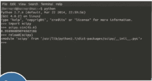

### 01 Importing modules

Python 的强大之处在于其通过模块进行扩展的能力。许多程序的第一步是导入所需的模块。最简单的导入语句就是调用 `import modulename`。在这种情况下，所提供的函数和对象不在通用命名空间中。你需要使用完整名称调用它们（`modulename.methodname`）。你可以使用命令 `import modulename as mm` 缩短 `modulename` 部分。你也可以完全跳过这个问题，使用命令 `from modulename import *` 从给定模块导入所有内容。然后你可以直接调用这些提供的功能。如果只需要其中几项，你可以将 `*` 替换为方法和对象名称，选择性地导入它们。

### 02 Reloading modules

当模块首次导入时，其初始化函数会在此时运行。这可能涉及创建数据对象或启动连接。但这仅在给定会话中第一次完成。再次导入同一模块不会重新执行任何初始化代码。如果你希望重新运行此代码，则需要使用 `reload` 命令。格式为 `reload(modulename)`。需要注意的是，之前的导入的字典不会被清除，而只是被覆盖。这意味着导入和重新加载之间发生变化的任何定义都会被正确更新。但如果你删除了一个定义，旧的定义仍会保留并可访问。可能还有其他副作用，因此请谨慎使用。

### 03 Installing new modules

我们所查看的大多数命令都是在 Python 会话内执行的 Python 命令，但也有一些必要的命令需要在 Python 之外执行。其中第一个是 `pip`。安装模块涉及下载源代码并编译其中包含的外部代码。幸运的是，在 http://pypi.python.org 上有一个包含数百个 Python 模块的存储库。与其手动完成所有操作，你可以使用命令 `pip install modulename` 安装新模块。此命令还会进行依赖检查，并在安装你请求的模块之前安装任何缺失的模块。如果你希望将此新模块安装到计算机的全局库中，可能需要管理员权限。在 Linux 机器上，你只需使用 `sudo` 运行 `pip` 命令即可。否则，你可以通过添加命令行选项 `--user` 将其安装到你的个人库目录。

> “每种编程语言都有每个人都应该知道的核心功能集，以便完成有用的工作。Python 也不例外”

### 04 Executing a script

导入模块确实会运行模块文件中的代码，但它是通过 Python 引擎内的模块命名空间代码执行的。此维护代码还处理重复运行模块的情况。如果你只想获取一个 Python 脚本并在当前会话中执行其中的原始代码，可以使用 `execfile(filename.py)` 命令，其中主要选项是一个包含要加载和执行的 Python 文件的字符串。默认情况下，任何定义都会加载到当前会话的 `locals` 和 `globals` 中。你可以可选地向 `execfile` 命令添加两个额外参数。这两个选项都是字典，一个用于不同的 `locals` 集合，一个用于不同的 `globals` 集合。如果你只提供一个字典，则假定为 `globals` 字典。此命令的返回值是 `None`。

### 05 An enhanced shell

默认的交互式 shell 通过命令 `python` 提供，但功能相当有限。增强型 shell 由命令 `ipython` 提供。它为代码开发者提供了大量额外功能。提供了一个全面的历史系统，让你不仅可以访问当前会话的命令，还可以访问以前会话的命令。还有魔术命令，可提供与当前 Python 会话交互的增强方式。对于更复杂的交互，你可以创建并使用宏。你还可以轻松地查看 Python 会话的内存并反编译 Python 代码。你甚至可以创建配置文件，让你在每次使用 iPython 时处理可能需要的初始化步骤。

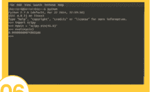

### 06 Evaluating code

有时，你可能拥有以编程方式组合在一起的代码块。如果这些代码片段组合成一个字符串，你可以使用命令 `eval(code_string)` 执行结果。代码字符串中的任何语法错误都会作为异常报告。默认情况下，此代码在当前会话中执行，使用当前的 `globals` 和 `locals` 字典。`eval` 命令还可以接受另外两个可选参数，在其中你可以提供 `globals` 和 `locals` 的不同字典集合。如果只有一个额外参数，则假定为 `globals` 字典。你可以可选地传入一个使用 `compile` 命令创建的代码对象，而不是代码字符串。此命令的返回值是 `None`。

### 断言值


在某个时候，我们都需要调试正在尝试编写的代码片段。其中一个有用的工具是断言的概念。`assert`命令接受一个 Python 表达式并检查它是否为真。如果是，则执行按正常继续。如果不是，则会引发`AssertionError`。这样你就可以检查代码中的不变量是否保持不变。通过这样做，你可以检查代码中做出的假设。你可以 optionally 为`assert`命令包含第二个参数。此第二个参数是在断言失败时执行的 Python 表达式。通常，这是一种详细的错误消息，会被打印出来。或者，你可能想要包含清理代码以从失败的断言中恢复。

### 映射函数

在现代程序中完成的常见任务是将给定的计算映射到整个元素列表。Python 提供了命令`map()`来执行此操作。`Map`返回将函数应用于可迭代对象的每个元素的結果列表。`Map`实际上可以接受不止一个函数和不止一个可迭代对象，如果它被赋予不止一个函数，则返回一个元组列表，每个元组的每个元素包含来自每个函数的結果。如果传入不止一个可迭代对象，则`map`假定函数接受不止一个输入参数，因此它将从给定的可迭代对象中获取它们。这隐含地假设可迭代对象都是相同大小的，并且它们都是给定函数所必需的参数。

### 虚拟环境

由于 Python 环境的潜在复杂性，有时最好设置一个干净的环境，在其中仅安装给定项目所需的模块。在这种情况下，你可以使用`virtualenv`命令来初始化此类环境。如果你创建一个名为`ENV`的目录，你可以使用命令`virtualenv ENV`创建一个新环境。这将创建子目录`bin`、`lib`和`include`，并用初始环境填充它们。然后你可以通过`source`脚本`ENV/bin/activate`来开始使用这个新环境，这将更改几个环境变量，例如`PATH`。当你完成时，你可以`source`脚本`ENV/bin/deactivate`将你的 shell 环境重置回其先前的状态。这样，你就可以拥有仅具有给定任务集所需模块的环境。

> “虽然不严格是命令，但每个人都需要知道如何处理循环。两种主要的循环类型是固定次数迭代循环（`for`）和条件循环（`while`）”

### 循环

虽然不严格是命令，但每个人都需要知道如何处理循环。两种主要的循环类型是固定次数迭代循环（`for`）和条件循环（`while`）。在`for`循环中，你遍历某个值序列，一次从列表中取出一个值并将其放入临时变量中。你继续进行，直到处理完所有元素或遇到`break`命令。在`while`循环中，只要某个测试表达式求值为`True`，你就继续进行循环。`while`循环也可以通过使用`break`命令提前退出，你还可以通过使用`continue`命令在任一循环中跳过代码片段，以选择性地停止当前迭代并进入下一个迭代。

### 过滤

其中命令`map`对可迭代中的每个元素返回一个結果，`filter`仅在函数返回`True`值时才返回結果。这意味着你可以创建一个新元素列表，其中只有满足某些条件 的元素才会被使用。作为示例，如果你的函数检查值是否在 0 到 10 之间数字，则它将创建一个新列表，其中不包含负数和大于 10 的数字。这可以用`for`循环实现，但这种方法更干净。如果提供给`filter`的函数为`None`，则假定它为恒等函数。这意味着只有那些求值为`True`的元素才会被作为新列表的一部分返回。`itertools`模块中提供了`filter`的可迭代版本。

### 归约

在许多计算中，你需要执行的一种计算是归约操作。这就是你取一些值列表并将其归约到单个值。在 Python 中，你可以使用命令`reduce(function, iterable)`将归约函数应用于列表中的每一对元素。例如，如果你将求和归约操作应用于前五个整数的列表，你将得到結果`(((1+2)+3)+4)+5`。你可以 optionally 添加第三个参数作为初始化项。它在从可迭代对象加载任何元素之前加载，如果可迭代对象实际上为空，则作为默认值返回。你可以使用`lambda`函数作为`reduce`的函数参数来使你的代码尽可能紧凑。在这种情况下，请记住它应仅接受两个输入参数。

```
Python code examples shown in the dark code panels.
```

```
Python code examples shown in the dark code panel.
```

```
Python code examples shown in the dark code panel.
```


#### 13 列表的真值如何？

在某些情况下，你可能在列表中收集了一些可以求值为`True`或`False`的元素。例如，也许你将多个可能性通过计算，并创建了一个通过的列表。你可以使用命令`any()`来检查列表中的任何元素是否为`True`。如果需要检查所有元素是否都为`True`，可以使用命令`all()`。这两个命令在相关条件满足时都返回一个`True`，否则返回`False`。然而，它们在可迭代对象为空时的行为不同。命令`all`在可迭代对象为空时返回`True`，而命令`any`在给定空可迭代对象时返回`False`。

#### 14 枚举

有时，我们需要为可迭代对象中的元素标注其索引，以便在稍后进行处理。你可以通过显式遍历每个元素并构建枚举列表来实现。`enumerate`命令可以在一行中完成此操作。它接受一个可迭代对象并生成一个元组列表作为结果。每个元组包含元素的 0-based 索引以及元素本身。你可以通过包含可选的第二个参数来选择从其他值开始索引。例如，你可以使用命令`list(enumerate(names, start=1))`来枚举一个名字列表。在此示例中，我们决定从 1 而不是 0 开始索引。

#### 15 类型转换

Python 中的变量没有任何类型信息，因此可以用来存储任何类型的对象。然而，实际数据属于某种类型。许多运算符，如加法，都假设输入值是相同类型的。非常经常地，你使用的运算符足够智能，可以进行所需的类型转换。如果你需要显式地将数据从一种类型转换为另一种类型，有一类函数可以用来执行此转换过程。你最有可能使用的有`abs`、`bin`、`bool`、`chr`、`complex`、`float`、`hex`、`int`、`long`、`oct`和`str`。对于基于数字的转换函数，存在一种优先级顺序，其中某些类型是其他类型的子集。例如，整数比浮点数“更低”。向上转换时，最终值不应发生变化。向下转换时，通常会丢失一些信息。例如，从浮点数转换为整数时，Python 会将数字向零截断。

#### 16 这是什么？

Python 中的一切都是对象。你可以使用命令`isinstance(object, class)`来检查此对象是哪个类的实例。此命令返回一个布尔值。

#### 17 它是子类吗？

命令`issubclass(class1, class2)`检查`class1`是否是`class2`的子类。如果`class1`和`class2`相同，则返回`True`。

#### 18 全局对象

你可以使用命令`globals()`获取当前模块的全局符号表的字典。

#### 19 局部对象

你可以使用命令`locals()`访问当前局部符号表的更新字典。

#### 20 变量

命令`vars(dict)`返回对象的可写元素。如果你使用`vars()`，它会像`locals()`一样行为。

#### 21 创建全局变量

名称列表可以通过命令`global names`被解释为整个代码块的全局变量。

#### 22 非局部变量

在 Python 3.X 中，你可以使用命令`nonlocal names`从最近的封闭作用域访问名称并将其绑定到局部作用域。

#### 23 引发异常

当你识别到错误条件时，可以使用`raise`命令抛出异常。你可以包含异常类型和值。

#### 24 处理异常

异常可以在`try-except`结构中捕获。如果`try`块中的代码引发了异常，则`except`块中的代码会被运行。

#### 25 静态方法

你可以使用命令`@staticmethod(function_name)`创建静态方法，类似于 Java 或 C++ 中的方法。

#### 34 文件

处理文件时，你需要创建一个文件对象来与其交互。`file`命令接受一个包含文件名和位置的字符串并创建一个文件对象实例。然后你可以调用文件对象的方法，如`open`、`read`和`close`，以从文件中获取数据。如果你在进行文件处理，也可以使用`readline`方法。打开文件时，有一个显式的`open()`命令来简化流程。它接受一个包含文件名的字符串，以及一个可选参数，该参数是一个定义模式的字符串。默认是以只读方式打开文件（`'r'`）。你也可以以写入方式打开（`'w'`）和追加方式打开（`'a'`）。打开文件后，会返回一个文件对象，以便你进一步与其交互。然后你可以读取它、向其写入，最后关闭它。

#### 35 让出控制权


在许多情况下，一个函数可能需要将执行上下文让出给其他函数。生成器就是这种情况。生成器的首选方法是它仅在通过 `next()` 方法请求时才计算下一个值。`yield` 命令保存生成器函数的当前状态，并将执行控制返回给调用函数。这样，生成器的保存状态会被重新加载，生成器会从上次中断的地方继续，以计算下一个请求的值。这样，你只需要有足够的内存来存储计算下一个所需值的最少信息，而不必一次性将所有可能的值都存储在内存中。

### 36 弱引用

有时你需要对一个对象有一个引用，但仍能在需要时销毁它。弱引用是可以被垃圾回收器忽略的引用。如果一个对象剩下的唯一引用都是弱引用，那么垃圾回收器就可以销毁该对象并回收空间供其他用途。这在你拥有大型数据集的缓存或映射时很有用，这些数据不一定需要一直保留在内存中。如果一个被弱引用的对象最终被销毁，而你尝试访问它，它将显示为 `None`。你可以测试此条件，然后在决定这是必要步骤时重新加载数据。

### 37 序列化数据

当你需要将结果检查点保存到磁盘时，有几种不同的内存序列化方式。其中一种称为 `pickle`。`Pickle` 实际上是一个完整的模块，而不仅仅是一个单一命令。要将数据存储到硬盘上，可以使用 `dump` 方法将数据写出。当你想在未来的某个时间点重新加载相同数据时，可以使用 `load` 方法读取数据并将其反序列化。`pickle` 的一个问题是其速度，或缺乏速度。有第二个模块 `cPickle`，它提供相同的基本功能。但由于它是用 C 编写的，因此可能快 1000 倍。需要注意的一点是，`pickle` 不存储对象的任何类信息，只存储其实例信息。这意味着当你反序列化对象时，如果类定义在此期间发生了变化，它可能具有不同的方法和属性。

### 38 shelve 数据

虽然 `pickle` 允许你保存数据并重新加载它，但有时你需要在 Python 会话中拥有更结构化的对象持久性。使用 `shelve` 模块，你可以创建一个对象存储，其中本质上任何可以被 pickled 的东西都可以存储在那里。驱动器上存储的后端可以由多个系统处理，例如 `dbm` 或 `gdbm`。一旦你打开了一个 shelf，你就可以使用键值对来读取和写入它。完成后，你需要确保显式关闭 shelf，以便与文件存储同步。由于数据可能以某种方式存储在后端数据库中，最好不要在 Python 中在 `shelf` 模块之外打开相关文件。你也可以在 `writeback` 设置为 `True` 的情况下打开 shelf。如果是这样，你可以显式调用 `sync` 方法来写出缓存的更改。

### 39 线程

你可以在 Python 中执行多个线程。`thread()` 命令可以为你创建一个新的执行线程。它遵循与 POSIX 线程相同的技术。当你第一次创建线程时，你需要提供一个函数名，以及该函数所需的任何参数。需要记住的一点是，这些线程的行为就像 POSIX 线程一样。这意味着几乎所有事情都是程序员的责任。你需要处理互斥锁（使用 `acquire` 和 `release` 方法），以及使用 `allocate_lock` 方法创建原始互斥锁。完成后，你需要 `exit` 该线程以确保其被正确清理并且没有资源遗留。你对线程也有精细的控制，能够设置诸如新线程的堆栈大小之类的内容。

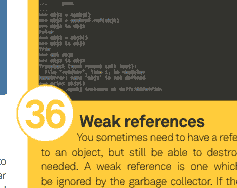

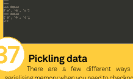

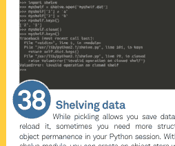

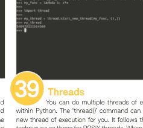

### 50 个 Python 命令

#### 40 输入数据

有时，你需要从终端用户收集输入。命令 `input()` 可以接收一个提示字符串显示给用户，然后等待用户输入响应。一旦用户输入完毕并按下回车键，文本就会返回到你的程序中。如果在调用 `input` 之前加载了 `readline` 模块，那么你将拥有增强的行编辑和历史功能。此命令会先将文本通过 `eval` 处理，因此可能会导致未捕获的错误。如果你有任何疑虑，可以使用命令 `raw_input()` 来跳过此问题。此命令只是简单地返回用户输入的未更改字符串。同样，你可以使用 `readline` 模块来获得增强的行编辑功能。

#### 41 内部变量

对于来自其他编程语言的人来说，有一种概念是某些变量或方法只能在对象内部使用。在 Python 中，没有这种概念。对象的全部元素都是可访问的。然而，有一种风格规则可以模仿这种行为。任何以下划线开头的名称都应被视为内部名称，并应保持为对象私有。它们并未被隐藏，并且这些变量或方法也没有显式的保护。程序员有责任尊重类作者的意图，不要更改任何这些内部名称。如果你认为必要，你也可以自由地进行此类更改。

#### 42 比较对象

在 Python 中比较对象有几种方法，且存在一些注意事项。首先，你可以在对象之间测试两件事：相等性和同一性。如果你测试同一性，你是在测试两个名称是否实际引用同一个实例对象。这可以通过命令 `example1 is obj2` 来完成。你也可以使用 `is` 关键字来测试此条件。例如，`obj1 is obj2`。如果你测试相等性，你是在测试两个名称所引用的对象中的值是否相等。此测试由运算符 `==` 处理，如 `obj1 == obj2`。对于更复杂的对象，相等性测试可能会变得复杂。

#### 43 切片

虽然切片并非真正的命令，但它是一个太重要的概念，不能不在这个必备命令列表中提及。在 Python 中，对数据结构（如列表）中的元素进行索引是最常见的操作之一。你可以通过提供单个索引值来选择单个元素。更有趣的是，你可以通过提供一个起始索引和一个结束索引，用冒号分隔，来选择一系列元素。这会返回一个新列表，你可以将其保存到新的变量名中。你甚至可以更改步长，从而跳过一定数量的元素。因此，你可以用切片 `a[1::2]` 从列表 `a` 中获取每个奇数元素。这从索引 1 开始，一直持续到末尾，并以 2 为步长遍历索引值。切片可以给定负索引值。如果这样做，则它们从列表末尾开始并向后计数。

> “Python 是一种解释型语言，这意味着你编写的源代码需要被编译成字节码格式。然后此字节码会被送入实际的 Python 引擎”

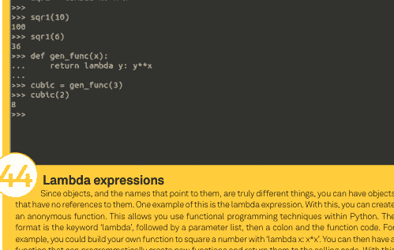

#### 44 Lambda 表达式

由于对象和指向它们的名称本质上是不同的事物，因此你可以拥有对它们没有任何引用的对象。一个例子就是 lambda 表达式。通过它，你可以创建一个匿名函数。这允许你在 Python 中使用函数式编程技术。其格式为关键字 `lambda`，后跟参数列表，然后是冒号和函数代码。例如，你可以用 `lambda x: x*x` 构建自己的函数来对数字进行平方。然后你可以拥有一个可以以编程方式创建新函数并将其返回给调用代码的函数。凭借此功能，你可以创建函数生成器来实现自修改程序。唯一的限制是它们仅限于单个表达式，因此你无法生成非常复杂的函数。

#### 45 编译代码对象

Python 是一种解释型语言，这意味着你编写的源代码需要被编译成字节码格式。然后此字节码会被送入实际的 Python 引擎以逐步执行指令。在你的程序中，你可能需要控制将代码转换为字节码并运行结果的过程。也许你希望构建自己的 REPL。命令 `compile()` 接收一个包含 Python 代码集合的字符串对象，并返回一个代表此代码的字节码转换的对象。然后可以将此新对象交给 `eval()` 或 `exec()` 来实际运行。你可以使用参数 `mode=` 来告诉 `compile` 正在编译哪种代码。`single` 模式是一个单一语句，`eval` 是一个单一表达式，`exec` 是一个完整的代码块。

#### 46 __init__ 方法

当你创建一个新类时，你可以包含一个私有初始化方法，该方法在创建类的新实例时被调用。当新对象实例需要在新对象中加载一些数据时，此方法很有用。

#### 47 __del__ 方法

当实例对象即将被销毁时，`__del__` 方法会被调用。这给了你进行任何可能需要的清理的机会。这可能是关闭文件，或断开网络连接。在此代码完成后，对象最终会被销毁并释放资源。

#### 48 退出你的程序

有两种伪命令可用于退出 Python 解释器：`exit()` 和 `quit()`。它们都接受一个可选参数，该参数设置进程的退出代码。如果你想从脚本中退出，最好使用 `sys` 模块中的 `exit` 函数（`sys.exit(exit_code)`）。

#### 49 返回值

函数可能需要向调用函数返回一些值。因为本质上没有名称具有类型，这包括函数。因此函数可以使用 `return` 命令向调用者返回任何对象。

#### 50 字符串拼接

我们将以大多数列表开头的内容作为结尾——字符串拼接。构建字符串最简单的方法是使用 `+` 运算符。如果你想包含其他项目，如数字，你可以使用 `str()` 转换函数将其转换为字符串对象。

### Python 要点

- 26 编写石头剪刀布游戏代码——将基础编码付诸实践


- 32 编写猜单词游戏——使用Python制作经典游戏

- 38 玩扑克骰子——测试你的运气和编码技能

- 44 创建图形界面——为你的项目添加界面

- 50 为游戏添加图形——为简单游戏添加图像

- 56 构建Android应用——使用Kivy制作你自己的应用

- 62 制作Web应用——使用Python创建在线应用

- 66 50条Python技巧——Python用户必备知识

```
robz@ubuntu:~/Desktop/PythonTutorials$ ./rockpaperscissors.py
Let's play a game of Rock, Paper, Scissors.
Rock = 1
Paper = 2
Scissors = 3
Make a move: 1
1...
2...
3!
Computer threw Paper!
The computer laughs as you realise you have been defeated.
Would you like to play again? y/n: y
Rock = 1
Paper = 2
Scissors = 3
Make a move: 2
1...
2...
3!
Computer threw Paper!
Tie game.
Would you like to play again? y/n: n
Thank you very much for playing our game. See you next time!
HIGH SCORES
Player: 0
Computer: 1
robz@ubuntu:~/Desktop/PythonTutorials$
```

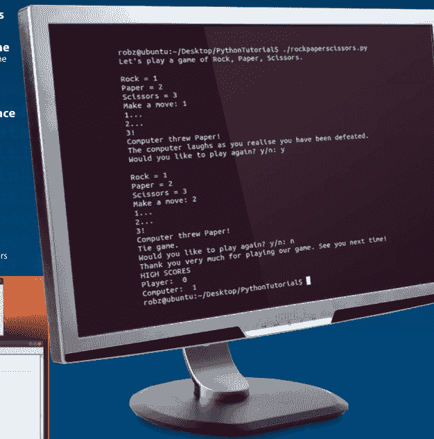

> “掌握Python，并从基础开始构建”

#### 编写石头剪刀布游戏代码

按照我们对一个简单石头剪刀布游戏的剖析，学习如何编写一些基本的Python代码。

本教程将指导你用Python制作一个石头剪刀布游戏。该代码应用了大师班中的经验，并对其中包含的内容进行了扩展，而且不需要像Pygame这样的额外Python模块即可运行。

石头剪刀布是展示Python真正能力的完美游戏。制作一个可运行的游戏版本会用上人类输入、比较、随机选择以及大量循环。它也非常容易根据你的需要改编和扩展，添加规则和结果，甚至如果你愿意，还可以制作一个简单的AI。

对于本教程，我们还建议使用IDLE。IDLE是一款出色的Python IDE，在大多数Linux发行版中都很容易获得，并且在树莓派的Raspbian系统中默认可用。它通过高亮显示代码中可能存在的任何问题来帮助你，并允许你轻松运行代码以确保其正常工作。

### 资源

- Python 2: www.python.org/download
- IDLE: www.python.org/idle
- 允许Python脚本在终端中以及IDE之外运行
- 使用整数形式的人类输入来比较出招，并最终进行游戏
- 使用推理来确定三种结果之一
- 循环代码并从头开始
- 对整数变量进行累加，以记录分数等

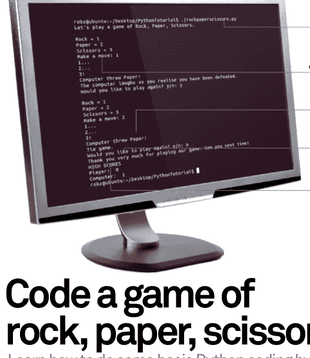

1. 此部分导入了我们编写代码所需的额外Python函数——它们仍然是标准Python库的一部分，只是不在默认环境中。
2. 游戏的初始规则在此创建。这里定义了我们使用的三个变量及其关系。我们还提供一个变量，以便记录游戏得分。
3. 我们通过定义每一轮的开始来编写游戏代码。每次游戏结束时都会回到这里，无论我们是否想再玩一次。
4. 游戏实际上都包含在这里，包括请求玩家输入、获取电脑输入，并将这些传入以得到结果。在最后，它会询问你是否想再玩一次。
5. 玩家输入在这里完成。我们向玩家提供如何玩这个特定版本游戏的信息，然后让他们的选择在下一步中使用。我们还设置了应对机制，以防他们输入无效选项。
6. 在显示结果时，有几项操作进行。首先，我们加入一个延迟以增加紧张感，将变量附加到打印的文本上，然后比较玩家和电脑的出招。通过一个`if`语句，我们选择打印哪种结果，以及如何更新分数。
7. 现在我们通过文本输入来询问是否想再玩一次。根据他们的回答，我们回到开头，或者结束游戏并显示结果。

```
#!/usr/bin/env python2
# Linux User & Developer presents: Rock, Paper, Scissors: The Video Game

import random
import time

rock = 1
paper = 2
scissors = 3

names = { rock: "Rock", paper: "Paper", scissors: "Scissors" }
rules = { rock: scissors, paper: rock, scissors: paper }

player_score = 0
computer_score = 0

def start():
    print "Let's play a game of Rock, Paper, Scissors."
    while game():
        scores()

def game():
    player = move()
    computer = random.randint(1, 3)
    result(player, computer)
    return play_again()

def move():
    while True:
        print
        player = raw_input("Rock = 1\nPaper = 2\nScissors = 3\nMake a move: ")
        try:
            player = int(player)
            if player in [1,2,3]:
                return player
        except ValueError:
            print "Oops! I didn't understand that. Please enter 1, 2 or 3."

def result(player, computer):
    print "..."
    time.sleep(1)
    print "..."
    time.sleep(1)
    print "..."
    time.sleep(0.5)
    print "Computer threw {0}".format(names[computer])
    global player_score, computer_score
    if player == computer:
        print "Tie game."
    else:
        if rules[player] == computer:
            print "Your victory has been assured."
            player_score += 1
        else:
            print "The computer laughs as you realise you have been defeated."
            computer_score += 1

def play_again():
    answer = raw_input("Would you like to play again? y/n: ")
    if answer in ("y", "Y", "yes", "Yes", "Of course!"):
        return answer
    else:
        print "Thank you very much for playing our game. See you next time!"

def scores():
    global player_score, computer_score
    print "HIGH SCORES"
    print "Player: ", player_score
    print "Computer: ", computer_score

if __name__ == "__main__":
    start()
```

### 拆解

**01** 我们需要在此处从头开始指定 Python 解释器的路径。这样可以让我们在终端内或在 IDLE 之类的特定 Python IDE 之外运行程序。请注意，对于此特定脚本，我们使用的是 Python 2 而不是 Python 3，这需要在代码中指定，以确保它从系统中调用正确的版本。


## 02
我们在标准 Python 代码之上导入了两个额外的模块，以便在整个代码中使用一些额外功能。我们将使用 `random` 模块来确定计算机将出什么招，以及 `time` 模块在关键点暂停代码的运行。`time` 模块也可以用于利用日期和时间，要么显示它们，要么用于其他用途。

## 03
我们将每个出招设置为特定数字，以便一旦玩家在游戏中做出选择，它将被等同于该特定变量。这使得后面的代码稍微容易一些，因为我们不需要为此特定功能解析任何文本。如果你愿意，可以添加额外的出招，这将从那里开始。

```
01
#!/usr/bin/env python2

# Linux User & Developer presents: Rock, Paper, Scissors: The Video Game

02
import random
import time

03
rock = 1
paper = 2
scissors = 3

04
names = { rock: "rock", paper: "paper", scissors: "scissors" }
rules = { 1: rock, scissors: paper, paper: rock }

05

06
player_score = 0
computer_score = 0
```

## 04
在这里我们指定游戏的规则，以及代码其余部分中每个出招的文本表示。当被调用时，我们的脚本将打印出三种出招中的任何一种的名称，主要是为了告诉玩家计算机出了什么招。这些名称仅在需要时才与这些变量相等——这样，每个出招分配的数字在需要时得以保持。

## 05
与文本名称的变量定义和使用方式类似，规则也是以这样的方式完成的，即在比较结果时，我们的变量会暂时被修改。代码中更下方我们会正确解释发生了什么，但基本上在确定是否有平局后，我们会查看计算机的出招是否会输给玩家的出招。如果计算机出招等于玩家出招的输招，则获胜。

## 06
非常简单，这创建了一个变量，可以在整个代码中使用来跟踪分数。我们现在需要将其设为零，以便它存在，否则如果我们在函数中定义它，它将只存在于该函数内部。代码根据回合结果为计算机或玩家加分，尽管在此特定版本中平局游戏没有得分。

| Python 模块 |  |
|---|---|
| 你可以使用基本 Python 导入其他模块。右侧显示了一些主要模块。Python 标准自带还有许多更多模块。 | `string` | 执行常见的字符串操作 |
|  | `datetime` and `calendar` | 与时间相关的其他模块 |
|  | `math` | 高级数学函数 |
|  | `json` | JSON 编码器和解码器 |
|  | `pydoc` | 文档生成器和在线帮助系统 |

### 07
在这里我们定义了代码的实际开始部分，使用我们称之为 `start` 的函数。它很简单，向玩家打印问候语，然后启动一个 `while` 循环，让我们可以按我们希望的次数继续玩游戏。`pass` 语句允许 `while` 循环在我们完成后停止，并且如果需要，可以用于执行许多其他任务。如果我们停止玩游戏，则会调用 `score` 函数——我们将在到达那里时介绍它所做的事情。

### 08
我们保持 `game` 函数相当简单，以便我们可以更轻松地在代码中分解每一步。它由 `start` 函数调用，首先通过调用下面的 `move` 函数来确定玩家出招。一旦确定，它就设置计算机出招。它使用 `random` 模块的 `randint` 函数获取 1 到 3 之间的整数（1, 3）。然后它将玩家和计算机出招作为整数传递给 `result` 函数，我们使用它来找到结果。

```
def start():
    print "Let's play a game of Rock, Paper, Scissors."
    while game():
        pass
    scores()
```

```
def game():
    player = move()
    computer = random.randint(1, 3)
    result(player, computer)
    return play_again()
```

```
def move():
    while True:
        print
        player = raw_input("Rock = 1\nPaper = 2\nScissors = 3\nMake a move: ")
```

```
try:
    player = int(player)
    if player in (1,2,3):
        return player
except ValueError:
    pass
print "Oops! I didn't understand that. Please enter 1, 2 or 3."
```

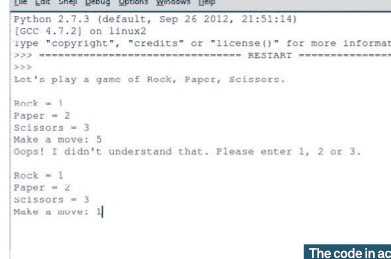

### 09
我们通过将其放入 `while` 循环来开始 `move` 函数。`move` 的全部目的是从玩家那里获取 1 到 3 之间的整数，因此 `while` 循环允许我们应对玩家做出不受支持的输入的情况。接下来，我们将 `player` 变量设置为由玩家的输入通过 `raw_input` 创建。我们还打印了相应的说明文本。我们在文本中使用的 `'\n'` 添加了换行符；这样，说明会以列表形式出现。

### 10
`try` 语句用于清理代码并处理错误或其他异常。我们通过使用 `int()` 将其转换为整数来解析玩家输入的内容。我们使用 `if` 语句检查它是否为 1、2 或 3——如果是，`move` 将此值返回给 `game` 函数。如果它抛出 `ValueError`，我们使用 `except` 什么也不做。它打印一条错误消息，然后 `while` 循环重新开始。这将一直持续到做出可接受的出招为止。

### Python 基础

#### 11
`result` 函数在此任务中仅接受 `player` 和 `computer` 这两个变量，因此我们将其设为 `result(player, computer)`。我们从倒计时开始显示结果。打印的数字不言自明，但我们也加入了从 `time` 模块导入的 `sleep`。`sleep` 会使代码的执行暂停括号中指定的秒数。我们在每次倒计时之间设置了 1 秒的暂停，然后在显示结果后暂停半秒。

#### 12
要打印出电脑出的拳，我们使用 `string.format()`。打印文本中的 `{0}` 就是我们插入手势的位置，该手势之前已定义为数字。使用 `names[computer]`，我们告诉代码从之前设置的 `names` 中查找该手势的文本版本名称，然后将其插入到 `{0}` 的位置。

#### 13
在这里我们只是调用之前设置的分数。使用 `global` 函数可以让变量在变量之外被更改并使用，尤其是在我们向其中一个分数追加数字之后。

```
def result(player, computer):
    print "1..."
    time.sleep(1)
    print "2..."
    time.sleep(1)
    print "3!"
    time.sleep(0.5)
print "Computer threw {0}!".format(names[computer])
global player_score, computer_score
if player == computer:
    print "Tie game."
else:
    if rules[player] == computer:
        print "Your victory has been assured."
        player_score += 1
    else:
        print "The computer laughs as you realise you have been defeated."
        computer_score += 1
```

#### 14
我们检查结果的方式基本上是通过排除法进行的。我们的第一个检查是看玩家和电脑使用的手势是否相同，这是最简单的一部分。我们将其放在 `if` 语句中，这样如果为真，这段代码就到此结束。它会打印平局信息，然后返回 `game` 函数进行下一步。

#### 15
如果不是平局，我们需要继续检查，因为仍可能是胜利或失败。在 `else` 中，我们开始另一个 `if` 语句。这里，我们使用之前 `rules` 列表来查看玩家手势的失败手势是否与电脑的手势相同。如果是这种情况，我们打印相应的信息，并将 1 加到之前的 `player_score` 变量上。

#### 16
如果进行到这一步，玩家就输了。我们打印失败信息，给电脑加一分，然后立即结束 `result` 函数，返回 `game` 函数。

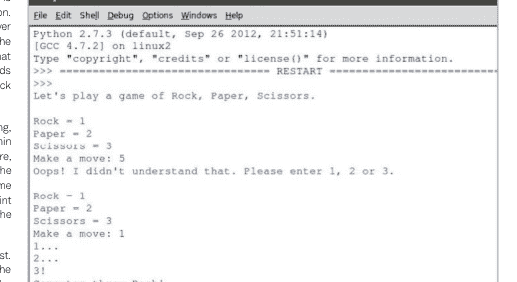

#### 17
`game` 的下一部分调用了 `play_again` 函数。与 `move` 函数类似，我们有人工输入，通过 `raw_input` 向玩家询问是否想再次游戏，文本消息中附带简单的 'y/n' 提示，以期获得预期的响应。


### 18
给用户提供 `y/n` 选项如我们所做的一样，应该期望得到相应的响应。`if` 语句检查是否输入了我们定义的任何肯定响应。由于 Python 不区分大小写，我们确保它同时接受 `y` 和 `Y`。如果是这种情况，它会向 `game` 返回一个肯定响应，从而重新开始游戏。

### 19
如果我们没有得到预期的响应，我们将假设玩家不想再玩了。我们会打印一条再见信息，这将结束此函数。这也会导致 `game` 函数进入下一部分而不重新启动。

```python
def play_again():
    answer = raw_input("Would you like to play again? y/n: ")
    if answer in ("y", "Y", "yes", "Yes", "of course!"):
        return answer
    else:
        print "Thank you very much for playing our game. See you next time!"
```

```python
def scores():
    global player_score, computer_score
    print "HIGH SCORES"
    print "Player: ", player_score
    print "Computer: ", computer_score
```

```python
if __name__ == '__main__':
    start()
```

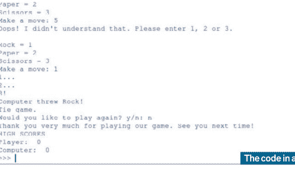

### ELIF

`IF` 还有 `ELIF`（`elseif`）运算符，可用于代替我们使用的第二个 `IF` 语句。通常用于保持代码整洁，但执行相同的功能。

### 20
回到 `start` 函数，`game` 结束后我们进入结果部分。此部分调用 `scores`，它们是整数，然后在玩家名称后分别打印它们。就玩家而言，这是脚本的结尾。目前，代码不会永久保存分数，但你可以让 Python 将其写入文件以保留。

### 21
最后部分允许脚本以两种方式使用。首先，我们可以在命令行中执行它，它就能正常工作。其次，我们可以将它导入到另一个 Python 脚本中，也许你想将其作为游戏添加到集合中。这样，在被导入时它不会执行代码。

## 编写一个刽子手游戏

跟随我们对一个简单刽子手游戏的剖析，学习如何进行更多 Python 编程。

本部分导入了我们在代码中需要的额外 Python 函数——它们仍然是标准 Python 库的一部分，只是不属于默认环境。

我们再次提供变量，以便记录已玩游戏的总分，并且它们会在每一轮更新。

我们极其基础的图形涉及游戏各阶段的 ASCII 艺术画，每回合后都会打印出来。

```python
#!/usr/bin/env python2

from random import *

player_score = 0
computer_score = 0

def hangman(hangman):
    graphic = [
        """
        +------+
        |      |
        |
        |
        |
        |
        ==================
        """,
        """
        +------+
        |      |
        |      0
        |
        |
        |
        ==================
        """,
        """
        +------+
        |      |
        |      0
        |      |
        |
        |
        ==================
        """
    ]
```

```python
    print graphic[hangman]
    return
```

### 资源

- `Python 2:` http://www.python.org/download
- `IDLE:` www.python.org/idle

`了解 Python 的最佳途径之一就是构建大量简单项目，这样你能对这门编程语言有更多理解。` 这一次，我们来看刽子手游戏，这是一个多轮游戏，依赖 `if` 和 `while` 循环，并以多种方式处理文本字符串。我们还会使用上一次实现的一些技术，以便在此基础上继续构建。

刽子手游戏仍然不需要 `Pygame` 模块集，但比石头剪刀布稍微高级一些。这次我们会用到多得多的变量。不过，我们仍然会涉及比较、随机选择和人类输入，以及拆分字符串、编辑列表，甚至显示基础图形。

在这些教程中，你应该继续使用 `IDLE`。正如我们之前提到的，它内置的调试工具简单而有效，并且可以用于任何 Linux 系统以及树莓派。

实际游戏从这里开始，使用一个 `while` 循环让你持续玩游戏，直到你决定结束，然后程序终止。

游戏规则在这里决定，同时还有单词的设定，以及记录尝试次数和错误答案。

游戏的每一轮在这里进行，它会要求输入，然后告诉你是否正确。它会打印图形，并更新任何需要更新的变量，尤其是错误和正确的猜测。

每轮之后，代码会检查你是赢是输——赢的条件是你猜出了单词，而如果猜了六次则输。

游戏的人类输入会获取字母并将其转换成代码可用的形式。它在前面的代码块中得到验证，如果你输入了不受支持或已使用过的字符，就会返回重新输入。

与上次相同的类，允许你选择是否希望再次游戏。

退出游戏后，会给出本次游戏会话的得分。我们还像之前一样，用 `if __name__` 代码来结束脚本。

### 代码清单（续）


```python
def start():
    print("Let's play a game of Linux Hangman.")
    while game():
        pass
    scores()

def game():
    dictionary = ["gnu","kernel","linux","mageia","penguin","ubuntu"]
    word = choice(dictionary)
    word_length = len(word)
    clue = word_length * ["_"]
    tries = 6
    letters_tried = ""
    guesses = 0
    letters_right = 0
    letters_wrong = 0
    global computer_score, player_score

    while (letters_wrong != tries) and ("".join(clue) != word):
        letter=guess_letter()
        if len(letter) == 1 and letter.isalpha():
            if letters_tried.find(letter) != -1:
                print("You've already picked", letter)
            else:
                letters_tried = letters_tried + letter
                first_index=word.find(letter)
                if first_index != -1:
                    letters_right +=1
                    print("Sorry",letter,"isn't what we're looking for.")
                else:
                    print("Congratulations,",letter,"is correct.")
                    for i in range(word.length):
                        if letter == word[i]:
                            clue[i] = letter
        else:
            print("Choose another.")

        hangman(letters_wrong)
        print(" ".join(clue))
        print("Guesses: ", letters_tried)

        if letters_wrong == tries:
            print("Game Over.")
            print("The word was",word)
            computer_score += 1
            break
        if "".join(clue) == word:
            print("You Win!")
            print("The word was",word)
            player_score += 1
            break
    return play_again()

def guess_letter():
    print(" ")
    letter = raw_input("Take a guess at our mystery word:")
    letter.strip()
    letter.lower()
    print(" ")
    return letter

def play_again():
    answer = raw_input("Would you like to play again? y/n: ")
    if answer in ("Y","y","yes","Yes","Of course!"):
        return answer
    else:
        print("Thank you very much for playing our game. See you next time!")

def scores():
    global player_score, computer_score
    print("HIGH SCORES")
    print("Player: ", player_score)
    print("Computer: ", computer_score)

if __name__ == "__main__":
    start()
```

### 代码高亮

IDLE 会自动高亮代码，让你的阅读更轻松。它还允许你在 IDLE 的“偏好设置”中更改这些颜色和高亮，以防你有色盲，或者只是习惯不同的配色方案。

# 我看到 ASCII

以下是我们用于 Hangman 图形的七个阶段的特写。你可以自行更改它们，但你需要确保引号都放在正确的位置，这样艺术作品才会被视为要打印出的文本字符串。

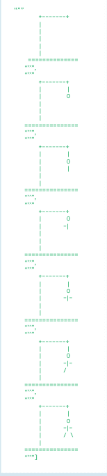

```python
#!/usr/bin/env python2

from random import *

player_score = 0

computer_score = 0

def hangman(hangman):

    graphic = [

        """

             +------+ 

             |      |

             |

             |

             |

             |

             =============

        """,

        """

        ]
```

### 规则

虽然我们本月已将部分规则移至 `game` 函数，但你始终可以将它们放回此处，并使用全局变量调用它们，就像我们对分数所做的那样。对于单词，你也可以创建一个单独的文件并像导入 `random` 模块一样导入它们。

01 我们首先使用这一行来输入 Python 解释器的路径。这使我们能够在终端内或在 IDLE 等 Python 特定 IDE 之外运行程序。请注意，我们在此脚本中使用的是 Python 2，因为它已在大多数 Linux 系统上默认安装，因此将确保兼容性。

02 我们这次以略有不同的方式导入 `random` 模块，导入的是 `random` 中的实际函数名称，而不是仅导入模块本身。这使我们能够在不使用 `random.function` 之类语法的情况下使用这些函数。星号导入 `random` 中的所有函数，尽管你可以将其替换为 `random` 的任何函数的特定名称。我们将使用 `random` 函数为玩家选择一个单词进行猜测。

03 非常简单，这创建了一个变量，可在整个代码中使用以跟踪分数。我们现在需要将其设为零，以便它存在；否则如果我们在函数中定义它，它将仅存在于该函数内部。代码根据回合结果为计算机或玩家增加一分。

04 我们的简单图形由一系列 ASCII 绞刑架阶段组成。我们将这些图形存储在一个函数中作为单独字符串对象的列表，以便我们可以传递错误猜测次数来调用它们。共有七个图形，如同纸笔版本一样。我们还将 `print` 命令包含在函数中，因此当它被调用时，它将完全处理吊人图形的选择和显示，第一个图形将在猜测第一个字母后打印。

05 在这里我们定义了代码的实际开始部分，使用我们命名的 `start` 函数。它很简单，向玩家打印问候语，然后启动一个 `while` 循环，允许我们尽可能多次地继续玩游戏。`pass` 语句允许 `while` 循环在我们完成后停止，并且可用于执行许多操作。


```python
def game():
    dictionary = ["gnu","kernel","linux","mageia","penguin","ubuntu"]
    word = choice(dictionary)
    word_length = len(word)
    clue = word_length * ["_"]
    tries = 6
    letters_tried = ""
    guesses = 0
    letters_right = 0
    letters_wrong = 0
    global computer_score, player_score
    while (letters_wrong != tries) and ("".join(clue) != word):
        letter=guess_letter()
        if len(letter)==1 and letter.isalpha():
            if letters_tried.find(letter) != -1:
                print "You've already picked", letter
```

如果愿意，还可以执行其他任务。如果我们停止玩游戏，则会调用 `score` 函数——我们将在讲到它时介绍它会做什么。

它正在检查与已玩过的字母。最后，我们为已进行的猜测次数、正确字母数和错误字母数创建空变量，以使代码稍微容易一些。我们还在此处导入全局分数。

### 06

我们这次将大部分游戏代码放在 `game` 函数中，因为没有太多需要拆分的内容。如果你愿意，可以进一步拆分它，使用上期代码的风格，如果这能使代码更清晰或帮助你更好地理解构建块。

### 09

我们启动一个 `while` 循环来执行玩家选择并检查游戏状态。此循环会一直持续到玩家获胜或失败为止。它首先通过查看 `letters_wrong` 是否不等于 `tries` 来检查是否已用完所有尝试次数。由于每次尝试只会为 wrong 增加一分，因此它永远不会超过六。随后它将 `clue` 串联起来并查看它是否与计算机选择的单词相同。如果这两个语句都为真，则进入下一回合。

### 07

前四行快速设置玩家要猜测的单词。我们在这里有一个小单词列表。然而，这些单词可以通过 HTML 导入或扩展。`choice` 用于从列表中选择一个随机元素，该元素来自我们导入的 `random` 模块。最后，我们确定要猜测的单词字符串的长度，然后使用该长度创建 `clue` 变量，其中包含相应数量的下划线。这用于在你通过猜测逐步构建单词时显示单词。

### 10

我们调用用于输入字母的函数并将其赋给变量 `letter`。我们首先通过 `len(letter)` 确保它只有一个字母，然后使用 `isalpha` 查看它是否是 26 个字母表中的一个。如果满足这些条件，我们就开始一个新的 `if` 语句以确保它是新的猜测，并告知玩家如果它已被选择过以便他们可以重新开始。如果所有这些都可接受，我们就进入代码的下一部分，看看它是否是正确的猜测。

### 08

我们开始设置规则和在游戏过程中跟踪的各个变量。在吊人完全绘制或在我们的例子中显示之前，只能有六次错误猜测，因此我们将 `tries` 变量设为六。我们将通过 `letters_tried` 跟踪字母，以确保不仅玩家知道，而且代码在

### 缩进

虽然 `IDLE` 会跟踪代码中的缩进，但如果你使用文本编辑器编写一些 Python，你必须确保正确使用它们。Python 对缩进是否正确使用非常敏感，而且这也有助于可读性。

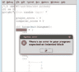

### Continuation

这段代码仍然是我们在上一页开始的 `game` 函数的一部分，因此如果您没有使用 IDE，请确保缩进对齐。如果您计划拆分这段代码，我们建议从单词选择和结果开始。

```python
else:
    letters_tried = letters_tried + letter
    first_index=word.find(letter)
    if first_index == -1:
        letters_wrong +=1
        print "Sorry,",letter,"isn't what we're looking for."
    else:
        print "Congratulations,",letter,"is correct."
        for i in range(word_length):
            if letter == word[i]:
                clue[i] = letter
else:
    print "Choose another."

hangedman(letters_wrong)
print "".join(clue)
print "Guesses: ", letters_tried

if letters_wrong == tries:
    print "Game Over."
    print "The word was",word
    computer_score += 1
    break
if "".join(clue) == word:
    print "You Win!"
    print "The word was",word
    player_score += 1
    break
return play_again()
```

11 如果我们发现这是一个可接受的新字母，我们首先要做的就是将其添加到已尝试字母的列表中。这是通过简单地将字符串拼接在一起完成的。然后我们使用 `find` 命令在单词字符串中搜索输入的字母，它会返回该字母在字符串中的位置编号。如果找不到该字母，它会返回 `-1` 值，我们在下一个 `if` 语句中使用它来检查 `first_index` 变量是否为 `-1`，如果是，则将 `letters_wrong` 的数量加一，然后打印一条消息告知玩家这是错误的猜测。

12 如果我们进行到这一步并且字母不是错误的，那么我们只能假设它是正确的。通过这种简单的排除过程，我们首先打印一条消息告知玩家他们成功了，然后进行记录。

13 我们在这里启动一个小循环，以便用我们添加的正确字母更新线索。我们使用 `range` 函数通过使用 `word_length` 变量来告诉代码我们希望对线索进行迭代的次数。然后我们检查单词中哪个字母被正确猜中，并将线索的特定部分更改为该字母，以便可以为玩家打印出来，并供我们检查游戏是否结束。

14 我们通过告知玩家如果他们没有输入受支持的输入则需重新选择来结束原始的 `if` 语句。在进入下一轮选择之前，我们通过调用与已进行的错误猜测次数相对应的列表中的图形来打印当前状态的吊人图形。然后我们打印线索当前的外观，每个字符之间有一个空格，然后打印已进行的猜测次数。

15 在这里我们再次检查游戏是否结束，首先将 `letters_wrong` 与 `tries` 的次数进行比较。如果为真，我们打印游戏结束的消息并揭示隐藏单词的谜底。我们增加电脑的分数并跳出循环。下一个循环检查完整线索的连接是否与原始单词相同——如果是这种情况，我们打印获胜消息、完整单词并在跳出循环之前为玩家分数加一分。这也可以使用 `if` 和 `elif` 来完成，以避免使用 `break`。

```python
def guess_letter():
    print
    letter = raw_input("Take a guess at our mystery word:")
    letter.strip()
    letter.lower()
    print
    return letter

def play_again():
    answer = raw_input("Would you like to play again? y/n: ")
    if answer in ("y", "Y", "yes", "Yes", "Of course!"):
        return answer
    else:
        print "Thank you very much for playing our game. See you next time!"

def scores():
    global player_score, computer_score
    print "HIGH SCORES"
    print "Player: ", player_score
    print "Computer: ", computer_score

if __name__ == '__main__':
    start()
```

16 我们通过再次调用 `return` 来结束整个游戏函数循环，我们将在其完成后将其一路传递回 `start` 函数。


17 人类输入函数首先打印出一个 `raw_input()` 消息。一旦玩家输入字母，函数就会对其进行解析以供其余代码使用。首先，使用 `strip()` 来删除输入中任何多余的空白，因为我们没有为其提供额外参数。然后我们将其转换为小写字母，因为 Python 将无法正确比较大写字符与小写字符。我们然后为记录打印选择并将其返回到 `game()` 函数。

18 `game()` 函数的最后一部分是询问玩家是否希望再次尝试。`play_again()` 函数使用简单消息获取人类输入，然后分析输入以便知道要返回什么。

19 给用户提供 `y/n` 选项如我们所做，应该期望得到相应的回应。`if` 语句检查是否输入了我们定义的任何肯定回应。由于 Python 不区分大小写，我们确保它接受 `y` 和 `Y`。如果是这种情况，它会向 `game()` 返回肯定回应，从而再次启动它。

20 如果我们没有得到预期的回应，我们将假设玩家不想再次玩。我们将打印再见消息，这将结束此函数。这也将导致 `start()` 函数进入下一部分而不是重新启动。

21 回到 `start()` 函数，在游戏结束后我们进入结果部分。此部分相当简单——它调用 `scores()`，这些是整数，然后在玩家名称之后分别打印它们。就玩家而言，这是脚本的结尾。目前，代码不会永久保存分数，但您可以让 Python 将其写入文件，如果您愿意的话。

22 代码的最后一部分允许脚本以两种方式使用。首先，我们可以在命令行中执行它，它就可以正常工作。其次，我们可以将它导入到另一个 Python 脚本中，也许如果您想将其作为游戏添加到集合中。这样，在导入时它不会执行代码。

## Homework

现在您已经完成了代码，为什么不做自己的更改呢？增加单词数量；创建不同的、可选择的单词类别；甚至让人们猜测完整单词。您可以在当前代码和上个月的教程中找到完成这一切所需的工具。

# 使用 Python 玩扑克骰子

戴上你的扑克脸，准备好赌一把，在提升编程技能的同时玩点扑克骰子

你已经学会如何编程玩井字棋，并在猜词游戏中猜中获胜。现在是时候前往拉斯维加斯，玩好我们的牌了。或者说，在这种情况下，是虚拟骰子，更像是雷诺，因为我们继续我们的 Python 游戏教程，向你介绍扑克骰子。

我们再次使用了已经学过的一些知识，包括随机数生成、列表创建和修改、人工输入、规则设置、计分等。但在本教程中我们也会加入一些新技能。也就是说，我们将创建并追加包含随机数的列表，并在同一代码块中使用函数多次以减少冗余。

再次，我们建议使用 IDLE，并且我们使用 Python 2 以确保与更多发行版的兼容性，包括 Raspberry Pi。所以，我们希望幸运女神眷顾你，愿赔率永远对你有利——只要祈祷你不要掷出蛇眼（毕竟我们是用 Python 编程！）

## 资源

Python 2: <http://www.python.org/download>

IDLE: <http://www.python.org/idle>

## 开始

这里我们进行一些小的设置，以便我们的代码可以使用一些未包含在基础中的额外模块来运行

## 规则

我们为每次骰子掷出设置名称，以便玩家能够正确识别——比数字有趣得多

## 计分

我们再次设置了一些基本变量，以便如果我们想要的话可以记录游戏的分数

## 脚本

游戏在这里处理，将玩家传递到下一个函数以实际进行游戏，并处理会话的结束

## 游戏

我们通过这里访问完整的游戏循环，以及允许我们在愿意时重新玩的函数

## 掷骰

初始手牌，换句话说，在 `throws()` 函数开始时就被发出了。此函数处理游戏中的所有决策，同时将骰子掷出传递给另一个函数

## 手牌

我们还有一个特殊函数，可以告知玩家他们手牌的确切类型

## 决策

这个版本的扑克骰子中有两轮，你可以选择想要重掷多少颗骰子，在这个小的 `while` 循环中确保你也使用正确的数量

## 代码列表

```
#!/usr/bin/env python2
import random
from itertools import groupby

nine = 1
ten = 2
jack = 3
queen = 4
king = 5
ace = 6

names = { nine: "9", ten: "10", jack: "J", queen: "Q", king: "K", ace: "A" }

player_score = 0
computer_score = 0

def start():
    print "Let's play a game of Linux Poker Dice."
    while game():
        pass
    scores()

def game():
    print "The computer will help you throw your 5 dice"
    throw()
    return play_again()

def throws():
    roll_number = 5
    dice = []
    dice.sort()
    for i in range(len(dice)):
        print "Dice", i + 1, ":", names[dice[i]]

    result = hand(dice)
    print "You currently have", result

    while True:
        rerolls = input("How many dice do you want to throw again? ")
        try:
            if rerolls in (1,2,3,4,5):
                break
        except ValueError:
            pass
        print "Oops! I didn't understand that. Please enter 1, 2, 3, 4 or 5."
```

## 重掷

我们在这里进行第二轮掷骰并开始游戏的结束，通过调用与之前相同的函数，但我们也意识到选择不重掷意味着游戏结束

## 骰子

这里我们找出玩家想要重掷哪些骰子，并确保他们输入有效数字。只是为了让他们知道自己在做什么，我们在每次回合后打印一些内容

## 第二手牌

我们更改并显示新的骰子手牌以结束游戏。同样，我们确保告知玩家他们实际拥有的手牌是什么

## 掷骰

我们重用的函数，使用简单的 `while` 循环掷我们的虚拟六颗骰子。这使我们能够保持代码库更小

## 分析

扑克骰子中有八种可能的手牌类型，我们可以使用一些逻辑来计算出除一种之外的所有手牌，而无需检查全部 7,776 种结果——事实上，我们只需要特别检查两种

## 问题

我们简单的“再玩一次”函数，解析玩家输入以便我们可以重新开始或结束脚本

## 结束

分数在脚本结束时显示，最后的最后部分允许我们将此导入到其他 Python 脚本作为模块

## 额外函数

将操作拆分为函数不仅使我们能够多次执行它们，还能减少代码量。在较大的项目中，这有助于提高速度。

## 代码列表继续


```
if rerolls == 0:
    print("You finish with", result)
else:
    roll_number = rerolls
    dice, changes = roll_number
    dice changes = range(rerolls)
    print("Enter the number of a dice to reroll: ")
    iterations = 0
    while iterations < rerolls:
        iterations = iterations + 1
        while True:
            selection = input("")
            try:
                if selection in ("1", "2", "3", "4", "5"):
                    break
            except ValueError:
                pass
            print("Oops I didn't understand that. Please enter 1, 2, 3, 4 or 5.")
        dice_changes[iterations-1] = selection-1
        print("You have changed dice", selection)
    iterations = 0
    while iterations < rerolls:
        iterations = iterations + 1
        replacement = dice[ dice_changes[iterations-1] ]
        dice[ dice_changes[iterations-1] ] = replacement
    dice.sort()
    for i in range(len(dice)):
        print("Dice", i + 1, ":", names[dice[i]])
    result = hand(dice)
    print("You finish with", result)

def roll(roll_number):
    numbers = range(1,7)
    dice = []
    iterations = 0
    while iterations < roll_number:
        iterations = iterations + 1
        dice[iterations-1] = random.choice(numbers)
    return dice

def hand(dice):
    dice_hand = [len(list(group)) for key, group in groupby(dice)]
    dice_hand.sort(reverse=True)
    straight1 = [1,2,3,4,5]
    straight2 = [2,3,4,5,6]
    if dice == straight1 or dice == straight2:
        return "a straight!"
    elif dice_hand[0] == 5:
        return "Five of a kind!"
    elif dice_hand[0] == 4:
        return "four of a kind!"
    elif dice_hand[0] == 3 and dice_hand[1] == 2:
        return "a full house!"
    elif dice_hand[0] == 3:
        return "three of a kind."
    elif dice_hand[0] == 2:
        if dice_hand[1] == 2:
            return "two pair."
        else:
            return "one pair."
    else:
        return "a high card."

def play_again():
    answer = raw_input("Would you like to play again? y/n: ")
    if answer in ("y", "Y", "yes", "Yes", "of course!"):
        return answer
    else:
        print "Thank you very much for playing our game. See you next time!"

def scores():
    global player_score, computer_score
    print "FINAL SCORE"
    print "Player: ", player_score
    print "Computer: ", computer_score

if __name__ == '__main__':
    start()
```

```python
#!/usr/bin/env python2
import random
from itertools import groupby
nine = 1
ten = 2
jack = 3
queen = 4
king = 5
ace = 6
names = { nine: "9", ten: "10", jack: "J", queen: "Q", king: "K", ace: "A" }
player_score = 0
computer_score = 0
def start():
    print("Let's play a game of Linux Poker Dice.")
    while game():
        pass
    scores()
def game():
    print("The computer will help you throw your 5 dice")
    throws()
    return play_again()
```

> 复用

代码中有一些变量出现了重复——虽然我们已经小心确保它们能按预期工作，但这并非最佳的代码规范。变量的名字本身并不重要——最好以你能理解的方式命名，便于调试和他人阅读。

### 01 开始

和之前一样，我们使用这一行来指定 Python 解释器的路径。这允许我们在终端中运行程序，或在像 `IDLE` 这样的 Python 专用 IDE 之外运行。请注意，这个脚本使用的是 Python 2。

### 02 导入

除了为掷骰导入 `random` 模块外，我们还需要用到 `groupby` 函数，以便对骰子进行排序，使其更易读，也便于在告知玩家他们拥有什么牌型时进行分析。

### 03 牌面

虽然我们使用随机数来掷骰，但如果不为每个数字分配对应的牌面，玩家就不知道他们掷出了什么，也不知道哪些牌型更好。我们将每张牌对应一个数字，然后设定这些数字打印出来时应显示的牌面。

### 04 计分

和往常一样，我们为玩家和电脑初始化了空分数，以便在游戏过程中更新它们。虽然在此版本的代码中没有专门使用到，但很容易扩展它，添加你自己的简单电脑掷骰，或为双方掷骰添加有限的AI。

### 05 启动

我们通过 `start` 函数开始代码的交互部分。它向玩家打印问候语，然后启动一个 `while` 循环，让我们可以随心所欲地重玩多次。`pass` 语句让 `while` 循环在我们完成后能够停止。如果我们确实停止游戏，那么就会调用 `score` 函数。

### 06 游戏

和我们的石头剪刀布代码类似，`def game` 把游戏的其余部分委托给其他函数，它的主要功能是让玩家通过 `play_again` 函数不断重复游戏。

### 07 掷骰

对于第一次掷骰，我们需要五个随机骰子。我们在这里设置一个变量传给掷骰函数，以便之后可以用玩家选择的不同数字来复用它。我们从函数返回的列表中取得五个随机数，并使用 `sort` 对其进行排序，让玩家看起来更易读，也便于之后的手牌函数处理。

### 08 骰子显示

我们打印出每个骰子，为它们编号，让玩家知道哪个骰子是哪个，同时显示我们在脚本开头设置的名称。我们通过一个循环来实现这一点，该循环使用 `range(len(dice))` 参数，重复次数与骰子列表的长度相同。`i` 每次循环都会递增，并打印出骰子列表中对应编号的那个骰子。

### 09 当前手牌

我们想在游戏过程中多次确定玩家的手牌类型，因此专门设置了一个函数来查明。我们将当前的一串骰子传给这个函数，并打印结果。

### 10 再次掷骰

在第二轮掷骰之前，我们需要知道哪些骰子需要


```python
def throws():
    roll_number = 5
    dice = roll(roll_number)
    dice.sort()
    for i in range(len(dice)):
        print("Dice",i + 1,",",names[dice[i]])
    result = hand(dice)
    print("You currently have", result)
    while True:
        rerolls = input("How many dice do you want to throw again? ")
        try:
            if rerolls in (1,2,3,4,5):
                break
        except ValueError:
            pass
            print("Oops! I didn't understand that. Please enter 1, 2, 3, 4 or 5.")
    if rerolls == 0:
        print("You finish with", result)
    else:
        roll_number = rerolls
        dice_rerolls = roll(roll_number)
        dice_changes = range(rerolls)
        print("Enter the number of a dice to reroll: ")
        iterations = 0
        while iterations < rerolls:
            iterations = iterations + 1
            while True:
                selection = input("")
                try:
                    if selection in (1,2,3,4,5):
                        break
                except ValueError:
                    pass
                    print("Oops! I didn't understand that. Please enter 1, 2, 3, 4 or 5.")
        dice_changes[iterations-1] = selection-1
        print("You have changed dice", selection)
```

### 缩进

注意缩进，因为我们拆分了 `else` 函数。下一页的代码与代码中的 `roll_roll_number`、`dice_rerolls` 和 `dice_changes` 处于同一层级。

### 空白

`throws` 末尾的较大 `if` 函数在各个部分之间没有太多空行——你可以根据需要添加空行，将代码在视觉上分成更小的块，有助于调试。

#### 11 保留

我们在这些教程中一直在努力做到的一件事是，指出逻辑如何通过简单的排除法或遵循流程图来减少大量编码。如果用户想要重掷零次，那就意味着他们对当前手牌满意，游戏必然结束。我们打印一条消息来表明这一点，并再次显示他们的手牌。

我们还需要确保输入的数字在游戏允许的范围内，因此我们使用 `try` 函数进行检查，并打印出一条消息，告诉用户是否出错以及错在哪里。

#### 12 重掷

这里我们开始第二次掷骰并进入游戏结束阶段，使用一个长长的 `else` 来配合我们刚刚开始的 `if` 语句。我们首先确保设置好变量——更新 `roll_number`，以用户设置的重掷次数传给 `roll` 函数，并借助 `range(rerolls)` 创建一个长度正好为我们想使用的新掷骰集合的列表。

#### 13 解析

我们让玩家输入他们想要重掷的骰子的编号。通过设置一个 `iterations` 变量，我们可以让 `while` 循环持续的次数与期望的重掷次数相同，方法是将其与 `reroll` 变量本身进行比较。我们检查每次输入，确保它是一个可用的数字，并将合法选择添加到 `dice_changes` 列表中。这里使用 `iterations-1`，因为 Python 列表从 0 而不是 1 开始。我们还会打印一条简短消息，让玩家知道选择已成功。

```
iterations = 0
while iterations < rerolls:
    iterations = iterations + 1
    replacement = dice_rerolls[iterations-1]
    dice[dice_changes[iterations-1]] = replacement

dice.sort()
for i in range(len(dice)):
    print "Dice",i + 1,",",names[dice[i]]

result = hand(dice)
print "You finish with", result
```

```
def roll(roll_number):
    numbers = range(1,7)
    dice = range(roll_number)
    iterations = 0
    while iterations < roll_number:
        iterations = iterations + 1
        dice[iterations-1] = random.choice(numbers)
    return dice
```

### HIGHER OR LOWER

哪只手最好？在游戏中获得某些手牌的几率是多少？有些答案令人惊讶，因为它们基于的扑克牌型压倒了骰子产生的不同几率。我们已按从高到低对牌型进行了排名。

| Hand | Odds |
|---|---|
| Five of a Kind | 6/7776 |
| Four of a Kind | 150/7776 |
| Full House | 300/7776 |
| Straight | 240/7776 |
| Three of a Kind | 1200/7776 |
| Two Pairs | 1800/7776 |
| One Pair | 3600/7776 |
| High Card | 480/7776 |

#### 14 New dice

我们正在重置并重用 `iterations` 变量，以执行一个类似的 `while` 循环来更新我们已进行的掷骰到原始的 `dice` 变量。主要部分是使用 `iterations-1` 变量来查找 `dice_changes` 列表中的数字，并使用它来用 `replacement` 列表中的数字更改 `dice` 列表中的特定整数。因此，如果 `dice_changes` 列表中的第一项是二，那么 `dice` 列表中的第二项就会被更改为我们想要替换它的数字。

#### 15 Sorting

我们以基本与第一次投掷相同的方式结束 `throw` 函数。首先，我们重新对 `dice` 列表进行排序，使所有数字按升序排列。然后我们打印出骰子对应的最终牌面，在再次将其传递给 `hand` 函数以便完全确定玩家拥有的牌型。我们打印出此结果，这就结束了函数，将整个过程发送回 `game` 函数以询问你是否想再次游戏。

#### 16 Dice rolling

`roll` 函数在代码中被使用了两次，用于我们掷骰子的两次。能够多次使用相同的代码意味着

#### 17 Number of rolls

我们通过将 `roll_number` 变量带入函数来开始整个过程——这是因为在原始掷骰中它始终为五，而第二次掷骰可能在一次到全部五个骰子之间。我们创建一个具有所需条目数量的列表用于每次掷骰，并再次为即将到来的 `while` 循环设置 `iterations` 变量。

#### 18 Remember

与迄今为止代码中其他 `while` 循环一样，我们在 `iterations` 与 `roll_number` 相同之前保持循环运行。使用 `random.choice` 函数并保持在 `numbers` 变量的范围内，每个 `dice` 列表中的条目都会被一个随机数字替换，`numbers` 的范围为每个骰子面的一到六。完成此操作后，我们将 `dice` 变量返回给构成游戏大部分的 `throw` 函数。

#### 19 Hand analysis

虽然从技术上讲不是一手牌，但扑克术语仍然适用。我们在此函数中首先设置一些内容。第一部分使用我们导入的 `groupby` 函数 -

我们可以减少脚本其余部分的冗余，使其运行速度稍快一些，正如我们所解释的那样。它还意味着在这种情况下，如果你想将游戏改为三轮，或将其修改为真正的扑克，我们也可以再次使用它。


在此情况下，它用于计算构成 `dice` 变量的数字。如果有三个二，一个四和一个五，它将返回 `[3, 1, 1]`。我们使用它来确定玩家拥有什么样的牌型。由于此 `groupby` 的输出不会按任何特定顺序排列，我们再次使用 `sort` 函数对其进行排序；然而，这次我们使用 `reverse=TRUE` 参数来使分析更容易。

## 20 Straights

在扑克骰子中，顺子和大牌是特例，因为它们不依赖于能够计算牌中的重复次数。然而，在扑克骰子中只有两种手牌可以组成顺子，所以我们在这里创建了两个包含它们的列表。然后我们可以先检查骰子是否构成这些手牌，如果所有其他检查都失败，则它必须是高牌。

## 21 Your hand

虽然看起来很长，但这是一个相当简单的 if 语句。正如我们之前所说，我们检查它是否是两种顺子手牌之一。由于扑克骰子中没有同花或皇家同花顺，我们不必担心这些。然后我们检查列表中的第一项是否为五，这只能产生五条；类似地，如果第一项为四，则手牌必须是四条。如果第一个数字为三，则它可以是葫芦或三条，

```python
def hand(dice):
    dice_hand = [len(list(group)) for key, group in groupby(dice)]
    dice_hand.sort(reverse=True)
    straight1 = [1,2,3,4,5]
    straight2 = [2,3,4,5,6]

    if dice == straight1 or dice == straight2:
        return "a straight!"
    elif dice_hand[0] == 5:
        return "five of a kind!"
    elif dice_hand[0] == 4:
        return "four of a kind!"
    elif dice_hand[0] == 3:
        if dice_hand[1] == 2:
            return "a full house!"
        else:
            return "three of a kind."
    elif dice_hand[0] == 2:
        if dice_hand[1] == 2:
            return "two pair."
        else:
            return "one pair."
    else:
        return "a high card."
```

```python
def play_again():
    answer = raw_input("Would you like to play again? y/n: ")
    if answer in ('y', 'Y', 'yes', 'Yes', 'Of course!'):
        return answer
    else:
        print "Thank you very much for playing our game. See you next time!"
```

```python
def scores():
    global player_score, computer_score
    print "HIGH SCORES"
    print "Player: ", player_score
    print "Computer: ", computer_score
```

```python
if __name__ == '__main__':
    start()
```

### TEXT EDITORS

Instead of the IDE we've suggested, you should also try coding in a text editor. Some of them are a little more lightweight and format code similar to the way the IDE does, separating functions and strings by colours etc. Some of the ones we'd recommend are the classic `gedit`, a popular text editor from GNOME desktops; `Geany`, which has a few IDE-esque features written into it; `TEA`, a multifunctioning text editor and project manager; and `Jedit`, a text editor that lives in the command line for minimum resource usage. These can also be used with multiple programming languages, so you can get used to them with `Python`, then make the switch.

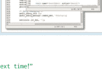

### HOMEWORK

There is currently no scoring in place for this version of the game. Try adding a computer player, or create a rule set that requires a certain hand or higher. You could even make it two-player.

so we nest an if statement. Again, we do this for pairs, where that could be one or two pairs. If all else fails then, by a process of elimination, it can only be a high card. We give each outcome a text string to send back to the throw function so that it can be printed.

#### 22 Play again

As before, we ask the player for raw input with the text offering another game. Instead of parsing it, we assume the player will choose a specified yes response based on the text, and if none of these versions is received, we print out the message thanking them for playing the game. This ends the game function.

#### 23 Final scores

Going all the way back to the start function, after the game finishes we move onto the results. This section is quite simple – it calls the scores, which are integers, and then prints them individually after the names of the players. This is the end of the script, as far as the player is concerned. Currently, the code will not permanently save the scores, but you can have `Python` write it to a file to keep if you wish.

#### 24 Modules


The final part of the code allows for the script to be used in two ways. Firstly, we can execute it in the command line and it will work just fine. Secondly, we can import this into another Python script, perhaps if you wanted to add it as a game to a collection. This last piece of code will prevent our script being executed when imported by another module – it will only do so when being run directly.

# Create a graphical interface for Python games

Bring everything together with a Python GUI and take the next step in programming your own software

## Resources

- Python 2: www.python.org/download
- IDLE: www.python.org/idle

### The start

Here we're doing some minor setup, including getting a new module that helps us create a simple graphical interface

### The imports

We're importing the three games we created in past issues so we can call upon or use them

### The window

Create a graphical window and give it a name so we can add some functions to it

### The frame

Define the dimensions of the window and give a rough guide to placement of the objects within

### The welcome

Print a message in the window and place it in a specific orientation. This works a little differently to print

The three basic games we have made in Python so far have all run in the command line or via IDLE, a Python IDE. While this allowed us to show off different ways to use Python code, we haven't actually shown you how to present it yet. In this tutorial, we will take all three games and put them all into one neatly unified graphical interface.

To this end, we'll be making use of the small line of code we added at the bottom of each previous tutorial so we can import them as modules into our main graphical script. We'll also modify the existing code to add some graphical elements. To do all this we'll be using `Tkinter`, a default module available in Python that allows you to create windows and frames with fairly simple code.

All you need for this tutorial is an up-to-date copy of Python, from your distro's repository or the website, and the IDLE development environment. This will also work great on Raspberry Pi distros, such as Raspbian.

#### Main Interface Code Listing

```python
#!/usr/bin/env python2

# Linux User & Developer presents: Mega Microgames Collection

from Tkinter import *

import rockpaperscissors
import hangman
import pokerdice

root = Tk()
root.title("Linux User & Developer's Mega Microgames Collection")

mainframe = Frame(root, height = 200, width = 500)
mainframe.pack_propagate(0)
mainframe.pack(padx = 5, pady = 5)

intro = Label(mainframe, text = """Welcome to Linux User & Developer's Mega Microgames Collection.

Please select one of the following games to play:
""")
intro.pack(side = TOP)

rps_button = Button(mainframe, text = "Rock, Paper, Scissors", command = rockpaperscissors.gui)
rps_button.pack()

hm_button = Button(mainframe, text = "Hangman", command = hangman.start)
hm_button.pack()

pd_button = Button(mainframe, text = "Poker Dice", command = pokerdice.start)
pd_button.pack()

exit_button = Button(mainframe, text = "Quit", command = root.destroy)
exit_button.pack(side = BOTTOM)

root.mainloop()
```

### The button

The focus of this month's tutorial is making Rock-Paper-Scissors work in a graphical interface, so we're calling a new function we're creating

### The interface

Creating and formatting buttons to start the other two tutorial games in the command line or shell

### The exit

Here we create a button that quits the window and ends the script. We've also placed it specifically at the bottom of the window

### The loop

The `mainloop` allows the main window to continue to work and be updated without exiting the program unless specified

# 修改后的 RPS 代码清单

## 新导入

导入新的模块以允许我们创建剪刀石头布的 GUI 部分，以及移除我们不再需要的模块

## 新界面

我们新的主函数允许我们在按下 `rps_button` 时调用大部分游戏脚本。这包含了游戏组件和图形组件

## 新开始

我们更改了开始函数，使其在完成后不再跳转到分数函数。我们也移除了分数函数，因为我们以不同的方式跟踪分数，以便能够正确显示

## 新游戏


我们更改了游戏函数，使其现在接收来自图形界面的输入。我们使用一个新变量来实现这一点，它可以与 GUI 配合工作，否则它与之前大致相同

### 新结果

结果函数基本保持不变，只是现在它将结果消息发送到我们用于界面的变量中，并且通常使用新的 GUI 的变量

### 新窗口

我们以略有不同的方法创建游戏窗口，因为已经存在一个 `mainloop` 根窗口。我们也为其命名，以便你能够正确识别它

### 新变量

我们的新变量设置使其能够与游戏代码和界面代码正确交互。我们也确保为玩家提供默认选择，以便代码能够正常运行

### 新框架

使用与之前略有不同的方法确定游戏窗口的大小和布局。我们也允许元素锚定在窗口周围的特定位置

### 新选择

在这里我们以特定配置在窗口中放置单选按钮，给用户三种出招的选择。这随后会传递给变量并由游戏代码使用

### 新出招

在这里我们允许计算机的出招在 `Computer` 标签下显示

### 新按钮

按下我们放置在此处的 `Play` 按钮会运行游戏脚本，打印出分数并最终根据结果显示一条消息

### 新结束

我们已将其更改为使主脚本现在以 `gui` 开始，而不是开始函数

```
#!/usr/bin/env python2
# Linux User & Developer presents: Rock, Paper, Scissors: The Video Game: The Module

from Tkinter import *
from ttk import *
import random

def gui():
    rock = 1
    paper = 2
    scissors = 3
    names = { rock: "Rock", paper: "Paper", scissors: "Scissors" }
    rules = { rock: scissors, paper: rock, scissors: paper }
    def start():
        while game():
            pass
    def game():
        player = player_choice.get()
        computer = random.randint(1, 3)
        computer_choice.set(names[computer])
        result(player, computer)
    def result(player, computer):
        new_score = 0
        if player == computer:
            result_set.set("Tie game.")
        else:
            if rules[player] == computer:
                result_set.set("Your victory has been assured.")
                new_score = player_score.get()
                new_score += 1
                player_score.set(new_score)
            else:
                result_set.set("The computer laughs as you realise you have been defeated.")
                new_score = computer_score.get()
                new_score += 1
                computer_score.set(new_score)
    rps_window = Toplevel()
    rps_window.title("Rock, Paper, Scissors")
    player_choice = IntVar()
    computer_choice = StringVar()
    result_set = StringVar()
    player_score = IntVar()
    computer_score = IntVar()
    rps_frame = Frame(rps_window, padding="3 3 12 12", width = 300)
    rowconfigure(rps_frame, 0, weight=1)
    rps_frame.columnconfigure(0, weight=1)
    rps_frame.rowconfigure(0, weight=1)
    Label(rps_frame, text="Player").grid(column=1, row=1, sticky=W)
    Radiobutton(rps_frame, text="Rock", variable=player_choice, value=1).grid(column=1, row=2, sticky=W)
    Radiobutton(rps_frame, text="Paper", variable=player_choice, value=2).grid(column=1, row=3, sticky=W)
    Radiobutton(rps_frame, text="Scissors", variable=player_choice, value=3).grid(column=1, row=4, sticky=W)
    Label(rps_frame, text="Computer").grid(column=3, row=1, sticky=W)
    Label(rps_frame, textvariable=computer_choice).grid(column=3, row=2, sticky=W)
    Button(rps_frame, text="Play", command=start).grid(column=2, row=2)
    Label(rps_frame, text="Score").grid(column=1, row=5, sticky=W)
    Label(rps_frame, textvariable=player_score).grid(column=1, row=6, sticky=W)
    Label(rps_frame, textvariable="Score").grid(column=3, row=5, sticky=W)
    Label(rps_frame, textvariable=computer_score).grid(column=3, row=6, sticky=W)
    Label(rps_frame, textvariable=result_set).grid(column=2, row=7)
    if __name__ == "__main__":
        gui()
```

```
#!/usr/bin/env python2

#Linux User & Developer presents: Mega Microgames Collection

from Tkinter import *

import rockpaperscissors

import hangman

import pokerdice

root = Tk()

root.title("Linux User & Developer's Mega Microgames Collection")

mainframe = Frame(root, height = 200, width = 500)

mainframe.pack_propagate(0)

mainframe.pack(padx = 5, pady = 5)

intro = Label(mainframe, text = """Welcome to Linux User & Developers Mega Microgames Collection.

Please select one of the following games to play:

""")

intro.pack(side = TOP)

rps_button = Button(mainframe, text = "Rock, Paper, Scissors", command = rockpaperscissors.gui)

rps_button.pack()

hm_button = Button(mainframe, text = "Hangman", command = hangman.start)

hm_button.pack()

pd_button = Button(mainframe, text = "Poker Dice", command = pokerdice.start)
```


```
pd_button.pack()

exit_button = Button(mainframe, text = "Quit", command = root.destroy)

exit_button.pack(side = BOTTOM)

root.mainloop()
```

### MAIN WINDOW

The main interface window that this code creates is fairly basic, but contains the functions we require. The window exit button will do the same job as the `Quit` button, and the Hangman and Poker Dice buttons run the old scripts in the Python shell.

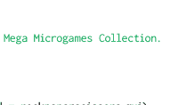

#### 01 First line

We use this line to enter the path to the Python interpreter. This lets us run the program inside a terminal or otherwise outside of a Python-specific IDE like IDLE. Note that we're also using Python 2 for this particular script.

#### 02 Import graphics

`Tkinter` is the graphical interface we're using and while it's a standard Python function, you'll need to import the module so you can use it. We've used the `from {module} import *` method so that we can use the functions from it without having to add `Tkinter` at the beginning.

#### 03 Import games

We're importing the modules for the three games. We added the line at the bottom of each script so we can do this. To make sure to differentiate the functions in each game, we will have to specify `[module].[function]` so there are no errors in the code.

#### 04 Root window

Using the `Tk()` function creates the window we're going to be placing everything into. We've decided to call it `root` for now; however, you can call it anything you like, as long as you're consistent with it. We've also named it using the `title` command from `Tkinter` and a string of text.

#### 05 Main frame

The first line has us set the variable `mainframe` as a `Frame` in the interface. We've attached it to `root`, the main window, and given it a minimum height and width in pixels. We use `pack_propagate` to create the window, and then make sure it's the size that we've defined. We've then used `pack` to pad the borders, allowing the contents of the window to not touch the sides of it.

#### 06 Introductions

We create the `intro` variable as a label that lives in the main frame. We give it text to introduce the interface, using the triple quote marks to have it go across multiple lines and format better. We then use `pack` to display it, and tell `Tkinter` to put it at the top of the interface.

#### 07 Rock, Paper, Scissors

We create a button for the Rock, Paper, Scissors game using the `Button` function. We attach to it the main frame, give it a label using text that appears on the button, and then have it run a command. In this case, we use the modified `rockpaperscissors.py` code that has a `gui` function, hence `rockpaperscissors.py`. We then use `pack` to place it in the window.

#### 08 Other games

For the other two games, the code is mostly the same; however, we call upon the `start` function in both of them. In the final interface, this will cause the games to run in the shell or command line as they've been running before.

#### 09 Break the loop

The exit button works similarly to the other buttons we've created, but instead it uses the command `root.destroy`. This ends the loop that we created with `root.mainloop()`, which allows the interface code to continue looping, allowing us to continually use it. We place the exit button at the bottom of the window with `side = BOTTOM`.

#### 10 Game code

Nothing much has changed in the start of this code, other than a few important changes. The code for running it in the command line is still there, and with a few modifications the code will run independently of the main interface. We've removed the `time` module, as we no longer need it, and imported not only the `Tkinter` module, but the `ttk` module. The `ttk` module allows us to arrange the GUI in a grid, which will be slightly easier to use and understand.

#### 11 Game interface


One of the biggest changes we're making to this script is having it all contained in one function, `def gui`. The interface code needs to be put into a function, otherwise it will be run during import. While we are chosen to put the entirety of the code in a function, you can also try just having the graphical interface code in one. All our variables are kept in here so that they still work properly.

### 12 Game variables

The variables are staying the same so that we can do the same comparisons we made in the original code. We've put them into the function itself so that they don't affect the other imported code into the main interface – and so that when calling just this function, we don't need to use global to bring them in.

### 13 Start function

We've removed the part that calls the score function from the start function, as we have the interface handle the scoring now. It still calls upon the game function, though, putting it into a loop so it can be used continuously. This function is called by the interface to begin the game by setting a computer move and then comparing it to the player's choice.

### 14 Game function

The game function has had a few modifications to make sure it works with the interface. First of all, the player variable is retrieved using `get()` on the special variable we've created to contain the player choice. We do a similar thing for the computer, using `set` to change the variable in our interface-friendly `computer_choice` value. We still use the name variable to set the text that goes into `computer_choice`. This then passes the player and computer variables along in the same way we did before.

```python
#!/usr/bin/env python2

# Linux User & Developer presents: Rock, Paper, Scissors: The Video Game: The Module

from Tkinter import *
from ttk import *
import random

def gui():
    rock = 1
    paper = 2
    scissors = 3

    names = { rock: "Rock", paper: "Paper", scissors: "Scissors" }
    rules = { rock: scissors, paper: rock, scissors: paper }

    def start():
        while game():
            pass

    def game():
        player = player_choice.get()
        computer = random.randint(1, 3)
        computer_choice.set(names[computer])
        result(player, computer)
```

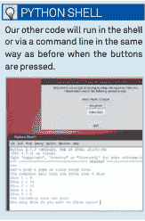

### Python 基础知识

```python
def result(player, computer):
    new_score = 0
    if player == computer:
        result_set.set("Tie game.")
    else:
        if rules[player] == computer:
            result_set.set("Your victory has been assured.")
            new_score = player_score.get()
            new_score += 1
            player_score.set(new_score)
        else:
            result_set.set("The computer laughs as you realise you have been defeated.")
            new_score = computer_score.get()
            new_score += 1
            computer_score.set(new_score)

rps_window = Toplevel()
rps_window.title("Rock, Paper, Scissors")

player_choice = IntVar()
computer_choice = StringVar()
result_set = StringVar()
player_choice.set(1)
player_score = IntVar()
computer_score = IntVar()
```

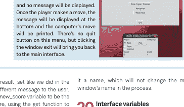

#### 15 结果函数

结果函数仍然和之前一样接收相同的两个变量，这两个变量是在游戏函数中设置的。虽然从技术上说，我们可以使用为界面设置的变量，但这些变量并不是纯粹的整数，如果处理不当可能会引发错误。考虑到这一点，我们创建了一个空的 `new_score` 变量，用它来有效地清理界面值，然后再将其加回去。

#### 16 平局

判断结果的逻辑与之前相同。我们首先做简单的检查——玩家和电脑变量的数值是否相同。这次不同的是，我们不再打印文本，而是使用 Tkinter 的 `set` 函数将“`Tie game`”消息发送到结果变量中。

#### 17 胜利

`if` 语句接着判断玩家是否获胜。与之前一样，我们使用预设的 `rules` 进行比较。与平局时一样，我们设置 `result_set`，但向用户显示不同的消息。最后，我们将 `new_score` 变量设置为当前玩家得分：使用 `get` 函数获取该得分，将其加一，然后再次使用 `set` 放回 `player_score` 变量。我们不能对 `player_score` 变量使用 `+=`，因为它不是标准变量。

#### 18 失败

整个 `if` 语句的这一部分与之前的工作方式相同，即假定如果不是平局或胜利，就是失败。与新的胜利代码一样，它随后使用 `set` 更改将显示给玩家的消息，并通过 `new_score` 变量获取和更新电脑得分。

#### 19 新窗口

由于原始窗口是主循环（`mainloop`）的一部分，我们不能像主界面代码那样使用 `Tk()` 创建窗口。不过，由于这个窗口是从它派生的，我们改用 `Toplevel()` 创建窗口。这样，窗口就可以独立运行并显示在主窗口的上方。我们还为它指定了名称，这不会改变主窗口的名称。

#### 20 界面变量


这就是我们必须以不同方式调用和修改变量的原因。对于 Tkinter，我们需要让界面知道变量是整数还是文本值。`IntVar`和`StringVar`分别用于这两种类型。我们还将`player_choice`变量设置为`1`，也就是我们已经设置为“石头”的选项。这样，游戏启动时至少会有一个默认选项，并且不会引发错误。

### 21 游戏框架

我们创建界面项框架的方式略有不同。主界面中使用的是`pack`命令，而这里我们使用`grid`，以确保它们以对用户有意义的方式排列。`Padding`（内边距）正是起到这个作用，它设置数值，确保框架内的项不会碰到窗口边缘。然后我们使用`.grid`命令创建这个框架。`row`和`column`变量允许将行和列包含在窗口的结构中，而`sticky`允许我们按特定方向对齐项——本例中是上、左、右、下四个方向的对齐。最后，我们通过赋予每一列和每一行相同的权重，并从零开始，确保它们被平等对待。

```python
rps_frame = Frame(rps_window, padding = '3 12 12', width = 300)

rps_frame.grid(column=0, row = 0, sticky=(N,W,E,S))

rps_frame.columnconfigure(0, weight=1)

rps_frame.rowconfigure(0,weight=1)

Label(rps_frame, text='Player').grid(column=1, row = 1, sticky = W)

Radiobutton(rps_frame, text = 'Rock', variable = player_choice, value = 1).grid(column=1, row=2, sticky=W)

Radiobutton(rps_frame, text = 'Paper', variable = player_choice, value = 2).grid(column=1, row=3, sticky=W)

Radiobutton(rps_frame, text = 'Scissors', variable = player_choice, value = 3).grid(column=1, row=4, sticky=W)

Label(rps_frame, text='Computer').grid(column=3, row = 1, sticky = W)

Label(rps_frame, textvariable = computer_choice).grid(column=3, row=3, sticky = W)

Button(rps_frame, text='Play', command = start).grid(column = 2, row = 2)

Label(rps_frame, text = 'Score').grid(column = 1, row = 5, sticky = W)

Label(rps_frame, textvariable = player_score).grid(column = 1, row = 6, sticky = W)

Label(rps_frame, text = 'Score').grid(column = 3, row = 5, sticky = W)

Label(rps_frame, textvariable = computer_score).grid(column = 3, row = 6, sticky = W)

Label(rps_frame, textvariable = result_set).grid(column = 2, row = 7)

if __name__ == '__main__':
    gui()
```

### 22 玩家的选择

我们为玩家的出拳创建一个标签，并将其放到网格位置——第一行、第一列。我们还使用`'sticky = W'`将其左对齐。然后，我们为玩家的出拳添加单选按钮，每个按钮位于同一列，但依次向下排列。我们为每个选项命名，然后将其赋值给`player_choice`变量。接着，我们让每个选项都有一个与我们在第一组规则中确定的出拳相对应的数值。

### 23 电脑的出拳

首先，我们为这一项添加标签，然后创建第二个标签来显示实际的出拳。为此，我们为`Label`添加`textvariable`选项，并使用稍早在游戏函数中更新的`computer_choice`变量。这仅会打印`names`列表中的文本，并将其左对齐。

### 24 点击开始

代码的运行完全依赖于“开始”按钮。这很简单：我们将它放在玩家和电脑出拳之间的行中，作为三列系统的一部分；并通过`command`选项运行`start`函数。由于界面的循环，我们可以不断点击它，而不需要被提示再次开始。只需关闭窗口，也会返回主界面窗口，因此我们不需要专门的退出按钮。

### 25 实时得分

我们要显示两组分数——一组是玩家的，另一组是电脑的。我们像标记玩家和电脑出拳那样为它们添加标签，将它们放在较低的行中，但仍位于相应的列中。在下方，我们再次使用`textvariable`选项来获取分配给相应分数变量的数值分数。最后，我们再创建一个标签来显示游戏结果的提示信息。

### 26 结束游戏

代码的最后一部分允许脚本被主窗口使用，同时也允许它在命令行或 shell 中独立运行。你需要进行一些修改才能让它独立运行，例如将其设为主循环（`mainloop`）而不是`Toplevel`窗口。不过，无论从哪里运行，它都能正常运行，而不需要从主界面启动。

# 为简单的 Python 游戏添加图形

为你的剪刀石头布游戏的挂人游戏和扑克骰子代码添加图形界面

我们现在已经为之前制作的三款 Python 游戏创建了一个简单的选择器。此界面能够为我们的石头剪刀布游戏启动 GUI，并在终端中运行另外两个游戏。现在，我们将把挂人游戏和扑克骰子代码转换为与石头剪刀布类似的方式。

挂人游戏的技巧在于允许不同类型的输入，即文本，以及能够进行多轮游戏。`Tkinter`允许文本输入，我们在整个游戏中更少地依赖于`'while'`循环。扑克骰子需要保留骰子分析代码，以及使用复选框更改特定骰子的选项。

我们将对大量原始代码进行修改以适应新的图形方案。这主要涉及剪切特定部分并让`Tkinter`特定代码自行处理这些部分。这些页面上的代码列表包括修改后的代码——我们将在后面的页面上讨论图形部分。

## 资源

`Python 2`: `www.python.org/download`

`IDLE`: `www.python.org/idle`

### 1 导入

这里我们进行相同的少量设置，包括获取`Tkinter`模块，该模块帮助我们创建简单的图形界面

### 2 单词

我们保留确定要猜测单词的变量，以便可以在代码中的任何位置轻松访问

### 3 函数

像上次一样，我们将原始代码的大部分放入新的函数`gui`中

### 4 分析

我们在继续进行代码的其余部分之前选择单词并分析它

### 5 图形

`hangedman`函数基本保持不变，只是增加了在界面上显示 ASCII 图形的代码

### 6 猜测

我们检查犯错的次数，并调用`guess_letter`函数来检查输入的字母

## 挂人游戏代码列表

```python
from Tkinter import *
from ttk import *
from random import *
word = 0
word_length = 0
clue = []
```

```python
def gui():
    global word, word_length, clue
    dictionary = ["gnu", "kernel", "linux", "mageia", "penguin", "ubuntu"]
    word = choice(dictionary)
    word_length = len(word)
    clue = word_length * ["_"]
    tries = 0
```

```python
def hangedman(hangman):
    graphic = [
        "     ",
        "  ---------",
        "  |       |",
        "  |       0",
        "  |      /|\\",
        "  |       |",
        "  |      / \\ ",
        "  |",
        "=========",
    ]
    graphic_set = graphic[hangman]
    hm_graphic.set(graphic_set)
```


```python
def game():
    letters_wrong = incorrect_guesses.get()
    letter=guess_letter()
    first_index = word.find(letter)
    if first_index == -1:
        letters_wrong +=1
        incorrect_guesses.set(letters_wrong)
    else:
        for i in range(word_length):
```

```python
if letter == word[i]:
    clue[i] = letter
hangedman(letters_wrong)
clue_set = "".join(clue)
word_output.set(clue_set)
if letters_wrong == tries:
    result_text = "Game Over. The word was " + word
    result_set.set(result_text)
    new_score = computer_score.get()
    new_score += 1
    computer_score.set(new_score)
    if "".join(clue) == word:
        result_text = "You Win! The word was " + word
        result_set.set(result_text)
        new_score = player_score.get()
        new_score += 1
        player_score.set(new_score)
```

```python
def guess_letter():
    letter = letter_guess.get()
    letter = letter.strip()
    letter = letter.lower()
    return letter
```

```python
def reset_game():
    global word, word_length, clue
    incorrect_guesses.set(0)
    hangedman(0)
    result_set.set("")
    letter_guess.set("")
    word = choice(dictionary)
    word_length = len(word)
    clue = word_length * ["_"]
    new_clue = "".join(clue)
    word_output.set(new_clue)
```

```python
if __name__ == '__main__':
    gui()
```

### 扑克骰子代码列表

#### 1 更多导入

我们添加了使 Tkinter 工作所需的新导入模块，并保持其余部分不变

#### 2 骰子列表

保存骰子的列表保留在主函数之外，以便可以在任何地方访问

#### 3 掷骰

同理适用于 `roll` 函数。它也不一定需要在 `gui` 函数内部

#### 4 决策

我们稍后创建的图形代码中的复选框将为我们提供可以分析代码的数字。我们检索这些数字并检查它们以确定用户希望重新掷哪些骰子

#### 5 手牌

最后，我们的手牌分析函数是原始代码中保留在 `gui` 函数之外的最后一部分。上面这个函数和这个函数都将必要的详细信息传回上层链，然后添加到新界面的新图形元素中

#### 6 无骰子

如果没有骰子被选中重新掷，手牌输出将被更改以显示最终消息

#### 7 重新掷

这部分几乎与之前相同——重新掷出一组新骰子，然后像之前一样插入到骰子列表中，然后重新排序以使手牌分析更容易

#### 8 更多函数

新的 `gui` 函数是扑克骰子代码的主要更改，与之前一样包括 Tkinter 元素和其他原始代码部分

#### 9 游戏开始

一个简单的函数，我们可以用它来激活骰子的重新掷

#### 10 新手牌

新骰子被命名、分析，然后一切都设置好以便 `gui` 显示最终结果

#### 11 重置

与挂人游戏代码一样，我们有一个函数来重置所有变量，让你可以再次开始游戏

```python
from Tkinter import *
from ttk import *
import random
from itertools import groupby
dice = 0

def roll(roll_number):
    numbers = range(1,7)
    dice = range(roll_number)
    iterations = 0
    while iterations < roll_number:
        iterations = iterations + 1
        dice[iterations-1] = random.choice(numbers)
    return dice

choice(numbers)

def hand(dice):
    dice_hand = [len(list(group)) for key, group in itertools.groupby(dice)]
    dice_hand.sort(reverse=True)
    straight1 = [1,2,3,4,5]
    straight2 = [2,3,4,5,6]
    if dice == straight1 or dice == straight2:
        return "a straight!"
    elif dice_hand[0] == 5:
        return "five of a kind!"
    elif dice_hand[0] == 4:
        return "four of a kind!"
    elif dice_hand[0] == 3:
        if dice_hand[1] == 2:
            return "a full house!"
        else:
            return "three of a kind."
    elif dice_hand[0] == 2:
        if dice_hand[1] == 2:
            return "two pair."
        else:
            return "one pair."
    else:
        return "a high card."

def gui():
    global dice
    dice = roll(5)
    dice.sort()
    nine = 1
    ten = 2
    jack = 3
    queen = 4
    king = 5
    ace = 6
    names = { nine: "9", ten: "10", jack: "J", queen: "Q", king: "K", ace: "A" }
    result = "You have " + hand(dice)

def game():
    throws()

def throws():
```


```
global dice
dice1_check = dice1.get()
dice2_check = dice2.get()
dice3_check = dice3.get()
dice4_check = dice4.get()
dice5_check = dice5.get()
dice_re rolls = [dice1_check, dice2_check, dice3_check, dice4_check, dice5_check]
for i in range(len(dice_re rolls)):
    if i in range(dice_re rolls):
        dice_re rolls.remove(0)
    if len(dice_re rolls) == 0:
        result = "You finish with " + hand(dice)
        hand_output.set(result)
    else:
        roll_number = len(dice_re rolls)
        number_re rolls = roll(roll_num ber)
        dice_changes = range(len(dice_ re rolls))
        iterations = 0
        while iterations < roll_number:
            iterations = iterations + 1
            dice_changes[iterations-1] = number_re rolls[iterations-1]
        iterations = 0
        while iterations < roll_number:
            iterations = iterations + 1
            replacement = number_ re rolls[iterations-1]
            dice[iterations-1] = replacement
        changes[iterations-1] = replacement
        dice.sort()
        new_dice_list = [0,0,0,0,0]
        for i in range(len(dice)):
            new_dice_list[i] = names[dice[i]]
        final_dice = " ".join(new_dice_ list)
        dice_output.set(final_dice)
        final_result = "You finish with " + hand(dice)
        hand_output.set(final_result)

def reset_game():
    global dice
    dice = roll(5)
    dice.sort()
    for i in range(len(dice)):
        empty_dice[i] = names[dice[i]]
    first_dice = " ".join(empty_dice)
    dice_output.set(first_dice)
    result = "You have " + hand(dice)
    hand_output.set(result)

if __name__ == '__main__':
    gui()
```

```python
#!/usr/bin/env python2
from Tkinter import *
from ttk import *
from random import *
word = 0
word_length = 0
clue = 0
def gui():
    global word, word_length, clue
    dictionary = ["gnu","kernel","linux","mageia","penguin","ubuntu"]
    word = choice(dictionary)
    word_length = len(word)
    clue = word_length * ["-"]
    tries = 6
def hangedman(hangman):
    graphic = [
        """..."""
    ]
    graphic_set = graphic[hangman]
    hm_graphic.set(graphic_set)
def game():
    letters_wrong = incorrect_guesses.get()
    letter=guess_letter()
    first_index=word.find(letter)
    if first_index == -1:
        letters_wrong +=1
        incorrect_guesses.set(letters_wrong)
    else:
        for i in range(word_length):
            if letter == word[i]:
                clue[i] = letter
    hangedman(letters_wrong)
    clue_set = "".join(clue)
    word_output.set(clue_set)
    if letters_wrong == tries:
        result_text = "Game Over. The word was " + word
        result_set.set(result_text)
        new_score = computer_score.get()
        new_score += 1
        computer_score.set(new_score)
    if "".join(clue) == word:
        result_text = "You Win! The word was " + word
        result_set.set(result_text)
        new_score = player_score.get()
        new_score += 1
        player_score.set(new_score)
```

### 01 第一行代码

和往常一样，我们从允许在命令行中运行程序的代码开始，然后导入必要的模块：`random`，用于确定使用的单词；`Tkinter`，用于大部分图形代码；以及 `ttk`，用于我们将用来对齐不同元素的网格代码。

### 02 全局变量

我们将这三个变量保留在 `gui` 函数之外，以便代码的各个部分都可以访问它们。Python 2 不允许你在嵌套函数中调用全局变量，而在 Python 3 中，这些变量本可以放入 `gui` 函数中。

### 03 图形函数

我们将所有工作代码放入 `gui` 函数中，以便可以从主界面激活它。这意味着我们可以将 Hangman 代码导入到界面中，而不会弹出游戏窗口，只有在从此处激活 `gui` 函数时才运行它。

### 04 随机单词

我们通过 `global` 引入三个变量，以便在代码中对其进行修改，然后设置单词。如前所述，使用 `choice` 从单词列表中选择一个随机项，确定其长度，并设置要显示的线索。

### 05 吊人图

这次 Hangman 图形的主要区别在于，我们不再将其打印出来，而是要在界面中显示它们。当函数被调用并选择图形时，它会被放置在我们在界面代码中设置的变量中，我们用它来显示结果。

### 06 游戏开始

对我们输入的字母的所有分析都在此函数中完成。为此，我们首先从为界面设置的变量中获取到目前为止的错误猜测次数，以便界面在需要时可以访问它。然后从界面中的输入字段获取字母并清理它，以便可以与代码的其余部分一起使用。

### 07 检查字母

代码的这一部分与之前基本没有变化——字母被取出并与单词使用 `find` 进行比较，以查看是否与其中一个字母匹配。如果语句为真，则将错误猜测变量加一，或者更新线索变量以在正确的位置添加字母。

### 08 更新界面

这三行代码设置本轮的图形，将当前线索连接成一个字符串，然后将其设置在界面读取的变量上。

### 09 更新分数

与之前完全一样，我们检查玩家是否已经赢了或输了。在任一情况下，都会显示一条消息以表明这一点，并使用 `set` 更新胜负分数。

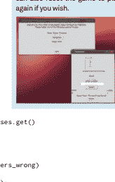

> 你输了

> 当你用完猜测次数时，游戏停止。从这里，你也可以重置游戏以再次游玩，如果你愿意的话。


```python
def guess_letter():

    letter = letter_guess.get()

    letter.strip()

    letter.lower()

    return letter

def reset_game():

    global word, word_length, clue

    incorrect_guesses.set(0)

    hangmanN(0)

    result_set.set("")

    letter_guess.set("")

    word = choice(dictionary)

    word_length = len(word)

    clue = word_length * "_"

    new_clue = "".join(clue)

    word_output.set(new_clue)

ha_window = Toplevel()

ha_window.title("Hangman")

incorrect_guesses = IntVar()

incorrect_score = IntVar()

player_score = IntVar()

computer_score = IntVar()

result_set = StringVar()

letter_guess = StringVar()

word_output = StringVar()

ha_graphic = StringVar()

ha_frame = Frame(ha_window, padding = '3 3 12 12', width = 300)

ha_frame.grid(column=0, row = 0, sticky=(N,E,S))

ha_frame.columnconfigure(0, weight=1)

ha_frame.rowconfigure(8, weight=1)

Label(ha_frame, textvariable = ha_graphic).grid(column=2, row = 1)

Label(ha_frame, text="Word").grid(column=2, row = 2)

Label(ha_frame, textvariable = word_output).grid(column=2, row = 3)

Label(ha_frame, text="Enter a letter:").grid(column=2, row = 4)

ha_entry = Entry(ha_frame, exportselection = 0, textvariable = letter_guess).grid(column = 3, row = 5)

ha_button = Button(ha_frame, text = "Go", command = game).grid(column = 2, row = 6)

Label(ha_frame, text = "Wins").grid(column = 1, row = 7, sticky = W)

Label(ha_frame, textvariable = player_score).grid(column = 3, row = 7, sticky = W)

Label(ha_frame, text = "Losses").grid(column = 1, row = 8, sticky = W)

Label(ha_frame, textvariable = computer_score).grid(column = 3, row = 8, sticky = W)

Label(ha_frame, textvariable = result_set).grid(column = 1, row = 9, sticky = W)

replay_button = Button(ha_frame, text = "Reset", command = reset_game).grid(column = 2, row = 10)

if __name__ == "__main__":

    gui()
```

### ORIGINAL INTERFACE

你还需要上期提供的界面代码，它已经可以与修改后的石头剪刀布代码一起工作。由于代码的编写方式，它无法与新代码一起工作，因此你必须将每个按钮中的命令从 `[game].start` 改为 `[game].gui`。

### THE HANGMAN GUI

按下更新后的 Hangman 按钮以启动一个新窗口。在这里我们有初始图形、单词提示以及玩家交互的输入框。分数设置为零，且没有显示结果消息，因为还没有进行过游戏。

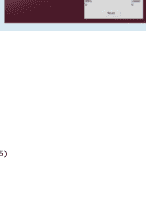

#### 10 Sanitise input

`guess_letter` 函数纯粹是从玩家输入变量中获取字母，去除其格式，使其变为小写，然后将其返回给游戏函数。这样字母才能被正确使用。

#### 11 New window

我们像上个月一样使用 Tkinter 的 `Toplevel` 命令来分离主界面和游戏窗口的循环。然后我们使用 `title` 将其命名为 Hangman。

#### 12 Interface variables

Tkinter 仅适用于特定变量——我们在这里创建了所需或可用的所有变量。`IntVars` 接收整数，而 `StringVars` 接收字符串。我们在其余代码中始终使用 `get` 和 `set` 来获取和设置这些变量的值。

> 框架的设置与之前相同

#### 13 Framed window

框架的设置方式与上次相同。我们将框架从窗口边缘内边距，设置网格，在罗盘点设置粘性点，并允许使用特定的行和列点设置对象。

#### 14 Clue to Hangman

这些标签相当直接——我们要么为其提供固定文本，要么告诉它们使用特定的 `textvariable`，以便在游戏过程中可以更新。

#### 15 Text entry

`Entry` 在这里设置一个我们将添加字母的文本框。`exportselection` 选项使得选择字母不会立即将其复制到剪贴板，而 `textvariable` 选择是代码存储添加字母的位置。按钮激活 `game` 函数，分析玩家输入的字母。

#### 16 Results and reset

其余代码与我们之前做过的类似：标签用于显示固定文本和会变化的分数/结果文本。激活重置函数的按钮也放在底部。这里的最后两行允许我们将模块导入到界面代码中。

#### 17 重新开始

这里是通常的命令行兼容性和模块导入。`groupby` 函数在此处专门导入用于骰子分析。

#### 18 骰子之外

对于 Poker Dice，每次只能显示一个变量，即骰子。再次由于嵌套函数，并且我们使用的是 Python 2，我们需要从这里使用 `global` 调用它，以确保游戏可以正确重置。

#### 19 骰子掷出

`roll` 函数已从 `gui` 函数中移除，以免与其某些变量产生代码错误。它可以在嵌套函数中轻松调用。它与原始代码完全没有变化。

#### 20 手牌骰子

与 `roll` 类似，`hand` 函数也没有任何变化。它只是现在被放置在 `gui` 函数之外，原因完全相同。这也意味着如果你愿意，可以轻松地将此函数导入到另一个脚本中。

#### 21 GUI 开始

正如我们上个月和在 Hangman 代码中所提到的，我们将所有 GUI 代码放入一个函数中，以便我们想调用时可以调用。在这种情况下，按下主界面上的 Poker Dice 按钮会激活 `pokerdice.gui`，即此函数。

#### 22 第一次掷出

窗口打开时，我们立即进行第一次掷出。然后对其进行排序，每个数字都被归属于一张牌，然后结果被创建以在主窗口中显示。这与之前的工作方式类似，但现在它在脚本末尾被输入到界面 `StringVars` 中

#### 23 开始游戏

当我们激活开始游戏的按钮时，它会立即将我们发送到代码的其余部分。如果让按钮转到 `throws` 函数也会起作用，不过，你可以在此部分添加其他函数。

#### 24 骰子选择

我们做的第一件事是找出玩家勾选了哪些复选框。然后我们将这些放入一个列表中，以便我们可以更改正确的骰子数字。我们还引入了 `dice`，以便我们可以检查当前骰子掷出的情况。

```
#!/usr/bin/env python2
from Tkinter import *
from ttk import *
import random
from itertools import groupby
dice = 0
```


```
def roll(roll_number):
    numbers = range(1,7)
    dice = range(roll_number)
    iterations = 0
    while iterations < roll_number:
        iterations = iterations + 1
        dice[iterations-1] = random.choice(numbers)
    return dice
```

```
def hand(dice):
    dice_hand = [len(list(group)) for key, group in groupby(dice)]
    dice_hand.sort(reverse=True)
    straight1 = [1,2,3,4,5]
    straight2 = [2,3,4,5,6]
    if dice == straight1 or dice == straight2:
        return "a straight!"
    elif dice_hand[0] == 5:
        return "five of a kind!"
    elif dice_hand[0] == 4:
        return "four of a kind!"
    elif dice_hand[0] == 3:
        if dice_hand[1] == 2:
            return "a full house!"
        else:
            return "three of a kind."
    elif dice_hand[0] == 2:
        if dice_hand[1] == 2:
            return "two pair."
        else:
            return "one pair."
    else:
        return "a high card."
```

```
def gui():
    global dice
    dice = roll(5)
    dice.sort()
    nine = 9
    ten = 10
    jack = 3
    queen = 4
    king = 5
    ace = 6
    names = { nine: "9", ten: "10", jack: "J", queen: "Q", king: "K", ace: "A" }
    result = "You have " + hand(dice)
```

```
def game():
    throws()
```

```
def throws():
    global dice
    dice1_check = dice1.get()
    dice2_check = dice2.get()
    dice3_check = dice3.get()
    dice4_check = dice4.get()
    dice5_check = dice5.get()
    dice_re_rolls = [dice1_check, dice2_check, dice3_check, dice4_check, dice5_check]
```

## EXTRA GAME FUNCTIONS

我们提到游戏函数现在不一定需要使用。你可以清理代码并将其删除，也可以添加额外函数，例如能够选择随机的新骰子组合，或使其成为双人游戏。尝试你想做的事情！

## THE POKER DICE GUI

初始窗口上打印了两件事。第一组骰子，按上次的方式排序，以及当前手牌。复选框激活特定数字，该数字在重新掷骰子时与 Reroll 按钮一起使用。

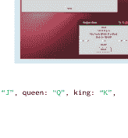

### 检查按钮是新的

#### 25 重新掷骰子

如果复选框未被选中，我们将其设置为给出零值。我们希望从列表中删除这些项，以便更改正确的骰子，因此我们使用`for`循环检查列表的每个部分，然后在元素等于零时使用`remove()`函数。

#### 26 提前结束

如果没有骰子被选中重新掷骰，列表将包含全是 0，这之后将被删除。该列表的长度也将变为零，这意味着如果玩家在未选择任何骰子的情况下点击 ReRoll，我们可以用它来结束游戏。

#### 27 新骰子

这个`else`函数的工作方式与之前大致相同。我们首先获取需要掷多少个骰子的必要信息，以及放置重掷结果的列表。然后我们用第一个`while`循环掷出所需数量的新骰子

#### 28 游戏结束

我们使用类似的`while`循环将新数字替换回原始列表，就像上次一样。然后骰子会被重新排序、分析、连接成字符串并设置到界面的变量中。最终的手牌信息也会被创建并设置。

#### 29 图形变量

由于我们在启动游戏时就开始掷骰子，但界面代码要到最后才开始，你可以看到在创建必要的变量后，我们也对其进行了设置。值得注意的是，骰子必须先通过`for`循环单独转换为字符串，然后再添加到变量中。

#### 30 检查按钮

此代码的主要新增内容是带有`Checkbutton`的检查按钮。你可以设置开和关的值，默认关闭为 0。我们让检查按钮返回与它们更改的骰子相同的数字，我们在代码前面解释了我们如何使用它。`variable`选项将结果设置为特定的`Tkinter`变量。


```
for i in range(len(dice_rerolls)):
    if dice_rerolls[i] == 0:
        dice_rerolls.remove(0)
    if len(dice_rerolls) == 0:
        result = "You finish with " + hand(dice)
        hand_output.set(result)
    else:
        roll_number = len(dice_rerolls)
        number_rerolls = roll(roll_number)
        dice_changes = range(len(dice_rerolls))
        iterations = 0
        while iterations < roll_number:
            iterations += 1
            dice_changes[iterations-1] = number_rerolls[iterations-1]
        iterations = 0
        while iterations < roll_number:
            iterations += 1
            replacement = number_rerolls[iterations-1]
            dice[dice_changes[iterations-1]] = replacement
        dice.sort()
        new_dice_list = [0,0,0,0]
        for i in range(len(dice)):
            new_dice_list[i] = names[dice[i]]
        final_output.set(" ".join(new_dice_list))
        dice_output.set(final_output)
        final_result = "You finish with " + hand(dice)
        hand_output.set(final_result)

def reset_game():
    global dice
    dice = roll(5)
    dice.sort()
    empty_dice = [0,0,0,0]
    for i in range(len(dice)):
        empty_dice[i] = names[dice[i]]
    first_dice = " ".join(empty_dice)
    dice_output.set(first_dice)
    result = "You have a " + hand(dice)
    hand_output.set(result)

pd_window = Toplevel()
pd_window.title("Power Dice")
pd_window.geometry("300x300")
empty_dice = [0,0,0,0]
for i in range(len(dice)):
    empty_dice[i] = names[dice[i]]
first_dice = " ".join(empty_dice)
dice_output.set(first_dice)
hand_output.set(" ")
hand_output.set(result)
dice1 = IntVar()
dice2 = IntVar()
dice3 = IntVar()
dice4 = IntVar()
dice5 = IntVar()
result_set = StringVar()
player_score = IntVar()
computer_score = IntVar()

pd_frame = Frame(pd_window, padding = "3 3 12 12", width = 300)
pd_frame = Frame(pd_window, row = 8, sticky=W,N,E,S)
pd_frame.columnconfigure(6, weight=1)
pd_frame.rowconfigure(8,weight=1)
Label(pd_frame, text=dice1, grid(column=3, row = 1))
Label(pd_frame, textvariable = dice_output, grid(column=3, row = 2))
Label(pd_frame, textvariable = hand_output, grid(column=3, row = 3))

Label(pd_frame, text="Dice to Reroll(?)", grid(column=3, row = 4))
reroll1 = Checkbutton(pd_frame, text = "1", variable = dice1, onvalue = 1, offvalue = 0) grid(column=2, row = 5)
reroll2 = Checkbutton(pd_frame, text = "2", variable = dice2, onvalue = 2, offvalue = 0) grid(column=2, row = 5)
reroll3 = Checkbutton(pd_frame, text = "3", variable = dice3, onvalue = 3, offvalue = 0) grid(column=2, row = 5)
reroll4 = Checkbutton(pd_frame, text = "4", variable = dice4, onvalue = 4, offvalue = 0) grid(column=2, row = 5)
reroll5 = Checkbutton(pd_frame, text = "5", variable = dice5, onvalue = 5, offvalue = 0) grid(column=2, row = 5)
pd_reroll_button = Button(pd_frame, text = "Reroll", command = e_game) grid(column = 3, row = 6)
replay_button = Button(pd_frame, text = "Reset", command = reset_game) grid(column = 3, row = 7)

if __name__ == "__main__":
    gui()
```

### 一个窗口

我们制作这些 `Tkinter` 界面的方式是让游戏在单独的窗口中启动。你也可以让它们都在一个窗口中运行，只需用不同的函数或类替换原始界面的标签和按钮即可。确保为游戏添加一个退出按钮，让你可以返回主页面。

# 使用 Python 为 Android 构建应用

掌握 `Kivy`，这款出色的跨平台应用框架，制作你的第一个 Android 应用...

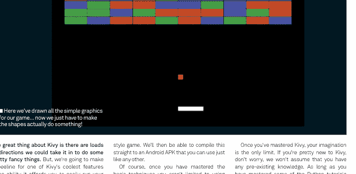

这里我们已经为游戏绘制了所有简单的图形... 现在我们只需要让这些形状真正发挥作用！

`Kivy` 的优点在于我们可以朝多个方向发展，实现相当花哨的功能。但我们将直奔 `Kivy` 最酷的功能之一——它让你能够轻松在 Android 上运行程序。我们将首先展示如何制作一个新应用，这次是一个动态的 Breakout 风格游戏。然后我们就能直接将其编译成 Android APK，就像使用任何其他应用一样。

当然，一旦你掌握了基本技巧，你就不会局限于使用某种特定类型的应用，因为即使在 Android 上，你也可以使用你最喜欢的 Python 库来制作任何你喜欢的程序。

一旦你掌握了 `Kivy`，你的想象力就是唯一的限制。如果你对 `Kivy` 几乎一无所知，不用担心，我们不会假设你有任何预先的知识。只要你已经掌握了本书迄今为止的一些 Python 教程，并且对该语言有相当好的理解，就不应该有任何问题可以跟上。

在做任何其他事情之前，让我们先拼凑一个基本的 `Kivy` 应用（图 01）。我们已经预先导入了我们将使用的 widget 类型，这次只有三种：没有特殊行为的基本 `Widget`，上次使用的具有弹出行为的 `ModalView`，以及我们稍后会解释的 `FloatLayout`。`Kivy` 还有许多其他预建的 widget 用于创建 GUI，但这次我们将专注于使用 `Kivy` 的图形指令从头开始绘制整个 GUI。这些指令要么是用于创建形状的顶点指令（包括矩形、线条、网格等），要么是上下文图形更改（例如平移、旋转、缩放等），并且能够在屏幕上的任何位置和任何 widget 类型上绘制。


在我们能做任何事情之前，我们需要为每种游戏对象创建一个类，我们将为其预先填充一些稍后控制它们所需的属性。还记得上次吗，Kivy 属性是在类级别声明的特殊属性，它们（在其他事情中）可以通过 `kv` 语言进行修改，并在被修改时分派事件（图 02）。`Game` 类将是一个包含整个游戏的大型 `widget`。我们特意让它成为 `FloatLayout` 的子类，因为这种特殊的布局能够按比例定位和调整其子项的大小——因此无论我们在何处运行它或如何调整窗口大小，它都会适当地放置所有游戏对象。

接下来我们可以使用 Kivy 的图形指令在我们的 `widget` 上绘制各种形状。我们将只演示简单的矩形来显示它们的位置，尽管还有许多更高级的选项你可以去研究。在 Python 文件中，我们可以通过在任何 `widget` 的 `canvas` 上声明它来应用任何指令，图 03 显示了其中一个示例。这将绘制一个红色矩形，其位置和大小与玩家实例化时的位置和大小相同——但这有一个问题，不幸的是，绘制是静态的。当我们稍后移动玩家 `widget` 时，红色矩形将保持在同一位置，而 `widget` 在其真实位置时将不可见。

我们可以通过保留对 `canvas` 指令的引用并反复更新其属性来跟踪玩家来修复这个问题，但实际上有一个更简单的方法可以完成所有这些——我们可以使用上次介绍的 Kivy 语言。它具有用于在 `widget canvas` 上绘制的特殊语法，我们可以用它来绘制每个 `widget` 形状：

```
<Player>:
    canvas:
        Color:
            rgba: 1, 1, 1, 1
        Rectangle:
            pos: self.pos
            size: self.size
```

```
<Ball>:
    canvas:
        Color:
            rgb: 1, 0.55, 0
        Rectangle:
            pos: self.pos
            size: self.size
```

```
<Block>:
    canvas:
        Color:
            rgb: self.colour
        # A property we predefined above
        Rectangle:
            pos: self.pos
            size: self.size
        Color:
            rgb: 0.1, 0.1, 0.1
        Line:
            rectangle: [self.x, self.y, self.width, self.height]
```

`canvas` 声明是特殊的，在它下面我们可以编写任何我们喜欢的 `canvas` 指令。不要混淆，`canvas` 不是一个 `widget`，图形指令如 `Line` 也不是。这只是 `canvas` 独有的特殊语法。指令都有不同的属性可以设置，比如矩形的 `pos` 和 `size`，你可以在线查看 Kivy 文档以了解所有可能性。最大的优势是，虽然我们仍然声明简单的 `canvas` 指令，但 `kv` 语言能够检测我们引用的 Kivy 属性并自动跟踪它们，因此当它们被更新时（`widget` 移动或调整大小），`canvas` 指令会跟随移动！

> 一旦你掌握了基本技巧，你就不会局限于一个应用… 你的想象力就是唯一的限制

```
from kivy.app import App
from kivy.uix.widget import Widget
from kivy.uix.floatlayout import FloatLayout
from kivy.uix.modalview import ModalView

__version__ = '0.1' # Used later during Android compilation

class BreakoutApp(App):
    pass

BreakoutApp().run()
Fig. 01
```

```
from kivy.properties import (ListProperty, NumericProperty, ObjectProperty, StringProperty)

class Game(FloatLayout): # Will contain everything
    blocks = ListProperty([])
    player = ObjectProperty() # The game's Player instance
    ball = ObjectProperty() # The game's Ball instance

class Player(Widget): # A moving paddle
    position = NumericProperty(0.5)
    direction = StringProperty('none')

class Ball(Widget): # A bouncing ball
    # pos_hints are for proportional positioning, see below
    pos_hint_x = NumericProperty(0.5)
    pos_hint_y = NumericProperty(0.3)
    proper_size = NumericProperty(0)
    velocity = ListProperty([0.1, 0.5])

class Block(Widget): # Each coloured block to destroy
    colour = ListProperty([1, 0, 0])
Fig. 02
```

```
from kivy.graphics.context_instructions import Color
from kivy.graphics.vertex_instructions import Rectangle

class Player(Widget):
    def __init__(self, **kwargs):
        super(Player, self).__init__(**kwargs)
        with self.canvas:
            Color(1, 0, 0, 1) # r, g, b, a -> red
            Rectangle(pos=self.pos, size=self.size)
        # or without the with syntax, self.canvas.add(...)
Fig. 03
```

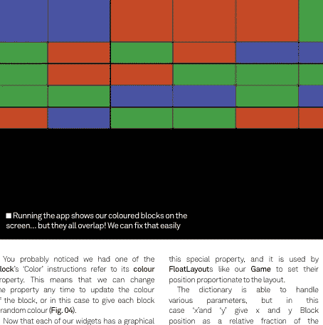

运行应用后，我们的彩色方块显示在屏幕上... 但它们全部重叠了！我们很容易就能修复这个问题。

你可能已经注意到，我们让其中一个 `Block` 的 `Color` 指令引用了它的颜色属性。这意味着我们可以在任何时候更改该属性来更新方块的颜色，或者在这种情况下为每个方块赋予随机颜色（图 04）。现在我们的每个控件都有了图形表示，让我们现在告诉我们的 `Game` 将它们放置在哪里，这样我们就可以启动应用并真正看到一些东西了。

```
class Game(FloatLayout):
    def setup_blocks(self):
        for y_jump in range(5):
            for x_jump in range(10):
                block = Block(pos_hint={
                    'x': 0.05 + 0.09*x_jump,
                    'y': 0.05 + 0.09*y_jump})
                self.blocks.append(block)
                self.add_widget(block)
```

```
class BreakoutApp(App):
    def build(self):
        g = Game()
        g.setup_blocks()
        return g
```


在这里我们创建想要的控件，然后使用 `add_widget` 将它们添加到图形树中。我们屏幕上的根控件是 `Game` 的一个实例，每个方块都被添加到其中以便显示。唯一的新内容是每个 `Block` 都被赋予了 `pos_hint`。所有控件都有这个特殊属性，并且它被像我们的 `Game` 这样的 `FloatLayouts` 使用，以按比例设置它们的位置。字典可以处理各种参数，但在这种情况下 `'x'` 和 `'y'` 给出了 `Block` 位置相对于父宽度和高度的相对分数。你现在可以运行应用，这次它会在显示之前向 `Game` 添加 50 个方块。每个方块都应具有三种可能的随机颜色之一并以网格排列，但你现在会注意到它们的尺寸没有手动设置，所以它们全部重叠。我们可以通过设置它们的 `size_hint` 属性来修复这个问题——并且让我们也借此机会对其他控件也做同样的处理（图 05）。这可以确保我们所有的游戏控件都相对于包含它们的 `Game` 保持位置和尺寸比例。注意 `Player` 和 `Ball` 使用了我们之前设置的引用属性，因此我们只需设置这些属性，让 kv 语言自动更新它们的位置即可。`Ball` 还使用了一个额外的属性使其保持正方形而不是矩形，只是为了避免看起来有点奇怪。我们现在几乎完成了应用的基础图形！剩下的就是向 `Game` 添加一个 `Ball` 和一个 `Player` 控件。

```
<Game>:
    ball: the_ball
    player: the_player
    Ball:
        id: the_ball
    Player:
        id: the_player
```

你现在可以再次运行游戏，应该能够看到所有图形正常工作。还没有任何东西移动，但由于 `FloatLayout`，如果你调整游戏窗口大小，一切都应保持比例。现在我们只需要添加游戏机制。对于这种游戏，你通常希望每秒多次运行某个更新函数，更新控件位置并执行游戏逻辑——在这种情况下是与球的碰撞（图 06）。`Clock` 可以在任何时间安排任何函数执行一次或重复执行。按间隔安排的函数会自动接收自上次调用以来的时间（这里是 `dt`），我们已通过在 kv 语言中创建的引用将其传递给 `ball` 和 `player`。按此 `dt` 缩放更新（例如球移动的距离）是良好的实践，这样即使时钟被中断，更新未能达到你想要的每秒 1/60 次，事物也能保持稳定。此时我们也添加了处理键盘输入的第一步，通过绑定到 Kivy `Window`，每次按下键时调用 `Player` 的一个方法。然后我们可以通过添加此键处理器以及触摸/鼠标输入来完成 `Player` 类。

```
class Player(Widget):
    def on_touch_down(self, touch):
        self.direction = (
            'right' if touch.x > self.parent.center_x else 'left')

    def on_touch_up(self, touch):
        self.direction = 'none'

    def on_key_down(self, keypress, scancode, *args):
        if scancode == 275:
            self.direction = 'right'
        elif scancode == 276:
            self.direction = 'left'
        else:
            self.direction = 'none'

    def on_key_up(self, *args):
        self.direction = 'none'

    def update(self, dt):
        dir_dict = {'right': 1, 'left': -1,
```

```
'none': 0
self.position += (0.5 * dt * self.direction)
```

这些 `on_touch_` 函数是 Kivy 用于与触摸或鼠标输入交互的通用方法，当检测到输入时它们会自动被调用，你可以对收到的触摸做出任何你喜欢的响应。在这种情况下，我们根据键盘和触摸/鼠标输入设置 `Player` 的 `direction` 属性，并使用该方向在调用其 `update` 方法时移动 `Player`。我们还可以为球添加正确的行为（图 07）。

这使得球能够从每个墙壁反弹，通过强制其速度指向 `Game` 内部，同时从玩家球拍反弹——并且额外增加一点冲击以让球速发生变化。它尚未处理与方块的任何交互或任何胜负条件，但它确实尝试在球击中玩家屏幕底部时调用 `Game.lose()`，因此让我们现在添加一些游戏结束代码来处理所有这些（图 08）。然后将图 08 中的代码添加到你的 `breakout.kv` 文件中。

这应该能完全处理失败或胜利，弹出一个带有适当消息的弹出窗口并提供一个重试按钮。最后，我们必须处理球击中它们时销毁方块的问题（图 10）。

这完全涵盖了这些最后的条件，通过 Kivy 内置的 `collide_widget` 方法检查碰撞，该方法比较它们的边界框（`pos` 和 `size`）。反弹方向将取决于球穿透的距离，因为这将告诉我们它是如何首先与 `Block` 碰撞的。

好了，就这样，你可以运行代码来玩你的简单 Breakout 游戏。显然它现在非常简单，但希望你能看到很多不同的方式来添加你喜欢的额外行为——你可以添加不同类型的方块和道具、生命系统、更复杂的球拍/球交互，甚至构建一个完整的游戏界面，带有菜单和设置屏幕等。

我们只展示一个很酷的事情，你现在就可以做到——为 Android 编译你的游戏！一般来说，你可以把任何 Kivy 应用直接变成可在任何 Android 设备上运行的 Android APK。你甚至可以访问正常的 Android API 来访问硬件或操作系统功能，如振动、传感器或原生通知。

我们将使用 `Buildozer` 工具为 Android 构建，以及一个 Kivy 姐妹项目，它封装了其他构建工具以在不同系统上创建软件包。这负责下载和运行 Android 构建工具（SDK、NDK 等）和 Kivy 的 Python-for-Android 工具来创建 APK。

```python
import random

class Block(Widget):
    def __init__(self, **kwargs):
        super(Block, self).__init__(**kwargs)
        self.colour = random.choice([
            (0.78, 0.28, 0), (0.28, 0.63, 0.28), (0.25, 0.28, 0.70)])
```

```kv
<Block>:
    size_hint: 0.09, 0.05
    # ... canvas part

<Player>:
    size_hint: 0.1, 0.025
    pos_hint: {'x': self.position, 'y': 0.1}
    # ... canvas part

<Ball>:
    pos_hint: {'x': self.pos_hint_x, 'y': self.pos_hint_y}
    size_hint: None, None
    proper_size:
        min(0.03*self.parent.height, 0.03*self.parent.width)
    size: self.proper_size, self.proper_size
    # ... canvas part
```


```python
from kivy.clock import Clock
from kivy.core.window import Window
from kivy.utils import platform

class Game(FloatLayout):
    def update(self, dt):
        self.ball.update(dt)   # Not defined yet
        self.player.update(dt) # Not defined yet

    def start(self, *args):
        Clock.schedule_interval(self.update, 1/60)

    def stop(self):
        Clock.unschedule(self.update)

    def reset(self):
        for block in self.blocks:
            self.remove_widget(block)
        self.blocks = []
        self.setup_blocks()
        self.ball_velocity = [random.random(), 0.5]
        self.player.position = 0.5

class BreakoutApp(App):
    def build(self):
        g = Game()
        if platform() == 'android':
            Window.bind(on_key_down=g.player.on_key_down)
            Window.bind(on_key_up=g.player.on_key_up)
        g.reset()
        Clock.schedule_once(g.start, 0)
        return g
```

```python
class Ball(Widget):
    def update(self, dt):
        self.pos_hint_x += self.velocity[0] * dt
        self.pos_hint_y += self.velocity[1] * dt
        if self.right > self.parent.right:  # Bounce from right
            self.velocity[0] = -1 * abs(self.velocity[0])
        if self.x < self.parent.x:  # Bounce from left
            self.velocity[0] = abs(self.velocity[0])
        if self.top > self.parent.top:  # Bounce from top
            self.velocity[1] = -1 * abs(self.velocity[1])
        if self.y < self.parent.y:  # Lose at bottom
            self.parent.lose()  # Not implemented yet
        self.bounce_from_player(self.parent.player)

    def bounce_from_player(self, player):
        if self.collide_widget(player):
            self.velocity[1] = abs(self.velocity[1])
            self.velocity[0] += (
                0.1 * ((self.center_x - player.center_x) /
                       player.width))
```

```python
class GameEndPopup(ModalView):
    message = StringProperty()
    game = ObjectProperty()

class Game(Widget):
    def lose(self):
        self.stop()
        GameEndPopup(message='[color=#ff0000]You lose![/color]',
                     game=self).open()

    def win(self):  # Not called yet, but we'll need it later
        self.stop()
        GameEndPopup(message='[color=#00ff00]You win![/color]',
                     game=self).open()
```

```python
<GameEndPopup>:
    size_hint: 0.8, 0.8
    auto_dismiss: False  # Don't close if player clicks outside
    BoxLayout:
        orientation: 'vertical'
        Label:
            text: root.message
            font_size: 60
            markup: True
            halign: 'center'
        Button:
            size_hint_y: None
            height: sp(80)
            text: 'Play again?'
            font_size: 60
            on_release: root.game.start(); root.dismiss()
```

这里你需要一些基础依赖，可以很轻松地通过发行版的常规仓库安装。主要需要的是 `OpenJDK7`、`zlib`、最新版的 `Cython` 以及 `Git`。如果你使用的是 64 位发行版，你还需要 `zlib`、`libstdc++` 以及 `libgcc` 的 32 位兼容库。然后你可以继续下载并安装 `buildozer`：

```bash
git clone git://github.com/kivy/buildozer
cd buildozer
sudo python2.7 setup.py install
```

完成这部分后，你就可以进入你的 Kivy 应用目录，并需要将主代码文件命名为 `main.py`，这是 Android APK 所期望的入口点。然后：

```bash
buildozer init
```

这会创建一个 `buildozer.spec` 文件，一个包含 Buildozer 创建 APK 所需所有信息的设置文件，从名称和版本到特定的 Android 构建选项。我们建议你浏览整个文件以了解有哪些可用选项，但大多数默认设置都很好，我们建议更改的唯一地方是（图 11）。还有各种其他选项你经常会想要设置，但目前都不是特别关键，所以你可以立即让 Buildozer 构建你的 APK 并开始使用！

```bash
buildozer android debug
```

这需要一些时间，所以请耐心等待，它会顺利完成。第一次运行时，它会下载 `Android SDK` 和 `NDK`，这两者都很大（至少数百兆字节），但对构建至关重要。它也需要时间来构建这些并编译 APK 的 Python 组件。其中很多只需要做一次，以后如果你更改 `buildozer.spec`，重建需要几分钟；如果你只更改了代码，则只需要几秒钟。

生成的 APK 是一个调试版 APK，你可以安装并使用它，但如果你想完全数字签名以便发布到 Play 商店，则需要额外步骤。这并不难，Buildozer 可以完成部分工作，但你可以在线查看文档以获取完整细节。

假设一切顺利（应该会！），你的 Android APK 将位于新创建的 `bin` 目录中，名称为 `KivyBreakout-0.1-debug.apk`。你可以用任何方式将其发送到手机（例如邮件），不过在安装前你可能需要在设置中启用从未知来源安装应用程序。

### 将你的 APK 发布到 Play 商店

了解如何为发布版 APK 进行数字签名并上传到你选择的应用程序商店

#### 1 构建并签名发布版 APK

首先我们必须先创建一个个人数字密钥，然后使用它为 APK 的特殊发布版本进行数字签名。运行以下命令，并按照它们随后给出的说明操作。

##### 创建你的个人数字密钥

你可以自行选择

密钥库名称、别名和密码。


```bash
$ keytool -genkey -v -keystore test-release-key.keystore -alias test-alias -keyalg RSA -keysize 2048 -validity 10000
```

## 以发布模式编译你的应用

```bash
$ buildozer android release
```

## 使用你的新密钥签名 APK

```bash
$ jarsigner -verbose -sigalg SHA1withRSA -digestalg SHA1 -keystore ./test-release-key.keystore -bin/KivyBreakout-0.1-release-unsigned.apk test-alias
```

## 对齐 APK zip 文件

```bash
$ ~/buildozer/android/platform/android-sdk/tools/zipalign -v 4 -bin/KivyBreakout-0.1-release-unsigned.apk -bin/KivyBreakout-0.1-release.apk
```

## 2 注册成为 Google Play 开发者

访问 `https://play.google.com/apps/publish/signup`，并按照说明操作。你需要支付一次性 25 美元的费用，但之后你可以上传任意数量的应用。

## 3 将你的应用上传到商店

点击“添加新应用”以将你的应用提交到商店，包括上传你的 APK 并添加描述文本。准备就绪后，只需点击发布，你的应用应该在几个小时内上线！

```
self.parent.do_layout()
self.parent.destroy_blocks(self)

class Game(FloatLayout):
    def destroy_blocks(self, ball):
        for i, block in enumerate(self.blocks):
            if ball.collide_widget(block):
                y_overlap = (
                    ball.top - block.y if ball.velocity[1] > 0
                    else block.top - ball.y) / block.size_hint_y
                x_overlap = (
                    ball.right - block.x if ball.velocity[0] > 0
                    else block.right - ball.x) / block.size_hint_x
                if x_overlap < y_overlap:
                    ball.velocity[0] *= -1
                else:
                    ball.velocity[1] *= -1
                self.remove_widget(block)
                self.blocks.pop(i)
                if len(self.blocks) == 0:
                    self.win()
        return  # Only remove at most 1 block per frame
```

Fig. 10

```
title = Kivy Breakout  # Displayed in your app drawer
package.name = breakout  # Just a unique identifying string.
                          # along with the package.domain
fullscreen = 0  # This will mean the navbar is not covered
log_level = 2  # Not vital, but this will print a lot more debug
               # information and may be useful if something
               # goes wrong
```

Fig. 11


你的游戏应该可以在任何现代 Android 设备上运行……你甚至可以构建一个发布版本并发布到应用商店！

# 使用 Python 制作 Web 应用

Python 提供了快速简便的方式来构建应用程序，包括 Web 应用。继续阅读，了解如何使用它来构建功能完整的 Web 应用

Python 以其简洁性和功能而闻名。此时它已经如此先进，以至于你可以用 Python 做任何事情，而征服网络就是其中之一。当你使用 Python 进行 Web 开发时，你可以访问庞大的模块目录和社区支持——充分利用它们。

Python 的 Web 开发可以有多种不同方式，从使用老式的 CGI 模块到利用完善的 Web 框架。后者是使用 Python 构建 Web 应用最流行的方法，因为它允许你在不必担心所有底层实现细节的情况下构建应用。有许多 Web 框架可用于 Python，例如 Django、TurboGears 和 Web2Py。对于本教程，我们将使用我们目前的首选方案 Django。

### 01 创建 Django 项目 杂志刊号跟踪器

`django-admin.py` 文件用于创建新的 Django 项目。让我们为我们的刊号跟踪器项目创建一个……

在 Django 中，项目代表站点及其设置。另一方面，应用程序代表站点的特定功能，如博客或标签。这种方法的优点是你的 Django 应用程序具有可移植性，并且可以用很少的精力集成到其他 Django 站点。

```
$ django-admin.py startproject ludissuetracker
```

将创建一个项目目录。这也将作为随 Django 提供的开发 Web 服务器的根目录。在项目目录下你会找到以下项目……

- `manage.py`：用于与你的项目协作的 Python 脚本。
- `ludissuetracker`：你的项目的 Python 包（包含 `__init__.py` 文件的目录）。该包包含你的项目的设置和配置数据。

### 02 配置 Django 项目设置

在开始处理应用程序之前，让我们根据我们的需求配置 Django 项目。

按如下方式编辑 `ludissuetracker/settings.py`（仅显示需要修改的部分）：

数据库设置：我们将使用 SQLite3 作为数据库系统。

注意：红色文字表示新代码或更新的代码。

```
'default': {
    'ENGINE': 'django.db.backends.sqlite3',
    'NAME': 'ludsite.db',
```

#### 路径设置

Django 需要目录设置的绝对路径。但我们希望能够传入相对目录引用。为了做到这一点，我们将添加一个辅助 Python 函数。在 `settings.py` 文件顶部插入以下代码：

```
import os
def getabspath(*):
    return os.path.join(os.path.abspath(os.path.dirname(__file__)), * )
```

现在你可以更新路径选项：

```
TEMPLATE_DIRS = (
    getabspath('templates')
)
MEDIA_ROOT = getabspath('media')
```

### 资源

Python 2.7：

`https://www.python.org/download/releases/2.7/`

Django 版本 1.4：

`https://www.djangoproject.com/`

```
MEDIA_URL = '/media/'
```

现在我们需要为我们的 Django 站点启用管理后台。这是 Django 的一个便捷特性，它允许根据数据模型自动创建站点的管理后台。管理后台可用于添加和管理 Django 站点的内容。

取消以下行的注释：


```
INSTALLED_APPS = (
    'django.contrib.auth',
    'django.contrib.contenttypes',
    'django.contrib.sessions',
    'django.contrib.sites',
    'django.contrib.messages',
    'django.contrib.staticfiles',
    'django.contrib.admin'
    # 'django.contrib.admindocs',
)
```

### 03 创建 `ludissuses` 应用

在这一步中，我们将为站点创建名为 `ludissuses` 的主要应用。为此，我们将使用 `manage.py` 脚本：

```
$ python manage.py startapp ludissuses
```

我们还需要在配置文件中启用此应用：

```
INSTALLED_APPS = (
    ............
    'django.contrib.admin',
    'ludissuses',
)
```

### 04 创建数据模型

下面是定义应用数据模型的部分。请查看内联注释以了解其作用。

```
from django.db import models
# We are importing the user authentication module so that we use the built in authentication model in this app
from django.contrib.auth.models import User
# We would also create an admin interface for our app
from django.contrib import admin
```

```
# A Tuple to hold the multi choice char fields.

# First represents the field name the second one represents the display name

ISSUE_STATUS_CHOICES = (
('new', 'New'),
('accepted', 'Accepted'),
('reviewed', 'Reviewed'),
('started', 'Started'),
('closed', 'Closed'),
)
```

```
class Issue(models.Model):
    # owner will be a foreign key to the User model which is already built-in Django
    owner = models.ForeignKey(User, null=True, blank=True)
    # multi choice with defaulting to "new"
    status = models.CharField(max_length=25, choices=ISSUE_STATUS_CHOICES, default="new")
    summary = models.TextField()
    # date time field which will be set to the date time when the record is created
    opened_on = models.DateTimeField('date opened', auto_now_add=True)
    modified_on = models.DateTimeField('date modified', auto_now=True)
```

```
def name(self):
    return self.summary.split('\n')[0]
```

```
# Admin front end for the app. We are also configuring some of the built in attributes for the admin interface on

# how to display the list, how it will be sorted

# what are the search fields etc.

class IssueAdmin(admin.ModelAdmin):
    date_hierarchy = 'opened_on'
    list_filter = ('status', 'owner')
    list_display = ('id', 'name', 'status', 'owner', 'modified_on')
    search_fields = ['description', 'status']

# register our site with the Django admin interface.
register(Issue, IssueAdmin)
```

要使创建的数据模型同步到数据库中，请运行以下命令：

```
$ python manage.py syncdb
```

你还会被要求创建一个超级用户：

你刚刚安装了 Django 的认证系统，这意味着你还没有定义任何超级用户。

是否现在创建一个？

(yes/no): yes

#### 05 启用管理后台

管理后台已经启用，但我们还需要在 `urls.py` 文件中启用它——该文件包含基于正则表达式的从模型到视图的 URL 映射。请按如下方式更新 `urls.py` 文件：

```
from django.conf.urls import patterns, include, url
from django.contrib import admin
admin.autodiscover()
```

```
urlpatterns = patterns('',
    url(r'^admin/', include(admin.site.urls)),
)
```

#### 06 启动 Django Web 服务器

Django 内置了一个 Web 服务器，非常适合调试和测试 Django 应用程序。让我们启动它，看看管理后台是如何工作的……

要启动 Web 服务器：

```
$ python manage.py runserver
```

如果你的代码中没有错误，服务器应在 8000 端口上可用。要启动管理后台，请在浏览器中访问 `http://localhost:8000/admin/`。这里会要求你登录。请输入你在同步数据库时创建的用户名和密码。


管理后台登录界面

登录后，你会注意到项目中安装的所有应用都在这里可用。我们只关心 `Auth` 应用和 `Ludissuses` 应用。你可以点击 +Add 来添加记录。点击 `Users` 旁边的 Add 按钮，向站点添加几个用户。

一旦系统中有了用户，你就可以向系统中添加一些问题。

### Python 基础

### 07 为 `ludissues` 创建公共用户界面

此时，管理界面已经可以工作了。但我们需要一种方式来显示使用管理界面添加的数据。但目前没有公共界面。现在让我们创建它。

我们必须首先编辑主 `urls.py` (`ludissueTracker/urls.py`)。

```
urlpatterns = patterns('',
    (r'^', include('ludissues.urls')),
    (r'^admin/', include(admin.site.urls)),
)
```

这确保了所有请求都将首先由 `ludissues.urls` 处理。

### 08 创建 `ludissues.urls`

在应用目录中创建 `urls.py` 文件 (`ludissues/urls.py`)，内容如下：

```
from django.conf.urls import patterns, include, url
# use ludissues model
from models import ludissues
```

```
# dictionary with all the objects in ludissues
info = {
    'queryset': ludissues.objects.all(),
}
```


```python
# To save us writing lots of Python code
# we are using the list_detail generic view

# list_detail is the name of the view we are using
urlpatterns = patterns('django.views.generic.list_detail',
    # issue-list and issue-detail are the template names
    # which will be looked in the default directories
    url(r'^$', object_list, info, name='issue-list'),
    url(r'^(?P<object_id>\d+)/$', object_detail, info, name='issue-detail'),
)
```

要显示问题列表和详情，我们使用了一个名为通用视图的 Django 功能。在这种情况下我们使用名为 `list` 和 `details` 的视图。这使我们能够创建问题列表视图和问题详情视图。然后这些视图使用 `issue_list.html` 和 `issue_detail.html` 模板应用。在接下来的步骤中我们将创建模板文件。

### 09 设置模板和媒体目录

在本步骤中我们将创建模板和媒体目录。我们已经提到模板目录为 `TEMPLATE_DIRS = (get_abs_path('templates'))`。

这相当于 `ludissueTracker/ludissueTracker/templates/`。由于我们将从 `ludissues` 应用访问模板，完整的目录路径将为 `ludissueTracker/ludissueTracker/templates/ludissues`。在你的项目文件夹中创建这些文件夹。

另外，创建目录 `ludissueTracker/ludissueTracker/media/` 用于存放 CSS 文件。从代码文件夹的 `resources` 目录复制 `style.css` 文件。

要从此文件夹提供文件，我们需要使其公开可用。为此，打开 `settings.py` 并在 `ludissueTracker/urls.py` 中添加以下行：

```python
from django.conf.urls import patterns, include, url
from django.conf import settings
# Uncomment the next two lines to enable the admin:
from django.contrib import admin
admin.autodiscover()

urlpatterns = patterns('',
    (r'^', include('ludissues.urls')),
    (r'^admin/', include(admin.site.urls)),
    (r'^media/(?P<path>.*)$', 'django.views.static.serve',
        {'document_root': settings.MEDIA_ROOT}),
)
```

#### 管理员主页

点击 Issues 旁边的 Add 按钮。在这里你会注意到你可以为问题输入 Owner、Status 和 Summary，但我们建模应用时定义的 `opened_on` 和 `modified_on` 字段怎么办？它们不在这里，因为它们不应该由用户输入。`opened_on` 将自动设置为创建时的日期/时间，而 `modified_on` 将自动设置为问题被修改时的日期/时间。

另一件很酷的事情是 `owner` 字段会自动填充站点内的所有用户。

我们在模型中定义了列表视图以显示 ID、name、status、owner 和 'modified on'。你可以通过导航到 `http://localhost:8000/admin/ludissues/issue/` 来访问此视图。

#### '添加问题' 菜单

#### 问题的列表视图


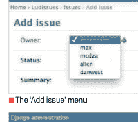

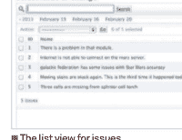

### 10 创建模板文件

模板将从 `ludissueTracker/ludissueTracker/templates` 目录加载。在 Django 中，我们从 `ludissueTracker/ludissueTracker/templates/base.html` 模板开始。把它想象成可以被从属模板继承的主模板。

`ludissueTracker/ludissueTracker/templates/base.html`

```html
<!DOCTYPE html PUBLIC "-//W3C//DTD XHTML Strict//EN"
"http://www.w3.org/TR/xhtml1/DTD/xhtml1-strict.dtd">
<html>
<head>
<title> | LUD Issues</title>
<link rel="stylesheet" href="{{ MEDIA_URL }}style.css" type="text/css" media="screen" />
</head>
<body>
<div id="hd">
<h1>LUD Issue Tracker</h1>
</div>
<div id="mn">
<ul>
<li><a href="" class="sel">View Issues</a></li>
<li><a href="/admin/">Admin Site</a></li>
</ul>
</div>
<div id="bd">


</div>
</body>
</html>
```

`{{ variableName }}` 代表一个 Django 变量。 `` 代表块。块的内容由 Django 评估并显示。这些块可以被子模板替换。

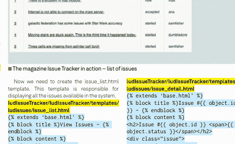

杂志 Issue Tracker 运行中 – 问题列表

现在我们需要创建 `issue_list.html` 模板。此模板负责显示系统中所有可用的问题。

`ludissueTracker/ludissueTracker/templates/ludissues/issue_list.html`

```html

View Issues - 

<table cellspacing="0" class="column-options">
<tr>
<th>Issue</th>
<th>Description</th>
<th>Status</th>
<th>Owner</th>
</tr>

<tr>
<td><a href="">{{ issue.id }}</a></td>
<td><a href="">{{ issue.name }}</a></td>
<td>{{ issue.status }}</td>
<td>{{ issue.owner }}</td>
</tr>

</table>

```

这里我们继承了之前创建的 `base.html` 文件。 `` 在 `urls.py` 发送的对象上运行。然后我们对 `object_list` 中的 `issue.id` 和 `issue.name` 进行迭代。

现在我们将创建 `issue_detail.html`。此模板负责显示案例的详情视图。

`ludissueTracker/ludissueTracker/templates/ludissues/issue_detail.html`


```html

Issue #{{ object.id }} - 

<h2>Issue #{{ object.id }} <span>{{ object.status }}</span></h2>
<div class="issue">
<h2>Information</h2>
<div class="date">
<p class="cr">Opened {{ object.opened_on }} ago</p>
<p class="last">Last modified {{ object.modified_on }} ago</p>
</div>
<div class="clear">&nbsp;</div>
<div class="block right">
<p class="ass title">Owner</p>
<p class="ass">{{ object.owner }}</p>
</div>
<div class="clear">&nbsp;</div>
<div class="block">
<p class="des title">Summary</p>
<p class="des">{{ object.summary }}</p>
</div>
</div>

```

就这样！问题跟踪应用现已完成并可使用。你现在可以将浏览器指向 `localhost:8000` 开始使用该应用。

# 50 条 Python 技巧

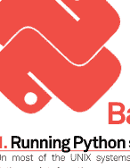

Python 是一种编程语言，让你可以更快地工作并更有效地集成你的系统。如今，Python 是开源领域最受欢迎的编程语言之一。环顾四周，你会发现它无处不在，从各种配置工具到 XML 解析。以下是 50 条精华，让你的 Python 体验物有所值...

## 基础

### 1. 运行 Python 脚本

在大多数 UNIX 系统上，你可以从命令行运行 Python 脚本。

```
$ python myprog.py
```

### 2. 从 Python 解释器运行 Python 程序

Python 交互式解释器使得尝试编程的第一步和使用所有 Python 命令变得很容易。你只需在命令提示符 `>>>` 处逐条发出每个命令，答案会立即给出。

可以通过发出以下命令启动 Python 解释器：

```
$ python
kunal@ubuntu:~$ python
Python 2.6.2 (release26-maint, Apr 19 2009, 01:56:41)
[GCC 4.3.3] on linux2
Type "help", "copyright", "credits" or "license" for more information.
>>> <type commands here>
```

在本文中，所有以 `>>>` 符号开头的代码都意味着要在 Python 提示符下输入。

同时也必须记住，Python 对制表符非常敏感——因此，如果你收到任何提及制表符的错误，请修正制表符间距。

### 3. 动态类型

在 Java、C++ 以及其他静态类型语言中，你必须指定函数返回值和每个函数参数的数据类型。另一方面，Python 是一种动态类型语言。在 Python 中你永远不需要显式指定任何事物的类型。Python 会根据你赋予的值在内部跟踪数据类型。

### 4. Python 语句

Python 使用回车来分隔语句，使用冒号和缩进来分隔代码块。大多数编译型编程语言，如 C 和 C++，使用分号来分隔语句，使用大括号来分隔代码块。

### 5. `==` 和 `=` 运算符

Python 使用 `==` 进行比较，使用 `=` 进行赋值。Python 不支持内联赋值，因此不会有在你实际想比较时意外赋值的风险。

### 6. 连接字符串

你可以使用 `+` 来连接字符串。

```
>>> print ('kun'+'al')
kunal
```

### 7. `__init__` 方法

`__init__` 方法在类的对象被实例化时立即运行。当你想对对象做某些操作时，该方法很有用。`__init__` 方法类似于 C++、C# 或 Java 中的构造函数。

```
Example:
class Person:
    def __init__(self, name):
        self.name = name
    def sayHi(self):
        print 'Hello, my name is', self.name
p = Person('Kunal')
p.sayHi()
Output:
C:/src/python $ python initmethd.py
Hello, my name is Kunal
```

### 8. 模块

随着程序规模的增长，为了保持程序的可管理性，你可能希望将其拆分为多个文件。Python 允许你将多个函数定义放入一个文件中，并将其用作可导入到其他脚本和程序中的模块。这些文件必须具有 `.py` 扩展名。

```
Example:
# file my_function.py
def minmax(a,b):
    if a <= b:
        min, max = a, b
    else:
        min, max = b, a
    return min, max
Module Usage
import my_function
```

```
x,y = my_function.minmax(25, 6.3)
```

### 9. 模块定义名称

Example:

内置函数 `dir()` 可用于查找模块定义了哪些名称。它返回一个排序后的字符串列表。

```
>>> import time
>>> dir(time)
['__doc__', '__file__', '__name__', '__package__', 'accept2year', 'altzone', 'asctime', 'clock', 'ctime', 'daylight', 'gmtime', 'localtime', 'mktime', 'sleep', 'strftime', 'strptime', 'struct_time', 'time', 'timezone', 'tzname', 'tzset']
```

### 10. 模块内部文档

你可以通过查看 `__doc__` 来查看模块名称的内部文档（如果有）。

```
Example:
>>> import time
>>> print time.clock.__doc__
clock() -> floating point number
This example returns the CPU time or real time since the start of the process or since the first call to clock(). This has as much precision as the system records.
```

### 11. 向 Python 脚本传递参数

Python 允许你在调用脚本时访问传递给脚本的内容。‘命令行’内容存储在 `sys.argv` 列表中。

```
import sys
print sys.argv
```

### 12. 启动时加载模块或命令

你可以使用环境变量 `$PYTHONSTARTUP` 在任何 Python 脚本启动时加载预定义的模块或命令。你可以将环境变量 `$PYTHONSTARTUP` 设置为包含加载必要模块或命令的指令的文件。

### 13. 将字符串转换为日期对象

你可以使用函数 `DateTime` 将字符串转换为日期对象。

```
Example:
from DateTime import DateTime
```

```
dateobj = DateTime(string)
```

### 14. 将列表转换为字符串以便显示

你可以通过以下任一方式将列表转换为字符串。

```
1st method:
>>> mylist = ['spam', 'ham', 'eggs']
>>> print ', '.join(mylist)
spam, ham, eggs
```

```
2nd method:
>>> print '\n'.join(mylist)
spam
ham
eggs
```

### 15. Python 解释器中的制表符补全

你可以通过在 `.pythonrc` 文件中（或 Python 启动时读取的文件）添加以下行来实现 Python 解释器内的自动补全：

```
import rlcompleter, readline

readline.parse_and_bind('tab: complete')
```


这将使 Python 在你按下 Tab 键时补全部分输入的函数、方法名和变量名。

## 16. Python 文档工具

你可以使用以下命令弹出一个用于搜索 Python 文档的图形界面：

```
$ pydoc -g
```

你需要 `python-tk` 包才能使用此功能。

## 17. Python 文档服务器

你可以在本地机器上的给定端口上启动一个 HTTP 服务器。这将为你提供对所有 Python 文档的漂亮访问，包括第三方模块文档。

```
$ pydoc -p <PortNumber>
```

## 18. Python 开发软件

有大量工具可帮助进行 Python 开发。以下是一些重要的工具：

- `IDLE`: Python 内置的 IDE，具有自动补全、函数签名弹出帮助和文件编辑功能。
- `PyScripter`: 另一个增强的 Python shell，具有制表符补全和其他功能。
- `Eric3`: 一个带自动补全、类浏览器、内置 shell 和调试器的 GUI Python IDE。
- `Wing IDE`: 商业 Python IDE，向全球开源开发者提供免费许可。

## 内置模块

### 19. 在 Python 解释器终止时执行函数

你可以使用 `atexit` 模块在 Python 解释器终止时执行函数。

#### 示例：

```
def sum():
    print(4+5)
def message():
    print("Executing Now")
import atexit
atexit.register(sum)
atexit.register(message)
```

###### 输出：

```
Executing Now

9
```

### 20. 从整数转换为二进制、十六进制和八进制

Python 提供了易用的函数——`bin()`、`hex()` 和 `oct()`——分别用于将整数转换为二进制、十进制和八进制格式。

#### 示例：

```
>>> bin(24)
'0b11000'
>>> hex(24)
'0x18'
>>> oct(24)
'0o30'
```

### 21. 将任意字符集转换为 UTF-8

你可以使用以下函数将任意字符集转换为 UTF-8。

```
data.decode("input_charset_here").encode('utf-8')
```

### 22. 从列表中去除重复项

如果你想去除列表中的重复项，只需将每个元素作为键放入字典中（例如值设为 `none`），然后检查 `dict.keys()`。

```
from operator import setitem
def distinct(l):
    d = {}
    map(setitem, (d,)*len(l), l, [])
    return d.keys()
```

### 23. Do-while 循环

由于 Python（尚）没有 do-while 或 do-until 循环结构，你可以使用以下方法实现类似效果：

```
while True:
    do_something()
    if condition():
        break
```

### 24. 检测系统平台

为了执行特定于平台的函数，检测 Python 解释器所运行的系统平台非常有用。你可以使用 `sys.platform` 来找出当前平台。

#### 示例：

```
在 Ubuntu Linux 上
>>> import sys
>>> sys.platform
'linux2'
在 Mac OS X Snow Leopard 上
>>> import sys
>>> sys.platform
'darwin'
```

### 25. 禁用和启用垃圾回收

有时你可能希望在运行时启用或禁用垃圾回收器。你可以使用 `gc` 模块来启用或禁用垃圾回收。

```
>>> import gc
>>> gc.enable()
<built-in function enable>
>>> gc.disable()
<built-in function disable>
```

### 26. 使用基于 C 的模块以获得更好的性能

许多 Python 模块都配有对应的 C 模块。在复杂应用中使用这些 C 模块将带来显著的性能提升。

#### 示例：

用 `cPickle` 代替 `Pickle`，用 `cStringIO` 代替 `StringIO`

### 27. 计算任何列表或可迭代对象的最大值、最小值和总和

你可以使用以下内置函数：

`max`：返回列表中的最大元素。

`min`：返回列表中的最小元素。

`sum`：此函数返回列表中所有元素的总和。它接受一个可选的第二个参数：求和时起始值（默认为 0）。

### 28. 表示分数

可以使用以下构造函数创建 `Fraction` 实例：

```
Fraction([numerator [, denominator]])
```

### 29. 执行数学运算

`math` 模块提供了大量数学函数。这些函数适用于整数和浮点数，但不适用于复数。对于复数，需要使用单独的模块，称为 `cmath`。

#### 例如：

```
math.acos(x): 返回 x 的反余弦值。
math.cos(x): 返回 x 的余弦值。
math.factorial(x): 返回 x 的阶乘。
```

### 30. 使用数组

`array` 模块提供了一种在你的程序中使用数组的高效方式。`array` 模块定义了以下类型：

```
array[typecode [, initializer]]
```

一旦你创建了一个数组对象（比如 `myarray`），你就可以对其应用许多方法。以下是几个重要的方法：

`myarray.count(x)`：返回 x 在 a 中出现的次数。

`myarray.extend(x)`：将 x 追加到数组末尾。

`myarray.reverse()`：反转数组的顺序。

### 31. 排序项目

`bisect` 模块使得以任意可能顺序维护列表变得非常容易。你可以使用以下函数来对列表排序。

```
bisect.insort(list, item [, low [, high]])
```

将 `item` 按排序顺序插入到 `list` 中。如果 `item` 已经存在于列表中，则新条目插入到任何现有条目的右侧。

```
bisect.insort_left(list, item [, low [, high]])
```

将 `item` 按排序顺序插入到 `list` 中。如果 `item` 已经存在于列表中，则新条目插入到任何现有条目的左侧。

### 32. 使用基于正则表达式的搜索

`re` 模块使得使用基于 regexp 的搜索变得非常容易。你可以使用函数 `re.search()` 与基于 regexp 的表达式一起使用。

查看下面的示例。

```
Example:
>>> import re
>>> s = "Kunal is a bad boy"
>>> if re.search("K", s): print "Match!"
Match!
>>> if re.search("[^a-z]", s): print "Match!" # char literal
...
Match!
>>> if re.search("[0-9]", s): print "Match!" # digits class
...
```

### 33. 使用 bz2 (.bz2) 压缩格式

你可以使用模块 `bz2` 来使用 bz2 压缩算法读取和写入数据。

```
bz2.compress() : For bz2 compression
bz2.decompress() : For bz2 decompression

Example:
# File: bz2-example.py
import bz2
MESSAGE = "Kunal is a bad boy"
compressed_message = bz2.compress(MESSAGE)
print "original:", repr(MESSAGE)
print "compressed message:", repr(compressed_message)
print "decompressed message:", repr(bz2.decompress(compressed_message))

Output:
$ python bz2-example.py
original: 'Kunal is a bad boy'
compressed message: 'BZh91AY&SY...'
decompressed message: 'Kunal is a bad boy'
```

### 34. 使用 Python 操作 SQLite 数据库

SQLite 因其零配置需求和卓越的性能水平，正变得非常流行。你可以使用模块 `sqlite3` 来操作 SQLite 数据库。


```
Example:
>>> import sqlite3
>>> connection = sqlite3.connect('test.db')
>>> curs = connection.cursor()
>>> curs.execute('''create table item (id integer primary key, item text unique, name text, item_code text, price real)''')
<sqlite3.Cursor object at 0x1004a2b30>
```

### 35. 操作 zip 文件

你可以使用模块 `zipfile` 来操作 zip 文件。

```
zipfile.ZipFile(filename, mode['r', compression[, allowZip64=True]])
Open a zip file, where the file can be either a path to a file (a string) or a file-like object.
zipfile.close()
Close the archive file. You must call 'close()' before exiting your program or essential records will not be written.
zipfile.extract(member[, path[, pwd]])
```

从归档中提取一个成员到当前工作目录。`member` 必须是其全名（或 ZipInfo 对象）。其文件信息将尽可能准确地提取。`path` 指定提取到的不同目录。`member` 可以是文件名或 ZipInfo 对象。

### 36. 使用 UNIX 风格通配符搜索文件名

你可以使用模块 `glob` 来查找与 UNIX shell 使用的规则匹配的所有路径名。`*`、`?` 和用 `[]` 表示的字符范围将被匹配。

```
Example:
>>> import glob
>>> glob.glob('./[0-9].*')
['./1.gif', './2.txt']
>>> glob.glob('*.gif')
['1.gif', 'card.gif']
>>> glob.glob('?.gif')
['1.gif']
```

### 37. 执行基本文件操作（复制、删除和重命名）

你可以使用模块 `shutil` 以高层方式执行基本文件操作。此模块适用于常规文件，因此不会适用于命名管道、块设备等特殊文件。

```
shutil.copy(src,dst)
Copies the file src to the file or directory dst.
shutil.copymode(src,dst)
Copies the file permissions from src to dst.
shutil.move(src,dst)
Moves a file or directory to dst.
shutil.copytree(src, dst, symlinks=[, ignore])
Recursively copy an entire directory src.
shutil.rmtree(path [, ignore_errors [, onerror]])
Deletes an entire directory.
```

### 38. 从 Python 执行 UNIX 命令

你可以使用 `commands` 模块来执行 UNIX 命令。这在 Python 3 中不可用——相反你需要使用模块 `subprocess`。

```
Example:
>>> import commands
>>> commands.getoutput('ls')
'bz2-example.py\ntest.py'
```

### 39. 读取环境变量

你可以使用模块 `os` 来收集特定于操作系统的信息。

```
Example:
>>> import os
>>> os.path <module 'posixpath' from '/usr/lib/python2.6/posixpath.pyc'>
>>> os.environ {'LANG': 'en_US', 'TERM': 'xterm-color', 'SHELL': '/bin/bash', 'LESSCLOSE': '/usr/bin/lesspipe %s %s', 'XDG_SESSION_COOKIE': '4925c4644597c791c704656354adf56d6-1257673132.347986-1117793225', 'SHLVL': '1', 'SSH_TTY': '/dev/pts/2', 'PWD': '/home/kunal', 'LESSOPEN': '| /usr/bin/lesspipe'}
>>> os.name
'posix'
>>> os.linesep
'\n'
```

### 40. 发送电子邮件

你可以使用 `smtplib` 模块，通过 SMTP（简单邮件传输协议）客户端接口发送电子邮件。

```
smtplib.SMTP([host [, port]])
```

示例（使用 Google Mail SMTP 服务器发送电子邮件）：

```
import smtplib
# Use your own to and from email address
fromaddr = 'kunaldeo@gmail.com'
toaddrs = 'toemail@gmail.com'
msg = 'I am a Python geek. Here is the proof!'
# Credentials
# Use your own Google Mail credentials while running the program
username = 'kunaldeo@gmail.com'
password = 'xxxxx'
# The actual mail send server = smtplib.SMTP('smtp.gmail.com:587')
# Google Mail uses secure connection for SMTP connections server.starttls()
server.login(username,password)
server.sendmail(fromaddr, toaddrs, msg)
server.quit()
```

### 41. 访问 FTP 服务器

`ftplib` 是 Python 的一个功能完备的 FTP 客户端模块。要建立 FTP 连接，可以使用以下函数：

```
ftplib.FTP([host [, user [, passwd [, acct [, timeout]]]]])
```

示例：

```
host = "ftp.redhat.com"
username = "anonymous"
password = "kunaldeo@gmail.com"
import ftplib
import urllib2
ftp_serv = ftplib.FTP(host,username,password)
# Download the file
u = urllib2.urlopen("ftp://ftp.redhat.com/pub/redhat/linux/README")
# Print the file contents
print (u.read())
```

输出：

```
[~/src/python $] python ftpclient.py
```

Red Hat Linux 的旧版本已移至以下位置：`ftp://archive.download.redhat.com/pub/redhat/linux/`

### 42. 使用默认网页浏览器打开网页

`webbrowser` 模块提供了一种便捷的方式，可以使用默认网页浏览器打开网页。

示例（使用系统的默认网页浏览器打开 google.co.uk）：

```
>>> import webbrowser
>>> webbrowser.open("http://google.co.uk")
True
```

### 43. 创建安全哈希

`hashlib` 模块支持多种安全哈希算法，包括 SHA1、SHA224、SHA256、SHA384、SHA512 和 MD5。

示例（创建给定文本的十六进制摘要）：


```
>>> import hashlib
# sha Digest
>>> hashlib.sha1("M16 Classified Information 007").hexdigest()
'e22b154c7329cc0b935aeleb9593 18balb0c85'
# sha224 Digest
>>> hashlib.sha224("M16 Classified Information 007").hexdigest()
'3d8e1274100b2b2048842790e5eb97 7d59b40b998e355e2c'
# sha256 Digest
>>> hashlib.sha256("M16 Classified Information 007").hexdigest()
'2fd573d53fa7b67f2c39725991c89 b25607c7b4c6403e fdb3b1c19825e'
# sha384 Digest
>>> hashlib.sha384("M16 Classified Information 007").hexdigest()
'5c9416103fd1bd1e14d8ce1e3a1d5a29d99 dc192ed18aa7628b009884aafaa54b0e 9e0fc3d3a65c8b6c35372d'
# sha512 Digest
>>> hashlib.sha512("M16 Classified Information 007").hexdigest()
'a704ac3dbe6e8235784823a31d5a29d25 2c8221f4973f45b9f222aedc6a29b89077 8ea0b7a0a9ec4f8b1856614667fba7 3aldcf1ff92e48c712b2'
# MD5 Digest
>>> hashlib.md5("M16 Classified Information 007").hexdigest()
'e8e2fc52ca146f99a670c826f7126'
```

## 44. 为随机数设置种子

你可以使用`random`模块生成各种随机数。最常用的是`random.seed(x)`。它会初始化基本的随机数生成器。如果省略`x`或`x`为`None`，则使用当前系统时间：在首次导入该模块时，也会使用当前系统时间来初始化生成器。

## 45. 处理CSV（逗号分隔值）文件

CSV文件在网页上的数据交换中非常流行。使用`csv`模块，你可以读写CSV文件。

示例：

```
import csv
# write stocks data as comma-separated values
writer = csv.writer(open('stocks.csv', 'wb', buffering=0))
writer.writerow([
('GOOG', 'Google, Inc.', 505.24, 0.47, 0.05),
('YHOO', 'Yahoo Inc.', 27.38, 0.33, 1.22),
('CNET', 'CNET Networks, Inc.', 8.62, -0.13, -1.49)
])
# read stocks data, print status messages
stocks = csv.reader(open('stocks.csv', 'rb'))
status_labels = {-1: 'down', 0: 'unchanged', 1: 'up'}
for ticker, name, price, change, pct in stocks:
    status = status_labels[cmp(float(change), 0.0)]
    print('%s is %s (%.2f)' % (name, status, pct))
```

## 47. 使用`setuptools`安装第三方模块

`setuptools`是一个Python包，让你可以非常轻松地下载、构建、安装、升级和卸载包。

要使用`setuptools`，你需要从发行版的软件包管理器中安装。安装后，你可以使用`easy_install`命令执行Python包管理任务。

## 第三方模块

### 48. 生成 PDF 文档

`ReportLab` 是从 Python 生成 PDF 的非常流行的模块。

#### 执行以下步骤安装 `ReportLab`

```
$ wget http://www.reportlab.org/ftp/ReportLab_2.3.tar.gz
$ tar xvfz ReportLab_2.3.tar.gz
$ cd ReportLab_2.3
$ sudo python setup.py install
```

安装成功时，你应该看到类似的消息：

```
##########SUMMARY INFO##########
#Attempting install of _rlAccell, sgmloop
& pyHnj
#extensions from '/home/kunal/python/ReportLab_2.3/src/rl_addons/rl_accell'
#Attempting install of _renderPM
#extensions from '/home/kunal/python/ReportLab_2.3/src/rl_addons/renderPM'
# installing with freetype version 21
```

#### 示例：

```
>>> from reportlab.pdfgen.canvas import Canvas
# Select the canvas of letter page size
>>> from reportlab.lib.pagesizes import letter
>>> pdf = Canvas("bond.pdf", pagesize = letter)
# import units
>>> from reportlab.lib.units import cm, mm, inch, pica
>>> pdf.setFont("Courier", 60)
>>> pdf.setFillColorRGB(1, 0, 0)
>>> pdf.drawCentredString(letter[0] / 2, inch * 6, "M16 CLASSIFIED")
>>> pdf.setFont("Courier", 40)
>>> pdf.drawCentredString(letter[0] / 2, inch * 5, "For 007's Eyes Only")
# Close the drawing for current page
>>> pdf.showPage()
# Save the pdf page
>>> pdf.save()
```

#### 输出：

@image:pdf.png

@title: PDF 输出

### 49. 使用 Twitter API

你可以使用 `Python-Twitter` 模块连接 Twitter。

#### 执行以下步骤安装 `Python-Twitter`：

```
$ wget http://python-twitter.googlecode.com/files/python-twitter-0.6.tar.gz
$ tar xvfz python-twitter*
$ cd python-twitter*
$ sudo python setup.py install
```

#### 示例（获取关注者列表）：

```
>>> import twitter
# Use your own twitter account here
>>> mytwi = twitter.Api(username='kunald...', password='xxxxx')
>>> friends = mytwi.GetFriends()
>>> print [u.name for u in friends]
['u'Matt Legend Cornell', 'u'jono wells', 'u'The MDN Big Blog', 'u'Manish Mandal', 'u'iH8Sn0w', 'u'IndianVideoGamer.com', 'u'FakeAaron Hillgass', 'u'ChaosCode', 'u'nileshpi', 'u'Frank Jennings', ...]
```

### 50. 执行 Yahoo! 新闻搜索

你可以使用 Yahoo! 搜索 SDK 从 Python 访问 Yahoo! 搜索 API。

#### 执行以下步骤安装它：

```
$wget http://developer.yahoo.com/ysearch-2.12.zip
$ unzip yxs*
$ cd yxs/Python/PySearch/
$ sudo python setup.py install
```

#### 示例：


# Importing news search API

```
>>> from yahoo.search.news import NewsSearch
>>> srch = NewsSearch('YahooDemo', query='London')
```

## Fetch Results

```
>>> info = srch.parse_results()
>>> info.total_results_available
41640
>>> info.total_results_returned
10
>>> for result in info.results:
... print '"%s", from %s' % (result['Title'], result['NewsSource'])
...
'Afghan Handover to Be Planned at London Conference, Brown Says', from Bloomberg
...
```

### 46. 记录到系统日志

你可以使用模块 `syslog` 写入系统日志。`syslog` 充当 UNIX syslog 库例程的接口。

#### 示例：

```
import syslog
syslog.syslog('mygeekapp: started logging')
for a in ['a', 'b', 'c']:
    b = 'mygeekapp: I found letter ' + a
    syslog.syslog(b)
syslog.syslog('mygeekapp: the script goes to sleep now, bye,bye!')
```

##### 输出：

```
$ python mylog.py
$ tail -f /var/log/messages
Nov 8 17:14:34 ubuntu --- MARK --
Nov 8 17:22:34 ubuntu python:
mygeekapp: started logging
Nov 8 17:22:34 ubuntu python:
mygeekapp: I found letter a
Nov 8 17:22:34 ubuntu python:
mygeekapp: I found letter b
Nov 8 17:22:34 ubuntu python:
mygeekapp: I found letter c
Nov 8 17:22:34 ubuntu python:
mygeekapp: the script goes to sleep now, bye,bye!
```

##### 示例（使用 setuptools 安装 simplejson）：

```
kunal@ubuntu:~$ sudo easy_install simplejson
Searching for simplejson
Reading http://pypi.python.org/simple/simplejson
Reading http://undefined.org/python/#simplejson
Best match: simplejson 2.0.9
Downloading http://pypi.python.org/packages/source/s/simplejson/simplejson-2.0.9.tar.gz#md5=af56e7a39ca408853411d3576d5e547
Processing simplejson-2.0.9.tar.gz
Running simplejson-2.0.9/setup.py -q bdist_egg --dist-dir /tmp/easy_install-...
installing to /usr/local/lib/python2.6/dist-packages/simplejson-2.0.9-py2.6-linux-i686.egg
Processing dependencies for simplejson
Finished processing dependencies for simplejson
```

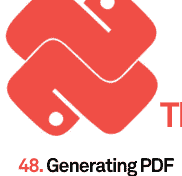

## 使用 Python

- 74 创建动态模板
- 使用 Jinja、Flask 等
- 78 XBMC 的扩展
- 使用本教程增强 XBMC
- 84 科学计算
- 掌握 NumPy
- 88 即时通讯
- 使用 Python 开始聊天
- 94 替换你的 shell
- 使用 Python 作为主要 shell
- 98 系统管理员的 Python
- Python 如何帮助系统管理
- 102 爬取 Wikipedia
- 使用 Beautiful Soup 离线阅读

> “用 Python 强大的功能增强你的系统”


### 使用 Flask、Jinja2 和 Twitter 创建动态模板

使用 Twitter 和 Flask 的渲染引擎 Jinja2 创建一个动态网页

#### 资源

- Python 2.7+
- Flask 0.10.0: flask.pocoo.org
- Flask GitHub: github.com/mitsuhiko/flask
- 一个 Twitter 账号
- 你喜欢的文本编辑器
- 从 FileSilo 下载的代码

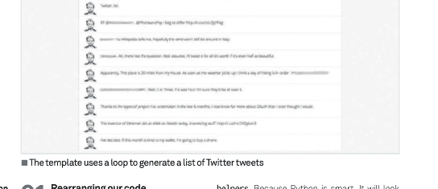

模板使用循环生成 Twitter 推文列表

当你需要处理 Twitter OAuth 流程并构建请求以获取令牌时，Python 和 Flask 是一个绝佳的组合。我们在这里使用 Twitter 是因为其上可供消化的海量数据。然而，由于 Twitter 遵循 OAuth 1.0 设定的标准，我们用于签名和构建请求的代码可以稍加修改后用于任何使用相同标准的第三方 API。PHP 多年来一直是模板生成的支柱，但现在有了 Flask、Sinatra 和 Handlebars 等文档完善的框架，使用强大的脚本语言的能力极大地提升了我们构建优秀网络服务的能力。在这里，我们将使用 Python、Flask 及其模板引擎来显示推文。Flask 自带超精细的 Jinja2 模板引擎。如果你熟悉 Node.js 或前端 JavaScript，其语法看起来会与 Handlebars 渲染引擎非常相似。但在深入之前，我们需要先整理一下本次使用的示例代码。

#### 01 重新整理我们的代码

服务器代码会迅速变得混乱且难以维护，因此我们要做的第一件事是将辅助函数移至另一个文件并将其导入项目中，就像导入一个模块一样。这样一来，我们就能清楚地分辨哪些函数是服务器逻辑和端点，哪些是通用的 Python 函数。打开从 FileSilo 下载的 TwitterAuthentication 文件（存储在 Twitter OAuth 文件下），并找到 `getParameters`、`sign_request` 和 `create_oauth_headers` 函数。将其剪切并粘贴到项目根目录下的一个新文件 `helpers.py` 中。在此文件顶部我们需要导入一些库。

```
import urllib, collections, hmac, binascii, time, random, string

from hashlib import sha1
```

现在我们可以回到 `server.py` 并将辅助函数重新导入项目。我们只需调用 `import helpers` 即可。由于 Python 很聪明，它会先在当前目录中查找 `helpers.py` 文件，然后再查找系统模块。现在 `helpers.py` 中的每个函数都可供项目使用。我们要做的就是在之前调用的方法前加上 `helper.function_name` 前缀即可执行。对于 `sign_request`，我们需要为每次请求传递 `oauth_secret` 和 `consumer_secret`，而不是从 session 中访问。按如下方式调整函数声明：

```
def sign_request(parameters, method, baseURL, consumer_secret, oauth_secret):
```

#### 02 server.py 模块

由于本项目所需的许多模块已移至 `helpers.py`，我们现在可以从 `server.py` 中移除大部分模块。如果我们将第一个 `import` 语句修改为...

```
import urllib2, time, random, json
```

...项目将继续像之前一样运行。请注意 `json` 模块的添加：

we'll be using that later as we start handling Twitter data.


Having Flask use a rendering engine is super-simple. Flask comes packaged with the Jinja2 template rendering engine, so we've nothing to install – we just need to import the package into the project. We can do this by adding `render_template` to the end of our `from flask import [...]` statement.

### 03 Our first template

Now that we have a rendering engine, we need to create some templates for it to use. In the root of our project's folder, create a new folder called `templates`. Whenever we try to render a template, Flask will look in this folder for the template specified. To get to grips with templating, we'll rewrite some of our authentication logic to use a template, rather than manually requesting endpoints. In `templates`, create an `index.html` file. You can treat this HTML file like any other – included in the resources for this tutorial is an `index.html` that includes all of the necessary head tags and `<!DOCTYPE>` declarations for this file.

### 04 Rendering our template

In `server.py`, let's create a route for `'/'` to handle the authorisation process.

```
@app.route('/')
def home():

    if not 'oauth_token' in session:
        session.clear()
        session['oauth_secret'] = ''
        session['oauth_token'] = ''

    return render_template('index.html')
```

It's a simple function: all we want to do is check whether or not we have an `oauth_token` already and create those properties in the Flask `session` so we don't throw an error if we try to access it erroneously. In order to send our generated template in response to the request, we return `render_template('index.html')`.

### 05 Template variables

We can choose to send variables to our template with `render_template('index.html', variableOne=value, variableTwo=value)` but in this instance we don't need as each template has access to the `request` and `session` variables.

```

<h1>Already Authorised</h1>
<div class="dialog">
<p>Hello, You've authenticated<br>Let's <a href="/get-tweets">get some tweets</a></p>
</div>

<h1>Authorisation required</h1>
<div class="dialog">
<p>We need to <a href="/authenticate">authenticate</a></p>
</div>

```

The BSD-licensed Flask is easy to set up and use – check out the website for more info


overview // docs // community // snippets // extensions // search

Flask is a microframework for Python based on Werkzeug, Jinja 2 and good intentions. And before you ask: It's BSD licensed!

### Flask is Fun

Latest Version: 0.10

```
from flask import Flask
app = Flask(__name__)

@app.route('/')
def hello():
    return "Hello World!"

if __name__ == "__main__":
    app.run()
```

### And Easy to Setup

```
$ pip install Flask
$ python hello.py
* Running on http://localhost:5000/
```

### Interested?

- Download latest release (0.10)

- Read the documentation or download as PDF and zipped HTML

- Join the mailinglist

- Fork it on github

- Add issues and feature requests


## Now we know how to build templates, let's grab some tweets to display

Open `index.html`. All code executed in a Flask template is contained within ``. As this is our homepage, we want to direct users accordingly. So let's check if we've got an access token (Fig 01). Between the ifs and else of the template is standard HTML. If we want to include some data – for example, the access token – we can just add `{{ session['oauth_token'] }}` in the HTML and it will be rendered in the page. Previously, in our `/authorised` endpoint, we would display the OAuth token that we received from Twitter; however, now that we have a template, we can redirect our users back our root URL and have a page rendered for us that explains the progress we've made.

### 06 Getting lost (and then found again)


With every server, some things get misplaced or people get lost. So how do we handle this? Rather than defining a route, we can define a handler that deals with getting lost.

```
@app.errorhandler(404)
def fourOhFour(error):
    return render_template('fourOhFour.html')
```

If a page or endpoint is requested and triggers a 404, then the `fourOhFour()` function will be fired. In this case, we'll generate a template that tells the user, but we could also redirect to another page or dump the error message.

### 07 Static files

Pretty much every webpage uses JavaScript, CSS and images, but where do we keep them? With Flask we can define a folder for use with static content. For Flask, we create a static folder in the root of our project and access files by calling `/static/css/styles.css` or `/static/js/core.js`. The tutorial resources include a CSS file for styling this project.

### 08 Let's get some tweets

So now we know how to build templates, let's grab some tweets to display. In `server.py`, define a new route, `get-tweets`, like so:

```
@app.route('/get-tweets')
@app.route('/get-tweets/<count>')
def getTweets(count=0):
```

You'll notice that unlike our other authentication endpoints, we've made two declarations. The first is a standard route definition: it will intercept and handle the path `get-tweets`. The second lets us define a parameter that we can use as a value in our `getTweets()` function. By including `count=0` in our function declaration, we ensure that there will always be a default value when the function is executed; this way we don't have to check the value is present before we access it. If a value is included in the URL, it will override the value in the function. The string inside `<variable name>` determines the name of the variable. If you want the variable passed to the function to have a specific type, you can include a converter with the variable name. For example, if we wanted to make sure that `<count>` was always an integer instead of a float or string, we'd define our route like so:

```
@app.route('/get-tweets/<int:count>')
```

### 09 Checking our session and building our request

Before we start grabbing tweets, we want to run a quick check to make sure we have the necessary credentials and if not, redirect the user back the authorisation flow. We can do this by having Flask respond to the request with a redirection header, like so:

```
if session['oauth_token'] == "" or session['oauth_secret'] == "":
    return redirect(rootURL)
```

Assuming we have all we need, we can start to build the parameters for our request (Fig 02). You'll notice that the `nonce` value is different from that in our previous requests. Where the `nonce` value in our authenticate and authorise requests can be any random arrangement of characters that uniquely identify the request, for all subsequent requests the `nonce` needs to be a 32-character hexadecimal string using only the characters a-f. If we add the following function to our `helpers.py` file, we can quickly build one for each request.

```
def nonce(size=32, chars="abcdef" + string.digits):
    return ''.join(random.choice(chars) for x in range(size))
```

### 10 Signing and sending our request

We've built our parameters. So let's sign our request and then add the signature to the parameters (Fig 03). Before we create the authorisation headers, we need to remove the `count` and `user_id` values from the `tweetRequestParams` dictionary, otherwise the signature we just created won't be valid for the request. We can achieve this with the `del` keyword. Unlike our token requests, this request is a GET request, so instead of including the parameters in the request body, we define them as query parameters.

```
del tweetRequestParams['count']
del tweetRequestParams['user_id']
```

### 11 Handling Twitter's response


# 使用 Flask 进行模板化

Now we're ready to fire off the request and we should get a JSON response back from Twitter. This is where we'll use the `json` module we imported earlier. By using the `json.loads` function, we can parse the JSON into a dictionary that we can access and we'll pass through to our `tweets.html` template.

``` 
tweetResponse = json.loads(httpResponse.read())
return render_template('tweets.html', data=tweetResponse)
```

Whereas before, we accessed the `session` to get data into our template, this time we're explicitly passing a value through to our template.

## 12 Displaying our tweets

Let's create that template now, exactly the same as `index.html` but this time, instead of using a conditional, we're going to create a loop to generate a list of tweets we've received. First, we check that we actually received some data from our request to Twitter. If we've got something to render, we're ready to work through it, otherwise we'll just print that we didn't get anything. Once again, any template logic that we want to use to generate our page is included between

``. 这次我们创建了一个循环；在循环内部，我们可以访问该对象的任何属性并将其打印出来。在此模板中，我们将为收到的每条推文创建一个 `<div>` 元素并显示用户的头像和推文文本（图 04）。

在我们的模板中，我们可以使用点符号（`.`）或方括号（`[]`）来访问属性。它们的行为基本相同：`[]` 记法会检查字典或对象上是否存在属性，而 `.` 记法会查找具有相同名称的项目。如果两者都找不到指定的参数，它将返回 `undefined`。如果发生这种情况，模板不会抛出错误，它只会打印一个空字符串。如果你的模板没有渲染预期的数据，请记住这一点：你可能只是错误地定义了你试图访问的属性。

## 13 Flask 过滤器

有时，在从 JSON 解析时，Python 会生成在 HTML 中渲染效果不佳的错误字符。你可能会注意到在 `tweet['text']` 之后有 `|forceescape`。这是一个 Flask 过滤器的示例；它允许我们在渲染之前影响输入——在这种情况下它会为我们转义值。Flask 附带了许多、许多不同的内置过滤器。你的导师建议完整阅读所有潜在选项。

## 14 总结

这基本上就是使用 Flask 进行模板化的全部内容。正如我们所见，构建和部署动态网站非常快速且简单。Flask 是任何希望运行 Web 服务的 Python 开发人员都非常棒的工具。虽然我们使用 Twitter 来展示 Flask 的强大功能，但所描述的所有技术都可以用任何第三方服务或数据库资源使用。Flask 可以与其他渲染引擎一起使用，例如 Handlebars（非常出色），但 Jinja2 仍需存在以运行 Flask，并且两者之间可能会发生冲突。在 Flask 和 Jinja2 之间具有如此出色的集成，在非常特定的情况之外使用另一个引擎几乎没有意义。

``` 
tweetRequestParams = {
"oauth_consumer_key": consumer_key,
"oauth_nonce": helpers.nonce(),
"oauth_signature_method": "HMAC-SHA1",
"oauth_timestamp": int(time.time()),
"oauth_version": "1.0",
"oauth_token": session['oauth_token'],
"user_id": session['user_id'],
"count": str(count)
}
```

Fig 02

``` 
tweetRequest = helpers.sign_request(tweetRequestParams, "GET",
"https://api.twitter.com/1.1/statuses/user_timeline.json", consumer_secret, session['oauth_secret'])

tweetRequestParams["oauth_signature"] = tweetRequest

makeRequest=urllib2.Request("https://api.twitter.com/1.1/statuses/user_timeline.json?count=" + tweetRequestParams['count'] + "&user_id=" + tweetRequestParams['user_id'])

del tweetRequestParams['user_id'], tweetRequestParams['count']

makeRequest.add_header("Authorization", helpers.create_oauth_headers(tweetRequestParams))

try:
    httpResponse = urllib2.urlopen(makeRequest)
except urllib2.HTTPError, e:
    return e.read()
```

Fig 03

``` 


<ul id="tweets">

<li>
<div class="image">

</div>
<div class="text">{{ tweet['text']|forceescape }}</div>
</li>

</ul>


<p>We didn't get any tweets :(</p>

```

Fig 04

# 使用 Python 为 XBMC 创建扩展

Python 是世界上最受欢迎的易于使用的开源语言。学习如何使用它为 XBMC 构建自己的功能，XBMC 是世界上最受欢迎的 FOSS 媒体中心

## 资源

- XBMC: www.xbmc.org/download
- Python 2.7x
- Python IDE（可选）
- Code on FileSilo

XBMC 也许是开源媒体中心领域发生的最重要的事情。它最初诞生于原版 Xbox 游戏主机，此后它已成为多媒体爱好者的事实标准软件。它也被分叉成许多其他成功的媒体中心应用程序，如 Boxee 和 Plex。XBMC 最终成长为一个非常强大的开源应用程序，背后有一个坚实的社区。它支持几乎所有主要平台，包括不同的硬件架构。它适用于 Linux、Windows、Mac OS X、Android、iOS 和 Raspberry Pi。

在这些页面中，我们将学习为 XBMC 构建扩展。扩展是在无需学习 XBMC 核心或以任何方式更改该核心的情况下向 XBMC 添加功能的一种方式。一个额外的优势是 XBMC 使用 Python 作为其脚本语言，这也可以用来构建扩展。这确实有助于新开发者参与项目，因为与 C/C++（XBMC 核心由其制作）等语言相比，Python 更容易学习。XBMC 支持各种类型的扩展（或 Add-ons）：插件、程序和皮肤。插件为 XBMC 添加功能。根据功能类型，插件将出现在 XBMC 的相关媒体部分。例如，YouTube 插件将出现在视频部分。脚本/程序就像 XBMC 的迷你应用程序。它们出现在程序部分。皮肤很重要，因为 XBMC 是一个完全可定制的应用程序——你可以改变几乎所有方面的外观和感觉。

根据你的扩展适合哪个类别，你将必须相应地创建扩展目录。例如...

### 插件：

- `plugin.audio.ludaudi`: 一个音频插件
- `plugin.video.ludvid`: 一个视频插件


`script.xxx.xxx`: 一个程序

在本教程中，我们将构建一个名为 LUD Entertainer 的 XBMC 插件。此插件将提供一种在 XBMC 内观看 Reddit 视频的简便方法。我们的插件将显示来自 Reddit 的各种内容，例如预告片和纪录片。我们还将允许用户添加自己的 Subreddit。每个视频都可以分类为热门、新、热门、争议等。通过此插件，我们将演示将 XBMC 的内置方法挂钩起来以实现非常高质量用户体验是多么容易。

由于篇幅限制，我们无法在此处打印完整代码。我们建议从 FileSilo 下载完整代码。


### 01 准备目录结构

正如我们之前提到的，每种 XBMC 扩展类型都遵循一定的目录命名约定。在本例中我们正在构建一个视频插件，因此插件目录名称将为 `plugin.video.ludent`。但这只是根目录名称——我们还需要其他几个文件夹和文件。

下面描述了 LUD Linux Entertainer 的目录结构：

```
plugin.video.ludent - Root Plugin directory
|-- addon.xml
|-- changelog.txt
|-- default.py
|-- icon.png
|-- LICENSE.txt
|-- README
|-- resources
|   |-- lib
|   |-- settings.xml
```

### 02 创建 addon.xml

需要在扩展目录的根目录中创建 `addon.xml` 文件。`addon.xml` 文件包含 XBMC 扩展的主要元数据。它包含扩展的概述、鸣谢、版本信息和依赖信息。

`addon.xml` 的根元素是 `<addon>` 元素。定义如下：

```
<addon id="plugin.video.ludent" name="LUD HSW Viewer" version="0.0.1" provider-name="LUDK">
rest of the content is placed here
</addon>
```

这里，`id` 是插件的标识符，因此在所有 XBMC 扩展中应该是唯一的，并且 `id` 也用于目录名称；`version` 告诉 XBMC 扩展版本号，有助于其提供自动更新的能力——XBMC 遵循 Major.Minor.Patch 版本命名约定；`name` 是插件的英文标题。

注意：步骤 3 到 5 涵盖需要在 `addon.xml` 文件中添加的条目。

### 03 添加依赖信息

扩展内的依赖通过 `<requires>` 元素进行管理。

```
<requires>
<import addon="xbmc.python" version="2.1.0"/>
<import addon="plugin.video.youtube" version="3.0.0"/>
<import addon="plugin.video.vimeo" version="2.3.0"/>
<import addon="plugin.video.dailymotion_com" version="1.0.0"/>
</requires>
```

在上面的代码中，我们添加了一个名为 `xbmc.python` 版本 `2.1.0` 的库依赖。目前它被添加为强制依赖。要使依赖变为可选，你需要添加 `optional="true"` 例如 `<import addon="kunal.special" version="1.0.0" optional="true" />`

在上面的示例中，我们将核心依赖 `xbmc.python` 添加到 `2.1.0`，因为它是随 XBMC 版本 Frodo 12.0 和 12.1 发行的版本。如果你添加 `xbmc.python` 2.0，那么它只会在 XBMC Eden 11.0 中工作，而在最新版本中则不行。

对于当前 XBMC 12.1 版本，发行了以下核心 XBMC 组件版本：

- `xbmc.python` 2.1.0
- `xbmc.gui` 4.0.0
- `xbmc.json` 6.0.0
- `xbmc.metadata` 2.1.0
- `xbmc.addon` 12.0.0

除了 `xbmc.python` 之外，我们还在添加一些第三方插件作为依赖，例如 `plugin.video.youtube`。在我们安装 `plugin.video.ludent` 时，这些插件将被自动安装。

### 04 设置提供者和入口点

我们的扩展应该为 XBMC 提供视频内容。为了传达这一点，我们必须设置以下元素：

```
<extension point="xbmc.python.pluginsource" library="default.py">
<provides>video</provides>
</extension>
```

这里，`library` 属性设置了插件入口点。在此示例中，当用户激活插件时 `default.py` 将被执行。`<provides>` 元素设置了它提供的媒体类型。这也会反映在插件的放置位置。由于我们是视频插件，它将显示在 XBMC 的 Videos 部分。

### 05 设置插件元数据

插件的元数据在 `<extension point="xbmc.addon.metadata">` 中提供。以下是重要元素：

- `<platform>`: 大多数情况下，XBMC 扩展是跨平台兼容的。但是，如果你依赖仅在某些平台上可用的原生平台库，那么你需要在此处设置支持的平台。`platform` 的接受值为：`all`、`linux`、`osx`、`osx32`、`osx64`、`ios`（Apple iOS）、`win32`（Windows DirectX）、`win64`（Windows OpenGL）和 `android`。
- `<summary lang="en">`: 这给出了插件的简要描述。我们的示例将语言属性设置为英语，但你也可以使用其他语言。
- `<description>`: 插件的详细描述。
- `<website>`: 插件托管的网页。
- `<source>`: 源代码仓库 URL。如果你将插件托管在 GitHub 上，你可以在此处提及仓库 URL。
- `<forum>`: 你插件的讨论论坛 URL。
- `<email>`: 作者邮箱。你可以直接输入邮箱或使用对机器人友好的邮箱地址，如 max at domain dot com。

### 06 设置更新日志、图标、背景图和许可

我们需要在插件目录中再添加几个文件...

- `changelog.txt`: 你应该列出在版本之间对插件所做的更改。更新日志可在 XBMC UI 中查看。

  一个示例更新日志：

  ```
  0.0.1
  - Initial Release
  0.0.2
  - Fixed Video Buffering Issue
  ```

- `icon.png`: 这将在 XBMC UI 中代表插件。它需要是非透明的 PNG 文件，大小为 256x256。
- `fanart.jpg`（可选）：`fanart.jpg` 在用户在 XBMC 中选择插件时作为背景渲染。艺术作品需要以 HDTV 格式渲染，因此其大小可以从 1280x720（720p）到最大 1920x1080（1080p）不等。

## 使用 Python

`License.txt`：此文件包含分发插件的许可证。XBMC 项目建议皮肤使用 Creative Commons Attribution-ShareAlike 3.0 许可证，插件使用 GPL 2.0。然而，大多数 copyleft 许可证都可以使用。

**注意：** 为打包目的，扩展/插件/主题/插件是相同的。

### 07 为插件提供设置

设置可以通过文件 `resources/settings.xml` 提供。这些非常适合用户可配置的选项。

**部分：** `resources/settings.xml`


```xml
<settings>
<category label="30109">
<setting id="filter" type="bool" label="30101" default="false" />
<setting type="sep" />
<setting id="showunwatched" type="bool" label="30106" default="false" />
<setting id="shownwatched" type="bool" label="30107" default="true" />
<setting id="showunfinished" type="bool" label="30108" default="false" />
<setting type="sep" />
<setting id="viewMode" type="bool" label="30102" default="true" />
<setting id="viewMode" type="number" label="30103" default="504" />
</category>
<category label="30110">
<setting id="cat_hot" type="bool" label="30002" default="true" />
<setting id="cat_new" type="bool" label="30003" default="true" />
</category>
</settings>
```

这里，`label` 定义了语言 id 字符串，该字符串随后将被用于显示标签。它定义了将用于程序化访问的名称，`type` 定义了你想要收集的数据类型；它也会影响为该元素显示的 UI。`default` 定义了设置的默认值。你应该在可能的情况下始终使用默认值，以提供更好的用户体验。

以下是你可以使用的一些重要设置类型...

**`text`:** 用于基本输入。

**`ipaddress`:** 用于选择正确的 ip 地址。

**`number`:** 允许你输入一个数字。XBMC 还将为输入提供屏幕上的数字键盘。

**`slider`:** 这提供了一种优雅的方式来收集整数、浮点数和百分比值。你可以以下列格式获取 `slider` 设置：

```xml
<setting label="21223" type="slider" id="sideinput" default="10" range="1,1,10" option="int" />
```

在上面的示例中，我们创建了一个滑块，最小范围为 1，最大范围为 10，步长为 1。在 `option` 字段中我们说明了我们感兴趣的数据类型——我们也可以将 `option` 设置为 "`float`" 或 "`percent`"。

**`bool`:** 以开或关的形式提供布尔选择。

**`file`:** 提供输入文件路径的方式。XBMC 将提供文件浏览器以便选择文件。如果你希望为特定类型的文件进行选择，你可以使用 `audio`、`video`、`image` 或 `executable` 代替 `file`。

**`folder`:** 提供浏览文件夹的方式...

**示例：**

```xml
<setting label="12001" type="folder" id="folder" source="auto" option="writeable"/>
```

这里，`source` 设置文件夹的起始位置，而 `option` 设置应用程序的写入参数。

**`sep` & `lsep`:** `sep` 用于在设置对话框中绘制水平线；`lsep` 用于绘制带文本的水平线。它们不收集任何输入，但用于构建更好的用户界面元素...

```xml
<setting label="21212" type="lsep" />
```

### 08 语言支持

语言支持以位于 `resources/languages/[language name]` 中的 `strings.xml` 文件形式提供。这种方法与许多大型软件项目非常相似，包括 Android，其中静态字符串永远不会被重用。

**`resource/language/english/string.xml` 示例：**

```xml
<?xml version="1.0" encoding="utf-8" standalone="yes"?>
<strings>
<string id="30001">Add subreddit</string>
<string id="30002">Hot</string>
<string id="30003">New</string>
<string id="30004">Top</string>
<string id="30005">Controversial</string>
<string id="30006">Hour</string>
<string id="30007">Day</string>
<string id="30008">Week</string>
<string id="30009">Month</string>
<string id="30010">Year</string>
</strings>
```

正如你在 `settings.xml` 示例中看到的，所有标签都引用了字符串 id。你也可以有许多其他语言。根据 XBMC 运行的语言，正确的语言文件将自动加载。

在 XBMC Frodo 12.1 之后，`strings.xml` 将被弃用。Frodo 之后，XBMC 将迁移到基于 GNU gettext 的翻译系统；gettext 使用 PO 文件。你可以使用名为 `xbc-mxl2po` 的工具将 `strings.xml` 转换为等效的 PO 文件。

### 09 构建 `default.py`

由于我们的插件很小，它将包含在 `default.py` 中。如果你正在开发更复杂的插件，那么你可以在同一目录中创建支持文件。如果你的库依赖于第三方库，你有两种方法。你可以将第三方库放入 `resources/lib` 文件夹；或将库本身打包到插件中，然后在 `addon.xml` 文件中将该插件添加为依赖项。

我们的插件使用 `reddit.tv`。这是从 Reddit 提供的网站，其中包含其读者分享的热门视频。发布在 Reddit 上的视频实际上来源于 YouTube、Vimeo 和 Dailymotion。

我们将使用以下导入开始 `default.py`：

```python
import urllib
import urllib2
import xbmcplugin
```

### 10 初始化

在初始化过程中，我们将从 `settings.xml` 读取各种设置。设置可以按以下方式读取：

```
addon = xbmcaddon.Addon()
filterRating = int(addon.getSetting("filterRating"))
filterVoteThreshold = int(addon.getSetting("filterVoteThreshold"))
```

为了读取类型为 `bool` 的设置，你需要做类似以下操作：

```
filter = addon.getSetting("filter") == "true"
```

我们同时设置了主 URL、插件句柄以及其用户代理：

```
pluginHandle = int(sys.argv[1])
urlMain = "http://www.reddit.com"
userAgent = "Mozilla/5.0 (Windows NT 6.2; WOW64; rv:22.0) Gecko/20100101 Firefox/22.0"
opener = urllib2.build_opener()
opener.addheaders = [('User-Agent', userAgent)]
```

### 11 读取本地化字符串

如前所述，XBMC 使用 `strings.xml` 来提供文本。为了读取这些字符串，你需要使用 `getLocalizedString`。

```
translation = addon.getLocalizedString(30002)
```

在此示例中，`translation(30002)` 在英文环境下运行时将返回字符串 "`Hot`"。

```
import xbmcgui
import xbmcaddon
```

除 `xbmcplugin`、`xbmcgui` 和 `xbmcaddon` 外，其余都是标准 Python 库，可通过 `pip` 在 `PyPI`（Python 包索引）上获取。由于 XBMC 的 Python 运行时已内置所有组件，因此你无需自行安装任何库。

`urllib` 和 `urllib2` 用于 HTTP 通信。`socket` 用于网络 I/O；`re` 用于正则表达式匹配；`sqlite3` 是访问 SQLite 嵌入式数据库的 Python 模块；`xbmcplugin`、`xbmcgui` 和 `xbmcaddon` 包含 XBMC 专用的例程。


| idFile | idPath | strFilename | playCount | lastPlayed | dateAdded |
| 1 | 1 | plugin://plugin. |  | 2013-08-06 23:47 |  |
| 2 | 2 | plugin://plugin. | 1 | 2013-08-07 22:42 |  |
| 3 | 2 | plugin://plugin. | 1 | 2013-08-08 00:09 |  |
| 4 | 2 | plugin://plugin. | 1 | 2013-08-08 00:55 |  |
| 5 | 2 | plugin://plugin. | 1 | 2013-08-08 00:58 |  |

### 12 构建辅助函数

在本步骤中，我们将查看一些重要的辅助函数。

上表是 `files` 表的示例。

`getDbPath()`：此函数返回视频 SQLite 数据库文件的位置，XBMC 将库和播放信息存储在 SQLite DB 文件中。视频和音乐有各自的数据库，位于 `.xbmc/userdata/Database` 文件夹内。我们关注的是视频数据库。其前缀为 `MyVideos`...

```
def getDbPath():
    path = xbmc.translatePath("special://userdata/Database")
    files = os.listdir(path)
    latest = ""
    for file in files:
        if file[8] == "MyVideos" and file[-3:] == ".db":
            if file > latest:
                latest = file
    return os.path.join(path, latest)
```

`getPlayCount(url)`：一旦我们获得了数据库位置，就可以使用简单的 SQL 查询获取播放次数。MyVideo 数据库包含一个名为 `files` 的表，它按文件名记录 XBMC 中播放的所有视频文件。在此情况下它将为 URL。

```
dbPath = getDbPath()
conn = sqlite3.connect(dbPath)
c = conn.cursor()
```

```
def getPlayCount(url):
    c.execute("SELECT playCount FROM files WHERE strFilename=?", [url])
    result = c.fetchone()
    if result:
        result = result[0]
        if result:
            return int(result)
    return -1
```

`addSubreddit()`：我们的插件允许用户添加自己的 Subreddit。此函数从用户处获取 Subreddit 输入，然后将其保存在 addon 数据文件夹内的 `subreddits` 文件中。

以下设置了 `subreddits` 文件位置：

```
subredditsFile = xbmc.translatePath("special://profile/addon_data/"+addonID+"/subreddits")
this translates into .xbmc/userdata/addon_data/plugin.video.ludent/subreddits
```

```
def addSubreddit():
    keyboard = xbmc.Keyboard('', translation(30001))
    keyboard.doModal()
    if keyboard.isConfirmed() and keyboard.getText():
        subreddit = keyboard.getText()
        fh = open(subredditsFile, 'a')
        fh.write(subreddit+'\n')
        fh.close()
```

此函数还演示了如何从用户处获取文本输入。在这里我们使用文本标题调用 `Keyboard` 函数。一旦检测到键盘，它就会将输入写入 `subreddits` 文件并加上换行符。

`getYoutubeUrl(id)`：当我们定位到要播放的 YouTube URL 时，我们会将其传递给 YouTube 插件（`plugin.video.youtube`）来处理播放。为此，我们需要以特定格式调用它...

```
def getYoutubeUrl(id):
    url = "plugin://plugin.video.youtube/?path=/root/video?action=play_video&videoid=" + id
    return url
```

## 使用 Python

类似地，对于 Vimeo：

```
def getVimeoUrl(id):
    url = "plugin://video.vimeo/?path=/root/video&action=play_video&videoids=" + id
    return url
```

对于 Dailymotion：

```
def getDailymotionUrl(id):
    url = "plugin://video.dailymotion_com/?url=" + id + "&mode=playVideo"
    return url
```

一旦将视频 URL 解析到相应的插件中，播放它就非常简单：

```
def playVideo(url):
    listitem = xbmcgui.ListItem(path=url)
    xbmcplugin.setResolvedUrl(pluginHandle, True, listitem)
```

### 13 填充插件内容列表

`xbmcplugin` 包含多种用于处理插件 UI 中内容列表的例程。第一步是创建可从 XBMC UI 中选择的目录项。为此，我们将使用一个名为 `xbmcplugin.addDirectoryItem` 的函数。

为了方便起见，我们将对 `addDirectoryItem` 进行封装以适合我们的目的，以便我们可以轻松设置名称、URL、模式、图标图像和类型。

```
def addDir(name, url, mode, iconimage, type=""):
    u = sys.argv[0]+"?url="+urllib.quote_plus(url)+"&mode="+str(mode)+"&type="+str(type)
    ok = True
    liz = xbmcgui.ListItem(name, iconImage="DefaultVideo.png", thumbnailImage=iconimage)
    liz.setInfo(type="video", infoLabels={"Title": name})
    ok = xbmcplugin.addDirectoryItem(handle=int(sys.argv[1]), url=u, listitem=liz, isFolder=True)
    return ok
```

按照同样的思路，我们还可以构建一个函数来放置链接...

```
def addLink(name, url, mode, iconimage, description, date):
    u = sys.argv[0]+"?url="+urllib.quote_plus(url)+"&mode="+str(mode)
    ok = True
    liz = xbmcgui.ListItem(name, iconImage="DefaultVideo.png", thumbnailImage=iconimage)
    liz.setInfo(type="video", infoLabels={"Title": name, "Plot": description, "Aired": date})
    liz.setProperty('IsPlayable', 'true')
    ok = xbmcplugin.addDirectoryItem(handle=int(sys.argv[1]), url=u, listitem=liz)
    return ok
```


基于我们刚刚创建的抽象，我们可以创建填充内容的基础函数。但在那之前，让我们先了解 Reddit 是如何运作的。Reddit 的大部分内容过滤功能是通过称为 `Subreddit`（子版块）的机制提供的。这允许你查看与特定主题相关的讨论。在我们的插件中，我们感兴趣的是展示视频；我们还想展示预告片、纪录片等。我们使用子版块来访问这些内容。例如，对于预告片，可以是 `reddit.com/r/trailers`。对于域名，我们可以使用 `/domain/`：例如，要获取 Reddit 上发布的所有 YouTube 视频，我们将调用 `reddit.com/domain/youtube.com`。现在你可能会问，这个子版块如何保证只列出视频？答案是它可能不会。因此，我们需要自己抓取网站来查找视频。更多内容将在下一步中说明。

我们将定义的第一个基础函数是 `index()`。当用户启动插件时，会调用该函数。

```
def index():
    defaultEntries = ["videos", "trailers", "documentaries", "music"]
    entries = defaultEntries[:]
    if os.path.exists(subredditsFile):
        fh = open(subredditsFile, 'r')
        content = fh.read()
        fh.close()
        spl = content.split('\n')
        for i in range(0, len(spl)):
            if spl[i]:
                subreddit = spl[i]
                append(subreddit)
                entries.sort()
                for entry in entries:
                    if entry in defaultEntries:
                        addDir(entry.title(), "r/"+entry, 'listSorting', '')
                    else:
                        addDir(entry.title(), "r/"+entry, 'listSorting', '')
                    addDir('[ Vimeo.com ]', "domain/vimeo.com", 'listSorting', '')
                    addDir('[ Youtube.be ]', "domain/youtube.be", 'listSorting', '')
                    addDir('[ Youtube.com ]', "domain/youtube.com", 'listSorting', '')
                    addDir('[ Dailymotion.com ]', "domain/dailymotion.com", 'listSorting', '')
                    addDir('[B]"+translation(30001)+""-[B]", "", "addSubreddit", '')
                    xbmcplugin.endOfDirectory(pluginHandle)
```

在这里，倒数第二个条目调用了 `addSubreddit`。`listSorting` 负责根据“热门”、“最新”等条件对数据进行排序。它还会调用 Reddit 的 JSON 函数，该函数返回易于解析的 JSON 数据。

我们为所有排序条件创建了一个设置项。根据设置的内容，我们继续构建排序列表。

```
def listSorting(subreddit):
    if cat_hot:
        addDir(translation(30002), urlMain+"/subreddit/"+subreddit+"/hot/", jsonLimit=100, 'listVideos', '')
    if cat_new:
        addDir(translation(30003), urlMain+"/subreddit/"+subreddit+"/new/", jsonLimit=100, 'listVideos', '')
    if cat_top_d:
        addDir(translation(30007)+":", urlMain+"/"+subreddit+"/top/", jsonLimit=100&day, 'listVideos', '')
        xbmcplugin.endOfDirectory(pluginHandle)
```


```python
def listVideos(url):
    currentUrl = url
    xbmcplugin.setContent(pluginHandle, "episodes")
    content = opener.open(url).read()
    spl = content.split("content")
    for i in range(0, len(spl), 1):
        entry = spl[i]
        try:
            match = re.compile("title": "(.*?)", re.DOTALL).findall(entry)
            title = match[0].replace("&amp;", "&")
            match = re.compile("description": "(.*?)", re.DOTALL).findall(entry)
            description = match[0]
            match = re.compile("created_utc": "(.*?)", re.DOTALL).findall(entry)
            downs = int(match[0].replace(")", ""))
            rating = int(ups*100/(ups+downs))
            if filterRating and (ups+downs) > filterVoteThreshold and rating < filterRating:
                continue
            title = title + " ("+str(rating)+"%)"
            match = re.compile("num_comments": "(.*?)", re.DOTALL).findall(entry)
            comments = match[0]
            description = dateTime() + " | " + str(ups+downs)+" votes: " + str(rating)+"% Up | " + comments + " comments\n"+description
            match = re.compile("thumbnail_url": "(.*?)", re.DOTALL).findall(entry)
            thumb = match[0]
            matchYoutube = re.compile("url": "http://www.youtube.com/watch?v=(.*?)", re.DOTALL).findall(entry)
            matchVimeo = re.compile("url": "http://vimeo.com/(.*?)", re.DOTALL).findall(entry)
            url = ""
            if matchYoutube:
                url = getYoutubeUrl(matchYoutube[0])
            elif matchVimeo:
                url = getVimeoUrl(matchVimeo[0].replace("#", ""))
            if url:
                addLink(title, url, 'playVideo', thumb, description, date)
        except:
            pass
    match = re.compile("after": "(.*?)", re.DOTALL).findall(entry)
    xbmcplugin.endOfDirectory(pluginHandle)
    if forceViewMode:
        xbmc.executebuiltin("Container.SetViewMode("+viewMode+")")
```

## 14 填充剧集视图（列出视频）

此时我们已经获得了返回 JSON 数据的 URL；现在我们需要从中提取出对我们有意义的数据。

通过查看 JSON 数据，你可以发现这里存在大量有趣的信息。例如，`url` 被设置为 `youtube.com/watch?v=n4rTzTVxBE`，`title` 被设置为 ‘The Counselor – Official Trailer’。此外还有许多我们将会用到的其他数据位，比如 `ups`、`downs`、`num_comments`、`thumbnail_url` 等等。为了筛选出我们需要的数据，我们将使用正则表达式。

还有一点需要注意：由于我们不再呈现目录，而是准备放置内容，因此必须将 `xbmcplugin.setContent` 设置为剧集模式。

在左侧列出的代码中，我们打开了 URL，然后基于正则表达式匹配来获取位置、标题、描述、日期、`ups`、`downs` 和评分。我们还查找视频缩略图，并将它们传递给 XBMC。

在代码的后面部分，我们还尝试将 URL 匹配到视频提供商。我们的插件支持 YouTube、Vimeo 和 Dailymotion。如果成功检测到，我们会调用辅助函数来查找基于 XBMC 插件的播放 URL。在整个解析过程中，如果抛出任何异常，整个循环将被忽略，并继续解析下一个 JSON 项。

## 15 安装并运行插件

你可以使用以下两种方法之一安装插件：

- 你可以将插件目录复制到 `.xbmc/addons`。

- 你可以通过 zip 文件安装插件。为此，请使用以下命令将插件文件夹压缩为 zip 文件：

  `$ zip -r plugin.video.ludent.zip plugin.video.ludent`

要从 zip 文件安装插件，请打开 XBMC，进入 `System`（系统），然后选择 `Add-ons`（插件），再点击 ‘Install from zip file（从 zip 文件安装）’。从 zip 文件安装的好处是，XBMC 会自动尝试安装所有依赖的插件。

插件安装完成后，你可以通过进入 XBMC 的 `Videos Add-ons`（视频插件）部分，选择 `Get More…`（获取更多…），然后点击 `LUD Reddit Viewer` 来运行它。

你可以通过右键点击 `LUD Reddit Viewer`，然后选择 ‘Add-on settings（插件设置）’ 来访问插件的设置对话框。

因此，你已经看到了 XBMC 的扩展系统是多么健壮和强大。在这个例子中，我们能够在 XBMC 内部充分利用 Python 的全部功能（包括那些神奇的正则表达式匹配）。XBMC 本身也提供了一个健壮的 UI 框架，使我们的插件看起来非常专业。

尽管它看起来功能强大，但我们只构建了一个视频插件。XBMC 的扩展系统还提供了一个框架，用于构建完整的程序（称为 Programs）。我们将在后面的文章中介绍这一点。

# 使用NumPy进行科学计算

## 借助NumPy、SciPy和Matplotlib进行强大计算

一个用于多项式拟合的简单Python程序！

Matplotlib生成的输出

一个使用SciPy处理图像的Python脚本

查找帮助很简单

### 资源

- NumPy：`www.numpy.org`
- SciPy：`www.scipy.org`
- Matplotlib：`www.matplotlib.org`

`NumPy`是用于科学计算的主要Python包。它拥有强大的N维数组对象、用于集成C/C++和Fortran代码的工具、线性代数、傅里叶变换和随机数生成等功能。`NumPy`还支持广播（`broadcasting`），这是一种巧妙的方式，让通用函数能够有意义地处理不完全相同形状的输入。

除了功能之外，`NumPy`的另一个优点是它可以轻松集成到Python程序中。换句话说，你可以从数据库、另一个程序的输出、外部文件或HTML页面获取数据，然后使用`NumPy`进行处理。

本文将向你展示如何安装`NumPy`、进行计算、绘制数据、读写外部文件，并向你介绍一些与`NumPy`配合良好的`Matplotlib`和`SciPy`包。

`NumPy`还可以与`Pygame`（一个用于创建游戏的Python包）配合使用，不过介绍其用法超出了本文的范围。

通常建议在将各种`NumPy`命令写入Python程序之前，先在Python shell中尝试一下它们。

本文中的示例使用的是Python shell或IPython。

#### 01 安装NumPy

大多数Linux发行版都有现成的安装包可供使用。安装完成后，你可以通过执行以下命令来查看所使用的`NumPy`版本：


```
$ python
Python 2.7.3 (default, Mar 13 2014, 11:03:55)
[GCC 4.7.2] on linux2
Type "help", "copyright", "credits" or "license" for more information.
>>> numpy.version.version
Traceback (most recent call last):
  File "<stdin>", line 1, in <module>
NameError: name 'numpy' is not defined
>>> import numpy
>>> numpy.version.version
'1.6.2'
...
```

你不仅找到了NumPy的版本，还确认了NumPy已正确安装。

## 02 关于NumPy

尽管名称简单，NumPy却是一个强大的Python包，主要用于处理数组和矩阵。

创建数组的方法有很多种，但最简单的是使用`array()`函数：

```
>>> oneD = array([1,2,3,4])
```

上述命令创建了一个一维数组。如果你想创建一个二维数组，可以按如下方式使用`array()`函数：

```
>>> twoD = array([
    [1,2,3],
    [3,3,3],
    [-1,-0.5,4],
    [0,1,0] ])
```

你也可以创建更多维度的数组。

## 03 使用NumPy进行简单计算

给定一个名为`myArray`的数组，你可以通过执行以下命令来查找其中的最小值和最大值：

```
>>> myArray.min()
>>> myArray.max()
```

如果你想计算所有数组元素的平均值，可以运行下一条命令：

```
>>> myArray.mean()
```

类似地，你可以通过运行以下命令来查找数组的中位数：

```
>>> median(myArray)
```

一组数据的中位数是将数据集分成两个元素数量相等的子集（左子集和右子集）的元素。如果数据集的元素个数为奇数，那么中位数就是数据集的一部分。另一方面，如果数据集的元素个数为偶数，那么中位数就是排序后数据集两个中间元素的平均值。

## 04 使用NumPy处理数组

NumPy不仅采用了典型Python中用于字符串和列表的索引方法，还对其进行了扩展。如果你想选择数组中的某个元素，可以使用以下表示法：

```
>>> twoD[0,2]
```

你还可以使用以下表示法选择数组的一部分（切片）：

```
>>> twoD[0:1,1:3]
```

最后，你可以使用`tolist()`函数将数组转换为Python列表。

## 05 读取文件

假设你刚刚使用AWK从Apache日志文件中提取了信息，并且想使用NumPy处理这个文本文件。

以下AWK代码统计出每小时的总请求数：

```
$ cat access.log | cut -d ' ' -f2 | cut -d ']' -f1 | awk -F ':' '{print $2}' | sort -n | uniq -c | awk '{print $2, $1}' > timeN.txt
```

带有数据的文本文件（`timeN.txt`）的格式如下：

```
00 191
01 225
02 122
03 104
```

读取`timeN.txt`文件并将其赋值给一个新的数组变量可以这样做：

```
aa = np.loadtxt("timeN.txt")
```

## 06 写入文件

将变量写入文件与读取文件在很大程度上类似。如果你有一个名为`aa1`的数组变量，可以使用以下命令轻松地将其内容保存到名为`aa1.txt`的文件中：

```
In [17]: np.savetxt("aa1.txt", aa1)
```

正如你很容易想到的那样，之后你可以使用`loadtxt()`函数读取`aa1.txt`的内容。

## 07 常用函数

NumPy支持许多数值和统计函数。当你对数组应用函数时，该函数会自动应用于所有数组元素。

在处理矩阵时，你可以通过输入`AA.I`来找到矩阵`AA`的逆矩阵。你还可以通过输入`np.linalg.eigvals(AA)`来找到其特征值，并通过输入`np.linalg.eig(BB)`来找到其特征向量。

## 08 处理矩阵

二维NumPy数组的一个特殊子类型是矩阵。矩阵与数组类似，区别在于矩阵乘法取代了逐元素乘法。矩阵使用`matrix`（或`mat`）函数生成，如下所示：

```
In [2]: AA = np.mat('0 1 1; 1 1 1; 1 1 1')
```

你可以通过输入`AA + BB`来添加两个名为`AA`和`BB`的矩阵。类似地，你可以通过输入`AA * BB`来将它们相乘。

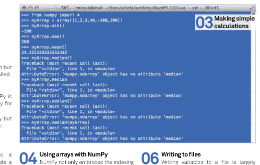

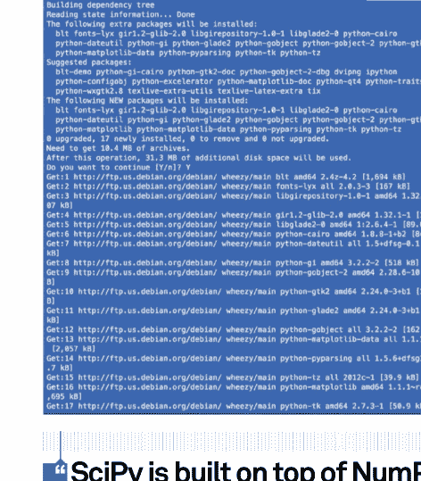

## 使用 Python

### 09 使用 Matplotlib 绘图

你应该做的第一步是安装 Matplotlib。正如你所见，Matplotlib 有许多依赖项，你也应该安装它们。

你将要学习的第一件事是如何绘制多项式函数。绘制 3x^2-x+1 多项式的必要命令如下：

```
import numpy as np
import matplotlib.pyplot as plt
myPoly = np.poly1d(np.array([3, -1, 1]))
astype(float)
x = np.linspace(-5, 5, 100)
y = myPoly(x)
plt.xlabel('x values')
plt.ylabel('f(x) values')
xticks = np.arange(-5, 5, 10)
yticks = np.arange(0, 100, 10)
plt.xticks(xticks)
plt.yticks(yticks)
plt.grid(True)
plt.plot(x,y)
```

保存多项式的变量是`myPoly`。将要对`x`进行绘图的取值范围使用`x = np.linspace(-5, 5, 100)`定义。另一个重要变量是`y`，它计算并保存每个`x`值对应的`f(x)`值。

重要的是你需要使用`--pylab=qt`参数启动`ipython`，以便在屏幕上看到输出。如果你对绘制多项式函数感兴趣，你应该多做实验，因为 NumPy 还可以计算函数的导数并在同一输出中绘制多个函数。

> SciPy 建立在 NumPy 之上并且更高级

```
In [36]: from scipy.stats import poisson, lognorm
In [37]: mySh = 10;
In [38]: myMu = 10;
In [39]: ln = lognorm(mySh)
In [40]: p = poisson(myMu)
In [41]: ln.rvs(10e6)
Out[41]:
array([[ 9.2939114e-02, 1.15957068e+01, 9.70411903e+01,
        8.26370734e-07, 5.64451441e-03, 4.61744655e-09,
        4.98471222e-06, 1.45947948e+02, 9.25502852e-06,
        5.8753728e-02]])
In [42]: p.rvs(10)
Out[42]: array([12, 11, 9, 9, 9, 10, 9, 4, 13, 8])
In [43]: ln.pdf(3)
Out[43]: 0.013218867177522842
```

### 10 关于 SciPy

SciPy 建立在 NumPy 之上并且比 NumPy 更高级。它支持数值积分、优化、信号处理、图像和音频处理以及统计。图 01 中的示例（在左侧）使用了`scipy.stats`包中关于统计的一个小部分。

该示例使用了两种统计分布，即使你懂数学也可能难以理解，但它是为了让你更好地体会 SciPy 命令而呈现的。

### 11 使用 SciPy 进行图像处理

现在我们将向你展示如何使用 SciPy 处理和转换 PNG 图像。

代码中最重要的一部分如下所示：

```
image = np.array(Image.open('SA.png').convert('L'))
```

这一行允许你读取一个普通的 PNG 文件并将其转换为 NumPy 数组以进行额外处理。该程序还将输出分为四个部分，并为这四个部分中的每一个显示不同的图像。

### 12 其他有用的函数

能够查出数组中元素的数据类型非常有用；可以使用`dtype()`函数完成。类似地，`ndim()`函数返回数组的维度数。在从外部文件读取数据时，你可以使用以下方式将数据列保存到单独的变量中：


```
In [10]: a1,a2 = np.loadtxt("timeN.txt", usecols=(0,1), unpack=True)
```

上述命令将第 1 列保存到变量`aa1`，第 2 列保存到变量`aa2`。`unpack=True`允许数据分配给两个不同的变量。请注意，列的编号从 0 开始。

## 13 拟合多项式

NumPy 的`polyfit()`函数尝试将一组数据点拟合到一个多项式。数据来自`timeN.txt`文件，该文件在此文章中更早创建过。

Python 脚本使用五次多项式，但如果你想使用不同的次数，只需更改以下行即可：

```
coefficients = np.polyfit(aa1, aa2, 5)
```

## 14 NumPy 中的数组广播

最后，我们将更多地谈论数组广播，因为它是一个非常有用的特性。首先，你应该知道数组广播有一条规则：为了让两个数组被考虑进行数组广播，“操作中两个数组的尾随轴的大小必须相同或其中一个必须为一。” 简单来说，数组广播允许 NumPy 通过填充数据来“改变”数组的维度，以便能够与另一个数组进行计算。尽管如此，你不能拉伸数组的两个维度来完成你的工作。

## 使用 SciPy 处理和转换 PNG 图像


## 使用 Python 进行即时通讯

如何在 Python 中为简单的即时通讯工具同时编写客户端（包含 GUI）和服务器

### 资源

- 一台计算机 - 运行你喜欢的 Linux 发行版

- 互联网连接 - 用于访问文档

- Python 2.x、PyGTK 和 GObject - 已安装的软件包

在这里我们将使用客户端-服务器架构在 Python 中实现一个即时通讯工具。这意味着每个客户端都连接到服务器，服务器将一个客户端发送的任何消息中继给所有其他客户端。服务器还会通知其他客户端当有人加入或离开服务器时。即时通讯工具可以在任何可以使用 TCP socket 的地方工作：在同一台计算机上使用回环接口、在局域网上通过各种计算机，甚至如果正确配置路由器的话通过互联网。然而，我们的消息未加密，因此我们不建议这样做。

编写即时通讯工具是一个有趣的技术问题，涵盖了你在编程中可能尚未接触到的多个领域：

- 我们将使用`socket`，它用于在网络上传输数据。

- 我们还将使用线程，它允许程序同时做多件事。

- 我们将介绍使用 GTK 编写简单图形用户界面的基础知识，以及如何从不同线程与之交互。

- 最后，我们将涉及使用正则表达式轻松分析和从字符串中提取数据的用法。

开始之前，你需要安装 Python 2.x 解释器，以及 PyGTK 绑定和 Python 2 GObject 绑定。如果你有一台安装了大量软件的系统，很可能你已经拥有这些软件包，因此在尝试导入它们时等待查看是否缺少任何库可能更容易。所有上述软件包都很常用，因此你应该能够使用发行版的软件包管理器安装它们。

- 每个消息都带有一个前缀时间戳

- 客户端可以在服务器退出时检测到，而不会崩溃或挂起

- 服务器在新客户端加入时通知所有客户端

- 同样，服务器在客户端离开时通知所有客户端

### 01 服务器

服务器将执行以下任务：

- 监听新客户端

- 在新客户端加入时通知所有客户端

- 在客户端离开时通知所有客户端

- 接收并将消息传递给所有客户端

我们将首先编写即时通讯工具的服务器端，因为客户端需要它。会有两个代码文件，因此最好创建一个文件夹来存放它们。你可以使用命令 `touch [filename]` 创建一个空文件，并使用 `chmod +x [filename]` 将该文件标记为可执行。现在该文件已准备好在你喜欢的编辑器中编辑。

```
[liam@liam-laptop Python]$ mkdir Python-IM
[liam@liam-laptop Python]$ cd Python-IM/
[liam@liam-laptop Python-IM]$ touch IM-Server.py
[liam@liam-laptop Python-IM]$ chmod +x IM-Server.py
```

### 02 开始

像往常一样，我们需要先写一行告诉程序加载器它需要用什么来解释文件的其余部分。在我们的例子中，该行是：

```
#!/usr/bin/env python2
```

在你的系统上，它可能需要改为 `#!/usr/bin/env python2.6` 或 `#!/usr/bin/env python2.7`。

之后，我们写了一个简短的注释说明应用程序的作用，并导入了所需的库。我们已经提到线程和`socket`库的作用。`re`库用于使用正则表达式搜索字符串。`signal`库用于处理会杀死程序的信号，例如`SIGINT`。`SIGINT`在按下 Ctrl+C 时发送。我们处理这些信号，以便程序可以告诉客户端它正在退出，而不是意外死亡。`sys`库用于退出程序。最后，`time`库用于对`while`循环体执行的频率设置合理的限制。

```
#!/usr/bin/env python2
# The server side of an instant messaging application. Written as part of a Linux User & Developer tutorial by Liam Fraser in 2013.
import threading
import socket
import re
import signal
import sys
import time
```

### 03 `Server` 类

`Server`类是我们即时通讯服务器的主要类。该类的初始化器接受一个端口号以开始监听客户端。它然后创建一个 socket，将 socket 绑定到所有接口上的指定端口，然后开始在该端口上监听。你可以可选地在包含端口的元组中包含一个 IP 地址。像我们这样传入一个空字符串会导致它监听所有接口。传递给`listen`函数的值 1 指定我们可以接受的最大排队连接数。这不应该成为问题，因为我们不期望一堆客户端在完全相同的时间连接。

现在我们有了 socket，我们将创建一个空数组，后续用于存储客户端 socket 集合，以便我们可以向它们回显消息。最后一步是告诉`signal`库在向应用程序发送`SIGINT`或`SIGTERM`时运行`self.signal_handler`函数，我们尚未编写它，以便我们可以干净地收尾。

```
class Server():
    def __init__(self, port):
        # Create a socket and bind it to a port
        self.listener = socket.socket(socket.AF_INET, socket.SOCK_STREAM)
        self.listener.bind(('', port))
        self.listener.listen(1)
        print "Listening on port {0}".format(port)
        # Used to store all of the client sockets we have, for echoing messages to them
        self.client_sockets = []
        # Run the function self.signal_handler when Ctrl+C is pressed
        signal.signal(signal.SIGINT, self.signal_handler)
        signal.signal(signal.SIGTERM, self.signal_handler)
```

### 04 服务器的主循环

服务器的主循环接受来自客户端的新连接，将该客户端的 socket 添加到 socket 集合中，然后在新线程中启动一个`ClientListener`类的实例，我们尚未编写它。有时在编写它们之前定义你将要调用的接口是好的，因为它可以在不担心细节的情况下概述程序的工作方式。

#### 有用的文档

- Threading: docs.python.org/2/library/threading.html

- Sockets: docs.python.org/2/library/socket.html

- Regular expressions: docs.python.org/2/library/re.html

- The signal handler: docs.python.org/2/library/signal.html

- PyGTK: www.pygtk.org/pygtk2reference.html


- GObject: `www.pygtk.org/pygtk2reference/gobject-functions.html`

请注意，我们在进行过程中打印信息，以便在需要时更容易调试。在循环末尾休眠是有用的，以确保 `while` 循环不能运行得太快而挂起机器。然而，这不太可能发生，因为接受新连接的那一行是阻塞的，这意味着程序在从该行继续之前等待连接。因此，我们需要将该行包含在 `try` 块中，以便我们可以在无法再接受连接时捕获 `socket` 错误并退出。这通常发生在我们在退出程序的过程中关闭 `socket` 时。

``` 
def run(self):
    while True:
        # Listen for clients, and create a ClientThread for each new client
        print "Listening for more clients"
        try:
            (client_socket, client_address) = self.listener.accept()
        except socket.error:
            sys.exit("Could not"
```

## 使用 Python

### 05 回显函数

我们需要一个可以从客户端线程调用的函数，用于向每个客户端回显一条消息。这个函数非常简单。最重要的是，向套接字发送数据被放在一个 `try` 块中，这意味着如果操作失败，我们可以处理异常，而不是让程序崩溃。

```
def echo(self, data):

# Send a message to each socket in self.client_socket

print "echoing: {}".format(data)

for socket in self.client_sockets:

# Try and echo to all clients

try:

socket.sendall(data)

except socket.error:

print "Unable to send message"
```

### 06 完成 Server 类

`Server` 类的剩余部分由几个简单函数组成；一个用于从套接字集合中移除套接字（这不需要解释），另一个是我们在类的初始化器中讨论过的 `signal_handler` 函数。这个函数会停止监听新连接，并解除套接字与其监听端口的绑定。最后，我们向每个客户端发送一条消息，让他们知道我们正在退出。一旦 `signal_handler` 函数结束，信号将继续按预期关闭程序。

```
def remove_socket(self, socket):
```

### 07 客户端线程

用于处理每个客户端的类继承自 `Thread` 类。这意味着可以先创建该类，然后通过 `client_thread.start()` 启动它。此时，类的 `run` 函数中的代码将在后台运行，而 `Server` 类的主循环将继续接受新连接。

```
class ClientListener(threading.Thread):

def __init__(self, server, socket, address):

# Initialise the Thread base class

super(ClientListener, self).__init__()

# Store the values that have been passed to the constructor

self.server = server

self.address = address

self.socket = socket

self.listening = True

self.username = "No Username"
```

### 08 客户端线程的循环

在客户端线程中运行的循环与服务器中的循环非常相似。当 `self.listening` 为真时，它会持续监听数据，并将收到的任何数据传递给一个我们稍后将要编写的 `handle_msg` 函数。传给 `socket.recv` 函数的值是接收数据时使用的缓冲区大小。

```
def run(self):

# The thread's loop to receive and process messages

while self.listening:

data = ""

try:

data = self.socket.recv(1024)

except socket.error:

"Unable to receive data"

self.handle_msg(data)

time.sleep(0.1)

# The while loop has ended

print "Ending client thread for {}".format(self.address)
```

### 09 清理收尾

我们需要一个函数来清理线程。当客户端发送一个空字符串（表示它已停止监听套接字）或发送字符串 `"QUIT"` 时，我们将调用此函数。发生时，我们会向每个客户端回显该用户已退出。

```
def quit(self):

# Tidy up and end the thread

self.listening = False

self.socket.close()

self.server.remove_socket(self.socket)

self.server.echo("{} quit.".format(self.username))
```

### 10 处理消息

我们的客户端可以发送三种可能的消息：
- `QUIT`
- `USERNAME user`
- 要回显给所有客户端的任意字符串

如果套接字已被关闭，客户端还会发送一堆空消息，因此我们会在这种情况下结束它们的线程。除了正则表达式部分外，代码应该相当一目了然。如果有人发送 `USERNAME` 消息，服务器会告诉每个客户端有新用户加入。这是通过正则表达式来检测的。`^` 表示字符串的开头，`$` 表示结尾，包含 `$` 的括号会提取 `"USERNAME"` 之后的内容。

```
accept any more connections")

self.client_sockets.append(client_socket)

print "Starting client thread for {}".format(client_address)

client_thread = ClientListener(self, client_socket, client_address)

client_thread.start()

time.sleep(0.1)
```

```
# Remove the specified socket from the client_sockets list

self.client_sockets.remove(socket)

def signal_handler(self, signal, frame):

# Run when Ctrl+C is pressed

print "Tidying up"

# Stop listening for new connections

self.listener.close()

# Let each client know we are quitting

self.echo("QUIT")
```

#### 我们需要告诉 GObject 我们将使用线程

```
def handle_msg(self, data):

    # Print and then process the message we've just received

    print "{0} sent: {1}".format(self.address, data)

    # Use regular expressions to test for a message like "USERNAME liam"

    username_result = re.search("USERNAME (.*)", data)

    if username_result:

        self.username = username_result.group(1)

        self.server.echo("{0} has joined.\n".format(self.username))

    elif data == "QUIT":

        # If the client has sent quit then close this thread

        self.quit()

    elif data == "":

        # The socket at the other end is probably closed

        self.quit()

    else:
```


```python
        # It's a normal message so echo it to everyone

        self.server.echo(data)
```

```python
#!/usr/bin/env python2

# The client side of an instant messaging application. Written as part of a Linux User & Developer tutorial by Liam Fraser in 2013.

import threading

import gtk

import gobject

import socket

import re

import time

import datetime

# Tell gobject to expect calls from multiple threads

gobject.threads_init()
```

#### 11 启动服务器

实际启动`Server`类的代码如下。注意你最好选择一个高编号的端口，因为打开 <1024 的端口需要 root 权限。

```python
if __name__ == "__main__":

    # Start a server on port 59091

    server = Server(59091)

    server.run()
```

#### 12 客户端

像为服务器创建新文件一样为客户端创建一个新文件并在你喜欢的编辑器中打开它。客户端需要与服务器相同的导入，以及`gtk`、`gobject`和`datetime`库。我们需要做的一件重要事情是告诉`GObject`我们将使用线程，这样我们就可以从其他线程调用函数，并且主窗口在主 GTK 线程中运行，可以更新。

#### 13 客户端图形用户界面

客户端的用户界面不是本教程的重点，也不会像其余代码那样详细解释。然而，代码应该相当容易阅读，我们提供了链接到文档以帮助你。

我们的`MainWindow`类继承自`gtk.Window`类，因此我们需要首先使用`super`关键字初始化它。然后我们创建将放在窗口上的控件，将它们的事件连接到函数，最后按我们想要的方式布局控件。`destroy`事件在程序关闭时触发，其他事件应该显而易见。

GTK 使用打包布局，其中你使用`VBoxes`和`HBoxes`来布局控件。V 和 H 代表垂直和水平。这些控件本质上让你像表格一样分割窗口，并且会根据应用程序的大小自动决定控件的大小。

GTK 没有提供输入基本信息（如服务器 IP 地址、端口和你选择的用户名）的控件，因此我们制作了一个名为`ask_for_info`的函数，它创建一个消息框，向其中添加一个文本框，然后检索结果。我们这样做是因为它更简单，使用代码更少，而不是创建一个新窗口来接受信息。

```python
class MainWindow(gtk.Window):

    def __init__(self):

        # Initialise base gtk window class

        super(MainWindow, self).__init__()

        # Create controls

        self.set_title("IM Client")

        vbox = gtk.VBox()

        hbox = gtk.HBox()

        self.username_label = gtk.Label()

        self.text_entry = gtk.Entry()

        send_button = gtk.Button("Send")

        self.text_buffer = gtk.TextBuffer()

        text_view = gtk.TextView(self.text_buffer)

        # Connect events

        self.connect("destroy", self.graceful_quit)

        send_button.connect("clicked", self.send_message)

        # Activate event when user presses Enter

        self.text_entry.connect("activate", self.send_message)

        # Do layout

        vbox.pack_start(text_view)

        hbox.pack_start(self.username_label, expand = False)

        hbox.pack_start(self.text_entry)

        hbox.pack_end(send_button, expand = False)

        vbox.pack_end(hbox, expand = False)

        # Show ourselves

        self.add(vbox)

        self.show_all()

        # Go through the configuration process

        self.configure()
```

#### 14 配置客户端

这段代码在我们将控件添加到主窗口后运行，并向用户请求输入。目前，如果用户输入错误的服务器地址或端口，应用程序将退出，但这不是生产系统，所以没关系。

```python
    def ask_for_info(self, question):

        # Shows a message box with a text entry and returns the response

        dialog = gtk.MessageDialog(parent = self, type = gtk.MESSAGE_QUESTION,

                                   flags = gtk.DIALOG_MODAL |

                                   gtk.DIALOG_DESTROY_WITH_PARENT,

                                   buttons = gtk.BUTTONS_OK_CANCEL,

                                   message_format = question)

        entry = gtk.Entry()

        entry.show()

        dialog.vbox.pack_end(entry)

        response = dialog.run()

        response_text = entry.get_text()

        dialog.destroy()

        if response == gtk.RESPONSE_OK:

            return response_text

        else:

            return None

    def configure(self):

        # Performs the steps to connect to the server

        # Show a dialog asking for server address followed by a port

        server = self.ask_for_info("server_address:port")

        # Regex that crudely matches an IP address and a port number

        regex = re.search(r"(\d+\.\d+\.\d+\.\d+):(\d+)", server)

        address = regex.group(1).strip()

        port = regex.group(2).strip()

        # Ask for a username

        self.username = self.ask_for_info("username")

        self.username_label.set_text(self.username)

        # Attempt to connect to the server and then start listening

        self.network = Networking(self, self.username, address, int(port))

        self.network.listen()
```


### 15 MainWindow 的其余部分

`MainWindow`类的其余部分有大量注释来解释其自身，如下所示。需要注意的一点是，当客户端发送消息时，它不会立即在文本视图中显示。服务器会将消息回显给每个客户端，因此客户端只是在服务器回显回来时才显示自己的消息。这意味着当你看不到自己发送的消息时，你可以判断服务器没有接收到你的消息。

```python
def add_text(self, new_text):

    # Add text to the text view

    text_with_timestamp = "{0} {1}".format(datetime.datetime.now(), new_text)

    # Get the position of the end of the text buffer, so we know where to insert new text

    end_iter = self.text_buffer.get_end_iter()

    # Add new text at the end of the buffer

    self.text_buffer.insert(end_iter, text_with_timestamp)
```

```python
def send_message(self, widget):

    # Clear the text entry and send the message to the server

    # We don't need to display it as it will be echoed back to each client, including us.

    new_text = self.text_entry.get_text()

    self.text_entry.set_text("")

    message = "{0} says: {1}\n".format(self.username, new_text)

    self.network.send(message)

def graceful_quit(self, widget):

    # When the application is closed, tell GTK to quit, then tell the server we are quitting and tidy up the network

    gtk.main_quit()

    self.network.send("QUIT")

    self.network.tidy_up()
```

> 服务器会将消息回显给每个客户端


## 使用 Python

### 16 客户端的 Networking 类

客户端的`Networking`类很大程度上与服务器的类似。一个区别是该类不继承`Thread`类——我们只是将其中的一个函数作为线程启动。

```python
class Networking():

    def __init__(self, window, username, server, port):

        # Set up the networking class

        self.window = window

        self.socket = socket.socket(socket.AF_INET, socket.SOCK_STREAM)

        self.socket.connect((server, port))

        self.listening = True

        # Tell the server that a new user has joined

        self.send("USERNAME {0}".format(username))
```

```python
def listener(self):

    # A function run as a thread that listens for new messages

    while self.listening:

        data = ""

        try:

            data = self.socket.recv(1024)

        except socket.error:

            "Unable to receive data"

        self.handle_msg(data)

    # Don't need the while loop to be ridiculously fast

    time.sleep(0.1)
```

### 17 将函数作为线程运行

上面的`listener`函数将作为线程运行。这非常简单。启用线程的`daemon`选项意味着如果主线程意外结束，它将会终止。

```python
def listen(self):

    # Start the listening thread

    self.listen_thread = threading.Thread(target=self.listener)

    # Stop the child thread from keeping the application open

    self.listen_thread.daemon = True

    self.listen_thread.start()
```

### 18 完成 Networking 类

再次说明，大部分代码与服务器的`Networking`类中的代码相似。一个区别是，我们希望在窗口的文本视图中添加一些内容。我们通过使用`GObject`的`idle_add`函数来实现这一点。这允许我们在主线程空闲时调用一个函数来更新窗口。

```python
def send(self, message):

    # Send a message to the server

    print "Sending: {0}".format(message)

    try:

        self.socket.sendall(message)

    except socket.error:

        print "Unable to send message"
```

```python
def tidy_up(self):

    # We'll be tidying up if either we are quitting or the server is quitting

    self.listening = False

    self.socket.close()

    # We won't see this if it's us that's quitting as the window will be gone shortly

    gobject.idle_add(self.window.add_text, "Server has quit.\n")
```

```python
def handle_msg(self, data):

    if data == "QUIT":

        # Server is quitting

        self.tidy_up()

    elif data == "":

        # Server has probably closed unexpectedly

        self.tidy_up()

    else:

        # Tell the GTK thread to add some text when it's ready

        gobject.idle_add(self.window.add_text, data)
```

### 19 启动客户端

主窗口通过初始化该类的一个实例来启动。请注意，我们不需要存储返回的任何内容。然后我们通过调用`gtk.main()`来启动 GTK 线程。

```python
if __name__ == "__main__":

    # Create an instance of the main window and start the gtk main loop

    MainWindow()

    gtk.main()
```

### 20 试用

你需要几个终端：一个用于启动服务器，一些用于运行客户端。启动服务器后，打开一个客户端实例并输入`127.0.0.1:port`，其中`'port'`是你决定使用的端口。服务器会打印它正在监听的端口以便于操作。然后输入用户名并点击`OK`。以下是服务器有两个客户端时的示例输出。你可以通过将`127.0.0.1`替换为服务器的 IP 地址在网络上使用客户端。如果不起作用，你可能需要让端口通过计算机的防火墙。

```


```
[liam@liam-laptop Python]$ ./IM-Server.py

Listening on port 50091

Listening for more clients

Starting client thread for ('127.0.0.1', 38726)

('127.0.0.1', 38726) sent: USERNAME client1

echoing: client1 has joined.

Listening for more clients

Starting client thread for ('127.0.0.1', 38739)

('127.0.0.1', 38739) sent: USERNAME client2

echoing: client2 has joined.

Listening for more clients

('127.0.0.1', 38739) sent: client2 says: Hi

echoing: client2 says: Hi

('127.0.0.1', 38726) sent: client1 says: Hi

echoing: client1 says: Hi

('127.0.0.1', 38726) sent: QUIT

echoing: client1 has quit.

Ending client thread for ('127.0.0.1', 38726)

* Tidying up

echoing: QUIT

Could not accept any more connections

('127.0.0.1', 38739) sent: client2 has quit.

Ending client thread for ('127.0.0.1', 38739)
```

#### 21 就这样！

所以，它并不完美，在错误处理方面可以更健壮一些，但我们已经拥有了一个可工作的即时通讯服务器，可以接受多个客户端并在它们之间中继消息。更重要的是，我们学习了大量新的概念和工作方法。

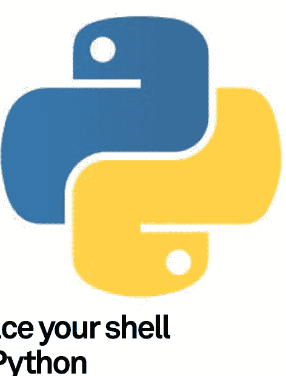

# 用 Python 替换你的 shell

Python 是一门优秀的编程语言，但你知道它甚至能够取代你的主要 shell（命令行界面）吗？在这里，我们将解释所有内容...

### 资源

你需要在系统上安装一个版本的 Python。好消息是你不需要做任何事情来安装它。大多数 Linux 发行版已经自带 Python 2.6 或 Python 2.7

我们每天都在使用 shell。对我们大多数人来说，shell 是进入 Linux 系统的入口。多年以来，甚至至今，Bash 一直是 Linux 的默认 shell。但它有点老了。

不必感到冒犯；我们仍然认为与 Korn Shell（KSH）、C Shell（CSH）或甚至 TCSH 等其他 UNIX shell 相比，Bash 是最好的 shell。

本教程并不是关于 Bash 无能，而是关于如何让 shell 完全焕发新生，以便方便地完成事情并实现以前根本不可能的新功能。因此，不再耽搁，让我们开始吧。

虽然 Python 编程语言可能需要你编写更长的命令来完成一项任务（由于 Python 模块的组织方式），但这并不是特别令人担忧的事情。你可以轻松地为你打算替换的 Bash 命令编写别名。大多数时候完成一件事会有不止一种方法，但你需要决定哪种方法最适合你。

Python 提供了直接执行系统命令的支持（通过 `os` 或 `subprocess` 模块），但在可能的情况下我们将专注于 Python 原生的实现，因为这使我们能够开发可移植的代码。

#### SECTION 1: 在 Python 中完成基本的 shell 任务

##### 1. 文件管理

Python 模块 `shutil` 提供了文件和目录操作的支持。它提供了文件属性、目录复制、归档等的支持。让我们看看其中的一些重要函数。

```
shutil module

copy (src,dst): Copy the src file to the destination directory. In this mode permissions bits are copied but metadata is not copied.

copy2 (src,dst): Same as copy() but also copies the metadata

copytree(src, dst[, symlinks=False, ignore=None]): This is similar to 'cp -r', it allows you to copy an entire directory

ignore_patterns (*patterns): ignore_patterns is an interesting function that can be used as a callable for copytree(), it allows you to ignore files and directories specified by the glob-style patterns

rmtree(path[, ignore_errors[, onerror]]): rmtree() is used to delete an entire directory.

move(src,dst): Similar to mv command it allows you to recursively move a file or directory to a new location.
```

##### Example

```
>>>from shutil import copytree, ignore_patterns

>>>copytree(source, destination, ignore=ignore_patterns('*.pyc', 'tmp*'))
```

```
make_archive(base_name, format[, root_dir[, base_dir[, verbose[, dry_run[, owner[, group[, logger]]]]]]]): Think of this as a replacement for tar, zip, bzip etc. make_archive() creates an archive file in the given format such as zip, bztar, tar , gztar. Archive support can be extended via Python modules.
```

##### Example

```
>>> from shutil import make_archive

>>> import os

>>> archive_name = os.path.expanduser(os.path.join('~', 'ludarchive'))

>>> root_dir = os.path.expanduser(os.path.
```

> 你可以轻松地为你打算替换的 Bash 命令编写别名

```
path_join('~', '.ssh')

>>> make_archive(archive_name, 'gztar', root_dir)

'/Users/kunal/ludarchive.tar.gz'
```

##### 2. 接口操作系统 & 子进程

Python 提供了两个模块来与操作系统交互并管理进程，称为 `os` 和 `subprocess`。这些模块允许你与核心操作系统 shell 交互，让你使用环境、进程、用户和文件描述符。

`subprocess` 模块被引入以支持在 Python 中更好地管理子进程（其中一部分已存在于 `os` 模块中），旨在取代 `os.system`、`os.spawn*`、`os.popen`、`popen2.*` 和 `commands.*` 模块。

##### os module

`environ`: environment represents the OS environment variables in a string object.

##### example

```
>>> import os

>>> os.environ
```


``` 
'VERSIONER_PYTHON_PREFER_32_BIT': 'no', 'LC_CTYPE': 'UTF-8', 'TERM': 'PROGRAM': '297', 'LOGNAME': 'kunaldeo', 'USER': 'kunaldeo', 'PATH': '/System/Library/Frameworks/Python.framework/Versions/2.7/bin:/Users/kunaldeo/narwhal/bin/opt/local/sbin:/usr/local/bin:/usr/bin:/bin:/usr/sbin:/opt/local/bin:/Applications/MOTODev_Studio_For_Android_2.0.0_x86/android_sdk/tools:/Applications/MOTODev_Studio_For_Android_2.0.0_x86/android_sdk/platform-tools:/Volumes/CyanogenModWorkspace/bin', 'HOME': '/Users/kunaldeo', 'PS1': '\[\e[0;32m\]\u@\h:\w\$\e[m\]\n\[\e[1;34m\]\$\e[m\]\n\[\e[1;32m\]\$\e[m\]\n\[\e[1;37m\]', 'NARWHAL_ENGINE':
```

```
'jsc', 'DISPLAY': '/tmp/launch-s2LUfa/org.x0', 'TERM_PROGRAM': 'Apple_Terminal', 'TERM': 'xterm-color', 'Apple_PubSub_Socket_Renderer': '/tmp/launch-k0U15P/Renderer', 'VERSIONER_PYTHON_VERSION': '2.7', 'SHLVL': '1', 'SECURITYSESSIONID': '186a5', 'ANDROID_SDK': '/Applications/MOTODev_Studio_For_Android_2.0.0_x86/android_sdk', '...': '/System/Library/Frameworks/Python.framework/Versions/2.7/bin/', 'PYTHON': 'TERM_SESSION_ID': 'ACFE2492-BB5C-41BE-8D4F-84E5C638B06E', 'SSH_AUTH_SOCK': '/tmp/launch-dj6M4/Listener', 'SHELL': '/bin/bash', 'TMPDIR': '/var/folders/gs/pkgnmbl18 73m6bpsz8x2v8000gn/T/', 'LS_COLORS': 'ExFxCxDx...', 'CLICOLOR': '1', '__CF_USER_TEXT_ENCODING': '0x1F5:0:0', 'PWD': '/Users/kunaldeo', 'COMMAND_MODE': 'unix2003'}
```

你也可以查出环境变量的值：
``` 
>>> os.environ['HOME']
'/Users/kunaldeo'
```

`putenv(varname,value)` : Adds or sets an environment variable with the given variable name and value.

`getuid()` : Return the current process's user id.

`getlogin()` : Returns the username of currently logged in user

`getpgid(pid)` : Returns the process group id of given pid. When used without any parameters it simply returns the current process id.

`getcwd()` : Return the path of the current working directory.

`chdir(path)` : Change the current working directory to the given path.

# 使用 Python 工作

`listdir(path)` : 类似于 `ls`，返回一个列表，其中包含给定路径下的目录和文件内容。

### 示例：

```
>>> os.listdir("/home/homer")
['.gnome2', 'pulse', '.gconf', '.gconf.d', 'beagle', '.gnome2', 'private', '.gksu_lock', 'Public', '.ICEauthority', 'bash_history', 'compiz', 'gvfs', 'update-notifier', 'cache', 'Desktop', 'Videos', 'profile', 'config', '.esd_auth', '.viminfo', '.sudo_as_admin_successful', 'mbox', 'xsession-errors', 'bashrc', 'Music', 'dbus', '.local', 'gstreamer-0.10', 'Documents', '.gtk-bookmarks', 'Downloads', 'Pictures', 'pulse-cookie', '.nautilus', 'examples', 'desktop', 'Templates', '.bash_logout']
```

`mkdir(path[, mode])` : 使用给定的数字权限代码创建目录。默认权限为 0777。

`makedirs(path[, mode])` : 递归创建给定路径（包括其所有目录）。默认权限为 0777。

### 示例：

```
>>> import os
>>> path = "/home/kunal/greatdir"
>>> os.makedirs( path, 0755 );
```

`rename(old,new)` : 将文件或目录 `old` 重命名为 `new`。如果 `new` 是一个目录，则会引发错误。在 Unix 和 Linux 上，如果 `new` 已存在且是一个文件，只要用户有相应权限，它就会被静默替换。

`renames(old,new)` : 类似于 `rename`，但如有必要还会递归创建任何缺失的目录。

`rmdir(path)` : 从指定路径移除目录。如果该路径下已有文件，你需要使用 `shutil.rmtree()`。

#### subprocess:

`call(*popenargs, **kwargs)` : 使用参数运行命令。进程完成后，它返回 `returncode` 属性。

### 示例：

```
>>> import subprocess
>>> print subprocess.call(["ls","-l"])
total 3684688
drwx------ 5 kunaldo staff
170 Aug 19 01:37 Desktop
drwx------ 10 kunaldo staff
340 Jul 26 08:30 Documents
drwx------ 50 kunaldo staff
1700 Aug 19 12:59 Downloads
drwx------ 9 127 kunaldo staff
4318 Aug 19 01:43 Dropbox
drwx------ 42 kunaldo staff
1428 Aug 12 15:17 library
drwx------ 3 kunaldo staff
102 Jul 3 23:23 Movies
drwx------ 4 kunaldo staff
136 Jul 6 08:32 Music
drwx------ 5 kunaldo staff
170 Aug 12 11:26 Pictures
drwx--xr-x 5 kunaldo staff
170 Jul 3 23:23 Public
--rw--r--r-- 1 kunaldo staff
18865556848 Aug 16 21:02 androidsk.tar
drwx--xr-x 5 kunaldo staff
170 Aug 16 21:05 sdk
drwx--xr-x 19 kunaldo staff
646 Aug 19 01:47 src
--rw--r--r-- 1 root staff
367 Aug 16 20:36 umbrella0.log
```


`STD_INPUT_HANDLE`: 标准输入设备。最初，这是控制台输入缓冲区。

`STD_OUTPUT_HANDLE`: 标准输出设备。最初，这是活动控制台屏幕缓冲区。

`STD_ERROR_HANDLE`: 标准错误设备。最初，这是活动控制台屏幕缓冲区。

## 第 2 节：IPython：一个现成的 Python 系统 shell 替代品

在第 1 节中，我们向你介绍了 Python 模块，这些模块让你能够使用纯 Python 非常轻松地执行系统 shell 相关任务。利用这些特性，你可以构建一个功能完备的 shell，并在此过程中省去大量 Python 样板代码。然而，如果你是一个喜欢一切现成的人，那么你很幸运。IPython 提供了一个强大且交互式的 Python shell，你可以将其作为你的主要 shell 使用。IPython 支持 Python 2.6 到 2.7 以及 3.1 到 3.2。它支持两种类型的 Python shell：基于终端的和基于 Qt 的。

需要重申的是，IPython 完全由 Python 实现，并提供了 100% 符合 Python 规范的 shell 接口，因此你在第 1 节中学到的一切都可以在 IPython 中毫无问题地运行。

IPython 在大多数 Linux 发行版中已经可用。请搜索你的发行版软件仓库来查找它。如果你找不到，你也可以使用 `easy_install` 或 PyPI 来安装它。

IPython 提供了许多有趣的功能，使其成为一个出色的 shell 替代品……

### Tab 补全

Tab 补全提供了一种极好的方式来探索你正在使用的任何 Python 对象。它还能帮助你避免拼写错误。

#### 示例

```
In [3]: import o  (hit tab)

objc    opcode    operator

optparse os       os2emxpath
```

```
In [3]: import os
```

```
In [4]: os.p  (hit tab)

os.pardir      os.pathconf_names

os.popen       os.popen4

os.path        os.pathsep

os.popen2      os.putenv

os.pathconf    os.pipe

os.popen3
```

内置对象浏览器：你可以在任何 Python 对象后面添加 `?` 来查看其详细信息，例如类型、基类、字符串形式、命名空间、文件和文档字符串。

#### 示例

```
In [28]: os.path?

Type: module

Base Class: <type 'module'>

String Form: <module 'posixpath' from '/System/Library/Frameworks/Python.framework/Versions/2.7/lib/python2.7/posixpath.py'>

Namespace: Interactive

File: /System/Library/Frameworks/
```

```
Python.framework/Versions/2.7/lib/python2.7/posixpath.py

Docstring:

Common operations on POSIX pathnames.
```

```
%pdef %pdoc %pfile %pinfo %pinfo2 %popd %pprint %precision %profile %prun %psource %pushd %pwd %pycat %pylab %quickref %recall %rehashx %reload_ext %rep %rerun %reset %reset_selective %run %save %sc %sx %tb %time %timeit %unalias %unload_ext %who %who_ls %whos %xdel %xmode
```

不要直接导入此模块，导入 `os` 并将此模块引用为 `os.path`。在 POSIX 系统上，`'os.path'` 是此模块的别名；在其他系统上，例如 Mac、Windows，`os.path` 以特定于该平台的方式提供相同的操作，并是另一个模块的别名，例如 `macpath`、`ntpath`。

其中一些在非 POSIX 系统上也可能有用，例如用于操作 URL 的路径名组件。

你也可以使用双问号 `??` 来查看相关对象的源代码。

### Magic functions

IPython 带有一些预定义的 'magic functions'，你可以用命令行风格的语法调用它们。IPython 'magic' 命令通常以 `%` 为前缀，但如果标志 `%automagic` 被设置为开启，则可以不带前面的 `%` 调用 magic 命令。

要查看可用 magic functions 的列表，可以使用 'magic function `%lsmagic`'。Magic functions 包括处理代码的函数，如 `%run`、`%edit`、`%macro`、`%recall` 等；影响 shell 的函数，如 `%colors`、`%xmode`、`%autoindent` 等；以及其他函数，如 `%reset`、`%timeit`、`%paste` 等。IPython 大多数酷炫功能都是由 magic functions 驱动的。

#### Example

```
In [45]: %lsmagic

Available magic functions:

%alias %autocall %autoindent %automagic %bookmark %cd %colors %cpaste %debug %dhist %dirs %doc %docstring %edit %env %gui %hist %history %install_default_config %install_profiles %load_ext %loadpy %logoff %logon %logstart %logstate %logstop %lsmagic %macro %magic %page %paste %pastebin %pdb
```

Automatic is OFF, % prefix IS needed for magic functions

要查看任何 Magic Function 的帮助，调用 `'%somemagic?'` 以读取其 docstring。

### Python script execution and runtime code editing

你可以使用 `%run` 运行任何 Python 脚本。你也可以使用 `-d` 用 `pdb` 调试器控制运行 Python 脚本，或使用 `-p` 用 `pdn` 分析器运行。你也可以使用 `%edit` 命令编辑 Python 脚本。`%edit` 将在 `$EDITOR` 环境变量定义的编辑器中打开给定的 Python 脚本。

### Shell command support

如果你只是想运行一个 shell 命令，你可以非常轻松地通过在命令前加上 `!` 来实现。

#### Example

```
In [5]: !ps

  PID TTY          TIME CMD

 4508 ttys000   0:00.07 -bash

 84275 ttys001   0:00.03 -bash

 17958 ttys002   0:00.18 -bash
```

```
In [8]: !clang prog.c -o prog

prog.c:2:1: warning: type specifier missing, defaults to 'int' [-Wimplicit-int]

main()

...

1 warning generated.
```

IPython 也自带了基于 Qt 的控制台


# 具有 GUI 功能的 IPython Qt 控制台

Qt console : IPython 也自带了基于 Qt 的控制台。 这提供了一些仅在 GUI 中可用的功能，例如内联图形、多行编辑带语法高亮，以及图形化调用提示。

你可以通过以下方式启动 Qt 控制台：
`$ ipython qtconsole`

如果出现与缺少模块相关的错误，请确保已安装依赖包，例如 `PyQt`、`pygments`、`pexpect` 和 `ZeroMQ`。

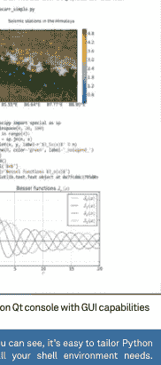

> 正如你所见，将 Python 定制以满足所有 shell 环境需求是很容易的。 Python 模块如 `os`、`subprocess` 和 `shutil` 都可供你使用，用 Python 做几乎你需要的一切。 Python 将整个体验变成了一个更完整的套件。 你可以做标准 Python shell 的所有事情，并且拥有更方便的功能。 IPython 的 magic functions 确实提供了神奇的 Python shell 体验。 所以下次你打开一个 `Bash` 会话时，再想一想：为什么要满足于黄金，当铂金近在咫尺？

# 面向系统管理员的 Python

了解 Python 如何帮助系统管理，它敢于取代常见的 shell 脚本……

## 资源

- `Python-devel` Python 开发库，用于编译第三方 Python 模块
- `setuptools` setuptools 允许您轻松地下载、构建、安装、升级和卸载 Python 包

系统管理是我们计算环境的重要组成部分。无论你是在工作中还是在家中管理系统，这都无关紧要。Linux 作为基于 UNIX 的操作系统，已经拥有系统管理员所需的一切，例如世界级的 shell（不止一个，而是很多，包括 `Bash`、`csh`、`zsh` 等）、方便的工具，以及许多其他特性，使 Linux 系统成为管理员的梦想。那么，当 Linux 已经内置了一切时，为什么我们还需要 Python？作为一种动态脚本语言，Python 非常易于阅读和学习。这不仅仅是我们说的，许多 Linux 发行版实际上都在核心管理部分使用了 Python。例如，Red Hat（和 Fedora）的系统设置工具 Anaconda 就是用 Python 编写的（再读一遍这句话，明白与蛇的联系了吗？）。此外，像 GNU Mailman、CompizConfig Settings Manager (CCSM) 以及数百个小型 GUI 和非 GUI 配置工具都是使用 Python 编写的。Python 并不限制你选择用户界面——你可以使用 Python 构建命令行、GUI 和 Web 应用程序。这样，它几乎覆盖了所有可能的界面。

在这里，我们将研究如何使用 Python 执行与系统管理相关的任务。

## 解析配置文件

配置文件为应用程序提供了一种存储各种设置的方式。为了编写允许你修改特定应用程序设置的脚本，你应该能够解析该应用程序的配置文件。

在本节中，我们将学习如何解析 INI 样式的配置文件。尽管古老，但 INI 文件格式在许多现代开源软件中仍然非常流行，例如 PHP 和 MySQL……

`php.ini` 配置文件摘录。

```
[PHP]
engine = On
zend.ze1_compatibility_mode = Off
short_open_tag = On
asp_tags = Off
precision = 14
y2k_compliance = On
output_buffering = 4096
;output_handler = 
zlib.output_compression = Off

[MySQL]
; Allow or prevent persistent links.
mysql.allow_persistent = On
mysql.max_persistent = 20
mysql.max_links = -1
mysql.default_port = 3306
mysql.default_socket = 
mysql.default_host = localhost
mysql.connect_timeout = 60
mysql.trace_mode = Off
```

Python 提供了一个名为 `ConfigParser`（在 Python 3.0 中称为 `configparser`）的内置模块。你可以使用该模块来解析和创建配置文件。

```
@code:writeconfig.py
@description:The following demonstrates adding MySQL section to the php.ini file.
@warning: Do not use this script with the actual php.ini file, as it's not designed to handle all aspects of a complete php.ini file.

import ConfigParser

config = ConfigParser.RawConfigParser()

config.add_section('MySQL')
config.set('MySQL', 'mysql_trace_mode', 'Off')
config.set('MySQL', 'mysql.connect_timeout', '60')
config.set('MySQL', 'mysql.default_host', 'localhost')
config.set('MySQL', 'mysql.default_port', '3306')
config.set('MySQL', 'mysql.allow_persistent', 'On')
config.set('MySQL', 'mysql.max_persistent', '20')

with open('php.ini', 'a') as configfile:
    config.write(configfile)
```

输出：`php.ini`

```
[MySQL]
mysql.max_persistent = 20
mysql.allow_persistent = On
mysql.default_port = 3306
mysql.default_host = localhost
mysql.trace_mode = Off
mysql.connect_timeout = 60
```

```
@code:parseconfig.py
@description:Parsing and updating the config file

import ConfigParser

config = ConfigParser.ConfigParser()
config.read('php.ini')

# Print config values
print config.get('MySQL', 'mysql.default_host')
print config.get('MySQL', 'mysql.default_port')

config.remove_option('MySQL', 'mysql.trace_mode')

with open('php.ini', 'wb') as configfile:
    config.write(configfile)
```

## 注意

本文针对 Python 2.X 系列编写，因为它仍然是所有平台上（包括所有 Linux 发行版、BSD 和 Mac OS X）最流行和默认的 Python 版本。


## 解析 JSON 数据

JSON（也被称为 JavaScript Object Notation）是一种轻量级的现代数据交换格式。JSON 是 ECMA-262 下的一个开放标准。它是一种文本格式，并且完全与语言无关。JSON 也被用作现代应用程序（如 Mozilla Firefox 和 Google Chrome）的配置文件格式。JSON 在现代 Web 服务中也非常流行，例如 Facebook、Twitter、Amazon EC2 等。在本节中，我们将使用 Python 模块 `simplejson` 来访问 Yahoo Search（使用 Yahoo Web Services API），它输出 JSON 数据。

要使用本节内容，你需要具备以下条件：

- 1. Python 模块：`simplejson`。
- 注意：你可以使用命令 `easy_install <module name>` 安装 Python 模块。此命令假定你拥有可用的互联网连接。
- 2. Yahoo App ID：Yahoo App ID 可以从 `https://developer.apps.yahoo.com/dashboard/createKey.html` 创建。Yahoo App ID 将在下一页生成。详情见下面的截图。


生成 Yahoo App ID

`simplejson` 非常易于使用。在下面的示例中，我们将使用将 JSON 数据结构直接映射到 Python 数据类型的功能。这让我们可以直接访问 JSON 数据，而无需编写任何 XML 解析代码。

### JSON 与 Python 数据映射

| JSON | Python |
|------|--------|
| `object` | `dict` |
| `array` | `list` |
| `string` | `unicode` |
| `number (int)` | `int, long` |
| `number (real)` | `float` |
| `TRUE` | `TRUE` |
| `FALSE` | `FALSE` |
| `null` | `None` |

在本节中，我们将使用 `simplejson.load` 函数，它允许我们将 JSON 对象反序列化为 Python 对象。

```
@code:LUDYSearch.py

import simplejson, urllib

APP_ID = 'xxxxxxx' # Change this to your APP ID

SEARCH_BASE = 'http://search.yahooapis.com/WebSearchService/V1/webSearch?'

class YahooSearchError(Exception):

    pass

def search(query, results=20, start=1, **kwargs):

    kwargs.update({

        'appid': APP_ID,

        'query': query,

        'results': results,

        'start': start,

        'output': 'json'

    })

    url = SEARCH_BASE + '?' + urllib.urlencode(kwargs)

    result = simplejson.load(urllib.urlopen(url))

    if 'Error' in result:

        # An error occurred; raise an exception

        raise YahooSearchError,

        result['Error']

    return result['ResultSet']
```

让我们在 Python shell 中使用上述代码来了解其工作原理。切换到保存了 `LUDYSearch.py` 的目录，然后打开一个 Python shell。

```
@code: Python Shell Output. Lines starting with >>> indicate input

>>> execfile('LUDYSearch.py')

>>> results = search('Linux User and Developer')

>>> results['totalResultsAvailable']

123000000

>>> results['totalResultsReturned']

20

>>> items = results['Result']

>>> for Result in items:

...     print

...     Result['Title'],Result['Url']

...

Linux User http://www.linuxuser.co.uk/

Linux User and Developer - Wikipedia, the free encyclopedia http://en.wikipedia.org/wiki/Linux_User_and_Developer

Linux User & Developer | Linux User http://www.linuxuser.co.uk/tag/linux-user-developer/
```

## 收集系统信息

系统管理员的一项重要工作就是收集系统信息。在本节中，我们将使用 SIGAR（System Information Gatherer And Reporter，系统信息收集与报告）API 来演示如何使用 Python 收集系统信息。SIGAR 是一个功能非常完整的 API，它可以提供大量信息，包括以下内容：

- 1. 系统内存、交换分区、CPU、负载平均值、运行时间、登录信息。
- 2. 每个进程的内存、CPU、凭据信息、状态、参数、环境变量、打开的文件。
- 3. 文件系统检测和指标。
- 4. 网络接口检测、配置信息和指标。
- 5. TCP 和 UDP 连接表。
- 6. 网络路由表。

### 安装 SIGAR

第一步是构建并安装 SIGAR。SIGAR 托管在 GitHub 上，所以请确保你的系统中安装了 Git。然后执行以下步骤来安装 SIGAR 及其 Python 绑定：

```
$ git clone git://github.com/hyperic/sigar.git

$ cd sigar.git/bindings/python

$ sudo python setup.py install
```

> Python 不会限制你对接口的选择。

最后，你应该会看到类似于下面的输出：

```
@code: PySysInfo.py

import os

import sigar

sg = sigar.open()

mem = sg.mem()

swap = sg.swap()

fslst = sg.file_system_list()

print "==========Memory Information=========="

print "\tTotal\tUsed\tFree"

print "Mem:\t" \
(mem.total() / 1024), \
(mem.used() / 1024), \
(mem.free() / 1024)

print "Swap:\t" \
(swap.total() / 1024), \
(swap.used() / 1024), \
(swap.free() / 1024)

print "RAM:", mem.ram(), "MB"

print "==========File System Information=========="

def format_size(size):

    return sigar.format_size(size * 1024)

print "Filesystem\tSize\tUsed\nAvail\tUse%\tMounted on\tType\n"

for fs in fslst:

    dir_name = fs.dir_name()

    usage = sg.file_system_usage(dir_name)

    total = usage.total()

    used = total - usage.free()

    avail = usage.avail()

    pct = usage.use_percent() * 100

    if pct == 0.0:

        pct = "-"
```


`print fs.dev_name(), format_size(total), format_size(used), format_size(avail), pct, dir_name, fs.sys_type_name()`

@Output

==========Memory

Information==========

Total    Used    Free

Mem:    8388608 6061884 2326724

### 访问安全外壳（SSH）服务

SSH（安全外壳）是旧式远程外壳系统 Telnet 的现代替代品。它允许在两台联网设备之间通过安全通道交换数据。系统管理员经常使用 SSH 来管理网络系统。除了提供远程外壳，SSH 还用于安全文件传输（使用 SSH 文件传输协议，即 SFTP）和远程 X 服务器转发（允许你将 SSH 客户端用作 X 服务器）。在本节中，我们将学习如何通过一个名为 `paramiko` 的 Python 模块在 Python 中使用 SSH 协议，该模块为 Python 实现了 SSH2 协议。

`paramiko` 可以通过以下步骤安装：
- `$ git clone https://github.com/robey/paramiko.git`
- `$ cd paramiko`
- `$ sudo python setup.py install`

`paramiko` 的核心是 `SSHClient` 类。这个类封装了 `LTransport`、`LChannel` 和 `L SFTPClient`，以处理 SSH 的大部分功能。你可以使用

##### 使用 SSHClient：

```
client = SSHClient()

client.load_system_host_keys()

client.connect('some.host.com')

stdin, stdout, stderr = client.exec_command('command')
```

以下示例演示了使用 `paramiko` 模块编写的完整 SSH 客户端。

```
@code: PySSHClient.py

import base64, getpass, os, socket, sys

import paramiko

import interactive

# setup logging

paramiko.util.log_to_file('demo.simple.log')

# get hostname

username = ''

if len(sys.argv) > 1:

    hostname = sys.argv[1]

    if hostname.find('@') >= 0:

        username, hostname = hostname.split('@')

else:

    hostname = raw_input('Hostname: ')

    if len(hostname) == 0:

        print '*** Hostname required.'

        sys.exit(1)

port = 22

if hostname.find(':') >= 0:

    hostname, portstr = hostname.split(':')

    port = int(portstr)

# get username

if username == '':

    default_username = getpass.getuser()

    username = raw_input('Username [%s: %s default_username] ' % (hostname, default_username))

    if len(username) == 0:

        username = default_username

password = getpass.getpass('Password for %s@%s: ' % (username, hostname))

# now, connect and use paramiko

Client to negotiate SSH2 across the connection

try:

    client = paramiko.SSHClient()

    client.load_system_host_keys()

    client.set_missing_host_key_policy(paramiko.WarningPolicy)

    print '*** Connecting...'

    client.connect(hostname, port, username, password)

    chan = client.invoke_shell()

    print repr(client.get_transport())

    print '*** SSH Server Connected!'

    ***

    print

    interactive.interactive_shell(chan)

    chan.close()

    client.close()

except Exception, e:

    print '*** Caught exception: %s: %s' % (e.__class__, e)

    traceback.print_exc()

    try:

        client.close()

    except:

        pass

    sys.exit(1)
```

要运行这段代码，你还需要一个自定义的 Python 类 `interactive.py`，该类实现了

### 注意

如果你对代码的制表符间距感到困惑，可以在 FileSilo 上查找代码文件。

Swap: 131072 16048 115024
RAM: 8192 MB
==========File System
Information==========
Filesystem     Size    Used    Avail
Use% Mounted on Type
/dev/disk0s2 300G 175G 124G 59.0 / hfs
/devfs 191K 191K 0 - /dev devfs /
none

## 使用 Python 工作

SSH 会话的交互式 shell。 在 FileSilo 上查找此文件并将其复制到创建 `PySSHClient.py` 的同一文件夹中。

```
@code_Output

kunal@ubuntu-vm-kdeo:~/src/paramiko/demos$ python demo_simple.py

Hostname: 192.168.1.2

Username [kunal]: luduser

Password for luduser@192.168.1.2:

*** Connecting...

[paramiko.Transport at 0xb7620lac]

(cipher aes128-ctr, 128 bits)

(active; 1 open channel(s))

*** SSH Server Connected! ***

Last login: Thu Jan 13 02:01:06 2011 from 192.168.1.9

~ $:1
```

如果 SSH 服务器的主机密钥未添加到您的 `$HOME/.ssh/known_hosts` 文件中，客户端将抛出以下错误：

```
*** Caught exception: <type 'exceptions.TypeError'>: unbound method missing_host_key() must be called with WarningPolicy instance as first argument (got SSHClient instance instead)
```

这意味着客户端无法验证您所连接的服务器的真实性。 要将主机密钥添加到 `known_hosts` 中，您可以使用 `ssh` 命令。 需要注意的是，这并不是添加主机密钥的理想方法； 相反，您应该使用 `ssh-keygen`。 但为了简单起见，我们使用 ssh 客户端。

```
kunal@ubuntu-vm-kdeo:~/...$ ssh luduser@192.168.1.2

The authenticity of host '192.168.1.2 (192.168.1.2)' can't be established.

RSA key fingerprint is be:01:76:6a:b9:bb:69:64:e3:dc:37:00:4a:36:33:d1.

Are you sure you want to continue connecting (yes/no)? yes
```


Warning: Permanently added '192.168.1.2 (RSA) to the list of known hosts.'

因此，现在您已经看到了使用 Python 多功能语言执行复杂的系统管理员任务是多么容易。

与所有 Python 编码一样，这里介绍的代码可以相当容易地被采用到您的 GUI 应用程序中（使用 PyGTK 或 PyQt 等软件）或 Web 应用程序中（使用 Django 或 Grok 等框架）。

## 使用 Python 编写用户界面

### 学习如何使用 Python 创建用户友好的界面

管理员习惯于手工运行原始脚本，但最终用户则不然。因此，如果您编写的脚本是供普通用户使用的，那么在脚本之上创建一个用户友好的界面是个好主意。这样最终用户就可以像使用其他任何应用程序一样运行脚本。为了演示这一点，我们将创建一个简单的 GRUB 配置工具，允许用户选择默认启动项和超时时间。我们将创建一个 TUI（文本用户界面）应用程序，并使用 Python 模块 `snack` 来实现此功能（不要与 Python 音频库 Snack 混淆）。

该应用程序由两个文件组成。

`grub.cfg`：GRUB 配置文件（`/boot/grub/grub.conf`）。解析函数 `readBootDB()` 和 `writeBootFile()`，负责读取和写入 GRUB 配置文件。

`grub_tui.py`：用于使用 `grub.cfg` 中可用的函数操作 GRUB 配置文件的文本用户界面文件。

`@code:grub_tui.py`

```python
import sys

from snack import *

from grub import (readBootDB, writeBootFile)

def main(entry_value='', kernels=[]):

    try:

        (default_value, entry_value, kernels)=readBootDB()

    except:

        print >> sys.stderr, "Error reading /boot/grub/grub.conf"

        sys.exit(10)

    screen=SnackScreen()

    while True:

        g=GridForm(screen, ("Boot configuration"),1,5)

        if len(kernels)>0:

            li=listbox(height=len(kernels), width=20, returnExit=1)

            for i, x in enumerate(kernels):

                li.append(x,i)

            g.add(li, 0, 0)

            li.setCurrent(default_value)

            bb = ButtonBar(screen,
```

```
((("Ok"), "ok"), (("Cancel"), "cancel")))
value)=e.Entry(3, str(entry_value))
L=Label(("Timeout (in seconds):"))
g.Grid(2,1)
g.setField(l,0,0)
g.setField(e,1,0)
g.add(Label(''),0,1)
g.add(gg,0,2)
g.add(Label(''),0,3)
g.add(bb,0,4,growx=1)
result = g.runOnce()
if bb.buttonPressed(result) == 'cancel':
    screen.finish()
    sys.exit(0)
else:
    entry_value = e.value()
    try:
        c = int(entry_value)
    except ValueError:
        break
    writeBootfile(c, li.current())
    screen.finish()
if __name__ == '__main__':
    main()
```

使用 `sudo` 命令启动该工具（因为它读取 grub 配置文件）

```
$ sudo grub_tui.py
```

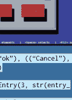

## 使用 Beautiful Soup 爬取 Wikipedia

使用 Beautiful Soup Python 库解析 Wikipedia 的 HTML 并将其存储以供离线阅读

### 资源

- `Beautiful Soup:` www.crummy.com/software/BeautifulSoup/
- `HTML5Lib:` https://github.com/html5lib/html5lib-python
- `Python 2.6+ & WikiParser.zip`
- `Six:` https://pypi.python.org/pypi/six/

在本教程中，我们将使用流行的 Python 库 Beautiful Soup 来爬取 Wikipedia 的文章链接，然后保存这些页面以供离线阅读。这在旅行或网络连接不佳的地点时非常理想。

计划很简单：使用 Beautiful Soup 和 HTML5Lib 解析器，我们将加载一个 Wikipedia 页面，移除所有 GUI 和无关内容，搜索内容中指向其他 Wikipedia 文章的链接，然后在稍作修改后将其写入文件。

尽管它现在是事实上的世界知识库，但 Wikipedia 在 DOM 一致性方面并不出色——也就是说，ID 和 class 的使用有时相当松散。正因如此，我们还将介绍如何处理我们不需要的 Wikipedia GUI 的所有多余部分，以及各种对我们没什么用的错误链接。你可以在 http://bit.ly/19MIBv 找到与本教程相关的 CSS 样式表和 Python 脚本。

- 1 导入库：这些是我们将用于此程序的库
- 2 设置变量：这些是我们将用来跟踪脚本进度的一些变量
- 3 初始化：这是我们将用来处理用户输入的初始化函数

#### 4 获取页面

在这里我们抓取想要存储的页面并移除文档中不需要的部分

#### 5 检查链接

然后我们遍历所有的 `<a>` 标签并检查是否有指向其他可抓取页面的有效链接，并为我们自己的使用进行调整

#### 6 复制到文件

之后，我们将解析后的内容放入全新的 HTML 文件中

#### 7 清理

一旦所有页面都被解析并存储，我们将继续尝试移除任何死链

#### 8 初始化

这是我们将如何初始化脚本的方式

### 完整代码列表

```python
import os, sys, urllib2, argparse, datetime, atexit
from bs4 import BeautifulSoup
addresses = []
deepestAddresses = []
maxlevel = 1
storefolder = "Wikistore " + str(datetime.datetime.now().strftime("%Y-%m-%d %H:%M"))
```


## Undesirables 定义

```python
undesirables = [ {"element": "table", "attr": {"class": "infobox"}}, {"element": "table", "attr": {"class": "vertical-navbox"}}, {"element": "span", "attr": {"class": "mw-editsection"}}, {"element": "div", "attr": {"class": ""}}, {"element": "thumbs"}, {"element": "sup", "attr": {"class": "reference"}}, {"element": "div", "attr": {"class": "reflist"}}, {"element": "table", "attr": {"class": "nowrapinks"}}, {"element": "table", "attr": {"class": ""}}, {"element": "img", "attr": {}}, {"element": "script", "attr": {}}, {"element": "table", "attr": {"class": "mbox-small"}}, {"element": "span", "attr": {"id": "coordinates"}}, {"element": "table", "attr": {"class": "mbox-Orphan"}}, {"element": "div", "attr": {"class": "mainarticle"}}, {"element": "None", "attr": {"id": "References"}} ]
```

## `init` 函数

```python
def init():
    parser = argparse.ArgumentParser(description="Handle the starting page and number of levels we’re going to scraping")

    parser.add_argument("-URL", dest="link", action="store", help="The Wikipedia page from which we will start scraping")

    parser.add_argument("-levels", dest="levels", action="store", help="How many levels deep should the scraping go")

    args = parser.parse_args()

    if(args.levels != None):
        global maxlevel
        maxlevel = int(args.levels)

    if(args.link != None):
        print("You need to pass a link with the -URL flag")
        sys.exit(0)
    else:
        if not os.path.exists(storefolder):
            os.makedirs(storefolder)
        grabPage(args.link, 0, args.link.split("/wiki/")[1].strip().replace(",", " "))
    atexit.register(cleanUp)
```

## `isValidLink` 函数

```python
def isValidLink(link):
    if "wiki/" in link and "-" not in link and "http://" not in link and "wikibooks" not in link and "W" not in link and "wikiquote" not in link and "wikivoyage" not in link and "W" not in link and "wikisource" not in link and "wikinews" not in link and "wikiversity" not in link and "wikidata" not in link:
        return True
    else:
        return False
```

## `grabPage` 函数

```python
def grabPage(URL, level, name):
    opener = urllib2.build_opener()
    opener.addheaders = [("User-agent", "Mozilla/5.0")]
    req = opener.open(URL)
    page = req.read()
    req.close()
    soup = BeautifulSoup(page, "html5lib", from_encoding="UTF-8")
    content = soup.find(id="new-content-text")

    if hasattr(content, "find_all"):
        global undesirables
        for notWanted in undesirables:
            removal = content.find_all(notWanted["element"], notWanted["attr"])
            if len(removal) > 0:
                for el in removal:
                    el.extract()

        also = content.find(id="See_also")
        if(also is None):
            also.extract()
        tail = also.find_all_next()
        if(len(tail) > 0):
            for element in tail:
                element.extract()

        for link in content.find_all("a"):
            href = link["href"]
            if isValidLink(href):
                if level < maxLevel:
                    stored = False
                    for addr in addresses:
                        if addr == link.get("href"):
                            stored = True
                    if(stored == False):
                        title = link.get("href").replace("/wiki/", "")
                        addresses.append(title + ".html")
                        grabPage("http://en.wikipedia.org" + link.get("href"), level + 1, title)
                        print title
                        link["href"] = link["href"].replace("/wiki/", "")
                        link["href"] = link["href"].replace("/", "") + ".html"

    fileName = str(name)
    if level == maxLevel:
        deepestAddresses.append(fileName.replace("/", "_") + ".html")

    doctype = "<!DOCTYPE html>"
    head = "<head><meta charset=\"UTF-8\" /><title>" + fileName + "</title></head>"
    f = open(storeFolder + "/" + fileName.replace("/", "_"), "w")
```


```python
f.write(doctype + "<html lang=\"en\"><head>" + head + "<body>" + str(content) + "</body></html>")

f.close()

def cleanUp():

    print("Removing links to pages that have not been saved\n")

    for deepPage in deepestAddresses:

        rf = open(storeFolder + "/" + deepPage, "r")

        deepSoup = BeautifulSoup(rf.read(), "html5lib", from_encoding="UTF-8")

        for deepLinks in deepSoup.find_all("a"):

            link = deepLinks.get("href")

            pageStored = False

            for addr in addresses:

                if addr == link:

                    pageStored = True

            if pageStored == False:

                if link is not None:

                    if "#" not in link:

                        del deepLinks["href"]

                    elif "#" in link and len(link.split("#")) > 1 or "." in link:

                        del deepLinks["href"]

        wf = open(storeFolder + "/" + deepPage, "w")

        wf.write(str(deepSoup))

        wf.close()

    print("Complete")

if __name__ == "__main__":

    init()
```

> Wikipedia isn't great when it comes to DOM consistency

```python
import os, sys, urllib2, argparse, datetime, exit

from bs4 import BeautifulSoup

addresses = []

deepestAddresses = []

maxLevel = 3

storeFolder = "WikiStore"

undesirables = [ {"element": "table", "attr": {"class": "infobox"}}, {"element": "table", "attr": {"class": "vertical-navbox"}}, {"element": "span", "attr": {"class": "mw-editsection"}}, {"element": "div", "attr": {"class": "thumb"}}, {"element": "sup", "attr": {"class": "reference"}}, {"element": "div", "attr": {"class": "mw-parser-output"}}, {"element": "table", "attr": {"class": "nowraplinks"}}, {"element": "a", "attr": {"class": "mw-redirect"}}, {"element": "script", "attr": {"type": "text/javascript"}}, {"element": "table", "attr": {"class": "box-small"}}, {"element": "span", "attr": {"id": "coordinates"}}, {"element": "table", "attr": {"class": "mbox-small"}}, {"element": "div", "attr": {"class": "hatnote"}}, {"element": "span", "attr": {"id": "References"}} ]

global maxLevel

def init():

    parser = argparse.ArgumentParser(description="Handle the starting page and number of levels we're going to scrape")

    parser.add_argument("--URL", dest="link", action="store", help="The Wikipedia page from which we will start scraping")

    parser.add_argument("--levels", dest="levels", action="store", help="How many levels deep should the scraping go")

    args = parser.parse_args()

    if(args.levels != None):

        maxLevel = int(args.levels)

    if(args.link != None):

        print("You need to pass a link with the -URL flag")

        sys.exit(0)

    else:

        if not os.path.exists(storeFolder):

            os.makedirs(storeFolder)

        grabPage(args.link, 0, args.link.split("/wiki/")[1].strip().replace(":", "_"))

    atexit.register(clenup)

def isValidLink(link):

    if "wiki:" in link and "?" not in link and "http://" not in link and "wikibooks" not in link and "#" not in link and "wikipedia" not in link and "wikitionary" not in link and "wiktionary" not in link and "wikivoyage" not in link and "wikisource" not in link and "wikinews" not in link and "wikiversity" not in link and "wikidata" not in link:

        return True

    else:

        return False
```


## WIKI-EVERYTHING
> Wikipedia 拥有众多相互链接的服务；然而，我们不想抓取这些页面，因此我们有一个相当冗长的条件语句来阻止抓取。 它在确保我们只获取 Wikipedia 的链接方面做得相当不错。

## INFINITE LINKS
> Wikipedia 有很多链接，当你开始追踪链接到链接再到链接时，需要解析的页面数量会呈指数级增长，这取决于主题。 通过传递 `levels` 值，我们对可以抓取的页面数量设置了上限——尽管存储的文件数量仍然可能有很大差异。请明智使用。

### 01 安装 Beautiful Soup & HTML5Lib

在开始编写代码之前，我们需要安装程序将使用的库（Beautiful Soup、HTML5Lib、Six）。 安装过程相当标准：从各自的链接获取库，然后解压它们。 在终端中，进入解压后的目录并为每个库运行 `setup.py install`。 它们现在就可以使用了。

### 02 创建一些有用的变量

这些变量将跟踪脚本运行期间我们访问过的链接：`addresses` 是一个包含我们访问过的所有链接的列表；`deepestAddresses` 是从起点链接树最深的页面的链接；`storeFolder` 是我们将保存创建的 HTML 文件的位置，而 `maxLevel` 是我们可以从起始页面追踪链接的最大深度。

### 03 处理用户输入

在这个函数的开头几行，我们只是创建了一个辅助语句。 之后，我们解析程序执行时传入的任何参数，并查找 `-URL` 标志和 `-levels` 标志。 `-levels` 标志是可选的，因为我们已经预设了要追踪链接的深度，但我们需要一个起始链接，因此如果缺少 `-URL` 标志，我们将提示用户并退出。 如果我们有链接，那么我们会快速检查是否有存储文件的目录——如果没有则创建——然后我们将启动函数来获取该页面。 最后，我们注册一个脚本尝试退出时的处理程序。 我们稍后会讲到那部分。

### 04 从 URL 获取页面

这里我们使用 `URLLib2` 请求用户要求的页面，然后，一旦我们收到该页面，我们将把内容传递给 Beautiful Soup 的 `soup` 变量。 这使我们能够访问我们在解析文档时将调用的方法。

### 05 去除冗余

Wikipedia 有很多我们不想解析的节点。 `content` 变量允许我们直接忽略 Wikipedia 大部分 GUI，但仍有很多元素我们不想解析。 我们通过遍历我们创建的 `undesirables` 列表来解决这个问题

> "Wikipedia 有很多节点"

```
for link in content.find_all('a'):
    href = link["href"]
    if isValidLink(href):
        if level < maxlevel:
            stored = False
            for addr in addresses:
                if addr == link.get("href"):
                    stored = True
            if(stored == False):
                title = link.get("href").replace("/wiki/", "")
                addresses.append(str(title + ".html"))
                grabPage("http://en.wikipedia.org" + link.get("href"), level + 1, title)
                print title
        link["href"] = link["href"].replace("/wiki/", "") + ".html"

fileName = str(name)

if level == maxlevel:
    deepestAddresses.append(fileName.replace('/', '_') + ".html")

doctype = "<!DOCTYPE html>"
head = "<head><meta charset=\"UTF-8\" /></title>" + fileName + "</title></head>"
f = open(storeFolder + "/" + fileName.replace('/', '.') + ".html", 'w')
f.write(doctype + "<html lang=\"en\">\n" + head + "<body><h1>" + fileName + "</h1>" + str(content) + "</body></html>")
f.close()
```

### STYLING
Currently, the HTML page will use the built-in browser styles when rendering the page. If you like, you can include the style sheet included in the tutorial resources to make it look a little nicer. To use it, you can minify the script and include it inside a `<style>` tag in the head string on line 102, or you can rewrite the head string to something like:
`head = "<head><meta charset=\"UTF-8\"/><title>" + fileName + "</title><style>" + str(open('/PATH/TO/STYLES/', 'r').read()) + "</style></head>"`

earlier on in the document. For each different div/section/node that we don't want, we call Beautiful Soup's `find_all()` method and use the `extract()` method to remove that node from the document. At the end of the undesirables loop, most of the content we don't want any more will be gone. We also look for the 'also' element in the Wiki page. Generally, everything after this div is of no use to us. By calling the `find_all_next()` method on the also node, we can get a list of every other element we can remove from that point on.

> Beautiful Soup is a fast framework for many Python HTML parsers

### 06 Grabbing the links

By calling `content.find_all('a')` we get a list of every `<a>` in the document. We can iterate through this and check whether or not there is a valid Wikipedia link in the `<a>`'s href. If the link is a valid link, we quickly check how far down the link tree we are from the original page. If we've reached the maximum depth we can go, we'll store this page and call it quits, otherwise we'll start looking for links that we can grab within it. For every page we request, we append its URL to the `addresses` list; to make sure we don't call the same page twice for each link we find, we check if we've already stored it. If we have, then we'll skip over the rest of the loop, but if we've not then we'll add it to the list of URLs that we've requested and fire off a request. Once that check is done. We then do a quick string replace on that link so that it points to the local directory, not to the subfolder `/wiki/` that it's looking for.

### 07 Writing to file

Now we create a file to store the newly parsed document in for later reading. We change any `'/'` in the filename to `'.'` so the script doesn't try and write to a random folder. We also do a quick check to see how many links we've followed since the first page. If it's the max level, we'll add it to the `deepestAddresses` list. We'll use this a little bit later.

### 08 Tying up loose ends

After our script has iterated through every link on every page to the maximum level of depth that it can, it will try to exit. On line 34 of the code (on the disc and online) in the `init` function, we registered the function `cleanUp` to execute on the program trying to exit: `cleanUp`'s job is to go through the documents that we've downloaded and check that every link we've left in the pages does in fact link to a file that we have available. If it can't match the link in the href to a file in the `addresses` list, it will remove it. Once we're done, we will have a fully portable chunk of Wikipedia we can take with us.

## 使用 Python 创建

- 108 使用 Kivy 构建井字棋
- 编程剪刀石头布
- 112 创建双步验证
- 使用 Twilio 进行安全认证
- 116 Twitter 的 OAuth 流程
- 构建签名请求
- 120 编程一个太空入侵者克隆
- 制作基础的 Pivaders 游戏
- 124 添加动画和音效
- 增强你的 Pivaders 游戏
- 128 制作视觉小说
- 编程一本图书风格的游戏


> "Python 可以帮助创建令人惊叹且有趣的项目"

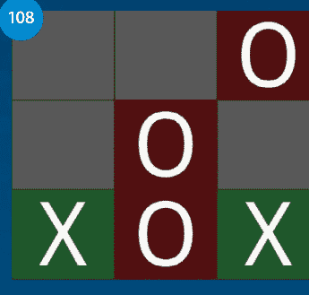

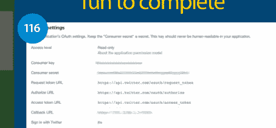

SCORE 0

LIVES 3

## 使用 Kivy 构建井字棋

通过仅用 100 多行 Python 创建纸笔经典游戏，轻松了解 Kivy 的工作原理...

Kivy 是一个高度跨平台的 Python 图形框架，专为创建创新用户界面如多点触控应用而设计。它的应用不仅可以在传统的 Linux、OS X 和 Windows 桌面平台上运行，还可以在 Android 和 iOS 上运行，以及像 Raspberry Pi 这样的设备上运行

这意味着你可以使用 `Requests`、`SQLAlchemy` 或甚至 `NumPy` 等 Python 库开发跨平台应用。你甚至可以通过 Kivy 的一些姊妹项目直接从 Python 访问原生移动 API。另一个很棒的功能是 Cython 优化的 OpenGL 图形管线，即使基本的 Python API 非常简单，也能实现高级 GPU 效果。

Kivy 是一组可通过 `pip` 轻松安装的 Python/Cython 模块，但你需要一些依赖项。它使用 `PyGame` 作为渲染后端（尽管其 API 未暴露），使用 Cython 编译快速的图形编译器内部，使用 GStreamer 处理多媒体。这些都应该可以通过你的发行版仓库获得，或在适用时通过 `pip` 获得。

满足这些依赖后，你应该能够使用正常的 `pip` 咒语安装 Kivy。当前版本是 1.8.0，同一个代码库同时支持 python2 和 python3。本教程中的代码也是版本无关的，可在 python2.7 和 python3.3 中运行。

```
pip install kivy
```

如果 `pip` 有任何问题，你可以使用 `easy_install` via `easy_install kivy`。

对于几个流行的发行版，也提供有包或仓库。你可以在 Kivy 的网站上找到更多信息。一个 Kivy 应用是通过实例化并运行一个 `App` 类来启动的。这就是初始化我们应用窗口、与操作系统交互并为创建 GUI 提供入口点的地方。我们可以先制作最简单的 Kivy 应用：

```
```


```python
from kivy.app import App

class TicTacToeApp(App):
    pass

if __name__ == "__main__":
    TicTacToeApp().run()
```

你现在就可以运行它，你的应用将启动并得到一个纯黑窗口。令人兴奋！我们可以从 Kivy 小部件构建自己的 GUI。每个都是具有特定行为的简单图形元素，其范围从标准 GUI 功能（如 `Button`、`Label` 或 `TextInput`），到对子小部件施加定位的（如 `BoxLayout`、`FloatLayout` 或 `GridLayout`），到抽象更复杂任务如与硬件交互（如 `FileChooser`、`Camera` 或 `VideoPlayer`）。最重要的是，Kivy 的小部件设计为易于组合——而不是为每种可想象的需求包含一个小部件，小部件保持简单但易于组合以发明新界面。我们将在本教程中看到一些例子。

由于 ‘Hello World！’ 在任何编程教程中基本上是必不可少的，让我们通过使用简单的 `Label` 小部件来显示文本来完成它：

```python
from kivy.uix.label import Label
```

我们将通过将其作为应用的根小部件返回来显示 ‘Label’。每个应用都有一个根小部件，即其小部件树的顶层，它会自动调整大小以填充窗口。我们稍后会看到如何通过为此添加更多小部件来构建完整的 GUI，但现在只需通过向 `App` 添加一个新方法来设置根小部件就足够了：

```python
def build(self):
    return Label(text="Hello World!", font_size=100,
```

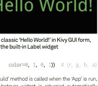

使用内置 `Label` 小部件的 Kivy GUI 形式的经典 'Hello World!'

```python
color=0, 1, 0, 1)) # (r, g, b, a)
```

`build` 方法在 `App` 运行后被调用，返回的任何小部件都会自动成为该 App 的根小部件。在我们的例子中那是一个 `Label`，我们设置了几个属性——`text`、`font_size` 和 `color`。所有小部件都有不同的属性控制其行为的各个方面，可以动态更新以改变其外观，尽管这里我们在实例化时只设置一次。

请注意，这些属性不仅仅是 Python 属性，而是 Kivy 属性。这些像普通属性一样访问，但通过钩入 Kivy 的事件系统提供额外功能。我们将很快看到创建属性的示例，如果你想使用变量与 Kivy 的事件或绑定功能，你也应该这样做。

这就是显示一些简单文本所需的一切，所以再次运行程序以检查它是否有效。你可以尝试参数，如果不清楚它们的作用。

### 我们自己的小部件：井字棋

由于 Kivy 没有井字棋小部件，我们必须自己制作！创建新的小部件类来包含此行为是很自然的：

```python
from kivy.uix.gridlayout import GridLayout

class TicTacToeGrid(GridLayout):
    pass
```

现在这显然还没有做任何事情，除了它继承了 Kivy `GridLayout` 小部件的所有行为——也就是说，我们需要告诉它有多少列，但然后它将

> 你可以使用各种 Python 库开发跨平台应用


三子棋网格现在接受输入，交替添加 O 或 X

### Kivy comes with all the tools needed to use kv language

如前所述，此语法定义了应如何构建 `GridEntry` 小部件的规则，这次设置了控制按钮标签中文本大小的 `font_size` 属性。额外的魔法在于 kv 语言会自动检测到我们引用了 `Button` 自身的 `height`，并会创建一个绑定以更新这种关系——当 `GridEntry` 小部件的高度发生变化时，其 `font_size` 也会随之改变，使文本完美适配。我们本也可以直接从 Python 中创建这些绑定（稍后会使用 `bind` 方法的另一种用法），但这很少像引用我们想要绑定的属性那样方便。

让我们现在用 `GridEntry` 小部件填充我们的 `TicTacToeGrid`（图 01）。这引入了一些新概念：当我们实例化 `GridEntry` 小部件时，我们能够通过将其作为 kwarg 传入来设置其 `coords` 属性。这是 Kivy 属性自动处理的次要功能。

我们使用 `bind` 方法在 `GridEntry` 小部件分发 `on_release` 事件时调用网格的 `button_pressed` 方法。这是由其 `Button` 超类自动处理的，并在用户按下然后释放 `GridEntry` 按钮时发生。我们也可以绑定到 `on_press`，该事件在按钮首次被点击时分发，或者绑定到按钮的任何 Kivy 属性，该属性在属性被修改时动态分发。

我们通过 `add_widget` 方法将每个 `GridEntry` 小部件添加到我们的 `Grid` 中。这意味着每个小部件都是 `TicTacToeGrid` 的子小部件，因此它会显示它们，并且知道应将其自动排列成我们之前设置列数的网格。

自动排列任何子小部件以便很好地适应所需的行数。三子棋需要三列和九个子项。

在这里我们引入了 Kivy 语言（kv），一种用于制定描述 Kivy 小部件树的规则的特殊领域特定语言。它非常简单，但去除了用 Python 代码操作 GUI 所需的大量样板——作为一个宽松的类比，你可以把它想成是 Python 的 JavaScript 的 HTML/CSS。Python 赋予我们动态执行任何操作的强大能力，但如果我们只是想声明 GUI 的基本结构，这种强大能力就会成为阻碍。请注意你永远不需要 kv 语言，你完全可以用 Python 单独完成同样的事情，但示例的其余部分可能会显示为什么 Kivy 程序员通常喜欢使用 kv。

Kivy comes with all the tools needed to use kv language; the simplest way is to write it in a file with a name based on our App class. That is, we should place the following in a file named `tictactoe.kv`:

```
<TicTacToeGrid>:
    cols: 3  # Number of columns
```

这是 kv 语言的基本语法：对于每种小部件类型，你可以编写一个规则来定义其行为，包括设置其属性和添加子小部件。此示例演示了前者，通过声明每个实例化的 `TicTacToeGrid` 都应将其 `cols` 属性设置为 3，从而为 `TicTacToeGrid` 小部件创建规则。

我们稍后会使用更多 kv 语言功能，但现在让我们回到 Python 来创建将成为我们三子棋网格条目的按钮。

```python
from kivy.uix.button import Button
from kivy.properties import ListProperty
```

```python
class GridEntry(Button):
    coords = ListProperty([0, 0])
```

这继承自 Kivy 的 `Button` 小部件，它与鼠标或触摸输入交互，并在交互触及它时分发事件。我们可以挂钩这些事件以在用户按下按钮时调用我们自己的函数，并且可以设置按钮的 `text` 属性以显示 `X` 或 `O`。我们还为小部件创建了一个新的 Kivy 属性 `coords`——我们稍后会展示其用途。它几乎与在 `GridEntry.__init__` 中编写 `self.coords = [0,0]` 来制作一个普通的 Python 属性相同。

```
<GridEntry>:
    font_size: self.height
```

## 使用 Python 创建

```python
def build(self):
    return TicTacToeGrid()
    # Replaces the previous label
```

完成此步骤后，你可以再次运行主 Python 文件并享受你的新程序。顺利的话，单个 `Label` 将被九个按钮组成的网格取代，你可以点击每个按钮；它会自动变色并释放（你会看到我们绑定产生的打印输出信息）。我们可以通过修改 `Button` 的其他属性来自定义外观，但现在我们就保持原样。

### 有人赢了吗？

我们需要跟踪棋盘的状态以检查是否有人获胜，这可以通过再添加几个 Kivy 属性来实现：

```python
from kivy.properties import \
    (ListProperty, NumericProperty)

class TicTacToeGrid(GridLayout):
```


`status = ListProperty([0, 0, 0,`

`                           0, 0, 0,`

`                           0, 0, 0])`

`current_player = NumericProperty()`

```
这添加了一个内部状态列表，表示谁在何处落子，以及一个数字来表示当前玩家（1 表示‘O’，-1 表示‘X’）。通过将这些数字放入我们的状态列表中，我们就能知道是否有人获胜，因为一行、一列或一条对角线的和将为 +-3。现在我们可以在一着棋被下出时更新图形网格（图 02）。
```

你可以再次运行应用来查看这做了什么，你会发现点击每个按钮现在会放置一个‘O’或‘X’，并且根据轮到谁下棋还会显示彩色背景。不仅如此，你只能在每个按钮上进行一次落子，这得益于我们的状态数组跟踪已有落子。

这足以玩游戏，但还缺少一个至关重要的元素……一个大弹出窗口告诉你何时获胜！在我们能做到这一点之前，需要添加代码来检查游戏是否结束。


Kivy 属性在这里还有另一个有用的特性，每当它们发生变化时，如果存在，就会自动调用一个‘on_propertyname’方法并在 Kivy 的事件系统中分派相应的事件。这使得编写在属性更改时运行的代码变得非常容易，无论是在 Python 还是 kv 语言中。在我们的例子中，我们可以利用它来在状态列表每次更新时检查它，如果玩家填满了一列、行或对角线，则执行特殊操作。

```
def on_status(self, instance, new_value):
    status = new_value
    # Sum each row, column and diagonal.
    # Could be shorter, but let’s be extra
    # clear what’s going on
    sums = [sum(status[0::]),  # rows
            sum(status[1::]),
            sum(status[2::]),
            sum(status[::3]),  # columns
            sum(status[1::3]),
            sum(status[2::3]),
            sum(status[::4]),  # diagonals
            sum(status[2::4])]
    # Sums can only be +-3 if one player
    # filled the whole line
    if 3 in sums:
        print("O’s win!")
    elif -3 in sums:
        print("X’s win!")
    elif 0 not in self.status:  # Grid full
        print("Draw!")
```

这涵盖了获胜或平局棋盘的基本检测，但它只将结果打印到 stdout。在这个阶段，我们可能希望重置棋盘，以便玩家可以重试，同时以图形方式显示结果（图 03）。

最后，我们可以修改‘on_status’方法，使其同时重置棋盘并在 `ModalView` 小部件中显示获胜者。

```
from kivy.uix.modalview import ModalView
```

This is a pop-up widget that draws itself on top of everything else rather than as part of the normal widget tree. It also automatically closes when the user clicks or taps outside it.

```
winner = None
if -3 in sums:
    winner = 'X’s win!'
elif 3 in sums:
    winner = 'O’s win!'
elif 0 not in self.status:
    winner = 'Draw...nobody wins!'
if winner:
    popup = ModalView(size_hint=(0.75, 0.5))
    victory_label = Label(text=winner,
```

```
font_size=50)
popup.add_widget(victory_label)
popup.bind(on_dismiss=self.reset)
popup.open()
```

这主要使用了我们已经介绍过的相同思路，将 `Label` 小部件添加到 `ModalView` 中，然后让 `ModalView` 负责在所有内容之上绘制自己及其子项。我们还使用了另一个绑定：这次绑定到 `on_dismiss`，这是 `ModalView` 在关闭时分派的事件。最后，我们使用了所有小部件共有的 `size_hint` 属性，在本例中它用于按比例设置 `ModalView` 的大小——在 `ModalView` 打开时，你可以调整窗口大小，看到它动态调整大小，始终保持这些比例。这又是 Kivy 属性 `size_hint` 的绑定所实现的另一个技巧，这次由 Kivy 内部管理。

就这样，一个完整的程序！我们现在不仅可以玩井字棋，而且我们的程序会自动告诉我们何时有人获胜，并重置棋盘以便再次游戏。只需运行你的程序，尽享无尽的乐趣！

### 实验时间

这是一次快速浏览 Kivy 功能的之旅，但希望它能展示如何思考构建 Kivy 应用的方法。我们的程序由独立的 Kivy 小部件构建，通过在属性更改时运行 Python 代码（例如我们的 `on_status` 方法）或在它们分派事件时（例如 `Button` 的 `on_release`）进行交互。我们还简要看到了 kv 语言，并体验了它如何自动在属性之间创建绑定。

你可以在 FileSilo 上找到完整程序的副本，可以参考以检查你是否正确跟随了所有步骤。我们还添加了一个额外的部件 `Interface`，其结构完全用 kv 语言编码，演示了如何以这种方式添加子部件。你可以通过取消注释 `TicTacToeGrid.build()` 中的 `return Interface()` 行来测试它。它在根本上并没有做与我们已介绍的不同之处，但它大量使用了 kv 语言的绑定能力来自动更新显示当前玩家的标签，并调整 `TicTacToeGrid` 的大小，使其始终为正方形以适应其父容器。你可以随意调整这些设置来查看它们是如何协同工作的，或者尝试更换不同的部件类型，看看其他部件的行为如何。

> 尝试更换不同的部件类型，看看其他部件的行为如何

```
class TicTacToeGrid(GridLayout):
    def __init__(self, *args, **kwargs):
        super(TicTacToeGrid, self).__init__(*args, **kwargs)
        for row in range():
            for column in range():
                grid_entry = GridEntry()
                    coords=(row, column))
                grid_entry.bind(on_release=self.button_pressed)
                self.add_widget(grid_entry)
def button_pressed(self, instance):
    # Print output just to see what's going on
    print('{} button clicked!'.format(instance.coords))
```

```
def button_pressed(self, button):
    # Create player symbol and colour lookups
    player = {'0': 'O', '1': 'X'}
    colours = {'0': (1, 0, 0, 1), '1': (0, 1, 0, 1)}  # (r, g, b, a)
    row, column = button.coords  # The pressed button is automatically # passed as an argument
    # Convert 2D grid coordinates to 1D status index
    status_index = 3*row + column
```


```python
    already_played = self.status[status_index]

    # If nobody has played here yet, make a new move

    if not already_played:

        self.status[status_index] = self.current_player

        button.text = {'0': 'O', '1': 'X'}[self.current_player]

        button.background_color = colours[self.current_player]

        self.current_player *= -1  # Switch current player
```

```python
# Note the *args parameter! It's important later when we make a binding # to reset, which automatically passes an argument that we don't care about

def reset(self, *args):

    self.status = [0 for _ in range(9)]

    # self.children is a list containing all child widgets

    for child in self.children:

        child.text = ''

        child.background_color = (1, 1, 1, 1)

    self.current_player = 1
```

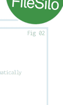

# 使用 Twilio 创建两步身份验证

通过使用 Twilio 的 SMS API 构建简单的两步身份验证来提高对 Web 服务访问的安全性以帮助你

## 资源

- Python 2.7+
- Flask 0.10.0: `flask.pocoo.org/`
- Flask Github: `github.com/mitsuhiko/flask`
- A Twilio account: `twilio.com`
- Twilio's Python REST API Helper Library: `github.com/twilio/twilio-python/zipball/master`
- MySQLDB: `mysql-python.sourceforge.net`

Telephony is one of the most versatile technologies in our households. Despite being invented over 100 years ago, we still use the same basic infrastructure that once only carried the voices of people to deliver a rich multitude of media content at incredible speeds. As is often the case with wonderful things, they can often be complex too – and yet phones are more important now to our daily lives than ever. So, what can we do to leverage some of that versatile technology? Well, for starters we can use an API. Twilio has created a RESTful API that removes a great deal of that complexity of telephony so that we can write apps and services that are able to deliver and receive both phone calls and SMS using various endpoints and services. Neat! In this tutorial, we’re going to look at using Twilio to help us create the basic flow for a two-step authentication system for logging into a service. We’re also going to be using Flask to help us create our routes and generate our pages, but little of Flask’s detail will be covered here.

## 01 获取 Twilio 账号和电话号码

注册 Twilio 非常简单。首先，前往 `http://twilio.com` 并点击 ‘Signup’ 按钮。此时，注册流程与任何其他服务并没有太大区别，但在输入电子邮件地址和密码后，你将被要求提供一个电话号码。鉴于 Twilio API 的性质，他们询问我们是否人类的做法是合理的，通过向我们发送短信来确认是一个很好的方式。嘿，这就是两步身份验证，正是我们正在努力实现的目标。你可以输入任何你能访问的号码，无论是固定电话还是手机，来确认你的身份，但在这一点上，我们建议你使用可以接收短信的手机进行身份验证，而不是固定电话。输入号码后，你将收到一条用于验证手机的短信——输入它后，你将被分配一个 Twilio 电话号码。这就是你的 Twilio 电话号码，你将使用它来发送和接收我们的身份验证短信。

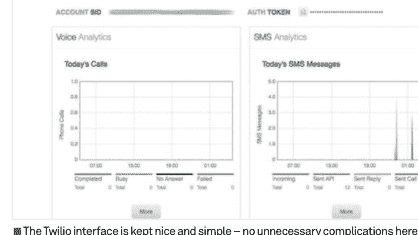

Twilio 界面保持简洁美观——没有不必要的复杂性

## 02 添加信用额度

就像移动电话运营商一样，Twilio 并不是免费服务——尽管价格非常便宜。为了继续，我们需要在新创建的 Twilio 账号中添加一张卡和一些资金。在仪表板的首页，你会看到一个大大的蓝色对话框提示升级你的试用账号；点击进入并按照说明添加卡片和你想要使用的信用额度。最低 $20 美元（约 £10 英镑）的金额对于本项目和其他项目来说已经绰绰有余。完成之后，你几乎就可以开始发送短信了——但首先返回 Twilio 仪表板并复制你的账号 `SID` 和 `auth token` 到某个地方，你稍后会用到它们。

## 03 安装 Twilio Helper Library 和 MySQLDB

Twilio helper library 是一段很棒的代码，让你能够立即开始发送和处理短信。有几种安装库的方法：你可以使用 `PIP` 或 `Easy_Install`，如下所示

```shell
$ pip install twilio

$ easy_install twilio
```

或者你可以下载 helper library 的源代码并运行 `setup.py` 文件。真的就是这么简单。现在，为了存储我们要使用的验证令牌，我们将使用 MySQL 数据库。为了让 Python 与我们的 SQL 服务器通信，我们将使用 Python 模块 `MySQLdb`，其包可以这样获取...

```shell
apt-get install python-mysqldb
```


在教程资源中，我们包含了一个带有表结构的 SQL 转储。将它导入到你选择的数据库中。假设到目前为止一切顺利，你可以创建一个新的项目文件夹/环境并添加一个新文件 `server.py`。

### 04 服务器设置

打开 `server.py` 文件进行编辑。我们要做的第一件事是导入我们身份验证流程所需的库，为我们的服务器创建端点并分配运行 Flask 服务器所需的变量。 (Fig 01)

你可能已经注意到我们在 `import` 语句后设置的 `account_sid` 和 `auth_token` 变量。我们将使用这些变量与我们的 Twilio 客户端一起使用，以便与 Twilio 和我们的手机进行交互。这些设置可以在 Twilio 账号仪表板上找到，位于标题下方。我们还连接到了我们的 SQL 数据库，因此在启动应用之前请确保你的 SQL 服务器正在运行，否则你会遇到错误。保存，现在如果运行你的 `server.py` 文件，你应该能够在 `127.0.0.1:5000/` 访问服务器的索引页面。

### 05 服务器逻辑

如果你已经访问了所有服务器端点，到目前为止你看到的只是我们在端点声明末尾返回的字符串。这些看起来并不太好看，所以让我们添加一些 Flask 模板来让界面更漂亮一些。本教程的重点不是 Flask 的复杂性，因此 DVD 上包含了一个名为 `templates` 的文件夹和另一个名为 `static` 的文件夹；将它们都复制到当前项目文件夹的根目录并修改

```python
import MySQLdb

from flask import Flask, redirect, request, session, render_template

from twilio.rest import TwilioRestClient as twilio

import string, random, time

db = MySQLdb.connect(host="127.0.0.1", user="SQLUSER", password="SQLPASS", db="two-step", port=3306)

expirationLength = 300

account_sid = "YOUR ACCOUNT SID"

auth_token = "YOUR ACCOUNT AUTH TOKEN"

client = twilio(account_sid, auth_token)

@app.route('/')

def index():
    return "index page"

@app.route('/login', methods=['GET'])

def login():
    return "login page"

@app.route('/check-user', methods=['POST'])

def checkUser():
    return "check user page"

@app.route('/logout')

def logout():
    return "logout page"

@app.route('/verify', methods=['GET'])

def twoStep():
    return "verify page"

@app.route('/check-code', methods=['POST'])

def checkCode():
    return "check code page"

if __name__ == '__main__':
    app.secret_key = 'R4nDOMCRypt0gr4ph1cK3y0R6535S1ON'
    app.run(host='0.0.0.0', debug=True)
```

你的端点如 Fig 02 所示。如果再次访问这些页面，事情可能看起来有点混乱，但暂时不用担心。这主要是因为我们还没有组装服务器逻辑来帮助模板确定该做什么。

让我们先处理 `/` 路径。我们在这里所做的只是检查会话 cookie 的状态，并根据该状态影响 `index.html` 页面的渲染方式。如果用户未登录，我们将为他们提供登录页面的链接，如果用户已登录但尚未验证，则我们将为他们提供代码验证页面的链接。在交付模板之前，我们需要检查会话是否已设置其特定变量，否则我们最终会得到 KeyErrors。

```python
@app.route('/')
def index():
    checkSessionState()
    return render_template('index.html')

def checkSessionState():
```

### 使用 Python 创建

```python
try:
    session['verified'] == True
except KeyError:
    session['verified'] = ''
try:
    session['loggedin'] == True
except KeyError:
    session['loggedin'] = ''
try:
    session['user'] == True
except KeyError:
    session['user'] = ''
```

### 06 登录

双因素认证的第一步是使用传统的用户名/电子邮件和密码登录。访问你的数据库并使用以下查询创建一个新用户：

```sql
INSERT INTO users (username, password, phonenumber) VALUES ( 'USERNAME', 'PASSWORD', '+44YOURUSERSPHONENUMBER' )
```

出于本教程的目的，密码是明文的——但我们恳请你，在生产环境中实现密码时，务必对其进行哈希处理。尽管如此，现在我们仍将使用明文密码。我们的 `login.html` 模板有一个表单，它将 POST 到 `check-user`，在这里我们将检查凭据的有效性，然后在需要时触发验证。因此我们将使用 MySQLDB 模块从数据库获取详细信息。

为了查询数据库，我们需要创建一个游标来执行我们的 MySQL 语句。我们通过 `cur = db.cursor()` 来实现：

```python
@app.route('/check-user', methods=['POST'])
def checkUser():
    #session.clear()
    if request.method == 'POST':
        #print request.form['username']
        cur = db.cursor()
        cur.execute("SELECT * FROM users WHERE username = %s" , (request.form['username'],))
```

```python
result = cur.fetchone()
returnedPassword = result[2]
returnedPhoneNumber = result[3]
```

我们可以使用 `cur.execute()` 构建 SQL 语句。注意 `%s`；它将被下一个变量中传递的值替换。我们使用 `cur.fetchone()` 执行语句，它将获取查询返回的第一行——如果没有结果我们将得到 None，然后我们可以将用户返回到登录页面并显示错误消息。假设我们请求的是一个有效用户——接下来我们将检查分配给该用户的密码是否与提交的密码相同。如果相同，我们将生成要发送给用户的验证代码，该代码将存储在数据库的 `verification` 表中，直到使用或过期。我们需要创建一个新的游标将验证代码插入到我们的表中。执行语句后，我们需要提交对数据库的更改，我们使用 `db.commit()` 来实现——然后我们将查询结果添加到我们的 `session` 中，以便以后可以对照检查。(图 03)

### 07 发送验证代码

现在我们认为正在处理一个有效用户，是时候进行双步流程的第二步了。在我们将变量存储到 `session` 之后的那一行，我们调用 `sendVerificationCode(VERIFICATION CODE, USER PHONE NUMBER)` 并传递我们想要发送给用户的代码和用户的电话号码。那么这个函数到底是什么样子的？它必须又大又长又复杂，因为它处理电信网络，对吧？错了。使用 Twilio 发送短信实际上非常简单。事实上，Twilio 的固有美感之一就在于其简单性。要发送一条短信，我们只需要做：

```python
def sendVerificationCode(code, number):
    text = client.messages.create(
        body="Your verification code is:" + code,
        to=number,
        from="+YOURTWILIONUMBER"
    )
    return text.sid
```


使用我们用来实例化 Twilio REST 模块的 `client` 变量，我们可以访问 `messages` 类并执行 `create` 方法。我们只需要传递将构成消息正文的文本、我们想要发送到的号码以及我们想要发送的号码。当输入我们想要发送到的号码时，最好使用 `+CountryCode` 类型的电话号码，以避免对预期接收者产生任何歧义。我们发送的号码是我们的 Twilio 号码；只要它有余额，你就可以使用分配给你的任何 Twilio 号码。一旦我们执行该代码，消息将被发送，你的短信将直接发送到电话。SID 是发送的消息/通话的唯一标识符；收到它意味着消息已成功执行。

#### 08 检查验证代码

此时用户将收到一条类似“Your verification code is: 12cd56”的短信，并将被呈现验证页面。如果此时他们选择浏览我们的网站，他们将无法访问我们不希望他们访问的任何内容。尽管如此，我们会知道他们已登录，因此如果他们返回验证页面，我们只需让他们输入代码。一旦他们提交代码，它将被发送到 `/check-code` 端点。

就像之前检查用户有效性时一样，我们将尝试检索验证代码并进行检查。(图 04)

首先我们将简单地检索代码并检查它分配的用户。如果该代码分配的用户与我们 session 中的用户匹配，那么我们可以确定正确的人正在使用正确的代码登录——如果不匹配，我们可以相应地重定向他们。

假设代码正确，我们需要检查它是否仍然有效。在第 6 步中，我们创建了一个过期时间，该时间比代码生成时晚五分钟。如果已超过五分钟（或你设置的任何时间），我们将认为它无效，删除表中的代码，然后注销用户以便他们重新开始，如下所示。

```
elif time.time() > expirationTime:

    expirySQL = db.cursor()

    expirySQL.execute("DELETE FROM verification WHERE code=%s", (codeToCheck,))
```

```
expirySQL.close()

session["loggedin"] == False

return redirect('/logout')
```

如果我们成功通过了迄今为止的测试，那么我们就对用户进行了两步验证——万岁！出乎意料地简单，对吧？在我们让用户在我们的服务中自由活动之前，我们仍然想摆脱那个令牌——我们不再需要它了，也不想冒着将来有人恶意使用它的风险。

```
else:

    delSql = db.cursor()

    delSql.execute("""DELETE FROM verification WHERE code=%s""", (codeToCheck,))

    delSql.close()

    db.commit()

    session['verified'] = True

    return redirect('/')
else:

    return redirect('/verify?error=true')
```

就这样！现在我们将用户重定向到流程结束时我们希望他们所在的位置。在本例中，我们将他们发送回我们的索引页面，该页面将渲染成功消息并在用户喜欢时提供注销链接——但他们也可以被重定向到他们的用户页面，等等。

#### 09 结论

在每个基于网络的服务中，安全是王道。用户每天都将越来越多个人数据和趋势托付给服务，而这些服务有责任尽最大努力维护这些数据的隐私。难怪像亚马逊、谷歌和 Facebook 这样的服务都在其服务中实施了两步验证。有了两步身份验证，用户可以将他们的账户绑定到他们拥有的最私人的东西之一：他们的手机。有了像 Twilio 这样的服务和一些简单的代码，他们就能保管人们的钥匙——或者至少是其中的一部分。

```
@app.route('/')

def index():

    return render_template('index.html')

@app.route('/login', methods=['GET'])

def login():

    return render_template('login.html')

@app.route('/check-user', methods=['POST'])

def checkUser():

    return "check user page"

@app.route('/logout')

def logout():

    return "logout page"

@app.route('/verify', methods=['GET'])

def twoStep():

    return render_template('verify.html')

@app.route('/check-code', methods=['POST'])

def checkCode():

    return "check code page"
```

```
verificationCode = generateVerificationCode(size=6)

ins = db.cursor()

expiration = int(time.time()) + expirationLength

sql = "INSERT INTO verification (code, expiration, username) VALUES ('%s', '%s', '%s')" % (verificationCode, expiration, request.form['username'])

ins.execute(sql)

ins.close()

db.commit()

session['user'] = request.form['username']

session['loggedin'] = True
```

```
@app.route('/check-code', methods=['POST'])

def checkCode():

if request.method == 'POST':

    codeToCheck = request.form['code']

    if not 'user' in session:

        return redirect('/login')

    else:

        cur = db.cursor()

        cur.execute("SELECT * FROM verification WHERE code = %s", (codeToCheck,))

        result = cur.fetchone()

        cur.close()

        if result is None:

            returnedUser = result[1]

            expirationTime = int(result[2])

            if returnedUser != session['user']:

                return redirect('/verify?error=true')
```


## 处理 Twitter 的三腿 OAuth 流程

根据 OAuth 构建和签名请求可能很棘手。我们解释了 Python 和 Flask 的身份验证过程

### 资源

- Python 2.7+
- Flask 0.10.0: flask.pocoo.org
- Flask GitHub: github.com/mitsuhiko/flask
- 一个 Twitter 账户
- 你最喜欢的文本编辑器

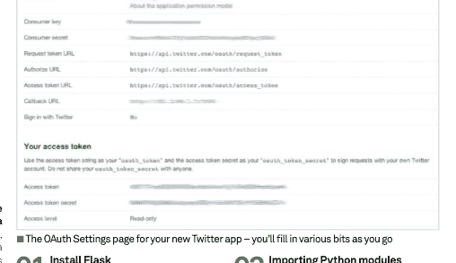

你新 Twitter 应用的 OAuth 设置页面——你会在过程中填写各种内容

曾经，Twitter 是开发者寻找快速周末黑客项目的最爱 API。设置快速，文档丰富，可用数据庞大。美好的时光！但现在情况有点不同了。随着 Twitter API v1.1，身份验证没有以前那么容易了（尽管文档仍然丰富，数据仍然庞大）。Twitter 现在要求所有发往其 API 的请求都遵守 OAuth 协议 v1。安装一个库并忽略所有复杂的东西很诱人——如果你正在组装一个快速的黑客项目，这完全合适。然而，了解身份验证过程中的情况将在你以后需要处理多个用户或请求时遇到问题进行调试时帮助你。对于本教程，我们将使用 Flask——一个很棒的轻量级 Python 服务器框架，用于定义路由、创建会话以及处理传递给和来自 Twitter 的参数。Flask 对于这个项目来说是完美的：正如我们很快就会看到的，定义路由和处理参数是轻而易举的，并且节省了我们处理 Django 等框架带来的大量开销。

#### 01 安装 Flask

所以，在开始编写代码之前，让我们先处理先决条件。如果你系统上安装了 `pip`，那么安装就和在终端中输入 `sudo pip install flask` 一样简单。如果你喜欢从源代码构建，你可以前往 Flask 的 GitHub 并在那里获取最新版本。

#### 02 创建一个 Twitter 应用

在我们能对 Twitter 做任何事情之前，我们需要为其服务创建一个应用。前往 https://dev.twitter.com 并登录。如果你看右上角，你会看到你的 Twitter 个人资料图片；将鼠标悬停在其上，一个下拉菜单会出现。选择“我的应用”，然后点击下一屏幕上出现的“创建新应用”按钮。按照说明设置应用。你现在输入的信息并不重要——在流程结束时，你会看到一个标题为“OAuth 设置”的字段，其中包含设置表。我们稍后需要这些。

#### 03 导入 Python 模块

这些是我们将用于此项目的模块。除了 Flask 之外，所有模块都应包含在所有 Python 2.7+ 版本中。这些模块都用于在身份验证过程中生成、签名和编码我们发送到和来自 Twitter 的每个请求。我们需要具体指定从 Flask 导入 `session`、`request` 等，否则这些库方面不会包含在端点的范围内。

#### 04 为 Twitter 密钥创建全局变量

回到第 2 步，我们在 Twitter 上创建了一个应用。现在我们需要我们在“创建我的应用”页面的 OAuth 设置区域中看到的那些变量。填写 `consumer_key` 和 `consumer_secret` 变量。现在，将 `oauth_secret` 和 `oauth_token` 变量留为空字符串——我们稍后会为它们赋值。

### 05 为 Flask 应用分配命名空间

现在我们创建一个 `Flask` 类的实例。这个变量将是我们访问 Flask 包相关所有类和属性的方式。此实例中的 `__name__` 属性会让我们的 Flask 类了解其运行的范围。

### 06 创建我们的第一个路由

为了授权我们的用户，我们需要创建一个用户可以访问以触发流程的端点。这正是 Flask 派上用场的地方。使用路由装饰器 (`@app.route()`) 我们可以确定触发函数或操作的路径。我们想要创建的第一个端点是 `@app.route('/authenticate')`。装饰器之后立即声明的函数将在调用该端点时被执行。请注意，虽然我们在这里这样做了，但你不需要将函数名与端点名相同。Flask 也可以提供静态文件并使用模板渲染引擎，但为了简洁起见，我们将在函数末尾使用 `return` 来返回一个简单的文本响应以显示我们的进度。

### 07 使用 Flask 创建会话

为了维护多个用户特定的各种属性和值，我们将把值存储在 Flask 会话中。Flask 会话几乎与使用 cookie 存储值完全相同，但会话多了一层加密来帮助保护用户凭证安全。我们会话中的值表现得就像字典一样，因此我们可以调用字典所拥有的所有方法。例如，如果我们想让用户退出服务或重新开始认证流程，我们可以调用 `session.clear()`。我们需要在对会话进行任何调用之前确保已设置会话密钥，否则会收到错误。在此示例中，我们选择在 `app.run()` 之前插入密钥，这样它会在服务器执行前被设置。像大多数密钥一样，你必须保密此密钥。

### 08 准备授权我们的应用

现在我们需要开始
```
Data = getParameters(httpResponse.read())
    session['oauth_token'] = responseData['oauth_token']
    session['oauth_secret'] = responseData['oauth_token_secret']
    return redirect("https://api.twitter.com/oauth/authorize?oauth_token=" + session['oauth_token'])
```

```
@app.route('/authorised')
def authorised():
    if request.args.get('oauth_token', '') == session['oauth_token']:
        verifyRequestParams = {
            "oauth_consumer_key" : consumer_key,
            "oauth_nonce" : str(random.randint(1, 99999999)),
            "oauth_timestamp" : int(time.time()),
            "oauth_version" : "1.0",
            "oauth_token" : session['oauth_token']
        }
        signVerification = sign_request(verifyRequestParams, "POST", "https://api.twitter.com/oauth/access_token")
        verifyRequestParams['oauth_signature'] = signVerification
        verifyRequest = urllib2.Request("https://api.twitter.com/oauth/access_token", "oauth_verifier=" + request.args.get('oauth_verifier'))
        verifyRequest.add_header("Authorization", create_oauth_
```

`Flask` is perfect for this project: defining routes and handling parameters is a piece of cake

为了正确签名请求，我们需要按字母顺序排列请求的参数，对其进行 URL 编码，连接它们，然后每次都对其进行签名。这就是 OAuth 头痛的开始。由于我们将为大多数请求都执行此操作，因此我们将编写一个便捷函数来为我们完成所有这些工作：`sign_request()`。

### 09 创建我们的签名

那么，我们的 `sign_request()` 函数里发生了什么？首先，我们需要使用 `urllib.quote()` 对请求的基 URL 进行 URL 编码。接下来，我们创建一个有序字典 (`OrderedDict`)，它会按键值对字母顺序对我们传递给函数的参数进行排序。这至关重要，因为每个请求都必须使用所有参数按字母顺序连接起来签名才有效。接下来，我们创建变量 `requestString` 来构建请求体的第一部分。它由我们将用于请求的方法和我们将提交到的 URL 组成。然后我们遍历 `OrderedDict` 中的键，连接并 URL 编码字典的键值对，使其类似于 `key=value`。最后，我们检查是否已到达字典中的最后一个键；如果没有，我们会在参数字符串中追加一个 `'&'` 以准备下一个参数。最终，我们将得到一个看起来像 `GET&http%3A%2F%2Fapi.twitter.com%2Fetc%2F?key1=value1&key2=value2&key3=value3` 的字符串。

### 10 签名密钥

现在我们需要为签名创建一个签名密钥。如代码所示，它只是我们的 `consumer_secret` + `oauth_secret` 中间加一个 `&`。然而，你可能会注意到我们还没有 OAuth 密钥。那没关系：对于这次第一次签名请求我们不需要它。你可能已经注意到在我们的 `/authenticate` 端点中，在我们弹出会话值后，我们将 `session['oauth_secret']` 重新赋值为 `''`。这样当我们尝试签名请求时就不会收到 `KeyError` 消息。当我们在 `/authorised` 端点收到回调时，我们将为后续请求分配 `session['oauth_secret']`。

##### 有关 `oauth_nonce` 的一点说明

OAuth 头和签名过程中包含的大多数值都是不言自明的。然而，其中一个目的并不那么明显。`OAuth_Nonce` 是一个随机生成的值——通常是字母数字，但由于没有定义约定，1 到某个大数之间的整数也能满足其目的。它的存在是为了让 Twitter 检查是否收到了相同的请求两次。

### 11 对密钥进行哈希

最后，我们准备对密钥进行哈希。使用 Python 的 `HMAC` 库，我们传递我们的签名密钥、我们的结果字符串（我们转义的基 URL 和方法与参数字符串的连接）以及来自 Python `hashlib` 库的 `SHA1` 哈希函数。这会产生一个包含我们签名的二进制缓冲区——这很好，但我们不能将缓冲区发送到 Twitter 服务器。在下一行，我们将哈希变量传递给 `binascii` 库将其转换为 Base64 值。现在我们有了签名，我们将把它返回给调用它的函数。

### 12 获取请求令牌

使用 Twitter API v1.1，我们不能再直接请求访问令牌来访问用户数据。首先，我们需要获取请求令牌，然后再用它交换第一个访问令牌。此时我们不需要用户进行任何交互，因此我们可以将其在后端触发并自行处理。在 `requestParams` 字典中，我们准备需要签名的值，然后将这些值提交给 Twitter 以接收请求令牌。`oauth_callback` 字段现在不会做任何事情，但它是我们在获得第一个访问令牌后应用将重定向到的位置。我们希望将其指向我们的路由 `/authorised`。在第 27 行我们将 `requestParams` 传递给 `sign_request` 方法。然后我们将返回的签名添加到传递给签名函数的 `requestParams` 中，因为我们接下来将使用这些来构建授权头。

### 13 构建 OAuth 授权头

与签名请求类似，我们也需要正确编码和格式化授权头。`sign_request()` 和 `create_auth_headers()` 之间的主要区别在于，签名基字符串（我们用来生成 SHA1 签名的字符串）是将所有变量用 `'&'` 连接，而我们的 auth 头是用 `','` 连接并以单词 `'Auth'` 作为前缀。除此之外，两者目的相同。在这里我们将两者分开以强调差异的重要性——如果这两个函数中的任何一个返回格式错误的字符串，请求将失败。使用 `urllib2` 模块，我们可以准备要提交的请求。请注意第 31 行请求函数的第二个参数。如果我们省略此参数，请求方法将为 GET；如果包含它——无论内容如何——它将是 POST 请求。该参数的主要功能是分配请求的主体属性；它有点笨拙，但我们稍后会需要它。

### 14 发出第一次请求

一旦我们收到了准备好的 auth 头，我们将其添加到 HTTP 请求中，然后调用 `open()` 方法并等待响应。如果一切顺利，我们应该在请求响应中收到一个包含我们第一个 auth 令牌和 auth 密钥的字符串。为了避免我们必须单独解析字符串中的属性，`getParameters()` 函数会将字符串拆分并返回我们可以访问的字典。然后我们将这些值存储在会话中以供以后使用。

### 15 重定向用户

现在我们有了第一组凭证，我们可以将用户重定向到 Twitter 授权屏幕，让他们授予对数据的访问权限。由于我们尚未向客户端发送任何内容，我们可以使用 Flask 的 `redirect()` 方法将用户发送到 Twitter 授权视图。此请求是我们少数几个可以使用 URL 参数向 Twitter 发送令牌的请求之一。

### 16 处理访问

如果用户授予我们的应用程序访问权限，他们将被重定向到我们在第 12 步中定义的回调 URL。重定向将包含 URL 参数，即我们的访问令牌和一个令牌验证字符串。Twitter 文档指出，我们应该检查在 URL 参数中收到的访问令牌是否与我们刚刚获得的令牌相同。如果一切顺利，我们的 `/authenticate` 端点将已将我们的令牌存储在会话字典中。如果我们存储的令牌与 Twitter 返回的令牌匹配，我们就可以准备将我们的访问令牌（目前仅具有受限权限）交换为具有完全读写权限的完全授权访问令牌（取决于您在首次创建应用程序时请求的权限）。

### 17 第三次（也是最后一次）令牌交换

因此，与之前一样：我们使用 `sign_request()` 准备提交参数，构建我们的 auth 头，然后发出请求。就像我们第一次检索请求令牌时一样，这是在后台完成，无需用户交互。如果一切顺利，您将获得一个完全授权的访问令牌，您可以开始构建自己的请求。

### 18 启动你的服务器

正如你所见，我们以以下内容结束了 `flask.py` 文件：
```


```python
if __name__ == '__main__':

    app.secret_key = 'r4nD0MCRypt0gr4ph1ck3y0f9535i0N'

    app.run(host='0.0.0.0', debug=True)
```

如果我们在 `run` 函数中不包含任何参数，那么我们的服务器将运行并可在 `127.0.0.1: 5000` 访问，但它将无法被外部机器访问——这有点违背了拥有服务器的意义。通过传递 `host='0.0.0.0'`，`Flask` 将在默认端口 `5000` 上监听它可以处理的任何 IP 地址以接收潜在请求。`debug=True` 是 `Flask` 包含的一个错误信息美化器。与其让我们的服务器崩溃，错误页面将被提供，详细说明出了什么问题，以代替我们预期的返回。

```python
headers(verifyRequestParams)

try:

    httpResponse = urllib2.urlopen(verifyRequest)

except urllib2.HTTPError, e:

    return e.read()

responseData = getParameters(httpResponse.read())

session['oauth_token'] = responseData['oauth_token']

return "Authorised " + session['oauth_token']

def getParameters(paramString):

    paramString = paramString.split('&')

    pDict = {}

    for parameter in paramString:

        parameter = parameter.split('=')

        pDict[parameter[0]] = parameter[1]

    return pDict

def sign_request(parameters, method, baseURL):

    baseURL = urllib.quote(baseURL, '')

    p = collections.OrderedDict(sorted(parameters.items(), key=lambda t: t[0]))

    requestString = method + "&" + baseURL + "&"

    parameterString = ""

    for idx, key in enumerate(p.keys()):

        paramString = key + "=" + urllib.quote(str(p[key]), '')

        if idx < len(p.keys()) - 1:

            paramString += "&"

        parameterString += paramString

    result = requestString + urllib.quote(parameterString, '')

    signingKey = consumer_secret + "&" + session['oauth_secret']

    print signingKey

    hashed = hmac.new(signingKey, result, sha1)

    signature = binascii.b2a_base64(hashed.digest())[:-1]

    return signature

def create_oauth_headers(oauthParams):

    oauthp = collections.OrderedDict(sorted(oauthParams.items(), key=lambda t: t[0]))

    headerString = "OAuth "

    for idx, key in enumerate(oauthp):

        hString = key + "=\"" + urllib.quote(str(oauthp[key]), '') + "\""

        if idx < len(oauthp.keys()) - 1:

            hString += ", "

        headerString += hString

    return headerString

if __name__ == '__main__':

    app.secret_key = 'r4nD0MCRypt0gr4ph1ck3y0f9535i0N'

    app.run(host='0.0.0.0', debug=True)
```


# 第一部分：编程一个 Space Invaders 克隆

用 300 行 Python 编写你自己的 RasPi 射击游戏

## 资源

`Raspbian`: www.raspberrypi.org/downloads

`Python`: www.python.org/doc

`Pygame`: www.pygame.org/docs

当你学习一种新语言的编程或试图掌握一个新的模块时，用一个熟悉且相对简单的项目进行实验是非常有用的练习，可以帮助你扩展对所使用工具的理解。我们的 Space Invaders 克隆就是这样一个例子，它非常适合 Python 和 Pygame 模块——这是一款规则和逻辑几乎被普遍理解的简单游戏。虽然 Invaders 启发的射击游戏要求...

它们在屏幕上向你蜿蜒而下，是你的工作在躲避它们随机射击的同时将它们击落。当一波被征服时，另一波更快、更具攻击性的波次会出现。我们尝试使用了 Pygame 的许多功能，Pygame 的设计目的是使游戏和交互式应用程序的创建变得更容易。我们大量使用了 `Sprite` 类，它节省了数十行额外的代码，使碰撞检测变得简单，并将屏幕及其众多角色的更新变成了一行命令。我们希望你同意这是一款令人兴奋的游戏，也是一个学习更多关于 Python 和 Pygame 的好工具，但我们的感官系统在这里远未超载。别担心，这将在下一个教程中介绍，因为向我们的游戏添加动画和音效，以赋予它任何一个自尊的 Space Invaders 启发的射击游戏所要求的精致...

### 01 设置依赖项

如果你想更好地了解使用 Python 和 Pygame 编程游戏，我们强烈建议你将本教程中的 Pivaders 代码复制到你自己的程序中。这是非常好的练习，也给你机会根据自己的喜好调整游戏的各个元素，无论是不同的飞船图像、改变难度还是外星人波次的行为。如果你只是想玩游戏，这也很容易实现。无论哪种方式，游戏唯一的依赖项是 Pygame，如果尚未安装，可以从终端通过输入以下命令安装：

```
sudo apt-get install python-pygame
```

### 02 下载项目

对于 Pivaders，我们使用了 Git，一种出色的版本控制形式，用于安全存储游戏文件并保留代码的历史版本。Git 应该已经安装在你的 Pi 上，如果没有，你可以通过输入以下命令获取它：

```
sudo apt-get install git
```

除了作为你代码的看护者之外，Git 还使你能够克隆其他人的项目副本，以便你可以在其上工作，或只是使用它们。要克隆 Pivaders，请在终端中进入你的主文件夹 `[cd ~]`，为项目创建一个目录 `[mkdir pivaders]`，进入该目录 `[cd pivaders]` 并输入：

```
git pull https://github.com/russ78/pivaders.git
```

# 使用 Python 创建

```python
#!/usr/bin/env python3

import pygame, random

BLACK = (0, 0, 0)

BLUE = (0, 25, 255)

WHITE = (255, 255, 255)

RED = (255, 0, 0)

ALIEN_SIZE = (30, 40)

ALIEN_SPACER = 20

BARRIER_ROW = 10

BARRIER_COLUMN = 4

BULLET_SIZE = (5, 10)

MISSILE_SIZE = (5, 5)

BLOCK_SIZE = (10, 10)

RES = (800, 600)

class Player(pygame.sprite.Sprite):

    def __init__(self):

        pygame.sprite.Sprite.__init__(self)
```


```python
self.image = pygame.Surface(BULLET_SIZE)

self.rect = self.image.get_rect()

self.rect.x = RES[0] / 2 - self.size[0] / 2

self.rect.y = 520

self.travel = 7

self.speed = 350

self.time = pygame.time.get_ticks()

def update(self):

    self.rect.x += GameState.vector * self.travel

    if self.rect.x < 0:

        self.rect.x = 0

    elif self.rect.x > RES[0] - self.size[0]:

        self.rect.x = RES[0] - self.size[0]
```

### `Alien`

```python
class Alien(pygame.sprite.Sprite):

    def __init__(self):

        pygame.sprite.Sprite.__init__(self)

        self.image = pygame.Surface(ALIEN_SIZE)

        self.rect = self.image.get_rect()

        self.has_moved = 0

        self.vector = [1, 1]

        self.travel = [ALIEN_SIZE[0] - 7, ALIEN_SPACER]

        self.speed = 700

        self.time = pygame.time.get_ticks()

    def update(self):

        if GameState.alien_time - self.time > self.speed:

            if self.has_moved[0] < 12:

                self.rect.x += self.vector[0] * self.travel[0]

                self.has_moved[0] += 1

                self.vector[0] *= -1

            else:

                self.has_moved = [0, 0]

                self.speed -= 20

                if self.speed <= 100:

                    self.speed = 100

                self.time = GameState.alien_time
```

### `Ammo`

```python
class Ammo(pygame.sprite.Sprite):

    def __init__(self, color, (width, height)):

        pygame.sprite.Sprite.__init__(self)

        self.image = pygame.Surface([width, height])

        self.image.fill(color)

        self.rect = self.image.get_rect()

        self.speed = 0

        self.vector = 0

    def update(self):

        self.rect.x += self.vector * self.speed

        if self.rect.y < 0 or self.rect.y > RES[1]:

            self.kill()
```

### `Block`

```python
class Block(pygame.sprite.Sprite):

    def __init__(self, color, (width, height)):

        pygame.sprite.Sprite.__init__(self)

        self.image = pygame.Surface([width, height])

        self.image.fill(color)

        self.rect = self.image.get_rect()
```

> **整洁的代码**
> 在这里清晰地标记所有最常用的全局变量，使得我们之后的代码更易于阅读。此外，如果我们想改变某个事物的大小，我们只需在这里修改，它就会在所有地方生效。

```python
class GameState:

    pass

class GameObject:

    def __init__(self):

        pygame.init()

        pygame.font.init()

        self.clock = pygame.time.Clock()

        self.game_font = pygame.font.Font('data/orbiter.ttf', 28)

        self.info_font = pygame.font.Font('data/orbiter.ttf', 72)

        self.screen = pygame.display.set_mode((RES[0], RES[1]))

        self.time = pygame.time.get_ticks()

        self.refresh_rate = 20

        self.rounds_won = 0

        self.level_up = 50

        self.score = 0

        self.lives = 2

        self.player_group = pygame.sprite.Group()

        self.alien_group = pygame.sprite.Group()

        self.bullet_group = pygame.sprite.Group()

        self.missile_group = pygame.sprite.Group()

        self.barrier_group = pygame.sprite.Group()

        self.all_sprite_list = pygame.sprite.Group()

        self.intro_screen = pygame.image.load('data/start_screen.jpg').convert()

        self.background = pygame.image.load('data/space_background.jpg').convert()

        self.image = pygame.image.load('data/ship.png').convert()

        self.alien_image = pygame.image.load('data/spaceship16.png').convert()

        GameState.alien_time = 0

        GameState.start_screen = True

        GameState.vector = 0

        GameState.shot_bullet = False

    def control(self):

        for event in pygame.event.get():

            if event.type == pygame.QUIT:

                GameState.start_screen = False

                GameState.end_game = True

            if event.type == pygame.KEYDOWN:

                if event.key == pygame.K_ESCAPE:

                    GameState.start_screen = False

                    GameState.end_game = True

                    self.kill_all()

                GameState.start_screen = True
```


```python
            if self.keys = pygame.key.get_pressed()

            if self.keys[pygame.K_LEFT]:
                GameState.vector = -1
            elif self.keys[pygame.K_RIGHT]:
                GameState.vector = 1
            else:
                GameState.vector = 0

            if self.keys[pygame.K_SPACE]:
                if GameState.start_screen:
                    GameState.start_screen = False
                    self.lives = 2
                    self.score = 0
                    self.make_player()
                    self.make_defenses()
                    self.alien_wave()
                else:
                    GameState.shot_bullet = True

    def splash_screen(self):
        while GameState.start_screen:
            self.kill_all()
            self.screen.blit(self.intro_screen, [0, 0])
            self.screen.blit(self.intro_font.render('PLAYERS', 1, WHITE), (265, 120))
            self.screen.blit(self.font.render('PRESS SPACE TO PLAY!', 1, WHITE), (274, 191))
```

> **组**  
> 我们创建的这长串组本质上是集合。每次我们创建其中一个项目时，它都会被添加到集合中，以便可以轻松地进行碰撞测试和绘制。

> **控制**  
> 处理键盘输入是控制方法。它检查按键事件并根据我们是在开始屏幕还是在游戏中进行相应的操作。

> **雨弹**  
> `Ammo` 类简短而精炼。我们只需要几个初始属性，`update` 方法会检查它是否仍在屏幕上。如果不在，则会被销毁。


# 使用 Python 创建

## 03 测试 Pivaders

安装好 Pygame 并将项目克隆到你的机器上后（你也可以在 FileSilo 上找到 zip 包——只需解压并复制到你的主目录即可使用），你可以进行一次快速测试，以确保一切设置正常。你只需在终端中进入 `pivaders` 目录，输入 `python pivaders.py` 即可开始。你可以用空格键开始游戏，用同一按钮射击，并简单地使用键盘上的左右箭头来左右移动你的飞船。

## 04 创建你自己的克隆版

一旦你取得了不错的高分（超过 2,000 分就算相当不错了）并熟悉了我们的简单实现，你将从跟随并探索代码以及我们对正在发生的事情的简要解释中获得更多收获。对于想要制作自己项目的用户，创建一个新的项目文件夹，并使用 `IDLE` 或 `Leafpad`（或也许安装 `Geany`/）来创建并保存自己的 `.py` 文件。

## 05 全局变量 & 元组

在我们导入项目所需的模块之后，有相当长的一串大写变量列表。大写表示这些变量是常量（或全局变量）。这些是永远不会改变的重要数字——它们代表代码中经常引用的事物，如颜色、块大小和分辨率。你还会注意到颜色和大小用大括号包含多个数字——这些是元组。你也可以使用方括号（使其成为列表），但我们在这里使用元组，因为它们是不可变的，这意味着

## 06 类 – 第 1 部分

类本质上是你要制作的对象的蓝图。就我们的玩家而言，它包含了所有所需的信息，从中你可以制作多个副本（我们在项目的中间在 `make_player()` 方法中创建了一个玩家实例）。Pivaders 中的类很棒的地方在于它们继承了大量来自 Pygame 的 `Sprite` 类的能力和快捷方式，如类第一行的花括号内所标示的 `pygame.sprite.Sprite`。你可以通过 `www.pygame.org/docs/ref/sprite.html` 阅读文档以了解更多关于 `Sprite` 类的信息。

## 07 类 – 第 2 部分

在 Pivader 的类中，除了为对象（无论是玩家、外星人、弹药还是方块）创建所需的属性——这些只是类中的变量——你还会注意到除了 `Block` 类之外，所有类都有一个 `update()` 方法（方法是在类内部的函数）。`update()` 方法在主游戏的每一次循环中被调用（我们称之为 `main_loop()`），它只是要求我们创建的类的迭代移动。在 `Ammo` 类的子弹的情况下，我们要求它向下移动屏幕。如果它超出屏幕顶部或底部，我们就销毁它（因为我们不再需要它了）。

## 08 弹药

不过，类最有趣的地方在于，你可以用一个类创建许多不同的东西。

例如，你可以有一个宠物类。从该类中你可以创建一个猫（会喵喵叫）和一只狗（会汪汪叫）。它们在很多方面不同，但它们都是毛茸茸的，都有四条腿，所以可以从同一个父类创建。我们在 `Ammo` 类中正是这样做的，用它来创建玩家子弹和外星人导弹。它们颜色不同，射击方向相反，但从根本上来说它们是一样的。这让我们节省了创建额外的不必要代码，并确保我们创建的对象之间行为一致。

## 09 游戏

我们最后一个类叫做 `Game`。这里包含了游戏本身的主要功能，但请记住，到目前为止，这仍然只是一份配料清单——直到在代码底部创建了`Game`对象之前，什么都不会真正发生。`Game` 类是游戏的核心所在，因此我们初始化 Pygame，设置我们主角和外星对手的图像，并创建一些 `GameState` 属性，我们用它们来控制外部类的关键方面，例如改变玩家的向量（方向）并决定是否需要返回开始屏幕，等等。

## 10 主循环

`Game` 类中有很多方法（类函数），每个方法都旨在控制游戏设置或游戏玩法本身的某个特定方面。决定游戏中每一轮发生什么的实际逻辑实际上包含在 `pivaders.py` 脚本底部的主 `main_loop()` 方法中，并且是解锁你游戏所需的变量和函数的关键。从 `main_loop()` 的顶部开始，一行一行地工作到最后一行，你可以看到在你玩游戏时每秒被评估 20 次的确切内容。

## 11 主循环关键逻辑 – 第 1 部分

首先游戏检查 `end_game` 属性是否为 `false`——如果为 `true`，`main_loop()` 中的整个循环将被跳过，我们直接进入 `pygame.quit()`，退出游戏。此标志在玩家关闭游戏窗口或在 `start_screen` 上按下 Esc 键时设置为 `true`。假设 `end_game` 和 `start_screen` 均为 `false`，主循环可以正式开始，首先是 `control()` 方法，它检查玩家的位置是否需要改变。接下来我们尝试制造一个敌方导弹，并使用 `random` 模块来限制可以创建的导弹数量。接下来我们使用简单的 `for` 循环为屏幕上的每一个角色调用 `update()` 方法。这确保了每个人都已更新并移动，然后我们在 `calc_collisions()` 中检查碰撞。

## 12 主循环关键逻辑 – 第 2 部分

一旦计算了碰撞，我们需要看看游戏是否仍应继续。我们通过 `is_dead()` 和 `defenses_breached()` 来做到这一点——如果任一方法返回 `true`，我们就知道需要返回开始屏幕。另一方面，我们还需要检查是否已杀死所有外星人，这是在 `win_round()` 中完成的。假设我们还活着，但外星人死了，我们就知道可以调用 `next_round()` 方法，该方法会创建一批新的外星人并增加它们在屏幕周围的速度。最后，我们刷新屏幕，以便所有移动、射击或被杀死的物体都可以更新或从屏幕上移除。请记住，主循环每秒发生 20 次——因此我们在循环末尾不立即调用屏幕更新并无大碍。

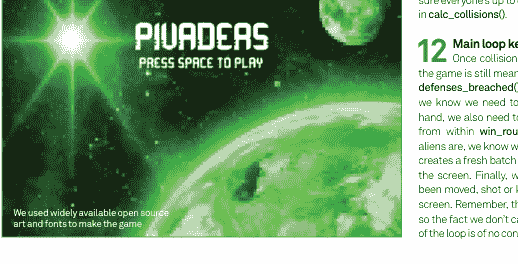

我们使用了广泛可用的开源艺术和字体来制作游戏

# 一个类本质上是一个蓝图

```python
pygame.display.flip()

self.control()

def make_player(self):
    self.player = Player()
    self.player_group.add(self.player)
    self.all_sprite_list.add(self.player)

def refresh_screen(self):
```


```
self.all_sprite_list.draw(self.screen)

self.refresh_scores()

pygame.display.flip()

self.screen.blit(self.background, [0, 0])

self.clock.tick(self.refresh_rate)
```

```
def refresh_scores(self):

    self.screen.blit(self.game_font.render(

        "SCORE " + str(self.score), 1, WHITE), (10, 8))

    self.screen.blit(self.game_font.render(

        "LIVES " + str(self.lives), 1, RED), (355, 575))
```

```
def alien_wave(self, BARRIER_COLUMN):

    for column in range(BARRIER_COLUMN):

        for row in range(BARRIER_ROW):

            alien = Alien()

            alien.rect.y = 65 + (column * (

                ALIEN_SIZE[1] + ALIEN_SPACER))

            alien.rect.x = 200 + (row * (

                ALIEN_SIZE[0] + ALIEN_SPACER))

            self.alien_group.add(alien)

            self.all_sprite_list.add(alien)

            alien.speed = speed
```

```
def make_bullet(self):

    if GameState.game_time - self.player.time > self.player.speed:

        bullet = Ammo(BLUE, BULLET_SIZE)

        bullet.vector = 1

        bullet.speed = 26

        bullet.rect.x = self.player.rect.x + 28

        bullet.rect.y = self.player.rect.y

        self.all_sprite_list.add(bullet)

        self.player_group.add(bullet)

        GameState.shoot_bullet = False
```

```
def make_missile(self):

    if len(self.alien_group):

        shoot = random.random()

        if shoot <= 0.005:

            shooter = random.choice(

                self.alien_group)

            missile = Ammo(RED, MISSILE_SIZE)

            missile.vector = -1

            missile.rect.x = shooter.rect.x + 15

            missile.rect.y = shooter.rect.y + 40

            missile.speed = 10

            self.missile_group.add(missile)

            self.all_sprite_list.add(missile)
```

```
def make_barrier(self, columns, rows, spacer):

    for column in range(columns):

        for row in range(rows):

            barrier = Block(WHITE, (BLOCK_SIZE))

            barrier.rect.x = 200 + (spacer * (column * 10))

            barrier.rect.y = 450 + (column * 10)

            self.barrier_group.add(barrier)

            self.all_sprite_list.add(barrier)
```

```
def make_defenses(self):

    for spacing, spacing in enumerate(range(0)):

        self.make_barrier(3, 9, spacing)
```

```
def kill_all(self):

    for items in [self.bullet_group, self.player_group,

                  self.alien_group, self.missile_group, self.barrier_group]:

        for i in items:

            i.kill()
```

### 刷新屏幕

你需要仔细考虑更新屏幕的方式。在角色移动之间覆盖背景对于实现干净的动画至关重要。

### 枪械与弹药

子弹和导弹使用同一个父类。我们更改了几个关键属性以创建我们需要的行为；每个的向量是相反的。

```
def is_dead(self):

    if self.lives < 0:

        self.screen.blit(self.game_font.render(

            "The war is lost! You scored: " + str(

                self.score), 1, RED), (250, 15))

        self.rounds_won = 0

        self.refresh_screen()

        pygame.time.delay(3000)

        return True
```

```
def win_round(self):

    if len(self.alien_group) < 1:

        self.rounds_won += 1

        self.screen.blit(self.game_font.render(

            "You won round " + str(self.rounds_won) +

            " but the battle rages on", 1, RED), (200, 15))

        self.refresh_screen()

        pygame.time.delay(3000)

        return True
```

```
def defenses_breached(self):

    for alien in self.alien_group:

        if alien.rect.y > 450:

            self.screen.blit(self.game_font.render(

                "The aliens have breached Earth defenses!",

                1, RED), (100, 15))

            self.refresh_screen()

            pygame.time.delay(3000)

            return True
```

```
def calc_collisions(self):

    pygame.sprite.groupcollide(

        self.missile_group, self.barrier_group, True, True)

    pygame.sprite.groupcollide(

        self.bullet_group, self.barrier_group, True, True)

    if pygame.sprite.groupcollide(

        self.bullet_group, self.alien_group, True, True):

        self.score += 10

    if pygame.sprite.groupcollide(

        self.player_group, self.missile_group, False, True):
```


```python
self.lives -= 1

def next_round(self):

    for actor in [self.missile_group,

                  self.barrier_group, self.bullet_group]:

        i.kill()

    self.alien_wave(self.level_up)

    self.make_defenses()

    self.level_up += 50

def main_loop(self):

    while not GameState.end_game:

        while not GameState.start_screen:

            GameState.game_time = pygame.time.get_ticks()

            GameState.alien_time = pygame.time.get_ticks()

            self.control()

            self.make_missile()

            for actor in [self.player_group, self.bullet_group,

                          self.alien_group, self.missile_group]:

                for i in actor:

                    i.update()

            if GameState.shoot_bullet:

                self.make_bullet()

            self.calc_collisions()

            if self.is_dead() or self.defenses_breached():

                GameState.start_screen = True

            if self.win_round():

                self.next_round()

            self.refresh_screen()

        self.splash_screen()

    pygame.quit()
```

### 生死存亡
可能最重要的两个问题在这里得到了解答——玩家是否死亡或你是否赢得了这一轮？

获取代码：`bit.ly/11k9f2x`

### 主循环
这是我们应用程序的核心部分。此循环每秒执行 20 次。它需要逻辑清晰且易于其他编码者理解。

### 开始游戏
我们最后做的就是创建一个 `Game` 对象并调用主循环。除了我们的常量之外，这是唯一位于类外部的代码。

```python
if __name__ == '__main__':
    pv = Game()
    pv.main_loop()
```


## 第二部分：为Pivaders添加动画和声音

在用仅300行Python代码编写了一个太空入侵者克隆之后，现在我们将其扩展为包含动画和声音。

### 资源

- Raspbian：`www.raspberrypi.org/downloads`
- Python：`www.python.org/doc`
- Pygame：`www.pygame.org/docs`
- 美术资源：`opengameart.org`

在上一个教程中，我们非常愉快地创建了基础太空入侵者克隆——Pivaders。这个项目的一个关键挑战是让代码量保持在可控范围内——仅300行Python。如果没有利用Pygame强大的功能集，这个目标很可能至少会被超出两倍。

得益于`Sprite`类，Pygame能够对精灵进行分组、管理和碰撞检测，这给我们的项目带来了很大不同，不仅在代码长度上，也在简洁性上。如果你错过了项目的第一部分，可以通过 `git.io/cBVTBg` 在GitHub上找到v0.1代码清单；而包含我们使用的所有图像、音乐和音效的v0.2版本，可以在 `git.io/80Sk-w` 找到。即使在Pygame提供的清晰框架内工作，添加动画和声音的方式仍然有成百上千种。我们本可以创建十多个类来创建和管理单个图像的容器，或者读取一个精灵表（一张包含许多较小独立图像的大图），然后将其绘制（或blit）到屏幕上。为了简洁和性能，我们将一些动画方法集成到了`Game`类中，并选择使用精灵表。这不仅使绘制到屏幕变得非常容易，还能控制资源数量并保持高性能，这对树莓派来说尤为重要。

#### 01 设置依赖

正如我们在上一个教程中建议的那样，如果你下载代码（`git.io/80Sk-w`），并在为你的Pygame项目创建自己的动画和声音时作为参考，你会从练习中获益更多。无论你只是想简单地预览和游玩，还是想通读代码以更好地理解基本游戏创建，你仍然需要满足一些基本依赖。这里两个关键需求是Pygame和Git，它们在最新版的Raspbian系统中默认都已安装。不过，如果你不确定是否已安装，请在命令行中输入以下命令：

```
sudo apt-get install python-pygame git
```

## Pivaders.py 代码清单（从第86行开始，续下页）

```python
class Game(Object):

    def __init__(self):

        pygame.init()

        pygame.font.init()

        self.clock = pygame.time.Clock()

        self.game_font = pygame.font.Font('data/Orbitron.ttf', 28)

        self.intro_font = pygame.font.Font('data/Orbitron.ttf', 72)

        self.screen = pygame.display.set_mode(RES, RES[])

        self.time = pygame.time.get_ticks()

        self.refresh_rate = 50; self.rounds_won = 0

        self.level_up = 50% self.score ) convert

        self.lives = 2

        self.player_group = pygame.sprite.Group()

        self.alien_group = pygame.sprite.Group()

        self.bullet_group = pygame.sprite.Group()

        self.missile_group = pygame.sprite.Group()

        self.barrier_group = pygame.sprite.Group()

        self.all_sprite_list = pygame.sprite.Group()

        self.intro_screen = pygame.image.load('data/intro.jpg').convert()

        self.background = pygame.image.load('data/graphics/Space-Background.jpg').convert()

        pygame.display.set_caption('Pivaders - ESC to exit')

        self.game_mode = 'start'

        Alien.image = pygame.image.load('data/graphics/SpaceShip16.png').convert()

        Alien.image.set_colorkey(WHITE)

        self.ani_pos

        self.ship_sheet = pygame.image.load('data/graphics/ship_sheet_final.png').convert_alpha()

        Player.image = self.ship_sheet.subsurface(self.ani_pos[0, 0, 64, 64])

        self.ani_right = False

        self.animate_left = False

        self.explosion_sheet = pygame.image.load('data/graphics/explosion_new1.png').convert_alpha()
```


```python
self.explosion_image = self.explosion_sheet.subsurface(0, 0, ...)

self.alien_explosion_sheet = pygame.image.load('data/graphics/alien_explosion.png')

self.alien_explosion_graphics = self.alien_explosion_sheet.subsurface(0, 0, ...)

self.explode = False

self.explode_pos = 0; self.alien_explode = False

self.alien_explode_pos = 0

pygame.mixer.music.load('data/sound/10_Arpanauts.ogg')

pygame.mixer.music.set_volume(0.7)

self.bullet_fx = pygame.mixer.Sound('data/sound/Hexatrix_pc_thunder-laser-beam.ogg')

self.explosion_fx = pygame.mixer.Sound('data/sound/timorgy_M_bit-explosion.ogg')

self.explosion_fx.set_volume(0.5)

self.explodey_alien = []

GameState.end_game = False

GameState.start_screen = True

GameState.vector = 0

GameState.shot_bullet = False

def control(self):

    for event in pygame.event.get():

        if event.type == pygame.QUIT:

            GameState.start_screen = False

            GameState.end_game = True

        if event.type == pygame.KEYDOWN:

            if event.key == pygame.K_ESCAPE:

                if GameState.start_screen:

                    GameState.start_screen = False

                    GameState.end_game = True

                    self.kill_all()

                else:

                    GameState.start_screen = True

                    self.kill_all()

    self.keys = pygame.key.get_pressed()

    if self.keys[pygame.K_LEFT]:

        GameState.vector = -1

        self.animate_left = True

        self.animate_right = False

    elif self.keys[pygame.K_RIGHT]:

        GameState.vector = 1

        self.animate_left = False

        self.animate_right = True

    else:

        GameState.vector = 0

        self.animate_left = False

        self.animate_right = False

    if self.keys[pygame.K_SPACE]:

        if GameState.start_screen:

            GameState.start_screen = False

            self.lives = 2

            self.score = 0

            self.make_defenses()

            self.alien_wave()

        else:

            GameState.shot_bullet = True

            self.bullet_fx.play()

def animate_player(self):

    if self.animate_right:

        if self.ani_pos < 0:

            Player.image = self.ship_sheet.subsurface(self.ani_pos[64, 0, 64, 64])

            self.ani_pos += 1

    else:

        if self.ani_pos > 5:

            self.ani_pos -= 1

            Player.image = self.ship_sheet.subsurface(self.ani_pos[64, 0, 64, 64])

            self.ani_pos += 1

    if self.animate_left:

        if self.ani_pos > 0:

            self.ani_pos -= 1

            Player.image = self.ship_sheet.subsurface(self.ani_pos[64, 0, 64, 64])

    else:

        if self.ani_pos < 5:

            self.ani_pos += 1

            Player.image = self.ship_sheet.subsurface(self.ani_pos[64, 0, 64, 64])

            self.ani_pos += 1

def player_explosion(self):

    if self.explode:

        if self.explode_pos < 8:

            self.explosion_image = self.explosion_sheet.subsurface(self.explode_pos*96, 79, 96)

            self.screen.blit(self.explosion_image, (self.player.rect.x -10, self.player.rect.y -30))

        else:

            self.explode = False

            self.explode_pos = 0

def alien_explosion(self):

    if self.alien_explode:

        if self.alien_explode_pos < 3:

            self.alien_explosion_graphics = self.alien_explosion_sheet.subsurface(self.alien_explode_pos*96, 94, 96)

            self.screen.blit(self.alien_explode_graphics, (self.alien_explodey_alien[0].rect.x -30, self.alien_explodey_alien[0].rect.y -60))

        else:
```


```
self.alien_explode = False

self.alien_explode_pos = 0

self.explodey_alien = []
```

```python
def splash_screen(self):

    while GameState.start_screen:

        self.kill_all()

        self.screen.blit(self.intro_screen, [0, 0])

        self.screen.blit(self.intro_font.render('PIVADERS', 1, WHITE), [265, 120])

        self.screen.blit(self.game_font.render('PRESS SPACE TO PLAY', 1, WHITE), [274, 191])

        pygame.display.flip()

        self.control()

        self.clock.tick(self.refresh_rate / 2)
```

```python
def make_player(self):

    self.player = Player()
```

飞船精灵表
我们通过使用 `ani_pos` 变量将玩家图像设置为精灵表的一个片段。更改该变量即可更换图像。

`fx.play()`
我们已经加载了射击时想要的音效，现在只需在按下空格键时调用它即可。

设置标志
我们在 `control` 方法中添加了 `animate_left` 和 `animate_right` 布尔标志。当它们为 True 时，实际动画代码会通过单独的方法调用。

## 使用 Python 创作

### 02 下载 pivaders

Git 是一种极佳的版本控制方案，可帮助程序员安全地存储代码及相关文件。它不仅让你保留完整的更改历史，还意味着你可以从 github.com 等地方“克隆”整个项目来使用和修改。要克隆我们为本教程创建的项目版本，请在命令行中进入你的主目录（`cd ~`），然后输入：

```
git pull https://github.com/russb78/pivaders.git
```

这将创建一个名为 pivaders 的文件夹——进入该文件夹（`cd pivaders`），然后环顾四周探索一下吧。

### 03 浏览项目

这个项目的结构相当简单，分布在几个子文件夹中。`pivaders` 文件夹内有一个 licence、一个 readme，以及另一个 pivaders 文件夹。后者包含主游戏文件 `pivaders.py`，它负责启动应用。在 `data` 文件夹中，你会看到分别存放图形资源、声音资源以及我们用于标题画面和得分的字体的子文件夹。要对 pivaders 进行试驾，只需进入 pivaders 子目录（`cd pivaders/pivaders`），然后输入：

```
python pivaders.py
```

使用方向键左右转向，按空格键射击。你可以按 Esc 键退回主画面，再按一次即可完全退出游戏。

### 04 动画与音效

与上个月教程中的游戏相比，你会发现现在的项目动态得多。主角飞船在改变方向时会顺势倾斜，而当你按下相反方向或松开按钮时，它又会自行校正。当你击中外星飞船时，它会以多帧动画的方式爆炸；如果你被击中，你的飞船上也会出现一个较小的爆炸。音乐、激光和爆炸音效也会随动画同步播放。


上图：Freesound 网站是寻找免费开放音效的好地方。

### 05 寻找用于动画的图片

在开始编写任何代码之前，明智的做法是先把资源整理成可用的形式。如前所述，我们选择了精灵表（sprite sheet）；这些素材可以在网上找到，也可以稍加练习用 GIMP 自行创建。本质上，它们是由一个个尺寸相同、间距相等的“帧”图像拼成的马赛克，每一帧代表一个动画帧。你可以在 opengameart.org 找到现成的示例，本例即使用了这些素材。

### 06 调整资源

虽然 opengameart.org 等网站上的许多资源可以直接使用，但你可能会想将它们导入到 GIMP 之类的图像编辑应用中，按自己的需求进行调整——正如我们对飞船精灵表所做的处理，这样有助于让代码保持简单。我们以中央的飞船精灵为起点，将它居中放在一个新窗口中。我们设定了帧的尺寸和宽度，然后把其他帧复制粘贴到它的两侧。最终我们在一份文档中得到了 11 个尺寸和宽度完全相同的帧。在尺寸和宽度上做到像素级精确是关键，这样我们只需做乘法运算就能定位到下一帧。

### 07 载入精灵表

由于我们继承 `Sprite` 类来创建 `Player` 类，因此只需更改 `Player.image` 就能轻松改变玩家在屏幕上的外观。首先，我们需要使用 `pygame.image.load()` 加载飞船精灵表。由于我们的精灵表使用了透明背景，我们可以在该行末尾加上 `.convert_alpha()`，以便飞船帧正确渲染（不带任何背景）。然后我们使用 `subsurface` 将初始 `Player` 图像设置为精灵表正中的飞船精灵。这一步由 `self.ani_pos` 设定，其初始值为 5。更改这个值会改变绘制到屏幕上的图像：‘0’ 会绘制出完全左倾的姿态，‘11’ 则会完全右倾。

### 08 动画标志

在 `Game` 类的初始化代码中，我们为玩家动画设置了两个标志：`self.animate_left` 和 `self.animate_right`。在 `Game` 类的 `Control` 方法中，我们使用这些标志来“标记”何时需要用布尔值驱动动画。这使我们可以“自动”将玩家精灵动画还原回静止状态（否则飞船即使停下来了，也会看起来像一直在向左飞行）。

### 09 动画方法

这些标志再次出现在玩家核心动画代码中：`Game` 类中的 `animate_player()`。这里我们使用嵌套 if 语句来控制动画，并相应地设置玩家图像。本质上，它是说：如果 `animate_right` 标志为 True，且当前动画位置与我们想要的不同，我们就逐步增加 `ani_pos` 变量，并据此设置玩家图像。然后 Else 语句会将飞船精灵动画还原回静止状态，随后在相反方向上应用同样的逻辑。

### 10 爆炸动画

`Game` 类中位于玩家动画块之后的 `player_explosion()` 和 `alien_explosion()` 方法，本质上与前者类似，但执行起来更简单。我们只需要按同一组预定义帧（这次是纵向排列）播放一遍，并检查 `self.explode` 和 `self.alien_explode` 标志是否为 True，然后递增改变显示图像的变量即可。由于精灵表是纵向的，`alien_explode_pos` 和 `explosion_image` 两个变量会被设置为 `subsurface` 中与之前不同的区域。

### 11 为项目添加音乐

Pygame 让你可以轻松地为项目添加配乐。只需以你偏好的格式获取一段合适的音乐（我们是通过 freemusicarchive.org 找到的），然后用 Pygame 的 `Mixer` 类载入。由于 `pygame.init()` 已经完成了初始化，我们可以直接使用以下代码载入音乐：

```
pygame.mixer.music.load('data/sound/18_Arpanauts.ogg')

pygame.mixer.music.play(-1)

pygame.mixer.music.set_volume(0.7)
```

`music.play(-1)` 会让音乐随应用启动，并一直循环播放直到程序退出。如果把 -1 换成 5，音乐就会循环播放五次后结束。想了解更多关于 `Mixer` 类的信息，可访问 www.pygame.org/docs/ref/mixer.html。

### 12 使用音效

在 Pygame 中，载入和使用声音与处理图像的方式类似。首先，我们通过一条简单的赋值语句载入音效。以激光束为例，初始化代码如下：

```
self.bullet_fx = pygame.mixer.Sound(
    'data/sound/meditix_pc-bitcrushed-lazer-beam.ogg')
```


然后，我们只需在适当的时候触发音效。以激光为例，我们希望每当按下空格键射击时就播放，因此我们将它放在`Game`类的`Control`方法中，就在设置`shoot_bullet`标志之后。

如果你难以找到免费且开放的音效，我们推荐`www.freesound.org`。

```python
self.player_group.add(self.player)
self.all_sprite_list.add(self.player)

def refresh_screen(self):
    self.all_sprite_list.draw(self.screen)
    self.animate_player()
    self.player_explosion()
    self.alien_explosion()
    self.refresh_scores()
    pygame.display.flip()
    self.screen.blit(self.background, [0, 0])
    self.clock.tick(self.refresh_rate)

def refresh_scores(self):
    self.screen.blit(self.game_font.render("SCORE " + str(self.game_score), 1, WHITE), (0, 0))
    self.screen.blit(self.game_font.render("LIVES " + str(self.lives) + " ", 1, RED), (355, 570))

def alien_wave(self, speed):
    for column in range(BARRIER_COLUMN):
        for row in range(BARRIER_ROW):
            alien = Alien()
            alien.rect.y = 65 + (column * (ALIEN_SIZE[1] + ALIEN_SPACER))
            alien.rect.x = ALIEN_SIZE[0] + ALIEN_SPACER + row * (ALIEN_SIZE[0] + ALIEN_SPACER)
            self.alien_group.add(alien)
            self.all_sprite_list.add(alien)
            alien.speed = speed

def make_bullet(self):
    if GameState.game_time - self.player.time > self.player.speed:
        bullet = Ammo(BLUE, BULLET_SIZE)
        bullet.vector = -1
        bullet.speed = 7
        bullet.rect.x = self.player.rect.x + 28
        bullet.rect.y = self.player.rect.y
        self.bullet_group.add(bullet)
        self.all_sprite_list.add(bullet)
        self.player.time = GameState.game_time
    GameState.shoot_bullet = False

def make_missile(self):
    if len(self.alien_group):
        shoot = random.choice()
        if shoot <= 0.05:
            shooter = random.choice([alien for alien in self.alien_group])
            missile = Ammo(RED, MISSILE_SIZE)
            missile.vector = 1
            missile.rect.x = shooter.rect.x + 15
            missile.rect.y = shooter.rect.y + 40
            missile.speed = 4
            self.missile_group.add(missile)
            self.all_sprite_list.add(missile)

def make_barrier(self, columns, rows, spacer):
    for column in range(columns):
        for row in range(rows):
            barrier = Block(WHITE, (BLOCK_SIZE))
            barrier.rect.x = 55 + (200 * spacer) + (row * 10)
            barrier.rect.y = 55 + (column * 10)
            self.barrier_group.add(barrier)
            self.all_sprite_list.add(barrier)

def make_defenses(self):
    for spacing, spacing in enumerate(range()):
        self.make_barrier(, 9, spacing)

def kill_all(self, self.bullet_group, self.player_group, self.alien_group, self.missile_group, self.barrier_group):
    for items in (self.bullet_group, self.player_group, self.alien_group, self.missile_group, self.barrier_group):
        for i in items:
            i.kill()

def is_dead(self):
    if self.lives < 0:
        self.screen.blit(self.game_font.render("The war is lost! You scored: " + str(self.score), 1, RED), (250, 15))
        self.rounds_won = 0
        self.refresh_screen()
        self.level_up = 50

self.explode = False
self.alien.explode = False
pygame.time.delay(300)
return True

def defenses_breached(self):
    for alien in self.alien_group:
        if alien.rect.y > ...:
            self.screen.blit(self.game_font.render("The aliens have breached Earth defenses!", 1, RED), (180, 15))
            self.refresh_screen()
            self.level_up = 50
            self.explode = False
            self.alien.explode = False
            pygame.time.delay(3000)
            return True

def win_round(self):
    if len(self.alien_group) < 1:
        self.rounds_won += 1
        self.screen.blit(self.game_font.render("You won round " + str(self.rounds_won) + " but the battle rages on!", 1, RED), (200, 15))
        self.refresh_screen()
        pygame.time.delay(3000)
        return True

def next_round(self):
    self.explode = False
    self.alien.explode = False
    for actor in [self.missile_group, self.barrier_group, self.bullet_group]:
        for i in actor:
            i.kill()
    self.alien_wave(self.level_up)
    self.make_defenses()
    self.level_up += 50

def calc_collisions(self):
    pygame.sprite.groupcollide(self.missile_group, self.barrier_group, True, True)
    pygame.sprite.groupcollide(self.bullet_group, self.barrier_group, True, True)
    for z in pygame.sprite.groupcollide(self.bullet_group, self.alien_group, True, True):
        self.alien.explode = True
        self.explode_alien.append(z.rect.x)
        self.explode_alien.append(z.rect.y)
        self.score += 10
        self.explosion_fx.play()
    if pygame.sprite.groupcollide(self.player_group, self.missile_group, False, True):
        self.lives -= 1
        self.explode = True
        self.explosion_fx.play()

def main_loop(self):
    while not GameState.end_game:
        while not GameState.start_screen:
            GameState.game_time = pygame.time.get_ticks()
            GameState.alien_time = pygame.time.get_ticks()
            self.control()
            self.make_missile()
            self.calc_collisions()
            self.refresh_screen()
            if self.is_dead() or self.defenses_breached():
                GameState.start_screen = True
            for actor in [self.player_group, self.bullet_group, self.alien_group, self.missile_group]:
                for i in actor:
                    i.update()
            if GameState.shoot_bullet:
                self.make_bullet()
            if self.win_round():
                self.next_round()
            self.splash_screen()
    pygame.quit()

if __name__ == '__main__':
    pv = Game()
    pv.main_loop()
```

# 使用 Python 制作视觉小说游戏

通过 Python 和 Pygame 创建互动小说或选择你自己的冒险，来弥合书籍与电子游戏之间的差距

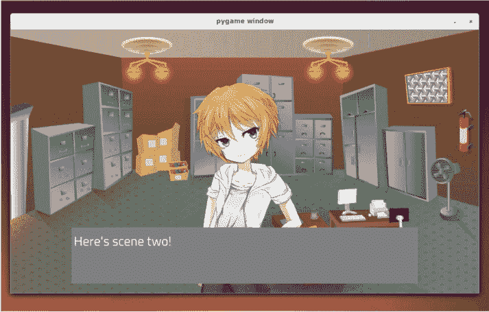

切换场景以增加故事的深度，并允许游戏拥有决策和路线

### 资源

- **Python 2:** www.python.org/
- **Pygame:** pygame.org/download.shtml
- **IDLE Python IDE**
- **游戏素材**
- **来自 FileSilo 的代码（可选）**

大多数人会在现代电子游戏中寻找引人入胜的故事，而那些没有故事的游戏正变得越来越少。讲述纯粹故事的一种很好的方式是通过视觉小说类型，你可以用 Python 相对简单地制作一个。这些互动小说在日本是一种极受欢迎的娱乐形式，通常通过让玩家点击浏览故事并在过程中做出决策来体验不同的情节点和结局。

在 Python 中，这是一个相对简单的项目来创建，但通过添加 Pygame 模块我们可以让它变得更容易，并且对未来更具可扩展性。Pygame 提供了更好的图像和文本定位支持，创建显示窗口以及使用鼠标和键盘输入，从而简化了编码过程。

我们将使用标准 Python 2 编写代码，因此在编写、测试和编码时请确保在 IDLE 2 而不是 IDLE 3 中运行它。

#### 01 获取 Pygame 依赖项

为你的系统安装 Pygame 的最佳方式是编译它。为此你需要先安装正确的依赖项。打开终端并安装以下软件包，在 Ubuntu 中看起来像这样：


`$ sudo apt-get install mercurial python-dev python-numpy libav-tools libsdl-image1.2-dev libsdl-mixer1.2-dev libsdl-ttf2.0-dev libsmpeg-dev libsdl1.2-dev libportmidi-dev libswscale-dev libavformat-dev libavcodec-dev`

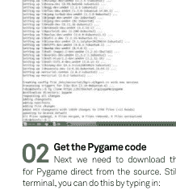

## 02 获取 Pygame 代码

接下来我们需要直接从源代码下载 Pygame 的代码。仍在终端中，你可以通过输入以下命令来完成：

```
$ hg clone https://bitbucket.org/pygame/pygame
```

这将下载到 `pygame` 文件夹。进入该文件夹使用终端中的 `CD pygame`，以便我们可以继续构建它。

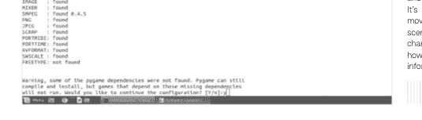

## 03 构建 Pygame 模块

要安装它，我们需要分两步进行。首先我们需要使用终端准备代码以便安装：

```
$ python setup.py build
```

完成后你就可以真正安装它：

```
$ sudo python setup.py install
```

这不会花费太长时间。

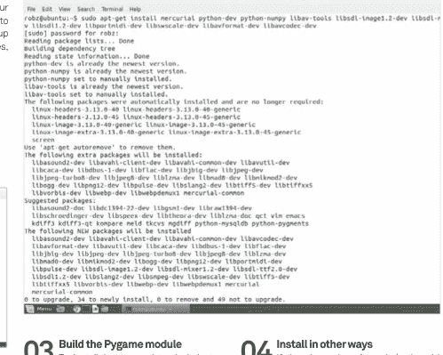

## 04 以其他方式安装

如果以上方法不起作用（或有点令人望而生畏）你可以查看网站上的二进制和可执行文件，这些文件适用于其他操作系统和 Linux 发行版。前往 `http://pygame.org/download.shtml` 获取适用于你的特定系统的文件，包括 Windows 和 OS X。剩下的教程适用于任何操作系统。

## 05 获取视觉小说文件

我们已将代码上传到 FileSilo，在这里我们将带你了解我们为使其工作所做的工作。下载视觉小说的文件并解压。我们现在关心的两个文件是 `visualnovel.py` 和 `script.py` python 文件——所有重要代码都在这里。

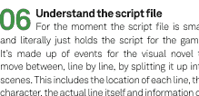

## 06 理解脚本文件

目前脚本文件很小，字面意义上只是保存游戏脚本。它由视觉小说在逐行之间移动的事件组成，通过将其拆分为场景。包括每行的位置、角色、实际行本身以及游戏流程的信息。这些是包含信息的矩阵，并且完全可定制。

# 使用 Python 创建

## 07 脚本如何关联

在我们的游戏中，代码在进行过程中从脚本文件提取元素。我们稍后会解释其工作原理，但这也允许我们在以后实现决策以改变游戏可能带你去的方向。

```
import pygame, time, script

pygame.init()
```

## 08 启动主游戏

对于当前状态的视觉小说，我们不需要太多模块。在这里我们导入了新的 `pygame` 模块、作为模块的 `script` 以及出于美观原因的 `time` 模块——我们将让代码在某些部分暂停而不是立即切换场景到下一行。我们还使用简单的 `pygame.init()` 初始化 Pygame

## 09 添加变量和素材

我们添加运行小说所需的一系列信息。我们定义要使用的显示屏幕大小（宽 1000 像素，高 563 像素），以及代码使用的一些 RGB 颜色。我们还告诉 Pygame 使用什么字体以及某些部分的字体大小，并为游戏加载图像。

## 10 开始游戏

为游戏创建显示。Pygame 通过不断更新显示新信息来工作。为了展示其工作原理，菜单函数向显示（我们称之为 `screen`）添加元素，例如用颜色填充它、添加形状并使用 `blit` 添加图像或在这种情况下的文本。一旦你创建了屏幕更改的缓冲区，就使用 `flip()` 函数更新它。

## 11 查看鼠标

由于我们已将按钮创建为矩形，现在菜单上有一个图像，我们需要识别鼠标何时悬停在其上以知道何时点击按钮。首先

## 12 开始故事

当鼠标点击正确位置时调用我们的 `start_game` 函数，我们准备游戏，获取角色、位置和通过游戏脚本的进展。此函数的其余部分使用此信息从脚本中提取数据以使游戏正常流动。

## 13 第一个屏幕

第一个屏幕的处理方式不同，并且在继续之前起作用以将每个元素都显示在界面上——它使代码的处理时间稍微少一些，因为我们

```
def start_game():

    get_button = pygame.Rect(location, character)

    turn = 0

    game_state = 1
```

> “代码在进行过程中从脚本文件提取元素，允许我们在以后实现决策”

```
elif turn > 0 and clicked_state[0] == 1:

    line_start = 0

    for i in range (4):

        if line_start == 0 and line[0] != '0':

            print line[0]

            screen.blit(character[location[line[0]]], [0, 0])

            time.sleep(1)

        elif line_start == 1 and line[1] != '0':

            screen.blit(character[line[1]], [377, 113])

            time.sleep(1)

        elif line_start == 2:

            pygame.draw.rect(screen, (grey), pygame.Rect(130, 423, 740, 120))

        elif line_start == 3:

            screen.blit(game_font.render(line[2], 1, white), (135, 430))

            turn += 1

            if line[3] != '0':

                game_script = line[3]

                time.sleep(0.5)

            game_state = line[4]

            clicked = 0

        line_start += 1

        pygame.display.flip()
```


`begin`. `getattr` 允许我们使用与故事中位置关联的字符串/整数并调用脚本文件中的相关场景函数。然后我们使用带有迭代函数的 `if` 语句，逐步添加屏幕元素，以制造出第一屏正在构建起来的错觉。最后我们通过推进进度值来完成它。

```python
def game():

    global game_running

    while game_running == True:

        menu_screen()

game()
```


这里的代码非常可扩展，允许你添加会带你进入不同场景的决策。

### 14 添加变量和资源

与我们原始的启动代码的工作方式类似，我们下一个 `if` 语句和迭代会检查下一行有什么不同，如果它移动到不同的场景函数。它还会更改任何不同的内容，而不会让缓冲区填满超过所需。脚本中未做更改的地方用 `0` 标记。

### 15 起始函数

我们用一个简单的函数来结束这段代码，它启动整个游戏。这只是为了封装整个代码，并允许我们在未来添加不同的关闭方式。`IDLE` 在运行文件时会加载所有内容，然后在最后运行 `game()` 函数——这与你在命令行中添加一个 `__main__` 函数来启动代码的方式类似。

### 16 扩展你的代码

所写的代码非常可扩展，允许你添加会被记录下来的决策，以带你进入不同的场景（或在视觉小说术语中称为路线），使你的游戏感觉更具互动性。这不需要比 `if` 语句多多少代码，而且也是一个很好的方式让你研究添加可点击的图形按钮并使用 `collide` 函数。

### 17 移动资源

目前代码将脚本特定的资源放在主 `visualnovel` 文件中。这些可以移动到脚本中，使 `visualnovel` 文件更具模块化，以便你可以在启动时加载不同资源的多个脚本。

## Web development

- **134 Develop with Python** – Why Python is perfect for the web
- **140 Build your own blog** – Begin developing your blog
- **144 Deliver content to your blog** – Add content to your site
- **148 Enhance your blog** – Complete your blog with add-ons

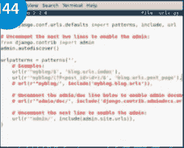

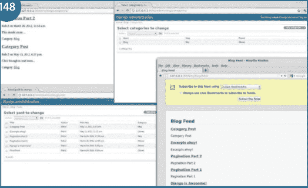


> “Companies like Google and NASA have been using Python for years”


### Develop with Python


Don't be fooled into objects, all-in-all this means it is lightweight but is still a powerful microframework.

**Pyramid**

pylonsproject.org

**GOOD FOR:** Highly extensible and adaptable to any project requirement. Not a lightweight system either

Heavily focused on documentation, Pyramid brings all the much needed basic support for most regular tasks. Pyramid is open source and also provides a great deal of extensibility – it comes with the powerful Werkzeug Debugger too.

**Werkzeug**

werkzeug.pocoo.org

**GOOD FOR:** API creation, interacting with databases and following strict URL routes whilst managing HTTP utility

Werkzeug is the underlying framework for Flask and other Python frameworks. It provides a unique set of tools that will enable you to perform URL routing processes as well as request and response objects, and it also includes a powerful debugger.


### Python 在野外

对 Python 开发感兴趣吗？你会与目前使用它的知名大公司为伍

Disqus，这家流行的社交互动评论服务提供商，已经很长时间以来一直用 Python 实现其生产应用。Python 对开发团队的好处在于其能够有效扩展并满足大量用户，同时为内部和外部使用提供有效的底层 API。该公司现在开始在部分生产应用中使用 Go，但大部分代码仍运行在 Python 上。

世界知名的图片分享服务 Instagram 和社交收藏网站 Pinterest 也将 Python 作为其 Web 技术栈的一部分，采用 Django 来协助功能实现并满足其服务所收到的数千次内容浏览和请求。

Mozilla、Atlassian 的 Bitbucket 代码仓库服务，以及流行的讽刺网站 The Onion 都被指出在其产品中使用了 Django。


#### 09 显示帖子

创建你的第一个路由，以便我们可以返回并显示所有可用的帖子。要查询数据库，我们对存储的数据库连接执行 SQL 语句。然后使用 Python 的 `dict` 方法将结果映射为值并保存为 `posts` 变量。要渲染模板，我们然后调用 `render_template()` 并传入文件名和作为第二个参数要显示的变量。可以作为逗号分隔的列表传递多个变量。

```
@app.route('/')

def get_posts():

    cur = g.db.execute('select title, text from posts order by id desc')

    posts = [dict(title=row[0], text=row[1]) for row in cur.fetchall()]

    return render_template('show_posts.html', posts=posts)
```

#### 10 模板输出

Flask 要求模板位于项目根目录的 `templates` 目录中，因此请确保现在创建该目录。接下来，添加一个名为 `'show_posts.html'` 的新文件。动态值使用 Jinja2 模板语法进行管理，这是 Flask 应用的默认模板引擎。将此文件保存在 `templates` 目录中。

```
<ul class="posts">



<li><h2>{{ post.title }}</h2>{{ post.text|safe }}



<li>Sorry, no post matches your request.



</ul>
```

#### 11 创建 API 响应

要创建 API 响应，我们可以定义一个具有特定 API 端点的新的路由。再次，我们查询数据库获取所有帖子。然后数据作为 JSON 返回，使用 `JSONify` 方法来实现。我们可以添加特定的值，例如帖子计数和自定义消息，如果你愿意的话，以及实际的 `posts` 变量，以 JSON 格式呈现。

```
@app.route('/api/v1/posts/', methods=['GET'])

def show_entries():

    cur = g.db.execute('select title, text from posts order by id desc')
```

```
@app.teardown_request

def teardown_request(exception):

    db = getattr(g, 'db', None)

    if db is not None:

        db.close()
```

```
posts = [dict(title=row[0], text=row[1]) for row in cur.fetchall()]

return jsonify({'count': len(posts), 'posts': posts})
```


#### 12 获取特定帖子

要从 API 获取特定帖子，我们需要创建一个新的路由，该路由将接受 URL 的一部分作为动态值。我们还可以选择将此路由用于多种请求方法，在此例中为 `GET` 和 `DELETE`。我们可以通过检查 `request.method` 值来确定方法并将其与条件 `if/else` 语句进行比较。

```python
@app.route('/api/v1/posts/<sint:post_id>', methods=['GET', 'DELETE'])

def single_post(post_id):

    method = request.method

    if method == 'GET':

        cur = g.db.execute('select title, text from posts where id = ?', [post_id])

        posts = [dict(title=row[0], text=row[1]) for row in cur.fetchall()]

        return jsonify({'count': len(posts), 'posts': posts})

    elif method == 'DELETE':

        g.db.execute('delete from posts where id = ?', [post_id])

        return jsonify({'status': 'Post deleted'})
```

#### 13 运行应用程序

要运行你的 Flask 应用程序，使用活动的终端窗口导航到项目的根目录。确保你处于活动的虚拟环境 Python shell 中，输入运行主索引文件的命令。内置服务器将启动，网站将在浏览器中默认端口本地地址 `http://127.0.0.1:5000` 上访问。

```bash
python index.py
```


#### 14 API JSON 输出

应用程序的根目录将渲染我们之前创建的模板。可以生成多个路由来创建丰富的 Web 应用程序。在浏览器中访问特定于 API 的 URL 将以干净格式化的 JSON 返回请求的数据。能够定义像版本化 RESTful 端点这样的自定义路由是非常强大的。

### Web 开发

#### Django 应用开发

Django 是一个完整的 Python Web 应用框架，拥有出色的命令行工具。

#### 安装 Django

一旦你安装了 Python，安装 Django 就相对容易了。在这里，我们将构建一个简单的应用，你可以亲自体验。


- 01 创建虚拟环境

为你的项目创建一个新目录，并使用新的终端窗口进入其中。为此项目创建一个新的虚拟环境，选择使用最新的 Python 3。你的 Python 3 位置可能有所不同，因此请务必为二进制包设置正确的路径。

```bash
virtualenv -p /usr/local/bin/python3 venv
```

- 02 激活并安装

使用终端窗口激活虚拟环境，以启动项目专属的 shell。VirtualEnv 已安装了 Python 包管理器 `pip` 的本地版本，因此运行命令安装 Django 相当简单。

```bash
. venv/bin/activate
pip install Django
```


- 03 创建核心项目

Django 安装中包含一些极其有用的命令行工具，它们能帮你完成许多重复且困难的任务。让我们用其中一个来创建一个全新的项目结构。运行 `django-admin.py` 脚本，并指定你想要创建的项目名称。

```bash
django-admin.py startproject myblog
```


- 04 初始迁移

通过终端窗口进入项目目录。项目生成时附带的某些已安装应用需要数据库表。使用辅助工具，运行迁移命令自动创建所有这些表。终端窗口会随时告知你所有进度以及迁移中已应用的内容。

```bash
cd myblog
python manage.py migrate
```

- 05 创建应用

每个 Django 项目至少由一个应用或模块组成。运行 `startapp` 命令创建一个新的 `blog` 应用模块，该模块将在主项目结构旁边生成所需代码。

```bash
python manage.py startapp blog
```

#### 数据库模型与迁移

Django 在管理数据库模式（schema）和项目模型的迁移与维护方面，能力非常出色。

- 01 生成模型

打开 `blog/models.py`，创建第一个模型类，为每个属性提供名称和类型。你可以通过此处的文档深入了解字段类型：`bit.ly/1yHkn`。完成后，打开 `myblog/settings.py`，将 `blog` 应用添加到允许安装的应用列表中，以便项目能够加载它。

```python
# blog/models.py
class Post(models.Model):
    title = models.CharField(max_length=200)
    text = models.TextField()

# myblog/settings.py
INSTALLED_APPS = ('django.contrib.admin',
    ..., 'django.contrib.staticfiles', 'blog')
```


- 02 数据迁移

任何模型创建或数据更改都需要进行迁移。为此，我们需要从模型数据生成迁移文件，这些文件会按顺序编号。然后我们运行特定的迁移命令来生成所需的 SQL，最后的 `migrate` 命令执行数据库操作。

```bash
python manage.py makemigrations blog
python manage.py sqlmigrate blog 0001
python manage.py migrate
```

#### 自动装配管理后台

管理后台本身可能是个麻烦事。Django 为你提供了一个可扩展的管理界面。


- 01 创建管理员用户

Django 让内容管理变得异常简单，并默认在 `http://127.0.0.1:8000/admin` 提供了管理后台。要登录，你需要创建一个超级用户账户。运行相关命令并按需指定用户详细信息，然后即可登录。

```bash
python manage.py createsuperuser
```


- 02 开启博客管理

登录管理界面后，你会看到用于管理用户、角色和权限的功能，这些功能本身就非常强大，并且是 Django 为你提供的。然而，目前还没有任何管理博客文章的功能，所以让我们把它开启。

#### 使用开发服务器

Django 自带一个非常有用的内置开发服务器，它会在你完成所有文件更改后自动编译并重新加载。要启动服务器，只需在项目目录中的终端窗口里运行 `'python manage.py runserver'` 命令即可。

- 03 启用后台管理

要让我们模块及关联的模型能够通过管理界面进行管理，我们需要在 `admin` 模块中注册它们。打开 `blog/admin.py`，然后依次导入并注册模型（不过目前我们只有一个）。保存文件并刷新管理站点，就能看到现在可管理的文章了。

```python
from django.contrib import admin
# Register your models here.
```

- 04 创建视图

管理界面已经能够接受新的文章提交，我们将创建一个视图页面来显示它们。打开 `blog/views.py`，从 `models` 中导入 `Post` 类。创建一个方法，从数据库中获取所有文章并将它们输出为字符串。

```python
from django.http import HttpResponse
from blog.models import Post

def index(request):
    post_list = Post.objects.order_by('-id')[:5]
    output = '<br />'.join([p.title for p in post_list])
    return HttpResponse(output)
```


# 05 管理 URL

创建 `blog/urls.py` 并添加代码，导入刚在模块中创建的视图及相应的 URL 模式。打开 `myblog/urls.py`，添加 URL 函数调用，为应用实现一个新 URL 来显示该视图。在浏览器中访问 `http://127.0.0.1:8000/blog` 以渲染新视图。

## `blog/urls.py`

```python
from django.conf.urls import patterns,url

from blog import views

urlpatterns = patterns('',

    url(r'^$', views.index, name='index'),

)
```

## `myblog/urls.py`

```python
urlpatterns = patterns('',

    url(r'^blog/', include('blog.urls')),

    url(r'^admin/', include(admin.site.urls)),

)
```


## 托管 Python 应用


- Heroku (heroku.com)

这个应用也许是最知名的云托管服务商之一。他们的技术栈服务器环境支持多种核心 Web 应用语言，其中 Python 是标准支持。其独特的 Toolbelt 命令行功能以及与 Git 仓库的集成，加上极其快速简便的扩展和性能提升能力，使它们成为显而易见的选择。免费账户可以让你在一个 dyno 实例上免费运行 Python Web 应用。


- Python Anywhere (www.pythonanywhere.com)

另一个托管选项，也是专门为 Python 应用而创建的，就是 Python Anywhere。免费的入门套餐计划有足够的能力和动力，让你无需扩展即可启动并运行一个 Python Web 应用；但一旦你的项目获得关注，你就可以切换套餐并提升计划性能。

它默认提供了极其丰富且令人印象深刻的模块，可立即导入到你的应用中，助你快速上手，包括 Django 和 Flask，如果你需要的话。


## Web development

Django 自带一个轻量级开发服务器，可让你在本地测试所有工作

Django 当然能够读取和写入 SQL 数据库，但要成功做到这一点几乎不需要任何先验知识

使用 HTML 和 CSS 与 Django 结合使用清晰直接：比 PHP 更容易调试

Django 自带一个通用后端站点，可在几秒钟内设置完成，并且之后易于自定义

### Resources

Python Source Code
www.python.org/download/releases/2.7.2

Django Source Code
www.djangoproject.com/download

## Build your own blog with Django

学习如何使用这个极其强大的基于 Python 的 Web 框架，在创纪录的时间内从头创建一个完整的博客

创建自己的博客总是一项伟大的成就。当然，如果你现在就需要一个功能齐全的博客，可以使用出色的 WordPress。Tumblr 适用于那些只想写点东西，或发布太空柯基犬照片的人。

不过，使用预制博客你无法从头到尾完全掌控，而且两者都不是用出色的 Django 编写的。Django 当然基于 Python，这是一种面向对象的编程语言，设计时具有清晰易读的语法。由于其 Python 基础，它是一种功能强大且简单易用的 Web 开发语言，具有广泛的应用。

那么让我们用它来制作一个博客。在这个流程的第一部分，我们将探讨如何设置 Django，写入和读取数据库，创建前端和后端，以及与 HTML 的一些交互。

### 01 Install Python

Django 基于 Python，需要安装它才能进行开发。Python 2.7 是推荐版本，可通过 `python` 包安装。如果你想检查你的版本，打开终端输入 `python` 启动 Python shell。

### 02 Install Django

大多数操作系统在仓库中都会提供 Django 包，例如 Debian 中的 `python-django`。Django 网站上有一个列表，如果你找不到它，或者你可以从源代码构建。确保安装版本 1.3。

### 03 Verify your Django

为了确保 Django 已正确安装，并且你拥有正确的版本，输入 `python` 进入 Python shell 并输入以下内容：

```
import django
print django.get_version()
```

如果安装正确，它将返回一个版本号，应为 1.3。

### 04 Start a new project

在终端中，`cd` 到你想要开发博客的文件夹，然后运行以下命令：

```
django-admin startproject myblog
```

这里，`myblog` 可以替换为你想要为项目命名的任何名称，但我们将在接下来的示例中使用它。

### 05 Start the development server

Django 自带一个轻量级开发服务器，可在本地测试工作。我们也可以用它来检查我们的工作，因此 `cd` 到 `myblog` 文件夹然后使用：

```
python manage.py runserver
```

如果一切顺利，它应该返回零错误。使用 Ctrl+C 退出服务器。

### 06 Configure the database

数据库设置保存在 `settings.py` 文件中。用你喜欢的编辑器打开它并转到 Databases 部分。将 `ENGINE` 改为：

```
'ENGINE': 'django.db.backends.sqlite3',
```

并且在 `NAME` 中，放置绝对路径 – 例如：

```
'NAME': '/home/user/projects/myblog/sqlite.db',
```

保存并退出。

### 07 Create the database

数据库文件将通过使用以下命令生成：

```
python manage.py syncdb
```

在创建过程中，它会要求你设置一个超级用户，你现在可以进行设置。SQLite 数据库文件将创建在你的 `myblog` 文件夹中。


### Web 开发：使用预制博客，你无法从头到尾完全掌控——但使用 Django 你可以


### 08 创建你的博客

现在是时候在你的项目中创建一个博客应用了。输入：

```
python manage.py startapp blog
```

这会创建 `models` 文件，所有你的数据都存放在这里。你可以将 `blog` 改成其他名称，但在我们的示例中我们会使用它。


### 09 开始你的博客模型

我们现在可以开始创建博客模型的第一步。打开 `models.py` 并将其修改为以下内容：

```
from django.db import models
class Post(models.Model):
    post = models.TextField()
```

这创建了 `Post` 类，它有一个子类包含你的博客文本。

### 10 自定义你的博客

让我们现在扩展一下博客模型，使其更像一个经典的博客：

```
class Post(models.Model):
    post = models.TextField()
    title = models.TextField()
    author = models.CharField(max_length=50)
    pub_date = models.DateTimeField()
```

`CharField` 需要定义字符限制，而 `DateTimeField` 保存时间值。


### 11 安装你的应用

你的应用需要安装到项目中，这非常简单。再次打开 `settings.py` 文件，进入 `INSTALLED_APPS` 部分并添加：

```
'blog',
```

然后运行以下命令创建数据库表：

```
python manage.py sql blog
```

最后：

```
python manage.py syncdb
```

### 12 设置发布

现在我们可以创建一个帖子并测试我们的代码。首先，进入 Python shell：

```
python manage.py shell
```

然后执行以下命令以添加所有必要的字段和数据：

```
from blog.models import Post
import datetime
```


### 13 让我们开始写博客

创建帖子。对于此示例，我们将其命名为 `test_post`：

```
test_post = Post()
```

现在让我们添加博客内容：

```
test_post.post = 'Hello World!'
test_post.title = 'First Post'
test_post.author = 'Me'
test_post.pub_date = datetime.datetime.now()
```

然后用以下命令保存它：

```
test_post.save()
```

### 14 启动站点后端

要创建管理站点，从 `myblog` 目录编辑 `urls.py`，并取消注释或添加以下行：

```
from django.contrib import admin
admin.autodiscover()
url(r'^admin/', include(admin.site.urls)),
```

保存并退出，然后编辑 `settings.py` 并取消注释 `INSTALLED_APPS` 中的这一行：

```
'django.contrib.admin',
```

管理站点现在位于 `127.0.0.1:8000/admin/`。

### Django 是一个功能强大且简单易用的语言

### 15 设置管理页面

管理页面有一个通用且可用的模板，但你需要配置它以查看、编辑、创建和删除帖子。首先，在 `blog` 目录中创建一个新的文件 `admin.py` 并输入：


`from blog.models import Post`

`from django.contrib import admin`

`admin.site.register(Post)`

```
为了让帖子在网站上显示得更好，编辑 models.py 并添加：
```

```
class Post (models.Model):
    def __unicode__(self):
        return self.title
```

保存，并运行：
`python manage.py syncdb`

管理页面现在可以使用了！你应该能够看到其他帖子，并且添加更多内容现在变得容易多了。

### 16 激活前端

在编辑器中打开 `myblog` 目录下的 `urls.py` 并在 `urlpatterns` 部分添加以下内容：
`url(r'^myblog/', 'blog.urls.index')`,
文件中的一个示例也可以取消注释并编辑为此。它指向我们现在将创建的模型。

### 17 创建另一个 urls 文件

你需要在应用目录中创建另一个 urls 文件，在我们的例子中是 `blog/urls.py`。创建它并添加以下内容：

```
from django.template import Context, loader
from blog.models import Post
from django.http import HttpResponse

def index(request):
    post_list = Post.objects.all()
    t = loader.get_template('blog/index.html')
    c = Context({
        'post_list': post_list,
    })
    return HttpResponse(t.render(c))
```

### 18 开始模板

我们刚刚编写的代码会查找一个当前不存在的模板。我们首先需要在 `settings.py` 中告诉 Django 模板查找位置：

```
TEMPLATE_DIRS = (
    '/home/user/projects/templates',
)
```

你可以将模板目录放在任何你想要的位置，只要在这里引用它即可。

### 19 编写模板

现在编写站点模板。在我们的示例中，我们使用 `index.html`：

```

    {{ post.title }}
    {{ post.author }}
    {{ post.pub_date }}
    {{ post.post }}

```

这需要在模板目录中与你的应用同名的文件夹中定位。

### 20 查看你的成果

让我们确保这有效。使用以下命令启动开发服务器：
`python manage.py runserver`

并导航到 `127.0.0.1:8000/myblog/`。它并不漂亮，但你应该已成功调用了存储的数据。我们将在接下来的步骤中对其进行整理。

### 21 格式化首页

返回模板文件 `index.html`，并添加以下 html 标签：

```

<h2>{{ post.title }}</h2>
{{ post.author }} on {{ post.pub_date }}
<p>{{ post.post }}</p>

```

这只是一个示例——帖子可以用任何顺序和任何标签。

### 22 美化管理列表

我们将在 `blog` 目录中的 `admin.py` 文件中进行此操作：在编辑器中打开它并进行以下更改：

```
from blog.models import Post
from django.contrib import admin

class Admin(admin.ModelAdmin):
    list_display = ['title', 'author', 'pub_date']

admin.site.register(Post, Admin)
```

在这种情况下 `list_display` 是一个固定的变量名。

### 23 一个逻辑的帖子页面

网站上的新帖子页面可能不是你习惯的顺序。我们现在将在 `admin.py` 中更改它，添加以下内容：

```
class Admin(admin.ModelAdmin):
    list_display = ['title', 'author', 'pub_date']
    fields = ['title', 'pub_date', 'author', 'post']

admin.site.register(Post, Admin)
```
记得保存！

### 24 一个功能性的博客

就这样！导航到 `127.0.0.1:8000/admin/` 或 `127.0.0.1:8000/myblog/` 将展示你创建的精美作品。一旦你知道方法，Django 就非常容易使用，并且在此教程之后你应该能够进行大量调整。

### 01 新的博客排序

上次我们停留在博客按时间顺序显示文章，这对读者来说帮助不大。为了纠正这个问题，打开 `blog` 文件夹中的 `urls.py` 并编辑以下行：

```
post_list = Post.objects.all().order_by("~-pub_date")
```

这确保文章按倒序显示（最新在前）。

### 02 一个页面的视图

你当然希望能够链接到特定页面，为此我们首先需要在 `blog` 文件夹的 `urls.py` 文件中定义这些页面包含的内容：

```
def post_page(request, post_id):
    post_page = Post.objects.get(pk=post_id)
    return render_to_response('blog/post.html', {'post_page': post_page})
```

### 03 清理你的代码

你可能会注意到我们对 `index` 定义使用了不同的 return 命令——这是一个快捷方式，让编写代码变得更容易。要使其工作，添加：

```
from django.shortcuts import render_to_response
```

我们建议你编辑 `index` 代码以匹配 `post_page`。

### 04 编辑 URL

在 `myblog` 中的 `urls.py` 我们需要做一些增添和修改，以便网站能正确指向文章：

```
url(r'^myblog/$', 'blog.urls.index'),
url(r'^myblog/(?P<post_id>\d+)/$', 'blog.urls.post_page'),
```

`post_id` 是文章的编号，由系统自动生成。`$` 很重要，能使重定向正常工作。

### 05 文章模板

我们让 `post_page` 指向一个模板，现在需要创建它。在与 `index.html` 相同的位置，创建 `post.html` 并使用以下格式使其与首页相似：

```
<h2>{{ post_page.title }}</h2>
{{ post_page.author }} on {{ post_page.pub_date }}
<p>{{ post_page.post }}</p>
```

### 06 链接到页面

让我们从主页面让这些链接生效。打开 `index.html` 文件并做出以下更改：

```
<h2><a href="/myblog/{{ post.pk }}">{{ post.title }}</a></h2>
```

这是一个非常简单的增添，使用绝对链接，且无需对 views 或 model 进行调整。

### 07 分页

为了让博客文章分布在多个页面上，我们需要在 `blog` 文件夹的 `urls.py` 中做一些增添：

```
post_list = Post.objects.all().order_by("~-pub_date")
paginator = Paginator(post_list, 3)
try: list_page = request.GET.get("list_page", '1')
except ValueError: list_page = 1
post_list = paginator.page(list_page)
return render_to_response('blog/index.html', {'post_list': post_list})
```

### 08 请翻页

现在我们需要为博客添加导航链接，因此打开 `index` 模板进行编辑：

```

<a href="?list_page={{ post_list.previous_page_number }}">Newer</a>
```


```




<a href="?list_page={{ post_list.next_page_number }}">Older</a>


```

## Web development

### 09 错误的页面

让我们添加一段小代码，如果用户输入错误的 URL 就将其返回到上一页：

```
from django.core.paginator import Paginator, EmptyPage, InvalidPage

try:

    post_list = paginator.page(list_page)

except (EmptyPage, InvalidPage):

    post_list = paginator.

page(paginator.num_pages)
```

The last part replaces `post_list = paginator.page(list_page)`.


### 10 发表你的看法

每个人在互联网上都有自己的观点。你可以让读者发表评论，我们先从编辑`models.py`开始：

```
class Comment(models.Model):

    author = models.CharField(max_length=50)

    text = models.TextField()

    post = models.ForeignKey(Post)

    def __unicode__(self):

        return self.post, self.text
```

We've made it so they can put their name with a comment.


### 11 回到评论

我们现在需要在`myblog`中的`urls.py`文件里添加一行小代码，以便评论可以发布然后返回到原始页面：

```
url(r'^myblog/add_comment/(\d+)$/', 'blog.urls.add_comment'),
```

This URL pattern calls the ID of the page that you're on.

## We need to be able to process the data and metadata in the forms

### 12 形成评论

我们需要能够处理表单中的数据和元数据，所以让我们在`blog`文件夹的`urls.py`中添加一个类，内容如下：

```
from django.forms import ModelForm

from blog.models import Post, Comment

class CommentForm(ModelForm):

    class Meta:

        model = Comment

        exclude = ['post']
```


### 13 在文章中

我们需要将评论归属于它们所发表的文章，因此更新`post_page`定义：

```
from django.core.context_processors import csrf

import csrf

def post_page(request, post_id):

    post_page = Post.objects.get(pk=post_id)

    comments = Comment.objects.filter(post=post_page)

    d = dict(post_page=post_page, comments=comments, form=CommentForm())

    d.update(csrf(request))

    return render_to_response('blog/post.html', d)
```

The CSRF tag is to prevent cross-site request forgery.


### 14 评论模板

让我们通过在`post.html`中添加以下内容来为文章页面准备评论功能：

```
<p>Comments:</p>



    {{ comment.author }}

    <p>{{ comment.text }}</p>



<strong>Add comment</strong>

<form action="" method="POST"">

Name {{ form.author }}

<p>{{ form.text }}</p>

<input type="submit" value="Submit">

</form>
```

### 15 定义你的评论

最后一步是在`blog.urls.py`中定义评论，这一步比较大：

```
def add_comment(request, comment_id):

    p = request.POST

    if p.has_key('text') and p['text']:

        author = 'Anonymous'

        if p['author']: author = p['author']

    p['author']

    comment = Comment(post=Post.objects.get(pk=comment_id))

    cf = CommentForm(p, instance=comment)

    cf.fields['author'].required = False

    comment = False

    cf.save(commit=False)

    comment.author = author

    comment.save()

    return HttpResponseRedirect(reverse('blog.urls.post_page', args=[comment_id]))
```

This ensures text has been entered, and if not specified author is 'Anonymous'. Before testing, run `syncdb` so comment tables can be created.

### Web 开发

### 16 管理

像文章一样，我们可以进入 Admin 页面查看评论。开始编辑`blogs/admin.py`来添加此功能：

```
from blog.models import Post, Comment
from django.contrib import admin
class PostAdmin(admin.ModelAdmin):
    list_display = ['title', 'author', 'pub_date']
    fields = ['title', 'pub_date', 'author', 'post']
admin.site.register(Post, PostAdmin)
```

### 17 评论专属的管理功能

现在我们可以添加评论专属的管理功能，而不会产生任何冲突：

```
class CommentAdmin(admin.ModelAdmin):
    list_display = ['text', 'author', 'post']
admin.site.register(Comment, CommentAdmin)
```

这将在管理站点上显示评论，你可以看到评论、作者以及它所关联的文章。

### 18 侧边栏开始

Django 让按年份和月份排序文章变得相当容易，但首先我们需要在`blog/urls.py`中导入一些新模型：

```
import time
from calendar import month_name
```

我们将定义两个新函数，`month_timeline` 和 `month`，来制作侧边栏。

### 19 开始定义 `month_timeline`

首先我们需要获取文章中的所有信息：


# 使用额外功能

```
def month_timeline():
    year, month = time.localtime()[0:2]
    begin = Post.objects.order_by('pub_date')[0]
    month_begin = begin.pub_date.month
    year_begin = begin.pub_date.year
    month_list = []
```

`[2]` 确保我们只获取所需的时间信息。

## 20 完成定义

现在我们将按月份和年份对文章进行排序，从第一个月份开始。

```
for y in range(year, year_begin-1, -1):
    start, end = 12, 0
    if y == year: start = month
    if y == year_begin: end = month_begin-1
    for m in range(start, end, -1):
        month_list.append((y, m, month_name[m]))
return month_list
```

## 21 返回读者

整理好列表后，我们现在可以定义`month`以便在博客上显示它：

```
def month(request, year, month):
    post_list = Post.objects.filter(pub_date__year=year, pub_date__month=month)
    return render_to_response('blog/index.html', dict(sidebar_list=object_list, month_list=month_timeline()))
```

现在我们需要将其链接到`index`模板。

## 22 完成侧边栏定义

编辑`index`函数上的`return`命令以包含侧边栏信息：

```
return render_to_response('blog/index.html', dict(post_list=post_list, sidebar_list=post_list.object_list, month_list=month_timeline()))
```

然后在`myblog`的`urls.py`中添加这一行，以便可以渲染月份页面：

```
url(r'^myblog/month/(\d+)/(\d+)$', 'blog.urls.month')
```

现在我们需要做的就是在网站上显示这些信息。

## 23 网页上的侧边栏

进入`index`模板。首先，将`post` `forloop`的第一行改为：

```

```

简单吧。现在我们需要添加侧边栏信息：

```

<p><a href="">{{ month.2 }}</a></p>

```

## 24 侧边栏终结

显然它现在还不在侧边——那是 HTML 和 CSS 的工作。不过信息已经在那里了，你可以随意操纵它。然而，你的博客现在对读者友好多了。


## 增强你的博客

### 资源

**Python 基础：** http://www.python.org/download/

**Django 源码：** djangoproject.com/download/

为了补充之前的教程，我们将介绍一些你可以用 Django 的强大功能使用的更高级特性

**我们一直在构建我们的 Django 博客来创建和显示文章，允许人们发表评论，并像经典博客侧边栏一样按月筛选文章。** 不过在它看起来和行为更像经典博客之前，我们还有一段路要走。

在本教程中，我们将添加摘要、摘录、分类，最后是 RSS 订阅。这使我们能够研究一些事情——首先我们将更好地理解跨模型引用以及它在管理站点中的工作原理。我们还将了解如何对数据库进行更改，以及 Django 在创建 SQL 查询时如何提供帮助。

最后，RSS 订阅是 Django 本身标准订阅库的一部分。我们将学习如何导入和使用它来创建一个最新条目的简单列表，点击后进入文章。到本教程结束时，你的 Django 博客将终于完成！


### 01 摘要

在普通博客中，我们会有更长的文章。我们可以在`index`页面模板中像这样为每篇文章生成摘要：

`<p>{{ post|truncatewords:3 }}</p>`

这会自动取文章的前三个词——当然，你可以使用任何数字。


### 02 手动摘录

如果你不想使用自动摘要，我们可以向我们的`post`模型添加一个`excerpt`字段，以便你可以手动创建。

`excerpt = models.TextField()`

要限制摘录中的字符数，请使用`CharField`，就像我们作者部分那样。


### 03 编写摘录

要编写摘录，或将其附加到之前的文章，我们必须将其添加到管理页面。打开`admin.py`并编辑`AdminPost`类的`fields`部分以添加`excerpt`：

`fields = ('title', 'pub_date', 'author', 'post', 'excerpt')`

> 我们将添加摘要、
> 摘录和 RSS 订阅

## Web development


- 为你的博客文章提供自动摘要或手工撰写的摘要
- 创建和管理父分类和子分类作为博客的独立功能
- 学习如何修改数据库以创建带分类的文章，并将它们添加到其他文章中
- 使用内置的 Django 函数创建自定义 RSS feed


### 04 Excerpt summary

你可以用摘要替换索引模板中的摘要内容，但我们可以将其保留作为摘要为空时的备份：

```python
 <p>{{ post.excerpt }}</p>  <p>{{ post.post.truncatewords:3 }}</p> 
```


### 05 Database error

如果你已经注意到或测试了这些更改，你会注意到我们的 Web 服务器已经停止工作。这是因为数据库中没有`excerpt`列。因此我们需要添加`excerpt`列。要了解如何操作，请运行：

```bash
$ python manage.py sqlall blog
```

### 06 Database query

输出将显示将这些模型添加到数据库的 SQL 代码。我们 specifically 要添加`excerpt`字段，它应该看起来像这样：

```sql
“excerpt” text NOT NULL
```

记下它。


### 07 Alter table

要进入数据库 shell 并添加该字段，请运行：

```bash
$ python manage.py dbshell
```

然后我们需要使用`ALTER TABLE`查询：

```
ALTER TABLE “blog_post”;
```

然后输入记下的代码，如下：

```
ADD “excerpt” text;
```

### 08 Save the changes

我们已移除了 NOT NULL，因为我们已有条目现在具有摘要，并且希望使其能够自动生成摘要。使用以下命令保存更改：`COMMIT;` 然后使用以下命令退出 shell：`.quit`


# Web development


## 09 Test it out

现在我们可以测试摘要代码——创建一个新文章或编辑现有文章以添加摘要。如果你已正确按照我们的步骤操作，它应该能正常工作；如果不行，你可能需要做一些错误修复。

## 10 Category model

我们可以为博客分类添加一个模型：

```
class Categories(models.Model):
    name = models.CharField(unique=True, max_length=200)
    slug = models.SlugField(unique=True, max_length=100)
    parent = models.ForeignKey('self', blank=True, null=True, related_names='child')

    def __unicode__(self):
        return (self.name)
```

这允许父分类和子分类。

## 11 Administrate categories

我们可以通过在`admin.py`中创建`Categories`部分将其添加到管理站点：

```
class CategoriesAdmin(admin.ModelAdmin):
    list_display = ['name', 'slug', 'parent']
    fields = ['name', 'slug', 'parent']

admin.site.register(Categories, CategoriesAdmin)
```

不过在我们创建分类之前，需要先创建数据库表：

`python manage.py syncdb`

## 12 Categorise the posts

与我们对评论所做的类似，我们希望在`Post`模型中添加一个`ForeignKey`，以便将文章归属于某个分类。添加这一行：`category = models.ForeignKey(Categories)`

并将`Categories`移到`models.py`的顶部。

## 13 Database category

像之前一样，我们将找出修改表的所需 SQL：`python manage.py sqlall blog`
对于我们的示例，它返回的代码与之前有些不同：`"category_id" integer NOT NULL REFERENCES "blog_categories" ("id")`
我们得到的是来自`categories`表的 ID，而不是文本。

## 14 Alter table – part 2

再次进入数据库 shell：`python manage.py dbshell`
我们将继续像之前一样操作，但使用新的代码：`ALTER TABLE "blog_post" ADD "category_id" integer REFERENCES "blog_categories" ("id");`
最后，保存：`COMMIT;`

## 15 Administrate categories – part 2

现在我们可以返回`admin.py`并将新的分类字段添加到`PostAdmin`模型中：

`list_display = ['title', 'author', 'pub_date', 'category']`
`fields = ['title', 'pub_date', 'author', 'post', 'excerpt', 'category']`

我们之前的博客文章如果没有分类就消失了！要修复这个问题，请返回`models.py`并对`Post`模型进行此更改：`category = models.ForeignKey(Categories, blank=True, null=True)`
这样我们就可以单独创建分类，将它们分配给文章，并查看没有分类的文章。

> 我们现在可以单独创建分类

## 16 Category display

由于`blog`目录中的`urls.py`获取了所有文章字段，我们只需在索引模板中添加：`<p>Category: {{ post.category }}</p>` 并在文章模板中添加：`<p>Category: {{ post_list.category }}</p>`

## 17 Category page

首先我们需要在`blog/urls.py`中定义我们的分类。导入`Categories`然后添加：

```
def blog_categories(request, category_id):
    categories = Categories.objects.get(pk=category_id)
```

我们需要`category_id`来调用对应的文章。


## 18 分类定义

使用`parent_id`过滤出正确的 Posts 来完成定义，然后渲染响应。

```
category_posts = Post.objects.filter(category=category)
return render_to_response('blog/categories.html', {'category_posts':category_posts, 'categories':categories})
```

我们再次调用一个新模板，我们稍后会构建它。

## 19 分类 URL

我们将在`urls.py`中创建 URL，就像文章页面一样，只是它会在链接中给出分类的`slug`而不是 ID：

```
url(r'^myblog/category/(?P<category_id>\d+)/$', 'blog.urls.blog_categories')
```

## 20 分类模板

我们将使用类似于 Index 和 Post 模板的东西来创建分类页面模板：

```
<% for post in category_posts %>
<h2><a href="/myblog/{{ post.pk }}">{{ post.title }}</a></h2>
<p> {{ post.author }} on {{ post.pub_date }} 
<p>{{ post.excerpt|truncatewords:3 }}</p>
<p>Category: {{ post.category }}</p>
```

## 21 分类点击

最后，让我们通过更改以下内容使分类可以点击到相关页面：

> 最后，让我们使分类可以点击到相关页面

## 22 RSS

Django 有内置的 RSS 框架。在`blog/urls.py`中添加：

```
from django.contrib.syndication.views import Feed

class BlogFeed(Feed):
    title = "Blog Feed"
    link = "/"

    def items(self):
        return Post.objects.order_by("-pub_date")

    def item_title(self, post):
        return post.title
```

## 23 RSS 链接

我们需要为 feed 定义`item_link`，以便 feed 项目可以链接到正确的位置。我们必须给出完整的 URL 和文章 ID：

```
def item_link(self, post):
    link = "http://127.0.0.1:8000/myblog/"+str(post.pk)
    return link
```

## 24 RSS URL

最后一步是将 feed URL 添加到`urls.py`：`url(r'^myblog/feed/$', BlogFeed())`。现在你的博客已完全可用。经过一点调整和主题设置，你就可以将其上线并开始写博客了！


```
url(r'^myblog/feed/$', BlogFeed())
```


## 使用 Python 与 Pi

- 154 在 Raspberry Pi 上用 Python 编程
- 学习如何为 Pi 优化
- 158 编程 Minecraft Pi
- 在 Pi 上玩 Minecraft 游戏
- 162 构建 LED 矩阵
- 使用 Pi 控制灯光序列
- 166 Raspberry Pi 汽车电脑
- 使用 Raspberry Pi 找到你的去路

> "Python 是你 Raspberry Pi 项目的完美基础"

```
#!/bin/env python
# Advanced Hello World program that will demonstrate the basics of
# programming in Python on Raspberry Pi. Created by Liam Fraser
# for Linux User and Developer - 12/04/2012

# Import the sys library for the sys.exit function
import sys
# Import everything from the Decimal library
from decimal import *

# Get the users first name and output a welcome message
firstName = raw_input("Please enter your first name: ")
print("Welcome " + firstName + "!")

# Number the user for number and square it, double it and halve it
number = raw_input("Please enter a number: ")
number = Decimal(number)
numberHalved = number / 2
numberDoubled = number * 2
numberSquared = number * number

# Print out the values we just worked out, converting each float value
print("The result of halving that number: " + str(numberHalved))
print("The result of doubling that number: " + str(numberDoubled))
print("The result of squaring that number: " + str(numberSquared))
```


### 在 Raspberry Pi 上用 Python 编程

学习在 Raspberry Pi 上用 Python 编程的基础，为你未来的所有项目奠定基础

在文件顶部描述程序的目的是一个好习惯。这将在处理包含多个文件的大型项目时帮助你

考虑数据类型很重要。我们将数字转换为十进制，以确保在算术运算过程中不会丢失任何小数

```
#!/usr/bin/env python
# An advanced Hello World program that will demonstrate the basics of programming in Python via a series of examples. Created by Liam Fraser
# 2012

# Import the sys library for the sys.exit function
import sys
# Import everything from the Decimal library
from decimal import *

# Ask the user for their name and output a welcome message
firstname = input("Please enter your first name: ")
print("Welcome " + firstname + "!")

# Ask the user for a number, double it and halve it
number = input("Please enter a number: ")
number = Decimal(number)
number_doubled = number * 2
number_halved = number / 2
number_squared = number * number

# Print out the values we just worked out, converting each float value to a string
print("The result of doubling that number: " + str(number_doubled))
print("The result of halving that number: " + str(number_halved))
print("The result of squaring that number: " + str(number_squared))

# The stopping condition for a while loop
yesno = False
# A while loop that will run until a user enters either "yes" or "no"
while yesno == False:
    result = input("Continue? (yes/no): ")
    if result == "yes" or result == "no":
        yesno = True
    else:
        print("Error, please type yes or no")

# Deal with the result
if result == "yes":
    print("Continuing!")
else:
    print("Exiting!")

# Create the count which will be a stopping condition for a while loop
count = 1
# Use a while loop to add 1 to the number and output the value each time
print("Incrementing the number by 5x")
while count <= 5:
    number = number + 5
    print(number + " = " + str(count) + " * " + str(number))
    count += 1
# Finish off by printing that we are exiting
print("Exiting!")
```

`while` 循环的停止条件必须在代码中的某个点得到满足；否则循环将永远不会结束！

`print` 函数只能接受字符串数据类型，因此我们需要在打印到屏幕之前将任何具有数字数据类型的变量转换为字符串

### 资源

- 配备所有必要外设的 Raspberry Pi
- 包含最新 Raspberry Pi Debian 映像的 SD 卡

`http://www.raspberrypi.org/downloads`

本教程是在上期教程的基础上进行的：'设置 Raspberry Pi'，我们在其中向你展示了如何为 Raspberry Pi 准备 SD 卡。使用 SD 卡映像的美妙之处在于操作系统已准备就绪，并且开发环境已为我们配置好。

我们将使用一个轻量级集成开发环境（IDE）Geany 来进行 Python 开发。与 nano 等基于文本的编辑器相比，Geany 提供了更友好的界面，并将使你更容易上手。


本教程将涵盖以下主题：

- 基本算术
- 比较运算符，例如“等于”和“不等于”
- 控制结构，例如循环和`if`语句

到最后，我们将拥有一个高级的“hello world”应用程序。让我们直接开始吧...


#### 04 设置它

在代码中添加详细的注释很重要，因为它允许你记录下令人困惑的事情并记录复杂的流程。如果以后有另一位程序员需要使用你的代码，他们会非常感激。从添加一条包含程序将要做什么以及你姓名的注释开始。所有注释行都以井号（`#`）开头，并且不会被 Python 解释器解释为代码。我们导入`sys`库，以便以后可以使用`sys.exit`函数关闭程序。我们还从`decimal`库导入所有内容，因为我们想要使用`decimal`类型。

#### 01 保持井然有序

我们不想让新 Pi 上出现杂乱的文件夹，所以让我们进入文件管理器并整理一下。点击屏幕左下角菜单图标旁边的图标打开文件管理器。通过右键单击并选择`New>Folder`创建一个新文件夹，然后输入名称并点击`OK`。我们创建了一个名为`Python`的文件夹，并在其中创建了一个名为`Hello World v2`的文件夹。


#### 03 保存你的工作

在编程时养成使用`Ctrl+S`不断保存工作的好习惯总是明智的，因为丢失你正在处理的内容会很可惜。要首次保存文件，请按`Ctrl+S`或转到`File`菜单并选择`Save`。为文件取一个合理的名称并将其保存在之前创建的整洁文件夹结构中。编程时保持井然有序是一个好习惯，因为当你的项目变得更大、更复杂时，这会让事情变得容易得多。

#### 02 启动 Geany

通过进入`LXDE`菜单并进入`Programs`来启动 Geany。从这里，选择`Geany`。进入 Geany 界面后，通过选择`New (with template)>main.py`从模板创建一个新的 Python 文件。删除此模板中的所有内容，只保留第一行：`#!/usr/bin/env python`。这行很重要，因为它意味着你可以从命令行运行代码，并且`Bash` shell 会知道用 Python 解释器打开它。

```python
#!/usr/bin/env python

# An advanced Hello World program
# Programming in Python via
# for Linux User and Developer

# Import the sys library for
import sys
# Import everything from the
from decimal import *
```

#### 05 变量

变量是存储在内存中并可通过名称访问的数据。我们的程序将首先询问你的名字，将其存储在变量中，然后打印出欢迎信息。我们将添加一条解释此操作的注释并创建一个名为`firstName`的变量。注意我们将第二个单词的首字母大写以使其更易读。我们希望`firstName`变量保存由一个名为`raw_input`的函数返回的值，该函数会提示用户输入。问题被传递到括号内的`print`函数中，并且由于这是一个字符串，所以用引号括起来。字符串类型基本上是字符的集合。请注意我们在冒号后添加的额外空格，因为用户会在此问题后直接输入。

```python
# Get the user's first name and output a message
# The string in quotation marks will be displayed
```

```python
print('Welcome ' + firstName + '\n')
```

#### 06 打印一条信息

现在`firstName`中有了值，我们需要向屏幕输出欢迎信息。我们在 Python 中使用`print`函数向屏幕打印。`print`函数后面跟着一对括号，其中包含要打印的值。使用加法运算符处理字符串时，它们会被连接起来。注意`firstName`不需要用引号括起来，因为它是变量名。如果它被括在引号中，文本`firstName`就会被输出。我们最后通过在输出中添加`'\n'`字符（换行符）来在开始下一个示例前留出一个空白行。

> 当使用加法运算符
>
> 处理字符串时，它们会被连接起来

Save before running the program, or anything you've done since you last saved won't be interpreted


#### 07 修复一个小问题

我们当前使用的 Debian 镜像在 Geany 中存在一个小的配置问题。你可以通过按`F5`键运行程序或进入`Build`菜单并选择`Execute`来判断是否遇到此问题。如果存在该问题，则不会发生任何事情，并且你会看到一条消息提示`'Could not find terminal: xterm'`。不用担心，很容易修复。进入`Edit`菜单，然后选择`Preferences`。进入`Tools`选项卡，将`Terminal`的值从`xterm`改为`lxterminal`。


#### 08 测试我们的程序

现在我们完成了这部分，为什么不测试一下呢？值得注意的是，你必须在运行程序之前保存，否则自上次保存以来所做的任何更改都不会被 Python 解析。通过按`F5`键运行程序。输入你的名字，输入后按`Enter`键。完成后，你会看到一条欢迎消息。如果程序以代码`0`退出，则表示一切运行成功。按`Enter`关闭终端。

#### 09 处理数字

我们将通过基本重复前面几行代码的方式向用户请求一个数字。一旦用户给出数字，我们将对其进行二分、平方和加倍。`raw_input`函数返回用户输入的值作为字符串。字符串是基于文本的值，因此我们无法对其执行算术运算。Python 中的`integer`类型只能存储整数，而`decimal`类型可以存储带小数点的数字。我们将执行一种称为类型转换的操作，它基本上是将一种类型的值转换为另一种类型。我们将把数字字符串转换为`decimal`值，因为如果我们要对数字进行二分，很可能会涉及小数。如果数字是`integer`类型，任何小数部分都将被简单地截断，而不会进行四舍五入。这称为截断。

```
numberHalved = number / 2
numberDoubled = number * 2
numberSquared = number * number
```

#### 10 执行算术运算

Python 中的主要算术运算符是`+ - * /`，后两者分别表示除法和乘法。我们创建了三个新变量，名为`numberHalved`、`numberDoubled`和`numberSquared`。请注意，我们不需要指定它们应为`decimal`，因为 Python 会根据其初始值的类型为变量赋予类型。`number`变量是`decimal`类型，因此对该数字执行算术运算返回的所有值也将是`decimal`类型。

```
# Print out the values we just worked on
# to a string
print("The result of halving that number")
print("The result of doubling that number")
print("The result of squaring that number")
print("")
```

#### 11 打印我们的数字

现在我们已经执行了算术运算，我们需要使用`print`函数打印结果。`print`函数只接受传递给它的字符串值。这意味着在打印之前，我们需要使用`str()`函数将每个`decimal`值转换为字符串。我们使用引号之间没有任何内容的`print`语句来打印一个空行。这之所以有效，是因为`print`函数在输出末尾总是添加一个新行，除非另有说明，因此打印空字符串只会打印一个新行。

`print`函数只接受字符串值，因此将每个`decimal`值转换为字符串

```
# ask the user for a number and square it, double it
number = raw_input("Please enter a number: ")
```

### Program Minecraft Pi

学习如何开始使用 Minecraft Pi，这是一款在 Raspberry Pi 上学习 Python 编程的绝佳工具...


Minecraft 是一款革命性的沙盒游戏，玩家仅被称为 `Steve`，需要在比地球还大的巨大方块 3D 世界中生存和繁荣。世界的每个一米段都由一个方块表示。该方块可能是众多物品中的任何一个，并且你挖得越深，物品可能越稀有。你的挑战是挖掘、建造并在利用你发现的物品的同时对抗夜间怪物的军队。

Minecraft Pi 去除了游戏的生存元素，让你处于一种乐高建造模式，你拥有游戏中许多物品的无限供应，并且可以自由地用它们建造。Minecraft Pi 也是 Minecraft 的唯一版本，Minecraft 可在几乎所有流通的游戏平台上使用，而该版本积极鼓励玩家使用简单的应用程序编程接口 `API` 来破解世界。在本教程中，我们将学习基础知识...

## 01 安装 Minecraft Pi

你首先需要在 Raspberry Pi 上安装 Minecraft Pi —— 你可以在 `bit.ly/1mgAJ7S` 在线找到我们完整的安装指南。如果你知道如何处理 `tar` 包并且不需要逐步说明，你只需要下载以下文件并将其解压到你的主文件夹中：`bit.ly/1pjZ17Z`。

## 02 你必须启动 X

在 Pi 上进行编码和玩 Minecraft 时，你需要牢记一些事情。很多人似乎都被游戏无法从命令行运行的事实所困扰。假设你没有将 Pi 设置为这样，你必须使用 `startx` 启动桌面环境。从终端启动游戏，方法是进入 `mcpi` 文件夹并输入：

```
./minecraft-pi
```


## 03 桌面快捷方式

从终端启动游戏并不是每个人的喜好。再加上你需要打开一个单独的终端窗口来启动你的 Minecraft Pi 脚本（意味着你需要打开两个终端窗口），创建桌面快捷方式来启动游戏是值得的。打开一个终端并输入：

```
cd ~/Desktop
```

现在通过输入 `nano minecraft.desktop` 创建一个新的桌面文件并将以下内容复制进去：

```
[Desktop Entry]
Name=Minecraft Pi
Comment=Minecraft for the Pi
Exec=/home/pi/mcpi/minecraft-pi
Icon=/home/pi/mcpi/logo.png
Terminal=false
Type=Application
Categories=Games;Education;
StartupNotify=true
```

按 `CTRL+X`，`Y` 然后按 `Enter` 以保存文件并退出。图标默认不在 `mcpi` 文件夹中，所以你需要通过 Google 图片搜索 Minecraft 图标，将其命名为 `'icon.png'` 并放入该文件夹。它需要是 `256 x 256` 像素，并且你可能需要在图标出现前重启桌面环境。

## 04 切换窗口

我们在线 Minecraft Pi 教程 `'bit.ly/1mga7jS'` 中提到的一个值得重申的事情是，同时玩 Minecraft Pi 和启动脚本的繁琐性。

### 创建一个新文件夹以安全保存原始 API 文件

Minecraft Pi 需要在运行中你才能够启动与游戏交互的 Python 脚本。鉴于此，你需要从 Minecraft Pi 按下 `Tab` 来释放鼠标，这样你就可以与终端窗口交互并加载你的所有 Python 脚本。

## 05 阅读文档！

你可能认为没有文档可以帮助你使用 Minecraft Pi 编程，但你错了。你看，所有优秀的软件科学家都知道，程序的源代码可以作为一份很好的使用手册。例如，游戏中你可以使用所有方块类型和名称都可以通过浏览 `/mcpi/api/python/mcpi` 文件夹中的 `block.py` 脚本找到。更好的是，你只需查看 `'minecraft.py'` 就能找到游戏中可以执行的所有函数——它们甚至都有很好的注释，所以你知道 `setPos` 允许你 `'set entity position'`。

## 06 关于脚本的警告

你会把你的第一个 Minecraft Pi 脚本命名为什么？立即的诱惑是将其命名为 `'minecraft.py'`。遗憾的是，这样做可能会使 Raspberry Pi 上 Minecraft 的脚本功能损坏，因为你可能覆盖了游戏中最重要的源代码文件。查看 `/mcpi/api/python/mcpi` 文件夹——每个文件名都是禁用的！

## 07 复制 API 文件夹

保持 Minecraft Pi 原始 API 文件安全的最佳方法是创建 API 文件夹的副本以单独使用。通过在你的主文件夹中创建一个新文件夹并进入其中（例如 `mkdir mc_projects && cd mc_projects`）然后输入以下命令来完成此操作：

```
cp -r ~/mcpi/api/python/* .
```

命令末尾的空格后跟句点是必需的。

## 使用 Python with Pi


## 08 你的第一个脚本

接下来我们将创建一个快速测试脚本并确保我们可以成功地从新位置使用 Python Minecraft API。使用你喜欢的文本编辑器，输入以下内容并将其保存为 `'boilerplate.py'`：

```
from mcpi.minecraft import Minecraft
from mcpi import block

mc = Minecraft.create()
mc.postToChat("Minecraft API Connected")
```

如果 Minecraft Pi 没有运行，现在启动它。当你在游戏中时，按 `Tab` 释放鼠标，打开一个终端窗口并导航到你的 Minecraft 项目文件夹。

进入后，输入 `python boilerplate.py` 并按回车——你将看到消息 `'Minecraft API Connected'` 作为文本聊天出现在 Minecraft Pi 中。我们建议你用此样板代码开始你的所有 Minecraft Pi 脚本。


在屏幕上打印你的位置以便你理解坐标系统

等等。最常用的 API 功能，不过，是围绕操纵玩家位置和在游戏世界中设定位置创建新方块的那些功能。

屏幕左上角，它们被显示出来。花几分钟时间熟悉坐标以及当你在游戏世界中移动时它们如何变化是值得的。

## 09 它没有工作？！

如果此时你从 Python 得到错误，请回顾你的样板代码以确保一切正确——十次中有九次，是因为拼写错误。如果你遇到导入错误，你可能在复制 API 文件夹到新位置时出现了问题。从头开始重新追溯你的步骤并重试。

## 10 有趣的开始在这里...

现在我们已经成功测试了我们的样板代码，我们就可以开始真正使用 Minecraft Pi API 和 Python 玩乐了。有很多可利用的选项，例如获取和设置方块、查找和设置玩家的位置、更改和设置相机等

## 11 坐标系统

除非你熟悉阅读和解释游戏的坐标系统，否则在 Minecraft Pi 中做任何事情都是不可能的。这也是一个相当不寻常的系统，它在 3D 空间中交换了 Y 和 Z 坐标——在 Minecraft Pi 中 `'X'` 是侧向移动，`'Z'` 是向前移动，`'Y'` 是垂直移动。你总可以通过瞥一眼左上角找到你的当前坐标

## 12 原点

当你第一次加载一个新的 Minecraft 游戏时，你将从地图的正中心开始，这意味着你的坐标将是 `0, 0, 0`。为什么这有用？因为它使为初学者构建方块和方块集合变得更容易。在原点你不需要计算周围方块的位置——它们只是 `0` 的正负。

### 使用 setBlocks 函数同时设置多个方块

上方左侧 MinecraftPi API 支持多种语言——在本教程中请留意 Python

上方右侧 利用该模块编程游戏、动作等

## 13 getPos

让我们从一个简单的 API 操作开始——查找你的位置。在 Minecraft Pi 中，准确知道玩家在游戏世界中的位置是一个出人意料地强大且有用的能力。你可以用它来做很多事情，包括在玩家附近（或下方）放置方块并触发事件（如找到特定位置）。下面我们将找到玩家位置并将其设为变量 `my_pos`，并通过打印到聊天窗口来证明它有效。

```
from mcpi.minecraft import Minecraft
from mcpi import block
import time

mc = Minecraft.create()
mc.postToChat("Minecraft API Connected")
while True:
    my_pos = mc.player.getPos()
    mc.postToChat("My position is:" + str(my_pos))
    time.sleep(1)
```

## 14 setBlock


下一个最常见的操作是将方块设置为某种类型。你可以在`mcpi`文件夹中的脚本`'blocks.py'`中找到所有可用方块的完整列表。我们可以在第13步的脚本中追加内容，在游戏世界中行走时在身后放置特定类型的方块。在上一个脚本中`'mc.postToChat'`行之后添加：`mc.setBlock(my_pos, block.STONE)`这样`while`循环部分现在看起来像这样：

```
mc.postToChat("Stone path model")
while True:
    my_pos = mc.player.getPos()
    mc.setBlock((my_pos), block.STONE)
    time.sleep(1)
```

现在，当你在游戏中激活此脚本时，你会注意到你的角色每秒会在当前位置放置一个石头方块。你也应该考虑使用`setBlocks`函数来同时设置多个方块，使用起始坐标和结束坐标——这可以帮助你制作更大的结构。

### 15 Teleport Steve

到目前为止我们已经读取了玩家的位置并在游戏中使用了它，让我们最后通过`setPos`方法来操作玩家的位置。在下面的脚本中，我们将把玩家拉回原点，假设他们走远了迷路了：

```
from mcpi.minecraft import Minecraft
from mcpi import block
import time

mc = Minecraft.create()
mc.postToChat("Minecraft API Connected")

mc.player.setPos(0, 10, 0)
```

如果你想让玩家从高处坠落，你只需将 Y 坐标改为较大的正数。例如：

`mc.player.setPos(0, 65, 0)`.

### Enter the Kano

如果你家中有个年轻的 Minecraft 迷，还不太准备尝试 Python 脚本，还有另一条途径。`Kano OS`是一款为 Raspberry Pi 设计的新操作系统，面向年幼的孩子。操作系统中集成了 Minecraft Pi 的修改版，使用类似 Scratch 的可视化编程界面。它允许你拼接方块来操控 Minecraft 世界，就像我们在这里演示的那样。你可以在`www.kano.me/downloads`了解更多

| AIR | = block(0) |
| STONE | = block(1) |
| GRASS | = block(2) |
| DIRT | = block(3) |
| COBBLESTONE | = block(4) |
| WOOD_PLANKS | = block(5) |
| SAPLING | = block(6) |
| BEDROCK | = block(7) |
| WATER | = block(8) |
| WATER_STATIONARY | = block(9) |
| LAVA | = block(10) |
| LAVA_STATIONARY | = block(11) |
| SAND | = block(12) |
| GRAVEL | = block(13) |
| GOLD_ORE | = block(14) |
| IRON_ORE | = block(15) |
| COAL_ORE | = block(16) |
| WOOD | = block(17) |
| LEAVES | = block(18) |

上方 Minecraft Python 模块允许你以任何方式创建所有材料


### Resources

- Breadboard & wires
- 16x16 LED Matrix
- 2x 74HC238
- 2x 74HC244
- 16x 220 Ohm Resistor
- Source code: FileSite.co.uk

## Build a complex LED matrix

LED 矩阵显示系统在从花哨的烤肉店到令人印象深刻的蒸汽朋克风格系统等各处都有应用

以高效的方式驱动 LED 本身就是一门科学。单板计算机的普及使必要的技术触手可及。对于 LED 显示器，必须考虑两种不同的系统。我们将重点关注由一个或多个 LED 组成的传统矩阵系统。它们价格低廉，非常适合经典显示应用：它们传达货币价格，为股票经纪人提供交易大厅的更新，甚至曾被用作原始示波器的基本显示。最后，我们还将为你提供电子基础知识的概述。本教程比我们通常在杂志这一部分运行的教程更高级一些，也值得注意的是，我们将使用 C 而不是 Python 进行编程。请使用代码清单附录跟随操作。

### 01 Think about LEDs

独立 LED 很原始——一旦电流流过它们就会亮起。驱动几个 LED 只需将它们连同电阻连接到 GPIO 引脚即可。遗憾的是，一旦涉及的 LED 超过几个，这种方法就会变得浪费——驱动 16 个二极管会占用 16 个引脚。

### 02 Arrange your diodes

人们设计了方法来减少所需的引脚数量。矩阵系统对单个二极管故障具有弹性，并提供引脚与 LED 比例 n=(n/2)^2。以下步骤假设一个 16x16 LED 矩阵，其构成如图所示 A。由于 LED 只允许电流单向通过，你可以通过将相应引脚置高和置低来启用单个 LED。


> “我们的LED模块共有32个输入，远超旧版RPi的承受能力”


上图 本原理图的扩展版本位于FileSilo.co.uk – 只需登录并下载即可

### 03 利用MUX

我们的LED模块共有32个输入，远超旧版RPi的承受能力。第一种限制输入数量的方法就是使用`74HC238`这款芯片，它被描述为3-to-8线解码器/解复用器。其功能如下一页图B所示。

### 04 分离关注点

第二块芯片名为`74HC244`，被描述为具有三态功能的八路缓冲器。三态输出可以物理断开与总线线路的连接。这使你可以将它们的输出并联在一起而不用担心短路。只要除一块芯片外的所有芯片都处于三态模式，高输出引脚和低输出引脚之间就不会有电流流动。

### 05 汇总

### 完整代码清单

```
Step 12
#include "bcm2835.h"
#include <unistd.h>
#include <stdio.h>

#define PINA0 2 // 3
#define PINA1 3 // 5
#define PINA2 4 // 7
#define PINA3 14// 8
#define PINC50 17// 11
#define PINC51 18// 12

#define PIND0 23// 16
#define PIND1 24// 18
#define PIND2 10// 19
#define PIND3 9 // 21
#define PIND4 25// 22
#define PIND5 11// 23
#define PIND6 8 // 24
#define PIND7 7 // 26
```

```
Step 07
void setAddress(unsigned char _which, mmapGpio* _where)
{
 if(_which&1)
 {
  _where->writePinHigh(PINA0);
 }
 else
 {
  _where->writePinLow(PINA0);
 }
 if(_which&2)
 {
  _where->writePinHigh(PINA1);
 }
 else
 {
  _where->writePinLow(PINA1);
 }

 if(_which&4)
 {
  _where->writePinHigh(PINA2);
 }
 else
 {
  _where->writePinLow(PINA2);
 }
 if(_which&8)
 {
  _where->writePinHigh(PINA3);
 }
 else
 {
  _where->writePinLow(PINA3);
 }
}
```

```
Step 03
void safelySetRow(unsigned char _which, mmapGpio* _where)
{
 _where->writePinHigh(PINC50);
 _where->writePinHigh(PINC51);
 if(_which==0)
 {
  _where->writePinLow(PINC50);
 }
 else
 {
```


四个GPIO引脚控制启用的显示“行”。其中三个引脚配置要发送的地址，而第四个引脚发出的信号连接到使能输入。这确保了只有一块IC处于活动状态。`74HC244`则确保两组中只有一组处于活动状态。

### 06 配置引脚

我们使用了来自Hussam Al-Hertani的Hertaville博客（`hertaville.com/2014/07/07/rpimmappgpio`）的一个库。第一步涉及设置输出功能。由于GPIO被设置为输出，三态功能可能会将内部状态连接到IC的输出引脚。如果输出未关闭，这可能导致内部短路。

## 将Python与Pi结合使用


### 完整代码清单

```
Step 08
_where->writePinLow(PINC51);
}
```

```
Step 11
void setData(unsigned char _which, mmapGpio* _where)
{
    if(_which&1)
    {
        _where->writePinHigh(PIND0);
    }
    else
    {
        _where->writePinLow(PIND0);
    }
    if(_which&2)
    {
        _where->writePinHigh(PIND1);
    }
    else
    {
        _where->writePinLow(PIND1);
    }

if(_which&4)
{
    _where->writePinHigh(PIND2);
}
else
{
    _where->writePinLow(PIND2);
}
if(_which&8)
{
    _where->writePinHigh(PIND3);
}
else
{
    _where->writePinLow(PIND3);
}
if(_which&16)
{
    _where->writePinHigh(PIND4);
}
else
{
    _where->writePinLow(PIND4);
}
if(_which&32)
{
    _where->writePinHigh(PIND5);
}
else
{
    _where->writePinLow(PIND5);
}
if(_which&64)
{
    _where->writePinHigh(PIND6);
}
else
{
    _where->writePinLow(PIND6);
}
if(_which&128)
{
    _where->writePinHigh(PIND7);
```

### 07 为MUX供电

创建一个便捷函数，接收一个从0到15的地址。该地址被转换为用于我们3-to-8解复用器的引脚输出。这样做的效果是，十六行中除了一个行之外的所有行都将被供电。

### 08 选择一行

在`74HC244`中，我们首先禁用两个单元，然后继续开启需要的那一个。这个顺序可以防止切换过程中的残影现象。

### 09 主循环

循环的外部部分包含管理各个行寻址的逻辑。我们的程序必须使用下一步中描述的基本模块，一个接一个地闪烁各个LED组。

### 10 完成循环

写出数据通过三个命令的顺序完成。我们选择行，配置列，然后写出要显示的数据位。之后会有一个短暂的停顿，以便让LED有时间在观看者的眼中“留下余晖”。


上图 像这样的数字LED矩阵让你能够对显示中的每个“像素”拥有远超以往的控制

### LED灯带

提供了两个版本的LED灯带。“原始”版本基于模拟技术，整条二极管灯带的颜色由三个输入引脚设定。像左侧图像中所示的大型显示屏这类系统需要使用数字版本。它们基于移位寄存器的概念。你的系统输入各个颜色值，然后这些值会沿着灯带被推送下去。


以上是我们在本文中使用的 LED 矩阵的完整原理图（你也可以在 FileSilo 上以全尺寸查看它）

### 完整代码列表

#### 11 能量控制

如果电流流过 LED，LED 就会点亮。`SetData` 将 `74HC244` 的引脚拉低，以确保来自 `74HC238` 的能量可以通过二极管流动。

#### 12 避免 GPIO 问题

树莓派基金会有定期更改扩展头布局的倾向，而专业的过程计算机制造商则厌恶这种习惯。建议通过一组定义来处理引脚与功能之间的映射。我们的代码针对带“短”头的 Rev2 树莓派进行了优化——40 引脚版本将需要重新调整，以确保物理引脚号与逻辑 GPIO 号相对应。

#### 13 添加示例数据

通过将数据存储区设置为你选择的数值来测试代码。将所有字段设置为 64 将禁用显示每个部分的每一行。

#### 14 启动

检查平面板与单板计算机之间的所有连接，然后开始启动编译后的应用程序。不要忘记使用 `sudo` 命令——直接内存访问仅限于 root，以防止应用程序在物理内存中造成混乱。用户已习惯于此，因此要求他们在命令前加上 `sudo` 并不会引起担忧。

#### 15 注意闪烁

眼尖的读者会注意到偶尔出现闪烁，其中一条线看起来比其他线更亮。这是由程序停滞引起的——如果内核执行其他工作，切换例程就无法运行。我们可以通过使用实时 Linux 内核来解决这个问题。

```
{
    _where->writePinLow(PIN7);
}
```

### Step 06

```
int main(void)
{
    mmapGpio rpiGpio;
    //Set outputs
    rpiGpio.setPinDir(PINA0, mmapGpio::OUTPUT);
    rpiGpio.setPinDir(PINA1, mmapGpio::OUTPUT);
    rpiGpio.setPinDir(PINA2, mmapGpio::OUTPUT);
    rpiGpio.setPinDir(PINA3, mmapGpio::OUTPUT);
    //TURN OFF ASAP!
    rpiGpio.setPinDir(PINCS0, mmapGpio::OUTPUT);
    rpiGpio.writePinHigh(PINCS0);
    //... etc
```

```
unsigned char dataStore[2][16];
```

### Step 13

```
for(int j=0;j<2;j++)
{
    for(int k=0;k<16;k++)
    {
        dataStore[j][k]=64;
    }
}
```

### Step 09

```
int blockCounter=0;
int rowCounter=0;
while(1)
{
    blockCounter++;
    if(blockCounter==16)
    {
        if(rowCounter==0)
        {
            blockCounter=0;
            rowCounter+=1;
        }
        else
        {
            blockCounter=0;
            rowCounter=0;
        }
    }
```

### Step 18

```
safelySetRow(rowCounter, &rpiGpio);
setAddress(blockCounter, &rpiGpio);
setData(dataStore[rowCounter][blockCounter], &rpiGpio);
usleep(50);
}
return 0;
}
```

## Raspberry Pi 车载电脑

制作自己的触摸屏导航系统，提供路线指引、本地天气预报并播放音乐

汽车越来越聪明了。如今，新型汽车内置智能导航界面，你不需要去买一个 TomTom 来获取路线帮助。但如果你拥有一块树莓派，你甚至不需要买那个——更不用说买一辆新车了！

在这个项目中，我们将向你展示如何使用你的 Pi、一块优质触摸屏——我们在这里使用的是 SainSmart 的 9 英寸型号，以及一些其他部件，如 GPS 模块和 USB 3G 调制解调器，来打造自己的车载电脑。你的 CarPi 将能够使用开源导航软件 Navit 在屏幕上显示路线地图，外加语音合成来读出指引，它还能检查你的位置并为你提供天气预报。当然，它也能用作音乐播放器。

这是一个雄心勃勃的项目，但你将获得对定制界面、导航软件和地理位置数据、触摸屏校准、语音合成等方面的扎实理解。虽然你不必使用与我们相同的 SainSmart 屏幕，但我们确实推荐它用于本项目，因为它是 Pi 上为数不多的超大触摸屏之一。最后还有更多改进，因此请查看组件清单，确保你已拥有所有东西，然后开始吧！


上图：我们使用的是 Adafruit 出色的 GPS 分线板套件，此处：`bit.ly/1GBX2gw`

## 01 基本配置

启动树莓派，使用 `raspi-config` 扩展文件系统。进入高级选项，禁用串行连接——稍后你需要用它来与 GPS 模块通信。在 `raspi-config` 中，启用 `pi` 用户开机启动 X。选择 Yes 确认重启。重启后，确保你的软件包是最新的，运行：

```
sudo apt-get update
sudo apt-get upgrade
```


## 02 连接 GPS 模块

将排针焊接到 Adafruit GPS 模块上。你还可以焊接电池连接器，它可以让设备保持部分激活，从而更快地定位。你只需要使用 4 个引脚：`3.3V`、`地线`、`串行发送`和`串行接收`。在连接任何东西之前，再次关闭树莓派的电源。

由于我们使用的是 GPS，天线必须放到室外或窗边才能获得信号。将天线连接到板子上，然后重新通电。GPS 模块上的灯在寻找定位时会频繁闪烁。一旦定位成功，它会每 15 秒闪烁一次。

## 03 安装导航软件

输入以下命令开始安装 Navit 导航软件：

```
sudo apt-get install navit gpsd gpsd-clients espeak
sudo nano /etc/default/gpsd
set START_DAEMON="true"
```

...然后设置：

```
DEVICES="/dev/ttyAMA0"
```

使用以下命令启动 GPS 守护进程：

```
sudo /etc/init.d/gpsd start
```

你可以通过以下命令查看 GPS 数据，检查它是否正常工作：

```
cgps -s
```

## 04 连接屏幕

SainSmart 屏幕没有附带书面说明。不过，他们的网站上有一个 YouTube 视频，详细介绍了如何装配：`bit.ly/1DF6eJJ`。重要的是，直流电源应为 12V。

## 05 设置屏幕分辨率

我们需要通过 `sudo` 编辑 `/boot/config.txt` 来强制设置屏幕的正确分辨率（1024x600）。为此，添加以下选项：

```
framebuffer_width=1024
framebuffer_height=600
hdmi_force_hotplug=1
hdmi_cvt=1024 600 60 3 0 0 0
hdmi_group=2
hdmi_mode=87
```

为使更改正确生效，你需要使用 `sudo reboot` 重启。

## 06 下载内核源代码

要启动触摸屏，你需要编译一个额外的内核模块来支持它。`rpi-source` 程序（`github.com/notro/rpi-source/wiki`）会找到你的内核源代码。使用以下命令安装 `rpi-source`：

```
sudo wget https://raw.githubusercontent.com/notro/rpi-source/master/rpi-source -O /usr/bin/rpi-source
&& sudo chmod +x /usr/bin/rpi-source && /usr/bin/rpi-source -q --tag-update
```

然后运行 `rpi-source` 获取当前运行的内核源代码。

## 07 更新 GCC

最新的树莓派内核是使用 GCC 4.8 编译的。树莓派自带的只有 4.6，因此你需要安装 4.8 才能继续后续步骤。输入以下命令来安装：

- `sudo apt-get install -y gcc-4.8 g++-4.8 ncurses-dev`

然后你需要将 GCC 4.8 设置为默认版本：

- `sudo update-alternatives --install /usr/bin/gcc gcc /usr/bin/gcc-4.6 20`

- `sudo update-alternatives --install /usr/bin/gcc gcc /usr/bin/gcc-4.8 60`

- `sudo update-alternatives --install /usr/bin/g++ g++ /usr/bin/g++-4.6 20`

- `sudo update-alternatives --install /usr/bin/g++ g++ /usr/bin/g++-4.8 50`

## 08 选择要编译的模块

`rpi-source` 会将内核源代码放在名为 `linux` 的文件夹中。要选择 USB 触摸屏驱动，请输入以下内容：

- `cd linux`

- `make menuconfig`

- 设备驱动 -> 输入设备支持 -> 通用输入层（键盘、鼠标等所需）-> 触摸屏（按空格键包含）-> USB 触摸屏驱动（按 M 键生成模块）

完成之后，你需要确保将更改保存为 `.config`，然后运行 `scripts/diffconfig` 查看差异。

## 09 编译并安装模块

现在你需要编译并安装模块。输入以下命令：

- `make prepare`

- `make SUBDIRS=drivers/input/touchscreen modules`

- `sudo make SUBDIRS=drivers/input/touchscreen modules_install`

- `sudo depmod`

如果你拔下并重新连接触摸屏，它应该可以正常工作，但很可能需要校准。

```python
#!/usr/bin/env python2

import os, sys, requests, pygame

from gps import *

from pygame.locals import *

class WeatherClient:

    apikey = "7232a1f6857090f33b9d1c7a74721"

    @staticmethod

    def latlon():

        gpsd = gps(mode=WATCH_ENABLE)

        # Needs better error handling

        try:

            while True:

                report = gpsd.next()

                if report['class'] == 'TPV':

                    gpsd.close()

                    return report['lat'], report['lon']

        except:

            return None, None

    @staticmethod

    def usefuldata(j):

        # Returns a string of useful weather data from a LOT of json

        d = j['data']['current_condition'][0]

        out = "Now - Temp: {0}C, Feels Like: {1}C, Description: {2}\n"\
            .format(d['temp_C'],

                    d['FeelsLikeC'],

                    d['weatherDesc'][0]['value'])

        hourly = j['data']['weather'][0]['hourly']

        hour_count = 1

        for h in hourly:

            out += ("+{0}hr - Temp: {1}C, Feels Like: {2}C, Chance of Rain: "
                    "{3}%, Description: {4}\n")\
                    .format(hour_count,

                            h['tempC'],

                            h['FeelsLikeC'],

                            h['chanceofrain'],

                            h['weatherDesc'][0]['value'])

            hour_count += 1

        # Rstrip removes trailing newline

        return out.rstrip()
```


```python
@staticmethod
def update():
    errstr = "Error getting weather data"
    lat, lon = WeatherClient.latlon()
    if lat == None or lon == None:
        return
    api_req = ("http://api.worldweatheronline.com/free/v2/weather.ashx?"
               "q={0}%2C{1}&format=json&key={2}").format(lat, lon,
                                                            WeatherClient.apikey)
    r = None
```

#### 13 声音配置

在为 Navit 配置语音支持之前，先配置外部声卡。你需要停止 Broadcom 模块的加载并移除一些 Raspberry-Pi 专用的 ALSA（高级 Linux 声音架构）。为此，使用 `sudo` 编辑 `/etc/modprobe` 并注释掉（即以 `#` 为前缀）：

- `snd-bcm2835`

然后运行：

- `sudo rm /etc/modprobe.d/alsa*`

重启使更改生效。使用 `alsamixer` 来设置音量，如果它太安静的话。

#### 14 下载语音

语音合成软件需要一个语音和一个专有二进制文件。你可以通过完成以下步骤获得两者：

- `sudo mkdir -p /usr/share/mbrola/voices/`
- `wget http://www.tcts.fpms.ac.be/synthesis/mbrola/dba/en1/en1-980910.zip`
- `unzip en1-980910.zip`
- `sudo cp en1/en1 /usr/share/mbrola/voices`
- `wget http://www.tcts.fpms.ac.be/synthesis/mbrola/bin/raspberrypi/mbrola.tgz`
- `tar zxvf mbrola.tgz`
- `sudo mv mbrola /usr/local/bin/`

#### 15 创建语音脚本

Navit 通过运行外部脚本并将要朗读的文本作为参数传递来支持语音。使用以下命令创建它：

- `cd /home/pi/.navit`
- `wget http://liamfraser.co.uk/lud/carpi/chime.wav`
- `touch speech.sh`
- `chmod +x speech.sh`

现在编辑 `speech.sh`：

```bash
#!/bin/bash
aplay -r 44100 /home/pi/.navit/chime.wav
espeak -vmb-en1 -s 110 -a 150 -p 50 "$1"
```

最后，使用以下命令测试它：

- `./speech.sh "Hello World"`

### 完整代码列表

```python
try:
    r = requests.get(api_req)
except requests.exceptions.RequestException as e:
    return errstr

return WeatherClient.usefuldata(r.json())

class CarLauncher:
    def __init__(self):
        pygame.init()
        pygame.mixer.quit() # Don't need sound
        screen_info = pygame.display.Info()
        self.screen = pygame.display.set_mode((screen_info.current_w,
                                               screen_info.current_h))
        pygame.display.set_caption('Car Launcher')
        self.titlefont = pygame.font.Font(None, 100)
        self.wfont = pygame.font.Font(None, 30)
        self.w_text = None # Weather Text

    def clean_background(self):
        background = pygame.Surface(self.screen.get_size())
        self.background = background.convert()
        self.background.fill((0, 0, 0))
        # Render title centered
        text = self.titlefont.render("CarPi Launcher", 1, (255, 255, 255))
        textpos = text.get_rect()
        textpos.centerx = self.background.get_rect().centerx
        self.background.blit(text, textpos)
        self.screen.blit(self.background, (0,0))
        pygame.display.flip()

    def main_menu(self):
        # btns maps Text -> Rectangles we can do collision detection on
        self.btns = {'Music' : None, 'NAV' : None, 'Weather' : None}
        item_num = 1
        for key in self.btns:
            text = self.titlefont.render(key, 1, (255,255,255))
            textpos = text.get_rect()
            max_width = self.background.get_rect().width / len(self.btns)
            center_offset = max_width * 0.5
            # This maps btns buttons just below the title
            textpos.centery = self.background.get_rect().centery / 2
            textpos.centerx = (max_width * item_num) - center_offset
            self.btns[key] = textpos
            self.screen.blit(text, textpos)
            item_num += 1
        pygame.display.flip()

    def select_rect(self, rect, text):
        # Colour red to green when clicked in green
        surface = pygame.Surface((rect.w, rect.h))
        surface.fill((0, 255, 0))
        # Now we have to draw the text over it again
        t = self.titlefont.render(text, 1, (255,255,255))
        surface.blit(t, (0,0))
        self.screen.blit(surface, rect)
        pygame.display.flip()
```

## 使用 Python 与 Pi


上方 Navit 软件在其菜单层级中内置了大量选项


上方 `pympdtouchgui` 是音乐播放器的前端，功能出乎意料地丰富

### 你需要为 CarPi 编写自己的启动器


### 使其便携

最好在干净的工作空间中组装这个项目，以便你能清楚地看到正在处理的内容并确保一切正确连接和焊接，但项目的目的就是让这个设置便携，以便你可以将其放入汽车中并在路上使用。你可以将所有东西安装到一个手工制作的机箱中或定制一个大号的成品机箱，或者你可以将各个部件固定在例如手套箱或车门内。你还需要用电源包为屏幕和 Pi 供电，并确保 GPS 天线固定在信号良好的位置。

#### 16 为语音配置 Navit

最后一步很简单。再次编辑 Navit 配置文件（`/etc/navit/navit.xml`）并替换以下行：

```
<speech type="cmdline" data="echo 'Fix the speech tag in navit.xml to let navit say: %s' cps="15" />
```

...with:

```
<speech type="cmdline" data="/home/pi/.navit/speech.sh %s" cps="10" />
```

现在你可以使用 `DISPLAY=:0.0 navit` 运行 `Navit` 并尽情尝试。

#### 17 安装音乐播放器

`MPD` 是音乐播放器后端，`pympdotouchgui` 是需要手动安装的前端：

```
sudo apt-get install mpd ncmpcpp
wget http://www.spida.net/projects/software/pympdotouchgui/pympdotouchgui-0.320.tgz
tar zxvf pympdotouchgui-0.320.tgz
cd pympdotouchgui-0.320/
sudo python setup.py install
# Fix hard coded path in software
sudo ln -s /usr/local/share/pympdotouchgui/ /usr/share/pympdotouchgui
```

#### 18 复制音乐

这里使用 `Scp`（安全复制协议）来复制音乐。首先通过运行 `ip addr` 获取 Pi 的 IP 地址。然后

运行 `sudo passwd` 为 root 设置密码。从有音乐的电脑上运行：

```
scp -r music_folder root@pi_ip_address:/var/lib/mpd/music/
```

然后在 Pi 上，更改你刚刚复制的音乐的所有权：

```
sudo chown -R mpd:audio /var/lib/mpd/music
```

#### 19 更新 mpd 音乐库

`ncmpcpp` 是 `mpd` 的命令行客户端。输入 `ncmpcpp` 并按 `U` 更新库。按 `3` 浏览库并检查音乐是否在其中，按 `Q` 退出。如果你想做更多，按 `1` 将选择帮助屏幕。

#### 20 安装 awesome 窗口管理器

现在你需要为 CarPi 编写自己的启动器，它将全屏显示。为确保每个应用程序都被强制全屏，使用全屏模式的 `awesome` 窗口管理器。

```
sudo apt-get install awesome
sudo rm /etc/alternatives/x-session-manager
sudo ln -s /usr/bin/awesome /etc/alternatives/x-session-manager
```

更改默认 `x-session-manager` 后，`awesome` 将在启动时自动启动，而不是 `LXDE`。如果重启 Pi，`awesome` 应该会自动加载。

#### 21 为你的启动器安装依赖项

启动器将使用天气 API 结合 GPS 接收器的位置数据，在请求时提供天气更新。Python 最佳的 HTTP API 是 `requests`，你可以通过以下方式安装：

```
sudo apt-get install python-pip
sudo pip install requests
```

#### 22 编写启动器代码

创建代码本身非常简单易懂，但你也可以通过从 FileSilo.co.uk 下载 CarPi 包并提取 `carlauncher/carlauncher.py` 来使用我们准备好的版本。


#### 23 自动启动启动器

使用 `Sudo` 编辑 `/etc/xdg/awesome/rc.lua` 并将 `awful.layout.suit.max.fullscreen` 移到布局列表的顶部。在文件底部添加以下内容：

```
awful.util.spawn_with_shell("/home/pi/carlauncher/carlauncher.py")
```

现在再次重启，启动器应该会自动弹出。


#### 24 未来改进

此时可以对基础项目进行多项改进：

- 让启动器在应用程序之间切换，而不是每次都重新启动它们
- 使用图标使启动器在美观上更好看
- 改用 `Mopidy` 而不是 `MPD` 以便可以使用 Spotify
- 进一步配置 `Navit` 使其功能更强
- 使用 SSD 或 USB 闪存驱动器进行存储以加快速度

### 完整代码列表


```
def reset(self):
    self.clean_background()
    self.main_menu()
    self.render_weather()

def execute(self, path):
    os.system(path)
    # os.system blocks so by the time we get here application
    # has finished
    self.reset()

def render_weather(self):
    if self.w_text == None:
        return
    # Get y starting at the bottom of the nav button
    margin = 10
    y = self.btns['NAV'].bottomleft[1] + margin
    for t in self.w_text.split("\n"):
        line = self.wfont.render(t.rstrip(), 1, (255,255,255))
        line_rect = line.get_rect()
        line_rect.centerx = self.background.get_rect().centerx
        line_rect.y = y
        self.screen.blit(line, line_rect)
        y += margin + line_rect.height
    pygame.display.flip()

def handle_events(self, events):
    for e in events:
        if e.type == QUIT:
            sys.exit(0)
        elif e.type == MOUSEBUTTONDOWN:
            pos = pygame.mouse.get_pos()
            # Check if it collides with any of the buttons
            for btn_text, rect in self.btns.items():
                if self.select_rect(rect, btn_text)
                    if btn_text == "NAV":
                        self.execute("/usr/bin/navit")
                    elif btn_text == "Music":
                        self.execute("/usr/local/bin/pympd touchgui")
                    elif btn_text == "Weather":
                        self.w_text = WeatherClient.update()
                        # Reset will render weather if string is populated
                        self.reset()

def loop(self):
    clock = pygame.time.Clock()
    self.reset()
    while 1:
        self.handle_events(pygame.event.get())
        # 5 fps is plenty
        clock.tick(5)

if __name__ == "__main__":
    cl = CarLauncher()
    cl.loop()
```

### 特别试读优惠

### 喜欢这本书？

### 新用户专属优惠

仅需 £5* 试读 3 期

* 此优惠允许新的英国直接扣款订阅用户以 £5 的价格获得前三期。之后订阅者将每六期支付 £25.15。订阅者可随时取消此订阅。新订阅将从下一期开始。必须引用优惠代码 ZGGZIN 才能获得此特殊订阅价格。可应要求提供直接扣款保证。

** 这是美国订阅优惠。美国的刊物费率基于每年 £65 的年度订阅价格，共 13 期，按撰写时的汇率相当于 $102，与报摊价 $16.99 共 13 期即 $220.87 相比。您的订阅将从下一期开始。


### 致力于 Linux 的一切

### 为你而写

《Linux User & Developer》是唯一一本面向高级用户、开发者及 IT 专业人员的杂志。

深度指南与专题

由草根开发者与行业专家撰写

每期免费资源

每月精选四款最热门的发行版——登录 FileSilo，下载并测试它们！

关于本杂志

### 订阅...

# LinuxUser & Developer

在英国，试用 3 期仅需 5 英镑*

或在美国，每期仅需 7.85 美元**

（比报摊零售价优惠 54%）

如需了解超值优惠，请访问

www.imaginesubs.co.uk/lud

请使用优惠码 ZGGZIN

或致电：英国 0844 249 0282⁺，海外 +44 (0) 1795 418 661

+ 通话费用为每分钟 7 便士，另加电话公司的接入费。


### 您的免费资源

登录 filesilo.co.uk/bks-689，立即下载您的超棒资源！


掌握本书刊中的卓越技能所需的一切

提升您的 Python 技能


您需要的所有教程文件

满载精彩的数字内容，随时按需获取


鼓舞人心的项目


数小时的免费视频教程

### 您的附加资源

在 FileSilo 上，随本书刊为您独家免费提供丰富资源，仅限 Python 图书读者，包括以下内容……

- 使用 Python 编写高质量代码的指南
- 使用树莓派和 Python 制作 P-Snake 游戏的系列教程
- 使用 GTK 进行 GUI 开发的指南
- 完成本书教程并成为 Python 专家所需的一切


filesilo.co.uk/bks-689

### FILESILO——专业资源的家园

发现您的免费在线资源

- 快速增长的资源库
- 持续更新酷炫资源
- 让您有序管理下载
- 随时随地浏览和访问您的内容
- 不再有破损光碟页破坏您的杂志
- 不再有损坏的光碟
- 印刷版订阅者可获取全部内容
- 数字版杂志用户也同样获取全部内容！
- 每期内容均随杂志免费提供
- 安全在线访问您的免费资源


这就是取代光碟的全新 FileSilo 网站。您可以通过访问下一页的链接找到它。

首次使用 FileSilo 时，您需要注册。之后，您就可以使用您的电子邮件地址和密码登录。

最热门的下载内容会显示在此处的轮播图中，看看其他读者喜欢什么吧。

如果您在寻找特定类型的内容，如软件或视频教程，请使用此处的筛选器来细化搜索。

无论您要寻找编程教程还是视频工作坊，分类都能让您轻松识别所需内容。

查看每个资源的关键详情，包括浏览与下载次数以及社区评分。

了解更多关于我们的在线商店以及实用常见问题解答，例如我们的 Cookie 和隐私政策及联系方式。

发现我们出色的姊妹杂志及其提供的丰富内容和信息。

### 如何使用

您需要知道的关于访问您新数字资料库的一切


要访问 FileSilo，请访问 filesilo.co.uk/bks-689


- 01 按照屏幕上的指示在我们的安全 FileSilo 系统中创建账户，登录后通过回答一个关于本书刊的简单问题即可解锁。之后您便可随时免费访问内容。


- 02 登录后，您可以自由探索 FileSilo 上丰富的可用内容，从精彩的视频教程和在线指南到出色的可下载资源。而且，您购买的书刊越多，您即刻可访问的数字内容收藏就会越丰富。

- 03 您可以在任何台式机、平板或智能手机设备上使用任意主流浏览器（如 Safari、Firefox 或 Google Chrome）访问 FileSilo。但建议您使用台式机下载内容，因为您可能无法将文件下载到手机或平板设备上。

- 04 如果您在访问 FileSilo 上的内容或注册过程中遇到任何问题，请查看在线常见问题解答或发送电子邮件至 filesilohelp@imagine-publishing.co.uk。


## 教程方面需要帮助？

在使用本书刊教程中的任何技巧时遇到问题了吗？不知道如何充分利用您的免费资源？希望让内行人评价您的作品？那何不访问 Linux User & Developer 和 Imagine Bookazines 的 Facebook 页面，提出您的所有问题、疑虑和不安。那里有一个由 Linux 和开源爱好者组成的友好社区，随时准备为您提供帮助，同时还有 Linux User & Developer 杂志团队的定期帖子和更新。今天就来给我们点赞，开始交流吧！


facebook.com/ImagineBookazines

facebook.com/LinuxUserUK

## The Python Book

用 Python 编程的终极指南

超过 2 小时的视频教程

### Get to grips with the basics

以正确的方式学习 Python，并通过我们的简单指南完成基础项目

### Put Python to work

通过实用的编程教程提升系统性能，让生活更轻松

可完成的项目超过 20 个

### Use Python with Raspberry Pi

使用其官方认可的语言在任何 Raspberry Pi 型号上工作

DigitalEdition

GreatDigitalMags.com
