## SmartTouch 系列 – Python 之书 – 第 113 期，第 11 版，2021


## 欢迎来到 Python 之书

Python 是一种功能极其强大且应用广泛的语言，由于其贴近日常语言，即使是缺乏经验的程序员也能 surprisingly 轻松地掌握。自树莓派（Raspberry Pi）发布并走红以来，其受欢迎程度大幅上升，而 Python 正是该树莓派官方认可的编程语言。在这版《Python 之书》的新版本中，您将找到大量富有创意的教程，帮助您熟悉树莓派与 Python 强大功能的结合，同时还包含许多专注于 Python 在小型计算机之外高效应用的教程。您将通过我们的全面大师课，从零开始学习如何用 Python 编程，随后完成一系列巩固技能的教程，助您熟练掌握该语言。通过关于使用 Django、Flask、Pygame 甚至更多实用第三方框架进行编码的教程，您还将学习如何让 Python 为您所用。凭借这些页面中的海量信息以及 FileSil.o 上的免费视频教程，准备成为一名真正的 Python 专家吧。

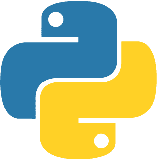


## 50 个 Python 技巧

## Python 入门

> 一直想尝试编程吗？不要再找借口了，因为 Python 是入门的完美方式！

Python 对于初学者和专家来说都是极好的编程语言。它的设计注重代码的可读性，使其成为初学者在熟悉各种编程概念时的绝佳选择。

- 该语言很流行，并拥有大量可用的库，允许程序员用相对较少的代码完成大量工作。
- 你可以用 Python 制作各种类型的应用程序：你可以使用 Pygame 框架编写简单的 2D 游戏，使用 GTK 库创建窗口应用程序，或者尝试一些更有野心的事情，例如使用 Python 的 Bluetooth 和 Input 库来捕获 USB 键盘的输入并将输入事件中继到 Android 手机的应用。

本指南将使用 Python 2.x，因为这是你的 Linux 发行版中最可能安装的版本。

在接下来的教程中，你将学习如何使用 Python 编程创建流行游戏。我们还会展示如何为这些游戏添加声音和人工智能。


## 快速入门 Python


## 你好，世界

让我们马上开始，而比程序员的最佳朋友“你好，世界”应用程序更好的方式是什么呢！首先，打开一个终端。它当前的工作目录将是你的主目录。建议为我们在本教程中要创建的文件创建一个目录，而不是让它们散落在你的主目录中。你可以使用命令 `mkdir Python` 创建一个名为 Python 的目录。然后，你需要使用命令 `cd Python` 切换到该目录。

下一步是使用命令 `touch` 加文件名创建一个空文件。我们的专家使用了命令 `touch hello_world.py`。设置文件的最后也是最关键的部分是使其可执行。这允许我们在 hello_world.py 文件中运行代码。我们使用命令 `chmod +x hello_world.py` 来执行此操作。现在文件已设置好，我们可以打开 nano 或任何你选择的文本编辑器进行编辑。Gedit 是一个支持语法高亮的优秀编辑器，在任何发行版上都应该可以获取到。如果你还没有安装它，可以使用你的包管理器进行安装。

```bash
[liam@liam-Laptop ~]$ mkdir Python
[liam@liam-Laptop ~]$ cd Python/
[liam@liam-Laptop Python]$ touch hello_world.py
[liam@liam-Laptop Python]$ chmod +x hello_world.py
[liam@liam-Laptop Python]$ nano hello_world.py
```

我们的“你好，世界”程序非常简单，只需要两行。第一行以“shebang”（符号 #! – 也称为 hashbang）开始，后面跟着 Python 解释器的路径。程序加载器使用这一行来确定其余行需要用哪种解释器。如果你正在像 IDLE 这样的 IDE 中运行此程序，不一定需要这样做。

实际上被 Python 解释器读取的代码只有一行。我们通过在调用 print 函数后立即在括号内放置 Hello World 的值，将该值传递给 print 函数。Hello World 被引号包围，以表明它是一个字面量值，不应被解释为源代码。正如预期的那样，Python 中的 print 函数会打印控制台传递给它的所有值。

你可以使用 `Ctrl+O` 组合键在 nano 中保存对文件所做的更改，然后按 `Enter`。使用 `Ctrl+X` 退出 nano。

```python
#!/usr/bin/env python2
print("Hello World")
```

你可以通过在文件名前加上 `./` 来运行“你好，世界”程序 – 在这种情况下，你输入：`./hello_world.py`。

```bash
[liam@liam-Laptop Python]$ ./hello_world.py
Hello World
```

> **提示**
> 如果你使用的是图形编辑器，如 gedit，那么你只需要执行将文件设为可执行的最后一步。你只需要将文件标记为可执行一次。文件可执行后，你可以自由编辑该文件。

## 变量和数据类型

变量是源代码中的一个名称，它与你用来存储数据的内存区域相关联，然后在代码中会被调用。数据可以是多种类型之一，包括：

| **整数** | 存储整数 |
| :--- | :--- |
| **浮点数** | 存储小数 |
| **布尔值** | 值可以是 True 或 False |
| **字符串** | 存储字符集合。“Hello World” 是一个字符串 |

除了这些主要数据类型外，还有序列类型（从技术上讲，字符串是一种序列类型，但由于使用非常普遍，我们将其归类为主要数据类型）：

| **列表** | 包含按特定顺序排列的数据集合 |
| :--- | :--- |
| **元组** | 包含按特定顺序排列的不可变数据集合 |

元组用于诸如坐标之类的对象，其中 x 和 y 值存储为单个变量，而列表通常用于存储较大的集合。元组中存储的数据是不可变的，因为你无法更改元组中单个元素的值。然而，你确实可以在列表中做到这一点。

了解 Python 的字典类型也很有用。字典是一种映射数据类型。它使用键值对来存储数据。这意味着你使用相应值对应的键来访问字典中存储的值，这与你使用列表的方式不同。在列表中，你会使用元素的索引（表示元素在列表中位置的数字）来访问列表元素。

让我们编写一个程序，用它来演示如何使用变量和不同的数据类型。在此处值得指出的是，在 Python 中你并不总是需要指定数据类型。你可以使用喜欢的编辑器自由创建此文件。只要你记得将文件设为可执行，一切都会正常运行。我们将把它命名为 `variables.py`。


## 解释型语言与编译型语言

像 Python 这样的解释型语言，其源代码在每次程序运行时都被转换为机器代码然后执行。这与像 C 这样的编译型语言不同，在编译型语言中，源代码只被转换为机器代码一次 – 生成的机器代码在每次程序运行时被执行。

下一行创建了一个名为 hello_int 的整型变量，其值为 21。注意它不需要放在引号内。

布尔值也遵循同样的原则。

我们以以下方式创建元组。

并以以下方式创建列表。

你也可以用以下方式创建相同的列表。

既然要创建，不妨顺便创建一个字典。注意我们是如何将下方对齐的冒号以使代码整洁。

注意，当我们打印该元素时，现在会出现两个感叹号。

在此处，解释 Python 文件中 `#` 字符后面的任何文本都会被解释器忽略是有用的。这样你就可以在代码中写注释了。

```python
#!/usr/bin/env python2

# 通过写入我们想要的变量名，
# 后面跟一个等号，等号后面跟我们要存储在
# 变量中的值，从而创建一个变量。例如，以下行创建了一个名为
# hello_str 的变量，包含字符串 'Hello World'。
hello_str = "Hello World"

hello_int = 21

hello_bool = True

hello_tuple = (21, 32)

hello_list = ["Hello", "this", "is", "a", "list"]

# 此列表现在包含 5 个字符串。注意这些字符串之间没有空格，
# 因此，如果你要将它们合并以构成一个句子，
# 你必须在每个元素之间添加一个空格。

hello_list = list()
hello_list.append("Hello")
hello_list.append("this")
hello_list.append("is")
hello_list.append("a")
hello_list.append("list")

# 第一行创建一个空列表，后续行使用列表类型的 append
# 函数向列表添加元素。当处理你预先知道的字符串时，
# 这种使用列表的方式并没有太大用处，但在处理动态数据（如
# 用户输入）时可能有用。此列表将覆盖第一个列表，不会有任何警告，
# 因为我们使用了与前一个列表相同的变量名。

hello_dict = {"first_name": "Liam",
              "last_name": "Fraser",
              "eye_colour": "Blue"}

# 让我们访问集合内部的一些元素
# 我们从更改 hello_list 中最后一个字符串的值开始，
# 并在末尾添加一个感叹号。"list" 字符串是列表中的第 5 个元素。
# 然而，Python 中的索引从零开始，这意味着
# 第一个元素的索引为 0。

print(hello_list[4])
hello_list[4] += "!"
# 上一行等同于
hello_list[4] = hello_list[4] + "!"
print(hello_list[4])
```

> “Python 文件中 # 字符后面的任何文本都会被忽略”

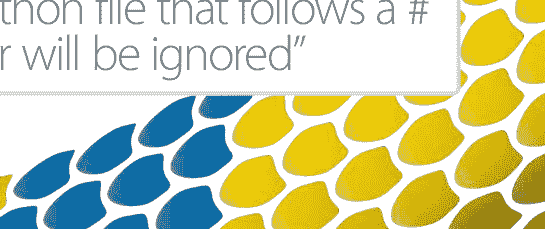

请记住元组是不可变的，尽管我们可以像这样访问它们的元素：

```python
print(str(hello_tuple[0]))
# 我们不能像刚才对列表那样更改这些元素的值
# 注意上面使用 str 函数，将元组内的整数值显式
# 转换为字符串然后再打印它。
```

让我们使用 hello_dict 中的数据创建一个句子：

```python
print(hello_dict["first_name"] + " " + hello_dict["last_name"] + " has " + hello_dict["eye_colour"] + " eyes.")
```

更整洁的做法是使用 Python 的字符串格式化器：

```python
print("{} {} has {} eyes.".format(hello_dict["first_name"], hello_dict["last_name"], hello_dict["eye_colour"]))
```

## 控制结构

在编程中，控制结构是任何可以更改代码执行路径的语句类型。例如，如果一个数字小于 5 就决定结束程序的控制结构看起来像这样：

```python
#!/usr/bin/env python2

import sys # 用于 sys.exit 函数

int_condition = 5

if int_condition < 6:
    sys.exit("int_condition must be >= 6")
else:
    print("int_condition was >= 6 – continuing")
```

代码执行的路径将取决于整数 int_condition 的值。只有当条件为真时，'if' 块中的代码才会被执行。import 语句用于加载 Python 系统库；后者提供了 exit 函数，允许你退出程序并打印错误信息。注意，缩进（在这种情况下每个缩进四个空格）用于指示代码块属于哪个语句。

'If' 语句可能是最常用的控制结构。其他控制结构包括：

- **'For'** 语句，允许你遍历集合中的项目，或将一段代码重复执行特定次数。
- **'While'** 语句，当条件为真时继续循环。

我们将编写一个接受用户输入的程序，以演示控制结构如何工作。我们将其命名为 **construct.py**。

'for' 循环使用当前值的本地副本，这意味着循环内的任何更改都不会对列表产生影响。然而，另一方面，'while' 循环直接访问列表中的元素，因此如果你愿意，你可以在那里更改列表。我们稍后会更详细地讨论变量作用域。上述程序的输出如下：

```bash
[liam@liams-laptop Python]$ ./construct.py
How many integers? 3
Please enter integer 1: 1
You must enter an integer
Please enter integer 1: 5
Please enter integer 2: 2
Please enter integer 3: 6
Using a for loop
5
2
6
Using a while loop
5
2
6
```

## 缩进详解

如前所述，缩进级别决定了代码块属于哪个语句。缩进在 Python 中是强制性的，而在其他语言中，使用花括号集来组织代码块。因此，使用一致的缩进风格至关重要。在 Python 中，通常使用四个空格来表示一级缩进。你可以使用制表符，但制表符定义不明确，尤其是如果你碰巧在多个编辑器中打开一个文件。

> “'for' 循环使用本地副本，因此循环中的更改不会影响列表”

## 关于 Python 列表的更多信息

Python 列表类似于其他语言中的数组。Python 中的列表或元组可以包含多种类型的数据，而其他语言中的数组通常不是这样。因此，我们建议你只在列表中存储相同类型的数据。由于列表数据处理方式的特性，这几乎总是应该做到这一点。


## 我们希望列表中包含的整数数量

```python
#!/usr/bin/env python2

# 我们将编写一个程序，要求用户输入任意数量的整数，将它们存储在集合中，
# 并演示该集合如何与各种控制结构一起使用。
import sys # 用于 sys.exit 函数
target_int = raw_input("多少个整数？")

# 此时，变量 target_int 包含用户输入内容的字符串表示形式。我们需要尝试将其
# 转换为整数，但要准备好处理如果它不是整数的错误。否则程序将崩溃。
try:
    target_int = int(target_int)
except ValueError:
    sys.exit("您必须输入一个整数")

# 一个用于存储整数的列表
ints = list()

# 这些用于跟踪我们当前拥有的整数数量
count = 0

# 继续请求输入整数，直到达到所需数量
while count < target_int:
    new_int = raw_input("请输入第 {0} 个整数:".format(count + 1))
    isint = False
    try:
        new_int = int(new_int)
        isint = True
    except:
        print("您必须输入一个整数")

# 只有当我们有一个整数时才继续。如果没有，我们将再次循环
# 注意下面我使用 ==，它与 = 不同。单个等号是赋值运算符，而双等号是
# 比较运算符。
if isint == True:
    # 将整数添加到集合中
    ints.append(new_int)
    # 将计数增加 1
    count += 1

# 此时，用户要么放弃，要么我们有一个装满整数的列表。我们可以在几种方式中循环遍历这些。第一种方式是使用 for 循环
print("使用 for 循环")
for value in ints:
    print(str(value))
```

## # 开始使用 Python

**提示**
如果你想在不传递任何变量的情况下调用函数，可以定义变量的默认值。你通过在变量名后面加一个等号来实现。例如

```python
# 或者使用 while 循环：
print("使用 while 循环")
# 我们在上面已经有了总数，但知道 len 函数非常有用。
total = len(ints)
count = 0
while count < total:
    print(str(ints[count]))
    count += 1
```

## 函数和变量作用域

函数在编程中用于将过程分解为更小的部分。这通常使代码更易于阅读。如果以特定方式设计，函数也可以重复使用。函数可以接受传入的变量。Python 中的变量始终是按值传递的，这意味着变量的副本被传递到函数中，并且仅在函数作用域内有效。在函数内部对原始变量所做的任何更改都将被丢弃。然而，函数也可以返回值，所以这不是问题。函数通过关键字 `def` 定义，后跟函数名。可以传入的任何变量都放在函数名后的括号中。多个变量由逗号分隔。在这些括号中赋予变量的名称是它们在函数作用域内的名称，无论传入函数的变量叫什么。让我们看看这个动作。

对面程序的输出如下：

> “函数在编程中用于将过程分解为更小”

我们现在位于 `modify_string` 函数的作用域之外，因为我们减少了缩进级别

测试字符串不会在这段代码中被更改

然而，我们可以这样调用函数

```python
#!/usr/bin/env python2

# 下面是一个名为 modify_string 的函数，它接受一个变量，该变量在函数作用域内
# 称为 original。在函数定义下方用 4 个空格缩进的任何内容都在作用域内。

def modify_string(original):
    original += " that has been modified."
    # 目前，只有此字符串的本地副本已被修改

def modify_string_return(original):
    original += " that has been modified."
    # 但是，我们可以将本地副本返回给调用者。函数在使用 return 语句时立即
    # 结束，无论它位于函数中的什么位置。
    return original

test_string = "This is a test string"
modify_string(test_string)
print(test_string)

test_string = modify_string_return(test_string)
print(test_string)
# 函数的返回值存储在变量 test_string 中，
# 覆盖了原始值，因此改变了打印出的值。
```

## # 开始使用 Python

```bash
[liam@liam-laptop Python]$ ./functions_and_scope.py
This is a test string
This is a test string that has been modified.
```

作用域是一个需要掌握的重要概念，否则可能会让你养成一些坏习惯。让我们快速编写一个程序来演示这一点。它将有一个名为 `cont` 的布尔变量，该变量将决定是否在 ‘if’ 语句中将数字赋值给变量。然而，该变量除了在 ‘if’ 语句的作用域外，在任何地方都没有定义。

我们将通过尝试打印该变量来完成。

```python
#!/usr/bin/env python2
cont = False
if cont:
  var = 1234
print(var)
```

在上面的代码段中，Python 会在打印之前将整数转换为字符串。然而，明确地将事物转换为字符串总是一个好主意 – 特别是当涉及到拼接字符串时。如果你试图在字符串和整数上使用 + 运算符，会出现错误，因为需要发生什么并不明确。+ 运算符通常会将两个整数相加。话虽如此，我们之前演示的 Python 字符串格式化器是执行此操作的更干净的方式。你看到问题了吗？`Var` 仅在 ‘if’ 语句的作用域中定义。这意味着当我们尝试访问 `var` 时会得到一个非常讨厌的错误。

```bash
[liam@liam-laptop Python]$ ./scope.py
Traceback (most recent call last):
  File "./scope.py", line 8, in <module>
  print var
NameError: name 'var' is not defined
```

如果将 `cont` 设置为 `True`，变量将被创建，我们可以正常访问它。然而，这是一种不好的做法。正确的方法是在 ‘if’ 语句的作用域之外初始化变量。

```python
#!/usr/bin/env python2

cont = False

var = 0
if cont:
  var = 1234

if var != 0:
  print(var)
```

变量 `var` 在比 ‘if’ 语句更广泛的作用域中定义，并且仍然可以由 ‘if’ 语句访问。在 ‘if’ 语句内部对 `var` 所做的任何更改都是更改较大作用域中定义的变量。此示例除了说明潜在问题外并没有做太多有用的事情，但最坏的情况已经从程序崩溃变为打印零。甚至那也不会发生，因为我们添加了一个额外的结构，在打印之前测试 `var` 的值。

## 编码风格

花一点时间谈谈编码风格是值得的。编写整洁的代码很简单。关键在于一致性。例如，你应该始终以相同的方式命名变量。无论你想使用 camelCase 还是像我们那样使用下划线，都没关系。一件关键的事情是为变量使用自文档标识符。你不应该不得不猜测一个变量的作用。与之相关的另一件事是始终注释你的代码。这将帮助任何阅读你代码的人，以及未来的你自己。在代码文件顶部放置一个简要总结，描述应用程序做什么，或者如果由多个文件组成，则描述应用程序的一部分，也很有用。

## 比较运算符

Python 中常见的比较运算符包括：

| 运算符 | 描述 |
| :--- | :--- |
| < | 严格小于 |
| <= | 小于或等于 |
| > | 严格大于 |
| >= | 大于或等于 |
| == | 等于 |
| != | 不等于 |

## 总结

本文应该已经向你介绍了 Python 编程的基础。希望你已经习惯了 Python 程序的语法、缩进以及整体外观和感觉。下一步是学习如何提出你想解决的问题，并将其分解为足够小的步骤，以便你能够在编程语言中实现。

谷歌或任何其他搜索引擎都非常有帮助。如果你在任何地方卡住了，或者有一个你不知道如何修复的错误消息，把它放进谷歌，你应该更接近解决你的问题。例如，如果我们搜索 ‘用 python 播放 mp3 文件’，第一个链接会将我们带到一个包含许多有用回复的 Stack Overflow 线程。不要害怕深入钻研 – 编程的真正乐趣在于一次解决一个可控块的问题。

快乐编程！


## 50 个必备 Python 命令

Python 以其高密度著称，拥有大量几乎可以执行任何操作的模块。在这里，我们将探讨每个人都必须了解的核心基础知识。Python 拥有一个庞大的额外模块环境，这些模块可以在数百个不同领域提供功能。然而，每种编程语言都有一个核心功能集，每个人都需要了解它才能完成有用的工作。Python 在这方面也不例外。在这里，我们将查看我们认为对 Python 编程至关重要的 50 个命令。其他人可能会选择略有不同的集合，但这个列表包含了最顶尖的内容。

我们将涵盖所有基本命令，从程序开始时导入额外模块到结束时向调用环境返回值。我们还将查看一些有助于了解 Python 当前会话的命令，例如已定义的变量列表以及内存是如何被使用的。

由于 Python 环境涉及使用大量额外模块，我们还将查看几个严格位于 Python 之外的命令。你将学习如何安装外部模块以及如何管理针对不同开发项目的多个环境。既然这是一个命令列表，就假设你已知晓如何使用循环和条件结构的基本方法。这篇文章旨在帮助你记住那些你以前见过的命令，并希望向你介绍一些你可能尚未见过的命令。

尽管我们已尽力将所有可能需要的内容打包进这 50 个技巧中，但 Python 是一门如此广泛的语言，因此一些命令未被涵盖。一旦你掌握了这些内容，请抽出时间来学习我们在这里未涵盖的那些命令。

```text
For help: View Search Terminal Help
Python Shell: python3(--)  Edit: 09 users, 22:59:05
Python version: 3.5
>>> import sys
>>> sys.version_info
major=3, minor=5, micro=3, releaselevel='final', serial=0
>>> import math
>>> math.__copyright__, math.__doc__
("", "LICENSE" for more information.
"Copyright (c) 2001-2014 Python Software Foundation.
All rights reserved.

This software may have been modified by Python contributors.
Copyright notice

Python 3.5.1 |Anaconda 2.4.1 (64-bit)| (default, Feb 15 2016, 22:25:29) [GCC 4.2.1 Compatible Apple LLVM 7.0.0 (clang-700.1.81)] on darwin
>>> import this
The Zen of Python, by Tim Peters
>>> help(import)
Help on built-in function __import__ in module builtins:
__import__(name, globals=None, locals=None, from list=(), level=0)
    Import a module.  The argument is the name of a module to be
    imported.  The optional argument globals provides the dictionary
    ...
```

### 01 导入模块

Python 的优势在于它可以通过模块进行扩展的能力。许多程序的第一步是导入你所需的模块。最简单的导入语句是直接调用 `import modulename`。在这种情况下，所提供的函数和对象不在通用命名空间中。你需要使用完整名称（`modulename.methodname`）来调用它们。你可以使用 `import modulename as mn` 命令来缩短 `modulename.` 部分。你可以使用 `from modulename import *` 命令从给定模块导入所有内容，从而完全跳过这个问题。然后你可以直接调用这些提供的功能。如果你只需要提供的项中的几个，可以通过用方法或对象名称替换 `*` 来选择性地导入它们。

### 02 重新加载模块

当模块首次被导入时，任何初始化函数都会在那时运行。这可能涉及创建数据对象或建立连接。但是，这在给定会话中仅执行一次。再次导入相同的模块不会重新执行任何初始化代码。如果你希望重新运行此代码，需要使用 reload 命令。格式为 `reload(modulename)`。需要牢记的一点是，前一次导入的字典不会被清空，而是会被覆盖。这意味着在导入和重新加载之间发生变化的任何定义都会正确更新。但是，如果你删除了一个定义，旧的定义仍会存在并可访问。可能会有其他副作用，因此请谨慎使用。

### 03 安装新模块

虽然我们查看的大多数命令都是需要在 Python 会话内执行的 Python 命令，但有几个必要的命令需要在 Python 外部执行。其中第一个是 pip。安装模块涉及下载源代码并编译包含的外部代码。幸运的是，可以在 http://pypi.python.org 找到包含数百个 Python 模块的仓库。你可以使用 `pip install modulename` 命令来安装新模块，而不必手动完成所有操作。该命令还会执行依赖项检查，并在安装你请求的模块之前安装任何缺失的模块。如果你希望将此新模块安装到计算机的全局库中，可能需要管理员权限。在 Linux 机器上，你只需使用 sudo 运行 pip 命令即可。否则，你可以通过添加命令行选项 `--user` 将其安装到你的个人库目录中。

> “市面上每一种编程语言都有一个核心功能集，每个人都需要了解它才能完成有用的工作。Python 也不例外。”

### 04 执行脚本

导入模块确实会运行模块文件内的代码，但它是通过 Python 引擎内的模块维护代码进行的。此维护代码还负责运行初始化代码。如果你只想获取一个 Python 脚本并在当前会话中执行其中的原始代码，可以使用 `execfile(filename.py)` 命令，其中主要选项是一个包含要加载和执行的 Python 文件的字符串。默认情况下，任何定义都会加载到当前会话的 locals 和 globals 中。你可以选择为 execfile 命令包括两个额外参数。这两个选项都是字典，一个用于不同的 locals 集合，另一个用于不同的 globals 集合。如果你只提供这样一个字典，则假定它是 globals 字典。此命令的返回值为 None。

### 05 增强型 Shell

默认交互式 shell 通过命令 `python` 提供，但功能相当有限。增强型 shell 由命令 `ipython` 提供。它为代码开发者提供了许多额外功能。一个完整的历史系统可供使用，不仅可以访问当前会话的命令，还可以访问以前会话的命令。还有提供增强型当前 Python 会话交互方式的 magic 命令。对于更复杂的交互，你可以创建和使用宏。你甚至可以轻松地查看 Python 会话的内存并反编译 Python 代码。你甚至可以创建配置文件，以处理每次使用 Python 时可能需要执行的初始化步骤。

### 06 评估代码

有时，你可能有以编程方式组装的代码块。如果这些代码片段作为字符串组装，你可以使用命令 `eval(code_string)` 来执行结果。代码字符串内的任何语法错误都会作为异常报告。默认情况下，此代码在当前会话内执行，使用当前的 globals 和 locals 字典。`eval` 命令还可以接受另外两个可选参数，你可以为 globals 和 locals 提供不同的字典集合。如果只有一个额外参数，则假定它是 globals 字典。你可以选择传入使用 compile 命令创建的代码对象，而不是代码字符串。此命令的返回值为 None。


## 50 个 Python 命令

### 07 断言值

在某个阶段，我们都需要调试试图编写的一些代码。其中一个有用的工具是断言的概念。`assert` 命令接受一个 Python 表达式，并检查它是否为真。如果是，则执行按正常流程继续。如果不是，则会引发断言错误（Assertion Error）。这样，你可以检查以确保代码中的不变量保持不变。通过这样做，你可以检查代码中做出的假设。你可以选择性地为 `assert` 命令包含第二个参数。这个第二个参数是一个 Python 表达式，如果在断言失败时执行。通常，这是某种详细的错误消息，会被打印出来。或者，你可能想要包含清理代码，以尝试从失败的断言中恢复。

### 08 映射函数

现代程序中常见的任务是将给定的计算映射到整个元素列表。Python 提供了 `map()` 命令来执行此操作。`map` 返回一个列表，该列表包含将函数应用于可迭代对象每个元素的结果。实际上，`map` 可以接受多个函数和多个可迭代对象。如果提供了多个函数，则返回一个元组列表，元组的每个元素包含来自每个函数的结果。如果传入多个可迭代对象，则 `map` 假设函数接受多个输入参数，因此它会从给定的可迭代对象中获取它们。这隐含地假设所有可迭代对象的大小相同，并且它们都是给定函数的必需参数。

### 09 虚拟环境

由于 Python 环境可能很复杂，有时最好设置一个干净的环境，在其中仅安装给定项目所需的模块。在这种情况下，你可以使用 `virtualenv` 命令来初始化这样的环境。如果你创建一个名为 `ENV` 的目录，你可以使用命令 `virtualenv ENV` 创建一个新环境。这将创建子目录 `bin`、`lib` 和 `include`，并用初始环境填充它们。然后通过执行脚本 `/ENV/bin/activate` 开始使用这个新环境，这将更改几个环境变量，例如 `PATH`。完成后，你可以执行脚本 `/ENV/bin/deactivate` 将 shell 的环境重置回先前的状态。这样，你可以拥有仅包含给定任务集所需模块的环境。

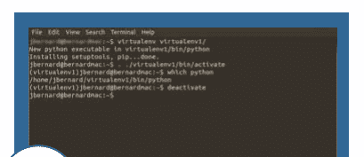

> “虽然严格来说它们不是命令，但每个人都需要知道如何处理循环。循环的两种主要类型是固定迭代次数循环（for）和条件循环（while）”

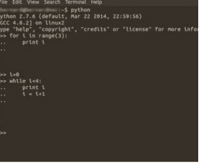

### 10 循环

虽然严格来说它们不是命令，但每个人都需要知道如何处理循环。循环的两种主要类型是固定迭代次数循环（for）和条件循环（while）。在 `for` 循环中，你遍历某个值序列，一次从列表中取出一个值并将其放入临时变量。你继续直到处理完每个元素或遇到 `break` 命令。在 `while` 循环中，只要某个测试表达式评估为 `True`，你就继续循环。

`while` 循环也可以通过使用 `break` 命令提前退出，你还可以使用 `continue` 命令在任一循环中选择性地停止当前迭代并移动到下一个，从而跳过代码片段。

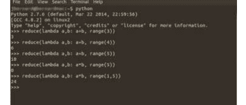

### 12 归约

在许多计算中，你需要执行的一种计算是归约操作。这是将你拥有的值列表缩减为单个值。在 Python 中，你可以使用命令 `reduce(function, iterable)` 将归约函数应用于列表中的每对元素。例如，如果你对前五个整数的列表应用求和归约操作，你将得到结果 `(((1+(2)+3)+4)+5)`。你可以选择性地添加第三个参数作为初始项。它在从可迭代对象中加载任何元素之前被加载，并且如果可迭代对象实际为空，则作为默认值返回。你可以使用 lambda 函数作为 `reduce` 的函数参数，以保持代码尽可能简洁。在这种情况下，请记住它应该只接受两个输入参数。

### 11 过滤

如果 `map` 命令为可迭代对象中的每个元素返回结果，那么 `filter` 仅在函数返回 `True` 值时返回结果。这意味着你可以创建一个新列表，其中仅使用满足某个条件的元素。例如，如果你的函数检查值是否为 0 到 10 之间的数字，那么它将创建一个不包含负数且不含大于 10 的数字的新列表。这可以用 `for` 循环完成，但这种方法更干净。如果提供给 `filter` 的函数是 `None`，则假设它是恒等函数。这意味着仅返回评估为 `True` 的元素作为新列表的一部分。`itertools` 模块中有 `filter` 的可迭代版本。

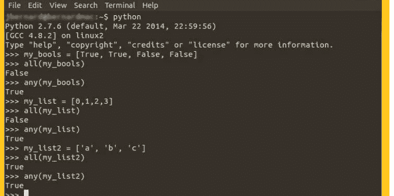

### 13 列表有多大真值？

在某些情况下，你可能在列表中收集了可以评估为 `True` 或 `False` 的多个元素。例如，也许你通过计算运行了多种可能性，并创建了一个通过测试的列表。你可以使用命令 `any(list)` 来检查列表中是否有元素为真。如果你需要检查*所有*元素是否都为 `True`，你可以使用命令 `all(list)`。这两个命令在相关条件满足时返回 `True`，不满足时返回 `False`。然而，如果可迭代对象为空，它们的行为会不同。命令 `all` 在可迭代对象为空时返回 `True`，而命令 `any` 在给定空可迭代对象时返回 `False`。

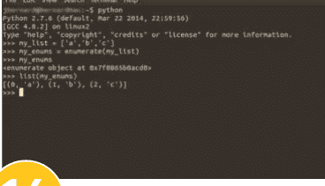

### 14 枚举

有时，我们需要将可迭代对象中驻留的元素及其索引标记起来，以便在稍后的点进行处理。你可以通过显式循环遍历每个元素并构建一个枚举列表来实现。`enumerate` 命令在一行中完成了这一点。它接受一个可迭代对象并创建一个元组列表作为结果。每个元组包含元素的 0 基索引，以及元素本身。你可以选择性地通过包含可选的第二个参数从其他值开始索引。例如，你可以使用命令 `list(enumerate(names, start=10))` 来枚举名称列表。在这个例子中，我们决定从 1 而不是 0 开始索引。

### 15 强制转换

Python 中的变量没有类型信息，因此可以存储任何类型的对象。然而，实际数据是某种特定类型。许多运算符，如加法，假设输入值是相同类型的。很多时候，你使用的运算符足够智能，可以完成所需的类型转换。如果你需要显式地将数据从一种类型转换为另一种类型，有一类函数可以执行此转换过程。你最可能使用的那些是 `abs`、`bin`、`bool`、`chr`、`complex`、`float`、`hex`、`int`、`long` 和 `str`。对于基于数字的转换函数，存在一种偏好顺序，其中某些类型是其他类型的子集。例如，整数比浮点数*低*。向上转换时，最终值不应发生变化。向下转换时，通常会丢失一定数量的信息。例如，在从浮点数转换为整数时，Python 向零截断数字。

### 16 这是什么？

Python 中的一切都是对象。你可以使用命令 `isinstance(object, class)` 检查该对象是哪个类的实例。该命令返回一个布尔值。

### 17 它是子类吗？

命令 `issubclass(class1, class2)` 检查 `class1` 是否为 `class2` 的子类。如果 `class1` 和 `class2` 相同，则返回 `True`。

### 18 全局对象

你可以使用命令 `globals()` 获取当前模块的全局符号表的字典。

### 19 局部对象

你可以使用命令 `locals()` 访问当前局部符号表的更新字典。

### 20 变量

函数 `vars(dict)` 返回对象的可写元素。如果你使用 `vars()`，它的行为类似于 `locals()`。

### 21 创建全局

你可以使用命令 `globals(names)` 将名称列表解释为整个代码块的全局变量。

### 22 非局部

在 Python 3.x 中，你可以使用命令 `nonlocal names` 访问最近封闭作用域中的名称，并将其绑定到局部作用域。

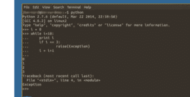

### 23 抛出异常

当你识别出错误条件时，你可以使用 `raise` 命令抛出异常。你可以包含异常类型和一个值。

### 24 处理异常

异常可以在 try-except 构造中被捕获。如果 try 块中的代码引发异常，except 块中的代码将得到执行。

### 25 静态方法

你可以使用命令 `staticmethod(function_name)` 创建一个静态方法，类似于 Java 或 C++ 中的静态方法。


## 50 Python 命令

### 26 区间（Ranges）

你可能需要一个数字列表，也许用于 *for* 循环。命令 `range()` 可以创建一个可迭代的整数列表。如果只提供一个参数，它将从 0 计数到给定的数字。你可以提供可选的起始数字以及步长。负数会倒着计数。

### 27 生成区间（Xranges）

区间（ranges）的一个问题是，所有元素都需要预先计算并存储在内存中。命令 `xrange()` 接受相同的参数并提供相同的结果，但只有在需要时才计算下一个元素。

### 28 迭代器（Iterators）

迭代是一种非常 Pythonic 的做法。对于本身不可迭代的对象，你可以使用命令 `iter(object_name)` 来包装你的对象，从而为其他函数和操作符提供一个可迭代接口。

### 29 排序列表

你可以使用命令 `sorted(list)` 来对列表中的元素进行排序。你可以给它一个自定义的比较函数，对于更复杂的元素，还可以包含一个键函数，该函数从每个元素中提取一个排名属性用于比较。

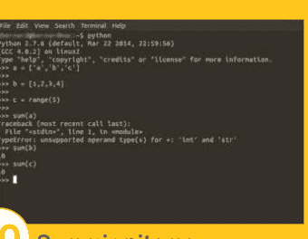

### 30 求和

在上面，我们看到了通用的归约函数 reduce。归约操作的一种特定类型——求和——足够常见，因此引入了一个特例，即命令 `sum(iterable, object)`。你可以在此处包含第二个参数，以提供初始值。

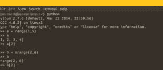

### 31 使用模块（With modules）

`with` 命令提供了一种使用上下文管理器定义的方法包裹代码块的能力。当某段代码在数月后仍需要被阅读时，这有助于清理代码并提高可读性。使用 `with` 的一个经典示例是在处理文件时。你可以使用类似 `with open("myfile.txt", "r")` as f 的语法。这将打开文件并准备读取。然后你可以在代码块中使用 `data=f.read()` 读取文件。这样做的最大好处是，无论原因如何，当退出代码块时，文件会自动关闭。因此，即使代码块抛出异常，你也不必担心在异常处理器中关闭文件。如果你有更复杂的 `with`，例如，你可以创建一个上下文管理器类来提供帮助。

### 32 打印（Printing）

向用户获取输出最直接的方式是使用 print 命令。这将把文本发送到控制台窗口。如果你使用的是 Python 2.X 版本，有几种方式使用 print 命令。最常见的方式是直接调用它，如 `print "Some text"`。你也可以使用与其他任何函数相同的语法来使用 print。因此，上述示例将看起来像 `print("Some text")`。这是 3.X 版本中唯一可用的形式。如果使用函数语法，你可以添加额外的参数以获得对该输出的更精细控制。例如，你可以提供参数 `file=myfile.txt`，使 print 命令的输出写入给定的文本文件。它还可以接受任何具有字符串表示形式的对象。

> “使用 'with' 的一个经典示例是在处理文件时。这样做的最大好处是，无论原因如何，当退出代码块时，文件会自动关闭”

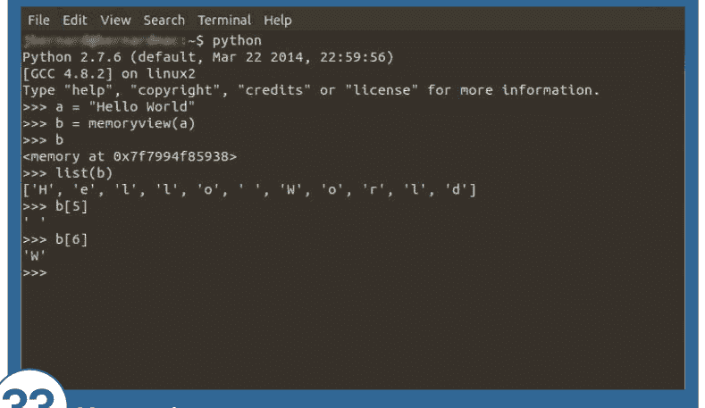

### 33 Memoryview

有时，你需要访问某个对象的原始数据，通常作为字节缓冲区。例如，你可以复制这些数据并将其放入 bytearray 中。但这意味着你将使用额外的内存，对于大型对象，这可能不是一个选项。命令 `memoryview(object_name)` 包装传入命令的对象，并提供对原始字节的访问接口。它以每次一个元素的方式提供对这些字节的访问。在许多情况下，元素的大小为一个字节。但根据对象详情，你可能会得到更大的元素。你可以通过属性 `itemsize` 了解元素的大小（以字节为单位）。一旦创建了你的内存视图，你就可以像从列表中获取元素一样访问单个元素（例如 item_view[1]）。

### 34 文件（Files）

在处理文件时，你需要创建一个文件对象来与之交互。file 命令接受包含文件名和位置的字符串，并创建一个文件对象实例。然后你可以调用文件对象的方法，如 `open`、`read` 和 `close`，以从文件中获取数据。如果你正在处理文件，也可以使用 `readline` 方法。在打开文件时，有一个显式的 `open()` 命令来简化过程。它接受一个包含文件名的字符串，以及一个可选参数，该参数是一个定义模式的字符串。默认是以只读方式打开文件（`r`）。你也可以以写入（`w`）和追加（`a`）方式打开文件。打开文件后，会返回一个文件对象，以便你进一步与其交互。然后你可以读取它、写入它，最后关闭它。

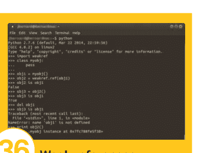

### 35 生成（Yielding）

在许多情况下，一个函数可能需要将执行控制权 **yield（让出）** 给另一个函数。生成器的情况就是这样。生成器的首选方法是，它只在通过 `next()` 方法请求时才计算下一个值。命令 `yield` 保存生成器函数的当前状态，并将执行控制权返回给调用函数。这样，生成器的保存状态会被重新加载，生成器从上次停止的地方继续，以计算下一个请求的值。这样，你不需要有足以存储计算下一个所需值的最小内存，而无需一次性在内存中存储所有可能的值。

### 36 弱引用（Weak references）

有时你需要保持对某个对象的引用，但仍需能够根据需要销毁它。**弱引用** 是可以被垃圾回收器忽略的一种引用。如果对象剩余的引用都是弱引用，则允许垃圾回收器销毁该对象并回收空间用于其他用途。这在处理缓存或大型数据集映射时非常有用，这些数据集不一定需要保留在内存中。如果一个被弱引用的对象最终被销毁，而你试图访问它，它将表现为 `None`。你可以测试这种状态，然后如果你认为有必要，可以重新加载数据。

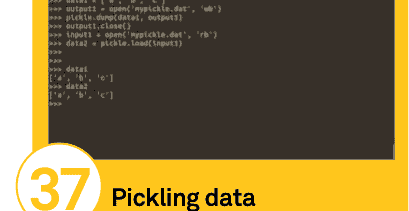

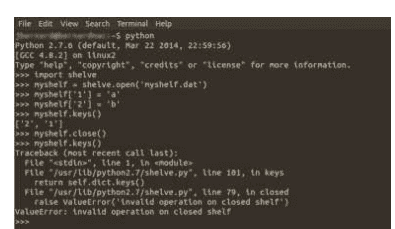

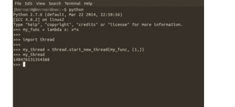

### 37 序列化数据（Pickling data）

当你需要将结果检查点保存到磁盘时，有几种不同的序列化内存的方法。其中之一称为 pickling（序列化/腌渍）。Pickle 实际上是一个完整的模块，而不仅仅是一个命令。要将数据存储到硬盘上，你可以使用 `dump` 方法将数据写出。当你想在未来的某个时刻重新加载相同的数据时，可以使用 `load` 方法将数据读入并反序列化。Pickle 的一个问题是它的速度，或者缺乏速度。有一个第二模块 `cPickle`，提供相同的基本功能。但由于它是用 C 编写的，它可以快多达 1000 倍。需要注意的一件事是，pickle 不存储对象的任何类信息，只存储其实例信息。这意味着当你对对象进行反序列化时，如果类定义在此期间发生了变化，它可能具有不同的方法和属性。

### 38 搁置数据（Shelving data）

虽然 pickling 允许你保存数据并重新加载，但有时你需要在 Python 会话中具有更有结构的对象持久性。使用 `shelve` 模块，你可以创建一个对象存储，基本上任何可以序列化的东西都可以存储在那里。磁盘存储的后端可以由几种系统之一处理，例如 `dbm` 或 `gdbm`。一旦你打开了一个 shelf，你就可以使用键值对对其进行读写。当你这样做时，你需要确保显式关闭 shelf，以便与文件存储同步。由于数据可能在后端数据库中的存储方式，最好在 Python 的 `shelve` 模块之外不要打开相关文件。你也可以将 shelf 打开为 `writeback` 设置为 `True`。如果是这样，你可以显式调用 `sync` 方法将缓存的更改写出。

### 39 线程（Threads）

你可以在 Python 中执行多个线程。`thread` 命令可以为你创建一个新的执行线程。它遵循与 POSIX 线程相同的技术。当你第一次创建线程时，你需要传入一个函数名称，以及该函数所需的任何参数。需要记住的一件事是，这些线程的行为就像 POSIX 线程一样。这意味着几乎所有事情都是程序员的责任。你需要处理互斥锁（使用 `acquire` 和 `release` 方法），并使用 `allocate_lock` 方法创建原始的互斥锁。完成后，你需要 `exit` 线程，以确保它被正确清理且没有资源遗留。你还可以对线程进行细粒度控制，例如设置新线程的栈大小。


## 50 个 Python 命令

### 40 输入数据

有时，你需要从最终用户那里收集输入。命令 `input()` 可以接受一个提示字符串并将其显示给用户，然后等待用户输入响应。一旦用户完成输入并按下回车键，文本就会返回给你的程序。如果在调用 input 之前加载了 readline 模块，你将获得增强的行编辑和历史记录功能。该命令首先通过 eval 处理文本，因此可能会引发未捕获的错误。如果你对此有疑虑，可以使用命令 `raw_input()` 来跳过这个问题。该命令只是简单地返回用户输入的未修改的字符串。同样，你可以使用 readline 模块来获得增强的行编辑功能。

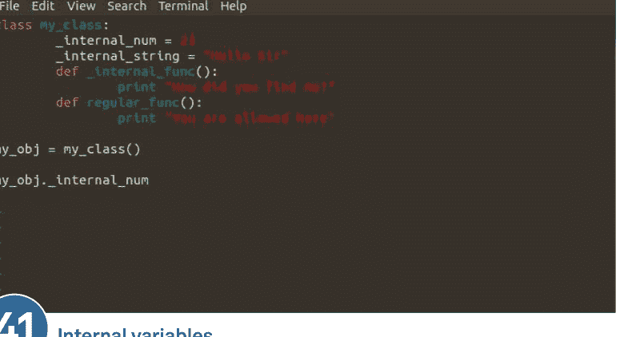

### 41 内部变量

对于来自其他编程语言的人来说，有一个概念是某些变量或方法仅在对象内部可用。在 Python 中，没有这样的概念。对象的所有元素都是可访问的。不过，有一条风格规则可以模拟这种行为。任何以下划线开头的名称都被期望被视为内部名称，并保持在对象内部私有。然而，它们并没有被隐藏，对于这些变量或方法也没有显式的保护。程序员有责任尊重类作者的意图，并不修改这些内部名称。尽管如果必要的话，你自由地做这些类型的更改。

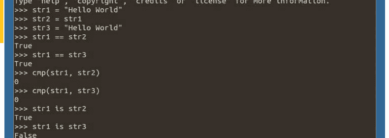

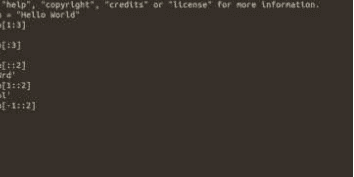

### 42 比较对象

在 Python 中有几种比较对象的方法，也有一些注意事项。首先，你可以在对象之间测试两种关系：相等性和同一性。如果你在测试同一性，你是在测试两个名称是否实际上指向同一个实例对象。这可以通过命令 `cmp(obj1, obj2)` 完成。你也可以使用 `is` 关键字来测试此条件。例如，`obj1 is obj2`。如果你在测试相等性，你是在测试两个名称所引用的对象中的值是否相等。这个测试由运算符 `==` 处理，如 `obj1 == obj2`。对于更复杂的对象，测试相等性可能会变得复杂。

### 43 切片

虽然切片并不是真正的命令，但在这个基本命令列表中不提这个概念是不可思议的，因为它非常重要。在数据结构（如列表）中索引元素是 Python 中最常见的操作之一。通过给出单个索引值，你可以选择单个元素。更有趣的是，通过给出起始索引和结束索引（用冒号分隔），你可以选择一个元素范围。这将作为新的列表返回，你可以将其保存在新的变量名中。你甚至可以改变步长，允许你跳过一定数量的元素。因此，你可以使用切片 `a[1::2]` 从列表 `a` 中抓取每个奇数元素。这从索引 1 开始，持续到末尾，并每隔 2 个索引值步进一次。切片可以使用负索引值。如果你这样做，那么它们将从列表末尾开始向前计数。

“Python 是一种解释型语言，这意味着你编写的源代码需要被编译成字节代码格式。然后这种字节代码被送入实际的 Python 引擎”

```python
File Edit View Search Terminal Help
$python

Python 2.7.6 (default, Mar 22 2014, 22:59:56)
[GCC 4.8.2] on linux2
Type "help", "copyright", "credits" or "license" for more information.

>>> sqrl = lambda x: x*x
>>> sqrl(10)
100
>>> sqrl(6)
36
>>> def gen_func(x):
...     return lambda y: y**x
... 
>>> cubic = gen_func(3)
>>> cubic(2)
8
>>> 
```

### 44 Lambda 表达式

没有对它们的引用。其中一个例子是 lambda 表达式。使用它，你可以创建一个匿名函数。这允许你在 Python 中使用函数式编程技术。其格式是关键字 'lambda'，后跟参数列表，然后是冒号和函数代码。例如，你可以使用 'lambda x: x*x' 构建自己的函数来对数字进行平方。然后你可以拥有一个能够以编程方式创建新函数并将其返回给调用代码的函数。凭借这种能力，你可以创建函数生成器，以实现自修改程序。唯一的限制是它们局限于单个表达式，因此你无法生成非常复杂的函数。

### 45 编译代码对象

Python 是一种解释型语言，这意味着你编写的源代码需要被编译成字节代码格式。然后这种字节代码被送入实际的 Python 引擎以逐条执行指令。在你的程序中，你可能需要控制将代码转换为字节代码并运行结果的过程。也许你希望构建自己的 REPL。命令 'compile()' 接受一个包含 Python 代码集合的字符串对象，并返回一个代表此代码字节代码翻译的对象。然后可以处理这个新对象到 'eval()' 或 'exec()' 中实际运行。你可以使用参数 'mode=' 告诉 compile 正在编译什么类型的代码。'single' 模式是单个语句，'eval' 是单个表达式，'exec' 是整个代码块。

```python
File Edit View Search Terminal Help
$python

Python 2.7.6 (default, Mar 22 2014, 22:59:56)
[GCC 4.8.2] on linux2
Type "help", "copyright", "credits" or "license" for more information.

>>> "hi".capitalize()
'Hi'
>>> 
```

### 46 `__init__` 方法

当你创建一个新的类时，你可以包含一个私有初始化方法，当类的新实例被创建时调用该方法。当新对象实例需要向新对象加载一些数据时，这个方法很有用。

### 47 `__del__` 方法

当实例对象即将被销毁时，会调用 `__del__` 方法。这给了你进行任何可能需要清理工作的机会。这可能是关闭文件，或断开网络连接。在此代码完成后，对象最终被销毁，资源被释放。

```python
File Edit View Search Terminal Help
$python

>>> class MyObject(object):
...     def __init__(self):
...         print "MyObject was initialised"
...     def __del__(self):
...         print "MyObject was deleted"
... 
>>> o = MyObject()
MyObject was initialised
>>> del o
MyObject was deleted
>>> 
```

### 48 退出你的程序

有两个伪命令可用于退出 Python 解释器：'exit()' 和 'quit()'。它们都接受一个可选参数，该参数用于设置进程的退出代码。如果你想从脚本中退出，最好使用 sys 模块中的 exit 函数 (sys.exit(x_code))。

### 49 返回值

函数可能需要向调用函数返回某个值。由于基本上没有名称具有类型，这也包括函数。因此，函数可以使用 'return' 命令向调用者返回任何对象。

```python
File Edit View Search Terminal Help
$python

Python 2.7.6 (default, Mar 22 2014, 22:59:56)
[GCC 4.8.2] on linux2
Type "help", "copyright", "credits" or "license" for more information.

>>> sqrl = lambda x: x*x
>>> sqrl(10)
100
>>> sqrl(6)
36
>>> 
```

### 50 字符串连接

我们将以最常见列表中的开头内容结束——字符串连接。构建字符串最简单的方法是使用 "+" 运算符。如果你想包含其他项目，比如数字，可以使用 str() 转换函数将其转换为字符串对象。

## Python 基础

> “Python 是最流行的编程语言之一”

- **26** 50 个 Python 技巧
  - Python 用户的基础知识
- **32** 编写石头剪刀布代码
  - 让基础编码付诸行动
- **38** 编写猜词游戏
  - 使用 Python 制作经典游戏
- **44** 玩扑克骰子
  - 测试你的运气和你的编程
- **50** 创建图形界面
  - 为你的项目添加界面
- **56** 为游戏带来图形
  - 为简单游戏添加图像
- **62** Python 嵌入 C
  - 在你常用的 C 中使用 Python 代码

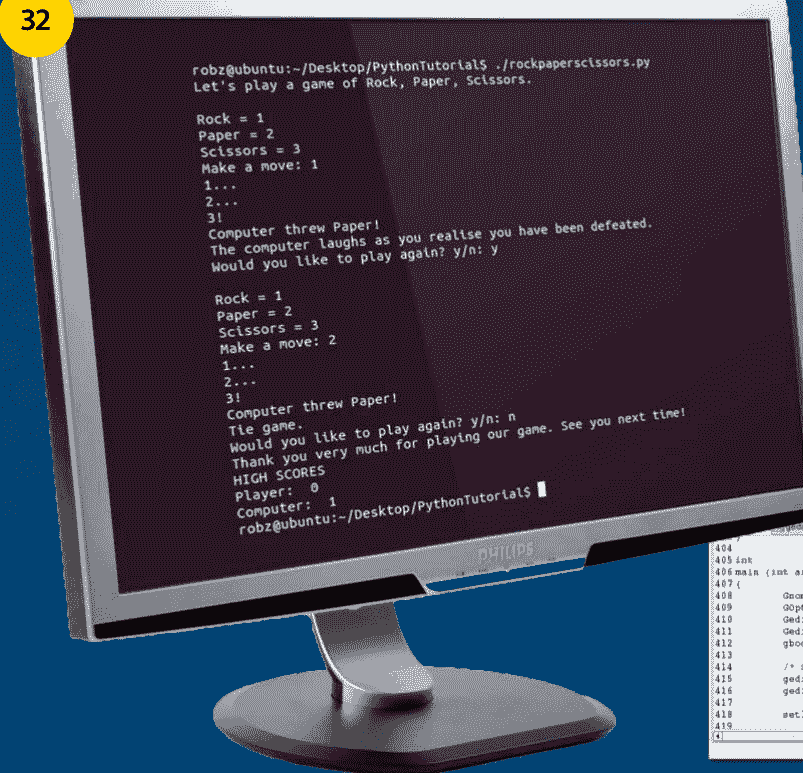

```
robo2@ubuntu:~/Desktop/PythonTutorials$ ./rockpaperscissors.py
Let's play a game of Rock, Paper, Scissors.

Rock = 1
Paper = 2
Scissors = 3
Make a move: 1
1...
2...
3!
Computer threw Paper!
The computer laughs as you realise you have been defeated.
Would you like to play again? y/n: y

Rock = 1
Paper = 2
Scissors = 3
Make a move: 2
1...
2...
3!
Computer threw Paper!
Tie game.
Would you like to play again? y/n: n
Thank you very much for playing our game. See you next time!
HIGH SCORES
Player: 0
Computer: 1
robo2@ubuntu:~/Desktop/PythonTutorials$
```

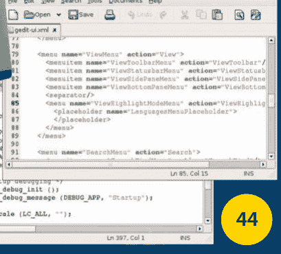


## 50 个 Python 技巧

### 基础
Python 是一种编程语言，能让你更快地工作并更有效地集成你的系统。如今，Python 是开源领域最受欢迎的编程语言之一。四处看看，你会发现它无处不在，从各种配置工具到 XML 解析。这里收集了 50 个精华技巧，让 Python 体验更有价值...

### 01 运行 Python 脚本
在大多数 UNIX 系统上，你可以从命令行运行 Python 脚本。
```bash
$ python myprogram.py
```

### 02 在 Python 解释器中运行 Python 程序
Python 交互式解释器使得尝试你的编程第一步和使用所有 Python 命令变得容易。你只需在命令提示符 (>>>) 处逐个发出每条命令，答案会立即显示。

**通过发出以下命令可以启动 Python 解释器：**
```bash
$ python

kunal@ubuntu:~$ python
Python 2.6.2 (release26\maint, Apr 19 2009, 01:56:41)
[GCC 4.3.3] on linux2
Type "help", "copyright", "credits" or "license" for more information.
>>> <type commands here>
```

**在本文中，所有以 >>> 符号开头的代码都是在 Python 提示符下输入的意思。** 也很重要的一点是记住 Python 对制表符 (tab) 非常严格 – 所以如果你收到任何提及制表符的错误，请修正制表符间距。

### 03 动态类型
在 Java, C++ 和其他静态类型语言中，你必须指定函数返回值的类型和每个函数参数的类型。Python 是一种动态类型语言；你从不需明确指定任何事物的数据类型。根据你赋的值，Python 会在内部跟踪数据类型。

### 04 Python 语句
Python 使用回车符 (carriage returns) 来分隔语句，并使用冒号和缩进来分隔代码块。大多数编译型编程语言，如 C 和 C++，使用分号来分隔语句，使用花括号来分隔代码块。

### 05 == 和 = 运算符
Python 使用 '==' 进行比较，使用 '=' 进行赋值。Python 不支持内联赋值，所以当你实际想比较时，没有意外赋值的风险。

### 06 拼接字符串
你可以使用 '+' 来拼接字符串。
```python
>>> print 'kun'+'al'
kunal
```

### 07 __init__ 方法
当类的对象被实例化时，__init__ 方法就会立即运行。这个方法对于你想对对象进行的任何初始化都非常有用。__init__ 方法类似于 C++、C# 或 Java 中的构造函数。

**示例：**
```python
class Person:
    def __init__(self, name):
        self.name = name
    def sayhi(self):
        print 'Hello, my name is', self.name

p = Person('Kunal')
p.sayhi()
Output:
[$~$src/python $:] python inithethod.py
Hello, my name is Kunal
```

### 08 模块
为了让你的程序随着规模增长而保持可管理，你可能希望将它们分成几个文件。Python 允许你将多个函数定义放入一个文件，并将其作为一个模块导入到其他脚本和程序中。这些文件必须具有 .py 扩展名。

**示例：**
```python
# file my_function.py
def mimax(a, b):
    if a <= b:
        min, max = a, b
    else:
        min, max = b, a
    return min, max

Module Usage
import my_function
```

```python
x, y = my_function.mimax(25, 6.3)
```

### 09 模块定义的名称
**示例：**
可以使用内置函数 'dir()' 来查找模块定义了哪些名称。它返回一个排序好的字符串列表。
```python
>>> import time
>>> dir(time)
['__doc__', '__file__', '__name__',
'__package__', 'accept2dyear',
'altzone', 'asctime', 'clock',
'ctime', 'daylight', 'gmtime',
'localtime', 'mktimes', 'sleep',
'strftime', 'srptime', 'struct_',
'time', 'timezone', 'tzname',
'tzset']
```

### 10 模块内部文档
你可以通过查看 __doc__ 来查看模块名称的内部文档（如果可用）。

**示例：**
```python
>>> import time
>>> print time.clock.__doc__
clock() -> floating point number
```
此示例返回自进程开始或自首次调用 clock() 以来的 CPU 时间或实际时间。这具有系统记录所能达到的最大精度。

### 11 向 Python 脚本传递参数
Python 允许你传递任何你在调用脚本时传递的内容。'command line' 内容存储在 sys.argv 列表中。
```python
import sys
print sys.argv
```

### 12 在启动时加载模块或命令
你可以使用环境变量 $PYTHONSTARTUP 在启动任何 Python 脚本时加载预定义的模块或命令。你可以将环境变量 $PYTHONSTARTUP 设置为一个包含加载必要模块或命令指令的文件。

### 13 将字符串转换为日期对象
你可以使用 'DateTime' 函数将字符串转换为日期对象。

**示例：**
```python
from DateTime import DateTime
dateobj = DateTime(string)
```

### 14 将列表转换为字符串用于显示
你可以用以下任一方式将列表转换为字符串。

**方法 1：**
```python
>>> mylist = ['spam', 'ham', 'eggs']
>>> print ', '.join(mylist)
spam, ham, eggs
```

**方法 2：**
```python
>>> print '\n'.join(mylist)
spam
ham
eggs
```

### 15 Python 解释器中的标签补全
你可以通过在 Python 文件（或 Python 在启动时读取的文件）中添加这些行来实现 Python 解释器内的自动补全：
```python
import rlcompleter, readline
readline.parse_and_bind('tab: complete')
```
这样，当你按下 Tab 键时，Python 会补全部分输入的函数、方法和变量名称。

### 16 Python 文档工具
你可以使用以下命令弹出搜索 Python 文档的图形界面：
```bash
$ pydoc -g
```
你需要 python-tk 包才能使其正常工作。

### 17 Python 文档服务器
你可以在本机上的指定端口启动一个 HTTP 服务器。这将为你提供美观访问所有 Python 文档的方式，包括第三方模块文档。
```bash
$ pydoc -p <portNumber>
```

### 18 Python 开发软件
有很多工具可以协助 Python 开发工作。以下是其中几个重要的：
- **IDLE:** Python 内置 IDE，具有自动补全、函数签名弹出帮助和文件编辑功能。
- **IPython:** 另一个增强的 Python shell，具有标签补全和其他功能。
- **Eric5:** 一个具有自动补全、类浏览器、内置 shell 和调试器的 GUI Python IDE。
- **WingIDE:** 商业 Python IDE，向世界各地的开源开发者提供免费许可证。

### 19 在 Python 解释器终止时执行函数
你可以使用 `atexit` 模块在 Python 解释器终止时执行函数。

**示例：**
```python
def sum1():
    print(4+5)

def message():
    print("Executing Now")

import atexit
atexit.register(sum1)
atexit.register(message)
```

**输出：**
```
Executing Now
9
```

### 20 将整数转换为二进制、十六进制和八进制
使用 `bin()`、`hex()` 和 `oct()` 分别将整数转换为二进制、十六进制和八进制格式。

**示例：**
```python
>>> bin(24)
'0b11000'
>>> hex(24)
'0x18'
>>> oct(24)
'030'
```

### 21 将任何字符集转换为 UTF-8
你可以使用以下函数将任何字符集转换为 UTF-8。

```python
data.decode("input_charset_here").encode("utf-8")
```

### 22 从列表中去除重复项
如果你想从列表中去除重复项，只需将每个元素作为键放入一个字典中（例如以 'none' 为值），然后检查 dict.keys()。

```python
from operator import itemgetter

def distinct(l):
    d = {}
    map(lambda x: d.__setitem__(x, None), l)
    return d.keys()
```

### 23 Do-while 循环
由于 Python 没有 do-while 或 do-until 循环构造（目前），你可以使用以下方法达到类似的效果：

```python
while True:
    do_something()
    if condition():
        break
```

### 24 检测系统平台
为了执行平台特定的功能，检测 Python 解释器正在运行的平台非常有用。你可以使用 `sys.platform` 来查找当前平台。

**示例：**

**在 Ubuntu Linux 上**
```python
>>> import sys
>>> sys.platform
'linux2'
```

**在 Mac OS X Snow Leopard 上**
```python
>>> import sys
>>> sys.platform
'darwin'
```

### 25 禁用和启用垃圾回收
有时你可能想在运行时启用或禁用垃圾回收器。你可以使用 `gc` 模块来启用或禁用垃圾回收。

**示例：**
```python
>>> import gc
>>> gc.enable()
<builtin-function enable>
>>> gc.disable()
<builtin-function disable>
```

### 26 使用基于 C 的模块以获得更好的性能
许多 Python 模块都附带了相应的 C 模块。使用这些 C 模块在复杂应用中会显著提升性能。

**示例：**
使用 CPickle 代替 Pickle，使用 cStringIO 代替 StringIO。

### 27 计算任意列表或可迭代对象的最大值、最小值和总和
你可以使用以下内置函数。
- **max**: 返回列表中的最大元素。
- **min**: 返回列表中的最小元素。
- **sum**: 此函数返回列表中所有元素的总和。它接受一个可选的第二个参数：求和时的起始值（默认为 0）。

### 28 表示分数
可以使用以下构造函数创建 Fraction 实例：

```python
Fraction([numerator [, [denominator]]])
```

### 29 执行数学运算
这些操作适用于整数和浮点数，但不适用于复数。对于复数，使用一个单独的模块，称为 `cmath`。

**例如：**
```python
math.acos(x): Return arc cosine of x.
math.cos(x): Return cosine of x.
math.factorial(x) : Returns x factorial.
```

### 30 处理数组
`array` 模块提供了一种在程序中使用数组的高效方式。`array` 模块定义了以下类型：

```python
array(typecode [, initializer])
```

一旦你创建了一个数组对象，比如 `myarray`，你可以对其应用许多方法。以下是其中几个重要的：
- `myarray.count(x)` : 返回 x 在 a 中出现的次数。
- `myarray.extend(x)` : 在数组末尾追加 x。
- `myarray.reverse()`: 反转数组的顺序。

### 31 对项进行排序
以下函数对列表进行排序。

```python
bisect.insert(list, item [, low [, high]])
```
将 item 以排序顺序插入列表。如果 item 已经在列表中，新条目将插入到任何现有条目的右侧。

```python
bisect.insort_left(list, item [, low [, high]])
```
将 item 以排序顺序插入列表。如果 item 已经在列表中，新条目将插入到任何现有条目的左侧。


## 32 使用基于正则表达式的搜索

你可以使用 `re.search()` 函数配合基于正则表达式的模式。请查看下面的示例。

```python
>>> import re
>>> s = "Kunal is a bad boy"
>>> if re.search("K", s): print "Match!" # char literal
Match!
>>> if re.search("[A-Z]", s): print "Match!" # char class
# match either at-sign or capital letter
Match!
>>> if re.search("\d", s): print "Match!" # digits class
```

## 33 处理 bzip2 (.bz2) 压缩格式

你可以使用 `bz2` 模块通过 bzip2 压缩算法来读取和写入数据。
- `bz2.compress()`：用于 bz2 压缩
- `bz2.decompress()`：用于 bz2 解压缩

```python
# File: bz2-example.py
import bz2
MESSAGE = "Kunal is a bad boy"
compressed_message = bz2.compress(MESSAGE)
decompressed_message = bz2.decompress(compressed_message)
print "original:", repr(MESSAGE)
print "compressed message:", repr(compressed_message)
print "decompressed message:", repr(decompressed_message)

# Output:
# [~/src/python $:] python bz2-example.py
# original: 'Kunal is a bad boy'
# compressed message: 'Bzh1A\x83Y\xc4\x6f\x9b\x00\x00\x02\x15\x00e\x00\n\x80\x84\x8a \x00\n\x00\x0c\x84\r\n\x83\c\x2\x0\x8\xdf\x5\x9b\x19\x80\n\xf8\x00\xd9\xc2\xc2\xd4\x86\x0\x86 z\xc\xe0\'
# decompressed message: 'Kunal is a bad boy'
```

## 34 在 Python 中使用 SQLite 数据库

由于 SQLite 无需任何配置且性能卓越，它正迅速成为非常流行的嵌入式数据库。你可以使用 `sqlite3` 模块来操作 SQLite 数据库。

```python
>>> import sqlite3
>>> connection = sqlite3.connect("test.db")
>>> curs = connection.cursor()
>>> curs.execute("""create table item
... (id integer primary key, itemno
... text unique,
... scandesc text, descr text, price
... real)""")
<sqlite3.Cursor object at 0x1004a2b30>
```

## 35 处理 zip 文件

你可以使用 `zipfile` 模块来处理 zip 文件。

- `zipfile.ZipFile(filename [, mode [, compression [, allowZip64]]])`：打开一个 zip 文件，该文件可以是文件路径（字符串）或类文件对象。
- `zipfile.close()`：关闭归档文件。在退出程序之前必须调用 `close()`，否则关键记录可能不会被写入。
- `zipfile.extract(member [, path [, pwd]])`：将归档文件中的成员提取到当前工作目录。`member` 必须是其完整名称（或 zinfo 对象）。`path` 指定提取到的不同目录。`member` 可以是文件名或 zinfo 对象。`pwd` 是用于加密文件的密码。

## 36 使用 UNIX 风格通配符搜索文件名

你可以使用 `glob` 模块根据 UNIX shell 使用的规则来查找所有匹配模式的路径名。`*`、`?` 以及用 `[]` 表示的字符范围将会被匹配。

```python
>>> import glob
>>> glob.glob('[/.0-9]_*.*)'
['/1.gif', '/2.txt']
>>> glob.glob('*.gif')
['1.gif', 'card.gif']
>>> glob.glob('?.gif')
['1.gif']
```

## 37 执行基本文件操作（复制、删除和重命名）

你可以使用 `shutil` 模块在高级别执行基本文件操作。该模块适用于普通文件，因此不适用于命名管道、块设备等特殊文件。

- `shutil.copy(src, dst)`：将文件 src 复制到文件或目录 dst。
- `shutil.copyfile(src, dst)`：从 src 复制文件权限到 dst。
- `shutil.move(src, dst)`：将文件或目录移动到 dst。
- `shutil.copytree(src, dst, symlinks [, ignore])`：递归复制 src 处的整个目录。
- `shutil.rmtree(path [, ignore_errors [, onerror]])`：删除整个目录。

## 38 从 Python 执行 UNIX 命令

这在 Python 3 中不可用——你需要改用 `subprocess` 模块。

```python
>>> import commands
>>> commands.getoutput('ls')
'bz2-example.py\ntest.py'
```

## 39 读取环境变量

你可以使用 `os` 模块来收集操作系统特定的信息：

```python
>>> import os
>>> os.path.module
'posixpath'
>>> print os.sysconf
'/usr/lib/python2.6/posixpath'
>>> os.environ
{'en_US\n': "X_term-color", "SHELL": "/bin/bash", "LESSCLOSE": "/usr/bin/lesspipe", "Xs": "", "XDG_SESSION_COOKIE": "925c4644957c791c784656354ad\x568-1257673132.347986.1177197325", "SHLVL": "1", "SSH_TTY": "/dev/pts/2", "PWD": "/home/kunal", "LESSOPEN": "/usr/bin/lesstpipe"}
>>> os.name
'posix'
>>> os.linesep
'\n'
```

## 40 发送电子邮件

你可以使用 `smtplib` 模块通过 SMTP（简单邮件传输协议）客户端接口发送电子邮件。

```python
smtplib.SMTP([host [, port]])
import smtplib
# 使用你自己的发件人和收件人电子邮件地址
fromaddr = 'kunaldeo@gmail.com'
toaddrs = ['toemail1@gmail.com']
msg = 'I am a Python geek. Here is the proof.!'
# 凭证信息
# 运行程序时使用你自己的 Google 邮箱凭证
username = 'kunaldeo@gmail.com'
password = 'xxxxxxxx'
# 实际发送邮件
server = smtplib.SMTP('smtp.gmail.com:587')
# Google 邮箱在 SMTP 连接中使用安全连接
server.starttls()
server.login(username, password)
server.sendmail(fromaddr, toaddrs, msg)
server.quit()
```

## 41 访问 FTP 服务器

`ftplib` 是 Python 中功能完善的 FTP 客户端模块。要建立 FTP 连接，你可以使用以下函数：

```python
ftplib.FTP([host [, user [, passwd [, acct [, timeout]]]]])
host = "ftp.redhat.com"
username = 'anonymous'
password = "kunaldeo@gmail.com"
import ftplib
import urllib2
ftp.serv = ftplib.FTP(host, username, password)
# 下载文件
u = urllib2.urlopen("ftp://ftp.redhat.com/pub/redhat/linux/README")
# 打印文件内容
print(u.read())

# 输出
# C:\src\python [5:] python ftpclient.py
```

旧版本的 Red Hat Linux 已移至 `http://archive.download.redhat.com/pub/redhat/linux/`。

## 42 使用默认 Web 浏览器启动网页

`webbrowser` 模块提供了一种方便的方式来使用默认 Web 浏览器启动网页。

```python
>>> import webbrowser
>>> webbrowser.open('http://google.co.uk')
True
```

## 43 创建安全哈希

`hashlib` 模块支持众多安全哈希算法。

```python
>>> import hashlib
# sha1 摘要
>>> hashlib.sha1('M16 Classified Information 007').hexdigest()
'e224b1543f229cc0cb8935a1eb9593188a1b20c85'
# sha224 摘要
>>> hashlib.sha224('M16 Classified Information 007').hexdigest()
'3d01e2f741000e022404842f905e9b7b977a59b408990ea8355e2c0'
# sha256 摘要
>>> hashlib.sha256('M16 Classified Information 007').hexdigest()
'2fde657333f54d0672fcb39725991c89b2550707cbfc46406efdb33b1c19825e'
# sha384 摘要
>>> hashlib.sha384('M16 Classified Information 007').hexdigest()
'5c4914160f03d7bd1e914d3ec1e74d8d5b99dc192edc133aaf768280092488d4af540bfe9e0e50fc5d3a65c0b63535572d'
# sha512 摘要
>>> hashlib.sha512('M16 Classified Information 007').hexdigest()
'a704ac3d0e6fd3e234578482a315dad29d252c88221f497f94bf85b222dec0a29b809778ae807a0a4ea8ef4f818566140667bfaf73a1dcff192f92c1f3b2'
# MD5 摘要
>>> hashlib.md5('M16 Classified Information 007').hexdigest()
'8e2f1c52ac1461a99a670c826f7126'
```

## 44 随机数播种

你可以使用 `random` 模块生成各种随机数。最常用的是 `random.seed(x)`。它初始化基本随机数生成器；如果省略 x 或为 None，则使用当前系统时间；在模块首次导入时，也使用当前系统时间来初始化生成器。

## 45 处理 CSV（逗号分隔值）文件

CSV 文件在 Web 上的数据交换中非常流行。使用 `csv` 模块，你可以读取和写入 CSV 文件。

```python
import csv
# 将股票数据作为逗号分隔值写入
writer = csv.writer(open('stocks.csv', 'wb', buffering=0))
writer.writerows([
    ('GOOG', 'Google, Inc.', 505.24, 0.47, 0.09),
    ('YHOO', 'Yahoo! Inc.', 27.38, 0.33, 1.22),
    ('CNET', 'CNET Networks, Inc.', 8.62, -0.13, -1.49)
])

# 读取股票数据，打印状态信息
stocks = csv.reader(open('stocks.csv', 'rb'))
status_labels = {-1: 'down', 0: 'unchanged', 1: 'up'}
for ticker, name, price, change, pct in stocks:
    status = status_labels[cmp(float(change), 0.0)]
    print('%s is %s (%.2f%%)' % (name, status, pct))
```

## 46 使用 setup 工具安装第三方模块

`setuptools` 是一个 Python 包，让你可以非常容易地下载、构建、安装、升级和卸载包。

要使用 `setuptools`，你需要从你的发行版的软件包管理器进行安装。安装后，你可以使用 `easy_install` 命令执行 Python 包管理任务。


# 第三方模块

### 示例（使用 setuptools 安装 simplejson）：

```python
kunal@ubuntu:~$ sudo easy_install simplejson
Searching for simplejson
Reading http://pypi.python.org/simple/simplejson/
Reading http://undefined.org/python/#simplejson
Best match: simplejson-2.0.9
Downloading http://pypi.python.org/packages/0.9/2/simplejson-2.0.9.tar.gz#md5=af5ee67a39c3a408563411d357e6dd5e47
Processing simplejson-2.0.9.tar.gz
Running simplejson-2.0.9/setup.py -q dist_epg --dist-dir /tmp/easy-install-1fyiNL/simplejson-2.0.9/egg-dist-tmp-23w6Gv
Adding simplejson 2.0.9 to easy-install.pth file
Installed /usr/local/lib/python2.6/ dist-packages/simplejson-2.0.9-py2.6- linux-1686.egg
Processing dependencies for simplejson
Finished processing dependencies for simplejson
```

## 47 写入系统日志

您可以使用 `syslog` 模块写入系统日志。`syslog` 充当 UNIX syslog 程序的接口。

**示例：**

```python
import syslog
syslog.syslog("mygeekapp: started logging")
for a in ['a', 'b', 'c']:
    b = "mygeekapp: I found letter " + a
    syslog.syslog(b)
syslog.syslog("mygeekapp: the script goes to sleep now, bye, bye!")
```

**输出：**

```text
$ python mylog.py
$ tail -f /var/log/messages
Nov 8 17:14:34 ubuntu -- MARK --
Nov 8 17:22:34 ubuntu python:
mygeekapp: started logging
Nov 8 17:22:34 ubuntu python:
mygeekapp: I found letter a
Nov 8 17:22:34 ubuntu python:
mygeekapp: I found letter b
Nov 8 17:22:34 ubuntu python:
mygeekapp: I found letter c
Nov 8 17:22:34 ubuntu python:
mygeekapp: the script goes to sleep now, bye, bye!
```

## 48 生成 PDF 文档

“ReportLab” 是一个用于从 Python 生成 PDF 的非常流行的模块。

**请执行以下步骤来安装 ReportLab：**

```bash
$ wget http://www.reportlab.org/ftp/ReportLab_2_3.tar.gz
$ tar xvzf ReportLab_2_3.tar.gz
$ cd ReportLab_2_3
$ sudo python setup.py install
```

**安装成功时，您应该会看到类似以下信息：**

```text
########################SUMMARY INFO############
@Attempting install of _rL_accel, spmlob & pyPNG
@Attempting install of renderPM
# installing with freetype version 21
```

**示例：**

```python
>>> from reportlab.pdfgen.canvas import Canvas
# Select the canvas of letter page size
letter
>>> from reportlab.lib.pagesizes import letter
>>> pdf = Canvas('bond.pdf', pagesize=letter)
# import units
>>> from reportlab.lib.units import cm, mm, inch, pica
>>> pdf.setFont("Courier", 60)
>>> pdf.setFillColorRGB(1, 0, 0)
>>> pdf.drawCentredString(letter[0] / 2, inch * 6, "M6 CLASSIFIED")
>>> pdf.setFont("Courier", 40)
>>> pdf.drawCentredString(letter[0] / 2, inch * 5, "For M07's Eyes Only")
# Close the drawing for current page
>>> pdf.showPage()
# Save the pdf page
>>> pdf.save()
```

**输出：**


*PDF 输出*

## 49 使用 Twitter API

您可以使用 “Python-Twitter” 模块连接 Twitter。

**请执行以下步骤来安装 Python-Twitter：**

```bash
$ wget http://python-twitter.googlecode.com/files/python-twitter-0.6.tar.gz
$ tar xvzf python-twitter*
$ cd python-twitter*
$ sudo python setup.py install
```

**示例（获取关注者列表）：**

```python
>>> import twitter
# Use your own twitter account here
>>> myvi = twitter.Api(username='kunal eo', password='xxxxxx')
>>> friends = myvi.getFriends()
>>> print [u_name for u in friends]
['Matt Llegend Gemmell', u'jono wells', u'IH8anO', u'MN Big Blog', u'Manish Mandal', u'IH8anO', u 'IIndiaI/ideGamer.com', u'FakeAaroen Hiligass', u'ChaosCode', u'nileshp', u 'Frank Jennings ...']
```

## 50 进行雅虎新闻搜索

您可以使用雅虎搜索 SDK 从 Python 访问雅虎搜索 API。

**请执行以下步骤来安装它：**

```bash
$ wget http://developer.yahoo.com/download/files/yss-2.12.zip
$ unzip yss*
$ cd Yahoo! Python/search/
$ sudo python setup.py install
```

**示例：**

```python
# Importing news search API
>>> from yahoo.search.news import NewsSearch
>>> src = NewsSearch('YahoDemo', query='london')
# Fetch Results
>>> info = src.parse_results()
>>> info.total_results_available
41640
>>> info.total_results_returned
10
>>> for result in info.results:
.... print 'from %s' % (result['Title'], result['NewsSource'])
"'Afghan handler to be Planned at London Conference, Brown Says', from Bloomberg news"
```

## 编写一个石头、剪刀、布游戏

通过我们对一个简单的石头、剪刀、布游戏的分解，学习如何编写一些基本的 Python 代码。

本教程将指导您使用 Python 制作一个石头、剪刀、布游戏。代码应用了主课程中的知识点，并在此基础上进行了扩展，运行它不需要额外的 Python 模块，例如 Pygame。

石头、剪刀、布是展示 Python 具体能做什么的绝佳游戏。在制作一个可玩的版本时，使用了人类输入、比较、随机选择以及各种循环。它还足够简单，方便您根据自己的需求进行适应和扩展，添加规则和结果，甚至如果您愿意，还可以制作一个简陋的人工智能。

对于这个特定教程，我们还建议使用 IDLE：IDLE 是一个很好的 Python IDE，在大多数 Linux 发行版中都可以轻松获取，并且在树莓派的 Raspbian 上默认提供。它会通过突出显示代码中可能存在的问题来帮助您，并允许您轻松地运行代码以确认其正常工作。

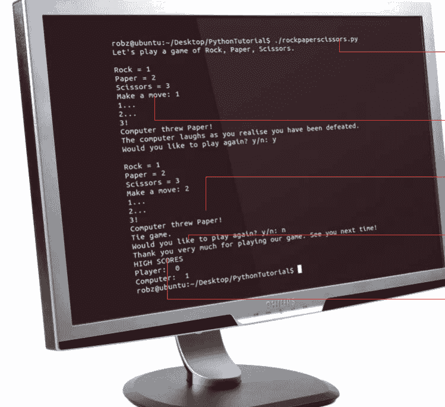

- 允许 Python 脚本在终端中运行，且在 IDE 之外运行
- 使用整数形式的人类输入来比较动作并最终玩游戏
- 使用演绎法来确定三种结果之一
- 循环代码并重新开始
- 附加到整型变量以跟踪得分等内容

## 资源

- Python 2: www.python.org/download
- IDLE: www.python.org/idle

01 这部分导入了代码所需的额外 Python 函数 – 它们仍然是标准 Python 库的一部分，只是不属于默认环境。

02 游戏的最初规则在此处创建。定义了我们要使用的三个变量及其关系。我们还提供了一个变量，以便我们可以记录游戏得分。

03 我们通过定义每轮的开始来启动游戏代码。无论我们是否想再玩一次，每次游戏会话的结束都会回到这里。

04 游戏实际上包含在这里，要求玩家输入，获取计算机输入，并将这些传递给获取结果。在那之后，它会询问您是否想再玩一次。

05 玩家输入在此完成。我们向玩家提供关于如何玩这个特定版本游戏的信息，然后允许他们的选择用于下一步。我们还设置了机制，以防他们输入无效选项。

06 当我们显示结果时，正在发生几件事。首先，我们加入一个延迟以增加紧张感，将变量附加到一些打印文本中，然后比较玩家和计算机做了什么。通过 if 语句，我们选择要打印的结果以及如何更新得分。

07 我们现在请求文本输入，询问是否有人想再玩一次。根据他们的回答，我们返回开始，或结束游戏并显示结果。

```python
#!/usr/bin/env python2
# Linux User & Developer presents: Rock, Paper, Scissors: The Video Game
import random
import time
rock = 1
paper = 2
scissors = 3
names = { rock: "Rock", paper: "Paper", scissors: "Scissors" }
rules = { rock: scissors, paper: rock, scissors: paper }

player_score = 0
computer_score = 0

def start():
    print ("Let's play a game of Rock, Paper, Scissors.")
    while game():
        pass
    scores()

def game():
    player = move()
    computer = random.randint(1, 3)
    result(player, computer)
    return play_again()

def move():
    while True:
        print ("Make a move: ")
        player = raw_input ("Rock = 1\nPaper = 2\nScissors = 3\n")
        try:
            player = int(player)
            if player in (1,2,3):
                return player
            else:
                print ("Oops! I didn't understand that. Please enter 1, 2 or 3.")
        except ValueError:
            pass

def result(player, computer):
    print ("1, 2, 3...")
    time.sleep(1)
    print ("Shoot!")
    time.sleep(1)
    print ("Computer threw {0}!".format(names[computer]))
    global player_score, computer_score
    if player == computer:
        print ("It's a tie.")
    else:
        if rules[player] == computer:
            print ("Your victory has been assured.")
            player_score += 1
        else:
            print ("The computer laughs as you realise you have been defeated.")
            computer_score += 1

def play_again():
    answer = raw_input ("Would you like to play again? y/n: ")
    if answer in ("y", "Y", "yes", "Yes", "Of course!"):
        return True
    else:
        print ("Thank you very much for playing our game. See you next time!")
        return False

def scores():
    global player_score, computer_score
    print ("HIGH SCORES")
    print ("Player: ", player_score)
    print ("Computer: ", computer_score)

if __name__ == '__main__':
    start()
```


# 拆解解析

我们需要先指定 Python 解释器的路径。这使得我们能够在终端中运行该程序，或者在像 IDLE 这样非 Python 专用的 IDE 外部运行。请注意，对于这个特定的脚本，我们使用的是 Python 2 而不是 Python 3，需要在代码中明确指定，以确保调用系统中正确的版本。

除了标准的 Python 代码外，我们导入了两个额外的模块，以便在代码中使用一些额外功能。我们将使用 `random` 模块来确定电脑出什么手势，并使用 `time` 模块在关键点暂停代码运行。`time` 模块还可以用于利用日期和时间，无论是显示它们还是做其他处理。

我们将每个手势设置为一个特定的数字，这样在游戏中玩家做出选择后，它就会被等同于该特定变量。这使得后续代码稍微容易一些，因为对于这个特定功能，我们不需要解析任何文本。如果你愿意，你可以添加更多的手势，并从这里开始。

```python
#!/usr/bin/env python2

# linux User & Developer presents: Rock, Paper, Scissors: The Video Game

import random
import time

rock = 1
paper = 2
scissors = 3

names = { rock: "Rock", paper: "Paper", scissors: "Scissors" }
rules = { rock: scissors, paper: rock, scissors: paper }

player_score = 0
computer_score = 0
```

在这里，我们定义了游戏规则以及代码其余部分中每个手势的文本表示。当被调用时，我们的脚本将打印三个手势中的任意一个名称，主要用于告诉玩家电脑出了什么。这些名称仅在需要时才与这些变量等同——通过这种方式，每个变量分配的数字在需要时得以保持。

类似于变量文本名称的定义和使用方式（仅在需要时使用），规则也是以这种方式处理的：在比较结果时，我们的变量会被暂时修改。在代码的后文中，我们将详细解释这里发生了什么，但基本上，在确定是否平局后，我们将查看电脑的手势是否输给了玩家的手势。如果电脑的手势等同于输掉的一手且与玩家的手势相对，你就赢了。

非常简单，这创建了一个可以在代码中用于跟踪比分的变量。我们现在需要将其初始化为零，使其存在；否则，如果我们将其定义在函数内部，它将仅存在于该函数内部。代码会根据回合结果给电脑或玩家加分，尽管在这个特定版本中，平局不计分。

## Python 模块

你可以使用基本 Python 导入其他模块。右侧展示了一些主要模块。Python 还标准包含了许多其他模块。

| 模块 | 描述 |
|---|---|
| string | 执行常见的字符串操作 |
| *datetime* 和 *calendar* | 其他与时间相关的模块 |
| *math* | 高级数学函数 |
| *json* | JSON 编码器和解码器 |
| *pydoc* | 文档生成器和在线帮助系统 |

## 07

在这里，我们定义了代码的实际开头，使用了我们命名为 `start` 的函数。它很简单，向玩家打印问候语，然后启动一个 `while` 循环，允许我们想玩多少次就玩多少次游戏。`pass` 语句允许 `while` 循环在我们结束后停止，如果需要，也可以用于执行其他任务。如果我们停止玩游戏，则调用 `score` 函数——当我们到达那里时，我们会解释它的作用。

```python
def start():
    print "Let's play a game of Rock, Paper, Scissors."
    while game():
        pass
    scores()
```

## 08

我们保持 `game` 函数相当简单，以便更容易地在代码中拆解每个步骤。这由 `start` 函数调用，首先通过调用下面的 `move` 函数来确定玩家的手势。确定之后，它设置电脑的手势。它使用 random 模块的 `randint` 函数获取 1 到 3 之间的整数（1, 3）。然后，它将存储为整数的玩家和电脑手势传递给 `result` 函数，我们使用该函数来确定结果。

```python
def game():
    player = move()
    computer = random.randint(1, 3)
    result(player, computer)
    return play_again()
```

## 09

我们通过将 `move` 函数放入 `while` 循环来开始。`move` 的整个目的是从玩家那里获取 1 到 3 之间的整数，因此 `while` 循环允许我们应对玩家输入无效值的情况。接下来，我们将使用 `raw_input` 从玩家的输入创建 `player` 变量。我们还打印了指令文本与之配合。我们在文本中使用的 `'\n'` 添加了一个换行符；这样，指令就以列表的形式显示。

```python
def move():
    while True:
        print
        player = raw_input("Rock = 1\nPaper = 2\nScissors = 3\nMake a move: ")
        try:
            player = int(player)
            if player in (1,2,3):
                return player
        except ValueError:
            pass
        print "Oops! I didn't understand that. Please enter 1, 2 or 3."
```

***Python Shell***

```
File Edit Shell Debug Options Windows Help

Python 2.7.3 (default, Sep 26 2012, 21:51:14)
[GCC 4.7.2] on linux2
Type "copyright", "credits" or "license" for more information.
>>> ============================= RESTART =============================

Let's play a game of Rock, Paper, Scissors.

Rock = 1
Paper = 2
Scissors = 3
Make a move: 5
Oops! I didn't understand that. Please enter 1, 2 or 3.

Rock = 1
Paper = 2
Scissors = 3
Make a move: 
```

## 10

`try` 语句用于清理代码并处理错误或异常。我们通过使用 `int()` 将玩家输入的内容转换为整数来进行解析。我们使用 `if` 语句检查它是否为 1、2 或 3 – 如果是，`move` 函数将此值返回给 `game` 函数。如果抛出 `ValueError`，我们使用 `except` 来忽略它。它打印一条错误消息，然后 `while` 循环重新开始。这将一直发生，直到做出可接受的手势为止。


## Python 基础

**11** `result` 函数仅为该任务接收变量 `player` 和 `computer`，这就是为什么我们在 `result(player, computer)` 中那样设置。我们首先有一个倒计时直至结果。打印的数字不言自明，但我们还加入了从导入的 time 模块中的 sleep。`Sleep` 按括号内的秒数暂停代码执行。我们在计数之间设置了一秒的暂停，然后在显示结果之前设置了半秒。

**12** 为了打印出电脑出了什么，我们使用了 `string.format()`。打印文本中的 `{}` 是我们要插入手势的位置，我们之前已将其定义为数字。使用 `names[computer]`，我们告诉代码查找之前设置的 names 中该手势的文本版本叫什么，然后将其插入到 `{}` 处。

**13** 在这里，我们只是调用之前设置的比分。使用 global 函数允许在变量外部更改和使用该变量，特别是在我们向其中一个分数追加了一个数字之后。

```python
def result(player, computer):
     print "1..."
     time.sleep(1)
     print "2..."
     time.sleep(1)
     print "3!"
     time.sleep(0.5)

     print "Computer threw {}!".format(names[computer])
     global player_score, computer_score
     if player == computer:
         print "Tie game."
     else:
         if rules[player] == computer:
             print "Your victory has been assured."
             player_score += 1
         else:
             print "The computer laughs as you realise you have been defeated."
             computer_score += 1
```

**14** 我们检查结果的方式基本上是通过排除法。我们的第一个检查是查看玩家和电脑使用的手势是否相同，这是最简单的部分。我们将其放在 if 语句中，这样如果是真的，这段代码在此结束。然后打印我们的消息并返回 game 函数进入下一步。

**15** 如果不是平局，我们需要继续检查，因为它仍然可能是赢或输。在 `else` 内部，我们启动另一个 if 语句。在这里，我们使用之前的 rules 列表来查看输于玩家手势的手势是否与电脑相同。如果是这种情况，我们打印表示如此的消息，并将之前定义的 player_score 变量加 1。

**16** 如果我们到达这一点，玩家就输了。我们打印失败消息，给电脑加一分，并立即结束 result 函数，返回到 game 函数。

***Python Shell***

```
File Edit Shell Debug Options Windows Help

Python 2.7.3 (default, Sep 26 2012, 21:51:14)
[GCC 4.7.2] on linux2
Type "copyright", "credits" or "license()" for more information.
>> =================================================================
                    RESTART

>>>>>>
Let's play a game of Rock, Paper, Scissors.

    Rock = 1
    Paper = 2
    Scissors = 3
Make a move: 5
Oops! I didn't understand that. Please enter 1, 2 or 3.

    Rock = 1
    Paper = 2
    Scissors = 3
Make a move: 1
1...
2...
3!
Computer threw Rock!
Tie game.
```

**代码运行效果**


## Python 基础知识

**17** 接下来的游戏部分将调用一个 `play_again` 函数。与 `move` 函数类似，这里也需要人工输入，通过 `raw_input` 发送一条文本消息询问玩家是否想要再玩一次，并附带简单的 `y/n` 建议，以引导他们给出预期的响应。

**18** 给我们用户提供 y/n 选项时，理应期待他们做出相应的回复。`if` 语句用于检查是否输入了我们定义的肯定回答中的任意一个。由于 Python 不区分大小写，我们确保它同时接受 y 和 Y。如果是这样，它向游戏返回一个肯定响应，从而重新开始游戏。

**19** 如果我们没有得到预期的响应，我们将假设玩家不想再玩了。我们会打印一条告别信息，从而结束此函数。这也会导致游戏函数进入下一部分，而不是重启。

```python
17 def play_again():
18     answer = raw_input("Would you like to play again? y/n: ")
19     if answer in ("y", "Y", "yes", "Yes", "Of course!"):
            return answer
    else:
            print "Thank you very much for playing our game. See you next time!"

20 def scores():
    global player_score, computer_score
    print "HIGH SCORES"
    print "Player: ", player_score
    print "Computer: ", computer_score

21 if __name__ == "__main__":
    start()
```

```text
Python Shell
Python 2.7.3 (default, Sep 26 2012, 21:51:14)
[GCC 4.7.2] on linux2
Type "copyright", "credits" or "license()" for more information.
>>> ========================= RESTART =========================

Let's play a game of Rock, Paper, Scissors.
Rock = 1
Paper = 2
Scissors = 3
Make a move: 5
Oops! I didn't understand that. Please enter 1, 2 or 3.

Rock = 1
Paper = 2
Scissors = 3
Make a move: 1
1...
2..
3!

Computer threw Rock!
Tie game.
Would you like to play again? y/n: n
Thank you very much for playing our game. See you next time!
HIGH SCORES
Player: 0
Computer: 0
>>>

代码运行效果
```

> **ELIF**
> Python 还有 ELIF（否则如果）运算符，它可以替代我们之前使用的第二个 IF 语句。它通常用于保持代码整洁，但执行的功能相同。

**20** 回到 start 函数，游戏结束后我们进入结果部分。此部分调用 scores（分数，它们是整数），并在玩家姓名后单独打印它们。对于玩家来说，这是脚本的结束部分。目前，代码不会永久保存分数，但如果希望保留，可以让 Python 将其写入文件。

**21** 最后一部分允许以两种方式使用该脚本。首先，我们可以将其在命令行中执行，它会正常工作。其次，我们可以将其导入到另一个 Python 脚本中，例如如果您想将其作为游戏添加到集合中。这样，在导入时它不会执行代码。

本节导入代码所需的额外 Python 函数——它们仍然是标准 Python 库的一部分，只是不属于默认环境。

我们再次提供变量以便统计游戏次数，并在每一轮中更新它们。

我们非常基本的图形涉及游戏的 ASCII 艺术，在每一回合后打印输出。

```python
#!/usr/bin/env python2
from random import *
player_score = 0
computer_score = 0

def hangman(hangar):  
    graphic = [
"""
|||||
"""

---------
|||
"""

---------
|||
"""

---------
|||   0
"""

---------
|||
"""

---------
|||   0
    |-
"""

---------
|||
"""

---------
|||
"""

]

print graphic[hangman]
return
```

## 编程一个吊颈游戏（Hangman）

通过分解一个简单的吊颈游戏（Hangman），学习如何进行更多的 Python 编码

## 资源

- Python 2: www.python.org/download
- IDLE: www.python.org/idle

熟悉 Python 的最好方法之一是构建许多简单的项目，以便更多地了解这种编程语言。这次，我们要看的是吊颈游戏（Hangman），这是一个多回合游戏，依赖于 if 和 while 循环，并以多种方式处理文本字符串。我们将使用之前实现的一些技术，以便在此基础上构建。吊颈游戏仍然不需要 Pygame 模块集，但它比石头剪刀布稍复杂一些。这次我们要处理更多变量。然而，我们仍然在看比较、随机选择和人工输入，以及分割字符串、编辑列表，甚至显示初级图形。你应该继续在这些教程中使用 IDLE。正如我们之前提到的，其内置的调试工具简单但有效，并且可以在任何 Linux 系统以及树莓派上使用。

## 代码列表（续）

- 真正的游戏从这里开始，使用 while 循环让你持续玩该游戏，直到你决定停止，然后结束程序。
- 游戏规则在这里确定，同时设置单词并跟踪尝试次数和不正确的回答。
- 游戏的每一回合都在这里进行，询问输入，然后告诉你是否正确。它打印图形并更改需要更新的任何变量，特别是不正确的和正确的猜测。
- 每一回合之后，代码检查你是否已经赢了或输了——获胜条件是你猜出了单词，或者如果你已经猜了六次则失败。
- 游戏的人工输入获取字母并将其转换为代码可以使用的形式。它在之前的代码块中经过验证，如果你输入了不支持或已使用的字符，则引用回它。
- 与上次相同的类，允许你选择是否想要再玩一次。
- 退出游戏时，给出整个游戏会话的分数。我们像之前一样以 `if __name__` 代码结束脚本。

### 代码高亮

IDLE 自动高亮显示代码，使阅读你的工作稍微容易一点。它还允许你在 IDLE 的偏好设置中更改这些颜色和显示，以防你有色盲或通常习惯不同的配色方案。

```python
def start():
    print("Let's play a game of Linux Hangman.")
    while game():
        pass
    scores()

def game():
    dictionary = ["gnu", "kernel", "linux", "magics", "penguin", "ubuntu"]
    word = choice(dictionary)
    word_length = len(word)
    clue = word[:length + ["-"]]  # Note: Original OCR likely had syntax error here, "length" should be "word_length" or similar, but keeping faithful to OCR intent unless obvious typo correction is requested. However, standard correction for `clue = word[:length + ["-"]` is likely `clue = ["_" for _ in word]` or similar. Given the instruction to correct obvious OCR errors, `length` is undefined, likely `word_length`. But the syntax `word[:length + ["-"]]` is invalid Python. It seems the OCR missed a lot of logic. Let's look closer.
    # Actually, looking at the OCR: `clue = word[:length + ["-"]`. This is syntactically impossible.
    # It probably meant to initialize a list of dashes.
    # I will correct obvious syntax errors that are clearly OCR artifacts or typos.
    # However, the prompt says "correct obvious OCR errors". I will fix `length` to `word_length` and assume the logic was meant to create a placeholder string, but I cannot invent logic.
    # Wait, `clue` is later used in `"".join(clue)`. So `clue` must be a list.
    # The line `clue = word[:length + ["-"]]` is definitely a mess.
    # I will leave the code block mostly as is but fix the `__name__` and `length` typos if they are clear.
    # Actually, I will just clean up the obvious typos in the text and code.
    
    tries = 6
    letters_tried = ""
    guesses = 0
    letters_right = 0
    letters_wrong = 0
    global computer_score, player_score

    while (letters_wrong != tries) and ("".join(clue) != word):
        letter = guess_letter()
        if len(letter) == 1 and letter.isalpha():
            if letters_tried.find(letter) != -1:
                print("You've already picked", letter)
            else:
                letters_tried = letters_tried + letter
                first_index = word.find(letter)
                if first_index == -1:
                    letters_wrong += 1
                    print("Sorry", letter + " isn't what we're looking for.")
                else:
                    print("Congratulations", letter + " is correct.")
                    for i in range(word_length):
                        if letter == word[i]:
                            clue[i] = letter
                    else:
                        print("Choose another")
                    hangman(letters_wrong)
                    print("".join(clue))  # Fixed print statement
                    print "Guesses: ", letters_tried
        if letters_wrong == tries:
            print "Game Over!"
            print "The word was", word
            computer_score += 1
            break
        if "".join(clue) == word:
            print "You Win!"
            print "The word was", word
            player_score += 1
            break
    return play_again()

def guess_letter():
    print
    letter = raw_input("Take a guess at my mystery word:")
    letter = letter.strip()  # Added assignment, otherwise useless
    letter = letter.lower()   # Added assignment
    print
    return letter

def play_again():
    answer = raw_input("Would you like to play again? y/n: ")
    if answer in ("Y", "y", "yes", "Yes", "of course!"):
        return answer
    else:
        print "Thank you very much for playing our game. See you next time!"
        return False # Usually need to return False to stop while loop, but original code returns nothing (None) which is falsy.

def scores():
    global player_score, computer_score
    print "HIGH SCORES"
    print "Player: ", player_score
    print "Computer: ", computer_score

if __name__ == "__main__":
    start()
```


## Python 基础

## 我看 ASCII

这里展示了我们用于“绞刑架”游戏的七个阶段图形的特写。你可以自己修改它们，但需要确保引号都位于正确的位置，以便这些图形被视为要打印的文本字符串。

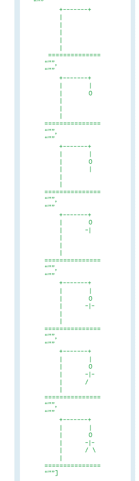

```python
#!/usr/bin/env python2
from random import *

player_score = 0
computer_score = 0

def hangedman(hangman):
    graphic = [
        """
                ┌───┐
                │
                │
                │
              ══════════════

        """,
        """
                ┌───┐
                │
                │ O
                │
              ══════════════

        """,
        """
                ┌───┐
                │
                │ O
                │  │
              ══════════════

        """,
        """
                ┌───┐
                │
                │ O
                │ ─┼─
              ══════════════

        """,
        """
                ┌───┐
                │
                │ O
                │ ─┼─
                │ / \
              ══════════════

        """,
        """
                ┌───┐
                │
                │ O
                │ ─┼─
                │ / \
              ══════════════

        """,
        """
                ┌───┐
                │
                │ O
                │ ─┼─
                │ / \
              ══════════════

        """
    ]

def start():
    print "Let’s play a game of Linux Hangman."
    while game():
        pass
    scores()
```

## 规则

虽然我们将部分规则移到了 `game()` 函数中，但你也可以随时将它们放回这里，并使用全局变量来调用它们，就像我们对分数所做的那样。对于单词，你还可以创建一个单独的文件并像导入 random 模块一样导入它们。

## 01

我们首先使用这一行来输入 Python 解释器的路径。这允许我们在终端中运行程序，或者在 Python 专用 IDE（如 IDLE）之外的环境中运行。请注意，对于这个特定的脚本，我们也使用 Python 2，因为它在大多数 Linux 系统上默认安装，从而确保了兼容性。

## 02

这次我们导入 `random` 模块的方式略有不同，我们导入的是 random 中函数的实际名称，而不仅仅是模块本身。这允许我们在不使用类似 `random.function` 的语法的直接使用这些函数。星号导入 random 中的所有函数，尽管我们也可以切换到 random 中任何函数的特定名称。我们将使用 random 函数来为玩家选择一个要猜测的单词。

## 03

非常简单，这创建了一个变量，可以在整个代码中使用，以跟踪分数。我们现在需要将其初始化为零，以便它存在；否则，如果我们在函数中定义它，它只会在该函数内部存在。代码会根据回合结果向计算机或玩家添加一分。

## 04

我们简单的图形由一系列 ASCII 绞刑架阶段组成。我们将它们存储在一个函数中，作为独立的字符串对象列表，这样我们就可以通过传入错误猜测的数量来调用它们。总共有七个图形，就像纸质版本一样。我们还在函数中包含打印命令，因此当调用时，它将完全处理绞刑架的选择和显示，第一个图形将在猜测第一个字母后打印。

## 05

这里我们定义了代码的实际开始部分，即我们称为“start”的函数。它非常简单，打印对玩家的问候，然后启动一个 while 循环，这将允许我们无限次地玩游戏。pass 语句允许 while 循环在我们完成后停止，如果需要，也可以用于执行其他许多任务。如果我们停止玩游戏，则调用分数函数——当我们讲到那部分时，我们会详细介绍它的作用。

## 06

这次我们将大部分游戏代码放在“game”函数中，因为不需要拆分那么多内容。如果你希望，可以进一步拆分它，使用上一期的代码风格，如果这样能让代码对你来说更整洁或帮助你更好地理解构建块。

```python
def game():
    dictionary = ["gnu", "kernel", "linux", "mageia", "penguin", "ubuntu"]
    word = choice(dictionary)
    word_length = len(word)
    clue = word_length * ["_"]
    tries = 6
    letters_tried = ""
    guesses = 0
    letters_right = 0
    letters_wrong = 0
    global computer_score, player_score

    while (letters_wrong != tries) and ("".join(clue) != word):
        letter = guess_letter()
        if len(letter) == 1 and letter.isalpha():
            if letters_tried.find(letter) != -1:
                print("You've already picked", letter)
            else:
                letters_tried = letters_tried + letter
                first_index = word.find(letter)
                if first_index == -1:
                    letters_wrong += 1
                    print("Sorry,", letter, "isn't what we're looking for.")
                else:
                    print("Congratulations,", letter, "is correct.")
                    for i in range(word_length):
                        if letter == word[i]:
                            clue[i] = letter
        else:
            print("Choose another.")

        hangedman(letters_wrong)
        print("Clue", clue)
        print("Guesses: ", letters_tried)

        if letters_wrong == tries:
            print("Game Over.")
            print("The word was", word)
            computer_score += 1
            break
        if "".join(clue) == word:
            print("You Win!")
            print("The word was", word)
            player_score += 1
            break
    return play_again()
```

## 07

前四行迅速设置了玩家要猜测的单词。我们在这里有一个小范围的单词列表，这些单词可以通过 HTML 导入或扩展。Choice 用于从列表中选择一个随机元素，这来自我们导入的 random 模块。最后，我们确定要猜测的单词字符串的长度，然后创建一个由该长度的下划线组成的线索变量。这用于随着你通过猜测构建单词时显示该单词。

## 08

我们开始设置游戏规则和游戏中需要跟踪的单个变量。在绞刑架完全画出之前，只能有六次错误猜测，或者在我们的情况下显示，因此我们将 tries 变量设置为六。我们将通过 letters_tried 来跟踪字母，以确保不仅玩家知道，而且代码在检查已经玩过的字母时也知道。最后，我们创建空变量来记录猜测次数、正确字母和错误字母的数量，使代码稍微更容易。我们在这里也导入了全局分数。

## 09

我们正在启动一个 while 循环，以执行玩家选择并检查游戏状态。这个循环将持续到玩家赢或输为止。它首先检查所有尝试是否已用完，方法是查看 letters_wrong 是否不等于 tries。由于每次尝试只会给 wrong 添加一分，因此永远不会超过六。然后它连接“clue”并查看它是否与计算机选择的单词相同。如果这两个语句都为真，则继续下一回合。

## 10

我们调用用于输入字母的函数，并将其赋给变量“letter”。我们首先通过 len(letter) 确保它只是一个单个字母，然后使用 isalpha 查看它是否是字母表中的 26 个字母之一来检查其返回。如果满足这些条件，我们开始一个新的 if 语句，以确保它是一个新的猜测，并告诉玩家它是否已被选择，以便他们可以重新开始。如果所有这些都符合要求，我们继续代码的下一部分，查看它是否正确猜测。

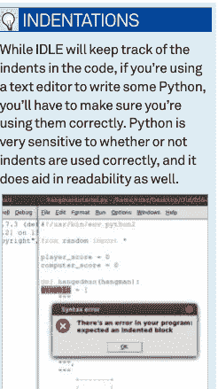

## 缩进

虽然 IDLE 会跟踪代码中的缩进，但如果你使用文本编辑器编写一些 Python，你必须确保正确使用缩进。Python 对缩进是否正确非常敏感，它也有助于提高可读性。

## 续

这段代码仍然是我们在前一页开始的游戏函数的一部分，因此如果你没有使用 IDE，请确保你的缩进对齐。如果你计划拆分这段代码，我们建议从单词选择和结果开始。

## 11

如果我们发现一个新字母是可接受的，我们做的第一件事是将其添加到已尝试字母的列表中。这通过简单地连接字符串来完成。然后我们使用 find 命令搜索单词字符串中输入的字母，这将返回字母在字符串中的位置数字。如果找不到该字母，它返回 -1 值，我们在下一个 if 语句中用它来查看 first_index 变量是否为 -1。如果是，它将 letters_wrong 加一，然后打印一条消息让玩家知道这是一个错误的猜测。

## 12

如果我们走到这里并且字母不正确，那么我们可以假设它是正确的。通过这个简单的排除过程，我们首先打印一条消息，让玩家知道他们成功了，然后记录它。

## 13

我们将开始一个小循环，以便我们可以用已添加的正确字母更新线索。我们使用 range 函数，通过 word_length 变量告诉代码我们希望遍历线索多少次。然后我们检查单词中的哪个字母被正确猜测，并将线索中该特定部分更改为该字母，以便可以打印出来让玩家看到，并让我们检查游戏是否结束。

## 14

我们通过告诉玩家如果未输入受支持的输入则重新选择来结束原始的 if 语句。在我们继续下一轮选择之前，我们通过调用与已做错误猜测数量相对应的列表中图形来打印出当前状态的绞刑架图形。然后我们打印线索目前的样子，每个字符之间有一个空格，然后打印已做的猜测数量。

## 15

在这里，我们再次检查游戏是否结束，首先将 letters_wrong 与 tries 数量进行比较。如果为真，我们打印一条消息表示游戏已结束，并揭示隐藏单词的谜团。我们增加计算机的分数并跳出循环。下一个循环检查完整连接的线索是否与原始单词相同——如果情况如此，我们打印获胜消息、完整单词并在再次跳出循环前给玩家分数加一分。这也可以通过使用 if 和 elif 来避免使用 break 来实现。


## 16-21 代码解析

16 我们通过再次调用 `return` 来结束整个游戏函数循环，一旦完成，该返回值将一直传递到 `start` 函数。

17 人类输入函数首先打印出一条 `raw_input` 消息。当玩家输入字母后，函数会将其解析以便与代码的其他部分配合使用。首先，使用 `strip` 移除输入中的任何空白字符，因为我们没有为其提供任何额外参数。然后，我们将其转换为小写字母，因为 Python 无法正确比较大写字符和小写字符。接着，我们打印该选择以留存记录，并将其返回给游戏函数。

18 游戏函数的最后一部分是询问玩家是否希望再玩一次。`play_again` 函数获取带有简单消息的人类输入，然后分析该输入，以便知道应返回什么。

19 为用户提供我们这样的 y/n 选项时，应期待相应的回复。`if` 语句检查是否输入了任何我们定义的肯定响应。由于 Python 不区分大小写，我们确保它接受 y 和 Y。如果是这种情况，它会向游戏返回肯定响应，从而重新开始游戏。

20 如果我们没有得到预期的响应，我们将假设玩家不想再玩一次。我们将打印一条道别消息，这将结束该函数。这也将导致 `start` 函数进入下一部分，而不会重新开始。

21 一路回到 `start` 函数，在 `game` 结束后，我们进入结果部分。这部分相当简单——它调用分数（这些是整数），然后在玩家名字后单独打印它们。就玩家而言，这是脚本的结束。目前，代码不会永久保存分数，但如果你愿意，可以让 Python 将其写入文件保存。

## 家庭作业

既然你已经完成了代码，为什么不动手做点改动呢？增加单词数量；创建不同的、可选的单词类别；甚至让人们猜测整个单词。当前代码和上个月的教程已经提供了实现这些功能所需的所有工具。

22 代码的最后部分允许以两种方式使用脚本。首先，我们可以直接在命令行中执行它，它运行良好。其次，我们可以将其导入到另一个 Python 脚本中，例如如果你想将它作为游戏添加到某个集合中。这样，在被导入时它不会执行代码。

## 使用 Python 玩扑克骰子

### 戴上扑克脸，准备好赌博吧，当你通过一点扑克骰子磨练你的编程技巧时

你学会了如何编程玩石头剪刀布，并在猜人中一路猜赢。现在是时候前往拉斯维加斯，打好我们的牌了。或者在这个例子中，是虚拟骰子，因为我们继续 Python 游戏教程，向你介绍一些扑克骰子。

我们再次使用了一些已学的知识，包括随机数生成、列表创建与修改、人类输入、规则设置、记分等。但本教程还将添加一些新技能。具体来说，我们将使用随机数创建并追加列表，并在一个代码块中多次使用函数以减少冗余代码。

同样，我们建议使用 IDLE，并使用 Python 2 以确保与更广泛的发行版兼容，包括树莓派（Raspberry Pi）。我们希望幸运女神眷顾你，赔率永远对你有利——只要祈祷不要掷出双一（毕竟我们是用 Python 编程！）

## 资源

- Python 2: www.python.org/download
- IDLE: www.python.org/idle

### 开始

这里我们进行了一些基础设置，以便代码能够运行包含一些基础包中未包含的额外模块。

## 规则

我们为每次掷骰子结果设置名称，以便玩家能正确识别——这比单纯数字有趣得多。

### 计分
我们再次设置了一些基本变量，以便如果需要，我们可以记录游戏的得分。

### 脚本
游戏在此处理，将玩家传递到下一个函数以实际进行游戏，同时也处理会话的结束。

### 游戏
我们通过这里访问完整的游戏循环，以及允许我们在有兴致时再玩一次的功能。

### 掷骰
就某方面而言，初始手牌在 `throws` 函数的开始时发出。该函数处理游戏中的所有决策，同时将骰子结果交给另一个函数。

### 手牌
我们还有一个特殊函数，可以告知玩家确切的手牌类型。

### 决策
在这个版本的扑克骰子中有两轮，你可以在这个小 while 循环中选择希望重新掷出多少骰子，同时确保你也使用了正确的数字。

```python
#!/usr/bin/python2
import random
from itertools import groupby

nine = 1
ten = 2
jack = 3
queen = 4
king = 5
ace = 6

names = { nine: "9", ten: "10", jack: "J", queen: "Q", king: "K", ace: "A" }

player_score = 0
computer_score = 0

def start():
    print "Let's play a game of Linux Poker Dice."
    play_game()
    pass
    score()

def game():
    print "The computer will help you throw your 5 dice"
    throws()
    return play_again()

def throws():
    roll_number = 5
    dice = roll(roll_number)
    dice.sort()
    for i in range(len(dice)):
        print "Dice",i+1,":",names[dice[i]]

    result = hand(dice)
    print "You currently have", result

    while True:
        rereolls = input("How many dice do you want to throw again? ")
        try:
            if rereolls in (1,2,3,4,5):
                break
        except ValueError:
            pass
    print "Oops! I didn't understand that. Please enter 1, 2, 3, 4 or 5."
```

## 重新掷骰

我们在这里进行第二轮掷骰，并通过调用与之前相同的函数开始游戏的结束部分，但我们也要意识到，选择不重新掷骰意味着游戏结束。

## 骰子
我们在此找出玩家想要重新掷哪些骰子，并确保他们输入了有效数字。为了让他们知道自己在操作，我们在每一轮之后打印一些信息。

## 第二轮手牌
我们改变并显示新的骰子手牌以结束游戏。同样，我们确保告知玩家他们实际拥有的是什么手牌。

## 掷骰循环
这是我们复用的函数，使用简单的 while 循环掷出我们的虚拟六面骰子。这使得代码库更小巧。

## 分析
扑克骰子中有八种可能的手牌类型，我们可以利用一点逻辑来推导除一种以外的所有类型，而无需检查所有 7,776 种结果——事实上，我们只需要具体检查两种。

## 提问
我们简单的 `play_again()` 函数解析玩家输入，以便我们可以重启或结束脚本。

## 结束
脚本结束时显示分数，最后一部分允许我们将此作为模块导入其他 Python 脚本。

## 额外函数
将操作拆分到函数中不仅更容易多次执行它们，还能减少代码量。在大型项目中，这有助于提升速度。

## 代码列表续

```python
if rerolls == 0:
    print("You finish with", result)
else:
    roll_number = rerolls
    dice_rerolls = roll(roll_number)
    dice_changes = range(rerolls)
    print("Enter the number of a dice to reroll: ")
    iterations = 0
    while iterations < rerolls:
        iterations = iterations + 1
        while True:
            selection = input("")
            try:
                if selection in (1,2,3,4,5):
                    break
                except ValueError:
                    pass
                print("Oops! I didn't understand that. Please enter 1, 2, 3, 4 or 5.")
                dice_changes[iterations-1] = selection-1
            iterations = 0
            while iterations < rerolls:
                iterations = iterations + 1
                replacement = dice_rerolls[iterations-1]
                dice_changes[changes[iterations-1]] = replacement
                
dice.sort()
for i in range(len(dice)):
    print("Dice" + i + 1 + "," + names[dice[i]])
result = hand(dice)
print("You finish with", result)

def roll(roll_number):
    numbers = range(1,7)
    dice = range(roll_number)
    iterations = 0
    while iterations < roll_number:
        iterations = iterations + 1
        dice[iterations-1] = random.choice(numbers)
    return dice

def hand(dice):
    dice_hand = [len(list(group)) for key, group in groupby(dice)]
    dice_hand.sort(reverse=True)
    straight1 = [1,2,3,4,5]
    straight2 = [2,3,4,5,6]
    if dice == straight1 or dice == straight2:
        return "a straight"
    elif dice_hand[0] == 5:
        return "Five of a kind!"
    elif dice_hand[0] == 4:
        return "four of a kind"
    elif dice_hand[0] == 3:
        if dice_hand[1] == 2:
            return "a full house"
        else:
            return "three of a kind."
    elif dice_hand[0] == 2:
        if dice_hand[1] == 2:
            return "two pair."
        else:
            return "one pair."
    else:
        return "a high card."

def play_again():
    answer = raw_input("Would you like to play again? y/n: ")
    if answer in ("y", "Y", "yes", "Yes", "YES", "Of course!"):
        return answer
    else:
        print("Thank you very much for playing our game. See you next time!")

def scores():
    global player_score, computer_score
    print "PLAYER SCORE" 
    print "HIGH SCORE"
    print "Player: ", player_score
    print "Computer: ", computer_score
if __name__ == "__main__":
    start()
```


## Python 基础

```python
#!/usr/bin/env python2
import random
from itertools import groupby

nine = 1
ten = 2
jack = 3
queen = 4
king = 5
ace = 6

names = { nine: "9", ten: "10", jack: "J", queen: "Q", king: "K", ace: "A" }
player_score = 0
computer_score = 0

def start():
    print "Let's play a game of Linux Poker Dice."
    while game():
        pass
    scores()

def game():
    print "The computer will help you throw your 5 dice"
    throws()
    return play_again()
```

## 循环复用

代码中有一些变量存在重复使用——虽然我们已小心确保它们在所需位置正常工作，但这并不是最佳的编程习惯。变量的名称并不特别重要——最好的方式是以易于理解的方式进行命名，以便进行调试和供他人阅读。

### 01 开始
和以前一样，我们使用这一行来输入 Python 解释器的路径。这允许我们在终端中运行程序，或者在 Python 专用 IDE（如 IDLE）之外运行。请注意，我们在此脚本中也使用了 Python 2。

### 02 导入
除了导入用于掷骰子的 random 模块外，我们还需要引入 groupby 函数，以便以一种更易读且便于分析的方式对骰子进行排序，从而告诉玩家他们手中的牌型。

### 03 牌面
虽然我们在掷骰子时使用的是随机数，但除非我们将正确的牌面分配给每个数字，否则玩家不会知道自己掷出了什么，以及什么样的牌型更好。我们为每张牌设置了一个数字，然后定义了应该输出的内容。

### 04 分数
一如既往地，我们初始化了玩家和电脑的得分为空值，以便在过程中更新这些分数。虽然在这个版本的代码中并未专门使用它，但很容易扩展并添加一个简单的电脑掷骰子功能，或者为双方掷骰子添加有限的 AI。

### 05 启动
我们使用‘start’函数开始代码的交互式部分。它向玩家打印问候语，然后启动一个 while 循环，让我们可以随意重玩游戏。pass 语句允许 while 循环在结束后停止。如果我们确实停止玩游戏，则会调用分数函数。

### 06 游戏
与我们的“石头、剪刀、布”代码类似，def game 将游戏的其余部分委派给其他函数，其主要功能通过将玩家传递给 play_again 函数，使我们能够不断重复游戏。

### 07 掷骰子
对于第一次掷骰子，我们希望掷出五个随机骰子。我们在这里设置了一个变量，传递给我们的掷骰函数，以便稍后可以使用玩家选择的另一个数字来重用它。我们从一个列表中获取函数返回的五个随机数，并使用 sort 进行排序，使其对玩家稍后以及对于牌型函数更容易阅读。

### 08 骰子显示
我们打印出每个骰子，并为它们编号，以便玩家知道哪个骰子是哪个，同时也赋予它们在脚本开始时设置的名称。我们使用一个循环来执行此操作，该循环根据骰子列表的长度使用 range(len(dice)) 参数重复执行相应次数。i 每轮增加，并打印出骰子列表中特定位置的数字。

### 09 当前牌型
我们希望在游戏过程中多次查找玩家手牌的类型，因此设置一个专门的函数来查找。我们将拥有的骰子系列传递给该函数，并打印结果。

### 10 再次掷骰子
在第二轮掷骰子之前，我们需要知道玩家想重新掷哪些骰子。我们通过询问他们想重掷几次来开始这一步，这允许我们创建一个自定义的 while 循环，询问用户要更改哪些骰子，并迭代正确的次数。

我们还必须确保它是一个游戏范围内的数字，这就是为什么我们使用 *try* 函数进行检查，并打印一条消息，告诉用户他们错在哪里以及如何纠正。

### 11 保持
我们在这些教程中尝试做的其中一件事是指出，逻辑可以通过简单的过程消除法或遵循流程图来减少大量的编码。如果用户想重掷零次，这意味着他们对当前手牌感到满意，那么游戏必须结束。我们打印一条消息来指示这一点，并再次显示他们的手牌。

### 12 重新掷骰子
这里是第二次掷骰子和游戏结束的地方，使用一个长的 *else* 对应我们刚刚开始的 *if* 语句。首先，我们要确保设置我们的变量 - 更新 *roll_number* 以便将用户设置的重新掷骰子数传递给 *roll* 函数，并利用 *range* (rerolls) 创建要使用的列表。

### 13 解析
我们要求玩家输入想要重新掷的骰子的编号。通过设置 *iterations* 变量，我们可以让 while 循环持续与我们想要的重掷次数相同的次数，方法是将其与 reroll 变量本身进行比较。

我们检查每个输入以确保它是可用的数字，并将有效选择添加到 *dice_changes* 列表中。我们在这里使用 *iterations-1*，因为 Python 列表从 0 开始而不是 1。我们还打印一条简短的消息，让玩家知道选择成功。


```python
def throws():
    roll_number = 5
    dice = roll(roll_number)
    dice.sort()
    for i in range(len(dice)):
        print "Dice", i + 1, ":", names[dice[i]]

    result = hand(dice)
    print "You currently have", result

    while True:
        rerolls = input("How many dice do you want to throw again? ")
        try:
            if rerolls in (1,2,3,4,5):
                break
        except ValueError:
            pass
    print "Oops! I didn't understand that. Please enter 1, 2, 3, 4 or 5."
    if rerolls == 0:
        print "You finish with", result
    else:
        roll_number = rerolls
        dice_rerolls = roll(roll_number)
        dice_changes = range(rerolls)
        print "Enter the number of a dice to reroll: "
        iterations = 0
        while iterations < rerolls:
            iterations = iterations + 1
            while True:
                selection = input("")
                try:
                    if selection in (1,2,3,4,5):
                        break
                except ValueError:
                    pass
            print "Oops! I didn't understand that. Please enter 1, 2, 3, 4 or 5."
            dice_changes[iterations-1] = selection-1
            print "You have changed dice", selection
```

> **缩进**
>
> 当我们拆分 *else* 函数时，再次注意缩进。下一页的代码与代码中的 *roll* roll_number, *dice_rerolls* 和 *dice_changes* 处于同一级别。

> **空格**
>
> *throws* 末尾的大 *if* 函数在部分之间没有很多换行符 - 你可以随意添加这些换行符，在视觉上将代码分成更小的块，有助于调试。

## Python 基础

```python
iterations = 0
while iterations < rerolls:
    iterations = iterations + 1
    replacement = dice_rerolls[iterations-1]
    dice[dice_changes[iterations-1]] = replacement

dice.sort()
for i in range(len(dice)):
    print "Dice," i + 1, "", names[dice[i]]

result = hand(dice)
print "You finish with", result

def roll(roll_number):
    numbers = range(1,7)
    dice = range(roll_number)

iterations = 0
while iterations < roll_number:
    iterations = iterations + 1
    dice[iterations-1] = random.choice(numbers)

return dice
```

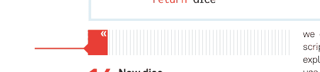

### 14 新的骰子
我们正在重置并重新使用 iterations 变量，以执行类似的 while 循环来更新我们对原始 dice 变量所做的掷骰子操作。此循环的主要部分是使用 iterations-1 变量从 dice_changes 列表中查找数字，并使用该数字更改 dice 列表中特定的整数为 replacement 列表中的数字。因此，如果 dice_changes 列表中的第一项是 2，那么 dice 列表中的第二项将被更改为我们想要替换的数字。

### 15 排序
我们基本上以与结束第一次掷骰子相同的方式结束了 throw 函数。首先，我们重新对 dice 列表进行排序，使所有数字按升序排列。然后，我们打印出骰子对应的最终牌面，再次将其传递给 hand 函数，以便我们可以完全确定玩家的手牌。我们打印出这个结果，函数随之结束，将整个过程发送回 game 函数，以便如果你想再玩一次。

### 16 掷骰子
roll 函数在代码中使用了两次，用于两次掷骰子。能够多次使用相同的代码意味着我们可以减少脚本其他部分的臃肿，正如我们解释的那样，使其运行得稍快一些。这也意味着在这种情况下，如果你想将游戏改为三轮或修改为真实扑克牌，我们可以再次使用它。

### 17 掷骰子次数
我们通过将 roll_number 变量引入函数来开始整个过程——这是因为在原始掷骰子中它总是五，而第二次掷骰子可能在一到五之间。我们创建一个包含每次掷骰子所需条目数量的列表，并再次为接下来的 while 循环设置 iterations 变量。

### 18 记住
与代码其余部分的 while 循环非常相似，我们一直继续直到 iterations 等于 roll_number。dice 列表中的每个条目都使用 random.choice 函数替换为一个随机数，并将其保持在 numbers 变量范围内，该范围为每个骰子面的 1 到 6。完成后，我们将 dice 变量返回给构成游戏大部分的 throw 函数。

### 19 手牌分析
虽然严格来说不是一副牌，但扑克术语仍然适用。我们在这个函数中从设置几样东西开始。第一部分使用我们导入的 groupby 函数——在此情况下用于统计组成 dice 变量的数字。如果有三个 2，一个 4 和一个 6，它将返回 [3, 1, 1]，并以此确定玩家持有的手牌类型。由于此 groupby 的输出不会按特定顺序排列，我们再次使用 sort 函数进行排序；然而，这次我们使用 reverse=True 参数以使分析更容易。

### 20 顺子
顺子和高牌在扑克骰子中是例外，因为它们不依赖于能够计算卡牌中的任何重复。然而，扑克骰子中只有两种手牌可以组成顺子，因此我们在这里创建了两个包含它们的列表。然后我们可以先检查骰子是否组成这些手牌，然后如果所有其他检查失败，它必须是高牌。

### 21 你的手牌
虽然看起来冗长，但这只是一个相当简单的 if 语句。正如我们之前所述，我们检查它是否是两种顺子手牌之一，因为扑克骰子中没有同花或皇家同花顺，所以我们不必担心那些。然后我们检查列表中的第一项是否为五，这只能导致五张相同；同样，如果第一项是四，那么手牌必须是四张相同。如果第一个数字是三，那么它可以是全满贯或三张相同。

## 高点或低点
哪种手牌最好？在游戏中获得特定手牌的几率是多少？有些答案令人惊讶，因为它们基于的扑克手牌压倒了骰子产生的不同几率。我们已将手牌从高到低排名。

| 手牌 | 几率 |
| :--- | :--- |
| 五张相同 | 6/7776 |
| 四张相同 | 150/7776 |
| 全满贯 | 300/7776 |
| 顺子 | 240/7776 |
| 三张相同 | 1200/7776 |
| 两对 | 1800/7776 |
| 一对 | 3600/7776 |
| 高牌 | 480/7776 |


## 文本编辑器

除了我们推荐的集成开发环境（IDE），你还需要尝试使用文本编辑器进行编码。其中一些文本编辑器更加轻量级，并且能像 IDE 那样格式化代码，例如通过颜色区分函数和字符串等。我们推荐的一些编辑器包括：经典编辑器（GNOME 桌面环境中流行的文本编辑器）、Geany（内置了一些类似 IDE 的功能）、TEA（一个多功能文本编辑器和项目管理工具）以及 Jedit（一个位于命令行中、资源占用极低的文本编辑器）。这些编辑器同样支持多种编程语言，因此你可以先用 Python 熟悉它们，然后再切换其他语言。

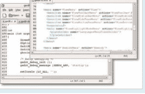

## 课后作业

目前该版本游戏尚未设置评分机制。尝试添加一个计算机玩家，或者创建一套规则，要求手牌达到特定等级或更高。你甚至可以将其做成双人对战模式。

因此，我们嵌套了一个 `if` 语句。同样，我们针对对子进行处理，这可能是一组对子或两组对子。如果以上情况都不满足，那么通过排除法，它只能是高点数。我们为每种结果分配一个文本字符串，以便将其发送回 `throw` 函数，从而打印出来。

## 22 再玩一次

和之前一样，我们通过文本提示玩家提供原始输入，询问是否进行另一局游戏。我们没有解析输入，而是假设玩家会根据文本提示选择指定的肯定回答。如果未接收到这些特定回复，我们将打印一条感谢玩家游玩本游戏的消息。这标志着游戏函数的结束。

## 23 最终得分

回到最开始的 `start` 函数，当游戏结束后，我们进入结果展示阶段。这部分相当简单——它调用得分（整数），然后在玩家名字之后单独打印出来。就玩家而言，这就是脚本的终点。目前，代码不会永久保存得分，但如果你愿意，可以让 Python 将其写入文件以保留记录。

## 24 模块

代码的最后部分允许该脚本以两种方式运行。首先，我们可以在命令行中执行它，它会正常工作。其次，我们可以将其导入到另一个 Python 脚本中，例如你想将它作为一个游戏添加到游戏合集时。这段最后的代码将防止我们的脚本在被其他模块导入时自动执行——只有直接运行它时才会执行。

```python
19 def hand(dice):
   dice_hand = [len(list(group)) for key, group in groupby(dice)]
   dice_hand.sort(reverse=True)
   straight1 = [1,2,3,4,5]
   straight2 = [2,3,4,5,6]
21 if dice == straight1 or dice == straight2:
       return "a straight!"
   elif dice_hand[0] == 5:
       return "five of a kind!"
   elif dice_hand[0] == 4:
       return "four of a kind!"
   elif dice_hand[0] == 3:
       if dice_hand[1] == 2:
           return "a full house!"
       else:
           return "three of a kind."
   elif dice_hand[0] == 2:
       if dice_hand[1] == 2:
           return "two pair."
       else:
           return "one pair."
   else:
       return "a high card."
22 def play_again():
   answer = raw_input("Would you like to play again? y/n: ")
   if answer in ("y", "Y", "yes", "Yes", "Of course!"):
       return answer
   else:
       print "Thank you very much for playing our game. See you next time!"
23 def scores():
   global player_score, computer_score
   print "HIGH SCORES"
   print "Player: ", player_score
   print "Computer: ", computer_score
24 if __name__ == '__main__':
   start()
```

## 为 Python 游戏创建图形界面

将 Python 图形用户界面（GUI）整合在一起，迈出编程自有软件的下一步

## 资源

- **Python 2：** www.python.org/download
- **IDLE：** www.python.org/idle

**开始部分**
在这里我们进行一些基础设置，包括引入一个新模块，该模块有助于创建简单的图形界面。

**导入部分**
我们导入了之前几期教程中创建的三个游戏，以便调用或使用它们。

**窗口部分**
创建一个图形窗口并为其命名，以便我们可以向其添加一些函数。

**框架部分**
定义窗口的尺寸，并为其中对象的布局提供大致指引。

**欢迎语部分**
在窗口中打印一条消息并将其放置在特定位置。其工作机制与普通的 `print` 略有不同。

**按钮部分**
本教程的重点是让“石头剪刀布”在图形界面中运行，因此我们正在调用一个新创建的函数。

**界面部分**
创建并格式化按钮，以在命令行或 shell 中启动另外两个教程游戏。

**退出部分**
在这里我们创建一个按钮，用于关闭窗口并结束脚本。我们还将其特定地放置在窗口的底部。

**主循环**
主循环（mainloop）允许主窗口持续运行并更新，除非指定退出，否则不会终止程序。

我们在 Python 中制作的三个基本游戏目前都在命令行或通过 IDLE（Python 集成开发环境）运行。虽然这让我们展示了使用 Python 代码的不同方法，但我们实际上尚未向你展示如何呈现它。在本教程中，我们将把所有三个游戏放入一个统一且整洁的图形界面中。

为此，我们将利用之前每个教程底部添加的那行小代码，以便将它们作为模块导入到我们的主图形脚本中。我们还将修改现有代码以添加一些图形元素。为了完成所有这些工作，我们将使用 Tkinter，这是 Python 中默认可用的一个模块，允许你用相对简单的代码创建窗口和框架。

本教程所需的所有内容是一个最新版本的 Python（可从你的发行版软件源或官网获取）以及 IDLE 开发环境。这也非常适合在树莓派系统（如 Raspbian）上运行。

## 主界面代码列表

```python
#!/usr/bin/env python2
#Linux User & Developer presents: Mega Microgames Collection

from Tkinter import *

import rockpaperscissors
import hangman
import pokerdice

root = Tk()
root.title ("Linux User & Developer’s Mega Microgames Collection")

mainframe = Frame(root, height = 200, width = 500)
mainframe.pack_propagate(0)
mainframe.pack(padx = 5, pady = 5)

intro = Label(mainframe, text = """Welcome to Linux User & Developer’s Mega
Microgames Collection.
Please select one of the following games to play:
""")
intro.pack(side = TOP)

rps_button = Button(mainframe, text = "Rock, Paper, Scissors", command =
rockpaperscissors.gui)
rps_button.pack()

hn_button = Button(mainframe, text = "Hangman", command = hangman.start)
hn_button.pack()

pd_button = Button(mainframe, text = "Poker Dice", command = pokerdice.start)
pd_button.pack()

exit_button = Button(mainframe, text = "Quit", command = root.destroy)
exit_button.pack(side = BOTTOM)

root.mainloop()
```

## Python 基础

## 修改后的石头剪刀布代码列表

```python
#!/usr/bin/env python2

# Linux User & Developer presents: Rock, Paper, Scissors: The Video Game: The Module

from Tkinter import *
import random

def gui():
    rock = 1
    paper = 2
    scissors = 3

    names = {rock: "Rock", paper: "Paper", scissors: "Scissors"}
    rules = {rock: scissors, paper: rock, scissors: paper}

def start():
    while game():
        pass

def game():
    player = player_choice.get()
    computer = random.randint(1, 3)
    computer_choice.set(names[computer])
    result(player, computer)

def result(player, computer):
    new_score = 0
    if player == computer:
        result_set.set("In game tie")
    else:
        if rules[player] == computer:
            result_set.set("Your victory has been assured.")
            new_score = player_score.get()
            new_score += 1
            player_score.set(new_score)
        else:
            result_set.set("The computer laughs as you realise you have been defeated.")
            new_score = computer_score.get()
            new_score += 1
            computer_score.set(new_score)
    
    rps_window = Toplevel()
    rps_window.title("Rock, Paper, Scissors")

    player_choice = IntVar()
    computer_choice = StringVar()
    result_set = StringVar()
    player_choice.set(1)
    player_score = IntVar()
    computer_score = IntVar()

    rps_frame = Frame(rps_window, padding = '3 3 12 12', width = 300)
    rps_frame.grid(column=0, row = 0, sticky=WENS)
    rps_frame.columnconfigure(0, weight=1)
    rps_frame.rowconfigure(0, weight=1)

    Label(rps_frame, text='Player').grid(column=1, row = 1, sticky = W)
    Radiobutton(rps_frame, text = 'Rock', variable = player_choice, value = 1).grid(column=1, row=2, sticky=W)
    Radiobutton(rps_frame, text = 'Paper', variable = player_choice, value = 2).grid(column=1, row=3, sticky=W)
    Radiobutton(rps_frame, text = 'Scissors', variable = player_choice, value = 3).grid(column=1, row=4, sticky=W)

    Label(rps_frame, text='Computer').grid(column=3, row = 1, sticky = W)
    Label(rps_frame, textvariable = computer_choice).grid(column=3, row=3, sticky = W)

    Button(rps_frame, text='Play', command = start).grid(column = 2, row = 2)

    Label(rps_frame, text = 'Score').grid(column = 1, row = 5, sticky = W)
    Label(rps_frame, textvariable = player_score).grid(column = 1, row = 6, sticky = W)
    Label(rps_frame, text = 'Computer').grid(column = 3, row = 5, sticky = W)
    Label(rps_frame, textvariable = computer_score).grid(column = 3, row = 6, sticky = W)

    Label(rps_frame, textvariable = result_set).grid(column = 2, row = 7)

if __name__ == '__main__':
    gui()
```

- **新导入项**
导入新的模块，以便创建“石头剪刀布”的 GUI 部分，同时移除不再需要的模块。

- **新界面**
我们新的主函数允许在按下 `rps_button` 时调用游戏脚本的大部分功能。这包含了游戏组件和图形组件。

- **新启动函数**
我们修改了 `start` 函数，使其结束后不再跳转到得分函数。我们还移除了得分函数，因为采用不同的追踪方式以便正确显示。

- **新游戏逻辑**
我们修改了 `game` 函数，使其现在从图形界面获取输入。我们使用了一个新的变量来实现这一点，该变量与 GUI 配合工作，否则其运行方式大致与之前相同。

- **新结果处理**
`result` 函数基本保持不变，只是现在它将结果消息发送到一个用于界面的变量中，并总体上使用新 GUI 的变量。

- **新窗口**
由于已经有一个‘mainloop’根窗口，我们使用略有不同的方法创建游戏窗口。我们还为其命名，以便正确识别。

- **新变量**
我们设置的新变量使其能够正确地与游戏代码和界面代码交互。我们还确保了玩家有默认选择，以便代码正常运行。

- **新框架**
使用与之前略有不同的方法确定游戏窗口的大小和布局。我们还允许元素固定在窗口周围的特定位置。

- **新选择项**
在这里，我们在窗口中放置单选按钮，具有特定的配置，给用户三种出招的选择。这随后传递给变量并被游戏代码使用。

- **新移动**
在这里，我们允许计算机的出招显示在‘Computer’标签下方。

- **新按钮**
按下我们在此处的 Play 按钮将运行游戏脚本，打印出得分，最后根据结果打印一条消息。

- **新结尾**
我们进行了修改，现在主脚本以 `gui` 开始，而不是 start 函数。


## Python 基础要点

```python
#!/usr/bin/env python2

# Linux User & Developer 呈现：巨型微游戏合集

from Tkinter import *

import rockpaperscissors
import hangman
import pokerdice

root = Tk()
root.title("Linux User & Developer 的巨型微游戏合集")

mainframe = Frame(root, height=200, width=500)
mainframe.pack_propagate(0)
mainframe.pack(padx=5, pady=5)

intro = Label(mainframe, text="""欢迎来到 Linux User & Developer 的巨型微游戏合集。
请选择以下其中一个游戏进行游玩：
""")
intro.pack(side=TOP)

rps_button = Button(mainframe, text="Rock, Paper, Scissors", command=rockpaperscissors.gui)
rps_button.pack()

hm_button = Button(mainframe, text="Hangman", command=hangman.start)
hm_button.pack()

pd_button = Button(mainframe, text="Poker Dice", command=pokerdice.start)
pd_button.pack()

exit_button = Button(mainframe, text="Quit", command=root.destroy)
exit_button.pack(side=BOTTOM)

root.mainloop()
```

## 主窗口

这段代码创建的主界面窗口相当基础，但包含了我们所需的功能。窗口的退出按钮将执行与“退出”按钮相同的工作，而“猜字谜游戏”和“扑克骰子”按钮则会在 Python 解释器中运行旧的脚本。

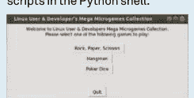

-   **01 首行** 我们使用这一行来输入 Python 解释器的路径。这允许我们在终端内运行该程序，或者在 IDLE 等 Python 专用 IDE 之外运行。请注意，在此特定脚本中我们使用的是 Python 2。
-   **02 导入图形库** Tkinter 是我们使用的图形界面，虽然它是 Python 的标准库，但你仍然需要导入该模块才能使用它。我们使用了 "from [模块] import *" 方法，这样我们在使用其中的函数时就不需要在前面加上 Tkinter。
-   **03 导入游戏** 我们正在导入三个游戏的模块。我们在每个脚本的底部添加了一行，以便实现这一点。为了确保区分每个游戏中的函数，我们需要指定 [模块].[函数]，以便代码中没有错误。
-   **04 根窗口** 使用 Tk() 函数创建我们将放置所有内容的窗口。我们暂时决定称其为 root；不过，只要保持一致性，你可以将其命名为任何名称。我们还使用 Tkinter 的 title 命令和一个字符串为其命名。
-   **05 主框架** 第一行让我们将变量 mainframe 设置为界面中的一个 Frame（框架）。我们将其附加到 root（主窗口），并赋予其最小的高度和宽度（以像素为单位）。我们使用 pack_propagate 来创建窗口，并确保其大小符合我们的定义。然后我们使用 pack 来填充边框，使窗口内容不接触边缘。
-   **06 引言** 我们创建了一个位于主框架中的标签（label），并将其赋值给变量 intro。我们给它一段文本以介绍界面，使用三引号使其跨多行显示并更好地格式化。然后我们使用 pack 显示它，并告诉 Tkinter 将其放在界面的顶部。
-   **07 石头、剪刀、布** 我们使用 Button 函数为“石头、剪刀、布”游戏创建一个按钮。我们将主框架附加到它上面，使用 text 在按钮上显示标签，然后让它执行一个命令。在这种情况下，我们使用修改后的 rockpapershotgun.py 代码，该代码有一个 gui 函数，因此是 rockpapershotgun.py。然后我们使用 pack 将其放置在窗口中。


```python
#!/usr/bin/env python2

# Linux User & Developer 呈现：石头、剪刀、布：电子游戏：模块

from Tkinter import *
from ttk import *
import random

def gui():
    rock = 1
    paper = 2
    scissors = 3
    names = { rock: "Rock", paper: "Paper", scissors: "Scissors" }
    rules = { rock: scissors, paper: rock, scissors: paper }
    def start():
        while game():
            pass
    def game():
        player = player_choice.get()
        computer = random.randint(1, 3)
        computer_choice.set(names[computer])
        result(player, computer)
```

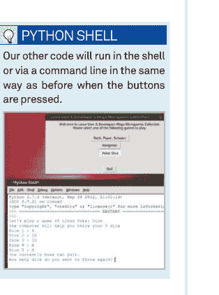

## 08 其他游戏

对于其他两个游戏，代码大部分相同；不过，我们在两者中都调用了 start 函数。在最终界面中，这将导致游戏像之前一样在 shell 或命令行中运行。

## 09 打破循环

退出按钮的工作方式与我们创建的其他按钮类似，但它使用的是 command root.destroy()。这结束了我们使用 root.mainloop() 创建的循环，该循环允许界面代码继续循环，从而让我们能够持续使用它。我们将退出按钮放置在窗口底部，使用 ‘side = BOTTOM’。

## 10 游戏代码

这段代码的开头没有多大变化，除了几个 import 变更外。用于在命令行中运行的代码仍然存在，经过一些修改，代码可以独立于主界面运行。我们删除了 time 模块，因为不再需要它，并不仅导入了 Tkinter 模块，还导入了 ttk 模块。ttk 模块允许我们将 GUI 排列在网格中，这样使用起来和理解起来会稍微简单一些。

## 11 游戏界面

我们对这个脚本所做的最大改变之一是将所有内容包含在一个函数中，即 ‘def gui’。界面代码需要放入函数中，否则它在导入时就会被执行。虽然我们选择将代码的全部放在一个函数中，但你也可以尝试仅将图形界面代码放入其中一个。我们在这里保留了所有变量，以确保它们仍能正常工作。

## 12 游戏变量

变量保持不变，以便我们可以像原始代码中那样进行相同的比较。我们将它们放入函数中，这样它们就不会影响导入到主界面的其他代码——而且当我们仅调用此函数时，不需要使用 global 将它们引入。

我们的其他代码在按下按钮时，将以与之前相同的方式在 shell 或通过命令行运行。

## 13 Start 函数

我们从 start 函数中删除了调用 score 函数的部分，因为现在由界面处理计分。不过，它仍然调用 game 函数，将其放入循环中，以便可以连续使用。此函数由界面调用来开始游戏，通过设置电脑的一步棋，然后将其与玩家的选择进行比较。

## 14 Game 函数

game 函数经过了一些修改，以确保其与界面配合工作。首先，玩家变量是通过在我们创建的用于包含玩家选择的特殊变量上使用 get() 来获取的。我们对电脑做了类似的事情，使用 ‘set’ 来更改我们面向界面的 computer_choice 变量中的值。我们仍然使用 name 变量来设置放入 computer_choice 中的文本。然后，我们像之前那样传递玩家和电脑变量。

## Python 基础要点

```python
def result(player, computer):
    new_score = 0
    if player == computer:
        result_set.set("Tie game.")
    else:
        if rules[player] == computer:
            result_set.set("Your victory has been assured.")
            new_score = player_score.get()
            new_score += 1
            player_score.set(new_score)
        else:
            result_set.set("The computer laughs as you realise you have been defeated.")
            new_score = computer_score.get()
            new_score += 1
            computer_score.set(new_score)

rps_window = Toplevel()
rps_window.title("Rock, Paper, Scissors")

player_choice = IntVar()
computer_choice = StringVar()
result_set = StringVar()
player_choice.set(1)
player_score = IntVar()
computer_score = IntVar()
```

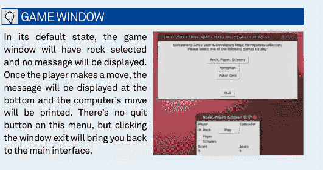

## 15 Result 函数

result 函数仍然接受与之前相同的两个变量，我们在游戏界面中设置了这些变量。虽然在技术上我们可以使用为界面设置的变量，但这些不是纯整数，如果处理不当可能会导致错误。考虑到这一点，我们创建了一个空的 new_score 变量，我们可以使用它来有效地清除界面值，然后再加回去。

## 16 平局

确定结果的逻辑与之前相同。我们首先进行简单的检查——玩家和电脑变量的数值是否相同。这次不同的是，我们不再打印文本，而是使用 Tkinter 的 set 函数将“平局”消息发送到我们的 result 变量中。

## 17 获胜

如果 if 语句继续，它会检查玩家是否获胜。与之前一样，我们使用设定的规则进行代码所需的比较。我们像平局游戏一样设置 result_set，但向用户显示不同的消息。最后，我们将 new_score 变量设置为当前玩家分数，使用 get 函数获取该值，分数加 1，然后再次使用 set 将其放回到 player_score 变量中。我们不能对 player_score 变量使用 +=，因为它不是标准变量。

## 18 失败

整体 if 语句的这一部分工作方式与之前相同，假设如果不是平局或获胜，那就是失败。与获胜代码的新版本一样，它使用 set 更改将显示给玩家的 message，并通过 new_score 变量调用并更改电脑分数。

## 19 新窗口

由于原始窗口是 mainloop 的一部分，我们不能像在主界面代码中那样使用 Tk() 来创建窗口。然而，由于此窗口是从它派生出来的，我们改用 Toplevel() 来创建它。这允许窗口独立运行并位于主窗口之上。我们还给它起了个名字，在这个过程中不会改变主窗口的名称。

## 20 界面变量

这就是我们必须以不同方式调用和修改变量的原因。对于 Tkinter，我们需要让界面知道变量是整数还是文本值。IntVar 和 StringVar 分别允许这些类型。IntVar 还将 player_choice 变量设置为 1，我们已经将其设置为石头选项。这意味着游戏开始时至少会有一个默认选择，且不会导致错误。

## 21 游戏框架

我们创建界面项的框架的方式略有不同。我们不再使用主界面中的 pack 命令，而是使用 grid 以确保它们以对用户有意义的方式排列。Padding 正是这样做的，设置值以确保框架中的项目不接触窗口边缘。使用 grid 命令，我们随后创建了这个框架。row 和 column 变量允许在结构中包含行和列


## 21 rps_frame
```python
rps_frame = Frame(rps_window, padding='3 3 12 12', width=300)
rps_frame.grid(column=0, row=0, sticky=(N, W, E, S))
rps_frame.columnconfigure(0, weight=1)
rps_frame.rowconfigure(0, weight=1)
```
`sticky` 参数允许我们将项目沿特定方向对齐 – 在这种情况下，即顶部、左侧、右侧和底部对齐。最后，我们通过从 0 开始赋予每一列和每一行相同的权重，确保它们被同等对待。

## 22 玩家选择
```python
Label(rps_frame, text='Player').grid(column=1, row=1, sticky=W)
Radiobutton(rps_frame, text='Rock', variable=player_choice, value=1).grid(column=1, row=2, sticky=W)
Radiobutton(rps_frame, text='Paper', variable=player_choice, value=2).grid(column=1, row=3, sticky=W)
Radiobutton(rps_frame, text='Scissors', variable=player_choice, value=3).grid(column=1, row=4, sticky=W)
```
我们为玩家的出招创建一个标签，并将其分配到网格位置，位于第一行、第一列。我们还使用 `sticky = W` 将其左对齐。然后，我们为玩家的出招添加单选按钮，每个都位于同一列，但在下方的行中。我们给每个选项命名，并将其分配给 `player_choice` 变量。然后，我们使每个选项具有一个与我们在第一组规则中确定的出招相对应的数值。

## 23 计算机出招
```python
Label(rps_frame, text='Computer').grid(column=3, row=1, sticky=W)
Label(rps_frame, textvariable=computer_choice).grid(column=3, row=3, sticky=W)
```
我们在这里显示计算机的出招。首先，我们标注这是什么，然后创建第二个标签来显示实际的出招。我们通过在 `Label` 中添加 `textvariable` 选项，并使用我们在游戏函数早期更新的 `computer_choice` 变量来实现这一点。这仅仅是打印 `names` 列表中的文本并将其左对齐。

## 24 按下开始
```python
Button(rps_frame, text="Play", command=start).grid(column=2, row=2)

Label(rps_frame, text="Score").grid(column=1, row=5, sticky=W)
Label(rps_frame, textvariable=player_score).grid(column=1, row=6, sticky=W)
```
代码的运行完全取决于“开始”按钮。非常简单：我们将它放在玩家和计算机出招之间的行中，作为我们三列系统的一部分；并且它使用 `command` 选项运行 `start` 函数。由于接口的循环，我们可以不断按下此按钮，而不需要被要求再次游玩。简单地退出窗口也会返回到主界面窗口，意味着我们不需要专门的退出按钮。

## 25 当前分数
```python
Label(rps_frame, text="Score").grid(column=3, row=5, sticky=W)
Label(rps_frame, textvariable=computer_score).grid(column=3, row=6, sticky=W)

Label(rps_frame, textvariable=result_set).grid(column=2, row=7)
```
我们有两个分数集需要显示 – 一个是玩家的，另一个是计算机的。我们像标注“玩家”和“计算机”出招一样标注这些分数，将它们放在较低的行，但仍位于相应的列中。在其下方，我们再次使用 `textvariable` 选项来获取我们分配给单独分数变量的数值分数。最后，我们创建另一个标签来显示游戏结果的信息。

## 26 结束游戏
```python
if __name__ == '__main__':
    gui()
```
代码的最后部分允许主窗口使用该脚本，并且当在命令行或 shell 中使用时，也允许其独立运行。你需要进行一些修改才能使其独立运行，例如将其设置为 `mainloop` 而不是 `Toplevel` 窗口。然而，它可以从两者正常运行，而不需要从主界面启动。

## 为简单的 Python 游戏添加图形

通过为绞刑架和扑克骰子代码添加图形界面，完成你的三款游戏系列。

## 资源
- Python 2: www.python.org/download
- IDLE: www.python.org/idle

1. **导入**
   这里我们进行了一些次要的设置，包括获取帮助我们创建简单图形界面的 Tkinter 模块。
2. **单词**
   我们将确定要猜单词的变量保留在这里，以便可以在代码中的任何地方轻松访问。
3. **函数**
   像上次一样，我们将原始代码的大部分放入一个新函数中，`gui`。
4. **分析**
   我们在继续其余代码之前选择并分析单词。
5. **图形**
   `hangedman` 函数几乎未变，尽管有了新代码来在界面上显示我们的 ASCII 图形。
6. **猜测**
   我们检查错误的次数，并调用 `guess_letter` 函数来检查输入的字母。

我们现在已经为之前制作的三个 Python 游戏创建了一个简单的选择器。该界面能够启动我们的石头、剪刀、布游戏的图形用户界面（GUI），并在终端中运行另外两个游戏。现在，我们要将绞刑架和扑克骰子代码转换为以类似于石头、剪刀、布的方式工作。绞刑架的技巧在于允许不同类型的输入，即文本，以及进行多轮游戏的能力。Tkinter 允许文本输入，我们在完整玩游戏中对 `while` 循环的依赖要少得多。扑克骰子需要保持骰子分析代码，以及使用复选框更改特定骰子的选项。

我们将修改大量原始代码以适应新的图形方案。这主要涉及剪切特定部分并让 Tkinter 特定代码自行处理这些。这些页面的代码列表包含修改后的代码 - 我们将在接下来的页面中讨论图形部分。

## 绞刑架代码列表
```python
from Tkinter import *
from ttk import *
from random import *

word = ""
word_length = 0
cue = []

def gui():
    global word, word_length, cue
    dictionary = ["gnu", "kernel", "linux", "mageia", "penguin", "ubuntu"]
    word = choice(dictionary)
    word_length = len(word)
    cue = word_length * ["-"]
    tries = 6

    def hangedman(hangman):
        graphic = [
            '''
            ----------
                |
                O
               -|-
                /\\
            ==========
            '''
        ]
        graphic_set = graphic[hangman]
        hw_graphic.set(graphic_set)

    def game():
        letters_wrong = int(incorrect_guesses.get())
        letter = guess_letter()
        first_index = word.find(letter)
        if first_index == -1:
            letters_wrong += 1
            incorrect_guesses.set(str(letters_wrong))
        else:
            for i in range(word_length):
                if letter == word[i]:
                    cue[i] = letter
            hangedman(letters_wrong)
            cue_set = " ".join(cue)
            word_output.set(cue_set)
            if letters_wrong == tries:
                result_text = "Game Over. The word was " + word
                result_score.set(result_text)
                new_score = int(computer_score.get())
                new_score += 1
                computer_score.set(str(new_score))
            if " ".join(cue) == word:
                result_text = "You Win! The word was " + word
                result_score.set(result_text)
                new_score = int(player_score.get())
                new_score += 1
                player_score.set(str(new_score))

    def guess_letter():
        letter = letter_guess.get()
        letter = letter.strip()
        letter = letter.lower()
        return letter

    def reset_game():
        global word, word_length, cue
        incorrect_guesses.set("0")
        hangedman(0)
        result_set.set("")
        letter_guess.set("")
        word = choice(dictionary)
        word_length = len(word)
        cue = word_length * ["-"]
        new_cue = " ".join(cue)
        word_output.set(new_cue)

if __name__ == "__main__":
    gui()
```

## Python 基础

1. **更多导入**
   我们添加了使 Tkinter 工作所需的新导入模块，其余保持不变。
2. **骰子列表**
   持有骰子的列表保留在主函数之外，以便可以在任何地方访问。
3. **滚动**
   滚动函数也是如此。它并不特别需要在 `gui` 函数内部。
4. **决定**
   我们将在稍后创建的图形代码中的复选框将为我们提供可以分析的代码数字。我们检索这些数字并检查它们以确定用户希望重新滚动哪些骰子。
5. **手牌**
   最后，我们的手牌分析函数是保留在 `gui` 函数之外的原始代码的最后一部分。这两个函数都将必要的细节传回链条，然后添加到新界面的新图形元素中。
6. **无骰子**
   如果没有选择任何骰子重新滚动，手牌输出将更改以显示最终消息。
7. **重新滚动**
   这部分与之前几乎相同 – 滚动一组新的骰子，然后像之前一样插入骰子列表中，然后重新排序以简化手牌分析。
8. **更多函数**
   新的 `gui` 函数是扑克骰子代码的主要变化，和之前一样，包括 Tkinter 元素和原始代码的其他部分。
9. **游戏开始**
   一个简单的函数，我们可以用它来激活骰子的重新滚动。
10. **新手牌**
    新的骰子被命名、分析，然后一切设置好以便 `gui` 显示最终结果。
11. **重置**
    与绞刑架代码一样，我们有一个函数来重置所有变量，允许你重新开始游戏。

## 扑克骰子代码列表
```python
from Tkinter import *
from ttk import *
import random
from itertools import groupby

dice = []

def roll(roll_number):
    global dice
    numbers = range(1, 7)
    dice = [0] * roll_number
    iterations = 0
    while iterations < roll_number:
        iterations = iterations + 1
        dice[iterations - 1] = random.choice(numbers)
    return dice

def hand(dice):
    dice = sorted(dice)
    hand_list = [len(list(group)) for key, group in groupby(dice)]
    hand_list.sort(reverse=True)

    straight1 = [1, 2, 3, 4, 5]
    straight2 = [2, 3, 4, 5, 6]
    if dice == straight1 or dice == straight2:
        return "a straight!"
    elif hand_list[0] == 5:
        return "five of a kind!"
    elif hand_list[0] == 4:
        return "four of a kind!"
    elif hand_list[0] == 3:
        if hand_list[1] == 2:
            return "a full house!"
        else:
            return "three of a kind."
    elif hand_list[0] == 2:
        if hand_list[1] == 2:
            return "two pair."
        else:
            return "one pair."
    else:
        return "a high card."

def gui():
    global dice
    dice = roll(5)
    dice.sort()
    nine = 1
    ten = 2
    jack = 3
    queen = 4
    king = 5
    ace = 6
    names = {nine: "9", ten: "10", jack: "J", queen: "Q", king: "K", ace: "A"}
    result = "You have " + hand(dice)

def game():
    throws()

def throws():
    global dice
    dice_rerolls = []
    dice1_check = dice1.get()
    dice2_check = dice2.get()
    dice3_check = dice3.get()
    dice4_check = dice4.get()
    dice5_check = dice5.get()
    dice_rerolls = [dice1_check, dice2_check, dice3_check, dice4_check, dice5_check]

    for i in range(len(dice_rerolls)):
        if 0 in dice_rerolls:
            dice_rerolls.remove(0)
        if len(dice_rerolls) == 0:
            result = "You finish with " + hand(dice)
            hand_output.set(result)
        else:
            roll_number = len(dice_rerolls)
            number_rerolls = roll(roll_number)
            dice_changes = range(len(dice_rerolls))
            
            iterations = 0
            while iterations < roll_number:
                iterations = iterations + 1
                replacement = number_rerolls[iterations - 1]
                for i in range(len(dice)):
                    if dice[i] in dice_rerolls:
                        dice[i] = replacement
                        dice_rerolls.remove(replacement)
                        break
                dice.sort()
            
            new_dice_list = [0, 0, 0, 0, 0]
            for i in range(len(dice)):
                new_dice_list[i] = names[dice[i]]
            final_dice = " ".join(map(str, new_dice_list))
            dice_output.set(final_dice)
            final_result = "You finish with " + hand(dice)
            hand_output.set(final_result)

def reset_game():
    global dice
    dice = roll(5)
    dice.sort()
    empty_dice = [""] * len(dice)
    for i in range(len(dice)):
        empty_dice[i] = names[dice[i]]
    first_dice = " ".join(empty_dice)
    dice_output.set(first_dice)
    result = "You have " + hand(dice)
    hand_output.set(result)

if __name__ == "__main__":
    gui()
```
《Python 图书》第 57 页


## 01 初始代码

像往常一样，我们从允许我们在命令行中运行程序的代码开始，随后导入必要的模块：`random`，用于确定要使用的单词；`Tkinter`，用于大部分图形代码；以及 `ttk`，用于我们将用来对齐不同元素的网格代码。

```python
#!/usr/bin/env python3

from Tkinter import *
from ttk import *
from random import *
word = @
word_length = @
clue = @
```

## 02 全局变量

我们将这三个变量保留在 `gui` 函数之外，以便在代码的任意位置都可以访问它们。Python 2 不允许在嵌套函数中调用全局变量，而在 Python 3 中，这些变量可以放入 `gui` 函数中。

```python
def gui():
  global word, word_length, clue
```

## 03 图形函数

我们将所有工作代码放入 `gui` 函数中，以便可以从主界面激活它。这意味着我们可以将猜字游戏代码导入界面，而不会弹出游戏窗口，只有当我们在此处激活 `gui` 函数时才会运行它。

## 04 随机单词

我们通过 `global` 引入这三个变量，以便在代码的其他地方修改它们，然后设置单词。与之前一样，使用 `choice` 从单词列表中随机选择一项，确定长度，并设置要显示的线索。

```python
  dictionary = ["gnu", "kernel", "linux", "mageia", "penguin", "ubuntu"]
  word = choice(dictionary)
  word_length = len(word)
  clue = word_length * ["_"]
  tries = 6
```

## 05 被绞刑的人

这次挂画的主要区别在于，我们不再打印这些图形，而是要在界面中显示它们。当函数被调用并选中图形时，它会放置在我们设置在界面代码中用于显示结果的变量中。

```python
  def hangedman(hangman):
    graphic = [
      """
      |---------
      |    |    
      |    O    
      |   -|-  
      |    /
      |   /\
      |        
      =========="""
      ]
    graphic_set = graphic[hangman]
    hw_graphic.set(graphic_set)
```

## 06 游戏开始

对我们输入的字母的所有分析都在此函数中完成。为此，我们首先从之前设置的变量中获取迄今为止错误的猜测次数，以便界面在需要时可以访问它。然后从界面中的输入框获取字母并清理，以便它可以与代码的其他部分一起使用。

```python
  def game():
    letters_wrong = incorrect_guesses.get()
    letter = guess_letter()
```

## 07 检查字母

此部分的代码基本上没有变化——获取字母并使用 `find` 将其与单词进行比较，以查看是否与某个字母匹配。如果 `if` 语句则向错误猜测变量加一，或者更新 `clue` 变量以在正确的位置添加该字母。

```python
    first_index = word.find(letter)
    if first_index != -1:
      letters_wrong += 1
      incorrect_guesses.set(letters_wrong)
    else:
      for i in range(word_length):
        if letter == word[i]:
          clue[i] = letter
```

## 08 更新界面

这三行代码设置了本轮的图形，将当前的线索连接成一个字符串，然后将其设置在供界面读取的变量中。

```python
      hangedman(letters_wrong)
      clue_set = " ".join(clue)
      word_output.set(clue_set)
```

## 09 更新分数

与之前完全一样，我们检查玩家是否已经赢或输。在任一种情况下，都会显示一条消息以示说明，并使用 `set` 更新胜场数和负场数。

```python
      if letters_wrong == tries:
        result_text = "Game Over. The word was " + word
        result_set(result_text)
        new_score = computer_score.get()
        new_score += 1
        computer_score.set(new_score)
      if "".join(clue) == word:
        result_text = "You Win! The word was " + word
        result_set(result_text)
        new_score = player_score.get()
        new_score += 1
        player_score.set(new_score)
```

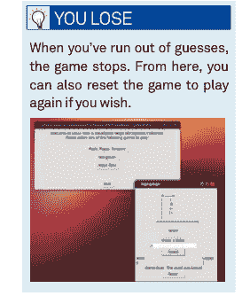

## 10 净化输入

`guess_letter` 函数纯粹是从玩家输入变量中获取字母，去除任何格式，将其转换为小写，然后将其返回给游戏函数。这样可以确保字母被正确使用。

```python
def guess_letter():
    letter = letter_guess.get()
    letter_strip()
    letter_lower()
    return letter
```

## 11 新窗口

我们像上个月一样使用 Tkinter 的 `Toplevel` 命令来分离主界面和游戏窗口的循环。然后我们使用 `title` 将其命名为“Hangman”（猜字游戏）。

```python
def reset_game():
    global word, word_length, clue
    incorrect_guesses.set(0)
    hangeman()
    result_set.set("")
    letter_guess.set("")
    word = choice(dictionary)
    word_length = len(word)
    clue = word_length * ["__"]
    new_clue = " ".join(clue)
    word_output.set(new_clue)

    hm_window = Toplevel()
    hm_window.title("Hangman")
```

## 12 界面变量

Tkinter 只与特定的变量一起工作——我们已经创建了我们需要的或这里可以使用的所有变量。IntVars 接受整数，而 StringVars 接受字符串。我们在整个代码中使用这些变量配合 `get` 和 `set` 来获取和设置值。

```python
    incorrect_guesses = IntVar()
    incorrect_guesses.set(0)
    player_score = IntVar()
    computer_score = IntVar()
    result_set = StringVar()
    letter_guess = StringVar()
    word_output = StringVar()
    hm_guess = StringVar()
    hm_graphic = StringVar()
```

## 13 带边框的窗口

框架的设置方式与上次相同。我们给框架添加边缘填充，设置网格，赋予其指南针方向的粘附点，并允许设置具有特定行和列点的对象。

```python
    hm_frame = Frame(hm_window, padding = '3 3 12 12', width = 300)
    hm_frame.grid(column=0, row = 0, sticky=(N,W,E,S))
    hm_frame.columnconfigure(0, weight=1)
    hm_frame.rowconfigure(0,weight=1)
```

## 14 猜字游戏的线索

这些标签相当直接——我们要么给它们固定的文本，要么告诉它们使用特定的 `textvariable`，以便它们可以在游戏过程中被更新。

```python
    Label(hm_frame, textvariable = hm_graphic).grid(column=2, row = 1)
    Label(hm_frame, text="Word").grid(column=2, row = 2)
    Label(hm_frame, textvariable = word_output).grid(column=2, row = 3)
```

## 15 文本输入

这里的 `Entry` 有一个文本框，我们将向其中添加字母。`exportselection` 选项使得选择字母时不会立即将其复制到剪贴板，而 `textvariable` 的选择是代码存储所添加字母的位置。按钮激活游戏函数，分析玩家输入的字母。

```python
    Label(hm_frame, text='Enter a letter').grid(column=2, row = 4)
    hm_entry = Entry(hm_frame, exportselection = 0, textvariable = letter_guess).grid(column = 2, row = 5)
    hm_entry_button = Button(hm_frame, text = "Guess", command = game).grid(column = 2, row = 6)
```

## 16 结果和重置

剩下的代码与我们之前所做的类似：用于显示固定文本以及变化中的分数/结果文本的标签。激活重置函数的按钮也放在这里底部。最后两行允许我们将模块导入到界面代码中。

```python
    Label(hm_frame, text = "Wins").grid(column = 1, row = 7, sticky = W)
    Label(hm_frame, textvariable = player_score).grid(column = 1, row = 7, sticky = W)
    Label(hm_frame, text = "Losses").grid(column = 3, row = 7, sticky = W)
    Label(hm_frame, textvariable = computer_score).grid(column = 3, row = 8, sticky = W)
    Label(hm_frame, textvariable = result_set).grid(column = 2, row = 9)
    replay_button = Button(hm_frame, text = "Reset", command = reset_game).grid(column = 2, row = 10)

    if __name__ == '__main__':
        gui()
```

## 原始界面

你还需要之前教程中的界面代码，它已经可以与修改过的猜拳代码一起工作。由于之前的结束方式，它无法与新代码一起工作，因此你需要将每个按钮中的命令从 `game.start` 更改为 `game.gui`。

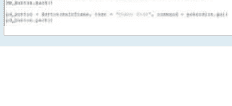

## 猜字游戏 GUI

按下更新后的“Hangman”按钮以启动一个新窗口。在这里，我们有初始图形、单词线索以及供玩家交互的输入框。分数设置为零，由于尚未进行任何游戏，因此没有显示结果消息。

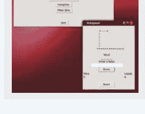


## Python 基础知识

## 17 重新开始
这里通常有*数组*形式的命令行兼容性和模块导入。这里的 **groupby** 函数是专门为骰子分析而导入的。

## 18 骰子外部
对于扑克骰子，任何时刻只有一个变量需要显示，即骰子。同样，由于嵌套函数，且我们使用的是 Python 2，我们需要从这里使用 **global** 来调用，以确保游戏能够正确重置。

## 19 掷骰
`roll` 函数已从 **gui** 函数中移除，以避免其某些变量导致代码错误。它可以轻松地在嵌套函数中调用。它与原始代码没有任何变化。

## 20 骰子手牌
与 `roll` 一样，**hand** 函数也没有任何变化。它现在仅仅被放置在 **gui** 函数外部，原因完全相同。这也意味着，如果你愿意，可以轻松地将此函数导入到另一个脚本中。

## 21 GUI 启动
正如我们上个月提到的以及在人梯代码中所述，我们将所有 GUI 代码放入一个函数中，以便我们随时可以调用它。在这种情况下，在主界面上按下扑克骰子按钮会激活 **pokerdice.gui**，即此函数。

## 22 首次掷骰
窗口打开时，我们立即进行首次掷骰。然后排序，每个数字赋予一张牌，并创建结果以在主窗口中显示。这类似于之前的工作方式，但现在它是在脚本末尾输入到界面的 StringVars 中。

## 23 开始游戏
当我们激活启动 **game** 的按钮时，它会立即引导我们进入其余代码。如果你让按钮转到 **throws** 函数，这也有效；不过，如果你愿意，可以在此处添加更多函数。

## 24 骰子选择
我们做的第一件事是找出玩家勾选了哪些复选框。然后我们将它们放入列表中，以便我们可以更改正确的骰子数字。我们还引入了 **dice**，以便我们可以检查当前骰子的点数。

```python
#!/usr/bin/env python2
from Tkinter import *
from ttk import *
import random
from itertools import groupby
dice = 0

def roll(roll_number):
    numbers = range(1,7)
    dice = range(roll_number)
    iterations = 0
    while iterations < roll_number:
        iterations = iterations + 1
        dice[iterations-1] = random.choice(numbers)
    return dice

def hand(dice):
    dice_hand = [len(list(group)) for key, group in groupby(dice)]
    dice_hand.sort(reverse=True)
    straight1 = [1,2,3,4,5]
    straight2 = [2,3,4,5,6]
    if dice == straight1 or dice == straight2:
        return "a straight!"
    elif dice_hand[0] == 5:
        return "five of a kind!"
    elif dice_hand[0] == 4:
        return "four of a kind!"
    elif dice_hand[0] == 3:
        if dice_hand[1] == 2:
            return "a full house!"
        else:
            return "three of a kind."
    elif dice_hand[0] == 2:
        if dice_hand[1] == 2:
            return "two pair."
        else:
            return "one pair."
    else:
        return "a high card."

def gui():
    global dice
    dice = roll(5)
    dice.sort()
    nine = 1
    ten = 2
    jack = 3
    queen = 4
    king = 5
    ace = 6
    names = { nine: "9", ten: "10", jack: "J", queen: "Q", king: "K", ace: "A"}
    result = ("You have " + hand(dice))

def game():
    throws()

def throws():
    global dice
    dice1_check = dice1.get()
    dice2_check = dice2.get()
    dice3_check = dice3.get()
    dice4_check = dice4.get()
    dice5_check = dice5.get()
    dice_rolls = [dice1_check, dice2_check, dice3_check, dice4_check, dice5_check]
```

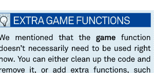

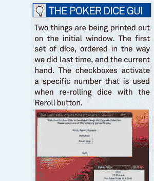

## 25 需重掷的骰子
如果复选框未被选中，我们将其设置为给出零值。我们希望从列表中移除这些，以便更改正确的骰子，因此我们使用 for 循环检查列表的每个部分，然后在元素等于零时使用 `remove` 函数。

```python
    for i in range(len(dice_rolls)):
        if i in dice_rolls:
            dice_rolls.remove(i)
```

## 26 提前结束
如果没有选择重掷的骰子，列表将包含所有 0，这些将被移除。该列表的长度将为零，这意味着如果玩家未选择任何骰子就点击重掷，我们可以使用它来结束游戏。

```python
    if len(dice_rolls) == 0:
        result = "You finish with " + hand(dice)
        hand_output.set(result)
```

## 27 新骰子
此 `else` 函数大致与之前相同。我们首先获取需要掷多少骰子的必要信息，以及一个用于放置重掷的列表。然后我们用第一个 `while` 循环掷出所需数量的新骰子。

```python
    else:
        roll_number = len(dice_rolls)
        number_rolls = roll(roll_number)
        dice_changes = range(len(dice_rolls))
        iterations = 0
        while iterations < roll_number:
            iterations = iterations + 1
            dice_changes[iterations-1] = number_rolls[iterations-1]
```

## 28 游戏结束
我们使用相同类型的 while 循环将新数字替换到原始列表中，就像上次一样。骰子被重新排序、分析、组合成字符串，然后设置到界面变量中。最终的手牌消息也被创建并设置。

```python
        iterations = 0
        while iterations < roll_number:
            iterations = iterations + 1
            replacement = number_rolls[dice_changes[iterations-1]]
            dice_changes[dice_changes[iterations-1]] = replacement
        dice.sort()
        new_dice_list = [0,0,0,0,0]
        for i in range(len(dice)):
            new_dice_list[i] = names[dice[i]]
        final_dice = ", ".join(new_dice_list)
        dice_output.set(final_dice)
        final_result = "You finish with " + hand(dice)
        hand_output.set(final_result)

    def reset_game():
        global dice
        dice = roll(5)
        dice.sort()
        for i in range(len(dice)):
            empty_dice[i] = names[empty_dice[i]]
        first_dice = ", ".join(empty_dice)
        dice_output.set(first_dice)
        result = "You have " + hand(dice)
        hand_output.set(result)
```

## 29 图形变量
由于我们在启动游戏时立即掷骰子，但界面代码直到最后才开始，你可以看到在创建必要的变量后，我们对它们进行了排序。需要注意的是，骰子必须单独转换为字符串，在添加到变量之前使用 `for` 循环。

```python
    pd_window = Toplevel()
    pd_window.title("Poker Dice")
    pd_output = StringVar()
    empty_dice = [0,0,0,0,0]
    for i in range(len(dice)):
        empty_dice[i] = names[dice[i]]
    first_dice = ", ".join(empty_dice)
    dice_output.set(first_dice)
    hand_output = StringVar()
    hand_output.set(result)

    dice1 = IntVar()
    dice2 = IntVar()
    dice3 = IntVar()
    dice4 = IntVar()
    dice5 = IntVar()
    player_score = StringVar()
    result_set = IntVar()
    computer_score = IntVar()
```

## 30 检查按钮
此代码的主要添加是带有 `Checkbutton` 的检查按钮。你可以设置开和关的值，默认关闭为 0。我们使其使检查按钮返回与其更改的骰子相同的数字，我们之前已在代码中解释了如何使用。`variable` 选项将结果设置到特定的 Tkinter 变量。

```python
    pd_frame = Frame(pd_window, padding = '3 3 12 12', width = 300)
    pd_frame.grid(row=0, row = 0, sticky=(N,W,E,S))
    pd_frame.columnconfigure(0, weight=1)
    pd_frame.rowconfigure(0, weight=1)
    Label(pd_frame, text='Dice').grid(column=3, row = 1)
    Label(pd_frame, textVariable = dice_output).grid(column=3, row = 2)
    Label(pd_frame, textVariable = hand_output).grid(column=3, row = 3)

    Label(pd_frame, text='Dice Roll 1').grid(column=3, row = 4)
    re-roll1 = Checkbutton(pd_frame, text = "1", variable = dice1, onvalue = 1, offvalue = 0).grid(column=1, row = 5)
    re-roll2 = Checkbutton(pd_frame, text = "2", variable = dice2, onvalue = 2, offvalue = 0).grid(column=2, row = 5)
    re-roll3 = Checkbutton(pd_frame, text = "3", variable = dice3, onvalue = 3, offvalue = 0).grid(column=5, row = 5)
    re-roll4 = Checkbutton(pd_frame, text = "4", variable = dice4, onvalue = 4, offvalue = 0).grid(column=5, row = 5)
    re-roll5 = Checkbutton(pd_frame, text = "5", variable = dice5, onvalue = 5, offvalue = 0).grid(column=5, row = 5)
    pd_re-roll_button = Button(pd_frame, text = "Re-roll", command = game).grid(column = 3, row = 6)
    pd_replay_button = Button(pd_frame, text = "Reset", command = reset_game).grid(column = 3, row = 7)

if __name__ == "__main__":
    gui()
```

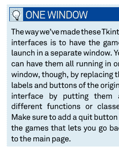

我们制作此 Tkinter 界面的方式是让游戏在单独的窗口中启动。不过，你可以通过将原始界面的标签和按钮替换为不同的函数或类，让它们都在一个窗口中运行。记得为游戏添加一个退出按钮，以便你可以返回主页面。


## 在 C 语言中嵌入 Python

在这里，我们将学习如何在常规的 C 程序中调用 Python 代码，从而兼得两者之长。

在 C 程序中，有时你可能需要执行一段 Python 代码。例如，你可能希望程序能够运行用户代码，这样用户可以利用插件来扩展程序的功能。实现这一目标的方式就是将 Python 嵌入到 C 程序中。

我们将探讨如何嵌入 Python，如何运行你的 Python 代码，以及如何与你设置的 Python 解释器进行交互。这是 Python 本身内置的功能，因此除了 Python 开发包和 GCC 之外，你不需要在树莓派上安装任何额外的东西。你需要使用以下命令来安装它们：

```bash
sudo apt-get install python-dev gcc
```

现在，你应该已经拥有了编译代码所需的所有工具。

第一步是启动解释器。为了访问你需要的函数，你必须在 C 源代码文件的头部添加以下行：

```c
#include <Python.h>
```

现在你可以开始嵌入 Python 了。你需要第一个函数是 `void Py_Initialize()`。在初始化解释器之前，可以调用的其他函数只有 `Py_SetProgramName()`、`Py_SetPythonHome()`、`PyEval_InitThreads()`、`PyEval_ReleaseLock()` 和 `PyEval_AcquireLock()`。一旦该函数执行完毕，你就可以开始与此解释器交互了。这会启动解释器，并加载核心模块 `__builtin__`、`__main__` 和 `sys`。那么其他模块呢？你可以使用函数 `void Py_SetPythonHome(char *home)` 来设置搜索路径，解释器将在该路径下查找模块。如果你需要相关信息，可以使用函数 `char* Py_GetPythonHome()` 来获取当前的模块路径。

它不会设置 `sys.startup`，但你z需要使用函数 `void Py_Sys_SetArgv(int argc, char **argv, int updateargv)`。这样你就可以访问 Python 代码所需的任何命令行参数。你可以使用函数 `int Py_IsInitialized()` 来检查解释器是否已正确初始化。它返回一个整数，表示真（非零）或假（零）。

使用新解释器的最简单方法是使用函数 `int PyRun_SimpleString(const char *command)`。该函数接受一个包含任意代码片段的字符串。如果你有 multiple 行想要运行的代码，可以使用换行符来分隔这些行。例如，你可以打印某个角度的正弦值：

```c
PyRun_SimpleString("import math\na = math.sin(45)\nprint('The sine of 45 is ' + a)");
```

该函数是 `int PyRun_SimpleStringFlags(const char *command, PyObject*flags *flags)` 的简化版本。这不仅接受命令字符串，还接受 Python 编译器的编译器标志结构体。你需要查阅在线的开发文档以查看这些编译器标志的细节。假设你有一段更复杂的代码需要执行。处理 Python 脚本文件也有相应的函数。简化版本是 `int PyRun_SimpleFile(FILE *fp, const char *filename)`。你实际上需要提供两个对脚本的引用。第一个是通过 C 函数 `fopen()` 打开脚本文件得到的文件句柄，第二个是你刚打开的脚本名称。

你需要以读权限打开脚本文件。现在你还需要担心你的程序在文件系统上是否具有正确的文件权限来打开此脚本。规范的编程要求你应该检查对 `fopen()` 的调用，以验证其是否完成并返回了有效的文件句柄。这个简化版本不使用任何编译器标志，并在函数返回后关闭文件句柄。该函数的完整版本是 `int PyRun_SimpleStringFlags(FILE *fp, const char *filename, int closeit, Py_CompilerFlags *flags)`。如果 `closeit` 为真，则关闭文件句柄。如果脚本是你希望多次运行的一次，请将 `closeit` 设置为假，以便文件句柄保持打开状态。你可以在标志结构体中为 Python 解释器设置任何标志，类似于 `PyRun_SimpleStringFlags()` 函数调用。

如果这种简单的运行代码方式不够强大，还有更直接的方式与解释器交互。第一步是学习如何在 Python 解释器和 C 程序主体之间往返发送数据。基本工作流程是将你的 C 变量转换为它们的 Python 等价物，然后调用你想使用的 Python 函数，并将 Python 结果转换回 C 中的等价物。Python 是一种面向对象的语言，因此与解释器通信的核心在于 `Py_Object` 构造。它为你可以用来与 Python 通信的所有其他类型对象提供了基础。例如，创建一个 Python 字符串对象：

```c
PyObject *pName;
pName = PyString_FromString("print('Hello World')");
```

然后，你可以在使用 Python 函数时使用这个 Python 对象。你也可以从 C 代码中访问 Python 函数。你将函数存储在 `PyObject` 中作为引用，就像处理数据对象一样。第一步是通过以下代码获取相关模块的函数名字典：

```c
my_module = PyImport_ImportModule("__main__");
my_dict = PyModule_GetDict(my_module);
```

一旦你有了字典，你就可以通过以下方式获取特定函数的引用：

```c
my_func = PyDict_GetItemString(my_dict, func_name);
```

执行完此操作后，你会发现当 `func_name` 是包含你想要访问的函数的字符串时，你可以使用如下命令来运行该函数：

## Python 基础

### 扩展你的 Python

了解如何对发布 APK 进行数字签名并将其上传到你选择的应用商店。

使用 Python 解释器时，你并不局限于现有可用的功能；你可以在 C 代码中定义拥有自己方法和数据的 Python 对象来扩展可用功能。然后，这些新创建的对象可以从 Python 解释器内部调用。它们被定义为静态对象，代码如下：

```c
static PyObject* my_func(PyObject *self, PyObject *args) {
...
}
```

新的 `PyObject` 包含用于新对象的方法的可执行代码。你还需要创建一个方法定义，以便能够向 Python 解释器注册详细信息。你通过创建一个 `PyMethodDef` 数组来实现这一点：

```c
static PyMethodDef my_methods[] = {
  {"my_method", my_func, METH_VARARGS, "This is my method"},
  (NULL, NULL, 0, NULL)
};
```

完成这两部分后，你几乎就可以开始使用新的模块代码了。你需要使用以下函数对其进行初始化：

```c
Py_InitModule("my_module", my_methods);
```

现在，你可以像在系统中安装的其他任何模块一样，在 Python 代码中导入这个新模块。在你的 Python 代码中，你可以编写：

```python
import my_module
my_module.my_method()
```

需要注意的是，这种程度的控制也带来了巨大的责任。例如，你需要开始担心对象的引用计数等问题。解释器的垃圾收集器需要知道何时可以删除对象，每次有东西指向你新创建的对象时，你需要递增引用计数。每次移除一个引用时，你需要递减计数器。

你还可以在单个程序中创建多个子解释器。你可以使用函数 `Py_NewInterpreter()` 创建一个新的子解释器。这样，你可以让多个 Python 线程并发运行，并且基本上相互独立。完成后，你可以使用函数 `Py_EndInterpreter()` 关闭它们。利用所有这些功能，你能做的事情没有极限。

到目前为止，我们一直在具体查看与 Python 解释器交互的代码。但有时，你希望让最终用户能够访问解释器。在这些情况下，你可能希望给用户提供一个完整的 Python 控制台。你可以使用函数调用 `Py_Main(argc, argv)` 来做到这一点，其中你传递来自 C 程序部分的 `argc` 和 `argv`。这对于基于控制台的程序来说没问题，但对于 GUI 程序，你需要创建某种终端窗口以允许用户与 Python 解释器交互。这个控制台会自动继续运行，直到用户明确退出 Python。你需要做的最后一件事是清理解释器。你可以使用函数 `void Py_Finalize()` 来完成。该函数的主要问题是它以随机顺序销毁对象。如果它们依赖于其他对象，可能无法正确清理。如果你随后再次尝试重新初始化解释器，由于最终的清理步骤不干净，它可能会失败。

现在你已写好程序，你需要编译它。你需要包含标志以告诉编译器在哪里找到所有内容。幸运的是，你可以从 Python 本身获取这些标志。编译所需的标志可以通过命令 `python-config --cflags` 获取。你还需要知道在哪里找到要链接的库，这可以通过 `python-config --ldflags` 获取。完成所有这些之后，你将可以在任何地方访问 Python，即使是在另一个程序中。

## 代码列表

```c
/* A simple way to run Python code */
#include <Python.h>

int main(int argc, char *argv[])
{
    Py_SetProgramName(argv[0]);
    /* Initialize the Python interpreter */
    Py_Initialize();
    /* Run your SimpleString */
    PyRun_SimpleString("import time\nprint('Today is ',ctime(time()))\n");
    /* Don't forget to clean up */
    Py_Finalize();
    return 0;
}
```

```c
/* You can create an interactive Python console */
#include <Python.h>
int main(int argc, char *argv[])
{
    Py_Initialize();
    Py_Main(argc, argv);
    Py_Finalize();
}
```

```c
/* You can even run a script file */
#include <Python.h>
int main(int argc, char *argv[])
{
    FILE *fp;
    Py_Initialize();
    fp = fopen("my_script.py", "r");
    PyRun_SimpleFile(fp, "my_script.py");
    Py_Finalize();
    fclose(fp);
}
```

## 为什么选择 Python

它是树莓派的官方语言。请在 python.org/doc 阅读文档。


## 使用 Python

66 Python 职业应用
将你的技能用于专业场景

74 为 XBMC 制作扩展
通过本教程增强 XBMC 功能

80 科学计算
掌握 NumPy

84 即时通讯
使用 Python 开启聊天

90 清除代码中的 bug
确保你的软件项目安全

94 复制：创建一个属于自己的 cp
用 Python 3 开发 cp 的轻量级版本

98 查收邮件
创建一封封收信的清单

100 让你的 Pi 多任务处理
在你的 Python 代码中添加多任务功能

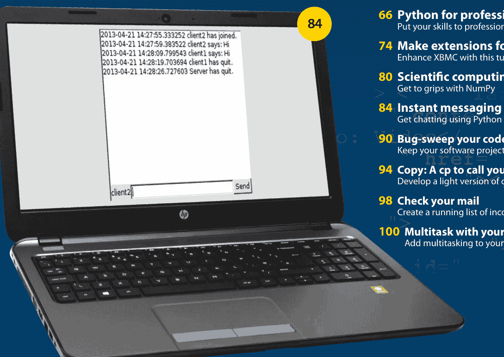

> “大多数 Linux 发行版都包含一个 Python 解释器，用于运行系统脚本”

## 74

## 80

| 附加组件信息 |
| :--- |
| **LUUD Reddit Viewer** |
| **类型**：媒体源 |
| **作者**：LUD |
| **版本**：0.0.1 |
| **评分**：★☆☆☆☆ |
| **摘要**：LUUD Ent 示例 |
| **描述** |
| LUUD 示例附加组件，用于演示 XBMC 扩展系统。来源：AddonScript0xDE |

- 配置
- 更新
- 卸载
- 禁用
- 回滚
- 变更日志

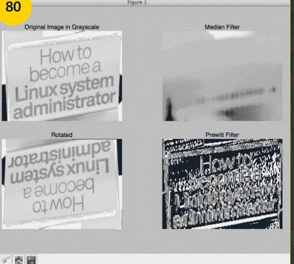


使用 Python

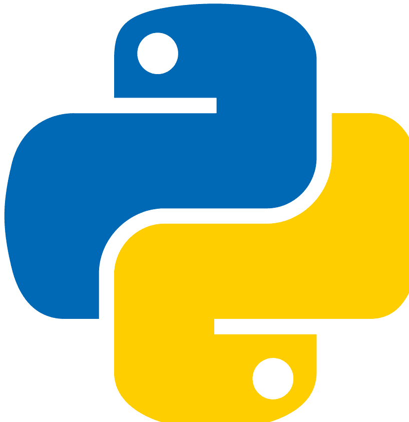

## 职业 Python 应用

Python 被全世界的 Web 开发者、工程师和学术研究人员所依赖。以下是如何将你的 Python 技能用于专业场景

66 Python 书籍

## 系统管理

在系统日常维护中充分发挥 Python 的作用，保持系统健康

系统管理任务是**在维护自有系统时最令人生烦的事情**之一。正因如此，系统管理员一直在寻找方法来自动化这类任务，以最大化利用时间。他们最初使用基本的 shell 脚本，随后转向各种脚本语言。长期以来，Perl 一直是开发此类维护工具的首选语言。然而，Python 如今正逐渐成为常用的语言。它已发展到大多数 Linux 发行版都包含 Python 解释器以运行系统脚本的地步，因此你不应该有任何借口不编写自己的脚本。由于你将进行大量的系统级工作，你将对几个关键的 Python 模块有最大需求。第一个模块是 `os`。此模块提供了与底层系统交互的大部分接口。通常的第一步是查看脚本运行的环境，看看那里可能存在什么信息来帮助引导脚本。以下代码提供了一个映射对象，你可以与当前活跃的环境变量进行交互：

```python
import os
os.environ
```

你可以使用函数 `os.environ.keys()` 获取可用环境变量的列表，然后使用 `os.environ[key]` 访问单个变量。当你生成子进程时，也会使用这些环境变量。因此，你需要更改诸如 PATH 或当前工作目录等值，以便正确运行这些子进程。虽然有一个 "putenv" 函数可以为你编辑这些值，但遗憾的是它在所有系统上并不都存在。因此，更好的方法是直接编辑环境映射中的值。

你可能想要自动化的另一类任务涉及文件操作。例如，你可以使用类似以下代码获取当前工作目录：

```python
cwd = os.getcwd()
```

然后你可以使用以下代码获取该目录中文件的列表：

```python
os.listdir(cwd)
```

你可以使用函数 `os.chdir(new_path)` 在文件系统中移动。一旦你找到了你感兴趣的某个文件，你可以使用 `os.open()` 打开它，并设置为读、写和/或追加模式。然后你可以使用函数 `os.read()` 和 `os.write()` 对其进行读取或写入。完成后，你可以使用 `os.close()` 关闭文件。

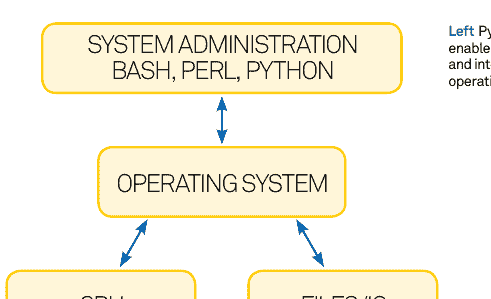

## 从 Python 运行子进程

Unix 的底层哲学是构建小型、专用的程序，每一种程序都极其擅长执行一项任务。然后你将它们串联起来以构建更复杂的行为。没有理由不在你的 Python 脚本中使用同样的哲学。有几个实用程序可供使用，只需你很少的工作。处理此事的旧方法是使用 os 模块中的函数如 `popen()` 和 `spawn()`，但运行其他程序的更好方法是使用 subprocess 模块。然后你可以使用以下代码启动程序，如 ls：

```python
import subprocess
subprocess.run("ls", "-l")
```

这为你提供当前目录的长文件列表。函数 `run()` 在 Python 3.5 中引入，是处理此事的建议方式。如果你有更旧的版本，或者需要比那更多的控制，那么你可以使用我们之前提到的底层 `popen()` 函数。如果你想获取输出，可以使用以下代码：

```python
cmd_output = subprocess.run(["ls", "-l"], stdout=subprocess.PIPE)
```

变量 `cmd_output` 是一个 CompletedProcess 对象，包含返回码和一个持有 stdout 输出的字符串。

## 使用 cron 进行调度

一旦你写好了脚本，你可能希望安排它们自动运行而无需你的干预。在 Unix 系统上，你可以使用 cron 按照所需的任何时间表运行你的脚本。实用程序 `crontab -l` 列出你的 cron 文件的当前内容，而 `crontab -e` 允许你编辑你想让 cron 运行的计划任务。

## Web 开发

Python 为你的各种 Web 开发任务提供了多个框架。我们将探讨一些更流行的框架

随着内容和大量计算托管在服务器上，Web 应用能够更好地保证最终用户的一致体验。流行的 Django 框架提供了一个非常完整的插件环境，并遵循 DRY 原则（不要重复你自己）。因此，你应该能够非常快速地构建你的 Web 应用。由于 Django 基于 Python 构建，你应该可以使用 "sudo pip install Django" 安装它。大多数发行版也应该有 Django 的包。取决于你想用应用做什么，你可能需要安装像 MySQL 或 postgresql 这样的数据库来存储你的应用数据。

有 Django 工具可以自动为你的新项目代码生成起点：

```
django-admin startproject newsite
```

此命令创建一个名为 "manage.py" 的文件和一个名为 "newsite" 的子目录。文件 "manage.py" 包含几个你可以用来管理新应用的实用函数。新创建的子目录包含文件 "__init__.py"、"settings.py"、"urls.py" 和 "wsgi.py"。这些文件及它们所在的子目录组成一个 Python 包，在你的网站启动时加载。你网站的核心配置可以在文件 "settings.py" 中找到。URL 声明，基本上是你网站的目录，存储在文件 "urls.py" 中。文件 "wsgi.py" 包含 WSGI 兼容 Web 服务器的入口点。

一旦你的应用完成，它应该托管在一个配置正确且加固的 Web 服务器上。但是，如果你在开发 Web 应用的过程中，这并不方便。为了帮助你，Django 在框架中内置了一个 Web 服务器。你可以通过更改目录到 "newsite" 项目目录并运行以下命令来启动它：

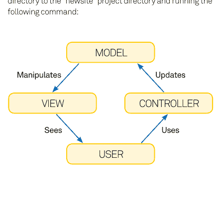

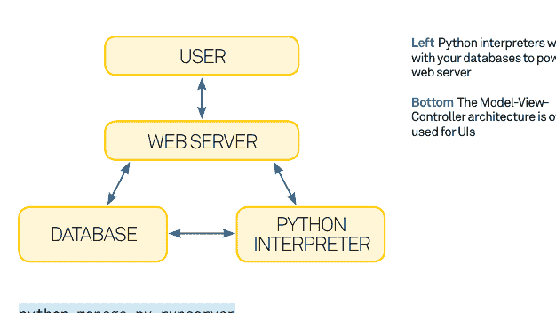

左 Python 解释器与你的数据库合作以支持 Web 服务器

底 模型-视图-控制器架构常用于 UI

```
python manage.py runserver
```

这将启动一个监听本地机器 8000 端口的服务器。由于此内置服务器设计用于开发，它会为每个请求自动重新加载你的 Python 代码。这意味着你不需要重启服务器就能看到你的代码更改。

所有这些步骤让你拥有一个可运行的项目。你现在准备好开始开发你的应用了。在 "newsite" 子目录中，你可以输入：

```
python manage.py startapp newapp
```

这将创建一个名为 "newapp" 的新子目录，其中包含文件 "models.py"、"tests.py" 和 "views.py"，以及其他文件。最简单的视图由以下代码组成：

```
from django.http import HttpResponse
def index(request):
    return HttpResponse("Hello world!")
```

然而，这不足以使其可用。你还需要为视图创建一个 URLconf。如果文件 "urls.py" 尚不存在，创建它并添加代码：

```
from django.conf.urls import url
from newapp import views
urlpatterns = [ url(r'^*$', views.index, name='index'), ]
```

最后一步是在你的项目中注册 URL。你可以使用以下代码完成：

```
from django.conf import include, url
from django.contrib import admin
urlpatterns = [ url(r'^newapp/', include('newapp.urls')), ]
```

## 虚拟环境

当你开始开发自己的应用时，你可能开始陷入依赖地狱。几个 Python 包依赖于其他 Python 包。这是它的强项，也是它的弱点。幸运的是，你有 virtualenv 可以用来驯服这个丛林。

你可以为你的每个项目创建新的虚拟 Python 环境。谢天谢地，通过这样做，你可以创建隔离的环境来捕获你的包的依赖关系。


## 使用 PyCharm IDE

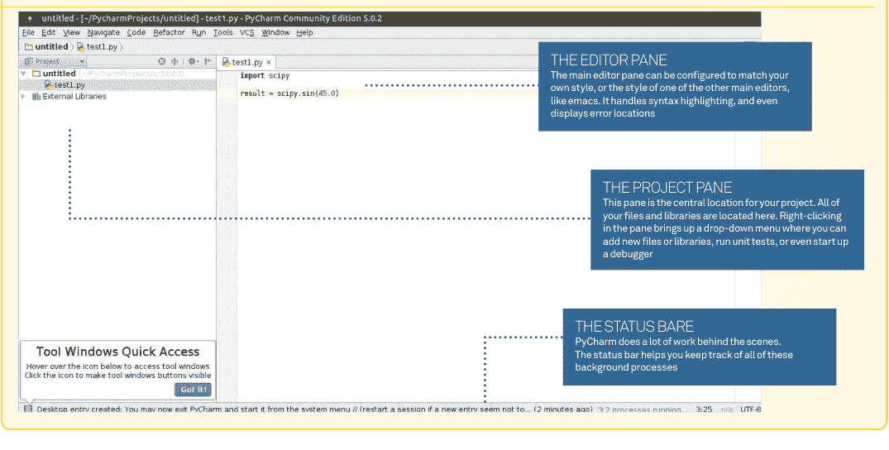

```
url(r'^admin', admin.site.urls),]
```

这需要放在主项目的 "urls.py" 文件中。现在，你可以通过 URL http://localhost:8000/newapp/ 访问你新建的应用程序。许多应用程序的最后一部分涉及数据库端。数据库的实际连接详情，如用户名和密码，都包含在 "settings.py" 文件中。此连接信息用于同一项目中存在的所有应用程序。你可以使用以下命令为你的站点创建核心数据库表：

```
python manage.py migrate
```

对于你自己的应用程序，你可以在 "models.py" 文件中定义所需的数据模型。一旦数据模型创建完成，你可以将你的应用程序添加到 "settings.py" 的 INSTALLED_APPS 部分，以便 Django 知道在数据库操作中将其包含在内。你可以通过以下方式初始化它：

```
python manage.py makemigrations newapp
```

一旦这些迁移创建完成，你需要使用以下命令将它们应用到数据库：

```
python manage.py migrate
```

每次你对模型进行修改时，都需要再次运行 makemigrations 和 migrate 步骤。完成应用程序开发后，你可以迁移到最终的主机服务器。在投入大量精力开发自己的代码之前，别忘了先查看 Django 框架中可用的代码。

## 终端开发环境

当你在开发应用程序的过程中，可能需要打开多个不同的终端窗口，以便拥有一个打开的代码编辑器、一个服务器监控器以及可能的测试输出。如果你在自己的机器上这样做，这并不是问题。但如果你是在远程工作，你应该考虑使用 Term。它可以为你提供更为健壮的终端环境。

## 其他 Python 框架

虽然 Django 是进行 Web 开发最流行的框架之一，但它远非唯一的选择。还有其他几种可用的框架，它们在某些特定问题领域中可能更为合适。例如，如果你寻找一个非常自包含的框架，可以看看 web2py。该框架包含了拥有完整系统所需的一切，从数据库到 Web 服务器再到票务系统。它如此自包含，甚至可以从 USB 驱动器运行。如果你需要更小的框架，还有几种可用的微型框架。例如，CherryPy 是一个纯 Python 风格的多线程 Web 服务器，你可以将其嵌入到自己的应用程序中。实际上，这也是 TurboGears 和 web2py 中包含的服务器。一个非常流行的微框架是一个名为 Flask 的项目。它包含集成的单元测试支持、Jinja2 模板以及 RESTful 请求分发。现存最古老的框架之一是 Zope。现在已发展到第 3 版，这个最新版本被重命名为 Blue-Bream。不过，Zope 相当底层。你可能更感兴趣于查看构建在 Zope 提供的基础之上的其他一些框架。例如，Pyramid 是一个非常快速、易于使用的框架，专注于大多数 Web 应用程序所需的最基本功能。为此，它提供了模板、静态内容服务、URL 到代码的映射等功能。同时它还提供了应用程序安全的工具。如果你在寻找灵感，有几个使用这些框架构建的开源项目，从博客、论坛到票务系统。这些项目在你构建自己的应用程序时可以提供一些最佳实践。

## 使用 Python 工作

### 计算科学

Python 正迅速成为计算科学的首选语言

**Python 已成为科学领域使用的关键语言之一。** 有大量的包可用于处理你几乎可能遇到的任何任务，更重要的是，Python 很清楚自己擅长什么不擅长什么。为了处理这一点，Python 被设计成可以轻松整合来自 C 或 FORTRAN 的代码。这样，你可以将任何繁重的计算任务卸载到更高效的代码上。

大多数可用科学代码的核心包是 NumPy。Python 中的一个问题是，该语言面向对象的特性是其低效的根源。由于没有严格类型，Python 在每次操作时都需要检查参数。NumPy 提供了一种新的数据类型，即数组，这有助于解决其中一些问题。数组只能存储一种类型的对象，由于 Python 知道这一点，它可以使用一些优化措施，将速度提升到接近直接使用 C 或 FORTRAN 编写代码所能达到的水平。两者差异的经典例子是循环。假设你想通过某个值缩放一个向量，类似于 a*b。在常规 Python 中，这看起来像

```
for elem in b:
c.append(a * elem)
```

在 NumPy 中，这看起来像：

```
a*b
```

因此，不仅速度更快，而且形式更短、更清晰。除了新的数据类型，NumPy 还提供了所有最常用运算符（如乘法或除法）的超集形式。它还提供了几个函数的优化版本（如三角函数），以利用这种新的数据类型。

基于 NumPy 构建的最大可用包是 SciPy。SciPy 在科学领域的几个板块中提供了子部分。这些子部分中的每一个都需要在导入主要的 scipy 包后单独导入。例如，如果你在微分方程方面工作，你可以使用 "integrate" 部分

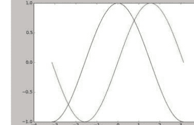

*左侧 NumPy 包使可视化你的数据变得简单*

### 并行 Python

**Ipython（或 ipyuter）真正强大的部分之一是它基于客户端/服务器模型构建。** 这意味着设置多台机器作为服务器池相对容易。然后，你可以将多个任务分配给这些其他机器，以完成更多工作。虽然这并不会并行运行任何特定函数，但它确实允许你在处理其他事务时，在后台运行较长的函数。

### Spyder，科学家的 IDE

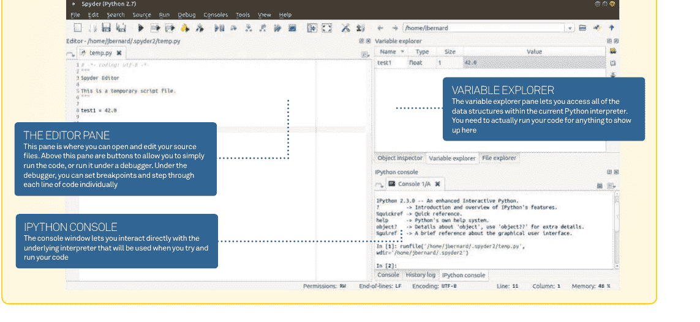

**编辑器窗格**
在这个窗格中，你可以打开和编辑源文件。此窗格上方有按钮，允许你简单地运行代码，或在调试器下运行代码。在调试器中，你可以设置断点，并逐步执行每一行代码。

**变量资源管理器**
变量资源管理器窗格允许你访问当前 Python 解释器中的所有数据结构。你需要实际运行代码，才能在这里看到尝试显示的内容

**IPYTHON 控制台**
控制台窗口允许你直接与底层解释器交互，该解释器将在你尝试运行代码时使用

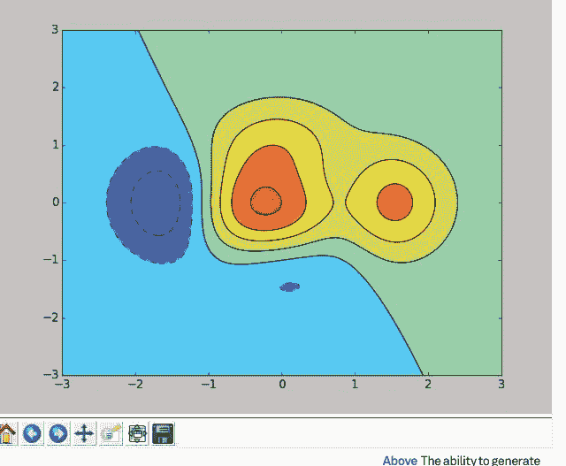

*上方 生成复杂图表的能力至关重要*

## 使用 Python 工作

### 使用 Jupyter 进行交互式科学

对于许多科学问题，你需要以交互式方式处理你的数据。最初执行此操作的方法是使用 R 的 Python Web 笔记本。这个项目后来被重命名为 Jupyter。对于使用过像 Mathematica 或 Maple 这样的程序的人来说，该界面应该会显得非常熟悉。Jupyter 启动一个服务器进程。默认情况下在端口 8888 上，然后打开一个 Web 浏览器，你可以在其中打开工作表。与大多数此类程序一样，代码按时间顺序运行，而不是按工作表上的顺序运行。这在起初可能会让人有些困惑，但这意味着，如果你要编辑较早的条目，则需要手动重新执行后续的所有条目，以便将该更改传播到其余计算中。

Jupyter 支持在生成的 Web 页面中漂亮地打印数学公式。你还可以在同一页面中混合文档块和代码块。这意味着你可以制作非常强大的教学材料，学生可以阅读某种技术，然后实际运行它并查看其效果。默认情况下，Jupyter 还会在作为结果部分的同一工作表中嵌入 matplotlib 图表，因此你可以看到一些数据的图表以及生成它的代码。这对于日益增长的可重复科学需求来说是巨大的。你始终可以返回查看分析是如何进行的，并能够重现任何结果。

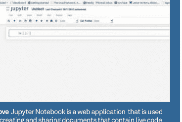

*上方 Jupyter Notebook 是一个用于创建和共享包含实时代码和公式的文档的 Web 应用程序*

### 对速度的需求

有时你需要以你的硬件所能承受的最大速度运行。在这种情况下，你总是有使用 Cython 的选项。这让你可以从其他项目获取 C 代码（这些代码可能已经过优化），并在你自己的 Python 程序中使用它。在科学编程中，你很可能会接触到已经经过数十年努力开发且高度专业化的代码。没有必要重做投入其中的开发工作。

用看起来像这样的代码来解决它们

```
import scipy
import scipy.integrate
result = scipy.integrate.quad(lambda x: sin(x), 0, 4.5)
```

微分方程几乎出现在每个科学领域。你可以使用 "stats" 部分进行统计分析。如果你想做一些信号处理，你可以使用 "signal" 部分和 "fft.pack" 部分。这个包绝对是任何想要进行科学处理的人的第一站。

一旦你收集了数据，通常需要对它进行绘图，以获得其中模式的视觉印象。你可以用于此目的的主要包是 matplotlib。如果你以前使用过 R 的图形包，matplotlib 的核心设计借鉴了许多想法。用于绘图的函数分为两类：低级和高级。高级函数试图处理尽可能多的琐碎任务，如创建绘图窗口、绘制坐标轴、选择坐标系。低级函数几乎可以控制绘图的每个部分，从绘制单个像素到控制绘图窗口的各个方面。它还借鉴了在基于内存的窗口中绘制图形的想法。这意味着它可以在集群上运行时绘制图形。

如果你需要进行符号数学计算，你可能更习惯于使用像 Mathematica 或 Maple 这样的工具。幸运的是，你有 sympy，它可以用来完成许多相同的事情。你可以使用 Python 进行符号微积分，或求解代数方程。sympy 的一个奇怪之处是你需要使用 "syms()" 函数告诉 sympy 在你的方程中哪些变量是有效的。

然后你可以开始使用这些已注册的变量进行操纵。

你可能需要处理和大量数据进行分析。如果是这样，你可以使用 pandas 包来帮助处理这些问题。Pandas 支持多种不同的文件格式，如 CSV 文件、Excel 电子表格或 HDF5。你可以合并和连接数据集，或执行切片或子集操作。为了获得代码的最佳性能，头部提升是由融合了 C 语言编写函数的 Cython 代码完成的。在如何操纵数据方面，相当多的想法借鉴了 R 中的做法。

现在你没有任何理由不开始使用 Python 进行你的科学工作。你应该能够用它来解决几乎所有出现的问题！


## 机器人与电子学

机器人技术是您的代码与周围现实世界之间最直接的接口。

机器人技术是您的代码与周围世界交互的最直接方式。它可以读取实际的传感器信息，移动真实的执行器，并完成真正的工作。

您的机器人首先需要具备感知周围环境的能力。作为人类，我们认为最有益的感觉是视觉。由于网络摄像头非常便宜且易于连接到硬件，让您的机器人获得视觉能力很容易。真正的问题是如何解释这些数据。幸运的是，您可以使用 OpenCV 项目来完成这项工作。它是一个视觉库，可以提供从简单的图像采集和处理到像面部识别和三维对象提取等极其复杂的功能。您可以识别并跟踪穿过您视野中的移动物体。您还可以使用 OpenCV 赋予您的机器人一些推理能力。OpenCV 包含一组用于机器学习的函数，您可以进行统计分类或数据聚类，并将其用于训练决策树甚至神经网络。

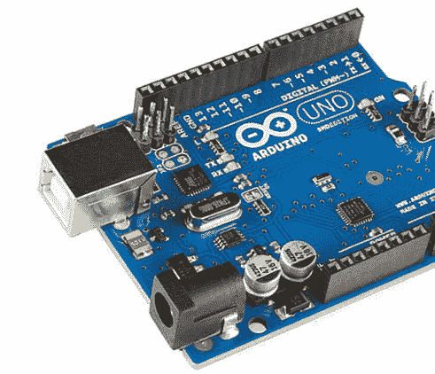

您可能想要使用的另一个重要感觉是听觉。Jasper 项目正在开发一套完整的语音控制系统。该项目将为您提供所需的基础结构，使您的机器人能够监听并响应您的口头指令。该项目已发展到您可以给它发送指令，语音识别软件可以将其转换为文本的程度。然后，您需要构建一个映射，确定哪些文本片段对应于要执行哪些指令。

您可以拥有许多其他传感器，但这开始脱离了商店购买硬件的领域。大多数其他传感器，如温度、压力、方向或位置，都需要专门的硬件，这些硬件需要与您机器人的计算机大脑进行接口连接。

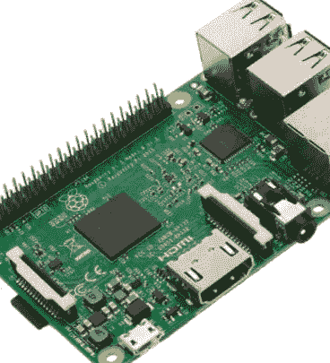

## Arduino

> 与从 SD 卡运行完整操作系统的树莓派不同，Arduino 板是微控制器，而不是完整的计算机。它不运行操作系统，而是执行由固件解释的代码。它主要用于与电机和伺服器等硬件以及 LED 等设备进行接口连接，在这方面具有强大的能力。Arduino 广泛用于机器人项目，可以作为树莓派的强力补充。

## 树莓派

> 虽然我们没有讨论过在机器人项目中应该使用哪种计算机，但你应该考虑著名的树莓派。这台微型计算机应该足够小，以适应你可能构建的任何机器人结构。由于它已经运行 Linux 和 Python，你应该能够简单地将你的代码开发工作复制到树莓派上。它还包括自己的 I/O 总线，因此你可以让它读取自己的传感器。

## ROS – 机器人操作系统

虽然你可以简单地编写一些在标准计算机和标准 Linux 发行版上运行的代码，但在处理机器人在实时处理事件所需的所有数据处理时，这通常不是最优的。当你达到这一点时，你可能需要查看专用的操作系统 – 机器人操作系统（ROS）。ROS 旨在提供与计算机硬件之间最低开销的相同类型接口。ROS 的一个非常强大的特性是，它旨在促进在计算机上运行的不同进程之间，或者潜在地通过某种网络连接的多个计算机之间进行通信。ROS 不是一个保护彼此独立的过程孤岛，而是一个过程图，消息在所有过程之间传递。

因为 ROS 是一个完整的操作系统，而不是一个库，所以认为你可以在 Python 代码中使用它是错误的。更好的思维方式是你可以编写可以在 ROS 中使用的 Python 代码。基本设计是尽可能保持中立。这意味着你的代码的接口应该是干净的，并不特别关心它们在哪里运行或谁在与它们交谈。然后，它可以在 ROS 中运行的过程图内使用。有标准的库可用，允许你进行坐标变换，这对于确定传感器或肢体在空间中的位置很有用。有一个用于创建可抢占数据处理的任务的库，还有一个用于创建和管理可在各种过程中传递的消息类型的库。对于极其对时间敏感的任务，有一个插件库，允许你编写一个 C++ 插件，可以加载到 ROS 包中。

## 使用 Python 工作

### 对于底层工作，查看 Arduino

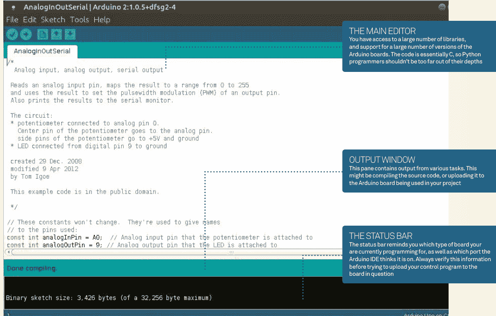

这意味着是时候拿出你的电烙铁了。至于读取数据，这通常是通过基本的串行连接完成的。然后你可以使用 pySerial 模块连接到串行端口并读取连接上的数据。

你可以使用：

```python
import serial
```

来加载模块并开始与你的传感器通信。问题在于，这是一种非常低级的通信方式。作为程序员，你负责所有细节。这包括通信速度、字节大小、流量控制，基本上是一切。因此，这绝对是你的代码中你应该计划花些调试时间的一个区域。

现在你有所有这些数据进来，你要怎么做？你需要能够移动世界中的执行器并产生实际的效果。这可能是用于轮子或履带的电机，用于移动物体的杠杆，或者潜在的完整肢体，如手臂或腿。虽然你可以尝试直接通过计算机的输出端口驱动这些类型的电子设备，但通常没有足够的电流来提供所需的功率。因此，你需要有一些板外的“大脑”能够处理向这些设备供电。Arduino 是承担这一任务的最受欢迎的候选者之一。

幸运的是，Arduino 设计为连接到计算机的串行端口，因此你可以简单地使用 pySerial 与它对话。你可以向你编写并上传到 Arduino 的代码发送指令，以处理各种执行器的实际操作。然而，Arduino 可以回应。这意味着你可以读取反馈数据，看看你的动作产生了什么效果。你的轮子转动到你想要的程度了吗？这意味着你还可以将 Arduino 用作你的传感器和计算机之间的接口，从而进一步简化你的 Python 代码。也有大量的附加模块可用，它们可能能够直接提供你所需的感知功能。此外，还有几种型号的 Arduino，因此你可能会找到最适合你需求的专用型号。

现在你有所有这些数据进来以及在实际世界中行动的能力，最后一步是给你的机器人一些“大脑”。不幸的是，目前的技术水平并未达到 R2-D2 或 C-3PO 的幻想。你大部分实际的创新编码工作很可能会发生在机器人的这一部分。这个术语通常称为人工智能。目前有几个正在进行的项目，你可以将它们作为起点，赋予你的机器人一些真正的推理能力，如 SimpleAI 或 PyBrain。

## 绕过 GIL

对于机器人工作，你可能需要在多个 CPU 上真正并行运行一些代码。Python 目前有 GIL，这意味着解释器中内置了一个根本性的瓶颈。绕过它的一种方法是实际运行多个 Python 解释器，每个执行线程一个。另一个选项是从 Python 转向 Jython 或 IronPython，因为它们都没有 GIL。


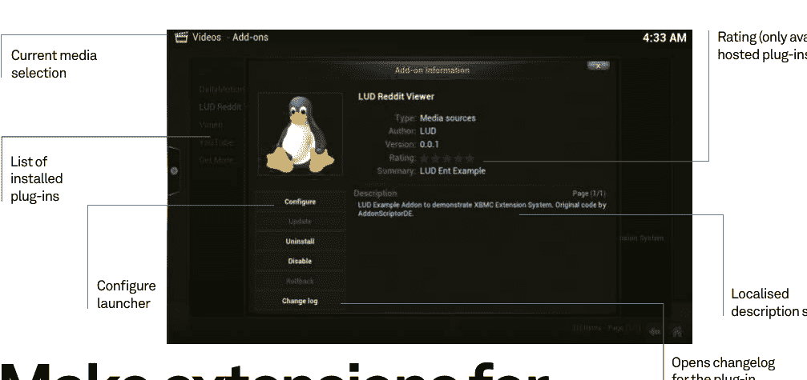

## 使用 Python 为 XBMC 制作扩展

Python 是全球最流行的易用的开源语言。学习如何使用它来构建 XBMC 的功能，XBMC 是全球最受喜爱的 FOSS（自由及开源软件）媒体中心

## 资源

- XBMC: www.xbmc.org/download
- Python 2.7x
- Python IDE（可选）
- Code on FileSilo（位于 FileSilo 的代码）

XBMC 也许是开源媒体中心领域发生过的重要事件中最关键的一个。它最初诞生于初代 Xbox 游戏机，自那以后，它已成为多媒体爱好者的事实标准软件。它也被分支为许多其他成功的媒体中心应用程序，如 Boose 和 Plex。最终，XBMC 发展成为一个非常强大的开源应用程序，背后有一个坚实的社区支持。它支持几乎所有主要平台，包括不同的硬件架构。它可用于 Linux、Windows、mac OS、Android、iOS 和 Raspberry Pi。

在这些页面中，我们将学习如何为 XBMC 构建扩展。扩展是一种在不学习 XBMC 核心或不以任何方式修改该核心的情况下，为 XBMC 添加功能的方法。一个额外的优势是 XBMC 使用 Python 作为其脚本语言，而这也同样可用于构建扩展。由于与 C/C++（XBMC 核心的编程语言）相比，Python 更容易学习，这真的有助于新开发人员参与到该项目中。

XBMC 支持各种类型的扩展（或 Add-ons）：插件（Plugins）、程序（Programs）和皮肤（Skins）。插件为 XBMC 添加功能。根据功能类型，插件将出现在 XBMC 的相关媒体部分。例如，YouTube 插件将出现在视频部分。脚本/程序就像 XBMC 的迷你应用程序。它们出现在程序部分。皮肤非常重要，因为 XBMC 是一个完全可定制的应用程序——你可以改变软件包几乎每个方面的外观和感觉。根据你的扩展所属的类别，你需要相应地创建扩展目录。例如...

### 插件。

- plugin.audio.ludiaudi：音频插件
- plugin.video.ludvidi：视频插件
- script.xxx.xxx：程序

在本教程中，我们将构建一个名为 LUD Entertainer 的 XBMC 插件。该插件提供了一种从 XBMC 内部观看 Reddit 视频的绝佳方式。我们的插件将显示来自 Reddit 的各种内容，如预告片 và 纪录片。我们还将允许用户添加他们自己的 Subreddit。然后，每个视频都可以归类为 Hot（热门）、New（最新）、Top（置顶）、Controversial（争议）等。通过这个插件，我们将演示如何轻松地接入 XBMC 内置的方法，以实现非常高质量的用户体验。

由于篇幅限制，我们无法在此处打印完整代码。我们建议从 FileSilo 下载完整代码。

## 01 准备目录结构

正如我们之前提到的，每种 XBMC 扩展类型都遵循特定的目录命名约定。在这种情况下，我们正在构建一个视频插件，因此插件目录名称应为 **plugin.video.luddent**。但这只是根目录的名称——我们还需要其他几个文件夹和文件。

以下描述了 LUD Linux Entertainer 的目录结构：

```text
plugin.video.luddent – 根插件目录
├── addon.xml
├── changelog.txt
├── default.py
├── icon.png
├── LICENSE.txt
├── README
├── resources
├── lib
└── settings.xml
```

## 02 创建 addon.xml

需要在扩展目录的根目录下创建一个 addon.xml 文件。addon.xml 文件包含 XBMC 扩展的主要元数据。它包含有关扩展的概述、credits（致谢）、版本信息和依赖信息。

addon.xml 的根元素是 **\<addon\>** 元素。它定义为：

```xml
<addon id="plugin.video.luddent" name="LUD HSW Viwer" version="0.0.1" provider:name="LUDD">其余内容放置在这里</addon>
```

在这里，**id** 是插件的标识符，因此它应在所有 XBMC 扩展中保持唯一，并且也用于目录名称；**version** 告知 XBMC 扩展的版本号，这有助于其提供自动更新的能力——XBMC 遵循 Major.Minor.Patch（主.次.补丁）的版本命名约定；**name** 是插件的英文标题。

**注意：** 步骤 3 到 5 涵盖了需要添加到 **addon.xml** 文件中的条目。

## 03 添加依赖信息

扩展内部的依赖关系使用 **\<requires\>** 元素进行管理。

```xml
<requires>
<import addon="xbmc.python" version="2.1.0"/>
<import addon="plugin.video.youtube" version="3.0.0"/>
<import addon="plugin.video.version="2.3.0"/>
<import addon="plugin.video.dailymotion.com" version="1.0.0"/>
</requires>
```

在上面的代码中，我们添加了对版本为 2.1 的名为 **xbmc.python** 的库的依赖。目前，它被添加为强制依赖项。要使依赖项变为可选，你需要添加 **optional="true"**，例如 `<import addon="kunal.special" version="0.1.0" optional="true"/>`

在上面的示例中，我们将核心依赖 xbmc.python 设置为 2.1.0，因为这是随 XBMC 版本 Frodo 12.0 和 12.1 一起发布的版本。如果你将 xbmc.python 设置为 2.0，那么它只在 XBMC Eden 11.0 中有效，而在最新版本中无效。

对于当前版本的 XBMC 12.1，发布的 XBMC 核心组件版本如下：xbmc.python 2.1.0, xbmc.gui 4.0.0, xbmc.json 6.0.0, xbmc.python 2.1.0, xbmc.metadata 12.0.0

除了 xbmc.python，我们还添加了一些第三方插件作为依赖项，例如 plugin.video.youtube。当我们安装 plugin.video.luddent 时，这些插件将自动安装。

## 04 设置提供者和入口点

我们的扩展旨在为 XBMC 提供视频内容。为了传达这一点，我们必须设置以下元素：

```xml
<extension point="xbmc.python.pluginsource" library="default.py">
<provides>videos</provides>
</extension>
```

在这里，**library** 属性设置了插件的入口点。在本例中，当用户激活插件时，将执行 default.py。**\<provides\>** 元素设置其提供的媒体类型。这也反映在插件的放置位置中。由于我们的是一个视频插件，它将显示在 XBMC 的视频部分。

## 05 设置插件元数据

关于插件的元数据在扩展点 "xbmc.addon.metadata" 中提供。以下是重要元素...

- **\<platform\>**: 大多数时候，XBMC 扩展是跨平台兼容的。但是，如果你依赖于仅在特定平台上可用的本地平台库，你需要在此处设置受支持的平台。平台的接受值包括：all（所有）、linux、osx、osx32、osx64、ios（Apple iOS）、win32（Windows Directx）、wingl（Windows OpenGL）和 android。
- **\<summary\>**: 这提供了插件的简要描述。我们的示例将语言属性设置为英语，但你也可以使用其他语言。
- **\<description\>**: 插件的详细描述。
- **\<website\>**: 托管插件的网页。
- **\<source\>**: 源代码仓库 URL。如果你将插件托管在 GitHub 上，你可以在这里提及仓库 URL。
- **\<forum\>**: 你的插件的讨论论坛 URL。
- **\<email\>**: 作者邮箱。你可以直接输入邮箱地址，或者使用对机器人友好的邮箱地址格式，如 max at domain dot com。

## 06 设置变更日志、图标、海报图和许可证

我们需要在插件目录中增加几个额外的文件...：

- **changelog.txt**: 你应该列出在版本发布之间对插件所做的更改。变更日志可以从 XBMC 用户界面中查看。

一个示例变更日志：
    0.0.1 – 初始发布
    0.0.2 – 修复视频缓冲问题

- **icon.png**: 这将代表 XBMC 用户界面中的插件。它必须是一个 256x256 大小的非透明 PNG 文件。
- **fanart.jpg (optional)**: 如果用户在 XBMC 中选择了该插件，fanart.jpg 将渲染在背景中。艺术图片需要以 HDTV 格式渲染，因此其尺寸范围可以从 1280x720 (720p) 到最大 1920x1080 (1080p)。


## 使用 Python 进行开发

**License.txt：** 此文件包含分发的插件的许可证。XBMG 项目建议皮肤使用 Creative Commons Attribution-ShareAlike 3.0 许可证，而扩展功能使用 GPL 2.0 许可证。然而，大多数版权许可证也可以使用。

**注意：** 就打包而言，扩展/附加组件/主题/插件都是相同的。

### 07 为插件提供设置

可以通过文件 `resources/settings.xml` 提供设置。这对于用户可配置的选项非常有用。

```xml
<settings>
  <category label="30109">
    <setting id="filter" type="bool"
      label="30101" default="false"/>
    <setting type="sep" />
    <setting id="showAll" type="bool"
      label="30106" default="false"/>
    <setting id="showWatched"
      type="bool" label="30107"
      default="true"/>
    <setting id="showUnfinished"
      type="bool" label="30108"
      default="false"/>
    <setting type="sep" />
    <setting id="forceViewMode"
      type="bool" label="30102"
      default="true"/>
    <setting id="viewMode" type="number"
      label="30103" default="504"/>
  </category>
  <category label="30110">
    <setting id="cat_hot"
      label="30002" type="bool"
      default="true"/>
    <setting id="cat_new"
      label="30003" type="bool"
      default="true"/>
  </category>
</settings>
```

在此，**label** 定义了将用于显示标签的语言 ID 字符串。**id** 定义了将用于程序化访问的名称。**type** 定义了您想要收集的数据类型；它还会影响将为该元素显示的 UI。**default** 定义了设置的默认值。在可能的情况下，您应始终使用默认值，以提供更好的用户体验。

以下是我们可以使用的一些重要设置类型：

- **text：** 用于基本字符串输入。
- **ipaddress：** 用于收集互联网地址。
- **number：** 允许输入数字。XBMC 还将为输入提供屏幕数字键盘。
- **slider：** 提供了一种优雅的方式来收集整数、浮点数和百分比值。你可以按以下格式获取滑块设置：

```xml
<setting label="21223" type="slider"
  id="sideinput" default="10"
  range="1,1,10" option="int" />
```

在上面的示例中，我们创建了一个最小范围 1、最大范围 10 且步长为 1 的滑块。在 **option** 字段中，我们声明了我们感兴趣的数据类型——我们也可以将 option 设置为 "float" 或 "percent"。

- **bool：** 以开或关的形式提供布尔选择。
- **file：** 提供了输入文件路径的方法。XBMC 将提供一个文件浏览器以便选择文件。如果你想要选择特定类型的文件，可以使用 audio、video、image 或 executable 代替 file。
- **folder：** 提供了一种浏览文件夹的方法。**示例：**

```xml
<setting label="12001" type="folder"
  id="folder" source="auto"
  option="writable"/>
```

在此，**source** 设置了文件夹的起始位置，而 **option** 设置了应用程序的写入参数。

- **sep & !sep：** sep 用于在设置对话框中绘制水平线；!sep 用于绘制带有文本的水平线。它们不收集任何输入，但用于构建更好的用户界面元素。

```xml
<setting label="21212" type="!sep"
/>
```

### 08 语言支持

语言支持以位于 `resources/languages/[语言名称]` 中的 `strings.xml` 文件的形式提供。这种方法与包括 Android 在内的许多大型软件项目非常相似，其中从不使用静态字符串。

**示例：**

```xml
<?xml version="1.0" encoding="utf-8"?>
<string name="yes">yes</string>
<strings>
  <string id="30001">Add subreddit</string>
  <string id="30002">Hot</string>
  <string id="30003">New</string>
  <string id="30004">Top</string>
  <string id="30005">Controversial</string>
  <string id="30006">Hour</string>
  <string id="30007">Day</string>
  <string id="30008">Week</string>
  <string id="30009">Month</string>
  <string id="30010">Year</string>
</strings>
```

正如你在 settings.xml 示例中看到的，所有标签都引用字符串 ID。你还可以拥有其他多种语言。根据 XBMC 正在运行的语言，会自动加载正确的语言文件。

在 XBMC Frodo (12.1) 之后，strings.xml 将被弃用。在 Frodo 之后，XBMC 将迁移到基于 GNU gettext 的翻译系统；gettext 使用 PO 文件。你可以使用名为 xbmc-xml2po 的工具将 strings.xml 转换为等效的 PO 文件。

### 09 构建 default.py

由于我们的插件很小，所有内容都将包含在 `default.py` 中。如果你正在开发更复杂的附加组件，则可以在同一目录中创建支持文件。如果你的库依赖于第三方库，你有两种方法可以处理。你可以将第三方库放入 `resources/lib` 文件夹中；或者将库本身打包成一个插件，然后在 `addon.xml` 文件中将该插件添加为依赖项。

我们的插件与 `reddit.tv` 配合工作。这是 Reddit 的一个网站，其中包含其读者分享的热门视频。发布在 Reddit 上的视频实际上源自 YouTube、Vimeo 和 Dailymotion。

我们将使用以下导入语句开始编写 `default.py`：

```python
import urllib
import urllib2
import xbmcplugin
import xbmcgui
import xbmcaddon
```

除了 xbmcplugin、xbmcgui 和 xbmcaddon 之外，其余都是标准 Python 库，可通过 pip 在 PyPI（Python Package Index）上获取。由于 XBMC 的 Python 运行时内置了所有组件，因此你不需要自行安装任何库。

*urllib* 和 *urllib2* 有助于 HTTP 通信。*socket* 用于网络 I/O。*re* 用于正则表达式匹配。*sqlite3* 是用于访问 SQLITE 嵌入式数据库的 Python 模块；*xbmcplugin*、*xbmcgui* 和 *xbmcaddon* 包含 XBMC 特定的例程。

### 10 初始化

在初始化过程中，你将从 *settings.xml* 中读取各种设置。设置可以通过以下方式读取：

```python
addon = xbmcaddon.Addon()
filterRating = int(addon.getSetting("filterRating"))
filterVoteThreshold = int(addon.getSetting("filterVoteThreshold"))
```

为了读取类型为 bool 的设置，你需要这样做：

```python
filter = addon.getSetting("filter") == "true"
```

我们还设置了主 URL、插件句柄及其用户代理：

```python
pluginhandle = int(sys.argv[1])
urlMain = "http://www.reddit.com"
userAgent = "Mozilla/5.0 (Windows NT 6.2; WOW64; rv:22.0) Gecko/20100101 Firefox/22.0"

opener = urllib2.build_opener()
opener.addheaders = [('User-Agent', userAgent)]
```

### 11 读取本地化字符串

如前所述，XBMC 使用 *strings.xml* 来提供文本。为了读取这些字符串，你需要使用 *getLocalizedString*。

```python
translation = addon.getLocalizedString
translation(30002)
```

在这个例子中，*translation(30002)* 在英语环境下运行时将返回字符串 "Hot"。

| idFile | idPath | strFilename | play_Count | lastPlayed | dateAdded |
| :----- | :---- | :---------- | :--------- | :--------- | :--------- |
| 1 | 1 | plugin//plugin. | 1 | 2013-08-06 23:47 | |
| 2 | 2 | plugin//plugin. | 1 | 2013-08-07 22:42 | |
| 3 | 2 | plugin//plugin. | 1 | 2013-08-08 00:09 | |
| 4 | 2 | plugin//plugin. | 1 | 2013-08-08 00:55 | |
| 5 | 2 | plugin//plugin. | 1 | 2013-08-08 00:58 | |

### 12 构建辅助函数

在这一步中，我们将查看一些重要的辅助函数。

**getDBPath():** 此函数返回视频 SQLITE 数据库文件的位置。XBMC 将库和播放信息存储在 SQLITE DB 文件中。视频和音乐有单独的数据库，位于 .xbmc/userdata/ Database 文件夹内。我们关注的是视频数据库。它的前缀是 "MyVideos…"

```python
def getDBPath():
    path = xbmc.translatePath("special://userdata/Database")

    files = os.listdir(path)
    latest = ""
    for file in files:
        if file[8:] == 'MyVideos' and file[-3:] == '.db':
            if file > latest:
                latest = file

    return os.path.join(path, latest)
```

**getPlayCount(url):** 一旦我们有了数据库位置，就可以使用简单的 SQL 查询获取播放次数。MyVideo 数据库包含一个名为 *files* 的表，它按文件名记录在 XBMC 中播放的所有视频文件。在这种情况下，它将是 URL。

```python
dbPath = getDBPath()
conn = sqlite3.connect(dbPath)
c = conn.cursor()

def getPlayCount(url):
    c.execute('SELECT playCount FROM files WHERE strFilename=?', [url])
    result = c.fetchone()
    if result:
        result = result[0]
    if result:
        return int(result)

    return 0
```

上面的表格是 files 表的一个示例。

**addSubreddit():** 我们的插件允许用户添加自己的 Subreddit。此函数从用户处获取 Subreddit 输入，然后将其保存在附加组件数据文件夹中的 *subreddits* 文件里。

以下设置 subreddits 文件位置：

```python
subredditFile = xbmc.translatePath("special://profile/addon_data/plugin.video.youtube/subreddits")
# 这转换为 _xbmc/userdata/addon_data/plugin_video_lucent/subreddits
```

```python
def addSubreddit():
    keyboard = xbmc.Keyboard('', translation(30001))
    keyboard.doModal()
    if keyboard.isConfirmed() and keyboard.getText():
        subreddit = keyboard.getText()

        fh = open(subredditFile, 'a')
        fh.write(subreddit+'\n')
        fh.close()
```

此函数还演示了如何从用户获取文本输入。在这里，我们调用 Keyboard 函数并传入一个文本标题。一旦检测到键盘输入，它会将输入写入 subreddits 文件并附带换行符。

**getYouTubeUrl(id):** 当我们找到要播放的 YouTube URL 时，我们会将其传递给 YouTube 插件（*plugin.video.youtube*）以处理播放。为此，我们需要以特定格式调用它：

```python
def getYouTubeUrl(id):
    url = "plugin://plugin.video.youtube/?root=/root/ &videoAction=play_video&id=" + id
    return url
```


# 13 填充插件内容列表

**xbmcgui** 包含各种用于处理插件 UI 中内容列表的例程。第一步是创建可从 XBMC UI 中选择的目录条目。为此，我们将使用一个名为 **xbmcplugin.addDirectoryItem** 的函数。

为了方便起见，我们将对 addDirectoryItem 进行抽象化封装，以符合我们的需求，从而可以轻松设置名称、URL、模式、图标图像和类型。

```python
def addDir(name, url, mode, iconImage, type=""):
    u = sys.argv[0] + "?url=" + urllib.quote_plus(url) + "&mode=" + str(mode) + "&type=" + str(type)
    ok = True
    listItem = xbmcgui.ListItem(name, iconImage="DefaultFolder.png", thumbnailImage=iconImage)
    listItem.setInfo(type="Video", infoLabels={"Title": name, ...})
    xbmcplugin.addDirectoryItem(handle=int(sys.argv[1]), url=u, listItem=listItem)
    return ok
```

在同一行中，我们可以构建一个函数来放置链接……

```python
def addLink(name, url, mode, iconImage, description, date):
    u = sys.argv[0] + "?url=" + urllib.quote_plus(url) + "&mode=" + str(mode)
    ok = True
    listItem = xbmcgui.ListItem(name, ...)
    return ok
```

基于我们刚刚创建的抽象封装，我们可以创建用于填充内容的基础函数。但在这样做之前，让我们先了解 Reddit 是如何工作的。Reddit 的大部分内容过滤器是通过所谓的 **Subreddits**（子版块）提供的。这允许你查看与特定主题相关的讨论；在我们的插件中，我们感兴趣的是显示视频；我们还希望展示预告片、纪录片等。我们通过 Subreddits 访问这些内容。例如，对于预告片，它是 **reddit.com/r/trailers**。对于域名，我们可以使用 **/domain**，例如，为了获取发布在 Reddit 上的所有 YouTube 视频，我们将调用 **reddit.com/domain/youtube.com**。现在你可能会问，有什么保证这个 Subreddit 只列出视频？答案是没有保证。因此，我们自己抓取网站来查找视频。更多内容将在下一步中介绍。

第一个要定义的基础函数是 **index()**。当用户启动插件时，它会触发此函数。

```python
def index():
    defaultItems = ["videos", "trailers", "documentaries", "music"]
    entries = defaultEntries[:]
    if os.path.exists(subredditFile):
        fh = open(subredditFile, "r")
        content = fh.read()
        fh.close()
        spl = content.split('\n')
        for i in range(0, len(spl), 1):
            if spl[i]:
                subreddit = spl[i]
                entries.append(subreddit)
            entries.sort()
            for entry in entries:
                if entry in defaultEntries:
                    addDir(entry.title(), ...)
                else:
                    addDir(entry.title(), ...)
            # ... 以及用于域名和翻译的更多逻辑 ...
            xbmcplugin.endOfDirectory(pluginhandle)
```

在这里，**populateItems** 调用了 addSubreddit。ListSorting 负责根据热门、最新等标准对数据进行排序。它还调用了 Reddit 的 JSON 函数，该函数返回易于解析的 JSON 数据。我们为所有排序标准创建了一个设置项。根据设置内容，我们继续构建排序后的列表。

```python
def listSubreddit(subreddit):
    if cat_hot:
        addDir(translation(30002), urlMain + "?subreddit=" + subreddit + "&sort=hot&count=100", "listVideos", "")
    if cat_new:
        addDir(translation(30003), urlMain + "?subreddit=" + subreddit + "&sort=new&count=100", "listVideos", "")
    # ... 以及用于最高分和翻译的更多逻辑 ...
    xbmcplugin.endOfDirectory(pluginhandle)
```

Vimeo 的情况类似：

```python
def getVimeoUrl(id):
    url = "plugin://plugin.video.vimeo/path=/root/video&action=play_video&vid=" + id
    return url
```

Dailymotion 也是如此：

```python
def getDailymotionUrl(id):
    url = "plugin://plugin.video.dailymotion_com/?url=" + id + "&mode=playVideo"
    return url
```

一旦我们将视频 URL 解析到相应的插件中，播放它就非常简单：

```python
def playVideo(url):
    listItem = xbmcgui.ListItem(path=url)
    xbmcplugin.setResolvedUrl(pluginhandle, True, listItem)
```

## 使用 Python

```python
def listVideos(url):
    currentUrl = url
    xbmcplugin.setContent(pluginhandle, "episodes")
    content = opener.open(url).read()
    spl = content.split("data")
    for i in range(1, len(spl), 1):
        entry = spl[i]
        try:
            match = re.compile('"title": "(.+?)"', re.DOTALL).findall(entry)
            title = match[0].replace('&amp;', "&").replace('&quot;', '"')
            match = re.compile('"description": "(.+?)"', re.DOTALL).findall(entry)
            description = match[0]
            match = re.compile('"created_utc": (.+?),', re.DOTALL).findall(entry)
            downs = int(match[0].replace("'", ""))
            rating = int(ups*100/(ups+downs))
            if filter and (ups+downs) > filterVoteThreshold and rating < filterRating:
                continue
            title = title + " (%s" % str(rating) + "% Up | " + "%s" % str(ups+downs) + " votes)"
            match = re.compile('"num_comments": (.+?)', re.DOTALL).findall(entry)
            comments = match[0]
            description = dateTime + " | " + str(ups+downs) + " votes: " + str(rating) + "% Up | " + "comments:" + comments + "\n" + description
            match = re.compile('"thumbnail_url": "(.+?)"', re.DOTALL).findall(entry)
            thumb = match[0]
            matchYoutube = re.compile('"url": "http://www.youtube.com/watch\?v=(.+?)"', re.DOTALL).findall(entry)
            matchVimeo = re.compile('"url": "http://vimeo.com/.+?"', re.DOTALL).findall(entry)
            url = ""
            if matchYoutube:
                url = getYouTubeUrl(matchYoutube[0])
            elif matchVimeo:
                url = getVimeoUrl(matchVimeo[0].replace("&", ""))
            if url:
                addLink(title, url, "playVideo", thumb, description, date)
        except:
            pass
        match = re.compile('"after": "(.+?)"', re.DOTALL).findall(entry)
        xbmcplugin.endOfDirectory(pluginhandle)
        if forceViewMode:
            xbmc.executebuiltin("Container.SetViewMode('" + viewMode + "')")
```

在上述列出的代码中，我们打开 URL，然后 - 基于正则表达式匹配 - 我们发现位置标题、描述、日期、赞成票、反对票和评级。我们还定位视频缩略图，并将它们传递给 XBMC。

稍后在代码中，我们还会尝试将 URL 匹配到视频提供商。我们的插件支持 YouTube、Vimeo 和 DailyMotion。如果成功检测到，我们调用辅助函数来定位基于 XBMC 插件的播放 URL。在整个解析过程中，如果引发任何异常，则忽略整个循环，并解析下一个 JSON 项。

## 14 填充剧集视图（列出视频）

此时我们已获得返回 JSON 数据的 URL；现在我们需要从中提取对我们有意义的。

查看 JSON 数据，我们可以看到这里有很多有趣的信息。例如，url 设置为 youtube.com/watch?v=v-n4rZt6Vx；title 设置为 'The Counselor - Official Trailer'。url 还有许多其他我们使用的数据片段，例如 ups、downs、num_comments、thumbnail_url 等。为了过滤出我们需要的数据，我们将使用正则表达式。

还有一件事需要注意：由于我们不再呈现目录，而是准备好放置内容，我们必须将 xbmcplugin.setContent 设置为 episodes 模式。

## 15 安装和运行附加组件

你可以使用以下两种方法之一安装附加组件：

-   你可以将插件目录复制到 .xbmc/addons。
-   你可以从 zip 文件安装插件。为此，使用以下命令将附加组件文件夹压缩为 zip 文件：

```bash
$ zip -r plugin.video.ludent.zip plugin.video.ludent
```

要从 zip 文件安装插件，打开 XBMC，转到系统，然后附加组件，接着点击“从 zip 文件安装”。从 zip 文件安装的好处是，XBMC 将自动尝试安装所有依赖的插件。

安装插件后，你可以通过转到 XBMC 的视频附加组件部分，选择“获取更多...”，然后点击 LUD Reddit Viewer 来运行它。

你可以通过右键单击 LUD Reddit Viewer，然后选择“附加组件设置”来访问插件的设置对话框。

因此，你已经看到 XBMC 的扩展系统是多么强大和强大。在这个例子中，我们能够在 XBMC 内部利用 Python 的全部功能（包括那些神奇的正则表达式匹配）。XBMC 本身还提供了一个强大的 UI 框架，为我们的附加组件提供了非常专业的外观。

虽然它看起来可能很强大，但我们只构建了一个简单的插件。XBMC 的扩展系统还为构建完整程序（称为 Programs）提供了框架。我们将在后续的问题中介绍这部分内容。


## 用于多项式拟合的简单 Python 程序

```python
from matplotlib.pyplot import *
import numpy as np

from matplotlib.pyplot import plot
from matplotlib.pyplot import show
aa1, aa2 = np.loadtxt('coeffs.txt', usecols=(0,1), unpack=True)

def p(x):
    return aa1*x + aa2

plot(aa1, aa2, 'o')
plot(aa1, aa2)
ylabel('Coefficients')
xlabel('m, c')
xlim(-2, 2)
xlim(-3, 0.03)
show()
```

Matplotlib 生成的输出

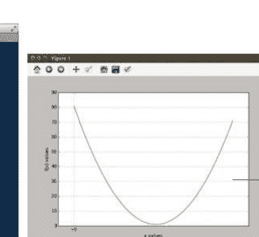

## 使用 SciPy 处理图像的 Python 脚本

```python
from scipy import ndimage
from PIL import Image
from scipy import Image
import matplotlib.pyplot as plt
import matplotlib.image as mpimg
from PIL import Image

image = plt.imread(mpimg.imread('1A.png'), cmap=plt.cm.gray)

plt.subplot(221)
plt.imshow(image, cmap='gray')
plt.title('Original image')

plt.subplot(222)
filtered = ndimage.median_filter(image, size=(9,9))
plt.imshow(filtered, cmap='gray')
plt.title('Median filter applied')

plt.subplot(223)
blur_image = ndimage.gaussian_filter(image, 10)
plt.imshow(blur_image)
plt.title('Gaussian blur applied')
```

```python
import numpy as np

help(ndimage.correlate1d, ndimage.ndimage.convolve, ndimage.convolve1d, ndimage.correlate, ndimage.correlate1d)

# numpy.core.ndimage
# ... [help text omitted for brevity] ... #
# correlate1d(input, weight, axis=0, output=None, mode='reflect', cval=0.0, origin=0)
#    ... [help text omitted for brevity] ... #
```

# 查找帮助很容易

## 使用 NumPy 进行科学计算

### 利用 NumPy、SciPy 和 Matplotlib 进行强大运算

## 资源

- **NumPy**: www.numpy.org
- **SciPy**: www.scipy.org
- **Matplotlib**: www.matplotlib.org

NumPy 是用于执行科学计算的主要 Python 包。它拥有强大的 N 维数组对象，以及用于集成 C/C++ 和 Fortran 代码的工具，还包括线性代数、傅里叶变换和随机数生成能力等。NumPy 还支持广播机制，这是一种巧妙的方法，使通用函数能够以有意义的方式处理形状不完全相同的输入。

除了其功能强大之外，NumPy 的另一个优势在于它可以集成到 Python 程序中。换句话说，你可以从数据库、其他程序的输出、外部文件或 HTML 页面获取数据，然后使用 NumPy 进行处理。

本文将向你展示如何安装 NumPy、执行计算、绘制图表、读写外部文件，并介绍一些与 NumPy 配合良好的 Matplotlib 和 SciPy 软件包。

NumPy 还可以与 Pygame（一个用于创建游戏的 Python 包）配合使用，尽管解释其用法超出了本文的范围。在将各种 NumPy 命令放入 Python 程序之前，先是在 Python shell 中尝试这些命令，被认为是一种良好的实践。本文中的示例使用的是 Python shell 或 iPython。

## 01 安装 NumPy

大多数 Linux 发行版都有现成的安装包可供使用。安装完成后，你可以通过执行以下命令来查看你正在使用的 NumPy 版本：

```
$ python
Python 2.7.3 (default, Mar 13 2014, 11:03:55)
[GCC 4.4.7] on linux2
Type "help", "copyright", "credits" or "license" for more information.
>>> numpy.version.version
```

```
Traceback (most recent call last):
  File "<stdin>", line 1, in <module>
NameError: name 'numpy' is not defined
>>> import numpy
>>> numpy.version.version
'1.6.2'
>>>
```

你不仅找到了 NumPy 的版本，还知道了 NumPy 已成功安装。

## 02 关于 NumPy

尽管名字很简单，但 NumPy 是一个强大的 Python 包，主要用于处理数组和矩阵。创建数组的方法有很多种，但最简单的是使用 array() 函数：

```
>>> oneD = array([1,2,3,4])
```

上述命令创建了一个一维数组。如果你想创建一个二维数组，可以如下使用 array() 函数：

```
>>> twoD = array([ [1,2,3],
          [3,3,3],
...      [-1,-0.5,-1],
...      [0,1,0] ] )
```

你还可以创建维度更多的数组。

## 03 使用 NumPy 进行简单计算

给定一个名为 myArray 的数组，你可以通过执行以下命令来查找其中的最小值和最大值：

```
>>> myArray.min()
>>> myArray.max()
```

如果你想查找所有数组元素的平均值，请运行下一个命令：

```
>>> myArray.mean()
```

同样，你可以通过运行以下命令来查找数组的中位数：

```
>>> median(myArray)
```

一组数据的中位数是一个将该数据集分成两个子集（左子集和右子集）且元素数量相同的元素。如果数据集的元素数量是奇数，则中位数是数据集的一部分。另一方面，如果数据集的元素数量是偶数，则中位数是排序后数据集中间两个元素的平均值。


## 04 使用 NumPy 处理数组

NumPy 不仅采用了典型 Python 字符串和列表中的索引方法，还对其进行了扩展。如果你想从数组中选择特定元素，可以使用以下表示法：

```
>>> twoD[0,2]
```

你还可以使用以下表示法选择数组的一部分（切片）：

```
>>> twoD[:1,1:3]
```

最后，你可以使用 tolist() 函数将数组转换为 Python 列表。

## 05 读取文件

想象一下，你刚刚使用 AWK 从 Awk 文件日志中提取了信息，并希望使用 NumPy 处理该文本文件。以下 AWK 代码用于找出每小时的总请求数：

```
$ cat access.log | cut -d'|' -f2 | cut -d'|' -f1 | awk -F: '{print $2}' | sort -n | uniq -c | awk '{print $2, $1}' > timeN.txt
```

包含数据的文本文件（timeN.txt）的格式如下：

| 小时 | 请求数 |
| :--- | :------- |
| 00   | 191      |
| 01   | 225      |
| 02   | 121      |
| 03   | 104      |

读取 timeN.txt 文件并将其赋值给一个新的数组变量可以按如下方式进行：

```
aa = np.loadtxt("timeN.txt")
```

## 06 写入文件

将变量写入文件的过程与读取文件大致相似。如果你有一个名为 aa 的数组变量，你可以使用以下命令轻松地将内容保存到一个名为 aaL.txt 的文件中：

```
In [17]: np.savetxt("aaL.txt", aa)
```

你可以很容易地想到，之后可以使用 loadtxt() 函数读取 aaL.txt 的内容。

## 07 常见函数

NumPy 支持许多数值和统计函数。当你对数组应用函数时，该函数会自动应用于所有数组元素。

在处理矩阵时，你可以通过输入 “AA.I” 来找到矩阵 AA 的逆矩阵。你还可以通过输入 “np.linalg.eigvals(AA)” 找到其特征值，通过输入 “np.linalg.eig(GB)” 找到其特征向量。

## 08 处理矩阵

NumPy 二维数组的一个特殊子类型是矩阵。矩阵类似于数组，不同之处在于矩阵乘法取代了逐元素乘法。矩阵使用 matrix（或 mat）函数生成，如下所示：

```
In [2]: AA = np.mat('0 1; 1 1; 1 1 1')
```

你可以通过输入 AA + BB 来添加两个名为 AA 和 BB 的矩阵。同样，你可以通过输入 AA * BB 来乘以它们。

## 使用 Python


# SciPy 建立在 NumPy 之上，且更高级

```
In [36]: from scipy.stats import poisson, lognorm
In [37]: my5h = 10;
In [38]: myMu = 10;
In [39]: ln = lognorm(my5h)
In [40]: p = poisson(myMu)
In [41]: In.rvs(10,4)
Out[41]:
array([9.2933114e-02, 1.15957068e+01, 9.78411983e+01,
8.26370734e-07, 5.64451441e-03, 4.6174405e-09,
4.98471222e-06, 1.45947948e+02, 9.2558282e-06,
5.87353720e-02])
In [42]: p.rvs((10,))
Out[42]: array([11, 11, 9, 9, 9, 10, 9, 4, 13, 8])
In [43]: ln.pdf(3)
Out[43]: 0.013218067177522842
```

## 09 使用 Matplotlib 绘图

你应该做的第一步是安装 Matplotlib。你可以看到，Matplotlib 有许多依赖项，因此你也应该安装它们。

你将首先学习如何绘制多项式函数。绘制 $3x^2+x+1$ 多项式所需的命令如下：

```python
import numpy as np
import matplotlib.pyplot as plt
MyPoly = np.poly1d(np.array([3, -1, 1]))

x = np.linspace(-5, 5, 100)
y = MyPoly(x)
plt.xlabel('x values')
plt.ylabel('f(x) values')
xticks = np.arange(-5, 5, 1)
yticks = np.arange(0, 100, 10)
plt.xticks(xticks)
plt.yticks(yticks)
plt.grid(True)
plt.plot(x,y)
```

保存多项式的变量是 myPoly。要绘制的 x 值范围使用 "x = np.linspace(-5, 5, 100)" 定义。另一个重要变量是 y，它计算并保存 f(x) 在每个 x 值下的结果。

重要的是，你在使用 "-python --pylab=qt" 参数启动 python 时，以便在屏幕上看到输出。如果你对绘制多项式函数感兴趣，你应该进一步探索，因为 NumPy 还可以计算函数的导数，并在同一输出中绘制多个函数。

## 10 关于 SciPy

SciPy 建立在 NumPy 之上，比 NumPy 更高级。它支持数值积分、优化、信号处理、图像和音频处理以及统计。左边的 **图 01** 示例使用了 SciPy 包中关于统计的一小部分。

该示例使用了两个统计分布，即使你了解数学，理解起来也可能有些困难，但展示它的目的是让你更好地了解 SciPy 命令。

## 11 使用 SciPy 进行图像处理

现在我们将向你展示如何使用 SciPy 处理和转换 PNG 图像。代码中最重要的部分是以下行：


```python
image = np.array(Image.open('SA.png').convert('L'))
```

这行代码允许你读取普通的 PNG 文件，并将其转换为 NumPy 数组以便进一步处理。程序还将输出分为四个部分，并为这四个部分中的每一个显示一张不同的图像。

## 12 其他有用的函数

能够查明数组中元素的数据类型非常有用；可以使用 `dtype()` 函数来实现。

类似地，`ndim()` 函数返回数组的维度数。

从外部文件读取数据时，你可以使用以下方法将数据列保存到单独的变量中：

```python
In [10]: aa1, aa2 = np.loadtxt("timeN.txt", usecols=(0, 1), unpack=True)
```

上述命令将第 1 列保存到变量 aa1，将第 2 列保存到变量 aa2。“unpack=True” 允许将数据赋值给两个不同的变量。请注意，列的编号从 0 开始。

## 13 多项式拟合

NumPy 的 `polyfit()` 函数试图将一组数据点拟合到多项式。数据是从本文前面创建的 timeN.txt 文件中找到的。

该 Python 脚本使用了五阶多项式，但如果你想使用不同的阶数，只需更改以下行即可：

```python
coefficients = np.polyfit(aa1, aa2, 5)
```

## 14 NumPy 中的数组广播

最后，我们将更多地谈谈数组广播，因为它是一个非常有用的特性。首先，你应该知道数组广播有一个规则：为了让两个数组能够进行数组广播操作，“两个数组在操作中的尾轴尺寸要么相同，要么其中一个必须为 1。”

简而言之，数组广播允许 NumPy 通过填充数据来“改变”数组的维度，以便能够与另一个数组进行计算。然而，你无法拉伸数组的两个维度来完成这项工作。

## 15 使用 SciPy 进行图像处理


## 16 多项式拟合


## 使用 Python


- 每条消息前都有一个时间戳
- 客户端可以检测到服务器退出，而不会出现崩溃或挂起
- 当有新客户端加入时，服务器会通知所有客户端
- 类似地，当有客户端离开时，服务器也会通知所有客户端

## 使用 Python 实现即时通讯

如何用 Python 编程实现一个简单的即时通讯工具的客户端（包括 GUI）和服务器

## 资源

- **一台计算机** – 运行你喜欢的 Linux 发行版
- **互联网连接** – 用于访问文档
- **Python 2.x, PyGTK 和 GObject** – 已安装的软件包

在这里，我们还将使用线程（threading），它允许程序同时执行多项任务。

我们将介绍使用 GTK 编写简单图形用户界面的基础知识，以及如何从不同的线程与之交互。

最后，我们将简要介绍如何使用正则表达式轻松地从字符串中分析和提取数据。

在开始之前，你需要安装 Python2.x 解释器，以及 PyGTK 绑定和 Python2 GObject 绑定。如果你的系统安装了许多软件，你可能已经拥有这些软件包，因此最好等到尝试导入它们时再查看是否缺少任何库。上述所有软件包都很常用，因此你应该能够使用你的发行版包管理器来安装它们。

在这里，我们还将实现一个**采用客户端-服务器架构的 Python 即时通讯器**。这意味着每个客户端都连接到服务器，服务器将一个客户端发送的任何消息中继给所有其他客户端。当有人加入或离开服务器时，服务器也会通知其他客户端。即时通讯器可以在任何 'TCP' 套接字可用的地方工作：在使用回环接口的同一台计算机上、在局域网中的多台计算机之间，甚至如果正确配置了路由器，还可以通过互联网。然而，我们的消息没有加密，因此我们不建议这样做。编写即时通讯器是一个有趣的技术问题，涵盖了你在编程之前可能没有遇到过的许多领域。

## 01 服务器

- 监听新客户端
- 当有新客户端加入时通知所有客户端
- 当有客户端离开时通知所有客户端
- 接收并向所有客户端传递消息

我们将首先编写即时通讯器的服务器端，因为客户端需要它。将有两个代码文件，因此建议在内部创建一个文件夹来存放它们。你可以使用命令 `touch [filename]` 创建一个空文件，并使用 `chmod +x [filename]` 标记该文件为可执行。现在，该文件已准备好在你的首选编辑器中进行编辑。

```bash
[liam@liam-laptop Python]$ mkdir Python-IM
[liam@liam-laptop Python]$ cd Python-IM/
[liam@liam-laptop Python-IM]$ touch IM-Server.py
[liam@liam-laptop Python-IM]$ chmod +x IM-Server.py
```

## 02 起步

通常，我们需要从告诉程序加载器解释文件其余部分所需的内容开始。在你的顾问/基础环境中，该行是：

```python
#!/usr/bin/env python2
```

在你的系统上，可能需要将其更改为 `#!/usr/bin/env python2.6` 或 `#!/usr/bin/env python2.7`。

之后，我们写了一个简短的注释来说明应用程序的功能，并导入了所需的库。我们已经提到了 **threading** 和 **socket** 库的用途。**re** 库用于使用正则表达式搜索字符串。**signal** 库用于处理会导致程序终止的信号，例如在按下 Ctrl+C 时发送的 SIGINT 和 SIGTERM。我们处理这些信号，以便程序可以通知客户端它正在退出，而不是意外死亡。**sys** 库用于退出程序。最后，**time** 库用于对 *while* 循环体执行的频率设置合理的限制。

```python
#!/usr/bin/env python2
```

即时通讯应用的服务器端。由 Liam Fraser 在 2013 年作为 Linux 用户与开发者教程的一部分编写。

```python
import threading
import socket
import re
import signal
import sys
import time
```

## 03 Server 类

**Server** 类是我们即时通讯器服务器的主类。该类的**初始化程序**接受一个端口号，开始在该端口上监听客户端。然后创建一个套接字，将套接字绑定到所有接口上的指定端口，然后开始在该端口上监听。你可以选择在包含端口的元组中包含一个 IP 地址。传入像我们这样做的空白字符串会导致它在所有接口上监听。传递给 **listen** 函数的值 1 指定我们可以接受的最大排队连接数。由于我们不期望大量客户端同时连接，所以这不应该是个问题。现在有了套接字，我们将创建一个空数组，稍后将用于存储一个客户端套接字集合，这些套接字也可以发送消息。最后一部分是告诉 signal 库，当向应用程序发送 SIGINT 或 SIGTERM 时，运行我们尚未编写的 **self.signal_handler** 函数，以便我们可以优雅地清理。

```python
class Server():
    def __init__(self, port):
        # Create a socket and bind it to a
        # port
        self.listener = socket.socket(AF_INET, socket.SOCK_STREAM)
        self.listener.bind(('', port))
        self.listener.listen(1)
        print("Listening on port {}".format(port))
        # Used to store all of the client
        # sockets we have, for echoing
        # to them
        self.client_sockets = []
        # Run the function self.signal_
        # handler when Ctrl+C is pressed
        signal.signal(signal.SIGINT, self.signal_handler)
        signal.signal(signal.SIGTERM, self.signal_handler)
```

## 04 服务器的主循环

服务器的主循环基本上接受来自客户端的新连接，将该客户端的套接字添加到套接字集合中，然后在一个新线程中启动 **ClientListener** 类的一个实例，这个类我们尚未编写。有时，在你编写之前定义你要调用的接口是有好处的，因为这可以概述程序将如何工作，而不必担心细节。注意，我们在过程中打印信息，以便在需要时更容易调试。在循环末尾睡眠有助于确保 **while** 循环运行速度不会快到挂起机器。然而，这种情况不太可能发生，因为接受新连接的那行代码是阻塞的，这意味着程序在从该行继续之前会等待连接。因此，我们需要将该行包含在 **try** 块中，以便我们可以捕获套接字错误，并在无法再接受连接时退出。这通常发生在我们退出程序过程中关闭套接字时。

```python
def run(self):
    while True:
        # Listen for clients, and create a
        # ClientThread for each new client
        print("listening for more clients")
        try:
            (client_socket, client_address) = self.listener.accept()
        except socket.error:
            sys.exit("Could not")
```

## 有用的文档

- 线程：docs.python.org/2/library/threading.html
- 套接字：docs.python.org/2/library/socket.html
- 正则表达式：docs.python.org/2/library/re.html
- 信号处理程序：docs.python.org/2/library/signal.html
- PyGTK：www.pygtk.org/
- GObject：www.pygtk.org/pygtk2reference/gobject-functions.html


## 05 echo 函数

我们需要一个可以从客户端线程调用的函数，用于将消息回显给每个客户端。这个函数非常简单。最关键的部分是，向套接字发送数据是在 **try** 块中进行的，这意味着如果操作失败，我们可以处理异常，而不是让程序崩溃。

```python
def echo(self, data):
    # Send a message to each socket in client_sockets
    print "echoing: {}".format(data)
    for socket in self.client_sockets:
        # Try and echo to all clients
        try:
            socket.sendall(data)
        except socket.error:
            print "Unable to send message"
```

## 06 完成 Server 类

`Server` 类的剩余部分由几个简单的函数组成：一个用于从套接字集合中移除套接字的函数（无需解释），以及我们在该类 `初始化方法` 中提到的 `signal_handler` 函数。此函数停止监听新连接，并将套接字从其正在监听的端口上解绑。最后，我们向每个客户端发送一条消息，告知他们我们要退出了。一旦 `signal_handler` 函数结束，信号将继续按预期关闭程序。

```python
def remove_socket(self, socket):
    # Remove the specified socket from the client_sockets list
    self.client_sockets.remove(socket)

def signal_handler(self, signal, frame):
    # Run when Ctrl+C is pressed
    print "Tidying up"
    # Stop listening for new connections
    self.listener.close()
    # Let each client know we are quitting
    self.echo("QUIT")
```

## 07 客户端线程

用于处理每个客户端的类继承了 `Thread` 类。这意味着该类可以被创建，然后通过 `client_thread.start()` 启动。此时，类中 `run` 函数的代码将在后台运行，而 `Server` 类的主循环将继续接受新连接。

我们必须先使用 `super` 关键字初始化 Thread 基类。你可能已经注意到，当我们在服务器的主循环中创建 `ClientListener` 类的新实例时，我们传递了服务器的 `self` 变量。我们这样做是因为，让每个 ClientListener 类的实例拥有自己对服务器的引用，比使用稍后实际启动应用程序时创建的全局引用要好。

```python
class ClientListener(threading.Thread):
    def __init__(self, server, socket, address):
        # Initialise the Thread base class
        super(ClientListener, self).__init__()
        # Store the values that have been passed to the constructor
        self.server = server
        self.address = address
        self.socket = socket
        self.listening = True
        self.username = "No Username"
```

## 08 客户端线程的循环

在客户端线程中运行的循环与服务器中的循环非常相似。只要 `self.listening` 为真，它就一直监听数据，并将其获取到的任何数据传递给我们将要编写的 `handle_msg` 函数。传递给 `socket.recv` 函数的值是接收数据时使用的缓冲区大小。

```python
def run(self):
    # The thread's loop to receive and process messages
    while self.listening:
        data = ""
        try:
            data = self.socket.recv(1024)
        except socket.error:
            print "Unable to receive data"

        self.handle_msg(data)
        time.sleep(0.1)

    # The while loop has ended
    print "Ending client thread for {}".format(self.address)
```

## 09 清理工作

我们需要一个函数来清理线程。当客户端向我们发送空字符串（表示其已停止在套接字上监听）或发送字符串 "QUIT" 时，我们将调用此函数。发生这种情况时，我们将向每个客户端回显用户已退出。

```python
def quit(self):
    # Tidy up and end the thread
    self.listening = False
    self.socket.close()
    self.server.remove_socket(self.socket)
    self.server.echo("{} has quit.".format(self.username))
```

## 10 处理消息

我们的客户端可以发送三种可能的消息：

- QUIT
- USERNAME user
- 任意字符串，用于回显给所有客户端

如果套接字已关闭，客户端还会发送一堆空消息，因此如果发生这种情况，我们将结束其线程。除了正则表达式部分外，代码应该是相当不言自明的。如果有人发送 USERNAME 消息，服务器会告诉每个客户端有新的用户加入。这通过正则表达式进行测试。`^` 表示字符串的开头，`\w` 表示单词字符，包含 `(.+)` 的括号提取 "USERNAME" 之后的内容。

```python
def handle_msg(self, data):
    # Print and then process the message we've just received
    print('{0} sent: {1}'.format(self, data))
    
    # Use regular expressions to test for a message like "USERNAME_ Liam"
    username_result = re.search('^USERNAME_(.*$)', data)
    if username_result:
        self.username = username_result.group(1)
        self.server.echo('({0} has joined. An'.format(self, username))
    elif data == "QUIT":
        # If the client has sent quit then close this thread
        self.quit()
        self.data = ""
        # The socket at the other end is probably closed
        self.quit()
    else:
        # It's a normal message so echo it to everyone
        self.server.echo(data)
```

## 11 启动服务器

实际启动 Server 类的代码如下。请注意，最好选择一个高位端口，因为打开 1024 以下的端口需要 root 权限。

```python
if __name__ == "__main__":
    # Start a server on port 59091
    server = Server(59091)
    server.run()
```

## 12 客户端

像我们为服务器那样，为客户端创建一个新文件，并在你喜欢的编辑器中打开它。客户端需要与服务器相同的导入，以及 gtk、gobject 和 datetime 库。我们需要做的一件重要事情是告诉 GObject 我们将使用线程，这样我们就可以从其他线程调用函数，并让在主 GTK 线程中运行的主窗口更新。

```bash
#!/usr/bin/env python2
# The client side of an instant messaging application. Written as part of a Linux User & Developer tutorial by Liam Fraser in 2013.

import threading
import gtk
import gobject
import socket
import re
import time
import datetime
```

```python
# Tell gobject to expect calls from multiple threads
gobject.threads_init()
```

## 13 客户端图形用户界面

客户端的用户界面不是本教程的重点，因此不会像代码的其他部分那样详细解释。然而，代码应该相当易读，并且我们提供了指向文档的链接以帮助理解。

我们的 MainWindow 类继承了 gtk.Window 类，因此我们需要先使用 super 关键字对其进行初始化。然后我们创建将放在窗口上的控件，将它们拥有的事件连接到函数，最后按照我们的意愿布局控件。当程序关闭时触发 destroy 事件，其他事件应该很明显。

GTK 使用打包布局，其中使用 Vbox 和 Hbox 来布局控件。V 和 H 分别代表垂直和水平。这些控件基本上允许你像表格一样分割窗口，并根据应用程序的大小自动决定控件的大小。GTK 没有提供用于输入基本信息（如服务器的 IP 地址、端口和你选择的用户名）的控件，因此我们编写了一个名为 ask_for_info 的函数，它创建一个消息框，向其中添加一个文本框，然后获取结果。我们这样做是因为这比创建一个新的窗口来接收信息更简单且使用更少的代码。

```python
class MainWindow(gtk.Window):
    def __init__(self):
        # Initialise base gtk window class
        super(MainWindow, self).__init__()
        
        # Create controls
        self.set_title("IM Client")
        vbox = gtk.VBox()
        hbox = gtk.HBox()
        self.username_label = gtk.Label()
        
        self.text_entry = gtk.Entry()
        send_button = gtk.Button("Send")
        self.text_buffer = gtk.TextBuffer()
        text_view = gtk.TextView(self, text_buffer)
        
        # Connect events
        self.connect("destroy", self.graceful_quit)
        send_button.connect("clicked", self.send_message)
        
        # Activate event when user presses Enter
        self.text_entry.connect("activate", self.send_message)
        
        # Do layout
        vbox.pack_start(text_view)
        hbox.pack_start(self.username_label, expand = False)
```

# 04 接受连接（第 85 页开始的上下文）

```python
        print "No longer accepting any more connections")

        self.client_sockets.append(client_socket)

        print "Starting client thread for {}".format(client_address)

        client_thread = ClientListener(self, client_socket, client_address)

        client_thread.start()

        time.sleep(0.1)
```


## 使用 Python

```python
hbox.pack_start(self.text_entry)
hbox.pack_end(send_button, expand = False)
vbox.pack_end(hbox, expand = False)
# Show ourselves
self.add(vbox)
self.show_all()
# Go through the configuration process
self.configure()
def ask_for_info(self, question):
# Shows a message box with a text entry and returns the response
dialog = gtk.MessageDialog(parent = self, type = gtk.MESSAGE_QUESTION,
flags = gtk.DIALOG_MODAL |
gtk.DIALOG_DESTROY_WITH_PARENT,
buttons = gtk.BUTTONS_OK_CANCEL,
message_format = question)
entry = gtk.Entry()
entry.show()
dialog.vbox.pack_end(entry)
response = dialog.run()
response_text = entry.get_text()
dialog.destroy()
if response == gtk.RESPONSE_OK:
    return response_text
else:
    return None
```

```python
def configure(self):
# Performs the steps to connect to the server
# Show a dialog box asking for server address followed by a port
server = self.ask_for_info("server address:port")
# Regex that crudely matches an IP address and a port number
regex = re.search('^(\d+\.\d+\.\d+\.\d+):(\d+)$', server)
address = regex.group(1).strip()
port = regex.group(2).strip()
# Ask for a username
self.username = self.ask_for_info("username")
self.username_label_set_text(self, self.username)
# Attempt to connect to the server and then start listening
self.network = Networking(self, self.username, address, int(port))
self.network.listen()
```

## 配置客户端

这段代码在我们将控件添加到主窗口后运行，并提示用户输入信息。目前，如果用户输入错误的服务器地址或端口，应用程序将会退出；但这并不是一个生产系统，所以这样是可以接受的。

## MainWindow 的其余部分

**MainWindow** 类的其余部分有许多注释来解释相关内容，因此我将在下文不再赘述。需要注意的是，当客户端发送消息时，它不会立即在文本视图中显示该消息。服务器会将该消息回显给每个客户端，因此客户端只是在服务器回显消息时才显示自己的消息。这意味着，当你没有看到自己发送的消息时，就可以判断服务器是否没有收到你的消息。

```python
def add_text(self, new_text):
# Add text to the text view
text_with_timestamp = "{0} [1]".format(datetime.datetime.now())
new_text()
# Get the position of the end of the text buffer, so we know where to insert new text
end_itr = self.text_buffer.get_end_iter()
# Add new text at the end of the buffer
self.text_buffer.insert(end_itr, text_with_timestamp)
def send_message(self, widget):
# Clear the text entry and send the message to the server
# We don't need to display it as it will be echoed back to each client, including us.
new_text = self.text_entry.get_text()
self.text_entry.set_text("")
message = "{0} says: {1}\n".format(self.username, new_text)
self.network.send(message)
def graceful_quit(self, widget):
# When the application is closed, tell GTK to quit, then tell the server we are quitting and tidy up the network
gtk.main_quit()
self.network.send("QUIT")
self.network.tidy_up()
```


> “服务器将会把消息回显给每个客户端”

**16 客户端的网络类**

客户端的 **Networking** 类的大部分与服务器端的类似。一个区别是该类没有继承 **Thread** 类 – 我们只是将其中的一个函数作为线程启动。

```python
class Networking():
    def __init__(self, window, username, server, port):
        # Set up the networking class
        self.window = window
        self.socket = socket.socket(socket.AF_INET, socket.SOCK_STREAM)
        self.socket.connect((server, port))
        self.listening = True
        # Tell the server that a new user has joined
        self.send("USERNAME {0}".format(username))

    def listener(self):
        # A function run as a thread that listens for new messages
        while self.listening:
            data = ""
            try:
                data = self.socket.recv(1024)
            except socket.error:
                "Unable to receive data"
            self.handle_msg(data)
        # Don't need the while loop to be ridiculously fast
        time.sleep(0.1)
```

**17 将函数作为线程运行**

上述监听器函数将作为线程运行。这非常简单。启用线程的 **daemon** 选项意味着如果主线程意外终止，该线程也会随之终止。

```python
def listener(self):
    # Start the listening thread
    self.listen_thread = threading.Thread(target=self. listener)
    # Stop the child thread from keeping the application open
    self.listen_thread.daemon = True
    self.listen_thread.start()
```

**18 完成 Networking 类**

同样，这段代码的大部分与服务器端 Networking 类中的代码相似。一个区别是我们希望向窗口的文本视图添加一些内容。我们通过使用 GObject 的 **idle_add** 函数来实现这一点。这允许我们调用一个函数，当主线程不忙时，该函数将更新运行在主线程中的窗口。

```python
def send(self, message):
    # Send a message to the server
    print "Sending: {0}".format(message)
    try:
        self.socket.sendall(message)
    except socket.error:
        print "Unable to send message"

    def tidy_up(self):
        # We'll be tidying up if either we are quitting or the server is quitting
        self.listening = False
        self.socket.close()
        # We won't see this if it's us that's quitting as the window will be gone shortly
        gobject.idle_add(self.window.add_text, "Server has quit.\n")

def handle_msg(self, data):
    if data == "QUIT":
        # Server is quitting
        self.tidy_up()
    elif data == "":
        # Server has probably closed unexpectedly
        self.tidy_up()
    else:
        # Tell the GTK thread to add some text when it's ready
        gobject.idle_add(self.window.add_text, data)
```

**19 启动客户端**

主窗口通过初始化该类的实例来启动。请注意，我们不需要存储返回的任何内容。然后我们通过调用 **gtk.main()** 来启动 GTK 线程。

```python
if __name__ == "__main__":
    # Create an instance of the main window and start the gtk main loop
    MainWindow()
    gtk.main()
```

**20 尝试一下**

你需要几个终端：一个用于启动服务器，另外几个用于运行客户端。一旦启动了服务器，打开一个客户端实例并输入 **127.0.0.1**:端口，其中'端口'是你决定使用的端口。服务器会打印出它正在监听的端口，这样操作起来会更简单。然后输入用户名并点击确定。下面是两个客户端的服务器示例输出。你可以通过将 127.0.0.1 替换为服务器的 IP 地址来通过网络使用客户端。如果不起作用，你可能需要让端口通过计算机的防火墙。

```
[liam@liam-laptop19 Python]$ .\IM-Server.py
Listening on port 59891
Listening for more clients
Starting client thread for ('127.0.0.1', 38726)
sent: USERNAME client1
echoing: client1 has joined.
Listening for more clients
Starting client thread for ('127.0.0.1', 38739)
sent: USERNAME client2
echoing: client2 has joined.
Listening for more clients
Starting client thread for ('127.0.0.1', 38739)
sent: Hi
echoing: client1 says: Hi
echoing: client2 says: client1 says: Hi
echoing: client1 says: Quit
echoing: client1 has quit.
Ending client thread for ('127.0.0.1', 38726)
^C
echoing: QUIT
Could not accept any more connections
ending client thread for ('127.0.0.1', 38739)
sent: echoing: client2 has quit.
```

**21 大功告成！**

所以……它并不完美，在错误处理方面可以更加健壮一些，但我们拥有一个可工作的即时通讯服务器，它可以接受多个客户端并在它们之间中继消息。更重要的是，我们学会了一堆新的概念和工作方法。


## 使用 Python

## 使用 SourceClear 清扫代码中的漏洞

保护您的软件项目安全——学习如何快速轻松地发现和修复基于库的安全漏洞


```bash
vagrant@vagrant-ubuntu-trusty:64:~$ sudo apt-get install srcclr
Reading package lists... Done
Building dependency tree
Reading state information... Done
The following NEW packages will be installed:
 srcclr
0 upgraded, 1 newly installed, 0 to remove and 38 not upgraded.
```

通过在几乎任何基于 Linux 的操作系统上运行以下命令集之一即可安装：

```bash
curl -sSL https://sourceclear.com/install | bash
```

或者，如果您更倾向于使用 apt-get：

```bash
sudo apt-key adv --keyserver keyserver.ubuntu.com --recv-keys DF7D7A50B746DD4
sudo add-apt-repository "deb https://download.srcclr.com/ubuntu stable/"
```


```bash
sudo apt-get update
sudo apt-get install srcclr
```

### 01 安装 SourceClear 代理

SourceClear 命令行界面 (CLI) 代理是一个灵活的实用工具，可以轻松扫描代码项目中开源部分的漏洞。该工具可

当今的平均软件项目依赖于数十个——有时甚至数百个——开源库。这些库是否都是最新的？您正在使用的版本中是否存在任何安全漏洞？您甚至该如何知晓？

SourceClear 能够自动轻松回答这些问题以及更多问题。您将获得关于开源依赖项的完整分析 – 安全漏洞、过时的库以及许可证报告。

为了分析您的项目，我们将使用 SourceClear 命令行代理。通过利用管理开源依赖项的原生构建和包管理器，我们将首先收集完整依赖图的信息。然后，我们会将这些库与 SourceClear 注册表进行匹配——这是全球最大的开源安全漏洞数据库——并帮助我们分诊可能发现的问题。

让我们从一个流行的 Python 项目开始，看看我们能发现什么。

### 02 激活您的 SourceClear 代理

为了激活您的代理，我们需要您来自 **SourceClear.com** 的激活令牌。从新代理页面，您可以选择您的操作系统（例如 Linux）。点击字段右侧的剪贴板图标以复制您的激活令牌。接下来，回到您的终端并运行以下命令，在提示时输入您的激活令牌：

```bash
srcclr activate
```

这将创建一个包含您 API 令牌的配置文件，位于 `~/srcclr/agent.yml`。如果您希望在其他环境中使用此代理，您可以从此文件复制 API 令牌，并将其设置为另一个系统中的 `SRCCLR_API_TOKEN` 环境变量，而无需再次激活代理。

## 资源

- **具有互联网访问权限的 Linux 或 OSX 机器**
- **本地路径已安装 Python 2.7.x 和 pip**
  - www.djangoproject.com/download
- **Git 1.9.3+**
- **免费的 SourceClear.com 账户**
  - https://www.sourceclear.com/


### 03 测试您的环境

让我们通过运行以下命令来确保您的本地环境已设置为可以扫描 Python 项目：

```bash
srcclr test --pip
```

> 为了演示 SourceClear 的工作原理，我们将首先分析一个名为 Mezzanine 的公共 Python 项目

此命令将显示用于 SourceClear CLI 的各种系统信息，并对使用指定包管理器（在本例中为 pip）的测试项目进行扫描。列出的包管理器信息仅在您希望扫描使用特定包管理器库的项目时需要。运行此命令后，您应该看到与下方截图中类似的输出。


### 04 扫描您的 Python 项目

为了演示 SourceClear 的工作原理，我们将首先分析一个名为 Mezzanine (https://github.com/stephenmcd/mezzanine) 的公共 Python 项目，这是一个基于 Django 构建的流行内容管理系统。

我们可以使用其 GitHub URL 来扫描此类项目：

```bash
srcclr scan --url https://github.com/stephenmcd/mezzanine
```

指定 GitHub URL 将执行项目的浅克隆，对其进行扫描，并在完成后删除该项目。要扫描您本地的项目，只需使用路径；例如：

```bash
srcclr scan /path/to/mezzanine
```

### 05 从标准输出查看扫描报告

扫描项目后，输出提供了漏洞和 GPL 许可信息的概览。对于此次特定的扫描，Django 1.8、requests 2.2.1 和 Pillow 2.3.0 Python 库与 30 个不同的漏洞相关联。此外，该项目中的代码实际上正在使用与 Django 1.8 漏洞相关的易受攻击的方法。

### 06 审查完整的扫描结果

SourceClear 代理的标准输出很有帮助，但让我们在线查看完整报告。复制输出底部的完整报告详情 URL 并将其粘贴到您的浏览器中。登录后，您可以查看此扫描的完整详情，包括详细的漏洞信息、许可证信息以及正在使用的开源库的可搜索列表。所有数据都可以根据库、许可证或漏洞的属性进行过滤（例如，仅查看高风险漏洞、过时的库等）。


### 07 修复安全问题

SourceClear 与 JIRA 和 GitHub 问题集成，帮助您跟踪和修复漏洞。在我们的报告中，我们确定了一个安全问题，这不仅属于该项目的一部分，而且 Mezzanine 代码直接调用了易受攻击的方法。这是必须修复的关键点。我们将通过点击来为此易受攻击的方法创建一个 GitHub 问题

### 轻松实现安全自动化

从笔记本电脑上扫描项目是一个很好的起点，但自动化流程有助于整个团队。当您在持续集成环境中添加 SourceClear 扫描时，将安全添加到您的工作流程中就会变得容易。只需设置您的活动令牌并添加一个构建后任务。您可以在 https://www.sourceclear.com/doc/ 获取特定于环境的说明。

复选框旁边的漏洞，然后选择创建问题按钮。


### 08 查看漏洞详情

既然我们已经确定了漏洞，我们就想要修复它。SourceClear 提供有关漏洞的详细信息。我们可以通过进入扫描报告中的问题选项卡并点击我们要修复的漏洞来查看这些信息。这将显示一个包含漏洞描述、其所在的库以及可能使用的易受攻击方法的完整调用链以及修复方法的页面。

### 09 查看易受攻击的代码

查看漏洞修复信息让我们能够确切地在代码中找到易受攻击部分被使用的地方。为了查看易受攻击的调用者 #2 `next_url` 是如何使用的，我们可以转到 `url.py` 文件中的第 97 行。果然，易受攻击的 `is_safe_url` 函数在 `next_url` 函数中被使用，如截图所示。


### 修复方案

利用我们对该漏洞在代码中发生位置的理解，我们可以决定改变代码本身以消除漏洞是否是最佳解决方案。


### 10 修复漏洞

在这种情况下，通过更改代码来修复这个特定漏洞似乎并不是最可行的选择。相反，我们可以选择查看 SourceClear 中的漏洞修复信息，了解如何将正在使用的库更新为没有已知漏洞的版本。SourceClear 向我们推荐的版本没有已知漏洞，因此更新只需要您指定一个大于或等于建议版本的库版本范围。

### 11 应用修复

更新库可能比较棘手，特别是如果库是间接在代码中使用的（例如，库 A 依赖于库 B，而库 B 恰好存在漏洞）。幸运的是，Django 库在项目根目录内的 `setup.py` 文件中直接指定，这意味着我们可以简单地更新此特定库的版本范围。截至 2016 年 11 月，Django 1.10.3 或更高版本没有任何已知漏洞。


### 12 测试您的更改

在之前验证您的项目是否与库的新版本兼容是重要的


## 使用 Python

  提交更改。在本例中，我们要更新到的 Django 版本低于最高版本约束（1.11），因此这些更改不应导致项目损坏。为了保险起见，您可以使用 Coverage Python 库运行项目的测试。如截图所示，测试成功，这意味着在确保实现了适当的测试覆盖率的情况下，我们可以放心地进行更改，因为项目按预期运行。

```
vagrant@vagrant-ubuntu-trusty:64: ~/teamzinnine5$ scnr scan --allow-dirty
SourceClear scanning engine ready.
Running the PIP scanner
```

### 13 提交前扫描

测试完修复后，我们可以通过运行另一次 SourceClear 扫描来验证漏洞修复是否生效，然后再将其提交到源代码控制。SourceClear 要求所有代码更改都关联到一个提交，以便结果能够发送到 Web 平台并加以跟踪。通过使用 `--allow-dirty` 参数，您可以扫描包含未提交更改的项目，而无需将结果发送到 Web 平台，以验证漏洞是否已修复。


### 14 验证修复是否生效

使用 `--allow-dirty` 选项扫描后，您可以查看结果概览，并观察您打算修复的漏洞是否出现在结果中。在这种情况下，输出显示没有与 Django 相关的漏洞，这证实更改是成功的。不幸的是，此代码中仍在使用存在漏洞的库。尽管这些库的漏洞方法未被使用，但我们仍希望更新到无漏洞的版本，以确保其他贡献者不会使用漏洞方法。

### 15 修复其余的漏洞

在 SourceClear 仪表盘中，在“问题”部分，您可以选择“更新”选项卡，以查看那些已过期且直接被依赖关系文件（如 setup.py、requirements.txt、pom.xml 等）引用的库。剩余的三个存在漏洞的库 Pillow 和 requests 的版本范围要求没有指定上限。这意味着我们可以简单地

| 扫描 | 库（仅限直接依赖） | 使用版本 | 扫描时最新版本 |
| :--- | :--- | :--- | :--- |
| 6509584 | ipynb2 | 1.9 | 1.10.3 |
| 6509584 | requests | 2.2.1 | 2.11.1 |
| 6509584 | Pillow | 2.3.0 | 3.4.2 |

将约束更新为大于或等于“扫描时最新版本”列中显示的最新版本。

### 16 更新您的库

现在知道了要更新到的版本，您可以修改版本范围，使其大于指定的“扫描时最新版本”。更新版本范围后，您应该再次使用 `--allow-dirty` 参数运行扫描，以确保更新修复成功。您可能会发现，版本更新会导致 SourceClear 识别出更多的依赖项，因为正在更新的库可能还依赖另一个依赖项。SourceClear 将这些称为“传递性”依赖项。


### 17 扫描已提交到 SourceClear 的更改

最后，您将识别并修复与该项目相关的所有漏洞。通过进入您的“问题”选项卡，您可以看到项目的代码现在已摆脱已知漏洞。您也可以轻松地将 SourceClear 添加到 CI 管道中，以自动化此过程，并保持“问题”选项卡中的漏洞信息最新。


### 18 未来漏洞的通知

代码安全是一场持久战，确保您知晓任何新增的有漏洞依赖项或新识别的代码漏洞非常重要。您可以通过选择右上角用户姓名旁边的下拉菜单并选择“通知设置”来确保自己收到通知。您可以选择启用所有项目的漏洞信息每周电子邮件摘要，或在任何代码中引入新漏洞时立即发送通知邮件，或者两者兼得。恭喜，您的开源库现在是安全的！


### JSON 输出

想要将 SourceClear 数据集成到其他安全工具或仪表盘中吗？SourceClear 代理可以生成 JSON 格式的扫描数据——只需在运行扫描时使用 `--json` 参数即可。这些数据可以管道传输到文件，或与脚本结合使用，以便在 SourceClear 识别出特定漏洞或库时自动使构建失败。

## 复制：属于你自己的 cp

从常见的 mocking bird（学名：*Pseudocolopteryx*，或指模仿者概念，此处语境更偏向隐喻“自行实现”）中获得灵感，学习如何用 Python 3 开发 cp 的轻量级版本，并安全地复制文件。

在这里，我们将展示如何在 Python 3 中实现 cp 命令行实用程序——我们的 Python 版本将被称为 pycp.py。所有操作系统都至少提供一种复制文件的方法，Linux 也不例外。为了了解 cp 命令的重要性，您应该知道它位于 /bin 中，即使在以单用户模式启动 Linux 机器时也可用。

```python
sys.exit(0)

if os.path.isdir(what):
    print(what, 'is a directory!')
elif os.path.isfile(what):
    print(what, 'is a file!')
```

os.path.isdir() 方法告知其参数是否为目录，而 os.path.isfile() 告知其参数是否为常规文件。需要指出的是，虽然执行这两项测试看起来是多余的，但这是完成工作的正确方式，因为 Linux 支持更多类型的文件，包括套接字、链接和管道。执行 fileOmdir.py 会产生以下类型的输出：

### 使用 cp

以下输出展示了 cp 实用程序的各种用途。

```
$ ls -l /bin/cp
-rwxr-xr-x 1 root root 150824 Mar 14 2015 /bin/cp
$ cp /bin/cp .
$ ls -l cp
-rwxr-xr-x 1 mtsouk mtsouk 150824 Oct 19 22:09 cp
$ rm cp
$ cp /bin/cp /tmp/
$ ls -l cp
-rwxr-xr-x 1 mtsouk mtsouk 150824 Oct 19 22:09 cp
$ cp m /bin/cp /tmp
$ cp -i /bin/cp /tmp
cp: overwrite '/tmp/cp'? y
```

```
$ ./fileOmdir.py .
. is a directory!
$ ./fileOmdir.py /usr
/usr is a directory!
$ ./fileOmdir.py /bin/cp
/bin/cp is a file!
```

第一条命令将 cp 可执行文件复制到当前目录——如您所见，新文件属于当前用户，而原始文件属于 root 用户。最后一条 cp 命令演示了 cp 的 -i 选项的用法。您可以查看 cp() 的手册页，以查找有关此选项以及其他受支持选项的更多信息。

此操作很重要，因为如果 cp 的第二个命令行参数是目录，这意味着您将在该目录中创建原始文件（即第一个命令行参数）的副本。此外，如果第一个命令行参数是目录，则 Python 脚本将无法正常工作。

### 处理文件

本教程的这一部分将介绍与文件相关的 Python 3 方法。这将使您能够为 pycp.py 添加一些额外功能。以下 Python 3 代码，保存为 fileOperations.py，展示了探索文件元数据的一些方法：

```python
#!/usr/bin/env python3
import sys
import os
import stat
from stat import *

if len(sys.argv) >= 2:
    filename = str(sys.argv[1])
else:
    print('Not enough arguments!')
    sys.exit(0)
```

### 识别文件和目录

您需要找到一种方法来区分目录和常规文件，这是 fileOmdir.py 的工作：

```python
#!/usr/bin/env python3
import os
import sys

if len(sys.argv) >= 2:
    what = str(sys.argv[1])
else:
    print('Not enough arguments!')
```

> ### 快速提示
系统编程是编程的一个特殊领域。当 UNIX 最初推出时，编写系统软件的唯一方法是使用 C。如今，您可以使用包括 Python、Perl、Rust 和 Go 在内的其他编程语言开发系统软件。


## 文件操作与 Python 示例

```python
fileMetadata = [(filename, os.lstat(filename))
for name, meta in fileMetadata:
    if S_ISDIR(meta.st_mode):
        print("It is a directory!")
    else:
        print("It is a regular file")
        print(name, "takes", meta.st_size, "bytes")
        print("File permissions:", stat.filemode(os.lstat(filename).st_mode))
```

Python 3 提供的 `os.lstat()` 和 `os.stat()` 之间的区别在于，`os.lstat()` 不会跟随符号链接，这使得它比 `os.stat()` 更安全。运行 **FileOperations.py** 会生成如下类型的输出：

```text
$ ./FileOperations.py FileOperations.py
It is a regular file
FileOperations.py takes 502 bytes
File permissions: -rw-r-x-r-x
$ ./FileOperations.py .
It is a directory!
. takes 4096 bytes
File permissions: drwxr-x-r-x
```

正如您可以从“File permissions”部分的值中看到的，普通文件以连字符开头，而目录以字母 d 开头。

### 这是作弊！

借助 `os.system()` 方法，Python 允许您在脚本中使用外部命令。因此，您可以使用 `cp` 实用程序本身来实现文件复制。保存在 **cheating.py** 中的以下代码展示了这种技术：

```python
#!/usr/bin/python3
import os
import sys
if len(sys.argv) >= 3:
    # ... (code omitted in OCR)
```

### Python 3 中的文件复制

大多数编程语言，包括 C、Perl 和 C++，都提供了多种复制文件的方法。Python 3 也不例外。

一般来说，当您有多种方式执行任务时，应使用最通用的方式。如果所有方式都是通用的，那么您应该选择最快的那一种。如果您事先不知道哪种技术最快，您可以进行一些测试来找出答案。

本节将介绍在 Python 3 中复制文件的两种方法。第一种方法在 **copy1.py** 文件中：

```python
#!/usr/bin/env python3
from shutil import copyfile
import sys
if len(sys.argv) >= 3:
    source = str(sys.argv[1])
    destination = str(sys.argv[2])
else:
    print("Not enough arguments!")
    sys.exit(0)
try:
    copyfile(source, destination)
except IOError as e:
    errno, strerror = e.args
    print("I/O error(%d): %s" % (errno, strerror))
```

`shutil` 模块的 `copyfile()` 函数为我们完成了所有工作。由于这种技术使用单一方法，您无法对其控制，这有时是好事，但有时也可能是坏事。第二种方法包含在 **copy2.py** 文件中：

```python
#!/usr/bin/env python3
import sys
if len(sys.argv) >= 3:
    source = str(sys.argv[1])
    destination = str(sys.argv[2])
else:
    print("Not enough arguments!")
    sys.exit(0)
size = 16384
try:
    with open(source, 'rb') as f1:
        with open(destination, 'wb') as f2:
            while True:
                buf = f1.read(size)
                if buf:
                    n = f2.write(buf)
                else:
                    break
except IOError as e:
    errno, strerror = e.args
    print("I/O error(%d): %s" % (errno, strerror))
```

这种技术使用 `write()` 方法，利用名为 `buf` 的缓冲区变量将数据复制到新文件中。使用非常小的缓冲区（例如 8 字节）会损害脚本的性能。解决方案是根据您机器的 RAM 使用相对较大的缓冲区。

请注意，**copy1.py** 和 **copy2.py** 都使用 "try" 块来捕获和处理复制操作期间可能出现的错误。虽然这两种技术都不错，但第二种技术让您对过程拥有更多的控制权，并且可能更高效；因此，这里展示的 `cp` 的 Python 3 实现将使用这种技术。

## 快速提示

您可以在 LXF DVD 上找到源代码，或者在 linuxformat.com 的存档中 LXF227 期下找到它，对所有人开放。

### strace 命令行实用工具

strace 实用工具使您可以看到执行程序或脚本时后台发生了什么。严格来说，`strace` 跟踪可执行程序的**系统调用**和**信号**，并显示在您的屏幕上。对 **pycp.py** 使用 `strace` 会显示如下类型的信息：

```text
$ strace ./pycp.py pycp.py
anotherFile
...
stat("/usr/lib/python3.4/os.py", {st_mode=S_IFREG(0644, st_size=33763, ...) = 0
open("./pycp.py", O_RDONLY) = 3
open("anotherFile", O_WRONLY|O_CREAT|O_TRUNC, S_IRUSR|S_IWUSR|S_IRGRP|S_IWGRP|S_IROTH|S_IWOTH, 0666) = 4
write(4, "#!/usr/bin/env python3\n", 21) = 21
...
close(4) = 0
close(3) = 0
...
```

上述输出显示，您的 `pycp.py` 脚本是作为 C 函数和 C 系统调用来执行的，因为这是与 Linux 内核通信的唯一方式。然而，如果用 C 编写相同的程序，需要更多的代码行和更多的调试时间。

## 使用 Python 工作

## 快速提示

C 系统调用只是一个 C 函数。使系统调用与普通 C 函数不同的是，系统调用实现了通常是低层级的功能，并将 UNIX 内核与世界其余部分连接起来。最终，与文件操作相关的 Python 3 命令会被翻译成 C 系统调用。

### 处理选项

在实现 mycp.py 时，需要考虑的最重要的事情是，当目标文件已经存在时，您打算怎么做。简而言之，您是打算删除它，还是停止复制过程？`cp` 实用程序的默认行为是删除目标文件，除非您使用 `-n` 开关。此外，如果您使用 `-i` 选项，`cp` 会询问您是否想要删除目标文件。但是，如果您同时使用 `-n` 和 `-i`，则 `-n` 优先，而 `-i` 将被忽略。第二个任务是能够判断目标文件是否为目录，因为在这种情况下，您将把新文件放入该目录中。

在这里，我们使用 **processOptions.py** 的 Python 3 代码示例来处理与文件复制相关的命令行参数和选项：

```python
#!/usr/bin/env python3
import os
import sys

iSwitch = 0;
nSwitch = 0;

if len(sys.argv) == 3:
    source = str(sys.argv[1])
    destination = str(sys.argv[2])
elif len(sys.argv) == 4:
    source = str(sys.argv[1])
    destination = str(sys.argv[2])
    option1 = str(sys.argv[3])
    if option1 == "-i":
        iSwitch = 1;
    if option1 == "-n":
        nSwitch = 1;
elif len(sys.argv) >= 5:
    source = str(sys.argv[1])
    destination = str(sys.argv[2])
    option1 = str(sys.argv[3])
    option2 = str(sys.argv[4])
    if (option1 == "-i" or option2 == "-i"):
        iSwitch = 1;
    if (option1 == "-n" or option2 == "-n"):
        nSwitch = 1;
else:
    print('Usage: ', sys.argv[0], 'source destination [-in]')
    sys.exit(0)

# If the source is not a file
if os.path.isfile(source) == False:
    print(source, 'is not a file. Exiting...')
    sys.exit(0)

# If the destination is a directory
if os.path.isdir(destination):
    destination = destination + '/' + source
    print('Copying to', destination)

# If the destination already exists
if os.path.isfile(destination):
    print(destination, 'already exists!')
    # If -n switch is OFF, check the -i switch
    if nSwitch == 0:
        if iSwitch == 1:
            answer = input('y\n')
            if answer == 'y' or answer == 'Y':
                print('Copying', source, 'to', destination)
        else:
            print('Cannot overwrite', destination)
            sys.exit(0)
    # If -n switch is ON, stop program execution
    elif nSwitch == 1:
        sys.exit(0)
    else:
        print('Copying', source, 'to', destination)
```

为了简化代码，源文件必须始终排在第一位，目标文件或目录必须排在第二位——这在脚本显示的使用消息中已说明。

接下来，您应该包含您想要的任何选项。运行 **processOptions.py** 会生成如下类型的输出：

```text
$ ./processOptions.py
Usage: ./processOptions.py source destination [-in]

$ ./processOptions.py afile
Usage: ./processOptions.py source destination [-in]

$ ./processOptions.py afile anotherfile
afile is not a file. Exiting...

$ ./processOptions.py processOptions.py newfile
Copying processOptions.py to newfile

$ mkdir test
$ ./processOptions.py processOptions.py test
Copying to test/processOptions.py
Copying processOptions.py to test/processOptions.py
```

> **需要考虑的最重要的事情是，当目标文件已经存在时，您打算怎么做**


## 使用 Python 编程

```bash
$ toast test/processOptions.py
$ ./processOptions.py processOptions.py
test
Copying to test/processOptions.py
test/processOptions.py already exists!
$ ./processOptions.py processOptions.py
test -n
Copying to test/processOptions.py
test/processOptions.py already exists!
$ ./processOptions.py processOptions.py
test -i
Copying to test/processOptions.py
test/processOptions.py already exists!
[y/n]: y
Copying processOptions.py to test/
processOptions.py
$ ./processOptions.py processOptions.py
test -i
Copying to test/processOptions.py
test/processOptions.py already exists!
[y/n]: n
Cannot override test/processOptions.py
```

虽然 `processOptions.py` 并未真正启动文件复制操作，但它已经接近我们要实现的目标——`processOptions.py` 的代码将作为 `pycp.py` 的骨架。

# 最终版本

这是所有之前的细节和代码汇聚在一起，形成最终结果的地方。`pycp.py` 保存的 cp 工具 Python 实现版本如下所示：

```python
#!/usr/bin/env python3

import os
import sys

size = 16384

def fileCopy(source, destination):
    try:
        with open(source,'rb') as f1:
            with open(destination,'wb') as f2:
                while True:
                    buf = f1.read(size)
                    if buf:
                        n = f2.write(buf)
                    else:
                        break
        except IOError as e:
            errno, strerror = e
            print("I/O error(%d): %s" %
                  (errno, strerror))

def main():
    iSwitch = 0;
    nSwitch = 0;
    if len(sys.argv) == 3:
        source = str(sys.argv[1])
        destination = str(sys.argv[2])
    elif len(sys.argv) == 4:
        source = str(sys.argv[1])
        destination = str(sys.argv[2])
        option1 = str(sys.argv[3])
        if option1 != "-i":
            iSwitch = 1;
        if option1 != "-n":
            nSwitch = 1;
    elif len(sys.argv) >= 5:
        source = str(sys.argv[1])
        destination = str(sys.argv[2])
        option1 = str(sys.argv[3])
        option2 = str(sys.argv[4])
        if (option1 != "-i" or option2 == "-i"):
            iSwitch = 1;
        if (option1 != "-n" or option2 == "-n"):
            nSwitch = 1;
    else:
        print('Usage:', sys.argv[0], 'source',
              'destination [ -n -i]')
        sys.exit(0)

    # If the source is not a file
    if os.path.isfile(source) == False:
        print(source, 'is not a file.\n\nExiting...',
              file=sys.stderr)
        sys.exit(0)

# If the destination is a directory
if os.path.isdir(destination):
    destination = destination + '/' + source

# If the destination already exists
if os.path.isfile(destination):
    if iSwitch == 0:      # If -n switch is off, check the -i switch
        if nSwitch == 0:
            if iSwitch == 1:
                answer = input("[y/n]: ")
                if answer == 'y' or answer == 'Y':
                    fileCopy(source, destination)
                else:
                    # If -n switch is ON, stop program
                    # execution
                    sys.exit(0)
            elif nSwitch == 1:
                sys.exit(0)
            else:
                fileCopy(source, destination)

if __name__ == '__main__':
    main()
else:
    print('This is a standalone program',
          'not a module!')
```

同时查看 `pycp.py` 和 `processOptions.py` 可以让你理解它们的相似之处，但也展示了它们的关键区别——`pycp.py` 在其实现中使用了两个函数和 `__name__` 变量。

在开发系统工具时，测试阶段与实现阶段同样至关重要，因为它验证了你的工具是否完成了其工作。需要执行以下测试：

```bash
$ ./pycp.py test/ test/
$ ./pycp.py pycp.py /tmp/anotherFile
$ ./pycp.py pycp.py /tmp/anotherFile -i
$ ./pycp.py
Usage: ./pycp.py source destination
                [ -n -i]
```

# 关于 UNIX 文件权限

每个 Linux 文件都有一些与其相关的权限。查看以下输出：

```bash
$ ls -l myCp.pl data.txt
-rw-r----- 1 mtsoak mtsoak 158 Oct 18 18:35 data.txt
-rwX-xr-x 1 mtsoak mtsoak 158 Apr 23 2015 myCp.pl
```

上述 `ls` 命令输出的第一列显示了每个文件的权限。如你所见，每个文件的权限占用 10 个位置，这些位置也可以被视为位（bits）。除了由 Linux 定义并声明条目类型的第一位之外，其余的九个位置可以归纳为三组，每组包含三位。第一组解释了用户的权限，第二组用于用户所属的主要 Linux 组的权限，最后一部分涉及其他用户的权限。如果你熟悉二进制算术，很容易理解每组可以取 000 到 111 的值，这在十进制算术系统中对应 0 到 7 的值。因此，`rw-r--` 也可以写作 644，因为 `rw-` 被视为 110，等于 6，而 `r--` 等于 4。类似地，`rwx-r-x` 可以表示为 755。

UNIX 文件权限有多种类型，包括当前用户无法修改或访问的文件，因为它们属于另一个用户。如果你拥有正确的文件权限，可以使用 `chmod` 命令更改文件的当前权限。

## 检查你的邮件

使用 Python，你可以让树莓派（Raspberry Pi）充当邮件检查器，为你提供一份未读邮件的实时列表

由于树莓派是一台如此小巧的计算机，它被大量用于希望监控数据源的项目中。你可能想要创建的一种监控器就是邮件检查器，它可以显示你当前未读邮件的列表。在本期中，我们将看看如何使用 Python 创建自己的邮件检查监控器，以便在树莓派上运行。我们将主要关注树莓派与邮件服务器之间的通信，而不太担心显示方式如何。那将留作进一步的练习。

首先，大多数邮件服务器使用两种不同的通信协议之一。较旧的、较简单的协议被称为 POP（邮局协议），而较新的协议被称为 IMAP（互联网消息访问协议）。我们将涵盖这两种协议，以应对你可能遇到的所有情况。我们将从较旧的 POP 通信协议开始。幸运的是，标准库中包含对该协议的支持。为了开始使用它，你首先需要导入 `poplib` 模块，然后创建一个新的 POP3 对象。例如，以下代码将创建一个通过 Gmail 可用的 POP 服务器连接。

```python
import poplib
my_pop = poplib.POP3_SSL(host='pop.gmail.com')
```

连接 Gmail 时，你必须使用 POP3_SSL 类，因为 Google 使用 SSL 进行连接。如果连接的是其他邮件服务器，你可以使用 POP3 建立未加密连接。POP 通信协议涉及客户端向服务器发送一系列命令以与之交互。例如，你可以使用 `getwelcome()` 方法从服务器获取欢迎消息：

```python
my_pop.getwelcome()
```

你想向服务器传达的第一件事是你感兴趣的邮件账户的用户名和密码。在代码中包含用户名并不是太大的安全问题，但密码则是另一回事。除非你有充分理由将其写在代码中，否则你应该向最终用户询问密码。标准库中包含 `getpass` 模块，你可以使用它以更安全的方式向最终用户询问密码。你可以使用以下代码作为示例。

```python
import getpass
my_pop.user('m_y_name@gmail.com')
my_pop.pass_(getpass.getpass())
```

此时你应该已经完全登录到你的电子邮件账户。在 POP 下，你的账户在你执行连接的 `quit()` 方法之前会被锁定。如果你需要服务器上的内容快速摘要，可以执行 `stat()` 方法：

```python
my_pop.stat()
```

该方法返回一个元组，包含消息计数和邮箱大小。你可以使用 `list()` 方法获取消息的明确列表。对于查看这些电子邮件的实际内容，你有两种选择，这取决于你是否希望保持消息不受影响。如果你只是想查看消息的第一部分，可以使用 `top()` 方法。以下代码将获取列表中第一条消息的标头和前五行为。

```python
email_top = my_pop.top(1, 5)
```

该方法返回一个元组，包含电子邮件服务器的响应文本、标头列表、请求的行数以及消息的八位字节计数。`top()` 方法的一个问题是它并非在所有邮件服务器上都实现得良好。在某些情况下，你可以使用 `retr()` 方法。它会返回完整的请求消息，形式与 `top()` 返回的形式相同。一旦你拥有了消息内容，你需要决定实际要显示什么。例如，你可能只想打印每条消息的主题行。你可以使用以下代码来实现。

```python
for line in email_top[1]:
    if 'Subject' in line:
        print(line)
```

你需要明确执行搜索，因为标头中包含的行数因消息而异。完成后，别忘了执行 `quit()` 方法以关闭与邮件服务器的连接。最后需要注意的一点是你的邮件服务器将保持连接活跃的时间。在运行本文的测试代码时，连接经常超时。如果需要，你可以使用 `noop()` 方法作为连接的活动保持机制。

如前所述，与邮件服务器通信的第二个、较新的协议是 IMAP。幸运的是，标准库中包含一个你可以使用的模块，类似于上面提到的 poplib 模块，称为 imaplib。同样，它也包含两个主要类来封装连接详情。如果你需要 SSL 连接，可以使用 IMAP4_SSL。否则，你可以使用 IMAP4 进行

> 大多数邮件服务器使用两种通信协议之一


非加密连接。以 Gmail 为例，你可以使用以下代码创建 SSL 连接。

```
import imaplib
import getpass
my_imap = imaplib.IMAP4_SSL('imap.gmail.com')
```

与 poplib 不同，imaplib 有一个单独的方法来处理身份验证。你可以使用 getpass 模块来询问密码。

```
my_imap.login('my_username@gmail.com',
getpass.getpass())
```

IMAP 包含邮箱树的概念，你的所有电子邮件都按此组织。在开始查看电子邮件之前，你需要选择要使用的邮箱。如果不提供邮箱名称，默认为收件箱。这很好，因为我们只想显示最新收到的邮件。大多数交互方法返回一个元组，其中包含一个状态标志（为 'OK' 或 'NO'）和一个包含实际数据的列表。选择收件箱后，我们需要做的第一件事是搜索所有可用的消息，如下例所示。

```
my_imap.select()
typ, email_list = my_imap.search(None,
'ALL')
```

email_list 变量包含一个二进制字符串列表，你可以用它来获取单独的消息。你应该检查变量 typ 中存储的值，以确保它包含 'OK'。要遍历列表并选择特定的电子邮件，你可以使用以下代码：

```
for num in email_list[0].split():
    typ, email_raw = my_imap.fetch(num, '(RFC822')
```

变量 email_raw 包含整个邮件正文作为一个转义后的字符串。虽然你可以解析它以提取你想要在电子邮件监视器中显示的部分，但这会削弱 Python 的强大功能。同样，标准库中提供了一个名为 email 的模块，可以处理所有这些解析问题。你需要导入该模块才能使用它，如下例所示。

```
import email
email_msg = email.message_from_bytes(email_raw[0][1])
```

现在，你的电子邮件的所有部分都被分解成更容易提取的片段。同样，为了提取主题行以便快速显示，你可以使用代码：

```
subject_line = email_msg.get('Subject')
```

你可以选择提取许多不同的潜在项目。要获取可用的头部项目完整列表，你可以使用 keys 方法，如下所示：

```
email_msg.keys()
```

很多时候，你收到的电子邮件会是多部分消息。在这种情况下，你需要使用 get_payload() 方法来提取附件部分。它将返回一个进一步电子邮件对象的列表。然后你需要在这些返回的电子邮件对象上使用 get_payload() 方法来获取主要正文。代码可能如下所示：

```
payload1 = email_msg.get_payload()[0]
body1 = payload1.get_payload()
```

与 POP 邮件连接一样，你可能需要执行某些操作以防止连接超时。如果需要，你可以使用 IMAP 连接对象的 noop() 方法。该方法充当保活函数。当你完成所有工作后，你需要确保在关闭前进行清理。正确的做法是先关闭你正在使用的邮箱，然后退出服务器。示例如下：

```
my_imap.logout()
my_imap.close()
```

现在你应该有足够的信息来连接电子邮件服务器，获取消息列表，然后提取你可能想作为电子邮件监视器一部分显示的部分。例如，如果你在 LCD 上显示信息，你可能只想让主题行滚动通过。如果你使用较大的屏幕显示，你可能想抓取正文的一部分，或日期和时间，作为信息的一部分。

## 关于发送邮件？

在主要文章中，我们只查看了如何连接电子邮件服务器以及如何从中读取。但是，如果你希望也能使用代码发送邮件呢？与 poplib 和 imaplib 类似，Python 标准库包含一个名为 smtplib 的模块。同样，与 poplib 和 imaplib 类似，你需要为连接创建一个 SMTP 对象，然后登录到服务器。如果你使用的是 Gmail SMTP 服务器，你可以使用以下代码：

```
import smtplib
import getpass
my_smtp = smtplib.SMTP_SSL('smtp.gmail.com')
my_smtp.login('my_email@gmail.com', getpass.getpass())
```

这段代码向最终用户询问密码，但如果你不担心安全性，可以将其硬编码在代码中。此外，你只需要对要求身份验证的服务器使用 login() 方法。如果你运行自己的 SMTP 服务器，可能设置它接受未认证的连接。一旦你连接并认证，就可以发送邮件了。主要方法是 sendmail()。作为示例，以下代码向几个人发送 'Hello World' 电子邮件：

```
my_smtp.sendmail('my_email@gmail.com', ['friend1@email.com',
'friend2@email.com'],
'This email\r\nSans\r\nHello World')
```

第一个参数是 'from' 电子邮件地址。第二个参数是 'to' 电子邮件地址的列表。如果你只有一个 'to' 地址，你可以使用单个字符串而不是列表。最后一个参数是包含邮件正文的字符串。需要注意的是，只有当电子邮件无法发送到任何 'to' 电子邮件地址时，你才会收到异常。只要消息可以发送到至少一个地址，它将被视为已完成。一旦你完成发送邮件，你可以使用以下代码进行清理：

```
my_smtp.quit()
```

这会清理所有内容并关闭所有活动连接。现在，你的项目也可以回复收到的电子邮件了。

## 使用 Pi 进行多任务处理

学习如何在你自己的 Python 代码中添加多任务处理 – 非常适合那些有多个项目同时进行的人

大多数程序员会将单线程编程作为他们的第一个计算模型学习。基本思想是计算机的指令是按顺序处理的，一个接一个。这在大多数情况下都足够好，但你会到达一个需要开始进行多任务处理的点。编写多线程应用程序的经典情况是在某种多处理器机器上运行。在这种情况下，你将在每个处理器上运行一些重型、计算受限的过程。由于你的 Raspberry Pi 不是一台巨大的 16 核台式机，你可能会假设你无法利用多个执行线程的优势。但这并不正确。

有许多问题自然映射到多线程模型。你可能还有一些需要相对较长时间才能完成的 IO 操作。在这些情况下，非常有价值的是将你的问题分解为多线程模型。由于 Python 是 Raspberry Pi 的首选语言，我们将看看如何在你自己的 Python 代码中添加线程。对于那些已经研究过 Python 多线程编程的人来说，你可能已经遇到了 GIL（全局解释器锁）。这个锁意味着一次只能有一个线程实际运行，因此你无法获得真正的并行处理。但在 Raspberry Pi 上，这实际上是可以接受的。

我们需要做的第一部分是导入正确的模块。对于本文，我们将使用 threading 模块。一旦导入，你就可以访问编写代码所需的所有函数和对象。第一步是使用构造函数创建一个新的线程对象：

```
t = threading.Thread(target=my_func)
```

线程对象接受你创建的某个函数，如上面的 my_func，作为需要运行的目标代码。当线程对象完成其初始化后，它处于存活但未运行状态。你需要显式调用新线程的 start() 方法。这将开始运行传递给线程的函数内的代码。

你可以通过调用其 is_alive() 方法来检查并验证该线程是否存活且处于活动状态。通常，这个新线程将运行直到函数正常退出。线程退出的另一种方式是如果引发了未处理的异常。根据你对并行程序的体验，你可能已经有一些关于想要编写什么类型代码的想法。例如，在 MPI 程序中，你通常使用在多个执行线程中运行的相同整体代码。你使用线程的 ID 和一系列 if 或 case 语句使每个线程执行代码的不同部分。要做类似的事情，你可以使用类似以下内容：

```
def my_func():
    id = threading.get_ident()
    if (id == 1):
        do_something()

thread1 = threading.Thread(target=my_func)
thread1.start()
```

这段代码在 Python 3 中有效，但 get_ident() 函数在 Python 2 中不存在。线程是在从一个 Python 版本迁移到另一个版本时处于移动目标的模块之一，因此请始终检查你所编码的 Python 版本的文档。

并行编程中的另一个常见任务是将耗时 IO 分发给单独的线程。这样，你的主程序可以继续核心工作，并且所有计算资源都尽可能忙碌。但如何确定子线程是否已完成？你可以使用上面提到的 is_alive() 函数，但如果没有子线程的结果你就无法继续呢？在这些情况下，你可以使用你等待的线程对象的 join() 方法。该方法会阻塞直到相关线程返回。你可以包含一个可选参数，使该方法在几秒钟后超时。这可以让你不会陷入因某些错误或代码 bug 而永远不返回的线程中。

现在，我们有多个执行线程同时发生，我们要开始担心一组新的问题。首先是访问全局数据元素。如果我们有两个不同的线程想要读取，甚至更糟糕地写入同一全局内存中的同一变量，会发生什么？你可能会遇到变量值的更改与你期望的不同步的情况。

这类问题被称为竞态条件，因为不同的线程彼此竞争，看它们的变量更新将以什么顺序发生。解决这类问题有两种方法。第一种是控制对这些全局变量的访问，一次只允许一个线程操作它们。描述这种控制的通用术语是使用互斥锁来控制这种访问。互斥锁是一个线程在操作相关变量之前需要锁定的对象。在 Python threading 模块中，这个对象称为锁。第一步是使用以下代码创建一个新的 Lock 对象：

```
lock = threading.Lock()
```

这个新锁创建后处于未锁定状态，随时可以使用。感兴趣的线程必须调用锁的 acquire() 方法。如果锁当前可用，它会改变状态为锁定状态，你的线程可以运行需要保护的代码。如果锁当前处于锁定状态，你的线程将处于阻塞状态，等待锁变得可用。一旦你完成了受保护代码，你需要调用 release() 方法来释放锁，使其可用于下一个线程。你可以控制一个包含一系列结果总和的变量：


## 线程还是进程？

如果你确实需要拥有在多核上运行的真正并行代码怎么办？由于 Python 拥有全局解释器锁（GIL），你需要从使用线程转向使用独立的进程来处理不同的任务。幸运的是，Python 包含一个 `multiprocessing` 模块，它提供了与 `threading` 模块对应的进程功能。与 `threading` 模块类似，你创建一个新进程对象，并传入一个要运行的目标函数。然后你需要调用 `start()` 方法使其运行。在线程中，共享数据非常简单，因为内存是全局的，每个部分都可以看到其他部分。

然而，不同的进程位于不同的内存范围中。为了共享数据，我们需要显式地建立某种形式的通信机制。你可以创建一个队列对象，用于传输对象。进程可以使用 `put()` 方法将对象放入队列，其他进程可以使用 `get()` 方法从中取出对象。如果你希望更精确地控制谁在与谁通信，可以使用管道（pipes）在两个进程之间创建双向通信通道。当你使用管道和队列时，实际上需要将它们作为参数传入你的目标函数。

另一种共享信息的方式是创建共享内存段。你可以使用 `Value` 对象创建一个与其他进程共享的单一变量。如果你有多个需要传递的变量，可以将它们放入一个 `Array` 对象中。与管道和队列一样，你也需要将它们作为参数传入目标函数。当你需要等待进程的结果时，可以使用 `join()` 方法让主进程阻塞，直到子进程最终完成。

`processing` 模块还包含了进程池（process pool）的概念，这与 `threading` 模块不同。使用池，你可以预先创建一定数量的进程，这些进程可用于 `map` 函数。如果你打算对多个不同的输入值应用相同的函数，这种限制非常有用。对于实际使用过 R 语言或 Hadoop 中映射（mapping）或应用函数概念的人来说，这种模型在 Python 代码中可能会显得更直观且有益。

```python
lock.acquire()
sum_var += curr_val
lock.release()
```

这可能导致并行程序中的另一个常见问题：死锁。当存在与不同全局变量关联的多个锁时，就会发生这些问题。假设你有变量 A 和 B，以及相关的锁 `lockA` 和 `lockB`。如果线程 1 尝试获取 `lockA` 然后获取 `lockB`，而线程 2 尝试获取 `lockB` 然后获取 `lockA`，可能会出现这种情况：它们各自获取了第一个请求的锁，然后永远等待第二个请求的锁。

避免此类错误的最佳方法是仔细编写程序代码。不幸的是，人终归是人，混乱的代码可能会悄然潜入。你可以通过在调用 `acquire()` 方法时包含可选的 `timeout` 参数来尝试捕捉这种不良行为。这告诉锁只尝试获取指定秒数的锁。如果达到超时时间，`acquire` 方法将返回。你可以通过检查返回值来判断是否成功。如果成功，`acquire` 将返回 `True`。否则，它将返回 `False`。

处理数据访问的另一种方式是将你可以移动的变量移至各个线程的局部作用域内。其基本思想是每个线程拥有所需变量的本地版本，且其他人无法看到。这是通过创建一个本地对象来实现的。然后你可以向这个本地对象添加属性，并将它们用作局部变量。在线程运行的函数中，代码看起来像这样：

```python
my_local = threading.local()
my_local.x = 42
```

我们要看的最后一个主题是如何同步线程，使它们能够有效协作。请记住，在某些时候，许多线程需要在处理完特定问题的各自部分后相互通信。它们分享结果的唯一方式是所有线程都已完成其各自结果的计算。你可以通过使用屏障（barrier）来解决这个问题，每个线程都会在此处暂停，直到所有其他线程都到达此处。在 Python 3 中，有一个可以为特定数量的线程创建的屏障对象。它提供了一个点，线程在调用屏障的 `wait()` 方法时会在此暂停。

因为你实际上需要明确告诉屏障对象有多少线程将参与屏障，这是你实际上可能面临存在 bug 风险的另一个领域。如果你创建了五个线程，但创建了一个适用于十个线程的屏障，那么它实际上永远无法达到所有预期线程都到达屏障的状态。另一个同步工具是计时器（timer）对象。计时器是 `Thread` 类的子类，因此它需要在一定时间过去后运行一个函数。与线程一样，你需要调用计时器的 `start()` 方法才能开始倒计时，直到函数执行。

一个新方法 `cancel()`，如果计时器尚未归零，实际上允许你停止计时器的倒计时。

按照所有这些步骤之后，你应该能够更加高效地运行你的代码，只需将任何耗时较长的部分分离到其他执行线程中即可。

通过这种方式遵循这些步骤，最终结果是你的程序主部分可以尽可能保持高效和响应性，以便与终端用户进行交互，你还可以让树莓派的所有部分都尽可能忙碌。


> 请记住，在某些时候，许多线程需要在处理完特定问题的各自部分后相互通信。

## 使用 Python 创建

- 104 制作贪吃蛇风格游戏
  创建你自己的街机经典版本
- 108 重访街机经典 Pong
  创建游戏先驱之一你自己的版本
- 112 编程入侵者克隆
  制作基础的入侵者游戏
- 120 在 Minecraft 中创建
  学习制作扫雷游戏
- 124 Pygame Zero
  将你的想法转化为游戏


112

Python 书 103

## 在 Python 中创建贪吃蛇风格游戏


> 吃豆人（Pac-Man）已在电子游戏史上占有一席之地。Calvin Robinson 展示了如何创建这款标志性街机游戏的自有版本。
>
> - 代码
> - 从 linuxformat.com/archives 下载

**吃豆人可以说是世界上最著名的视频游戏角色之一。** 最早在 1980 年随街机版本的发布而闻名，*Pac-Man* 多年来经历了许多迭代、重制和续集，但没有什么能与原版相提并论。它的前提真的很简单。吃豆人是一个黄色的、圆盘状的、主要没有特征的角色，它在 2D 环境中四处漫游收集点。玩家必须在不被四个以幽灵形式出现的敌方角色接触的情况下收集房间中的所有点。粉色鬼（Pinky）、红色鬼（Blinky）、蓝绿色鬼（Inky）和橙色鬼（Clyde）色彩鲜艳，以便在黑色背景下脱颖而出，分别呈粉色、红色、蓝绿色或橙色。吃豆人必须躲避幽灵并收集所有点才能进入下一关。吃豆人只能通过点阵迷宫向上、向下、向左或向右移动，但在其武器库中有一些优势。通过收集大的“能量豆”，吃豆人会变得精力充沛，幽灵都会变成蓝色，使他能够撞击并吃掉它们。你吃掉的蓝色幽灵越多，获得的分数就越高。与所有街机游戏一样，游戏的目标是在排行榜上获得最高分。由于主角看起来像曲棍球，它在日本最初被称为 Puck Man，*Pac-Man* 为西方观众更名以避免任何可疑的命名问题。它既有趣又友好，并且可能是第一个“包容性”视频游戏，毕竟吃豆人的设计既吸引女孩也吸引男孩，并且旨在吸引年轻观众。

### 在 Python 中工作

同样，Python 是一种极其易上手的编程语言。在 LXF262 期中，我们使用 Python 创建了一个登月舱模块游戏，而在 LXF263 期中，我们用 Python 制作了一个横向卷轴游戏。该


两款游戏之间发布的是最初的《吃豆人》（Pac-Man）游戏，其中《登月着陆器》（Lunar Lander）发布于1979年，而第一款横版卷轴游戏发布于1981年。Python非常适合我们的复古游戏项目。那么，让我们开始吧。

当然，我们需要安装 Python。本教程将使用 Python 3。如果你使用的是基于 Debian 的发行版，可以通过 `sudo apt-get update`，然后运行 `sudo apt-get install python3` 来完成设置。我们还将利用一个矢量图形模块 linuxformat.py，可以在 www.linuxformat.com/code 的归档页面的源代码链接中找到它。下载或复制完成后，确保将 linuxformat.py 保存为我们即将开发的 Python 项目所在的同一目录中。

创建一个新的 Python 文件。使用你喜欢的文本编辑器创建一个空文件，并将其与 linuxformat.py 保存在同一个文件夹中，我们将把它作为矢量图形的参考模块。在编程方面，每次都不必重新发明轮子。用新的模块化导入开始你的新文档：

```python
from random import choice
from turtle import *
from linuxformat import vector
```

接下来，我们需要声明并初始化所有全局变量：

```python
state = {'score': 0}
path = turtle(visible=False)
writer = Turtle(visible=False)
aim = vector(5, 0)
pacman = vector(-40, -80)
ghosts = [vector(-180, 160), vector(5, 0)],
[vector(-180, 5), vector(0, 5)], [vector(180, 160),
vector(0, -5)], [vector(180, -160), vector(-5, 0)],]
tiles = [0, 0, 0, 0, 0, 0,
0, 0, 0, 0, 0, 0,
0, 1, 1, 1, 1, 1, 1, 1, 1, 0, 1, 1, 1, 1, 0, 1,
1, 1, 0, 0, 0, 0,
0, 0, 1, 0, 0, 1, 0, 0, 1, 0, 0, 0, 1,
0, 0, 0, 0, 0, 0,
0, 1, 1, 1, 1, 1, 1, 1, 1, 0, 1, 1, 1, 1,
1, 1, 1, 0, 0, 0, 0,
0, 0, 1, 0, 0, 1, 0, 0, 0, 1, 0, 0, 0, 1, 0, 0, 1,
0, 0, 1, 0, 0, 0, 0,
0, 1, 1, 1, 1, 1, 0, 1, 1, 1, 0, 1, 1, 0, 1,
1, 1, 1, 0, 0, 0, 0,
0, 0, 0, 0, 0, 0, 0, 0, 0, 0, 0, 0, 0, 0, 0, 0,
0, 0, 0, 1, 1, 1, 0, 1, 0, 0, 0, 1, 1, 0, 1,
0, 0, 0, 0, 0, 0,
0, 1, 1, 1, 1, 1, 0, 1, 0, 1, 0, 1, 0, 0, 1,
1, 1, 1, 1, 0, 0, 0, 0, 0, 0,
0, 1, 1, 1, 0, 1, 0, 0, 0, 1, 0, 0, 0,
0, 0, 0, 0, 0, 0,
0, 0, 1, 1, 0, 0, 0, 0, 1, 0, 0, 0, 0, 0, 1,
0, 0, 1, 0, 0, 0, 0,
0, 1, 0, 1, 0, 0, 0, 0,
0, 1, 1, 0, 1, 0, 1, 1, 1, 0, 0,
1, 1, 0, 0, 0, 0, 0, 0,
0, 1, 0, 0, 0, 0, 0, 1, 0, 1, 1, 0, 0, 0, 0,
0, 0, 0, 1, 0, 0, 0, 0, 0, 0, 0, 0, 0, 0, 0, 0,
0, 1, 1, 1, 0, 1, 1, 1, 1, 0, 1, 1, 1, 0, 1,
1, 1, 0, 0, 0, 0, 0, 0,
0, 0, 0, 0, 0, 0, 0, 0, 0, 0, 0, 0, 0, 0, 0,
0, 0, 0, 0, 0, 0, 0, 0, 0, 0, 0, 0, 0, 0, 0,
0, 0, 0, 0, 0, 0, 0, 0,
]
```


上方是一个使用 Python 开发的基于矢量的吃豆人游戏。

在这里，我们设置了吃豆人和所有四个鬼魂的出生坐标，并将分数初始化为零。Aim（目标）设置了游戏启动时吃豆人的移动方向，以 (x,y) 表示。默认情况下，我们在 x 轴正方向上移动，以正常速度 5 向右移动。将 y 轴设置为零意味着游戏开始时吃豆人不会上下移动。我们还创建了两个稍后将用到的 Turtle（海龟）对象：一个用于绘制游戏世界（Path），另一个用于写入分数（Writer）。

> **快速提示**
通过增加或减少代码底部的 'onkey' 值 (x,y)，可以加快或减慢吃豆人的速度。记住，正数表示向右或向上移动，负数表示向左或向下移动。

## 多人吃豆人等更多功能！

我们可能希望进行一些改进，将我们的吃豆人游戏提升到下一个级别。考虑一下我们如何改变关卡布局。也许当玩家收集完所有小圆点时，我们可以加载第二关。我们甚至可以生成自动生成的关卡，从而创建无限的游戏玩法。

其他可能为游戏带来有趣挑战的修改包括：通过改变吃豆人的出生位置来更改玩家起点；在不同关卡中增加或减少游戏中鬼魂的数量；随着玩家在关卡中的进度，使鬼魂变快或变慢。

如果我们真想更进一步，可以引入多人模式。过去，吃豆人游戏曾尝试过不同形式的多人游戏。我们可能希望从引入回合制多人游戏开始，通过开发排行榜来实现。这意味着只需在每局游戏结束时保存玩家的分数，并在玩家死亡时询问其姓名。这就是经典街机游戏机处理多人游戏的方式。不过，你可能想要做得更花哨，编写另一个由 WASD 控制而非方向键的玩家角色。这样，你就可以让两个吃豆人同时在游戏中活动，争夺小圆点和鬼魂！

## 快速提示

试着调整 World() 函数中的颜色，以创建一些看起来很有趣的吃豆人版本。

最后，我们要创建游戏世界。每个 1 代表可收集的小圆点或地板空间，而 0 代表黑色墙壁。
我们的游戏世界是 20x20 的，因此每 20 个值创建一个新行可能会更容易整理上面的 Python 列表。这里为了节省印刷空间没有这样做，但如果你这样做的话，在 Python 中看起来会好很多——至少对肉眼来说更易于识别。

## 充分利用海龟

是时候让这些海龟派上用场了。让我们创建一个绘制正方形的函数，这将用于在游戏中创建方形（和矩形），作为墙壁：

```python
def square(x, y):
    path.up()
    path.goto(x, y)
    path.down()
    path.begin_fill()
    for count in range(4):
        path.forward(20)
        path.left(90)
    path.end_fill()
```

我们还需要几个函数来计算数学问题。
尽管吃豆人是一个相对简单的游戏，但仍然涉及一些物理元素，主要在于碰撞检测，并确保我们的吃豆人不会穿过墙壁走出游戏世界。

```python
def offset(point):
    x = (floor(point.x, 20) + 200) / 20
    y = (180 - floor(point.y, 20)) / 20
    index = int(x + y * 20)
    return index
```

这将返回偏移量。我们还需要检查移动是否有效：

```python
def valid(point):
    index = offset(point)
    if tiles[index] == 0:
        return False
    index = offset(point + 10)
    if tiles[index] == 0:
        return False
    return point.x % 20 == 0 or point.y % 20 == 0
```


让我们再次使用该海龟来绘制我们的游戏世界：

```python
def world():
    bgcolor('black')
    path.color('blue')
    for index in range(len(tiles)):
        tile = tiles[index]
        if tile > 0:
            x = (index % 20) * 20 - 200
            y = 180 - (index // 20) * 20
            square(x, y)
        if tile == 1:
            path.up()
            path.goto(x + 10, y + 10)
            path.dot(2, 'white')
```

当然，我们可以根据需要更改颜色，但一开始我们使用的是 1980 版吃豆人的传统黑色和蓝色环境。最后那个颜色（path.dot）分配给我们路径上的小圆点。你会注意到我们利用了之前设置好的 square 函数。
我们主要的一个函数 move，将用于移动我们的吃豆人和鬼魂在游戏世界中。

```python
def move():
    writer.undo()
    writer.write(state['score'])
    clear()
    if valid(pacman + aim):
        pacman.move(aim)
        index = offset(pacman)
        if tiles[index] == 1:
            tiles[index] = 2
            state['score'] += 1
            x = (index % 20) * 20 - 200
            y = 180 - (index // 20) * 20
            square(x, y)
    up()
    goto(pacman.x + 10, pacman.y + 10)
    dot(20, 'yellow')
    for point, course in ghosts:
        if valid(point + course):
            point.move(course)
        else:
            options = [
                vector(5, 0),
                vector(-5, 0),
                vector(0, 5),
                vector(0, -5),
            ]
            plan = choice(options)
            course.x = plan.x
            course.y = plan.y
    up()
    goto(point.x + 10, point.y + 10)
    dot(20, 'red')
    update()
    for point, course in ghosts:
        if abs(pacman - point) < 20:
            return
    ontimer(move, 100)
```


## 胜、负还是平局？

我们可能需要在游戏中添加胜利和失败状态，以便玩家能通过赢得或输掉游戏获得某种收尾体验。

我们已经在 Move() 函数中实现了碰撞检测，因此当吃豆人（Pac-Man）撞到幽灵时，游戏会冻结。然而，目前并没有向玩家传达任何信息。请查找以下代码并插入一条消息。在这个示例中，我们打印了“游戏结束”：

```python
for point, course in ghosts:
    if abs(pacman - point) < 20:
        print("Game Over!")
        return
```

```python
if state["score"] == 160:
    print("You Win!")
```

我们还需要让玩家赢得游戏的方法。为此，我们需要实现胜利状态。例如，我们可以编写代码让海龟绘图程序在吃豆人收集完所有圆点时打印“You Won!”（你赢了！），使用条件语句检查分数是否达到 160，这是本关卡中圆点的最大数量。一种方法是在 Move() 函数的底部附近添加以下代码：


在启动游戏之前，在代码的最后几行上方输入 *Type*（类型）。

在这个函数中，我们首先绘制分数，然后在允许移动之前检查该移动是否有效。第二个 **if** 语句用于控制吃圆点的行为。如果我们想更进一步引入动画、音效或其他内容，我们会在 **square(x,y)** 之后引入它们。请尝试添加 **print("much")** 作为一个示例。

```python
def change(x, y):
    if valid(pacman + vector(x, y)):
        aim.x = x
        aim.y = y
```

移动本身很好，但我们需要能够改变吃豆人瞄准的方向。我们将借助之前的函数开始检查该方向是否有效，然后相应地切换 x 和 y：

我们最后的目的是地板函数（floor calculation），它考虑了我们要稍早所做的偏移量：

```python
def floor(value, size, offset=200):
    return float(((value + offset) // size) * size - offset)
```

有了这个，我们可以根据大小和偏移量计算地板值。为了解释 floor 函数，我们可以使用数轴图：

```
-220      0    100   200
<-===|=====|===|=y--|-z-->
```

所示的数轴中，左侧 -200 处的刻度线表示偏移量 200，-100、0、100 和 200 处的刻度线表示大小 100。某个值的地板是该值所在区间的左侧刻度线。因此，对于上面显示的点：floor(x) 是 -200，floor(y) 是 0，floor(z) 是 100。一些例子如下：**floor(10, 100) = 0.0** ，**floor(120, 100) = 100.0** ，**floor(-10, 100) = -100.0** ，**floor(-150, 100) = -200.0** ，**floor(50, 167) = -33.0** 。

最后，我们可以让游戏跑起来。我们需要设置分辨率、隐藏海龟、写入分数、监听键盘按键（我们为此使用 lambda 函数）以及监视用于改变瞄准方向的上下左右键。然后我们绘制世界，启动 move 函数，就完成了！

```python
setup(420, 420, 370, 0)
hideturtle()
tracer(False)
writer.goto(160, 160)
writer.color('white')
writer.write(state['score'])
listen()
onkey(lambda: change(5, 0), "Right")
onkey(lambda: change(-5, 0), "Left")
onkey(lambda: change(0, 5), "Up")
onkey(lambda: change(0, -5), "Down")
world()
move()
done()
```

我们版本的吃豆人相当基础，利用 2D 矢量图形和 Python 的海龟绘图在屏幕上绘制形状和圆点。这种艺术风格与 1980 年代该游戏最初发布时的外观和感觉非常一致。这种简约的艺术方向也意味着我们能够在杂志文章中编写一个完整的游戏。

然而，自第一款吃豆人发布以来，编程技术和计算机已经取得了巨大的进步。如果我们想更进一步，就可以在游戏中引入图形精灵（sprites）。例如，我们可能希望用全彩色的方式更准确地表现我们的幽灵对手，并加上眼睛等特征。

Replit 用户 Anurag Gouda 开发了一个相对简单的解决方案，通过引入真实的精灵，将我们的 Python 游戏提升到下一个水平。他的代码示例可以在 [https://repl.it/tak/share/Pacman/12194](https://repl.it/tak/share/Pacman/12194) 找到，该链接完全可 fork（分叉）。Replit 是一个在线 IDE（集成开发环境），它允许你即使在最基础的机器上也能使用云端资源而非本地硬件来编写 Python 代码。你只需要一个互联网连接。使用 Replit 上 Anurag 代码的一个 fork，你可以在云端编写可视化的吃豆人游戏——很酷吧！

> **快速提示**
> 感谢 Free Python Games 的 Grant Jenks 提供代码参考。没有他的指导，我们将无法创建基于矢量图形的吃豆人游戏，甚至无法描述“地板”（flooring）的概念。

## 重温街机经典

### Python 中的乒乓（Pong）

Calvin Robinson 带领我们制作一个向 Pong 致敬的当代作品——许多人都认为 Pong 是最早的街机游戏。

在这个使用 Python 制作复古游戏系列中，我们迄今为止已经编码了一个登月空间模块（LXF262）、一个横版卷轴平台游戏（LXF263）、著名的吃豆人（第 104 页），而在本教程中，我们将开发我们自己的 Pong 版本！对许多人来说，Pong 是最原始的街机游戏。它无疑是第一款取得商业成功的电子游戏。Pong 于 1972 年发行街机版，1975 年发行家用版，已在全世界范围内普及，如今永久保存在华盛顿特区的史密森尼国家博物馆中。Pong 由 Atari 开发并自行出版，是一款 2D 乒乓球模拟游戏，拥有可以说是最简单明的游戏设计，同时却能带来令人难以置信的成瘾性游戏体验。

### 玩法是什么？

Pong 的游戏机制相当简单。本质上，这是从基本俯视图视角看到的乒乓球。该游戏利用矢量图形来显示玩家球拍的矩形形状以及球体（或者粗略的圆形，具体取决于处理速度）。

在单人模式下，玩家移动一个球拍，电脑作为非玩家角色（NPC）控制另一个球拍。目的是让球越过对手的球拍到达屏幕的另一侧。每次对手漏接回合，你都能得分。Atari 的家用 Pong 游戏机设置为双人对战模式，每位玩家拥有一个球拍。这就是我们今天将要创建版本。由于我们没有硬件，且完全用 Python 编程，我们将为每位玩家在键盘两侧分配两个按键：一个用于向上，一个用于向下。


Python 提供了一门易于访问且语法简单的编程语言。它是尝试基于矢量的电子游戏的完美语言。让我们开始吧！

### Python 乒乓球

除了不讨论版本 2 与版本 3 之间的辩论外，我们将使用 Python 3 进行本教程。如果你正在运行基于 Debian 的 Linux 发行版，可以先快速运行 `sudo apt-get update` 进行更新，然后在终端中使用命令 `sudo apt-get install python3` 安装 Python。此外，我们还将利用上一期中的矢量图形模块 `linuxformat.py`。该模块可以在光盘上找到，或者通过我们 [归档页面](www.linuxformat.com/archives) 上的源代码链接获取。下载或复制后，请确保 `linuxformat.py` 保存在本教程中创建的其他文件所在的同一目录中。

安装好 Python 3 后，我们可以创建一个新的 Python 文件。使用你喜欢的文本编辑器创建一个空文件，并将其保存在与 `linuxformat.py` 相同的文件夹中，我们将把它用作矢量图形的参考模块。要创建文件，可以使用 `touch pong.py` 然后 `nano pong.py`，或者直接在 Python IDE 中打开。

我们将在这个项目中利用 PyGame 工具集。PyGame 是一个有用的模块，正如名称所示，旨在协助开发 Python 游戏。PyGame 包含一个精灵类，具有矩形等形状，我们肯定会用到。要安装 PyGame，请在命令行中使用 `pip`：`pip3 install pygame` 应该就足够了。记住使用 `pip3` 来安装 Python 3 的模块，而不是仅使用 `pip`，因为在单台机器上安装多个 Python 版本时，后者可能会变得混乱。

在编程方面，每次重新发明轮子都没有意义。首先导入 pygame 模块并初始化游戏引擎：

```python
import pygame
pygame.init()
```

让我们声明那些常量“变量”并定义


使用 RGB（红、绿、蓝）颜色编码来定义我们游戏世界的颜色。这可能有些反直觉，但全零代表黑色，而全 255 代表白色。这可以理解为该颜色范围内光的强度，其中 255 是最大值，0 表示没有该颜色。

```python
BLACK = (0, 0, 0)
WHITE = (255, 255, 255)
```

我们需要设置游戏环境窗口的尺寸。这里使用典型的 VGA 分辨率 800x600，但如果你想要真正的复古氛围，可能会希望使用更低的分辨率。例如，VGA 的原始分辨率是 640x480。

```python
size = (800, 600)
screen = pygame.display.set_mode(size)
pygame.display.set_caption("Pong")
```

我们还将窗口标题设置为 Pong（乒乓球），但你可以在此处发挥更多创意。

既然我们有了一个已设置分辨率的显示窗口，以及配置好的彩色背景和前景，我们就可以关注程序的主循环了。在开始之前，让我们先设定该循环的条件：

```python
carryOn = True
clock = pygame.time.Clock()
```

这里我们告诉程序，布尔变量 `carryOn` 被设置为 True。稍后我们会设计循环，使其持续运行，直到我们将这个布尔变量的状态更改为 False。时钟（clock）控制我们更新的速度。我们需要持续观察用户输入并实时做出反应——例如，当鼠标或键盘被按下时。当我们监测到变化时，必须实现相应的游戏逻辑，例如移动挡板或球。在每次变化后，我们需要刷新屏幕，以确保图形和精灵被重新绘制，这时游戏时钟就会派上用场。我们可以设置屏幕刷新的频率——这就是所谓的“帧率”。在下面的代码中，我们将帧率设置为每秒 60 帧，这是大多数电子游戏标准。帧率越高，游戏中的动作在屏幕上看起来越流畅，但同时也需要更多的计算资源来运行，因为中央处理器需要在更短的时间内计算和处理更多的事件。

```python
while carryOn:
    for event in pygame.event.get():
        if event.type == pygame.QUIT:
            carryOn = False

    screen.fill(BLACK)
    pygame.draw.line(screen, WHITE, [349, 0], [349, 500], 5)
    pygame.display.flip()
    clock.tick(60)
```

也就是说，当我们的 `carryOn` 布尔值为 True 时，我们在检查用户是否有任何操作（`pygame.event.get()`），如果他们做的是点击关闭按钮（`if event.type == pygame.QUIT`），我们就将 `carryOn` 布尔值切换为 False。

我们还没有添加游戏逻辑——它们都将放在 while 循环之后的中间部分。目前为止，我们已经完成了绘制。屏幕被填充为黑色，并在屏幕上绘制了一张白色的网。然后我们通过 `pygame.display.flip()` 更新屏幕并设置了帧率。

## 退出程序！

一如既往，我们需要一种安全退出程序的方式。在主程序循环之后，最好包含一个 `pygame.quit()` 命令。

对于我们的挡板，我们要创建一个新的类。这样，我们可以生成多个该类的对象，它们将具有相同的属性。每个玩家需要一个挡板，但它们将具有相同的高度、宽度、颜色等。因此，在这里使用面向对象的实用方法比编程两个独立的实体更明智。为了正确实现面向对象编程，我们需要将挡板类保存在其自己的文件中。创建一个名为 `paddle.py` 的新 Python 文件。

## 快速提示

- 尝试为游戏引入一个分数限制。通过添加选择功能，可以使用 IF 语句在游戏结束前控制玩家达到特定分数时的游戏终止。


## 用 Python 创建

## 快速提示

- 我们能不能更上一层楼，创建一个四人对战的 Pong 版本，即在每一侧都设置一个挡板？这听起来完全疯狂，但听起来很有趣！

```python
import pygame
BLACK = (0, 0, 0)

class Paddle(pygame.sprite.Sprite):
    def __init__(self, color, width, height):
        super().__init__()
        self.image = pygame.Surface([width, height])
        self.image.fill(BLACK)
        self.image.set_colorkey(BLACK)
        pygame.draw.rect(self.image, color, [0, 0, width, height])
        self.rect = self.image.get_rect()
```

在我们的第一个类中，我们设置了基本参数：高度、宽度和颜色，以及形状。这没什么复杂的，因为我们继承自 `pygame.sprite` 类并在此基础上构建。因此，我们不需要指定什么是矩形或如何绘制它。

为了控制挡板的移动，我们需要几个方法：一个用于 x 轴，另一个用于 y 轴。同时要注意像素检查，确保它们不会移出屏幕：

```python
def moveUp(self, pixels):
    self.rect.y -= pixels
    if self.rect.y < 0:
        self.rect.y = 0
```

## 将 Pong 提升到下一个层级

由于 Pong 已经存在了 40 多年，我们看到过许多本质上基本相同的游戏的迭代版本。一旦我们的 PyGame 版本完全可用，我们或许可以考虑采取哪些步骤来改进我们的游戏？在较简单的端，我们可以将配色方案从黑白改为更现代的风格。当 Pong 最初发布时，黑白是仅有的选择。到 Atari 问世时，PAL 格式已经有 128 种颜色。八位主机引入了 256 种颜色，而现在我们实际上拥有数十亿种颜色。我们的游戏设计为 VGA 分辨率，如果我们坚持那种复古/怀旧的美学风格，我们只有 75 种颜色可用。例如，尝试将你的 Pong 游戏改为蓝色和黄色。改变帧率会对游戏产生什么影响？增加或减少它会影响游戏玩法吗？我们能否在球撞击墙壁表面时实现瞬间加速，在球从挡板反弹时实现短暂减速？这可能提供戏剧性的特效。同样，我们也可以改变球本身的速度。

为了增加游戏难度，如果我们引入“等级”，我们可能会希望将挡板设置得更小。还有**也**有机会让事情完全失控，因此我们可以改变球从墙壁反弹的角度，甚至通过从球类生成更多对象来引入更多的球。


*上方为带有活动挡板和反弹球的 Pong 游戏。*

```python
def moveDown(self, pixels):
    self.rect.y += pixels
    if self.rect.y > 400:
        self.rect.y = 400
```

为了将我们的新类集成到游戏中，切换回 `pong.py` 并像导入任何其他模块一样导入它，通过在代码顶部添加 `from paddle import Paddle`。

创建挡板类的实例与创建对象一样简单。通过在定义窗口后的某处插入下面显示的代码，我们可以创建两个挡板：一个用于玩家 A，另一个用于玩家 B。

```python
paddleA = Paddle(WHITE, 10, 100)
paddleA.rect.x = 20
paddleA.rect.y = 200

paddleB = Paddle(WHITE, 10, 100)
paddleB.rect.x = 670
paddleB.rect.y = 200
```

紧接着这些操作之后，我们要创建一个包含所有使用精灵（包括这两个挡板）的列表：

```python
all_sprites_list = pygame.sprite.Group()
all_sprites_list.add(paddleA)
all_sprites_list.add(paddleB)
```

当我们稍后引入额外的精灵时，我们将把它们添加到这个列表中。为了确保我们的精灵被绘制，我们随后将在翻转（绘制）屏幕之前调用这个列表，使用 `all_sprites_list.draw(screen)`。

## 良好的划桨

实现挡板类的最后一步是设置一个事件处理器，以监控按键按下。如果玩家 A 使用 S 和 W 键，而玩家 B 使用键盘上的向上和向下键，我们需要在主要程序循环中添加以下内容：

```python
keys = pygame.key.get_pressed()
if keys[pygame.K_w]:
    paddleA.moveUp(5)
if keys[pygame.K_s]:
    paddleA.moveDown(5)
if keys[pygame.K_UP]:
    paddleB.moveUp(5)
if keys[pygame.K_DOWN]:
    paddleB.moveDown(5)
```


## 使用 Python 创建

我们现在已经拥有一个可工作的游戏环境和可移动的挡板。唯一缺少的是球体。与挡板一样，我们将继续采用面向对象编程（OOP）的方法。创建一个名为 **ball.py** 的新文件。

```python
import pygame
from random import randint
BLACK = (0, 0, 0)
class Ball(pygame.sprite.Sprite):
    def __init__(self, color, width, height):
        super().__init__()
        self.image = pygame.Surface([width, height])
        self.image.fill(BLACK)
        self.image.set_colorkey(BLACK)
        pygame.draw.rect(self.image, color, [0, 0, width, height])
        self.velocity = [randint(4,8), randint(-8,8)]
        self.rect = self.image.get_rect()
    def update(self):
        self.rect.x += self.velocity[0]
        self.rect.y += self.velocity[1]
    def bounce(self):
        self.velocity[0] = -self.velocity[0]
        self.velocity[1] = randint(-8, 8)
```

无需深入探讨其数学原理，我们通过检查球体何时撞击其他表面，然后以90度角反向反弹，从而实现了基本的碰撞检测。

回到我们的 **pong.py** 文件，我们需要在代码顶部使用 `from ball import Ball` 导入新模块。然后，我们需要在挡板设置下方添加球体设置：

```python
ball = Ball([WHITE],[0,10])
ball.rect.x = 345
ball.rect.y = 195
```

我们之前制作了一个精灵（sprite）列表，其中包含了 paddleA 和 paddleB 的条目。我们也需要为球体添加一行：`all_sprites.list.add(ball)`。

最后，在更新完所有精灵之后，我们需要持续检查球体是否在墙壁间反弹。将以下代码添加到我们的 **carryOn** 循环中：

```python
if ball.rect.x>=690:
    ball.velocity[0] = -ball.velocity[0]
if ball.rect.x<=0:
    ball.velocity[0] = -ball.velocity[0]
if ball.rect.y>=490:
    ball.velocity[1] = -ball.velocity[1]
if ball.rect.y<=0:
    ball.velocity[1] = -ball.velocity[1]
```

这就完成了。本质上，我们现在拥有一个可工作的游戏。我们的挡板可以由两名玩家控制，并且有一个可移动的球体可以在游戏环境中反弹。剩下的唯一任务是引入一个计分系统。毕竟，如果没有胜负的方式，游戏就不能真正被称为游戏！

每位玩家需要将球体弹过对手的挡板才能得分。让我们首先为每位玩家声明一个变量并将其初始化为零。将 `scoreA = 0` 和 `scoreB = 0` 与其他变量放在一起。


上方：使用 Python 开发的全功能复古 Pong 游戏。

要在这两个新变量中添加分数，我们需要对 **carryOn** 循环中的球体反弹代码进行轻微修改。在 `if ball.rect.x>=690:` 之后立即插入 `scoreA+=1`，并在 `if ball.rect.x<=0:` 之后放置 `scoreB+=1`，其余保持不变。这应该就能解决问题。

## 计分板

既然我们已经创建了分数并进行了累加，我们需要在屏幕上显示它们。就在 `pygame.display.flip()` 之前，插入以下内容：

```python
font = pygame.font.Font(None, 74)
text = font.render(str(scoreA), 1, WHITE)
screen.blit(text, (250,10))
text = font.render(str(scoreB), 1, WHITE)
screen.blit(text, (420,10))
```

运行它并试一试。如果一切按计划进行，我们现在应该拥有一个可工作的 Pong 游戏。

我们在 Linux Format 网站的归档页面上包含了完整的游戏代码。

我们的游戏是一款双人体验，很像原始的 Pong。考虑一下，如果没有其他玩家加入，我们如何实现非玩家角色（NPC）来接管玩家 B 的操作。


上方：减小游戏屏幕尺寸，以便在必要时修改 Python 代码。


## 第一部分：编程一个太空侵略者克隆版

用 300 行 Python 代码编写你自己的树莓派射击游戏

## 资源

- **Raspbian:** www.raspberrypi.org/downloads
- **Python:** www.python.org/doc
- **Pygame:** www.pygame.org/docs

当你学习一种新语言的编程，或试图掌握一个新模块时，通过熟悉且相对简单的项目进行实验是一项非常有助于扩展你对所用工具理解的练习。我们的太空侵略者克隆版就是一个完美的例子，它非常适合 Python 和 Pygame 模块——它是一个规则几乎被普遍理解、逻辑简单的游戏。当侵略者在屏幕上朝你缓慢移动时，你的任务是在躲避它们随机火力的同时击落它们。当一波被征服后，另一波更快、更具侵略性的浪潮就会出现。我们尝试使用 Pygame 的许多功能，该库旨在简化游戏和交互式应用程序的创建。我们广泛使用了 Sprite 类，这使得碰撞检测变得简单，并将屏幕及其众多角色的更新简化为一行命令，从而节省了数十行额外代码。

我们希望你会同意这是一款令人兴奋的游戏，也是学习更多关于 Python 和 Pygame 的优秀工具，但我们的感官系统在这里并没有过载。不用担心，下一个教程将涵盖这些内容，为我们的游戏添加动画和音效，使其具备任何自诩为太空侵略者风格射击游戏所必需的锋芒与抛光...

### 01 **设置依赖项**

如果你想更好地理解使用 Python 和 Pygame 进行游戏编程，我们强烈建议你复制本教程中的 Pivaders 代码到你自己的程序中。这是一个很好的练习，让你有机会调整游戏的元素以适合自己，无论是不同的飞船图像、改变难度还是外星军队波次的行为。如果你只是想玩游戏，这也很容易实现。无论哪种方式，游戏唯一的依赖项是 Pygame，如果尚未安装，可以通过在终端中输入以下命令安装：

```bash
sudo apt-get install python-pygame
```

### 02 **下载项目**

对于 Pivaders，我们使用了 Git，这是一种出色的版本控制形式，用于安全存储游戏文件并保留代码的历史版本。Git 应该已经安装在你的树莓派上；如果没有，你可以通过输入以下命令获取：

```bash
sudo apt-get install git
```

除了充当代码的监护人，Git 还允许你克隆其他人的项目副本，以便你对其进行工作或直接使用。要克隆 Pivaders，在终端中进入你的主文件夹 (**cd ~**)，为项目创建一个目录 (**mkdir pivaders**)，进入该目录 (**cd pivaders**) 并输入：

```bash
git pull https://github.com/russb88/pivaders.git
```

## 使用 Python 创建

```python
#!/usr/bin/env python2

import pygame, random

BLACK = (0, 0, 0)
BLUE = (0, 0, 255)
WHITE = (255, 255, 255)
RED = (255, 0, 0)
ALIEN_SIZE = (30, 40)
BULLET_SIZE = (, 10)
MISSILE_SIZE = (4, 30)
BLOCK_SIZE = (10, 10)
RES = (600, 600)


class Player(pygame.sprite.Sprite):

    def __init__(self):
        pygame.sprite.Sprite.__init__(self)
        self.size = (80, 35)
        self.rect = self.image.get_rect()
        self.rect.x = (RES[0] / 2) - (self.size[0] / 2)
        self.rect.y = 520
        self.travel = 7
        self.speed = 150
        self.time = pygame.time.get_ticks()

    def update(self):
        self.rect.x += GameState.vector * self.travel
        if self.rect.x < 0:
            self.rect.x = 0
        elif self.rect.x > RES[0] - self.size[0]:
            self.rect.x = RES[0] - self.size[0]


class Alien(pygame.sprite.Sprite):

    def __init__(self):
        pygame.sprite.Sprite.__init__(self)
        self.size = ALIEN_SIZE
        self.rect = self.image.get_rect()
        self.has_moved = [0, 0]
        self.vector = [1, 1]
        self.travel = [ALIEN_SIZE[0] * 7, ALIEN_SPACER]
        self.speed = 700
        self.time = pygame.time.get_ticks()

    def update(self):
        if GameState.alien_time > self.speed:
            if self.has_moved[0] < 12:
                self.rect.y += self.vector[0] * self.travel[0]
                self.has_moved[0] += 1
            else:
                if not self.has_moved[1]:
                    self.rect.y += self.vector[1] * self.travel[1]
                    self.vector[1] = -1
                    self.has_moved = [0, 1]
                    self.speed = 20
                if self.speed <= 100:
                    self.speed = 100
                self.time = GameState.alien_time


class Ammo(pygame.sprite.Sprite):

    def __init__(self, color, (width, height)):
        pygame.sprite.Sprite.__init__(self)
        self.image = pygame.Surface((width, height))
        self.image.fill(color)
        self.rect = self.image.get_rect()
        self.speed = 100
        self.vector = 0

    def update(self):
        self.rect.y += self.vector * self.speed
        if self.rect.y < 0 or self.rect.y > RES[1]:
            self.kill()


class Block(pygame.sprite.Sprite):

    def __init__(self, (width, height)):
        pygame.sprite.Sprite.__init__(self)
        self.image = pygame.Surface((width, height))
        self.image.fill(color)
        self.rect = self.image.get_rect()
```

**简洁代码**
在这里明确标记最常用全局变量，使后续代码更易读。此外，如果我们想改变某个事物的尺寸，只需在此处修改，即可在所有地方生效。

**雨点般的子弹**
Ammo 类简短而精妙。我们只需要几个初始化属性以及那些判断其是否仍在屏幕上的方法，如果不在，则将其销毁。

```python
class GameState:
    pass


class Game(object):

    def __init__(self):
        pygame.init()
        self.clock = pygame.time.Clock()
        self.game_font = pygame.font.Font(
            'data/OrbitrOne.ttf', 25)
        self.info_font = pygame.font.Font(
            'data/OrbitrOne.ttf', 72)
        self.screen = pygame.display.set_mode([RES[0], RES[1]])
        self.time = pygame.time.get_ticks()
        self.refresh_rate = 25
        self.rounds_won = 0
        self.level_up = 50
        self.score = 0
        self.lives = 2
        self.player_group = pygame.sprite.Group()
        self.alien_group = pygame.sprite.Group()
        self.bullet_group = pygame.sprite.Group()
        self.missile_group = pygame.sprite.Group()
        self.barrier_group = pygame.sprite.Group()
        self.all_sprite_list = pygame.sprite.Group()
        self.intro_screen = pygame.image.load(
            'data/start_screen.png').convert()
        self.background = pygame.image.load(
            'data/Space-background.png').convert()
        pygame.display.set_caption("Invaders - ESC to exit")
        pygame.mouse.set_visible(False)
        Player.image = pygame.image.load(
            'data/ship.png').convert()
        Player.image = pygame.image.load(
            'data/Space/aliens1.png').convert()
        Alien.image.set_colorkey(WHITE)
        GameState.end_game = False
        GameState.start_screen = True
        GameState.shoot_bullet = True

    def control(self):
        for event in pygame.event.get():
            if event.type == pygame.QUIT:
                GameState.start_screen = False
                GameState.end_game = True
            if event.type == pygame.KEYDOWN \
                    and event.key == pygame.K_ESCAPE:
                GameState.start_screen = True
                GameState.end_game = False
                self.kill_all()
            else:
                GameState.start_screen = True
                self.keys = pygame.key.get_pressed()
                if self.keys[pygame.K_LEFT]:
                    GameState.vector = -1
                elif self.keys[pygame.K_RIGHT]:
                    GameState.vector = 1
                else:
                    GameState.vector = 0
                if self.keys[pygame.K_SPACE]:
                    if GameState.start_screen:
                        GameState.start_screen = False
                    self.lives = 2
                    self.score = 0
                    self.make_player()
                    self.make_defenses()
                    self.alien_wave()
                    GameState.shoot_bullet = True

    def splash_screen(self):
        while GameState.start_screen:
            self.kill_all()
            self.screen.blit(self.intro_screen, [0, 0])
            self.screen.blit(self.info_font.render(
                "PIVARCERS", 1, WHITE), (255, 120))
            self.screen.blit(self.game_font.render(
                "PRESS SPACE TO PLAY", 1, WHITE), (270, 150))
```

**组**
我们正在创建的这组长列表本质上是集合。每个集合包含相同类型的项，因此当项目被添加到集合时，可以轻松地对其进行测试或访问。

**控制**
处理键盘输入的是 control 方法。它检查按键事件，并根据我们是在开始屏幕还是正在玩游戏而采取相应的操作。


## 使用 Python 进行开发

## 03 测试 Pivaders

安装好 Pygame 并将项目克隆到你的机器上后（你也可以在 FileSilo 上找到 .zip 文件——只需解压并将其复制到你的主目录即可使用），你可以进行一次快速测试，以确保一切设置妥当。你只需在终端中进入 pivaders 目录，输入 `python pivaders.py` 即可开始。你可以按空格键开始游戏，用同一个按键射击，并使用键盘上的左右方向键来控制飞船左右移动。

## 04 创建你自己的克隆项目

一旦你积累了不错的最高分（超过 2,000 分就已经相当不错了），并且熟悉了我们的简单实现，跟随代码进行操作并探索代码及我们对其中原理的简要说明，你将能获得更多收获。对于那些想要创建自己项目的人，请创建一个新的项目文件夹，并使用 IDLE 或 Leafpad（或者安装 Gedit）来创建并保存你自己的 .py 文件。

## 05 全局变量与元组

在导入项目所需的模块后，会有一长串大写形式的变量列表。大写形式表示这些变量是常量（或全局变量）。这些是重要的数值，永远不会改变——它们代表代码中经常引用的事物，如颜色、块大小和分辨率。你还会注意到颜色和大小用花括号持有多个数值——这些是元组（tuples）。你也可以使用方括号（将其变为列表），但这里我们使用元组，因为它们是不可变的，这意味着你无法重新分配其中的单个项。这对于常量来说是完美的，反正它们的设计初衷就不是为了改变。

## 06 类 – 第 1 部分

类本质上是你想要创建的对象的蓝图。在我们的 `player` 实例中，它包含所有必需的信息，你可以从中制作多个副本（我们在项目 halfway 处的 `make_player()` 方法中创建了一个玩家实例）。Pivaders 中的类的优点在于，它们从 Pygame 的 Sprite 类继承了许多功能和快捷方式，正如类第一行花括号内提到的 `pygame.sprite.Sprite` 所示。你可以通过 www.pygame.org/docs/ref/sprite.html 阅读文档，了解有关 Sprite 类的更多信息。

## 07 类 – 第 2 部分

在 Pivaders 的类中，除了为对象（无论是 `player`、外星人、弹药还是方块）创建所需的属性——这些只是类中的变量——你还会注意到除了 Block 类外，所有类都有一个 `update()` 方法（方法是类中的函数）。`update()` 方法在主游戏循环（我们称之为 `main_loop()`）的每次迭代中都被调用，它只是请求我们创建的类实例移动。对于来自 `Ammo` 类的子弹，我们请求它向下移动屏幕。如果它移出屏幕的顶部或底部，我们就销毁它（因为我们不再需要它）。

## 08 弹药

然而，类最有趣的地方在于，你可以使用一个类创建许多不同的东西。


> *我们使用了广泛可用的开源艺术和字体来制作游戏*

例如，你可以有一个宠物类。从这个类你可以创建一只猫（会喵喵叫）和一只狗（会汪汪叫）。它们在许多方面不同，但它们都有毛皮和四条腿，因此可以从同一个父类创建。我们在我们的 Ammo 类中完全这样做了，用它来创建玩家子弹和外星导弹。它们是不同的对象，朝相反方向射击，但本质上是一回事。这为我们节省了创建多余的无用代码，并确保了我们在创建的对象之间行为的一致性。

## 09 游戏

我们的最后一个类被称为 `Game`。游戏本身的所有主要功能都在这里，但请记住，到目前为止这仍然只是一个配料清单——在创建 ‘Game’ 对象之前（就在代码的最底部），实际上什么都不会发生。Game 类是游戏核心主体的所在，因此我们可以初始化 Pygame，为我们的主角和域外反派设置图像，并创建一些 GameState 属性，用于控制外部类的主要方面，例如改变玩家的向量（方向）以及决定是否需要返回起始屏幕，等等。

## 10 主循环

Game 类中有许多方法（类函数），每个方法都旨在控制设置和/或游戏性本身的特定方面。实际上决定游戏每一轮中发生什么的逻辑，包含在 `pivaders.py` 脚本最底部的 `main_loop()` 方法中，这是解锁你的类所需的确切变量和函数的关键。从 `main_loop()` 的顶部开始，逐行向下直到最后一行，你可以清楚地看到在玩游戏中每秒评估 20 次的内容。

## 11 主循环关键逻辑 – 第 1 部分

首先，游戏检查 `end_game` 属性是否为 false – 如果为 true，则跳过 `main_loop()` 中的整个循环，直接转到 `pygame.quit()`，退出游戏。只有当玩家在启动屏幕上关闭游戏窗口或按 Esc 键时，这个标志才被设置为 true。假设 end_game 和 start_screen 为 false，主循环可以正式启动，然后调用 `control()` 方法，该方法检查玩家位置是否需要改变。接下来我们尝试生成敌方导弹，并使用 `random` 模块来限制可以生成的导弹数量。接下来，我们使用简单的 `for` 循环调用屏幕上每个和每一个参与者的 `update()` 方法。这确保在我们通过 `calc_collisions()` 检查碰撞之前，每个人都已更新并移动。

## 12 主循环关键逻辑 – 第 2 部分

一旦计算了碰撞，我们需要查看游戏是否仍然应该继续。我们通过其 `is_dead()` 和 `defenses_breached()` 来完成这一点 – 如果这些方法中任何一个返回 true，我们就知道需要返回起始屏幕。另一方面，我们还需要从 `win_round()` 内部检查是否已消灭所有外星人。假设我们没有死，但外星人死了，我们就知道可以调用 `next_round()`，这会创建一批新的外星人并增加它们在屏幕上移动的速度。最后，我们刷新屏幕，以便所有已移动、射击或击杀的内容都能从屏幕更新或移除。请记住，主循环每秒发生 20 次 – 所以我们在循环末尾没有直接调用屏幕更新这一事实并无影响。

## 类本质上是一个蓝图

```python
pygame.display.flip()
    self.control()

def make_player(self):
    self.player = Player()
    self.player_group.add(self.player)
    self.all_sprite_list.add(self.player)

def refresh_screen(self):
    self.all_sprite_list.draw(self.screen)
    self.refresh_scores()
    pygame.display.flip()
    self.screen.blit(self.background, [0, 0])
    self.clock.tick(self.refresh_rate)

def refresh_scores(self):
    self.screen.blit(self.game_font.render(
            "SCORE  " + str(self.score), 1, WHITE), (10, 80))
    self.screen.blit(self.game_font.render(
            "LIVES  " + str(self.lives + 1), RED), (355, 575))

def alien_wave(self, speed):
    for column in range(BARRIER_COLUMNS):
        for row in range(rows):
            alien = Alien()
            alien.rect.y = 65 + (column + 1) * (ALIEN_SIZE[1] + ALIEN_SPACER)
            alien.rect.x = ALIEN_SPACER + (row * (ALIEN_SIZE[0] + ALIEN_SPACER))
            self.alien_group.add(alien)
            self.all_sprite_list.add(alien)
            alien.speed = speed

def make_bullet(self):
    if GameState.game_time - self.last_shot > self.player.speed:
        bullet = Ammo(BLUE, BULLET_SIZE)
        bullet.vector = -1
        bullet.speed = 26
        bullet.rect.x = self.player.rect.x + 28
        bullet.rect.y = self.player.rect.y
        self.bullet_group.add(bullet)
        self.all_sprite_list.add(bullet)
        self.player.last_shot = GameState.game_time
        GameState.shoot_bullet = False

def make_missile(self):
    if not self.alien_group:
        shoot = random.randint(0, 1)
        if shoot <= 0.05:
            shooter = random.choice([alien for alien in self.alien_group])
            missile = Ammo(RED, MISSILE_SIZE)
            missile.vector = 1
            missile.rect.x = shooter.rect.x + 15
            missile.rect.y = shooter.rect.y + 40
            missile.speed = 10
            self.missile_group.add(missile)
            self.all_sprite_list.add(missile)

def make_barrier(self, columns, rows, spacer):
    for column in range(columns):
        for row in range(rows):
            barrier = Block(WHITE, BLOCK_SIZE)
            barrier.rect.x = 55 + (column + spacer) + (row * 10)
            barrier.rect.y = 450 + (column + 10)
            self.barrier_group.add(barrier)
            self.all_sprite_list.add(barrier)

def make_defenses(self):
    for spacing, spacing in enumerate(range(1)):
        self.make_barrier(3, 5, spacing)

def kill_all(self):
    for items in [self.bullet_group, self.player_group, self.alien_group, self.missile_group, self.barrier_group]:
        for i in items:
            i.kill()
```

刷新屏幕 你更新背景的方式对于在参与者移动之间保持清晰的动画至关重要。

枪支与弹药 子弹和导弹使用同一个父类。我们更改了一些最初初始化的关键属性以创建所需的行为；例如，每个的向量方向是相反的。

```python
def is_dead(self):
    if self.lives < 0:
        self.screen.blit(self.game_font.render(
            "The war is lost! You scored  " + str(
            self.score), 1, RED), (250, 12))
        self.rounds_won = 0
        self.refresh_screen()
        pygame.time.delay(3000)
        return True

def win_round(self):
    if len(self.alien_group) < 1:
        self.rounds_won -= 1
        self.screen.blit(self.game_font.render(
            "You  won  round  " + str(self.rounds_won) +
            " but the battle rages on", 1, RED), (260, 15))
        self.refresh_screen()
        pygame.time.delay(3000)
        return True

def defenses_breached(self):
    for alien in self.alien_group:
        if alien.rect.y > 450:
            self.screen.blit(self.game_font.render(
                "The aliens have breached Earth defenses!",
                1, RED), (180, 13))
            self.refresh_screen()
            pygame.time.delay(3000)
            return True

def calc_collisions(self):
    pygame.sprite.groupcollide(self.missile_group, self.barrier_group, True, True)
    pygame.sprite.groupcollide(self.bullet_group, self.barrier_group, True, True)
    if pygame.sprite.groupcollide(self.bullet_group, self.alien_group, True, True):
        self.score += 10
    if pygame.sprite.groupcollide(self.player_group, self.missile_group, False, True):
        self.lives -= 1

def next_round(self):
    for actor in [self.missile_group, self.alien_group, self.bullet_group]:
        for i in actor:
            i.kill()
        self.alien_wave(self.level_up)
        self.make_defenses()
        self.level_up += 50

def main_loop(self):
    while not GameState.end_game:
        while not GameState.start_screen:
            GameState.game_time = pygame.time.get_ticks()
            GameState.alien_time = pygame.time.get_ticks()
            self.control()
            self.make_missile()
            for actor in [self.player_group, self.bullet_group, self.alien_group, self.missile_group]:
                for i in actor:
                    i.update()
            if GameState.shoot_bullet:
                self.make_bullet()
            self.calc_collisions()
            if self.is_dead() or self.defenses_breached():
                GameState.start_screen = True
            if self.win_round():
                self.next_round()
            self.refresh_screen()
            self.splash_screen()
            pygame.quit()

if __name__ == '__main__':
    pv = Game()
    pv.main_loop()
```

死或生 这里回答了可能最重要的两个问题——玩家是否死亡，或者你是否赢了这一轮？

主循环 这是应用程序的核心。此循环每秒执行 20 次。它需要合乎逻辑且易于其他程序员理解。

开始游戏 我们做的最后一件事是创建一个 Game 对象并调用主循环。除了我们的常量，这是唯一位于类外部的代码。


## 使用 Python 创建


## 第二部分：为 Pivaders 添加动画和音效

在仅用 300 行 Python 代码编写了一个太空侵略者（Space Invaders）克隆版之后，现在我们要扩展它，加入动画和音效。

## 资源

- **Raspbian：** www.raspberrypi.org/downloads
- **Python：** www.python.org/doc
- **Pygame：** www.pygame.org/docs
- **美术资产：** opengameart.org

我们非常享受创建基础太空侵略者克隆版 Pivaders 的过程，这承接了上一篇教程。该项目的一个关键挑战在于保持代码规模的可管理性——仅 300 行 Python 代码。如果没有借助 Pygame 强大的功能集，这一目标很可能至少会超出两倍。Pygame 中 Sprite 类在分组、管理和碰撞检测方面的能力，不仅缩短了代码长度，还极大地简化了项目结构，对我们来说意义重大。如果你错过了项目的第一部分，可以通过 git.io/cBVtBG 在 GitHub 上找到 v0.1 的代码列表，而包含我们使用的所有图像、音乐和音效的 v0.2 版本则位于 git.io/BQsk-w。

即便在 Pygame 提供的明确框架内工作，我们仍有成千上万种方法来添加动画和音效。我们可以创建数十个类中的任意一个来创建和管理单个图像的容器，或者读取精灵表（sprite sheet，即包含许多较小独立图像的单张大图），然后将其绘制（或 blit）到屏幕上。

为了保持简洁和性能，我们将几种动画方法整合到了 Game 类中，并选择使用精灵表。这不仅使绘制到屏幕上变得容易，还能控制资产数量，保持较高的性能水平，这对于树莓派（Raspberry Pi）来说非常重要。

## 01 设置依赖项

正如我们在上一个教程中建议的那样，如果你下载我们在网上提供的代码（git.io/BQsk-w）并将其作为参考，同时为你自己的各种 Pygame 项目下载动画和音效，你会从练习中获得更多收获。无论你只是想要简单地预览和游玩，还是希望逐步阅读代码以更好地理解基础游戏创建，你仍然需要满足一些基本依赖项。这里有两个关键需求：Pygame 和 Git，它们在最新的 Raspbian 安装中都是默认安装的。如果你不确定是否已安装它们，请在命令行中输入以下内容：

```bash
sudo apt-get install python-pygame
git
```

从第 86 行开始（续至下一页）

# Pivaders.py 代码列表

```python
class Game(object):

    def __init__(self):
        pygame.init()
        pygame.font.init()
        self.clock = pygame.time.Clock()
        self.game_font = pygame.font.Font('data/Orbiters.ttf', 29)
        self.intro_font = pygame.font.Font('data/Orbiters.ttf', 72)

        self.screen = pygame.display.set_mode(RES[1])
        self.time = pygame.time.get_ticks()
        self.refresh_rate = 26; self.round_mode = 0
        self.level_up = 50; self.score = 0
        self.lives = 2

        self.player_image = pygame.image.load('data/graphics/ship.png').convert()
        self.alien_group = pygame.sprite.Group()
        self.bullet_group = pygame.sprite.Group()
        self.missile_group = pygame.sprite.Group()
        self.barrier_group = pygame.sprite.Group()

        self.all_sprite_list = pygame.sprite.Group()
        self.missile_screen = pygame.image.load('data/graphics/start_screen.jpg'), convert()
        self.background = pygame.image.load('data/graphics/Space-Background.jpg').convert()

        pygame.display.set_caption('Pivaders  -  ESC to exit!')
        pygame.mouse.set_visible(0)

        Alien_image = pygame.image.load('data/graphics/Snapchip2.png').convert()
        Alien_image.set_colorkey(WHITE)

        self.ship_sheet = pygame.image.load('data/graphics/ship_sheet_final.png').convert_alpha()
        Player_image = self.ship_sheet.subsurface((0, 64, 64))

        self.animate_right = False
        self.animate_left = False
        self.explosion_sheet = pygame.image.load('data/explosion/explosion_new1.png').convert_alpha()
        self.explosion_image = self.explosion_sheet.subsurface(0, 0, 96, 96)

        self.alien_explosion = pygame.image.load('data/graphics/alien_explosion.png')
        self.alien_explose_graphics = self.alien_explosion_sheet.subsurface(0, 0, 96, 96)

        self.explose = False
        self.explose_pos = 0; self.alien_explose = False
        self.alien_explose_pos = 0
        pygame.mixer.music.load('data/sound/10_Arpantns.ogg')
        pygame.mixer.music.play(-1)
        pygame.mixer.music.set_volume(0.0)

        self.bullet_fx = pygame.mixer.Sound('data/sound/Medium-3-10_introclear-lean.ogg')
        self.explosion_fx = pygame.mixer.Sound('data/sound/timbrany_3.bit-explosion.ogg')
        self.explosion_fx.set_volume(0.6)

        self.explodey_alien = []
        GameState.end_game = False
        GameState.start_screen = True
        GameState.vec = 0
        GameState.shoot_bullet = False

    def control(self):
        for event in pygame.event.get():
            if event.type == pygame.QUIT():
                GameState.start_screen = False
                GameState.end_game = True

            if event.type == pygame.KEYDOWN \
and event.key == pygame.K.ESCAPE:
                if Game.start_screen:
                    GameState.start_screen = False
                    GameState.end_game = True
                    self.kill_all()
                else:
                    GameState.start_screen = True

        self.keys = pygame.key.get_pressed()
        if self.keys[pygame.K.LEFT]:
            GameState.vector -= 1
            self.animate_left = True
            self.animate_right = False
        elif self.keys[pygame.K.RIGHT]:
            GameState.vector += 1
            self.animate_right = True
            self.animate_left = False
        else:
            GameState.vector = 0
            self.animate_right = False
            self.animate_left = False

        if self.keys[pygame.K.SPACE]:
            if GameState.start_screen:
                GameState.start_screen = False
                self.lives = 2
                self.score = 0
                self.make_player()
                self.make_defense()
                self.bullet_fx.play()
            else:
                GameState.shoot_bullet = True
                self.bullet_fx.play()

    def animate_player(self):
        if self.animate_right:
            if self.an_pos <= 10:
                self.anim_image = self.ship_sheet.subsurface(
                    (self.an_pos*16, 0, 64, 64))
                self.an_pos += 1
            else:
                if self.an_pos > 37:
                    self.an_pos = 1
                    self.anim_image = self.ship_sheet.subsurface(
                        (self.an_pos*16, 0, 64, 64))
        if self.animate_left:
            if self.an_pos >= 14:
                self.an_pos = 1
                self.anim_image = self.ship_sheet.subsurface(
                    (self.an_pos*16, 0, 64, 64))
            else:
                if self.an_pos <= 5:
                    self.an_pos = 37
                    self.anim_image = self.ship_sheet.subsurface(
                        (self.an_pos*16, 0, 64, 64))

    def player_explosion(self):
        if self.explose:
            if self.explose_pos < 8:
                self.explosion_image = self.explosion_sheet.subsurface(
                    (self.explose_pos*16, 79, 96, 96))
                self.player_pos -= 1
                self.screen.blit(self.explosion_image, self.player.rect, -10, self.player.rect, y - 30)
            else:
                self.explose = False
                self.explose_pos = 0

    def alien_explose(self):
        if self.alien_explose:
            if self.alien_explose_pos < 9:
                self.alien_explode_graphics = self.alien_explosion_sheet.subsurface(
                    (self.alien_explose_pos*16, 54, self.alien_explose_pos*16+8, 54))
                self.screen.blit(self.alien_explose_graphics, self.explodey_alien[0](self.alien_explose_pos - 1), 0, self.explodey_alien[1] - 80)
            else:
                self.alien_explose = False
                self.alien_explose_pos = 0
                self.explodey_alien = []

    def splash_screen(self):
        while GameState.start_screen:
            self.screen.blit(self.intro_screen, [0, 0])
            self.screen.blit(self.intro_font.render('Pivaders', 1, WHITE), (250, 120))
            self.screen.blit(self.intro_font.render('PRESS SPACE TO PLAY', 1, WHITE), (274, 192))
            self.display.flip()
            pygame.time.wait(15)
            self.clock.tick(self.refresh_rate / 2)

    def make_player(self):
        self.player = Player()
```

Ship_sheet（精灵表）

通过使用 'ani_pos' 变量，我们将玩家图像设置为精灵表的一小段。改变该变量的值即可改变显示的图像。

fx.play()

我们已经在按下空格键时加载了所需的音效。现在我们只需要在按下空格键时调用它即可。

设置标志

我们在 control 方法中添加了 'animate_left' 和 'animate_right' 布尔标志。当它们为真时，实际的动画代码会通过一个独立的方法被调用。


## 使用 Python 创建

## 02 下载 pivaders

Git 是一种卓越的版本控制方案，帮助程序员安全地存储代码及其相关文件。它不仅帮助你保留完整的变更历史，还允许你从 github.com 等地方“克隆”整个项目来进行使用和工作。要克隆我们为本次教程创建的项目版本，请在命令行中进入你的主文件夹（`cd ~`）并输入：

```bash
git clone https://github.com/russ88/pivaders.git
```

这将创建一个名为 **pivaders** 的文件夹——进入该文件夹（`cd pivaders`）并四处看看。

## 03 导航项目

项目布局非常简单，分布在几个子文件夹中。**pivaders** 内部包含许可协议、readme 以及一个 **seconds** 子文件夹。该文件夹包含主游戏文件 **pivaders.py**，用于启动应用程序。在 **data** 文件夹中，你会发现用于图形和声音资源的子文件夹，以及我们用于标题屏幕和得分的字体。要试玩 pivaders，只需进入 pivaders 子目录（`cd pivaders/pivaders`）并输入：

```bash
python pivaders.py
```

使用方向键左右转向，使用空格键射击。你可以按 Esc 键返回主屏幕，再次按 Esc 键则完全退出游戏。

## 04 动画与声音

与上月教程中的游戏相比，你会看到现在这是一个更具动态性的项目。主角飞船现在会随着你改变方向而倾斜进入转弯，并在你按下相反方向或松开按钮时自我纠正。当你射击外星飞船时，它会爆炸并伴有几帧动画；如果你受到攻击，你的飞船上会发生较小的爆炸。音乐、激光和爆炸音效也会伴随动画同步发生。

## 05 寻找用于动画的图像

在编程之前，明智的做法是以一种便于使用的方式设置资源。如前所述，我们选择使用精灵表（sprite sheets）；这些可以在网上找到，也可以通过 GIMP 在练习后创建。本质上，它们是由大小相等、间距均匀的单独帧组成的马赛克，代表每一帧。在 open gameart.org 上找到现成的示例，此处也使用了该网站。

## 06 调整资源

虽然像 open gameart.org 这样网站上的许多资源可以直接使用，但你可能希望将它们导入 GIMP 等图像处理应用程序中进行配置，以满足你的需求——正如我们对飞船精灵表资源所做的那样，以帮助我们保持代码简单。我们从中间的飞船帧开始，将其居中到新的窗口中。我们设置了帧的大小和宽度，然后将其他帧复制粘贴到它的两侧。最终我们在单个文档中得到了 11 个大小和宽度完全相同的帧。尺寸和宽度的像素级精确度是关键，这样我们只需乘以即可找到下一帧。

## 07 加载精灵表

由于我们继承 **Sprite** 类来创建我们的 **Player** 类，通过修改 `Player.image` 我们可以轻松看到玩家在游戏屏幕上的样子。首先，我们需要使用 `pygame.image.load()` 加载我们的飞船精灵表。由于我们制作的精灵表背景是透明的，我们可以在行尾添加 `convert_alpha()`，以便飞船帧正确渲染（没有背景）。然后我们使用 `subsurface` 将初始的 `Player.image` 设置为精灵表中间的飞船精灵。这由 `self.ani_pos` 设置，其初始值为 5。更改此值将改变绘制到屏幕上的飞船图像：'0' 会使其完全向左倾斜，'10' 则完全向右倾斜。

## 08 动画标志

在 **Game** 类的初始化代码列表中，我们设置了两个玩家动画标志：`self.animate_left` 和 `self.animate_right`。在 **Game** 类的 **Control** 方法中，我们使用布尔值通过这些标志来标记何时需要动画生效。这允许我们“自动”将玩家精灵动画回静止状态（否则，当飞船停止时，它会继续看起来像是在向左飞行）。

## 09 动画方法

这些标志再次出现在玩家核心动画代码中：位于 **Game** 类内的 `animate_player()`。在这里，我们使用嵌套的 if 语句来控制动画并相应地物理设置玩家图像。本质上，它表示如果 `animate_right` 标志为 True，并且当前动画位置与预期不同，我们就增量增加 `ani_pos` 变量并相应设置玩家的图像。然后 `Else` 语句将飞船精灵动画回其静止状态，并且相同的逻辑在相反方向上应用。

## 10 动画爆炸效果

在 **Game** 类中位于玩家动画块之后的 `player_explosion()` 和 `alien_explosion()` 方法类似，但执行的是本质上相同的事情，只是更简单。由于我们只需要遍历同一组预定义的帧（这次是垂直方向），我们只需要在增加改变显示图像的变量之前，检查 `self.explode` 和 `self.ani_explose` 标志是否为 True。由于精灵表是垂直的，变量 `alien_explode_pos` 和 `explosion_image` 被设置为 `subsurface` 的不同部分，不同于之前。

## 11 向项目添加音乐

Pygame 使向项目添加配乐变得非常容易。只需获取合适格式的音乐片段（我们通过 freesound.org 找到了我们的音乐），并使用 **Mixer** Pygame 类加载它。由于它已经通过 `pygame.init()` 初始化，我们可以直接使用以下代码加载音乐：

```python
pygame.mixer.music.load('data/sound/10_bar_nauts.ogg')
pygame.mixer.music.play(-1)
pygame.mixer.music.set_volume(0.7)
```

音乐 `play(-1)` 请求音乐随应用启动并开始循环，直到退出。如果我们将 -1 替换为 5，音乐将在结束前循环五次。通过 www.pygame.org/docs/ref/mixer.html 了解更多关于 Mixer 类的信息。

## 12 使用音效

加载和使用声音与 Pygame 中处理图像的方式类似。首先，我们使用简单的赋值加载音效。对于激光束，初始化看起来像这样：

```python
self.bullet_fx = pygame.mixer.Sound('data/sound/medetix_pc-bitcrushed-lazer-beam.ogg')
```

然后我们只需在适当的时间触发音效。就激光而言，我们希望每次按下空格键射击时都播放，所以我们将其放置在 **Game** 类的 **Control** 方法中，紧随释放 `shoot_bullet` 标志之后。如果你难以找到免费和开放的音效，我们推荐 www.freesound.org。


```python
    self.player_group.add(self.player)
    self.all_sprite_list.add(self.player)

    def refresh_screen(self):
        self.all_sprite_list.draw(self.screen)
        self.animate_player()
        self.player_explode()
        self.alien_explosion()
        self.refresh_score()
        pygame.display.flip()
        self.clock.tick(self.background, [0, [0])
        self.player_lives = self.refresh_rate

    def refresh_score(self):
        self.screen.blit(self.game_font.render("SCORE" + " " + str(self.score), , WHITE), (10, [0])
        self.screen.blit(self.game_font.render("LIVES" + " " + str(self.lives + 1), 1, RED), (35, 575))

    def alien_wave(self, speed):
        for column in range(BARRIER_COLUMN):
            for row in range(BARRIER_ROW):
                alien = Alien()
                alien.rect.x = 55 + column * (
                    ALIEN_SIZE[1] + ALIEN_SPACER)
                alien.rect.y = ALIEN_SPACER * (
                    row + (ALIEN_SIZE[0] + ALIEN_SPACER))
                self.alien_group.add(alien)
                self.all_sprite_list.add(alien)
                alien.speed = speed

    def make_bullet(self):
        if GameState.game_time - self.player_time > self.player_speed:
            bullet = Ammo(BLUE, BULLET_SIZE)
            bullet.vector = [0, -1]
            bullet.speed = 26
            bullet.rect.x = self.player.rect.x + 28
            bullet.rect.y = self.player.rect.y
            self.player_time = GameState.game_time
            self.bullet_group.add(bullet)
            self.all_sprite_list.add(bullet)
            GameState.shoot_bullet = False

    def make_missile(self):
        if len(self.alien_group):
            if shot < 0.025:
                shooter = random.choice(
                    [alien for alien in self.alien_group]
                )
                missile = Ammo(RED, MISSILE_SIZE)
                missile.vector = [1, 1]
                missile.rect.x = shooter.rect.x + 15
                missile.rect.y = shooter.rect.y + 40
                missile.speed = 18
                self.missile_group.add(missile)
                self.all_sprite_list.add(missile)

    def make_barrier(self, columns, rows, spacer):
        for column in range(columns):
            for row in range(rows):
                barrier = Block(WHITE, , (BLOCK_SIZE))
                barrier.rect.x = 55 + (([0] + spacer) + (row * 10)
                barrier.rect.y = 455 + (column * 10)
                self.barrier_group.add(barrier)
                self.all_sprite_list.add(barrier)

    def make_defenses(self):
        for spacing, spacing in enumerate(range([0])):
            self.make_barrier(5, 5, spacing)

    def kill_all(self):
        for item in [self.bullet_group, self.player_group, self.alien_group, self.missile_group, self.barrier_group]:
            for i in items:
                i.kill()

    def is_dead(self):
        if self.lives < 0:
            self.screen.blit(self.game_font.render("The war is lost" + " (" + str(self.score), 1, RED), (250, 15))
            self.rounds_won = 0
            self.level_up = 50

    def explode(self):
        self.explode = False
        self.alien_explode = False
        pygame.time.delay(3000)
        return True

    def defenses_breached(self):
        for alien in self.alien_group:
            if alien.rect.y > 4[0]:
                self.screen.blit(self.game_font.render("The aliens have breached Earth defenses", 1, RED), (80, 15))
                self.refresh_screen()
                self.level_up = 50
                self.explode = False
                self.alien_explode = False
                pygame.time.delay(3000)
                return True

    def win_round(self):
        if len(self.alien_group) < 1:
            self.rounds_won = 1
            self.screen.blit(self.game_font.render("You won round" + str(self.rounds_won) + 
                " but the battle rages on", 1, RED), (200, 15))
            self.refresh_screen()
            pygame.time.delay(3000)
            return True

    def next_round(self):
        self.explode = False
        self.alien_explode = False
        for actor in [self.missile_group, self.barrier_group, self.bullet_group]:
            for i in actors:
                i.kill()
        self.alien_wave(self.level_up)
        self.make_defenses()
        self.level_up = 50

    def calc_collisions(self):
        if pygame.sprite.groupcollide(
            self.missile_group, self.barrier_group, True, True
        ):
            pass
        if pygame.sprite.groupcollide(
            self.bullet_group, self.alien_group, True, True
        ):
            for z in pygame.sprite.groupcollide(
                self.bullet_group, self.alien_group, True, True
            ):
                self.alien_explode, alien_append(z.rect.x)
                self.explode, alien_append(z.rect.y)
                self.score += 10
                self.explosion.fx.play()
        if pygame.sprite.groupcollide(
            self.player_group, self.missile_group, False, True
        ):
            self.lives -= 1
            self.explode = True
            self.explosion.fx.play()

    def main_loop(self):
        while not GameState.end_game:
            while not GameState.start_screen:
                GameState.game_time = pygame.time.get_ticks()
                GameState.alien_time = pygame.time.get_ticks()
                self.control()
                self.make_missile()
                self.calc_collisions()
                self.refresh_screen()
            if self.is_dead() or self.defenses_breached():
                GameState.start_screen = True
                for actor in [self.player_group, self.alien_group, self.missile_group]:
                    for i in actors:
                        i.update()
            if GameState.shoot_bullet:
                self.make_bullet()
            if self.next_round():
                self.splash_screen()

        pygame.quit()

if __name__ == "__main__":
    pv = Game()
    main_loop()
```


## 创建 Minecraft 扫雷游戏

运用你的 Raspberry Pi 和 Python 知识，在 Minecraft 中编写一个简单的迷你游戏。

## 资源

- **Jessie 或 Raspbian：**  
  raspberrypi.org/downloads
- **Python：**  
  www.python.org/

你可能还记得甚至玩过经典的电脑扫雷游戏，它最早可追溯到 20 世纪 60 年代。多年来，它被捆绑在大多数操作系统中，出现在手机上，甚至作为《超级玛丽》的一个迷你游戏变种出现。

本项目将指导你如何在 Minecraft 中创建一个简单版本：Minecraft 扫雷！你将编写一个程序，布置一个由方块组成的竞技场，并将其中一个方块变成地雷。要玩这个游戏，请引导你的玩家在整个棋盘上移动。每次你站在一个方块上时，它都会变成金块并为你得分，但要小心地雷，因为它会结束游戏并让你被岩浆淹没！

### 01 更新和安装

为了更新你的 Raspberry Pi，请打开终端并输入：

```bash
sudo apt-get upgrade
sudo apt-get update
```

新的 Raspberry Pi OS 映像已预装了 Minecraft 和 Python。允许你使用 Python 与 Minecraft 互动的 Minecraft API 也已预装。如果你使用的是旧版本的操作系统，我们强烈建议你下载并将你的版本更新为最新的 Jessie 或 Raspbian 映像。


### 02 导入模块

打开你喜欢的 Python 编辑器并新建一个窗口。你需要导入以下模块：导入 `random` 以计算和创建地雷的随机位置，导入 `time` 以向程序添加暂停和延迟。接下来，再添加两行代码：`from mcpi import minecraft` 和 `mc = minecraft.Minecraft.create()`。这些创建了 Minecraft 和 Python 之间的程序链接。`mc` 变量允许你写 “mc” 代替 “minecraft.Minecraft.create()”。

```python
import random
import time
from mcpi import minecraft
mc = minecraft.Minecraft.create()
```

### 03 种些花

使用 Python 操控 Minecraft 很简单：创建下面的程序以测试其是否正常工作。每个方块都有自己的 ID 编号，花朵的 ID 是 38。`x, y, z = mc.player.getPos()` 这一行获取玩家在世界中的当前位置，并以坐标集 x, y, z 的形式返回。现在你知道自己站在世界中的哪里了，可以使用 `mc.setBlock(x, y, z, flower)` 来放置方块。保存你的程序，打开 MC 并创建一个新世界。

```python
flower = 38
while True:
    x, y, z = mc.player.getPos()
    mc.setBlock(x, y, z, flower)
    time.sleep(1)
```

### 04 运行代码

缩小 MC 窗口的大小会让你更容易同时看到代码和正在运行的程序；在两者之间切换可能会让人沮丧。按 Tab 键可以释放来自 MC 窗口的键盘和鼠标。运行 Python 程序并等待加载——当你四处走动时，你会种下花朵！更改第 1 行中的 ID 编号以改变方块类型，例如，与其种花，不如尝试种植黄金、水甚至西瓜。

### 05 向 Minecraft 世界发送消息

你还可以向 Minecraft 世界发送消息。这在游戏中后期被用来让玩家知道游戏已开始以及他们的当前得分。在你之前的程序中，在 `flower = 38` 这行代码下添加以下代码行，使其成为第 2 行：`mc.postToChat("I grew some flowers with code")`。现在保存并按 F5 运行程序——你会看到消息弹出。你可以尝试更改你的消息，或者进入下一步开始游戏。

### 06 创建棋盘

游戏在玩家当前站立的位置创建的棋盘上进行，因此建议在运行最终程序之前，先飞到空中或寻找一片地形平坦的区域。要创建棋盘，你需要使用代码 `x, y, z = mc.player.getPos()` 找到玩家在世界中的当前位置。然后使用 `mc.setBlocks` 代码来放置组成棋盘的方块：

```python
mc.setBlocks(x, y-1, z, x+20, y-1, z+20, 58)
```

数字 58 是工作台方块的 ID。你可以通过更改 +20 来增加或减少棋盘的大小。在上面的代码示例中，棋盘大小是 20 x 20 个方块，这给你一个 400 个方块的竞技场来游玩。


### 切换到 shell

在 Python Shell 和 Minecraft 窗口之间切换可能会让人沮丧，尤其是 MC 窗口覆盖在 Python 窗口上时。最好的解决方案是将两个窗口各占屏幕的一半水平排列。（不要将 MC 全屏运行，因为鼠标坐标会偏移）。使用 Tab 键释放来自 MC 窗口的键盘和鼠标。


好的。没有什么比一大片岩浆喷发更能说明“游戏结束”了

### 07 创建地雷

在上一步中，你找到了玩家在棋盘上的位置。这个 x, y, z 数据可以重新利用来在棋盘上放置地雷。代码 `mine = random.randrange(0, 11, 1)` 生成一个 1 到 10 之间的随机数。将此与玩家当前的 x 轴位置结合，并将随机数加到位置上——这在棋盘上创建了一个随机的雷区方块。

```python
mine_x = int(x+mine)
mine_y = int(y-1)
mine_z = int(z+mine)
```

使用 `setBlock` 来放置地雷：`mc.setBlock(mine_x, mine_y, mine_z, 58)`。使用 `y-1` 确保方块与棋盘处于同一水平，因此它是隐藏的。数字 58 是方块 ID，如果你希望看到地雷在哪里，可以更改此数字；这对测试其余代码是否正确运行很有用。记住在玩游戏前要改回来！

### 08 创建分数变量

每当你活着留在游戏中一秒，你的分数就会增加一分。创建一个变量来存储当前分数，在游戏开始时将其值设为零。使用 `postToChat` 代码在游戏开始时宣布分数。请注意，MC 无法将值打印到聊天框，因此分数首先被转换为字符串，然后再显示。

```python
score = 0
mc.postToChat("Score is "+str(score))
time.sleep(10)
```

### 09 检查玩家在棋盘上的位置

接下来，你需要检查玩家在棋盘上的位置，看看他们是否站在地雷上。这使用一个 while 循环来持续检查你的玩家位置是否安全，如果没有地雷，否则游戏结束。由于玩家的坐标位置用于构建原始棋盘和放置地雷，你必须再次找到玩家的位置并将其存储为新变量 – x1, y1 和 z1

```python
while True:
    x1, y1, z1 = mc.player.getTilePos()
```

### 10 请给一分

现在玩家移动了一个格子，他们获得一分。这是一个简单的动作，将值一添加到现有分数值。这是通过使用 `score = score + 1` 实现的。由于它位于循环内，每次玩家移动时它都会增加一分。

```python
time.sleep(.1)
score = score + 1
```

### 11 紧张感增加...

在你获得一分后，游戏的下一阶段是检查你站立的方块是安全方块还是地雷。这使用条件语句来比较你脚下方块的坐标 – x1, y1-1, z1 – 与地雷的 mine_x, mine_y, mine_z 位置。如果它们相等，那么你就站在地雷上。在下一步中，你将编写爆炸的代码：

```python
if (x1, y1-1, z1) == (mine_x, mine_y, mine_z):
```

### 12 引爆地雷

在上一行代码中，一个条件语句检查你是否站在地雷或安全方块上。如果是地雷，那么它就会爆炸。为了创建这种效果，使用岩浆方块，它们会流动并吞噬玩家。你可以使用 `mc.setBlocks` 代码来设置两点之间的方块。岩浆方块受重力影响，因此将它们设置在高于玩家的位置意味着岩浆会流向玩家上方。

```python
mc.setBlocks(x-5, y+1, z-5, x+5, y+2, z+5, 10)
```

### 其他 Minecraft 技巧

如果你喜欢编程和操控 Minecraft，还有更多基于 Raspberry Pi 的精彩项目供你查看。我们的专家在 teacead.co.uk/minecraft.htm 有一堆项目。Minecraft Adventures 背后的人们在 stuttacodoc.com/pyminecraft.html 也有一些很棒的指南。


左图。完成后，我们的迷你游戏会使用聊天控制台来报告你的得分。

## 13 游戏结束
第13步是处理游戏结束的条件。

如果你真的踩到了地雷，游戏就结束了。使用 `postToChat` 代码在 Minecraft 世界中显示“Game Over”（游戏结束）信息。

```
mc.postToChat("G A M E   O V E R")
```

## 14 最终得分
这是显示最终得分的地方。

游戏的最后一部分是给出一个分数。这里使用了你在第8步中创建的 `score` 变量，然后使用 `mc.postToChat` 代码。首先将分数转换为字符串，以便其能够显示在屏幕上。由于你的回合已结束，请添加一个 `break` 语句来结束循环并停止代码运行。

## 15 安全方块
这处理玩家处于安全状态的情况。

但如果你没有踩到地雷怎么办？游戏会继续，你需要知道你之前在棋盘上的位置。使用代码 `mc.setBlock(x1, y1-1, z1, 41)` 将你脚下站立的方块变成黄金或其他你喜欢的材料。在代码中，Y 坐标是 Y – 1，它选择的是玩家脚下那块方块。

## 16 增加分数
这为每次安全移动增加分数。

除了存活并再玩一轮外，你还获得一分。这是通过每次将方块变为黄金并返回循环开始处以检查下一个你停下的方块状态时，将 `score` 变量递增 1 来实现的。`postToChat` 用于告知你你又成功通过了一次移动！

```
score = score + 1
mc.postToChat("You were safe!")
```

## 17 运行游戏
这是运行完整游戏逻辑的最后一步。

这就完成了程序的代码编写。保存它，然后开始一个 Minecraft 游戏。一旦世界创建完成，运行 Python 程序。切换回 Minecraft 窗口，你会看到棋盘已在你面前创建好。

## 完整代码清单

```python
import random
import time
from mcpi import minecraft
mc = minecraft.Minecraft.create()

###Creates the board###
mc.postToChat("Welcome to Minecraft MineSweeper")
x, y, z = mc.player.getPos()
mc.setBlocks(x, y-1, z, x+20, y-1, z+20, 58)

global mine
mine = random.randrange(0, 11, 1)

###Places the mine###
mine_x = int(x+mine)
mine_y = int(y-1)
mine_z = int(z+mine)
mc.setBlock(mine_x, mine_y, mine_z, 58)
score = 0
mc.postToChat("Score is "+str(score))

time.sleep(5)
while True:  ###Test if you are standing on the mine
    x1, y1, z1 = mc.player.getTilePos()
    #print x1, y1, z1 ##test
    time.sleep(0.1)
    score = score + 1

    if (x1, y1-1, z1) == (mine_x, mine_y, mine_z):
        mc.setBlocks(x-5, y-1, z-5, x+5, y+5, z+5, 10)
        mc.postToChat("G A M E   O V E R")
        mc.postToChat("Score is "+str(score))
        break
    else:
        mc.setBlock(x1, y1-1, z1, 41)
        mc.postToChat("You were safe!")
```


## Pygame Zero

Pygame Zero 剔除了样板代码，让你能立即将想法转化为游戏，我们将向你展示如何实现。

## 资源

- **Pygame Zero:** pygame-zero.readthedocs.org
- **Pygame:** pygame.org/download.shtml
- **Pip** pip-installer.org
- **Python 3.2 或更高版本** www.python.org/
- **来自 FileSilo 的代码（可选）**

游戏是理解编程语言的好方法：你有一个目标去努力，且每添加一个功能都能带来乐趣。然而，游戏需要库和模块来处理图形及其他基本游戏功能。虽然 Pygame 库使得在 Python 中制作游戏相对容易，但它仍然引入了你需要在开始之前处理的样板代码——这成为了你或你的孩子开始编程的障碍。

Pygame Zero 为你处理所有这些样板代码，旨在让你立即开始编写游戏代码。Pg0（我们将这样简称它）对你在游戏开发中所需的内容做了合理的假设——从窗口大小到导入游戏库——这样你就可以直接开始编码你的创意。

Pg0 的创建者 Daniel Pope 告诉我们，这个库“源于与 Pycon UK 教育赛道教师们的交流，试图理解他们需要立即获得结果并将课程分解为小块内容，以便跟上整个班级的进度。”

为了让你了解这里涉及的内容，我们将构建一个简单游戏，从 *Pong* 类型的球拍和球开始，直到以 *Breakout* 风格击碎方块。该项目将展示通过很少的努力可以完成的事情。Pg0 处于早期开发阶段，但仍然提供了很好的起点——并且现在已包含在 Raspbian Jessie 镜像中的树莓派系统中。

我们将查看其他平台上的安装方法，但首先让我们看看它能施展什么魔法。


## 使用 Python 创造


## 04 没有树莓派？

你甚至不需要树莓派来安装 Pygame Zero——只需安装 Pygame 库，然后使用 pip 安装 Pygame Zero。不同发行版的说明各不相同，但一个好的起点是文档：bit.ly/1GYZnUB。

### 老少皆宜

在针对年轻人使用 Pygame 且包含所有样板代码的情况下，也可以取得很好的成果（参见 Bryson Payne 的书籍），但 Pygame 和 Pg0，尽管它们被用作强大的教育工具，但对于处于学习任何阶段的无编程经验者来说，也是创建游戏的好选择。

## 01 零努力

虽然编写游戏并不容易，但开始一定很容易。如果你的树莓派安装了 Raspbian Jessie，你就准备就绪了。打开终端并输入：

```
touch example.py
pgzrun example.py
```

你将看到一个空的游戏窗口打开（按 Ctrl+Q 关闭窗口）。是的，开始就这么简单！

伟大的游戏都关乎游戏性，由强大的想象力驱动，生成图像、动画、声音以及穿越游戏世界的旅程。优秀的框架向非传统编程学习者开放了这一创造性活动，而这正是 Python 长期擅长的领域。

## 02 Python 3

如果你没有 Raspbian Jessie，很可能你既没有安装 Pg0 也没有安装 Pygame。Python3 的 pip 包安装器会为你获取 Pg0，但前面的步骤因发行版而异。你需要的一件事是 Python 3.2（或更新版本）。如果你一直在编码中使用 Python 2.x（可能是因为你在跟随的教程中使用了它），请借机温和地升级到 Python 3。


## 03 旧版 Raspbian

如果你仍在运行 Raspbian Wheezy，你需要执行以下步骤来安装 Pygame Zero：

```
sudo apt-get update
sudo apt-get install python3-setuptools python3-pip
sudo pip-3.2 install pgzero
```

## 05 Intro.py

我们在第 1 步中看到的默认 800 乘 600 像素的黑色方块现在可以手动覆盖了。例如，我们可以使用以下代码将其替换为一个超大的金砖，向 Breakout 巧妙致敬：

```python
WIDTH = 1000
HEIGHT = 100

def draw():
    screen.fill((255, 138, 0))
```

那个颜色元组采用 RGB 值，因此你可以快速获得各种颜色；`screen` 是为窗口显示内置于 Pg0 中的，并提供了各种用于不同精灵的方法...


## 使用 Python 创造

好的。球拍和球先出现——它们是 Pong 和 Breakout 的基石。

## 程序对象

David Ames，他在英国各地的活动中使用 P&O 教年幼的孩子编程，告诉我们：“在教孩子时，应避免的一件事是面向对象。”OOP（面向对象编程）部分被 P&O 抽象化了，但不能忽视。

也许最好的方法是使用 P&O 和一些简单代码开始，然后在需要用 OOP 解决特定问题时再引入 OOP。

对于 Code Club 年龄段——大约八到十一岁——提供信息以解决实际问题效果很好。这对成年人也行得通，但总有人读过后续内容并有一些棘手的问题。

### 06 精灵

P&O 文档中的 intro 示例加载了带 Actor 类的对象，它将自动加载命名的精灵（P&O 会在名为 images 的子目录中查找 .jpg 或 .png）。

```python
alien = Actor('alien')
alien.pos = 100, 56
WIDTH = 500
HEIGHT = alien.height + 20

def draw():
    screen.clear()
    alien.draw()
```

你可以从 P&O 文档（bit.ly/1SmEiM7）下载外星人精灵并尝试那里展示的动画，但我们在我们的游戏中采取了不同的方法。

### 07 通过 Pong 玩 Breakout

虽然树莓派在某种程度上是对 1980 年代 8 位计算机的致敬，但 Breakout 来自 1970 年代，是早期街机经典 Pong 的直接后代。我们将遵循从 Pong 到 Breakout（历史上涉及苹果公司创始人 Steve Wozniak 和 Steve Jobs）的路径来创建代码，给你选择将 Pong 元素发展成正式游戏的机会，同时也让你精化完成的 Breakout 克隆版。

### 08 球拍

你可以认为 Breakout 本质上是一个移动球拍——也就是说，你在击打一个移动的球以打碎方块。球拍是一个矩形，Pygame 的 Rect 对象存储和操作矩形区域——我们使用 `Rect(left, top, width, height)`，在此之前我们定义球拍颜色，然后调用 draw 函数使用 screen 函数将球拍放在屏幕上。

```python
W = 800
H = 600
RED = 200, 0, 0
bat = Rect((W//2, 0.96 * H), (150, 15))

def draw():
    screen.clear()
    screen.draw.filled_rect(bat, RED)
```


### 09 鼠标移动

我们想要移动球拍，鼠标比方向键更接近街机球拍。添加以下内容：

```python
def on_mouse_move(pos):
    x, y = pos
    bat.center = (x, bat.center[1])
```

使用 pgzrun 测试你是否有一个带有球拍和移动功能的屏幕。


## 10 方形球

采用合适的复古图形风格，我们也定义了一个方形球——本质上又是另一个矩形，用其 (30, 30) 的大小来标记我们所称平方矩形的子集。

之所以这样做，是因为在 Pg10 中，Rect 是另一个内置对象。如果我们想要一个圆形球，就必须定义一个类，然后使用 Pygame 的 `draw.filled_circle(pos, radius, (r, g, b))`——但对于 Rect，我们可以直接调用。只需简单添加：

```python
WHITE = 200, 200, 200
ball = Rect((W/2, H/2), (30, 30))
```

...到初始变量赋值处，以及：

```python
screen.draw.filled_rect(ball, WHITE)
```

...到 `def draw()` 块中。


## 11 行动开始！

现在让我们让球动起来。从 FileSilo.co.uk 下载教程资源，然后将“move.py”文件中的代码添加到代码中以分配运动和速度。如果你想让球变得更慢或更快，可以根据你的处理器（和操作技巧）需求，修改 `ball_dir = Direction(5, -5)` 中的 5——但目前很难判断，因为球直接飞出了屏幕！Pg0 会在每帧调用你定义的 `update()` 函数，如果你没有其他繁重的操作，这会产生一种（相对）平滑滚动的错觉。

## 12 def move(ball)

要让球在屏幕内移动，我们需要针对球触碰墙壁的每种情况定义 `move(ball)`。为此，我们使用 `if` 语句在每条边界处反转球的方向。

注意屏幕宽度 781 减去球宽度的硬编码值——在代码早期版本中硬编码值是可以接受的，但如果项目扩展，这就需要更改。例如，可调整大小的屏幕可能需要使用 `W - 30` 的值。

## 13 绝对值

你可能会认为将 y 乘以负数可以在球击中球拍时实现方向反转：

```python
ball_dir = Direction(ball_dir.x, -1 * ball_dir.y)
```

...但实际上你需要使用 `abs`，它会去掉任何负号，然后再取负：

```python
ball_dir = Direction(ball_dir.x, -abs(ball_dir.y))
```

在没有完成代码的情况下试试看，看看是否会得到奇怪的行为。你的作业是弄清楚原因。

> 要让球移动，我们需要针对球触碰墙壁的每种情况定义 move(ball)

## 完整代码列表

```python
## Breakout type game to demonstrate Pygame Zero library
## Based originally upon Tim Viner's London Python Dojo
## demonstration
## Licensed under MIT License - see file COPYING

from collections import namedtuple
import pygame
import sys
import time

W = 804
H = 600
RED = 200, 0, 0
WHITE = 200, 200, 200
GOLD = 205, 145, 0

ball = Rect((W/2, H/2), (30, 30))
Direction = namedtuple('Direction', 'x y')
ball_dir = Direction(5, -5)

bat = Rect((W/2, 0.96 * H), (120, 15))

class Block(Rect):
    def __init__(self, colour, rect):
        Rect.__init__(self, rect)
        self.colour = colour

blocks = []
for n_block in range(24):
    block = Block(GOLD, ((((n_block % 8) * 100) + 2), ((n_block // 8) * 25) + 2), (96, 23)))
    blocks.append(block)

def draw_blocks():
    for block in blocks:
        screen.draw.filled_rect(block, block.colour)

def draw():
    screen.clear()
    screen.draw.filled_rect(ball, WHITE)
    screen.draw.filled_rect(bat, RED)
    draw_blocks()

def on_mouse_move(pos):
    x, y = pos
    bat.center = (x, bat.center[1])

def on_mouse_down():
    global ball_dir
    ball_dir = Direction(ball_dir.x * 1.5, ball_dir.y * 1.5)
```

## 使用 Python 创建

```bash
git clone git@github.com:tomwainer/breakout.git
cd breakout
ppgzrun breakout7.py
```


> Tom Viner 的方块阵列免去了对带边框矩形的需求

## 14. 音效

在球拍碰撞时，`sounds.blip.play()` 会在 sounds 子目录中寻找名为 blip 的音效文件。你可以从 [FileSilo.co.uk](http://filesilo.co.uk) 下载音效（和完整代码）。

实际上，现在仔细想想，我忽略之前关于作业的那条评论——你真正的作业是将是我们要编写的内容变成一个真正的*Pong*（乒乓）游戏。但首先，让我们先把它变成*Breakout*（打砖块）！

## 15. 砖块大师！

如果你对这款古老的计算机游戏*Breakout*（打砖块）不太熟悉，那么：

```bash
sudo apt-get install libbreakout2
```

...试试看。当然，我们并没有指望在这六页篇幅内构建如此雄心勃勃的东西，但我们确实需要砖块。

## 16. 构建方块

定义方块并将它们分布到屏幕上有很多种方法。在 Tom Viner 团队（来自伦敦 Python Dojo——也就是最初激励本文作者尝试此项目的代码）的版本中，方块的大小是根据横屏数量计算的，如下所示：

```python
N_BLOCKS = 8
BLOCK_W = W // N_BLOCKS
BLOCK_H = BLOCK_W // 4
BLOCK_COLOURS = RED, GREEN, BLUE
```

使用多彩方块并构建到数组中，意味着方块可以无缝连接而不需要边框。然而，单行颜色数组不足以填满完整的游戏屏幕，因此我们将使用硬编码值来构建我们的数组...

## 17. 追求金色

创建一个 Block 类：

```python
class Block(Rect):
    def __init__(self, colour, rect):
        Rect.__init__(self, rect)
        self.colour = colour
```

... 为你的方块选一个漂亮的颜色：

```python
GOLD = 205, 145, 0
```

## 18. 排布方块

这构建了一个包含 24 个方块的数组，三行，每行 8 个：

```python
blocks = []
for n_block in range(24):
    block = Block(GOLD, (((n_block % 8) * 100) + 2, 
                        (n_block // 8) * 25) + 2), (96, 23)))
    blocks.append(block)
```

## 19. 绘制方块

在定义 `def draw_blocks()` 后，将其添加到 `def draw()` 中：

```python
def draw_blocks():
    for block in blocks:
        screen.draw.filled_rect(block, block.colour)
```

## 20. 击碎方块

关于方块，剩下的工作就是扩展 `def move(ball)` 以便在球击中方块时摧毁它。

```python
to_kill = ball.collide(blocks)
if to_kill >= 0:
    sounds.block.play()
    ball.dir_x = direction(ball.dir_x, abs(ball.dir_x))
    blocks.pop(to_kill)
```

## Pg0+1

有一个新版本的 Pg0 正在开发中——在你阅读本文时它可能已经发布了。Pg0 的创作者 Daniel Pope 告诉我们：“单代 API 正在开发中”，而在 Pg0 PyConUK 冲刺活动中，“我们完成了 Actor 旋转”。

欢迎贡献——不仅是对 Pg0 代码的贡献，还需要更多示例，不仅展示所能做的事情，还要为教师提供工具，激发孩子们对编程创作的热情。

Pg0 还启发了 GPIO Zero，旨在简化树莓派上的 GPIO 编程，随着本刊付印，这个新库正在快速开发中。


左图：游戏完成后测试你的游戏——然后测试他人的*Breakout*（打砖块）游戏，看看代码有何不同

## 完整代码列表（续）

```python
def move(ball):
    global ball_dir
    ball.move_ip(ball_dir)

    if ball.x > 781 or ball.x <= 0:
        ball_dir = Direction(-1 * ball_dir.x, ball_dir.y)
    if ball.y <= 0:
        ball_dir = Direction(ball_dir.x, abs(ball_dir.y))
    if ball.colliderect(bat):
        sounds.blip.play()
        ball_dir = Direction(ball_dir.x, -abs(ball_dir.y))

    to_kill = ball.collideolist(blocks)
    if len(to_kill) >= 0:
        sounds.block.play()
        ball_dir = Direction(ball_dir.x, abs(ball_dir.y))
        blocks.pop(to_kill)

    if not blocks:
        sounds.win.play()
        sounds.win.play()
        print("Winner!")
        time.sleep(1)
        sys.exit()

    if ball.y > H:
        sounds.die.play()
        print("Loser!")
        time.sleep(1)
        sys.exit()

def update():
    move(ball)
```

## 21 游戏结束

最后，我们需要考虑成功摧毁所有方块的可能性。

```python
if not blocks:
    sounds.win.play()
    sounds.win.play()
    print("Winner!")
    time.sleep(1)
    sys.exit()
```

## 22 分数显示

借助 Pygame Zero 的一些快速入门特性，我们用大约 60 行代码就有了一个可用的游戏。从这里开始，还有更多 PyG0 值得探索，但下一步将是深入没有 PyG0 包装层的 Pygame 本身。

首先重构代码；还有很多改进空间——参见教程资源中附带的示例 'breakout-refactored.py'。尝试添加计分系统，这是游戏中最大的缺失功能。你可以尝试使用一个全局变量，并用 `print()` 将分数输出到终端，或者改用 `screen.blit` 将其显示在游戏屏幕上。未来版本的 PyG0 可能会更容易实现分数管理。

## 23 九条命

对于添加关卡、更多图层和更轻松的生命-分数管理，你最好定义一个类 `GameClass`，并将你希望持久化的许多更改封装在其中，例如 `self.score` 和 `self.level`。你可以在网上找到许多采用这种做法的 Pygame 代码，但也可以找到 PyG0 示例，例如 Tim Martin 优秀的 pi_lander 示例：github.com/timboe/pi_lander。

## 24 不要止步于此

这篇文章面向初学者，所以不要期望理解所有内容！更改代码，看看什么有效，从其他地方借用代码添加进来，并阅读更多代码。继续这样做，然后尝试自己的项目——并告诉我们你的进展如何。


## Web 开发

- **132 使用 Python 进行开发**  
  为什么 Python 是构建网站的完美选择
- **138 创建动态模板**  
  充分发挥 Flask 和 Jinja2 的潜力
- **142 构建你自己的博客**  
  开始开发你的博客
- **146 为你的博客提供内容**  
  向你的网站添加内容
- **150 增强你的博客**  
  通过附加组件完善你的博客


> “Python 是一种通用语言，非常适合用于制作网站”


## 使用 Python 进行开发

不要误以为它是面向对象语言；总的来说，这意味着它轻量级，但依然是一个强大的微框架。

### Pyramid [pylonsproject.org](https://pylonsproject.org)

**适用于：** 高度可扩展，能适应任何项目需求。它也不是一个轻量级系统。

Pyramid 非常注重文档，为大多数常规任务提供了急需的基础支持。Pyramid 是开源的，并且提供了大量的可扩展性——它还附带了强大的 Werkzeug 调试器。

### Werkzeug [werkzeug.pocoo.org](https://werkzeug.pocoo.org)

**适用于：** 创建 API、与数据库交互、遵循严格的 URL 路由同时管理 HTTP 实用程序。

Werkzeug 是 Flask 和其他 Python 框架的底层框架。它提供了一套独特的工具，使你能够执行 URL 路由、进程管理以及请求和响应对象，并且还包含一个强大的调试器。


Flask 是一个基于 Werkzeug、Jinja 2 和良好初衷的 Python 微框架。在你问之前：它是 BSD 许可证！

Flask 有趣  
最新版本：0.10.1

```python
from flask import Flask
app = Flask(__name__)
```

## 创建一个 API

让我们探索 Flask 微框架，并用最少的代码构建一个简单而强大的 RESTful API


### 01 安装 Flask

创建一个新目录，你的项目将存在于其中。打开终端窗口并导航到你的新目录内部。为这个项目创建一个新的虚拟环境，将其放在名为 'venv' 的新目录中，并激活它。进入新的虚拟 shell 后，使用 'pip install Flask' 命令继续安装 Flask。

```bash
virtualenv venv
. venv/bin/activate
pip install Flask
```

### 02 创建索引

在项目根目录创建一个名为 'index.py' 的新文件。示例 API 将使用 SQLite 数据库，因此我们需要导入该模块以供应用程序使用。我们还将导入 Flask 模块的一些核心组件，以处理请求管理和响应格式以及其他函数。Flask 应用程序的最小导入就是 Flask 本身。

```python
import sqlite3
from flask import Flask, request, g, redirect, url_for, render_template, abort, jsonify
```

### 03 声明配置

对于小型应用程序，我们可以在主模块内部以大写的名称值对形式声明配置选项，我们现在就这样做。在这里，我们可以定义 SQLite 数据库的路径和名称，并将 Flask 的调试输出设置为 True 以便用于开发工作。将 Flask 应用程序初始化到一个命名空间，然后导入直接设置在它上面的配置值。然后我们运行该应用程序。所有路由必须放在最后两行之上。

```python
## 配置
DATABASE = '/tmp/api.db'
DEBUG = True
app = Flask(__name__)
app.config.from_object(__name__)
# 在此处添加模块和路由
if __name__ == '__main__':
    app.run()
```

### 04 连接数据库

由于已经定义了数据库路径，我们需要一种方式来创建数据库连接，以便应用程序获取数据。创建一个名为 'connect_db()' 的新方法来管理这件事。作为一个方法，我们稍后可以设置请求前挂钩时调用它。这将使用配置对象中设置的数据库详细信息返回一个新的打开连接。

```python
def connect_db():
    return sqlite3.connect(app.config['DATABASE'])
```

### 05 数据库架构

我们的 SQLite 数据库将只包含一个表。在项目目录的根目录创建一个名为 'schema.sql' 的新文件。该文件将包含创建表并填充一些示例引导数据所需的 SQL 命令。

```sql
drop table if exists posts;
create table posts (
    id integer primary key autoincrement,
    title text not null,
    text text not null
);

insert into posts (title, text) values ('First Entry', 'This is some text');
insert into posts (title, text) values ('Second Entry', 'This is some more text');

insert into posts (title, text) values ('Third Entry', 'This is some more text (again)');
```

### 06 初始化数据库

为了用新表和任何关联的数据填充数据库，我们需要导入并将架构应用于数据库。在 project 文件顶部添加新的模块导入，以获取 'contextlib.closing()' 方法。接下来我们要做的是创建一个方法，该方法将通过读取 schema.sql 的内容并针对打开的数据库执行它来初始化数据库。

```python
from contextlib import closing

def init_db():
    with closing(connect_db()) as db:
        with app.open_resource('schema.sql', mode='r') as f:
            db.cursor().executescript(f.read())
    db.commit()
```


### 07 填充数据库

现在你可以在活动的 Python shell 中运行 init_db() 来填充数据库。通过在环境中输入 'python' 进入 shell，然后运行下面的命令来完成此操作。或者，你可以使用 sqlite3 命令并将 schema.sql 文件管道传输到数据库中。

```bash
## 使用 init_db 方法导入数据库
python
>>> from index import init_db

## 使用 SQLite3 管道传输 schema
sqlite3 /tmp/api.db < schema.sql
```

### 08 请求数据库连接

数据库创建并填充后，我们需要确保拥有一个打开的连接，并在完成后相应地关闭它。Flask 有一些装饰器方法帮助我们实现这一点。before_request() 方法将建立连接并将其存储在 g 对象中，以便在请求周期的整个过程中使用。然后，我们可以使用 teardown_request() 方法在周期结束后关闭连接。

```python
@app.before_request
def before_request():
    g.db = connect_db()
```

> “世界知名的图像共享服务 Instagram 和社交看板 Pinterest 已将 Python 纳入其 Web 技术栈的一部分，选择了 Django”


## 09 显示文章

创建你的第一个路由，以便我们能够返回并显示所有可用的文章。为了查询数据库，我们对存储的数据库连接执行一条 SQL 语句。然后，结果使用 Python 的 dict 方法映射为值，并保存为 posts 变量。

要渲染模板，我们调用 render_template() 并传入文件名以及要显示的变量作为第二个参数。

可以通过逗号分隔的列表传递多个变量。

```python
@app.get('/posts/')
def get_posts():
    cur = g.db.execute('select title, text from posts order by id desc')
    posts = [dict(title=row[0], text=row[1])
             for row in cur.fetchall()]
    return render_template('show_posts.html', posts=posts)
```

## 10 模板输出

Flask 期望模板位于项目根目录的 templates 目录中，因此请确保现在创建该目录。接下来，添加一个名为 'show_posts.html' 的新文件。动态值使用 Jinja2 模板语法进行管理，这是 Flask 应用的默认模板引擎。将此文件保存在 templates 目录中。

```html
<ul class="posts">

<li><h2>{{ post.title }}</h2>{{ post.text|safe }}

<li>抱歉，没有文章符合您的请求。

</ul>
```

## 11 创建 API 响应

为了创建 API 响应，我们可以定义一个带有特定 API 端点的新路由。再次，我们查询数据库中的所有文章。然后使用 JSONify 方法将数据作为 JSON 返回。如果你愿意，还可以添加特定值，如文章计数和自定义消息，以及格式化为 JSON 的实际 posts 变量。

```python
@app.route('/api/v1/posts/',
           methods=['GET'])
def show_entries():
    cur = g.db.execute('select title, text from posts order by id desc')
    posts = [dict(title=row[0], text=row[1])
             for row in cur.fetchall()]
    return jsonify({"count": len(posts), 'posts': posts})
```

```python
@app.route('/api/v1/posts/<int:post_id>',
           methods=['GET', 'DELETE'])
def single_post(post_id):
    method = request.method
    if method == 'GET':
        cur = g.db.execute('select title, text from posts where id=?', [post_id])
        posts = [dict(title=row[0], text=row[1]) for row in cur.fetchall()]
        return jsonify({"count": len(posts), 'posts': posts})
    elif method == 'DELETE':
        g.db.execute('delete from posts where id = ?', [post_id])
        return jsonify({"status": 'Post deleted'})
```

## 12 获取特定文章

要从 API 获取特定文章，我们需要创建一个新的路由，该路由将接受动态值作为 URL 的一部分。我们还可以选择将此路由用于多种请求方法，在这种情况下是 GET 和 DELETE。我们可以通过检查 request.method 值来确定方法，并在条件 if/else 语句中运行它。

## 13 运行应用程序

要运行你的 Flask 应用程序，请在活动的终端窗口中导航到项目根目录。确保你处于活动的虚拟环境 Python shell 中，输入运行主索引文件的命令。内置服务器将启动，并且网站可以在浏览器中的默认端口本地地址 http://127.0.0.1:5000 上访问。

```bash
python index.py
```


## 14 API JSON 输出

应用程序的根目录将渲染我们之前创建的模板。可以生成多个路由以创建功能丰富的 Web 应用程序。在浏览器中访问 API 特定 URL 将返回格式整洁的 JSON 格式的请求数据。像版本化的 RESTful 端点那样定义自定义路由的能力是极其强大的。

## Python 的实际应用

对 Python 开发感兴趣？你将与目前正在使用它的大公司为伍

Disqus，这个流行的社交互动评论服务提供商，长期以来一直在其生产应用程序中使用 Python。Python 对开发团队的益处在于其能够有效扩展并满足大量消费者的需求，同时为内部和外部使用提供有效的底层 API。该公司现在开始使用 Go 运行一些生产应用程序，但大部分代码仍然运行在 Python 上。

世界知名的图片分享服务 Instagram 和社交图板 Pinterest 也将 Python 实施为其 Web 技术栈的一部分，选择 Django 来协助功能并满足向其服务发出的数千次内容查看和请求。

Mozilla、Atlassian 的 Bitbucket 仓库服务以及流行的讽刺网站 The Onion 均被记录为使用 Django 开发其产品。


## Django 应用开发

Django 是一个功能强大的 Python Web 应用框架，拥有令人印象深刻的命令行工具

## 安装 Django

一旦安装了 Python，Django 的安装相对简单。通过我们在下面构建一个简单应用的过程，你可以自行验证


**01** **创建虚拟环境**

为你的项目创建一个新的目录，并使用新的终端窗口导航到该目录内部。为此项目创建一个新的虚拟环境，选择使用最新的 Python 3。你的 Python 3 位置可能不同，因此请确保为二进制包设置正确的路径。

```bash
virtualenv -p /usr/local/bin/python3 venv
```

**02** **激活并安装**

使用终端窗口激活虚拟环境以开始项目特定的 shell。VirtualEnv 安装了 Python 包管理器 pip 的本地版本，因此运行命令安装 Django 相当简单。

```bash
venv/bin/activate
pip install Django
```


**03** **创建核心项目**

Django 安装包含一些极其有用的命令行工具，它们将帮助你运行许多重复且困难的任务。让我们使用其中一个工具为我们创建一个全新的项目结构。运行 django-admin.py 脚本，并传入你想要创建的项目名称。

```bash
django-admin.py startproject myblog
```


**04** **初始迁移**

通过终端窗口导航到项目目录。项目生成中包含的一些已安装应用程序需要数据库表。

使用助手工具，运行迁移命令以自动创建所有这些。终端窗口将让你了解你的所有进度以及迁移应用的内容。

```bash
cd myblog
python manage.py migrate
```

**05** **创建应用**

每个 Django 项目至少由一个应用程序或模块组成。运行 startapp 命令创建一个新博客应用模块，这将在主项目结构旁边生成所需的代码。

```bash
python manage.py startapp blog
```

## 数据库模型与迁移

Django 管理数据库模式和项目模型的迁移与维护的能力非常令人印象深刻

**01** **生成模型**

打开 blog/models.py 并创建第一个模型类，提供每个属性的名称和类型。你可以在此处的文档中深入了解字段类型：bit.ly/Yfn1Kn。

完成后，打开 myblog/settings.py 并将 blog 应用添加到允许安装的 application 列表中，以便项目能够加载它。

```python
class Post(models.Model):
    title = models.CharField(max_length=200)
    text = models.TextField()
```

```python
INSTALLED_APPS = (
    'django.contrib.admin',
    ..., 'django.contrib.staticfiles', 'blog'
)
```


**02** **数据迁移**

任何模型的创建或数据的更改都需要进行迁移。为此，我们需要从模型数据创建迁移文件，这些文件将生成顺序编号的文件。

然后我们运行特定的迁移以生成所需的 SQL，最终的执行命令执行数据库迁移。

```bash
python manage.py makemigrations blog
python manage.py migrate blog 0001
python manage.py migrate
```


## Web开发

### 自动装配管理界面

管理部分本身可能存在问题。Django 为你提供了一个可扩展的管理界面


#### 01 创建管理用户

Django 使得内容管理变得极其简单，并且在默认项目中标准地提供了位于 http://127.0.0.1:8000/admin/ 的管理部分。要登录，你需要创建一个超级用户账户。运行相关命令，根据需要指定用户详情，然后继续登录。

```python
python manage.py createsuperuser
```


#### 02 开启博客管理

登录管理界面后，你将看到管理用户和组角色及权限的功能，这些功能本身非常强大，由 Django 提供给你。然而，目前尚无法访问来管理我们的博客文章，因此让我们将其开启。

## 使用开发服务器

Django 附带了一个非常有用的内置开发服务器，在你完成所有文件更改后，它会自动编译并重新加载，从而帮助你。你只需在项目的目录中通过终端窗口运行 'python manage.py runserver' 命令即可启动服务器。

#### 03 启用管理管理

为了通过管理界面对我们的模块及相关模型进行管理，我们需要将它们注册到 admin 模块中。打开 blog/admin.py，然后依次导入并注册模型（尽管目前我们只有一个）。保存文件并刷新管理站点，即可看到现在可供管理的文章。

```python
from django.contrib import admin

## Register your models here.
```

#### 04 创建一个视图

随着管理界面接受针对我们 post 类的新提交，我们将创建一个视图页面来显示它们。打开 blog/views.py，并从模型中导入 Post 类。创建一个方法，用于从数据库获取所有文章并将它们作为字符串输出。

```python
from django.http import HttpResponse
from blog.models import Post

def index(request):
    post_list = Post.objects.order_by('-id')[:5]
    output = '<br />'.join([p.title for p in post_list])
    return HttpResponse(output)
```

#### 05 管理 URL

创建 'blog/urls.py'，并添加代码以导入刚刚在该模块中创建的视图以及相应的 URL 模式。打开 myblog/urls.py，并添加 URL 函数调用，以实现一个新 URL 供应用显示该视图。在你的浏览器中访问 http://127.0.0.1:5000/blog 以渲染新视图。

```python
# blog/urls.py
from django.conf.urls import patterns, url
from blog import views

urlpatterns = patterns('',
    url(r'^$', views.index, name="index"),
)

# myblog/urls.py
urlpatterns += patterns('',
    url(r'^blog/', include('blog.urls')),
    url(r'^admin/', include(admin.site.urls)),
)
```

## 托管 Python 应用


## Heroku

### heroku.com

这个应用也许是其中最知名的云托管提供商之一。他们的堆栈服务器环境标准支持多种核心 Web 应用语言，包括 Python。其独特的 Toolbelt 命令行功能以及与 Git 仓库的集成，再加上极其快速且易于扩展和提升性能的特点，使其成为一个显而易见的选择。免费账户可以让你在一个 dyno 实例上运行 Python Web 应用而无需任何费用。


## Python Anywhere

### pythonanywhere.com

另一个托管选项，并且是专门为 Python 应用创建的一般选项，是 Python Anywhere。免费的基本选项计划具有足够的权重和功率，可以让你无需扩展即可运行 Python Web 应用，但一旦你的项目获得关注，你就可以切换计划并提升计划性能。它标准地提供了极其令人印象深刻的模块范围，可立即导入到你的应用中以开始工作，包括如果你需要的话 Django 和 Flask。

## 使用 Flask、Jinja2 和 Twitter 创建动态模板

使用 Twitter 和 Flask 的渲染引擎 Jinja2 创建一个动态网页

## 资源

- Python 2.7+
- Flask 0.10.0: flask.pocco.org
- Flask GitHub: github.com/mitsuhiko/flask
- 一个 Twitter 账户
- 你最喜欢的文本编辑器
- 从 FileSilo 下载的代码


该模板使用循环生成一个 Twitter 推文列表

当你希望处理 Twitter OAuth 过程并构建请求以获取令牌时，Python 和 Flask 是一个极好的组合。我们在这里使用 Twitter，是因为上面有大量易于消化的数据可用。然而，由于 Twitter 遵循 OAuth 1.0 设定的标准，我们用于签名和构建请求的代码可以稍加修改即可适用于使用相同标准的任何第三方 API，而无需大量工作。多年来，PHP 一直是模板生成的主力，但现在借助像 Flask、Sinatra 和 Handlebars 这样文档完善的框架，使用强大的脚本语言的能力极大地提高了我们制作优秀 Web 服务的能力。在这里，我们将使用 Python、Flask 及其模板引擎来显示推文。Flask 附带了超级便捷的 Jinja2 模板引擎。如果你熟悉 Node.js 或前端 JavaScript，其语法看起来会非常类似于 Handlebars 渲染引擎。

但是，在我们深入其中之前，我们需要整理一下我们使用的示例代码中的一些部分。

## 01 重新整理我们的代码

服务器代码很快就会变得杂乱且难以维护，因此我们要做的第一件事是将辅助函数移到另一个文件中，并将它们导入到我们的项目中，就像导入模块一样。这样，就很清楚哪些函数是我们的服务器逻辑和端点，哪些是通用的 Python 函数。打开从 FileSilo 下载的 TwitterAuthentication 文件（存储在 Twitter OAuth 文件下），定位 getParameters、sign_request 和 create_oauth_headers 函数。将它们剪切并粘贴到项目根目录中名为 helpers.py 的新文件中。在该文件的顶部，我们要导入一些库。

```python
import urllib, collections, hmac, binascii, time, random, string

from hashlib import sha1
```

现在我们可以回到 server.py 并将辅助函数重新导入到我们的项目中。我们通过简单地调用 `import helpers` 来实现这一点。由于 Python 很智能，它会先在当前目录中查找 helpers.py 文件，然后再查找系统模块。现在 helpers.py 中包含的所有函数都可以被我们的项目访问。我们要做的只是像以前一样调用它们：我们之前使用 `helper.function_name` 调用的方法将执行。对于 `sign_request`，我们将需要为每个请求传入我们的 `oauth_secret` 和 `consumer_secret`，而不是从会话中访问它。像这样调整函数声明：

```python
def sign_request(parameters, method, baseURL, consumer_secret, oauth_secret):
```

## 02 server.py 模块

随着该项目所需的大量模块被移动到 helpers.py 中，我们现在可以从 server.py 中移除其中大部分。如果我们修改第一个 import 语句为...

```python
import urllib2, time, random, json
```

...我们的项目将继续像以前一样工作。注意 json 模块的添加：我们将稍后在开始处理 Twitter 数据时使用它。让 Flask 使用渲染引擎非常简单。Flask 包装了 Jinja2 模板渲染引擎，所以我们不需要安装任何东西——我们只需要将包导入项目中。我们可以通过在 `from flask import [...]` 语句末尾添加 render_template 来实现这一点。

## 03 我们的第一个模板

既然我们有了渲染引擎，我们需要创建一些模板供其使用。在项目文件夹的根目录中，创建一个名为 templates 的新文件夹。每当我们尝试渲染一个模板时，Flask 都会在这个文件夹中查找指定的模板。为了掌握模板化，我们将重写部分身份验证逻辑，使用模板而不是手动请求端点。在 templates 中，创建一个 index.html 文件。你可以像处理其他文件一样处理这个 HTML 文件——本教程资源中包含一个 index.html，其中包含了该文件所需的所有 head 标签和 `<DOCTYPE>` 声明。

## 04 渲染我们的模板

在 server.py 中，让我们为 '/' 创建一个路由以处理授权过程。

```python
@app.route('/')
def home():
    if not 'oauth_token' in session:
        session.clear()
        session['oauth_secret'] = ''
        session['oauth_token'] = ''
    return render_template('index.html')
```

这是一个简单的函数：我们要做的就是检查是否已经有 oauth_token，并在 Flask 会话中创建这些属性，以便如果我们错误地尝试访问它时不会抛出错误。为了在响应请求时发送我们生成的模板，我们返回 `render_template('index.html')`。

## 05 模板变量

我们可以选择使用 `render_template('index.html', variableOne=value, variableTwo=value)` 向我们的模板发送变量，但在这种情况下我们不需要，因为每个模板都可以访问 request 和 session 变量。

```html

    <!-- 已授权 -->
    <div class="dialog">
        <!-- 你好，你已认证 --> 让我们 <a href='/get-tweets'>获取一些推文</a>
    </div>

    <!-- 需要授权 -->
    <div class="dialog">
        <!-- 我们需要 --> <a href='/authenticate'>认证</a>
    </div>

```

采用 BSD 许可证的 Flask 易于设置和使用——查看网站以获取更多信息


```python
from flask import Flask
app = Flask(__name__)

@app.route('/')
def hello():
    return 'Hello World!'

if __name__ == '__main__':
    app.run()
```

## 且易于设置

```bash
$ pip install Flask
$ python hello.py
* Running on http://localhost:5000/
```

## 感兴趣？

- 下载最新释放版 (0.10)
- 阅读文档或下载为 PDF 和打包的 HTML
- 加入邮件列表
- 在 github 上分支它
- 添加问题和功能请求


## Web development（Web 开发）

打开 `index.html`。所有在 Flask 模板中执行的代码都包含在 `` 内。由于这是我们的主页，我们希望据此引导用户。因此，让我们检查是否已经获取了访问令牌（图 01）。在模板的 `if` 和 `else` 之间是标准的 HTML。如果我们想包含一些数据——例如访问令牌——只需在 HTML 中添加 `{{ session["oauth_token"] }}`，它就会在页面上渲染出来。之前，在我们的 /authorised 端点中，我们会显示从 Twitter 接收到的 OAuth 令牌；然而，现在有了模板，我们可以将用户重定向回我们的根 URL，并渲染一个页面来解释我们所取得的进展。

## 06 迷路（然后再次找到方向）

对于每个服务器，某些东西可能会丢失，或者人们可能会迷路。那么，我们如何处理这种情况？与其定义路由，不如定义一个处理迷路情况的处理程序。

```python
@app.errorhandler(404)
def fourOhfour(error):
    return render_template('fourOhfour.html')
```

如果请求某个页面或端点并触发了 404，那么 `fourOhfour` 函数将被触发。在这种情况下，我们将生成一个模板来告知用户，但我们也可以重定向到另一个页面或输出错误消息。

## 07 静态文件

几乎每个网页都使用 JavaScript、CSS 和图片，那么我们把它们放在哪里呢？使用 Flask，我们可以定义一个文件夹用于静态内容。对于 Flask，我们在项目根目录下创建一个 `static` 文件夹，并通过调用 `/static/css/styles.css` 或 `/static/js/core.js` 来访问文件。教程资源中包含一个用于此项目样式的 CSS 文件。

## 08 获取一些推文

现在我们知道如何构建模板了，让我们抓取一些推文来显示。在 `server.py` 中，定义一个新的路由 `get_tweets`，如下所示：

```python
@app.route('/get_tweets/')
@app.route('/get_tweets/<int:count>')
def getTweets(count=0):
```

你会注意到，与其他身份验证端点不同，我们做了两次声明。第一个是标准的路由定义；它将拦截并处理路径 `get_tweets`。第二个让我们定义一个参数，可以作为我们 `getTweets` 函数中的一个值使用。通过在函数声明中包含 `count=0`，我们确保函数执行时始终会有一个默认值；这样，我们在访问值之前就不必检查其是否存在。如果 URL 中包含了一个值，它将覆盖函数中的值。`variable name` 中的字符串决定了变量的名称。如果你希望传递给函数的变量具有特定类型，可以在变量名中包含一个转换器。例如，如果我们想确保 `count` 始终是整数而不是浮点数或字符串，我们会这样定义路由：

```python
@app.route('/get_tweets/<int:count>')
```

## 09 检查我们的会话并构建我们的请求

在我们开始抓取推文之前，我们需要进行一次快速检查，确保我们有必要的凭证，如果没有，则将用户重定向回授权流程。我们可以通过让 Flask 使用重定向响应头来响应请求来实现这一点，如下所示：

```python
if session["oauth_token"] == "" or \
    session["oauth_secret"] == "":
    return redirect(rootURL)
```

假设我们拥有所有需要的东西，我们可以开始构建请求的参数（图 02）。你会注意到，nonce 值与我们之前请求中的不同。我们在 authenticate 和 authorize 请求中的 nonce 值可以是任何唯一标识请求的随机字符排列，但对于所有后续请求，nonce 需要是一个仅使用字符 a-f 的 32 位十六进制字符串。如果我们将以下函数添加到我们的 `helpers.py` 文件中，我们可以为每个请求快速构建一个 nonce。

```python
def nonce(size=32, chars="abcdef" + "0123456789"):
    return "".join(random.choice(chars) 
        for x in range(size))
```

“现在我们知道如何构建模板了，让我们抓取一些推文来显示”

## 10 签署并发送我们的请求

我们已经构建好了参数，所以让我们签署请求，然后将签名添加到参数中（图 03）。

在创建授权头之前，我们需要从 `tweetRequestParams` 字典中移除 `count` 和 `user_id` 值，否则我们刚刚创建的签名对该请求将无效。我们可以使用 `del` 关键字来实现这一点。与我们的令牌请求不同，此请求是一个 GET 请求，因此我们不是将参数包含在请求体中，而是将它们定义为查询参数。

```
?count=tweetRequestParams["count"] 
&user_id=tweetRequestParams["user_id"]
```

## 11 处理 Twitter 的响应

现在我们可以发出请求了，我们应该会从 Twitter 收到 JSON 响应。这是我们之前导入的 `json` 模块的用武之地。通过使用 `json.loads` 函数，我们可以将 JSON 解析为一个字典，我们可以访问该字典并将数据传递给我们的 `tweets.html` 模板。

```python
tweetResponse = json.loads(tweetResponse.read())
return render_template('tweets.html', 
    data=tweetResponse)
```

之前，我们访问会话来获取数据到模板中，这次我们显式地将值传递到我们的模板中。

## 12 显示我们的推文

现在让我们创建模板，与 `index.html` 完全相同，但这次，我们将不使用条件语句，而是创建一个循环来生成我们收到的推文列表。

首先，我们检查是否确实从对 Twitter 的请求中收到了一些数据。如果我们在 `render` 中有一些东西，我们就可以开始处理它，否则我们只输出我们没有收到任何东西。

再一次，我们想要用来生成页面的任何模板逻辑都包含在 `` 之间。这次我们要创建一个循环；在循环内部，我们可以访问该对象的任何属性并将其打印出来。在这个模板中，我们将为收到的每条推文创建一个 `<li>` 元素，并显示用户的头像和推文文本（图 04）。在我们的模板中，我们可以使用点号表示法（.）或方括号表示法（[ ]）来访问属性。它们的行为大致相同；[ ] 表示法会检查字典或对象定义上的属性，而 . 表示法会查找具有相同名称的项目。如果两者都找不到指定的参数，它们将返回 undefined。如果发生这种情况，模板不会抛出错误；它只会打印一个空字符串。如果你的模板未渲染预期的数据，请记住这一点：你可能只是错误定义了试图访问的属性。与传统 Python 不同，我们需要告诉模板 for 循环和 if/else 语句在哪里结束，所以我们通过 `` 和 `` 来完成这一点。

## 13 Flask 过滤器

有时，在解析 JSON 时，Python 可能会生成一些在 HTML 中渲染效果不佳的错误字符。你可能会注意到，在 `tweet['text']` 之后有 `|forceescape`。这是一个 Flask 过滤器的例子；它允许我们在渲染之前对输入产生影响——在这种情况下，它为我们转义了值。Flask 附带了许多许多不同的内置过滤器。你的导师建议完整阅读所有潜在选项。

## 14 总结

使用 Flask 进行模板开发基本就是这样了。正如我们所见，构建和部署动态站点非常快速且简单。Flask 是任何希望运行 Web 服务的 Python 开发者的绝佳工具。虽然我们使用 Twitter 来演示 Flask 的强大功能，但这里描述的所有技术都可以用于任何第三方服务或数据库资源。Flask 可以与其他渲染引擎一起工作，例如 Handlebars（它非常出色），但 Jinja2 必须存在才能运行 Flask，并且两个引擎之间可能会发生冲突。由于 Flask 和 Jinja2 之间如此良好的集成，除了非常特定的情况外，使用另一个引擎意义不大。

```python
tweetRequestParams = {
    "oauth_consumer_key": consumer_key,
    "oauth_nonce": helpers.nonce(),
    "oauth_signature_method": "HMAC-SHA1",
    "oauth_timestamp": int(time.time()),
    "oauth_version": "1.0",
    "oauth_token": session["oauth_token"],
    "user_id": session["user_id"],
    "count": str(count)
}
```

```python
tweetRequest = helpers.sign_request(tweetRequestParams, "GET",
"https://api.twitter.com/1.1/statuses/user_timeline.json", consumer_secret,
session["oauth_secret"])

tweetRequestParams["oauth_signature"] = tweetRequest

makeRequest = urllib2.Request("https://api.twitter.com/1.1/statuses/"
"user_timeline.json?count=" + tweetRequestParams["count"] + "&user_id=" 
+ tweetRequestParams["user_id"])

del tweetRequestParams["user_id"], tweetRequestParams["count"]

makeRequest.add_header("Authorization", helpers.create_oauth_
headers(tweetRequestParams))

try:
    httpResponse = urllib2.urlopen(makeRequest)
except urllib2.HTTPError, e:
    return e.read()
```

```python

<ul id="tweets">

<li>
<div class="image">

</div>
<div class="text">
{{ tweet['text']|forceescape }}</div>
</li>

</ul>


<p>We didn't get any tweets :()</p>

```


## Web 开发


Django 自带一个轻量级的开发服务器，因此你可以在本地测试所有的工作成果

Django 当然能够读写 SQL 数据库，但你不需要太多的先验知识就能成功做到这一点

结合 HTML 和 CSS 与 Django 使用非常清晰且直接；与 PHP 相比，它更容易修复 bug

Django 自带一个通用的后端站点，只需几秒钟即可设置好，之后也易于自定义

## 资源

Python 源代码
[www.python.org/download/releases/2.7.2](www.python.org/download/releases/2.7.2)

Django 源代码
[www.djangoproject.com/download](www.djangoproject.com/download)

## 使用 Django 构建你自己的博客

了解如何使用这个功能极其强大的基于 Python 的 Web 框架，在极短的时间内从零开始创建一个完整的博客

创建自己的博客总是一种巨大的成就感。当然，如果你现在需要一个拥有所有你所需功能的完整博客，你可以使用绝棒的 WordPress。Tumblr 的存在则是为了那些只想写点什么，或者发布柯基犬在太空照片的人。然而，对于一个预制好的博客，你无法从开始到结束拥有完全的控制权，而且这些都不是用绝棒的 Django 编写的。Django 当然基于 Python，这是一种设计为具有清晰易读语法的面向对象编程语言。得益于其 Python 基础，它是一门功能强大且易于使用的 Web 开发语言，拥有大量的应用程序。

所以让我们用它来制作一个博客。在这个过程的第一部分中，我们将探索如何设置 Django，如何写入和读取数据库，创建前端和后端，以及一些与 HTML 的交互。


## 01 安装 Python

Django 基于 Python，开发时需要安装 Python。Python 2.7 是推荐版本，并通过 python 包进行安装。如果你想检查你的版本，请在终端中输入 `python` 来启动 Python 交互式 shell。


## 02 安装 Django

大多数操作系统在仓库中都有 Django 包可用，比如 Debian 中的 python-django。如果你找不到，Django 网站上有一个列表，或者你也可以从源码构建它。请确保你安装的是 1.3 版本。


## 03 验证你的 Django

为了确保 Django 正确安装并且你拥有正确的版本，请输入 `python` 和 `enter` 进入 Python 交互式 shell，并输入以下内容：

```python
import django
print django.get_version()
```

如果安装正确，它将返回一个版本号，应该是 1.3。


## 04 开始一个新项目

在终端中，cd 到你想要开发博客的文件夹，然后运行 **next command**：

```bash
django-admin startproject myblog
```

这里，'myblog' 可以替换为你希望的项目名称，但在接下来的示例中我们将使用它。


## 05 启动开发服务器

Django 自带一个轻量级的开发服务器，用于在本地测试工作。我们也可以使用它来检查我们的工作，所以 cd 到 myblog 文件夹，然后 **使用**：

```bash
python manage.py runserver
```

如果一切顺利，应该返回零错误。使用 Ctrl+C 退出服务器。


## 06 配置数据库

数据库设置保存在 settings.py 文件中。用你喜欢的编辑器打开它，转到 Databases 部分。**更改** ENGINE 为：

```python
'ENGINE': 'django.db.backends.sqlite3',
```

在 NAME 中，放入绝对路径 – 例如：

```python
'NAME': '/home/user/projects/myblog/sqlite3.db'
```

保存并退出。

## 07 创建数据库

使用 **command** 可以生成数据库文件：

```bash
python manage.py syncdb
```

在创建过程中，它会要求你设置一个超级用户，你可以现在执行此操作。SQLite 数据库文件将在你的 myblog 文件夹中创建。


“你无法对一个预制好的博客从开始到结束拥有完全的控制权 – 但在 Django 中你可以”

## 08 创建你的博客

现在是时候在你的项目中创建一个博客应用了。`Type:`

`python manage.py startapp blog`

这创建了一个 models 文件，这是所有数据所在的地方。你可以将 'blog' 更改为另一个名称，但在我们的示例中我们将使用它。

## 09 开始你的博客模型

我们现在可以迈出创建博客模型的第一步。打开 models.py 并将其修改为如下所示：

```python
from django.db import models

class Post(models.Model):
    post = models.TextField()
```

这创建了一个 Post 类，该类包含一个包含你博客文本的子类。

## 10 自定义你的博客

让我们现在扩展一下博客模型，使其更像经典的博客：

```python
class Post(models.Model):
    post = models.TextField()
    title = models.CharField()
    author = models.CharField(max_length=50)
    pub_date = models.DateTimeField()
```

CharField 需要定义字符限制，而 DateTimeField 保存时间值。

## 11 安装你的应用

你的应用需要安装到项目中，这非常简单。再次打开 settings.py 文件，转到 INSTALLED_APPS 部分并添加：

```python
'blog',
```

然后运行以下内容来创建数据库表：

```bash
python manage.py sql blog
```

最后：

```bash
python manage.py syncdb
```

## 12 准备发帖

现在我们创建一个帖子并测试我们的代码。不过，首先进入 Python shell：

```bash
python manage.py shell
```

然后执行以下命令来添加所有必要的字段和数据：

```python
from blog.models import Post
import datetime
```

## 13 让我们写博客

创建帖子。在这个例子中，我们将它称为 test_post：

```python
test_post = Post()
```

现在让我们添加博客内容：

```python
test_post.post = 'Hello World!'
test_post.title = 'First Post'
test_post.author = 'Me'
test_post.pub_date = datetime.datetime.now()
```

然后用以下内容保存：

```python
test_post.save()
```

## 14 启动站点后端

为了创建管理站点，从 myblog 目录编辑 urls.py，取消注释或添加以下行：

```python
from django.contrib import admin
admin.autodiscover()
url(r'^admin/', include(admin.site.urls))
```

保存并退出，然后编辑 settings.py 并取消 INSTALLED_APPS 中这行的注释：

```python
'django.contrib.admin'
```

管理站点现在位于 127.0.0.1:8000/admin/。

144 The Python Book


## Django 是一门功能极其强大且易于使用的语言

## 15 设置管理页面

管理页面有一个通用的、可用的模板，但你需要配置它以查看、编辑、创建和删除帖子。首先，在 blog 目录中创建一个新文件 admin.py，**并输入：**

```python
from blog.models import Post
from django.contrib import admin

admin.site.register(Post)
```

为了让帖子在站点上显示得美观，编辑 models.py **并添加：**

```python
class Post(models.Model):
  ...
  def __unicode__(self):
    return self.title
```

**保存，并运行：**

```bash
python manage.py syncdb
```

管理页面现在可用了！你应该能够看到其他帖子。现在添加更多帖子也变得更加容易了。

## 16 激活前端

在你的编辑器中从 myblog 目录打开 urls.py **并将以下内容添加到 urls patterns 部分：**

```python
url(r"^myblog/", 'blog.urls.index'),
```

文件中的一个示例也可以取消注释并编辑为此。它指向我们现在将创建的一个模型。

## 17 创建另一个 urls 文件

你需要在应用目录中创建另一个 urls 文件。在我们的例子中是 blog/urls.py。创建它 **并添加以下内容：**

```python
from django.template import Context, loader

from blog.models import Post
from django.http import HttpResponse
def index(request):
  poll_list = Post.objects.all()
  t = loader.get_template('blog/index.html')
  c = Context({
    'post_list': poll_list,
  })
  return HttpResponse(t.render(c))
```

## 18 开始模板

我们刚刚编写的代码正在寻找一个目前不存在的模板。我们首先需要告诉 Django 在 settings.py 中在哪里查找模板：

```python
TEMPLATE_DIRS = (
  '/home/user/projects/templates',
)
```

你可以将模板目录放在任何地方，只要在这里引用即可。

## 19 编写一个模板

现在是编写站点模板的时候了。在我们的例子中，我们使用 index.html：

```html

  {{ post.title }}
  {{ post.author }}
  {{ post.pub_date }}
  {{ post.post }}

```

这需要位于模板目录内一个与你的应用同名的文件夹中。


## 20 查看你的作品

让我们确保这成功了。使用以下内容启动开发 **server：**

```bash
python manage.py runserver
```

现在导航到 127.0.0.1:8000/myblog/

它看起来可能不太美观，但你应该已经成功调用了你的存储数据。我们将花接下来的几步对其进行一点整理。

## 21 格式化主页

回到模板文件 index.html，**并添加以下 html 标签：**

```html

  <h2>{{ post.title }}</h2>
  {{ post.author }} on ({{ post.pub_date }})
  <p>{{ post.post }}</p>

```

这只是一个例子 – 帖子可以以任何顺序和任何标签呈现。

## 22 美化管理员列表

我们将在 blog 目录中的 admin.py 文件中完成此操作；在你的编辑器中打开它并进行 **以下更改：**

```python
from blog.models import Post
from django.contrib import admin
class Admin(admin.ModelAdmin):
  list_display = ['title', 'author',
    'pub_date']
admin.site.register(Post, Admin)
```

在这种情况下 'list_display' 是一个固定的变量名。

## 23 逻辑上的帖子页面

站点上的新帖子页面可能不是你舒适的顺序。我们现在将在 admin.py 中通过 **以下添加** 来更改它：

```python
class Admin(admin.ModelAdmin):
  list_display = ['title', 'author',
    'pub_date']
  fields = ['title', 'pub_date',
    'author', 'post']
admin.site.register(Post, Admin)
Remember to save!
```

## 24 一个功能齐全的博客

就是这样！导航到 127.0.0.1:8000/admin/ 或 127.0.0.1:8000/myblog/ 将展示你创建的精美作品。一旦你知道如何使用，Django 非常容易上手，而且在这个教程之后你应该能够进行大量的微调。


- 使用 Django，我们可以创建简单的侧边栏，按月份列出存档
- Django 内置了非常干净且高效的代码来处理分页
- 允许读者给你提供反馈，并在管理面板中进行审核
- 只需极少额外代码，我们的模板就可以从侧边栏显示月度存档

## 将内容交付到您的博客

我们继续使用功能强大的 Django 框架构建一个出色的博客，本教程专门针对前端内容交付。

## 资源

- **Python 基础：** http://www.python.org/download/
- **Django 源码：** https://www.djangoproject.com/download/

在上一个教程中，我们开始构建最基础的博客，并在此过程中学习了如何使用一些 Django 功能。我们现在可以设置一个新项目，创建一个数据库，并编写基本代码来读写数据库。这些虽然都很简单，但当然是构建可能需要调用 Django 的网站的核心部分。

在这里，我们将对网站的前端进行全面改造，使其更接近您期望的现代博客的标准。这将包括侧边栏、页面、文章页面以及添加和审核评论的能力。在这个过程中，我们将更多地了解使用 Django 开发网站所带来的好处。

你应该继续为这个教程使用 Django 1.3，就像之前一样。

## 01 新的博客排序

上次我们结束时，博客是按时间顺序显示文章的，这对读者来说并不是非常有帮助。为了纠正这一点，请打开博客文件夹中的 `urls.py` 并编辑以下行：

```python
post_list = Post.objects.all().order_by("-pub_date")
```

这确保文章按逆序显示（最新的优先）。

## 02 页面的视图

当然，你希望能够链接到特定的页面，为此，我们首先需要在博客文件夹的 `urls.py` 文件中定义这些页面包含的内容：

```python
def post_page(request, post_id):
    post_page = Post.objects.get(pk=post_id)
    return render_to_response('blog/post.html', {'post_page': post_page})
```

## 03 清理你的代码

你可能会注意到，我们使用的 return 命令与 index 定义的不同——这是一个使编写代码更容易的快捷方式。要使其工作，请添加：

```python
from django.shortcuts import render_to_response
```

我们建议你编辑 index 代码以匹配 `post_page`。

## 04 编辑 URL

在 myblog 中的 `urls.py` 里，我们需要进行一些添加和修改，以便网站能够正确重定向到文章：

```python
url(r'^myblog/$', 'blog.urls.index'),
url(r'^myblog/(?P<post_id>\d+)/$', 'blog.urls.post_page'),
```

`post_id` 是文章的编号，它是自动生成的。`'$'` 对于使重定向起作用非常重要。

## 05 文章模板

我们告诉 `post_page` 指向一个我们现在需要创建的模板。在与 `index.html` 相同的位置，创建 `post.html`，并采用以下格式以类似主页的样子：

```html
<h2>{{ post_page.title }}</h2>
{{ post_page.author }} on {{ post_page.pub_date }}
<p>{{ post_page.post }}</p>
```

## 06 链接到页面

让我们使这些链接从主页开始工作。打开 `index.html` 文件并进行以下更改：

```html
<h2><a href='/myblog/{{ post.pk }}/'>{{ post.title }}</a></h2>
```

这是一个使用绝对链接的非常简单的添加，不需要调整视图或模型。

## 07 分页

为了将博客文章分散到不同的页面，我们需要对博客文件夹中的 `urls.py` 进行一些添加：

```python
post_list = Post.objects.all().order_by("-pub_date")
paginator = Paginator(post_list, 3)
try:
    list_page = request.GET.get('list_page', '1')
except ValueError:
    list_page = 1
post_list = paginator.page(list_page)
return render_to_response('blog/index.html', {'post_list': post_list})
```

## 08 请翻到下一页

现在我们需要在博客中添加导航链接，因此请打开索引模板进行编辑：

```html

<a href='?list_page={{ post_list.previous_page_number }}'>更新 </a>


<a href='?list_page={{ post_list.next_page_number }}'> 更旧</a>

```


## 09 错误的页面

让我们添加一段简短的代码，如果有人搞错了 URL，就把他们带回上一页：

```python
from django.core.paginator import Paginator, EmptyPage, InvalidPage
try:
    post_list = paginator.page(list_page)
except (EmptyPage, InvalidPage):
    post_list = paginator.page(paginator.num_pages)
```

最后一部分替换了 `post_list = paginator.page(list_page)`。


## 10 说出你的想法

每个人在互联网上都有自己的观点。你可以赋予读者评论的能力，我们将通过编辑 `models.py` 开始。

```python
class Comment(models.Model):
    author = models.CharField(max_length=50)
    text = models.TextField()
    post = models.ForeignKey(Post)
    def __unicode__(self):
        return (self.post, self.text)
```

我们让他们可以将名字与评论放在一起。


## 11 回到评论

我们现在需要在 myblog 中的 `urls.py` 文件中添加一小行，以便发布评论后能返回到原始页面：

```python
url(r'^myblog/add_comment/(?P<id>\d+)/$', 'blog.urls.add_comment'),
```

此 URL 模式调用当前所在页面的 ID。

## 12 形成评论

我们需要能够处理表单中的数据和元数据，因此让我们在博客文件夹的 `urls.py` 中添加一个类，并进行以下添加：

```python
from django.forms import ModelForm
from blog.models import Post, Comment

class CommentForm(ModelForm):
    class Meta:
        model = Comment
        exclude = ['post']
```


## 13 在文章内

我们需要将评论归属于它们被发表的文章，因此更新 `post_page` 定义：

```python
from django.core.context_processors import csrf

def post_page(request, post_id):
    post_page = Post.objects.get(pk=post_id)
    comments = Comment.objects.filter(post=post_page)
    d = dict(post_page=post_page, comments=comments, form=CommentForm())
    d.update(csrf(request))
    return render_to_response('blog/post.html', d)
```

CSRF 标签旨在防止跨站点请求伪造。


## 14 评论模板

让我们通过将以下内容添加到 `post.html` 来使文章页面准备好接受评论：

```html
<p>评论：</p>

    {{ comment.author }}
    <p>{{ comment.text }}</p>

<strong>添加评论</strong>
<form action="" method="POST">

姓名 {{ form.author }}
<p>{{ form.text }}</p>
<input type="submit" value="提交">
</form>
```

## 15 定义你的评论

最后一步是在 `blog/urls.py` 中定义评论，这是一个大步骤：

```python
def add_comment(request, comment_id):
    p = request.POST
    if p.has_key('text') and p['text']:
        author = '匿名'
        if p['author']:
            author = p['author']
        comment = Comment(post=Post.objects.get(pk=comment_id))
        cf = CommentForm(p, instance=comment)
        cf.fields['author'].required = False
        comment = cf.save(commit=False)
        comment.author = author
        comment.save()
        return HttpResponseRedirect(reverse('blog.urls.post_page', args=[comment.id]))
```

这确保了文本已被输入，如果没有指定作者则为‘匿名’。在测试之前，请运行 `syncdb`，以便创建评论表。


## 16 管理后台

和文章一样，我们可以获取管理页面来查看评论。开始编辑 `blogs/admin.py` 以添加此**功能**：

```python
from blog.models import Post, Comment
from django.contrib import admin

class PostAdmin(admin.ModelAdmin):
    list_display = ['title', 'author', 'pub_date']
    fields = ['title', 'pub_date', 'author', 'post']

admin.site.register(Post, PostAdmin)
```

## 17 评论专属管理功能

现在我们可以添加评论专属的管理功能，而不会引起任何冲突：

```python
class CommentAdmin(admin.ModelAdmin):
    list_display = ['text', 'author', 'post']

admin.site.register(Comment, CommentAdmin)
```

这将使评论显示在管理站点上，你可以看到评论、作者以及它所关联的文章。

## 18 侧边栏的开端

Django 让按年份和月份排列文章变得相当容易，但首先我们需要向 `blog/urls.py` 导入一些新的模型：

```python
import time
from calendar import month_name
```

我们将定义两个新函数 `month_timeline` 和 `month`，以便制作侧边栏。

## 19 开始定义 month_timeline

首先我们需要从文章中获取所有信息：

```python
def month_timeline():
    year, month = time.localtime()[:2]
    begin = Post.objects.order_by('pub_date')[0]
    month_begin = begin.pub_date.month
    year_begin = begin.pub_date.year
    month_list = []
```

`[0]` 确保我们只获取所需的时间信息。

## 20 完成定义

现在我们将按月份和年份对文章进行排序，从我们的第一个月份开始。

```python
    for y in range(year, year_begin-1, -1):
        start, end = 12, 0
        if y == year: start = month
        if y == year_begin: end = month_begin-1
        for m in range(start, end, -1):
            month_list.append((y, m, month_name[m]))
    return month_list
```

## 21 返回给读者

随着列表的组织完成，我们现在可以定义 `month`，以便在博客上显示它：

```python
def month(request, year, month):
    post_list = Post.objects.filter(pub_date__year=year, pub_date__month=month)
    return render_to_response('blog/index.html', dict(sidebar_list=post_list, month_list=timeline()))
```

现在我们需要将其链接到索引模板。

## 22 完善侧边栏定义

编辑索引函数的返回命令，以包含侧边栏信息：

```python
return render_to_response('blog/index.html', dict(post_list=post_list, sidebar_list=post.object_list, month_list=month.timeline()))
```

然后在 `myblog` 中的 `urls.py` 添加这一行，以便可以渲染月份页面：`url(r'^myblog/month/(\d+)/(\d+)/$', 'blog.urls.month')`。

我们现在唯一需要做的就是在网页上显示这些信息。

## 23 网页上的侧边栏

前往索引模板。首先，将文章循环的第一行更改为 `for`：

```html

```

非常简单。现在我们需要添加侧边栏信息：

```html

    <p><a href="">{{ month.2 }}</a></p>

```

## 24 侧边栏尾声

显然，它现在并不在侧面——那是 HTML 和 CSS 的工作。不过信息已经在那里了，你可以任意操纵它。然而，你的博客现在对读者友好多了。

---

## 通过额外功能增强你的博客

为了补充之前的教程，我们将介绍一些你可以利用 Django 的强大功能来实现的更高级功能。

- **资源**
  - Python 基础： <http://www.python.org/download/>
  - Django 源代码： <http://www.djangoproject.com/download/>

我们一直在构建我们的 Django 博客以创建和显示文章，允许人们发表评论，并像经典博客侧边栏一样按月份筛选文章。不过，要让它看起来和行为更像经典博客，我们还有很长的路要走。

在本教程中，我们将添加摘要、摘录、分类以及最终的 RSS 源。这让我们可以关注一些内容——首先，我们将更好地理解跨模型引用及其在管理站点中的工作原理。我们还将学习如何修改数据库，以及 Django 在创建 SQL 查询时如何提供帮助。

最后，RSS 源是 Django 本身标准源库的一部分。我们将学习如何导入并使用它来创建最新条目的简单列表，这些条目可以点击进入文章。在教程结束时，你的 Django 博客最终将完工！

## 01 摘要

在普通博客中，我们将会有更长的文章。我们可以像在索引页模板中那样生成每个文章的摘要：

`{{ post.post | truncatewords:3 }}`

这会自动提取文章的前三个单词——当然，你可以使用任何数字。

## 02 手动摘录

如果你不想要自动摘要，我们可以向我们的文章模型添加一个摘录字段（以便你可以手动制作一个）：

`excerpt = models.TextField()`

为了限制摘录中的字符数，请使用类似我们作者部分那样的 `CharField`。

## 03 编写摘录

要编写摘录，或将其附加到之前的文章中，我们必须将其添加到管理页面。打开 `admin.py` 并编辑 `admin.Post` 类的 `fields` 部分以添加 `excerpt`：

`fields = ['title', 'pub_date', 'author', 'post', 'excerpt']`

> “ 我们将添加摘要、摘录和 RSS 源 ”

## 04 摘录或摘要

你可以在索引模板中用摘录替换文章内容，但如果摘录为空，我们可以将其作为备份保留：

```html

    <p>{{ post.excerpt }}</p>

    <p>{{ post.post|truncatewords:3 }}</p>

```

## 05 数据库错误

如果你决定测试这些更改，你会发现我们的 web 服务器停止工作了。这是因为我们的数据库中没有 `excerpt` 列。因此我们需要添加 `excerpt` 列。要找出方法，请运行：

`$ python manage.py sqlall blog`

## 06 数据库查询

输出将向你显示将模型添加到数据库所需的 SQL 代码。我们想要专门添加 `excerpt` 字段，它应该看起来像这样：

`"excerpt" text NOT NULL`

请记住它。

## 07 修改表

要进入数据库 shell 并添加字段，请运行：

`$ python manage.py dbshell`

然后我们需要使用 `ALTER TABLE` 查询：

`ALTER TABLE “blog_post”;`

然后像这样输入我们记下的代码：

`ADD “excerpt” text;`

## 08 保存更改

我们移除了 `NOT NULL`，因为我们已经有了一些没有摘录的条目，并且希望让自动摘要得以制作。使用 `COMMIT;` 保存更改，然后使用以下命令退出 shell：

`;quit`

## 09 测试一下

现在我们测试摘录代码——创建一个新文章或编辑现有文章以拥有摘录。如果你正确地遵循了我们的步骤，它应该起作用；如果没有，你可能需要进行一些 bug 修复。

## 10 分类模型

我们可以为博客分类添加一个模型：

```python
class Categories(models.Model):
    name = models.CharField(unique=True, max_length=200)
    slug = models.SlugField(unique=True, max_length=100)
    parent = models.ForeignKey('self', blank=True, null=True, related_name='child')

    def __unicode__(self):
        return (self.name)
```

这允许父分类和子分类。

## 11 管理分类

我们可以通过在 `admin.py` 中创建一个 `Categories` 部分来将其添加到管理站点：

```python
class CategoriesAdmin(admin.ModelAdmin):
    list_display = ['name', 'slug', 'parent']

admin.site.register(Categories, CategoriesAdmin)
```

不过，在我们创建分类之前，我们需要创建数据库表：

`$ python manage.py syncdb`

## 12 给文章分类

类似于我们对评论所做的，我们希望向 `Post` 模型添加一个 `ForeignKey`，以便我们可以将文章归属于某个分类。添加这一行：

`category = models.ForeignKey(Categories)`

并将 `Categories` 移动到 `models.py` 的顶部。

## 13 数据库分类

像以前一样，我们将找到修改表所需的 SQL：

`$ python manage.py sqlall blog`

这为我们示例返回的代码与之前略有不同：

`“category_id” integer NOT NULL REFERENCES “blog_categories” (“id”)`

我们从分类表获得的是一个 ID，而不是文本。

## 14 修改表 – 第二部分

再次让我们进入数据库 shell：

`$ python manage.py dbshell`

嗯，继续像以前那样，但使用新的代码：

`ALTER TABLE “blog_post” ADD “category_id” integer REFERENCES “blog_categories” (“id”);`

最后，为了保存：

`COMMIT;`

## 15 管理分类 – 第二部分

现在我们可以回到 `admin.py` 并将新的分类字段添加到 `PostAdmin` 模型：

`list_display = ['title', 'author', 'pub_date', 'category']`

我们需要改变我们之前的没有分类的博客文章消失了！为了解决这个问题，回到 `models.py` 并对 `Post` 模型进行此更改：

`category = models.ForeignKey(Categories, blank=True, null=True)`

因此，我们现在可以单独创建分类，将它们分配给文章，并查看没有分类的文章。

> > 我们现在可以单独创建分类

## 16 分类显示

由于博客目录中的 `urls.py` 获取了所有文章字段，我们只需向索引模板添加：

`{{ post.category }}`

并添加到文章模板中：

`{{ category }}`

## 17 分类页面

首先我们需要在 `blog/urls.py` 中定义我们的分类。导入 `Categories` 然后添加：

```python
def blog_category(request, category_id):
    categories = Categories.objects.get(pk=category_id)
```

我们需要 `category_id` 来调用相应的文章。


## 18 类别定义

使用 `parent_id` 过滤正确的 Posts 以完成定义。然后重新渲染响应。

```python
category_posts = Post.objects.filter(category=category.id)
return render_to_response('blog/categories.html', dict(category_posts=category_posts, categories=categories))
```

再次调用我们稍后将构建的新模板。


## 19 类别 URLs

我们将在 urls.py 中创建 URL，方式与 post 页面相同，只是链接中将提供类别的 slug 而不是 ID。

```python
url(r"^myblog/category/(?P<category_id>\d+)/?$", 'blog.urls.blog_categories'),
```


## 20 类别模板

我们将使用类似于 Index 和 Post 模板的内容来创建类别页面模板：

```html

    <h2><a href="/myblog/{{ post.pk }}/">{{ post.title }}</a></h2>
    {{ post.author }} on {{ post.date }}
    {{ post.excerpt|truncatewords:3 }}
    <p>
        {{ post.excerpt }}
    </p>
    
        <p>
            {{ post.post|truncatewords:3 }}
        </p>
    
    <p>Category: {{ post.category }}</p>

```

## 21 类别点击穿透

最后，让我们通过更改类别显示方式，使类别可以穿透到相关页面：

```html
<p>Category: <a href="/myblog/category/{{ category.pk }}">{{ category.name }}</a></p>
```

这可以放在类别、post 和 index 模板中。


## 22 RSS

Django 有一个内置的 RSS 框架。在 blog/urls.py 中添加

```python
from django.contrib.syndication.views import Feed

class BlogFeed(Feed):
    title = "Blog Feed"
    link = "/"

    def items(self):
        return Post.objects.order_by("-pub_date")

    def item_title(self, post):
        return post.title
```

## 23 RSS 链接

我们需要为 feed 定义 item_link，以便 feed 项目可以链接到正确的页面。我们必须提供完整的 URL 和 post ID 才能使其工作：

```python
def item_link(self, post):
    link = "http://127.0.0.1:8000/myblog/" + str(post.pk)
    return link
```


## 24 RSS URLs

最后一步是将 feed URL 添加到 urls.py。

```python
url(r"^myblog/feed/$", BlogFeed()),
```

现在你的博客已完全可用。通过更多的调整和主题设计，你可以将其上线并开始博客！

> “ 最后，让我们使类别可以穿透到相关页面 ”

## 使用 Python 与 Pi

- 156 **构建自动新闻机**  
  将最新新闻拉入一个简单演示文稿，并包含指向每个故事的超链接

- 160 **控制机械臂**  
  构建、改装并移动一个机械臂

- 168 **改装玩具**  
  第一部分：在玩具中嵌入四个改装方案

- 172 **改装玩具**  
  第二部分：用代码让你的玩具栩栩如生


Python 书籍 155

## Raspberry Pi：构建自动新闻机

使用 Python 代码将最新新闻拉入一个简单演示文稿，并包含指向每个故事的超链接

```python
import json
import os
from urllib import request, parse, error

class FeedParser:
   def __init__(self, feed_url):
       self.feed_url = feed_url
       self.entries = []

class NewsPage:
   def __init__(self):
       self.entries = []

class Article:
   def __init__(self, title, summary, link, author, date):
       ...
```

```python
import json
from urllib import parse, request, error

articles = []

with open('entries.json') as f:
    entries = json.load(f)

for entry in entries:
    print(entry['title'])
```

新闻无处不在。我们不断通过移动设备、平板电脑、笔记本电脑、电视和收音机接收到新闻故事。你可能也会无意中听到人们讨论新闻故事。传统上，你阅读的报纸类型被用来表明你是哪类人——这是一种衡量你收入、政治观点、社会地位以及你的道德观和伦理观对齐情况的试金石。例如，IBT 在 2013 年的一篇文章发现，《纽约客》40% 的读者年收入超过 75,000 美元（约合 59,000 英镑）。

如今，新闻核心为各种口味提供了变体，如八卦、详细报道、统计分析、照片报道等等。还有“假新闻”，这绝不是一个现代概念——其根源可追溯到第二次世界大战。

无论你的新闻偏好如何，本教程将带你定制并构建你自己的专属自动化“新闻机”。选择你喜欢的新闻源，并使用 feedparser 拉取 5、10、15 或更多新闻故事。然后使用 python-pptx 将你的新闻数据写入演示文稿并保存到你的文件夹。打开文件，你就拥有了自己的定制化新闻文章，包含最新的新闻头条以及指向每个故事的超链接。不喜欢你正在阅读的内容？只需更改源并再次运行程序即可。


上图：从新闻网站采集故事以创建你自己的 feed

## 资源

- **feedparser:**
  - github.com/kurttmceee/feedparser
- **Python-pptx**
  - github.com/scanny/python-pptx


```
```

### Unix_News.py – FriFreeware WordLiNux Tutorials| Linux News|Linux_News.py *(6:0)

File Edit Format Run Options Window Help

`````` What's News App #####

### http://python-ptkx.readthedocs.io/en/latest/user/quickstart.html

# sudo pip3 install feedparser

# http://python-ptkx.readthedocs.io/en/latest/user/install.html

import feedparser

from pptx import Presentation

from pptx.util import Inches, Pt

from pptx.dml.color import RGBColor


### 用于存储标题和链接的列表 ###

News = []

links = []

`````` 创建新闻 Feed，拉取最新新闻 ####

#BBCNews = feedparser.parse("http://feeds.bbci.co.uk/news/rss.xml?edition=uk")

SKYnews = feedparser.parse("http://feeds.skynews.com/feeds/rss/uk.xml")
```
```

## 01 安装 feedparser

该程序使用一个名为 feedparser 的 Python 库。解析的过程基本上意味着从字符串中获取输入，然后返回一些数据。feedparser 将此过程应用于 RSS、Atom 和 RDF 等网络 feed。在我们的程序中，feedparser 用于从新闻网站收集输入，然后下载并用于提取数据，例如标题以及指向存储该新闻故事的网站的超链接。打开 LXterminal 窗口并输入 `sudo pip3 install feedparser`。这将下载所需的 Python 库。

```
```
from pptx import Presentation
from pptx.util import Inches, Pt
from pptx.dml.color import RGBColor
```
```

```
```
def create_my_default_slide(title, subtitle):
    title_slide_layout = prs.slide_layouts[0]
    slide = prs.slides.add_slide(title_slide_layout)
```
```


## 02 安装 Python-ptkx

Python-ptkx 是一个通过 Python 代码创建定制化演示文稿的程序。来自网页、Twitter、数据库等的数据可以自动捕获并写入幻灯片。Python-ptkx 库可用于自定义幻灯片布局、颜色、字体和样式。返回 LXterminal 窗口并输入命令 `sudo pip3 install python-ptkx` 以下载所需的库。

## 04 创建列表

现在创建两个列表，用于存储 feedparser 从新闻网站收集的数据。列表是编程语言中一个有用的功能，其运作方式非常像购物清单。你可以向列表添加项、删除、编辑，甚至合并列表。接下来，创建一个变量并使用 feedparser 收集新闻标题。下面的代码包含两个不同的新闻网站。你可以尝试其中任何一个。这些在 **第 10 步** 中用于访问新闻数据。

## 06 创建幻灯片布局，第 2 部分

为了完成此函数，我们声明解析后的信息需要放置的位置。在第一行，添加 pptx 代码，将来自 **title** 变量的新闻标题分配到单个幻灯片。命令 `shapes` 允许你选择幻灯片上的空标题文本框，并将新闻标题写入其中。第二行执行相同操作，只是它将 weblink 分配到幻灯片上的第二个占位符，即 **subtitle** 文本框。

## 03 导入所需模块

打开你的 Python3 编辑器并新建一个文件。首先导入 **feedparser**，第一行，它用于从新闻网站下载数据。接下来的三行使程序能够创建演示文稿。从 Python-ptkx 库导入 **presentation**，第二行，然后导入 ptx 实用工具，第三行，这允许你自定义字体的点大小。这对于设置新闻标题和超链接的自定义大小非常有用。最后，导入颜色模块，第四行，以便你可以更改字体的颜色。

```
```
News = []
links = []

#BBCNews = feedparser.parse("http://feeds.bbci.co.uk/news/rss.xml?edition=uk")
SKYnews = feedparser.parse("http://feeds.skynews.com/feeds/rss/uk.xml")
```
```

```
```
slide.shapes.title.text = title
slide.placeholders[1].text = subtitle
return slide
```
```

## 05 创建幻灯片布局，第 1 部分

为了制作演示文稿，我们需要创建一个函数来定制和构建幻灯片。首先定义函数名称，然后添加参数 **title** 和 **subtitle**。当程序运行时，这些将被替换为新闻标题以及指向网页的超链接。在第二行，将幻灯片布局设置为 **0** – 这是标准的默认演示文稿幻灯片布局，包含标题和副标题文本框。接下来创建一个变量，持有包含其布局、标题和副标题的幻灯片信息。

## 07 创建超链接，第 1 部分

接下来，我们需要编写一个函数来创建和编辑超链接。每个超链接都需要显示指向网页的链接，并且当被点击时，应将用户带到网站上具体的新闻故事。

通过命名函数开始此过程，第一行，并添加以下参数。**shape** 用于选择超链接写入幻灯片上的哪个框，**text** 将字符串添加到文本框。最后一个参数是 `url`，它添加并启用一个超链接地址。
在第二行，将 `shape.ptx_frame` 分配给名为 `p` 的变量。这些属性允许你操纵框架内的文本。

```
```import feedparser```
```


# 点击添加标题
点击添加副标题

## 创建超链接布局
```python
### 创建超链接布局 ###
def add_hyper_link(shape, text, url):
    p = shape.text_frame.paragraphs[0]
    r = p.add_run()
    r.text = text
    p.font.size = Pt(12)
    p.font.name = 'Lato'
    p.font.color.rgb = RGBColor(0, 0, 255)
    hlink = r.hyperlink
    hlink.address = url
```

# 向每张幻灯片添加图像

在某些网站上，可能可以下载图像并将其添加到幻灯片中。只需将图像的文件位置添加到一个变量中，然后使用 `slide.shapes.add_picture(img_path, left, top)` 来添加图像并定义图像在幻灯片上的位置。更多详情可参见 `http://bit.ly/lud_pptx`。

代码的最后一行将文本写入文本框中。

```python
def add_hyper_link(shape, text, url):
    p = shape.text_frame.paragraphs[0]
    r = p.add_run()
```

## 08 创建超链接，第 2 部分

函数的中间部分定义了字体属性。第一行将**步骤 10**中从新闻网站收集的文本添加到文本框中。第二行，我们使用 `p.font.size` 来设置字体大小。这使用了标准点数尺寸，缩写为 Pt 后跟实际大小——这里我们使用的是 12pt，当然你可以更改它。第三行，我们分配了想要使用的字体类型。在下面的代码中，它被设置为 Lato。如果愿意，你可以将其替换为你首选字体的名称。注意使用上一步中的 `r` 和 `p` 来添加和操作文本框内的文本。

```python
r.text = text
p.font.size = Pt(12)
p.font.name = 'Lato'
```

## 09 创建超链接，第 3 部分

函数的最后一部分允许你自定义显示在幻灯片上的超链接颜色。这使用了标准的 RGB 颜色值。添加第一行，将文本字体设置为纯蓝色——或者你可以更改值以添加自定义颜色。第二行使用代码 `r.hyperlink` 将文本转换为有效的超链接；然后将其分配给名为 `hlink` 的变量。然后使用此变量将下载数据中的 URL 转换为超链接，即第三行。

```python
p.font.color.rgb = RGBColor(0, 0, 255)
hlink = r.hyperlink
hlink.address = url
```

## 10 获取新闻故事

程序的主要部分使用第一行的 `for loop` 来获取新闻数据。值 10 指的是程序将获取多少条故事；同样，如果你想要更多或更少，以后可以随时更改此值。第二行，我们创建一个变量来存储来自 Sky News 网站标题；这访问并使用了我们在**步骤 4**中创建的 feedparser。下一行我们对超链接做同样的操作。这返回前 10 条新闻故事的网站超链接。在此步骤结束时，你可以保存并运行程序，以查看其是否正常工作。它尚未创建演示文稿，但你会看到 10 条新闻故事和 10 个链接。

```python
for i in range(10):
    text = SkyNews["entries"][i]["title"]
    links = SkyNews["entries"][i]["link"]
    print(text)
    print(links)
```


## 11 将数据添加到列表中

在**步骤 4**中，我们创建了两个名为 **News** 和 **Links** 的列表。在此步骤中，我们将上一步存储在变量 **text** 中的新闻标题添加到 **News** 列表中，即第一行。这使用了 **append** 函数，将每个标题添加到列表的末尾。接下来，对超链接做同样的操作，将它们添加到我们在**步骤 4**中创建的 **Links** 列表中。

- `News.append(text)` #将标题添加到 News 列表
- `Links.append(links)` #将链接添加到 Links 列表

## 12 创建新闻和链接字典

既然我们有了标题列表和超链接列表，我们可以将它们合并为一个字典。这与任何字典的工作方式相同：你查找单词，它给你一个定义。然而，在这个程序中，关键字是标题，定义是超链接。创建一个名为 **News_Dict** 的新字典，即第一行。然后，对于 **News** 列表中的每个条目，将其添加到字典中，将超链接分配给 **News** 标题，即第三行。代码的最后一行可以省略，但它对于测试代码很有用。

```python
News_Dict = {}
for i in range(len(News)):
    News_Dict[News[i]] = Links[i]
print(News_Dict)
```

## 13 创建演示文稿，第 1 部分

程序的最后一个部分创建演示文稿。首先，将 **Presentation()** 类分配给变量 **prs**。接下来，创建一个 **for** 循环，对于字典中的每个条目，使用**步骤 5**中的函数创建一张新幻灯片。这将标题放入幻灯片的标题占位符中，然后将超链接放入副标题占位符中。由于超链接地址并不总是对用户友好且长度不定，我们应该将超链接分配给文本标签 **Click for full story**，我们在第三行这样做。


将文本标签 **Click for full story** 分配给该地址，我们在第三行这样做。

```python
prs = Presentation()
for key, value in News_Dict.items():
    this_slide = create_my_default_slide("%s" % key, "Click for full story: ")
    add_hyper_link(this_slide.shapes[1], value, value)
print(len(prs.slides))
```

## 14 创建演示文稿，第 2 部分

对于下一步，我们需要将超链接写入每张幻灯片。在**步骤 8**和**9**中，函数将文本字符串转换为可操作的超链接。第一行使用 **add** 方法将每个独特的超链接写入每张幻灯片上的文本标签。该标签通过代码 **this_slide.shapes[1]** 选择，其中 **[1]** 指的是幻灯片上的第二个文本框。代码的最后一行实际上是可选的，它打印出演示文稿中幻灯片的总数。这对于检查程序是否准确运行很有用——10 条新闻故事应该总是创建 10 张幻灯片。

## 15 创建演示文稿，第 3 部分

程序的最后一行，**prs.save()**，构建并保存演示文稿。演示文稿文件保存到 Python 程序存储和执行所在的同一文件夹中。如果需要，你可以更改文件位置和文件名。

```python
prs.save('Whats_News.pptx')
```

## 16 运行程序

保存你的代码，然后按 **F5** 运行它。程序将连接到新闻网站并下载故事。你可以通过编辑**步骤 10**中的值来调整你需要的数量。

然后，程序将幻灯片捆绑在一起，并将其导出为带有 **.pptx** 扩展名的文件（Microsoft PowerPoint 的默认格式）。你可以直接使用 Libre Office 在 Raspberry Pi 上查看演示文稿，或者将文件传输到其他设备并使用大多数标准演示文稿软件打开它。当然，你可以继续改进程序——例如，如果数据下载因某些原因失败，可以添加一些错误检查代码。

## 制作“有什么新闻？”应用

为什么不创建一个自动化新闻机器，添加电子邮件功能和一个触发最新新闻源的按钮呢？只需按下红色大按钮，程序就会运行，获取新闻，创建演示文稿，然后将其电子邮件发送到预定的账户。这对于教育环境非常有用，参见 http://www.tecoco.co.uk/whats-news-app.html。


教程文件可用：fileisilo.co.uk


## 仅用手指尖控制机械臂

构建、修改并通过轻弹、手指移动和手势移动机械臂

- **资源**
  - Maplin 机械臂
  - Pimoroni Skywriter
  - Raspberry Pi 2 或 3

本教程结合了 Maplin 机械臂和 Pimoroni 的 Skywriter HAT，使你仅通过指尖触碰即可控制机器人。该机械臂可以通过三个关节点移动，末端有一个夹具，为你的运动提供最大的灵活性。机械臂在手腕处可移动 120 度，在肘部可移动 300 度，在垂直方向底部可移动 180 度，在水平方向可移动 270 度。它易于组装，是一个很好的初学者机器人。在本教程中，你首先将安装 Python 模块，使 Raspberry Pi 能够与 USB 端口交互，然后学习如何使用 Python 代码向机械臂发送命令并从机械臂接收命令。接下来，我们将编写一个简单的程序来控制机械臂；这实际上非常有趣，你可以开始练习拾取物体，然后尝试将它们移动到另一个位置。Skywriter 是一个电气近场 3D 感应板，可识别包括轻拍和轻弹在内的多种手势。这些手势可以在板上的特定位置（北、南、东、西或中心）制作，然后编程以特定方式响应。

教程的第二部分展示了如何安装和设置 Skywriter，并对其中一些手势进行编码。最后，将机械臂和 Skywriter 的代码结合起来，创建一个程序，其中将特定的机械臂动作分配给特定的手势，从而创建你的指尖控制。例如，在板北部的轻拍可以使机械臂向上移动，在底部（南部位置）的轻拍可以使其向下移动。观看此视频以查看项目运行情况：https://www.youtube.com/watch?v=SVDXbcSOl8I


## 01 组装你的机械臂

机械臂以套件形式提供，并附带一套详细的说明书，涵盖如何组装各个部件以及如何将它们组合成最终的机械臂。这个过程大约需要三个小时左右，非常适合在下雨天打发时间。机械臂套件包含所需的所有部件，但电池除外。最难的部分在于确保接线方向正确。如果接反了，虽然不会损坏机械臂，但会导致机械臂的运动方向与编程设定的方向相反。

## 02 更新你的树莓派

组装好机械臂后，插入你的树莓派并开机。此时请勿连接机械臂。首先更新软件和操作系统。确保你的树莓派已连接到互联网，打开 LX 终端窗口并输入：

```
sudo apt-get update
sudo apt-get upgrade
```

等待软件下载并安装完成后，输入 `sudo reboot` 重启系统。

## 03 安装 USB 软件

要使用 Python 编程语言与你的机械臂进行交互，首先需安装 PyUSB 模块。它提供了 Python 与树莓派通用串行总线（USB）之间的连接，以便轻松访问机械臂插入的 USB 端口。

在终端窗口中，输入：

```
sudo git clone https://github.com/wallac/pyusb.git
```

安装完成后，进入 pyusb 文件夹，输入 `cd pyusb`，然后输入代码 `sudo python setup.py install`。这将安装所需的模块。最后，使用 `sudo reboot` 重启树莓派。


## 04 将机械臂连接到树莓派

既然已经安装了编程机械臂所需的软件，现在可以将其插入。只需将机械臂上的 USB 线插入树莓派上任意一个可用的 USB 接口即可。使用机械臂底座上的电源开关打开机械臂电源。你可以通过打开 LX 终端并输入 `sudo lsusb` 来测试连接是否生效以及机械臂是否被识别。这将返回连接到 USB 端口的硬件列表。


## 05 控制机械臂

通过 USB 向机械臂发送一行代码来控制机械臂。该代码包括每个动作的持续时间，以及用于识别需旋转哪些电机、开启或关闭以及旋转方向的坐标。实际用于移动机械臂的代码相当冗长，但 Python 将其简化为易于管理的单行代码。


## 06 打开 Python

从任务栏菜单中选择并打开 LX 终端，双击该图标。通过 Python 访问机械臂需要管理员权限，因此请以 sudo 用户身份打开 Python。在 LX 终端中，输入 `sudo idle` 并按回车键。当 IDLE 加载完成后，打开一个新窗口，点击“文件”（File），然后选择“新窗口”（New Window）。

## 07 导入所需的库

在窗口顶部，创建你的程序。导入 time、核心 usb 和 usb 工具库，位于第 1 行。这些库使你能够向 USB 端口发送命令并控制机械臂。USB 是一种复杂的协议，但 PyUSB 为大多数常见配置提供了良好的默认值，从而减少了大量冗长代码的需求。time 库允许你在机械臂的每个动作之间添加短暂的延迟。添加如下代码行：

```
import usb.core, usb.util, time
```


### 尝试不同的手势以找到适合你的

Skywriter 拥有许多你可以尝试并用于自己程序中的手势。例如，该板卡可用于检测你做出的圆形手势，这被称为空中滚轮（air wheel）。Skywriter 也非常适合控制其他项目，如调整音乐播放器的音量，或使用手势创作音乐或播放采样。请在 `https://github.com/pimoroni/skywriter-hat/tree/master/examples` 查看这些示例及其他更多示例的完整代码。


### 机械臂动作

使用以下列表作为参考，查看机械臂的各种动作。每个 # 后的文本是注释，用于标识该命令。

- MoveArm(1,0,1,0,1) #逆时针旋转底座
- MoveArm(1,0,2,0,1) #顺时针旋转底座
- MoveArm(1,0,4,0,0) #肩部向上
- MoveArm(1,0,8,0,0) #肩部向下
- MoveArm(1,0,16,0,0) #肘部向上
- MoveArm(1,0,32,0,0) #肘部向下
- MoveArm(1,0,4,0,0) #手腕向上
- MoveArm(1,0,8,0,0) #手腕向下
- MoveArm(1,0,2,0,0) #夹爪打开
- MoveArm(1,0,1,0,0) #夹爪闭合
- MoveArm(1,0,0,1,1) #灯亮
- MoveArm(1,0,0,0,1) #灯灭

## 08 命名 USB 设备

现在使用 Python 查找 USB 机械臂。在下一行代码中，创建一个名为 RoboArm 的变量来存储机械臂位置的信息——这基本上就是它插入的是哪个 USB 端口。现在为插入树莓派 USB 端口的设备命名。为此，请输入 ID Vendor 号和产品 ID 详细信息以搜索机械臂。如果你使用的是不同的机械臂或型号，你需要找到这两个详细信息并替换代码行中的相应数值。

```
RoboArm=usb.core.find(idVendor=0x1267,idProduct=0x0000)
```

## 09 查找机械臂

下一步是搜索机械臂，以确保它已插入 USB 端口并且已通电。这使用了一个简单的条件语句（if 语句）来进行此检查。如果未找到机械臂，则向 Python 窗口返回一条错误消息，以提示你插入它、打开电源，或者两者都要做！注意，代码的第二行是缩进的。

```
if RoboArm is None:
    raise ValueError("Arm not found")
```


## 10 创建函数，第 1 部分

你需要在机械臂的每个动作之间有一小段延迟。创建一个名为 Duration 的新变量，并赋予值 1。在下一行代码中，创建一个函数，其中包含你刚创建的持续时间值，以及停止机械臂运动的代码。在第 3 行，添加将运动命令传输到 USB 端口并中继给机械臂的代码。再次注意，该行是缩进的。

```
Duration = 1
def MoveArm(Duration, ArmCmd):
    #start the movement
    RoboArm.ctrl_transfer(0x40,6,0x100,0,ArmCmd,1000)
```

## 11 创建函数，第 2 部分

在下一行代码中，添加一个小的持续时间来设置动作时长的限制。在本例中，持续时间设置为 1，意味着每个动作或行为将发生一次。你可以通过更改步骤 10 中设置的值来实验持续时间。在每个动作发生后，它们需要停止。使用代码 ArmCmd=(0,0,0)（第两行）来准备停止电机旋转并结束动作的代码。

```
#stop the movement after specified duration
time.sleep(Duration)
ArmCmd=(0,0,0)
```


## 使用 Python 配合树莓派

```
#!/usr/bin/env python

#import the USB and time libraries
import usb.core, usb.util, time

#allocate the name 'RoboArm' to the USB device
RoboArm=usb.core.find(idVendor=0x1267, idProduct=0x0000)

#Check to see if arm is detected
if RoboArm is None:
    raise ValueError("Arm not found")

#Create a variable for duration
Duration=1

#Define a procedure to execute each movement
def MoveArm(Duration, ArmCmd):
    #start the movement
    RoboArm.ctrl_transfer(0x40, 6, 0x100, 0, ArmCmd, 1000)
    #stop the movement after specified duration
    time.sleep(Duration)
    ArmCmd=(0,0,0)
    RoboArm.ctrl_transfer(0x40, 6, 0x100, 0, ArmCmd, 1000)
```

## 12 创建函数，第 3 部分

该函数的最后一部分是将停止命令发送给机械臂，第 1 行。这连接到机械臂，然后传输到你上一步设置的 ArmCmd=(0,0,0) 代码。请注意，它存储在一个名为 ArmCmd 的变量中，这意味着你可以更改传输给机械臂的命令。这一行也是缩进的。

```
RoboArm.ctrl_transfer(0x40, 6, 0x100, 0, ArmCmd, 1000)
```

## 13 运动和动作代码

完成函数后，你就可以使用它来控制机械臂。每个运动或动作都有一组独特的数字，用于标识运动的持续时间、需要开启或关闭哪些电机以及它们需要旋转的方向。每个命令都以 MoveArm 开头，然后第一个数字是运动的持续时间。例如，“1”基本上意味着执行此指令或动作一秒。随后是所需的信息以旋转电机：

```
MoveArm(1, [0,1,0]) #rotate base anti-clockwise
```

## 14 打开灯

在函数下方的下一行，添加打开灯的代码。输入命令 `MoveArm(1, [0,0,1]) #light on.`。#light on 是一个注释，控制机械臂时不需要它。它用于让用户识别该代码的作用：打开灯。当程序中有多条命令时，这很有用。

## 15 运行程序

现在你拥有了一个完整的程序，该程序将连接到 USB 端口，搜索机械臂，准备一个函数，然后传输控制机械臂的指令，即打开灯。将程序保存到主文件夹。一个简单的做法是按键盘上的 F5，命名并保存文件，按回车，然后它将运行。查看机械臂上的灯，它应该会亮起！

## 16 关闭灯

除非你编写代码使其关闭，否则灯将保持亮起。如果你直接在“打开”命令后添加这一行，灯将快速开闭，以至于你看不到。在下一行，添加一个两秒的短延迟（第 1 行），然后关闭灯（第 2 行）。使用 F5 按钮保存并运行你的程序。查看完整的代码列表，了解所有可用动作的代码。你可以使用这些代码行来构建动作并实验机械臂的功能。


## 手势控制


## 17 Skywriter 动作

Pimoroni Skywriter HAT 是一款电气近场 3D 手势感应板，采用 4 层 PCB 设计以实现最佳的感应性能，有效距离可达 5 厘米！它能够采集完整的 3D 位置数据和手势信息（滑动、轻点、双击、快速滑动和旋转），并对你设定的动作做出响应。此外，它还以完整组装的形式提供。

## 18 安装软件

Pimoroni 让 Skywriter HAT 的软件安装变得极其简单。打开 LX 终端并输入以下命令：

```bash
sudo curl -sS get-pimoroni.com/skywriter | bash
```

请遵循屏幕上显示的说明；这些步骤包括授予安装软件的权限以及同意库所需的更改。这将下载所需的库以及一组 Skywriter 示例和程序供你尝试。安装完成后，重启你的 Raspberry Pi，然后即可开始流程的下一部分。

## 19 你的第一个 Skywriter 程序

新建一个 Python 文件（记得使用步骤 6 中介绍的 LX 终端方法，因为需要管理员权限），并添加以下代码。首先，导入与 Skywriter 通信的库，即第 1 行和第 2 行。接下来，创建一个名为 `move` 的函数，用于感应手指在 Skywriter 上的位置，这是第 3 行。然后读取 x、y 和 z 坐标，这是第 4 行，最后将这些坐标打印到 Python 窗口中。保存并运行程序。将手指移过 Skywriter 上方。请注意，由于其具有触摸电容特性，你无需实际接触电路板，只需悬停在其上方即可。

```python
import signal
import skywriter

@skywriter.move()
def move(x, y, z):
    print(x, y, z)
```


### 在 Pi 上使用 Python

```text
login as: pi
pi@192.168.1.219's password:

The programs included with the Debian GNU/Linux system are free software;
the exact distribution terms for each program are described in the
individual files in /usr/share/doc/*/copyright.

Debian GNU/Linux comes with ABSOLUTELY NO WARRANTY, to the extent
permitted by applicable law.
Last login: Sun Sep 18 07:27:00 2016 from dan-pc.default
pi@raspberrypi:~$ sudo curl -sS get-pimoroni.com/skywriter | bash

This script will install everything needed to use
the Pimoroni Skywriter

=== Warning ===

Always be careful when running scripts and commands
copied from the internet. Ensure they are from a
trusted source.

If you want to see what this script does before
running it, you should run:
curl -sS https://get-pimoroni.com/skywriter

Note: Skywriter requires I2C communication

Do you wish to continue? [y/N]
```

### 新型 Skywriter 板

Pimoroni 开发了一款更大的 Skywriter 手势板，它可以在三维空间中工作。它可以在最远 15 厘米的距离内感应你的手势，这意味着你可以将其嵌入非导电材料下方。这使其非常适合可穿戴设备以及需要隐藏电路板的项目。它能够识别所有常见手势，如轻点、快速滑动和双击，但可以在更远的距离完成这些动作。你甚至可以将其用作鼠标或键盘。点击此处了解更多详情：http://bit.ly/2dJF0sw

### 20 双击

在这个程序中，你可以双击 Skywriter 电路板的某一部分，它会告诉你双击的位置。这里使用了一个名为 `position` 的变量，第 3 行，它根据你的触摸位置将双击位置存储为北、东、南、西或中心。第 4 行打印出你双击的位置。例如，如果你在电路板顶部双击，它将打印：Double tap! North。在每次轻点后，所有信号都会被清除，以确保每次轻点都能被明确识别，这是第 5 行。保存并运行程序；轻点，轻点。

```python
import skywriter

@skywriter.tap()
def tap2(position):
    print('Tap!', position)
    if position == 'north':
        print('North')
    elif position == 'south':
        print("South")
```

### 21 单次轻点

当执行任何手势，如轻点、双击、触摸、快速滑动等时，你可以识别该手势在 Skywriter 电路板上的位置并做出特定的动作响应。例如，你可以触摸电路板的顶部；这是向北轻点（North tap）。右边是东（East），底部是南（South），左边是西（West）。可以使用条件语句来检查你触摸 Skywriter 的物理位置，然后返回五种响应之一。

```python
import signal
import skywriter

def doubletap(position):
    print('Double tap!', position)

signal.pause()
```

### 23 降低响应速度

双击是指在短时间内快速按下 Skywriter 两次，而轻点则是单次按下。但是，如果你先按一次然后再按一次，它会被解释为双击。你可能会想知道轻点和双击是如何区分的。为了解决这个问题，请在轻点代码中添加一个独立的速率（rate）。这意味着该动作，即轻点，仅重复一次。如果你仍然觉得这两种手势区分不够明显，请增加重复速率的值。

```python
@skywriter.tap(repeat_rate=1)
```

### 24 感应快速滑动

另一种你可以检测的实用手势是快速滑动（flick）。只需设置 Skywriter 等待快速滑动，这是第 1 行。然后创建一个函数来识别快速滑动并记录其方向，例如从南到北或从东到西，这是第 2 行。然后打印确认信息，表明已检测到快速滑动，包括快速滑动方向的起始位置和结束位置，这是第 3 行。

```python
@skywriter.flick()
def flick(start, finish):
    print('Got a flick!', start, finish)
```

### 22 感应位置

创建一个新的函数，用于感应用户轻点电路板时，这是第 3 行，然后等待轻点并记录用户在电路板上触摸的位置。这存储在名为 `position` 的变量中，这是第 4 行。添加一个 if 语句，这是第 6 行，用于检查和比较位置。如果在电路板顶部（即北侧位置）被轻点，则打印 'north'。使用 elif 语句，这是第 8 行，来检查电路板底部（即南侧位置）的轻点。保存程序并运行它。

```python
import signal
```

## 25 编辑你的机器人代码

既然你已经尝试过一些 Skywriter 命令，你可以使用并改编这些命令来控制机械臂。打开步骤 16 中的前一个机械臂文件，并在程序窗口顶部导入额外的所需库。

```python
import skywriter
import signal
```


## 26 添加 Skywriter 动作以抬起肘部

接下来，添加基于 Skywriter 感应到的手势来控制机器人的代码。在该函数下，设置 `touch` 命令以注册触摸，这是第 1 行，并创建一个变量来保存你按下电路板的位置，如北、南、东等，这是第 2 行。现在检查位置，并使用 `if` 语句检查是否触摸了北侧位置，这是第 3 行。如果已触摸，则使用机械臂代码移动机械臂，这是第 4 行。最后，打印一条简短消息，告知用户肘部现已抬起。

```python
@skywriter.touch(repeat_rate=1)  # Raise / lower the wrist
def touch(position2):
    if position2 == 'north':
        MoveArm1([16,0,0])  # elbow up
        print("Elbow Up")
```


## 27 添加更多触摸动作

现在为程序添加更多动作。在下一行，并与其 `if` 语句位置对齐缩进，添加一个 `elif` 语句以检查是否触摸了南侧位置，这是第 1 行。如果你在电路板底部（即南侧位置）触摸，它将注册响应并向下移动肘部，这是第 2 行。按 F5 保存你的程序，然后运行并测试它。

```python
elif position2 == 'south':
    MoveArm1([32,0,0])  # elbow down
```

## 28 添加握力控制

继续构建并将机械臂动作分配给你做出的各种手势。在之前的代码行下方，添加另一个 `elif` 语句以检查西侧位置，这是第 1 行，然后使用机械臂命令代码打开握力，这是第 2 行。通过在 Skywriter 上触摸东侧位置来关闭握力，这是第 3 行，然后添加关闭握力的代码，这是第 4 行。

```python
elif position2 == 'west':
    MoveArm1([1,0,0])  # grip close
elif position2 == 'east':
    MoveArm1([2,0,0])  # grip open
```

## 29 使用轻点

Skywriter 的任何手势都可以用来控制机械臂。在新的一行中，创建一个新函数以识别轻点，这是第 1 行。请注意，重复速率设置为 1，以排除双击的可能性。接下来创建一个名为 `position1` 的新变量，这是第 2 行。这是为了防止手势覆盖之前的变量（例如，如果灯已打开，你可能希望移动机械臂但保持灯开启）。在第 4 行，检查轻点的位置，然后打印机械臂将执行的动作，这是第 5 行（这是可选的）。与前几步一样，分配机械臂的动作代码；例如，向上移动肩部，这是第 6 行。

```python
@skywriter.tap(repeat_rate=1)
def tap_tap(position1):
    print("Tap", position1)
    if position1 == 'north':
        print("Shoulder Up!")
        MoveArm1([64,0,0])  # shoulder up
```

## 30 肩部向下

要向下移动肩部，请使用与步骤 27 类似的格式。在下一行，与 `if` 语句的缩进级别对齐，添加一个 `elif` 语句以检查南侧位置的轻点，这是第 1 行。添加一个可选的 print 语句以显示已注册轻点，这是第 2 行，然后添加向下移动肩部的命令，这是第 3 行。保存并运行你的程序。

```python
elif position1 == 'south':
    print("Shoulder Down!")
    MoveArm1([128,0,0])  # shoulder down
```

## 31 将所有内容整合在一起

以类似于步骤 26 到 30 中展示的方式继续创建你的程序。首先选择你想要使用的手势/输入类型，然后设置一个函数来识别该手势及其在 Skywriter 上发生的位置，例如北、南、西等。接下来，使用条件语句，`if` 和 `elif`，来检查位置，然后使用完整列表中的代码以机械臂动作做出响应。使用教程资源中的示例程序作为你创意的基础设置，然后进行扩展和自定义，添加你自己的手势和动作。


## 树莓派改造玩具：第一部分

学习如何掌握四个简单的黑客玩法，并将它们嵌入到玩具中

## 资源

- 一个旧/新玩具
- 电阻
- 小型盘形电机
- LED
- 一台收音机
- 小型网络摄像头
- 母对母跳线

将旧玩具与树莓派相结合，你可以嵌入一组组件，创造出你自己的增强型玩具，该玩具能响应用户输入。例如，拿一个售价 3 英镑的 R2-D2 糖果分配器，让它发光、播放音乐，并向你的移动设备传输实时网络视频流。这个两部分教程的第一部分涵盖了设置四个基本功能：作为眼睛的 LED、模拟电击的触觉电机、隐藏摄像头中的网络摄像头视频流，以及通过收音机播放的《星球大战》主题曲。你可以选择将这些功能与你自己的黑客玩法相结合，或者将它们作为其他项目中的独立功能使用。

也不要觉得只能使用《星球大战》玩具——我们选择 R2D2 人偶是因为它便宜、易得且受欢迎，但你可以尝试的玩具没有限制。可动人偶（前提是可以拆卸，和/或有一个支架或空腔可以用来容纳电子元件）以及毛绒或拥抱玩具都非常适合这类创客项目，尤其是当它们伴随有可识别的音乐或音效的电影或电视节目时，你可以让它们播放这些声音。第二部分涵盖如何设置玩具并建立触发器以启动各项功能。


R2D2 的版权归属于 © LucasFilm

### 01 设置 LED

LED 的设置和控制非常简单。它们是你玩具的一个很好的补充，可以用作眼睛、闪烁按钮或，在本例中，R2-D2 的雷达眼。拿起你的 LED，握住最长的那根引脚；这是正极，连接到输入端。将电阻绕在该引脚上，并连接到一根母跳线。然后拿起负极，将其连接到另一根跳线。

### 02 连接 LED

将带有电阻的正极线连接到 GPIO 17，即物理引脚 11（看最左侧顶部的引脚，向下数六个引脚）。此引脚将提供为 LED 供电的电流。将另一根线连接到任意接地引脚，(GND) 6, 9, 14, 20, 39；当你为其他组件添加更多线路时，可能需要稍后调整位置。

### 03 点亮 LED

要打开和关闭 LED，请使用 gpiozero 库，该库旨在简化代码与物理计算机之间的交互。打开 LX 终端，输入

```
sudo apt-get install python3-gpiozero
```

以安装该库（如果你想使用 Python 2，请去掉“3”）。安装完成后，打开一个新的 Python 窗口并导入 LED 模块（以下代码的第 2 行）。分配 LED 的引脚号（第 3 行），最后将其打开和关闭（第 6 行和第 8 行）。保存你的代码并运行，使 LED 闪烁。根据你的项目调整计时。

```
import time
from gpiozero import LED
led = LED(17)
led.off()

while True:
    led.on()
    time.sleep(0.5)
    led.off()
    time.sleep(0.5)
```

### 04 添加振动

你可能希望玩具在被触摸时振动或摇晃。R2-D2 以发出电击而闻名，一种安全的模拟方法是添加触觉反馈，类似于你在手机上按键时的感觉。Pimoroni 提供合适的盘形电机（bit.ly/29HiEla），它可以产生短促的振动。拿起每根线，分别连接到母对母跳线。


### 05 连接盘形电机

从电机中取出正极线（通常为红色）并将其连接到 GPIO 引脚 9；这是物理引脚 21。黑线连接到接地引脚 - 最近的是物理引脚 25；从引脚 21 开始，左侧向下数两个引脚，即为 25 号。开始一个新程序或向现有程序添加代码。导入 RPi.GPIO 库（第 1 行）并将板设置为 BCM 模式。这确保了使用 GPIO 编号系统。

```
import RPi.GPIO as GPIO
GPIO.setmode(GPIO.BCM)
import time
```

### 06 启动电机

要启用电机，首先设置输出引脚，编号为 9。这告诉程序 GPIO 引脚 9 是一个输出。接下来，将 GPIO 引脚设置为‘HIGH’（第 2 行），这与打开它是相同的。电流通过，你的电机将启动。在将输出设置为 LOW 以关闭电机之前，添加一个短暂的暂停（第 3 行）。调整计时以找到适合你需求的完美暂停时间。

```
GPIO.output(9, GPIO.HIGH)
time.sleep(5)
GPIO.output(9, GPIO.LOW)
```

### 07 改造网络摄像头

一个小型网络摄像头可以作为眼睛隐藏在玩具内部，或者更隐蔽地隐藏在玩具机身内部。这可以用于拍照，或将实时视频流传输到笔记本电脑或移动设备。拿起你的网络摄像头，小心地剥离塑料外壳，只留下电路板和镜头。根据玩具的大小，调整外壳使其合适并能隐藏起来。


## R2-D2 实战

查看完成的 R2-D2 玩具改造视频，看看这些功能的实际操作。这可能会给你自己的玩具改造带来一些灵感。
youtu.be/VnJAs5JSY

## 使用 Python 与 Pi

## 设置静态 IP 地址

每次你连接到互联网时，你的 Pi 都会被分配一个新的 IP 地址，这被称为动态 IP 地址。这可能会导致问题，因为当它改变时，其他设备将无法再定位你的 Pi。为了创建一个保持不变的（静态 IP 地址），加载 LX 终端，输入 `ifconfig` 并记下 inet addr、Broadcast 和 Mask 的号码。然后输入 `route -n` 并记下 Gateway 地址。现在输入 `sudo nano /etc/network/interfaces`，找到行 `iface wlan0 inet dhcp` 并将其更改为：

```
iface wlan0 inet static
    address 192.168.1.5
    netmask 255.255.255.0
    gateway 192.168.1.1
    network 192.168.1.0
    broadcast 192.168.1.255
```

将数字替换为你自己的（你之前记下的）。同时按下 CTRL+X 保存并退出 nano 文本编辑器。当你重启你的 Pi 时，它将拥有一个不会在重启或重新连接时改变的静态 IP 地址。


## 安装 Web 服务器

要设置 Web 服务器，打开 LX 终端并通过输入 `sudo apt-get update` 和 `sudo apt-get upgrade` 更新你的树莓派。接下来，安装将控制网络摄像头的 Motion 软件：输入 `sudo apt-get install motion`。完成后，连接你的 USB 网络摄像头并输入 `lsusb`，你会看到你的网络摄像头已被识别。


## 配置软件 – 第一部分

现在需要更改几个配置，以获得最适合摄像头的输出。你可以尝试这些设置，看看哪种能产生最好的结果。在 LX 终端中，输入：

```
sudo nano /etc/motion/motion.conf
```

以加载配置文件。定位 daemon 行（你可以通过按下 CTRL+H 找到这些行，这会加载关键字搜索），并确保其设置为 ON；这样在你启动 Pi 时会启动 Motion 服务。接下来，找到 webcam_localhost 并将其设置为 OFF，以便你可以从其他计算机和设备访问 motion。


## 配置软件 – 第二部分

接下来，找到 stream_port，它被设置为 8080。这是视频的端口，如果你在查看视频流时遇到问题，可以更改它；8081 提供稳定的视频流。然后，找到 control_localhost 行并将其设置为 OFF。如果你设置了 control_port 行，你将访问 Web 配置界面的端口是默认的 8080；同样，如果你有任何流媒体问题，可以更改它。帧率是指网络摄像头每秒捕获的帧数。帧率越高，质量越好，但将其设置得高于 6fps 会减慢 Pi 的性能并产生滞后。最后，设置 post_capture 并指定在检测到运动后要捕获的帧数。

## 将 Motion 作为守护进程运行

守护进程是在后台运行并提供服务的程序；在这个项目中，你想运行 Motion。你不希望每次加载 Pi 时都手动启动它；最好让它在启动时自动开始。在 LX 终端中，输入 `sudo nano /etc/default/motion` 来编辑文件。要让 Motion 从启动时作为服务运行，你需要将 `start_motion_daemon` 行更改为：`yes`。

```
start_motion_daemon=yes
```

使用 CTRL+X 保存并退出文件，然后重启你的 Pi。


## 启动 Web 视频流

在查看视频流之前，记下你的 IP 地址。在 LX 终端中，输入 `sudo ifconfig`，尽管你已经在步骤 8 中设置好了。然后输入 `sudo service motion start` 启动 Motion。等待几秒钟使其初始化，然后在你的设备上打开一个浏览器窗口。输入你的 Pi 的 IP 地址，包括你在步骤 11 中设置的端口号。如果你使用的是 VLC 播放器，转到 文件/打开网络流，并输入你的 Pi 的 IP 地址，后跟 stream_port – 例如，192.168.1.50:8080。此示例中的端口号是 8080，但你已在步骤 11 中将其设置为 8081 或其他你选择的值。

## 安装 Pi 收音机软件

P4FFM 是一个很棒的小库，它可以使你的树莓派向收音机广播。请注意，这仅用于实验，如果你想要进行公开广播，你必须获得合适的执照。设置很简单：加载 LX 终端并创建一个新目录以


## 使用 Python 配合树莓派

将文件解压到：

```bash
start_motion_daemon=yes
mkdir PiFM
cd PiFM
```

然后下载所需的 Python 文件：

```bash
sudo apt-get update
sudo apt-get upgrade
wget http://www.omattos.com/pifm.tar.gz
```

最后，使用以下代码解压文件：

```bash
sudo tar -xvzf pifm.tar.gz
```

### 15. 添加简单天线并进行广播

设置硬件非常简单。事实上，由于树莓派可以直接从物理引脚 7 发射信号，因此无需连接任何外部设备。不过，你可能会通过向 GPIO 4（引脚编号 7）添加一根导线来扩展广播范围。令人难以置信的是，这样可以将广播范围扩展到 100 米！请确保你处于 PiFM 文件夹中，然后使用以下代码行广播 WAV 文件：

```bash
sudo ./pifm name_of_wav_file.wav 100.0
```

在这个例子中，将播放《星球大战》主题曲，但你也可以创建并添加自己的音频文件。'100.0' 指的是广播的 FM 频率；该频率可以在 88 到 108MHz 之间更改。打开你的收音机，调整到相应的频率，你就会听到你的消息正在播放。

### 16. 停止广播

如果你希望在歌曲或语音结束前终止广播，则需要终止传输。在新的终端窗口中，输入 `top`。这将列出所有正在运行的程序。在列表开头附近查找 PiFM，并记下其 ID 编号。返回到 LX 终端并输入 `sudo kill 2345`，将 2345 替换为相应的进程 ID 编号。这将确保每次广播都是新的，且树莓派一次只尝试传输一个 WAV 文件。


### 17. 下次……

你现在拥有了四个迷你黑客技巧，你可以对这些技巧进行准备、调整和组合。你可能还想尝试嵌入一些你自己创建的黑客技巧。在接下来的几页中，我们将讲解如何布线和部署它们！


## BCM 编号

GPIO 引脚是树莓派与外部世界之间的物理接口。在最简单的层面上，你可以把它们想象成你可以打开或关闭的开关。你还可以编程让树莓派打开或关闭它们（输出）。GPIO.BCM 选项意味着你正在使用“博通 SoC 通道”编号来引用引脚。GPIO.BOARD 选项指定你正在根据引脚在排针上的物理位置来引用它们。


## 用树莓派改造玩具：第二部分

将你的黑客技巧嵌入到玩具中，并编写代码让它活过来

**资源**
- 一个旧/新玩具
- 电阻器
- 小型磁盘电机
- LED
- 一台收音机
- 小型网络摄像头
- 母对母跳线
- 轻触按钮

在本“改造玩具”教程的第一部分中，你创建了四个黑客技巧，原本用于增强一个 3 英镑的 R2D2 糖果分发机，使其发光、振动、播放音乐并向移动设备传输实时网络视频流。你可能已经在开发自己的功能，以便使用和定制你的玩具。本教程的第二部分从展示两种不同的方法来设置和使用按钮以触发你的黑客技巧开始。一种方法是添加并编程你自己的按钮，第二种方法是利用玩具自带的按钮。接下来的部分将指导你如何在将它们组合成一个单一的、能让你的玩具活过来的程序之前，对每个独立功能进行布线、编码和测试。

### 01 准备按钮

按钮是触发本教程第一部分中你创建的黑客技巧的一种简单而有效的方式。拿一个 4 x 6mm 的轻触按钮或类似的按钮，并焊接/连接导线到其每一侧。拿每根导线并将其连接到母对母跳线的一端。你可以将这些焊接固定，或者剥去塑料涂层并将它们缠绕在每个金属触点上。


### 02 设置按钮

接下来设置并测试按钮，以确保其正常工作。拿其中一根导线并将其插入 GPIO 引脚 17，这是板上的物理引脚编号 11。第二根导线连接到地线引脚，由减号或字母 GND 表示。GPIO 引脚 17 正上方的引脚是地线引脚，物理引脚编号为 9。这将完成电路并使按钮具有功能。

### 03 测试按钮

打开你的 Python 编辑器并新建一个文件。使用下面的测试程序来检查按钮是否正常工作。为了确保按钮响应灵敏，在第 4 行使用上拉电阻器代码 `GPIO.PUD_UP`。这消除了多次触摸，意味着每次按下按钮时只注册一次“按压”。保存并运行程序。如果正常工作，它将返回消息“Button works”。

```python
import RPi.GPIO as GPIO
GPIO.setmode(GPIO.BCM)
GPIO.cleanup()
GPIO.setup(17, GPIO.IN, GPIO.PUD_UP)
while True:
    if GPIO.input(17) == 0:
        print("Button works")
```

### 04 在玩具上使用按钮

你可以利用玩具上现有的按钮来触发事件，而不必添加自己的按钮。在 R2D2 的例子中，这是前面的那个按钮，它释放糖果并播放经典的 R2D2 哔哔声。使用螺丝刀或合适的工具，打开玩具的外壳，然后找到按钮的电子元件。找到负线并将其剪成两段。现在在每一端连接一根跳线。你可以通过将两根跳线连接在一起并按下按钮来测试连接是否仍然有效。

### 05 给你的按钮布线

如果你的玩具有一个用于触发声音或动作的按钮，那么它将会使用电池。这些电池将装在一个电池仓中；我们可以旁路电池电路，你在步骤 4 中添加了一个次级电路。当你按下按钮时，你连接两个触点并依次完成电路，这会在电路中发送一个小电流，该电流可以被树莓派上的 GPIO 引脚检测到。拿其中一根导线并将其连接到 GPIO 引脚 1，即 3.3 伏特，它将提供电流。

将另一根导线连接到 GPIO 引脚 15，物理引脚编号 10。引脚 15 检查电流的变化。

当按钮处于正常状态，即未被按下时，电路断开，没有电流从 3.3v 引脚流出。当你按下按钮时，它连接触点，电路完成，电流流过。引脚 15 检测到状态变化，用于触发一个事件。

### 06 测试按钮

打开一个新的 Python 文件并输入下面的测试代码。在第 4 行使用下拉（Pull Down）来检查状态变化。玩具的按钮完成电路，GPIO 引脚 15 接收一点电流。它的状态变为 True 或 1，第 6 行，然后触发确认消息的显示。最后一行在每次按下按钮时打印出一条确认消息。


```python
import time
import RPi.GPIO as GPIO
GPIO.setmode(GPIO.BCM)
GPIO.setup(15, GPIO.IN, GPIO.PUD_DOWN) #checks for a change on pin 7
while True:
    if GPIO.input(15) == 1:
        print ("You touched R2D2!")
```

### 07 为 LED 布线

现在将独立的黑客技巧连接到你的玩具。这些例子基于教程的第一部分，但可以替换为你自己的。关闭树莓派并拔掉电源。假设 LED 已连接到跳线，拿 LED 的正极导线，即带有电阻器的那根，并将其连接到 GPIO 引脚 21。这是物理引脚编号 40，位于引脚的最右下角。黑色导线连接到地线引脚。最近的一个是物理引脚 39，就在引脚 40 的左侧；将其连接在那里。

### 08 为电机布线

接下来拿电机的正极导线，通常为红色，并将其连接到 GPIO 09，即物理引脚编号 21。然后你需要将另一根导线连接到任意一个地线引脚，(GND) 6, 9, 14, 20, 39。你可能会发现，随着你为其他组件添加更多导线，稍后需要重新定位这根导线。

### 09 添加 PiFM 天线

树莓派可以直接从物理引脚 7 向你的收音机广播，无需更改任何设置。不过，你可能会通过向 GPIO 04，即物理引脚编号 7，添加一根导线来扩展广播范围。令人难以置信的是，这可以将广播范围扩展到 100 米。你必须使用物理引脚编号 7 进行广播，因此请移动可能连接的其他导线。


### 10 添加网络摄像头

网络摄像头是最简单的组件连接，因为它使用 USB 端口之一。插入后，使用

## gpiozero

这是一个智能的 Python 库，使与 GPIO 引脚的交互变得非常简单，例如，你可以使用代码 `led.on()` 控制 LED。它涵盖了大量的组件、硬件和扩展板。你可以在这里了解更多：https://gpiozero.readthedocs.io/en/v1.2.0/#


## 10 使用 Pi 连接 Pi

使用命令 `sudo lsub` 来列出端口的连接。如果显示了你的网络摄像头的名称，说明它已被成功识别，并且可以使用。考虑剥去塑料外壳，使其只剩下主板和镜头。调整外壳，使其贴合紧凑，并能隐藏在玩具内部。

### 11 设置程序

假设你已经为你的改装项目安装了所有需要的软件模块和库，现在就可以创建控制玩具额外功能的程序了。在你的 Python 编辑器中打开一个文件并导入 `os`，这将控制 PiFM 和网络摄像头，第 1 行。接下来导入 PiFM 库；网络摄像头在开机时会自动运行，参见第 168 期第一部分。步骤 12。在第 6 行将 GPIO 引脚设置为 BCM 模式，然后定义你所使用的按钮设置的 PUD。第一个选项，第 7 行，是针对已连接到你玩具上的按钮；第二个选项则用于你添加了自定义按钮的情况。

```python
import os
import sys
import time
import RPi.GPIO as GPIO
import PiFM
GPIO.setmode(GPIO.BCM)

GPIO.setup(15, GPIO.IN, GPIO.PUD_DOWN)  #checks for a change on pin 7
GPIO.setup(17, GPIO.IN, GPIO.PUD_UP)
```

### 12 设置其他输出

接下来准备另外两个 GPIO 输出，本例中为 LED 和电机。使用代码 `GPIO.setup(9, GPIO.OUT)`，第 1 行将它们设置为输出，然后使用代码 `GPIO.output(21, GPIO.LOW)` 关闭 LED。这确保了当你开始运行程序时，LED 和电机不会启动，直到按下触发按钮。

```python
GPIO.setup(9, GPIO.OUT)
GPIO.output(9, GPIO.HIGH)

GPIO.setup(21, GPIO.OUT)
GPIO.output(21, GPIO.LOW)
```

### 13 设置 LED

创建一个函数来存储控制 LED 的代码，使其开启五秒钟然后再关闭，对应第 2、3 和 4 行。然后设置一个简单的信息，在程序开始时显示，以让你知道玩具已就绪且引脚已准备妥当。这对于调试你的程序很有帮助。

```python
def LED_Eye():
    GPIO.output(21, GPIO.HIGH)
    time.sleep(5)
    GPIO.output(21, GPIO.LOW)

print ("Welcome to R2D2")
```

### 14 触发事件

设置一个 `while` 循环来持续检查按钮是否被按下，第 1 行。使用 `if` 语句检查按钮是否被按下且输入为 HIGH。这使用了 `GPIO.input(15) == 1:` 这一行。在这种情况下，1 代表 True 或 On 的等价值；这与步骤 6 中讨论的电路闭合及电流流动有关。然后使用 `GPIO.output(9, GPIO.LOW)`，第 5 行触发电机开启，并调用函数 `LED_Eye()` 执行，点亮 LED，第 6 行。

```python
while True:
    if GPIO.input(15) == 1:
        print ("You touched R2D2!")
        # Enable LED and Motor
        GPIO.output(9, GPIO.LOW)
        LED_Eye()
```

### 15 触发网络摄像头和无线电广播

最后，使用 `os.system('service motion start')` 启动网络摄像头流媒体，并在你的观看设备上查看画面。在网络摄像头运行期间，使用 PiFm 启动无线电广播：`PiFM.play_sound("sound.wav")`，第 4 行。默认 FM 电台设置为 100FM，调谐你的收音机以听到播放的声音。然后使用 `os.system('service motion stop')` 在声音结束后停止网络流媒体。请注意，这段代码的缩进级别与前面的行相同。

```python
# start webcam
os.system('service motion start')
# Play the Star Wars Theme
PiFM.play_sound("sound.wav")
# Stop the Webcam
os.system('service motion stop')
```

## 16 将改装嵌入玩具

一旦你在代码中触发了所有的改装功能，将电线和 Pi 嵌入你的玩具中。你可以选择展示硬件，创建一个更“增强”风格的玩具，以巧妙的方式将所有内容隐藏起来，当潜在用户与之互动时给他们带来惊喜。


## 使用 Python 配合 Pi


> “无论是 action figures 还是毛绒玩具，都非常适合这种创客项目，尤其是当它们伴随电影或电视节目推出时。”


## 完整代码列表

```python
import os
import sys
import time
import RPi.GPIO as GPIO
import PiFM
GPIO.setmode(GPIO.BCM)

GPIO.setup(15, GPIO.IN, GPIO.PUD_DOWN) #checks for a change on pin 7

### Reset Motor
GPIO.setup(9, GPIO.OUT)
GPIO.output(9, GPIO.HIGH)

### Reset LED
GPIO.setup(21, GPIO.OUT)
GPIO.output(21, GPIO.LOW)

### Controls the LED eye
def LED_Eye():
    GPIO.output(21, GPIO.HIGH)
    time.sleep(5)
    GPIO.output(21, GPIO.LOW)

print ("Welcome to R2D2")
while True:
    if GPIO.input(15) == 1:
        print ("You touched R2D2!")
        # Enable LED
        GPIO.output(3, GPIO.LOW)
        LED_Eye()
        # Enable the Haptic Motor
        GPIO.output(9, GPIO.HIGH)
        # start webcam
        os.system('service motion start')
        # Play the Star Wars Theme
        PiFM.play_sound("sound.wav")
        # Stop the Webcam
        os.system('service motion stop')
```

## 订阅并最高节省 61%

您的每期订阅杂志将直接送到您的家门口。提供印刷版和数字版。


## 整洁收纳

可在配套的护书套或活页夹中存放多达 13 期的杂志订阅。


myfavouritemagazines.co.uk


## 发现精彩指南与特刊

从摄影到音乐，从科技到游戏，总有适合每个人的内容。


杂志订阅是他们每月都会喜爱收到的完美礼物。从超过 55 本杂志中选择，并在商店价格上获得大幅优惠！

我们的指南和活页夹也是很好的礼物，我们还有丰富的礼品卡供您选择。

- 无隐藏费用
- 所有价格均包含运费
- 我们配送至 100 多个国家
- 安全的在线支付

## 如何使用 FileSilo

关于访问你的新数字库**你需要知道的一切**

要访问 FileSilo，请访问 **www.filesilo.co.uk/bks-1387**

- **01** 按照屏幕上的说明在我们的安全 FileSilo 系统中创建一个账户，登录并通过回答关于该书的简单问题解锁书刊。然后你可以随时免费访问内容并将其下载到桌面。
- **02** 一旦登录，你可以自由探索 FileSilo 上丰富的内容，从精彩的视频教程和独家在线指南到出色的可下载资源。你购买的电子书刊越多，你即时可访问的数字内容收藏就越丰富。
- **03** 你可以使用任何桌面、平板或智能手机设备访问 FileSilo，支持任何流行浏览器（如 Safari、Firefox 或 Google Chrome）。不过，我们建议使用桌面下载内容，因为你可能无法将文件下载到手机或平板。
- **04** 如果你在访问 FileSilo 上的内容或注册过程中遇到任何问题，请查看在线常见问题解答，或发送邮件至 **filesiloHELP@futurenet.com**。


## Python 书
## 使用 Python 编程的终极指南


**理解基础**
以正确的方式学习 Python，并通过我们的简单指南完成基础项目


**用 Python 发挥创意**
通过便捷的编程教程增强你的系统并制作令人兴奋的游戏


**使用 Python 配合树莓派**
使用其官方认可的语言在任何树莓派型号上进行开发


