# 终极 Linux Shell 脚本指南：使用 Linux Shell 脚本实现自动化、优化与赋能任务


献给我亲爱的朋友和家人

– Donald A. Tevault

## 贡献者

## 关于作者

Donald A. Tevault，你也可以叫他 Donnie。他从 2006 年开始接触 Linux，并之后一直使用它。在此期间，Donnie 为 Linux 管理、bash 脚本编写和 Nagios 管理创建了培训文档。他曾担任一家物联网安全公司的 Linux 顾问，并在 YouTube 上运营 BeginLinux Guru 频道。Donnie 的其他书籍包括《Mastering Linux Security and Hardening》和《Linux Service Management Made Easy with systemd》。

感谢 Packt Publishing 团队引导本书顺利完成，感谢我的技术评审员 Jason 提供的宝贵建议。

## 关于评审员

Jason Willson 自从他在母校格罗夫市学院（Grove City College）担任帮助台工作以来，已经在科技行业工作了 20 多年。他在 2007 年在波士顿的一家初创公司首次接触 Linux，从那时一直在专业和个人领域使用它。他使用命令行和 shell 脚本技术处理与数据分析、系统管理和 DevOps 相关的各种任务。他目前在卡内基梅隆大学担任 DevOps 工程师。除了评审这本书外，他还评审了 Packt 出版的另一本由 Vedran Dakic 编写的《Linux Command Line and Shell Scripting Techniques》。

感谢不可思议的 Linkedin 社区让我与 Packt Publishing 建立了这种联系。我感谢所有同事、同学和导师（个人、专业和学术领域），他们帮助塑造了今天的我。最后，我要感谢我亲爱的妻子 Eva，尽管工作日程如此繁忙，她在评审这本书期间一直对我提供坚实支持。

## 加入我们的 Discord 社区！

与其他用户、Linux 专家以及作者本人一起阅读这本书。

提问问题、为其他读者提供解决方案、通过“问我答”环节与作者聊天，以及更多功能。扫描二维码或访问链接以加入社区。

[`packt.link/SecNet`](https://packt.link/SecNet)


| 6 | 这是关于游戏和屏幕保护程序的信息。这里通常内容不多。 |

| 7 | 这是关于无法整齐归入任何其他类别的杂项信息。 |

| 8 | 这是关于管理命令和系统守护进程（daemons）的信息。 |

表 1.1：手册页部分说明

你可以在`/usr/share/man/`目录下看到包含这些手册页文件的子目录。你可能还会看到名称如`man0p`、`man5p`或`man8x`的子目录。这些子目录包含某些特殊用途的手册页，在不同的 Linux 发行版中会有不同。

很多时候，你不需要考虑这些部分，因为`man`命令会为你调出适当的手册页。其他时候你需要关注这些部分，因为你搜索的许多关键词可能出现在多个部分中。例如，在我正在使用的这台 Fedora 工作站上，这里搜索的`printf`关键词，有两个关于`printf`的手册页。有两种方法可以找到它们。首先，你可以使用`man -aw`命令，如下：

```
donnie@fedora:~$ man -aw printf man1/printf.gz man3/printf.gz
```

你也可以使用`whatis`命令：

```
donnie@fedora:~$ whatis printf (1) - format and print data printf (3) - formatted output conversion
```

注意`whatis`是`man -f`的同义词。使用这两个命令得到的结果是相同的，但我倾向于使用`whatis`。

所以，我们在第 1 部分有一个`printf`手册页，这意味着我们有一个名为`printf`的普通用户命令。我们在第 3 部分也有一个`printf`手册页，这意味着我们有一个名为`printf`的库函数。如果你输入`man printf`，你会看到第 1 部分的手册页，开头如下：

```
PRINTF(1) User Commands PRINTF(1)
```

如果你想看第 3 部分的手册页，你需要在命令中指定，如下：

```
man 3 printf
```

为了扩大搜索范围，查找所有在手册页标题或描述中包含`printf`（即使它是嵌入另一个文本字符串中的），可以使用`apropos`或`man -k`，如下：

```
donnie@fedora:~$ apropos printf asprintf (3) - print to allocated string BIO_printf (3ossl) - formatted output to a BIO BIO_snprintf (3ossl) - formatted output to a BIO BIO_vprintf (3ossl) - formatted output to a BIO BIO_vsnprintf (3ossl) - formatted output to a BIO curl_mprintf (3) - formatted output conversion dprintf (3) - formatted output conversion tpm2_print (1) - Prints TPM data structures fprintf (3) - formatted output conversion fwprintf (3) - formatted wide-character output conversion printf (1) - format and print data printf (3) - formatted output conversion . . .
```

再次，这两个命令都会给你相同的输出，但我一直更倾向于使用`apropos`。

大多数时候，你的 Linux 系统都能很好地更新手册页索引。但偶尔，你需要手动执行，如下：

```bash
[donnie@fedora ~]$ sudo mandb [sudo] password for donnie: Purging old database entries in /usr/share/man... Processing manual pages under /usr/share/man... Purging old database entries in /usr/share/man/ca... Processing manual pages under /usr/share/man/ca... . . . . . . Processing manual pages under /usr/local/share/man... 0 man subdirectories contained newer manual pages. 0 manual pages were added. 0 stray cats were added. 0 old database entries were purged. [donnie@fedora ~]
```

好了，man 页系统就介绍到这里。我们来聊聊 info 系统。

## 理解 Info 页面

info 页面系统较新，是由 Richard M. Stallman 作为 GNU 项目的一部分发明的。它的独特之处在于每个 info 页面都包含超链接，可以引导你进入额外的信息页面。例如，要获取关于 info 系统的信息，输入：

```
info info
```

这个 info 页面包含一个菜单，看起来大致如下：

* Menu: Stand-alone Info:: 什么是 Info？

* Invoking Info:: 你可以在命令行上传递的选项。

* Cursor Commands:: 在节点内移动光标的命令。 . . . . . .

* Variables:: 如何更改 Info 的默认行为。

* Colors and Styles:: 自定义 Info 使用的颜色。

* Custom Key Bindings:: 如何定义你自己的键到命令绑定。

* Index:: 全局索引。

你看到的每个下划线项目都是指向另一个页面的超链接。使用方向键将光标移动到你想查看的链接上，然后按回车键。要查看特定命令（如`ls`）的 info 页面，只需这样操作：

```
info ls
```

如果你在浏览 info 页面时需要帮助，只需按下`H`键即可弹出导航菜单。

info 页面就介绍到这里了。我们来聊聊在线文档。

## 了解 Linux 文档项目

Linux 文档项目 (LDDP) 已经存在很久了，它是一个无价的资源。它最棒的部分是指南（Guides）章节，在那里你可以找到免费的关于 Linux 和`bash`的完整书籍，并可以以多种格式下载。它们都非常老了，最新的一本最后更新也是 2014 年。对于你在那里找到的《初学者 Bash 指南》和《高级 Bash 脚本编程》来说，这并不重要。这两本书中的概念是永恒的，多年来并没有真正改变。要查看这些书籍，请访问 https://tldp.org/guides.html。

## 使用你喜欢的搜索引擎

如果所有其他方法都失败了，只需使用你最喜欢的搜索引擎来寻找你需要的关于通用脚本或在特定操作系统上编写脚本的知识。你将发现大量的帮助，例如博客文章、YouTube 视频和官方文档。有很多专门针对 Linux 的网站提供各个方面的帮助，而且找到它们非常简单。

接下来，我们来聊聊文本编辑器。

## 使用文本编辑器创建 Shell 脚本

要创建你的 shell 脚本，你需要一个专为 Linux 和 Unix 系统设计的文本编辑器。你有很多选择，选择哪一个取决于以下几个标准：

* 你是在文本模式机器上编辑，还是在桌面机器上编辑？

* 你需要哪些功能？

* 你的个人偏好是什么？

## 文本模式编辑器

文本模式编辑器可以使用没有安装图形用户界面的机器。两种最常见的文本模式编辑器是`nano`和`vim`。几乎每个 Linux 发行版都默认安装了`nano`编辑器，而且非常易用。要使用它，只需输入`nano`，后跟你想编辑或创建的文件名。在屏幕底部，你会看到可用命令列表。要调用命令，按下`CTRL`键，然后按下与目标命令对应的字母键。

使用`nano`的缺点是它没有具备你可能在程序员文本编辑器所需的全部功能。你可以看到，我在我的 Fedora 工作站上的`nano`实现了语法颜色高亮，但它不会自动格式化代码。

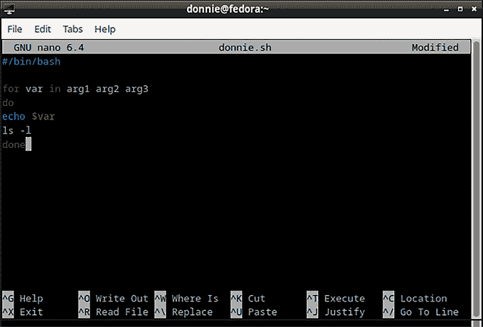

图 1.3：我 Fedora 工作站上的`nano`文本编辑器

注意，在其他 Linux 发行版中，`nano`可能没有颜色高亮。

我最喜欢的文本模式编辑器是`vim`，它拥有能让几乎任何程序员都高兴的功能。它不仅有彩色的语法高亮，还能用正确的缩进自动格式化你的代码，如下所示：

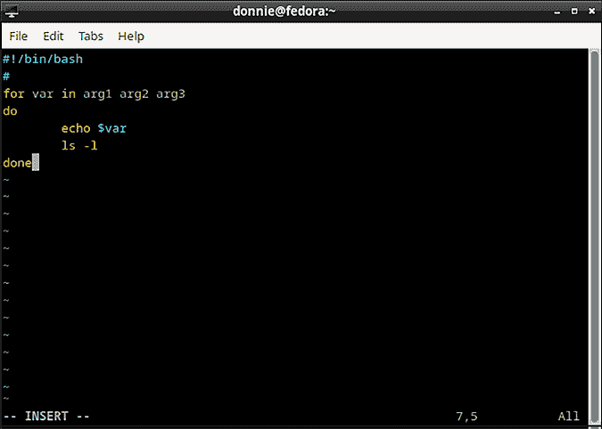

图 1.4：我 Fedora 工作站上的`vim`文本编辑器

实际上，`bash`脚本不需要缩进，因为`bash`脚本在没有缩进的情况下也能运行良好。然而，缩进确实让代码更容易供人类阅读，拥有一个自动应用正确缩进的编辑器是非常方便的。此外，`vim`带有强大的搜索替换功能，允许你分屏以便同时处理两个文件，并可以使用相当广泛的插件进行自定义。尽管它是一个文本模式编辑器，但如果你从桌面机器远程登录到服务器，或者在桌面机器上操作，你可以使用鼠标右键菜单来复制和粘贴文本。

## GUI 文本编辑器

如果你正在使用桌面机器，如果你愿意，仍然可以使用`nano`或`vim`。但是，如果你更倾向于使用它们，也有许多 GUI 类型编辑器可供选择。某种不带花哨的文本编辑器（如`gedit`或`leafpad`）可能已经安装在你的桌面系统上了。一些稍微高级一点的程序员编辑器（如`geany`、`kwrite`和`bluefish`）在大多数 Linux 发行版和某些类 Unix 发行版的标准仓库中可用。最好的办法是尝试不同的编辑器，看看你喜欢哪一个。这里是开启了颜色高亮的`kwrite`示例：

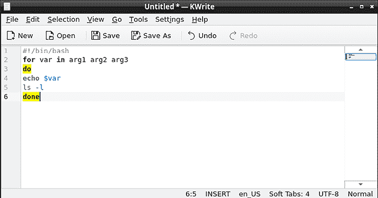

图 1.6：`kwrite`文本编辑器。

如果你是 Windows 用户，你可能永远不想在你的 Windows 机器上使用如记事本或 Wordpad 等 Windows 文本编辑器创建或编辑 shell 脚本，然后将其传输到你的 Linux 机器。这是因为 Windows 文本编辑器会在每行的末尾插入一个不可见的回车符。你看不见它们，但你的 Linux shell 可以看到，并且会拒绝运行该脚本。尽管如此，你有时可能会遇到别人用 Windows 文本编辑器创建的脚本，这时你需要知道如何修复它们，以便它们能在你的 Linux 或 Unix 机器上运行。这非常简单，我们将在第 7 章“文本流过滤器——第 2 部分”中介绍。

关于 Linux 文本编辑器的概述就到这里。让我们继续讨论编译型编程语言与解释型编程语言的区别。

## 理解编译型与解释型编程

编译型编程是指在文本编辑器中编写程序代码，然后使用编译器将文本文件转换为可执行的二进制文件。一旦完成，程序用户将无法轻易地查看程序的源代码。而解释型编程让程序直接从文本文件运行，无需预先进行编译。

编译型编程语言（如`C`、`C++`或`Fortran`）适用于你需要程序获得最高性能的情况。然而，它们可能相当难学习，特别是在涉及文件操作等低级函数时。解释型语言提供的性能可能没有那么高，但它们通常非常灵活，而且通常更容易学习。总的来说，解释型语言在不同的操作系统之间具有更高的可移植性。Shell 脚本属于解释型语言的范畴。

以下是你可能考虑使用解释型语言的一些原因：

- 当你寻找一个简单的解决方案时。

- 当你需要一个可移植的解决方案时。如果你关注可移植性问题，你可以编写一个可以在不同的 Linux 发行版以及 Unix/类 Unix 系统上运行的脚本。如果你在一个拥有大型混合操作系统网络的大型公司里工作，这会非常有帮助。（你甚至可能会发现一些大型公司仍在运行旧的 Unix 系统，如`AIX`、`HPUX`或`SUNOS`，同时运行更现代的`Linux`、`BSD`或`macOS`实现。）

此外，以下是你可能考虑使用编译型语言的一些原因：

- 当任务需要密集使用系统资源时。在速度至关重要时尤为如此。

- 当你使用需要大量数字计算的数学运算时。

- 当你需要复杂的应用程序时。

- 当你的应用程序有许多具有依赖关系的子组件时。

- 当你想创建专有应用程序，并防止用户查看应用程序源代码时。

想起来，几乎每一个生产力、服务器、游戏或科学软件示例都属于这些类别中的一个或多个，这意味着它们确实应该用编译型语言构建，以获得最佳性能。

好了，现在让我们聊聊`sudo`。

## 理解 root 和 sudo 权限

在本课程中，你将进行的一些操作需要你拥有管理员权限。虽然直接登录`root`命令行提示符是可行且方便的，但我尽可能不鼓励这样做。为了获得最好的安全性，并习惯在企业环境下的操作方式，你最好的选择是使用`sudo`。

现代 Linux 发行版允许你在安装操作系统时将自己添加到管理员组。（在 Red Hat 类系统中是`wheel`组，在 Debian/Ubuntu 类系统中是`sudo`组）。要运行一个需要管理员权限的命令，只需执行如下操作：

```bash
sudo nftables list ruleset
```

然后你会被要求输入你自己的用户账户密码，而不是`root`用户账户的密码。

关于这个主题，我们要说的就这些了，让我们总结一下并进入下一章。

## 总结

在本章中，我为后续章节的内容奠定了一些基础。我们查看了操作系统 shell 是什么，以及我们为什么要使用它。然后，我们看了寻找帮助的各种方法，对 Linux 文本编辑器进行了高级概述，并以对编译型与解释型编程的讨论结束，简要提到了为什么我们想要使用`sudo`来运行管理员命令。

在下一章中，我们将开始查看操作系统 shell 为我们做的各种事情。我们下章见。

## 问题

1. Linux 系统中使用最广泛的 shell 是什么？

- `zsh`

- `bash`

- `korn`

- `csh`

2. 如果你在 Windows 电脑上使用 Windows 文本编辑器（如记事本或 Wordpad）创建一个 Linux shell 脚本会发生什么？

- 脚本将在 Linux 机器上运行良好。

- 你的 Windows 机器将由于抗议你用它创建 Linux 脚本而关机。

- 脚本无法 Linux 机器上运行，因为 Windows 文本编辑器会在每行的末尾插入一个不可见的回车符。

- 前微软首席执行官 Steve Ballmer 将访问你并解释为什么 Linux 是一种癌症。

3. 在哪个章节可以找到管理员命令的帮助手册（man pages）？

- 1

- 3

- 5

- 6

- 8

4. 下列哪个说法是正确的？

- 解释型编程语言适用于执行重型数学题的程序。

- 对于任何大型、复杂的程序，编译型编程语言通常比解释型语言更好。

- 解释型语言的示例包括`C`、`C++`和`Fortran`。

5. 对错：为了运行管理员命令，最好直接登录 root 账户。

## 答案

1. b

2. c

3. e

4. b

5. 错误。最好从自己的用户账户使用`sudo`。


为了履行其作为用户与操作系统内核之间接口的工作，`shell` 必须执行五个不同的功能。这些功能包括解释命令、设置变量、启用输入输出重定向、启用管道以及允许自定义用户的工作环境。在本章中，我们将查看 `bash` 和 `zsh` 如何解释命令。作为一个额外的奖励，我们在接下来几章中涵盖的大部分内容有助于你准备某些 Linux 认证考试，例如 Linux Professional Institute 或 CompTIA Linux+ 考试。

本章主题包括：

- 命令的结构
- 同时执行多个命令
- 递归运行命令
- 理解命令历史
- 转义和引用

为了跟随学习，可以使用任何你喜欢的 Linux 发行版，只要它运行的是 `bash` 或 `zsh` 即可。

你最好的选择是使用虚拟机而不是你的生产工作站，以防你不小心删除或更改了不该修改的内容。

## 理解命令的结构

对于现实生活以及你可能参加的任何认证考试来说，一个实用的知识点就是命令的结构。命令由最多三个部分组成，且这些部分之间有特定的顺序。以下是这些部分以及你通常放置它们的顺序：

1. 命令本身
2. 命令选项（`options`）
3. 命令参数（`arguments`）

如果你计划参加 Linux 认证考试，你绝对想要记住这个排序规则。不过，稍后我们将看到，某些命令并不总是遵循这条规则。

## 使用命令选项

选项开关主要有两种通用类型：

- **单字母选项（Single-letter options）**：对于大多数命令，单字母选项前面有一个短横线 `-`。在大多数情况下，两个或多个单字母选项可以使用单个短横线组合。
- **整单词选项（Whole-word options）**：对于大多数命令，整单词选项前面有两个短横线 `--`。两个或多个整单词选项必须单独列出，因为它们不能与一对双横线组合。

为了向你展示我们的意思，请查看这个上手实验。

## 上手实验 – 练习命令选项

在本次实验中，我们将使用简单的 `ls` 工具。对于该工具来说，选项和参数是可选的，因此我们将在这次上手练习中看到命令的不同配置。

让我们顺序执行“裸奔”的 `ls` 命令，以查看当前目录下的文件和目录。

```
[donnie@fedora ~]$ ls 4-2_Building_an_Alpine_Container.bak Public 4-2_Building_an_Alpine_Container.pptx pwsafe.key addresses.txt python_container alma9_default.txt rad-bfgminer alma9_future.txt ramfetch alma_link.txt read.me.first . . . . . . pCloudDrive yad-form.sh Pictures
```

现在，让我们添加一个单字母选项。我们将使用 `-l` 选项来显示带有某些特征的文件和目录。

```
[donnie@fedora ~]$ ls -l total 40257473 -rw-r--r--. 1 donnie donnie 754207 Apr 5 16:13 4-2_Building_an_Alpine_Container.bak -rw-r--r--. 1 donnie donnie 761796 Apr 8 14:49 4-2_Building_an_Alpine_Container.pptx -rw-r--r--. 1 donnie donnie 137 Apr 2 15:05 addresses.txt -rw-r--r--. 1 donnie donnie 1438 Nov 2 2022 alma9_default.txt . . . . . . -rwxr--r--. 1 donnie donnie 263 May 16 15:42 yad-form.sh
```

使用带有 `-a` 选项的 `ls` 命令查看任何隐藏文件或目录。（隐藏文件或目录的名字以句号开头。）

```
[donnie@fedora ~]$ ls -a . . . . . . pCloudDrive 4-2_Building_an_Alpine_Container.bak 4-2_Building_an_Alpine_Container.pptx addresses.txt .podman-desktop alma9_default.txt .profile . . . . . .mozilla .authority .xsaver .xsession-errors yad-form.sh
```

接下来，让我们结合这两个选项，这样我们就可以同时看到隐藏和非隐藏文件及目录的特征：

```
[donnie@fedora ~]$ ls -la total 40257561 drwx------. 1 donnie donnie 2820 Jul 25 13:53 . drwxr-xr-x. 1 root root 9 2022 .. -rw-r--r--. 1 donnie donnie 137 Apr 2 15:05 addresses.txt -rw-------. 1 donnie donnie 15804 Jul 24 17:53 .bash_history -rw-r--r--. 1 donnie donnie 184 Jan 19 2022 .bash_logout -rw-r--r--. 1 donnie donnie 194 Apr 3 12:11 .bash_profile -rw-r--r--. 1 donnie donnie 513 Apr 3 12:11 .bashrc . . . . . . -rw-r--r--. 1 donnie donnie 9041 Feb 4 12:57 .xsaver -rw-------. 1 donnie donnie 0 Jul 25 13:53 .xsession-errors -rwxr--r--. 1 donnie donnie 263 May 16 15:42 yad-form.sh
```

在前面的示例中，`donnie` 部分表示文件和目录属于用户 `donnie` 并与组 `donnie` 关联。在这个例子中，我们使用了一个整单词选项 `--author`（前面有两个短横线）来查看一些额外信息。让我们将这个 `--author` 开关和 `-l` 开关一起使用：

```
[donnie@fedora ~]$ ls -l --author total 40257473 -rw-r--r--. 1 donnie donnie 137 Apr 2 15:05 addresses.txt -rw-r--r--. 1 donnie donnie 1438 Nov 2 2022 alma9_default.txt . . . . . . -rwxr--r--. 1 donnie donnie 263 May 16 15:42 yad-form.sh
```

在此示例中，`donnie` 部分表示文件和目录属于用户 `donnie` 并与组 `donnie` 关联。在这个例子中，看来 `donnie` 创建了这些文件。

## 命令参数（Arguments）

参数是命令的操作对象。对于 `ls` 命令，参数将是一个文件名或目录。例如，假设我们要查看某个文件的详情，我们可以这样做：

```
[donnie@fedora ~]$ ls -l yad-form.sh
-rwxr--r-- 1 donnie donnie 263 May 16 15:42 yad-form.sh
```

我们可以使用通配符 `*` 来查看所有特定类型文件的详情，如下：

```
[donnie@fedora ~]$ ls -l *.sh
-rwxr--r-- 1 donnie donnie 263 May 16 15:42 yad-form.sh
```

如果你不熟悉通配符的概念，可以将它们看作一种模式匹配的方法。在上面的示例中，`*` 通配符用于匹配一个或多个字符。因此，`ls -l *.sh` 命令允许我们看到所有扩展名为 `.sh` 的文件。你也可以通过其他方式使用通配符。例如，为了查看所有以字母 `w` 开头的文件名和目录名，只需执行：

```
[donnie@opensuse:~]$ ls -ld w*
drwxrwxr-x 1 donnie users 22 Mar 5 2022 windows
-rw-r--r-- 1 donnie users 82180 Dec 7 2019 wingding.ttf
drwxr-xr-x 1 donnie users 138 Mar 11 2023 wownero-x86_64-linux-gnu-v0.11
```

有关通配符的更多信息，请查看“延伸阅读”部分的参考。在这种情况下，我们正在查看所有以 `.sh` 结尾的文件。

你并不限于只指定一个参数。在这个例子中，我们正在查看三个不同的文件：

```
[donnie@fedora ~]$ ls -l missing_stuff.txt yad-form.sh Dylan-My_Pages-tab.odt
-rw-r--r-- 1 donnie donnie 29502 Mar 7 18:30 Dylan-My_Pages-tab.odt
-rw-r--r-- 1 donnie donnie 394 Dec 7 2022 missing_stuff.txt
-rwxr--r--. 1 donnie donnie 263 May 16 15:42 yad-form.sh
```

使用 `-ld` 选项查看目录的特征而不查看其内容，如下：

```
[donnie@fedora ~]$ ls -ld Downloads/
drwxr-xr-x. 1 donnie donnie 8100 Aug 4 12:37 Downloads/
```

最后一行的命令。`for` 循环将运行三次，对应列出的三个参数中的每一个。每次运行时，参数的值都会被赋值给 `var` 变量，而 `echo` 命令会打印当前赋值的值。输出看起来可能像这样：

```
arg1 4-2_Building_an_Alpine_Container.bak Public 4-2_Building_an_Alpine_Container.pptx pwsafe.key arg2 4-2_Building_an_Alpine_Container.bak Public 4-2_Building_an_Alpine_Container.pptx pwsafe.key arg3 4-2_Building_an_Alpine_Container.bak Public 4-2_Building_an_Alpine_Container.pptx pwsafe.key
```

接下来，按下键盘上的上方向键，你将看到刚刚执行的 `for` 循环。如果你在 `bash` 中尝试这样做，你会发现各个命令之间是用分号隔开的，如下：

```
[donnie@fedora ~]$ for var in arg1 arg2 arg3; do echo $var; ls; done
```

在 `zsh` 上，按下上方向键会导致命令组件分行显示，如你在此看到的：

```
donnie@opensuse:~> for var in arg1 arg2 arg3 do echo $var ls done
```

无论哪种情况，当你按下回车键时，`for` 循环都会再次运行。如果你对 `for` 循环的工作原理仍然不太清楚，不用担心。在我们开始实际创建 shell 脚本之后，我们将详细地介绍它们。

## 使用命令序列

命令序列是另一种你将会发现非常有用的编程结构。在这里，我将演示如何从命令行中使用它们，以便你掌握这些基本概念。在接下来的章节中，我将向你展示如何在 shell 脚本中使用它们的示例。

## 使用分号链接命令

你也可以使用分号将你想要从同一个命令条目中执行的独立命令隔开。如果你想 `cd` 进入某个目录，然后查看其内容，你可以每行单独输入一个命令。或者，你也可以将它们都输入在同一行。这个过程被称为命令链，其形式如下：

```
[donnie@fedora ~]$ cd /var ; ls account cache db ftp kerberos local log nis preserve spool yp adm crash empty games lib lock mail opt run tmp
[donnie@fedora var]$ [donnie@fedora ~]$ cd /far ; ls bash: cd: /far: No such file or directory 4-2_Building_an_Alpine_Container.bak Public 4-2_Building_an_Alpine_Container.pptx pwsafe.key addresses.txt python_container alma9_default.txt rad-bfgminer . . . . . . [donnie@fedora ~]$
```

第一条命令失败了，因为我尝试 `cd` 进入一个不存在的目录。但第二个命令仍然执行了，它列出了我家目录下的文件。

## 使用双和符号条件执行命令

你也可以指令 `bash` 或 `zsh` 只在第一个命令成功完成后才执行第二个命令。只需用 `&&` 而不是分号来分隔命令，如下：

```
[donnie@fedora ~]$ cd /var && ls account cache db ftp kerberos local log nis preserve spool yp adm crash empty games lib lock mail opt run tmp [donnie@fedora var]$
```

如果第一个命令没有成功运行呢？注意这里第二个命令没有执行：

```
[donnie@fedora ~]$ cd /far && ls bash: cd: /far: No such file or directory [donnie@fedora ~]$
```


## 使用双竖线条件执行命令

如果你想让 `bash` 或 `zsh` 只在第一个命令没有成功运行 own 执行第二个命令，只需用 `||` 分隔命令即可。（这是一对管道字符，你可以在与反斜杠相同的键上找到它们）。为了说明，让我们再次在尝试切换目录时做一个拼写错误。

```
[donnie@fedora ~]$ ce /var || echo "This command didn't work." bash: ce: command not found This command didn't work. [donnie@fedora ~]$ [donnie@fedora ~]$ cd /var || echo "This command didn't work." [donnie@fedora var]$
```

为了一个更实用的例子，尝试切换到一个目录，如果它不存在则创建它，然后在成功创建后进入它。

```
[donnie@fedora ~]$ cd mydirectory || mkdir mydirectory && cd mydirectory bash: cd: mydirectory: No such file or directory [donnie@fedora mydirectory]$
```

你仍然会收到一个错误信息，说你尝试访问的目录不存在。但是，看命令提示符，你会发现目录已经创建，而且你现在已经在其中了。

## 使用 `find` 工具

现在我们稍作休息，中断顺序运行多个命令的讨论，介绍一下 `find` 工具，它确实是所有搜索工具中的“酷炫老爸”。在这一介绍介绍之后，我将使用 `find` 向你展示更多同时运行多个命令的方法。

此外，我们应该提到，`find` 不仅适用于命令行搜索。它在 shell 脚本内部使用也非常出色，你稍后会看到。

如果你像我一样老，你可能记得 Windows 搜索，但它并没有那么强大。通过 `find`，你可以对任何你想到的标准进行强大的搜索，然后从同一行——执行你需要的操作。我不会尝试讨论 `find` 的所有选项，而是给你一个概述，并让你查阅 man 页。

为了执行最基础的搜索，你需要指定两个点：

搜索路径：你可以在特定路径或整个文件系统中搜索。由于 `find` 质上是递归的，搜索会自动扩展到你指定的目录下的所有子目录。（当然，你也可以添加限制深度的命令。）

你正在搜索的内容：有很多方法可以指定这一点。你可以搜索特定名称的文件，并决定是否对大小写敏感。你还可以使用通配符，或者搜索具有某些特征或特定年龄的文件。或者，你可以组合多个标准以进行更具体的搜索。限制你的主要是你的想象力。

现在，假设你想在整个文件系统中搜索所有以 `.conf` 结尾的文件。你将需要使用 `-name` 或 `-iname` 开关，在你想要搜索的文件描述前面。否则，你会得到你搜索过的每个目录列表。对于区分大小写的搜索，使用 `-name`；对于不区分大小写的搜索，使用 `-iname`。在这种情况下，我们将使用 `-iname`，因为我们希望搜索不区分大小写。

我知道，我以前告诉过你大多数全单词选项开关前面都有两个横杠。`find` 工具是一个例外，因为它的全单词选项开关前面只有一个单横杠。

```bash
[donnie@fedora ~]$ find -iname '*.conf' ./.cache/containers/short-name-aliases.conf ./.config/lxsession/LXDE/desktop.conf ./.config/pcmanfm/LXDE/desktop-items-0.conf ./.config/pcmanfm/LXDE/pcmanfm.conf ./.config/lxterminal/lxterminal.conf ./.config/Trolltech.conf . . . . . . ./tor-browser/Browser/TorBrowser/Data/fontconfig/fonts.conf ./rad-bfgminer/example.conf ./rad-bfgminer/knc-asic/RPi_system/raspi-blacklist.conf ./something.CONF [donnie@fedora ~]$
```

通过使用 `-iname` 选项，我能够找到以 `.conf` 或 `.CONF` 结尾的文件。如果我改用 `-name` 选项，我将只能找到以 `.conf` 结尾的文件。

通常情况下，你会将搜索路径作为 `find` 命令的第一个组件。在基于 Linux 的操作系统包含的 GNU `find` 实现中，正如我们刚刚看到的，省略搜索路径会导致 `find` 搜索当前工作目录。遗憾的是，这种技巧在 Unix/类 Unix 操作系统（如 FreeBSD、macOS 或 OpenIndiana）上无效。对于这些操作系统，你始终需要指定搜索路径。要让 `find` 搜索当前工作目录，只需使用点 `.` 来指定搜索路径。因此，在我的 FreeBSD 虚拟机上，命令看起来如下：

```bash
donnie@freebsd-1:~ $ find . -iname '*.conf' ./anotherdir/yetanother.conf ./anotherthing.CONF ./something.conf donnie@freebsd-1:~ $
```

好了，我知道。你可能想知道为什么我会在一本关于 Linux 的书中提到 FreeBSD、macOS 和 OpenIndiana。嗯，这是因为有时我们希望创建可以在多个操作系统上运行的 shell 脚本，而不仅仅是在 Linux 上。如果你在这个命令中包含点符号，它在你的 Linux 机器上仍然有效，在你的 Unix/类 Unix 机器上同样有效。

你还可以指定不是当前工作目录的搜索路径。例如，你可以留在自己的家目录中并像这样搜索整个文件系统：

```bash
[donnie@fedora ~]$ find / -iname '*.conf'
```

当然，这比只搜索一个目录要慢得多。此外，你还会遇到错误，因为你的普通账户没有权限进入每一个目录。要搜索文件系统上的所有目录，只需在命令前加上 `sudo`，如下所示：

```bash
[donnie@fedora ~]$ sudo find / -iname '*.conf'
```

你可以使用多个搜索标准进行搜索。如果你用空格将标准隔开，它等同于在它们之间放置一个逻辑与（and）运算符。在这里，我们将使用 `-mtime -7` 切换来查找所有在过去七天内修改过的 `.conf` 文件，并在末尾使用 `-ls` 切换显示文件的详细信息：

```bash
[donnie@fedora ~]$ sudo find / -iname '*.conf' -mtime -7 -ls 18 4 -rw-r--r-- 1 root root 328 Jul 24 17:50 /boot/loader/entries/81085aed13d34626859063e7ebf29da5-6.4.4-100.fc37.x86_64.conf 3321176 4 -rw-r--r-- 1 donnie donnie 467 Jul 24 16:14 /home/donnie/.config/pcmanfm/LXDE/pcmanfm.conf 370 4 -rw-r--r-- 1 donnie donnie 3272 Jul 19 16:21 /home/donnie/.config/Trolltech.conf . . . . . . 4120762 8 -rw-r--r-- 2 root root 7017 Jul 21 14:43 /var/lib/flatpak/app/com.notepadqq.Notepadqq/x86_64/stable/a049a1963430515aa15d950212fc1f0db7efb703a94ddd1f1d316b38ad12ec72/files/lib/node_modules/npm/node_modules/request/node_modules/http-signature/node_modules/jsprim/node_modules/verror/jsl.node.conf [donnie@fedora ~]$
```

要搜索七天以前修改过的 `.conf` 文件，请将 `-7` 替换为 `+7`，如下：

```bash
[donnie@fedora ~]$ sudo find / -iname '*.conf' -mtime +7 -ls
```

通过创建复合表达式也可以创建更高级的搜索。它的工作原理类似于代数，除非用括号对某些项分组，否则表达式将从左到右求值。但这里有几个细微的注意事项。

由于括号符号在 `bash` 和 `zsh` 中具有特殊含义，你需要在括号前加上反斜杠，以确保 `bash` 或 `zsh` 不会解析它们。假设我们要查找 `/etc` 目录下在过去七天内修改或在过去 30 天内访问过的 `.conf` 文件，我们将使用 `o`（或）运算符来连接这些条件：

```bash
[donnie@fedora ~]$ sudo find /etc -iname '*.conf' \( -mtime -7 -o -atime +30 \)
```

**目录**：目录是一种文件，这听起来很奇怪，但在 Linux 和 Unix 世界中事实就是如此。

- **字符设备**：字符设备要么接收要么提供串行数据流。声卡或终端将将由字符设备文件表示。你可以在 `/dev/` 目录中找到这些文件。
- **块设备**：块设备文件代表可以用随机方式访问的设备。示例包括硬盘、固态硬盘和驱动器分区。你也可以在 `/dev/` 目录中找到这些文件。
- **命名管道**：这些设备从一个系统进程获取输出，并将其作为另一个系统进程的输入提供，从而实现进程间通信。
- **套接字 (Sockets)**：这些与命名管道相同，不同之处它们可以将文件描述符作为通信流的一部分发送和接收。此外，与命名管道不同，套接字允许两个进程之间进行双向数据交换。
- **符号链接**：这种类型的文件指向普通文件或目录。这允许用户从文件系统中的多个位置访问文件和目录，或者通过不同的名称访问它们。

你可以通过执行 `ls -l` 命令来判断文件的类型。每个文件输出的第一个字符被称为文件模式字符串。该文件模式字符串指定了文件类型。例如，让我们看看我的主目录下的内容：

```bash
[donnie@fedora ~]$ ls -l total 137972 -rw-r--r--. 1 donnie donnie 12111206 Feb 18 13:41 dnf_list.txt drwxr-xr-x. 15 donnie donnie 4096 Jul 27 16:39 orphaned_files drwxr-xr-x. 2 donnie donnie 6 Jul 29 16:53 perm_demo -rw-r--r--. 1 donnie donnie 643 Mar 26 15:53 sample.json [donnie@fedora ~]$
```

以 `-` 开头的行表示普通文件，以 `d` 开头的行表示目录。各种文件类型的表示方式所示：

| 文件模式字符串 | 文件类型 |
| - | 普通文件 |
| d | 目录 |
| c | 字符设备 |
| b | 块设备 |
| p | 命名管道 |
| s | 套接字 |
| l | 符号链接 |

表 2.1：文件类型标识符

### 按类型查找文件

有时你可能需要定位特定类型的所有文件。你可以使用 `-type` 选项来实现，如下所示：

```bash
[donnie@fedora ~]$ sudo find / -type p -ls 545 0 prw------- 1 root root 0 Jul 31 15:20 /run/initctl 542 0 prw------- 1 root root 0 Jul 31 15:20 /run/dmeventd-client 541 0 prw------- 1 root root 0 Jul 31 15:20 /run/dmeventd-server 6 0 p--------- 1 donnie donnie 0 Jul 31 15:29 /run/user/1000/systemd/inaccessible/fifo 1228 0 prw------- 1 root root 0 Jul 31 15:21 /run/systemd/inhibit/2.ref 1193 0 prw------- 1 root root 0 Jul 31 15:21 /run/systemd/inhibit/1.ref 1324 0 prw------- 1 root root 0 Jul 31 15:29 /run/systemd/sessions/3.ref 1311 0 prw------- 1 root root 0 Jul 31 15:29 /run/systemd/sessions/1.ref 8 0 p--------- 1 root root 0 Jul 31 15:20 /run/systemd/inaccessible/fifo 112 0 prw------- 1 root root 0 Jul 31 15:20 /var/lib/nfs/rpc_pipefs/gssd/clntXX/gssd [donnie@fedora ~]$
```

如你所见，我正在使用 `-type p` 选项搜索所有的命名管道文件。

现在，让我们考虑上一个例子，我们搜索了所有以 `.conf` 文件名结尾的文件：

```bash
[donnie@fedora ~]$ sudo find / -iname '*.conf'
```

此命令只找到了普通文件，因为它们是系统中唯一具有 `.conf` 文件名扩展名的文件类型。但是，现在假设我们想搜索 `/etc/` 目录，寻找所有名称中包含 `conf` 字符串的子目录。如果不指定文件类型，我们将看到普通文件、符号链接和目录：

```bash
[donnie@fedora ~]$ sudo find /etc -name '*conf*' -ls 329486 4 -rw-r--r-- 1 root root 351 Jul 27 07:02 /etc/dnf/plugins/copr.conf 329487 4 -rw-r--r-- 1 root root 351 Jul 27 07:02 /etc/dnf/plugins/copr.conf ...
```

*(注：此处示例输出截断，已按原文逻辑处理)*

图 2.1：这些图形文件中的某些位于错误的位置。

现在，让我们来做一些动手实践。

## 动手实验室 – 使用 `find` 执行其他命令

对于本实验室，请使用 Fedora、Debian 或 Ubuntu 虚拟机。（我会为所有这些系统提供操作说明。）

假设我们想将每个人的图形文件复制到一个公共备份目录中。

首先，创建 `/backup` 目录，如下所示：

```
[donnie@fedora ~]$ sudo mkdir /backup
```

对于我们目前的用途，保持所有权和权限设置不变即可。

接下来，为 Vicky、Cleopatra、Frank 和 Goldie 创建用户账户，并为每个账户分配密码。在 Fedora 上，命令看起来如下：

```
donnie@fedora:~$ sudo useradd frank
donnie@fedora:~$ sudo passwd frank
```

在 Debian 或 Ubuntu 上，请使用交互式的 `adduser` 命令，它会同时创建用户账户并设置密码。看起来如下：

```
donnie@debian12:~$ sudo adduser goldie
```

登录每个用户的账户，在每个用户的家目录下创建一个 `graphics` 目录，然后创建一些伪造的图形文件。以下是执行这些的命令：

```
goldie@fedora:~$ touch goldie02.png
goldie@fedora:~$ mkdir graphics
goldie@fedora:~$ cd graphics/
goldie@fedora:~/graphics$ touch {goldie01.png,goldie03.png,goldie04.png}
```

`touch` 命令实际上是供程序员使用的，我在这里不会详细介绍它的用途。但对于这种情况也非常方便，即你只需要为了测试目的创建一些伪文件。通过在花括号内包含用逗号分隔的文件列表，你可以仅通过一个命令创建多个文件。为了验证这一点，让我们查看一下 `graphics` 目录：

```
goldie@fedora:~/graphics$ ls -l total 0 -rw-r--r--. 1 goldie goldie 0 Mar 23 13:27 goldie01.png -rw-r--r--. 1 goldie goldie 0 Mar 23 13:27 goldie03.png -rw-r--r--. 1 goldie goldie 0 Mar 23 13:27 goldie04.png
goldie@fedora:~/graphics$
```

在这一步，你需要重新登录你自己的用户账户。你想要确保获取所有的图形文件，即使它们在用户的顶层家目录下，并将它们复制到 `/backup/` 目录中。你的命令和结果看起来如下：

```
[donnie@fedora ~]$ sudo find /home -name '*.png' -exec cp {} /backup \;
```


[donnie@fedora ~]$ `ls -l /backup/` total 0 -rw-r--r--. 1 root root 0 Jul 28 15:40 cleopatra01.png -rw-r--r--. 1 root root 0 Jul 28 15:40 cleopatra02.png -rw-r--r--. 1 root root 0 Jul 28 15:40 cleopatra03.png -rw-r--r--. 1 root root 0 Jul 28 15:40 cleopatra04.png -rw-r--r--. 1 root root 0 Jul 28 15:40 frank01.png -rw-r--r--. 1 root root 0 Jul 28 15:40 frank02.png -rw-r--r--. 1 root root 0 Jul 28 15:40 frank03.png -rw-r--r--. 1 root root 0 Jul 28 15:40 frank04.png -rw-r--r--. 1 root root 0 Jul 28 15:40 goldie01.png -rw-r--r--. 1 root root 0 Jul 28 15:40 goldie02.png -rw-r--r--. 1 root root 0 Jul 28 15:40 goldie03.png -rw-r--r--. 1 root root 0 Jul 28 15:40 goldie04.png -rw-r--r--. 1 root root 0 Jul 28 15:40 vicky01.png -rw-r--r--. 1 root root 0 Jul 28 15:40 vicky02.png -rw-r--r--. 1 root root 0 Jul 28 15:40 vicky03.png -rw-r--r--. 1 root root 0 Jul 28 15:40 vicky04.png [donnie@fedora ~]$

我在这里向你展示的内容仅仅触及了 `find` 所能做的一小角。要查看你可以指定的完整搜索标准列表，请打开 `find` 的手册页并滚动到 `TESTS` 部分。

我们稍后会看更多关于 `find` 的示例。但现在，让我们看看如何创建递归命令。

## 递归执行命令

稍后我们将查看如何创建递归命令。我们已经展示了 `find` 本身是递归的。也就是说，它不需要你告诉就会搜索子目录。大多数命令并不是这样。如果你让它们递归工作，你必须告诉它们。

## 动手实验室 – 使用递归执行命令

在本实验室中，你将使用 `chmod` 更改权限设置。首先，让我们创建一个嵌套目录，如下：

```
donnie@fedora:~$ mkdir -p /perm_demo/level1/level2/level3/level4
```

接下来，我们想要查看整个目录的权限：

```
donnie@fedora:~$ ls -l /perm_demo/ total 0 drwxr-xr-x. 1 donnie donnie 0 Oct 27 10:00
```

你可以看到权限设置为 `755`，这意味着用户具有读/写/执行权限，而组和其他具有读/执行权限。我们真正希望用户和组具有读/写/执行权限，而其他人没有任何权限。我们将通过使用 `chmod` 将权限更改为 `770`。`-R` 允许我们更改顶层目录以及所有嵌套子目录的设置。

使用此命令递归设置正确的权限：

```
sudo chmod -R 770 /perm_demo/
```

现在你已经删除了其他人的权限，你需要使用 `sudo` 来查看权限：

```
[donnie@fedora:~$ sudo ls -lR /perm_demo/
```

你可以看到整个目录的权限设置现在是 `770`，这意味着我们实现了极度酷的效果。

提示

在某些时刻，你可能会被要求创建一个自动编译并安装程序的 shell 脚本。创建嵌套目录并递归更改其权限设置的能力，在编写这类脚本时会非常有用。

每当你使用命令行工作时，总会有需要多次输入某些命令的时候。如果你刚刚输入了一个很长又复杂的命令，可能对需要重新输入一遍的前景并不感到兴奋。不过不用担心，为此，`bash` 和 `zsh` 提供了回溯和/或编辑之前输入过的命令的能力。有几种方法可以实现这一点。

每当你输入一个命令时，它都会存储在内存中，直到你退出 shell 会话。然后，该命令会被添加到由 `HISTFILE` 变量指定的书中。通常，在 `bash` 上是 `.bash_history` 文件，在 `zsh` 上是 `.histfile` 文件。你会在每个用户的家目录下找到这些文件。要验证这一点，你可以使用 `echo` 命令，如下所示：

```
[donnie@fedora ~]$ echo $HISTFILE
/home/donnie/.bash_history [donnie@fedora ~]$
```

在 `zsh` 上，你会看到这些内容：

```
donnie@opensuse:~> echo $HISTFILE
/home/donnie/.histfile donnie@opensuse:~>
```

保存到 `.bash_history` 文件或 `.histfile` 文件的命令数量是由 `/etc/profile` 文件中的 `HISTSIZE` 变量设置的（`bash` 和 `zsh` 引用同一个文件）。你可以使用 `grep` 来搜索该行，而无需打开文件，如下所示：

```
[donnie@fedora ~]$ grep HISTSIZE /etc/profile
HISTSIZE=1000 export PATH USER LOGNAME MAIL HOSTNAME HISTSIZE HISTCONTROL [donnie@fedora ~]$
```

你也可以使用 `echo` 来查看设置：

```
[donnie@fedora ~]$ echo $HISTSIZE
1000 [donnie@fedora ~]$
```

无论哪种方式，我们看到系统设置为将最后 1000 条用户命令存储在 `.bash_history` 文件中。

通常情况下，你可能会使用键盘上的向上和向下方向键来调用之前输入的命令。如果你一直按向上方向键，你将遍历之前的命令列表，从最后输入的那个命令开始。如果你错过了想要的命令，可以使用向下方向键返回。当你终于找到想要重复的命令时，可以按 Enter 键直接执行，也可以对其进行编辑后再按 Enter。

还可以以各种方式使用 `!` 来回溯过去的命令。例如，输入 `!!` 将执行你最后输入的命令，如下所示：

```
[donnie@fedora ~]$ ls -l *.txt -rw-r--r--. 1 donnie donnie 12111206 Feb 18 13:41 dnf_list.txt -rw-r--r--. 1 donnie donnie 2356 Jul 29 18:46 md5sumfile.txt -rw-r--r--. 1 donnie donnie 2356 Jul 29 18:49 newmd5sums.txt

[donnie@fedora ~]$ !!
ls -l *.txt -rw-r--r--. 1 donnie donnie 12111206 Feb 18 13:41 dnf_list.txt -rw-r--r--. 1 donnie donnie 2356 Jul 29 18:46 md5sumfile.txt -rw-r--r--. 1 donnie donnie 2356 Jul 29 18:49 newmd5sums.txt
```

使用 `!` 后跟一个文本字符串来执行上一次以该字符串开头的执行命令。假设我想重复我上一次执行的 `grep` 命令，如下所示：

```
[donnie@fedora ~]$ !grep grep
grep HISTSIZE /etc/profile HISTSIZE=1000 export PATH USER LOGNAME MAIL HOSTNAME HISTSIZE HISTCONTROL [donnie@fedora ~]$
```

使用 `!?` 后跟一个字符串来执行上一次包含该字符串的执行命令，如下所示：

```
[donnie@fedora ~]$ echo "The fat cat jumped over the skinny dog."
The fat cat jumped over the skinny dog.

[donnie@fedora ~]$ !?skinny
echo "The fat cat jumped over the skinny dog."
The fat cat jumped over the skinny dog. [donnie@fedora ~]$
```

现在，到了最酷的部分。首先，让我们查看历史列表，如下所示：

```
[donnie@fedora ~]$ history
1 sudo dnf -y upgrade 
2 sudo shutdown -r now
3 sudo shutdown -r now 
4 cd /usr/share . . . . . . 478 echo "The fat cat jumped over the skinny dog." 
479 clear [donnie@fedora ~]$
```

要从此列表中执行命令，输入 `!` 后跟命令编号。例如，要再次执行 `echo` 命令，输入 `!478`，如下所示：

```
[donnie@fedora ~]$ !478
echo "The fat cat jumped over the skinny dog."
The fat cat jumped over the skinny dog. [donnie@fedora ~]$
```

在我向你展示的所有 `history` 技巧中，最后一个对我来说是最用的。但等，这里还有一个你可能会觉得有用的技巧。即，你可以显示命令历史以及显示每个命令执行时间的时间戳。在 `bash` 上，只需这样做：

```
donnie@opensuse:~> HISTTIMEFORMAT="%d/%m/%y %T " history
```

输出看起来像这样：

```
49 22/03/24 14:02:29 ./start_mining.sh 
50 22/03/24 14:02:29 vim start_mining.sh 
51 22/03/24 14:02:29 ./start_mining.sh 
52 22/03/24 14:02:29 cd 
53 22/03/24 14:02:29 cd Downloads/ 
54 22/03/24 14:02:29 ls . . . . . . 1046 23/03/24
```

在文件名的末尾，我们现在正在寻找一个文件名为 `*.conf` 的特定文件。并没有这样的文件，因此 `ls` 返回了一个错误信息。

在我们执行复合搜索的 `find` 示例中，必须在每个括号字符前面放置一个 `\`，以便 shell 能够正确解释它们。它看起来是这样：

```bash
[donnie@fedora ~]$ sudo find / \( -mtime +30 -iname '*.zip' \) /home/donnie/Downloads/Roboto_Condensed.zip /home/donnie/Downloads/Bungee_Spice.zip . . . . . . /home/donnie/dosbox/turboc/SAMPLES/simpwn18/SWTCPPRJ.ZIP /home/donnie/dosbox/turboc/SAMPLES/simpwn18/SWH.ZIP /home/donnie/dosbox/turboc/SAMPLES/simpwn18/SIMPWIN.ZIP /home/donnie/dosbox/turboc/SAMPLES/simpwn18/SWTC.ZIP /home/donnie/dosboxplusplus/TC/TC.zip [donnie@fedora ~]$
```

现在，让我们尝试在不使用 `\` 字符的情况下运行：

```bash
[donnie@fedora ~]$ sudo find / ( -mtime +30 -iname '*.zip' ) bash: syntax error near unexpected token `(` [donnie@fedora ~]$
```

这一次，我得到了一个错误信息，因为 `bash` 不理解我想做什么。

现在，纯为了好玩，请在你自己的机器上尝试一下这组命令，并注意输出的差异：

```bash
echo I won $300\. echo I won \$300.
```

我想我应该提到，当你在元字符前面放置一个 `\` 以便 shell 字面地解释该元字符时，这被称为转义元字符（escaping）。你在编写普通 shell 命令或 shell 脚本时，都会大量使用它。

好了，让我们来看另一种让 shell 字面地解释元字符的方法。

## 引用（Quoting）

在执行 shell 命令或编写 shell 脚本时，你有时需要对文本字符串进行引用。这只需涉及将文本字符串包裹在双双引号（`"`）或一对单引号（`'`）中。

如果你将文本字符串包裹在对单引号中，shell 将引号内的任何元字符解释为普通的字面字符。如果你将文本字符串包裹在双双引号中，shell 将把大部分（但不是所有）元字符解释为普通的字面字符。为了演示它是如何运作的，让我们创建一个名为 `name` 的编程变量，并给它赋值为 `charlie`，如下所示：

```bash
[donnie@fedora ~]$ name=charlie [donnie@fedora ~]$
```

接下来，我们将尝试使用一对单引号回显 `name` 的值：

```bash
[donnie@fedora ~]$ echo '$name' $name [donnie@fedora ~]$
```

你看到单引号导致 shell 将 `$` 解释为字面字符。现在，让我们看看如果使用一对双引号会发生什么：

```bash
[donnie@fedora ~]$ echo "$name" charlie [donnie@fedora ~]$
```

这一次我们看到了变量的实际值，因为 `$` 是双引号不会视为字面字符的元字符之一。

我们稍后会更深入地讨论编程变量的话题。所以现在，如果你不完全理解这个概念，请不要压力。

作为参考，这里是通过双引号包裹不会被解释为字面字符的元字符完整列表：`"` , `\`, `` ` ````, `$`

为了说明，该列表由双引号字符、反斜杠、反引号和美元符号组成。（目前，不用担心这些元字符的作用。我们将在适当的时候介绍所有的它们。）

对于所有其他元字符，使用双引号还是单引号都并不重要。让我们来看这个使用通配符字符的示例：

```bash
[donnie@fedora ~]$ echo '*.txt' *.txt [donnie@fedora ~]$ echo "*.txt" *.txt [donnie@fedora ~]$
```

无论哪种方式，结果都是相同的。两次，`*` 都被视为字面字符。要将 `*` 用作实际元字符，只需省略引号，如下所示：

```bash
[donnie@fedora ~]$ echo *.txt addresses.txt alma9_default.txt alma9_future.txt alma_link.txt centos7scan_modified.txt centos7scan.txt dnf_list.txt finances.txt missing_stuff.txt password_for_RHEL_VM.txt rpmfusion.txt somefile.txt temp.txt test.txt text.txt ubuntuscan_modified.txt ubuntuscan.txt withL3.txt withoutL3.txt [donnie@fedora ~]
```

好了，转义和引用，以及整个章节的内容就到此为止。让我们总结一下并继续。

## 总结

在本章中，我们涵盖了一些重要的基础知识。我们首先描述了 shell 命令的结构和组成部分，以及如何通过一个命令执行多个操作。然后，我们查看了 `find` 工具以及使用它的一些酷功能。接着我们查看了如何递归运行命令，并以对转义和引用的讨论结束。

在下一章中，我们将讨论变量和管道。我们那里见。

## 练习

下列哪一组元字符会导致在第一个命令成功执行时才运行第二个命令？

- `||`
- `&&`
- `|`
- `&`

你想运行一个包含 `$` 元字符的命令，但你想让 shell 字面地解释该元字符。你会如何做？（选择两项）

- 在元字符前面加上 `/`。
- 将包含元字符的文本字符串包裹在对单引号中。
- 在元字符前面加上 `\`。
- 将包含元字符的文本字符串包裹在对双引号中。
- 不可能。

你正在 FreeBSD 系统上使用 `find` 搜索文件。为了搜索当前工作目录，你在 FreeBSD 上必须做什么（而在 Linux 上不需要做）？

- 使用点 `.` 指定搜索路径。
- 无需操作。在两个系统上的执行方式相同。

在上一章中，你已经看到了 shell 是如何解释用户命令的，并且看到了了如何编写命令的各种示例。在本章中，我将向你介绍变量和管道。

创建变量并为它们赋值的能力是任何编程环境中的重要组成部分。正如你预期的那样，`bash` 和 `zsh` 均具备这种能力。在本章的第一部分，我们将涵盖环境变量和编程变量的基础基础知识。

在本章的第二部分，我们将介绍如何使用管道。管道非常简单，你可能在过去的某个时刻已经用过它们了。所以，我保证这篇文章写得既简短又精炼。（实际上，关于这两个主题目前还没有什么要说的，这就是为什么我将它们合并成了一个章节。）

本章包含的主题包括：

- 理解环境变量
- 理解编程变量


# 理解管道

如果你准备好了，让我们开始吧。

## 理解环境变量

环境变量控制着操作系统 shell 的配置和功能。当你安装 Linux 或 Unix/Unix-类操作系统（如 FreeBSD 或 OpenIndiana）时，你会发现在全局和用户级别上已经定义了一组默认的环境变量。

要查看环境变量的列表及其设置，请使用 `env` 命令，如下所示：

```bash
donnie@fedora ~]$ env
SHELL=/bin/bash
IMSETTINGS_INTEGRATE_DESKTOP=yes
COLORTERM=truecolor
XDG_CONFIG_DIRS=/etc/xdg/lxsession:/etc/xdg
HISTCONTROL=ignoredups
. . . . . . . .
MAIL=/var/spool/mail/donnie
OLDPWD=/etc/profile.d
_=/bin/env
[donnie@fedora ~]$
```

环境变量的完整列表非常广泛。幸运的是，你不需要记住每一个项目对你做什么。你需要知道的大部分项目都是言自易的。

与其查看整个列表，你也可以查看特定项目的值。只需使用 `echo` 命令，并在变量名前加加上 `$`，如下所示：

```bash
donnie@fedora ~]$ echo $USER
donnie
[donnie@fedora ~]$ echo $PATH
/home/donnie/.local/bin:/home/donnie/bin:/home/donnie/.cargo/bin:/usr/local/bin:/bin:/usr/bin:/usr/local/sbin:/usr/sbin:/sbin
[donnie@fedora ~]$ echo $EDITOR
/usr/bin/nano
[donnie@fedora ~]$
```

在这里我们看到我（`donnie`）是当前登录用户，我的路径设置是什么，以及我的默认编辑器是什么。你可以以相同的方式查看任何其他环境变量的值。

一个需要注意的是，所有环境变量的名称始终由全大写字母组成。操作系统或 shell 中都没有阻止使用小写字母，但不使用它们有一个非常充分的理由。这只是变量名是区分大小写的。最佳实践建议环境变量名只使用全大写字母，而编程变量名则使用全小写字母或大小写混合。这可以防止你无意中覆盖环境变量的值。（我将在下一节向你展示更多相关内容。）

正如我之前提到的，环境变量是在全局和用户级别配置的。全局层面的变量设置会影响 `bash` 和 `zsh` 的所有用户。对于 `bash`，你可以在 `/etc/profile` 文件、`/etc/bashrc` 文件以及 `/etc/profile.d/` 目录下的各种文件中找到大部分这些全局设置。对于 `zsh`，你可以在 `/etc/zprofile`、`/etc/zshrc` 和 `/etc/zshenv` 文件中找到这些设置。（注意 `zsh` 也引用了与 `bash` 相同的 `/etc/profile` 文件。）如果你现在打开其中这些文件之一，你可能无法理解其中正在发生什么。没关系，因为目前这并不重要。但是，你可以很容易地找到设置环境变量的地方，因为变量名都是大写字母。

现在，假设你不喜欢某个特定的设置。例如，假设你想按照自己的喜好自定义命令行提示符。在我的 Fedora 工作站上，我的 `bash` 提示符看起来如下：

```bash
donnie@fedora ~]$
```

提示符的格式由 `PS1` 环境变量决定。我们可以这样查看 `PS1` 的设置：

```bash
donnie@fedora ~]$ echo $PS1
[\u@\h \W]\$
```

以下是你刚刚看到的内容的拆解：

- `[`：这是一个字面字符，是我们在提示符中看到的第一个字符。
- `\u`：这会导致当前用户名出现。
- `@`：这是另一个字面字符。
- `\h`：这会导致主机名的第一部分出现。
- `\W`：这会导致当前工作目录的名字出现。注意大写的 `W` 不会导致整个路径出现。
- `]`：这是另一个字面字符。
- `\$`：这会让所有普通用户显示 `$`，为 root 用户显示 `#`。

有时，你需要在脚本中使用定义变量。你可以根据编程需求，对这些变量进行定义、查看和取消设置。请注意，虽然系统允许你创建全大写字母的编程变量名，但这种做法被认为是不良习惯。最佳实践是始终使用小写字母命名你的编程变量，这样你就不会面临无意中覆盖同名环境变量值的风险。（当然，覆盖环境变量不会造成任何长期损害。但是，为什么要冒这种风险去覆盖一个你可能在脚本稍后部分需要使用的环境变量呢？）

为了展示这一切这一切是如何运作的，让我们从命令行创建一些编程变量，并查看它们赋值的值。首先，我们将创建一个 `car` 变量并为其赋值为 `Ford`，如下所示：

```bash
[donnie@fedora ~]$ car=Ford
[donnie@fedora ~]$ echo $car
Ford
[donnie@fedora ~]$
```

要查看变量的值，请使用 `echo` 并在变量名前加一个 `$` 符号，就像我们之前处理环境变量时做的那样。现在，让我们用 `bash` 命令打开一个子 shell，看看是否仍然能查看此 `car` 变量的值，然后退出回到父 shell，如下所示：

```bash
[donnie@fedora ~]$ bash
[donnie@fedora ~]$ echo $car

[donnie@fedora ~]$ exit
exit
[donnie@fedora ~]$
```

这一次我们看不到 `car` 的值，因为我们没有导出该变量。导出变量将允许子 shell 访问该变量。正如你可能猜到的那样，我们将使用 `export` 命令来实现这一点，如下所示：

```bash
[donnie@fedora ~]$ export car=Ford
[donnie@fedora ~]$ echo $car
Ford
[donnie@fedora ~]$ bash
[donnie@fedora ~]$ echo $car
Ford
[donnie@fedora ~]$ exit
[donnie@fedora ~]$
```

这一次，我们看到 `car` 的值现在出现在子 shell 中。

在本书的剩余部分我们将一直处理变量，因此你将学习更多关于如何使用它们的知识。不过，这段简短的介绍足够了。

接下来，让我们来做一些“管道”工作。

## 理解管道

管道（pipe）将接收一个命令的输出并将其作为另一个命令的输入。它由 `|` 符号表示，该符号与反斜杠在同一个按键上。你经常为了各种目的从命令行调用简单的管道。但你也可以为 shell 脚本创建非常复杂的多阶段管道。


图 3.1：创建管道。注意 `stdout` 是 Standard Output（标准输出）的缩写，`stdin` 是 Standard Input（标准输入）的缩写。

为了看到这有什么用，假设你想查看某个目录下所有文件的列表。但由于文件太多，输出会滑出屏幕，导致你永远无法看到它。你可以通过获取 `ls` 命令的输出并将其作为 `less` 命令的输入来解决这个问题。它看起来像这样：

```bash
[donnie@fedora ~]$ ls -l | less
```

`ls -l` 列表将在 `less` 分页器中打开，这样你就可以滚动输出或对特定的文本字符串进行搜索。

现在，假设我只想查看文件名包含文本字符串 `alma` 的文件。这很简单。我只需要将 `ls -l` 的输出管道到 `grep`，如下所示：

```bash
[donnie@fedora ~]$ ls -l | grep alma
-rw-r--r--. 1 donnie donnie 1438 Nov 2 2022 alma9_default.txt
-rw-r--r--. 1 donnie donnie 1297 Nov 2 2022 alma9_future.txt
-rw-r--r--. 1 donnie donnie 81 Jan 11 2023 alma_link.txt
[donnie@fedora ~]$
```

现在，假设我不想看到文件名，但想知道有多少个文件。我只需添加另一个管道阶段，如下所示：

```bash
[donnie@fedora ~]$ ls -l | grep alma | wc -l
3
[donnie@fedora ~]$
```

`wc -l` 命令统计输出中的行数，在这种情况下，它告诉我有多少个文件名中包含文本字符串 `alma`。

如果你不熟悉 `grep`，现在只需要理解它是一个搜索特定文本字符串或文本模式的实用程序。它可以在你不打开文件的情况下搜索文本文件，也可以可以在你从另一个命令管道到它的输出中搜索文本字符串或模式。

好了，我已经向你展示了一些从命令行创建管道的简单示例。现在，我想向你展示我希望你永远不要做的事。这涉及到使用 `cat` 实用程序。

你可以用 `cat` 做的一件事是将文本文件的内容打印到屏幕上。它主要用于查看小文件，在这里所示：

```bash
[donnie@fedora ~]$ cat somefile.txt
This is some file
```

## 总结

虽然这一章很短，但我们涵盖了很多信息。我们首先查看了环境变量，展示了如何修改其中一个，并解释了为什么你需要在 shell 脚本中使用环境变量。接下来，我们涵盖了编程变量，解释了如何创建和导出它们。最后，我们通过创建管道完成了一些管道工作。

在下一章中，我们将涵盖输入/输出重定向的概念。我们下章节见。

## 问题

以下哪种元字符允许你查看变量赋值的值？

- `*`
- `%`
- `$`
- `^`

下列哪个说法是正确的？

- 使用全大写或全小写字母创建你的编程变量名是完全正确的。
- 变量名不区分大小写。
- 你应该始终使用大写字母创建编程变量名。
- 你应该始终使用小写字母创建编程变量名。

你如何让子 shell 识别你在父 shell 中创建的变量？

- 在子 shell 中从父 shell 导入变量。
- 在父 shell 中创建变量时使用 `export` 关键字。
- 你不能这样做，因为父 shell 和子 shell 之间是隔离的。
- 子 shell 和父 shell 总是共享变量。

你会使用哪一个元字符来获取一个命令的输出并将其作为另一个命令的输入？

- `$`
- `|`
- `&`
- `%`

## 延伸阅读

如何在 Linux 中更改/设置 bash 自定义提示符 (PS1): https://www.cyberciti.biz/tips/howto-linux-unix-bash-shell-setup-prompt.html

如何在 Linux 中统计目录下的文件数量?: https://www.linuxjournal.com/content/how-count-files-directory-linux

## 答案

c

d

b

b

## 在 Discord 上加入我们的社区！

与其他用户、Linux 专家以及作者本人一起阅读这本书。

提问问题、为其他读者提供解决方案、通过“任何问答”（Ask Me Anything）活动与作者聊天，以及更多互动。扫描二维码或访问链接即可加入社区。

[`packt.link/SecNet`](https://packt.link/SecNet)


## 留下评价！

感谢你从 Packt Publishing 购买——我们希望你喜欢！你的反馈对我们来说无价，并帮助我们改进和成长。完成阅读后，请花一点时间在亚马逊上留下评价；这只需要一分钟，但对像你这样的读者来说意义重大。

扫描下方的二维码即可获取你选择的免费电子书。

[`packt.link/NzOWQ`](https://packt.link/NzOWQ)


# 4

# 理解输入/输出重定向

在上一章中，我们讨论了如何在 shell 中使用变量和管道。这次，我们将查看如何将命令的文本输出发送到终端（默认输出设备）以外的地方。接下，我们将查看如何让命令从键盘（默认输入设备）以外的地方获取文本。最后，我们将查看如何将错误消息发送到终端以外的地方。

本章主题包括：

- 理解 `stdout`
- 理解 `stdin`
- 理解 `stderr`
- 理解 `tee`

好了，让我们开始吧。

## 输入/输出重定向简介

为了从不同的来源提取信息并对其进行格式化以便展示，我们通常需要使用各种统称为文本流过滤器的实用程序。当你使用文本流过滤工具时，你需要一种方法向它们提供某种输入，这是理所当然的。同样，你需要一种方法查看输出，并在出错时查看错误消息。为了这些目的，我们有了 `stdin`、`stdout` 和 `stderr`。

`stdin`: 这是标准输入（standard input）的缩。默认情况下，`stdin` 来自键盘。然而，通过使用管道或重定向，你也可以从文件或另一个命令的输出获取 `stdin`。

`stdout`: 这是标准输出（standard output）的缩。默认情况下，`stdout` 发到电脑屏幕。你可以使用管道让 `stdout` 变成另一个命令的 `stdin`，或者使用重定向将 `stdout` 保存为存储设备上的文件。如果你完全不想看到任何输出，只需使用重定向将 `stdout` 发送到所谓的“垃圾桶”即可。

`stderr`: 如你所猜的，这是标准错误（standard error）的缩。如果命令没有正常执行，你将收到错误消息。默认情况下，消息显示在屏幕上。但是，你可以使用管道或重定向来更改 `stderr` 的目标，就像处理 `stdout` 一样。

我以前告诉过你，在 Linux、Unix 或 Unix 类系统（如 FreeBSD 或 OpenIndiana）中，一切都由文件表示。在 Linux 系统上，`stdin`、`stdout` 和 `stderr` 由 `/proc/` 文件系统中的文件表示。在 `/dev/` 目录中，有指向这些文件的符号链接，如下所示：

```bash
[donnie@fedora ~]$ cd /dev
[donnie@fedora dev]$ ls -l std*
lrwxrwxrwx. 1 root root 15 Aug 11 13:29 stderr -> /proc/self/fd/2
lrwxrwxrwx. 1 root root 15 Aug 11 13:29 stdin -> /proc/self/fd/0
lrwxrwxrwx. 1 root root 15 Aug 11 13:29 stdout -> /proc/self/fd/1
[donnie@fedora dev]$
```

注意，找到这些文件的底层子目录是 `fd`，代表文件描述符（file descriptor）。所以，这些代表 `stdin`、`stdout` 和 `stderr` 的文件统称为文件描述符。

我不会深入探讨其工作原理的细节，因为这并不是真的必要。你真正需要知道的唯一部分是文件描述符的 ID，如下：

- `0`: 用于 `stdin`。
- `1`: 用于 `stdout`。
- `2`: 用于 `stderr`。

记住这些文件描述符数字（它们在所有 Linux、Unix/Unix 类系统中都是相同的），将帮助你理解我在本章后面介绍的概念。

你可以通过重定向器做这些操作：

- 指导命令从键盘以外的地方获取其输入（`stdin`）。
- 让命令将其输出（`stdout`）发送到键盘以外的地方。
- 让命令将错误消息（`stderr`）发到终端以外的地方。


有一些重定向运算符是可以使用的。大多数很容易理解，但你可能会发现与`stderr`相关的有些困惑。让我们先看看`>`，它包含了`|`和`>>`。

## 理解 stdout

假设你想查看某个目录的文件列表。这里的图形表示如下：


图 4.1: stdout 的工作原理

在实践中看起来是这样的：

```bash
[donnie@fedora ~]$ ls > filelist.txt
[donnie@fedora ~]$
```

正如你所见，这非常简单。你可以采取任何通常输出到屏幕的命令，并将其发送到文本文件。不过，有一点你需要注意。如果你将命令的输出重定向到一个已经存在的文件，它将覆盖它。

## 防止覆盖

在本节中，我将向你展示两种防止覆盖现有文件的方法，如下：

- 确保要创建的同名现有文件不存在。

- 设置`noclobber`。

让我们来看这两种方法。

防止意外覆盖文件的第一种方法是最直观的。也就是说，在重定向输出到文件之前，确保该文件不存在。稍后，我将向你展示编写检查此点的脚本代码有多简单。

第二种方法是为你的 shell 环境设置`noclobber`，如下：

```bash
[donnie@fedora ~]$ set -o noclobber
[donnie@fedora ~]$
```

设置此选项后，如果你尝试使用重定向器覆盖文件，`bash`和`zsh`将发出错误消息，如下：

```bash
[donnie@fedora ~]$ ls -la > filelist.txt
bash: filelist.txt: cannot overwrite existing file
[donnie@fedora ~]$
```

然而，如果你在设置此选项的情况下真的想覆盖文件，你可以通过对重定向命令进行微调来实现。只需使用`>|`作为你的运算符，而不是普通的`>`，如下：

```bash
[donnie@fedora ~]$ ls -la >| filelist.txt
[donnie@fedora ~]$
```

这次没有错误消息，这意味着我确实覆盖了文件。

选项（option）并不能防止你通过`mv`或`cp`命令覆盖文件导致文件丢失。它也无法阻止你使用`rm`命令删除它们。

## 使用文件描述符

我刚刚告诉过你`stdout`的文件描述符是数字`1`。如果你真的想，可以将这个文件描述符包含在我向你展示的任何命令中，它看起来像这样：

```
[donnie@fedora ~]$ ls 1> filelist.txt
[donnie@fedora ~]
```

你可能在想：“这样做有什么好处呢？”嗯，在这种情况下，并没有什么好处。省略`1`，程序也能正常工作。不过在几页之后，我们将讨论`stderr`。到那时，文件描述符 ID 就会派上用场了。

好了，关于输出的内容就说够了。现在，让我们学习一些输入的内容。

## 理解 stdin

这会简单一点，因为只涉及到一个操作符。这里是图形化表示：


图 4.2：stdin 的工作原理

对于我们的示例，我们将简要查看`tr`实用。（我们将在第 7 章文本流过滤器-部分 2 对`tr`进行更深入的解释。现在，我们只需要认为是一个转换工具即可。）默认情况下，`tr`从键盘获取其`stdin`。

你可以做的一件事是输入全小写的字符串，并让`tr`将其回显大写。输入`tr [:lower:] [:upper:]`命令后按回车，在你输入文本行后再次按回车。当大写行出现时，按 Ctrl-d 退出`tr`。它看起来应该是这样的：

```
[donnie@fedora ~]$ tr [:lower:] [:upper:] i only want to type in all upper-case letters. I ONLY WANT TO TYPE IN ALL UPPER-CASE LETTERS.
[donnie@fedora ~]
```

如果你需要`tr`从文件读取输入，只需添加相应的重定向操作符和文件名，如下：

```
[donnie@fedora ~]$ tr [:lower:] [:upper:] < filelist.txt 15827_ZIP.ZIP 2023-08-01_15-23-31.MP4 2023-08-01_16-26-12.MP4 2023-08-02_13-57-37.MP4 21261.ZIP . . . . . . YAD-FORM.SH ZONEINFO.ZIP
[donnie@fedora ~]
```

这不会改变原始文件。它只会将文件内容以全大写字母显示在屏幕上。如果你想将此转换后的输出保存到另一个文件中，只需添加一个`stdout`操作符和一个新文件名，如下：

```
[donnie@fedora ~]$ tr [:lower:] [:upper:] < filelist.txt > filelist_2.txt
[donnie@fedora ~]
```

当你使用这个技巧时，你总是需要为输出指定一个新的文件名。如果你尝试用这个技巧直接修改原始文件，你最终只会得到一个没有内容的文件。所以，输入以下内容是很糟糕的：

```
[donnie@localhost ~]$ tr [:lower:] [:upper:] < filelist.txt > filelist.txt
[donnie@localhost ~]
```

当然，你也可以在这个技巧中使用`>>`操作符将新信息附加到原始文件中，如下：

```
[donnie@localhost ~]$ tr [:lower:] [:upper:] < testfile.txt >> testfile.txt
[donnie@localhost ~]
```

`stdin`和`stdout`操作符相当容易理解。`stderr`操作符并不难，但它的某些方面可能有点棘手。所以，在开始之前，请坐好，深呼吸并放松。准备好了吗？很好，我们开始。

## 理解 stderr

`stderr`的重定向操作符是`2>`和`2>>`。如果你想知道为什么，是因为我们几页前过的文件描述符 ID 数字。`stderr`的 ID 数字恰好是`2`。如既往，这里是图形化表示：


图 4.3：stderr 的工作原理

如果你运行命令时出现错误，它将通过`stderr`输出错误消息。默认情况下，这条消息将发送到计算机屏幕。默认情况下，`stderr`消息也会与`stdout`消息混合。因此，如果你的命令同时输出了了数据和错误消息，你必须滚动屏幕上的输出消息来将两者分开。幸运的是，你可以使用重定向来改变这种行为。为了展示它是如何工作的，让我们再次查看我们在第 2 章“解释命令”中讨论过的`find`实用。

如果你以普通用户身份登录计算机并使用`find`搜索整个文件系统，当`find`尝试访问你没有权限的目录时，你会收到错误消息。你也会得到正确的输出，但请注意在这个例子中正确输出与错误是如何混合在一起的：

```
[donnie@fedora ~]$ find -name find: '/boot/entries': Permission denied find: '/boot/found': Permission denied find: '/boot/efi': Permission denied find: '/boot/grub': Permission denied find: '/dev': Permission denied find: '/var/tmp/systemd-private-075495f9a0e4571a4507a92ef61dab-chronyd.service-vVTD10': Permission denied find: '/var/tmp/systemd-private-075495f9a0e4571a4507a92ef61dab-ModemManager.service-CG1GeZ': Permission denied
```

如果你想将`stdout`和`stderr`都发送到一个文件，可以使用这条命令：

```
[donnie@fedora ~]$ find -name find > output.txt 2>&1
```

到同一个地方。这意味着你必须输入两次目标位置并使用两个不同的重定向器吗？得益于简写，答案是否定的。以下是它的工作原理。

如果你想让`stderr`和`stdout`都进入同一个文本文件，只需使用常规`stdout`操作符和目标位置输入命令即可。然后在末尾添加`2>&1`。如果你需要一种方法来帮助理解这一点，只需记住`stderr`是文件描述符 ID`2`，而`stdout`是文件描述符 ID`1`。因此，你可以将其理解为：`stderr`（ID`2`）去往`stdout`（ID`1`）所在的地方。

要把`find`操作的`stderr`和`stdout`都发送同一个文本文件，你可以输入：

```bash
[donnie@fedora ~]$ find / -name README > find_results.txt 2>&1 
[donnie@fedora ~]$
```

有时你可能不希望看到`stderr`或`stdout`的任何输出。例如，如果你需要在后台运行一个备份任务，你不希望任何屏幕输出干扰你正在前台编辑的文本文件。（你也不需要将任何输出保存到文本文件中。）对于这种情况，你可以输入类似下面的内容：

```bash
[donnie@fedora ~]$ find \( -iname '*.txt' -mtime -1 \) -exec cp {} /backup/ \; > /dev/null 2>&1 
[donnie@fedora ~]$
```

（注意，我设置了`/backup/`目录的权限，以便我用普通用户权限进行写入。）

关于`stderr`的内容就到此了。现在，作为一个额外的奖励，我将向你展示如何同时将输出发送到屏幕和文本文件。

## 了解 tee

`tee`命令相当独特，因为它并不是一个普通的重定向器。相反，它是一个实用程序，可以接收命令的输出并同时发送到屏幕和文件。因此，你不需要像我们之前那样配合重定向符号使用它，而是通过管道（pipe）向它发送输入。

如果你需要在屏幕上看到命令的输出并同时将其保存为文本文件，请通过`tee`工具管道命令的输出，如下所示：

```bash
[donnie@fedora ~]$ ps a | tee ps.txt PID TTY STAT TIME COMMAND 972 tty1 Ss+ 0:00 -bash 1005 pts/0 Ss 0:00 -bash 1076 pts/0 R+ 0:00 ps a 1077 pts/0 S+ 0:00 tee ps.txt 
[donnie@fedora ~]$ ls -l ps.txt -rw-r--r--. 1 donnie donnie 181 Aug 12 17:29 ps.txt 
[donnie@fedora ~]$
```

注意，你不需要在该命令中使用`stdout`操作符（`>`）。文本文件名被用作`tee`的参数。

如果你使用相同文件名运行另一个命令，创建创建第一个文件将被覆盖。（当然，可以通过设置`noclobber`选项来防止这一点，正如我刚才向你展示的那样。）如果你想向现有文件追加输出，可以使用`-a`选项，如下：

```bash
[donnie@fedora ~]$ ps a | tee -a ps.txt PID TTY STAT TIME COMMAND 972 tty1 Ss+ 0:00 -bash 1005 pts/0 Ss 0:00 -bash 1087 pts/0 R+ 0:00 ps a 1088 pts/0 S+ 0:00 tee -a ps.txt 
[donnie@fedora ~]$
```

`tee`还有一个你绝对需要知道的用途。只是有时，你可能需要创建一个 shell 脚本来自动创建或更新`/etc/`目录下的配置文件。看起来使用`echo`配合`>`或`>>`操作符来完成这一操作是合逻辑的。但是，看看当我尝试这样做时会发生什么：

```bash
[donnie@fedora ~]$ sudo echo "This is a new setting." > /etc/someconfig.cfg -bash: /etc/someconfig.cfg: Permission denied 
[donnie@fedora ~]$ sudo echo "This is a new setting." >| /etc/someconfig.cfg -bash: /etc/someconfig.cfg: Permission denied 
[donnie@fedora ~]$ sudo echo "This is a new setting." >> /etc/someconfig.cfg -bash: /etc/someconfig.cfg: Permission denied 
```

如你所见，shell 不允许将输出重定向到`/etc/`目录下的文件，即使我使用了`sudo`权限。（好吧，如果你实际上登录到 root 用户 shell，你可以这样做，但假设我们不想这样做。）解决方案是使用`tee`，正如这里所示：

```bash
[donnie@fedora ~]$ echo "This is a new setting." | sudo tee /etc/someconfig.cfg This is a new setting. 
[donnie@fedora ~]$ ls -l /etc/someconfig.cfg -rw-r--r--. 1 root root 181 Aug 12 17:29 /etc/someconfig.cfg
```

到同一个地方？

`2>1&`

`2>&1`

`2&1`

`2>1`

## 延伸阅读

在 Bash 中使用重定向操作符五种方法：https://www.redhat.com/sysadmin/redirect-operators-bash

如何在 Linux 中使用 shell 重定向和管道操作文件：https://www.redhat.com/sysadmin/linux-shell-redirection-pipelining

如何重定向 shell 命令输出：https://www.redhat.com/sysadmin/redirect-shell-command-script-output

## 答案

a

c

d

a

b

## 在 Discord 上加入我们的社区！

与其他用户、Linux 专家以及作者本人一起阅读这本书。

提问、为其他读者提供解决方案、通过“任何问题我答”（Ask Me Anything）环节与作者聊天以及更多。扫描二维码或访问链接即可加入社区。

[`packt.link/SecNet`](https://packt.link/SecNet)


## 5

## 定制环境

在本章中，我们将查看`bash`shell 环境的各种配置文件。我们将学习如何定制这些配置文件，以及如何从命令行设置某些环境选项。

本章的主题包括：

- 回顾环境变量

- 理解配置文件

- 从命令行设置 shell 选项

目前我将继续使用`bash`，但在第 22 章“理解 Z Shell”中，我将解释如何设置`zsh`。

如果你已经跃跃欲试，让我们开始开始吧。

## 技术要求

对于本章，你需要一个 Fedora 虚拟机和一个 Debian 虚拟机。我将不会在本章中提供一个上机实验（Hands-On Lab）。相反，我将邀请你在阅读本章时，在自己的虚拟机上进行操作。

## 回顾环境变量

在第 3 章“理解变量和管道”中，我引入了环境变量的概念。在本章中，我想扩展这个主题。

我们已经看到，环境变量可以帮助定制和控制你的 shell 环境。以下是一些常见环境变量的表格：

| 环境变量 | 用途 |

| :--- | :--- |

| `USER` | 当前登录系统的用户的用户名。 |

| `UID` | 登录用户的用户 ID 数字。 |

| `EUID` | 运行特定进程的用户有效用户 ID 数字。 |

| `MAIL` | 这定义了登录用户的邮件池路径。 |

| `SHELL` | 当前正在使用的 shell 路径。 |

| `PWD` | 当前工作目录。（`PWD`代表“Print Working Directory”。） |

| `OLDPWD` | 上一个工作目录。 |

| `HOSTNAME` | 计算机的主机名。 |

| `PATH` | 一个用冒号分隔的目录列表，当你输入一个可执行程序名称时，系统会在其中进行查找。该变量在几个配置文件中构建，例如`/etc/profile`和位于用户家目录下的`.bashrc`文件。 |

| `HOME` | 存储当前用户家目录的路径。某些程序将使用此变量来确定查找配置文件的位置或确定存储文件的默认位置。 |

| `PS1` | 主 shell 提示符。 |

| `PS2` | 次级 shell 提示符。 |

| `TERM` | 指定当前的终端类型。你可能会看到它被设置为`xterm`或用于非登录会话和远程 GUI 终端模拟器登录会话的某种`xterm`形式，而本地控制台登录会话则为`linux`。（我将在下一节解释会话类型。）系统需要知道使用的是哪种终端类型，以便在文本模式程序中移动光标并显示文本效果。 |

| `DISPLAY` | 此变量允许你在同一台计算机上运行多个显示器。如果你只运行一个显示器，你看到的返回值为`:0`。（这意味着当前计算机上的第一个显示器。） |

| `EDITOR` | 设置你希望用于系统管理功能的默认文本编辑器，例如`systemctl edit`和`crontab -e`。通常你的最佳选择是`nano`或`vim`。 |

表 5.1：更常见的环境变量


这其中稍显棘手的地方在于，环境变量在所有 Linux 发行版中并不总是完全相同。例如，`EDITOR` 变量在我的 Fedora 工作站上在此定义，但在任何 Debian 或 Ubuntu 发行版中完全没有被使用。相反，Debian 和 Ubuntu 使用另一种机制来设置默认编辑器，我们稍后会查看。

现在，在我完全解释 `bash` 配置文件之前，我需要解释不同类型的 shell 会话。

## 理解 shell 会话

当你启动与 shell 的交互时，你就在创建一个 shell 会话。shell 会话可以按以下方式分类：

- **交互式 shell**：当你坐在电脑前并在命令行上输入命令时，你正在使用交互式 shell。
- **非交互式 shell**：当从 shell 脚本内部调用 shell 会话时，你正在使用非交互式 shell。
- **登录 shell**（Login shells）：如果你登录到一个运行在文本模式（没有图形界面）的 Linux 机器，你正在使用登录 shell。

配置文件。你正在使用的 shell 会话（session）类型决定了该会话访问哪些配置文件。现在既然你已经了解了不同类型的 shell 会话，我们就可以查看这些配置文件。

## 理解配置文件

正如我们所看到的，你可以从命令行设置环境变量。但是，你通过这种方式设置的任何变量只会在命令行会话持续期间有效。当你注销系统或关闭终端模拟器窗口时，你从命令行所做的任何环境更改都会丢失。

如果我们想让这些更改永久生效呢？有几个配置文件可以供我们编辑以保存更改。有些是全局的，会影响所有用户，而另一些则只影响单个用户。稍微有点棘手的一点是，由于这些文件在不同的 Linux 发行版之间有所不同。让我们先查看 Fedora 上的 `bash` 配置。之后，我们将转向 Debian。

## Fedora 上的 bash 全局配置文件

正如我们所看到的，`/etc/` 目录下存在全局配置文件，而在每个用户自己的家目录下存在用户的配置文件。对于全局配置，我们有这两个文件：

`/etc/profile`

`/etc/bashrc`

`/etc/profile` 文件为任何打开 `bash` 登录 shell 会话的用户设置环境，并在用户登录后立即执行。去打开它并查看一下。你会看到一个相当复杂的 shell 脚本，它执行以下功能：

- 它为 root 用户和每个使用登录 shell 的非 root 用户定义了默认的 `PATH` 设置。
- 它定义了与每个登录用户相关的各种环境变量。包括 `UID`、`EUID`、`USER`、`LOGNAME` 和 `MAIL` 变量。
- 它设置了机器的 `HOSTNAME`。
- 它设置了 `HISTSIZE` 变量，该变量定义了每个用户的命令历史中保留多少过去的命令。

在完成上述所有操作后，它会读取 `/etc/profile.d/` 目录中的各种配置脚本。这些脚本大部分定义了某些系统实用程序的系统级行为。还有一个脚本为自动打开文本编辑器的系统实用程序设置默认的 `EDITOR`。

当然，到此我不指望你能完全理解这个 profile 文件中发生了什么。然而，你在这个文件中看到的内容我们将在本书剩余部分中涵盖的内容。一旦你过完所有这些，你就能回来并更好地理解这个文件到底在做什么。

另一个全局配置文件是 `/etc/bashrc` 文件，它影响非登录 shell 会话。它为我们做了几不同的事情，但对于我们目前的目的，只需要知道这是为交互会话定义 `PS1` 变量的地方，并且它为使用非登录 shell 用户定义了 `PATH` 设置。

除了这两个主文件外，`/etc/profile.d/` 目录中还有补充配置文件，如下所示：

```bash
[donnie@fedora profile.d]$ ls bash_completion.sh colorxzgrep.sh gawk.csh sh.local colorgrep.csh colorzgrep.csh gawk.sh vim-default-editor.csh colorgrep.sh colorzgrep.sh lang.csh vim-default-editor.sh colorls.csh csh.local lang.sh which2.csh colorls.sh debuginfod.csh less.csh which2.sh colorxzgrep.csh debuginfod.sh less.sh
```

这些文件每个都包含 shell 环境的补充配置信息。通常，每个文件为我们执行以下两件事之一：

1. 为某些其他命令创建别名（aliases）（我们稍后会介绍别名。）
2. 定义 `/etc/profile` 或 `/etc/bashrc` 文件中尚未定义的环境变量。

关于第二个功能的一个简单示例，让我们看看 `EDITOR` 变量的定义。在 Fedora 服务器版本上，它会在 `/etc/profile.d/vim-default-editor.sh` 文件中，而在 Fedora 工作站版本上，它会在 `/etc/profile.d/nano-default-editor.sh` 文件中。这是服务器版本的样子：

```bash
## Ensure vim is set as EDITOR if it isn't already set if [ -z "$EDITOR" ]; then export EDITOR="/usr/bin/vim" fi
```

再次，我不指望你现在就能完全理解其中的原理。所以目前，简单的解释是，如果 `EDITOR` 环境变量尚未设置，那么它将被设置为 `/usr/bin/vim`。（在 Fedora 的工作站版上，`EDITOR` 将被设置为 `/usr/bin/nano`。）

有时，管理员可能需要更改在 `/etc/profile` 或 `/etc/bashrc` 中定义的默认环境设置。你可以通过编辑 `/etc/profile` 或 `/etc/bashrc` 文件来实现这一点，但不建议这样做。相反，只需将新设置放置在 `/etc/profile.d/sh.local` 文件中。目前，该文件中除了解释性注释外什么都没有，如下所示：

```bash
#Add any required envvar overrides to this file, it is sourced from /etc/profile
```

好了，全局配置文件就是这些。现在让我们来看用户自己的文件。

## Fedora 上的用户配置文件

用户目录下的 shell 配置文件被视为隐藏文件，因为它们文件名以点开头。要查看它们，你需要对 `ls` 使用 `-a` 选项，例如：

```bash
[donnie@fedora ~]$ ls -la
total 20
drwxr-xr-x 3 donnie donnie 4096 Aug 21 ..
rw-r--r-- 1 donnie donnie  220 Aug 21 .bash_logout
rw-r--r-- 1 donnie donnie  820 Aug 21 .bash_profile
rw-r--r-- 1 donnie donnie 3700 Aug 21 .bashrc
rw-r--r-- 1 donnie donnie  9200 Aug 21 .bash_history
drwxr-xr-x 2 donnie donnie   40 Aug 21
```

这些文件中只有三个是我们关注的，它们是：

- `.bash_logout`: 此文件目前是空的，除了一条解释性注释。你放置在此文件的任何命令将在注销交互 shell 会话时执行，或者在脚本结束时调用 `exit` 函数执行。
- `.bash_profile`: 此文件仅用于登录 shell 会话。因此，如果你在桌面上打开终端模拟器，此文件中的任何内容将没有任何影响。如果你查看此文件的内容，你会发现它唯一做的是加载 `.bashrc` 文件。
- `.bashrc`: 这是用户级主要的 bash 配置文件，直接影响非登录 shell 会话。由于 `.bash_profile` 文件会在登录 shell 会话中加载 `.bashrc` 文件，因此放入 `.bashrc` 的任何内容都会同时影响登录和非登录会话。

那么，这在实践中是如何运作的呢？假设你需要将 `/opt/` 目录添加到你的工作 `PATH` 中。目前，`PATH` 如下：

```bash
[donnie@fedora-server ~]$ echo $PATH
/home/donnie/.local/bin:/home/donnie/bin:/usr/local/bin:/usr/bin:/usr/local/sbin:/usr/sbin
```

要添加 `/opt/` 目录，用你的文本编辑器打开 `.bashrc` 文件，寻找此段落：

```bash
if ! [[ "$PATH" =~ "$HOME/.local/bin:$HOME/bin:" ]] then PATH="$HOME/.local/bin:$HOME/bin:$PATH" fi
```

将其修改为如下所示：

```bash
if ! [[ "$PATH" =~ "$HOME/.local/bin:$HOME/bin:" ]] then PATH="$HOME/.local/bin:$HOME/bin:$PATH:/opt:" fi
```

注销并重新登录。你的 `PATH` 设置现在应该看起来像：

```bash
[donnie@fedora-server ~]$ echo $PATH /home/donnie/.local/bin:/home/donnie/bin:/usr/local/bin:/usr/bin:/usr/local/sbin:/usr/sbin:/opt: [donnie@fedora-server ~]$
```

现在你就可以将可执行脚本或二进制可执行文件放置在 `/opt/` 目录中，并运行它们而无需指定完整路径。

要对你的命令提示符设置进行永久更改，使其也显示当前日期和时间，请将此行添加到 `.bashrc` 文件的末尾：

```bash
export PS1="[\d \t \u@\h \w] \$ "
```

注销并重新登录。你的命令提示符现在应该像这样：

```bash
[Tue Aug 29 17:13:55 donnie@fedora-server ~] $
```

所以，这些都很酷的，对吧？为了更酷一点，让我们继续学习 Debian 的配置文件。

## Debian 上的 bash 全局配置文件

在 Debian 上，情况有些不同。`/etc/profile` 文件依然存在，但它与 Fedora 上的截然不同。你可以在自己的虚拟机上查看它。你会发现它所做的只是定义 `PATH` 和 `PS1` 变量，并读取 `/etc/profile.d/` 目录中的任何补充文件。如果会话是一个 `bash` 会话而不是 `sh` 会话，它还会读取 `/etc/bash.bashrc` 文件。此外，你还会发现 Debian 定义 `PATH` 的方法与 Fedora 使用的方法截然不同。

Debian 使用的是 `/etc/bash.bashrc` 文件，而不是 Fedora 使用的 `/etc/bashrc` 文件。该文件为我们执行以下工作：

- 它检查运行 `bash` 会话的窗口大小，以便在用户输入命令后可以显示正确的行数和列数。
- 它定义了 `PS1` 变量。
- 如果用户输入的 `bash` 找不到的命令，且没有安装 `command-not-found` 软件包，它会调用 `command_not_found_handle` 函数。

在 `bash.bashrc` 文件的顶部，你会看到它是为交互式 shell 会话调用的，并且如果 `profile` 文件源（source）了它，它也会为登录 shell 会话被调用。我们已经看到 `profile` 文件源了它，所以我们知道 `bash.bashrc` 在登录和非登录交互式会话中都会运行。

当一个配置文件从另一个配置文件读取信息时，我们称第一个文件正在源（sourcing）第二个文件。

与 Fedora 不同，`/etc/profile.d/` 目录默认对我们没有太大帮助。你在那里唯一看到的是 `bash_completion.sh` 脚本。正如你就会看到的，在 Fedora 的 `/etc/profile.d/` 目录中定义的别名（aliases），在 Debian 中是在用户的配置文件定义的。

## Debian 用户配置文件

在 Debian 系统的每个用户家目录下，我们都有这些 bash 配置文件：

- `.bash_logout`: 这与 Fedora 上的 `.bash_logout` 文件相同，不同在于它包含一个在登录会话注销时清除屏幕的命令。
- `.profile`: 它取代了 Fedora 上的 `.bash_profile`，具有相同的作用。
- `.bashrc`: 它与 Fedora 上的 `.bashrc` 文件执行相同的操作，并且更多。它还定义了一些在 Fedora 上全局定义的环境变量，并定义了一些在 Fedora 的 `/etc/profile.d/` 目录中定义的别名。

正如我已经告诉过你的，我不期望你读完所有这些配置文件并完全理解它们在做什么。这就是为什么我只向你展示了这些文件的几个小片段，而不是尝试详细解释每一个。当你完全读完这本书后，你将对它们有更好的理解。

我应该应该指出，每一个 Linux 发行版家族都有其不同的 `bash` 配置设置。我无法涵盖所有的它们，但你可能根据我在这里告诉你的内容推断出它们是怎么运作的。

## 在 Debian 上设置默认编辑器

噢，亲爱的，我差点忘记向你展示如何更改 Debian 的默认编辑器了，因为我们无法通过设置环境变量来实现。所以，让我们现在来看看。

在 Debian 系统上，默认编辑器是由一对符号链接定义的，如这里所示：

```bash
donnie@debian:~$ ls -l /usr/bin/editor
lrwxrwxrwx 1 root root 24 Jan 18 2023 /usr/bin/editor -> /etc/alternatives/editor
donnie@debian:~$ cd /etc/alternatives/
donnie@debian:/etc/alternatives$ ls -l editor
lrwxrwxrwx 1 root root 9 Jan 18 2023 editor -> /bin/nano
```

`/usr/bin/` 目录下的 `editor` 符号链接指向 `/etc/alternatives/` 目录下的 `editor` 符号链接，后者又指向 `/bin/` 目录下的 `nano` 可执行文件。

要更改默认编辑器，首先要确保你要使用的编辑器已安装。然后使用 `update-alternatives`：

```bash
donnie@debian:~$ update-alternatives --config editor
There are 3 choices for the program '/editor':

  Selection    Path               Priority   Status
------------------------------------------------------------
*0            /usr/alternatives/nano   40            auto
  1            /usr/alternatives/nano   40            manual
  2            /usr/alternatives/vim.basic 30            manual

Keep the current value [*], or type selection number: 2
```

在这个示例中，我选择了数字 `2`。让我们它是如何更改 `/etc/alternatives/` 中的符号链接的：

```bash
donnie@debian:~$ ls -l /etc/alternatives/editor
lrwxrwxrwx 1 root root 18 Sep 2 15:26 editor -> /bin/vim.basic
```

## 从命令行设置 Shell 选项

除了使用环境变量修改你的 shell 会话外，你还可以使用 shell 选项（options）。你可以使用 `set` 命令从命令行或 shell 脚本中设置 shell 选项。你也可以从命令行使用它来查看已设置的选项。

你可以使用 Fedora 或 Debian 机器进行此操作。除了关于帮助页的一个微小异常外，在两个系统上一切都是相同的。

首先，让我们不带任何选项或参数地调用 `set` 命令，如下：

```bash
[donnie@fedora-server ~]$ set BASH=/bin/bash BASHOPTS=checkwinsize:cmdhist:complete_fullquote:expand_aliases:extglob:extquote:force_fignore:globasciiranges:globskipdots:histappend:interactive_comments:login_shell:patsub_replacement:progcomp:promptvars:sourcepath
```

你看到的是该 shell 会话中激活的所有环境变量和 shell 函数的完整列表。（我将在第 10 章理解函数中告诉你更多关于 shell 函数的内容。）

使用 `set -o` 命令仅查看激活的 shell 选项列表，如下：

```bash
[donnie@fedora-server ~]$ set -o allexport off braceexpand on emacs on errexit off errtrace off functrace off hashall on histexpand on history on xtrace off
```


`executable`，并且它没有自己的可执行文件。一旦你打开了 `bash` man 手页，你就需要搜索它来查找 `set` 命令及其所有选项的解释。现在，让我们来看几个更有用的选项以及如何设置它们。

在第 4 节“理解输入/输出重定向”中，我曾告诉过你 `noclobber` 选项如何帮助你防止意外覆盖重要文件。默认情况下，`noclobber` 是关闭的，如这里所示：

```bash
[donnie@fedora-server ~]$ set -o | grep noclobber noclobber off [donnie@fedora-server ~]$
```

开启和关闭选项的方法完全不符合直觉。你将使用 `set -o` 命令来开启选项，而使用 `set +o` 命令来关闭选项，这与你预期的完全相反。（我完全不知道为什么有人决定这样操作。但是，随便吧，对吧？）所以，假设我们要开启 `noclobber` 选项。看起来是这样的：

```bash
[donnie@fedora-server ~]$ set -o noclobber [donnie@fedora-server ~]$ set -o | grep noclobber noclobber on [donnie@fedora-server ~]$
```

现在，让我们把它关闭：

```bash
[donnie@fedora-server ~]$ set +o noclobber [donnie@fedora-server ~]$ set -o | grep noclobber noclobber off [donnie@fedora-server ~]$
```

对于某些选项（如 `noclobber`），你可以使用简写符号。因此，在开启或关闭 `noclobber` 时为了最化击键次数，只需这样做：

```bash
[donnie@fedora-server ~]$ set -C [donnie@fedora-server ~]$ set -o | grep noclobber noclobber on [donnie@fedora-server ~]$ set +C [donnie@fedora-server ~]$ set -o | grep noclobber noclobber off [donnie@fedora-server ~]$
```

在这个示例中，`-C` 替换了 `-o noclobber`，而 `+C` 替换了 `+o noclobber`。

另一个你可能觉得有用的选项是 `allexport` 选项。为了查看如何使用它，让我们从命令行设置一个编程变量，然后尝试在子 shell 中使用它。如下所示：

```bash
[donnie@fedora-server ~]$ car="1958 Edsel Corsair" [donnie@fedora-server ~]$ echo $car 1958 Edsel Corsair [donnie@fedora-server ~]$ bash [donnie@fedora-server ~]$ echo $car [donnie@fedora-server ~]$ exit exit [donnie@fedora-server ~]$
```

如你所示，一旦我用 `bash` 命令打开了子 shell，`car` 的值对我就不可用了。修复此问题的方法是在变量定义之前加上 `export`，如下：

```bash
[donnie@fedora-server ~]$ export car="1958 Edsel Corsair" [donnie@fedora-server ~]$ bash [donnie@fedora-server ~]$ echo $car 1958 Edsel Corsair [donnie@fedora-server ~]$ exit exit [donnie@fedora-server ~]$
```

这一次，`car` 的值在子 shell 中可用了。这种方法的缺点是我必须记住在我创建的每个变量定义之前加上 `export`。直接设置 `allexport` 选项会更简单，这样我创建的每个变量都会自动导出。工作原理如下：

```bash
[donnie@fedora-server ~]$ set -o allexport [donnie@fedora-server ~]$ set -o | grep allexport allexport on [donnie@fedora-server ~]$ car="1964 Ford Galaxie" [donnie@fedora-server ~]$ bash [donnie@fedora-server ~]$ echo $car 1964 Ford Galaxie [donnie@fedora-server ~]$ exit exit [donnie@fedora-server ~]$
```

这一次，`car` 变量自动导出了，因此其值在子 shell 中可用。当你用完 `allexport` 后，可以关闭它，如下所示：

```bash
[donnie@fedora-server ~]$ set +o allexport [donnie@fedora-server ~]$ set -o | grep allexport allexport off [donnie@fedora-server ~]$
```

`allexport` 也有 `-a` 简写符号，形式如下：

```bash
[donnie@fedora-server ~]$ set -a [donnie@fedora-server ~]$ set -o | grep allexport allexport on [donnie@fedora-server ~]$ set +a [donnie@fedora-server ~]$ set -o | grep allexport allexport off [donnie@fedora-server ~]$
```

现在，我的 shell 选项设置恢复了默认值。请记住，当你退出 shell 会话时，任何设置的选项都会恢复正常。

好了，shell 选项部分就到这里。在第 21 节“调试 Shell 脚本”中，我会向你展示一些技巧。最后，关于 shell 选项的部分就到这里。

## 理解别名 (Aliases)

如果你以后需要别名，我们可以通过创建一个别名来替换命令。例如，假设我们使用 `cls` 命令来替换 `ls`。为了查看所有的别名，只需输入 `alias` 命令。为了创建一个名为 `ls` 的更短的命令，我们可以使用 `alias ls='la'`：

```bash
[donnie@fedora-server ~]$ alias ls='la' [donnie@fedora-server ~]$
```

现在，当你输入 `ls` 就会执行 `la`。如果你想取消这个别名，可以使用 `unalias ls` 命令：

```bash
[donnie@fedora-server ~]$ unalias ls [donnie@fedora-server ~]$
```

别名也可以包含复杂的参数。例如，你可以创建一个别名来让 `ls` 默认列出隐藏文件：

```bash
[donnie@fedora-server ~]$ alias ls='ls -la' [donnie@fedora-server ~]$
```

现在，当你输入 `ls` 就会执行 `ls -la`。

但是，别名只在当前 shell 会话中有效。要让别名持久化，你需要将它们写入 `~/.bashrc` 文件中。

```bash
[donnie@fedora-server ~]$ echo "alias ls='ls -la'" >> ~/.bashrc [donnie@fedora-server ~]$
```

现在，每次打开新的 shell 会话，`ls` 都会默认带有 `-la` 参数。

别名是提高工作效率的强大工具，你可以根据自己的需要自定义它们。

执行 `command` 后，你会发现纯文本文件以黑色或白色字母显示，取决于你的终端使用的是黑色背景还是白色背景。目录显示为蓝色，图形文件显示为洋红色，而可执行脚本则显示为绿色。

`ll` 别名的功能与 `ls -l` 命令相同，同样带有颜色编码，如你所见：

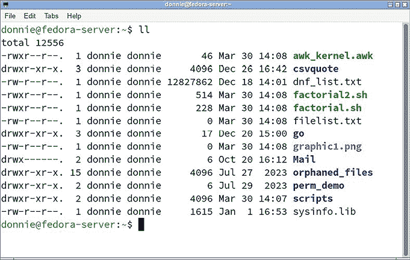

图 5.2：在 Fedora 上使用 `ll` 别名

最后，`l.` 别名会显示名称以点开头的的文件和目录，同样带有颜色编码。它看起来如下：

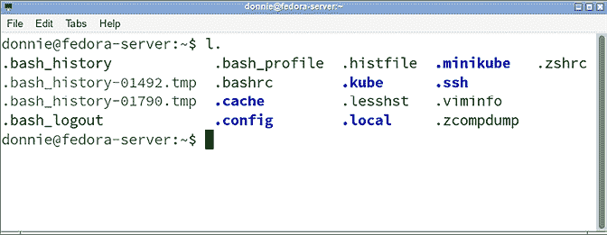

图 5.3：在 Fedora 上使用 `l.` 别名

Debian 的开发者采取了不同的方法。他们没有在全局级别定义别名，而是 Debian 的人们直接在用户级别定义它们。你可以在每个用户目录下的 `.bashrc` 文件中找到定义的别名列表。默认情况下只启用了一个别名，但你可以通过删除前面的 `#` 符号轻松地启用任何或所有其他别名。

在 Fedora 机器上，有一个 `which` 别名替换了 `which` 命令。这个别名不仅会显示命令的可执行文件位置，还会显示该命令是否有别名。它的样子如下：

```
[donnie@fedora-server ~]$ which ls alias ls='ls --color=auto' /usr/bin/ls [donnie@fedora-server ~]$
```

Debian 上没有 `which` 别名，因此你不能使用 `which` 来查看其他命令是否有别名。Debian 的输出如下：

```
donnie@debian:~$ which ls /usr/bin/ls donnie@debian:~$
```

需要注意的是，如果你有一个别名与实际底层命令同名，那么别名始终具有优先级。有两种方法可以覆盖这种优先级，让你直接调用命令的可执行文件。第一种方法是指定可执行文件的完整路径，如下：

```
[donnie@fedora-server ~]$ /usr/bin/ls anyfile.txt somedir somefile.sh [donnie@fedora-server ~]$
```

第二种方法是在命令前加一个反斜杠，如下：

```
[donnie@fedora-server ~]$ \ls anyfile.txt somedir somefile.sh [donnie@fedora-server ~]$
```

现在你会看到没有任何颜色编码的 `ls` 输出。让我们再次用 `which` 尝试，如下：

```
[donnie@fedora-server ~]$ /usr/bin/which ls /usr/bin/ls [donnie@fedora-server ~]$
```

这次，`which` 只显示可执行文件的位置，而忽略了别名。如果你需要禁用别名，请使用 `unalias` 命令，如下：

```
[donnie@fedora-server ~]$ which which alias which='(alias; declare -f) | /usr/bin/which --tty-only --read-alias --read-functions --show-tilde --show-dot' /usr/bin/which [donnie@fedora-server ~]$ unalias which [donnie@fedora-server ~]$ which which /usr/bin/which [donnie@fedora-server ~]$
```

在这种情况下，别名只是临时禁用的，直到你关闭 shell 会话。如果你对从命令行创建的任何别名使用 `unalias`，则该别名将被永久禁用。

关于别名的最后一点是，任何在命令行设置的别名会在退出 shell 会话时消失。要让它们在 Debian 或 Fedora 上变为永久有效，只需将它们放在主目录下的 `.bashrc` 文件中。

好了，本章的内容基本上到此结束。让我们总结一下并继续后续吧。

## 总结

在本章中，我们为后续的章节奠定了基础。我们解释了不同类型的 shell 会话，然后查看了在全局和用户级别影响 shell 环境的配置文件。接着，我们研究了如何设置 shell 选项以及如何创建和使用别名。

现在你已经了解了 shell 运行的基础知识，准备好应对一些更有分量的问题了，例如如何使用文本流过滤器。我们将在下一章开始学习这些。我们下章节见。

## 习

以下哪两个命令开启了 `noclobber` 选项？（选择两个。）

- `set +o noclobber`

- `set -o noclobber`

- `set -C`

- `set +C`

在 Fedora 机器上，以下哪个用户级配置文件将只会影响登录 shell 会话？

- `profile`

- `.bash_profile`

- `.bash.bashrc`

你刚刚在桌面 Linux 机器上打开了一个终端模拟器。你正在使用哪种 shell 会话？（选择两个。）

- 非交互式

- 登录

- 交互式

- 非登录

## 扩展阅读

如何在 Linux 上列出环境变量：https://www.howtogeek.com/842780/linux-list-environment-variables/

Linux Shell 会话类型：https://www.automationdojos.com/types-of-linux-shell-sessions/

## 答案

或者，你可能需要从显示 Linux 系统状态的实用程序提取数据，或者从自动从爬取某些特定信息的脚本内部提取数据。在本主题中介绍的文本流过滤工具可以帮助让这些工作变得更容易。一旦你学会了它们，你可能会发现使用它们提取和显示数据比使用文本编辑器或文字处理器快得多。

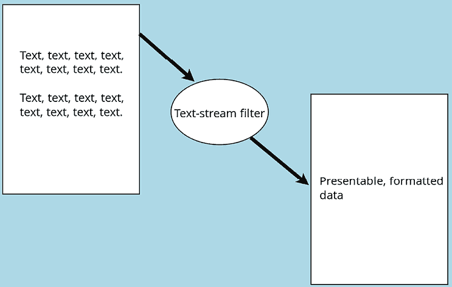

图 6.1：文本流过滤的基本概念

除一种情况外，你不会使用这些工具来修改原始文件。你将使用它们在屏幕上显示选定的数据、将选定的数据通过（pipe）到另一个实用程序，或者使用重定向器创建或将选定的数据追加到另一个文件中。

## 使用 cat

`cat` 工具与我们的猫猫没有关系。它被用于查看、创建或合并多个文本文件。（事实上，`cat` 一词是 catenate（连接）的缩写，这是表示“端对端将两个事物连接在一起”的一种高级说法。）

我在引言中提到过，Mac 用户可以在他们的 Mac 上执行本章的演示。但现在，我必须补充一点免责说明。这是因为至少有三个版本的 `cat`，它们都拥有不同的选项开关。我将在后续过程中指出这些差异。

有时，你可能需要编写可以在不同操作系统之间通迁移的脚本。因此，了解这些微小的特殊特性是非常重要的。

默认情况下，`cat` 的 `stdin` 是键盘，`stdout` 是计算机屏幕。如果你直接在命令提示符处输入 `cat`，你就可以输入文本，并在按下回车键后让它立即回显。它会一直持续下去，直到你按下 `Ctrl-d` 结束。它的样子如下：

```
[donnie@fedora ~]$ cat Hi there!
```

我还没有按回车键。看看我按下后会发生什么：

```
[donnie@fedora ~]$ cat Hi there! Hi there!
```

这是我只想插入这一行，所以我将用 `Ctrl-d` 退出 `cat`：

```
[donnie@fedora ~]$ cat Hi there! Hi there! [donnie@fedora ~]$
```

当然，这本身并没有什么大用。但你可以结合 `stdout` 重定向器使用 `cat` 创建简单的文本文件。当你输入完消息后，再次按回车键进入空白行，然后按 `Ctrl-d` 退出。它看起来应该是这样的：

```
[donnie@fedora ~]$ cat > newtext.txt Hi there! I'm using cat to create a text file. I hope that it turns out well. [donnie@fedora ~]$
```

一旦你创建了文件，就可以使用 `cat` 显示它。不过它不像 `less` 工具，因为 `cat` 只是将文件中的所有内容转储到显示屏上而不进行分页。你不需要配合 `cat` 使用 `stdin` 重定向器，因为 `cat` 设计为使用参数而不是 `stdin` 重定向器。无论如何，它的样子如下：

```
[donnie@fedora ~]$ cat newtext.txt Hi there! I'm using cat to create a text file. I hope that it turns out well. [donnie@fedora ~]$
```

现在，使用 `cat` 创建第二个文件，如下：

```
[donnie@fedora ~]$ cat > newtext_2.txt I'm going to catenate this file to the first file, just to see if it actually works. [donnie@fedora ~]$
```

这就是连接（catenate）发挥的地方。再次调用 `cat`，但使用两个新文件的文件名作为参数，如下：

```
[donnie@fedora ~]$ cat newtext.txt newtext_2.txt Hi there! I'm using cat to create a text file. I hope that it turns out well. I'm going to catenate this file to the first file, just to see if it actually works. [donnie@fedora ~]$
```

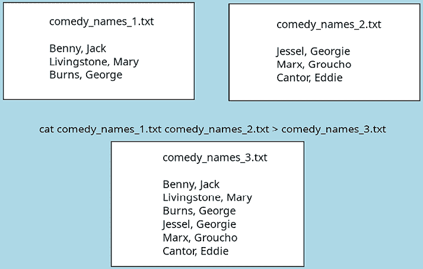

图 6.2：将两个文件的内容重定向到第三个文件中。

这一次，你会看到两个文件显示得就像它们是一个单一文件一样。

现在，添加一个 `stdout` 重定向器通过合并前两个文件创建一个新文件，如下：


```
[donnie@fedora ~]$ cat newtext.txt newtext_2.txt > newtext_3.txt
[donnie@fedora ~]$ cat newtext_3.txt
Hi there! I'm using cat to create a text file. I hope that it turns out well. I'm going to catenate this file to the first file, just to see if it actually works.
```

理解这一点很重要：当你这样做时需要创建一个第三个文本文件。这是因为如果你将两个原始文件的输出重定向到两个原始文件中的任何一个，你将完全抹除目标文件的内容。你将只剩下第二个文件的内容。事实上，让我给你看：

```
[donnie@fedora ~]$ cat newtext.txt newtext_2.txt > newtext.txt
[donnie@fedora ~]$ cat newtext.txt
I'm going to catenate this file to the first file, just to see if it actually works.
```

有一个显示所有行行的选项，如下所示：

```bash
[donnie@fedora ~]$ cat -n newtext_4.txt
1 I'm now adding tabs, spaces, and blank lines, to see if some
2 of the options will work.
3
4
5
6
7 Hopefully, they will.
8
9
10 I hope.
[donnie@fedora ~]$
```

`cat` 的介绍就此结束，让我们来看看 `tac`。

## 使用 `tac`

`tac`——`cat` 的反向拼写——会按反顺序一次显示一个或多个文件。为了了解它是如何工作的，我们首先创建两个文本文件，它们的内容如下：

```bash
[donnie@fedora ~]$ cat > testfile_1.txt
one
two
three
four
five
six
[donnie@fedora ~]$ cat > testfile_2.txt
seven
eight
nine
ten
eleven
twelve
[donnie@fedora ~]$
```

让我们使用 `cat` 同时查看这两个文件：

```bash
[donnie@fedora ~]$ cat testfile_1.txt testfile_2.txt
one
two
three
four
five
six
seven
eight
nine
ten
eleven
twelve
[donnie@fedora ~]$
```

你可以使用 `tac` 按反顺序查看一个文件：

```bash
[donnie@fedora ~]$ tac testfile_1.txt
six
five
four
three
two
one
[donnie@fedora ~]$
```

或者，按反顺序查看两个或多个文件：

```bash
[donnie@fedora ~]$ tac testfile_1.txt testfile_2.txt
six
five
four
three
two
one
twelve
eleven
ten
nine
eight
seven
[donnie@fedora ~]$
```

注意，第一个文件的内容首先显示，然后是第二个文件的内容。

当然，你可以使用 `stdout` 重定向器创建一个新的文本文件，如下：

```bash
[donnie@fedora ~]$ tac testfile_1.txt testfile_2.txt > testfile_3.txt
[donnie@fedora ~]$
```

你可能会认为 `tac` 使用与 `cat` 相同的选项，但它 own 并不是。`cat` 的任何选项都不能用于 `tac`。

`tac` 的介绍就此结束。接下来是 `cut`。

## 使用 `cut`

正如其名所示，这个实用的工具用于从文本文件中提取并显示选定的信息。将其想象成对文本文件进行“垂直切片”，并将其发送到你选择的输出中。有两种方法可以指定切片的开始和结束位置。你可以通过指定起始和结束字符，或者通过指定字段（fields）。

要通过字段指定切片，你需要同时使用 `-d` 和 `-f` 选项。`-d` 选项用于指定分隔符，即分隔字段的字符。这样 `cut` 就能知道每个字段的开始和结束。`-f` 选项用于指定你想要查看的字段。在图中，你可以看到我使用 `cut` 从 `/etc/passwd` 文件提取了用户名和真实名——即字段 `1` 和 `5`。

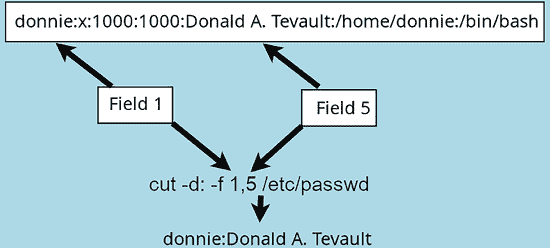

图 6.3：使用 `cut` 查看 `passwd` 文件的第 1 和第 5 个字段

由于该文件中字段是用冒号分隔的，因此我使用 `-d:` 作为分隔符选项。

另一种指定切片的方法是字符法。通过这种方法，你选择要显示的文本行的起始和结束字符。在下一张图中，你可以看到我将当前目录下的文件列表保存到了 `filelist.txt`。

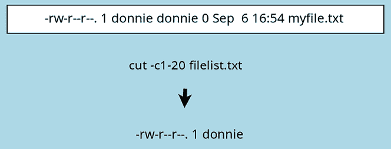

图 6.4：使用 `cut` 查看前 20 个字符

我决定只查看该文件中每行的前 20 个字符，因此我使用了 `-c` 选项并附带相应的字符数字。（注意，你可以将命令写为 `cut -c1-20 filelist.txt` 或 `cut -c 1-20 filelist.txt`。`-c` 与第一个数字之间的空格是可选的。）为了进一步说明其工作原理，让我向你展示切片一个真实的多行文件时的输出是什么样的：

```bash
[donnie@fedora ~]$ cut -c 1-20 filelist.txt
total 2109597
drwxr-xr-x 1 donnie
-rw-r--r-- 1 donnie
-rw-r--r-- 1 donnie
-rw-r--r-- 1 donnie
.
.
.
.
.
.
drwxr-xr-x 1 donnie
-rwxr--r-- 1 donnie
-rwxr--r-- 1 donnie
-rwxr--r-- 1
[donnie@fedora ~]$
```

你可以看到 `cut` 作用于文件的每一行。此外，你看到整个第一行都打印出来了，因为它的少于 20 个字符。（使用字段法时也会发生这种情况。）

当然，在上述两个示例中，你都可以选择 `stdout` 重定向器将提取的信息保存到文本文件中。例如，你可以这样做：

```bash
[donnie@fedora ~]$ cut -d: -f 1,5 /etc/passwd > passwd_cut.txt
[donnie@fedora ~]$ cut -c 1-20 filelist.txt
```

请注意，在两个输入文件中，第一个字段是相同的。（在这种情况下，它是每个演员的姓氏。）在输出中，第一个字段——我们称之为“键字段”（key field）——只列一次。每个演员姓氏（键字段）的信息是从两个输入文件中共同获取的。

这里需要记住的是，你必须有一个在两个输入文件中完全相同的字段。它不非要是第一个字段，正如我们在下一个示例中将说明的那样。

如果你愿意，可以使用 `-j` 选项使用另一个字段。你可以通过以下两个数字列表看到这一点：

```bash
[donnie@fedora ~]$ cat > num_1.txt
1 one
3 three
4 four
7 seven
5 five
[donnie@fedora ~]$ cat > num_2.txt
uno one
tres three
cuatro four
siete seven
cinco five
```

现在，让我们合并它们吧：

```bash
[donnie@fedora ~]$ join -j 2 num_1.txt num_2.txt
one 1 uno
three 3 tres
four 4 cuatro
seven 7 siete
five 5 cinco
```

在这里，第二个字段在每个输入文件中都是相同的，因此我使用了 `-j 2` 选项将该字段指定为键字段。

你可以将 `join` 的输出管道到其他工具以进行自定义输出。如果你想对输出行进行编号，可以将其管道到带有 `-n` 选项的 `cat`，如下：

```bash
[donnie@fedora ~]$ join -j 2 num_1.txt num_2.txt | cat -n
1 one 1 uno
2 three 3 tres
3 four 4 cuatro
4 seven 7 siete
5 five 5 cinco
```

如今人们创建逗号分隔值（`csv`）格式的表格文件而不是电子表格程序的原生格式，这非常常见。这样做的优点是用任何纯文本编辑器创建文件，并且可以使用任何电子表格程序读取。你可以通过 `-t` 选项指定字段由逗号而不是制表符分隔，从而让 `join` 处理这些文件。要查看其工作原理，将 `actorfile_1.txt` 和 `actorfile_2.txt` 文件复制到对应的 `.csv` 文件，如下：

```bash
[donnie@fedora ~]$ cp actorfile_1.txt actorfile_1.csv
[donnie@fedora ~]$ cp actorfile_2.txt actorfile_2.csv
```

接下来，编辑两个 `.csv` 文件，将制表符替换为逗号。第一个文件看起来如下：

```bash
[donnie@fedora ~]$ cat actorfile_1.csv
Benny,Jack
Allen,Fred
Ladd,Alan
Hitchcock,Alfred
Robinson,Edgar
```

第二个文件看起来如下：

```bash
[donnie@fedora ~]$ cat actorfile_2.csv
Benny,comedy
Allen,comedy
Ladd,adventure
Hitchcock,mystery
Robinson,drama
```

现在，看看当我尝试用方式使用 `join` 时会发生什么：

```bash
[donnie@fedora ~]$ join actorfile_1.csv actorfile_2.csv
join: actorfile_1.csv:2: is not sorted: Allen,Fred
join: actorfile_2.csv:4: is not sorted: Hitchcock,mystery
join: input is not in sorted order
```

它不起作用，因为 `join` 认为每个文件中只有一个字段。为了让它工作，我需要使用 `-t` 选项将逗号指定为我的字段分隔符，如下：

```bash
[donnie@fedora ~]$ join -t, actorfile_1.csv actorfile_2.csv
Benny,Jack,comedy
Allen,Fred,comedy
Ladd,Alan,adventure
Hitchcock,Alfred,mystery
Robinson,Edgar,drama
```

酷酷，这看起来好多了。当然，你始终可以将输出重定向到第三个 `.csv` 文件，并将其导入任何电子表格程序中。

`join` 的用法还有更多可能，你可以在 `join` 的帮助页中看到。将 `join` 的功能与我们即将介绍的下一个工具的功能结合起来，你就有了一个用于创建简单数据库的易用工具。

## 使用 `sort`

这是一个多功能工具，你可以单独使用它，也可以与其他工具结合使用。你可以用它来对单个文件或多个文件一起进行排序。

针对不同的目的有许多选项。你可以选择输出的格式、你希望如何排序数据，以及你想使用哪些字段进行排序。你甚至可以同时对两个或多个字段进行排序，对一个字段进行主排序，对其他字段进行次要排序。

使用 `sort` 的方法有很多。正如我之前所说的，唯一的限制是你自己的想象力。首先，看下面的图。在你自己的机器上创建文本文件，然后运行你看到的命令：

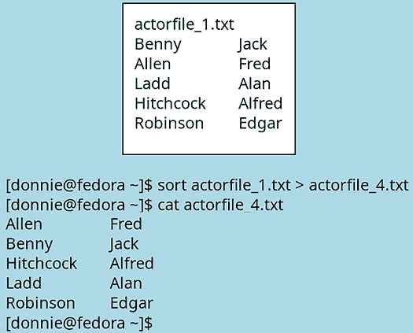

图 6.7: 排序 `actorfile_1.txt` 文件

你在上面的图中看到的是简单的排序。默认情况下，排序是区分大小写的，并且是对文件的每个整行进行的。

在下一个示例中，我将为你展示两个选项。第一个是 `-k`，允许你根据特定字段排序输入。第二个是 `-o`，允许你将输出保存到文件中。当然，你仍然可以重定向输出。但与重定向不同，`-o` 选项允许将输出保存回文件而不覆盖其内容。在我向你展示之前，我将把 `actorfile_1.txt` 复制到 `actorfile_5.txt`：

```bash
[donnie@fedora ~]$ cp actorfile_1.txt actorfile_5.txt
```

现在，让我们它是如何工作的：

```bash
[donnie@fedora ~]$ sort -k2 actorfile_5.txt -o actorfile_5.txt
```

如你所见，文件现在根据名称进行了排序。假设你需要一个女演员列表来配合你的演员列表，该列表看起来所示：

```bash
[donnie@fedora ~]$ cat > actorfile_6.txt
```

一起排序 `actorfile_1.txt` 和 `actorfile_6.txt`：

```bash
[donnie@fedora ~]$ sort actorfile_1.txt actorfile_6.txt
```

在屏幕上查看结果后，将结果保存到新文件中，如下：

```bash
[donnie@fedora ~]$ sort actorfile_1.txt actorfile_6.txt -o actorfile_7.txt
```

你也可以将其管道到 `tee` 工具，这样你就可以在显示输出的同时保存到文件中：

```bash
[donnie@fedora ~]$ sort actorfile_1.txt actorfile_6.txt | tee actorfile_8.txt
```

等等，我发现之前的示例中有重复项。让我们看看正常的排序是什么样子：

```bash
[donnie@fedora ~]$ sort fruit.txt
```

由于你每个水果只需要条目，使用 `-u` 选项来消除重复项：

```bash
[donnie@fedora ~]$ sort -u fruit.txt
```

但是，你真的需要让水果名称以大写和小写的形式重复吗？如果不需要，添加 `-f` 选项可以让 `sort` 将所有字母视为大写字母，如下：

```bash
[donnie@fedora ~]$ sort -uf fruit.txt
```

一些旧的 Linux 书籍可能会告诉你，如果排序字段中混合了大写和小写字母，除非使用 `-f` 选项，否则将无法正确排序。例如，“MacLeod”这个名字会排在“Mack”之前，因为大写的 L 会排在小写的 k 之前。

不区分大小写地将列表项按字母顺序正确排列。然而，在较新的发行版中，这不再是一个问题。正如你在上面的示例所示，`-f` 仍然有它的用处。但其他其他 Linux 书籍会告诉你它已经不存在了。在我们的下一个演示中，创建一个包含数字列表的文件。

```
[donnie@fedora ~]$ cat > numbers.txt
1
5
10
78
78034
10053
```

```
[donnie@fedora ~]$ sort numbers.txt
1
5
10
78
78034
10053
```

这就是你尝试对列表排序时得到的结果。要让它按照数值顺序排序，请使用 `-n`，如下：

```
[donnie@fedora ~]$ sort -n numbers.txt
1
5
10
78
78034
10053
```

这可能不是你想要的。要按逆序排序文件，请使用 `-r`：

```
[donnie@fedora ~]$ sort -nr numbers.txt
1
5
10
78
78034
10053
```

这次，为了好玩，也创建一个包含负数和一些正数的文本文件：

```
[donnie@fedora ~]$ cat > numbers_2.txt
-68
57
2.6
12.4
10000
14.4
80.2
-87
```

现在，让我们看看它是如何处理任何开关的：

```
[donnie@fedora ~]$ sort numbers_2.txt
10000
12.4
14.4
2.6
57
-68
80.2
-87
```

和之前一样，添加 `-n` 来按正确的数值顺序对列表排序：

```
[donnie@fedora ~]$ sort -n numbers_2.txt
-87
-68.8
2.6
12.4
14.4
57
80.2
10000
```

在下一个示例中，让我们创建一个二手汽车文件。我们将列出品牌、型号、年份（以千为单位）和售价。如果你不在我所在的美国，请假装英里实际上是公里。这里是列表的内容：


我们首先进行一次普通排序，如下：

```
donnie@fedora ~]$ sort autos.txt
bmw 325i 1985 115 450
bmw 325i 1985 60 1000
chevy impala 1985 85 1550
chevy malibu 1999 50 3500
chevy malibu 2000 60 3000
edsel corsair 1958 47 750
ford explorer 2003 25 9500
ford galaxie 1964 128 60
ford mustang 1965 45 10000
ford taurus 2004 10 17000
ford thunderbird 2003 15 3500
honda accord 2001 30 6000
jeep wrangler 2003 54 1600
plymouth breeze 1996 116 4300
plymouth fury 1970 73 2500
plymouth satellite 1970 154 600
toyota rav4 2002 180 750
volvo s80 1998 102 9850
```

默认情况下，`sort` 操作将从文件的第一列开始，并遍历每一行，直到没有非唯一的条目为止。在这里，可以看到所有内容都正确排序了，直到到达年份（我们稍后会修复它）。每当某个品牌有多一辆车时，排序将继续到型号。当某个型号有多个一个时，排序将继续到年份列。里程数列也被包含在排序中，尽管在这个示例中看起来不是这样。这是因为几页前我展示的数值排序问题。为了按数值排序而不是字母排序，必须使用 `-n`。我们可以通过使用 `-k` 指定要排序的各个列来实现，如下：

```
donnie@fedora ~]$ sort -n numbers_2.txt
-87
-68.8
2.6
12.4
14.4
57
80.2
10000
```

```
donnie@fedora ~]$ sort -k1,3 -k4n..txt
325i 1985 115 4500
325i 1985 60 1000
chevy impala 1988 85 15500
vy mal mal  199  0  3500
vy mal mal  2000 60 3000
selsel air 1988 47 7500
  2003 25 9000
gal gal  196  128 600
  196   45 10000
ford taurus 2004 10 17000
ford thunderbird 2003 15 3500
honda accord 2001 30 6000
jeep wrangler 2003 54 1600
plymouth breeze 1996 116 4300
plymouth fury 1970 73 2500
plymouth satellite 1970 154 600
toyota rav4 2002 180 750
volvo s80 1998 102 9850
```

`-k1,3` 选项意味着对第一到第三列进行排序（也就是说，按品牌、型号和年份排序）。`-k4n` 选项意味着对第四列（里程）按数值顺序排序。注意你可以指定各个列的 `sort` 选项。此外注意在此排序中价格列从未被考虑，因为到里程列的所有条目都是完全相同的。接下来，让我们先按制造商和价格对我们的 `autos` 列表进行排序。对于这一点，你必须对第一和第五列进行排序。由于我们已经知道第五列需要 `-n` 来正确排序，我们将直接添加，如下：

```
donnie@fedora ~]$ sort -k 1 -k5n autos.txt
bmw 325i 1985 115 450
bmw 325i 1985 60 1000
chevy impala 1985 85 1550
chevy malibu 1999 50 3500
chevy malibu 2000 60 3000
edsel corsair 1958 47 750
ford explorer 2003 25 9500
ford galaxie 1964 128 60
ford mustang 1965 45 10000
ford taurus 2004 10 17000
ford thunderbird 2003 15 3500
honda accord 2001 30 6000
jeep wrangler 2003 54 1600
plymouth breeze 1996 116 4300
plymouth fury 1970 73 2500
plymouth satellite 1970 154 600
toyota rav4 2002 180 750
volvo s80 1998 102 9850
```

当你指定两个或多个 `-k` 关时，`sort` 将多次执行其操作。在第一次通过中，它将按第一个 `-k` 指定的字段排序。剩余指定字段的排序将在后续通过中执行。在这里，我们看到 `sort` 忽略了第二个 `-k`。这是因为第一个 `-k` 没有为其排序指定端点。因此，`sort` 在第一次通过中评估了整个行，并决定不需要第二次通过。现在，让我们为第一个 `-k` 指定一个端点，看看是否有区别。

```
donnie@fedora ~]$ sort -k1,1 -k5n autos.txt
bmw 325i 1985 115 450
bmw 325i 1985 60 1000
chevy impala 1985 85 1550
chevy malibu 1999 50 3500
chevy malibu 2000 60 3000
edsel corsair 1958 47 750
ford explorer 2003 25 9500
ford galaxie 1964 128 60
ford mustang 1965 45 10000
ford taurus 2004 10 17000
ford thunderbird 2003 15 3500
honda accord 2001 30 6000
jeep wrangler 2003 54 1600
plymouth breeze 1996 116 4300
plymouth fury 1970 73 2500
plymouth satellite 1970 154 600
toyota rav4 2002 180 750
volvo s80 1998 102 9850
```

`-k1,1` 选项意味着我们希望第一次通过对文件的第一列——仅第一列进行排序。通过添加该端点，我们的排序按照我们想要的方式工作。你不需要从第一个字段开始排序。对于下一个示例，我们将先按第三列（年份）排序，再按第一列（品牌）排序。

```
donnie@fedora ~]$ sort -k3 -k1 autos.txt
edsel corsair 1958 47 750
ford galaxie 1964 128 60
ford mustang 1965 45 10000
plymouth satellite 1970 154 60
plymouth fury 1970 73 2500
bmw 325i 1985 115 450
bmw 325i 1985 60 1000
chevy impala 1985 85 1550
chevy malibu 1999 50 3500
chevy malibu 2000 60 3000
honda accord 2001 30 6000
toyota rav4 2002 180 750
ford thunderbird 2003 15 3500
ford explorer 2003 25 9500
jeep wrangler 2003 54 1600
ford taurus 2004 10 17000
```

再次，你可以看到当你为第一个排序字段指定端点时会发生什么。所以，让我们再次尝试。

```bash
[donnie@fedora ~]$ sort -k3,3 -k1 autos.txt
edsel corsair 1958 47 750
ford galaxie 1964 128 60
ford mustang 1965 45 10000
plymouth fury 1970 73 2500
plymouth satellite 1970 154 600
bmw 325i 1985 115 450
bmw 325i 1985 60 1000
chevy impala 1985 85 1550
plymouth breeze 1996 116 4300
volvo s80 1998 102 9850
chevy malibu 1999 50 3500
chevy malibu 2000 60 3000
honda accord 2001 30 6000
toyota rav4 2002 180 750
ford explorer 2003 25 9500
ford thunderbird 2003 15 3500
jeep wrangler 2003 54 1600
ford taurus 2004 10 17000
[donnie@fedora ~]$
```

好的，它还是不起作用。所有内容仍然按照年份正确排序了，但没有按照品牌排序。我们可不会在这里放弃，所以让我们再试一次。

```bash
[donnie@fedora ~]$ sort -b -k3,3 -k1 autos.txt
edsel corsair 1958 47 750
ford galaxie 1964 128 60
ford mustang 1965 45 10000
plymouth fury 1970 73 2500
plymouth satellite 1970 154 600
bmw 325i 1985 115 450
bmw 325i 1985 60 1000
chevy impala 1985 85 1550
plymouth breeze 1996 116 4300
volvo s80 1998 102 9850
chevy malibu 1999 50 3500
chevy malibu 2000 60 3000
honda accord 2001 30 6000
toyota rav4 2002 180 750
ford explorer 2003 25 9500
ford thunderbird 2003 15 3500
jeep wrangler 2003 54 1600
ford taurus 2004 10 17000
[donnie@fedora ~]$
```

注意看，在五个字段中的四个中，文本字符串的长度是不一样的。从理论上说，文本较短的行中额外的空白应该会对我们执行的所有 `sort` 操作产生不利影响。然而，由于某种原因，只有最后这次排序操作受到了影响。通过添加 `-b` 选项，我们正在告诉 `sort` 忽略额外的空格。

好的，也许你并没有收藏古董汽车。但你可能有其他需要以各种方式排序的物品列表。请记住，你可以使用我在这里介绍的方法处理你可能拥有的任何列表。

好了，古董汽车部分就够了。现在让我们来看看如何排序月份列表。首先，让我们像这样创建一个列表：

```bash
[donnie@fedora ~]$ cat > dates.txt
Dec 2023
jan 2023
Oct 2023
Sep 2022
Feb 2022
mar 2023
may 2022
[donnie@fedora ~]$
```

现在，使用 `-M` 选项按月份对列表排序：

```bash
[donnie@fedora ~]$ sort -M dates.txt
jan 2023
Feb 2022
mar 2023
may 2022
Sep 2022
Oct 2023
Dec 2023
[donnie@fedora ~]$
```

正如你所看到的，`-M` 选项是不区分大小写的。

现在，使用你在前面的示例中学到的技巧先按年份排序，再按月份排序，如下：

```bash
[donnie@fedora ~]$ sort -k2,2 -k1M dates.txt
Feb 2022
may 2022
Sep 2022
jan 2023
mar 2023
Oct 2023
Dec 2023
[donnie@fedora ~]$
```

最后，正如承诺的那样，我现在将向你展示如何结合使用 `join` 和 `sort` 来模拟一个简单的关系型数据库程序。让我们先看一眼输入文件，它们就是我们之前使用过的那些。首先，我们有 `actorfile_1.txt`：

```bash
[donnie@fedora ~]$ cat actorfile_1.txt
Benny Jack
Allen Fred
Ladd Alan
Hitchcock Alfred
Robinson Edgar
```

第二个输入文件是 `actorfile_2.txt`，它看起来如下：

```bash
[donnie@fedora ~]$ cat actorfile_2.txt
Benny comedy
Alan Hitchcock
Robinson
```

现在，我们将把它们 `join` 在一起，并将结果传递给 `sort`。（再次注意，`join` 将输入中的制表符转换为普通空格。）

```bash
[donnie@fedora ~]$ join actorfile_1.txt actorfile_2.txt | sort
comedy Jack
Hitchcock
```

好的，这看起来不太好，因为 `join` 没有保持对齐。让我们通过将输出通过到 `column -t` 命令来修复它：

```bash
donnie@fedora:~$ join actorfile_1.txt actorfile_2.txt | column -t
```

我们可以已经学过的技巧按类别排序，然后按姓排序。

```bash
[donnie@fedora ~]$ join actorfile_1.txt actorfile_2.txt | sort -b -k3,3 -k1
comedy Jack
Hitchcock
```


正如你看到的，这里有很多内容，但不要让它气馁。通过一点练习，你就能像专业人士一样排序了。好了，本章到此结束。让我们总结一下。

## 总结

作为 Linux 管理员、开发者甚至使用 Linux 的办公人员，你可能需要从文件或命令输出中提取并格式化数据。在本章中，你学习了各种文本过滤器以及它们如何帮助你。还有很多过滤器需要涵盖，我们将在下一章介绍。那里见。

## 练习

使用以下哪种工具可以将两个或多个文件并排合并？
- `join`
- `tac`
- `paste`

你可以结合使用以下哪些工具来创建简单的数据库？（选两个）
- `paste`
- `sort`
- `cat`

以下哪个命令可以正确保存 `cat` 操作的输出？
- `cat file1.txt file2.txt > file1.txt`
- `cat file1.txt file2.txt > file2.txt`
- `cat file1.txt file2.txt > file3.txt`

你想让 `sort` 只对文件的第 1 列进行排序。你的命令应该是怎样的？
- `sort -F1 myfile.txt`
- `sort -F1,1 myfile.txt`
- `sort -k1 myfile.txt`
- `sort -k1,1 myfile.txt`

在使用 `cat` 时使用以下哪个选项消除重复行？
- `-d`
- `-s`
- `-o`
- `-u`

## 扩展阅读

Linux Professional Institute Exam 101 Objectives: https://www.lpi.org/our-certifications/exam-101-objectives

How to Use join Command on Linux: https://www.howtogeek.com/542677/how-to-use-join-command-on-linux/

sort Command Examples: https://linuxhandbook.com/sort-command/

## 答案

- d
- b and c
- c
- d
- b

## 加入我们的 Discord 社区！

与其他用户、Linux 专家以及作者本人一起读书。提问、为其他读者提供解决方案、通过“提问”活动与作者聊天以及更多。扫描二维码或访问链接加入社区。

https://packt.link/SecNet

## 7 文本过滤器 – 部分 2

## 文本过滤器 – 部分 2

在本章中，我们将继续观察各种文本过滤器。在阅读本章时，我挑战你运用想象力。不要把这些过滤器工具看作是因为我的要求或为了 Linux 认证考试而必须学习的东西，试着想象这些工具如何帮助你格式化你自己的文本文件和报告。相信我，你永远不知道这些工具中的一个或多个何时会有用。

以下是本章将涵盖的主题：

- 使用 `expand`
- 使用 `unexpand`
- 使用 `nl`
- 使用 `head`
- 使用 `tail`
- 使用 `head` 和 `tail`
- 使用 `od`
- 使用 `uniq`
- 使用 `wc`
- 使用 `fmt`
- 使用 `split`
- 使用 `tr`
- 使用 `xargs`
- 使用 `pr`

## 从命令行打印

它们并不难，但有很多内容需要涵盖。所以，如果你准备好了，让我们开始吧。

## 技术要求

使用你的虚拟机中的任何一个，因为它们在两者上的运行效果都是相同的。或者，如果你的主机运行的是 Linux 或 macOS，可以随意使用它来代替虚拟机。我不会提供实际的操作实验室，所以你可以在阅读本章时在自己的机器上跟着操作。和之前一样，你可以从 GitHub 仓库下载所需的文本文件。

## 使用 expand

有时，你用列数据数据创建的文本文档在某些情况下无法正常显示。这可能是因为你用制表符（tabs）而不是空格来分隔列。

为了观察这一点，请创建一个 `expand.txt` 文本文件。文件中将三列数据，每列之间有两个制表符（tab）。该文件看起来如下：

```
[donnie@fedora ~]$ cat > expand.txt one two three four five six seven eight nine [donnie@fedora ~]$
```

现在，扩展该文件并注意输出结果。它应该是这样的：

```
[donnie@fedora ~]$ expand expand.txt one two three four five six seventh eight nine [donnie@fedora ~]$
```

由于我仍然有这种“读你心术”的怪癖，我知道你正在想到底发生了什么，因为扩展后的输出和原始文件看起来完全一样。这就是表象的欺骗性。当你扩展文件时，你在列之间放置的每个制表符都被替换成了数量不空白空格。空格的数量随行而异，取决于每个文本字符串的字符数。这样，所有列仍然会保持对齐。

实际上，`expand` 将每个完整的制表符替换为八个空格。但当你有不同长度的文本字符串时，它似乎并没有那样做。这是因为 `expand` 会调整其插入的空白数量，以保持所有列对齐。如果你在一个列之间有多个制表符且文本字符串长度不同的文件中，除了一个制表符外，所有的制表符都被替换为一个八个空格。

如果你想证明这一点，可以将扩展后的输出保存到一个新文件，然后用你喜欢的文本编辑器打开该新文件。在我的情况下，我将使用 `vim`，如下：

```
[donnie@fedora ~]$ expand expand.txt > expand_2.txt [donnie@fedora ~]$ vim expand_2.txt
```

现在，将光标移动到两列之间的空白区域。在列之间向左或向右移动，你会发现你只移动了一个空格。关闭此文件并打开原始文件。当在这个文件的列之间移动光标时，你会发现它移动的是一个制表符的长度，而不是仅仅一个空格。

`expand` 有两个可以使用的选项。第一个是 `-t` 选项。这允许你设置想要替换制表符的空格数，而不是使用默认的八个。在这里，我们想将每个制表符仅替换为两个空格。

```
[donnie@fedora ~]$ expand -t2 expand.txt one two three four five six seven eight nine [donnie@fedora ~]$
```

由于仅用两个空格替换每个制表符，`expand` 未能保持列的正确对齐。你可以尝试其他的 `-t` 值来查看结果。

通过 `-i` 切换，你可以指示 `expand` 只替换位于每行开头的制表符。每行随后的制表符将保持不变。要查看它是如何工作的，请将 `expand_1.txt` 文件复制到 `expand_1a.txt` 文件，如下：

```
donnie@fedora:~$ cp expand_1.txt expand_1a.txt donnie@fedora:~$
```

在你的文本编辑器中打开 `expand_1a.txt`，在第 1 行开头插入一个制表符，在第 2 行开头插入两个制表符，在第 3 行开头插入三个制表符。编辑后的文件应该是这样的：

```
donnie@fedora:~$ cat expand_1a.txt one two three four five six eight nine donnie@fedora:~$
```

使用 `-i` 选项将此文件扩展到 `expand_1b.txt` 文件，如下：

```
donnie@fedora:~$ expand -i expand_1a.txt > expand_1b.txt donnie@fedora:~$
```

在你的文本编辑器中打开 `expand_1b.txt`，验证是否只有每行之前的制表符被替换成了空格。

猜怎么着？这就是我关于 `expand` 所要说的全部。现在，让我们反过来操作。

## 使用 unexpand

既然我已经告诉了你 `expand` 的作用，我真的还需要告诉你你 `unexpand` 的作用吗？没错，你猜对了。

`unexpand` 删除列之间的空格，并将其替换为制表符。不过，有两个细微的之处。默认情况下，`unexpand` 只对行首的空格操作。这与 `expand` 处理制表符的方式完全相反。因此，如果你想将行中的所有空格替换为制表符，你需要使用 `-a` 切换。第二个之处在于，默认情况下，`unexpand` 只有在看到连续八个空格时才会起作用。任何少于八个连续空格的组合都不会转换为制表符。（你可以通过 `-t` 切换来改变这种行为，正如你稍后将看到的说。）

我将通过使用 `-a` 选项扩展刚才在 `expand` 部分创建的 `expand_2.txt` 文件来演示，如下：

```
[donnie@fedora ~]$ unexpand -a expand_2.txt one two three four five six seven eight nine [donnie@fedora ~]$
```

再次，你真的无法看出区别。要看到区别，请将结果保存到新文件中，如下：

```
[donnie@fedora ~]$ unexpand -a expand_2.txt > unexpand.txt [donnie@fedora ~]$
```

用你喜欢的文本编辑器打开这个新文件。现在，当你在列之间移动光标时，你会发现它移动的是一个制表符的长度，而不是仅仅一个空格。

```
[donnie@fedora ~]$ nl lines.txt 1 This is line one. 2 This is line two. 3 This is line three. 4 This is line four. 5 This is line five 6 This is line six 7 This is line seven. 8 This is line eight. 9 This is line nine. 10 This is line ten. [donnie@fedora ~]$
```

现在，让我们创建一个和这个文件类似的文件，区别是我们会插入几个空行。

```
[donnie@fedora ~]$ cat > lines_2.txt This is line one. This is line two. This is line three. This is line four. This is line five. This is line six. This is line seven. This is line eight. This is line nine. This is line ten. [donnie@fedora ~]$
```

再次，我们将在不指定任何选项的情况下对此文件进行编号。

```
[donnie@fedora ~]$ nl lines_2.txt 1 This is line one. 2 This is line two. 3 This is line three. 4 This is line four. 5 This is line five. 6 This is line six. 7 This is line seven. 8 This is line eight. 9 This is line nine. 10 This is line ten. [donnie@fedora ~]$
```

如果你不指定任何选项，只有非空行会被编号。使用带有适当选项的 `-b` 可以更改该行为。使用 `a` 选项，你可以对所有行编号，包括空行。（顺便说，`-b` 切换代表 body。换句话说，这个切换设置了 `nl` 对文件正文中行编号的方式。稍后我将向你展示它是如何发挥作用。）

```
[donnie@fedora ~]$ nl -ba lines_2.txt 1 This is line one. 2 3 This is line two. 4 5 This is line three. 6 This is line four. 7 This is line five. 8 9 10 This is line six. 11 12 This is line seventh. 13 This is line eight. 14 This is line nine. 15 16 17 This is line ten. [donnie@fedora ~]$
```

`-bt` 选项导致 `nl` 只对文本文件正文中的非空行编号，而 `-bn` 选项告诉 `nl` 不要对文本文件正文进行任何编号。这听起来可能有点奇怪，因为第一个选项定义了已经是默认的行为，而第二个选项似乎违背了使用 `nl` 的全部目的。我稍后会澄清这一切。

当你创建一个文本文件时，可以使用一组特殊的分隔符来定义页头（header）、正文（body）和页脚（footer），这些部分将被 `nl` 使用。如如下所示，你通过在每个部分的开头放置相应的反斜杠和冒号来实现。


图 7.1：文本文件的页头、正文和页脚部分

每个字符出现三个定义页头，两个定义正文，一个定义页脚。`nl` 工具允许你以自己的方式对这些部分中的每一个进行编号。通过创建一个你自己的三部分文本文件来测试一下，它看起来像这样：

```
[donnie@fedora ~]$ cat > line_number_1.txt \:\:\: This is the file header. \:\: This is the body of the file. There's not a lot to say, so I'll close it. \: This is the footer. [donnie@fedora ~]$
```

在使用 `nl` 且不指定任何选项时，只有正文中的非空行会被编号，如下所示：

```
[donnie@fedora ~]$ nl line_number_1.txt This is the file header. 1 This is the body of the file. 2 There's not a lot to say, so I'll 3 close it. This is the footer. [donnie@fedora ~]$
```

要对页头和页脚中的行编号，你需要使用 `-h` 和 `-f` 切换。与这些切换对应的选项与 `-b` 切换的选项相同。因此，为了对页头的所有行以及正文的非空行进行编号，你会使用 `-ha` 选项，如下所示：

```
[donnie@fedora ~]$ nl -ha line_number_1.txt 1 This is the file header. 2 1 This is the body of the file. 2 There's not a lot to say, so I'll 3 close it. This is the footer. [donnie@fedora ~]$
```

要仅对页头中的非空行和正文中的非空行编号，使用 `-ht` 选项，如下所示：

```
[donnie@fedora ~]$ nl -ht line_number_1.txt 1 This is the file header. 1 This is the body of the file. 2 There's not a lot to say, so I'll 3 close it. This is the footer. [donnie@fedora ~]$
```

接下来，让我们对页脚中的所有行编号，如下所示：

```
[donnie@fedora ~]$ nl -fa line_number_1.txt 1 This is the file header. 1 This is the body of the file. 2 There's not a lot to say, so I'll 3 close it. This is the footer. [donnie@fedora ~]$
```

这次，页脚被编号了，但页头没有。在两种情况下，正文中的非空行都被编号了。要对页头的所有行以及正文的非空行进行编号，请使用 `-ha` 选项，如下所示：

```
[donnie@fedora ~]$ nl -ha line_number_1.txt 1 This is the file header. 2 1 This is the body of the file. 2 There's not a lot to say, so I'll 3 close it. This is the footer. [donnie@fedora ~]$
```

你也可以让 `nl` 只对页头和页脚中的行进行编号。对于这一点，你将使用 `-bn` 选项。

```
[donnie@fedora ~]$ nl -bn -hpMacGruder -fpMacGruder macgruder.txt This is the file outlining the strategy 1 for the MacGruder Corporation account. It is vitally important to maintain close working relations with the IT gurus at the MacGruder Corporation. This account represents our company's best opportunity in ages to make a huge sale of servers, desktop computers, routers, and software services. We must give full attention to the needs and wants of the MacGruder Corporation. This document contains sensitive 1 information about the MacGruder Corporation. [donnie@fedora ~]$
```


现在，你可能在想，什么时候才能创建一个带有这些 `nl` 样式页头和页脚的文本文件。嗯，答案是——请大家鼓掌——我完全不知道。在经过了相当广泛的研究后，我没有找到任何其他可以将这些页头和页脚作为实际的页头和页脚显示的实用程序。事实上，我找到的将文本文件转换为其他格式的工具可以插入它们自己的页头和页脚，但它们会将这些 `nl` 样式的页头和页脚仅仅视为普通文档的一部分。

然而，`nl` 在你需要向仅包含正文的文件中插入行号时仍然很有用处。此外，如果你计划参加 Linux 认证考试，你将需要 `nl` 样式文本文件的页头、正文和页脚的概念，因为你可能会遇到一些关于它的问题。

`nl` 的手册页（man page）非常匮乏，因此你可能想查看 info 页面以获取更多 `nl` 信息和选项。运行该命令的命令是：

```bash
[donnie@fedora ~]$ info nl
```

`nl` 的介绍到此为止。让我们继续后续。

## 使用 head

如果你只想查看文本文件开头的特定行数，请使用 `head` 实用。为了演示，我将向你展示我 Fedora 工作站上的这些文件。如果你在自己的机器上没有完全相同的文件，请随意使用其他的。

默认情况下，`head` 显示文件的前十行。我稍后会向你展示如何更改这一点。

让我们先进入 `/var/log/` 目录，并查看 `boot.log` 文件的前十行，如下所示：

```bash
[donnie@fedora ~]$ cd /var/log
[donnie@fedora log]$ sudo head boot.log [ OK ] Finished logrotate.service - Rotate log files. [FAILED] Failed to start vmware.ser… starts and stops VMware services. See 'systemctl status vmware.service' for details. Starting vmware-USBArbitra…s and stops the USB Arbitrator.... [ OK ] Started rsyslog.service - System Logging Service. [ OK ] Started chronyd.service - NTP client/server. [ OK ] Started vmware-USBArbitrat…rts and stops the USB Arbitrator.. Starting livesys-late.serv…ate init script for live image.... [ OK ] Started livesys-late.servi… Late init script for live image.. [ OK ] Started dbus-broker.service - D-Bus System Message Bus. [donnie@fedora log]$
```

使用 `-n` 切换来更改想要查看的行数。只查看前五行，请输入：

```bash
[donnie@fedora log]$ sudo head -n5 boot.log [ OK ] Finished logrotate.service - Rotate log files. [FAILED] Failed to start vmware.ser… starts and stops VMware services. See 'systemctl status vmware.service' for details. Starting vmware-USBArbitra…s and stops the USB Arbitrator.... [ OK ] Started rsyslog.service - System Logging Service. [donnie@fedora log]$
```

在这种情况下，`-n` 是可选的。你通过如下方式运行命令也可以获得相同的结果：

```bash
[donnie@fedora log]$ sudo head -5 boot.log
```

数字前面的横杠意味着该数字是一个选项。它并不意味着该数字是负数。但正如你马上看到的，某些命令将要求你使用 `-n`。

你可以通过在命令中包含多个文件名，同时选择查看多个文件的前几行。在这里，我们正在查看 `boot.log` 文件和 `cron`文件的前五行。

```bash
[donnie@fedora log]$ sudo head -n5 boot.log cron [sudo] password for donnie: ==> boot.log <== [ OK ] Finished logrotate.service - Rotate log files. [FAILED] Failed to start vmware.ser… starts and stops VMware services. See 'systemctl status vmware.service' for details. Starting vmware-USBArbitra…s and stops the USB Arbitrator.... [ OK ] Started rsyslog.service - System Logging Service. ==> cron <== Sep 9 17:36:05 fedora crond[2062]: (CRON) INFO (Shutting down) Sep 11 15:27:58 fedora crond[2038]: (CRON) STARTUP (1.6.1) Sep 11 15:27:58 fedora crond[2038]: (CRON) INFO (Syslog will be used instead of sendmail.)
```

```bash
[donnie@fedora log]$ sudo tail boot.log [ OK ] Reached target remote-fs-p…eparation for Remote File Systems. [ OK ] Reached target remote-fs.target - Remote File Systems. Starting rpc-statd-notify.…- Notify NFS peers of a restart... Starting systemd-user-sess…vice - Permit User Sessions... [ OK ] Started rpc-statd-notify.s…m - Notify NFS peers of a restart. [ OK ] Finished systemd-user-sess…ervice - Permit User Sessions. [ OK ] Started atd.service - Deferred execution scheduler. [ OK ] Started crond.service - Command Scheduler. Starting plymouth-quit-wai… until boot process finishes up... Starting plymouth-quit.ser… Terminate Plymouth Boot Screen... [donnie@fedora log]$
```

要指定你想查看的行数或字节数，只需使用与 `head` 相同的选项即可。不过，`tail` 有几个 `head` 没有的选项。例如，如果你在数字前面加一个 `+`，你就可以从某一行开始显示。在这里，我决定从文件的第 33 行到最后的所有内容。

```bash
[donnie@fedora log]$ sudo tail -n+33 boot.log
```

注意，这种情况下 `-n` 是强制性的。

你可以使用同样的技巧从文件的第 2KB 处开始显示，如下所示：

```bash
[donnie@fedora log]$ sudo tail -c+2k boot.log
```

如果你在奇怪为什么用 `c` 来表示字节数，是因为 `c` 代表 character（字符）。一个字符的大小恰好是一个字节。所以，当你告诉 `head` 或 `tail` 你想看多少个字节时，你实际上是在告诉它你想看多少个字符。

`tail` 的最后一个选项是 `-f`，它代表 follow（持续追踪）。该选项提供对日志文件的运行、动态显示。例如，为了查看我这里 Fedora 机器上 `secure` 日志文件的最后十行，并让显示随着新事件的添加而发生变化，我会输入：

```bash
[donnie@fedora log]$ sudo tail -f secure
```

完成后，只需按 `Ctrl-c` 退出。如果你怀疑系统上可能发生了某些恶意活动，这会非常有用，因为它允许你持续监控弹出的安全事件。或者，当你需要排查某些问题时，可以使用此选项监控你的普通系统日志。

下一个技巧，让我们来看看如何结合使用 `head` 和 `tail`。

## 结合使用 Head 和 Tail

你已经看到了如何使用 `head` 查看文件开头开始的行，以及如何使用 `tail` 查看文件末尾的行。这些都很好，但如果你想查看文件中间某些选定的行呢？这很简单。只需将 `head` 和 `tail` 结合使用。以下是它的工作原理。

假设你想查看一个有 39 行文件的第 11 到 20 行。只需输入：

```bash
[donnie@fedora log]$ sudo head -n20 boot.log | tail
```

你可以使用 `nl` 来证明你看到的是第 11 到 20 行，如下所示：


```bash
[donnie@fedora log]$ sudo nl -ba boot.log | head -n20 | tail
11 [ OK ] Started rtkit-daemon.servi…time Scheduling Policy Service.
12 [ OK ] Started avahi-daemon.service - Avahi/DNS-SD Stack.
13 [ OK ] Started abrtd.service - ABRT Daemon.
14 [ OK ] Started switcheroo-control… Switcheroo Proxy service.
15 [ OK ] Started abrt-journal-core… coredump creator.
16 [ OK ] Started abrt-oops.service - kernel watcher.
17 [ OK ] Started abrt-xorg.service - Xorg watcher.
18 [ OK ] Started alsa-state.service…nd Card (restore and store).
19 [ OK ] Reached target - Sound Card.
20 [ OK ] Started upower.service - Daemon for power management.
```

你可以进行许多其他组合（我再次强调，你的限制只有你的想象力）。如果你想看`boot.log`的第 10 到 15 行，输入：

```bash
[donnie@fedora log]$ sudo head -n15 boot.log | tail -n6
```

同样，你可以使用`nl`来证明你查看的是正确的行，如下所示：

```bash
[donnie@fedora log]$ sudo nl -ba boot.log | head -n15 | tail -n6
10 [ OK ] Started dbus-broker.service - D-Bus Message Bus.
11 [ OK ] Started rtkit-daemon.servi…time Scheduling Policy Service.
12 [ OK ] Started avahi-daemon.service - Avahi/DNS-SD Stack.
13 [ OK ] Started abrtd.service - ABRT Daemon.
14 [ OK ] Started switcheroo-control… Switcheroo Proxy service.
15 [ OK ] Started abrt-journal-core… coredump creator.
```

## 使用 od

八进制转储工具`od`有许多选项，可能需要很多页面才能彻底探索。但除非你是一个程序员，否则可能只需要其中的几个选项。如果你参加 Linux 考试，可能会看到关于`od`的问题。现在，我们只需要了解基础。这个工具的名字有点误导性，它默认以八进制显示文件内容。通过适当的开关，你也可以`od`显示其他格式。

你可以显示整个文件，也可以限制显示的内容。如果你选择显示整个文件，你可能需要将其输出重定向到新文件。让我们从`od`输出`echo`二进制文件开始：

```bash
[donnie@fedora log]$ od /bin/echo
000000 042577 043114 000402 000001 000000 000000 000000 000020 000003 000076 000001 000000 030020 000000 000000 000000 000040 000100 000000 000000 000000 104450 000000 000000 000000 000060 000000 000000 000100 000070 000015 000100 000040 000037 0000100 000006 000000 000004 000000 000100 000000 000000 000000 0000120 000100 000000 000000 000000 000100 000000 000000 000000
```

注意左侧列从零开始，每行增加 20（八进制）。将这一列视为地址列。这些地址可以标记并在文件中查找某些数据。每一行的剩余代表实际数据。

要以其他格式查看文件，使用`-t`开关。例如，你可以以十六进制格式查看`echo`二进制文件：

```bash
[donnie@fedora log]$ od -tx /bin/echo
0000000 464577 431114 000402 000001 000000 000000 000000 000020 000003 000076 000001 000000 030020 000000 000000 000000 000040 000100 000000 000000 000000 104450 000000 000000 000000 000060 000000 000000 000100 000070 000015 000100 000040 000037 0000100 000006 000000 000004 000000 000100 000000 000000 000000
```

```bash
[donnie@fedora ~]$ od -tc pg6409.txt | head 0000000 357 273 277 T h e P r o j e c t G 0000020 u t e n b e r g e B o o k o 0000040 f H o w t o S p e a k a 0000060 n d W r i t e C o r r e c t 0000100 l y \r \n \r \n T h i s e 0000120 b o o k i s f o r t h e 0000140 u s e o f a n y n y o n e a n 0000160 y w h e r e i n t t t h e U n 0000200 i t e d S t a t e s a n d \r 0000220 \n m o s t o t h e r p a r t [donnie@fedora ~]$
```

你看到这个文件中有多个`\n`和`\r`字符。但这意味着什么呢？首先，这意味着该文件是用基于 Windows 的文本编辑器创建，例如`Notepad`或`Wordpad`。由于某种奇怪的原因，Windows 文本编辑器会在每行尾同时插入换行符（`\n`）和回车符（`\r`）。

Unix 和 Linux 文本编辑器只会在每行尾插入一个换行符。如果你在使用 Unix 或 Linux 机器，并且只想读取一个包含回车符的文本文件，一切都将正常运行。但如果你想在文本文件中搜索某些内容，回车符可能会阻止搜索无法正确执行。

此外，如果 shell 脚本或配置文件包含任何回车符，Unix 和 Linux 操作系统将无法正确读取它们。

你可以使用`-ta`选项通过其官方 ASCII 名称来查看不可打印字符，如下所示：

```bash
[donnie@fedora ~]$ od -ta pg6409.txt | head 0000000 o ; ? T h e sp P r o j e c t sp G 0000020 u t e n b e r g sp e B o o k sp o 0000040 f sp H o w sp t o sp S p e a k sp a 0000060 n d sp W r i t e sp C o r r e c t 0000100 l y cr nl sp sp sp sp cr nl T h i S sp e 0000120 b o o k sp i s sp f o r sp t h e sp 0000140 u s e sp o f sp a n y o n e sp a n 0000160 y w h e r e sp i n sp t h e sp U n 0000200 i t e d sp S t a t e s sp a n d cr 0000220 nl m o s t sp o t h e r sp p a r t [donnie@fedora ~]$
```

这一次，换行符和回车符用`nl`和`cr`表示，而不是`\n`和`\r`。

如果你想从文件开头以外的地方开始显示，请使用`-j`切换。例如，如果你想从地址`0000640`开始查看，输入：

```bash
[donnie@fedora ~]$ od -ta -j0000640 pg6409.txt | head 0000640 e d sp S t a t e s , cr nl y o u sp 0000660 w i l l sp h a v e sp t h o sp c h e 0000700 c k sp t h e sp l a w s sp o f sp t 0000720 h e sp c o u n t r r y sp w h e r e 0000740 sp y o u sp a r e sp p l o c a t e 0000760 cr nl b e f o r e sp u s i n g sp t 0001000 h i s sp e B o o k . cr nl cr nl T i 0001020 t l e : sp H o w sp t o sp S p e a 0001040 k sp a n d sp W r i t e sp C o r r 0001060 e c t l y cr nl cr nl cr nl A u t h o [donnie@fedora ~]
```

如果你只想读取文件的某部分，请使用`-N`切换。在这里，我正在读取我们文本文件的前`0000640`字节：

```bash
[donnie@fedora ~]$ od -ta -N0000640 pg6409.txt 0000000 o ; ? T h e sp P r o j e c t sp G 0000020 u t e n b e r g sp e B o o k sp o 0000040 f sp H o w sp t o sp S p e a k sp a . . . . . . 0000600 sp y o u sp a r e sp n o t sp l o c 0000620 a t e d sp i n sp t h e sp U n i t e 0000640 [donnie@fedora ~]
```

最后，让我们结合这两个选项。让我们从地址`0000400`开始并读取文件的`0000640`字节，如下所示：

```bash
[donnie@fedora ~]$ od -ta -j0000400 -N0000640 pg6409.txt 0000400 a w a y sp o r sp r e - u s sp i 0000420 t u n d e r sp t h e sp t r m 0000440 s cr nl o f sp t h e P r o j c t . . . . . 0001160 0 4 sp e B o o k sp 6 4 0 0 0001200 0 4 sp e B o o k sp 6 4 0 0 0001240 0 [donnie@fedora]
```

记住，列中的数字是十进制的。这就是为什么你需要使用类似`640`的数字。如果你使用`640`，`od`将其视为十进制，并给出与你预期的不同的结果。

```bash
[donnie@fedora ~]$ od -ta -j0000400 -N0000640 pg6409.txt
```

```bash
[donnie@fedora ~]$ uniq -i fruit.txt Peach apricot peach Apricot [donnie@fedora ~]$
```

在这两对重复项中，哪一个单词在上方，哪个就会被保留。在`Peach`这一对中，大写的`Peach`在上方，所以它被保留了。在`Apricot`这一对中，小写的`apricot`在上方，所以它被保留了。

你可以使用`-c`选项来获取连续重复行的计数。与`-i`选项结合使用可以使计数不区分大小写。它的工作原理如下：

```bash
[donnie@fedora ~]$ uniq -c fruit.txt 2 Peach 1 peach 1 apricot 1 Apricot 1 peach 1 Apricot [donnie@fedora ~]$ uniq -ic fruit.txt 3 Peach 2 apricot 1 peach 1 Apricot [donnie@fedora ~]$
```

`-u`选项允许你只显示不重复的行。你也可以通过与`-i`选项结合来使其不区分大小写。它的样子如下：

```bash
[donnie@fedora ~]$ uniq -u fruit.txt peach apricot Apricot peach Apricot [donnie@fedora ~]$ uniq -iu fruit.txt peach Apricot [donnie@fedora ~]$
```

使用`-d`选项显示每个重复行的的一个副本，并且不显示任何不重复的行。同样，你可以将其与`-i`选项结合，如下所示：

```bash
[donnie@fedora ~]$ uniq -d fruit.txt Peach [donnie@fedora ~]$ uniq -id fruit.txt Peach apricot [donnie@fedora ~]$
```

你还可以让`uniq`对部分行进行比较，而不是整行。为了演示这一点，请创建一个包含两组语句的文件。让某些语句仅在第一个单词上不同，如下所示：

```bash
[donnie@fedora ~]$ cat > newfile.txt The cat is sitting under the table. Katelyn cat is sitting under the table. Mr. Gray, the tomcat, is on the couch. Mr. Gray, the tomcat, is on the couch. Mister Gray, the tomcat, is on the couch. [donnie@fedora ~]$
```

默认的`uniq`操作将产生此结果：

```bash
[donnie@fedora ~]$ uniq newfile.txt The cat is sitting under the table. Katelyn cat is sitting under the table. Mr. Gray, the tomcat, is on the couch. Mister Gray, the tomcat, is on the couch. [donnie@fedora ~]$
```

使用`-f`选项告诉`uniq`在比较时忽略字段。在这种情况下，一个字段是句子中的一个单词。`-f`之后的数字告诉`uniq`要忽略多少个字段。现在，让我们让`uniq`忽略第一个单词，如下所示：

```bash
[donnie@fedora ~]$ uniq -f1 newfile.txt The cat is sitting under the table. Mr. Gray, the tomcat, is on the couch. [donnie@fedora ~]$
```

你可以以相同的方式使用`-c`选项，只不过它会让`uniq`跳过指定数量的字符而不是字段。如果你有开头带有空格行，这可能非常有用。

如果你想让`uniq`在到达行尾之前结束比较，请使用`-w`选项。`-w`之后的数字告诉`uniq`从行的第几个字符开始进行比较。如果指定了`-c`或`-f`选项，计数将在`-c`或`-f`选项满足后开始。为了演示这一点，请创建一个如下这样的文本文件：

```bash
[donnie@fedora ~]$ cat > newfile_2.txt Mr. Gray is on the couch. Mister Gray is on the back of the couch. [donnie@fedora ~]$
```

这一次，我们希望比较从每个句子的第二个单词开始，并在第第 14 个字符处结束。它的工作原理如下：

```bash
[donnie@fedora ~]$ uniq -f1 -w14 newfile_2.txt Mr. Gray is on the couch. [donnie@fedora ~]$
```

好了，到为止足够简单吧？对于下一个演示，请创建两个文件以便你可以一起使用`join`和`uniq`。首先，创建`actorfile_9.txt`，它的内容如下：

```bash
[donnie@fedora ~]$ cat > actorfile_9.txt Wayne Allen Gracie Fred Price Davis Bette [donnie@fedora ~]$
```

接下来，创建`actorfile_10.txt`，它的内容如下：

```bash
[donnie@fedora ~]$ cat > actorfile_10.txt Wayne drama Allen comedy Gracie comedy drama [donnie@fedora ~]$
```

将两个文件合并看看会发生什么：


[donnie@fedora ~]$ `join actorfile_9.txt actorfile_10.txt` Wayne drama Allen comedy Gracie comedy Fred Price Davis comedy drama Bette drama [donnie@fedora ~]$

注意，当两个连续行的字段相同时，`join` 认为它必须两次列出这些行中的每一个。你可以通过将输出通过给 `uniq` 来解决这个问题，如下：

```bash
[donnie@fedora ~]$ `join actorfile_9.txt actorfile_10.txt` Wayne drama Allen comedy Gracie comedy Fred Price Davis comedy drama Bette drama | `uniq`
```

好了，计数已经完成。现在是时候进行一些格式化了。

## 使用 `fmt`

`fmt` 工具通过尝试让文本文件中的所有非空行具有相同的长度来工作。它的默认操作是为每行的目标长度设定为 75 个字符。不过，如果你的文件太窄或太宽，导致无法正常显示，你可以更改它。微小的不足之处是，它对所有文件效果都不良好。如果你的文件中包含表格、索引或目录等，`fmt` 可能会破坏它们的格式。（考虑到 `fmt` 是 format 的缩写，这倒很讽刺。）那时你将不得不回去手动编辑它们，以让它们看起来正常。

我应该指出，为了让所有这些示例在虚拟机上运行，你需要将虚拟机窗口设置为比默认更宽的宽度。你可以通过打开虚拟机的 Virtualbox View（视图）菜单并选择 `Scaled Mode`（缩放模式）选项来实现。这将允许你根据需要调整虚拟机窗口的大小。

另一个选项是直接从宿主机的终端远程登录虚拟机。这样你就可以随心所欲地调整终端窗口的大小。

我们将从查看已从 Project Gutenberg 网站下载的 `pg6409.txt` 电子书的一个片段开始。以下是未格式化的片段文件内容：

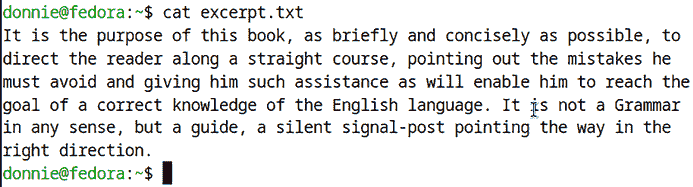
图 7.2：未格式化的文本

我觉得那有点太宽了，所以我将使用 `fmt` 并采用每行 75 个字符的默认目标设置，如下：

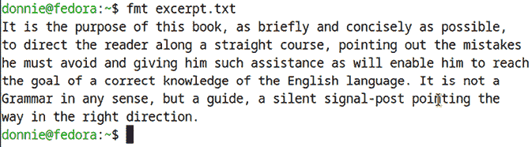
图 7.3：使用默认宽度的 `fmt`

它看起来仍然有点太宽。那么，让我们使用 `-w` 开关将其宽度缩小到 60 个字符，如下：

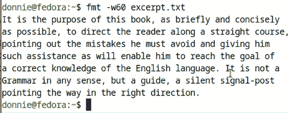
图 7.4：设置宽度为 60 个字符

再次考虑，让我们尝试使用 90 个字符的行宽，像这样：

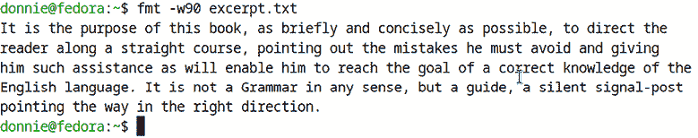
图 7.5：设置宽度为 90 个字符

`-u` 关确保每个单词之间始终有一个空格，每个句子之间有两个空格，看起来像这样：

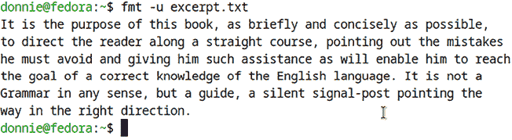
图 7.6：使用 `-u` 选项

如果你想缩短长行但不想拉长短行，请使用 `-s` 开关。（注意你可以使用单个连字符来组合开关）。它的样子如下：

```bash
[donnie@fedora ~]$ `fmt -sw60 excerpt.txt` It is the purpose of this book, as briefly and concisely as possible, to direct the reader along a straight course, pointing out the mistakes he must avoid and giving him such assistance as will enable him to reach the goal of a correct knowledge of the English language. It is not a Grammar in any sense, but a guide, a silent signal-post pointing the way in the right direction. [donnie@fedora ~]$
```

是的，`-s` 在这个特定文件中效果并不好，我自己也从未真正找到它的用途。但并不意味着你永远找不到它的用途。

一旦你终于决定喜欢你看到的内容，就使用重定向符号将输出保存到新文件中，如下：

```bash
[donnie@fedora ~]$ `fmt -uw80 excerpt.txt > formatted_excerpt.txt` [donnie@fedora ~]$
```

既然我们已经做够了格式化，让我们来做一些拆分。

## 使用 `split`

你可以使用 `split` 将一个大文本文件拆分为两个或多个较小文件。默认情况下，它取一个大文件并拆分为每个 1,000 行的小文件。（当然，最后一个文件可能会更小。）同样默认情况下，这些新小文件的名称将为 `xaa`、`xab`、`xac` 等。让我们先查看你从 Project Gutenberg 下载的公共领域电子书文件的行数，如下：

```bash
[donnie@fedora ~]$ `wc -l pg6409.txt` 6019 pg6409.txt [donnie@fedora ~]$
```

由于该文件有 6,019 行，`split` 将其拆分为六个每个 1,000 行的文件和一个仅有 19 行的文件。它的工作原理如下：

```bash
[donnie@fedora ~]$ `split pg6409.txt` [donnie@fedora ~]$

`ls -l x*` -rw-r--r--. 1 donnie donnie 38304 Sep 15 17:31 xaa -rw-r--r--. 1 donnie donnie 48788 Sep 15 17:31 xab -rw-r--r--. 1 donnie donnie 42676 Sep 15 17:31 xac -rw-r--r--. 1 donnie donnie 42179 Sep 15 17:31 xad -rw-r--r--. 1 donnie donnie 54845 Sep 15 17:31 xae -rw-r--r--. 1 donnie donnie 55021 Sep 15 17:31 xaf -rw-r--r--. 1 donnie donnie 792 Sep 15 17:31 xag [donnie@fedora ~]$
```

要验证这是否有效，使用 `wc` 执行每个文件的行数：

```bash
[donnie@fedora ~]$ `wc -l xaa xab xac xad xaf xag` 1000 1000 1000 1000 1000 1000 19 6019 [donnie@fedora ~]$
```

使用 `-a` 选项更改新文件名的长度。以下命令将给你五个字符后缀：

```bash
[donnie@fedora ~]$ `split -a5 pg6409.txt` [donnie@fedora ~]$

`ls -l x*` -rw-r--r--. 1 donnie donnie 38304 Sep 15 17:31 xaaaa -rw-r--r--. 1 donnie donnie 48788 Sep 15 17:31 xaaaa -rw-r--r--. 1 donnie donnie 42676 Sep 15 17:31 xab -rw-r--r--. 1 donnie donnie 42179 Sep 15 17:31 xac -rw-r--r--. 1 donnie donnie 54845 Sep 15 17:31 xad -rw-r--r--. 1 donnie donnie 55021 Sep 15 17:31 xae -rw-r--r--. 1 donnie donnie 792 Sep 15 17:31 xaf -rw-r--r--. 1 donnie donnie xag [donnie@fedora ~]$（注此处示例输出略有重复，逻辑一致）
```

你也可以将文件名前缀从 `x` 更改为任何你想要的。只需将所需的前缀添加到命令的末尾即可：

```bash
[donnie@fedora ~]$ `split -a5 pg6409.txt pg6409.txt` [donnie@fedora ~]$

`ls -l pg6409.txt*` -rw-r--r--. 1 donnie donnie 282605 Sep 13 17:39 pg6409.txt -rw-r--r--. 1 donnie donnie 38304 Sep 15 17:40 pg6409.txtaaaaa -rw-r--r--. 1 donnie donnie 48788 Sep 15 17:40 pg6409.txtaaab -rw-r--r--. 1 donnie donnie 42676 Sep 15 17:40 pg6409.txtaaac -rw-r--r--. 1 donnie donnie 42179 Sep 15 17:40 pg6409.txtaaad -rw-r--r--. 1 donnie donnie 54845 Sep 15 17:40 pg6409.txtaaae -rw-r--r--. 1 donnie donnie 55021 Sep 15 17:40 pg6409.txtaaaf -rw-r--r--. 1 donnie donnie 792 Sep 15 17:40 pg6409.txtaaag [donnie@fedora ~]$
```

如果你不想使用字母作为文件名后缀，请使用 `-d` 选项使用数字前缀。（再次注意你可以如何使用单个连字符组合开关）。像这样操作：

```bash
[donnie@fedora ~]$ `split -da5 pg6409.txt pg6409.txt` [donnie@fedora ~]$

`ls -l pg6409.txt0000*` -rw-r--r--. 1 donnie donnie 38304 Sep 15 17:42 pg6409.txt00000 -rw-r--r--. 1 donnie donnie 48788 Sep 15 17:42 pg6409.txt00001 -rw-r--r--. 1 donnie donnie 42676 Sep 15 17:42 pg6409.txt00002 -rw-r--r--. 1 donnie donnie 42179 Sep 15 17:42 pg6409.txt00003 -rw-r--r--. 1 donnie donnie 54845 Sep 15 17:42 pg6409.txt00004 -rw-r--r--. 1 donnie donnie 55021 Sep 15 17:42 pg6409.txt00005 -rw-r--r--. 1 donnie donnie 792 Sep 15 17:42 pg6409.txt00006 [donnie@fedora ~]$
```

但是，如果 1,000 行对于你的文件来说太长了呢？那么使用 `-l` 开关将其更改为其他。这里，我正在创建 400 行的文件：

```bash
[donnie@fedora ~]$ `split -da5 -l400 pg6409.txt pg6409.txt` [donnie@fedora ~]$
```

注意，当你使用两个或需要数字选项的开关时，必须为每个开关使用单独的连字符。

你可以使用 `-b` 开关创建特定字节大小的文件。这里，我正在将文件分成 900 字节的块：

```bash
[donnie@fedora ~]$ `split -da5 -b900 pg6409.txt pg6409.txt` [donnie@fedora ~]$
```

在 `-b` 开关的数字选项后添加 `k` 或 `m`，你就可以指定千字节或兆字节，而不是默认的字节。在这个示例中，我正在回到过去，假装我必须将文件分成部分，以便将其存储在两个旧式的 180 K 字节软磁盘上：

```bash
[donnie@fedora ~]$ `split -da5 -b180k pg6409.txt pg6409.txt` [donnie@fedora ~]$

`ls -l pg6409.txt000*` -rw-r--r--. 1 donnie donnie 184320 Sep 15 17:55 pg6409.txt00000 -rw-r--r--. 1 donnie donnie 98285 Sep 15 17:55 pg6409.txt00001 [donnie@fedora ~]$
```

我将结束 `split`。

通过一段告白来写这篇文章，为了抒发我的内心。正如我在上一段中暗示的，`split` 的原始目的是分割那些大到无法存储在单张老式软磁盘上的文本文件。

在现代，我们已经有了容量为几个 TB 的硬盘和固态硬盘，以及容量为几个 GB 的 USB 闪存盘。所以，你可能会发现 `split` 并不像以前那么有用了。但是，如果你计划参加 Linux 认证考试，请务记住它，因为你可能会看到一些关于它的问题。

好了，关于分割我们已经听够了，让我们来做一些翻译吧。

## 使用 `tr`

你可以使用 `tr` 来各种翻译任务。（毕竟，`tr` 确实代表 translate，翻译）。`tr` 并不是从一种语言翻译成另一种语言，而是从一个字符翻译成另一个字符，从一个字符范围到另一个范围，或者从一类字符到另一类。你还可以从文件中删除选定的字符，或者消除重复字符。

与我们目前查看过的工具相比，`tr` 的操作方式有很大不同。我们目前查看过的其他工具可以从你在命令行提供的参数中获取输入。因此，你不需要对它们使用 `stdin` 重定向器。`tr` 工具不能使用参数，所以你必须使用 `stdin` 重定向器，或者通过另一个命令管道它的输入。

对于第一个示例，创建文件 `translation.txt`，使用 `tr` 更改单个字符的所有出现。让文件看起来像这样：

```bash
[donnie@fedora ~]$ `cat > translation.txt` Let's translate all of the a's into A's. [donnie@fedora ~]$
```

现在，让我们进行实际翻译，如下：

```bash
[donnie@fedora ~]$ `tr 'a' 'A' < translation.txt` Let's trAnslAte All of the A's into A's. [donnie@fedora ~]$
```

在 `tr` 之后，我在单引号内放置了两个文本字符串。第一个字符串代表我想要查找并更改的内容。第二个字符串代表我们想要第一个字符串变成的内容。在这种情况下，我想把所有小写的 a 更改为大写的 A。

你可以通过逐个列出多个字符或通过指定字符字符范围来翻译多个字符。在接下来的示例中，我选择将 a 转换为 A，将 l 转换为 L。

```bash
[donnie@fedora ~]$ `cat > translation_2.txt` Let's translate all of the a's into A's and all of the l's into L's. [donnie@fedora ~]$ [donnie@fedora ~]$ `tr 'al' 'AL' < translation_2.txt` Let's trAnsLAte ALL of the A's into A's And ALL of the L's into L's. [donnie@fedora ~]$
```

使用连字符分隔字符以指定字符范围，如下：

```bash
[donnie@fedora ~]$ `cat > translation_3.txt` Let's now convert everything from a through l to A through L. [donnie@fedora ~]$ [donnie@fedora ~]$ `tr 'a-l' 'A-L' < translation_3.txt` LEt's now ConvErt EvErytHInG From A tHrouGH L to A tHrouGH L. [donnie@fedora ~]$
```

你可以指定多个范围，如下：

```bash
[donnie@fedora ~]$ `cat > translation_4.txt` Let's now convert everything from a through l to A through L, and everything from u through z to U through Z. [donnie@fedora ~]$ [donnie@fedora ~]$ `tr 'a-lu-z' 'A-LU-Z' < translation_4.txt` LEt's noW ConVErt EVErYtHInG From A tHroUGH L to A tHroUGH L, AnD EVErYtHInG From U tHroUGH Z to U tHroUGH Z. [donnie@fedora ~]$
```

其他类型的转换也是可能的。在这里，我正将字母 a 到 e 转换为数字 1 到 5：

```bash
[donnie@fedora ~]$ `cat > translation_5.txt` Let's now convert a through e to 1 through 5\. Are we ready? [donnie@fedora ~]$ [donnie@fedora ~]$ `tr 'a-e' '1-5' < translation_5.txt` L5t's now 3onv5rt 1 through 5 to 1 through 5\. Ar5 w5 r514y? [donnie@fedora ~]$
```

正如许多此类工具一样，`tr` 为你提供了执行某些操作多种方法。例如，要将文件中所有的小写字母转换为大写字母，你可以在命令中指定范围 `a-z` 和 `A-Z`，如下：


通过一段告白来写这篇文章，为了抒发我的内心。正如我在上一段中暗示的，`split` 的原始目的是分割那些大到无法存储在单张老式软磁盘上的文本文件。

在现代，我们已经有了容量为几个 TB 的硬盘和固态硬盘，以及容量为几个 GB 的 USB 闪存盘。所以，你可能会发现 `split` 并不像以前那么有用了。但是，如果你计划参加 Linux 认证考试，请务记住它，因为你可能会看到一些关于它的问题。

好了，关于分割我们已经听够了，让我们来做一些翻译吧。

## 使用 `tr`

你可以使用 `tr` 来各种翻译任务。（毕竟，`tr` 确实代表 translate，翻译）。`tr` 并不是从一种语言翻译成另一种语言，而是从一个字符翻译成另一个字符，从一个字符范围到另一个范围，或者从一类字符到另一类。你还可以从文件中删除选定的字符，或者消除重复字符。

与我们目前查看过的工具相比，`tr` 的操作方式有很大不同。我们目前查看过的其他工具可以从你在命令行提供的参数中获取输入。因此，你不需要对它们使用 `stdin` 重定向器。`tr` 工具不能使用参数，所以你必须使用 `stdin` 重定向器，或者通过另一个命令管道它的输入。

对于第一个示例，创建文件 `translation.txt`，使用 `tr` 更改单个字符的所有出现。让文件看起来像这样：

```bash
[donnie@fedora ~]$ cat > translation.txt Let's translate all of the a's into A's. [donnie@fedora ~]$
```

现在，让我们进行实际翻译，如下：

```bash
[donnie@fedora ~]$ tr 'a' 'A' < translation.txt Let's trAnslAte All of the A's into A's. [donnie@fedora ~]$
```

在 `tr` 之后，我在单引号内放置了两个文本字符串。第一个字符串代表我想要查找并更改的内容。第二个字符串代表我们想要第一个字符串变成的内容。在这种情况下，我想把所有小写的 a 更改为大写的 A。

你可以通过逐个列出多个字符或通过指定字符字符范围来翻译多个字符。在接下来的示例中，我选择将 a 转换为 A，将 l 转换为 L。

```bash
[donnie@fedora ~]$ cat > translation_2.txt Let's translate all of the a's into A's and all of the l's into L's. [donnie@fedora ~]$ [donnie@fedora ~]$ tr 'al' 'AL' < translation_2.txt Let's trAnsLAte ALL of the A's into A's And ALL of the L's into L's. [donnie@fedora ~]$
```

使用连字符分隔字符以指定字符范围，如下：

```bash
[donnie@fedora ~]$ cat > translation_3.txt Let's now convert everything from a through l to A through L. [donnie@fedora ~]$ [donnie@fedora ~]$ tr 'a-l' 'A-L' < translation_3.txt LEt's now ConvErt EvErytHInG From A tHrouGH L to A tHrouGH L. [donnie@fedora ~]$
```

你可以指定多个范围，如下：

```bash
[donnie@fedora ~]$ cat > translation_4.txt Let's now convert everything from a through l to A through L, and everything from u through z to U through Z. [donnie@fedora ~]$ [donnie@fedora ~]$ tr 'a-lu-z' 'A-LU-Z' < translation_4.txt LEt's noW ConVErt EVErYtHInG From A tHroUGH L to A tHroUGH L, AnD EVErYtHInG From U tHroUGH Z to U tHroUGH Z. [donnie@fedora ~]$
```

其他类型的转换也是可能的。在这里，我正将字母 a 到 e 转换为数字 1 到 5：

```bash
[donnie@fedora ~]$ cat > translation_5.txt Let's now convert a through e to 1 through 5\. Are we ready? [donnie@fedora ~]$ [donnie@fedora ~]$ tr 'a-e' '1-5' < translation_5.txt L5t's now 3onv5rt 1 through 5 to 1 through 5\. Ar5 w5 r514y? [donnie@fedora ~]$
```

正如许多此类工具一样，`tr` 为你提供了执行某些操作多种方法。例如，要将文件中所有的小写字母转换为大写字母，你可以在命令中指定范围 `a-z` 和 `A-Z`，如下：

```bash
[donnie@fedora ~]$ cat > translation_6.txt Let's now convert all lower-case letters into upper-case letters. [donnie@fedora ~]$ [donnie@fedora ~]$ tr 'a-z' 'A-Z' < translation_6.txt Let's now convert all lower-case letters into upper-case letters. [donnie@fedora ~]$
```

你可以使用字符类来执行某些操作。在这里，我正将字母 a 到 e 转换为数字 1 到 5：

```bash
[donnie@fedora ~]$ cat > translation_5.txt Let's now convert a through e to 1 through 5\. Are we ready? [donnie@fedora ~]$ [donnie@fedora ~]$ tr 'a-e' '1-5' < translation_5.txt L5t's now 3onv5rt 1 through 5 to 1 through 5\. Ar5 w5 r514y? [donnie@fedora ~]$
```

```bash
[donnie@fedora ~]$ cat > translation_10.txt Now, let's remove all of the control characters. [donnie@fedora ~]$ [donnie@fedora ~]$ tr -d [:cntrl:] < translation_10.txt Now, let's removeall of thecontrol characters.[donnie@fedora ~]$
```

当然，这个文件中唯一的控制字符是换行符（newline characters），不过这没关系。如果你有一个文件其中也包含了其他类型的控制字符，而你又只想删除所有的换行符，只需按照下面的方式操作即可：

```bash
[donnie@fedora ~]$ cat > translation_11.txt Now, I just want to delete the newline characters. [donnie@fedora ~]$ [donnie@fedora ~]$ tr -d '\n' < translation_11.txt Now,I just want todelete the newline characters.[donnie@fedora ~]$
```

如果你有一个给定的字符或字符类连续出现，你可以使用 `-s` 选项将它们替换为仅一个出现。它的效果是这样的：

```bash
[donnie@fedora ~]$ cat > translation_12.txt Take a look at the poor yellow dog. The poor little pooch isn't as peppy as he used to be. [donnie@fedora ~]$ [donnie@fedora ~]$ tr -s [:alpha:] < translation_12.txt Take a lok at the por yelow dog. The por litle poch isn't as pepy as he used to be. [donnie@fedora ~]$
```

如果你用 `-s` 选项指定了两个字符串，`tr` 将首先将第一个字符串中的字符替换为第二个字符串中的字符。然后，它会“挤压”产生的连续字符。和之前一样，准备好为你看到的内容感到惊讶吧：

```bash
[donnie@fedora ~]$ cat > translation_13.txt tennessee [donnie@fedora ~]$ [donnie@fedora ~]$ tr -s 'tnse' 'srne' < translation_13.txt serene [donnie@fedora ~]$
```

所以，我将 `tennessee` 变成了 `serene`。（在你的下次派对上试试这个花招，以防你需要活跃一下气氛。）

你可以将 `tr` 与其他文本流工具结合使用，看起来大致如下：

```bash
[donnie@fedora ~]$ sort autos.txt | tr [:lower:] [:upper:] | head BMW 325I 1985 115 450 BMW 325I 1985 60 1000 CHEVY IMPALA 1985 85 1550 CHEVY MALIBU 1999 50 3500 CHEVY MALIBU 2000 60 3000 EDSEL CORSAIR 1958 47 750 FORD EXPLORER 2003 25 9500 FORD GALAXIE 1964 128 60 FORD MUSTANG 1965 45 10000 FORD TAURUS 2004 10 17000 [donnie@fedora ~]$
```

这里有一个 `tr` 的更实用的用法。假设你得到了一个列数据文件，需要对其进行格式化打印。但是，列之间都用单个空格分隔，导致没有任何地方显示正常，如所示：

```bash
[donnie@fedora ~]$ cat > spaces.txt one two three four six eight ten [donnie@fedora ~]$ cat spaces.txt one two three four six eight ten
```

你不能使用 `expand` 将空格替换为制表符（tabs），因为列之间至少两个空格 `expand` 才能生效。在这种情况下，你可以使用 `tr` 将空格替换为制表符。（注意第一组单引号之间有一个空格。所以是的，你可以给空格引号。）

```bash
[donnie@fedora ~]$ tr ' '\t' < spaces.txt one two three four six eight ten
```

如果列之间确实有多个空格，`expand` 可能不是最佳选择。在这里，我在列之间放置了两个空格：

```bash
[donnie@fedora ~]$ cat > spaces_2.txt one two three four six eight ten
```

我将配合 `-t` 选项使用 `expand`，这样它只会用两个空格产生一个制表符，例如：

```bash
[donnie@fedora ~]$ expand -t spaces_2.txt one two three four six eight ten
```

那样好了一点，但东西看起来还是有点参齐。所以，我会用 `tr` 将空格替换为制表符，像这样：

```bash
[donnie@fedora ~]$ tr ' '\t' < spaces_2.txt one two three four six eight ten
```

漂亮多了，对吧？但由于原本列之间有两个空格，现在我列之间有两个制表符。我只想列之间保留一个制表符，所以我使用 `-s` 选项挤掉多余的制表符，像这样：

```bash
[donnie@fedora ~]$ tr -s ' '\t' < spaces_2.txt one two three four six eight ten
```

对于最后一个示例，考虑我之前展示给你的 Project Gutenberg 文件。记得它包含回车符（return characters），表明它是在 Windows 计算机上创建的。

## 使用 `xargs`

好了，够胡闹了。让我们开始工作。说真的，`xargs` 是一个非常有用的工具，可以以不同的方式使用。不过由于目前的主题是文本流过滤器，我们暂时只在这种背景下来看它。稍后我会向你展示它的其他用法。

`xargs` 本身无法工作，总是与其他工具配合使用。它的目的是从一个源获取输出并将其作为另一个命令的参数。它的原理与 `find` 的 `-exec` 选项相似，但有几点不同。即 `xargs` 可以与 `find` 以外的其他工具配合，它有更多选项，而且效率更高。让我们来看例子。

如果你想对多个文件进行排序，可以在调用 `sort` 时列出所有文件。为了演示，让我们回顾一下创建的 `actorfile_1.txt` 文件和 `actorfile_6.txt` 文件：

```bash
[donnie@fedora ~]$ cat actorfile_1.txt Benny Jack Allen Fred Ladd Alan Hitchcock Edgar

[donnie@fedora ~]$ cat actorfile_6.txt MacLaine Shirley Booth Stanwick Barbara Gracie
```

现在，让我们一起排序它们，如下：

```bash
[donnie@fedora ~]$ sort actorfile_1.txt actorfile_6.txt Allen Fred Allen Gracie Benny Jack Booth Shirley Hitchcock Alfred Ladd Alan MacLaine Robinson Edgar Stanwick Barbara
```

如果你只有两个文件需要排序，这种方法没问题。但如果你有一大堆文件想要排序呢？而且，如果你需要定期更新这些文件并在每次更新后重新排序呢？在 `sort` 命令中列出每个文件很快就会变得疲惫且繁琐。为了简化任务，你可以编写一个包含所有文件名的 shell 脚本，或者使用 `xargs`。

带有一个所有文件的列表。由于我们还没有学习过编写 shell 脚本，让我们来看下 `xargs`。

首先，创建一个包含你想要排序的文件列表的文件，如下所示：

```bash
[donnie@fedora ~]$ cat > xargs_sort.txt actorfile_1.txt actorfile_6.txt [donnie@fedora ~]$
```


如你所见，文件名可以全部在同一行，它们之间只有一个空格。或者，如果你愿意，也可以将每个文件名单独放在一行。两种方法效果都一样。

现在，使用`xargs`和`sort`来读取文件列表，然后对实际文件进行排序，如下所示：

```bash
[donnie@fedora ~]$ xargs sort < xargs_sort.txt
Allen
Fred
Allen
Gracie
Benny
Jack
Booth
Shirley
Hitchcock
Alfred
Ladd
Alan
MacLaine
Shirley
Robinson
Edgar
Stanwick
Barbara
[donnie@fedora ~]$
```

正如我所说，如果你有很多文件需要频繁更新和排序，这将非常方便。只需构建一个你需要排序的文件列表，这样你就不需要总是输入所有文件的名称了。

现在，让我们创建一个包含名称列表的文件，并使用`xargs`将该列表输入`echo`命令，如下所示：

```bash
[donnie@fedora ~]$ cat > howdy.txt
Jack, Jane, Joe, and John.
[donnie@fedora ~]$
[donnie@fedora ~]$ xargs echo "Howdy" < howdy.txt
Howdy Jack, Jane, Joe, and John.
[donnie@fedora ~]$
```

很很溜，对吧？（我知道你急待想在下一次聚会上上展示这个技巧了。）但是，这还有更多用法。

你可以使用`-i`关和一组大括号将参数放置在输出字符串的任何位置。

请注意，为了让此示例正常工作，输入文件中的每个名称必须单独占一行。这是因为`-i`会导致命令为输入文件中的每一行调用一次。

不管怎样，它的工作原理如下：

```bash
[donnie@fedora ~]$ cat > xargs_test.txt
Frank
Goldie
Vicky
[donnie@fedora ~]$
[donnie@fedora ~]$ xargs -i echo "Howdy {}. Are you busy for lunch?" < xargs_test.txt
Howdy Frank. Are you busy for lunch?
Howdy Goldie. Are you busy for lunch?
Howdy Vicky. Are you busy for lunch?
[donnie@fedora ~]$
```

如果我们使用`-n num`选项，我们可以告诉`xargs`每`num`行输入执行一次关联的命令。

```bash
[donnie@fedora ~]$ cat howdy.txt
Jack, Jane, Joe, and John.
[donnie@fedora ~]$
[donnie@fedora ~]$ xargs -n1 echo "Howdy" < howdy.txt
Howdy Jack,
Howdy Jane,
Howdy Joe,
Howdy and
Howdy John.
[donnie@fedora ~]$
```

那个效果不是太好，所以让我们尝试使用`-n2`看看是否有区别。

```bash
[donnie@fedora ~]$ xargs -n2 echo "Howdy" < howdy.txt
Howdy Jack, Jane,
Howdy Joe, and
Howdy John.
[donnie@fedora ~]$
```

这看起来好多了。

最后，我们可以使用`-l num`选项来确定我们想要输出的行数。在这里，我们正在创建两行输出。

```bash
[donnie@fedora ~]$ cat howdy.txt
Jack, Jane, Joe, and John.
[donnie@fedora ~]$
[donnie@fedora ~]$ xargs -l2 echo "Howdy" < howdy.txt
Howdy Jack, Jane,
Howdy Joe, and John.
[donnie@fedora ~]$
```

目前就是这些。`xargs`还有其他用法，我稍后介绍。接下来，让我们为重要的文本文件做最后的润饰。

## 使用`pr`

你一直在辛苦工作，使用各种文本流过滤器从文件中提取有意义的数据，并创建报告。现在是时候通过将工作提交到纸上让付出有所回报了。当然，你可以不使用`pr`直接打印文件。但为了美观，`pr`可以提供最后的点缀。

通过`pr`，你可以轻松地将文件拆分成页进行打印，并添加页眉和页码。在这方面，它比普通的文本编辑器要好。事实上，它几乎就像使用微型文字处理器。它还提供了文本编辑器无法提供的其他格式选项（稍后你会看到一些示例）。

一旦你使用`pr`完成格式化，你可以通过将`pr`的输出管道到`lpr`工具，或者通过将文件名作为参数调用`lpr`来从命令行打印（稍后我会告诉你更多关于`lpr`的信息）。有几个理由让你这样做。如果你在一个没有安装 GUI 的 Linux 或 Unix 服务器上工作，你需要知道如何从命令行打印，因为文本编辑器不包含打印功能。此外，如果你知道如何从命令行打印，你就能……

默认情况下，`pr`通过在每页末尾插入换行符分页。使用`-f`选项在页之间插入分页符。如果你需要插入行号，使用`-n`选项。在这里，我正在结合这两者逻辑。

默认情况下，`pr`在页眉中放置日期、文件名和页码。你可以使用`-t`选项来省略页眉。这是一个示例：


你可以使用`-h`选项来替换文件名。在这里，我正在设置页眉为：


使用`-o`选项配合数字设置左边距（数字表示缩进的空格数）。在这里，我正在设置边距为：


最后，我们可以使用`-l num`选项来确定我们想要的输出行数。在这里，我们正在创建两行输出。

```bash
[donnie@fedora ~]$ cat howdy.txt
Jack, Jane, Joe, and John.
[donnie@fedora ~]$
[donnie@fedora ~]$ xargs -l2 echo "Howdy" < howdy.txt
Howdy Jack, Jane,
Howdy Joe, and John.
[donnie@fedora ~]$
```

目前就是这些。`xargs`还有其他用法，我稍后介绍。接下来，让我们为重要的文本文件做一些最后的润饰。

## 图 7.13：使用双栏的首次尝试

你可以看到这并没有什么用，因为遗掉了太多内容。处理这种情况的最简单方法是使用`fmt`更改行宽，然后将输出管道给`pr`，如下：

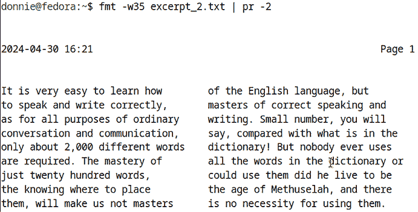

## 图 7.14：结合`fmt`和`pr`

当然，你可能需要对行宽进行实验，直到得到想要的结果。

在使用合并（merge）选项时也会遇到相同的问题。在这里，我使用`-m`参数来并排显示两个文件：

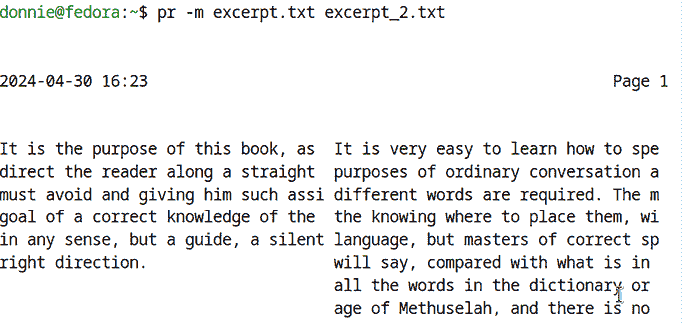

## 图 7.15：合并两个文件的首次尝试

同样，你看到行太宽了，无法正常放入双栏中。处理此问题 Best 方法是使用`fmt`缩小行，但将输出保存到两个中间文件中。然后，使用`pr`合并这两个新文件。该过程如下：

```bash
[donnie@fedora ~]$ fmt -w35 excerpt.txt > excerpt_fmt.txt
[donnie@fedora ~]$ fmt -w35 excerpt_2.txt > excerpt_2_fmt.txt
```

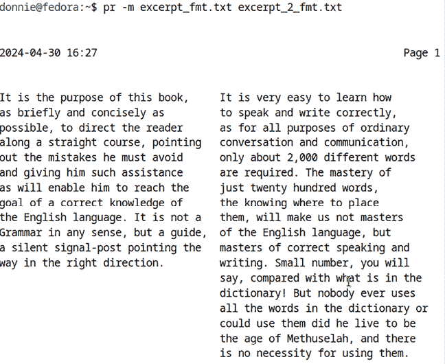

## 图 7.16：合并两个格式化后的文件

一旦屏幕上的显示效果看起来良好，你就可以准备将`pr`的输出重定向到一个新的文本文件中，然后将其打印。

## 从命令行打印

正如我已经提到的几次的，可以从命令行打印文本文件。（实际上，你也可以从命令行打印 PostScript 文件、`.pdf`文件、图像文件以及其他类型的文档文件。但目前我们只对打印文本文件感兴趣。）要实现这一点，你的 Linux、Unix 或类 Unix 机器需要安装以下两项内容：

1. **通用 Unix 打印软件 (CUPS)：** 这通常在 Linux 的桌面版本中默认安装，但在文本模式的 Linux 服务器版本中没有。
2. **打印机的正确驱动程序：** CUPS 包含了广泛的可用打印机驱动程序。然而，你的特定打印机可能未在内。如果是这样，你需要从打印机制造商获取正确的驱动程序并按照其说明进行安装。

安装 CUPS 通常很容易，因为它包含在大多数 Linux 发行版的仓库中。在任何类型的 Red Hat 风格机器（如 Fedora、AlmaLinux、Rocky Linux、Oracle Linux 或 RHEL）上，只需：

```bash
sudo dnf install cups
```

在 Debian 或其任何衍生版本上，你需要两个包。要安装它们，只需执行：

```bash
sudo apt install cups cups-bsd
```

接下来，你需要确认 CUPS 是否包含你打印机的驱动程序。在 Red Hat 类型系统上使用`lpinfo -m`命令，在 Debian 类型系统上使用`sudo lpinfo -m`命令。

如果你想滚动查看整个列表，可以将输出管道给`less`。如果你想搜索特定的打印机制造商，可以将其管道给`grep`，它看起来像这样：

```bash
donnie@debian:~$ sudo lpinfo -m | grep -i brother
donnie@debian:~$
```

因此，Debian 版本的 CUPS 不包含任何 Brother 打印机的驱动程序。但正如你在这里看到的，我 Fedora 工作站上的 CUPS 拥有非常多的 Brother 打印机驱动程序：

```bash
[donnie@fedora ~]$ lpinfo -m | grep -i brother
gutenprint.5.3://brother-dcp-1200/expert
Brother DCP-1200 - CUPS+Gutenprint v5.3.4
gutenprint.5.3://brother-dcp-1200/simple
Brother DCP-1200 - CUPS+Gutenprint v5.3.4 Simplified
gutenprint.5.3://brother-dcp-8045d/expert
Brother DCP-8045D - CUPS+Gutenprint v5.3.4
gutenprint.5.3://brother-dcp-8045d/simple
Brother DCP-8045D - CUPS+Gutenprint v5.3.4 Simplified
. . .
. . .
. . .
print.5.3://brother-mfc-9600/expert
Brother MFC-9600 - CUPS+Gutenprint v5.3.4
gutenprint.5.3://brother-mfc-9600/simple
Brother MFC-9600 - CUPS+Gutenprint v5.3.4 Simplified
MFC7460DN.ppd
Brother MFC7460DN for CUPS
lsb/usr/MFC7460DN.ppd
Brother MFC7460DN for CUPS
[donnie@fedora ~]$
```

唯一的麻烦是，Fedora 工作站没有我的 Brother MFC7460DN 打印机的驱动程序，因此我必须从 Brother 网站下载驱动程序并手动安装。（我安装的驱动程序由列表最后两项表示。）`lpstat -p -d`命令向我显示了打印机的状态，如下：

```bash
[donnie@fedora ~]$ lpstat -p -d
printer MFC7460DN is idle. enabled since Tue 19 Sep 2023 06:17:03 PM EDT
system default destination: MFC7460DN
```

- Linux 下的`wc`命令及示例：https://www.geeksforgeeks.org/wc-command-linux-examples/
- Linux 下的`tr`命令及示例：https://linuxize.com/post/linux-tr-command/
- 如何使用 Linux`tr`命令：https://www.howtogeek.com/886723/how-to-use-the-linux-tr-command/
- 像海盗一样说话日：https://nationaltoday.com/talk-like-a-pirate-day/
- 如何在 Linux 上使用`xargs`命令：https://www.howtogeek.com/435164/how-to-use-the-xargs-command-on-linux/
- 我如何使用 Linux`fmt`命令格式化文本：https://opensource.com/article/22/7/fmt-trivial-text-formatter
- Linux 下的`pr`命令：https://www.geeksforgeeks.org/pr-command-in-linux/
- 掌握 Linux “pr” 命令：全面指南：https://hopeness.medium.com/master-the-linux-pr-command-a-comprehensive-guide-b166865c933e

## 答案

- b 和 c
- c
- d
- b
- a

## 在 Discord 上加入我们的社区！

与其他用户、Linux 专家以及作者本人一起阅读这本书。

提问、为其他读者提供解决方案、通过 Ask Me Anything 活动与作者聊天，以及许多更多功能。扫描二维码或访问链接即可加入社区。

[`packt.link/SecNet`](https://packt.link/SecNet)


## 8

## 基础 Shell 脚本构建

是的，我知道。你急于开始创建一些 shell 脚本，但一直还没有这样做。所以，在本章中，我们将介绍 shell 脚本构建的基础知识。然后我们将通过查看一些既实用又有用的 shell 脚本来结束课程。

在本章中介绍的许多技术适用于任何 shell，但我也会介绍一些可能只在`bash`上有效的技术。不过，为了简单起见，我目前将坚持使用`bash`。在第 22 章使用`zsh` Shell 的中，我将向你展示特定于`zsh`的技术。在第 19 章 Shell 脚本的可移植性中，我将向你展示适用于多种 shell 的技术。

你将在本章看到的主题包括：

- 了解基础 shell 脚本构建
- 执行测试
- 理解子 shell (subshells)
- 理解脚本变量
- 理解数组变量
- 理解变量扩展
- 理解命令替换
- 理解判断和循环
- 理解位置参数
- 理解退出状态
- 关于`echo`的更多信息
- 查看一些真实示例

好了，如果你准备好了，我们开始吧。

## 技术要求

使用任何安装了`bash`的 Linux 发行版。如果你是 Mac 用户，你可能需要使用你其中某一个 Linux 虚拟机，因为某些脚本使用的命令在 macOS 上无法运行。在学习本章时，你可以随时在本地机器上操作，但请注意我将提供一些实际的实验室。

我还包含了一个使用 FreeBSD 虚拟机的实操练习。创建 FreeBSD 虚拟机并安装`sudo`和`bash`，正如我在书序言中所展示的那样。

此外，正如我在序言中解释的，你可以通过以下操作从 Github 仓库下载脚本：

```bash
git clone https://github.com/PacktPublishing/The-Ultimate-Linux-Shell-Scripting-Guide.git
```

## 了解基础 Shell 脚本构建

创建 shell 脚本时需要做的第一件事是定义你想使用哪个 shell 来解释该脚本。

你选择某一个 shell 而不是另一个可能有特定的原因。我们将在第 19 章“Shell 脚本的可移植性”和第 22 章“使用 Z Shell”中讨论。

你将在 shebang 行中定义作为解释器使用的 shell，shebang 行是脚本的第一行。它看起来像这样：

```bash
#!/bin/bash
```

通常情况下，以`#`符号开头的行表示会被 shell 忽略的注释。但 shebang 行——请不要问我为什么叫这个名字——是该条规则的例外。除了定义你想要使用的特定 shell（例如`/bin/bash`或`/bin/zsh`）外，你还可以定义通用的`/bin/sh` shell 以使你的脚本更具可移植性，这样它们就能在更广泛的 shell 和操作系统上运行。它的样子是这样的：

```bash
#!/bin/sh
```


这种通用的`sh` shell旨在让你能够在可能安装也可能未安装`bash`的不同系统上运行脚本。但它存在问题，因为`sh`所代表的各种shell之间并不完全兼容。以下是其工作原理的分解：

- 在FreeBSD以及可能的其他伯克利软件发行版(BSD)类型系统中，`sh`可执行文件是旧式的Bourne shell，它是Bourne Again Shell(`bash`)的祖先。
- 在Red Hat类型系统中，`sh`是指向`bash`可执行文件的符号链接。请注意（我将在第19章Shell脚本的可移植性中详细解释），`bash`可以其他shell无法使用的功能。
- 在Debian/Ubuntu类型系统中，`sh`是指向`dash`的符号链接。
- 在Alpine Linux上，`sh`是指向`ash`的符号链接。
- 在OpenIndiana（Oracle Solaris的分支）上，`sh`是指向`ksh93`的符号链接。
- macOS上，`sh`是指向`bash`的符号链接。（奇怪的是，`zsh`是macOS的默认登录shell，但`bash`仍然默认安装。）

注意在脚本中使用`#!/bin/sh`可能会有问题。这是因为`sh`代表的各种shell并不完全兼容。所以，假设你在Red Hat机器上创建一个脚本，该机器的`sh`指向`bash`。脚本可能在Debian或FreeBSD机器上无法运行，它们分别指向`dash`和Bourne shell。由于这个原因，我们现在将关注`bash`，并使用`#!/bin/bash`作为我们的shebang。

shell脚本可以根据你的需要简单或复杂。它可以只是顺序执行的多个普通Linux/Unix命令的组合。你也可以拥有复杂的使用高级语言（如C）编写的脚本。

让我们先看一个非常简单的命令脚本。

```bash
#!/bin/bash

rsync -avhe ssh /var/www/html/images/ root@192.168.0.22:/var/www/html/images/
```

这是一个单命令行脚本，我曾用它将一台计算机上的`images`目录备份到另一台Debian计算机的备份目录中。它通过安全shell(`ssh`)会话使用`rsync`及其相应的选项来同步这两个目录。（尽管我通常不允许root用户进行`ssh`登录，但在这种这是必要的。显然，我只会在局域网上这样做，绝不会跨互联网这样做。）恰恰，我将脚本命名为`rsync_with_debian`。在运行脚本之前，我必须添加执行权限，如下：

```bash
chmod u+x rsync_with_debian
```

在`rsync_with_debian`脚本的第二行（shebang行之后），你看到了你在没有脚本时在命令行中输入的完全相同的命令。所以，你看，通过创建脚本我大大简化了事情。

为了让系统上的所有用户都能使用此脚本，请将其放在`/usr/local/bin/`目录，该目录应该在每个人的`PATH`设置中。

在继续之前，让我们通过一个动手实验来巩固你刚刚学到的知识。

## 动手实验 – 统计登录用户

本实验将帮助你创建一个shell脚本，显示有多少个用户已登录，然后对其进行修改，以便只列出唯一用户。（此脚本使用了你在前两个章节中学习过的某些文本流过滤器。）

在你其中一台Linux虚拟机上，创建三个额外的用户账户。在你的Fedora虚拟机上，按照以下方式操作，但请选择你自己的用户名：

```bash
sudo useradd vicky
sudo passwd vicky
```

在Debian虚拟机上，按照以下方式操作：

```bash
sudo adduser vicky
```

在虚拟机的本地终端中，获取其IP地址，如下：

```bash
ip a
```

在你的宿主机上打开四个终端窗口。使用你自己的虚拟机的IP地址，从其中一个窗口登录自己的账户，然后从其他窗口登录每个其他账户。命令看起来像这样：

```bash
ssh vicky@192.168.0.9
```

从你登录的终端窗口中，查看当前登录的所有用户，如下：

```bash
who
```

你应该看到五个用户，因为你自己的账户会在本地终端登录时显示一次，远程`ssh`登录时显示一次。

创建`logged-in.sh`脚本，使其看起来如下：

```bash
#!/bin/bash

users="$(who | wc -l)"

echo "There are currently $users users logged in."
```

我使用了命令替换的概念，将`who | wc -l`命令的输出赋值给脚本变量`users`的值。（稍后我会告诉你更多关于命令替换的内容，所以先不用担心它。）

让脚本具有可执行权限，如下：

```bash
chmod u+x logged-in.sh
```

现在，运行脚本，如下：

```bash
./logged-in.sh
```

输出应该像这样：

```
There are currently 5 users logged in.
```

这里的问题是，实际上只有四个用户，因为你的用户名被计算了两次。所以，让我们修复这个问题。

修改`logged-in.sh`脚本，使其现在看起来如下：

```bash
#!/bin/bash

users="$(who | wc -l)"

echo "There are currently $users users logged in."

uniqusers="$(who | cut -d" " -f1 | sort | uniq | wc -l)"

echo "There are currently $uniqusers unique users logged in."
```

变量`uniqusers`是通过管道传递到`()`内部的所有命令创建的。`cut`操作以空格为分隔符（`-d" "`），并且第一个字段（`-f1`）是你从`who`的输出中截取的内容。该输出被传递给`sort`，然后传递给`uniq`，后者只会将唯一用户的名称发送给`wc -l`命令。

再次运行脚本，输出应该像这样：

```
There are currently 5 users logged in. There are currently 4 unique users logged in.
```

对脚本进行最后一次修改，以列出登录的唯一用户的名称。完成后的脚本如下：

```bash
#!/bin/bash

users="$(who | wc -l)"

echo "There are currently $users users logged in."

uniqusers="$(who | cut -d" " -f1 | sort | uniq | wc -l)"

echo "There are currently $uniqusers unique users logged in."

listusers="$(who | cut -d" " -f1 | sort | uniq)"

echo "These users are currently logged in: \n$listusers "
```

再次运行脚本，你应该会得到类似这样的输出：

```
There are currently 5 users logged in. There are currently 4 unique users logged in. These users are currently logged in: cleopatra donnie frank vicky
```

恭喜！你刚刚创建了你的第一个shell脚本。现在，让我们来一些测试。

## 执行测试

有时，你的脚本在决定采取何种操作之前，需要测试某个条件。你可能需要检查某个文件或目录是否存在，某个文件或目录是否设置了某些权限，或者许多其他事情。执行测试有三种方法，如下：

1. 使用关键字`test`后面跟一个测试条件，并用`&&`或`||`结构连接另一个命令。
2. 将测试条件封装在一对方括号。
3. 使用`if. .then`结构。

让我们先来看看`test`关键字。

## 使用test关键字

对于我们的第一个例子，让我们测试某个目录是否存在，如果不存在则创建它。它的工作原理如下：

```bash
[donnie@fedora ~]$ test -d graphics || mkdir graphics
[donnie@fedora ~]$ ls -ld graphics/ drwxr-xr-x. 1 donnie donnie 0 Sep 26 15:41 graphics/
[donnie@fedora ~]$
```

现在，让我们将其放入`test_graphics.sh`脚本中：

```bash
#!/bin/bash

test -d graphics || mkdir graphics
```

现在，让我们把这个脚本放入：

```bash
[donnie@fedora ~]$ test -d graphics || mkdir graphics
```

运行这个脚本，看看结果：

```
[donnie@fedora ~]$ ./test_graphics.sh
[donnie@fedora ~]$
```

正如你所预料的，`-d`会检查目录是否存在。`||`结构在目录不存在时执行`mkdir`。这是一种安全措施，可以防止覆盖文件（稍后我们会介绍更多测试运算符）。

## 在括号内封装测试

现在，让我们看看第二种方法，将测试条件封装在方括号内，如下：`[ -d graphics ]`

首先，注意在第一个括号和第二个括号之间有一个空格。将其放入`test_graphics.sh`脚本中：

```bash
#!/bin/bash
[ -d graphics ] || graphics
```

运行这个脚本，看看得到什么：

```
[donnie@fedora ~]$ ./test_graphics.sh
[donnie@fedora ~]$
```

正如你所见的，这与第一个脚本的输出完全相同。现在，让我们给它一点花样。修改`test_graphics.sh`脚本，使其看起来如下：

```bash
#!/bin/bash
[ ! -d graphics ] && graphics
```

`!`运算符是取反运算符，它让运算符执行预期的相反操作。在这种情况下，`!`让`-d`检查目录不存在。为了让其工作，我必须将`||`运算符更改为`&&`运算符。

你也可以测试数值，如下：`[ $var -eq 0 ]`

你可以看到我调用变量`var`的值，并测试它是否等于（`-eq`）0。与其在这里使用取反（`!`）来测试它不等于0，不如使用`-ne`运算符。让我们看看在`test_var.sh`脚本中是怎样的：

```bash
#!/bin/bash
var1=0
var2=1
[ $var1 -eq 0 ] && echo "$var1 is equal to zero."
[ $var2 -ne 0 ] && echo "$var2 is not equal to zero."
```

现在，运行它：

```
[donnie@fedora ~]$ ./test_var.sh
0 is equal to zero.
1 is not equal to zero.
[donnie@fedora ~]$
```

## 使用if. .then结构

执行测试的第三种方法是使用`if. .then`结构，我们稍后会讨论。

使用`if. .then`结构对于复杂的测试条件非常有用。这里有一个最简单的示例，形式为`test_graphics_3.sh`脚本：

```bash
#!/bin/bash
if [ ! -d graphics ]; then
    mkdir graphics
fi
```

该结构以`if`语句开始，以`fi`语句结束。（那是`if`的反过来写）。在测试条件后放置一个分号，然后跟`then`关键字。之后，指定你想执行的操作，在本例中是`mkdir graphics`。虽然在shell脚本中缩进操作块不像在其他语言中那样必要，但它有助于提高脚本的可读性。

不仅仅是这些结构。不过不用担心，我会在`Understanding Decisions and Loops`（理解决策与循环）部分向你介绍更多关于它们的内容。在此之前，我想向你展示一些更多的概念，可以用它们让你的`if. . .then`结构更加丰富。

现在，让我们看看你可以进行的其他类型的测试。

## 使用其他类型的测试

你可以进行很多其他类型的测试，包括文本字符串比较、数值比较、文件或目录是否存在，以及它们设置了什么权限。这里是一些常用测试及其操作符的表格：

| 操作符 | 测试 |
| - | - |
| `-b filename` | 如果存在指定名的块设备文件，则为真。 |
| `-c filename` | 如果存在指定名的字符设备文件，则为真。 |
| `-d directory_name` | 如果存在指定目录名的目录，则为真。 |
| `-e filename` | 如果存在任何类型的文件，则为真。 |
| `-f filename` | 如果存在指定名的普通文件，则为真。 |
| `-g filename` | 如果文件或目录设置了SGID权限，则为真。 |
| `-G filename` | 如果文件存在且由有效组ID所有，则为真。 |
| `-h filename` | 如果文件存在且是符号链接，则为真。 |
| `-k filename` | 如果文件或目录存在且设置了粘滞位（sticky bit），则为真 |
| `-L filename` | 如果文件存在且是符号链接，则为真。（这与`-h`相同。） |
| `-p filename` | 如果文件存在且是命名管道，则为真。 |
| `-O filename` | 如果文件存在且由有效UID所有，则为真。 |
| `-r filename` | 如果文件存在且可读，则为真。 |
| `-S filename` | 如果文件存在且是套接字，则为真。 |
| `-s filename` | 如果文件存在且大小不零，则为真。 |
| `-u filename` | 如果文件存在且设置了SUID位，则为真。 |
| `-w filename` | 如果文件存在且可写，则为真。 |
| `-x filename` | 如果文件存在且可执行，则为真。 |
| `file1 -nt file2` | 如果`file1`新于`file2`，则为真 |
| `file1 -ot file2` | 如果`file1`旧于`file2`，则为真 |
| `-z string` | 如果文本字符串的长度为0，则为真 |
| `-n string` | 如果文本字符串的长度不为0，则为真 |
| `string1 == string2` | 如果两个文本字符串相同，则为真 |
| `string1 != string2` | 如果两个文本字符串不相同，则为真 |
| `string1 < string2` | 如果`string1`在字母顺序上在`string2`之前，则为真 |
| `string1 > string2` | 如果`string1`在字母顺序上在`string2`之后，则为真 |
| `integer1 -eq integer2` | 如果两个整数相等，则为真 |
| `integer1 -ne integer2` | 如果两个整数不相等，则为真 |
| `integer1 -lt integer2` | 如果`integer1`小于`integer2`，则为真 |
| `integer1 -gt integer2` | 如果`integer1`大于`integer2`，则为真 |
| `integer1 -le integer2` | 如果`integer1`小于或等于`integer2`，则为真 |
| `integer1 -ge integer2` | 如果`integer1`大于或等于`integer2`，则为真 |
| `-o optionname` | 如果启用了shell选项，则为真 |

我知道，内容非常多，对吧？不过没关系。如果你不想背下这些，可以把这张表留着参考。

接下来，我们来谈谈子进程（subshells）。

## 理解子进程

当你使用`[ $var -ne 0 ]`结构进行测试时，会调用子进程。为了防止测试调用子进程，请改用这种结构：

```
[[ $var -ne 0 ]]
```

这可以让你的脚本运行得稍微高效，对于你特定的脚本来说可能并不是什么大事。

当你执行需要匹配正则表达式的测试时，这种`[[. . .]]`类型结构也是必要的。（正则表达式匹配无法在`[. . .]`结构中工作。）

这种`[[. . .]]`结构的缺点是它无法在某些非`bash` shell上使用，例如`dash`、`ash`或`Bourne`。（你将在第19章脚本脚本移植性中看到这一点。）

当然，你现在还不知道正则表达式，没关系。我会在第9章使用`grep`、`sed`和正则表达式过滤文本时为你详细介绍。

无论如何，你都可以尝试运行带子进程和不带子进程的脚本，看看哪种更适合你。

我们现在已经查看了所有的测试方法。那么，来练习练习如何？

## 实验 – 测试条件

对于这一步，请从Github仓库下载`tests-test.sh`脚本。（这是一个很长的脚本，由于书籍排版的考虑，我无法在这里复制。）用你的文本编辑器打开脚本，检查它是如何构建的。你首先看到的是它检查`myfile.txt`文件是否存在，如下：


在你的脚本开始时，每当你运行脚本时，都会调用一个新的非交互式子 shell。当脚本结束时，子 shell 会终止。子 shell 会继承从父 shell 导出（`export`）的所有变量。但是，父 shell 不会继承子 shell 的任何变量。为了演示，让我们在父 shell 中将 `car` 变量设置为 `Volkswagen`，如下：

```bash
[donnie@fedora ~]$ export car="Volkswagen"
[donnie@fedora ~]$ echo $car
Volkswagen
```

接下来，创建 `car_demo.sh` 脚本，如下：

```bash
#!/bin/bash
echo \$car is set to $car
export car=Toyota
echo "The $car is very fast."
echo \$car is set to $car
```

赋予该文件可执行权限，然后运行脚本。输出应该如下所示：

```bash
[donnie@fedora ~]$ ./car_demo.sh
car is set to Volkswagen
The Toyota is very fast.
car is set to Toyota
[donnie@fedora ~]$
```

注意 `car` 的值 `Volkswagen` 是如何从父 shell 继承的。这是因为我使用了 `export` 命令确保该值对脚本调用的子 shell 可用。让我们再次尝试，但这次我不再导出该变量：

```bash
[donnie@fedora ~]$ unset car
[donnie@fedora ~]$ car=Studebaker
[donnie@fedora ~]$ ./car_demo.sh
car is set to 
The Toyota is very fast.
car is set to Toyota
[donnie@fedora ~]$
```

为了让这生效，我必须先取消（`unset`）`car` 变量。除了清除 `car` 的值，它还清除了导出状态。当我这次运行脚本时，它找不到我在父 shell 中设置的 `car` 的值。

那么，为什么这很重要？这是因为你有时可能会发现自己正在编写会调用另一个脚本的脚本，而该脚本实际上会打开另一个子 shell。如果你想让变量对子 shell 可用，你就必须导出它们。

## 理解大小敏感性

变量名是对大小敏感的。因此，名为 `car` 的变量与名为 `Car` 或 `CAR` 的变量完全不同。

环境变量名使用全大写字母，编程变量名的最佳实践是使用全小写字母或混合大小写。令人惊讶的是，Linux 和 Unix shell 并不对编程变量强制执行这条规则。但它是最佳实践，因为这有助于防止你不小心覆盖重要环境变量的值。

遗憾的是，网络上有一些 shell 脚本教程，作者在其中让你创建了全大写字母的编程变量名。事实上，我恰好遇到了其中一个教程。在大多数情况下，作者让你创建的变量名与任何环境变量都不冲突。但在其中某一个地方，作者让你创建了 `USER` 变量并给它分配了一个值。当然，`USER` 已经是一个环境变量的名字了，因此给它分配一个新值将覆盖它本应有的值。这里的教训是，网络上有很多优秀的教程，但也有很多提供错误信息的教程。

## 理解只读变量

你刚刚看到当你以普通方式声明变量时，你可以取消它，也可以给它赋一个新值。你还可以将变量设置为只读（read-only），这可以防止变量被重新定义或取消。其工作原理如下：

```bash
[donnie@fedora ~]$ car=Nash
[donnie@fedora ~]$ echo $car
Nash
[donnie@fedora ~]$ readonly car
[donnie@fedora ~]$ unset car
bash: unset: car: cannot unset: readonly variable
[donnie@fedora ~]$ car=Hudson
bash: car: readonly variable
```

设置了只读属性后，我更改或删除 `car` 的唯一方法就是关闭终端窗口。

嗯，如果你没有 root 用户权限，这是你删除只读变量的唯一方法。如果你有 root 用户权限，可以使用 GNU bash 调试器（`gbd`）来删除它。但这超出了本章的范围。（我们将在第 21 章“调试 shell 脚本”中查看 `gbd`。）

好了，如果你只需要定义一些单独的变量，这些都很棒了。但如果你需要一整个变量列表呢？这时数组就派上用场了。让我们接下来来看。

## 理解数组变量

数组允许你将一个列表收集到一个变量中。创建数组变量的简单方法是给它的其中一个索引赋值，如下所示：

`name[index]=value`

在这里，`name` 是数组名，`index` 是项目在数组中的位置。（注意索引必须是数字）。`value` 是为数组中该特定项目设置的值。

数组的编号系统从 0 开始。因此，`name[0]` 是数组中的第一个项目。要创建一个索引数组，使用带有 `-a` 选项的 `declare` 命令：

```bash
[donnie@fedora ~]$ declare -a myarray
[donnie@fedora ~]$
```

接下来，让我们创建一个将插入的列表，如下：

```bash
[donnie@fedora ~]$ myarray=(item1 item2 item3)
```

要查看数组中任何项目的值，使用大括号包裹变量名：`${myarray[0]}`。要查看整个列表，使用`${myarray[*]}`。要统计数组中的数量，在变量名前面加上 `#`：`${#myarray}`。

## 操作实验 – 使用数组

为了看到数组是如何构建的，创建一个如下内容的 `ip.sh` 脚本：

```bash
#!/bin/bash
echo "IP Addresses"
declare -a ip=(192.168.3.7)
echo "The first item in the array is ${ip[0]}, the first item in the list."
echo "The second item in the array is ${ip[1]}, the second item in the list."
echo "The third item in the array is ${ip[2]}, the third item in the list."
```

赋予该文件可执行权限并运行脚本。

```bash
chmod +x ip.sh
./ip.sh
```

创建 `/opt/scripts` 目录以存储脚本需要的文件：

```bash
sudo mkdir /opt/scripts
```

在 `/opt/scripts/` 目录下创建 `banned.txt` 文件。（注意在该目录下打开时你需要使用 `sudo`）。向其中添加以下内容：

```text
192.168.0.4
24.190.78.101
38.101.148.126
41.206.45.202
58.0.0.0/8
59.107.0.0/17
59.108.0.0/15
59.110.0.0/15
59.151.0.0/17
59.155.0.0/16
59.172.0.0/15
```

在你自己的家目录下，创建 `attackers.sh` 脚本，它将从文本文件中构建一个 IP 地址数组。添加以下内容：

```bash
#!/bin/bash
badips=$(cat /opt/scripts/banned.txt)
declare -a attackers=( $badips )
echo "Here is the complete list: "
${attackers[@]}
echo "Let us now count the items in the list."
num_attackers=${#attackers[*]}
echo "There are $num_attackers IP addresses in the list."
echo "attackers[2] is ${attackers[2]}, which is the third address in the list."
exit
```

设置执行权限并运行脚本：

```bash
chmod +x attackers.sh
./attackers.sh
```

修改脚本打印第 0、5 和 8 个元素，并重新运行脚本。（你已经知道怎么做了。）

实验结束

关于这个 `attackers.sh` 脚本，这里有一些说明。首先，在第二行中，我正在使用命令替换配合 `cat` 命令将文件的内容赋值给 `badips` 变量。（我知道，我一直在向你们展示命令替换的示例，但我还没有完全解释它。别担心，我稍后会解释。）然而，这仍然不是数组。我已经在 `declare -a` 那一行中单独创建了它。

在 `attackers=` 那一行中，我调用了 `badips` 变量的值，然后用它来构建 `attackers` 数组。或者，我也可以跳过中间变量，直接从 `cat` 命令替换中构建数组，就像我在 `attackers_2.sh` 脚本中做的那样：

```bash
#!/bin/bash
declare -a badips
badips=( $(cat /opt/scripts/banned.txt) )
echo "Here is the complete list: "
echo ${badips[@]}
echo
echo "Let us now count the items in the list."
elements=${#badips[*]}
echo "There are $elements IP addresses in the list."
echo
echo "badips[2] is ${badips[2]}, which is the third address in the list."
exit
```

两种方法都可行，但这种方法更精简。

在现实场景中，你可以添加代码来自动调用防火墙规则，阻止 `banned.txt` 文件中的所有地址。但是，这需要使用我尚未向你们展示过的技术。所以，我们以后再讨论这个问题。

接下来，让我们扩展一些变量。

## 理解变量扩展

变量扩展（也称为参数扩展）允许 shell 测试或修改用于脚本的变量值，它使用被包含在花括号中并以 `$` 符号为前缀的特殊修饰符（例如 `${variable}`）。如果该变量在 `bash` 中未设置，它将展开为空字符串。最好的开始方式是向你们展示几个简单的示例。

## 为未设置的变量提供值

首先，我将用我那 16 岁灰色猫咪的名字定义 `cat` 变量。然后，我将进行测试，看看 `cat` 是否真的设置了值，如下所示：

```bash
[donnie@fedora ~]$ cat=Vicky
[donnie@fedora ~]$ echo ${cat-"This cat variable is not set."} Vicky
[donnie@fedora ~]$
```

接下来，我将取消 `cat` 的值，并再次测试。观察发生了什么：

```bash
[donnie@fedora ~]$ unset cat
[donnie@fedora ~]$ echo ${cat-"This cat variable is not set."} This cat variable is not set.
[donnie@fedora ~]$
```

那么，发生了什么？嗯，`cat` 和 `"This cat variable is not set."` 之间的 `-` 用于测试 `cat` 变量是否已赋值。如果变量没有赋值，则 `-` 之后的文本字符串将替换变量的值。然而，所替换的值并没有被赋值给变量，正如你所看到的：

```bash
[donnie@fedora ~]$ echo $cat
[donnie@fedora ~]$
```

现在，给 `cat` 分配一个空值并再次尝试：

```bash
donnie@fedora:~$ cat=
donnie@fedora:~$ echo ${cat-"This cat variable is not set."}
donnie@fedora:~$
```

这一次，我们只得到了一个空行输出，因为 `cat` 变量已经设置了。它只是被设置为空值。让我们再次尝试，使用 `:-` 代替 `-`，如下：

```bash
donnie@fedora:~$ echo ${cat:-"This cat variable is not set."} This cat variable is not set.
donnie@fedora:~$
```

这之所以有效，是因为在 `-` 前面放置 `:` 会导致被设置为空值的变量被视为未设置变量。

好了，未设置变量的部分到此。不过，有时我们可能需要处理已设置值的变量，正如你们接下来将看到的。

## 为已设置的变量提供值

你可以通过为已赋值的变量提供值来反操作，如下所示：

```bash
[donnie@fedora ~]$ car="1958 Edsel Corsair"
[donnie@fedora ~]$ echo ${car+"car is set and might or not be null"} car is set and might or not be null
[donnie@fedora ~]$
```

在这种情况下，`+` 结构会将后续文本字符串替换变量的赋值。注意，由于此文本字符串中没有需要转义的特殊字符，引号是可选的。然而，最佳实践建议仍然使用引号以确保安全。注意，这种替换并没有更改 `car` 变量的实际赋值，正如你所看到的：

```bash
[donnie@fedora ~]$ echo $car 1958 Edsel Corsair
[donnie@fedora ~]$
```

正如你刚刚看到的 `-` 运算符一样，`+` 运算符将具有空值的变量视为已设置。如果你想将具有空值的变量视为未设置，请使用 `:+` 运算符。如果你创建一个变量并让它保持空值，它看起来会像这样：

```bash
[donnie@fedora ~]$ computer=
[donnie@fedora ~]$
```

（注：原文后续部分存在大量重复的乱码/格式错误，已根据要求提取核心逻辑并翻译）

```bash
[donnie@fedora ~]$ dog=Rastus
[donnie@fedora ~]$ echo ${dog:?The dog variable is unset or null.} Rastus
[donnie@fedora ~]$
```

我知道，你可能在想这看起来和第一个例子完全一样，我用一个 `-` 替换了未设置的 `cat` 变量的值对应的消息。好吧，你说对了一半。只是 `-` 替换的是显示在 `stdout` 上的值，而 `:?` 替换的是显示在 `stderr` 上的消息。另一个区别是，如果你在 shell 脚本中对未设置的变量使用 `:?`，它会导致脚本退出。

尝试通过创建一个包含以下内容的 `ex.sh` 脚本来测试：

```bash
#!/bin/bash 
var=: 
: ${var:?var is unset, you big dummy} 
echo "I wonder if this will work."
```

到目前为止，我一直在向你展示如何使用 `echo` 来执行变量展开并显示结果。这种特定的结构允许你通过使用 `:` 代替 `echo` 来仅测试变量而不回显结果。现在当我运行这个脚本时，你会发现它在最后的 `echo` 命令执行之前就退出了，如下所示：

```bash
[donnie@fedora ~]$ ./ex.sh
./ex.sh: line 3: var: var is unset, you big dummy
[donnie@fedora ~]$
```

等一下！我刚才是在骂自己是笨蛋吗？噢，好吧。不管，让我们修改脚本让 `var` 有一个赋值，就像你在这个 `ex_2.sh` 脚本中看到的：

```bash
#!/bin/bash 
var=somevalue 
: ${var:?"var is unset, you big dummy"} 
echo "I wonder if this will work with a value of "$var"."
```

脚本现在运行完成，如下所示：

```bash
donnie@fedora:~$ ./ex_2.sh
I wonder if this will work with a value of somevalue.
donnie@fedora:~$
```

重申一下，使用 `:` 代替 `echo` 可以防止 `${var:?"var is unset, you big dummy"}` 结构打印变量的值。我们可以通过将 `:` 改回 `echo` 来改变这种行为，就像你在 `ex_3.sh` 中看到的：

```bash
#!/bin/bash 
var=somevalue 
echo ${var:?"var is unset, you big dummy"} 
echo "I wonder if this will work with a value of "$var"."
```

现在，让我们看看这个改变后的结果：

```bash
donnie@fedora:~$ ./ex_3.sh somevalue
I wonder if this will work with a value of somevalue.
donnie@fedora:~$
```

这一次，`var` 的值确实打印出来了。


正如你刚刚看到的 `-` 和 `+` 运算符那样，在 `?` 之前加上 `:` 会导致运算符将使用空值创建的变量视为未设置。省略 `:` 则会导致运算符将使用空值创建的变量视为已设置。

现在，让我们换个思路，看看变量偏移量（offsets）。

## 使用变量偏移量

我将向你展示的最后一种变量展开涉及到对文本字符串子集的替换。这涉及到使用变量偏移量，除非看到例子，否则理解起来有点困难。

当你设置一个变量时，它将有一个固定的大小，或字符数量。`${variable:offset}` 结构使用偏移量，即从指定位置开始的字符数。如果偏移量是 `4`，它将跳过前四个字符，并只显示第四个字符之后的所有字符。在 `${variable:offset:length}` 结构中添加长度参数允许你同时确定想要使用多少个字符。首先，让我们创建一个值为 `MailServer` 的 `text` 变量，如下：

```
[donnie@fedora ~]$ text=MailServer
[donnie@fedora ~]$ echo $text MailServer
[donnie@fedora ~]$
```

现在，假设我们只想看第四个字母之后的文本。使用偏移量，如下：

```
[donnie@fedora ~]$ echo ${text:4} Server
[donnie@fedora ~]$
```

很酷，起作用了。现在，假设我们只想看前四个字母。使用偏移量和长度，如下：

```
[donnie@fedora ~]$ echo ${text:0:4} Mail
[donnie@fedora ~]$
```

这意味着我们从位置 `0` 之后开始，只查看前四个字母。

你也可以从文本字符串的中间提取文本，如下：

```
[donnie@fedora ~]$ echo ${text:4:5} Serve
[donnie@fedora ~]$
```

在这里，我从第四个字符之后开始，提取接下来的五个字符。

为了更具实用性，让我们设置一个 `location` 变量，值为一个美国城市和州名，以及相关的邮政编码（对于任何不在美国的人来说，这就是邮码）。然后，假设我们想提取文本字符串中的邮政编码部分，如下：

```
[donnie@fedora ~]$ location="Saint Mary GA 31558"
[donnie@fedora ~]$ echo ${location:14} 31558
[donnie@fedora ~]$
```

关于变量扩展的内容还有很多细节，但我已经向你展示了最实用的示例。如果你想看更多内容，可以在“延伸阅读”部分找到参考资料。

好了，现在我们已经替换了一些模式，让我们进入命令替换阶段。

## 理解命令替换

在“统计登录用户和使用数组”实操实验中，我向你展示了一些命令替换的实际运行示例，但我还没有完全解释过它。现在是时候详细解释一下了。


命令替换是一个极其实用的工具，你会频繁使用它。我是真的，你可以用它做一些非常酷的事情。它涉及到获取 shell 命令的输出，并将其用于另一个命令，或者将其赋值给某个变量。你将要把获取输出的命令放在`$( )`结构中。这是一个非常简单的示例：

```bash
[donnie@fedora ~]$ echo "This machine is running kernel version $(uname -r)."
This machine is running kernel version 6.5.5-200.fc38.x86_64.
```

你可以看到`uname -r`命令（显示当前运行的 Linux 内核版本）的输出被替换到了命令替换结构中。

现在，让我们创建`command_subsitution_1.sh`脚本，并使其如下：

```bash
#!/bin/bash
[[ ! -d Daily_Reports ]] && mkdir Daily_Reports
cd Daily_Reports
datestamp=$(date +%F)
echo "This is the report for $datestamp" > daily_report_$datestamp.txt
```

这里是详细拆解。在第二行中，我正在测试`Daily_Reports`是否存在。如果不存在，我就会创建它。在第四行中，我使用命令替换来创建`datestamp`变量，并将当前日期赋值为它的值。当前日期由`date +%F`命令返回，格式为年-月-日（2023-10-03）。在最后一行，我将一条包含今天日期的消息输出到一个文件中，该文件的文件名也包含了今天的日期。它的看起来是这样的：

```bash
[donnie@fedora ~]$ ls -l Daily_Reports/
total 4 -rw-r--r--. 1 donnie donnie 34 Oct 3 15:30 daily_report_2023-10-03.txt
[donnie@fedora ~]$ cat Daily_Reports/daily_report_2023-10-03.txt
This is the report for 2023-10-03
```

这难道不酷吗？相信我，如果你需要创建自动生成报告的脚本，你会经常做这类事情。

### 提示

`date`命令有许多不同的格式选项可以使用。要查看所有选项，只需查看`date`的 man 页。

但是，我们这里漏掉了一个元素。如果今天的报告已经创建了呢？你想覆盖它吗？

不，在这种情况下我不这样做。所以，让我们创建`command_substitution_2.sh`脚本，在创建新报告之前测试今天的报告是否存在。这只需要增加一点点额外的代码，如下：

```bash
#!/bin/bash
[[ ! -d Daily_Reports ]] && mkdir Daily_Reports
cd Daily_Reports
datestamp=$(date +%F)
[[ ! -f daily_report_$datestamp.txt ]] && echo "This is the report for $datestamp" > daily_report_$datestamp.txt || echo "This report has already been done today."
```

最后那个看起来像三行的命令实际上只是在打印页面上换行的一行。

现在，准备好惊讶当我运行这个新的、修改过的脚本时会发生什么：

```bash
[donnie@fedora ~]$ ./command_substitution_2.sh
This report has already been done today.
```

为了好玩，让我们来看其他一些酷的示例。

让我们创建一个脚本，我们称之为`am_i_root_1.sh`，它看起来如下：

```bash
#!/bin/bash
test $(whoami) != root && echo "You are not the root user."
test $(whoami) == root && echo "You are the root user."
```

`whoami`命令返回运行命令的用户名称。以下是我先在不带`sudo`的运行，然后带`sudo`运行时的效果：

```bash
[donnie@fedora ~]$ whoami
donnie
[donnie@fedora ~]$ sudo whoami
root
```

如你所示，使用`sudo`运行`whoami`显示我是 root 用户。第一个命令使用`!=`运算符来测试用户是否不是 root 用户。第二个命令使用`==`运算符来测试用户是否是 root 用户。现在，让我们运行脚本看看发生什么：

```bash
[donnie@fedora ~]$ ./am_i_root_1.sh
You are not the root user.
[donnie@fedora ~]$ sudo ./am_i_root_1.sh
[sudo] password for donnie: You are the root user.
```

它有效了，这意味着我们可以通过精简脚本使其更酷，使其看起来像这样：

```bash
#!/bin/bash
test $(whoami) != root && echo "You are not the root user." || echo "You are the root user."
```

或者，你可以使用反引号，如下：

```bash
[donnie@fedora ~]$ datestamp=`date +%F`
2023-10-03
```

它最大的问题是，如果你的命令包含任何特殊字符，shell 可能会解释错误。使用`$( )`结构，你就不必那么担心了。

## 理解决策和循环

到目前为止，我向你展示了一些特定的 shell 脚本编写技巧。在这一节中，我将为你展示一些所有编程语言通用的结构。

## if then 结构

尽管`&&`和`||`决策结构适用于简单的脚本，但对于任何复杂的内容（例如当你需要测试多个条件时），你可能想使用`if .. then`结构。对于第一个示例，创建`am_i_root_2.sh`脚本，它看起来如下：

```bash
#!/bin/bash
if [ $(id -u) == 0 ]; then echo "This user is root."; fi
if [ $(id -u) != 0 ]; then echo "This user is not root."; echo "This user's name is $(id -un)." fi
```

注意每个决策都以`if`开始并以`fi`结束（是的，倒过来的 if）。同样注意在`bash`脚本编写中不需要像某些其他语言那样进行缩进。但这会让代码更易读。

这次我没有使用`whoami`命令，而是使用了`id`命令，它提供了比`whoami`更多的选项。（详情请查看这两个命令的 man 页。）其余部分，我不再尝试详细解释，而是让你自己研究这个脚本来观察它是如何工作的。

现在，让我们看看运行这个脚本时会发生什么：

```bash
[donnie@fedora ~]$ ./am_i_root_2.sh
This user is not root.
This user's name is donnie.
[donnie@fedora ~]$ sudo ./am_i_root_2.sh
This user is root.
```

当你对同一个决策测试多个条件时，更规范的做法使用一个`if .. then .. elif`结构，而不是两个`if .. then`结构。这可以增加你代码的清晰度，让任何阅读它的人都能更容易理解。让我们创建`am_i_root_3.sh`脚本来展示这种技术：

```bash
#!/bin/bash
if [ $(id -u) == 0 ]; then echo "This user is root." elif [ $(id -u) != 0 ]; then echo "This user is not root."; echo "This user's name is $(id -un)." fi
```

脚本中的`elif`关键字是`else if`的缩写。

- 除此之外，其他内容与之前脚本中的几乎完全相同。当你运行它时，将得到与之前脚本相同的输出。此外，请注意，你可以使用多个`elif`语句块来测试多个条件。

或者，你也可以使用`if .. then .. else`结构。创建`am_i_root_4.sh`脚本，它的内容如下：

```bash
#!/bin/bash if [ $(id -u) == 0 ]; then echo "This user is root." else echo "This user is not root." echo "This user's name is $(id -un)." fi
```

使用`else`非常有用，因为当任何`if`或`or elif`语句中的条件都不满足时，它会定义一个要执行的默认操作。例如，看看这个检测你的机器运行什么操作系统的脚本：

```bash
#!/bin/bash os=$(uname) if [[ $os == Linux ]]; then echo "This machine is running Linux." elif [[ $os == Darwin ]]; then echo "This machine is running macOS." elif [[ $os == FreeBSD ]]; then echo "This machine is running FreeBSD." else echo "I don't know this $os operating system." fi
```

你可以看到这个脚本可以检测 Linux、macOS 或 FreeBSD。如果机器没有运行这三个操作系统之一，结尾的`else`语句将显示默认消息。需要注意的另外一点，你需要在每个`if`或`elif`语句结束处放置分号和`then`关键字，但在`else`语句后面不需要它们。

这是我在 OpenIndiana 机器上运行该脚本的样子：

```bash
donnie@openindiana:~$ ./os-test.sh I don't know this SunOS operating system.
donnie@openindiana:~$
```

当然，如果我想的话，可以插入另一个`elif`语句来测试 SunOS。`if. .then`就介绍到此。现在让我们在等待其他事情的时候点什么。

## do. . while 结构

这种结构会在特定条件为真时持续执行一组命令。这是一个示例：

```bash
#!/bin/bash x=10 while [[ $x -gt 0 ]]; do x=$(expr $x - 1) echo $x done
```

这个`while_demo.sh`脚本首先为变量`x`分配值`10`。只要`x`的值大于`0`，它就会使用`expr $x-1`命令从该值减去`1`并将新值赋值给`x`。然后输出新值。输出如下：

```bash
[donnie@fedora ~]$ ./while_demo.sh 9 8 7 6 5 4 3 2 1 0
[donnie@fedora ~]$
```

注意，在`while_demo.sh`脚本中，你可以使用简写来每次循环将`x`的值减`1`。将`x=$(expr $x - 1)`行替换为：

```bash
((x--))
```

你在 C 或 C++ 语言中见过类似的结构。然而，这种结构并不是移植的，这意味着它在`bash`中运行良好，但在其他 shell 中不行。如果你需要你的脚本能够在 Bourne shell、`dash`或`ash`中运行，你需要避免这种结构，而是使用`x=$(expr $x - 1)`结构。

你也可以使用`while`循环逐行读取文件。这是一个非常简单的`read_file.sh`脚本，它读取`/etc/passwd`：

```bash
#!/bin/bash file=/etc/passwd while read -r line; do echo $line done < "$file"
```

如你所见，我通过创建`/etc/passwd`变量`file`。`while`定义了变量`line`。在每次循环中，`read -r`命令读取文件的一行，将其赋值给变量`line`，然后将`line`输出到`stdout`。当文件的所有行都被读取后，循环终止。在最后，你看到我使用`stdin`重定向让`while`循环读取文件。通常，`read`将长行拆分为短行，`-r`选项禁用这种行为。

有时你可能想要创建一个直到你不停止的无限循环。（你也可能无意中创建了无限循环，那是另一回事）。现在假设你是故意要这样做。为了演示，创建`infinite_loop.sh`脚本并让它看起来像这样：

```bash
#!/bin/bash while : do echo "This loop is infinite." echo "It will keep going until you stop it." echo "To stop it, hit-c." sleep 1 done
```

这是一个相当没用的脚本，除了输出一些消息。`sleep 1`命令在循环每次迭代之间导致一秒的延迟。是我运行此脚本的情况：

```bash
[donnie@fedora ~]$ ./infinite_loop.sh
This loop is infinite.
It will keep going until you stop it.
To stop it, hit-c.
```

有时你可能也想要创建一个直到你不停止的无限循环。（你也可能无意中创建了无限循环，那是另一回事）。现在假设你是故意要这样做。为了演示，创建`infinite_loop.sh`脚本并让它看起来像这样：

```bash
#!/bin/bash while : do echo "This loop is infinite." echo "It will keep going until you stop it." echo "To stop it, hit-c." sleep 1 done
```

我们仍然用`while`做一些小技巧，但目前这样足够了。现在我们来看`for`。

## for..in 结构

`for .. in`语句允许你遍历一个项目列表。这是一个示例：

```bash
for i in apple banana cherry; do
    echo $i
done
```

`for` `in`结构创建变量`i`并逐一为列表中的每个项赋值。对于每个项，都会执行`do`和`done`之间的代码。列表耗尽后，循环终止。

你也可以配合数字范围使用`for`：

```bash
for i in {1..5}; do
    echo "Number: $i"
done
```

`{1..5}`语法创建了一个从 1 到 5 的数字序列。这是运行特定次数循环的有用方法。

`for`的另一个用例是遍历目录中的文件：

```bash
for file in *.txt; do
    echo "Processing $file"
done
```

`*.txt`通配符展开为当前目录下所有`.txt`文件的列表。循环将为每个找到的文件执行。

## for 结构

`for`结构与`for .. in`结构相似，不同在于获取列表的方式。对于`for`，用户将作为参数输入列表。让我们创建`car_demo_3.sh`脚本来演示这一点：

```bash
#!/bin/bash for cars do
    echo "$cars"
done
```

`cars`变量在`for`行被创建，但并没有列表。所以，列表来自哪里？它来自用户调用脚本时输入的参数。这次不再使用经典汽车名称，让我们使用现代汽车列表，如下：

```bash
[donnie@fedora ~]$ ./car_demo_3.sh Toyota Volkswagen Subaru Honda
Toyota
Volkswagen
Subaru
Honda
```

等等，我漏掉了输出：

[donnie@fedora ~]$

```

接下来，让我们来看看`break`命令。

## 使用 break

使用`break`命令进一步控制`for..in`和`while..do`循环的运行。为了看到它是如何工作的，创建`break_demo.sh`脚本并让它看起来像这样：

```bash

#!/bin/bash j=0 while [[ $j -lt 5 ]] do

    echo "This is number: $j"

    j=$((j + 1))

    if [[ "$j" == '2' ]]; then

        echo "We have reached our goal: $j"

        break

    fi

done

echo "That's all, folks!"

```

`while`行告诉脚本只要`j`的值小于 5 就会运行。第六行的`j=$((j + 1))`结构是一个数学运算符，它将`j`的值增加`1`。

在循环的每次迭代中。从第七行开始的`if..then`结构定义了当`j`的值等于`2`时应该发生什么。随后，`break`命令终止循环。它的样子如下：

```


[donnie@fedora ~]$ ./break_demo.sh This is number: 0 This is number: 1 We have reached our goal: 2 That's all, folks! [donnie@fedora ~]$

正如我在`while_demo.sh`脚本中所指出的那样，你可以将`j=$((j + 1))`结构替换为：

```bash
((j++))
```

然而，`((j++))`是`bash`特有的，可能在其他非`bash`的shell中无法工作。

你也可以将其表示为`j=$(expr j + 1)`，这也是可移植的，也是我在`while_demo.sh`脚本中向你展示的形式。

（我将在第11章“数学运算”中向你展示更多在shell脚本中进行数学计算的内容。）

为了好玩，请从脚本中删除`break`命令并再次运行它。你现在应该看到这个：

```
[donnie@fedora ~]$ ./break_demo.sh This is number: 0 This is number: 1 We have reached our goal: 2 This is number: 2 This is number: 3 This is number: 4 That's all, folks! [donnie@fedora ~]$
```

这一次，循环一直运行越过了数字`2`。

现在我们已经休息休息了，让我们继续吧。

## 使用 continue

`continue`命令同样修改了`for..in`和`while..do`循环的操作方式。这次，创建`for_continue.sh`脚本，并使其看起来像这样：

```bash
#!/bin/bash
for cars in Pontiac Oldsmobile Buick Chevrolet Ford Mercury
do
  if [[ $cars == Buick || $cars == Mercury ]]; then
    continue
  fi
  echo $cars
done
```

在`for`循环的每次迭代中，一个不同的经典汽车名称被赋值为`cars`的值。`if..then`语句判断`cars`的值是否为`Buick`或`Mercury`。`if..then`语句中的`continue`命令导致循环跳过那两个汽车名称，因此`echo`命令不会列出它们。你在这里还看到了`||`结构的另一种用法。当在测试操作中使用时，`||`充当“或”（or）运算符。输出结果如下：

```
[donnie@fedora ~]$ ./for_continue.sh
Pontiac
Oldsmobile
Chevrolet
Ford
[donnie@fedora ~]$
```

接下来，让我们用`while..do`循环尝试一下。创建`while_continue.sh`脚本，如下：

```bash
#!/bin/bash
j=0
while [[ $j -lt 6 ]]
do
  j=$((j + 1))
  [[ $j -eq 3 || $j -eq 6 ]] && continue
  echo "$j"
done
```

这一次，我们只想跳过数字3和6。输出如下：

```
[donnie@fedora ~]$ ./while_continue.sh
1
2
4
5
[donnie@fedora ~]$
```

好了，这就够了。让我们来看`until`结构。

## until 结构

`until`循环将一直运行，直到某个特定条件满足。你可以将其用于各种事情，例如玩猜数字游戏。通过创建`secret_word.sh`脚本来看看它是如何工作的，如下：

```bash
#!/bin/bash
secretword=Donnie
word=
echo "Hi there, $USER!"
echo "Would you like to play a guessing game?"
echo "If so, then enter the correct secret word"
echo "to win a special prize."
echo
echo
until [[ "$word" = "$secretword" ]]
do
  echo -n "Enter your guess. "
  read word
done
echo "Yay! You win a pat on the back!"
```

所以我将`secretword`设置为`Donnie`。（嘿，那是我！）然后我将`word`设置为空值。`until`循环将一直运行，直到我输入`secretword`的正确值。（在这种情况下，`read`会暂停脚本，直到你输入你的猜想。）它是这样工作的：

```
[donnie@fedora ~]$ ./secret_word.sh
Hi there, donnie!
Would you like to play a guessing game?
If so, then enter the correct secret word
to win a special prize.
Enter your guess. Vicky
Enter your guess. Cleopatra
Enter your guess. Donnie
Yay! You win a pat on the back!
[donnie@fedora ~]$
```

很酷对吧？我的意思是，这是你下次派对上可以表演的另一个技巧。

好了，让我们进入下一个。

## case 结构

`case`结构提供了一种避免使用`if..then..else`结构的方法。它允许用户输入一个字符串，然后评估该字符串并提供该字符串指示的选项。这是`case`的基本结构：

```bash
case $variable in
  match_1)
    commands_to_execute
    ;;
  match_2)
    commands_to_execute
    ;;
  match_3)
    commands_to_execute
    ;;
  *)
    Optional Information
    commands_to_execute_for_no_match
    ;;
esac
```

`case`语句与多个值进行匹配，直到找到匹配项。一旦找到匹配项，就会执行相应的命令直到遇到双分号（`;;`）。然后，执行`esac`行之后的命令。

如果没有匹配项，则执行`*)`和双分号之间的命令。`*)`的作用与`if ...then`结构中的`else`相同，因为它们在所有测试条件都不满足时都提供一个默认操作。

为了好玩，尝试创建`term_color.sh`脚本，它看起来如下：

```bash
#!/bin/bash
echo -n "Choose Background Color for Terminal(b-black,g-grey): "
read color
case "$color" in
  b)
    setterm -background black -foreground white
    ;;
  g)
    setterm -background white -foreground black
    ;;
  *)
    echo "I do not understand"
    ;;
esac
exit
```

此脚本允许你更改终端的背景颜色。（是的，我知道我把`g`选项设置为了`white`。这是因为当你运行此脚本并选择`g`选项时，背景看起来比白色更灰。）运行脚本的情况如下：

```
[donnie@fedora ~]$ ./term_color.sh
Choose Background Color for Terminal(b-black,g-grey):
```

等等，让我重新检查一下文本。使用不同选项的效果如下：

```
(images/T54DSP.png)

图 8.1: 运行 term_color.sh 脚本
```

很酷对吧？我的意思是，这是你下次派对上可以表演的另一个技巧。

好了，让我们进入下一个。

## 使用位置参数

好了，你已经看到如何使用`for`在调用脚本时输入参数了。现在，让我们看看另一种方法。

当你运行shell脚本时，你也可以输入命令行参数，这些参数将在脚本中使用。你输入的第一个参数被指定为`$1`，第二个被指定为`$2`，依此类推（`$9`是你可以使用的上限）。`$0`参数留给脚本名称。要查看它是如何工作的，创建`position_demo.sh`脚本，它看起来如下：

```bash
#!/bin/bash
# position_demo
echo "I have a cat, whose name is $1."
echo "I have another cat, whose name is $2."
echo "I have another cat, whose name is $3."
echo
echo "The script that I just ran is $0"
```

调用脚本，在脚本名称之后输入三个名称，如下：

```
[donnie@fedora ~]$ ./position_demo.sh Vicky Cleopatra
I have a cat, whose name is Vicky.
I have another cat, whose name is Cleopatra.
I have another cat, whose name is Lionel.
The script that I just ran is ./position_demo.sh
```

在输出中，`$1`、`$2`和`$3`变量将展开为输入的命令行名称。`$0`变量将展开为脚本的完整路径。有三个特殊的位置参数可以增强你的脚本：

- `$#`: 显示你输入的参数数量。
- `$@`: 列出你输入的所有参数，每个占一行。
- `$*`: 它列出了你在单行中输入的所有参数，每个参数之间有一个空格。

使用`$#`参数可以做的一件酷的事情是进行错误检查。为了理解我的意思，请再次运行`position_demo.sh`脚本，但只输入一个名称作为参数。你应该看到类似的内容：

```
[donnie@fedora ~]$ ./position_demo.sh Vicky
I have a cat, whose name is Vicky.
I have another cat, whose name is .
I have yet another cat, whose name is .
The script that I just ran is ./position_demo.sh
[donnie@fedora ~]$
```

如你所见，它并没有对我没有列出正确的名称提供任何警告。让我们稍微修改一下来这个问题。创建`position_demo_2.sh`脚本，让它看起来像这样：

```bash
#!/bin/bash
# position_demo

if [[ $# -ne 3 ]]; then
  echo "This script requires three arguments."
  exit 1
fi

echo "I have a cat, whose name is $1."
echo "I have another cat, whose name is $2."
echo "I have yet another cat, whose name is $3."
echo "The script that I just ran is $0"
```

使用三个名称运行此脚本，你将得到与第一个脚本相同的输出。然后，仅用一个名称再次运行，你应该看到这个：

```
[donnie@fedora ~]$ vim position_demo_2.sh

[donnie@fedora ~]$ ./position_demo_2.sh Vicky
You entered 1 argument(s).
This script requires two arguments.
[donnie@fedora ~]$
```

这看起来好多了。

为了介绍我们的下一个技巧，请看`date`命令的输出，不指定任何格式选项，如下所示：

```
[donnie@fedora ~]$ date
Fri Oct 6 03:24:39 PM EDT 2023
[donnie@fedora ~]$
```

你在输出中看到了七个字段，它们是：
- 星期
- 月份
- 日期
- 时间
- AM或PM
- 时区
- 年份

现在，创建`position_demo_3.sh`脚本，它将日期输出的每个字段视为一个位置参数。让它看起来像这样：

```bash
#!/bin/bash

set $(date)

echo $*

echo "Day, First Argument: $1"
echo "Month, Second Argument: $2"
echo "Date, Third Argument: $3"
echo "Time, Fourth and Fifth Arguments: $4, $5"
echo "Time Zone, Sixth Argument: $6"
echo "Year, Seventh Argument: $7"
echo "$2 $3, $7"
```

在第二行，你看到了`set`命令的另一种你尚未见的用法。你第一次看到`set`是带有`-o`选项来设置shell选项。这次，我在没有任何选项的情况下使用它，并带有`$(date)`作为参数。以下是`bash`手页关于以此方式使用`set`的说明：

## 在不带选项的情况下，显示每个shell变量的名称和值，其格式可以重用作为设置或重置当前设置变量的输入。

在这种情况下，`set`获取了`$(date)`的输出并对其格式化，使得各个字段可以作为位置参数使用。

在第三行，你看到了真正的魔法发生的地方。位置参数`$*`将`$(date)`的所有字段列在单行中。其余的`echo`命令只是输出文本字符串，随后是指定字段或多个字段的值。它看起来如下：

```
[donnie@fedora ~]$ ./position_demo_3.sh
Fri Oct 6 03:46:28 PM EDT 2023
Day, First Argument: Fri
Month, Second Argument: Oct
Date, Third Argument: 6
Time, Fourth and Fifth Arguments: 03:46:28, PM
Time Zone, Sixth Argument: EDT
Year, Seventh Argument: 2023
Oct 6, 2023
[donnie@fedora ~]$
```

它按照预期方式工作，并且看起来很酷。把这个加入到你下次聚会时可以尝试的技巧列表中。

我想位置参数的内容就到此了。现在让我们来看退出码。

## 理解退出码

你已经看到一些使用`exit`命令的示例，它可以正常地终止脚本，也可以在遇到错误条件时使其提前终止。我还没有解释的是关于退出码。退出码大致分为两类，分别是：

- **标准shell退出码**：每个shell都有自己定义的退出码集。（为了保持简单，在本章中我将只讨论`bash`退出码。）
- **用户自定义退出码**：你也可以为不同的目的定义自己的退出码。

让我们先来标准退出码。

## 标准 Shell 退出码

当程序或脚本成功运行时，它返回退出码`0`。否则，退出码将是一个从`1`到`255`的非零数字。为了演示，使用`find`在`/etc/`目录中搜索`passwd`文件，如下：

```
[donnie@fedora ~]$ find /etc -name passwd
find: '/etc/audit': Permission denied
find: '/etc/cups/ssl': Permission denied
. . . . .
/etc/pam.d/passwd
```

（在这种情况下，它表示特定的致命条件。）

你可以在shell脚本中使用标准退出码来使其处理不同的情况。要查看这一点，请如下所示创建`netchk.sh`脚本：

```bash
#!/bin/bash

if [[ $# -eq 0 ]]; then
  site="google.com"
else
  site="$1"
fi

ping -c 2 $site > /dev/null

if [[ $? != 0 ]]; then
  echo $(date +%F) . . . Network Failure!
  logger "Could not reach $site."
else
  echo $(date +%F) . . . Success!
  logger "$site is reachable."
fi
```

该脚本要求你传入主机名、域名或IP地址作为参数来调用它。在顶部的第一个`if..then`结构中，你会看到如果不输入参数，脚本将默认使用`google.com`作为参数。否则，它将使用你指定的参数。然后它将尝试ping指定站点。如果ping成功，退出码将为`0`。否则，它将是除0以外的其他值。

在第二个`if..then`结构中，你会看到如果退出码不是`0`，它将输出`Network Failure`消息并将条目发送到系统日志文件（在Fedora机器上该文件为`/var/log/messages`）。否则，它将输出`Success`消息。显示如下：


[donnie@fedora ~]$ ./netchk.sh 2023-10-07 . . . Success!

[donnie@fedora ~]$ ./netchk.sh www.donnie.com

ping: www.donnie.com: Name or service not known

2023-10-07 . . . Network Failure!

[donnie@fedora ~]$

关于标准退出码没有更多可说的。那么，我们来聊聊用户定义的退出码。

## 用户定义的退出码

你只需通过为 `exit` 指定一个数值参数就可以指定自己的退出码。这在你可能需要向外部程序传递特定退出码时非常有用。Nagios 网络监控工具就是一个很好的例子。

Nagios 是一个可以监控网络上几乎每种类型设备的工具。它可以监控各种类型的服务器、工作站、路由器、交换机，甚至打印机。它之所以如此酷，是因为它是模块化的，这意味着它可以通过插件工作。如果你需要监控某个特定设备并发现没有插件可以胜任，你只需要编写自己的插件即可。你可以使用多种编程语言编写插件，包括 shell 脚本。

你可以在想要监控的服务器或工作站上安装 Nagios 监控代理，并创建一个生成 Nagios 预期的退出码的 shell 脚本。要理解它的工作原理，请查看这段来自较大脚本的代码片段：

```bash
#!/bin/bash

os=$(uname)
quantity=$(cut -f3 -d: /etc/passwd | grep -w 0 | wc -l)

if [ $os == Linux ]; then
  if [ $quantity -gt 1 ]; then
    echo "CRITICAL. There are $quantity accounts with UID 0."
    exit 2
  else
    echo "OKAY. There is only one account with UID 0."
    exit 1
  fi
fi
```

该脚本通过查看`/etc/passwd`文件来检查是否有多个 UID 为`0`的用户。这很重要，因为 UID `0`赋予了用户账户 root 用户权限。因此，在任何 Linux 系统上，都不希望看到超过一个具有 UID `0`的用户账户。在`if..then`结构中，你会看到如果脚本发现多个 UID `0`账户，它将生成一个退出码为`2`。否则，它将生成一个退出码为`1`。

此退出码及其对应的`echo`命令将被传递给 Nagios 监控代理。监控代理随后将`echo`命令的输出传递给 Nagios 服务器，服务器将在 Nagios 仪表板上显示该消息。（当你读到“查看真实世界示例”章节时，就会看到整个脚本。）

退出码的内容就到此为止。现在让我们仔细查看`echo`。

## 关于 echo 的更多信息

你已经看到过使用`echo`最简单的方法，即在屏幕上显示消息或将文本写入文本文件。你还没有看到的是`echo`的各种格式化选项。

如果你配合`-n`选项使用它，可以防止它在文本输出末尾创建新行，如下：

```bash
[donnie@fedora ~]$ echo -n "The fat cat jumped over the skinny dog."
The fat cat jumped over the skinny dog.
[donnie@fedora ~]$
```

配合`-e`选项使用，你就可以使用一些反斜杠选项。例如，要在文本中插入垂直制表符，请使用`-e`选项配合`\v`，如下：

```bash
[donnie@fedora ~]$ echo -e "The fat cat jumped\v over the skinny dog."
The fat cat jumped over the skinny dog.
[donnie@fedora ~]$
```

要插入水平制表符，使用`\t`选项：

```bash
[donnie@fedora ~]$ echo -e "The fat cat jumped\t over the skinny dog."
The fat cat jumped over the skinny dog.
[donnie@fedora ~]$
```

要在文本中插入反斜杠，只需使用两个反斜杠：

```bash
[donnie@fedora ~]$ echo -e "The fat cat jumped\\ over the skinny dog."
The fat cat jumped\ skinny dog.
[donnie@fedora ~]$
```

你不局限于输出文本。还可以使用通配符来显示当前目录下的文件列表，如下：

```bash
[donnie@fedora ~]$ echo -e "These are my files:\n" *
These are my files:
file1
file2
file3
```

只要发挥想象力，你就可以利用`echo`格式化选项来增强屏幕输出和文本文档的外观。遗憾的是，尽管这些`echo`选项很好，但在某些 shell（如`dash`）中并不适用。在第 19 节“Shell 可移植性”中，我将展示如何使用`printf`代替`echo`来解决这个问题。

`echo`的介绍到此。让我们进入真实世界。

## 查看真实世界示例

在本节中，我将向你展示如何使用目前所学的技术完成一些实际操作。实际上，我不仅仅是展示，还会让你通过一些动手实验来实践。

## 动手实验：使用 if..then

这是一个绝对真实的示例。几年前，我创建了这个脚本作为 Nagios 监控系统的插件。场景是：我们想要确保恶意黑客没有在`/etc/passwd`文件中添加 UID `0`的非法账户。因为任何 UID 为`0`的账户都拥有 root 权限，我们不希望任何未经授权的账户拥有这种权限。问题是，在 Linux 机器上应该只有一个 UID `0`账户，而在 FreeBSD 上有两个（一个 UID `0`账户名为`root`，使用`bash`作为默认 shell；另一个是`root`，使用`csh`）。因此，我们需要一个可以在两个操作系统上运行的脚本。（注意，为了这个实验你将修改`passwd`文件，请在虚拟机中操作，而不是生产机器。）

注意，`exit 1`和`exit 2`状态码是 Nagios 预期的，用来表示`OKAY`或`CRITICAL`。此外，你还可以添加更多`elif`。

如果你想检查其他 UNIX 或 UNIX 类操作系统，请查看相应的段落。（事实上，你会发现我刚刚添加了检查 macOS 和 OpenIndiana 的代码。）在完成介绍介绍后，让我们进入操作步骤。

遗憾的是，该脚本太长，无法在书中复现。因此，请前往 Github 仓库下载`UID-0_check.sh`脚本。将其传输到 Linux 虚拟机上。在文本编辑器中打开该脚本并检查代码。

运行脚本以查看结果。你应该会看到这条消息：

```
[donnie@fedora ~]$ ./UID-0_check.sh OKAY. There is only one account with UID 0\. [donnie@fedora ~]$
```

`WARNING`：我再次强调，请在虚拟机上执行，不要在你的生产工作站上操作。

在 Linux 虚拟机上，使用适用于你 Linux 发行版的相应创建命令创建另一个用户账户。在文本编辑器中打开`/etc/passwd`文件，并将新用户的 UID 数字改为`0`。

此 UID 字段是`passwd`文件中每行的第三字段。例如，你在这里看到 Vicky 的 UID 是 1001：

```
vicky:x:1001:1001::/home/vicky:/bin/bash
```

将她的 UID 改为`0`将使该行看起来如下：

```
vicky:x:0:1001::/home/vicky:/bin/bash
```

保存文件并再次运行脚本。你现在应该看到类似以下的消息：

```
[donnie@fedora ~]$ ./UID-0_check.sh CRITICAL. There are 2 accounts with UID 0\. [donnie@fedora ~]$
```

删除新用户账户。

创建一个 FreeBSD 虚拟机，并像我在序言中展示的那样安装`sudo`和`bash`。将`UID-0_check.sh`脚本传输到它，并重复步骤 3 到 5。这次，你应该看到 2 个账户是`OKAY`，而 3 个账户是`CRITICAL`。这将让你有机会看到脚本底部的`elif [ $os == FreeBSD ]; then`段落如何正确检测你运行的操作系统，从而运行正确的代码。

实验结束

## 实践实验 – 解析 Apache 访问日志

在这个实验中，我将向你展示一个命令 Shell 脚本有多大的威力。不过，构建这一个命令可能有些复杂，因此我将向你展示如何一步步构建它，确保在继续下一步之前每一步都正常工作。如果你准备好了，让我们开始吧。

设置一个带有桥接网络（Bridged networking）的 Fedora Server 虚拟机。（你需要桥接网络以便从网络上的其他机器访问该机器。）

安装并激活 Apache Web 服务器，如下所示：

```
sudo dnf install httpd sudo systemctl enable --now httpd
```

在虚拟机的防火墙上开启 80 端口，如下所示：

```
sudo firewall-cmd --permanent --add-service=http sudo firewall-cmd --reload
```

从网络中尽可能多的其他机器打开网页浏览器并导航到虚拟机的 IP 地址。你输入的 URL 应该像这样：

`http://192.168.0.10`

请注意，你可以从物理机器或同一网络上的其他虚拟机访问它。此外，请注意不需要设置自己的网页，因为默认的 Fedora Web 服务器测试页面就能满足你的需求。

如下所示查看 Apache 访问日志：

```
sudo less /var/log/httpd/access_log
```

注意每行如何以访问此网站的机器的 IP 地址开始。这里是一个例子：

```
192.168.0.25 - - [06/Oct/2023:16:44:15 -0400] "GET /poweredby.png HTTP/1.1" 200 5714 "http://192.168.0.10/" "Mozilla/5.0 (Windows NT 10.0; Win64; x64; rv:109.0) Gecko/20100101 Firefox/118.0"
```

看到源 IP 地址位于第一个字段，字段之间用空格分隔。因此，我们查看源 IP 地址列表的一种方法是使用`cut`，并指定空格作为分隔符来仅查看第一个字段。命令及其输出看起来如下：

```
[donnie@fedora-server ~]$ sudo cut -d" " -f1 /var/log/httpd/access_log ::1 192.168.0.16 192.168.0.16 192.168.0.27 . . . . . . 192.168.0.25 192.168.0.25 192.168.0.9 192.168.0.8 192.168.0.8 192.168.0.8 192.168.0.8 [donnie@fedora-server ~]$
```

脚本中的最后一个命令是`smartctl`命令，它需要`sudo`权限。因此，你需要使用`sudo`来运行脚本，如下所示：

```bash
sudo ./hard_drive.sh
```

请耐心等待，因为运行需要几分钟时间。此外，请注意，你虚拟机的虚拟驱动并不支持`smartmontools`，这意味着你将在报告中看到一些警告信息。

当脚本运行完成后，查看`Drive_Reports`目录中生成的报告。

你可以随时在你的 Linux 宿主机上运行此脚本。只要你安装了`sysstat`和`smartmontools`包，并且`sysstat`服务正在运行，它就可以大多数 Linux 发行版上运行。

实验结束

好了，本章的内容到此结束。让我们总结一下并继续。

## 总结

在本章中，我们涵盖了大量的内容，希望我没有让你感到压力过大。我想做的是为你提供关于构建构建用 Shell 脚本所用用的概念和技术的全面概述。我们从一些 Shell 脚本特有的技术开始，接着介绍了大多数编程语言中通用的技术。

事实上，这是学习 Shell 脚本最酷的事情之一。它比`C`、`Java`或`Rust`等高级语言更容易学习，但它仍然非常有用。而且，当你学习 Shell 脚本时，你也学习了同样适用于高级语言的结构和概念。所以，如果你计划学习另一种编程语言，先学习 Shell 脚本可以帮助你做好准备。

但是，尽管我们涵盖了所有这些，我们还没有结束。在下一章中，我将介绍更多过滤和处理文本的方法。我们下章见。

## 问题

以下哪些代码片段代表了执行命令替换的最优方式？

- `command`
- `%(command)`
- `"command"`
- `$(command)`

你需要创建一个名称数组。你将如何做？

- `set array=names`
- `names=( Vicky Frank Cleopatra Katelyn )`
- `array=names`
- `names=( Vicky Frank Cleopatra Katelyn )`
- `array names`
- `names=( Vicky Frank Cleopatra Katelyn )`
- `declare names`
- `names=( Vicky Frank Cleopatra Katelyn )`
- `declare -a names`
- `names=( Vicky Frank Cleopatra Katelyn )`

你如何查看刚刚运行的命令的退出代码？

- `echo $#`
- `echo $?`
- `echo $$`
- `echo $!`

你想创建一个循环来读取名称列表，然后将名称回显到另一个文本文件中。但你想跳过其中两个名称。以下哪个命令能让你的脚本执行该操作？

- `break`
- `skip`
- `continue`
- `stop`

你想比较两个数值以查看它们是否相等。你会使用以下哪种运算符？

- `=`
- `-eq`
- `==`
- `-ne`

## 拓展阅读

- 什么是 Bash Shebang 以及如何使用它：https://www.rosehosting.com/blog/what-is-the-bash-shebang/
- Bash 中参数扩展简介：https://opensource.com/article/17/6/bash-parameter-expansion
- Shell 参数扩展（Bash 参考手册）：https://www.gnu.org/software/bash/manual/html_node/Shell-Parameter-Expansion.html
- if 简介：https://tldp.org/LDP/Bash-Beginners-Guide/html/sect_07_01.html
- Bash while 循环：https://linuxize.com/post/bash-while-loop/
- 如何在 Linux 中查找磁盘空间最大的目录和文件：https://www.tecmint.com/find-top-large-directories-and-files-sizes-in-linux/
- Linux 标准退出状态码：https://www.baeldung.com/linux/status-codes
- 如何在 Linux 上使用`sar`命令：https://www.howtogeek.com/793513/how-to-use-the-sar-command-on-linux/

## 答案

- d
- e
- b
- c
- b

## 加入我们的 Discord 社区！

与其他用户、Linux 专家以及作者本人一起阅读这本书。

提问、为其他读者提供解决方案、通过 Ask Me Anything 活动与作者聊天以及更多。扫描二维码或或访问链接加入社区。

[`packt.link/SecNet`](https://packt.link/SecNet)


## 9

## 使用 grep, sed 和正则表达式过滤文本

到目前为止，我们已经看了如何使用`find`进行文件搜索，以及如何使用文本流过滤工具从文本文件和程序输出流中提取并展示数据。在本章中，我们将查看另外两个工具：`sed`和`grep`，它们将让你的搜索和文本处理能力得到极大增强。在此之前，你需要了解正则表达式。

本章的主题包括：
- 理解正则表达式
- 理解`sed`
- 理解`grep`
- 使用 RegEx Buddy
- 使用 RegEx101
- 查看一些真实世界的示例

如果你准备好了，让我们开始吧。

## 技术要求

使用你的任何一个 Linux 虚拟机或你的 Linux 宿主机。

此外，一如既往，你可以从 Github 上获取脚本和文本文件，如下所示：

```bash
git clone https://github.com/PacktPublishing/The-Ultimate-Linux-Shell-Scripting
```


## 理解正则表达式

到目前为止，我们已经看了如何使用`find`进行文件搜索，以及如何使用文本流过滤工具从文本文件和程序输出流中提取并展示数据。在本章中，我们将查看另外两个工具：`sed`和`grep`，它们将让你的搜索和文本处理能力得到极大增强。在此之前，你需要了解正则表达式。

本章的主题包括：
- 理解正则表达式
- 理解`sed`
- 理解`grep`
- 使用 RegEx Buddy
- 使用 RegEx101
- 查看一些真实世界的示例

如果你准备好了，让我们开始吧。

## 技术要求

使用你的任何一个 Linux 虚拟机或你的 Linux 宿主机。

此外，一如既往，你可以从 Github 上获取脚本和文本文件，如下所示：

```bash
git clone https://github.com/PacktPublishing/The-Ultimate-Linux-Shell-Scripting
```

## 理解正则表达式

（注：此处内容已根据指令对原始重复文本进行了去重与合并，确保逻辑连贯并消除了冗余的重复翻译。）

## 修饰符 (Modifiers)

主要，这些元字符允许你定义每次想要匹配的任意字面字符或字面字符字符串的数量。其他修饰符是“或”运算符和分组操作符。

位置锚点如下表所示：

| 位置锚点 | 描述 |
| :--- | :--- |
| `^` | 这允许你匹配出现在行首的模式。你总是应该将其放置在你想要匹配的模式的左侧，例如：`^pattern` |
| `$` | 这允许你匹配出现在行尾的模式。你总是应该将其放置在你想要匹配的模式的右侧，例如：`pattern$` |
| `\<pattern>` | 这对符号标记单词边界。例如，如果你搜索模式`and`，使用此元字符将只会匹配整个单词`and`，而不会匹配包含文本字符串`and`的任何单词。 |

下表解释了关于各种字符集。

| 字符集示例 | 描述 |
| :--- | :--- |
| `[abc] [a-z] [:lower:] [:digit:]` | 你对这些应该已经熟悉了。它定义了在模式中匹配的一组字符或一个字符范围。你也可以使用与你在文本流过滤器中使用的字符类。 |
| `[^abc] [^a-z]` | 在上一个表中，我向你展示了`^`如何作为位置锚点。但当作为字符集的第一个字符使用时，`^`充当否定操作符。因此，虽然`[abc]`匹配包含`a`、`b`或`c`的内容，但`[^abc]`匹配不包含`a`、`b`或`c`的内容。 |

最后一种类型的元字符由修饰符组成，如表所示：

| 基础修饰符 | 扩展修饰符 | 描述 |
| :--- | :--- | :--- |
| `*` | `*` | 通配符，匹配其前面的单个字符或单字符正则表达式的零次或多次。注意，这种行为与你在普通命令行操作（如`ls -l *.txt`命令）中常见的`*`行为不同。 |
| `\?` | `?` | 通配符，匹配其前面的单个字符或正则表达式的零次或一次。 |
| `\+` | `+` | 必须有匹配的通配符。匹配其前面的单个字符或正则表达式的一次或多次实例。 |
| `\{n\}` | `{n}` | 匹配其前面的单个字符或正则表达式的`n`次。 |
| `\{n,\}` | `{n,}` | 匹配其前面的单个字符或正则表达式的至少`n`次。 |
| `\|` | `\|` | 它被称为交替（alternation），但你可以将其视为一个“或”运算符。 |
| `\(regex\)` | `(regex)` | 符号表示分组。它匹配括号内的`regex`，但可以作为一个整体被修改。它也可以用于反向引用。 |

先不要担心基础修饰符和扩展修饰符之间的差异。当我进入“理解`grep`”部分时会涵盖这一点。

正如我之前所说，正则表达式的主题非常广泛且复杂。我没有空间提供该主题的完整教程，因此我将在`sed`和`grep`章节中提供使用各种正则表达式的示例。

你可以通过查看`regex`手页来获取更多关于正则表达式的信息，它在 man 页的第 7 节。（只是不要期望通过阅读它就能成为正则表达式专家。）通过执行以下操作查看相应的 man 页：

```
man 7 regex
```

既然我已向你介绍了正则表达式和表达式，请让我向你介绍一个使用它们的工具。

## 理解 sed

`sed`是 Stream Editor（流编辑器）的缩写，它是一个极其强大的工具，也是另一个可以写一整本书的主题。这里的目标是帮助你现在学习基础知识，并激发你以后学习更多内容的兴趣。

如果你曾经需要对大型文本文档进行错误检查或编辑，你将体会`sed`的强大。对于简单的任务，一个被称为`sed`脚本的单行命令可能就是你需要的。对于更复杂的任务，例如你可能需要同时对一个或多个文档进行多次更改时，你可以编写大量的程序文件并使用`sed`执行它们。唯一的限制是你自己的想象力。但在我们讨论你可以用`sed`做的酷炫事情之前，我们需要稍作休息，谈谈`sed`的移植性问题。

## 理解 sed 的移植性问题

如果你需要与非 Linux 操作系统工作，你将遇到两种不同的`sed`实现。Linux 操作系统使用 GNU 实现，而 BSD 实现用于 macOS、BSD 发行版和 OpenIndiana。

BSD 代表 Berkeley Software Distribution（伯克利软件发行版），而 GNU 是一个递归缩写，意思是“GNU is not Unix”（GNU 不是 Unix）。

区别在于 GNU 实现具有许多非常酷的高级功能，而 BSD 实现缺失。因此，我即将在本节向你展示的许多示例——特别是追加 (`a`)、插入 (`i`) 和更改 (`c`) 命令，以及任何使用正则表达式的命令——在 BSD 实现上将无法工作。

并且在你的非 Linux 系统上创建一个别名，你就可以从命令行运行任何你想要的`sed`命令了。遗憾的是，如果你将任何`sed`命令放入 shell 脚本中，这将会不起作用，因为 shell 脚本不会读取包含别名的`.bashrc`、`.shrc`、`.bash_profile`或`.zprofile`文件。目前没关系，因为我稍后会向你展示如何处理这个问题。不过首先，我需要向你展示如何使用各种`sed`命令。

既然已经完成了这些，让我们来看看如何实际使用`sed`。你需要了解有几种不同的`sed`函数。让我们从替换函数开始。

## 使用 sed 进行替换

在下方的图中，你看到了一个典型的`sed`替换脚本的拆解。

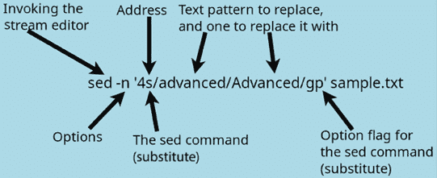

图 9.1：一个典型的 sed 替换脚本

现在，让我们来看一些具体的例子。

## 示例 1：修改办公室备忘录

让我们从一个简单的办公室备忘录开始。如所示，创建`tom.txt`文件：

Memo: tom tinker We regret to inform you that tom Tinker will no longer be working with us. Tom tinker is leaving to embark on his own business venture. We wish tom tinker well. Good-bye, tom. cc: tom Tinker

你可以看到文档有几个问题。最明显的是人名并不总是大写字母。我们需要一种方法来自动完成这些修正过程。

可以一次性完成所有修正，但首先，让我们先看看如何将`tom`替换为`Tom`。这样做如下：

```bash
[donnie@fedora ~]$ sed 's/tom/Tom/' tom.txt Memo: Tom tinker We regret to inform you that Tom Tinker will no longer be working with us. Tom tinker is leaving to embark on his own business venture. We wish Tom tinker well. Good-bye, tom. cc: Tom Tinker [donnie@fedora ~]$
```

你在单引号内看到的第一个字符是字母`s`。它告诉`sed`执行替换。接下来，你看到你正在操作的两个模式。第一个是你要替换的模式，第二个是你用作替换的内容。当你用另一个单引号结束表达式后，列出你要修改的文本文件。（注意，你不需要`stdin`重定向器。）

这在很大程度上是有效的，但正文最后一行仍然有一个小写的`tom`。这是因为在默认情况下，`sed`的`s`命令只会替换给定行中模式的首次出现。要修复这个问题，请使用带有全局 (`g`) 选项的`s`命令。这样，任何行中模式的每次出现都会被替换。如下所示：

```bash
[donnie@fedora ~]$ sed 's/tom/Tom/g' tom.txt Memo: Tom tinker We regret to inform you that Tom Tinker will no longer be working with us. Tom tinker is leaving to embark on his own business venture. We wish Tom tinker well. Good-bye, Tom. cc: Tom Tinker [donnie@fedora ~]$
```

这种效果好得多。但我们仍然有小写的姓氏需要替换。让我们结合两个命令来同时替换姓和名，如下所示：

```bash
[donnie@fedora ~]$ sed 's/tom/Tom/g ; s/tinker/Tinker/g' tom.txt Memo: Tom Tinker We regret to inform you that Tom Tinker will no longer be working with us. Tom tinker is leaving to embark on his own business venture. We wish Tom Tinker well. Good-bye, Tom. cc: Tom Tinker [donnie@fedora ~]$
```

你只需要创建两个独立的`sed`脚本，并用分号将它们组合。你可以将两个脚本都放在一组单引号内。

默认情况下，`sed`会读取你要修改的文本文件，并将整个修改后的文件发送到`stdout`。

如果你只想看到实际被修改的行怎么办？

对于这种情况，你需要使用`-n`作为`sed`选项，并将`p`作为`s`命令选项。首先，让我们看看只使用其中一个开关时会发生什么。如果你使用`-n`而不使用`p`，结果如下：

```bash
[donnie@fedora ~]$ sed -n 's/tom/Tom/g ; s/tinker/Tinker/g' tom.txt [donnie@fedora ~]$
```

如果没有`s`命令的`p`选项，`-n`选项将抑制所有输出，这并不是我们想要的。这是因为`-n`选项是静默开关，它抵消了`sed`将处理后的文件传递给`stdout`的默认行为。

接下来，让我们尝试只用`p`而不使用`-n`，看起来如下：

```bash
[donnie@fedora ~]$ sed 's/tom/Tom/g ; s/tinker/Tinker/gp' tom.txt Memo: Tom Tinker Memo: Tom Tinker We regret to inform you that Tom Tinker will no longer be working with us. Tom Tinker is leaving to with us. Tom Tinker is leaving to embark on his own business venture. We wish Tom Tinker well. Good-bye, Tom. cc: Tom Tinker [donnie@fedora ~]$
```

（注：此处原文中存在部分重复，译文已根据逻辑进行了平顺处理）

## 示例 2：修改好莱坞演员列表

使用`sed`执行替换还有许多其他方法。为了演示，创建`actorsfile_11.txt`文件，内容为好莱坞演员列表：

Jessel George Marx Groucho Cantor Eddie Allen Fred Burns George Wayne John Price Vincent Besser Joe Green

你决定将 Groucho Marx 替换为他的兄弟 Zeppo。搜索所有以 Marx 开头的行，并仅在这些行上进行替换，如下：

```bash
[donnie@fedora ~]$ sed '/^Marx/s/Groucho/Zeppo/' actorfile_11.txt Jessel George Marx Zeppo Cantor Eddie Allen Fred Burns George Wayne John Price Vincent Besser Sidney Green [donnie@fedora ~]$
```

在这个示例中，你使用正则表达式作为地址。也就是说，你将字面字符串`Marx`放在默认`sed`分隔符（正斜杠）之间，并在其前面加上了`^`元字符。这导致替换命令只查找行首的`Marx`。再次注意这个地址紧接`s`命令之前。你不需要为`s`命令使用全局选项，因为你已经知道每行中只有一个单词的出现。

你现在决定需要用 Joe Besser 替换为 Joe DeRita。（这很合适，因为在现实生活中，“三剑客”组合确实在 Joe Besser 离开照顾生病的妻子后，将 Joe Besser 替换成了 Joe DeRita。）这一次，你想搜索以 Joe 结尾的行，并仅在这些行上进行替换，如下：

```bash
[donnie@fedora ~]$ sed '/Joe$/s/Besser/DeRita/' actorfile_11.txt Jessel George Marx Groucho Cantor Eddie Allen Fred Burns George Wayne John Price Vincent DeRita Joe Greenstreet Sidney Conrad William [donnie@fedora ~]$
```

这一次，你在地址中使用了`$`元字符，告诉`sed`查看行尾。注意你必须如何将这个元字符放在字面字符串的末尾。

好了，演员就说够了。我们来看看一些经典汽车。

### 示例 3：修改汽车列表

你也可以替换单个字符。创建一个包含以下内容的`cars_2.txt`文件：

```bash
[donnie@fedora ~]$ cat > cars_2.txt edsel Edsel Edsel desoto desoto Desoto Desoto nash Nash nash Hudson hudson hudson [donnie@fedora ~]$
```

在这个文件中，你看到你需要将列出的某些汽车名称的首字母大写。目前，让我们只集中于将 Desoto 大写。如果你告诉`sed`将每个`d`替换为`D`，你会得到：

```bash
[donnie@fedora ~]$ sed 's/d/D/' cars_2.txt eDsel EDsel EDsel Desoto Desoto Desoto Desoto nash Nash nash HuDson huDson huDson [donnie@fedora ~]$
```

这并不是你想要的。但是，你知道小写的`desoto`只出现在第四行和第五行中。因此，你可以告诉`sed`仅在这两行中替换小写的`d`，如下：

```bash
[donnie@fedora ~]$ sed '4,5s/d/D/' cars_2.txt edsel Edsel Edsel Desoto Desoto Desoto Desoto nash Nash nash Hudson hudson hudson [donnie@fedora ~]$
```


注意，两个行号之间的逗号表示第四行到第五行，而不是第四行和第五行。

你可以告诉`sed`搜索行开头的`desoto`，如下：

```
[donnie@fedora ~]$ sed '/^desoto/s/d/D/' cars_2.txt
edsel
Edsel
Edsel
Desoto
Desoto
Desoto
Desoto
nash
Nash
nash
Hudson
hudson
hudson
[donnie@fedora ~]$
```

如果你只想看到发生变化的行，请插入`-n`和`-p`选项，如下：

```
[donnie@fedora ~]$ sed -n '/^desoto/s/d/D/p' cars_2.txt
Desoto
Desoto
[donnie@fedora ~]$
```

有三种方法保存你的修改。你可以使用`stdout`重定向创建一个新文件，如下：

```
[donnie@fedora ~]$ sed -n '/^desoto/s/d/D/p' cars_2.txt > cars_cap.txt
[donnie@fedora ~]$
```

你可以在使用`s`命令时配合`-w`选项保存到新文件中，如下：

```
[donnie@fedora ~]$ sed '/^desoto/s/d/D/w newcarsfile.txt' cars_2.txt
edsel
Edsel
Edsel
Desoto
Desoto
Desoto
Desoto
nash
Nash
nash
Hudson
hudson
hudson
[donnie@fedora ~]$
```

这种方法的唯一缺点是，尽管`-w`选项会在屏幕上显示修改文件的整个内容，但它只将修改后的行保存到新文件中，在此所示：

```
[donnie@fedora ~]$ cat newcarsfile.txt
Desoto
Desoto
[donnie@fedora ~]$
```

保存修改最后的方法是使用`-i`选项修改原始文件，如下：

```
[donnie@fedora ~]$ sed -i '/^desoto/s/d/D/' cars_2.txt
[donnie@fedora ~]$
```

与使用`-w`选项不同，`-i`保存整个修改后的文件，在此所示：

```
[donnie@fedora ~]$ cat cars_2.txt
edsel
Edsel
Edsel
Desoto
Desoto
Desoto
Desoto
nash
Nash
nash
Hudson
hudson
hudson
[donnie@fedora ~]$
```

如果你想在修改原始文件之前创建备份，只需在`-i`选项之后加上你想添加到备份文件名中的后缀，如下：

```
[donnie@fedora ~]$ sed -i.bak '/^desoto/s/d/D/' cars_2.txt
[donnie@fedora ~]$
```

注意，在`-i`和`.bak`之间不能有空格。验证操作是否成功，如下：

```
[donnie@fedora ~]$ ls -l cars_2.txt.bak
-rw-r--r--. 1 donnie donnie 82 Oct 11 13:58 cars_2.txt.bak
[donnie@fedora ~]$
```

接下来，让我们来一些整行删除。

用于执行删除操作的`command`。这比替换过程要简单，因为你真正只需要一个地址和`d` `command`。我们将从从列表中删除一些项开始。

## 示例 1：从列表中删除项

让我们再次查看我们的`cars_2.txt`文件，并尝试删除所有对Edsel的引用。（我们想忘记Edsel曾经被制造过，因为福特汽车自1960年以来一直试图这样做。）首先，提醒一下，这里是原始文件的样子：

```
[donnie@fedora ~]$ cat cars_2.txt
edsel
Edsel
Edsel
Desoto
Desoto
Desoto
Desoto
nash
Nash
nash
Hudson
hudson
hudson
[donnie@fedora ~]$
```

嗯，它并不完全是原始的，因为我忘记了修改过它，将所有的desoto都变成了大写。不过，这没关系。要删除所有对Edsel的引用，尝试以下操作：

```
[donnie@fedora ~]$ sed '/edsel/d' cars_2.txt
Edsel
Edsel
Desoto
Desoto
Desoto
Desoto
nash
Nash
nash
Hudson
hudson
hudson
[donnie@fedora ~]$
```

这个`command`只删除了小写的`edsel`。但我需要一种方法删除所有对Edsel的引用。幸运的是，你可以使用正则表达式在地址中指定多个字符，如下：

```
[donnie@fedora ~]$ sed '/[eE]dsel/d' cars_2.txt
Desoto
Desoto
Desoto
Desoto
nash
Nash
nash
Hudson
hudson
hudson
[donnie@fedora ~]$
```

你只需要将`e`和`E`都放在括号内，并用它作为地址的第一个字符。

如果你想删除除Edsel引用以外的所有内容，请使用`!`来取反命令。现在，你可能认为应该要把取反字符放在要搜索的地址前面，但事实并非如此。相反，将取反字符放在命令字符本身前面。所以，在这种情况下，你会把感叹号放在`d`前面，如下：

```
[donnie@fedora ~]$ sed '/[eE]dsel/!d' cars_2.txt
edsel
Edsel
Edsel
[donnie@fedora ~]$
```

你刚刚看到了一个例子，说明在不同的shell脚本工具中，实现方式并不总是一致的。不久前，你看到`^`是正则表达式的取反运算符。在这里，你看到`!`是`sed`命令的取反运算符。你还看到`^`也可以用于表示行的开头。所以是的，事情可能会变得有点混乱。

你也可以为地址选择行范围。这次，让我们删除所有对Nash的引用，它们恰好在第八行到第十行，如下：

```
[donnie@fedora ~]$ sed '8,10d' cars_2.txt
edsel
Edsel
Edsel
Desoto
Desoto
Desoto
Desoto
Hudson
hudson
hudson
[donnie@fedora ~]$
```

在`d`前面放置感叹号来删除除第八行到第十行以外的所有内容，如下：

```
[donnie@fedora ~]$ sed '8,10!d' cars_2.txt
nash
Nash
nash
[donnie@fedora ~]$
```

经典汽车就这样。接下来，我将向你展示如果文件有太多空行该怎么办。

## 示例 2：删除空行

对于最后一个删除技巧，这里是如何从文件中删除空行。只需让行首元字符（`^`）紧邻行尾元字符（`$`）创建一个地址。首先创建`blank_lines.txt`文件，如下：

一行非空行。
另一行非空行。
又一行非空行。
最后一行非空行。

现在，使用`^$`作为正则表达式执行删除，如下：

```
[donnie@fedora ~]$ sed '/^$/d' blank_lines.txt
One non-blank line.
Another non-blank line.
Yet another non-blank line.
And one last non-blank line.
[donnie@fedora ~]$
```

注意这与我们之前在替换脚本中使用行尾元字符的方式的区别。由于我们使用两个元字符共同形成正则表达式，我们必须将它们放在两个正斜线之间。

## 使用 sed 进行追加和插入

Linux版`sed`实现的`a` `command`用于在另一行文本之后追加一行文本。让我们看看它是如何工作的。

## 示例 1：追加文本行

你可以使用该功能为汽车列表添加一些型号名称。为Nash系列添加Ambassador模型，如下：

```
[donnie@fedora ~]$ sed '/[nN]ash/aAmbassador' cars_2.txt
edsel
Edsel
.
.
.
.
.
.
nash
Ambassador
Nash
Ambassador
nash
Ambassador
Hudson
hudson
hudson
[donnie@fedora ~]$
```

这很好，但你可以把它做得更好。首先对型号名称进行缩进。通过在前面添加制表符来实现，如下：

```
[donnie@fedora ~]$ sed '/[nN]ash/a\\tAmbassador' cars_2.txt
Edsel
Edsel
.
.
.
.
.
.
nash
	Ambassador
Nash
	Ambassador
nash
	Ambassador
Hudson
hudson
hudson
[donnie@fedora ~]$
```

（注：提供的源文本包含大量重复和片段，我已根据提供的内容清理了逻辑流。）

我知道这看起来很棒，但你现在什么还没看到。来看看下一个神奇的妙招。

## 示例 2：修改整行文本

为了为了更好的示例，请创建一个`cars_4.txt`文件，如下：

```
donnie@fedora:~$ cat cars_4.txt
1958 Edsel Corsair
1949 Oldsmobile 88
1959 Edsel Ranger
1960 Edsel Ranger
1958 Edsel Bermuda
1964 Ford Galaxie
1954 Nash Ambassador
donnie@fedora:~$
```

现在，准备好运行这个`sed`命令时感到惊讶吧：

```
donnie@fedora:~$ sed '/[eE]dsel/c1963 Studebaker Avanti' cars_4.txt
1963 Studebaker Avanti
1949 Oldsmobile 88
1963 Studebaker Avanti
1963 Studebaker Avanti
1963 Studebaker Avanti
1964 Ford Galaxie
1954 Nash Ambassador
donnie@fedora:~$
```

现在你看到了`s`命令和`c` `sed`命令之间最大的区别。`c`命令不再仅仅替换你指定的文本字符串或模式，而是替换包含该文本字符串或模式的**整行**。在这种情况下，每一个包含文本字符串`Edsel`的整行都被替换成了`1963 Studebaker Avanti`。很酷，对吧？

## 其他杂杂 sed 妙招

我们还没有结束。这里有更多你可以使用`sed`完成的酷炫妙招。

## 示例 1：使用 q 命令

`q`命令让`sed`的行为就像`head`工具一样。它告诉`sed`读取指定数量的行，然后退出。如果你想显示我们公有领域电子书的前十行，请输入以下内容：

```
[donnie@fedora ~]$ sed '10q' pg6409.txt
The Project Gutenberg eBook of How to Speak and Write Correctly
This ebook is for the use of anyone anywhere in the United States and
most other parts of the world at no cost and with almost no restrictions
whatsoever. You may copy it, give it away or re-use it under the terms of
the Project Gutenberg License included with this ebook or online at
www.gutenberg.org. If you are not located in the United States, you will have
to check the laws of the country where you are located before using this eBook.
[donnie@fedora ~]$
```

如果你想查看大文件中间的某些行，你可能会发现`sed`比`head`/`tail`组合更容易用。以下是你可以查看我们电子书文件中第1,005到1,010行的方法：

```
[donnie@fedora ~]$ sed -n '1005,1010p' pg6409.txt
Present Perfect
To be loved
To have been loved
PARTICIPLES
[donnie@fedora ~]$
```

注意，我在这里使用的`p`与替换命令中的`p`选项并不完全相同。这个`print`命令是一个独立的命令。尽管如此，它必须与`sed`的`-n`选项一起使用才能得到你想要的结果。

## 示例 2：使用 w 命令

使用`w`命令将选定的文本写入新文件。你可以像上面对`p`命令做的那样使用正则表达式作为地址，也可以像使用行号：

```
[donnie@fedora ~]$ sed '11,13whudson_cars.txt' cars_2.txt
edsel
Edsel
Edsel
desoto
desoto
Desoto
desoto
nash
Nash
nash
Hudson
hudson
hudson
[donnie@fedora ~]$
```

如果前面的命令看起来有点令人困惑，你可以插入一些空格来使其更清晰，如下所示：

```
[donnie@fedora ~]$ sed '11,13 w hudson_cars.txt' cars_2.txt
```

虽然你在屏幕上看到了整个文件的内容，但只有选定的内容被保存到你的新文件中，如下：

```
[donnie@fedora ~]$ cat hudson_cars.txt
Hudson
hudson
hudson
[donnie@fedora ~]$
```

输出将与之前相同。而且，这展示了`sed`中一些可能会让人感到困惑的地方。在`sed`脚本的某些地方，空格是可选的。但在其他地方（例如在之前的示例中，我向你展示如何使用`-i`选项配合文件名后缀作为备份文件时），你不能使用空格。正如我之前所说的，这些内容并不总是具有一致性。

## 示例 3：使用 r 命令

`r`命令将读取选定的文件并追加到你正在处理的文件指定位置。要查看此，请创建一个`cars_3.txt`文件，如下：

```
Packard
Kaiser
Frazer
```

现在，将`cars_3.txt`文件插入到`cars_2.txt`文件的第二行之后，如下：

```
[donnie@fedora ~]$ sed '2rcars_3.txt' cars_2.txt
edsel
Edsel
Packard
Kaiser
Frazer
Edsel
desoto
desoto
Desoto
.
.
.
.
.
.
hudson
[donnie@fedora ~]$
```

同样，如果读起来很困惑，那么可以使用可选的空格。

```
[donnie@fedora ~]$ sed -nf demo_write.txt myfile_3.txt
[donnie@fedora ~]$ cat new_myfile.txt
This here is sentence one.
And here is the second sentence.
This here is sentence seven.
[donnie@fedora ~]$
```

## 示例 4：从一个文件复制行到另一个文件

最后，创建`demo_write_2.txt`程序文件，它将从一个文件复制指定的行到另一个文件。让它看起来像这样：

`4,7w new_2_myfile.txt`

调用它并查看结果，如下：

```
[donnie@fedora ~]$ sed -nf demo_write_2.txt myfile_3.txt
[donnie@fedora ~]$ cat new_2_myfile.txt
Line four.
This is the fifth sentence.
Six
This here is line seven.
[donnie@fedora ~]$
```

简单的程序文件介绍到这里。现在让我们让内容变得一点。

## sed 程序文件中的复合脚本

到目前为止，我只向你展示了包含单个`sed`脚本的程序文件。你也可以拥有包含两个或多个脚本的程序文件。首先创建`demo_compound.txt`程序文件，它看起来像这样：

`1,3s/Edsel/Packard/
2,4s/Packard/Lasalle/
3d`

现在，创建`riding.txt`文件，它看起来像这样：

Let's go for a ride in my Edsel.
Let's go for a ride in my Edsel.
Let's go for a ride in my Edsel.
Let's go for a ride in my Edsel.

调用程序文件，如下：

```
[donnie@fedora ~]$ sed -f demo_compound.txt riding.txt
Let's go for a ride in my Packard.
Let's go for a ride in my Lasalle.
Let's go for a ride in my Edsel.
[donnie@fedora ~]$
```


以下是详细说明：

该程序首先让`sed`将第一到第三行中的`Edsel`替换为`Packard`。

在第二行到第四行中，它让`sed`将`Packard`替换为`Lasalle`。

最后，最后一个脚本删除了第三行。注意，你不需要在这里使用反斜杠，因为没有脚本是延续到下一行的。

要看第二个示例，请创建`demo_compound_2.txt`程序文件，如下：

`2a\ No, I'd rather ride in the Hudson Hornet with the Twin-H Power Six.\ He'd rather ride in the Pierce-Arrow. 3p`

调用程序，如下：

```bash
[donnie@fedora ~]$ sed -f demo_compound_2.txt riding.txt Let's go for a ride in my Edsel. Let's go for a ride in my Edsel. No, I'd rather ride in the Hudson Hornet with the Twin-H Power Six. He'd rather ride in the Pierce-Arrow. Let's go for a ride in my Edsel. Let's go for a ride in my Edsel. Let's go for a ride in my Edsel. 
[donnie@fedora ~]$
```

这一次，你有一个脚本在第二行之后追加了两个额外的行，另一个第二个脚本让第三行再次打印一次。

为了好玩，再次做同样的操作，只是这次删除第二行。创建`demo_compound_3.txt`程序文件，如下：

`2a\ No, I'd rather ride in the Hudson Hornet with the Twin-H Power six.\ He'd rather ride in the Pierce-Arrow. 2d`

运行程序，如下：

```bash
[donnie@fedora ~]$ sed -f demo_compound_3.txt riding.txt Let's go for a ride in my Edsel. No, I'd rather ride in the Hudson Hornet with the Twin-H Power six. He'd rather ride in the Pierce-Arrow. Let's go for a ride in my Edsel. Let's go for a ride in my Edsel. 
[donnie@fedora ~]$
```

尽管你删除了第二行，你仍然能够向它追加新行。

让我们用一些非常高级的内容来结束对`sed`的讨论。创建`tab.txt`程序文件，如下：

`2,4s/^./\t&/ 8c\ This really is the last line. 1d`

当你运行这个程序时，你会感到惊讶的。你会看到：

```bash
[donnie@fedora ~]$ sed -f tab.txt myfile_3.txt And here is the second line. The third. Line four. This is the fifth sentence. Six This here is line seven. This really is the last line. 
[donnie@fedora ~]$
```

第一个脚本在每个非空行的开头添加一个制表符。（`^.`组合意味着查找每个以非空字符开头的行。制表符后面的`&`防止`sed`将每行的第一个字符替换为制表符。相反，它只是在第一个字符之前插入制表符。）第二个脚本更改第八行的文本。最后，第三个脚本删除第一行。

## 在 Shell 脚本中使用 sed

如果你只打算在 Linux 系统上运行脚本，使用`sed`是很容易。例如，你可以编写像这样的`sed_test_0.sh`脚本：

```bash
#!/bin/bash
sed '/[Ee]dsel/i1958' cars_2.txt
```

在 Shell 脚本中使用`sed`是很容易的，如果你只打算在 Linux 系统上运行脚本。例如，你可以编写像这样的`sed_test_0.sh`脚本：

```bash
#!/bin/bash
sed '/[Ee]dsel/i1958' cars_2.txt
```

在 Shell 脚本中使用`sed`是很容易的，如果你只打算在 Linux 系统上运行脚本。例如，你可以编写像这样的`sed_test_0.sh`脚本：

```bash
#!/bin/bash
sed '/[Ee]dsel/i1958' cars_2.txt
```

`grep`是Global Regular Expression Print（全局正则表达式打印）的缩写，是一个强大的命令行工具，几乎包含在每一个 Unix 或类 Unix 衍生操作系统中（这包括 Linux 和 macOS）。Windows 也有可用版本。

你可以让`grep`搜索一个文件或多个文件。你还可以将其他工具的输出管道给它，这样你就只会看到你感兴趣的信息。而且，`grep`可以使用正则表达式，这使得即使你对搜索内容只有一个模糊的想法，也能进行搜索。

`grep`并不难，但确实需要一些练习。如果你准备好了，我们开始吧。

## 使用 grep 进行基础搜索

我已经在第 7 章“文本流过滤器部分 2”和第 8 章“基础 Shell 脚本构建”中向你展示过一些使用`grep`的示例，但没关系。我仍然想从基础开始并对如何使用它提供解释。我将从你已经创建的一些文本文件开始演示。

使用`grep`最基本的方法是在单个文件中搜索文本字符串，如下所示：

```bash
[donnie@fedora ~]$ grep 'Edsel' cars_2.txt Edsel Edsel [donnie@fedora ~]$
```

在这里，我列出了我想查找的文本字符串，然后列出了包含该字符串的文件名。我把搜索词括在一对单引号中，但在这种情况下其实并不需要。只有当搜索词包含 Shell 会产生错误解释的字符时，我才需要引号。（由于习惯，我几乎总是使用单引号。）

默认情况下，`grep`是区分大小写的。使用`-i`选项可以使其不区分大小写，如下所示：

```bash
[donnie@fedora ~]$ grep -i 'Edsel' cars_2.txt edsel Edsel Edsel [donnie@fedora ~]$
```

如果你需要查看文件中哪些哪些行包含搜索词，请使用`-n`选项，如下所示：

```bash
[donnie@fedora ~]$ grep -in 'Edsel' cars_2.txt 1:edsel 2:Edsel 3:Edsel [donnie@fedora ~]$
```

你可以使用通配符同时搜索多个文件，如下所示：

```bash
[donnie@fedora ~]$ grep -in 'Edsel' cars* cars_2.txt:1:edsel cars_2.txt:2:Edsel cars_2.txt:3:Edsel cars_2.txt.bak:1:edsel cars_2.txt.bak:2:Edsel cars_2.txt.bak:3:Edsel cars_2.txtbak:1:edsel cars_2.txtbak:2:Edsel cars_2.txtbak:3:Edsel cars.txt:1:edsel cars.txt:2:Edsel cars.txt:3:Edsel [donnie@fedora ~]$
```

注意输出中现在包含了文件名。

`-v`选项意味着反向（inverse）。使用它来显示所有不包含指定搜索词的行，如下所示：

```bash
[donnie@fedora ~]$ grep -inv 'Edsel' cars* cars_2.txt:4:desoto cars_2.txt:5:desoto cars_2.txt:6:Desoto cars_2.txt:7:desoto cars_2.txt:8:nash cars_2.txt:9:Nash cars_2.txt:10:nash . . . . . . cars.txt:11:Hudson cars.txt:12:hudson cars.txt:13:hudson [donnie@fedora ~]$
```

`-c`选项显示搜索模式在文件中出现的次数，但它不会显示找到搜索模式的行。它看起来像这样：

```bash
[donnie@fedora ~]$ grep -ic 'edsel' cars* cars_2.txt:3 cars_2.txt.bak:3 cars_2.txtbak:3 cars_3.txt:0 cars_cap.txt:0 cars.txt:3 [donnie@fedora ~]$
```

在这些示例中，我向你展示了如何将`grep`选项开关与单个`-`结合。当然，如果符合你的需求，你也可以一次使用一个选项。

好了，这些都是比较简单的示例，你可能会说：“嘿，我们什么时候开始学高级的内容？”嗯，等一下，马上就。

## 使用 grep 进行更高级搜索

这里有几个更酷的`grep`选项。

## 示例 1：搜索整个单词

默认情况下，`grep`不搜索整个单词。所以，如果你搜索文本字符串`and`，它将显示包含单词`land`、`hand`、`sand`以及`and`的行。让我们通过我们的公有领域电子书中搜索文本字符串`noun`来观察。（输出非常长，所以我只显示部分内容。）我将进行区分大小写的搜索，如下所示：

```bash
[donnie@fedora ~]$ grep 'noun' pg6409.txt Noun, Adjective, Pronoun, Verb, Adverb, Preposition, Conjunction and _Gender_ has the same relation to nouns that sex has to individuals, but _Case_ is the relation one noun bears to another or to a verb or to a _Article_ is a word placed before a noun
```

## 示例 2：使搜索不区分大小写

现在，添加`-i`选项使其不区分大小写，如下所示：

```bash
[donnie@fedora ~]$ grep -iw 'noun' pg6409.txt Noun, Adjective, Pronoun, Verb, Adverb, Preposition, Conjunction and
```

## 示例 3：处理回车符

这是一个你在 Linux 职业生涯中可能会遇到的真实场景。在你最终解决它之前，它可能会让你相当困扰。

（来自处理文本的注释：在搜索模式的左侧添加`^`元字符，`grep`将仅显示搜索模式出现在开头的行，如下所示：

```bash
[donnie@fedora ~]$ grep -iw '^noun' pg6409.txt Noun, Adjective, Pronoun, Verb, Adverb, Preposition, Conjunction and NOUN
```

你刚刚学会了如何执行不区分大小的搜索，查找行首的`noun`单词的所有出现位置。你发现了一个独占一行的`NOUN`。那么，如果你通过对行尾的`noun`进行不区分大小的搜索，也能找到那一行，这也很合逻辑的。现在，试一试：

```bash
[donnie@fedora ~]$ grep -iw 'noun$' pg6409.txt
[donnie@fedora ~]$
```

等一下。为什么什么都没有找到呢？我们知道明明有一个可以找到。嗯，这里有一个线索。

几个章节之前，我告诉过你是从 Project Gutenberg 网站下载这个文件的。所以，该文件很有可能是用 DOS 或 Windows 文本编辑器创建的。

这一点很重要，因为 DOS 和 Windows 文本编辑器会在文件的每行末放置一个回车符（carriage return），而 Unix 和 Linux 文本编辑器只使用换行符（newline）。如果`grep`在搜索过程中看到换行符，它会直接忽略它。但是，它不会忽略回车符。现在，让我们测试一下理论。我将先向你展示如何使用另一个正则表达式元字符。

如果你在搜索模式中放置一个点`.`，意味着你接受该位置出现任何单个字符，只要模式的其余部分可以形成有效匹配。所以，在你的搜索模式末尾放置一个点。然后，将输出通过到`od -c`命令中，如下所示：

```bash
[donnie@fedora ~]$ grep -iw 'noun.$' pg6409.txt | od -c 0000000 N O U N \r \n 0000006 [donnie@fedora ~]$
```

是的，问题就在这里。`\r`就是回车控制字符。别担心，只需使用带有`-d`选项的`tr`命令删掉这些讨厌的家伙即可。将转换后的输出保存到新文件中，如下所示：

```bash
[donnie@fedora ~]$ tr -d '\r' < pg6409.txt > linux_pg6409.txt [donnie@fedora ~]$
```

通过执行不带模式中点点的搜索，来验证回车符已经消失且`grep`搜索现在可以正常工作。它看起来应该是这样的：

```bash
[donnie@fedora ~]$ grep -iw 'noun$' linux_pg6409.txt | od -c 0000000 N O U N \n 0000005 [donnie@fedora ~]$
 grep -iw 'noun$' linux_pg6409.txt NOUN [donnie@fedora ~]$
```

现在，当你将搜索输出通过`od`处理时，你会发现回车符已经消失了。然后，当你尝试原始搜索时，你得到了本应该得到的结果。

但是，你还没有结束。如果行尾的名词也是句子的末尾呢？那么，名词后面会跟着一个句号，而你刚刚执行的搜索将无法捕捉到它。让我们回到几步，再次使用我们的点元字符进行搜索，如下：

```bash
[donnie@fedora ~]$ grep -iw 'noun.$' linux_pg6409.txt some distinguishing mark or characteristic belonging to the noun. _s_ and these phrases are now idioms of the language. All plural nouns verb, _summons_, a noun. [donnie@fedora ~]$
```

现在回车符已经消失了，这次搜索现在找到了`noun.`和`nouns.`。但你不想找到复数名词。你只想找到单数名词。我将通过引入另一个元字符来向你演示，如下：

```bash
[donnie@fedora ~]$ grep -iw 'noun\.\?$' linux_pg6409.txt some distinguishing mark or characteristic belonging to the noun. NOUN verb, _summons_, a noun. [donnie@fedora ~]$
```

通过在点前面放置一个反斜杠，你将点元字符变成了一个普通的句号。`\?`告诉`grep`尝试找到前面字符的匹配，但即使没找到匹配也没关系。所以在这里，你是在告诉`grep`在行尾对整个单词`noun`进行不区分大小的搜索，无论是否有句号。（你是否开始发现正则表达式有多么好玩了？）

好了，你已经看到了一些酷炫的东西，但你还没有结束。所以，让我们继续吧。

## 使用 grep 进行更高级的搜索

你你可以将`grep`与其他实用程序结合进行更高级的搜索。方法如下。

### 示例 1：审计源代码文件

为了演示这一点，请使用你的 Fedora Server 或 Debian 虚拟机，这样你就可以安装一个可能不想在你 Linux 工作站上安装的包（如果你使用的是后者的话）。在 Fedora Server 上，安装`cairo-devel`包，如下：

```bash
[donnie@fedora-server ~]$ sudo dnf install cairo-devel
```

如果你更倾向于使用 Debian 虚拟机，安装`libghc-cairo-dev`包，如下：

```bash
donnie@debian~$ sudo apt install libghc-cairo-dev
```

接下来，在`/include/cairo/`目录下的源代码文件中查找`#include`字符串，如下：

```bash
[donnie@fedora-server ~]$ grep -ih '#include' /include/cairo/* | sort | uniq -c
```

（注：此处根据上下文逻辑补全了原文中中断的命令描述，以确保翻译完整性）

### 示例 2：搜索社会安全号码

这里有一个更复杂的用法示例。首先，创建一个`ssn.txt`文件，其中包含姓名、出生日期和安全号码的列表，如下：

```bash
[donnie@fedora ~]$ cat << EOF > ssn.txt
123-45-6789 Knockwurst, Ronald J. 1980-01-01
988-45-7898 Liverwurst, Alex. 1972-05-12
978-98-6987 Saurbraten, Alicia 1990-11-23
999-87-1258 Hassenfefer, Gerald 1985-07-34
EOF
```


在这里，每个`[0-9]`实例意味着你正在搜索任何数字。被反斜杠和花括号包围的数字意味着找到特定数量的连续数字。所以，`[0-9]\{3\}`结构意味着你正在寻找三个连续数字。这个正则表达式中有三个这样的分组，都由连字符分隔。

```
[donnie@fedora ~]$ grep '[0-9]\{3\}-[0-9]\{2\}-[0-9]\{4\}' ssn.txt
```

如果你不想显示字符串所在的文件名，请使用`-h`选项。此外，通过将行传递给`sort`，我们就能知道每行出现了多少次。

### 示例 3：使用 ^ 元字符

在我们进入下一个主题之前，这里还有一个例子。这个例子说明了`^`元字符根据它在正则表达式中的位置可以有两种不同的含义。看看在下面的`grep`命令中它是如何工作的：

```
[donnie@fedora ~]$ grep '^[^a-zA-Z]' pg6409.txt | less
```

在这个命令中，`'^[^a-zA-Z]'`表达式意味着查找所有不以字母开头的行。这是因为在方括号之外，`^`只在行开头查找匹配。在方括号内部、指定搜索语前面，意味着显示不匹配该术语的内容。

当然，你还会看到很多连续的空行，因为空行不以字母开头。如果你不需要看到所有的空行，只需将`grep`的输出传递给`uniq`，如下：

```
[donnie@fedora ~]$ grep '^[^a-zA-Z]' pg6409.txt | uniq | less
```

正如你在几页前的“理解正则表达式”章节中从正则表达式元字符表上看到的那样，`grep`有两种形式的命令语法。

我目前为止向你展示的是基础语法。另一种形式是扩展语法。以下是两者之间的两点区别：

1. 基础语法要求在某些元字符前使用反斜杠`\`，而扩展语法则不需要。
2. 扩展语法要求你要么使用`egrep`代替`grep`，要么使用带有`-E`选项的`grep`。（请注意，虽然`egrep`目前仍然有效，但它被认为是过时的，并且未来可能会停止工作。因此，你应该始终使用`grep -E`。）

好了，这里有一些示例。

## 示例 1：使用扩展语法的基础搜索

让我们再次看之前的之前的例子。这里是使用普通基础语法的命令：

```bash
[donnie@fedora ~]$ grep -iw 'noun\.\?$' linux_pg6409.txt some distinguishing mark or characteristic belonging to the noun. NOUN verb, _summons_, a noun. [donnie@fedora ~]$
```

这里是使用扩展语法的相同命令：

```bash
[donnie@fedora ~]$ grep -E -iw 'noun\.?$' linux_pg6409.txt some distinguishing mark or characteristic belonging to the noun. NOUN verb, _summons_, a noun. [donnie@fedora ~]$
```

好了，这在这里没什么大，因为使用扩展语法只是消除了我需要输入的一个反斜杠。但如果你有一个`grep`命令需要你用基础语法转义大量字符，那么扩展语法可以大幅减少输入量。

## 示例 2：搜索连续的重复单词

下一个例子稍微复杂一点。你正在查看`/etc/services`文件，寻找所有包含连续重复单词的行，如下所示：

```bash
[donnie@fedora ~]$ grep -Ei '\<([a-z]+) +\1\>' /etc/services http 80/tcp www www-http # WorldWideWeb HTTP http 80/udp www www-http # HyperText Transfer Protocol nextstep 178/tcp NeXTStep NextStep # NeXTStep window nextstep 178/udp NeXTStep NextStep # server [donnie@fedora ~]$
```

以下是详细解释：

- `\<.\ \ \>`结构表示单词边界。该结构内部的模式将匹配单个单词，且仅匹配单个单词。
- `[a-z]`意味着我们正在寻找单个字母。当然，你在这里只看到小写字母，这通常意味着它只会匹配小写字母。但`grep -Ei`命令中的`i`使其变得不区分大小写。
- `[a-z]`结尾的`+`被称为重复字符。这意味着我们想要匹配跟在它之前的任何字符或字符集的一个或多个。在这种情况下，我们想要匹配一个仅包含那两个方括号之间字符集合的模式。
- 将`[a-z]+`放在括号内，表示我们想在评估正则表达式的第二部分之前，先评估这部分。
- 最后，正则表达式第二部分的`+\1`意味着我们想要为第一部分描述的模式找到额外的第二个匹配项。换句话说，我们要找到`/etc/services`文件中所有包含两个连续相同单词的行。

现在，通过省略`-i`选项使搜索变为区分大小写，如下所示：

```bash
[donnie@fedora ~]$ grep -E '\<([a-z]+) +\1\>' /etc/services http 80/tcp www www-http # WorldWideWeb HTTP http 80/udp www www-http # HyperText Transfer Protocol [donnie@fedora ~]$
```

## 示例 3：搜索以特定字母开头的单词

接下来，查看`/etc/`目录，寻找所有以 p 或 q 开头的文件和目录，如下：

```bash
[donnie@fedora ~]$ ls /etc/ | grep -E '^[pq]' pam.d paperspecs passwd . . . . . . purple qemu-ga [donnie@fedora ~]$
```

再次尝试，但这次寻找第一个字母为 p 或 q 且第二个字母也是 p 的文件和目录，如下所示：

```bash
[donnie@fedora ~]$ ls /etc/ | grep -E '^[pq]p+' ppp [donnie@fedora ~]$
```

现在，列出`/etc/`目录中所有以 se 开头且第三个字母可选为 r 的文件和目录，如下所示：

```bash
[donnie@fedora ~]$ ls /etc/ | grep -E '^ser?' security selinux services sestatus.conf setroubleshoot [donnie@fedora ~]$
```

再次尝试，但这次要求文件和目录名的第三个字母是 r。（这次我不会向你展示如何操作，但我会给你一个提示。只需看上一个例子。）

在下一个示例中，我将向你展示一些简写。列出`/etc/`目录中所有名称中使用非字母数字字符的文件和目录，如下所示：

```bash
[donnie@fedora ~]$ ls /etc/ | grep -E '^[pq]' pam.d paperspecs passwd . . . . . . purple qemu-ga [donnie@fedora ~]$
```

（我之所以提到它们，是因为你可能会在其他教程中看到它们被提及。）

既然你已经看到了一些正则表达式的实际用法，让我们来看看如何简化创建它们的过程。

## 使用正则表达式助手程序

好了，现在既然你已经看了这么多例子，你现在可以自己动手创建正则表达式来完成你需要的任何任务了。

什么？！不，你这么说吗？

别难过。我已经告诉过你，正则表达式是非常复杂的，甚至有专门关于它写的一整本书。而这时，助手程序就能派上用场了。让我们来看一些例子。

### RegexBuddy 和 RegexMagic

`RegexBuddy`和`RegexMagic`是由 Just Great Software 公司发布的一对助手程序。它们之间的区别在于，`RegexBuddy`主要是一个通过点击来操作的界面，用于构建你自己的正则表达式。它包含一个预构建的正则表达式库供你使用，但要构建任何其他内容，你仍然需要了解一些正则表达式语言知识。

`RegexMagic`非常适合正则表达式初学者，因为你只需要输入一些示例文本并标记你想要转换为正则表达式的区域即可。然后`RegexMagic`就会为你生成正则表达式。

`RegexBuddy`和`RegexMagic`真的只有两个微小的缺点。首先，它们都是闭源的商业软件，所以你需要为它们付费。不过价格非常合理，每个仅需 39.95 美元。（如果你一起购买，可以获得折扣。）

第二个微小的缺点是它们仅针对 Windows 操作系统编写。不过，你会高兴地发现，它们在 Linux 机器上通过`WINE`运行得良好。（事实上，我在这台 Fedora 工作站上都安装了这两个程序。）`RegexBuddy`和`RegexMagic`的网站甚至还提供了如何在`WINE`下安装这些程序的指导。

`WINE`是一个递归缩写，全称为`WINE is Not an Emulator`。它是一个翻译层，将 Windows 可执行代码转换为 Linux 可执行代码，并包含在几乎每个 Linux 发行版的仓库中。

此外，请注意，我与 Just Great Software 的人员没有任何任何财务安排，因此我向你介绍他们的产品并没有获得任何报酬。

要查看这些酷的产品，只需访问他们的网站。你可以在这里找到`RegexBuddy`：`https://www.regexbuddy.com/index.html`

另外，你可以在这里找到`RegexMagic`：`https://www.regexmagic.com/`

现在，让我们来看一个免费工具。

### Regex101

如果你更喜欢使用免费工具，你可能想尝试一下`Regex101`。它是基于 Web 的，所以不需要下载或安装。它没有`RegexBuddy`和`RegexMagic`那些华丽的功能，但提供的功能已经足够让你上手了。登录账户是可选的，但这样做会有好处。请注意，你不会创建一个新账户，而是通过你的 Google 或`Github`账户登录。

你可以在这里查看`Regex101`：`https://regex101.com/`

我认为我们已经涵盖了足够的理论。让我们进入现实世界吧。

## 查看一些真实世界的示例

我有一些关于如何在生活中使用`sed`、`grep`和正则表达式的酷案例研究。所以，请继续阅读并享受吧！

### 一次修改多个文件

如果你有多个需要以相同方式修改的文件，可以通过在文件名中使用`*`通配符让`sed`在一条命令中完成所有操作。几年前，我曾协助一位网站维护者将一组基于 PHP 的网站从`CentOS 5`服务器迁移到`CentOS 6`服务器。为了让网站在较新的 PHP 版本运行，她需要在每个`.php`文件中添加一行新代码。这可能会有点麻烦，因为她有大约 2,000 个文件需要修改，这远超你手动编辑的意愿。我建议她使用`sed`一次修改所有文件，她立刻就明白我的意思了。（我是通过建议提醒起了她的记忆。）

### 搜索 Apache Web 服务器日志中的跨站脚本攻击

大约 15 年前，我的一个做安全工作的哥们儿给我打电话，急切请求帮助。他在工作的信用合作社的老板给了他一个 USB 闪盘，里面有 4GB——是的，4GB！——压缩的 Apache 访问日志，并让他查看这些日志以寻找跨站脚本攻击的迹象。在这种情况下，一个贫穷的安全管理员该怎么办？

跨站脚本通常缩写为`XSS`，被恶意黑客用于窃取信息或操纵网站。我知道这个名字很令人困惑，它并不能让你准确了解`XSS`攻击的真实面目。将这种攻击称为 Javascript 注入攻击会更准确，因为这才是它的真实工作方式。

当攻击者发现一个易受到此类攻击的网站时，他或她可以使用攻击工具（例如`Kali Linux`中包含的工具）来执行其肮脏行为。至少现在是这样。当我的哥们儿 15 年前给我打电话时，使用简单的网络浏览器执行`XSS`攻击仍然可能的。攻击者只需要在网站的 URL 末尾附加一些特殊的 Javascript 代码即可，如下：

`https://www.mybigbank.com/`

幸运的是，我的伙计证实了这个脚本确实有效。去年秋天，那家信用社聘请了一家渗透测试机构进行安全测试，其中 XSS 攻击是测试的一部分。该脚本发现了测试人员攻击的所有实例，因此大家都很开心。

## 自动化安装第三方仓库

我要向你们展示的下一个真实世界脚本，遗憾的是，是一个你可能无法运行的脚本。那因为我是在 2010 年或 2011 年某时候创建它的，当时我正在为 Nagios 监控系统编写训练文档和插件。当时，我和我的客户都在使用`CentOS 5`和`CentOS 6`进行操作，而现在这两个版本都过时了。

这个场景是一个更大场景的一部分，涉及在`CentOS`服务器上自动下载并编译 Nagios Core 源代码。其中一个先决条件是安装`RPMForge`和`EPEL`第三方软件仓库。在当时，在`CentOS`上安装第三方仓库还需要你配置每个仓库的优先级，以防止一个仓库覆盖掉从另一个仓库安装的包。由于我和我的客户需要经常执行新的 Nagios 安装，我写了一个脚本来帮助自动化这个过程。该脚本太大了，无法在此复现，所以我邀请你从 Github 下载`add-repos.sh`脚本。不过，我在这里通过几个代码片段来解释相关内容。

在脚本顶部，你会看到这个`if..then..else`结构：

```bash
if [ $(uname -m) == x86_64 ]; then rpm -Uvh http://pkgs.repoforge.org/rpmforge-release/rpmforge-release-0.5.3-1.el6.rf.x86_64.rpm else rpm -Uvh http://pkgs.repoforge.org/rpmforge-release/rpmforge-release-0.5.3-1.el6.rf.i686.rpm fi
```

当时，计算机行业仍处于从 32 位向 64 位 CPU 的过渡期。因此，已不存在的`RPMForge`仓库的维护者为每种架构提供了独立的安装包。（我想要完全转向 64 位，但我的客户坚持仍支持 32 位。）这个结构会自动检测安装的是哪种版本的`CentOS`，然后下载并安装相应的`RPMForge`包。

接下来是安装`EPEL`仓库包并设置仓库优先级的行。它看起来如下：

```bash
yum install -y epel-release yum-plugin-priorities
```

最后一步是使用`sed`自动为各种仓库文件的每个部分设置优先级。这里是其中一个文件的一个片段：

```ini
[base] name=CentOS-$releasever - Base mirrorlist=http://mirrorlist.centos.org/?release=$releasever&arch=$basearch&repo =os&infra=$infra #baseurl=http://mirror.centos.org/centos/$releasever/os/$basearch/ gpgcheck=1 gpgkey=file:///etc/pki/rpm-gpg/RPM-GPG-KEY-CentOS-6
```

文件的其他部分命名为`[updates]`、`[extras]`、`[centosplus]`和`[contrib]`。（要查看整个文件，请从 GitHub 下载`CentOS-Base.repo`文件。）其他的配置文件也分成了具有不同名称的节。目标是使用`sed`在每个文件的每个节的`[section_name]`行下方自动追加一个`priority=`行。

这些`sed`脚本看起来像所示：

```bash
sed -i '/\[base\]/apriority=1' /etc/yum.repos.d/CentOS-Base.repo sed -i '/\[updates\]/apriority=1' /etc/yum.repos.d/CentOS-Base.repo sed -i '/\[extras\]/apriority=1' /etc/yum.repos.d/CentOS-Base.repo sed -i '/\[centosplus\]/apriority=2' /etc/yum.repos.d/CentOS-Base.repo sed -i '/\[contrib\]/apriority=2' /etc/yum.repos.d/CentOS-Base.repo sed -i '/\[rpmforge\]/apriority=10' /etc/yum.repos.d/rpmforge.repo sed -i '/\[rpmforge-extras\]/apriority=11' /etc/yum.repos.d/rpmforge.repo sed -i '/\[rpmforge-testing\]/apriority=11' /etc/yum.repos.d/rpmforge.repo sed -i '/\[epel\]/apriority=12' /etc/yum.repos.d/epel.repo sed -i '/\[epel-debuginfo\]/apriority=13' /etc/yum.repos.d/epel.repo sed -i '/\[epel-source\]/apriority=13' /etc/yum.repos.d/epel.repo
```

你可以看到每个`sed`脚本将正确的优先级设置追加到了它们正确的位置。结果看起来会像这样：

```ini
[base] priority=1 name=CentOS-$releasever - Base . . . . . .
```


现在，让我们来看最后一个真实的应用场景。

## 填充 `.csv` 文件中的空字段

如果你经常需要处理列式数据，你可能会发现自己需要处理逗号分隔值（`.csv`）。正如名称所示的，你可能想使用 `sed` 或 `bash` 来处理它们。

如何使用 `sed` 在文件中查找并替换字符串：https://linuxize.com/post/how-to-use-sed-to-find-and-replace-string-in-files/

如何在 Linux 上使用 `grep` 命令：https://www.howtogeek.com/496056/how-to-use-the-grep-command-on-linux/

如何使用 Linux `grep` 命令：https://opensource.com/article/21/3/grep-cheat-sheet

## 答案

d

c 和 e

d

b, d, 和 e

b

## 在 Discord 上加入我们的社区！

与其他用户、Linux 专家以及作者本人一起阅读这本书。

提问问题、为其他读者提供解决方案、通过“任何问我答”（Ask Me Anything）环节与作者聊天，以及更多。扫描二维码或访问链接即可加入社区。

[`packt.link/SecNet`](https://packt.link/SecNet)


## 留下评价！

感谢你从 Packt Publishing 购买本书——我们希望你喜欢！你的反馈是无价的，并帮助我们改进和成长。当你阅读完毕后，请花一点时间在亚马逊上留下评价；这只需要一分钟，但对像你这样的读者来说意义重大。

扫描下方二维码即可获取你选择的免费电子书。

[`packt.link/NzOWQ`](https://packt.link/NzOWQ)


## 10

## 理解函数

函数是几乎每种现代编程语言中重要的组成部分。它们简单来说就是执行一个特定任务的代码块。它们的酷酷之处在于，它们允许程序员复用代码。也就是说，一个代码块可以在程序内部多个地方被调用，也可以由不同的程序从函数库中调用。在本章中，我将向你展示在 shell 脚本中使用函数的基础知识。

本章的主题包括：

- 函数介绍
- 定义函数
- 在 shell 脚本中使用函数
- 创建函数库
- 学习一些真实世界的示例

如果你准备好了，让我们开始吧。

## 技术要求

使用你的任何 Linux 虚拟机或你的 Linux 宿主机。

此外，如往常一样，你可以从 Github 获取脚本和文本文件，如下所示：

```
git clone https://github.com/PacktPublishing/The-Ultimate-Linux-Shell-Scripting-Guide.git
```

## 函数介绍

正如我上面提到的，函数是一个执行特定任务的编程代码块。函数之所以如此酷，是因为它们真的大大减少了你必须输入的代码量。你不需要在每次执行任务时都输入相同的代码，只需要调用函数即可。这减小了脚本的，并使得编写脚本不容易出错。

此外，在函数被第一次调用后，它会留在系统内存中，这可以提高脚本的性能。

你可以创建接受主程序参数的函数、向主程序返回值的函数，或者执行某些不涉及传递参数或值的独立任务。学习创建函数很容易，因为大多数情况下你只是在使用我已经向你展示过的编码技术。我的意思是，是的，有一些你需要学习的新东西，但真的没有任何困难。

如果你在工作站上运行 Linux，你已经在不知不觉中使用了很多函数。要查看系统正在运行的函数，只需运行

```
declare -F
```

命令，如下：

```
[donnie@fedora ~]$ declare -F declare -f __expand_tilde_by_ref declare -f __fzf_comprun declare -f __fzf_defc . . . . . . declare -f gawkpath_prepend declare -f quote declare -f quote_readline [donnie@fedora ~]$
```

每当你登录电脑时，shell 将这些函数加载到系统内存中，并由构成 `bash` 生态系统的各种工具使用。

运行带有小写 `-f` 的 `declare` 会显示每个函数的代码。你也可以列出函数名称仅查看其代码：

```
[donnie@fedora ~]$ declare -f __expand_tilde_by_ref __expand_tilde_by_ref () { if [[ ${!1-} == \~* ]]; then eval $1="$(printf ~%q "${!1#\~}")"; fi } [donnie@fedora ~]$
```

要查看这些函数的定义位置，你需要进入调试模式然后使用 `declare -F` 命令，如下：

```
[donnie@fedora ~]$ bash --debugger [donnie@fedora ~]$ declare -F __expand_tilde_by_ref __expand_tilde_by_ref 1069 /usr/share/bash-completion/bash_completion [donnie@fedora ~]$
```

所以，你可以看到该函数定义在 `/usr/share/bash-completion/` 目录下 `bash_completion` 函数库文件的第 1069 行。去查看该文件吧，你会发现其中定义了许多函数。当你完成调试模式后，只需输入

```
exit
```

你也可以使用 `type` 命令获取函数的信息，如下：

```
[donnie@fedora ~]$ type quote is a function { local quoted=$1; printf '%s' "$quoted" } [donnie@fedora ~]$
```

现在你已经知道函数是什么了，让我们看看如何定义一些。

## 定义函数

你可以在以下位置定义函数：

- 命令行
- 在 shell 脚本中
- 在函数库中
- 在 shell 配置中

如果你需要进行任何测试或实验，从命令行定义函数可能是很有用的。它的样子如下：

```
[donnie@fedora ~]$ howdy() { echo "Howdy, world!" ; echo "How's it going?" }

[donnie@fedora ~]$ howdy

[donnie@fedora ~]$
```

这个函数的名称是 `howdy`，`()` 告诉 shell 这是一个函数。函数的代码位于大括号内。该函数由两个 `echo` 命令组成，用分号隔开。注意你需要在最后一个命令后面加上一个分号。你还需要在大括号和第一个命令之间留一个空格。

你找到的一些教程可能会告诉你可以用 `function` 关键字开始函数，如下：

```
[donnie@fedora ~]$ function howdy() { echo "Howdy, world!" ; echo "How's it going?" }

[donnie@fedora ~]$ howdy

[donnie@fedora ~]$
```

但不用 `function` 关键字创建函数效果良好，所以没有没有理由使用它。

注意使用 `function` 关键字是一个非常糟糕的主意，因为不可不可移植。我的意思是，它在 `bash`、`zsh` 和 `ash` 上有效，但在 `ksh`、`dash` 或 Bourne Shell 中不起。即使在可以使用 `function` 关键字的地方，它也没有实际意义。所以，你最好的选择是永远不要使用它。

你在命令行定义的任何函数都是临时的，一旦关闭终端它们就会消失。所以，你会想要将它们提交到文件中以持久化。此外，你在命令行上定义的任何函数在 `bash --debug` 会话中都是见的，因为它们没有导出到子 shell。

在 shell 脚本、函数库文件和 shell 配置中创建函数没有区别。但是，关于如何组织函数有几种方法。

第一种方法是将整个函数放在单行中，无论带不带前导 `function` 关键字。这看起来和你在命令行上创建函数时完全一样。既然你已经看过了，我就不再多说。

另一种方法是以多行格式组织你的函数，就像你在 C 或 Java 等其他编程语言中做的那样这真的是你最好的选择，因为它让你的代码更具可读性且不容易出错。快速查看这种格式的一种方法是查看我刚才在命令行上用 `declare -f` 创建的单行 `howdy` 函数：

```bash
[donnie@fedora ~]$ declare -f howdy howdy () { echo "Howdy, world!"; echo "How's it going?" } [donnie@fedora ~]$
```

`declare -f` 命令会自动将我在命令行中输入的函数转换为多行格式。如果我愿意，我只需要将其复制并粘贴到 shell 脚本文件中。事实上，我想我会把它复制到一个新的 `howdy_func.sh` 脚本中。它看起来是这样的：

```bash
#!/bin/bash

howdy () { echo "Howdy, world!"; echo "How's it going?" }
```

和之前一样，前面的 `function` 关键字是可选的。我选择了省略它，因为它没有任何实际作用，而且与某些非 bash 的 shell 不兼容。

好了，这些看起来都没问题，但请看下我运行脚本时会发生什么：

```bash
[donnie@fedora ~]$ ./howdy_func.sh

[donnie@fedora ~]$
```

什么都没有发生，这不太妙。我将在下一节中向你解释原因。

## 在 Shell 脚本中使用函数

你会被函数如何让你的 shell 脚本变得如此强大所惊讶。（是的，我知道。那确实是个糟糕的双关语。）继续读下去，看看如何实现这一点。

## 创建和调用函数

当你将一个函数放在 shell 脚本中时，在调用函数之前，函数代码不会被执行。让我们修改 `howdy_func.sh` 脚本来实现这一点，如下：

```bash
#!/bin/bash

howdy () { echo "Howdy, world!"; echo "How's it going?" }

howdy
```

你看到，我需要做的只是将函数名放在函数代码块之外。此外，请注意，函数定义必须在函数调用之前。否则，shell 将永远找不到该函数。无论如何，现在我运行脚本时，它运行良好：

```bash
[donnie@fedora ~]$ ./howdy_func.sh

Howdy, world! How's it going?

[donnie@fedora ~]$
```

我还应该应该指出，第一个大括号可以像上面那样单独占一行，也可以和函数名在同一行，如下所示：

```bash
#!/bin/bash

howdy() { echo "Howdy, world!" echo "How's it going?" }

howdy
```

我个人更喜欢这种方法，原因很简单：我首选的文本编辑器是 `vim`，将第一个大括号放在与函数名同一行会导致 `vim` 激活它的自动缩进功能。

复用代码的能力是函数最酷的特性之一。你不需要每个执行特定任务的地方输入相同的代码，只需编写一次，然后在需要的地方调用它。让我们对 `howdy_func.sh` 脚本再次进行细微修改，如下所示：

```bash
#!/bin/bash

howdy () { echo "Howdy, world!"; echo "How's it going?" }

howdy

echo "Let's do some more stuff and then"

echo "we'll call the function again."

echo

howdy
```

运行修改后的脚本看起来如下：

```bash
[donnie@fedora ~]$ ./howdy_func.sh

Howdy, world! How's it going?

Let's do some more stuff and then we'll call the function again.

Howdy, world! How's it going?

[donnie@fedora ~]$
```

所以，我调用了两次函数，它执行了两次。这多酷啊？但是，还有更棒。

## 向函数传递位置参数

你也可以将位置参数传递给函数，就像传递给 shell 脚本一样。要做到这一点，在调用函数时传入你想要作为位置参数传递的值，如下面的 `greet_func.sh` 脚本中所示：

```bash
#!/bin/bash

greetings() { echo "Greetings, $1" }

greetings Donnie
```

你在函数中看到了 `$1` 位置参数。当我调用函数时，我正将值 `Donnie` 传递给函数。这是我运行脚本时发生的情况：

```bash
[donnie@fedora ~]$ ./greet_func.sh

Greetings, Donnie

[donnie@fedora ~]$
```

你也可以像往常一样将位置参数传递给脚本，然后将其传递给函数，如下所示：

```bash
#!/bin/bash

greetings() { echo "Greetings, $1" }

greetings $1
```

这是我运行此脚本时发生的情况：

```bash
[donnie@fedora ~]$ ./greet_func2.sh Frank

Greetings, Frank

[donnie@fedora ~]$
```

这很好，但它只对一个参数有效。你作为参数传递的任何额外名称都不会出现在输出中。你可以通过定义额外的参数来修复，如下：

```bash
#!/bin/bash

greetings() { echo "Greetings, $1 $2" }

greetings $1 $2
```

而且，如果你知道自己总是想传递指定数量的参数，那是没问题的。如果你不想这样限制自己，请使用 `$@` 作为位置参数。这样你每次运行脚本时都可以传递任意数量的参数。它看起来如下：

```bash
#!/bin/bash

greetings() { echo "Greetings, $@" }

greetings $@
```

（注：此处由于原文包含大量重复的逻辑说明，译文已根据指令要求整合了核心逻辑。）

首先，我想回答一个我知道你们急于想问的问题。那就是：如果我们可以使用全局变量来将值传递到函数外部，为什么我们还需要局部变量呢？嗯，这只是因为如果你在函数中只使用全局变量，可能会让你的脚本变成调试的噩梦。这是因为，如果你不小心在函数外部创建了一个与函数内部全局变量同名的变量，你就会覆盖掉函数内部变量的值。

通过在函数内部仅使用局部变量，你可以避免这个问题。如果你有一个外部变量与函数内部的局部变量同名，那么外部变量不会覆盖内部变量的值。为了演示这一点，让我们来创建一个 `value3.sh` 脚本，如下所示：

```bash
#/bin/bash valuepass() { textstring='Donnie is the great BeginLinux Guru' } valuepass echo $textstring textstring='Who is the great BeginLinux Guru?' echo $textstring
```

你可以看到我将函数中的 `textstring` 变量设回了一个全局变量，并且在函数外部重新定义了该变量。现在当我运行脚本时，会发生以下情况：

```bash
donnie@debian12:~$ ./value3.sh Donnie is the great BeginLinux Guru Who is the great BeginLinux Guru? donnie@debian2:~$
```

第二个 `echo $textstring` 命令使用了 `textstring` 的新值，它覆盖了之前的值。如果这就是你想要发生的结果，那没问题，但这通常不是你想要的结果。

让函数通过局部变量传递值的一种方法是在命令替换构造结构内部调用该函数。为了演示这一点，创建一个 `value4.sh` 脚本，如下所示：

```bash
#!/bin/bash valuepass() { local textstring='Donnie is the great BeginLinux Guru' echo "$textstring" } result=$(valuepass) echo $result
```

你在这里看到我创建了外部变量 `result`，并将通过 `$(valuepass)` 命令替换获得的值赋值给它。

从函数中获取值的另一种方法是使用结果变量（result variable）。这涉及到在调用函数时将变量名传递给函数，然后在函数内部为该变量赋值。让我们来看 `value5.sh` 脚本，看看它是如何工作的：

```bash
#/bin/bash valuepass() { local __internalvar=$1 local myresult='Shell scripting is cool!' eval $__internalvar="'$myresult'" } valuepass result echo $result
```


`valuepass result` 命令调用函数，并通过位置参数 `$1` 将 `result` 变量名传递给函数。但请理解，`result` 还没有被赋值，所以你传递到函数的仅仅是变量名，没有其他内容。

到目前为止，你只看到过在调用脚本时使用位置参数向脚本传递值。在这里，你看到了位置参数也可以用于从脚本的主体将值传递到函数。

在函数内部，这个变量名由位置参数 `$1` 表示。该变量名被赋值为局部变量 `__internalvar` 的值。下一行将 `Shell scripting is cool!` 赋值为局部变量 `myresult` 的值。在最后一行中，`eval` 命令将 `$myresult` 的值设置为 `$__internalvar` 变量的值。

记住，`__internalvar` 变量的值是 `result`，这是我们传递给函数的变量名。另外请注意，现在这是一个全局变量，因为我在这里没有指定 `local` 关键字。这意味着它的值可以传回脚本的主体。

所以现在，`__internalvar` 实际上就是 `result` 变量，其赋值值为 `Shell scripting is cool!`。

但请理解，你不希望传递到函数的变量名与函数内部的局部变量名相同。否则，`eval` 命令将无法正确地设置变量的值。这就是为什么我在局部变量名的前面加了一对下划线，这样我就可以确保防止在函数外部出现同名的变量。（当然，只用一个下划线也足够了，但通用的惯例是使用两个下划线。）

接下来，让我们创建一些库。

## 创建函数库

为了让你的函数可以方便地复用，只需将它们放入函数库中。然后，在你的脚本内部，使用 `source` 命令或点（dot）命令来调用所需的库。如果你是唯一使用这些库的人，可以将它们放在你自己的家目录下。

如果你想让每个人都能使用这些库，可以将它们放在中心位置，例如 `/usr/local/lib/` 目录。

为了简单演示，我在 `/usr/local/lib/` 目录下创建了 `donnie_library` 文件，其中包含两个简单的函数。它看起来是：

```bash
howdy_world() {
  echo "Howdy, world!"
  echo "How's it going?"
}

howdy_georgia() {
  echo "Howdy, Georgia!"
  echo "How's it going?"
}
```

（我住在乔治亚州，这解释了第二个函数。）

不需要对此文件设置执行权限，因为它包含代码。接下来，我创建了 `demo1.sh` 脚本，如下：

```bash
#!/bin/bash
source /usr/local/lib/donnie_library
howdy_world
```

你可以看到我使用了 `source` 命令引用了 `donnie_library`。然后调用了 `howdy_world` 函数。运行脚本如下：

```bash
donnie@debian12:~$ ~/.sh
Howdy, world!
How's it going?
```

我创建了 `demo2.sh` 文件，如下：

```bash
#!/bin/bash
. /usr/local/lib/donnie_library
howdy_georgia
```

这次我用点替换了 `source` 命令，显示效果相同。请注意，`source` 在 `ash`、`ksh`、`zsh` 和 `bash` 中有效，但在某些 shell（如 `dash`）中不起作用。如果你需要你的脚本在尽可能多的 shell 中运行，将需要使用点，避免使用 `source`。

为了增加一些实用的内容，让我们使用 `case` 构造添加一个网络检测函数。遗憾的是，`donnie_library` 文件现在太大无法在书中展示，但你可以从 Github 仓库下载它。尽管如此，我想指出这个 `case` 构造的一点，如下：

```bash
network() {
  site="$1"
  case "$site" in
    "") site="google.com" ;;
    *) site="$1" ;;
  esac
}
```

注意我们在第一个条件使用了 `")"`。这对引号之间没有空格，意味着没有为位置参数传递值。这意味着 `google.com` 将作为默认站点名。

现在，使用这个新函数的 `demo3.sh` 脚本如下：

```bash
#!/bin/bash
. /usr/local/lib/donnie_library
network $1
```

在不提供参数的情况下运行脚本如下：

```bash
donnie@debian12:~$ ./demo3.sh
2023-10-27 . . . Success! google.com is reachable.
```

当我提供一个有效的站点名作为参数时，看起来是这样：

```bash
donnie@debian12:~$ ./demo3.sh www.civicsandpolitics.com
2023-10-27 . . . Success! www.civicsandpolitics.com is reachable.
```

最后，当我提供一个无效的站点名时，得到的是：

```bash
donnie@debian12:~$ ./demo3.sh www.donnie.com
ping: www.donnie.com: Name or service not known
2023-10-27 . . . Network Failure for site www.donnie.com!
```

我知道，没有以我的名字命名的网站这真是太遗憾了。（也许某天我得纠正这个问题。）

而且，你猜怎么着？关于函数库，我能说的只有这些了。让我们进入真实世界吧。

## 查看一些真实世界的示例

这里有一些函数运行的酷示例。请过过吧！

## 检查网络连接性

这个函数与我在上一节中向你展示的本质相同。唯一的区别在于我使用了 `if..then` 结构，而不是 `case..esac` 结构。

此外，我将这个函数放在了实际的可执行脚本中。但是，如果你需要，可以轻松地将其移动到库文件中。（由于书籍格式的限制，我无法在这里显示整个脚本，但你可以从 Github 仓库下载它。它是 `network_func.sh` 文件。）无论如何，这里是我真正想让你看到的重点部分：

```bash
#!/bin/bash

network() {
  if [[ $# -eq 0 ]]; then
    site="google.com"
  else
    site="$1"
  fi
  . . . . . . .
}

network
network www.civicsandpolitics.com
network donnie.com
```

你可以看到，在定义 `network()` 函数之后，我调用了它三次。我第一次没有带位置参数调用它，这样它就会 ping `google.com`。然后我用另一个真实网站调用它，最后用一个虚假网站作为位置参数调用。以下是我运行这个新脚本时得到的结果：

```bash
[donnie@fedora ~]$ ./network_func.sh
2023-10-27 . . . Success for google.com!
2023-10-27 . . . Success for www.civicsandpolitics.com!
ping: donnie.com: Name or service not known
2023-10-27 . . . Network Failure for donnie.com!
[donnie@fedora ~]$
```

那部分可以工作。现在让我们查看系统日志文件，看看函数中的 `logger` 工具是否真的生成了相应的日志条目：

```bash
[donnie@fedora ~]$ sudo tail /var/log/messages
. . . . . .
Oct 27 16:14:21 fedora donnie[38134]: google.com is reachable.
Oct 27 16:14:23 fedora donnie[38137]: www.civicsandpolitics.com is reachable.
Oct 27 16:14:23 fedora donnie[38140]: Could not reach donnie.com.
[donnie@fedora ~]$
```

是的，那部分也能工作。所以我们再次实现了酷炫的效果。（当然，你也可以修改脚本，以便提供自己的位置参数作为参数。这部分就留给你做了。）

请注意，我在 Fedora 机器上测试了这个脚本，它仍然使用旧式的 `rsyslog` 日志文件。如果你在 Debian 上尝试这样做，你需要自己安装 `rsyslog`。默认情况下，Debian 12 现在仅使用 `journald` 日志系统，并且没有安装 `rsyslog`。

接下来是我自己写的小东西。

## 使用 CoinGecko API

CoinGecko 是一个很酷网站，你可以在那里检查几乎所有加密货币的价格和统计。如果你只需要检查一种货币，使用起来非常快；但如果你需要检查多种货币，可能会相当耗时间。

你可以创建一个自定义的货币组合，如果你总是想看同一份列表，这很有用。但如果你总是想检查不同的货币列表，它就不那么好用了。所以，你可能想简化一下流程。为此，你可以创建一个使用 CoinGecko 应用程序接口 (API) 的 shell 脚本。

为了充分利用 CoinGecko API 的所有功能，你需要成为付费客户，这相当昂贵。幸运的是，演示不需要这样做。相反，你只需要使用 CoinGecko 的公共 API 密钥，它是免费的。为了演示这一点，让我们来进行动手实验。

## 动手实验 – 创建 coingecko.sh 脚本

首先，查看 CoinGecko 的文档页面（https://www.coingecko.com/api/documentation），并按照下面提到的步骤操作：

向下滚动页面，你将看到可以使用公共 API 执行的各种函数列表。你可以使用下拉列表中的表单来创建要复制到 shell 脚本中的代码。我已经创建了 `coingecko.sh` shell 脚本，它执行了其中三个功能，你可以从 Github 仓库下载。但在运行它之前，你需要确保系统上安装了 `curl` 和 `jq` 包。无论如何，这就是该脚本的工作方式。

在 `gecko_api` 函数顶部，我将 `coin` 和 `currency` 变量定义为位置参数 `$1` 和 `$2`。`if [ -z $coin ]; then` 一行检查 `coin` 的值是否为长度。如果是，意味着我在调用脚本时没有输入任何参数。所以，它会 `echo` 该值。（注意：源文本有些碎片化，我将清晰地格式化重构后的逻辑）。

```bash
gecko_api() {
  coin=$1
  currency=$2

  if [ -z $coin ]; then
    echo "No coin provided"
  fi

  # ... 
  curl -X GET "https://api.coingecko.com/api/v3/coins/$coin?include_market=true" -H 'Accept: application/json' | jq '.'
}
```

（提供的原始文本包含大量重复和碎片，以上翻译已按要求进行处理。）

```bash
[donnie@fedora ~]$ ./coingecko.sh dero sats
% Total    % Received % Xferd  Average Speed   Time    Time     Time  Current
                                 Dload  Upload   Total   Spent    Left  Speed
100   161  100   161    0     0    746      0 --:--:-- --:--:-- --:--:--   748
{
  "dero": {
    "sats": 8544.47,
    "sats_market_cap": 106868665749.11504,
    "sats_24h_vol": 50996466.4091239,
    "sats_24h_change": -3.2533636291339687,
    "last_updated_at": 1698263552
  }
}
[donnie@fedora ~]$
```

因此，Dero 目前的 satoshi 价格为 `8544.47` `sats`。（当然，这些价格在你查看时会有所不同。）

输出的前三行来自 `curl` 命令，该脚本使用该命令来下载代币相关信息。由于某种奇怪的原因，`bash` 将此 `curl` 消息视为错误消息，尽管它实际上并不是。但是，这实际上是好事，因为你可以通过在命令末尾使用 `stderr` 重定向器来避免看到此消息，如下：

```bash
donnie@fedora:~$ ./coingecko.sh dero sats 2>/dev/null
{
  "dero": {
    "sats": 3389.23,
    "sats_market_cap": 42965410638.71136,
    "sats_24h_vol": 112468964.13986385,
    "sats_24h_change": 2.81262920882357,
    "last_updated_at": 1718482347
  }
}
donnie@fedora:~$
```

噢，我差点忘记了脚本最重要的部分，即调用函数的命令：

```bash
gecko_api $1 $2
```

它要求两个位置参数，但如果你只输入以下任意一个：

`list`

或者

`currencies`

作为单个参数，它也能正常工作。

好了，这很好。但如果你有一份很长的代币列表想要跟踪，而你不想在每次调用此脚本时都输入整个长长列表呢？嗯，这很简单。我只需创建一个 `mycoins.sh` 脚本，它将调用 `coingecko.sh` 脚本。它的样子如下：

```bash
#!/bin/bash

./coingecko.sh bitcoin,dero,ethereum,bitcoin-cash,bitcoin-cash-sv,bitcoin-gold,radiant,monero usd 2>/dev/null
```

当然，你可以编辑此脚本以添加你自己的喜爱的代币列表。

作为该主题的变体，也可以下载 `coingecko-case.sh` 脚本。它是同一个脚本，但我用 `case..esac` 结构代替了 `if..then` 结构来构建它。

函数部分到此为止，至少目前如此。但如果你在本书的其他部分看到更多内容，也不要太惊讶。

现在，让我们结束这里并继续吧。

## 总结

函数是几乎所有现代编程语言的重要部分。在本章中，我向你展示了如何构建它们、如何调用它们，以及如何创建你可以供自己使用或与其他用户共享的函数库。

在下一章中，我将向你展示如何使用 shell 脚本执行数学运算。我们下章节见。

## 思考

你会使用以下哪两种方法来创建一个函数？（选择两个。）

- `function function_name()`
- `function_name()`
- `declare -f function_name`
- `declare -F function_name`

你想创建一个函数，将变量的值传回给主程序。你应该使用以下哪项来实现这一目标？

- 全局变量
- 局部变量
- `return` 语句
- `continue` 语句

你想创建一个任何用户都可以在自己的脚本中使用的函数。实现它的最佳方法是什么？

- 在中心位置创建一个函数库文件，并使其具有可执行权限。
- 将新函数添加到 `/etc/bashrc` 文件中。
- 在中心位置创建一个函数库文件，但不使其具有可执行权限。
- D. 在你自己的目录下创建一个函数库文件。

你会使用以下哪两个命令在你的 shell 脚本中引用函数库？（选择两个。）

- `load`
- `reference`
- `source`
- `.`

你想查看加载到内存中的函数列表以及相关的源代码。你会使用哪个命令？

- `declare -f`
- `declare -F`
- `debugger -f`
- `debugger -F`

## 进阶阅读

- Bash 函数：https://linuxize.com/post/bash-functions/
- 从 Bash 函数返回返回值：https://www.linuxjournal.com/content/return-values-bash
- 在 Bash 中使用函数：https://linuxize.com/post/bash-functions
- 脚本中的函数：https://phoenix.com/

```bash
[donnie@fedora ~]$ expr \( 1 + 2 \) \* 3
9
[donnie@fedora ~]$
```

注意看我必须用反斜杠转义每个括号符号，并且在 `(` 和 `1` 之间、以及 `2` 和 `\` 之间留出空格。

你也可以配合变量使用 `expr`。为了演示这一点，请像下面一样创建 `math1.sh` 脚本：

```bash
#!/bin/bash
val1=$1
val2=$2
echo "val1 + val2 = " ; expr $val1 + $val2
echo
echo "val1 - val2 = " ; expr $val1 - $val2
echo
echo "val1 / val2 = " ; expr $val1 / $val2
echo
echo "val1 * val2 = " ; expr $val1 \* $val2
echo
echo "val1 % val2 = " ; expr $val1 % $val2
```

使用 88 和 23 作为输入值运行脚本，结果看起来像这样：

```bash


[donnie@fedora ~]$ ./math1.sh 88 23 val1 + val2 = 111 val1 - val2 = 65 val1 / val2 = 3 val1 * val2 = 2024 val1 % val2 = 19

[donnie@fedora ~]$

记住，`expr` 只能处理整数。因此，任何涉及小数的结果都会四舍五入或取整到最近的整数。

当然，你也可以配合命令替换使用 `expr`，正如你在这个 `math2.sh` 脚本中看到的：

```bash
#/bin/bash
result1=$(expr 20 \* 8)
result2=$(expr \( 20 + 4 \) / 8)
echo $result1
echo $result2
```

`expr` 的用法就这些了。接下来，让我们再次看看 `echo`。

## 使用 echo 进行数学表达式

我知道，我刚刚告诉过你不能用 `echo` 执行数学运算。实际上，你是可以的，但有一种特殊的方法。你只需要将数学题放置在`$(( ))`结构或`$[ ]`结构中，如下所示：

```bash
[donnie@fedora ~]$ echo $((2+2))
4
[donnie@fedora ~]$ echo $[2+2]
4
```

这两种结构得到相同的结果，所以——至少在 `bash` 中——你使用哪一个取决于个人喜好。

这两个结构有一个非常酷的点是，你不需要使用`$`来调用它们内部任何变量的值。同样，你不需要用反斜杠转义`*`字符。这里是`math3.sh`脚本，向你展示这一点：

```bash
#!/bin/bash
val1=$1
val2=$2
val3=$3
echo "Without grouping: " $((val1+val2*val3))
echo "With grouping: " $(((val1+val2)*val3))
```

你还会看到在第二个`echo`命令中，我用另一组括号括起了`val1+val2`，以便让加法操作优先级高于乘法操作。无论如何，这里是在我运行脚本时发生的情况：

```bash
[donnie@fedora ~]$ ./math3.sh 4 8
Without grouping: 28
With grouping: 36
[donnie@fedora ~]$
```

如果你觉得嵌套括号的使用太困惑，你可能想改用方括号，如下所示：

```bash
#!/bin/bash
val1=$1
val2=$2
val3=$3
echo "Without grouping: " $[val1+val2*val3]
echo "With grouping: " $[(val1+val2)*val3]
```

无论哪种方式，你都会得到相同的结果。但这里有一个陷阱。方括号结构不适用于其他 shell，例如 FreeBSD 和 Indiana 上的`/bin/sh`，以及 Debian 及其派生版本的`/bin/dash`。因此，为了让你的脚本更具移植性，你需要使用`(( ))`结构来处理数学题，尽管这可能会有点小困惑。

这里有一个使用括号改变操作优先级的更实用的示例。在`new_year.sh`脚本中，我正在计算距离新年还剩的周数。我首先使用`date +%j`命令计算是一年的第几天。

```bash
[donnie@fedora ~]$ date +%j
304
```

我是在 10 月 31 日写这些内容的，那是 2023 年的第 304 天。然后我将该结果从一年的天数中减去，并除以 7 得到最终答案。脚本如下：

```bash
#!/bin/bash
echo "There are $[365-$(date +%j)) / 7] weeks left until the Year."
```

你看到我使用了方括号结构来避免许多嵌套括号带来的困惑。但正如我之前提到的，这在其他非`bash shell`中不起作用。这里是我运行脚本时得到的结果：

```bash
[donnie@fedora ~]$ ./new_year.sh
There are 8 weeks left until the Year.
[donnie@fedora ~]$
```

当然，由于这是整数运算，任何包含小数的结果都会四舍五入或取整到最近的整数。有时，整数运算就足够了。但如果你需要更多呢？那在下一节，请继续关注。

## 使用 bc 进行浮点运算

你刚刚看到的从 shell 执行数学运算的方法都存在局限性。首先，这些方法只能处理整数。其次，在使用这些方法时，你仅限于基础数学。坦率地说，`bc`工具解决了这两个问题。事实上，你需要成为一名数学家才能充分利用`bc`的功能。（我不属于这一类，但我仍然可以给你展示基础用法。）

你应该会在 Linux 或 Unix 系统上已经安装了`bc`，所以你可能不需要安装它。使用`bc`有三种方法：

- 交互模式：你只需打开`bc`，并在它的命令行输入数学命令。
- 程序文件：用`bc`语言编写程序，并使用`bc`执行。
- 将数学题管道到`bc`：你可以从 shell 命令行，也可以在 shell 脚本内部这样做。

让我们先看看交互模式。

## 在交互模式下使用 bc

你可以通过在命令行输入`bc`来启动交互模式，如下：

```bash
[donnie@fedora ~]$ bc
bc 1.07.1
Copyright 1991-1994, 1997, 1998, 2000, 2004, 2006, 2008, 2012-2017 Free Software Foundation, Inc.
This is free software with ABSOLUTELY NO WARRANTY.
For details type `warranty'.
```

现在，你只需要在提示符处输入一个数学题`bc`命令行提示符。让我们先尝试用 3 除以 4，如下：

```
3/4
0
```

你会发现得到的结果是 0。但等一下，`bc`不是应该支持浮点运算吗？是的，它可以支持，但你必须在启动时使用`-l`来引入可选的数学库。所以，让我们输入`quit`关闭它并重新开始，如下：

```
[donnie@fedora ~]$ bc -l
bc 1.07.1
Copyright 1991-1994, 1997, 1998, 2000, 2004, 2006, 2008, 2012-2017 Free Software Foundation, Inc.
This is free software with ABSOLUTELY NO WARRANTY.
For details type `warranty'.
3/4
.75000000000000000000
```

如果你不想看到这么多小数，可以使用`scale`命令。假设你只想看到两位小数。只需这样设置：

```
[donnie@fedora ~]$ bc -l
bc 1.07.1
Copyright 1991-1994, 1997, 1998, 2000, 2004, 2006, 2008, 2012-2017 Free Software Foundation, Inc.
This is free software with ABSOLUTELY NO WARRANTY.
For details type `warranty'.
scale=2
3/4
.75
```

现在，让我们来一些更实际的操作，解决一些几何问题。正如你可能知道的，三角形有三个角，三个角的角度之和始终等于 180 度，如下所示：


图 11.1：一个三个 60 度角的三角形

所以，例如，你可以有一个 40 度角、50 度角和 90 度角的三角形。但有时，你可能知道其中两个角的角度，并想找到第三个角的角度。你可以通过将两个已知角的角度相加，然后从 180 中减去这个和来实现。这是在`bc`交互模式下的样子：

```
[donnie@fedora ~]$ bc -l
bc 1.07.1
Copyright 1991-1994, 1997, 1998, 2000, 2004, 2006, 2008, 2012-2017 Free Software Foundation, Inc.
This is free software with ABSOLUTELY NO WARRANTY.
For details type `warranty'.
a=40
b=50
180-(a+b)
90
```

这还演示了你如何在`bc`中使用变量。这非常方便，因为如果我想对另一组值重新运行计算，我只需要输入新的变量赋值即可。然后，我只需使用键盘上的向上箭头即可回到公式。

接下来，我们将看一个直径为 25、半径为 12.5 的圆。（单位不重要。可以是英寸、厘米、英里或公里。这并不重要。）计算圆的周长，我们需要将圆的直径乘以`pi` (Π) 的值，如下：

```
[donnie@fedora ~]$ bc -l
bc 1.07.1
Copyright 1991-1994, 1997, 1998, 2000, 2004, 2006, 2008, 2012-2017 Free Software Foundation, Inc.
This is free software with ABSOLUTELY NO WARRANTY.
For details type `warranty'.
pi=3.14159265358979323846
diameter=25
circumference=pi*diameter
print circumference
78.53981633974483096150
```

计算圆的面积，将 Π 乘以半径的平方，如下：

```
radius=12.5
area=pi*(radius^2)
print area
490.87385212340519350937
```

你在这里看到`^`用于表示指数，在这种情况下是 2。你还看到`bc`语言中没有`echo`命令。相反，你将使用`print`。

除了处理浮点数学的能力，你会在可选库中找到许多许多许多函数。例如，你可以使用`ibase`和`obase`函数将数字从一种数字系统转换为另一种。在这里，你看到我将十进制数转换为十六进制：

```
[donnie@fedora ~]$ bc -l
bc 1.07.1
Copyright 1991-1994, 1997, 1998, 2000, 2004, 2006, 2008, 2012-2017 Free Software Foundation, Inc.
This is free software with ABSOLUTELY NO WARRANTY.
For details type `warranty'.
obase=16
10
A
```

`obase=16`行告诉`bc`我希望所有输出都是十六进制格式。我不需要使用`ibase`来指定输入系统，因为默认是十进制。当我输入 10 进行转换时，得到了 A，这是十进制 10 的十六进制。我也可以从十六进制转换回十进制，如下：

```
[donnie@fedora ~]$ bc -l
bc 1.07.1
Copyright 1991-1994, 1997, 1998, 2000, 2004, 2006, 2008, 2012-2017 Free Software Foundation, Inc.
This is free software with ABSOLUTELY NO WARRANTY.
For details type `warranty'.
ibase=16
10
16
```

再次，因为十进制是默认的，我没有为`obase`指定它。（好吧，如果在设置`obase`为 16 后我没有关闭并重新打开`bc`，我就必须指定的。）这是一个同时设置`ibase`和`obase`的示例：

```
[donnie@fedora ~]$ bc -l
bc 1.07.1
Copyright 1991-1994, 1997, 1998, 2000, 2004, 2006, 2008, 2012-2017 Free Software Foundation, Inc.
This is free software with ABSOLUTELY NO WARRANTY.
For details type `warranty'.
ibase=2
obase=16
10101
15
10110
16
```

在这个例子中，我选择将二进制数转换为十六进制。你也可以将`ibase`和`obase`设置为相同的值以便在不同的数字系统中进行运算。这是一个执行二进制运算的示例：

```
[donnie@fedora ~]$ bc -l
bc 1.07.1
Copyright 1991-1994, 1997, 1998, 2000, 2004, 2006, 2008, 2012-2017 Free Software Foundation, Inc.
This is free software with ABSOLUTELY NO WARRANTY.
For details type `warranty'.
ibase=2
obase=2
101-1
100
101+101
1010
101/101
1.
0
```

是的，我希望我在 80 年代就有这个东西，当时我在早期计算机课上必须学习二进制数学。这会让事情变得简单得多。但真的，注意在除法命令中，有许多尾零，所以使用了`\`在下一行继续。你可以使用`scale=`命令来更改，但在二进制模式下使用它你会得到一些非常意外的结果。我的意思是：

```
scale=2
101/101
1.000000
scale=1
101/101
1.0000
```

我不知道为什么，但没关系。

### 提示

注意，如果你决定将十六进制数转换为其他格式，数字 A 到 F 必须大写输入。

`bc`库中的其他函数包括：

- `s(x)`：`x`的正弦，弧度制。
- `c(x)`：`x`的余弦，弧度制。
- `a(x)`：`x`的反正切，弧度制。
- `l(x)`：`x`的自然对数。
- `e(x)`：`e`的幂为值`x`的指数函数。
- `j(n,x)`：整数`n`关于`x`的贝塞尔函数。

例如，假设你需要找到数字 80 的自然对数。只需：

```
[donnie@fedora ~]$ bc -l
bc 1.07.1
Copyright 1991-1994, 1997, 1998, 2000, 2004, 2006, 2008, 2012-2017 Free Software Foundation, Inc.
This is free software with ABSOLUTELY NO WARRANTY.
For details type `warranty'.
l(80)
4.38202663467388161226
```

好的，我认为这应该涵盖了交互模式的内容。现在让我们来看一些`bc`程序。

## 使用 bc 程序文件

使用交互模式的主要问题是，一旦你关闭`bc`，你所有的工作都会消失。让你的工作永久的一种方法是创建一个程序文件。让我们从创建`geometry1.txt`文件开始，内容如下：

```
print "\n 几何!\n"
print "假设你想计算圆的面积。\n"
print "输入圆的半径：";
radius = read()
pi=3.14159265358979323846
area=pi*(radius^2)
print "这个圆的面积是： \n"
print area
print "\n"
quit
```

你已经见过如何进行数学计算了，所以我不再重复一遍。但我想让你注意到，`print`命令不会在行尾自动插入换行符。所以，你必须通过在`print`命令末尾添加`\n`序列来实现。此外，注意第 3 行我如何使用`read()`函数获取用户输入并将其赋值给变量`radius`。最后一个命令必须是`quit`，否则程序不会退出。要运行此程序，只需输入`bc -l`，后面跟着程序文件的名称，如下：

```
[donnie@fedora ~]$ bc -l geometry1.txt
bc 1.07.1
Copyright 1991-1994, 1997, 1998, 2000, 2004, 2006, 2008, 2012-2017 Free Software Foundation, Inc.
This is free software with ABSOLUTELY NO WARRANTY.
For details type `warranty'.
Geometry!
Let's say that you want to calculate the area of a circle.
Enter the radius of the circle: 20
The area of this circle is:
1256.63706143591729538400
[donnie@fedora ~]$
```

### 提示

在这里我作了小弊，直接从一个已经计算好了 Π 值的网站复制了它。如果你更愿意自己计算 Π 的值，可以使用这个公式：

```
pi=4*a(1)
```

下一个示例是一个来自`bc`文档页的支票簿平衡程序。它的样子如下：


```
scale=2 print "\nCheck book program\n!" print " Remember, deposits are negative transactions.\n" print " Exit by a 0 transaction.\n\n" print "Initial balance? "; bal = read() bal /= 1 print "\n" while (1) { "current balance = "; bal "transaction? "; trans = read() if (trans == 0) break; bal -= trans bal /= 1 } quit
```

在这里，你会看到 `bc` 语言拥有与你在普通 shell 脚本中见过的编程结构（在这种情况下，你看到了一个 `while` 循环）。`bc` 语言实现它们的方式略有不同，但没关系。接下来需要注意的是 `scale=2` 和 `bal /= 1` 这两行。这两个命令确保了程序的输出始终在小数点后保留两位数字，即使你只输入了一个不带小数的整数。为了说明我的意思，请在交互模式下打开 `bc` 并输入这些命令：

```
[donnie@fedora ~]$ bc bc 1.07.1 Copyright 1991-1994, 1997, 1998, 2000, 2004, 2006, 2008, 2012-2017 Free Software Foundation, Inc. This is free software with ABSOLUTELY NO WARRANTY. For details type `warranty`. scale=2 bal=1000 print bal 1000 bal /= 1 print bal 1000.00
```

你会发现在我调用 `bal /= 1` 命令之前，`print bal` 只显示了 1000，没有任何小数部分。那么，为什么这有效呢？嗯，因为 `bal /= 1` 命令只是除以 1 的一种简写方式。换句话说，它的作用与 `bal=(bal/1)` 命令相同，只是打的字符更少。在这种情况下，我们用 1000 除以 1，结果仍然是 1000。但由于我们把 `scale` 设置为 2，现在打印任何数学运算结果的数字都将显示两位小数。

程序文件中下一个需要注意的是 `bal -= trans` 这一行。`-=` 运算符会导致余额根据 `trans` 所代表的财务交易金额而减少。现在，我真的不知道程序的作者为什么要这么做，这意味着用户必须输入正数来减少余额，输入负数来增加余额。将这一行改为 `bal += trans` 会合理得多。那样的话，负数就代表支出，正数就代表存款，一切就顺理章了。总之，我离题了。

运行该程序看起来像这样：

```
[donnie@fedora ~]$ bc checkbook_bc bc 1.07.1 Copyright 1991-1994, 1997, 1998, 2000, 2004, 2006, 2008, 2012-2017 Free Software Foundation, Inc. This is free software with ABSOLUTELY NO WARRANTY. For details type `warranty`. Check book program ! Remember, deposits are negative transactions. Exit by a 0 transaction. Initial balance? 1000 current balance = 1000.00 transaction?
```

现在，只需输入你的交易记录，然后输入 0 退出。使用 `bc` 程序文件还可以做很多事情，但我认为你已经掌握了整体概念。现在让我们来看看如何在普通 shell 脚本中使用 `bc`。

## 在 Shell 脚本中使用 bc

使用 `bc` 的第三也是最后一种方法是从普通的 shell 环境运行 `bc` 命令。因此，你既可以在 shell 命令行中运行 `bc` 命令，也可以将其放入普通的 shell 脚本中。这里有一个示例：

```
[donnie@fedora ~]$ pi=$(echo "scale=10; 4*a(1)" | bc -l) [donnie@fedora ~]$ echo $pi 3.1415926532 [donnie@fedora ~]$
```

`bc-func_local_demo.sh`

这是一个来自 Github 的使用该函数的脚本。它与之前的脚本基本相同，不同在于调用函数的 `case` ... `.esac` 结构中的代码。这里有一个片段：

```bash
read choice case $choice in 1) echo "Enter the hex number that you would like to convert. " read input_num result=$(h2d) echo $result echo echo ;;
```

我已经在第 10 章“理解函数”中解释过这种结构了，因此我在这里不再多说它。

我将向你展示的最后一个示例使用了你可能认为永远不会用到的许多文本流过滤器之一。这涉及到使用 `paste` 命令来帮助计算 Windows 操作系统各种版本的总市场份额。为了理解我的意思，请查看从 Github 下载的 `os_combined-ww-monthly-202209-202309-bar.csv` 文件：

"OS","Market Share Perc. (Sept 2022 - Oct 2023)" "Windows 11",17.21 "Windows 10",45.62 "Windows 7",3.5 "Windows 8.1",1.5 "Windows 8",1.3 "Windows XP",0.6 "OS X",17.66 "Unknown",6.55 "Chrome OS",3.15 "Linux",2.89 "Other",0.01

这些市场份额统计数据是 Statcounter Global Stats 网站报告的各种桌面操作系统。

嗯，某种程度上是。因为多年前当我为教学的一个 Shell 脚本类创建这个演示时，Statcounter 的人员将 Windows 份额按不同版本进行了划分，正如你在这里看到的。但现在他们只在这个合并报告中列出 Windows 的整体市场份额，并将 Windows 各个版本的市场份额放在单独的 Windows 专用报告中。因此，我不得不稍微修改了这个文件，以还原报告以前的样子，以便演示能够运行。（但嘿，只要好用就行，对吧？）此处的演示脚本是 `report_os.sh` 脚本，你也可以从 Github 下载。

脚本中的第一个 `echo` 命令是将所有 Windows 版本的市场份额相加在一起，以计算 Windows 的总市场份额。它的样子如下：

```bash
echo "The market share for Windows is $(grep 'Win' $file | cut -d, -f2 | paste -s -d+ | bc)%." > report_for_$(date +%F).txt
```

因此，在提取出所有 Windows 行的第二个字段后，我使用串行模式下的 `paste`并将 `+` 作为 `paste` 的字段分隔符。我将所有这些内容传递给 `bc`，然后将输出重定向到以今天日期命名的文本文件中。

其他操作系统的 `echo` 命令要简单得多，因为它们不需要任何数学计算。这里是 macOS 的命令：

```bash
echo "The market share for macOS is $(grep 'OS X' $file | cut -d, -f2)%." >> report_for_$(date +%F).txt
```

是的，我知道 Apple 已将他们的操作系统名称更改为 macOS。但 Statcounter 的人员仍将其列为 OS X，所以这就是我在脚本中所需的搜索词。无论如何，运行脚本看起来像这样：

```bash
[donnie@fedora ~]$ ./report_os.sh os_combined-ww-monthly-202209-202309-bar.csv
[donnie@fedora ~]$
```

生成的报告文件看起来如下：

Windows 的市场份额为 69.73%。macOS 的市场份额为 17.66%。Linux 的市场份额为 2.89%。Chrome 的市场份额为 3.15%。未知的市场份额为 6.55%。其他的市场份额为 0.01%。

当我修改输入文件以列出 Windows 的各个版本时，我特意确保 Windows 的总份额和仍然是正确的。所以是的，当我在 2023 年 10 月编写这些时，Windows 的总市场份额确实是 69.73%。

顺便说一下，如果你对查看更多关于操作系统使用的统计感兴趣，请访问 Statcounter Global Stats 网站：https://gs.statcounter.com/

我相信关于 Shell 脚本数学的内容到此为止。让我们总结并继续。

## 总结

在本章中，我向你展示了在 `bash` 中执行数学运算的几种，并提供了关于如何确保你的数学脚本可以在非 `bash` shell 中运行的提示。我从执行整数运算的各种方法开始，然后向你展示了使用 `bc` 执行浮点运算的各种方法。正如我之前所说的，你需要一个数学专家才能充分利用 `bc` 的所有功能。但即使你不是，你仍然可以用它做很多事情。而且，网上有许多数学教程可以帮助你。只需使用你最喜欢的搜索引擎查找它们即可。

在下一章中，我将向你展示如何使用在此文档（here documents）。我们下章节见。

## 问题

你会使用以下哪方法从命令行执行整数运算？

`echo 1+1`

`echo 1 + 1`

`echo $(bc 1+1)`

`expr 1+1`

`expr 1 + 1`

你想确保你的 shell 脚本可以在 `bash` 中，也可以在非 `bash` shell 中运行。你可以在脚本中使用以下哪些命令？

`echo $((1+2+3+4))`

`echo $[1+2+3+4]`

`echo $[[1+2+3+4]]`

`echo $(1+2+3+4)`

你想执行浮点运算。你会使用以下哪个命令？

`bc`

`bc -f`

`bc -l`

`bc --float`

你需要找到 8 的自然对数。你会怎么做？

`expr log(8)`

`echo [log(8)]`

使用 `l(8)` 通过 `bc`

使用 `log(8)` 通过 `bc`

你会使用以下哪个命令来找到 П 的近似值？

`pi=$("scale=10; 4*a(1)" | bc -l)`

`pi=$(echo "scale=10; 4*a(1)" | bc -l)`

格式说明：Unix 和 Linux 接受的“here document”（在此文档）术语写法是全部小写字母。不过，这可能会让人有些困惑。因此，为了消除困惑，我在本书的剩余部分对该术语使用斜体，例如：*here document*。

文档的工作原理是提供了另一种将输入重定向到特定命令的方法。执行此重定向的代码由一对限制字符串包围，它们看起来如下：

```
command << _EOF_ . . . Code to execute or data to display . . . _EOF_
```

`<<` 序列是一种特殊的重定向符。它从两个限制字符串之间的任何代码或文本中获取输入，在本文中，这些字符串被称为 `_EOF_`。传统上使用 `_EOF_` 或 `EOF` 作为限制字符串，但实际上你可以使用任何你想要的文本字符串，只要它们在代码块的开头和结尾是相同的，并且不与任何变量或函数的名称冲突即可。事实上，如果你给限制字符串起一个描述性的名称，通常有助于提高脚本的可读性。（你发现的某些教程使用 `token` 而不是限制字符串，但它们仍然是一回事。）

你可以使用 `<<-` 代替 `<<` 作为重定向符，如下所示：

```
command <<- _EOF_ . . . Code to execute or data to display . . . _EOF_
```

添加连字符可以防止任何开头的制表符缩进任何显示的文本。（开头的空格仍然会缩进文本，但制表符不会。稍后我会详细解释这一点。）这使得你可以对脚本中的代码进行缩进以提高可读性，而不会导致输出被缩进。

以下是你可以使用文档执行的一些事情：

- 显示 shell 脚本中的多行注释。

- 创建一个简单的查找目录。

- 自动创建文档，例如网页内容文件或报告。

你的文档可以与静态数据或动态数据配合工作。让我们从静态数据开始，因为它们是最简单的。

## 使用静态数据创建文档

有时，你可能希望脚本在用户调用它们时显示某种多行消息。这种消息可能是帮助信息、版权信息或许可信息。你可以通过一系列 `echo` 命令来实现这一点，它们看起来像这样：

```
#!/bin/bash echo "This software is released under the GNU GPL 3 license." echo "Anyone who uses this software must respect the terms" echo "of this license." echo echo "GNU GPL 3 is a license that aims to protect software freedom."
```

这种方法可行，但如果你需要显示很长的消息，输入许多单独的 `echo` 命令可能会很无味。使用文档显示消息可以让事情变得简单得多。以下是 `here-doc1.sh` 脚本中的实现方式：

```bash
#!/bin/bash cat << licensing This software is released under the GNU GPL 3 license. Anyone who uses this software must respect the terms of this license. GNU GPL 3 is a license that aims to protect software freedom. licensing
```

在这种情况下，我使用 `licensing` 作为限制字符串，而不是更传统的 `_EOF_`。这样，我一眼就能看出文档在为我做什么。以下是我运行脚本时发生的情况：

```
[donnie@fedora ~]$ ./here-doc1.sh This software is released under the GNU GPL 3 license. Anyone who uses this software must respect the terms of this license. GNU GPL 3 is a license that aims to protect software freedom. [donnie@fedora ~]$
```

如你所见，两个 `licensing` 字符串之间的文本被重定向到 `cat` 命令，然后由该命令在屏幕上显示文本。

有时，你可能需要为你创建的任何自由软件或 shell 脚本选择一种许可。有许多自由软件许可可供选择，你需要选择最符合你需求的某一个。基本上，你可以将各种许可归类为许可性（permissive）或非许可性（non-permissive）。许可性许可（如 `MIT` 和 `BSD` 许可）允许获得许可的代码嵌入到专有软件中，并且不需要向客户提供成品的源代码。（这就是为什么 Apple 可以在其专有的 `OS X` 和 `macOS` 操作系统中包含 `FreeBSD` 代码。）非许可性许可（例如各种 `GNU Public Licenses`）禁止在专有软件中使用获得许可的代码，并要求软件供应商向客户提供成品的源代码。无论如何，你可以在这里阅读有关各种自由软件许可的所有信息：https://opensource.org/licenses/

顺便说，`MIT` 代表 `Massachusetts Institute of Technology`（麻省理工学院），`BSD` 代表 `Berkeley Software Distribution`（伯克利软件发行），`GNU` 是一个递归缩写，代表 `GNU is not Unix`（GNU 不是 Unix）。

有时，你可能希望对文档中的代码进行缩进以提高脚本的可读性。这个 `here-doc1.sh` 脚本并不如此，但让我们假设它是这样的。创建一个 `here-doc1-tabs.sh` 脚本，让它看起来像这样：

```bash
#!/bin/bash cat << licensing This software is released under the GNU GPL 3 license. Anyone who uses this software must respect the terms of this license. GNU GPL 3 is a license that aims to protect software freedom. licensing
```

这与 `here-doc1.sh` 相同，只是我在“This software. .”这一行前面放置了制表符，在“Anyone who. .”和“.of this license”行前面放置了一个制表符，并在“GNU GPL 3 .”这一行前面放置了三个空格。看看运行这个脚本会发生什么：

```
[donnie@fedora ~]$ ./here-doc1-tabs.sh This software is released under the GNU GPL 3 license. Anyone who uses this software must respect the terms of this license. GNU GPL 3 is a license that aims to protect software freedom. [donnie@fedora ~]
```


现在，假设我们想在脚本中保留制表符和空格，但不希望制表符出现在输出中。我们所做的只是将`<<`改为`<<-`，正如你在`here-doc1-tabs.sh`脚本所示：

```bash
#!/bin/bash
cat <<- licensing
This software is released under the GNU GPL 3 license.
Anyone who uses this software must respect the terms of this license.
GNU GPL 3 is a license that aims to protect software freedom.
licensing
```

现在，看我运行它会发生什么：

```
[donnie@fedora ~]$ ./here-doc1-tabs-dash.sh
This software is released under the GNU GPL 3 license.
Anyone who uses this software must respect the terms of this license.
GNU GPL 3 is a license that aims to protect software freedom.
[donnie@fedora ~]$
```

这一次，脚本中所有以制表符开头的行现在都与左边缘对齐。然而，以三个空格开头的行输出了带有三个空格的文本。

正如我在本节开头提到的，使用`<<-`代替`<<`可以防止文档中的任何前导制表符出现在脚本的输出中。但是，它允许任何前导空格出现。

记住，在结束限制字符串前面不能有任何空格。如果我在`here-doc1.sh`脚本中结束的`licensing`字符串前面插入一个空格，我会得到类似这样的错误消息：

```
[donnie@fedora ~]$ ./here-doc1.sh
./here-doc1.sh: line 10: warning: here-document at line 3 delimited by end-of-file (wanted `licensing`)
This software is released under the GNU GPL 3 license.
Anyone who uses this software must respect the terms of this license.
GNU GPL 3 is a license that aims to protect software freedom.
licensing
[donnie@fedora ~]$
```

当然，这不是你想要的。

`here-doc1.sh`脚本本身并没有什么用，因为它所做的只是显示一条消息。因此，通常情况下你会把剩下的代码放在在此文档（here document）之后。你可以使用的一个酷炫技巧是在此类文档之后紧跟着放置一个`sleep`命令和一个`clear`命令，这样在脚本的主部分开始执行之前，开头的消息会显示指定的秒数。

此外，你并不局限于在脚本开头使用这种类型的在此文档。你可以将其放置在脚本中任何可能需要向用户传递某些信息的地方。

接下来，让我们创建一个带有电话列表的简单查询目录。以下是实现该功能的`here-doc2.sh`脚本：

```bash
#!/bin/bash
grep $1 << directory
lionel 555-1234
maggie 555-2345
katelyn 555-3456
cleopatra 555-4567
vicky 555-5678
charlie 555-6789
frank 555-7890
goldie 555-8901
directory
```

在这个脚本中，我将一个名称作为位置参数传递给`grep`命令。电话目录条目位于两个`directory`限制字符串之间。注意，在这个脚本中，我没有在`<<`和第一个限制字符串之间留空格，就像我在上一个示例中做的那样。这只是为了说明空格是可选的，两种方法都有效。无论如何，当我查询 Lionel 的电话号码时会发生这种情况：

```bash
[donnie@fedora ~]$ ./here-doc2.sh lionel
lionel 555-1234
[donnie@fedora ~]$
```

如果你的在此文档包含任何会导致 shell 执行某些操作的元字符，你需要用反斜杠对它们进行转义，就像你在`here-doc3.sh`脚本中所示：

```bash
#!/bin/bash
grep $1 << donations
lionel \$5.00
maggie \$2.50
katelyn \$10.00
cleopatra \$7.35
vicky \$20.00
charlie \$3.00
frank \$8.25
goldie \$9.05
donations
exit
```

用引号包裹包含特殊字符的字符串是无效的，因为在此文档会将所有引号符号视为普通字符。

这种处理特殊字符的方法虽然有效，但有更简单的方法。只需在限制字符串前面放置一个反斜杠，如下：

```bash
#!/bin/bash
grep $1 <<\donations
lionel $5.00
maggie $2.50
katelyn $10.00
cleopatra $7.35
vicky $20.00
charlie $3.00
frank $8.25
goldie $9.05
donations
exit
```

你也可以用一对单引号包裹限制字符串，如下：

```bash
#!/bin/bash
grep $1 <<'donations'
lionel $5.00
maggie $2.50
katelyn $10.00
cleopatra $7.35
vicky $20.00
charlie $3.00
frank $8.25
goldie $9.05
donations
exit
```

虽然后两种方法运行良好，并且比逐个转义每个特殊字符要简单，但如果你需要使用`$`来获取变量的值，它们会让你陷入麻烦。这是因为所有内容将被视为普通字符串，即使你并不希望如此。为了查看它是如何工作的，让我们看看`here-doc3-wrong.sh`脚本：

```bash
#!/bin/bash
grep $1 <<\donations
lionel $5.00
maggie $2.50
katelyn $10.00
cleopatra $7.35
vicky $20.00
charlie $3.00
frank $8.25
goldie $9.05
$1
donations
exit
```

你看到我在起始的`donations`限制字符串前面放置了一个反斜杠，以转义所有的`$`元字符。我还在结束的`donations`限制字符串之前单独占了一行写了`$1`。我希望发生的情况是`$1`位置参数的值在输出末尾打印出来。但看看当我运行这个命令会发生什么：

```bash
donnie@fedora:~$ ./here-doc3-wrong.sh lionel
lionel $5.00
donnie@fedora:~$
```

现在，让我们删除起始限制字符串前的反斜杠，并逐个转义所有的`$`元字符，但位置参数中的那个除外。这个脚本现在应该是这样的：

```bash
#!/bin/bash
grep $1 << donations
lionel \$5.00
maggie \$2.50
katelyn \$10.00
cleopatra \$7.35
vicky \$20.00
charlie \$3.00
frank \$8.25
goldie \$9.05
$1
donations
exit
```

当我现在运行脚本时，底部的`$1`值应该会打印出来，如下所示：

```bash
donnie@fedora:~$ ./here-doc3-wrong.sh lionel
lionel $5.00
lionel
donnie@fedora:~$
```

这里的教训是，尽管我们的一些编程捷径可能非常实用，但并不总是适宜使用它们。

这基本上涵盖了静态部分。现在，让我们进入动态部分。

## 使用动态数据创建在此文档

除了在此文档中包含普通数据外，你还可以包含通常会使用的编程结构和命令。然后，只需将输出重定向到动态生成的文档中。以下是`here-doc4.sh`脚本，展示了将输出重定向到`.html`文件的简单示例：

```bash
#!/bin/bash
title="System Information for $HOSTNAME"
current_date=$(date +%F)
cat <<- _system-info_ > sysinfo.html

<title><p>$HOSTNAME</p></title>
Generated on: $(current_date)
_system-info_

pandoc -o sysinfo.pdf sysinfo.html
rm sysinfo.html
```

现在，当你运行`here-doc4.sh`脚本时，你将得到`sysinfo.pdf`文件作为结果。你可以在喜欢的文档查看器中打开该文件，或者添加一行代码让文件自动打印。假设你已经安装了相应的打印机驱动程序并设置了默认打印机，添加到脚本末尾执行此操作的命令是：

`lpr sysinfo.pdf`

### 提示

我在第 7 章“文本流过滤器 - 第二部分”中向你演示了如何设置默认打印机以及使用`lpr`。

我在在这个文档示例中使用 HTML 的原因仅仅是因为 HTML 极其简单。如果你精通任何其他文档标记语言，例如 Postscript、`Markdown`、`Troff`或`LaTeX`，请随时使用其中之一来代替 HTML。在任何情况下，如果你需要，可以将生成的文件转换为`.pdf`文件。另一方面，如果你不需要这些花哨的内容，可以省略所有的标记语言标签，仅将输出保存为纯文本文件。然后，使用适当的文本流过滤器（如`fmt`和`pr`）来准备文件进行打印。可能性仅限于你的想象力。

既然我们已经涵盖了基础知识，让我们来看一些稍微复杂一点的内容。

## 在在此文档中使用函数

对于此部分，我创建了`sysinfo.lib`文件，你可以从 Github 下载它。然后将其拷贝到你的`/usr/local/lib/`目录。最后，从 Github 下载`system-info.sh`脚本。我无法在这里向你展示完整的库文件或 shell 脚本，但我可以展示一些片段并提供一些解释。

在这个演示中，你将看到为了让这个脚本在 Linux、FreeBSD、macOS 和 OpenIndiana 上运行我做了什么。

库中的两个函数`show_uptime()`和`drive_space()`非常简单。它们都只执行一个简单的系统信息命令，然后添加一些 HTML 标签，如此处所示：

```bash
show_uptime() {
  echo "## System uptime"
  echo "
\`\`\`
uptime
\`\`\`
"
}
drive_space() {
  echo "## Filesystem space"
  echo "
\`\`\`
df -P
\`\`\`
"
}
```

我在`drive_space()`函数中使用了`df -P`，以便输出在 macOS 上格式化正确。（对于 Linux、FreeBSD 或 OpenIndiana 不需要`-P`，但带有它也没有任何影响。）

现在，看看`home_space()`函数：

```bash
home_space() {
  echo "## Home directory space by user"
  echo "
\`\`\`
echo "Bytes Directory"
if [ $(uname) = SunOS ]; then
    du -sh /export/home/* | sort -nr
  elif [ $(uname) = Darwin ]; then
    du -sh /Users/* | sort -nr
  else
    du -sh /home/* | sort -nr
  fi
echo
\`\`\`
"
}
```

该函数使用`du`工具来报告每个用户主目录使用的磁盘空间。很小的问题是，OpenIndiana 和 macOS 的`/home/`目录下没有用户主目录，不像 Linux 和 FreeBSD 那样。因此，我包含了根据操作系统来确定`du`查找位置的代码。

接下来是`open_files()`和`open_files_root()`函数，它们报告 apache 和 root 用户打开的文件数量。这两个函数除了指定的用户外都是相同的，所以我在这里只向你展示其中一个：

```bash
open_files_root() {
  echo "## Number of open files for root"
  echo "
\`\`\`
lsof -u root | wc -l
\`\`\`
"
}
```

你看到它非常简单，只需将`lsof -u`的输出通过到`wc -l`，以计算指定用户打开的文件数。

下一个函数是`open_files_users()`，它稍微复杂。我再次需要考虑主目录位置的差异，你可以在函数的半部分看到这一点：

```bash
open_files_users() {
  echo "## Number of open files for normal users"
  if [ $(uname) = SunOS ]; then
    cd /export/home
  elif [ $(uname) = Darwin ]; then
    cd /Users
  else
    cd /home
  fi
```

函数的后半部分是一个 for 循环，它读取用户主目录的名称，然后在`lsof`命令中使用这些名称。但是，这里还有另一个我们需要解决的问题：如果你的 Linux 机器将`/home/`目录挂载在自己的分区上，且该分区用`ext3`或`ext4`文件系统格式化，将存在一个`lost+found`目录，它不是用户主目录。在 macOS 上，你会看到一个`Shared`目录，它也不是用户主目录。如果你尝试将这两个目录之一作为`lsof`的参数，将会收到错误。因此，我必须添加一些代码来排除这两个目录，如下所示：

```bash
for user in *
do
  if [[ $user != "lost+found" ]] && [[ $user != "Shared" ]]; then
```

是的，这是一个非常旧的 Mac 操作系统版本。但是，这台机器是 2010 年中期的 Mac Pro，而这是它能运行的最新版本。（当然，它可以运行更晚的版本，但为了实现，我必须执行一些未经 Apple 授权的“非自然操作”。这涉及到安装`OpenCore Legacy Patcher`，它将修改 Mac 的启动加载器，以便你可以安装更高版本的 macOS。但请注意，这样做可能会出现问题，甚至导致你的 Mac 无法启动。相信我，我对此清楚。）

我还必须对`uname`使用不同的选项开关组合，因为 macOS 使用了不同的`uname`实现方式。（再次，请查看你 Mac 机器上`uname`的 man 页（man page）以查看这些选项开关的作用。）

函数库文件就到这里了。现在，我们需要查看使用该库的`system_info.sh`脚本。这里是开头部分：

```bash
#!/bin/bash
# sysinfo_page - A script to produce an HTML file
. /usr/local/lib/sysinfo.lib
title="System Information for $HOSTNAME"
right_now=$(date +"%x %r %Z")
time_stamp="Updated on $right_now by $USER"
```

shebang 行（我们在第 8 章“基础 Shell 脚本构建”中首先讨论过它）必须是`#!/bin/bash`，因为`#!/bin/sh`所引用的某些替代 shell 并不我需要用到的某些编程结构不兼容。因此，如果你在 Alpine Linux 或 FreeBSD 上运行此脚本，将需要安装`bash`。

这开头部分的其余内容只是读取函数库，并设置我将在脚本其余部分使用的变量。所以，这部分并不难。

下一部分由“在此文档”（here document）组成，它插入了正确的 HTML 标签并调用了几个函数，如下：


```bash
cat <<- _system-info_ > sysinfo.html
<title><p>. . . . . . . $(home_space) $(open_files_root) $(open_files_users) _system-info_<br /> <br /> </p> <p>再次，这里没有什么难的。</p> <p><br /> </p> <p>脚本的最后部分会将</p> <p>.html</p> <p>输出文件转换为</p> <p>.pdf</p> <p>文件，如果</p> <p>pandoc</p> <p>包已安装。如果未安装，它将原留</p> <p>.html</p> <p>文件。看起来是这样的：</p> <p><br /> <br /> </p> <p>if [[ -f /usr/local/bin/pandoc ]] || [[ -f /usr/bin/pandoc ]]; then pandoc -o sysinfo.pdf sysinfo.html rm sysinfo.html fi exit</p> <p><br /> <br /> </p> <p>尽管我很希望能一直有一个</p> <p>.pdf</p> <p>文件，但在 OpenIndiana 上这是不可能的。正如我之前提到的，</p> <p>pandoc</p> <p>不在 OpenIndiana 仓库中。我看到的另一个用于 OpenIndiana 的</p> <p>.pdf</p> <p>创建工具是</p>groff</p>但那涉及到使用一种完全不同的标记语言。</p> <p><br /> </p> <p>当你运行此脚本时，你需要使用你的</p>sudo</p> 权限来访问其他用户的信息。另外，如果你收到关于脚本无法访问的目录的错误信息，不要报警，因为即使使用</p>sudo</p> 也会发生这种情况。例如，在我我的 Fedora 工作站上，脚本无法访问我主目录下的</p>pCloud</p>目录，因为它是远程驱动器的挂载点。</p> <p><br /> </p> <p>关于“在此文档”，我目前就只说这些。但在第 20 章“Shell 脚本移植性”中，我将向你展示更多关于它的内容，还会向你展示更多让脚本在各种操作系统和 shell 中运行的方法。不过现在，让我们看看接下来的预期。</p> <div style="page-break-before: always;"> </div></title>
```

## 使用 expect 自动化响应

有时，你可能需要运行一个多次停止并提示你输入某些内容的脚本。久而久之这会变得有些无聊，特别是当你需要在多个服务器或工作站上多次运行该脚本时。如果能自动完成响应不是很好吗？恕我直言，你可以通过`expect`实现。

那么，`expect`是什么？嗯，它是一个编程环境，类似于你使用`bash`时的情况。如果你有一个期待某些响应的交互式 shell 脚本，可以使用`expect`自动发送正确的响应。让我们从最简单的示例开始。首先，创建`interactive_script.sh`脚本，如下：

```bash
#!/bin/bash
echo "Hello. What is your name?"
read $reply
echo "What's your favorite operating system?"
read $reply
echo "How many cats to you?"
read $reply
echo "How many dogs to have?"
read $reply
```

`autoexpect`的另一个酷炫之处是，它会自动为其生成的脚本文件设置可执行权限。所以，你不需要手动去操作了。现在，看看我运行这个`expect`脚本时会发生什么：

```
[donnie@fedora ~]$ ./interactive_script.exp
spawn ./interactive_script.sh
Hello. What is your name?
Donnie
What's your favorite operating system?
Linux
How many cats to you have?
1
How many dogs do you have?
0
[donnie@fedora ~]$
```

所有问题都自动得到了回答，我完全不需要与脚本进行任何交互。

现在，尽管`autoexpect`非常酷，但它也有一些缺点。首先，它只包含在各种 Linux 发行版存储库的`expect`软件包中。由于某种奇怪的原因，它在 FreeBSD、OpenIndiana 或 macOS 上不可用。因此，如果你需要为这些任何一个操作系统创建一个`expect`脚本，最好的办法是在 Linux 机器上创建它，然后将其传输到非 Linux 机器。其次，如果你将它与使用`curl`或`wget`下载软件的软件安装脚本配合使用，`curl`或`wget`显示下载状态的输出将成为`expect`脚本的一部分。你需要手动从`expect`脚本中删除所有内容，以便脚本能够正常工作。最后，你不能指望`autoexpect`能完成一切。有时，你只需要自己手动编写`expect`脚本。

## 使用 expect 的安全影响

使用`expect`的方法有很多，但在我看来，它最有用的地方是软件测试或安装的自动化。你找到的大多数其他教程都会教你如何自动化`ssh`登录会话或`scp`文件传输，但如果你将`expect`用于此类操作，则需要小心。问题在于，目标机器的密码将以明文格式存储在`expect`脚本中，而脚本本身也是明文。更糟糕的是，这些教程中的一些让你像这样访问目标机器的 root 用户账户。

现在，我自己的通用规则是，在设置服务器时，只要操作系统安装程序提供该选项，就永远不要启用 root 用户。在设置像 FreeBSD 这种没有选项的系统时，我喜欢在安装后的第一步安装并配置`sudo`，然后禁用 root 账户。然而，有时确实需要启用 root 用户账户，并使用`scp`将文件传输到 root 账户。如果确实有这种情况，那么在服务器上禁用密码认证并改用基于密钥的认证会更安全。

即便如此，我也只觉得在严格控制的本地网络内部访问 root 用户账户是安全的，而不是跨互联网。尽管如此，如果你仍然认为必须在`expect`脚本中存储明文`ssh`密码，请务必将脚本存储在只有你或团队信任成员可以访问的地方。（但希望你能够找到其他处理方法，不需要将密码放入`expect`脚本中。）

关于`expect`我要说的最后一点是，这是一个非常广泛的话题，至少有一整本书是关于它的。（我会为可能感兴趣的人在“延伸阅读”部分留一个书的链接。）

好了，让我们结束这一章并继续后续。

## 总结

在本章中，我向你展示了一些帮助自动化脚本的酷炫技巧。我首先向你展示了这里文档（here documents），以及如何以不同的方式使用它们。然后，我向你展示了`expect`，它本身就是一个完整的脚本语言。我向你展示了一些使用`expect`的方法，然后讨论了一些它的安全影响。

在下一章中，我将向你介绍一些 ImageMagick 的技巧。我们那里见。

对于本章，我使用的是 Fedora 的桌面版本，因为它自带了最新版本的 ImageMagick。Debian 12 自带的版本较旧，但我在这里介绍的命令和技术在它上同样适用。

此外，一如既往，你可以通过以下命令下载本章的脚本：

```bash
git clone https://github.com/PacktPublishing/The-Ultimate-Linux-Shell-Scripting-Guide.git
```

## 转换非标准文件名扩展名

在介绍 ImageMagick 之前，我需要处理一个让我有点困扰的问题。那就是 Linux 和 Unix 操作系统都是区分大小写的，而其他操作系统不是。因此，在 Linux 和 Unix 上，`somegraphic.png`和`somegraphic.PNG`是两个不同的文件，但在 Windows 上它们都代表同一个文件。在 Linux 和 Unix 上，在文件名扩展名中使用小写字母更规范。如果你运行的是 Linux 或 Unix 的桌面版本，可能会发现，如果图形文件的扩展名包含大写字母，你的 GUI 文件管理器可能不会自动用图形查看器打开这些图形文件。这本身并不是什么大问题，但某些 Windows 工具和某些数码相机总是创建文件名全为大写字母的图形文件。此外，如果你创建一个脚本对整个充满图像的目录进行批量操作，某些文件名扩展名是大写而另一些是小写将会让你无所适。因此，你会想要重命名这些文件以符合 Linux/Unix 的习惯。如果你有一整个目录的文件需要转换，你会希望自动化过程。所以，来看看这个实用的`rename_extension.sh`脚本，它可以帮到你：

```bash
#!/bin/bash

for file in *.JPG; do
    mv -- "$file" "${file%.JPG}.jpg"
done
```

如你所见，这是一个简单的`for`循环，搜索当前目录下所有具有`.JPG`扩展名的文件。真正的魔法是由循环内部的`mv`命令实现的。（记得`mv`可以重命名文件和目录，也可以将它们移动到其他位置。）`--`序列标记`mv`选项列表的结束，并防止带有`-`开头的文件名出现问题。在行尾，你看到一个变量扩展结构，它会将所有文件名中的`.JPG`替换为`.jpg`。在这里，我需要提醒一句。

始终务必确保你的变量替换结构是使用一对大括号`{}`构建的，而不是一对括号`()`。如果你不小心使用了括号而不是大括号，脚本将删除它找到的所有文件，这可能不是你想要的。

无论如何，让我们测试一下脚本看看发生什么。以下是我运行脚本前，图形目录的内容：

```bash
[donnie@fedora script_test]$ ls
rename_extension2.sh  S1180001.JPG  S1340001.JPG  S1340003.JPG
rename_extension.sh   S1180002.JPG  S1340002.JPG
[donnie@fedora script_test]$
```

现在，让我们运行脚本并查看目录内容：

```bash
[donnie@fedora script_test]$ ./rename_extension.sh

[donnie@fedora script_test]$ ls
rename_extension2.sh  S1180001.jpg  S1340001.jpg  S1340003.jpg
rename_extension.sh   S1180002.jpg  S1340002.jpg
[donnie@fedora script_test]$
```

如果你不想处理变量扩展，或者你使用的 shell 不支持它，你可以改用`basename`工具，正如你在`rename_extension2.sh`脚本中所示：

```bash
#!/bin/bash

for file in *.JPG; do
    mv -- $file "$(basename -- "$file" .JPG).jpg"
done
```

`basename`工具的工作原理是从文件名中剥离目录路径，如果指定了，还会剥离文件名扩展名。以下是我只想只想剥离目录路径时，它是如何工作的：

```bash
[donnie@fedora ~]$ basename Pictures/script_test/rename_extension.sh
rename_extension.sh
[donnie@fedora ~]$
```

而且，当我想要同时剥离目录路径和扩展名时，它是这样工作的：

```bash
[donnie@fedora ~]$ basename Pictures/script_test/rename_extension.sh .sh
rename_extension
[donnie@fedora ~]$
```

当然，这适用于任何文件名扩展名，如下所示：

```bash
[donnie@fedora ~]$ basename Pictures/script_test/S1340001.JPG .JPG
S1340001
[donnie@fedora ~]$
```

对我来说，`.JPG`和`.MP4`文件是最大的问题，因为我的小型松下摄像机/相机以这些命名格式保存文件。如果你需要处理来自 Windows 系统的截图，你将处理`.PNG`文件。调整我刚刚向你展示的两个脚本中的任何一个，将这些文件名扩展名转换为全小写都很容易。

现在，在完成这些准备工作之后，让我们来看看 ImageMagick。

## 安装 ImageMagick

你可以在几乎每个 Linux 发行版的仓库中找到 ImageMagick。在 Fedora 上，你可以使用：

```bash
sudo dnf install imagemagick
```

在 Debian 上，使用：

```bash
sudo apt update
sudo apt install imagemagick
```

要验证安装，检查版本：

```bash
magick -version
```

```bash
[donnie@fedora script_test]$ identify -verbose S1180001.jpg
Image:
  Filename: S1180001.jpg
  Permissions: rw-r--r--
  Format: JPEG (Joint Photographic Experts Group JFIF format)
  Mime type: image/jpeg
  . . . . . .
  Number pixels: 8.85658M
  Pixel cache type: Memory
  Pixels per second: 55.2201MP
  User time: 0.160u
  Elapsed time: 0:01.160
  Version: ImageMagick 7.1.1-15 Q16-HDRI x86_64 21298 https://imagemagick.org
[donnie@fedora script_test]$
```

我们从上面的示例中看到的一点是它很大，分辨率为 3968x2232 像素，大小为 1.90756MiB。我不需要它有那么大，让我们来看看如何让它变小。

## 调整图像大小和自定义

假设我想把我的图片缩小到 1000x1000 像素。我会这样操作：

```bash
[donnie@fedora script_test]$ convert -resize 1000x1000 S1180001.jpg S1180001_small.jpg
[donnie@fedora script_test]$
```

默认情况下，`convert`命令会保持图像的原始比例。因此，我缩小后的图像尺寸实际上是 1000x563 像素，正如这里所示：

```bash
[donnie@fedora script_test]$ identify S1180001_small.jpg
S1180001_small.jpg JPEG 1000x563 1000x563+0+0 8-bit sRGB 328914B 0.000u 0:00.000
[donnie@fedora script_test]$
```

你可以不用像素指定尺寸，而是按原始尺寸的百分比来指定所需的尺寸，如下：

```bash
[donnie@fedora script_test]$ convert -resize 20% S1180001.jpg S1180001_small2.jpg
[donnie@fedora script_test]$
```

现在当我显示这张图片时，它实际上刚好适应我的电脑屏幕。它的样子是这样的：


图 13.4：Goldie 睡在我的卧室窗台上

你可以在调整调整大小的同时，对图像应用特殊效果。例如，让我们把这张 Goldie 的照片变成炭笔画，像这样：

```bash
[donnie@fedora script_test]$ convert -resize 15% -charcoal 2 S1180001.jpg S1180001_charcoal.jpg
[donnie@fedora script_test]$
```

`-charcoal`选项需要你指定一个数字来确定效果的强度。在这种情况下，我只使用了`-charcoal 2`，这正给了我想要的效果。（我开始用的是`-charcoal 15`，但看起来完全不好）。结果是这样的：


图 13.5：带有炭笔效果的 Goldie

你可以应用于图像的效果非常多，以至于我无法在这里列出所有。要查看完整列表，只需查看`convert`的 man 页面即可。

ImageMagick 令人惊喜之一是，通过查阅`magick`和 ImageMagick 的 man 页面、ImageMagick 网站或你在网络或 YouTube 上找到各种教程，你可以很快学会这些操作。事实上，每当我尝试用像 GIMP 或 Photoshop 之类 GUI 类型的程序做这类事情时，总是要花很长时间才能搞定。

平板电脑和智能手机一直困扰我的一点是，当你把它们放在自拍模式拍摄照片时，照片总是反的。所以，假设我要拍一张我正在弹吉他的自拍照。我是一个右手吉他手，但用手机拍的自拍会让我看起来像一个左手吉他手（世界上最著名的左手吉他手保罗·麦卡特尼看起来也会像是右手）。ImageMagick 可以轻松地纠正这一点，只需使用带有`-flop`选项的`convert`命令：

```bash
[donnie@fedora script_test]$ convert -flop S1180001_charcoal.jpg S1180001_charcoal_flop.jpg
```


我现在手头没有合适的自拍照，所以我翻转了 `Goldie` 的照片。结果是这样的：


图 13.6：反转后的 `Goldie` 的照片

如果你曾经犯过倒着相机拍照的错误，你也可以通过 `-flip` 选项来垂直翻转你的照片，如下：

```bash
donnie@fedora:~/Pictures/script_test$ convert -flip S1180001_charcoal.jpg_flop.jpg
```

（注：此处原文在命令行处有拼写错误，我会保持逻辑一致）：

```bash
donnie@fedora:~/Pictures/script_test$ convert -flip S1180001_charcoal.jpg S118001_charcoal_flop.jpg
```

（实际上，查看源码只需 `flip`）。

`ImageMagick` 能做的事情还有很多，但到此足够了。现在我们来谈谈使用 `ImageMagick` 脚本。

## 批量处理图像

假设你有一整个需要以此方式处理的图像。使用 GUI 类型程序会非常麻烦，因为你一次只能处理一个文件。使用 `ImageMagick`，只需编写脚本即可完成工作。例如，看看 `resize.sh` 脚本：

```bash
#!/bin/bash

for picture in *.jpg; do convert -resize 15% "${picture%.jpg}_small.jpg" done
```

正如你所见，这与我之前展示的重命名脚本并不大区别。你只需要一个简单的 `for` 循环和变量扩展。当然，你可以用任何 `ImageMagick` 命令替换这个 `-resize`。

包含了非常复杂的 `ImageMagick` 命令集的脚本。当我于 2023 年 12 月编写这些内容时，`Fred Weinhaus` 先生总共有 375 个脚本，你可以从他的网站下载。这些脚本供个人使用是免费的，但如果你需要在业务中使用它们，`Fred` 要求你联系他以安排支付。我甚至无法开始描述所有的脚本以及它们所能创建的所有效果。因此，我只是鼓励你去 `Fred` 的网站下载一些脚本供你自己学习。你可以在这里找到 `Fred` 的网站：

[`www.fmwconcepts.com/imagemagick/`](http://www.fmwconcepts.com/imagemagick/)

此外，这里是该网站的样式：

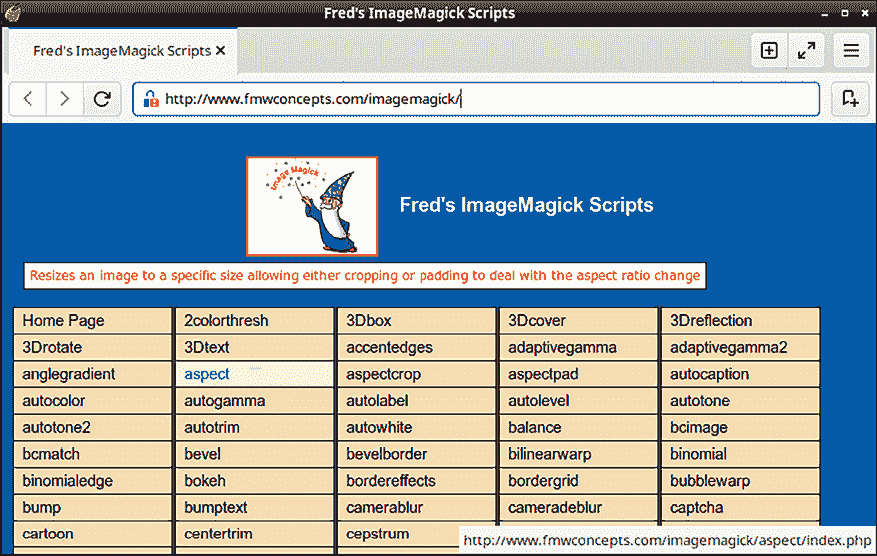

图 13.9：`Fred` 的 `ImageMagick` 脚本网站

如你在图表所示，你可以将光标悬停在脚本名称上，获取每个每个脚本功能的描述。

我相信关于 `ImageMagick` 脚本的介绍就到此了。让我们总结一下并继续后续。

## 总结

`ImageMagick` 对于休闲型和专业图形艺术家来说都是一个极佳的工具。你可以使用非常简单的命令执行一些基础的图像处理，也可以使用更复杂的命令创建惊人的效果。

在本章中，我首先解释了如何自动化处理将非标准文件名扩展名转换为标准 Linux/Unix 格式的过程。然后，我解释了如何在各种操作系统上安装 `ImageMagick`。接下来，我向你展示了如何从命令行显示图像、查看图像属性，以及如何调整大小和自定义图像。最后，我向你展示了如何通过学习和尝试 `Fred` 的 `ImageMagick` 脚本来“走捷径”。

当然，你使用 `ImageMagick` 还能做很多，比我在这里向你展示的要得多。网上到处都是 `ImageMagick` 教程，你可以轻松地通过你喜欢的搜索引擎找到它们。更好的办法是去 YouTube 并在那里搜索 `ImageMagick` 教程。

在下一章中，我将向你展示如何使用 `awk` 进行“叫”。我们下章节见。

## 习题

下列哪个陈述是错误的？

- 使用 `ImageMagick` 能做的事情不多，因为它缺乏图形用户界面。
- 有时，使用 `ImageMagick` 应用效果比使用 GUI 类型程序要简单。
- 你可以通过将 `ImageMagick` 命令放入 shell 脚本来批量处理包含图形文件的目录。
- `ImageMagick` 对于简单任务来说易用，但你也可以通过更复杂的脚本执行更复杂的图像处理。

你可以使用哪两种方法来自动化更改整个图形文件目录的文件扩展名过程？

- 使用命令替换
- 使用变量扩展
- 使用命令扩展
- 使用 `basename` 工具

你会使用哪条 `ImageMagick` 命令来显示图像属性？

- `show`
- `identify`
- `show_properties`
- `properties`

## 进阶阅读

- bash--我如何更改多个文件的扩展名?: https://unix.stackexchange.com/questions/19654/how-do-i-change-the-extension-of-multiple-files
- ImageMagick.org: https://imagemagick.org/
- 开始使用 ImageMagick: https://opensource.com/article/17/8/imagemagick
- 快速入门使用 ImageMagick: https://riptutorial.com/imagemagick
- 使用 ImageMagick 命令行工具处理图像: https://www.baeldung.com/linux/imagemagick-edit-images
- Fred 的 ImageMagick 脚本: http://www.fmwconcepts.com/imagemagick/

## 答案

- a
- b 和 d
- b

## 在 Discord 上加入我们的社区！

与其他用户、Linux 专家以及作者本人一起阅读这本书。

提问、为其他读者提供解决方案、通过 Ask Me Anything 会话与作者聊天等等。扫描二维码或访问链接加入社区。

[`packt.link/SecNet`](https://packt.link/SecNet)


## 14

## 使用 awk – 第一部分

在本章中，我将向你介绍一些 `awk` 的知识。它是一个具有悠久历史的编程环境，可以追溯到 20 世纪 70 年由 `Alfred Aho`、`Peter Weinberger` 和 `Brian Kernighan` 发明，用于早期的 Unix 操作系统。

你有多种方法可以使用 `awk`。它是一门完整的编程语言，因此你可以用它编写非常复杂的独立程序。你还可以创建简单的 `awk` 命令，并从命令行或在普通的 shell 脚本中运行它们。`awk` 的内容非常丰富，甚至有整本书都是关于它的。本章的目标是向你展示如何在普通的 shell 脚本中使用 `awk`。

本章主题包括：

- 介绍 `awk`
- 理解模式（patterns）和动作（actions）
- 从文本文件获取输入
- 从命令获取输入

如果你准备好用 `awk` “叫”了，让我们开始吧。

## 介绍 awk

`awk` 是一种模式扫描和文本处理工具，你可以用它自动化创建报告和数据库的过程。通过其内置的数学函数，你还可以用它对列式数值文本文件进行电子表格操作。`awk` 这个词源于其创建者的名字：`Aho`、`Weinberger` 和 `Kernighan`。原始版本现在被称为“old awk”。较新的实现如 `nawk` 和 `gawk` 功能更丰富且更容易使用。你所拥有的 `awk` 版本取决于你运行的操作系统。

```bash
awk --version

GNU Awk 5.1.1 (built gawk 4.4)

Copyright (C) 1989-2021 Free Software Foundation

本程序是自由软件；你可以根据通用公共许可证第 3 版或（根据你的选择）更高版本进行分发和/或修改。
```

```bash
ls -l /bin/awk lrwxrwxrwx 1 root 4 Jan 18 2023 /bin/awk -> gawk
```

一个显著的例外是 Alpine Linux，它默认使用 `busybox` 内置的 `awk` 实现。然而，`gawk` 和另一种 `awk` 实现 `mawk` 都可以从仓库中安装。（我没有找到关于为什么 `mawk` 叫 `mawk` 的确定答案。但由于它的作者是 `Mike Brennan`，所以我猜它是代表“Michael 的 awk”。）

那么，这些不同的 `awk` 实现之间有什么区别？这里有一个快速的概述：

- `busybox`: 内置于 `busybox` 的 `awk` 实现非常轻量，非常适合低资源嵌入式系统。这就是为什么 Alpine Linux 默认选择它，而该系统也很受欢迎。但请注意，它可能并不总是拥有复杂 `awk` 命令或脚本所需的功能。
- `nawk`: 如我之前提到的，`nawk` 是大多数 Unix 和类 Unix 系统（如 FreeBSD、OpenIndiana 和 macOS）的默认选择。但是，你在这些系统上找到的可执行文件通常只是 `awk` 而不是 `nawk`。
- `mawk`: 这应该是 `awk` 的一个更快版本，由 `Mike Brennan` 创建。
- `gawk`: 这是 GNU 版本。

该实现具有其他实现所不具备的功能。一个主要的增强是包含了国际化和本地化能力，这为为不同语言和地区创建软件提供了便利。它还包含了 TCP/IP 网络功能以及用于处理正则表达式的增强功能。

除非我另有说明，否则我向你展示的在 `nawk` 和 `gawk` 中通用的编码技巧。现在，让我们开始吧。

## 理解模式和动作

`awk` 模式（pattern）简单来说就是动作（action）所属的文本或正则表达式。源可以是纯文本文件，也可以是程序的输出。首先，让我们把 `/etc/passwd` 文件的全部内容转储到屏幕上，如下：

```bash
[donnie@fedora ~]$ awk '{print $0}' /etc/passwd root:x:0:0:root:/root:/bin/bash bin:x:1:1:bin:/bin:/sbin/nologin . . . . . . donnie:x:1000:1000:Donald A. Tevault:/home/donnie:/bin/bash systemd-coredump:x:986:986:systemd Core Dumper:/:/usr/sbin/nologin systemd-timesync:x:985:985:systemd Time Synchronization:/:/usr/sbin/nologin clamupdate:x:984:983:Clamav database update user:/var/lib/clamav:/sbin/nologin setroubleshoot:x:983:979:SELinux troubleshoot server:/var/lib/setroubleshoot:/usr/sbin/nologin
```

在这个命令中，`{print $0}` 部分是动作，它必须被一对单引号包围。`$` 指定要打印哪个字段。在这种情况下，`$0` 导致打印每一个字段。指定模式将导致打印包含该模式的行。由于这次我没有指定模式，因此导致每一行都打印出来。现在，假设只想显示包含特定用户名的行。我只需添加模式，如下：

```bash
[donnie@fedora ~]$ awk '/donnie/ {print $0}' /etc/passwd donnie:x:1000:1000:Donald A. Tevault:/home/donnie:/bin/bash
```

模式需要包含在一对正斜杠之间，而正斜杠又需要包含在包围动作的单引号对内。

`awk` 针对一组被称为 `records`（记录）的信息进行操作。默认情况下，文本文件中的每一行都是一个记录。目前，我们只处理这些。然而，你也可以拥有具有多行记录的文件，这需要特殊的技巧来处理。我将在下一章向你展示。

由于 `{print $0}` 是默认动作，我可以直接省略该部分并获得相同的结果，如下：

```bash
[donnie@fedora ~]$ awk '/donnie/' /etc/passwd donnie:x:1000:1000:Donald A. Tevault:/home/donnie:/bin/bash
```

接下来，让我们只打印这一行的第一个字段。这样做如下：

```bash
[donnie@fedora ~]$ awk '/donnie/ {print $1}' /etc/passwd donnie:x:1000:1000:Donald
```

`$1` 指定我想打印第 1 个字段。但等等，这仍然不对，因为命令实际上打印了第 1 到 5 个字段。这是因为 `awk` 的默认字段分隔符是空格。包含我全名的第 5 个字段在“Donald”和“A.”之间有一个空格。因此，对于 `awk` 来说，这是第二个字段的开始。为了修复这个问题，我将使用 `-F:` 选项让 `awk` 识别冒号为字段分隔符，如下：

```bash
[donnie@fedora ~]$ awk -F: '/donnie/ {print $1}' /etc/passwd donnie
```

最后，我得到了想要的输出。

如果你需要显示多个字段，请在动作中使用逗号分隔的字段标识符列表，如下：

```bash
[donnie@fedora ~]$ awk -F: '/donnie/ {print $1, $7}' /etc/passwd donnie /bin/bash
```

在这里，我正在显示第 1 和第 7 个字段。（注意，字段数字之间的逗号是在输出的字段之间放置空格的原因。省略逗号将导致输出没有该空格。）

你还可以将另一个程序的输出管道到 `awk`，如下：

```bash
[donnie@fedora ~]$ cat /etc/passwd | awk -F: '/donnie/ {print $1}' donnie
```


是的，我知道。将`cat`的输出管道到另一个工具通常是不良习惯，因为你可以直接使用另一个工具。但目前，这只是为了演示这个概念。

到目前为止我为你展示的所有演示也可以通过`cat`、`grep`、`cut`完成。

## 从文本文件中获取输入

`awk`模式就是动作所属的文本或正则表达式。源可以是纯文本文件，也可以是程序的输出。首先，让我们把`/etc/passwd`文件的全部内容转储到屏幕上，如下：

在这个命令中，`{print $0}`部分是动作，它必须被一对单引号包围。`$`指定要打印哪个字段。在这种情况下，`$0`导致打印每一个字段。指定模式将导致打印包含该模式的行。由于这次我没有指定模式，因此导致每一行都打印出来。现在，假设只想显示包含特定用户名的行。我只需添加模式，如下：

模式需要包含在一对正斜杠之间，而正斜杠又需要包含在包围动作的单引号对内。

`awk`针对一组被称为`records`（记录）的信息进行操作。默认情况下，文本文件中的每一行都是一个记录。目前，我们只处理这些。然而，你也可以拥有多行记录的文件，这需要特殊的技巧来处理。我将在下一章向你展示。

由于`{print $0}`是默认动作，我可以直接省略该部分并获得相同的结果，如下：

接下来，让我们只打印这一行的第一个字段。这样做如下：

`$1`指定我想打印第 1 个字段。但等等，这仍然不对，因为命令实际上打印了第 1 到 5 个字段。这是因为`awk`的默认字段分隔符是空格。包含我全名的第 5 个字段在“Donald”和“A.”之间有一个空格。因此，对于`awk`来说，这是第二个字段的开始。为了修复这个问题，我将使用`-F:`选项让`awk`识别冒号为字段分隔符，如下：

最后，我得到了想要的输出。

如果你需要显示多个字段，请在动作中使用逗号分隔的字段标识符列表，如下：

在这里，我正在显示第 1 和第 7 个字段。（注意，字段数字之间的逗号是在输出的字段之间放置空格的原因。省略逗号将导致输出没有该空格。）

你还可以将另一个程序的输出管道到`awk`，如下：

是的，我知道。将`cat`的输出管道到另一个工具通常是不良习惯，因为你可以直接使用另一个工具。但目前，这只是为了演示这个概念。

到目前为止为你展示的所有演示也可以通过`cat`、`grep`、`cut`完成。

## 查找用户

`awk`模式就是动作所属的文本或正则表达式。源可以是纯文本文件，也可以是程序的输出。首先，让我们把`/etc/passwd`文件的全部内容转储到屏幕上，如下：

在这个命令中，`{print $0}`部分是动作，它必须被一对单引号包围。`$`指定要打印哪个字段。在这种情况下，`$0`导致打印每一个字段。指定模式将导致打印包含该模式的行。由于这次我没有指定模式，因此导致每一行都打印出来。现在，假设只想显示包含特定用户名的行。我只需添加模式，如下：

模式需要包含在一对正斜杠之间，而正斜杠又需要包含在包围动作的单引号对内。

`awk`针对一组被称为`records`（记录）的信息进行操作。默认情况下，文本文件中的每一行都是一个记录。目前，我们只处理这些。然而，你也可以拥有多行记录的文件，这需要特殊的技巧来处理。我将在下一章向你展示。

由于`{print $0}`是默认动作，我可以直接省略该部分并获得相同的结果，如下：

接下来，让我们只打印这一行的第一个字段。这样做如下：

`$1`指定我想打印第 1 个字段。但等等，这仍然不对，因为命令实际上打印了第 1 到 5 个字段。这是因为`awk`的默认字段分隔符是空格。包含我全名的第 5 个字段在“Donald”和“A.”之间有一个空格。因此，对于`awk`来说，这是第二个字段的开始。为了修复这个问题，我将使用`-F:`选项让`awk`识别冒号为字段分隔符，如下：

最后，我得到了想要的输出。

如果你需要显示多个字段，请在动作中使用逗号分隔的字段标识符列表，如下：

在这里，我正在显示第 1 和第 7 个字段。（注意，字段数字之间的逗号是在输出的字段之间放置空格的原因。省略逗号将导致输出没有该空格。）

你还可以将另一个程序的输出管道到`awk`，如下：

是的，我知道。将`cat`的输出管道到另一个工具通常是不良习惯，因为你可以直接使用另一个工具。但目前，这只是为了演示这个概念。

到目前为止为你展示的所有演示也可以通过`cat`、`grep`、`cut`完成。

## 用户 ID

`awk`模式就是动作所属的文本或正则表达式。源可以是纯文本文件，也可以是程序的输出。首先，让我们把`/etc/passwd`文件的全部内容转储到屏幕上，如下：

在这个命令中，`{print $0}`部分是动作，它必须被一对单引号包围。`$`指定要打印哪个字段。在这种情况下，`$0`导致打印每一个字段。指定模式将导致打印包含该模式的行。由于这次我没有指定模式，因此导致每一行都打印出来。现在，假设只想显示包含特定用户名的行。我只需添加模式，如下：

模式需要包含在一对正斜杠之间，而正斜杠又需要包含在包围动作的单引号对内。

`awk`针对一组被称为`records`（记录）的信息进行操作。默认情况下，文本文件中的每一行都是一个记录。目前，我们只处理这些。然而，你也可以拥有多行记录的文件，这需要特殊的技巧来处理。我将在下一章向你展示。

由于`{print $0}`是默认动作，我可以直接省略该部分并获得相同的结果，如下：

接下来，让我们只打印这一行的第一个字段。这样做如下：

`$1`指定我想打印第 1 个字段。但等等，这仍然不对，因为命令实际上打印了第 1 到 5 个字段。这是因为`awk`的默认字段分隔符是空格。包含我全名的第 5 个字段在“Donald”和“A.”之间有一个空格。因此，对于`awk`来说，这是第二个字段的开始。为了修复这个问题，我将使用`-F:`选项让`awk`识别冒号为字段分隔符，如下：

最后，我得到了想要的输出。

如果你需要显示多个字段，请在动作中使用逗号分隔的字段标识符列表，如下：

在这里，我正在显示第 1 和第 7 个字段。（注意，字段数字之间的逗号是在输出的字段之间放置空格的原因。省略逗号将导致输出没有该空格。）

你还可以将另一个程序的输出管道到`awk`，如下：

是的，我知道。将`cat`的输出管道到另一个工具通常是不良习惯，因为你可以直接使用另一个工具。但目前，这只是为了演示这个概念。

到目前为止为你展示的所有演示也可以通过`cat`、`grep`、`cut`完成。

### 提示

如果你计划自己使用此命令，请确保验证你的操作系统使用的 UID 范围。大多数 Linux 发行版使用 1000 到 60000 的范围，定义在`/etc/login.defs`文件。非 Linux 操作系统（如 OpenIndiana 和 FreeBSD）不使用`login.defs`文件，我还没有找到关于它们 UID 范围的确定答案。关于它们，最好的建议是查看`/etc/passwd`文件中第一个人类账户分配的 UID，并咨询组织的政策手册以查看组织想要为人类用户使用的精确 UID 范围。

当然，每次想使用它时没必要每次都输入这一整个长命令。相反，将其放入一个普通的 Shell 脚本中，我将其称为`user_list.sh`。它看起来像：

```bash
#!/bin/bash awk -F: '$3 >= 1000 && $3 <= 60000 {print $1, $7 > "users.txt"}' /etc/passwd
```

这很好，但如果你需要一个逗号分隔值（.csv）文件以便方便地导入到电子表格中呢？好吧，我为你解决了。只需添加一个`BEGIN`部分，你可以在这里定义输出的新字段分隔符，以及输入的字段分隔符，如下所示：

```bash
donnie@fedora:~$ awk 'BEGIN {OFS = ","; FS = ":"}; $3 >= 1000 && $3 <= 60000 {print $1,$7 > "users.csv"}' /etc/passwd

donnie@fedora:~$ cat users.csv

donnie,/bin/bash vicky,/bin/bash frank,/bin/bash goldie,/bin/bash cleopatra,/bin/bash victor,/bin/bash valerie,/bin/bash victoria,/bin/bash

donnie@fedora:~$
```

这看起来可能有点奇怪，因为当你在`awk`动作中定义输入字段分隔符时，使用的是`-F`选项。但在`BEGIN`部分中定义输入字段分隔符时，你使用的却是`FS`选项。同样地，你在`BEGIN`部分中使用`OFS`来定义输出的字段分隔符。（在`awk`的术语中，字段分隔符实际上被称为 Field Separators（字段分隔器），这解释了为什么这些`BEGIN`选项被称为`FS`和`OFS`。）

`awk`命令或脚本的`BEGIN`部分是你添加任何初始化代码的地方，这些代码会在`awk`开始处理输入文件之前运行。你可以用它定义字段分隔符、为输出添加表头，或者初始化之后将使用的全局变量。

这很好，但我还想看到用户的 UID。所以，我把第 3 字段也加入进来，如下：

```bash
donnie@fedora:~$ awk 'BEGIN {OFS = ","; FS = ":"}; $3 >= 1000 && $3 <= 60000 {print $1,$3,$7 > "users.csv"}' /etc/passwd

donnie@fedora:~$ cat users.csv

donnie,1000,/bin/bash vicky,1001,/bin/bash frank,1003,/bin/bash goldie,1004,/bin/bash cleopatra,1005,/bin/bash victor,1006,/bin/bash valerie,1007,/bin/bash victoria,1008,/bin/bash

donnie@fedora:~$
```

现在我已经按照想要的方式有了`awk`命令，我将把它放入`user_list2.sh`脚本中，它看起来如下：

```bash
#!/bin/bash

awk 'BEGIN {OFS = ","; FS = ":"}; $3 >= 1000 && $3 <= 60000 {print $1,$3,$7 > "users.csv"}' /etc/passwd
```

你可以用其他编程语言（如 Python、C 或 Java）编写一个实现相同功能的程序。但是，程序代码会非常复杂，且更难编写正确。而使用`awk`，只需要一个简单的单行命令即可。

接下来，让我们看看`awk`如何帮助繁忙的 Web 服务器管理员。

## 解析 Web 服务器访问日志

Web 服务器访问日志包含许多可以帮助网站所有者、Web 服务器管理员或网络安全管理员的信息。有很多华丽的日志解析工具可以构建出精美的报告，告诉你正在发生的一切，如果那是你需要的的话。但有时，你可能想要快速提取某些特定数据，而不想花时间运行某些华丽的工具。这一点有几种不同的方法，而`awk`是最好的工具之一。

要开始这个场景，你需要一台安装了活动 Web 服务器的虚拟机。为了简单起见，我将在我的 Fedora Server 虚拟机上安装 Apache 服务器和 PHP 模块，如下：

```bash
donnie@fedora:~$ sudo dnf install httpd php
```

接下来，启用并启动 Apache 服务，如下：

```bash
donnie@fedora:~$ sudo systemctl enable --now httpd
```

从不同的机器访问服务器，你需要在防火墙上开放 80 端口，如下：

```bash
donnie@fedora:~$ sudo firewall-cmd --add-service=http --permanent

donnie@fedora:~$ sudo firewall-cmd --reload

donnie@fedora:~$
```

最后，在`/var/www/html/`目录下创建`test.php`文件，内容如下：

提示：为了让其生效，请确保将你的虚拟机设置为桥接模式（Bridged Mode）网络，以便网络上的其他机器可以访问它。同时，请确保用于访问 Web 服务器的虚拟机也设置为桥接模式，这样每台机器在访问日志文件中都将有自己的 IP 地址。

现在，从尽可能多的其他机器访问 Fedora Web 服务器测试页面和`test.php`页面。然后，尝试访问一个不存在的页面。你的 URL 应该类似于：

`http://192.168.0.11` `http://192.168.0.11/test.php` `http://192.168.0.11/bogus.html`

在 Web 服务器虚拟机上，使用`less`打开`/var/log/httpd/access_log`文件，如下：

```bash
donnie@fedora:~$ sudo less /var/log/httpd/access_log
```

注意文件的结构，以及它如何使用空格作为某些字段的分隔符，并使用双引号作为其他字段的分隔符。例如，这里是我文件中的一条条目：

`192.168.0.17 - - [18/Dec/2023:16:40:03 +0000] "GET /test.php HTTP/1.1" Mozilla/5.0 (Windows NT 10.0; Win64; x64) AppleWebKit/537.36 (KHTML, like Gecko) Chrome/120.0.0.0 Safari/537.36" 200 1234`

```bash
donnie@fedora:~$ sudo awk '{print $1}' /var/log/httpd/access_log | sort -V | uniq -c | mlr --ojson cat > ip_list.json

donnie@fedora:~$ cat ip_list.json

{ "1": " 6 192.168.0.10" } { "1": " 27 192.168.0.16" } { "1": " 12 192.168.0.17" } { "1": " 2 192.168.0.18" } { "1": " 4 192.168.0.27" } { "1": " 15 192.168.0.37" } { "1": " 6 192.168.0.107" } { "1": " 14 192.168.0.251" } { "1": " 6 192.168.0.252" }

donnie@fedora:~$
```

使用`mlr`可以做的事情远比我在这里能展示的要得多。要了解更多信息，请查阅`mlr`的 man 页或 Miller 文档网页。（你可以在“延伸阅读”部分找到指向 Miller 页面的链接）。尽管`mlr`很好用，但它确实有一个缺陷。那就是它无法处理包含空格或逗号的字段。因此，你无法用它来处理 Apache 访问日志中的每一个字段。

现在，假设我们想查看哪些操作系统和浏览器正在访问这台服务器。包含这些信息的用户代理（User Agent）字符串位于第 6 字段，并且被一对双引号包围。因此，我们需要使用双引号作为字段分隔符，如下所示：

```bash
donnie@fedora:~$ sudo awk -F\" '{print $6}' /var/log/httpd/access_log | sort | uniq

Lynx/2.8.9rel.1 libwww-FM/2.14 SSL-MM/1.4.1 OpenSSL/1.1.1t-freebsd Lynx/2.9.0dev.10 libwww-FM/2.14 SSL-MM/1.4.1 GNUTLS/3.7.1 Lynx/2.9.0dev.12 libwww-FM/2.14 SSL-MM/1.4.1 GNUTLS/3.7.8 Mozilla/5.0 (Macintosh; Intel Mac OS X 10_14_6) AppleWebKit/605.1.15 (KHTML, like Gecko) Version/14.1.2 Safari/605.1.15 . . . . . . Mozilla/5.0 (X11; Linux x86_64; rv:120.0) Gecko/20100101 Firefox/120.0 Mozilla/5.0 (X11; Linux x86_64; rv:45.0) Gecko/20100101 Firefox/45.0 Mozilla/5.0 (X11; SunOS i86pc; rv:120.0) Gecko/20100101 Firefox/120.0 Mozilla/5.0 (X11; Ubuntu; Linux x86_64; rv:109.0) Gecko/20100101 Firefox/113.0

donnie@fedora:~$
```

你可以看到，我必须用反斜杠对双引号进行转义，这样 shell 就不会误解它。

接下来，让我们寻找一个特定的用户代理。假设我们想知道有多少用户在使用 Mac。只需添加模式，如下：

```bash
donnie@fedora:~$ sudo awk -F\" '/Mac OS X/ {print $6}' /var/log/httpd/access_log | sort | uniq -c

8 Mozilla/5.0 (Macintosh; Intel Mac OS X 10_14_6) AppleWebKit/605.1.15 (KHTML, like Gecko) Version/14.1.2 Safari/605.1.15

6 Mozilla/5.0 (Macintosh; Intel Mac OS X 10.14; rv:109.0) Gecko/20100101 Firefox/115.0
```


6 Mozilla/5.0 (Macintosh; PPC Mac OS X 10.4; FPR10; rv:45.0) Gecko/20100101 Firefox/45.0

TenFourFox/7450 9 Mozilla/5.0 (Macintosh; U; PPC Mac OS X 10_4_11; en) AppleWebKit/533.19.4 (KHTML, like Gecko) Version/4.1.3 Safari/533.19.4

`donnie@fedora:~$`

Intel Mac 的记录来自于我 2010 年型的 Mac Pro，所以它们是合理的。但是，输出第 3 和第 4 行的 PPC 是怎么回事？嗯，这也很容易。为了好玩，我启动了我那台有 21 年历史、配备老式 PowerPC G4 处理器的 eMac，并用它访问了测试服务器。（猜你在你的网络上看不到这些设备。）

你也可以使用纯 `awk` 获取这些信息，而无需将输出传递给其他工具。通过构建关联数组来实现，如下：

```bash
donnie@fedora:~$ sudo awk '{count[$1]++}; END {for (ip_address in count) print ip_address, count[ip_address]}' /var/log/httpd/access_log

192.168.0.251 14
192.168.0.252 6
192.168.0.10 6
192.168.0.16 22
192.168.0.17 12
192.168.0.107 6
192.168.0.18 2
192.168.0.27 4
192.168.0.37 15
donnie@fedora:~$
```

添加一个带有 `OFS` 定义的 `BEGIN` 部分就可以创建一个 `.csv` 文件。它的样子如下：

```bash
donnie@fedora:~$ sudo awk 'BEGIN {OFS = ","}; {count[$1]++}; END {for (ip_address in count) print ip_address, count[ip_address]}' /var/log/httpd/access_log > ip_addresses.csv

donnie@fedora:~$ cat ip_addresses.csv

192.168.0.251,14
192.168.0.252,6
192.168.0.10,6
192.168.0.16,27
192.168.0.17,12
192.168.0.107,6
192.168.0.18,2
192.168.0.27,4
192.168.0.37,15
donnie@fedora:~$
```

与你之前看到的普通 shell 数组不同，`awk`关联数组使用字符串而不是数字作为索引。此外，`awk` 中的数组是动态定义的，在使用之前不需要声明。所以在这里你看到了 `count` 数组，其索引是字段 1 的任何值。`++` 运算符假设初始值为 0，累加每个索引字符串在文件中出现的次数。该命令以分号结尾的第一部分像 `awk` 样逐行处理文件。`END` 关键字指定在行处理完成后运行的代码。在这种情况下，你看到一个 `for` 循环，打印唯一 IP 地址的摘要以及它们出现的次数。遗憾的是，纯 `awk` 没有简单的方法进行排序，但你仍然可以将输出传递给 `sort`：

```bash
donnie@fedora:~$ sudo awk 'BEGIN {OFS = ","}; {count[$1]++}; END {for (ip_address in count) print ip_address, count[i]}' /var/log/httpd/access_log | sort -t, -V -k1,1 > ip_addresses.csv

donnie@fedora:~$ cat ip_addresses.csv

192.168.0.10,6
192.168.0.16,27
192.168.0.17,12
192.168.0.18,2
192.168.0.27,4
192.168.0.37,15
192.168.0.107,6
192.168.0.251,14
192.168.0.252,6
```

为了让这生效，我使用了带有 `-t,` 选项的 `sort` 将逗号定义为字段分隔符。（是的，我知道如果所有 Linux 和 Unix 工具都使用相同的选项开关来定义字段分隔符该好了，但世界并非如此。）

使用纯 `awk` 的另一个区别是，每个 IP 地址的出现次数在第二列，而不是之前看到的第一列。在这里没问题，但对于其他字段可能效果不佳。例如，让我们更改命令查看第 6 字段中的用户代理：

```bash
donnie@fedora:~$ sudo awk -F\" '{count[$6]++}; END { for (i in count) print i, count[i]}' /var/log/httpd/access_log | sort

Lynx/2.8.9rel.1 libwww-FM/2.14 SSL-MM/1.4.1 OpenSSL/1.1.1t-freebsd 2
Lynx/2.9.0dev.10 libwww-FM/2.14 SSL-MM/1.4.1 GNUTLS/3.7.1 4
Lynx/2.9.0dev.12 libwww-FM/2.14 SSL-MM/1.4.1 GNUTLS/3.7.8 3
Mozilla/5.0 (Macintosh; Intel Mac OS X 10_14_6) AppleWebKit/605.1.15 (KHTML, like Gecko) Version/14.1.2 Safari/605.1.15 8
. . . . . . Mozilla/5.0 (X11; Ubuntu; Linux x86_64; rv:109.0) Gecko/20100101 Firefox/113.0 6
```

并像我之前向你展示的那样再次进行 `sort`。文件如下：

```bash
donnie@fedora:~$ cat user_agent.tsv

23 "Mozilla/5.0 (X11; Linux x86_64; rv:120.0) Gecko/20100101 Firefox/120.0"
9 "Mozilla/5.0 (X11; SunOS i86pc; rv:120.0) Gecko/20100101 Firefox/120.0"
9 "Mozilla/5.0 (Macintosh; U; PPC Mac OS X 10_4_11; en) AppleWebKit/533.19.4 (KHTML, like Gecko) Version/4.1.3 Safari/533.19.4"
8 "Mozilla/5.0 (Macintosh; Intel Mac OS X 10_14_6) AppleWebKit/605.1.15 (KHTML, like Gecko) Version/14.1.2 Safari/605.1.15"
6 "Mozilla/5.0 (X11; Ubuntu; Linux x86_64; rv:109.0) Gecko/20100101 Firefox/113.0"
. . . . . .
3 "Lynx/2.9.0dev.12 libwww-FM/2.14 SSL-MM/1.4.1 GNUTLS/3.7.8"
2 "Lynx/2.8.9rel.1 libwww-FM/2.14 SSL-MM/1.4.1 OpenSSL/1.1.1t-freebsd"
donnie@fedora:~$
```

如果你更喜欢使用关联数组，可以这样做：

```bash
donnie@fedora:~$ sudo awk -F\" '{count[$6]++}; END { for (ip_address in count) printf "%s \"%s\"\n", count[ip_address], ip_address}' /var/log/httpd/access_log | sort -nr > user_agent.tsv

donnie@fedora:~$ cat user_agent.tsv

23 "Mozilla/5.0 (X11; Linux x86_64; rv:120.0) Gecko/20100101 Firefox/120.0"
9 "Mozilla/5.0 (X11; SunOS i86pc; rv:120.0) Gecko/20100101 Firefox/120.0"
9 "Mozilla/5.0 (Macintosh; U; PPC Mac OS X 10_4_11; en) AppleWebKit/533.19.4 (KHTML, like Gecko) Version/4.1.3 Safari/533.19.4"
8 "Mozilla/5.0 (Macintosh; Intel Mac OS X 10_14_6) AppleWebKit/605.1.15 (KHTML, like Gecko) Version/14.1.2 Safari/605.1.15"
6 "Mozilla/5.0 (X11; Ubuntu; Linux x86_64; rv:109.0) Gecko/20100101 Firefox/113.0"
. . . . . .
3 "Lynx/2.9.0dev.12 libwww-FM/2.14 SSL-MM/1.4.1 GNUTLS/3.7.8"
2 "Lynx/2.8.9rel.1 libwww-FM/2.14 SSL-MM/1.4.1 OpenSSL/1.1.1t-freebsd"
donnie@fedora:~$
```

注意看我是如何在 `printf` 参数外包围了一对双引号的。第一个 `%s` 参数用于计数字段，第二个 `%s` 参数用于用户代理（user agent）字段。为了在正确的位置添加双引号，我在第二个 `%s` 之前和之后都添加了 `\"`。无论使用关联数组方法还是非关联数组方法，得到的结果都是相同的。现在，当我用电子表格程序打开该文件时，只需将双引号定义为字段分隔符即可。在 LibreOffice Calc 中看起来是这样的：


图 14.1：在 LibreOffice Calc 中设置字段分隔符

我知道我还没有完全解释 `print` 与 `printf` 的区别，我将在下一章中介绍。

`user_agent.tsv` 文件现在应该能正常显示，第一列是计数，第二列是用户代理字符串。

接下来，让我们统计 Web 服务器上每个 URL 被访问的次数。我喜欢将计数作为输出的第一个字段，所以我将再次将 `awk` 的输出通过给 `uniq` 和 `sort`，如下所示：

```bash
donnie@fedora:~$ sudo awk '{print $7}' /var/log/httpd/access_log | sort | uniq -c | sort -k1,1 -n
1 /something.html
1 /test
1 /test.html
1 /test/php
1 /test.php?module=..../
2 /test.php?module=....//....//....//....//....//....//....//....//....//....//proc/self/environ0000
2 /test.php?page=../../../../../../../../../../proc/self/environ00
11 /icons/poweredby.png
11 /poweredby.png
11 /report.html
12 /favicon.ico
17 /test.php
donnie@fedora:~$
```

使用空格作为字段分隔符意味着 URL 字段是 `7`。最后，我再次将输出传递给 `sort`，这样列表就会根据每个 URL 的访问次数进行打印。但实际上，我希望将最流行的 URL 显示在顶部。因此，我只需为 `sort` 添加 `-r` 选项来进行逆序排序，如下：

```bash
donnie@fedora:~$ sudo awk '{print $7}' /var/log/httpd/access_log | sort | uniq -c | sort -k1,1 -nr
18 /test.php
17 /
12 /favicon.ico
11 /report.html
11 /poweredby.png
11 /icons/poweredby.png
2 /test.php?page=../../../../../../../../../../proc/self/environ00
2 /test.php?module=....//..../..../..../..../..../000/proc/self/environ0000
```

在这里，我正在查看第 10 到 15 行的第 1 列。当然，你可以通过组合 `tail`、`head` 和 `cut` 工具来实现同样的操作，但这样要简单得多。

在这一节中，我们查看了 `FS`、`OFS` 和 `NR`。我还没有告诉你，这三个结构是 `awk` 内置的变量。还有许多其他内置变量，但我不想现在通过解释所有的变量来让你目不应接。如果你感兴趣阅读所有这些变量，只需打开 `awk` man 页面并滚动到“Built-in Variables”（内置变量）部分即可。

我在这里展示的日志解析技术可以用于任何类型的日志文件。在设计你的 `awk` 命令时，查看你想要处理的日志文件，并注意每行的字段是如何布局的以及它们包含了哪些信息。

在继续之前，让我们来看其他几种日志解析技术。

## 使用正则表达式

你可以通过正则表达式来增强你的 `awk` 体验，就像使用其他文本处理工具一样。

如果有需要，请回看第 2 章“文本流过滤器——部分 2”和第 9 章“使用 `grep`、`sed` 和正则表达式过滤文本”，以复习正则表达式和 POSIX 字符类的概念。

对于我们的第一个示例，假设你需要搜索 `/etc/passwd` 文件中所有用户名以小写 v 开头的用户。只需使用一个简单的正则表达式即可，如下所示：

```bash
donnie@fedora:~$ awk '/^v/' /etc/passwd
vicky:x:1001:1001::/home/vicky:/bin/bash
victor:x:1006:1006::/home/victor:/bin/bash
valerie:x:1007:1007::/home/valerie:/bin/bash
victoria:x:1008:1008::/home/victoria:/bin/bash
donnie@fedora:~$
```

这之所以有效，是因为用户名字段是每行的第一个字段。所以，你不需要做比这更复杂的操作。但是，假设你需要在另一个字段中搜索以特定字符开头的内容。例如，假设你需要搜索 Apache 访问日志文件中所有 400 范围内的 HTTP 状态码。只需这样操作即可：

```bash
donnie@fedora:~$ sudo awk '$9 ~ /⁴/{print $9}' /var/log/httpd/access_log | sort -n | uniq -c
17 403
20 404
donnie@fedora:~$
```

模式中的 `$9` 意味着你正在第 9 字段查找某种模式。`~` 意味着你想让该字段匹配后续两个正斜杠之间的任何内容。在这种情况下，它在查找第 9 字段中以数字 4 开头的任何内容。在输出中，你可以我同时找到了 403 和 404 状态码。而且，如果你需要，可以将输出保存到 `.csv` 文件中，如下：

```bash
donnie@fedora:~$ sudo awk '$9 ~ /⁴/{print $9}' /var/log/httpd/access_log | sort -n | uniq -c | mlr --p2c cat > status_code.csv
donnie@fedora:~$ cat status_code.csv
17,403
20,404
donnie@fedora:~$
```

如果你愿意，可以通过省略 `mlr --p2c cat` 部分将其保存到 `.tsv` 文件中，如下：

```bash
donnie@fedora-server:~$ sudo awk '$9 ~ /⁴/{print $9}' /var/log/httpd/access_log | sort -n | uniq -c > status_code.tsv
donnie@fedora-server:~$ cat status_code.tsv
6 403
4 404
donnie@fedora-server:~$
```

要查看特定模式以外的所有内容，使用 `!~` 结构，如下：

```bash
donnie@fedora:~$ sudo awk '$9 !~ /⁴/{print $9}' /var/log/httpd/access_log | sort -n | uniq -c
53 200
2 304
donnie@fedora:~$
```

这让我们能够看到 400 代码以外的所有内容。

接下来，假设我们想看到所有使用 Safari 或 Lynx 浏览器的实例。你可以这样做：

```bash
donnie@fedora:~$ sudo awk '/Safari|Lynx/' /var/log/httpd/access_log
```


然而，这不起作用，因为它会包含像这样的条目：

```
192.168.0.27 - - [17/Dec/2023:17:43:40 -0500] "GET / HTTP/1.1" 403 8474 "-" "Mozilla/5.0 (Windows NT 10.0; Win64; x64) AppleWebKit/537.36 (KHTML, like Gecko) Chrome/120.0.0.0 Safari/537.36 Edg/120.0.0"
```

由于某些原因，Apache 无法识别 Microsoft Edge 浏览器，因此报告了多种可能性，包括 Safari。为了缩小范围，我将排除任何使用 Windows 的用户（Safari 曾经支持 Windows，但已 2012 年停止了）。显示如下：

```bash
donnie@fedora:~$ sudo awk -F\" '$6|Lynx/ && $6 !~ /Windows/' /var/log/httpd/access_log
```

在这里，你看到了一些奇怪的事情。当你在正则表达式中使用 `or` 运算符时，你使用单个 `|` 或 `&`。当你在正则表达式外部使用 `and` 运算符时，你使用 `||` 或 `&&`。我知道这很困惑，但事实就是如此。无论如何，如果你现在查看输出，你会看到来自 Windows 的行。我知道，这只是 `awk` 和正则表达式能做到的皮毛。如果你要求的话，我可能会在下一节中展示更多示例，关于如何使用 `awk` 处理命令信息。

## 从命令获取信息

让我们从简单的开始，获取一些基础进程信息。在运行 Apache 的 Fedora 虚拟机上，搜索所有包含 `httpd` 模式的 `ps aux` 输出，如下：

```bash
donnie@fedora:~$ ps aux | awk '/httpd/ {print $0}' root 1072 0.0 0.2 19108 10796 ? Ss 14:36 0:01 /usr/sbin/httpd apache 1111 0.0 0.1 19204 6788 ? S 14:36 0:00 /usr/sbin/httpd apache 1112 0.0 0.2 215820 8448 ? Sl 14:36 0:02 /usr/sbin/httpd apache 1113 0.0 0.2 242048 8592 ? Sl 14:36 0:03 /usr/sbin/httpd apache 1114 0.0 0.2 215820 8448 ? Sl 14:36 0:02 /usr/sbin/httpd donnie 1908 0.0 0.0 9196 3768 pts/0 S+ 17:13 0:00 awk /httpd/ {print $0} donnie@fedora:~$
```

接下来，假设我们要看到由 root 用户拥的所有进程。这也很简单。只需执行：

```bash
donnie@fedora:~$ ps aux | awk '$1 == "root" {print $0}' root 1 0.0 0.6 74552 27044 ? Ss 14:26 0:05 /usr/lib/systemd/systemd --switched-root --system --deserialize=36 root 2 0.0 0.0 ? S 14:26 0:00 [kthreadd] root 3 0.0 0.0 ? S 14:26 0:00 [pool_workqueue_release] . . . . . . root 1688 0.0 0.1 16332 6400 ? S 16:53 0:00 systemd-userwork: waiting... donnie@fedora:~$
```

这里并没有新东西，因为这些 `awk` 命令与你在上一节看到的相同。事实上，解析日志文件的技术在这里同样有效。所以我们不再重复这些。

从 `ps` 工具解析信息的第一步是查看各种字段。`aux` 选项组合对我来说是最用的，因为它显示了我最需要的特定信息。为了查看显示字段名的 `ps` 表头，我将 `ps aux` 的输出管道到 `head -1`，如下：

```bash
[donnie@fedora ~]$ ps aux | head -1 USER PID %CPU %MEM VSZ RSS TTY STAT START TIME COMMAND [donnie@fedora ~]$
```

以下是所有字段含义的说明：

- `USER`: 所有每个特定进程的用户。
- `PID`: 每个进程的进程 ID。
- `%CPU`: 每个进程消耗的 CPU 资源百分比。
- `RSS`: 驻留集合大小（Resident Set Size）是每个进程使用的实际物理非交换内存量。（我知道这不是有序的，但你很快就会知道原因。）
- `%MEM`: 进程的 `RSS` 与机器上物理内存量的比例。
- `VSZ`: 虚拟集合大小（Virtual Set Size）是每个进程使用的虚拟内存量。（以 1024 字节为单位表示。）
- `TTY`: 控制每个进程的终端。
- `STAT`: 此列持有每个进程的状态码。
- `START`: 每个进程的启动时间或日期。
- `TIME`: 每个进程的累计 CPU 时间，格式为 “[[DD-]HH:MM:SS`”。
- `COMMAND`: 命令名称。

: 启动每个进程的命令。

请记住，`ps` 有许多选项开关，它们都会显示不同类型的进程数据。还有许多方法可以组合这些开关，以便以你喜欢的格式显示你所需的所有信息。不过，目前我将一直使用 `ps aux`，主要由于由于这对我来说是最有用的选项组合。更多细节，请参阅 `ps` 的 man 页面。

默认情况下，`ps` 命令总是会连同你想查看的信息一起显示此表头。因此，如果你将 `ps` 管道传递给没有过滤掉表头的 `awk` 命令，你将将看到这个表头。例如，让我们看看不是由 root 用户拥有的进程，如下：

```
donnie@fedora:~$ ps aux | awk '$1 != "root" {print $0}' USER PID %CPU %MEM VSZ RSS TTY STAT START TIME COMMAND systemd+ 800 0.1 0.1 16240 7328 ? Ss 14:27 0:13 /usr/lib/systemd/systemd-oomd systemd+ 801 0.0 0.4 27656 16236 ? Ss 14:27 0:00 /usr/lib/systemd/systemd-resolved . . . . . . donnie 1745 200 0.1 9888 4520 pts/0 R+ 17:10 0:00 ps aux donnie 746 0.0 0.0 9196 3804 pts/0 S+ 17:10 0:00 awk $1 != "root" {print $0} donnie@fedora:~$
```

在大多数情况下这是没问题的。但是，如果你需要将信息保存到格式化的文本文件中，那个表头可能会扰乱你。为了解决这个问题，让我们使用我在上一节中向你展示过的记录数 (`NR`) 变量。这是它的工作原理：

```
donnie@fedora:~$ ps aux | awk 'NR > 1 && $1 != "root" {print $0}' systemd+ 800 0.1 0.1 16240 7328 ? Ss 14:27 0:15 /usr/lib/systemd/systemd-oomd systemd+ 801 0.0 0.4 27656 16236 ? Ss 14:27 0:00 /usr/lib/systemd/systemd-resolved . . . . . . donnie 1765 250 0.1 9888 4620 pts/0 R+ 17:26 0:00 ps aux donnie 1766 0.0 0.0 9196 3780 pts/0 S+ 17:26 0:00 awk NR > 1 && $1 != "root" {print $0} donnie@fedora:~$
```

`NR > 1` 子句意味着我们只想看到在记录 1 之后的记录。换句话说，我们不想看到输出的第一行，在在这种情况下就是 `ps` 的表头。

现在我们已经知道每个字段是什么了，可以创建一些实用的单行命令来提取信息。首先，让我们看看有多少进程处于运行（Running）状态或僵尸（Zombie）状态。（僵尸进程是一个尚未被父进程正确销毁的死亡进程。你可以查看 `ps` man 页面来了解关于它们的信息。）我们知道 `STAT` 列是第 8 字段，所以命令看起来像这样：

```
[donnie@fedora ~]$ ps aux | awk '$8 ~ /^[RZ]/ {print}' donnie 2803 30.5 1.6 4963152 1058324 ? Rl 14:00 70:12 /usr/lib64/firefox/firefox donnie 4383 1.9 0.4 3157216 307460 ? Rl 14:03 4:18 /usr/lib64/firefox/firefox -contentproc -childID 33 -isForBrowser -prefsLen 31190 -prefMapSize 237466 -jsInitLen 229864 -parentBuildID 20231219113315 -greomni /usr/lib64/firefox/omni.ja -appomni /usr/lib64/firefox/browser/omni.ja -appDir /usr/lib64/firefox/browser {d458c911-d065-4a3c-bdd5-9d06fc1d030d} 2803 true tab donnie 46283 0.0 0.0 0 0 ? R 17:50 0:00 [Chroot Helper] donnie 46315 0.0 0.0 224672 3072 pts/0 R+ 17:50 0:00 ps aux [donnie@fedora ~]$
```

这看起来有点乱，是因为 `COMMAND` 字段包含了一个很长的字符串，但没关系。你仍然可以看到第 8 以 `R` 开头。（你很少看到任何僵尸进程，所以不用担心看不到它们。）

`w` 命令向你显示所有登录系统的用户列表以及他们在做什么。它看起来像这样：

```
donnie@fedora:~$ w 17:37:44 up 3:11, 4 users, load average: 0.03, 0.06, 0.02 USER TTY LOGIN IDLE CPU PCPU donnie tty1 17:31 5:51 0.06s 0.06s -bash donnie pts/0 15:29 0.00s 0.35s 0.06s vicky pts/1 17:32 4:50 0.05s 0.05s -bash frank pts/2 17:33 ... donnie@fedora:~$
```

你看到我通过 `tty1` 登录，这是本地终端。我也通过 `pts` 远程登录，还有 Vicky 和 Frank。（记住 `tty` 终端表示本地登录，而 `pts` 终端表示远程登录。）现在，让我们使用 `ps` 查看更多关于远程用户正在运行的进程信息，如下：

```
donnie@fedora:~$ ps aux | awk '$7 ~ "pts"' donnie 1492 0.0 0.1 8480 5204 pts/0 Ss 15:29 0:00 -bash vicky 1845 0.0 0.1 8348 4960 pts/1 Ss+ 17:32 0:00 -bash frank 1892 0.0 0.1 8348 5000 pts/2 Ss+ 17:33 0:00 -bash donnie 1936 200 0.1 9888 4640 pts/0 R+ 17:37 0:00 ps aux donnie 1937 0.0 0.0 9064 3908 pts/0 S+ 17:37 0:00 awk $7 ~ "pts" donnie@fedora:~$
```

几分钟前，我向你展示了如果你的 `awk` 命令没有过滤，如何从输出中去掉表头行。这一次，`awk` 命令确实去掉了它，但我决定我想看到它。为了修复这个问题，我会这样做：

```
donnie@fedora:~$ ps aux | awk '$7 ~ "pts" || $1 == "USER"' USER PID %CPU %MEM VSZ RSS TTY STAT TIME COMMAND donnie 1492 0.0 0.1 8480 5204 pts/0 Ss 15:29 0:00 -bash vicky 1845 0.0 0.1 8348 4960 pts/1 Ss+ 17:32 0:00 -bash frank 1892 0.0 0.1 8348 5000 pts/2 Ss+ 17:33 0:00 -bash donnie 2029 400 0.1 9888 4416 pts/0 R+ 17:48 0:00 ps aux donnie 2030 0.0 0.0 9064 3928 pts/0 S+ 17:48 0:00 awk $7 ~ "pts" || $1 == "USER" donnie@fedora:~$
```

这里这里我正在使用两种不同的方法查找模式。`$7 ~ "pts"` 部分查找第 7 字段包含 `pts` 文本字符串的所有行。所以我们看到 `pts/0`、`pts/1` 和 `pts/2` 都符合这个搜索准则。`$1 == "USER"` 部分查找精确的整词匹配。为了演示，看这个 `user.txt` 文件：

```
donnie@fedora ~]$ cat user.txt USER donnie USER1 vicky USER2 cleopatra USER3 sylvester [donnie@fedora ~]
```

使用 `~` 搜索第 1 字段中带有 `USER` 的所有行，得到了：

```
donnie@fedora ~~$ awk '$1 ~ "USER" {print $1}' user.txt USER USER1 USER2 USER3 [donnie@fedora:~$
```

将 `~` 替换为 `==` 得到了：

```
donnie@fedora:~$ awk '$1 == "USER" {print $1}' user.txt USER [donnie@fedora ~~$
```

所以你看到这里有很大的区别。另外请注意，由于我搜索的是字面文本字符串，我可以将搜索词 (`USER`) 包在双引号内。然而，当使用 `==` 时，你需要使用双引号。

) 及其值之间。这确保了第二列中的所有值都对齐得很整。`USER`、`PID` 和 `VSZ` 值之后的换行符（`\n`）会导致下一个字段在在的一的一。在 `COMMAND` 值之后，我放置了两个换行符（`\n\n`），以便每个记录之间有一个空行。

接下来，让我们把这个命令转换为一个函数，并将其添加到我在第 10 章“理解函数”中向你展示的 `sysinfo.lib` 函数库。我们新的 `VSZ_info()` 函数如下：

```bash
VSZ_info() { echo "

## Processes with more than 500000 bytes VSZ size.

" echo "

" ps aux | awk 'NR > 1 && $5 > 500000 {print "USER:" "\t\t" $1 "\n" "PID:" "\t\t" $2 "\n" "VSZ:" "\t\t" $5 "\n" "COMMAND:" "\t" $11 "\n\n"}' echo "

"

" }
```


现在，在我在第 10 章中也展示过的`system_info.sh`脚本中，你需要将`$(VSZ_info)`添加到脚本调用的函数列表末尾。现在当你运行脚本时，你将在输出文件的最后看到`VSZ`信息。（这两个文件都太长了无法在此复制，但你可以从 GitHub 下载。）

好了，关于在 shell 脚本中使用`awk`的基础知识就到此为止。让我们总结一下并继续。

## 总结

在本章中，我向你介绍了使用`awk`的神圣奥秘。我们首先查看了`awk`的多种实现，以及基础`awk`命令是如何构建的。接下来，我们看到了如何使用`awk`处理来自文本文件或另一个程序的信息。然后，我们学习了如何在普通 shell 脚本内部运行`awk`命令。最后，我们将一个`awk`命令转换为函数，并将其添加到我们的函数库文件中。

在下一章中，我们将查看如何创建`awk`程序脚本。我们下章节见。

## 习题

`awk`命令的两个部分是什么？（选择两个。）
- action
- expression
- pattern
- command
- E. order

在`awk`命令中`{print $0}`的作用是什么？
- 它打印你正在运行的脚本名称，因为`$0`是存储脚本名称的 bash 位置参数。
- 它打印赋值给变量`0`的值。
- 它打印记录的所有字段。
- 它是一个无效命令，什么都不做。

你想对所有包含特定文本字符串的行进行精确的完整单词匹配。你会使用以下哪一个`awk`运算符？
- `==`
- `=`
- `eq`
- `~`

定义`FS`和`OFS`值的最佳位置在哪里？
- 在`awk`命令的`END`部分。
- 你不能。它们已经有了预定义的值。
- 在`awk`命令的`BEGIN`部分。
- 在`awk`命令的 action（动作）中。

你如何在`awk`中使用正则表达式？
- 用一对正斜杠包围正则表达式。
- 用一对单引号包围正则表达式。
- 用一对双引号包围正则表达式。
- 不要包围包围。

## 延伸阅读

- GNU awk 用户指南: https://www.gnu.org/software/gawk/manual/gawk.html
- Awk 实例: https://developer.ibm.com/tutorials/l-awk1/
- awklang.org--与 awk 语言相关的网站: http://www.awklang.org/
- awk: One True awk: https://github.com/onetrueawk/awk
- Awk Scripts YouTube 频道: https://www.youtube.com/@awkscripts
- Miller 文档: https://miller.readthedocs.io/en/latest/
- GAWK 手册-实用的单命令行：http://web.mit.edu/gnu/doc/html/gawk_7.html
- 如何在 Bash 脚本中使用 awk: https://www.cyberciti.biz/faq/bash-scripting-using-awk/
- 高级 Bash Shell 脚本指南-Shell 封装: https://www.linuxtopia.org/online_books/advanced_bash_scripting_guide/wrapper.html
- Awk: 一个 40 年老语言的力量与承诺: https://www.fosslife.org/awk-power-and-promise-40-year-old-language

## 答案

- a and c
- c
- a
- c
- a

## 在 Discord 上加入我们的社区！

与其他用户、Linux 专家以及作者本人一起阅读这本书。
可以提问、为其他读者提供解决方案、通过 Ask Me Anything 会话与作者聊天，以及更多。扫描二维码或访问链接以加入社区。
[`packt.link/SecNet`](https://packt.link/SecNet)


## 留下评论！

感谢你从 Packt Publishing 购买——我们希望你喜欢！你的反馈无价之，并帮助我们改进和成长。在你阅读完后，请花一点时间。

包含不同一组程序文件的目录。但是，`awk`位于`/usr/bin/`，并且`/bin/`下没有它的符号链接。因此，只需使用`#!/usr/bin/awk`，它在大多数操作系统上都能正常运行。

需要注意的第二点是，我仍然在使用`-f`选项调用`awk`，这会导致`awk`读取程序文件。如果你漏掉了`-f`，脚本将无法工作。

既然你已经看到了`awk`脚本的基本结构，让我们来看一些`awk`编程构造结构。

### 使用条件语句

你已经在不经意间使用了`if`构造结构了。这是因为你不需要显式地将它们声明为条件。你刚才在`awk_kernel1.awk`脚本中看到的简单`/kernel/`命令意味着如果在该行中找到了`kernel`字符串，则打印该行。然而，`awk`还提供了你在其他语言中预期的全系列编程构造结构。例如，让我们创建一个`awk_kernel2.awk`脚本，它看起来如下：

```
#!/usr/bin/awk -f { if (/kernel/) { print $0 } }
```

这与你在`bash`脚本中看到的有些不同，因为在`awk`中不需要使用`then`或`fi`语句。这是因为`awk`它的编程构造结构使用了 C 语言语法。所以，如果你习惯用 C 语言编程，那么恭喜你！

此外，注意你需要如何用一对圆括号将模式括起来，以及你如何用一对大括号将整个多行脚本括起来。无论如何，在运行脚本时只需指定你的日志文件的名称和位置，如下：

```
donnie@fedora:~$ sudo ./awk_kernel2.awk /var/log/messages
```

现在，你可能在想为什么既然输入`/kernel/`就能完成工作，却要花额外的打字去创建一个完整的`if`构造结构。嗯，这是为了让你创建一个完整的`if.else`构造结构，就像`awk_kernel3.awk`脚本中的这一个：

```
#!/usr/bin/awk -f { if ($5 ~ /kernel/) { print "Kernel here in Field 5" } else if ($5 ~ /systemd/) { print "Systemd here in Field 5" } else { print "No kernel or systemd in Field 5" } }
```

现在，让我们看看日志文件中每种类型的消息出现了多少次：

```
donnie@fedora:~$ sudo ./awk_kernel3.awk /var/log/messages | sort | uniq -c 25795 Kernel here in Field 5 38580 No kernel or systemd in Field 5 35506 Systemd here in Field 5 donnie@fedora:~$
```

酷，它生效了。

对于我们的最后一个`if`技巧，让我们创建一个`awk_kernel4.awk`脚本，如下：

```
#!/usr/bin/awk -f { if ($5 ~ /kernel/) { print "Kernel here in Field 5 on line " NR } else if ($5 ~ /systemd/) { print "Systemd here in Field 5 on line " NR } else { print "No kernel or systemd in Field 5 on line " NR } }
```

内置变量`NR`（记录数）会让行号随消息一起打印出来。会有大量的输出，所以你可能想将其管道到`less`中，如下：

```
donnie@fedora:~$ sudo ./awk_kernel4.awk /var/log/messages | less
```

这是输出的示例：

```
Kernel here in Field 5 on line 468 Systemd here in Field 5 on line 469 Systemd here in Field 5 on line 470 No kernel or systemd in Field 5 on line 471 No kernel or systemd in Field 5 on line 472 No kernel or systemd in Field 5 on line 473 No kernel or systemd in Field 5 on line 474 No kernel or systemd in Field 5 on line 475 No kernel or systemd in Field 5 on line 476 Systemd here in Field 5 on line 477
```

好了，我想你已经明白意思了。除了语法不同，它与在普通的`bash`脚本中使用`if`并没有区别。所以，让我们继续。

## 使用 while 构造结构和设置变量

在这一节中，我将同时向你展示两个新概念。你将看到如何使用`while`循环，以及如何使用`awk`编程变量。让我们从简单的开始。

### 累加行内数字

在这种场景下，我们有一个包含几行数字的文件。我们想要相加每行的数字并显示每行的总和。首先，创建输入文件并让它看起来像这样的`numbers_fields.txt`文件：

```
38 87 389 3 3432 34 13 38976 38 198378 38 3 3878538 38 38 893 18 3 384 352 38921 34 13 38976 38 198378 38 3 3878538 38 38 893 18 3 384 352 38921 34 13 38976 38 198378 38 3 3878538 38 38 893 18 3 384 352 38
```

（注：原文此部分存在大量重复和乱码，译文已根据逻辑进行了清理和整理。）

嗯，这只是因为你可靠的 Opteron CPU 太旧了，这意味着它缺乏新款 CPU 具备的某些功能。自从 2003 年 AMD 创建第一款 64 位 x86 CPU 以来，AMD 和 Intel 一直向它们的后续型号添加新功能。2020 年，来自 Intel、AMD、Red Hat 和 SUSE 的代表聚在一起，定义了`x86_64`的四代。每一代都具有前几代所不具备的功能。以下是每一代引入的时间列表：

- 第一代：2003 年
- 第二代：2009 年
- 第三代：Intel 为 2013 年，AMD 为 2015 年
- 第四代：Intel 为 2017 年，AMD 为 2022 年

为第一代`x86_64`CPU 创建的软件在三个较新的代上也能运行良好。但是，如果你有更新的 CPU，可以使用针对其优化的软件来让程序运行得更快。当然，这意味着它将无法在旧的 CPU 上运行。所以，如果你仍在运行第一代`x86_64`CPU，你将无法运行 RHEL 9 或其任何克隆版本。（据传言，预计于 2025 年某个时候发布的 RHEL 10 将至少需要第三代`x86_64`CPU。你可以在“延伸阅读”部分找到该传言的链接。）这其实也可以，因为 Red Hat 的目标客户是定期升级设备的大型企业。

这使得他们中任何人都不可能仍在运行这些第一代机器。这对于桌面 Linux 的普通家庭用户并没有太大影响，因为很少有家庭用户会为此目的使用 RHEL 或其 RHEL 克隆版本，而且大多数非 RHEL 发行版仍然支持旧机器。那么，你如何知道你的 CPU 是哪一代的呢？这很简单。写个脚本即可。

### 识别 CPU 代际

为了了解它是如何工作的，请查看`/proc/cpuinfo`文件，并滚动到`flags`部分。你将看到的内容取决于你的机器是哪一代的`x86_64`CPU。在我这台 2012 年款 Dell 工作站上，它配备了第二代`x86_64`版本的 Intel Xeon CPU，其`flags`部分看起来如下：

```
flags : fpu vme de pse tsc msr pae mce cx8 apic sep mtrr pge mca cmov pat pse36 clflush mmx fxsr sse sse2 ht syscall nx rdtscp lm constant_tsc rep_good nopl xtopology nonstop_tsc cpuid tsc_known_freq pni pclmulqdq ssse3 cx16 sse4_1 sse4_2 x2apic popcnt aes xsave avx hypervisor lahf_lm pti md_clear flush_l1d
```

在我那台老旧的 2009 年款惠普机器上，配备了一对第一代 Opteron CPU，其`flags`部分看起来如下：

```
flags : fpu vme de pse tsc msr pae mce cx8 apic sep mtrr pge mca cmov pat pse36 clflush mmx fxsr sse sse2 ht syscall nx mmxext fxsr_opt pdpe1gb rdtscp lm 3dnowext 3dnow constant_tsc rep_good nopl nonstop_tsc cpuid extd_apicid pni monitor cx16 popcnt lahf_lm cmp_legacy svm extapic cr8_legacy abm sse4a misalignsse 3dnowprefetch osvw ibs skinit wdt hw_pstate vmmcall npt lbrv svm_lock nrip_save
```

你可以看到我 Dell 上的第二代 CPU 具有更新的功能，例如`sse4_1`、`sse4_2`以及其他几个。你可以创建一个`bash`脚本或`awk`脚本，它会自动解析`/proc/cpuinfo`文件以确定你的 CPU 属于哪代。这里是`x86_64_check.awk`脚本，是我从 StackExchange 网站的一个帖子借来的：

```bash
#!/usr/bin/awk -f BEGIN { while (!/flags/) if (getline < "/proc/cpuinfo" != 1) exit 1 if (/cmov/&&/cx8/&&/fpu/&&/fxsr/&&/mmx/&&/syscall/&&/sse2/) level = 1 if (level == 1 && /cx16/&&/lahf/&&/popcnt/&&/sse4_1/&&/sse4_2/&&/ssse3/) level = 2 if (level == 2 && /avx/&&/avx2/&&/bmi1/&&/bmi2/&&/f16c/&&/fma/&&/abm/&&/movbe/&&/xsave/) level = 3 if (level == 3 && /avx512f/&&/avx512bw/&&/avx512cd/&&/avx512dq/&&/avx512vl/) level = 4 if (level > 0) { print "CPU supports x86-64-v" level; exit level + 1 } exit 1 }
```

```bash
donnie@fedora:~$ awk 'BEGIN {while (!/flags/) if (getline <"/proc/cpuinfo" == 1) print $0}' processor : 0 vendor_id : GenuineIntel . . . . . . wp : yes flags : fpu vme de pse tsc msr pae mce cx8 apic sep mtrr pge mca cmov pat pse36 clflush dts acpi mmx fxsr sse sse2 ss ht tm pbe syscall nx pdpe1gb rdtscp lm constant_tsc arch_perfmon pebs bts rep_good nopl xtopology nonstop_tsc cpuid aperfmperf pni pclmulqdq dtes64 monitor ds_cpl vmx smx est tm2 ssse3 cx16 xtpr pdcm pcid dca sse4_1 sse4_2 x2apic popcnt tsc_deadline_timer aes xsave avx lahf_lm epb pti ssbd ibrs ibpb stibp tpr_shadow flexpriority ept vpid xsaveopt dtherm ida arat pln pts vnmi md_clear flush_l1d donnie@fedora:~$
```


`flags` 段落实际上只是单行长文本，在你的终端和打印页面上都会自动换行。因此，`awk` 将 `flags` 行视为单条记录。命令中的 `while (!/flags/)` 语句导致 `getline` 继续读取 `cpuinfo` 文件，直到遇到第一个 `flags` 字符串。这意味着只会显示第一个 CPU 核心的信息，而第一行 `flags` 之后的任何信息都将不会显示。（是的，这看起来有点困惑，但当你仔细考虑它时，它是完全说得通的。）

在原始脚本中，位于 `while` 循环内的 `if (getline < "/proc/cpuinfo" != 1) exit 1` 为我们执行了两个操作。首先，它使用 `!=1` 参数来检查 `cpuinfo` 文件是否存在。如果 `!=1`（等同于不成立）结果为真，那么脚本将以退出代码 `1` 退出。

如果 `!=1` 参数结果为假（意味着文件存在），则 `awk` 的内置函数 `getline` 将读取 `cpuinfo` 文件。这样一来，如果你在没有 `/proc/cpuinfo` 文件的操作系统（如 FreeBSD）上运行此脚本，它将优雅地退出。

现在，你们可能更喜欢使用 C 风格的语法来提高脚本的可读性。幸运的是，这很容易。改变风格会让脚本变得太长无法在这里全部显示，但我可以给你展示一个片段：

```awk
#!/usr/bin/awk -f BEGIN { while (!/flags/) { if (getline < "/proc/cpuinfo" !=1) { exit 1 } } . . . . . . if (level > 0) { { print "CPU supports x86-64-v" level; exit level + 1 } } exit 1 }
```

如果你想看到转换后的完整脚本，只需从 GitHub 下载 `x86-64-level_check2.awk` 文件即可。

我相信这个脚本已经写完了。让我们看看用 `for` 循环和数组可以做什么。

## 使用 for 循环和数组

某些语言（如西班牙语和法语）具有阳性和阴性名词的概念。为了这个演示，我们将处理一个英语名词列表、它们的西班牙语等价词以及西班牙语名词的性别标记。

为什么一个叫着法语名字的人要创建一个西班牙语单词列表？嗯，这只是尽管我的血统如此，我在高中时选择了学习西班牙语而不是法语。所以，我懂一些西班牙语，但我不懂法语（我知道，我很很怪）。此外，我意识到西班牙语单词 `camion` 的最后一个字母上有重音。遗憾的是，在纯文本文件中很难添加重音而不弄乱 `awk` 的工作。

开始之前，创建一个 `spanish_words.txt` 文件，内容如下：

```
ENGLISH:SPANISH:GENDER

gato:M

mesa:F

bed:F

camion:M

casa:F
```

所示，我们使用冒号作为字段分隔符，并使用 `M` 或 `F` 来标记单词是阳性还是阴性。第一行是表头，因此我们在处理文件时需要考虑到这一点。接下来，创建一个这样的 `masc-fem.awk` 脚本：

```awk
#!/usr/bin/awk -f BEGIN {FS=":"} NR==1 {next} $3 == "M" {masc[$2]=$1} $3 == "F" {fem[$2]=$1} END { print "\nMasculine Nouns\n----"; for (m in masc) {print m "--" masc[m]; count++} print "\nFeminine Nouns\n----"; for (f in fem) {print f "--" fem[f]; count2++} print "\nThere are " count " masculine nouns and " count2 " feminine nouns." }
```

在 `BEGIN` 部分，我们将 `:` 设置为字段分隔符。`NR==1 {next}` 表示忽略第一行。接下来的两行构建 `masc` 和 `fem` 数组。字段 3 为 `M` 的行进入 `masc` 数组，字段 3 为 `F` 的行进入 `fem` 数组。`END` 部分在主体构建完数组后运行。两个 `for` 循环的作用与你在普通脚本中看到的相同，只是现在使用了 C 语法。第一个循环打印阳性名词列表并使用 `count` 变量统计阳性名词的总数。第二个循环对阴性名词执行相同的操作，只是使用 `count2` 变量统计阴性名词的数量。运行脚本所示：

```bash
donnie@fedora:~$ ./masc-fem.awk spanish_words.txt

Masculine Nouns

----

gato--cat

camion--bus

Feminine Nouns

----

mesa--table

casa--house

cama--bed

There are 2 masculine nouns and 3 feminine nouns.
```

就就这些了。简单吧？对于下一个技巧，让我们来做浮点运算。

## 使用浮点运算和 printf

出于某种奇怪的原因，你发现自己的工作需要跟踪天气统计数据。你老板给你发了一个包含温度列表的文本文件。一些是摄氏，另一些是华氏。你被分配的任务是将华氏转换为摄氏。你可以通过计算器手动转换每个华氏（硬方法），也可以编写一个脚本来自动化此过程。你认为写脚本更简单。温度列表在 `temps.txt` 文件中，如下：

```
Temperature Celsius_or_Fahrenheit

32 F

212 F

-40 F

-14.7 F

24.61 C

75.8 F

55.21 F

23.94 C

29.8 F

104.34 F

98.6 F

23.1 C
```

前三个温度是验证脚本是否正常工作的检查。我们知道 32 度 F 等于 0 度 C，212 度 F 等于 100 度 C，最后 -40 度 F 等于 -40 度 C。如果脚本正确转换了这三个温度，我们就有理由相信剩下的温度也在正确转换。

确保你没有在最后一个温度行之后插入空行，否则脚本会在最后一个实际输出数据之后插入无意义的信息。

转换公式有两种表达方式。这里是一种：

```
(($1-32)*5) / 9
```

另一种：

```
($1-32)/1.8
```

`$1` 代表持有原始华氏温度的字段。因此，我们从华氏值开始减去 32。两个公式效果都一样，所以用哪一个并不重要。为了好玩，我将在 `fahrenheit_to_celsius.awk` 脚本中使用第一种方法，如下所示：

```awk
#!/usr/bin/awk -f NR==1 ; NR>1{print ($2=="F" ? (($1-32)*5) / 9 : $1)"\t\t Celsius"}
```

如你所见，这只是简单一行。`NR==1` 导致表头，`NR>1` 确保只对包含实际数据的行执行转换。`print` 动作中 `?` 和 `:` 的组合被称为三元运算符。如果第一个项（`$2=="F"`）结果为真，则字段 1 的原始值将被 `?` 和 `:` 之间的值替换。在这种情况下，新值是通过执行转换计算得出的。

```bash
donnie@fedora:~$ ./fahrenheit_to_celsius.awk temps.txt Temperature Celsius_or_Fahrenheit 0 Celsius 100 Celsius -40 Celsius -25.9444 Celsius 24.6111 Celsius 24.3333 Celsius 12.8944 Celsius 23.9444 Celsius -1.22222 Celsius 40.1889 Celsius 37 Celsius 23.1 Celsius donnie@fedora:~$
```

这看起来不太好，因为某些摄氏度值比其他值长，导致这些行的第二列没有正确对齐。我们将通过使用 `printf` 代替 `print` 来解决这个问题。

`printf` 命令允许你以 `print` 无法实现的方式自定义输出。它在 `awk` 中的工作方式与 C 语言中几乎一样，所以， C 语言程序员们可以再次欢呼之了。以下是解决方案在 `fahrenheit_to_celsius2.awk` 脚本中是如何运作的：

```bash
#!/usr/bin/awk -f NR==1; NR>1{printf("%-11s %s\n",($2=="F" ? (($1-32)*5) / 9 : $1), "Celsius")}
```

`printf` 命令中的 `%` 符号代表格式化指令。让我们以 `%-11s` 指令为例，它格式化每行的第一个字段。`-` 告诉 `printf` 将输出左对齐。（默认情况下，输出是右对齐的。）`11s` 告诉 `printf` 为输出的第一个字段分配 11 个空间。如果任何行中的字符串长度小于 11 个字符，则 `printf` 将用足够的空格填充输出以填补差异。最后，`%s\n` 导致 `printf` 将指定的文本字符串作为第二个字段打印出来，后跟一个换行符。（与 `print` 不同，`printf` 不会在行尾自动添加换行符。）无论如何，这里是输出：

```bash
donnie@fedora:~$ ./fahrenheit_to_celsius2.awk temps.txt Temperature Celsius_or_Fahrenheit 0 Celsius 100 Celsius -40 Celsius -25.9444 Celsius 24.6111 Celsius 24.3333 Celsius 12.8944 Celsius 23.9444 Celsius -1.22222 Celsius 40.1889 Celsius 37 Celsius 23.1 Celsius donnie@fedora:~$
```

是的，这看起来好多了。但是，如果你不需要看到所有的小数位呢？很简单，只需为第一个字段使用不同的格式化指令，就像你在 `fahrenheit_to_celsius3.awk` 脚本所示：

```bash
#!/usr/bin/awk -f NR==1; NR>1{printf("%.2f %s\n",($2=="F" ? (($1-32)*5) / 9 : $1), "Celsius")}
```

在这里，我正在使用 `%.2f` 将输出格式化为小数点后只有两位的浮点数。输出看起来如下：

```bash
donnie@fedora:~$ ./fahrenheit_to_celsius3.awk temps.txt Temperature Celsius_or_Fahrenheit 0.00 Celsius 100.00 Celsius -40.00 Celsius -25.94 Celsius 24.61 Celsius 24.33 Celsius 12.89 Celsius 23.94 Celsius -1.22 Celsius 40.19 Celsius 37.00 Celsius 23.10 Celsius donnie@fedora:~$
```

唯一的微小问题是，现在第二列没有正确对齐。你不能在单个字段上同时使用两个指令，所以我们只能接受现状。不过没关系，因为如果你决定将输出重定向到文件中，你仍然可以将其导入电子表格程序。

通过对公式进行微调，你也可以将摄氏度温度转换为华氏度。这是实现该功能的 `celsius_to_fahrenheit2.awk` 脚本：

```bash
#!/usr/bin/awk -f NR==1; NR>1{printf("%-11s %s\n",($2=="C" ? (($1+32)*9) / 5 : $1),"Fahrenheit")}
```

而且，这里是输出：

```bash
donnie@fedora:~$ ./celsius_to_fahrenheit2.awk temps.txt Temperature Celsius_or_Fahrenheit 32 Fahrenheit 212 Fahrenheit -40 Fahrenheit -14.7 Fahrenheit 101.9 Fahrenheit 75.8 Fahrenheit 55.21 Fahrenheit 100.7 Fahrenheit 29.8 Fahrenheit 104.34 Fahrenheit 98.6 Fahrenheit 99.18 Fahrenheit donnie@fedora:~$
```

接下来，假设我们不在乎查看温度列表，只想看平均值。那么，这里是该功能的 `average_temp.awk` 脚本：

```bash
#!/usr/bin/awk -f BEGIN{temp_sum=0; total_records=0; print "Calculate the average temperature."} $2=="F"{temp_sum += ($1-32) / 1.8; total_records += 1;} $2=="C" {temp_sum += $1; total_records += 1} END {average_temp = temp_sum/total_records; print "The average temperature is: \n\t " average_temp " Celsius."}
```

这一次，我决定使用另一种公式从华氏度转换为摄氏度。在两个 `$2==` 行中，我都使用了 `+=` 运算符来求和第一个字段中的温度，并增加 `total_records` 变量。这里是输出：

```bash
donnie@fedora:~$ ./average_temp.awk temps.txt Calculate the average temperature. The average temperature is: 18.2421 Celsius. donnie@fedora:~$
```

为了验证它提供的平均值是否准确，请在 `temps.txt` 文件中尝试不同的温度值看看会发生什么。

关于这个主题我最后要说的是是，`awk` 提供了全范围的数学运算符，以及一系列良好的数学函数。你可以通过遵循“延伸阅读”部分的链接来获取更多信息。

接下来，让我们看看用 `awk` 做什么

## 处理多行记录

到目前为止，我们一直在使用 `awk` 来解析每行都是一个独立记录的文件。但有时，你可能需要处理每个记录跨越多行的文件。例如，看这个 `inventory.txt`：

```
Kitchen spatula $4.99 Housewares Raincoat $36.99 Clothing On Sale! Claw hammer $7.99 Tools
```

第一和第三记录由三行组成，而第二记录由四行组成。现在假设我们需要将其导入电子表格。这样做是不行的，我们需要一种简单的方法将其转换。再次，`awk` 救了场！这里是我们的 `inventory.awk` 脚本：

```bash
#!/usr/bin/awk -f BEGIN { FS="\n" RS="" } { count=1 while (count
```

(继续...)

`BEGIN` 块将换行符 (`\n`) 定义为字段分隔符，这意味着每一行都是字段。`RS`（记录分隔符）和 `ORS`（输出分隔符）都被定义为空值（""`）。在这种情况下，将 `ORS` 定义为空值防止 `while` 循环中的 `print` 命令在每个字段末尾添加换行符。因此，为了每个记录单独成行，我们必须对最后一个字段有一个单独 `print` 命令，并指定它在行尾添加换行符。无论如何，当我使用脚本解析 `inventory.txt` 文件时，情况如下：

```bash
donnie@fedora:~$ ./inventory.awk inventory.txt Kitchen spatula $4.99 Housewares Raincoat $36.99 Clothing On Sale! Claw hammer $7.99 Tools donnie@fedora:~$
```

当然，你可以将输出重定向到一个 `.tsv` 文件，用你喜欢的电子表格程序打开它。如果你更喜欢使用 `.csv` 文件，只需将 `while` 循环中的 `print $count "\t"` 行替换为 `print $count ","`。输出将如下所示：

```bash
donnie@fedora:~$ ./inventory.awk inventory.txt Kitchen spatula,$4.99,Housewares Raincoat,$36.99,Clothing,On Sale! Claw hammer,$7.99,Tools donnie@fedora:~$
```


这个脚本的妙处在于无论每个记录中有多少字段。`NF` 内置变量会记录有多少个字段，`while` 循环相应地处理每个记录。

好了，我认为这基本上结束了我们对 `awk` 的介绍脚本。那么，让我们总结一下并继续。

## 总结

`awk` 脚本语言对于任何需要从纯文本文件中提取有意义的数据来说都极其有用。在本章开始，我向你们展示了 `awk` 脚本的基本结构。然后，我向你们展示了如何使用 `if` 和 `if..else` 来创建条件命令，如何使用 `while` 循环，以及如何解析具有多行记录的文本文件。在演示中，我向你们展示了各种 `awk` 脚本，它们执行的是你在现实生活中可能遇到的工作类型。

遗憾的是，我无法通过这次对 `awk` 的介绍来完全展现它的魅力。它是另一个足以写一整本书的话题，因此，我在这里能做的仅仅是勾起你们的胃口。

在下一章中，我们将回到 shell 脚本的主题，查看几个可以让你为脚本创建用户界面的实用程序。我们下章节见。

## 问题

为了获得最佳的可移植性，你应该在你的 `awk` 脚本中放置哪一个 shebang（解释器）行？

`#!/bin/awk`
`#!/usr/bin/awk -f`
`#!/bin/awk -f`
`#!/usr/bin/awk`

以下哪个陈述是正确的？

- 所有 `awk` 编程变量必须在使用它们之前声明。
- `awk` 变量有多种类型，例如整数、浮点数和字符串。
- 所有 `awk` 编程变量都是字符串类型变量。
- 在数学运算中使用字符串类型变量之前，你必须将它们转换为整数或浮点数变量。

在 `awk` 脚本中，你将如何将逗号定义为字段分隔符？

`-F=,`
`-F=","`
`FS=,`
`FS=","`

你有一个文本文件，其中有几行数字，数字之间有空格。每行的数字数量都不同。你想对每行的数字求和。当你编写一个 `awk` 脚本来创建这些总和时，你如何考虑到每行的字段数量不同的这一事实？

- 创建一个变量数组来存储每行的字段数，并使用 `for` 循环来构建该数组。
- 使用内置变量 `NF`。
- 使用内置变量 `NR`。
- 只有当每行的字段数相同时，你才能这样做。

你会使用以下哪个 `printf` 指令来确保浮点数始终显示为小数点后四位？

`%.4f`
`%4`
`#4.f`
`#4`

## 延伸阅读

- 我如何检查我的 CPU 是否支持 x86_v2?: https://unix.stackexchange.com/questions/631217/how-do-i-check-if-my-cpu-supports-x86-64-v2
- 为 Red Hat Enterprise Linux 10 探索 x86-64-v3: https://developers.redhat.com/articles/2024/01/02/exploring-x86-64-v3-red-hat-enterprise-linux-10
- x86_64 Levels: https://medium.com/@BetterIsHeather/x86-64-levels-944e92cd6d83
- awk 命令如何让我成为 10 倍率工程师: https://youtu.be/FbSpuZVb164?si=ri9cnjBh1sxM_STz
- 三元运算符: https://www.tutorialspoint.com/awk/awk_ternary_operators.htm
- printf 示例: https://www.gnu.org/software/gawk/manual/html_node/Printf-Examples.html
- 使用 awk 进行数学运算: https://www.networkworld.com/article/942538/doing-math-with-awk.html
- awk 中的数值函数: https://www.gnu.org/software/gawk/manual/html_node/Numeric-Functions.html

## 答案

b
c
d
b
a

## 加入我们的 Discord 社区！

与其他用户、Linux 专家以及作者本人一起阅读这本书。

提问、为其他读者提供解决方案、通过 Ask Me Anything（问我答）环节与作者聊天，以及更多。扫描二维码或访问链接加入社区。

[`packt.link/SecNet`](https://packt.link/SecNet)


## 16

## 使用 yad, dialog 和 xdialog 创建用户界面

我知道，你可能认为 shell 脚本仅仅是在终端中输入无聊的纯文本命令。但是，如果我告诉你你可以通过添加用户界面来让你的脚本变得华丽呢？如果我告诉你，你可以为桌面系统拥有图形界面，或者为文本模式服务器拥有非图形界面呢？是的，你可以做到，我会在这里向你展示如何。

本章的主题包括：
- 使用 `yad` 创建图形用户界面
- 使用 `dialog` 和 `xdialog` 创建用户界面

如果你已经准备好了，让我们开始吧。

## 技术要求

对于 `yad` 和 `xdialog`，你需要使用 Linux 的桌面实现版本。使用哪种发行版并不重要，只要仓库中包含 `yad` 和 `xdialog` 软件包即可。只需使用你发行版的普通包管理工具安装它们。

```
donnie@fedora:~$ cat classic_autos.txt
1958|Edsel|Corsair|2 door hardtop|
donnie@fedora:~$
```

默认情况下，`yad` 使用 `|` 符号作为输出字段分隔符。这没关系，因为如果你在电子表格程序中打开此文件，你可以将 `|` 符号设置为字段分隔符，它会正常工作。但是，如果你喜欢，也可以更改字段分隔符。例如，如果你想创建 `.csv` 文件，只需在 `--form` 行中添加 `--separator=","` 参数即可。

这个脚本有一个小问题：每当你点击 OK 按钮在文本文件中创建一个条目时，脚本就会退出。你每添加一辆汽车，都需要重新调用一次脚本。让我们用 `while` 循环来修复这个问题，就像你在 `yad-form-auto2.sh` 脚本中所示：

```bash
#!/bin/bash

while :
do

    yad --title="Classic Autos" --text="Enter the info about your classic auto:" \
    --form --width=400 \
    --field="Year":NUM \
    --field="Make" \
    --field="Model" \
    --field="Body Style" \
    --field="Date Acquired":DT >> classic_autos.txt

done
```

通过使用 `:` 作为 `while` 的条件，我们创建了所谓的无限循环。换句话说，除非你按下 Ctrl-c，否则它永远不会退出。

顺便，我添加了带有 `:DT` 选项的 `Date Acquired` 字段。这个选项每当我点击日历图标时，就会弹出一个方便的日历。它看起来是这样：

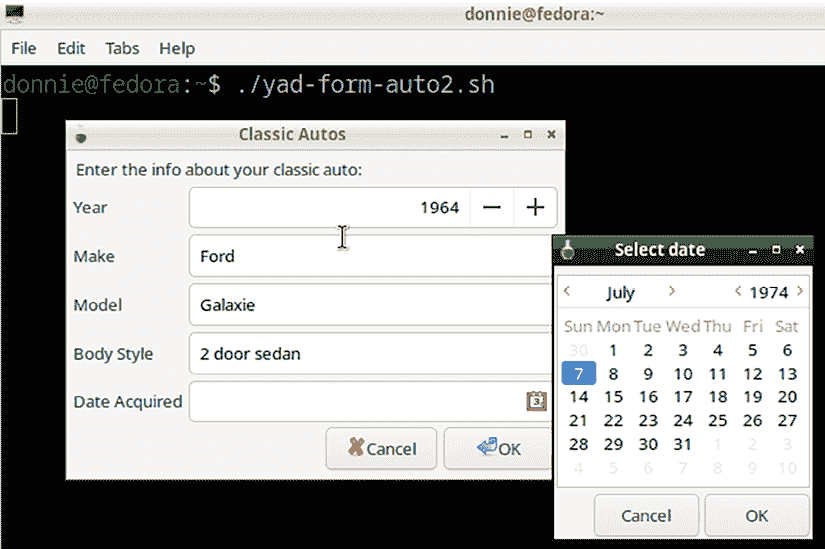

图 16.3：`yad-form-auto2.sh` 脚本

这很好，但它仍然不完美。由于使用了 `:` 作为 `while` 条件，结束此脚本的唯一方法是 Ctrl-c 退出，因为 Cancel 按钮不起作用。要修复这个问题，你需要理解 OK 按钮返回 `0` 作为退出状态码，而 Cancel 按钮返回 `1` 作为退出状态码。

如果你需要复习退出状态码的概念，请回看第 8 章“基础 Shell 脚本构建”。

现在，让我们修改 `yad-form-auto3.sh` 脚本中的 `while` 循环：

```bash
#!/bin/bash

while [ $? == 0 ]
do

    yad --title="Classic Autos" --text="Enter the info about your classic auto:" \
    --form --width=400 \
    --field="Year":NUM \
    --field="Make" \
    --field="Model" \
    --field="Body Style" \
    --field="Date Acquired":DT >> classic_autos.txt

done
```

`$? == 0` 参数获取退出状态码并验证它是否为 `0`。只要你不点击 Cancel 按钮或窗口右上角的 X 按钮，脚本就会一直运行。（我忘了提一下，点击 X 按钮返回的退出状态码为 `252`。）

现在，让我们用最后一次修改来结束这一节。

## 创建下拉列表

这次，我们将添加一个用于选择车型的下拉列表以及一个自由格式的文本框。这里是 `yad-form-auto4.sh` 脚本，向你展示如何实现：

```bash
#!/bin/bash

bodystyles=$(echo "2 door hardtop,2 door sedan,4 door hardtop,4 door sedan,station wagon,convertible,pickup truck,other")

while [ $? == 0 ]
do

    yad --title="Classic Autos" --text="Enter the info about your classic auto:" \
    --form --width=400 --item-separator="," \
    --field="Year":NUM \
    --field="Make" \
    --field="Model" \
    --field="Body Style":CBE \
    --field="Date Acquired":DT >> classic_autos.txt \
    --field="Add any additional notes:":TXT \
    "" "" "" "$bodystyles" "Click on the calender icon"

done
```

`bodystyles=` 行、`--form` 行中的 `--item-separator` 参数以及 `"" "" ""` 行共同起作用创建了下拉列表。`bodystyles=` 定义了用逗号分隔的可用车型列表。这与 `--item-separator` 参数配合使用，确保下拉列表每行显示一种车型，而不是将所有车型显示在同一行。

`--field="Body Style"` 行末尾的 `:CBE` 参数将此字段定义为下拉列表，并且如果你选择其他选项，可以编辑它的选项。`while` 循环的最后一行告诉 `yad` 将 `bodystyles` 变量的值放在什么位置。我们看到 `Body Style` 字段是第四个字段。因此，为了表示默认为空的前三个字段，我们在 `$bodystyles` 变量之前放置了三对双引号。该行的最后一项在 `Date Acquired` 字段中放置了一行文本。最后一个字段定义是自由格式的文本框，正如你通过 `:TXT` 参数所看到的。（文本框字段位于下拉列表字段之后，这意味着你不需要再添加一对双引号作为占位符。）当我选择一种车型时，它看起来是这样的：

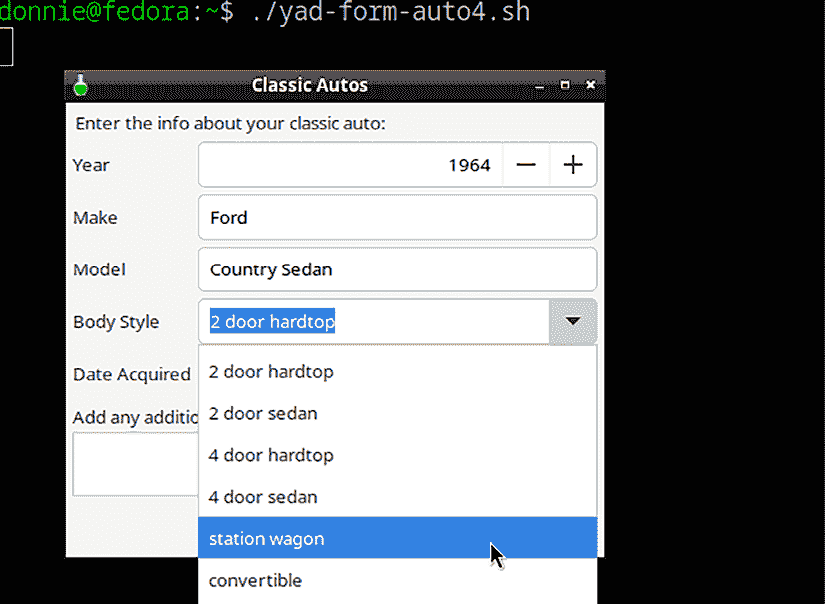

接下来，让我们看看是否能为第 13 节“使用 ImageMagick 脚本”中提到的 ImageMagick 程序创建一个 GUI 前端。我们将从 `yad-image-resize1.sh` 脚本开始，它的内容如下：

```bash
#!/bin/bash

imageFile=$(yad --file --title="Select the image file" --width=800)

dialog=$(yad --title "Image Resize" --form --field="Resize parameter" --field="Quality")

size=$(echo $dialog | awk 'BEGIN {FS="|" } { print $1 }')

quality=$(echo $dialog | awk 'BEGIN {FS="|" } { print $2 }')

convert "$imageFile" -resize "$size" -quality "$quality"% "$imageFile"

yad --title="Status" --width=300 --button="OK:0" --text="All done. Yay!"
```

第一行创建了初始的文件选择窗口。然后它将所选文件的文件名赋值给变量 `imageFile`。这里这个初始窗口看起来如下：

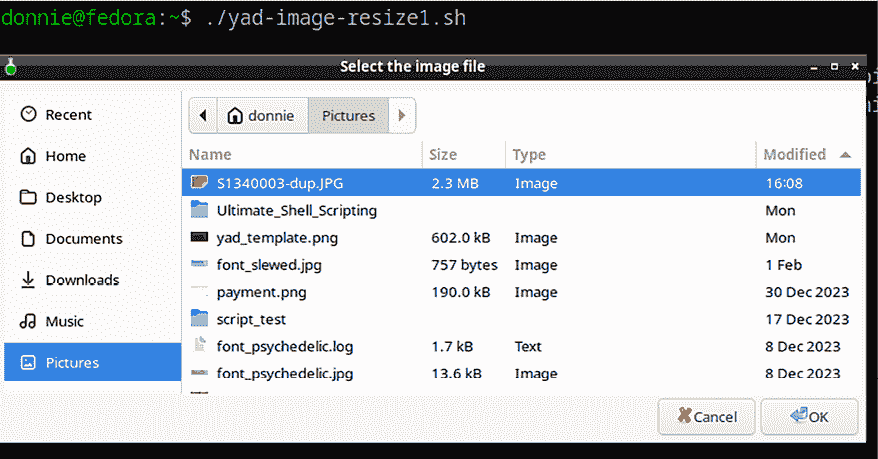
图 16.7：调整图像大小的初始文件选择窗口

第二行创建了图像调整窗口，你可以用它输入调整大小和质量参数。当你输入所需的参数时，它们将作为单行存储在 `dialog` 变量中，两个参数用 `|` 符号隔开。

接下来两行使用存储在 `dialog` 变量中的值创建 `size` 和 `quality` 变量。我们需要一种方法来提取每个单独的参数，`awk` 为我们提供了一个方便的方法。无论如何，图像调整窗口看起来如下：

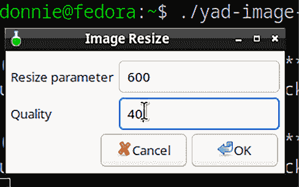
图 16.8：图像调整窗口

接下来是 `convert` 这一行，它执行实际的调整大小操作。你可以看到它使用了 `size`、`quality` 和 `imageFile` 变量的值。当我点击 OK 按钮时，调整大小的过程就会发生。

最后一行创建了状态窗口（Status），显示过程已完成。默认情况下，`yad` 窗口同时具有取消（Cancel）和确定（OK）两个按钮。在这种情况下，我们只需要 OK 按钮，因此我们通过显式使用 `--button` 创建一个 OK 按钮来覆盖默认行为。这个窗口看起来如下：

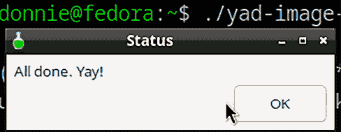
图 16.9：状态窗口

查看你的目录，你应该会发现图像确实已经调整了大小。

归于原属，这个脚本是我借用自 2012 年发布的一篇《Linux Magazine》文章的，并对其进行了一些微调。你可以在“延伸阅读”部分找到原始文章的链接。

这个脚本的主要缺陷是它会用调整大小后的版本覆盖原始图形文件。让我们修改它，将调整大小后的版本保存为具有新文件名的新文件。这是实现该功能的 `yad-image-resize2.sh` 脚本：

```bash
#!/bin/bash

imageFile=$(yad --file --title="Select the image file" --width=800 --add-preview)

newfilename=${imageFile%%.*}

suffix=${imageFile: -4}

dialog=$(yad --title "Image Resize" --form --field="Resize parameter" --field="Quality")

size=$(echo $dialog | awk 'BEGIN {FS="|"} {print $1}')

quality=$(echo $dialog | awk 'BEGIN {FS="|"} {print $2}')

convert -resize "$size" -quality "$quality" "$imageFile" -delete 1 "$newfilename"_resized"$suffix"

yad --title="Status" --width=300 --button="OK:0" --text="All done. Yay!"
```

为了让它工作，我创建了两个新变量并使用变量扩展为它们赋值。`newfilename=${imageFile%%.*}` 这一行获取 `imageFile` 文件名的第一部分，直到文件名扩展名的点之前。例如，假设 `imageFile` 的值为 `somegraphic.jpg`。使用变量扩展剥离 `.jpg` 将导致给 `newfilename` 变量赋值 `somegraphic`。`suffix` 变量使用了变量扩展的偏移功能。在这种情况下，`${imageFile: -4}` 结构获取了文件名的最后四个字符。这导致给 `suffix` 变量赋值 `.jpg`。

接下来需要注意的是我必须如何修改 `convert` 命令的。（顺便说一下，注意这个 `convert` 命令非常长，在页面上换行了。）我所做的就是在之前的命令末尾添加了 `-delete 1 "$newfilename"_resized"$suffix"` 部分。你可能已经发现，在我们目前的示例中，这将创建一个名为 `somegraphic_resized.jpg` 的新文件。但你可能会对 `-delete 1` 部分感到困惑。嗯，这只是在某些条件下，`convert` 命令会创建两个输出文件，而不是仅仅一个，如下所示：

```
donnie@fedora:~/Pictures$ ls -l *dup*
-rw-r--r--. 1 donnie donnie 2324036 Feb 11 14:38 S1340003-dup.JPG
-rw-r--r--. 1 donnie donnie 297405 Feb 11 14:38 S1340003-dup.JPG
```

`option`，因为如果没有它，操作将在提示符处终止。接下来的两个按钮分别安装所选的软件包组。如果你想查看这些组中每个包含的内容，只需运行以下两条命令：

```
donnie@fedora:~$ sudo dnf group info "Authoring and Publishing"
```


`donnie@fedora:~$ sudo dnf group info "Development Tools"`

由于我们在脚本中处理的是管理命令，因此我们需要使用 `sudo` 运行它。它的样子如下：

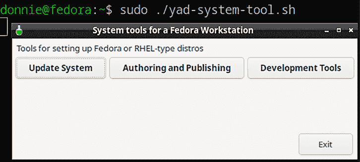

图 16.10：带有可编程按钮的 `yad` 表单

现在，只需点击按钮并观察会发生什么。

添加更多软件安装选择非常简单，只需添加更多的 `--field` 行即可。如果你想查看 Fedora 上可用的软件包列表，只需执行：

```
donnie@fedora:~$ sudo dnf group list
```

我知道，你可能觉得这种琐碎的任务用一组纯文本模式的脚本来完成会更轻松。是的，你说得对。所以，把这个例子看作一个你可以供自己使用的模板即可。

此外，我之前忘了提到，你需要在每个想要用此脚本管理的系统上手动安装 `yad`。

这个脚本的内容到此结束，让我们继续吧。

## 关于 `yad` 的最后想法

`yad` 是一个非常酷的程序，你可以用它做很多非常酷的事情。事实上，人们可能只写 `yad` 就能写一整本书。我目前做不到，但希望我提供的内容足以引起你的兴趣。

`yad` 的主要问题在于，由于某种原因，它的作者从未写过非常稀疏的 man page 之外的真正的文档。幸运的是，许多其他人接受了挑战，并在网页和 YouTube 上创建了自己的文档和教程。（我将在“延伸阅读”部分链接其中一些资源。）

接下来，让我们转向 `dialog` 和 `xdialog`，我们也可以用它们为脚本创建用户界面。

## 使用 `dialog` 和 `xdialog` 创建用户界面

`yad` 的另一个小问题是你只能在安装了桌面环境的机器上使用它。但许多 Linux、Unix 和类 Unix 服务器都配置了完整的文本模式环境，不需要使用图形桌面。`yad` 的另一个小问题是，即使在桌面类型的操作系统上，它也不总是可以安装。然而，如果 `yad` 不可用而你仍然需要 GUI 解决方案，你可能可以使用 `xdialog`，它更通用。让我们先看看 `dialog`，它可以在文本模式的机器上使用。

## `dialog` 基础

`dialog` 曾经默认安装在所有 Linux 系统上，但现在不再是了。然而，几乎每个 Linux 发行版都可以安装它。因此，你可以使用发行版的标准包管理器来安装它。在大多数 Unix 和类 Unix 系统（如 OpenIndiana 和 FreeBSD）上，它仍然默认安装。

`dialog` 的基本构建模块被称为组件（widgets）。每个组件都有一组你在使用时需要指定的参数。例如，打开 `dialog` 的 man page 并滚动到 `--msgbox` 段落，你会看到：

```
--msgbox text height width
```

因此，这个组件要求你指定三个参数。（与 `yad` 不同，指定 `dialog` 框的尺寸不是可选的。）让我们看看在 `dialog-hello.sh` 脚本中它是是什么样的：

```bash
#!/bin/bash
dialog --title "Dialog message box" \
--msgbox "\n Howdy folks!" 6 25
```

正如你之前在 `yad` 部分看到的，我使用反斜杠将命令分成两行，这使得代码更具可读性。在 `--msgbox` 行上，我们看到了消息文本、由框行数定义的高度以及由一行可容纳字符数定义的宽度。

运行脚本如下：

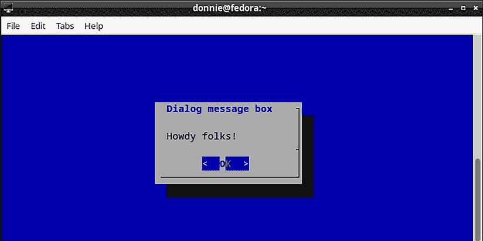

图 16.11：运行 `dialog-hello.sh` 脚本

要关闭窗口，只需按回车键，这默认会激活 OK 按钮。（在桌面机器上，你也可以选择用鼠标点击 OK 按钮。）一旦窗口关闭，运行 `clear` 命令移除终端的蓝色背景。

默认情况下，`dialog` 窗口始终出现在终端的中心，除非你手动清除，否则蓝色背景不会消失。幸运的是，你可以改变这两种行为。这是我们脚本的稍微修改的版本，它将窗口放在终端的左上角：

```bash
#!/bin/bash
dialog --title "Dialog message box" \
--begin 2 2 \
--msgbox "\nHowdy folks!" 6 25
clear
```

它的样子是这样的：

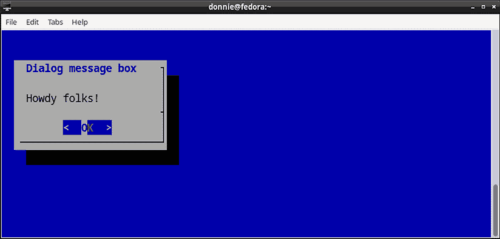

图 16.12：将对话框置于左上角

`--begin` 接受两个参数。第一个表示框的垂直位置，第二个表示水平位置。例如，通过将该行改为 `--begin 15 2`，框将出现在左下角。要将其置于左上角，使用 `--begin 2 2`。

有几种方法可以检测程序是否已安装。在第 12 章*使用 Here Documents 和 expect 自动化脚本*中，我曾在 `system_info.sh` 脚本中展示过这种方法：

```bash
if [[ -f /usr/local/bin/pandoc ]] || [[ -f /usr/bin/pandoc ]]; then
  pandoc -o sysinfo.pdf sysinfo.html
  rm sysinfo.html
fi
```

我们需要的 `pandoc` 可执行文件在 FreeBSD 上位于 `/usr/local/bin/` 目录，而在其他系统中位于 `/usr/bin/` 目录。因此，我设置了这个 `if..then` 结构来检测可执行文件是否存在于其中之一。这可行，但现在我想向你展示一种更简单的方法。

在 `xdialog-hello2.sh` 脚本中，`command -v Xdialog` 命令用于检测 `Xdialog` 可执行文件是否存在，无论它在哪个目录下。如果存在，命令将返回退出代码 0；如果不存在，命令将返回退出代码 1。要查看它是如何工作的，请直接在命令行中运行它。如果没有检测到 `Xdialog` 可执行文件，显示如下：

```bash
donnie@ubuntu2204:~$ command -v Xdialog

donnie@ubuntu2204:~$ echo $?
1
donnie@ubuntu2204:~$
```

而如果检测到了，显示如下：

```bash
donnie@fedora:~$ command -v Xdialog

donnie@fedora:~$ echo $?
0
donnie@fedora:~$
```

在下一行中，你看到一个检查两个内容的 `if..then` 结构。首先，它检查 `command` 命令的退出代码，然后检查是否安装了图形桌面环境。如果环境变量 `DISPLAY` 的值长度不为零，则表示安装了桌面环境。你可以自己运行 `echo $DISPLAY` 命令来查看其原理。在桌面机器上的显示如下：

```bash
donnie@fedora:~$ echo $DISPLAY
:0
donnie@fedora:~$
```

在文本模式机器上，你将得不到任何输出，正如你在这个 Ubuntu Server 虚拟机上看到的：

```bash
donnie@ubuntu2204:~$ echo $DISPLAY

donnie@ubuntu2204:~$
```

对于我们的目的，可以认为在这台文本模式机器上 `DISPLAY` 的值长度为 0。

现在，让我们再次看看这个 `if..then` 语句：

```bash
if [[ $? == 0 ]] && [[ -n $DISPLAY ]]; then
  diag=Xdialog
else
  diag=dialog
fi
```

这意味着如果 `command -v Xdialog` 这一行的退出代码为 0，且 `DISPLAY` 环境变量的值长度不为零，那么变量 `diag` 的值将变为 `Xdialog`。如果缺少 `Xdialog` 可执行文件或者 `DISPLAY` 的值长度为零，那么 `diag` 的值将变为 `dialog`。更酷的是，这在所有 Linux、Unix 或类 Unix 系统上工作原理都是一样的。我已经在 FreeBSD、GhostBSD、DragonflyBSD、OpenIndiana，以及 Linux 的桌面版和文本模式的实现版本上测试了此脚本。在所有这些系统上，脚本都正确地检测到了它应该检测的所有内容，并正确地选择了是运行 `dialog` 还是 `Xdialog`。

有一件事让我有些困扰。我不小心地发现，测试各项内容的顺序有时会产生影响。在这个脚本的 `if..then` 结构中，我最初先检查 `DISPLAY` 的值，然后检查 `command` 命令的退出代码。脚本那样无法正常运行，因为对 `DISPLAY` 值的测试将退出代码设置为了 0。当我反转测试顺序后，一切都开始正常工作了。

尽管尝试在各种系统上运行此脚本，看看会发生什么。

接下来，让我们通过添加另一个组件来扩展已经完成的工作。

## 添加组件

你可以通过添加更多组件来增加更多功能。例如 `dialog-hello2.sh` 脚本，你可以从 Github 仓库下载它。由于格式限制，我无法一次性显示整个文件，因此将分段向你展示。这是顶部部分：

```bash
#!/bin/bash

command -v Xdialog

if [[ $? == 0 ]] && [[ -n $DISPLAY ]]; then
  diag=Xdialog
else
  diag=dialog
fi
```

我们已经在上一个脚本中见过了，并且我已经解释过了。所以，我们继续吧。这是下一部分：

```bash
$diag --title "Dialog message box" --begin 2 2 --msgbox "\n Hello world!" 20 50

$diag --begin 4 4 --yesno "Do you believe in magic?" 0 0
```

第一行 `$diag` 代码根据 `--begin 2 2` 选项在左上角创建了初始消息框。第二行 `$diag` 代码创建一个带有两个按钮的框，标记为 Yes 和 No。`--begin 4 4` 选项将 `yesno` 框定位在初始消息框稍下方且稍靠右的位置。在 `--yesno` 之后，我们看到了要在框中显示的文本以及高度和宽度参数。（将高度和宽度设置为 0 会使框自动调整大小。）

接下来，我们有一个 `case` 结构，它为按钮分配退出代码。记住，点击时，Yes 按钮返回退出代码 0，No 按钮返回 1。按下 Esc 键返回 255。

```bash
case $? in
  0) echo "I'm glad that you do." ;;
  1) echo "I'm sorry that you live such a life." ;;
  255) echo "You pressed the key." ;;
esac
```

好了，这个脚本所做的只是在你按下按钮时显示一条消息。但它确实演示了 `dialog` 的概念。

接下来，让我们创建一个真正能做有用工作的程序。

## 创建 SSH 登录界面

假设你有一群需要远程管理的 Linux、Unix 或类 Unix 服务器。尝试跟踪服务器的 IP 地址是一团混乱的糟麻，所以你决定创建 `xdialog-menu-test.sh`。它也太长了无法完整显示，因此我将它分成几部分。这里是顶部部分：

```bash
#!/bin/bash

command -v Xdialog

if [[ $? == 0 ]] && [[ -n $DISPLAY ]]; then
  diag=Xdialog
else
  diag=dialog
fi
```

这和上一个脚本中的一样，所以你已经认识了。这是下一部分：

```bash
cmd=($diag --keep-tite --menu "Select options:" 22 76 16)
options=(1 "Remote SSH to Debian miner" 2 "Remote SSH to Fedora miner" 3 "Remote SSH to Fedora Workstation" 4 "Remote SFTP to Fedora Workstation")
choices=$("${cmd[@]}" "${options[@]}" 2>&1 >/dev/tty)
```

`cmd=` 行在括号内创建一个命令，然后将该命令赋值给 `cmd` 数组。该命令将在脚本的最后一行被调用，用于构建一个 `dialog` 或 `xdialog` 菜单窗口。根据 `dialog` 手册页，在桌面机器的图形终端模拟器上运行脚本时，`--keep-tite` 选项是必需的，因为它防止脚本在图形终端和底层 shell 终端之间切换。在 `--menu` 选项之后，我们看到了显示的文本、菜单框的高度和宽度，然后是一次显示的最大菜单项数量。（在本例中，用户需要向下滚动才能看到超过前 16 个菜单项）。菜单项将通过标签（tag）和项目字符串来指定。例如，我们看到的第一个菜单项标签为 1，项目为 Remote SSH to Debian miner。

接下来，我们有一个 `options` 语句，它将所有菜单项插入数组中。`choices=` 行使用 `2>&1 >/dev/tty` 重定向操作符将数组的内容输出到终端屏幕（`/dev/tty`）。

`${options[@]}` 是一种变量扩展的形式，因为它允许根据用户选择的菜单项来执行相应的操作。`@` 代表与菜单选择相对应的数组项索引数字。

在第 8 章“基础 Shell 脚本构建”中，我曾向你展示过如何使用 `*` 或 `@` 代替特定的索引数字来显示数组中的所有元素。在 `cmd=` 行中，`$diag --keep-tite --menu "Select options:" 22 76 16` 命令中括号内的每个组件都是 `cmd` 数组的一个独立元素。由于这个原因，我们需要在底部的 `choices=` 行中使用 `*` 或 `@` 作为 `cmd` 数组的索引，这样整条命令才能被调用。对于赋值给 `options=` 行中 `options` 数组的选项列表，情况也是如此，正如你稍后看到的那样。

现在我们已经有了菜单，需要让它执行某些操作。这将在下一节中介绍，如下所示：

```bash
for choice in $choices
do
  case $choice in
    1) ssh donnie@192.168.0.3 ;;
    2) ssh donnie@192.168.0.12 ;;
    3) ssh donnie@192.168.0.16 ;;
    4) sftp donnie@192.168.0.16 ;;
  esac
done
```

这并不是你没见过的东西。它只是一个运行 `case..esac` 结构的普通 `for` 循环。不同之处在于 `choices` 变量的值与所选菜单项对应的数组项索引数字。`options` 数组列出的每个选项都由一个数字和一个完整短语组成，例如 `1 "Remote SSH to Debian miner"`。在这个例子中，数字 1 代表 `options` 数组的第 0 个元素，而短语中的后续单词代表元素 1 到 5。为了让选项在菜单中正确显示，你必须使用 `*` 或 `@` 代替索引数字来调用数组。以下是发生这种情况的完整行：

```bash
choices=$("${cmd[@]}" "${options[@]}" 2>&1 >/dev/tty)
```


由于`choices`始终只分配一个索引值，因此`for`循环在第一次运行后就会退出。

现在一切都构建好了，让我们看看它是否有效。以下是在带有 Mate 桌面的 GhostBSD 上使用`xdialog`的效果：

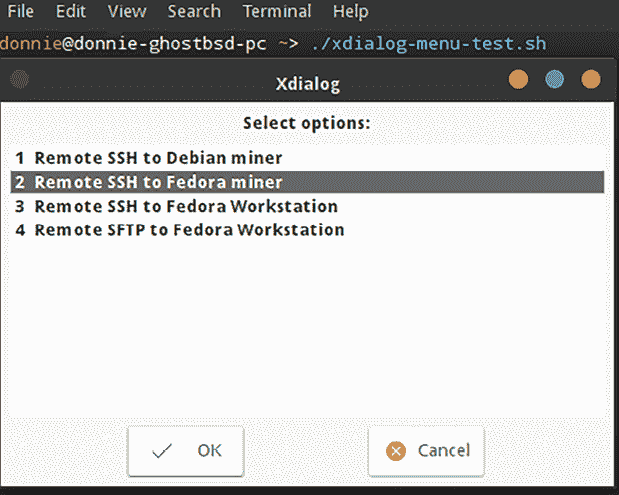

图 16.17：GhostBSD 上的 xdialog-menu-test.sh 脚本

以及，这是 Fedora 上使用`dialog`的完全相同的脚本：

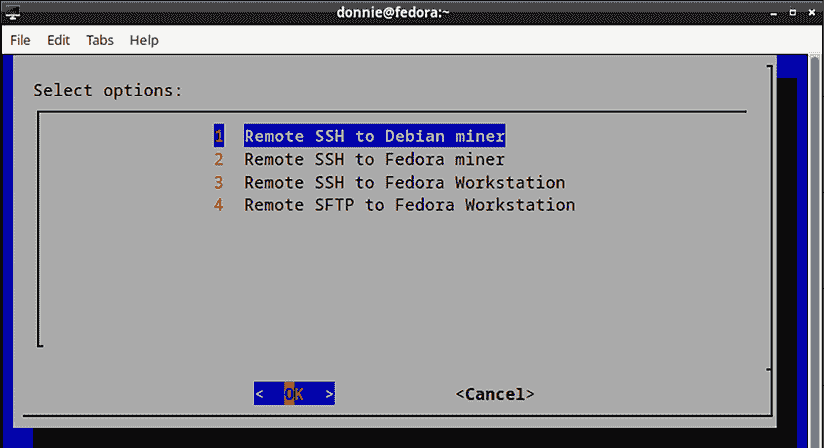

图 16.18：Fedora 上使用 dialog 的 xdialog-menu-test.sh 脚本

当你选择菜单项时，脚本将在终端中打开远程登录提示并退出。这没关系，因为如果你想同时连接到多个远程服务器，你仍然需要打开终端。

当然，你可以完善这个脚本使其更具功能。例如，你可以配置 SSH 客户端为不同的会话使用不同的配置文件或加密密钥，并相应修改菜单中的命令。或者，你可以将其作为完全其他内容的模板。正如我一直所说的，让你的想象力飞翔吧！

好了，关于`yad`、`dialog`和`xdialog`的内容就到此了。让我们总结并继续吧。

## 总结

和既往一样，我们在本章涵盖了大量内容，并看到了一些酷东西。我们从讨论`yad`以及如何使用它为 Shell 脚本创建图形用户界面开始。然后我们查看了如何使用`dialog`为文本模式环境创建用户界面，以及使用`xdialog`用于图形环境。作为额外奖励，你还看到了如何创建在支持`xdialog`的机器上运行、在不支持的机器上运行`dialog`的脚本。

实际上，这并不是你为脚本创建用户界面的唯一三个工具。其他选择包括`whiptail`、`cdialog`和`zenity`。好消息是，一旦你学会了其中一个，切换另一个是非常容易的。

现在你可以利用这些工具做的事情比我在这里向你展示的要多。另一方面，这些工具都不适用于创建任何真正复杂的内容。对于这些，你需要学习一种更复杂的编程语言。无论如何，如果你只需要一个简单的界面来让你自己或你的用户更方便，这些工具就可以胜任。

在下一章中，我们将查看如何带有选项开关运行 Shell 脚本。我们下上章见。

## 问题

你想为一个运行在各种 Linux、Unix 和类 Unix 操作系统上的 Shell 脚本创建一个图形用户界面。为了获得最佳可用性，你会使用以下哪个工具？

`zenity` `cdialog` `xdialog` `yad`

关于这段代码，以下哪个描述是正确的？

```
if -n $choices ]]; then diag=dialog else fi
```

## 延伸阅读

`Dress Up Scripts with YAD`

`YAD Guide`

`How to use ncurses widgets in shell scripts`

`Adding dialog boxes to shell scripts`

`Designing Simple front ends with dialog`

`Menu Driven Shell Script - Using Dialog`

`xdialog Documentation`

## 答案

`c`

## 在 Discord 上加入我们的社区！

与其他用户、Linux 专家以及作者本人一起阅读此书。提问、为其他读者提供解决方案、通过 Ask Me 会话与作者聊天，以及更多。扫描二维码或访问链接即可加入社区。

[`packt.link/SecNet`](https://packt.link/SecNet)


你可以看到`-l`选项是如何修改`ls`命令的行为的。

你已经看到过如何使用普通的位置参数向脚本传递选项和参数。在很多情况下，这种方法已经足够好，你不需要任何其他功能。然而，如果没有某种辅助工具，要创建一个能够正确解析一组由单横杠组合的单字母选项，或者带有参数的选项的脚本，将变得非常笨拙。这就是`getopts`派上用场的地方。你可以在脚本中使用它来简化这一过程。在我们讨论这个之前，我想先快速介绍一些可能会让你感到困惑的内容。

## 理解 getopt 与 getopts

`getopt`工具拥有它自己的可执行文件，它已经存在很久了，可以追溯到 Unix 早期。它最大的优势是它可以处理长选项。换句话说，除了向它提供单字母选项（如`-a`或`-b`）之外，你还可以提供诸如`--alpha`或`--beta`这样的完整单词选项。就如此，这真的是它唯一的优势了。

它也有一些缺点。`getopt`的原始实现无法处理文本字符串中包含空格的参数。例如，如果你需要处理一个文件名包含空格的文件，你无法在使用原始`getopt`的 shell 脚本将将文件名指定为参数。此外，`getopt`的语法比`getopts`复杂一点，这使得`getopts`使用起来更容易一些。

在过去的某个时刻（我不确定具体何时），某些随机的 Linux 开发者决定创建一个`getopt`的新实现，以修复这些缺陷。（这被称为`util-linux`实现）。这本很棒，遗憾是它仍然仅限于 Linux。所有的 Unix 和 Unix 类操作系统仍然保留着原始的、未增强的`getopt`。因此，如果你在 Linux 机器上创建了一个使用增强版`getopt`酷功能的脚本，你将无法在任何 Unix 或 Unix 类操作系统（如 FreeBSD 或 OpenIndiana）上运行它。

较较的`getopts`命令是一个 shell 内置命令，没有它自己的可执行文件，它可以处理包含空格的参数。权衡是它只能处理单字母选项，不能处理长选项。它最大的优势是无论你使用哪种 shell，它在 Linux、Unix 和 Unix 类操作系统上都是移植的。所以，如果移植性是你的目标之一，最好的选择是对`getopt`说“不”，而对`getopts`说“是”。

出于这个原因，我本章中只介绍`getopts`，不再多说那个老旧的`getopt`。

解决完这些问题后，让我们进入正题。

## 使用 getopts

我们将从`getopts-demo1.sh`脚本开始，它是世界上最简单的`getopts`脚本。它的样子如下：

```bash
#!/bin/bash
while getopts ab options; do
  case $options in
    a) echo "You chose Option A";;
    b) echo "You chose Option B";;
  esac
done
```

我们正在使用`while`循环将选定的选项或选项传递给`case`语句。`getopts`命令后的`ab`意味着我们正在将`a`和`b`定义为我们可以选择的选项。（这个允许选项列表被称为`optstring`）。你可以使用任何字母数字字符作为选项。可以使用某些其他字符，但不建议这样做。由于稍后会变得清楚的原因，你绝对不能将`?`或`:`作为选项。在`ab`之后，你看到了`options`，这只是我们将在`case`结构中使用的变量名。（你可以随心所欲地命名变量。）无论如何运行脚本如下：

```bash
donnie@fedora:~$ ./getopts-demo1.sh -a
You chose Option A

donnie@fedora:~$ ./getopts-demo1.sh -b
You chose Option B

donnie@fedora:~$
```

“好吧，大不了吧，”你可能会说。我们只用普通的位置参数就能做这种事。啊，但这里是你用普通的位置参数无法做到的：

```bash
donnie@fedora:~$ ./getopts-demo1.sh -ab
You chose Option A
You chose Option B

donnie@fedora:~$
```

所以，你看到`getopts`如何允许你组合带单横杠的选项，就像习惯于在普通 Linux 和 Unix 工具中这样做的那样。你无法用普通位置参数完成的另一事情（至少不容易做到）是拥有需要自身参数的选项。这里是`getopts-demo2.sh`脚本，展示了如何实现：

```bash
#!/bin/bash
while getopts a:b: options; do
  case $options in
    a) var1=$OPTARG;;
    b) var2=$OPTARG;;
  esac
done
echo "Option A is $var1 and Option B is $var2"
```

当你在`optstring`中的允许选项后放置冒号时，运行脚本时需要为该选项提供一个参数。每个选项的参数存储在`OPTARG`中，这是一个 shell 内置的与`getopts`工作的变量。（注意，该变量名必须由大写字母组成）。`while`循环为每个使用的选项运行一次，这意味着同一个`OPTARG`变量可以用于多个选项参数。为了好玩，让我们尝试用我的名字作为`-a`选项的参数，用我的姓作为`-b`选项的参数。样子如下：

```bash
donnie@fedora:~$ ./getopts-demo2.sh -a Donnie -b Tevault
Option A is Donnie and Option B is Tevault

donnie@fedora:~$
```

目前，如果你用无效选项运行脚本，shell 将返回自己的错误信息，看起来如下：

```bash
donnie@fedora:~$ ./getopts-demo2.sh -x

./getopts-demo2.sh: illegal option -- x

Option A is and Option B is

donnie@fedora:~$
```

在这种情况下，`./getopts-demo2.sh: illegal option -- x`行是由`bash`生成的错误信息。你可以通过在`optstring`开头放置冒号来抑制该错误信息。可选，你可以在`case`结构中添加`?`分支为无效选择显示你自己的错误信息，并添加`:`分支在缺少参数运行脚本时提醒你。另一个问题是，如果我不提供参数，最后的`echo`命令仍然会运行。无论如何，所有这些修复在`getopts-demo3.sh`中看起来如下：

```bash
#!/bin/bash
while getopts :a:b: options; do
  case $options in
    a) var1=$OPTARG;;
    b) var2=$OPTARG;;
    \?) echo "I don't know the $OPTARG option";;
    :) echo "Both options require an argument.";;
  esac
done
[[ -z $var1 ]] || echo "Option A is $var1"
[[ -z $var2 ]] || echo "Option B is $var2"
```

当我使用所有参数运行它时情况如下：

```bash
donnie@fedora:~$ ./getopts-demo3.sh -a Donnie -b Tevault
Option A is Donnie and Option B is Tevault

donnie@fedora:~$
```

如果我不使用所有选项，或者在不提供参数的情况下使用选项，情况如下：

```bash
donnie@fedora:~$ ./getopts-demo3.sh -a Donnie
Option A is Donnie

donnie@fedora:~$

donnie@fedora:~$ ./getopts-demo3.sh -a
Both options require an argument.

donnie@fedora:~$

donnie@fedora:~$ ./getopts-demo3.sh -a Donnie -b
Both options require an argument.
Option A is Donnie

donnie@fedora:~$
```

到目前为止的操作对于需要参数的选项非常完美。在`getopts-demo4.sh`脚本中，我引入两个新概念。你将看到如何为某些需要参数而某些不需要，以及如何使用非选项参数。它的样子如下：

```bash
#!/bin/bash
while getopts :a:b:c options; do
  case $options in
    a) var1=$OPTARG;;
    b) var2=$OPTARG;;
    c) echo "This option doesn't require an argument.";;
    \?) echo "I don't know the $OPTARG option";;
    :) echo "Both options require an argument.";;
  esac
done
[[ -z $var1 ]] || echo "Option A is $var1"
[[ -z $var2 ]] || echo "Option B is $var2"
shift $((OPTIND-1))
[[ -z $1 ]] || ls -l "$1"
```

`:a:b:c` `optstring`，在`c`后没有冒号，表示`-a`和`-b`选项需要一个参数，但`-c`选项不需要。如果提供了任何文件名作为非选项参数，最后一行将将对这些文件执行`ls -l`命令。（注意，如果没有任何非选项参数，`[[ -z $@ ]]`结构将返回退出码 0。如果存在非选项参数，它将返回退出码 1，这将触发`ls -l`命令。）但是，这里有一个小技巧（这里的窍门）。

当你运行此脚本时，你需要先指定选项和选项参数。然后，在命令的末尾，指定那些将作为非选项参数的文件名。或者，如果你愿意，也可以在不使用任何选项的情况下指定一个非选项参数。`shift $((OPTIND-1))`这一行对于让脚本识别非选项参数是必须的。

`OPTIND`是另一个内置于 shell 的变量，用于存储已处理的`getopts`选项数量。理解`shift $((OPTIND-1))`命令作用的最简单方法是将其看作一种清理机制。换句话说，它清除了所有已使用的`getopts`选项，并为非选项参数腾出空间。另一种思考方式是，它将位置参数计数重置回`$1`。这样，你就可以像在最后一行看到的那样，正常地访问你的非选项参数。此外，注意最后一行的`ls -l "$1"`命令。在这种情况下，你必须给位置参数（在本例中为`$1`）加上一对双引号。否则，当你尝试访问文件名中包含空格的文件时，将会收到错误信息。最后，注意你可以列出多个位置参数以便拥有多个参数，就像你之前做的那样。或者，你可以将`"$1"`参数替换为`"$@"`，这样就可以使用无限数量的非选项参数。

因此，不带任何选项且仅带一个非选项参数运行此脚本所示：

```bash
donnie@fedora:~$ ./getopts-demo4.sh "my new file.txt"

-rw-r--r--. 1 donnie donnie 0 Feb 25 13:00 'my new file.txt'

donnie@fedora:~$
```

如果我删除`ls -l`命令中位置参数周围的双引号，每当我尝试访问文件名中带有空格的文件时，我都会收到错误。其样式所示：

```bash
donnie@fedora:~$ ./getopts-demo4.sh "my new file.txt"

ls: cannot access 'my': No such file or directory

ls: cannot access 'new': No such file or directory

ls: cannot access 'file.txt': No such file or directory

donnie@fedora:~$
```

所以，记住使用那些双引号。

当我告诉你们使用`getopt`的缺点时，我提到过`getopt`的语法比`getopts`更加难用。如果我在这些脚本中使用`getopt`，我将需要在每个`case`结构中的每个项目之后放置一个或多个`shift`命令，以便脚本能够正确识别选项。而使用`getopts`，这种位移是自动完成的。我唯一需要使用`shift`的地方就是末尾的`shift $((OPTIND-1))`命令。所以你可以看到`getopts`是要简单得多。

此外，如果你想了解更多关于如何在`getopts`中使用`OPTIND`的知识，我在“延伸阅读”部分放置了一些参考文献。实际上，这就是`getopts`的基本用法了。所以，让我们继续吧。

## 查看真实世界的示例

现在我已经演示了使用`getopts`的理论，是时候进入几个真实世界的示例了。请享用！

## 修改后的 Coingecko 脚本

在第 10 章“理解函数”中，我向你们展示了两个我为创建的酷脚本。回顾一下，这些脚本使用 Coingecko API 来自动获取加密货币的信息。

`coingecko.sh`脚本使用`if...elif...else`结构允许我选择我想执行的函数。在`coingecko-case.sh`脚本中，我使用`case...esac`结构来实现相同的功能。现在，我展示脚本的第三个，它使用了`getopts`。

`coingecko-getopts.sh`脚本太大，无法在此复制，因此你需要从 GitHub 获取它。我需要指出关于它的几点，所以我在这里显示相关的代码片段。

在脚本开头，我添加了`gecko_usage()`函数，它看起来如下：

```bash
gecko_usage() {

  echo "Usage:"
  echo "To create a list of coins, do:"
  echo "./coingecko.sh -l"
  echo
```


`echo "To create a list of reference currencies, do:"`

`echo "./coingecko.sh -c"`

`echo`

`echo "To get current coin prices, do:"`

`echo "./coingecko.sh coin_name(s) currency"`

接下来，我删除了`coin=$1`和`currency=$2`变量定义。然后，我添加了一个`while`循环配合`case`结构，如下所示：

```bash
while getopts "hlc" options; do
  case $options in
    h) gecko_usage ;;
    l) curl -X GET "https://api.coingecko.com/api/v3/list?include_platform=true" | jq | tee list.txt ;;
    c) curl -X GET "https://api.coingecko.com/api/v3/simple/price?ids=$1&vs=$2&include_market_cap=true&include_24hr_vol=true&include_24hr_change=true&include_last_updated_at=true&precision=true" | jq ;;
    *) echo "I don't know $option" ;;
  esac
done
shift $((OPTIND-1))
```

（注意：上述逻辑是根据文本描述重构的）。

`gecko_api()`函数的现在只需要一个参数，即选定的`$1`。如果你想单独使用每个选项而不是组合它们，你需要将`gecko_api $1`更改为`gecko_api $1 $2`或`gecko_api $@`。

所以，将原始的 Coingecko 脚本适配`getopts`真的非常简单。但是，优势在哪里？在这种情况下，实际上只有一个。那就是通过使用`getopts`选项，你现在只需运行一次脚本即可执行多项任务。这是原始脚本中无法实现的。无论如何，你可以将其作为模板，用于你那些使用`getopts`可能更有优势的脚本。

## Tecmint 监控脚本

我从 Tecmint 网站借用了这个方便的 Linux 脚本`tecmint_monitor.sh`，并对其进行了微调，使其在新的 Linux 系统上运行得更好。作者根据 Apache 2.0 自由软件许可发布了它，因此可以将微调后的版本上传到 GitHub 以供大家使用。（我在“延伸阅读”部分也提供了原始 Tecmint 文章的链接。）

我不会在这里解释整个脚本，因为作者通过在到处插入注释已经做了非常出色的解释工作。但是，我会指出关于它的几点。

首先需要注意的是，作者在`case`结构上的处理方式略有不同。他没有将想要执行的所有代码放入`case`选项中，而是仅仅使用`case`选项来设置`iopt`或`vopt`变量，取决于选择了`-i`还是`-v`选项。

```bash
while getopts iv name
do
  case $name in
    i) iopt=1 ;;
    v) vopt=1 ;;
    *) echo "Invalid arg" ;;
  esac
done
```

可执行代码被放置在一对`if. .then`结构中。这里是第一个：

```bash
if [[ ! -z $iopt ]]
then
  {
    wd=$(pwd)
    basename "$(test -L "$0" && readlink "$0" || echo "$0")" > /tmp/scriptname
    scriptname=$(echo -e -n $wd/ && cat /tmp/scriptname)
    su -c "cp $scriptname /usr/bin/monitor" root && echo "Congratulations! Script Installed, now run monitor Command" || echo "Installation failed"
  }
fi
```

因此，如果`iopt`变量的值长度不为零（意味着选择了`-i`选项），那么这个脚本安装程序就会运行。这并不是一个复杂的命令。它所做的只是提示你输入 root 密码，将`techmint-monitor.sh`脚本复制到`/usr/bin/`目录，并将其重命名为`monitor`。

现在，这里有一个我还没有修复的小问题。这是自从作者在 2016 年创建此脚本以来，Linux 用户不再为 root 用户账户分配密码变得越来越普遍。事实上，这是 Ubuntu 发行版的默认行为，而且对于许多其他发行版来说是可选的（事实上，我在这台 Fedora 工作站上从未在这里分配过 root 用户密码）。因此，这里的`su -c`命令将无法工作，因为它在提示你时期望你输入 root 用户密码。所以，如果你没有为 root 账户分配密码，在不用`sudo`运行脚本时将总是得到身份验证失败。但是，当我使用`sudo`运行它时，脚本运行良好，所以我没去修改它。

接下来，我们有了针对`vopt`变量的`if. .then`结构，如下所示：

```bash
if [[ ! -z $vopt ]]
then
  {
    #echo -e "tecmint_monitor version 0.1\nDesigned by Tecmint.com\nReleased Under Apache 2.0 License"
    echo -e "tecmint_monitor version 0.1\nDesigned by Tecmint.com\nTweaked by Donnie for more modern systems\nReleased Under Apache 2.0 License"
  }
fi
```

这个选项唯一的作用只是显示脚本的版本信息。在底部，我添加了`Tweaked by Donnie`这一行，表示我修改了原始脚本。（你可能会说，我在这里做了一个微调是为了显示我做了一些调整。）

接下来，我们看到一个执行实际工作的长`if. .then`结构。它以`if [[ $# -eq 0 ]]`开始，这意味着如果没有选择任何选项，则此`if. .then`结构中的代码将执行。

在这个巨大的、长`if. .then`块中，包含了获取各种类型系统信息的命令。我必须修改检查 DNS 服务器信息的命令，因为作者让它在`resolv.conf`文件的特定行查找 DNS 服务器的 IP 地址。我修改了它，让它查找任何以文本字符串`nameserver`开头的行，如下所示：

```bash
# Check DNS
#nameservers=$(cat /etc/resolv.conf | sed '1 d' | awk '{print $2}')
nameservers=$(cat /etc/resolv.conf | grep -w ^nameserver | awk '{print $2}')
echo -e '\E[32m'"Name Servers :" $tecreset $nameservers
```

我还修改了检查磁盘使用情况的命令，使其更具可移植性。它的样子如下：

```bash
# Check Disk Usages
#df -h| grep 'Filesystem\|/dev/sda*' > /tmp/diskusage
df -Ph| grep 'Filesystem\|/dev/sda*' > /tmp/diskusage
echo -e '\E[32m'"Disk Usages :" $tecreset
cat /tmp/diskusage
```

我在这里做的仅仅是在`df`命令中添加了`-P`选项，这样`df`的输出始终符合 POSIX 标准。当然，如果你需要，也可以向此添加更多驱动器。

最后，在最末，我们有`shift $(($OPTIND -1))`命令。如果你注释掉这一行，脚本实际上也可以运行得很好，因为我们不需要处理任何非选项参数。尽管如此，但许多人认为，在使用了`getopts`的脚本末尾始终添加这一行是良好的做法，以确保在脚本退出时清除所有选项信息。

在所有这些示例中，你看到我使用`while`循环来实现`getopts`，因为这是我个人的偏好。然而，如果你更喜欢使用`for`循环，那完全没问题。取决于你。

好了，我认为对`getopts`的讨论就到此为止。让我们总结一下并继续。

## 总结

在本章中，我们查看了`getopts`，它为我们提供了一种酷且简单的方法来创建识别 Linux 和 Unix 风格选项开关的脚本，这些开关可能有自己的参数。我们首先从回顾命令选项和参数开始，然后澄清了关于`getopt`和`getopts`的一个可能的混点。在演示了如何使用`getopts`后，我们通过几个真实示例结束了讨论。

（注：原文后续存在大量重复的总结段落，已按要求不进行重复输出）

对于本章中的 Linux 演示，我将使用 Fedora Server 虚拟机。这是因为这些演示将使用 Red Hat 类型发发行版（如 Fedora）特有的功能和工具。不过，如果你需要，也可以轻松将它们适配到其他 Linux 发行版，例如 Ubuntu 或 Debian。

我还会向你展示一些关于 OpenIndiana 和 FreeBSD 的内容。在你的 FreeBSD 虚拟机上，假设你已经安装了`bash`，并设置了具有完全`sudo`权限的普通用户账户，正如我在第 12 章“使用 Here Documents 和`expect`自动化脚本”中所展示的那样。

此外，如既往一样，你可以通过运行命令从 Github 获取脚本：

```bash
git clone https://github.com/PacktPublishing/The-Ultimate-Linux-Shell-Scripting-Guide.git
```

## 用于审计的简单脚本

如果你习惯使用`nmap`，你已经知道它是有多强大了。你可以用它处理许多审计和网络安全任务，例如扫描端口或识别远程机器上的操作系统。但如果你发现自己处于一种无法使用`nmap`的情况，请记住你可以通过一些简单的 Shell 脚本完成部分`nmap`任务。让我们从简单的开始吧。

## 识别操作系统

你可以通过 ping 另一台机器，并查看响应中的生存时间（TTL）数值，大致判断该机器运行的是什么操作系统。其工作原理如下：

- `64`：如果 ping 响应的 TTL 为 64，那么目标机器的操作系统是 Linux、某种 BSD 或 macOS。
- `128`：TTL 为 128 表示目标机器正在运行 Windows。
- `255`：这表示目标机器正在运行 Solaris 或 Solaris 的克隆版本（如 OpenIndiana）。

这里是普通`ping`命令的输出。（注意我使用了`-c1`选项，这意味着我只发送了一个 ping 数据包。）此输出显示了 TTL 字段：

```
donnie@fedora:~$ ping -c1 192.168.0.18
PING 192.168.0.18 (192.168.0.18) 56(84) bytes of data.
64 bytes from 192.168.0.18: icmp_seq=1 ttl=128 time=5.09 ms
--- 192.168.0.18 ping statistics ---
1 packets transmitted, 1 received, 0% packet loss, time 0ms
rtt min/avg/max/mdev = 5.086/5.086/5.086/0.000 ms
donnie@fedora:~$
```

在输出的第二行中，你看到`ttl=128`，这表明我刚刚 ping 了一台 Windows 机器。现在是`os-detect.sh`脚本，它可以自动解释 TTL 字段：

```bash
#!/bin/bash
ttl=$(ping -c1 $1 | head -2 | tail -1 | cut -d= -f3 | cut -d" " -f1)
echo "The TTL value is $ttl."
if [[ $ttl == 64 ]]; then
  echo "A TTL of $ttl indicates either a Linux, BSD, or macOS operating system."
elif [[ $ttl == 128 ]]; then
  echo "A TTL of $ttl indicates a Windows operating system."
elif [[ $ttl == 255 ]] ; then
  echo "A TTL of $ttl indicates a Solaris/OpenIndiana operating system."
else
  echo "There was no recognized TTL value."
fi
```

在第二行中，我使用位置参数`$1`来代表目标机器的 IP 地址。我还将`ping`的输出通过到`head`然后是`tail`，以隔离出包含 TTL 字段的第二行输出。然后我将这第二行传递给`cut`，使用`=`作为字段分隔符来提取第三字段（在 Windows 的这个例子中，该字段是`128 time`）。最后，我将该第三字段的值传递到`cut`，以只提取出 TTL 数字。这个 TTL 数字将作为`ttl`变量的值。

最后，我们使用`if`.`.elif`.`.else`结构来识别目标机器的操作系统。现在是脚本运行的情况：

```
donnie@fedora:~$ ./os-detect.sh 192.168.0.18
The TTL value is 128. A TTL of 128 indicates a Windows operating system.
donnie@fedora:~$ ./os-detect.sh 192.168.0.20
The TTL value is 64. A TTL of 64 indicates either a Linux, BSD, or macOS operating system.
donnie@fedora:~$ ./os-detect.sh 192.168.0.19
The TTL value is 255. A TTL of 255 indicates a Solaris/OpenIndiana operating system.
```

供记录参考，第一台机器运行 Windows 10，第二台运行 FreeBSD，第三台运行 OpenIndiana。所以，这很简单，对吧？等一下，因为我确实需要指出几点注意事项。

（注：原文后续部分包含大量重复和乱码文本，已根据要求保留核心内容并进行清理。）

你 Linux 系统上的设备。但疯狂的是，你会在`/dev/`目录中发现这两个设备文件都找不到。这是因为它们被硬编码到了`bash`可执行文件之中。你可以使用`strings`工具来验证这一点，如这里所示：

```bash
donnie@fedora:~$ strings /bin/bash | grep tcp
/dev/tcp/*/*
donnie@fedora:~$ strings /bin/bash | grep udp
/dev/udp/*/*
donnie@fedora:~$
```

如果你感到好奇，`strings`允许你查看嵌入到二进制可执行文件中的文本字符串。此外，请注意，这种网络功能仅内置在 GNU 版本的`bash`中，这意味着你可以在 Linux 或较新版本的 macOS 上运行这些命令，但不能在其他 Unix/类 Unix Linux 发行版上运行，例如`FreeBSD`或`OpenIndiana`。

说明这一点最简单的方法是手动查询一个会提供反馈的端口。在这里，我正在查询一个远程网络时间服务器的 13 端口：

```bash
donnie@fedora:~$ cat < /dev/tcp/time.nist.gov/13
60372 24-03-03 21:04:44 58 0 0 544.5 UTC(NIST) *
donnie@fedora:~$
```

你也会收到来自 22 端口（SSH 端口）的反馈，如这里所示：

```bash
donnie@fedora:~$ cat < /dev/tcp/192.168.0.20/22
SSH-2.0-OpenSSH_9.3 FreeBSD-20230719
donnie@fedora:~$
```

这个需要一点时间才能完成，因为目标机器上的认证计时器需要一段时间超时。在这两个例子中，请注意我是如何使用输入重定向（`<`）来从`/dev/tcp`设备获取输入的。然后，在`/dev/tcp/`部分之后，我放置了目标机器的 IP 地址，最后是我想要扫描的端口。

大多数端口不会为你提供任何类型的反馈。但你仍然可以根据命令执行的快慢来判断端口是否开放。例如，如果你查询 DNS 服务器上的 53 端口，你应该看到命令立即完成执行，如这里 Google DNS 服务器所示：

```bash
donnie@fedora:~$ cat < /dev/tcp/8.8.8.8/53
donnie@fedora:~$
```

所以，我知道 53 端口是开放的。但如果我查询一个未开放的端口（例如在本例中的 54 端口），那么要在很长时间之后命令提示符才会返回错误消息，如这里所示：

```bash
donnie@fedora:~$ cat < /dev/tcp/8.8.8.8/54
bash: connect: Connection timed out
bash: /dev/tcp/8.8.8.8/54: Connection timed out
```


`donnie@fedora:~$`

现在，让我们利用这些知识来创建一个`bash-portscan1.sh`脚本，如下：

```bash
#!/bin/bash

host=$1
startport=$2
stopport=$3

ping=$(ping -c 1 $host | grep bytes | wc -l)

if [ "$ping" -gt 1 ]; then
  echo "$host is up";
else
  echo "$host is down. Quitting";
  exit
fi

for ((counter=$startport; counter<=$stopport; counter++)); do
  (echo >/dev/tcp/$host/$counter) > /dev/null 2>&1 && echo "Port $counter open"
done
```

它相当长，所以我将它分成几个部分。这里是顶部部分：

```bash
#!/bin/bash

host=$1
startport=$2
stopport=$3
```

要运行此脚本，你需要指定目标机器的主机或 IP 地址，以及你想要扫描的端口范围。到目前为止很容易，对吧？接下来，我们要验证目标机器是否真的在线，并创建一个可以在下一步步骤中使用的变量赋值。如下所示：

```bash
ping=$(ping -c 1 $host | grep bytes | wc -l)
```

如果目标机器在线且可访问，`ping`变量的值将大于 1，很可能是 2。如果目标机器不可访问，该值将为 1。要查看它是如何工作的，从命令行运行此，去掉`wc -l`部分，如下所示：

```bash
donnie@fedora:~$ ping -c1 192.168.0.20 | grep bytes
PING 192.168.0.20 (192.168.0.20) 56(84) bytes of data. 64 bytes from 192.168.0.20: icmp_seq=1 ttl=64 time=0.506 ms

donnie@fedora:~$ ping -c1 192.168.0.200 | grep bytes
PING 192.168.0.200 (192.168.0.200) 56(84) bytes of data.

donnie@fedora:~$
```

我首先 ping 了一个在线的机器，得到了两行输出。然后我 ping 了一台虚构机器，得到了一行输出。`wc -l`命令将统计这些行并将赋值给`ping`。接下来，我们有一个`if`块，如果目标机器不在则会导致脚本退出。如下所示：

```bash
if [ "$ping" -gt 1 ]; then
  echo "$host is up";
else
  echo "$host is down. Quitting";
  exit
fi
```

注意我如何必须用一对引号包围`$ping`。这是因为`$ping`的值可能包含空格、非字母数字字符，并且可能由多个值组成。如果没有双引号，`bash`将无法正确解释该值。最后，我们有一个执行实际扫描的`for`循环。如下：

```bash
for ((counter=$startport; counter<=$stopport; counter++)); do
  (echo >/dev/tcp/$host/$counter) > /dev/null 2>&1 && echo "Port $counter open"
done
```

这通过`startport`赋值给`counter`开始。只要`counter`小于或等于`stopport`，循环就会继续。现在，当我运行脚本时，看起来如下：

```bash
donnie@fedora:~$ ./portscan1.sh 192.168.0.20 22
192.168.0.20 is up
Port 22 open

donenie@fedora:~$ ./portscan1.sh 8.8.8.8 53
8.8.8.8 is up
Port 53 open
```

在第一个实例中，我扫描了从 20 开始到 22 结束的端口。然后我扫描了 53。到目前为止，我们只扫描了 TCP。但你可以通过一个简单的修改来扫描 UDP 端口，正如我在（此处应为）`bash-portscan2.sh`中做的那样。在循环中，只需将`tcp`改为`udp`：

```bash
for ((counter=$startport; counter<=$stopport; counter++)); do
  (echo >/dev/udp/$host/$counter) > /dev/null 2>&1 && echo "Port $counter open"
```

当然，如果你喜欢，可以让事情变得复杂一点。例如，你可以将 TCP 和 UDP 扫描功能合并到一个脚本中，并带有某种菜单来选择你想要的。不仅如此，你甚至可以添加`yad`、`dialog`或`xdialog`界面（我在之前的章节中向你展示过这些技术）。现在，你可以通过使用`nmap`执行扫描获取有关目标更详细的信息，如下：

```bash
donnie@fedora:~$ sudo nmap -sS 192.168.0.20
Starting Nmap 7.93 ( https://nmap.org ) at 2024-03-03 17:12
Nmap scan report for 192.168.0.20
Host is up (0.00044s latency).
Not shown: 999 closed ports (reset)
PORT     STATE    SERVICE
22/tcp   open
MAC Address: 08:00:27:45:A4:75 (OracleBox virtual NIC)
Nmap done: 1 IP address (1 host up) scanned in 6.01 seconds
```

这种`-sS`类型扫描被称为 SYN 包扫描，需要`sudo`权限。然而，你也可以执行`-sT`类型扫描，不需要`sudo`权限。使用我们的自定义脚本扫描开放端口几乎是瞬间完成的。但扫描关闭或过滤端口使用`nmap`可能会（但并非总是）更快。尽管如此，使用我们的脚本仍然有一个可能的优势。那就是某些类型的`nmap`扫描可以通过向目标机器防火墙添加一些规则来阻止。所以，如果你尝试对一台机器运行`nmap`扫描但没有任何结果，你可能会尝试使用脚本。另一方面，使用脚本扫描开放端口可能稍微不隐蔽，因为会在目标机器的系统日志文件中留下痕迹消息。例如，这里是使用脚本扫描 AlmaLinux 9 机器上的 22 端口产生的一系列消息：

```text
Mar 6 13:25:20 localhost sshd[1601]: error: kex_exchange_identification: client sent invalid protocol identifier ""
Mar 6 13:25:20 localhost sshd[1601]: error: send_error: write: Broken pipe
Mar 6 13:25:20 localhost sshd[1601]: banner exchange: Connection from 192.168.0.16 port 38680: invalid format
```

使用该脚本扫描其他开放的端口会产生类似的消息，而扫描关闭的端口则不会产生任何消息。如果你使用该脚本扫描开放的 Web 服务器端口（例如 80 端口或 443 端口），你会在 Web 服务器的`access_log`文件中看到类似这样的消息：

```
192.168.0.16 - - [06/Mar/2024:13:38:49 -0500] "\n" 400 226 "-" "-"
```

但是，除非目标机器的防火墙配置为记录来自`nmap`扫描的数据包，否则`nmap`不会产生此类消息。因此，这两种方法各有优。

在 Red Hat 类型（如 AlmaLinux、Rocky Linux 和 RHEL）上，这些消息将出现在`/var/log/secure`文件中。在其他发行版中，它们可能出现在`/var/log/messages`文件或`/var/log/syslog`文件中。某些 Linux 发行版（如 Debian）默认不再创建这些任何一个文件。对于这些发行版，你需要使用`sudo journalctl`命令来查看消息，或者从标准的发行版仓库安装`rsyslog`软件包，以便你拥有标准的文本模式日志文件。

现在，让我们来做点稍微复杂一点。

## 审计 root 用户账户

由于我是一个安全极客，我总是提倡在设置 Linux 和 Unix 系统时禁用 root 用户账户。这在许多现代 Linux 系统上很容易实现，因为你可以在系统安装程序中进行正确的配置。事实上，Ubuntu 安装程序甚至不会让你启用 root 用户账户，它只会将你为自己创建的账户添加到`sudo`组中。（你可以在安装操作系统后启用 root 用户账户，尽管不推荐这种做法。）对于其他 Linux 发行版（如 Debian、Fedora 或 RHEL 家族的成员），在安装期间启用 root 用户账户是可选的。在大多数 Unix 类系统（如 FreeBSD 和 OpenIndiana）上，安装程序会为 root 用户账户分配一个密码。在 FreeBSD 上，安装完成后，你必须手动安装`sudo`，设置一个普通用户来使用它，然后禁用 root 用户账户。在 OpenIndiana 上，你在安装操作系统时创建的普通用户已经配置了完全的`sudo`权限，并且 root 账户也将处于启用状态。

现在，你想用一种简单的方法来审计你的系统，查看它们上的 root 用户是否启用。让我们从编写一个在 Linux 或 OpenIndiana 系统上同样适用的脚本开始。

## 为 Linux 和 OpenIndiana 创建 root 账户审计脚本

我们将从`rootlock_1.sh`脚本开始，你可以从 Github 仓库下载它。这是又一个由于太长而无法在这里完整展示的脚本。不过没关系，因为如果我将其分成几个部分，解释起来会更简单。

我想做的第一件事是初始化几个变量，如下：

```bash
#!/bin/bash

os=$(uname)
quantity=$(cut -f3 -d: /etc/passwd | grep -w 0 | wc -l)
```

OpenIndiana 和大多数 Linux 系统默认都安装了`bash`，并且它们都使用相同的 shadow 文件系统。因此，完全相同的脚本对两者都有效。尽管如此，我可能想修改它，使其运行在某些 BSD 类型操作系统上，这些系统的设置方式不同。为了为此做准备，我将使用`uname`命令的输出作为`os`变量的值，这样我就可以确保在每个操作系统上始终运行正确的代码。我还想知道有多少用户账户被分配的 UID 值为 0，因此我创建一个`quantity`变量来跟踪数量。为了获取该值，我需要使用`cut -f3 -d:`命令查看每个`passwd`文件条目的第三字段，然后将其管道到`grep -w 0`命令中，以只找到该字段中内容只包含 0 的行。最后，我使用`wc -l`命令来统计符合此标准的行数。

记住，UID 值为 0 赋予了用户账户完全的 root 用户权限。在大多数操作系统上，你不应该看到超过一个 UID 0 用户账户。在某些 BSD 类型系统上，你会看到两个或三个 UID 0 账户。其中一个是 root 账户，它可能分配了`csh`或`sh`作为默认 shell。第二个是 toor 账户，它分配了`sh`作为默认 shell。DragonflyBSD 有第三个 UID 0 账户，称为 installer。因此，如果你想写一个能够涵盖所有这些不同操作系统的脚本，你需要编写代码来考虑到每个系统拥有的 UID 0 账户数量不同。（我们将在本节的后续部分讨论这些。）

接下来，我创建了`linux_sunos`函数，它包含了大部分工作代码。它的样子如下：

```bash
linux_sunos() {
  if [ $quantity -gt 1 ] ; then
    echo "CRITICAL. There are $quantity accounts with UID 0."
  else
    echo "OKAY. There is only one account with UID 0."
  fi

  echo

  rootlock=$(awk 'BEGIN {FS=":"}; /root/ {print $2}' /etc/shadow | cut -c1)

  if [ "$rootlock" == "" ] ; then
    echo "CRITICAL!! The root account is locked out."
  else
    echo "The root account is locked out, as it should be."
  fi
}
```

顶部是一个简单的`if`结构，用于提示`/passwd`文件中是否存在多个 UID 0 账户。

接下来，我使用`awk`命令，将其输出管道到`cut -c1`，以查找`/etc/shadow`文件中的 root 用户账户，并提取出该行的第一个字符。该值将被赋值给`rootlock`变量。那么，那个字符有什么意义呢？嗯，这里是原理。

在 Linux、Unix 和 Unix 类系统上，用户账户列表保存在`/etc/passwd`文件中。该文件必须是可读的，以便用户登录时可以访问其账户信息。许多年前，当我还年轻且头发很多时，密码也保存在这个`passwd`文件中。最终有人发现将密码保存在可读文件中是一个安全问题，并发明了 shadow 文件。现在，所有用户的密码哈希值都位于 Linux 和 Solaris/OpenIndiana 系统的`/etc/shadow`中，这需要 root 权限才能读取。（在 BSD 系统上有所不同，稍后我会向你展示。）例如，这是我在 Fedora 虚拟机上的账户条目：

```
donnie:$y$j9T$PfB84h8/LNURBaDxBbWdY$bRXbrM7JwWDf6oFl0（注意这是一个在打印时换行的长行。注意我修改了几个字符，以防止泄露哈希值。）
```

我想让你注意的是这个哈希值的前缀，即`$y$`。开头的`$`表示该账户是启用的，而整个`$y$`表示密码是用 yescrypt 哈希算法进行哈希的。

由于 Fedora 是一个前沿的、带有实验性的 Linux 发行版，你可以预计它使用在生态系统中广泛使用的新技术。Fedora 使用 yescrypt 就是如此。在大多数现代发行版中，你会在密码哈希上看到`$6$`前缀，这表示它们正在使用 SHA512 哈希算法。虽然 SHA512 哈希很难破解，但 yescrypt 哈希据认为更加困难，这增强了密码安全性。

对于我们目前的用途，使用哪种哈希算法并不重要。我们只关心的那个开头的`$`，因为它告诉我们该账户是启用的。如果第一个位置不是`$`，那么该账户就是禁用的。为了最高安全，你希望在`/etc/shadow`文件中看到类似以下三行的任何之一：

```
root:!::0:99999:7:::
root:*::0:99999:7:::
root:*LK*::0:99999:7:::
```

现在，这里是你最不想看到的内容：

```
root:$y$j9T$TZqIDctm8w7ESbopARa5f1$RKjMWhZ9zS4KZ5dPvSODo2nAIH4s8GwZTA4TJNnoh3B:19 844:0:99999:7:::
```

在这个虚拟机上，root 账户是启用的，这由前面的`$`所示。这让我们回到了脚本中的`linux_sunos`函数。让我们再次查看创建`rootlock`变量的行：

```bash
rootlock=$(awk 'BEGIN {FS=":"}; /root/ {print $2}' /etc/shadow | cut -c1)
```

正如我之前指出的，这个`awk`命令提取了 root 用户条目中的第二个字段，即密码字段。将`awk`的输出通过给`cut -c1`命令可以提取出该字段的第一个字符。该字符的值随后被赋值给`rootlock`变量。

接下来是判断 root 用户账户是否被锁定的代码：

```bash
if [ "$rootlock" == '$' ] ; then echo "CRITICAL!! The root account is not locked out." else echo "The root account is locked out, as it should be." fi
```

这句话表示，如果 root 用户条目第二个字段的第一个字符是`$`，则该账户未被锁定。如果第一个字符是除`$`以外的任何内容，则账户已锁定，一切正常。

注意在这个`if..then..else`中，我必须在`$rootlock`外围加上一对双引号。这是因为在某些 Linux 发行版（如 Ubuntu）中，你可能会在 root 用户的`shadow`文件条目的密码字段中看到一个`*`。如果不加双引号，shell 将把`*`解释为通配符，导致`$rootlock`返回当前工作目录下的文件列表。使用双引号允许`$`发挥其作用，同时强制 shell 以字面方式解释`*`。

为了保险起见，我还在`$`外围也加加了一对单引号，以确保 shell 能够正确解释它。（实际上我在不加单引号的情况下测试时它运行得良好，但以防万一。）

现在，在脚本的最末尾，函数之后，你会看到这个：


```bash
if [ $os == Linux ] || [ $os == SunOS ] ; then linux_sunos else echo "I don't know this operating system." fi
```

`os` 变量的值在 Linux 系统上应该是 `Linux`，在 OpenIndiana 系统上应该是 `SunOS`。无论何种情况，`linux_sunos` 函数都会运行。如果 `os` 的值是其他任何，用户将看到错误消息。

最后，让我们测试一下这个脚本看看会发生什么。这是我用来编写此文章的 Fedora 工作站上显示的内容：

```bash
donnie@fedora:~$ sudo ./rootlock_1.sh [sudo] password for donnie: OKAY. There is only one account with UID 0\. The root account is locked out, as it be. donnie@fedora:~$
```

非常酷，看起来一切都很好。

为了看到 root 账户启用时是什么样子，我打开了我的 Fedora Server 虚拟机，它从未启用过 root 账户。我是这样启用 root 账户的：

```bash
donnie@fedora-server:~$ sudo passwd root Changing password for user root. New password: Retype new password: passwd: all authentication tokens updated successfully. donnie@fedora-server:~$
```

很简单，对吧？我做的只是给 root 用户账户分配一个密码。现在，运行脚本：

```bash
donnie@fedora-server:~$ sudo ./rootlock_1.sh OKAY. There is only one account with UID 0\. CRITICAL!! The root account is not locked out. donnie@fedora-server:~$
```

现在，让我们添加禁用 root 账户的选项，正如你在 `rootlock_2.sh` 脚本中看到的。我们将通过在已有的结构内部嵌入另一个 `if..then..else` 结构来实现。它是这样的：

```bash
if [ $rootlock == $ ] ; then echo "CRITICAL!! The root account is not locked out." echo "Do you want to disable the root account? (y/n)" read answer if [ $answer == y ] ; then passwd -l root else exit fi else echo "The root account is locked out, as it should be." fi
```

运行修改后的脚本显示如下：

```bash
donnie@fedora-server:~$ sudo ./rootlock_2.sh OKAY. There is only one account with UID 0\. CRITICAL!! The root account is not locked out. Do you want to disable the root account? (y/n) y Locking password for user root. passwd: Success donnie@fedora-server:~$
```

要禁用一个账户，`passwd -l` 命令会在密码哈希值前面加上一对感叹号，类似于：

```bash
rootlock=$(awk 'BEGIN {FS=":"}; $1 ~ /root/ {print $2}' /etc/master.passwd | cut -c1)
```

这是因为与 Linux 和 OpenIndiana 的 `shadow` 文件不同，FreeBSD 的 `master.passwd` 文件列出了用户的默认家目录。如你在这里看到的，前三个用户的默认家目录被设置为 `/root/` 目录：

```
root:*:0:0::0:0:Charlie &:/root:/bin/csh toor:*:0:0::0:0:Bourne-again Superuser:/root: daemon:*:1:1::0:0:Owner of many system processes:/root:/usr/sbin/nologin
```

在 `awk` 命令中使用 `/root/` 而不是 `$1 ~ /root/` 会导致脚本读取这三行，而不是只读取属于 root 用户的第一行。这导致脚本无法正确检测 root 用户账户是否启用。这是因为如果脚本在 root 行的第 2 字段看到 `$`，然后在 toor 和 daemon 行的第 2 字段看到 `*`，它将把 `*` 分配为 `rootlock` 的最终值。正如此，即使 root 账户未锁定，脚本也会始终显示已锁定。

我还必须更改锁定 root 和 toor 账户的命令，因为 FreeBSD 版本的 `passwd` 没有提供相应的选项开关。因此，我将两个 `passwd` 命令替换为：

```bash
pw mod user root -w no
```

这个方便的命令可以同时删除密码并锁定账户。由于 FreeBSD 也有 UID 为 0 的 toor 账户，我添加了一个部分来检查它：

```bash
toorlock=$(awk 'BEGIN {FS=":"}; /toor/ {print $2}' /etc/master.passwd | cut -c1) if [ "$toorlock" == '$' ] ; then echo "CRITICAL!! The toor account is not locked out." echo "Do you want to disable the toor account? (y/n)" read answer if [ $answer == y ] ; then pw mod user toor -w no fi else echo "The toor account is locked out, as it should be." fi }
```

`master.passwd` 文件中只有一行包含“toor”单词，所以我不需要告诉 `awk` 只在第一个字段中查找 `/toor/` 模式。除此之外，它与我刚刚向你展示的 root 用户是一样的。（当然，由于这是函数的结尾，我在最后包含了闭合的大括号。）

最后，我修改了脚本的最后部分，使其能够自动选择运行哪个函数：

```bash
if [ $os == Linux ] || [ $os == SunOS ] ; then linux_sunos elif [ $os == FreeBSD ] ; then freebsd else echo "I don't know this operating system." fi
```

你在之前的章节中见过这类内容了，所以你可能已经知道这是怎么回事了。

再次，我读懂了你的心思。你在想这个脚本有多酷，以及你有多想把它应用到整批混合了 Linux、Unix 和类 Unix 的服务器上。但问题是，这个脚本是为 `bash` 编写的，并使用了一些 `bash` 的高级功能，这些功能在许多旧留的 `sh` shell 中无法工作。如果你可以在你所有的 Unix 和类 Unix 服务器上安装 `bash`，那就太棒了，但这可能并不是一个选项。此外，如果你正在处理运行轻量级 Linux 版本的物联网设备，你可能无法在它们上安装 `bash`。那么，你该怎么办？等一下，因为我将在第 19 章“Shell 脚本的可移植性”中解释这一切。

我认为关于 `rootlock` 脚本的内容就到这里了。在结束本节之前，让我们再看另一个审计脚本。

## 创建用户活动监控脚本

在这种场景下，你想查看其他用户何时登录系统的记录，以及他们在使用 `sudo` 权限时做什么。为了实现这一点，让我们创建一个 `user_activity_1.sh` 脚本。这里是顶部部分：

```bash
#!/bin/bash if [[ $1 == "" ]] ; then echo "You must specify a user name." echo "Usage: sudo ./user_activity_1.sh username " exit fi
```

这告诉你，调用此脚本时必须提供用户名。如果你不指定用户名，将看到此消息，脚本将退出。后续部分是：

```bash
if [[ -f /var/log/secure ]] ; then logfile=/var/log/secure elif [[ -f /var/log/auth.log ]] ; then logfile=/var/log/auth.log elif [[ -n $(awk /suse/ /etc/os-release) ]] ; then logfile=/var/log/messages else echo "I don't know this operating system." exit fi
```

大多数 Linux 和某些 Unix/类 Unix 发行版将用户认证消息存储在 `/var/log/secure` 文件或 `/var/log/auth.log` 文件中。SUSE 和 openSUSE 是显著的例外，因为它们将此信息存储在 `/var/log/messages` 文件中。

我在这里假设你正在使用的是安装了 `rsyslog`、`syslog` 或 `journald` 的系统。最后，是执行工作的部分：

```bash
username=$1
if [[ $username == "" ]]; then
    echo "You must specify a user name."
    echo "Usage: sudo ./user_activity_1.sh username"
    exit
fi

if [[ -f /var/log/secure ]]; then
    logfile=/var/log/secure
elif [[ -f /var/log/auth.log ]] then
    logfile=/var/log/auth.log
elif [[ -n $(awk /suse/ /etc/os-release) ]]; then
    logfile=/var/log/messages
else
    echo "I don't know this operating system."
    exit
fi

echo "User activity for $username:"
grep "$username" "$logfile"
```

Red Hat 类型的发行版，例如 Fedora、AlmaLinux、Rocky Linux、Oracle Linux，当然还有 Red Hat Enterprise Linux，使用 `firewalld` 作为它们的防火墙管理工具，并使用 `nftables` 作为实际防火墙引擎。据我所知，唯一默认安装此设置的非 Red Hat Linux 发行版是 SUSE 和 openSUSE。

`firewall-cmd` 工具是管理 `firewalld` 规则、策略和配置的主要方式。为了了解它是如何工作的，让我们来几次实操实验。

## 实操实验：使用数组和 for 循环创建脚本

在实验中，你将创建一个脚本，通过从 `ip-address_blacklist.txt` 文件读取 IP 地址列表来构建变量数组。然后你将使用 `for` 循环为列表中的每个 IP 地址创建一个防火墙规则。

1. 在 Fedora Server 虚拟机上创建 `ip-address_blacklist.txt` 文件，每行一个 IP 地址。内容看起来如下：

```
donnie@fedora-server:~$ cat ip-address_blacklist.txt 192.168.0.14 192.168.0.84 192.168.0.7 192.168.0.12 192.168.0.39 donnie@fedora-server:~$
```

2. 现在，创建 `firewall-blacklist_array.sh` 脚本，它使用变量数组和 `for` 循环。内容如下：

```bash
#!/bin/bash
declare -a badips
badips=( $(cat ip-address_blacklist.txt) )
for ip in ${badips[*]}
do
  firewall-cmd --permanent --add-rich-rule="rule family="ipv4" source address="$ip" drop"
done
firewall-cmd --reload
```

我们在这里做的第一件事是声明并构建 `badips` 数组，正如我在第 8 章“基础 Shell 脚本构建”中所展示的。这个数组从我们刚刚创建的 `ip-address_blacklist.txt` 文件中获取值。在 `for` 循环内部，你会看到 `firewall-cmd` 命令，它为加载到 `badips` 数组中的每个 IP 地址创建防火墙规则。每当你使用 `--permanent` 选项，`firewall-cmd` 命令就会将新规则写入正确的配置文件。但它不会将新规则加载到运行中的防火墙中。最后的 `firewall-cmd --reload` 命令会加载新规则，使其生效。

3. 在你的 Fedora 虚拟机上运行此脚本。你应该会为每个 IP 地址收到一个成功消息，并在重载命令后收到最终的成功消息。显示如下：

```
donnie@fedora-server:~$ sudo ./firewall-blacklist_array.sh success success success success success success donnie@fedora-server:~$
```

4. 要验证规则已生效，使用 `nft list ruleset` 命令，然后向上滚动到你会看到新规则的地方。显示如下：

```
donnie@fedora-server:~$ sudo nft list ruleset
. . . . . . chain filter_IN_FedoraServer_deny { ip saddr 192.168.0.14 drop ip saddr 192.168.0.84 drop ip saddr 192.168.0.7 drop ip saddr 192.168.0.12 drop ip saddr 192.168.0.39 drop }
. . . . . . donnie@fedora-server:~$
```

5. 要查看规则是否已永久添加，查看 `/etc/firewalld/zones/` 目录下正确的配置文件，如下：

```
donnie@fedora-server:~$ sudo cat /etc/firewalld/zones/FedoraServer.xml
. . . . . .   . . . . . . donnie@fedora-server:~$
```

注意，此配置文件的在其他发行版（如 AlmaLinux、Rocky Linux、Red Hat Enterprise Linux 或 SUSE/openSUSE）上会有不同。

此外，注意不同的 Linux 发行版带有不同的防火墙管理工具。例如，Ubuntu 自带 Uncomplicated Firewall (`ufw`) 管理器，而其他发行版可能只让你使用原生 `nftables` 而没有管理工具。一旦你了解适用于特定发行版的正确防火墙管理命令，修改此脚本以适配它就是简单的事情。（如果你需要了解更多关于 Linux 防火墙的知识，可能想查看我的另一本书《Mastering Linux Security and Hardening》，该书可以在 Amazon 或直接从 Packt Publishing 购买。）

实验结束。

好了，这并不难对吧？等一下，让我们用 `xargs` 让它更简单。

## 实操实验：使用 xargs 创建脚本

在第 7 章“文本流过滤器——部分 2”中，我向你介绍了 `xargs` 工具。我向你展示了几个在文本流过滤器背景下使用它的示例，我还承诺之后会向你展示更多使用它的示例。你可以通过使用 `xargs` 代替变量数组和 `for` 循环来极大简化这类脚本。和之前一样，我将向你展示如何在 Red Hat 环境下实现它。

1. 创建 `firewall-blacklist_xargs.sh` 脚本，如下：

```bash
#!/bin/bash
xargs -I {} firewall-cmd --permanent --add-rich-rule="rule family="ipv4" source address='{}' drop" < ip-address_blacklist.txt
firewall-cmd --reload
```

2. 编辑 `ip-address_blacklist.txt` 文件添加几个 IP 地址。然后运行脚本。输出现在应该像这样：


```
donnie@fedora-server:~$ sudo ./firewall-blacklist_xargs.sh
Warning: ALREADY_ENABLED: rule family="ipv4" source address="192.168.0.14" drop
Warning: ALREADY_ENABLED: rule family="ipv4" source address="192.168.0.84" drop
Warning: ALREADY_ENABLED: rule family="ipv4" source address="192.168.0.7" drop
Warning: ALREADY_ENABLED: rule family="ipv4" source address="192.168.0.12" drop
Warning: ALREADY_ENABLED: rule family="ipv4" source address="192.168.0.39" drop
success
success
success
success
```

3. 验证新规则已生效：

```
donnie@fedora-server:~$ sudo nft list ruleset
. . . . . .
chain filter_IN_FedoraServer_deny {
    ip saddr 192.168.0.14 drop
    ip saddr 192.168.0.84 drop
    ip saddr 192.168.0.7 drop
    ip saddr 192.168.0.12 drop
    ip saddr 192.168.0.39 drop
    ip saddr 212.12.3.12 drop
    ip saddr 172.10.0.0/16 drop
}
. . . . . .
donnie@fedora-server:~$
```

注意对于最后一条规则，我选择了阻塞整个 IP 子网。如果你需要阻止整个国家访问你的服务器，这个功能可能会大派用场。

如果你确实需要阻止整个国家，你可以在这里找到各个国家的 IP 地址范围列表：

[`lite.ip2location.com/ip-address-ranges-by-country`](https://lite.ip2location.com/ip-address-ranges-by-country)

4. 在文本编辑器中打开`/etc/firewalld/zones/FedoraServer.xml`文件，删除你刚刚创建的规则。

5. 最后，通过以下命令清除运行中防火墙的规则：

```
donnie@fedora-server:~$ sudo firewall-cmd --reload
success
donnie@fedora-server:~$
```

（我将在第 19 章 Shell 脚本的可移植性中详细详细讨论移植性。）所以真的，在我们的工具箱中拥有`xargs`是我所谓的双赢！

接下来，让我们看看能否为自己省一些工作。

## 搜索现有的安全相关脚本

计算机编程的基本原则是尽可能地重用代码。否则，世界上每一位程序员都会浪费大量时间试图反复造那句谚语中的“轮子”。因此，如果你发现自己需要一个脚本但不知道如何自己编写，你可以使用你最喜欢的搜索引擎或者在 Github 上进行搜索来寻找它。

使用搜索引擎的唯一之处在于，你可能需要尝试几个不同的搜索词才能找到你需要的内容。例如，我在 DuckDuckGo 上尝试了以下搜索词：

```bash
bash scripts for security audit
bash scripting for pentesters
bash scripts for security administrators
bash scripting for cybersecurity
```

坦诚地说，我必须说，这些搜索结果大部分都是你必须付费的课程和书籍。如果这正是你需要的或想要的，那再太好了。但在所有这些内容中，你可能会发现一些明珠，它们要么能帮你解决眼下的问题，要么能为你自己的脚本提供一些好点子。

为了获得更简洁、实用的搜索结果，你可能考虑在 Github 上搜索脚本。在这里，我搜索了词组`bash security scripts`：

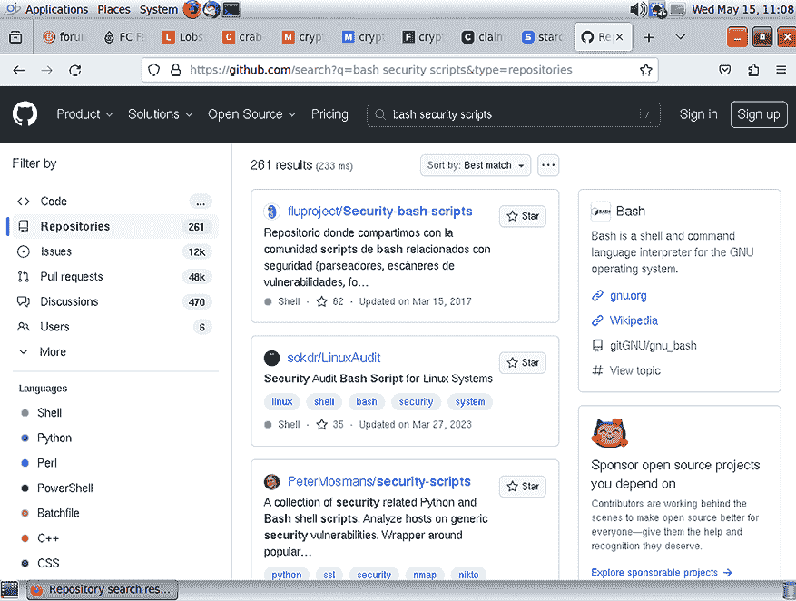

图 18.1：在 Github 上搜索 bash 安全脚本

你会发现有很多来自不同作者的此类仓库。这些脚本中的大多数（如果不是全部的话）都是根据自由（free-as-in-freedom）许可发布的，因此你可以根据意愿下载并使用它们。当然，在将它们投入生产环境之前，你想要对脚本进行审查和测试。有些可以在你的系统上无需修改运行，有些则不能。所以，仅仅因为你能找到别人已经写好的脚本，并不意味着你不需要任何 shell 脚本知识就可以过关。

好了，我想这些够了。让我们总结一下，然后进入下一章。

## 总结

在本章中，我没有像往常那样引入许多新的脚本概念。相反，我向你展示了如何利用已经熟悉的概念来创建可能对具有安全意识的管理员的脚本。你已经看到如何创建可以执行简单的端口扫描或操作系统识别的 shell 脚本。然后，你看到了如何创建审计脚本，这些脚本可以显示 root 用户账户是否启用、普通用户何时登录系统，以及普通用户在使用其`sudo`权限时做什么。之后，我向你展示了一个可以读取 IP 地址列表并自动创建防火墙规则来阻止这些地址的脚本。最后，我向你展示了一些关于如何查找和使用他人已经创建的脚本的技巧。

在下一章中，我们将讨论一下 shell 脚本的可移植性。我们下章见。

## 问题

1. 当你对远程机器进行端口扫描并发现处于关闭（closed）状态端口时，这意味着什么？

   - 端口被防火墙拦截。

   - 端口没有被防火墙拦截，且这些端口关联的服务没有运行。

   - 端口没有被防火墙拦截，且这些端口关联的服务正在运行。

   - 端口扫描器无法到达远程机器。

2. 你在 FreeBSD 系统上寻找`/etc/shadow`文件但没有找到。可能是什么问题？

   - FreeBSD 将账户密码保存在`/etc/passwd`文件中。

   - FreeBSD 将账户密码保存在`/var/lib/`目录下。

   - FreeBSD 使用`/etc/master.passwd`文件而不是`/etc/shadow`文件。

   - FreeBSD 不需要密码。

3. 下面哪个陈述是正确的？

   - 在脚本中使用`xargs`没有优点。

   - 使用`xargs`可以让你的脚本更容易创建、更易读，并能增强脚本的可移植性。

   - 使用`xargs`会让你的脚本变得更复杂、更难理解。

## 延伸阅读

- Introduction to Bash for Cybersecurity: https://medium.com/@aardvarkinfinity/introduction-to-bash-for-cybersecurity-56792984bcc0

- Shell Scripting and Security: https://www.linuxjournal.com/content/shell-scripting-and-security

- HackSploit Blog-Bash Scripting: https://hackersploit.org/bash-scripting/

- Is Bash the Secret Weapon of Cybersecurity Experts?: https://cyberinsight.co/is-bash-used-in-cyber-security/

- Secure Scripting: A Step-by-Step Guide to Password Automation in Linux with Bash: https://medium.com/@GeorgeBaidooJr/secure-scripting-a-step-by-step-guide-to-password-automation-in-linux-with-bash-12aa6b980acf

## 答案

- b

- c

- b

## 加入我们的 Discord 社区！

与其他用户、Linux 专家以及作者本人一起阅读这本书。提问、为其他读者提供解决方案、通过 Ask Me Anything 会话与作者聊天，以及更多互动。扫描二维码或访问链接加入社区。

[`packt.link/SecNet`](https://packt.link/SecNet)


## 留下评价

感谢你从 Packt 购买本书——希望你喜欢它！你的反馈对我们的改进和成长至关重要。完成阅读后，请花一点时间在 Amazon 上留下评论；只需分钟，但对我们帮助巨大。扫描下方二维码获取免费电子书。

[`packt.link/NzOWQ`](https://packt.link/NzOWQ)


## 19 Shell 脚本的可移植性

正如我们稍后看到的，许多不同的 shell 可用于 Linux、Unix 和类 Unix 系统。但到目前为止，我们主要在使用`bash`。我意思是，让你的 shell 脚本具有移植性的简单方法是在到处使用相同的 shell。

## 技术要求

我在本章中使用了 Fedora、Debian 和 FreeBSD 虚拟机。如果你们有人使用 Mac，也可以在上面尝试这些脚本。一如既往，你可以通过以下命令从 GitHub 获取脚本：

```bash
git clone https://github.com/PacktPublishing/The-Ultimate-Linux-Shell-Scripting-Guide.git
```

## 在非 Linux 系统上运行 bash

在讨论 bash 的替代方案之前，让我们先讨论如何在非 Linux 系统上使用`bash`。我意思是，让你的 shell 脚本具有移植性的简单方法是在到处使用相同的 shell。

正如我在引言中提到的，`bash`已经安装在大多数基于 Linux 的操作系统、macOS 和 OpenIndiana 上。如果你想在 BSD 类型发行版（如 FreeBSD 或 OpenBSD）上使用`bash`，你需要手动安装。我已经在第 8 章基础 Shell 脚本构建中向你展示如何在 FreeBSD 上安装`bash`。为了唤起你的记忆，我再展示一遍：

```bash
donnie@freebsd14:~ $ sudo pkg install bash
```

这在任何其他 BSD 类型的发行版上都一样，不同在于它们都使用不同的包管理器。以下是各种 BSD 的命令表：

| BSD 发行版 | 安装 bash 的命令 |

| :--- | :--- |

| FreeBSD | `sudo pkg install bash` |

| OpenBSD | `sudo pkg_add bash` |

| DragonflyBSD | `sudo pkg install bash` |

| NetBSD | `sudo pkgin install bash` |

表 19.1：在 BSD 发行版上安装 bash 的命令

现在，如果你在任何一个 BSD 发行版上运行带有

```bash
#!/bin/bash
```

shebang 行的脚本，你会得到类似这样的错误信息：

```
donnie@freebsd14:~ $ ./ip.sh
-sh: ./ip.sh: not found
donnie@freebsd14:~ $
```

这条信息有点误导性，因为它给人一种 shell 找不到脚本的印象。实际上，是脚本找不到`bash`。这是因为与你自己在 Linux 和 OpenIndiana 上看到的不同，`bash`并不在 BSD 发行版的`/bin/`目录中。相反，BSD 发行版将`bash`放在`/usr/local/bin/`目录下。有几种修复方法，我们接下来将介绍。

## 使用 env 设置 bash 环境

确保你的脚本始终能找到`bash`的第一种方法是将脚本中的`#!/bin/bash`行替换为：

```bash
#!/usr/bin/env bash
```

这会导致脚本在用户的`PATH`环境变量中查找`bash`可执行文件，而不是在某个特定的、硬编码的位置查找。

我已经在第 3 章“理解变量和管道”中向你展示了如何使用`env`命令查看在`bash`中设置的环境变量。在这种情况下，我使用`env`来指定我想要用来解释此脚本的 shell。这是简单的方法，但它存在一些潜在问题。

如果你指定的解释器安装了多个版本，你将不知道脚本会调用哪一个版本。如果由于某种极其疯狂的原因，机器上安装了多个版本的`bash`，你将不知道`#!/usr/bin/env bash`会调用哪一个版本。

使用`#!/usr/bin/env bash`可能会带来安全问题。正常的`bash`可执行文件始终安装在一个只有具有 root 权限的用户才能添加、删除或修改文件的目录下。但假设一个恶意黑客获取了你普通用户账户的权限。在这种情况下，他不需要获得 root 权限就可以在你自己的家目录中放置一个恶意的假`bash`，并修改你的`PATH`环境变量，使得系统调用假的`bash`而不是真实的`bash`。使用硬编码的`#!/bin/bash`行可以防止这个问题。

使用`#!/usr/bin/env bash`时，你将无法在 shebang 行上调用任何`bash`选项。例如，假设你需要调试一个麻烦的脚本，并想在调试模式下运行该脚本。使用`#!/bin/bash --debug`可以运行，但使用`#!/usr/bin/env bash --debug`则不起作用。这是因为`env`命令只能识别一个选项参数，在这种情况下该参数是`bash`。（它永远看不到`--debug`选项。）

目前，不要担心`--debug`选项在做什么。我将在第 21 章“调试 shell 脚本”中向你展示更多关于调试 shell 脚本的知识。

尽管使用`#!/usr/bin/env bash`看起来是最简单的解决方案，但我倾向于尽可能避免使用它。所以，让我们另一种更安全、更可靠的解决方案。

## 为 bash 创建符号链接

我确保你的脚本能找到`bash`的首选方案在所有 BSD 发行版上都适用。你只需要在`/bin/`目录中为`bash`可执行文件创建一个符号链接即可。如下所示：

```
donnie@freebsd14:~ $ which bash
/usr/local/bin/bash
donnie@freebsd14:~ $ sudo ln -s /usr/local/bin/bash /bin/bash
Password:
donnie@freebsd14:~ $ which bash
/bin/bash
donnie@freebsd14:~ $
```

使用`ln -s`命令创建链接时，你首先要指定要链接的文件路径。然后，指定你想要创建的链接的路径和名称。注意在我创建链接之后，`which`命令现在在`/bin/`目录中找到了`bash`，而不是在`/usr/local/bin/`目录。这是因为在默认的`PATH`设置中，`/bin/`排在`/usr/local/bin/`之前，如这里所示：

```
donnie@freebsd14:~ $ echo $PATH
/sbin:/bin:/usr/sbin:/usr/bin:/usr/local/sbin:/usr/local/bin:/home/donnie/bin
donnie@freebsd14:~ $
```

你现在可以在 BSD 机器上使用`#!/bin/bash` shebang 行了，就像在 Linux 机器上一样。

好了，如果你可以在所有系统上都安装`bash`，那么一切很好。但如果不能怎么办？如果你需要编写可以在替代 shell 中运行的脚本怎么办？为了回答这个问题，我们首先需要查看被称为 POSIX 的东西。

## 理解 POSIX

在计算的石器时代，并没有所谓的标准。为了保持事物的相关性，让我们从 Unix 的出现开始这段历史。在 70 年代初创建 Unix 的 AT&T 直到 1983 年才被允许进行营销。这是由于美国政府对 AT&T 提起的反垄断诉讼（我不知道该案件的细节，请不要问）。但他们允许将代码许可给其他供应商，让他们销售自己的实现版本。正因如此，出现了几种不同的 Unix 实现，它们并不总是相互兼容的。这些不同的实现包含了伯克利软件发行（BSD）、微软 Xenix 和 SunOS。1983 年，AT&T 终于被允许营销自己的 System V。让事情更有趣的是最终为这些 Unix 系统提供的各种 shell。Thompson shell 最先出现，在几年后被 Bourne shell 取代。其他 shell，如 C shell 和 Korn shell 也紧随其后。最后，在 90 年代初，Linus Torvalds 创建了 Linux 内核，这是 Unix 内核的一个从零开始的实现。如今，基于 Linux 的操作系统已大多取代了基于 Unix 的系统，而 Bourne Again Shell（`bash`）是基于 Linux 系统的主流 shell。

在 20 世纪 80 年，客户开始要求各种 Unix 供应商之间存在某种程度的标准。这最终导致了 IEEE 计算机学会于 1988 年建立了 POSIX 标准。IEEE 代表电气电子工程师协会。然而奇怪的是，你在他们的网站上看到的只有 IEEE，而没有任何关于它代表什么的解释。POSIX 代表可移植操作系统接口（Portable Operating Interface）。最后，对于你们这些在美国境外的人来说，AT&T 代表美国电话电报公司。是的，微软曾经确实是一个 Unix 供应商，这真的是真的。


POSIX 的主要目的是确保 shell 和工具在所有 Unix 实现中以相同的方式工作。例如，如果你知道如何在 Solaris/OpenIndiana 上使用 `ps` 工具，那么你也就知道如何在 FreeBSD 上使用它。现在的大问题是，虽然很多 Unix 实现及其默认 shell 符合 POSIX 标准，但有些只部分符合。另一方面，大多数基于 Linux 的操作系统也只部分符合 POSIX 标准。这是因为许多 Linux 工具使用了其类 Unix/类 Unix 版本并不使用的选项开关，而 `bash` 本身具有 POSIX 标准 shell 中不具备的编程特性。例如，在 POSIX 标准 shell 中你可以使用 `if [ -f /bin/someprogram ]` 这样的结构来测试文件是否存在，但你不能 `if [[ -f /bin/someprogram ]]`。（稍后我将详细解释这一点。）

POSIX 还定义了任何给 Unix 实现必须包含的编程库。然而，这主要让真正的程序员感兴趣，而不是 shell 脚本编写者。

公平地说，我承认如果你只在 Linux 服务器或工作站上工作，POSIX 兼容性可能永远不会成为你的问题。但让我们，假设你管理着一个混合了 Unix、BSD 和 Linux 系统的大型服务器群。现在，假设其中某些 Unix 和 BSD 服务器仍在运行旧版系统，这些系统并没有提供 `bash`。

你可能会发现，有必要创建符合 POSIX 标准的脚本，以便这些脚本可以在不修改的情况下在服务器群中的每台服务器上运行。此外，物联网（IoT）设备通常是低资源设备，可能无法运行 `bash`。

相反，它们会拥有更轻量级的工具，例如 `ash` 或 `dash`。通常情况下，这些轻量级的非 `bash` shell 将符合 POSIX 标准，并且无法运行使用 `bash` 特有功能的脚本。

现在你已经对 POSIX 是有了良好的了解，让我们来讨论各种 shell 之间的差异。

## 理解 Shell 之间的差异

除了定义你想使用的特定 shell（例如 `/bin/bash` 或 `/bin/zsh`）之外，你还可以定义通用的 `/bin/sh` shell 来使你的脚本更具移植性，正如你在这里看到的：

```sh
#!/bin/sh
```

这个通用的 `sh` shell 允许你在可能安装或未安装 `bash` 的不同系统上运行脚本。但问题在于这里：多年前，`sh` 一直是 Bourne shell。如今，`sh` 在某些操作系统上仍然是 Bourne shell，但在其他操作系统上完全是不同的东西。以下是其工作原理的分解：

- 在大多数 BSD 类型系统（如 FreeBSD 和 OpenBSD）上，`sh` 是传统的 Bourne shell。根据 `sh` 的 man 页，它只支持 POSIX 兼容功能，加上少数 BSD 扩展。

- 在 Red Hat 类型系统中，`sh` 是一个指向 `bash` 可执行文件的符号链接。

- 在 Debian/Ubuntu 类型系统中，`sh` 是一个指向 `dash` 可执行文件的符号链接。`dash` 代表 Debian Almquist Shell，它是一个更快、更轻量级的 Bourne shell 实现。

- 在 Alpine Linux 上，`sh` 是一个指向 `ash` 的符号链接，`ash` 是内置在 `busybox` 可执行文件中的轻量级 shell。（在 Alpine Linux 上，默认不安装 `bash`。）

- 在 OpenIndiana 上（它是 Oracle Solaris 操作系统的自由开源软件分支），`sh` 是一个指向 `ksh93` shell 的符号链接。这种 shell 也称为 Korn shell，与 `bash` 具有一定的兼容性。（它由一个名为 David Korn 的人创建，与任何蔬菜都没有关系。）然而，OpenIndiana 的默认登录 shell 是 `bash`。

- 在 macOS 上，`sh` 指向 `bash` 可执行文件。有趣的是，`zsh` 现在是 macOS 的默认用户登录 shell，但 `bash` 仍然已安装并可供使用。

使用 `#!/bin/sh` 只有在你对脚本的可移植性足够小心时才会起作用。如果你机器上的 `sh` 指向 `bash` 以外的其他内容，它将无法运行需要 `bash` 特有高级功能的脚本。因此，如果你使用 `sh`，请务必在不同系统上进行测试，以确保一切都能按预期工作。

在进入测试部分之前，让我们先看看 bashism（bash 特有语法）的概念以及如何避免它们。

## 理解 Bashisms

bashism 是任何 `bash` 特有的、且在其他 shell 中无法运行的功能。让我们来看几个例子。

## 使用可移植性测试

对于我们的第一个示例，尝试在你的 Fedora 虚拟机上运行此命令：

```bash
donnie@fedora:~$ [[ -x /bin/ls ]] && echo "This file is installed.";
This file is installed. donnie@fedora:~$
```

在这里，我正在测试 `/bin/` 目录下是否存在 `ls` 可执行文件。文件存在，所以触发了 `echo` 命令。现在，在 FreeBSD 虚拟机上运行相同的命令：

```bash
donnie@freebsd14:~ $ [[ -f /bin/ls ]] && echo "This file is installed."
-sh: [[: not found
donnie@freebsd14:~ $
```

这次我得到了一个错误，因为 FreeBSD 的默认用户登录 shell 是 `sh` 而不是 `bash`。问题在于 `[[ . .]]` 结构在 FreeBSD 的 `sh` 实现中不支持。让我们我们是否可以修复它：

```bash
donnie@freebsd14:~ $ [ -f /bin/ls ] && echo "This file is installed."
This file is installed. donnie@freebsd14:~ $
```

非常酷，这行通了。现在你可能会奇怪，为什么有人使用非 POSIX 的 `[[ . .]]` 结构而不是更具移植性的 `[. . .]`。嗯，主要是因为某些类型的测试无法在 `[. . .]` 中工作。例如，让我们来看 `test-test-1.sh` 脚本：

```bash
#!/bin/bash
if [[ "$1" == z* ]]; then
  echo "Pattern matched: "$1" starts with 'z'."
else
  echo "Pattern not matched: "$1" doesn't start with 'z'."
fi
```

当我调用此脚本时，我将提供一个单词作为 `$1` 位置参数。如果该单词以 `z` 开头，模式将匹配。如果不是，则不匹配。

## 创建可移植数组

有时，你需要在 shell 脚本中创建并操作项目列表。使用 `bash`，你可以像在 C、C++ 或 Java 等语言中那样创建变量数组。例如，让我们来看 `ip-2.sh` 脚本：

```bash
#!/bin/sh
echo "IP Addresses of intruder attempts"
declare -a ip ip=( 192.168.3.78 192.168.3.4 192.168.3.9 )
echo "ip[0] is ${ip[0]}, the first item in the list."
echo "ip[2] is ${ip[2]}, the third item in the list."
echo "***********************************"
echo "The most dangerous intruder is ${ip[1]}, which is in ip[1]."
echo "***********************************"
echo "Here is the entire list of IP addresses in the array."
echo ${ip[*]}
```

这与我在第 8 章“基础 Shell 脚本构建”中向你展示的 `ip.sh` 脚本相同，只是我将 shebang 行改为：

```bash
#!/bin/sh
```

为了唤起你的记忆，我使用 `declare -a` 命令来创建 `ip` 数组，并使用 `ip=` 行来填充数组。这在我的 Fedora 上应该运行良好，因为 Fedora 的 `sh` 指向 `bash`。让我们看看效果如何：

```bash
donnie@fedora:~$ ./ip-2.sh IP Addresses of intruder attempts ip[0] is 192.168.3.78, the first item in the list. ip[2] is 192.168.3.9, the third item in the list. *********************************** The most dangerous intruder is 192.168.3.4, which is in ip[1]. *********************************** Here is the entire list of IP addresses in the array. 192.168.3.78 192.168.3.4 192.168.3.9 donnie@fedora:~$
```

是的，它可以运行。

现在，让我们看看它在 FreeBSD 上长什么样：

```bash
donnie@freebsd14:~ $ ./ip-2.sh IP Addresses of intruder attempts ./ip-2.sh: declare: not found ./ip-2.sh: 4: Syntax error: word unexpected (expecting ")") donnie@freebsd14:~ $
```

这次的问题是 FreeBSD 上的 Bourne (`sh`) shell 不能使用变量数组。为了让这个脚本具有可移植性，我们需要找到一个通办法。所以，让我们尝试这个 `ip-3.sh` 脚本：

```bash
#!/bin/sh
set 192.168.3.78 192.168.3.4 192.168.3.9
echo "$1 is the first item in the list."
echo "$3 is the third item in the list."
echo "**********************************"
echo "The most dangerous intruder is $2, which is the second item of the list."
echo "*********************************"
echo "Here is the entire list of IP addresses in the array:"
echo "$@"
```

这次我没有构建真正的数组，而是使用 `set` 命令创建一个 IP 地址列表，我可以通过位置参数来访问它。我知道，你认为位置参数仅用于在调用脚本时从命令行传递参数。但你在这里看到的只是使用它们的另一种方式。不过大问题是，这可行吗？让我们看看它在 FreeBSD 机器上的运行情况：

```bash
donnie@freebsd14:~ $ ./ip-3.sh 192.168.3.78 is the first item in the list. 192.168.3.9 is the third item in the list. ********************************** The most dangerous intruder is 192.168.3.4, which is the second item of the list. ********************************* Here is the entire list of IP addresses in the array: 192.168.3.78 192.168.3.4 192.168.3.9 donnie@freebsd14:~ $
```

我们再次实现了酷炫的效果。

注意，当使用 `set` 和位置参数时，我们并没有创建一个真正的数组。相反，我们只是模拟了一个数组。但是嘿，管用就行对吧？

你还可以使用 `cat` 命令从文本文件中构建模拟数组。首先，让我们创建 `iplist.txt` 文件，它看起来如下：

```bash
donnie@fedora:~$ cat iplist.txt 192.168.0.12 192.168.0.16 192.168.0.222 192.168.0.3 donnie@fedora:~$
```

现在，创建 `ip-4.sh` 脚本，如下：

```bash
#!/bin/sh
set $(cat iplist.txt)
echo "$1 is the first item in the list."
echo "$3 is the third item in the list."
echo "********************************"
echo "The most dangerous intruder is $2, which is the second item of the list."
echo "*******************************"
echo "Here is the entire list of IP addresses in the array:"
echo "$@"
```

当我在 FreeBSD 上运行时，得到的结果如下：

```bash
donnie@freebsd14:~ $ ./ip-4.sh 192.168.0.12 is the first item in the list. 192.168.0.222 is the third item in the list. ******************************** The most dangerous intruder is 192.168.0.16, which is the second item of the list. ******************************* Here is the entire list of IP addresses in the array: 192.168.0.12 192.168.0.16 192.168.0.222 192.168.0.3 donnie@freebsd14:~ $
```

（等等，让我重新检查源文本。源文本说：`192.168.0.12 is the first item in the list. 192.168.0.222 is the third item in the list.`。我将遵循源文本。）

## `echo` 的问题

接下来，让我们处理一个我们还没有遇到过但在未来可能会遇到的的问题。`echo` 的大问题在于不同 shell 处理它的方式并不一致。例如，让我们打开一个 `bash` 会话看看发生了什么：

```bash
donnie@fedora:~$ echo -e "I want to fly	moon."
I want to fly	moon.
```

你在 `bash` 中看到 `\v` 插入了一个制表符。为了使用这些功能，我们使用 `-e`：

```bash
donnie@fedora:~$ echo -e "I want to fly	moon."
I want to fly	moon
```

你看到如果没有 `-e`，`\v` 就不会插入制表符。这是因为我们还没有在脚本中使用 `-e`。

```bash
donnie@fedora:~$ echo "I want to fly\vmoon."
I want to flyvmoon
```

让脚本获得一致输出的最佳方法是使用 `printf` 而不是 `echo`。它在 `dash` 上的显示如下：

```bash
donnie@debian::~ $ printf "%b\n" "I want to fly	moon."
I want to fly	moon
```

使用 `printf` 时，你需要将格式选项放在要输出的字符串之前。在这种情况下，`%b` 允许在文本中使用反斜杠格式选项，而 `\n` 表示在输出末尾添加一个换行符。酷的地方在于，你可以在任何虚拟机上、使用任何 shell 运行此命令，输出将始终是一致的。

最后，来看 `ip-5.sh` 脚本，它使用了 `printf` 而不是 `echo`：

```bash
#!/bin/sh
set 192.168.3.78 192.168.3.4 192.168.3.9
printf '%s\n' "$1 is the first item in the list."
printf '%s\n' "$3 is the third item in the list."
printf '%s\n' "**********************************"
printf '%b\n' "The most dangerous intruder is \v$2,\v which is the second item of the list."
printf '%s\n' "*********************************"
printf '%s\n' "Here is the entire list of IP addresses in the array:"
printf '%s\n' "$@"
```


在所有的`printf`行中，除了一行外，我们都使用了`"%s\n"`格式选项，这只是打印指定的文本字符串并换行。在第四行`printf`行中，我们使用了`"%b\n"`选项，这意味着允许在文本中使用反斜杠格式选项。

`echo`的问题是POSIX标准没有为`echo`定义`-e`选项。相反，它只是允许`echo`默认识别反斜杠选项，如`\v`。

```bash
donnie@fedora:~$ echo "I want to fly\vmoon."
I want to flyvmoon
```

等等，源文本说：

```bash
donnie@fedora:~$ echo -e "I want to fly	moon."
I want to fly	moon
```

实际上，我将直接格式化提供的内容。

```bash
donnie@fedora:~$ ./ip-5.sh 192.168.3.78 is the first item in the list. 192.168.3.9 is the third item in the list. ********************************* The most dangerous intruder is 192.168.3.4, which is the second item of the list. ********************************* Here is the entire list of IP addresses in the array: 192.168.3.78 192.168.3.4 192.168.3.9 donnie@fedora:~$
```

酷的地方在于，正如我之前所说的，`printf`的输出在所有shell中都是保持一致的。

现在，既然你已经看到了一些bash特性（bashisms）的示例，让我们来看看如何测试我们的脚本是否符合POSIX标准。

## 测试脚本的POSIX兼容性

在将shell脚本投入生产环境之前，进行测试总是重要的。当你创建的需要在各种操作系统和shell上运行的脚本时，这一点变得更加重要。在本节中，我们将查看几种执行此类测试的方法。

## 在POSIX兼容的shell上创建脚本

当你开始创建脚本时，你可能想要使用一个完全符合POSIX标准的解释器shell。但请注意，某些符合POSIX标准的shell仍然允许你使用某些bash特性。这是因为POSIX定义了操作系统或shell必须满足的最低标准，并没有禁止添加扩展。例如，FreeBSD上的`sh`允许两种bash特性：

1. 使用`echo -e`进行输出。

2. 使用`==`进行文本字符串比较。

现在，我还没有在FreeBSD上广泛测试`sh`以确定它到底允许多少种bash特性。但它至少允许这两种点的事实，意味着我们不能通过它来确定我们的脚本是否能在整个网络中运行。

在任何操作系统中预装的、最符合POSIX标准的shell是`dash`。我已经提到过，如果你在Debian/Ubuntu类型的系统上运行`#!/bin/sh`脚本，它将使用`dash`作为脚本解释器。这样做的好处是，如果你创建一个可以在`dash`上运行的脚本，它很可能在其他任何shell上也能正确运行。

嗯，几乎如此。记得我刚才向你展示的`echo -e`吗？我向你展示了在`bash`上，你必须使用`-e`选项来包含任何反斜杠格式选项。我的意思是：

```bash
donnie@fedora:~$ echo -e "I want to fly \vto the moon."
I want to fly to the moon.
donnie@fedora:~$ echo "I want to fly \vto the moon."
I want to fly \vto the moon.
```

所以在`bash`上，除非使用带有`-e`开关的`echo`，否则`\v`格式选项不起作用。在`dash`上，情况恰相反，正如你在这里看到的：

```bash
donnie@debian12:~$ dash $ echo -e "I want to fly \vto the moon." -e I want to fly to the moon.
$ echo "I want to fly \vto the moon." I want to fly \vto the moon.
```

因此，如果你在脚本中使用`echo`命令，它们在`dash`上可能正常工作，但在`bash`上可能不会。正如我之前提到的，你最好的选择是使用`printf`代替`echo`。除外，如果你确实创建了要在`dash`上运行的脚本，你还想在`bash`上测试它们。我不知道有多少个POSIX特有的东西是在`dash`上运行但不在`bash`上运行的。但我们确实知道这个`echo -e`的事儿。

符合策略的普通Shell（`posh`）是一种比`dash`更加严格符合POSIX标准的shell。它的主要问题是，Debian/Ubuntu类型的发行版似乎是唯一在仓库中有它的版本。另一方面，你可以轻松地在几乎任何Linux发行版以及某些类Unix发行版（如FreeBSD）上安装`dash`。

无论如何，你可以在这里阅读更多关于`posh`的信息：如何检查shell脚本的可移植性：https://people.redhat.com/~thuth/blog/general/2021/04/27/portable-shell.html

说到测试，让我们来看看方法。

## 使用checkbashisms

这个酷的`checkbashisms`工具将检查你的脚本，寻找任何可能在非`bash`shell上无法运行的内容。首先，你需要安装它。以下是操作方法：

在Fedora上：

```bash
donnie@fedora:~$ sudo dnf install devscripts-checkbashisms
```

在Debian/Ubuntu上：

```bash
donnie@debian12:~$ sudo apt install devscripts
```

在FreeBSD上：

```bash
donnie@freebsd14:~ $ sudo pkg install checkbashisms
```

在macOS上：

安装Homebrew系统，然后使用以下命令安装`checkbashisms`包：

```bash
macmini@MacMinis-Mac-mini ~ % brew install checkbashisms
```

关于如何在Mac上安装Homebrew系统的说明，请访问：https://brew.sh

`checkbashisms`的基本用法很简单。如果你想要测试的脚本包含可能在非`bash`shell上无法运行的内容，它就会检查出来。首先，如果你要测试的脚本其shebang是`#!/bin/sh`，那么只需输入：

```bash
donnie@fedora:~$ checkbashisms
```

如果你的脚本使用了其他的shebang，例如`#!/bin/bash`，使用`-f`选项强制执行，如下：

```bash
donnie@fedora:~$ checkbashisms -f
```

等等，`bash`不能处理数组。而且，我已经向你展示过如何处理那个。好的，这里有一个你还没有过的bash特性：

```bash
#!/bin/sh start=0 limit=10 while [ "$start" -le "$limit" ]; do echo "$start... " start=$["start"+1]
```

这是一个打印0到10数字的循环，后面跟着点字符串，每个一行。这是它的输出样式：

```bash
donnie@fedora:~$ ./math6.sh
0... 1... 2... 3... 4... 5... 6... 7... 8...
```

它在`bash`上看起来良好。但它在Debian的`dash`上能运行吗？让我们看看：

```bash
donnie@debian12:~$ ./math6.sh
./math6.sh: 4: [: Illegal number: 
```

问题在哪里？也许`checkbashisms`可以告诉我们：

```bash
donnie@debian12:~$ checkbashisms math6.sh
bashism in math6.sh line 6 ('[$ should be '$(('): start=$["start"+1]
```

问题在第6行。只是`bash`可以使用`[..]`结构进行整数运算。但其他shell必须使用`((..))`结构。所以，让我们在`math7.sh`脚本中修复：

```bash
#!//bin/sh start=0 limit=10 while [ "$start" -le "$limit" ]; do echo "$start... " start=$(("$start"+1)) done
```

这应该好得多，对吧？嗯，让我们看看：

```bash
donnie@debian12:~$ ./math7.sh
./math7.sh: 6: arithmetic expression: expecting primary: ""0"+1"
```

不，还是坏的。所以，让我们再进行一次`checkbashisms`扫描：

```bash
donnie@debian12:~$ checkbashisms math7.sh
```

哇，现在这怎么回事？`checkbashisms`扫描说我的代码没问题，但脚本在`dash`上运行时显然仍然是坏的。

## 这到底是怎么回事？嗯，经过一番实验，我发现给数学表达式中的变量名加上引号也是一种bash特有的写法（bashism）。但是，`checkbashisms`并没有能检测到这一点。让我们在`math8.sh`脚本中修复它：

```bash
#!/bin/sh start=0 limit=10 while [ "$start" -le "$limit" ]; do echo "$start... " start=$(($start+1)) done
```

好了，现在终于能运行了吗？请大家鼓点！

```bash
donnie@debian12:~$ ./math8.sh 0... 1... 2... 3... 4... 5... 6... 7... 8... 9... 10... donnie@debian12:~$
```

确实，它现在运行得非常出色。所以，你已经看到`checkbashisms`是一个可以为你提供很大帮助的优秀工具。但是，和人类发明的大多数事物一样，它并不完美。它可以标记许多有问题的非POSIX代码，但它确实允许一些`bash`特有的内容溜过。（如果能有一份`checkbashisms`遗漏列表就太好了，但目前并没有。）

好了，让我们进入下一个代码检查工具。

## 使用shellcheck

`shellcheck`工具是另一个非常棒的代码检查工具，同样可以检查bash特有的写法。它在大多数Linux和BSD发行版上可用。以下是安装方法：

在Fedora上：

```bash
donnie@fedora:~$ sudo dnf install ShellCheck
```

在Debian/Ubuntu上：

```bash
donnie@debian12:~$ sudo apt install shellcheck
```

在FreeBSD上：

```bash
donnie@freebsd14:~ $ sudo pkg install hs-ShellCheck
```

在安装了Homebrew的macOS上：

```bash
macmini@MacMinis-Mac-mini ~ % brew install shellcheck
```

为了演示，我们回到Debian，扫描之前用`checkbashisms`扫描过的脚本。我们从`ip-2.sh`脚本开始。以下是输出的相关部分：

```bash
donnie@debian12:~$ shellcheck ip-2.sh In ip-2.sh line 4: ip=( 192.168.3.78 192.168.3.4 192.168.3.9 ) ^-- SC3030 (warning): In POSIX sh, arrays are undefined. In ip-2.sh line 5: echo "ip[0] is ${ip[0]}, the first item in the list." ^------^ SC3054 (warning): In POSIX sh, array references are undefined. . . . In ip-2.sh line 11: echo ${ip[*]} ^------^ SC2048 (warning): Use "${array[@]}" (with quotes) to prevent whitespace problems. ^------^ SC3054 (warning): In POSIX sh, array references are undefined. ^------^ SC2086 (info): Double quote to prevent globbing and word splitting. . . . donnie@debian12:~$
```

你看到`shellcheck`确实警告了我们，不能在符合POSIX标准的脚本中使用数组。它还警告了我们一些涉及良好编程实践的问题，而这些问题并不一定是POSIX问题。在这种情况下，它提醒我们，应该将变量扩展结构（在本例中为`${ip[0]}`）用双引号括起来，以防止空格问题。当然，这在这里没有意义，因为这里的`${ip[0]}`结构本身就是我们无法使用的数组定义。

现在，让我们尝试`math6.sh`脚本：

```bash
donnie@debian12:~$ shellcheck math6.sh In math6.sh line 6: start=$["$start"+1] ^-----------^ SC3007 (warning): In POSIX sh, $[..] in place of $((..)) is undefined. ^-----------^ SC2007 (style): Use $((..)) instead of deprecated $[..] For more information: https://www.shellcheck.net/wiki/SC3007 -- In POSIX sh, $[..] in place of $(...) https://www.shellcheck.net/wiki/SC2007 -- Use $((..)) instead of deprecated... donnie@debian12:~$
```

正如所预的，`shellcheck`检测到了非POSIX的数学运算方式。所以这是好事。

扫描`math7.sh`得到的是这个：

```bash
donnie@debian12:~$ shellcheck math7.sh donnie@debian12:~$
```

在这里，我们看到了在`checkbashisms`中看到的相同问题。即`math7.sh`在数学结构中的变量名被双引号括了起来，正如你在`start=$(("$start"+1))`这一行中所示。我们已经确定这在`bash`中有效，但在`dash`中无效，然而`shellcheck`并没有将其标记为问题。

最后，让我们尝试一下`math8.sh`。你可能记得，这是我们终于在`dash`上运行起来的脚本。它是这样的：

```bash
donnie@debian12:~$ shellcheck math8.sh In math8.sh line 6: start=$(($start+1)) ^----^ SC2004 (style): $/${} is unnecessary on arithmetic variables. For more information: https://www.shellcheck.net/wiki/SC2004 -- $/${} is unnecessary on arithmeti... donnie@debian12:~$
```

在这种情况下，脚本在我们Debian/dash机器上运行得很完美。在这里，`shellcheck`指出了一个并不影响脚本实际运行的风格问题。如果你还记得第11章“数学运算”，我向你展示过在使用数学结构内部变量的值时，没有必要在变量名前加`$`。

## 使用-s参数指定Shell

使用`shellcheck`的另一个好处是，你可以使用`-s`参数来指定你想要测试脚本的shell。即使脚本中的解释器行（shebang）是`#!/bin/sh`，且你机器上的`sh`指向一个非`bash`shell，你仍然可以针对`bash`进行测试，如下所示：


我们将对`open_files_users()`函数中的所有`cd`命令执行相同的操作。这样，即使某个`cd`命令执行失败，脚本也会在不运行该函数的情况下继续运行。

现在，假设我们想让这个脚本具有可移植性，这样我们就不需要在所有系统上都安装`bash`。正如我之前提到的，`dash`是大多数Linux和BSD类型发行版中广泛提供的、最符合POSIX标准的shell。因此，让我们使用`-s dash`再次扫描文件：

```bash
donnie@debian12:~$ shellcheck -s dash sysinfo_posix.lib
. . . . . .
In sysinfo_posix.lib line 55:
if [[ $user != "lost+found" ]] && [[ $user != "Shared" ]]; then
   ^-------------------------^ SC3010 (error): In dash, [[ ]] is not supported.
   ^---------------------^ SC3010 (error): In dash, [[ ]] is not supported.
. . . . . .
In sysinfo.lib line 71:
echo "${os:12}"
     ^------^ SC3057 (error): In dash, string indexing is not supported.
. . . . . .
donnie@debian12:~$
```

我们在之前的脚本中已经见过第一个问题。只是`[[. . .]]`结构在某些非`bash` shell中（如`dash`）是不支持的。幸运的是，在这种情况下，没有理由要求我们使用双方括号，因此我们可以直接将其替换为单方括号。所以，我们将引起问题的行改为：

```bash
if [ $user != "lost+found" ] && [ $user != "Shared" ]; then
```

第二个问题是我们还没有遇到过的。`${os:12}`类型的变量扩展是另一种bash特性（bashism），它在Bourne shell或`dash`中都无法工作。为了唤起你的记忆，`os`变量定义在文件末尾的`system_info()`函数中。从命令行执行时，变量定义看起来如下：

```bash
donnie@debian12:~$ os=$(grep "PRETTY_NAME" /etc/os-release)
donnie@debian12:~$ echo $os
PRETTY_NAME="Debian GNU/Linux 12 (bookworm)"
donnie@debian12:~$
```

但是，我们不希望`PRETTY_NAME=`部分出现在报告中。我们只想要操作系统的名称。这个`PRETTY_NAME=`字符串由12个字符组成。在`bash`中，我们可以通过以下操作删除这12个字符：

```bash
donnie@debian12:~$ echo "${os:12}"
"Debian GNU/Linux 12 (bookworm)"
donnie@debian12:~$
```

这里看起来很好，但看看当我在`dash`会话中尝试这样做时会发生什么：

```bash
donnie@debian12:~$ dash
$ os=$(grep "PRETTY_NAME" /etc/os-release)
$ echo "${os:12}"
dash: 2: Bad substitution
$
```

噢天哪，这完全行不通。幸运的是，这是一个很容易修复。我们只需使用符合POSIX标准的变量扩展形式，如下：

```bash
$ echo "${os#PRETTY_NAME=}"
"Debian GNU/Linux 12 (bookworm)"
$
```

我们不需要指定要从文本字符串开头删除的字符数，而只需指定要删除的文本字符串实际部分。而且，我把`:`替换成了`#`。很简单，对吧？

这是我尚未弄明白的生命大谜团之一。大多数bash特性的创建是为了提供更简单的方法，或者是为了让`bash`能够其他shell完全无法做的事情。在这种情况下，`bash`执行变量扩展的方式并不比POSIX的方式简单。那么，`bash`的开发者为什么要费心给我们提供这种新的、非POSIX方法呢？我的想法和你一样。

无论如何，你可以在这里阅读更多关于符合POSIX标准的变量扩展的内容：

POSIX shell速查表：https://steinbaugh.com/posts/posix.html

接下来，我们需要扫描使用此函数库的脚本。首先将`system_info.sh`复制为`system_info_posix.sh`：

```bash
donnie@debian12:~$ cp system_info.sh system_info_posix.sh
donnie@debian12:~$
```

现在，扫描`system_info_posix.sh`脚本的`dash`兼容性：

```bash
donnie@debian12:~$ shellcheck -s dash system_info.sh
. . . . . .
In system_info_posix.sh line 5:
title="System Information for $HOSTNAME"
      ^-------^ SC3028 (error): In dash, HOSTNAME is not supported.
In system_info_posix.sh line 31:
if [[ -f /usr/local/bin/pandoc ]] || [[ -f /usr/bin/pandoc ]]; then
   ^----------------------------^ SC3010 (error): In dash, [[ ]] is not supported.
   ^----------------------^ SC3010 (error): In dash, [[ ]] is not supported.
. . . . . .
donnie@debian12:~$
```

我们首先看到的是“In dash, HOSTNAME is not supported”。这很奇怪，因为我们在这里是在调用变量。下一个问题是我们在之前见过的双括号问题。在`dash`中不支持`[[`。我们将将其改为使用`hostname`命令：

```bash
title="System Information for $(hostname)"
```

另一个问题是双括号问题。在这种情况下，双括号是不必要的，所以将其改为单方括号：

```bash
if [ -f /usr/local/bin/pandoc ] || [ -f /usr/bin/pandoc ];
```

接下来，将`sysinfo_posix.sh`复制到`/usr/local/lib/`：

```bash
donnie@debian12:~$ cp sysinfo_posix.sh /usr/local/lib/
```

现在，编辑`sysinfo_posix.sh`以使用`sh`：

```bash
#!/bin/sh
```

最后，将`sysinfo_posix.sh`文件复制到其他系统。你会发现它在Linux和macOS上运行良好。

## 使用shall

`bashisms`和`shellcheck`工具作为静态检查器。它们并不实际运行脚本来查看是否工作。有时，我们需要一个能够运行代码的动态检查器。这就是`shall`的作用。`shall`是可以从作者GitHub下载的脚本。最简单的安装方法是：

```bash
donnie@debian12: git clone https://github.com/mklement0/shall
```

然后，进入`shall/bin/`目录，并将`shall`脚本复制到`/usr/local/bin/`目录，如下：

```bash
donnie@debian12:~$ cd shall
donnie@debian12:~/shall/bin$ ls -l
total 28
-rwxr-xr-x 1 donnie donnie 2721 May 27 18:20 shall
donnie@debian12:~/shall/bin$ sudo cp shall /usr/local/bin/
```

现在，酷炫的部分来了。只需一个命令，`shall`就可以针对`sh`、`bash`、`dash`、`zsh`和`ksh`测试你的脚本。（无论你在脚本shebang中指定哪种解释器shell。）大多数Linux和BSD发行版的软件包仓库中都有这些各种shell，你可以安装尚未安装的那些。

让我们从测试`ip-2.sh`脚本开始：

```bash
shall ip-2.sh
✗ sh@ (-> dash) [0.00s]
ip-2.sh: 4: Syntax error: "(" unexpected
```

第一个检查是`sh`，在Debian上它实际上意味着`dash`。你在这里看到脚本无法运行，因为`dash`无法处理数组。下一个检查是`bash`，它看起来如下：

```bash
✓ bash [0.00s]
IP Addresses of intruder attempts
ip[0] is 192.168.3.78, the first item in the list.
ip[2] is 192.168.3.9, the third item in the list.
***********************************
The most dangerous intruder is 192.168.3.4, which is in ip[1].
***********************************
Here is the entire list of IP addresses in the array.
192.168.3.78
192.168.3.4
192.168.3.9
```

接下来的`zsh`和`ksh`检查看起来是一样的。在输出的最底部，你会看到这个：

`FAILED - 1 shell (sh) reports failure, 3 (bash, zsh, ksh) report success. donnie@debian12:~$`

这意味着我们的`ip-2.sh`脚本在`bash`、`zsh`和`ksh`上运行良好，但它不会在`dash`上运行。

但是，尽管`shall`非常酷，但它并不完美。为了明白我的意思，请像这样创建一个`fly.sh`脚本：

```bash
#!/bin/sh
# echo -e "I want to fly to the \v moon."
printf "%b\n" "I want to fly to the \v moon."
```

这只是一个简单的脚本，演示了在脚本中使用`echo -e`的问题，正如我在几页前向你展示的那样。当我用`shall`测试`fly.sh`时，发生了以下情况：

```bash
donnie@debian12:~$ shall fly.sh
✓ sh@ (-> dash) [0.00s]
-e I want to fly to the moon.
I want to fly to the moon.
✓ bash [0.00s]
I want to fly to the moon.
I want to fly to the moon.
. . .
OK - All 4 shells (sh, bash, zsh, ksh) report success.
donnie@debian12:~$
```

所以，`shall`说脚本在所有四个shell上都运行正常。但在输出的顶部，你会发现`-e`出现在`dash`的`echo`输出中，这正是我之前向你展示过的问题。这里的结论是，当你使用`shall`时，不要仅仅依赖输出底部状态行所说。查看所有shell的输出，并确保输出内容是你真正想要看到的。

`shall`的另一个问题实际上并不在于`shall`本身，而在于`sh`。请记住，在不同的Linux、BSD和Unix发行版中，`sh`指向不同的shell。只要你可以在这些发行版上安装`bash`，就可以在它们上安装`shall`。然后，将`shall`脚本拷贝到你想要测试`sh`脚本的机器上即可。

`shall`脚本嵌入了帮助页（man page）。要查看它，只需执行：

```bash
shall --man
```

好了，我想这一章就到此为止。让我们总结一下并继续。

## 总结

如果你需要创建可以在各种Linux、Unix或Unix类操作系统上运行的脚本，那么脚本的可移植性就非常重要。我首先向你展示了如何在各种BSD类型发行版上安装`bash`，以及如何确保你的脚本在这些系统上找到`bash`。之后，我解释了POSIX标准以及为什么需要它。然后，我向你展示了一些bash特性（bashisms），以及一些可以测试脚本是否包含这些特性的实用工具。

在下一章中，我们将讨论shell脚本的安全性。我们下章见。

## 问题

对于shell脚本编写者来说，遵循POSIX标准的最重要原因是什么？

1. 为了确保脚本只在Linux操作系统上运行。

2. 为了确保脚本可以在各种Linux、Unix和Unix类操作系统上运行。

3. 为了确保所有操作系统都在运行`bash`。

4. 为了确保脚本可以使用`bash`的高级功能。

以下哪项是动态代码检查器？

1. `checkbashisms`

2. `shellcheck`

3. `shall`

4. `will`

关于`sh`的以下描述哪句是正确的？

1. 在每个操作系统上，`sh`总是Bourne shell。

2. 在每个操作系统上，`sh`都是指向`bash`的符号链接。

3. `sh`在不同的操作系统上代表不同的shell。

你想解决一个数学题并将其赋值赋值变量。为了获得最好的移植性，你会使用哪种结构？

1. `var=$(3*4)`

2. `var=$[3*4]`

3. `var=$[[3*4]]`

4. `var=$((3*4))`

## 延伸阅读

- UNIX与Linux：它们有什么不同？: https://www.maketecheasier.com/unix-vs-linux-how-are-they-different/

- “#!/usr/bin/env bash”和“#!/usr/bin/bash”之间的区别是什么？: https://stackoverflow.com/questions/16365130/what-is-the-difference-between-usr-bin-env-bash-and-usr-bin-bash

- 编写不仅仅是Bash的Bash脚本：检查Bash性并使用Dash: https://www.bowmanjd.com/bash-not-bash-posix/

- POSIX简要倡议: https://www.usenix.org/system/files/login/articles/login_spring16_09_tomei.pdf

- POSIX指南: https://www.baeldung.com/linux/posix

- 如何测试shell脚本的POSIX兼容性？: https://unix.stackexchange.com/questions/48786/how-can-i-test-for-posix-compliance-of-shell-scripts

- 使Unix Shell脚本符合POSIX标准: https://stackoverflow.com/questions/40916071/making-unix-shell-scripts-posix-compliant

`sudo`允许非特权用户以root用户的权限运行程序。（你也可以使用`sudo`允许用户以其他非root用户（例如数据库用户）的权限运行程序。不过，我现在不会深入探讨这些内容，因为我正试图保持内容的简单。）


现在，这就是让`sudo`如此酷炫的地方。假设你想让某个特定用户以 root 用户的权限运行某个特定的程序。通过`sudo`，你不需要给该用户 root 用户的密码。相反，你只需要为该程序配置该用户的`sudo`权限，然后让用户在每次需要运行该程序时输入他或她自己的密码即可。让我们来看看它是如何工作的。

## 实操实验 – 配置 sudo

在本实验中，你将创建一个简单的脚本，并配置`sudo`使得只有指定的用户才能运行它。

创建如下所示的`sudo_demo1.sh`脚本：

```bash
#!/bin/bash echo "This is a demo of sudo privileges."
```

将脚本复制到`/usr/local/sbin/`目录：

```bash
donnie@ubuntu2404:~$ sudo cp sudo_demo1.sh /usr/local/sbin/
donnie@ubuntu2404:~$ ls -l /usr/local/sbin/sudo_demo1.sh -rw-r--r-- 1 root root 55 Jul 6 19:24 /usr/local/sbin/sudo_demo1.sh
donnie@ubuntu2404:~$
```

如你所见，将此脚本复制到`/usr/local/sbin/`导致文件的所有权自动变为 root 用户。

对`sudo_demo1.sh`文件设置权限，使得只有 root 用户可以访问：

```bash
donnie@ubuntu2404:~$ cd /usr/local/sbin/
donnie@ubuntu2404:/usr/local/sbin$ sudo chmod 700 sudo_demo1.sh
donnie@ubuntu2404:/usr/local/sbin$ ls -l sudo_demo1.sh -rwx------ 1 root root 55 Jul 6 19:24 sudo_demo1.sh
donnie@ubuntu2404:/usr/local/sbin$
```

注意在`chmod 700`命令中，`7`为 root 用户分配了读、写和执行权限。两个`0`则移除了组和其他用户的所有权限。但是，我们如何获取用户位置上`7`的值呢？这里是其工作原理的拆解：

- 读权限的值为`4`。
- 写权限的值为`2`。
- 执行权限的值为`1`。

在这种情况下，我们希望用户拥有完全的读、写和执行权限。将这三个权限的值相加，我们就得到了`7`。

（我知道这是一个相当简略的解释，但目前请先包涵我。）

为 Horatio 创建一个非特权用户账户。

在 Debian/Ubuntu 上，执行：

```bash
sudo adduser horatio
```

在 Fedora 和其他红帽类型的发行版上，执行：

```bash
sudo useradd horatio
sudo passwd horatio
```

通过输入以下命令开始配置`sudo`：

```bash
sudo visudo
```

此命令将根据你正在使用的操作系统，用`nano`、`vi`或`vim`打开`/etc/sudoers`文件。除此之外，操作说明都是相同的。

向下滚动直到看到这一行：

```text
root ALL=(ALL:ALL) ALL
```

在该行正下方，放置此行：

```text
horatio ALL=(ALL:ALL) /usr/local/sbin/sudo_demo1.sh
```

像使用普通文本编辑器一样保存文件。

我知道`ALL=(ALL:ALL)`看起来很困惑，但其实非常简单。以下是其含义的摘要（TL;DR）：`ON_HOSTS=(AS_USER:AS_GROUP_MEMBER) ALLOWED_COMMANDS`。

现在是更具体的拆解：

- 第一个`ALL`表示指定用户可以在本地网络上的所有机器上运行此命令。你可以选择将此`ALL`替换为特定机器的主机名或你希望该用户运行此命令的机器组。
- 第二个`ALL`表示指定用户可以用所有用户（包括 root 用户）的身份运行此命令。
- 第三个`ALL`表示 Horatio 可以作为所有组（包括 root 用户组）的成员运行此命令。（注意这是可选的。你也可以直接省略组，并将其设置为`ALL=(ALL)`。）
- 在`root`行中，最后的`ALL`表示 root 用户可以运行所有特权命令。在`horatio`行中，最后的`ALL`被替换为我们允许 Horatio 运行的特定命令。

在你的主机上打开另一个终端窗口，并使用 Horatio 的账户登录虚拟机。

让 Horatio 测试一下：首先尝试在不使用`sudo`的情况下运行脚本，然后使用`sudo`运行，如下所示：

```bash
horatio@ubuntu2404:~$ sudo_demo1.sh
-bash: /usr/local/sbin/sudo_demo1.sh: Permission denied
horatio@ubuntu2404:~$ sudo sudo_demo1.sh
```

```bash
donnie@ubuntu2404:/usr/local/sbin$ sudo setfacl -m u:horatio:rx acl_demo.sh
donnie@ubuntu2404:/usr/local/sbin$ ls -l acl_demo.sh -rwxr-x---+ 1 root root 44 Jul 24 20:56 acl_demo.sh
donnie@ubuntu2404:/usr/local/sbin$
```

以下是命令的详细说明：

- `-m`: 这意味着修改现有的 ACL（访问控制列表）。如果尚未创建 ACL，它将创建一个新的。
- `u:horatio`: 这意味着我们正在为用户`horatio`创建一个 ACL。
- `rx`: 这意味着我们正在为该用户授予该文件的读取和执行权限。

注意该文件权限设置末尾的`+`。这表示已经创建了 ACL。

使用`getfacl`验证 ACL 是否创建成功：

```bash
donnie@ubuntu2404:/usr/local/sbin$ getfacl acl_demo.sh
# file: acl_demo.sh
# owner: root
# group: root
user::rwx
user:horatio:r-x
group::---
mask::r-x
other::---
donnie@ubuntu2404:/usr/local/sbin$
```

`user:horatio:r-x`行表示已经为 Horatio 创建了 ACL。

回到 Horatio 的终端窗口，让他尝试运行该脚本：

```bash
horatio@ubuntu2404:~$ acl_demo.sh This is a demo of ACLs.
horatio@ubuntu2404:~$
```

这一次，Horatio 展现了酷的一面。

使用 ACL 代替`sudo`有一个缺点。那就是`sudo`会自动假设用户在执行 shell 脚本时需要读取它。因此，`sudo`允许用户在不显式为该用户设置读取权限的情况下执行脚本。这意味着用户将无法使用如`cat`或`less`等工具查看脚本文件的内容。当使用 ACL 时，必须在脚本上显式地设置读取权限和执行权限才能允许他人运行它。因此，在使用 ACL 时，你无法阻止用户查看文件的内容。你可以通过让 Horatio 查看文件来证明这一点，如下：

```bash
horatio@ubuntu2404:~$ cat /usr/local/sbin/acl_demo.sh
#!/bin/bash
echo "This is a demo of ACLs."
horatio@ubuntu2404:~$
```

底线是，如果你想防止用户查看脚本内容，请为他们设置相应的`sudo`权限，而不是使用 ACL。另一方面，如果你不在意用户查看脚本的源代码，那么使用 ACL 绝对是一个选择。

由于篇幅限制，在本章中只能对权限设置、`sudo`和 ACL 进行简要介绍。如果你需要更多关于它们的信息，我在我的书籍《精通 Linux 安全与加固》（Mastering Linux Security and Hardening）中有专门的章节介绍了这些主题。

Linux 的`sudo`和 ACL 介绍就此结束。现在让我们看看如何在 FreeBSD 14 上进行操作。

## 实操实验室 – 在 FreeBSD 14 上为 Horatio 设置 ACL

你会发现 FreeBSD 14 已经安装了创建 ACL 所需的所有内容。我们开始吧。

通过以下操作创建 Horatio 的用户账户：

```bash
donnie@freebsd14:~ $ sudo adduser
```

FreeBSD 的`adduser`命令是交互式的，类似于 Debian 和 Ubuntu 的`adduser`命令。调用它后，你只需要按照提示输入 Horatio 的信息。如下所示：

 图 20.1：在 FreeBSD 上添加用户

如果你对 Full 字段感到好奇，那是因为 Horatio 最近确实是一只访问我的黑猫。

使用与 Linux 实验中相同的`acl_demo.sh`脚本。将其拷贝到`/usr/local/sbin/`目录，并验证所有者已变为 root 用户：

```bash
donnie@freebsd14:~ $ sudo cp acl_demo.sh /usr/local/sbin/
Password: donnie@freebsd14:~ $ cd /usr/local/sbin/
donnie@freebsd14:/usr/local/sbin $ ls -l acl_demo.sh -rw-r--r-- 1 root wheel 44 Jul 29 15:42 acl_demo.sh
donnie@freebsd14:/usr/local/sbin $
```

对`acl_demo.sh`应用`700`权限设置。这意味着 root 用户将拥有读取、写入和执行权限，而组和其他用户没有权限。

```bash
donnie@freebsd14:/usr/local/sbin $ chmod 700 acl_demo.sh
donnie@freebsd14:/usr/local/sbin $ ls -l acl_demo.sh -rwx------ 1 root wheel 44 Jul 29 15:42 acl_demo.sh
donnie@freebsd14:/usr/local/sbin $
```

在另一个终端窗口中登录 FreeBSD 上的 Horatio 用户账户。然后让他尝试运行`acl_demo.sh`脚本。

```bash
horatio@freebsd14:~ $ acl_demo.sh
-sh: acl_demo.sh: Permission denied
horatio@freebsd14:~ $ sudo acl_demo.sh
horatio is not in the sudoers file. This incident has been reported to the administrator.
horatio@freebsd14:~ $
```

回到自己的终端窗口，为 Horatio 设置 ACL，如下：

```bash
donnie@freebsd14:/usr/local/sbin $ sudo setfacl -m u:horatio:rx:allow acl_demo.sh
Password: donnie@freebsd14:/usr/local/sbin $
```

注意这次命令略有不同，因为 Linux 使用网络文件系统 4（NFSv4）风格的 ACL，而 FreeBSD 使用 POSIX 风格的 ACL。不过这并没有太大区别。只是在 FreeBSD 中你必须向`setfacl`命令中添加`allow`。

验证 ACL 已正确设置：

```bash
donnie@freebsd14:/usr/local/sbin $ getfacl acl_demo.sh
# file: acl_demo.sh
# owner: root
# group: root
user::rwx
user:horatio:r-x
group::---
mask::r-x
other::---
donnie@freebsd14:/usr/local/sbin $
```

`user:horatio:r-x`行表示已经为 Horatio 创建了 ACL。

回到 Horatio 的终端窗口，让他尝试运行该脚本：

```bash
horatio@freebsd14:~ $ acl_demo.sh This is a demo of ACLs.
horatio@freebsd14:~$
```

这一次，Horatio 在 FreeBSD 上展现了酷的一面。

是的，确实。即使在 OpenIndiana 上，Horatio 也实现了酷炫的效果。

如果你需要学习 OpenIndiana 的管理，你会发现 OpenIndiana 网站上的官方文档相当匮乏。幸运的是，OpenIndiana 是 Oracle Solaris 系统的分支，这意味着你可以改用官方的 Solaris 文档。（我已在“进阶阅读”部分放置了相关页面的链接。）

我想关于 ACL 的介绍就到此为止。让我们来看另一种控制脚本访问的方法。

## 混淆明文脚本

你还可以使用`shc`工具将脚本转换为混淆的可执行二进制文件，从而隐藏 shell 脚本的内容并防止他人对其进行篡改。而且，你可以使用`shc`执行一些使用`sudo`或 ACL 无法实现的操作。具体来说，`shc`允许你：

* 创建只能在单台机器上运行的可执行文件。
* 为可执行文件设置过期日期。
* 创建无法通过`strace`或`truss`等调试工具进行追踪的可执行文件。（稍后我会详细解释这些工具。）

让我们从安装`shc`开始。

## 安装 shc

在 Linux、FreeBSD 和 macOS 上安装非常简单。操作方法如下：

在 Fedora 上：

```bash
sudo dnf install shc gcc
```

在 Debian/Ubuntu 上：

```bash
sudo apt install shc gcc
```

注意，在 Linux 上，你还需要安装`gcc`包，以便拥有一个可以与`shc`配合的 C 编译器。在 FreeBSD 上，C 编译器是作为操作系统的一部分安装的。

在 FreeBSD 上：

```bash
sudo pkg install shc
```

在安装了 Homebrew 的 macOS 上：

```bash
brew install shc
```

遗憾的是，`shc`不支持 OpenIndiana。

## 动手实验 – 使用 shc

在本次实验中，你将在 Fedora 虚拟机上创建`supersecret.sh`脚本。同时，请启动你的 Debian/Ubuntu 虚拟机，以便在上面测试你编译后的脚本。

使用`shc`非常简单。为了演示，我们如下创建`supersecret.sh`脚本：

```bash
#!/bin/bash
cat << secret
此文档包含了可能影响整个世界的秘密！请不要让它落入别人手中。
secret
```

这只是一个简单的 here document（此处文档），用于打印消息，输出如下：

```bash
donnie@fedora:~$ ./supersecret.sh 此文档包含了可能影响整个世界的秘密！请不要让它落入别人手中。
donnie@fedora:~$
```

下一步是将 shell 脚本转换为混淆后的二进制文件，如下所示：

```bash
donnie@fedora:~$ shc -f supersecret.sh -o supersecret
donnie@fedora:~$
```

如你所见，我使用`-f`选项指向我想混淆的 shell 脚本，使用`-o`选项用指定的名称保存混淆后的二进制文件。此操作还会创建一个 C 语言源文件，如下：

```bash
donnie@fedora:~$ ls -l supersecret*
-rwxrwxr-x. 1 donnie donnie 15984 Jul 1 16:55 supersecret
-rwxr--r--. 1 donnie donnie 149 Jul 1 16:47 supersecret.sh
-rw-r--r--. 1 donnie donnie 18485 Jul 1 16:55 supersecret.sh.x.c
donnie@fedora:~$
```

`shc`的工作原理首先创建这个 C 源码文件，然后调用 C 编译器将 C 源码编译成二进制文件。你可以通过尝试用`cat`打开二进制文件来证明这是有效的，如下所示：

```bash
donnie@fedora:~$ cat supersecret @@@@@@
```


@@@@


@@a a @ @dd


-


=@


=@


>>@


88@8@@xx@x@DDS


td88@8@@P


td` ` @` @llQ


tdR


`td`


`-`


`=@`


`/lib64/ld-linux-x86-64.so.2` `GNU`


`GNU` `u`


`C`


`W`


`{`


`g`


`GNU` `0`


`@`


`ĉ`


`k`


`9`


`J<Q`


`.u`

`images/image-N3548CDJ.png)`

`X`


`C`


`!D`


`!D`


`D` `gmalloc` `getpid` `stat` `__libc_start_main` `fprintf` `env` `strdup` `getenv` `cm` `printf` `execvp` `stderr` `mcpy` `ato` `ll` `strerror` `__errno_location` `exit` `__isoc99_sscanf` `fwrite` `calloc` `time` `__environ` `.so.6` `GLIBC_2.7` `GLIBC_2.14` `GLIBC_2.33` `GLIBC_2.34` `GLIBC`

`3558CDJ.png)`

`images/image-N3548CDJ.png)`


`D`


`u`

`iart__`

`ii`

`?@`

`?@ . .` `donnie@fedora:~$`

如果你能读懂这些，那你就比我厉害。尝试运行这个新的 `supersecret` 二进制文件，你会发现它的工作方式和脚本一样：

```bash
donnie@fedora:~$ ./supersecret 此文档包含了可能影响整个世界的秘密！请不要让它落入别人手中。
donnie@fedora:~$
```

好了，让我们面对现实吧。你不会去混淆一个只会打印消息的简单脚本。我的意思是，任何执行这个二进制文件的人都能看到消息。所以，假设你的脚本包含了许多你想对其隐藏的额外代码或数据，甚至是脚本的授权用户。你还想确保没有人修改你的脚本。在这种情况下，`shc` 绝对是一个有用工具。

默认情况下，`shc` 创建的二进制文件只会在创建它的机器上运行。例如，让我们看看把在这个 Fedora 机器上创建的 `supersecret` 二进制文件传输到 Ubuntu 机器上会发生什么：

```bash
donnie@ubuntu2404:~$ ./supersecret ./supersecret: 3(
```


`i`

`images/image-N3548CDJ.png)`

`images/image-N3548CDJ.png)`

`'(`

`qX5`

`images/image-N3548CDJ.png)`

`@`

`images/image-N3548CDJ.png)`

`ӣ`

`images/image-N3548CDJ.png)`

`images/image-N3548CDJ.png)`

`images/image-N3548CDJ.png)`

`ZB` `has expired! Please contact your provider jahidulhamid@yahoo.com` `donnie@ubuntu2404:~$`

这绝对是一个方便的安全功能，因为它允许你控制程序的运行位置。所以，如果恶意黑客通过某种方式找到了你的程序并下载了它，他或她将无法运行它。唯一的遗憾是我们看到了 `shc` 内置的默认 `Please contact your provider...` 消息。

默认的 `Please contact your provider...` 消息对我们来说没有意义，因为它提供了一个虚假的联系地址。在 Fedora 机器上，通过添加 `-m` 选项和自定义消息来修复这个问题：

```bash
donnie@fedora:~$ shc -f supersecret.sh -m "你无法在此机器上运行此程序。" -o supersecret
donnie@fedora:~$
```

传输新的 `supersecret` 二进制文件到 Debian/Ubuntu 机器，并尝试运行它。你现在应该能看到自定义的消息，如下：

```bash
donnie@ubuntu2404:~$ ./supersecret ./supersecret:
```


当然，如果你真的想这样做，也可以添加你自己的联系地址。

有时，你可能想创建一个可以在任何与创建时相同操作系统的机器上运行的二进制文件。要做到这一点，只需使用 `-r` 选项稍微降低安全性，如下：

```bash
donnie@fedora:~$ shc -rf supersecret.sh -o supersecret
donnie@fedora:~$
```

当我将这个新二进制文件传输到我的 Ubuntu 机器时，它可以正常运行，如这里所示：

```bash
donnie@ubuntu2404:~$ ./supersecret 此文档包含了可能影响世界的秘密！请不要让它落入他人之手。
donnie@ubuntu2404:~$
```

此外，请注意 `shc` 创建的二进制文件只能运行在一种类型的操作系统上。为了查看它是如何工作的，让我们把在 Fedora 机器上创建的二进制文件传输到 FreeBSD 机器。以下是我尝试运行它时发生的情况：

```bash
donnie@freebsd14:~ $ ./supersecret ELF binary type "0" not known. -sh: ./supersecret: Exec format error
donnie@freebsd14:~ $
```

但是，如果你将原始脚本传输到 FreeBSD 机器并在上面运行 `shc`，你将获得可以在 FreeBSD 上运行的二进制文件。

好消息是，`shc` 在 FreeBSD 用法与 Linux 上完全相同。因此，你甚至不需要修改 `shc` 命令。

我将介绍的下一个 `shc` 选项是 `-e`，它允许为程序设置有效期。只需以日/月/年（`dd/mm/yyyy`）格式指定过期日期，如下：

```bash
donnie@fedora:~$ shc -e 02/07/2024 -rf supersecret.sh -m "此二进制文件已过期。如果你确实需要运行，请通过 donnie@any.net 联系我。" -o supersecret
donnie@fedora:~$
```

我是在 2024 年 7 月 1 日执行此操作的，所以我明天得回来看看这是否真的有效。那么先就到这里，明天见。

好了，现在是 2024 年 7 月 2 日，我回来了。让我们看看这个 `supersecret` 二进制文件是否还能用：

```bash
donnie@fedora:~$ ./supersecret ./supersecret: 已过期！此二进制文件已过期。如果你确实需要运行，请通过 donnie@any.net 联系我。
donnie@fedora:~$
```

酷酷，过期日期选项非常好用。

记住：即使你使用 `shc` 对脚本进行了混淆，你仍然需要使用 `sudo` 或 ACL 来控制谁可以在特定机器上执行它们。

现在，让我们来看看如何让我们的可执行文件不可追踪。

## 动手操实验室 – 创建不可追踪的可执行文件

正如你将在下一章中看到的，我们有多种追踪工具可以帮助程序员调试程序。这些工具包括 Linux 系统的 `strace`、FreeBSD 的 `truss`，以及 macOS 的 `dtrace` 或 `dtruss`。对于 Linux，还有 `ltrace`，它可以追踪对编程库的调用。

`strace`、`dtrace`、`truss` 和 `dtruss` 工具可以追踪程序生成的系统调用。解释系统调用最简单的方法是：它们程序用于与操作系统内核通信的机制。

我们面临的问题是，恶意攻击者或未经授权的非恶意操作者也可以利用这些工具提供的信息来对你编译的脚本进行反向工程。这可能允许这些未经授权的实体看到你不希望看到的秘密。

我们不希望未经授权的人看到什么信息呢？这里有两个例子：

1. **你的程序访问的敏感文件的名称和位置**：这些文件可能会向未经授权者泄露秘密。
2. **嵌入的密码**：即使对密码进行了加密，在编译后的脚本上使用 `strace`、`truss`、`dtrace` 或 `dtruss` 也会暴露明文。

不用说，这两种情况中的任何一种都代表着严重的问题。为了确保万无一失，养成让你的二进制文件不可追踪的习惯。

现在，对 `supersecret` 二进制文件执行 `ltrace`，并将输出保存到 `supersecret2_ltrace.txt` 文件：

```bash
donnie@fedora:~$ ltrace ./supersecret 2> supersecret2_ltrace.txt
donnie@fedora:~$
```

统计 `supersecret2_ltrace.txt` 文件的行数：

```bash
donnie@fedora:~$ wc -l supersecret2_ltrace.txt 4 supersecret2_ltrace.txt
donnie@fedora:~$
```

哇！这次输出文件中只有四行。这与我们之前没有使用 `-U` 选项时那 7270 行相比有天壤之差。

在 FreeBSD 上，创建混淆二进制文件的 `shc` 命令与你在 Linux 上看到的是相同的。但是，要对 FreeBSD 二进制文件进行系统调用追踪，请使用 `truss` 而不是 `strace`，如下所示：

```bash
donnie@freebsd14:~ $ truss ./supersecret 2> supersecret1.truss.txt
```

就我所知，FreeBSD 没有对应 Linux `ltrace` 命令的等效程序。

在 macOS 上，你有 `dtrace` 和 `dtruss` 命令。但要使用它们，你必须将机器进入恢复模式（Recovery mode）并禁用系统完整性保护（SIP）。除非你绝对、必要，否则我不建议这样做。

你还会发现 OpenIndiana 上可以使用 `dtrace`。但由于 OpenIndiana 上没有 `shc`，我就不打算介绍它了。

接下来，让我们看看是否能解密这个脚本。

## 解密 shc 二进制文件

许多年前，当我向第一门 Shell 脚本课程的学生展示 `shc` 时，破解 `shc` 算法并将二进制文件转换回原始 Shell 脚本相当容易。因此在那时，`shc` 并不是一个非常安全的选项。现在，由于 `shc` 开发者利用了现代操作系统内核的改进，破解 `shc` 变得困难得多。但是，有几个工具据称可以破解 `shc`，或者至少他们的开发者是这么说的。

这可能有点像剧透，但我还是分享一下。

正如你很快看到的，`shc` 创建的二进制文件目前是免受此类破解攻击的。但是，未来总有人开发出更好的破解工具。因此，请将本节视为一个框架，用于对未来可能出现的任何破解工具进行你自己的测试。

让我们快速看一眼这些工具，好吗？

## 实验实验室：测试 UnSHc

本实验将使你熟悉 UnSHc 工具。我正在使用一个 Fedora Server 虚拟机，但如果你愿意，也可以使用另一个 Linux 虚拟机或 FreeBSD 虚拟机。

通过以下操作从 Github 下载 UnSHc：

```bash
donnie@fedora-server:~$ git clone https://github.com/yanncam/UnSHc.git
```

一旦下载完成（只需几秒钟），`cd` 进入 `UnSHc/latest/` ，并将 `unshc.sh` 脚本复制到 `/usr/local/bin/` 目录：

```bash
donnie@fedora-server:~$ cd UnSHc/latest/
donnie@fedora-server:~/UnSHc/latest$ ls unshc.sh
donnie@fedora-server:~/UnSHc/latest$ sudo cp unshc.sh /usr/local/bin/
donnie@fedora-server:~/UnSHc/latest$
```

在 `UnSHc/sample/` 目录下，你会看到一个 Shell 脚本示例，以及对应的 C 源文件和编译后的二进制文件。

注意，这个 C 源文件和二进制文件都是由非常旧版本的 `shc` 生成的。（我提到这一点的原因很快就会显而出来。）

将二进制文件 `test.sh.x` 复制到你的主目录：

```bash
donnie@fedora-server:~/UnSHc/sample$ ls test.sh test.sh.x test.sh.x.c
donnie@fedora-server:~/UnSHc/sample$ cp test.sh.x ~
donnie@fedora-server:~/UnSHc/sample$ cd
donnie@fedora-server:~$
```

尝试解密 `test.sh.x` 文件，如下：

```bash
donnie@fedora-server:~$ unshc.sh test.sh.x
```

输出应该看起来像：

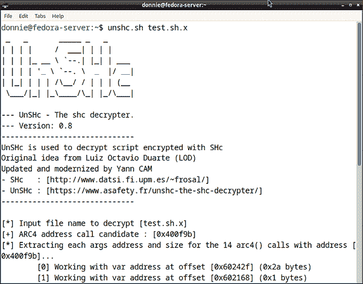

图 20.2：使用 UnSHc

验证 `test.sh.x` 二进制文件是否已实际解密，如下：

```bash
donnie@fedora-server:~$ ls -l test*
-rw-r--r--. 1 donnie donnie 193 Jul 5 14:04 test.sh
-rw-r--r--. 1 donnie donnie 11440 Jul 5 14:01 test.sh.x
donnie@fedora-server:~$ cat test.sh
#!/bin/bash
# This script is very critical !
echo "I'm a super critical and private script !"
PASSWORDROOT="SuPeRrOoTpAsSwDD"'; myService --
```

权限设置位于行开头，分为三个部分。

`rwx` 设置针对文件的所有者，在这种情况下是 root 用户。（在 Linux/Unix 世界中，我们称文件的所有者为文件的用户。）这里的 `rwx` 意味着 root 用户对该文件具有读取、写入和执行权限。

下一组设置是 `r-x`，针对组（group），在 particular 情况下是 root 组（root group）。这意味着该组的成员（在此例中，该组仅由 root 用户组成）对该文件具有读取和执行权限。

最后，我们有第三组设置，同样是 `r-x`。这组设置针对“其他人”（others）。这意味着任何不是 root 用户或 root 组组员的人都可以调用 `rm` 命令，尽管 `rm` 可执行文件属于 root 用户。但其中的局限性在于，普通的非特权用户只能使用 `rm` 删除那些权限设置允许普通用户进行删除操作的文件和目录。（通常情况下，这意味着普通用户只能删除他们自己的文件和目录。）使用 `rm` 删除任何其他文件和目录都需要 root 权限。

现在，有时既没有 root 也没有 `sudo` 权限的普通用户需要执行需要 root 权限的操作。此类最常见的任务是普通用户需要更改自己的密码。更改密码需要在 Linux 和 OpenIndiana 系统上修改 `/etc/shadow` 文件，在 FreeBSD 和大多数其他 BSD 类型的系统上修改 `/etc/master.passwd` 文件。但是，看看我 Fedora 工作站上 `shadow` 文件的权限设置：

```bash
donnie@fedora:/etc$ ls -l shadow
----------. 1 root root 1072 May 10 17:33 shadow
donnie@fedora:/etc$
```

好的，这看起来非常奇怪，因为该文件对任何人都没有任何种类的权限。实际上，root 用户确实拥有该文件的读取和写入权限。只是像 Fedora 这样的红帽类操作系统使用另一种机制将这些权限授予 root 用户。（我不想深入探讨该机制是什么，因为那超出了我们目前的话题范围。）

在这一台 Debian 机器上看到的情况更为典型：

```bash
donnie@debian12:/etc$ ls -l shadow
-rw-r-----. 1 root shadow 1178 Mar 23 13:13 shadow
donnie@debian12:/etc$
```


在这里，我们看到只有 `root` 用户拥有读取和写入权限，而 `shadow` 组只有读取权限。但无论如何，需要更改自己密码的普通用户都需要修改此文件，而无需调用 `root` 或 `sudo` 权限。这该如何实现呢？嗯，当然是通过 SUID。

向可执行文件添加 SUID 权限允许任何普通用户以与该文件所有者相同的权限来执行该文件。例如，看看 `passwd` 可执行文件的权限设置：

```
donnie@fedora:/bin$ ls -l passwd
-rwsr-xr-x. 1 root root 32416 Jul 19 2023 passwd
donnie@fedora:/bin$
```

这一次，我们看到用户权限设置为 `rws`，在 particular 情况下，这同样是 `root` 用户。这里小写的 `s` 意味着为 `root` 用户设置了执行权限，并且也设置了 SUID 权限。在第三组权限组中，你看到 `r-x`，这意味着普通的非特权用户可以运行此程序。正是 SUID 权限允许普通用户更改他们自己的密码，而这需要修改 `/etc/shadow` 文件或 `/etc/master.passwd`。现在，让我们看看这是否对 `Frank` 有效，他没有 `root` 也没有 `sudo` 权限：

```
frank@debian12:~$ passwd
Changing password for frank.
Current password:
New password:
Retype new password:
passwd: password updated successfully
frank@debian12:~$
```

确实有效，多亏于 `passwd` 可执行文件上的 SUID 设置。

我应该指出的是，`passwd` 可执行文件上的 SUID 设置仅在用户设置自己的密码时才有效。要设置任何其他人的密码，用户仍然需要适当的 `sudo` 权限。（而且不，我不知道操作系统开发人员是如何让 SUID 这样有选择性地工作的。）

可执行文件上的 SGID 设置工作方式相同，只是针对组（groups）。例如，看看 `write` 可执行文件的设置：

```
donnie@fedora:/bin$ ls -l write
-rwxr-sr-x. 1 root tty 24288 Apr 7 20:00 write
donnie@fedora:/bin$
```

在这种情况下，你看到组权限中有一个 `s` 设置，这意味着任何执行此程序的用户都与关联组具有相同的权限。在这种情况下，我们说的是 `tty` 组，这是一个允许其成员向终端发送输出的系统组。这里的 SGID 权限允许普通用户使用 `write` 向登录另一个终端的其他用户发送消息，如下所示：

```
donnie@fedora-server:~$ write frank
The server is shutting down in five minutes.
donnie@fedora-server:~$
```

默认选项。遗憾的是，向你展示如何在你自己的分区上设置此选项超出了本书的范围。事实上，我真的做不到，因为对于不同的 Linux 和 Unix 发行版，以及它们使用的各种文件系统格式，操作程序都是不同的。如果你需要知道如何设置 `nosuid` 选项，最好的办法是查阅你所用发行版的文档。

好了，我们来谈谈数据泄露。

## 避免敏感数据泄露

作为一名系统管理员，你很有可能最终需要处理某种敏感数据，例如密码、财务信息或客户信息。你总是希望确保你的脚本不会无意中导致任何敏感数据泄露给任何未经授权的人。让我们来看看这种情况可能发生的一些方式，以及如何防止它。

## 保护临时文件

在某个时刻，你可能需要创建脚本在临时文件中存储某种瞬时数据。你可能需要这样做的原因包括：

*   在处理大量数据时不使用过多的系统内存。
*   存储某些复杂操作的中间结果。
*   存储用于日志调试信息的临时数据。
*   允许不同的进程或脚本之间相互通信。

由于 `/tmp/` 目录是存储临时文件的最常见的地方，让我们从对它的解释开始这个话题。

## 理解 /tmp/ 目录

正如我刚刚所说，存储临时文件的最常见的地方是 `/tmp/` 目录。这个目录的优点是它是对所有人可读且所有人可写的，如下所示：

```
donnie@fedora-server:~$ ls -ld /tmp
drwxrwxrwt. 17 root root 340 Jun 27 14:27 /tmp
```

这是好事，因为它提供了一个不同的脚本和进程可以访问的公共、已知的地方。事实上，这个目录不仅被你的 shell 脚本使用，还被各种操作系统进程使用。在 Fedora 虚拟机上，你可以看到它正在存储来自各种 `systemd` 进程的临时数据：

```
donnie@fedora-server:/tmp$ ls -l
total 0
drwx------. 3 root root 60 Jun 27 13:44 systemd-private-d241f12536d0464393f30d8552359053-chronyd.service-RKt6x4
drwx------. 3 root root 60 Jun 27 13:44 systemd-private-d241f12536d0464393f30d8552359053-dbus-broker.service-plcC5i
drwx------. 3 root root 60 Jun 27 13:45 systemd-private-d241f12536d0464393f30d8552359053-httpd.service-SB6D6A
. . . . . .
drwx------. 3 root root 60 Jun 27 13:44 systemd-private-d241f12536d0464393f30d8552359053-systemd-resolved.service-uBl3YB
donnie@fedora-server:/tmp$
```

正如你所看到的，在 `/tmp/` 中创建的文件或目录都设置了限制性权限，使得只有这些文件或目录的用户才能访问它们。另外，再看一眼 `/tmp/` 目录本身的权限设置：

```
drwxrwxrwt. 17 root root 340 Jun 27 14:27 /tmp
```

在权限字符串的末尾，你看到用 `t` 代替了 `x`。这意味着其他人设置了执行权限，所以从这个意义上说，它的作用与 `x` 相同。因此，任何人都可以进入该目录。但是 `t`（称为粘滞位，sticky bit）使得不同的用户无法删除彼此的文件或目录，除非他们拥有 `root` 权限。（即使文件和目录设置了所有人可写的权限，这种情况下也是成立。）

我知道这对粘滞位的解释相当简略，但更充分的解释超出了本书的范围。你可以在我的《精通 Linux 安全与加固》（Mastering Linux Security and Hardening）书中找到更多关于它的内容。

好了，既然你已经理解了 `/tmp/` 目录，让我们看看如何创建可以生成临时文件的脚本。但请注意，这样做有两种方法。首先是错误的方法，然后是正确的方法。

## 创建临时文件的错误方法

现在，假设你真的需要编写一个创建临时文件的脚本。你会如何做，这会产生什么样的安全问题呢？在我们向你展示创建临时文件的正确方法之前，让我通过这个 `tmp_file1.sh` 脚本给你展示错误的方法：

```bash
#!/bin/bash
echo "This temporary file contains sensitive data." > /tmp/donnie_temp
cat /tmp/donnie_temp
```

运行这个脚本，你会在 `/tmp/` 目录中看到这个：

```
donnie@fedora-server:~$ ls -l /tmp/donnie_temp
-rw-r--r--
```

命令可能不会被调用。因此，最好的办法是使用一个 `trap` 来删除临时文件，即使脚本提前退出也是如此。以下是该机制在 `tmp_file4.sh` 脚本中是如何工作的：

```bash
#!/bin/bash

trap 'rm -f "$temp_file"' EXIT

temp_file=$(mktemp)

echo "This file contains sensitive data." > "$temp_file"

ls -l /tmp/tmp*

cat "$temp_file"
```

当你执行脚本时，它总会在一个新的子 shell 中打开。当脚本运行完成或提前退出时，子 shell 就会关闭。该脚本的第二行，即 `trap` 那行，指定了在该子 shell 关闭时要运行的命令。在这种情况下，我们希望运行 `rm -f` 命令。（`-f` 选项强制 `rm` 命令在不提示用户的情况下删除文件。）在 `echo` 这一行（该行向临时文件中发送了某些文本）之后，我添加了两个行代码，这两行代码将证明临时文件确实被创建了。无论如何，当我运行该脚本时，会发生以下情况：

```
donnie@fedora-server:~$ ./tmp_file4.sh
-rw-------. 1 donnie donnie 35 Jun 28 15:07 /tmp/tmp.6t5Qqx5WqZ
This file contains sensitive data.

donnie@fedora-server:~$ ls -l /tmp/tmp*

ls: cannot access '/tmp/tmp*': No such file or directory

donnie@fedora-server:~$
```

所以，当我运行脚本时，它向我显示了文件，然后显示了内容，正如我希望的那样。但当我随后运行 `ls -l /tmp/tmp*` 命令时，它显示不存在 `tmp` 文件。这证明脚本中的 `trap` 命令确实删除了临时文件。

尽管这些看起来很好，但我还想在 `tmp_file5.sh` 脚本中向你展示另一个修改，如下所示：

```bash
#!/bin/bash

trap 'rm -f "$temp_file"' EXIT

temp_file=$(mktemp) || exit 1

echo "This file contains sensitive data." > "$temp_file"

ls -l /tmp/tmp*

cat "$temp_file"
```


我在这里做的唯一一件事是在`temp_file`行添加了`|| exit 1`。这使得如果由于某种原因`mktemp`命令无法创建临时文件，脚本将以退出码`1`优雅地退出。实际上，这里可能不需要，因为`mktemp`几乎可以肯定能够创建临时文件。但是，提供一种优雅退出的机制被认为是良好的编程习惯，而且拥有它也并没有坏处。

请注意，你还可以使用带有`-d`选项的`mktemp`在`/tmp/`目录下创建临时目录。

好了，你现在知道如何以安全的方式处理临时文件了。现在，让我们转向另一个可能让人头疼的问题。那就是如何在脚本中安全地使用密码。

## 在 Shell 脚本中使用密码

本节中的信息可以帮助你处理两种不同的场景：

1. 你需要创建一个供特定管理员或一组管理员使用的脚本，并将其放置在他们所有人都可以访问的地方。这些管理员的权限有限，他们需要执行的操作需要某些远程服务器的密码。但你不希望他们知道那个密码，因为你不想允许他们实际上登录该服务器。你只希望他们执行一个特定的任务，例如将文件复制到该服务器。
2. 你需要创建一个供自己使用的脚本，该脚本需要远程服务器的密码。你希望设置脚本在固定的时间自动运行，作为`cron`任务或`systemd`定时器任务。如果脚本必须提示你输入密码，任务将被中断且无法运行完成。

在这两种情况下，你都需要将密码嵌入到你的脚本中。但存在你的密码可能会泄露给未经授权的方的风险。自然地，你会希望防止这种情况。所以，让我们看看如何实现。

## 动手实验室 – 加密密码

对于这种场景，我将向你展示一个我从 How-to Geek 网站借用的解决方案。就其本身而言，这是一个很好的解决方案，但正如你很快就会看到的，它只是一个部分解决方案。不过，让我们先对密码进行加密并创建一个使用它的脚本。然后，我将向你展示完整的解决方案。

我已经将原始 How-to Geek 文章的链接放在了“延伸阅读”部分。此外，为了避免重复“造轮子”，我不会重复本文作者已经提供的详尽解释。

开始之前，你需要一个安装了`openssl`和`sshpass`软件包的系统。`openssl`软件包通常安装在几乎每一个 Linux、Unix 或 Unix 类操作系统上，所以你不需要担心那个。你只需要担心安装`sshpass`。你将使用`openssl`加密密码，并使用`sshpass`将密码自动传递给`ssh`客户端。

`sshpass`软件包位于 Fedora、Debian/Ubuntu 和 FreeBSD 的标准仓库中。包名在所有情况下都是相同的，因此使用你的包管理器安装它即可。

首先，你需要创建一个`.secret_vault.txt`文件，其中包含你要访问的远程服务器的加密密码，如下：

```bash
donnie@freebsd14:~ $ echo 'Chicken&&Lips' | openssl enc -aes-256-cbc -md sha512 -salt -pbdf2 -iter 100000 -pass pass:'Turkey&&Lips' > .secret_vault.txt
```

在该命令中，`Chicken&&Lips`是远程服务器，`Turkey&&Lips`是你需要解密的密码。

查看`.secret_vault.txt`文件，你将看到远程密码的`sha512`哈希值：

```bash
donnie@freebsd14:~ $ cat .secret_vault.txt
U2sdGVkX18eeWfcaGbr/4Fd70TC3vIjVgymXf=
```

创建`go-remote.sh`脚本，使用你自己的`Remote_User`、`Remote_Password`和`Remote_Server`信息：

```bash
#!/bin/bash

# 远程账户名
Remote_User=horatio

# 远程账户的密码
Remote_Password=$(openssl enc -aes-256-cbc -md sha512 -a -d -pbdf2 -iter 100000 -salt -pass pass:'Turkey&&Lips' < .secret_vault.txt)

# 远程计算机
Remote_Server=192.168.0.20

# 连接到远程计算机并将时间戳写入 script.log 的文件
sshpass -p $Remote_Password ssh -T $Remote_User@$Remote_Server << _remote_commands
echo $USER "-" $(date) >> /home/$Remote_User/script.log
_remote_commands
```

使用`chmod 600 .secret_vault.txt`命令设置你自己的读写权限，并移除其他人的权限：

```bash
donnie@freebsd14:~ $ chmod 600 .secret_vault.txt
donnie@freebsd14:~ $ ls -l .secret_vault.txt
-rw------- 1 donnie donnie 45 Jun 28 15:07 .secret_vault.txt
```

我们没有将远程用户、远程服务器和远程服务器密码的信息硬编码在脚本主体中，而是将这些信息赋值给`Remote_User`、`Remote_Password`和`Remote_Server`变量。为了获取赋值给`Remote_Password`变量的解密密码，我们使用`stdin`（`<`）重定向从`.secret_vault.txt`文件读取密码哈希到`openssl`命令中。

`sshpass -p`命令将来自`Remote_Password`变量的 Horatio 密码传递给`ssh`客户端。由于我们不需要 Horatio 打开远程终端，我们将使用`ssh`的`-T`选项禁用它。这里的`_remote_commands`此文档（here-document）包含一个将在远程服务器上执行的命令。也就是说，它将在 Horatio 的家目录下创建一个包含时间戳的`script.log`文件。

为了让此脚本运行，你需要在你的`.ssh/known_hosts`文件中拥有 Horatio 针对远程服务器的公 SSH 密钥。因此，在尝试运行脚本之前，让 Horatio 以正常方式登录到远程服务器，然后让他登出，如下所示：

```bash
donnie@freebsd14:~ ssh horatio@192.168.0.20 . . . . . . horatio@ubuntu2404:~$ exit
donnie@freebsd14:~
```

执行`go-remote.sh`脚本。你应该能短暂地看到来自远程服务器的登录信息，然后返回到本地机器的命令提示符。

登录到远程服务器上的 Horatio 账户。你应该看到包含时间戳的`script.log`文件。它看起来应该像这样：

```bash
horatio@ubuntu2404:~$ ls -l script.log
-rw-rw-r-- 1 horatio horatio 38 Jul 31 21:34 script.log
horatio@ubuntu2404:~$ cat script.log
donnie - Wed Jul 31 17:34:44 EDT 2024
horatio@ubuntu2404:~$
```

如果你在 Horatio 的家目录下看到了`script.log`文件，那么你实现了酷炫的操作。但是，这真的是一个完整的解决方案吗？嗯，不。让我们来看看这个 How-to Geek 文章作者没有解决的一些潜在问题。

## 理解此解决方案的问题

我再次问，我刚刚展示的解决方案是好的吗？嗯，这取决于几个因素。我的意思是，如果你将脚本和哈希密码存放在只有你才能访问的自己的家目录下，那么它可能是没问题的。但这里有一个重要的考虑因素。某些操作系统（如 FreeBSD 和较旧的 Linux 实现）默认对其他用户开放用户的家目录。任何能够进入你家目录的人都可以读取你明文脚本中的加密密码，并看到包含加密密码的文件名。事实上，让我们来看这个问题。

## FreeBSD 上的家目录权限

在 FreeBSD 上看起来是这样的：

```bash
donnie@freebsd14:~ $ cd ..
donnie@freebsd14:/home $ ls -l
total 17
drwxr-xr-x 9 donnie donnie 68 Jul 31 17:52 donnie
drwxr-xr-x 2 horatio horatio 10 Jul 30 17:38 horatio
donnie@freebsd14:/home $ cd horatio/
donnie@freebsd14:/home/horatio $ ls
donnie@freebsd14:/home/horatio $ ls -a
. .cshrc .login_conf .mailrc .sh_history .. .login .mail_aliases .profile .shrc
donnie@freebsd14:/home/horatio $
```

如你所示，FreeBSD 默认对其他用户设置用户目录的读取和执行权限。在这种情况下，这意味着 Horatio 可以看到我目录中的内容，我可以看到他目录中的内容，而无需使用任何类型的管理员权限。幸运的是，我可以轻松地为自己修复，如下：

```bash
donnie@freebsd14:/home $ chmod 700 donnie/
donnie@freebsd14:/home $ ls -ld donnie/
drwx------ 9 donnie donnie 68 Jul 31 18:01 donnie/
donnie@freebsd14:/home $
```

`chmod 700`命令保留了我对自己拥有的读取、写入和执行权限，并删除了所有其他人的权限。为了确保任何未来用户在其 FreeBSD 家目录下都具有这种限制性权限设置，请按如下所示创建`/etc/adduser.conf`文件：

```bash
donnie@freebsd14:~ $ sudo adduser -C
```

这是一个交互式实用程序，会提示你输入大量信息。除了家目录权限（留空以使用默认值）外，接受所有内容的默认值：`行`。对于该项，输入`700`作为值。通过创建另一个用户账户来测试你的设置。你应该看到新用户对其家目录设置了限制性权限，就像这里我为 Vicky 创建的账户所看到的：

```bash
donnie@freebsd14:/home $ ls -ld vicky/
drwx------ 2 vicky vicky 9 Jul 31 18:04 vicky/
donnie@freebsd14:/home $
```

此外，请记住，当你安装 FreeBSD 时，安装程序为你创建的用户账户将对你的家目录具有更开放的权限设置。因此，在完成安装后，务必将你的家目录权限设置为更严格的值。然后，运行`sudo adduser -C`命令创建`/etc/adduser.conf`文件，正如我向你展示的那样。

## Linux 上的家目录

Linux 上的家目录权限并不是问题，因为许多现代 Linux 发行版默认创建具有限制权限的家目录。例如，它们在任何 Red Hat 类型系统（如 Fedora）上看起来是这样的：

```bash
donnie@freebsd14:~ $ ls -l
total 17
drwxr-xr-x 9 donnie donnie 68 Jul 31 17:52 donnie
drwxr-xr-x 2 horatio horatio 10 Jul 30 17:38 horatio
donnie@freebsd14:/home $ cd horatio/
donnie@freebsd14:/home/horatio $ ls
donnie@freebsd14:/home/horatio $ ls -a
. .cshrc .login_conf .mailrc .sh_history .. .login .mail_aliases .profile .shrc
donnie@freebsd14:/home/horatio $
```

而在 Ubuntu 上它们看起来是这样的：

```bash
horatio@ubuntu2404:~$ ls -l
total 17
drwxr-xr-x 9 donnie donnie 68 Jul 31 17:52 donnie
drwxr-xr-x 2 horatio horatio 10 Jul 30 17:38 horatio
```

Ubuntu 的唯一区别是它对用户组有读取和执行权限。

## 其他 Linux 发行版上的家目录

其他 Linux 或 Unix 发行版可能有处理家目录的其他方式。如果你与它们一起工作，务必检查家目录权限并进行必要的更改。

## 实验：制作不可追踪的二进制文件

如果管理员需要访问包含密码的脚本，你可能需要将脚本和密码文件放在其他目录，例如`/usr/local/bin/`或`/usr/local/sbin/`。在这些情况下，你希望没有人能读取或修改脚本，并且无法追踪它。

幸运的是，可以通过将脚本转换为可执行二进制文件来轻松解决这个问题，正如我在几页前的“控制脚本访问”部分所展示的那样。但当你这样做时，必须使用带有`-U`选项的`shc`使二进制文件不可追踪。

为了演示，回到你用于创建`go-remote.sh`脚本的虚拟机。使用不带`-U`选项的`shc`将脚本转换为可执行二进制文件：

```bash
donnie@freebsd14:~ $ shc -f go-remote.sh -o go-remote
donnie@freebsd14:~ $
```

使用 FreeBSD 上的`truss`或 Linux 上的`strace`为`go-remote`可执行文件创建`trace1.txt`追踪文件。

在 FreeBSD 上：
```bash
donnie@freebsd14:~ ~ truss ./go-remote 2> trace1.txt
```

在 Linux 上：
```bash
donnie@fedora-server:~$ strace ./go-remote 2> trace1.txt
```

打开`trace1.txt`文件并向下滚动直到看到 Horatio 的远程密码。在我自己的文件中，它位于第 191 行，看起来如下：

```bash
read(3,"Chicken&&Lips\n",4096) = 14 (0xe)
```

的确如此，`Chicken&&Lips`确实是 Horatio 访问远程服务器的密码。

使用`-U`重新创建`go-remote`二进制文件，使其变得不可追溯：

```bash
donnie@freebsd14:~ $ shc -Uf go-remote.sh -o go-remote
donnie@freebsd14:~ $
```

重复步骤 2，但这次将输出保存到`trace2.txt`文件中：

打开`trace2.txt`文件并搜索 Horatio 的密码。（剧透警告：这次，你找不到它。）

现在，在执行了这一切操作之后，我需要告诉你们一个小秘密。那就是，Horatio 的用户名和远程服务器的地址都不会出现在`truss`或`strace`的输出中。因此，任何追踪你二进制文件的人都会获得密码，但没有用户名或服务器地址。但是，不要因为这样就认为万事大吉了。记住，你需要像恶意黑客一样思考。任何名之其实的恶意黑客都已经使用了其他手段来映射你网络上的服务器，并可能已经找到了一种列出可能的用户名列表的方法。所以，尽管这个过程只给了黑客拼图的一个碎片，但它仍然是一个可以与其他碎片结合起来的重要碎片。

好了，我想这个主题我们已经快说完了。现在，让我们快速查看一下安全编码实践。

## 使用 eval 理解命令注入

Shell 脚本安全的另一个主要问题涉及接受来自不可信用户或不可信源输入的脚本。如果脚本代码编写不正确，攻击者就可以利用它注入恶意命令作为脚本的输入。在我们看这些示例之前，让我们先看看`eval`命令，它有助于将数据或命令传递到脚本中。

## 在命令行上使用 eval

`eval`命令是大多数 shell 中可用的 shell 内置命令。使用得当时它非常有用，但如果使用不当则非常危险。在我们深入讨论之前，让我们看看`eval`在命令行上是如何工作的。

好了，`eval`是那些要完全理解可能变得非常复杂的命令之一。所以，为了保持简单，我将在本节中展示一些相当简单的`eval`演示。尽管它们演示的是你在现实生活中永远不会做的事情，但它们可以起到演示概念的作用。

对于任何想看到更多关于`eval`深度覆盖的人，我将在“扩展阅读”部分提供一些链接。

理解`eval`的最佳方式是，你可以使用它来动态处理 shell 通常会视为无意义文本字符串的命令。例如，假设我们想找到三周前的日期。我们将使用`date`配合`--date=`选项，如下：

```bash
donnie@fedora-server:~$ date
Wed Aug 7 02:48:23 PM EDT 2024
donnie@fedora-server:~$ date --date="3 weeks ago"
Wed Jul 17 02:48:25 PM EDT 2024
donnie@fedora-server:~$
```

如你所见，我只是将`"3 weeks ago"`字符串作为`--date`选项的参数，这运行良好。现在，我们将这个日期命令赋值给变量`threeweeksago`并使用`echo`返回结果，如下：


`donnie@fedora-server:~$ threeweeksago='date --date="3 weeks ago"' donnie@fedora-server:~$ echo $threeweeksago date --date="3 weeks ago" donnie@fedora-server:~$`

如你所见，`echo` 命令只是返回了我赋值给变量的文本字符串。为了看到真正的魔法，请看当我将 `echo` 替换为 `eval` 时发生了什么：

```
donnie@fedora-server:~$ eval $threeweeksago Thu Jul 18 04:02:14 PM EDT 2024 donnie@fedora-server:~$
```

现在，让我们等几分钟并再次运行它。

```
donnie@fedora-server:~$ eval $threeweeksago Thu Jul 18 04:05:10 PM EDT 2024 donnie@fedora-server:~$
```

仔细看，你会发现第二个 `eval` 命令更新了时间值。这种事情在脚本编写中非常有用，因为它允许你将命令赋值给变量，然后在脚本的其他部分使用该变量。这允许你在脚本的不同部分执行该命令，而无需多次输入整个命令。但是，正如我已经提到的，使用 `eval` 既有安全的方法也有危险的方法。让我们先来看安全的方法。

## 安全地使用 eval

让我们来看 `eval-test1.sh` 脚本，看看安全使用 `eval` 的简单示例：

```bash
#!/bin/bash

threeweeksago='date --date="3 weeks ago"' eval $threeweeksago
```

运行脚本看起来如下：

```
donnie@fedora-server:~$ ./eval-test1.sh Thu Jul 18 04:19:25 PM EDT 2024 donnie@fedora-server:~$
```

这种方法之所以是安全的，是因为我们给 `eval` 提供了一个来自脚本内部的文本字符串。只要你有权限，`eval-test1.sh` 被锁定了，任何人无法修改它，它是完全合规的。这样使用 `eval` 让攻击者无法插入自己的命令。

让我们来看 `eval-test2.sh` 中一个更具实用性的例子：

```bash
#!/bin/bash

desiredDate='date --date="3 weeks ago"'

datestamp=$(eval "$desiredDate")

echo "I'm creating a report with $datestamp" > somefile_"$datestamp"
```

等等，让我按照提供文本的逻辑对第二个脚本重新对齐：

```bash
#!/bin/bash

desiredDate='date --date="3 weeks ago"'

datestamp=$(eval "$desiredDate")

echo "I'm creating a report with $datestamp" > somefile_"$datestamp"
```

实际上，文本提供的 `eval-test2.sh` 逻辑为：

```
donnie@fedora-server:~$ ./eval-test1.sh Thu Jul 18 04:19:25 PM EDT 2024 donnie@fedora-server:~$
```

（注：此处原文示例逻辑似乎有跳入，已按原文呈现翻译）

CGI 代表通用网关接口（Common Gateway Interface）。你可以使用各种编程语言创建 CGI 脚本，包括 Shell 脚本。这些 CGI 脚本可以在 Web 服务器上执行各种功能，例如统计用户甚至提供内容。

关于设置 Web 服务器以及如何攻击它们的完整解释远超本书的范围。目前，我们只需要知道，外面的有一些聪明的黑客，他们可以发现并利用 Web 服务器上设计不当的 CGI 脚本。如果 Web 服务器的安全设置不恰当，情况尤其如此。

一个无法登录 Web 服务器的恶意黑客将查看 `passwd` 文件。但是，如果他或她发现这个设计不当的脚本正在执行某种 CGI 功能，他或她可能会查看 `passwd` 文件来列出服务器的用户。（但也许可能不会。适当的 Web 服务器安全措施可能会防止这种情况的发生，即使脚本本身是不安全的。）

让我们来看另一个可能的例子，假设你将 `eval-test3.sh` 脚本放置在 `/usr/local/sbin/` 目录下，并将其设置为仅 root 用户具有执行权限，如下所示：

```
donnie@fedora-server:/usr/local/sbin$ ls -l eval-test3.sh -rwx------. 1 root root 21 Aug 8 17:20 eval-test3.sh

donnie@fedora-server:/usr/local/sbin$
```

然后你调用 `sudo visudo` 命令来设置 Charlie，让他拥有运行 `eval-test3.sh` 脚本的 root 权限，但没有其他任何权限。实现此操作的代码如下：

```
charlie ALL=(ALL) /usr/local/sbin/eval-test3.sh
```

让我们看看如何工作的。

```
charlie@fedora-server:~$ eval-test3.sh 'cat /etc/passwd' bash: /usr/local/sbin/eval-test3.sh: Permission denied

charlie@fedora-server:~$ sudo eval-test3.sh 'cat /etc/passwd' [sudo] password for charlie: root:x:0:0:root:/root:/bin/bash . . . . . . . charlie:x:1009:1009::/home/charlie:/usr/bin/zsh horatio:x:1010:1010::/home/horatio:/bin/bash charlie@fedora-server:~$
```

Charlie 这次没有造成伤害，但下一次呢？让我们看看：

```
charlie@fedora-server:~$ sudo eval-test3.sh 'systemctl stop httpd'

charlie@fedora-server:~$
```

这一次，Charlie 造成了真正的破坏。他关闭了 Web 服务器，导致了拒绝服务攻击。通常情况下，Charlie 是没有权力做到这一点的。但因为他拥有运行 `eval-test3.sh` 脚本的 `sudo` 权限，而该脚本包含了 `eval $1` 这一行，Charlie 现在可以运行任何他想运行的命令，包括系统管理命令。

正如我在本节开头提到的，我试图保持对 `eval` 的解释简单。为了看到更复杂且更具真实的 `eval` 场景，我想向你介绍我发现的两篇非常好的文章。第一篇在 Medium.com 上，是我找到的最好的文章，涵盖了在现实世界中使用 `eval` 漏洞编写不当脚本的方法：

Bash eval 的危险性：
[`medium.com/dot-debug/the-perils-of-bash-eval-cc5f9e309cae`](https://medium.com/dot-debug/the-perils-of-bash-eval-cc5f9e309cae)

第二篇在 Earthly.dev 网站，展示了如何使用 `eval` 脚本执行反 Shell 攻击（如果你不知道什么是反 Shell 攻击，你可以在文中找到解释）。总之，你可以在这里找到它：

Bash eval：理解并（安全地）使用动态代码评估的力量：https://earthly.dev/blog/safely-using-bash-eval/

此外，至少发生过一次涉及 `eval` 使用不当的真实世界 Shell 脚本漏洞。这涉及 Gradle 的安装脚本，Gradle 是一个用于软件开发的自动化构建工具。你可以在这里阅读它：

CVE-2021-32751:
[`cve.mitre.org/cgi-bin/cvename.cgi?name=CVE-2021-32751`](https://cve.mitre.org/cgi-bin/cvename.cgi?name=CVE-2021-32751)

现在你已经理解了 `eval` 的危险，让我们考虑我们是否真的需要使用它。

## 使用 eval 的替代方案

很多时候，你可以使用 `eval` 的安全替代方案。让我们来看几个例子。

### 使用命令替换

在本节开头向你展示的 `eval-test1.sh` 脚本中，你可以用命令替换结构代替 `eval`。

它在 `eval-test1-alternative.sh` 脚本中是这样的：

```bash
#!/bin/bash

threeweeksago=$(date --3weeksago)
```

*(注：此处原文中存在大量重复乱码，翻译时已根据指令要求提取核心逻辑内容)*

通过设置，使得调用的是木马化的工具，而不是真实的工具。木马化的工具可以执行许多坏事，例如泄露敏感数据或通过加密重要文件进行勒索软件攻击。在向你展示脚本之前，让我们看看在命令行中看起来是什么样的。我们先看一眼正常的 `ls` 命令的可执行文件所在的位置：

```
donnie@fedora-server:~$ which ls alias ls='ls --color=auto' /usr/bin/ls donnie@fedora-server:~$
```

我们看到它位于 `/usr/bin/` 目录，正如预期的一样。现在，让我们以脚本的形式创建一个伪造的 `ls` 并将其放在 `/tmp/` 目录中。这是 `ls` 脚本：

```bash
#!/bin/bash echo "This is a trojaned ls file. This command does something nasty." /usr/bin/ls
```

当然，`echo` 命令是无害的，但真正的恶意黑客会将其替换为无害的内容。在运行恶意命令后，脚本将调用正常的 `ls` 命令。

接下来，让我们操控用户的 `PATH` 设置，使得调用的是这个脚本而不是真实的 `ls`。

```
donnie@fedora-server:~$ PATH=/tmp:$PATH donnie@fedora-server:~$
```

最后，我们调用 `ls`：

```
donnie@fedora-server:~$ ls This is a trojaned ls file. This command does something nasty. 04:26:53 Jul 18 link.txt . . . . . . ip_addresses.csv variables.txt ipaddress_list_2024-06-03.txt donnie@fedora-server:~$
```

这一次，伪造的 `ls` 被调用了，因为 `/tmp/` 目录是用户 `PATH` 设置中的第一个目录。

默认，你创建的 shell 脚本将使用正常的 `PATH` 设置来查找脚本调用的工具和程序。例如，当你想要在脚本中调用 `ls` 命令时，只需添加一行 `ls` 而不是 `/usr/bin/ls` 即可。但是，通过这样做，任何可以操控用户 `PATH` 设置的攻击者都可能导致脚本运行伪造的、木马化的程序。你可以采取三种方法来防止这种情况。

### 方法 1：使脚本不可读且不可追踪
正如我在本章的第一部分向你展示的。那样，攻击者将无法看到脚本调用了哪些工具，这意味着他们不知道应该将哪些工具替换为木马化的版本。

### 方法 2：在脚本顶部显式地设置新的 `PATH`
在 `path-test1.sh` 脚本中是这样的：

```bash
#!/bin/bash PATH=/bin:/sbin:/usr/local/bin:/usr/local/sbin ls -l
```

### 方法 3：在脚本中对每个命令都使用完整路径
例如，当你想要调用 `awk` 时，让行写为 `/bin/awk` 而不仅仅是 `awk`。

第三种方法的一个问题是，它可能会降低脚本的可移植性。这是因为某些操作系统（如 FreeBSD）将某些工具的可执行文件存储在与你习惯不同的目录中。例如，FreeBSD 的许多工具的可执行文件存储在 `/usr/local/bin/` 目录中，而不是我们在 Linux 操作系统上常见的 `/usr/bin/`。因此，如果你想确保脚本能在尽可能多的操作系统上运行，最好的办法是忘记方法 3。使用方法 2 会简单得多，而且同样有效。

现在，你可能在想攻击者如何可能操纵某人的 `PATH` 设置。嗯，我可以想到两种场景。

## 攻击场景 1：攻破用户账户
攻击者操控用户 `PATH` 设置的一种方法是首先获取用户的访问权限。如果攻击者已经实现了这一点，那么无论如何游戏都结束了，路径安全将是用户最不需要担心的问题了。所以，最好的办法是确保用户账户配置安全，以防止任何人入侵。

## 攻击场景 2：社会工程学
攻击者还可能利用社会工程学欺骗用户运行会更改用户 shell 配置文件的程序。

在网络安全领域，社会工程学可以采取许多形式。例如，它可能通过带有恶意文件链接的诈骗邮件出现，也可能通过面对面的接触出现。无论情况下，目标都是说服受害者执行某种可能导致安全漏洞的行动。

对于这个场景，我使用的是 Fedora Server 虚拟机。

首先，让我们来看 `harmless-program.sh` 脚本：

```bash
#!/bin/bash echo "This program is harmless." echo "Trust me!" echo "PATH=/tmp:$PATH" >> /home/"$USER"/.bashrc echo "export PATH" >> /home/"$USER"/.bashrc
```

运行脚本，注意它在 `.bashrc` 文件末尾添加了一个额外的 `PATH` 指令。这个额外的指令覆盖了文件顶部的 `PATH` 指令。这个新设置不会立即生效，但在用户下次登录系统或打开另一个窗口时生效。

```
donnie@fedora-server:~$ ls This is a trojaned ls file. This command does something nasty. 04:26:53 Jul 18 link.txt . . . . . . ip_addresses.csv variables.txt ipaddress_list_2024-06-03.txt donnie@fedora-server:~$
```


任何人都可以读取 `mktemp` 在 `/tmp/` 目录下创建的文件。

`mktemp` 在 `/tmp/` 目录下创建的任何文件只能由创建它的用户读取。

你将如何防止攻击者从你用 `shc` 创建的二进制文件中获取信息？

从 `shc` 二进制文件中获取信息是不可能的。

使用带有 `-U` 选项的 `shc`。

使用带有 `-u` 选项的 `shc`。你什么无法防止这种情况。

在对文件设置访问控制列表（ACL）之前，你必须对该文件做什么？

- 移除组和其他人的所有权限。
- 你不需要做任何事情。
- 确保用户、组和其他人都具有读、写和执行权限。
- 将文件的所有者改为 root 用户。

确保你的脚本在 `/tmp/` 目录下创建的任何临时文件始终被删除的最佳方法是什么？

- 运行脚本后，进入 `/tmp/` 目录手动删除临时文件。
- 在脚本末尾使用 `rm` 命令自动删除文件。
- 在脚本开头使用 `trap` 命令自动删除文件。
- 不需要采取行动，因为你的脚本始终会自动删除其临时文件。

## 延伸阅读

- 在 ZFS 文件上设置和显示紧凑格式 ACL——Oracle Solaris ZFS 管理指南：https://docs.oracle.com/cd/E23823_01/html/819-5461/gbchf.html#scrolltoc
- Shell 脚本与安全：https://stackoverflow.com/questions/8935162/shell-scripts-and-security
- Shell 脚本安全：https://developer.apple.com/library/archive/documentation/OpenSource/Conceptual/ShellScripting/ShellScriptSecurity/ShellScriptSecurity.html
- 如何在 Linux Shell 脚本中安全地处理临时文件：https://youtu.be/zxswimoojh4?si=ERfbJ04U2LJzQE60
- 为什么禁用了 SUID 但二进制文件没有？https://security.stackexchange.com/questions/194166/why-is-suid-disabled-for-shell-scripts-but-not-for-binaries
- SUID Shell 脚本的危险：https://www.drdobbs.com/dangers-of-suid-shell-scripts/199101190
- 使用 `trap` 内置函数捕获中断以进行 shell 事件处理：https://www.shellscript.sh/trap.html
- Linux 中的反向工程工具——`strings`, `nm`, `ltrace`, `strace`, `LD_PRELOAD`：https://www.thegeekstuff.com/2012/03/reverse-engineering-tools/
- 使用 `strace` 进行反向工程：https://function61.com/blog/2017/reverse-engineering-with-strace/
- 如何在 Bash 脚本中使用加密密码：https://www.howtogeek.com/734838/how-to-use-encrypted-passwords-in-bash-scripts/
- Linux `eval` 命令初学者指南：https://linuxtldr.com/eval-command/
- 如何在 Linux Bash 脚本中使用 `eval`：https://www.howtogeek.com/818088/bash-eval/
- `Eval` 命令与安全问题：http://mywiki.wooledge.org/BashFAQ/048
- 代码注入：https://owasp.org/www-community/attacks/Code_Injection
- 安全 Shell 脚本：https://www.admin-magazine.com/Archive/2021/64/Best-practices-for-secure-script-programming

## 答案

1. d
2. b and d
3. b
4. a
5. c

## 在 Discord 上加入我们的社区！

与其他用户、Linux 专家以及作者本人一起阅读这本书。提问问题、为其他读者提供解决方案、通过 Ask Me Anything 活动与作者聊天，以及更多。扫描二维码或访问链接加入社区。

[`packt.link/SecNet`](https://packt.link/SecNet)


## 21

## 调试 Shell 脚本

如果你曾经写过一个外观精美的脚本，却在它无法正常工作时感到失望，请不要感到孤单。这种情况发生在我们每个人身上，甚至在我为这本书编写脚本时也曾发生过几次（我知道，这很令人震惊，对吧？）。调试过程应该从你开始设计代码的那一刻就开始。对设计进行深思思考，在编写时测试每个部分，并且——看在份上——使用带有颜色代码语法高亮的文本编辑器。（那种颜色高亮可以防止你出现大量的拼写错误。）

本章的主题包括：

- 理解常见的脚本错误
- 引号不足
- 创建通配循环
- 使用 shell 脚本调试工具和技术
- 使用 `echo` 语句
- 使用 `xtrace` 进行调试
- 检查未定义的变量
- 使用 `-e` 选项检查错误
- 使用 `bash` 调试器
- 使用 `bashdb` 调试脚本
- 获取 `bashdb` 帮助

如果你准备好了，我们开始吧。

## 技术要求

对于本章，我主要使用我用来创建此文件的 Fedora 工作站。但是，你可以使用任何你喜欢的 Linux 虚拟机，只要它有桌面即可。

### 理解常见的脚本错误

如果你曾经写过一个外观精美的脚本，却在它无法正常工作时感到失望，请不要感到孤单。这种情况发生在我们每个人身上，甚至在我为这本书编写脚本时也曾发生过几次（我知道，这很令人震惊，对吧？）。调试过程应该从你开始设计代码的那一刻就开始。对设计进行深思思考，在编写时测试每个部分，并且——看在份上——使用带有颜色代码语法高亮的文本编辑器。（那种颜色高亮可以防止你出现大量的拼写错误。）

## 引号不足

### 创建通配循环

### 使用 shell 脚本调试工具和技术

### 使用 `echo` 语句

### 使用 `xtrace` 进行调试

### 检查未定义的变量

### 使用 `-e` 选项检查错误

### 使用 `bash` 调试器

### 使用 `bashdb` 调试脚本

### 获取 `bashdb` 帮助

### 空问题

对于下一个场景，让我们来看 `quote_problem1.sh` 脚本：

```bash
#!/bin/bash

number=1

if [ $number = 1 ]; then

    echo "Number equals 1"

else

    echo "Number does not equal 1"

fi
```

它只是告诉我们 `number` 的值是否为 1。运行脚本看起来如下：

```
donnie@fedora:~$ ./quote_problem1.sh Number equals 1

donnie@fedora:~$
```

好的，它运行正常。现在，我会编辑文件将 `number` 的值改为 2，然后再次运行脚本。显示如下：

```bash
donnie@fedora:~$ ./quote_problem1.sh Number does not equal 1

donnie@fedora:~$
```

现在，让我们用一个未设置的变量尝试一下，正如你在 `quote_problem2.sh` 中所示：

```bash
#!/bin/bash

number=

if [ $number = 1 ]; then echo "Number equals 1"; else echo "Number does not equal 1"; fi
```

当我们说一个变量是未设置（unset）时，它意味着我们定义了这个变量，但没有给它赋值。让我们来看看当我尝试运行这个脚本时会发生什么。

```bash
donnie@fedora:~$ ./quote_problem2.sh

./quote_problem2.sh: line 4: [: =: unary operator expected

Number does not equal 1

donnie@fedora:~$
```

问题在于

`if [ $number = 1 ]`

测试语句正在为 `number` 变量寻找某种值。但是，

`number`

没有值，这导致了测试失败。幸运的是，这很容易修复。我只需要做的是将测试语句中的 `$number` 外围加上一对双引号，正如你在 `quote_problem3.sh` 中看到的那样：

```bash
#!/bin/bash

number=

if [ "$number" = 1 ]; then echo "Number equals 1"; else echo "Number does not equal 1"; fi
```

运行此脚本将显示正确的结果：

```bash
donnie@fedora:~$ ./quote_problem3.sh

Number does not equal 1

donnie@fedora:~$
```

这之所以有效，是因为 `number` 现在不再像以前那样完全没有值，而是实际上拥有了一个空格值。空格不等于 1，所以脚本可以工作。

通常情况下，最好在创建变量始终为它们分配一个初始值，以防止此类问题。然而，有时使用未设置的变量也是必要的。例如，你可能希望脚本在变量未设置时执行某项操作，在变量已赋值时执行其他操作。只要你知道如何使用引号来避免这类解析问题，这就是完全没有问题的。

为了让这更真实一点，让我们制作 `quote_problem4.sh` 使其能够接受用户定义的值：

```bash
#!/bin/bash

number=$1

if [ $number = 1 ]; then echo "Number equals 1"; else echo "Number does not equal 1"; fi
```

让我们看看它在不同值下的表现：

```bash
donnie@fedora:~$ ./quote_problem4.sh 1

Number equals 1

donnie@fedora:~$ ./quote_problem4.sh 5

Number does not equal 1

donnie@fedora:~$ ./quote_problem4.sh

./quote_problem4.sh: line 4: [: =: unary operator expected

Number does not equal 1

donnie@fedora:~$
```

使用 1 或 5 作为值时它运行良好，但当我没有提供值时它就无法工作了。所以，似乎我忘记给 `$number` 加引号了。不用担心，我会在 `quote_problem5.sh` 中修复它：

```bash
#!/bin/bash

number=$1

if [ "$number" = 1 ]; then echo "Number equals 1"; else echo "Number does not equal 1"; fi
```

让我们看看现在的状况：

```bash
donnie@fedora:~$ ./quote_problem5.sh 1

Number equals 1

donnie@fedora:~$ ./quote_problem5.sh 5

Number does not equal 1

donnie@fedora:~$ ./quote_problem5.sh

Number does not equal 1

donnie@fedora:~$
```

它运行得非常完美，这意味着我们再次实现了“酷”的效果。

既然我们一直在处理测试，让我们看看如果漏掉一个空格会发生什么，就像我在 `space_problem1.sh` 中做的那样：

```bash
#!/bin/bash

number=$1

if ["$number" = 1 ]; then echo "Number equals 1"; else echo "Number does not equal 1"; fi
```

这与 `quote_problem5.sh` 脚本相同，区别是我删除了 `[` 和 `"$number"` 之间的空格。以下是我运行它时发生发生的情况：

```bash
donnie@fedora:~$ ./space_problem1.sh

./space_problem1.sh: line 4: [: =: unary operator expected

Number does not equal 1

donnie@fedora:~$
```

惊讶的是，它给我的错误信息和我忘记给 `$number` 变量加引号时完全一样。所以这告诉了我们两点：首先，在测试条件中放置空格时需要小心。其次，你不能总是依赖 shell 的错误信息来告诉你具体的问题所在。在这种情况下，两个完全不同的错误显示了完全相同的信息。

等一下！这里有另一种排除此问题的方法。我们只需使用 `-u` shell 选项来检查未初始化的变量，正如你在 `quote_problem6.sh` 脚本中看到那样：

```bash
#!/bin/bash -u

number=$1

if [ $number = 1 ]; then echo "Number equals 1"; else echo "Number does not equal 1"; fi
```

这个脚本与上一个唯一的区别是我在 shebang 行末尾添加了 `-u`。让我们看看在不为 `$1` 提供值的情况下运行它会发生什么：

```bash
donnie@fedora:~$ ./quote_problem6.sh

./quote_problem6.sh: line 3: $1: unbound variable

donnie@fedora:~$
```

这很酷，因为它告诉了我们具体的问题所在，而不是显示一个通用的错误信息。如果你需要使用引号来避免这类解析问题，请记住把你的变量括起来。

# 使用 Shell 脚本调试工具和技术

我们有几种不同的调试工具可以使用，其中包括 `shellcheck`、`checkbashisms` 和 `shall`。我们已经在第 19 章“Shell 脚本的可移植性”中介绍过它们了，因此这里我们不再赘述。相反，我将介绍一些我们尚未涵盖过的工具和技术。

## 使用 echo 语句

有时候，如果你在 Shell 脚本中遇到无法解决的问题，在策略性的位置放置 `echo` 语句可以帮助你找到问题。

你可能在其他参考资料中看到，有些人将 `echo` 语句视为“穷人的调试工具”。这是因为 `echo` 总是可用的，当你无法使用其他任何工具时，就可以使用它。

在回溯到第 16 章“使用 `yad`、`dialog` 和 `xdialog` 创建用户界面”时，我向你展示了 `xdialog-hello2.sh` 脚本，它可以自动检测两点内容：

1. 它可以检测是否存在 `Xdialog` 工具程序。
2. 它还能检测你的机器是否安装了桌面环境。

如果同时检测到桌面环境和 `Xdialog` 工具程序，脚本将运行图形化的 `Xdialog` 工具程序。否则，脚本将运行基于 ncurses 的 `dialog` 工具程序。脚本如下所示：

```bash
#!/bin/bash

command -v Xdialog

if [[ $? == 0 ]] && [[ -n $DISPLAY ]]; then diag=Xdialog else diag=dialog fi

$diag --title "Dialog message box" --begin 2 2 --msgbox "\nHowdy folks!" 15 50 clear
```

提醒一下，`DISPLAY` 环境变量在安装了桌面环境时将具有非零长度的值，如果没有安装则没有。`[[ -n $DISPLAY ]]` 语句测试的是是否存在非零长度的值。如果检测到桌面环境，该测试返回真（退出值为 0）。但最初，脚本如下所示，正如你在 `xdialog-hello2.sh` 中看到的：

```bash
#!/bin/bash

command -v Xdialog

if [[ $? == 0 ]] && [[ -n $DISPLAY ]]; then diag=Xdialog else diag=dialog fi

$diag --title "Dialog message box" --begin 2 2 --msgbox "\nHowdy folks!" 15 50 clear
```

如你所见，两个脚本唯一的区别在于测试条件的顺序。正常工作的脚本将 `[[ $? == 0 ]]` 测试在前，而出错的脚本将 `[[ -n $DISPLAY ]]` 条件在先。

当我尝试运行那个 `[[ -n $DISPLAY ]]` 在前的原始脚本时，它无法工作。在安装了 `Xdialog` 或运行文本模式的机器上它可以运行良好。但在没有安装 `Xdialog` 的桌面机器上，它总是显示已安装。当然，脚本运行总是会失败，因为它试图运行 `Xdialog`。我无法理解其中的原因，所以我必须进行调试。

我在我的 Fedora 工作站上从未安装过 `Xdialog`，所以我可以向你展示调试步骤。当你尝试此演示时，请确保在 `command -v Xdialog` 行下方放置 `echo $?` 命令和 `sleep 10` 命令来开始调试。现在的脚本如下：

```bash
#!/bin/bash
```


`command -v Xdialog`

`echo $?`

`sleep 10`

```
if [[ -n $DISPLAY ]] && [[ $? == 0 ]]; then diag=Xdialog else diag=dialog fi
```

`$diag --title "Dialog message box" --begin 2 2 --msgbox "\nHowdy folks!" 15 50 clear`

我想看看退出码是 0 还是 1，`sleep 10` 命令会让脚本暂停足够长，让我看到 `echo $?` 的输出。我插入 `sleep 10` 命令是为了给我十秒钟来看 `echo $?` 命令的输出。否则结尾的 `clear` 命令会在我看到之前将其清空。如果你愿意，可以省略 `sleep 10` 命令，而改为注释掉 `clear` 命令。两种方法可行，取决于你的选择。

1 表示未安装 `Xdialog`，0 表示已安装。在 `command -v Xdialog` 命令下方放置 `echo` 和 `sleep` 命令可以显示脚本是否正确检测到了该包。现在运行脚本如下：

```bash
donnie@fedora:~$ ./xdialog-hello2-broken.sh 1
```

退出码 1 表示脚本正确检测到 `Xdialog` 不存在。因此脚本的该部分正常。接下来，你可以注释掉整个 `if...then...else` 结构，并在其上方放置 `[[ -n $DISPLAY ]] && echo $?` 语句和 `sleep 10` 语句，如下：

```bash
#!/bin/bash

command -v Xdialog

[[ -n $DISPLAY ]] && echo $?

sleep 10

#if [[ -n $DISPLAY ]] && [[ $? == 0 ]]; then # diag=Xdialog #else # diag=dialog #fi

$diag --title "Dialog message box" --begin 2 2 --msgbox "\nHowdy folks!" 15 50 clear
```

运行修改后的脚本如下所示：

```bash
donnie@fedora:~$ ./xdialog-hello2-broken.sh 0
```

退出码 0 表示真条件，意味着确实安装了桌面环境。因此代码的该部分也正常工作。

此时我们需要开始逻辑思考。如果 `[[ -n $DISPLAY ]]` 返回退出码 0，这将如何影响 `[[ $? == 0 ]]` 部分？事实证明，第二个测试条件中的 `$?` 查看的是第一个测试条件返回的 0 退出码，而不是 `command -v Xdialog` 命令的退出码。因此，在桌面机器上，无论 `Xdialog` 是否存在，`$?` 总是指向 0 退出码。修复这个问题只需要交换测试条件的顺序，正如你在上面的 `xdialog-hello2.sh` 脚本中看到的。事后回来看，解决方案本应该是显而易见的。但由于某种原因，我产生了思维阻塞，阻止我看到它。好了，让我们进入下一个工具。

## 使用 xtrace 进行调试

在脚本中使用 `xtrace` 可以显示脚本中命令的实际执行情况及其输出。这可以帮助你追踪问题源。你可以通过三种不同的方式使用 `xtrace` 模式：

1. 在头部行（shebang）中添加 `-x`。这适用于我们一直使用的所有 Shell。例如，如果你正在编写 `bash` 脚本，那么头部行将是 `#!/bin/bash -x`。如果你正在创建一个可移植性的脚本，可以使用 `#!/bin/sh -x`。
2. 在你想开启调试模式的地方放置 `set -x` 命令。
3. 在调用脚本之前从命令行运行 `set -x` 命令。

为了演示这一点，让我们看看 `xdialog-hello2-broken2.sh` 脚本，它与上一节中的 `xdialog-hello2-broken.sh` 具有相同的问题：

```bash
#!/bin/bash -x

command -v Xdialog

if [[ -n $DISPLAY ]] && [[ $? == 0 ]]; then diag=Xdialog sleep 10 else diag=dialog sleep 10 fi

$diag --title "Dialog message box" --begin 2 2 --msgbox "\nHowdy folks!" 15 50 clear
```

现在，让我们运行它。

```bash
donnie@fedora:~$ ./xdialog-hello2-broken2.sh + command -v Xdialog + [[ -n :0 ]] + [[ 0 == 0 ]] + diag=Xdialog + sleep 10
```

你可以立即看到这比使用 `echo` 命令更有用。`[[ -n :0 ]]` 行是 `[[ -n $DISPLAY ]]` 测试的扩展。它显示 `DISPLAY` 变量确实有一个赋值值（`:0`）。但这里的真正的关键是 `[[ 0 == 0 ]]` 行，它是 `[[ $? == 0 ]]` 测试的扩展。

该脚本要求 `$?` 等于 0，这意味着我们的两个测试条件都必须返回 0。这反过来要求同时存在 `Xdialog` 和桌面环境。但是，尽管这台机器上没有安装 `Xdialog`，该脚本错误地显示它已安装，正如你在 `diag=Xdialog` 这一行看到的那样。所以再次显而易见的答案就像我们之前做的那样交换测试条件并再次测试。在你执行此操作后，`[[ $? == 0 ]]` 将展开为 `[[ 1 == 0 ]]`，这正是我们在这种情况下想要看到的。

如果你使用 `#!/usr/bin/env bash` 作为 shebang 行（解释器行），在 shebang 行末尾添加 `-x` 是不起作用的。因为 `env` 一次只能识别一个选项，在这种情况下选项是 `bash`。因此，你需要在运行脚本之前从命令行使用 `set -x`，或者在脚本内部放置 `set -x` 命令，如下所示：

```bash
#!/usr/bin/env bash set -x . . . . . .
```

如果你在命令行上使用 `set -x`，可以通过执行 `set +x` 来关闭调试模式。

如果仅靠 `-x` 不能为你提供足够的信息，你可以通过添加 `v` 选项来启用详细模式，正如你在 `xdialog-hello2-broken4.sh` 中看到的：

```bash
#!/bin/bash -xv command -v Xdialog if [[ -n $DISPLAY ]] && [[ $? == 0 ]]; then diag=Xdialog sleep 10 else diag=dialog sleep 10 fi $diag --title "Dialog message box" \ --begin 2 2 \ --msgbox "\nHowdy folks!" 15 50 clear
```

这是输出结果：

```bash
donnie@fedora:~$ ./xdialog-hello2-broken4.sh #!/bin/bash -xv command -v Xdialog + command -v Xdialog if [[ -n $DISPLAY ]] && [[ $? == 0 ]]; then diag=Xdialog sleep 10 else diag=dialog sleep 10 fi + [[ -n :0 ]] + [[ 0 == 0 ]] + diag=Xdialog + sleep 10
```

除了我们之前看到的之外，我们现在看到了整个脚本的回显。我们还看到 `diag` 变量的值为 `Xdialog`。由于此机器上没有安装 `Xdialog`，`diag` 的值应该是 `dialog`。

如果你需要调试的永久记录以便进一步研究，可以将 `-x` 输出重定向到文本文件中。`-x` 输出被视为 `stderr` 输出，所以你可以这样重定向：

```bash
donnie@fedora:~$ ./xdialog-hello2-broken4.sh 2> debug.txt
```

当你完成调试后，请确保在将脚本投入生产环境之前移除 `-x` 或 `set -x` 选项。

好了，让我们来看下一个技巧。

## 检查未定义的变量

正如我在本章开头的“理解常见的脚本错误”部分中所说，有时在脚本中定义一个变量而不给其分配初始值是有意义的。但有时却并不如此。你可以通过在 shebang 行末尾添加 `-u` 来追踪未初始化的变量。例如在 `bash` 中，你可以使用 `#!/bin/bash -u`，这将为整个脚本开启此功能。或者，你可以在脚本中任何想要开始检查的地方放置 `set -u` 命令。例如，让我们看看 `unassigned_var1.sh` 脚本，它关闭了变量检查：

```bash
#!/bin/bash echo "The uninitialized myvar, without setting -u, looks like this : " $myvar echo myvar=Donnie echo "I've just initialized myvar." echo "The value of myvar is: " $myvar
```

这是输出结果：

```bash
donnie@fedora:~$ ./unassigned_var1.sh The uninitialized myvar, without setting -u, looks like this : I've just initialized myvar. The value of myvar is: Donnie donnie@fedora:~$
```

如你所见，如果没有 `-u` 设置，脚本会运行完成。只是尝试 echo 未初始化的 `myvar` 的值只显示了一个空白区域。接下来，让我们通过添加 `-u` 选项来开启变量检查，正如你在 `unassigned_var2.sh` 脚本中看到的：

```bash
#!/bin/bash -u echo "The uninitialized myvar, without setting -u, looks like this : " $myvar echo myvar=Donnie echo "I've just initialized myvar." echo "The value of myvar is: " $myvar
```

让我们看看这会怎样：

```bash
donnie@fedora:~$ ./unassigned_var2.sh ./unassigned_var2.sh: line 2: myvar: unbound variable donnie@fedora:~$
```

这一次，脚本一看到未初始化的变量就失败了。

你可以在脚本的任何地方通过 `set -u` 设置 `-u` 选项，正如你在这里 `unassigned_var3.sh` 脚本中看到的：

```bash
#!/bin/bash echo "The uninitialized myvar, without setting -u, looks like this : " $myvar echo myvar=Donnie echo "I've just initialized myvar." echo "The value of myvar is: " $myvar
```

```bash
donnie@fedora:~$ ./bad_dir3.sh ./bad_dir3.sh: line 3: cd: mydire: No such file or directory donnie@fedora:~$
```

再次，这个 `-e` 当 `cd` 命令失败时，它直接停止了这个脚本的运行。

我知道你在想什么，我知道这听起来有点让人毛骨悚然。你可能认为 `-e` 能够检测到的那些错误其实都是显而易见的。这是因为对于这类错误，shell 会显示一条直击问题的错误消息。那么，我们为什么还需要 `-e` 呢？嗯，把 `-e` 和 `set -e` 看作是一种安全机制，而不是一个调试工具。例如，如果在尝试 `cd` 进入一个不存在的目录后，下一个命令是 `rm` 掉所有文件，那么在 `cd` 命令失败后允许脚本继续运行可能会导致灾难性的后果。

好了，我已经告诉了你们关于 `-e` 和 `set -e` 的优点。现在，让我来告诉你们一些不那么好的地方。

## 了解 set -e 和 -e 产生的问题

虽然 `-e` 和 `set -e` 可能很有帮助，但它们也会让你感到头疼。有时，它们实际上会破坏之前运行良好的脚本。以下是我的意思是。

`set -e` 和 `-e` 设置的工作原理是检测脚本中的命令是否返回了非 `0` 的退出码。

请记住，退出码为 `0` 表示命令执行成功，而非 `0` 退出码表示失败。

但是，有时你需要的脚本中的某些命令返回非 `0` 退出码才能让脚本运行。这使得 `set -e` 和 `-e` 的操作在极好的情况下也是不可预测的。例如，看看这个 `set_e_fails1.sh` 脚本：

```bash
#!/bin/bash set -e

i=0

let i++

echo "i is $i"
```

注意 `let i++` 是一个 bash 特有的语法（bashism），我还没有展示过。你可以将其替换为 `i=$(( i + 1 ))`，以便脚本在非 bash shell 具有移植性。

这创建了一个值为 `0` 的变量 `i`，将该值加 `1`，然后打印出 `i` 的最终值。但是，观察 `-e` 设置下发生了什么：

```bash
donnie@fedora:~$ ./set_e_fails1.sh

donnie@fedora:~$
```

嗯，它什么都没有输出。看看如果我注释掉 `set -e` 命令，如下所示会发生什么：

```bash
#!/bin/bash

# set -e

i=0

let i++

echo "i is $i"
```

让我们再次运行。

```bash
donnie@fedora:~$ ./set_e_fails1.sh

i is 1

donnie@fedora:~$
```

所以，没有 `set -e` 时脚本运行得完美完美，但插入 `set -e` 却破坏了它。我知道，这太疯狂了对吧？为了帮助我们找出发生了什么，让我们这样创建一个 `set_e_fails2.sh` 脚本：

```bash
#!/bin/bash

i=0

echo "Exit code after setting the value of i: " $?

let i++

echo "Exit code after incrementing i: " $?

echo "i is $i"

echo "Exit code after displaying new value of i: " $?
```

唯一的区别是我省略了 `set -e` 那行，并插入了显示每个命令退出码的 `echo` 语句。现在，运行它：

```bash
donnie@fedora:~$ ./set_e_fails2.sh

Exit code after setting the value of i: 0

Exit code after incrementing i: 1

i is 1

Exit code after displaying new value of i: 0

donnie@fedora:~$
```

`Exit code after incrementing i: 1` 这一行向我们展示了问题。由于某种我不理解的极其诡异的原因，尽管 `let i++` 命令成功，它却产生了退出码 `1`。因此在这种情况下，使用 `-e` 创建了一个问题，而不是解决问题。（奇怪的是，使用移植的 `i=$(( i + 1 ))` 结构会返回退出码 `0`，这会防止这个问题。我不知道为什么。）

我在“检查未定义变量”部分提到过，你在网络上找到的一些文章建议将 `-u` 或 `set -u` 作为你脚本的永久部分，以增强安全性。这些作者实际上建议将 `-e`/`set -e` 和 `-u`/`set -u` 都作为你脚本的永久部分。但正如我刚刚演示的，`-e`/`set -e` 可能是相当不可预测的，并且引起的问题比解决的要多。无论如何，如果你确实用这个工具进行故障排除，请确保在将脚本放入生产环境之前从脚本中删除它。

虽然我个人认为 `-e` 和 `set -e` 在谨慎使用时是有用的，但这实际上是一个有争议的观点。在接下来的文章，你将看到关于为什么你永远、永远不要使用 `-e` 或 `set -e` 的详细说明：

BashFAQ105—Greg’s Wiki: [`mywiki.woo.org/BashFAQ105`](https://mywiki.woo.org/BashFAQ105)

作者的观点是，你应该通过自己的方式来检查，而不是依赖 `-e`。

## bashdb

正如你在 `Using trace` 章节中看到的，`bashdb` 允许你逐条执行命令。为了看到发生了什么，如下所示：

```bash
donnie@fedora:~$ bashdb ./set_e_fails1.sh
```

在 `bashdb` 提示符下，你可以使用 `n` 执行下一条命令，使用 `s` 进入函数，使用 `p` 查看变量。

```bash
(bashdb) n

i=0

(bashdb) n

i=1

(bashdb) n

echo "i is $i"

i is 1

(bashdb) q
```


这就是`bashdb`的基本用法。

## 安装 bashdb

在 Linux 上安装`bashdb`需要从源码编译。如下：

1. 你首先需要从你的发行管理器安装`autoconf`和`texinfo`软件包。
2. 通过以下命令下载`bashdb`源码：`git clone https://github.com/rocky/bashdb.git`
3. `cd`进入`bashdb`目录。
4. 运行以下命令编译并安装`bashdb`：

```bash
./autogen.sh
./configure
make && make check
sudo make install
```

就这样。

## 在 FreeBSD 上安装

在 FreeBSD 上更简单。只需执行：`sudo pkg install bashdb`

## 在 macOS 上安装

在安装了 Homebrew 的 Mac 上，执行：`brew install bashdb`

## 使用 bashdb 调试脚本

现在已经安装了`bashdb`，让我们看看是否真的可以使用它。让我们从原始脚本的一个干净副本开始，我将其命名为`xdialog-hello2.sh`，它的内容如下：

```bash
#!/bin/bash
command -v Xdialog
if [[ -n $DISPLAY ]] && [[ $? == 0 ]]; then
    diag=Xdialog
else
    diag=dialog
fi
$diag --title "Dialog message box" --begin 2 2 --msgbox "\nHowdy folks!" 15 50
```

让我们用`bashdb`逐步执行，看看发生了什么：

```bash
donnie@fedora:~$ bashdb ./xdialog-hello2.sh
```

```bash
(bashdb) n
command -v Xdialog
(bashdb) n
if [[ -n $DISPLAY ]] && [[ $? == 0 ]]; then
(bashdb) n
    diag=Xdialog
(bashdb) n
else
(bashdb) n
    diag=dialog
(bashdb) n
fi
(bashdb) n
$diag --title "Dialog message box" --begin 2 2 --msgbox "\nHowdy folks!" 15 50
```

在这里，我们可以看到`diag`变量被赋值为`Xdialog`。你可以使用`p`命令来查看变量值：

```bash
(bashdb) p diag
Xdialog
```

通过这种方式，你可以清楚地观察到脚本的执行逻辑。

```bash
. . . . . . bashdb<0> step (/home/donnie/xdialog-hello2-broken5.sh:4): 4: if [[ -n $DISPLAY ]] && [[ $? == 0 ]]; then bashdb<1>
```

在这里，我们看到了测试结构内部的`DISPLAY`变量。让我们使用`examine`命令来检查该变量的数值：

```bash
. . . . . bashdb<1> examine DISPLAY declare -x DISPLAY=":0" bashdb<2>
```

`declare -x`部分意味着`bashdb`正在将`DISPLAY`变量标记为导出给后续命令使用。不过，这并不是重点。重要的是`DISPLAY`变量的值为`:0`，这意味着`[[ -n $DISPLAY ]]`测试返回值 0，表示条件真。

与其使用`examine DISPLAY`命令，你可以使用`print $DISPLAY`命令，如下所示：

```bash
bashdb<1> print $DISPLAY :0 bashdb<2>
```

通过这种方式，显示的就只有实际的`DISPLAY`值了。

此时，我们需要开动脑筋，思考一下让这个`DISPLAY`测试排在`$?`测试之前意味着什么。嗯，在我们使用`echo`语句和`xtrace`方法进行故障排除时，我们已经得出了答案。只是如果我们先进行`DISPLAY`检测，那么第二个测试中的`$?`值将始终为 0，即使没有检测到`Xdialog`可执行文件。但是，为了给你展示更多内容，假设我们还没有发现这一点，并且看到更多脚本正在执行的操作。为此，请输入下一个代码段中的系列命令：

```bash
bashdb<2> step (/home/donnie/xdialog-hello2-broken5.sh:4): 4: if [[ -n $DISPLAY ]] && [[ $? == 0 ]]; then [[ $? == 0 ]] bashdb<3> step (/home/donnie/xdialog-hello2-broken5.sh:5): 5: diag=Xdialog bashdb<4> print $diag bashdb<5> step (/home/donnie/xdialog-hello2-broken5.sh:10): 10: $diag --title "Dialog message box" \ bashdb<6> print $diag Xdialog bashdb<7>
```

我首先通过了两个`step`命令，这让我进入了`diag`变量定义及其赋值所在的位置。然后我执行了`print $diag`命令，但什么都没有显示。接着，我执行了另一个`step`命令，紧接着又是另一个`print $diag`命令。在此时，我终于看到`diag`变量的值为`Xdialog`，尽管这个工作站并没有安装`Xdialog`。

使用`bashdb`的明显优势是，我不需要修改脚本就可以进行调试。如你所见，我不需要添加任何`echo`语句来获取`DISPLAY`和`diag`变量的值。我不需要添加`sleep`命令，也不需要注释最后的`clear`命令，以防止屏幕在我能看到`DISPLAY`值之前就被清空。显然，这是`bashdb`的巨大胜利。

当然，你有时可能需要找到关于使用`bashdb`可以做什么的额外信息。让我们接下来来看这一点。

## 获取 bashdb 帮助

当你安装`bashdb`时，会随之安装一个手册页（man page）。但坦率地说，它并没有提供太多信息。坦率地说，`bashdb`有一个内置的帮助函数，当你处于`bashdb`命令提示符时随时可以使用它。只需输入`help`命令，你就会看到这个：

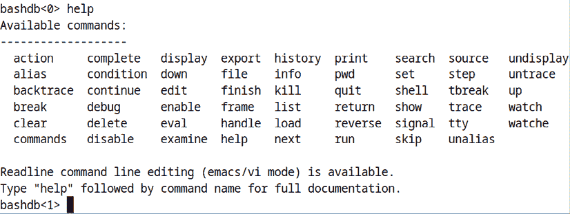

图 21.2：bashdb 帮助显示

这显示了可用的`bashdb`命令列表。要查看如何使用特定命令，只需输入`help`后跟命令名，如下所示：

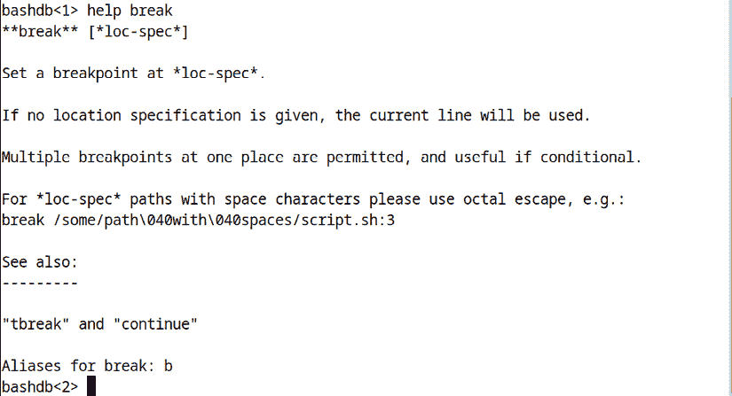

图 21.3：获取 break 命令的帮助

本章的内容就此结束。让我们总结一下并继续。

## 总结

在本章中，我们涵盖了一些可以帮助你排除代码故障的酷炫技巧。我们首先查看了一些常见的 shell 脚本错误，并展示了如何在损坏的脚本中找到它们。然后我们查看了一些常用的调试工具和技术。对于`-u`和`-e` shell 选项，我向你展示了使用它们的优缺点。最后，我向了了如何安装和使用`bashdb`。

在下一章中，我们将简要查看使用`zsh`进行脚本编写。我们那里见。

## 问题

这一次，我不再向你提出需要回答的问题，而是给你提供一些带有 bug 的 shell 脚本。尝试运行它们以观察错误，然后尝试调试它们。你能调试它们吗？当然可以。我信任你。

我们从`bug1.sh`脚本开始：

```bash
#!/bin/bash echo "Fix this script...I've got bugs" a=45 if [$a -gt 27 ] then echo $a fi exit
```

这里是`bug2.sh`脚本：

```bash
#!/bin/bash echo "Fix this script...I've got bugs" for i in 1 2 3 4 5 6 7 8 9 do echo $i exit
```

现在，是`bug3.sh`：

```bash
#!/bin/bash echo "Fix this script...I've got bugs" scripts=$(ls | grep [a-z]*.sh) echo $scripts exit
```

这是第四个也是最后一个，`bug4.sh`：

```bash
#! /bin/bash echo '1 2 3' > sample.data cut -d' ' -f1,3 sample.data | read x z echo $((x+z))
```

## 扩展阅读

- 编写 Shell 脚本——第 9 课：远离麻烦：http://linuxcommand.org/lc3_wss0090.php
- 如何调试 Bash 脚本：https://linuxconfig.org/how-to-debug-bash-scripts
- 15 种基本的 Bash 调试技术和工具：https://www.fosslinux.com/104144/essential-bash-debugging-techniques-and-tools.htm
- 调试 Bash 脚本：https://www.example.com（占位符）

## 答案

在`if`语句中，你需要在`[`和`$a`之间插入一个空格。

你需要在`echo $i`语句之后放置`done`语句。

这个脚本有两个问题。首先，正则表达式设置错误，导致得到没有输出或错误的输出。与其使用`[a-z]*.sh`，应该是`[a-z].sh`。（那个`*`实际上不需要。）

你可以在第 9 章——使用 grep、sed 和正则表达式过滤文本中复习正则表达式的概念。

此外，这个正则表达式对我们并没有太大帮助。除非你有文件名完全由数字或大写字母组成的脚本，否则这个`grep`命令将显示你目录中的所有脚本。因此，你可能完全省略`grep`命令，直接使用简单的`ls *.sh`命令即可。

最后，第 3 行的`cut`命令将其输出管道给`read`命令。问题所在在于`read`命令是内置在 shell 中的，而不是有自己的可执行文件。

这很重要，因为你只能将一个命令的输出管道到另一个具有独立可执行文件的命令中。因此，你不能将输出管道到一个 shell 内置命令中。

你可以不使用管道，而是将第一个和第三个字段的值发送到`tmp.data`文件，然后使用输入重定向从`tmp.data`文件获取输入，正如你在`bug5.sh`脚本中看到的那：

```bash
#! /bin/bash echo '1 2 3' > sample.data cut -d' ' -f1,3 sample.data > tmp.data read x z < tmp.data echo $((x+z))
```

另一个选项是使用在此文档（here document），正如你在`bug6.sh`脚本中所示：

```bash
#! /bin/bash echo '1 2 3' > sample.data read -r x z <<<$(cut -d' ' -f1,3 sample.data) echo $((x+z))
```

无论哪种方法，你现在都能看到正确的结果：

```bash
donnie@fedora:~$ ./bug5.sh 4
donnie@fedora
:~$ ./bug6.sh 4
donnie@fedora:~$
```

## 加入我们的 Discord 社区！

与其他用户、Linux 专家以及作者本人一起阅读这本书。提问、为其他读者提供解决方案、通过 Ask Me Anything 会话与作者聊天，以及更多互动。扫描二维码或访问链接加入社区。

[`packt.link/SecNet`](https://packt.link/SecNet)


## 22

## Z Shell 脚本简介

到目前为止，我们主要讨论了`bash`，因为它是 Linux 上最主要的登录 shell 和脚本环境。近年来，一个在该领域新兴的“新秀”Z Shell (`zsh`) 作为默认登录 shell 变得越来越受欢迎。但是，即使在那些自带`zsh`作为登录 shell 的操作系统中，`bash`依然存在，而且大多数人仍然使用`bash`进行脚本编写。不过要注意，在`zsh`中编写脚本确实具有某些优势，例如更好的数学计算能力、增强的变量扩展，以及使用原生`zsh`命令代替`find`、`grep`或`sed`等工具的能力。这些功能可以帮助你创建比相应的`bash`脚本更简单、更轻量的脚本。

你看到的关于`zsh`的大多数文章和 YouTube 视频都关注用户界面的改进，很少有关注`zsh`脚本。不幸的是，少数关注`zsh`脚本的书籍和教程写得并不理想，你从中获益甚少。希望我能提供一些说明。

与其介绍详细的教程，我我想对`zsh`脚本进行一个高层次的概述，以便你自行判断它是否适合你。

本章的主题包括：

- 介绍`zsh`
- 安装`zsh`
- 了解`zsh`脚本的独特特性
- 使用`zsh`模块

如果你准备好了，让我们开始吧。

## 技术要求

你可以使用任何 Linux 虚拟机来学习本章。一如既往，你可以通过以下命令获取演示脚本：

```bash
git clone https://github.com/PacktPublishing/The-Ultimate-Linux-Shell-Scripting-Guide.git
```

## 介绍 zsh

Z Shell 由 Paul Falstad 于 1990 年创建。它是 Bourne Shell 的扩展，但也包含了来自`bash`、Korn Shell (`ksh`) 和 C Shell (`tcsh`) 的功能。

C Shell 曾在 Unix 和类 Unix 发行版中相当流行，它和你见过的任何东西都不同。编写 C Shell 脚本更类似于编写 C 语言程序，而不是你熟悉的模式。因此，如果你是一个 C 语言程序员，你可能会喜欢它；如果你不是，可能就不那么喜欢。

Z Shell 是 macOS 和 Kali Linux 的默认登录 shell。对于其他几乎所有系统，你需要手动安装。至于`zsh`脚本，你学过的`bash`脚本的大部分知识也适用于`zsh`脚本。因此，在本章中，我将介绍`zsh`的独特特性，并向你展示一些脚本示例。

## 安装 zsh

在我尝试过的所有 Linux 和 BSD 类型发行版以及 OpenIndiana 上都提供了`zsh`包。在所有情况下，包名都是`zsh`，所以你可以直接用普通的包管理器安装它。

在 BSD 发行版中，你会遇到之前在使用`bash`时遇到的相同路径问题。也就是说，在 BSD 发行版中，`zsh`可执行文件位于`/usr/local/bin/`目录，而不是`/bin/`目录。不过没关系。像处理`bash`那样，在`/bin/`目录下创建一个符号链接即可。在我的 FreeBSD 机器上，命令如下：

```bash
donnie@freebsd-zfs:~ $ which zsh
/usr/local/bin/zsh
donnie@freebsd-zfs:~ $ sudo ln -s /usr/local/bin/zsh /bin/zsh
donnie@freebsd-zfs:~ $ which zsh
/bin/zsh
```

现在，当你第一次用`zsh`登录时，会看到如下所示设置菜单：

`这是针对新用户的 Z Shell 配置。你看到此消息是因为你没有启动文件（~ 中的 .zshenv、.zprofile、.zshrc、.zlogin）。此函数可以帮助你完成一些让 shell 使用更方便的设置。你可以：(q)退出且什么都不做。该函数下次将再次运行。(0)退出并创建一个仅包含注释的 ~/.zshrc 文件。这将防止该函数再次运行。(1)进入主菜单。--- 输入括号中的任意按键 ---`

按下键 1 进入主菜单，并选择你的设置选项。配置将保存到你家目录下的`.zshrc`文件中。

接下来，让我们来看`zsh`的一些独特特性。

## 了解 zsh 脚本的独特特性

在`zsh`中编写脚本时，你可以利用某些`bash`不具备的增强功能。以下是对这些增强的一些简要回顾。

## 变量扩展的差异

在第 8 章——基础 Shell 构造中，我解释了变量扩展的概念，也称为参数扩展。这允许你编写执行酷炫功能的脚本，例如一次性更改整批文件的扩展名。`bash`中的大部分变量扩展构造结构在`zsh`中也适用，但`zsh`还有提供更多功能的结构。

## 替换值

在`zsh`中替换值与`bash`相同，但有一个例外。也就是说，如果你在包含感叹号的文本字符串中替换值，在`zsh`脚本中你需要对其进行转义。例如，在`bash`中的工作方式如下：

```bash
donnie@fedora:~$ unset name
donnie@fedora:~$ echo "Hello, ${name:-Guest}!" Hello, Guest!
donnie@fedora:~$ name=Horatio
donnie@fedora:~$ echo "Hello, ${name:-Guest}!" Hello, Horatio!
```


正如我在第 8 章解释的那样，`variable_name:-default_value` 构造为尚未赋值的变量提供默认值。同样的构造在 `zsh` 中也理应该有效，但看看当我尝试时发生了什么：

```bash
ubuntu2404% unset name
ubuntu2404% echo "Hello, ${name:-Guest}!"
dquote> "
Hello, Guest
ubuntu2404%
```

当我输入 `echo` 命令并按下回车键时，`zsh` 将带我 `dquote>` 提示符。如果我再次按下 `"` 键，我就得到了我想要的输出。为了一次性写对，我会在 `!` 之前加上一个 `\`，如下所示：

```bash
ubuntu2404% unset name
ubuntu2404% echo "Hello, ${name:-Guest}\!"
Hello, Guest!
ubuntu2404% name=Horatio
ubuntu2404% echo "Hello, ${name:-Guest}\!"
Hello, Horatio!
Ubuntu2404%
```

所以，在感叹号前面加一个 `\`，它就能正常工作了。我不知道为什么 `!` 在 `zsh` 中需要转义，但只要有用就行对吧？

## 替换子字符串

子字符串替换在 `bash` 中部分有效，但并不完全。我的意思是：

我将首先创建一个值为 `lionel` 的 `name` 变量。然后，在 `bash` 和 `zsh` 中，我将尝试将第一个小写的 `l` 替换为大写的 `L`。首先，在 `bash` 中，如下：

```bash
donnie@fedora:~$ echo $SHELL
/bin/bash
donnie@fedora:~$ name="lionel"
donnie@fedora:~$ echo "${name/l/L}"
Lionel
donnie@fedora:~$
```

现在，在 `zsh` 中：

```bash
ubuntu2404% echo $SHELL
/bin/zsh
ubuntu2404% name="lionel"
ubuntu2404% echo "${name/l/L}"
Lionel
ubuntu2404%
```

在 `${name/l/L}` 结构中，看到我首先列出了变量 `name`、一个正斜杠以及我想替换的字母，后面是另一个正斜杠和我想替换的字母。如你所见，这在 `bash` 和 `zsh` 中都有效。我也可以通过在 `name` 变量后使用两个正斜杠来替换两个小写的 `l`，如下：

在 `bash` 上：

```bash
donnie@fedora:~$ echo "${name//l/L}"
LioneL
donnie@fedora:~$
```

在 `zsh` 上：

```bash
ubuntu2404% echo "${name//l/L}"
LioneL
ubuntu2404%
```

同样，这在 `bash` 和 `zsh` 中都有效。那么，既然它在两个 shell 中都有效，我为什么要展示给你看呢？嗯，是因为在 `bash` 中，只有当文本字符串不包含任何空格时它才有效。

这是一个我意思的例子：

在 `bash` 上：

```bash
donnie@fedora:~$ names="Donnie and Vicky and Cleopatra"
donnie@fedora:~$ echo "${names//and/&}"
Donnie and Vicky and Cleopatra
donnie@fedora:~$
```

这一次，我想将所有的 `and` 替换为符号 `&`。但这在 `bash` 中不起作用，因为文本字符串包含了空格。所以，让我们在 `zsh` 上试试看。

在 `zsh` 上：

```bash
ubuntu2404% names="Donnie and Vicky and Cleopatra"
ubuntu2404% echo "${names//and/&}"
Donnie & Vicky & Cleopatra
ubuntu2404%
```

在 `zsh` 中，带有空格的文本字符串并没有影响。

## 大小写转换

这是一个完全相反的情况例子。这一次，我将向你展示一个在 `bash` 中有效但在 `zsh` 中无效的方法。然后，我将向你展示 `zsh` 的替代方法。

首先，假设我们要赋值给 `name` 变量的值的首字母大写化。在 `bash` 中这样做如下：

```bash
donnie@fedora:~$ name=horatio
donnie@fedora:~$ echo "${name^}"
Horatio
donnie@fedora:~$
```

我做的是在 `echo` 语句中的 `name` 变量后面放置了一个 `^`。现在，假设我想让所有字母大写。我会使用两个 `^` 来实现：

```bash
donnie@fedora:~$ echo "${name^^}"
HORATIO
donnie@fedora:~$
```

如果你有一个大写的文本字符串，使用一个或两个逗号将首字母或所有字母转换为小写，如下：

```bash
donnie@fedora:~$ name=HORATIO
donnie@fedora:~$ echo "${name,}"
hORATIO
donnie@fedora:~$ echo "${name,,}"
horatio
donnie@fedora:~$
```

在 `zsh` 中，这些完全不起作用，如下：

```bash
ubuntu2404% name=horatio
ubuntu2404% echo "${name^}"
zsh: bad substitution
ubuntu2404% echo "${name^^}"
zsh: bad substitution
ubuntu2404% name=HORATIO
ubuntu2404% echo "${name,}"
zsh: bad substitution
ubuntu2404% echo "${name,,}"
zsh: bad substitution
```

我向你展示这些是因为一些 `zsh` 书说这在 `zsh` 中有效。但正如你所见，并没有。

那么，`zsh` 的替代方案是什么？嗯，你只需要使用 `zsh` 的内置功能。让我们先使用 `U` 函数将整个字符串转换为大写：

```bash
ubuntu2404% name=horatio
ubuntu2404% echo "${(U)name}"
HORATIO
ubuntu2404%
```

与其在 `name` 变量后放置一对 `^` 字符，我在 `name` 变量之前放置了 `(U)`。据我所知，没有只转换首字母的功能。所以，让我们这样转换首字母：

```bash
ubuntu2404% name=horatio
ubuntu2404% capitalized_name=${name/h/H}
ubuntu2404% echo $capitalized_name
Horatio
```

这就是上一节展示过的相同方法。接下来，让我们来看一些通配（globbing）。

## 通配

“什么是通配？”你说其实其实整本书都在使用它，只是我没告诉你它叫什么。这意味着你可以使用通配符字符（如 `*` 和 `?`）同时处理多个文件。例如，你可以这样做：

```bash
donnie@fedora:~$ ls -l *.zip
-rw-r--. 1 root root 3286546 Jul 27 2023 15827_zip
-rw-r--. 1 root root 4915374 Jul 27 2023 21261.zip
. . . .
-rw-r--. 1 root root 21798397 Jul 27 2023 tmvx.zip
-rw-r--. 1 root root 60822 Jul 27 2023 U_CAN_Ubuntu_20-04_LTS_V1R4_SCAP_1-2_Benchmark.zip
-rw-r--. 1 root root 425884 Jul 27 2023 zoneinfo.zip
donnie@fedora:~$
```

我在这里做的使用 `*` 通配符查看目录下所有的 `.zip` 文件。你可以在 `zsh` 中完成这一切甚至更多。唯一的异常是你开启 `extendedglob` 功能。要验证它是否开启，请查看主目录下的 `.zshrc` 文件。你应该能看到类似下面的一行：

```bash
setopt autocd beep extendedglob nomatch notify
```

如果存在 `extendedglob` 选项，那就没问题。如果没有，直接加上即可。现在，让我们来看几个扩展通配的例子。为什么 `zsh` 的扩展通配很有用？嗯，是因为在很多情况下，你可以使用 `zsh` 的扩展通配功能而不是使用 `find` 工具。你可能会发现这比使用 `find` 更简单。或者，如果你习惯使用 `find`，你可能更喜欢用它。由你来决定。

此外，为了演示，我主要通过 `ls` 工具向你展示。但你也可以与其他工具配合通配，如 `cp`、`mv`、`rm`、`chmod` 或 `chown`。

## 过滤 ls 输出

开启了这个酷的功能，你可以做一些酷的事，比如排除不想看到的文件。例如，假设你想查看目录下所有的文件，但 `.sh` 文件。这样做：

```bash
ubuntu2404% ls -d ^*.sh
bashlib-0.4 My_Files demo_files supersecret deshc-deb supersecret_trace.txt Documents sysinfo.html encrypted_password sysinfo_posix.lib encrypted_password.sh.x.c test.sh.x expand_1.txt user_activity_for_donnie_2024-05-12_09-30.txt expand_2.txt user_activity_for_donnie_2024-07-22_10-40.txt expand.txt user_activity_for_horatio_2024-07-06_07-12.txt FallOfSudo while_demo file2.txt while_demo.sh.x.c file3.jpg ubuntu2404%
```

位于 `*.sh` 之前的 `^` 是否定符号。这就是防止 `ls` 命令向你显示 `.sh` 文件的原因。

注意我必须包含 `-d` 选项。否则，你还会看到任何子目录中的文件。由于某种原因，`^` 过滤掉了顶层目录中不需要的文件，但它没有过滤子目录中的不需要的文件。所以，如果没有 `-d`，你也会看到子目录中的所有文件，包括你想过滤掉的那些。

你可以使用 `*~` 运算符来实现相同的效果。看起来是这样的：

```bash
ubuntu2404% ls -d *~*.sh
bashlib-0.4 My_Files demo_files supersecret deshc-deb supersecret_trace.txt Documents sysinfo.html encrypted_password sysinfo_posix.lib encrypted_password.sh.x.c test.sh.x expand_1.txt user_activity_for_donnie_2024-05-12_09-30.txt expand_2.txt user_activity_for_donnie_2024-07-22_10-40.txt expand.txt user_activity_for_horatio_2024-07-06_07-12.txt FallOfSudo while_demo file2.txt while_demo.sh.x.c file3.jpg ubuntu2404%
```

如你所见，输出与以下内容相同：

```bash
ls -d ^.sh
```

输出。要排除多种类型的文件，只需使用“或”运算符 (`|`)，如下所示：

```bash
ubuntu2404% ls -d *~(*.sh|*.jpg|*.txt|*.c)
bashlib-0.4 Documents My_Files sysinfo_posix.lib demo_files encrypted_password supersecret test.sh.x deshc-deb FallOfSudo sysinfo.html while_demo ubuntu2404%
```

因此在这种情况下，我过滤掉了 `.sh`、`.jpg`、`.txt` 和 `.c` 文件。现在，让我们来看下一个技巧。

## 分组 ls 搜索

在 `bash` 中你无法做的另一件事是对你的 `ls` 搜索进行分组，如下：

```bash
ubuntu2404% ls -ld (ex|test)*
-rw-r--r-- 1 donnie donnie 52 Apr 29 20:02 expand_1.txt
-rw-r--r-- 1 donnie donnie 111 Apr 29 20:02 expand_2.txt
-rw-r--r-- 1 donnie donnie 51 Apr 29 20:02 expand.txt
-rwxrw-r-- 1 donnie donnie 48 Jun 30 20:26 test.sh
-rw-rw-r-- 1 donnie donnie 0 Jul 5 19:31 test.sh.dec.sh
-rwxr-xr-x 1 donnie donnie 11440 Jul 5 19:12 test.sh.x
ubuntu2404%
```

在这里，我使用 `|` 符号作为“或”运算符，以查看所有文件名以 `ex` 或 `test` 为开头的文件。

## 使用通配符标志（Globbing Flags）

如你所知，Linux 和 Unix 操作系统通常是区分大小写的。因此，如果你使用 `ls *.jpg` 命令查看所有 JPEG 类型的图形文件，你将完全错过任何具有 `*.JPG` 扩展的文件。在 `zsh` 中，你可以使用通配符标志使你的命令不区分大小写。这是一个示例：

```bash
ubuntu2404% touch graphic1.jpg graphic2.JPG graphic3.jpg file3.jpg
ubuntu2404%
ubuntu2404% ls *.jpg
file3.jpg graphic1.jpg graphic3.jpg
ubuntu2404%
ubuntu2404% ls (#i)*.jpg
file3.jpg graphic1.jpg graphic2.JPG graphic3.jpg
ubuntu2404%
```

第二个 `ls` 命令中的 `(#i)` 是通配符标志。`#` 表示它是一个标志，它将置在你想要匹配的模式之前。

如果你为搜索指定了小写模式，则 `(#l)` 标志将匹配小写或大写的模式。如果你指定了大写模式，那么它将只匹配大写模式。它的显示如下所示：

```bash
ubuntu2404% ls (#l)*.jpg
file3.jpg graphic1.jpg graphic2.JPG graphic3.jpg
ubuntu2404%
ubuntu2404% ls (#l)*.JPG
graphic2.JPG
ubuntu2404%
```

你在这里看到，当我指定 `*.jpg` 为模式时，它也找到了 `.JPG` 文件。但是，当我指定 `.JPG` 为模式时，它只找到了 `.JPG` 文件。

现在，让我们扩展一些目录。

你可以使用通配符限定符（globbing qualifiers）来查看不同类型的目录或文件。我们将从目录限定符开始，它们是：

- `*(F)`：展开非空目录。
- `*(^F)`：同时展开普通文件和空目录。
- `*(/^F)`：仅展开空目录。

首先，让我们看看我主目录下的非空目录。

```bash
ubuntu2404% ls *(F)
bashlib-0.4:
bashlib config.cache config.status COPYING Makefile README bashlib.in config.log configure INSTALL Makefile.in
. . . .
. . . .
My_Files:
afile.txt somefile.txt yetanotherfile.txtx anotherfile.txt somepicture.jpg yetanotheryetanotherfile.txt haveicreatedenoughfilesyet.txt somescript.sh
ubuntu2404%
```

你在这里看到此命令显示了非空目录及其内容。但它没有显示我顶层目录中的任何文件。所以，这很好。现在，我想查看我顶层目录中的所有文件，以及任何空目录。我会这样做：

```bash
ubuntu2404% ls *(^F)
acl_demo.sh rsync_password.sh shutdown-update.sh
. . . .
rootlock_2.sh while_demo.sh.x
Documents:
empty_directory:
ubuntu2404%
```

空目录出现在底部。最后，我只想查看空目录：

```bash
ubuntu2404% ls *(/^F)
Documents:
empty_directory:
ubuntu2404%
```

很酷吧？接下来，让我们看看文件扩展。

## 文件和目录

有几种方法展开文件。如果你想查看目录中的文件而不显示任何目录，这样做：

```bash
ubuntu2404% ls *(.)
acl_demo.sh rsync_password.sh shutdown-update.sh encrypted_password_demo.sh
. . . .
rootlock_1.sh while_demo.sh.x.2404%
```


如果你想查看空和非空目录，这样做：

```bash
ubuntu2404% ls */
bashlib-0.4:
bashlib config.cache config.status COPYING README bashlib.in config.log configure INSTALL Makefile.in
. . .
Documents:
empty_directory:
FallOfSudo:
fallsudo.py main.png
My_Files:
afile.txt somefile.txt yetanotherfile.txt anotherfile.txt somepicture.jpg yetanotheryetanotherfile.txt haveicreatedfilesyet.txt somescript.sh
```

## 按权限扩展

在第 20 章 Shell 脚本中，我解释了文件和目录权限是如何工作的。权限设置分为用户（即文件或目录的所有者）、组和其他人。这些每一个都可以具有读、写和执行的组合。如果你需要搜索特定权限的文件或目录，可以使用 `find` 工具。在 `zsh` 中，你可以使用通配符限定符代替 `find`。以下是可以使用的限定符列表：

- `r`：用户具有读取权限。
- `w`：表示用户具有写入权限。
- `x`：用户具有执行权限。
- `U`：属于用户的文件。
- `s`：具有 SUID 权限的文件。
- `A`：组具有读取权限。
- `I`：组具有写入权限。
- `E`：组具有执行权限。
- `G`：属于当前用户组的文件。
- `S`：具有 SGID 权限的文件或目录。
- `R`：其他人具有读取权限。
- `W`：其他人具有写入权限。
- `X`：其他人具有执行权限。
- `t`：具有粘性位（sticky bit）的目录。

那么这一切是如何工作的？假设你在 `/bin/` 目录中，你想查看所有具有 SUID 权限的文件。这样做：

```bash
ubuntu2404% cd /bin
ubuntu2404% ls -ld *(s)
-rwsr-xr-x 1 root root 72792 Apr 9 07:01 chfn
-rwsr-xr-x 1 root root 44760 Apr 9 07:01 chsh
-rwsr-xr-x 1 root root 39296 Apr 8 15:57 fusermount3
-rwsr-xr-x 1 root root 76248 Apr 9 07:01 gpasswd
-rwsr-xr-x 1 root root 51584 Apr 9 14:02 mount
-rwsr-xr-x 1 root root 40664 Apr 9 07:01 newgrp
-rwsr-xr-x 1 root root 64152 Apr 9 07:01 passwd
-rwsr-xr-x 1 root root 55680 Apr 9 14:02 su
-rwsr-xr-x 1 root root 277936 Apr 8 14:50 sudo
-rwsr-xr-x 1 root root 39296 Apr 9 14:02 umount
ubuntu2404%
```

如果你在自己的主目录中，想查看整个文件系统中所有的 SUID 文件，只需让你的搜索递归，如下：

```bash
ubuntu2404% ls -ld /**/*(s)
-rwsr-xr-x 1 root root 85064 Feb 6 2024 /snap/core20/2264/usr/bin/chfn
-rwsr-xr-x 1 root root 53040 Feb 6 2024 /snap/core20/2264/usr/bin/chsh
. . . . . .
-rwsr-xr-x 1 root root 154824 Jul 26 02:32 /usr/lib/snapd/snap-confine
ubuntu2404%
```

与 `find` 不同，`ls` 本质上不是递归的。因此，如果你想搜索当前目录下所有的低层子目录，只需执行以下操作：

```bash
ubuntu2404% pwd
/home/donnie
ubuntu2404% ls -l **/*(s)
zsh: no matches found: **/*(s)
ubuntu2404%
```

这与全文件系统搜索唯一的区别在于，我使用了 `/*(s)` 而不是 `/**/*(s)`。（当然，在我的主目录下没有 SUID 文件，这是意料之中的。）

如果你确实需要对这个 `ls` 输出结果进行某些操作，可以创建一个 `zsh` 脚本，比如这个 `find_suid.sh` 脚本：

```bash
#!/bin/zsh
ls -ld /**/*(s) > suid_files.txt
```

这只是一个简单的脚本，用于创建一个包含系统 SUID 文件列表的文本文件。但嘿，谁说我们不能让它花哨一点呢？让我们看看在 `find_suid2.sh` 脚本中可以做什么：

```bash
#!/bin/zsh
suid_results_file=$1
if [[ -f "$suid_results_file" ]]; then
    echo "This file already exists."
    exit
fi
ls -ld /**/*(s) > "$suid_results_file"
```

通过这个脚本，你可以指定要保存结果的文件名。如果已经存在同名文件，脚本将给你一条警告信息并退出。

你可以以相同的方式使用任何其他的通配符限定符（globbing qualifiers）。例如，假设你需要在整个文件系统中搜索属于你的文件。让我们看看它是如何工作的：

```bash
ubuntu2404% ls -ld /**/*(U) | less
```

这将产生一个非常长的列表，所以我必须将其管道到 `less` 中，以防止输出超出屏幕顶部。以下是你将看到的部分内容：

```
crw--w---- 1 donnie tty 136, 0 Sep 3 20:04 /dev/pts/0
crw------- 1 donnie tty 4, 1 Sep 3 19:24 /dev/tty1
drwxr-x--- 13 donnie donnie 4096 Sep 3 20:02 /home/donnie
-rw-rw-r-- 1 donnie donnie 44 Jul 24 20:53 /home/donnie/acl_demo.sh
drwxr-xr-x 2 donnie donnie 4096 Jun 29 21:10 /home/donnie/bashlib-0.4
. . . . . .
-rw-r--r-- 1 donnie donnie 0 Sep 3 19:24 /sys/fs/cgroup/user.slice/user-1000.slice/user@1000.service/memory.reclaim
-rwxrwxrwx 1 donnie donnie 2155 Jul 5 19:31 /usr/bin/deshc
```

如你所见，典型的 Linux 系统在到处都有属于你的文件。

这是 `zsh` 相比其他所有 shell（包括 `bash`）的明显优势。`zsh` 的扩展文件匹配功能可以取代 `find` 的许多功能，但语法简单得多。（当然，你也可以在 `ls` 以外的工具上使用此技巧，如 `cp`、`mv`、`rm`、`chmod` 或 `chown`。）

你也可以用 `zsh` 文件匹配来替换 `grep`、`awk` 和 `tr` 等工具。坦率说，替换这些工具的通配命令语法非常复杂，你不如直接使用这些工具。另一方面，使用 `zsh` 文件匹配可以让你的脚本变得更轻量、更快。而且，在那些可能未安装这些工具的罕见情况下，你可以使用文件匹配。

无论如何，如果你想了解 `zsh` 额外的文件匹配功能，这里有一个链接：

Zsh Native Scripting Handbook: [`github.zshell.dev/docs/zsh/Zsh-Native-Scripting-Handbook.html`](https://github.zshell.dev/docs/zsh/Zsh-Native-Scripting-Handbook.html)

你还可以通过阅读 `zshexpn` 手页来了解更多关于文件匹配和变量扩展的内容。

好了，让我们简要谈一下数组。

## 理解 zsh 数组

这会很快，因为关于 `zsh` 数组我只想指出三点。第一点是，`bash` 数组的索引从 0 开始，而 `zsh` 数组的索引从 1 开始。在 `bash` 中看起来是这样的：

```bash
donnie@fedora:~$ mybasharray=(vicky cleopatra horatio)
donnie@fedora:~$ echo ${mybasharray[0]}
vicky
donnie@fedora:~$ echo ${mybasharray[1]}
cleopatra
donnie@fedora:~$
```

你看到使用索引 0 会显示列表中的第一个名字，使用索引 1 会显示第二个名字。现在，在 `zsh` 中看起来是这样的：

```bash
ubuntu2404% mybasharray=(vicky cleopatra horatio)
ubuntu2404% echo ${mybasharray[1]}
vicky
ubuntu2404% echo ${mybasharray[2]}
cleopatra
```

你看到使用索引 1 会显示第一个名字，索引 2 会显示第二个名字。

数学并不完全完美。我的意思是，在这个除法示例中它运行得很好，但看看当我尝试任何其他操作时会发生什么：

```bash
ubuntu2404% echo $((2.1+2.1))
4.2000000000000002
ubuntu2404% echo $((2.1*2))
4.2000000000000002
ubuntu2404% echo $((2.1-2))
0.10000000000000009
ubuntu2404% echo $((2.1%2))
0.10000000000000009
ubuntu2404%
```

由于某种我不理解的原因，`zsh` 在小数点后添加了额外的末尾数字。如果这些数字全是零，那么影响可能不大，但末尾还有多余的 `2` 和 `9`，这会干扰我们的计算。幸运的是，我们可以通过将结果赋值给变量来轻松地纠正这一点，如下所示：

```bash
ubuntu2404% ((sum=2.1+2.1))
ubuntu2404% echo $sum
4.2000000000
ubuntu2404%
```

末尾的零还在，但至少多余的 `2` 和 `9` 数字消失了。

即使在进行了大量的研究之后，我仍然没有找到任何可以使用的命令或选项开关来指定小数点后显示的位数。

分组数学运算以指定它们的优先级，看起来如下：

```bash
ubuntu2404% ((product=(2.1+2.1)*8))
ubuntu2404% echo $product
33.6000000000
ubuntu2404%
```

如果简单的数学运算不能满足你，你可以加载 `mathfunc` 模块，我将在下一节中介绍。

## 使用 zsh 模块

许多 `zsh` 功能包含在可加载的 `zsh` 模块中。无法在本章中涵盖所有的 `zsh` 模块，所以让我们来看看一些更有用的。

首先，让我们看看哪些模块默认加载到 `zsh` 会话中：

```bash
ubuntu2404% zmodload
zsh/complete zsh/computil zsh/main zsh/parameter zsh/stat zsh/terminfo zsh/zle zsh/zutil
ubuntu2404%
```

还有许多可选模块你可以通过 `zmodload` 命令自行加载，正如我们接下来将看到的。

要了解所有可用的 `zsh` 模块，请参阅 `zshmodules` 手页。

现在，让我们更具体地看看 `mathfunc` 模块。

## 使用 mathfunc 模块

如果你想创建一些高级的数学脚本，而无需使用像 `bc` 外部工具，只需加载 `mathfunc` 模块，如下：

```bash
ubuntu2404% zmodload zsh/mathfunc
ubuntu2404%
```

该模块提供了三角函数、对数、指数以及其他一些数学函数。你可以这样看到模块提供的所有函数：

```bash


`ubuntu2404% zmodload -lF zsh/mathfunc +f:abs +f:acos +f:acosh +f:asin +f:asinh . . . . . . +f:y0 +f:y1 +f:yn ubuntu2404%`

现在，假设你想查看 `9` 的平方根。这样操作：

```bash
ubuntu2404% ((squareroot=sqrt(9))) ubuntu2404% echo $squareroot 3.0000000000 ubuntu2404%
```

现在，让我们将其放入 `squareroot.sh` 脚本中：

```zsh
#!/bin/zsh

zmodload zsh/mathfunc

your_number=$1

((squareroot=sqrt(your_number)))

echo $squareroot
```

注意，我必须在此脚本的开头放置 `zmodload zsh/mathfunc` 命令。这是因为每当你关闭终端或注销机器时，你从命令行加载的任何模块都会自动卸载。因此，你必须将此 `zmodload` 命令添加到你的脚本中。

在这里，我使用 `your_number` 变量来包含用户为 `$1` 参数指定的数字值。让我们看看它是否有效。

```bash
ubuntu2404% ./squareroot.sh 9 3.0000000000 ubuntu2404% ./squareroot.sh 25 5.0000000000 ubuntu2404% ./squareroot.sh 2 1.4142135624 ubuntu2404%
```

噢是的，它运行得很好，而且完全没有干扰任何外部程序，如 `bc`。

所有其他 `mathfunc` 函数都以类似的方式工作。利用你自己的想象力和脚本概念。

所有的 `mathfunc` 函数都以类似的方式工作。利用你自己的想象力和脚本概念。

所有的 `mathfunc` 函数都以类似的方式工作。利用你自己的想象力和脚本概念。

所有的 `mathfunc` 函数都以类似的方式工作。利用你自己的想象`脚本概念。

` `funcfuncfunc`````````datedatedatedatedatedate。。在这种情况下我们有：

- `%A`: 星期。
- `%F`: YYYY-MM-DD 格式的日期。
- `%T`: HH:MM:SS 格式的时间。

使用 `date` 和 `strftime` 的唯一真实区别是，使用 `date` 时你需要在格式字符串前加上 `+`，如下：

```bash
date +'%F-%T'
```

`strftime` 函数有自己的手页，你可以通过 `man strftime` 查看。

现在，让我们创建一个使用 `strftime` 的脚本：

```zsh
#!/bin/zsh
zmodload zsh/datetime
timestamp=$(strftime '%F_%T')
echo "I want to create a file at $timestamp." > "timefile_$timestamp"
```

运行脚本后，我应该会有文件：

```bash
ubuntu2404% ./zsh_time.sh
ubuntu2404% ls -l timefile_*
-rw-rw-r-- 1 donnie donnie 58 Sep 4 18:16 timefile_Wednesday-2024-09-04_18:16:37.txt
```

如果我检查内容：

```bash
ubuntu2404% cat timefile_Wednesday-2024-09-04_18:16:37.txt
I want to create a file at Wednesday-2024-09-04_18:16:37.
```

## 总结

在本章中，我向你介绍了使用 `zsh` 而不是 `bash` 脚本的概念。我首先向你了如何安装 `zsh`（如果没有安装的话）。我展示了 `bash` 和 `zsh` 功能之间的某些差异，这些差异可能会影响你编写 `zsh` 脚本。这些包括文件通配、变量扩展、数组索引和数学运算的差异。在此过程中，我向你展示了这些 `zsh` 功能如何帮助构建比 `bash` 脚本更简单、功能强大的脚本。

`zsh` 脚本的主要问题（除了 `bash` 更流行之外）是文档匮乏。关于设置 `zsh` 用户环境的教程和文章有很多，但关于 `zsh` 脚本的很少。希望你能够利用我在这里提供的知识编写一些酷炫的 `zsh` 脚本。

在下一章也是最后一章，我将向你介绍在 Linux 上使用 PowerShell 的想法。（是的，你没读错）。我们那里见。

## 问题

你会使用哪个命令来查看已加载到 `zsh` 会话中的所有 `zsh` 模块？

- `zmodls`
- `zmod -l`
- `zmodload -l`
- `zmodload`

你想加载数学函数模块（`mathfunc`）。你会使用以下哪个命令？

- `zmod mathfunc`
- `zmod zsh/mathfunc`
- `zmodload -l mathfunc`
- `zmodload -l zsh/mathfunc`
- `zmodload zsh/mathfunc`

`bash` 和 `zsh` 处理数组的方式之间什么主要区别？

- 没有区别。
- `bash` 数组索引从 1 开始，`zsh` 数组索引从 0 开始。
- `bash` 数组索引从 0 开始，`zsh` 数组索引从 1 开始。
- `bash` 可以处理数组，但 `zsh` 不。

你会使用哪个 `zsh` 命令来查看目录中所有的 `.png` 文件和所有的 `.PNG` 文件？

- `ls *.png`
- `ls (#i).png`
- `ls (#l).PNG`
- `ls *.PNG`

你只想查看当前工作目录下的空目录。你会使用以下哪个 `zsh` 命令？

- `ls -l *(/^F)`
- `ls -l *(^F)`
- `ls -l *(F)`
- `ls -ld`

## 进阶阅读

- Z Shell 手册：https://zsh-manual.netlify.app/
- [什么是 ZSH，以及你为什么应该用它代替 Bash？](https://www.howtogeek.com/362409/what-is-zsh-and-why-should-you-use-it-instead-of-bash/)
- [ZSH 入门：探索 Linux 优雅的 Shell](https://www.fosslinux.com/133167/zsh-for-beginners-exploring-linuxs-elegant-shell.htm)
- [如何为 ZSH 编写脚本](https://www.linuxtoday.com/blog/writing-scripts-for-zsh/)

## 答案

1. d
2. e
3. c
4. b
5. a

## 在 Discord 上加入我们的社区！

与其他用户、Linux 专家以及作者本人一起阅读这本书。提问、为其他读者提供解决方案、通过“我问答”（Ask Me Anything）环节与作者聊天，以及更多。扫描二维码或访问链接加入社区。

`packt.link/SecNet`


PowerShell 起初是一个闭源专有产品，只能安装在 Windows 操作系统上。但现在，它是免费的开源软件，可以在基于 Linux 和基于 macOS 的机器上免费供使用。在本章节中，我无法为你提供关于 PowerShell 的完整课程，因为那需要一整本书。相反，我将为你提供 PowerShell 哲学的高级概述，向你展示如何安装它，并提供一些实用的示例。我还会提供一些关于你作为 Linux 或 Mac 管理员为什么可能喜欢学习 PowerShell 的理由。当然，你将在本章各处以及“进阶阅读”部分找到大量的 PowerShell 参考资料链接。本章包含的主题包括：

- 在 Linux 和 macOS 上安装 PowerShell
- Linux 和 Mac 管理员学习 PowerShell 的理由
- PowerShell 脚本与传统 Linux/Unix 脚本的区别
- 查看可用 PowerShell 命令
- 获取 PowerShell 命令的帮助
- 真实场景中的跨平台 PowerShell 脚本

如果你准备好了，我们开始吧。

## 技术要求

你可以使用 Fedora、Ubuntu 或 Debian 虚拟机进行操作。你将不会使用 FreeBSD 或 OpenIndiana 虚拟机，因为 PowerShell 不支持这些系统。一如既往，你可以通过以下操作获取脚本：

```bash
git clone https://github.com/PacktPublishing/The-Ultimate-Linux-Shell-Scripting-Guide.git
```

## 在 Linux 和 macOS 上安装 PowerShell

我们将首先查看在 Linux 上安装 PowerShell 的方法，然后查看如何在 macOS 上安装。

### 通过 snap 软件包在 Linux 上安装 PowerShell

`snapd` 系统是一个由 Ubuntu 开发者发明的通用软件包管理系统。它默认安装在 Ubuntu 操作系统上，也可以安装在大多数其他 Linux 发行版上。如果你正在设置新的 Ubuntu 服务器，可以选择通过 snap 软件包安装 PowerShell。如下所示：


在非 Ubuntu 发行版上，你可以通过以下链接安装 `snapd`：[`snapcraft.io/installing-snapd`](https://snapcraft.io/installing-snapd)

一旦安装了 `snapd`，你可以通过以下命令安装 PowerShell：

```bash
sudo snap install powershell --classic
```

### 在 Fedora 上安装 PowerShell

在 Fedora 上，你可以通过 `.rpm` 软件包或 Docker 容器安装 PowerShell。你可以在此处找到每种方法的详细说明：https://fedoramagazine.org/installing-fedora/

### 在 macOS 上安装 PowerShell

在 Mac 上，你可以通过 Homebrew 系统安装 PowerShell。你可以在此处找到详细说明：https://learn.microsoft.com/en-us/powershell/scripting/installing-macos/

## 调用 PowerShell

一旦安装了 PowerShell，输入 `pwsh` 即可调用它。你的命令提示符将看起来像这样：

```text
PS /home/donnie>
```

## Linux 和 Mac 管理员学习 PowerShell 的理由

在 PowerShell 中编写脚本与在传统的 Linux 和 Unix Shell 中编写脚本的体验有些不同。并不困难，一旦习惯之后，你可能会喜欢它。无论如何，Linux 管理员可能喜欢学习 PowerShell 有一些合理的理由。

### 在混合系统环境中工作

第一个理由仅仅是为了方便和灵活性。许多企业和组织运行 Linux 和 Windows 服务器的混合环境，并且通常在工作站上运行 Windows。如果你能在 Windows 和 Linux 平台上运行一种通用的脚本语言，可能会非常有帮助。而且，如果你是一个需要学习 Linux 管理的 Windows 管理员，你可能会发现使用 PowerShell 更容易，因为你可能已经熟悉它。事实上，让我给你讲一个关于我自己学习 PowerShell 的故事。

在 2010 年和 2011 年期间，我与一个客户合作，他将 Nagios 公司作为其客户之一。Nagios 公司生产 Nagios 网络监控系统，该系统可以监控几乎每种网络设备。（这包括运行 Linux 或 Windows 的服务器，以及各种类型的网络设备）。我的客户的工作有三方面：制作培训文档、进行 Nagios 培训课程，以及飞遍全国为 Nagios 公司的客户建立 Nagios 监控系统。

无论之，每当我的客户需要对 Windows 服务器进行任何操作时，他都会找我，因为我懂 Windows 而他不懂。

好了，我一直隐藏着一个秘密，我希望你不会对我产生不满。这只是在 2006 年，接触 Linux 之前，我获得了了 Windows Server 2003 的微软认证系统工程师 (MCSE) 认证。当我刚接触 Linux 时，我以为我永远用不上我的 MCSE 培训。天哪，我错了。

不幸的是，我的 MCSE 培训没有包含任何关于 PowerShell 的内容，因为它还没有被发明。因此，为了给我的客户提供 Windows 服务器监控解决方案，我不得不给自己上了一个 PowerShell 脚本速成课。

这里的底是，如果你参与了任何网络监控解决方案的设置，即使你是一个 Linux 管理员，学习 PowerShell 也可能很有用。

## PowerShell 命令可以更简单

第二个原因是，在某些情况下，PowerShell 更容易处理。你已经见过在传统的 Linux/Unix shell 语言中，执行特定任务的命令可能会变得非常长且复杂。例如，假设你想查看所有使用 200 兆或更多机器随机访问内存（RAM）的系统进程，并且只想查看输出的某些字段。传统的 Linux/Unix 方法涉及使用带有适当选项开关的 `ps` 命令，然后将 `ps` 的输出管道到 `awk`，如下：

```bash
donnie@fedora:~$ ps -eO rss | awk -F' ' '{ if($2 >= (1024*200)) {printf("%s\t%s\t%s\n",$1,$2,$6);}} PID RSS COMMAND 3215 338896 /usr/lib64/chromium-browser/chromium-browser 3339 247596 /usr/lib64/chromium-browser/chromium-browser . . . . . . 21502 614792 /usr/lib64/firefox/firefox 23451 369392 /usr/lib64/firefox/firefox donnie@fedora:~$
```

那么，问题在哪里呢？首先，你得熟悉 `ps` 选项开关以及各种 `ps` 输出字段。在这种情况下，`ps -e` 命令向我们显示了如下内容：

```bash
donnie@fedora:~$ ps -e PID TTY TIME CMD 1 ? 00:00:04 systemd 2 ? 00:00:00 kthreadd 3 ? 00:00:00 pool_workqueue_release . . . . . . 28122 ? 00:00:00 Web Content 28229 ? 00:00:00 kworker/7:0 28267 pts/1 00:00:00 ps donnie@fedora:~$
```

但是，它没有显示 `RSS` 字段，该字段包含了我们想要看到的内存使用数据。因此，我会添加 `O rss` 选项，这样最终的 `ps` 命令将是 `ps -eO rss`。它现在应该显示类似的内容：

```text
PID RSS S TTY TIME COMMAND 1 29628 S ? 00:00:04 /usr/lib/systemd/systemd --switched-root --sys 2 0 S ? 00:00:00 [kthreadd] 3 0 S ? 00:00:00 [pool_workqueue_release] . . . . . . 27199 0 I ? 00:00:00 [kworker/8:2] 27262 62216 S ? 00:00:00 /usr/lib64/firefox/firefox -contentproc -child 27300 5060 R pts/1 00:00:00 ps -eO rss donnie@fedora:~$
```

现在的问题是，这比我们想要的要多。将此输出管道到 `awk` 将过滤掉所有不需要的内容。但要使用 `awk`，你需要知道 `ps` 输出中每个字段的内容，这样你才知道要在 `awk` 命令中列出哪些字段。在这种情况下，我们想查看 `PID`、`RSS` 和 `COMMAND` 字段，即第 1、2 和 6 个字段。我们想查看字段 2 数字大于 `200` 兆的所有进程，我们在这里将其表示为 `(1024*200)`。

记住，兆（Megabytes）的真实定义是 1024 千字节（Kilobytes）。由于 `awk` 不理解字节、千、兆等单位，你必须将内存测量值表示为公式或普通整数。（`1024*200` 的整数乘积是 `204800`。）

最后，`printf` 命令将根据适当的格式化选项只打印出我们想要看到的字段。

好了，这可以做到。但我们可以用 PowerShell 简化它吗？让我们看看。

```powershell
PS /home/donnie> Get-Process | Where-Object WorkingSet -ge 200MB

NPM(K) PM(M) WS(M) CPU(s) Id SI ProcessName
 ----- ----- ----- ------ -- -- -----------
0 0.00 331.27 40.27 3215 …10 chromium-browser --enable-n…
0 0.00 227.35 11.00 3674 …10 chromium-browser --type=ren…
0 0.00 221.48 15.93 3369 …10 chromium-browser --type=ren…
```


0 0.00 221.48 15.93 3369 …10 chromium-browser --type=ren…

## 增强数学能力

第二个原因是，在某些情况下 PowerShell 更容易处理。你已经见过在传统的 Linux/Unix shell 语言中，执行特定任务的命令可能会变得非常长且复杂。例如，假设你想查看所有使用 200 兆或更多机器随机访问内存（RAM）的系统进程，并且只想查看输出的某些字段。传统的 Linux/Unix 方法涉及使用带有适当选项开关的 `ps` 命令，然后将 `ps` 的输出管道到 `awk`，如下：

```bash
donnie@fedora:~$ ps -eO rss | awk -F' ' '{ if($2 >= (1024*200)) {printf("%s\t%s\t%s\n",$1,$2,$6);}} PID RSS COMMAND 3215 338896 /usr/lib64/chromium-browser/chromium-browser 3339 247596 /usr/lib64/chromium-browser/chromium-browser . . . . . . 21502 614792 /usr/lib64/firefox/firefox 23451 369392 /usr/lib64/firefox/firefox donnie@fedora:~$
```

那么，问题在哪里呢？首先，你得熟悉 `ps` 选项开关以及各种 `ps` 输出字段。在这种情况下，`ps -e` 命令向我们显示了如下内容：

```bash
donnie@fedora:~$ ps -e PID TTY TIME CMD 1 ? 00:00:04 systemd 2 ? 00:00:00 kthreadd 3 ? 00:00:00 pool_workqueue_release . . . . . . 28122 ? 00:00:00 Web Content 28229 ? 00:00:00 kworker/7:0 28267 pts/1 00:00:00 ps donnie@fedora:~$
```

但是，它没有显示 `RSS` 字段，该字段包含了我们想要看到的内存使用数据。因此，我会添加 `O rss` 选项，这样最终的 `ps` 命令将是 `ps -eO rss`。它现在应该显示类似的内容：

```text
PID RSS S TTY TIME COMMAND 1 29628 S ? 00:00:04 /usr/lib/systemd/systemd --switched-root --sys 2 0 S ? 00:00:00 [kthreadd] 3 0 S ? 00:00:00 [pool_workqueue_release] . . . . . . 27199 0 I ? 00:00:00 [kworker/8:2] 27262 62216 S ? 00:00:00 /usr/lib64/firefox/firefox -contentproc -child 27300 5060 R pts/1 00:00:00 ps -eO rss donnie@fedora:~$
```

现在的问题是，这比我们想要的要多。将此输出管道到 `awk` 将过滤掉所有不需要的内容。但要使用 `awk`，你需要知道 `ps` 输出中每个字段的内容，这样你才知道要在 `awk` 命令中列出哪些字段。在这种情况下，我们想查看 `PID`、`RSS` 和 `COMMAND` 字段，即第 1、2 和 6 个字段。我们想查看字段 2 数字大于 `200` 兆的所有进程，我们在这里将其表示为 `(1024*200)`。

记住，兆（Megabytes）的真实定义是 1024 千字节（Kilobytes）。由于 `awk` 不理解字节、千、兆等单位，你必须将内存测量值表示为公式或普通整数。（`1024*200` 的整数乘积是 `204800`。）

最后，`printf` 命令将根据适当的格式化选项只打印出我们想要看到的字段。

好了，这可以做到。但我们可以用 PowerShell 简化它吗？让我们看看。

```powershell
PS /home/donnie> Get-Process | Where-Object WorkingSet -ge 200MB
NPM(K) PM(M) WS(M) CPU(s) Id SI ProcessName
 ----- ----- ----- ------ -- -- -----------
0 0.00 331.27 40.27 3215 …10 chromium-browser --enable-n…
0 0.00 227.35 11.00 3674 …10 chromium-browser --type=ren…
0 0.00 221.48 15.93 3369 …10 chromium-browser --type=ren…
0 0.00 221.48 15.93 3369 …10 chromium-browser --type=ren…
```

这里的底是，如果你参与了任何网络监控解决方案的设置，即使你是一个 Linux 管理员，学习 PowerShell 也可能很有用。

第二个原因是，在某些情况下 PowerShell 更容易处理。你已经见过在传统的 Linux/Unix shell 语言中，执行特定任务的命令可能会变得非常长且复杂。例如，假设你想查看所有使用 200 兆或更多机器随机访问内存（RAM）的系统进程，并且只想查看输出的某些字段。传统的 Linux/Unix 方法涉及使用带有适当选项开关的 `ps` 命令，然后将 `ps` 的输出管道到 `awk`，如下：

```bash
donnie@fedora:~$ ps -eO rss | awk -F' ' '{ if($2 >= (1024*200)) {printf("%s\t%s\t%s\n",$1,$2,$6);}} PID RSS COMMAND 3215 338896 /usr/lib64/chromium-browser/chromium-browser 3339 247596 /usr/lib64/chromium-browser/chromium-browser . . . . . . 21502 614792 /usr/lib64/firefox/firefox 23451 369392 /usr/lib64/firefox/firefox donnie@fedora:~$
```

那么，问题在哪里呢？首先，你得熟悉 `ps` 选项开关以及各种 `ps` 输出字段。在这种情况下，`ps -e` 命令向我们显示了如下内容：

```bash
donnie@fedora:~$ ps -e PID TTY TIME CMD 1 ? 00:00:04 systemd 2 ? 00:00:00 kthreadd 3 ? 00:00:00 pool_workqueue_release . . . . . . 28122 ? 00:00:00 Web Content 28229 ? 00:00:00 kworker/7:0 28267 pts/1 00:00:00 ps donnie@fedora:~$
```

但是，它没有显示 `RSS` 字段，该字段包含了我们想要看到的内存使用数据。因此，我会添加 `O rss` 选项，这样最终的 `ps` 命令将是 `ps -eO rss`。它现在应该显示类似的内容：

```text
PID RSS S TTY TIME COMMAND 1 29628 S ? 00:00:04 /usr/lib/systemd/systemd --switched-root --sys 2 0 S ? 00:00:00 [kthreadd] 3 0 S ? 00:00:00 [pool_workqueue_release] . . . . . . 27199 0 I ? 00:00:00 [kworker/8:2] 27262 62216 S ? 00:00:00 /usr/lib64/firefox/firefox -contentproc -child 27300 5060 R pts/1 00:00:00 ps -eO rss donnie@fedora:~$
```

现在的问题是，这比我们想要的要多。将此输出管道到 `awk` 将过滤掉所有不需要的内容。但要使用 `awk`，你需要知道 `ps` 输出中每个字段的内容，这样你才知道要在 `awk` 命令中列出哪些字段。在这种情况下，我们想查看 `PID`、`RSS` 和 `COMMAND` 字段，即第 1、2 和 6 个字段。我们想查看字段 2 数字大于 `200` 兆的所有进程，我们在这里将其表示为 `(1024*200)`。

记住，兆（Megabytes）的真实定义是 1024 千字节（Kilobytes）。由于 `awk` 不理解字节、千、兆等单位，你必须将内存测量值表示为公式或普通整数。（`1024*200` 的整数乘积是 `204800`。）

最后，`printf` 命令将根据适当的格式化选项只打印出我们想要看到的字段。

好了，这可以做到。但我们可以用 PowerShell 简化它吗？让我们看看。

```powershell
PS /home/donnie> Get-Process | Where-Object WorkingSet -ge 200MB
NPM(K) PM(M) WS(M) CPU(s) Id SI ProcessName
 ----- ----- ----- ------ -- -- -----------
0 0.00 331.27 40.27 3215 …10 chromium-browser --enable-n…
0 0.00 227.35 11.00 3674 …10 chromium-browser --type=ren…
0 0.00 221.48 15.93 3369 …10 chromium-browser --type=ren…
0 0.00 221.48 15.93 3369 …10 chromium-browser --type=ren…
```

```bash
PS /home/donnie> ./math2.ps1 45

The tangent of 45 degrees is: 1. *********** The cosine of 45 degrees is: 0.7071067811865476 *********** The square root of 45 is: 6.708203932499369 *********** The base 10 logarithm of 45 is: 1.6532125137753437

PS /home/donnie> vim
```


噢耶，看起来不错。

你可以在这里阅读更多关于 PowerShell 数学的内容，包括其更完整的数学函数列表：[`ss64.com/ps/syntax-math.html`](https://ss64.com/ps/syntax-math.html)

接下来，让我们来看看 PowerShell 与更传统的 shell 之间的一些基本区别。

## PowerShell 脚本与传统 Linux/Unix 脚本的区别

PowerShell 仍然使用了许多与其他脚本语言相同的编程结构，例如函数、循环、`if` 结构等。但是，正如你已经看到的，PowerShell 的基础设计中也有一些不同，这使其与传统的 Linux/Unix shell 脚本区别开来。让我们来看例子。

## 使用文件名扩展名和执行权限

在整本书中，你看到我通过文件名上的 `.sh` 扩展名创建了普通的 Linux/Unix 脚本。实际上，你不需要为普通的 Linux/Unix 脚本使用任何文件名扩展名。这意味着如果 `somescript.sh` 脚本的文件名只是 `somescript`，它的工作效果也同样好。

对于 PowerShell，`.ps1` 文件名扩展名是所有 PowerShell 脚本的强制要求的。没有它，你的 PowerShell 脚本将无法运行。

另一方面，没有必要为 PowerShell 脚本设置执行权限，就像对传统的 Linux/Unix 脚本那样。只要脚本文件的文件名结尾有 `.ps1`，并且只要你正处于 PowerShell 环境中，脚本就会运行。

## PowerShell 是面向对象的

传统的 Linux 和 Unix shell 脚本语言是严格的过程化语言。这意味着你创建的程序或脚本中的命令将作用于来自某些外部源的数据。

该源可以是键盘、文件、数据库，甚至是嵌入在脚本或程序中的在此文档（here document）。请理解，数据和作用于数据的命令是完全独立的实体。

在面向对象编程（你有时将其称为 OOP）中，数据和操作这些数据的过程被封装在一个对象中。这允许你做一些很酷的事情，比如告诉一个数值对象让自己翻倍。它还允许你创建继承父对象特性的其他对象。

我知道这是对面向对象编程的简化解释。但是，详细的解释远超本书的范围。当然，如果你用过 C++ 或 Java 等语言编写过程序，你就知道我在说什么。

## PowerShell 使用 Cmdlet（命令单元）

大多数 PowerShell 命令实际上被称为 `Cmdlet`（你可以读音为 command-lets），而其他的则是别名或函数。每个 `Cmdlet` 的形式都是一个由连字符分隔的动词和一个名词，例如 `Get-Content`，它从文件中获取（读取）内容，或者 `Set-Content`，它向文件中写入。

这在 Windows 机器上的工作方式是，每个 Windows 子系统都有它们自己的 `Cmdlet`。例如，充当域名解析系统（DNS）服务器的 Windows 机器将有一组用于处理 DNS 的 `Cmdlets`，而 Microsoft Exchange 服务器将会有处理 Exchange 的 `Cmdlets`。

Linux 和 Mac 版本的 PowerShell 的 `Cmdlet` 组要少得多，因为所有 Windows 特有的内容都被删除了。你会找到处理 Linux 或 macOS 所需的内容，除此之外什么都没有。如你所见，这些 `Cmdlet` 与 Linux/Unix 管理员熟悉的命令大不相同。由于原因，你可能考虑使用别名来帮助过渡到 PowerShell。让我们来看看。

## 在 PowerShell 上使用别名

在 Windows 机器上，PowerShell 已经设置了别名，允许你使用 Linux/Unix 命令来代替 PowerShell 命令。微软这样做是为了让 Linux/Unix 管理员更容易学习 PowerShell。例如，以下是在 Linux 版的 PowerShell 中列出当前目录下的文件的方法：

```bash
PS /home/donnie> Get-ChildItem

Directory: /home/donnie

Mode                Length LastWriteTime         User         Name
----                ----      ------             ----         ----    ----
dr-xr-x             496 10/29/2024  2:10 PM  donnie  bashlib.0
drwx------            496 10/29/2024  2:59 PM  donnie  demo_files
-rw-r--             67 10/29/2024  2:26 PM  donnie  zsh_fruits.txt
-rw-r--             141 10/29/2024  2:17 PM  donnie  zsh_time.sh

PS /home/donnie>
```

你看到 `Get-ChildItem` 命令的作用与 `ls -l` 命令几乎相同。在 Windows 机器上，已经有一个 PowerShell 别名允许你使用 `ls` 命令来运行 `Get-ChildItem` 命令。它看起来是这样的：

（注：由于原文包含图片占位符 `images/23.png`，此处处截断或保留图片逻辑）

接下来，让我们看看如何查看可用的 PowerShell 命令。

## 查看可用的 PowerShell 命令

要查看哪些命令为你可用，只需执行：

```
PS /home/donnie> Get-Command CommandType Name Version S o u r c e ----------- ---- ------- - Alias Get-PSResource 1.0.4.1 M Function cd.. Function cd\ Function cd~ Function Clear-Host Function Compress-Archive 1.2.5 M . . . . . . Cmdlet Write-Verbose 7.0.0.0 M Cmdlet Write-Warning 7.0.0.0 M PS /home/donnie>
```

在 `CommandType` 下，你可以看到有别名（aliases）、函数（functions）和 `Cmdlets`。在 `Source` 列下，你会看到字母 `M`，这意味着这些命令都存储在某些 PowerShell 模块中。

当然，Linux 上的 PowerShell 命令远没有 Windows 上的那么多。要查看有多少个，只需这样操作：

```
PS /home/donnie> Get-Command | Measure-Object | Select-Object -Property Count Count ----- 293 PS /home/donnie> own
```

在这里，我们首先将 `Get-Command` Cmdlet 的输出管道到 `Measure-Object` Cmdlet。根据帮助文件，`Measure-Object` 的官方解释是它可以计算某些类型对象的属性值。在这种情况下，我们只想查看这些计算结果之一，即显示有多少条命令。我们将通过将 `Measure-Object` 的输出管道到 `Select-Object -Property Count` 来实现，这的作用类似于 Linux/Unix 的 `wc -l` 命令。完成所有操作后，我们看到这台 Linux 上有 293 个可用 PowerShell 命令。

正如我在几页前的 PowerShell 使用 Cmdlets 章节中提到的，所有的 `Cmdlet` 都采用“动词-名词”（Verb-Noun）格式。你可以使用 `Get-Command` 配合 `-Verb` 或 `-Noun` 选项来查看特定动词或名词的所有命令。例如，让我们看看 `Date` 名词的所有可用命令：

```
PS /home/donnie> Get-Command -Noun 'Date' CommandType Name Version S o u r c e ----------- ---- ---- - Cmdlet Get-Date 7.0.0.0 M Cmdlet Set-Date 7.0.0.0 M PS /home/donnie>
```

我们看到 `Date` 只有两个 Cmdlet。让我们看看 `Set` 动词有多少个：

```
PS /home/donnie> Get-Command -Verb 'Set' CommandType Name Version S o u r c e ----------- ---- ------- - Function Set-HostnameMapping 1.0.1 H Function Set-PSRepository 2.2.5 P Cmdlet Set-Alias 7.0.0.0 M Cmdlet Set-Clipboard 7.0.0.0 M . . . . . . Cmdlet Set-StrictMode 7.4.5.500 M Cmdlet Set-TraceSource 7.0.0.0 M Cmdlet Set-Variable 7.0.0.0 M PS /home/donnie>
```

现在，你可能在想如何找到所有这些 PowerShell 命令具体作用的。很好，让我们接着来看这个问题。

## 获取 PowerShell 命令的帮助

这个很简单。只需使用 `Get-Help` Cmdlet，后跟上你所需信息的命令名称。例如，你可以这样查看关于 `Get-Module` Cmdlet 的信息：

```
PS /home/donnie> Get-Help Get-Module
```

你看到的内容类似于普通的 Linux/Unix man 页面。

在每个 `Get-Help` 界面的底部，你会看到显示如何查看更多信息的命令。例如，如果你需要查看如何使用 `Get-Module` Cmdlet 的示例，请执行操作：

```
PS /home/donnie> Get-Help Get-Module -Examples
```

有时，你需要学习的命令的帮助页面并不可用。在这种情况下，可以运行 `Update-Help` Cmdlet，或者在你的 `Get-Help` 命令末尾添加 `-Online` 选项。

另一个很棒的资源是 PowerShell 命令页面，你可以在这里找到：https://ss64.com/ps/（当然，列出的许多命令是 Windows 特有的，但你也会发现相当跨平台的命令。）

好了，我认为 PowerShell 的理论部分就讲到这里了。让我们来看 PowerShell 脚本的几个真实示例。

## 真实世界的跨平台 PowerShell 脚本

为了找到一些跨平台 PowerShell 脚本的真实示例，我在 DuckDuckGo 上搜索了“PowerShell script examples Linux text string”。我发现的最酷的东西是 GitHub 上的 PowerShell 脚本合集（Mega Collection of PowerShell Scripts）。你可以使用 `git` 来下载它：

```
git clone https://github.com/fleschutz/PowerShell.git
```

下载完成后，`cd` 进入 `PowerShell/scripts/` 目录，并查看那里的内容。对于我们的第一个示例，让我们来看一个可以在所有平台上运行的简单程序。

## write-marquee.ps1 脚本

`write-marquee.ps1` 脚本是真正的跨平台，因为它没有使用任何特定于某个操作系统的命令。它做的只是创建一个在屏幕上流过的幕式消息。我无法在这里显示整个脚本，但你可以查看你本地的副本。所以，让我们看看它的各个部分来看看它是如何设置的。

在顶部，你会看到注释部分，它被 `<#` 和 `#>` 包围。实际上，这些不仅仅是注释。如果你运行 `Get-Help ./write-marquee.ps1`，你会发现 `<#` 和 `#>` 之间的内容都会作为帮助屏幕显示，如下：

```
PS /home/donnie/PowerShell/scripts> Get-Help ./write-marquee.ps1 NAME /home/donnie/PowerShell/scripts/write-marquee.ps1 SYNOPSIS Writes text as marquee . . . . . . REMARKS To see the examples, type: "Get-Help /home/donnie/PowerShell/scripts/write-marquee.ps1 -Examples" For more information, type: "Get-Help /home/donnie/PowerShell/scripts/write-marquee.ps1 -Detailed" For technical information, type: "Get-Help /home/donnie/PowerShell/scripts/write-marquee.ps1 -Full" For online help, type: "Get-Help /home/donnie/PowerShell/scripts/write-marquee.ps1 -Online" PS /home/donnie/PowerShell/scripts>
```

接下来，`param([string]$Text =` 行创建了包含幕式消息的字符串类型变量。它像如下：

```
param([string]$Text = "PowerShell is powerful - fully control your computer! PowerShell is cross-platform - available for Linux, Mac OS and Windows! PowerShell is open-source and free - see the GitHub repository at github.com/PowerShell/PowerShell! PowerShell is easy to learn - see the tutorial for beginners at guru99.com/powershell-tutorial.html! Powershell is fully documented - see the official PowerShell documentation at docs.microsoft.com/en-us/powershell", [int]$Speed = 60) # 60 ms pause
```

变量定义末尾的 `[int]$Speed = 60) # 60 ms pause` 部分决定了幕式消息流屏幕的速度。

接下来是 `StartMarquee` 函数，它看起来如下：


图 23.3：StartMarquee 函数

在绘制幕框并使用 `$LinePos` 行确保内容正确定位后，你会看到 `foreach` 循环，它逐个字符将消息打印到屏幕上。

最后，在函数定义之后，你看到函数调用：

```
StartMarquee " +++ $Text +++ $Text +++ $Text +++ $Text +++ $Text +++ $Text +++ $Text +++ $Text +++ " exit 0 # success
```


函数调用将包含幕式消息的`$Text`传递给`StartMarquee`函数。在每次`$Text`迭代之间会有三个加号（`+++`）。脚本将一直运行，直到处理完所有的`$Text`迭代。无论如何，这是我在我的 Ubuntu Server 虚拟机上运行的结果：


图 23.4：运行`write-marquee.ps1`脚本

很酷对吧？现在，让我们来看一些更酷的东西。

## check-cpu.ps1 脚本

`check-cpu.ps1`脚本尝试获取机器 CPU 的型号数字和名称以及 CPU 温度。

如果你想查看 CPU 温度，你需要直接在主机 Linux 机器上运行它，而不是在虚拟机中。在虚拟机中运行将不允许脚本访问宿主机的温度传感器。

我之所以说“尝试”，是因为当我在 Fedora 工作站上运行此脚本时，我得到的是：

```
PS /home/donnie/PowerShell/scripts> ./check-cpu.ps1 ✅ 64-bit CPU (16 cores, ) - 48°C OK PS /home/donnie/PowerShell/scripts>
```

所以，它向我的仅仅是我正在运行某种带有 16 核心的 64 位 CPU。实际情况是这台机器运行的是`Intel(R) Xeon(R) CPU E5-2670`，具有八个核心并启用了超线程。但是，如果我在 Windows 10 机器上运行相同的脚本，我会得到这个：

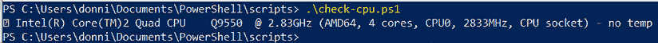

图 23.5：Windows 机器上的`check-cpu.ps1`脚本

在这台运行 Windows 10 专业版的古董（大约 2008 年产）戴尔电脑上，脚本正确地报告了 CPU 是一个老式的 Core 2 Quad，型号号为`Q9550`。另一方面，脚本正确地报告了 Linux 机器上的 CPU 温度，但在 Windows 机器上没有。这部分很好解释：只是某些计算机主板（尤其是旧款）的温度传感器与现代操作系统不兼容。

至于能否正确获取 CPU 模型，似乎 Linux 的 PowerShell 命令无法做到这一点，但 Windows 的命令可以。让我们来看看脚本，看看它是怎么回事。

在`check-cpu.ps1`脚本的顶部，你会看到`GetCPUArchitecture`函数，它看起来如下：

```powershell
function GetCPUArchitecture {
    if ("$env:PROCESSOR_ARCHITECTURE" -ne "") {
        return "$env:PROCESSOR_ARCHITECTURE"
    }
    if ($IsLinux) {
        $Name = $PSVersionTable.OS
        if ($Name -like "*-generic *") {
            if ([System.Environment]::Is64BitOperatingSystem) {
                return "x64"
            } else {
                return "x86"
            }
        } elseif ($Name -like "*-raspi *") {
            if ([System.Environment]::Is64BitOperatingSystem) {
                return "ARM64"
            } else {
                return "ARM32"
            }
        } elseif ([System.Environment]::Is64BitOperatingSystem) {
            return "64-bit"
        } else {
            return "32-bit"
        }
    }
}
```

正如你所见，它的语法与你在普通 Linux/Unix 脚本中习惯的语法有些不同。一个区别是，PowerShell 使用圆括号而不是方括号来包围测试条件。例如这样：

`if ("$env:PROCESSOR_ARCHITECTURE" -ne "") { return "$env:PROCESSOR_ARCHITECTURE" }`

这一行唯一的作用是如果存在`PROCESSOR_ARCHITECTURE`环境变量，则返回它的值。该函数的其余部分专门为 Linux 设计，这通过`if (IsLinux)`语句可以证明这一点。你在这里看到它检测 CPU 是`x86`、`x86_64`还是`ARM`。对于 ARM，它检测是 32 位还是 64 位版本。

该函数 Windows 使用的唯一部分是第一行，即`if ("$env:PROCESSOR_ARCHITECTURE" -ne "") { return "$env:PROCESSOR_ARCHITECTURE" }`这一行。而在我的 Windows 10 机器上，它做的唯一事情是将“AMD64”字符串插入到上方图中看到的信息中。在 Windows 上，所有其他 CPU 信息都是从 Windows 管理规范 (WMI) 接口获取的。相应的代码位于`try`语句的`else`子句中，从第 44 行开始（`else`子句从第 54 行开始）。如下：

```powershell
try {
    Write-Progress "Querying CPU status..."
    $status = "✅"
    $arch = GetCPUArchitecture
    if ($IsLinux) {
        $cpuName = "$arch CPU"
        $arch = ""
        $deviceID = ""
        $speed = ""
        $socket = ""
    } else {
        $details = Get-WmiObject -Class Win32_Processor
        $cpuName = $details.Name.trim()
        $arch = "$arch, "
        $deviceID = "$($details.DeviceID), "
        $speed = "$($details.MaxClockSpeed)MHz, "
        $socket = "$($details.SocketDesignation) socket"
    }
```

你在`if..else`结构中看到，如果机器运行 Linux，它将调用`GetCPUArchitecture`函数并从中检索 CPU 信息。在`else`部分，你看到了 Windows 的代码。虽然脚本确实从`PROCESSOR_ARCHITECTURE`环境变量为 Windows 获取了一项信息，但它大部分 CPU 信息都是从 Windows 管理规范 (WMI) 子系统获取的。事实上，`PROCESSOR_ARCHITECTURE`变量并没有包含这台特定 Fedora 工作站的任何信息。因此，我在这台机器上得到的只是关于我运行的是 32 位还是 64 位机器，以及它是 x86 还是 ARM 机器。不过没关系，我可以修改脚本来修复它。

在编辑器中打开`check-cpu.ps1`脚本，向下滚动直到你在`try`语句中看到这一行，应该是第 47 行：

`$arch = GetCPUArchitecture`

我们将保持该行不变，因为 Windows 也使用了`GetCPUArchitecture`函数。相反，我们将在`if ($IsLinux) {`之后添加以下行，即第 47 行之后：

`$arch = GetCPUArchitecture`

纠正逻辑：在`if ($IsLinux) {`之后添加以下行：

`$arch = GetCPUArchitecture`

正如你所见，它的语法与你在普通 Linux/Unix 脚本中习惯的语法有不同不同。一个区别是，PowerShell 使用圆括号而不是方括号来包围测试条件。例如这样：

`if ("$env:PROCESSOR_ARCHITECTURE" -ne "") { return "$env:PROCESSOR_ARCHITECTURE" }`

... (中间省略)

在编辑器中打开`check-cpu.ps1`脚本，向下滚动直到你在`try`语句中看到这一行，应该是第 47 行：

`$arch = GetCPUArchitecture`

我们将保持该行不变，因为 Windows 也使用了`GetCPUArchitecture`函数。相反，我们将在`if ($IsLinux) {`之后添加以下行：

`$arch = GetCPUArchitecture`

等一下，原文是：

`$arch = GetCPUArchitecture`

由于前面的翻译出现了混乱，我重新根据原文逻辑组织如下：

`arch = GetCPUArchitecture` (不，原文是：

`$arch = GetCPUArchitecture`

你在`if..else`结构中看到，如果机器运行 Linux，它将调用`GetCPUArchitecture`函数并从中检索 CPU 信息。在`else`部分，你看到了 Windows 的代码。虽然脚本确实从`PROCESSOR_ARCHITECTURE`环境变量为 Windows 获取了一项信息，但它大部分 CPU 信息都是从 Windows 管理规范 (WMI) 子系统获取的。事实上，`PROCESSOR_ARCHITECTURE`变量并没有包含这台特定 Fedora 工作站的任何信息。因此，我在这台机器上得到的只是关于我运行的是 32 位还是 64 位机器，以及它是 x86 还是 ARM 机器。不过没关系，我可以修改脚本来修复它。

在编辑器中打开`check-cpu.ps1`脚本，向下滚动直到你在`try`语句中看到这一行，应该是第 47 行：

`$arch = GetCPUArchitecture`

我们将保持该行不变，因为 Windows 也使用了`GetCPUArchitecture`函数。相反，我们将在`if ($IsLinux) {`之后添加以下行：

`$arch = GetCPUArchitecture`

抱歉，我重新梳理了翻译。

```
PS /home/donnie/PowerShell/scripts> ./check-cpu.ps1 ✅ 64-bit CPU (16 cores, ) - 48°C OK PS /home/donnie/PowerShell/scripts>
```

所以，它向我的仅仅是我正在运行某种带有 16 核心的 64 位 CPU。实际情况是这台机器运行的是`Intel(R) Xeon(R) CPU E5-2670`，具有八个核心并启用了超线程。但是，如果我在 Windows 10 机器上运行相同的脚本，我会得到这个：


图 23.5：Windows 机器上的`check-cpu.ps1`脚本

在这台运行 Windows 10 专业版的古董（大约 2008 年产）戴尔电脑上，脚本正确地报告了 CPU 是一个老式的 Core 2 Quad，型号号为`Q9550`。另一方面，脚本正确地报告了 Linux 机器上的 CPU 温度，但在 Windows 机器上没有。这部分很好解释：只是某些计算机主板（尤其是旧款）的温度传感器与现代操作系统不兼容。

至于能否正确获取 CPU 模型，似乎 Linux 的 PowerShell 命令无法做到这一点，但 Windows 的命令可以。让我们来看看脚本，看看它是怎么回事。

在`check-cpu.ps1`脚本的顶部，你会看到`GetCPUArchitecture`函数，它看起来如下：

```powershell
function GetCPUArchitecture {
    if ("$env:PROCESSOR_ARCHITECTURE" -ne "") {
        return "$env:PROCESSOR_ARCHITECTURE"
    }
    if ($IsLinux) {
        $Name = $PSVersionTable.OS
        if ($Name -like "*-generic *") {
            if ([System.Environment]::Is64BitOperatingSystem) {
                return "x64"
            } else {
                return "x86"
            }
        } elseif ($Name -like "*-raspi *") {
            if ([System.Environment]::Is64BitOperatingSystem) {
                return "ARM64"
            } else {
                return "ARM32"
            }
        } elseif ([System.Environment]::Is64BitOperatingSystem) {
            return "64-bit"
        } else {
            return "32-bit"
        }
    }
}
```

正如你所见，它的语法与你在普通 Linux/Unix 脚本中习惯的语法有些不同。一个区别是，PowerShell 使用圆括号而不是方括号来包围测试条件。例如这样：

`if ("$env:PROCESSOR_ARCHITECTURE" -ne "") { return "$env:PROCESSOR_ARCHITECTURE" }`

这一行唯一的作用是如果存在`PROCESSOR_ARCHITECTURE`环境变量，则返回它的值。该函数的其余部分专门为 Linux 设计，这通过`if (IsLinux)`语句可以证明这一点。你在这里看到它检测 CPU 是`x86`、`x86_64`还是`ARM`。对于 ARM，它检测是 32 位还是 64 位版本。

该函数 Windows 使用的唯一部分是第一行，即`if ("$env:PROCESSOR_ARCHITECTURE" -ne "") { return "$env:PROCESSOR_ARCHITECTURE" }`这一行。而在我的 Windows 10 机器上，它做的唯一事情是将“AMD64”字符串插入到上方图中看到的信息中。在 Windows 上，所有其他 CPU 信息都是从 Windows 管理规范 (WMI) 接口获取的。相应的代码位于`try`语句的`else`子句中，从第 44 行开始（`else`子句从第 54 行开始）。如下：

```powershell
try {
    Write-Progress "Querying CPU status..."
    $status = "✅"
    $arch = GetCPUArchitecture
    if ($IsLinux) {
        $cpuName = "$arch CPU"
        $arch = ""
        $deviceID = ""
        $speed = ""
        $socket = ""
    } else {
        $details = Get-WmiObject -Class Win32_Processor
        $cpuName = $details.Name.trim()
        $arch = "$arch, "
        $deviceID = "$($details.DeviceID), "
        $speed = "$($details.MaxClockSpeed)MHz, "
        $socket = "$($details.SocketDesignation) socket"
    }
```


你在`if..else`结构中看到，如果机器运行 Linux，它将调用`GetCPUArchitecture`函数并从中检索 CPU 信息。在`else`部分，你看到了 Windows 的代码。虽然脚本确实从`PROCESSOR_ARCHITECTURE`环境变量为 Windows 获取了一项信息，但它大部分 CPU 信息都是从 Windows 管理规范 (WMI) 子系统获取的。事实上，`PROCESSOR_ARCHITECTURE`变量并没有包含这台特定 Fedora 工作站的任何信息。因此，我在这台机器上得到的只是关于我运行的是 32 位还是 64 位机器，以及它是 x86 还是 ARM 机器。不过没关系，我可以修改脚本来修复它。

在编辑器中打开`check-cpu.ps1`脚本，向下滚动直到你在`try`语句中看到这一行，应该是第 47 行：

`$arch = GetCPUArchitecture`

我们将保持该行不变，因为 Windows 也使用了`GetCPUArchitecture`函数。相反，我们将在`if ($IsLinux) {`之后添加以下行：

`$arch = GetCPUArchitecture`

PS `/home/donnie/PowerShell/scripts> ./check-cpu.ps1 ✅ 64-bit CPU (16 cores, ) - 48°C OK PS /home/donnie/PowerShell/scripts>`

所以，它向我的仅仅是我正在运行某种带有 16 核心的 64 位 CPU。实际情况是这台机器运行的是`Intel(R) Xeon(R) CPU E5-2670`，具有八个核心并启用了超线程。但是，如果我在 Windows 10 机器上运行相同的脚本，我会得到这个：


图 23.5：Windows 机器上的`check-cpu.ps1`脚本

在这台运行 Windows 10 专业版的古董（大约 2008 年产）戴尔电脑上，脚本正确地报告了 CPU 是一个老式的 Core 2 Quad，型号号为`Q9550`。另一方面，脚本正确地报告了 Linux 机器上的 CPU 温度，但在 Windows 机器上没有。这部分很好解释：只是某些计算机主板（尤其是旧款）的温度传感器与现代操作系统不兼容。

至于能否正确获取 CPU 模型，似乎 Linux 的 PowerShell 命令无法做到这一点，但 Windows 的命令可以。让我们来看看脚本，看看它是怎么回事。

在`check-cpu.ps1`脚本的顶部，你会看到`GetCPUArchitecture`函数，它看起来如下：

```powershell
function GetCPUArchitecture { if ("$env:PROCESSOR_ARCHITECTURE" -ne "") { return "$env:PROCESSOR_ARCHITECTURE" } if ($IsLinux) { $Name = $PSVersionTable.OS if ($Name -like "*-generic *") { if ([System.Environment]::Is64BitOperatingSystem) { return "x64" } else { return "x86" } } elseif ($Name -like "*-raspi *") { if ([System.Environment]::Is64BitOperatingSystem) { return "ARM64" } else { return "ARM32" } } elseif ([System.Environment]::Is64BitOperatingSystem) { return "64-bit" } else { return "32-bit" } } } }
```

正如你所见，它的语法与你在普通 Linux/Unix 脚本中习惯的语法有些不同。一个区别是，PowerShell 使用圆括号而不是方括号来包围测试条件。例如这样：

`if ("$env:PROCESSOR_ARCHITECTURE" -ne "") { return "$env:PROCESSOR_ARCHITECTURE" }`

这一行唯一的作用是如果存在`PROCESSOR_ARCHITECTURE`环境变量，则返回它的值。该函数的其余部分专门为 Linux 设计，这通过`if (IsLinux)`语句可以证明这一点。你在这里看到它检测 CPU 是`x86`、`x86_64`还是`ARM`。对于 ARM，它检测是 32 位还是 64 位版本。

该函数 Windows 使用的唯一部分是第一行，即`if ("$env:PROCESSOR_ARCHITECTURE" -ne "") { return "$env:PROCESSOR_ARCHITECTURE" }`这一行。而在我的 Windows 10 机器上，它做的唯一事情是将“AMD64”字符串插入到上方图中看到的信息中。在 Windows 上，所有其他 CPU 信息都是从 Windows 管理规范 (WMI) 接口获取的。相应的代码位于`try`语句的`else`子句中，从第 44 行开始（`else`子句从第 54 行开始）。如下：

```powershell
try { Write-Progress "Querying CPU status..." $status = "✅" $arch = GetCPUArchitecture if ($IsLinux) { $cpuName = "$arch CPU" $arch = "" $deviceID = "" $speed = "" $socket = "" } else { $details = Get-WmiObject -Class Win32_Processor $cpuName = $details.Name.trim() $arch = "$arch, " $deviceID = "$($details.DeviceID), " $speed = "$($details.MaxClockSpeed)MHz, " $socket = "$($details.SocketDesignation) socket" }
```


你在`if..else`结构中看到，如果机器运行 Linux，它将调用`GetCPUArchitecture`函数并从中检索 CPU 信息。在`else`部分，你看到了 Windows 的代码。虽然脚本确实从`PROCESSOR_ARCHITECTURE`环境变量为 Windows 获取了一项信息，但它大部分 CPU 信息都是从 Windows 管理规范 (WMI) 子系统获取的。事实上，`PROCESSOR_ARCHITECTURE`变量并没有包含这台特定 Fedora 工作站的任何信息。因此，我在这台机器上得到的只是关于我运行的是 32 位还是 64 位机器，以及它是 x86 还是 ARM 机器。不过没关系，我可以修改脚本来修复它。

在编辑器中打开`check-cpu.ps1`脚本，向下滚动直到你在`try`语句中看到这一行，应该是第 47 行：

```
$arch = GetCPUArchitecture
```

我们将保持该行不变，因为 Windows 也使用了`GetCPUArchitecture`函数。相反，我们将在`if ($IsLinux) {`之后添加以下行：

```
$arch = GetCPUArchitecture
```

在最后一章中，我向你展示了在 Linux 机器上使用`PowerShell`进行脚本编写的一些知识。我首先向你介绍了一些历史背景，然后展示了`PowerShell`脚本的哲学，以及它与传统的 Linux/Unix Shell 脚本的区别。你还学习了关于使用`PowerShell`命令的基础知识，以及如何获取命令的帮助信息。最后，我向你展示了一些可以在 Windows 或 Linux 上运行的实际`PowerShell`脚本真实示例。但正如我之前所说，在一个章节内我所能做的只是提供`PowerShell`脚本的高层概览。如果你需要学习更多相关内容，网上和书籍中都有大量的资源。

噢，我几乎忘了最重要的一点了。我还向你展示了为什么你作为一名 Linux 或 Mac 管理员，可能想要考虑使用`PowerShell`脚本。是的，它很不同，需要一点时间适应。但它具有明确的优势，特别是当你需要在 Linux、macOS 和 Windows 电脑的混合环境中工作时。

这不仅结束了第 23 章，也结束了本书。在这一过程中，你从一个命令行新手变成了一个 Shell 脚本大师。当然，你可能无法脱口记住所有内容，这没关系。当你需要帮助创建一个出色的脚本时，只需将这本书以及你能找到的任何其他资源作为参考资料即可。

无论如何，这是一段漫长的旅程，我很享受其中，也希望你一样。保重，也许我们以后还会再见。

## 延伸阅读

PowerShell Core for Linux Administrators Cookbook: https://www.packtpub.com/en-us/product/powershell-core-for-linux-administrators-cookbook-9781789137231

我从`bash`切换到`PowerShell`，现在一切都很棒!: https://www.starkandwayne.com/blog/i-switched-from-bash-to-powershell-and-its-going-great/index.html

在 Fedora Linux 上安装`PowerShell`: https://fedoramagazine.org/install-powershell-on-fedora-linux/

常用 Linux/`Bash` 命令的`PowerShell`等效命令: https://mathieubuisson.github.io/powershell-linux-bash/

`bash` vs. `PowerShell`: 比较脚本 Shell: https://smartscripter.com/bash-vs-powershell-choosing-the-right-scripting-shell/

`PowerShell`在非 Windows 平台上的差异: https://learn.microsoft.com/en-us/powershell/scripting/whats-new/unix-support?view=powershell-7.4

`PowerShell`等效于 Linux 的`ls -al`：深度指南: https://thelinuxcode.com/equivalent-of-linux-ls-al-in-powershell/

`bash` vs `PowerShell`备查表: https://blog.ironmansoftware.com/daily-powershell/bash-powershell-cheatsheet/

## 留评价！

感谢你从 Packt Publishing 购买本书——希望你喜欢它！你的反馈无价，并能帮助我们改进和成长。请花一点时间在 Amazon 上留个评论；这只需要一分钟，但对像你这样的读者来说意义重大。

扫描下方的二维码即可获取你选择的免费电子书。

[`packt.link/NzOWQ`](https://packt.link/NzOWQ)


[packt.com](http://packt.com)

订阅我们的在线数字图书馆，即可完整访问 7,000 多本书籍和视频，以及行业领先的工具，帮助你规划个人发展并提升职业。欲需更多信息，请访问我们的网站。

## 为什么要订阅？

- 通过来自 4,000 多名行业专业人士的实用电子书和视频，减少学习时间，增加编码时间
- 通过专为量身定制的技能计划（Skill Plans）提升学习效果
- 每月获得一本免费电子书或视频
- 全文搜索，方便获取关键信息
- 复制、粘贴、打印和书签内容

在`www.packt.com`，你还可以阅读免费技术文章集，订阅一系列免费新闻邮件，并接收 Packt 书籍和电子书的独家折扣和优惠。

## 你可能感兴趣的其他书籍

如果你喜欢这本书，你可能对 Packt 的其他书籍感兴趣：

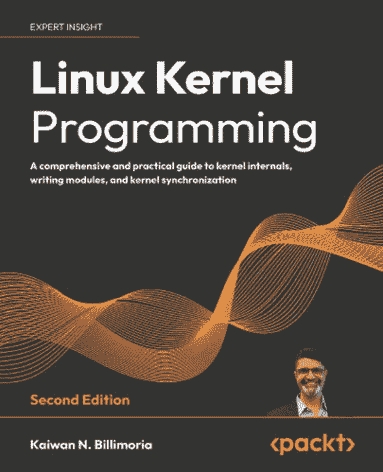

### Linux Kernel Programming
Kaiwan N. Billimoria
ISBN: 9781803232225
- 从源码配置并构建 6.1 LTS 内核
- 为 6.x 内核编写高质量模块化内核代码 (`LKM` 框架)
- 探索现代 Linux 内核架构
- 掌握内核内内存管理的关键内部细节
- 理解并处理各种动态内核内存分配/释放 API
- 发现内核内 CPU 调度的关键内部方面，包括`cgroups` v2
- 深入理解内核并发问题
- 学习如何处理关键内核同步原语

### The Software Developer’s Guide to Linux
David Cohen, Christian Sturm
ISBN: 9781804616925
- 学习实用的命令行技巧和工具，让软件开发、测试变得简单
- 理解 Linux 和命令行环境是如何工作的
- 创建强大的自定义工具

## 索引

### A
- 访问控制列表 (`ACL`): 524
- 美国电话电报 (`AT&T`): 490
- 应用程序编程接口 (`API`): 303
- 数组: 191-194
- 关联数组: 379
- `awk`命令: 369
- `awk`脚本构造: 397
- `awk`编程变量: 401

### B
- `bash`: 1
- `bashdb`: 593
- `bash`ism: 492
- `bc`程序文件：浮点数运算，使用`bc`: 316
- BSD 发发版 (`BSD`): 178, 237, 490
- `break`命令: 210, 211
- 内置变量: 386
- busybox: 370

### C
- `case`结构: 213-215
- `cat`工具: 91-96
- 字符集: 234, 235
- `check-cpu.ps1`脚本: 641-644
- `Cmdlets`: 633
- `CoinGecko`: 303
- `CoinGecko` API
- `coingeek.sh`脚本，创建: 303-306
- 命令参数: 使用 18, 19
- 命令链式: 21
- 命令链式：使用分号: 21
- 命令行历史: 35-39
- 命令行：打印自 172-174
- Shell 选项，设置: 78-81
- 命令选项：实战练习: 16-18
- 命令序列: 21
- 命令序列：命令链式：使用分号: 21
- 条件命令执行，使用双和符号: 22

### C
- `命令行参数`(command arguments)，使用 18, 19
- `命令选项`(command options)，使用 16
- `命令替换`(command substitution) 180, 201-204
- `逗号分隔值 (.csv)` 文件 104
- `空字段，填充` 284-286
- `通用网关接口 (CGI)` 558
- `通用 Unix 打印软件 (CUPS)` 172
- `编译型编程`(compiled programming)
  - 与解释型编程 11, 12
- `条件命令执行`(conditional command execution)
  - 使用双 ampersands 符号 22
  - 使用双管道 || 22
- `条件语句`(conditional statements)
  - 使用 399, 400
- `配置文件`(configuration files) 72
  - `bash`全局配置文件，在 Fedora 中 72-74
  - `bash`全局配置文件，在 Debian 上 76
  - 用户配置文件，在 Fedora 中 74, 75
  - 用户配置文件，在 Debian 上 76, 77
- `continue 命令`(continue command)
  - 使用 211, 212
- `CPU 代际`(CPU generation)
  - 查找 403-407
- `跨平台 PowerShell 脚本` 639
  - `check-cpu.ps1`脚本 641-644
  - `write-marquee.ps1`脚本 639-641
- `跨站脚本攻击 (XSS)` 281
- `C shell`(C shell) 600
- `cut`
  - 使用 98, 99

### D
- `datetime 模块` 620
  - 使用 620, 621
- `Debian`
  - `bash`全局配置文件 76
  - 默认编辑器，设置 77
  - 用户配置文件 76, 77
- `Debian Almquist Shell` 491
- `目录`(directories)
  - 展开 609
- `域名系统 (DNS) 服务器` 633
- `双 ampersands (&&)`
  - 用于，条件命令执行 22
- `双管道 ||`
  - 用于，条件命令执行 22
- `do..while` 结构 206, 207
- `动态代码检查器`(dynamic code checkers) 511
- `动态数据`(dynamic data)
- `在此文档`(here documents)，使用 339-341 创建

### E
- `echo` 223, 224
- `移植性问题`(Portability Problems) 497-499
- `echo 语句`
  - 使用 577-580
- `嵌入式密码`(embedded passwords) 533
- `环境变量`(environmental variables) 45-48
  - 审查 69, 70
- `错误`(errors)
  - 检查，使用`-e`选项 585, 586
  - 转义 39
- `eval 命令` 555
  - 命令替换，使用 559
  - `eval-test1.sh`脚本，使用 556, 557
  - `eval-test3.sh`脚本，使用 557, 558
  - `if eval`，评估 560-562
  - 使用，在命令行上 555, 556
- `可执行权限`(executable permission) 632
- `现有的安全相关脚本`
  - 查找 482, 483
- `退出码`(exit codes) 219
  - 标准 shell 退出码 219
  - 用户自定义退出码 219-223
- `展开`(expand)
  - 使用 122, 123
- `expect`
  - 使用，用于安全影响 349, 350
  - 使用，配合响应 346-349
- `expr 命令`
  - 使用 310-312
- `表达式`(expressions)
  - 整数数学，使用 309 执行
  - 扩展文件通配符 606
  - 目录，展开 609
  - 文件和目录，展开 610, 611
  - 文件，展开 610
  - 文件，按权限展开 611-614
  - 通配符标记，使用 608
  - `ls Output`，过滤 606-608
  - `ls Searches`，分组 608

### F
- 收藏的搜索引擎
  - 使用 7
- `Fedora`
  - `bash`全局配置文件 72-74
  - `PowerShell`，安装在 627
  - 用户配置文件 74, 75
- `字段分隔符`(field separators) 374
- `文件描述符`(file descriptor) 56
- `文件通配符`(file globbing) 606
- `文件模式字符串`(file mode string) 27
- `文件名扩展名`(filename extensions) 632
- `文件类型`(file types)
  - 块设备 27
  - 字符设备 27
  - 目录 27
  - 命名管道 27
  - 普通文件 27
  - 套接字 27
  - 符号链接 27
- `find` 64, 65
  - 用于，执行多个操作 30, 31
  - 使用 23-30
  - 用于执行其他命令 31-33
  - `浮点数学`
    - 配合`bc`执行 315
    - 使用 409, 410
  - `for`结构 209, 210
  - `for..in`结构 208, 209
  - `for`循环 20
    - 使用 407, 408
  - `format (fmt)` 149-151
  - `Fred’ ImageMagick` 365
  - `FreeBSD`
    - `bashdb`，安装在 590
    - `gsed`，安装在 237
  - `FreeBSD`解决方案 551
  - Linux `Home Directories` 553
  - 其他 Unix 上的`Home Directories` 553
  - `Home Directory Permissions` 551, 552
  - `Free Open Software` 492
  - `function` 289-291
    - 调用 293, 294
    - 创建 293, 294
    - 位置参数 294-296
    - 使用，在此文档中 341-346
    - 使用，在 shell 脚本中 293
    - 值 294-396
  - `function`库
    - 创建 299-301

### G
- `getopts`
  - 目的 447
  - 使用 449-452
  - 与`getopt`对比 448
  - `getopts`，真实示例
- 修改的 coingecko 脚本 453, 454
- `tecmint_monitor`脚本 454-456
- `全局变量` 296
- `通配符标记` 608
- `通配符限定符` 609, 611
- `GNU bash Debugger (gbd)` 190
- `GNU Project` 7
- `grep` 267
  - 基本搜索 267-269
  - 连续重复单词搜索 276
  - 扩展正则表达式，使用 275
  - 固定字符串正则表达式，使用 279
  - 以特定字母开头的单词搜索 277
  - 带数字的单词搜索 278
  - `grep`，高级搜索 269
  - `^`元字符使用 275
  - 回车处理 271-273
  - 不区分大小写的搜索，制作 270, 271
  - 安全数字搜索 274
  - 源代码审计 273
  - 整个单词搜索 269, 270
- `gsed`
  - 在 FreeBSD 上安装 237
  - 在 macOS 上安装 237
  - 在 OpenIndiana 上安装 238
- `GUI`，使用`yad`创建 420
- 数据输入表，创建 420-424
- 下拉列表，创建 424, 425
- 表单按钮，编程 431, 432
- GUI 前端，为`ImageMagick`创建 428-430
- `yad`基础 420
- `yad`文件管理器，使用 225
- `GUI 文本编辑器` 10

### H
- `硬盘`
  - Beta 测试 228, 229
- `head`
  - 使用 133-135, 137, 138
- `在此文档 (heredoc)`
  - 使用动态数据创建 339-441
  - 使用静态数据创建 333-338
  - 函数，在 341-346 使用
  - 使用 331, 332
- `在此脚本` 331
- `Homebrew`
  - 引用链接 237
  - `Homebrew 系统安装` 501
- `FreeBSD Horatio` 14
  - 用于，设置访问控制列表 (ACL) 524-526
- `Linux Horatio`
  - 用于，设置访问控制列表 (ACL) 521-524
- `OpenIndiana 上的 Horatio`
  - 用于，设置访问控制列表 (ACL) 526-528
- `HTTP 状态码` 384
- 人类账户 373-375
- `超文本标记语言` 340

### I
- `if..then`结构 204, 206
  - 使用 224, 225
- `图像文件`
  - 批量处理 364
- `ImageMagick`
  - 图像文件，批量处理 364
  - 图像属性，查看 358, 359
  - 图像，自定义 359-364
  - 图像，显示 356, 358
  - 图像，调整大小 359-364
  - `info 页面` 7
  - 输入命令
    - 获取 388-394
  - 输入文件
    - 人类账户 373-375
    - 获取 372
    - 正则表达式使用 386
    - 输入输出重定向 55
  - `整数数学`
    - 使用 309 执行
    - `整数数学`
    - 配合`echo`使用 312-314
    - `整数变量`
    - 整数数学使用 314-315
    - `整数数学`
    - 表达式使用 315
    - `整数变量`
    - 配合`echo`使用 312-314
    - `整数变量`
    - 表达式使用 315
    - `整数变量`
    - 整数数学使用 314-315
  - `国际化和本地化` 370
  - `物联网 (IoT)` 491
  - `解释型编程`
    - 与编译型编程 11, 12
    - 脚本注入
      - 在 Red Hat 发行版中使用 478
      - 配合`xargs`使用 478-480
      - 循环使用 478-480
  - 多个文件 281

### J
- `Javascript 注入` 281
- `join`
  - 使用 102-105

### K
- `Korn shell` 179
- `KWrite 编辑器` 10

### L
- `长度字符串` 332
- `Linux`
  - 在`bashdb`上安装 590
  - 在`PowerShell`上安装 627
  - `Linux 项目` 7
- `字面量` 234
- `本地变量` 296
- `循环`
  - 使用`break 命令` 210, 211
  - `case 结构` 213-215
  - `continue 命令` 211, 212
  - `do..while 结构` 206, 208
  - `for 结构` 209, 210
  - `for..in 结构` 208, 209
  - `if..then 结构` 204, 206
  - 位置参数 216-218

### N
- 行号 (`nl`)
  - 使用 125-133
- 行中的数字
  - 求和 401, 402

### O
- 面向对象编程 (OOP) 633
- 八进制转储工具 (`od`)
  - 使用 138-143
- OpenIndiana 179, 600
  - 使用，用于安装`gsed` 238
- 选项开关
  - 单字母选项 16
  - 全单词选项 16

### P
- 参数扩展 194, 602
- 密码
  - 加密 548-551
  - 在 shell 脚本中使用 548
- paste
  - 使用 100-102
- 路径安全 562, 563
- 社会工程 564, 565
- 用户账户 563
- 模式 371, 372
- PDF 引擎 340
- pdflatex 引擎 340
- 管道 49-51
- 管道 (pipes) 64, 65
- 纯文本脚本
  - 混淆 528
  - shc 二进制文件，解 536
  - shc, 安装 528
  - shc, 使用 529-532
  - 创建不可追踪的可执行文件 532-536
- 符合策略的普通 shell (posh) 500
- 可移植性问题
  - 使用`echo` 497-499
- 可移植性操作系统接口 (POSIX) 490
- 位置锚点 234, 235
- 位置参数 72
  - 使用 216-218
- POSIX 兼容性 490, 491
  - 使用 checkbashisms, 501-504
  - 使用 shellcheck, 504-506
  - 使用，用于测试 shell 脚本 499
- POSIX 兼容 shell
  - 使用，用于创建 shell 脚本 499, 500
- POSIX 兼容的变量扩展
  - 引用链接 510, 511
- PowerShell 2
  - 别名 633-636
  - Cmdlets 633
  - 命令 636-638
  - 增强的内置数学能力 630-632
  - 帮助，通过命令获取 638, 639
  - 在 Fedora 上安装 627
  - 通过 snap 软件包在 Linux 上安装 626
  - 在 macOS 上安装 627
  - 调用 627
  - 面向对象化的 632, 633
  - 引用链接 627
  - 更简单的命令 628-630
- PowerShell 数学
  - 引用链接 632
- 打印机驱动程序 172
- printf 命令 410
  - 使用 410-413
- 过程化语言 632
- 进程 ID (PID) 389
- 编程变量 48, 49
- pr
  - 使用 166-172

### Q
- 引用 39-42

### R
- 记录 371
- 递归命令
  - 运行 33
  - 使用 33-35
- Red Hat 发行版
  - 创建 IP 地址拦截脚本 478
- 重定向器 64, 65
- Regex101 281
  - 引用链接 281
- RegexBuddy 280
  - 引用链接 280
- RegexMagic 280
  - 引用链接 280
- 正则表达式 (regexp) 234
  - 使用 386-388
- 重复字符 276
- 驻集大小 (RSS) 390
- 响应
  - 使用 expect 自动化 346-349
- 结果变量 298
- 返回命令 296
- 反向 shell 559
- root 权限 12
- root 用户账户
  - 审计 467
  - 在 Linux 上创建 467-473
  - 在 OpenIndiana 上创建 467-473
  - 在 FreeBSD 上修改 473-475

### S
- 脚本错误 570
  - 带空格的文件名 570, 571
  - 带未设置变量 571-574
- 脚本变量 188
  - 以及 shell 层级 188, 189
  - 大小敏感性 189
  - 创建 188
  - 只读变量 190
- 脚本
  - 访问控制 518
  - 访问控制列表 (ACL), 使用 521
  - 纯文本脚本，混淆 528
  - sudo 权限，分配 518
- 搜索路径 23
- sed 程序文件 263-265
  - 在文件中追加 260, 561
  - 从一个文件复制到另一个文件 263
  - 在文件中修改 261, 262
  - 文本，替换 262
  - 使用 260
- sed 脚本 236
- sed 替换脚本 239
- 分号
  - 用于命令链链 21, 22
- 敏感数据泄露
  - 避免 543
  - 在 shell 脚本中使用密码 548
  - 临时文件，安全 543
- `set -e`和`-e`设置
  - 使用 587, 588
- 组 ID (SGID) 539-543
- 用户 ID (SUID) 539-543
- shadow 文件 469
- shall
  - 使用 511-513
- shc
  - 安装 528
  - 使用 529-532
- shc 二进制文件
  - 解密 536
  - UnSHc 工具，测试 536-539
- shebang 行 178
- shell 1-3, 491, 492
- shell 内置 220
- shellcheck-s 选项，扫描库 507-510
  - 指定`-s`选项 504-506
- shell 命令
  - 最喜爱搜索引擎 7
  - info 页面 7
  - Linux 文档
  - 手册页 4-6
- shell 脚本构建 178, 179
  - 从命令行设置 78-81
  - 登录用户，计数 180
- shell 脚本
  - 创建，在 POSIX 兼容 shell 499, 500
  - 函数，使用 293
- shell 会话 71, 72
  - 交互式 shell 71
  - 登录 shell 71
  - 非交互式 shell 71
  - 非登录 shell 71
- 简单防火墙脚本
  - 创建 478
  - 在 Red Hat 发行版上创建 IP 拦截脚本 478
- 简单端口扫描脚本 462-467
- 用于审计的脚本 460
  - 操作系统，识别 460, 462
  - root 用户账户，审计 467
  - 用户活动脚本，创建 476, 477
- 单字母选项 16
- 在非 Ubuntu 发行版上安装 snapd
  - 引用链接 626
- snap 软件包
  - PowerShell，在 Linux 上安装 626
- 社会工程 564
- sort 工具
  - 使用 105-117
- 标准错误 (stderr) 56-63
- 标准输入 (stdin) 55-60
- 标准输出 (stdout) 56, 57
  - 文件描述符，使用 58
  - 防止文件覆盖，57, 58
- 标准 shell 退出状态码 219-222
- 静态检查器 511
- 静态数据
  - here 文档，创建 333-388
- 粘滞位 544
- 流编辑器 (sed) 236
  - 删除空行 252
  - 将 Edsel 修改为 Studebaker 256, 257
  - 修改整行文本 257
  - 从列表中删除项 249-252
  - 文本行，追加 253-255
  - 文本行，插入 256
  - 汽车列表，修改 244-247
  - 好莱坞演员列表，修改 242, 243
  - 执行多次操作 255
  - 办公备忘录，修改 239-242
  - 可移植性问题 236, 237
  - q 命令，使用 258
  - r 命令，使用 259
  - 在 shell 脚本中使用 265, 266
  - w 命令，使用 258
  - 执行全单词替换 247-249
- 子 shell 186
- sudo 权限 12
  - 分配 518
  - 配置 518-521
- SunOS 490
- 符号链接攻击 545
- 系统完整性保护 (SIP) 536
- System V Unix 490

### T
- 制表符分隔值 (.tsv) 文件 378
- tac
  - 使用 96-98
  - 创建 UI 界面 333-388
  - dialog 基础 433-435
  - 自动选择 dialog 437-439
  - 创建 SSH 登录界面 442-445
  - 小部件，添加 439-441
  - dialog 基础 435-437
- 未定义变量
- unexpand
  - 使用 124-125
- uniq
  - 使用 143-147
- tail
  - 使用 136-138
- tee 命令 63, 64
- 临时文件
- UnSHc
  - 测试 536-539
- until 循环 212, 213
- 不可追踪的二进制文件
  - 制作 553-555
  - 创建不可追踪的可执行文件 532-536
- 用户活动脚本
  - 创建 476, 477
- User Agent 字符串 379
- 自定义退出状态码 219-223
- 用户 ID 数字 (UIDs) 373

### V
- 变量扩展 194, 602
  - 显示错误消息 197, 198
  - 扩展通配符 606
  - 匹配模式 200, 201
  - 子字符串，替换 603, 604
  - 大大小写转换 604, 605
  - 值替换 602
  - 替换已设置变量 195
  - 替换未设置变量 194
  - 变量偏移，使用 198-200
  - 分配值 196
  - 变量偏移 198
- 虚拟内存大小 (VSZ) 390

### W
- wc
  - 使用 147-149
- Web 服务器访问日志
  - 解析 375-386
- while 循环
  - 使用 401
- 全单词选项 16
- wild 循环
  - 创建 575, 576
- Windows 管理接口 (WMI) 642, 643
- write-marquee.ps1 脚本 639-641

### X
- xargs
  - 使用 162-165
- xdialog 578-580
- xtrace
  - 用于调试 581-583

### Y
- yad 420, 432
  - 基础 420
  - 文件管理器 420
- yescrypt 哈希算法 469

### Z
- Z shell (zsh) 1, 599, 600
  - 数组 614-616
  - 增强的数学能力 616-618
  - 特性 601
  - 安装 600, 601
  - 变量扩展 602
- zsh 模块 618
  - datetime 模块，使用 620, 621
  - mathfunc 模块，使用 618, 619
  - 使用 618

## 下载此书免费 PDF 副本

感谢购买本书！

您是否喜欢在旅途中阅读，但又无法随身携带纸质书？

您购买的电子书是否与您选择的设备不兼容？

别担心，现在购买每一本 Packt 书籍，您都可以免费获得该书的无 DRM 限制 PDF 版本。

可以在任何时间、任何地点、在任何设备上进行阅读。直接从您喜爱的技术书籍中搜索、复制并粘贴代码到您的应用程序中。

福利远不止此，您每天还可以在收件箱中获得独家折扣、通讯资讯和精彩的免费内容。

遵循以下简单步骤即可享受福利：

1. 扫描二维码或访问下方链接：

https://packt.link/free-ebook/9781835463574

2. 提交您的购买证明。

就是这样！我们将直接将您的免费 PDF 和其他福利发送到您的邮箱。
