# UNIX 和 Windows 2000 手册：规划、集成与管理


## 商标

本书中提到的所有产品名称均为其各自公司、组织或所有者的商标或服务标志——
- AIX 是国际商业机器公司的注册商标
- Apache 是 Apache 集团的商标
- AT&T 是美国电话电报公司的注册商标
- BSD 是加州大学伯克利分校的商标
- Ethernet 是施乐公司的商标
- HP 是惠普公司的商标
- HP-UX 是惠普公司的商标
- HPFS 是微软公司的商标
- IBM 是国际商业机器公司的注册商标
- Innosoft 是 Innosoft International, Inc. 的商标
- InterNIC 是美国商务部的注册服务标志
- Intel 是英特尔公司的注册商标
- Internet 是 Internet, Inc. 的注册商标
- Kerberos 是麻省理工学院的商标
- Linux 是 Linus Torvalds 的注册商标
- Motif 是开放软件基金会的商标
- MS-DOS 是微软公司的注册商标
- Network File System 和 NIS/NIS+ 是 Sun Microsystems, Inc. 的商标，NFS 是 Sun Microsystems, Inc. 的注册商标
- NFS Maestro 是 Hummingbird, Inc. 的注册商标
- Novell 是 Novell, Inc. 的商标
- Netscape 是 Netscape Communications Corporation 的注册商标
- NetWare 是 Novell, Inc. 的商标
- OSF 是开放软件基金会的注册商标
- OS/2 是国际商业机器公司的商标
- PADL Software 是 PADL Software Pty Ltd（澳大利亚）的商标
- PostScript 是 Adobe Systems, Inc. 的注册商标
- RedHat Linux 是 RedHat, Inc. 的注册商标
- SNA 是国际商业机器公司的商标
- Sun 和 Sun Microsystems 是 Sun Microsystems 的注册商标
- Solaris 和 Sun OS 是 Sun Microsystems 的注册商标
- UNIX 是 United States 及其他国家的注册商标，经 X/Open Company Limited 独家授权
- Windows 是微软公司的注册商标
- Windows NT 是微软公司的商标
- Windows 2000 是微软公司的商标
- X11 是麻省理工学院的商标
- X Window System 是麻省理工学院的注册商标
- Yellow Pages 是 British Telecommunications, plc. 在英国的注册商标


作者将本书献给他们的父母和家人，并感谢他们的爱与支持。

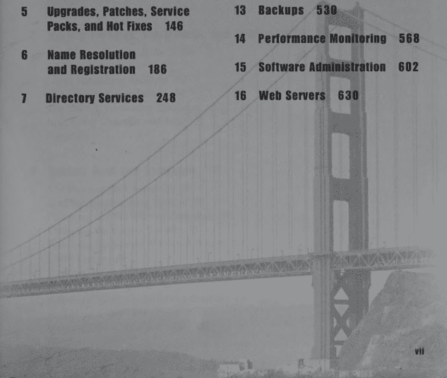

## 引言

几年前，在我讲授一门 UNIX 系统管理课程时，一名学生在一天结束时走过来找我。他担心为自己即将要管理的系统实施备份策略。我很惊讶。这位先生已经担任 NT 管理员相当一段时间，管理着一个相当大的基础设施。当我花时间解释备份的概念是相同的，只是命令不同时，他大大松了一口气。以及过去几年中许多类似的经历激发了这本书的诞生。我们的意图是传达系统管理作为一个独立的技能集，其中的特定操作系统作为应用。
本书是对在多厂商环境中支持用户环境的复杂性的一次介绍。*UNIX and Windows 2000 Handbook: Planning, Integration & Administration* 旨在帮助各级别的系统管理员为其用户创建和维护一个高效的环境。本书包括对问题的讨论、解决相关问题的指导方针、适用的技术示例，以及对支持的本质和规划和管理异构环境所涉及的政策问题的更具哲学性的讨论。
多年来，UNIX 变种之间的分离，以及管理员和程序员的倡导，导致了系统管理功能内部缺乏共同性。Windows NT/2000 的加入以及个人计算机能力的增强进一步复杂化了管理问题。存在跨越这种多样性的应用程序；DNS、NIS 和 NFS 的实现就是三个显著的例子。
在本 throughout 本书中，我们介绍了系统管理的任务以及它们在 UNIX 和 Windows 2000 环境中的实现方式。其意图是将系统管理任务视为独立的概念，而将特定操作系统的支持视为这些概念的应用。

## 本书面向谁

本书面向的是能够熟练使用一个或多个操作系统的个人，但不一定是任何方面的系统管理员。提供了基本概念，以及关于创建集成用户环境相关主题的中级到高级讨论。

## 本书的组织方式

本书的结构既可作为导师也可作为参考。安装规划的基本问题和系统管理员的角色将得到充分讨论。本书分为三个部分：规划、集成和行政。随着书籍的进展，这些区域的重叠性质将变得越来越明显。我们根据对任务约束的感知将个人管理任务放在特定区域。例如，升级和补丁是管理任务，但为了效率和稳定性需要仔细规划。后者约束超过前者，我们将该章节放在了本书的规划部分。

## 第 1 部分：规划

本书的第一部分涉及开始系统管理所需的基础概念。在介绍这些概念时，我们介绍了仔细规划的需求并解释了其必要性。规划总是好的，但它在尝试将不同操作系统集成到稳定的异构基础设施中时，这一点变得至关重要。尽管这些内容对某些读者来说可能是复习，但我们建议您花些时间重温这些基础知识。

## 第二部分：集成

网络、文件共享、信息服务、主机识别和资源共享是集成工作真正开始的地方。在本部分中，我们提供了介绍创建分布式环境所需工具和概念的章节，包括可用于弥合 Windows 2000 与 UNIX 世界之间鸿沟的工具和技术。

## 第三部分：管理

尽管这不是本书中最激动人心的部分，但异构基础设施的管理和维护对于为用户维持稳定环境是必要的。在本部分中，我们涵盖支持分布式环境所需的任务，并尽可能提供节省时间和资源的方法。

## 本书使用的约定

本书使用不同的功能来帮助突出关键信息。

### 章节要点

章节涵盖的主要主题在开头的表格中列出。虽然通常还涵盖更多材料，但这些主题被认为是必不可少的。主题分为 Windows 2000 和 UNIX 类别。

### 图标

图标代表突出显示的重要材料，您应引起注意。图标包括：

此图标用于标出值得特别关注的信息；否则读者可能需要用荧光笔标记的信息。

### 提示


此图标用于标记特别有用的信息，可节省读者时间、突出有价值的技巧或提供具体建议。

### 警告


此图标标记可能导致意外结果或严重挫折的信息。

### 命令


此图标标出上一节中使用的系统命令。这些命令的摘要可在附录中找到。

我们希望本书能有所助益。这里提供了大量信息，但不可能涵盖所有内容。如果您有任何问题或评论，请发送至 questions@system-administration.com 或 comments@system-administration.com。您也可以访问我们的网站 www.system-administration.com 以获取更新和基于互联网的资源。

## 致我们尊敬的同事：

我们要感谢 Didier Contis 对第 11 章“安全”的贡献。Contis 先生是佐治亚理工学院的研究工程师，曾为欧洲和美国的企业、金融和教育机构制定网络与安全策略。
在整个项目过程中，我们有幸与 Prentice Hall 一支出色的编辑团队合作。我们尤其要感谢 Tim Moore 协助我们构思本书，感谢 Jim Markham 在文本创作过程中给予的持续支持，以及感谢 Wil Mara 在最终书稿制作中的工作。同样，我们的技术编辑 Frank Schmidt 和 Jim Keogh 的知识与指导极大地丰富了本书的内容。
非常感谢 Peter Flur 和 John Lockhart 允许我们使用他们的域名 sniglets.com。
我们还要感谢佐治亚理工学院和南方公司的同事们在本书撰写过程中对我们的耐心。

## 规划


在接下来的几章中，我们将讨论安装、系统启动与关闭、文件系统以及升级和补丁的基本概念。除了这些主题，我们还将讨论在系统和基础设施设计中仔细规划的必要性。通过规划，您可以为用户创建更稳定的环境，同时减少总体工作量。要做好规划，您必须理解基础知识。在接来的五章中，我们将解释系统管理的底层概念。这些概念将构成本书其余部分的基础。

> “忙碌并不总意味着真正的工作。所有工作的目标都是产出或成就，而要实现这些目标，必须有深谋远虑、条理、规划、智慧、诚实的目标，以及汗水。看似在做并非在做。”

> 

> 托马斯·爱迪生（1847-1931）

## 系统管理的艺术与科学


早在信息时代初期，计算机庞大而数据存储微小之时，系统管理员便应运而生。他们因其独特的调解能力而被选中，在常常任性的操作系统与同样独特的一群试图为其编程的人之间斡旋。围绕着这少数被选中的人逐渐形成了一种神秘感。对大多数用户而言，似乎只有系统管理员才能让早期的电子折磨者屈服。每一台机器都有其独特的怪癖，以及各自的魔术师团队来取悦它。随着机械奇迹变得更加强大，它们却悖论般地缩小并复制。随着计算机体积的缩小，其能力和系统管理员的工作却在增长。网络、文件共享、数据库、电子邮件、Web 服务器、打印和用户都增加了工作描述。系统管理员现在必须在操作系统的科学、其资源以及用户支持和管理的艺术之间 juggling。

在面对不断变化的操作系统时，对计算机和用户的支持仍然挑战着最有经验的管理员。价格战以及计算机行业内多样化的系统特性，如应用程序需求和其他市场力量，创造了广泛的多厂商环境。特别是 UNIX 与 Windows 家族操作系统的混合已变得司空见惯。这些因素的结合导致了一个不断变化的泥沼，系统管理员必须在此之上为用户构建一个稳定的环境。以下章节将指导你穿过支持用户不断变化的需求和基础设施日益增长的复杂性的迷宫。

## 理解这份工作

在本章以及整本书中，我们将系统管理作为一个概念呈现，与操作系统无关。整合异构环境的真正基础在于理解系统管理是一套技能集，它独立于操作系统而存在。如果你学习了系统管理，那么你就可以将这些概念应用于你正在使用的任何操作系统。理解基本构建块使得能够在不同操作系统之间提供相似或相同的服务成为可能。本书将把这一概念与另一种概念——杠杆学习——交织在一起。操作系统是工具，极其复杂，但仍然只是工具。理解如何以及何时使用这些工具是良好管理的基石。

大多数问题可以以多种方式划分。系统管理当然也不例外。我们选择将管理员的工作分为三个部分：*规划*、*集成*和*管理*。这些部分并非完全独立。它们更像是三个相交的圆。最复杂的任务存在于三个圆相交的地方，如图 1.1 所示。因此，本书也分为三个部分，以与此分组相一致。


### 规划

谚语“亡羊补牢，为时未晚”在应用于系统管理时肯定是正确的。可惜的是，你作为管理员的大量工作是在巨大的时间压力下完成的，焦虑的用户站在侧翼，如果不是在你的办公室里。规划在这些情况下往往被牺牲。在接下来的几章中，我们将讨论安装、系统启动和关闭、文件系统、升级和补丁的基本概念。

### 集成

就本书而言，集成是指在不同的操作系统之间共享资源。为了清晰起见，我们需要将其与互操作性和共存进行比较。这三者是同一概念的递进层级。共存仅仅是在网络上共居的状态。通常会提供应用程序来促进不同系统之间信息的传输，但需要用户直接操作。集成是下一个层级，提供构成系统之间的共享资源。最常见的共享资源是文件系统、电子邮件、信息和域服务、打印和网络。互操作性是交互的最高层级，无论操作系统如何，都提供相同的应用程序资源。互操作性的一个常见例子是数据库应用程序，它必须在异构环境中分发。

我们的重点将放在集成上，即共存与互操作性之间的中间地带。具体来说，我们将关注为用户创造一个稳定的工作环境。网络地址解析、用户和系统识别、共享文件系统、电子邮件、打印、网络和安全是创建集成基础设施的关键问题。我们将讨论在 Windows 2000 和各种 UNIX 操作系统之间实现这些目标的工具和策略。

### 管理

管理任务简单来说是最无聊的。然而，它们对用户来说却是至关重要的。本部分书籍中的任务直接与用户或支持他们所需的工具相关。创建用户账户（以及删除它们）显然很重要。备份、性能调优和开发用户界面也会影响用户环境的质量。本书中许多完成这些任务所需的工具，以及其他内容，也在此讨论。

很容易忘记大多数系统和网络存在的理由是为了支持用户执行的一组活动。我们认为

集成基础设施的终极考验在于它能否满足使用者的需求。无论在纸面上看起来多么漂亮，或在理论上设计得多么完善，如果用户不满意，那就不对，句号。

## LEVERAGED LEARNING

令人惊讶的是，有多少人认为任务和工具的变化构成了一个独特的工作。例如，普遍存在一种误解，认为 Solaris 管理、HP-UX 管理，甚至 Windows 2000 管理是截然不同的技能集。虽然确实每个 UNIX 变种、Windows 2000 以及其他操作系统都需要特定的知识才能正确管理，但它们的基础原理极其相似。会计人员无论每个职位性质如何独特，都可以在不同工作之间流动。同样，首席执行官也可以在不同公司之间流动，而无需关心公司的实际性质。许多领域的普遍信念是，一旦掌握了一套核心概念，就能将其应用于各种不同的任务。我们认为系统管理也是如此。领域内的持续变化也使其成为绝对的必要条件。如果没有适应能力，系统管理员将迅速过时并失业。

对基本网络原理、账户管理、文件管理、安全问题、打印以及我们许多任务的理解并不依赖于实现它们所使用的特定命令。如果必要，只要你知道自己要完成什么，就总可以查阅手册。在本书中，我们尝试利用读者对一种操作系统的知识来学习另一种操作系统。每一章中，我们首先介绍基本概念，然后给出具体示例。这种结构旨在强调你需要掌握的概念，并提供它们在实践中如何使用的实质性示例。通过这一过程，我们希望建立一个关于如何进行系统管理的心理模型。危险在于在将其应用于特定操作系统时错误地映射该模型。因此，我们在各章中包含了与映射失败相关的注释、提示和警告。

## Explaining the Job

系统管理员最具挑战性的角色之一是为其所做的事情提供合理的商业理由。对你而言，增加基础设施的优势可能显而易见；但对拿着支票簿的人来说，这些优势可能并不清晰。维护网络吞吐量、许可软件、以及为应对增加的需求而添加更快的硬件，如果管理团队有各种责任需要兼顾，很容易在最终账目中被忽略。说服管理层接受新技术和额外基础设施的优点，可能是系统管理中最困难和最令人沮丧的任务之一。

管理者使用预算、成本节约、增值和客户满意度的语言来交流。这些概念是他们的首要责任。系统管理员的语言可能令人困惑，除非你学会将位和字节翻译成美元和美分。这种翻译不需要商业学位，只需要一些常识和做一些文书工作的决心。

信息是帮助管理者理解你建议的商业原因的关键。将这些信息组织起来并以清晰、全面地方式呈现，是成功沟通的关键。这种信息在以阐明需求、成本以及利弊的方式呈现时，被称为商业案例。扎实的商业案例不仅向管理层解释技术需求和情况，还能让系统管理员安心，认为已找到最佳解决方案。

## UNDERSTANDING THE SITUATION

在阅读任何技术文档或联系任何供应商之前，系统管理员必须彻底理解某个项目的各个方面、需求和潜在需求。这些方面被称为商业驱动因素，是新硬件、新软件包或可能花费巨额资金的新复杂项目诞生的动机。有时，商业驱动因素可能简单到只是更换一台死掉的服务器。其他时候，商业驱动因素可能非常复杂，例如为一家全球数十亿美元的公司实施新的人力资源管理系统。

虽然这两个例子看起来差异很大，但得出正确答案的路径是相同的。第一步，有时也是最重要的一步，是理解围绕商业需求的需求。太多时候，当需要某种新技术小玩意时，管理员和老板更关注使用最新技术，而不是寻找最佳解决方案。很容易被最新的技术小玩意迷住，从而忽视与手头问题相关的问题。专注于问题本身，而不是解决方案的技术，才是成功项目的关键。

> 专注于问题本身，而非解决方案的技术，才是项目成功的关键。

明智的建议是，在着手考虑任何类型的技术解决方案之前，先制定某种表格或流程，准确记录业务驱动力是什么、哪些人受到影响、以及大家的期望是什么。不要因为急于寻找解决方案而忽视或低估细枝末节，因为那些细节日后可能会反过来让你吃尽苦头。

尽管所有人都讨厌开会，但在项目早期召开会议确定需求，总好过在项目后期开会讨论问题。尽早将相关各方拉到一起，广泛征求意见。这意味着不仅限于你自己的团队。如果项目影响深远，尽量召集所有受影响方，因为他们的意见可能有助于厘清应该选择哪条技术路线。这不仅有助于你收集信息，还能让用户感觉自己也是项目的利益相关者，是团队的一员。你获得的支持越多，项目后期就越容易跨越障碍。

一旦你召集了所有关键人员，并确定了项目的需求和规格，试着把你收集到的内容记录下来。把业务需求写在纸上，连同团队成员的输入，可以在项目后期你开始迷失方向时为你提供帮助（这也是保护自己的绝佳方式）。

## 研究备选方案


既然你已经收集并记录了业务需求，就应该开始寻找技术解决方案。即使你相信自己知道解决方案，也需要投入一些研究。只要你知道可用的资源，学会正确地进行这项研究并不难。

- **利用互联网**——研究问题的最佳场所之一就是互联网。成千上万的新闻组和数百个技术网站中，极有可能另一位管理员已经研究过你的问题并开发出了解决方案。很可能你会找到多种解决方案。利用这些数据来形成一些观点；但请记住，最好不要轻信互联网上找到的所有内容。

- **与同行交流**——孤立是管理员最大的敌人之一。在许多组织中，管理员可能是一个“一人店”，管理包括网络、服务器和用户工作站在内的一切事务。即使你身处大团队，也不要让自己陷入孤立工作的陷阱。管理员需要走出自己的环境，孕育新想法。加入本地用户组、参加大型会议有助于开阔视野，通常也会带来一些新点子。最不济，管理员也有了一个新的论坛来倾诉日常问题。

### 阅读行业杂志和期刊

每个人都讨厌收到垃圾邮件；但事实是，堆积如山的主动寄送邮件是这个职业的固有风险。然而，在计算机领域，有很多杂志和电子邮件摘要可以订阅，只需花几分钟填写一份问卷即可。虽然你提供的信息会引来源源不断的厂商邮件，但你从这些出版物中获得的信息将极具价值。例如 `InfoWorld` 和 `PC Week`，仅举几例。一旦你参加过会议，或订阅了其中一本杂志，就会收到邀请加入其他订阅的推荐。虽然你可能只读一两本，但这份努力值得，因为你会找到一些正中下怀的宝贵信息。

### 征求厂商意见

厂商是你为获取新技术和资源而打交道的人和机构。厂商的形形色色，既有非常乐于助人的，也有极其烦人、令人反感的。你应当努力去做的一件事，就是与那些你喜欢的厂商建立关系。这些厂商拥有在需要帮助时你可以求助的资源。良好厂商关系的好处之一是，厂商非常乐意借给你设备或软件许可证，尤其是当你正在评估新技术的时候。不要滥用这条途径，但也不要害怕寻求帮助。厂商是为了赚钱，他们知道，如果他们不帮你，竞争对手很可能会帮。

### 自行开展评估

与其他管理员交流、做好功课、获得厂商帮助，这些都能帮助你得出正确结论，但评估问题正确解决方案的最佳途径仍然是你自己。如果你有资源，就建立一个测试实验室，在其中评估新技术、调试配置、重现你的环境。归根结底：没有人比你更了解你的环境，所以尽可能自己多做一些实地工作，这样你在向用户呈交解决方案时才会充满信心。记住，你的前途系于此，所以在决定走哪条路之前，务必掌握所有信息。

使用这些资源应该能帮助你找到几乎任何问题的正确技术解决方案。然而大多数问题需要的不仅仅是技术。一旦你做出正确的决定，你就需要实施解决方案，对用户进行培训，并提供持续的支持以使项目成功。选择一种技术解决方案便宜，但需要花费大量时间进行培训和无数漫长的夜晚提供支持，可能并不是正确的解决方案。你需要在实施新技术之前权衡所有替代方案，不仅比较技术，还要比较所涉及的金钱和人力成本。

## 制定商业案例

因此，你已经研究了所有技术可能性，并且准备好去找老板分享你的结论。在进行拜访之前，你可能需要创建一个支持你结论的文件，因为当技术的价值没有被明确说明时，许多好的解决方案都会被搁置。你需要列出你所调查的解决方案的所有成本、收益和限制的简明清单。

### 确定产品成本

在构建商业案例时，如果你能创建一个涵盖以下六个要素的比较，你将掌握主要成本，并有望为老板提供批准项目所需的所有信息。

硬件——虽然这看起来似乎简单，但你会惊讶于在为硬件附加成本时有多少项目被忽视。很少有管理员会遗漏服务器、显示器、打印机和扫描仪的成本，但许多人会忽视网络端口、不间断电源以及将所有东西连接起来的电缆的成本。最常见的是，管理员会忽视共享或通用资源，例如网络设备、电源板和电缆的成本。如果你只配置一台服务器，这可能不是问题。但如果你正在进行一个包含多台系统的庞大项目，这些项目会迅速累积。尝试为回收这些成本制定固定公式，并确保你的经理了解这些问题。

软件——软件涵盖安装在系统上的所有内容，包括操作系统、防病毒软件、系统实用程序和用户应用程序。这些成本可能会被忽视，因为客户关注通常更大的硬件成本。虽然遗漏单个应用程序可能只会导致总体成本的少量增加，但反复向管理层要求更多资金以便在以后安装关键软件是不好的做法。

### 安装

一旦你拥有了所有零件，将它们组装成一个可运行的系统需要多少时间。安装是直接的，还是特殊情况，需要额外的时间甚至外部资源？确定时间的成本将在下一节“确定人工成本”中讨论。

### 持续支持

现在系统已经安装，解决方案的日常管理需要什么。它是一个几乎可以自行运行的简单系统，还是一个需要一个人全职关注的复杂组件配置？虽然估算这不是一门精确的科学，但如果这个数字的估算不准确，将极大地影响项目的寿命。确保你的管理团队明白系统需要维护、升级、补丁和备份，并且这些都需要时间和金钱。如果这些成本对你的运营不利，那么也许你需要找到更便宜的硬件或软件解决方案，因为在支持上吝啬总是失败的配方。

### 维护合同

这些是软件持续支持的成本，或在短时间内更换硬件部件的能力。对于软件，维护是保持许可证有效并在软件包随时间成熟和变化时提供升级和错误修复所必需的。另一方面，硬件合同类似于保险，通常不是必需的，但如果不使用，当硬件组件意外出现问题时，可能会导致非常高的成本。销售硬件合同可能很困难，最好的解释方法是提供关键组件的更换成本。如果他们选择不签署，请确保他们明白你无法保证如果发生故障零件会可用，并且你不能承诺在规定时间内将系统恢复在线。

### 培训

培训是成本/收益中最难捕捉的。虽然几乎所有技术人员都理解为期一周的集中培训的好处，但他们的管理层可能持“去买本书，自己学”的态度。始终尝试在实施不适合你当前技能或用户技能的新硬件和软件时包含培训成本。

## 确定人工成本

现在你已经熬过了会计学 101，并且学会了如何记录一个新项目的分段成本，你可能会问：“我该如何记录投入到使项目成功的时间和精力的成本？” 俗话说，“时间就是金钱”，只要你不是为了免费的网络接入而捐赠自己的时间，每当你在做一个项目时，就会有人为此付出成本。

如果你是一名承包商，确定成本很容易，因为你的咨询公司收取固定的每小时费率，很容易纳入你的商业案例。然而，如果你拿的是薪水，外加某种形式的福利，可以尝试以下公式：

```
Hourly cost = (Salary + Benefits)/(Number of working hours)
```

简单吧，但现在你必须计算福利和工作时间。如果你在一家大型公司或组织工作，你的人力资源代表可能能够为你提供一个合理的工作数字。否则，福利的一个良好近似值是取你薪水的二分之一，即 50%。对于工作小时数，一个良好的起点是：

```
(52 - Number of weeks vacation) * 40 Hours per week
```

当然，没有管理员每周只工作 40 小时，但为什么要宣传你是个工作狂呢？对于年薪 60,000 美元、休假 3 周的管理员来说，每小时成本将为：

```
Hourly Cost = $60,000 + $30,000/((52 - 3)*40)
= $90,000/1960
= $45.91 per hour
```

虽然这些不是世界上最精确的数字，但它们在合理范围内，并且在商业案例中的所有比较中一致使用时，将产生所需的结果，即找到最佳解决方案。

现在你已经收集了信息，你需要创建实际的商业案例。我们在这里提供一个简单的示例。你需要创建自己的格式以匹配你运营的需求。如果你与管理团队讨论此事，他们可能会为你提供关于要呈现什么以及如何呈现的具体指导。

## 一个商业案例示例

Acme Widget Corporation 需要一个新的电子邮件基础设施。虽然他们当前的电子邮件系统运行良好，但他们在预算中有资金可以用来升级现有电子邮件系统或购买一个全新的解决方案。老板希望看到一份商业案例，记录每种选择的三年实施和拥有成本。老板不在乎采用什么技术，但希望总体最便宜的解决方案，且未来没有隐藏的意外。虽然预算紧张，但老板会为合适的电子邮件系统支付现金。

根据这些信息，你作为管理员现在可以开始通过阅读杂志、浏览互联网、与同行交流以及邀请供应商为你演示潜在的技术解决方案来进行研究。为了节省篇幅和理智，让我们假设你做了研究并能够找到升级现有系统或用最先进的新设备替换它的所有必要信息。让我们假设管理员年薪为 59,000 美元，每小时费率为 45 美元。

### 表 1.1 升级现有电子邮件系统的成本

| Upgrade Existing Email System | Cost |
|---|---|
| Hardware: Upgrade existing server | $2000 |
| Software: Stay with old package | $0 |
| Installation: 4 hrs to install new hardware | $180 |
| Ongoing Support: 4 hrs per week for 156 weeks | $28080 |


| Maintenance Costs: $1000/year for 3 years | $3000 |

| Training: None | $0 |

| Total 3-Year Cost | $34880 |

表 1.2 显示了实施新电子邮件系统的成本。虽然启动成本很高，因为需要新服务器和新软件包，但突出的是管理员在未来三年内每周只需花费两小时来支持新应用程序。正如你所见，这与旧系统相比是显著的节省。另请注意，管理员和用户的培训成本都包含在“Training”下。该项目经常被忽视，并且可能带来显著

## 表 1.2 实施新邮件系统的成本

| 实施新邮件系统 | 成本 |

|---|---|

| 硬件：购买新服务器 | $6000 |

| 软件：购买新软件 | $2000 |

| 安装：安装服务器和软件需 16 小时 | $720 |

| 持续支持：每周 2 小时，共 156 周 | $14040 |

| 维护成本：每年 $500，共 3 年 | $1500 |

| 培训：管理员 $1200，100 名用户每人 $50 | $7200 |

| 3 年总成本 | $31460 |

无法将成本归于某个特定方案。如果每位用户的培训成本翻倍，或用户数量更高，情况可能会逆转，老的邮件系统反而会更具成本效益。

因此，你现在已经有了解决方案和成本。将你的结果打包起来，包括一份易于阅读的摘要和一份简要说明，说明你是如何得出这些数字的。老板会喜欢这个，甚至可能给你加薪！（不要回去修改你的小时成本，否则你可能会陷入恶性循环！）希望你的老板是理性的，会同意你的评估，从而为你启动项目亮起绿灯。没有什么比开始一个新项目更好了，在开始时就知道老板以及其他相关方都已达成一致，让你有时间专注于按时按预算生产高质量的产品。

## 摘要

以下章节提供了在多厂商基础设施中为用户创建稳定环境的必要概念、技能和工具。从本书中获得的最重要的一点是对构成系统管理基础的基本原理的理解。在每一章中，我们讨论概念，提供示例，并在适用时讨论政策和程序。

在使用本书时，关注操作系统之间的相似之处。差异总会存在，但当它们被识别为对功能模型的例外，而不是我们职业的定义时，就更容易识别和处理。

## 系统规划、安装和配置

### UNIX

- 安装规划

- 安装步骤

- Linux 示例

- 创建标准安装

### WINDOWS 2000

- 安装规划

- 蓝屏设置

- GUI 模式设置

- 网络配置

硬件的获取立即对系统管理员的时间产生了需求。新的硬件会自然而即时地产生人们使用它的欲望。这种欲望总是似乎比对稳定且可支持的基础设施的需求更紧迫。你如何克服需求者的要求并赢得这场战斗？你最好的武器是良好的规划。本章将帮助你制定一个规划和部署经过良好配置的标准化工作站和服务器到异构计算环境中的程序。我们将向你展示需要提出什么问题，指出哪些信息很重要，最后，为 UNIX 和 Windows 提供一个安装清单，帮助你生产出配置良好的标准系统，让你的客户满意并让你的系统保持稳定。

就像任何其他用户一样，管理员最难抗拒的事情之一就是新技术的诱惑。冲动是打开盒子并安装系统。管理员通过想“我想先安装它来测试它”来为自己辩解。他们测试硬件、软件，并安装一两个应用程序。引以为傲自己的新玩具，他们邀请同事过来试用。然后他们被迫测试软件，或借用系统一两周来性能测试他们的应用程序。他们向任何愿意倾听的人宣扬系统的优点，甚至老板。当然，现在老板也想玩这个闪亮的新系统；为什么不呢，老板付钱买的。生活很美好，每个人都很兴奋，也就是说，直到下一个新系统到来为止。

现在你作为管理员，被留下一个已经进入生产环境的系统，因为你的同事对它的性能印象深刻，以至于他们将生产应用程序迁移到了新机器上。新系统硬盘有一半装满了测试材料，但配置远非你所期望的那样。你刚刚输掉了第一次重大战役，而你的系统仍然是全新的！

系统管理的战争的胜利始于在你获取任何硬件之前就制定一个强大的作战计划。花一些时间在前期与你的客户交谈，小心地设计你的基础设施，并与你的同事讨论你的决定，都会随着时间的推移带来回报。一个经过深思熟虑的系统网络将：

- 产生更少的用户投诉和问题。

- 需要更小的基础设施（打印机、DNS 服务器、文件服务器）。

- 需要更少的系统重新安装。

- 提供更高的可靠性、稳定性和灵活性。

- 让你能够提高系统与系统管理员人员的比例。

虽然花三周时间开会讨论新系统的安装可能并不能给你世界上配置最好的计算机，但经验告诉我们，在许多情况下，管理员需要尽可能快地安装新系统。许多客户要求立即服务，不考虑你正在进行的其他关键项目、你的家庭，或是你下午三点还没吃午饭。

## 良好的规划是战斗成功的一半

良好的规划更多是一种思维方式，而非有形物质，且因人而异。如果你读完本章后，能够制定出适合你的安装计划，那么你就赢得了系统管理战役的一半。良好的规划高度依赖于你的情况。为银行工作的管理员与为大学工作的管理员有完全不同的优先事项。

虽然安装的核心工具在许多情况下是相同的，但在大多数情况下，个性化的需求会为你选择路径。然而，作为管理员，如果你在前期花一些时间制定计划，你会发现你的环境会引导你走向一个健全的安装流程。为此，你需要收集有关你环境的信息。如果你了解你的环境，那么你就拥有安装系统所需的所有信息。

## 了解你的客户

如果可能的话，你应该提前了解新的计算机订单。在第一台系统下单之前，你应该彻底了解每台系统将执行哪些任务。大多数人都害怕接到客户来电，告知有一台新系统，而你事先完全不知道客户订购了系统。往往等到太晚时，你才得知计算机的用途，硬件太小或太大，更糟的是，它的操作系统不对。现在你被迫不顾自己制定的任何标准，也要把这台系统塞进你的框架里。提前解决这个问题需要时间、计划，以及与客户大量面对面的交流。

了解用户及其需求可能是确保环境稳定的最重要的事情。通过在系统购买前花时间讨论新系统，你可以节省时间和金钱，并且在大多数情况下，提供比用户自行订购更好的系统。虽然像订购内存太少或磁盘太大这样的小错误通常可以通过一次电话解决，但像订购系统运行的操作系统与应用程序要求不同这样的大错误就更难解决了。

尽你所能帮助引导用户选择合适的系统。提醒他们，作为系统管理员，你每天花无数小时在计算机上工作，这使你有独特资格帮助他们找到合适的配置。恳求、哀求，如果必须的话，大喊大叫，只要能让客户意识到你的工作一部分就是确保每一台系统都融入整体拼图中。制定标准如果人们不知道标准就可以向你的基础设施引入新设备，就毫无意义。

一旦你通过口口相传、公司内部网，或跟踪新交付的系统直到它们到达目的地，让大家知道你有空帮助配置新系统后，下一步该做什么？把每次新安装都当作刑事调查来对待。你需要提出正确的问题，以确保你毫无疑问地掌握了选择客户合适计算机所需的所有证据。你应该提出的问题列在表 2.1 中。

虽然你可能是专家，但用户知道他们需要什么。利用这个机会引导用户走向你的标准，但永远不要告诉用户他们是错的。给出充分、坚实的原因，说明他们为何应选择符合你模式的配置。可靠性、稳定性，以及你支持系统的能力始终是很好的起点。提及你曾成功合作的其他用户，并让他们谈谈。成功带来成功！

### 表 2.1 新安装前和安装期间应询问的问题

| 采购前 | 安装 |

|---|---|

| 谁将是系统的主要使用者？如果系统是多用户服务器，谁将是系统的联系人？ | 谁应该拥有管理员/root 权限？ |

| 出现问题时联系人是谁？ | 谁需要访问该系统？ |

| 此系统的首要用途是什么？ | 需要什么版本的操作系统？ |

| 预算限制是什么？ | 该系统的虚拟内存（swap）需求是多少？ |

| 客户对硬件和 | 系统需要哪些基础设施服务（DNS、NIS、WINS、DHCP、NFS、DFS）？ |

| 应用程序的硬件和软件要求是什么？ | 系统的 IP 地址、子网掩码、主机名和默认路由器 IP 地址是什么？ |

| 是否存在任何特殊要求，例如双网络连接、高分辨率图形或专用接口卡？ |  |

| 除基础系统外，还需要订购哪些第三方软件？ | 安装第三方软件需要获取哪些许可证密钥？ |

| 系统将位于何处？ | 电源和网络连接位于何处？ |

| 系统交付地点在哪里？ | 哪些基础设施服务器能提供最快的响应时间（DNS、NFS、DFS、WINS、LDAP）位于何处？ |

| 你何时可以订购系统？ | 客户何时方便安装新系统？ |

| 系统何时需要在生产中使用？ |  |

| 你希望磁盘如何布局？ | 何时应分区磁盘并安装软件？ |

确保你仔细聆听用户告诉你的内容。虽然你可能是专家，但用户知道他们需要什么。

## 了解你的基础设施

虽然在很多情况下基础设施指的是网络，但就我们的目的而言，基础设施指的是你为使日常运营顺利运行而建立的支持系统。基础设施可以包括：

- 邮件服务器。

- NIS、DNS 和 LDAP 服务器。

- 文件和打印服务器。

- 网络基础设施，包括路由器、交换机和网桥。


通过了解你的基础设施是如何设计的，你可以从一开始就正确地构建你的系统。注意每个网络段上你有多少个 DNS、NIS+ 和 LDAP 服务器。在可能的情况下使用冗余服务。注意多用户系统需要的资源比独立工作站多，并且可能需要你安装额外的服务器。如果安装更多服务器不是一个选项，尝试通过主动的方式平衡负载，而不是等待问题出现。DNS 和 NIS+ 问题可能是最难调试的问题之一，因此尽早消灭错误才能获得最佳效果。将系统配置为使用冗余服务将在第 6 章“名称解析和注册”中讨论。

了解用户组是如何工作的以及他们使用哪些服务器。尝试将用户的文件系统与他们最常用的工作站和服务器进行分组或集群。在用户需要高带宽时使用交换机。当你能利用新的网络设备时，不要害怕移动服务器。更快但利用不足的路由器和交换机就失去了意义

确保用户不会订购你不支持的特定速度或介质的错误网卡。订购错误的网卡可能会使安装延迟数天，如果你无法退回错误的卡，还会让你花费大笔资金。也要确保订购正确的电缆！

## 规划总结

正如所讨论的，创建成功系统的第一步是提出正确的问题。利用表 2.1 中的信息来帮助规划所有新系统的安装。通过在规划过程早期解决这些问题，你成功的机会大大增加。在混合 Windows 和 UNIX 的异构环境中，正确的问题不仅可以帮助你管理系统，还可以帮助犹豫不决的用户为其期望的应用选择最佳的操作系统和硬件。不要让自己偏爱一种操作系统。每个操作系统都有其优缺点，如果你能学会分辨差异，你就可以帮助你的客户选择最佳平台。

## UNIX 安装步骤

一旦你努力确定要安装的正确系统，你就需要处理操作系统的实际安装。安装不必是一个漫长而冗长的过程。借助可用的 GUI 安装工具、超快的硬件以及对系统的一些了解，在许多情况下，安装操作系统可以是一小时的操作。然而，对于新手管理员来说，如果没有 GUI 工具或需要特殊配置，安装 UNIX 可能会变成一场噩梦。

以下内容并不是试图为每一种可用的 UNIX 变体提供逐步安装说明。每种 UNIX 衍生产品都有其自己的风格、界面和成功规则。然而，了解 UNIX 系统的构建模块是通用的，下面的章节将为你提供一些基本信息、技术和技巧，帮助你组织和完成成功的 UNIX 安装。

### 准备磁盘

虽然今天可能很难相信，但曾经有一段时间磁盘尺寸很小而磁盘成本很高。在 1980 年代，100MB 的硬盘被认为很大，而且以数千美元的价格，它也被认为物有所值。因为磁盘空间稀缺且昂贵，所以有效地管理磁盘资源并尽可能少浪费空间很重要。有效管理磁盘空间的一种方法是，在操作系统级别对给定资源进行细分，为某些系统功能分配可用磁盘的一片，即分区。这种磁盘配给，或分区，允许管理员公平地分配这种稀缺资源，并确保每个操作系统功能获得足够的空间以高效工作。

| OS | Command |
|---|---|
| AIX | `Diag`<br>`SMIT` |
| HPUX | `Mediainit`<br>`SAM` |
| Linux | `Cfdisk`<br>`Fdisk` |
| Solaris X86 | `fdisk` |

### 设置分区标准

分区在磁盘级别定义，将磁盘物理划分为不同的切片或分区，有助于定义不同的功能，包括文件系统、交换空间以及高性能文件系统的日志区域。在几乎所有情况下，分区布局或分区表可以分为八个不同的区域或分区。

随着时间的推移，磁盘容量不断增大，允许更大的磁盘分区。因此，过去从未需要将磁盘细分为超过八个切片，而且随着时间的推移，管理员通常选择更少的分区，在许多情况下，只有一个覆盖整个磁盘的分区。制定磁盘分区标准将有助于简化新安装并减少对现有系统进行添加和升级所需的时间。表 2.3 显示了多个分区的图表。实际磁盘分区会根据系统的使用方式而有所不同。

在古代，磁盘很小的时代，将磁盘划分为多个卷或将操作系统分布在多个磁盘上是必要的，并且对你有利。虽然不同版本的 UNIX 可能有各自的变化，但表 2.3 中的分区布局提供了一个模型，涵盖了在 UNIX 演进过程中在某个时间点被分配了磁盘切片的许多不同的操作系统组件。分区磁盘最令人信服的理由是为了隔离不同的系统功能，以便每个功能都能保证其操作所需的一定磁盘空间。


> 对磁盘进行分区的一个很好的例子是对邮件和打印机队列的 spooling 区域的控制。虽然 spooling 将在第 9 章和第 10 章中讨论，但了解 spool 区域与磁盘空间的关系是一个重要问题。

#### Table 2.3 Multiple Partitions

| Partition | Name | Contents |
|---|---|---|
| 0 | root | 系统内核、二进制文件和配置文件。 |
| 1 | swap | 虚拟内存。 |
| 2 | overlap | 除非你计划将整个磁盘用于操作系统或应用程序软件供应商推荐的特殊用途，否则不要修改此分区。 |
| 3 | var | 系统日志、系统程序如邮件和打印的 spooling 区域。 |
| 4 | usr | 用户使用的操作系统程序和实用程序。 |
| 5 | home | 用户文件和应用程序目录。 |
| 6 | log | 高性能文件系统的日志。 |
| 7 | unused | 并非所有分区都必须使用。 |

spool 区域充当临时存储，在操作系统对文件执行其功能时保存数据。例如，如果用户提交一个 200MB 的文件进行打印，它首先会被移动到 `/var` 中的 spool 区域，然后打印程序将执行打印操作，然后删除该文件的临时副本。

虽然打印看起来像是一个简单的操作，但请考虑如果同时提交 100 个打印作业，而打印机设备在渲染打印项时很慢，需要多少 spool 空间。可以很容易看出，你需要在 `/var` 中有大量的空间来容纳临时文件。如果 `/var` 没有与操作系统其余部分分开，打印请求很容易耗尽所有可用的磁盘空间，导致系统运行缓慢或完全无法运行。出于此类原因，将操作系统磁盘细分为不会导致磁盘崩溃的区域被选为标准，分区表如表 2.3 也被采纳为标准。

在 20 世纪 90 年代中期，磁介质技术发展到大型多千兆字节磁盘的价格与一套像样的鼠标和键盘差不多。随着操作系统规模不断增大，表 2.4 中列出的分区已取代了表 2.3 中介绍的旧分区表模型。有能力提供多个

对操作系统来说，巨大的磁盘空间意味着不再需要细分磁盘来降低操作系统某个子系统耗尽所有可用资源的风险。

更大的磁盘还让系统管理工作变得更加轻松。使用较小的磁盘时，系统二进制文件可用的空间非常有限。虽然操作系统的初次安装不成问题，但在后续需要升级或修补系统时，问题就会出现。随着时间推移，操作系统的体积和功能都在不断增长。总体而言这是好事，但未来操作系统的大小无法预测。因此，适合某个操作系统版本的分区方案，通常无法适用于后续修订版本，导致管理员不得不花费大量精力重新分区并重装操作系统——而如果当初磁盘足够大，本可以轻松完成一次简单升级。

> `patch` 是对代码的临时补充，通常用作针对 bug 或故障的快速但临时的解决方案。

**表 2.4：仅根分区方案**

| 分区 | 名称 | 说明 |
| --- | --- | --- |
| 0 | root | 操作系统使用除分区 1 中交换空间之外的整个磁盘。 |
| 1 | swap | 虚拟内存。 |
| 2 | overlap | 请不要修改此分区！ |
| 3 | unused |  |
| 4 | unused |  |
| 5 | unused |  |
| 6 | unused |  |

表 2.4 中的分区模型非常适合那些以最大化系统运行空间为首要目标的系统。文件服务器、打印服务器和通用服务器都符合这一模型。通过为这些功能提供最大的磁盘空间，可以减少磁盘资源问题的可能性，并提高系统的可靠性、稳定性和可维护性。虽然这是一个非常稳定的解决方案，但人们可能会怀疑“一刀切”的方法是否总是最好的，尤其是在操作系统并非充当服务器的情况下。

**表 2.5：混合分区模型**

| 分区 | 名称 | 说明 |
| --- | --- | --- |
| 0 | root | 操作系统。 |
| 1 | swap | 用于增加交换空间。 |
| 2 | overlap | 请不要修改此分区！ |


| 3 | home | 用户和应用程序文件。 |
| 4 | unused |  |
| 5 | unused |  |
| 6 | logging | 高性能文件系统的日志记录。 |

本部分介绍了三种不同的分区模型，你可以从中选择来构建自己的分区标准。在这些模型中，我们试图为构建分区标准提供一个基础。重要的经验是制定一个适合你自己的分区标准，并且可以在整个环境中复制使用。这可能需要一些时间和经验的反复调整，但最终会带来回报，当未来的升级和安装只需一小时或两小时，而不是变成一整天的活动时。

## 配置交换空间

了解分配多少交换空间与了解*放置*交换空间的*分区*同样重要。告诉不同的 UNIX 管理员，可能提供十种不同的解决方案。为了帮助您做出正确的决定，在规划安装时请使用以下经验法则：

- **交换空间加倍内存**是一个良好的起点。一旦系统运行起来，如果您确定需要更多交换空间，则可以轻松地随后添加。有关如何确定是否需要额外交换空间的更多信息，请参阅第 14 章“性能监控”。如果系统专用于支持单个应用程序，请检查软件发行说明或联系供应商或为内部开发的应用程序的开发人员。他们应该为您提供推荐的配置。但是，如果您无法直接确定应用程序需求，使用“双倍系统内存”规则是一个良好的起点。

- 如果您有多个磁盘驱动器并且可以访问多个控制器或通道，请将交换空间平均分配到这些资源上以提高性能。

- 考虑到增长进行规划。如果您认为不久的将来系统会增加实际内存，请现在添加交换空间。这将为您节省时间，并避免您不得不在常规系统上添加交换文件。

> 交换内存始终明显慢于实际内存。始终尝试尽可能多地为系统配置实际内存，并且仅在系统需求增加的短时间内依赖交换内存。

第 14 章“性能监控”涵盖了交换空间与系统性能之间的联系。但是，通过遵循刚刚提供的规则，您的交换空间应该在一段时间内提供足够的资源。

## IP、DNS、NIS 和网络

在当今的环境中，假定任何新设备都将连接到局域网、广域网、内联网、外部网，当然还有互联网。鉴于所有可能的网络，安装计算机最困难的部分莫过于让该系统的网络服务在第一次尝试时就能正常工作。将物理网络的复杂性与命名服务的魔力结合起来，任何管理员在安装新系统时都会长出几根白头发。

任何合格的管理员都可以安装操作系统，但即使是最有经验的专家，在没有了解网络基础设施的情况下也无法正确安装新系统。在尝试安装操作系统之前，了解物理网络布局以及命名服务的地址是绝对必要的。在尝试安装之前，请确保您花时间收集必要的网络信息，否则准备好承受后果。

表 2.6 定义了您在尝试安装系统之前应收集的数据。大多数 GUI 安装工具会提示您提供其中大部分甚至全部信息，因此在启动安装程序之前，请将这些信息准备好。

**Table 2.6 Necessary Elements to Gather Prior to Installation**

| You Need | Function of | Comments |
|---|---|---|
| 主机名 | Networking | 良好做法是完全限定您的主机名。 |
| 系统 IP 地址 | Networking | 如果使用 DHCP，则不需要。 |
| 默认路由器 | Networking | 如果使用路由器，则不需要。 |
| 子网掩码 | Networking | 在大多数情况下，这是 255.255.255.0。 |
| 域名 | DNS | 例如，mycompany.com 或 department.yourschool.edu。 |
| 搜索域 | DNS | 可选，但在较大网络中有用。 |
| 域名服务器 | DNS | 您至少需要两个以实现冗余。 |
| NIS 域名 | NIS | 仅在使用 NIS 时需要；为简单起见，可以与域名相同。 |
| NIS 服务器 IP 地址 | NIS | 可选，如果使用广播则不需要。 |

### 主机名

开始安装时，为系统选择一个名称是一个合乎逻辑的起点。系统的主机名有助于为外部世界以及系统本身定义计算机的身份。在 UNIX 中，主机名与许多服务相关联，包括域名系统（DNS）、网络信息服务（NIS）和网络文件系统（NFS）。请慎重选择主机名，因为之后更改主机名可能是一项困难且收获甚微的工作。

选择主机名，以及在更高层面选择主机名方案，有时可能与安装系统一样困难。你可以选择一种严格的方案，例如 f2r3c5.yourdomain.com（代表 2 楼、3 号房间、5 号工位），也可以选择更有趣的方案，例如 animals.yourdomain.edu（然后选择世界上最冷门的生物）。要富有创意，但要保持一致。还应尽量选择易于记忆和拼写的名称。没有什么比尝试 `telnet` 到一台冷僻的服务器时却拼写不佳更令人沮丧的了。

你的主机名会出现在不同位置，具体取决于你的 UNIX 版本。在 `/etc/hosts` 中，主机名会出现在与主机 IP 地址相同的行上。

```
#
## Internet host table
#
127.0.0.1    localhost
10.1.1.15    mars.somedomain.com loghost
```

最好始终完全限定你的主机名。这意味着你的系统将自身识别为 host.yourdomain.com，而不是仅仅是 host，正如 `hostname` 命令的输出所示：

```
mars#hostname

mars.somedomain.com
```

这有助于避免系统与 DNS、LDAP 和 NFS 等网络服务交互时产生混淆。当你需要在共享资源的多个域中管理系统时，混淆可能会加剧。虽然完全限定主机名在将系统迁移到新域或子网时可能会让你多花一些精力，但你消除的问题远远超过了日后可能需要做的额外工作。

```
mars#cat /etc/hosts
#
## Internet host table
#
127.0.0.1	localhost
10.1.1.15 mars.somedomain.com mars redplanet loghost
```

该系统将响应完全限定主机名以及短名称 mars 和 redplanet。loghost 条目指示系统通过 `syslogd` 使用自身进行日志记录。如果你想使用另一台主机，可以在 `/etc/hosts` 文件中添加另一条条目，将日志定向到另一台系统。

```
sflynn@duchess.sniglets.com>cat /etc/hosts
#
## Internet host table
#
127.0.0.1	localhost
192.168.3.13 duchess.sniglets.com duchess rover
192.168.3.15 logger.sniglets.com loghost
```

这里，你系统上的 `syslogd` 将把所有日志条目定向到 logger.yourdomain.edu。如果有多台系统，并且你想创建一个可用于查看日志条目的主系统，这很有用。

> `hostname` 确定给定系统的名称。该命令给出真实名称（非别名），在脚本编写中很有用。授权软件也可能使用此命令来解锁软件。

### SYSTEM IP ADDRESS

从相关部门（或可能由你自己）获取新的 IP 地址。如果你不是网络管理员，请确保在拜访网络专家办公室之前已选定主机名。此外

| Class | IP Address Range | Hosts Per Network | Default Netmask |
|---|---|---:|---|
| A | 001.X.X.X to 126.X.X.X | 16387064 | 255.0.0 |
| B | 128.0.X.X to 191.255.X.X | 64516 | 255.255.0.0 |
| C | 192.0.0.X to 233.255.255.X | 254 | 255.255.255.0 |

中型公司将拥有一个或多个 B 类网络，而小型公司或个人将拥有 C 类网络。

网络掩码决定了你如何对网络进行子网划分或分区。在 B 类网络上使用默认网络掩码会将所有 64 千台可能的系统放在一起。虽然这似乎很理想，但网络延迟会相当大。

对于大型网络，你的网络管理员将决定如何划分网络。实际上，A 类或 B 类网络的小部分会被组合在一起；例如，如果你有一个 B 类网络，并且想要合并地址范围为 130.207.232 和 130.207.233 的两个网络。这将给你一个网络上的 508 个可能主机。

使用 /1 的子网掩码和 255.254 的网络掩码将这些网络的二进制表示进行转换后得到相同的值，这表明子网已被合并。

```
10000010.11001111.11101000.X
11111111.11111111.11111111.00000000
10000010.11001111.11101000.00000000
```

```
10000010.11001111.11101001.X        (130.207.233)
11111111.11111111.11111111.00000000
10000010.11001111.11101000.00000000
```


如果我们现在使用 0，则操作会给出一个唯一的地址，共有 508 种不同的二进制组合（其中 X 可以是 1 到 254 之间的任意二进制值）。

```
10000010.11001111.11101000.X        (130.207.232)
11111111.11111111.11111111.00000000
00000000.00000000.00000000. X
```

```
10000010.11001111.11101001.X        (130.207.233)
11111111.11111111.11111111.00000000
00000000.00000000.00000001.X
```

> 错误的子网掩码是常见且难以调试的错误。如果你在系统上遇到奇怪且无法解释的网络问题，务必检查子网掩码。

确保你为网络使用了正确子网掩码。切勿假设你的网络使用常见的网络掩码，如 `255.255.255.0`（或完全子网划分的 B 类网络）。使用错误的子网掩码会导致意外结果，虽然你的系统可能仍能执行部分网络操作，但如果你没有将网络掩码识别为问题所在，你可能会花费数小时在其他地方寻找问题。

## DOMAIN NAME

你的域名只是与主机名拼接后得到完全限定系统名的扩展。例如，如果你的系统是 `rover.yourdomain.edu`，那么你的域名就是 `yourdomain.edu`。这对 DNS 和 NIS+ 很重要。

> 不要将其与你的 NIS+ 域名和 `domainname` 命令的输出混淆。

## DOMAIN NAME SERVERS

如果你计划使用 DNS 解析主机名，你需要知道要写入 `/etc/resolv.conf` 的正确名称服务器。此文件定义了服务器及其联系顺序。

```
mars:> cat /etc/resolv.conf

domain yourdomain.edu

nameserver 192.168.3.49

nameserver 192.168.3.74
```

第一行定义要附加的域名以形成完整的要传递给 DNS 服务器的主机名。接下来的两行定义用于主机名解析的 DNS 服务器的 IP 地址。此处仅 IP 地址有效；切勿使用 DNS 服务器的主机名。通过添加多个 DNS 服务器，你可以为系统增加冗余。DNS 服务器将按你放置 `nameserver` 条目的顺序进行查询。如果第一个服务器未响应，你的系统将查询第二个服务器，以此类推。

## SEARCH DOMAINS

在 `/etc/resolv.conf` 文件中添加搜索域允许你将额外域名集成到主机名解析中。搜索域提供了名称解析选项，如果你的系统仅存在于单个域中则是不必要的。然而，如果你的系统将成为具有多个域的大型网络的一部分，使用搜索域选项可以简化你的管理任务，同时也让用户更轻松地浏览网络。

```
mars:> cat /etc/resolv.conf

domain yourdomain.edu

search domain1,domain2,domain3,domain4

nameserver 192.168.3.49

nameserver 192.168.3.74
```

通过添加 `search` 行，主机会名查找会将搜索行中的每个域附加到你尝试解析的主机名上。例如，如果你尝试解析名称 `rover`，系统将向 DNS 服务器请求 `rover.yourdomain.edu`、`rover.domain1`、`rover.domain2` 等等的地址，直到 DNS 服务器返回有效的 IP 地址，或返回主机不存在的错误消息。

要小心。添加大量搜索域会减慢主机名解析速度。此外，尝试优化搜索行，使更常用的名称排在前面。

## NIS+ DOMAIN NAME

如果你使用 Network Information Services（NIS+）进行名称服务，请确保在开始安装前知道你的 NIS+ 域。虽然 NIS+ 将在第 7 章“目录服务”中更详细地讨论，但在许多情况下，安装时会被询问是否要使用 NIS+ 进行命名服务。再次核对你是否拥有正确的域并三重检查你的 NIS+ 域是否拼写正确。配置错误的 NIS+ 域可能导致系统在安装结束时重启时挂起。

> 大多数 UNIX 系统同时支持 NIS+ 和 NIS，或者很快就会支持。就本次讨论而言，它们可以互换使用。

许多 UNIX 版本会根据你在安装时的选择来决定是否安装 NIS+ 兼容性。因此，在安装时选择不使用 NIS+ 可能会成为问题，如果你日后决定将系统迁移到 NIS+。至少，后期添加 NIS+ 需要你花费一到两个小时寻找自初始安装以来未使用的安装光盘。

相反，在安装后从 NIS+ 中移除系统可能非常困难。除非你是经验丰富的 UNIX 专业人员，否则如果你使用的 UNIX 版本对关闭 NIS+ 反应不佳，你可能希望尝试完全重新安装。

命令 `domainname` 将给出系统的 NIS+ 域名。这对于脚本参数很有用，或者如果你有多个 NIS+ 域。

> `domainname` 显示系统的域名。通常用于确定系统所连接的 NIS+ 域。

## NIS SERVER IP ADDRESSES

对于某些 NIS+ 安装，你需要知道 NIS+ 副本的 IP 地址。（副本是 NIS+ 数据库的副本并充当从属 NIS+ 服务器。有关 NIS+ 的更多信息，请参阅第 7 章。）这将允许你的系统在安装后连接到 NIS+ 域。通过在安装时定义 NIS+ 副本，系统将始终尝试连接到该 NIS+ 副本，且仅连接到该副本。

如果您定义的 NIS+ 副本不可用，您的系统可能会挂起，或以降级状态运行。

> 在有机会时，始终选择使用广播选项查找您的 NIS+ 服务器。这为您提供了最具容错性的配置，并允许无缝的基础设施变更。

如果您有选择，始终选择 NIS+ 的广播选项。通过使用广播，您的系统将请求由网络上的任何 NIS+ 副本提供服务，而第一个响应的系统将成为该系统的 NIS+ 服务器。在您可以将一个或多个 NIS+ 副本放置在每个网络的环境中，广播可以提供更大的灵活性和容错性。只要有一个 NIS+ 副本可用，您的系统就能连接并接收 NIS+ 数据。缺点是 NIS+ 广播通常不会流出您的网络段；因此，如果您网络上的 NIS+ 副本不可用，您的系统将无法使用 NIS+。

## Linux 安装示例

以下各节提供 Red Hat Linux 6.0 安装说明。Red Hat 支持从 CD-ROM、硬盘（本地）、NFS 和 FTP 安装。此示例使用 CD-ROM。请确保您的 BIOS 设置为允许从 CD 启动。Red Hat 安装过程所需的附加信息包含在本节末尾的表 2.8 中。

## 初始设置

- 1. 从 Red Hat CD 启动后，您将看到如图 2.1 所示的屏幕。要安装新发行版，请按 <ENTER>。机器实际上会启动，下一屏幕将指示您阅读《官方 Red Hat Linux 安装指南》并注册您的购买。

- 2. 下一屏幕允许您为安装过程选择语言。选择是通过方向键完成的，而 <TAB> 键允许您在元素之间切换。做出您的选择。

- 3. 选择您的键盘。

- 4. 下一屏幕要求您选择要从其安装 Red Hat 的媒体类型。

- 5. 下一屏幕让您选择安装或升级。选择安装。

- 6. 选择三种不同类型的机器之一进行安装（工作站、服务器或自定义），如图 2.2 所示。在本例中，

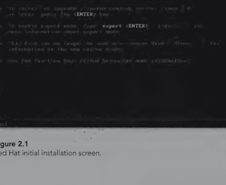

图 2.1

Red Hat 初始安装屏幕。

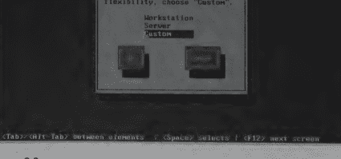

图 2.2

选择机器类型。

选择自定义并单击确定（选择工作站可能会遗漏某些软件包，而选择服务器可能会包含不需要的软件包）。

## 选择 SCSI 和 RAID 适配器


- 1. 选择如图 2.3 所示的 Adaptec 152x 驱动程序。接下来，从可用驱动程序中选择您的制造商和型号（图 2.4）。除非您精通 SCSI 选项，否则请选择自动探测。您应该会得到适配器的确认以及是否还有更多 SCSI 适配器的查询。一旦您完成所有 SCSI 适配器的安装，您就可以如图 2.5 所示对磁盘进行分区。

- 2. 分区磁盘时有两种选择。用户友好的 Disk Druid 和更传统的命令行 fdisk。选择 Disk Druid（图 2.5）。屏幕分为两部分（图 2.6）。上半部分是您当前磁盘分区的列表，下半部分是您的磁盘驱动器的列表。由于这是全新安装，因此没有当前磁盘分区。

- 3. 要添加的第一件事是根目录的分区。选择如图 2.7 所示的添加。在挂载点字段中输入斜杠（/）。减去

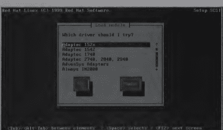

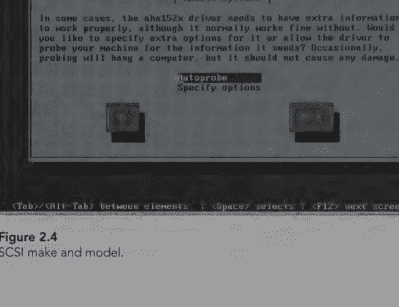

## 图 2.4

SCSI 制造商和型号。

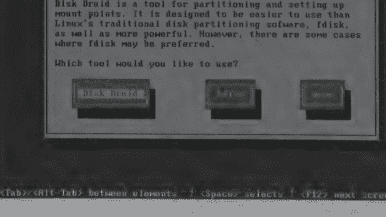

## 图 2.5

磁盘分区设置。

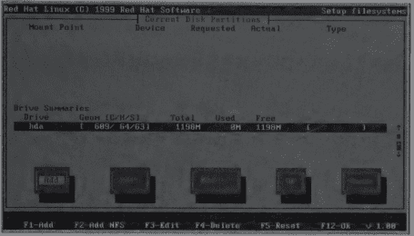

**图 2.6**

Disk Druid 界面。

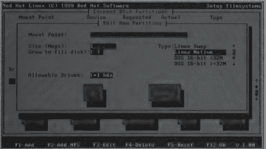

**图 2.7**

Disk Druid 的编辑新分区窗口。

根据总量计算交换分区所需的兆字节数，并将结果输入到 Size 字段。“增长以填满磁盘”（Grow to fill disk）字段将确保你使用所有可用空间。我们将在设置交换分区时选择该字段。接下来，转到 Type 并选择 Linux Native，然后按 `<TAB>` 键选择 OK。按 `<TAB>` 键切换到 Add 图标。

## 设置交换分区

- 1. 对于交换分区，你无需输入挂载点。在 Size 字段中输入 40 MB，选择“增长以填满磁盘”（Grow to fill disk）字段，并将类型指定为 Linux Swap（图 2.8）。

2. 选择 OK。请注意，第二个分区（Linux Swap (32)）的请求大小为 40 MB，但实际大小为 127 MB，如图 2.9 所示。这是因为在交换分区上选择了“增长以填满磁盘”（Grow to fill disk）字段。选择 OK。

3. 这样就完成了本次安装的磁盘分区。对于多个磁盘驱动器，你需要对每个磁盘执行相同步骤。（记住，屏幕下半部分高亮显示的磁盘是当前磁盘。）使用本章前面介绍的方法来获得磁盘的最佳性能。最后，你还可以选择指定应激活哪些交换分区。选择“格式化时检查坏块”（Check for bad blocks during format）字段（图 2.10），然后选择 OK。

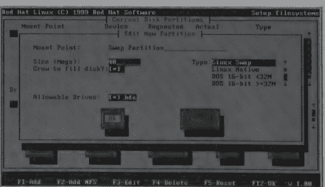

图 2.8

磁盘交换分区。

## 图 2.9

Disk Druid 交换分区实际大小。

## 图 2.10

Disk Druid 活动交换空间窗口。

4. 屏幕会显示交换分区格式化过程的进度条，然后要求你选择上面指定的所有其他分区进行格式化。选择所有分区，然后选择“格式化时检查坏块”字段。

## 选择组件

- 1. Red Hat 安装程序会预先选择使系统完全正常运行所需的组件（图 2.11）。未选择的项包括替代 X Windows 环境（KDE）、开发工具、打印机支持以及不同的服务器组件。Everything 组件位于列表末尾，适用于拥有大量磁盘空间且难以做出决定的用户。“选择单个软件包”（Select individual packages）字段允许你在软件包级别检查组件（图 2.12）。只需高亮显示一个组件，按 `<SPACE BAR>`（空格键），就会看到不同软件包的列表。按 `<F1>` 键将显示该软件包的描述。选择好软件包后，按 `<TAB>` 键切换到 Done。

- 2. 信息屏幕将告诉你，重新启动系统后，完整的安装日志将位于 `/tmp/install.log`。单击 OK，安装程序将格式化分区并把软件包复制到你之前创建的分区中。此过程将需要 10 到 45 分钟，具体取决于软件包数量以及硬盘驱动器和 CD-ROM 驱动器的速度（图 2.13）。

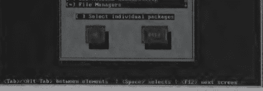

图 2.11

组件。

## 2024年高考物理模拟试题（一）

注意事项：

1. 答卷前，考生务必将自己的姓名、准考证号填写在答题卡上。

2. 回答选择题时，选出每小题答案后，用铅笔把答题卡上对应题目的答案标号涂黑。如需改动，用橡皮擦干净后，再选涂其它答案标号。回答非选择题时，将答案写在答题卡上，写在本试卷上无效。

3. 考试结束后，将本试卷和答题卡一并交回。

### 一、选择题：本题共8小题，每小题6分，共48分。在每小题给出的四个选项中，第1~5题只有一项符合题目要求，第6~8题有多项符合题目要求。全部选对的得6分，选对但不全的得3分，有选错的得0分。

1. 在光滑水平面上，一质量为2 kg的物体受到大小分别为3 N、4 N和5 N的三个共点力的作用，则物体的加速度大小不可能为（ ）

- A. 1 m/s²

- B. 3 m/s²

- C. 6 m/s²

- D. 8 m/s²

2. 如图，一根轻质弹簧一端固定，另一端连接一小球，小球穿在水平光滑细杆上。以弹簧处于原长时小球所在位置为坐标原点O，则下列说法正确的是（ ）


- A. 小球经过O点时加速度为零，速度最大

- B. 小球经过O点时速度为零，加速度最大

- C. 小球在O点两侧做变速直线运动，加速度不断变化

- D. 小球在O点两侧做匀变速直线运动，加速度恒定

3. 如图所示，理想变压器原、副线圈匝数比为2:1，原线圈接入u=220√2 sin(100πt) V的交流电源，副线圈接有电阻R=55 Ω和电容器C，则下列说法正确的是（ ）


- A. 副线圈输出电压的有效值为110 V

- B. 副线圈输出电压的频率为50 Hz

- C. 电阻R消耗的功率为220 W

- D. 电容C的耐压值至少为110 V

4. 某同学利用单摆测定重力加速度，他用游标卡尺测量摆球直径，示数如图所示，则摆球直径为 cm。


3. 完成安装后，安装程序（图 2.14）将探测鼠标。接下来，选择鼠标类型（默认选择将基于前一个探测屏幕中检测到的内容）（图 2.15）。这不是问题，因为你在开始安装之前已从表 2.8 中获取了所有信息。

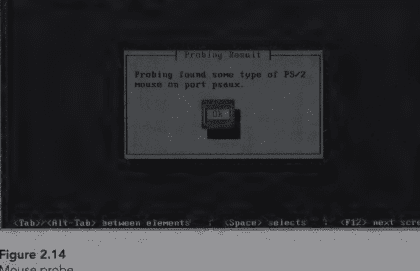

**图 2.14** 鼠标探测。

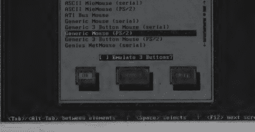

**图 2.15** 鼠标选择。

4. 接下来，配置网络接口卡（图 2.16）。如图所示选择你的网卡 2.17，然后选择自动探测。你将得到一个确认屏幕，显示已找到你的 NIC。你现在可以设置 NIC，也可以稍后配置它。然而，现在配置它更容易。

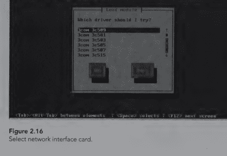

**图 2.16** 选择网络接口卡。

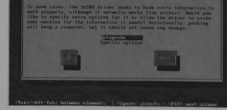

**图 2.17** 已选择 NIC 自动探测。

5. 配置正确时区并单击确定。在下一个屏幕（图 2.18）中，你将被要求选择应在启动时自动启动的服务。预选的服务将为你提供一个可运行的系统，其他服务可以在安装后配置。

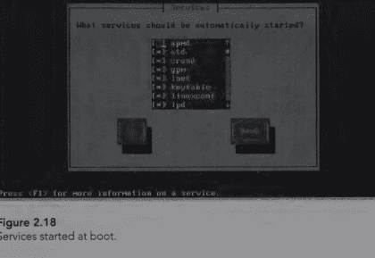

**图 2.18** 启动时启动的服务。

6. 我们在此安装中不会配置打印机。此时更重要的是选择一个好的 root 密码并记住它。如图 2.19 所示输入你的密码。此页面的条目取决于你的网络（图 2.20）。如果你正在运行 NIS，那么你将希望启用 NIS，输入 NIS 域名，并在子网中广播或绑定到 NIS 服务器。选择不同的密码参数将取决于你的站点。你应该选择制作启动磁盘（图 2.21）。LILO 允许 Linux 从硬盘启动（图 2.22）。选择主引导记录并且不要提供任何选项（图 2.23）。

**表 2.8 关键 Red Hat 安装信息**

| 项目 | 所需信息 |
| --- | --- |
| SCSI 或 RAID 适配器 | 制造商和型号。<br>可选 Linux 设备驱动程序。 |
| 网络接口卡 (NIC) | 制造商和型号。 |


| 显示卡 | 制造商、型号和板载显存大小。 |
| 显示器 | 制造商和型号。 |
| 键盘 | 类型。 |
| 鼠标 | 类型（串行、PS/2...）。 |

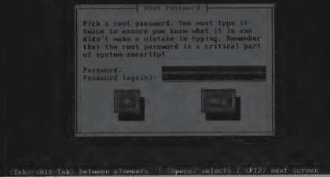

**图 2.19** Root 密码选择。

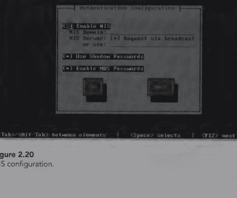

**图 2.20** NIS 配置。

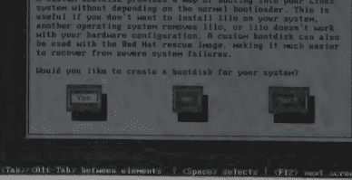

**图 2.21** 启动软盘创建。

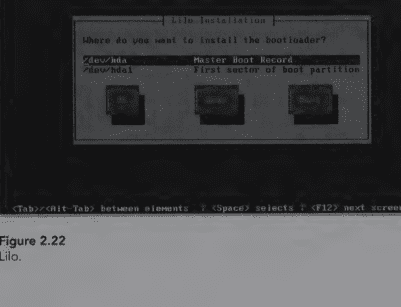

**图 2.22** LILO。

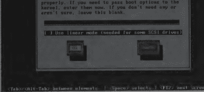

**图 2.23** LILO 配置。

7. 安装程序将尝试为 X Windows 配置检测你的显卡。接下来，你将被提示输入显示器类型（图 2.24）。最后两个屏幕要求你选择显示卡上的显存大小并选择视频模式（图 2.25）。你可以选择多个视频模式。安装程序将配置并启动 X。屏幕将改变并要求你确认你能读到一个框。确认后你将到达最终屏幕，图 2.26。X Windows 包不必成功安装你才能完成 Red Hat 安装。你可以继续安装，然后登录到你的 Red Hat 系统并运行 `Xconfigurator` 程序。

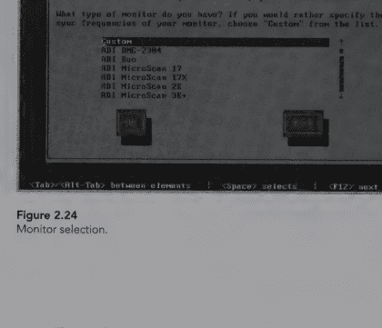

**图 2.24** 显示器选择。

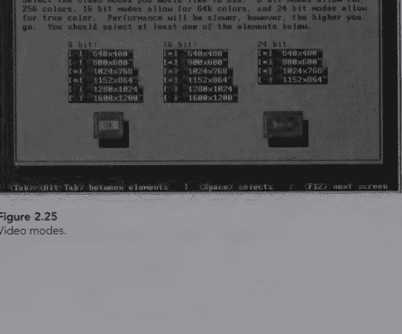

**图 2.25** 视频模式。

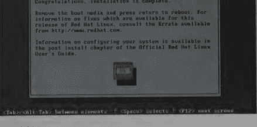

**图 2.26** 安装完成。

## Windows 2000 安装

有几种方法可以开始 Windows 2000 安装过程。

你可以使用的一些选项是：

- 从 Windows 95、Windows 98 或 Windows NT 4.0 升级。
- 从 Windows 2000 CD-ROM 启动。
- 从 Windows 2000 启动软盘启动。

每种可用选项的过程略有不同，至少在第一次重启之前。需要记住的主要一点是，当从现有操作系统升级时，你应计划将 Windows 2000 安装到与当前操作系统不同的分区。在当前操作系统之上安装是不推荐的，但也是可能的。安装 Windows 2000 的最佳方法是使用两种启动方法之一。

### 启动并开始安装

最简单的方法是从 Windows 2000 CD-ROM 启动。如果你的 CD-ROM 驱动器不支持启动（大多数现代 CD-ROM 驱动器支持可启动 CD-ROM），那么你可以从 Windows 2000 软盘启动。无论哪种方式，过程都相同，只是使用软盘会更慢。

> 需要记住的一点是，如果你的系统同时具有 SCSI 和 IDE 设备（仅在从 CD-ROM 启动时），则必须在设置初始化阶段按下 `<F6>`。按下 `<F6>` 将允许你加载完成设置所需的所有驱动程序。复制基本文件后，按下 `<F6>` 后你将看到图 2.27。此屏幕允许你从制造商的支持磁盘加载设备驱动程序。

一旦系统开始从 CD-ROM 或软盘启动，你应该会看到相对较少的需要响应的屏幕。

### 蓝屏设置

1. 当系统启动时（图 2.28），你将看到一系列蓝色信息屏幕。其中一些屏幕会要求你确认系统设置，例如键盘和鼠标类型。其他

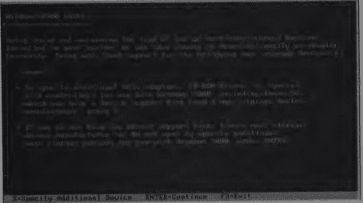

**图 2.27**  
加载设备驱动程序。


**图 2.28**  
初始启动屏幕。

屏幕将询问你希望执行哪种类型的安装。对于我们的目的，我们将执行全新安装，因此对于有关升级和修复先前安装的操作系统的提问，你应回答否。

2. 也许蓝色屏幕安装阶段中最重要的部分是分区菜单（图 2.29）。在这里你可以添加和删除任何磁盘上的分区。如果是全新安装，你应按照屏幕上的说明创建一个新的 2GB（2048MB）分区。如果你是为双启动安装或安装到已被其他操作系统分区的系统上，你应选择一个已存在的分区或操作现有分区以满足你的需求。一旦你选择了安装分区，系统会要求你使用 NTFS 或 FAT 格式对其进行格式化（如果你之前已格式化过，也可以保持分区不变）。你应选择 NTFS 并继续格式化。NTFS 和 FAT 在第 4 章中有讨论。

3. 磁盘格式化完成后，系统会询问将 Windows 2000 文件安装到何处。默认位置 `/WINNT` 是推荐的。从这里开始，安装程序将复制文件并在完成后重新启动。

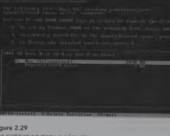

图 2.29  
分区菜单是关键步骤。

## GUI 模式设置

一旦蓝色屏幕部分的设置完成，系统将重新启动，Windows 2000 将在 GUI 模式下继续设置过程。GUI 模式由 Windows 2000 设置向导控制，它将引导你完成剩余的安装步骤。你在规划安装时收集的信息应在此处使用。在整个 GUI 阶段，你可以使用鼠标通过熟悉的按钮（下一步、返回、完成等）从一个屏幕导航到另一个屏幕。

- 1. 下一个对话框（图 2.30）只是要求你单击下一步以继续设置过程。应这样做以允许 Windows 2000 设置实用程序开始安装设备。此过程可能需要几分钟，你可以通过查看对话框中间的进度条来检查进度。如果你的磁盘停止响应，或无法移动鼠标光标，则系统中的某个硬件设备可能存在问题。设备安装过程完成后，应单击下一步继续。

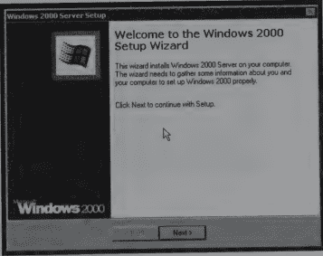

**图 2.30**  
Windows 2000 设置向导。

- 2. 接下来你将看到区域设置对话框，图 2.31。在这里你可以为不同区域和语言自定义 Windows 2000 安装。默认选项应足够。单击下一步继续。

- 3. 接下来系统会要求你输入姓名和组织信息。输入所需信息并单击下一步按钮继续进入计算机名称和管理员对话框（图 2.32）。在这里你应为 Windows 2000 系统输入计算机名称并选择管理员密码。完成后，单击下一步按钮继续。

- 4. 接下来出现的对话框允许你设置 Windows 2000 系统的日期、时间以及时区（图 2.33）。你应将设置调整为适合你所在地区的适当值，然后单击下一步继续。

- 5. 设置程序的下一部分允许你配置 Windows 2000 安装的网络设置。设置程序将自动检测并配置大多数网络接口。检测和安装过程完成后，系统会要求你选择典型或自定义配置（图 2.34）。典型设置通常足够，但你也可以通过选择自定义设置选项来微调设置。做出选择后单击下一步继续。

- 6. 如果你选择自定义设置，将会显示一个对话框，允许你添加和删除不同的网络组件（图 2.35）。

- 7. 现在你会看到工作组或计算机域对话框。你可以选择保持独立配置，或加入 Windows 2000 域。你的选择取决于你的网络基础设施。如果你选择加入域，则会被提示输入具有将机器加入该域权限的账户和密码（图 2.36）。做出适当的选择并单击下一步继续。

- 8. 下一个对话框显示 Windows 2000 组件安装的进度（图 2.37）。组件安装过程将需要几分钟。

- 9. 完成后，设置过程将显示执行最终任务对话框（图 2.38），设置将在其中安装“开始”菜单项、注册组件、保存设置并删除临时文件。

- 10. 设置程序完成最终安装任务后，你将看到最后一个对话框（图 2.39）。此时

## Figure 2.31

区域设置对话框。


## Figure 2.32

计算机名称和管理员密码对话框。

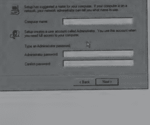

## Figure 2.33

日期和时间设置对话框。

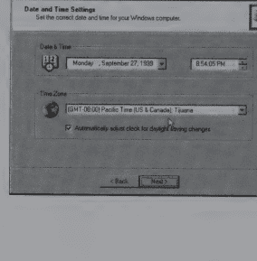

## Figure 2.34

网络选择。

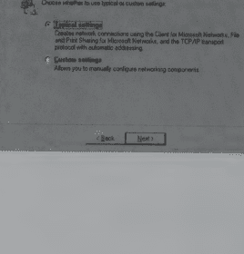

## Figure 2.35

自定义网络。

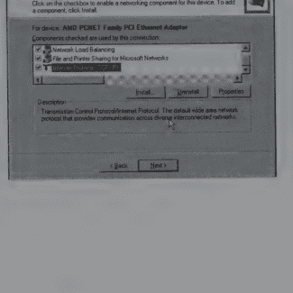

## Figure 2.36

工作组或计算机域对话框。

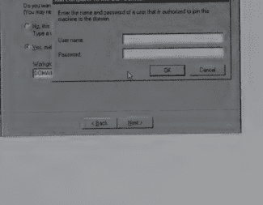

## Figure 2.37

安装进度。


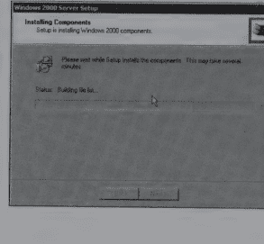

## Figure 2.38

最终任务。

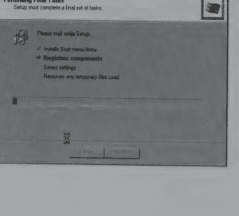

## Figure 2.39

完成设置。

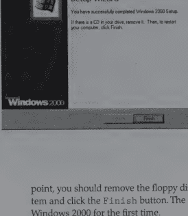

此时，你应从系统中取出软盘和光盘，然后单击 Finish 按钮。系统将重新启动并首次启动 Windows 2000。

## NETWORK CONFIGURATION

Windows 2000 首次启动后，你需要配置 TCP/IP 网络设置（假设你在 TCP/IP 环境中运行）。请注意，如果你在 GUI 模式设置期间选择手动配置网络组件，也可以执行相同的步骤。安装后登录后你会看到的第一件事就是图 2.40 中的熟悉桌面。

1. 要开始配置网络，请单击“我的网络邻居”，然后从菜单中选择“属性”。你将看到图 2.41 中的“网络和拨号连接”窗口。
2. 单击“本地连接”图标，然后从菜单中选择“属性”。“本地连接属性”窗口将显示，如图 2.42 所示。
3. 选择“Internet 协议（TCP/IP）”并单击“属性”按钮。你现在应该会看到图 2.43 中的窗口。
4. 现在在以下字段中输入网络的适当信息：

## Figure 2.40

Windows 2000 桌面。


## Figure 2.41

网络和拨号连接屏幕。

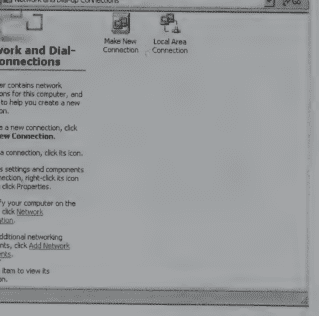

## Figure 2.42

本地连接属性屏幕。

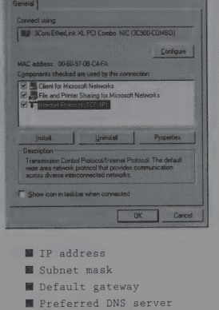

- IP 地址
- 子网掩码
- 默认网关
- 首选 DNS 服务器
- 备用 DNS 服务器

## Figure 2.43

Internet 协议（TCP/IP）属性屏幕。

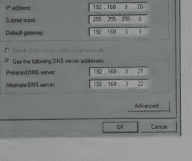

默认设置会从 DHCP 服务器自动获取所有这些信息。有关使用和配置 DHCP 的内容将在第 6 章中讨论。

5. 输入数据后，单击“确定”保存设置，或单击“高级”按钮进一步微调设置。如果需要微调 IP 和 DNS 设置，或你的网络使用 WINS，可以通过单击“高级”按钮查看高级设置，这将打开图 2.44 中的窗口。
6. “高级 TCP/IP 设置”窗口允许你为计算机添加多个 IP 地址和网关地址。在大多数情况下，你不会对此处显示的设置做任何更改。如果想查看高级 DNS 设置，请单击窗口顶部的“DNS”选项卡，如图 2.45 所示。
7. “高级 TCP/IP 设置—DNS”窗口允许你指定使用两个以上的 DNS 服务器，以及启动自定义的域名搜索顺序。在大多数情况下，除非你处于大型异构环境中，否则无需修改这些设置。如果你使用 WINS 来支持 NT、95 和/或 98，请单击窗口顶部的“WINS”选项卡以显示图 2.46 中的屏幕。

## Figure 2.44

高级 TCP/IP 设置屏幕。

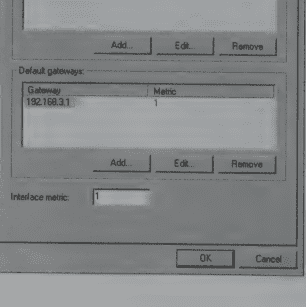

## Figure 2.45

高级 TCP/IP 设置屏幕—DNS。

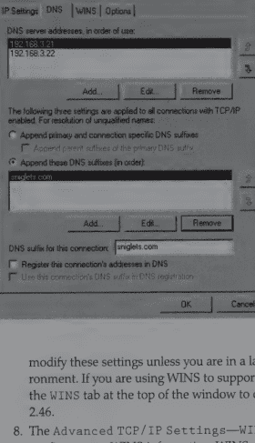

修改这些设置，除非你处于大型异构环境中。如果你使用 WINS 来支持 NT、95 和/或 98，请单击窗口顶部的 WINS 选项卡以显示图 2.46 中的屏幕。

8. “高级 TCP/IP 设置—WINS”屏幕允许你配置 WINS 信息。WINS 服务在 Windows 2000 中的工作方式与在 Windows 95 和 NT 4.0 中相同。
9. 配置完所有网络组件后，单击所有打开的对话框上的“确定”以保存设置。系统可能会要求你重新启动计算机，并在要求时进行重启。计算机重启后，你应该能够访问网络。

## The Default Installation Quandary

虽然为 NT、UNIX 或两者创建标准安装似乎是一项简单的任务，但在创建初始流程时，你会遇到一个先有鸡还是先有蛋的问题。今天，大多数管理员没有机会从零开始创建计算机基础设施。你会被带入一个活生生的、不断演进的计算机生态系统；如果幸运的话，你的前任已经创建了某种标准安装。如果没有，你就会面临从哪里开始、如何定义标准模型、以及从哪里开始实施模型的问题。

使用供应商的默认安装看起来是一种快速简便的安装系统的方法。为什么不呢？供应商创建了软件，所以他们大概知道最好的安装方式。然而，默认安装很可能是为满足最广泛的受众而量身定制的，在许多情况下，它将使你无法获得自定义安装所特有的大部分好处。你的目标是避免在今后造成管理上的噩梦，因为你不会希望基础设施中的每个系统与其他系统截然不同。所以现在你面临一个_默认安装问题_。

如何应对默认安装问题？首先，你需要意识到何时应该使用默认安装。创建一个适合自己需求的安装模型通常更好。不要假设供应商最了解情况，因为你是决定客户需求的最合适的人选。然后，努力创建一个_标准安装模型_。

## 标准安装模型

如果你的管理层不认为标准安装值得投入时间和精力，那就把下面这些好处摆在他们面前，看看他们是否会改变答案：

- 缩短安装新系统的时间并降低成本。
- 提高稳定性。
- 能够在灾难性故障后快速重新安装系统。
- 缩短识别和解决问题的时间。
- 提高对补丁安装和系统升级的管理能力。

俗话说：“钱能生钱。” 如果稍微变通一下用于我们的场景，就是：“要想节省时间、建立稳定并保持理智，就得先投入时间。” 投入时间和精力去创建标准安装模型是值得的，一旦达到目标，你将获得丰厚的回报。

## 创建标准安装

创建默认安装可以简单到收集一组文件，将这些文件添加到默认操作系统安装中即可得到一个标准系统。另一方面，你可能希望创建一个默认安装服务器，其中包含操作系统的多个版本，以及补丁集、系统软件和第三方软件包。选择哪种流程完全取决于你的环境，以及你能从创建标准安装中获得哪些好处。

如果你处于新环境中，不要立即尝试创建标准安装。

花一些时间从头安装新服务器，以便开始了解用户的需求、他们通常需要哪些软件，以及需要对操作系统做哪些修改。密切关注整个基础设施中哪些网络信息是静态的（即 DNS 和 NIS+），以便将其纳入你的模型。此外，花些时间研究已安装的系统，看看能否找到可以纳入标准模型的一些共性。

## 标准安装中应包含什么

在标准安装模型中包含什么是一个难题。然而，一个更简单的问题可能是不要包含什么。在构建作为标准模型的系统时，你会希望排除任何特定于某个系统的东西。标准安装应尽可能通用。

目标是让系统在获得新操作系统后需要添加的信息尽可能少。你希望在标准服务器上包含以下内容：

- 安装在标准磁盘布局上的核心操作系统。
- 虚拟内存配置公式。
- 补丁和更新的驱动程序。
- 安全增强措施。
- DNS、NIS+ 和 WINS 信息。
- 消息传递组件（sendmail 和 Outlook 服务器信息）。

你应该把操作系统安装后原本会添加到大多数系统上的任何内容都添加到标准安装服务器上。这样做有助于创建标准环境，节省时间和精力，并避免忘记那些你以后还得回头安装的关键组件。

你不希望安装到每台新服务器上的内容是：

- 主机名。
- IP 地址。
- 路由器信息。
- 特定用户信息。

## 管理标准安装服务器

花些时间制定一个管理标准安装服务器的流程。请记住，你对该系统所做的所有更改都会复制到你安装的每台新系统和你升级的所有旧系统上。一个数周或数月未被发现的错误将在日后带来大量工作。

请确保你有足够的磁盘空间来存储所有的补丁和驱动程序更新。这并不意味着安装服务器必须比你最大的系统还要大。只需确保你给系统足够的资源来容纳所有数据，并且在 UNIX 环境中，你可能同时支持多个版本的操作系统。限制对系统的访问，以确保你知晓任何更改，并且为了保证安全，不要将系统用于标准模型之外的其他用途。一旦你在安装服务器上投入了资源，就要保护你的投资，并尽一切努力维护其完整性。

> 一旦你在安装服务器上投入了资源，就要保护你的投资，并尽一切努力维护其完整性。

## 安装检查表和日志

## 图 2.46

高级 TCP/IP 设置 — WINS

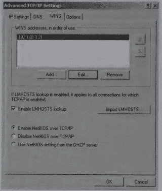


对于系统管理员来说，检查表和日志是两个非常有用的工具。它们在保持安装连续性方面极为重要。安装检查表将帮助你记住在安装系统之前需要了解的信息，并提供该信息的记录。同时，明智的做法是为每次安装维护一份日志。这应该是为系统创建的第一份日志；随着后续操作，你还会添加更多内容。安装日志在升级和灾难恢复时极为有用。表 2.9 给出了一个基本安装检查表的示例，你可以根据自身需求进行修改。

## 总结

本章为安装新系统提供了框架。虽然 Windows 2000 的安装相当直接且选项很少，但每种 UNIX 版本都有大量不同的安装选项。希望本章能为你提供一些技巧、流程和指导，以便你能够简化和标准化你的环境。

对于具体的安装问题和可用选项，请参阅你的安装文档或你常用的 UNIX 专用手册。对于某些 UNIX 版本，有专门书籍完整涵盖了本章所介绍的内容。如果你的环境中包含大量系统，请花时间阅读其中一本，以便更深入地了解如何标准化你的安装。

### 表 2.9 通用安装检查表

**硬件**
- 处理器
- 内存
- 图形适配器
- 网络接口卡
- 线缆
- 电源线和适配器
- 第三方卡

**软件**
*操作系统*
- 版本
- 补丁集群级别
- 需要的特殊补丁
- 驱动程序
*第三方软件*
- 分发 CD
- 许可证密钥（如有必要）

**基础设施信息**
- 主机名
- 域名
- IP 地址
- 子网掩码
- 默认路由器
- DNS 服务器 IP 地址
- DNS 搜索域
- NIS+ 域
- NIS+ 服务器 IP
- 主域控制器
- WINS 服务器
- LDAP 服务器

## 规划你的安装

计算机安装过程自早期以来已经取得了长足的进步，那时配置一个新系统可能需要一整天甚至更长时间。如今，几乎每种操作系统都有 GUI 工具。然而，在“美好的旧时光”里，鉴于预期所需的时间，你不得不仔细规划安装。良好的安装界面的优势也带来了“即装即走”设置的弊端，这会在后续引发管理问题。

如果你只从本章获取一点信息，那就是学会仔细规划你的安装。使用表 2.1 中的信息和表 2.9 中的安装检查表，在安装操作系统之前收集所有必要的系统信息。你在前期收集这些信息所花费的时间，将为你节省数小时的麻烦、问题以及与客户之间不愉快的沟通。

## UNIX 安装

由于 UNIX 是一种“网络化”操作系统，在安装新系统之前，你必须掌握有关整体基础设施完整而准确的信息。具体来说，你必须知道：
- 主机名。
- 域名。
- IP 地址。
- 子网掩码。
- 默认路由器。
- DNS 服务器 IP 地址。
- DNS 搜索域。
- NIS/NIS+ 域。
- NIS/NIS+ 服务器 IP。

在开始安装之前，你还必须知道磁盘应如何分区。在所有初始决策中，这一项是最难更改的，通常需要完全重新安装才能纠正。

## WINDOWS 2000 安装

有多种方式可以开始 Windows 2000 的安装过程。你可以选择的一些选项包括：
- 从 Windows 95、Windows 98 或 Windows NT 4.0 升级。
- 从 Windows 2000 CD-ROM 启动。
- 从 Windows 2000 启动软盘启动。

最简单开始安装的方法是从 Windows 2000 CD-ROM 启动。Windows 2000 第一次启动后，您需要配置 TCP/IP 网络设置。

## 系统启动和关机

### UNIX
- BSD 启动
- BSD 中的 rc 脚本
- SysV 启动
- SysV 启动脚本结构
- 关机、重启和停止

### WINDOWS 2000
- 启动 Windows 2000
- 系统分区与启动分区
- 高级启动选项
- `boot.ini`
- 系统关机

对于大多数人来说，打开电源就是整个启动过程。在本章中，我们将带您了解系统在等待登录屏幕时执行的步骤。我们称此过程为“启动”系统，即自举系统。

启动序列涉及硬件和软件组件。理解此过程对系统管理员至关重要。在这个领域里，没有什么比系统无法启动更令人沮丧的了，通常没有明显原因，而且通常是在用户面前。了解这些步骤的知识——从给系统通电到获得登录——对于正确诊断和纠正系统最脆弱时出现的问题至关重要。

## 物理启动序列

启动计算机系统有点类似于早上醒来。一旦闹钟响起，我们潜意识中一个微小但不一定有功能的部位会承认信号并开始加载其余意识能力的进程。此时，我们会进行一次身体盘点；伸展身体并开始移动。

同样，当您为传统的 UNIX 硬件通电时，一个称为固件的物理组件会指示系统访问磁盘驱动器上称为启动块的区域。启动块提供加载操作系统的基本指令。其中一个重要信息是次要启动文件的位置，在某些系统中称为 `ufsboot`。次要启动文件负责将内核加载到系统内存中。内核是 UNIX 操作系统的核心。一旦加载完成，系统就成为 UNIX 系统，唤醒过程就开始了。图 3.1 显示了传统 UNIX 系统的物理启动序列。

PC 的启动序列非常相似。固件被 BIOS 取代，即基本输入输出系统；与固件相同，只是名称不同。BIOS 执行基本系统诊断，收集有关系统架构的信息。BIOS 将提供有关 CPU、内存和硬件的信息。然后，根据系统的配置方式，BIOS 将启动启动管理器或系统的实际操作系统。在图 3.2 中，您可以看到 UNIX 和 PC 物理启动序列之间的相似性。

而 UNIX 固件和启动块完全取决于厂商，PC 世界已在少数 BIOS 配置上达成标准化。Linux 和其他基于 PC 的 UNIX 操作系统遵循 PC 启动序列，使用启动管理器加载内核。

## 加载操作系统

没有操作系统的计算机就像没有大脑的人类。操作系统提供软件和硬件组件之间的基本通信。操作系统本身就是软件，但它充当其他应用程序与物理层之间的中介。UNIX 和 NT 在获得更高层次意识的这个过程中采用不同的方法。

一旦 UNIX 内核被加载，成为有意识的能力就存在了，但它并未完全清醒。UNIX 系统可以以两种主要操作模式启动，通常称为单用户和多用户。单用户模式是一种状态，其中许多但并非所有系统功能都处于活动状态。此状态主要用于管理目的，允许系统管理员对磁盘或启动脚本执行纠正功能。

**表 3.1 BSD 系统状态**

| State | Use |
|-------|-----|
| Halted | Halted. |
| Single-User | Single-user mode for administration and diagnostics. Only console logins are allowed; networking is not yet active. User filesystems are not mounted. |
| Multi-user | Multi-user mode with networking; common default operating state. |

在单用户模式下，用户功能通常不可用，包括友好界面、网络或打印。单用户模式是我们许多人在洗澡和大量咖啡因之前所处的状态。此模式下的系统通常为系统管理员提供一个 root 提示符。因此，此模式通常受密码保护，需要在允许访问之前输入 root 密码。

多用户模式是系统的正常运行状态。所有系统进程都在运行，系统已准备好进行网络通信和用户服务。这是完全清醒并准备就绪的状态。

在 UNIX 环境中处理系统启动有两种主要方式：BSD（表 3.1）和 SysV（表 3.2）。尽管每个厂商都有其变体，但大多数至少接近这两种。

## 遵循 BSD 启动序列

BSD 启动序列如图 3.3 所示。由 BSD 内核启动的第一个完整进程，通常称为自发进程，是 `init`。这是所有 UNIX 进程的母亲，字面意思。`init` 读取一系列脚本，这些脚本提供有关要启动哪些进程以及启动顺序的说明。BSD 启动脚本称为 rc 脚本，代表“run commands”。所有 rc 脚本都位于 `/etc` 目录中，并且是纯文本文件。以下 rc 脚本是由 `init` 读取的，按列出顺序：

```
/etc/rc.boot
/etc/rc.single
/etc/rc
/etc/rc.local
```

这些脚本是简单的 Bourne shell 脚本，执行一系列命令。`rc.boot` 脚本执行以下基本功能：
- 设置主机名。
- 启用 IP 网络。
- 以只读模式挂载 `/` 和 `/usr` 文件系统。
- 检查文件系统。

如果所有文件系统都干净，`rc.boot` 会运行 `rc.single`。`rc.single` 首先做的事是将 `/` 和 `/usr` 重新挂载为读写模式。`rc.single` 脚本清理挂载表、共享库缓存和其他系统文件。它还根据您本地时区设置时间。`loadkeys` 命令用于将系统键盘映射设置为与您的系统匹配。当 `rc.single` 退出时，如果您进入单用户模式，`rc.boot` 会返回系统提示符。


如果系统进入多用户模式，`/etc/rc`会在`/etc/rc.boot`之后立即运行（请记住，`rc.boot`执行了`rc.single`）。`/etc/rc`首先检查`rc.boot`和`rc.single`所做的工作。一旦它确信其“表亲”已完成工作，它就会检查`passwd`文件在系统崩溃时是否未打开。如果已打开，`passwd`文件将从`/etc/ptmp`恢复。`/etc/rc`然后挂载所有本地文件系统。

**图 3.3** BSD 启动序列。

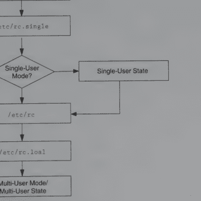


`loadkeys`和`dumpkeys`（SysV 和 BSD）分别加载和转储键盘转换表。

## 更改系统启动

更改系统启动脚本应谨慎进行。您几乎不需要对单用户启动中使用的任一启动脚本进行更改。同样，在正常情况下不应篡改`/etc/rc`。`/etc/rc.local`，正如其名称所示，是在本地系统配置中进行更改的地方。然而，请记住大多数厂商已在`rc.local`脚本中添加了与其特定版本相关的启动调用，因此在编辑此脚本时也必须谨慎。DNS、NFS 以及其他本地后台进程所调用的守护进程，如`sendmail`，通常从此脚本启动。`rc.local`脚本的典型添加包括：

- 许可证管理器。

- 第三方应用程序启动脚本。

- 特殊打印机驱动程序或管理器。

### RC.LOCAL

在对启动脚本进行更改时，始终尝试将其添加到文件底部附近。以下是从`rc.local`启动第三方许可证文件的示例：

```
#
## Matlab license manager.
#
if [ -f /etc/lmboot ]; then
    sh /etc/lmboot && echo -n ' Matlab '
fi
```

`#`符号表示注释，其右侧的所有内容都会被忽略。在本例中，我们调用的是 Matlab 许可证管理器`/etc/lmboot`。逻辑调用`if`以结束调用`fi`结尾。测试`[-f /etc/lmboot ]`很重要。它检查文件是否存在，然后执行该文件，并显示一行文字确认你已经执行了该脚本。在添加你自己的内容时，始终使用`-f`谓词确认文件存在后再执行；输出确认信息能让你在启动脚本挂起时更容易调试。

> 如前所述，这些脚本只是 Bourne shell 脚本，因此 Bourne 脚本可用的任何逻辑在`rc`脚本中同样可用。一个重要的经验法则是保持简单。另一个规则是永远不要删除`rc`脚本中的代码。如果你希望禁用某些行，请使用`#`符号将它们注释掉。`rc`脚本中的大量代码依赖于系统环境，重新创建它们非常困难。除非绝对必要，否则不要编辑这些脚本。

## 跟随 System V 启动脚本

System V（SysV）启动过程更复杂，同时也提供了更多选项。与 BSD 中的三个运行级别不同，SysV 启动有八个运行级别。运行级别为 0-6 以及`s`（或`S`）表示单用户模式。每个运行级别具有不同的功能。运行级别由一系列由`init`调用的脚本定义。运行级别和脚本之间的关系包含在系统文件`inittab`中。运行级别如表 3.2 所示。

## INITTAB

上述运行级别由名为`/etc/inittab`的文件控制。该文件控制`init`进程的操作。下面是来自 Solaris 2.6 系统的示例`inittab`文件：

```
mars# cat /etc/inittab

ap::sysinit:/sbin/autopush -f /etc/iu.ap

ap::sysinit:/sbin/soconfig -f /etc/sock2path

fs::sysinit:/sbin/rcS          >/dev/console 2>&1 </dev/console

is:3:initdefault:
```

**表 3.2 SysV 运行级别**

| 运行级别 | 用途 |
|---|---|
| 0 | 停机。 |
| S, s | 用于管理和诊断的单用户模式。只允许控制台登录；网络尚未激活。如果系统正在启动，用户文件系统不会被挂载；但如果正在关闭到该状态，则会保留这些文件系统。`init`派生的进程将被终止。 |
| 1 | 另一种单用户模式。所有文件系统保持挂载，许多脚本保持运行，只允许控制台登录。 |
| 2 | 具有有限网络功能的多用户模式。 |
| 3 | 具有网络功能的多用户模式；常见的默认运行状态。 |
| 4 | 在大多数系统上未使用的状态。 |
| 5 | 停机并重新启动。 |
| 6 | 停机并重新启动到默认状态。 |

```
p3:s1234:powerfail:/usr/sbin/shutdown -y -15 -g0 >/dev/console 2>/dev/console

s0:0:wait:/sbin/rc0 >/dev/console 2>/dev/console </dev/console

s1:1:wait:/usr/sbin/shutdown -y -1S -g0 >/dev/console 2>/dev/console </dev/console

s2:23:wait:/sbin/rc2 >/dev/console 2>/dev/console </dev/console

s3:3:wait:/sbin/rc3 >/dev/console 2>/dev/console </dev/console

s5:5:wait:/sbin/rc5 >/dev/console 2>/dev/console </dev/console

s6:6:wait:/sbin/rc6 >/dev/console 2>/dev/console </dev/console

fw:0:wait:/sbin/uadmin 2 0 >/dev/console 2>/dev/console </dev/console

of:5:wait:/sbin/uadmin 2 6 >/dev/console 2>/dev/console </dev/console

rb:6:wait:/sbin/uadmin 2 1 >/dev/console 2>/dev/console </dev/console

sc:234:respawn:/usr/lib/saf/sac -t 300

co:234:respawn:/usr/lib/saf/ttymon -g -h -p "uname -n" console login: " -T sun -d /dev/console -l console -m ldterm,ttcompat
```

该文件的结构为：

```
label : run-level : action : process
```

`label`是一个助记符：对于状态，通常是字母`s`加上状态编号；对于终端，通常是终端编号。`run-level`是一个数字（或`s`），表示应执行动作和命令的状态。如果该字段为空，则动作适用于所有运行级别。如果包含多个数字，如`234`，则表示动作适用于运行级别 2、3 和 4。`action`描述如何处理后面的`process`。

可以分配许多动作。不同 UNIX 操作系统风格之间略有差异。以下是对上面展示的`inittab`中动作的解释：

- `sysinit`：在尝试访问控制台之前执行此过程。

- `initdefault`：设置默认运行级别。

- `powerfail`：当`init`收到电源故障信号时执行此过程。

- `wait`：在继续之前等待此动作完成。

- `respawn`：在必要时重新启动此过程。

两个更有用的动作是：

- `bootwait`：仅在启动期间等待此动作。

- `off`：不执行此过程。

> 最后一个动作用于注释掉不再使用的运行级别动作。与 BSD 的`rc`脚本一样，你永远不应从`inittab`中删除代码；只需使用`off`动作来禁用它们。

因此，下面这行会告诉我们，在状态 2 和 3 中，你应该运行`/sbin/rc2`并等待脚本完成后再继续：

## RC 脚本

大部分工作都是在通常称为运行级脚本的进程中完成的（`/sbin/rc2`或`/sbin/rc3`等）。这些脚本在位于`/etc/rc2.d`和`/etc/rc3.d`的目录层次结构上工作。如果查看`/sbin/rc2`的一部分，你会看到基本过程是如何工作的。

脚本做的第一件事是使用`who -r`命令确定系统的状态。

```
set `/usr/bin/who -r`
```

如果系统正在启动，它会将`boot`变量设为`yes`。

```
if [ $x9 = "xS" -o $x9 = "x1" ]
then
```


```text
echo 'The system is coming up. Please wait.'
BOOT=yes
```

下一个测试是确定系统是否正在升到 2 级，或正在降级。换句话说，系统的当前状态是否高于或低于 2 级？

```text
elif [ $x7 = "x2" ]
then
echo 'Changing to state 2.'
if [ -d /etc/rc2.d ]
then
for f in /etc/rc2.d/K*
{
if [ -s $(f) ]
then
case $(f) in
*.sh) . $(f) ::
*) /sbin/sh ${f} stop ::
esac
fi
)
fi
fi
```

这段代码揭示了 SysV 中运行级层次结构的原理。如果条件状态解析为此情况，则系统处于高于 2 级的运行级。在这种情况下，必须移除多个进程或资源以将状态降至 2 级。脚本首先检查 `/etc/rc2.d` 是否存在。接下来，它找到 `/etc/rc2.d` 中以字母 "K" 开头的所有文件并按顺序执行它们。请注意，它给脚本传递了 `stop` 参数。

```text
ls -l K*
```

```text
K20spc
K60nfs.server
K76snmpdx
K77dmi
```

`/sbin/rc2` 的下一部分处理启动达到 2 级所需的进程：

```text
if [ $S9 != "x2" -a $S9 != "x3" -a -d /etc/rc2.d ]
then
for f in /etc/rc2.d/S*
{
if [ -s ${f} ]
then
case ${f} in
*.sh) . ${f}
*) /sbin/sh ${f} start ::
esac
```

在这种情况下，它找到 `/etc/rc2.d` 中以字母 "S" 开头的所有文件并使用 `start` 命令执行它们。该运行级中的 S 文件比 K 文件多得多。这些文件通常分别称为启动文件和终止文件。

> who（SysV 和 BSD）在两种风格上都存在，但在其 SysV 版本中功能远多得多。在基本状态下，`who` 命令返回当前登录系统的用户列表。在 SysV 系统上，`who -r` 返回 `init` 进程的当前运行级。`ls` 也存在于所有 UNIX 变体中。它提供目录列表。`ls -l` 提供详细列表。

## INIT.D

现在，这里是狡猾的部分。启动和终止文件实际上是到位于 `/etc/init.d` 的同一文件的硬链接。文件的工作方式取决于它们是用 `start` 还是 `stop` 参数调用的。如果你打算更改现有脚本或添加自己的脚本，这一点很重要要记住。如果你编辑一个硬链接，你实际上编辑了共享相同 inode 的所有其他链接。（我们将在下一章介绍 inode。）如果你计划添加一个脚本，你必须将其放在 `/etc/init.d` 中，并在你希望其运行的相应的 `/etc/rc#.d` 目录中创建适当的 S 或 K 链接。这些脚本中的大多数都添加到 `/etc/rc2.d` 或 `/etc/rc3.d`，具体取决于它们是否依赖网络。在图 3.4 中，启动脚本 `S99dtlogin`，它启动一个基于图形的登录程序，实际上是到 `init.d` 目录中 `dtlogin` 脚本的硬链接。同样，`S15nfs.server` 链接到 `nfs.server`。

> 这看起来可能不必要地复杂，但它提供了一种标准化的方法来处理向启动过程添加脚本。在你决定忽略此约定之前，请记住你应尽可能保持系统“标准”。始终将系统保持在你希望继承的状态。你永远不知道什么时候会是你去修复由不同管理员设置的系统。你知道人们称呼给你留下古怪系统的管理员是什么；你想被同样称呼吗？

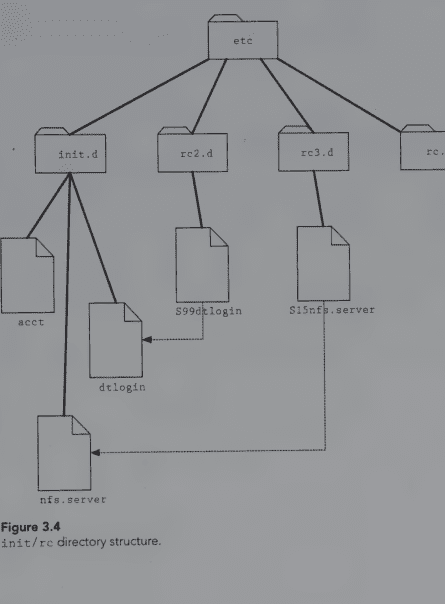

Figure 3.4

`init/rc` 目录结构。

## UNIX 登录

系统完成启动过程后，会为用户提供登录提示。`init` 进程启动 `getty` 守护进程，或 Solaris 中的 `ttymon`。控制台或终端样式的登录现在已不常用。然而，底层过程仍被图形登录系统使用。`getty` 守护进程产生 `login:` 提示。当用户输入登录名并按下 ENTER 后，`getty` 会启动实际的 `login` 程序，该程序会提示输入密码。`login` 程序验证登录名和密码，并启动 `passwd` 表中指定的登录 shell。大多数 UNIX 系统现在使用基于 X Windows 的界面，如 CDE 的 `dtlogin`，它由 `init` 启动，并在用户与 `getty/login` 循环之间介入。

## 关闭 UNIX 系统

关闭 UNIX 系统同样重要。要使 UNIX 系统正确关闭，管理员必须将其带到停止状态（SysV 中的状态 0）。最常用的关闭命令当然是 `shutdown`。选项因 UNIX 的不同而异。最常见的两种分别是 BSD 和 SysV，如下所示：

```text
BSD: shutdown -h +10
```

这将在向用户发出 10 分钟警告消息后将系统带到停止状态。

```text
SysV: shutdown -10 -g600 -y
```

这与 BSD 命令的作用相同，将系统带到运行级别 0，宽限期为 600 秒。`-y` 选项会用“是”回答所有烦人的“确定吗？”问题。在尝试这些命令之前，你应该查阅 `shutdown` 命令的手册页。

除了关闭之外，SysV 还有 `init` 命令，可在各状态之间移动系统。要将系统从运行级别 3 更改为运行级别 2，可以发出以下命令：

```text
init 2
```

同样，命令 `init 6` 将在不向用户发出任何警告的情况下停止并重新启动系统。这不会损害系统，但如果在生产系统上使用，可能会损害你在用户眼中的声誉。在关闭过程中，系统会通过 `TERM` 信号要求所有进程终止。如果失败，则会用 `KILL` 信号将其杀死。此外，`sync` 原语会使磁盘与缓冲区同步，以确保不会丢失数据。

一旦系统被带到停止状态，安全地关闭电源。系统将无法响应控制台或任何远程连接的情况会时有发生。在这些情况下，可能需要循环电源以重新获得访问权限。在某些系统上，有一个专门的按钮用于此操作，标记为 `TOC`。在许多现代 UNIX 系统上，电源开关会在切断系统电源之前激活固件版本的磁盘同步程序。这一改进大大提高了从手动关闭中恢复的可能性。

## UNIX 启动和关闭策略

在大多数情况下，你不应允许普通用户启动、重新启动或关闭系统。原因之一是，用户无法运行 `reboot`、`init` 或 `shutdown` 命令；只有超级用户才能执行它们。此外，在安全性重要的情况下，正在重新启动的系统可能容易受到攻击。如果你禁止用户重新启动，你就可以对重新启动的系统持怀疑态度。最后，也是最重要的是，用户不太可能确定单个工作站在整个网络中的作用。他们关闭的系统可能有会计办公室打印机用的打印服务器，老板的


```
init 2
```

同样，命令 `init 6` 将在不向用户发出任何警告的情况下停止并重新启动系统。这不会损害系统，但如果在生产系统上使用，可能会损害你在用户眼中的声誉。在关闭过程中，系统会通过 TERM 信号要求所有进程终止。如果失败，则会用 KILL 信号将其杀死。此外，`sync` 原语会使磁盘与缓冲区同步，以确保不会丢失数据。

一旦系统被带到停止状态，安全地关闭电源。系统将无法响应控制台或任何远程连接的情况会时有发生。在这些情况下，可能需要循环电源以重新获得访问权限。在某些系统上，有一个专门的按钮用于此操作，标记为 TOC。在许多现代 UNIX 系统上，电源开关会在切断系统电源之前激活固件版本的磁盘同步程序。这一改进大大提高了从手动关闭中恢复的可能性。

## UNIX 启动和关闭策略

在大多数情况下，你不应允许普通用户启动、重新启动或关闭系统。原因之一是，用户无法运行 `reboot`、`init` 或 `shutdown` 命令；只有超级用户才能执行它们。此外，在安全性重要的情况下，正在重新启动的系统可能容易受到攻击。如果你禁止用户重新启动，你就可以对重新启动的系统持怀疑态度。最后，也是最重要的是，用户不太可能确定单个工作站在整个网络中的作用。他们关闭的系统可能有会计办公室打印机用的打印服务器，老板的

表 3.3 Windows 2000 启动文件

| 文件 | X86 位置 | RISC 位置 |
|---|---|---|
| `NTLDR` | 系统分区根目录 | - |
| `boot.ini` | 系统分区根目录 | - |
| `BOOTSECT.DOS` | 系统分区根目录 | - |
| `NTDETECT.COM` | 系统分区根目录 | - |
| `NTBOOTDD.SYS` | 系统分区根目录 | - |
| `NTOSKRNL.EXE` | `SystemRoot\System32` | `SystemRoot\System32` |
| `OSLOADER.EXE` | - | `OS\nt40` |
| `HAL.DLL` | `SystemRoot\System32` | `OS\nt40` |
| `*.pal` (ALPHA) | - | `OS\nt40` |
| `System` | `SystemRoot\System32\Config` | `SystemRoot\System32\Config` |
| `Device Drivers` | `SystemRoot\System32\Drivers` | `SystemRoot\System32\Drivers` |

在此情况下，了解每个文件的含义和功能就变得很重要了。

表 3.3 列出了成功启动 Windows 2000 所需的文件，以及每个文件的相应位置。

## `NTLDR`

`NTLDR` 位于系统分区的根目录下，并由启动驱动器上的引导扇区自动加载。`NTLDR` 控制 Windows 2000 系统的启动过程。此程序在基于 RISC 的系统上不是必需的。基于 RISC 的系统的固件执行 `NTLDR` 的功能。

## `BOOT.INI`

`boot.ini` 是 `NTLDR` 访问的第一个文件。它是一个简单的文本文件，提供可用操作系统的列表。本章后面将对 `boot.ini` 进行更详细的描述。此文件在基于 RISC 的系统上既不是必需的也不包含在内。

## `BOOTSECT.DOS`

`BOOTSECT.DOS` 包含 DOS 引导扇区的副本，该扇区以前驻留在启动驱动器上。如果机器同时包含 Windows 2000 和 DOS 安装，则此文件才存在，并且会在两者之间双启动。如果用户选择启动 DOS，`NTLDR` 将访问此文件。此文件在基于 RISC 的系统上既不是必需的也不包含在内。

## `NTDETECT.COM`

`NTLDR` 使用 `NTDETECT.COM` 来检测 Windows 2000 系统上存在的硬件。`NTDETECT.COM` 仅在基于 x86 的系统上是必需的；在基于 RISC 的系统上不包含。

## `NTBOOTDD.SYS`

`NTBOOTDD.SYS` 在基于 x86 的系统上是必需的，这些系统从没有板载 BIOS 的 SCSI 控制器启动，或其板载 BIOS 已被禁用。`NTBOOTDD.SYS` 只是系统 SCSI 控制器的相应驱动程序的副本。此文件在基于 RISC 的系统上既不是必需的也不包含在内。

## `NTOSKRNL.EXE`

`NTOSKRNL.EXE` 是 Windows 2000 内核。Windows 2000 内核是操作系统的核心和灵魂，正如所有操作系统的内核一样。它位于基于 x86 和基于 RISC 系统的启动分区上。`NTOSKRNL.EXE` 加载硬件抽象层，即 HAL，并开始加载设备驱动程序和系统服务的过程。

## `OSLOADER.EXE`

`OSLOADER.EXE` 仅在基于 RISC 的系统上是必需的。它执行到加载内核为止的所有功能，以及加载 HAL 和所需的任何 `*.pal` 文件。

## `HAL.DLL`

NT 使用 HAL 将特定于平台的问题对 Windows 2000 隐藏起来。HAL 使 Windows 2000 能够使用相同的系统调用与各种硬件平台通信。HAL 将这些高级系统调用翻译成低级硬件例程。Windows 2000 开箱即用时包含大多数系统的 HAL。然而，一些专有系统可能需要定制的 HAL 文件，该文件将由硬件供应商提供。如果 Windows 2000 在系统设置期间无法为您的硬件找到合适的 HAL，您将被提示通过软盘提供专有 HAL。

## `*.PAL` FILES

- `.pal` 文件包含仅用于基于 ALPHA 的 RISC 平台的硬件特定代码。

## `SYSTEM`

`System` 文件包含 Windows 2000 注册表的系统配置单元。系统配置单元包含完成启动过程所需的驱动程序和服务信息。

## `DRIVERS`

`Drivers` 文件夹包含支持 Windows 2000 系统上安装的硬件所需的所有驱动程序文件。

## THE WINDOWS 2000 PRE-BOOT PROCESS

- 在 Windows 2000 甚至开始启动之前，系统必须启动并执行其自身的一组例程。预启动过程中的主要参与者是 BIOS，即基本输入输出系统。BIOS 是一个非常简单的操作系统，存储在系统板上的闪存中。BIOS 负责在系统硬件和操作系统之间提供一个基础的通信通道。

预启动过程的第一阶段是上电自检，即 POST 例程。BIOS 执行此例程并执行诸如内存测试、中断测试以及键盘和鼠标控制器和内置磁盘控制器等基本硬件的测试等功能。如果 POST 例程因任何原因失败，系统将无法启动，直到您采取纠正措施为止。

在 POST 例程成功完成后，BIOS 定位启动设备，通常是固定磁盘。它将主引导记录 MBR 加载到内存中并执行 MBR 中包含的程序。活动分区由 MBR 程序扫描分区引导记录表来定位。

此时，活动分区的引导扇区被加载到内存中。在 Windows 2000 的情况下，引导扇区包含 `NTLDR`，它被加载并初始化。这就是引导过程真正开始的地方。

## THE WINDOWS 2000 BOOT PROCESS

`NTLDR` 程序是引导过程的第一步。我们将在本节中重点介绍 x86 系统的引导。如果您想了解有关引导 RISC 系统的更多信息，我们建议您购买 Microsoft Press 参考指南之一，例如 Windows 2000 Beta Training Kit。

`NTLDR` 首先将处理器切换到 32 位平坦内存模式（386 模式）。接下来，`NTLDR` 启动内置的简单文件系统驱动程序以访问操作系统。此时，`NTLDR` 可能会访问 `NTBOOTDD.SYS`（在不太可能使用没有 BIOS 的 SCSI 控制器时）以从 SCSI 设备启动。一旦 `NTLDR` 获得了文件系统的访问权限，它就会检查 `boot.ini` 文件以确定系统上有哪些操作系统。`boot.ini` 文件包含每个操作系统的条目，指定其在系统上的位置。有关 `boot.ini` 文件的详细描述以及修改它的说明将在本章后面给出。以下示例 `boot.ini` 包含 Windows 2000 和 DOS 的条目：

```
[boot loader]

timeout=30

default=multi(0)disk(0)rdisk(0)partition(1)\WINNT

[operating systems]

multi(0)disk(0)rdisk(0)partition(1)\WINNT="Microsoft Windows 2000 Server" /fastdetect

C:\="Microsoft MS-DOS 6.22"
```

一旦 `NTLDR` 检查了 `boot.ini` 文件，它就会向用户呈现一个屏幕，允许选择其中一个已安装的操作系统。如果 Windows 2000 是唯一已安装的操作系统，则不会显示选择屏幕。如果用户在指定的超时时间内未选择操作系统（默认为 30 秒），`NTLDR` 将选择默认值。如果用户选择的操作系统不是 Windows 2000，`NTLDR` 将加载并运行 `BOOTSECT.DOS` 并将控制权交还给该操作系统。


选择 Windows 2000 后，`NTLDR` 执行 `NTDETECT.COM`。此时，`NTDETECT.COM` 将显示图 3.5 所示的 Starting Windows 屏幕。

`NTDETECT.COM` 用于检查系统的硬件并将找到的硬件列表返回给 `NTLDR`。由

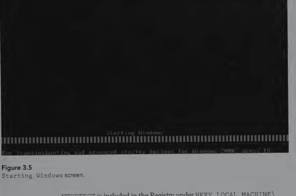

### Figure 3.5
Starting Windows screen.

`NTDETECT` 找到的硬件列表包含在注册表中的 `HKEY_LOCAL_MACHINE\HARDWARE` 下。`NTDETECT` 在您的系统上查找以下内容：

- CPU ID。
- BUS 类型。
- 视频板。
- 键盘和鼠标（如果存在）。
- 串行和并行端口。
- 软盘驱动器。

接下来，一旦 `NTDETECT` 成功完成，`NTLDR` 就会将系统控制权传递给 `NTOSKRNL.EXE`。我们可以将剩余的引导过程分为五个阶段：加载内核、初始化内核、加载系统服务、启动 Win32 子系统以及用户登录。

## LOADING THE KERNEL

一旦 `NTLDR` 将控制权传递给 `NTOSKRNL.EXE`，内核就会被加载。在显示图 3.5 的 Starting Windows 屏幕时，您可以按 `<F8>` 键显示 Advanced Options Menu，

该菜单提供高级引导和恢复选项。此菜单提供在正常引导过程中出现问题后启动系统的能力。我们将在本章后面讨论 Advanced Options Menu。

一旦内核加载完成，系统 HAL 将从 `HAL.DLL` 加载。`HAL` 加载后，内核将从 `SystemRoot\System32\Config\System` 加载 System Hive 并扫描它以确定应加载哪些驱动程序和服务。设置为在启动时启动的驱动程序和服务（此设置可以从控制面板中的服务和设备小程序中查看/更改）将根据它们在 `HKEY_LOCAL_MACHINE\SYSTEM\CurrentControlSet\Control\ServiceGroupOrder\List` 注册表值中出现的顺序加载。正如我们之前提到的，设备驱动程序文件是从 `SystemRoot\System32\Drivers` 文件夹访问的。在此阶段执行时，系统会在显示屏顶部显示一系列进度点 (...)。如果您希望获得更详细的进度显示，可以将 ShowOnScreen (`/sos`) 开关添加到 `boot.ini` 中的操作系统条目。

## INITIALIZING THE KERNEL

在内核成功加载到内存中（`NTOSKRNL.EXE`、`HAL` 以及所有驱动程序和服务）之后，系统必须初始化已加载的组件。如果您熟悉 Windows NT 4.0 引导序列，那么当屏幕被涂成蓝色并且屏幕顶部显示以下内容（或类似内容）时，您可以立即识别出此阶段：

```
Microsoft ® Windows NT ® Version 4.00 (Build 1381)

2 System Processors MultiProcessor Kernel [512 MB Memory]
```

Windows 2000 则以“现代化”的启动画面迎接您。此启动画面如图 3.6 所示。

在此阶段，完成以下操作：

- 1. 当前控制集被保存并用于创建克隆控制集，该克隆控制集存储在 `HKEY_LOCAL_MACHINE\SYSTEM\Clone` 注册表项下。
- 2. 在内核加载阶段加载到内存中的服务和驱动程序被初始化。
- 3. 使用 `NTDETECT(x86)` 或 `OSLOADER(RISC)` 在引导过程中早期收集的信息构建 `HKEY_LOCAL_MACHINE\HARDWARE` 键。
- 4. System Hive 再次被扫描以查找、初始化并启动系统设置为启动的服务和驱动程序。

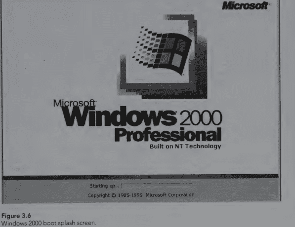

### Figure 3.6
Windows 2000 启动画面。

## LOADING SYSTEM SERVICES

一旦内核初始化阶段成功完成，服务管理器（`SMSS.EXE`）将被加载。在此阶段，完成以下任务：

- 1. 服务管理器完成 `HKEY_LOCAL_MACHINE\SYSTEM\CurrentControlSet\Control\SessionManager\BootExecute` 注册表值下指定的操作。默认情况下，`BootExecute` 下的唯一条目是 `autocheck autochk *`。`Autocheck` 是 `chkdsk` 的启动时版本，用于检查所有可用分区。
- 2. 系统分页文件根据 `HKEY_LOCAL_MACHINE\SYSTEM\CurrentControlSet\Control\Session Manager\Memory Management\Paging-Files` 中定义的条目进行设置。
- 3. 检查 `HKEY_LOCAL_MACHINE\SYSTEM\CurrentControlSet\Control\Session Manager\DosDevices` 注册表值并创建指定的文件系统链接。
- 4. 检查 `HKEY_LOCAL_MACHINE\SYSTEM\CurrentControlSet\Control\Session Manager\Subsystems\Required` 值并加载所需的子系统。默认情况下，仅需要 Win32 子系统。

## STARTING THE WIN32 SUBSYSTEM

如果所有先前的阶段都已完成，则加载 Win32 子系统并执行以下任务：

- 1. 启动 `WINLOGON.EXE` 程序，进而启动本地安全机构（`LSASS.EXE`）。完成后，会显示熟悉的 Ctrl+Alt+Del 消息，表明系统已准备好供用户开始登录过程。此消息框显示在图 3.7 中。
- 2. 执行服务控制器（`SCREG.EXE`）并最后一次遍历注册表以查找并启动设置为自动启动的任何设备和服务。这包括启动工作站和服务器服务，这些服务对于网络访问是必需的。服务和驱动程序根据注册表中指定的依赖项加载。如果您处于网络环境中，最好不要尝试登录，直到所有服务和驱动程序都已加载（即磁盘停止读写）。

### Figure 3.7
Windows 2000 登录消息。

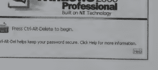

## USER LOGON

启动过程的最后一个，也是可能最重要的阶段是用户登录阶段。在用户成功登录到 Windows 2000 系统之前，不能认为启动是成功的。用户通过按 CTRL+ALT+DEL 来开始登录过程，以显示图 3.8 所示的登录对话框。输入用户名和密码后，并选择适当的域（如适用），即可通过单击 OK 按钮开始登录。在此阶段，系统会从克隆控制集创建 LastKnownGood 控制集。此时，系统应该稳定且可用。

## DUAL-BOOT SYSTEMS

双启动和多启动系统变得越来越普遍。能够同时拥有 UNIX 和 NT 操作系统的能力具有一定的吸引力。同样，能够使用 Windows 98 或其他系统使运行某些程序变得更容易。

“Windows 2000 启动过程”部分提供了双启动系统的示例。双启动系统的选项范围很广，使得不可能在此讨论所有不同的排列组合。

## Advanced Windows 2000 Boot Options

正如我们前面所述，在显示 Starting Windows 屏幕期间按下 `<F8>` 键将显示高级选项菜单，如图 3.9 所示。

### Figure 3.8
Windows 2000 登录对话框。

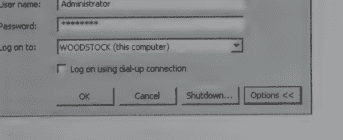

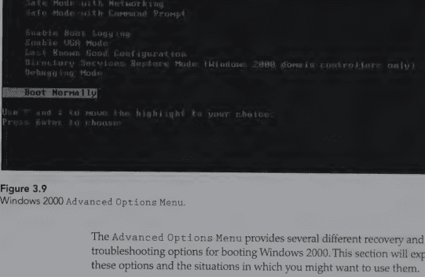

### Figure 3.9
Windows 2000 高级选项菜单。

高级选项菜单为启动 Windows 2000 提供了多种恢复和故障排除选项。本节将解释这些选项以及您可能想要使用它们的情况。

## SAFE MODE

如果您在正常启动系统时遇到困难，则选择安全模式可能会有所帮助。当您选择安全模式时，Windows 2000 仅加载系统启动所需的最低限度驱动程序和服务。当您启动到安全模式时，正常的 Windows 2000 桌面将被特殊的 安全模式 桌面取代，屏幕为黑色，四角均显示 Safe Mode。如果您的系统在安全模式下仍无法启动，您将需要执行系统恢复。

安全模式有三种类型：前面讨论的标准安全模式、安全模式 with Networking 和安全模式 with Command Prompt。这三种变体基本上相同，但有细微差别。如果您选择安全模式 with Networking，Windows 2000 将尝试在标准安全模式选项下加载的驱动程序和服务之外加载网络驱动程序和服务。如果您的系统可以在标准安全模式下启动，但在安全模式 with Networking 下无法启动，则您的系统可能存在不兼容或损坏的网络驱动程序。在安全模式下删除该驱动程序应该可以让您正常启动并重新安装网络组件


Components. 如果你选择带命令提示符的安全模式，你的计算机将以命令提示符界面启动安全模式，而不是 GUI 桌面。

## 启用启动日志

当你选择 `Enable Boot Logging` 时，Windows 2000 将在 `%windir%\ntbtlog.txt` 文件中记录驱动程序和服务的加载和初始化信息。此文件在排除故障和诊断启动问题时很有用。三种安全模式都会自动创建此文件。

## 启用 VGA 模式

如果你在显示驱动程序方面遇到问题，可以选择 `Enable VGA Mode` 来强制 Windows 2000 仅加载基本的 VGA 驱动程序。

## 上次正确配置

“上次正确配置”选项可用于使用上次关机时保存的注册表信息启动 Windows 2000。当你添加或修改了服务或驱动程序且系统无法启动时，此选项很有用。上次正确配置命令应恢复到你在进行更改之前的配置。

## 目录服务还原模式

目录服务还原模式选项专为运行 Active Directory 的 Windows 2000 Server 系统保留。如果你的 Active Directory 数据库丢失或损坏，可以使用此选项进行恢复。

## 调试模式

调试模式命令为 Windows 2000 Server 系统打开调试功能。它不用于 Windows 2000 Professional 系统。

## 正常启动

正如你可能猜到的那样，这将调用正常的启动过程。

## boot.ini 和你

`boot.ini` 文件为 Windows 2000 启动加载程序提供已安装操作系统的列表及其位置。我们之前的示例显示了 `boot.ini` 文件中的 Windows 2000 和 MS-DOS。`boot.ini` 文件如下所示：

```
[boot loader]
timeout=30
default=multi(0)disk(0)rdisk(0)partition(1)\WINNT

[operating systems]
multi(0)disk(0)rdisk(0)partition(1)\WINNT="Microsoft Windows 2000 Server" /fastdetect
C:\="Microsoft MS-DOS 6.22"
```

本节将提供 `boot.ini` 的两个部分的概述、Windows 2000 可用开关的描述，以及如何修改 `boot.ini` 的简要说明。

## BOOT.INI 部分

`boot.ini` 文件有两个部分：`[boot loader]` 部分和 `[operating systems]` 部分。每个部分彼此独立。下面讨论这些部分的作用，并提供如何构造条目的概述。

## [boot loader] 部分

`[boot loader]` 部分有两个目的：指定在加载默认操作系统之前等待的超时时间，以及指定默认操作系统的位置。`timeout` 参数的默认值是 30 秒，但可以是你指定的任何数字，包括 0。`default` 参数通常与下面讨论的 `[operating systems]` 部分中的第一个条目相同，但可以指向任何有效操作系统的位置。

## [operating systems] 部分

`[operating systems]` 部分列出已安装的不同操作系统的位置和描述。如果你希望为不同情况指定不同的开关，可以为单个操作系统提供多个条目。操作系统的位置使用 ARC（Advanced RISC Computing）路径指定，下面将讨论该路径。

## 理解 ARC 路径

ARC 或 Advanced RISC Computing 路径用于告诉 `NTLDR` 在何处找到已安装的操作系统。简单来说，ARC 路径为 `NTLDR` 提供了一张路线图，应该能通向有效的 Windows 2000 安装。下面显示了一个简单的 ARC 路径：

```
multi(0)disk(0)rdisk(0)partition(1)\WINNT
```

上面 ARC 路径的详细说明见表 3.4。

ARC 路径中最重要的信息是使用 `multi(x)` 或 `scsi(x)`。使用 `multi(x)` 选项时，`rdisk(z)` 参数指定正在访问的磁盘。使用 `scsi(x)` 选项时，`disk(y)` 参数指定正在访问的磁盘。Incorrect ARC paths will prevent the system from booting and can force you to perform a system recovery.

| Switch | Description |
|---|---|
| `multi(x)` or `scsi(x)` | 指定启动磁盘所连接的适配器或磁盘控制器。`scsi` 选项用于安装了没有 BIOS 的 SCSI 控制器时。`multi` 选项用于所有非 SCSI 控制器和安装了 BIOS 的 SCSI 控制器。值 `x` 表示控制器的加载顺序。随着每个控制器的初始化，它会被分配一个从 0 开始的数字。你必须指定正确的控制器，否则系统将无法启动。 |
| `disk(y)` | 当使用 `scsi` 选项时，这指定 SCSI ID。如果使用 `multi` 选项，值 `y` 始终为 0。 |
| `rdisk(z)` | 这标识连接到非 SCSI 磁盘控制器的磁盘。 |
| `partition(a)` | 这指定要搜索的分区。值 `a` 从 1 开始，指定要从哪个磁盘分区启动。磁盘分区按顺序编号，首先是主分区，然后是扩展分区中的逻辑驱动器。 |
| `\WINNT` | 指定包含操作系统的分区中的子目录。 |

## BOOT.INI SWITCHES

There are a few switches available for your use in the `boot.ini` file. These switches provide additional functionality to suit your personal preference. They have some troubleshooting value as well. Table 3.5 describes the available switches in detail.

| Switch | Description |
|---|---|
| `/basevideo` | You can add this switch to an entry in your `boot.ini` file to force Windows 2000 to load the default VGA driver instead of an adapter-specific driver. This is useful when you are having problems with your display driver. This switch performs the same function as the `Enable VGA Mode` option on the Advanced Options Menu. |
| `/fastdetect=[comx comx,y,z]` | This switch disables the detection of serial mice on the specified port(s). If no ports are specified, then serial mouse detection is disabled on all ports. This option is added to the `boot.ini` file by default during Windows 2000 setup. |
| `/maxmem:n` | This switch specifies the maximum amount of memory Windows 2000 can use. This switch is useful if you have or suspect that you have a bad memory module. |
| `/noguiboot` | Specifying this switch disables the Windows 2000 splash screen normally displayed during the boot process. |
| `/sos` | This switch causes the names of device drivers to be displayed on-screen as they are loaded. This switch is very useful when attempting to determine which driver is failing to load during boot. |

## MODIFYING BOOT.INI


进入`/path/to/xxx`目录，找到`xxx.json`。

在表达式`cvar = avar + bvar`中，加法运算符（`+`）将`avar`与`bvar`相加，得到它们的和`cvar`

在`List.of(arg0, arg1, arg2)`中，`List`接口的工厂方法`of()`接受一系列的元素，返回包含它们的只读列表。

之后我们这样调用`cmd`命令：`cmd arg0 arg1 arg2`。

```
if (condVar > someVal) {console.log("xxx")}
```


在BSD家族的UNIX操作系统中，控制启动过程的脚本是`rc.boot`、`rc.single`、`rc`和`rc.local`。这些脚本是Bourne shell脚本。编辑它们很简单，但切记永远不要删除文件中的信息。重新生成供应商提供的代码将相当困难。SysV家族的UNIX也使用Bourne shell脚本，但这些脚本存储在`init.d`目录结构中。启动方式的更改既可以在`inittab`文件中进行，也可以通过向正确的rc目录添加启动（S）或终止（K）脚本来实现。

Windows 2000中的高级选项菜单可用于修改系统启动，主要用于系统恢复和故障排除。`boot.ini`文件用于配置系统启动，以实现双启动或多启动系统。与UNIX的启动脚本一样，`boot.ini`也是一个纯文本文件。

## 关闭系统

在UNIX和Windows 2000中，正确地关闭系统都非常重要。数据完整性是主要原因。UNIX的关闭过程显然只适用于系统管理员。而Windows 2000的关闭操作则很简单，任何用户都可以执行。如果在任一操作系统或两种操作系统中使用文件共享或应用程序共享，则应制定相应的策略和程序，以控制系统何时可以关闭以及谁可以关闭系统。仅仅“关闭电源”的时代已经过去了。

## 文件系统

### UNIX

- UNIX文件系统

- 索引节点

- UNIX文件类型

- 磁盘格式化

- 创建文件系统

### WINDOWS 2000

- NTFS特性

- NTFS结构

- 日志记录与恢复

- NTFS容错

- 添加磁盘

文件系统是现代操作系统的命脉。文件系统是一个有凝聚力的、结构化的有机体，包含操作系统和应用程序所需及创建的数据。本章将讨论UNIX和Windows 2000文件系统的特性、结构和用途。虽然我们将避免讨论文件系统工作的底层细节，但我们将提供必要框架，以便您有效使用它们。


## UNIX文件系统

UNIX世界中的文件存在于文件系统内，而文件系统又构成了文件树。UNIX系统上的文件树可以包含来自多个磁盘甚至多台机器的文件系统。基本树由根文件系统及随后的目录或分支组成。图4.1显示了一个仅包含本地的文件树。

树中显示的一些子目录与根目录位于同一个物理分区上，而其他子目录则位于不同的分区上。使用`mount`命令将本地分区添加到文件树中，如下所示。

```
mount -F ufs /dev/dsk/c0t0d0s3 /var
```

`mount`命令根据提供的文件系统类型，将指定的块设备与给定的目录名关联起来。可用的文件系统类型有很多种。通常，可以省略`-F`选项，系统将使用默认文件系统。一种常用的文件系统类型是

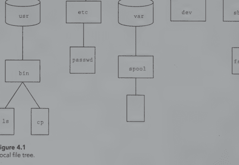

图4.1

本地文件树。

hfs（通常称为ISO9660），即High-Sierra文件系统。这是CD最广泛使用的格式。

一旦文件系统被挂载，其所有子目录都成为其所在文件树的一部分。树中的文件可以通过从根（或`/`）目录开始的绝对路径名来寻址，也可以通过从当前（或点）目录开始的相对路径名来寻址。表4.1显示了使用`ls`命令进行寻址的三种不同方式。

| 表4.1 绝对路径和相对路径 |  |
| --- | --- |
| **使用的地址** | **地址解释** |
| `/usr/bin/ls` | 指向`ls`的绝对路径。 |
| `./bin/ls` | 指向`ls`的相对路径，假设您在`/usr`目录中。 |
| `ls` | 指向`ls`的相对路径，假设您在`/usr/bin`目录中。 |

与NT一样，UNIX文件系统位于物理分区上。目前UNIX中使用的文件系统格式主要有两种：源自AT&T System V版本的原始s5文件系统，以及基于BSD的ufs（UNIX文件系统）。s5格式扁平化，使用四个特定部分。ufs文件系统使用一组部分，这些部分根据大小和配置在物理分区上重复。

图4.2所示的s5文件系统以引导块开始，其中包含第3章“系统引导与关闭”中讨论的引导程序。在s5文件系统中，引导块存在于不可引导的分区上，但它保持为空。第二部分是超级块，其中包含整个文件系统的管理信息，如空闲块。第三部分是索引节点列表。我们将在本章后面讨论索引节点列表。最后一部分是数据块，其中包含文件中使用的实际数据块。

与s5文件系统一样，ufs也有一个引导块和一个超级块。但是，图4.3显示ufs有多个超级块副本，以提供更好的数据完整性。如果超级块丢失，分区也就丢失了，因此多个副本提供了更高的稳定性。柱面组块是文件系统的另一个特性。文件系统根据分区大小被划分为柱面组。每个柱面组包含前面提到的超级块副本、一个包含索引节点列表子集的柱面组块，以及数据块的子集。通过尝试在物理分区上的地理区域内分配索引节点和数据块，可以提高磁盘效率。

`8192 × (12 + 2048 + 2048² + 2048³) = 7.0403 × 10¹³` 字节

因此，70万亿字节应该能够满足大多数用户的需求。

文件权限也包含在inode信息中。我们将在第11章“网络与安全”中讨论安全问题时介绍文件权限的使用。

## 目录与链接

每个inode都是指向一组数据的指针。这一概念通过链接来表达。在UNIX中，目录是一种包含若干二元组（couplet）表格的文件。每个二元组由一个inode编号和一个标识字符串组成。inode编号指向inode表中的某个inode条目，该条目进而指向数据。标识字符串是与通过该inode访问的那组数据相关联的文件名。这些指针如图4.5所示。

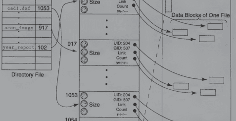

图4.5：目录。

UNIX最强大的特性之一就是文件链接的概念。链接有两种类型：硬链接和软链接。对于硬链接，你在某个目录文件中有一个条目，该条目二元组中的inode编号与同一目录中另一个条目或同一分区上另一目录中的条目具有相同的inode编号。这样做，你就创建了两个指向同一数据的名称。一旦创建了硬链接，任何一个名称都不会比其他名称拥有更大的所有权。无论你使用哪个名称修改文件，所有链接都指向同一数据，因此与inode关联的所有名称都会反映相同的数据。由于每个分区都有独立的inode表，硬链接不能跨分区。

第二种链接是软链接，如图4.6所示。在软链接中，目录二元组中的inode组件指向inode表中的一个唯一inode。该inode又在它的第一个关联数据块中存储了对另一个inode的引用。被引用的inode可以位于文件树可访问的任何分区上，无论它位于哪个系统中。对于符号链接，直接指向实际数据块的inode是唯一与该文件关联的正式inode；其他链接只是引用。

一个数据集累积多少硬链接并不重要；只要有一个存在，文件就存在。相反，如果被符号链接引用的原始文件/inode被删除，符号链接将指向空无。链接是通过`ln`命令创建的。

```
ln creates a hard link to a file
ln -s creates a soft link to a file
```

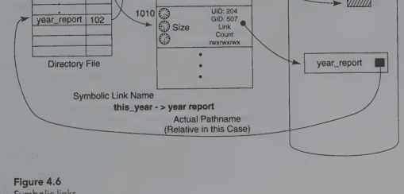

图4.6：符号链接。

## 文件类型

链接结构意味着UNIX中一切都是文件。目录只是一个包含与目录表中列出的文件名和inode相关信息的文件。同样，磁盘分区在UNIX中被表示为一个特殊文件，其中包含与设备驱动程序和访问物理设备所需的磁盘信息相关的内容。UNIX中有六种主要的文件类型：

- 普通文件。

- 目录。

- 硬链接。

- 符号链接。

- 命名管道。

- 特殊文件。

普通文件可以是任何形式，从纯文本文档到压缩归档文件。它们可以被视为文件树上的叶子。更具体地说，它们是包含零个或多个数据块数据的文件，不包括寻址或重定向数据。我们在上一节讨论了目录。目录是数据由inode-文件名二元组组成的文件。我们还讨论了硬链接和符号链接。在第一种情况下，目录二元组是对inode表的直接引用。在后一种情况下，与被引用inode关联的数据块反过来引用另一个inode条目。

命名管道是FIFO（先进先出）结构。命名管道使得一个应用程序可以向文件写入数据，同时另一个应用程序读取该文件成为可能。特殊文件不包含任何数据。相反，它们为物理设备和文件系统之间提供了接口。特殊文件有两种类型：块文件和字符文件。块文件将物理设备（通常是磁盘）接收到的数据块通过系统缓冲区缓存传递。`mount`命令需要块文件。字符文件直接将数据从设备驱动程序传输到进程，而不经过缓冲区缓存。`fsck`和`newfs`命令需要字符文件，即裸设备文件。

## UNIX 中的格式化


磁盘是通过使用 `format` 命令进行分区的。在大多数情况下，你的安装程序会为你运行 `format`，而你的工作是提供用于细分磁盘的必要信息。然而，从命令行运行 `format` 是一种常见情况；它在添加新磁盘或重新配置现有磁盘时使用。虽然 `format` 命令包含许多选项，但如果你掌握其中几个核心选项，你将能够正确管理你的环境。`format` 命令在不同的 UNIX 变体中有所不同，但基本概念是相同的。Linux 使用 `fdisk` 命令代替。这里我们展示 Solaris 版本的 `format` 示例：

```
## format
Searching for disks...done

AVAILABLE DISK SELECTIONS:
0. c0t0d0 <Seagate 34342A cyl 8892 alt 2 hd 15 sec 63> /pci@1f,0/pci@1,1/ide@3/dad@0,0
Specify disk (enter its number):
```

初始的 `format` 屏幕显示可用磁盘的列表，以及包括设备名称在内的详细磁盘信息。选择要修改的磁盘后，你会看到：

```
Specify disk (enter its number): 0
selecting c0t0d0
No defect list found
[disk formatted, no defect list found]
Warning: Current Disk has mounted partitions.

- FORMAT MENU:

- disk - select a disk
- type - select (define) a disk type
- partition - select (define) a partition table
- current - describe the current disk
- format - format and analyze the disk
- repair - repair a defective sector
- show - translate a disk address
- label - write label to the disk
- analyze - surface analysis
- defect - defect list management
- backup - search for backup labels
- verify - read and display labels
- save - save new disk/partition definitions
- volname - set 8-character volume name
- !<cmd> - execute <cmd>, then return
- quit

format>
```

你永远不会使用其中许多选项，除非你有磁盘问题并且需要分析和/或修复磁盘。`format` 最常见的用途是在磁盘上设置分区表。在 `format` 提示符下，输入 `partition` 你会看到：

```
format> partition

## PARTITION MENU:

- 0 - change '0' partition
- 1 - change '1' partition
- 2 - change '2' partition
- 3 - change '3' partition
- 4 - change '4' partition
- 5 - change '5' partition
- 6 - change '6' partition
- 7 - change '7' partition
- select - select a predefined table
- modify - modify a predefined partition table
- name - name the current table
- print - display the current table
- label - write partition map and label to the disk
- !<cmd> - execute <cmd>, then return
- quit

partition>
```

选项 0 到 7（在 SunOS 系统上为 a 到 h）允许你修改单个分区，或切片。然而，在开始修改分区表之前，务必使用 `print` 选项查看当前分区表：

```
partition> print
Current partition table (original):
Total disk cylinders available: 8892 + 2 (reserved cylinders)
```

| Part | Tag | Flag | Cylinders | Size | Blocks |
|---|---|---|---|---|---|
| 0 | root | wm | 0 - 7807 | 3.52GB | (7808/0/0) 7378560 |
| 1 | swap | wu | 7808 - 8891 | 500.19MB | (1084/0/0) 1024380 |
| 2 | backup | wm | 0 - 8891 | 4.01GB | (8892/0/0) 8402940 |
| 3 | unassigned | wm | 0 | 0 | (0/0/0) 0 |
| 4 | unassigned | wm | 0 | 0 | (0/0/0) 0 |
| 5 | unassigned | wm | 0 | 0 | (0/0/0) 0 |
| 6 | unassigned | wm | 0 | 0 | (0/0/0) 0 |
| 7 | unassigned | wm | 0 | 0 | (0/0/0) 0 |

```
partition>
```

每一行都提供了有关分区的详细信息，包括其大小、块数和柱面范围。柱面范围非常重要，因为你在对磁盘进行分区时要确保不会让柱面被多个分区拥有。虽然这可能看起来不寻常，但 UNIX 允许你重叠柱面，如果这种情况未被检测到，它可能会导致一些难以调试的奇怪行为。

通过输入你想要修改的分区对应的数字，你将被提示更改该分区。当前值显示在方括号 ([ ]) 中。如果未输入新信息，分区将保持其当前值。

```
partition> 0
Part  Tag  Flag  Cylinders       Size          Blocks
 0    root       wm    0 - 7807      3.52GB       (7808/0/0) 7378560

Enter partition id tag[root]:
Enter partition permission flags[wm]:
Enter new starting cyl[0]:
Enter partition size[7378560b, 7808c, 3602.81mb, 3.52gb]:
partition>
```

避免在分区系统时犯错的最佳方法是使用柱面数来为每个分区定大小，如我们的示例中所示，7808c。检查你的柱面总数是否等于分区 2 中显示的总量，将防止你重叠分区。

表 2.2 列出了在其他 UNIX 变体中用于格式化磁盘的命令。概念相似，但命令名称差异很大。

> 切勿修改分区 2，因为这是定义整个磁盘的重叠分区。分区 2 总是会给出磁盘上可用的柱面总数和空间。

> `format` 一个磁盘分区和维护实用程序。选项在 UNIX 家族中有所不同。Linux 使用 `fdisk` 命令。

## 创建文件系统

UNIX 的 `format` 命令不会像 NT 命令那样创建文件系统。创建文件系统有许多选项，因此必须在格式化后进行。创建文件系统的原始命令是 `mkfs`。然而，大多数管理员使用更简单、更直观的 `newfs`。`newfs` 命令只能在原始分区上运行。基本命令很简单：

```
## newfs /dev/rdsk/c0t0d0s4
```

默认文件系统将以每 inode 2048 字节创建。提高该数值会减少可用 inode 的数量，降低该数值会增加 inode 的数量。在很久以前磁盘空间昂贵的时候，限制文件系统开销占用的空间至关重要，因此调整 inode 与字节的比例很重要。要更改比例，可使用：

```
## newfs -i 4096 /dev/rdsk/c0t0d0s4' to create one inode for every 4096 bytes.
```

默认文件系统还提供十个百分点的缓冲，即实际可用文件空间的空闲空间。如果有 8GB 空间，系统会自动保留 800MB 作为防止覆盖的缓冲。你可以用以下命令更改此百分比：

```
## newfs -m 5 /dev/rdsk/c0t0d0s4
```

这会将百分比降低到 5。空闲空间之后可使用 `tunefs` 命令进行调整。


> 你在调整`newfs`参数时应谨慎。在大多数情况下，你无需更改它们，可以使用默认值。空闲空间参数是唯一一个在创建新文件系统后仍可更改的参数。请务必明智选择。


`newfs`构建新的 UNIX 文件系统。它是`mkfs`程序的友好前端。

## The Windows 2000 Filesystem

在本节中，我们讨论 Windows 2000 文件系统，即 NTFS 的许多方面，重点介绍文件系统结构，并介绍 NTFS 日志记录、恢复和容错。本节主要讨论如何有效使用 NTFS，而不是 NTFS 的实现方式。

### NTFS OVERVIEW AND FEATURES

当微软在 20 世纪 80 年代末开始设计 Windows NT 时，很明显，没有一个可用的文件系统，特别是 FAT 和 HPFS，能够满足已提出的要求。文件分配表 FAT 文件系统自 20 世纪 80 年代初就已存在，其设计目的是满足原始 IBM PC 的需求。FAT 文件系统旨在支持小型磁盘，例如软盘和小硬盘。FAT 的原始版本不支持大于 500MB 的磁盘，理论上 FAT 结构无法支持大于 4GB 的任何磁盘。多年来，FAT 已被扩展以支持大磁盘大小，现在 FAT32 文件系统可以支持比原始 FAT 文件系统大得多的磁盘。尽管如此，FAT 仍缺乏微软在 Windows NT 文件系统中寻找的高级功能。

IBM 在微软开始开发 Windows NT 的大致同一时间，为 OS/2 开发了高性能文件系统 HPFS。虽然 HPFS 提供了更好的性能并支持比 FAT 文件系统更大的磁盘，但它仍然无法满足微软对 Windows NT 文件系统的要求。

微软决定开发一个全新的文件系统，其总体指导方针如下：

- 大磁盘支持。
- 高性能。
- 安全。
- 可恢复性。
- 数据冗余。
- 容错。

尽管 NTFS 是全新设计，但文件系统的很大一部分受到了 FAT 和 HPFS 的影响，以及 POSIX 的属性，POSIX 即便用 UNIX 为基础的可移植操作系统接口来宽松翻译，也将在 NT 下得到支持。你已经读过有关 FAT 和 HPFS 的内容；POSIX 是 Windows NT 的众多子系统之一，可被开发人员利用。微软认为，如果 Windows NT 支持熟悉的接口，将对开发人员社区更具吸引力。当微软完成 NTFS 后，所有主要目标都已实现，NTFS 在各个方面都超过了 FAT 和 HPFS。表 4.2 显示了这三种文件系统的比较。

当 Windows NT 3.1 于 1993 年发布时，NTFS 已随附并可使用。NTFS 文件系统已随着 Windows NT 的每次发布而修订，包括随某些服务包提供的更新。Windows 2000 将随附 NTFS 版本 5.0，其中包含当前 NTFS 版本 4.0 的所有功能，以及磁盘配额、磁盘碎片整理、文件加密和改进的文件系统结构支持。

**表 4.2 FAT、HPFS 和 NTFS 概述**

| 文件系统 | 最大文件和卷大小 | 性能特征 |
| --- | --- | --- |
| FAT | 4 千兆字节 | 最适合小于 500 兆字节的分区。 |
| HPFS | 4 千兆字节 | 比 FAT 好，但比 NTFS 差。 |
| NTFS | 16 艾字节（理论值） 2 兆字节（实际值） | 最适合大于 500 兆字节的分区。 |

### 大磁盘支持

NTFS 支持非常大的磁盘，理论上最高可达 16 艾字节。当前物理限制将实际限制放在 2 兆字节。虽然今天不可能拥有如此大的磁盘卷或逻辑分区，但我们必须记住，就在 10 年前，在个人电脑上拥有 1 千兆字节磁盘几乎是不可想象的。由于我们无法预测未来，微软将 NTFS 设计为 64 位文件系统，能够适应未来可能带来的任何变化。另一个值得注意且相关的特性是，NTFS 还支持最高理论文件大小为 16 艾字节，因此在 NTFS 中可以有一个文件占用最大卷大小。随着数据库持续增长，这在未来可能证明非常有用。

### 安全

NTFS 支持文件级安全；也就是说，可以对单个文件、目录和卷设置访问权限。此功能使系统管理员对访问权限拥有几乎无限的控制权。控制的程度实际上仅受管理员愿意花费在配置系统上的时间多少的限制（当然也受想象力的限制）。

安全结构存储为访问控制列表（ACL），与文件记录中的其他文件属性一起存储。访问控制列表将在第 11 章中更详细地讨论。在 NTFS 中，访问权限可以针对用户和组级别同时授予和拒绝。权限可以由系统管理员、文件或目录的指定所有者，以及被管理员或所有者授予更改访问权限权限的用户或组进行调整。到现在应该很清楚，NTFS 提供了高水平的访问控制。

> 尽管我们将在本书后面更详细地讨论 ACL，但你在编辑 ACL 时应谨慎操作，以避免犯下代价高昂的错误。修改 ACL 时的一个简单错误实际上甚至可能阻止管理员访问文件或其他对象（也就是说，如果不做大量额外工作的话）。

### 压缩

与 FAT 和 HPFS 不同，NTFS 原生支持文件压缩。在 NTFS 下，可以实现 2:1 的压缩比。NTFS 压缩按目录启用，并会影响所有文件和子目录。重要的是要记住，对目录启用压缩并不会自动压缩当前数据。只有写入目录的新数据才会被压缩。如果你想压缩当前数据，你必须在高级目录属性窗口中明确执行此操作。要修改目录的压缩设置，请按照以下步骤操作：

1. 通过在 Windows 资源管理器中右键单击目录并从出现的列表中选择属性来打开目录属性窗口。图 4.7 中的窗口应出现。
2. 单击高级按钮以显示图 4.8 所示的高级属性窗口。

**图 4.7** 下载目录的属性窗口。


**图 4.8** 在高级属性窗口中选择压缩内容以节省磁盘空间。


3. 在压缩或加密属性部分下，选择或取消选择压缩内容以节省磁盘空间（取决于你是应用还是移除压缩）。
4. 完成更改后单击确定按钮。
5. 单击确定按钮关闭下载属性窗口并应用你的更改。
6. 你将被提示确认你的更改并选择压缩级别（是否将压缩应用于子目录）。确认属性更改窗口如图 4.9 所示。
7. 选择你想要的压缩级别并单击确定按钮。
8. 根据目录中已有的数据量，完成压缩操作可能需要几分钟时间。

**图 4.9** 确认你的压缩更改。


NTFS 压缩的一个独特之处在于，可以（但不建议）压缩操作系统文件。在许多情况下，访问压缩数据的速度比访问未压缩数据更快。你不应压缩操作系统文件，以免因文件系统驱动程序丢失或损坏而无法访问这些文件。请记住，操作系统文件在启动过程中会被访问。

### 加密

Windows 2000 的一项重要新功能是加密文件系统（EFS）。EFS 通过使用多种加密方法（包括公钥和数据加密标准（DES））的组合来加密你的数据，从而扩展了 NTFS 的功能。启用 EFS 后，只有允许的用户才能访问加密数据。此外，EFS 不会产生明显的文件系统性能下降。要为文件夹启用或禁用加密，请使用以下步骤：

1. 通过在 Windows 资源管理器中右键单击文件夹并从出现的列表中选择属性来打开目录属性窗口。（参见图 4.7。）
2. 单击高级按钮以显示高级属性窗口（图 4.10）。
3. 在压缩或加密属性部分下，选择或取消选择（取决于你是要应用还是移除加密）加密内容以保护数据。
4. 完成更改后单击确定按钮。


**图 4.10** 在高级属性窗口中选择加密内容以保护数据。

5. 单击确定按钮关闭 Directory Properties 窗口并应用你的更改。
6. 系统会提示你确认更改并选择加密级别（子目录是否应用压缩）。**Confirm Attribute Changes** 窗口会出现（图 4.11）。
7. 你文件夹中的数据现在应该已加密。

EFS 现在使用户能够安全地在其系统上存储数据，并提供许多人所需的安全性。EFS 有一些你应牢记的功能：

- 数据不能同时被加密和压缩。你只能选择其一。
- 通过网络发送的加密数据在传输过程中仍存在风险。在网络上传输敏感材料时应谨慎。

### 磁盘配额

Windows 2000 提供的另一项新功能是磁盘配额。虽然 UNIX 一直提供跟踪和限制用户磁盘空间的能力，但 Windows 终于等到了这一功能。Windows 2000 允许通过以下步骤为新用户设置默认配额：

1. 在 Windows 资源管理器中，右键单击你希望应用配额的卷并从出现的列表中选择 Properties。你只能对卷应用配额，而不能对单个文件和文件夹应用配额。图 4.12 所示的 Local Disk Properties 屏幕应会出现。


**Figure 4.11**

确认你的加密更改。

- 2. 选择配额选项卡。窗口应更改并显示配额设置，类似于图 4.13 所示。
- 3. 按照你的喜好设置默认配额选项。我在图 4.14 中选择了基本设置。
- 4. 单击确定按钮以应用你的配额设置。系统会提示你确认选择；通过单击确定按钮进行确认。文件系统扫描可能需要几分钟时间。你的卷上的配额现已激活。

> 配额设置窗口上的配额条目按钮将允许你查看各个用户的用量。你可以使用此高级菜单调整各个用户的设置。图 4.14 显示了配额条目屏幕。

Windows 2000 中的配额基于文件和目录所有权。你应确保各个用户是其文件和目录的所有者，否则配额设置将毫无用处。我们将在第 11 章讨论文件和目录所有权。

## Figure 4.12

本地磁盘属性窗口。


Figure 4.13

本地磁盘配额设置。


Figure 4.14

本地磁盘的配额条目。

## 磁盘碎片整理

Windows 2000 中最后的一项、也是备受期待的增强功能是能够对硬盘进行碎片整理。在之前的 Windows NT 版本中，这只能通过第三方实用程序来实现。今天，我们可以使用以下步骤对磁盘进行碎片整理：

- 1. 从控制面板和/或开始菜单中的“管理工具”文件夹打开“计算机管理”MMC 管理单元。你应该会看到图 4.15 所示的窗口。
- 2. 在“存储”菜单下选择“磁盘碎片整理程序”条目。你将看到与图 4.16 相似的屏幕。
- 3. 你的每个本地磁盘都会被列出，你可以选择分析并/或对每个磁盘进行碎片整理。我们建议你先分析磁盘，只有在分析操作建议你这样做时才进行碎片整理。

Windows 2000 可以对任何受支持的文件系统进行碎片整理。我们建议你仅在工作站


Figure 4.15

计算机管理 MMC 管理单元。


或服务器的负载处于最低时才对系统进行碎片整理。磁盘碎片整理非常占用磁盘资源，并且在碎片整理过程中会使磁盘不可用。

## 日志记录和恢复

NTFS 包含内置的日志记录和恢复功能，以保持高可靠性。NTFS 将所有磁盘访问视为事务性操作，并将其写入日志以从任何失败或中断的磁盘 I/O 操作中恢复。NTFS 中的恢复是自动的；无需用户干预。本章后面将更详细地讨论日志记录和恢复。

## 容错

NTFS 提供四种磁盘配置选项：两种非容错选项和两种容错选项。卷集和条带集提供创建大磁盘分区的能力，但不提供容错。镜像集和带奇偶校验的条带集提供创建具有容错能力的大磁盘分区的能力。每种选项都有其优缺点，将在本章后面讨论。

## NTFS 结构

本书无意提供文件系统结构方面的开发级讨论。相反，它旨在为系统管理员提供 NTFS 如何结构化的功能性理解，以便他们能够有效地在服务器或工作站上使用和支持 NTFS。基于此，本节将介绍基本的 NTFS 磁盘结构、主文件表（MFT）、文件和压缩。

### 卷

与大多数文件系统一样，NTFS 结构化为逻辑卷。卷可以由整个物理磁盘、物理磁盘的一部分或两个或多个物理磁盘的组合组成。每个逻辑卷都独立于其他卷处理，而不管它们包含在哪个物理磁盘上。要查看和管理 NTFS 卷，你应使用“管理工具”文件夹（包含在控制面板或开始菜单中）提供的“计算机管理”MMC 管理单元。计算机管理管理单元如图 4.17 所示。


Figure 4.17

显示磁盘配置的计算机管理管理单元。

### 簇

NTFS 不了解物理磁盘结构；此功能由磁盘驱动程序处理。NTFS 只了解磁盘簇。磁盘簇由一个或多个磁盘扇区组成，但扇区数始终为 2 的幂。

NTFS 卷上的簇可能小至 512 字节或大至 64 千字节，具体取决于卷的大小。建议你在格式化卷时始终使用默认簇大小，但也可以覆盖默认值。

### 主文件表

NTFS 将所有文件系统数据作为磁盘卷上的文件存储。这些特殊文件名都以美元符号（$）开头，并且通常是隐藏的。表 4.3 描述了这些文件中的每一个以及它们与主文件表（MFT）的关系。

MFT 构造为文件记录的数组，这使得搜索和定位文件非常快。MFT 是 NTFS 卷的核心，包含卷中包含的每个文件和目录的信息。每个文件由单个 MFT 记录表示，除了文件高度碎片化或包含许多属性的情况。在这些情况下，基本文件记录包含指向一个或多个附加文件记录的指针，这些记录包含实际文件信息。

### 文件

如前所述，NTFS 卷上存储的所有内容都是文件，甚至包括 MFT。文件由引用号标识，由记录和属性描述，并以简单的文件名形式对用户可见。本节将尝试揭开 NTFS 文件的神秘面纱。

### 引用号

64 位引用号标识 NTFS 卷上的所有文件。文件引用号分为两部分。下 48 位对应于文件的文件记录在 MFT 中的位置。上 16 位对应于序列号，每当 MFT 中文件记录位置被重用时，该序列号就会递增。序列号使 NTFS 能够执行内部一致性检查。

### 记录

与许多文件系统不同，NTFS 将文件存储为属性/值对。文件记录中的每个属性（或项目）都有一个相关的值。例如，Filename 是一个属性，myfile.txt 是与该属性关联的值。文件内包含的数据只是文件记录中包含的一个属性。NTFS 例程用于

## 表 4.4 标准 NTFS 文件属性

| 属性名称 | 属性描述 |
|---|---|
| 标准信息 | 包含时间戳、链接计数以及系统、隐藏、只读、归档等标准属性。 |
| 属性列表 | 列出所有属性记录的位置，当它们无法全部放入 MFT 记录中时使用。 |
| 文件名 | 此处包含文件的一个或多个文件名属性。长 Unicode 名称、短 MS-DOS 名称以及 POSIX 硬链接均可包含在此记录中。 |
| 安全描述符 | 包含安全信息，指定文件所有者以及谁可以访问文件。 |
| 数据 | 包含文件数据。NTFS 允许文件具有多个数据属性。每个文件通常有一个未命名的数据属性和一个或多个命名数据属性。目录没有未命名的数据属性，但可以具有可选的命名数据属性。 |
| 索引根 | 用于实现文件夹。 |
| 索引分配 | 用于实现文件夹。 |
| 卷信息 | 仅用于 $Volume 系统文件，并包含卷的版本和名称等信息。 |
| 位图 | 提供表示 MFT 或文件夹中正在使用的记录的映射。 |
| 扩展属性信息 | 由与 OS/2 系统链接的文件服务器使用，Windows NT 或 Windows 2000 不使用。 |
| 扩展属性 | 由与 OS/2 系统链接的文件服务器使用，Windows NT 或 Windows 2000 不使用。 |

存储在文件记录中的 filename（你知道的，旧 FAT 对文件名长度的限制）。然而，NTFS 并不会为基于 POSIX 的应用程序生成 8.3 文件名。

> POSIX 文件无法被 MS-DOS 和 Windows 基于的应用程序查看，除非它们符合 8.3 格式创建（即，你必须为文件指定一个 8.3 名称而不是“长文件名”）。

## 压缩

NTFS 支持按文件、按目录或按卷进行压缩。压缩实时进行且对用户透明。虽然压缩过程会略微减慢文件访问速度，但 NTFS 驱动程序会自动完成，你应体验到最小的影响。

一旦为目录或卷启用了压缩，所有新写入的目录和文件默认都会被压缩。然而，如果在写入之前未启用压缩，则现有目录和文件必须手动压缩。

## NTFS 日志记录和恢复

NTFS 提供了两个非常重要的功能：日志记录和恢复。这两个功能实际上相互依赖，以提供高度可恢复的卷。

### 日志记录

NTFS 文件系统提供内置的日志记录功能。由于所有磁盘访问都作为事务处理，因此可以记录和监控事务，并在发生故障时使用这些信息。NTFS 日志记录最好的地方在于它不需要用户干预。所有日志操作均由嵌入在 NTFS 驱动程序中的日志文件服务（LFS）处理。NTFS 使用 LFS 创建两种主要类型的记录，更新记录和检查点记录。

**更新记录** 更新记录是 NTFS 使用最常见的记录。每条更新记录由两部分信息组成：

- **重做信息** 用于在系统错误发生且事务尚未从缓存刷新之前，重新应用已完全记录事务的一个子操作（完整事务的一部分的单个操作）。
- **撤销信息** 用于在系统故障发生时，撤销部分记录事务的一个子操作。

**检查点记录** 检查点记录定期创建，以提供信息使 NTFS 能够从立即发生的故障中恢复。检查点记录告诉文件系统在故障后修复卷时日志文件处理应从何处开始。

### 恢复


NTFS 在系统启动后首次访问卷时自动执行磁盘恢复。正如你可能想到的，这意味着每次启动 Windows NT 或 Windows 2000 时都会执行恢复。然而，如果不需要恢复，该过程将退出而不执行任何操作。NTFS 恢复依赖于内存中维护的以下两个表：
- `事务表`：跟踪尚未提交的活动事务。在恢复期间，这些事务的子操作必须从磁盘中删除。
- `脏页表`：记录哪些缓存页已被修改但尚未写入磁盘。在恢复期间，这些数据必须刷新到磁盘以保持卷的一致性。

NTFS 每五秒创建一个检查点记录并存储事务表和脏页表的副本。当在故障后启动恢复时，NTFS 打开日志文件并定位最新的检查点记录以及事务表和脏页表的副本。在大多数情况下，在最新的检查点记录之后存在更新记录。此时，日志文件被加载到内存中，恢复操作在三次传递中完成：

### 分析传递
在分析传递期间，NTFS 从上次检查点操作的开始扫描日志文件到文件末尾。在此传递期间，额外更新记录中的信息用于更新事务表和脏页表的副本。在分析传递结束时，事务表和脏页表应准确反映故障发生时的状态。

### 重做传递
在重做传递期间，NTFS 从分析传递中找到的最旧记录开始向前扫描日志文件。重做传递用于定位在故障前已完成但可能未及时从缓存刷新的页更新记录。找到的每个操作都会重新提交到缓存以完成。

### 撤销传递
撤销传递用于回滚系统故障时未提交的任何操作。撤销传递完成后，卷应稳定且连贯，直到故障发生时为止。

## chkdsk

尽管 NTFS 包含内置的恢复功能，有时手动检查卷是否存在错误仍然很有用。`chkdsk` 是 NTFS 的等价于 UNIX `fsck` 实用程序。`chkdsk` 具有扫描卷以检查文件系统的能力
errors, and for physical disk errors as well. You should not have to run `chkdsk` unless you are experiencing unusual file system problems. There are two common ways to run `chkdsk`:
- To have `chkdsk` scan and repair drive C: for filesystem errors, use the following syntax:
```
chkdsk C: /f
```
- To have `chkdsk` scan and repair drive C: for filesystem and physical media errors, use the following syntax:
```
chkdsk C: /f /r
```
Keep in mind that `chkdsk` cannot operate on volumes that are currently in use. If you need to run `chkdsk` on a volume currently in use (i.e. the System partition), you should execute one of the above commands, answer yes when prompted to run `chkdsk` during the next reboot, and then reboot the system. `chkdsk` will run at the time of the next reboot.

`chkdsk` scans a volume for filesystem errors and for physical errors.

## NTFS 容错性

NTFS 是少数支持高级卷配置和容错性的文件系统之一。NTFS 符合廉价磁盘冗余阵列（`RAID`）标准。所有高级卷，除了卷集之外，都符合 `RAID` 标准。有两种非容错配置：卷集和条带集。NTFS 还提供两种容错配置：镜像集和带奇偶校验的条带集。本节将讨论所有四种配置的属性。在每种情况下，磁盘管理员用于管理各种磁盘配置。不同的 `RAID` 级别在表 4.5 中描述。

### 卷集

卷集由位于一个或多个物理卷上的最多 32 个大小不一的空闲空间区域创建。数据按顺序写入卷集，卷集的性能几乎与单个磁盘上的单个分区相同。卷集的有用之处在于它们可以在不丢失其包含的数据的情况下进行扩展。但是，卷集不提供任何容错性，如果卷集中包含的磁盘之一损坏，整个卷集将被损坏。

### 条带集

条带集由一个或多个物理卷上两个或多个大小相同的空闲空间区域创建。条带集通常由两个或多个大小相同的磁盘创建。当数据写入条带集时，它被分解为大小相等的块，并将一个块写入条带集中的每个磁盘。对条带集的读写访问非常快，因为数据是从多个磁盘（以及可能多个磁盘控制器）流式传输的。条带集不能在不丢失其中包含的数据的情况下进行扩展。条带集不提供任何容错性，因此单个磁盘故障将导致所有数据丢失。条带集对应于 `RAID` 级别 0。

| Table 4.5 RAID Levels Supported on Windows 2000 |
|---|---|
| RAID Level | Description |
| 0: (Striping) | RAID Level 0 allows you to combine two or more disks of equal size into a larger logical volume. Data is written in equal-sized chunks to each disk in the volume. There is no redundancy in this configuration, but disk reads and writes are faster because multiple disks are being accessed concurrently. |
| 1: (Mirroring) | RAID Level 1 allows data from one physical disk to be duplicated to a second physical disk. In the event that the primary disk fails, the secondary disk can take the place of the primary disk with no data loss. |
| 5: (Striping with Parity) | RAID Level 5 provides similar functionality to RAID Level 0. However, this level provides redundancy when a single disk fails. A RAID 5 volume can be established using three or more disks of equal size. The actual size of the volume will be the number of disks minus one multiplied by the size of the disk. The reason for the "loss" of one disk is to store parity information so data can be regenerated if a disk fails. While read performance is better with RAID 5, write performance is slower that RAID 0 because parity information is generated and stored with each write. |

### 镜像集

镜像集由两个大小相同的磁盘创建。在镜像集中，两个磁盘包含完全相同的数据。如果磁盘发生故障，镜像集可以被中断，好的磁盘可以上线，就像什么也没发生过一样。一旦损坏的磁盘被更换，镜像


### Figure 4.18

Computer Management MMC snap-in.
- 1. 从控制面板和/或开始菜单中的管理工具文件夹打开计算机管理 MMC 管理单元。你应该会看到图 4.18 中的窗口。
- 2. 在存储菜单下选择磁盘管理条目。如果安装了全新的磁盘（没有预定义分区），你会看到写入签名和升级磁盘向导。按照向导操作以开始安装新磁盘。完成向导后，你将看到类似图 4.19 的屏幕。
- 3. 右键单击未分配的磁盘并选择创建卷选项以启动创建卷向导。回答问题以完成创建分区、分配驱动器号然后格式化新卷所需的步骤。默认选项应足够。
- 4. 向导完成后且格式化操作结束时，你的新磁盘即可使用。


**Figure 4.19**

磁盘管理实用程序。

## Summary

## UNIX FILESYSTEMS


# UNIX 文件系统结构

UNIX 文件系统结构为树形，从根目录开始分支到各个文件。它同时简单又复杂。整个结构由指针创建。目录是一组包含指向 inode 列表中 inode 的指针的二元组。inode 包含与文件相关的所有信息，如所有者、修改时间，最重要的是指向磁盘上实际数据块的指针。

在 UNIX 中一切都被视为文件，因此存在几种文件类型。UNIX 中有六种主要文件类型：

- 普通文件。
- 目录。
- 链接。
- 符号链接。
- 命名管道。
- 特殊文件。

硬链接和符号（软）链接是 UNIX 中的强大功能。对于硬链接，你在目录文件中有条目，其中该二元组的 inode 组件与该目录或同一分区上另一个目录中的另一个条目的 inode 编号相同。在软链接中，目录二元组的 inode 组件指向 inode 表中的一个唯一 inode。它反过来在其第一个关联数据块中存储对另一个 inode 的引用。

要向 UNIX 系统添加磁盘，必须先格式化磁盘。不同版本的 UNIX 使用不同的命令执行此操作。在本章中，我们向你展示了 Solaris `format` 命令的示例。无论操作系统或命令如何，都必须定义和配置切片或分区。完成此操作后，你可以使用 `newfs` 或适用于你所用 UNIX 版本的相关程序来创建实际的文件系统。

## WINDOWS 2000 FILESYSTEMS

`NTFS` 是一个稳健、强大的文件系统。安全模型极其强大，为管理员提供几乎无限的控制。`NTFS` 内置的恢复功能不可或缺，有助于保证高可用性、容错的磁盘配置。微软在开发 `NTFS` 时遵循以下总体指导原则：

- 大磁盘支持。
- 高性能。
- 安全。
- 可恢复性。
- 数据冗余。
- 容错。

`NTFS` 受 `FAT` 和 `HPFS` 以及 `POSIX` 属性的影响。`NTFS` 不感知物理磁盘结构；此功能由磁盘驱动程序处理。`NTFS` 只感知磁盘簇。与 UNIX 类似，`NTFS` 卷上存储的一切都是文件，甚至主文件表也是如此。文件由引用号标识，由记录和属性描述，并以简单的文件名形式对用户可见。`NTFS` 提供两个非常重要的功能：日志记录和恢复。日志操作由日志文件服务（`LFS`）处理，该服务嵌入在 `NTFS` 驱动程序中。`NTFS` 使用 `LFS` 创建两种主要类型的记录：更新记录和检查点记录。恢复在每次启动 Windows NT 时执行或

Windows 2000。如果不需要恢复，进程将退出且不执行任何操作。

`NTFS` 支持高级卷配置和容错。`NTFS` 还符合 `RAID` 标准。有两种非容错配置：卷集和条带集。`NTFS` 还提供两种容错配置：镜像集和带奇偶校验的条带集。

## 升级、补丁、服务包和热修复

### UNIX

- 升级技术
- 补丁前规划
- 补丁 AIX：`SMIT`
- 补丁 HPUX：`SAM`
- 补丁 Linux：`GNOrpm`
- 补丁 Solaris：`Installpatch`

### WINDOWS

- 升级技术
- 安装服务包
- 安装热修复

拥有计算机系统类似于拥有汽车，尽管计算机贬值更快。对于汽车，你预计要定期进行维护，以确保车辆平稳运行并使用长久。有时维护很简单，例如检查机油或轮胎换位，而有时则需要全面调校甚至完全重建发动机。根据你的车辆型号，你可能会收到制造商的召回通知，告知你存在需要修复的缺陷。

管理计算机的操作系统就像管理车辆的维护一样。安装新操作系统后，你需要定期进行一般维护以保持操作系统平稳运行。有时工作很简单，有时很复杂。在某些情况下，你会发现或被告知操作系统的漏洞和问题。在许多情况下，你会收到操作系统的更新，以提供更好的性能、稳定性和安全性。

你定期添加到操作系统的改进被定义为升级和补丁。升级是对操作系统进行的任何添加，提供新功能或在旧操作系统上提供更好的性能。一般来说，操作系统升级以发布的形式出现，其中新发布是旧版本操作系统的增量；例如，`HPUX 10` 和 `HPUX 11` 之间的差异。


数字上的大变化表示改进量很大，而数字上的小增量，例如 `HPUX 10.0` 到 `HPUX 10.01`，通常表示更改和增强很小。补丁是修复问题的代码片段，通常与性能、安全或稳定性相关。每个操作系统版本将有数百个补丁，因为用户、开发人员和系统管理员发现操作系统代码中的弱点。

重要的是，随着时间的推移，你将花费大量资源研究、管理和安装补丁和系统升级。本章将帮助你学习如何通过结构化的方法有效地管理这项庞大的任务。管理补丁和升级对于 Windows 和 UNIX 来说非常相似。安装补丁和升级对于每个操作系统来说都是非常具体的，本章将为你提供所需的信息，以便为你喜欢的 UNIX 操作系统以及 Windows 2000 执行升级和补丁。

## 升级操作系统

根据你希望成为的类型，术语“升级”可能有不同的含义。如果你是硬件发烧友，当你的老板提到升级时，你会兴奋不已并查看产品目录，查询超快新处理器的价格，或另一根内存条的成本。硬件升级可能令人兴奋。如果你的重点是操作系统和软件，术语“升级”足以引起抽搐、痉挛和不受控制的言语。如果你是这样的人，那么你已经经历过自己的一份软件升级，并体验过它们带来的“好处”。

操作系统升级是你对核心操作系统进行的任何安装后修改，以增强灵活性、补救缺陷或添加功能。一般来说，升级由操作系统厂商生成，提供新程序或选项，修复错误，并通常给你比以前更好的东西。升级可以以新操作系统版本的形式出现，也可以作为当前系统的更新。无论它们如何打包，升级都是保持系统长期运行的重要方式。

> 操作系统升级是你对核心操作系统进行的任何安装后修改，以增强灵活性、补救缺陷或添加功能

操作系统升级不必引发噩梦，也不需要在深夜跑到当地的复印中心更新你的简历。升级通常是一种有用且富有成效的方式，可以提高系统性能。操作系统开发人员设计升级是为了增加功能、消除错误和怪癖，并提高性能和可靠性。虽然我们中许多人可能会质疑过去升级的价值，但总体而言，操作系统程序员并不是一开始就想成为施虐狂，只想让你的生活难以忍受。

在集成环境中升级会增加跨操作系统依赖的复杂性。各种集成工具，如 `SAMBA` 和 `LDAP`，要求管理员在升级后确认兼容性。某些在 `Red Hat Linux 6.0` 和 `NT 4.0` 下运行良好的东西，可能在 `Linux 5.1` 和 `Windows 2000` 下无法运行，反之亦然。

一位有见识的管理员将理解操作系统升级的关键要素，并制定成功的实施计划。在接下来的章节中，我们将提供评估、规划和安装下一次操作系统升级所需的技巧和工具。有了这些工具，你的成功几率应该会提高，而你的压力和血压水平应该会下降。

## 升级 VS. 重新安装

如果你是一位经验丰富的管理员，你很可能已经经历过多次系统升级和重新安装。然而，“升级”和“重新安装”这两个术语可能并不是你用来描述你的流程的词语。了解它们之间的区别很重要，因为你维护系统的策略会根据你选择使用的方法而改变。

升级操作系统是指从现有系统中添加和删除元素以创建新的操作系统的行为。一个很好的例子是当你从 `Windows 95` 升级到 `Windows 98` 时。完成后，你拥有了新的操作系统（`Windows 98`），但许多来自先前操作系统的核心元素仍然完好无损（来自 `Windows 95`）。你也不必重新安装任何程序或硬件，一旦完成升级，你的任务就完成了。

重新安装包括采用新版本的系统并将其安装，就好像硬盘上的数据不存在一样。基本上，你是从头开始安装操作系统，完成后会得到一个完整的新操作系统和干净的操作系统。然而，安装完成后，你仍然有很多工作要做。有时重新安装是到达新操作系统版本（`Windows 95` 到 `Windows 2000`，或 `SunOS` 到 `Solaris`）的唯一方法，因此在某些情况下，你可能别无选择。

### 表 5.1 升级和重新安装的优点

| 升级的优点 | 重新安装的优点 |
|---|---|
| 系统文件保持完整；升级后几乎不需要或不需要后续工作。 | 新安装比升级过程快得多。 |
| 升级在修改操作系统时提供更细粒度的控制，因为与完整重新安装相比，每次升级所需的变化更少。 | 允许管理员重新配置硬件而不影响系统配置。 |
| 在许多情况下，可以回滚升级并恢复到旧操作系统。 | 全新的、干净的操作系统副本。 |

正如表 5.1 所示，升级和重新安装各有其理由。通过完成升级，你几乎不需要升级后的工作，因为升级通常不会干扰应用程序软件或操作系统修改。此外，在许多情况下，你还能获得额外的安心感，即可以回滚并卸载升级，恢复到之前的操作系统级别。对于新安装，你会发现安装新操作系统所需的时间比尝试升级快两到三倍。此外，你还能获得一个全新的操作系统副本，因此你确切知道自己在处理什么。

虽然升级和重新安装各有优点，但查看每种选择的缺点同样重要。表 5.2 显示了每种操作的某些缺点。

重新安装系统有相对较少的缺点。最耗时的任务是你需要在操作系统传输到磁盘后花费时间。基本上，重新安装操作系统与从头开始安装系统相同——一次全新安装。只要你有一个可靠的安装程序，重新安装应该很容易。重新安装的另一个问题是，如果新操作系统出现问题，你没有在线回滚路径。然而，只要你有良好的备份，你应该能够从任何灾难中恢复。


在选择升级路线时，如果你希望升级到未来版本，你必须安装每个新版本的操作系统。对于很少更改的操作系统，这不是问题，但如果你的操作系统一年更改两到三次，你真的想要进行这么多次升级的麻烦，尤其是如果新版本并不能直接惠及你的安装环境？

表 5.2 升级与重新安装的缺点

| 升级的缺点 | 重新安装的缺点 |
| --- | --- |
| 需要升级每个操作系统版本。你不能跳过或漏装一系列版本中的一个。 | 需要安装后重新配置，对于安装了大量应用程序或配置复杂的系统来说可能非常耗时。 |
| 耗时过程，尤其是在老旧硬件上。 | 无法回滚升级；必须从磁带恢复。 |
| 需要更多磁盘空间，因为旧组件的副本会被归档。 |  |
| 可能修改你已自定义的系统文件。 |  |
| 新版本可能太大而无法放入当前磁盘配置中。 |  |

升级也是一项耗时的工作。虽然操作系统的平均干净安装可能需要 30 分钟到两小时不等，但升级可能需要四到五小时或更长时间，具体取决于硬件速度。检查每个操作系统组件的版本级别、对其进行归档，然后用新版本替换它，需要花费大量时间。升级还因为归档功能而需要更多的磁盘空间，随后可能无法适应你的当前配置。没有什么比升级进行到一半才意识到它装不进磁盘更令人沮丧的了。

升级的最后一个也是可能最令人沮丧的缺点是，在许多情况下，升级过程会以你可能不期望的方式替换或修改系统配置文件。Windows `INI` 文件和诸如 `sendmail.cf` 之类的 UNIX 文件通常会在升级过程中被替换。除非你知道在哪里以及要查找什么，否则你可能会在环境中引入不一致之处，导致日后花费数小时的工作。

> 只要有可能，请选择重新安装操作系统而不是升级。重新安装后花费的一点重新配置时间，将远远超过升级可能带来的诸多问题。

在牢牢记住表 5.1 和表 5.2 中的信息后，我们希望你得出这样的结论：选择升级选项如果可能的话应尽量避免。经验丰富的管理员每个人都有自己的升级失败的恐怖故事。这就是为什么制定健全的安装程序，如第 2 章“系统规划、安装和配置”所述如此重要。如果你有一个完善且有组织的安装方案，将系统迁移到最新操作系统应该就像一次新安装一样简单。

## 升级：做出正确的选择

过去，新的操作系统版本出现得非常不频繁，因此备受期待并受到热烈欢迎。随着技术和编程技术的变化加快，新操作系统版本的发布频率也随之加快。在今天的工作中，管理员可以预期每年都会有一个新的操作系统版本，而对操作系统的次要修订则每年会出现两到三次。有时甚至三次。将操作系统发布的数量乘以你管理的系统数量，很容易看出即使对于规模适中的环境来说，跟上每一个发布在物理上或心理上可能都不可能。

因此，鉴于你可能不想在管理的每个系统上安装每一个新的操作系统版本，你如何决定哪些新版本值得采用？如果你希望得到一个快速简单的答案，你可能想合上书本稍后再看。决定何时升级是一个复杂的过程，其答案会因提问者而异。然而，在决定是否升级操作系统时，这里有一些需要考虑的要点：

- 新功能和增强功能的可用性——新的操作系统版本通常包含旧版本中不可用的功能和增强功能。这些新功能可能包括性能提升、安全性增强以及更新的管理工具。

- 错误修复和对过去缺陷的修正——新版本整合了早期版本的错误修复（补丁），并且可能修复补丁无法纠正的缺陷。通常你的操作系统厂商可能不会花时间为旧版本生成补丁，从而鼓励你升级以获得好处。

- 应用要求—新应用可能要求你拥有最新最好的操作系统。

- 硬件要求—在某些情况下，新硬件可能仅由更新的操作系统支持，具体取决于你的硬件和软件供应商。

如果你的升级原因不符合上述任一类别，你可能需要重新评估你的决定。如果你的系统运行良好，用户满意，且没有重大问题，你最好的选择就是保持系统现状，并在下一个操作系统发布后再考虑升级。

> 正如我们在第 2 章中学到的教训一样，提前花时间规划你的安装应该能为你节省以后数小时的工作。规划升级也是一样，许多安装操作系统的技术都是你在升级操作系统时应使用的流程。

## 在灾难情况下修改你的备份计划

在开始升级之前，学习如何对系统进行完整备份非常重要。执行完整备份不仅仅是运行日常或每周的完整备份。对于 UNIX 和 Windows 2000，验证你的备份是否有效。几乎每个称职的管理员都会有一个故事，讲述他们在某次失败的系统维护前完成了备份，却发现备份已损坏、磁带损坏，或备份软件配置错误，未备份到他们预期的数据。花费时间验证备份所花费的时间，与你不得不在最重要用户面前为自己的生命哀求所花费的时间相比，是公平的交换。

> 在启动升级之前执行并验证备份。没有什么比解释为什么在备份未成功的情况下数据丢失更糟糕的了。

另一种在灾难发生时可以为你节省时间的技巧是以易于访问的方式执行升级前的备份。鉴于当今环境中庞大的数据量，许多管理员使用比操作系统内部提供的基本备份工具更复杂的备份包。如果你使用第三方备份工具，重建环境以便快速恢复失败的系统可能会出现问题。只要有可能，就将备份设备直接连接到正在升级的系统，并将备份执行到该介质上。这样，如果灾难发生，你可以快速高效地恢复数据，而无需担心网络配置或重新安装备份软件的客户端部分。

> 只要有可能，就将备份设备直接连接到机器上，并使用操作系统自带工具执行备份。如果灾难发生，使用操作系统工具和本地文件恢复关键操作系统元素要比从复杂的网络备份工具恢复容易得多。

## 升级 UNIX

由于 UNIX 变种数量庞大，很可能如果你拥有混合环境，你花费在升级 UNIX 系统上的时间会比升级基于 Windows 的计算机更多。作为经验法则，UNIX 厂商通常每两年发布一次操作系统的全新版本，每年可能发布一次次要版本。由于发布间隔一年，对新手管理员来说，保持最新版本似乎是一项简单的任务。然而，这并不总是如此。

虽然软件厂商会收到新操作系统的预发布版和测试版，但有时厂商软件对新操作系统的支持可能滞后于操作系统发布六个月或更长时间。此外，新操作系统往往比其应有的缺陷更多，即使是广泛的测试版发布也可能无法发现或提供足够的时间修复新操作系统中的所有不足。出于这些原因，除非你有非常充分的理由，否则不要在操作系统技术的领先边缘行进是很有必要的。

> 在大多数情况下，最好在新版本发布后等待四到六个月再将新操作系统引入生产环境。

在处理新版本时，始终找到一个偏僻的、非生产系统来部署新操作系统的初始副本。利用此环境熟悉新操作系统可能带来的任何新功能。如果你生产环境中有专用硬件，你可能希望利用这个机会在类似配置的非生产系统上测试新操作系统，如果有的话。

使用你的环境中的各个组件测试新的操作系统，包括 NFS、NIS、Windows-UNIX 文件共享、备份和安全。在你对所有组件都感到满意之前，不要被迫过早发布新的操作系统。注意正在发布的补丁，特别是与内核和安全相关的补丁。如果你看到在短时间内发布了太多补丁，你可能希望在将新的操作系统纳入你的环境之前再等待一段时间。

到目前为止，我们对升级技术的讨论都是通用的。虽然升级到新的 UNIX 版本通常不是一项困难的操作，但有一些特定于 UNIX 的事情你可以做来提高成功的几率。有效地管理你的磁盘空间和 `/etc` 目录将帮助你在完成 UNIX 升级后拥有满意的用户并保持你的理智。你还希望卸载任何非操作系统的文件系统，以确保你不会意外覆盖它们。墨菲定律规定，如果你跳过这一步，就会发生不好的事情。

### EFFECTIVE DISK ADMINISTRATION

思考如何升级到下一个操作系统版本的最佳时机是在新系统初始安装期间。你现在就应该这样做，因为你在安装期间所做的选择会影响以后升级系统的难度。

> 通常，未来升级的最大障碍是磁盘空间不足。

随着时间的推移，未来版本的尺寸会增加，而硬盘上的可用空间却会减少。补丁的安装、日志文件的增长以及软件和驱动程序都会消耗掉你在初始安装时认为充足的硬盘空间。请密切关注文件系统 `/`、`/var` 和 `/usr`，因为这些区域在后续升级期间需要有足够的空间。确保未来有足够磁盘空间的一些提示是：

- 如果可能，指定一台仅用于操作系统的磁盘驱动器。将磁盘分区为仅有两个分区：一个用于 `/`，一个用于 swap。通过这种方式划分磁盘，你将拥有最大的可用空间。如果你只有一个磁盘，请将 `/`、`/var` 和 `/usr` 放在一起放在 `/` 分区上，并尽可能为该分区分配尽可能多的空间。

- 不要在根磁盘上安装非操作系统硬件。如果你有额外的磁盘，请将用户数据和用户软件放在那里。

- 小心你安装的补丁和驱动程序的数量。只安装你需要的，并删除任何过时的驱动程序和补丁。你会惊讶于三年补丁能吞噬多少磁盘空间。

- 积极管理你的日志文件。不要在 `/var` 中保留数月的日志文件。定期检查你的日志文件并删除几个月以前的文件。如果你需要保留日志文件，请压缩它们，或将它们迁移到日志服务器或另一个分区。

通过花时间管理根分区的空间，你将在升级时得到回报，因为你能够在第一次尝试时就升级到操作系统的最新版本。

### MAKING A COPY OF THE `/etc` DIRECTORY


许多管理员随着时间的推移会发现的一种有效技术是在升级前复制`/etc`目录中的文件并将它们移动到一个安全但易于访问的地方。升级后，特别是如果你执行全新安装，你花费的大部分时间都是在恢复系统的原始身份。这通常包括修改`/etc/hosts`文件、挂载位置、`sendmail`配置、默认路由器以及其他网络、NIS 和 DNS 配置。通过归档`/etc`目录，你可以快速恢复这些信息，而无需使用备份磁带或手动重新创建方法。但是，请确保这些文件的语法与以前的操作系统没有变化。

## UNMOUNTING DATA FILESYSTEMS

在开始升级之前，最后一步是卸载任何非操作系统的文件系统。如果你遵循了第 2 章中的系统配置指南，你应该将所有数据文件都放在不是根操作系统分区一部分的文件系统上。从`vfstab`或`fstab`中移除它们将确保在升级期间，安装程序不会意外选择这些区域来扩展根文件系统。一些升级实用程序允许你就地扩展文件系统，这些实用程序可能会寻找添加新操作系统文件的位置。卸载数据目录并不能免除你在升级前备份数据目录的责任。确保所有文件系统都已备份并验证，以避免日后出现问题。

## 执行升级

一旦你完成了所有预升级任务，你就可以进行升级了。启动升级最简单的方法是从包含新版操作系统的 CD-ROM 启动。在安装过程中，你将被要求选择执行初始安装还是升级。确保你执行的是升级，否则你会覆盖根磁盘上的所有数据。每种 UNIX 版本的选项都不同，但请仔细阅读每组说明，以免在执行升级时损坏你计划保存的内容。特别注意不要修改磁盘参数，或将文件系统扩展到可能包含用户数据的非根磁盘分区上。

## 升级后检查

完成升级后，你需要进行升级后检查。在升级过程中，安装程序可能会替换你为环境修改过的系统文件。你应该检查与系统级实用程序相关的任何配置文件，例如`sendmail`。其他需要检查的文件包括`/etc/hosts`、`/etc/system`，以及可以修改系统参数的其他位置。大多数升级包都提供升级日志，查看日志以确认是否发生了任何意外修改是良好的做法。

## 升级 Windows 2000

与典型的 UNIX 安装不同，Windows 2000 不会将你的物理磁盘分割成不同的分区，这些分区最终可能会太小而无法进行未来升级。相反，你只需确保物理磁盘足够大，能够容纳操作系统本身，外加一个大小为物理内存两倍的页面文件。一旦满足此要求，升级 Windows 2000 的一般问题与升级 UNIX 系统的问题非常相似。

一些使 Windows 2000 升级变得轻松的提示是：

- 始终将与操作系统本身无关的软件安装在与操作系统安装不同的分区/磁盘上。这将确保你的操作系统磁盘只包含与操作系统相关的驱动程序和文件，使升级变得非常简单。

### Figure 5.1

Windows 2000 AutoRun 启动画面。


2. 如果你的当前操作系统可以升级到 Windows 2000，你将被询问是否要升级。启动画面出现后立即，你将看到图 5.2 中的对话框。
3. 如果你准备好升级，请单击“是”按钮，否则单击“否”按钮。
4. 如果你选择升级，Windows 2000 安装程序将启动，你将看到图 5.3 中的窗口。
5. 由你来决定升级还是执行全新安装对你的系统是最好的解决方案。做出选择并单击“下一步”按钮。
6. 一旦你选择升级，你将被要求批准许可协议。选择同意的适当选项并单击“下一步”按钮。
7. Windows 2000 安装程序将检查你的当前系统，并在发现与 Windows 2000 不兼容的情况时发出警告。假设你没有任何问题，安装程序将开始升级过程。
8. 你应该参考第 2 章以获取安装方面的帮助。一旦到达此阶段，执行升级时几乎不需要输入。

### Figure 5.2

升级对话框。


### Figure 5.3

Windows 2000 安装窗口。

> 在开始任何升级之前，务必查阅 Windows 2000 CD 上的 `Read1st` 和 `Readme.doc` 文件。这些文件将包含有关硬件和软件兼容性的最新信息。

## 修补

补丁就是每个操作系统都拥有的那些“小升级”。它们在无需进行完整升级的情况下为你的系统增加稳定性、兼容性或新功能。过去，系统补丁是添加到当前操作系统的操作系统代码块。安装后需要重新编译内核。重新编译代码并不总是那么容易，而且在较旧、较慢的系统上，有时需要很长时间。随着操作系统的演进，厂商对其代码进行了模块化，使得补丁通常包含系统程序的新二进制文件，或包含新信息的配置文件替换。通过提供新二进制文件而不是新代码，补丁通常更稳定且所需实现时间更少。

在版本发布之间，每个操作系统都有数百个“新增内容”。在某些情况下，补丁是免费的，可以从厂商的网站下载。大多数厂商免费提供核心内核和安全补丁，但所有其他补丁都需要服务合同。如果你的用户要求很高，就签订合同，或运行 Linux。然而，不要低估与厂商签订软件合同的优势。操作系统合同通常会为您提供补丁、升级和电话支持的访问权限。没有什么比出现操作系统问题却无人可联系更让人头疼的了。

## 何时应该为我的系统打补丁？

一旦您获得了数百个补丁的访问权限，您如何决定何时以及对系统应用哪些补丁？一个不错的经验法则是使用这句格言来应用补丁：“如果它没坏，就不要修它！”尝试安装所有可能的补丁是个坏主意，因为：

- 补丁会占用大量磁盘空间。
- 有些补丁造成的破坏比修复的更多。
- 仅在一台系统上尝试应用所有可用补丁可能就会成为一份全职工作。

> 在考虑应用补丁时，请记住：“如果它没坏，就不要修它！”

一个好的策略是应用所有推荐的内核（通常与性能和稳定性相关）以及安全补丁。此后，只有当您有一台出现问题的系统，而补丁明确声称可以纠正该问题时，才安装补丁。如果您有关键任务系统，请先在非关键系统上打补丁，以确保补丁不会产生任何意外后果。虽然补丁是为了修复问题而发布的，但补丁破坏其他东西甚至禁用系统的现象并不少见。

Windows 2000也不例外。微软的补丁机制有两种形式：服务包和热修复。两者之间有一个很大的区别。服务包包含所有先前发布过的修复，以及自上一个服务包以来的任何新修复。服务包也经过回归测试，以确保在大多数情况下，应用服务包不会破坏任何东西。热修复是在服务包之间发布的临时补丁，通常修复在特定环境中出现的一个问题。热修复未经过回归测试，只有在确实需要修复您正在经历的问题时才应应用。话虽如此，应该很清楚，只要您已在非生产系统上测试过服务包以确保不会出现问题，应用服务包是安全的。

## 管理和安装 UNIX 补丁

补丁安装的管理应反映您的基础设施。如果您管理的是关键任务、高可用性系统，那么您应该每周甚至每天调查新补丁。然而，如果您的系统是独立的单用户工作站，那么每季度或每半年进行一次补丁计划可能对您更有益。但是，不要忽视安全、性能以及针对已影响您系统的已知问题的补丁。

如果您比最新操作系统的发布滞后三个到六个月，安装时可用的补丁集群应该已经存在，这将提供一个非常稳定的系统。在许多情况下，操作系统的创建者会为您提供一份他们建议您在每台系统上安装的补丁清单。将这些补丁收集成集群并确保在安装和升级时安装它们，将有助于您开箱即用地提供稳定的环境。

虽然您可能在安装时提供了一个补丁完善的系统，但系统离开您办公室的舒适环境，抵达用户桌面的严酷环境后，您如何管理补丁呢？如果我们排除为解决特定问题而安装的点补丁，补丁安装管理的一些建议包括：

- 构建一个包含所有安全、稳定性和性能补丁的补丁集群。
- 在测试系统上安装集群，以确保您正在测试的补丁不会与已安装的硬件和软件产生意外的交互。
- 一旦您对补丁进行了测试认证，就开始将它们安装在所有新系统以及在操作系统升级期间的老旧系统上。
- 为向所有其他现有系统分发补丁设定并遵循一个计划——每月、每季度和每半年都是不错的补丁方案，具体取决于您系统的关键程度和操作系统的稳定性。
- 您现在拥有一个一致的环境；转到步骤 1。

正如您所见，与系统管理一样，打补丁也是一个永无止境的循环。然而，不要被您必须安装在基础设施中所有系统上的大量可用补丁所吓倒。如果您仔细选择仅需要的补丁并设定一个合理的补丁计划，您可以将这座大山变成一座小山丘。

## 在哪里可以找到 UNIX 补丁

寻找补丁时，最好的起点之一是操作系统的安装光盘。如果您的光盘不是操作系统的第一个修订级别，许多性能、安全和稳定性补丁可能已经包含在发行版中。

许多厂商还随核心操作系统发行补充光盘，其中包含发布时所有可用的补丁。当您试图解决特定问题、又不想花大量时间上网搜索和下载补丁时，这些补丁光盘尤其有用。一些下载补丁的实用网站包括：

- `http://sunsolve.sun.com`
- `http://hp.com`
- `http://service.software.ibm.com`
- `http://redhat.com/support`

## AIX：`SMIT` 与 `FixDist`


系统管理接口工具（SMIT）是 AIX 的菜单驱动系统管理工具。SMIT 会自动检测用户的环境变量，并以 X11 显示（图 5.4）或字符模式界面（图 5.5）运行。要确保使用字符界面，请使用以下命令：

```
smit -C

或

smitty
```


可以使用 FastPath 开关 `install` 调用 SMIT，以便立即进入 SMIT 的软件安装与维护部分。在这里，字符界面响应更快。

SMIT 在每次会话期间会在用户的主目录（`$HOME`）中自动创建两个文件。`smit.log` 文件包含会话期间访问的子菜单序列。`smit.script` 文件包含 SMIT 根据您的选择所调用的 AIX 命令。该脚本文件是理解命令行软件维护所需开关和输入的重要资源，也可用于自动化重复的软件安装。

FixDist 是 IBM 开发的一种工具，用于帮助系统管理员下载 AIX 的修复程序。该工具并不安装修复程序，而是能够将所有必需的修复程序下载到本机系统上的一个目录中。它可以交互式运行，也可以安排到稍后时间下载。您可以按授权问题分析报告（APAR）或程序临时修复（PTF）视图来搜索修复程序。FixDist 软件包可从 `http://service.software.ibm.com` 获取。


图 5.4

X11 下的 SMIT。


图 5.5

ASCII 下的 SMIT。


### 图 5.6

X11 下的 FixDist。

FixDist 的分发包中包含一个文本文件，内含说明和匿名 AIX FTP 服务器列表。FixDist 以 ASCII 或 X11 模式运行（图 5.6）。配置非常简单。FixDist 服务器可以从分发版自带的列表中选择。目标目录是您用来下载 FixDist 数据库的本地目录。“稍后下载”方法实际上会生成一个 FTP 脚本 `.netrc`，可通过 `cron` 作业执行。双击其中一个可用


### 图 5.7

X11 下的修复程序列表。

修复类型会生成一个单独屏幕，列出该数据库的所有当前修复程序（图 5.7）。该屏幕支持搜索数据库、创建排除文件以及选择要下载的修复程序。当您试图“驯服”补丁这个“怪兽”时，FixDist 是一个非常有价值的工具。

### HP-UX：系统管理管理器（SAM）

HP-UX：系统管理管理器（SAM）是 HP-UX 的菜单驱动系统管理软件包。SAM 会检查用户的环境变量，并以 X11 显示（如图 5.8 所示）或字符模式下的当前终端窗口（如图 5.9 所示）启动。

X11 显示很美观，但字符模式稍快一些。SAM 可以配置为允许非 root 用户执行一部分命令。SAM 会将所有操作记录到文件 `/var/sam/log/samlog` 中。`samlog` 文件最好使用 `/usr/sam/bin/samlog_viewer` 查看，并且 `samlog` 文件的大小可以在 SAM 主页面顶部的“选项”下进行控制。

现在，让我们介绍使用 SAM 字符模式安装软件包的过程。箭头键和 `<TAB>` 键可在窗口中移动光标。按 `CTRL-K` 可获取键盘帮助。


## 图 5.9

基于字符的 SAM 主屏幕。

- 1. 选择“软件管理”（Software Management）将进入一个菜单，允许你从本地客户端安装、列出和删除软件，或将软件复制到软件仓库，如图 5.10 所示。
- 2. 接着，选择“安装软件到本地主机”（Install Software to Local Host）。图 5.11 显示了一个屏幕，要求你指定此软件包将要使用的软件仓库。

## 图 5.10

软件管理。


图 5.11

软件仓库源。

- 3. 通常你会设置一个可供所有工作站访问的网络软件仓库。在“源仓库类型”（Source Depot Type）中选择“网络目录/CDROM”（Network Directory/CDROM）。
- 4. 接下来，在“源主机名”（Source Host Name）行中输入包含软件仓库的服务器名称。然后你可以高亮“源仓库路径”（Source Depot Path），按 `<ENTER>` 键，系统将显示该主机上所有已注册软件仓库的列表（图 5.12）。


图 5.12

已注册的仓库。

## 图 5.13

可用补丁。

- 5. 从列表中选择正确的仓库。系统将显示可应用于该本地工作站的所有产品列表（图 5.13）。
- 6. 接下来，使用 `<SPACEBAR>` 高亮产品，按 `<TAB>` 转到“操作”（Actions）菜单，并选择“标记安装”（Mark for Install）。重复此过程，直到所有必需的产品都被标记。按 `<TAB>` 转到“操作”菜单，并选择“安装分析”（Install Analysis）。假设分析成功完成，你将看到图 5.14 所示的屏幕。

## 图 5.14

安装分析屏幕。


## 图 5.15

安装窗口。

7. 按 `<TAB>` 移动到 OK 按钮并选择它。你将看到几个关于安装的信息屏幕，需要你接受或取消安装。接受安装后，你将看到图 5.15 所示的信息，表明产品已成功安装。

这只是一个在 HPUX 机器上安装软件的非常简单的示例。如需更深入详细的说明，请参阅 Marty Poniatowski 所著的 *HP-UX 11.X 系统管理*。

## 命令行

Software Distributor HPUX 命令（SD-UX）仅管理本地主机上的软件。SAM 在“软件管理”菜单中使用这一命令集。表 5.3 提供了 SD-UX 命令列表及其执行操作的简要说明。表中前三个命令在无参数调用时，将在 X11 窗口或字符模式下交互运行。你应该能认出与 SAM 界面相同的观感。

你可以使用 `swcopy` 命令建立软件仓库。第一步是从惠普电子支持中心下载补丁。

## 表 5.3 HPUX 软件配置程序

| 命令 | 操作 |
|---|---|
| `swinstall` | 安装和配置软件。 |
| `swcopy` | 复制软件以供后续安装。 |
| `swremove` | 取消配置并删除软件。 |
| `swlist` | 显示软件产品的信息。 |
| `swacl` | 查看或修改访问控制列表（ACL）。 |
| `swcluster` | 从无盘服务器安装或删除软件。 |
| `swconfig` | 配置、取消配置或重新配置已安装的软件。 |
| `swmodify` | 修改软件对象的定义。 |
| `swpackage` | 将软件产品打包到目标仓库或磁带中。 |
| `swreg` | 注册或注销仓库或根。 |
| `swverify` | 验证软件产品。 |

下载补丁 `PHKL_19235.html`。补丁是包含 `.depot` 和 `.text` 文件的 shell 归档。运行命令 `sh PHKL_19235.html`，你将在此目录中得到三个文件：

`PHKL_19235.html`

`PHKL_19235.depot`

`PHKL_19235.text`

`.text` 文件包含有关此补丁的各种信息，包括它修复的问题、包含的先前补丁、包含的文件、依赖关系，甚至安装说明。我们将把这个补丁安装到我们的软件仓库中，所以现在不将其安装到本地系统。

- 1. 输入命令 `swcopy`。系统将提示你输入软件仓库的位置（图 5.16）。
- 2. 单击“目标仓库路径”（Target Depot Path）按钮，选择软件仓库的正确位置。接下来，输入 `PHKL_19235.depot` 文件的位置（图 5.17）。
- 3. 现在屏幕上会显示产品名称、修订版本以及软件包的信息（图 5.18）。


## 图 5.16

选择目标仓库路径。

- 4. 高亮显示软件包，然后转到“操作”菜单并选择“复制分析”。窗口将显示要复制到仓库的产品目标目录和状态（图 5.19）。
- 5. 单击“确定”，软件将被复制到仓库（图 5.20）。


6. 单击“完成”，你将返回主菜单。此时，你可以退出或向仓库添加更多软件。


图 5.17 选择源仓库路径。


图 5.21 GNOME RPM 主页面。

## Red Hat Linux：GNO rpm

`Gnorpm` 是 Red Hat 包管理器（RPM）的 XWindows 前端。主窗口显示本机上当前已安装软件的树形结构。在树中打开一个软件包，会在显示区域的右侧列出本地机器上安装的所有软件包（图 5.21）。`Gnorpm` 可用于安装、升级、卸载、查询和验证软件包。我们将使用 `Gnorpm` 中的“Web Find”工具安装一个新软件包。

1. 单击“Web Find”以打开如图 5.22 所示的窗口。


图 5.22 包列表。

图 5.23 已安装的软件包。

2. 屏幕左侧部分列出了在“操作->首选项->Rpmfind->元数据服务器”字段中指定的元数据服务器上找到的软件包。“发行版”列指示当前安装在本地机器上的软件包版本。空白的“发行版”列表示该软件包未安装在本地机器上。我们的列表显示，我们没有安装 `trojka` 软件包（图 5.23）。

3. 打开 `trojka` 软件包（图 5.24），并高亮显示该软件包以提供适当的数据。

4. 单击“安装”以请求下载确认。软件包成功下载后，会出现一个新的“安装”屏幕，其中该软件包已高亮显示（图 5.25）。

5. 选择“安装”，软件包即被加载到本地系统。

图 5.24 软件包数据。


图 5.25 RPM 安装。

## RPM 命令行

RPM 是一个强大的工具，可用于安装、卸载、查询和验证软件。`rpm` 命令的格式为：

```
rpm [options] [packages]
```

我们将介绍的 RPM 基本模式汇总于表 5.4。调用 `rpm` 时，模式包含在 `[options]` 中。选项可用于所有 `rpm` 模式，表 5.5 列出了主要选项。以 `--` 开头的选项不能与其他选项组合。我们将安装、查询、验证，然后删除 `zsh-3.0.5-10` 软件包。我们将使用 FTP 服务器 `ftp.sniglets.com`。从 FTP 服务器安装的命令是：

```
rpm -i --quiet ftp://ftp.sniglets.com/pub/Linux/distributions/redhat/redhat6.0/i386/RedHat/RPMs/xpuzzles-5.4.1-7.i386.rpm
```

上述命令从 `ftp.sniglets.com` 获取了软件包 `xpuzzles-5.4.1-7.i386.rpm`，然后将其安装到本地机器上。该软件包由名称 `xpuzzles`、版本 5.4.1、发行号 7、架构 i386 和默认扩展标识符 rpm 组成。

表 5.4 RPM 基本模式

| 模式 | 操作 |
|------|------|
| `-U` | 升级。 |
| `-i` | 安装。 |
| `-q` | 查询。 |
| `-e` | 删除。 |
| `-V` | 验证。 |

| 选项 | 定义 |
|------|------|
| `-vv` | 输出大量调试信息。 |
| `--quiet` | 几乎不输出任何内容——通常只输出错误消息。 |
| `--help` | 输出比平时更长的用法消息。 |
| `--version` | 输出正在使用的 RPM 的版本号。 |
| `--rcfile <filelist>` | 以冒号分隔的文件列表，按顺序读取以获取配置信息。 |

接下来，我们要通过 RPM 查询本地机器，以确保 `xpuzzles` 软件包已被安装。

我们执行以下命令：

```
rpm -q xpuzzles
```

工作站返回：

```
xpuzzles-5.4.1-7
```

RPM 查询模式还可以输出有关软件包的更详细信息。表 5.6 包含主要的查询选项。

现在我们要验证 `xpuzzles` 软件包。要验证该软件包，我们输入：

```
rpm -V xpuzzles
```

结果为空白。空白即正常，表示软件包没有问题。如果软件包有问题，查询将产生一个八位字符串，可使用表 5.7 进行解读。

我们要对 `xpuzzles` 软件包执行的最后一个操作是删除它。不过，如果你有点担心某些你确实需要的文件会随 `xpuzzles` 软件包一起被删除，别担心，伙计——只需将 `--test` 选项与 `--vv` 选项结合使用即可。

表 5.6 查询模式选项

| 选项 | 定义 |
|------|------|
| `-i` | 显示软件包的名称、版本和描述。 |
| `-R, --requires` | 列出该软件包所依赖的软件包。 |
| `-l, --list` | 列出软件包中的文件。 |
| `-s, --state` | 提供软件包中文件的状态：正常、未安装、已替换。 |
| `-d, --docfiles` | 提供文档文件。 |
| `-c, --configfiles` | 仅列出配置文件。 |

```
rpm -e --test -vv xpuzzles
```

结果是当删除 `xpuzzles` 软件包时将被删除的每个文件的列表。现在你确定没有需要的文件了，可以执行删除操作：

```
rpm -e xpuzzles
```

通过输入以下命令检查你的操作：

```
rpm -q xpuzzles
```

```
Package xpuzzles is not installed
```

表 5.7 验证字符串代码

| 字符 | 测试失败 |
|------|---------|
| `5` | MD5 校验和 |
| `S` | 文件大小 |
| `L` | 符号链接 |
| `T` | 修改时间 |
| `D` | 设备 |
| `U` | 用户 |
| `G` | 组 |
| `M` | M（包括权限和文件类型。） |

我们没有介绍 RPM 的升级选项。升级选项会先卸载然后安装软件包。如果软件包尚未安装在系统上，则 RPM 仅会执行安装操作。

## SOLARIS: INSTALLPATCH

Solaris 系统的补丁可从 Sun 的网站获取，或从补丁 CD 获取。如果无法访问 CD，Sun Microsystems 会在其公开可访问的网站上提供内核和安全补丁。Sun 提供补丁集群，即针对特定 Solaris 版本和硬件平台（Sun 或 x86）的补丁集合。这些补丁集群可追溯到 Solaris 2.3。强烈建议你偶尔将最新的补丁集群安装到系统上，以提供高水平的可靠性、性能和安全性。

要安装补丁集群，请下载适当的补丁集群并按照 `README` 文件中的说明操作。对于单个补丁，Sun 使用补丁编号和修订号来标识每个补丁，格式为 `<补丁编号>-<修订号>`。例如，补丁 `104945-02` 是补丁 `104945` 的第二个修订版。`README` 文件通常会提供有关如何将补丁应用到当前受支持的操作系统不同修订版的信息。


> `rpm` 是一个功能强大的实用程序，可用于安装、卸载、查询和验证软件。

## Windows 2000 Service Packs

Service Pack 是对 Windows 2000 操作系统的定期更新。它类似于 UNIX 系统的推荐补丁。Service Pack 包含所有先前发布过的修复（来自之前的 Service Pack），以及自上一个 Service Pack 以来发布的新修复。所有 Service Pack 都经过回归测试，以确保在大多数情况下，Service Pack 本身不会破坏系统。然而，在将任何 Service Pack 部署到生产系统之前，你应始终在非生产系统上进行自己的测试。


> 在过去，一些 Service Pack 实际上将操作系统升级到新版本。这可能会导致某些软件出现重大问题，因此 Microsoft 已同意不使用 Service Pack 作为升级 Windows 2000 的手段。Windows 2000 的 Service Pack 仅包含错误修复，不会引入任何新功能或功能，就像某些 Windows NT 4.0 Service Pack 的情况一样。

## WHEN DO YOU NEED THEM?


Service Pack 通常对于保持操作系统最新和安全至关重要。虽然不总是需要立即应用新的 Service Pack，但你应计划在发布后一两个月内部署新的 Service Pack。Service Pack 通常包含对系统安全和稳定性至关重要的修复，一般不会引起问题。

## WHERE DO YOU GET THEM?

Service Pack 主要可以从两个地方获得。第一个是 Microsoft 的网站，`http://www.microsoft.com/windows`。第二个，通常更快的位置是 Microsoft 的 FTP 站点，`ftp.microsoft.com/pub/sys/winnt/winnt-public/fixes/usa/nt40/usspn`，其中 `n` 是你希望下载的 Service Pack 的编号。你还应注意，`nt40` 可能因你运行的操作系统不同而有所不同。

## HOW DO YOU INSTALL THEM?

Service Pack 极易安装。如果你从 Microsoft 的网站或 FTP 站点下载 Service Pack，只需运行可执行文件即可启动安装过程。如果你通过 CD 获取 Service Pack，则需要运行 `update.exe`，通常位于 `/update` 目录下。你通常会被询问是否备份当前文件以及是否阅读许可协议。以下指南将帮助你回答在应用 Service Pack 过程中提出的任何问题：
- 始终备份你的当前文件。如果你不备份当前文件，将无法卸载 Service Pack。
- 切勿覆盖更新的文件。虽然这种情况很少见，但安装某些应用程序时可能包含比 Service Pack 中包含的文件更新的文件。我们见到的唯一情况是 Internet Explorer 5 在 NT 4.0 的 Service Pack 5 之前安装。
- 通常最好用 Service Pack 中包含的版本替换 OEM 安装的文件。Service Pack 文件已全部一起测试，而 OEM 提供的<|message|> 文件在不替换为 Service Pack 版本时可能会表现不稳定。

| 选项 | 功能 |
|---|---|
| `-y` | 执行卸载（仅与 `-m` 或 `-q` 一起使用）。 |
| `-f` | 在关机时强制关闭应用程序。 |
| `-n` | 不创建卸载目录。 |
| `-z` | 更新完成后不重启。 |
| `-q` | 启动静默模式 – 无用户界面。 |
| `-m` | 启动无人值守模式。 |
| `-l` | 列出已安装的热修复程序。 |

请在修改 `hotfix.exe` 的默认功能时谨慎操作，以免使系统处于不稳定状态。

## 摘要

本章试图为您提供管理补丁和升级的框架。虽然升级和重新安装系统可能是一项繁琐且耗时的过程，但了解这些任务背后的动机以及建立一个可靠的执行流程非常重要。每种操作系统都有自己的安装补丁的工具和命令，这里提供的信息应能为有经验的以及缺乏经验的管理员在特定平台上提供价值。

## 升级与重新安装

升级和重新安装是您可以用来将系统从一个操作系统版本迁移到另一个版本的两种方法。在一到两年内，您应该预期对环境中的每台服务器进行升级或重新安装。如果您只有少数几台服务器，或者某台服务器具有非常复杂的软件和配置集，您可能会选择升级而不是重新安装。升级通常会保留系统信息，并且如果出现问题可以回滚升级。然而，升级可能需要更多资源，并且完成所需的时间可能更长。
如果您有大量配置相似的服务器，或者您担心升级可能花费的时间过长，那么重新安装可能是最佳选择。重新安装通常比升级更快、更干净。重新安装还为您提供了重新配置硬件的机会，例如磁盘布局，而升级必须依赖于系统的当前配置。请使用表 5.1 和 5.2 中的信息来帮助您确定哪种方案适合您。

## 补丁、热修复和服务包管理

随着时间的推移，用户、管理员和开发人员会发现操作系统中存在性能、稳定性和安全问题。补丁、热修复和服务包是厂商用来向用户传递操作系统修复的载体。任何一个操作系统版本都可能提供数百种不同的补丁，因此了解如何选择和管理计划引入环境的补丁非常重要。
如果您拥有大型安装或混合了不同的操作系统，补丁可能会迅速失控。为测试和部署补丁制定策略和计划对于整体补丁管理方案至关重要。糟糕的补丁管理不仅会导致系统性能不佳，还可能导致补丁冷漠，即管理员对补丁感到如此沮丧以至于甚至不部署补丁。不要让这种情况发生在您身上。
制定计划和流程并坚持执行。只部署绝对必要的补丁，以避免服务器臃肿，以及避免可能引入比您能解决的更多问题。使用可用的 GUI 和命令行工具正确安装补丁，并尽可能与供应商签订软件合同，以确保您始终能够访问最新的可用补丁。

## 名称解析与注册

### UNIX
- UNIX HOSTS 文件
- DNS 设置
- BIND 4 DNS 服务器配置
- BIND 8 DNS 服务器配置
- `nslookup`

### WINDOWS
- Windows HOSTS 文件
- DNS 设置
- `LMHOSTS`
- WINS
- DHCP


你不可能打开一本技术杂志或打开电视而不听到关于互联网的消息。要访问互联网，计算机系统需要知道如何相互通信。互联网上的每个系统都必须有一个唯一的标识符。名称解析和注册是任何网络操作系统不可或缺的组成部分。名称解析是将系统名称（或主机名）转换为网络IP地址的能力，而名称注册则是操作将机器名称映射到网络地址的数据库，以及动态分配网络地址的能力。名称解析是互联网的地址簿，使计算机系统能够将人类可读的名称转换为互联网地址，反之亦能将网络地址转换为具有一定含义的名称。如果没有这种解析，互联网上的地址将像电话簿中的白页一样难以理解——也就是说，如果所有名字都被移除的话。
由于这些需求，业界创建了域名系统（DNS）、Windows Internet名称服务（WINS）和动态主机配置协议（DHCP）工具来促进和管理这些信息。在本章中，我们将讨论如何使用和配置DNS、WINS和DHCP。这些工具中的每一个对于帮助您的操作系统确定其网络信息，有时更重要的是，了解互联网广阔天地中还有什么其他信息，都是必不可少的。
DNS和WINS提供了名称注册到地址映射的基础，而DHCP提供了动态分配地址的能力。当将动态注册机器名称的能力添加到网络地址映射中时，事情就变得有趣了。传统的DNS服务器依赖静态地址表，而WINS是纯动态的，这意味着客户端机器向WINS服务器提供注册信息。最近，随着Windows 2000的推出，动态DNS已经出现。通过这个新版本的DNS，将有可能拥有一个完全动态的名称注册系统。
在本章结束时，您应该对DNS、WINS和DHCP有一个良好的理解。借助这里包含的提示和工具，您将能够管理网络日常的大部分名称解析服务。

## 使用DNS进行名称解析

在互联网的初期，跟踪所有连接的系统很容易。一个单一的文件包含了所有IP地址和与每个地址关联的主机名列表。作为系统管理员，如果您有幸拥有少数几个连接的系统之一，您只需要每两到三周FTP一次该列表，就能及时了解最新上线的新系统。当互联网增长缓慢时，生活很简单。
然而，随着互联网的发展，新系统以越来越快的速度增加。互联网IP主机名的主列表变得越来越难以维护，系统管理员需要每天更新他们的文件副本才能跟上。由于管理这个简单文件的困难，DNS诞生了。
DNS是目前公认的所有可能域名空间的集合。起初，域名空间由简单的域组成，如.com、.gov、.edu和.org。然而，随着互联网的巨大增长，许多新的命名空间被添加，包括.net、.mil，以及地球上每个国家的一个命名空间。虽然管理过程并不简单，但网络信息中心（通常称为Internic）的优秀人员负责分配和维护构成DNS顶层（即根）的数据和约定。有关Internic的更多信息，您可以访问`www.internic.net`。

## UNIX名称解析

在UNIX中，将IP地址转换为主机名以及将主机名转换为IP地址是通过使用以下一种或多种技术来完成的：

- `/etc/hosts`.
- NIS.
- DNS.

## 通过使用 /etc/hosts 文件解析主机名

UNIX 系统在 DNS 等工具创建之前就已经运行了。在互联网出现之前，系统往往独立工作，作为单机系统运行。然而，随着网络的出现，系统能够相互通信，每个计算机现在都需要理解其唯一的网络地址，以及其他系统的网络地址。为了促进这一过程，使用了 `/etc/hosts` 文件。使用 `/etc/hosts` 提供了一种快速简单但静态的主机名解析过程。每个 `/etc/hosts` 条目仅属于该系统，并且仅由该系统使用。示例是一个相当标准的 `/etc/hosts` 文件。


`/etc/hosts` 文件中的第一个条目对所有系统都是通用的。`localhost` 的值 `127.0.0.1` 是本地系统用于与其自身以太网设备通信的约定。对于 UNIX 系统来说，设置此项对于测试本地接口非常重要。第二个 IP 地址 `192.168.3.13` 定义了 `duchess.sniglets.com` 的网络 IP 地址。一般来说，除本地主机地址外，`/etc/hosts` 文件中列出的第一个 IP 地址指的是本地系统。然而，这只是一种约定，大多数 UNIX 变体都有其他机制来定义系统的主机名。在大多数情况下，`/etc/hosts` 文件用于定义此值。

请注意，对于这两个系统，每个系统都配置为理解同一名称的多种排列。这在你不使用 NIS 或 DNS，并且希望确保无论域名是否完全指定名称都能被解析时非常有用。在此示例中，我们还将 `duchess` 定义为 `loghost`。`/etc/hosts` 中的 `loghost` 条目指示 `syslog` 将所有日志消息发送到定义的系统。如果 `loghost` 被定义为另一台系统，`syslogd` 将把所有日志传输到远程系统。

```
##
## Internet host table
#

127.0.0.1       localhost

192.168.3.13    duchess.sniglets.com duchess loghost

192.168.3.14    mars.sniglets.com venus.sniglets.com earth
```

IP 地址 `192.168.3.14` 配置为响应多个主机名，其中 `mars` 和 `venus` 的名称域已定义或完全限定。将多个主机名分配给单个 IP 地址可能非常有用，特别是当一台系统执行多个功能时，如以下 `/etc/hosts` 文件所示：

```
# Internet host table for a multi-function system
#
127.0.0.1    localhost    192.168.3.2    mail.sniglets.com
news.sniglets.com www.sniglets.com
```

虽然使用 `/etc/hosts` 文件可以快速修改单个系统或少量机器上的主机名和 IP 地址，但随着系统数量的增加，使用 `/etc/hosts` 作为维护 IP 数据的手段变得越来越困难。使问题更加困难的是，每个系统的主机名条目都不同，使得分发标准的 `/etc/hosts` 文件变得不可能。出于这些原因，`/etc/hosts` 文件应仅用于定义本地别名、日志主机，以及用于调试本地化名称解析问题。

## 使用 NIS

另一种常见的主机名解析方法是使用 NIS（Network Information Service）。NIS，正式名称为 Yellow Pages 或 YP，提供了一种创建中央 IP 地址和主机名文件的能力，该文件可与网络上使用 NIS 的所有系统共享。NIS 使用与 `/etc/hosts` 文件相同的通用格式，但不包含特定于机器的信息，因此不会干扰 `/etc/hosts` 文件的功能。

在 DNS 发明之前，NIS 是分发主机名信息的一种流行方式。通过使用 NIS，只需修改一个包含主机地址信息的文件即可。这允许系统管理员添加地址，无论是本地还是互联网上的地址，并在几分钟内将此信息复制到基础设施中。虽然在客户端需要了解的系统数量静态且可管理时效果很好，但想象一下将互联网上的每个系统都输入到一个文件中会多么困难。


> 仅使用 NIS 的缺点是你的系统只知道 NIS 主机文件中的系统，对外部世界一无所知。

虽然按照今天的标准，使用 NIS 可能并不实用，但你可能会发现自己需要管理仍通过 NIS 共享主机地址信息的系统。在集群机器不需要了解互联网、只关心一组静态机器的情况下，这种方法仍然很流行。这可以提供一个更稳定的环境，因为这些客户端不依赖 DNS 服务器的可用性或连接到 DNS 服务器的基础设施。

NIS 的使用和配置将在第 7 章“目录服务”中更详细地讨论。

## 在 UNIX 中使用客户端 DNS

对于大多数 UNIX 变体，使用 DNS 只需创建一个文件即可。`/etc/resolv.conf` 文件充当配置文件，指示操作系统如何使用 DNS。以下是标准的 `/etc/resolv.conf` 文件示例，其中包含要使用哪些名称服务器、当前系统所属的域以及如何在其他域中搜索名称的信息。

```
mars:) cat /etc/resolv.conf

domain sniglets.com

nameserver 192.168.3.49

nameserver 192.168.3.30
```

`domain` 条目定义了你的系统所在的 DNS 域。此值会被添加到主机名查询中，以形成完全限定主机名，如果被查询的主机不是完全限定主机名。

`nameserver` 条目标识了你希望系统用于 DNS 名称解析的名称服务器的 IP 地址。你至少需要一个 `nameserver` 条目，但不要列出超过三个，因为额外的条目将被忽略。名称服务器会按照它们在文件中的出现顺序被查询，因此如果 `192.168.3.49` 没有响应 DNS 请求，则 `192.168.3.30` 将被用相同的请求查询。

> 没有注释机制，因此请避免在 `/etc/resolv.conf` 中添加类似 UNIX 的注释字段，因为它们会导致奇怪的结果。

如果你决定为你的安装使用通用的或静态的 `/etc/resolv.conf`，请确保轮换 `nameserver` 行。虽然 DNS 查询通常不会产生大量网络流量，但如果太多客户端 DNS 系统使用单个 DNS 服务器，可能会导致服务器性能问题。在 `/etc/resolv.conf` 中添加多个服务器条目并不能实现 DNS 查询的负载均衡。你的客户端系统总是会先查询 `/etc/resolv.conf` 中的第一个服务器。如果该查询失败，则会查询下一个服务器。只要你的网络和 DNS 服务器正常运行，`/etc/resolv.conf` 中的后续服务器就不会被联系。

拥有多个 DNS 服务器是处理基础设施故障的有效方法。在我们的 `/etc/resolv.conf` 示例中，DNS 服务器 `192.168.3.49` 出现故障时，DNS 查询将由服务器 `192.168.3.30` 处理。然而，如果 `192.168.3` 网络出现问题且其中的服务器都不可用会怎样？如果另一个网络上的系统运行正常，但无法联系 `192.168.3` 网络，你的网络故障现在会对你的基础设施产生更大的影响。解决此问题的有效方法是让客户端系统使用多个网络上的 DNS 服务器，如下所示：

```
domain sniglets.com

nameserver 192.168.3.49

nameserver 192.168.4.34
```

你对 DNS 服务器的选择将由你的网络设计驱动。尝试设计你的 DNS 基础设施以利用网络中的冗余。在创建 DNS 架构时，请征求网络管理员的意见。

虽然定义这些其他 DNS 服务器可以在第一个 DNS 服务器失败时提供容错，但这并不是有效利用所有 DNS 服务器资源的方法。假设你的基础设施中有 100 台计算机系统作为 DNS 客户端系统。在每台系统上，你都安装了以下 `/etc/resolv.conf` 文件：

```
domain sniglets.com

nameserver 192.168.3.49

nameserver 192.168.4.34
```

只要你的网络可靠且 DNS 服务器 `192.168.3.49` 性能良好，DNS 服务器 `192.168.4.34` 就永远不会被联系。虽然你的主 DNS 服务器和网络运行良好是件好事，但你正在低估 `192.168.4.34` 上的 DNS 服务。为实现容错，你仍需保留 `192.168.4.34`。那么，如何更好地利用你的 DNS 资源呢？非常有效的方法是创建 `/etc/resolv.conf` 文件并将其分发到一半，或在我们的示例中分发给 50 台客户端 DNS 系统：

```
domain sniglets.com

search domain1.domain2.domain3.domain4

nameserver 192.168.4.34

nameserver 192.168.3.49
```

通过交换或轮换 DNS 服务器条目，你实际上对 DNS 查询进行了负载均衡，因为每个系统现在都从你基础设施的一半接收 DNS 查询。如果你使用超过两个 `nameserver` 条目，那么你可以继续轮换条目以平均分配负载。请注意，DNS 负载在系统之间差异很大，这取决于系统的用户和负载特征。不要取你系统的前 50 个并将它们指向一台服务器，然后期望 DNS 负载得到平衡。尝试根据负载和网络拓扑划分你的系统，以便有均衡的系统分布指向每个 DNS 服务器。

> 在多个系统上以不同的方式配置 `nameserver` 条目，以便它们有助于在你的 DNS 服务器上实现 DNS 查询的负载均衡。

## Search Domains


在你的 `/etc/resolv.conf` 文件中添加搜索域允许你将额外域集成到主机名解析中。如果你的系统位于单一域内，搜索域是不必要的。但是，如果你的系统是拥有多个域的大型网络的一部分，使用搜索域选项可以简化你的管理，以及使你的用户更轻松地浏览网络。

`domain sniglets.com`

`search domain1.domain2.domain3.domain4`

`nameserver 192.168.4.34`

`nameserver 192.168.3.49`

通过添加 `search` 行，主机会名查找会将 `search` 行中的每个域附加到你尝试解析的主机名。例如，如果你尝试解析名称 `rover`，系统将请求 DNS 服务器提供 `rover.sniglets.com`、`rover.domain1`、`rover.domain2` 等的地址，直到 DNS 服务器返回有效的 IP 地址或主机不存在的错误消息。

```
space.
```

```
Additionally, comments (such as these) may be inserted on individual
lines or following the machine name denoted by a "#" symbol.
```

```
For example:
```

```
102.54.94.97    rhino.acme.com       # source server
38.25.63.10     x.acme.com           # x client host
```

Localhost

`192.168.3.2 mail.sniglets.com`

> > Windows 2000 主要依赖 DNS 进行 IP 名称和地址解析。HOSTS 文件很少使用，但可以随时使用，并且在任何 DNS 服务器之前被查询。

## Using DNS in Windows 2000

Windows 2000 DNS 的功能几乎与 UNIX 系统上的 DNS 完全相同。主要区别在于 DNS 的配置方式。正如你现在所知，UNIX 系统上的 DNS 可以通过创建或编辑名为 `/etc/resolv.conf` 的单个文件来配置。Windows 2000 DNS 是通过 GUI 配置的；可以通过以下步骤轻松完成配置：

- 1. 以 Administrator 身份登录。
- 2. 右键单击我的网络位置图标并选择属性。你现在应该会看到图 6.1 中的窗口。
- 3. 接下来，右键单击本地连接图标并选择属性。你现在应该会看到图 6.2 中的窗口。

### Figure 6.1

网络和拨号连接属性窗口。


### Figure 6.2

本地连接属性窗口。


- 4. 从列表中选择（高亮）Internet Protocol (TCP/IP) 并单击属性按钮。Internet Protocol (TCP/IP) 属性窗口将显示，如图 6.3 所示。
- 5. 单击高级按钮以显示高级 TCP/IP 设置窗口，如图 6.4 所示。
- 6. 单击 DNS 选项卡，你将看到图 6.5 所示的窗口。
- 7. 在 DNS 服务器地址框中，单击添加按钮以按你希望服务器使用的顺序将每个 DNS 服务器添加到列表中。
- 8. 选择附加这些 DNS 后缀选项并添加你在搜索未限定主机名时希望查询的 DNS 后缀（即 `mypc` 而不是 `mypc.mycompany.com`）。
- 9. 在此连接的 DNS 后缀框中输入你的机器的 DNS 后缀。
- 10. 如果你使用动态 DNS，请在 DNS 中注册此连接的地址旁边放置一个复选标记；否则，取消选中该框。

> DNS 后缀顺序应始终配置为将你的本地域作为列表中的第一个域。你应按顺序排列你的域，使最常用的域在本地域之后被搜索。

### Figure 6.3

TCP/IP 属性窗口


### 图 6.4

“高级 TCP/IP 设置”窗口


### 图 6.5

DNS 属性窗口。


11. 单击“确定”按钮，将更改提交到 DNS 设置。
12. 单击“确定”按钮关闭 TCP/IP 属性窗口，再单击“确定”关闭“本地连接属性”窗口。

> Windows 2000 中大多数 TCP/IP 设置的更改都不需要重新启动系统。但是，如果系统提示您重新启动，此时应照做。

## 使用 LMHOSTS

Windows 2000 提供使用文本文件将 NetBIOS 名称解析为 IP 地址的功能，该文件与前面讨论的 HOSTS 文件非常相似。与 HOSTS 文件将主机名映射到 IP 地址不同，LMHOSTS 文件在必要时用于将 NetBIOS 名称映射到 IP 地址，例如当尝试使用通用命名约定（UNC）路径名（即 `\\MY\SERVER\mys hare`）定位计算机或资源时。LMHOSTS 文件存储在 `%SystemRoot%\System32\Drivers\etc` 中，它允许您指定与特定 NetBIOS 名称对应的 IP 地址。它还允许您指定域控制器，以及是否应将条目预加载到系统名称缓存中。不过，无论从哪方面看，LMHOSTS 都已过时，不应再使用。相反，您应该在网络上实现 WINS，这将在本章后面讨论。

## 服务器 DNS

任何 UNIX 和 Windows 系统的组合都可以处理服务器 DNS。如果您计划管理自己的 DNS 域，您可能希望选择自己最熟悉的平台。DNS 是一个分层过程，其中有一个主 DNS 服务器，以及任意数量的从 DNS 服务器。DNS 条目在主服务器上管理，并定期传递给从 DNS 服务器。由于 UNIX 和 Windows DNS 是兼容的，您可以选择在异构环境中让 UNIX 和 Windows 系统混合提供 DNS 服务。UNIX 系统无法分辨它正在从 Windows DNS 服务器接收信息，反之亦然。您在设计中做出何种选择，取决于您的管理能力、预算，以及很可能取决于前任管理员决定为您的 DNS 服务器使用何种系统。

## UNIX 服务器 DNS

构建 UNIX DNS 基础架构是为您的环境提供 DNS 的一种高度可靠且高效的方式。DNS 进程 `named` 或 `in.named` 只需要很少的物理资源，如内存或磁盘。您几乎可以在任何系统上安装 DNS 服务器，而不会影响性能。对于高度依赖 DNS 的服务器，如 SMTP 和 Web 服务器，安装本地 DNS 服务器可能会带来性能提升。

由于 UNIX 高度依赖 DNS 提供的服务，性能不佳或过载的 DNS 服务器会严重影响您的基础设施。在几乎任何包含多个系统和网络的基础设施中，好的做法是在每个子网上至少放置一个从 DNS 服务器。通过使用本地化 DNS 服务器，您可以减少 DNS 查询的延迟时间，并通过将服务器分布在不同网络上来构建容错能力，如前一节“客户端 DNS”所述。当然，这要求您在每个子网上有一到两个具有可用资源来提供 DNS 服务的 UNIX 系统。

## DNS 主服务器

只要了解所涉及的结构和流程，从零开始设置一个新的主 DNS 服务器是一个直接的过程。主服务器只需要配置少量文件即可运行一个简单、正常的系统。这些文件包括：

- 主机数据库。
- 反向查找数据库。
- 本地主机数据库。
- 根缓存。
- 命名配置。

创建新的主 DNS 服务器最困难的部分，可能是确定用于组织 DNS 主机文件（称为区域文件）的命名约定。您会遇到的标准约定建议将正向查找的区域文件命名为 `db.yourdomain` 之类的名称，反向查找则命名为 `db.yournetwork`。`.db` 扩展名表示包含主机名信息的 DNS 数据文件。虽然这种约定很简单，但并非强制要求。只要遵循一致的命名方案并相应创建配置文件，您可以按任何方式命名您的文件。

## 主机数据库文件

在我们的示例中，我们假设了一个简单的配置，只包含一个子网和一个需要配置的域名。按照我们的命名约定，文件将采用 `db.domain` 的形式，即 `db.sniglets`。我们的主区域（primary zone）将是 `sniglets.com`。我们的 DNS 主服务器的主区域主机数据库文件是 `/var/named/db.sniglets`。


```
; 
; db.sniglets
; 
@       in      SOA     dns.sniglets.com.
hostmaster.sniglets.com (
        19990610  ; Serial - date & revision
                    YYYYMMREV
        21600   ; Refresh (6 hours)
        3600    ; Retry (15 minutes)
        604800  ; Expire (7 days)
        86400   ; Minimum
)

                IN      NS      dns1.sniglets.com
                IN      NS      dns.sniglets.com

pilots    IN      A       192.168.3.4
drivers   IN      CNAME   pilots.sniglets.com
          IN      MX      10 mail.sniglets.com.
          IN      MX      20 sniglets.com.
          IN      HINFO   HP HP/UX

$INCLUDE hosts.sniglets.4
;end of primary zone file
```

（这些值可防止）服务器无限期地分发数据，如果主服务器已更改或长时间停机的话。最小 TTL（生存时间）是其他名称服务器可以缓存该域数据的时间量。缓存数据的能力有助于将负载从主服务器分配到从服务器，但过长的 TTL 可能导致从服务器缓存过期的数据。

在为你的 `SOA` 记录确定值时，没有唯一的正确答案。每天有数千次 DNS 更改的 ISP 需要较短的取值，以便新的 DNS 更改能够快速生效。但是，该 ISP 还需要有足够的资源来应对由此产生的额外流量。相反，一个只有一百条 DNS 记录的小型企业可以采用相当大的取值，因为其数据很少会更改。在公司服务器上运行的 DNS 服务器在此情况下可以很好地工作，但新记录可能需要数天才能传播到互联网中。

我们 `hosts.*.snippet` 文件中的下一条记录是：

```
IN    NS    dns1.sniglets.com

IN    NS    dns.sniglets.com
```

这些记录定义了两个重要条目。`IN` 条目是记录类别，`IN` 代表 Internet。在本章的所有示例中，我们处理的都是 Internet 类别。如果省略类别标识符，则默认是 `IN`。下一个字段是资源条目，其中包含 `NS` 条目示例。`NS` 资源标识域的名称服务器。在我们的示例中，`dns1.sniglets.com` 和 `dns.sniglets.com` 被定义为域 `ee.gatech.edu` 的名称服务器。虽然 `NS` 记录不是必需的，但该信息可能对调试很有用。如果你是一个注重安全的人，你可能希望省略 `NS` 记录，以免向世界“宣传”你的 DNS 服务器。

> 如果你注重安全，你可能希望省略 `NS` 记录，以免向世界“宣传”你的 DNS 服务器。

我们文件中的下一条记录是 `A` 记录，它将主机名映射到主机 IP 地址：

```
pilots    IN    A       192.168.3.4
```

`A` 记录告诉我们主机名 `pilots.sniglets.com` 与 IP 地址 `192.168.3.4` 相关联。`CNAME` 记录，例如

```
drivers    IN    CNAME    pilots.sniglets.com
```

创建别名，即从一个主机条目到另一个主机条目的重复映射。在此示例中，`drivers.sniglets.com` 被映射到 `pilots.sniglets.com`。你可以根据需要将任意数量的 `CNAME` 条目映射到单个 `A` 记录。你甚至可以将 `CNAME` 条目映射到其他 `CNAME` 条目。但请注意，每个不同的 IP 地址只能有一个 `A` 记录。

> `A` 记录是一对一映射，每个不同的 IP 地址只能有一个 `A` 记录。你可以根据需要将任意数量的 `CNAME` 条目与单个 `A` 记录关联。你也可以将 `CNAME` 条目与其他 `CNAME` 条目关联。


理解了 `SOA`、`NS`、`A` 和 `CNAME` 记录后，你就可以构建一个功能正常的区域（zone）。然而，在创建主 DNS 信息时，还有两个资源记录对你很有用。如果我们回头看看 `pilots.sniglets.com` 的条目，你首先会看到定义的 `MX` 资源记录：

```
pilots          IN  A       192.168.3.4

drivers         IN  CNAME   pilots.sniglets.com
                IN  MX      10 mail.sniglets.com.
                IN  MX      20 sniglets.com.
                IN  HINFO   HP710 HP/UX
```

`MX` 资源定义条目的 SMTP 邮件交换器。当你希望将传入的 SMTP 邮件重定向到单个或一组明确定义的 SMTP 邮件服务器时，邮件交换器非常有用。在大型网络中，让每个 UNIX 系统都充当自己的邮件服务器是不明智的。通过使用 `MX` 记录，你提供了一种机制，告知远程 SMTP 服务器应尝试将发送给定义系统中用户的邮件投递到哪里。

在此示例中，`mail.sniglets.com` 是 `pilots.sniglets.com` 的主要 SMTP 系统，而系统 `sniglets.com` 在 `mail.sniglets.com` 无法响应时充当备份邮件服务器。SMTP 服务器前面的整数值表示权重，数值越小表示该 SMTP 服务器越受优先选择。有关配置 SMTP 邮件服务器的更多信息，请参阅第 9 章“电子邮件和消息传递”。

你会发现最后一个有用的资源记录是 `HINFO` 资源。`HINFO` 提供了一种将注释信息插入 DNS 的方法。`HINFO` 记录定义为由空格分隔的两个字段的文本记录。你可以使用这两个字段插入有关系统的信息，例如系统类型、操作系统级别、系统所有者或位置。如果你有一个大型安装，或者想通过 DNS 共享信息，这会非常有用。

## 反向查找数据库文件

现在你已经可以从主机名到 IP 地址进行查找了，你还需要能够进行逆向操作，即从 IP 地址到主机名。这称为反向查找，反向查找文件是主机数据库文件的补充，该文件将主机名分配给 IP 地址。反向查找文件与主机数据库文件的形式类似：

```
;
; db.3.168.192.in-addr.arpa
;
@       IN      SOA     dns.sniglets.com. hostmaster.sniglets.com. (
                        19990604 ; Serial
                        10800    ; Refresh (15 minutes)
                        3600     ; Retry (15 minutes)
                        604800   ; Expire (5 days)
                        86400 )  ; Minimum TTL(4 hours)
        IN      NS      dns.sniglets.com.
        IN      NS      duchess.sniglets.com.

4       IN      PTR     pilots.sniglets.com.
```

你可以看到相同的 `SOA` 记录信息以及名称服务器信息。虽然 `SOA` 记录的形式相同，但数据条目可能不同。在大多数情况下，你希望保持 `Refresh`、`Retry`、`Expire` 和 `TTL` 值一致；但你的序列号很可能不同，因为 DNS 的日常管理可能会导致你在不同的时间间隔内修改数据库文件。

反向查找文件中不同的条目是与 IP 地址关联到主机名的那些值。反向查找文件条目的记录类型为 `PTR` 类型，它将 IP 地址关联到主机名。

```
4       IN      PTR     pilots.sniglets.com.
```

此条目将 IP 地址 `192.168.3.4` 与主机名 `pilots.sniglets.com` 关联起来。在创建 `PTR` 记录时，请确保仅将 IP 地址与你在正向数据库文件中设置好的 `A` 记录关联。虽然可以创建多个 `PTR` 记录，但大多数系统并未利用此功能。此外，请确保每个 `PTR` 记录以句点结尾。未包含句点可能会导致你的 DNS 服务器出现问题。

> `PTR` 记录末尾未包含句点会导致 DNS 服务器出现不一致，并且可能难以调试。

## 本地主机数据库文件


在完成正向和反向文件后，你已拥有足够的主机信息来拥有一个有用且功能正常的 DNS 服务器。然而，作为敏锐的读者，你此时可能会问：“我如何处理 127.0.0.1 的回环 IP 地址？” 由于 127.0.0 网络不由任何人直接拥有，你必须自行定义此网络。虽然省略此文件可能不会造成问题，但最好还是花时间定义文件 `db.127.0.0`。

```
;
;           db.127.0.0.in-addr.arpa
;
@       IN      SOA     dns.sniglets.com. hostmaster.ee.gatech.edu. (
                        19970701      ; Serial
                        10800     ; Refresh
                        3600      ; Retry
                        604800    ; Expire
                        86400 )   ; Minimum

                    IN      NS      dns.sniglets.com.
IN      NS                  duchess.sniglets.com.

1       IN      PTR      localhost.
```

正如你所见，`db.127.0.0` 文件中唯一的差异是以下条目：

```
1       IN      PTR      localhost.
```

此条目将 127.0.0.1 的反向查找解析到 localhost，这正是期望的结果。通过实现此文件，你现在已完成了 DNS 服务器的数据配置部分。

## 根缓存文件

在所有本地数据配置完成后，下一个问题是：名称服务器如何知道去哪里获取来自互联网的信息？`db.cache` 文件定义了主服务器用于从互联网获取信息的名称服务器列表。

```
;
;
; This file holds the information on root name servers needed to
;
; initialize cache of Internet domain name servers
;
; (e.g. reference this file in the "cache . <file>"
;
; configuration file of BIND domain name servers).
;
;
; This file is made available by InterNIC registration services
;
; under anonymous FTP as
;
;       file             /domain/named.root
;
;       on server        FTP.RS.INTERNIC.NET
;
;       -OR- under Gopher at   RS.INTERNIC.NET
;
;       under menu        InterNIC Registration Services (NSI)
;
;          submenu       InterNIC Registration Archives
;
;             file        named.root
;
;
; last update:    May 19, 1997
;
; related version of root zone:    1997051700
;
;
;
; formerly NS.INTERNIC.NET
;
```

.                       3600000  IN  NS  A.ROOT-SERVERS.NET.

A.ROOT-SERVERS.NET.      3600000  A    198.41.0.4

;

; 原先为 NS1.ISI.EDU

;

.                       3600000  NS  B.ROOT-SERVERS.NET.

B.ROOT-SERVERS.NET.      3600000  A    128.9.0.107

;

; 原先为 C.PSI.NET

;

.                       3600000  NS  C.ROOT-SERVERS.NET.

C.ROOT-SERVERS.NET.      3600000  A    192.33.4.12

;

; 原先为 TERP.UMD.EDU

;

.                       3600000  NS  D.ROOT-SERVERS.NET.

D.ROOT-SERVERS.NET.      3600000  A    128.8.10.90

;

; 原先为 NS.NASA.GOV

;

.                       3600000  NS  E.ROOT-SERVERS.NET.

E.ROOT-SERVERS.NET.      3600000  A    192.203.230.10

;

; 原先为 NS.ISC.ORG

;

.                       3600000  NS  F.ROOT-SERVERS.NET.

F.ROOT-SERVERS.NET.      3600000      A      192.5.5.241

;

; 原先为 NS.NIC.DDN.MIL

;

.                          3600000      NS      G.ROOT-SERVERS.NET.

G.ROOT-SERVERS.NET.      3600000      A      192.112.36.4

;

; 原先为 AOS.ARL.ARMY.MIL

;

.                          3600000      NS      H.ROOT-SERVERS.NET.

H.ROOT-SERVERS.NET.      3600000      A      128.63.2.53

;

; 原先为 NIC.NORDU.NET

;

.                          3600000      NS      I.ROOT-SERVERS.NET.

I.ROOT-SERVERS.NET.      3600000      A      192.36.148.17

;

;

; 暂时托管于 NSI（InterNIC）

;

.                          3600000      NS      J.ROOT-SERVERS.NET.

J.ROOT-SERVERS.NET.      3600000      A      198.41.0.10

;

; 托管于 LINX，由 RIPE NCC 运营

;

.                          3600000      NS      K.ROOT-SERVERS.NET.

K.ROOT-SERVERS.NET.      3600000      A      193.0.14.129

;

; 暂时托管于 ISI（IANA）

. 3600000 NS L.ROOT-SERVERS.NET.

L.ROOT-SERVERS.NET. 3600000 A 198.32.64.12

; 暂时托管于 ISI（IANA）

. 3600000 NS M.ROOT-SERVERS.NET.

M.ROOT-SERVERS.NET. 3600000 A 198.32.65.12

; 文件结束

缓存文件可通过匿名 FTP 从 ftp.rs.internic.net 获取。你应该定期获取此文件。即使它可能很少更改，你也希望始终拥有最新版本。此名称服务器列表在 `named` 初始化时存储，并且永远不会被丢弃或重新加载。在旧版本的 bind 中，此数据确实是缓存数据，并且在很长间隔后会通过 Internet 重新加载。最大的超时值是 9999999，这是一个很长的时间。一旦 `named` 被重写以使缓存数据静态化，超时就不再必要了。某个阶段，超时值 3600000 被引入。随意编造一个关于这个数字含义的故事，因为其真正含义已失传于上古。

## DNS 配置文件

到目前为止，BIND 版本 4 和 8 的 DNS 实例之间没有区别。虽然 BIND 8 有许多新功能，但就我们的讨论而言，唯一的主要区别是 `named` 在初始化期间读取的配置文件。在 BIND 4 中，配置文件为 `/etc/named.boot`，而在 BIND 8 中，初始配置文件为 `/etc/named.conf`。我们将从研究 BIND 4 的 `/etc/named.boot` 文件开始。

```
; BIND 4 named.boot
directory /var/named
```


```
cache                 db.cache

;

; type        domain                  source host/file
;

primary              0.0.127.in-addr.arpa          db.0.0.127.in-addr.arpa

;

; domain maps
;

primary              sniglets.com                  db.sniglets
primary              3.168.192.in-addr.arpa        db.3.168.192.in-addr.arpa
:end of named.boot
```

`directory`指令告诉`named`在`/var/named`目录中查找数据文件。`cache`指令定义了缓存文件，在此实例中为`/var/named/db.cache`。`primary`指令告诉`named`它是以下域的授权服务器。在这种情况下，`named`是回环地址的授权服务器，也是域`sniglets.com`（数据文件为`/var/named/db.sniglets`）和 B 类网络`192.168.3`（数据文件为`db.3.168.192.in-addr.arpa`）的授权服务器。这就是配置 BIND 4 并运行所需的所有必要信息。

现在，如果我们将 BIND 4 的`/etc/named.boot`文件与 BIND 8 的`/etc/named.conf`文件进行比较，首先我们意识到格式截然不同。然而，一旦你花点时间分析`named.conf`文件，你就会意识到信息是相同的，只是指令不同。

```
; BIND 8 named.conf

;

options {

        directory "/var/named";

};
```

```conf
zone "." in {
    type hint;
    file "db.cache";
};

zone "0.0.127.in-addr.arpa" in {
    type master;
    file "db.0.0.127.in-addr.arpa";
};

zone "sniglets.com"    in {
    type master;
    file "db.sniglets";
};

zone "3.168.192.in-addr.arpa" in {
    type master;
    file "db.3.168.192.in-addr.arpa";
};
// end for named.boot
```

`options`指令提供了一个单一入口，用于向`named`指定程序选项。在我们的示例中，指定的唯一选项是数据库目录`/var/named`。`zone`指令与`type master`结合使用，取代了 BIND 4 `named.boot`中的`primary`指令。虽然在这种情况下从 BIND 4 迁移到 BIND 8 相当直接和明显，但对于复杂的 BIND 4 DNS 安装，手工移植`named.boot`文件是非常困难的。有程序可以自动将 BIND 4 转换为 BIND 8，因此在进行重大 DNS 升级之前，一定要做好功课。

## DNS 从服务器

一旦你掌握了 DNS 主服务器的概念，创建 DNS 从服务器就几乎是轻而易举的事了。DNS 从服务器是主服务器的副本，用于在多台机器之间分配 DNS 负载，同时允许管理员只需在日常维护中管理主服务器。

### DNS 从服务器文件

要创建 DNS 从服务器，你只需要配置`/etc/named.boot`（或`named.conf`）文件，并拥有一份本地化的`db.cache`和`0.0.127.in-addr.arpa`文件副本。对于 BIND 4 的`named.boot`文件，从服务器与主服务器之间的唯一区别在于域映射被定义为`secondary`。

```named.boot
;
;
; BIND 4 named.boot
;
directory      /var/named

cache          .                     db.cache

;
; type          domain                source file
;
primary        0.0.127.in-addr.arpa  db.0.0.127.in-addr.arpa
;
; domain maps
;
secondary      sniglets.com          db.sniglets
secondary      3.168.192.in-addr.arpa  db.3.168.192.in-addr.arpa
; end for named.boot
```

将域映射定义为`secondary`会指示`named`为这些域执行区域传输。你会注意到`0.0.127.in-addr.arpa`文件仍被定义为主区域。由于`0.0.127.in-addr.arpa`文件从不改变，在每次重新加载其他文件时都重新加载它意义不大。因此，你需要确保安装一份`0.0.127.in-addr.arpa`文件的副本。

对于 BIND 8，`named.conf`文件中唯一的更改是将类型从`master`改为`slave`。除此之外，`named.conf`文件与主服务器上的`named.conf`文件完全相同。

```conf
// BIND 8 named.conf

//

options {
        directory "/var/named";
};

zone "." in {
        type hint;
        file "db.cache";
};

zone "0.0.127.in-addr.arpa" in {
        type master;
        file "db.0.0.127.in-addr.arpa";
};

zone "sniglets.com"      in {
        type slave;
        file "db.sniglets.com";
};

zone "3.168.192.in-addr.arpa" in {
        type slave;
        file "db.3.168.192.in-addr.arpa";
};
// end for named.boot
```

文件就位后，你可以像在主服务器上启动`named`一样的方式启动`named`进程。

### 更新从服务器的 DNS 信息

DNS 从服务器通过从 DNS 主服务器或对等 DNS 从服务器执行区域传输来获取其区域信息。域数据库会在给定数据库的`Refresh`指令定义的时间到期后重新加载。请注意你的`Refresh`值，因为较长的刷新间隔会导致新的 DNS 信息传播到主 DNS 服务器之外时产生延迟。

有些时候你可能不想等待 DNS 信息通过正常的区域传输机制传播。刷新 DNS 从服务器最简单的方法是删除复制的区域文件，然后重新启动`named`进程。`named`程序在启动时会自动为任何在定义的文件中不存在的区域文件发起区域传输。


`named`目录。如果文件存在，`named`会查看文件时间，计算刷新间隔，然后决定是否重新加载文件。删除适当的数据库文件将保证下载到文件的全新副本。

如果你选择使用此方法来重启你的 DNS 从服务器，你可能想要将`db.cache`和`db.0.0.127.in-addr.arpa`文件重命名为唯一名称。例如，你可以将缓存文件更改为`named.cache`，将`0.0.127.in-addr.arpa`文件更改为`named.loopback`。要使此更改生效，你只需修改你的`named.boot`或`named.conf`文件。现在，你要重启 DNS 从服务器所需要做的就是杀掉`named`进程，删除数据库文件，然后重启`named`，如图 6.6 所示。

## WINDOWS 2000 SERVER DNS


Windows 2000 Server 附带内置的 DNS 服务器。如果你没有在初始安装期间安装 DNS 服务器，可以通过控制面板中的添加/删除程序小程序添加。Microsoft DNS 服务器的功能与任何 UNIX DNS 服务器非常相似，虽然它是独立实现的，但与 BIND 版本 8 非常相似。有一种显著的例外：默认情况下，Windows 2000 DNS 服务器从注册表或 Active Directory 启动。但是，Windows 2000 DNS 服务器可以配置为像 UNIX DNS 服务器一样从文件启动。DNS 数据文件存储在 `%SystemRoot%\System32\DNS` 中。所有区域和反向查找文件格式与 UNIX DNS 服务器中使用的格式完全相同。启动文件（`%SystemRoot%\System32\DNS\boot`）格式也与 UNIX 下的 `named.boot` 相同。因此，对于熟悉 UNIX 上 DNS 的人来说，先简单地操作文件然后再学习 GUI。你会发现这种方式比双脚跳入要容易得多。最终，你会发现 GUI 可以帮助简化许多任务并防止你犯常见错误。

## Creating a DNS Zone in Windows 2000

如果你尚未在 Windows 2000 服务器上安装 DNS 服务器服务，请现在使用控制面板中的添加/删除程序小程序进行安装。你需要此服务来托管主 DNS 区域，我们将在此处创建。假设你已拥有网络所需的所有相关信息，例如域名、IP 范围等。如果你没有这些信息，现在是获取它们的最佳时机。假设你已准备就绪，让我们创建新的区域：

### Figure 6.7 DNS MMC snap-in.

Configure the DNS Server

域名系统（DNS）是一种用于在网络上定位计算机和其他资源的分层命名系统。DNS 主要以提供将友好 DNS 域名映射到网络资源和 IP 地址的服务而闻名。这允许配置为查询 DNS 的计算机通过主机名而不是 IP 地址指定远程系统。

此 DNS 服务器尚未配置。配置包括更新根提示，以及创建正向和反向查找区域。

要配置 DNS 服务器，请在操作菜单上单击配置服务器。

有关配置 DNS 服务器的更多信息，请参阅联机帮助中的“Checklist: Installing a DNS server”。

- 1. 从开始菜单打开的管理工具文件夹中打开 DNS MMC 管理单元。你将看到与图 6.7 相似的屏幕。
- 2. 选择服务器（应该只有一个列出），然后从操作菜单中选择配置 DNS 服务器... 将出现如图 6.8 所示的配置 DNS 服务器向导。

### Figure 6.8

Configure DNS

Server

Wizard.

Configure DNS Server Wizard

欢迎使用配置 DNS 服务器向导

此向导帮助你设置 DNS（域名系统）服务器并配置服务器区域。

区域是链接 DNS 名称和相关数据（如 IP 地址或网络服务）的数据库。

要继续，请单击下一步。


## 第 6 章 名称解析与注册

### 图 6.9

正向查找区域选择屏幕。


- 3. 单击 Next 以显示图 6.9 所示的正向查找区域选择屏幕。
- 4. 选择 Yes, create a forward lookup zone 然后单击 Next 继续。图 6.10 中的区域类型选择屏幕将会显示。
- 5. 选择 Standard primary 然后单击 Next 继续。图 6.11 中的区域名称配置屏幕将会显示。
- 6. 输入你的区域名称，例如 `ece.gatech.edu`，然后单击 Next 继续。图 6.12 中的区域文件配置屏幕将会显示。

### 图 6.10

区域类型选择屏幕。


- 7. 接受默认值并单击 Next 继续。图 6.13 中的反向查找区域选择屏幕将会显示。
- 8. 接受默认选择的 Yes, create a reverse lookup zone，然后单击 Next 继续。之前在图 6.10 中显示的区域类型选择屏幕将会再次显示。选择与步骤 5 中相同的区域类型，Standard primary。单击 Next 继续。图 6.14 中的反向查找区域配置屏幕将会显示。


### 图 6.13

反向查找区域选择屏幕。


9. 在提供的空格中输入你的网络 ID 和子网掩码。在我们的例子中，我们输入了 192.168.3.0 作为网络 ID，255.255.255.0 作为子网掩码。单击 Next 继续。图 6.15 中的区域文件配置屏幕将会显示。

10. 接受默认配置并单击 Next 继续。图 6.16 中的完成配置 DNS 服务器向导屏幕将会显示。

### 图 6.14

反向查找区域配置屏幕。


### 图 6.15

区域文件配置屏幕。


11. 单击 Finish 完成配置。如果你在 MMC 中展开服务器条目，然后展开两个区域条目，你将看到图 6.17 中的屏幕。

现在你已经创建了新的区域，让我们为你的机器添加一条记录。你会注意到，如果你选择一个区域，你的服务器的记录会自动添加到该区域。让我们为另一台客户端机器添加一条记录：

### 图 6.16

配置完成屏幕。


### 图 6.19

添加主机确认窗口。


3. 单击 Add Host 按钮创建记录。你将被提示确认创建，如图 6.19 所示。单击 OK 继续。

4. 你可以以这种方式继续添加主机。完成后，单击 Done 按钮。

你的 DNS 服务器现在已准备就绪。如果需要进一步自定义服务器，请参阅 Windows 2000 文档以获取高级配置选项。

## 动态 DNS

动态 DNS（DDNS）是互联网工程任务组（IETF）的一项新标准，用于自动更新 DNS 记录。基本上，DDNS 的功能与 WINS 类似，即客户端机器向 DNS 服务器注册，并在必要时更新 DNS 条目。DDNS 也完全集成到 Windows 2000 Active Directory 和 DHCP 服务中。DNS 服务器还可以与 WINS 服务器链接，以在所有 Windows 2000 名称解析和注册服务之间提供连续性。有了 DDNS，手动编辑 DNS 配置文件的需求大大减少。DDNS 还允许诸如 LDAP 之类的服务向 DNS 服务器注册。有了这一补充，现在客户端只需查询 DNS 服务器即可定位提供特定服务的服务器。一个 DDNS 会话示例说明如下：

- 1. 客户端 mycomputer 向 DHCP 服务器请求 IP 地址。
- 2. DHCP 服务器从地址池中为 mycomputer 分配一个可用的 IP 地址。
- 3. DHCP 服务器为 mycomputer 在 DNS 服务器上注册 PTR 记录。
- 4. 客户端 mycomputer 将其自己的 A 记录注册到 DNS 服务器。

当 IP 地址的租约到期时，DHCP 服务器将从 DNS 服务器中删除相应的 PTR 和 A 记录。

你必须使用 DHCP 管理器 MMC 管理单元来配置 DHCP 服务器以向 DNS 服务器发送 DDNS 更新。

你的 DNS 服务器必须配置为接受来自 DHCP 服务器和/或客户端工作站的 DDNS 更新。按照以下步骤为我们之前创建的区域启用 DDNS：

- 1. 从“管理工具”文件夹打开 DNS MMC 管理单元并展开区域文件夹。
- 2. 从“正向查找区域”部分选择你希望启用 DDNS 的区域。对于我们的服务器，我们选择了 sniglets.com。
- 3. 从“操作”菜单中选择“属性”。区域属性窗口显示在图 6.20 中。
- 4. 在“常规”选项卡上，将“允许动态更新”选项更改为“是”。
- 5. 单击“确定”按钮以应用更改。
- 6. 对你的反向查找区域以及你希望启用 DDNS 的任何其他区域使用相同的程序。

Figure 6.20


DNS zone properties window.


# Figure 6.21

Using nslookup.


DDNS 现已启用，你可以开始在客户端和/或 DHCP 和 WINS 服务器上使用它。

> DDNS 也在最新版本的 Berkeley Internet Name Daemon (BIND) 中得到支持。

## Using nslookup in UNIX and Windows 2000

在调试 DNS 信息时，一个常见的需求是检查 DNS 服务器是否正常运行，或者服务器是否提供了错误的信息。`nslookup` 程序可以从命令行调用，或通过使用交互式 shell 界面，如图 6.21 所示。

# Figure 6.22

Using nslookup to query multiple name servers.


# Figure 6.23

Using nslookup to determine the SOA for a given zone.


使用 `server` 命令允许你将 `nslookup` 命令指向与 `/etc/resolv.conf` 文件中定义的第一个名称服务器不同的服务器。正如我们在图 6.22 中看到的那样，第一个服务器给出的结果与查询第二个服务器的结果不同。

除非你了解 DNS 结构，否则你不会知道哪个服务器提供了正确的信息。然而，如果你知道某个区域的 SOA，你应该信任来自 SOA 系统的 DNS 响应的结果，而不是任何其他 DNS 服务器。由于 DNS 更改需要在非平凡的时间内传播，因此会有时本地 DNS 服务器具有旧的缓存信息，在缓存条目超时之前可能是不正确的。


# Figure 6.24 Using nslookup to determine MX records for a given host or domain.


**Figure 6.25**

Using `set q = any` to see all possible DNS information for a given host or domain.

使用 `set q = value` 命令（或查询）是另一种使用 `nslookup` 从 DNS 中提取信息的方法。虽然有许多不同类型的查询，但了解其中几种可以帮助你快速收集重要信息。在 `nslookup` 中使用 `set q = soa` 查询将为给定域提供 SOA 信息，如图 6.23 所示。

另一个有用的功能是能够确定给定系统的邮件交换器 (MX) 值。这在调试 SMTP 问题时非常有用。使用 `set q = mx` 查询，如图 6.24 所示，你将看到域或主机的 MX 值以及首选项值。

最后，如果你不确定要查找什么信息，你可以通过使用 `set q = any` 查询生成查询，以提供尽可能多的可用信息，如图 6.25 所示。

`nslookup` 允许用户联系 DNS 服务器以获取有关各种主机和域的信息。

## WINS Overview

Windows 2000 提供了使用 WINS 服务器将 NetBIOS 名称映射到 IP 地址的功能。WINS 代表 Windows Internet Name Service。与 DNS 相比，WINS 的独特之处在于每台客户端机器都将其自己的名称和 IP 地址注册到服务器。这提供了实现（几乎）免维护的名称解析服务的能力。可以使用 WINS（并且建议这样做）来替代本地 LMHOSTS 文件的功能。

## 使用 WINS

本节我们来逐步配置客户端，而服务器实现的细节留到下一节。请按照以下步骤配置 WINS：

- 1. 按照“在 Windows 2000 中使用 DNS”一节的步骤 1-5 操作。

- 2. 单击“WINS”选项卡，应看到如图 6.26 所示的窗口。

- 3. 将所有设置保留为默认值，仅更改 WINS 地址列表。按你希望使用服务器的顺序输入 WINS 服务器：为每个服务器单击“添加”按钮，并在提示时输入地址。

- 4. 单击“确定”提交更改并关闭窗口。

- 5. 还应单击“确定”按钮关闭 TCP/IP 属性窗口，然后再次单击“确定”关闭“本地连接属性”窗口。

- 6. 在 Windows 2000 中，大多数对 TCP/IP 设置的更改不需要重新启动系统。但是，如果系统提示你重新启动，此时应重新启动。

图 6.26 WINS 属性窗口。


配置好机器使用一个或多个 WINS 服务器后，应该就可以使用 `\\YOURMACHINE\YOURSHARE` 语法建立网络连接。如果在“网上邻居”中浏览本地和远程网络，你会发现域、工作组和计算机比以前没有实现 WINS 时多得多。这是好事，因为现在可以看到网络上所有启用了 WINS 的资源。

如前所述，WINS 提供 IP 地址到 NetBIOS 名称的映射。这可以通过静态 LMHOSTS 文件或查询 WINS 服务器来实现。你已经发现，对于任何超过几台机器的网络，使用 LMHOSTS 都不太实际。而 WINS 在规模不同的网络中都能良好运行。

## WINS 客户端

WINS 客户端是执行两个主要功能的机器：

- 启动时，它们向 WINS 服务器注册自己的名称和 IP 地址。

- 它们查询 WINS 服务器，将 NetBIOS 名称解析为 IP 地址。

关于 WINS 客户端，需要理解的重点是它们如何执行这两个功能。第一个相对简单。当 WINS 客户端启动时，它会联系指定的 WINS 服务器并尝试注册其主机名和 IP 地址。如果没有其他 WINS 客户端已注册该主机名，WINS 服务器会确认该请求，其他 WINS 客户端随后即可将新主机名解析为 IP 地址。当 WINS 客户端希望将 NetBIOS 名称解析为 IP 地址时，会使用表 6.1 中描述的一种或多种方法。

根据你的网络基础设施，你可能希望自定义客户端尝试将 NetBIOS 名称解析为 IP 地址的方式。幸运的是，有一种简单的方法可做到这一点——NetBIOS 节点类型设置。设置 NetBIOS 节点类型有两种方式：

- 修改注册表项：`HKEY_LOCAL_MACHINE\SYSTEM\CurrentControlSet\Services\NetBT\Parameters\NodeType`。

**表 6.1 NetBIOS 名称解析方法**

| 名称解析方法 | 说明 |
|---|---|
| 本地 NetBIOS 名称缓存 | NetBIOS 名称缓存存储在内存中，并保留最近访问过的 NetBIOS 名称及其 IP 地址列表。 |
| 本地 LMHOSTS 文件 | 存储在 `%System-Root%\System32\Drivers\etc` 中的 LMHOSTS 文件可被解析，以将 NetBIOS 名称解析为 IP 地址。某些 LMHOSTS 条目可以预加载到 NetBIOS 名称缓存中，以加快访问速度。 |
| 本地 HOSTS 文件 | 存储在 `%System-Root%\System32\Drivers\etc` 中的本地 HOSTS 文件可以类似 LMHOSTS 文件的方式进行解析。 |
| NetBIOS 名称服务器（WINS 服务器） | 可以通过网络查询 NetBIOS 名称服务器（即 WINS 服务器）以获取映射。 |
| DNS 服务器 | 可以像查询 WINS 服务器一样查询 DNS 服务器来返回映射，但它不如 WINS 服务器可靠。 |
| 网络广播 | 通常作为最后的手段使用，客户端可以向本地网络广播对特定 NetBIOS 名称的请求。如果目标主机在线并“听到”广播，则会响应。广播仅在本地子网内有效。 |

- 如果使用 DHCP，可以将 NetBIOS 节点类型指定为 DHCP 参数之一，`NodeType` 键将自动设置。


> 操作 Windows 2000 注册表时要非常小心。如果设置不正确，可能会导致系统无法使用。

表 6.2 概述了不同的节点类型及其值，并说明了它们对名称解析的影响。

| 表 6.2 | NET 节点类型设置（续） |  |
|---|---|---|
| 节点类型 | 描述 | `NodeType` 注册表设置 |
| H-Node | 此方法是对 M-Node 的“混合”实现。名称解析按以下顺序尝试：


- 检查本地 NetBIOS 名称缓存。
- 查询 NetBIOS 名称服务器。
- 广播 NetBIOS 名称查询。
- 检查本地 LMHOSTS 文件。
- 检查本地 HOSTS 文件。
- 查询 DNS 服务器。

当客户端配置了 WINS 服务器时，此方法目前为默认值。H-Node 在所有选项中提供了最有效的名称解析。 | `0x00000008` (`0x8`) |

正如你可能猜到的那样，我们建议在启用 WINS 的网络上使用 H-Node 方法进行 NetBIOS 名称解析。成功进行名称解析所需的唯一其他组件就是 WINS 服务器本身，这将在下一节中讨论。

## WINS 服务器

WINS 服务器只是一个安装了 WINS 服务器服务的 Windows NT 或 Windows 2000 服务器。如果你没有在初始安装期间安装 WINS 服务器服务，可以使用控制面板中的添加/删除程序小程序来安装它。实际上，WINS 服务器是最简单安装和配置的服务器之一。一旦服务器启动并运行，它几乎不需要管理关注。配置 WINS 服务器时，你必须记住两件事：

- 始终将主/从服务器配置为两端都作为推送/拉取伙伴。这将确保数据库完全复制。
- 在每个域中始终拥有主服务器和从服务器，并为整个企业维护一个主服务器。

使用以下过程配置你的 WINS 服务器服务：


**图 6.27** WINS 管理员 MMC 快捷方式。

- 1. 如果你在初始安装期间没有这样做，请从 *控制面板* 中的 *添加/删除程序* 小程序添加 WINS 服务器服务。
- 2. 从 *开始* 菜单中的 *管理工具* 文件夹启动 WINS 管理员 MMC 快捷方式。你将看到与图 6.27 中类似的窗口。
- 3. 一旦 WINS 安装完成，它就可以立即使用。剩下的唯一事情就是将新的 WINS 服务器配置为与现有 WINS 服务器复制。选择 *复制伙伴*，然后从 *操作* 菜单中选择 *新建复制伙伴*。图 6.28 中的新建复制伙伴配置窗口将会出现。


**图 6.28**

新建复制伙伴配置窗口。

4. 在提供的空间中输入另一个 WINS 服务器的名称。这里选择了 vannteer.ee.gatech.edu。单击确定以添加新的复制伙伴。

> 主 WINS 服务器与任何其他 WINS 服务器没有区别；它只是与所有其他 WINS 服务器复制的服务器，无论是直接还是通过 WINS 服务器树。

就这样；WINS 现在准备就绪。如需更高级的选项，请参阅 Windows 2000 文档。

## WINS 与 UNIX

如果你在 UNIX 系统上运行 SAMBA 或其他 SMB 服务，你应该在 WINS 数据库中为这些 UNIX 系统创建静态映射。你可以使用 WINS 管理员 MMC 快捷方式来完成此操作。UNIX 系统无法动态注册到 WINS 服务器。你应查阅 SAMBA 文档以获取有关 WINS 和向 WINS 服务器注册的更多信息。按照以下步骤为 UNIX 系统创建静态映射：

- 1. 从开始菜单中的管理工具组启动 WINS 管理员 MMC 快捷方式。你将看到与图 6.27 中类似的窗口。
- 2. 选择活动注册，然后从操作菜单中选择新建静态映射。图 6.29 中的新建静态映射配置窗口出现。
- 3. 在计算机名称字段中输入你的 UNIX 系统名称，将 NetBIOS 范围字段留空（它不再需要），将类型选项设置为唯一，并在 IP 地址字段中输入机器的 IP 地址。单击确定以继续。

> 你也可以为域、组和多宿主系统添加静态映射。过程与上面描述的相同，只是你需要将类型字段设置得当。

## Figure 6.29

新静态映射配置窗口。


## Using DHCP

DHCP 可用于为联网的客户端机器分配 IP 地址。除了 IP 地址外，DHCP 服务器还可以分配默认路由器、DNS 服务器、WINS 服务器以及 NBT 节点类型。使用 DHCP 时，客户端机器上唯一必须本地设置的参数是主机名，以及（可选的）域名和域搜索顺序。DHCP 可与 DDNS 和 WINS 集成，以提供无缝的名称解析和注册基础架构。姑且这么说，本书的范围并不适合涵盖 DHCP 的方方面面，因此我们将重点关注最常见的实现。

## WINDOWS 2000 DHCP CLIENTS

DHCP 客户端只不过是启用了查询 DHCP 服务器功能的标准 Windows NT 或 Windows 2000 工作站。要启用客户端支持 DHCP，请执行以下操作：

- 1. 按照“Using DNS in Windows 2000”部分中步骤 1–4 的流程操作。
- 2. 在 General 页面上，选择 Obtain an IP address automatically 选项，如 Figure 6.30 所示。
- 3. 在 General 页面上，选择 Obtain DNS server addresses automatically 选项。Figure 6.30 也显示了此选项已被选中。
- 4. 单击 OK 关闭 TCP/IP 属性窗口，然后单击 OK 关闭本地连接属性窗口。
- 5. 在 Windows 2000 中，大多数对 TCP/IP 设置的更改都不需要重新启动系统。但是，如果系统提示您重新启动系统，则应在此阶段进行。

> 请确保从 DNS 和 WINS 页面删除所有 DNS 和 WINS 服务器设置。本地设置将覆盖 DHCP 服务器分配的任何内容。


## WINDOWS 2000 DHCP SERVERS

Windows 2000 Server 附带了 DHCP 服务器。如果您在安装期间未安装 DHCP 服务器，可以使用控制面板中的添加/删除程序小程序将其添加。随 Windows 2000 一起提供的 DHCP 服务器对于大多数网络来说已经足够了。但是，如果您需要特殊功能（例如访问限制），则应调查可用于 UNIX 和 Windows 平台的商业软件包。DHCP 服务器服务将允许您动态配置客户端，并且还可以与您的 WINS 和 DHCP 服务器集成。本节将指导您完成典型的 DHCP 作用域配置。

## Setting up the Scope

当您首次安装 DHCP 服务器服务时，会为您创建一个示例作用域。您需要删除示例作用域并创建一个全新的作用域。使用以下流程将新作用域上线：

- 1. 从开始菜单的“管理工具”组启动 DHCP 管理器 MMC 快捷方式。您将看到与 Figure 6.31 所示类似的窗口。
- 2. 第一步是“授权”DHCP 服务器为客户端提供服务；这是 Active Directory 中包含的一项新安全功能。选择您的服务器，然后从“操作”菜单中选择“授权”。（授权完成可能需要几分钟时间。如果经过几分钟后您的服务器仍显示为未授权，请关闭 DHCP 管理器快捷方式，然后再次打开。）
- 3. 通过单击其左侧的 (+) 展开您的服务器，您将看到如图 6.32 所示的示例作用域。
- 4. 选择示例作用域，然后从“操作”菜单中选择“删除”。系统会提示您确认删除。确认删除以继续。
- 5. 再次选择您的服务器，然后从“操作”菜单中选择“新建作用域”。Figure 6.33 中的“新建作用域向导”将被显示。


Figure 6.32

DHCP Manager

MMC snap-in

shown with

sample scope.


Figure 6.33

New Scope

Wizard window.


Figure 6.34

作用域名称配置屏幕。


6. 单击 Next 以显示图 6.34 中的作用域名称配置屏幕
7. 在提供的空格中输入名称和描述；您选择的任何内容都可以接受。单击 Next 以显示图 6.35 中的 IP 地址范围配置屏幕。
8. 在提供的空格中输入 IP 地址范围。子网掩码将默认为您输入的 IP 范围的标准子网掩码。如果您有不同的子网掩码，可以在此修改。单击 Next 以显示图 6.36 中的添加排除项配置屏幕。

Figure 6.35

IP 地址范围配置屏幕。


## Figure 6.36

添加排除项配置屏幕。


9. 您可以输入要排除的单个 IP 地址或整个范围。您可能希望排除包含您的网络设备和服务器系统的那些 IP 和 IP 范围。添加要排除的条目，然后单击`Next`以显示图 6.37 中所示的租约期限配置屏幕。

10. 将租约期限设置为在您的环境中效果良好的值。如果您有大量机器而 IP 地址数量很少，请使用较小的数字，例如一天，甚至只是几分钟。如果您希望机器长时间保持其 IP 地址，请使期限更长。当您完成时，单击`Next`以显示图 6.38 中的配置 DHCP 选项选择屏幕。

**Figure 6.37** 租约期限配置屏幕。


11. 我们建议您现在就继续配置这些选项，因此请选择`Yes, I want to configure these options now`并单击`Next`以显示图 6.39 中的路由器（默认网关）配置屏幕。

12. 在提供的空格中输入路由器的 IP 地址，然后单击`Add`按钮。如果您有多个路由器，可以添加多个条目。完成后，单击`Next`以显示图 6.40 中的域名和 DNS 服务器配置屏幕。


**Figure 6.40** 域名和 DNS 服务器配置屏幕。


13. 输入您的域名（在我们的例子中为`ece.gatech.edu`）并向列表中添加一个或多个 DNS 服务器。

14. 完成后，单击`Next`以显示图 6.41 中的 WINS 服务器配置屏幕。

15. 在提供的空格中输入您的 WINS 服务器，然后单击`Next`以显示图 6.42 中的激活作用域选择屏幕。

16. 我们建议您接受默认操作立即激活作用域。单击`Next`继续。

17. 在确认屏幕上单击`Finish`按钮以完成作用域设置。

**Figure 6.41** WINS 服务器配置屏幕。


**Figure 6.42** 激活作用域选择屏幕。


## DHCP TIPS

在保持对网络访问控制的同时集中管理 IP 地址的一种极佳方式是使用 DHCP 保留。我们喜欢将其称为静态 DHCP。乍一看这似乎自相矛盾，因为 DHCP 的设计初衷是动态的。实际上，您所做的是让每个人都使用 DHCP，并确保始终将同一地址分配给同一块网卡。这使您作为系统管理员能够在无需坐在用户机器上时更改任何关键的 TCP/IP 设置。在大型组织中，这可能是一项不可或缺的资源。使用以下过程添加 DHCP 保留：

**Figure 6.43** DHCP 管理器 MMC 管理单元，新作用域展开显示。


**Figure 6.44** 新保留配置屏幕。


1. 从开始菜单的`Administrative Tools`组中打开`DHCP Manager` MMC 管理单元。

2. 展开您的服务器并展开我们刚刚创建的作用域以显示作用域的子类别，如图 6.43 所示。

3. 选择`Reservations`类别，然后从`Action`菜单中选择`New Reservation`。图 6.44 中的新保留配置屏幕将被显示。

4. 在提供的空格中输入所需的信息。确保 MAC 地址长度为 12 个字符，并且仅由数字和字母 A-F 组成。将`Supported Types`选项保持为`Both`，然后单击`Add`按钮。要创建其他保留，请以此方式继续，直到完成。

5. 完成后单击`Close`按钮。

您现在拥有一个带有保留的活动 DHCP 作用域。如果您想修改更高级的选项，请参阅 Windows 2000 文档。

## Summary

本章展示了处理名称解析和注册的三种主要方法。这三种方法，DNS、WINS 和 DHCP，并非相互 exclusive。在大多数集成网络中，它们被一起使用以提供高效可靠的寻址。DNS 和 WINS 为名称注册到地址映射提供了基础，而 DHCP 则提供了动态分配地址的能力。

## 使用 DNS 进行名称解析

DNS 是几乎每台连接到互联网的计算机每天都会使用的东西。虽然`/etc/hosts`和网络信息服务（NIS）可以提供地址解析，但解析互联网名称最广泛使用的方法是 DNS。在 UNIX 系统上，`/etc/resolv.conf`文件用于定义客户端系统如何与包含 DNS 信息的服务器通信。对于 Windows 2000，设置 DNS 只需在“网络邻居”图标的 TCP/IP 协议部分的 DNS 选项卡中添加适当的服务器名称即可。客户端 DNS 是一种强大的服务，通过允许客户端系统定义要查询的 DNS 服务器列表来实现容错。通过根据网络架构定制`/etc/resolv.conf`文件，您可以设计出能够容忍服务器和网络故障的 DNS 方案，并可以补偿过载的 DNS 服务器。

管理 DNS 服务器虽然比管理 DNS 客户端更困难，但并不是一项令人难以承受的工作。Windows 2000 和 UNIX 都是作为 DNS 服务器的有效选择。您最好的选择是选择您最熟悉的平台，因为在需要调试 DNS 问题时，这一选择会很有用。对于 UNIX 平台，安装 BIND（DNS 服务器软件）时可能最重要的选择是 BIND 版本 4 还是 BIND 版本 8 之间。如果您继承了现有的基础设施，很可能您的 DNS 服务器软件是 BIND 4。如果您正在建立新的基础设施，您可能希望投资 BIND 8。在任何情况下，概念都非常相似，只有文件结构不同。如果您有选择权和时间，您最好选择 BIND 8，因为它具有额外的安全功能，您可以从中受益。

## 使用 WINS

Windows 2000 提供了使用 WINS 服务器将 NetBIOS 名称映射到 IP 地址的能力。与 DNS 不同，每个 WINS 客户端机器都会将其自己的名称和 IP 地址注册到服务器。这提供了实现（几乎）免维护的名称解析服务的能力。WINS 应被用作本地`LMHOSTS`文件的替代品。`LMHOSTS`对于超过几台机器的任何网络来说都不实用。另一方面，WINS 在各种规模的网络中都能很好地工作。

## 使用 DHCP

DHCP 动态地为联网客户端机器分配 IP 地址。除了 IP 地址之外，DHCP 服务器还分配默认路由器、DNS 服务器、WINS 服务器和 NBT 节点类型。使用 DHCP，客户端机器上唯一必须本地设置的参数是主机名以及（可选）域名和域搜索顺序。DHCP、DNS 和 WINS 可以提供无缝的名称解析和注册基础设施。

## 目录服务

### UNIX

- NIS/NIS+
- 将 NIS 迁移到 NIS+
- LDAP

### WINDOWS

- Active Directory
- 密码同步
- LDAP


管理计算机系统是一个非线性函数。随着系统数量的增长和基础设施变得更加复杂，管理员需要执行的功能很快就会变得难以承受。第 6 章“名称解析和注册”介绍了通过使用 DNS、WINS 和 DHCP 来管理基础设施中的 IP 地址和主机命名的工具和程序。通过使用这些工具，管理员可以通过使用客户端/服务器层次结构，以高效有效的方式更改 IP 地址、为系统分配 IP 地址和主机名，并通过互联网宣传系统。例如，管理 DNS 基础设施提供了一种管理 IP 地址和名称的机制，使得管理员只需在系统安装时在客户端系统上配置 DNS。安装后，所有 DNS 信息都在服务器级别进行管理。

通过使用 DNS、WINS 和 DHCP，寻址和命名服务是相当可管理的。然而，我们如何管理用户信息和其他系统的配置呢？例如，考虑用户管理。如果您只有一台计算机系统，添加或删除用户很简单。编辑一个文件，或遍历一组 GUI 窗口，您就完成了任务。现在，如果您有两台系统。如果两个系统完全相同，那么您在每个系统上执行相同的任务集，您就完成了。这项工作是相当线性的，如果您有 100 台系统，全部完全相同，那么你可以执行相同的任务 100 次。可以很容易看出以这种方式管理信息会变得多么乏味和耗时，但至少每次操作都完全相同，并且通过使用脚本和其他工具，你可能会找到自动化此任务的方法。


现在，假设你又回到只有两个系统的情况，但它们是不同的。也许它们在配置上不同，或者可能它们使用完全不同的操作系统。对于这个示例，假设你想要修改你的网络文件系统，即 NFS 定义（有关 NFS 的更多信息，请参阅第 8 章“分布式系统”）。如果系统不同，你就不能假设修改 NFS 定义的任务完全相同。你现在有两个任务集。如果你的基础设施增长，你可能会拥有与系统数量一样多的不同 NFS 定义。你现在面临的任务是每次添加新的 NFS 定义时都要触及每个系统。如果你的基础设施不断变化，你可以看到管理起来会有多困难。

然而，并非一切都已失去，你作为管理员也不注定要过上每次用户修改密码时都要花数小时编辑文件的生活。UNIX 和 Windows 2000 都提供了目录服务，这些工具集提供了使用客户端/服务器架构分发系统信息的机制。在 UNIX 领域，网络信息服务（NIS）用于分发诸如密码文件和 NFS 配置等信息。对于 Windows 2000，Active Directory 功能允许你分发有关用户和文件共享的信息。通过使用 NIS 和 Active Directory，管理员可以显著减少保持其基础设施良好运行所需的工作量。

在本章中，我们讨论设置、管理和排除 NIS/NIS+ 基础设施故障所需的工具。NIS+ 是 NIS 的第二代。它在性能和安全性方面对 NIS 进行了重大改进。我们将提供你从头创建 NIS/NIS+ 数据库、合并多个数据库以及维护你的基础设施所需的信息。然而，由于 NIS+ 的灵活性和复杂性，像 Rick Ramsey 所著的 *All About Administering NIS+* 这样专门介绍 NIS+ 的书籍可能会有用。

同样，Windows 2000 Active Directory 也是一个复杂而强大的工具。虽然不可能涵盖 Active Directory 的所有复杂性，但本章将为你在 Windows 2000 基础设施中使用 Active Directory 提供所需的基础知识。你将学习如何设计和实施 Active Directory 安装，包括将 DNS 集成到你的 Windows 2000 Active Directory 结构中。你还将学习如何创建 Active Directory 数据的副本以提供冗余并增强性能。最后，本章将以简要讨论

轻量级目录访问协议（LDAP）作为结尾，该协议可用于将 Windows 2000 和 UNIX 的目录服务连接在一起。

## 规划和管理 NIS/NIS+ 安装

当管理的不只是少数几个 UNIX 系统的基础设施时，NIS/NIS+ 是一个强大而有用的工具。它允许你修改单个文件并通过几个命令将该信息传播到整个环境中。规划你的安装与 DNS 类似，因为你安装了一个分布式信息服务。早期需要考虑的是确保提供冗余以及负载平衡。正确使用时，NIS/NIS+ 极大地减少了管理时间；但如果管理不善，它甚至可能让你的最佳系统管理员做噩梦。

## 何时使用 NIS/NIS+

何时使用 NIS/NIS+ 可能是一个难以做出的决定。使用 NIS+ 的好处包括：

- 它极大地减少了管理开销，因为只需要管理一套系统文件。对这些文件的更改在一个地方进行，但随后可以通过几个命令传播到数百甚至数千个客户端。
- 随着系统数量的增加，管理时间保持相对稳定。你大部分的 NIS/NIS+ 工作将在 NIS/NIS+ 服务器系统上进行，其数量应与客户端系统数量相比保持较小。
- 它简化了跨平台管理，因为 NIS/NIS+ 协议是平台无关的。你需要了解如何为每种类型的 UNIX 客户端配置 NIS/NIS+；服务器架构是平台/非特定的。
- 它减少了编辑多个文件时人为错误的可能性，因为只有一套文件被操作。如果对这些文件的访问得到安全管理，拼写错误或人为错误的可能性就会降低。

## 设计你的基础设施

安装 NIS/NIS+ 并不是安装一个主服务器并对几个客户端系统进行少量修改那么简单。设计你的 NIS/NIS+ 安装类似于规划你的 DNS 基础设施。你需要识别一个

主服务器和辅助服务器，然后以性能和容错为目标进行设计。选择一个高度安全且稳定的系统。拥有大量用户或硬件不可靠的系统，可能因系统故障或用户“事故”（例如误删文件）导致不必要的信息中断。将 DNS 和 NIS/NIS+ 主服务器放在同一台机器上是个好主意，因为你可以为这些服务指定一台系统。务必限制对 NIS/NIS+ 服务器的访问，不要允许用户账户，或制定严格的访问策略。记住，任何在系统上拥有 root 权限的用户都可以修改 NIS+ 域中的任何信息，基本上掌握了你的王国大门。

一旦你选择了一个稳定且安全的主服务器，你可能需要查看你的基础设施，并决定哪些系统可以指定为辅助或复制的 NIS/NIS+ 服务器。复制的 NIS/NIS+ 服务器提供由 NIS/NIS+ 主服务器提供的数据库信息的副本。这有两个原因很有用。首先，复制服务器允许你在多个系统之间分发 NIS/NIS+ 负载。如果太多客户端指向一台 NIS/NIS+ 服务器，服务器可能会过载、运行缓慢，甚至完全失败。其次，通过拥有多个 NIS/NIS+ 服务器，如果另一台 NIS/NIS+ 服务器离线，无论是进行维护还是因故障，都可以提供冗余。

> 复制的 NIS/NIS+ 服务器提供由 NIS/NIS+ 主服务器提供的数据库信息的副本。

NIS/NIS+ 不要求你拥有超过主服务器的服务器，因此如果你的 NIS/NIS+ 主服务器在为所有 NIS+ 客户端提供服务时运行良好，并且你不需要冗余服务器，你可能不想拥有复制服务器。然而，至少拥有一台复制服务器的一个好理由是，当你将主服务器离线进行维护时，你的用户和系统可以继续工作。NIS/NIS+ 服务器不需要大量的系统资源，因此几乎任何客户端系统都可以配置为复制服务器。

> 确保每个子网至少有两台 NIS+ 服务器以提供冗余。以故障为出发点设计你的 NIS+ 基础设施，并尽一切可能将 NIS+ 中断降到最低。

你在此犯下的错误将被迅速而高效地复制到域中的每个系统。例如，如果你不小心从主服务器上的 `/etc/password` 文件中删除了一个用户，几分钟内该用户将在你的整个基础设施中不复存在。

> 尊重你的 NIS+ 文件。你在此犯下的任何错误都将被迅速而高效地复制到域中的每个系统。

几乎专门地，你将使用 NIS+ 服务的文件将位于 `/etc` 目录中。虽然在 `/etc` 目录中构建 NIS+ 分发可能很诱人，但请记住，当所有系统都在运行 NIS+ 时，主服务器成为你最重要的系统。如果主服务器上的 NIS+ 失败，那么环境中的每个系统都可能失败。此外，你可能会被锁定在 NIS+ 主服务器之外，这可能导致你必须重新启动系统甚至重新安装操作系统才能获得访问权限。管理 NIS+ 文件时，一个有价值的工具是版本控制系统。版本控制软件跟踪你对文件所做的更改，并允许你恢复到文件的任何先前版本。如果你在编辑文件时引入了问题，这很有用，因为你可以“回滚”更改，而无需记住你在文件中到底修改了什么。

> 在可能的情况下，使用 `RCS` 或 `SCCS` 等版本控制系统来维护 NIS/NIS+ 文件的完整性并降低错误发生的几率，特别是当你有多个管理员管理你的 NIS/NIS+ 安装时。

你需要创建一个目录来存储你的 NIS+ 信息，例如 `/var/nis` 或 `/usr/nis/etc`。NIS+ 非常可配置，并且会提示你定义安装目录。然而，强烈建议你将文件放在安全且稳定的地方，例如 NIS+ 服务器上的本地磁盘，该服务器应是一个用户访问受限的安全系统。让 NIS+ 目录位于 NIS+ 主服务器本地磁盘上的另一个优势是，你可以防止 NFS 相关故障的发生。重要的是，你希望将文件存储在安全的地方，并且在可能的情况下，使用版本控制系统来维护 NIS+ 文件的完整性。

为我们的目的，我们将创建目录 `/var/nis` 来容纳我们的安装。一旦你创建了目录，你应该引入一份你希望通过 NIS+ 共享的每个文件的副本。再次出于讨论目的，我们将提供 `/etc/hosts`、`/etc/passwd` 和 `/etc/shadow` 文件。

## 网络信息系统

网络信息系统（NIS）由 Sun Microsystems 开发，用于辅助分布式网络的管理。NIS 提供对 UNIX 工作站所使用的配置文件的集中控制。随后出现了 NIS+，其功能更加丰富。然而，NIS+ 并非在所有主流 UNIX 操作系统上都能运行，因此 NIS 仍被广泛使用。我们将首先介绍 NIS，然后再提供 NIS+ 的相关信息。

NIS 中使用的配置文件被分组到域中。选择 NIS 域名时遵循的一个简单规则是使用你的 DNS 域名。NIS 分发的最常见配置文件总结在表 7.1 中。

| 表 7.1 NIS 文件和映射 |

| 文件 | 信息 | 映射 | DBM 文件 |

| `/etc/passwd` | 用户 ID、组 ID、密码、名称、Shell、主目录 | Passwd.byname Passwd.byuid | Passwd.byname.dir Passwd.byname.pag Passwd.byuid.dir Passwd.byuid.pag |


| 文件 | 描述 | 映射 | 映射文件 |
|---|---|---|---|
| `/etc/group` | 按用户 ID 列出的组和成员 | `Group.by gid` `Group.by name` | `Group.by gid` `Group.by gid.pag` `Group.by name.dir` `Group.by name.pag` |
| `/etc/hosts` | 主机名和 IP 地址 | `Hosts.byaddr` `Hosts.by name` | `Hosts.byaddr.dir` `Hosts.byaddr.pag` `Hosts.by name.dir` `Hosts.by name.pag` |
| `/etc/networks` | 名称和 IP 地址 | `Networks.byaddr` `Networks.by name` | `Networks.byaddr.dir` `Networks.byaddr.pag` `Networks.by name.dir` `Networks.by name.pag` |
| `/etc/services` | 服务名称、端口号/协议 | `Services.by name` | `Services.by name.dir` `Services.by name.pag` |
| `/etc/protocols` | 官方协议名称、协议编号和别名 | `Protocols.by name` `Protocols.by number` | `Protocols.by name.dir` `Protocols.by name.pag` `Protocols.by number.dir` `Protocols.by number.pag` |
| `netgroup` | 主机名、用户名和域名 | `Netgroup.by host` `Netgroup.by user` | `Netgroup.by host` `Netgroup.by user` |

NIS 将文本文件中包含的信息转换为 NIS 映射。这些映射源自 DBM 数据库文件。DBM 数据库文件由一个键值和与该键关联的信息组成。信息查找通过匹配键值来完成。某些配置文件包含需要生成具有不同键值的多个映射的信息。`passwd` 文件就是一个很好的例子。UNIX 提供了两个函数来查找用户信息。一个函数使用用户的登录名，另一个函数使用用户的 ID（UID）。NIS 为 `passwd` 文件生成两个映射，键值分别为登录名（`passwd.byname`）和 UID（`passwd.byuid`）。DBM 数据库文件实际上由两个文件组成。哈希索引文件具有 `.dir` 扩展名，数据文件具有 `.pag` 扩展名。与顺序扫描 ASCII 文件相比，这可以更快地查找信息。

NIS 使用客户端/服务器模型来分发信息。有一个主服务器在本地文件系统上维护该域的主配置文件（主服务器可以服务多个域）。NIS 映射位于主服务器上的 `/var/yp` 目录下。对配置文件进行更改后，在 `/var/yp` 目录中执行 `make`，为所有更改的文件构建新映射并推送到从服务器。从服务器可以从主服务器“推”域映射，也可以从主服务器“拉”映射。客户端“绑定”到服务器（主服务器或从服务器），并查询服务器以获取映射中包含的信息。

接下来的几节将介绍 NIS 管理的重要基础知识。我们将假设示例网络中未运行 NIS。第一节将介绍设置 NIS 主服务器所需的步骤。第二节将介绍从服务器的创建。第三节将介绍 NIS 客户端的设置并解释绑定过程。最后一节将介绍重要的 NIS 命令。

## NIS 主服务器的创建

NIS 主服务器的安装将分三个步骤介绍。第一步是初始化主服务器的 NIS 映射。第二步是启用 `rpc.ypasswdd` 守护进程。最后一步是确保 NIS 服务在启动时自动启动。

### 初始化

第一步是仔细选择你的主服务器。这一过程在本章前面已经介绍过。你还需要知道从服务器的名称。NIS 映射基于 UNIX 用来辅助启动过程和限制工作站访问的配置文件。`ypinit` 或 `ypfiles` 的手册页包含了将生成 NIS 映射的文件列表。

your version of UNIX。编辑将成为 NIS 域映射一部分的配置文件。确保删除包含任何 `+: : : : : : : :` 的行（这种记法将在“NIS 客户端”部分中解释）。这些文件必须只包含有效信息非常重要。这些文件控制着对 NIS 域的访问。

NIS 增加了一个特殊文件，称为 `netgroup` 文件，以帮助管理域。`netgroup` 文件必须由管理员创建，并且只能通过 NIS 访问。在 `/etc` 目录中创建一个简单的 `netgroup` 文件。

`netgroup` 由以下值组成：

```
(hostname, username, domain name)
```

字段中的空白表示通配符，而连字符 (`-`) 表示该字段不能取任何值。`netgroup` 主要用于 `/etc/passwd` 和 `/etc/exports` (`/etc/dfs/dfstab`)。在 `/etc/passwd` 文件中使用时，`hostname` 字段会被忽略。在 `/etc/exports` 或 `/etc/dfs/dfstab` 文件中使用时，`username` 字段会被忽略。`domain name` 字段在网络上存在多个 NIS 域时很有用。我们将研究以下 `netgroup` 示例。

- `accounting` (-, asmith, sniglets.com),
- (-, bjones, sniglets.com), (-, dwebb, sniglets.com)
- `accounting-hosts`
- (pencil.sniglets.com, sniglets.com),
- (pen.sniglets.com, sniglets.com)
- `systems` (pencil.sniglets.com, dwebb,),
- (pen.sniglets.com, ldh,)
- `accountsys` accounting. systems

第一个 netgroup，`accounting`，将用于 `passwd` 文件。netgroup `accounting` 将授予用户名 `asmith`、`bjones` 和 `dwebb` 登录权限。第二个 netgroup，`accounting-hosts`，将用于通过将 netgroup 添加到 `/etc/exports` (`/etc/dfs/dfstab`) 文件来授予机器 `pencil.sniglets.com` 和 `pen.sniglets.com` NFS 权限。最后一个 netgroup，`systems`，可以在 `passwd` 或 `exports(dfstab)` 文件中使用。NIS 在 `passwd` 文件中忽略 `hostname` 字段，在 `exports/dfstab` 文件中忽略 `username` 字段。netgroup 可以包含其他 netgroup。最后一个 netgroup，`accountsys`，由 `accounting` 和 `systems` netgroup 组成。

必须设置域名才能配置 NIS。我们建议使用 DNS 域名作为 NIS 域名。我们将使用 `sniglets.com` 作为我们的域名，master 服务器将称为 `master.sniglets.com`。使用以下命令设置域名：

```
#domainname sniglets.com
```

`ypinit` 命令初始化机器成为 master 或 slave 服务器。要设置 master 服务器，请输入

```
#ypinit -m
```

系统会提示您输入其他 slave 服务器的名称。slave 服务器不必运行 NIS。`ypinit` 命令完成后，您应该在 `/var/yp/sniglets.com` 目录下拥有 `sniglets.com` 域的一组 NIS 映射。

构建 NIS 映射的配置文件目前位于 master 服务器上的默认位置（`/etc` 目录）。这允许 NIS 域中的任何用户登录到 master 服务器。这不是一个好主意。master 服务器应为安全工作站，只有管理员拥有登录权限。解决此问题需要将 NIS 域的密码文件（`/etc/passwd`）移动到不同位置。为了保持一致性和易用性，将所有文本配置文件复制到新目录（`/var/yp/files`）。这允许使用本地配置文件配置 NIS master 服务器，并将 NIS 数据库维护在单独的位置。将配置文件移动到 `/var/yp/files` 目录需要修改 `/var/yp` 目录中的 `Makefile`。以下示例包含 Linux NIS master 服务器的 `/var/yp/Makefile` 的一部分。跳到以以下内容开头的行：

```
GROUP = $(YPWDDIR)/group
```

这是 `Makefile` 的一部分，用于确定将使用哪些文本配置文件来构建 NIS 映射。所有配置文件都以 `YPPSRCDIR` 或 `YPWPDDIR` 变量为前缀。由于我们已将所有配置文件复制到 `/var/yp/files`，因此需要更改每个变量以指向新位置。为此，我们编辑 `Makefile` 并按表 7.2 所示更改条目。

### Table 7.2 Changing the Location of NIS Configuration Files

| Current Line | Replacement Lines |
|---|---|


`YPSRCDIR = /etc` # `YPSRCDIR = /etc`<br>`YPSRCDIR = /var/yp/files`

`YPPWDDIR = /etc` # `YPPWDDIR = /var/yp/files`

`domainname` 不带参数使用时会显示系统的域名。如果使用参数，则域名将被设置为该参数。`ypinit` 初始化系统成为 NIS 服务器。

## 网络信息系统

```
#
# Makefile for the NIS databases
#
# This Makefile should only be run on the NIS master server of a domain.
# All updated maps will be pushed to all NIS slave servers listed in the
# /var/yp/ypservers file. Please make sure that the hostnames of all
# NIS servers in your domain are listed in /var/yp/ypservers.
#
# This Makefile can be modified to support more NIS maps if desired.
#
#
# These are the source directories for the NIS files; normally
# that is /etc, but you may want to move the source for the passwd
# and group files to (for example) /var/ypfiles. The directory
# for passwd, group, and shadow is defined by YPWDDIR; the rest is
# taken from YPSRCDIR.
#
YPSRCDIR = /etc
YPWDDIR  = /etc
YPBINDIR = /usr/lib/yp
YPSBINDIR = /usr/sbin
YPDIR = /var/yp
YPMAPDIR = $(YPDIR)/$(DOMAIN)

# These are the files from which the NIS databases are built. You may edit
# these to taste in the event that you wish to keep your NIS source files
# separate from your NIS server's actual configuration files.
#
GROUP       = $(YPWDDIR)/group
PASSWD      = $(YPWDDIR)/passwd
SHADOW      = $(YPWDDIR)/shadow
GSHADOW     = $(YPWDDIR)/gshadow
ADJUNCT     = $(YPWDDIR)/passwd.adjunct
ALIASES     = $(YPSRCDIR)/aliases # if aliases could be in /etc or /etc/mail
#ALIASES    = /etc/aliases
ETHERS      = $(YPSRCDIR)/ethers      # ethernet addresses (for rarpd)
BOOTPARAMS  = $(YPSRCDIR)/bootparams  # for booting Sun boxes (bootparamd)
HOSTS       = $(YPSRCDIR)/hosts
NETWORKS    = $(YPSRCDIR)/networks
PROTOCOLS   = $(YPSRCDIR)/protocols
PUBLICKEYS  = $(YPSRCDIR)/publickey
RPC         = $(YPSRCDIR)/rpc
SERVICES    = $(YPSRCDIR)/services
NETGROUP    = $(YPSRCDIR)/netgroup
NETID       = $(YPSRCDIR)/netid
AMD_HOME    = $(YPSRCDIR)/amd.home
AUTO_MASTER = $(YPSRCDIR)/auto.master
```

```
AUTO_HOME = $(YPSRCDIR)/auto.home
```

```
YPSERVERS = $(YPDIR)/ypservers # List of all NIS servers for a domain
```

## rpc.yppasswdd

用户必须能够在任何 NIS 客户端上更改其密码。主 NIS 服务器必须运行 `rpc.yppasswdd` 守护进程以允许用户更改密码。此守护进程接受命令行选项，允许您指定 passwd 文件的位置并在 `/var/yp` 目录中执行 `make` 命令。将选项传递给 `rpc.yppasswdd` 的格式对于不同的 UNIX 版本是不同的，应通过检查手册页来确认。表 7.3 包含用于更新脚本以指定 `rpc.yppasswdd` 守护进程的 passwd 文件位置（在我们的示例中为 `/var/yp/files`）的脚本位置。

## 启动脚本

每个 UNIX 版本都有不同的启动脚本文件。表 7.4 包含用于编辑域名称、`ypserv` 和 `ypbind` 守护进程的启动文件。我们将使用 Red Hat Linux 6.1 系统来检查启动脚本，以确保在启动时启动 NIS 服务。

1. 更改目录 `cd` 到 `/etc/rc.d/init.d` 并执行目录列表 `ls`，如图 7.1 所示。
2. 确认 `ypserv`、`ypbind` 和 `yppasswd` 的启动脚本存在。如果缺少脚本，您将不得不使用 RPM 重新安装该模块。
3. `cd` 到 `/etc/rc.d/rc.3` 并执行 `ls`（图 7.2）。此目录包含必须为完整多用户启动的服务的脚本

| Table 7.3 | Startup Scripts for rpc.yppasswdd |
|---|---|

| Version | File |
| AIX | `/etc/rc.nfs` |
| HPUX | `/etc/rc.config.d/namesrvs` |
| Linux | `/etc/rc.d/init.d/yppasswdd` |
| Solaris | `/etc/init.d/rpc` |

模式。以 S 开头的文件是启动进程文件；K 文件是终止进程文件。文件按 ASCII 顺序处理。

4. 创建 S 文件以启动 `ypbind`、`ypserv` 和 `yppasswdd`。启动脚本已存在于 `/etc/rc.d/init.d` 中。现在为每个服务创建指向 `/etc/rc.d/init.d` 的符号链接。如果 S 文件已存在，请跳至步骤 6。
5. 启动顺序应为 `ypserv`、`ypbind` 和 `yppasswdd`。NIS 使用 RPC 协议。`portmapper` 守护进程必须运行才能使 NIS 正常工作。文件 `S11portmap` 启动

```
apmd      gpm       killall     netfs     portmap   rwhod     xfs
arpwatch  halt      kudzu       network   random    sendmail  ypbind
atd       identd    linuxconf   nfs       routed    single    ypPasswdd
crond     inet      lpd         nfslock   rstatd    smb       ypserv
          functions keytable    named     pcmcia    usersd     syslog
```

**Figure 7.1** `/etc/rc.d/init.d` directory.

**Table 7.4 — Domain Name Startup Scripts**

| UNIX Version | Startup Script File | Action Required |
|---|---|---|
| AIX | `/etc/rc.nfs` | Insert domain name and uncomment the `domain name`, `ypbind`, and `ypserv` lines. |
| HPUX | `/etc/rc.config.d/namesvrs` | Set following variables: `NIS_MASTER_SERVER=1`, `NIS_DOMAIN="sniglets.com"`, `NIS_CLIENT=1` |


| Linux | `/etc/sysconfig/network`<br>`/etc/yp.conf`<br>`/etc/ypserv.conf` | Set variables: `NISDOMAIN=sniglets.com`<br>Set for broadcast hostname.<br>Configuration file for `ypserv`. |

| SOLARIS | `/etc/defaultdomain` | Create the file and enter your domain name (`sniglets.com`). |

`K05innd` `K20rwalld` `K45arpwatch` `K80nscd` `S20random` `S75keytable`

`K08autofs` `K20rwhod` `K45named` `K88ypserv` `S30syslog` `S85gpm`

`K10xntpd` `K25squid` `K50snmpd` `K92apmd` `S40atd` `S85httpd`

`K15postgresql` `K30mcserv` `K55routed` `K96pcmcia` `S40crond` `S90xfs`

`K15soundconf` `K30sendmail` `K60ipd` `S10network` `S50inet` `S99linux`

`K20bootparamd` `K34yppasswdd` `K60mars-nwe` `S11portmap` `S60nfs` `S99local`

`K20rstatd` `K35dhcpd` `K68ipsec` `S60nfslock`

`K20usersd` `K35smb` `K75gated` `S15netfs` `S72amd`

## 图 7.2 /etc/rc.d/rc3.d 目录的 ls。

`portmapper` 守护进程。选择 12 确保 `portmapper` 正在运行，并且不会与其他服务冲突。

## 6. 以 root 用户身份在 `/etc/rc.d/rc3.d` 目录中，执行以下命令：

```
# ln -s /etc/rc.d/init.d/ypserv S12ypserv
# ln -s /etc/rc.d/init.d/ypbind S13ypbind
# ln -s /etc/rc.d/init.d/yppasswdd S12yppasswdd
```

7. 接下来，`cd` 到 `/etc/rc.d/rc.1` 并执行 `ls`（图 7.3）。这是单用户模式运行级别；NIS 服务不应在此运行级别运行。

8. 使用 `K` 前缀创建指向 `/etc/rc.d/init.d` 中启动脚本的链接。反转关闭顺序，并在 `portmapper` 守护进程之前停止。

```
# ln -s /etc/rc.d/init.d/ypserv K87ypserv
# ln -s /etc/rc.d/init.d/ypbind K86ypbind
# ln -s /etc/rc.d/init.d/yppasswdd K85yppasswdd
```

9. 你 NIS 主服务器安装的最终酸性测试是重启。重启机器并检查 `ypserv`、`ypbind` 和 `rpc.yppasswdd` 守护进程是否正在运行。通过使用 `ypwhich`、`ypcat` 和 `ypmatch` 命令检查服务器，这些命令在“NIS 命令”部分进行了回顾。

| `K00linuxconf` | `K20rstatd` | `K35smb` | `K60crond` | `K90network` | `S20random` |

| `K05keytable` | `K20rusersd` | `K45named` | `K60ipd` | `K95kudzu` | |

| `K10xfs` | `K20rwhod` | `K50inet` | `K75netfs` | `K96pcmcia` | |

| `K15gpm` | `K30sendmail` | `K55routed` | `K84apmd` | `K99syslog` | |

| `K20nfs` |  | `K34yppasswdd` | `K60atd` | `K89portmap` | `S00single` |

图 7.3 /etc/rc.d/rc3.d 目录的 ls。

很可能你的其中一台 NIS 服务器在网络上执行多个功能。像电子邮件这样的功能需要访问 `passwd` 文件才能成功投递到所有账户。让所有 NIS 服务器都成为客户端会更容易、更高效。表 7.4 中概述的操作将在启动时启动 `ypbind` 守护进程。

对于命令行受挑战的人来说，AIX 和 HPUX 提供了上述过程的 GUI 替代方案。AIX 允许你使用 `smit mk master` 命令创建 NIS 主服务器，这是一个用于设置 NIS 主服务器的图形前端。HPUX 允许你在 SAM 下的“Networking and Communications”区域创建主服务器。所有上述步骤都可以在这些 GUI 工具中完成。

## NIS 从服务器创建

第一步是确保 NIS 主服务器已启动并为此域运行 NIS。

- 1. 如“Startup Scripts”部分所述，将要作为从服务器的主机设置域名。
- 2. 执行以下命令：

  ```
  # ypinit -s master.sniglets.com
  ```
- 3. `ypinit` 命令将从主服务器（`master.sniglets.com`）复制此域的完整 NIS 映射集并将其放置在 `/var/yp/sniglets.com` 目录中。
- 4. Linux 从服务器将需要与“Startup Scripts”部分所述相同的启动脚本修改。HPUX 需要对表 7.4 中所需操作进行轻微修改。保留 `NIS_MASTER_SERVER=0` 并将 `NIS_SLAVE_SERVER=1`。
- 5. 不要在从服务器上启动 `rpc.yppasswdd` 守护进程。

## NIS 客户端

使机器成为 NIS 域的一部分需要以下步骤：

- 1. 使用 `domainname` 命令在本地机器上设置域名。
- 2. 按如下方式启动 `ypbind` 守护进程：

  ```sh
  # ypbind
  ```
- 3. 现在启用用户更改密码。进入包含 `passwd` 程序的目录（`cd`）。执行以下操作：

  ```sh
  # mv passwd passwd.orig
  
  # chmod 0700 passwd.orig
  
  # ln -s yppasswd passwd
  ```

现在用户可以调用 `passwd` 或 `yppasswd`，他们的更改将被传递到 NIS 系统。

在启动时设置域名的过程在“Startup Scripts”部分中介绍。不要启用 `ypserv` 或 `rpc.yppasswdd` 守护进程。

绑定是将 NIS 服务器与域关联起来。此绑定信息存储在 `/var/yp/binding` 目录中，使用域名命名的文件中。`ypbind` 守护进程为工作站上需要 NIS 服务的所有客户端进程提供 NIS 服务器的地址。当 NIS 服务器崩溃或 NIS RPC 请求超时（通常为两到三分钟）时，`ypbind` 守护进程将尝试绑定到网络上的另一台 NIS 服务器。

`/etc/nsswitch.conf` 文件控制 Solaris、HPUX 和 Linux 机器上 NIS 映射的使用。以下示例是 Red Hat 6.1 工作站的 `nsswitch.conf` 文件。每行包含文件名、搜索顺序和可选操作。`compat` 条目仅对 `passwd` 和 `group` 行有效。`compat` 条目启用本地配置文件中的 +/- 语法（在下一段中介绍）。

| Result | Definition | Default Action |

|---|---|---|

| Success | Requested entry returned. | Return |

| Notfound | Lookup OK; item not found. | Continue |

| Unavail | Lookup service is unavailable. | Continue |

| Tryagain | Lookup service temporarily unavailable. | Continue |

`dns` 条目仅对主机有效。表 7.5 包含查找操作可能发生的四种结果。主机条目表示如果查找过程无法通过 `dns` 或 `nis` 找到请求，它将返回并且不检查本地 `/etc/hosts` 文件。AIX 使用 +/- 语法访问 NIS 映射信息。


```
passwd:     compat
group:      compat

# consult /etc “files” only if nis is down.
hosts:       dns nis [NOTFOUND=return] files
networks:    nis [NOTFOUND=return] files
protocols:   nis [NOTFOUND=return] files
rpc:         nis [NOTFOUND=return] files
ethers:      nis [NOTFOUND=return] files
netmasks:    nis [NOTFOUND=return] files
bootparams:  files nis
publickey:   nis [NOTFOUND=return] files

netgroup:    nis

automount:   files nis
aliases:     files

# for efficient getservbyname() avoid nis
services:    files nis
sendmailvars: files
```

设置客户端使用 NIS 映射非常简单。以下示例是一个已启用 NIS 的 `/etc/passwd` 文件。以 `+` 或 `−` 开头的行引用 NIS 映射。`+@sysadmin` 行将允许 netgroup `sysadmin` 中的所有用户名登录到此工作站。相反，`-@badpeople` 行将不允许 `badpeople` net-group 中的任何用户名登录到此工作站。`+metasoft` 行授予用户名 `metasoft` 登录权限，而 `-asmith` 则阻止用户名 `asmith` 登录。如果您希望 NIS passwd 文件中的所有人都能够访问工作站，您将使用以下行：

```
+::::::::::

root:*:0:0:::/sbin/sh
daemon:*:1:1::/sbin/sh
bin:*:2:2::/usr/bin/sh
sys:*:3:3::/
adm:*:4:4::/var/adm:/sbin/sh
lp:*:9:7::/var/spool/lp:/sbin/sh
nucp:*:11:11::/var/spool/uucppublic:/usr/lib/uucp/uucico
```

```
hpdb::*:27:1:ALLBASE:::/sbin/sh
nobody::*:2:60001::/
tftp::*:10:1:TFTP user:/usr/tftpd::/bin/false
*@sysadmin::0:0:::
+@banned::*:0:0::/bin/no_such_shell
+@lab_tas::0:0:::
-@badpeople::0:0:::
+metasoft::0:0:::
-asmith::0:0:::
```

> `passwd` 文件是顺序读取的，并从第一个匹配项返回结果。

## NIS 命令

NIS 命令可以分为两组。第一组由 `ypwhich`、`ypcat` 和 `ypmatch` 组成，包含用于排查 NIS 域问题的良好命令。第二组由 `ypxfr` 和 `yppush` 组成，由 NIS 服务器用于将映射从主服务器移动到从服务器。

`ypwhich` 返回客户端所绑定到的服务器的名称。`-m` 选项提供可用映射的列表。

`ypcat` 提供 NIS 映射的列表。

`ypmatch` 如果存在，则返回映射中搜索键的匹配项。

`ypxfr` 将 NIS 映射从主服务器传输到一个从服务器。

`yppush` 仅在服务器上使用，将文件传输到从服务器。

## 排查 NIS

排查 NIS 问题的第一步是确定客户端是否已绑定到服务器。`ypwhich` 命令不带任何选项将返回客户端所绑定到的服务器名称，或一条消息说明工作站未绑定。如果工作站未绑定，请检查网络上是否有可用的 NIS 服务器。如果工作站已绑定到有效服务器，请使用 `-m` 选项输入 `ypwhich`。这将提供所有可用映射的列表以及每个映射的 NIS 主服务器名称。缺失的映射需要在服务器上执行 `ypxfr`，由初始 `yppush` 命令确定。如果所有映射都存在，您需要转到 `ypcat` 或 `ypmatch` 命令。

`ypcat` 和 `ypmatch` 命令对于检查 NIS 映射的内容很有用。`ypcat` 命令提供 NIS 映射的完整列表。输出可以“管道”到 `grep` 或 `awk` 以定位与问题相关的特定信息。`ypcat` 命令对于在整个映射中搜索信息很有用。`ypmatch` 命令提供更具体的信息，但需要键和映射名称才能返回与键关联的信息。`ypmatch` 命令在调试网络问题或 `passwd` 文件中的特定用户名问题时非常有用。

### 映射传输

主服务器利用 `yppush` 命令将 NIS 映射传输到从服务器。`yppush` 命令仅在主服务器上使用。该命令从域的 `ypservers` 映射中构建机器列表（从服务器）。主服务器为传输提供信息，从服务器将传输成功的状态反馈给主服务器。`yppush` 命令在 `/var/yp` 目录中执行 `make` 时被调用。

`ypxfr` 命令将 NIS 映射从主服务器传输到从服务器。该命令在从服务器上运行。应定期运行以确保主服务器和从服务器之间的所有 NIS 映射一致。所有版本的 UNIX 都提供可从 `crontab` 运行的脚本以保持映射一致（`ypxfr` 的 man 手册将包含这些映射的位置）。`ypxfr` 也可以从除服务器之外的机器传输映射。

## 创建 NIS+ 主服务器

收集完文件后，您就可以开始 NIS+ 安装了。构建 NIS+ 主服务器所需的两个命令是：

```
nisserver -r -d  snaglets.com.

nispopulate -F -p /var/nis -d snaglets.com.
```

`nisserver` 命令将您的系统初始化为 NIS+ 服务器，创建您的 NIS+ 文件结构，并通过使用 `nispopulate` 命令为您准备填充 NIS+ 数据库。您需要以 root 身份登录才能执行这些命令，并且强烈建议您在安装期间在系统控制台上工作。如果在 NIS+ 安装过程中遇到问题，您可能会使系统处于只能从控制台进行 root 登录的状态。

`nisserver` 启动系统成为 NIS+ 服务器。`nispopulate` 填充 NIS+ 服务器的数据库。

图 7.4 显示了 `nisserver` 命令的启动。确保显示的信息正确，然后输入 y。你将被念一通规矩并在遇到问题时获得一个逃脱条款。一旦你确定准备继续，再次输入 y。

一旦你选择继续，你的 NIS+ 骨架数据库将被创建。当此过程完成后，你将被提示输入将用作 NIS+ 服务器管理密码的密码，如图 7.5 所示。除非你处于用户需要访问 NIS+ 而这些用户不属于你的管理团队的情况，否则你可能希望为服务器使用标准的 root 密码。这将有助于避免日后的混淆。

一旦你输入了 NIS+ 密码，你就完成了，如图 7.6 所示。

在 NIS+ 数据库配置好后，你现在可以使用 `nispopulate` 命令将数据插入 NIS+。如果你一直跟着做，你应该在诸如 `/var/nis` 或 `/usr/nis/etc` 这样的目录中找到你的文件。对于本示例，我们将使用 `/nistest` 目录作为文件仓库，将文件 `/etc/passwd`、`/etc/shadow` 和 `/etc/hosts` 加载到我们的 `nistest` 数据库中。

### Figure 7.4

Running

`nisserver`.


`nispopulate` 的正确语法如图所示 7.7。`-F` 标志表示我们使用文件来填充数据库，`-p` 指定我们的仓库目录，`-d` 定义 NIS+ 域。

一旦你确认你确定并且准备就绪，你将看到填充过程进行。对于我们的示例，我们会看到一些警告消息，因为我们只选择填充少量文件。图 7.8 显示了在成功的 NIS+ 填充过程中我们应该看到的消息。

一旦 `nispopulate` 完成，你的 root 主服务器就完成了，你准备好连接你的第一个客户端。

> 小心。不要仅仅安装一个 root 主服务器就开始连接客户端。在整个网络中部署 NIS+ 之前，先使用单个测试客户端进行测试。

## CONNECTING CLIENT SYSTEMS TO NIS+

一旦你有了 NIS+ 服务器，添加客户端是一个相当简单的操作，如图 7.9 所示。

你需要知道以连接你的 NIS+ 客户端的关键信息是你的域名、你的 NIS+ root 密码，以及你的 NIS+ root 服务器的名称或 IP 地址。如果你仅使用 NIS+ 来解析主机-

Figure 7.7

Using

`nispopulate`.


名称，那么你将需要使用 root 主服务器的 IP 地址，因为在你的系统连接后，你的客户端系统将无法解析 root 主服务器主机名。

# Figure 7.8

Completing nispopulate.


# Figure 7.9

Using nis+ client to connect client systems to NIS+ servers.


# Figure 7.10

Using nisping.


连接客户端系统到 NIS+ 后，你应该执行的第一个命令是 `nisping` 命令。如图 7.10 所示，`nisping` 会提供有关你的 NIS+ root 主服务器的信息，以及你当前使用的 NIS+ 副本（或如果你没有副本则是主服务器）。这是一种非常有效的方式来确保你的客户端已连接。这在你连接到一个并非完全损坏但性能不佳的 NIS+ 服务器时也很有用。`nisping` 显示客户端正在使用哪个 NIS+ 服务器，使管理员能够隔离有问题的服务器。

另一个有用的命令是 `nis cat`。如图 7.11 所示，`nis cat` 会转储 NIS+ 映射的内容。当你想要验证某些信息是否存储在 NIS+ 数据库中时，这很有用。在添加信息后确定它已被接受并复制到所有服务器时，这最有用。

# Figure 7.11

Using nis cat.


`nisping` 提供有关您正在使用的 NIS+ 根主服务器的信息。

`niscat` 类似于 NIS 中的 `ypcat`，它提供 NIS+ 映射的列表。

请注意，NIS+ 以非 ASCII 形式存储其信息，因此如果您计划查看超过几行文本，则需要重定向 `niscat` 的输出。例如：

```sh
niscat passwd | more
```

这将允许您使用 `more` 命令查看输出。您也可以将 `niscat` 的输出重定向到文件，使用：

```sh
niscat shadow > shadow.file
```

最后，我们可以提供的另一点经验之谈是重启在每个 NIS+ 客户端上运行的 `nis_cachemgr` 守护进程。该守护进程存储有关您的 NIS+ 基础设施的信息，包括使用哪些服务器以及它们的位置。如果您有客户端表现出异常行为，例如用户登录挂起或缺乏 NIS+ 名称解析，或者如果您遇到 DNS 问题或移动了 NIS+ 服务器，请停止并重启 `nis_cachemgr` 守护进程，看看问题是否自行清除。

## CREATING REPLICA NIS+ SERVERS

与 DNS 一样，如果您拥有大型环境或地理分布的环境，使用 NIS+ 时您希望分担负载。为此，您需要设置二级或副本 NIS+ 服务器。一旦您的 NIS+ 根服务器运行起来，创建副本服务器就是一个简单的操作。使用图 7.12 所示的命令，您可以创建在系统 `nisreplica.nistest.com` 上运行的副本服务器。

`-R` 标志用于 `nisserver` 命令，指示 `nisserver.nistest.com` 上的 NIS+ 根主服务器在由 `-h` 标志指定的服务器 `nisreplica.nistest.com` 上安装 NIS+ 的副本。回答提示后即可开始运行。本章后面我们将讨论 `-Y` 标志和 NIS 兼容模式。

## Migrating NIS Yellow Pages to NIS+

如果您当前管理的是遗留的 Yellow Pages (YP) 或简单的 NIS 环境，您可能希望迁移到仅 NIS+ 的基础设施。如果您可以将所有系统转换为 NIS+，以下迁移计划将帮助您组织迁移。

虽然理想情况下您拥有可全部运行 NIS+ 的完整系统集，但您很可能仍有一小部分机器运行的操作系统不支持 NIS+ 服务。必须同时管理 NIS 和 NIS+ 会使您维护环境的工作量翻倍。幸运的是，在面临 NIS 到 NIS+ 迁移问题时，您有选择。

您的第一个选择是将所有旧的非 NIS+ 机器升级到支持 NIS+ 的操作系统。坦白说，如果这么容易，您可能早就升级了。然而，请确保如果您的环境中存在旧操作系统，它们如此过时是有充分理由的。虽然 NIS 工作得非常好，但 NIS+ 的安全性和管理增强功能值得花费时间和精力升级这些旧系统。既然您已决定迁移到 NIS+，请制定一个可以分阶段完成的迁移策略，在您完成新的 NIS+ 基础设施建设之前保持 NIS 基础设施的运行。

## Using NIS Compatibility Mode in NIS+

如果您有不支持 NIS+ 的操作系统，或者您选择不将某些客户端转换为使用 NIS+，您确实有一种选项可以让您仅管理一个 NIS+ 服务器，同时仍为 NIS 客户端提供服务。这是通过在您的 NIS+ 服务器上使用 NIS 兼容模式来实现的。虽然在我们的示例中我们选择不使用兼容模式，但您可能有需要此功能的环境（如果您使用的是 11.0 之前的 AIX 或 HPUX），或者您可能正在从 NIS 环境转换为 NIS+。如果您想要 NIS+ 兼容性，您需要按如下方式更改对 `nis-server` 命令的输入：

```
#nisserver -R -Y snippets.com
```

以兼容模式运行 NIS+ 允许 NIS 客户端由 NIS+ 服务器提供服务。这提供了从 NIS 到 NIS+ 的更平滑过渡。NIS 客户端可以连接并从 NIS+ 服务器接收所有网络信息。要将 NIS+ 服务器置于兼容模式，需要使用命令 `rpc.nisd -Y` 启动 `rpc.nisd` 守护进程。

兼容模式还有一些其他限制。没有身份验证，这允许任何客户端从 NIS+ 表中获取信息。NIS 客户端将无法使用 `yppasswd` 命令更改密码。此外，NIS 客户端将无法执行 NIS+ 中添加的任何新功能（通过路径和链接转发，安全性）。

NIS+ 服务器可以配置为转发 NIS 客户端的 DNS 查询。要启用此功能，`rpc.nisd` 守护进程需要在 `-Y` 标志之外再加上 `-B` 开关。这要求您拥有一个有效的

`/etc/resolv.conf` 文件，以及 DNS 在 NIS+ 服务器上运行正常。

## 合并 NIS+ 域

如果你处于较旧的环境中，或者你获得了其他 NIS+ 域，你可能会被要求将你的 NIS+ 数据库与另一个已建立的域合并。虽然表面上这听起来很简单，但合并 NIS+ 域的过程并不像听起来那么简单。你不能只是把所有文件拼接在一起，然后期望得到一个可用的 NIS+ 服务器！

> 合并两个或更多 NIS+ 数据库实际上比从头创建一个更困难。你需要检查每个数据库元素以查找重复。

合并两个或更多 NIS+ 数据库实际上比从头创建一个要困难得多（成倍地困难）。你需要检查每个数据库元素以查找重复。你还可能遇到风格上的差异，这要求你重新创建信息。在考虑合并 NIS+ 环境时，请务必：

- 检查 `passwd` 文件中的重复用户名和用户 ID（UID）。这可能是合并 NIS+ 域中最困难的部分。用户非常保护自己的身份，如果存在重复，可能很难说服某个用户更改其身份。请礼貌并理解地解释为什么需要更改。当然，如果理解和同情不起作用，请确保让最有权威的人保留其用户名不变！
- 鉴于你必须更改 UID，请确保扫描该用户可能拥有文件的所有文件系统。否则，你可能会留下由不相关 UID 拥有的文件，甚至更糟糕的是，你可能无意中将文件所有权授予另一个用户。
- 如果你使用 NIS+ 进行主机名解析，请扫描重复的主机名。几乎每个安装都有一个 `mars.yourdomain.com` 或 `elvis.yourdomain.com`，因此你需要促使某人更改其主机名。这可能是简单的，也可能是困难的，具体取决于所涉及系统的复杂性。在这里，给用户选择可能并不明智。你可能只想重命名第三方软件、网络服务或用户主目录最少的服务器。如果你使用自动挂载，请确保在其中以及任何 `netgroup` 文件中进行必要的更改。

合并 NIS+ 域是一项高度管理性、手动密集型任务——你可能希望将其委托给你的实习生！！！然而，如果你花时间检查并反复检查每个服务器和客户端主机上的 UID、主机名、`netgroups` 和自动挂载点，你就可以帮助使 NIS+ 合并成为一个对你和你的客户来说无缝且无痛的过程。

## Windows 2000 目录服务


也许 Windows NT 4.0 与 Windows 2000 之间最重大的变化是目录服务的实现。即使是最初级的 Windows NT 用户也熟悉 Windows NT 域的概念。Windows NT 域提供用于验证用户登录和管理对网络资源访问的目录服务。在许多方面，“扁平”域模型非常有限且不可扩展。微软在 Windows 2000 中已用 Active Directory（AD）取代了 Windows NT 4.0 域模型。Active Directory 基本上承接了 Windows NT 4.0 域停下的地方，并提供高度可扩展且直观的目录服务。本节将讨论 Windows 2000 中 AD 的细节。

# Active Directory 概述

Active Directory 是一个信息存储库，或者说数据库，由对象和对象属性组成。一切都是对象，包括用户、计算机和资源。Active Directory 提供了一种一致、可靠的存储和访问网络信息的方法。本节将向你介绍 Active Directory。虽然 AD 的工作原理细节超出本书的范围，但我们将从功能的角度对其进行描述。在这里，你将学习 AD 的基础知识，这有点像新兵训练营，将开始为理解 Windows 2000 中最重要的新功能奠定基础。我们将提供一个涵盖 AD 的结构、特性、规划和安装的框架。

# Active Directory 结构

也许 Windows NT 4.0 与 Windows 2000 之间最重大的变化是目录服务结构。由当前 Windows NT 网络中通过令人困惑的信任关系链接的一个或多个独立域组成的熟悉的扁平域模型在 AD 中几乎完全消失。微软已将 NT 4.0 域模型转变为强大、企业级的目录服务。在本节中，我们将描述 AD 的层次结构和架构，这些对于理解和利用 AD 至关重要。

## 目录层次结构

在 Windows NT 4.0 中，域层次结构是由多个域通过令人困惑的单向和双向信任关系链接而成的复杂而错综复杂的网络构建而成。在 AD 中，存在一个固有的层次结构，它提供了一种创建有序、可理解、功能性强且可扩展的域模型的方法。Active Directory 层次结构如图 7.13 所示。

本节将解释 AD 层次结构的不同部分。要理解 AD 层次结构，你还必须理解 DNS 命名系统，因为 Active Directory 采用相同的命名方案。

## 组织单位

组织单位，或 OU，是 AD 层次结构中最底层的成员。在所有 AD 结构中，OU 最类似于熟悉的 Windows NT 4.0 域。每个 OU 可以包含用户、组、系统和资源，以及其他 OU。OU 中的所有对象必须具有唯一名称。在我们的组织中，dsp.ece.gatech.edu 将是一个 OU 的示例。在此，可以创建并存储 dsp 组的 user、system 和 resource 对象。随着我们开始向上移动层次结构，你会看到域名被缩短，直到我们只是处于 .edu。

## 域

域可以包含 OU，并且本身包含在树中。域是 OU 的逻辑分组。域内的所有 OU 彼此信任，并且可以在不同的 OU 之间授予权限。在我们的组织中，ece.gatech.edu 是一个域的示例。到现在为止，你应该开始看到所有这些是如何组合在一起的。ece.gatech.edu 域为更密切相关的 OU，例如 dsp.ece.gatech.edu 和 cmpe.ece.gatech.edu，提供了一个父容器。换句话说，应该很容易看出 ece.gatech.edu 的子域彼此之间比 ece.gatech.edu 和 me.gatech.edu 更密切相关。

图 7.13

Active Directory 层次结构。


## 树

树是 Windows 2000 域的逻辑分组。树中的所有域共享一个公共命名空间。树中所有子域共享一个公共模式和全局编录。树中每个子域的域名相当于子域的相对名称加上父域的名称。

## 森林

森林是形成不连续命名空间的多个域树的逻辑分组。森林中的不同域树根据其域具有不同的命名方案。森林中包含的所有域树共享一个公共模式，并且森林中的所有域共享一个公共全局编录。森林实现了跨域通信，但每个域独立于其他域运行。

## 站点

站点可以定义为一组网络资源良好的连接。通过“良好连接”，我们指的是通过 512Kbps 或更高的网络链路连接的任何内容。站点不限于单个地理位置。站点由一个或多个 IP 子网组成。站点可以包含多个域，并且一个域可以跨多个站点。你应该组织你的站点以提供最佳的网络性能。

## 模式

模式是用于描述 AD 中特定对象类的属性集。本节将解释对象和对象类、属性，以及如何编辑模式来自定义目录。

## 对象和对象类

那么，对象和对象类有什么区别呢？基本上，对象是由对象类创建的，对象类包含描述对象的全部属性。对象继承对象类的所有属性。AD 中有三个标准对象类：用户、组和计算机账户。

Windows 2000 中的用户账户使用如图 7.14 所示的 AD 用户和计算机 MMC 快接件进行管理。AD 中的用户账户包含的信息远多于 Windows NT 4.0 中的用户账户，后者仅跟踪用户名、全名、描述、密码以及与配置文件和权限相关的一些其他信息。Windows 2000 中的大多数新属性都是可选的。

Windows 2000 中的组与 Windows NT 4.0 下的组非常相似。然而，遵循扩展 Windows NT 4.0 功能集的趋势，Microsoft 为 AD 中的组提供了一些新功能。

组现在可以在 Microsoft Exchange 5.5 中用作电子邮件列表。组还可以包含来自不同域树的用户的电子邮件地址。也许最显著的变化是组可以嵌套在彼此内部，从而减少管理开销。Active Directory 提供了三种不同的用户组类型。通用组可以包含用户和组


图 7.14 Active Directory 用户和计算机 MMC 管理单元。

可以来自林中的任何树或域，并复制到其父域之外。通用组出现在全局编录中，本章稍后将对此进行介绍。全局组只能包含来自同一域的用户和组，但会列在全局编录中。全局组的成员列表不会在域外发布。最后但同样重要的是，域本地组可以包含来自多个域的用户和组，但只能在同一个域的 ACL 中使用。域本地组不会在域外复制，也不会在全局编录中发布。Windows 2000 还包含许多内置组，如图 7.15 所示。

当任何工作站加入 Windows 2000 域时，就会创建计算机账户。虽然这与在 Windows NT 4.0 中创建的计算机账户非常相似，但 Windows 2000 可以出于跟踪目的包含计算机账户，即使计算机不参与域安全。

属性 属性是描述对象类中包含的对象的各个信息片段。用户对象类所需的属性与打印机对象类或应用程序对象类所需的属性截然不同。

## 编辑架构

可以使用 Active Directory 架构 MMC 管理单元查看和编辑附加到对象类的属性，如图


## Active Directory 功能

与传统的 Windows NT 域模型相比，Active Directory 提供了若干新功能。这些新功能包括：与域名系统的集成、多主域控制器复制、增强的域安全性（包括真正的父子关系）、用于快速搜索的全局编录，以及使用行业标准的轻型目录访问协议（LDAP）进行目录访问。本节将对这些功能进行基本说明，以帮助您理解 AD 并在您的组织中有效使用它。

### DNS 集成

AD 的另一个重要特性是其与域名系统（DNS）的集成。在早期版本的 Windows 中，使用 WINS 或其他 Net-BIOS 命名服务将 Windows 计算机名称解析为 IP 地址。早期版本的 Windows 还使用 WINS 在网络上定位 Windows NT 域控制器。任何管理过 Windows NT 网络的人都知道，WINS 上线可能非常棘手，而且并不总是能正常工作。Active Directory 使用行业标准的 DNS 进行所有名称解析（WINS 可用于与较旧的客户端系统兼容），从而消除了对 WINS 服务器的需求。


在 AD 世界中，DNS 用于将 Windows 计算机名称解析为 IP 地址，以及定位域控制器和网络服务。任何了解 DNS 的人也都知道，大多数当前 DNS 服务器都没有用于描述 Windows 域控制器和网络服务的条目。当然，Windows 2000 附带的 DNS 服务器提供了必要的补充，以支持动态更新（RFC 2136）和服务资源记录（SRV RR）。DNS 动态更新允许服务器和客户端直接将 DNS 更新发布到 DNS 服务器，无需管理员干预。服务资源记录允许客户端工作站在 DNS 中查询 `service.protocol.domain` 记录来定位网络服务（例如 AD 所使用的 LDAP，本章后面将进行讨论）。例如，要在我们的网络上定位 AD 服务器，DNS 客户端会查询 `ldap.tcp.ece.gatech.edu` 的 DNS 记录，该记录应指向网络上最近的 LDAP 服务器。幸运的是，对于我们这些更喜欢基于 UNIX 的 DNS 服务器的人来说，流行的 BIND 服务器的最新版本也支持 DNS 动态更新和服务资源记录。这使得 UNIX 和 Windows 2000 DNS 服务器都能为您的 UNIX 和 Windows 2000 系统提供功能完整的名称解析服务。

> 你们中的许多人可能没有运行最新版本的 BIND。如果您希望将基于 UNIX 的 DNS 系统用于 Windows 2000，则必须升级到较新版本的 BIND 以支持服务资源记录。

## 域控制器与分区

您目前所了解的 Windows NT 域控制器即将发生巨大变化。目前，Windows NT 域由一个主域控制器（PDC）、一个或多个备份域控制器（BDC）以及成员服务器和工作站组成。随着 Active Directory 的引入，PDC 和 BDC 的时代已经结束。

在 AD 世界中，所有域控制器都是平等的；也就是说，域控制器之间不再存在主从关系。AD 域中的每个域控制器都可以处理登录请求、接收更新，并将这些更新复制到域中的其他域控制器。在大型网络中，AD 中可能包含成千上万个对象。然而，让每个域控制器单独管理整个 AD 数据库并没有太大意义。相反，您可以对域控制器进行分区，使每个域控制器管理数据库的不同部分。这不仅减轻了单个域控制器的负载，还允许您将“任务”逻辑地分配给每个域控制器。虽然在小型域中这并非必需，但当扩展到包含数千个甚至超过一百万个对象的域时，其优势就变得显而易见。

既然你已经了解了什么是域控制器，以及如何使用分区，那么你可以学习域控制器的功能了。Active Directory 域控制器执行以下功能：

- 所有域控制器都存储一份 AD 数据库副本，可以响应数据库查询、管理数据库更新，并将任何更新复制到其他域控制器。
- 目录更新不会在所有域控制器上同时发生。相反，更新实际上发生在一个域控制器上，然后按管理员确定的间隔将更新复制到其他域控制器。管理员还可以定义在每个复制间隔内复制多少信息。
- 关键更新（如停用用户账户）会立即复制到其他 AD 域控制器。
- Active Directory 域控制器都是对等角色，不存在单一主域控制器。由于这种多主复制，某些域控制器可能包含不同的信息，直到复制完成为止。
- 由于每个域控制器都可以充当主控，AD 是真正的容错系统。如果某个域控制器发生故障，无需“提升”另一个域控制器来充当“主控”。
- 每个域控制器都可以为用户与域交互执行所有必要功能，例如用户登录和定位资源对象。

## 复制

复制是在域控制器之间交换所有这些信息的手段，也是多个域控制器接收更新并保持数据库同步的方式。

AD 站点内的复制仅由域控制器执行，并且在域控制器之间进行。同一站点和域中的域控制器之间的复制采用环状拓扑。环的构成使得每个域控制器可以直接与另外两个域控制器复制，从而最大限度地减少当一个域控制器暂时不可用时复制失败的可能性。目录更新沿着环从一个域控制器传递到另一个域控制器，直到每个域控制器都收到更新。如果某个域控制器被添加到 AD 域或从 AD 域中移除，复制环会自动重新配置以适应添加或移除。

## 安全性

与任何其他数据库一样，AD 数据库必须具有与之关联的安全策略。AD 中的每个对象和对象属性都有一个关联的访问控制列表（ACL）。ACL 指定谁可以访问对象或属性，以及授予的访问级别。可以使用图 7.19 和图 7.20 所示的控制委派向导来管理 AD 对象上的权限。该向导允许为组和单个用户分配不同级别的权限。

## 委派管理

AD 安全模型提供了委派管理这一新的且非常有用的概念。委派管理允许管理员将各种管理任务分配给不同的用户，同时不授予超出必要的访问权限（例如在 Windows NT 4.0 中向用户授予域管理员状态）。委派管理可以分配给目录中的子树，甚至单个对象。添加到目录中的新对象将继承与其父容器关联的 ACL。

**图 7.19** 控制委派向导——用户或组页面。


**图 7.20** 委派控制向导—任务委派页。


## 显式信任

在 Windows NT 4.0 中，域之间的信任可以是单向或双向的，具体取决于管理员期望的配置。AD 中父子关系的一部分就是显式信任的概念。子域无需管理员干预即可显式信任其父域。图 7.21 详细说明了这一概念。

**图 7.21** Active Directory 中的显式信任。


从图中可以看出，子域自动信任父域。在 Windows NT 4.0 域中，信任到此为止——但在 Active Directory 中并非如此。

## 隐式信任

Windows 2000 支持另一种称为隐式信任的新概念。基本上，这意味着如果域 A 信任域 B，且域 A 信任域 C，那么域 B 和域 C 之间就会存在自动的隐式信任。图 7.25 扩展了图 7.22 中介绍的概念。

**图 7.22** Active Directory 中的隐式信任。


正如您从图 7.22 中看到的，`dsp.ece.gatech.edu` 和 `telecom.ece.gatech.edu` 都是 `ece.gatech.edu` 的子域，并且显式信任父域。由于父域与子域之间存在这种显式信任关系，因此 `dsp.ece.gatech.edu` 和 `telecom.ece.gatech.edu` 域之间存在隐含或隐式信任。这种新的信任模型允许来自三个域的所有用户访问三个域中的任何一个中的资源，前提是管理员已授予适当的权限。

## 全局编录

全局编录是关于树或林中包含的所有对象信息的中央存储库。也许全局编录最好的功能是 Windows 2000 通过正常的复制过程自动生成其索引。全局编录不包含整个目录——为什么要这样做呢？您可以直接查询各个域控制器。相反，全局编录包含一部分值，即在搜索操作中最常用的值，以便您可以快速搜索并在树或林中的任何位置定位对象。

全局编录实际上是一项服务，可以由您的域控制器之一提供。默认情况下，在新林中安装的第一个域控制器会自动指定为全局编录服务器。您应该记住，全局编录服务器需要能够支持从数十万到超过一百万个对象。随着网络的增长，您可以指定额外的域控制器作为全局编录服务器，以帮助分担负载。您可以使用 Schema Manager MMC 快捷方式配置全局编录中包含哪些属性。Sites and Servers MMC 快捷方式可用于指定额外的全局编录服务器。

## 查找网络资源

`Find Computer` 命令在以前版本的 Windows 中很常见。然而，它的功能非常有限，在定位网络资源（如打印机、共享、应用程序等）方面提供的帮助有限。借助 AD 和全局编录，目录中的任何对象都可以被定位。不仅如此，还可以根据特定属性搜索目录中的对象，例如允许以给定分辨率打印的打印机。图 7.23 向您展示了用于定位网络打印机的搜索窗口示例。

## 管理索引

如上所述，全局编录索引包含目录中所有可能属性的子集。其目的在于允许用户快速定位任何网络对象，而无需为每个对象的每个属性建立索引。出于这个原因，只有最常用的属性才包含在全局编录索引中。Schema MMC 快捷方式可用于自定义全局编录中包含哪些属性。

## Active Directory 服务接口

Active Directory 服务接口（ADSI）允许应用程序与目录交互，同时对底层协议一无所知。

将您现有的命名空间扩展到 Windows 2000 域，或如果您希望创建新的内部命名空间。没有选择使用哪种范式的方法；这完全取决于您的存在和组织的需求。通过扩展您现有的命名空间，您将为内部和外部资源拥有一致的树名称，以及能够为内部和外部资源使用相同的用户名。您可以为内部使用请求第二个 DNS 命名空间，以将内部资源与外部资源分开。使用两个命名空间将提供更清晰的定义并简化内部和外部资源的管理，但您将不得不保留两个 DNS 命名空间来实现这一点。

## 站点


# 站点规划

规划一个良好的站点也许是规划 AD 实施阶段中最关键的阶段。请记住，站点可以定义为一组网络资源，它们是良好连接的。所谓“良好连接”，我们指的是通过 512Kbps 或更高网络连接的任何内容。因此，站点不仅限于物理位置，还可以实际由通过可靠网络连接链接的多个独立子网组成。站点可以包含多个域，域可以跨多个站点。重要的是要在站点的每个子网中至少包含一个 AD 域控制器。您应该在对网络造成最少中断的时间配置域的复制。需要记住的一个重要点是，站点内复制发生的频率远高于站点间复制。

## 组织单位

简单来说，组织单位是反映您组织结构的对象的逻辑分组。例如，您可能希望根据用户的类型将域中的用户放在不同的 OU 中。作为示例，您可以为教师用户创建一个 OU，并为学生用户单独创建一个 OU，以单独控制资源访问。

## 安装 Active Directory

安装 Active Directory 实际上非常简单。AD 的一个不错的功能是能够在任何 Windows 2000 服务器上添加或删除 AD 服务。这使您可以在无需执行完整安装的情况下更改服务器的角色。本节将指导您完成基本的 AD 安装。

1. 在您安装 Windows 2000 Server 之后，登录时将显示“配置您的服务器”窗口。如果未显示，您可以从“开始”菜单启动它，选择“程序”/

## 图 7.24

Windows 2000 配置您的服务器窗口。


管理工具/配置您的服务器。Windows 2000 配置您的服务器窗口显示在图 7.24 中。

2. 在窗口左侧单击 Active Directory 项目并选择启动 Active Directory 向导。一旦 Active Directory 安装向导运行，单击下一步按钮以显示图 7.25 中的域控制器类型屏幕。

3. 选择用于新域的域控制器并单击下一步。显示创建树或子域选择屏幕。选择创建新的域树并单击下一步。创建

## 图 7.25

域控制器类型选择屏幕。


或加入林选择屏幕显示。现在选择创建新的域树林并单击下一步。显示图 7.26 中的新域名配置屏幕。

4. 在提供的空格中输入您的域名。这可以与您的 DNS 域名相同，也可以是您选择的另一个名称。我们选择了 `ece-int.gatech.edu`。完成后单击下一步，将显示图 7.27 中的 NetBIOS 域名配置屏幕。

5. 如果您不喜欢默认值，请输入所需的 NetBIOS 名称。我们选择了 `WIN2K-ECE`。完成后单击下一步，将显示数据库和日志位置配置屏幕。


## 图 7.28

目录服务还原模式管理员密码配置屏幕。


您应保留默认设置并单击下一步以继续。显示共享系统卷配置屏幕。同样，您应保留默认设置并单击下一步以继续。显示权限选择屏幕。

6. 选择适合您域的权限并单击下一步。显示图 7.28 中的目录服务还原模式管理员密码配置屏幕。

7. 输入您选择的密码（我们使用了与管理员账户相同的密码，但可以是您想要的任何密码）并单击下一步。显示图 7.29 中的摘要屏幕。

## 图 7.29

摘要屏幕。


## 图 7.30

配置 Active Directory 状态窗口。


8. 查看摘要，并在准备继续时单击下一步。显示图 7.30 中的配置 Active Directory 状态窗口。

9. 配置过程完成后，将显示完成 Active Directory 安装窗口。单击完成并重新启动系统。系统重新启动后，Active Directory 将启动并运行。您现在可以添加和删除用户，以及将其他 Windows 2000 系统加入 Active Directory 域。

## 集成 Windows 2000 和 UNIX 目录服务

在异构环境中实现单一登录和密码是系统管理员的圣杯。这一概念困扰着世界各地的系统管理员。这要求太高了吗？我们难道不能好好相处吗？也许这概念不再遥不可及。我们将介绍在 Windows 2000 和 UNIX 异构环境中实现单一登录和密码的两种不同方法。也许圣杯终究触手可及。

### 单向密码同步

Windows 2000 服务 for UNIX 允许单向密码同步。这些服务允许在 Windows 2000 系统上更改密码，然后服务会将密码更改为您指定的 UNIX 工作站。此系统要求用户在两个系统上具有相同的登录名，并且密码必须符合 Windows 2000 密码规则。该服务必须在所有 Windows 2000 服务器上运行

在该域中运行。密码不得在 UNIX 系统上更改。这种类型的系统可以在 UNIX 系统用作后端服务器且非系统管理员（unwashed）无交互会话的环境中良好运行。让我们逐步介绍设置此服务的流程。

首先需要做的是从 Microsoft 购买运行所有 Windows 2000 域控制器上服务所需的许可证数量。接下来需要配置将执行同步的 UNIX 主机。你可以选择以明文或加密文本发送密码。Root 必须能够通过 `rlogin` 登录到 UNIX 主机以使用明文密码。加密文本版本需要将 `ssod` daemon 和 `ssod.config` 文件通过 `FTP` 发送到 UNIX 主机上的同一目录。你必须随后修改 `ssod.config` 文件。`PASSWORD` 变量是加密密钥，必须至少为 12 个字符长，并且包含表 7.6 中至少三个组中的字符。设置 Windows 2000 服务器上的服务时需要此加密密钥。修改 `ssod.config` 文件后，需要以 root 身份启动 SSOD daemon。daemon 的问题将报告在系统控制台或 syslog 文件中（取决于 UNIX 工作站上 `/etc/syslog.conf` 文件的配置方式）。自动启动服务需要在启动过程中的适当目录中添加一个简单的 shell 脚本（参见第 3 章，“System Boot and Shutdown”）。

现在 UNIX 工作站已准备就绪并正在运行，我们需要在所有 Windows 2000 域控制器上安装软件。安装完成后，输入以下内容：

```
Start->Programs->Windows NT Services for UNIX->Password Synchronization (Common)->Password Synchronization Administrator
```

然后你将看到如图 7.31 所示的屏幕，并应按以下步骤操作：

| Table 7.6 Encryption Character Groups |  |

|---|---|

| Group | Characters |

| 1 | A, B, C, ... Z |

| 2 | a, b, c, ... z |

| 3 | 0, 1, 2, ... 9 |

| 4 | (~!@#$%^&*_+=[]\|;:",<> .?) |


## Figure 7.31

1. 点击 Add 按钮，你将看到如图 7.32 所示的屏幕。

2. 输入一个有意义的名称并点击 OK。下一个屏幕（图 7.33）将需要之前为 UNIX 工作站完成配置信息。

3. 首先选择明文（Use Rlogin）或加密（Use encryption）文本。如果使用加密，则需要点击 Configure 按钮并输入你在 UNIX 主机上输入的加密密钥。

4. 接下来需要添加所有配置为与 Windows 2000 同步的 UNIX 主机的完全限定域名 IP 地址。初始时检查 Enable verbose logging；这将极大地增强你调试可能出现问题的能力。


## Figure 7.32


Figure 7.33

5. 你可以排除不进行同步的账户。在 Windows 2000 中创建一个名为 `PasswordPropDeny` 的组。将所有应排除在密码同步过程之外的用户账户添加到该组中。

6. 最后，你需要在测试账户上更改密码并检查 Event Viewer 和 UNIX 工作站上的日志，以确保密码在 UNIX 域中正在更改。

> 警惕加密密钥中的拼写错误。


## Lightweight Directory Access Protocol

你去哪里查找用户信息？你如何保持账户和密码同步？你甚至能找到你在 UNIX 和 Windows 2000 环境中维护的所有不同数据库吗？添加新用户是否需要更新 Windows 和 UNIX 系统上的多个数据库？删除账户是否是一场噩梦？

你真正想要的是一个集中式数据库，允许你一次性输入有关新用户的信息。此新用户将拥有 Windows 2000 账户、UNIX 账户、单一密码、组权限、电子邮件账户，并成为组织所需的所有邮件列表的成员。新用户还应包含在公司的电话簿和组织结构图中。此数据库还允许你通过一个简单的操作将用户从上述所有项目中删除。此外此数据库

将成为定位网络上可用应用程序和设备的中央存储库。

显然，我晚年被重重地摔在了头上。永远不会有对所有系统管理类如此有帮助和有益的东西。等等，确实有一样东西可能就是全部这些，它叫做 `LDAP`。

`LDAP` 是目录服务的 Internet 标准。`LDAP` 运行在 `TCP/IP` 之上。最新版本（`LDAP` 版本 3）于 `RFC 2252` 中指定。参与 `LDAPv3` 标准化过程的主要厂商包括 Microsoft、Sun、Netscape 和 Novell。这就为我们提供了一个开放标准，该标准运行在可在任何可想到的网络设备上使用的成熟协议之上，并且得到工作站和网络领域的主要厂商的支持。

在度过了炒作之后，在异构环境中部署和维护 `LDAP` 的现实是相当艰巨的。部署 `LDAP` 中最重要的一步是定义该服务在你的站点应提供的信息和服务。请记住，如果它没有坏，就不要修它！如果你已有的服务能够满足用户所需的支持级别，那么这可能不需要纳入 `LDAP` 服务器中。接下来的几节将回顾一些在 Windows 2000 和 UNIX 系统中实现 `LDAP` 服务器和客户端的顶级产品。

## WINDOWS 2000

Windows 2000 Server 已用 `Active Directory` 取代了 Windows NT 域系统。`Active Directory` 使用 `LDAPv3` 作为其核心协议。`AD` 中的每个对象都有一个 `LDAP` 区别名。在开发方面，`AD` 可以通过 `ADSI` 访问，`ADSI` 利用组件对象模型（`COM`）、`LDAP C API` 以及 `MAPI`。`Active Directory` 提供了一种在域控制器之间复制数据的机制，这提供了一个健壮的 `LDAP` 服务器系统。Microsoft 提供了命令行实用程序 `LDIFDE` 用于在 `AD` 中导入和导出数据。逗号分隔变量（`CSV`）格式文件也由 `CSVDE` 命令行实用程序支持。了解 `LDAP` 的两件事很重要：区别名和用户主体名称。

### Distinguished Names

区别名由 `LDAP` 用于描述目录中各个对象和容器。例如，Todd Whitehurst 的区别名是：

`sniglets.com`。虽然看起来我们并没有简化任何东西，假设我们将树扩展到包含 `sales.sniglets.com` 域。如果 Todd Whitehurst 是该域的用户，用户主体名称仍将是 `toddw`，电子邮件地址仍将是 `toddw@sniglets.com`，从而使访问用户账户变得更加简单。

用户主体名称将用于登录 Windows 2000 以及参与 Windows 2000 域的旧版 Windows 系统。你可能想知道用户名称和用户主体名称有何不同？Windows 2000 中的用户名称是管理员分配给账户的名称，而用户主体名称是用于登录和电子邮件目的的名称。这里的优势在于管理员可以更改用户名称，而用户主体名称保持不变。底线是用户有一种简单、易于记忆的方式来访问其账户（无需记住冗长的区别名），而管理员则拥有在不影响用户的情况下修改账户的灵活性。

## NETSCAPE DIRECTORY SERVER

`Netscape Directory Server` 支持 `LDAP` 版本 2 和 3。它适用于 Solaris 2.6/7、HPUX 11.0、IBM AIX 4.3.2、Red Hat Linux 6.0 和 Windows 2000。`Directory Server` 为客户端开发提供 C 和 Java 的 `LDAP` 客户端 SDK。标准 Netscape `LDAP` 命令行工具可与 `LDAP` 数据交换格式（`LDIF`）配合使用，允许从旧系统导入和导出文本。Sun 和 Netscape 已宣布，基于 `Directory Server` 的完全协作式目录、安全和管理服务器将于 2000 年第一季度发布。

## UNIVERSITY OF MICHIGAN

密歇根大学是 `LDAP` 的诞生地？该服务器是免费的。它主要面向 UNIX 平台并提供命令行实用程序。开源 `LDAP` 的开发工作已转移到 `OpenLDAP` 项目。

## INNOSOFT

`Innosoft` 分布式目录服务器（`IDDS`）是一个 `LDAP` 版本 3 服务器。`IDDS` 支持的平台包括 Windows 2000、AIX 4.3、HPUX 11.0、Red Hat Linux 6.0 和 Solaris 2.6/7。`Innosoft` 的产品包括用于管理 `LDAP` 服务器的 `LDAP` 管理 Shell（`ILASH`）以及供组织开发自己的应用程序的 `LDAP` 客户端 SDK。

## OPENLDAP

`OpenLDAP` 项目是一个开源计划，旨在提供一套功能强大、商业级质量的 `LDAP` 应用和工具。服务器源自密歇根大学的 `LDAP` 分发版。它已被移植到 AIX、HPUX、Linux 和 Solaris。

## SUN

`Sun Directory Services` 是一个符合 `LDAP` 版本 3 的服务器。`Sun Directory Services` 提供复制服务以及用于旧系统的集成 `NIS` 服务器。它包含一套管理命令，可将文本文件转换为导入到 `LDAP` 服务器的格式。Sun 应提供升级路径，将 `Sun Directory Services` 转换为基于 Netscape Directory Service 的联合目录服务。

## YPLDAPD

`Ypldapd` 是传统网络信息服务（`NIS`）与 `LDAP` 版本 2 或 3 服务器之间的网关。`Ypldapd` 可由 Padl Software 在 Solaris 和 Linux 上获得。它支持所有常用的 `NIS` 映射，并包含将 `NIS` 数据迁移到 `LDAP` 的工具。

## Summary

用户和系统信息的管理是一项艰巨的任务。利用 `NIS/NIS+` 和 `Active Directory` 等目录服务可使任务更易管理。随着异构基础设施的不断增多，操作系统正在创建跨操作系统共享信息的方式。`LDAP` 是这种跨操作系统协作的典型代表。

## NIS/NIS+

`NIS/NIS+` 由 Sun 开发，是管理 UNIX 系统之间信息共享的强大工具。`NIS` 由所有 UNIX 变体支持；然而，`NIS+` 仅由 Sun 完全支持。`NIS/NIS+` 通过客户端/服务器架构向网络上的系统提供系统和用户数据文件。可以通过使用从服务器复制主 `NIS/NIS+` 服务器上存储的信息来创建冗余。`NIS/NIS+` 与 `DNS` 在主机名和 IP 地址方面存在重叠。标准配置是使用 `DNS` 作为主要来源，将 `NIS/NIS+` 作为备份。

## ACTIVE DIRECTORY

`Active Directory` 是一个由对象和对象属性组成的信息存储。`Active Directory` 内在的目录层次结构由组织单位、域、树、林和站点组成。模式是用于描述 `Active Directory` 中特定对象类的属性集。`Active Directory` 的一个重要特性是其能够与 `DNS` 集成。`Active Directory` 使用行业标准的 `DNS` 进行所有名称解析。

## LDAP

`LDAP` 是目录服务的 Internet 标准。`LDAP` 运行于 `TCP/IP` 之上。该标准由包括 Microsoft、Sun、Netscape 和 Novell 在内的工业合作伙伴团体制定。`LDAP` 仍处于新发展阶段，在现有基础设施中可能难以使用。然而，它是一个重要的概念，未来将成为一股主要力量。

在下一章中，我们将通过分布式文件系统的概念扩展系统集成的概念。用户能够在系统之间共享数据对于集成不同的操作系统至关重要。

## DISTRIBUTED FILESYSTEMS

## UNIX

- `NFS Server`
- `NFS Client`
- `SAMBA`

## WINDOWS

- `MS Services for UNIX`
- `SMB Server`
- `SMB Client`

本章介绍了 DFS 的优点和缺点（表 8.1），其与一对协议相关：UNIX 网络文件系统（`NFS`）和 Windows 服务器消息块（`SMB`）。您还将了解 UNIX 和 Windows 系统如何在网络上共享数据的方式。

## UNIX and NFS


NFS 由 Sun Microsystems 开发，允许不同的操作系统透明地交换数据，并使其看起来信息就驻留在本地。NFS 的主要组件是远程过程调用（RPC）和外部数据表示（XDR）语言。RPC 允许本地机器请求远程机器执行一个函数并返回请求结果。XDR 以机器无关的语言定义数据结构，因此您的 Linux 机器可以理解在 Solaris 工作站上执行函数的结果。这使得 NFS 能够在不同操作系之间共享目录和文件系统。

| Table 8.1: **The Good and the Bad** |  |
|---|---|
| **Pros** | **Cons** |
| **Partitions on client systems appear as local file-systems**—There is no requirement to do things differently or learn new commands if you are a user on the client system. | **Impacts performance**—Distributed filesystems can negatively impact network performance if too much data is moving across your network. |
| **Cross-platform interoperability**—With proper configuration, it is possible to share data cross-platform, from Windows to UNIX, and vice versa, transparently. | **Decreased security**—Distributed filesystems are inherently less secure than local filesystems and require more vigilance to maintain and secure data. |
| **Reduced cost**—Storage and backup requirements are reduced by eliminating data duplication, as well as by allowing centralized backup strategies. | **Decreased system performance**—With data residing on the server, local system performance can be impacted if the client system is requesting data faster than the server can provide it to the client. |
| **Simplified Maintenance**—The job of data administration is made easier, as files can be centrally managed and updated, but be available globally, in real time. |  |

ing systems and make it appear as though the files are on the local machine. NFS has become the de facto standard in UNIX operating systems, but it is also available on many other operating systems, including Windows 2000, which is discussed later in the chapter.

## PROCESSES

There are five main processes or daemons that NFS depends on for client and server functions.

- Biod asynchronous block I/O—Performs buffer cache read-ahead and write-behind.
- Lockd file locking.
- Statd status monitoring—Allows recovery of locks in the event of a crash.
- Mountd—Processes that mount requests.
- Nfsd—Services client requests.

Table 8.2 provides a mapping of daemons to client, server, and operating system.

The daemons are started during the boot process. Table 8.3 provides the location of the files for each operating system. All versions start the NFS client daemons. NFS server daemons are started if the `/etc/exports` file exists, or for Solaris, if the `/etc/dfs/dfstab` file exists. The exports and dfstab files contain the filesystems that are "exported" for remote access.

| Table 8.2 | Daemon Map | | | | | | | |
|---|---|---|---|---|---|---|---|---|
| Daemon | Client | Server | Solaris | Linux | HPUX | AIX | IRIX | |
| Biod | Yes | N/A | N/A | N/A | | | | |
| Rpciod | Yes | Yes | Yes | | | | | |
| Lockd | Yes | Yes | Yes | Yes | Yes | Yes | Yes | |
| Statd | Yes | Yes | Yes | Yes | Yes | Yes | Yes | |
| Mountd | N/A | Yes | Yes | Yes | Yes | Yes | Yes | |
| Nfsd | N/A | Yes | Yes | Yes | Yes | Yes | Yes | |

The first step in troubleshooting NFS problems is to make sure all the required processes are running. Use the `ps` command to make sure that the listed processes are running. If some are not starting, check the startup files in Table 8.3 for mistakes.

## NFS SERVER

While building your NFS server, think about whom you want to access your data, that is, what users on which machines will be authorized to read and/or write data onto your NFS shared partitions. Security should be a main concern when implementing NFS. Since UNIX shares files based on UIDs, it is very easy for an unauthorized user to masquerade as one of your users, especially if you do not restrict what systems can connect to your NFS server. This can also happen by accident if you allow remote systems to mount your partitions, or you mount remote partitions on your local systems.

## exportfs/share


## 允许客户端使用 NFS 连接到服务器分区

要允许客户端系统使用 NFS 连接到服务器的分区，您需要一个用于定义参数以允许客户端连接到 NFS 服务器的过程。此过程称为导出。当您导出分区时，您定义以下内容：

### Table 8.3 Startup Files

| Operating System | File Location |
|---|---|
| AIX | `/etc/rc.nfs` |
| HPUX | `/sbin/init.d/nfs.client` |
|  | `/sbin/init.d/nfs.server` |
|  | `/etc/rc.config.d/nfsconf` |
| IRIX | `/etc/init.d/network` |
|  | `/etc/config/network` |
| Linux | `/etc/rc.d/init.d/nfs` |
|  | `/etc/sysconfig/network` |
| Solaris | `/etc/init.d/nfs.client` |
|  | `/etc/init.d/nfs.server` |

- 哪个系统或系统组被允许访问或挂载定义的 `filesystem`。
- 文件系统是否应以读写方式或只读方式访问。`read/write` 表示远程用户可以读取和修改他们有权限的任何文件。`read-only` 防止分区上的文件在远程挂载时被写入。
- 您给予其他系统上 `root` 账户的信任级别。

命令 `exportfs`（BSD）和 `share`（SysV）用于导出文件系统。一个典型的导出命令可以如下所示：

```
mars# exportfs -o rw=earth:saturn,root=earth /users/data
```

对于此示例，NFS 服务器 `mars` 将文件系统 `/users/data` 以读写方式导出到系统 `earth` 和 `saturn`。`-o` 定义了该给定文件系统的选项列表。对于多个 `-o` 选项，使用逗号（`,`）分隔不同的参数，因此我们可以看到 `rw` 和 `root` 选项。在此示例中，`rw` 选项定义 `saturn` 和 `earth` 允许以读写方式 NFS 挂载 `/users/data`。

`root` 选项在此示例中定义机器 `earth` 上的 `root` 用户可以在共享文件系统上执行 `root` 功能，就好像 `earth` 上的 `root` 用户是 `mars` 上的 `root` 用户一样。

```
mars# exportfs -u /users/data
```

> 您在允许 NFS 客户端系统获得 `root` 访问权限时应非常小心，并且当 NFS 客户端系统在客户端系统上具有 `root` 访问权限时，它们拥有完全权限来添加、删除和更改文件系统上的数据。这如果允许创建 `SUID`（`setuid`）脚本，可能会导致安全问题。

`exportfs` 命令也可以使用 `-u` 选项来移除或取消导出文件系统。这将取消导出文件系统，移除远程系统访问该数据存储的所有权限。此命令可以在 NFS 操作进行中时使用，因此如果系统正在运行，请在使用此选项时小心。`-u` 选项应仅在空闲或测试系统上使用，或用于调试 NFS 问题。对于 SysV 系统，`share` 命令执行导出文件系统的功能。与我们的 `exportfs` 示例等效的 `share` 命令为：

```
mars# share -F NFS -o rw=earth:saturn,root=earth -d "User Data" /users/data
```

正如您所见，差异很小，除了引入 `-F` 和 `-d` 选项。

`-F` 选项定义正在导出的文件系统类型。`-d` 选项允许您为导出添加标识符。`-d` 是可选的，并且可以

### 表 8.4 NFS 导出信息的位置

| UNIX 变体 | 文件 |
|---|---|
| AIX,HPUX,Linux | `/etc/exports` |
| Solaris | `/etc/dfs/dfstab` |

为简化起见而省略。虽然绝大多数文件系统都是 NFS，但 `-F` 选项允许导出其他类型的文件系统。请参考本地手册页以获取您的 UNIX 版本支持的文件系统类型列表。

虽然命令行导出是设置和测试 NFS 环境的重要工具，但使用命令行来导出文件系统并不是日常使用 NFS 的高效方式。存在一种机制，允许您以这样的方式定义 NFS 导出，使得文件系统可以在启动时导出，并且可以在命令行上更轻松地进行操作。其余部分是通过系统文件完成的，最常见的是 `/etc/exports` 文件，其位置在表 8.4 中定义。

对于 BSD 风格的系统，`/etc/exports` 文件的格式如下（以下全部为分区）：

```
#
# Example BSD style /etc/exports
#
/usr/local
/usr/stats          -ro
/usr               -access=earth:saturn
/users/homes       -access=planets:stars
/users/data        -access=earth:saturn,root*saturn
```

第一行将 `/usr/local` 导出给任何可以联系到 NFS 服务器的客户端，因为没有客户端定义。虽然这是一个特性，但非常不安全，一般实践中不应使用。`/usr/stats` 的导出也安全得不多，但 `-ro` 选项会以只读方式将 `/usr/stats` 导出给所有可能系统。再次提醒，在将 NFS 文件系统导出到全世界时要非常小心。`/usr` 的导出方式更正常——使用访问列表。这是一个以冒号（`:`）分隔的机器或网络组列表。


在下一个示例中，`planets` 和 `stars` 是来自 `/etc/netgroups` 文件或 NIS 的网络组。最后，`/users/data` 展示了如何混合多个选项。`/users/data` 将被导出到 `earth` 和 `saturn` 系统，其中 `saturn` 在文件系统上拥有 `root` 权限。

## Sun Solaris 导出配置

Sun Solaris 使用 Sysv 变体，采用 `share` 命令。Solaris 中的 `/etc/dfs/dfstab` 文件将采用以下形式：

```
# place share(1M) commands here for automatic execution
# on entering init state 3.
#
# share [-F fstype] [-o options] [-d "<text>"] <pathname> [resource]
# .e.g.
# share -F nfs -o rw=engineering -d "home dirs" /export/home2
# note that netgroups cannot be used in rw to override an ro option
# also note the use of the root= option instead of anom=0 (which is less secure)
```

```
share -F nfs -o ro -d "CD-ROM" /cdrom
share -F nfs -o rw=mars:saturn,root=mars -d"/usr/local" /users
share -F nfs -o rw=myclients -d "home dirs" /user/home
```

`dfstab` 文件遵循 `share` 命令的格式，使用相同的选项。需要注意的是，Solaris 支持 `exportfs` 命令。然而，在 Solaris 中，`exportfs` 命令只是 `share` 命令的传递。

使用 `exportfs` 和 `share` 时需要考虑的最后两个选项是 `-a` 和 `-ua` 选项：

```
#mars> exportfs -a

#mars> exportfs -ua
```

`-a` 选项允许您使用一条命令导出 `/etc/exports` 或 `/etc/dfs/dfstab` 中定义的所有文件系统。相反，`-ua` 选项允许您取消导出 `/etc/exports` 或 `/etc/dfs/dfstab` 中定义的所有文件系统。这些命令在初始系统配置和测试以及调试期间非常有用。使用 `-ua` 选项时要小心，因为取消导出活动文件系统可能导致用户丢失数据或远程系统挂起或崩溃。

> `exportfs` (BSD) 用于将导出文件系统到远程机器。`share` (SysV) 类似于 `exportfs`，用于基于 SysV 的系统。

## NFS 客户端

现在您已经了解了通过 NFS 服务器的技术工作原理，接下来讨论使用和配置 NFS 客户端是合适的。在 UNIX 世界中，无论涉及的 UNIX 变体如何，通过 NFS 共享数据都是更有用的功能之一。

然而，每个 UNIX 变体在使用和配置 NFS 时都有自己的做法。在本节中，您将学习如何使用 `mount` 命令和管理你的 `fstab`/`vfstab` 文件，并对使用 `automount` 来提高 NFS 系统的性能和稳定性有一个初步的了解。

### mount

`mount` 命令允许你将文件系统从本地机器或远程 NFS 服务器挂载到你的目录结构中。虽然 `mount` 命令在挂载本地文件系统以及远程文件系统时都是必要的，但为了简单起见，我们只讨论 `mount` 命令在 NFS 环境中的交互。命令的格式如下：

```
mount -o <options> <remote filesystem> <mount point>
```

远程文件系统的格式为 `<远程机器名称>:<NFS 文件系统>`。远程机器名称可以通过 DNS、NIS 或 `HOSTS` 文件解析，也可以使用系统 IP 地址。然而，在调试 NFS 问题时可能会有这种情况。在这些情况下，你需要使用 IP 地址来确定是否存在名称解析问题。

挂载点是你希望远程文件系统附加到的目录结构中的目录。挂载点必须是目录，而不是文件名或符号链接。该目录上不得已有 NFS 文件系统挂载。如果该目录下有子目录文件，当你挂载 NFS 文件系统时，NFS 文件系统实际上是“覆盖”在现有子目录之上。虽然子目录中的数据不会丢失或损坏，但覆盖活动目录可能会导致混淆和/或系统故障。

> 小心不要将远程文件系统挂载在本地文件系统之上，否则可能会导致混淆或系统故障。本地文件系统上的文件将无法访问，只有远程挂载的分区才可访问。

`mount` 命令有许多选项，但对于大多数挂载操作，你只会遇到其中几个：

- `rw` 或 `ro`—读/写（`rw`）和只读（`ro`）选项允许你在挂载远程文件系统时具有灵活性。默认情况下，`mount` 命令以读/写方式挂载 NFS 文件系统。只读选项在你希望以无法修改的方式共享数据时很有用，或者当你挂载只读介质（如 CD-ROM 设备）时。

- `hard` 或 `soft`—默认情况下，所有挂载操作都是硬挂载，这意味着你的客户端系统将继续向服务器请求信息，直到服务器响应。这很重要，因为如果你使用 `soft` 选项挂载文件系统，如果 NFS 服务器繁忙、宕机或网络出现故障，客户端“放弃”请求数据时，你可能会面临应用程序或系统故障的风险。

- `bg`—此后台选项在将其纳入 `fstab`/`vfstab` 文件以在启动时使用时最有用。后台选项指示 `mount` 命令在后台运行，并继续运行直到挂载成功。在 NFS 服务器出现问题或网络缓慢的情况下，后台运行的 `mount` 命令将允许你的系统继续启动，而不必等待 `mount` 命令完成。`fstab`/`vfstab` 文件将在下一节中更详细地讨论。

> 一个好的经验法则是始终使用 `hard` 和 `bg` 选项。

例如，机器 `mars` 有一个文件系统 `/users/data`，它希望与机器 `earth` 共享。在 `earth` 上，我们希望目录 `/users/data` 中的信息对 `earth` 上的用户在 `/remote/data` 中可见。命令应如下形式：

```
earth# mount mars:/users/data /remote/data
```

另一个例子，在 `earth` 上我们有一个本地 CD 驱动器，位于目录 `/devices/cdrom`，我们希望将其只读挂载到目录 `/local/cd`。命令如下：

```
earth# mount -o ro /devices/cdrom /local/cd
```

`mount` 命令是一个简单实用的命令，既可用于附加本地数据，也可用于共享远程数据。你现在可能会问以下问题：如果我想移除挂载的文件系统怎么办？对于这个问题我们有一个简单直观的答案——使用 `umount` 命令。`umount` 命令在以下形式中使用时可卸载已挂载的文件系统：`umount <filesystem>`

小心不要卸载正被用户或系统使用的文件系统。

在图 8.1 中，NFS 服务器 `saturn` 上的主目录 `/users/data/sjflynn` 已挂载到本地系统 `mars` 的 `/home/sjflynn` 上。请注意，卸载文件系统的尝试失败了，很可能是因为用户 `sjflynn` 仍有一个活动 shell，其当前路径包含 `/home/sjflynn`。

确保在尝试 `umount` 之前你和你的用户都没有主动操作文件系统，这是一种明智的做法。确定哪个用户或什么程序导致 `umount` 失败的最快方法是使用 `fuser` 命令。在我们之前的示例中，`/home/sjf1ynn` 的 `umount` 失败了。通过使用 `fuser` 命令，如图 8.2 所示，我们可以看到当前正在 `/home/sjf1ynn` 中操作的进程 ID 号。

通过使用 `ps` 和 `grep` 命令，我们可以确定哪个用户和什么程序导致 `umount` 失败。在此示例中，进程号 `360` 是一个属于用户 `sjf1ynn` 的 shell（`ksh`）终端。此时，你自己的个人策略需要付诸实施。在未警告用户的情况下杀死用户进程是一种糟糕的系统管理做法。因此，如果你有一个繁忙的系统，你可能需要等到较不繁忙的时候再尝试 `umount`。能否在杀死进程之前向用户发送一条消息？当然，如果系统受损或你正在测试，使用 `kill` 命令终止进程号即可继续。对于 `ps`、`grep` 和 `kill` 命令的更多信息，请查阅本地 `man` 手册。


`mount` 用于将本地或远程文件系统挂载到目录结构中。

`umount` 用于移除已挂载的文件系统。

`fuser` 将显示正在使用已挂载文件系统的进程。

## Figure 8.1

失败的 `umount` 尝试。


```
# Sample HPUX 10 fstab file
#
# local mounts
#
#device        mount      FS    mount    backup fsck
#to mount      point             type    options   frequency  pass
#
/dev/vg00/lvol3 /          hfs    defaults 0          1
/dev/vg00/lvol1 /stand     hfs    defaults 0          1
/dev/vg00/lvol4 ...        swap   defaults 0          0
/dev/dsk/c1t3d0 /export1   hfs    rw,suid  0          1
/dev/dsk/c0t5d0 /export3   hfs    rw,suid  0          1
#
# remote mounts
#
mars:/users/data /remote/data nfs rw,hard,bg 0 1
```

在 `fstab` 文件中拥有远程 NFS 条目有两个目的。首先，它允许你在启动时挂载远程 NFS 文件系统，这样你就不必担心手动执行 `mount`。其次，如果你需要从命令行挂载和卸载文件系统，可以使用简化的 `mount` 命令来执行：

```
mars# mount /remote/data
```

`mount` 命令按设计首先查看 `fstab` 文件，如果存在条目，则使用其中的信息和选项执行挂载。这节省了时间和精力，尤其是在挂载点和选项又长又复杂的情况下。

## Automounter

由于系统管理，包括 NFS，本身就因需要管理的众多进程而困难重重，因此有一些工具可以帮助你让生活更轻松。其中最令人恼火的 UNIX 管理问题之一是“stale NFS file handle”错误。每当 NFS 客户端和服务器进入无法通信的状态时，就会记录此错误，并且系统管理员的干预通常是徒劳的。

在大多数 `stale NFS file handle` 的情况下，重新启动客户端系统通常是唯一的补救措施。如果你管理的是中等到大型环境，平均而言，你每周可能需要因 NFS 文件句柄错误而重新启动两到三台客户端。

虽然每周重新启动几台系统可能看起来不是什么大问题，但请记住你作为管理员的目标是什么。你的目标应该是提供可靠且可用的系统，如果你经常需要重新启动，你在这两方面都失败了。提高系统正常运行时间的一种方法是使用 `automounter`。自动挂载是 NFS 文件系统按需挂载，然后在一段指定不活动时间后卸载的过程。自动挂载减少了 NFS 挂起的可能性，因为只有当前正在使用的文件系统才会被挂载，从而降低了 NFS 问题的可能性。

自动挂载器的设置和使用是相对简单的操作，受大多数 UNIX 版本支持。在大多数情况下，客户端 UNIX 系统的启动 `rc` 脚本将处理自动挂载守护进程的启动。如果你选择不使用自动挂载器，请务必修改 `rc` 脚本并注释掉自动挂载器，以减少系统上运行的进程数量。

> 如果你不使用自动挂载器，请务必修改启动自动挂载器的操作系统 `rc` 脚本。在启动脚本中注释掉该行就足够了，这将节省客户端机器的资源。

如果你选择使用自动挂载器，你需要配置你的 `/etc/auto_master` 文件来定义自动挂载器的工作方式。`auto_home` 是自动挂载器的主映射。在下面的示例中，我们在 `auto_master` 文件中有两个条目，一个用于 `/net`，一个用于 `/home`。`/home` 的条目引用了另一个自动挂载映射文件 `auto_home`，在本示例中它位于 `/etc/auto_home`。

请注意，你可以使用 NIS 分发你的映射。主文件由三个条目组成。第一个条目是 NFS 将挂载服务器文件系统的挂载点。第二个条目定义了挂载点，或要使用的后续映射。第三个条目用于任何特殊挂载选项，例如只读。在我们的示例中，我们使用 `-nosuid`，这会导致客户端系统不执行 `setuid` 程序。

```
#/etc/auto_master
#
# Master map for automounter
#
/net             -hosts             -nosuid
/home            auto_home
```

第一个条目允许挂载任何已授予客户端系统权限的 NFS 服务器到本地目录中。例如，要从 `mars` 挂载 `earth:/usr/local`，我们只需输入：

```
mars% cd /net/earth/usr/local
```

自动挂载器会处理其余工作，将 `earth:/usr/local` 挂载到 `/net/<remote host name>/` 上。这就是自动挂载器的行为——它允许我们快速挂载 NFS 目录。这是一种特别

特别适用于系统管理员在执行维护和升级软件时。`auto_master` 中的第二个条目定义了 `/home` 的挂载参数。当尝试挂载 `/home` 下的目录时，自动挂载程序被指示使用此处所示的 `auto_home` 映射。

```
#
#/etc/auto_home
#
local       -bg    earth:/usr/local
*           -bg    saturn:/home/users/&
```

通过将 `automountd` 指向 `auto_home`，我们可以自定义自动挂载程序对 `/home` 目录的行为。在示例中，`/etc/auto_home`，第一个条目指示 `automountd` 在后台运行的同时从 `earth:/usr/local` 挂载 `/home/local`。第二个条目使用通配符条目 `*` 和 `&`。`*` 告诉自动挂载程序如何处理映射中未明确定义的请求。`&` 是一个扩展通配符，它将当前请求扩展到挂载定义中。例如，如果用户 `ralph` 使用以下命令尝试挂载 `ralph` 的主目录：

```
mars# cd /home/ralph
```

自动挂载程序会在 `auto_home` 映射中查找，发现 `ralph` 未明确定义。所有未定义的请求都使用 `saturn:/home/users/&` 条目进行扩展。通过将 `&` 替换为 `ralph`，`mars` 将尝试从系统 `saturn` 挂载文件系统 `/home/users/ralph`。

如果 `/home/users/ralph` 存在并且已共享，则会将其挂载；否则，`ralph` 将看到“目录未找到”错误。只要文件系统有活动，它就会保持挂载状态。经过一段时间后（默认时间通常为五分钟），只要没有活动，自动挂载程序就会尝试卸载文件系统。

无需用户干预，更好的是，无需 `root` 用户干预。通过释放 NFS 文件系统，NFS 问题发生的可能性更小。你还可以减少在客户端系统上管理 NFS 所需的资源。

## Am-utils：4.4BSD 自动挂载实用程序

`Am-utils` 是一套自动挂载工具，可替代 Sun 的自动挂载程序。该套件包括 `amd` 自动挂载守护进程和 `amq` 自动挂载查询工具。`Am-utils` 已移植到 AIX、HP-UX、Linux 和 Solaris。它以源代码或二进制形式为每个平台提供。源代码提供了配置工具，大大简化了套件的编译和安装。`Am-utils` 套件为多样化的文件系统类型、选择器变量和挂载映射类型提供了比自动挂载程序更强大的支持。

`Amd` 是在访问文件或目录时挂载文件系统的自动挂载守护进程。讨论第 2 章“系统规划、安装和配置”中的启动脚本必须被搜索和修改，以启动 `amd` 代替 `automountd`。在以下示例中，`amd` 在初始化时从 `/etc/amd.conf` 读取配置信息。该文件包含参数和部分来控制 `amd` 的行为。信息限制为一行且区分大小写。参数可以适用于所有扇区，也可以仅适用于全局部分。`amd.conf` 的手册页提供了所有有效参数的详细信息。有两个主要部分：`global` 和 `map`。

部分以方括号中的部分名称开头，并在新部分开始或文件结束时结束。应放在文件第一位的全局部分适用于 `amd`（代替命令行开关）以及所有以下适用的映射部分。映射部分参数仅适用于特定的映射条目。映射部分中指定的参数会覆盖全局部分中定义的参数。

```
#
# amd default config file
#
# check amd.conf(5) man page for details about options in this file
#
# GLOBAL OPTIONS SECTION
[ global ]
normalize_hostnames =  no
print_pid =           yes
pid_file =            /var/run/amd.pid
restart_mounts =      yes
auto_dir =            /.automount
log_file =            /var/log/amd
```


``` 
#log_file =           syslog

log_options =         all

#debug_options =      all

plock =               no

selectors_on_default = yes

print_version =       no

# set map_type to "nis" for NIS maps, or comment it out to search for all

# types

map_type =            nis

```

```
search_path =       /etc
browsable_dirs =    yes
show_statfs_entries = no
fully_qualified_hosts = no
cache_duration =    300

# DEFINE AN AMD MOUNT POINT
[ /home ]
map_name =          amd.home
[ /tools ]
map_name =          amd.mf
[ /net ]
map_name =          amd.net
```

常规映射段中等号（`=`）右侧包含挂载映射的名称。并支持常规文件、NDBM 数据库、NIS 映射、NIS+ 映射、LDAP 映射以及其他几种挂载映射形式。上面示例的全局段中的 `map_type` 参数指定使用 NIS 映射。即将成为 NIS 挂载映射 `amd.mf` 的文本文件的一部分在下一个示例中提供。要访问这些目录中的信息，用户只需 `cd` 到 `/tools/solcad` 和 `/tools/cadence434`。对于 `yamacraw` 以外的机器，实际的挂载点将为 `/a/yamacraw.company.com/export/home1/solaris/ic` 和 `/a/yamacraw.company.com/export/home1/cadence434`。`yamacraw` 机器上用户的挂载点将为 `/export/home1/solaris/ic` 和 `/export/home1/cadence434`。

这只是创建 `amd` 映射语法的简单示例。此文件在成为 NIS 映射之前需要进一步处理。有超过 20 个选择器变量，允许你根据机器架构、操作系统或操作系统版本等“定制”你的挂载点。你还可以为每个映射指定 `mount` 命令使用的选项。每个映射的默认选项为“`rw.defaults`”。正如你所见，`And` 为挂载映射提供了 `automounter` 包中不可用的大量灵活性和功能。

```
solcad

hostd!=yamacraw.company.com;

    type:=nfs;

    rfs:=/export/home1/solaris;

    sublink:=ic;

    rhost:=yamacraw.company.com

hostd==yamacraw.company.com;

    type:=link;

    fs:=/export/home1/solaris;

    sublink:=ic;

```

```
#

cadence434

hostd!=yamacraw.company.com:

type:=nfs;

rfs:=/export/home1;

sublink:=cadence434;

rhost:=yamacraw.company.com

hostd==yamacraw.company.com

type:=link;

fs:=/export/home1;

sublink:=cadence434;

#
```

使用基于 RPC 的 `amq` 命令可以监控 `amd` 的状态。默认输出是当前系统上的挂载点和自动挂载文件系统的列表。表 8.5 包含 `amq` 更常用的选项列表。以下是使用 `-m` 选项的 `amq` 命令示例。

```
"root" youdee:(pid157) root 1 localhost is up

amd.home /home toplvl 1 localhost is up

amd.mf /tools toplvl 1 localhost is up

amd.net /net toplvl 1 localhost is up

duchess:/export/home1 /a/duchess/export/home1 nfs 1

duchess.company.com is up

mail:/var/mail /a/mail/var/mail nfs 1

mail.company.com is up
```


## `nfstat`

监控 UNIX 工作站上 NFS 的性能非常容易——只需使用 `nfstat` 命令即可。此命令可在 AIX、HP-UX、Linux 和 Solaris 上使用。

**Table 8.5 `amq` Options**

| Option | Definition |
|---|---|
| `-h hostname` | Query `amd` on a different host. |
| `-m` | Display information on mounted systems. |
| `-p` | Return the process ID of running `amd`. |
| `-s` | Display global statistics. |
| `-u mount-point` | Expires TTL interval of named mount points. Causes unmount attempt. |

`nfsstat` 提供 NFS 和 RPC 活动的统计数据。要显示 NFS 和 RPC 客户端信息，请使用 `nfsstat -c`（图 8.3）。主要指标是无效 NFS/RPC 调用的百分比。这可以从 RPC 和 NFS 的 `calls` 和 `badcalls` 值获得。以下是你还想检查的一些额外指标：

- `badxids` — 来自 NFS 服务器的确认数，但没有对应的未决调用。
- `timeouts` — 调用等待服务器响应超时次数。

当超时次数大于调用次数的五百分比时，你可能在网络或服务器上存在问题。如果 `badxids` 大约等于 `timeouts`，那么你可能有服务器无法满足 NFS 需求。如果 `badxids` 总数明显少于 `timeouts`，你可能有网络问题，需要联系你的网络专家。Linux 的 `nfsstat` 不包括 `badxids` 或 `timeouts` 指标。

通过输入命令 `nfsstat -s`（图 8.4）显示 NFS 服务器统计信息。Solaris 将统计信息分为 NFS 的版本 2 和 3。关键指标包括：

- `getattr` — 获取文件属性。
- `null` — 自动挂载程序为定位请求文件系统的服务器而发出的调用次数。


Figure 8.3 `nfsstat -c` output.

图 8.4 `nfstat -s` 输出。

每个 NFS 客户端都有一个属性缓存。当 `getattr` 超过 50% 的调用时，则需要检查访问此服务器的 NFS 客户端上的属性缓存。表 8.6 包含用于访问每个 UNIX 版本的 `actimeo` 属性的命令。如果 `null` 值为两个或更多百分比，则必须在服务器上增加超时值。该属性对于 HPUX、Linux 和 Solaris 来说是 `timeo`。AIX 属性是 `TimeOut`。有关如何使用表 8.6 中的命令的具体说明，请使用手册页。

**Table 8.6 Setting `actimeo` and `timeout`**

| Version | Command |
|---|---|
| AIX | `chnfsmnt` |
| HPUX | `mount_nfs` |
| Linux | `nfs` |
| Solaris | `mount_nfs` |

设置 `actimeo` 也会将 `acdirmax`、`acdirmin`、`acregmax` 和 `acregmin` 设置为相同的值。


`nfstat` 提供有关 NFS 和 RPC 活动的统计数据。

## Windows 2000 和 NFS

Windows 2000 在稍加帮助下可以导出和挂载 NFS 文件系统。目前有三个优秀的附加组件将 NFS 世界和 Windows 2000 结合在一起。微软在 Microsoft Windows NT Services for UNIX 附加包中提供了一个完整的 NFS 解决方案。Microsoft 软件包为 Windows 2000 Server 和 Professional 版本提供 NFS 挂载和 NFS 服务器支持。

### WINDOWS NT SERVICES FOR UNIX

Windows Services for UNIX (SFU) 版本 2 是 Windows 2000 上 NFS 访问的一站式软件包。SFU v2 提供 NFS 服务器、NFS 客户端和 NFS 网关。NFS 网关为 SMB 客户端创建了一个网关，使其能够在无需 NFS 客户端软件的情况下访问 NFS 文件和打印资源。表 8.7 包含软件包和可用性的完整列表。在本节中，我们将介绍 NFS 服务器/客户端和 NFS 网关。

1. 插入 CD 后会自动弹出 Windows 2000 安装向导窗口。向导的屏幕分为两部分。屏幕左侧显示安装进度。屏幕右侧是您实际输入安装信息的区域。第一页需要您的姓名、组织和 CD 密钥。
2. 第二个屏幕是最终用户许可协议屏幕。第三个屏幕是您作为系统管理员开始赚取大钱的地方。选择 Customize 后，您会看到磁盘分区和可用于安装 SFU v2 的可用空间的列表。选择适当的分区和目录。
3. 接下来您会看到 Select Features 窗口（图 8.5）。除 Client for NFS 外的所有功能都将被安装。Client for NFS 和 Gateway for NFS 在 Windows 2000 Advanced Server 中是互斥的功能。
4. 单击 Install Now。安装将完成，并且需要重新启动工作站。

| Component | Windows 2000 Advanced Server | Windows 2000 Professional |
|---|---|---|
| Telnet Client | Yes | Yes |
| Telnet Server | Yes | Yes |
| UNIX Utilities | Yes | Yes |
| Client for NFS | Yes | No |
| Gateway for NFS | Yes | No |
| Server for NIS | Yes | No |
| PCNFSD | Yes | Yes |
| Server for NFS | Yes | Yes |
| Server for NFS Authorization | Yes | Yes |


图 8.5 Services for UNIX 功能选择。

3. Auditing 选项卡允许您指定日志文件和要记录的操作。Files Attributes 选项卡允许您配置锁守护进程和 FAT 文件系统。

### 配置 NFS 网关

设置 NFS 网关与 NFS 服务器配置过程非常相似。

1. 单击 Gateway for NFS 以将服务器配置为网关。您需要输入 Windows 域和 NIS 域信息，选中 Implicit Mapping 和 Display Implicit Maps，然后单击 Get UNIX Accounts。
2. 现在 Windows Users 在 Explicit Mapping 部分应具有来自 NIS 域的 UIDs 和 GIDs。与服务器一样，也有手动映射 Windows 和 UNIX NIS 域之间不同用户名的过程。接下来，单击 Sharing 选项卡，然后单击 Launch Sharing 实用程序。Gateway for NFS Shares 窗口弹出（图 8.7）。

   

   图 8.7 Gateway for NFS Share 窗口。

3. 输入共享名称并从“网络资源”部分选择要挂载的机器和 NFS 文件系统。网络资源也可以使用通用命名约定手动输入。最后一步是在本地机器上创建一个共享，以便 SMB 客户端可以通过 Windows 2000 网关上的 SMB 共享访问此 NFS 目录。

> NFS 网关服务应为 NFS 活动最少的客户端机器进行配置。

### 配置 NFS 客户端

为 NFS 配置客户端是 NFS 配置服务中最简单的一项。

1. 在窗口左侧点击“Client for NFS”以访问配置页面。第一个页面是身份验证页面（图 8.8）。

   

   图 8.8 Services for UNIX NFS 客户端。

2. 点击“Use Simple Mapping”然后输入你的 NIS 域信息或你的 PCNFSD 服务器。这将映射 Windows 域与指定 UNIX NIS 域之间相同的登录名。如果你的 Windows 和 UNIX 登录名不同，你需要点击“Use Advanced Mapping”。
3. “File Settings”选项卡允许你为新创建的文件或文件夹设置读、写和执行权限。
4. “Performance”选项卡包含缓冲区大小、超时、重试次数和挂载类型的参数。除非出现问题，否则请使用性能页面的默认值。

> 不要忘记通过点击每个配置页面右上角的磁盘图标来保存你的设置。

现在你已准备好挂载 NFS 文件系统。挂载 NFS 文件系统在 Windows 资源管理器中完成，操作与 Windows 2000 共享相同。你也可以通过命令行使用 `mount` 命令挂载 NFS 文件系统。`mount` 命令位于 Services for UNIX 目录下的 common 文件夹中。`mount` 命令使用以下开关/参数调用：


`mount [switches] [network path] [drive] where`

`switches` `/u: username` `/o options` `Table8mount` Valid only for that filesystem

`network path` = `server://full/path/name` or `\\server\full\path\name`

`drive` = `drive:`


不带任何开关或参数调用的 `mount` 命令会显示本地机器上当前已挂载的所有 NFS 文件系统。具体选项列在表 8.8 中。

| Table 8.8 Specific Options of the mount Command |
| Option | Definition |
| Rsize=n | Read buffer size in bytes. |
| Wsize=n | Write buffer size in bytes. |
| Timeo=n | NFS timeout in tenths of a second. |
| Retrans=n | NFS retransmissions; default is 5. |
| Soft | hard | Soft or hard mount. |

要断开 NFS 文件系统连接，请在 Windows 资源管理器中右键单击该文件系统并选择 **Disconnect**。

## HUMMINGBIRD’S NFS MAESTRO SUITE FOR WINDOWS 2000

Hummingbird Communications 的 NFS Maestro 产品系列为 NFS 连接提供了额外的软件包。Hummingbird 的 NFS Maestro 产品是原生的 Microsoft 32 位 TCP/IP 实现。Maestro Server 安装为 Windows 2000 服务，并提供长文件名支持，最长可达 255 个字符。它支持 NFS 版本 2/3、WebNFS 和通过 TCP 的 NFS。Hummingbird 包含一个实用程序，用于将 UNIX 用户 ID（UID）/组 ID（GID）映射到 Windows 2000 用户和组。Maestro Suite 分为四个产品：

- **NFS Maestro Client**，使 PC 桌面能够访问本地和远程 NFS 文件系统和打印机。
- **NFS Maestro Solo**，为用户提供 NFS Maestro Client 的核心 NFS 功能，同时利用现有且功能强大的多线程 32 位操作系统。
- **NFS Maestro Server**，使 UNIX 工作站和网络连接的 NAS 计算机能够通过网络访问基于 Windows 的资源，例如 Windows NT 文件系统、目录、打印机和 CD-ROM。
- **NFS Maestro Gateway**，在为网络管理员提供集中管理的同时，提供对 UNIX 文件系统的受控、偶尔的 NFS 访问。

## SMB: A Client/Server Protocol

SMB 是 Windows 2000 主要用于网络连接文件、打印机和资源的协议。SMB 协议设计为运行在 TCP/IP（通常称为 NetBIOS over TCP/IP）、NetBEUI 和 IPX/SPX 之上。这种多功能性使 SMB 几乎可以在任何网络环境中部署。

多年来，基础 SMB 协议出现了多个变体，其中最著名的是 Windows NT 4.0 和 Windows 2000 中使用的 NTLM 协议。SMB 协议的最新变体是 CIFS，即通用 Internet 文件系统。CIFS 基本上是 NTLM 加上一些用于优化 Internet 性能的额外功能。

## 安全

在网络环境中，安全性至关重要。SMB 提供了两个级别的安全性：共享级和用户级。SMB 安全的一个潜在重要方面是用户级和共享级安全可以同时使用。了解域和工作组之间的差异，以及它们如何影响你的 SMB 安全也很重要。本节将解释域和工作组，以及可用的两种安全模型。

### 域 vs. 工作组

域和工作组都由通过 LAN 或 WAN 连接的机器组成，通常用于组织目的。然而，域为用户、组和资源提供了一个中央安全机构。工作组不提供超出在每台机器上本地配置的安全性。在域中，安全性可以从域控制器进行管理，并且域的每个成员工作站都可以在建立网络连接时联系域控制器以对用户进行身份验证。

### 共享级安全

在共享级安全中，会为资源本身分配一个密码。任何知道密码的用户都可以访问给定的资源。在某些情况下，可以为读访问和写访问分别设置不同的密码，从而提供更多安全性。

### 用户级安全

在用户级安全中，共享的权限是基于可以是机器本地或域账户的用户账户设置的。要连接到参与用户级安全的机器上的共享，用户必须提供用户名和密码，该用户名和密码将与本地账户数据库和/或域控制器进行身份验证。只要用户输入了正确的密码并且用户已被授予对共享的适当访问权限，他们将被允许访问该资源。

## 网络浏览

客户端必须有某种方式在网络上找到服务器。这就是浏览发挥作用的地方。在“传统”SMB 网络中，服务器会向网络广播其资源的信息，客户端从这些广播中构建浏览列表。对于使用 NetBEUI 等非路由协议的小型网络来说，这工作得很好。然而，在现代 TCP/IP 环境中，广播通常不会在各个子网之间路由。实现 NetBIOS 名称服务器（NBNS），例如微软的 Windows Internet Name Service（WINS）或 SAMBA 服务器，可以解决这个问题。NBNS 服务器类似于 DNS 服务器，因为它将 NetBIOS 名称映射到 IP 地址。每个子网将有一个 *主浏览器*，每个域将有一个 *域主浏览器*。*主浏览器* 维护每个子网上域/工作组的浏览列表。子网上的客户端将从 *主浏览器* 获取其 *浏览列表*。域/工作组中的不同主浏览器会相互同步其浏览列表。你的网络中的每个域还将有一个 *域主浏览器*，它维护整个域的列表。*域主浏览器* 从主浏览器接收更新，并将这些列表发布给其他域主浏览器及其自己的主浏览器。

## Windows 2000 和 SMB

Windows 2000 的 Server 版和 Professional 版都提供客户端和服务器 SMB 服务。然而，Windows 2000 Server 针对提供服务器服务进行了优化。使用 Windows 2000 SMB 服务器，你可以将目录和打印机共享到你的网络。当然，Windows 2000 客户端和服务器有挂载 SMB 共享的能力。本节将描述如何创建和挂载共享，以及解释管理共享和默认共享。我们还将向你介绍微软的分布式文件系统。

## 创建共享

Windows 2000 提供了两种直接创建 SMB 共享的方法。第一种方法可能是使用最广泛的，并且是使用 Windows 资源管理器完成的。按照以下步骤创建一个新文件夹并在你的网络上共享它：

1. 打开 Windows 资源管理器并展开 *我的电脑* 树。选择 `Drive C:` 你应该会看到类似于图 8.9 的内容。
2. 创建一个新文件夹，`C:\Data`。右键单击 `C:\Data` 并从出现的菜单中选择 *共享...*。你应该会看到类似于图 8.10 的内容。
3. 单击 *共享此文件夹* 单选按钮。在 *共享名* 文本框中输入 `Data`。在 *注释* 文本框中输入 `My Data`。应保持 *用户限制* 选择不变。
4. 单击 *权限* 按钮，图 8.11 中的窗口将被显示。

*图 8.9 Windows 资源管理器。*


5. 点击权限标题下的允许完全控制和更改。这将允许每个人只读访问。接下来，点击添加按钮，图 8.12 中的窗口将会显示。

*图 8.10 C:\Data 的共享属性。*


*图 8.13 显示额外用户的权限。*


创建共享的第二种方法是通过 MMC。以下步骤将向您展示如何使用 MMC 创建 `C:\Data` 共享：

1. 按照之前方法中的步骤 1 和 2 创建 `C:\Data` 共享。
2. 从控制面板文件夹中的管理工具文件夹打开计算机管理控制台。你会看到类似图 8.14 的内容。

*图 8.14 计算机管理 MMC 快照。*


*图 8.15 共享菜单。*


3. 选择并展开系统工具文件夹中的共享文件夹项。点击共享项。显示应更改为类似图 8.15 的样子。
4. 从操作菜单中选择新建文件共享。创建共享文件夹窗口将会出现。按图 8.16 所示填写字段。
5. 点击下一步按钮继续。图 8.17 中的窗口将会显示。
6. 点击管理员拥有完全控制权；其他用户拥有只读访问权限单选按钮。点击完成按钮。对是否创建另一个共享文件夹的问题回答否。现在可以关闭 MMC。

*图 8.16 已完成的创建共享文件夹对话框。*


*图 8.17 共享权限选择窗口。*


现在你应该已经共享了 C:\Data。接下来，我们将进入挂载 SMB 共享。Windows 2000 包含创建隐藏共享的能力，这些共享不包含在浏览列表中。你可以通过在共享名称末尾添加 $ 来创建隐藏共享。

除了使用 GUI 创建共享外，你还可以使用 `net` 命令行实用程序来创建共享。以下步骤将指导你使用 `net` 命令创建共享：

1. 从开始菜单打开命令提示符。你会看到类似图 8.18 所示的窗口。

*图 8.18 Windows 2000 命令提示符。*


*图 8.19 命令提示符窗口显示共享创建成功。*


2. 在提示符下，输入以下内容（用适当的 server 和 share 替换）并按 `<ENTER>`：
`net share Data=C:\Data /REMARK:"My Data"`
3. 如果一切顺利，共享将被成功创建，如图 8.19 所示。客户端现在将能够连接到新共享。

## 挂载共享

如果无法挂载远程文件系统，网络操作系统就不会很好用。Windows 2000 提供了两种直接挂载网络服务器上共享的方法。第一种方法使用 GUI 接口完成，第二种方法使用 `net` 命令行实用程序完成。以下步骤将指导你使用 GUI 接口挂载共享：

1. 从开始菜单打开 Windows 资源管理器。从工具菜单中选择映射网络驱动器选项。你会看到图 8.20 中的对话框。
2. 第一个可用的驱动器号将出现在驱动器框中。你可以将其更改为任何可用字母。为了好玩，让我们选择驱动器 R: 在文件夹框中，输入网络上任何有效的共享，使用 `\\server\share` 语法。如果你希望每次登录时都挂载共享，请保持登录时重新连接框被选中；否则，清除复选框。图 8.20 显示了连接到之前创建的 C:\Data 共享的条目。
3. 做出选择后，点击完成按钮以建立连接。假设你拥有适当的权限，

## 图 8.20

已完成的映射网络驱动器对话框。


## 图 8.21

映射驱动器 R: 的资源管理器视图：


图 8.22 驱动器映射成功的命令提示符窗口。

你现在将在资源管理器中拥有一个驱动器 R:，并且应该会打开一个新窗口显示新连接的内容，与图 8.21 类似。

如果你像我一样更喜欢使用命令行来完成此类简单任务，那么你可以使用 `net` 命令进行连接。按照以下步骤使用 `net` 命令连接到我们的共享：

1. 从开始菜单打开命令提示符。
2. 在提示符下，输入以下内容（将 server 和 share 替换为适当的值）并按 <ENTER>：
```


```
net use R: \\server\share
```

3. 如果一切顺利，你应该会成功连接，如图 8.22 所示。你现在可以像之前一样与共享进行交互（参见图 8.21）。

## 卸载共享

有两种方法可以卸载连接到网络共享的驱动器。第一种方法涉及 GUI 界面，第二种方法可以从命令提示符完成。要卸载上一节中使用 GUI 创建的驱动器 `R:`，请按照以下步骤操作：

1. 从开始菜单打开 Windows 资源管理器。从工具菜单中选择断开网络驱动器选项。你将看到图 8.23 所示的对话框。

   **图 8.23** 已从列表中选择驱动器 `X:`。

   

2. 选择要断开的驱动器并单击确定按钮。如果操作成功完成，你将看到驱动器从资源管理器窗口中消失。你可能需要通过按 <F5> 刷新资源管理器显示，而 Windows 资源管理器窗口为活动窗口。

同样，你可以使用命令行界面断开与网络共享的连接。使用以下步骤通过命令提示符断开连接：

1. 从开始菜单打开命令提示符。
2. 在提示符下，输入 `net use R: /delete` 并按 <ENTER>。
3. 如果一切顺利，你应该会成功断开连接，如图 8.24 所示。

> `net` — 有几个以 `net` 开头的命令提供对 NT 网络的命令行控制。`net /?` 将提供可用命令的列表。


**图 8.24** 命令提示符窗口显示成功断开连接。

**表 8.9 Windows 2000 默认共享**

| 共享名称 | 描述 |
| --- | --- |
| `ADMINS$` | 用于管理目的的共享，特别是对服务器或工作站的远程管理。 |
| `IPC$` | 用于进程间通信的共享。连接到 SMB 服务器共享的初始协商是在 `IPC$` 共享上进行的。 |
| `C$`, `D$` 等 | 每个逻辑驱动器的根目录用于管理目的，包括远程管理而共享。 |

## 管理和默认共享

Windows 2000 包含多个用于管理和系统目的的默认共享。表 8.9 中描述了各种默认共享。

> 不要修改默认的 Windows 2000 共享，以免使系统不稳定。

## UNIX SMB 服务

在异构网络环境中，提供到 UNIX 系统的 SMB 服务以及从 UNIX 系统的 SMB 服务非常重要。Linux 除外，没有任何标准 UNIX 系统随附任何 SMB 服务。Red Hat Linux 包含 SAMBA 的较新版本。SAMBA 已迅速成为 UNIX 系统的首要 SMB 服务。

## SAMBA

SAMBA 为 UNIX 系统提供客户端和服务器 SMB 服务。其巨大的优势在于为用户的 UNIX 和 Windows 2000 主目录提供统一的文件系统。SAMBA 允许与任何受支持的 UNIX 平台进行 SMB 连接。我们将把 SAMBA 的实际安装留给读者作为练习。SAMBA 包含详细的文档，详细说明了编译和安装过程。与其重复 SAMBA 文档，我们只为你提供我们认为“最佳”的配置并描述相关功能。

## SAMBA 文档

最近的 SAMBA 镜像站点可以通过浏览 http://www.samba.org 来定位。你将发现以下在配置 SAMBA 时有用的指南：

- 保持简单。不要做不必要的事情，否则你只是在浪费时间。让 Windows 2000 提供它被设计来提供的服务。你应该使用 Windows 2000 服务器来提供 WINS 和浏览服务；除非你很勇敢，否则不要使用 SAMBA 来替代原生的 Windows 2000 服务。
- 尽可能使用 SAMBA 的内置共享功能。你不想每次添加/删除用户或打印机时都编辑你的 `smb.conf` 文件。使用 `homes` 和 `shares` 部分使你的 UNIX 主目录和打印机可供你的 NetBIOS 客户端使用。

以下是一个示例 `smb.conf` 文件：

```
# ======================== Global Settings ========================

[global]

netbios name = <SERVER_NAME>

workgroup = <WORKGROUP/DOMAIN NAME>

server string = Samba %v Server

browseable = yes

hosts allow = 192.168.1. 192.168.2.

hosts deny = 192.168.3. 192.168.4.

load printers = yes

printcap name = /etc/printcap

printing = bsd

log file = /var/log/samba/log.%m

max log size = 50

security = server

password server = <PDC_NAME>

username map = /etc/smbusers

domain group map = /etc/smbgroups

encrypt passwords = no

socket options = TCP_NODELAY SO_RCVBUF=8192 SO_SNDBUF=8192

local master = no

domain master = no

preferred master = yes

os level = 0

name resolve order = wins lmhosts bcast

wins support = no

wins server = 192.168.1.10

wins proxy = no

lm announce = false

dns proxy = no

# ------------------- Share Definitions -------------------

[homes]

comment = Home Directory for %U

browseable = no

guest ok = no

writable = yes

[tmp]

comment = Temporary file space

path = /tmp

read only = no

public = yes

[printers]

comment = All printers in /etc/printcap

path = /var/spool/samba

printable = yes
```


那么这一切意味着什么呢？好吧，如果你适当地设置名称，你将能够从域中任何 Windows 机器访问所有主目录和打印机，以及 `/tmp`。SAMBA 服务器将针对你的域控制器对连接进行身份验证。由于这一次看可能有点令人困惑，我们将解释一些各个部分以及这些部分中的变量，这样你就能更好地理解我们在这里做什么。

`[global]` 部分包含控制 SAMBA 服务整体配置的设置。此部分指定你的服务器的身份，并且可以设置在其他部分中使用的许多默认值。表 8.10 描述了在 `[global]` 部分中使用的一些变量。

`[homes]` 部分，如果定义，则允许 SAMBA 在请求时动态共享用户的主目录，例如当尝试连接到 `\\server\username` 时。此部分为所有动态创建的主目录共享设置默认值。表 8.11 描述了在 `[homes]` 部分中使用的一些变量。

`[printers]` 部分，如果定义，则允许 SAMBA 从本地 `/etc/printcap` 配置文件创建打印机共享。此部分为所有动态创建的打印机共享设置默认值。表 8.12 描述了在 `[printers]` 部分中使用的一些变量。

### 表 8.10 SAMBA [global] 部分变量

| 变量 | 值 | 描述 |
| --- | --- | --- |
| `netbios name` | 文本 | 这个名字（没有双关语）本身就说明了一切。此参数指定 SAMBA 服务器将在 NetBIOS 网络上广播的名称。最好将此名称与你的 DNS 主机名保持一致。 |
| `workgroup` | 文本 | 指示 SAMBA 服务器将属于哪个 NetBIOS 网络。没有域名的选项；此选项涵盖两个领域。 |
| `server string` | 文本 | 这相当于 Windows 机器的描述。使用此行提供对你的 SAMBA 服务器更有意义的描述。 |
| `browseable` | yes/no | 这为所有服务设置默认浏览选项。简而言之，此选项决定服务器是否向网络进行广告。我们建议将此变量设置为 yes。 |
| `hosts allow` | 逗号分隔列表 | 指定允许访问你的 SAMBA 服务器的 IP 地址（或子网）列表。 |
| `hosts deny` | 逗号分隔列表 | 指定不允许访问你的 SAMBA 服务器的 IP 地址（或子网）列表。 |
| `load printers` | yes/no | 指定在启动 SAMBA 服务时是否加载你的 SAMBA 服务器上的打印机。 |
| `printcap name` | 路径名 | 指定查找加载打印机的 printcap 文件的位置。 |
| `printing` | AIX \| BSD \| HPUX \| LPRNG \| PLP \| QNX \| SOFTQ \| SYSV | 指定要使用的打印系统类型。最常见的打印系统是 BSD。 |
| `log file` | 路径名 | 指定将 Samba 消息记录到的路径。这通常在 `/var/log` 目录中。 |
| `max log size` | 数字 | 指定日志文件允许的最大大小。 |

| Variable | Value | Description |
|---|---|---|
| `security` | `Share` \| `User` \| `Server` \| `domain` | 指定 SAMBA 服务器采用的安全级别。 这些值对应于 Windows 中的对应项。 Share 级别安全为每个服务/资源提供一个密码。 User 级别安全要求连接的用户通过 `passwd` 文件进行身份验证。 Server 级和 domain 级安全都使用 Windows NT 服务器来验证用户连接。 Domain 级安全允许来自受信任域的用户进行身份验证，而 server 级安全则不允许。 |
| `password server` | `NetBIOS name` | 指定用作身份验证服务器的服务器名称（通常为 PDC）。 |
| `username map` | `Pathname` | 指定将 UNIX 用户名映射到 NT 用户名的文件。 这对于 root 和 administrator 等用户很有用，因为这些用户在各自的系统上没有同名用户。 |
| `domain group map` | `Pathname` | 这与 `username map` 变量相同，只是它提供组映射。 |
| `encrypt passwords` | `yes/no` | 指定密码是否将被加密或以明文形式传递。 使用 server 级或 domain 级安全时，应始终指定 `yes`。 |
| `socket options` |  | 对此参数使用默认值，它们有效！ |
| `local master` | `yes/no` | 指定 SAMBA 服务器是否将在 NetBIOS 网络上作为本地主浏览器。 除非本地子网中没有 NT 服务器，否则应始终将此参数指定为 `no`。 |
| `domain master` | `yes/no` | 指定 SAMBA 服务器是否将在 NetBIOS 网络上作为域主浏览器。 除非域/工作组中没有 NT 服务器，否则应始终将此参数指定为 `no`。 |
| `preferred master` | `yes/no` | 指定 SAMBA 服务器是否将在 NetBIOS 网络上作为首选主浏览器。 除非任何地方都没有 NT 服务器，否则应始终将此参数指定为 `no`。 |

| Variable | Value | Description |
|---|---|---|
| `os level` | Number | 指定 SAMBA 服务器在赢得浏览主选举中的优先级。 你设置此数字越高（最大 33），SAMBA 服务器赢得选举的可能性就越大。 我们建议将此参数设置为 0，除非没有可用的 NT 服务器。 |
| `name resolve order` | String | 指定 SAMBA 服务器将解析 NetBIOS 名称的顺序。 最常见的解析顺序是 wins lmhosts host。 |
| `wins support` | yes/no | 指定 SAMBA 服务器是否还提供 NetBIOS 名称解析功能。 除非没有可用的 NT 服务器，否则不要在 Windows NT 网络上启用此功能。 |
| `wins server` | IP address | 指定用于查询 WINS 请求的服务器。 |
| `wins proxy` | yes/no | 指定 SAMBA 服务器是否将作为非 WINS 启用客户端的 WINS 代理，例如未运行 SAMBA 的 UNIX 工作站。 |
| `lm announce` | yes/no | 指定 SAMBA 服务器是否将向网络发出 LanManager announcements。 除非你的网络上有旧的 LanManager 客户端，否则将此参数设置为 no。 |
| `dns proxy` | yes/no | 指定 SAMBA 服务器是否将作为 DNS 代理。 |

你也可以在 `[<sharename>]` 部分下显式创建任何共享并按需配置。 你可以使用 SAMBA 文档中指定的任何允许变量。 以下是前面讨论的 `smb.conf` 文件的更完整版本，包括共享和打印机定义：

## Table 8.11 SAMBA [homes] Section Variables

| Variable | Value | Description |
|---|---|---|
| `comment` | Text | 用于描述所提供的服务。 在 `[homes]` 部分使用时，应指定一个通用短语。 |
| `browseable` | yes/no | 指定此服务是否可在 NetBIOS 网络上浏览。 |
| `guest ok` | yes/no | 指定是否允许访客访问此共享。 在 homes 部分使用时，我们建议将其设置为 no。 |
| `writeable` | yes/no | 指定是否可以写入此共享。 除非你只希望用户查看其主目录而不使用它，否则应将此参数指定为 yes。 |

## Table 8.12 SAMBA [printers] Section Variables

| Variable | Value | Description |
|---|---|---|
| `comment` | Text | 用于描述所提供的服务。 在 `[printers]` 部分使用时，应指定一个通用短语。 |
| `browseable` | yes/no | 指定此服务是否可在 NetBIOS 网络上浏览。 |
| `path` | pathname | 指定将文档 spool 到的路径。 这通常位于 `/var/spool` 目录中的某个位置。 |
| `printable` | yes/no | 指定是否可以向打印机打印。 为什么要创建共享然后说，“不，你不能打印，哈，哈。” 应始终将此参数设置为 yes。 |

# -------------------- Global Settings --------------------

```
[global]

netbios name = LILDIPPER

workgroup = COSMOS
```


# Samba 配置

## 全局设置

```
server string = Samba %v Server

browseable = yes

hosts allow = 192.168.

hosts deny = 192.168.224.

load printers = yes

printcap name = /etc/printcap

printing = bsd
```

## 分布式文件系统

```
log file = /var/log/samba/log.%m

max log size = 50

security = server

password server = ORION

username map = /etc/smbusers

domain group map = /etc/smbgroups

encrypt passwords = no

socket options = TCP_NODELAY SO_RCVBUF=8192 SO_SNDBUF=8192

local master = no

domain master = no

preferred master = yes

os level = 0

name resolve order = wins lmhosts bcast

wins support = no

wins server = 192.168.1.10

wins proxy = no

lm announce = false

dns proxy = no
```

## 共享定义

```
[homes]

    comment = Home Directory for %U

    browseable = no

    guest ok = no

    writable = yes

[users]

    comment = Users file space

    path = /home/users

    read only = no

    public = yes

[tmp]

    comment = Temporary file space

    path = /tmp

    read only = no

    public = yes

[printers]

    comment = All printers in /etc/printcap

    path = /var/spool/samba

    printable = yes
```


## 其他 Solaris 产品

有许多其他第三方产品被开发出来以支持 UNIX 与 Windows 系列操作系统之间的数据共享。虽然不如本章介绍的软件包常见，但在 Solaris/Windows 2000 环境中经常能找到以下两种产品。

### SOLARIS PC NETLINK 1.1

Solaris PC Netlink 1.1 提供原生的 Windows 2000 文件、打印、目录和身份验证服务。PC Netlink 基于 AT&T 的 Advanced Server for UNIX，并在 SPARC 或 Intel 平台上的 Solaris 7 下运行。Solaris PC Netlink 可以充当域控制器并与运行 Active Directory 的 Windows 2000 域控制器交互。该产品随所有配备一至八个处理器的新 Sun 服务器捆绑提供。客户端许可证无需付费。

### SOLARIS EASY ACCESS SERVER 3.X

Solaris Easy Access Server 是一套允许 Solaris 与 Windows 2000 系统集成的软件。该软件套件分为三个部分，分别是管理、网络服务和互操作性。Solaris Easy Access Server 为所有 Windows 2000 工作组提供了一整套完整的服务。

Easy Access Server 的管理部分由六个不同的软件包组成。表 8.13 包含每个软件包的简要描述。这些软件包提供了在网络上管理 Solaris 机器的基础。

| 表 8.13 Easy Access Server 管理 |
| 软件包 | 描述 |
| Solstice AdminSuite™ 3.0 | 远程管理用户、组、网络信息和文件系统。 |
| Solaris Administration Wizards | 在 Solaris 中执行管理任务，如更改密码、配置 DNS 和进行网络设置。 |
| Solaris Print Manager 1.0 | 管理 Solaris 提供的打印服务。 |
| Solaris Management Console 1.0.1 | 用于远程和本地服务器上 Solaris 的管理控制台。 |
| Solaris Web Start 2.0.2 | 部署 Solaris Easy Access Server 3.0。 |
| AnswerBook2™ 1.4 | Easy Access Server 组件的基于 Web 的帮助系统。 |

网络服务部分由七个不同的软件包组成，提供组织参与互联网世界所需的所有服务。表 8.14 包含每个软件包的简要描述。

| 软件包 | 描述 |
|---|---|
| 表 8.14 Easy Access Server 网络服务 | |
| Sun Directory Services 3.1 | LDAPv3 目录服务器。 |
| Sun WebServer 2.1 | HTTP 服务器。 |
| Solstice DiskSuite 4.2 | 软件 RAID 和磁盘管理实用程序。 |
| Solstice Internet Mail Server 2.0 | 电子邮件和消息服务器。 |
| Solstice PPP 3.0.1 | 远程拨号连接。 |
| Netscape Communicator 4.51 | Solaris Netscape 浏览器。 |
| JDK 1.1.7-07 | 用于开发 Java 程序的 API 和工具。 |

互操作性软件包是提供 Solaris 与 Windows 2000 系统之间链接的部分。Solaris PC Netlink 1.1 允许 Windows 2000 客户端从 Solaris 服务器获取文件、打印、命名和身份验证服务。Sun Enterprise Authentication Mechanism 1.0 允许 Solaris 服务器与 Windows 2000 客户端之间使用 KerberosV5 标准进行安全身份验证。Solaris WBEM Services 1.0 是一套基于分布式管理任务组 Web-Based Enterprise Management 的工具和服务，允许应用程序管理 Solaris 操作环境。

## 总结

在本章中，我们讨论了用于在计算机之间共享数据的协议和服务。NFS 和 SMB 都设计为在 TCP/IP 上运行，并且

分别由各自的操作系统使用以允许目录或文件系统共享。

## NFS

网络文件系统允许不同的操作系统能够透明地交换数据。NFS 的主要组件是远程过程调用（RPC）和外部数据表示（XDR）语言。RPC 允许本地机器请求远程机器执行一个函数并返回该请求的结果。XDR 以机器无关的方式定义数据结构。这使得 NFS 能够在不同操作系统之间通过网络共享目录和文件系统。NFS 已成为 UNIX 操作系统中的事实标准，但在许多其他操作系统上也有提供，包括 Windows 2000。

## SMB

SMB 是 Windows 2000 主要用于网络连接文件、打印机和资源使用的协议。SMB 协议运行在 TCP/IP、NetBEUI 和 IPX/SPX 之上。这种多功能性使 SMB 能够在几乎任何网络环境中运行。多年来，基础 SMB 协议出现了多个变体，其中最著名的是 Windows NT 4.0 和 Windows 2000 中使用的 NTLM 协议。SMB 协议的最新变体是 CIFS，即通用 Internet 文件系统。CIFS 是 NTLM 加上一些用于优化 Internet 上性能的额外功能。SMB 是一种客户端/服务器协议，可用于许多平台。

## SAMBA

SAMBA 为 UNIX 系统提供客户端和服务器 SMB 服务。SAMBA 允许大多数 UNIX 平台进行 SMB 连接。除了 Linux 之外，没有任何标准 UNIX 系统随附任何 SMB 服务。Red Hat Linux 包含 SAMBA 的较新构建。SAMBA 已迅速成为 UNIX 系统的首要 SMB 服务。最近的 SAMBA 镜像站点位于 `http://www.samba.org`。SAMBA 是免费的且安装并不困难。

本章解释了在计算系统之间共享文件和目录所需的概念、应用程序和程序。下一步逻辑步骤，也是系统管理的重要组成部分，是为个人提供通过计算机/网络基础设施相互共享信息的能力。因此，下章将介绍电子邮件服务的安装和配置。

## 电子邮件和消息传递

## UNIX

- 电子邮件协议
- Sendmail 安装
- Sendmail 配置
- 测试 Sendmail
- 运行 Sendmail

## WINDOWS 2000

- Microsoft Exchange Server
- 安装 Exchange Server 5.5
- 创建邮箱
- 创建分发列表
- Exchange 2000 Server


电子邮件很可能是您网络上提供的最关键的服务之一。在当今世界，企业依赖电子邮件的程度与依赖电力或电话一样大。本章提供了 UNIX 系统的 Sendmail 和 Windows 2000 系统的 Microsoft Exchange Server 的概述。我们旨在为您提供一个基本框架，帮助您开始使用电子邮件服务。Sendmail 和 Exchange 5.5 之间一个根本性的区别是创建电子邮件账户的方式。电子邮件是 UNIX 账户的直接副产品。一旦账户创建，电子邮件即可使用。然而，在 Exchange 中，电子邮件账户必须单独创建。这种差异反映在本章所呈现的材料中。

## 电子邮件概述

将电子邮件发送到其目的地需要三个基本代理：邮件传输代理（MTA）、邮件投递代理（MDA）和邮件用户代理（MUA）。这些代理协同工作以发送、路由和投递电子邮件到最终目的地。为了成功交互，代理必须符合标准协议。Internet 工程任务组（IETF）管理电子邮件的官方 Internet 协议标准。我们将在接下来的两个部分简要解释电子邮件的代理和标准。

### 邮件代理

MTA 处理在 Internet 或您本地组织内的电子邮件路由。MTA 执行三个主要功能：它将电子邮件路由到其他 MTA，它将电子邮件投递到本地的 MDA（仅 Sendmail），并接受来自 MUA 的电子邮件。电子邮件传输中使用的协议是通过协商确定的。主要协议是简单邮件传输协议（SMTP）和扩展简单邮件传输协议（ESMTP）。Sendmail 和 Exchange 都是 MTA，将在本章后面进行回顾。

MDA 处理电子邮件的本地投递。MDA 从 MTA 接收电子邮件并将电子邮件投递到可由 MUA 访问的目录。UNIX Sendmail 经常使用 `/bin/mail` 或 `procmail` 作为其 MDA。Exchange 不使用 MDA。

MUA 是电子邮件的用户界面。它允许用户编辑、查看、存储和操作电子邮件。MUA 负责根据 ARPA Internet 文本消息格式标准（RFC822）格式化电子邮件。它还“与”MTA 使用 SMTP/ESMTP“对话”以发送电子邮件。邮局协议（POP）和 Internet 消息访问协议，版本 4rev1（IMAP4rev1）是为了将电子邮件从邮件服务器传输到客户端进行操作而开发的。我们在以下各节中介绍 UNIX 和 Windows 2000 客户端的不同类型的 MUA。

### 标准

电子邮件的官方 Internet 协议标准包含在由 Internet 工程任务组（IETF, `http://www.ietf.org`）管理的评论请求（RFCs）中。表 9.1 中列出的 RFCs 是电子邮件的当前 Internet 标准。这些 RFC 中的每一个都包含在 Internet 上交换电子邮件的详细协议规范。上面讨论的邮件代理必须符合这些标准才能成功在 Internet 上发送和接收电子邮件。涉及多用途 Internet 邮件扩展（MIME，RFC1521 和

| RFC 编号 | 标题 |
|---|---|
| RFC821 | 简单邮件传输协议 (SMTP) |
| RFC822 | 电子邮件消息格式 |
| RFC1869 | SMTP 服务扩展 |
| RFC1870 | 消息大小的 SMTP 服务扩展 |
| RFC1939 | 邮局协议，第 3 版 |

RFC1522) 均为草案标准。RFC2060，Internet 消息访问协议第 4 版修订版 1(IMAP4rev1)，为拟议标准。

## POP 和 IMAP4REV1

POP 和 IMAP4rev1 采用客户端/服务器范式。客户端联系服务器并使用用户名和密码进行身份验证。服务器必须能够访问邮件投递目录，但不一定是 MTA。POP 比 IMAP4rev1 更早。大多数较新的电子邮件客户端都包含这两种协议。

POP 是一个非常简单而有效的协议。电子邮件从服务器传输到本地客户端进行操作。对于仅使用单一工作站收发邮件的用户来说非常有效。

IMAP4rev1 是为使用多个工作站收发邮件的用户而开发的。它包含了 POP 的所有功能，并增加了访问远程服务器上电子邮件/邮件箱的能力。IMAP4rev1 能够在本地机器或远程服务器上操作邮件箱。具有 IMAP4rev1 的邮件客户端可以配置为仅下载消息头或消息正文。这些配置选项在远程访问电子邮件或带宽受限时使用。默认配置是在带宽不是问题或用户需要附件时下载完整消息。通过提供下载选项，IMAP4rev1 客户端可以编写为提供快速的电子邮件扫描功能，允许客户端仅下载某些消息信息。这在网络连接缓慢或客户端资源有限的情况下是有利的（如 PDA）。还具有将离线客户端与服务器重新同步的能力。有关 IMAP4rev1 的信息可在 `http://www.imap.org` 上获得。

## Sendmail

Sendmail 是 UNIX 中最常用的 MTA。Sendmail 包含在所有 UNIX 发行版中。然而，最好下载最新版本，它通常比操作系统发行版中提供的版本更新。每个版本的 Sendmail 都修正了已知的安全问题并提供新选项。与电子邮件相关的安全问题在第 11 章“安全”中讨论。

### 安装

要下载当前版本的 Sendmail，请将浏览器指向 `http://www.sendmail.org`。该站点由 Sendmail 联盟维护，提供 Sendmail 的最新免费软件版本。该站点有大量信息，可帮助您安装 Sendmail。下载当前发行版（本示例安装为 Sendmail 8.9.3）。下载后，您需要解压缩（使用 GNU gunzip）然后使用 tar 提取发行版。进入 tar 创建的目录（sendmail-8.9.3）。发行版的顶层目录如下所示：

```
[/content]


```
BuildTools     Makefile       contrib       makemap       src

FAQ            README         doc           praliases     test

KNOWBUGS       RELEASE_NOTES  mail.local    rmail         

LICENSE        cf             mailstats     smrsh
```

编译源代码在 `src` 目录中进行。进入 `src` 目录。该目录包含一个 `Build` shell 脚本文件，它会自动检测您的操作系统，编译源代码，并将二进制文件留在反映操作系统和架构的子目录中（例如，`obj.Linux.2.2.12.i686`）。二进制文件安装的默认值包含在表 9.2 中。要使用默认值构建和安装二进制文件，请执行以下命令：

```
./Build install
```

| 二进制文件 | 位置 |
|------------|------------|
| Sendmail | `/usr/sbin` |
| Sendmail.hf | `/usr/lib` |
| Sendmail.st | `/etc` |
| 手册页 | `/usr/man` |

对于特殊配置，构建脚本将处理命令行选项。有关有效选项，请参阅 `src` 目录中的 `README` 文件。构建过程创建的子目录包含一个名为 `Makefile` 的文件。`Makefile` 控制编译和安装过程。在编译源代码之前，可以向 `Makefile` 添加特殊选项和开关。请务必小心，在修改该文件之前始终备份原始 `Makefile`。

## 配置

`Sendmail` 的成功实现依赖于 `sendmail.cf` 文件。`sendmail.cf` 是一种具有独特语法的文本文件。`Sendmail` 使用的语法使得用简单的文本编辑器编辑 `sendmail.cf` 文件变得非常困难。这里提供了 `sendmail.cf` 的一小部分：

```
# Trusted users #

####################

# this is equivalent to setting class "t"

#Ft/etc/sendmail.ct

Troot

Tdaemon

####################

# Format of headers #

####################

H?P?Return-Path: <$g>

HReceived: $?sfrom $s $S? $S?[$?s]from $._.)

 .by $j ($v/$Z)$?r with $R$. id $i$?u

 for $u: $|

 . $Sb

H?D?Resent-Date: $a

H?D?Date: $a

H?P?Resent-From: $?x $g>$| $g$|$S$g.

H?P?From: $?x $x <$g>$|$S$g.

H?x?Full-Name: $x
```

每次 `Sendmail` 启动时都会读取此文件。它决定了重要配置文件的位置、`Sendmail` 选项以及确定电子邮件处理方式的规则。接下来的几段将引导您完成为邮件服务器开发 `sendmail.cf` 文件的过程。

`Sendmail` 的开发人员包含了强大的 `m4` 宏，以提供一种不那么痛苦的方式来生成 `sendmail.cf` 文件。`m4` 工具是一个宏处理器，用作 C、汇编程序和其他语言的预处理器。这些宏位于前面“安装”部分所示的 `cf` 目录中。以下 `cf` 目录包含主配置文件，该文件将从 `domain`、`feature`、`hack`、`mailer` 和 `ostype` 目录调用其他宏文件：

```
domain        hack          mailer        sh

cf            feature       m4            ostype        siteconfig
```

我们将在 `cf` 和 `domain` 目录中创建文件以生成一个示例 `sendmail.cf` 文件。第一步是进入 `domain` 目录。此目录将包含带有 `m4` 后缀的文件。复制 `generic.m4` 文件，将其名称更改为您的域，例如 `example.com.m4`。新文件显示在清单 9.1 中。现在，我们来看一下刚刚创建的文件。

`divert(-1)`（减一）行通知 `m4` 抑制输出，从而避免将注释添加到 `sendmail.cf` 文件中。`divert(0)` 通知 `m4` 恢复常规输出。接下来的几行包含将添加到 `sendmail.cf` 文件中的宏和定义。此文件应用于指定此特定邮件主机可能需要的宏、选项和定义。`define` 行配置 `Sendmail` 将为用户的 `.forward` 文件遍历的搜索路径。

下一行 `FEATURE(redirect)dnl` 在别名文件中使用 `REDIRECT` 选项时，会将邮件退回发件人，并附上消息 `551 User not local : please try <newaddress>`。`m4` 的灵活性允许将 `FEATURE` 行包含在主配置文件或域配置文件中。可以指定大约 30 个功能。位于 `cf` 目录中的 `README` 文件包含这些功能及其定义的完整列表。最佳做法是将所有 `FEATURE` 行放在一个配置文件中。

最后一行指示 `Sendmail` 读取 `/etc/sendmail.cf` 文件。`sendmail.cf` 文件包含本地邮件机器将解释为其自身名称的主机名。`sendmail.cf` 文件执行邮件别名功能。`cf` 目录顶层的 `README` 文件提供了所有对 `.m4` 域文件有效的宏、选项和定义的完整列表。

```
divert(-1)

#

# Copyright (c) 1998 Sendmail, Inc.  All rights reserved.

# Copyright (c) 1983 Eric P. Allman.  All rights reserved.

# Copyright (c) 1988, 1993.

#        The Regents of the University of California.  All rights reserved.

#

# By using this file, you agree to the terms and conditions set

# forth in the LICENSE file.

divert(-1)

#
```

```
# Copyright (c) 1998 Sendmail, Inc. All rights reserved.

# Copyright (c) 1983 Eric P. Allman. All rights reserved.

# Copyright (c) 1988, 1993

#

# The Regents of the University of California. All rights reserved.

#

#

# By using this file, you agree to the terms and conditions set

# forth in the LICENSE file which can be found at the top level of

# the sendmail distribution.

#

#

#

# The following is a generic domain file. You should be able to

# use it anywhere. If you want to customize it, copy it to a file

# named with your domain and make the edits; then, copy the appropriate

# .mc files and change `DOMAIN(generic)' to reference your updated domain

# files.

#

divert(0)

VERSIONID(`@(#)generic.m4	8.9 (Berkeley) 5/19/1998')

define(`confFORWARD_PATH',

`$:/.forward.$w:$:/.forward.$h:$:/.forward.$w:$:/.forward')dnl

FEATURE(redirect)dnl

FEATURE(use_cw_file)dnl
```


`sendmail.cf` 的主配置文件位于 `cf` 目录（`cf/cf`）中。该目录包含根据你所使用的 UNIX 版本类型命名的通用文本配置文件（例如 `generic-hpux10.mc`、`generic-solaris2.mc` 等）。请尝试选择一个与你的工作站/服务器最匹配的通用文件。复制该文件，并赋予它你的域名。

我们将配置一台 Linux 工作站作为 sniglets.com 的主邮件服务器。选择 `tcpproto.mc` 文件作为开发我们的配置文件的模板。复制 `tcpproto.mc` 文件，但将名称改为你的域名（`sniglets.com.mc`，清单 9.2）。

主配置文件 `sniglets.com.mc` 必须包含一个 `OSTYPE` 行。文件和队列的位置由该宏控制。`ostype` 目录中包含每个受支持操作系统对应的文件。找到你的操作系统，并将 `unknown` 改为适用的操作系统（`linux`）。

`OSTYPE` 行应位于 `VERSIONID` 行之后的第一行。

之前，我们在 `domain` 目录中创建了一个 `sniglets.com.m4` 文件。为了包含该文件中定义的宏和功能，我们需要在配置文件中添加一个 `DOMAIN` 行。该行应放在 `OSTYPE` 行之后。在 `sniglets.com.mc` 中输入以下行：

```
DOMAIN(sniglets.com)
```

最后两行指定邮件程序（mailer）类型。`MAILER(local)` 行配置 `local` 和 `prog` MDA。`local` MDA 将邮件投递给本地机器上的用户。`prog` MDA 允许通过程序“管道”投递邮件。如果所有邮件只是被中继转发，则不需要此项。

### 清单 9.2 sniglets.com 的主配置文件

```
divert(-1)

#
# Copyright (c) 1998 Sendmail, Inc.  All rights reserved.
# Copyright (c) 1983 Eric P. Allman.  All rights reserved.
# Copyright (c) 1988, 1993
#     The Regents of the University of California.  All rights reserved.
#
# By using this file, you agree to the terms and conditions set
# forth in the LICENSE file which can be found at the top level of
# the sendmail distribution.
#
#
# This is the prototype file for a configuration that supports nothing
# but basic SMTP connections via TCP.
#
# You MUST change the 'OSTYPE' macro to specify the operating system
# on which this will run; this will set the location of various
# support files for your operating system environment.  You MAY
# create a domain file in ../domain and reference it by adding a
# 'DOMAIN' macro after the 'OSTYPE' macro.  I recommend that you
# first copy this to another file name so that new sendmail releases
# will not trash your changes.
#
divert(0)dnl
VERSIONID(`@(#)tcpproto.mc        8.10 (Berkeley) 5/19/1998')
OSTYPE(unknown)
MAILER(local)
MAILER(smtp)
```

最后一行 `MAILER(smtp)` 启用简单邮件传输协议（SMTP）。该行激活 SMTP、扩展 SMTP、`SMTP8`（不将 8 位数据转换为 MIME 的 SMTP）以及中继功能。该行使我们的 Linux 邮件服务器能够与互联网上的其他部分交换邮件。该行假设所有邮件程序都在运行 DNS。

```
ADDRESS TEST MODE (ruleset 3 NOT automatically invoked)
Enter <ruleset> <address>
>
```

每条消息都由 Sendmail 使用 `sendmail.cf` 文件中包含的选项、配置和规则集进行处理。规则集由 `S#` 配置命令组成，表示规则的开始（# 号处插入一个数字）。以 `R` 开头的行表示规则行，成为前一个 `S#` 规则集的一部分。下面提供了规则集 3 的示例：

```
######################################
### Ruleset 3 - Name Canonicalization ###
######################################

S3

# handle null input (translate to <@> special case)

R $@               $: @ $@

# strip group: syntax (not inside angle brackets!) and trailing semicolon

R$* < $* > $* <@>   $: $1 < $2 > $3          mark addresses

R@ $* <@>           $: @ $1                 unmark <addr>

R$* :: $* <@>       $: $1 : $2              unmark @host...

R: include: $* <@>  $: : include: $1         unmark :include:

RS* [ $* : $* ] <@> $: $1 [ $2 : $3 ]        unmark IPv6 addrs

RS* : $* [ $* ]     $: $1 [ $2 [ $3 ] <@>    remark if leading colon

RS* : $* <@>        $: $2                   strip colon if marked

RS* <@>             $: $1                   unmark

RS* :               $: $1                   strip trailing sem

S10
```

规则行包含三个值。第一个字段，即左侧（`lhs`），与消息上的发件人/收件人地址进行匹配。第二个字段，即右侧（`rhs`），如果 `lhs` 与地址匹配则进行展开。最后一个字段是可选的，包含注释。规则按顺序处理，直到找到匹配项。

接下来你需要输入规则集和地址。以下对规则集的简要描述是按 Sendmail 处理的顺序。规则集 3 对发件人和收件人地址进行预处理，使其可被 Sendmail 程序识别。规则集 0 确定将为每个收件人地址使用哪个 MDA。规则集 1 处理发件人地址，规则集 2 处理所有收件人地址。规则集 4 处理所有地址并将其从内部表示转换为外部表示。最后，规则集 5 处理所有尚未别名的本地地址，以允许选择不同的投递代理（示例包括转发到其他类型的网络或使用防火墙作为邮件交换机来保护“内部”机器）。

规则集 0 执行确定消息将如何发送的最重要工作。规则集 0 返回由表 9.3 中的键组成的元组。第一个键确定投递代理。收件人字段中不属于你域本地的电子邮件地址应返回 ESMTP。对于属于你域本地的收件人，规则集 0 将返回本地投递代理。我们将在所有示例中使用规则集 3 和 0。你可以输入单个规则集或多个规则集（用逗号分隔），但只能有一个地址。

第一个示例（列表 9.4）测试本地用户 `joe` 的地址。

### 表 9.3 规则集 0 输出字段

| Key | Definition (Value is all text following the key, ignoring spaces and not including the next key.) |
| --- | --- |
| `$#` | Delivery agent |
| `$@` | Host |
| `$:` | User |

### 列表 9.4 本地用户的规则集输出

```
> 3.0 joe

rewrite: ruleset 3 input: joe

rewrite: ruleset 96 input: joe

rewrite: ruleset 96 returns: joe

rewrite: ruleset 3 returns: joe
```


rewrite: ruleset 0 input: joe

rewrite: ruleset 199 input: joe

rewrite: ruleset 199 returns: joe

rewrite: ruleset 98 input: joe

rewrite: ruleset 98 returns: joe

rewrite: ruleset 198 input: joe

rewrite: ruleset 198 returns: `$# local $: joe`

rewrite: ruleset 0 returns: `$# local $: joe`

>

```
规则集可以在内部调用其他规则集。在我们的示例中，规则集 3 和 0 都调用了其他规则集。此示例的重要信息是规则集 3 和 0 返回的内容。规则集 3 返回 joe，这正是本地用户所期望的。规则集 0 只返回两条信息：本地的投递代理和用户 joe。由于这是本地投递，没有主机要求。这输出表明你的 `sendmail.cf` 文件已正确配置用于本地投递。

第二个示例测试远程收件人地址。列表 9.5 包含规则集 3 和 0 的输出。

## Listing 9.5 Ruleset Output for Remote User

```
> 3,0 dsw@anyxyz.com

rewrite: ruleset 3 input: dsw @ anyxyz . com

rewrite: ruleset 96 input: dsw < @ anyxyz . com >

rewrite: ruleset 96 returns: dsw < @ anyxyz . com >

rewrite: ruleset 3 returns: dsw @ anyxyz . com

rewrite: ruleset 0 input: dsw @ anyxyz . com

rewrite: ruleset 199 input: dsw @ anyxyz . com

rewrite: ruleset 199 returns: dsw @ anyxyz . com

rewrite: ruleset 98 input: dsw @ anyxyz . com

rewrite: ruleset 98 returns: dsw @ anyxyz . com

rewrite: ruleset 198 input: dsw @ anyxyz . com

rewrite: ruleset 95 input: < > dsw @ anyxyz . com >

rewrite: ruleset 95 returns: dsw < @ anyxyz . com >

rewrite: ruleset 198 returns: `$# esmtp $@ anyxyz . com $: dsw < @ anyxyz . com >`

rewrite: ruleset 0 returns: `$# esmtp $@ anyxyz . com $: dsw < @ anyxyz . com >`

>
```

`Ruleset 3` 的返回将地址重写为 Sendmail 可以在内部处理的格式。`Ruleset 0` 返回一个元组，其中包含 `ESMTP`（扩展 SMTP）的投递代理、`anyxyz.com` 的主机以及用户 `dsw`。这表明 Sendmail 将连接到机器 `anyxyz.com` 的邮件服务器以投递此消息。此结果表明你的 `sendmail.cf` 将处理向远程用户发送电子邮件。一旦你测试了代表性的远程和本地地址样本，你需要将配置文件（在我们的示例中为 `sniglets.com.cf`）复制到 `/etc/sendmail.cf`。接下来，编辑启动脚本（在第 3 章“系统启动和关闭”中介绍），以自动启动 Sendmail 守护进程。

> 客户端 `sendmail.cf` 配置文件应导致所有电子邮件都被转发到主配置文件中指定的邮件服务器。

## STARTING SENDMAIL

邮件服务器应作为守护进程在后台运行 Sendmail。这允许 Sendmail 监听来自其他邮件服务器的传入连接。还必须指示 Sendmail 在一定时间间隔内处理待处理队列。如果 Sendmail 守护进程无法联系收件人的邮件服务器，消息将被放入队列。队列需要定期处理以尝试投递所有排队的消息。这可通过以下命令实现：

```sh
#!/usr/sbin/sendmail -bd -q30m
```

`-bd` 选项使 Sendmail 以守护进程方式运行，而 `-q30m` 要求 Sendmail 每 30 分钟处理一次待处理队列。其他选项包括用于调试的 `-d` 和用于详细模式的 `-v`。

客户端 UNIX 工作站（非邮件服务器）不需要在后台以守护进程方式运行 Sendmail。来自客户端工作站的电子邮件会立即投递到邮件服务器。如果邮件服务器不可用，消息将被排队。

## QUEUE

Sendmail 会尝试立即投递邮件。当无法立即投递时，Sendmail 会保留消息并在稍后尝试投递（`-q60m` 选项）。排队的邮件被放置在保留目录（`/var/spool/mqueue`）中，并称为已排队。消息在队列目录中被拆分为单独的文件。每个文件名以单个字符标识符（表 9.4）开头，其后是字母 `F`，然后是每个单独消息的唯一标识符。Sendmail 接受命令行选项来处理队列。在“启动 Sendmail”部分中的示例中，我们使用了 `-q30m`。该选项指示 Sendmail 每 30 分钟尝试投递队列中的所有消息。

客户端 UNIX 工作站上的排队电子邮件也必须进行处理。客户端上的排队电子邮件是由于客户端无法联系邮件服务器所致。由于客户端未运行 Sendmail 守护进程，因此必须使用另一种方法来处理队列。在客户端 UNIX 工作站上，将以下行添加到 root 的 `crontab` 中：

```
0 * * * * /usr/sbin/sendmail -q
```

此命令可确保邮件队列每小时处理一次，并且当邮件服务器可用时，已排队的电子邮件将被投递到邮件服务器。

`mailq` 命令（`/usr/sbin/sendmail -bp`）会打印出邮件队列的摘要。其输出示例如下所示：

```
Mail Queue (2 requests)
--Q-ID--  --Size--  --Q-Time--  --Sender/Recipient---------
0AA14869     843 Tue Dec 28 14:57 <webb@sniglets.com>
                 (Deferred: Connection timed out with mail.nowhere.net.)
                 george@nowhere.net
0AA14794    1780 Tue Dec 28 14:53 <ox@sniglets.com>
                 (Deferred: Connection timed out with mail.somewhere.com.)
                 user@somewhere.com
```

第一行提供队列中电子邮件消息的总数量。剩余的行提供队列中每条消息的信息。每条消息的第一行包含标识符（ID）、消息大小、消息进入队列的日期/时间以及发件人的

| 表 9.4 | 邮件队列标识符 |
|---|---|
| 标识符 | 含义 |
| d | 消息正文 |
| q | 队列控制文件和消息头 |
| t | 临时文件 |
| x | 抄本 |

message. 每条消息的第二行包含描述消息被排队原因的错误消息以及消息的收件人。

## 日志记录和统计

日志级别是在 `sendmail.cf` 文件中设置的一个选项（执行 `grep -l loglevel sendmail.cf` 来检查其值）。Sendmail 安装和操作指南包含所有日志级别的列表。默认值为日志级别 9，可提供有用的信息。每个级别都包含对其下方所有级别的日志记录（例如，级别 2 会记录所有级别 0、1 和 2 的消息）。Sendmail 守护进程为所有日志消息打开与 `syslog` 守护进程的连接。`syslog` 守护进程在启动时读取 `/etc/syslog.conf` 文件，以确定应将 `sendmail` 生成的消息发送到何处。消息可以发送到本地日志文件、机器的控制台，或发送到另一台主机。`syslog` 设施在第 15 章“软件管理”中介绍。

`mailstats` 命令为本地机器提供当前的邮件统计信息。列表 9.6 是中等规模邮件服务器的示例输出。

```
Listing 9.6  mailstats Output

Statistics from Tue Jul 27 13:32:02 1999

M  msgsfr  bytes_from  msgs_to  bytes_to  msgsrej msgsdis  Mailer
0       0          0        OK      31415   186235K       0       0  prog
```


```
1       0          0        OK        120      493K       0       0  *file*

3  225562  11305229K    634958  17348085K     592       0  local

4     219       9772K      2296     12902K       0       0  smtp

5  368708  9017330K    290406  15666563K    3488       0  esmtp

7       1         1K        37       6910K       0       0  relay

T  594490  20332332K    959232  33221188K    4080       0
```

第一行给出统计开始的时间和日期。输出按邮件程序分隔，可用作确定电子邮件负载的辅助手段。

## 别名

别名允许 `Sendmail` 执行以下任务：

- 将邮件发送到程序或 shell 脚本。
- 将邮件追加到文件。
- 分发到列表。
- 允许单个用户名接收多个用户名的邮件。

`/etc/aliases` 文件是一个文本文件，其中包含由本地账户名组成的行，后跟第一个字段中的冒号，第二个字段中的别名。以空格或制表符开头的行被视为其上方行的组成部分。以 `#` 开头的行是注释，空行将被忽略。所有其他行都被视为别名行，必须具有以下结构：

```
AccountName:      alias
```

`AccountName` 必须是本地用户名。第二字段 `alias` 被定义为用户名（本地或远程），除非它具有表 9.5 中描述的特征。出于性能考虑，`/etc/aliases` 文件会被转换为 `aliases.db` 或 `aliases.dir/aliases.pag` 格式。转换在 `Sendmail` 启动时或执行 `newaliases` 命令时进行。


| 表 9.5 | 特殊别名情况 |
|---|---|
| 情况 | 解释 |
| `/` | 追加到文件 |
| `|` | 使用 `prog` 代理传递到程序 |
| `\\` | 抑制所有别名并本地投递 |
| `:include:` | 特殊情况，允许外部文件包含收件人列表 |

列表 9.7 包含一个示例 `/etc/aliases` 文件。第一行是本地账户别名为远程账户的示例。第 2 行和第 3 行将本地用户名别名为不同的本地用户名。第 4 行包含 `:include:` 表达式。`:include:` 表达式必须后跟收件人列表的完整路径名。`:include:` 语句引用的列表包含收件人地址行（一行中多个收件人需要在收件人之间用逗号分隔）、程序名、文件名或额外的 `:include:` 列表。第 5 行是一个列表。发送给 `dsw` 的电子邮件将传递给 `dweb`、`dws` 和 `rand`。第 6 行将邮件追加到文件。最后两行将邮件传递给相关程序。需要选项的程序需要使用引号。`Sendmail` 需要两个别名：`MAILER-DAEMON` 和 `postmaster`。

### 列表 9.7 示例 `/etc/aliases` 文件

```
baude:            baude@research.business.com

bob:              bill

bcummings:        cummings

bo_list:          :include:/tools/lists/lists/order_list

dsw:              dweb,dws,rand

joe:              /home/machine/joe/mailalways

rot:              /tools/lists/process_this_mail

spyd:             |"/tools/lists/moreprocess -q -t"

MAILER-DAEMON:    postmaster

Postmaster:       root
```


## Sendmail Pro

Sendmail Pro 是基于 Sendmail 联盟开源发行版的商业产品。该软件包包含编译好的二进制文件、设置向导和图形化配置工具。有一个单一的管理界面，允许管理员安装新的配置文件、修改别名、管理邮件队列和分析电子邮件流量。有关 Sendmail Pro 的信息可从 `http://www.sendmail.com` 获得。

## MAIL

Mail 是 UNIX 中最初的 MUA 之一。Mail 允许你读取传入邮件并发送邮件。Mail 具有字符界面和有限的配置选项。Mail 程序可用于调试邮件投递程序

a UNIX 客户端工作站。Mail 程序有一个命令行选项，`-v`，可将程序置于详细模式。此选项会在用户终端上显示投递过程的详细信息。这使系统管理员能够确定客户端工作站是否正在联系正确的邮件服务器。

## ELM

Elm 是一个面向字符屏幕的 UNIX 邮件系统，其取代了 Mail。它包含在大多数 UNIX 发行版中（不包括 AIX）。Elm 支持符合 MIME 的邮件，但不支持 POP 和 IMAP。Elm 的开发最近已由 Elm 开发组重新启动。

## PROGRAM FOR INTERNET NEWS AND EMAIL

Program for Internet News and Mail（Pine）是一个用于阅读、发送和处理电子邮件的免费实用程序。华盛顿大学计算与通信办公室设计了 Pine。Pine 发行版可从 `http://www.washington.edu/pine/` 下载。Pine 可用于 UNIX 和 32 位 Windows 操作系统。Pine 支持 MIME、IMAP、网络新闻传输协议（NNTP），并在 UNIX 系统上与 Sendmail 接口以发送外发邮件。

Pine 是新手用户的理想电子邮件实用程序，但可由经验丰富的用户进行大量配置。用户可以查看、保存、删除、打印、回复和转发邮件。它具有在线、上下文相关的帮助屏幕。有一个简单的编辑器（Pico）和一个集成的拼写检查器（两者都可通过配置文件更改）。它会自动检查新邮件并通知用户。MIME 附件可以保存到文件中，或在适当配置下，执行 MIME 对象的相应程序。

## DTMAIL

dtmail 是通用桌面环境 MUA。它使用 GUI 来阅读、发送和管理电子邮件。它支持本地和 NFS 邮箱。它可以配置为使用 IMAP4 访问远程邮箱。用户可以查看、保存、删除、打印和回复邮件。dtmail 定期检查新邮件并通知用户。

`sendmail`—是 UNIX 中的电子邮件服务器。`sendmail` 根据需要进行网络间转发以将邮件投递到正确的位置。`sendmail` 通常以 `-bd -q30m` 启动，这会将服务器置于后台并每 30 分钟处理一次队列。

`mailq`—提供邮件队列中所有邮件的列表。

`mailstats`—提供本地机器的当前邮件统计信息。

## Microsoft Exchange Server for Windows 2000

Microsoft Exchange Server 是微软原生的 Windows 2000 消息服务器。你可能会问为什么我们将 Exchange 称为“消息服务器”而不是“邮件服务器”。Exchange 提供的远不止电子邮件服务；Exchange 支持企业日历、邮件列表和在线协作等。

请记住，Exchange 与 Sendmail 不同，不是公共领域产品。你必须购买 Exchange，要么作为独立产品，要么作为 Microsoft BackOffice Server 套件的一部分。一旦你购买了 Exchange 并为将连接到服务器的用户购买了足够的许可证，你就可以开始部署和配置。本节将帮助你设置 Exchange Server 5.5 并开始为用户提供消息服务。我们强烈建议你在网络上部署 Exchange 之前购买一本专门介绍 Exchange Server 的书籍，因为本章无法涵盖部署、配置和排除 Exchange 安装故障的各个方面。

## INSTALLING EXCHANGE SERVER 5.5

正如你在前几章中已经体验到的那样，Windows 2000 上的软件安装在很大程度上基于 GUI，并且倾向于点选点击的过程。安装 Exchange Server 5.5 也不例外。本节将帮助你为 Exchange 安装选择和配置服务器，为 Exchange 准备 DNS 服务，执行实际安装，为 Internet 邮件配置 Exchange 服务器，并为 Exchange 服务器配置命名选项。本节假设以下条件：

- 这是网络上的第一台 Exchange 服务器。
- 你在网络上未使用其他邮件服务器（如 Sendmail）。
- 你直接连接到 Internet。

虽然 Exchange 在不符合上述条件的环境中也能完美运行，但本书无法涵盖您在非标准网络环境中可能遇到的所有可能组合。

## 配置名称解析服务

要将邮件成功传递到 Exchange 服务器，必须正确配置 DNS 服务器。这可以通过使用 Microsoft 管理控制台的 DNS 管理单元为您的域创建邮件交换器 (MX) 记录来完成。

> 本节假设您使用的是 Windows 2000 DNS 服务器。如果您使用的是 UNIX DNS 服务器，则应使用适合您服务器的方法创建 MX 记录。

按照以下步骤在 Windows 2000 DNS 服务器上创建相应的 MX 记录。

1. 从“管理工具”的“开始”菜单程序组启动 DNS 管理单元。您将看到类似图 9.1 的窗口。


如果您单独购买了 Exchange Server，CD 上的文档中将包含启动安装的说明。

以下步骤说明如何从 BackOffice Server 分发版安装 Exchange Server：

1. 将 BackOffice Server 分发版的磁盘 1 插入 CD-ROM 驱动器。安装程序应自动启动。如果没有，请从 CD 运行 `setup.exe`。您将看到 BackOffice Server 启动画面。

如果显示警告提示该程序不是为 Windows 2000 设计的，您可以忽略它并继续安装。

2. 单击 BackOffice Server Setup 启动 BackOffice Server 安装向导，如图 9.3 所示。单击“下一步”按钮继续。


图 9.3 BackOffice Server 安装向导。

### 图 9.4 标识设置屏幕。


3. 当显示许可协议时，您应阅读协议，选择“我同意”，然后单击“下一步”继续。

4. 在显示的标识配置屏幕（图 9.4）中输入您的姓名和组织信息，然后单击“下一步”继续。

5. 将出现图 9.5 中的自动登录密码配置屏幕。如果您希望系统在最后重新启动后自动登录，请相应配置设置。完成后，单击“下一步”继续。

### 图 9.5 自动登录密码配置屏幕。


### 图 9.6 安装类型选择屏幕。


6. 安装程序将开始向系统复制一些所需文件。文件复制操作完成后，您将看到如图 9.6 所示的安装类型选择屏幕。

7. 从列表中选择“自定义”，然后单击“下一步”以显示图 9.7 中的组件选择屏幕。

### 图 9.7 组件选择屏幕。


### 图 9.8 服务帐户配置屏幕。


8. 在 Exchange Server 安装中选择合适的组件时，请遵循以下准则：

- 取消选中 SQL Server 7.0 旁边的复选框。
- 展开“Exchange Server 5.5 SP2”选项，然后展开“连接器”选项。如果您不打算在网络上使用 ms mail 或 comail，请移除其各自连接器旁边的复选标记。
- 不要修改任何其他选项。
- 如果您希望更改 Exchange Server 的安装位置，请从列表中选择“Exchange Server 5.5 SP2”，然后单击“更改文件夹”按钮。

9. 单击“下一步”继续。您将看到图 9.8 中的服务帐户配置屏幕。

10. 单击“分配帐户”按钮为 Exchange Server 服务指定一个帐户。您可以使用默认的管理员帐户。单击“下一步”继续。

> 您可以使用 Active Directory 用户和计算机 MMC 管理单元为 Exchange Server 服务创建单独的服务帐户。创建用户帐户的详细信息请参见第 12 章“用户管理”。

11. 将出现图 9.9 中的站点配置屏幕。完成“创建新站点”下的设置，然后单击“下一步”继续。

## Figure 9.9
站点配置屏幕。


- 12. 安装选项确认屏幕将会出现。检查你的设置并点击 Next 继续。
- 13. 安装程序将开始复制文件。如果要求提供额外的光盘，请在提示时插入。
- 14. 文件复制完成后，将提示你运行 Exchange Server Performance Optimizer。点击打开屏幕上的 Next 按钮，你将看到图 9.10 中的配置屏幕。

## Figure 9.10
Microsoft Exchange Performance Optimizer 配置屏幕。


系统重新启动后，你的 Exchange Server 服务应该正在运行。现在是时候配置 Internet Mail Service 并微调你的 Exchange Server 了。

## Configuring Internet Mail Service

Internet Mail Service 是通过 Internet 发送或接收电子邮件消息所必需的。如果你不打算通过 Internet 发送或接收电子邮件消息，可以忽略本节。配置 Internet Mail Service 的第一步是在 Exchange Server 中将其作为连接安装。为此，请完成以下步骤：

- 1. 从 Microsoft Exchange 开始菜单程序组启动 Exchange Server Administrator。你将被要求选择要管理的服务器，在此应选择当前服务器。你将看到类似图 9.12 的窗口。


Figure 9.12 Microsoft Exchange Administrator.

- 2. 展开你的站点，然后展开 Configuration 和 Servers 项目。
- 3. 在 Configuration 下点击 Connections 以突出显示它。从 File 菜单中选择 New Other，然后选择 Internet Mail Service 以启动 Internet Mail Wizard。
- 4. 点击 Next 开始安装。
- 5. 阅读所提供的信息后点击 Next。你应该已经完成了概述的任务。图 9.13 中的 Internet 邮件服务器选择屏幕将会显示。
- 6. 从列表中选择你的服务器。假设这是你唯一的 Exchange 服务器，列表中将只有一个条目。如果你使用拨号连接访问 Internet，请勾选相应的框。点击 Next 按钮继续。
- 7. 在图 9.14 中的 Internet 邮件路由选择屏幕上，你应选择最适合你组织的选项。选择 Yes 是最常见的配置。当你完成选择后，点击 Next 继续。
- 8. DNS 配置屏幕将会出现。在大多数情况下，你应接受默认选择。点击 Next 继续。
- 9. Internet 地址投递选择屏幕将会出现。你应接受默认设置，该设置允许投递到所有 Internet 地址。点击 Next 继续。
- 10. 图 9.15 中的电子邮件地址配置屏幕将会出现。你应根据站点的配置需求配置地址并点击 Next 继续。


**Figure 9.13**  
Internet 邮件服务器选择屏幕。

## Figure 9.14

Internet 邮件路由选择屏幕。


- 11. 图 9.16 中的管理员邮箱配置屏幕将会出现。你应接受默认设置并点击 Next 继续。
- 12. 服务账户配置屏幕要求你输入用作其他 Exchange 服务服务账户的账户密码。输入适当的密码并点击 Next 继续。
- 13. 点击 Finish 按钮完成安装。向导将完成安装任务并通知你邮件

## Figure 9.15

电子邮件地址配置屏幕。


现有收件人的地址将被更新。确认该消息，过程应在几分钟内完成。

- 14. 安装完成后，服务将被启动，安装程序将建议你再次运行 Performance Optimizer。虽然运行 Optimizer 不会对服务器造成任何损害，但我们发现设置很少更改，你无需立即完成此步骤。

现在 Internet Mail Service 已安装并配置完成，你的服务器已准备好在你的组织与 Internet 之间发送和接收消息。最后一步是配置 Exchange Server 命名选项。

## Exchange Server Naming Options

Exchange Server 中的命名选项实际上相当简单。简而言之，命名选项指定两件事：1) 用户姓名的显示方式，以及 2) 每个用户的电子邮件地址的生成方式。默认情况下，每个用户的邮箱以“firstname lastname”格式创建，每个用户的电子邮件地址以“firstname+last initial@yourdomain”格式创建。虽然这对于大多数安装来说可能可以接受，但我们认为更改此选项的方法重要到足以在此提及。按照以下步骤更改 Exchange 服务器的命名选项：

- 1. 从 Microsoft Exchange 开始菜单程序组打开 Exchange Server Administrator。你将看到类似图 9.12 的窗口。

# 图 9.17
Exchange Server
选项窗口。


- 2. 选择您的站点，然后从 Tools 菜单中选择 Options。您将看到图 9.17 中的窗口。
- 3. 对命名选项进行您想要的任何更改，然后单击 OK。更改将立即生效。

您的 Exchange 服务器几乎准备就绪。唯一需要的就是邮箱，如果您需要的话，还有分发列表。这些将在接下来的几个部分中讨论。

## 创建邮箱

显然，如果我们不为您的用户创建一些邮箱，到目前为止我们所做的一切都是毫无意义的。每个邮箱都分配给域上的一个用户，并存储该用户的所有 Exchange Server 数据。邮箱包含在 Exchange Server 的私有信息存储中。只有分配给邮箱的用户才能访问邮箱中包含的信息。以下步骤描述了如何在 Exchange Server 中创建邮箱：

- 1. 从 Microsoft Exchange 开始菜单程序组打开 Exchange Server Administrator。您将看到一个类似于图 9.12 的窗口。

# 图 9.18

新建邮箱属性窗口。


- 2. 展开您的站点，然后在列表底部选择 Recipients 容器。
- 3. 从 File 菜单中选择 New Mailbox，图 9.18 中的新建邮箱属性窗口将会显示。
- 4. 填写 First name 和 Last name 字段，Display 和 Alias 字段将自动完成。
- 5. 单击 Primary Windows NT Account 按钮为新邮箱分配一个账户。您将被要求选择现有账户或创建新账户。选择您想要的选项将新账户分配给邮箱。
- 6. 单击 OK 创建新的邮箱。

此时，新邮箱已准备好使用。然而，您可能已经注意到，在邮箱属性窗口中有许多我们未配置的选项。表 9.6 描述了邮箱属性窗口中可用的不同选项。

| 表 9.6 邮箱属性窗口选项。 |
| Tab Name | Description |
|---|---|
| General | 允许配置用户的姓名、地址、办公信息和 Windows NT 账户信息。 |
| Organization | 允许您配置用户在组织中的位置，例如他/她向谁汇报以及其他下属用户。 |
| Phone/Notes | 允许您指定额外的电话号码并对用户或邮箱做备注。 |
| Distribution Lists | 允许您查看和修改用户在分发列表中的成员资格。 |
| E-mail Addresses | 允许您添加、删除和编辑分配给邮箱的电子邮件地址。Exchange 服务器只接受发送到已知电子邮件地址的邮件。 |
| Delivery Restrictions | 允许您指定可以和不可以向当前用户发送/接收邮件的收件人。 |
| Delivery Options | 允许您配置可以代表当前用户发送邮件的用户，并配置一个备用收件人。 |
| Protocols | 允许您为当前邮箱自定义 Exchange Server 协议。您不应修改默认设置。 |
| Custom Attributes | 允许您为消息跟踪目的配置站点特定的自定义属性。 |
| Limits | 允许您配置信息存储使用限制和消息大小限制。 |
| Advanced | 允许您自定义一些邮箱功能。此选项很少被修改。 |

## 创建分发列表

分发列表是 Exchange Server 的邮件列表版本。您可以使用分发列表通过单个 Exchange 别名向多个邮箱发送消息。分发列表可以存储在收件人容器中，但出于组织目的，最好为您的分发列表创建一个单独的收件人容器。本节将详细介绍如何为您的分发列表创建新的收件人容器，以及如何在新容器中创建分发列表的流程。

### 创建新的收件人容器

使用以下流程创建新的收件人容器：

- 1. 从 Microsoft Exchange 开始菜单程序组打开 Exchange Server Administrator 您将看到一个类似于图 9.12 的窗口。
- 2. 选择您的站点，然后从 File 菜单中选择 New Other 然后选择 Recipients Container。图 9.19 中的分发列表属性窗口将会出现。

Figure 9.19
分发列表属性窗口。


## 适用于 EXCHANGE SERVER 的电子邮件客户端

要访问 Exchange 服务器，您的用户需要安装并运行几种可用的电子邮件客户端之一。Microsoft 的原生 Exchange 客户端是 Microsoft Outlook，它是首选的 Exchange 客户端。Microsoft Exchange Server 5.5 还支持 Internet 标准 POP3 和 IMAP 协议。本节将简要介绍可用的客户端。

### Microsoft Outlook

Microsoft Outlook 是 Microsoft 的原生 Exchange 客户端。如果您希望充分利用 Exchange Server 的日程安排和协作功能以及联系人列表，您应该向用户部署 Microsoft Outlook。Microsoft Outlook 可作为 Microsoft Office 套件的一部分提供，也可作为独立产品提供。

### IMAP 客户端

IMAP（Internet 邮件访问协议）客户端与 Exchange Server 5.5 兼容。您可以使用任何流行的 IMAP 兼容客户端（如 Netscape Mail 或 Eudora）来访问 Exchange 服务器。IMAP 客户端无法利用 Exchange Server 的联系人列表或日程安排和协作功能。

### POP3 客户端

POP3（邮局协议）客户端也与 Exchange Server 5.5 兼容。同样，任何流行的 POP3 客户端（如 Eudora、Netscape Mail 和 Microsoft Outlook Express）都可以用来访问 Exchange 服务器。与 IMAP 客户端一样，POP3 客户端无法利用 Exchange Server 的联系人列表或日程安排和协作功能。

## EXCHANGE 2000 SERVER

Exchange 2000 Server 是 Exchange Server 的下一个版本。它计划于 2000 年上半年发布。它是专门为 Windows 2000 Server 设计的，与 Exchange Server 5.5 相比，提供了许多新的和增强的功能。有关 Exchange 2000 Server 的完整详细信息，请访问 `http://www.microsoft.com/exchange`。表 9.7 详细说明了 Exchange 2000 Server 中的一些关键增强和新功能。

| 功能 | 描述 |
|---|---|
| Active Directory 集成 | Exchange 2000 利用 Windows 2000 Active Directory，将 Exchange 数据库与 Active Directory 数据库集成在一起。这为用户帐户和 Exchange 邮箱提供了单一管理点。 |
| 多消息数据库 | Exchange 数据库可以拆分为多个物理数据库，并作为单个逻辑数据库进行访问。这样可以实现更高的容错性和增强的恢复功能。 |
| Windows 2000 安全性 | 采用 Windows 2000 安全模型来保护对 Exchange 2000 Server 的访问。这也简化了用户和组权限的管理。 |
| Outlook Web 访问 | Outlook Web 访问已得到显著改进，可提供强大、可扩展且易于使用的电子邮件客户端。 |
| 数据会议和应用程序共享 | 提供基于 T.120 标准的数据会议服务，用于企业级客户端/服务器会议解决方案。 |
| 多播视频会议 | 现在可提供多播视频会议的集成调度和管理。 |
| 即时消息 | 消息可以直接发送到另一个用户的屏幕，以便即时送达。 |
| 聊天服务 | 聊天服务每台服务器最多支持 20,000 个用户，并且现已与 Active Directory 集成。 |

## 电子邮件资源规划

为您的电子邮件服务器选择正确的硬件并进行准备非常重要。除非您的组织每小时收到数千封电子邮件，否则电子邮件通常不需要大量的处理能力或内存。不当的电子邮件内容、电子邮件骚扰和垃圾邮件（SPAM，即向大量用户发送的未经请求的电子邮件）只是通过电子邮件系统可能引发业务和组织问题（而非技术问题）的几个例子。

作为系统管理员，您的工作不是控制组织中其他人的行为。管理人员和人力资源人员通常负责让您的工作场所成为一个安全、愉快的工作环境。但是，作为系统管理员，您需要帮助建立计算资源的指导方针和可接受使用政策，而电子邮件是每个人清单上的重要话题之一。

## 可接受使用

第一条（也可以说是最重要的一条）电子邮件政策是定义在组织中何时以及如何使用电子邮件。可接受使用政策应明确定义使用电子邮件资源时允许做什么、不允许做什么。

可接受使用政策应涵盖接收的电子邮件和发送的电子邮件。发送的电子邮件相对容易定义，因为这是组织内用户发起的电子邮件。接收的电子邮件更难管控，因为用户收到的电子邮件可能不是主动请求的，因此用户可能无法控制他们收到的内容。无论您制定什么样的政策，都要尽量偏向给予用户最大隐私和灵活性的方向，以免妨碍他们完成工作的能力。

虽然系统管理的许多方面是非黑即白的，但制定电子邮件政策却是一个难以定义的灰色地带。每个组织都有不同的使命，也有不同的用户群体。根据您组织的人员构成，您可以选择在电子邮件政策上更为宽松或极为严格。以下三条指南可作为制定可接受使用政策的起点。它们以最严格的形式呈现。

- 电子邮件仅用于组织目的——这是一种高度限制且保守的做法，但在拥有敏感信息或监控员工活动的组织中，这种政策相当常见。这也可以用来阻止个人使用电子邮件，尤其是在用户是员工且应为组织工作、而不是利用公司资源谋取私利的公司中。
- 电子邮件是组织的财产——该政策使组织能够扫描和阅读存储或发送的电子邮件

from within the organization. This is also a conservative policy. However, instituting policies such as this one raises issues of privacy, so be sure to consult senior members of your organization before instituting this policy.

- **Email with unacceptable content will not be tolerated**—This policy covers the range from sexual harassment to pornography being sent or received using organizational email resources. How different organizations define “unacceptable” will differ, but be sure to make the specifics of this policy very clear, as there is great latitude for interpretation.

While these three policies may seem simple, once you begin adding in the specific parameters of your organization, they can grow into a large and complex email policy that will help define the do’s and don’ts in your email environment.

## INBOX RETENTION

As the amount of email being sent across the Internet every year grows, the resources needed to maintain a functional email system grows also. As has already been discussed, the computational resources needed for email are not large, but the disk resources necessary to store email and its content can become very large. The majority of the disk resources needed are required to handle users’ incoming mail, or their inbox. A user’s inbox is where new mail is stored before it is read.

However, with many email systems, the inbox is also where old email is kept until it is either deleted or moved to another location. Over time, if a user does not perform housekeeping, their inbox will require more and more disk space. If a large number of users fail to keep their inboxes clean, additional disk may be necessary to provide resources for new incoming mail. This can present a problem if your mail resources, or your budget, are limited.

An effective way to manage email inboxes is to create inbox retention rules that govern how inboxes can be used. For example, a simple inbox retention rule could be: “All email more than two weeks old will be deleted from inboxes each night at midnight.” This policy prevents users from storing email for vast periods of time, and forces them to move their email to other storage locations. Similar to acceptable use policies, there are some standard rules that can be used to model your organization’s inbox policies:

- **Email will be deleted from inboxes after a specific period**—This prevents users from bypassing home directory disk quotas and storing files in their email inbox.
- **Once an email is read, it is automatically moved to another location**—Many users will read an email message and mark it as unread. Some email systems will allow you to automatically move email to another location once a user has read it.
- **If an inbox exceeds a specific size, it will be archived**—This policy is useful in organizations where deletion or movement of email to a user’s home directory are not viable options. In many organizations, users may abandon their accounts, but the administrator may not have the options to delete the user. If the user was a member of mailing lists, their inbox could become quite large. By archiving the inbox, email resources are conserved, and no email is deleted.

## INBOX BACKUP

One final policy to consider is if and how you choose to back up your users’ email in their inboxes. Current legal precedents have shown that email is similar to other corporate documents in that a user’s email correspondence can be used as evidence during legal proceedings. If you work in a corporation that is concerned about legal risks, you may consider not backing up your email inbox filesystem.

There is a good reason for not backing up inboxes. Some users may feel that once a message is deleted from their inbox, it is gone forever. However, if you as the administrator had backed up that user’s inbox, the message will still exist on your backup media. If the authorities seize your corporate records, you as the administrator may be asked to hand over all of your backup media so the authorities can scan your backups for evidence. For this reason, it is important to be sure that your user knows a message is deleted when they delete it from their inbox.

## Summary

There are three basic agents used to handle the flow of email: the Mail Transfer Agent (MTA), the Mail Delivery Agent (MDA), and the Mail User Agent (MUA). To successfully interact, these three agents must conform to standard protocols. The IETF administers the official Internet protocol standards for electronic mail. In this chapter we briefly explained these agents

以及电子邮件的标准。我们还讨论了两种主要的电子邮件系统：UNIX 的 Sendmail 和 Windows 的 Exchange Server。本章提供了安装、配置和运行这些应用程序所需的必要基本信息。如果电子邮件的管理将成为您的主要职责之一，您应该投资于进一步的资源，以更详细地解释这些系统。

## 打印

### UNIX
- BSD 打印服务
- printcap
- SysV 打印服务
- lpadmin
- 商用打印服务器

### WINDOWS 2000
- Windows 2000 打印机服务器
- 创建打印机端口
- 添加和共享打印机
- 适用于 UNIX 的打印服务
- SAMBA

也许您将为用户提供的最耗时的服务之一就是打印服务。

用户会（也许会，也许不会，取决于办公环境和资源分布）在您的打印资源上施加巨大的负担，而这反过来会给您带来巨大的负担。打印问题总是紧急情况，需要立即处理。在本章中，我们将讨论为 UNIX 和 Windows 2000 创建和管理打印服务。我们随后将讨论如何在操作系统之间共享打印服务。

## UNIX 打印服务

在 UNIX 领域，打印服务分为两种主要类型：伯克利软件发行版（BSD）和 AT&T System V（SysV）。表 10.1 包含了 BSD 和 SysV 阵营的细分。两种类型的整体打印方法非常相似。它们都具有简单的用户程序（BSD `lpr`，SysV `lp`）来提交作业。每个作业都排队在 spool 目录中。spooler 守护进程监控其打印机队列并将作业传输到打印机。在以下各节中，我们将概述 BSD 和 SysV 版本的打印服务。最后一部分将回顾在表 10.1 中包含的四种 UNIX 版本上设置打印机的替代方法。

| 操作系统 | 打印服务版本 |
|---|---|
| AIX | SysV、BSD 扩展和广泛的属性扩展（参见 AIX 打印服务部分。） |
| HPUX | SysV |
| Linux | BSD |
| Solaris | SysV、BSD 扩展 |

### BSD 打印服务

BSD 版本的打印服务由四个主要部分组成。第一部分是 `lpr` 程序，它为用户提供命令行界面以将作业发送到打印机。第二部分是 `lpd` 守护进程。`lpd` 是负责控制对本地打印机的访问、将作业从 spool 目录移动到打印机以及传输远程作业的 spooler 守护进程。第三部分是 `/etc/printcap` 文件。`/etc/printcap` 是本地机器识别的每个打印机的配置文件。`/etc/printcap` 文件由 `lpd` 解析并为每个打印机指定日志文件和过滤器。管理命令构成了 BSD 系统的最后一部分。

### lpr

`lpr` 命令是提交打印作业的命令行界面。可以使用 `lpr` 命令输入选项来指定过滤器、更改打印作业的参数（特定打印机目标或完成时发送邮件）以及请求多份副本。`lpr` 使用

用于续行到下一行。续行必须从左边界缩进一个制表符。字段由 (:) 分隔。每个条目的第一个字段必须从左边界开始并包含打印机名称的列表，以 (|) 分隔。列表 10.1 是 `/etc/printcap` 的示例

```
```


## Listing 10.1 | `/etc/printcap`

```
line|line310|Lineprinter in 310:\
        :lp=:\
        :rm=rserver1.sniglets.com:\
        :rp=line1:\
        :sd=/var/spool/lp/line:\
        :lf=/var/spool/lp/perrlog:

swat|lj440|Laserjet in 440:\
        :lp=:\
        :rm=swat.sniglets.com:\
        :rp=swat:\
        :sd=/var/spool/lp/swat:\
        :lf=/var/spool/lp/errlog:
```

最常用的字段变量列在表 10.2 中。我们示例`printcap`文件中的第一个条目是远程打印机 line。打印机也可以称为 line310 和“Lineprinter in 310”。

| 名称 | 描述 |
|---|---|
| `af` | 记账文件名 |
| `If` | 文本过滤器 |
| `lf` | 错误日志文件名 |
| `lp` | 用于输出打开的设备名称 |
| `mx` | 最大文件大小（以`BUFSIZ`块为单位）。零=无限制 |
| `rm` | 远程打印机的机器名称 |
| `rp` | 远程打印机名称 |
| `sd` | Spool 目录 |

对于 line，第一个配置项（`:lp:`）指定了该打印机的设备名。由于 line 打印机是远程打印机，因此我们不需要为`lp`赋值。对于 line，第二个配置项指定了远程机器名（server1.sniglets.com），`lpd`将连接该机器以传输控制文件和数据文件。第三个配置项（`:rp:line:`）指定了该打印机在远程机器上的名称。第四个配置项指定了该打印机在本地机器上的假脱机目录。最后一个配置项指定了错误日志文件。

请注意，两台打印机共享同一个错误日志文件（`/var/spool/lp/errlog`）。错误日志文件中的每个条目都包含生成该错误行的打印机名称。错误日志文件对于排查本地打印机的问题以及判断与远程打印机的通信问题非常重要。错误日志文件随着时间推移可能会变得非常大。为了限制该文件的增长，应每周运行一个简单的 shell 脚本来轮转日志。下面的 shell 脚本应通过`cron`每周运行，并将在`/var/spool/lp`目录中保留四个星期的压缩日志文件。

```
#!/bin/sh

# Rotate printer error logfile
#
SPOOLDIR=/var/spool/lp

if test -d $SPOOLDIR
then
    cd $SPOOLDIR
    if test -s $ERRLOG
    then
        test -f $ERRLOG.1.gz && mv $ERRLOG.1.gz $ERRLOG.2.gz
        test -f $ERRLOG.0.gz && mv $ERRLOG.1.gz
        mv $ERRLOG $ERRLOG.0
        /usr/local/bin/gzip -9 $ERRLOG.0
        cp /dev/null $ERRLOG
        chmod 644 $ERRLOG
    fi
fi
```

打印机可以共享同一个错误日志文件，但不应共享假脱机目录。必须为所有本地连接和远程打印机创建假脱机目录。打印作业的控制文件和数据文件在发送到本地打印机或传输到远程机器之前，会存储在该目录中。系统管理员在添加新打印机时必须创建该目录。创建假脱机目录的步骤将在下一段中介绍。

假设你最近购买了一台新的 Postscript 打印机，并希望将其添加到本地 UNIX 工作站。新打印机将连接到工作站的并行端口（`/dev/lp1`），并命名为 laser 和 post。这台打印机还将使用一个输入过滤器将文本文件转换为 Postscript。需要将以下行添加到`/etc/printcap`文件中：

```
Laser|post|Postscript printer in Rm 155:\
:lp=/dev/lp1:\
:sd=/var/spool/lp/laserjet:\
:if=/var/spool/lp/errlog:\
:lf=/usr/local/etc/filters/iflaser:
```

下一步是创建假脱机目录`/var/spool/lp/laser`。目录权限应为 775，所有者和组设置为 daemon。要创建目录，请输入以下命令：

```
# mkdir /var/spool/lp/laser
```

要设置该目录的所有者，请输入以下命令：

```
# chown daemon /var/spool/lp/laser
```

接下来，将该目录的组设置为 daemon：

```
# chgrp daemon /var/spool/lp/laser
```

最后，更改权限：

```
# chmod 775 /var/spool/lp/laser
```

打印机在网络中非常常见。与通过串行或并行端口连接的打印机相比，它们提供了更容易的访问和更快的连接。网络上的每台打印机都需要分配一个 IP 地址。请查阅打印机附带的文档，以配置合适的 IP 地址。

网络打印机的`printcap`条目与远程打印机的相同。清单 10.1 中的打印机 swat 被视为远程打印机。`rm`条目包含分配给该打印机的完全限定域名（FQDN）。指定远程机器时，应始终使用 FQDN。FQDN 确保打印作业将发送到 swat.sniglets.com。如果将`rm`条目指定为 swat，则可能导致作业被发送到 swat.mark.sniglets.com，而不是 swat.sniglets.com。

## 控制命令

`lpq`命令提供打印假脱机队列的快照。清单 10.2 包含`lpq`命令的输出。它包括排名、所有者、作业编号、正在打印的文件以及过滤前的文件大小。作业顺序为先进先出。作业编号在需要从队列中移除特定作业时非常重要。默认情况下，`lpq`命令检查默认打印机（`/etc/printcap`文件中名为`lp`的打印机）的打印 spool 队列。要检查特定打印机队列，请使用`-P printer`选项。

## Listing 10.2 `lpq` Output

```
laserjet is ready and printing
Rank Owner Job Files Total Size
Active dws 1 /home/dws/ts 1298 bytes
1st smg 300 resume.txt 4989 bytes
2nd ldh 38 salary.txt 159456 bytes
```


`lprm` 命令从队列中移除作业。用户可以删除他们提交的作业。作业的所有者由调用 `lpr` 命令的用户名和机器名决定。如果没有选项，`lprm` 将删除当前活动作业，前提是该作业由调用 `lprm` 的用户拥有。

- `lprm`—从队列中移除作业。
- `-P printer`—指定与打印机关联的队列，否则使用默认打印机。
- `-`—删除调用 `lprm` 的用户的全部作业；如果是超级用户，则会删除全部作业。
- `User`—如果指定了用户名，则删除该用户的全部作业（仅限超级用户）。
- `job#`—删除列出的作业编号。

`lpc` 命令使系统管理员能够控制打印机系统的操作。`lpc` 命令可以启用/禁用打印机或队列。可以使用此命令更改待打印作业的顺序。`lpc` 提供打印机、守护进程和队列的状态。`lpc` 只能管理本地 spool 的打印机。但请注意，`lpc` 并不能总是报告打印机/队列状态的有效信息。表 10.3 包含 `lpc` 的选项。

如果命令行中不包含任何选项，`lpc` 将以交互方式运行。用户将看到 `lpc>` 提示符，可接受表 10.3 中的任何命令。`lpc` 最常用的选项是 `enable/disable` 和 `up/down` 命令。`enable/disable` 命令仅影响作业向队列的 spool。已在打印机队列中的作业不受影响。`up/down` 命令影响队列和打印。有时打印系统会进入 `lpc` 无效的状态。如果 `lpc` 无法修复问题，则需要手动停止并启动 `lpc` 守护进程。

| Table 10.3 lpc Subcommands |  |
|---|---|
| Command | Action |
| abort | Terminates active spooling daemon and then disables printing. |
| clean | Removes all temporary files, data files, and control files that cannot be printed. |
| disable | Turns off the specified printer queues. |
| down | Turns off the specified printer queue, disables printing, and puts message in printer status file. |
| enable | Enables spooling on local queue. |
| exit/quit | Exits from lpc. |
| restart | Attempts to start a new printer daemon. |
| start | Enables printing and starts a spooling daemon. |
| status | Displays status of daemons and queues. |
| stop | Stops spooling daemon after current job completes. |
| topq | Places jobs in order listed at top of queue. |
| up | Enables everything and starts a new printer daemon. |
| help or ? | Prints out help information. |

`lpc` 命令使系统管理员能够控制打印机系统的操作。


## SysV PRINT SERVICES

SysV 版打印服务由四个主要组件组成。第一个组件是 `lp` 程序，它提供命令行用户界面将作业发送到打印机。第二个组件是 `lpsched` 守护进程。`lpsched` 是 spooler 守护进程，负责控制对本地打印机的访问，将作业从 spool 目录移动到打印机，并传输远程作业。第三个组件是 `lpadmin` 命令。`lpadmin` 通过定义打印机和设备来配置本地打印系统。管理命令构成了 SysV 打印系统的最后一个组件。

### lp

`lp` 命令是提交打印作业的命令行界面。可以使用 `lp` 命令输入多个选项来指定目标、副本数量和其他不胜枚举的选项。请查阅 `lp` 的手册页以了解完整信息。在 SysV 中，可以有打印机或类。类通常是一组具有相同一般特征的打印机（Postscript 打印机）。如果作业发送到类，则第一个可用的打印机将获得该作业。`lp` 将要打印的文件复制到 spool 目录，通常位于 `/var/spool/lp/request/destination`（destination 为打印机或类名）。

### lpsched

`lpsched` 是将打印作业从 spool 目录传输到打印机的守护进程。`lpsched` 在启动时由启动脚本调用，并在后台运行。`lpsched` 记录处理的所有作业以及可能发生的任何错误。日志文件位于 `/usr/spool/lp/log`，在遇到打印问题时应首先检查该文件。

### lpadmin

SysV 使用 `lpadmin` 命令配置打印机。`lpadmin` 配置 spooling 系统以描述打印机和类并设置默认打印机。`lpadmin` 可以添加和删除目标（打印机）、更改类的成员资格以及更改打印机接口程序。它创建的文件放在 `/usr/spool/lp` 中，不应手动编辑。

`lp` 命令是用于提交打印作业的命令行接口。可以使用 `lp` 命令输入多个选项来指定目标、副本数量和其他选项。`lpadmin` 用于配置排队系统以描述打印机、类并设置默认打印机。

## AIX

AIX 提供了非常强大的打印服务集合。IBM 在开发强大的打印系统上投入了大量时间和精力。AIX 可与 BSD 和 SysV 系统互操作。它同时支持 `lp` 和 `lpr` 命令。然而，其底层结构与 BSD 和 SysV 系统相当不同。AIX 打印服务利用 `/etc/qdaemon` 来调度打印作业。`qdaemon` 的启动和停止由 `/etc/inittab` 文件控制。`/etc/qconfig` 文件包含打印服务可用的队列和设备的描述。`qdaemon` 在启动时以及 `qdaemon` 刷新时读取 `qconfig` 文件。`/usr/sbin/lpd` 守护进程负责接收来自 TCP/IP 的远程打印请求。`lpd` 守护进程可以在系统启动时启动（在 `/etc/inittab` 文件中添加条目）或通过命令行启动。

在 AIX 中，可以通过多种不同方式操作打印作业和队列。`enq` 命令可以启动和停止队列和打印机。它还可以更改作业的优先级，从队列中删除作业，并列出打印机队列的状态。`enq` 是一个非常有用且功能强大的打印服务命令。

AIX 提供两种 GUI 来设置打印服务。两种 GUI 都易于使用，并且会为你完成所有繁重的工作。SMIT 提供了一个图形界面，允许你配置、启动、停止和操作所有本地打印机和队列。只需输入命令 `smit` 并在系统管理下选择打印排队按钮即可。另一个 GUI 是基于 Web 的系统管理器（WSM）。WSM 位于 `/usr/bin/wsm`，它提供了一个基于 Web 的界面来管理 AIX 系统。单击打印机队列图标，你就可以执行 SMIT 中包含的所有类似功能。

`enq` 可以启动和停止队列和打印机。它还可以更改作业的优先级，从队列中删除作业，并列出打印机队列的状态。

## HPUX

HPUX 基于 SysV 打印服务。它增强了 `lpsched` 守护进程以将作业分发到远程 BSD 打印机。HPUX 还可以通过 `rlpdaemon` 接收来自 BSD 系统的远程作业。HP 分布式打印服务（HPDPS）是面向分布式环境的打印管理和管理产品。它与 `lp` 命令兼容，但提供了扩展的管理功能。系统管理管理器（SAM）提供了一个 GUI 界面，允许配置 `lp` 打印服务和 HPDPS（图 10.1）。我们建议使用 SAM 在 HPUX 上配置打印服务。

# 图 10.1 SAM 打印机管理。

## RED HAT LINUX

Red Hat 基于 BSD 打印服务。`printtool` 命令允许系统管理员通过图形界面在 Red Hat 系统上添加、编辑和删除打印机（图 10.2）。`printtool` 提供发送测试文件的工具并支持 Windows 2000 上的 SMB 打印机服务器。

## SOLARIS

Solaris 打印服务基于 SysV。可以使用“SysV 打印服务”部分中概述的命令完成打印服务的配置。打印服务也可以使用 Admintool 进行配置，Admintool 是一个 GUI 系统管理工具。Admintool 可以添加或删除对打印机的访问（图 10.3）。我们建议使用 Admintool 在 Solaris 系统上添加和删除对打印机的访问。


图 10.2 Red Hat Linux 打印系统管理器。

## LPRng

LPRng 是一个基于 BSD 的增强型打印服务包。它包含熟悉的 `lpr`、`lpc` 和 `lprm` 命令。它还包括打印队列的动态重定向、单个队列的多个打印机以及大幅增强的安全检查。LPRng 与使用 BSD 服务的远程打印机兼容，并且已移植到 HPUX、Solaris、Linux 和 AIX。


图 10.3 Admintool 打印机管理。

LPRng 分发的源代码可从 `http://www.astart.com/lprng/` 获取。该分发版包含一个脚本，用于确定您的系统类型并设置编译和安装选项。该分发版还包含有关为您的 UNIX 版本禁用默认打印服务的详细说明。LPRng 是异构网络的绝佳选择。

## 通用 UNIX 打印系统

通用 UNIX 打印系统 Common UNIX Printing System (CUPS) 是 UNIX 操作系统的可移植打印层。它提供 SysV 和 BSD 命令行接口。互联网打印协议 Internet Printing Protocol (IETF-IPP) 被用作管理打印机和队列的基础。它还提供对 BSD 和 SMB 协议的支持。分发版可从 `http://www.cups.org/` 获取。除了源代码外，还提供适用于 HPUX、Solaris 和 Linux 的二进制分发版。

## Windows 2000 打印服务

Windows 2000 是一款非常好的打印服务器，但您必须部署能够处理您将对服务器施加的负载的硬件。虽然您可以简单地让用户直接向打印机本身打印，但使用打印服务器来处理和排队用户的打印请求更有效。本节将讨论如何部署功能强大的打印服务器，将该服务器连接到打印机，添加打印机驱动程序，并将其共享给客户端。您还将学习如何将客户端连接到共享打印机，以及如何为 UNIX 系统提供打印服务。

## 打印服务器系统要求

您计划部署为打印服务器的任何系统都应满足安装 Windows 2000 Server 的最低要求。该系统还必须能够在您计划对服务器施加的负载下有效地处理打印作业。以下配置应被视为运行 Windows 2000 Server 的打印服务器的最低配置：

- 256MB RAM。
- 9GB 存储空间。
- 100 Mb/s 网络接口。

随着网络的增长，您可能需要考虑升级服务器或部署额外的服务器以分担打印负载。

## 向服务器添加打印机

向客户端提供打印服务的首要步骤是将服务器连接到打印机。如同以往，您可以通过串行或并行接口将打印机直接连接到服务器，但这要求服务器位于打印机 25 英尺范围内。在大多数现代网络中，将服务器放置得如此靠近打印机既不方便，也不可能将所有打印机放在一个位置。许多当今的高端打印机可以通过通用网络协议直接连接到网络。

在本节中，我们假设您将打印机连接到 TCP/IP 以太网网络。其他网络拓扑也受支持，其配置非常相似。本节将讨论如何在服务器上创建一个端口以与网络打印机通信，以及如何添加打印机驱动程序并将其共享到网络。

### 创建打印机端口

要与网络打印机通信，您必须为每台希望通信的打印机在服务器上创建一个打印机端口。许多打印机厂商提供用于与打印机通信的专用软件，但大多数现代打印机也支持通过 TCP/IP 连接，这里对此进行了说明：

1. 使用以下顺序打开打印机文件夹：从“开始”菜单 → 设置 → 打印机。
2. 从“文件”菜单中，选择“服务器属性”。从显示的窗口中，选择“端口”选项卡。您将看到类似图 10.4 的窗口。
3. 单击“添加端口”按钮以显示“打印机端口”选择窗口。
4. 选择“标准 TCP/IP 端口”，然后单击“新建端口”按钮。此时将显示“添加标准 TCP/IP 打印机端口向导”。
5. 单击“下一步”以显示“添加端口”配置窗口。填写“打印机名称”和“端口名称”字段，然后单击“下一步”继续。向导将联系打印机并显示确认屏幕。
6. 单击“完成”以创建打印机端口。

现在我们已将端口连接到网络打印机，我们需要添加打印机驱动程序并将打印机共享到网络。

## Figure 10.5
本地或网络打印机配置屏幕。

### Add Printer Wizard
### Local or Network Printer

打印机是否连接到您的计算机？

如果打印机直接连接到您的计算机，请单击本地打印机。如果它连接到另一台计算机，或直接连接到网络，请单击网络打印机。

- Local printer
- Automatically detect and install my Plug and Play printer
- Network printer

## Figure 10.6
打印机端口选择屏幕。

### Add Printer Wizard
### Select the Printer Port

计算机通过端口与打印机通信。

选择您希望打印机使用的端口。如果端口未列出，您可以创建新端口。

- Use the following port:

| Port | Description | Printer |
|------|-------------|---------|
| COM2 | Serial Port | |
| COM3 | Serial Port | |
| COM4 | Serial Port | |
| FILE | Print to File | |
| ... | Standard TCP/IP Port | HP LaserJet 4000 Series PS |
| ... | ... | ... |

Note: Most computers use the LPT1: port to communicate with a local printer.

- Create a new port:
  - Type: ...

## Figure 10.7
打印机类型选择屏幕。

### Add Printer Wizard
Add Printer Wizard
制造商和型号决定使用哪台打印机。

选择打印机的制造商和型号。如果您的打印机附带安装光盘，请单击 Have Disk。如果打印机未列出，请查阅打印机文档以获取兼容打印机。

Manufacturers:
Epson
Fujitsu
GCC
Generic
Gestetner
HP
IBM

Printers:
HP LaserJet 4L/4ML PostScript
HP LaserJet 4P
HP LaserJet 4MP
HP LaserJet 4P/4MP PS
HP LaserJet 4P/4MP PS (300 dpi)
HP LaserJet 4Si
HP LaserJet 4Si MX

Windows Update
Have Disk...

< Back
Next >
Cancel

如果打印机不在列表中，您可以通过单击 Have Disk 按钮并指定替代驱动程序的位置来使用供应商提供的驱动程序。

- 7. Type a name for your printer and click Next to continue. The Printer Sharing configuration screen in Figure 10.8 will be displayed.
- 8. Select Share as and give your printer a share name. Click Next to continue. The Location and Comment configuration screen in Figure 10.9 will be displayed.
- 9. Complete the fields as you desire and click Next to continue. The Print Test Page selection screen will be displayed.
- 10. To print a test page, select Yes, otherwise select No and click Next to continue. The Add Printer Wizard Confirmation screen will be displayed.
- 11. Review the settings and click Finish to install the printer.
- 12. The wizard will copy the necessary files and you will see your new printer appear in the Printers folder.

You are now ready to connect clients to your print server. We will discuss this in the next few sections.

## Figure 10.8
打印机共享配置屏幕。


## Figure 10.9
位置和注释配置屏幕。


## CONNECTING CLIENTS
TO SHARED PRINTERS

现在您已在服务器上创建并共享了新打印机，可以使用与在服务器上创建打印机类似的过程将 Windows 2000 客户端连接到它。

- 1. Open the Printers folder using the following sequence: from the Start menu → Settings → Printers.
- 2. Double-click Add Printer to launch the Add Printer Wizard.
- 3. Click Next to display the Local or Network Printer configuration screen in Figure 10.5.
- 4. Select Network Printer and click Next to continue. The Locate Your Printer configuration screen in Figure 10.10 will be displayed.
- 5. You have three options here:
  - You can find a printer in the Active Directory database.
  - You can specify the location of the printer in \\SERVER\share format or browse the network to locate the share.
  - You can specify a direct connection to the printer using a URL.
- 6. Make your selection and click Next to continue. We will use the Active Directory to locate our printer. The Find Printers dialog box in Figure 10.11 will appear.

**Figure 10.10**
Locate Your Printer configuration screen.


# 图 10.11
查找打印机对话框。


- 7. 根据需要填写字段以定位您的打印机。如果您知道打印机的名称，这就足够了。完成后，单击“立即查找”按钮搜索目录。
- 8. 结果将显示在与图 10.12 所示类似的窗口中。
- 9. 从列表中选择您的打印机，然后单击“确定”继续。

# 图 10.12
查找打印机结果窗口。


10. 完成向导中的剩余步骤，您的打印机即可使用。

您还可以将 Windows 95、Windows 98 和 Windows NT 客户端连接到网络打印机。为此，请按照适用于您的客户端的相应程序操作，并在指定要连接的打印机时使用 \\SERVER\share 语法。

> Windows 2000 客户端将自动从 Windows 2000 服务器下载正确的打印机驱动程序。其他 Windows 客户端需要在本地安装正确的驱动程序。如有必要，您将被提示选择适当的驱动程序。

## UNIX 的打印服务

要允许 UNIX 客户端连接到从 Windows 2000 服务器共享的打印机，您必须安装 Windows 2000 的 UNIX 打印服务。

- 1. 按如下方式打开控制面板：从“开始”菜单 → 设置 → 控制面板。
- 2. 在控制面板中双击“添加/删除程序”小程序。您将看到与图 10.13 中类似的窗口。
- 3. 单击左侧边栏上的“添加/删除 Windows 组件”按钮。图 10.14 中的 Windows 组件向导将被显示。
- 4. 向下滚动并选择“其他网络文件和打印服务”，然后单击“详细信息”按钮。
- 5. 从列表中选择“UNIX 打印服务”，然后单击“确定”。
- 6. 单击“下一步”继续。
- 7. 向导将配置您选择的组件。在此阶段，您可能需要 Windows 2000 Server CD-ROM。
- 8. 向导完成后，单击“完成”，然后关闭“添加/删除程序”窗口。
- 9. 按如下方式打开“服务”MMC 管理单元：从“开始”菜单 → 程序 → 管理工具 → 服务。您将看到与图 10.15 所示类似的窗口。
- 10. 向下滚动以选择 TCP/IP 打印服务器。
- 11. 双击 TCP/IP 打印服务器以显示图 10.16 中的“属性”窗口。

# 图 10.13

添加/删除程序控制面板小程序。


# 图 10.14

Windows 组件向导。


# 图 10.16
TCP/IP 打印服务器属性窗口。


## 控制对打印机的访问

通常希望控制谁可以访问某些打印机和/或何时可以访问这些打印机。所有这些都可以使用每台打印机的打印机属性进行配置。按照以下步骤显示和/或修改可以访问您的打印机的用户和组：

- 1. 使用以下路径打开“打印机”文件夹：从“开始”菜单 → 设置 → 打印机。
- 2. 右键单击您要修改的打印机并从列表中选择“属性”。图 10.17 中的打印机“属性”窗口将被显示。
- 3. 选择“安全”选项卡以显示打印机的安全设置。您应该会看到与图 10.18 中类似的窗口。
- 4. 在此屏幕上，您可以添加和删除用户和组以控制谁可以通过网络访问打印机。您还可以修改列表中每个条目的访问权限。您的选项在表 10.5 中概述。
- 5. 完成所需修改后，单击“确定”以应用更改。

图 10.17
打印机属性窗口。


图 10.18
打印机安全设置窗口。


| 表 10.5 打印机安全选项 |  |
|---|---|
| 安全选项 | 描述 |
| 打印 | 允许/拒绝用户或组向网络打印机打印的权限。 |
| 管理打印机 | 允许/拒绝用户或组修改打印机设置的权限。 |
| 管理文档 | 允许/拒绝用户或组暂停、恢复、重新启动或取消打印作业的权限。 |

你还可以修改特定打印机可用的时间。按照以下步骤修改打印机可用时间：

- 1. 按如下方式打开打印机文件夹：从“开始”菜单 → 设置 → 打印机。
- 2. 右键单击你要修改的打印机并从列表中选择“属性”。图 10.17 中的打印机“属性”窗口将会显示。
- 3. 选择“高级”选项卡以显示打印机的高级设置。你应该会看到与图 10.19 类似的窗口。

图 10.19
高级打印机属性窗口。


4. 默认情况下，打印机始终可用。要使打印机仅在特定时间段内可用，请选择“可用时间”选项并修改时间以反映你期望的设置。

5. 完成更改后，单击“确定”以应用更改。

## 文档管理

有时，可能需要直接控制打印机队列中的作业。例如：

- 作业“卡住”并阻止其他作业进入后台处理。这可能由于多种原因发生，但通常是由于网络问题或发送作业的机器出现问题。
- 作业是另一份打印作业的重复件，无需打印。
- 作业因某种原因被暂停，需要重新启动。

要查看打印机队列，请按照以下步骤操作：

- 1. 按如下方式打开打印机文件夹：从“开始”菜单 → 设置 → 打印机。
- 2. 双击你要控制的打印机。你将看到与图 10.20 所示类似的窗口。

在此窗口中将显示所有活动和待处理的作业。

要控制特定作业，请从列表中选择它并使用“文档”菜单执行表 10.6 中详细说明的任何操作。


| 表 10.6 文档管理选项 |
| 文档选项 | 描述 |
| 暂停 | 在你从“文档”菜单中选择“恢复”之前阻止当前作业打印。 |
| 恢复 | 恢复当前暂停作业的打印操作。 |
| 重新启动 | 使作业由将其送入后台处理的客户端重新提交。 |
| 取消 | 取消当前文档的打印并将其从打印队列中移除 |

默认情况下，Windows 2000 Server 允许用户管理自己的文档。管理员也允许管理文档。你可以在打印机的“安全属性”页面上指定可以管理文档的其他用户和组。

## SAMBA 打印服务

SAMBA 能够使从 UNIX 系统后台处理的打印机可供 Windows 客户端使用。本节假定你已阅读第 8 章“分布式文件系统”，并且已在你的 UNIX 系统上配置了 SAMBA。我们将讨论如何通过 SAMBA 使打印机可用以及将 Windows 客户端连接到这些打印机的必要步骤。

### 使用 SAMBA 共享打印机

要使你的 UNIX 打印机可供 Windows 客户端使用，你必须修改我们在第 8 章中讨论的 `smb.conf` 文件。这通过两个步骤完成。首先，以下行必须存在于 `smb.conf` 文件的 `[global]` 部分中：


`load printers` = `yes`

`printcap name` = `/etc/printcap`

`printing` = `bsd`

接下来，你必须在 `[global]` 部分下方包含以下部分：

```
[printers]

comment = All printers in `/etc/printcap`

path = `/var/spool/samba`

printable = yes
```


如第 8 章所述，`printing` 设置不必设置为 `bsd`，可以设置为任何有效选项。

一旦你完成了这些添加，你将需要重新启动 UNIX 系统上的 SAMBA 服务。重新启动服务后，你应该能够从 Windows 客户端打印到 `/etc/printcap` 文件中定义的任何打印机。

请参阅第 8 章以获取此处讨论的 SAMBA 选项的更详细描述。你可能还想查阅 SAMBA 文档以获取更多信息。

### 将客户端连接到 SAMBA 共享打印机

连接到 SAMBA 打印机几乎与连接到 Windows 2000 打印机相同。按照上述步骤连接到 SAMBA 打印机，但请记住以下几点：

- 你必须在本地安装打印机驱动程序，因为它不是 SAMBA 服务器共享的一部分。
- 你必须使用有效的 UNIX 用户名和密码登录 Windows 才能连接到打印机，或者 SAMBA 服务器必须能够针对 Windows 2000 域控制器进行身份验证（这是我们在第 8 章中推荐的配置）。
- 你必须使用 `\\SERVER\share` 语法连接到打印机共享。

一旦你连接到 SAMBA 打印机，它的行为应与从 Windows 2000 服务器共享的打印机一样。

## 总结

尽管支持打印通常令人沮丧，但它是必要的。数字预言家预测的无纸社会尚未实现。在本章中，我们讨论了 UNIX 和 Windows 2000 打印的基础知识。

## BSD 与 SYSV

UNIX 中的打印服务分为两个阵营：BSD 和 SysV。总体而言，BSD 更易于使用，但 SysV 功能更多。近年来，各 UNIX 厂商推出了针对其变体的专用打印服务器。这些服务器通常只能与有限数量的 UNIX 变体良好配合。AIX 提供了最全面的打印服务包。UNIX 中的另一个选择是第三方 LPRng 包。它是免费的，并且支持大多数 UNIX 变体。

## MICROSOFT 打印服务

Windows 世界中的打印要好得多。微软提供的打印服务高效且易于安装。共享打印机的能力是该服务的透明组成部分。微软还为 UNIX 提供了打印服务，允许 UNIX 系统使用 Windows 2000 打印服务。
SAMBA 是一个第三方包，允许 UNIX 系统将其打印机与 Windows 系统共享。SAMBA 使用广泛，并且可免费获得。

## 管理

尽管管理任务枯燥乏味，但它们无疑是最关键的。本书这一部分描述的任务将直接涉及用户，或支持用户所需的工具。创建用户账户（以及删除它们）显然非常重要。备份和性能调优也会影响用户环境的质量。极易忘记，大多数系统和网络存在的理由是为了支持用户执行的一组活动。我们认为，集成基础设施的最终考验在于其满足使用者需求的能力。没有适当的管理，系统稳定性无法维持。同样，在分布式环境中，管理策略对于支持软件资源和安全是必要的。

## 安全

### UNIX

### WINDOWS 2000

- 安全分析
- 对手与攻击
- 保护
- 预防
- 检测

> 在全球数据通信不断变化、互联网连接价格低廉、软件开发节奏快速的世界里，安全问题变得越来越突出。安全现在已成为基本要求，因为全球计算本质上是不安全的。例如，当你的数据通过互联网从 A 点传输到 B 点时，它可能途经多个其他节点，给其他用户拦截甚至篡改你的数据的机会。甚至系统上的其他用户也可能恶意地将你的数据转变为你未曾预期的内容。

Dave Wreski, Linux Security Administrator's Guide, 1998

## 安全分析

不存在绝对安全的系统。计算机和网络安全是在保护与可用性之间取得平衡。系统保护得越严格，用户使用起来可能就越困难。系统交互的不断变化，无论是硬件还是软件，也加剧了维护安全系统的难题。因此，安全是一个目标，而通往它的旅程是艰难的。在开始时，你必须了解计算系统有多脆弱。Dave Wreski 在前面引用的在线书籍中，使用以下几点来说明我们计算环境的不安全本质：

- 计算机应急响应团队持续报告计算机漏洞和利用的增加。
- TCP 和 UDP，即构成互联网的协议，在 30 多年前创建时，并没有将安全作为首要优先事项。
- 一个主机上的软件版本与另一个主机上的相同版本软件具有相同的漏洞。利用这一信息，入侵者可以使用相同的攻击方法利用多个系统。
- 许多管理员甚至没有采取保护其站点所需的基本安全措施，或不了解实施某些服务的后果。许多管理员没有得到额外的时间来整合必要的安全措施。

将平衡行为与固有漏洞结合起来，IT 系统的安全性可以定义为 *组织为保持 IT 系统处于一种状态而部署的手段，在该状态下，同一组织能够以预定且一致的方式访问 IT 系统。*

对 IT 系统安全性的更实际看法是，安全是四种行动组合的结果：

**Security = Protection + Prevention + Detection + Recovery**

- **Protection** 是安全策略的实施。这包括为维护安全目的而部署到基础设施中的程序和技术。
- **Prevention** 是任何旨在降低安全风险水平、即增加对手的难度级别的行动

break into the IT system. Such actions can have a direct effect on the protection and detection components.

**Detection** is any action whose goal is to detect an intrusion and track down the opponent with the intent to prosecute.

**Recovery** corresponds to the action to take when it is too late and how to recover when you have lost the race and have become the victim of an intrusion. Good methods and a minimum of action in the three areas of protection + prevention + detection are likely to protect your organization from 90-95% of all possible intrusions. However it is important not to neglect the last 5% as these are generally the most dangerous. The final 5% are those types of attacks that can only be attempted by an intruder with a high level of knowledge, and with that increased knowledge, the amount of potential damage an intruder can inflict also increases.

Before going further into this journey, here are some thoughts that you may want to keep in mind while working with security:

The security of an IT system can be addressed from a technical point of view (patching security holes, restricting access), but overall it has to be defined by a policy. The policy must define what a user can/cannot do inside the IT system (for example, what system(s) they cannot access, what commands they can execute, etc.).

An analogy can be established between the concepts of quality and security of an IT system. Security represents a cost (loss) for the organization. Enforcing a security policy requires time and dedicated means, and it can have an indirect impact on productivity (users may have to follow some rules which may slow them down in their use of the IT system). But, not doing security can lead to greater costs, as will be explained later.

The system administrator, when working on security, has to be paranoid by nature. Security is a way of life, and must be present in every action done by the system administrator. Doing something (like setting up a server) without paying attention to security or saying, “I have no time right now, I will secure the system later.” is wrong, as “later” may become “too late”.

## Know Your Opponents and Types of Attacks

As generally stated by the military: The preparation of a good defense requires good knowledge of the opponent.

## WHO IS THE INTRUDER?

Before going further, it is important to understand the jargon and slang used on the “dark side” of system administration. Speaking your enemy’s language is the first step to understanding how they think. A good starting point is:

```


http://packetstorm.securify.com/docs/hack/jargon-4.1.2/jargon.html

Intruders can be classified from a defacto point of view into two main categories: outsiders and insiders.

### Insiders

A statistic that is frequently quoted by security vendors and in articles is the rule of 80%-20%. It means that 80% of the intrusion attempts come from inside the organization, with the remaining 20% coming from outside the organization. Insiders can be:

- Angry employees seeking revenge.
- Employees trying to benefit by stealing private information and selling it or using it to their advantage.

Insiders break into IT systems through:

- `Physical intrusion`—They take advantage of special privileges that access to the physical console of the system can offer. For example, they reboot the system into single-user mode or from installation media in order to access data thereby bypassing the normal access control list. A physical intrusion can also include removing the hard drive from a system to read/write it more easily from another machine.
- `System intrusion`—The intruder uses existing low-privilege access and tries, by exploiting a security hole or by taking advantage of a system misconfiguration, to gain additional administrative privileges.

### Outsiders

Outsiders try to break into your system remotely, from outside the network that is part of your infrastructure. It is possible to classify outsiders into four main categories:

- **Script kiddies**—Script kiddies are considered the least dangerous of the outsiders. They are generally teenagers, out to explore and

利用他人编写的工具制造恶作剧，而自己并不真正理解其工作原理以及它们试图利用的是什么。更简单地说，脚本小子在玩乐的同时造成破坏，却不理解自己到底在做什么。

## 黑客

黑客并非出于谋求利润或意图对你的系统造成物理损害而行动。他们这样做是为了挑战，为了证明自己能够做到，击败了一套新的系统和管理员。一般来说，黑客会给系统管理员留下便条（当然是匿名）说明他们是如何做到的以及如何修复。然而，黑客会间接造成损害，因为被攻击的组织需要花费时间检测入侵，还需要额外的时间评估损害并验证系统是否未被入侵。

## 裂客

裂客是黑客的恶意形式。他们的意图是入侵系统，通过数据丢失、硬件损坏或拒绝服务直接影响组织，从而对其造成物理损害。裂客也被称为暗黑面黑客，指的是他们的犯罪或恶意一面。诸如篡改网站或拒绝访问电子商务网站等破坏行为通常与裂客相关联。

## 牟利者

牟利者可能是最具破坏性的外部人员类型。牟利者是专业的裂客，其目标是通过窃取信息或破坏你的系统来获利。他们的意图是为了自己或你组织的竞争对手谋取利益。

要访问你的系统，外部人员首先需要一种连接到你组织内系统的方式。外部人员并不 exclusively 来自互联网。基本上，他们可以尝试利用你基础设施与外界的任何连接。这些连接包括（但不限于）：

- 通过利用系统漏洞或被盗用户身份的互联网。
- 通过连接到计算机或网络设备的调制解调器使用拨号线路。
- 与合作伙伴的直接连接，其中外部人员已获得合作伙伴基础设施的访问权限。

鉴于外部人员的这一简单概况，了解他们将如何尝试进入你的系统以及他们将如何计划攻击你的基础设施非常重要。

## 他们如何进入？

如果系统管理员希望妥善保护其系统，他们必须理解对手的思维方式，并学习获取访问权限所使用的策略。多年来，攻击者编写了指南，解释要寻找什么以及如何入侵系统。这些文档可在多个黑客网站上获得，适用于 Windows 和 UNIX。虽然此类文档的主要目的是作为黑客指南，但管理员可以将其用作了解对手的方式，以及根据其中包含的指定流程加固其基础设施。其中最好的手册之一位于：http://www.nmrc.org/faqs/hackfaq/hackfaq.html。

外部人员试图利用目标系统入侵的典型场景是：

- **对目标系统进行侦察**——入侵者的初始目标是在不被检测到的情况下尽可能多地了解系统。在此阶段很难检测到他们，因为他们访问的工具和信息的重要性较低，并且看起来像是管理员的正常活动。一些典型的侦察方式是：
  - 使用 `whois` 数据库访问组织的 IP 地址信息、互联网服务提供商以及系统管理员联系信息。
  - 使用常规命令 `nslookup` 或一些高级工具如 `dig` 或 `dnswalk` 分析 DNS 表。
  - 入侵者还可以使用非技术手段，如社会工程学，来获取信息。例如，他们可以假装成安全厂商或防火墙销售人员，通过闲聊了解基础设施中当前使用的是何种安全软件和硬件。

- **探测目标系统**——在第二阶段，入侵者开始在你的系统上变得更加活跃，这给了管理员更多机会检测到入侵者。此时，他们的目标是探测基础设施以找到入口点。
  - 第一步是查看从其位置可以访问哪些机器。为此，他们可以使用 `ping` 等命令或一些高级扫描工具如 `nmap`。在防火墙被安装并被入侵者检测到的情况下，入侵者会尝试使用 `firewalk` 等工具确定其过滤规则

`firewalk`: http://www.packetfactory.net/firewalk/

```
nmap: http://www.insecure.org/nmap/index.html
```


如果入侵者能够访问你的基础设施，下一步就是设法确定可访问主机上运行着哪些类型的操作系统。每种操作系统都有自己独特的漏洞和弱点，入侵者只要了解该操作系统，就能加以利用。

如果无法利用操作系统，入侵者便会尝试确定系统上运行着哪些类型的应用程序和服务。入侵者会根据可用的应用程序和服务，设法找出这些服务中的弱点。例如，如果远程主机上安装了 SNMP 之类的服务，并且其团体字符串可以被猜解，入侵者就会使用 `snmpwalk` 之类的工具尽可能多地获取信息。

高级入侵者会使用规避技术，以尽可能降低被发现的风险。他们会使用隐秘扫描而非直接 ping 来检测主机是否存活。或者，他们不会按顺序快速扫描一组主机，而是会以随机方式缓慢进行。根据入侵者的目标，他们很可能会优先探测那些在互联网上具有高知名度的主机，如 Web、邮件或 FTP 服务器，因为这些主机能为入侵者带来最大的“收益”。

## 获取管理员权限

在这个阶段，目标不是研究可能的漏洞利用，而是找到利用它的方法。对于任何入侵而言，对基础设施最危险、对入侵者最有利的能力，就是获取管理员权限。入侵者会尝试所有方法，并会设法通过以下方式利用易受攻击的系统：

- 系统配置错误；例如，SNMP 配置了易于猜解的团体名。
- 登录账户没有密码或密码易于猜解，例如来宾账户。
- 利用与安全相关的漏洞，这些漏洞可能有补丁，也可能没有，或者管理员可能已安装补丁，也可能未安装。

入侵者会尝试上述部分或全部步骤，直到最终获得管理员权限。到这个时候，游戏就结束了；系统管理员已经输掉了这场战争！！

## 清除入侵痕迹

入侵者一旦成功获取管理员权限，其目标就会立即转向自我保护，通过隐藏或销毁其存在的任何证据来保护自己。入侵者会通过从系统日志机制中删除信息来做到这一点，要么编辑信息，要么删除完整的日志基础设施，包括日志文件甚至操作系统程序。通过删除这些信息，追踪和起诉攻击者的任务即使不是不可能，也会变得更加困难。入侵者可以使用的一些技术描述在《Phrack》杂志的某一期中（http://www.phrack.com/search.phtml?view&article=p43-14）。

> 从“暗面”获取的 URL 并不保证始终有效！

## 获取“战利品”

一旦入侵者获得访问权限，他们就可以通过以下方式开始谋取利益：

- 窃取机密且有价值的数据，并将其出售给出价最高的人。
- 关闭你的部分基础设施，以拒绝授权用户访问、删除数据或对系统造成物理破坏。
- 利用系统资源为自己谋利，要么是在其他黑客中获取更高的地位，要么是借用组织的系统来攻击其他系统。

## 保持访问权限

在花费时间和精力获得管理员访问权限后，入侵者会设法采取措施维持访问权限，以保住自己努力得来的好处。

他们可能会安装某些工具包（通常称为特洛伊木马），用于帮助自己隐藏系统上的痕迹。他们也可能设置后门，即一种隐藏的访问方式，例如新用户账户或新的程序，以便在需要时随时获得访问权限。用相似的程序替换操作系统级程序是一种常见攻击手段。虽然用户在运行该程序时仍能获得预期功能，但如果以某种未记录的方式运行该程序，入侵者就能获得未授权访问权限。入侵者还会通过安装补丁来修复自己造成的安全漏洞，以尽量减少系统管理员的怀疑。

内部入侵者还可能尝试：

- 窃取密码，例如将密码数据库带回家尝试破解。他们也可以尝试嗅探明文
- 如果网络中存在一台设备可以访问一组系统控制台，则应利用直接访问主机控制台的优势。

## 威胁及后果分析

乍一看，有些人可能无法识别实施良好安全策略的直接好处。公司管理层可能不愿接受定义、实施和执行 IT 系统安全所带来的成本。然而，不这样做迟早会导致组织遭受损失，这应该能够说服任何一位 CEO。损失可以是：

- **直接：**
  - 机密信息被窃取。
  - IT 系统停机（在大多数情况下意味着直接收入损失）。
  - 从入侵中恢复所需的时间和成本。
- **间接**，由宣传引起。对于一个大型组织来说，没有什么比看到其安全漏洞在媒体上被讨论更糟糕的了。组织会试图限制与入侵相关的宣传。但是，不要忘记在当今的信息社会中，消息传播得很快。网站被入侵的消息甚至会在组织意识到问题之前就在黑客世界中传播。一些网站专门拍摄被入侵网站的照片，这会增加一次入侵的宣传。有关此类网站的示例，请参阅：http://www.attrition.org/mirror/attrition。

## 保护

保护是应首先解决的 IT 系统安全方面的问题；它也是可以建立的最快的防线。

## 建立安全策略

如果获得真正的安全可以被视为寻找圣杯，那么追求就始于安全策略的制定。其定义很重要，因为它是基本原则，将指导系统管理员在所有与安全相关的决策中。

有两种一般类型的安全策略：

- 禁止性——凡未明确授权的，均被视为禁止。
- 许可性——凡未明确禁止的，均被视为授权。

为了设计安全策略，系统管理员必须确保他们了解组织的 IT 系统是如何被用户使用以及用于何种活动。必须识别对组织正常活动至关重要的 IT 系统组件。

不要忘记安全策略将限制用户访问其系统的方式。策略不得妨碍他们完成职责，否则他们会找到规避策略的方法以完成工作。这种权衡可以通过使用检测组件来平衡，而不是在安全策略中增加额外的复杂性。

安全策略的设计将强调：

- 定义哪些系统应为服务器。
- 定义服务器和客户端的安全要求。
- 建立客户端与服务器之间最低的信任关系，关于用户对数据和服务的访问，以便用户能够开展工作并在客户端或服务器被入侵时限制威胁。这些关系必须被划分为访问级别。事实上，两个用户从两个不同的客户端访问同一服务器，并不一定以保密性和敏感性方面访问相同的信息。这就导致定义了两个独立的信任关系，属于两个不同的访问级别。
- 为每个用户或用户组定义可以访问的信息级别。此定义将使他们能够根据所访问数据的敏感性和保密性，为每个用户或用户组确定必须使用的身份验证方法。

## 物理控制

正如已经强调的那样，入侵的风险可能来自外部，也可能来自内部。因此，系统管理员考虑系统的物理安全非常重要。然而，并非所有系统-

系统并非一视同仁。就物理安全而言，服务器和客户端不应被同等对待。正如你可能猜到的那样，服务器通常是最重要的系统，需要保护，而在首次实施安全策略时，应优先对其进行保护。

作为一般规则，服务器的物理访问必须仅限于系统管理员。采用门禁卡控制的安保房间（配备监控摄像头）是实现这一目标的好方法。服务器应以防止轻松访问机柜及其内容物的方式进行保护。服务器面临的物理威胁包括：

- 通过窃取服务器或仅窃取硬盘来窃取信息。
- 对物理系统造成损坏，导致系统无法使用。

在机箱本身上加装锁是一种保护主机的方法。

下一步是确保系统只能运行其设计的操作系统。这是为了避免内部人员将主机重新启动到不同的操作系统中，从而访问服务器的数据。例如，在 Linux 或 Solaris 中，可以从软盘或 CD-ROM 启动，并获得最小的操作系统实用程序集。

此时，入侵者可以挂载根分区并重新初始化管理员密码。为了防止系统启动到未知操作系统：

- 对于 PC，停用 CD-ROM 和软盘驱动器，以消除启动到未知操作系统的可能性。此外，在可能的情况下，启用系统 BIOS 的密码设置。
- 对于 Sun Sparc 系统，你可以在 OpenBoot 提示符下将变量 `security-mode` 设置为 full（使用以下命令：`setenv security-mode full`）。除 `go` 之外的所有 OpenBoot 命令都需要你输入 OpenBoot 密码。请注意，必须先使用 `password` 命令在 OpenBoot 下设置密码，然后再更改 `security-mode` 值。否则会导致系统管理员陷入死锁情况。

最后一步是确保主机上的操作系统不能在未经密码的情况下使用特殊开关。

在 UNIX 下，单用户模式或从另一个文件系统启动可以在启动过程中选择。

- 在 Sun 下，使用键序列 `STOP+A` 中断启动过程，允许控制台上的用户通过向 boot 命令提供开关 `-s` 来选择单用户模式，或选择另一个磁盘进行启动。前面描述的使用 `security-mode` 变量可以防止这种情况。

在 Linux 下，`lilo`（最常用的引导加载程序，尤其是在专用 Linux 服务器的情况下）也可以被告知以单用户模式启动系统，或使用不同的根文件系统。例如，控制台上的用户可以输入 `linux single` 来访问单用户模式，或输入 `linux root=/dev/hdb1` 来使用位于第二个 IDE 硬盘的第一个分区上的文件系统进行启动。此引导加载程序可以通过编辑其配置文件 `/etc/lilo.conf` 并在 common 部分中添加下面突出显示的行来保护：

```
boot=/dev/sda

map="/boot/map"

install="/boot/boot.b"

message="/boot/message"

compact

password = MyPassword

restricted
```


在 HPUX 下，通过 `<ESC>` 中断自动启动过程。此时会获得 `ISL`（Initial System Load）提示符。命令 `hpux -is` 访问单用户模式。据我们所知，没有办法保护对 `ISL` 的访问。

在 AIX 的情况下，特权访问密码用于保护硬件配置数据并防止用户启动备用磁盘映像。此密码可以在 System Management 的 Utilities `SMS` 子菜单下设置，该菜单在 `POST`（加电自检）序列期间通过在控制台上按 `F1` 或 `1` 访问。

## HOST ACCESS CONTROL

确保环境安全的重要一步是构建和维护安全的主机。本节将讨论一些有用的流程，用于在为用户提供所需访问权限的同时，使系统及其上的数据免受入侵者侵害。

### User Authentication

用户身份验证是服务器在用户尝试访问系统时验证用户的过程。每个用户都会被分配一个登录名。此登录名可以在单个主机上唯一有效，也可以在整个 IT system. 最基本且最广泛使用的方法是为用户的登录名关联一个简单的密码。只有用户和系统知道此密码。然而，还有许多更安全的方法可以使用，它们提供更好或更强的身份验证方法。目前使用的一些身份验证方案是：

- Standard UNIX authentication and shadow password (`UNIX`)。
- `PAM` : Pluggable Authentication Module (`UNIX`)。
- `Kerberos` (`UNIX` and Windows)。

每种身份验证方法都有其优缺点。然而，在每种情况下，都必须满足的安全目标是防止入侵者冒充合法用户，除非后者已将其身份验证密钥与前者共享。用户身份验证方案的目的是使入侵者无法：

- 猜测有效用户拥有的密码或令牌，并且该密码或令牌用于身份验证方案中。
- 通过其他方法复制有效用户使用的身份验证密码或令牌。

`UNIX` 下最初使用的身份验证方案基于询问用户其密码，并检查输入的密码在加密后是否与存储在 `/etc/passwd` 文件或其等效文件中的加密官方密码相对应。影子密码的描述在保护部分中进行，因为它不代表一种身份验证方案，而是一种提高当前方案安全级别的方法。

该系统的直接缺点是，用户密码必须以明文形式通过网络发送，例如当远程用户尝试使用 `telnet` 会话访问系统时。如果入侵者能够通过嗅探，即监听网络流量，以明文形式捕获密码，系统就会变得脆弱。

解决此风险的直接且推荐的修复方法是为所有对 `UNIX` 系统的远程访问使用加密。安全外壳 Secure shell (`SSH`)，它在两个系统之间建立加密通道，就是提供安全加密会话的一种方式。此外，`SSH` 还允许基于非对称加密技术如公钥 `RSA` 或 `DSA` 的高级身份验证方案。有关 `SSH` 的更多信息，请访问 http://www.ssh.org。

`PAM` 本身不是一种身份验证方案，而是在 `UNIX` 下的一种灵活机制，允许系统管理员指定在基础设施中使用的身份验证方案 plain text、`radius`、`Kerberos`、`LDAP`。 在开发人员方面，`PAM` 的优势在于能够在无需承担包含所有可能身份验证方案的负担的情况下开发程序。`PAM` 由 Sun 发明，并在 Solaris 2.6 中首次完全实现。Sun 对 `PAM` 的介绍可以在 http://www.sun.com/software/solaris/pam 上找到。

今天，`PAM` 已被用作 Solaris、Linux 和 HPUX v11.x 下的默认身份验证管理方案。Linux 实现可以在 http://www.kernel.org/pug/linux/libs/pam 上找到。

`Kerberos` 是一种在麻省理工学院开发的网络身份验证协议 详细信息可参见 http://web.mit.edu/kerberos/www。`Kerberos` 的目标是解决 `UNIX` 初始身份验证方案遗留的问题。它提供对网络上连接服务器的双方用户和客户端的强身份验证。一旦身份验证完成，客户端和服务器可以加密其通信。

在 Windows 2000 下，`Kerberos 5` 是用于身份验证用户和计算机的默认网络身份验证方案，如 Microsoft Windows Kerberos authentication white paper 中所述，该白皮书可在 http://www.microsoft.com/windows/server/Technical/security/kerberos.asp 上找到。

Solaris 8.0 也将支持 `Kerberos 5` 作为可能的身份验证方案。目前，Solaris 支持 `Kerberos 4` 以及 `PAM` 实现。对于 Linux，`Kerberos` 模块并非随某些发行版如 Red Hat 6.0 和 Red Hat 6.1 默认提供。事实上，它也不是标准 `PAM` 发行版的一部分。AIX 支持 `Kerberos 4` 和 `5`。`Kerberos 5` 也在 HPUX 11.x 下得到支持

## Restricting User Access

一个受限良好的系统是即使入侵者知道授权用户的登录名和密码，访问仍被拒绝的系统。限制用户访问的第一项实践是禁止或至少最小化用户对服务器的访问。用户通常无需访问主要功能是为用户提供主目录的服务器。基本规则是：有权访问服务器的用户数量越少，入侵者找到进入系统的方法的可能性就越小。

用户必须只能访问他们需要的那些主机。在 `UNIX` 下，使用 `NIS` 环境管理此项的常见做法是使用 `netgroups` 的功能。然后可以按如下方式编辑 `/etc/passwd` 文件：

```
root:x:0:1:Super-User::/bin/tcsh

daemon:x:1:1:::/

bin:x:2:2::/usr/bin:

```

```
sys:x:3:3::/

adm:x:4:4:Admin:/var/adm:

lp:x:71:8:Line Printer Admin:/usr/spool/lp:

smtp:x:0:0:Mail Daemon User:/

nuucp:x:9:9:uucp Admin:/var/spool/uucppublic:/usr/lib/uucp/uucico

listen:x:37:4:Network Admin:/usr/net/nis:

nobody:x:6001:60001:Nobody:/

noaccess:x:60002:60002:No Access User:/:

nobody4:x:65534:65534:SunOS 4.x Nobody:/:

+@systems::0:0::

+@usergroup1::0:0::

+@usergroup2::0:0::

+user3::0:0::

+:0::/bin/false
```

登录名属于以下三个网络组之一的 users：`systems`、`usergroup1` 和 `usergroup2` 被授权访问该主机（`@` 符号表示一个 `NIS` 网络组）。单个用户 `user3` 也被授予访问权限。

最后一行授予所有人访问权限。用户 shell 字段会被本地条目覆盖并替换为 `/bin/false`。因此，这最后一行充当“拒绝所有”的语句，因为 `/bin/false` 不是一个有效用户 shell。

未来，主机访问限制将使用 `LDAP` 执行（作为 `NIS` 的替代方案）以及网络组结构的等价物。通过 `LDAP` 进行用户身份验证现在需要使用一个特殊的 `PAM` 模块。该模块以开源形式提供，名为 `pam_ldap`，可在 http://www.padl.com/pam_ldap.html 找到。

对于 `UNIX` 系统来说，一个良好的实践是禁用 `root` 管理员账户的直接远程访问。这将限制对系统控制台的访问仅限于 `root` 账户以及通过 `su` 已认证的用户。一般情况下，系统管理员使用其常规登录名（对应其个人账户）登录，然后使用 `su` 命令切换为 `root`。

不幸的是，`su` 命令使用的 `root` 密码将以未加密形式传输，但除非外部人员同时拥有 `root` 密码和用户密码，否则他们将无法入侵系统上的 `root` 账户。使用加密通道，例如前面所述的 `SSH`，可以降低这种最后的风险。

- 在 Solaris 下，`root` 登录通过编辑 `/etc/default/login` 文件并取消注释以下行来限制：
  `CONSOLE=/dev/console`

- 在 HPUX 下，`root` 访问限制通过编辑文件 `/etc/securetty` 并列出允许直接 `root` 访问的终端来完成。为执行此处描述的策略，该文件必须仅包含以下行：

```
console
```

- 因为 Linux 使用 `PAM` 作为全局管理身份验证方案，所以 `pam_security` 模块用于控制直接 `root` 访问。该模块读取文件 `/etc/security`，其中列出了 `root` 用户被允许直接登录的终端（ttys）。

- 在 AIX 下，通过编辑文件 `/etc/security/user` 并设置以下配置来激活此限制：

```
root:

login = false

su = true
```


另一个安全预防措施是禁止未经身份验证的远程访问；即防止 `rlogin` 和 `rsh` 守护进程使用 `.rhosts` 配置文件。在 Solaris 下，这通过从 `/etc/pam.conf` 文件中删除以下行来完成：

```
#
rlogin auth sufficient
/usr/lib/security/pam_rhosts_auth.so.1
```

在 Linux 下，这通过编辑文件 `/etc/pam.d/rlogin`、`/etc/pam.d/rsh` 和 `/etc/pam.d/rexec`，并将以下行替换为：

```
auth       required     /lib/security/pam_rhosts_auth.so
```

替换为

```
auth       required     /lib/security/pam_rhosts_auth.so
no_rhosts  no_hosts_equiv
```

选项 `no_rhosts` 阻止 `rlogin` 和 `rsh` 命令读取位于主目录中的 `.rhosts` 文件。选项 `no_hosts_equiv` 禁用 `/etc/hosts.equiv` 功能，后者充当全局 `.rhosts` 文件。

在理想情况下，如果可以禁止使用 `rsh`/`rlogin`/`rexec` 服务，禁用这些服务的最佳方式是通过在 `/etc/inetd.conf` 中注释掉它们，如后面将解释的那样。

通常，如果符合你的基础设施模型，限制用户访问的时间窗口是一个好主意。系统管理员是否会期望用户在周六早上 3:00 连接到其主机？如果你的用户可以被配置为仅在特定时间窗口内需要访问，这大大降低了入侵者访问你的基础设施的可能性，即使他们拥有所需的所有身份验证令牌。

### 时间限制可以应用于：

- 在 Linux 上，通过编辑文件 `/etc/security/time.conf` 并将 PAM 模块 `pam_time` 添加到要限制的服务的配置文件中（对于登录服务，需要编辑文件 `/etc/pam.d/login`）。
- 在 Windows 2000 上，通过编辑用户属性。

## 保护文件

除了基础操作系统中内置的标准文件权限外，还有两种方法可以保护您的文件。这些方法是通过使用访问控制列表（ACL）和使用文件加密来实现的。

良好的主机控制始于控制哪些文件可以被特定用户访问，如下所示：

- 为了保护服务器本身。没有人希望一个没有受过教育的用户能够在 UNIX 下执行命令 `rm -rf /` 或删除 Windows 2000 下的 `winnt` 目录。
- 为了保护服务器上被处理的数据的真实性、完整性和机密性。

这些级别的保护是通过管理哪些用户可以访问哪些文件或目录，以及管理对这些资源的访问权限来实现的。在 UNIX 下，这是通过管理三类用户的三级权限（读、写、执行）来实现的（或最初是这样实现的，稍后将展示）：

- 文件或目录的所有者（创建它的用户）。只有所有者或 root 才能分配或修改文件或目录的权限。
- 一个组（由系统管理员定义的一组用户）。组要么通过编辑文件 `/etc/group` 在主机本地定义，要么通过 NIS 定义。
- 其他所有用户（系统上除文件所有者、root 以及对该文件具有访问权限的组成员之外的所有其他用户）。

这种技术表现出明显的灵活性不足。假设我们有一个文件由 `user1` 拥有，系统管理员需要将读和写访问权限（但没有执行权限）分配给 `user2`。这可以通过标准 UNIX 权限来实现：首先创建一个组，例如命名为 `guser2`，该组只有 `user2` 一个成员，然后将文件关联的组更改为 `guser2`，并授予该文件的组读写访问权限。

现在，如果我们想将读和执行权限（但没有写权限）分配给另一个用户，例如 `user3`，该怎么办？文件的默认访问权限设置为只读。正是为了解决这样的问题，1997 年开始制定 POSIX IEEE 1003 标准。这项工作应该是关于文件上的访问控制列表（ACL）的标准。ACL 有时被称为扩展 ACL，以区别于原始的 UNIX 文件访问控制系统。然而，这项工作已经停止，标准草案已被撤回。Sun 继续推进这项工作并开发了自己的 ACL 机制。该工作的摘要可以在 `http://www.sunworld.com/swol-06-1998/swol-06-insidesolaris.html` 找到。

ACL 机制在 Solaris 2.7、2.6 和 2.5.1 中实现。ACL 只能在 UFS 文件系统类型下使用。例如，从 `/etc` 复制到 `/tmp` 的文件将丢失其 ACL，因为 `/tmp` 通常挂载为 tmpfs 文件系统。

让我们使用我们最初的例子来演示如何在 Solaris 下使用 ACL：

```
>ls -l junk.txt
-rw-r--r-- 1 user1 gusers 1090 Nov 9 18:10
junk.txt
```

在初始状态下，`user1` 对文件 `junk.txt` 拥有所有权利，组 `gusers` 只有只读访问权限。默认给所有人的访问权限是只读。我们现在需要给 `user2` 读和写访问权限，给 `user3` 读和执行访问权限，这个操作通过使用命令 `setfacl` 来执行：

```
>setfacl -m user:user2:rw- junk.txt
>setfacl -m user:user3:r-x junk.txt
```

命令 `setfacl`，使用开关 `-m`，在文件 `junk.txt` 上添加一个 ACL 条目。块 `user:user2:rw-` 表示新条目与一个用户 `user2` 相关，并且读和写访问权限也被授予 `user2`。检查我们所做的 ACL 设置的方法是使用命令 `getfacl` 对文件 `junk.txt`：

```
>getfacl junk.txt
# file: junk.txt
# owner: user1
# group: gusers
user::rwx
user:user2:rw-      #effective:r-
user:user3:r-x      #effective:r-
```

```
group:r--
mask:r--
other:r--
```


此输出显示我们存在一个问题。尽管 `user2` 已被授予读写访问权限，`user3` 被授予读和执行访问权限，但有效权限对这两个用户仍然是只读。这是由于该文件 ACL 的 `mask` 定义所致。`mask` 定义了除所有者之外可以授予用户的最大权限。要修复此问题，我们需要将该文件 ACL 的最大权限重新定义为读、写和执行，这可通过 `setfacl -m mask:rwX junk.txt` 实现。

Linux 下正在开发一种等效机制。有关此的信息可在 http://major.rithus.co.at/acl 上找到。Linux 实现试图遵循 POSIX 标准的初始草案。然而，这是一个正在进行中的项目，尚未保证 100% 的稳定性，并且需要对 Linux 内核进行自定义补丁，以及安装其他软件包（处理文件操作）。

另一个需要提及的项目是 http://www.braysystems.com/linux/trustees.html。


- `/usr/bin/getfacl` — 在文件上显示 ACL 条目。
- `/usr/bin/setfacl` — 用于在文件上设置、修改和删除 ACL 条目。

ACL 在 AIX 4.3 中已实现。它们通过以下命令进行管理：

- `aclget` — 显示文件或目录上的 ACL 信息。
- `aclput` — 在文件或目录上设置 ACL。
- `acledit` — 编辑文件或目录上的 ACL。

在 HP-UX 10.20 和 11.x 下，ACL 使用以下命令管理：

- `chacl` — 添加/编辑 ACL。
- `lsacl` — 列出 ACL。

Windows 2000 主机上的默认 ACL 设置列表可在以下 Microsoft 文档中找到：http://www.microsoft.com/windows/server/Technical/security/SecDefs.asp

另一种保护文件的方法是通过使用加密。加密是将信息编码为需要密码或密钥才能解码数据的方式的过程。加密在保护服务器上的数据时可用于两种不同的方式：加密单个文件，或加密完整的文件系统。加密单个文件是一种可提供给用户的有用工具。

然而，如果系统上的所有数据都是敏感的，加密完整文件系统会更高效。这不仅免除了用户逐个解密每个文件的麻烦，加密文件系统还能防止物理磁盘被盗并在其他位置读取。这也有助于抵御人们使用 `ntfsdos` 或 `ext2dos` 等工具绕过操作系统安全性的行为。有关 Windows 2000 级别安全性的示例，请参阅 http://www.sysinternals.com/ntfse30.htm。

基于 OpenPGP 标准用于加密文件的三个感兴趣的工具是：

- GNU Privacy Guard — 可在 Linux、Solaris 和 HP-UX 10.x 下运行（http://www.gnupg.org/）。
- PGP 工具的免费版本 — 可在 Linux、Solaris 和 Windows 2000 下运行（http://www.pgpi.com）。
- PGP 的商业版本（来自 Network Associates） — 可在 Linux、Solaris、Windows 2000、AIX 和 HP-UX 下运行（http://www.nai.com/asp_set/products/tns/pgpess_intro.asp）。

AIX 4.3、HP-UX 11.x、Solaris 或 Linux 下默认不存在集成的文件系统加密机制。一个免费项目 CFS（源代码可在美国 http://www.cryptography.org 获取），可在 Solaris 2.x 和 Linux 下运行。然而，最后一个发布版本是 1997 年 12 月。

在 Linux 下，存在多个关于加密文件系统实现的项目。TCFS（透明加密文件系统）是这些项目之一，它在 Linux 内核中实现了一个加密文件系统。TCFS 可在 http://tcfs.dia.unisa.it 找到。截至目前，最好的项目之一似乎是 StegFS（隐写文件系统）。所采用的方法非常有趣，因为 StegFS 不仅加密数据，还试图“隐藏数据”。StegFS 可在 http://ban.joh.ac.uk/~adm36/StegFS/ 找到。

## 限制用户对系统的影响

保护具有非管理员用户的服务器的最终步骤是限制用户对系统的影响。这里的挑战在于允许用户拥有足够访问权限来完成工作，但同时设置限制，使其无法消耗系统的所有资源，从而拒绝其他用户访问系统。限制可以包括：

- 普通用户可以使用多少磁盘空间。使用过多磁盘空间的用户可能会导致整个文件系统填满，阻止其他人正确执行工作。Windows 2000 和 UNIX 下配额的使用和设置已在第 4 章“文件系统”中讨论过。

- 在 UNIX 的情况下，用户可以同时运行多少个进程。拒绝服务的经典示例是使用“fork 炸弹”，其中用户创建一个简单程序，使其呈指数级自我生成。例如：

  ```
  main()
  {
      for(;;)fork();
  }
  ```


`fork` 炸弹通过递归且无限地调用自身，使用所有进程表条目来工作。

- 默认情况下，Solaris 下存在限制。此限制可通过编辑 `/etc/system` 文件中的变量 `maxuprc` 来增加。要查看 Solaris 下的默认值，请执行 `sysdef -i` 并在“可调参数”部分中查找“每个用户 ID 的最大进程数”行。
- 在支持 PAM 的 Linux 下，请查看文件 `/etc/security/limits.conf`。需要注意的是，可以按用户、用户组或 netgroup 限制最大进程数。
- 在 Windows 2000 的情况下，系统管理员可以定义安全策略（请参阅 http://www.microsoft.com/Windows/server/deploy/security/entsecwt.asp）。

## 网络控制

控制网络以及主机通过网络访问和被访问的方式不仅是一个即时步骤，也是正确保护 IT 系统的必要基础。

## 防火墙

防火墙超出了本书的范围，甚至可能不属于系统管理员的工作描述。一般来说，这项工作由网络管理员负责。然而，简要讨论是必要的，因为防火墙提供了一个高效且非常有帮助的保护层。“防火墙”一词指的是在两个 IP 子网之间过滤网络流量的任何工具或系统。防火墙系统通常位于组织网络（内联网）与互联网之间，或合作伙伴网络（外联网）之间。

防火墙是有帮助的，因为它缩小或阻止了外部人员访问或查看组织网络内部的能力。例如，可以以这样的方式保护 Web 服务器，使得只有 Web 服务，而操作系统中的其他部分，不能从互联网上的任何地方访问。因此，例如，外部人员能够访问 Netbios 服务的风险大大降低（但并非为零）。也可以通过例如在 Web 服务器上开放 FTP 服务并限制来自互联网上某些特定主机的访问来扩展此策略。

最后，可能值得强调的是，防火墙也可以用于在组织内部增加额外的安全层。使用内部防火墙可以帮助缩小来自两个不同 IP 子网的系统之间的信任关系。例如，研发部门的网络不需要对市场营销部门拥有完整的网络访问权限。

内部防火墙可能有助于遏制内部入侵，并在基础设施被入侵时限制外部人员。适当使用多个防火墙可以让你获得一个结构，几乎就像船或潜艇的水密隔舱一样。

## 防火墙的缺点及一次网络攻击的示例

防火墙并不是终极解决方案，因为它们可以被绕过。

具有与实际发送 IP 不同 IP 地址的数据包从 `client.foo.com` 的源地址发送到 `earth.sniglets.com`。虽然入侵者不会看到响应（因为任何响应都将被发送到真正的 `client.foo.com`），但设计良好的数据包可能会使入侵者能够在 `client.foo.com` 上执行远程命令（目的是授予访问权限），或通过拒绝服务攻击拒绝他人访问。

拒绝服务攻击是试图通过利用竞争条件、设计缺陷，或仅仅使用系统的所有可用资源来禁用正在运行的系统的尝试。竞争条件或设计缺陷可能位于用于网络服务的程序中，也可能位于操作系统本身的 TCP/IP 协议栈中。在任何情况下，如果 IP 数据包的源或目标被伪造，这就被称为“欺骗”。欺骗可以对较旧的操作系统或没有防火墙的基础设施有效。然而，配置良好的防火墙可以通过不允许源地址等于内部系统的外部数据包进入网络来阻止此类攻击。

## 系统级的数据包过滤

在某些情况下，使用内部防火墙来过滤内联网流量可以被视为用链锯切稻草。在其他情况下，内部防火墙可能不够充分，因为网络过滤仅限于少数几个子网，并且可能无法提供企业级解决方案。在这种情况下，解决方案是在服务器上设置数据包过滤机制以保护其免受攻击。

数据包过滤发生在 IP 数据包到达操作系统的 TCP/IP 栈之前。因此，使用过滤规则可以使系统阻止访问一些通常无法控制的网络服务，例如 Windows 2000 下的 Netbios。的确，对于仅用作 Web 服务器的 Windows 2000 服务器来说，额外的工作来阻止 TCP 和 UDP 端口 137 到 139 以增加一层安全性可能是值得的，从而防止远程文件系统访问/探测。

Linux 和 Windows 2000 包含此类内置机制。Solaris 并非如此，因为保护单个系统需要使用商业防火墙。一种免费的替代方案是 `ip-filter` 包，可以在 http://coombs.anu.edu.au/~avalon/ipfilter.html 找到。

Linux 的数据包过滤机制称为 `ipchains`。有关它的更多信息可以在 http://www.linuxdoc.org/HOWTO/IPCHAINS-HOWTO.html 找到。一种更新、更灵活的机制正在开发中，将包含在内核 2.4 及更高版本中。这

`package` is called `netfilter`. Information on `netfilter` can be found at http://netfilter.kernelnotes.org.

Windows 2000 also includes a packet filtering mechanism, which is less flexible than its UNIX counterparts. It can be accessed under the advanced TCP/IP properties of the TCP/IP stack of a network LAN connection, under Options. It is not possible to organize filtering rules or to specify a source's addresses from this GUI. Better management of packet filtering can be done using the management console "Local Security Policy." Select "IP Security Policies on Local Machine" then right-click and select "Manage IP filter lists and filter actions."

## Network Service Control

A different approach to packet filtering can be taken. Rather than filtering IP packets before they arrive at the TCP/IP stack, it is possible to filter information at the network service level. This approach has the advantage of being easiest to deploy, and includes systems where no built-in packet filtering mechanisms exist. However, such systems are only available in the UNIX world. The name of the tool is `TCP Wrapper`, and it can be found at ftp://ftp.porcupine.org/pub/security/index.html.

Under UNIX, network services can be run in two ways:

- As a standalone daemon, started at the command line or at boot time.
- Started by a super daemon, `inetd`, the Internet service daemon. `inetd` listens on different TCP or UDP ports, according to the configuration in `/etc/inetd.conf`. Whenever an incoming request is received on one of these ports, `inetd` calls the corresponding service associated with that port number. The advantage of `inetd` is that the initial startup cost of a service is much less than the combined cost of having all possible network services running, even if there are no requests to use those services. Network services such as telnet, FTP, and rsh are generally started by the `inetd` daemon.

When using the `TCP Wrapper` program, the `tcpd` program will be called by `inetd` instead of the program in charge of providing the network service called. Then, based on the setting in the configuration file (`/etc/hosts.allow` and `/etc/hosts.deny`), the `tcpd` program will decide to call (if permitted) the network daemon, if that access is allowed, or drop the request (and log the attempt).

- It does not work with UDP-based service.
- It does not work in cases where the network service has to be run as a standalone daemon.

The second point tends to be less of an issue at present since more and more daemons developed in the open source world have the possibility to be linked against the `TCP Wrapper` library. This allows the administrator to control their access through a single mechanism. For example, the SSH service can be compiled in such a way. By default, in the Red Hat 6.1 Linux distribution, the `ypserv` and `portmap` daemons are compiled with support for `TCP Wrapper`.

Below is part of `/etc/inetd.conf` under Solaris 2.7. The commented lines (prefaced with the `#` character) are the original file before the introduction of `tcpd`. Below each commented line is the modified version when using `TCP Wrapper`.

```


# Ftp and telnet are standard Internet services.

```
#ftp    stream  tcp     nowait  root    /usr/sbin/in.ftpd    in.ftpd
ftp     stream  tcp     nowait  root    /usr/sbin/tcpd       in.ftpd
#telnet stream  tcp     nowait  root    /usr/sbin/in.telnetd in.telnetd
telnet  stream  tcp     nowait  root    /usr/sbin/tcpd       in.telnetd
```

Using TCP Wrapper requires the configuration of two files: `/etc/hosts.allow` and `/etc/hosts.deny`.

## tcp_wrapper /etc/hosts.allow file.

```
# We allow any hosts from .sniglets.com to do access ftp and telnet
in.telnetd:            .sniglets.com
in.ftpd:               .sniglets.com
# Restrict rsh & rlogin to the system administrator workstation.
in.rshd, in.rlogind:   192.168.2.3
```

## tcp_wrapper /etc/hosts.deny file.

```
ALL: ALL
```


## IPSec

Firewalls, host-based packet filtering, and tools like TCP Wrapper are very useful at limiting TCP/IP traffic, but they cannot fix the basic problem that, by design, the TCP/IP protocol is very trusting. Commonly, the three main security issues resulting from the current design of TCP/IP are:

- **Sniffing**—A machine connected to an IP subnet can be set up in such a way that it can listen to all the IP communications on the segment of the network that the system is connected to. In general, all IP traffic on a subnet is visible to the attached network devices, and by placing the network hardware in the proper state, all network traffic can be read by that host.
- **Spoofing**—A system sends an IP packet with an address that is different from that read from the IP source address of the system with the intent of confusing the destination system.
- **Session hijacking**—An intruder can take over an existing communication, such as telnet or FTP, and communicate as if they were an authorized user.

A mechanism to address these problems has recently been developed by the IETF. It is called IPSec, or the IP Security protocol suite. IPSec is a set of extensions to the IP protocol that brings security features such as integrity, confidentiality, and authentication to the network level. The underlying idea is to encrypt and authenticate the traffic that travels between two systems. The most important feature is not only being able to encrypt data between two systems, but to have two systems able to authenticate each other. The authentication scheme used can be a PKI (public key infrastructure). Basically, each time two systems try to communicate in a secure way, they exchange their certificates. The certificates are then verified against a CA (certificate authority, one of the main components of the PKI infrastructure).

The study of IPSec goes beyond the scope of this book. However, the reader is strongly encouraged to explore this path in the quest of protecting their infrastructure. At the time this book was written, IPSec had been implemented or was planned for implementation on the following platforms:

- Future-Solaris 8.0: `http://www.sun.com/solaris/ea`
- Windows 2000: `http://www.microsoft.com/Windows/server/technical/security/ip_security.asp` or `http://www.microsoft.com/windows/server/Deploy/security/ipsec.asp`
- Linux: `http://www.xs4all.nl/~fceeswan`

## 预防

保护是应用技术防止入侵者访问你的系统，而预防则是运用知识和社会工程学来帮助构建一个不易受试图破坏组织安全者影响的环境。虽然预防和保护非常相似，但预防更适用于管理员可能或不可能控制环境或流程的情况。这些流程包括社会工程学实践，例如选择好的密码，以及培训用户不要与他人分享什么。本节将探讨这些领域，当与旨在保护组织的技术相结合时，应该为你的用户社区创建一个安全的计算环境。

### 知识就是力量

预防之战中的第一件武器是知识。如果系统管理员比对手拥有更多知识，他们就能成功防止对手破坏基础设施。每天，破解者、黑客、代码编写者和系统管理员都会发现新的安全漏洞或弱点。那么，身兼包括安全在内的多项职责的管理员，如何能领先于那些可能花所有时间试图找到进入他们最喜爱服务器之路的人呢？在互联网上，有成千上万的资源可供你和你对手利用来了解最新的安全信息。还有邮件列表可供任何拥有电子邮件账户的人使用。新的安全漏洞、缺陷、问题和补丁都在这个论坛中讨论和公布。一些比较著名的列表有：

- bugtraq@netspace.org
- alert@iss.net
- NTBugTraq: `http://www.ntbugtraq.com/ntbugfaq.htm`
- 计算机应急响应小组（CERT）公告：`http://www.cert.org/contact_cert/certmaillist.html`

可以访问 `http://xforce.iss.net/mailists/otherlists.php3` 找到安全相关邮件列表的完整列表。如果你使用 Linux，有几个列表；其中大部分专门针对 Linux 许多不同版本中存在的安全漏洞：

- Red Hat: `http://www.redhat.com/community/list_subscribe.html`

### 防范社会工程学攻击

“社会工程学”一词在计算机安全领域中的含义是，利用对人性的理解来获取对组织基础设施和系统的访问权限。要了解社会工程学是什么，可以访问 `http://packetstorm.securify.com/docs/social-engineering/socialen.txt` ，这是一个很好的起点。

通过应用社会工程学技术，入侵者将试图通过以下方式欺骗用户和管理员：

- 假装是一个需要帮助的用户。
- 假装是需要访问某个系统的承包商或员工。
- 假装是计算机支持团队的成员，与用户互动。

熟练的黑客不仅拥有技术知识。表演能力加上个人魅力，不仅能让入侵者欺骗用户提供信息，还能让用户在交互过程中感到轻松自在。一种常见的伎俩是黑客联系毫无戒备的用户，自称是管理员。黑客会告诉用户系统出现了问题，需要用户的登录名和密码来解决问题。

用不了多久，黑客就会找到一些轻信的用户泄露这些信息，这时的黑客几乎可以在不被察觉的情况下访问基础设施。

防范社会工程攻击从教育用户开始。基本上，一个负责任的用户永远不应该：

- 通过电话向任何人提供密码，除非他们能验证另一端的人的身份。
- 让任何人访问他们的桌面，即使：
  - 用户认识这个人，但这个人说他们需要五分钟的访问权限，因为他们忘记做一项重要的工作。请记住，潜在的入侵者也可能来自组织内部。入侵者在这“五分钟访问”中的真正需求可能是利用那个轻信用户可能拥有的任何特殊权限。
- 这个人假装是系统管理员，可能是管理团队的新成员，或者是必须在桌面上进行一些预防性维护的承包商。该

用户应首先核实任何声称自己是系统管理员，或声称在该组织工作的人的身份，通过要求出示身份证明并致电 IT 部门进行确认。如果该操作未安排或与用户开立的事件不对应，用户应向其认识的计算机支持团队成员核实。

- 让某人进入其无权进入的场所。这对于清洁工尤其如此。清洁工或其他维护设施人员必须被指示绝不允许没有钥匙的人进入安装有服务器、电信和网络设备的房间。请记住，内部人员不需要特殊的詹姆斯·邦德小工具就能造成破坏。一台装有 Linux 并加载了正确工具的笔记本电脑效率更高。更糟糕的是，两张软盘就能让入侵者完成工作（查看 `http://www.trinux.org`）。

然而，这种培训不应仅限于用户。它还应扩展到系统管理员及其团队。由于入侵者可能来自组织内部或外部，系统管理员应：

- 在维护桌面时要小心。用户无需盯着你的肩膀，即使他们真的很感兴趣。良好的安全需要保密你的系统级密码和程序。换句话说，入侵者对程序、系统拓扑以及你在基础设施中使用的工具了解得越少，他们入侵系统就越困难。
- 在与临时人员、承包商和合作伙伴合作时要小心。实际上，系统管理员倾向于对具有相同背景并执行相同任务的人更开放。因此，他们倾向于更容易分享信息或试图通过给予他们特殊访问权限来使承包商的工作更轻松。只给承包商他们需要的访问权限，如果你选择给予他们高级别的访问权限，请确保你有文件证明他们对可能对组织造成的任何损害负责。

### 保护密码

密码是入侵者的圣杯。访问与具有高级别访问权限的账户绑定的密码是每个入侵者的目标。因此，最严格保护的密码应是与管理员账户绑定的密码。在几乎所有情况下，访问管理员密码都会使入侵者访问所有用户的信息和数据。因此，应为所有管理员账户使用强密码，即难以猜测的密码。强密码是包含字母、数字和非字母数字字符的随机组合的密码。密码绝不应该是姓名、地名、日期或入侵者如果掌握了密码使用者信息可能猜到的任何其他内容。如果可能，尽量找到一种可以快速输入的组合，因为你不希望用户在你输入密码时能够看到你的按键。

在实践中，管理员发现自己管理的不仅仅是一个管理密码。管理 50 或 100 个不同的密码以允许访问基础设施的不同部分并不罕见。如果系统管理员必须管理大量密码，而不是写在纸条上藏在键盘下方，他们应尝试将它们存储在需要单个加密密钥的加密数据库中。然后密钥就是管理员唯一需要记住的密码。对于 UNIX，你可以访问 `http://gpasman.nl.linux.org`。Windows 技术的综述可在 `http://www.zdnet.com/products/stories/reviews/0,4161,410473,00.html` 找到。

应注意，即使这种系统也不完美。如果入侵者获得了对加密密钥的访问权限会怎样？如果密码数据库位于可访问的系统上，入侵者现在就拥有了你宫殿的所有钥匙。你可以采取的额外步骤是将密码数据库存储在软盘等介质上并将其放置在安全位置。现在硬盘或备份系统上没有副本。

如果你是 PalmOS 设备（如 PalmPilot）的幸运拥有者，一个替代方案是使用专用程序将其存储在上面（这些程序也使用强加密）。这样的程序是 GNU Keyring，可在 `http://gnukeyring.sourceforge.net` 找到。

今天，大多数 UNIX 下的密码都使用 shadow 系统存储。shadow 系统将用户的加密密码放在与 `/etc/passwd` 文件分开的文件中。

`/etc/passwd` 文件必须可供程序读取以执行 UID 到用户名的转换。过去，加密密码也存储在此文件中。然而，使用 shadow 密码文件 `/etc/shadow` 后，密码可以以这样的方式存储：只有 root 用户或 root 拥有的进程才能访问加密密码。通过拒绝访问加密密码，你试图拒绝黑客运行密码猜测工具的能力。

> 在 Linux 下，如果未使用 NIS，本地密码可以使用 MD5 函数加密，而不是 UNIX 标准 DES `crypt()`。密码的长度然后可以为 256 个字符，而不是 DES 下的标准 8 个字符。

在尽一切可能确保密码安全是必要且明智的做法，但在控制最好的环境中，黑客仍会获得对加密密码的访问权限。一旦获得访问权限，他们会尝试猜测或破解加密信息，通过尝试所有字符组合，对每个组合进行加密，并将其加密字符串与窃取的加密密码进行比较。一旦匹配，就意味着密码已被猜中。只要时间足够，所有密码都可以被破解。

目标是设计破解速度不会太快的密码。为此，建议系统管理员定期运行黑客使用的相同工具。通过使用这些工具，管理员可以发现基础设施中的弱密码，并与用户合作设计更强的密码。有许多工具可以执行此功能，其中几个是：

- Crack: `http://www.users.dircon.co.uk/~crypto/`.
- John the Ripper: `http://www.openwall.com/john`.
- L0phtCrack, which specializes in cracking Windows-based passwords: `http://www.10pht.com/10phtcrack`.

正如 L0phtCrack 网站上所述，截至 1999 年 11 月，使用暴力方法在四处理器 Xeon 400MHz 系统上检查整个密码空间大约需要 20 天。对此的直接回答是强制用户每 20 天更改一次密码。然而，强制用户频繁更改密码的成功率很低，因为用户随后不得不写下密码以便记住。定期更改密码是个好主意；但是，将其限制在每 60-90 天一次，以便用户能够跟上所有更改。

更好的解决方案是一种正在开发的技术，它使用证书、具有特定生命周期的身份验证机制，而不是密码来对用户进行身份验证。Windows 2000 已实现此功能。如需了解更多信息，请访问 `http://www.microsoft.com/windows/server/Deploy/security/MapCerts/default.asp`。

### 高效用户管理系统

用户管理的最后一个方面是当用户或管理员离开组织，或不再需要特定访问级别时该怎么办。随着员工在组织内部或之间调动工作，计算机支持部门必须了解这些变化，以便他们能够确保禁用前员工的账户，并更改内部调动用户的访问权限。然而，即使在小型组织中，也很难将每一次变更都传达给计算机运营团队。

非活跃或未使用的账户是黑客的主要目标。管理员应定期扫描账户，并确定哪些账户在一段时间内处于非活跃状态，例如 60-90 天。如果用户在此时间段内未访问其账户，管理员通常可以放心地禁用该用户的访问权限。如果用户在例如 180 天内未访问某个账户，则应备份并删除该账户。此类流程使管理员能够在用户长期离开后恢复账户，同时降低攻击者找到未使用账户的风险，而账户所有者可能不会注意到异常活动。

在一些高度安全的站点，如军事组织，账户可能永远不会被删除或 UID 被回收，以保留审计跟踪。

## 其他预防措施

虽然知识和用户教育是防止组织被入侵的两个主要因素，但还有许多其他地方可以采取预防措施来增强安全基础设施。

### 系统的安全性始于安装

计算机系统很复杂，因此为入侵者提供了大量不同的可能性来尝试访问这些系统。系统上运行的服务和用户越多，越可能存在安全漏洞，入侵者越可能针对该系统进行破坏。在安装时可以做两件事来限制访问：

- 从一开始就授予最少的网络和用户访问权限。授予额外访问权限总是比在用户已经开始在系统上工作后限制访问更容易。通过使用防火墙、TCP Wrapper 以及审查谁获得系统账户来限制访问。
- 限制系统上运行的服务或守护进程。例如，如果系统不是 Web 服务器，则禁用可能默认安装的任何 Web 服务。运行的服务越少，系统上存在安全漏洞的可能性就越小。此外，通过运行更少的服务，系统对潜在入侵者来说显得不那么重要，可能会被作为潜在目标而忽略。

在 UNIX 下，通常建议从 `/etc/inetd.conf` 文件中禁用以下服务：

- echo。
- chargen。
- daytime。
- discard。
- time。
- uucp。

并且，根据系统的功能：

- shell。
- login。
- exec。
- bootp。

最后，强烈建议系统管理员对网络服务的默认设置给予特别关注。例如，一个常见的错误就是没有检查 SNMP 客户端的设置。入侵者会首先探测该服务，以确定它是否使用默认值，或者在我们许多情况下，使用默认的社区名称（public 和 private）。如果发现默认值，那么入侵者可能就能访问大量系统信息。更糟的是，通过使用 SNMP 的 RW 访问（对应于 private 社区名称），入侵者可能能够修改主机上的某些设置。

### 补丁安全漏洞

正如前面所说，安全是一场系统管理员与入侵者之间的竞赛。仅仅了解不同操作系统上的最新漏洞并不能阻止对这些系统的攻击。一旦管理员得知其基础设施中存在安全漏洞，就必须在入侵者利用它之前设法堵上这个漏洞。防火墙和 TCP Wrapper 可以阻止一些入侵者，但修复或修补漏洞是保证其无法被利用的唯一方法。

如果您有多平台环境，您可能需要访问每个系统并部署适用于每个操作系统的补丁。

### 不要信任预编译的二进制文件

系统管理员必须检查已安装的预编译二进制文件的完整性和真实性。预安装的二进制文件是软件程序和包，它们已准备好在您的系统上运行。必须采取此类预防措施，以避免安装包含特洛伊木马的二进制文件。这同样适用于 UNIX 和 Windows，尤其是在二进制文件从互联网下载时。教育 Windows 用户不要执行他们作为附件收到的二进制文件也是一个好主意。事实上，除了病毒的直接风险之外，安装针对操作系统和已安装应用程序弱点的特洛伊木马和其他漏洞利用的风险也很大。

### 限制用户权限

系统管理员在日常活动中必须面对的一个问题是为用户授予正确的权限。例如，一个常见问题是为用户提供足够的打印资源访问权限。打印机队列由于文件或打印机错误而被阻塞的情况相当常见。然而，通常需要管理员权限才能清除问题。如果用户拥有管理员访问权限，他们可以自行修复，但给予他们管理员访问权限并不是一个好主意。那么，如何在不损害安全性的情况下帮助用户呢？

在 UNIX 下，一个折中的办法是安装一个名为 `sudo` 的软件包。`sudo` 允许系统管理员授予一个用户或一组用户在指定主机上使用特定命令列表的权利，就好像他们是管理员一样。`sudo` 软件包适用于几乎所有 UNIX 操作系统，可以在 `http://www.courtesan.com/sudo` 上找到。

`sudo` 软件包已测试的平台列表可在 `http://www.courtesan.com/sudo/RUNSON` 上获得。

该软件包的安装很简单，但强烈建议系统管理员对可用的众多选项给予特别关注。通常最好设置日志选项以使用 `syslog`，并将 `syslog` 设施和优先级配置为特定值，以便将 `sudo` 日志与其他集中日志一起包含在内。例如，使用 `./configure` 脚本时：
```


`--with-logging=syslog --with-logging=local4 --with-logging=alert`

然后可以编辑`/etc/syslog.conf`文件以添加以下行：

```
# Log successful and failed sudo attempts to the file

/var/log/sudo

local2.debug                                      /var/log/sudo

# All the logs which goes to /var/su/log are also sent to a remote machine.

# where "loghost" is the name of the remote machine.

local2.debug                                      @loghost
```

`--with-mailto`选项也强烈推荐，这样每次用户尝试访问他们没有适当权限的命令时，都会发送电子邮件以提醒系统管理员。要配置`sudo`的用户功能，您需要编辑名为`sudoers`的文件。请注意，该文件需要使用随`sudo`软件包提供的`visudo`程序进行编辑，因为使用安全性较低的标准编辑程序可能会引入可被利用来攻击`sudo`的问题。`sudoers`文件的一个简单示例是：

```
##
# Host alias specification
##
Host_Alias LABHOSTS = host1, host2, host3
##
# User alias specification
##
User_Alias LABUSERS = user1, user2
##
# Cmd alias specification
##
Cmd_Alias CLEARQUEUE = /usr/ucb/lprm
LABUSERS LABHOSTS = CLEARQUEUE
```

在这种情况下，`user1`和`user2`被授予在`host1`、`host2`和`host3`上清除打印队列的权利。

在 Windows 2000 下，通过使用 Security Configuration Toolset，可以向普通用户授予一些有限的管理员权限，例如：

- 增加配额。
- 执行备份和还原。
- 启动远程系统的关闭。

对于打印机，可以通过编辑打印机属性向用户授予两个特权：

- 管理打印机。
- 管理文档。

## 执行漏洞审计

在安全防御组件中，最后需要考虑的系统是漏洞审计工具的使用，它能够对基础设施的特定部分进行严格分析。该类工具的目的是发现可能被入侵者利用的弱点。这些工具可以采用两种策略：

- 被动式——评估工具通过检查配置中是否存在不当设置或易受攻击的程序来执行主机检查。
- 主动式——主动评估工具模拟可能的入侵攻击，而不会损坏你的系统。

## 使用防火墙

漏洞评估审计的起点应该是你的防火墙。每个防火墙的配置都应由负责系统的安全官员或网络工程师进行检查，这一点非常重要，因为防火墙的漏洞会将你的整个基础设施暴露于入侵风险之下。

一次良好的防火墙审查应包括：

- 对防火墙规则进行全面审查。
- 使用主动评估工具（如网络扫描器或诸如 Firewalk 之类的专用工具）对防火墙进行错误配置测试。Firewalk 可以在`http://www.packetfactory.net/firewall`找到。

## 网络扫描器

网络入侵扫描器是最常见的主动漏洞评估工具形式。系统管理员在免费和商业的高质量网络扫描工具之间有许多选择。免费工具有：

- Nessus，可执行近 300 种不同的安全检测（`http://www.nessus.org`）。
- SARA，安全审计员研究助手（`http://home.arc.com/sara/index.html`）。
- Saint，著名的 SATAN 的继任者（`http://www.wwdsi.com/saint/index.html`）。

在商业网络入侵扫描器中，可以找到：

- 来自 ISS 的 Internet Security Scanner（`http://www.iss.net/prod/isb.php3`）。
- 来自 Network Associates 的 CyberCop scanner（`http://www.nai.com/asp_set/products/tns/ccscanner_intro.asp`）。

安装像 Nessus 这样的网络扫描器已经变得非常简单。事实上，它简单到任何拥有运行 Linux 系统并连接互联网的人都可以使用它。这使得它既是管理员的简易工具，也是入侵者易于使用的武器。预编译的 UNIX 二进制文件可在`ftp.nessus.org`获取。要安装，请使用以下命令：

```
# rpm -Uvh nessus*.rpm
```

下一步是通过运行以下命令启动`nessusd`守护进程：

```
#/etc/rc.d/init.d/nessus start
```


最后一步是编辑 Nessus 用户文件 `/etc/nessus/nessusd.users`，该文件限制扫描器的用户访问权限。虽然扫描器是非破坏性的，不会利用安全漏洞，但若入侵者能够获得访问权限，他们就能以更高效的方式探测你的网络。

以下网络扫描是在一台运行 Red Hat 6.1 且激活了大多数网络服务的 PC 上执行的。所使用的网络扫描器是 Nessus v0.99.1。图 11.1 显示了 Nessus 主机配置界面，你可以在启动扫描前进行身份验证。

在开始扫描之前，你需要确定要扫描安全漏洞的系统或目标。如图 11.2 所示，你可以选择单个主机、主机列表，或读取包含预配置主机列表的文件。

一旦选择了目标，你就需要决定要执行哪种类型的扫描。图 11.3 显示了可以针对主机运行的可能扫描。在许多情况下，可能没有必要运行所有可能的扫描，尤其是当主机不易受到某些攻击时。这样可以节省时间，特别是当你需要扫描大量主机时。

配置好扫描后，返回报告界面并启动扫描。Nessus 会随时告知你其进度，如图 11.4 所示。

最后，扫描完成后，你会得到一份报告，其中记录扫描结果，并告知你可能的漏洞数量以及每个漏洞相关的相对风险，如图 11.5 所示。

## 图 11.1 Nessus 设置窗口


不仅了解可能存在的漏洞，而且了解可能的风险数量，对于制定修补这些漏洞的策略非常有用。此外，你还可以用这些数字向老板申请额外资源，包括额外的人力和安全相关软件。

## 主机入侵扫描器，或在入侵者之前找到漏洞

主机入侵扫描器会检查文件权限的设置是否正确。对于 UNIX，此类扫描器会搜索世界可写文件或目录权限，以及由 root 拥有 setuid 或 setgid 文件。更先进的商业扫描器会检查系统安装组件是否缺少安全补丁或存在已知漏洞。

大多数免费的主机入侵扫描器有些过时，但可以提供良好的初始检查，尤其适用于较旧的网络。这些工具包括：

- COPS，最初由 CERT 分发，最后更新于 1993 年 (http://www.fish.com/cops/)。
- Tiger: (ftp://net.tamu.edu/pub/security/TAMU)。

一些更新的免费工具是：

- Sherpa (http://www.nbank.net/~rick/sherpa)。
- Titan (http://www.fish.com/~brad/titan/Titan-Docs/TITAN_documentation.html)。

Solaris 2.7 附带了一个名为自动化安全增强工具 (ASET) 的工具，该工具旨在帮助系统管理员以自动化的方式监控和控制安全级别。最后，最完整的主机入侵扫描器之一是 ISS 的 System Scanner（可在大多数常见的 UNIX 版本下运行，并且 Windows 2000 版本正在开发中）。有关该扫描器的更多信息可在 http://www.iss.net/prod/ss.php3 上找到。

其他商业系统扫描器或有用工具包括：

- Inspector Scan (http://www.shavlik.com/products/inspect/20103.htm)。
- Webtrends security analyzer (http://www.webtrends.com/products/wsa/intro.htm)。
- DumpACL，一个用于转储文件系统、注册表、打印机和共享的权限 (DACL) 和审计设置 (SACL) 的实用程序：(http://www.systemtools.com/somarsoft/)。

## MODEMS

即使是最好的保护和预防方案，也可能因基础设施中不当安装的单个调制解调器而被破坏。调制解调器需要强身份验证并由计算机组管理，与计算机的登录屏幕没有区别。然而，由用户连接到随机工作站或服务器的调制解调器可能为入侵者提供一个简单的攻击点。应将移除不当安装的调制解调器作为安全策略中的高优先级事项。

## Nessus 报告

132.168.1.2
  domain (53/tcp)
  ftp (21/tcp)
  安全警告
  FTP 服务允许匿名登录。如果你不想与不认识的人共享数据，那么你应该停用匿名账户，因为它只会给你带来麻烦。
  在大多数 Unix 系统中，执行以下操作：
  `echo ftp >> /etc/ftpusers`
  将会纠正此问题。
  风险因素：低
  端口开放，但收到非标准响应
  netbios-ns (137/tcp)
  安全漏洞
  发现以下 7 个名称：
  WHITETIGER = 这是 WINS 客户端为工作站服务注册的计算机名
  WHITETIGER = 为计算机上的信使服务注册的计算机名 th
  WHITETIGER
  __MSBROWSE__
  MYGROUP = 工作组 / 域名称
  MYGROUP
  MYGROUP
  远程计算机在其适配器上的 MAC 地址如下：
  0x00 0x00 0x00 0x00 0x00 0x00
  nntp (119/tcp)
  安全警告
  201 localhost InterNetNews NNTP server INN 2.2.1 25-Aug-1999 ready (no posting)。
  general/tcp
  smtp (25/tcp)
  unknown (161/tcp)
  telnet (23/tcp)
  www (80/tcp) 。
  auth (113/tcp)
  login (513/tcp)
  unknown (810/udp)
  unknown (1024/udp)
  unknown (721/udp)
  unknown (738/udp)


图 11.3 Nessus 探测选择。

## 图 11.2

Nessus 目标配置。


## 图 11.4
Nessus 进度屏幕。


> 调制解调器只有在由称职的系统管理员管理时，或在从计算机上断开并从墙上拔下时才是安全的。

你的安全策略中很大一部分应禁止用户将调制解调器连接到连接到贵组织网络的任何设备。不要忘记同样的规则也适用于承包商和合作伙伴。如果他们需要访问服务器进行维护或开发，他们应被引导至组织的计算机组讨论他们的需求和可能的解决方案。虽然这有时可能是一个有争议的问题，尤其是在合作伙伴之间，但重要的是要强调正确使用调制解调器所花费的时间远远超过入侵的后果。

调制解调器的另一个问题是它们难以找到。调制解调器体积小、便宜、易于安装，很容易被忽视，尤其是在拥有数百或数千台计算机的大型组织中。然而，你确实有一些可用于保护你的基础设施免受不当安装的调制解调器威胁的选项：

- 运行战拨号程序，该程序扫描组织内的所有电话号码以寻找调制解调器响应。
- 在本书印刷时，ISS 正在开发一种名为电话扫描仪的商业工具（http://xforce.iss.net/protowrx）。
- 另一款商业工具可在 http://www.verttex.com 找到。
- 在 1980 年代的黑客时代开发了许多基于 DOS 的程序。
- 另一个选择是让你的电信人员从 PBX 阻止调制解调器访问。虽然这只对拥有 PBX 的组织有益，但在这些情况下，管理员可以确信即使调制解调器连接到网络连接的系统，电话系统也会提供必要的安全级别。

## 检测

当保护和预防未能阻止入侵者进入你的基础设施时，剩下了什么？鉴于入侵者已经突破了你的防御，你将想知道哪些系统正在遭受攻击以及入侵者在这些系统上做了什么。你的目标是检测到入侵者已发动攻击并尽快将其驱逐。帮助确定你的安全已被破坏的技术和流程被称为入侵检测系统（IDS）工具。IDS 工具通过在你的基础设施内部收集数据，然后进行分析以确定是否存在安全漏洞来发挥作用。这种分析可以以两种方式运行：

- **事后分析**——这些工具假设入侵已经发生，系统管理员希望确定造成了什么损害。
- **实时**——IDS 工具试图在入侵发生时检测到入侵。当检测到入侵时，IDS 工具会向系统管理员发送警报，并可能发起反击。这种反击可以是防火墙重新配置、阻止用户账户或系统关闭。

IDS 工具可以通过以下方式执行其分析：

- 对用户和系统活动的持续监控。
- 检查关键组件的完整性（例如二进制文件和配置文件或数据）。
- 尝试通过使用模式识别来识别已知攻击。
- 对用户和系统活动进行统计分析，并在可疑读数时生成警报。
- 检查用户的活动以确定政策违规。

各种 IDS 工具可分为以下几类：

- **网络入侵检测系统（NIDS）**——NIDS 像网络嗅探器一样工作。它捕获所有网络流量并分析其是否存在基于网络的攻击，例如拒绝服务。由于其设计，NIDS 可以监控多台机器的远程入侵。
- **基于主机的 IDS**——基于主机的 IDS 与 NIDS 不同之处在于它通过收集日志、进程信息和用户活动来监控单个主机。基于主机的 IDS 可以通过执行攻击识别或统计识别（检测任何异常活动）来尝试检测入侵。其中最常见的基于主机的 IDS 工具是：
  - 日志监控器，其作用是分析主机上产生的日志并寻找可能表明主机正遭受攻击的模式。
  - 欺骗系统（也称为诱饵或蜜罐），它模拟一个众所周知的可被利用的安全漏洞。它们用于诱捕入侵者、研究其活动，并给管理员时间来确定入侵者的身份。

- 文件或系统完整性验证器（SIV）。该工具对系统进行初始快照并将此信息存储在数据库中。每当文件被修改而数据库中未更新快照时，SIV 将提醒管理员可能存在问题。
- 多个或分布式基于主机的入侵检测系统——指定在多个系统上部署基于主机 IDS 工具的系统，并且每个本地 IDS 向中央管理控制台报告。控制台尝试关联在受监控系统上发生的各种可疑活动并检测广泛的入侵。
- 集成 IDS——这被认为是“终极”入侵系统。其理论设计混合了基于主机的 IDS 与 NIDS。所有监控系统向一个或多个管理站报告，它们共同尝试检测广泛的攻击。

有关各种 IDS 类别的不同优势和劣势的更多详细信息，请学习 ICSA 出版的 *Introduction to Intrusion Detection and Assessments*，网址为 (http://www.icsa.net/services/consortia/intrusion/educational_material.shtml)。

检测的主要问题是误报。误报是指任何导致 IDS 向管理员发出警报的事件，但导致警报的事件并不对应于真实的入侵或风险。另一个问题是在真实入侵发生时没有警报，这凸显了 IDS 的弱点。使用 IDS 的主要困难之一是在提供足够信息以检测真实入侵的同时管理误报问题。通常需要一个较长的时间段来正确配置 IDS 并调整其灵敏度以适应适当的用户和活动。

## NIDS AND INTEGRATED IDS PACKAGES

由于 IDS 包的范围和复杂性，超出本书的范围对其进行深入介绍；然而，网络上 http://www.cerias.purdue.edu/coast/ids/ 有大量信息可供查阅。

以下关于 NIDS 的常见问题解答的第 4 节也可能有所帮助：http://www.robertgraham.com/pubs/network-intrusion-detection.html。

您可能还对阅读这篇文章感兴趣，该文章比较了一些知名 NIDS 系统：http://www.nwc.com/1023/1023f1.html。

较为知名的集成 IDS 生产商之一是 ISS 的 RealSecure，它提供了 NIDS 的功能以及基于主机的 IDS，并配有具有有限关联能力的 management console（http://www.issx.com/prod/rs.php3）。

## LOG MANAGEMENT AND USER MONITORING

设置基本 IDS 的第一步是确保您获取有关受监控系统活动尽可能多的信息。收集的数据越多，分析就越好、越准确。可以获得两种类型的数据：

- 系统状态和活动信息。这些数据通常指 UNIX 的操作系统日志记录（syslog）或 NT 的事件管理器。
- 审计或记账数据，涉及系统守护进程和用户进程的活动。

要有效地使用这些工具，了解系统日志的工作原理以及用户进程如何被监控至关重要。

### Log Management and Analysis

UNIX 下的日志机制由 `syslogd` 守护进程管理（在 Linux 下，该守护进程由提供 Linux 内核日志功能的 `klogd` 守护进程补充）。`syslog` 机制可视为系统级日志的集中点。任何想要发送日志消息的程序或守护进程都可以与 `syslogd` 守护进程接口。根据 `/etc/syslog.conf` 中的配置，`syslogd` 守护进程将消息分发到主机控制台或适当的文件。另一个选项允许将日志信息转发到集中式主机。

管理日志文件的一个良好策略是防止普通用户查看日志信息。虽然密码或其他敏感信息永远不会写入日志文件，但入侵者可能会收集程序版本信息或守护进程状态等数据，并利用这些信息为己所用。在 UNIX 下，隐藏日志信息很容易实现，只需移除对以下目录的读取访问权限即可（这可能因使用的 UNIX 版本而异）：

- `/var/adm`.
- `/var/log`.
- `/usr/adm`.

默认情况下，在 Windows 2000 下，只有组管理员可以访问事件查看器，因此不需要进一步的限制。

此时，系统管理员可能希望检查其使用的系统日志机制的完整性。随着开源操作系统的普及以及互联网的使用，如果你对日志二进制文件的完整性有任何怀疑，你可能希望下载一份新副本，或使用已知有效的源树重新编译。系统日志机制还允许你修改日志程序以支持其他日志机制。例如，你可能希望修改 syslog，将 Sendmail、Web 和内核消息发送到不同的日志文件中，以便更轻松地进行管理。

提高日志文件完整性的另一个步骤是将它们存储在中央机器上，最好是系统不允许用户访问的系统。记住，当入侵者成功入侵系统后，他们的下一个目标是隐藏自己并删除入侵的任何痕迹。隐藏其行为的第一个方法之一是从系统中删除所有日志文件，从而消除其活动的任何痕迹。在 UNIX 下，可以通过在 `/etc/hosts` 或 DNS 中本地定义一个名为 `loghost` 的别名来实现这一点。这指向将成为集中式日志管理系统的主机。在 Windows 2000 的情况下，没有机制允许对事件查看器进行集中管理。

许多管理员认为默认的 syslog 机制本质上是不安全的。的确，很难检测到本地日志文件（由 syslog 生成）是否被篡改。此外，入侵者可以尝试关闭日志主机和系统之间的通信链路。由于使用的通信协议是 UDP，并且不能保证系统发送的消息会被日志主机接收，因此这更容易实现。入侵者的另一种武器是编写一个程序，尝试用垃圾消息使日志主机溢出，从而导致重要消息丢失或被忽视。为了解决其中一些问题，两个提出在 UNIX 中替换默认 syslog 守护进程的项目正在开发中：

- Syslog-ng (http://www.balabit.hu/products/syslog-ng)。
- Nsyslogd (http://coombs.anu.edu.au/~avalon/nsyslog.html)。

Syslog-ng 似乎具有一些非常有前景的方面。该项目允许通过正则表达式过滤消息，除默认方案外。他们还使用 TCP 连接来保证日志主机接收到日志消息，并使用哈希机制来防止日志被直接编辑。

如果管理员不能利用日志为基础设施提供价值，那么拥有日志是没有用的。对于此类任务并没有真正的食谱，因为要提取的信息取决于组织的
安全策略以及管理员正在寻找的攻击或问题类型。对于 UNIX， 有许多不同的工具可以帮助你从日志文件中收集有用信息：

- Advanced color logs (http://spyfurenet.com/linuxrc.org/projects/ac1)。
- A fast and reliable general UNIX log file auditing tool (http://www.psionic.com/abacus/logcheck/)。
- LogWatch (ftp://ftp.kaybee.org/pub/linux/logwatch.lsm)。
- Swatch (ftp://ftp.stanford.edu/general/security-tools/swatch)。

此外，可以找到专门针对特定类型日志文件分析的日志分析工具。一个例子是 firesoft 包（http://www.unix.gr），它包含一些 Perl 脚本来分析 Linux 过滤机制 ipchains 生成的日志。

关于日志文件篡改风险的最后一点。在集中式日志管理主机上设置一个系统，每 X 分钟在 WORM 介质（一次写入/多次读取）或其他非易失性介质上备份数据可能不是一个坏主意。这可以防止入侵者通过使日志信息无法删除来抹去其踪迹。虽然这可能很昂贵，但如果你需要高水平的安全性，系统在第一次入侵后就会物有所值。

## 用户监控

在许多情况下，你的入侵者将是内部人员，或使用被盗用户账户的外来人员。正因为如此，跟踪用户使用的进程和资源可能很有用，并在出现可疑活动时通知管理员。这类似于信用卡公司监控你的信用活动的方式，如果他们看到与你的账户历史不符的费用，他们可能会联系你，甚至禁用卡本身。

在 Linux 下，`psacct` 包执行用户记账。命令 `acct on` 在调用时使用日志文件的名称，激活记账进程。命令 `sa` 和 `ac` 用于探索记账数据。

在 Solaris 下，使用 `/etc/init.d/acct` 脚本激活记账。默认情况下，记账包不会随 Sun 一起提供

预装了 Solaris 的工作站，因此你可能需要找到安装光盘来添加此软件包。必须编辑 `admcrontab` 以自动运行 `ckpacct`、`runacct` 和 `monacct` 程序，如下所示：
```


# Sample admcrontab file

```
0 * * * * /usr/lib/acct/ckpacct
30 2 * * * /usr/lib/acct/runacct 2> /var/adm/acct/nite/fd2log
30 7 1 * * /usr/lib/acct/monacct
```


## 记帐报告任务

`runacct` shell 脚本是记帐报告任务中使用的主要脚本。它处理用于记帐的各种文件，并准备供 `prdaily` 和 `monacct` 等其他脚本使用的每日和累计摘要。这些报告对于计费目的非常有用，尤其是当你希望按用户的资源使用量向其收费时。`runacct` 脚本本身会生成四份每日报告：

- 每日报告—按 tty 编号显示线路利用率。
- 每日使用报告—显示用户对系统资源的使用情况。
- 每日命令摘要—按具体命令汇总系统资源的使用情况。
- 上次登录—显示每个用户上次登录的时间以及在线时长。

在 Windows 2000 下，可以通过以下方式激活审核功能：

- 本地安全策略编辑器，用于管理单台主机上的审核。
- 安全配置工具集，当需要在所有域控制器上启用审核时，你可以使用它定义企业级安全策略。这可以通过应用于 Active Directory 中域或组织单位范围的组策略对象来实现。

## 系统完整性验证器

现在有多个免费和商业的系统完整性验证器（SIV）可供使用。其中最著名的无疑是 Tripwire，它最初于 1992 年由 Gene Kim 和 Eugene Spafford 博士（来自普渡大学 COAST 实验室）在 UNIX 下作为免费产品开发。目前，Tripwire 已成为商业产品，并已移植到 Windows。这一最新移植版本不仅监视文件和目录，还监视 Windows 注册表。更多关于 Tripwire 的信息可以在 http://www.tripwiresecurity.com 找到。其适用于 UNIX 的旧源代码（v1.3）仍可在 http://www.tripwiresecurity.com/products/ASR1_3.html 免费获取。

还有适用于 UNIX 的其他免费替代方案。虽然它们的功能相似，但差异在于用于创建指纹的算法。以下是一些示例：

- ViperDB (http://www.resentment.org/projects/viperdb).
- AIDE (http://www.cs.tut.fi/~rammer/aide.html).
- L5 (ftp://avian.org/src/hacks).
- Gog security monitor (http://www.multimania.com/cparisel/gog).

使用此类工具通常是检测你的系统上是否已部署 rootkit（一套帮助入侵者隐藏自己以避免被发现的木马程序）的好方法。要了解更多关于 UNIX 下的 rootkit，请访问 http://packetstorm.security.com/UNIX/penetration/rootkits。

在 Windows 下，本书印刷时已知的唯一 rootkit 可在 http://www.rootkit.com 找到。该 rootkit 是为 Windows NT 4.0 设计的，我们有理由推测它会经过修改以在 Windows 2000 下运行。

为了补充 SIV 工具，系统管理员可能希望跟踪系统上有哪些文件正在被编辑，尤其是对于那些应该很少活动的关键基础设施服务器。适用于 UNIX 的此类工具可以在 ftp://vic.cc.purdue.edu/pub/tools/unix/lsof 找到。

## 基于主机的入侵检测

最先进、最完整的基于主机的入侵检测系统是商业产品。以下是基于主机的入侵检测软件包示例：

- RealSecure Agent，是 RealSecure 套件的一部分 (http://www.iss.net)。
- Kane Security Monitor（适用于 Windows NT 4.0）(http://www.intrusion.com/security/products/ksm.shtml)。
- CMDS，支持多平台 (http://www.intrusion.com/security/products/cmds.shtml)。

目前不存在免费、成熟的基于主机的入侵检测系统。不过，读者可以查看以下工具：

- 基于主机的登录异常检测与响应工具（Linux 和 OpenBSD）（`http://www.psionic.com/abacus/hostentry`）。
- 端口扫描检测与主动防御系统（`http://www.psionic.com/abacus/portsentry`）。

## 欺骗工具包

欺骗系统是尝试检测入侵或未遂入侵的最终手段。可以从两个角度来看待它的使用：

- IT 组织普遍使用欺骗工具包会增加入侵者研究基础设施的工作量。此外，欺骗系统可以给出关于你的网络拓扑或系统架构的错误或不正确信息。其基本理念是让入侵者头疼不已，以至于他们转而去攻击其他人的网络。
- 同时，欺骗系统有助于研究潜在入侵者，并提供一组可用于追踪入侵者的证据。当系统管理员或安全官员尝试起诉入侵者时，这可能尤其有用。

第一款商业欺骗系统是 NAI 的 CyberCop Sting（`http://www.nai.com/asp_set/products/tns/ccsting_intro.asp`）。一些免费提供的欺骗工具包括：

- Deception Toolkit（`http://all.net/dtk/`）。
- FakeBO（`http://yi.com/home/KosturjakVlatko/fakebo.htm`）。

## 当为时已晚

尽管你尽了最大努力，但无法保证你的安全措施能阻止所有入侵者进入，或防止你的用户违反安全策略。意外总会发生，操作系统和应用程序存在漏洞，用户也可能怀有恶意。既然知道安全问题将会发生，即使对你而言，为那一天做好准备也很重要，以防万一。做好准备更多的是拥有正确的流程并知道该做什么，而不是部署某种技术。这尤其重要，因为在许多情况下，成功的入侵会导致一种难以置信的混乱状态。

关于如何做好准备并没有“食谱”。然而，CERT，即计算机应急响应小组，已制定了关于如何检测入侵并报告成功入侵的指南。这些指南可以在 `ftp://ftp.cert.org/pub/tech_tips/intruder_detection_checklist` 找到。

IETF 的一个工作组目前正在进行类似的工作（`http://www.ietf.org/html.charters/grip-charter.html`）。

而且，在 `ftp://info.cert.org/pub/tech_tips/root_compromise` 可以找到有关如何从入侵中恢复的文档。

最后，关于如何处理和识别网络探测的推荐讲座可以在 `http://www.network-defense.com/papers/probes.html` 找到。

一些合理的建议是提前做好准备，其中应包括在你的组织中指定一个事件响应团队，负责应对对你基础设施的可能入侵。该团队将验证入侵，跟踪问题，实施对策，并与你的用户沟通。如果你发现入侵，请务必将你的发现同时通知：

- CERT—计算机应急响应小组（`http://www.cert.org`）。
- FIRST—事件响应和安全团队论坛（`http://www.first.org/team-info`）。

沟通这些信息很重要，因为如果你的入侵是首例，你提供给 CERT 和 FIRST 的信息可能有助于防止入侵发生在其他地方，或有助于追踪和逮捕入侵者。

## Summary

本章试图从 IT 角度给出安全性的背景。你应该花一些时间“浏览”本章列出的几个网址。你也需要意识到，尽管迄今为止已开发出许多用于保护、预防和检测的技术，但战争才刚刚开始。

最初，对手是个体或小团体，主要使用基于他们知识和猜测的一系列命令来探测和渗透。这些人现在已开发出工具（如 `nmap`）来帮助他们通过自动化一些任务，例如探测易受攻击的主机。

不幸的是，我们今天所见证的是新一代工具的出现，使对手能够使用数百台机器（大多数时候已被入侵）在协调的方式下发起分布式拒绝服务（DDoS）。有关这一新主题的更多信息可以在以下网站找到：

- http://www.fbi.gov/nipc/trinoo.htm.
- http://www.cert.org/advisories/CA-2000-01.html.

更糟糕的是，人们强烈认为已经开发出工具（并由其作者严格保密）用于自动化远程入侵数十台机器、利用安全漏洞并安装 DDoS 工具组件的任务。然而，目前还没有工具能让一个站点有效地防御 DDoS 攻击。在 IT 系统中修补安全漏洞变得是一场噩梦，因为在安全漏洞被发现后，它会成为公开知识，数百或数千台机器可能被入侵。显然，风险就在那里，系统管理员需要新的工具——更智能的工具，可以用于协作。而且， above it all，比以往任何时候都更需要 CERT 能够从国际角度快速追踪对手。

一台没有用户的系统就像一辆没有道路的赛车。它看起来很漂亮，可以跑得很快，但实际上并没有什么用，除非你喜欢越野。从之前的章节中，你学习了设计、构建和维护计算机基础设施所需的技巧。然而，虽然你可能为自己创造的东西感到自豪，并确信系统稳定且安全，但最终你将不得不让用户来驾驶系统。

然而，现在你的崭新赛车已经准备好了，你只是不想交出钥匙就走开，否则你转身就会发现你的车凹陷划伤，如果你真的很不幸，车子会被架起来，引擎盖打开！在把钥匙交给用户之前，你必须制定一个授予访问权限的计划。访问系统包括提供访问 ID 和密码，以及定义构成用户账户的其他特征。

每个账户都是特殊的，并在你的计算系统上标识一个唯一实体。提前规划你的账户创建策略将有助于你管理用户以及他们访问的资源。以下是账户创建策略的几点建议：

- **标准登录名**—尽管每个用户都希望创建自己的登录名，但你应该制定一些规则。首字母加姓氏是一种常见方案。这有助于你识别账户属于谁。
- **主目录/文件夹位置**—你应该为用户主目录指定一个位置。这通常可以根据你所创建的账户类型进行细分。组织的各个部门可能对其主目录/文件夹有不同的位置。
- **密码要求**—在第 11 章“安全”中，我们讨论了密码策略。在向用户发放账户之前，请确保他们理解这些规则。
- **启动文件/配置文件**—为你的组织创建一个标准的启动文件或配置文件。确保在此配置下所有用户资源、程序、打印等都能正常工作。
- **电子邮件账户**—确保用户的电子邮件账户已创建、配置正确并且安全。

## 创建 UNIX 用户账户

本节将介绍 UNIX 下的用户和组管理。我们将概述用户和组的构成方式、与用户和组相关的不同属性，以及如何创建用户和组。到本节结束时，你应对如何在 UNIX 下创建和管理用户和组有一个基本的理解。

我们将介绍两种 UNIX 账户创建方式：Solaris 和 AIX。每种发行版都有自己的 GUI 工具，但这两种具有代表性。`/etc/passwd` 文件在所有 UNIX 发行版中都相同，尽管出于安全原因，各版本可能还有其他相关文件。同样，所有 UNIX 变体都有一个组文件。我们将从那里开始解释账户创建。

## 使用 /etc/passwd 文件定义用户

对于 UNIX，`/etc/passwd` 文件定义了一组定义用户的属性。用户的定义被称为其用户名，而与该用户名关联的所有用户定义组件则定义了用户的账户。在 UNIX 中，几乎所有用户都是平等的。使 UNIX 账户独特的是与每个账户关联的权限和文件所有权（使用 ACL）。一个唯一的数字，即用户标识号（UID），附加到每个唯一的用户名。正是通过 UID，操作系统区分每个用户是谁以及该用户被授权的访问级别。

唯一的例外是 `root` 账户，它是最强大的账户，因为它可以访问所有文件。UID 为 0 时，操作系统将此账户识别为特殊账户，并授予其访问所有功能。基于此原因，`root` 账户需要被尊重并谨慎对待！

UNIX 用户定义始于 `/etc/passwd` 文件。在此文件中，用户的用户名、UID 和其他账户信息被定义。一个标准的 Solaris `/etc/passwd` 文件可能如下所示：

```


```text
root:x:0:1::mars superuser::/sbin/sh
daemon:x:1:1::/:
bin:x:2:2::/usr/bin:
sys:x:3:3:::
adm:x:4:4:Admin:/var/adm:
lp:x:7:8:Line Printer Admin:/usr/spool/lp:
smtp:x:0:0:Mail Daemon User::
uucp:x:5:5:uucp Admin:/usr/lib/uucp:
nuucp:x:9:9:uucp Admin:/var/spool/uucppublic:/usr/lib/uucp/uucico
listen:x:37:4:Network Admin:/usr/net/nls:
nobody:x:60001:60001:Nobody:/:
noaccess:x:60002:60002:No Access User::
nobody4:x:65534:65534:SunOS 4.x Nobody::/
```

如你所见，标准的 Solaris `/etc/passwd` 文件包含一份管理账户列表，但开箱即用时没有用户账户。管理账户处理系统级功能，例如打印（`lp`）和电子邮件（`SMTP`）。这些文件存在的理由是允许这些服务或其部分以 `root` 账户之外的用户身份运行。虽然将所有管理功能作为 `root` 运行是可行的，但让整个操作系统在 `root` 账户下运行一切会增加某人通过系统漏洞或错误配置获得 `root` 访问权限的风险。

Solaris 中典型的用户密码条目将如下所示：

```text
jsmith:x:1001:10:Smith, John:/users/jsmith:/bin/csh
```

`/etc/passwd` 条目是以冒号分隔的七个不同参数的列表。这些值在表 12.1 中定义。

## 表 12.1 Solaris `/etc/passwd` 条目说明

| 字段（按顺序） | 说明 |
| --- | --- |
| 用户名 | 一个由八个字符组成的字符串，仅包含字母数字（数字或字母）字符。用户名必须以字母字符开头，且所有字符不区分大小写。 |
| 密码字段 | 此字段中的“x”指定用户的加密密码位于 `/etc/shadow` 文件中。 |
| 用户 ID (UID) | 用户的用户 ID。范围为 0 到 2147483647，但如果您计划与其他操作系统交互，建议将此数字保持在 60000 以下。 |
| 默认组 ID (GID) | 用户可能拥有多个组 ID，但此条目标识用户在登录时将被关联的组 ID。 |
| 用户信息 | 这是一个基于文本的字段，通常用于显示用户的真实姓名。 |
| 主目录 | 用户在登录时将被放置的文件目录，所有配置文件都应存储在此处。 |
| 默认 Shell | 用户的默认登录 Shell。 |

`/etc/passwd` 文件很少随时间变化，除非用户请求修改其默认 shell 或默认组。因此，管理员很少与 `/etc/passwd` 文件交互，除非在账户创建时。虽然这似乎是一个简单的可修改文件，但在创建 `/etc/passwd` 条目时可能出现常见问题包括：

- 用户名拼写错误。
- UID 重复。
- 主目录不正确。
- 默认 Shell 不正确。

最应关注的是创建重复的 UID，因为此错误可能允许一个或多个用户查看具有该 UID 的原始用户的文件。如果您处于信息敏感的环境中，请注意不要犯此错误。

> 用户的 UID 是区分用户与系统所有其他用户的最重要的值。用户 UID 中的错误或重复可能导致灾难性后果。任何 UID 为 0 的账户都具有 `root` 权限。

## `/etc/shadow` 文件

`/etc/passwd` 文件定义了用户的密码属性。标准的 Solaris `/etc/shadow` 文件可能如下所示：

```text
root:gH5517yJ6st0a:10899::::::
daemon:NP:6445::::::
bin:NP:6445::::::
sys:NP:6445::::::
adm:NP:6445::::::
lp:NP::::::
smtp:NP:6445::::::
uucp:NP:6445::::::
nuucp:NP:6445::::::
listen:*LK*::::::
nobody:NP*:6445::::::
noaccess:NP:6445::::::
nobody4:NP:6445::::::
```

需要注意的是，`/etc/shadow` 文件中的条目在用户名和在文件中出现的顺序上都模仿了密码文件中的条目。这将使文件管理更简单，并有助于减少管理错误。

典型的 `/etc/shadow` 用户条目如下所示：

```text
jsmith:ptnTxOprtH4K6:10957::::::
```

表 12.2 解释了 `/etc/shadow` 文件中每个用户名所附带的不同文件。

在此条目中，`jsmith` 仅在前三个字段中有信息。这是 Solaris 的默认值，因为剩余字段涉及密码和账户老化策略。老化是指密码保持活跃的时间。例如，如果您想要制定要求以下项目项的策略，

- 每周最多更改一次密码。
- 密码在 60 天后过期。
- 密码在到期前 14 天发出过期警告。
- 最多六个月不活动。
- 所有账户在 2001 年 1 月 1 日到期。

那么 `jsmith` 的 `/etc/shadow` 条目将如下所示，其中 11323 是从 2000 年 1 月 1 日起的天数（从 1970 年 1 月 1 日起为 10957 天）：

```text
jsmith:ptnTxOprtH4K6:10957:7:60:14:180:11323:
```


密码和账户过期策略在更安全的环境中可能很有用。请注意，实施此策略将增加管理员的工作量，因为用户会忘记更改密码，并且会在被系统锁定后前来要求您重置密码。

## 表 12.2 Solaris `/etc/shadow` 条目说明

| 字段（按顺序） | 说明 |
|---|---|
| 用户名 | 一个八个字符的用户名，必须与 `/etc/passwd` 文件中的相应条目匹配。 |
| 加密密码 | 一个 13 个字符的加密密码字符串。`NP` 条目表示该用户账户不能使用密码登录（只能通过 `su` 使用）。空/空条目表示该账户没有密码。 |
| 最后更改 | 此字段指示密码最后更改的时间。条目是从 1970 年 1 月 1 日起的天数计数。 |
| 密码更改最小间隔 | 允许的密码更改之间的最小天数。 |
| 密码有效期 | 密码有效的时间长度，以天为单位。 |
| 密码过期警告 | 在用户被警告密码即将过期之前的时间，以天为单位。 |
| 不活动时长 | 账户可以不活动的天数。 |
| 账户过期日期 | 账户过期的日期。 |
| 未使用 | 此字段未使用，可供将来增强。 |

## 添加 Solaris 用户

在 `/etc/passwd` 和 `/etc/shadow` 文件中添加和修改条目可以通过两种方式完成：在命令行，或使用 GUI 工具 `admintool`。虽然任何一种方法都有效，但工具的选择可能因您的经验和需要修改的条目数量而异。`admintool` 是一个易于使用的 GUI 界面，允许管理员轻松添加新用户、组和其他系统管理信息。虽然使用简单，但更有经验的管理员可能会选择直接编辑系统文件，以便对大量更改进行更改，或更快地进行更改。

## 在命令行添加用户

在命令行添加新用户相对容易，但务必小心，因为输入错误可能导致用户账户无法访问，甚至使系统瘫痪。如果有多人能够修改密码文件，你可能还需要采用软件版本控制系统。没什么比因为另一位管理员为了快速修改账户而覆盖了你所有更改，导致你丢失两小时的用户修改工作更令人沮丧的了。有关使用版本控制的信息，请参阅第 15 章“软件管理”。

如果你不习惯直接编辑文件，请转到下一节并使用 `admintool`。不过，如果你愿意进行命令行编辑，下面列出了添加用户账户的检查清单。请记住，所有这些步骤都必须以 `root` 用户身份运行。

- 1. 编辑 `/etc/passwd` 文件——确保选择一个唯一的用户名和 `UID`。同时，仔细检查所有拼写、默认组分配和用户真实姓名，因为输入错误会在以后给你带来麻烦。
- 2. 编辑 `/etc/shadow` 文件——创建包含用户名的条目。通常最好复制现有条目，更改用户名，然后删除加密密码。如果你想让密码字段保持为空，用户将在首次访问账户时被提示输入密码。要设置密码，请保存 `/etc/shadow` 文件，运行命令 `passwd username`，然后系统会提示你设置密码。
- 3. 编辑 `/etc/group` 文件，将用户添加到任何补充组中——这是将用户添加到他们需要加入的其他组的最佳时机。编辑 `/etc/group` 文件，并将用户名添加到所有适当的组中。
- 4. 创建用户的主目录——使用 `mkdir` 命令，创建你在新用户的 `/etc/password` 定义第六个字段中定义的主目录。例如，`mkdir /users/jsmith`。
- 5. `chown` 和 `chgrp` 主目录——最后，确保你赋予了新目录正确的所有权，例如，`chown joeuser /users/joeuser`。以 `root` 身份使用 `mkdir` 会将所有权赋予 `root`，而不是新用户。另外，请务必设置目录的默认组权限。

完成这五个步骤后，你就完成了向系统添加新用户所需的必要工作。根据你添加新用户的频率，手动执行这些任务可能就足够了。但是，如果你的环境需要频繁添加大量用户，你可以考虑使用自己偏好的脚本方法来自动化上述步骤。

## 使用 admintool 添加 Solaris 用户

如果你不愿意手动编辑文件，或者你的打字不太熟练，Solaris 提供了一种简单便捷的方法，可以通过 `admintool` 程序添加和修改用户定义。以 `root` 身份输入 `admintool`，你将看到如图 12.1 所示的屏幕。虽然 `admintool` 不仅可以用于添加/修改用户，但它默认显示 `/etc/passwd` 文件。

要开始添加新用户，请从“编辑”菜单中选择“添加”，你将看到如图 12.2 所示的屏幕。在此屏幕上，你可以定义定义新用户 `joeuser` 所需的所有相关属性。输入所有信息后，选择“应用”或“确定”，账户将被创建。如果你选择“确定”，你将返回到输入屏幕。

你会注意到一件事：默认情况下，`admintool` 会创建一个密码不存在的账户，也就是说密码为空，用户将在他们或其他某人首次访问账户时被提示输入密码。虽然这在你的环境中可能不是问题，但通常比较好的做法是为账户设置一个初始密码，并将此信息告知用户。要设置初始密码，请在“账户安全”下，点击标记为“首次登录前清除”的框，选择“常规密码...”，你将看到如图 12.3 所示的屏幕。

输入两次新密码，选择“应用”或“确定”，就完成了。`admintool` 会处理前一节中所示的五个步骤。


图 12.1 Solaris `admintool`。

### 图 12.2

管理员工具添加用户信息屏幕。


### 图 12.3

添加用户密码屏幕。


## AIX

AIX 为系统管理员在管理本地用户账户时提供了多种接口选择。AIX 提供了传统的 UNIX 接口，可通过命令行管理和维护账户。系统管理接口工具 System Management Interface Tool (`SMIT`) 和基于 Web 的系统管理器 Web-based System Manager (`WSM`) 是用于管理和维护用户账户的 GUI 接口。接下来的几节将介绍命令行和 GUI 接口。本节仅涉及本地账户。

### AIX 命令行

命令行接口是管理 AIX 系统账户的传统方法。AIX 系统上添加、更改和删除用户的命令包含在表 12.3 中。在 AIX 中创建新用户账户会更新表 12.4 中包含的文本文件。

创建用户账户的最后一步是分配密码。密码可以使用 `passwd` 或 `pwdadm` 命令设置。AIX 使用 `shadow` 密码文件。每个用户的加密密码放在 `/etc/security/passwd` 文件中，而 `/etc/passwd` 文件的密码字段将包含感叹号。

组标识符 `GIDs` 使用表 12.5 中的命令维护。文件 `/etc/group` 包含名称、编号和组成员列表。`/etc/security/group` 文件包含每个组的扩展属性。

命令行接口是修改配置文件最快捷的方式。通过开发利用用户账户命令的脚本，可以快速完成大量重复信息的修改。以下简单示例将文件 `/tmp/sales` 中包含的用户 一文本文件，每行一个用户- 添加到现有的 `sales` 组中，并说明了使用命令自动化的简便性：

| Table 12.3 | AIX 用户账户管理 |
| Command | Definition |
| `mkuser` | 创建新用户账户 |
| `chuser` | 更改用户属性 |
| `luser` | 显示用户账户属性 |
| `rmuser` | 删除用户账户 |

```
#!/bin/sh

for file in `cat /tmp/sales`
do
    chgrpmem -m $file sales
done
```


**Table 12.4 AIX 中的用户账户文件**

| File | Information stored |
|---|---|
| `/etc/passwd` | 用户信息 |
| `/etc/security/user` | 按用户扩展属性 |
| `/etc/security/limits` | 按用户进程资源限制 |
| `/etc/security/environ` | 按用户环境属性 |
| `/etc/group` | 组名称、编号和列表 |
| `/etc/security/group` | 组的扩展属性 |

需要注意的是，此简单脚本适用于其他 UNIX 版本。只需将 `chgrpmem` 替换为适当的组属性更改命令即可。

> Solaris 提供了 `useradd`、`usermod` 和 `userdel` 命令，其功能与本节所述的 AIX 命令类似。大多数 UNIX 版本都有用于账户管理的非 GUI 命令。

`passwd` 或 `pwdadm`—设置用户密码。

**Table 12.5 AIX 组命令**

| Command | Definition |
|---|---|
| `mkgroup` | 创建新组 |
| `chgroup` | 更改组的属性 |
| `lsgroup` | 显示组属性 |
| `chgrpmem` | 更改组管理员或成员 |
| `setgroups` | 重置会话的进程组集 |
| `newgrp` | 更改用户的真实 GID |

## AIX GUI

AIX 在 X Windows System 下提供了两种管理用户账户的 GUI 方法。系统管理接口工具 System Management Interface Tool (SMIT) 可通过 `smit` 命令调用。SMIT 中的第一个屏幕列出了可用于配置本地系统的所有系统管理类别。单击 security and users 以管理用户账户。安全与用户 Security & Users 屏幕 图 12.4 为您提供配置用户、组、密码、角色和登录控制的选项。后续屏幕将引导您完成编辑、添加和删除与用户账户相关属性的过程。

AIX 提供的另一个 GUI 是基于 Web 的系统管理器 Web-based System Manager (WSM)。WSM 基于 Java 且与平台无关。输入命令 `wsm` 以调用 WSM。第一个屏幕包含 WSM 下支持的所有系统管理类别的图标。单击 Users 图标，图 12.5 中的屏幕就会出现。所有用户账户和组都列在窗口的主部分。双击任何用户/组即可编辑与该用户/组相关的属性。WSM 为系统管理员提供了 SMIT 或命令行中可用的功能。


图 12.4 SMIT 安全与用户屏幕。


Figure 12.5 WSM users.

## UNIX GROUPS

UNIX 的创始原则之一是能够在用户之间轻松共享文件。如第 11 章所述，UNIX 中的每个文件都能够允许用户、组或其他实体访问。虽然用户级访问只允许一个用户访问文件，但组访问允许组成员拥有该权限。通过使用组权限，文件所有者可以授予给定 UNIX 组中的所有用户子集对任何文件的读、写和/或执行访问权限。以下是标准的 Solaris `/etc/group` 文件：

```
root::0:root
other::1:
bin::2:root,bin,daemon
sys::3:root,bin,sys,adm
adm::4:root,adm,daemon
uucp::5:root,uucp
mail::6:root
tty::7:root,tty,adm
lp::8:root,lp,adm
nuucp::9:root,nuucp
staff::10:
daemon::12:root,daemon
sysadmin::14:
nobody::60001:
noaccess::60002:
nogroup::65534:
```

`/etc/group` 文件中的每一行代表一个不同的组，每个元素在表 12.6 中标识。

一个典型的组条目看起来像这样：

```
math101::150:jsmith,rjones,mbrown,bwhite
```

组 math101 有四个用户，没有密码。该组中的每个用户都可以读取、写入或执行他们可以访问的任何具有组权限的文件。例如：

```
-rw-r---- 1 jsmith math101 810 Aug 18 20:29 answerkey
```

文件 `answerkey` 虽然由 joeuser 所有，但组 math101 可以读取，但世界不能读取。将权限更改为：

```
-rw-rw---- 1 jsmith math101 810 Aug 18 20:29 answerkey
```

将允许组 math101 中的用户编辑文件，而所有用户都可以读取文件。要为文件分配组所有权，使用 `chgrp` 程序：

```
chgrp math101 answerkey
```

**Table 12.6 Group Entry Description**

| Field (in order) | Description |
|---|---|
| Group Name | An eight-character string consisting of only alphanumeric (numbers or letters) characters. A group must begin with an alphabetic character, and all characters are case-insensitive. |
| Password Field | An empty field represents no password for group use. If a password exists, a user will be prompted for a password to change to that group. |
| Group ID (GID) | Group ID for the group. The range is from 0 to 2147483647, but it is recommended you keep this number below 60000 if you plan to interact with other operating systems. |
| List of Group Members | A comma-separated list of usernames that are members of the group. |

要确定用户的组成员，作为 root 或作为该用户，运行 `groups` 命令：

```
# groups jsmith
students math101
```

这表明 jsmith 是 groups students 和 math101 的成员。

## Default Group

每个用户都有一个默认组，将分配给他们创建的每个文件。由于用户可以是任意数量的 UNIX 组的成员，因此文件仅创建时分配默认组的所有权。要确定用户的默认组，运行 `id` 命令：

```
# id -a jsmith
uid=1001(jsmith) gid=14(students) groups=100(students),150(math101)
```

在此示例中，gid 标识用户 jsmith 所属的默认组。登录后，jsmith 只能在组 students 中创建组文件。然而，只要权限正确，jsmith 就可以与任何具有 math101 所有权的文件交互。能够使用适当的组创建文件很方便，特别是如果你要创建许多文件。虽然使用 `chgrp` 命令是一个选项，但作为用户 jsmith 使用 `newgrp` 命令：

```
#newgrp math101
```

将为该 shell 实例将 jsmith 设置为默认组的新组：

```
# id -a jsmith
uid=1001(jsmith) gid=150(math101) groups=100(students),150(math101)
```


要返回默认组，输入 `newgrp students`，或退出当前登录 `shell`。

`groups`—Lists the groups of which the supplied user is a member.


## USER STARTUP FILES AND THE HOME DIRECTORY

密码文件中指定的 `shell` 在用户登录时加载。`shell`（以及一些其他 UNIX 实用程序）可以用与该 `shell` 或实用程序关联的启动文件进行配置。表 12.7 列出了关联的启动文件

| 表 12.7 常见 Shell 及启动文件 |  |
|---|---|
| Shell | 启动文件 |
| Bourne | `.profile` |
| Korn | `.profile` |
|  | `.kshrc` |
| C-Shell/csh | `.login` |
|  | `.cshrc` |
|  | `.logout` |
| tcsh | `.login` |
|  | `.cshrc` |
|  | `.logout` |

对于最常用的 `shell`。启动文件位于用户的主目录中，通常以点号 (`.`) 开头。`Shell` 启动文件控制：

- 环境变量，如 `TERM`，终端类型。
- 命令别名。
- 命令搜索路径。
- `Shell` 变量。

`Korn shell` 是 `Bourne shell` 的扩展。命令 `ksh` 被添加到 `Bourne shell` 的 `.profile` 中以启动 `Korn shell`。环境变量赋值，`ENV=.kshrc`，也被添加以标识 `Korn shell` 的启动文件（`.kshrc` 是一个惯例，该文件可以命名为任何名称）。

## 通用桌面环境

虽然 UNIX 有很多变种，但连接到 UNIX 系统的方式甚至更多。`Telnet`、串行连接终端、调制解调器、基于 GUI 的终端以及控制台本身只是登录 UNIX 系统的一些方式。连接 UNIX 最常见的方式是通过基于 GUI 的系统，要么通过系统的控制台，要么通过使用 X Windows，要么从专用 X 终端，要么通过在个人计算机上使用 X 仿真

软件包。与 Windows 不同，使用 X 会让用户在连接时面对数百甚至数千种不同的窗口环境供其交互。

然而，近年来，许多最大的 UNIX 厂商共同努力创建了一个相似（但不完全相同）的基于窗口的用户界面。遵循通用开放系统环境（COSE）标准，通用桌面环境应运而生。包括 Sun、HP、IBM、SCO 等在内的 UNIX 提供商的广泛联盟开发了 CDE。CDE 建立在最初由 MIT 创建的 X Windows 系统之上。从本质上讲，CDE 提供了一组管理器应用程序，处理许多基于 `shell` 的活动，并提供一个通用用户桌面，在 Windows 中这几乎是理所当然的。

这些管理器包括：

- 登录管理器——提供进入系统的标准入口界面。
- 会话管理器——保存当前会话和桌面属性，类似于 Windows 中的配置文件。
- 文件管理器——提供类似拖放的直接操作工具，类似于 Windows 资源管理器功能。

由于 CDE 基于 X Windows，因此为该平台编写的所有程序也都可用。CDE 附带标准配置，满足大多数用户的需求。`man` 手册提供了编辑这些设置的某些指导。可惜的是，文件名称和一些特定变量正是 UNIX 变种不同的地方。

> 《CDE and Motif: A Practical Primer》by Antonino Mione 是关于 CDE 及其相关 Motif 窗口管理器的优秀参考资料。

## 在多系统上管理用户

前三个部分已为您提供了通过创建密码和组条目、以及主目录和启动文件在单个系统上创建用户账户的工具。虽然使用这些技术在您只有一个系统时效果很好，但如果用户需要在多个系统上访问，您必须为每个系统重复此过程。此外，组添加、密码更改或主目录信息在用户需求发生变化时需要在所有系统上复制。管理起来可能很困难，甚至不可能！

如果您的网络上有不止一两个系统，您应考虑使用第 7 章和第 8 章中介绍的 NIS 和 NFS 工具。通过使用这些工具，将新用户添加到多个系统就像修改 NIS 服务器上的适当文件并在 NFS 共享文件系统上创建用户账户一样简单。

## 删除 UNIX 用户账户

最终，您将不得不删除一个用户。这并不像有些人想象的那样容易。UNIX 文件系统的整个范式通常会造成用户的文件分布在多个分区和机器上的情况。同样，这些文件通常被其他用户使用。账户还关联有邮件文件、可能的 `crontab` 条目、组文件条目和配额文件条目。删除一个账户是一个多步骤的过程。

- 1. 首先，通过在 `passwd` 文件的密码字段中放置星号 (`*`) 来禁用账户。
- 2. 禁用所有 `crontab` 条目。
- 3. 确保用户没有运行任何程序。
- 4. 定位并归档所有用户文件。如果您知道有共享文件，请移动它们；否则，您可能不得不从归档中将其恢复。（`find` 命令对此非常有用！）
- 5. 从 `group` 文件中删除用户所属的任何组。
- 6. 删除用户的磁盘配额条目。
- 7. 如果这是您的策略，请提供电子邮件别名以转发所有邮件。
- 8. 从 `passwd` 和 `shadow` 文件中删除账户。如果您正在运行记账，则必须等到其完成后再删除账户

避免重复使用 UID 是一个良好的安全策略。然而，这并不总是可能的。请记住，如果 UID 被重用，旧账户的任何剩余文件、组或权限现在都将归属于 UID 的新用户。

## Windows 2000 用户和组

本节将向您介绍 Windows 2000 下的用户和组管理。我们将概述用户和组的结构、与用户和组关联的不同属性，以及如何创建用户和组。到本节结束时，您应该对如何在 Windows 2000 下创建和管理用户和组有一个基本的了解。

## WINDOWS 2000 用户账户

Windows 2000 使用用户账户标识每个用户。用户账户包含描述用户的信息，是用户在网络上的身份。账户允许用户登录网络计算机并访问网络资源。本节将提供用户账户的概述并指导您完成账户创建过程。

## 用户账户概述

并非所有用户账户都相同。事实上，Windows 2000 中有三种不同的用户账户类型。表 12.8 描述了这三种账户类型。

表 12.8 Windows 2000 用户账户类型

| 用户账户类型 | 描述 |
|---|---|
| 内置用户账户 | 这些是由 Windows 2000 自动创建的账户。最常用的两个内置用户账户是： <br>- `Administrator`—`Administrator` 账户应仅用于系统管理目的，例如管理用户、组和资源。`Administrator` 账户密码在系统初始设置期间设置。您应重命名 `Administrator` 账户以增强安全性。 <br>- `Guest`—`Guest` 账户可用于为偶尔使用的人员提供访问系统和网络资源。`Guest` 账户默认处于禁用状态，但可由 `Administrator` 启用。您应仅在低安全性网络中使用 `Guest` 账户，并且它始终应设置密码。作为额外的安全预防措施，您可以重命名 `Guest` 账户。 |
| 本地用户账户 | 本地用户账户可以在任何 Windows 2000 系统上创建。但是，本地用户账户仅在创建它们的系统上有效。本地用户账户不会允许用户访问域资源，因此您不应在域的一部分的系统上创建本地用户账户。 |
| 域用户账户 | 域用户账户只能在 Windows 2000 域控制器上创建。域用户账户将允许用户访问 Windows 2000 域的任何系统和资源，前提是账户具有适当的访问权限。域用户账户集中管理，且在本地系统上无需配置。 |

除了这三种账户类型之外，在处理用户账户时您还必须注意以下几点：

- 域用户账户的用户登录名必须在整个 Active Directory 中唯一。
- 用户登录名最长可达 20 个字符，且不区分大小写。
- 密码区分大小写，最长可达 128 个字符。您应要求密码至少为 6-8 个字符长，并由大小写字母、数字和符号混合组成。

现在您已经了解了基础知识，我们将继续在域中创建用户账户。

## 创建用户账户

创建用户账户非常简单。我们将演示如何在 Windows 2000 域控制器上创建域用户账户。以下步骤描述了如何完成此操作：

- 1. 以 `Administrator` 身份登录到您的 Windows 2000 域控制器。
- 2. 使用以下序列打开 Active Directory 用户和计算机 MMC 管理单元：从“开始”菜单 → 程序 → 管理工具 → Active Directory 用户和计算机。您将看到类似图 12.6 的窗口出现。
- 3. 确保左窗格中的 Users 文件夹已选中。
- 4. 从“操作”菜单中，选择“新建”然后选择“用户”，以显示图 12.7 中的新用户属性窗口。
- 5. 适当填写字段并单击“下一步”继续。将显示图 12.8 中的新用户密码选项窗口。
- 6. 在适当字段中输入密码并选择您希望的密码选项；密码选项在表 12.9 中详细说明。完成后，单击“下一步”继续。
- 7. 查看摘要屏幕，然后单击“完成”以创建账户。
- 8. 您将在右窗格的列表中（按字母顺序）看到新账户出现。

现在您已经创建了域账户，我们可以继续更详细地讨论账户属性。

## 图 12.6

Active Directory 用户和计算机 MMC 管理单元。


## 图 12.7

新建用户属性窗口。


## 图 12.8

新建用户密码选项窗口。


## 表 12.9 用户密码选项

| 选项 | 描述 |
|---|---|
| 用户在下次登录时必须更改密码 | 设置此选项会强制用户在下次登录到 Windows 2000 域时更改其密码。建议让新用户更改其默认密码。 |
| 用户不能更改密码 | 设置此选项会阻止用户更改其密码。此选项很少用于普通用户，但您可能会发现它对服务帐户有用。 |
| 密码永不过期 | 设置此选项会阻止密码过期，尽管有系统默认设置。此选项适用于管理员和服务帐户。 |
| 帐户已禁用 | 设置此选项会阻止帐户在 Windows 2000 域中使用。此选项可用于在永久从域中删除之前防止旧用户帐户被使用。 |

## 理解用户帐户属性

到目前为止，您已经看到与用户帐户关联的一组有限的属性。本节将详细介绍您可以在 Windows 2000 域中为用户帐户配置的不同属性。首先，双击我们刚刚创建的帐户以显示图 12.9 中的用户属性窗口。

如您所见，有多个选项卡可用。每个选项卡都提供对不同属性集的访问，这些属性在表 12.10 中进行了描述。

除了用户帐户可用的属性页外，操作菜单在右窗格中选择用户帐户时还提供多个选项。表 12.11 描述了这些选项。

本节为您提供了理解 Windows 2000 中用户帐户所需的背景知识。下一节将为您提供 Windows 2000 组的概述。

图 12.9
用户属性窗口。


## 表 12.10 用户帐户属性

| 属性选项卡 | 描述 |
|---|---|
| General | 允许您指定一般用户帐户信息，包括： <br>- 名称。 <br>- 描述。 <br>- 办公地点。 <br>- 电话号码。 <br>- 电子邮件地址。 <br>- 网页 URL。 |
| Address | 允许您指定用户的地址。 |
| Account | 允许您指定帐户特定选项，包括： <br>- 登录名。 <br>- 允许的登录时间（默认是所有时间）。 <br>- 允许的工作站（默认是所有工作站）。 <br>- 其他帐户选项。 <br>- 帐户到期时间。 |
| Profile | 允许您指定用户的漫游配置文件、登录脚本和主文件夹的位置。 |
| Telephones | 允许您指定以下电话类型的号码： <br>- 住宅。 <br>- 分机。 <br>- 手机。 <br>- 传真。 <br>- IP 电话。 |
| Organization | 允许您指定以下组织特定选项： <br>- 职称。 <br>- 部门。 <br>- 公司名称。 <br>- 管理员。 <br>使用此属性页可以帮助您跟踪组织的架构。 |
| Remote control | 允许您配置在终端服务会话期间适用的远程控制选项。 |
| Terminal Services Profile | 允许您指定用户在登录到终端服务会话时漫游配置文件和主目录的位置。此页还允许您启用/禁用终端服务访问。 |
| Member Of | 允许您指定用户所属的组。 |
| Dial-in | 允许您启用/禁用拨入权限和可用的回叫选项。 |
| Environment | 允许您配置终端服务启动选项，包括： <br>▪ 登录后启动的程序（如果有）。 <br>▪ 网络资源连接。 |
| Sessions | 允许您配置终端服务超时和重新连接设置。 |

## 表 12.11 操作菜单选项

| 操作菜单选项 | 描述 |
|---|---|
| Copy | 允许您基于当前所选帐户的设置创建新帐户。复制的设置包括配置文件和帐户选项。 |
| Add members to a group | 允许您将所选帐户添加到组。 |
| Disable Account | 允许您禁用用户帐户，防止用户使用该帐户登录工作站或访问网络资源。 |
| Reset Password | 允许您重置帐户的密码，而无需知道旧密码。 |
| Move | 允许您将帐户移动到不同的容器。 |
| Open home page | 允许您打开用户的主页，如果它已在帐户属性中指定。 |
| Send mail | 允许您向用户发送电子邮件，如果其电子邮件地址已在帐户属性中配置。 |

## Windows 2000 组

Windows 2000 还提供了将用户组织成组的功能。您可以使用这些组来授予/拒绝访问资源的权限，并创建组织结构。本节将为您概述 Windows 2000 中的组，并介绍如何在您的 Windows 2000 域控制器上创建组。

### 组概述

简而言之，组就是用户的集合，或者更准确地说，是用户帐户的集合。您可以使用组向用户组而不是单个用户分配权限。处理组时，请记住以下几点：

- 用户可以是多个组的成员。
- 每个用户帐户都被分配一个“主”组（默认是 Domain Users）。
- 成员继承组权限。
- 组本身可以是其他组的成员。

您还必须了解关于组的两件事：类型和范围。表 12.12 描述了不同类型的组，表 12.13 描述了不同的组范围。

通过将用户合理地组织到组中，您可以使系统管理更加轻松。您可以向组分配权限，而不是向用户分配权限，从而减少在域中添加和删除用户帐户时的管理开销。既然您已经了解了不同类型的组及其覆盖范围，我们就可以讨论创建组了。

| 表 12.12 Windows 2000 组类型 |  |
|---|---|
| 组类型 | 描述 |
| 安全组 | Windows 2000 使用安全组向用户组分配权限。安全组也可以用作通讯组。 |
| 通讯组 | 通讯组用于与安全无关的功能，例如发送邮件。您不能使用通讯组来分配权限。 |

| 表 12.13 Windows 2000 组范围 |
| 组范围 | 描述 |
| 全局组 | 全局组可以包含来自同一域的用户帐户和其他全局组。全局组可用于在任何域中分配权限。全局组最常用于组织需要对网络具有相似访问权限的用户。 |
| 域本地组 | 域本地组可以包含来自任何域的用户帐户、通用组和全局组，以及来自同一域的其他域本地组。域本地组只能用于在同一域中分配权限。域本地组最常用于为资源分配权限。 |
| 通用组 | 通用组可以包含来自任何域的用户帐户、全局组和其他通用组。通用组可用于在任何域中分配权限。通用组仅在以本机模式运行的 Windows 2000 域中可用。 |

### 创建组

创建组与创建用户帐户非常相似。创建组时，请记住以下几点：

- 为您的组使用功能性强且直观的名称。
- 在 Users 容器中创建组，或者在您专门为组创建的容器中创建组。

为了我们的目的，我们将逐步讲解如何创建一个全局组，然后介绍如何向新组添加用户。请参考以下步骤完成此任务：

- 1. 以 `Administrator` 身份登录到您的 Windows 2000 域控制器。
- 2. 打开“Active Directory 用户和计算机”MMC 管理单元，方法如下：从“开始”菜单 → “程序” → “管理工具” → “Active Directory 用户和计算机”。您将看到一个类似于图 12.6 的窗口。
- 3. 确保选中左侧窗格中的 Users 文件夹。
- 4. 从“操作”菜单中，选择“新建”，然后选择“组”，以显示图 12.10 中的“新建对象 - 组”属性窗口。

图 12.10
新建对象 -
组属性
窗口。


- 5. 完成窗口中的字段，确保选择“全局”范围和“安全”类型。
- 6. 单击“确定”以创建组。新组将出现在右侧窗格列表的底部。
- 7. 现在，我们需要将用户“填充”到组中。双击新组。将显示组属性窗口。
- 8. 选择“成员”选项卡，将显示图 12.11 中的窗口。
- 9. 单击“添加”按钮以选择要添加到组的用户。完成后，选择“隶属于”选项卡以显示图 12.12 中的窗口。
- 10. 单击“添加”按钮，并选择您希望此组成为其成员的组。完成后，单击“确定”关闭组属性窗口。

您现在可以使用此组在文件、文件夹和资源上分配权限。

以上内容涵盖了 Windows 2000 组的基础知识。要了解更多高级组概念，请获取一份 Windows 2000 资源工具包。

## 物理启动序列


图 12.11
组成员属性窗口。


图 12.12
组成员身份属性窗口。

## Windows 2000 用户配置文件和主文件夹

用户账户中一个特别重要的部分是用户配置文件。除了配置文件外，我们还必须包括登录脚本和主文件夹。这些设置可以在 Active Directory 用户和计算机 MMC 管理单元中用户属性窗口的配置文件选项卡上完成。用户配置文件配置的示例显示在图 12.13 中。

本节将提供用户配置文件、登录脚本和主文件夹的概述。在您的网络中使用这些功能的方式完全取决于您。

### 配置文件

配置文件存储有关用户环境的信息，包括 Windows 桌面和 Internet Explorer 设置。其他软件包的配置信息也可能包含在用户配置文件中。用户配置文件中存储的其他设置包括：

图 12.13
用户配置文件设置。


- 桌面快捷方式。
- 开始菜单快捷方式。
- Internet Explorer 设置。
- 网络连接。
- 系统设置，例如颜色和背景。
- 我的文档文件夹，后面会讨论。

也许理解 Windows 2000 配置文件最重要障碍是理解本地配置文件和漫游配置文件之间的区别。

### 本地与漫游配置文件

假设在用户属性中未指定漫游配置文件（参见图 12.8），用户第一次登录系统时，Windows 2000 将为该用户创建一个配置文件并将其存储在 `%SystemDrive%\Documents and Settings\username`（通常为 `C:\Documents and Settings\username`）。配置文件不会跟随用户在计算机之间移动，因此他们所做的任何设置都必须在用户计划使用的每台计算机上重复。本地配置文件还将包含一个我的文档文件夹，这是存储用户文件和文件夹的默认位置。如果您的用户倾向于只使用一台系统，那么本地配置文件适合您；否则，您应该考虑使用漫游配置文件。

如果您已为用户配置了漫游配置文件（如我们在图 12.8 中所做的），那么它将存储在网络服务器上。无论用户在哪里登录，都可以使用它。当具有漫游配置文件的用户首次登录时，会制作该配置文件的本地副本，此后，只有更改会在服务器副本和本地副本之间复制。漫游配置文件在功能上与本地配置文件完全相同，只是它们存储在网络服务器上。如果您的用户计划在多台计算机上工作，您应该实施漫游配置文件。

### 我的文档文件夹

我的文档文件夹是 Windows 2000 用于存储用户文件和文件夹的默认位置。默认情况下，我的文档文件夹是用户本地或漫游配置文件的子文件夹。虽然将我的文档文件夹保留为默认值没有问题，但我们发现更改我的文档文件夹指向的位置可能更有优势。幸运的是，这是 Windows 2000 支持的内置功能。按照以下步骤更改我的文档文件夹的指向位置：

### 图 12.14
我的文档
属性
窗口。


- 1. 右键单击我的文档桌面文件夹。图 12.14 中的我的文档属性窗口将被显示。
- 2. 要更改位置，请单击移动按钮并选择新文件夹。
- 3. 选择后，单击确定以应用更改。
- 4. 如果提示将当前内容移动到新位置，请选择是。

我的文档文件夹充当指向您希望设置为用户文件和文件夹默认值的任何文件夹的指针。

### 登录脚本

登录脚本允许您在用户登录过程中完成许多任务。最常见的是，您希望使用登录脚本来恢复对网络共享或打印机的连接。登录脚本通常是一个简单的批处理文件（扩展名为 `*.bat` 或 `*.cmd`）。下面的脚本是简单登录脚本的一个很好的例子：

```


```
@echo off
net use R: \\SMYRNA\ZipDisk /persistent:NO
net use S: \\SMYRNA\Software /persistent:NO
@echo on
```


可以在命令行上使用的任何命令都可以在登录脚本中执行；如果你愿意，甚至可以启动标准可执行程序。要向用户帐户分配登录脚本，必须做三件事：创建脚本，将其保存到域控制器的 `NETLOGON` 共享中，并配置用户配置文件以执行该登录脚本。

幸运的是，完成上述任务非常容易。你可以使用记事本创建该文件本身，只需记住将文件保存为 `*.bat` 或 `*.cmd` 文件。你应该将该文件保存到域中每台域控制器的 `NETLOGON` 共享中。该共享实际上位于 `\\<domain_controller_name>\SysVol\<domain_name>\scripts`。例如，在我们的系统上，`NETLOGON` 共享是 `\\VININGS\SysVol\sniglets.com\scripts`。创建文件并将其存储在 `NETLOGON` 共享后，你需要配置用户配置文件。这当然是在用户属性页的“配置文件”选项卡上完成的，如图 12.8 所示。下次用户登录时，该脚本将自动执行。

## 主文件夹

用户的主文件夹在 Windows 2000 中类似于 UNIX 系统中的用户主目录。但是，Windows 2000 并不要求必须有主文件夹。UNIX 主目录包含与用户帐户相关的基本配置信息，而 Windows 2000 中的主文件夹只不过是一个网络共享，用户可以在其中存储数据。

为用户提供主文件夹有两个步骤。第一步是创建实际文件夹，第二步是配置用户帐户以连接到该文件夹。共享主文件夹的最佳方式是为所有用户提供一个单一的网络共享，例如 `\\VININGS\Users`，就像我们所做的那样。只要磁盘分区有足够的空间来存储用户数据，该实际文件夹就可以位于任意磁盘分区上。创建根共享后，应确保将 NTFS 权限设置为允许以下内容：

- 管理员具有完全控制权限。
- `SYSTEM`（系统）具有完全控制权限。
- `Everyone`（所有人）具有读取和执行访问权限。

然后，应确保将共享权限设置为允许以下内容：

- 管理员具有完全控制权限。
- `SYSTEM`（系统）具有完全控制权限。
- `Everyone`（所有人）具有完全控制权限。

这将允许用户不受限制地访问自己的主目录，但不会允许他们读取其他用户的主目录。创建用户主目录并配置其配置文件可以在一次操作中完成。你应该像我们在图 12.8 中所做的那样，将用户配置文件配置为指向适当的网络资源。配置完配置文件属性并关闭用户属性窗口后，Windows 2000 将自动创建主目录并设置以下 NTFS 权限：

- 管理员具有完全控制权限。
- 用户具有完全控制权限。
- 用户被授予该文件夹的所有权。

如上所述，Windows 2000 不要求必须有主文件夹。但是，通过让用户将数据存储在主文件夹中而不是本地计算机上，存储管理和备份操作会大大简化。最终决定权在你手中，但我们绝对建议为你的用户提供主文件夹。

> 你可以通过在 UNIX 服务器上安装 `SAMBA` 并共享 UNIX 文件系统，来统一用户的 UNIX 主目录和 Windows 2000 主文件夹。`SAMBA` 将允许你的 Windows 2000 用户将其 UNIX 主目录用作其主文件夹。

## Windows 2000 用户环境

与 UNIX 不同，Windows 2000 用户只有一种可能的用户环境。该环境由两个主要部分组成：桌面和资源管理器。本节将简要介绍 Windows 2000 用户环境的主要部分。

## Windows 桌面

当用户登录 Windows 2000 时，他们首先看到的是 Windows 桌面。图 12.15 显示了标准的 Windows 2000 桌面。


**图 12.15** 标准 Windows 2000 桌面。

桌面本身包含多个组件。桌面上包括“开始”菜单、任务栏、系统托盘和标准图标。本节将更详细地描述这些桌面组件。

## 开始菜单

开始菜单基本上是启动安装在 Windows 2000 系统上的任何程序的一站式商店。典型的开始菜单如图 12.16 所示。

你安装的几乎每个程序都会在开始菜单中创建快捷方式。然后你可以通过开始菜单导航以定位并运行这些程序。你也可以自定义开始菜单；也就是说，你可以重新排列文件夹和快捷方式以满足你的个人偏好。通过右键单击开始菜单并选择“打开”，你可以轻松地

图 12.16
示例开始菜单。


执行这些自定义操作。管理员还会看到“打开所有用户”选项，这允许你编辑对每个用户都可用的文件夹和快捷方式。

## 任务栏

任务栏如图 12.17 所示，位于开始菜单和系统托盘之间。

你也可以认为任务栏包含开始菜单和系统托盘。在任何一种情况下，本节我们关注任务栏的两个部分。第一个是嵌入式工具栏，位于开始菜单的正右方。工具栏默认包含

图 12.17 Windows 2000 任务栏。

活动桌面、Internet Explorer 和 Outlook Express 的快捷方式。你可以通过拖放现有快捷方式到工具栏或从工具栏拖出以添加和删除快捷方式。工具栏的第二部分是任务区域，位于工具栏和系统托盘之间。任务区域包含代表每个正在运行应用程序的按钮。你只需单击任务区域中的相应按钮即可最大化一个最小化的应用程序窗口。

## 系统托盘

系统托盘位于任务栏的右侧，如图 12.17 所示。系统托盘始终在右侧显示当前时间，在左侧，各种程序和服务可能会放置一个图标。你可以单击这些图标来控制相关程序和服务的某些功能。你在那里会找到的一个常见图标是音量控制，它允许你使用鼠标调节扬声器音量。软件厂商指定了放置在系统托盘中的图标可用的功能。

## 标准桌面图标

如你在图 12.11 中所见，桌面上可以直接使用几个图标。这些默认图标由 Windows 2000 创建，你不应删除它们。表 12.14 描述了每个标准图标。

| 图标 | 描述 |
|------|-------------|
| 我的文档 | 我的文档图标是链接到本章前面讨论的我的文档文件夹。 |
| 我的电脑 | 我的电脑图标是一个链接，提供访问系统上所有磁盘分区和已挂载网络共享的功能。从我的电脑，你可以浏览所有本地和远程挂载的文件系统。 |
| 我的网络位置 | 我的网络位置图标是链接到 Windows 2000 网络。从我的网络位置，你可以浏览 Windows 2000 网络上的服务器和工作站。你也可以在我的网络位置内创建指向你喜爱的网络资源的直接链接。 |
| 回收站 | 回收站包含所有已删除的文件和文件夹。一旦你“清空”回收站，你将失去恢复已删除文件或文件夹的所有能力。 |
| Internet Explorer | 这将启动 Internet Explorer 网页浏览器。 |

除了标准图标之外，你还可以在桌面上创建自己的快捷方式。你也可以将文件和文件夹直接放置在桌面上以便快速访问。

> 不要将文件和文件夹直接放置在桌面上，而应将它们存储在你的主文件夹或我的文档文件夹中，并在桌面上放置常用文件和文件夹的快捷方式。

## WINDOWS EXPLORER

Windows 资源管理器允许你浏览我的文档文件夹、桌面、本地文件系统以及你在系统上挂载的任何网络共享、控制面板和我的网络位置。你可以使用以下两种方法之一启动 Windows 资源管理器：

- 1. 通过“开始”菜单中的程序 → 附件 → Windows 资源管理器打开它。
- 2. 在“开始”菜单中选择“运行”后或在命令提示符下输入 `explorer`。

标准 Windows 资源管理器的示例如图 12.18 所示。
Windows 资源管理器允许你执行以下操作：

- 添加和删除文件和文件夹。
- 添加和删除快捷方式。
- 搜索文件和文件夹。
- 修改文件和文件夹权限。
- 启动应用程序。
- 添加和删除网络连接。
- 搜索网络资源。
- 创建和修改网络共享。

你不可避免地会花费大量时间使用 Windows 资源管理器。随着时间的推移，你会发现最适合你的方法。工具菜单中的“选项”命令允许你自定义 Windows 资源管理器的几乎任何方面。

# 图 12.18 标准 Windows 资源管理器视图。

## UNIX 与 Windows 2000 账户集成

到现在为止，你可能在想我们如何把所有这些联系起来。令人惊讶的是，我们一直都在给你提供所需的工具和信息。这里我们将尝试把所有内容整合起来，基本上是通过指引正确的方向，然后让你按自己的方式去实现。记住，你是系统管理员，所以对我们有效的方法不一定对你有效。

在理想的世界里，你的所有用户在 UNIX 和 Windows 2000 平台上都将拥有单一登录。遗憾的是，我们并不生活在理想世界。目前还没有可行的统一登录方案。我们在第 7 章“目录服务”中讨论了 `LDAP`，并将其视为集成 UNIX 和 Windows 2000 登录的“隧道尽头的曙光”。`LDAP` 是一种行业标准的目录访问协议，同时在 Windows 2000 和 UNIX 中都得到支持。在不久的将来，你应该能够使用 `LDAP` 进行登录认证，从而为 UNIX 和 Windows 2000 系统只需要一个用户账户。

真正的问题是在你能够使用 `LDAP` 之前该怎么办。目前，跨平台访问有两种选择。第一种是 `SAMBA`，它在第 8 章“分布式文件系统”中进行了讨论。`SAMBA` 将允许你的 Windows 2000 用户访问 UNIX 系统上的资源，以及你的 UNIX 用户访问 Windows 2000 系统上的资源。`SAMBA` 运行在你的 UNIX 系统上，并提供 Windows 2000 兼容的 SMB 服务。第二种选择是 Microsoft Services for UNIX，它也在第 8 章中讨论过。Services for UNIX 提供了与 `SAMBA` 相同的功能，但它运行在 Windows 2000 系统上。Services for UNIX 模拟 UNIX 文件和目录服务以实现跨平台访问。在任何一种情况下，你仍然必须在 UNIX 和 Windows 2000 系统上提供单独的用户账户。最好为每个账户使用相同的用户名，这将允许从 Windows 2000 账户到 UNIX 账户的轻松映射，反之亦然。然而，如果有必要将不同名称的账户相互映射，`SAMBA` 和 Services for UNIX 都支持显式映射。

简而言之，未来为单一登录环境带来了美好的前景。然而，现在我们仍然处于多登录环境中，必须部署额外的服务来启用跨平台计算。目前，`SAMBA` 和 Microsoft Services for UNIX 在 UNIX 和 Windows 2000 系统之间架起了桥梁。我们期待 `LDAP` 带来更完整、更集成的解决方案。

## 摘要

用户账户是任何计算系统上必不可少（如果显而易见）的服务。分布式基础设施将创建账户的简单过程变成了一个复杂的过程。异构的分布式基础设施进一步使该过程复杂化。在本章中，我们解释了如何创建和管理账户，并讨论了两个平台之间交互的策略。本章建立在前 11 章所获得的知识之上。

## UNIX 用户账户和组

在本章中，我们介绍了 UNIX 账户创建的两种变体：Solaris 和 AIX。`/etc/passwd` 文件在所有 UNIX 变体中都是相同的，尽管出于安全原因，各版本有其他相关文件。同样，所有 UNIX 变体都有一个组文件。UNIX 能够轻松地在用户之间共享文件。通过使用组权限，文件所有者可以授予给定 UNIX 组中的用户子集对任何文件的读、写和/或执行访问权限。

## Windows 2000 用户账户和组

我们讨论了用户和组的结构、与用户和组相关联的不同属性，以及如何创建用户和组。用户账户包含描述用户的信息，是用户在网络上的身份。账户允许用户登录网络计算机并访问网络资源。Windows 2000 还提供了将用户组织成组、授予或拒绝资源访问权限并提供结构的能力。

## UNIX 与 Windows 2000 账户集成

本章的最后一部分讨论了两种集成用户账户的策略：`SAMBA` 和 Microsoft Services for UNIX。结合第 6-11 章中讨论的技术，这些工具可用于在 UNIX 和 Windows 2000 平台之间共享文件和资源。然而，仍然需要两个单独的账户。`LDAP`，如第 7 章所述，最终将可用并使一个账户同时用于两个平台成为可能。本书中讨论的策略将有助于在我们等待期间弥合差距。

# BACKUPS

# UNIX

- Building a Backup Schedule
- Native UNIX Backup Programs
- Backing up UNIX from a Windows System
- Cross-platform Backups with Amanda

# WINDOWS 2000

- Building a Backup Schedule
- Windows 2000 Backup Utilities
- Backing up Windows from a UNIX System


"Oops!" is possibly the most dreaded word in the system administrator's vocabulary. While the tips, techniques, and procedures presented in the previous chapters should help you to become an excellent administrator, everyone makes mistakes. In some environments, making that first big mistake is a rite of initiation that brings you into the inner circle of system administration. Common mistakes include overwriting a system file, installing a new operating system without saving critical information, or typing the infamous UNIX command in the wrong directory (and subsequently deleting everything in that directory):

```


# `rm -r`


Mistakes are not limited just to system administrators, as users will often lose information or require access to files that were archived months ago. System failure can corrupt data and require filesystems to be rebuilt. Finally, disasters can happen that can destroy a single system, or a complete data center.

So, what can an administrator do to survive the "oops" that will happen in their computing environment? Administrators need to make copies of, or back up, their user and system data in such a way that it can be retrieved in total, or restored, at some later date. This chapter will discuss the processes that should be employed to manage backups and restores. These topics will be split into two areas, the first being the methodology needed to provide a solid backup infrastructure.

Second, you will be presented with backup and recovery tools that you can use in your UNIX and Windows 2000 environments, including methods that merge UNIX and Windows 2000 into a single backup space.

## Backup Methodology

The best backup systems are not only built on technology. Good backups require good procedures and constant care to provide the best possible system for your infrastructure. In this section, you will be presented with how to develop your backup process, as well as how to plan for catastrophic failures that hopefully will never strike your organization.

## SCHEDULING BACKUPS

Your backup schedule should not only identify what systems to back up, but should also specify at what time backups should occur as well as what data should be included. It is important to understand that backups are more complicated than just copying data to a tape or another media. With the proliferation of large, inexpensive disks, users can now store large quantities of data, and require quick and easy access to their data when they need it.

Making sure this data is available during regular circumstances, and most important, recoverable in the event of disaster, will drive your strategy for building a backup infrastructure.

Understanding the key elements of backups will help you achieve a strategy that will provide maximum protection for your systems and data. When developing your backup strategy, you can build an effective strategy if you employ the following four rules:

- Determine what data needs to be backed up, including user data, application files, and operating systems.
- Understand the differences between full backups and incremental backups, and applying them in the proper manner.
- Determine the impact of backups on your infrastructure and create appropriate backup windows to minimize the impact to your users.
- Build a backup schedule that incorporates the previous three elements and provides maximum data protection with a minimum of user impact.

## Determining What to Backup

So, what data in your environment should you archive? At first glance, this may seem like a simple question with the answer being, "Back up everything." If you only have two or three computers with limited data, this may indeed be the correct answer. However, as your infrastructure grows, the amount of data you have increases, which affects the backup resources required. A standard DLT IV tape stores 70GB of compressed data. Let's assume that your data compresses at a 2:1 ratio; for every 140GB of data, you'll need at least one DLT tape, and possibly a tape drive. As you can see, as your environment grows, you will spend a significant amount of money purchasing tapes and tape drives to perform backups.

While you can't eliminate the need for backup resources, you can work to reduce the amount of data you need to archive without impacting the reliability or integrity of your infrastructure. As the administrator, you need to look at your systems and find places where data is redundant, or easily reproducible, and eliminate this data from your backup process. There are many places to look to reduce the amount of data you back up, including:

- **Operating systems**—Binaries and libraries exist on every system in your infrastructure and backing up multiple copies of each is inefficient. Only backing up one copy of your operating system will greatly reduce the amount of data on your backup media. If you use a default installation, or installation server, you can greatly reduce backup data by not backing up the operating system at all. Re-installing an operating system from scratch is generally faster than attempting to rebuild the operating system from a backup device.

- **Off-the-shelf software**—If your backup resources are limited, you may decide not to back up off-the-shelf software, such as Office 2000. Off-the-shelf programs that may be installed on many systems will lead to duplication in your backups. Of course, this is only possible if your off-the-shelf program is easy to install and requires little custom configuration for each system.

- **Replicated data**—Look at your environment and try to find data that is duplicated, such as DNS, NIS, and `/usr/local` configurations. If you have built a centralized `/usr/local` structure, then it is not necessary to back up each copy, just the master. If there is a failure, you can either redistribute from the master, or if the master is the problem, pull the master copy from tape, or from another system. For more information on building a master `/usr/local` infrastructure, see Chapter 15, "Software Administration."

- **Sensitive data**—In many environments, sensitive data exists that should never be backed up. For example, in some organizations,
  管理员选择不对存在于用户收件箱中的电子邮件进行归档。许多组织都担心电子邮件的隐私问题所带来的法律问题。如果用户收到一封敏感电子邮件并将其删除，那么它就不再存在。然而，如果组织定期备份收件箱目录，那么组织可能会被要求，甚至被法院命令提供包含电子邮件收件箱的备份磁带。在采用此技术之前，请确保您已制定明确说明此流程的政策，并且贵组织最高管理层了解并批准此类做法。

虽然您可能无法采用所有这些技术，但减少备份的数据量将改善您的备份流程，并使管理数据变得更简单、成本更低。

## 完全备份 vs. 增量备份

一旦您知道需要备份什么内容，知道如何备份就非常重要。例如，假设您有一个 10GB 的数据目录，存储的是相对静态的信息，例如贵组织中每个人的数字化照片。连续一周每晚备份此信息需要 70GB 的归档资源。虽然如果这是您唯一备份的目录，这可能是有效的，但如果这只是您备份结构的一部分，是否有必要每天完全备份这个目录，而它只偶尔发生变化？每三天进行一次备份将使您的归档资源至少减少一半，但您如何知道选择哪三天？如果数据每天都在变化，您能冒着丢失昨天工作的风险吗？

如果您的备份策略仅在某些固定间隔执行完全备份，那么回答上述问题是困难的。然而，如果您每周只备份三次，您将面临很大的数据丢失窗口，因为上次备份是在两天前运行的。在几乎所有情况下，您的备份策略都不能让用户暴露在可能丢失数据的较大窗口中。

为克服这一点，您可以采用增量备份策略。增量备份是指根据先前备份的信息选择要备份的磁盘数据子集的过程。通过减少备份的数据量，您可以更好地利用现有资源并更频繁地备份，从而减少数据可能丢失的窗口。虽然这个窗口永远无法降为零（除非您在系统上的文件每次更改时都进行备份），但您可以为用户提供合理的保证，即他们的工作是安全的。

通过示例（表 13.1）最能解释增量备份。

### 表 13.1 完全备份与增量备份的比较

| 日期 | 仅完全备份 | 完全 + 增量备份 |
|------|------------|-----------------|
| 星期一 | A,B,C | A,B,C |
| 星期二 | A,B1,C | B1 |

在星期日，我们对文件 A、B 和 C 执行完全备份。在星期一，只有文件 B 发生变化，变为文件 B1。如果我们在星期一再次进行完全备份，唯一发生变化的文件是 B（变为 B1），但我们使用备份资源再次存储 A 和 C，即使星期日的磁带上 A 和 C 完全相同。这在表格的第二列中显示。

如果我们在星期二执行增量备份，则只有自星期一完全备份以来发生变化的文件才会被包含在星期二的备份中。在这种情况下，只有文件 B1 会在星期二的磁带上，从而节省了备份 A 和 C 的时间和空间。

此过程可以扩展到多级。为此，将完全备份定义为 0 级。第一个增量备份将是 1 级。1 级表示备份自上次 0 级以来发生变化的所有文件。例如，如果您在星期日进行完全备份，然后在星期一和星期二进行 1 级备份，那么在星期一，所有在星期一发生变化的文件都会被备份。在星期二，所有在星期一或星期二发生变化的文件都会被备份。如果您将星期二的备份改为 2 级，那么在星期二，只有自星期一 1 级备份以来发生变化的文件才会被保存。现在让我们扩展我们的示例并假设在星期二，文件 C 变化为文件 C1。每个磁带上的文件如表 13.2 所示。

您应该注意到，在星期二，文件 B1 再次出现在您的备份磁带上。由于 B1 已在星期一的磁带上，此过程浪费了空间。为帮助解决此问题，您可以添加另一个备份级别，级别 2，并使用表 13.3 所示的备份过程。

### 表 13.2 使用备份级别

| 日期 | 备份级别 | 备份介质上的文件 |
|------|----------|------------------|
| 星期日 | 0 | A,B,C |
| 星期一 | 1 | B1 |
| 星期二 | 1 | B1,C1 |

### 表 13.3 使用多个备份级别

| 日期 | 备份级别 | 备份介质上的文件 |
|------|----------|------------------|
| 星期日 | 0 | A,B,C |
| 星期一 | 1 | B1 |
| 星期二 | 2 | C1 |

这一过程可以按任意数量的配置继续进行，具体仅受备份程序功能的限制。然而，需要指出的是，恢复数据时，你必须先恢复最新的0级备份，然后恢复最新的1级、最新的2级，依此类推，且不能回溯到更早的时间。换句话说，如果使用了备份级别0、1、5和2，我们将恢复0、1和2。

尽管增量备份是管理所归档数据量的一种有用且必要的机制，但在完成备份计划之前，需要了解使用它可能带来的两个缺点。首先，连续执行太多次增量备份，随着时间的推移，增量备份的体积会增长到完整备份的大小。如果你每月只执行一次0级备份，那么到第28或29次1级备份时，1级备份的大小可能几乎与完整的0级备份一样大。如果1级和0级磁带包含的数据量大致相同，那么你最终完成一次完整数据恢复所需的时间将翻倍。也就是说，你需要先恢复0级磁带，然后再恢复1级磁带。如果你有更新的0级备份，需要恢复的数据就会少一些。

增量备份的第二个问题是在备份策略中使用过多级别时出现的。每增加一个级别，就意味着在需要完全恢复某个目录或文件系统时，你需要额外执行一次恢复操作。例如，如果一个文件系统有6个备份级别（0到5级），而该文件系统发生故障，那么你需要按顺序从6个不同的磁带中恢复文件，从0级备份到5级，这将花费大量时间。当然，恢复所花费的时间取决于你的备份介质、硬件和程序，但通常来说，磁带数量越少，用户能越快获得数据。确定增量备份策略是历史经验、基础设施设计以及你所采用的归档数据技术的综合结果。在制定备份策略时，你可以调整级别计划，以最佳方式利用备份资源，同时减少恢复文件所需的时间。

## 备份窗口

另一个重要因素是对数据执行备份所需的时间。你希望执行备份的时间段称为备份窗口。备份窗口非常重要，因为备份过程会影响被备份系统的性能，如果通过网络备份系统，还可能影响网络性能。作为管理员，你的目标是确保用户能够正常工作，如果系统因备份而陷入停滞，用户会不高兴。你还应该注意，在某些情况下，你可能需要将程序或系统离线以执行备份。如果有此需要，请确保提前告知用户，或者提供冗余资源，以便他们能继续工作。

工作日期间的典型备份窗口是晚上9点到次日早上6点。选择这些时间段是因为通常在这些时段，系统和用户的工作量较少。然而，如果你的组织是24小时运营，那么你可能需要缩短窗口，或寻找一天中用户活动较少的时间段。在周末，如果你的用户和系统在周六和周日不太活跃，你可以延长备份窗口。周末的典型备份窗口可以从周五晚上8点一直延伸到周一早上6点。

根据你对系统和用户的了解，应该确定你的备份窗口。你的目标是在这些时间段内完成所有备份，以减少对用户的影响。如果发现备份窗口不够大，那么你需要更改增量备份策略，或获取更高效的备份资源来帮助按时完成备份。了解了备份窗口之后，你现在已经具备了完成备份策略所需的所有工具。

## 备份策略

掌握了备份术语后，你现在可以制定备份计划了。备份计划结合了你计划备份的内容、计划采用的转储级别以及计划的备份窗口时间。表13.4展示了一个简单的备份计划。需要注意的是，你可以为整个基础设施制定一个统一的备份计划，也可以为每个系统甚至每个文件系统制定不同的备份结构。然而，如果采用多个备份计划，请尽量保持简单！

完整备份将在周六晚上8点开始，并在周一早上6点前完成。周一的1级备份将在晚上8点开始，并在周二早上6点前完成。2级备份将在周二晚上8点开始，并持续到周三早上8点。这一过程将持续到下一个周日，届时循环重新开始。

### 表 13.4 简单备份计划

| 星期日 | 星期一 | 星期二 | 星期三 | 星期四 | 星期五 | 星期六 |
|--------|--------|--------|--------|--------|--------|--------|
| Level 0 | Level 1 | Level 2 | Level 3 | Level 4 | Level 5 | Level 6 |

正如你所见，该计划为每周的每一天采用递增的级别。这种方案将提供高水平的数据完整性，同时利用最少的归档资源。在除星期日以外的每一天，只会归档前一天的更改。对于某些备份流程，这被称为差异备份，因为你只归档当前数据与昨日数据之间的差异。虽然这是一种资源高效的备份流程，但恢复流程可能效率低下。如果在 level 6 备份之后，但在下一个 level 0 之前整个文件系统损坏，你将需要从每盘磁带中恢复文件，从最近的 level 0 开始，然后是 level 1，依此类推。如果快速恢复数据是你的基础设施的要求，这可能不是最有效的模型。表 13.5 显示了另一种备份计划，它提供了一种更快的备份机制，但需要更多的归档资源。

在此计划中，level 0 备份在周末执行，提供从周五晚上 8 点到周一早上 6 点的备份窗口。如果你的数据量很大，10 或 12 小时的窗口不足以归档所有数据，这很有用。此外，该计划还设计为只需两盘磁带即可恢复任何文件或文件系统。在发生故障时，最新的周末备份磁带以及最新的 level 1 磁带将使管理员能够重现数据的最新版本。

该计划的缺点有三点。首先，由于备份在周末运行，任何更改的数据都不会在周一傍晚备份之前被归档。如果你的环境是 24 × 7，这可能无法提供用户所需的数据完整性级别。其次，如果一周内更改了大量数据，星期三和星期四的备份会变得很大，可能无法放入指定的备份窗口中。最后，你会注意到我们的备份策略创建了一个 24 小时的数据可能丢失的窗口。对于每种备份策略，都会存在数据丢失的风险窗口，而作为管理员，你的工作是尽可能将此风险窗口限制到最小。

### 表 13.5 具有大型周末备份窗口的备份计划

| 星期日 | 星期一 | 星期二 | 星期三 | 星期四 | 星期五 | 星期六 |
|--------|--------|--------|--------|--------|--------|--------|
| None | Level 1 | Level 1 | Level 1 | Level 1 | Level 0 | None |

希望这些示例已经说明了你在设计备份策略时将面临的一些技术和问题。请记住，没有一种策略适合所有人。你还应该意识到，今天有效的策略明天可能不再有效。随着你增加额外数据，你可能会发现备份窗口不再足够，你需要调整级别以适应新的窗口。请记住备份也需要花费金钱，备份介质需要随着时间的推移进行磨损评估并更换。注意你的备份消耗的资源并据此进行规划，以免在需要进行夜间备份时没有足够的备份介质。（墨菲定律规定，你用完磁带的那个晚上将是你老板丢失文件的那个晚上。）此外，新技术或额外资源可能允许你减少备份窗口或减少使用的级别数量。你的备份计划应是一个活跃的实体，每季度至少进行一次审查，以评估新选项和对基础设施的更改。

## 灾难恢复

备份是应对硬件故障和用户错误的有效工具。然而，当灾难发生，你的备份介质，甚至你的数据中心被摧毁时会发生什么。火灾、洪水和其他灾难都可能发生在你身上。作为管理员，规划最坏的情况并在不可想象的事情发生时制定策略是你的工作的一部分。该策略的实施为你的组织提供了一种灾难恢复方法。

灾难恢复本身就是一个可能跨越多个章节的话题。拥有额外的计算机资源，甚至是重复的网络和数据中心，超出了本书的范围，也超出了普通管理员的范围。然而，灾难恢复对于备份资源的存活能力很重要。事故会发生，如果你的备份受损或被毁，你和你的用户可能会失去宝贵的时间和不可替代的数据。

将灾难恢复纳入你的备份例行工作中不需要昂贵和复杂的投入。即使只有一台系统需要备份的管理员也可以通过以下三个关键思想来帮助提供灾难恢复：

- 将备份介质存放在安全可靠的地方——一旦你执行了备份，请确保你将它们保存在安全可靠的地方。对于可能对热量、湿度和光线敏感的磁带资源来说尤其如此。会有人把磁带放在最喜欢的饮料旁边，或把磁带存放在窗台上直接暴露在阳光下的人数会让你感到惊讶。

- 物理上将备份介质与备份服务器分开—完成备份后，您应将备份介质移至与备份服务器物理距离较远的位置。火灾和洪水是可能发生在您设备上的两种最常见灾难。如果您将磁带保存在与服务器同一房间内，火灾可能同时摧毁您最新的备份和归档数据。始终尝试将至少一周的备份介质保存在物理上遥远的位置，以最大程度地降低灾难摧毁您数据的风险。

- 遵循异地存储和轮换计划以获得最大安全性—如果您拥有非常敏感或重要的数据，请将此数据归档在组织之外，最好由专门从事备份介质归档和维护的公司进行。许多公司专门在环境受控、安全区域存储您的备份介质。

表 13.6 显示了一个每周重复但具有四周周期的备份计划。完成一周的备份，并在下一周的 level 0 之后，前一周的备份将被移至异地安全位置。

这将持续前四周。在第 5 周，第 1 周的介质可以带回现场并循环使用。然而，所执行的 level 0 备份具有特殊意义。第 4 周的备份将被移至异地并归档，有效地将其从备份流程或轮换中移除。通过将此介质从轮换中移除并进行存储，您为组织提供至少每月一次基础设施快照的保障。您选择保留多少个月由您决定，但这在您遭受重大灾难时提供了至少一个起点。

### Table 13.6 Monthly Backup Schedule With Off-site Disaster Recovery

| Week | Sunday | Monday | Tuesday | Wednesday | Thursday | Friday | Saturday | Notes |
|---|---|---|---|---|---|---|---|---|
| 1 | Level 0 | Level 1 | Level 1 | Level 1 | Level 1 | Level 1 | Level 2 | |
| 2 | Level 0 | Level 1 | Level 1 | Level 1 | Level 1 | Level 1 | Level 2 | Week 1 off-site |
| 3 | Level 0 | Level 1 | Level 1 | Level 1 | Level 1 | Level 1 | Level 2 | Week 2 off-site |
| 4 | Level 0 | Level 1 | Level 1 | Level 1 | Level 1 | Level 0 | Level 2 | Week 3 off-site |
| 5 | Level 0 | Level 1 | Level 1 | Level 1 | Level 1 | Level 0 | Level 2 | Week 4 level 0 archived |

## Backup Methods

有了基础之后，您可以查看用于备份基础设施的不同方法。管理员面临的最困难问题之一是在基础设施由不同类型的系统组成时，例如多个 UNIX 平台或 Windows 系统，如何构建功能齐全但简单的备份结构。本节将研究管理员在为用户数据提供安全环境的过程中可用的一些工具。

## UNIX BACKUP TOOLS

UNIX 提供了多种归档数据的方法。其中许多工具源于最初为在单个系统上归档而编写的方法。随着网络变得越来越流行，这些工具不断发展和适应，以满足系统和数据数量不断增加的需求。在本节中，您将了解 UNIX 系统上可用的一些方法，以及一种源于大学研究的跨平台备份方法。

### Using `tar` to Back Up Information

对于仅有少量系统或需要快速归档单个文件系统或目录的管理员来说，复杂的备份软件和流程并非必要。几乎所有 UNIX 变体都会为您提供 `tar` 命令，以帮助将文件从一个磁盘归档到另一个磁盘、磁带或其他类型的外部介质。如果您有超过几个系统需要备份，仅使用 `tar` 作为唯一的备份机制会很困难，因为 `tar` 每次只能处理单个目录或文件系统，并且并非设计为同时备份大量系统的工具。然而，对于单个系统或特定用途，`tar` 是将文件从一个位置复制到另一个位置的非常快速有效的方法。

一个简单的 `tar` 命令形式如下：


`#tar -cvf /dev/rmt0 . //period is required//`

```
此命令将在设备 /dev/rmt0 上创建 tar 文件，并包含当前目录中的所有文件。-v 选项将以详细输出显示所有被复制到磁带上的文件。一旦您将数据放到磁带上，您可以使用以下命令恢复它：
```

| 表 13.7 tar 选项 |  |
|---|---|
| 选项 | 描述 |
| `-c` | 创建新的 tar 文件 |
| `-x` | 从 tar 文件中提取 |
| `-f filename` | 指定要执行操作的<|message|>文件 |
| `-v` | 指定详细输出 |
| `-p` | 保留文件模式和 ACL |
| `-t` | 显示指定 tar 文件的目录表 |

```
#tar -xvf /dev/rmt0 /home/restoredir
```

此命令将从磁带中提取文件并将其放置在目录 `/home/restoredir` 中。需要注意的是，默认情况下，`tar` 不会使用原始文件的拥有权和权限来还原文件，除非使用 `-p` 选项：

```
#tar -xvp f /dev/rmt0 /home/restoredir
```

表 13.7 显示了可作为备份程序一部分使用的常见 `tar` 选项列表。


## 平台特定的备份实用程序

曾经有一段时间，几乎每个 UNIX 平台都使用 `dump` 和 `restore` 命令将文件从磁盘备份到指定的磁带介质。随着 UNIX 的发展和成熟，每种 UNIX 变体都迁移到其自己的 `dump` 和 `restore` 命令变体。表 13.8 显示了一些可用于备份您的 UNIX 平台的不同命令。请注意，除了 Linux 之外，每个程序都在文件系统级别工作。在运行以下命令之前，请务必彻底阅读手册页，以了解任何附加命令，或确定是否建议卸载文件系统或将系统切换到单用户模式。

表 13.9 给出了从备份介质恢复数据时需要使用的相同命令的示例。这些命令的共同点是 `-i` 选项，它允许进行交互式恢复。如果

您只需要从备份磁带中捕获几个文件，`-i` 选项允许您浏览磁带上的目录结构并标记要恢复的文件。

使用这些命令对于具有连接的备份介质设备的单个系统，或将多个系统备份到单个服务器是有效的。然而，当您拥有多厂商 UNIX 安装时，或当您必须管理多个备份服务器以提供足够的备份资源来有效备份您的环境时，这些命令就不足了。还应注意，几乎所有原生的 UNIX 备份实用程序都需要配置在 `cron` 中以运行您的备份计划。使用 `cron`，结合对每个命令的命令行进行更改，为您提供每周每一天的备份计划。

- 虽然有许多厂商备份包可以帮助您管理大量数据和多厂商 UNIX 平台，但将它们安装在所有 UNIX 系统上可能非常昂贵。一个替代方案是免费软件包 `Amanda`，它提供多平台备份并支持各种备份介质设备。

## 表 13.8 平台特定的备份命令

| 平台 | 备份方法 | 备份命令示例 |
|---|---|---|
| AIX | backup | `backup -0 -u -f /dev/rmt0 /` |
| HPUX | dump | `dump 0df 6250 /dev/rmt/c0t0d0BEST / export/home` |
|  | vxdump (Veritas 文件系统) | `vxdump 0bf 2097152 /dev/rmt/0m /mnt` |
| Linux | BRU-2000 | `BRU` 实际上是图形驱动的 |
| Solaris | ufsdump | `ufsdump 5fuv /dev/rmt/1 /dev/rdsk/c0t3d0s6` |

## 表 13.9 平台特定的恢复命令

| 平台 | 恢复方法 | 恢复命令示例 |
|---|---|---|
| AIX | restore | `restore -i -f /dev/rmt0` |
| HPUX | restore | `restore -i /dev/rmt/c0t0d0` |
|  | vxrestore | `vxrestore -i /dev/rmt/0m` |
| Linux | BRU-2000 | `BRU` 是图形驱动的 |
| Solaris | ufsrestore | `ufsrestore -i /dev/rmt/1` |

## 使用 Amanda 进行多平台备份

一个非常稳健且功能强大的多厂商 UNIX 备份平台是高级马里兰自动化网络磁盘归档器（称为 `Amanda`），该项目位于马里兰大学。`Amanda` 也会在您的基础设施中安装 `SAMBA` 时支持 Windows 平台。有关此软件包的信息可在 http://www.cs.umd.edu/projects/amanda/amanda.html 找到。`Amanda` 软件的最新发行版可从 `ftp://ftp.amanda.org/pub/amanda` 下载。

下载发行版后，您需要为要备份的每个 UNIX 平台编译和分发二进制文件，以及在备份介质连接的服务器上安装软件。`Amanda` 使用 `tar` 命令与 `gzip` 压缩的组合来执行备份。配置一个中央服务器并远程管理您定义的一组服务器。您需要在 `Amanda` 客户端和负责运行备份的 UID 之间建立信任关系。在几乎所有情况下，您都将使用用户 `operator` 来运行备份，并且您需要在 `/home/operator` 中创建一个 `.rhosts` 文件，其中包含以下内容：

```
#
#sample .rhosts file
#
backup.sniglets.com    operator
```

这将允许 `Amanda` 使用 `rsh` 在每个远程系统上启动备份过程。一旦 `operator` 用户配置完成，您就可以开始配置和使用 `Amanda` 了。一些常用的 `Amanda` 程序显示在表 13.10 中。

安装程序后，您需要配置 `amanda.conf` 文件以反映您的基础设施。虽然每一行

| 表 13.10 常用 Amanda 命令 |  |
|---|---|
| 命令 | 目的 |
| amdump | 使用 Amanda 执行备份 |
| amlabel | 向备份介质写入有效标签，以便 Amanda 进行编目 |
| amrestore | 从 Amanda 磁带中提取文件 |
| amcheck | 验证正确的介质已挂载并可用 |
| amadmin | 管理对 Amanda 的管理界面 |

`amanda.conf` 注释很详细，有几行需要特别注意。请注意，为了清晰起见，我们在 `amanda.conf` 文件的右侧标注了行号。你可以使用 `mailto` 定义一个用户列表或一个电子邮件别名，用于接收 `Amanda` 报告和错误消息的用户。

```
#
# amanda.conf - sample Amanda configuration file. This is the actual config
#        file in use at CS.UMD.EDU.
#
# If your configuration is called, say, "csd", then this file normally goes
# in /etc/amanda/csd/amanda.conf.
#
org "Sniglets Support (EE)"  # your organization name for reports
mailto "amanda"               # the mailing list for operators at your site
Line 10
dumpuser "operator"           # the user to run dumps under
inparallel 15                 # maximum dumpers that will run in parallel
netusage 900                  # maximum net bandwidth for Amanda, in KB per sec
dumpcycle 58 days # weeks     # the number of days in the normal dump
cycle
tapecycle 58 # tapes          # the number of tapes in rotation
```

`dumpcycle` 和 `tapecycle` 变量允许你定义备份计划以及如何轮换磁带。你在轮换中使用的物理磁带将在 `tapelist` 文件中定义，该文件将在后面讨论。

```
bumpsize 10 MB               # minimum savings (threshold) to bump level 1 -> 2
bumpdays    2                # minimum days at each level
bumpmult    2                # threshold = bumpsize * (level-1)**bumpmult
```


`etimeout` -10800              # estimated timeout - 3 hours - for gtrep

# `maxdumps`   2

```
```

#taped ev "0"               #

#tpchanger "chg-scsi" # the tape-changer glue script

#changerfile "/usr/local/amanda/sniglets/hpsurestore"

```

请确保将第 23 行的 `tapedev` 变量更改为反映连接到你的服务器的备份硬件。你还需要定义第 24 行的 `tapetype`，即你在硬件中使用的介质。`amlabel` 命令要求你为使用的每个介质进行标记，而 `labelstr` 变量，第 25 行，定义了有效字符串的范围（此处为 SNIGO—SNIG99）。你还应花时间配置 `holdingdisk` 变量，因为 Amanda 能够临时将备份存储在磁盘上

## Backups

如果你的备份硬件出现问题。 这有助于防止备份丢失，并为你的用户文件提供额外的安全保障。

```
tapedev "/dev/rmt/1un"  # or use the (no-rewind!) tape device directly

tapetype DLT        # what kind of tape it is (see tapetypes below)

labelstr "^SING[0-9][0-9]*$"    # label constraint regex: all tapes must match

holdingdisk hd1 {

        comment "main holding disk"

        directory "/home/backup/sniglets"

        use 8000 Mb

        chunksize 2Gb                         #                         Line 30

}
```

Amanda 允许你使用 `in-file`、`logfile` 和 `indexdir` 变量来配置日志的位置，这些变量位于第 31–33 行。

```
# Amanda needs a few MB of disk space for the log and debug files,
# as well as a database. This stuff can grow large, so the conf directory
# isn't usually appropriate. We use /usr/adm. Create an amanda directory
# under there. You need a separate infofile and logfile for each
# configuration, so create subdirectories for each conf and put the files
# there. Specify the filenames below.

infofile "/var/amanda/logs/sniglets/curinfo"     # database filename

logfile "/var/amanda/logs/sniglets/log"          # log filename

indexdir "/var/amanda/logs/sniglets/index"
```

接下来你需要定义连接到你的备份服务器的所有介质类型，它们从第 40 行之后开始。Amanda 已配置了各种标准介质类型，我们的 `amanda.conf` 文件已为简洁而编辑。正如你所见，对于类型 `DLT`，Amanda 了解每个介质的许多信息。Amanda 在规划备份时使用这些信息以优化时间和可用介质资源。

```
# tapetypes                                                                 Line 40
#
# Define the type of tape you use here, and use it in the "tapetype" above.
# Some typical types of tapes are included here. The "tapetype" tells amanda
# how many MB will fit on the tape, how big the filemarks are, and how
# fast the tape device is.
#
# For completeness Amanda should calculate the inter-record gaps too, but it
# doesn't. For EXABYTE and DAT tapes, this is ok. Anyone using 9 tracks
# for amanda and need IRG calculations?  Drop me a note if so.
```

```
define tapetype DLT {

    comment "DLT tape drives"    #

    length 35000 mbytes          # 40 Gig tapes

    filemark 2000 kbytes         # I don't know what this means

    speed 2 mbytes

}
```

最后，你可以通过为基础设施中每种类型的磁盘分区定义 `dumptype`（第 56 行）来定义每个备份的参数。在此示例中，为根文件系统（第 91 行）和用户文件系统（第 86 行）分别定义了不同的 `dumptype`。可以看出，两者唯一的差别在于优先级，用户文件系统被赋予了更高的优先级。

Amanda 会尝试先完成高优先级作业，因此在资源不足或其他问题发生时，最重要的文件会最先完成。

```
# dumptypes
#
# These are referred to by the disklist file. The dumptype specifies
# certain "options" for dumping including:
#
#     compress-fast    - (default) compress on the client using fast algorithm
#     compress-best    - compress using the best (and slowest) algorithm
#     no-compress      - don't compress the dump output
#     record           - (default) record the dump in /etc/dumpdates
#     no-record        - don't record the dump, for testing
#     no-hold          - don't go to the holding disk, good for dumping
#                       the holding disk partition itself
#     skip-full        - skip the disk when a level 0 is due, to allow
#                       full backups outside amanda, eg when the machine
#                       is in single-user mode
#     skip-incr        - skip the disk when the level 0 is NOT due (This
#                       is used in archive configurations, where only full
#                       dumps are done and the tapes saved.)
#     no-full          - do a level 1 every night (This can be used, for
#                       example, for small root filesystems that only change
#                       slightly relative to a site-wide prototype. Amanda
```


# Also, the dumptype specifies the priority level, where "low," "medium," and "high" are the allowed levels. These are only really used when Amanda has no tape to write to because of some error. In that "degraded mode", as many incrementals as will fit on the holding disk are done, higher priority first, to insure the important disks are dumped first.

```
define dumptype user {

    comment "User partitions on slow machines"

    options no-compress

    priority high

}
```

```
define dumptype root {

    comment "Root partitions without compression"

    options no-compress

    priority low

}
```

在 `amanda.conf` 文件完成后，你现在可以着手定义应包含在备份计划中的系统。定义要包含在备份中的系统和磁盘分区非常简单，如示例 `disklist` 文件所示。

```
#
# disklist for Amanda on the Sniglets machines.
#
earth.sniglets.com          /          root
earth.sniglets.com          /usr       root
earth.sniglets.com          /export/home1   user
mars.sniglets.com           /export/home2   user
```


需要定义的内容仅包括系统、要备份的文件系统，以及由 `dumptype` 定义的要执行的备份类型。完成 `amanda.conf` 和 `disklist` 后，你现在可以安排 `amdump` 命令，Amanda 将为你管理备份。

> Amanda 是一个跨平台的备份/恢复实用程序，可免费获得。它的功能比大多数 UNIX 变体附带的备份/恢复工具更多。

## 使用 Windows 2000 备份实用程序

Windows 2000 备份实用程序由 Veritas Software 为 Windows 2000 定制开发。你可以使用以下序列启动 Windows 2000 备份实用程序：从“开始”菜单 → 程序 → 附件 → 系统工具 → 备份；或者，你可以从“开始”菜单的“运行”对话框或命令提示符运行 `ntbackup`。Windows 2000 备份实用程序如图 13.1 所示。

## 欢迎使用 Windows 2000 备份和恢复工具

### 备份向导

备份向导帮助您创建程序和文件的备份，以便您可以防止因磁盘故障、停电、病毒感染和其他可能造成损害的事件导致的数据丢失和损坏。

### 恢复向导

恢复向导帮助您在硬件故障、意外删除或其他数据丢失或损坏的情况下恢复先前备份的数据。

### 紧急修复磁盘

此选项帮助您创建紧急修复磁盘，您可以在 Windows 损坏时使用它来修复和重新启动 Windows。此选项不会备份您的文件或程序，也不是定期备份系统的替代方案。

**图 13.1 Windows 2000 备份实用程序。**

- 属于管理员、服务器操作员和备份操作员组的成员可以对所有文件和文件夹执行备份和恢复操作。
- 用户被允许备份和恢复他们自己的文件和文件夹，以及在文件或文件夹权限中明确授予其访问权限的文件和文件夹。

每个网络环境都不同。没有一种解决方案适合所有人。根据您公司的需求、可用资源以及网络规模，备份策略会有所不同。我们希望您利用本节来决定什么最适合您，并为您的网络制定有效的备份策略。本节将描述不同的备份类型和策略、备份媒体、备份计划，以及如何执行简单的备份和恢复。

## 备份类型和策略

首先需要了解的是 Windows 2000 支持的不同备份类型。表 13.11 详细说明了可用的五种备份类型。


| 备份类型 | 描述 |
| --- | --- |
| Copy | 复制所有选定的文件和文件夹，但不会将文件或文件夹标记为已备份（归档属性不会被清除）。复制备份在您希望在常规备份之间获取数据的快照时很有用，因为归档属性不会被修改。 |
| Daily | 复制在执行每日备份当天被修改的所有选定文件和文件夹。文件和文件夹不会被标记为已备份。 |
| Differential | 复制自上次执行正常或增量备份以来被修改的所有选定文件和文件夹。差异备份不会将文件或文件夹标记为已备份。差异备份与正常备份结合使用很有用，因为只需恢复最近的正常备份和最近的差异备份即可完成恢复。 |
| Incremental | 复制自上次正常或增量备份以来被修改的所有选定文件和文件夹，并将文件和文件夹标记为已备份（归档属性被清除）。增量备份通常比差异备份占用更少的空间，但与正常备份结合使用时，需要恢复最近的正常备份以及所有后续的增量备份才能完成恢复。 |
| Normal | 复制所有选定的文件和文件夹并将文件或文件夹标记为已备份。正常备份可能消耗大量存储空间。 |

现在您知道了有哪些备份类型，您应该决定要备份哪些文件和文件夹。显然，您应该备份包含关键数据的文件和文件夹。您还应备份每台工作站的注册表和 Active Directory 数据库。除了关键数据之外，您还可以备份存储在服务器及其工作站上的用户数据。

> 为了使备份存储在单个工作站上的数据变得更容易，您可以实施一项策略，指定在这些工作站上备份的单个位置，例如 `C:\Data`。您选择的任何位置都应使用适当的共享名称共享到网络，例如 `Backup`。

最后的考虑是选择网络备份作业还是本地备份作业。表 13.12 详细说明了网络备份和本地备份之间的差异。

**表 13.12 网络与本地备份**

| 备份类型 | 描述 |
| --- | --- |
| Network Backup | 网络备份可以将来自多台计算机的数据合并到单个备份作业中。这允许管理员使用单个备份设备从单个系统备份多个工作站。当您的本地系统没有备份设备并且您希望将客户端数据合并到单个作业中时，这很有用。但是，您不能通过网络备份注册表或 Active Directory 数据库。网络备份还会产生大量网络流量，因此应在网络带宽需求较低时执行。 |
| Local Backup | 本地备份比网络备份更难管理。通常您需要访问要执行本地备份的每台机器。然而，本地备份作业可以备份注册表和 Active Directory 数据库，并且不会占用您的网络。 |

您在决定如何备份数据时应考虑上述信息。有时混合使用本地和网络备份是可取的；其他时候只依赖其中一种是可取的。一个建议是安排本地备份将文件创建到网络共享上，然后从备份服务器将该数据备份到磁带上。最终决定权在您，因为只有您知道什么最适合您的环境。

## 选择备份媒体

Windows 2000 备份提供了两种备份媒体选项：磁带和文件。每种媒体类型都有其特定特性，这可能会使它们在不同备份任务中各有优势。表 13.13 详细描述了这两种媒体类型。

使用哪种备份媒体由你决定。不过，磁带目前仍是应用最广泛的媒体。

## 执行简单备份

现在你已经掌握了必要的背景知识，我们可以执行一次简单备份。我们将把一些本地和网络数据备份到连接的磁带设备上。你应确保该设备已包含在 Windows 2000 硬件兼容列表中、已安装到系统中，并且驱动程序已加载。同时确保驱动器中有空白磁带。请参考以下步骤完成备份：

- 1. 从“开始”菜单中选择“程序”→“附件”→“系统工具”→“备份”，启动 Windows 2000 备份实用程序。你也可以通过“开始”菜单的“运行”对话框或命令提示符执行 `ntbackup`。你将看到如图 13.1 所示的画面。
- 2. 单击“备份向导”开始备份过程。在欢迎屏幕上单击“下一步”，显示“要备份的内容”选择屏幕。

**表 13.13 Windows 2000 备份媒体类型**

| 媒体类型 | 描述 |
| --- | --- |
| 磁带 | 磁带比大多数其他可移动媒体类型更便宜。磁带还提供非常高的容量，通常每盘磁带高达 80GB（使用压缩）。然而，由于磁带是磁性介质，其使用寿命有限，并可能随时间推移而劣化，同时容易受到湿度和温度等环境因素的影响。 |
| 文件 | 你可以将数据直接备份到文件中，并且该文件可以存储在你想要的任何类型的可移动媒体上，例如 CD-ROM 或 ZIP 磁盘。Windows 2000 会对创建的文件添加 `*.bkf` 扩展名。如前所述，本地备份可以作为文件存储在网络服务器上，然后由管理员传输到可移动媒体。 |

- 3. 我们将选择要备份的特定文件和文件夹。单击中间选项“备份选定的文件、驱动器或网络数据”，然后点击“下一步”继续。将显示如图 13.2 所示的“要备份的项目”选择屏幕。

**图 13.2 “要备份的项目”选择屏幕。**


- 4. 在本地计算机上选择一个特定文件夹，并从网络中选择一个文件夹，然后点击“下一步”继续。将显示“备份存储位置”选择屏幕。
- 5. 我们将选择磁带设备，即 4mm DDS 驱动器。做出选择后点击“下一步”继续。将显示如图 13.3 所示的确认屏幕。

**图 13.3 备份确认屏幕。**


- 6. 现在我们要配置高级选项。单击“高级”按钮以配置高级选项。将显示如图 13.4 所示的“备份类型”选择屏幕。

**图 13.4 备份类型选择屏幕。**


- 7. 我们将选择“普通”备份。做出选择后点击“下一步”继续。将显示如图 13.5 所示的“如何备份”选择屏幕。

**图 13.5 “如何备份”选择屏幕。**


- 8. 我们将保留默认设置。做出选择后点击“下一步”继续。将显示如图 13.6 所示的“媒体选项”配置屏幕。

**图 13.6 “媒体选项”配置屏幕。**


- 9. 同样，我们将保留默认设置。进行任何所需更改后点击“下一步”继续。将显示“备份标签”配置屏幕。
- 10. 输入所需的标签名称，然后点击“下一步”继续。将显示“备份时间”配置屏幕。
- 11. 你可以立即运行作业，或选择稍后的日期和/或时间。我们将立即运行作业。进行任何所需更改后点击“下一步”继续。将显示最终确认屏幕。
- 12. 查看信息，准备就绪后点击“完成”。
- 13. 如果驱动器中的磁带是新的，系统将提示你准备新媒体以供使用。点击“是”进行准备。Windows 2000 备份将需要几分钟时间来准备磁带。
- 14. 新磁带准备完成后，备份作业将开始。备份运行期间，你将看到如图 13.7 所示的“备份进度”窗口。
- 15. 备份作业完成后，你将看到如图 13.8 所示的报告窗口。
- 16. 要查看备份作业的详细摘要，请点击“报告”按钮；否则点击“关闭”以完成作业。

现在你已经准备并执行了单个作业，我们可以继续安排定期作业。下一节将详细介绍如何使用 Windows 2000 备份实用程序安排备份。

**Figure 13.7 Windows 2000 Backup Progress window.**


## Scheduling Backups

Windows 2000 备份与任务计划程序集成，因此您可以创建将在您设定的计划下自动运行的备份作业。这非常有益，因为您可以配置备份在系统和网络需求最小的时候无人值守运行。本节将指导您安排对我们在上一节中备份的相同数据的每周备份。以下步骤详细说明了此过程：

**Figure 13.8 Windows 2000 backup completion window.**


- 1. 按如下方式启动 Windows 2000 备份实用程序：从“开始”菜单 → 程序 → 附件 → 系统工具 → 备份。您也可以从“开始”菜单的“运行”对话框或命令提示符执行 `ntbackup`。您将看到图 13.1 中的屏幕。
- 2. 单击“计划作业”选项卡，您将看到与图 13.11 相似的屏幕。
- 3. 单击“添加作业”按钮以启动备份向导。
- 4. 在欢迎屏幕上单击“下一步”继续。您将看到“备份什么”选择屏幕。
- 5. 做出选择并单击“下一步”继续。我们将选择特定的文件和文件夹，因此选择中间选项。您将看到图 13.2 中的“备份项目”选择屏幕。
- 6. 如前所述，做出选择并单击“下一步”继续。您将看到“备份存储位置”选择屏幕。
- 7. 选择您的媒体类型和要使用的媒体，然后单击“下一步”继续。选择使用我们之前创建的媒体。您将看到图 13.4 中的“备份类型”选择屏幕。
- 8. 如前所述，我们选择的是常规备份。做出选择并单击“下一步”继续。您将看到图 13.5 中的“如何备份”选择屏幕。
- 9. 如前所述，我们将坚持使用默认值。进行您希望的任何更改并单击“下一步”继续。将显示图 13.6 中的“媒体选项”选择屏幕。
- 10. 这次我们将选择将此备份追加到媒体，因为我们已经有一个备份作业存储在其中。单击“下一步”继续。将显示“备份标签”配置屏幕。
- 11. 按您希望的方式设置标签，然后单击“下一步”继续。您将看到“设置帐户信息”配置屏幕。
- 12. 输入具有备份权限的用户名（管理员、服务器操作员或备份操作员）以及适当的密码（两次）。准备好继续时单击“确定”。将显示图 13.9 中的“何时备份”配置屏幕。
- 13. 为您的备份作业输入名称，然后单击“设置计划”按钮以选择运行作业的时间。将显示图 13.10 中的“计划作业”配置屏幕。
- 14. 选择运行作业的日期和时间。我们选择每周的星期日 晚上 11:00 运行作业。完成后，单击“确定”返回“何时备份”配置屏幕。

**Figure 13.9 When to Back Up configuration screen.**

**Backup Wizard**

**When to Back Up**

您可以立即运行备份或稍后安排。

要立即运行备份，请单击“立即”。要将备份安排在稍后时间，请单击“稍后”，然后完成“计划”条目。

- Now
- Later

**Schedule entry**

Job name: Singles Normal

Start date: Sunday, November 21, 1999 at 12:00 AM

Set Schedule...

< Back    Next >    Cancel

**Figure 13.10 Schedule Job configuration screen.**

**Schedule Job**

Schedule | Settings |

At 11:00 PM every Sun of every week, starting 11/21/1999

Schedule Task: Weekly    Start time: 11:00 PM    Advanced...

**Schedule Task Weekly**

Every 1 week(s) on: Mon Sat Tue ☑ Sun Wed Thu Fri

Show multiple schedules.

OK    Cancel

- 15. 单击“下一步”继续。将显示确认屏幕。
- 16. 查看信息并在完成后单击“完成”。您将返回到“计划作业”屏幕，备份作业将在适当的日子显示，如图 13.11 所示。

您现在可以创建更多作业，例如增量备份，以完善您的自动备份计划。接下来我们将进行对我们之前备份的数据的简单恢复。

**Figure 13.11 Schedule jobs screen with new backup jobs shown.**


## 执行简单恢复

需要掌握的最后一个任务是恢复数据。在本节中，我们假设之前备份的数据已丢失（你可以删除数据以“增强”体验），并且你希望从之前创建的磁带中恢复它。请按照以下步骤完成恢复：

- 1. 按如下方式启动 Windows 2000 备份实用程序：从“开始”菜单 → 程序 → 附件 → 系统工具 → 备份。你也可以从“开始”菜单的“运行”对话框或命令提示符执行 `ntbackup`。你将看到图 13.1 中的屏幕。
- 2. 单击“恢复向导”开始恢复过程。在欢迎屏幕上单击“下一步”，显示图 13.12 中的“要恢复的内容”选择屏幕。

**Figure 13.12 要恢复的内容选择屏幕。**


- 3. 选择我们之前创建的磁带，然后从磁带中选择数据集。完成后，单击“下一步”继续。将显示图 13.13 中的确认屏幕。

**Figure 13.13 恢复确认屏幕。**


- 4. 我们现在将配置高级选项。单击“高级”按钮配置高级选项。将显示“恢复位置”选择屏幕。
- 5. 我们将把文件恢复到其原始位置，但你也可以选择将文件恢复到备用位置或单个文件夹。选择目标位置并单击“下一步”继续。将显示图 13.14 中的“如何恢复”选择屏幕。

**Figure 13.14 如何恢复选择屏幕。**


- 6. 选择你希望如何恢复文件并单击“下一步”继续。我们将使用默认选择不覆盖文件。将显示图 13.15 中的“高级恢复选项”选择屏幕。

**Figure 13.15 高级恢复选项选择屏幕。**


- 7. 我们将保留默认设置。如果希望进行更改，请进行更改，然后单击“下一步”继续。将显示最终确认屏幕。
- 8. 查看确认屏幕上的信息并单击“完成”继续。
- 9. 恢复作业将像备份作业一样运行，并在完成后显示报告窗口。作业完成后，你可以关闭报告窗口。

这应该为你开始使用备份提供所需的一切。有关更详细的信息，你应该阅读 Windows 2000 帮助文件，或获取 Windows 2000 资源工具包的副本。

## 使用 Windows 2000 备份 UNIX

从 Windows 2000 系统备份 UNIX 系统有两种基本方法。第一种方法涉及购买第三方备份实用程序，其中包含一个客户端，可允许从 Windows 2000 服务器备份 UNIX 系统。Veritas BackupExec 包含此类客户端，其他厂商也提供类似解决方案。当然，第三方解决方案需要购买服务器和客户端软件，并且根据网络规模的不同，成本可能非常高。第二种、更经济的解决方案是在 UNIX 系统上安装和配置 SAMBA。使用 SAMBA，你可以在 UNIX 系统上创建共享，Windows 2000 服务器可以连接到这些共享。你应参考第 8 章“分布式文件系统”，了解如何在 UNIX 系统上安装和配置 SAMBA 共享的说明。一旦你安装了 SAMBA 并为要备份的数据创建了共享，你就可以使用本章前面提供的说明从 Windows 2000 服务器完成备份。

## 使用 UNIX 备份 Windows 2000

你也可以从 UNIX 系统备份 Windows 2000 系统。这也涉及使用 SAMBA，并且可能比从 Windows 2000 备份 UNIX 系统更复杂。然而，本节将为你入门提供必要的框架。首先，你应参考第 8 章，在你希望运行备份的 UNIX 系统上安装和配置 SAMBA。一旦 SAMBA 运行，你就可以使用 `smbtar` 命令从 UNIX 系统备份 Windows 2000 共享。请记住，你应该使用 Amanda 等备份系统来管理 UNIX 系统上的备份作业。`smbtar` 命令的语法如下所示：


```
smbtar -s server [-p password] [-x service] [-X] [-d directory] [-u user] [-b blocksize] [-N filename] [-t] [-r] [-l log_level] [-v] filenames
```


表 13.14 描述了上面讨论的`smbtar`选项。


你可以将`smbtar`的使用集成到你决定实施的任何 UNIX 备份解决方案中。虽然这不是一揽子解决方案，但对于大多数组织来说应该足够，并为你提供开发高效备份策略所需的基础信息。

## 使用第三方备份实用程序

除了 Windows 2000 备份实用程序之外，还有第三方解决方案可用。Veritas Software 提供了一个商业软件包 BackupExec，它提供了 Windows 2000 备份实用程序所不具备的许多功能。BackupExec 的一个特别重要的优势是它能够使用磁带库/自动装载机而不是单个驱动器。通过提供库

## 表 13.14 `smbtar` 选项

| 选项 | 描述 |
|---|---|
| `-s server` | 指定提供所需共享的 SMB/CIFS 服务器。这是你要备份的机器。 |
| `-p password` | 指定用于访问共享的密码。 |
| `-x service` | 指定要在指定服务器上连接的共享。默认值为 `backup`。 |
| `-X` | 启用排除模式。用于在创建或恢复 `tar` 时排除文件。 |
| `-d directory` | 指定在开始备份或恢复操作前要切换到的目录。 |
| `-u user` | 指定用于连接到共享的用户 ID。默认值为当前 UNIX 登录名。 |
| `-b blocksize` | 指定 `tar` 文件块大小。默认值为 20。你应参考 `tar (1)` 手册页获取更多详细信息。 |
| `-N filename` | 指定仅备份比 `filename` 更新的文件。这可与日志文件一起使用以实现增量备份。 |
| `-i` | 启用增量模式。仅当归档位被设置时才备份文件。归档位在每个文件备份后被重置。 |
| `-r` | 启用恢复模式。文件将从 `tar` 文件恢复到共享。 |
| `-l log_level` | 指定要使用的日志/调试级别。这对应于 `smbclient(1)` 的 `-d` 标志；你应参考 `smbclient` 手册页获取更多详细信息。 |
| `-v` | 启用详细模式。 |
| `filenames` | 指定要备份的文件和文件夹。 |

有了支持，真正无人值守的备份解决方案和轮换计划就可以开发出来了。不幸的是，当前版本的 BackupExec 仅在 Windows NT 4.0 下运行，但预计明年某个时候会发布 Windows 2000 版本。我们无法获得新产品的评估副本；因此，我们无法提供太多关于其操作的细节。

除了提供更大的功能和能力之外，大多数第三方备份实用程序还允许你从 Windows 2000 系统备份 Windows、Macintosh 和 UNIX 系统。这一额外好处将使你能够部署单一的备份解决方案。其他软件供应商，如 Computer Associates 和 Hewlett Packard，也提供有效的第三方备份实用程序。

## 摘要

备份和恢复操作是良好系统管理的重要组成部分。虽然耗时，但如果做得正确，从长远来看肯定会节省时间。在本章中，我们讨论了备份/恢复系统的创建和实施。

## 构建备份计划

确定你的备份策略中应包含什么内容，以及何时备份，可能很困难。无限的存储空间（和时间）将使每天备份所有内容成为可能。然而，我们大多数人必须依赖选择性备份和增量计划。在选择要备份的内容时，你需要考虑以下几类数据：

- 系统文件。
- 货架软件。
- 复制数据。
- 敏感数据。

增量备份对于在备份需求与可用存储空间之间取得平衡是必要的。请记住，恢复可能需要多个卷才能执行。

## UNIX 备份

UNIX 中最简单的备份工具是`tar`命令。虽然不是为大型备份例程而设计，但它非常适合快速创建目录甚至分区的便携式归档。每个 UNIX 变体都附带某种形式的备份实用程序。表 13.8 和 13.9 列出了变体相关的备份例程。在本章中，我们重点介绍了跨平台的 Amanda 实用程序，这是一个非常强大且功能强大的多厂商 UNIX 备份系统，也是马里兰大学的一个项目。如果你的基础设施中安装了 SAMBA，Amanda 也将支持 Windows 平台。

## WINDOWS 2000 备份

Windows 2000 备份实用程序由 Veritas Software 为 Windows 2000 定制开发。Windows 2000 备份可用于执行企业范围的备份。表 13.11 列出了可用的不同类型的备份。根据你公司的需求、可用资源以及网络规模，备份策略会有所不同。Windows 2000 备份与任务计划程序集成，因此你可以创建将自动运行的备份作业。这非常有益，因为你可以配置备份在系统和网络需求最小的时候无人值守运行。

## 性能监控

### UNIX

- 关键组件
- UNIX 性能工具
- `vmstat`
- `netstat`
- 性能调优

### WINDOWS 2000

- 关键组件
- Windows 2000 性能工具
- 性能日志和警报
- 性能监控

让我们面对现实，我们的社会被性能所吞噬。我们有涡轮增压汽车、超重低音音响、超 SCSI 和吉赫兹芯片。人们不断努力从所有电器中榨取最后一丝性能。尽管我们很想为您的所有需求提供性能监控建议，但本章将仅限于 Windows 2000 和 UNIX 工作站/服务器。我们首先介绍影响所有 Windows 2000 和 UNIX 系统性能的关键组件/工具。然后讨论将转向 UNIX 和 Windows 2000 工具。

性能监控和调优是系统管理的重要组成部分。它们的重要性与难度相当。本章要求对前几章所涵盖的材料有扎实的理解。对系统性能的评估是一项持续的工作。然而，请记住，性能监控必须是工作站/服务器安装过程的一部分。识别趋势和潜在瓶颈在其成为您和您的客户痛苦现实之前非常重要。UNIX 和 Windows 2000 提供了多种工具，允许实时和远程记录性能统计数据。在安装和配置这些工具上花费的时间将极大地有助于提供符合每个人的期望的系统。

## 关键组件

所有系统的性能都可以追溯到以下四个主要组件：

- 处理器。
- 内存。
- 磁盘。
- 网络接口。

其中任何一个组件的故障都可能使系统陷入停滞。本节检查每个组件并提供有关对硬件或流程进行更改以可能影响性能的建议。


> 建议安排作业以最大化系统资源，消除不需要的作业（屏幕保护程序、浏览器等），并增加或降低作业的优先级。

### 处理器

处理器是系统的核心。兆赫兹越高越好，以在系统管理员同行中引发“兆赫兹嫉妒”。升级到更快的处理器是应对缓慢机器的“膝跳反应”。归因于处理器缓慢的性能问题将是所有性能问题中的少数。现代处理器可以轻松处理企业环境中使用的大多数应用程序（文字处理器、电子邮件客户端、电子表格、Web 浏览器）。计算密集型应用程序（图形和建模）是受益于更快的处理器的程序类型。如果处理器是问题所在，则可以采取以下措施来提高性能：

- 升级到更快的处理器。
- 添加额外的处理器（工作站必须支持额外的处理器）。

### 内存

随机存取存储器（RAM）是人们提到内存时通常想到的内容。像 Windows 2000 和 UNIX 这样的高级操作系统还使用一级和二级缓存以及分页/交换文件。内存管理器负责在内存组件之间移动程序和数据。内存管理器超出了本书的范围。

#### RAM

你永远不会拥有太多。RAM 相对于便宜，所以尽可能多地购买。单用户工作站应至少配备 128MB。服务器应至少配备 256MB。不够的 RAM 将是所涵盖的四个组件中最大的性能瓶颈之一。

#### 缓存

现代处理器有两级缓存（1 级和 2 级）。1 级缓存位于处理器上，速度非常快，通常分为数据和指令。1 级缓存从 2 级缓存加载。2 级缓存通过专用总线连接到处理器，并从 RAM 加载。2 级缓存比 RAM 快，大小从 128KB 到 4MB 不等。两个操作系统都针对缓存内存进行了优化。

#### 虚拟内存

虚拟内存由磁盘上的一个特殊文件组成，该文件由内存管理器使用，以增加系统可用的内存量来运行比系统物理 RAM 更多的程序。内存管理器将内存划分为页面，并仅加载程序当前所需的那些部分。当物理内存耗尽时，内存管理器会将最近最少访问的页面传输到分页（Windows 2000）或交换（UNIX）文件。内存管理器跟踪所有内存页面，并在磁盘和 RAM 之间透明地移动程序/数据。

如果工作站/服务器的虚拟内存利用率持续大于 95%，则可以采取以下措施来提高性能：

- 增加分页或交换文件的大小。
- 将二级缓存升级为更大尺寸。数据库服务器的二级缓存应尽可能大。
- 添加额外的 RAM。
- 添加具有分页/交换文件空间的额外磁盘。

## DISK

磁盘系统是系统最重要的部分之一。它存储操作系统、应用程序和数据。它必须能够快速可靠地将这些信息从磁盘传输到内存。磁盘系统由磁盘控制器和硬盘驱动器组成。最流行的控制器是 EIDE/ATA、Ultra DMA 和不同级别的 SCSI。EIDE/ATA 和 Ultra DMA 最多只能支持四个内部设备。SCSI 支持 8 到 16 个设备，可以是内部或外部驱动器的混合。确保控制器和硬盘驱动器兼容。

廉价磁盘冗余阵列（RAID）是一种提高数据存储到磁盘的容错性和速度的技术。RAID 有多个级别，可为数据提供不同的容错性。磁盘迟早会发生故障。RAID 是一种解决方案，当磁盘发生故障时不会丢失数据或使文件系统不可用。RAID 可以通过软件实现，也可以通过专用硬件实现。RAID 在 SCSI 存储阵列中实现。

存储区域网络（SANs）将存储阵列与服务器断开。SANs 是服务器与存储阵列之间的专用高速网络。光纤通道是 SAN 中使用的协议。SANs 提供高达 200MB/s 的传输性能，并且电缆长度可达 10 公里。SANs 允许多台服务器访问同一个存储阵列，而不会将流量放在局域网（LAN）上。

> 主机电子邮件、Web 服务器、DNS、目录服务、用户文件或应用程序的服务器需要 RAID 来保持该数据的完整性。

如果磁盘系统是问题所在，则可以采取以下措施来提高性能：

- 升级控制器。
- 升级到更快的磁盘。
- 对磁盘进行碎片整理。
- 对磁盘进行条带化。
- 在当前磁盘之间分配负载。

## NETWORK INTERFACE

网络接口卡（NIC）是允许您的机器访问本地网络、内联网和互联网上所有资源的硬件。拥有快速可靠的网络连接非常重要。令牌环、FDDI、ATM 以及所有不同速度的以太网构成了大多数网络。如果 NIC 是问题所在，则可以采取以下措施来提高性能：

- 升级 NIC。
- 添加额外的 NIC 和负载平衡软件。
- 添加硬件负载平衡 NIC。
- 升级网络。

## UNIX Performance Tools

UNIX 性能工具可以分为监控和调优两类。监控类别包括允许系统管理员将工作站性能数据捕获到日志文件或交互式监控工作站的命令。监控工具允许您确定 UNIX 工作站的“健康”状况并精确定位问题。对 UNIX 工作站的性能问题进行诊断从来都不是容易的，也并不总是显而易见的。问题识别需要对工作站所有主要组件的性能数据进行逻辑检查。

调优类别提供允许系统管理员或用户指定作业优先级并在非高峰时段安排作业的命令。调优命令在维护“健康”的 UNIX 工作站方面很有用。这些命令也可以用于解决一些性能问题。

本节由两个子节组成。第一个子节回顾了 UNIX 中可用的性能监控命令。第二个子节将重点介绍 UNIX 提供的工具，允许系统管理员最大化工作站和服务器的性能。

### UNIX MONITORING COMMANDS

本子节包含用于监控本章前面概述的四个主要性能组件的 UNIX 命令。本子节中介绍的命令允许系统管理员交互式监控 UNIX 工作站的利用率和性能。命令可用于简单的脚本中，将数据捕获到日志文件。充分利用本子节中的所有命令来监控 UNIX 工作站的性能非常重要。成功的性能监控需要一种逻辑方法，并对受影响系统的所有方面进行检查。

blocked number is equal to or greater than the number in the run queue for sustained intervals, the disk subsystem is a bottleneck and needs to be tuned, upgraded, or replaced. The runnable but swapped column (`w`) should remain at zero.

The memory heading reports the amount of free swap space (`swap`) and the size of the free list (`free`). The `swap` column gives you a good idea, of how much swap space is being utilized. The `free` column can be ignored. The memory heading for AIX, HPUX and BSD contains an active virtual pages (`avm`) column instead of a `swap` column. The `avm` column contains the number of pages that belong to a current process or a process that has run in the last 20 seconds. Multiply this number by the page size and you will have a good approximation of how much physical memory the system is utilizing.

The page heading has seven columns. You only need to concern yourself with page reclaims (`re`), kilobytes paged in (`pi`), kilobytes paged out (`po`), and pages scanned by the clock algorithm (`sr`). The page reclaims counter is the number of pages placed on the free list that were later required by a process and the data on the page was still valid for that process. The `pi` column reports the number of kilobytes paged in. All processes must be paged in when they start up, so this column is not vital. The `po` column reports on kilobytes paged out. When the value of `po` has sustained values of zero, life is good and your system has sufficient physical memory. The `sr` column reports the number of pages scanned by the clock algorithm. The pages have not been accessed recently by the owning process and are being evaluated for use by a different process or for different data for a running process. When the `sr` column has sustained periods of values in the hundreds, you are probably short of physical memory and need to add more.

Figure 14.2 shows the Red Hat Linux 6.0 output for `vmstat` with two arguments. All versions of `vmstat` interpret a single or dual argument in the same manner. The first argument is the reporting interval in seconds and the second argument is the number of intervals to be sampled. Our example has an interval of five seconds and will sample data for 15 intervals. The `proc` and `cpu` headings contain the same information as the previous examples of `vmstat`. The memory heading has four columns. You only need to concern yourself with the `swpd` column. This displays the amount of virtual memory used. A sustained level of twice the amount of physical memory in the system indicates that additional memory is required. The `so` column under the swap heading displays the amount of memory swapped to disk in kilobytes per second (KB/s). Values over 1000 KB/s sustained over long periods are indicative of a physical memory shortage (add RAM).

The `cpu` heading consists of the user time (`us`), system time (`sy`), and idle time (`id`). These columns are self-explanatory and should be used in conjunction with the previous information to pinpoint insufficient processor speed or physical memory. The `cpu` heading is standard on all versions of UNIX for `vmstat`.

> `vmstat` — Provides statistics on processes, virtual memory, disk, interrupts, and CPU activity. CPU utilization and virtual memory monitoring are the primary uses for this command.

### Figure 14.2 `vmstat` with two options on Red Hat Linux 6.0.


### `iostat`

`iostat` provides statistics on disk, terminal, and CPU activity. This command should be utilized to monitor your disk subsystem. Figure 14.3 is the output of the `iostat` command on an HPUX machine with two arguments. `iostat` will summarize activity 10 times at five-second intervals. The columns report on kilobytes transferred per second (`bps`), number of seeks per second (`eps`), and milliseconds per average seek (`msps`). The important columns are `bps` and `msps`. Make sure the disk with the fastest `msps` has the most accessed data on it. On systems with identical disks, try to spread the load over all of the disks so the `bps` for each disk are close.


图 14.3 HPUX 10.20 上的 `iostat`。


`iostat` — 提供磁盘、终端和 CPU 活动的统计信息。此命令应用于监控磁盘子系统。

### `netstat`

`netstat` 提供网络计数器和参数的信息。我们只介绍提供网络性能信息的 `netstat` 开关。

`netstat -i` 命令将显示所有已配置的接口以及所有接口的总计列。`netstat -I le0` 将产生网络接口卡 `le0` 的输出。

图 14.4 是在 Solaris 2.6 工作站上使用 `-i` 开关且间隔为五秒时产生的输出。输出包含每个接口的列以及合并所有接口统计信息的一列总计列。第一行包含自机器启动以来的值。每一后续行包含在命令行上指示的间隔期间发生的活动。输出非常容易理解。输入列显示传入数据包，输出列显示传出数据包。你可以通过将值代入输出列的简单公式 `colls * 100/ packets` 来确定冲突的百分比。

冲突发生在工作站同时尝试传输数据包时。持续冲突百分比超过七 percent 表示网络过载。你也可以通过将值代入 `errs * 100/ packets` 来确定错误数据包的百分比。大于一 percent 的值表示网络存在问题。请呼叫专业人员进行调查。


图 14.4 Solaris 2.6 上带两个选项的 `netstat`。


图 14.5 Red Hat Linux 6.0 上的 `netstat`。

`netstat` 在 Linux 下相当不同。执行 `netstat -ic` 会每秒输出所有接口的累积计数器，直到收到中断为止。此版本不包含冲突。图 14.5 包含示例输出。

表 14.1 包含图 14.5 中每一列的定义。你可以通过将值代入 `TX-ERR * 100 / TX-OK` 来确定接口的错误、丢弃或溢出百分比。接收数据包也可以同样计算。要确定冲突率，你必须使用 `ifconfig` 命令。`ifconfig` 提供 `netstat` 报告的所有计数器，以及包括冲突在内的额外信息。图 14.6 是 `ifconfig -e` 命令的输出。

> `netstat -a` 提供网络计数器和参数的信息。`netstat -i` 命令将显示所有已配置的接口以及所有接口的总计列。`netstat -I lo0` 将产生网络接口卡 `le0` 的输出。

### 表 14.1 — `netstat` 列标题定义

| Heading | Definition |
|---|---|
| `Iface` | Interface |
| `MTU` | Maximum Transmission Unit<br>Number is in bytes and default for Ethernet is 1500 |
| `Met` | Metric<br>Default is zero<br>Utilized by routing information protocol |
| `RX-OK/TX-OK` | Packets received/transmitted error-free |
| `RX-ERR/TX-ERR` | Packets received/transmitted with errors |
| `RX-DRP/TX-DRP` | Packets received/transmitted/dropped |
| `RX-OVR/TX-OVR` | Packets received/transmitted/lost due to overrun |
| `Flg` | Flags set for interface |


[insert] `/sbin/ifconfig`

eth0      Link encap:Ethernet  HWaddr 00:60:97:C1:04:F4

          inet addr:130.207.226.122  Bcast:130.207.226.255  Mask:255.255.255.0

          UP BROADCAST RUNNING MULTICAST  MTU:1500  Metric:0

          RX packets:36267 errors:0 dropped:0 overruns:0 frame:0

          TX packets:27937 errors:0 dropped:0 overruns:0 carrier:0

          collisions:0 txqueuelen:100

          Interrupt:5 Base address:0x300

lo        Link encap:Local Loopback

          inet addr:127.0.0.1  Mask:255.0.0.0

          UP LOOPBACK RUNNING  MTU:3924  Metric:0

          RX packets:197870 errors:0 dropped:0 overruns:0 frame:0

          TX packets:197870 errors:0 dropped:0 overruns:0 carrier:0

          collisions:0 txqueuelen:0

[insert]

*图 14.6*  Red Hat Linux 6.0 上的 `ifconfig`。

## ps

这是 Windows 2000 中 `pmon` 命令在 UNIX 中的等价物。`ps` 提供当前在系统上运行的进程的快照，并且可能是 UNIX 系统上使用最频繁的命令之一。图 14.7 是使用 `-e`（当前运行的每个进程）和 `-l`（生成长列表）开关的 `ps` 输出。

列 `S` 表示进程的状态（定义见表 14.2）。列 `UID` 包含进程的有效用户 ID，也是你识别“肇事者”的依据。列 `PID` 包含进程的进程 ID，用于 `kill` 或 `renice` 进程。列 `NI` 包含 `nice` 值。列 `SZ` 包含进程映像在内存中的页面大小。列 `TIME` 是进程的累计执行时间，列 `CMD` 是命令名，最长 80 个字符。其他列在性能监控方面可以忽略。

> `ps`—提供当前在系统上运行的进程的快照，并且可能是 UNIX 系统上使用最频繁的命令之一。这是 Windows 2000 中 `pmon` 命令在 UNIX 中的等价物。


图 14.7 在 Solaris 2.6 上 `ps` 管道到 `more`。

表 14.2 进程状态
| Codes | Meaning |
|-------|---------|
| D | 不可中断睡眠 |
| O | 运行中 |
| R | 可运行：在运行队列中 |
| S | 睡眠 |
| T | 已停止或被跟踪 |
| Z | 僵尸或失效进程 |

## sar

系统活动报告程序可在 Solaris、HPUX 和 AIX 系统上使用。`sar` 是记录这些 UNIX 操作系统性能统计数据的最佳实用程序。表 14.3 包含将产生本章涵盖的四个主要组件的性能统计数据的开关列表。图 14.8 是一个交互式会话，每 5 秒报告一次统计数据，共 10 次迭代。迭代的默认值是一次。要将统计数据保存到二进制文件中，请执行 `sar -o filename`。

> `sar` 是记录 UNIX 操作系统性能统计数据的最佳实用程序。系统活动报告程序可在 Solaris、HPUX 和 AIX 系统上使用。

表 14.3 `sar` 选项
| Switch | Information Reported | Important Columns |
|--------|----------------------|-------------------|
| -d | 磁盘活动 | %busy, avque, write/s, blks/s, avseek |
| -q | 队列长度 | runq-sz, %runocc |
| -u | CPU 利用率 | %user, %sys, %wio, %idle |
| -w | 系统交换 | swpot/s, bswot/s |

图 14.8 在 HPUX 10.20 上的 `sar` 交互式会话。

## Free

`free` 命令包含在 Red Hat Linux 6.0 发行版中。

`free` 命令显示系统中的内存量。它为物理内存和交换内存提供总计、已用和空闲内存统计数据的细分。命令 `free -o -t` 生成：

| total | used | free | shared | buffers | cached |
| Mem: | 28976 | 25976 | 264000 | 5780 | 4892 | 12528 |
| Swap: | 265032 | 8992 | 256040 |  |  |  |
| Total: | 555008 | 34968 | 520040 |  |  |  |

`free` 可以使用 `-s` 开关连续运行。

`free`-显示内存量。它可在 Red Hat Linux 6.0 中使用。

## top

`top` 是一个识别消耗大量处理器时间的进程的优秀实用程序。图 14.9 描绘了 HPUX 10.20 系统的输出。头部提供了正在运行的进程数量、CPU 活动和内存利用率的概览。剩余的输出提供了当前运行进程的详细信息（类似于 `ps`）。进程详细信息按 CPU 利用率降序排序。此命令可让你快速识别系统上最大的 CPU 占用者。


图 14.9 在 HPUX 10.20 上的 `top` 输出

## UNIX 系统的性能调优

本小节包含适用于 AIX、HPUX、Red Hat Linux 和 Solaris 的通用 UNIX 性能调优命令。本小节涵盖的命令分为两类。第一类命令（`nice` 和 `renice`）允许系统管理员或用户更改进程/作业的优先级。第二类命令（`crontab`、`at`、`batch`）允许在非高峰时段安排作业。这两类都可以帮助你从 UNIX 工作站中获得最佳性能。

| 表 14.4 nice 值 |
| 操作系统 | 范围 | 默认值 |
| Solaris | -20 到 20 | 0 |
| HPUX | 0 到 39 | 20 |
| Linux | -20 到 20 | 0 |
| AIX | 0 到 39 | 10 |

## nice

`nice` 命令允许你以不同的系统调度优先级调用命令。此命令在调用时用于降低或提高进程的优先级很有用。每个 UNIX 系统都有一个 `nice` 值范围（表 14.4）。数值越低，优先级越高。只有超级用户才能使用 `nice` 命令提高进程的优先级。用户只能为命令分配更低的优先级。

要降低命令的优先级：

```
%/bin/nice -8 myjob
```

上述命令将为 `myjob` 分配 `nice` 值为默认值 - 8。

要提高命令的优先级：

```
#/bin/nice -5 importantjob
```


命令 `importantjob` 将被分配 `nice` 值为默认值 `-5`。

> `nice`—允许你以不同的系统调度优先级调用命令。此命令在调用时用于降低或提高进程的优先级很有用。

## renice

`renice` 允许你更改正在运行进程的优先级。此命令允许你降低资源占用程序的优先级以使交互式作业获得更好的响应时间。相反，它允许你提高作业的优先级而损害所有其他进程。超级用户可以更改进程的优先级。用户只能降低其自身进程的优先级。表 14.5 总结了可与 `renice` 一起使用以提高或降低正在运行进程优先级的开关。

`renice`—允许你提高或降低已在运行的进程的优先级。

| 表 14.5 renice 开关 |  |
| 开关 | 定义 |
| `-g ID...` | ID 是进程组 ID。进程组成员的系统 nice 值将被更改。 |
| `-n newoffset` | 将 `newoffset` 加到当前 nice 值。 |
| `-p ID...` | ID 是进程 ID。 |
| `-u ID...` | ID 是用户 ID。用户 ID 拥有的所有进程的 nice 值将被更改。 |

## crontab

`crontab` 安排重复的作业或进程，与 Windows 2000 中的任务计划程序非常相似。`cron` 守护进程是激活通过 `crontab` 调度的命令的进程。`cron` 利用 `cron.allow` 和 `cron.deny` 文件来确定谁被允许提交作业。表 14.6 包含一个矩阵来确定 `crontab` 权限的访问或拒绝。

如果不带选项执行 `crontab`，它会将指定的文件或标准输入复制到包含所有用户 `crontab` 文件的目录中。`crontab` 支持三个基本选项。`-l` 选项将列出你的当前 `crontab`，`-r` 选项将删除你的 `crontab`，`-e` 选项将允许你编辑你的当前 `crontab` 文件。

图 14.10 描述了一个典型的 `crontab` 文件。`crontab` 文件由六个不同的字段组成，用制表符或空格分隔。前五个字段在表 14.7 中有说明。

| 表 14.6 cron 权限矩阵 |  |
| Cron.allow 文件 | Cron.deny 文件 | 权限 |
| 文件中存在名称 |  | 是 |
| 不存在 | 文件中不存在名称 | 是 |
| 不存在 | 不存在 | 仅 root |
| 文件中不存在名称 |  | 否 |
| 不存在 | 文件中存在名称 | 否 |

图 14.10 Solaris 2.6 上的 crontab。

| 表 14.7 crontab 字段 |
|---|---|---|
| 字段 | 描述 | 有效值 |
| 1 | 分钟 | 0-59 |
| 2 | 小时 | 0-23 |
| 3 | 月中的日期 | 1-31 |
| 4 | 年中的月份 | 1-12 |
| 5 | 星期几 | 0-6 |
| 前五个字段 | 有效表示法 | 0 = 星期日
* = 所有值
1,3,5
10-30 包含
5-8,12,15-30 |

第六个字段是在指定时间由 `sh` 执行的字符串。`cron` 提供了一个默认环境，包括 `HOME`、`LOGNAME`、`SHELL`、`TZ` 和 `PATH`（root 为 `/usr/sbin:/usr/bin`，用户为 `/usr/bin`）。


> **at/cron—** 安排重复的作业或进程，与 Windows 2000 中的任务计划程序非常相似。

## at/batch

这两个命令最适合在稍后时间运行一次命令。环境变量、当前工作目录和文件创建掩码将在命令调用时保存，并在稍后执行命令时使用。运行 `at` 或 `batch` 的权限由 `at.allow` 和 `at.deny` 决定，使用与表 14.7 中 `cron` 相同的规则。


> **at/batch—** 是 Windows 2000 `at` 命令的 UNIX 等价物。它们用于在稍后时间运行命令。

## Windows 2000 性能工具

Windows 2000 性能工具可分为监控和调优两类。监控类别包括允许系统管理员将工作站性能数据捕获到日志文件、交互式监控工作站，并在性能阈值超出时设置警报的工具。这些监控工具允许你确定 Windows 2000 工作站的“健康”状况并帮助查明问题。对 Windows 2000 工作站的性能问题进行诊断从来都不是一件容易的事，问题也不总是显而易见。问题识别需要对工作站所有主要组件的性能数据进行逻辑检查。

调优类别提供工具和命令，允许系统管理员或用户指定作业的优先级、终止作业以及安排作业在不同时间运行。这些调优工具和命令有助于维护“健康”的 Windows 2000 工作站。这些命令也可用于解决一些性能问题。

本节由两个子节组成。第一个子节概述了启用日志记录和警报所需的步骤。它还涵盖了交互式

性能监控和审查性能日志文件。第二小节重点介绍了允许系统管理员调整 Windows 2000 工作站或服务器性能的工具和命令。

## WINDOWS 2000 性能监控命令

本小节包含本章前面描述的四个主要性能组件的 Windows 2000 监控工具。本小节涵盖的工具允许系统管理员交互式地监控 Windows 2000 工作站的利用率和性能。工具也可以用于捕获数据到日志文件或在性能阈值被超过时发送警报。充分利用本小节中的所有工具来监控 Windows 2000 工作站的性能非常重要。

## 性能日志和警报

配置日志记录和警报应成为所有系统安装程序的一部分。重要的是要在所有 Windows 2000 工作站和服务器上捕获性能统计数据。表 14.8 包含作为服务器最低限度应记录的计数器。服务器将包含与它提供的特定服务相关的额外计数器。请记住，这些日志记录和警报过程会消耗系统资源。来自表 14.8 的记录项将在 24 小时内创建一个大约 200KB 的二进制文件，采样间隔为每 15 秒。尽量将计数器保持在最低限度并将采样率保持在合理水平，否则磁盘将被日志文件填满。让我们逐步介绍为表 14.8 中的计数器设置日志记录和警报的程序。

- 1. 使用以下顺序打开控制面板：开始→设置→控制面板。
- 2. 双击管理工具。
- 3. 双击性能（见图 14.11）。
- 4. 双击性能日志和警报。
- 5. 单击计数器日志或警报。
- 6. 在窗口右侧单击右键。接下来，突出显示新建，然后选择创建新的日志设置。
- 7. 指定有意义的日志文件名。对于本示例，我们使用了 MinWrkStat。然后您将看到图 14.12 中的屏幕。接下来的四个部分将介绍图 14.12 中的每个选项卡页。

## 表 14.8 应记录的计数器

| 性能对象 | 性能计数器 | 定义 |
|---|---|---|
| Memory | Available Bytes | 物理内存可用字节数 |
| Memory | %Committed Bytes in Use | 已提交字节与内存的比率 |
| Network Interface | Bytes Total/Sec | 网络接口上的输入和输出字节数 |
| PhysicalDisk | %Disk Time | 磁盘忙于读写的时间百分比 |
| PhysicalDisk | Disk Bytes/sec | 读写操作期间传输到磁盘的字节数 |
| Processor | %Processor Time | 处理器执行非空闲线程的时间百分比 |
| System | Processor Queue Length | 准备运行的线程队列长度 |


图 14.11 性能监视器主屏幕。

## 图 14.12
新建日志创建屏幕。


常规和计划选项卡对于计数器日志和警报是相似的，除了计数器日志菜单包含日志文件选项卡，而警报菜单具有操作选项卡。

### 常规选项卡（计数器日志和警报）

设置计数器日志和警报的第一页是常规页。常规页允许您添加计数器并设置采样率。您必须在此页上选择至少一个计数器或警报才能访问此屏幕上的其他选项卡。此配置页可通过“日志记录和警报”部分中概述的步骤到达。执行以下步骤以添加表 14.8 中的计数器：

- 1. 单击添加（图 14.13）
- 2. 选择使用本地计算机计数器。这允许您保存这些设置并在其他 Windows 2000 工作站上使用它们。
- 3. 选择性能对象，然后从表中突出显示相关计数器。单击解释按钮将显示每个突出显示的性能计数器的定义。
- 4. 突出显示相关计数器。
- 5. 突出显示实例。对于多个处理器或磁盘驱动器，您可以选择单个项目或选择所有实例。

Figure 14.13
计数器选择页面。


- 6. 单击 Add。重复步骤 3 至 6 直至完成。
- 7. 仅限 Alerts：设置 Alerts when value is value。这必须为每个计数器设置。
- 8. 选择采样率。对于日志记录，选择 15 秒。对于警报，选择 60 秒。

Figure 14.14
日志文件页面。


## Log Files Page (Counter Logs)

Files 页面可通过“Logging and Alerts”中概述的步骤到达。选择 Files 选项卡（Figure 14.14）可让您指定日志文件的类型、大小、位置和后缀。日志文件的位置应位于所有机器上的标准文件夹中。此文件夹必须共享并可供管理员账户访问。日志文件大小对于服务器和用户工作站应始终有限制。您绝不希望因日志记录而使生产机器“锁定”。后缀至少应包含月份、日期和小时。此后缀将有助于您识别捕获日志信息的时间。

> 任何类型的日志文件都可以保存为 HTML 文件。这提供了一种通过网络共享性能数据的机制，并便于打印已记录的数据。

用户工作站上的日志文件应限制为 1MB。这将为您提供大约 30 天的统计数据，采样间隔为每 10 分钟，针对表 14.8 中的 7 个计数器。二进制循环类型的文件是用户工作站的最佳选择。当二进制循环文件填满时，日志统计数据将首先覆盖文件中最旧的数据，然后继续到文件末尾。这使您可以设置用户工作站的日志记录过程后便可不用再管。

服务器的日志文件大小和类型要复杂得多。服务器需要的深入分析远多于用户工作站。那些使用电子表格进行分析的组织可能最受益于使用 Text File—CSV（逗号分隔文本文件）或 Text File—TSV（制表符分隔文本文件）格式。二进制循环文件会带来丢失数据的可能性，不适合服务器选择。日志文件大小应大致相当于所选计数器的 24 小时采样数据。限制日志文件的大小并将非活动日志文件移至日志统计的中央存储库。

## Action Page (Alerts)

Action 页面可通过遵循“Logging and Alerts”中概述的步骤到达。选择 Action 选项卡可让您指定当计数器超过阈值时采取的操作。每个事件可以指定多个操作。操作包括记录到事件日志、发送网络消息或执行命令文件。甚至可以激活先前定义的计数器日志。

## Schedule Page

Schedule 页面可通过遵循“Logging and Alerts”中概述的步骤到达。选择 Schedule 选项卡可让您指定启动和停止参数。用户工作站参数包括使用上下文菜单（Figure 14.15）手动启动和停止。服务器工作站参数包括使用

### Figure 14.15
Schedule 页面。


上下文菜单手动启动，并在日志文件填满时停止。还应检查以下服务器参数：Restart when a log file closes 和 Execute this command when a log file closes。要执行的命令可以是一个简单的命令脚本（批处理文件），或一个 Perl 脚本，该脚本将最近关闭的日志文件复制到日志中央存储库。

警报的 Schedule 选项卡窗口允许您手动启动或在特定日期启动。停止可以通过手动完成、特定时间长度或特定日期完成。对于连续监控，选择任何启动程序，在 Stop log 部分选择 After 并勾选 Restart when an alert scan ends。

## Performance Monitoring

Windows 2000 提供了出色的性能监控工具。它可以提供 Windows 2000 系统中几乎每个可想象对象的统计数据。此性能监控工具允许您实时监控本地或远程系统，或加载使用 Performance Logs and Alerts 创建的文件。

执行以下步骤打开 Performance Monitor：

- 1. 使用以下路径打开控制面板：Start→Settings→Control Panel。接下来，双击
Administrative Tools，然后双击 Performance 图标。（参见图 14.11）。
- 2. 默认的系统监视器显示本地计算机的当前活动。要查看之前创建的日志文件，请单击右窗格顶部处的 View Log File Data 图标。
- 3. 右键单击并高亮显示 Add Counters，或单击 + 图标。（参见图 14.13）。
- 4. 选择要监视性能活动的本地或远程计算机。
- 5. 选择一个 Performance 对象，然后从菜单中选择所需的性能计数器。Windows 2000 会高亮显示该对象的最重要计数器。如有需要，选择实例。
- 6. 单击 Add。
- 7. 重复步骤 4 至 7，直到选择所有所需的计数器（出于显示目的，七项左右为上限）。
- 8. 单击 Close。

在右窗格中右键单击可添加计数器、保存为 HTML 文件，或更改 Performance Monitor 的属性。

## pmon

`pmon.exe` 是 Windows 2000 Resource Kit 的一部分。`pmon.exe` 是一个命令行工具，用于监视内存和处理器使用情况（参见图 14.16）。使用上/下箭头键在屏幕上移动，


按 `<q>` 键终止程序。这是一个识别内存问题或处理器占用过高的良好工具。

`pmon.exe`—是一个监视内存和处理器使用情况的命令行工具。

## PERFORMANCE-TUNING TOOLS FOR WINDOWS 2000

本小节包含 Windows 2000 性能调优命令。其中一些命令还提供性能监视功能。本小节涵盖的工具分为两类。第一类工具/命令（at 和 Task Scheduler）允许作业调度。第二类工具（Task Manager 和 Process Viewer）允许您监视 Windows 2000 工作站的性能并终止或更改正在运行进程的优先级。两类工具都有助于从 Windows 2000 工作站或服务器中获得最佳性能。

## at

`at` 命令是一个控制台模式命令，允许在本地或远程系统上调度程序和命令。图 14.17


图 14.17 无开关的 at 命令输出。

是执行 `at` 命令且不带参数的输出。status ID 是删除已调度命令所必需的。在 Day 列下有 Next 或 Each 条目，后跟一周中某天的数字或缩写。Next 条目将执行一次。Each 条目将在指定日期的每个月执行。Time 和 Command 列不言自明。`at` 命令不会验证您的命令行，因此请检查是否有拼写错误！

`at`—是一个控制台模式命令，允许在本地或远程系统上调度程序和命令。

## Task Scheduler

Task Scheduler 是包含在 Windows 2000 操作系统中的另一个新的图形管理工具。添加任务可通过执行以下命令完成：

- 1. 单击 Start→Settings→Control Panel，然后双击 Scheduled Task 图标。
- 2. 单击 Add Scheduled Task 图标，这将激活一个向导，引导您完成调度新程序或进程的步骤。

Task Scheduler 允许将程序分配给特定用户，但任务要成功完成需要该用户账户的正确密码。以特定用户身份调度任务也需要该账户的正确密码。在系统使用空闲期间调度处理器密集型任务或内存占用者，使用此工具管理起来要容易得多。已调度的任务存储在 `WINNT` 目录下的 folder tasks 中。位于 `WINNT` 目录中的 `schedlog.txt` 包含 Task Scheduler 的日志信息。您可以通过执行以下命令在远程系统上管理任务：

- 1. 双击 My Network Places。
- 2. 双击远程计算机名称。
- 3. 双击 Scheduled Tasks 文件夹。

通过 `at` 命令安排运行的程序将出现在 Scheduled Tasks 文件夹中。Task Scheduler 可以修改通过 `at` 命令提交的作业中的设置，但通过 `at` 命令修改任务的能力将丢失。

## 进程查看器

进程查看器（`pviewer.exe`）是 Windows 2000 Resource Kit 的一部分。它允许你监视本地或远程系统上正在运行的进程。它是一个基于 Windows 的工具，与 `pview.exe` 非常相似。这是一个很好的工具，可用于终止非必要进程或更改进程的优先级。图 14.19 显示了进程查看器的界面。进程、处理器时间、进程已用内存和进程优先级是重要字段。

> `pviewer.exe`——属于 Windows 2000 Resource Kit 的一部分，允许你监视本地或远程系统上正在运行的进程。

## 摘要

性能监控是系统管理中必不可少但困难的一部分。它从系统安装开始，并在系统使用期间持续进行。然而，在大多数情况下，系统在表现出某些问题之前不会受到监控。性能监控要求透彻理解系统管理的所有领域。

图 14.19
进程查看器
主界面。


## UNIX 性能工具

UNIX 性能工具可以分为监控和调优两类。监控工具允许你判断 UNIX 工作站的“健康”状况，并精确定位问题。诊断 UNIX 工作站的性能问题从来都不是易事，而且不总是显而易见。问题识别需要对工作站所有主要组件的性能数据进行逻辑检查。调优提供了一些命令，使系统管理员或用户能够指定作业的优先级，并在非高峰时段安排作业。这些命令也可用于解决一些性能问题。

## Windows 2000 性能工具

本节介绍的工具允许系统管理员以交互方式监控 Windows 2000 工作站的利用率和性能。这些工具还可用于将数据捕获到日志文件，或在超过性能阈值时发送警报。在监控 Windows 2000 工作站的性能时，充分利用所有工具非常重要。

## 软件管理

## UNIX

- 构建 `/usr/local` 仓库
- 管理多供应商 `/usr/local` 结构
- 利用文件版本控制
- 软件分发方法

## Windows 2000

- 安装应用程序
- Microsoft Systems Management Server
- Windows 2000 注册表

随着基础设施规模日益增长，你会发现越来越多需要承担的任务是在系统之间安装软件和移动文件。随着供应商每年发布多个应用程序版本的趋势，再加上补丁和版本中期更新，让所有计算机系统都保持最新软件版本的任务可能令人望而生畏。更复杂的是，仅仅保持最新还不够，因为确保所有系统几乎同时访问相同版本的软件往往非常重要。如果将所有系统更新到最新版本需要三周时间，你的基础设施的连续性就会受到影响，并可能给那些期望始终如一访问日常使用软件的用户带来问题。

这些程序包括编译器、编辑器和 shell 编程工具等系统实用程序，它们不断更新，并且始终是用户所需的。除了所有软件应用程序（无论是供应商的还是实用程序）之外，还有数量惊人的用户生成文件，这些文件有时需要迁移，以更好地利用基础设施的磁盘资源。本章将为你提供管理软件和用户文件的工具以及一些实用建议，帮助你让基础设施既稳定又高效。

## 管理 UNIX 应用程序

在 UNIX 环境中，如果没有建立完善的结构，管理软件可能会显著消耗你的人力资源。从实用软件到供应商软件包，几乎每天都会有人要求你研究某个新版本，或为现有安装添加补丁。如果你以一种随机的、“头痛医头、脚痛医脚”的心态安装软件，那么在未来的某个时候，你会发现自己的基础设施中没有任何两个系统是相同的。用户将无法配置他们的环境，即使能配置，他们也会发现软件的版本因登录位置不同而大相径庭。

## 组织实用应用程序

实用应用程序在 UNIX 的历代发展过程中一直是其组成部分。UNIX 本身本质上就是一组围绕核心内核的应用程序集合。UNIX 提供了许多帮助用户操作其计算机环境的程序，例如 `telnet`、`ftp`、`vi`、`cat`、`sh` 和 `csh`。能够使用这些久经考验的 UNIX 实用程序，为用户提供了一个最基本的工具箱，用来操作其 UNIX 环境并提高效率。

> UNIX 本身本质上就是一组围绕核心内核的应用程序集合。


虽然这些核心应用程序为用户提供了基础功能，但随着时间的推移，人们又创建了数以千计的额外程序，为用户提供超出所安装操作系统默认功能的附加功能。这些实用程序涵盖了从编辑器和浏览器到网络和性能增强，再到编程语言和工具的各种类型。表 15.1 给出了一些常见 UNIX 实用程序的示例，这些程序通常不被视为核心操作系统的一部分，但你通常会看到本地系统管理员安装了它们。几乎所有这些实用程序都可以轻松地从互联网、随操作系统附带的补充 CD，或购买特定操作系统参考资料时附带的 CD 中获得。然而，让每个用户都去下载、编译和/或配置他们可能需要的每个实用程序，效率非常低下。更高效的方式是，由系统管理员提供一个共享区域，让用户可以使用这些实用程序。

| 表 15.1 与操作系统无关的用户和系统实用程序 |
|---|---| 
| 类型 | 品牌 |
| 文本编辑器 | emacs, pico, xedit |
| 编程和脚本语言 | GNU C, C++, FORTRAN, Java, Perl |
| 浏览器 | Internet Explorer, Netscape, Mosaic |
| GUI 工具和库 | X11R6, Motif |
| 用户实用程序 | gzip, less, more, traceroute, top |

## /usr/local 结构

虽然任何用户可访问的目录都可以作为实用程序的存储库，但为不同系统选择自定义位置可能会令人困惑。存储实用程序最广泛使用的位置是在 `/usr/local` 中。使用 `/usr/local` 作为管理员编译程序的存储库源于现有结构，其中操作系统实用程序存储在 `/usr/bin` 中。使用 `/usr/local` 表示存储在 `/usr/local` 中的程序是本地于该系统，或本地于该基础设施中的所有系统。将本地实用程序和系统实用程序分开可以确保系统升级不会影响本地文件，并且管理员安装的实用程序不会覆盖或干扰操作系统程序。

## 构建你的 /usr/local

在设计新的 `/usr/local` 结构时，有五个子目录是必不可少的，以提供最大功能，既适用于用户也适用于管理员。你从互联网下载的大多数软件包并编译到你的系统上使用时，都期望如表 15.2 所示的 `/usr/local` 结构。

一旦你创建了基本的 `/usr/local` 子目录树，你就可以开始安装软件的过程。如果你遵循以下流程，你的 `/usr/local` 应该为你的用户提供有用的工具包，而不会给管理员带来管理噩梦：

- 1. 对于所有实用程序包，创建一个目录 `/usr/local/lib/package.version`，其中 `package` 是软件的名称，`version` 是软件版本发布号，如适用。通过为每个不同的实用程序以及该实用程序的特定发布号创建目录，你有助于组织和跟踪安装了哪些版本的软件。这也为你的用户提供了访问旧版本的包的途径，以防他们需要继续使用旧软件。

| 表 15.2 /usr/local 的标准子目录结构 |
| 目录 | 功能 |
| `/usr/local/bin` | 实用程序二进制文件或指向二进制文件的链接 |
| `/usr/local/etc` | 实用程序和包配置文件 |
| `/usr/local/include` | 包包含文件 |
| `/usr/local/lib` | 包安装，包括源代码和二进制文件 |
| `/usr/local/man` | 手册页文件 |

- 2. 一旦包安装并测试通过，创建符号链接 `/usr/local/lib/package`，它指向新的 `/usr/local/lib/package.version`。虽然在构建 `/usr/local` 的初始过程中，这一步不是必需的；但是遵循此流程可以轻松安装更新版本。这为用户创建了一个固定点，可作为当前受支持版本的参考。如果安装了多个版本的包，只需更改符号链接即可反映此更改。
- 3. 从 `/usr/local/lib/package.version/bin/command` 创建链接到 `/usr/local/bin/command`，其中 `command` 是用户将用来调用软件的实用程序命令。一旦软件包安装在 `/usr/local/lib/package` 中，在 `/usr/local/bin` 中安装符号链接可让你的用户访问该命令，而无需将二进制程序物理复制到该目录。这有两个重要的目的。首先，它通过不复制位于 `/usr/local/lib` 中的文件来节省硬盘空间。其次，更重要的是，它为你的用户提供了一个固定的程序名称和位置，可将其纳入其环境和脚本中。更改为最新版本将通过第 2 步在包链接更新时完成。
- 4. 将所有手册页安装到 `/usr/local/man` 中。最后，一旦安装完成，将手册页，如有的话，添加到 `/usr/local/man` 目录中。这也为用户提供了一个固定参考点，可将其纳入其用户环境中用于手册页。

手册页的新增内容将立即对用户可用，用户无需执行任何操作。

例如，假设你的用户要求你在系统上安装程序 `foo`。你发现 `fooware` 的最新版本是 3.5。你应该创建目录 `/usr/local/lib/fooware.3.5`，并在其中安装和编译 `foo` 3.5 版本。完成后，在 `/usr/local` 中创建一组符号链接，使用：

```


```
#mkdir /usr/local/lib/fooware.3.5
#ln -s /usr/local/lib/fooware.3.5 /usr/local/lib/fooware
#<install fooware 3.5 software>
#ln -s /usr/local/lib/fooware.3.5/bin/foo /usr/local/bin/foo
#<install manual pages>
```

最后，将手册页安装在`/usr/local/man`中。

通常，就在你告诉用户`foo` 3.5 版本可用之后不久，fooware 3.6 版本就发布了。当你下载最新版 fooware 时，应该创建目录`/usr/local/lib/fooware.3.6`。然后在你测试完`foo` 3.6 版本后，要使`foo` 3.6 成为受支持版本，只需按如下方式更改`/usr/local/lib`中的链接：

```
#mkdir /usr/local/lib/fooware.3.6
#<install fooware 3.6 software>
#rm /usr/local/lib/fooware
#ln -s /usr/local/lib/fooware.3.6 /usr/local/lib/fooware
#<install manual pages>
```

- `/usr/local/bin`中的符号链接无需修改，你的用户不会察觉到任何差异。

如果你选择做一位仁慈的管理员，可以通过在`/usr/local/bin`中创建如下符号链接，让用户轻松访问 fooware 3.5 版本：

```
#ln -s /usr/local/lib/fooware.3.5/bin/foo /usr/local/bin/foo-3.5
```


这是一种继续支持旧软件版本的简单方法，且不会影响大多数用户群体。

## 设计单一供应商的 /usr/local 基础设施

你选择安装在 `/usr/local` 中的应用程序数量将直接影响你管理 `/usr/local` 仓库所花费的时间。虽然管理单个系统上的 `/usr/local` 对管理员来说可能是一项全职工作，但如果你拥有一个由许多系统组成的分布式基础设施，且所有系统都需要访问 `/usr/local`，会发生什么？

在每个系统上都安装每个新软件包，既不是对你时间的好利用，也不是对系统资源的好利用。通过使用 `NFS` 进行文件共享以及软件分发技术，你需要开发一个 `/usr/local` 基础设施来满足用户的需求。

设计你的 `/usr/local` 基础设施应遵循与设计 `DNS` 和 `NIS` 基础设施相同的逻辑，只需稍作修改。

在制定 `/usr/local` 策略时，应牢记以下四个关键要素：

- 确定一台中心机器作为主 `/usr/local` 服务器，并且仅在该系统上安装所有新软件包，以保持一致性。
- 确定整个基础设施中可以充当额外 `/usr/local` 服务器的其他系统。服务 `/usr/local` 的文件服务器资源与服务 `DNS` 或 `NIS` 的资源不同。充当文件服务器会增加服务器的处理和 I/O 负载，并消耗磁盘资源来维护一份 `/usr/local` 副本。
- 在拥有大量用户的大型分时系统上，如果有可用资源，请在本地磁盘上保留一份 `/usr/local` 的副本。通过网络从 `NFS` 挂载的 `/usr/local` 运行程序会增加网络流量，并影响本地系统用户性能。
- 每晚复制 `/usr/local` 文件以确保文件保持同步。当你对主 `/usr/local` 服务器进行更改时，请确保建立一个流程，使所有 `/usr/local` 副本保持一致。这有助于为你的用户提供稳定的环境，他们会为此感谢你。

确定一个中心系统作为你的主仓库非常重要。你将在这个系统上执行所有安装和测试。如果可能的话，请选择一个没有用户或用户数量最少的系统。在用户尝试工作时更改符号链接，并不是让用户对你保持好感的最佳方式。此外，在选择额外的 `/usr/local` 服务器时，请确保它们拥有充足的资源，不仅能够处理当前的 `/usr/local`，还能应对未来的增长。

> 如果后来因为磁盘空间耗尽而不得不更换 `/usr/local` 服务器，这可能是一个痛苦的过程，尤其是当你有许多系统使用该 `/usr/local` 服务器，并且需要重新配置以指向另一台服务器时。

设置好你的 `secondary /usr/local` 服务器后，请注意哪些系统正在使用它们。如果你的服务器用户负载很高，或者对 `/usr/local` 中的程序使用过于频繁，你可能需要考虑在这些系统上安装一个本地的 `/usr/local` 副本。虽然通过网络运行 `/usr/local` 中的程序并没有什么问题，但你会发现用户使用本地 `/usr/local` 时响应更好，而且网络负载也会更低。拥有本地 `/usr/local` 唯一需要付出的代价是所占用的磁盘空间以及管理额外的 `/usr/local` 所需的额外工作。如果本地机器上有足够的磁盘空间，不要害怕安装 `/usr/local`。

最后，设计你的 `/usr/local` 基础设施与设计你的 `DNS` 和 `NFS` 基础设施非常相似，但有一个主要区别。与 `DNS` 和 `NFS` 不同，操作系统中没有内置的自动化功能来管理你的 `/usr/local` 信息的复制。然而，确实存在你可以用来自动化此过程的操作系统工具。有关如何保持你的 `/usr/local` 副本同步的更多信息，请参阅本章后面介绍的标题为“`UNIX File Management Tool`”的部分。

## Organizing a Multi-vendor /usr/local Structure

虽然仅仅维护一个 `/usr/local` 本身就是一项任务，但当你拥有包含多个 `UNIX` 厂商系统的混合环境时会发生什么？为用户提供一个通用的跨平台环境，让他们熟悉的所有工具在每个平台上都可用，这绝对值得投入你的时间。构建一个多厂商 `/usr/local` 并没有看上去那么困难。你仍然需要遵循上一节中介绍的关键概念，但为了成功，你需要在这些概念周围增加一些额外的设计和流程。

额外的设计部分涉及确定多个系统作为你的 `/usr/local` 主服务器。对于环境中的每个 `UNIX` 厂商，你都需要确定一个系统来提供构建、测试和存储该 `UNIX` 厂商的主 `/usr/local` 的资源。一旦确定，你就可以像单厂商环境一样确定额外的服务器。然而，如果你有足够的资源，即磁盘空间，你可以考虑将整个多厂商 `/usr/local` 目录结构托管在一台系统上。虽然这个概念似乎很奇怪，因为你不能在这个系统上编译和测试其他操作系统类型，但有两点非常好的理由以这种方式管理你的 `/usr/local`：

- 这允许你将一台系统确定为你的 `/usr/local` 主服务器，有助于避免混淆。你仍然需要确定其他厂商系统来编译和测试你的 `/usr/local` 程序。

使用 `NFS` 挂载将 `/usr/local` 从主系统挂载到编译和测试系统。

将 `/usr/local` 分发到 `secondary` 服务器会变得更简单，因为你用来将更新分发到 `secondary /usr/locals` 的流程可以从一台机器上管理。这将帮助你保持整个厂商 `/usr/local` 目录结构同步，为用户提供一致的跨平台环境。

## ORGANIZING VENDOR APPLICATIONS

虽然存储在 `/usr/local` 中的实用程序和程序将被绝大多数用户使用，但有时软件包只会被用户群体的子集所需要。在许多情况下，该软件是专门的厂商应用程序，只需安装在有限数量的系统上并供一小群用户使用。

在这些情况下，将这些软件包安装在 `/usr/local` 中很可能不是最佳选择，因为如果你将每个软件包都安装在 `/usr/local` 中，你会在用完想要放入其中的应用程序之前就先用完磁盘资源。

在规划和安装厂商应用程序时，有几个关键因素需要考虑：

- 将其与操作系统的磁盘和目录结构分开。厂商应用程序可能非常复杂并消耗大量磁盘资源。将其与操作系统分开，它们就不会影响你升级和维护操作系统的流程。
- 考虑到可移植性进行安装。随着应用程序老化，新版本往往比之前的版本消耗更多的磁盘资源。尽量将应用程序安装在有足够资源来处理随时间增长的位置上。然而，如果这不可行，你就需要为需要将应用程序移动到新的文件系统，甚至是具有额外资源的新计算机系统的时刻做好计划。
- 使用符号链接进行版本和位置管理。安装厂商应用程序时采用与在 `/usr/local` 中安装实用程序相同的流程。使用符号链接使版本管理对用户透明，同时最大程度地减少如果必须将应用程序移动到其他位置所造成的影响。

只要资源允许，避免将厂商应用程序安装在你的操作系统磁盘上。随着时间的推移，新厂商版本将需要

`installed`, and very rarely does a new vendor application require fewer resources than its previous version. You don’t want to get into the situation where your vendor application drains all of the available resources on your operating system disk, thereby making upgrades, patching, and log retention more difficult. Also, if you are able to install your application to a physically distinct disk, your installation will not be affected if you need to complete re-install your operating system.

Another advantage of installing vendor applications on distinct disk resources is that those resources can be moved to different systems. As new technology arrives into your infrastructure, if your vendor application is portable, you can move the disk resources to the new, faster system, allowing your users to see increased performance on the application. Another advantage of portability is when vendor applications have to live in the same disk resource space as user home directories. As the disk resources are filled, you’ll find yourself moving the application from one filesystem to another.

Moving applications, and installing new versions of applications, are good motivations to use symbolic links for both version management and to attempt to make the location of the application transparent to the user. For version management, use the same technique you would use for `/usr/local`. For transparent locations, you can use either symbolic links or symbolic links with automounting to provide consistency of location to your users.

For example, say you install `acmeware` version `1.1` on `mars.sniglets.com` in `/export/home`. Users will need to add `/export/home/acmeware-1.1` to their user environment, and then log into `mars` to use it. For these users, `acmeware` is now tied to `mars`, and only one `/export/home`. However, if you make `/export/home` an `NFS` filesystem, and use `automount` to share it, and then make a link `/export/home/acmeware` that points to `/export/home/acmeware-1.1`, you now have a portable system. The symbolic link provides version management control, and the use of `NFS` and `automounting` allow you to move `acmeware` to a different file system or even another machine. As far as the users are concerned, the software is always located in `/home/acmeware`. This level of portability and consistency will be appreciated in even the smallest `UNIX` infrastructures.

This can be easily extended to a multi-vendor environment by replicating this operation for each version of `UNIX` you support. You can choose to install `acmeware` in two different ways. First, you can install the `Solaris` version of `acmeware` on a `Solaris` system, the `HP` version on an `HP` system, and so on. You can then use `NFS` to share each version with systems of similar type. This is the simplest way, but it does require you to keep track of four different servers of `acmeware`.

A second method is to choose a single server to support `acmeware`, say `mars.sniglets.com`. Let’s assume we have a `Linux` system called `jupiter.sniglets.com`. On the `Solaris` server `mars`, export `/export/home` to `jupiter`, and allow `jupiter` read and write access to `/export/home`. Then on `jupiter`, mount `mars: /export/home`, say as `/export/mars`. Create a directory `/home/mars/Linux` and install `acmeware` under `/home/mars/Linux/acmeware`. Now, `mars` is a server to both `Solaris` and `Linux`, and by using `automounts`, the management of this is simple.

## TRACKING SOFTWARE CHANGES

Another important software management technique is the ability to track changes made to files. Both administrators and users can benefit from having all changes to files archived and stored, so that in the event of problems, they can refer to previous copies. This is highly useful when a number of users, or administrators, have access to change files, but may not have a method to communicate when they are going to make changes. If two users edit a file at the same time, only the changes saved by the last person to write the changes will be saved. While this can be frustrating when developing software, having two administrators edit a system file at the same time can create problems, or even crash a running system. Controls need to be put in place to make sure two administrators are never editing critical files at the same time.

For users, one simple method is to manually make copies of each file they want to change, and store all of these copies in another place for safekeeping. However, as the number of files, or the number of changes, grows, this method takes up a great deal of both time and disk resources. This also isn’t effective for administrators, who need to edit a specific file. And, copies won’t keep multiple administrators from editing at the same time. To overcome these problems, version control software was created. Version control software automates the process of tracking changes and limits multi-user access to files. In essence, version control places a layer between the user and the actual file, which archives changes, manages access, and automates recovery of previous versions of the file.

Version control software comes in many flavors. Sometimes it is installed with the operating system, like `SCCS` in `Solaris`; it is also available free on the Internet, like `GNU Revision Control System (RCS)`. For this section, we will focus on `GNU RCS`, which is a simple, yet powerful tool in managing version control. Creating a version control system is a relatively simple process if you follow a few simple steps.

- 1. Prepare for `RCS` in your directory structure. Create a directory named `RCS` in the directory in which you want to track changes.
- 2. 将新文件插入到 `RCS` 系统中。使用 `ci` 命令将文件检入到你的 `RCS` 目录。
- 3. 在编辑文件前务必“签出”文件。在开始编辑文件之前使用 `co` 命令。
- 4. 更改完成后使用“签入”。一旦你完成了修改，务必签入你的更改，否则下次有人编辑该文件时你的更改将会丢失。
- 5. 在需要时启用修改文件的先前版本。你可以选择检索任何先前版本，使用 `-r` 选项配合 `co`。

一旦你下载并安装了 `GNU RCS`，为使用 `RCS` 而开发的人类流程比使用软件本身要困难得多。要开始在一个目录中使用 `RCS`，例如 `/etc/`，你需要创建子目录 `/etc/RCS`。该子目录将存储你签入到指定文件的所有更改。要激活 `RCS`，你必须最初签入你希望跟踪的每个文件。例如，要开始跟踪你的 `/etc/hosts` 文件的更改，在 `/etc/` 目录中，输入：

```


# `ci hosts`

这将在 `/etc/RCS` 目录中创建 `/etc/hosts` 的修订版 1.0。然而，不要编辑 RCS 目录中的任何文件！要开始编辑文件，你应该签出并锁定该文件。锁定文件的过程将所有权赋予持有锁的用户，并防止其他用户覆盖任何更改。对于系统文件，或当多个用户会交互使用一个文件时，锁定是必不可少的。如果未锁定文件，可能会导致多个用户在同时处理该文件时相互覆盖更改。

要签出文件，输入：

```
# co -l hosts
```

`-l` 选项锁定文件并将所有权赋予签出该文件的用户。你现在应该编辑的文件是 `/etc/hosts`。任何其他人如果不使用 RCS 编辑 `/etc/hosts` 文件，他们的更改在你使用以下命令签入 `/etc/hosts` 后将会丢失：

```
# ci -u hosts
```

`-u` 选项解锁文件，以便其他人现在可以编辑该文件。如果未使用 `-u` 选项，`/etc/hosts` 将保持锁定状态且只有签出该文件的用户可以编辑。

随着时间的推移，你可能希望恢复文件的早期版本以纠正某些问题，或检索之前被删除的一些信息。要签出最新版本，输入：

```
# co -r hosts
```

这将恢复最后一次签入的 `/etc/hosts` 版本。要恢复到先前的版本，你可以指定版本号，例如：

```
# co -r1.12 hosts
```

这将恢复 `/etc/hosts` 的 1.12 版本以供编辑。如果你选择将 1.12 版作为你的当前版本，只需再次签入它，它就会成为你的当前版本。

RCS 与其他版本控制软件一样，非常强大，并提供比本文能讨论的更多选项和工具。然而，你应从本节中得到的最重要的观点是，你必须 100% 的时间坚持使用版本控制，否则它会变得无效。最常见的问题是根本没有先签出文件，即管理员以 root 身份编辑文件并保存它，然后其他人或同一管理员随后使用 RCS 来管理该文件。在非 RCS 会话期间输入的所有更改都将丢失，无法恢复。一旦你第一次丢失一小时的工作，你就会更好地理解使用 RCS 所需的严谨性。然而，及早开始良好的实践可以为你节省以后重复工作的数小时。

> `ci`、`co` 分别为签入和签出。它们是构成 RCS 版本控制系统命令套件的一部分。

## 分发文件和应用程序

将文件从一个地方移动到另一个地方可能是一项繁琐的任务。在互联网和局域网出现之前，将文件从一个系统移动到另一个系统需要将数据复制到可运输设备，例如磁带或软盘。这种方法对于少量数据相当有效，但对于大量数据或需要快速传输信息的情况并不太有用。在本节中，你将了解到一些工具和流程，它们利用系统实用程序以及网络，使你的文件自由流动并提高用户的工作效率。

## UNIX 文件管理工具

管理 UNIX 文件可以很简单，也可以很复杂，这取决于你希望构建到流程中的功能。在以下各节中，你将了解到一些更简单但更强大的 UNIX 文件管理工具。这些工具可以分为两类：那些在 NFS 或本地系统上工作的工具，以及那些在 NFS 文件共享不是选项的远程系统上工作的工具。对于 NFS 或本地系统，

### 使用 `cp` 在文件系统间移动文件结构

UNIX 管理员需要执行的一项较为平凡但出人意料地频繁的任务，就是将文件和目录从一个位置移动到另一个位置。随着磁盘的填满，或新系统的部署，就有必要将软件包和用户文件移动到新的文件系统。如果只有单个用户或单个软件包需要迁移，任务就相当简单，如以下简单的复制命令所示：

```
# cp -r /home/userdir /home/newuserdir
```

这将把 `/home/userdir` 中的所有文件和目录复制到 `/home/newuserdir`，保持当前的文件结构。`cp` 的 `-r` 选项告诉复制命令执行递归复制。递归复制从命令的第一个参数指定的目录（`/home/userdir`）开始复制，并将该目录下的目录树中的所有文件和目录复制到第二个参数指定的目录（`/home/newuserdir`）。使用 `cp` 在复制文件方面非常有效，然而，仅使用 `cp -r` 在许多情况下是不够的。每当 `cp` 复制现有文件并创建新文件或目录时，新文件或目录的访问时间和创建时间将被设置为当前时间，其所有者以及组将被设置为执行复制的用户。如果你正在移动用户的 home 目录，目录中的所有文件都将被设置为当前时间，并且文件将归 root 所有，而不是该用户。文件上的时间至关重要，因为某些程序会查看文件创建或访问的时间并使用该信息；当然，所有权也很重要，特别是对于用户而言！

如果使用 `cp` 的 `-p` 选项，保留文件时间和所有权就很简单：

```
# cp -p /home/userdir /home/newuserdir
```


`-p` 选项会保留文件所有者、组所有者、访问时间和创建时间。始终使用 `-p` 选项是一个很好的做法，这样你就不会意外地让文件归错用户所有，也不会丢失创建和访问时间信息。

## 管理软件包安装和传输

虽然 `cp` 命令对于在本地文件系统或 NFS 挂载的文件系统之间移动文件和目录非常有用，但当你需要在系统之间移动文件而 NFS 不可用时，有哪些方法可用？将文件复制到磁带或软盘始终是一个选项，但这种通常称为“ Sneaker net ”的通道，虽然曾经是唯一的方式，但按今天的标准来说效率非常低下。管理员有多种方法可以将文件从一个系统移动到另一个系统。本节将比较两种在 UNIX 系统之间移动文件的方法：文件传输协议（FTP）和远程文件分发（`rdist`）。

### 文件传输协议

FTP 程序 `ftp` 是 UNIX 管理员和用户最广泛使用的程序之一。FTP 提供了一种在无法直接进行文件系统复制的情况下从一个系统向另一个系统传输文件的机制。FTP 广泛用于在地理上不同的系统之间以及 NFS 未使用的并排计算机之间传输软件包、图像文件和用户数据。图 15.1 显示了一个简单的 FTP 连接，该连接从远程系统 earth 下载单个文件到本地系统 mars。

FTP 程序的一部分命令行功能与用户在与 UNIX 环境交互时习惯的命令行 shell 非常相似。命令 `cd` 和 `ls` 可用于导航远程系统的目录和文件结构。`get` 命令将启动文件的传输，例如图 15.1 中所示的 `foo.c`。虽然从远程系统检索文件对于从 Internet 下载实用程序或供应商软件包非常有用，但 FTP 在分发软件到本地基础设施时也很有用。通过使用 FTP 命令 `put`，你可以将文件传输到远程系统，前提是你对该目录具有写权限。

FTP 的一个非常重要的功能是 `binary` 命令。默认情况下，FTP 以 ASCII 模式传输文件。虽然这对于纯文本或简单的编程文件来说是可以的，但如果你在下载压缩或二进制程序文件时不使用 `binary` 命令，文件将被损坏。在 ASCII 模式下，FTP 程序会将某些字符解释为回车或换行符，并在二进制文件中插入不正确的代码。遇到疑问时，始终使用 `binary` 命令。

> 传输二进制程序或压缩软件包时，务必在 FTP 中使用 `binary` 命令，否则文件将被损坏。


**图 15.1** 使用 FTP 从远程系统传输文件。


FTP 的另一个有用功能是能够通过使用 `mput` 和 `mget` 命令一次性发送一组文件。这些命令允许你提供单个文件名、通配符文件名或根本不提供文件名。通过使用 `mput` 和 `mget`，你可以快速传输整个目录，如图 15.2 所示，并且通过使用 `prompt` 命令，你可以绕过 FTP 默认开启的交互式提问。图 15.3 显示了使用 `mget` 命令结合 `prompt` 命令功能的优势。

表 15.3 突出了使用 FTP 进行软件管理时的一些优点和缺点。积极的一面是，FTP 提供了一种安全、密码保护的方法，为在两个不同系统之间传输文件提供了一种简单机制。然而，如果你需要将文件分发到大量系统，过程高度手动且非常耗时。你还仅限于从当前目录传输文件，因此如果要传输一个大的目录树，你将花费大量时间输入 `cd` 命令。

> FTP 提供了一种从一个系统向另一个系统传输文件的机制，在这种情况下无法直接进行文件系统复制。FTP 用于传输软件包、图像文件和用户数据。

**图 15.2** 使用 `mget` 加速文件传输。


**图 15.3** 使用 `mget` 和 `prompt` 自动化传输。


**表 15.3 使用 FTP 进行软件管理的优缺点**

| 优点 | 缺点 |
|---|---|
| 简单的机器到机器传输 | 高度手动 |
| 密码保护 | 不易扩展 |
|  | 仅限于单个目录；无递归 |

## 远程文件分发

由于 FTP 不是管理大量文件和包的可接受解决方案，你应该采用的另一个实用程序是远程文件分发程序 `rdist`。`rdist` 程序旨在自动从一个系统复制目录结构到另一个系统，无需人工干预。`rdist` 实用程序在制作现有文件结构的副本方面非常有效，例如 `/usr/local`，或为冗余存档文件结构副本。图 15.4 显示了我们希望从 `mars.sniglets.com/home/local` 复制到 `earth.sniglets.com` 的文件结构，目标为 `/export/local`。正如你在图 15.5 中看到的，`earth.sniglets.com` 在 `/export/local` 中没有任何内容。如果我们从 mars 运行 `rdist`，mars 的完整文件结构将被传输到 earth 的 `/export/local`。


**图 15.5** 使用 `rdist` 将文件分发到远程系统。


在图 15.5 的示例中，我们只向现有文件结构添加了文件。随着时间的推移，如果你继续以这种方式运行 `rdist`，你最终会填满 earth 上的磁盘，因为默认情况下，`rdist` 只会将新增内容复制到远程系统，而不会删除已从本地系统删除的文件。图 15.6 显示了 mars 上的一个目录，其中有一个新文件 `foo4`。`foodir` 已被删除，但它仍然存在于 earth 上。通过使用 `-R` 选项，该选项会在 `rdist` 完成后删除远程系统上不再存在于本地系统的文件，目录将完全相同，如图 15.7 所示。

使用 `rdist` 是管理你想要复制并保持同步的目录结构的一种简单而强大的方法。表 15.4 显示了使用 `rdist` 的优缺点。`rdist` 程序高度可配置，能完美保持文件同步，维护所有权和访问时间，并且不像 FTP 那样在网络上传输密码。唯一的缺点

**图 15.6** 新的目录结构，其中一个目录被删除并添加了一个新文件。


# 图 15.7
使用 `rdist` 将远程目录结构同步到本地目录结构。


使用 `rdist` 的原因是它使用 `rsh` 协议，并要求客户端系统与服务器之间通过使用 `.rhosts` 文件建立信任关系。虽然使用 `.rhosts` 文件通常不是安全问题，但在某些高度安全的环境中，可能会不鼓励使用 `.rhosts` 文件，因为如果 `mars.singlets.com` 允许来自 `[jupiter.sniglets.com]` 的 rhost 访问，那么 `jupiter.sniglets.com` 上的安全漏洞现在就会允许访问 `mars.sniglets.com`。

> `rdist`—设计用于自动将目录结构从一个系统复制到另一个系统，无需人工干预。

| 表 15.4 使用 `rdist` 进行软件管理的优缺点 |
| 优点 | 缺点 |
| 高度可配置 | 需要机器到机器的信任关系 |
| 提供文件添加和删除功能 | |
| 维护所有权和创建时间 | |
| 无明文密码 | |

# Windows 2000 软件管理

与 UNIX 系统不同，Windows 2000 没有集中化软件安装的原生手段。事实上，Windows 2000 通常要求软件必须本地安装。这，正如你可能猜到的那样，使得 Windows 2000 系统的软件管理变得非常困难。不可避免的是，你将被迫管理在每个系统上安装位置不同的相同应用程序。随着时间的推移，这将开始让你发疯，你将花费大部分时间只是试图弄清楚特定应用程序在不同系统上安装在哪里。幸运的是，希望并没有完全丧失。我们将提供本地和网络应用程序安装的一些指导。此外，我们将简要讨论使用 Microsoft Systems Management Server 的基于服务器的软件管理。我们将以 Windows 2000 注册表的概述来结束本节。

> 请记住，对于 Windows 2000 软件管理并没有一种“最佳”解决方案。本节提供了我们认为用于管理已安装软件的建设性指导。


# 安装应用程序

你会发现大多数 Windows 2000 应用程序都包含自己的设置或安装实用程序。该实用程序通常命名为 `setup.exe`，有时为 `install.exe`。你可以直接从 Explorer 或命令提示符运行应用程序的设置实用程序，或使用图 15.8 所示的添加/删除程序控制面板小程序。无论哪种方式，你最大的关注点是应用程序实际将被安装在哪里。这绝不是一个简单的问题。在本节中，我们将讨论应用程序的安装，既包括本地也包括网络。我们希望为你制定自己的软件安装“策略”提供基础。

# 本地安装

在每个用户系统上本地安装 Windows 2000 应用程序是迄今为止最常见的做法。虽然这没有什么问题，但你应该提前决定想要安装应用程序的位置。默认情况下，大多数 Windows 2000 应用程序将安装在 `%SystemDrive%\Program Files` 下的厂商指定目录中，通常为 `C:\Program Files`。如果这对你来说是可以接受的，那么你通常可以使用设置过程中提供的默认安装路径。然而，一些较旧的应用程序对长文件名处理得不是很好，可能需要安装在路径中不包含长文件名的目录下。这种情况将要求某些应用程序安装在一个目录，而其他应用程序安装在另一个目录。你可能对此感到满意，但我们的解决方案是为所有应用程序创建一个仅用于应用程序的目录，例如 `C:\Appl`。这使得只需查看单个目录列表即可轻松确定系统上已安装了哪些应用程序。这与本章前面讨论的 `/usr/local` 基础设施非常相似。

当你本地安装应用程序时，应使用管理员级别的帐户进行操作。确保你的用户不会在运行应用程序时遇到问题的良好方法是（暂时）将其帐户设为本地管理员组的成员，并在使用其用户名登录时安装应用程序。安装完应用程序后，你可以将其帐户从本地管理员组中移除。然而，用户在其自己的机器上成为本地管理员组成员的做法是被接受的。

# 网络安装

不幸的是，大多数 Windows 2000 应用程序不支持基于网络的安装。现在，当我们说基于网络时，我们并不是指从网络运行 `setup`，而是指实际将

比我们前面提到的拥有更多内存和可用磁盘空间的 Pentium III 级系统。

## SMS 功能

在决定部署 SMS 之前，你必须问自己它是否能提供你需要的服务和功能。表 15.5 详细说明了 Microsoft Systems Management Server 2.0 的重要功能。
希望本节已提供足够的信息供你判断 SMS 是否能为你的网络环境带来益处。

## WINDOWS 2000 注册表

Windows 2000 注册表存储了操作系统几乎方方面面的信息。软件包也使用注册表来存储特定于应用程序的配置数据。注册表本身并不是一个新概念。事实上，微软在 Windows 95 中用注册表取代了熟悉的 ini 文件。你可以使用 `regedt32.exe` 查看和编辑注册表中的数据，它可以从开始菜单的运行对话框中执行，或从命令提示符执行。图 15.9 显示了注册表编辑器。

Windows 2000 注册表是分层的，意味着它具有父子结构，很像磁盘上的文件和文件夹。注册表由子树组成，而子树本身包含键和值。实际数据以注册表配置单元的形式存储在磁盘上，位于 `%SystemRoot%\system32\config`。表 15.6 详细说明了注册表中包含的不同子树。

每个子树可以包含多个键，而这些键本身可以包含键和值。表 15.7 详细说明了子树的各个不同组件。

你可以使用注册表编辑器搜索特定的键和值、编辑现有键和值以及创建新的键和值。注册表编辑器还允许你修改子树及其组件的安全设置。我们提醒你在使用 Windows 2000 注册表时务必非常小心，因为很容易使软件应用程序和/或系统处于不稳定状态。你只有在绝对必要时才应直接修改注册表。然而，搜索注册表是确定应用程序和系统设置的一种非常方便的方法。

## 摘要

随着基础设施的增长，管理用户数据以及应用程序文件可能会成为一项全职工作。用户会用完他们的磁盘资源，而应用程序软件几乎每天都在变化。在本章中，我们讨论了一些管理环境中软件的可能方法。

## 表 15.5 Microsoft Systems Management Server 2.0 功能概述

| 功能 | 描述 |
|---|---|
| 硬件清单 | 收集有关客户端系统的详细信息，无需坐在工作站或服务器前。这使管理员能够为硬件和软件升级进行规划。 |
| 软件清单 | 收集有关安装在客户端系统上的每个应用程序的信息。这将帮助管理员为软件升级进行规划，同时识别未经许可使用的软件。 |
| 软件分发 | 软件可以直接分发到客户端系统，而无需访问工作站或服务器。软件可以根据一组管理员定义规则进行添加或删除，且无需任何用户干预。 |
| 软件安装 | 提供将任何 Windows 应用程序重新打包以进行无人值守分发的能力。 |
| 软件计量 | 跟踪和控制软件使用情况，帮助管理员管理软件许可证并规划未来采购。 |
| 操作系统部署 | SMS 可以有效部署 Windows 98、Windows NT 4.0 和 Service Pack。 |
| 网络发现 | 收集有关网络拓扑的信息，帮助管理员了解其网络布局，并为未来增长进行规划。 |
| 网络监控 | SMS 可以识别网络问题，例如非法协议或 IP 地址冲突。 |
| 远程诊断 | 允许管理员在无需访问工作站或服务器的情况下排查客户端系统的问题（当然前提是网络正常）。 |
| 报表工具 | 包含 Crystal 信息报表，以帮助创建对 SMS 收集的数据的易于理解的报表。 |


图 15.9 Windows 2000 注册表编辑器。

## 管理 `/usr/local`

为基础设施中几乎每台系统构建 UNIX `/usr/local` 结构是必须的。除非你的 UNIX 系统具有明确定义的功能并且只需要操作系统实用程序，否则你很可能希望投入时间来构建一个 `/usr/local`。从零开始构建 `/usr/local` 首先涉及定义你的子目录结构，然后确定一台系统作为主 `/usr/local` 仓库。完成这些初始步骤后，查看你的基础设施并确定次要 `/usr/local` 服务器将在何处为你的系统提供最佳的灵活性和性能提升。

## 版本控制

使用版本控制来管理所有可能随时间变化的关键文件。版本控制提供变更跟踪，这对于识别何时进行更改、谁进行了更改以及更改了哪些信息非常有用。版本控制是管理由多个用户修改的文件以及跟踪系统和应用程序配置文件更改的非常有效的工具。通过锁定文件访问并跟踪更改，多个用户可以协同编写代码或修改系统，同时保持文件的完整性。

## 表 15.6 Windows 2000 注册表子树

| 子树 | 描述 |
|---|---|
| `HKEY_LOCAL_MACHINE` | 包含本地系统的所有配置数据。这包括设备驱动程序信息、服务信息和硬件信息。该子树还包括系统范围的软件设置。在启动期间，Windows 2000 访问此子树以确定必须加载哪些驱动程序和服务。 |
| `HKEY_CLASSES_ROOT` | 此子树是 `HKEY_LOCAL_MACHINE\Software\Classes` 的快捷方式。它包含软件配置数据，例如 OLE 和文件关联。 |
| `HKEY_CURRENT_CONFIG` | 此子树包含有关从 SYSTEM 和 SOFTWARE 注册表单元在启动期间加载的当前硬件配置的信息。 |
| `HKEY_USERS` | 包含有关系统用户账户的信息。`.DEFAULT` 键指定所有用户的默认设置，可以被当前用户的配置文件覆盖。下面将讨论 `HKEY_CURRENT_USER` 键。 |
| `HKEY_CURRENT_USER` | 包含有关当前登录用户的信息。此子树是 `HKEY_USERS` 的子键。此信息从 `ntuser.dat` 文件加载并存储在其中，该文件是用户配置文件的一部分。此子树中包含的数据将覆盖 `HKEY_LOCAL_MACHINE` 子树中重复的数据。 |

## 分发文件和应用程序

使用 `cp`、`FTP` 和 `rdist` 等工具，你可以比单独维护每台系统付出更少的努力，将数据移动和分发到大量系统。结合使用 `/usr/local` 结构管理应用程序软件的技术，为用户提供最新且一致的环境不必占用你的全部时间。

## 表 15.7 Windows 2000 注册表组件

| 组件 | 描述 |
|---|---|
| Key | 对应于硬件或软件对象，类似于文件夹和子文件夹。键可以包含值和子键。 |
| Value | 值是存储在键中的数据元素。Windows 2000 应用程序可以从注册表中读取值以获取配置信息。 |
| Data Type | 指定值所持数据的类型。有效的数据类型为：
- `REG_BINARY` – 这是一串 1 和 0，表示某个二进制数。
- `REG_DWORD` – 一串 1-8 个十六进制数字。
- `REG_SZ` – 一个简单字符串。
- `REG_EXPAND_SZ` – 与 `REG_SZ` 相同，只是字符串可以包含将被展开的环境变量。
- `REG_MULTI_SZ` – 与 `REG_SZ` 相同，只是它可以包含多个字符串。 |
| Data | 值中实际包含的信息。 |

## WINDOWS 2000 软件管理

Windows 2000 通常要求软件必须本地安装。你会发现大多数 Windows 2000 应用程序都包含自己的安装或设置实用程序。该实用程序通常命名为 `setup.exe`，有时为 `install.exe`。你可以直接从资源管理器或命令提示符运行应用程序的设置实用程序，或使用添加/删除程序控制面板小程序。

Windows 2000 注册表存储有关操作系统的几乎每个方面的信息。软件包也使用注册表来存储应用程序特定的配置数据。Windows 软件管理的复杂性要求管理员保留良好的记录，记录加载了哪些软件包以及它们位于何处。

## Web 服务器

### UNIX

- 安装 Apache Web 服务器
- 配置 Apache Web 服务器
- Apache 与 SSL

### WINDOWS

- Windows 2000 的 Apache Web 服务器
- Internet Information Server 5.0
- IIS 5.0 中的 FTP 服务


### Apache Web 服务器

Apache Web 服务器是 UNIX 平台上使用最广泛的 Web 服务器。Apache Web 服务器已被移植到所有主要的 UNIX 平台。以下各节涵盖随 Red Hat Linux 6.1 提供的 Apache Web 服务器、在 Solaris 2.6 服务器上对 Apache Web 服务器的源码安装、在 Windows 2000 工作站上安装 Apache Web 服务器，以及对 Apache Web 服务器配置文件的一个回顾。Apache 软件基金会为 Apache Web 服务器开源软件项目提供组织、法律和财务支持。源代码和二进制发行版可以从 `[http://www.apache.org]` 下载。

### RED HAT LINUX 6.1

Red Hat Linux 发行版包括标准版、豪华版和专业版。所有版本都包含最新的 Apache Web 服务器。专业版包含安全的 Web 服务器、电子商务软件以及 30 天的 Apache 配置支持。如果贵公司计划开展电子商务，这是最佳选择。下一节将介绍在 Red Hat Linux 6.1 上安装 Apache Web 服务器软件包。

### 安装

第 2 章“系统规划、安装和配置”包含了安装 Red Hat Linux 所需的步骤。初始安装期间选择服务器安装类型会自动加载 Apache Web 服务器软件包。自定义安装类型允许在初始安装过程中选择 Web 服务器软件包。要确认 Apache Web 服务器是否已安装在系统上，请在 Red Hat Linux 服务器上输入以下命令：

```


# 第16章 Web 服务器

```
#rpm -q apache
apache-1.3.9-4
```

此查询的结果表明此服务器上已加载 Apache Web 服务器 1.3.9 版本。安装过程会修改工作站启动脚本，以便在启动过程中自动启动 Apache Web 服务器。如果未安装 Apache，`rpm` 将返回以下内容：

```
#rpm -q apache
package apache is not installed
```

有关使用 `rpm` 或 GNU `rpm` 在 Red Hat Linux 工作站上安装软件包的说明，请参阅第 5 章“升级、补丁、服务包和热修复”。

## Apache 配置

Apache 配置文件位于 `/etc/httpd` 目录下。`conf` 目录包含 Web 服务器的主要配置文件。表 16.1 包含每个文件的名称和内容。

`logs` 目录包含错误日志文件（`error_logs`）和访问日志文件（`access_log`）。错误日志级别设置为 `warn`。`warn` 级别记录紧急情况、警报、严重条件、错误和警告条件的信息。访问日志文件记录对 Web 服务器的所有请求。访问日志以通用日志格式（CLF）写入。CLF 为日志文件中的每个请求写入单独的一行信息，格式如下（每个字段由空格分隔）：

```
Host ident authuser date request status bytes
```

`modules` 目录包含共享对象模块文件。Apache Web 服务器软件包包含动态共享对象（DSO）支持。DSO 在运行时加载，未编译到 Web 服务器可执行文件中，从而节省内存。在 Red Hat 中，所有标准模块都实现为 DSO。

Apache Web 服务器从 `/home/httpd/html` 目录提供页面。这在 `/etc/httpd/conf/httpd.conf` 文件中指定。`cgi-bin` 目录位于 `/home/httpd/cgi-bin`。`cgi-bin` 对于维护安全的网站非常重要。系统管理员或网站管理员可以对该目录进行更大程度的控制，以确保脚本不会对其他 Web 目录产生不利影响。

**表 16.1 Apache Web 服务器配置文件**

| File | Content |
|------|---------|
| `httpd.conf` | Contains directives controlling operation of Web server daemon (`httpd`) |
| `srm.conf` | Contains directives controlling specification of documents Web server can provide |
| `access.conf` | Contains directives controlling access to documents |

## 测试 Apache Web 服务器

最后一步是测试 Apache Web 服务器。打开你常用的浏览器，输入：

```
http://192.168.3.11
```

将上文中的 `192.168.3.11` 替换为你工作站的 IP 地址。你的浏览器应显示类似于图 16.1 的内容。

## 在 Solaris 2.6 上从源代码安装 Apache Web Server

接下来的几节将描述如何在 Solaris 2.6 工作站上从源代码安装 Apache Web Server。Apache 的 Autoconf 风格


接口（APACI）大大简化了编译和安装过程。APACI 会为操作系统生成正确的配置文件。以下 Solaris 安装步骤同样适用于任何 AIX、HPUX 或 Red Hat Linux 工作站。

### 下载软件包

安装 Apache Web Server 的源代码发行版有两个前提条件。第一个前提条件是需要一个大约有 30MB 可用磁盘空间的目录，用于下载、解包和编译源代码。第二个前提条件是 ANSI-C 编译器。输入以下命令来确定你的 Solaris 系统是否包含 ANSI-C 编译器：

```
%pkginfo SPROcc
application SPROcc      SPARCompiler C 3.0.1
```

以上输出表明已安装 SunSoft ANSI-C 编译器。如果你的系统未安装 SunSoft 编译器（错误：未找到 `SPROcc` 的信息），`www.gnu.org` 提供了适用于 Solaris、AIX 和 HPUX 的 GNU C 编译器二进制发行版的链接。可以下载该软件包，解压后使用 `pkgadd` 命令将其添加到 Solaris 系统中。GNU C 编译器软件包将安装在 `/usr/local` 目录下。

现在我们已经具备了所有必需的组件，接下来需要下载 Apache Web Server 的源代码。可以从 `http://www.apache.org` 下载最新稳定版本的 Apache Web Server。我们下载的发行版是 `apache_1.3.9.tar.gz`。`gz` 后缀表示该文件是经过压缩的。要解压缩它，请执行以下命令：

```
#gunzip apache_1.3.9.tar.gz
```

解压后得到文件 `apache_1.3.9.tar`。现在我们必须使用以下命令处理这个文件：

```
#tar -xvf apache_1.3.9.tar
```

该命令的结果是生成一个名为 `apache_1.3.9` 的新目录。现在我们可以开始配置、编译和安装 Apache Web Server 了。

### 安装 Apache Web Server

首先，使用 `cd` 命令进入 Apache 服务器发行版的顶层目录（`apache_1.3.9`）。使用 APACI 配置服务器、编译和安装只需要三条命令。我们将构建一个支持 DSO 并添加一些默认服务器中未包含的模块的服务器。

第一个命令 `configure` 在 APACI 下执行，是最重要的命令。`configure` 命令接受大约 40 个选项。要获取 `configure` 支持的所有选项列表，请执行以下命令：

```
#configure --help
```

以下列表仅包含 `configure --help` 命令中的“Configuration options:”部分：

```
Configuration options:

--enable-rule=NAME        enable a particular Rule named 'NAME'

--disable-rule=NAME       disable a particular Rule named 'NAME'

                          [DEV_RANDOM=default EXPAT=default    IRIXN32=yes

                           [IRIXN32=no       PARANOID=no       SHARED_CHAIN=de]

                           [SHARED_CORE=default SOCKS4=no      SOCKS5=no     ]

                           [WANTSHAREDEXEC=default

--add-module=FILE         on-the-fly copy & activate a 3rd-party Module

--activate-module=FILE    on-the-fly activate existing 3rd-party Module

--permute-module=NAME     on-the-fly permute module 'NAME' with module 'N2'

--enable-module=NAME      enable a particular Module named 'NAME'

--disable-module=NAME     disable a particular Module named 'NAME'

                          [access=yes       actions=yes       alias=yes

                           asis=yes         auth_anon=no      auth_dbm=no

                           auth_db=no       auth_digest=no    auth=yes

                           autoindex=yes    cern_meta=no      cgi=yes

                           digest=no        dir=yes           env=yes
```


```
example=no       expires=no        headers=no

imap=yes         include=yes       info=no

log_agent=no     log_config=yes    log_referer=no

mime_magic=no    mime=yes          mmap_static=no

negotiation=yes  proxy=no          rewrite=no

setenvif=yes     so=no             spelling=no

status=yes       unique_id=no      userdir=yes

usertrack=no     vhost_alias=no   ]
```

`--enable-shared=NAME`      enable a build of Module named 'NAME' as a DSO

`--disable-shared=NAME`     disable build of Module named 'NAME' as a DSO

`--with-perl=FILE`          path to the optional Perl interpreter

`--without-support`         disable the build and installation of support tools

`--without-confadjust`      disable the user/situation adjustments in config

`--without-execstrip`       disable the stripping of executables on installation

在 `--disable-module=NAME` 标题下方，列出了 Apache Web Server 发行版中包含的标准模块。赋值为 `yes` 的模块（`access=yes`、`mime=yes`...）默认包含。赋值为 `no` 的模块（`mime_magic=no`、`so=no`...）默认不包含。我们将为这个 Web 服务器添加 `mime_magic` 和 `rewrite` 模块。每个添加的模块都需要在配置命令行上单独使用一个 `--enable-module`（如 `--enable-module=mime_magic`）选项。我们还决定将 `rewrite` 模块将是一个 DSO。这将需要额外的一个选项 `--enable-shared`。

我们需要指定的最后一个选项是 Apache Web 服务器的安装位置。该服务器将安装在 `/usr/local/apache` 目录下。Apache Web 服务器安装目录的选项是 `--prefix=/usr/local/apache`。

我们现在准备配置服务器。以下命令将生成我们的配置：

```bash
# ./configure --prefix=/usr/local/apache \
    --enable-module=so \
    --enable-module=mime_magic \
    --enable-module=rewrite \
    --enable-shared=rewrite
```

接下来，执行命令：

```bash
# make
```

此命令大约需要 10 至 30 分钟才能完成。屏幕上会滚动显示大量信息，展示编译进度。成功完成还需要再执行一步。通过执行以下命令来安装 Apache Web 服务器：

```bash
# make install
```

Apache Web 服务器的二进制文件（`bin` 目录）、配置文件（`conf` 目录）和网站文件（`htdocs` 目录）安装在 `/usr/local/apache` 目录下。

## 启动 Apache

Apache 安装程序会生成一个脚本 `/usr/local/apache/bin/apachectl`，它提供了一种简单的方法来启动和停止 Apache Web 服务器。

```bash
# /usr/local/apache/bin/apachectl start
```

先不要启动服务器！必须检查和配置 Web 服务器的配置文件。在启动 Apache Web 服务器之前，请查看本章的“Apache Web 服务器配置文件”部分。

最后一步是将 `/usr/local/apache/bin/apachectl` 文件复制到 `/etc/init.d` 目录。第 3 章“系统启动与关闭”包含在启动时启用 Apache Web 服务器所需的步骤。该脚本也可用于手动启动和停止 Apache Web 服务器。Apache Web 服务器二进制文件位于 `/usr/local/apache/bin/httpd`。`httpd` 二进制文件接受表 16.2 中的命令行选项。

### 表 16.2 httpd 的命令行选项

| 选项 | 操作 |
| --- | --- |
| `-D name` | 定义一个名称，用于 `<IfDefine name>` 指令中 |
| `-d directory` | 指定备用的初始 ServerRoot |
| `-f file` | 指定备用的 ServerConfigFile |
| `-C "directive"` | 在读取配置文件之前处理指令 |
| `-c "directive"` | 在读取配置文件之后处理指令 |
| `-v` | 显示版本号 |
| `-V` | 显示编译设置 |
| `-h` | 列出可用的命令行选项 |
| `-l` | 列出已编译的模块 |
| `-L` | 列出可用的配置指令 |
| `-S` | 显示解析后的设置（目前仅显示虚拟主机设置） |
| `-t` | 对配置文件运行语法检查（带 docroot 检查） |

## Apache Web 服务器配置

所有平台（UNIX 和 Windows 2000）都使用相同的配置文件。控制 Web 服务器的指令在所有平台上都是相同的（Windows 2000 包含一些额外的指令，将在“Windows 2000 安装”部分介绍）。以下章节重点介绍主要的配置文件、配置文件包含的指令以及保护 Web 服务器的指导原则。

### 配置文件

Apache Web 服务器的配置文件是文本文件，位于 `configure` 的 `--prefix` 选项指定的顶级目录下的 `conf` 目录中。共有三个配置文件。`httpd` 守护进程首先处理 `httpd.conf` 文件。另外两个配置文件 `srm.conf` 和 `access.conf` 在 `httpd.conf` 文件之后按顺序处理。建议保持 `srm.conf` 和 `access.conf` 文件为空，并将所有配置指令放在 `httpd.conf` 文件中。`httpd.conf` 文件分为三个部分。

`httpd.conf` 的第一部分包含控制 Apache Web 服务器运行的指令。此部分中的值包括初始启动的服务器数量、允许的最大客户端数、服务器根目录、超时值和保持连接（keep-alive）值。此部分设置的值适用于 Apache 服务器的运行。以下清单是 `httpd.conf` 文件第一部分的精简版本：

```
## httpd.conf -- Apache HTTP server configuration file

# Based upon the NCSA server configuration files originally by Rob McCool.

# This is the main Apache server configuration file. It contains the

# configuration directives that give the server its instructions.

# See <URL:http://www.apache.org/docs/> for detailed information about

# the directives.

#

# Do NOT simply read the instructions in here without understanding

# what they do. They're here only as hints or reminders. If you are unsure

# consult the online docs. You have been warned.

# After this file is processed, the server will look for and process

# /usr/local/apache/conf/srm.conf and then

# /usr/local/apache/conf/access.conf
```


## 第13章 Web 服务器

### Section 1: Global Environment

```apache
# unless you have overridden these with ResourceConfig and/or
# AccessConfig directives here.
#
# The directives in this section affect the overall operation of Apache,
# such as the number of concurrent requests it can handle or where it
# can find its configuration files.
# ServerType is either inetd, or standalone. Inetd mode is only supported on
# Unix platforms.
ServerType standalone
# ServerRoot: The top of the directory tree under which the server's
# configuration, error, and log files are kept.
ServerRoot "/usr/local/apache"
MinSpareServers 5
MaxSpareServers 10
#
# Number of servers to start initially -- should be a reasonable ballpark
# figure.
#
StartServers 5
#
# Limit on total number of servers running, i.e., limit on the number
# of clients who can simultaneously connect -- if this limit is ever
# reached, clients will be LOCKED OUT, so it should NOT BE SET TOO LOW.
# It is intended mainly as a brake to keep a runaway server from taking
# the system with it as it spirals down....
```

```apache
#
MaxClients 150
# Dynamic Shared Object (DSO) Support
# Example:
# LoadModule foo_module libexec/mod_foo.so
LoadModule rewrite_module libexec/mod_rewrite.so
# Reconstruction of the complete module list from all available modules
# (static and shared ones) to achieve correct module execution order.
# [WHENEVER YOU CHANGE THE LOADMODULE SECTION ABOVE UPDATE THIS, TOO]
ClearModuleList
AddModule mod_env.c
AddModule mod_log_config.c
AddModule mod_mime_magic.c
AddModule mod_mime.c
AddModule mod_negotiation.c
AddModule mod_status.c
AddModule mod_include.c
AddModule mod_autoindex.c
AddModule mod_dir.c
AddModule mod_cgi.c
AddModule mod_asis.c
AddModule mod_imap.c
AddModule mod_actions.c
AddModule mod_userdir.c
AddModule mod_alias.c
AddModule mod_rewrite.c
AddModule mod_access.c
AddModule mod_auth.c
AddModule mod_so.c
AddModule mod_setenvif.c
```

第二个部分定义了“默认”或“主”服务器的设置。主服务器响应所有未由虚拟主机处理的请求。所有虚拟主机的默认设置都在`httpd.conf`文件的这一部分中设置。以下列表是`httpd.conf`文件第二部分的精简版本：

### Section 2: 'Main' server configuration

```apache
#
# The directives in this section set up the values used by the 'main'
# server, which responds to any requests that aren't handled by a
# <VirtualHost> definition. These values also provide defaults for
# any <VirtualHost> containers you may define later in the file.
#
# All of these directives may appear inside <VirtualHost> containers.
# In which case these default settings will be overridden for the
# virtual host being defined.
#
# Port: The port to which the standalone server listens. For
# ports < 1023, you will need httpd to be run as root initially.
#
Port 8080
# If you wish httpd to run as a different user or group, you must run
# httpd as root initially and it will switch.
#
User nobody
Group nobody
# DocumentRoot: The directory out of which you will serve your
# documents. By default, all requests are taken from this directory, but
# symbolic links and aliases may be used to point to other locations.
#
DocumentRoot "/usr/local/apache/htdocs"
# Each directory to which Apache has access, can be configured with respect
# to which services and features are allowed and/or disabled in that
# directory (and its subdirectories).
#
# First, we configure the "default" to be a very restrictive set of
# permissions.
#
<Directory />
    Options FollowSymLinks
    AllowOverride None
</Directory>

# Note that from this point forward you must specifically allow
# particular features to be enabled - so if something's not working as
# you might expect, make sure that you have specifically enabled it
# below.

<Directory "/usr/local/apache/htdocs">

# This may also be "None", "All", or any combination of "Indexes",
# "Includes", "FollowSymLinks", "ExecCGI", or "MultiViews".
# Note that "MultiViews" must be named *explicitly* --- "Options All"
# doesn't give it to you.
```


```apache
    Options Indexes FollowSymLinks

# This controls which options the .htaccess files in directories can

# override. Can also be "All", or any combination of "Options", "FileInfo",

# "AuthConfig", and "Limit"

    AllowOverride None

# Controls who can get stuff from this server.

    Order allow,deny

    Allow from all

</Directory>

# UserDir: The name of the directory which is appended onto a user's home

# directory if a ~user request is received.

UserDir public_html

# Control access to UserDir directories. The following is an example

# for a site where these directories are restricted to read-only.

#

#<Directory /home/*/public_html>

#   AllowOverride FileInfo AuthConfig Limit

#   Options MultiViews Indexes SymLinksIfOwnerMatch IncludesNoExec

#   <Limit GET POST OPTIONS PROPFIND>

#       Order allow,deny

#       Allow from all

#   </Limit>

#   <Limit PUT DELETE PATCH PROPPATCH MKCOL COPY MOVE LOCK UNLOCK>

#       Order deny,allow

#       Deny from all

#   </Limit>

#</Directory>

DirectoryIndex index.html

# AccessFileName: The name of the file to look for in each directory

# for access control information.

AccessFileName .htaccess

# The following lines prevent .htaccess files from being viewed by

# Web clients. Since .htaccess files often contain authorization

# information, access is disallowed for security reasons. Comment

# these lines out if you want web visitors to see the contents of

# .htaccess. If you change the AccessFileName directive above,

# be sure to make the corresponding changes here.

# Also, folks tend to use names such as .htpasswd for password

# files, so this will protect those as well.

<Files ~ "^\.ht">

    Order allow,deny

    Deny from all

</Files>
```

最后一部分包含虚拟主机的设置。虚拟主机允许单个 Apache Web 服务器进程处理不同 IP 地址或主机名的请求。此部分中的设置将覆盖第二部分中的设置。以下列表是 `httpd.conf` 文件的第三部分：

```apache

### Section 3: Virtual Hosts

#

# VirtualHost: If you want to maintain multiple domains/hostnames on your

# machine you can setup VirtualHost containers for them.

# Please see the documentation at <URL:http://www.apache.org/docs/vhosts/>

# for further details before you try to setup virtual hosts.

# You may use the command line option '-S' to verify your virtual host

# configuration.

#

# If you want to use name-based virtual hosts you need to define at

# least one IP address (and port number) for them.

#

#NameVirtualHost 12.34.56.78:80

#NameVirtualHost 12.34.56.78

#

```

``` 

# VirtualHost example:

# Almost any Apache directive may go into a VirtualHost container.

#

#<VirtualHost ip.address.of.host.some_domain.com>

#    ServerAdmin webmaster@host.some_domain.com

#    DocumentRoot /www/docs/host.some_domain.com

#    ServerName host.some_domain.com

#    ErrorLog logs/host.some_domain.com-error_log

#    CustomLog logs/host.some_domain.com-access_log common

#</VirtualHost>

#<VirtualHost _default_:>

#</VirtualHost>
```


Apache Web Server 分发版包含一份用户指南。它位于 `htdocs/manual` 目录中。用户指南包含关于所有有效运行时配置指令的详细章节，应查阅以获取最新的更改和更新。以下各节提供了一些更重要的 Apache Web Server 指令的简要概述。

## Server Directives

Server Directives 用于配置 Apache 服务器，并位于 `httpd.conf` 文件的第一部分。这些指令为根位置、进程标识符和连接特性设置值。表 16.3 包含最常用的服务器指令。

## Block Directives

Block Directives 允许指定仅适用于指定目录、文件或 URL 的指令。表 16.4 包含指令列表、其含义以及应用顺序。指令放置在块开始 `<Directory>` 与块结束 `</Directory>` 之间的行上。`Directory`、`Files` 和 `Location` 块指令中也可以指定正则表达式，但必须以 `~` 为前缀。`DirectoryMatch`、`FilesMatch` 和 `LocationMatch` 要求在参数字段中使用正则表达式。

合并顺序决定了哪些指令具有最高优先级。例如，`Location` 和 `LocationMatch` 最后处理，具有最高优先级，并将覆盖在 1、2 或 3 级别中设置的指令。最后处理的块指令将覆盖具有相同合并顺序的先前块指令。

## Virtual Hosts

`VirtualHost` 块指令包含仅适用于该主机的指令。`VirtualHost` 指令允许你的 Apache Web Server 为多个主机提供服务。一个简单的示例是为销售部门 `www.sales.sniglets.com` 和会计部门 `www.accounting.sniglets.com` 设置虚拟主机。用户只需知道主地址 `www.accounting.sniglets.com` 即可访问所需信息。

虚拟主机支持基于 IP 或基于名称。基于 IP 的虚拟主机需要为每个虚拟主机分配不同的 IP 地址。这可以通过具有多个网络接口卡的机器或通过分配

| Directive | Value |
|---|---|
| `User UNIX-userid` | 服务器将以其响应请求的 UNIX 用户 ID<br>默认为 -1 |
| `Group UNIX-groupid` | 服务器将以其响应请求的 UNIX 组 ID<br>默认为 -1 |
| `DocumentRoot directory-filename` | 服务器从 `directory-filename` 提供文档<br>默认为 `/usr/local/apache` |
| `PidFile file` | 将 httpd 的 PID 放在 `file` 中 |
| `KeepAlive number` | 保持连接在 number 次请求期间打开<br>默认为 5 |
| `TimeOut seconds` | 服务器将等待接收请求然后逐块完成，等待时间为 seconds 秒。默认为 1200 |
| `MaxClients number` | 将同时请求限制为 `number`<br>默认为 150 |
| `StartServers number` | 初始启动的服务器数量<br>默认为 5 |
| `MaxSpareServers number` | 未使用且仍在运行的服务器不超过该数量<br>默认为 10 |
| `MinSpareServers number` | 服务器保持至少该数量的服务器运行<br>默认为 5 |

```
ServerName www.sniglets.com

...

</VirtualHost>
```

```
<VirtualHost www.accounting.sniglets.com:80>

ServerAdmin accounting@sniglets.com

DocumentRoot /export/www/virtual/accounting

ServerName www.accounting.sniglets.com

...

</VirtualHost>
```

```
<VirtualHost www.sales.sniglets.com:80>

ServerAdmin sales@sniglets.com

DocumentRoot /export/www/virtual/sales

ServerName www.sales.sniglets.com

...

</VirtualHost>
```


指令必须输入到`httpd.conf`文件中。`Port`指令放置在`httpd.conf`文件的主服务器部分，并指示 Web 服务器在端口 80 监听请求。`Name-VirtualHost`指令是配置基于名称的虚拟主机所必需的，建议使用 Web 服务器的 IP 地址。最后三个条目由`VirtualHost`块指令组成。请注意，默认服务器（`www.sniglets.com`）也被视为一个虚拟主机。

## .htaccess

`.htaccess`文件允许你在不重启 Apache 的情况下更改目录中的指令，且`.htaccess`是文件访问指令的默认文件名。此文件允许用户在无需网页管理员协助的情况下控制自己的网页。这些文件必须在每次请求时解析，并会带来轻微的性能损失。`AccessFileName`指令可以指定要检查的文件访问指令的文件名。`AccessFileName`是一个全局指令。`AllowOverride`指令告诉服务器`.htaccess`文件中哪些指令可以覆盖先前设置的指令。有关`AllowOverride`指令的最新选项，请查阅 Apache 文档。

## Common Gateway Interface (CGI)

CGI 是 Web 服务器与外部应用程序交互的标准。纯 HTML 文档是静态的；它们是不变的文档。CGI 程序允许实时执行程序，使用户能够查询数据库或在网页上的表单中输入信息。Apache 每次调用 CGI 程序时都会调用一个解释器。保持一个

用于 CGI 脚本的单独目录（`/usr/local/apache/cgi-bin`）。系统管理员或网站管理员可以对该目录进行更严格的控制，以确保脚本不会对 Web 目录的其余部分产生不利影响。

执行脚本可能会对 Web 服务器的安全性和稳定性造成严重破坏。维护一个非生产环境的 Web 服务器，作为新脚本和程序的测试平台，这一点非常重要。一旦脚本/程序在非生产服务器上测试通过，就可以将它们移至生产服务器。

## 日志记录

Apache Web 服务器可以通过其日志记录模块（`mod_log_config.c`）向网站管理员提供大量信息。表 16.5 包含了 Apache 中的主要日志记录指令。`LogFormat`指令使用标准的 CLF，大多数商业日志分析器都支持该格式。`LogLevel`指令至少应设置为`error`级别。

**表 16.5 — 日志记录指令**

| 指令 | 作用 |
| --- | --- |
| `LogLevel level` | 设置错误日志中记录的信息量，其中`level`可以是`emerg`、`alert`、`crit`、`error`、`warn`、`notice`、`info`或`debug`。 |
| `LogFormat format [nickname]` | 设置由`TransferLog`指令设定的默认日志文件的格式。 |
| `ErrorLog filename`<br>`syslog:facility` | 设置服务器记录所有错误的文件名。如果系统支持，`syslog`将通过 syslogd 启用日志记录。`Facility`可以是 syslog 中有文档记载的名称。 |
| `TransferLog` | 以`LogFormat`指令定义的格式添加一个日志文件。 |

## Apache 与 SSL

Apache-SSL 和 Apache 到 OpenSSL 的接口（`mod_ssl`）软件包为 Apache Web 服务器提供加密功能。Apache-SSL 将 SSL 实现为一组针对 Apache 源代码的补丁。Apache 到 OpenSSL 的接口是 Apache 源代码的扩展和一组补丁。Apache 到 OpenSSL 的接口实现了 SSL 和传输层安全协议。这些软件包是免费的，可以在美国和加拿大境外用于非商业和商业目的。

这两个软件包都可以通过从 RSA Security Inc.（www.rsa.com）获取许可证在美国和加拿大使用。另外，也有商业软件包可为 Apache 提供 SSL。Red Hat Linux Professional（www.redhat.com）随 Red Hat Linux 发行版一起提供安全的 Web 服务器。Covalent Raven SSL（www.covalent.net）和 Stronghold（www.c2.net）是为 Apache 提供 SSL 的模块。

## 安全

在设置 Apache Web 服务器时，安全不容忽视。配置和可执行目录的权限应仅允许 root 用户具有写权限。`httpd`二进制文件应由 root 拥有，并且所有用户都可执行。

在保护 Web 服务器安全时，应采取以下操作：

- 使用`ScriptAlias`指令将所有 CGI 强制放到一个单独的目录。这使系统管理员能够控制该目录中允许的内容。
- 运行非生产环境的 Apache Web 服务器。要求所有 CGI 程序在移至生产 Web 服务器之前，先在这台机器上经过充分测试。
- 不允许`.htaccess`文件覆盖用于保护 Web 服务器的安全设置。
- 锁定`ServerRoot`，仅允许基于目录或虚拟主机进行访问。
- 目录默认允许访问。使用`order`指令保护`ServerRoot`，并通过特定目录启用访问。
- 不要忽略块指令的合并顺序。`Files`和`Location`块指令可以覆盖`Directory`块中的指令。

## WIN32 二进制安装

Apache Web 服务器二进制文件可在 http://www.apache.org 获取。Apache Web 服务器最初是为 UNIX 设计的。截至 1.3.9 版本，它仍被视为适用于 Windows（NT 和 2000）的 beta 级代码。

在安装 Apache 服务器期间，系统会提醒您这是 beta 级代码，并且存在已知的错误和安全问题。考虑到这些警告，您或许应该对此加以利用。

Apache Web Server 在 Windows 2000 上的版本，作为公司防火墙后面的内部 Web 服务器。当然，一旦 Apache Web Server 不再被视为测试版，你就必须决定是否将其部署为主要 Web 服务器。

## Windows 2000 安装

Windows 2000 的 Apache 发行版二进制文件是一个可执行文件。执行该二进制文件需要你选择安装目录、开始菜单名称和安装类型。表 16.6 概述了可用的不同选择以及将安装的软件包。

安装程序会将 Apache 服务器配置在所选安装目录下的`conf`目录中。如果配置文件已存在，安装程序不会覆盖当前文件，而是放置一份带有`*.default`扩展名的配置文件副本。安装完成后，请检查`*.default`配置文件，了解你可能需要对原始配置文件做的更改。

Apache Web Server 从安装目录下的`htdocs`目录提供文件服务。它不会覆盖`htdocs`目录中现有的`index.html`文件。这样可以在不丢失现有网站的情况下升级服务器。

Apache Web Server 二进制文件位于安装目录的顶层。服务器二进制文件是`apache.exe`。

## Windows 2000 配置

Apache Web Server 的配置文件安装在`conf`目录中。主配置文件是`httpd.conf`。配置文件已在“Apache Web Server 配置”一节中描述。接下来的几段将重点介绍配置 Windows 2000 时的主要差异。

**表 16.6 Windows 2000 上的 Apache Web Server 安装选项**

| 选项 | 组件 |
|--------|----------|
| 最小 | 应用程序文件 |
| 典型 | 应用程序文件、手册 |
| 自定义 | 应用程序文件、手册、源代码 |

Apache 服务器在内部使用 UNIX 文件名。这要求使用正斜杠（/）而不是反斜杠（\）。配置文件（`httpd.conf`、`srm.conf`和`access.conf`）以及网页文件（`htdocs`目录）必须使用正斜杠。可以包含驱动器号，默认驱动器为包含 Apache 可执行文件的驱动器。但是，接受文件名作为参数的指令必须使用反斜杠或 Windows 风格的文件名。下面是使用 Windows 风格文件名的指令示例：

```
E:\program files\Apache Group\Apache>apache -f "c:\mywebsite\conf\web.conf"
```

DSO 模块已编译到 Apache Web Server 二进制文件中。这允许服务器在运行时加载模块。发行版中包含的但未编译到 Web 服务器二进制文件中的 DSO 模块位于`modules`目录下。在运行时激活 DSO 模块，需要在`httpd.conf`文件中添加`LoadModule`指令。下面一行是添加`rewrite`模块的正确条目（注意使用正斜杠）：

```
LoadModule rewrite_module modules/ApacheModuleRewrite.dll
```


Internet 服务器应用程序编程接口（ISAPI）扩展模块已编译到 Apache 二进制文件中。这使得 ISAPI 可以在 Windows 2000 上用于 Apache。要启用 ISAPI，请将 ISAPI `.dll` 文件复制到文档根目录，然后在 `httpd.conf` 文件中添加下面一行：

```
AddHandler isapi-isa dll
```

Windows 2000 下的进程管理使用多线程技术。Windows 2000 上的 Apache Web Server 不会像 UNIX 版本那样生成单独的进程来处理每个请求。Apache 将运行两个进程——由控制父进程和子进程组成。子进程完成大部分工作，并通过单独的线程处理每个请求。`MaxRequestsPerChild` 设置进程在终止之前将处理的请求数。在 Windows 2000 下，一个进程处理所有请求。将 `MaxRequestsPerChild` 设置为 `0` 可让该进程一直运行到机器重启。`ThreadsPerChild` 指令仅在 Windows 2000 下有效，它控制子进程用于处理请求的线程数。默认设置为 `50`。如果你的站点访问量很大，可能需要增加这个数字。

## 在 Windows 2000 中启动 Apache

Apache Web Server 在 Windows 2000 下可以用两种不同的方式启动。它可以配置为服务，允许服务器在启动时自动启动，并在你注销后继续运行。也可以从控制台窗口运行。

使用 `-i` 选项可将 Apache 安装为 Windows 2000 服务。以下命令会将 Apache Web Server 添加为 Windows 2000 上的 `apache` 服务：

```
E:\program files\Apache Group\Apache>apache -i
```

将服务重命名为 Apache Web Server 需要两个步骤。首先，使用以下命令删除 `apache` 服务：

```
E:\program files\Apache Group\Apache>apache -u
```

接下来，使用新名称安装服务：

```
E:\program files\Apache Group\Apache>apache -i -n "Apache Web Server"
```

若要指定配置文件，请输入以下内容：

```
E:\program files\Apache Group\Apache>apache -i -n "Apache Web Server" -f "myweb\conf\web.conf"
```

安装后，可以通过 Windows 2000 控制面板的“管理工具”->“服务”界面来管理该服务。

从命令行运行 Apache 可以简单到只需输入 `Apache`。Apache 在控制台窗口中运行后，你可以用两种方式停止它。非正常方式是执行 `<CTRL>-<C>`。这会停止 Apache 服务器并终止所有正在处理的请求。若要进行正常关闭，即完成当前正在运行的请求，请打开另一个控制台窗口并执行：

```
apache -k shutdown
```


Windows 2000 下支持的命令行选项见表 16.2 和表 16.7：

**表 16.7 Windows 2000 命令行选项**

| 选项 | 结果 |
|--------|--------|
| -n name | 设置服务名称并使用该名称 |
| -k shutdown | 通知正在运行的 Apache 关闭 |
| -k restart | 通知正在运行的 Apache 进行正常重启 |
| -k start | 通知 Apache 启动 |
| -i | 安装 Apache 服务 |
| -u | 卸载 Apache 服务 |

## Internet 信息服务 5.0

微软的 Internet 信息服务 `IIS` 已迅速成为流行的 Web 服务器平台。`IIS 5.0` 在 Internet 信息服务先前版本的基础上构建，具有新的特性和功能。`IIS 5.0` 已集成到 Windows 2000 Server 中，可以在系统初始安装期间或之后通过“添加/删除程序”控制面板小程序进行安装。`IIS 5.0` 提供以下主要功能：

- 万维网 `WWW` 服务。
- 文件传输协议 `FTP` 服务。
- 新闻 `NNTP` 服务。
- 邮件 `SMTP` 服务。

如你所见，`IIS 5.0` 不仅仅是 Web 服务器。在本章中，我们将介绍安装基本 `IIS 5.0` 系统所需的步骤、默认 `WWW` 服务的基本配置以及默认 `FTP` 服务的基本配置。虽然 `IIS` 的功能远不止本章所述，但我们不可能在这里涵盖所有内容。有关高级配置选项和功能，请参阅 `IIS 5.0` 文档或 Internet Information Server 资源工具包。

### 安装 IIS 5.0

可以在 Windows 2000 Server 初始安装期间或之后通过“添加/删除程序”控制面板小程序安装 `IIS 5.0`。在这两种情况下，都必须选择要安装的 `IIS` 选项。如果使用“添加/删除程序”控制面板小程序，应选择“添加/删除 Windows 组件”选项，然后选择要安装的 `IIS` 选项。`IIS` 的选项选择屏幕如图 16.2 所示。

**图 16.2** `IIS` 安装选项。


对于本章将讨论的基本 `IIS` 安装，建议你选择以下 `IIS` 组件：

- 公用文件
- 文档
- 文件传输协议 `FTP` 服务器
- FrontPage 2000 服务器扩展
- Internet 信息服务管理单元
- Internet 服务管理器 `HTML`
- 万维网服务器

完成文件复制后，`IIS 5.0` 就可以开始处理 `WWW` 和 `FTP` 请求。默认情况下，`IIS 5.0` 使用 `C:\InetPub` 作为 `WWW` 和 `FTP` 文档存储位置。表 16.8 描述了文档存储的默认位置。

你可以更改默认文件夹的位置，和/或创建指向其他本地硬盘上文件夹的虚拟链接。不过，就我们的目的而言，将使用默认设置。接下来的部分将介绍 `WWW` 和 `FTP` 服务的基本配置选项。

### WWW 服务

`IIS 5.0` 提供基本和高级 Web 服务器功能，例如活动服务器页面 `ASP` 和公共网关接口 `CGI` 脚本。本部分将介绍安装 `IIS 5.0` 时配置的默认网站可用的配置选项。这些选项使用

**表 16.8 — IIS 5.0 默认文档位置**

| 文档类型 | 说明 |
| --- | --- |
| Web 文档 `*.html, *.htm` 和文件夹 | 应存储在 `C:\InetPub\wwwroot` 中或其下 |
| FTP 文档和文件夹 | 应存储在 `C:\InetPub\ftproot` 中或其下 |
| 脚本 | 应存储在 `C:\InetPub\scripts` 中或其下 |

Internet Services Manager MMC 管理单元，可按如下方式启动：从“开始”菜单 →“管理工具” →“Internet Services Manager”。Internet Services Manager 如图 16.3 所示。

要配置默认 Web 站点的选项，请从系统上的 `IIS` 站点列表中选择“Default Web Site”，然后从“操作”菜单中选择“属性”。如图 16.4 所示的“默认 Web 站点属性”窗口将会显示。

如你所见，有多个选项卡可用。以下各节将描述不同的选项卡及其可用选项。

### Web Site
此页面允许你为整个 Web 站点配置标识参数。在此可以配置站点的 IP 地址和 TCP 端口、连接限制以及日志选项。此页面上的默认设置对大多数站点来说是可以接受的。要从一台机器托管多个站点，或创建虚拟站点，应参考在线文档或 `IIS Resource Kit`。

### Operators
此页面允许你指定哪些 Windows 2000 用户帐户被授予对 Web 站点的操作员权限。操作员有权更改 Web 站点设置，并启动和停止 Web 站点。

### Performance
此页面允许你配置内存、处理器和带宽使用参数。表 16.9 描述了可用的属性。


**Figure 16.3** Internet Services Manager MMC snap-in.

## Figure 16.4
Default Web Site Properties.


### ISAPI Filters
此页面允许你添加、删除和配置 `ISAPI` 过滤器，这些程序是在响应 HTTP 生成的事件时被调用的。

### Home Directory
此页面允许你配置 Web 站点主目录的位置。默认位置为 `C:\Inetpub\wwwroot`。有三种类型的目录：

| Table 16.9 Web Site Performance Properties |
| Property | Description |
| Performance Tuning | 允许你为预期的每日连接数配置站点。通过正确配置此设置，内存将由 Web 服务器服务得到最优使用。 |
| Bandwidth Throttling | 允许你限制 Web 站点使用的可用网络带宽。 |
| Process Throttling | 允许你限制此 Web 站点可使用的 Web 服务器处理器时间。 |

## Web Servers

- 位于此计算机上的目录物理上位于 `WWW` 服务运行的同一服务器上。
- 位于另一台计算机上的共享物理上位于另一台服务器上，并通过网络以适当的权限共享。
- 重定向到 `URL` 将把连接发送到另一个 Web 站点，该站点可以托管在同一服务器或网络上的另一台服务器上。

作为主目录配置的一部分，你还会被提供配置访问权限、浏览和日志记录的选项。

### Documents
此页面允许你配置 Web 站点的默认文档和文档页脚。默认文档在客户端连接到你的 Web 站点时会自动发送给客户端。文档页脚会在客户端连接时附加到发送给客户端的每个 HTML 文档。

### Directory Security
此页面允许你为 Web 站点配置目录和文件安全性。可以使用 `NTFS` 权限来保护 Web 站点上的敏感内容。此页面允许你定制安全性的实现方式。表 16.10 描述了可用的不同配置选项。

### HTTP Headers
此页面允许你配置和添加将返回给客户端浏览器的 HTTP 标头。此页面包括内容过期、自定义 HTTP 标头和 MIME（多用途互联网邮件扩展）映射的配置选项。

**Table 16.10 Web Site Directory and File Security Configuration Options**

| Option | Description |
|---|---|
| Anonymous Access and Authentication Control | 允许你配置用户在连接时需要时如何进行身份验证。非匿名连接的用户必须拥有有效的 Windows 2000 用户帐户，并且已通过 `NTFS` 权限被授予对文件和目录的权限。 |
| IP Address and Domain Name Restrictions | 允许你基于 IP 地址和域名允许/拒绝访问。 |
| Secure Communications | 允许你安装和配置安全套接层 `SSL` 证书以启用加密通信。 |

## 自定义错误

此页面允许您自定义在请求期间发生错误时发送给客户端的错误消息。

## 服务器扩展

此页面允许您配置使用 Microsoft FrontPage 向您的网站发布所需的选项。

## FTP 服务

除了内置的 `WWW` 服务之外，`IIS 5.0` 还为您的 Windows 2000 Server 提供 `FTP` 服务。本节将介绍在 `IIS 5.0` 安装期间配置的默认 `FTP` 站点可用的配置选项。与 `WWW` 服务一样，`FTP` 服务选项使用前面图 16.2 中显示的 Internet 服务管理器 MMC 管理单元进行配置。同样，为了加深您的记忆，您可以按如下方式启动 Internet 服务管理器：从“开始”菜单 →“管理工具”→“Internet 服务管理器”。

## FTP 站点

此页面（图 16.5）允许您为 `FTP` 服务器配置标识、连接和日志记录选项。表 16.11 描述了“`FTP` 站点属性”页面上可用的不同选项。

图 16.5
默认 `FTP` 站点的属性。


| 选项 | 描述 |
|---|---|
| **标识** | 此部分允许您为 `FTP` 站点输入描述，配置 `FTP` 站点的 IP 地址，并确定 `FTP` 服务将在哪个 TCP 端口上运行。在大多数情况下，默认设置就足够了。 |
| **连接** | 此部分允许您确定服务器上支持的并发连接数，以及在用户断开连接之前连接可以保持空闲的时间。默认设置通常就足够了。 |
| **启用日志记录** | 此部分允许您启用或禁用 `FTP` 站点活动的日志记录，并选择日志文件格式。 |

**安全帐户** 此页面允许您配置对 `FTP` 站点的匿名访问，并定义 `FTP` 站点的操作员。您可以启用或禁用匿名 `FTP` 访问，并为匿名访问分配一个 Windows 2000 用户帐户。`FTP` 站点操作员被授予对 `FTP` 站点的有限管理控制权。

**消息** 此页面允许您配置 `FTP` 服务器在用户登录、注销以及达到最大连接数时返回的消息。默认情况下，消息为空白。

**主目录** 此页面与其 `WWW` 服务对应页面非常相似，允许您配置 `FTP` 站点主目录的位置。默认情况下，该位置为 `C:\Inetpub\ftproot`。有两种类型的目录：

- 位于此计算机上的目录物理上位于运行 `WWW` 服务的同一台服务器上。
- 位于另一台计算机上的共享物理上位于另一台服务器上，并通过网络以适当的权限进行共享。

作为主目录配置的一部分，您还可以看到用于配置访问权限和日志记录的选项。此外，您还可以配置目录列表样式：

- UNIX 目录列表样式在文件日期与 `FTP` 服务器的年份不同时，为文件日期显示四位数的年份。当文件日期与 `FTP` 服务器的年份相同时，目录列表中不返回年份。
- MS-DOS 目录列表样式在显示文件日期时显示两位数的年份。

**目录安全性** 此页面与其 `WWW` 服务对应页面类似，允许您指定授予或拒绝访问您的 `FTP` 服务器的计算机。您可以使用 IP 地址、子网掩码或域名来指定计算机系统。默认情况下，所有计算机都被授予访问权限。

## 总结

本章简要介绍了 Apache Web 服务器和 Internet 信息服务器 5.0 的安装和配置。在许多情况下，安装操作系统时现在可以选择安装 Web 服务器。然而，理解此过程并知道如何配置服务器仍然很重要。

## APACHE WEB 服务器

Apache Web 服务器是 UNIX 平台上使用最广泛的 Web 服务器。Apache Autoconf 风格接口 `APACI` 极大地简化了编译和安装过程。`APACI` 为您的操作系统生成正确的配置文件。支持大多数 UNIX 变体。所有平台 `UNIX` 和 Windows 2000 都使用相同的配置文件。控制 Web 服务器的指令在所有平台上也是相同的。Apache-SSL 和 Apache 到 OpenSSL 的接口 `mod_ssl` 包为 Apache Web 服务器提供加密功能。

## INTERNET 信息服务器

`IIS 5.0` 集成在 Windows 2000 Server 中，可以在初始系统设置期间或之后使用“添加/删除程序”控制面板小程序进行安装。`IIS 5.0` 提供基本和高级 Web 服务器功能，例如 Active Server Pages `ASP` 和通用网关接口 `CGI` 脚本。`IIS 5.0` 还为 Windows 2000 提供高级 `FTP` 支持。除了本章涵盖的两种服务外，`IIS 5.0` 还提供新闻 `NNTP` 和邮件 `SMTP` 支持。

## 命令摘要

- `Acl edit`—编辑文件或目录上的 ACL。
- `Acl get`—显示文件或目录上的 ACL 信息。
- `Acl put`—在文件或目录上设置 ACL
- Amanda 是一个跨平台的备份/恢复实用程序，可免费获得。它的功能比大多数 UNIX 变体附带的备份/恢复工具更多。
- `at/batch`—是 Windows 2000 `at` 命令的 UNIX 等效命令。它们用于在稍后时间运行命令。
- `at`—是一个控制台模式命令，允许在本地或远程系统上安排程序和命令。
- `Chacl`—添加/编辑 ACL。
- `chgroup`—更改组的属性
- `chgrp mem`—更改组的管理员或成员
- `chuser`—更改用户属性
- `ci, co`—分别表示签入和签出。它们是构成 RCS 版本控制系统命令集的一部分。
- `cp`—在 UNIX 系统中复制文件或目录。
- `crontab`—安排重复的作业或进程，与 Windows 2000 中的任务计划程序非常相似。
- `domainname`—显示系统的域名。通常用于确定系统所连接的 NIS+ 域。
- `domainname`—不带参数使用时会显示系统的域名。如果使用参数，则域名将被设置为该参数。
- `ypinit`—将系统初始化为 NIS 服务器。
- `enq`—可以启动和停止队列和打印机。它还可以更改作业的优先级，从队列中删除作业，并列出打印机队列的状态。
- `exportfs`—`BSD` 用于向远程机器导出文件系统。`share` `SysV` 类似于 `exportfs`，用于基于 SysV 的系统。
- `format`—是磁盘分区和维护实用程序。选项在 UNIX 家族中有所不同。Linux 使用 `fdisk` 命令。
- `Format`—用于分区、标记并准备新磁盘或现有磁盘以被系统识别。选择磁盘设备后，使用 `print` 选项显示当前分区表。分区命令用于将磁盘细分为多个部分。为标准化，始终使用分区 a `slice 0` 作为根分区，使用分区 b `slice 1` 作为交换分区。
- `free`—显示内存量。它在 Red Hat Linux 6.0 中可用。
- `FTP` 提供了一种在直接文件系统复制不可行时从一个系统向另一个系统传输文件的机制。`FTP` 用于传输软件包、映像文件和用户数据。
- `fuser`—将显示正在使用已挂载文件系统的进程。
- `getfacl`—显示文件上的 ACL 条目。
- `groups`—列出所提供用户所属的组。
- `halt`—`SysV` 和 `BSD` 关闭系统。如果使用 `-q` 选项，它将不进行任何优雅关闭的尝试而执行关闭。使用 `-n` 选项时，它会阻止 `sync` 命令。使用此命令时要谨慎；如果使用不当，可能会损坏文件系统并导致数据丢失。在某些系统上，它链接到 `poweroff`。
- `hostname`—确定给定系统的主机名。此命令给出真实名称，不是别名，在脚本编写中很有用。许可软件也可能使用此命令来解锁软件。
- `init`—`SysV` 和 `BSD` 是 BSD 命令，但它仅由系统调用，用户不应调用。`SysV` 版本的命令允许超级用户更改 `init` 进程的运行级别。
- `iostat`—提供磁盘、终端和 CPU 活动的统计信息。应利用此命令来监控磁盘子系统。
- `job`—删除列出的作业号。
- `ln`—为文件创建硬链接。
- `ln -s`—为文件创建符号链接。
- `loadkeys and dumpkeys`—`SysV` 和 `BSD` 分别加载和转储键盘转换表。
- `lp` 命令是提交打印作业的命令行界面。可以使用 `lp` 命令输入多个选项来指定目标、副本数量和其他选项。`lpadmin` 配置排队系统以描述打印机、类并设置默认打印机。
- `lpc` 命令使系统管理员能够控制打印机系统的操作。

- `lpr`—是发送作业到打印机的命令行界面。 这里列出了一些选项。
- `lprm`—从队列中移除作业。
- `lsacl`—列出 ACL。
- `lsgroup`—显示组属性
- `lsuser`—显示用户账户属性
- `mailq`—提供邮件队列中所有消息的列表。
- `mailstats`—提供本地机器当前的邮件统计信息。
- `mkgroup`—创建新组
- `mkuser`—创建新用户账户
- `mount`—用于将本地或远程文件系统挂载到目录结构中。
- `netstat`—提供网络计数器和参数的信息。 `netstat -i` 命令将显示所有已配置的接口以及所有接口的总计列。 `netstat -I le0` 将为网络接口卡 le0 生成输出。
- `net`—有多个以 `net` 开头的命令，提供对 NT 网络的命令行控制。 `net.../?` 将提供可用命令的列表。
- `newfs` 构造一个新的 UNIX 文件系统。 它是 `mkfs` 程序的友好前端。
- `newgrp` 更改用户的真实 GID
- `nfsstat` 提供 NFS 和 RPC 活动的统计数据。
- `nice`—允许您以不同的系统调度优先级调用命令。 此命令在调用时很有用，可降低或提高进程的优先级。
- `niscat` 类似于 NIS 中的 `ypcat`，它提供 NIS+ 映射的列表。
- `nisping` 提供您正在使用的 NIS+ 根主服务器的信息。
- `nisserver` 启动系统作为 NIS+ 服务器。 `nispopulate` 填充 NIS+ 服务器的数据库。
- `passwd` 或 `pwdadm`—设置用户密码。
- `pmon.exe`—是监控内存和处理器使用情况的命令行工具。
- `ps`—提供系统上当前正在运行的进程的快照，并且可能是 UNIX 系统上使用最多的命令之一。 这是 Windows 2000 中 `pmon` 命令的 UNIX 等价物。
- `pviewer.exe`—是 Windows 2000 资源工具包的一部分，允许您监控本地或远程系统上的正在运行的进程。
- `rdist`—旨在自动将目录结构从一个系统复制到另一个系统，无需人工干预。
- `reboot`—`SysV` 和 `BSD` 执行关机然后重新启动操作系统。 您可以通过此命令向系统传递启动参数。 它不会警告用户其操作。
- `renice`—允许您提高或降低已在运行的进程的优先级。
- `rmuser`—删除用户账户
- `rpm`—是一个功能强大的实用程序，可用于安装、卸载、查询和验证软件。
- `sar`—是记录 UNIX 操作系统性能统计的最佳实用程序。 系统活动报告程序可在 Solaris、HPUX 和 AIX 系统上使用。
- `sendmail`—是 UNIX 中的邮件服务器。 sendmail 根据需要进行网络间转发，以将消息传递到正确的位置。 sendmail 通常以 `-bd -q30m` 启动，这会将服务器置于后台并每 30 分钟处理一次队列。
- `setfacl`—用于在文件上设置、修改和删除 ACL 条目。
- `setgroups`—重置会话的进程组集
- `shutdown`—`SysV` 和 `BSD` 用于停止或重新启动系统。 它具有选项，允许提供宽限期、广播用户警告以及提供启动选项。
- `smbtar`—SAMBA 命令，用于从 Windows 2000 系统创建 tar 文件。
- `smit`—AIX 的菜单驱动系统管理和管理工具
- `smitty`—smit 的字符版
- `sync`—`SysV` 和 `BSD` 更新超级块并将所有系统缓冲区写入磁盘。 这对于文件系统完整性是必要的。 Shutdown、reboot 和 init 调用 sync 原语。
- `tar`—创建 UNIX 目录或小型文件系统的归档。
- `umount` 用于移除已挂载的文件系统。
- `User`—如果指定了用户名，则删除该用户的所有作业，仅限超级用户。

- `vmstat` — 提供有关进程、虚拟内存、磁盘、中断和 CPU 活动的统计信息。CPU 利用率和虚拟内存监控是该命令的主要用途。
- `ypcat` — 提供 NIS 映射的列表。
- `ypmatch` — 返回映射中搜索键的匹配项，如果存在。
- `yppush` — 仅用于在服务器上将文件传输到从服务器。
- `ypwhich` — 返回客户端所绑定服务器的名称。`-m` 选项提供可用映射的列表。
- `ypxfr` — 将 NIS 映射从主服务器传输到一个从服务器。

# 索引

A
绝对路径，113
可接受使用策略，394-95
访问控制列表 `ACL`，124, 449-51, 490
Acton 命令，481
活动时间，323
激活作用域选择屏幕，243
活动目录，277-94
活动目录服务接口 `ADSI`，288-89
DNS 集成，283-85
域控制器和分区，284-85
域，278
功能，283-89
林，278
安装，290-294
命名空间，290
对象/对象类，279-80
组织单位，278, 290
概述，277
规划，289-90
复制，285
架构，279-83
安全性，286-87
站点，278, 290
结构，277-83
树，279
选择 Adapt 132x 驱动程序，39
添加排除项配置屏幕，240
管理，482
管理，4, 5-6
安全，432-86
软件，602-29
用户，488-529
admintool，494, 496-97
打印机管理，411
高级彩色日志，481
高级入侵者，439
高级选项，邮箱属性窗口选项，388
高级打印机属性窗口，425
AIDE，482
AIX，409, 498-501
命令行，498-99
组命令，499
图形用户界面，500
用户帐户文件，499
用户帐户管理，498
别名，Sendmail，370-71
关于管理 NIS+ 的所有内容 `Ramsay`，250
Amanda `高级马里兰自动网络磁盘归档器`，544-48
常用命令，544
amq 选项，321
Am-utils，318-21
分析传递，138
ARC `高级 RISC 计算` 路径，105-6
归档，驱动器/实用工具，158
ARPA Internet 文本消息，356
at 命令，588, 596-97
ATM，573
自动化安全增强工具 `ASET`，472
自动挂载器，316-18
B
升级前备份，153-54
备份域控制器 `BDC`，284
备份，5, 11, 530-55
Amanda `高级马里兰自动网络磁盘归档器`，544-48
常用命令，544
备份策略，537-39
备份窗口，537
要归档的数据，533-34
灾难恢复，539-41
完整备份与增量备份，534-36
收件箱，396
方法论，532-41
现成软件的备份，533
操作系统的备份，533
复制数据的备份，533
调度，532-39
工具，541-48
UNIX 备份工具，541-48
使用 Amanda 进行多平台备份，544-49
特定平台的备份实用工具，542-43
tar，541-42
Windows 2000 备份实用程序，548-55
备份介质，552
备份类型/策略，550-52
执行简单备份，552-55
badxids，322
基本文件记录，134
`/Basevideo` 开关，106
Batch 命令，588
mount 命令的 bg 选项，313
b.i.o.d，307
UNIX 块文件，118
引导块，78, 113
boot.ini，93, 96, 104-7
修改，107
`[boot loader]` 节，104
`[operating systems]` 节，104-5
开关，106
引导管理器，78-79
BOOTSEC.DOS，94, 96
浏览列表，332, 333
BSD 自动挂载实用工具，318-21
BSD 打印服务，400-406
控制命令，404-6
`/etc/printcap`，401-4
lpc 命令，405-6
lpd 命令，401, 404-5
lpr 命令，400-401
BSD 系统状态，80
业务案例，7
交付，9-14
示例，12-14
业务驱动因素，7
C
缓存，571
CERT `计算机应急响应小组`，459-60, 485-86
UNIX 字符文件，118
检查点记录，137, 144
chkdsk 命令，138-39
ckpact，482
了解客户端，19-21
在 UNIX 中使用客户端 DNS，191-94
WINS 客户端，229-32
集群用户文件系统，21
簇：
NTFS，134
在 NTFS 卷上，134
CMDS，485
共存，5
缩放，188
通用桌面环境，504-5
通用 UNIX 打印系统 `CUPS`，412
压缩，133, 137
和 NTFS，125-27
计算机管理 MMC 管理单元，133, 142, 336
配置 DHCP 选项选择屏幕，241
配置 DNS 服务器向导，217
COPS，472
```
