# Unix 工作台


## 致谢

感谢 Jeff Leek、Roger Peng 和 Brian Caffo 的建议与支持。也感谢 Jon Calder 和 Elissa Redmiles 的编辑与建议。

## 引言

本书面向刚接触编程、也刚接触类 Unix 操作系统（如 macOS 和 Ubuntu 等 Linux 发行版）的读者。本书讨论的大多数技术都需要通过命令行界面来使用。命令行界面起初可能显得陌生，因此本书试图在命令行操作与你平时使用鼠标和键盘进行的操作之间建立类比。你还将学习如何用一门名为 Bash 的编程语言编写一些小软件，从而把我们讨论到的各种工具连接起来。我的希望是，读完这本书后，你能像拼接乐高积木一样使用各种 Unix 工具。

Unix 构成了一个基础，它常常非常有助于实现你和你计算机可能拥有的其他目标，无论这个目标是经营企业、写书、治病，还是打造下一款伟大的应用。这些目标有时需要通过编写软件来实现。软件无法从地下开采出来，也无法像种子一样在春天种下、秋天收获。软件不是在工厂流水线上生产出来的。软件是一种手工制作、通常是定制的物品。如果说软件开发者是工匠，那么 Unix 就是他们的工作台。Unix 在一个不受干扰的环境中提供了一套必要而简单的工具。即使你不是软件开发者，学习 Unix 也能帮你打开新的思维方式，并以新颖的方式扩展你的想法。我写这本书，就是希望通过写出我当年会想要的那本书，帮助你开始使用 Unix。


在我最初学习 Unix 的时候。如果你对这本书有任何补充、修正或评论，请提交 issue 或 pull request 到：https://github.com/seankross/the-unix-workbench。如果你不确定 pull request 是什么，别担心，你会在本书的 Git 和 GitHub 章节中找到答案！

## 什么是 Unix？

Unix 是一个操作系统，也是一套工具。本书中我们最常用的工具是 shell（壳），它是一个提供命令行界面的计算机程序。你很可能在电影里见过命令行界面：一位精英电脑黑客坐在黑屏绿字的显示器前，疯狂地敲入命令，并大喊诸如“干掉他们！”之类的话。使用命令行界面可以让你在 shell（也称为控制台）中输入代码行，这些代码指示你的计算机执行特定任务。在本书中，我可能会交替使用“命令行”“shell”和“控制台”这几个术语。你将在“命令行基础”章节中学习如何使用命令行。

Shell 是一种非常直接且强大的操作计算机的方式。你可以创造出帮助成千上万人的精彩作品，也可能对自己和他人造成巨大破坏。正如 Benjamin Parker¹ 曾经说过：“能力越大，责任越大。”

市面上有好几种流行的 shell 程序，但本书中我们将使用一种名为 Bash 的 shell，因为它是 Mac 和 Ubuntu 上的默认 shell 程序。

## 获取 Unix

> 不可或缺之物，往往价值不高。——俄罗斯谚语

### Mac 与 Ubuntu 用户

如果你使用的是 Mac 或 Ubuntu 操作系统，请找到名为 **终端（Terminal）** 的程序并打开它。你可以跳过下一节关于 Windows 的内容。

### Windows

如果你使用的是最新版本的 Windows 10，你应该在 Windows 上启用并安装“适用于 Windows 的 Ubuntu 上的 Bash”。你可以在这里找到微软的安装指南²。

如果你的 Windows 10 不是最新版本，你应该下载 VirtualBox³，然后用 VirtualBox 安装最新版本的 Ubuntu。此类安装说明往往会随时间略有变化，因此我建议你用 Google 搜索“how to install Ubuntu on Windows with VirtualBox”，然后按照你找到的说明进行操作。

² https://msdn.microsoft.com/en-us/commandline/wsl/install_guide  
³ https://www.virtualbox.org/

## 命令行基础

> 星星之火，可以燎原。——盖尔谚语

### 你好，终端！

打开终端后，你应该会看到一个窗口，看起来像这样：


你看到的就是 bash shell！你的 shell 看起来肯定和我的不一样，但所有 bash shell 都有相同的基本组成部分。正如你在我的 shell 中看到的，它显示为 seans-air:~ sean$。这串字符被称为提示符（prompt）。你在提示符后输入命令行命令。提示符只是让你知道 shell 已经准备好接收命令。在键盘上按几次回车键，看看提示符会发生什么变化。你的 shell 现在应该看起来像这样：

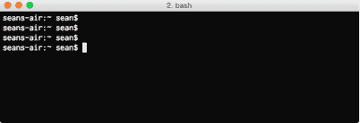

如果你在提示符后不输入任何内容就按回车，什么也不会发生，你会在旧提示符下方得到一个全新的提示符。提示符后面的白色矩形只是光标，允许你编辑在 shell 中输入的内容。你的光标可能看起来像矩形、竖线或下划线，但所有光标的行为方式都一样。在命令行中输入内容后，你可以使用左右方向键来回移动光标，就像写电子邮件一样。

你不觉得 shell 里满是旧提示符很乱吗？别担心，你即将学到第一个 shell 命令，它能帮你清理 shell！在提示符处输入 clear，然后按回车。瞧！你的 shell 又回到了最初的样子。

每一条命令行命令实际上都是一个小型的计算机程序，即使是像 clear 这样简单的命令也不例外。这些命令通常都有以下结构：

```
`{命令} {选项} {参数}`
```

一些像 clear 这样的简单命令不需要任何选项或参数。选项通常以连字符（-）开头，用于调整命令的行为。参数可以是文件名、原始数据或命令所需的


requires. 一个带有参数的简单命令是 echo。echo 命令会向控制台打印一句话。在命令行中输入 echo 'Hello World!' 来看看会发生什么：

```
```bash
echo 'Hello World!'
```
```

## Hello World!

我们将在本书的其余部分使用上述语法，其中一行是我输入到命令行中的命令，然后在该命令下方会出现该命令的控制台输出（如果有控制台输出）。你可以使用 echo 将双引号 ("") 包围的任何短语打印到控制台。

如果你想查看上一个命令，请按向上箭头键。你可以按上和下在你输入的命令历史中滚动。如果你想重新执行之前的命令，可以滚动到该命令然后按 Enter。尝试回到 echo "Hello World!" 命令并再次执行它。

## Summary

- 你在提示符后输入命令行命令。
- `clear` 会清理你的终端。
- `echo` 将文本打印到你的终端。
- 你可以使用上和下箭头键在命令历史中滚动。

## Exercises

- 1. 在终端中打印你的名字。
- 2. 完成 #1 后清理你的终端。

## Navigating the Command Line

你已经学习了两个命令行命令（clear 和 echo），这已经很不错了！在学习更多命令之前，我们需要讨论文件和文件夹在你的计算机上是如何组织的。

计算机按文件夹的层次结构组织，其中一个文件夹可以包含许多文件夹和文件。使用 Unix 的人经常将文件夹称为目录，这两个术语可以互换。这种目录层次结构形成一棵树，如下图所示。你可以使用命令行在计算机上导航这些树。

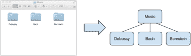

正如你在下图中所看到的，我的 Debussy 目录包含在我的 Music 目录中。这是目录结构的最简单情况。

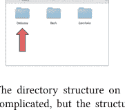

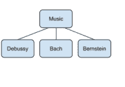

大多数计算机上的目录结构要复杂得多，但你计算机上的结构可能看起来像这样：

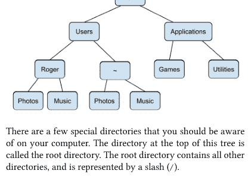

有几个特殊的目录你应该在计算机上了解。树顶部的目录称为根目录。根目录包含所有其他目录，并由斜杠（/）表示。

home 目录是另一个特殊目录，由波浪号（~）表示。你的 home 目录包含你的个人文件，如照片、文档和桌面的内容。当你第一次打开 shell 时，你通常从 home 目录开始。想象一下从根目录追踪到你当前所在的目录的所有目录。这个目录序列称为路径。下图说明了从假设的根目录到 home 目录的路径。

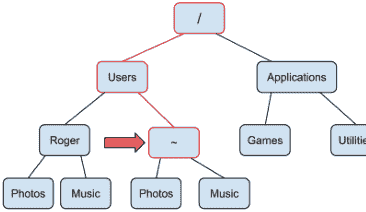

该路径可以写为 `/Users/sean`。

如果关闭了，请打开命令行。你的 shell 从你的 home 目录开始。你 shell 所在的目录称为 **working directory**。输入 `pwd` 命令到你的 shell 中以打印 **working directory**。

```
pwd

## /Users/sean
```

你可以使用 `cd` 命令更改你的 working directory。如果你使用 `cd` 命令而不带任何参数，则你的 working directory 会更改为你的 home 目录。

在命令行中输入 `cd` 然后输入 `pwd`。

```
cd
pwd
```

```
## /Users/sean
```

你一开始就在你的 working directory 中，并且通过在命令行中输入 cd 你确实技术上更改了目录，你只是将其更改为你的 home 目录（你开始时所在的目录）。要使用 cd 将你的 working directory 更改为除 home 目录之外的其他目录，你需要为 cd 提供另一个目录的路径作为参数。你可以指定路径为相对于当前目录的相对路径，也可以指定从计算机根目录开始的目录的绝对路径。假设我们只是想将 working directory 更改为 home 目录内部的一个文件夹。首先我们需要能够看到 working directory 中有哪些文件夹。你可以使用 ls 命令列出目录中的文件和文件夹。让我们在 home 目录中使用 ls 命令列出其中包含的文件和文件夹。

```
ls
```

```
## Desktop
## Documents
## Photos
## Music
## todo.txt
```

看起来我在 home 目录中有四个文件夹和一个文本文件。现在让我们切换到 Music 目录：


```
cd Music
```

正如你所见，当前工作目录的路径已发生变化：

```
pwd
```

```
## /Users/sean/Music
```

我输入 cd Music 时指定了一个**相对**路径。Music 目录的路径相对于我之前的工作目录就是 Music/。我可以用命令 cd .. 返回到 /Users/sean/，该命令会将工作目录更改为当前工作目录的上级文件夹：

```
cd ..
```

```
pwd
```

```
## /Users/sean
```

请注意 .. 也是一个相对路径，因为它指定了当前工作目录的上级目录。类似地 . 是当前工作目录的路径。因此由于我的当前工作目录是 /Users/sean，那么 cd Music 与 cd ./Music 相同。

只要我知道某个文件夹的**绝对**路径，我就可以 cd 到任何文件夹。例如我可以通过在 shell 中输入以下内容 cd 到 /Users/sean/Music：

cd ~/Music
pwd

```
## /Users/sean/Music
```

我所在的目录无关紧要，因为我使用的是绝对路径，我可以直接跳转到该目录（请记住 ~ 是指向你主文件夹路径的快捷方式）。当然你不应该期望自己记住电脑上所有绝对路径！你可以使用终端的一项功能叫做**Tab 补全**来加快输入路径和其他命令的速度。在你的 shell 中输入以下内容，然后尝试按 Tab 键（在某些机器上你需要按两次）：

```
cd ~/
```

（按 Tab）

```
## Desktop
## Documents
## Photos
## Music
## todo.txt
```

按 Tab 会显示 ~/ 目录内的所有文件和文件夹。现在我要在终端中输入 ~/D，你可以看到再次按 Tab 时会发生什么：

```
cd ~/D
```

（按 Tab）

```
## Desktop
## Documents
```

由于我在路径中添加了 "D"，只有名称以 "D" 开头的文件夹会被列出。如果我在控制台中输入 cd ~/De 然后按 Tab，则命令会自动补全为 cd ~/Desktop/。如果我再次按 Tab，控制台将列出我桌面上的所有文件和文件夹。

务必暂停并在自己的终端中亲自尝试！你不会有我相同的那些文件或文件夹，但你应该尝试使用 cd 和 Tab 补全来操作以相同字母开头的文件夹和文件。

# Summary

- 你可以通过其路径来识别特定的文件或文件夹。
- 根目录（/）包含电脑上的所有文件夹和文件。
- 你的主目录（~）是终端始终开始的目录。
- 使用 cd 命令更改工作目录。
- pwd 命令会打印工作目录。
- ls 命令会列出目录中的文件和文件夹。

# Exercises

- 1. 将工作目录设置为根目录。
- 2. 使用三种不同的命令将工作目录设置为你的主目录。
- 3. 使用你的文件和文件夹浏览器找到电脑上的一个文件夹，然后使用终端将工作目录设置为该文件夹。
- 4. 列出你在 #3 中导航到的目录中的所有文件和文件夹。

# Creation and Inspection

现在你可以用终端流畅地在电脑各处的目录之间跳转，我将向你展示你可以对文件夹和文件执行的一些操作。当你打开一个全新的终端时，你可能想做的第一件事就是创建一个新的文件夹或文件。你可以使用 `mkdir` 命令加上新目录的路径来创建目录。首先让我们查看我的主目录的内容：

```
cd
ls
```

```
## Desktop
## Documents
## Photos
## Music
## todo.txt
```

我想创建一个新的目录来存放稍后要编写的一些代码文件，所以我将使用 mkdir 创建一个名为 Code 的新目录：

```
mkdir Code
ls
```

- ## Desktop
- ## Documents
- ## Photos
- ## Music
- ## todo.txt
- ## Code

成功了！请注意传递给 mkdir 的参数 Code 是一个相对路径，不过我也可以指定绝对路径。一般来说，你应该期望接受路径作为参数的 Unix 工具同时接受相对路径和绝对路径。

在命令行上创建新文件有几种不同的方法。创建空白文件最简单的方法是使用 touch 命令，后跟要创建的文件的路径。在此示例中，我将使用 touch 创建一个新的日记条目：

```
touch journal-2017-01-24.txt
ls
```


## 命令行基础

```
Desktop
Documents
Photos
Music
todo.txt
Code
journal-2017-01-24.txt
```

创建了一个新文件！我一直在使用 ls 来列出当前目录中的文件和文件夹，但单独使用 ls 并不能区分列出的项目中哪些是文件夹，哪些是文件。值得庆幸的是，你可以使用 -l 选项与 ls 一起使用，以便以长格式列出目录中的文件。

```
ls -l
```

```
drwxr-xr-x  2 sean  staff  68 Jan 24 12:31 Code
drwxr-xr-x  2 sean  staff  94 Jan 20 12:44 Documents
drwxr-xr-x  2 sean  staff  24 Jan 20 12:44 Music
drwxr-xr-x  2 sean  staff  68 Jan 20 12:36 Photos
-rw-r--r--  1 sean  staff  90 Jan 24 11:33 journal-2017-01-24.txt
-rw-r--r--  1 sean  staff  70 Jan 24 10:58 todo.txt
```

结果表格中每个文件或文件夹都有一行。如果第一列的条目是 d，则该行表示

```
- email Jeff
- write letter to Aunt Marie
- get groceries for Shabbat
```

cat 命令通常用于将文本文件打印到终端，尽管它实际上是用于连接文件的。你可以在以下示例中看到这种连接的实际效果：

```
cat todo.txt todo.txt
```

```
- email Jeff
- write letter to Aunt Marie
- get groceries for Shabbat
- email Jeff
- write letter to Aunt Marie
- get groceries for Shabbat
```

cat 命令会合并作为参数提供的每个文本文件。

让我们看看如何查看一个更大的文件。Documents 目录中有一个文件：

```
ls Documents
```

```
a-tale-of-two-cities.txt
```

让我们检查一下这个文件是否适合用 cat 读取：

使用空格键前往下一页，使用 b 键返回上一页。要退出 less 并返回到提示符，请按 q 键。

正如你所见，less 程序是一种 Unix 工具，其行为我们之前从未见过，因为它“接管”了你的终端。在本书中，我们将讨论一些类似的程序。

还有两个易于记忆的程序可用于查看文本文件的开头或结尾：head 和 tail。让我们快速对 a-tale-of-two-cities.txt 使用 head 和 tail：

```
head Documents/a-tale-of-two-cities.txt
```

```
I. The Period

It was the best of times,
it was the worst of times,
it was the age of wisdom,
it was the age of foolishness,
it was the epoch of belief,
it was the epoch of incredulity,
it was the season of Light,
it was the season of Darkness,
```

正如你所见，head 将文件的第一十行打印到终端。你可以使用 -n 选项后跟你想要查看的行数来指定打印的行数：

```
head -n 4 Documents/a-tale-of-two-cities.txt
```

```
I. The Period

It was the best of times,
it was the worst of times,
```

tail 程序的工作方式完全相同：

```
tail Documents/a-tale-of-two-cities.txt
```

```
of an atrocious murderer, and to-morrow of a wretched pilferer who had robbed a
farmer's boy of sixpence.
All these things, and a thousand like them, came to pass in and close upon the
dear old year one thousand seven hundred and seventy-five. Environed by them,
while the Woodman and the Farmer worked unheeded, those two of the large jaws,
and those other two of the plain and the fair faces, trod with stir enough,
and carried their divine rights with a high hand. Thus did the year one
thousand seven hundred and seventy-five conduct their Greatnesses, and myriads
of small creatures—the creatures of this chronicle among the rest—along the
roads that lay before them.
```

我们现在已经介绍了一些用于检查文件、文件夹及其内容的工具，包括 ls、wc、cat、less、head 和 tail。在本节结束之前，我们应该讨论一些用于创建和编辑文件的更多技术。创建文件的一种简单方法是使用输出重定向。输出重定向将原本会打印到命令行上的文本存储在文本文件中。你可以通过在命令末尾输入大于号（>）然后输入将包含前一个命令输出的新文件名称来使用输出重定向。让我们使用 echo 来尝试一个示例：

```
echo "I'm in the terminal."
```

```
I'm in the terminal.
```

```
echo "I'm in the file." > echo-out.txt
```

只有第一个命令向终端打印了输出。让我们看看第二个命令是否有效：

```
ls
```

```
Desktop
Documents
Photos
Music
todo.txt
Code
journal-2017-01-24.txt
echo-out.txt
```


```
cat echo-out.txt
```

```
I'm in the file.
```

看起来成功了！你还可以使用两个大于号（`>>`）将文本追加到文件末尾。让我们来试试这个功能：

```
echo "I have been appended." >> echo-out.txt
cat echo-out.txt
```

```
I'm in the file.
I have been appended.
```

现在是一个**警告。** 假设我想在 `echo-out.txt` 末尾追加另一行，但我在终端里输入了 `echo "A third line." > echo-out.txt`，而我本意是想输入 `echo "A third line." >> echo-out.txt`（注意我在本应使用 `>>` 时却用了 `>`）。让我们看看会发生什么：

```
echo "A third line." > echo-out.txt
cat echo-out.txt
```

```
A third line.
```

不幸的是，我无意中覆盖了 `echo-out.txt` 中原本已有的内容。在 Unix 中没有撤销按钮，所以我只能接受这个错误。这是几个教训中的第一个，它们展示了在使用 Unix 时你应该尽量避免造成的损害。请务必在运行可能修改或删除文件的命令时格外小心，命令中的拼写错误可能具有潜在的破坏性。幸运的是，有一些策略可以保护自己免受错误影响，包括管理文件的权限，以及使用 Git 跟踪文件的版本，我们将在后面的章节中详细讨论。

最后，我们应该讨论如何编辑文本文件。你的终端上有几个可用的文件编辑器，包括 vim⁴ 和 emacs⁵。关于如何使用这两个文本编辑器，已经有很多书专门论述，如果你对其中一个感兴趣，可以在网上查找相关资源。我们将讨论使用的文本编辑器叫 nano。和 less 一样，nano 会使用整个终端窗口。让我们用 nano 编辑 `todo.txt`：

```
nano todo.txt
```

```
GNU nano 2.0.6          File: todo.txt

- email Jeff
- write letter to Aunt Marie
- get groceries for Shabbat

^G Get Help   ^O WriteOut   ^R Read File   ^Y Prev Page   ^K Cut Text   ^C Cur Pos
^X Exit       ^J Justify   ^W Where Is   ^V Next Page   ^U UnCut Text ^T To Spell
```

启动 nano 后，你就可以开始编辑文本文件了。nano 编辑器的顶部一行显示你当前正在处理的文件，底部两行显示了可以在 nano 中使用的一些命令。脱字符号（`^`）代表键盘上的 Control 键，例如，你可以按下 `Control + O` 来保存对文本文件所做的更改，或按下 `Control + X` 来退出 nano 并返回到提示符。

nano 对初学者来说是个不错的编辑器，因为它的工作方式与你以前用过的文字处理器类似。你可以使用方向键在文件中移动光标，键盘上的其他按键也都能按预期工作。让我们在我的待办事项列表中添加一项，然后按 `Control + O`，接着按 `Control + X` 保存并退出 nano。

```
GNU nano 2.0.6          File: todo.txt

- email Jeff
- write letter to Aunt Marie
- get groceries for Shabbat
- write final section of "command line basics"

^G Get Help   ^O WriteOut   ^R Read File   ^Y Prev Page   ^K Cut Text   ^C Cur Pos
^X Exit       ^J Justify   ^W Where Is   ^V Next Page   ^U UnCut Text ^T To Spell
```

现在让我们快速检查这些更改是否已正确保存：

```
cat todo.txt
```

```
- email Jeff
- write letter to Aunt Marie
- get groceries for Shabbat
- write final section of "command line basics"
```

你也可以用 nano 创建新的文本文件。不要将现有文件的路径作为 nano 的参数，而是使用一个尚不存在的文件路径，然后保存你的更改到该文件。

## 总结

- 使用 `mkdir` 创建新目录。

```
ls
```

```
Code
Documents
Photos
Desktop
Music
echo-out.txt
journal-2017-01-24.txt
todo.txt
```

这里变得有点乱了，让我们把这个目录整理一下。首先，我想创建一个名为 `Journal` 的新目录，用来存放我所有的日志条目。我们已经知道该怎么做：

```
mkdir Journal
```

现在我想把我的日志条目 `journal-2017-01-24.txt` 移到 `Journal` 目录中。我们可以使用 `mv` 命令来移动它。`mv` 接受两个参数：首先是你想要移动的文件或文件夹的路径，然后是目标文件夹。让我们现在来试试 `mv`：

```
mv journal-2017-01-24.txt Journal
ls
```

- Code
- Documents
- Journal
- Photos
- Desktop
- Music
- echo-out.txt
- todo.txt

看起来成功了！不过我刚刚意识到我想把 Journal 目录移到 Documents 文件夹中。幸运的是，我们可以用 mv 命令以同样的方式完成：

```
mv Journal Documents
ls
```

- Code
- Documents
- Photos
- Desktop
- Music
- echo-out.txt
- todo.txt

让我们确认一下它是否被放到了正确的位置：

```
ls Documents
```

```
Journal
a-tale-of-two-cities.txt
```

看起来不错！mv 命令另一个隐藏用途是重命名文件和文件夹。第一个参数是要重命名的文件夹或文件的路径，第二个参数是包含新名称的路径。让我们把 todo.txt 重命名，让它包含今天的日期：

```
mv todo.txt todo-2017-01-24.txt
ls
```

```
Code
Documents
Photos
Desktop
Music
echo-out.txt
todo-2017-01-24.txt
```

看起来效果不错。与 mv 命令类似，cp 命令可以将文件或文件夹从一个位置复制到另一个位置。如你所见，在复制文件时，cp 的用法与 mv 完全相同：你想要复制的文件或文件夹作为第一个参数，后面跟上你想要复制到的目标文件夹的路径：

```
cp echo-out.txt Desktop
ls
```

```
Code
Documents
Photos
Desktop
Music
echo-out.txt
todo-2017-01-24.txt
```

```
ls Desktop
```

```
echo-out.txt
```

请注意，复制文件和文件夹之间有一个区别：复制文件夹时，你需要指定 -r 选项，它是 recursive（递归）的缩写。这可以确保你要复制的目录的底层目录结构保持不变。让我们尝试把 Documents 目录复制到 Desktop 目录中：

```
cp -r Documents Desktop
ls Desktop
```

```
Documents
echo-out.txt
```

最后，我们来讨论如何使用命令行删除文件和文件夹。需要极度谨慎地提醒一句：一般来说，我不建议在命令行中删除文件或文件夹，因为正如我们之前讨论过的，命令行没有“撤销”按钮。如果你删除了对计算机运行至关重要的文件，可能会造成无法挽回的损害。我强烈建议将文件或文件夹移动到一个指定的回收文件夹中，然后用命令行之外通常删除文件或文件夹的方式将它们删除（Mac 上回收站的路径是 `~/.Trash`，Ubuntu 上是 `~/.local/share/Trash`）。如果你决定删除计算机上的文件或文件夹，请在按回车键之前绝对确认你输入的命令是正确的。如果你确实不小心删除了文件或文件夹，请立即停止使用计算机，并咨询电脑专业人士或你的 IT 部门，让他们尝试恢复该文件。

既然你已经得到了警告，让我们来讨论一下 rm——命令行程序中的“阿瓦达索命咒”。在删除文件时，rm 只需要一个文件的路径即可将其删除。让我们在 echo-out.txt 上测试一下它的破坏力：

```
rm echo-out.txt
ls
```

```
Code
Documents
Photos
Desktop
Music
todo-2017-01-24.txt
```

> 我感觉原力中出现了巨大的扰动，仿佛数百万个声音突然惊恐地呼喊，然后又突然沉寂。——欧比旺·克诺比

`echo-out.txt` 文件已经永远消失了。还记得我们之前把 Documents 目录复制到 Desktop 里了吗？现在我们把这个目录删掉吧。就像使用 cp 命令时一样，rm 命令在删除整个目录时也需要你使用 -r 选项。让我们来测试一下这个战斗基地：

```
ls Desktop

Documents
echo-out.txt
```

```
rm -r Desktop/Documents
ls Desktop

echo-out.txt
```

现在，既然你已经掌握了 rm 强大的破坏力，你就学会了命令行的基础知识！我们下一章再见，届时将讨论更高级的命令行主题。

## 总结

- `mv` 可用于移动或重命名文件或文件夹。
- `cp` 可复制文件或文件夹。
- 你应该尽量避免使用 `rm`，它会永久删除文件或文件夹。


## 练习

- 1. 在你的主目录下创建一个名为 `message.txt` 的文件，并将其移动到另一个目录中。
- 2. 将你刚移动的 `message.txt` 复制到你的主目录中。
- 3. 删除两个 `message.txt` 副本。尝试不要使用 `rm`。

## 使用 Unix

知之非难，行之惟难。——中国谚语

### 自学

到目前为止，我们讨论过的每个命令都有详尽的文档，你可以使用 `man` 命令查看它们的文档，`man` 的第一个参数是你想了解的命令。让我们来看看 `ls` 的文档：

```
man ls
```

```
LS(1)                 BSD General Commands Manual

LS(1)

NAME
    ls -- list directory contents

SYNOPSIS
    ls [-ABCFGHLOPRSTUW@abcdefghiklmopqrstuwx1] [file ...]

DESCRIPTION
    For each operand that names a file of a type other than directory, ls
    displays its name as well as any requested, associated information.
    For each operand that names a file of type directory, ls displays the
    names of files contained within that directory as well as any requested,
    associated information.
```

浏览 man 页面的操作与 `less` 相同。我经常使用 man 页面来快速搜索我忘记的选项。假设我忘记了如何让 `ls` 打印长列表。在输入 `man ls` 打开页面后，键入 `/` 开始搜索。然后输入你要搜索的单词或短语；本例中，输入 `long list`，然后按回车。页面跳转到该条目：

```
-l      (The lowercase letter `ell'.)  List in long format. (See below.)
        If the output is to a terminal, a total sum for all the file sizes is
        output on a line before the long listing.
```

按下 `n` 键搜索下一个匹配项，如果要跳到上一个匹配项，输入 Shift + n。这种搜索方法也适用于 `less`。当你看完一个 man 页面后，输入 `q` 返回提示符。

当你知道要查找哪个命令时，`man` 命令非常好用，但如果你忘记了要找的命令名怎么办？你可以使用 `apropos` 搜索所有可用的命令及其描述。例如，假设我忘记了我最喜欢的命令行文本编辑器的名字。你可以在命令行中输入 `apropos editor`，它会打印一份结果列表：

```
apropos editor

ed(1), red(1)              - text editor
nano(1)                    - Nano's ANOther editor, an enhanced free Pico clone
sed(1)                     - stream editor
vim(1)                     - Vi IMproved, a programmers text editor
```

第二个结果是 `nano`，这个名字刚才就在我嘴边！当只需按几下键盘就能完成搜索时，`man` 和 `apropos` 都很有用，但如果你需要查找详细的示例和解释，在可以访问网页浏览器的情况下，最好使用搜索引擎。

### 小结

- 使用 `man` 查看命令的文档。
- 如果你想不起命令的名称，使用 `apropos` 搜索与该命令相关的单词。
- 如果你可以访问网页浏览器，使用搜索引擎可能比 `man` 或 `apropos` 更好。

### 练习

- 1. 使用 `man` 查找 `ls` 中用于人类可读输出的选项。

```
2017-01-02-hiking01.jpg
2017-01-02-hiking02.jpg
2017-02-10-hiking01.jpg
2017-02-10-hiking02.jpg
```

只列出了以 “2017” 开头的文件！命令 `ls 2017*` 的字面意思是：列出以 “2017” 开头后跟零个或任意多个字符的文件。可以想见，使用通配符是处理名称相似文件组的强大工具。

让我们再看几个使用星号通配符的例子。我们可以只列出以 “2016” 开头的照片：

```
ls 2016*
```

```
2016-06-20-datasci01.png
2016-06-20-datasci02.png
2016-06-20-datasci03.png
2016-06-21-lab01.jpg
2016-06-21-lab02.jpg
```

我们可以只列出文件名以 `.jpg` 结尾的文件：

```
ls *.jpg
```


```
## 2016-06-21-lab01.jpg
## 2016-06-21-lab02.jpg
## 2017-01-02-hiking01.jpg
## 2017-01-02-hiking02.jpg
## 2017-02-10-hiking01.jpg
## 2017-02-10-hiking02.jpg
```

在上面的例子中，文件名可以以任意字符的零个或多个序列开头，但文件名必须以 .jpg 结尾。或者我们也可以只列出每组照片中的第一张照片：

```
ls *01.*
```

```
## 2016-06-20-datasci01.png
## 2016-06-21-lab01.jpg
## 2017-01-02-hiking01.jpg
## 2017-02-10-hiking01.jpg
```

上面所有文件的文件名都由一串字符组成，其后紧跟 01.，再 followed by 另一串字符。请注意，如果我在控制台中输入 ls *01*，每个文件都会被列出，因为 01 是我 Photos 目录中所有文件名的组成部分。

让我们按年份整理这些照片。首先为每年的照片创建一个目录：

```
```text
ls 2016/

## 2016-06-20-datasci01.png
## 2016-06-20-datasci02.png
## 2016-06-20-datasci03.png
## 2016-06-21-lab01.jpg
## 2016-06-21-lab02.jpg

ls 2017/

## 2017-01-02-hiking01.jpg
## 2017-01-02-hiking02.jpg
## 2017-02-10-hiking01.jpg
## 2017-02-10-hiking02.jpg
```
```

看起来不错！除了星号通配符之外，还有一些通配符，我们将在下一节中讨论，在那里搜索文件名会变得稍微复杂一些。

# Summary

+   - 通配符可以代表多种类型和数量的字符。
+   - 星号通配符（`*`）代表任意字符的零个或多个。
+   - 你可以在命令行中使用通配符来处理多个文件和文件夹。

# Exercises

+   1. 在我按年份整理照片之前，什么命令会列出所有类型为 .png 的照片？
+   2. 在我按年份整理照片之前，什么命令会删除我所有的徒步旅行照片？
+   3. 你会使用什么一系列命令将我数据科学课程的图表和我在实验室拍摄的图片放入各自的文件夹中？

# Search

# Regular Expressions

能够搜索文件和文件夹可以极大地提高你在 Unix 中的工作效率。首先我们将介绍如何搜索文本文件。我最近下载了一份美国各州名称的列表。让我们来看看这个文件：

```
cd ~/Documents
ls
```

```
## canada.txt
## states.txt
```

```
wc states.txt
```

```
## 50      60      472 states.txt
```

有 50 行是合理的，但总共有 60 个词就很有趣了。让我们看一下文件的开头：

```
head states.txt
```

```
## Alabama
## Alaska
## Arizona
## Arkansas
## California
## Colorado
## Connecticut
## Delaware
## Florida
## Georgia
```

这个文件看起来基本上是你期望的样子！你可能还记得在第 3 章中，我们使用的是 bash shell。Bash 对不同类型的数据有不同的处理方式，我们将在第 5 章中更深入地探讨数据类型。现在你只需要知道文本数据称为字符串。字符串可以是一个词、一句话、一本书，或一个文件或文件夹名。搜索字符串最有效的方法之一是使用**正则表达式**。正则表达式是定义其他字符串中模式的字符串。你可以使用正则表达式搜索包含在大字符串中的子字符串，或用另一个字符串替换字符串的一部分。

搜索文本文件最流行的工具之一是 grep。grep 最简单的使用需要两个参数：一个正则表达式和要搜索的文本文件。让我们先看一个 grep 的简单示例，然后我会解释它是如何工作的：

```
grep "x" states.txt
```

```
## New Mexico
## Texas
```

在上面的命令中，grep 的第一个参数是正则表达式 "x"。 "x" 正则表达式代表字母 "x" 的一个实例。states.txt 文件中包含至少一个字母 "x" 的每一行都会打印到控制台。如你所见，新墨西哥州和德克萨斯州是唯一包含字母 "x" 的州名。让我们使用 grep 搜索所有州名中的字母 "q"：

```
grep "q" states.txt
```

控制台上没有任何内容被打印，因为字母 "q" 不在任何州名中。我们也可以搜索不止单个字符。例如，以下命令将搜索包含单词 "New" 的州名：

```
grep "New" states.txt
```


```text
New Hampshire
New Jersey
New Mexico
New York
```

在前面的例子中，我们使用的正则表达式仅仅是 "New"，它表示字符串 "New" 的出现。正则表达式并不局限于单个字符或单词，它们也可以表示单词的一部分。例如，我可以用以下命令搜索包含字符串 "nia" 的所有州名：

```text
grep "nia" states.txt
```

```text
California
Pennsylvania
Virginia
West Virginia
```

上面的所有州名都以字符串 "nia" 结尾。

## 元字符

正则表达式不仅仅局限于使用字符和字符串进行搜索，正则表达式的真正威力来自于使用元字符。记住，元字符是可以用来表示其他字符的字符。为了充分利用所有元字符，我们应该使用 grep 的表亲 egrep，它只是扩展了 grep 的功能。

我们首先要讨论的元字符是 "."（句点）元字符，它表示**任意**字符。例如，如果我想在 states.txt 中搜索字符 “i”，后跟任意字符，后跟字符 “g”，我可以用以下命令实现：

```text
egrep "i.g" states.txt
```

```text
Virginia
Washington
West Virginia
Wyoming
```

正则表达式 “i.g” 在 Virginia 和 West Virginia 中匹配子字符串 “irg”，在 Washington 和 Wyoming 中匹配子字符串 “ing”。在上面的例子中，句点元字符是 “irg” 中的 “r” 和 “ing” 中的 “n” 的替代。句点元字符非常宽松，例如命令 egrep "." states.txt 将返回 states.txt 的每一行，因为正则表达式 "." 将匹配每行上的任意一个字符的出现（每行上至少有一个字符）。

除了可以表示其他字符的字符之外，还有一种称为 **量词** 的元字符，它允许你指定特定正则表达式在字符串中应出现的次数。其中最基本的量词是 "+"（加号），它表示前一个表达式的一个或多个出现。例如，正则表达式 “s+as” 的意思是：一个或多个 “s” 后跟 “as”。让我们看看是否有任何州名匹配此表达式：

```text
egrep "s+as" states.txt
```

```text
Arkansas
Kansas
```

Arkansas 和 Kansas 都匹配正则表达式 "s+as"。除了加号元字符之外，还有 "*"（星号）元字符，它表示前一个表达式的零个或多个出现。让我们看看如果我们将 "s+as" 改为 "s*as" 会发生什么：

```text
egrep "s*as" states.txt
```

```text
Alaska
Arkansas
Kansas
Massachusetts
Nebraska
Texas
Washington
```

正如你所见，星号元字符在匹配方面要宽松得多，因为有更多州名被 "s*as" 匹配。除了 "零个或多个" 或 "一个或多个" 表达式出现之外，你还可以使用更具体的量词。你可以使用大括号 ({ }) 来指定表达式的确切出现次数。例如，正则表达式 "s{2}" 指定字符 "s" 恰好出现两次。让我们尝试使用此正则表达式：

```text
egrep "s{2}" states.txt
```

```text
Massachusetts
Mississippi
Missouri
Tennessee
```

请注意，正则表达式 "s{2}" 等同于正则表达式 "ss"。我们也可以使用正则表达式 "s{2,3}" 搜索具有两个到三个相邻字母 "s" 出现的州名：

```text
egrep "s{2,3}" states.txt
```

```text
Massachusetts
Mississippi
Missouri
Tennessee
```

当然结果是相同的，因为没有州名有 "s" 重复三次。

你可以使用捕获组来搜索字符串的多次出现。你可以通过使用括号 "( )" 在正则表达式中创建捕获组。例如，如果我想在 states.txt 中搜索州名中出现两次的字符串 "iss"，我可以使用捕获组和量词，如下所示：


```
egrep "(iss){2}" states.txt
```

## Mississippi

我们可以组合更多的量词和捕获组来构思更复杂的正则表达式。例如，下面的正则表达式描述了三个 “i” 后跟任意两个字符：

```
egrep "(i.{2}){3}" states.txt
```

## Mississippi

上面的复杂正则表达式仍然只匹配 “Mississippi”。

# 字符集

接下来的几个示例我们需要一些超出州名的文本数据。让我们直接从控制台创建一个简短的文本文件：

```
touch small.txt
echo "abcdefghijklmnopqrstuvwxyz" >> small.txt
echo "ABCDEFGHIJKLMNOPQRSTUVWXYZ" >> small.txt
echo "0123456789" >> small.txt
echo "aa bb cc" >> small.txt
echo "rhythms" >> small.txt
echo "xyz" >> small.txt
echo "abc" >> small.txt
echo "tragedy + time = humor" >> small.txt
echo "http://www.jhsph.edu/" >> small.txt
echo "%%&--%%#--&%#" >> small.txt
```

除了量词之外，正则表达式还有用于描述字符集的表达式。\w 元字符对应所有 “单词” 字符，\d 元字符对应所有 “数字” 字符，而 \s 元字符对应所有 “空格” 字符。让我们看看在 small.txt 上使用这些元字符的情况：

```
egrep "\w" small.txt
```

## abcdefghijklmnopqrstuvwxyz
## ABCDEFGHIJKLMNOPQRSTUVWXYZ
## 0123456789
## aa bb cc
## rhythms
## xyz
## abc
## tragedy + time = humor
## http://www.jhsph.edu/

```
egrep "\d" small.txt
```

## 0123456789

```
egrep "\s" small.txt
```

## aa bb cc
## tragedy + time = humor

正如上面的示例所示，\w 元字符匹配所有字母、数字，甚至下划线字符（_）。我们可以通过在命令中添加 -v 标志来查看此 grep 的补集：

```
egrep -v "\w" small.txt
```

## %#&/=-*%*=-&%#

-v 标志（代表 invert match 反向匹配）使 grep 返回所有不匹配正则表达式的行。注意，正则表达式的字符集也有其逆集：\W 表示非单词，\D 表示非数字，\S 表示非空格。让我们看看使用 \W 的情况：

```
egrep "\W" small.txt
```

## aa bb cc
## tragedy + time = humor
## http://www.jhsph.edu/
## %#&.-=*#*-=%#

返回的字符串都包含非单词字符。请注意使用反向标志 -v 与使用逆集正则表达式的结果之间的区别。

除了通用字符集之外，我们还可以使用方括号（[ ]）创建特定的字符集，然后在方括号中包含我们希望匹配的字符。例如，元音的正则表达式是 [aeiou]。你也可以通过在集合开头包含一个插入符号（^）来创建集合的补集正则表达式。例如，正则表达式 [^aeiou] 匹配所有不是元音的字符。让我们在 small.txt 上测试两者：

```
egrep "[aeiou]" small.txt
```

## abcdefghijklmnopqrstuvwxyz
## aa bb cc
## abc
## tragedy + time = humor
## http://www.jhsph.edu/

请注意单词 “rhythms” 没有出现在结果中（这是我能想到的最长的不含任何元音的单词）。

## abcdefghijklmnopqrstuvwxyz
## rhythms
## tragedy + time = humor
## http://www.jhsph.edu/

```
egrep "[E-Q]" small.txt
```

## ABCDEFGHIJKLMNOPQRSTUVWXYZ

```
egrep "[e-qE-Q]" small.txt
```

## abcdefghijklmnopqrstuvwxyz
## ABCDEFGHIJKLMNOPQRSTUVWXYZ
## rhythms
## tragedy + time = humor
## http://www.jhsph.edu/

# 转义、锚点、奇偶和结尾

在我们对正则表达式进行小小探索的过程中，你可能已经想到一个问题：如何搜索文本中某些标点符号，考虑到这些符号本身也是元字符！例如，如何在文本行中查找加号（+），因为加号也是一个元字符？答案很简单，只需在正则表达式中使用反斜杠（\ ）在加号前进行“转义”，以便“转义”其元字符功能。以下是几个示例：


```
egrep "\+" small.txt
```

## 悲剧 + 时间 = 幽默

```
egrep "\." small.txt
```

## http://www.jhsph.edu/

我们还有三个元字符需要讨论，其中两个是成对出现的：脱字符（^）代表行首，美元符号（$）代表行尾。这些“锚字符”只有与其他正则表达式结合时，才匹配行的开头和结尾。例如，回到查看 states.txt 的时候，我可以用以下命令搜索所有以“M”开头的州名：

```
egrep "^M" states.txt
```

## Maine
## Maryland
## Massachusetts
## Michigan
## Minnesota
## Mississippi
## Missouri
## Montana

或者我们可以搜索所有以“s”结尾的州：

```
egrep "s$" states.txt
```

## Arkansas
## Illinois
## Kansas
## Massachusetts
## Texas

关于每个锚字符该用哪个元字符，我很喜欢一个记忆口诀：“先获得力量（power），再获得金钱（money）。”在很多编程语言中，脱字符用于指数运算，所以“力量”(^) 用于行首，而“金钱”($) 用于行尾。

最后，我们来讨论“或”元字符（|），它也被称为“管道”字符。这个元字符允许你匹配管道左侧或右侧的正则表达式。让我们看一个小例子：

```
```bash
egrep "North|South" states.txt
```
```

```
```text
## North Carolina
## North Dakota
## South Carolina
## South Dakota
```
```

在上面的例子中，我们搜索包含“North”或“South”的文本行。你也可以使用多个管道字符，例如搜索包含所有基本方位词的文本行：

```
```bash
egrep "North|South|East|West" states.txt
```
```

```
```text
## North Carolina
## North Dakota
## South Carolina
## South Dakota
## West Virginia
```
```

关于 grep 还有两点补充：你可以使用 `-n` 参数来显示匹配所在的行号：

```
```bash
egrep -n "t$" states.txt
```
```

```
```text
## 7:Connecticut
## 45:Vermont
```
```

你还可以通过提供多个文件参数来同时 grep 多个文件：

```
egrep "New" states.txt canada.txt
```

```
## states.txt:New Hampshire
## states.txt:New Jersey
## states.txt:New Mexico
## states.txt:New York
## canada.txt:Newfoundland and Labrador
## canada.txt:New Brunswick
```

你现在已经可以使用正则表达式进行相当复杂的字符串搜索了！假设你想搜索所有以元音字母开头和结尾的州名。现在你做到了：

```
egrep "^[AEIOU]{1}.+[aeiou]{1}$" states.txt
```

```
## Alabama
## Alaska
## Arizona
## Idaho
## Indiana
## Iowa
## Ohio
## Oklahoma
```

我知道这里需要记住的元字符很多，所以下面我整理了一个本章讨论过的几个元字符的表格：

| Metacharacter | Meaning |
|---|---|
| . | Any Character |
| \w | A Word |
| \W | Not a Word |
| \d | A Digit |
| \D | Not a Digit |
| \s | Whitespace |
| \S | Not Whitespace |
| [def] | A Set of Characters |
| [^def] | Negation of Set |
| [e-q] | A Range of Characters |
| ^ | Beginning of String |
| $ | End of String |
| \n | Newline |
| + | One or More of Previous |
| * | Zero or More of Previous |
| ? | Zero or One of Previous |
| | | Either the Previous or the Following |
| {6} | Exactly 6 of Previous |
| {4, 6} | Between 4 and 6 or Previous |
| {4, } | More than 4 of Previous |

如果你想要在使用正则表达式之前先练习一下，我强烈推荐你去 http://regexr.com/ 上玩玩。

# 查找

如果你想查找某个文件或一组文件的位置，可以使用 `find` 命令。该命令有特定的结构：第一个参数是你希望开始搜索的目录，并且该目录包含的所有子目录也会被搜索。第一个参数后面是一个标志，用于描述搜索方式。在本例中，我们只会按文件名搜索，所以使用 `-name` 标志。`-name` 标志本身又接受一个参数，即你要查找的文件名。让我们回到主目录，并从那里查找一些文件：

```
```bash
cd
pwd
```
```

## `/Users/sean`

让我们从查找名为 states.txt 的文件开始：

```
```bash
find . -name "states.txt"
```
```

## `./Documents/states.txt`

它就在我们预期的地方！现在让我们试着搜索所有 .jpg 文件：

```
```bash
find . -name "*.jpg"
```
```


## ./Photos/2016-06-21-lab01.jpg
## ./Photos/2016-06-21-lab02.jpg
## ./Photos/2017/2017-01-02-hiking01.jpg
## ./Photos/2017/2017-01-02-hiking02.jpg
## ./Photos/2017/2017-01-10-hiking01.jpg
## ./Photos/2017/2017-02-10-hiking02.jpg

Good file hunting out there!

# Summary

- `grep` and `egrep` 可以与正则表达式一起使用来在文件中搜索文本模式。
- 元字符在正则表达式中用于描述字符模式。
- `find` 可用于在目录中搜索文件名称。

# Exercises

- 1. 在 `states.txt` 和 `canada.txt` 中搜索包含单词 “New” 的行。
- 2. 创建五个文本文件，其中包含不含五个元音字母中的每一个的州名。
- 3. 下载本书的 GitHub 仓库并查出其中包含多少个 `.html` 文件。

```
alias docs='cd ~/Documents'
alias edbp='nano ~/.bash_profile'
```

第一个别名创建了一个新命令 docs。现在在命令行中输入 docs 等同于在命令行中输入 cd ~/Documents。让我们用 nano 编辑我们的 ~/.bash_profile。如果你的 ~/.bash_profile 中已有内容，则从文件末尾开始添加行。添加行 alias docs='cd ~/Documents'，然后保存文件并退出 nano。为了使对 ~/.bash_profile 的更改生效，我们需要在控制台中运行 source ~/.bash_profile：

```
source ~/.bash_profile
```

现在让我们试用 docs：

```
docs
pwd
```

```
## /Users/sean/Documents
```

它有效！设置不同的别名可以节省时间，如果你经常使用较长的命令。在上面的 ~/.bash_profile 示例中，第二行 alias edbp='nano ~/.bash_profile' 创建了命令 edbp（edit bash profile），这样你就可以快速添加别名。尝试将其添加到你的 ~/.bash_profile 并试用你的新命令！

关于 ~/.bash_profile 在编写软件时还有一些其他重要细节，我们将在 Bash 编程章节中讨论。

## Summary

- `history` 显示自打开当前终端以来我们在控制台中输入的命令。
- `~/.bash_history` 文件列出了我们过去使用过的命令。
- `alias` 创建了一个命令，可用作我们经常使用的较长命令的替代。
- `~/.bash_profile` 是一个文本文件，每次启动 shell 时都会运行，它是分配别名的最佳位置。

## Differentiate

能够检查文件之间的差异非常重要。首先让我们在 Documents 目录中创建两个小的简单文本文件。

```bash
cd ~/Documents
head -n 4 states.txt > four.txt
head -n 6 states.txt > six.txt
```

如果我们想查看这些文件中哪些行不同，可以使用 `diff` 命令：

```bash
diff four.txt six.txt
```

```
## 4a5,6
## > California
## > Colorado
```

只有不同的行会被打印到控制台。我们也可以使用 sdiff 并排比较不同的行：

```
sdiff four.txt six.txt
```

```
## Alabama          Alabama
## Alaska           Alaska
## Arizona          Arizona
## Arkansas         Arkansas
##                 > California
##                 > Colorado
```

在常见情况下，你可能会收到一个文件，或者你可能从互联网下载一个文件，该文件附带称为校验和或哈希的代码。哈希程序根据文件内容生成唯一代码。人们会随文件分发哈希值，以便我们可以确保我们认为已下载的文件是真正的文件。我们可以通过检查计算出的哈希是否与提供的哈希匹配来防止恶意个人发送有害文件。有几种常用的文件哈希，但我们将讨论两种称为 MD5 和 SHA-1 的哈希。

由于哈希是基于文件内容生成的，因此两个相同的文件应该具有相同的哈希。让我们通过复制 states.txt 来测试这一点。


```
cp states.txt states_copy.txt
```

要计算文件的 MD5 哈希，我们可以使用 md5 命令：

```
md5 states.txt
```

```
## MD5 (states.txt) = 8d7dd71ff51614e69339b03bd1cb86ac
```

```
md5 states_copy.txt
```

```
## MD5 (states_copy.txt) = 8d7dd71ff51614e69339b03bd1cb86ac
```

正如我们所预期的那样，它们是相同的！我们可以使用 shasum 命令计算 SHA-1 哈希：

```
shasum states.txt
```

```
## 588e9de7ffa97268b2448927df41760abd3369a9  states.txt
```

```
shasum states_copy.txt
```

```
## 588e9de7ffa97268b2448927df41760abd3369a9  states_copy.txt
```

再次，两份拷贝都产生了相同的哈希。让我们对其中一个文件做一个更改，只是为了说明如果文件内容不同，哈希就会发生变化：

```
head -n 5 states_copy.txt > states_copy.txt
shasum states_copy.txt
```

```
## b1c1c805f123f31795c77f78dd15c9f7ac5732d4  states_copy.txt
```

## Summary

## 摘要

- md5 和 shasum 命令使用不同的算法来创建代码（称为哈希或校验和），这些代码唯一对应于文件的内容。
- 这些哈希可以用来确保文件是真实的。

## Pipes

## 管道

命令行最强大的功能之一就是熟练使用管道（|），你通常可以在键盘上的反斜杠（\ ）上方找到它。管道允许我们将命令的输出，该输出通常会打印到控制台，并将其用作另一个命令的输入。它就像在第一个程序的末端和另一个程序的顶部之间连接一条真正的管道！让我们看一个基本示例。我们知道 cat 命令会读取文本文件的内容并将其打印到控制台：

```
cd ~/Documents
cat canada.txt
```

```
## Nunavut
## Quebec
## Northwest Territories
## Ontario
## British Columbia
## Alberta
## Saskatchewan
## Manitoba
## Yukon
## Newfoundland and Labrador
## New Brunswick
## Nova Scotia
## Prince Edward Island
```

cat canada.txt 的输出将进入我们的管道，我们将管道的输出端连接到 head，我们用它来查看文件的前几行：

```
cat canada.txt | head -n 5
```

```
Nunavut
Quebec
Northwest Territories
Ontario
British Columbia
```

请注意，这与 `head -n 5 states.txt` 的结果相同，我们只是使用 cat 来说明管道的工作原理。管道的通用语法是 `[产生输出的程序] | [将管道输出用作输入而不是文件的程序]`。

一个更常见且更有用的管道示例是回答这个问题：“有多少个美国州以元音结尾？”我们可以使用 grep 和正则表达式列出所有以元音结尾的州名，然后使用 wc 来计数所有匹配的州名：

```
grep "[aeiou]$" states.txt | wc -l
```

## 32

管道也可以在一条命令中多次使用，以便将一个管道命令的输出用作另一个程序的输入！例如，我们可以使用 ls、grep 和 less 三个管道，以便滚动查看当前目录中在二月创建的文件：

```
ls -al | grep "Feb" | less
```

```
-rw-r--r--  1 sean  staff  472 Feb 22 13:47 states.txt
```

记住你可以使用 Q 键退出 less 并返回到提示符。

## Summary

## 摘要

- 管道（`|`）将左侧程序的输出取出并将其定向为右侧程序的输入。

## Exercises

## 练习

- 1. 使用管道来计算有多少个美国州包含单词 “New。”
- 2. 检查你的 `~/.bash_history` 以尝试弄清你曾经使用过多少个唯一命令。 （你可能需要查阅如何使用 `uniq` 和 `sort` 命令）。

## Make

## Make

从前没有网络浏览器、文件浏览器、开始菜单或搜索栏。当某人启动计算机时，他们得到的只是一个 shell 提示符，所有的工作都从该提示符开始。那时人们仍然喜欢分享软件，但软件应该如何安装始终是个问题。make 程序是对此问题的最佳尝试，而 make 的优雅使其至今仍被广泛使用。make 的指导设计目标是，为了安装某件新软件，用户需要：

- 1. 将安装所需的所有文件下载到一个目录中。
- 2. `cd` 进入该目录。


## 3. 运行 make。

这是通过指定一个名为 makefile 的文件来实现的，该文件描述了不同文件和程序之间的关系。除了安装程序之外，make 对于自动创建文档也很有用。让我们构建一个 makefile，它会创建一个 readme.txt 文件，该文件会自动填充有关我们当前目录的一些信息。

让我们先用 nano 创建一个非常基本的 makefile：

```
cd ~/Documents/Journal
nano makefile
```

```
draft_journal_entry.txt:
    touch draft_journal_entry.txt
```

上面的简单 makefile 说明了一条规则，其一般格式如下：

```
[target]: [dependencies...]
  [commands...]
```

在我们创建的简单示例中，draft_journal_entry.txt 是目标，即作为命令执行结果而创建的文件。必须注意的是，目标下的任何命令都必须使用 Tab 进行缩进。如果我们不使用 Tab 来缩进命令，则 make 将会失败。让我们保存并关闭 makefile，然后我们可以在控制台中运行以下命令：

```
ls
```

```
## makefile
```

让我们使用 make 命令，并将我们想要“构建”的目标作为唯一参数：

```
make draft_journal_entry.txt
```

```
## touch draft_journal_entry.txt
```

```
ls
```

```
## draft_journal_entry.txt
```

```
## makefile
```

在我们对 draft_journal_entry.txt 目标的规则定义下缩进的命令被执行了，所以现在 draft_journal_entry.txt 存在了！让我们再试一次运行相同的 make 命令：

```
make draft_journal_entry.txt
```

## make: 'draft_journal_entry.txt' is up to date.

由于目标文件已存在，因此不会采取任何操作，而是告知 draft_journal_entry.txt 的规则是“最新的” （无需执行任何操作）。

如果我们查看之前草拟的一般规则格式，我们可以看到我们没有为此规则指定任何依赖项。依赖项是目标在构建时所依赖的文件。如果自上次为目标运行 make 以来依赖项已被更新，则目标不是“最新的”。这意味着下次为该目标运行 make 时，该目标的命令将被运行。这样，依赖项的更改就会被合并到目标中。命令仅在依赖项发生更改或目标根本不存在时才运行，以避免不必要的运行。

让我们更新我们的 makefile 以包含一个自动构建的 readme.txt。首先，让我们为我们的日志添加一个目录：

```
echo "1. 2017-06-15-In-Boston" > toc.txt
```

现在让我们用 nano 更新 makefile 以自动生成 readme.txt：

```
nano makefile
```

draft_journal_entry.txt:
    touch draft_journal_entry.txt

readme.txt: toc.txt

```
echo "This journal contains the following number of entries:" > readme.txt
wc -l toc.txt | egrep -o "[0-9]+" >> readme.txt
```

请注意，上面提供给 egrep 的 -o 标志会从匹配的行中提取正则表达式匹配项，因此只有行数会被追加到 readme.txt 中。现在让我们以 readme.txt 为目标运行 make：

```
make readme.txt
```

```
## echo "This journal contains the following number of entries:" > readme.txt
## wc -l toc.txt | egrep -o "[0-9]+" >> readme.txt
```

现在让我们查看 readme.txt：

```
cat readme.txt
```

```
## This journal contains the following number of entries:
## 1
```

看起来成功了！你认为如果我们再次运行 make readme.txt 会发生什么？

make readme.txt

```
## make: 'readme.txt' is up to date.
```

你猜对了：什么也没发生！由于 `readme.txt` 文件仍然存在，并且 `readme.txt` 的任何依赖项都没有被更改（`toc.txt` 是唯一的依赖项），`make` 不会运行来自 `readme.txt` 规则的命令。现在让我们修改 `toc.txt`，然后再试一次运行 make。

```
echo "2. 2017-06-16-IQSS-Talk" >> toc.txt
make readme.txt
```

```
## echo "This journal contains the following number of entries:" > readme.txt
## wc -l toc.txt | egrep -o "[0-9]+" >> readme.txt
```

看起来它运行了！让我们检查 readme.txt 以确保。

```
cat readme.txt
```

```
## This journal contains the following number of entries:
## 2
```


看来 make 已成功更新了 readme.txt！每当 toc.txt 发生变化时，运行 `make readme.txt` 都会以编程方式自动更新 readme.txt。

为了简化 make 的使用体验，我们可以在 makefile 顶部创建一个名为 all 的规则，在其中列出由 makefile 构建的所有文件。添加 all 目标后，我们可以直接运行 make 而不带任何参数，从而构建 makefile 中的所有目标。让我们打开 nano 并添加这个规则：

```
nano makefile
```

```
all: draft_journal_entry.txt readme.txt

draft_journal_entry.txt:
    touch draft_journal_entry.txt

readme.txt: toc.txt
    echo "This journal contains the following number of entries:" > readme.txt
    wc -l toc.txt | egrep -o "[0-9]+" >> readme.txt
```

趁 nano 还开着，让我们在 makefile 末尾添加另一个特殊规则 clean，它会删除 makefile 所生成的文件：

```
all: draft_journal_entry.txt readme.txt

draft_journal_entry.txt:
    touch draft_journal_entry.txt

readme.txt: toc.txt
    echo "This journal contains the following number of entries:" > readme.txt
    wc -l toc.txt | egrep -o "[0-9]+" >> readme.txt

clean:
    rm draft_journal_entry.txt
    rm readme.txt
```

让我们保存并关闭 makefile，然后测试一下。首先，我们先清理一下仓库：

```
make clean
ls
```

```
## rm draft_journal_entry.txt
## rm readme.txt
## makefile
## toc.txt
```

```
make
ls
```

```
## touch draft_journal_entry.txt
## echo "This journal contains the following numb\
er of entries:" > readme.txt
## wc -l toc.txt | egrep -o "[0-9]+" >> readme.txt
## draft_journal_entry.txt
## readme.txt
## makefile
## toc.txt
```

看起来我们的 makefile 能正常工作了！make 命令非常强大，而这一节只是入门介绍。若想更深入地了解 make，我推荐 Karl Broman⁸ 的教程⁹，或者 Chase Lambert¹⁰ 的 makefiletutorial.com¹¹。

## 总结

-   make 是一种用于在文件和程序之间建立关系的工具，这样依赖其他文件的文件可以自动重建。
-   makefile 是包含一系列规则的文本文件。
-   规则由目标（要构建的文件）、命令（构建目标的一组 bash 命令）和依赖项（构建目标所依赖的文件）组成。

⁸https://twitter.com/kwbroman
⁹http://kbroman.org/minimal_make/
¹⁰http://chaselambda.com
¹¹http://makefiletutorial.com

## Bash 编程

> 一个社区始于建起自己的厨房。——
> 法国谚语

前两章讨论了如何使用 bash shell。Bash 本身是一种小型编程语言，而本章我们将讨论如何用 Bash 编写自己的计算机程序。学习 Bash 编程很有用，因为它能与你已学过的所有命令行程序无缝集成。学完本章后，你应该能够编写自己的命令行工具！

你可以使用 nano 编写本章要讨论的所有程序，不过我推荐使用 Atom 文本编辑器，因为它更友好。

现在，让我们在 ~/Code/ 目录下创建一个名为 math.sh 的新文件，然后用 nano 或 Atom 打开该文件。

```
cd ~/Code/
nano math.sh
```

现在，你应该已经打开了一个全新的空文本文件。在后续章节中，任何以如下所示代码（或类似代码）开头的代码块，都表示我们正在处理某个特定的文本文件。

你不需要把这些行添加到你的文件中，但你应该把我在这些行下方给出的内容一字不差地打出来。注意：对于我们接下来要写的每一个程序，请逐行输入所有代码，不要复制粘贴。输入代码与写电子邮件略有不同，你应该尽可能练习自己把代码打出来。这两行都以井号（#）开头，在 Bash 编程语言中，井号后面输入的任何内容都会被忽略（除非井号出现在花括号（{ }）之间，但那只会在非常特殊的情况下出现）。井号让你可以在代码中添加注释；你可以用注释来注解代码，使阅读你代码的其他人能够理解你的程序是如何设计运行的。

如果你使用的是 nano 或其他基于 shell 的文本编辑器，或许应该打开两个终端：一个用于编辑和保存你正在编写的程序，另一个用于运行程序。使用 Atom 的一个优点是，你可以让 Atom 在独立窗口中保持打开，然后在终端窗口中运行程序。

## 数学

Bash 编程语言可以进行非常基本的算术运算，我们将在本节中演示。既然你已经在你喜欢的文本编辑器中打开了 math.sh，请在编辑器中输入以下内容：


```bash
#!/usr/bin/env bash
# File: math.sh

expr 5 + 2
expr 5 - 2
expr 5 \\* 2
expr 5 / 2
```

保存 math.sh 然后在你的 shell 中运行此脚本：

```
```bash
bash math.sh
```
```

```
```text
## 7
## 3
## 10
## 2
```
```

让我们分解一下你刚刚创建的 Bash 脚本中发生的情况。Bash 按顺序从文件第一行执行程序到最后一行。expr 命令可用于**计算 Bash 表达式**。表达式只是一个有效的 Bash 代码字符串，当运行时会产生结果。你已经熟悉的用于加法 (+) 、减法 (-) 和乘法 (*) 的算术运算符的工作方式与你预期的相同。注意进行乘法时需要转义星号字符，否则 Bash 会认为你试图创建正则表达式！除法运算符 (/) 的工作方式可能与你预期不同，因为 5 / 2 = 2.5。Bash 执行**整数除法**，这意味着一个数除以另一个数的结果总是向下舍入到最接近的整数。让我们在命令行上看几个例子：

```
expr 1 / 3
expr 10 / 3
expr 40 / 21
expr 40 / 20
```

```
## 0
## 3
## 1
## 2
```

你应该了解的另一个数值运算符，可能你不熟悉的是取模运算符 (%)。取模运算符返回整数除法后的余数。在整数除法中如果 A / B = C，且 A % B = D，则 B * C + D = A。让我们在命令行上看一些例子：

```
expr 1 % 3
expr 10 % 3
expr 40 % 21
expr 40 % 20
```

```
## 1
## 1
## 19
## 0
```

注意当一个数能被另一个数完全整除时，取模的结果为零。

如果你想做更复杂的数学，例如带分数和小数点的数字运算，那么我强烈建议结合 `echo` 和 `bc`  bench 计算器程序 `bc`。打开一个名为 `bigmath.sh` 的新文件并输入以下内容：

```
```bash
#!/usr/bin/env bash
# File: bigmath.sh

echo "22 / 7" | bc -l
echo "4.2 * 9.15" | bc -l
echo "(6.5 / 0.5) + (6 * 2.2)" | bc -l
```
```

保存 bigmath.sh 然后在你的 shell 中运行此脚本：

```
```bash
bash bigmath.sh
```
```

```
```text
## 3.14285714285714285714
## 38.430
## 26.2
```
```

你可以使用 -l 标志将任何数学字符串管道传输到 bc，以便在计算中使用十进制数。

# Summary

+   - Bash 程序按顺序从文件第一行执行到最后一行。
+   - 在井号 (#) 之后编写的任何内容都是注释，Bash 不会执行。
+   - 你可以使用 expr 命令进行简单算术运算。
+   - 通过使用 echo 将字符串表达式管道传输到 bc 来执行更复杂的算术运算。

# Exercises

+   1. 查看 bc 的手册页。
+   2. 尝试在 bc 中交互式地进行一些数学运算。
+   3. 尝试在文件中编写一些方程，然后将该文件作为参数提供给 bc。

# Variables

在 Bash 中你可以在变量中存储数据。在第 4 章我们讨论了由操作系统设置的環境变量。你也可以创建自己的变量。命名变量时请确保遵循以下规则：

+   • 每个字符都应为小写。
+   • 变量名应以字母开头。
+   • 名称只能包含字母数字字符和下划线 (_)。
+   • 名称中的单词应以下划线分隔。

如果你遵循这些规则，那么就可以避免意外覆盖环境变量中存储的数据。

你可以使用等号 (=) 将数据分配给变量。存储在变量中的数据可以是字符串或数字。让我们现在在命令行上创建一个变量：

```
chapter_number=5
```

变量名在等号的左侧，等号右侧是要存储在该变量中的数据。注意等号两侧没有空格，在分配变量时这是不允许的：


chapter_number=5

为了打印变量中的数据（也称为变量的值），我们可以使用 `echo`。当你想获取变量的值时，必须在变量名前加上美元符号（`$`）。让我们试试看：

```
echo $chapter_number
```

```
5
```

可以使用 `let` 命令通过算术运算符修改变量的值：

```
let chapter_number=$chapter_number+1
echo $chapter_number
```

```
6
```

你也可以将字符串存储在变量中：

```
the_empire_state="New York"
echo $the_empire_state
```

```
New York
```

有时你可能想像在命令行中那样运行一条命令，并将该命令的结果存储在变量中。我们可以通过将命令包裹在美元符号和括号（`$( )`）中来实现。这种语法称为命令替换。命令被执行后，替换为运行该命令所得出的字符串。例如，如果我们想存储 `math.sh` 中的行数：

```
math_lines=$(cat math.sh | wc -l)
echo $math_lines
```

```
7
```

带美元符号的变量名也可以用在其他字符串中，以便将变量的值插入到字符串中：

```
echo "I went to school in $the_empire_state."
```

```
I went to school in New York.
```

编写 Bash 脚本时，脚本会为你免费提供几个变量。让我们用以下代码创建一个名为 `vars.sh` 的新文件：

```
#!/usr/bin/env bash
# File: vars.sh
echo "Script arguments: $@"
echo "First arg: $1. Second arg: $2."
echo "Number of arguments: $#"
```

现在让我们用几种不同的方式运行这个脚本几次：

```
bash vars.sh
```

```
Script arguments:
First arg: . Second arg: .
Number of arguments: 0
```

```
bash vars.sh red
```

```
Script arguments: red
First arg: red. Second arg: .
Number of arguments: 1
```

```
bash vars.sh red blue
```

```
Script arguments: red blue
First arg: red. Second arg: blue.
Number of arguments: 2
```

```
bash vars.sh red blue green
```

```
Script arguments: red blue green
First arg: red. Second arg: blue.
Number of arguments: 3
```

你的脚本可以像命令行程序一样接受参数！脚本的第一个参数存储在 `$1` 中，第二个参数存储在 `$2` 中，依此类推。传给脚本的所有参数形成的数组存储在 `$@` 中，我们将在本章后面讨论如何处理数组。传给脚本的参数总数存储在 `$#` 中。

## 总结

- 可以使用等号（`=`）运算符给变量赋值。
- 可以将字符串或数字赋值给变量。
- 可以通过在变量名前加美元符号（`$`）来访问变量的值。
- 可以使用美元符号加括号的语法（命令替换）来执行命令并将输出保存到变量中。
- 可以在自己的脚本中通过美元符号后跟参数编号来访问命令行参数。

## 练习

- 编写一个 Bash 程序，将两个数字赋值给不同的变量，然后程序打印这些变量的和。
- 编写另一个 Bash 程序，将两个字符串赋值给不同的变量，然后程序打印这两个字符串。写一个版本让两个字符串打印在同一行，再写一个版本让两个字符串打印在不同行。
- 编写一个 Bash 程序，打印传给该程序的参数个数乘以传给该程序的第一个参数的结果。

## 用户输入

如果你正在编写供自己或他人使用的 Bash 程序，获取用户输入的一种方法是指定用户需要提供给程序的参数，就像我们在上一节中讨论的那样。你也可以通过使用 `read` 命令暂时停止程序的执行，来让用户在命令行中键入字符串。让我们编写一个小脚本，看看 `read` 命令是如何工作的：

```
#!/usr/bin/env bash
# File: letsread.sh

echo "Type in a string and then press Enter: "
read response
echo "You entered: $response"
```

现在让我们运行这个脚本：


```
bash letsread.sh
```

## Type in a string and then press Enter:
##

Let’s type Hello! into the console, then press enter:

```
## Type in a string and then press Enter:
## Hello!
## You entered: Hello!
```

The read command prompts the user to type in a string, and the string that the user provides is stored in the variable that is given to the read command in the script.

# Summary

- read stores a string that the user provides in a variable.

# Exercises

- 1. Write a script that asks the user for an adjective, a noun, and a verb, and then use those words in a sentence (like Mad Libs¹³).

# Logic and If/Else

# Conditional Execution

When writing computer programs it is often useful for your program to be able to make decisions based on inputs like arguments, files, and environmental variables. Bash provides mechanisms for creating **logical expressions** which resemble mathematical equations. These logical expressions can be evaluated until they are either true or false. In fact, true and false are both simple Bash commands! Let's try them both out now:

```
true
false
```

At first it doesn't look like they do much. In order to see how they work, we're going to need to look under the hood of Unix a little bit. Whenever you execute a program on the command line, in general one of two things will happen: either the command is executed successfully, or there's an error. In terms of errors there are many ways that a program can go wrong, and Unix can take different actions depending on what kind of error occurs. For example if I enter the name of a command that does not exist into the terminal, then I'll see an error:

```
this_command_does_not_exist
```

## Error in running command bash

Since that command does not exist, it creates a specific kind of error which is indicated by the program's exit status. The exit status of a program is an integer which indicates whether the program was executed successfully or if an error occurred. The exit status of the last program run is stored in the question mark variable ($?). We can take a look at the exit status of the last program with echo:

```
echo $?
```

## 127

This particular exit status made an indication to the shell that it should print an error message to the console. What’s the exit status of a program that runs successfully? Let’s take a look:

```
echo I will succeed.
echo $?
```

## I will succeed.

## 0

So the exit status of a successful program is 0. Now let’s take a look at the exit statuses of true and false:

```
true
echo $?
false
echo $? 
```

## 0
## 1

As you can see true has an exit status of 0 and false has an exit status of 1. Since these programs don’t do much else, you could define true as a program that always has an exit status of 0 and false as a program that always has an exit status of 1.

Knowing the exit status of these programs is important when discussing the logical operators: the AND operator (&&) and the OR operator (||). The AND and OR operators can be used for conditional execution of programs on the command line. Conditional execution occurs when the execution of one program depends on the exit status of another program. For example in the case of the AND operator, the program on the right hand side of && will only be executed if the program on the left hand side of && has an exit status of 0. Let’s take a look at some small examples:

```
true && echo "Program 1 was executed."
false && echo "Program 2 was executed."
```

## Program 1 was executed.

Since false has an exit status of 1, the program echo "Program 2 was executed." is not executed, so nothing is printed to the console for that command. Several AND operators can be chained together like so:

```
```bash
false || echo 1 || echo 2
echo 3 || false || echo 4
echo Athos || echo Porthos || echo Aramis
```
```

## 1

## 3

## Athos

You can combine AND and OR operators in commands, which are evaluated from left to right:

```
```bash
echo Athos || echo Porthos && echo Aramis
echo Gaspar && echo Balthasar || echo Melchior
```
```

## Athos
## Aramis
## Gaspar
## Balthasar

By combining AND and OR operators you can precisely control the conditions for when certain commands should be executed.

# Conditional Expressions

Enabling your Bash script to make decisions is extremely useful. Conditional execution allows you to control the circumstances where certain programs are executed based on whether those programs succeed or fail, but you can also


构建**条件表达式**，它们是逻辑语句，其结果要么等价于 `true`（真），要么等价于 `false`（假）。条件表达式要么比较两个值，要么针对一个值进行判断。条件表达式总是放在双方括号（`[[ ]]`）之间，并且要么使用**逻辑标志**，要么使用**逻辑运算符**。例如，有几种逻辑标志可用于比较两个整数。如果我们想判断一个整数是否大于另一个整数，可以使用 `-gt`，也就是“大于”标志。在命令行中输入这个简单的条件表达式：

```
[[ 4 -gt 3 ]]
```

上面的逻辑表达式是在问：4 是否大于 3？控制台没有打印任何结果，所以我们来检查一下这个表达式的退出状态。

```
echo $?
```

## 0

看起来这个程序的退出状态是 0，与 `true`（真）的退出状态相同。这个条件表达式表示 `[[ 4 -gt 3 ]]` 等价于 `true`（真），我们当然知道这在逻辑上是成立的：4 确实大于 3！那么，如果把这个表达式反过来，问“3 是否大于 4”会发生什么：

```
[[ 3 -gt 4 ]]
```

同样，控制台没有输出任何内容，所以我们看一下退出状态：

echo $?

# ## 1

啊哈！显然 3 不大于 4，所以这个假的逻辑表达式产生的退出状态为 1，与 `false`（假）的退出状态相同！由于 `[[ 3 -gt 4 ]]` 和 `false`（假）的退出状态相同，它们本质上是等价的。为了快速测试条件表达式的逻辑值，我们可以使用 AND 和 OR 运算符：如果表达式为真则输出 `t`，如果为假则输出 `f`：

```
[[ 4 -gt 3 ]] && echo t || echo f
[[ 3 -gt 4 ]] && echo t || echo f
```

# ## t

# ## f

这是一个小技巧，你可以用它快速查看逻辑表达式的结果值。

上面这些二元逻辑表达式会比较两个值；但还有一元逻辑表达式，它们只检查一个值。例如，你可以使用 `-e` 逻辑标志来测试某个文件是否存在。我们来看看这个标志的实际应用：

```
cd ~/Code
[[ -e math.sh ]] && echo t || echo f
```

# ## t

正如你看到的，`math.sh` 这个文件是存在的！在编写 bash 脚本时，大多数情况下你不是在比较两个原始值，也不是要判断某个原始值的情况，而是想针对变量中保存的值来构建逻辑语句。在逻辑表达式中，变量的行为与原始值完全一样。我们来看几个示例：

```
number=7
[[ $number -gt 3 ]] && echo t || echo f
[[ $number -gt 10 ]] && echo t || echo f
[[ -e $number ]] && echo t || echo f
```

# ## t

# ## f

# ## f

如你所见，7 大于 3，但不大于 10；并且当前目录下没有名为 `7` 的文件。逻辑标志还有其他多种类型，下表列出了其中一些标志：

| 逻辑标志 | 含义 | 用法 |
|---|---|---|
| `-gt` | 大于 | `[[ $planets -gt 8 ]]` |
| `-ge` | 大于或等于 | `[[ $votes -ge 270 ]]` |
| `-eq` | 等于 | `[[ $fingers -eq 10 ]]` |
| `-ne` | 不等于 | `[[ $pages -ne 0 ]]` |
| `-le` | 小于或等于 | `[[ $candles -le 9 ]]` |
| `-lt` | 小于 | `[[ $wires -lt 2 ]]` |
| `-e` | 文件存在 | `[[ -e $taxes_2016 ]]` |
| `-d` | 目录存在 | `[[ -d $photos ]]` |
| `-z` | 字符串长度为零 | `[[ -z $name ]]` |
| `-n` | 字符串长度不为零 | `[[ -n $name ]]` |

在进入下一节之前，请在命令行中逐个尝试这些标志。

除了逻辑标志，还有逻辑运算符。其中最有用的逻辑运算符之一是正则匹配运算符 `=~`。正则匹配运算符会将字符串与正则表达式进行比较：如果字符串能够匹配该正则表达式，则表达式等价于 `true`（真）；否则等价于 `false`（假）。我们用几种不同的方式测试一下这个运算符：

```
[ [ rhythms =~ ^[aeiou] ] ] && echo t || echo f
my_name=sean
[ [ $my_name =~ ^s.+n$ ] ] && echo t || echo f
```

```
## f
## t
```

还有非（NOT）运算符 `!`，它会把任何条件表达式的值反转。NOT 运算符把真表达式变成假表达式，反之亦然。我们来看几个使用 NOT 运算符的示例：

```
[ [ 7 -gt 2 ] ] && echo t || echo f
[ [ ! 7 -gt 2 ] ] && echo t || echo f
[ [ 6 -ne 3 ] ] && echo t || echo f
[ [ ! 6 -ne 3 ] ] && echo t || echo f
```

```
## t
## f
## t
## f
```

这里有一个常用逻辑运算符表，方便你之后需要时查阅它们的用法：


| 逻辑运算符 | 含义 | 用法 |
|---|---|---|
| `=~` | 匹配正则表达式 | `[[ $constants =~ [aeiou] ]]` |
| `=` | 字符串等于 | `[[ $password = "pegasus" ]]` |
| `!=` | 字符串不等于 | `[[ $fruit != "banana" ]]` |
| `!` | 非 | `[[ ! "apple" =~ ^b ]]` |

## 如果（If）和否则（Else）

条件表达式非常强大，因为你可以使用它们来控制所编写的 Bash 程序的执行方式。Bash 编程中的基本结构之一是 IF 语句。只有某个条件为真时，IF 语句内编写的代码才会被执行，否则代码会被跳过。让我们编写一个包含 IF 语句的小程序：

```bash
#!/usr/bin/env bash
# File: simpleif.sh

echo "Start program"

if [[ $1 -eq 4 ]]
then
  echo "You entered $1"
fi

echo "End program"
```

首先，这个程序会打印“Start program”，然后 IF 语句会检查条件表达式 `[[ $1 -eq 4 ]]` 是否为真。只有当你向脚本提供 4 作为第一个参数时，该表达式才会为真。如果条件表达式为真，那么程序会执行 `then` 和 `fi` 之间的代码，否则会跳过这些代码。最后，程序会打印“End program.”

让我们尝试用几种不同的方式运行这个 Bash 程序。首先，我们不提供任何参数来运行这个程序：

```bash
bash simpleif.sh

Start program
End program
```

由于我们没有向 simpleif.sh 提供任何参数，IF 语句内的代码被跳过了！现在让我们尝试为这个脚本提供一个参数：

```bash
bash simpleif.sh 77

Start program
End program
```

我们提供了参数 77，但 77 不等于 4，因此 IF 语句内的代码再次被跳过。最后，让我们提供 4 作为参数：

```bash
bash simpleif.sh 4

Start program
You entered 4
End program
```

成功了！由于这个脚本的第一个参数是 4，而 4 等于 4，IF 语句内的代码被执行了。你可以将 IF 语句与 ELSE 语句搭配使用。只有当 IF 语句所评估的条件表达式为假时，ELSE 语句才会运行。让我们创建一个使用 ELSE 语句的简单程序：

```bash
#!/usr/bin/env bash
# File: simpleifelse.sh
echo "Start program"
if [[ $1 -eq 4 ]]
then
    echo "Thanks for entering $1"
else
    echo "You entered: $1, not what I was looking for."
fi
echo "End program"
```

现在让我们尝试用几种不同的方式运行这个程序：

```bash
bash simpleifelse.sh 4

Start program
Thanks for entering 4
End program
```

条件表达式 `[[ $1 -eq 4 ]]` 为真，因此 IF 语句内的代码被运行，而 ELSE 语句中的代码没有被运行。你认为当我们让条件表达式为假时会发生什么？

```bash
bash simpleifelse.sh 3

Start program
You entered: 3, not what I was looking for.
End program
```

条件表达式 `[[ $1 -eq 4 ]]` 为假，因此 ELSE 语句中的代码被运行，而 IF 语句内的代码没有被运行。

在 IF 和 ELSE 语句之间，你还可以使用 ELIF 语句。这些语句的作用类似于 IF 语句，只不过它们只有在前面所有的 IF 和 ELIF 语句都评估为假时才会被求值。让我们用 ELIF 创建一个简短的程序：

```bash
#!/usr/bin/env bash
# File: simpleelif.sh

if [[ $1 -eq 4 ]]
then
  echo "$1 is my favorite number"
elif [[ $1 -gt 3 ]]
then
  echo "$1 is a great number"
else
  echo "You entered: $1, not what I was looking for."
fi
```

首先，让我们以 4 作为第一个参数运行这个程序：

```bash
bash simpleelif.sh 4
4 is my favorite number
```

IF 语句中的条件为真，因此只执行了第一个 echo 命令。现在让我们以 5 作为第一个参数运行这个程序：

```bash
bash simpleelif.sh 5
5 is a great number
```

第一个条件为假，因为 5 不等于 4，但随后 ELIF 语句中的下一个条件为真，因为 5 大于 3，所以该 echo 命令被执行，而语句的其余部分被跳过。试着猜一下如果我们用 2 作为参数会发生什么：

```bash
bash simpleelif.sh 2
You entered: 2, not what I was looking for.
```

因为 2 既不等于 4，也不大于 3，所以 ELSE 语句中的代码被执行。

你还应该知道，你可以将条件执行、条件表达式和 IF/ELIF/ELSE 语句组合使用。条件执行运算符 AND（`&&`）和 OR（`||`）可以用于 IF 或 ELIF 语句中。让我们看一个在 IF 语句中使用这些运算符的示例：


#!/usr/bin/env bash
# File: condexif.sh

if [[ $1 -gt 3 ]] && [[ $1 -lt 7 ]]
then
    echo "$1 is between 3 and 7"
elif [[ $1 =~ "Jeff" ]] || [[ $1 =~ "Roger" ]] || [[ $1 =~ "Brian" ]]
then
    echo "$1 works in the Data Science Lab"
else
    echo "You entered: $1, not what I was looking for."
fi

现在让我们用几个不同的参数来测试这个脚本：

```
bash condexif.sh 2
bash condexif.sh 4
bash condexif.sh 6
bash condexif.sh Jeff
bash condexif.sh Brian
bash condexif.sh Sean
```

```
## You entered: 2, not what I was looking for.
## 4 is between 3 and 7
## 6 is between 3 and 7
## Jeff works in the Data Science Lab
## Brian works in the Data Science Lab
## You entered: Sean, not what I was looking for.
```

条件执行运算符的工作方式与在命令行中完全相同。如果整个条件表达式求值为 true 的等价物，则 IF 语句内的代码将被执行，否则将被跳过。

最后我们应该注意，IF/ELIF/ELSE 语句可以嵌套在其他 IF 语句内部。以下是一个包含嵌套语句的程序的小例子：

```
#!/usr/bin/env bash
# File: nested.sh

if [[ $1 -gt 3 ]] && [[ $1 -lt 7 ]]
then
    if [[ $1 -eq 4 ]]
    then
        echo "four"
    elif [[ $1 -eq 5 ]]
    then
        echo "five"
    else
        echo "six"
    fi
else
    echo "You entered: $1, not what I was looking for."
fi
```

现在让我们运行几次：

```
bash nested.sh 2
bash nested.sh 4
bash nested.sh 6
```

```
## You entered: 2, not what I was looking for.
## four
## six
```

要到达内部的 IF 语句，必须先满足外部 IF 语句的条件（脚本的第一个参数必须在 3 到 7 之间）。正如你所看到的，结合变量、参数、条件表达式和 IF 语句可以让你编写更强大的 Bash 程序。

# Summary

+   - 所有 Bash 程序都有一个退出状态。true 的退出状态为 0，false 的退出状态为 1。
+   - 条件执行使用两个运算符：AND (&&) 和 OR (||)，你可以用它们根据命令的退出状态控制执行哪个命令。
+   - 条件表达式始终在双括号（[[ ]]）中。如果它们包含一个为真的断言，则退出状态为 0，如果包含一个为假的断言，则退出状态为 1。
+   - IF 语句会评估条件表达式。如果表达式为真，则 IF 语句内的代码将被执行，否则将被跳过。
+   - ELIF 和 ELSE 语句也有助于控制 Bash 程序的流程，并且 IF 语句可以嵌套在其他 IF 语句内。

```
echo ${plagues[0]}
```

# ## blood

请注意，第一个元素的索引为 0。你可以通过这种方式获取任何元素，例如第四个元素：

```
echo ${plagues[3]}
```

# ## flies

要获取 plagues 的所有元素，请在方括号之间使用星号 (*)：

```
echo ${plagues[*]}
```

```
## blood frogs lice flies sickness boils hail locusts darkness death
```

你也可以通过指定它们的索引方括号来更改数组中的单个元素：

```
echo ${plagues[*]}
plagues[4]=disease
echo ${plagues[*]}
```

```
dwarfs=(grumpy sleepy sneezy doc)
echo ${dwarfs[*]}
dwarfs+=(bashful dopey happy)
echo ${dwarfs[*]}
```

```
## grumpy sleepy sneezy doc
## grumpy sleepy sneezy doc bashful dopey happy
```

# Summary

+   - 数组是一种具有有序元素的线性数据结构，可以存储在变量中。
+   - 数组的每个元素都有一个索引，并且第一个索引为 0。
+   - 数组的单个元素可以使用其索引访问。

# Exercises

+   1. 编写一个 bash 脚本，在脚本内部定义一个数组，并且脚本的第一个参数指示当脚本运行时打印到控制台的数组元素的索引。
+   2. 编写一个 bash 脚本，在脚本内部定义两个数组，并且当脚本运行时打印到控制台的数组长度之和。


# 大括号

Bash 有一个非常方便的工具用于从序列创建字符串，称为 **大括号展开**。大括号展开使用花括号和两个点号 ({ .. }) 来创建字母或数字的序列。例如，要创建一个包含零到九之间所有数字的字符串，可以执行以下操作：

```
echo {0..9}
```

## 0 1 2 3 4 5 6 7 8 9

除了数字之外，你还可以创建字母序列：

```
echo {a..e}
echo {W..Z}
```

## a b c d e
## W X Y Z

你可以在花括号的两侧放置字符串，它们将被“粘贴”到序列的相应末端：

```
echo a{0..4}
echo b{0..4}c
```

```
## a0 a1 a2 a3 a4
## b0c b1c b2c b3c b4c
```

你还可以组合序列，使两个或多个序列粘贴在一起：

```
echo {1..3}{A..C}
```

```
## 1A 1B 1C 2A 2B 2C 3A 3B 3C
```

如果你想使用变量来定义序列，你需要使用 eval 命令来创建序列：

```
start=4
end=9
echo {$start..$end}
eval echo {$start..$end}
```

```
## {4..9}
## 4 5 6 7 8 9
```

你可以使用逗号在括号之间组合序列 ({,})：

```
echo {{1..3},{a..c}}
```

```
## 1 2 3 a b c
```

事实上，你可以用任意数量的字符串来做这件事：

```
echo {Who,What,Why,When,How}?
```

```
## Who? What? Why? When? How?
```

## 总结

- 大括号允许你创建字符串序列和展开。
- 要使用变量与大括号，你需要使用 eval 命令。

## 练习

- 1. 使用大括号展开创建 100 个文本文件。

## 循环

## for

循环是 Bash 语言中最重要的编程结构之一。到目前为止我们编写的所有程序都是从脚本的第一行执行到最后一行，但循环允许你根据逻辑条件或按照序列重复代码行。我们要讨论的第一种循环是 FOR 循环。FOR 循环遍历你指定的序列中的每个元素。让我们看一个小的 FOR 循环示例：

```
#!/usr/bin/env bash
# File: forloop.sh
echo "Before Loop"
for i in {1..3}
do
    echo "i is equal to $i"
done
echo "After Loop"
```

现在让我们执行这个脚本：

```
bash forloop.sh
```

```
## Before Loop
## i is equal to 1
## i is equal to 2
## i is equal to 3
## After Loop
```

让我们逐行分析 forloop.sh。首先在 FOR 循环之前打印 "Before Loop"，然后循环开始。FOR 循环以 for [变量名] in [序列] 开头，后跟下一行的 do。在 for 之后立即定义的变量名将在循环内部取一个值，该值对应于你在 in 之后提供的序列中的一个元素，从序列的第一个元素开始，然后是每个后续元素。有效的序列包括大括号展开、显式的字符串列表、

数组和命令替换。在这个实例中我们使用大括号展开 {1..3}，我们知道它展开为字符串 "1 2 3"。在 do 和 done 之间编写循环每次迭代中执行的代码。在循环的第一次迭代中，变量 $i 包含值 1。字符串 "i is equal to 1" 打印到控制台。1 之后大括号展开中还有更多元素，所以第一次到达 done 后，程序从 do 语句重新开始执行。第二次循环时变量 $i 包含值 2。字符串 "i is equal to 2" 打印到控制台，然后循环返回到 do 语句，因为序列中仍有元素剩余。$i 变量现在等于 3，所以 "i is equal to 3" 打印到控制台。序列中没有剩余元素，所以程序移出 FOR 循环并最终打印 "After Loop"。停下来片刻并自己编辑这个循环。尝试将大括号展开更改为包含其他数字、字母或单词的序列，然后执行修改后的代码。在执行修改后的程序之前，写下你认为会打印什么。执行程序的结果与你的预期相比如何？

在你稍微实验一下后，来看一下这个使用其他几种序列生成策略的示例：


```bash
#!/usr/bin/env bash
# File: manyloops.sh

echo "Explicit list:"

for picture in img001.jpg img002.jpg img451.jpg
do
    echo "picture is equal to $picture"
done

echo ""
echo "Array:"

stooges=(curly larry moe)

for stooge in ${stooges[*]}
do
    echo "Current stooge: $stooge"
done

echo ""
echo "Command substitution:"

for code in $(ls)
do
    echo "$code is a bash script"
done
```

```
bash manyloops.sh
```

```
Explicit list:
picture is equal to img001.jpg
picture is equal to img002.jpg
picture is equal to img451.jpg

Array:
Current stooge: curly
Current stooge: larry
Current stooge: moe

Command substitution:
bigmath.sh is a bash script
condexif.sh is a bash script
forloop.sh is a bash script
letsread.sh is a bash script
manyloops.sh is a bash script
math.sh is a bash script
nested.sh is a bash script
simpleelif.sh is a bash script
simpleif.sh is a bash script
simpleifelse.sh is a bash script
vars.sh is a bash script
```

上面的示例说明了创建 FOR 循环序列的另外三种方法：键入显式列表、使用数组，以及获取命令替换的结果。在每种情况下，变量名在 for 之后声明，并且变量的值在每次循环迭代中发生变化，直到对应的序列耗尽。现在你应该花点时间自己写几个 FOR 循环，以我们所介绍的所有方式生成序列，只是为了强化你对 FOR 循环工作原理的理解。循环和条件语句是我们作为程序员所拥有的最重要的两种结构。

## while

现在我们已经让几个 FOR 循环运行起来了，让我们继续学习 WHILE 循环。**WHILE 循环** 真的是编程结构的 [Reese's Peanut Butter Cup](https://youtu.be/07oD_oX-Gio)¹⁴，结合了 FOR 循环和 IF 语句的部分。让我们看一个 WHILE 循环的示例，这样你就能明白我的意思：

```bash
#!/usr/bin/env bash
# File: whileloop.sh

count=3

while [[ $count -gt 0 ]]
do
    echo "count is equal to $count"
    let count=$count-1
done
```

WHILE 循环首先以 while 关键字开头，后跟一个条件表达式。只要在循环迭代开始时条件表达式等价于 true，那么 WHILE 循环内的代码就会继续执行。根据 whileloop.sh 的代码，你认为运行此脚本时控制台会打印什么？让我们来看看：

> ¹⁴ https://youtu.be/07oD_oX-Gio

```
bash whileloop.sh
```

```
count is equal to 3
count is equal to 2
count is equal to 1
```

在 WHILE 之前，count 变量被设置为 3，但每次执行 WHILE 循环时，都会从 count 的值中减去 1。然后循环重新从顶部开始，并重新检查条件表达式是否仍然等价于 true。经过三次循环迭代后，count 等于 0，因为每次迭代都会从 count 中减去 1。因此逻辑表达式 `[[ $count -gt 0 ]]` 不再等价于 true，循环结束。通过在循环内部更改逻辑表达式中变量的值，我们能够确保逻辑表达式最终会等价于 false，因此循环最终会结束。

如果逻辑表达式永远不等于 false，那么我们就创建了一个无限循环，循环永远不会结束，程序会一直运行下去。显然我们希望程序最终会结束，因此创建无限循环是不 desirable 的。然而让我们创建一个无限循环，这样我们就知道如果程序无法终止时该怎么做了。通过一个简单的“拼写错误”，我们可以将上面的程序更改为无限运行，方法是把减号 - 替换为加号 +，这样 count 在每次迭代后始终大于零（并且不断增长）。


```bash
#!/usr/bin/env bash
# File: foreverloop.sh

count=3

while [[ $count -gt 0 ]]
do
echo "count is equal to $count"
let count=$count+1      # We only changed this line!
done

## ...
## count is equal to 29026
## count is equal to 29027
## count is equal to 29028
## count is equal to 29029
## count is equal to 29030
## ...
```

如果程序正在运行，那么 `count` 正在被非常快速地递增，你会在终端里看到数字飞速闪过！别担心，你可以使用 Control + C 来终止任何陷入无限循环的程序。使用 Control + C 来恢复提示符，以便我们继续。

在构造 WHILE 循环时，务必确保你已经将程序结构化为循环会终止！如果 `while` 之后的条件表达式永远不会变为 false，那么程序将永远运行下去，这很可能不是你为程序计划的行为。

## Nesting

就像 IF 语句一样，FOR 和 WHILE 循环也可以相互嵌套。在下面的示例中，一个 FOR 循环嵌套在另一个 FOR 循环内部。

```bash
#!/usr/bin/env bash
# File: nestedloops.sh

for number in {1..3}
do
    for letter in a b
    do
        echo "number is $number, letter is $letter"
    done
done
```

根据我们对 FOR 循环的了解，试着在运行程序之前预测这个程序会打印出什么。现在你已经写下或输入了你的预测，让我们运行它。

```bash
bash nestedloops.sh
```

```text
## number is 1, letter is a
## number is 1, letter is b
## number is 2, letter is a
## number is 2, letter is b
## number is 3, letter is a
## number is 3, letter is b
```

让我们仔细看看这里发生了什么。最外层的 FOR 循环开始遍历由 `{1..3}` 生成的序列。在循环的第一次遍历中，内层循环遍历序列 `a b`，首先打印 `number is 1, letter is a` 然后打印 `number is 1, letter is b`。外层循环的第一次迭代随后结束，整个过程以 `number` 的值为 `2` 重新开始。这个过程会一直通过内层循环，直到外层循环的序列耗尽。我再次强烈建议你暂停片刻并根据上面的代码编写一些自己的嵌套循环。在运行程序之前，试着预测你的嵌套循环程序会打印什么。如果打印结果与你的预测不符，请追踪程序的执行过程并尝试找出原因。不要只局限于嵌套 FOR 循环——使用嵌套 WHILE 循环，或 FOR 和 WHILE 循环的嵌套组合。

除了将循环嵌套在彼此内部之外，你还可以将循环嵌套在 IF 语句中，并在循环中嵌套 IF 语句。让我们看一个例子：

```bash
function [name of function] {
    # code here
}
```

很简单，对吧？让我们新建一个名为 `hello.sh` 的文件，以便我们可以编写我们的第一个简单函数。

```bash
#!/usr/bin/env bash
# File: hello.sh

function hello {
    echo "Hello"
}

hello
hello
hello
```

函数的整个结构——包括 `function` 关键字、函数名以及写在括号内的函数代码——构成了**函数定义**。函数定义将函数内的代码分配给函数名（本例中为 `hello`）。在函数定义之后，它可以像任何其他命令一样使用。使用我们的 `hello` 命令三次应该等同于使用 `echo "Hello"` 三次。让我们运行这个脚本来确认：

```bash
bash hello.sh
```

```text
## Hello
## Hello
## Hello
```

看起来这个函数的工作方式正如我们所期望的那样。

函数与单个 bash 脚本在很多行为上是相似的，包括它们如何处理参数。像 `$1`、`$2` 和 `$@` 这样的常规 bash 脚本参数在函数内部同样有效，这使你能够指定函数参数。让我们创建一个 `hello.sh` 的稍微修改版本，我们称之为 `ntmy.sh`：

```bash
#!/usr/bin/env bash
# File: ntmy.sh

function ntmy {
  echo "Nice to meet you $1"
}
```

在上面的文件中，注意我们在定义它之后并没有使用 `ntmy` 函数。那是因为我们将开始把我们定义的函数用作命令行程序。到目前为止，本章中我们一直使用 `bash [name of script]` 的语法来执行脚本的内容。现在我们将开始使用 `source` 命令，它允许我们将 bash 脚本中的函数定义用作命令行命令。让我们使用 `source` 运行这个文件，这样我们就可以使用 `ntmy` 命令了：


```
source ntmy.sh
ntmy Jeff
ntmy Philip
ntmy Jenny

## Nice to meet you Jeff
## Nice to meet you Philip
## Nice to meet you Jenny
```

就这样，你创建了自己的命令！一旦关闭当前 shell，你将无法再使用 ntmy 命令，但在下一节中，我们将讨论如何设置你自己的命令，以便你随时可以使用它们。

让我们编写一个更复杂的函数。想象一下，我们需要从命令行对一系列数字求和，但我们无法预知这个序列中会有多少个数字。编写这个函数需要哪些组件？首先，我们需要一种方法来捕获一组长度可变的参数；其次，我们需要一种方法来遍历这个列表，以便对每个元素求和；最后，我们需要一种方法来存储序列的累积和。这三个需求可以分别通过使用 $@ 变量、一个 FOR 循环，以及一个用于存储总和的变量来满足。在编写程序之前，将一个大目标分解为一系列独立的组件是很重要的，这样我们可以更容易地确定需要哪些特性和工具。让我们一起在一个名为 addseq.sh 的文件中编写这个程序。

```bash
#!/usr/bin/env bash
# File: addseq.sh

function addseq {
    sum=0

    for element in $@
    do
        let sum=$sum+$element
    done

    echo $sum
}
```

在上面的程序中，我们将 sum 变量初始化为 0，这样就可以将序列中的其他值加到 sum 上。然后我们使用一个 FOR 循环遍历 $@ 中的每个元素，$@ 是我们提供给 addseq 的所有参数的数组。最后，我们使用 echo 输出 sum 的值。让我们加载这个程序并测试一下：

```text
source addseq.sh
addseq 12 90 3
addseq 0 1 1 2 3 5 8 13
addseq
addseq 4 6 6 6 4
```

```
## 105
## 33
## 0
## 26
```

通过将一个较大的问题分解成小部分，我们就能编写出一个简洁的小函数！

# 从函数中获取值

函数有两个主要用途：计算值和产生副作用。在上一节的 addseq 命令中，我们向命令提供一串数字，然后命令返回序列的和，这是我们所关心的一个值。在这种情况下，我们可以看到 addseq 根据一些输入值计算出了一个值。许多其他命令，比如 pwd，会返回一个值而不影响我们计算机上的文件状态。然而，有些函数像 mv 或 cp 会在计算机上移动和复制文件。每当函数创建或更改我们计算机上的文件时，就会产生副作用。这些命令如果成功，不会打印任何值。

我们经常会编写函数来计算某个值，重要的是要理解如何将函数的结果存储在变量中，以便稍后使用。让我们加载 addseq.sh 并再运行一次：

```
source addseq.sh
addseq 3 0 0 7
```

# ## 10

如果我们回头看看 addseq.sh 的代码，可以看到我们在函数中创建了一个名为 sum 的变量。当你在函数中创建变量时，这些变量会变成全局可访问的，这意味着即使程序执行完毕，该变量仍会在你的 shell 中保留其值。我们可以通过 echo 输出 sum 的值来轻松验证这一点：

```
echo $sum
```

# ## 10

这是一种可以用来获取函数计算值策略的例子。遗憾的是，这种方法有问题，因为它会改变我们可能在 shell 中使用的变量的值。例如，如果我们正在一个名为 sum 的变量中存储一些其他重要的值，运行 addseq 就会意外地破坏该值。为了避免这个问题，在函数内给变量赋值时，使用 local 关键字非常重要。local 关键字确保我们函数外部的变量不会被函数覆盖。让我们创建一个新版本的 addseq，名为 addseq2，它在赋值变量时使用 local。


#!/usr/bin/env bash
# File: addseq2.sh

function addseq2 {
    local sum=0

    for element in $@
    do
        let sum=sum+$element
    done

    echo $sum
}

现在让我们同时 source 这两个文件，以便演示 local 如何帮助我们避免覆盖变量。

```
source addseq.sh
source addseq2.sh
sum=4444
addseq 5 10 15 20
echo $sum
```

```
## 50
## 50
```

我们原来的 addseq 会覆盖我们赋给 sum 的值。
现在让我们试试 addseq2。

```
sum=4444
addseq2 5 10 15 20
echo $sum
```

```
## 50
## 4444
```

通过在函数中使用 local，sum 的值得以保留！为了正确捕获 addseq2 结果的值，我们可以使用命令替换。

```
my_sum=$(addseq2 5 10 15 20)
echo $my_sum
```

```
## 50
```

# Summary

+   - Functions start with the function keyword followed by the name of the function and curly brackets ({}).
+   - Functions are small, reusable pieces of code that behave just like commands.
+   - You can use variables like $1, $2, and $@ in order to provide arguments to functions, just like a Bash script.
+   - Use the source command in order to read in a Bash script with function definitions so that you can use your functions in your shell.
+   - Use the local keyword to prevent your function from creating or modifying global variables.
+   - Be sure to echo the results of your function (if there are any) so that they can be captured with command substitution.

# Exercises

Below this list of exercises you can find examples of how these programs should work when used on the command line.

+   1. Write a function called `plier` which multiplies together a sequence of numbers.
+   2. Write a function called `isiteven` that prints `1` if a number is even or `0` a number is not even.
+   3. Write a function called `nevens` which prints the number of even numbers when provided with a sequence of numbers. Use `isiteven` when writing this function.
+   4. Write a function called `howodd` which prints the percentage of odd numbers in a sequence of numbers. Use `nevens` when writing this function.
+   5. Write a function called `fib` which prints the number of [Fibonacci](https://en.wikipedia.org/wiki/Fibonacci_number) numbers specified.

```
plier 7 2 3

## 42
```

```
isiteven 42

## 1
```

nevens 42 6 7 9 33

## 2

howodd 42 6 7 9 33

## . 40

fib 4

## 0 1 1 2

fib 10

## 0 1 1 2 3 5 8 13 21 34

# Writing Programs

# The Unix Philosophy

Perhaps there are some design patters that you’ve been noticing since we started talking about Unix tools, and now we’re going to discuss them explicitly. Unix tools were designed along a set of guidelines which are best summarized by Ken Thompson¹⁰’s idea that each Unix program should do one thing well. Following this rule when writing functions and programs accomplished several goals:

+   - Limiting a program to only doing one thing reduces the length of the program, and the shorter a program is the easier it is to fix if it contains bugs or if it needs to be revised.
+   - Writing short programs also helps the users of your code understand what’s going on in your code in the event that they need to read your code. Reading a poem induces a different cognitive load compared to reading a novel.
+   - Folks who don’t read the source code of your program (most users won’t - they shouldn’t have to) will be able to understand the inputs, outputs, and side effects of your program more easily.
+   - Using small programs to write a new program will increase the likelihood that the new program will also be small. Composability is the concept of stringing small programs together to create a new program.

The concept of composability in Unix is best illustrated by the use of the pipe operator (|) for creating pipelines of programs. When you’re considering what inputs your program is going to have and what your program is going to print to the console you should consider whether or not your program might be used in a pipeline, and you should organize your program accordingly.

In the previous section we discussed the difference between functions that compute values and functions that produce side effects. You should notice that the side effect functions like mv and cp do not print any text to the console if they are successful. The concept of quietness is another important part of the Unix philosophy. Quietness in this case means that a function should not print to the console unless it is necessary, either to inform the user of a value (pwd), to display the result of a computation (bc), or to warn the user that an error has occurred.

# Making Programs Executable

Let’s take a detailed look at some of the code files in our current working directory:

```
ls -l | head -n 3
```


```
-rw-rw-r-- 1 sean sean 138 Jun 26 12:51 addseq.sh
-rw-rw-r-- 1 sean sean 146 Jun 26 14:45 addseq2.sh
-rw-rw-r-- 1 sean sean 140 Jan 29 10:06 bigmath.sh
```

该表左侧的这一列包含一系列单个字符和破折号。第一个连字符 `-` 表示此列表中的每一项都是文件。如果其中任何一个是目录，则破折号将被 `d` 取代。排除第一个连字符后，我们得到以下字符串：`rw-rw-r--`。该字符串反映了为此文件设置了哪些权限。我们可以授予三种权限：读取文件的能力 `r`、写入或编辑文件 `w`、或作为程序执行文件 `x`。这三种权限可以授予三个不同的访问级别，对应于权限字符串中三个 `rwx` 集合：文件的拥有者、文件所属的组，以及除拥有者和组成员之外的所有人。由于你创建了该文件，你就是文件的拥有者，并且你可以使用 `chmod` 命令为你拥有的文件设置权限。

`chmod` 命令接受两个参数。第一个参数是一个字符串，指定我们将如何更改文件的权限，第二个参数是文件的路径。第一个参数必须以非常特定的方式组成。首先我们可以指定要更改权限的用户组：

| 字符 | 含义 |
|---|---|
| u | 文件的拥有者 |
| g | 文件所属的组 |
| o | 其他所有人 |
| a | 所有人 |

然后我们需要指定是要添加、移除还是设置权限：

| 字符 | 含义 |
|---|---|
| + | 添加权限 |
| - | 移除权限 |
| = | 设置权限 |

最后我们指定要更改的权限：

| 字符 | 含义 |
|---|---|
| r | 读取文件 |
| w | 写入或编辑文件 |
| x | 执行文件 |

让我们使用 `echo` 编写一个非常短的程序，我们将其命名为 `short`。

```
echo 'echo "a small program"' > short
```

通常如果我们想运行 `short`，我们需要在控制台输入 `bash short`。如果我们使此文件可执行，我们只需在命令行输入 `short` 即可运行程序，就像一个命令一样！让我们看看 `short` 的权限。

```
ls -l short
```

```
-rw-r--r-- 1 sean staff 23 Jun 28 09:47 short
```

我们希望使此文件可执行，并且我们是此文件的拥有者，因为我们创建了它。这意味着我们可以组合 `u`、`+` 和 `x` 来使 `short` 可执行。让我们试试：

```
chmod u+x short
ls -l short
```

```
-rwxr--r-- 1 sean staff 23 Jun 28 09:47 short
```

我们成功添加了 `x`！要运行可执行文件，我们需要指定文件的路径，即使路径在当前目录中，这意味着我们需要在 `short` 前加上 `./`。现在让我们尝试运行程序。

```
./short
```

```
a small program
```

看起来它工作了！不过我们应该再为此程序添加一个小细节。即使我们已使文件可执行，如果我们把程序交给别人，他们可能使用的是不知道如何执行我们程序的 shell。我们需要通过在程序开头添加一行特殊文本来指示程序应如何运行，这一行称为 shebang。shebang 总是以 `#!` 开头，后跟将执行我们文件中代码的程序的路径。指示我们想要使用 Bash 的 shebang 是 `#!/usr/bin/env bash`，我们已经在脚本开头添加了很长时间了！让我们重写此程序以包含 Bash shebang，然后运行程序。

```
echo '#!/usr/bin/env bash' > short
echo 'echo "a small program"' >> short
```

```
a small program
```

现在我们的 Bash 脚本准备就绪了！

## 环境变量

我们距离能够将脚本和函数用作 shell 命令只差一步，但首先我们需要学习环境变量。环境变量是 Bash 创建的一个变量，其中存储了有关当前计算环境的数据。环境变量名使用全大写字母。让我们查看其中一些变量的值。`HOME` 变量包含我们主目录的路径，而 `PWD` 变量包含我们当前目录的路径。


```
echo $HOME
echo $PWD
```

```
## /Users/sean
## /Users/sean/Code
```

如果我们希望我们的某个函数始终作为命令可用，那么我们需要更改 PATH 变量。让我们先来看看这个变量。

```
echo $PATH
```

```
## /usr/local/bin:/usr/bin:/bin:/usr/local/git/bin
```

PATH 变量包含我们计算机上由冒号分隔的一系列路径。当 shell 启动时，它会在这些路径中搜索可执行文件，然后使这些可执行命令在我们的 shell 中可用。使我们的脚本可用的一种方法是向 PATH 中添加一个目录。目录中可执行的 Bash 脚本可以作为命令使用。我们需要在每次启动 shell 时修改 PATH，因此我们可以修改我们的 ~/.bash_profile，以便我们的可执行脚本目录始终位于 PATH 中。要修改环境变量，我们需要使用 export 关键字。

首先，让我们在 Code 目录中创建一个名为 Commands 的新目录，在其中保存我们的可执行脚本。然后我们将在 ~/.bash_profile 中添加一行，以便 Commands 被添加到 PATH。

```
mkdir Commands
nano ~/.bash_profile
```

```
alias docs='cd ~/Documents'
alias edbp='nano ~/.bash_profile'
```

```
export PATH=~/Code/Commands:$PATH
```

保存 ~/.bash_profile 并关闭 nano。现在让我们 source 我们的 Bash 配置文件（我们只需要做一次），然后将 short 移到 Commands 目录。然后我们应该能够将 short 作为命令使用！

```
source ~/.bash_profile
short
```

```
## a small program
```

看起来它工作了！

作为替代方案，我们可以在 ~/.bash_profile 中添加一个 source 命令，以便我们可以在命令行上使用 Bash 函数。让我们使用 nano 再次打开 ~/.bash_profile。

```
nano ~/.bash_profile
```

```
```bash
alias docs='cd ~/Documents'
alias edbp='nano ~/.bash_profile'

export PATH=~/Code/Commands:$PATH
source ~/Code/addseq2.sh
```
```

保存 `~/.bash_profile`，退出 nano，现在让我们 source 我们的 `~/.bash_profile` 以便测试我们是否可以使用 addseq2。

```
```bash
source ~/.bash_profile
addseq2 9 8 7
```
```

## 24

再次，它工作了！如果你有多个想要在命令行上使用的 Bash 函数，那么最好将这些函数定义在几个文件中，这样你就不必 source 每个你想要可用的单独函数。

# Summary

+   - 根据 Unix 哲学，你应该让你的程序简短、简单且安静。
+   - 使用 chmod 使你的程序可执行。
+   - 你可以修改你的 `~/.bash_profile` 以便使脚本和函数在命令行上可用。
+   - 使用 export 来更改环境变量。

# Exercises

在此练习列表下方，你可以找到有关此处描述的程序在使用命令行时应如何工作的示例。

+   1. 使脚本可执行。
+   2. 将该脚本放入你创建的目录中，并使该目录成为你的 PATH 的一部分。
+   3. 编写一个名为 range 的程序，它接受一个数字作为参数并打印该数字与 0 之间的所有数字。
+   4. 编写一个名为 extremes 的程序，它打印数字序列的最大值和最小值。

```
range 6
```

```
## 0 1 2 3 4 5 6
```

```
range -3
```

```
## -3 -2 -1 0
```

```
extremes 8 2 9 4 0 3
```

# Git and GitHub

> 证明胜于争论。 - 日本谚语

## What are Git and GitHub?

Git 是一个命令行程序，允许你跟踪你创建的任何代码或纯文本文档的版本。像文字处理器的“修订记录”功能一样，Git 跟踪谁做了特定更改、更改的时间和日期以及更改的位置。如果关键文件被意外删除，或者你对代码做了破坏性更改并且想要找出破坏性更改发生的位置，你可以使用 Git 恢复被删除的文件或在你的程序中查找新 bug。Git 将你跟踪的文件组组织成一个仓库，它只是一个目录，其中跟踪该目录中所有文件的更改。Git 还可以帮助你在编写软件时与其他人协作。正如 Karl Broman¹⁷ 所说（转述 Mark Holder¹⁸）：“你最亲密的合作者是你六个月前的自己，但你不会给他们发邮件来回复邮件。”

GitHub 是一个提供远程 Git 仓库的网站。远程仓库只是一个你能够通过互联网连接访问的 Git 仓库。GitHub 允许你免费创建公共远程仓库，任何人都可以查看

¹⁷ https://twitter.com/kwbroman
¹⁸ https://twitter.com/mtholder


你的代码在这些公共仓库中。如果想让你的代码保持私有，你可以向 GitHub 付费以获得私有远程仓库。

如果你和朋友一起编写代码，GitHub 可以帮助你将代码文件的更改在你和朋友之间同步。GitHub 还有社交和社区方面的功能，因为你可以观看其他程序员开发他们的项目。GitHub 也让参与并帮助某人的项目变得很容易。GitHub 提供了许多其他有用的功能，我们将在后面详细讨论。

## 设置 Git 和 GitHub

在设置 Git 之前，先去 GitHub¹⁹ 创建一个免费账户。注意你使用的电子邮件地址和选择的用户名。

要查看是否已安装 Git，请打开终端并输入以下内容：

```
git --version
```

```
## git version 2.11.0 (Apple Git-81)
```

如果没有得到关于你已安装的 Git 版本的回复，那么你需要安装 Git。你可以在这里²⁰ 找到在你的操作系统上安装 Git 的说明。

在安装好 git 后打开你的 shell 并再次运行 git --version 以确保安装成功（你可能需要重启 shell 或计算机）。安装 Git 后，我们需要设置两个环境变量，但我们只需要做一次。第一个需要用 Git 设置的变量是你的 GitHub 用户名，第二个变量是你用来创建 GitHub 账户的电子邮件地址：

```
git config --global user.name "myUserName"
git config --global user.email myName@email.com
```

## 开始使用 Git

让我们创建我们的第一个 Git 仓库。首先我们需要创建一个目录：

```
cd
mkdir my-first-repo
cd my-first-repo
```

这里的“Repo”只是“repository”的简写。要开始在目录中使用 Git 跟踪文件，请在命令行中输入 git init：

```
git init
```

```
## Initialized empty Git repository in /Users/sea\n/my-first-repo/.git/
```

你刚刚创建了你的第一个仓库！现在让我们创建一个文件并开始跟踪它。

```
echo "Welcome to My First Repo" > readme.txt
```

现在我们已经在这个 Git 仓库中创建了一个文件，让我们使用 git status 来看看这个仓库发生了什么。我们将在本章中持续使用 git status 来获取有关此 Git 仓库状态的信息。

```
git status
```

```
## On branch master
##
## Initial commit
##
## Untracked files:
##   (use "git add <file>..." to include in what \
will be committed)
##
##       readme.txt
##
## nothing added to commit but untracked files pr\
esent (use "git add" to track)
```

正如你所见，readme.txt 被列为未跟踪文件。为了让 Git 知道你想要跟踪此文件，我们需要使用 git add 并加上我们想要跟踪的文件名。让我们开始跟踪 readme.txt：

```
git status
```

```
## On branch master
##
## Initial commit
##
## Untracked files:
##   (use "git add <file>..." to include in what \
will be committed)
##
##
##     readme.txt
##
```

我们的仓库又回到了初始状态，readme.txt 仍是一个未暂存文件。让我们再次开始跟踪 readme.txt，以便我们继续使用更酷的 Git 功能。

```
git add readme.txt
```

现在 Git 正在跟踪 readme.txt，我们需要创建一个里程碑来表示我们对 readme.txt 所做的更改。在这种情况下，我们所做的更改就是创建该文件本身！在 Git 中，这个里程碑称为提交。提交会记录所有当前已暂存文件的内容。现在我们只有 readme.txt 已暂存，所以让我们提交此文件的创建。当进行 Git 提交时，我们需要写一条提交信息，它在 -m 标志之后指定。该信息应简要描述自上次提交以来你所做的更改。

```
git commit -m "added readme.txt"
```

```
## [master (root-commit) 73e53ca] added readme.txt
## 1 file changed, 1 insertion(+)
## create mode 100644 readme.txt
```

上面的消息确认提交成功，并总结了自上次提交以来发生的更改。正如你在消息中看到的，我们只更改了一个文件，并且只更改了该文件中的一行。让我们再次运行 git status 来查看我们在进行第一次提交后仓库的状态：

```
git status
```

```
## On branch master
## nothing to commit, working tree clean
```

此仓库中文件的所有更改都已提交！让我们再向此仓库添加几个文件并提交它们。

```
touch file1.txt
touch file2.txt
ls
```


# Git 与 GitHub

```
## file1.txt
## file2.txt
## readme.txt
```

趁此机会，我们也要在 `readme.txt` 中添加一行新文本：

```
echo "Learning Git is going well so far." >> readme.txt
```

现在我们已经添加了两个文件并修改了一个文件，让我们看看这个仓库的状态。

```
git status
```

```
## On branch master
## Changes not staged for commit:
##   (use "git add <file>..." to update what will)
   be committed)
##   (use "git checkout -- <file>..." to discard \
   changes in working directory)
##
##         modified:   readme.txt
##
## Untracked files:
##   (use "git add <file>..." to include in what \
   will be committed)
##
##         fil2.txt
##         file1.txt
##
## no changes added to commit (use "git add" and/\
   or "git commit -a")
```

我们可以看到，Git 已经检测到一个文件被修改，并且这个目录中有两个文件它尚未跟踪。现在我们需要告诉 Git 跟踪这些文件的变更。我们可以使用 `git add` 逐个告诉 Git 跟踪每个文件的变更；又因为此仓库中的所有文件都是 `.txt` 文件，我们也可以使用通配符，在控制台输入 `git add *.txt`。不过，如果我们想跟踪目录中所有文件的所有变更，就应该使用命令 `git add -A`。

```
git add -A
git status
```

```
## On branch master
## Changes to be committed:
##   (use "git reset HEAD <file>..." to unstage)
##
##         new file:   fil2.txt
##         new file:   file1.txt
##         modified:   readme.txt
##
```

现在，该仓库中所有文件的变更都被跟踪了。最后，我们来提交这些变更：

```
git commit -m "added two files"
```

```
## [master 53a1983] added two files
## 3 files changed, 1 insertion(+)
## create mode 100644 fil2.txt
## create mode 100644 file1.txt
```

哎呀，现在看着这次提交的摘要，我意识到我的一个文件名有拼写错误！幸好我们可以使用 git reset --soft HEAD~ 命令撤消最近一次提交：

```
git reset --soft HEAD~
git status
```

```
## On branch master
## Changes to be committed:
##   (use "git reset HEAD <file>..." to unstage)
##
##       new file:   fil2.txt
##       new file:   file1.txt
##       modified:   readme.txt
##
```

这个仓库现在回到了我们提交之前的状态。现在我们可以将 fil2.txt 重命名为 file2.txt，然后我们再来看一下仓库的状态。

```
mv fil2.txt file2.txt
git status
```

```
## On branch master
## Changes to be committed:
##   (use "git reset HEAD <file>..." to unstage)
##
##
##       new file:   fil2.txt
##       new file:   file1.txt
##       modified:   readme.txt
##
## Changes not staged for commit:
##   (use "git add/rm <file>..." to update what will be committed)
##   (use "git checkout -- <file>..." to discard changes in working directory)
##
##       deleted:    fil2.txt
##
## Untracked files:
##   (use "git add <file>..." to include in what will be committed)
##
##       file2.txt
##
```

我们之前让 Git 跟踪 fil2.txt，可以看到 Git 确认该文件已被删除。我们可以用 git add -A 让 Git 了解它应该跟踪哪些文件：

```
git add -A
git status
```

```
## On branch master
## Changes to be committed:
##   (use "git reset HEAD <file>..." to unstage)
##
##
##     new file:   file1.txt
##     new file:   file2.txt
##     modified:   readme.txt
##
```

终于，文件名搞对了！现在让我们进行正确的提交：

```
git commit -m "added two files"
```

```
## [master 12bb9f5] added two files
## 3 files changed, 1 insertion(+)
## create mode 100644 file1.txt
## create mode 100644 file2.txt
```

这样看起来好多了。

# 总结

+   - Git 跟踪纯文本文件（代码文件和文本文档）的变更。
+   - 由 Git 跟踪文件变更的目录称为 Git 仓库。
+   - 切换到你的工作目录，然后运行 git init 来启动一个仓库。
+   - 你可以使用 git add [文件名] 来跟踪文件的变更。


- 你可以使用 `git commit -m "message about changes since the last commit"` 来创建一个关于文件状态的里程碑。
- 要检查仓库中文件的状态，请使用 `git status`。

## 练习

1. 在新目录中启动一个仓库。
2. 在你的新 Git 仓库中创建一个新文件。确保 Git 正在跟踪该文件，然后创建一个新的提交。
3. 对文件进行更改，然后提交这些更改。
4. 向你的仓库添加两个新文件，但只提交其中一个。提交后你的仓库状态是什么？
5. 撤销上一次提交，添加未跟踪的文件，然后重新提交。

## 重要 Git 功能

### 获取帮助、日志和差异

Git 命令有自己的手册页。你可以使用 `git help [name of command]` 访问它们。例如，这里是 `git status` 帮助页的开头：

```
git help status
```

```
commit 12bb9f53b10c9b720dac8441e8624370e4e071b6
Author: seankross <sean@seankross.com>
Date:   Fri Apr 21 15:23:59 2017 -0400

    added two files

commit 7e53caae75301ce9b2821e1b195447241bbd17a
Author: seankross <sean@seankross.com>
Date:   Thu Apr 20 14:15:26 2017 -0400

    added readme.txt
```

如果你对一个仓库做了很多提交，你可能需要按 Q 键才能返回到提示符。每个提交都记录了其时间、日期和提交信息，以及唯一标识该提交的 SHA-1 哈希值。

Git 还可以帮助显示未暂存的更改与上一次提交之间的差异。让我们在 readme.txt 中添加一行新文本：

```
echo "The third line." >> readme.txt
git diff readme.txt
```

```
diff --git a/readme.txt b/readme.txt
index b965f6a..a3db358 100644
--- a/readme.txt
+++ b/readme.txt
@@ -1,2 +1,3 @@
 Welcome to My First Repo
 Learning Git is going well so far.
+I added a line.
```

正如你所见，添加的行旁边会出现一个加号。现在让我们在文本编辑器中打开此文件，以便我们可以删除第二行。

```
nano readme.txt
# Delete the second line
git diff readme.txt
```

```
diff --git a/readme.txt b/readme.txt
index b965f6a..e173fdf 100644
--- a/readme.txt
+++ b/readme.txt
@@ -1,2 +1,2 @@
 Welcome to My First Repo
-Learning Git is going well so far.
+I added a line.
```

我们删除的行旁边会出现一个减号。让我们看看此时目录的状态。

```
git status
```

```
On branch master
Changes not staged for commit:
  (use "git add <file>..." to update what will be committed)
  (use "git checkout -- <file>..." to discard changes in working directory)

        modified:   readme.txt

no changes added to commit (use "git add" and/or "git commit -a")
```

如果你仔细阅读 `git status` 的结果，你会看到此时我们可以朝两个方向处理这个仓库。我们可以 `git add` 我们已更改的文件以跟踪这些更改，或者我们可以使用 `git checkout` 来删除我们对文件所做的所有更改，将其内容恢复到上一次提交时的状态。让我们删除我们的更改来看看这是如何工作的。

```
cat readme.txt
```

```
Welcome to My First Repo
I added a line.
```

```
git checkout readme.txt
cat readme.txt
```

```
Welcome to My First Repo
Learning Git is going well so far.
```

正如你所见，我们对 readme.txt 所做的更改已被撤销。

### 忽略文件

有时你可能有一些文件你永远不想让 Git 跟踪，例如作为运行代码的副产品生成的二进制文件（PDF 或图像），或密码或 API 密钥等机密信息。Git 仓库中的一个名为 `.gitignore` 的文件可以列出文件名和子文件夹的名称，或简单的正则表达式（`ls` 中可用的任何内容），以指定不应被跟踪的文件。`.gitignore` 文件的每一行都应指定一个不应由 Git 跟踪的文件或一组文件。让我们创建一个 `.gitignore` 文件以确保我们永远不会在此仓库中跟踪图像文件：

```
touch toby.jpg
git status
```


```text
## On branch master
## Untracked files:
##   (use "git add <file>..." to include in what will be committed)
##
##      toby.jpg
##
## nothing added to commit but untracked files present (use "git add" to track)
```

现在我们已经向仓库添加了一张图片，让我们添加一个 .gitignore 文件以确保 Git 不会跟踪这类文件。

```bash
echo "*.jpg" > .gitignore
git status
```

```text
## On branch master
## Untracked files:
##   (use "git add <file>..." to include in what will be committed)
##
##      .gitignore
##
## nothing added to commit but untracked files present (use "git add" to track)
```

现在我们可以看到 Git 已经检测到新的 .gitignore 文件，但它看不到 toby.jpg。让我们添加并提交我们的 .gitignore 文件：

```bash
git add -A
git commit -m "added gitignore"
```

```text
## [master adef548] added gitignore
## 1 file changed, 1 insertion(+)
## create mode 100644 .gitignore
```

现在如果我们再添加一个 .jpg 文件，Git 将不会看到该文件：

```bash
touch bernie.jpg
git status
```

```text
## On branch master
## nothing to commit, working tree clean
```

```bash
ls
```

```text
## bernie.jpg
## toby.jpg
## file1.txt
## file2.txt
## readme.txt
```

## Summary

- git help 允许你阅读特定 Git 命令的手册页。
- git log 会显示你的提交历史。
- git diff 显示上次提交与当前未跟踪更改之间的差异。
- 你可以指定一个 .gitignore 文件来告诉 Git 不要跟踪某些文件。

## Exercises

- 1. 查看 `git log` 和 `git diff` 的帮助页面。
- 2. 在你已开始的 `.gitignore` 中添加一个特定的文件名，然后将该文件添加到你的仓库。
- 3. 创建一个包含此仓库 Git 日志的文件。使用 `grep` 查看大多数提交发生在星期几。

## Branching

分支是 Git 提供的最强大的功能之一。创建不同的 Git 分支允许你独立于仓库的其它“副本”来处理特定功能或一组文件。这样你和朋友可以在不同的分支上处理同一文件的不同部分，然后 Git 可以帮助你优雅地合并分支和更改。

你可以使用命令 `git branch` 列出所有可用的分支：

```bash
git branch
```

```text
## * master
```

星号 (*) 表示你当前所在的分支。创建的默认分支始终称为 master。通常人们使用此分支作为他们正在编写的软件的工作版本，而在其它分支上开发新的且可能不稳定的功能。

要添加分支，我们也会使用 git branch 命令，后跟我们想要创建的分支的名称：

```bash
git branch my-new-feature
```

现在让我们再次输入 git branch 以确认我们已创建了分支：

```bash
git branch
```

```text
## * master
## my-new-feature
```

我们可以使用 git checkout 加上分支名称使 my-new-feature 成为当前分支：

```bash
git checkout my-new-feature
```

```text
## Switched to branch 'my-new-feature'
```

```bash
git branch
```

```text
##   master
## * my-new-feature
```

如果我们查看 git status，我们也可以看到它会告诉我们我们所在的分支：

```bash
git status
```

```text
On branch my-new-feature
nothing to commit, working tree clean
```

我们可以使用 git checkout 切换回 master 分支：

```bash
git checkout master
```

```text
## Switched to branch 'master'
```

```bash
git branch
```

```text
## * master
##   my-new-feature
```

现在我们可以通过使用 -d 标志与 git branch 以及我们想要删除的分支的名称来删除分支：

```bash
git branch -d my-new-feature
```

```text
## Deleted branch my-new-feature (was adef548).
```

```bash
git branch
```

```text
## * master
```

让我们为 readme.txt 创建一个新的分支以添加一个部分。我们可以使用命令 `git checkout -b` 同时创建新分支并切换到该分支，并指定我们想要创建的新分支的名称：

```bash
git checkout -b update-readme
```

```text
## Switched to a new branch 'update-readme'
```

现在我们已经创建并切换到新分支，让我们对文件进行一些更改。正如你可能预期的那样，现在我们将在 readme.txt 中添加一行新内容：

```bash
echo "I added this line in the update-readme branch." >> readme.txt
cat readme.txt
```

```text
## Welcome to My First Repo
## Learning Git is going well so far.
## I added this line in the update-readme branch.
```

现在我们添加了一行新内容，让我们提交这些更改：


```
git add -A
git commit -m "added a third line to readme.txt"
```

```
## [update-readme 6e378a9] added a third line to \
readme.txt
## 1 file changed, 1 insertion(+)
```

现在我们在 update-readme 分支上完成了一次提交，让我们切回 master 分支，然后再来看一下 readme.txt：

```
git checkout master
```

```
## Switched to branch 'master'
```

现在我们在 master 分支上，让我们快速查看一下 readme.txt：

```
cat readme.txt
```

```
## Welcome to My First Repo
## Learning Git is going well so far.
```

我们添加的第三行不见了！不用担心，我们添加的那一行并没有永远消失。我们是在 update-readme 分支上对该文件进行了提交，所以更新后的文件安全地保存在那个分支中。让我们切回该分支以确认一下：

```
```bash
git checkout update-readme
cat readme.txt
```
```

```
```text
## Welcome to My First Repo
## Learning Git is going well so far.
## I added this line in the update-readme branch.
```
```

第三行回来了！让我们在当前分支上再添加并提交一行：

```
```bash
echo "It's sunny outside today." >> readme.txt
git add -A
git commit -m "added weather info"
```
```

```
```text
## [update-readme d7946e9] added weather info
##  1 file changed, 1 insertion(+)
```
```

这是一个使用 Git 分支的小例子，但你可以看到如何对纯文本（通常是代码文件）进行增量编辑，而不会影响 master 分支（你软件的经过测试且可用的版本）也不会影响其他分支。你可以想象这个系统如何被用于多个人同时在同一代码库上工作，或者如何开发和测试多个软件功能而互不干扰。现在我们已经对 readme.txt 做了几次更改，让我们将这些更改与 master 分支中的内容合并。这可以通过 Git 合并来实现。合并允许你优雅地组合两个分支之间所做的更改。让我们合并

update-readme 分支中我们所做的更改与 master 分支。Git 默认会将其他分支合并到当前分支中。合并时，当前分支也称为基分支。让我们切换到 master 分支，以便我们可以合并来自 update-readme 分支的更改：

```
git checkout master
```

```
## Switched to branch 'master'
```

要合并来自另一个分支的更改，我们需要使用 git merge 和分支名称：

```
git merge update-readme
```

```
## Updating adef548..d7946e9
## Fast-forward
## readme.txt | 2 ++
## 1 file changed, 2 insertions(+)
```

```
cat readme.txt
```

```
## Welcome to My First Repo
## Learning Git is going well so far.
## I added this line in the update-readme branch.
## It's sunny outside today.
```

看起来你已经在 Git 中完成了第一次分支合并！分支是 Git 如此强大的原因之一，因为它使在同一代码库上进行并行开发成为可能。但如果两个分支中的两个提交对同一行文本做了不同的编辑会怎样？当这种情况发生时，就称为冲突。让我们创建一个冲突，以便学习如何解决它们。

首先我们将切换到 update-readme 分支。使用 nano 编辑 readme.txt 的最后一行，然后提交你的更改：

```
git checkout update-readme
nano readme.txt
cat readme.txt
```

```
## Welcome to My First Repo
## Learning Git is going well so far.
## I added this line in the update-readme branch.
## It's cloudy outside today.
```

注意我们将最后一行的“sunny”改成了“cloudy”。

```
git add -A
git commit -m "changed sunny to cloudy"
```

现在我们在 update-readme 分支上提交了更改，让我们切回 master：

```
git checkout master
```

让我们使用 nano 修改同一行代码：

```
nano readme.txt
```

```
cat readme.txt
```

```
## Welcome to My First Repo
## Learning Git is going well so far.
## I added this line in the update-readme branch.
## It’s windy outside today.
```

现在让我们提交这些更改：

```
git add -A
```

```
git commit -m "changed sunny to windy"
```

我们现在创建了两个直接冲突的提交。在 update-readme 分支上，最后一行是 It’s cloudy outside today.，而在 master 分支上，最后一行是 It’s windy outside today.。让我们看看当我们尝试将 update-readme 合并到 master 时会发生什么。

```
git merge update-readme
```


## 自动合并 readme.txt
## CONFLICT (content): 合并冲突 readme.txt
## 自动合并失败；修复冲突然后提交结果。

糟糕，出现冲突了！让我们现在检查一下仓库的状态：

```
git status
```

```
## On branch master
## You have unmerged paths.
## (fix conflicts and run "git commit")
## (use "git merge --abort" to abort the merge)
##
## Unmerged paths:
## (use "git add <file>..." to mark resolution)
##
##      both modified:  readme.txt
##
##
## no changes added to commit (use "git add" and/or "git commit -a")
```

如果你已经习惯阅读 git status 的结果，你会发现它经常会给出下一步应该采取的建议。Git 表明 readme.txt 的两个版本都修改了相同的文本。让我们查看 readme.txt 看看发生了什么：

```
cat readme.txt
```

```
## Welcome to My First Repo
## Learning Git is going well so far.
## I added this line in the update-readme branch.
## <<<<<<< HEAD
## It's windy outside today.
## =======
## It's cloudy outside today.
## >>>>>>> update-readme
```

这个文件的前三行看起来正常，然后事情变得有趣了！位于 <<<<<<< HEAD 和 ======= 之间的行显示了当前分支上冲突行的版本。在 Git 术语中，HEAD 代表当前检出的分支上最近的提交（在本例中是 master）。位于 ======= 和 >>>>>>> update-readme 之间的行显示了 update-readme 分支上该行的版本。为了解决这个冲突，我们只需要用 nano 打开 readme.txt 就可以删除我们想要去掉的行。在本例中让我们保留 “cloudy” 版本。

```
nano readme.txt
cat readme.txt
```

```
## Welcome to My First Repo
## Learning Git is going well so far.
## I added this line in the update-readme branch.
## It's cloudy outside today.
```

现在我们可以提交这次冲突的解决。

```bash
git add -A
git commit -m "resolved conflict"
```

你现在已经熟悉了 Git 的基础知识！如果你想更深入地学习 Git，我强烈推荐免费的开源书籍 Pro Git²¹。

# Summary

+   - Git 分支允许你和其他人一起在同一个代码库上工作。
+   - 你可以用命令 `git branch [name of branch]` 创建一个分支。
+   - 要切换到一个分支请使用 `git checkout [name of branch]`。
+   - 你可以通过使用 `git merge` 将一个分支合并到你的当前分支。

# Exercises

+   1. 开始一个新的分支。
+   2. 切换到该分支并向其添加提交。切换到一个较旧的分支然后将新分支合并到你的当前分支。
+   3. 有意地创建并解决一个合并冲突。

# Quick setup — If you’ve done this kind of thing before

我们建议每个仓库都包含 README、LICENSE 和 .gitignore。

# ...or create a new repository on the command line

```
echo "# my-first-repo" >> README.md
git init
git add README.md
git commit -m "first commit"
git remote add origin https://github.com/seanross/my-first-repo.git
git push -u origin master
```

# ...or push an existing repository from the command line

```
git remote add origin https://github.com/seanross/my-first-repo.git
git push -u origin master
```

# ...or import code from another repository

你可以用 Subversion、Mercurial 或 TFS 项目的代码来初始化此仓库。

GitHub 对我们新的远程仓库该做什么提供了一些建议。我们已经在使用本地 Git 仓库，而 GitHub 提供的是远程 Git 仓库。远程 Git 仓库只是一个存储在始终打开并连接到互联网的计算机上的 Git 仓库，因此它可以作为一个中心点，让我们可以与朋友和同事共享和同步对文件的更改。我们可以用 git remote 命令查看本地仓库连接了哪些远程仓库，同时将工作目录设置为 my-first-repo：

```
git remote
```

由于你还没有设置任何远程，所以控制台不会打印任何内容！现在让我们在本地仓库中将你的新 GitHub 仓库添加为远程：


在上述命令中，`git remote add` 在你的本地仓库中添加了一个新的远程仓库，`origin` 是我们给这个远程仓库分配的名称，`https://github.com/seankross/my-first-repo.git` 是远程仓库的 URL。你当然应该将 seankross 替换为你自己的 GitHub 用户名，以便与你自己的远程仓库 URL 对应。稍后我会解释为什么我们选择“origin”作为这个远程仓库的名称。让我们再次运行 `git remote` 来确认我们已经成功添加了 `origin` 远程仓库：

```
git remote
```

```
origin
```

既然已经添加了 GitHub 远程仓库，现在让我们执行第一次 Git push。Git push 会用我们本地 Git 仓库中所有的提交来更新远程仓库。在 GitHub 上设置远程仓库时，你执行的第一次 Git push 与以后的 Git push 略有不同。我们需要使用 `-u` 标志来将 `origin` 设置为默认的远程仓库，这样我们就不必在每次想要与它交互时都提供它的名称。请输入以下命令，并修改为你的 GitHub 用户名：

```
git push -u origin master
```

```
Counting objects: 23, done.
Delta compression using up to 4 threads.
Compressing objects: 100% (19/19), done.
Writing objects: 100% (23/23), 1.88 KiB | 0 bytes/s, done.
Total 23 (delta 9), reused 0 (delta 0)
remote: Resolving deltas: 100% (9/9), done.
To https://github.com/seankross/my-first-repo.git
 * [new branch]      master -> master
Branch master set up to track remote branch master from origin.
```

上述命令将我们的所有提交推送到了 GitHub 上的远程仓库，并将 origin 远程仓库的 master 分支设置为默认的远程仓库。回到你在 GitHub 上的仓库页面，它应该看起来像这样：

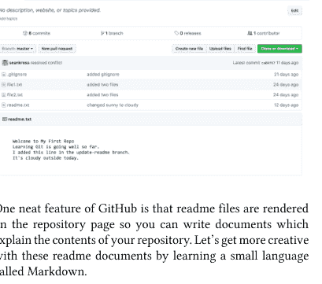

GitHub 的一个巧妙功能是，readme 文件会渲染在仓库页面上，因此你可以编写文档来说明仓库的内容。让我们通过学习一种叫做 Markdown 的小语言，来更有创意地编写这些 readme 文档。

# Markdown

Markdown 是一种标记语言。标记语言是用于为文本添加装饰性功能的规则集合。最流行的标记语言是 HTML，但你可能也听说过 XML 和 LaTeX。Markdown 是一种强大的标记语言，因为它简洁、直观，并且以纯文本形式书写时具有很好的可读性。GitHub 会将 Markdown 文件（以 .md 文件扩展名结尾）转换为仓库中简单的 HTML 网页。如果你的仓库中任何文件夹里有一个名为 README.md 的文件，那么该文件会被渲染为 HTML 并显示在 GitHub 上。让我们创建一个包含代码的 README.md 文件：

```
Here is how you make [a link](https://www.wikipedia.org/).


nano README.md

Now let’s add our changes, make a commit, and push those changes to our remote repository:
```

git add -A
git commit -m "added README.md"
git push

```
Counting objects: 3, done.
Delta compression using up to 4 threads.
Compressing objects: 100% (3/3), done.
Writing objects: 100% (3/3), 659 bytes | 0 bytes/s, done.
Total 3 (delta 0), reused 0 (delta 0)
To https://github.com/seankross/my-first-repo.git
  ca04f67..2169912  master -> master
```

由于我们在第一次推送时设置了默认的远程仓库，现在只需输入 git push 即可将最新的提交发送到 origin 远程仓库的 master 分支。现在你在 GitHub 上的仓库页面应该看起来像这样：

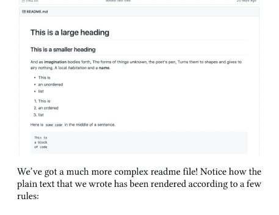

我们得到了一个复杂得多的 readme 文件！请注意，我们编写的纯文本是根据一些规则渲染的：

- 井号（#, ##）用于创建标题。
- 单词被单个星号（*word*）包围时，该单词会变为斜体。
- 单词被双星号（**word**）包围时，该单词会变为粗体。


- 你可以使用连字符 (-) 或数字 (1., 2., 3.) 创建列表。
- 代码可以用单反引号 (`code`) 放在行中间。
- 代码块可以通过在代码前后加上三重反引号 (```) 来创建。
- 你可以用方括号和圆括号插入链接 ([Link text here](http://jhu.edu))。
- 你可以用感叹号和指向图像的链接来使用图像 ()

我个人非常喜欢用 Markdown 写作，以至于我用 Markdown 写了整本²³书！我们将在本章剩余部分使用 Markdown，所以我建议你花几分钟在浏览器中的 Markdown 编辑器²⁴里试玩一下语法。有关 Markdown 的更多信息，请参阅 GitHub 的实用 Mastering Markdown²⁵ 指南。

# Pull Requests

我们接下来要讨论的 GitHub 的两个功能 - pull requests 和 forking - 正是让 GitHub 如此出色的原因。pull request 允许你在合并之前交互式地比较两个不同的分支，这样你就可以继续合并或向打开 pull request 的人提供反馈。基本上 pull request 允许一个人询问另一个人是否愿意将一个分支上的更改合并到另一个分支中。这种社交编码交易可能涉及你和一个协作者、你和一个陌生人，或者你可能在自己的仓库上打开一个 pull request，只是作为一种保持组织有序的方法。

由于我不能保证你有协作者，我将向你展示如何在自己的仓库上打开一个 pull request。首先在你的本地 my-first-repo 仓库中，让我们切换到 update-readme 分支。

```
git checkout update-readme
```

```
## Switched to branch 'update-readme'
```

让我们看看这个分支上目前有什么：

```
ls
```

```
## bernie.jpg
## toby.jpg
## file1.txt
## file2.txt
## readme.txt
```

看起来我们还没有将此分支更新为与 master 分支保持一致。我们可以通过合并 master 分支轻松做到这一点。

```
git merge master
```

```
## Updating 5aa94fa..2169912
## Fast-forward
## README.md | 28 ++++++++++++++++++++++++++++
## readme.txt | 4 ----
## 2 files changed, 28 insertions(+), 4 deletions(-)
## create mode 100644 README.md
## delete mode 100644 readme.txt
```

现在 master 和 update-readme 分支是相同的。让我们清理这个目录，以便你可以制作一个小型的个性化 Markdown 项目。首先让我们删除此目录中我们不需要的所有文件，也就是除了 README.md 之外的所有内容。

```
rm *.txt
rm *.jpg
ls
```

```
## README.md
```

现在我们清理了仓库，让我们用 nano 打开 README.md。删除其中写的所有内容并写几行关于你自己的内容。在下面的文本块中，你可以看到我在 README.md 中写的内容。

# Sean Kross

### Geography

我住在美国马里兰州巴尔的摩市。

### Reading

我最喜欢的三本书是：

- *Mindstorms* 作者 Seymour Papert
- *Welcome to the Monkey House* 作者 Kurt Vonnegut
- *Persepolis* 作者 Marjane Satrapi

### Food

昨晚我梦见在这些餐厅吃饭：

1. 丹佛的 Linger。
2. 耶路撒冷的 Azura。
3. 纽约市的 Gemma。

### Contact

联系我的最佳方式是 [在 Twitter 上](https://twitter.com/seankross)。

一旦你写了一些关于自己的有趣内容，添加你的更改，并进行新的提交。

```
git add -A
git commit -m "made readme more personal"
```

与本地 Git 仓库一样，GitHub 上的远程仓库也可以有多个分支。让我们将此提交推送到 GitHub 上的 update-readme 分支：

```
git push origin update-readme
```

```
## Counting objects: 3, done.
## Delta compression using up to 4 threads.
## Compressing objects: 100% (3/3), done.
## Writing objects: 100% (3/3), 630 bytes | 0 bytes/s, done.
## Total 3 (delta 0), reused 0 (delta 0)
## To https://github.com/seankross/my-first-repo.
 git
## * [new branch]      update-readme -> update-readme
```

请注意，我们需要指定要推送到的远程，因为 GitHub 之前不知道 update-readme 分支的存在。当你执行 git push 时，只有当前分支上的提交会被发送到远程仓库。这样你就可以创建只能从本地访问的分支，除非你明确将其推送到 GitHub。

现在让我们回到我们仓库的 GitHub 页面。页面左侧你应该会看到一个写着“Branch: master”的按钮。点击该按钮，一个小下拉菜单应该会出现，如下所示：


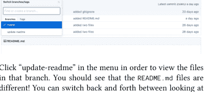

点击菜单中的“update-readme”，即可查看该分支中的文件。你会看到 README.md 文件是不同的！你可以通过这个菜单在分支之间来回切换查看。

现在你已经将更新后的分支推送到了 GitHub，让我们来开启一个拉取请求。拉取请求就像是由 GitHub 促成的有向导的 git 合并。要发起拉取请求，请点击分支按钮旁边的“New pull request”按钮（见上图左上角）。该按钮会将你带到一个类似这样的页面：

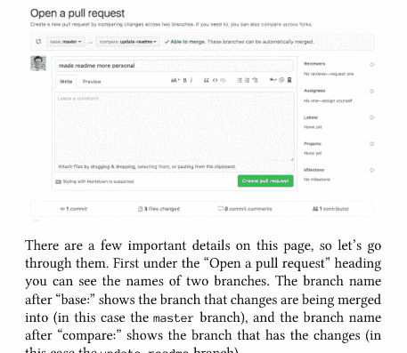

这个页面上有几个重要的细节，让我们逐一了解。首先，在“Open a pull request”标题下方，你可以看到两个分支的名称。“base:”后面的分支名称显示的是更改将要合并到的分支（本例中为 master 分支），而“compare:”后面的分支名称显示的是包含更改的分支（本例中为 update-readme 分支）。

在下面的文本框中，你可以为拉取请求编写标题（本例中的默认标题是最后一次提交的名称），并且可以编写关于拉取请求的评论，这些评论可以用 Markdown 格式化。如果你正在与其他人协作一个项目，编写良好的评论非常重要，这样你的协作者就能知道你在请求合并的分支中做了哪些更改。如果你向下滚动页面，可以看到“compare”分支与“base”分支之间更改的逐行比较。当你完成对这些更改的检查后，点击绿色的“Create pull request”按钮来开启拉取请求。现在你应该会看到这样一个屏幕：


恭喜你开启了第一个拉取请求！让我们来看看这个页面上有什么。在拉取请求标题下方，我们可以看到三个选项卡：Conversation、Commits 和 Files changed。在 Conversation 选项卡中，我们可以添加可以用 Markdown 格式化的拉取请求评论。Commits 选项卡列出了在此拉取请求中已提交到“compare”分支的提交。最后，Files changed 选项卡显示了我们之前看到的相同的逐行比较。

通常，当你与协作者一起工作时，在开启拉取请求之后会有大量的讨论。即使请求已经开启，推送到 GitHub 仓库“compare”分支（本例中为 update-readme）的 git 提交也会反映在拉取请求中。这样，因讨论而产生的更改就可以轻松地被纳入。当你准备好后，返回 **Conversation** 选项卡，点击绿色的“Merge pull request”按钮，然后点击出现的绿色“Confirm merge”按钮。这将把“compare”分支 git 合并到远程仓库中的“base”分支。你刚刚合并了你的第一个拉取请求！现在点击页面左上角附近的 <> Code 选项卡，你应该会看到 update-readme 分支的更改已经合并到 master 中了。

当你在一个有许多其他人的远程 GitHub 仓库上工作时，如果提交影响到的代码部分不是你在处理的，这些拉取请求和合并完全可以在你不知情的情况下发生。尽管如此，保持你的本地仓库与远程仓库的最新更改同步仍然很重要。让我们回到你的终端，当前工作目录应该是 my-first-repo。

当你在一个有许多其他人的远程 GitHub 仓库上工作时，如果提交影响到的代码部分不是你在处理的，这些拉取请求和合并完全可以在你不知情的情况下发生。尽管如此，保持你的本地仓库与远程仓库的最新更改同步仍然很重要。让我们回到你的终端，当前工作目录应该是 my-first-repo。首先，让我们切换到 master 分支。

```
git checkout master
```

现在，让我们用已合并到远程 master 分支的提交来更新本地的 master 分支。


repository. 我们可以使用命令 git pull 来完成此操作：

```
git pull
```

```
## remote: Counting objects: 1, done.
## remote: Total 1 (delta 0), reused 0 (delta 0), pack-reused 0
## Unpacking objects: 100% (1/1), done.
## From https://github.com/seankross/my-first-repo
##  2169912..b9217f6  master  -> origin/master
## Updating 2169912..b9217f6
## Fast-forward
## README.md | 38 +++++++++++++++++++++++++++++++-------
## file1.txt | 0
## file2.txt | 0
## 3 files changed, 18 insertions(+), 20 deletions(-)
## delete mode 100644 file1.txt
## delete mode 100644 file2.txt
```

使用 git pull 时，Git 会在 origin 远程仓库中找到 master 分支，并用新的提交更新我们的本地仓库。你现在已完成了完整的 pull request 生命周期！在本章的 Forking 部分，我们将回到讨论 GitHub 如何增强 pull request 以促进更大的编码社区。

## Pages

现在我们要稍作偏离，来讨论 GitHub Pages²⁶。GitHub Pages 允许你仅使用 Git 和 Markdown 在 GitHub 上创建并托管网站。回到 GitHub 上的你的 my-first-repo 仓库页面，点击顶部的 Settings 标签。向下滚动页面，直到看到一个写着 GitHub Pages 的框。然后点击下拉菜单中写着 None 的选项。你应该会看到如下屏幕：

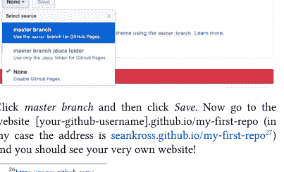

点击 master branch 然后点击 Save。现在访问网站 [your-github-username].github.io/my-first-repo（在我这里地址是 seankross.github.io/my-first-repo²⁷），你应该就能看到你自己的网站了！

²⁶ https://pages.github.com/
²⁷ http://seankross.github.io/my-first-repo


多酷啊！？如果你想更改你的新网站，只需编辑你的 README.md 然后提交并推送更改即可！这类网站非常适合展示项目、提供软件文档、创建在线简历或写博客！GitHub Pages 网站可以简单到只有几份 Markdown 文档，如果你懂一些网页编程，也可以将其变成复杂的网站。有关 GitHub Pages 的更多信息，你可以查看这里²⁸ 的文档。

## Forking

如果你正在阅读这本书，可以相当肯定地说你每天都在与软件交互。软件驱动着你的电脑、互联网、你的手机，以及这本书。考虑到你使用的所有软件，你是否曾想过修改这些软件？也许你可以编写一些代码来添加你认为有用的新功能，或修复你注意到的一个小故障。GitHub 通过分叉过程让修改他人的软件变得容易。Forking 一个 GitHub 仓库会将某人的 GitHub 仓库复制到你的 GitHub 账户中。然后你可以随意修改这个软件的副本。在你向仓库的副本添加了一些提交后，你可以保留这些新提交供自己使用，与他人分享，或为你的新提交打开一个 pull request，以便将其合并到原始源仓库中。这个原始源仓库（你分叉的仓库）通常被称为上游仓库。

让我们现在尝试分叉一个仓库。前往 https://github.com/seankross/the-unix-workbench 并点击右上角的 Fork 按钮。然后 GitHub 会询问你想使用哪个账户来分叉仓库。如果你是 GitHub 的新用户，那么你只有一个账户，所以选择该账户。经过短暂的“请稍候”屏幕后，你应该会在 URL https://github.com/[your-github-username]/the-unix-workbench 看到已分叉的仓库。你现在已为本书分叉了仓库！为了获取仓库的本地副本，你需要使用 git clone 命令。克隆仓库会将 Git 仓库复制到你的电脑，同时保留其源自的远程仓库的跟踪。让我们现在克隆你对我仓库的分叉。在仓库页面的右侧，你应该会看到一个写着 Clone or download 的绿色按钮。点击该按钮，然后会出现以下菜单：


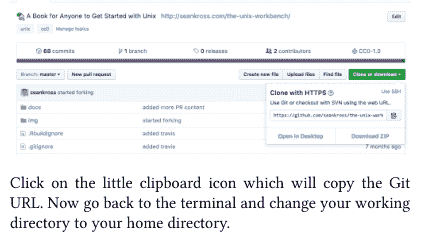

点击小剪贴板图标，它会复制 Git URL。现在回到终端，并将你的工作目录切换到主目录。

```
cd
pwd
```

## /Users/sean

现在我们来克隆仓库。在终端中输入 git clone，然后粘贴我们从 GitHub 复制的 Git URL：

```
git clone https://github.com/|your-github-username|/the-unix-workbench.git
```

```
## Cloning into 'the-unix-workbench'...
## remote: Counting objects: 669, done.
## remote: Compressing objects: 100% (7/7), done.
## remote: Total 669 (delta 2), reused 8 (delta 2)
), pack-reused 660
## Receiving objects: 100% (669/669), 4.00 MiB | \
4.55 MiB/s, done.
## Resolving deltas: 100% (510/510), done.
```

现在 cd 进入你克隆的仓库。

```
cd the-unix-workbench
```

你刚刚成功完成了第一次 Git 克隆！如前所述，克隆的优点在于，它可以记录与本地仓库关联的远程仓库。让我们输入加上 -v 标志的 git remote 来测试一下：

```
git remote -v
```

```
## origin      https://github.com/[your-github-username\
]/the-unix-workbench.git (fetch)
## origin      https://github.com/[your-github-username\
]/the-unix-workbench.git (push)
```

如你所见，克隆该仓库后，远程仓库的默认名称是 origin。现在你已经克隆了自己的 fork，应该添加一次提交！我建议的一项改动是把你的名字添加到 guestbook.md。现在就这样做：

```
echo "- Sean Kross" >> guestbook.md # Add your own
 name of course!
cat guestbook.md
```

```
## # Guest Book
##
## - Sean Kross
```

现在添加、提交并推送你的改动：

```
git add guestbook.md
git commit -m "added my name to guestbook.md"
git push
```

既然你已将自己的名字添加到访客簿，就可以按照上一节所述，开启一个新的 pull request，将你的改动合并到我的访客簿版本中。如果你的访客簿 pull request 被合并到上游仓库（由我处理），那么你就完成了完整的 GitHub 生命周期！

Fork 一个仓库、进行修改、然后开启 pull request，这是一种非常强大的工作流，可以促使软件世界中你希望看到的改变发生。许多大型且重要的软件项目都在 GitHub 上托管仓库，包括操作系统²⁹、编程语言³⁰，甚至 Git 本身³¹！如果你希望在某个公开 GitHub 仓库中看到某项改动，就 fork 该仓库并做出修改吧！

²⁹https://github.com/torvalds/linux
³⁰https://github.com/golang/go
³¹https://github.com/git/git

# 总结

- 你可以使用 GitHub 来创建和托管远程 Git 仓库。
- 远程 Git 仓库是始终连接到互联网的 Git 仓库。
- 使用 `git remote` 列出远程仓库。
- 使用 `git remote add [name-of-remote] https://github.com/[username]/[repo-name].git` 添加远程仓库。
- 使用 `git push [name-of-remote] [name-of-branch]` 将提交推送到你的远程仓库；如果你已设置默认远程仓库和分支，也可以直接使用 `git push`。
- 要将远程仓库上的提交合并到本地仓库，请使用 `git pull [name-of-remote] [name-of-branch]`；如果你已设置默认远程仓库和分支，也可以直接使用 `git pull`。
- Pull request 让你在合并两个不同分支之前，可以交互式地比较它们。
- GitHub Pages 允许你免费托管用 Markdown 编写的网站！
- Fork 一个仓库使你可以对公共仓库的副本进行修改。如果你认为自己的改动应当合并到上游仓库，就可以开启一个 pull request！

# 练习

- 1. 在 GitHub 上创建一个新仓库。克隆你的仓库并添加一个 README.md 文件。将此文件推送到 GitHub，并为该仓库创建一个 GitHub Pages 网站。

- 2. Fork 一个现有仓库（试试我的仓库之一：https://github.com/seankro，并尝试找出你能贡献的有价值内容）。对该仓库进行修改或补充，然后开启一个 pull request。

- 3. 阅读 GitHub 的指南³²。

³² https://guides.github.com/


## Nephology

> > 我在云中看见了一座城市。- 达戈巴尼亚谚语

## Introduction to Cloud Computing

Nephology 是对云的研究。很少有现代技术概念（除了也许数据科学和人工智能）像“云”一样被如此大肆炒作。云只是一个我们可以通过互联网访问的计算机。在本章中，我们将搭建一台云计算机，并学习与之交互的基础知识。

为了充分利用本章内容，你需要你的信用卡或借记卡，或一个 PayPal 账户。我们将使用 DigitalOcean，这是一家我们可以租用云计算机的公司。在本章中我可能会将云计算机称为服务器（连接互联网的计算机）或称为 droplets，这是 DigitalOcean 用于指代其服务器的营销术语（droplet 不是技术术语）。从 DigitalOcean 租用不会花费你任何钱，因为我给你提供了一个免费两个月服务的优惠券！有几家公司提供与 DigitalOcean 相比类似的服务，但在我看来它们拥有最好的用户界面和最透明的定价模式。

33 https://www.paypal.com
34 https://m.do.co/c/53d0d6ef2b37

检查你的电子邮件，查找来自 DigitalOcean 的消息并点击其中包含的链接来确认你的电子邮件。然后你需要输入你的信用卡或借记卡信息，或你的 Paypal 账户详情。只要你在开始使用后两个月内关闭所有服务器，你就不会被收费。输入付款信息后，你应该会看到以下屏幕：

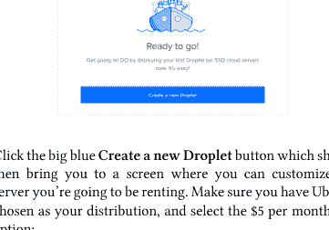

点击大大的蓝色 Create a new Droplet 按钮，这应该会带你进入一个可以自定义你要租用的服务器的屏幕。确保你选择了 Ubuntu 作为发行版，并选择每月 $5 的大小选项：

## Nephology


向下滚动页面，然后选择地理位置最靠近你的区域。某些区域有多个数据中心，选择哪个数据中心并不重要。我目前在美国马里兰州巴尔的摩，所以我将选择纽约的编号 1 数据中心：


最后在页面底部点击大大的绿色 **Create** 按钮以启动你的服务器！

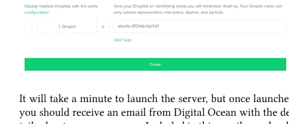

启动服务器需要一分钟时间，但一旦启动，你应该会收到一封来自 Digital Ocean 的电子邮件，其中包含有关你的新服务器的详细信息。此电子邮件中应包含你的服务器的 IP 地址、默认用户名（应为 root）以及一个随机生成的密码，你需要该密码才能首次连接到服务器。收到此电子邮件后，打开一个新的终端。

## Connecting to the Cloud

我们可以使用 ssh 程序连接到互联网上的计算机，ssh 代表 Secure Shell。ssh 命令为我们指向的任何计算机提供命令行界面。连接到互联网的计算机有一个地址（就像房子有一个地址一样），该地址由 IP 地址指定。使用 ssh 连接到计算机的命令通常如下所示：

```
ssh [username]@[IP address]
```

让我们使用 ssh 连接到我们的 DigitalOcean 服务器。在终端中输入以下命令，将你从 DigitalOcean 收到的 IP 地址替换为我在本示例中使用的 IP 地址：

```
ssh root@159.203.134.88
```

```
## The authenticity of host '159.203.134.88 (159.203.134.88)' can't be established.
## ECDSA key fingerprint is SHA256:UhtoIx/3c6/MmAIE+H8wSoE06PsbXdzRrSAUhKtJhs.
## Are you sure you want to continue connecting (yes/no)?
```

输入 yes 然后按 Enter。

```
## Warning: Permanently added '159.203.134.88' (ECDSA) to the list of known hosts.
## root@159.203.134.88's password:
```

此密码应位于你从 DigitalOcean 收到的电子邮件中。将密码复制并粘贴到终端，然后按 Enter。

```
## You are required to change your password immediately (root enforced)
## Welcome to Ubuntu 16.04.2 LTS (GNU/Linux 4.4.0-78-generic x86_64)
##
##   * Documentation:  https://help.ubuntu.com
##   * Management:    https://landscape.canonical.com
##   * Support:       https://ubuntu.com/advantage
##
##   Get cloud support with Ubuntu Advantage Cloud Guest:
```


##   http://www.ubuntu.com/business/services/cloud
##
## 0 packages can be updated.
## 0 updates are security updates.
##
##
##
## The programs included with the Ubuntu system are free software;
## the exact distribution terms for each program are described in the
## individual files in /usr/share/doc/*/copyright.
##
## Ubuntu comes with ABSOLUTELY NO WARRANTY, to the extent permitted by
## applicable law.
##
## Changing password for root.
## (current) UNIX password:

我们现在需要为这台服务器创建一个新密码。首先粘贴旧密码并按 Enter。然后想一个新且强壮的密码并在控制台中输入。然后再次输入新密码以确认。输入新密码后我们应该会看到提示符！按几次回车以确保每次都能返回提示符。我们进来了！

现在我们可以使用我们通常拥有的所有 Unix 命令：

```
pwd
```

```
## /root
```

要断开与服务器的连接并返回到你的机器，请使用 logout。

```
logout
```

```
## Connection to 159.203.134.88 closed.
```

要重新连接到服务器，请再次使用 ssh：

```
ssh root@159.203.134.88
```

```
## root@159.203.134.88's password:
```

输入你的密码，你应该会得到云服务器的提示符。

# Summary

+   - ssh 会将你连接到连接到互联网的计算机。连接的命令模板为 ssh [username]@[IP address]。
+   - 要断开 ssh 会话，请使用 logout 命令。

# Cloud Computing Basics

## Moving Files In and Out of the Cloud

既然我们有了云计算机，我们能用它做什么？我们可以做的一件事是从云计算机存储和检索文件。程序 scp 允许我们将本地文件复制到服务器，并允许我们将服务器上的文件复制到本地计算机。首先让我们连接到服务器以便在那里创建文件：

```
```bash
ssh root@159.203.134.88
```
```

```
```text
## root@159.203.134.88's password:
## * (Enter your password)
```
```

```
```bash
mkdir textfiles
echo "From the server" > textfiles/server-file.txt
logout
```
```

```
```text
## Connection to 159.203.134.88 closed.
```
```

现在我们已经回到本地机器上的提示符，让我们尝试从服务器获取 server-file.txt。使用 scp 从服务器复制文件的参数具有以下一般结构：

```
scp [username]@[IP address]:path/to/file/on/server\
r path/on/my/computer
```

这会将位于服务器上 path/to/file/on/server 的文件复制到本地路径 path/on/my/computer。在同样的方式下，我们可以使用 -r 标志从服务器复制整个文件夹：

```
scp -r [username]@[IP address]:path/to/folder/on/\
server folder/on/my/computer
```

让我们现在从本地计算机尝试这个。提示时输入你的密码：

```
cd
pwd
```

## /Users/sean/

```
mkdir Cloud
cd Cloud
scp root@159.203.134.88:/root/textfiles/server-fi\
le.txt downloaded.txt
```

## root@159.203.134.88's password:
## server-file.txt             |
        100%   16    1.2KB/s   00:00

```
cat downloaded.txt
```

## From the server

成功了！现在让我们尝试上传一个文件到我们的服务器。执行此操作的的参数只是从服务器下载文件的参数的交换：

```
scp path/on/my/computer [username@][IP address]:path/to/file/on/server
```

让我们创建一个文件并将其上传到我们的服务器：

```
echo "from local computer" > to-upload.txt
scp to-upload.txt root@159.203.134.88:/root/textfiles/uploaded-file.txt
```

## root@159.203.134.88's password:

## to-upload.txt

```
100%   20    1.8KB/s   00:00
```

现在让我们登录到我们的服务器，看看它是否在那里：

```
ssh root@159.203.134.88
cat textfiles/uploaded-file.txt
```

```
## from local computer
```

看起来成功了！将文件保存在云中允许你只要有终端和 ssh 访问权限，就可以在同一个工作区中使用相同的文件。

# Talking to Other Servers

互联网上有成千上万的服务器！你可能习惯通过网页浏览器与服务器通信，但我们还可以通过命令行以其他方式与服务器通信。用于在命令行上与其他服务器通信的最受欢迎的程序之一是 curl。curl 命令允许我们向其他服务器发送请求和信息。

我们可以使用 curl 执行的一个简单任务是下载在线可用的文件。例如，这整本书及其所有相关文件都托管在一台服务器上！你可以在这里找到本书第一章之一的 Markdown 文件。要使用 curl 下载文件，我们只需提供 -O 标志和文件的 URL：

```
curl -O http://website.org/textfile.txt
```

让我们尝试从我的网站下载 Markdown 文件：

```
curl -O http://seankross.com/the-unix-workbench/0\
1-What-is-Unix.md
```


## % Total    % Received % Xferd  Average Speed
   Time     Time     Time  Current
##
          Dload  Upload
   Total   Spent    Left  Speed
## 100 1198  100 1198    0     0 13681      0 \
--:--:-- --:--:-- --:--:-- 13770

```
head -n 5 01-What-is-Unix.md
```

## What is Unix?
##
## Unix is an operating system and a set of tools. The tool we'll be using the
## most in this book is a shell, which is a computer program that provides a
## command line interface. You've probably seen a command line interface in the

Looks like we got the file! The curl command is also commonly used for communicating with APIs. API stands for application programming interface. APIs are a set of rules which allow us to communicate with computer programs or with servers on the web. GitHub has a large API which allows us to find out information about GitHub's users and repositories. Let's use curl to look at what programming languages are used by some of my repositories. Let's start with the repository for this book:

```
curl https://api.github.com/repos/seankross/the-unix-workbench/languages
```

```
{
  "CSS": 2615,
  "TeX": 22
}
```

It looks like most of the repository is dedicated to making the book website look pretty! Take a look at the URL in the curl command above, and let's dissect it a little bit. The API itself is located at https://api.github.com/. Then each word in the rest of the url acts as a sort of argument. We're interested in repos in this case, specifically a repo belonging to the username seankross called the-unix-workbench, and we want to know about which languages are used in that repo. Let's take a look at one more of my repositories just to see how the response can be different:

```
curl https://api.github.com/repos/seankross/lego/languages
```

```
{
  "R": 4197,
  "Shell": 442
}
```

Use of curl, especially when coupled with using APIs can become very complicated and much more advanced content has been written on the subject. Let's get a little more in depth

by looking through some of the examples from httpbin.org38. This website allows us to send requests to it with curl, and it will return to us a structured version of whatever information we sent. This is useful for debugging our curl commands. First let’s send a request which should return our IP address:

```
curl http://httpbin.org/ip
```

```
{
  "origin": "459.203.134.88"
}
```

Looks like we’re getting the response we expect. Before we go on I should clarify: curl sends HTTP requests. HTTP is a technology for sending information over a network, and HTTP powers much of how the internet works. There are different categories of HTTP requests, and the categories are often called verbs. When we use curl without any flags we are sending a GET request (GET is an HTTP verb). A GET request is a message that says to a server: “Hi, I live at [IP address]. Would you mind sending some information about yourself to that IP?” In the case above we asked for our own IP address, which httpbin.org knew to just send back to us.

Let’s send a general HTTP GET request to http://httpbin.org/get:

```
curl http://httpbin.org/get
```

```
{
  "args": {},
  "headers": {
    "Accept": "*/*",
    "Connection": "close",
    "Host": "httpbin.org",
    "User-Agent": "curl/7.47.0"
  },
  "origin": "459.203.134.88",
  "url": "http://httpbin.org/get"
}
```

The text that we get back from the request specifies four information groups: args, headers, origin, and url. The origin shows our own IP address, and url shows where we sent the request. The headers group shows some interesting information, including the User-Agent which shows that httpbin.org knows that we sent this request with curl. Notice that the args group is empty. The args group is short for arguments, which hints at the fact that we can provide arguments in an HTTP request, just like arguments we would use for a function, or the arguments we used in the GitHub API.

In the general case we can provide arguments to an HTTP API by putting a question mark (?) after the API's URL. Let's try this out:

```
curl http://httpbin.org/get?Baltimore
```


{
  "args": {
    "Baltimore": ""
  },
  "headers": {
    "Accept": "*/*",
    "Connection": "close",
    "Host": "httpbin.org",
    "User-Agent": "curl/7.47.0"
  },
  "origin": "459.203.134.88",
  "url": "http://httpbin.org/get?Baltimore"
}

Looks like "Baltimore" showed up in args! For most HTTP APIs we need to give names to our arguments, unlike most arguments in Bash. We can specify an argument's name with the template [argument name]=[argument value]. Let's take a look at a simple example:

```
curl http://httpbin.org/get?city=Baltimore
```

```
{
  "args": {
    "city": "Baltimore"
  },
  "headers": {
    "Accept": "*/*",
    "Connection": "close",
    "Host": "httpbin.org",
    "User-Agent": "curl/7.47.0"
  }
```

},
"origin": "159.203.134.88",
"url": "http://httpbin.org/get?city=Baltimore"
}

Now we can see that in args there’s a correspondence between city and Baltimore. We can add more named arguments by separating them with an ampersand (&):

```
curl "http://httpbin.org/get?city=Baltimore&state=Maryland"
```

```
{
  "args": {
    "city": "Baltimore",
    "state": "Maryland"
  },
  "headers": {
    "Accept": "*/*",
    "Connection": "close",
    "Host": "httpbin.org",
    "User-Agent": "curl/7.47.0"
  },
  "origin": "159.203.134.88",
  "url": "http://httpbin.org/get?city=Baltimore&state=Maryland"
}
```

Perhaps you could imagine building a server that accepts HTTP requests, and sends back different information depending on what arguments are provided (for example, send

back a weather report given a location). Building these kinds of servers is an advanced topic that is outside the scope of this book, but there are lots of resources out there if you’re interested in building your own HTTP API on a web server.

# Automating Tasks

One of the most compelling features about any web server is that it’s always powered on and always connected to the internet. This means that we can instruct our server to perform tasks automatically, without us needing to enter a command into a shell. One of the most commonly used programs for executing *other programs* with a regular frequency is called `cron`. Let’s take a look at how to use cron to schedule a program to be run.

If you’re not already connected to the server use `ssh` to connect.

```
ssh root@159.203.134.88
```

The `cron` program is part of a family of programs called **daemons**. A daemon is a program that is always running in the background of our computer. First, let’s see if cron is running. We can get a list of all running programs with the `ps` command while using the -A flag:

```
ps -A
```

## PID TTY TIME CMD
## 1 ? 00:00:13 systemd
## 2 ? 00:00:00 kthreadd
## 3 ? 00:00:03 ksoftirqd/0
## 5 ? 00:00:00 kworker/0:0H
## 7 ? 00:00:11 rcu_sched
## 8 ? 00:00:00 rcu_bh
## 9 ? 00:00:00 migration/0
## ...

You probably have a huge list of programs in your terminal now! Instead of sifting through this listing line-by-line, let’s pipe the output of this command to grep and we’ll look for cron:

```
ps -A | grep "cron"
```

## 1273 ? 00:00:01 cron

Looks like the cron daemon is running! In order to assign programs to be executed with cron we need to edit a special text file called the cron table. Before we edit the cron table we need to select the default text editor. If you like using nano (the text editor we’ve been using throughout this book) then enter select-editor into the console, type in the number that corresponds to nano (usually 2) and then press enter:

```
select-editor
```

```
## Select an editor.  To change later, run `select-editor`.
##   1. /bin/ed
##   2. /bin/nano        <--- easiest
##   3. /usr/bin/vim.basic
##   4. /usr/bin/vim.tiny
##
## Choose 1-4 [2]:
```

Now that we’ve chosen a text editor we can edit the cron table using the command crontab -e (cron table edit) which will automatically open nano with the appropriate file.

```
crontab -e
```

```
# Edit this file to introduce tasks to be run by cron.
#
# m h  dom mon dow   command
```

Let’s go over the layout of the cron table. First you should notice that any text after a pound sign (#) is a comment, so it’s not seen by cron (just like bash comments). The cron table has six columns:

- 1. Minute (m)
- 2. Hour (h)
- 3. Day of Month (dom)
- 4. Month (mon)
- 5. Day of Week (dow)


## 6. 要运行的命令（command）

表中的每一列由单个空格分隔。前五列允许你指定希望运行特定命令的时间。每一列中只有特定的值是有效的：

- 1. 分钟：00 - 59（一小时内特定的一分钟）
- 2. 小时：00 - 23（0 是午夜时刻）
- 3. 月份中的日期：01 - 31（1 是当月的第一天）
- 4. 月份：01 - 12（1 是一月）
- 5. 星期中的日期 0 - 6（0 是星期日）

cron 表中还有一些其他有效字符。最常用的字符是星号（*），它代表一列中的所有可能值。因此，分钟列中的星号表示“每分钟运行”，小时列中的星号表示“每小时运行”。知道了这一点，让我们在 cron 表中创建第一个条目。如果我们希望一个命令在每分钟、每小时、每个月的每一天、每个月、每周的每一天都执行，那么我们可以把星号放在前五列中，后面跟上我们想运行的命令。在这个例子中，cron 将每分钟运行的命令是 `date >> ~/date-file.txt`，它会将命令执行时的日期和时间追加到我们主目录中一个名为 date-file.txt 的文件中。这就是你保存并退出 nano 之前 cron 表应该看起来的样子：

```
# Edit this file to introduce tasks to be run by \ cron.
#
# m h dom mon dow command
* * * * * date >> ~/date-file.txt
```

像保存普通文本文件一样保存并退出 nano，然后稍等片刻！一分钟过去后，使用 cat 查看 ~/date-file.txt：

```
cd
cat date-file.txt
```

```
## Thu Jun 8 18:50:01 UTC 2017
```

看起来我们 cron 表中的条目正在生效！再等一分钟，然后再次查看该文件：

```
cat date-file.txt
```

```
## Thu Jun 8 18:50:01 UTC 2017
## Thu Jun 8 18:51:01 UTC 2017
```

除非我们删除在 cron 表中输入的那一行，否则 date 的输出将每分钟追加到 date-file.txt。

单行 bash 命令 `date >> ~/date-file.txt` 是一个比我们通常在 cron 表中可能使用的程序简单得多的程序，尽管它很适合说明 cron 表的工作原理。如果

你想用 cron 执行更复杂的任务，最好让 cron 执行你预先编写的 bash 脚本。这样，你可以只需在表的最后一列指定 `bash /path/to/script.sh`。

在所有列中使用星号是 cron 表中最简单的一行，所以让我们看一些更复杂的表条目的例子：

```
# m h dom mon dow   command
00 * * * * bash /path/to/script.sh    # Runs every hour at the start of the hour
00 12 * * * bash /path/to/script.sh    # Runs every day at noon
* 12 * * * bash /path/to/script.sh    # Runs every minute between 12pm and 12:59pm
00 00 05 * * bash /path/to/script.sh    # Runs the 5th day of every month at midnight
00 00 * 07 * bash /path/to/script.sh    # Runs every day in the month of July at midnight
00 00 * * 2 bash /path/to/script.sh    # Runs every Tuesday at midnight
```

除了数字和星号之外，cron 表列中还可以使用一些其他字符，包括用于指定范围的连字符（-）和用于指定项目列表的逗号（,）。例如，分钟列中的 00-29 将指定一小时的前三十分钟，而星期列中的 1,5 将指定星期一和星期五。

让我们再看一个使用连字符和范围的 cron 表示例，以便你了解每个字符的作用。

```
# m h dom mon dow   command
00-04 * * * * bash /path/to/script.sh    # Runs every minute for the first five minutes of every hour
```

```
00 00 * * 0,6 bash /path/to/script.sh    # Runs at midnight every Saturday and Sunday
```

```
00 03 01-15 * * bash /path/to/script.sh    # Runs at 3am for the first fifteen days of every month
```

```
00,30 * * * * bash /path/to/script.sh    # Runs at the start and middle of every hour
```

```
00 00,12 * * * bash /path/to/script.sh    # Runs every day at midnight and noon
```

```
00 * 01-07 01,06 * bash /path/to/script.sh    # Runs at the start of every hour for the first seven days of the months of January and June
```

由 cron 运行的程序，其强大程度只受你的想象力限制！如果你熟悉社交网络 Twitter³⁹，那么你可能遇到过一些自动创建帖子的 Twitter 账户，比如 Emoji Aquarium⁴⁰、Old Fruit Pictures⁴¹ 或 Endless Screaming⁴²。许多这类“机器人”账户都是由 cron 驱动的，cron 使用 Twitter 的 HTTP API 定期发布推文。

## 总结

- scp 在云计算机和你的本地计算机之间复制文件

³⁹ https://twitter.com/
⁴⁰ https://twitter.com/emojiaquarium
⁴¹ https://twitter.com/pomological
⁴² https://twitter.com/infinite_scream


个人计算机。使用 -r 标志来复制目录。

- `curl` 允许你向其他服务器发送 HTTP 请求。使用 `-o` 标志可以通过 `curl` 下载文件。
- `ps -A` 列出你计算机后台运行的所有程序。
- `cron` 允许你安排程序的运行时间。使用 `crontab -e` 来编辑 cron 表。

## 练习

1. 编写一个 bash 脚本，该脚本将文件路径作为参数，并将该文件复制到服务器上的指定文件夹中。
2. 在网上找一个定期变化的文件，然后编写一个程序，在每次文件变化时下载它。
3. 尝试使用 Twitter API⁴³ 或 GitHub API⁴⁴ 创建你自己的 Twitter 或 GitHub 机器人。

## 关闭服务器

为了避免使用超出必要的 DigitalOcean 额度，或因使用该服务而被收费，请务必**销毁**你启动的任何 DigitalOcean Droplet（水滴）。当你销毁 Droplet 时，Droplet 上的所有文件将永久消失，因此请确保在销毁之前，Droplet 上没有存储任何重要信息。如果你想保留 Droplet 上的某些文件，请使用 `scp` 将它们复制到你的本地机器上。

让我们来一步步演示如何销毁一个 Droplet。返回 DigitalOcean⁴⁵ 并登录。然后你应该会看到你所有 Droplet 的列表：

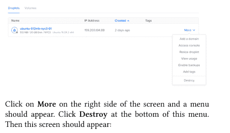

点击屏幕右侧的 **More**，会出现一个菜单。点击该菜单底部的 **Destroy**。然后会出现以下界面：

点击 **Destroy** 按钮，然后在弹出的菜单中点击 **Confirm**。你的 Droplet 现在应该已被销毁。如果你没有活动的 Droplet，那么 Droplet 主页将如下所示：


## 开始构建

### 后续步骤

我们已经到了这本书的结尾，这意味着你现在已经在使用 Unix 方面打下了坚实的基础。恭喜！正如这本书的书名所暗示的，Unix 主要充当一个工作台——一套用于构建令人惊叹的数字创作的工具。然而，你可以用 Unix 创建的东西通常并不是由 Unix 的组成部分构成的。你可能会用锤子和锯子来建造一个不错的鸟舍，但鸟舍本身并不是用锤子做成的。Unix 的实用知识最好再配合至少一门其他编程语言。以下是一些关于如何继续你的计算和编程学习的建议。

Python⁴⁶ 是一门平易近人且必不可少的语言，适合任何对计算感兴趣的人。如果你在这本书之外没有任何编程经验，我非常强烈推荐你学习 Python。我最喜欢的一本相关书籍是 Zed Shaw 的《Learn Python the Hard Way》⁴⁷。Philip Guo 的 Python Tutor⁴⁸ 可以让你可视化 Python 在底层是如何工作的，从而帮助你对自己编写的代码形成更好的直觉。将这两个资源结合起来，目前是在正规大学或企业培训之外学习编写软件的最佳方式。一旦你有了一些 Python 经验，你可以尝试用 Flask⁴⁹ 构建自己的 HTTP API。

R⁵⁰ 是一种通用编程语言，专为对数据科学、分析、建模和可视化感兴趣的人设计。R 也非常适合制作数字文档：这本书就是用 R 创建的！如果你想开始学习 R，我推荐《R Programming for Data Science》⁵¹ 一书、Swirl⁵² 软件包，以及名为 DataCamp⁵³ 的交互式 R 教程网站。

JavaScript⁵⁴ 是驱动互联网的主要语言，也是 Web 应用程序编程的支柱。Mozilla 开发者网络提供了关于 HTML、CSS 和 JavaScript 的精彩教程⁵⁵。通常你会使用 JavaScript 来操作 HTML 和 CSS，因此学习这三者都很重要！我还推荐 NodeSchool⁵⁶，用于纯粹在 Unix 环境下学习 JavaScript。

### 提供反馈

非常感谢你阅读这本书！如果你想讨论这本书或有任何反馈，我非常期待听到你的意见。最好的联系方式是在 Twitter⁵⁷ 上联系我。


既然你已经学会了如何使用 Git 和 GitHub，就可以提交你认为应该对本书做出的修改，包括修正拼写错误和更正错误。你可以在这里⁵⁸找到本书的仓库。派生（Fork）该仓库，并对相应的 `.Rmd` 文件进行修改（将其视为普通的 Markdown 文件即可）。添加、提交并推送你的更改，然后向我发送拉取请求！当你在 GitHub 上时，如果你不介意给本书的仓库点个 Star⁵⁹，我将非常感激，这样其他人就能更容易地找到这本书。
