# 深入理解 UNIX (队列-消费者-其他)

阅读手册

- 绝对与权限及所有权
- 用户
- 硬链接
- 软链接
- 重定向重定向标准错误（`STDERR`）
- 名称查找
- 通过 `POPJ` 阅读邮件页
- `VI` 与 `FIL` 文件名通配符与正则的对比
- 命令行编辑历史 `SU` 控制
- 变量与引号条件执行 `WHILE` 和 `UNTIL` 循环- 函数
- `X Window` 客户端/ 小部件和工具包
- 配置所有权
- 用户与组
- `H` 重定向与管道
- 硬路由手册
- 通过 `POPJ`
- `VI` 表达式文件名通配符 `VER`
- 交互式命令行编辑作业控制
- 变量与引号条件执行 `WHILE` 和 `UNTIL` 循环函数
- `X Window` 客户端/ 以及工具包，配置 `X PE`
- 所有权
- 用户与组
- `HA` 重定向与管道
- 路由手册
- 通过 `POPJ` 表达式
- 文件名通配符 `V`
- 交互式命令行编辑作业控制
- 变量与引号条件执行 `WHILE` 和 `UNTIL` 循环函数
- `X Window` 客户端/ 小部件和工具包配置页码
- 绝对与路径权限及所有权使用

Jon Lasser

副出版

Tracy Dunkelberger

Scott Orr

Anne Jones

# 警告与免责声明

我们已尽力使本书尽可能完整和准确，但不隐含任何保证或适用性。所提供的信息按“现状”提供。作者和出版商对于书中包含的信息而引起的任何损失或损害，对任何个人或实体不承担任何责任或义务。

建议练习 27

进程 53

远程使用机器 90

+ 6 条件执行与循环 147

# 关于作者

**Jon Lasser** 住在马里兰州巴尔摩，与妻子 Kathleen 以及三只猫住在一起。职业上，他兼任 Unix 管理、写作和演讲。他还是 Bastille 项目的协调员，该项目旨在简化安全。

# 献献

献 Kathleen，这一切。

# 致谢

尽管有他人参与，但写作并非孤独的努力。我要感谢 Kathleen，她在我写书期间承担了比她自己还多的家务。还要感谢 Macmillan 的所有人，特别是 Katie 和 Hugh，感谢他们促使我完成书籍提案。感谢我的技术评审员 Scott 和 Andy。感谢 Andy，那些漫长的讨论。

许多朋友以自己的方式做出了贡献。特别感谢 Karen 对设计的见解，以及 Steve、Shawn 和 Jay，他们提出了正确的问题。感谢我在 UMBC 的同事，感谢他们体谅我在写书期间长期的缺席，给予一直的支持，并不断促使我深化知识。

最后，感谢 Brewer's Art 周二晚上小组和周四的 Hill Walkers' Patrol，他们让我保持精神正常。

# 告诉我们你的想法

作为本书的读者，你是我们最重要的评论家和反馈者。我们重视你的意见，并想知道我们做得好的地方、哪里可以改进、你希望我们出版的其他领域，以及任何你愿意提供的建议。

作为 Que 的副出版，我欢迎你的反馈。你可以通过传真、电子邮件或直接写信告诉我你对这本书的喜与，以及我们该如何让书籍更好。

请注意，我无法帮助解决与主题相关的技术问题，由于收到的邮件很多，我无法回复每条信息。

当你写信时，请务必注明书名和作者，以及你的姓名和电话或传真号码。我会仔细审查你的意见，并与书的作者和编辑分享。

传真：317-581-4666

电子邮件：quetchnical@macmillanusa.com

邮寄：副出版

Que

201 West 103rd Street

Indianapolis, IN 印第安纳州 46290

USA

# 引言

## 关于这本书

所以你现在就在这里，站在书店里，翻阅着这本书，试图决定《Linux Unix 编程》（Think Unix）是否适合你。幸运的是，你决定阅读这本书的这一部分，所以我可以直接回答你的问题。

### 这本书适合你吗？

首先，这本书是为具有一定计算机经验的人准备的。如果你从未用过 PC 或 Macintosh，可能有更适合你开始学习这本书的地方。我并不是从零开始的。我假设你已经知道什么是文件；什么是文件夹或子目录；在哪里可以找到键盘、显示器，以及如何开启电脑。此外，这本书是写给那些对尝试新事物并不极度恐惧的人的，以及那些偶尔会对这整套该机器是如何运作的做出有根据的推测的人的。

这并不是那种会教你在登录提示处输入用户名、在密码提示处输入密码的书籍。（如果你现在还不知道，我现在告诉你：在登录提示处输入你的用户名，在密码提示处输入你的密码。）

另一方面，这本书是写给从未用过 Unix 的人看的。经验丰富的用户可能会学到一些东西，但可能应该去其他地方。例如，书中没有关于系统管理的信息，尽管我希望它能为这类知识提供良好的基础。

这本书是写给那些仔细阅读的人的。这是一本很短的书，我没有浪费空间。示例中充满了有用信息，即使它们可能并不直接相关。例如，在第一章中我讨论了查阅文档，我使用了注销（`logout`）的页面。那是书中唯一讨论到 `logout` 的地方。如果你跳过了示例，你可能不知道如何退出你的系统！

因为这是一本很短的书，我不得不删减一些内容。关于“Unix 文化”的讨论非常少。（是的，确实有这种东西，而且它让互联网变得如此伟大。）不过，当它实际上影响系统的运行方式时，我会顺带提到它。此外，我没有涵盖应用程序：我没有讨论阅读器、Web 浏览器、电子表格或文字处理器。我所说的内容与这些程序在 Unix 上的运行方式，或者至少是它们应该如何运行有关。（这些许多产品显然已经抛弃了它们的 PC 或 Macintosh 传统，其表现并不像 Unix 程序应该表现那样。）

这本书的另一个特点是它充满了练习题。虽然没有任何东西可以替代实际动手的经验，但练习题能让你判断自己对某个主题的理解程度，并决定是否需要重读该章节，甚至向朋友寻求帮助。我建议，如果你已经认识了一位 Unix 大师，就用大量的巧克力、茶、奶酪或她喜爱的酒精来贿赂她。很多 Unix 爱好者是微酿啤酒的狂热分子。（免责声明：我是一个专业的 Unix 大师，我既喜欢巧克力也喜欢好啤酒，所以我在这点上可能有一点偏见。）

最后，如果你没有幽默感，这本书可能不适合你。如果你在这一章节中一次都没有笑过，那我们可能合不来。（当然，你不需要觉得每一个笑话都好笑，但书中的其他笑话大致遵循这些路线。）我使用命令和文件名，有时是为了说明观点，但也是为了让自己保持趣味。

### 本书的方法

Unix 与 Windows 和 Mac OS 等操作系统的区别在于它是“深层”的：在表层用户界面之下，蕴含着丰富的功能和力量，很少有其他系统能比拟。这种丰富性的代价是有很多东西要学。

由于这种深度，本书对待 Unix 的方法是高层次的。许多计算机书籍，特别是关于 Unix 的书籍，采用的是我认为的“短语手册”方法。也就是说，它们致力于教授大量的单个命令，通常带有一种相当实用的分类方案——例如，“处理目录的命令”或“处理文件的命令”。这些书籍就像是游客的短语手册，帮助外国人穿过一个他们甚至无法希望理解的地方。

相比之下，这种方法更像外语教科书：与其专注于预设的陈述，你将学习如何像 Unix 一样思考和交流。由我的意思是，你将学习解决 Unix 设计时要解决的问题，而不仅仅是胡乱忙碌。你将学习操作系统的逻辑结构——如果可以的话，就是它的语法。我的目标不仅仅是让你习惯操作 Unix 命令行，还让你在学习本书中未讨论的新命令时感到如家自在，最重要的一点，是学会组合多个命令来实现特定的目标。

沿着此思路，《Linux Unix 编程》的第一章专门介绍 Unix 文档。如果你想成为一个精练的操作系统用户，学会查阅答案是必要的。由于这种关注，《Linux Unix 编程》并没有负担一个描述数百个 Unix 命令的附录。相反，你将学会从系统本身获取信息。

由于 Unix 是一个深层系统，可以一次学一点。通常情况下，你不知道的东西会干扰你正在做的事情。学习足够让你顺畅操作的知识，以后再学习更多。我一直在使用这本书，它涵盖了我不知道的 Unix 相关知识，我已经在专业领域使用 Unix 六年了。

这种学习 Unix 的方法也有缺点。最主要的缺点是，在学习过程的任何一点都缺乏必要的知识。这是任何学习复杂系统的线性方法都会导致的结果：几乎不可能从零开始并仅根据已知内容进行。你可能会发现自己想了解某些尚未被涵盖的内容。在这些情况下，你得自己去查。这也是过程的一部分。

另一个缺点是你无法立即看到大局。你将在学习拼图的碎片，而不知道它们是如何组合在一起的。但这就是我选择写作的方式。

### 参考平台

Shell（壳）是解释命令并允许用户与系统交互的程序。有很多 Shell 可用，但我将使用 `Bash`（Bourne Again Shell），它是目前最常用的。在某些示例中，我还会使用 `ksh`（Korn Shell）和 `csh`（C Shell）。

平台是测试示例的机器。我将使用 Linux，因为它流行且容易获取，但我也会使用我用过的其他 Unix系统的示例。我用过 Solaris 2.6、Irix 6.5 以及各种 Linux 发行版。如果你使用的是不同的系统，命令可能会略有不同，但概念是相同的。

### Unix 的极简历史

Unix 是一个深层操作系统的原因之一（正如我在引言早期提到的），是因为它有历史。Unix 大约有 30 年历史了（取决于你如何计算），它的前身比这还要早几年。而 Macintosh OS 大约有 15 年历史，Windows 则更年轻。（当然，Windows 曾经——在某些情况下现在——运行在 MS-DOS 之上，从它提供的服务来看，是一个特别浅的操作系统。）

朋友的副本，我还是不会告诉你的，因为那样你可能就不会读这本书了，我不希望那样。

简单可以说，这些是非常——我是说，**非常**——微小的计算机。

事实上，Unix 诞生的机器（如果你非要知道的话，是一台 PDP-7）在那个时代已经很小了。编写它的人（包括 Ken Thompson 和 Dennis Ritchie 等许多）是在离开 Multics 项目后编写的，而该项目运行在大型得多的计算机上。由于资源有限，Unix 程序必须很小。与 Windows 或 Macintosh 上的大多数现代应用程序不同，你并没有一个完成许多功能的单一程序——例如，一个典型的 WYSIWYG 字处理器——而是许多较小的程序，每个程序只做一件事。目标之一是让程序尽可能小，以便它们放入内存中。磁盘空间极其珍贵，因此一切都（包括程序名在内）尽可能小。这是一种常见的做法：移除命令名称中的元音以节省空间。如果你使用系统方法，还能节省大量的打字量。

开发前几年所做的决定塑造了 Unix 解决问题的方法。主要的后果是，每个功能有限的程序都可以以各种组合组合产生结果。这种哲学通常被称为“工具箱方法”，理解这一点是我建议“Unix 可以像学习语言一样学习”的关键。

由于有许多小命令，而想法是将这些命令组合以获得你想要的结果，你需要一种连接它们的方法。这本书就是关于这些连接的：它们是什么、如何工作，以及如何将几个命令串成 Unix 句子。当你学会了组合句子并开始组合相当于整段段落的命令时，你就已经开始“用 Unix 的方式思考”了。

## Unix 文档

我一直认为，在执行的过程中发现问题，比在开始时就掌握一大堆东西更重要。而且，你能学到的最重要的事情就是如何学习。这一章关于 Unix 文档，以及你如何学会自学。

Man pages（“manual pages”的缩写）在很大程度上是 Unix 系统的标准文档。它们是 Unix 上第一批在线文档，并且仍然是最常见的类型。较新的格式（如 GNU Info 和网页）变得越来越重要，但即使是这些格式也倾向于与经典的 man pages 共享几个约定。

有必要给出几点警告。

### 警告语

Man pages 最初是由 Unix 开发者为 Unix 开发者编写的，它们仍然需要由程序员编写，这意味着它们也是为程序员编写的。（你认识多少个能和普通人交流的程序员？这个数字非常接近能为普通人编写程序的程序员数量。）此外，编写文档是一个枯燥、耗时的过程（至少对程序员来说趣味性较低），文档往往不出现……如果它们真的出现的话。

结果，相当数量的 man pages 处于不同程度的未文档状态。有些程序的 man pages 对普通用户来说太晦涩了。更多程序的 man pages 已经过时。其他 man pages 仅仅是错误的，而且令人震惊的是，许多第三方软件自带的文档（无论 man pages 还是）通常极不标准——如果该软件作者真的懒得去写文档的话。

尽管如此，你仍然需要如何阅读 man pages。当它是唯一的选择时，糟糕的文档仍然是最好的起点。虽然你可以在不学这些东西的情况下过一阵，但这样做是在自找苦吃。或者至少你是在向你的 Unix 导师（guru）提问超出他不乐意回答范围。面对许多用户问题，导师最常见的回答是 RTFM：Read The “Fine” Manual（阅读“好的”手册。好吧，大多数导师在心里会用另一个词代替 fine，但你懂那个意思）。

要理解 man pages，你必须先看到它们。你必须学会的第一命令是 `man`，它是阅读 man pages 的标准工具。还有其他可能更好的工具，但 `man` 仍然是最重要的。在最简单的形式下，你可以在提示符后输入 `man ManPageIWantToRead` 来显示一个 man page。

# Unix 文档第 1 章

也许要学会的第二个命令是 `logout`，如果你在完成后没有注销系统，其他人就可以读取你的文件并替你发送邮件。这是多用户机器上的一个常见问题，特别是在共享工作站或大学的计算机房里。通常，恶意分子会从合法用户忘记注销机器发送尴尬或侮辱性的邮件。这显然不会发生在你身上，所以请假装你登录了一个 Unix 终端并输入了导师教你的命令：`man logout`。屏幕上可能会出现如下内容：

`LOGOUT(1) Unix Users Guide`

`logout - 退出登录 shell`

`SYNOPSIS`

终止当前的登录 shell 并结束相关的会话。

`SEE ALSO`

关于这个 man page 要注意的第一点是它的页眉。你应该注意它包含了程序名称、括号中（man 节）后的一个数字，以及“包含”该页的虚拟手册名称。（当然，man pages 并不是真实书中真实的页，所以没有任何手册在物理上包含了该页。）

在此下方，你应该注意到 man page 被分成了几个元素。这些段落中的某些（如名称、提要和描述）应该出现在每个 man page 中。而其他部分，如 *see also* 所示，在某个特定的页面上可能并不存在。

名称（name）部分不仅包含你所认为的命令名称，还包含了对命令目的的极简描述。一个目标之一是让程序尽可能小，以便它们放入内存中。磁盘空间如此珍贵，以至于一切都尽可能小，包括程序名。这（以及）一种常见的做法：移除命令名称中的元音以节省空间。如果你使用系统方法，还能节省大量的打字量。

开发前几年所做的决定塑造了 Unix 解决问题的方法。主要的后果是，每个功能有限的程序都可以以各种组合组合产生结果。这种哲学通常被称为“工具箱方法”，理解这一点是我建议“Unix 可以像学习语言一样学习”的关键。

由于有许多小命令，而想法是将这些命令组合以获得你想要的结果，你需要一种连接它们的方法。这本书就是关于这些连接的：它们是什么、如何工作，以及如何将几个命令串成 Unix 句子。当你学会了组合句子并开始组合相当于整段段落的命令时，你就已经开始“用 Unix 的方式思考”了。

## Unix 文档

我一直认为，在执行的过程中发现问题，比在开始时就掌握一大堆东西更重要。而且，你能学到的最重要的事情就是如何学习。这一章关于 Unix 文档，以及你如何学会自学。

Man pages（“manual pages”的缩写）在很大程度上是 Unix 系统的标准文档。它们是 Unix 上第一批在线文档，并且仍然是最常见的类型。较新的格式（如 GNU Info 和网页）变得越来越重要，但即使是这些格式也倾向于与经典的 man pages 共享几个约定。

有必要给出几点警告。

Man pages 最初是由 Unix 开发者为 Unix 开发者编写的，它们仍然需要由程序员编写，这意味着它们也是为程序员编写的。（你认识多少个能和普通人交流的程序员？这个数字非常接近能为普通人编写程序的数量。）此外，编写文档是一个枯燥、耗时的过程（至少对程序员来说趣味性较低），文档往往不出现……如果它们真的出现的话。

结果，相当数量的 man pages 处于不同程度的未文档状态。有些程序的 man pages 对普通用户来说太晦涩了。更多程序的 man pages 已经过时。其他 man pages 仅仅是错误的，而且令人震惊的是，许多第三方软件自带的文档（无论 man pages 还是）通常极不标准——如果该软件作者真的懒得去写文档的话。

尽管如此，你仍然需要如何阅读 man pages。当它是唯一的选择时，糟糕的文档仍然是最好的起点。虽然你可以在不学这些东西的情况下过一阵，但这样做是在自找苦吃。或者至少你是在向你的 Unix 导师提问超出他不乐意回答范围。面对许多用户问题，导师最常见的回答是 RTFM：Read The “Fine” Manual（好吧，大多数导师在心里会用另一个词代替 fine，但你懂那个意思）。

要理解 man pages，你必须先看到它们。你必须学会的第一命令是 `man`，它是阅读 man pages 的标准工具。还有其他可能更好的工具，但 `man` 仍然是最重要的。在最简单的形式下，你可以在提示符后输入 `man ManPageIWantToRead` 来显示一个 man page。

也许要学会的第二个命令是 `logout`，如果你在完成后没有注销系统，其他人就可以读取你的文件并替你发送邮件。这是多用户机器上的一个常见问题，特别是在共享工作站或大学的计算机房里。通常，恶意分子会从合法用户忘记注销机器发送尴尬或侮辱性的邮件。这显然不会发生在你身上，所以请假装你登录了一个 Unix 终端并输入了导师教你的命令：`man logout`。屏幕上可能会出现如下内容：

```
logout - 退出登录 shell

DESCRIPTION

终止当前的登录 shell 并结束相关的会话。

login(1)
```

关于这个 man page 要注意的第一点是它的页眉。你应该注意它包含了程序名称、括号中（man 节）后的一个数字，以及“包含”该页的虚拟手册名称。（当然，man pages 并不是真实书中真实的页，所以没有任何手册在物理上包含了该页。）

# Unix 概念

我一直认为，在执行的过程中发现问题，比在开始时就掌握一大堆东西更重要。而且，你能学到的最重要的事情就是如何学习。这一章关于 Unix 文档，以及你如何学会自学。

Man pages（“manual pages”的缩写）在很大程度上是 Unix 系统的标准文档。它们是 Unix 上第一批在线文档，并且仍然是最常见的类型。较新的格式（如 GNU Info 和网页）变得越来越重要，但即使是这些格式也倾向于与经典的 man pages 共享几个约定。

有必要给出几点警告。

Man pages 最初是由 Unix 开发者为 Unix 开发者编写的，它们仍然需要由程序员编写，这意味着它们也是为程序员编写的。（你认识多少个能和普通人交流的程序员？这个数字非常接近能为普通人编写程序的数量。）此外，编写文档是一个枯燥、耗时的过程（至少对程序员来说趣味性较低），文档往往不出现……如果它们真的出现的话。

结果，相当数量的 man pages 处于不同程度的未文档状态。有些程序的 man pages 对普通用户来说太晦涩了。更多程序的 man pages 已经过时。其他 man pages 仅仅是错误的，而且令人震惊的是，许多第三方软件自带的文档（无论 man pages 还是）通常极不标准——如果该软件作者真的懒得去写文档的话。

尽管如此，你仍然需要如何阅读 man pages。当它是唯一的选择时，糟糕的文档仍然是最好的起点。虽然你可以在不学这些东西的情况下过一阵，但这样做是在自找苦吃。或者至少你是在向你的 Unix 导师提问超出他不乐意回答范围。面对许多用户问题，导师最常见的回答是 RTFM：Read The “Fine” Manual（好吧，大多数导师在心里会用另一个词代替 fine，但你懂那个意思）。

要理解 man pages，你必须先看到它们。你必须学会的第一命令是 `man`，它是阅读 man pages 的标准工具。还有其他可能更好的工具，但 `man` 仍然是最重要的。在最简单的形式下，你可以在提示符后输入 `man ManPageIWantToRead` 来显示一个 man page。


在此下方，你应该注意到 man page 被分成了几个元素。这些段落中的某些（如名称、提要和描述）应该出现在每个 man page 中。而其他部分，如 *see also* 所示，在某个特定的页面上可能并不存在。

名称（name）部分不仅包含你所认为的命令名称，还包含了对命令目的的极简描述。一个目标之一是让程序尽可能小，以便它们放入内存中。磁盘空间如此珍贵，以至于一切都（包括程序名在内）尽可能小。这（以及）一种常见的做法：移除命令名称中的元音以节省空间。如果你使用系统方法，还能节省大量的打字量。

Unix 手册分为十部分。这些部分从一到九，加上一个部分“n”。对于非程序员来说，重要的部分是第一和第六部分。第一部分包含了广义定义的用户命令，如 `logout`、`login` 和 `pass`。第六部分提供了许多游戏的文档。（事实上，很多游戏的页面在第一手册部分，但这是我之前提到的糟糕文档案例之一。）第四部分或第五部分，取决于你安装了哪种口味的 Unix，包含了配置文件格式的描述，例如邮件阅读器配置。当你知道如何配置特定的应用程序或服务时，你可能会发现这些有用。

程序员可能对手册的第二和第三部分感兴趣，分别包含系统调用和子程序。其他手册部分在不同的 Unix 之间有所不同，但通常留给系统级命令和信息。

在谈论语法之前，我需要花点讨论参数（arguments）和选项（options）。参数是在命令行末尾输入的项，通常是命令所作用的文件或文本的名称：

```
jon@frogbog jon$ command YesItIsNoIsnt
```

选项（option）是指在命令行上输入的内容，通常位于命令名和参数之间。选项通常会更改程序的功能，告诉它以除默认以外的方式运行。选项通常用一个或两个连字符开头：

`red` 和 `blue` 是选项，可能会更改命令输出中文本的颜色。它们都是长单词，由两个连字符组成。相对而言，长选项在 Unix 世界中是反常的。你可以看出来它们是新出的，因为它们更看重描述性能力而非简洁性。有些人说，长选项通常倾向于使用单个连字符，并且许多程序允许将它们组合在一起。假设该命令既支持短选项也支持长选项并允许组合，那么可以输入 `command -r -b YesIts NoIts` 或 `command -rb YesIts NoIts`。Unix 世界中短选项随处可见，许多带有长选项的程序也支持相同功能的短选项，以满足大家。

摘要（SYNOPSIS）列出了所检查命令的所有形式。现在来看一个稍微复杂的摘要以及它的部分描述：

`passwd [-l] [-u] [-d] [-S] username [`

`passwd` 命令用于更新用户密码。

- `-l` 此选项允许系统管理员锁定指定的账户。
- `-d` 这是一个禁用账户密码的快速方法。它将把指定的账户设为无密码。仅 root 用户可用。
- `-S` 这将输出关于给定账户密码状态的简短信息。仅 root 用户可用。

在命令中，括号中的参数是可选的。因此 `passwd` 有几个选项：`-u`、`-d` 和 `-S`。那组选项 `[-u -f]` 是什么？它不是一个有效的选项，`-u` 也是单独使用的。但还有另一个选项：除非你是系统管理员，否则 `-f` 是无效的。你还应该注意 `username` 是一个变量：不预期的你在命令末尾输入 "username" 这个词。也许你想更改朋友的密码？在这种情况下，你可以输入 `bob`，如果你以系统管理员身份登录，系统会提示你输入密码。如果 Alice 请求你更改她的密码，你可以输入 `alice` 来更改她的密码。只有当你确实是一个名为 `username` 的用户时，你才会输入 `username`，但如果你这样做，可能是因为你很粗心。

通常，变量在帮助页（man pages）中通过强调来区分：使用下划线、粗体、斜体或不同的颜色，取决于你的系统配置。然而，由于编写帮助页的人是完美的，或者因为他们没有读过这一章，有时选项和参数看起来和周围文本没有区别。除了括号外，选项和参数还有两种常用的修饰符。省略号（...）表示多个相同或相似形式的参数。例如，命令

显示至少一个文件，也可以显示任何数量的文件。竖线（在 Unix 世界中称为管道 ||）表示互斥的选择。例如，`rm` 命令的语法如下：

它使用 `-f` 或 `-i` 参数之一来删除文件，但不同时不能都使用。新用户可能想要使用 `-i` 参数删除文件，这会在实际删除每个文件之前确认该置的删除操作。相比之下，`-f` 选项会强制删除而不询问文件。（这是 Unix 上的默认行为。）

学习的最好方法是实践。本着这种精神，某些主题通过持续的、重复的练习能学得最好。本节包含了一对相当典型的帮助页，并对它们进行了拆解和解释。如果你确定知道自己在做什么，我建议你跳到下一节的练习题。如果你表现得不好，再回来尝试这些。

如果没有 `-E`，以下序列将被识别并插值：

`\v` 垂直制表

# 报告缺陷

向 `bug-sh-utils@gnu.org` 报告缺陷

# 参见 (SEE ALSO)

应该让你访问完整手册。

# 版权 (COPYRIGHT)

这是免费软件；请查看源代码复制条件。不提供任何保证；包括对商品性或特定用途的保证。

这些页的头部和名称部分是不言自明的。遗憾的是，摘要部分将选项合并为了单个 `[OPTION]`，这使得很难确定哪些选项组合是有效的。例如，清楚哪些选项是强制性的。

* 2 强制选项也是可选的。
* 3. 当然，假设 Bob 的账户名是 `bob`。如果 Bob 的用户名是 `fred`，你应该输入 `fred` 而不是 `bob`。
* 4. 实际上，`cat` 不需要参数，但正如我之前提到的，这些示例都经过了极的简化。

# Unix 概念

如果你使用通配符快速筛选文件，使用单个目录来存储文件在一段时间后就会变得困难。为了应对这种困难，子目录被发明了。（子目录等同于 Mac OS 上的文件夹）。Elvis 的家目录下已经有两个子目录了：

```
$ elvis@frogb $ ls
Desktop Mail README ThisFile.txt things.thisfile
$ elvis@frogb $ cd songs
$ elvis@frogb $ ls
$ elvis@frogb $
```

值得注意的是，Unix 程序倾向于“强大而沉默”（更像 Dean Elvis），如果命令成功，它会返回最少的输出。因此，`cd` 命令不返回任何输出。

如果 Elvis 尝试进入一个不存在的目录，他会看到一条错误消息：

```
$ elvis@frogb songs $ cd old-songs
bash: old-songs: No such file or directory
```

> 9 当然，有一个关于 Macintosh 用户的的故事，她创建的每一个文件都在她的桌面上。那个桌面完全被重叠的文件覆盖，以至于她的同事认为她用了丑陋的桌面壁纸。我永远无法理解她是如何找到她想要的文档的。

> 10 当然，`ls` 有各种实用的选项；你可能想查看一下手册页（man page）。

# 文件与进程 第 2 章

37

错误可能有些晦涩，但应该能够提取出命令失败的原因。

关于创建和进入目录，最需要注意的一点是目录结构从根本上是分级的。除了最顶层目录，每个目录都在另一个目录内部。Elvis 的家目录下三个子目录，每个子目录都可以包含任意数量的目录或文件。互联网上有一个名为“underneath”当前目录的 Unix 程序可以画出文件和目录的地图

```
$ elvisfrogberg $ tree -d
| Desktop
| Autostart
| | Templates
| | Trash
| Mail
| songs
```

除了 Desktop、Mail 和 songs 目录外，Elvis 在 Desktop 目录内还有三个额外的子目录。（这些也是由系统或至少由系统管理员创建的。）

## 绝对路径与相对路径

如果 Elvis 坐在家目录的提示符下，目录可以识别为 `Desktop/Autostart/Templates` 和 `Desktop/Trash`。因为正斜线（`/`）被用作目录分隔符，所以文件中不能使用斜线。如果 Elvis 已经在 Desktop 目录中，这些目录就可以简单地识别为 `Autostart`、`Templates` 和 `Trash`。文件或目录的名字可以通过其在目录树中的相对位置给出。

必须存在某个绝对点，从该点可以定位给定系统的所有目录。从逻辑上讲，那个点是包含系统中所有其他目录的目录。在 Unix 上，这个点被称为根目录（root directory），系统上的所有文件位于根目录或其子目录的某处。恰好，根目录的符号是单个

11. 一个流传的 Unix 传说

12. ...除非，当然，我知道，它是文件系统。

38

# 第一部分

# Unix 概念

正斜线。要为文件或目录提供绝对路径，它必须有一个开头的斜线，代表根目录。正如 PC 和 Mac 一样，文件名在给定目录内必须唯一，但这些文件名可以在其他地方使用。

答案可能是令人惊讶的，也许也很优雅：它内部的每个目录实际上都是它的父目录。父目录的名字是两个点（`..`）。因此 `/home/elvis` 可以被引用为 `/home/..`，尽管那显然并不。有用的是能够 `cd ..` 移动上一级目录，甚至能够使用 `ls ../songs`，因为你正坐在主目录下。根目录的 `..` 指向自己。

另一个子目录只有一个点作为名字，并存在于所在的每个目录中 `/home/.` 与 `/home/elvis` 完全相同。如果你考虑到，当你在 `/home/elvis` 时，`/home/elvis/Desktop` 就是 `/.Desktop`。毕竟，我们可以用这个更短的名字来引用该目录，不是吗？

单点目录在不同位置之间复制或移动文件时实际上非常有用。移动命令（`mv`）和复制命令（`cp`）各接受两个（或）参数：源或多个源和一个目标。源就是，即要移动或复制的原始文件，目标是文件最终所在的地方。

Elvis 厌倦了他的哲学家们，想把他们扔掉。他想创建一个名为 `archive` 的目录，并把 `tao.txt` 和 `things` 移动到该目录。他有几种方法可以做到，但通常会这样做：

# 文件与进程 第2章 39

```
[ elvisfrog elvis $ mkdir arc
[ elvisfrog elvis $ mv tao.txt things.txt arc
```

通过这种方式，他正在将两个文件移动到一个相对路径目录中。现在，假设 Elvis 改变了主意，想将文件移回他的家目录。他可以使用 `mv arc/tao.txt arc/things.txt /home/elvis`，通过对单个目录进行操作（并明智地使用通配符），他可以使用 `mv arc/t*.txt`。如果没有那个作为占位符的点，他最终会用 `tao.txt` 的内容覆盖 `things.txt`，`arc/t*.txt` 会被展开，产生命令 `mv arc/tao.txt arc/things.txt`，这显然不是 Elvis 想要的。

Elvis 将文件移回的另一种方法如下：

```
[ elvisfrog elvis $ cd arc
[ elvisfrog elvis $ mv *.txt
[ elvisfrog elvis $ cd ..
```

到此时，我们可能更关心为什么 Unix 允许你执行诸如覆盖文件这样愚蠢且危险的操作，而你明明是想复制它们。答案是两层面的：首先，Unix 只是一个计算机程序，我们一直教导计算机只执行我们让它们做的事。随着越来越多的软件变得自动化，一个显而易见的推论是当它们试图猜测我们想让它们做什么时，它们仍然无法做对。此外，它们变得越来越不可预测，因此作为我们控制的工具，其实用性也降低了。其次，Unix 总是给你足够的绳子来吊自己，或者提供足够的活性来适应它的用户。相信我，如果不这样做，它就不会足够强大，或者无法用于目前的这项工作。我知道这听起来既傲慢又鲁莽，但这也是计算的深度所在，至少按我们今天所知的来说。

复制的操作与移动文件几乎完全相同：你只需使用 `cp *.txt ..` 就可以在当前目录的父目录中为 `.txt` 文件创建一份额外的副本。`cp` 和 `mv` 命令采用的选项标志不同，但这就是为什么我们有这么多页面。此外，值得注意的是，Unix 并没有独立的重命名（重命名）命令：你只需要在当前目录内 `mv` 文件即可。如果 Elvis 想将 `things.txt` 重命名为 `west.txt`，他只需简单使用 `mv things.txt west.txt`——这是一个优雅虽不一定直观的解决方案。

“等一下，”我听到你在问，“当我在家目录时没有看到 `.` 或 `..`！这是怎么回事？”

在 Unix 上，任何以点开头的文件名都是隐藏的：它们不会出现在目录的标准 `ls` 输出中。为了看到隐藏文件，Elvis 需要使用 `-a` 选项，即：

```
[ elvisfrog elvis $ ls -a
```

| .bash_history | Mail | tao.txt |
| .bash_logout | .bashrc | things.txt |

# Unix 概念

```
.Xauthority .bash_profile .screenrc ThisFile thisfile
.Xfaults .bashrc Desktop songs
```

还有许多文件，以及系统在创建账户时放置的另一个文件。

## 另一个特殊目录：~

值得学习的特殊目录是 `~`，它指的是你的家目录。它的作用就像任何其他目录名一样：你可以从 `~` 复制或到 `~`——就像你可以从 `.`、`..` 或 `/home/elvis` 一样。不过，还有一个额外的技巧：任何用户都可以 `~elvis` 来指向 Elvis 的家目录，任何用户都可以使用 `~jon` 来指向我的目录。

## 练习题

以下练习题是一系列连续的命令。每个命令从上一个命令停止的地方开始。（假设你在同一个目录中，拥有相同的目录。）

- 6. 在你的家目录下创建一个名为 `chapter-2` 的目录。
- 7. 进入你的 `chapter-2` 目录。
- 8. 在 `chapter-2` 内部创建一个名为 `test-1` 的目录，并在 `chapter-2` 内部创建另一个名为 `test-2` 的目录。
- 9. 进入 `test-2` 目录。
- 10. 从 `test-2` 删除 `test-1` 目录。
- 11. 尝试在该目录下删除 `test-2`。发生了什么？
- 12. 回到家目录。
- 13. 如果 `test-2` 仍然存在，删除它。同时也删除 `chapter-2` 目录。

## 权限与所有权

因为 Unix 设计初是为了支持多个用户，所以自然产生了一个问题：我们如何知道谁可以查看文件。第一个且最简单的答案将是仅允许用户查看他们自己的文件。这，当然会使共享变得困难甚至不可能，在协作环境中产生巨大的困难，并引发一系列其他问题：为什么我不能运行？因为是系统创建了它，“你”只是此类问题中最显而易见的例子。

- 13. 某些旧系统不支持使用 `~` 来表示家目录。这些系统上的默认 shell 是 Bourne shell（即 `sh`），它也缺乏其他有用的功能。如果你想使用此功能，请询问你的系统管理员是否有可用的 `ksh` 或 `bash` shell。（我在第 6 章中讨论了 shell。）

## 用户与组

Elvis 使用一个三部分系统来确定文件访问：有你作为文件所有者被允许做什么；有组被允许做什么；还有其他人被允许做什么。让我们看看 Elvis 的权限，如下所示：

```
[ elvis@frobogg $ ls -l
total 36
drwx-xr-x 5 users 40 Desktop
rw-r--r-- 1 elvis users 0 Jan 1 .bash_history
rw-r--r-- 1 elvis users 0 Jan 1 .bash_logout
rw-r--r-- 1 elvis users 0 Jan 1 .bash_profile
rw-r--r-- 1 elvis users 0 Jan 1 .bashrc
rw-r--r-- 1 elvis users 0 Jan 1 .screenrc
rw-r--r-- 1 elvis users 0 Jan 1 .Xauthority
rw-r--r-- 1 elvis users 0 Jan 1 .Xfaults
rw-r--r-- 1 elvis users 0 Jan 1 ThisFile
rw-r--r-- 1 elvis users 0 Jan 1 thisfile
-rw-r--r-- 1 elvis users 0 Jan 1 Mail
-rw-r--r-- 1 elvis users 0 Jan 1 tao.txt
-rw-r--r-- 1 elvis users 0 Jan 1 things.txt
drwx-xr-x 5 users 40 Jan 1 arc
-rw-r--r-- 1 elvis users 0 Jan 1 songs
```

Elvis 使用一个三部分系统来确定文件访问：有你作为文件所有者被允许做什么；有组被允许做什么；还有其他人被允许做什么。让我们看看 Elvis 的权限，如下所示：

```
[ elvis@frobogg $ ls -l
total 36
drwx-xr-x 5 users 40 Desktop
rw-r--r-- 1 elvis users 0 Jan 1 .bash_history
rw-r--r-- 1 elvis users 0 Jan 1 .bash_logout
rw-r--r-- 1 elvis users 0 Jan 1 .bash_profile
rw-r--r-- 1 elvis users 0 Jan 1 .bashrc
rw-r--r-- 1 elvis users 0 Jan 1 .screenrc
rw-r--r-- 1 elvis users 0 Jan 1 .Xauthority
rw-r--r-- 1 elvis users 0 Jan 1 .Xfaults
rw-r--r-- 1 elvis users 0 Jan 1 ThisFile
```


rw-r--r-- 1 elvis users 0 Jan 1 thisfile

-rw-r--r-- 1 elvis users 0 Jan 1 Mail

-rw-r--r-- 1 elvis users 0 Jan 1 tao.txt

-rw-r--r-- 1 elvis users 0 Jan 1 things.txt

drwx-xr-x 5 users 40 Jan 1 arc

-rw-r--r-- 1 elvis users 0 Jan 1 songs

Elvis 使用一个三部分系统来确定文件访问：有你作为文件所有者被允许做什么；有组被允许做什么；还有其他人被允许做什么。让我们看看 Elvis 的权限，如下所示：

由于 Unix 设计初是为了支持多个用户，所以自然产生了一个问题：我们如何知道谁可以查看文件。第一个且最简单的答案将是仅允许用户查看他们自己的文件。这，当然会使共享变得困难甚至不可能，在协作环境中产生巨大的困难，并引发一系列其他问题：为什么我不能运行？因为是系统创建了它，“你”只是此类问题中最显而易见的例子。

- 13. 某些旧系统不支持使用 `~` 来表示家目录。这些系统上的默认 shell 是 Bourne shell（即 `sh`），它也缺乏其他有用的功能。如果你想使用此功能，请询问你的系统管理员是否有可用的 `ksh` 或 `bash` shell。

## 用户与组

Elvis 使用一个三部分系统来确定文件访问：有你作为文件所有者被允许做什么；有组被允许做什么；还有其他人被允许做什么。让我们看看 Elvis 的权限，如下所示：

由于 Unix 总是给你足够的绳子来吊自己，或者提供足够的活性来适应它的用户。相信我，如果不这样做，它就不会足够强大，或者无法用于目前的这项工作。我知道这听起来既傲慢又鲁莽，但这也是计算的深度所在，至少按我们今天所知的来说。

复制的操作与移动文件几乎完全相同：你只需使用 `cp *.txt ..` 就可以在当前目录的父目录中为 `.txt` 文件创建一份额外的副本。`cp` 和 `mv` 命令采用的选项标志不同，但这就是为什么我们有这么多页面。此外，值得注意的是，Unix 并没有独立的重命名命令：你只需要在当前目录内 `mv` 文件即可。如果 Elvis 想将 `things.txt` 重命名为 `west.txt`，他只需简单使用 `mv things.txt west.txt`——这是一个优雅虽不一定直观的解决方案。

“等一下，”我听到你在问，“当我在家目录时没有看到 `.` 或 `..`！这是怎么回事？”

在 Unix 上，任何以点开头的文件名都是隐藏的：它们不会出现在目录的标准 `ls` 输出中。为了看到隐藏文件，Elvis 需要使用 `-a` 选项，即：

```
elvisfrog elvis $ ls -a
```

| .bash_history | Mail | tao.txt |
| .bash_logout | .bashrc | things.txt |

# Unix 概念

```
.Xauthority .bash_profile .screenrc ThisFile thisfile

.Xfaults .bashrc Desktop songs
```

还有许多文件，以及系统在创建账户时放置的另一个文件。

## 另一个特殊目录：~

值得学习的特殊目录是 `~`，它指的是你的家目录。它的作用就像任何其他目录名一样：你可以从 `~` 复制或到 `~`——就像你可以从 `.`、`..` 或 `/home/elvis` 一样。不过，还有一个额外的技巧：任何用户都可以 `~elvis` 来指向 Elvis 的家目录，任何用户都可以使用 `~jon` 来指向我的目录。

## 练习题

## 权限与所有权

## 用户与组

Elvis 使用一个三部分系统来确定文件访问：有你作为文件所有者被允许做什么；有组被允许做什么；还有其他人被允许做什么。让我们看看 Elvis 的权限，如下所示：

# 文件与进程 第2章

目录对执行权限的处理方式不同。如果一个目录没有执行权限，该用户（或组，或系统上的其他用户）就可以 `cd` 进入该目录，并且无法查看该目录内文件的信息。（不过，你通常可以找到文件名。）即使你拥有该目录内文件的权限，你通常也无法查看它们（这在不同平台上有所不同）。

中间第二组三个字符是组权限（按顺序为：读、写、执行），最后一组三个字符是系统上其他用户对该文件允许执行的操作。出于安全考虑（可能是由于系统上的其他用户或像互联网这样无处不在的网络），不建议给其他用户写入权限。

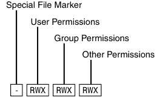

图 2.1

来自 `ls -1` 显示的权限位。

## 修改权限

太好了，你现在可以读取目录列表中的权限了，但你能用它们做什么呢？假设 Elvis 想让他的目录对自己来说只读。他可以执行 `chmod go-rwx /songs`：这意味着移除系统上组和其他用户的读、写、执行权限。如果 Elvis 决定让 Nashville 的艺术家查看他的材料但不更改它（假设系统中有一个名为 `nashville` 的组），他可以先执行 `chmod nashville songs`，然后执行 `g+r songs`。

然而，如果 Elvis 真的这么做了，他会发现（至少在某些平台上）`nashville` 组的成员无法查看它。噢！通过简单的 `chmod g+x songs`，问题就解决了：

```
elvis@robook Elvis $ ls -1

total 36

drwxr-xr-x 5 users 4096 Dec 9 21:55 Desktop

drwxr-xr-x 2 users 4096 Dec 9 22:00 Mail

-rw-r--r-- 1 users 36 Dec 9 22:00 README

-rw-r--r-- 1 users 22 Dec 9 21:59 ThisFile

drwxr-xr-x 2 users 4096 Dec 12 19:57 arc
```


## 特殊权限

除了读、写、执行位外，还存在特殊权限，用于决定 Unix 系统如何以及何时挂起正常的权限规则。深入理解 Unix 需要理解 `setuid`、`setgid` 和 `sticky`（粘滞位）。对于普通系统用户，只需要对这些有通俗了解，因此这段讨论非常简短。关于该主题，初级系统管理员和程序员在其他地方有良好的文档可用。

### setuid

`setuid` 位仅适用于可执行文件和目录。对于可执行程序，这意味着给定的程序运行时就像是由文件所有者运行一样。例如，`xhetris`（俄罗斯块的一种变体）在我的系统上具有以下权限：

```
-rwsrxr-x 1 games 32516 May 18 1999 /usr/X11R/bin/xhetris
```

系统中有一个名为 `games` 的伪用户，它可以被登录但没有主目录。当 `xhetris` 程序执行时，它可以读取和写入 `games` 伪用户通常被允许访问的文件。在这种情况下，系统上存储了一个高分文件，该用户可以写入。Elvis 运行游戏时，系统表现就像他就是 `games` 用户，从而能够存储高分文件。要给文件设置 `setuid` 位，你可以告诉 `chmod` 赋予它模式 `u+`。（你可以将其设为 uid 设置，虽然这在技术上并不完全准确。）

### setgid

`setgid` 位代表“设置组 ID”，其工作原理与 `setuid` 几乎相同，不同之处系统表现就像用户的组是给定文件的组。如果 `xhetris` 使用的是 `setgid games` 而不是 `setuid games`，那么高分就可以在任何由 `games` 组拥有的目录下写入。系统管理员以与设置权限基本相同的方式使用它。

应用于 Linux、Irix 和 Solaris（可能还有大多数其他符合 POSIX 标准的 Unix 变体）上的目录，`setgid` 意味着新文件将赋予父目录的组，而不是用户的主组或当前组。这对于某些情况非常有用，例如由特定程序构建并供该程序使用的字体目录。你可以通过写入 `setgid` 目录的 `setgid` 命令来生成任何字体。不同平台目录的 `setgid` 情况不同；请检查你的文档。要设置 `setgid` 位，你可以使用 `chmod g+s`。

### sticky

虽然在没有 `sticky` 位的组或可写目录中，文件可以被任何对该目录具有写入权限的用户（用户、组或其他）删除，但带有 `sticky` 位目录中的文件只能由文件所有者或 root 删除。这对于创建临时目录或临时空间特别有用，可以让任何人使用，而不会自己的文件被他人删除。你可以在 `chmod` 中设置权限 `+t` 来赋予东西 `sticky` 位。

## 数字权限

与 Unix 上几乎其他东西一样，权限关联着一个数字。通常认为权限由四位数字组成，每个数字在 0 到 7 之间。这些数字中的每一个代表一组三个权限，每个权限都是“是/否”的答案。从左到右，这些数字代表特殊权限。

# 文件与进程第 2 章

特殊权限中，4 代表 `setuid`，2 代表 `setgid`，1 代表粘位（sticky）。这个数字被加在三位数字权限之前：例如，一个对所有人具有粘位、读、写、执行权限的临时目录，模式为 `1777`。一个没有其他人可写入的 `setuid root` 目录为 `4700`。你可以使用 `chmod` 直接设置数字权限，例如 `chmod 1777 /tmp`。

| U G S | R W X | R W X | R W X |
| :--- | :--- | :--- | :--- |
| 4 2 1 | 4 2 1 | 4 2 1 | 4 2 1 |
| | r w x | r - x | r - x |
| 0 0 0 | 4 2 1 | 4 0 1 | 4 0 1 |
| | 7 | 5 | 5 |

图 2.2 将命名符号权限转换为数字权限

### umask

除了更精确地使用 `chmod` 外，数字权限还用于 `umask` 命令，该命令设置默认权限。更准确地说，它“掩码”了默认权限：`umask` 是从可能的最大设置中减去的数值。`umask` 只处理三位权限，而不是完整的四位值。最常见的默认 `umask` 是 `002` 或 `022`；从 `777` 减去 `022` 得到 `775`：用户具有读、写、执行权限，组和其他用户具有执行权限。从 `777` 减去 `002` 得到 `775`：用户和组具有读、写、执行权限，其他人具有执行权限。我打算将我的 `umask` 设置为 `077`：我对自己具有读、写、执行权限，而我的组或其他人没有任何权限。（当然，在进行小组项目时，我会将 `umask` 设置为 `007`：我的组和我可以读取、写入或执行任何内容，但其他人对无法做任何事情。）

你应该注意，`umask` 假设文件的执行位会被设置。所有的 `umask` 都是从 `777` 而不是 `666` 减去的，并在必要时再减去其他数值。

## 练习题

以下问题是假设性的。除非你的系统上存在相应的用户和组，且你拥有相应的权限，否则无法执行这些命令。

> 18. 实际上，如果你是计算机科学类型的，权限位是与可能的设置进行异或（XOR）运算的。

## 特殊文件

- 14. 使用什么命令将当前目录下名为 `not=possible.txt` 的文件的所有者改为 `trity`？
- 15. 你需要让整个组访问文件 `no-spoon.txt`。确保他们对该文件有写入权限。

以下问题应该是可以执行的，尽管测试你的结果可能会困难。如果显示 -1，虽然我会提供权限位，将不会包含显示的其余部分。要创建文件 `too-many-hyphens`，只需运行命令 `touch too-many-hyphens`。

- 16. 执行 `chmod 664 too-many-hyphens`。用户（不是你，也不是你所在组的）可以对它做什么？
- 17. 使用权限，移除你的组对 `too-many-hyphens` 的写入权限，同时保留他们读取该文件的能力。
- 18. 使用数字权限更改 `too-many-hyphens` 的权限，使得任何人无法读取、写入或执行它，包括你自己。
- 19. 现在尝试删除该文件。你的系统会发生什么？如果你无法删除该文件，更改权限以便你能够删除，并移除文件。

由于 Unix 将一切都视为文件，因此有些东西不是文件，但存在于根目录下的某个地方。这些就是特殊文件。每个特殊文件都是磁盘上的一个标记，指向磁盘上的其他东西，或者指向完全不同的东西。

## 链接

链接是典型用户最需要的特殊文件类型。链接允许两个文件名指向磁盘上的同一个文件或目录，它们分为两种：硬链接和软链接。在我们充分讨论任何一种链接之前，我们必须快速查看文件是如何存储在磁盘上的。

## 目录到底是如何运作的

如果你仔细考虑，磁盘上只有两种目录工作方式是可以行的：它要么字面上包含包含文件，要么指向存储在其他地方的文件。前者的情况就像书的章节：文件在目录内顺序排列，并可以根据这些数据构建目录。显然，这将非常庞大且运行缓慢，而且更改目录的内容将涉及连续快速移动大量数据块。相反，如果目录只指向文件，它就是目录索引。删除一个章节只需要划掉它的名字并计算页码。

# 文件与进程第 2 章

在 Unix 上，第二种方法更接近目录的工作方式：子目录是一个文件列表，带有一个指向实际文件的指针。由于文件不是在磁盘上顺序存储的，删除一个文件需要从存储它的目录中移除其名称，并将其使用的磁盘部分标记为可用。

## 硬链接

硬链接仅仅是指向磁盘上同一文件的另一个额外指针。实际上，原始文件也是指向数据的硬链接。所有链接都是平等的，文件就是指向数据的硬链接。（此处省略大量重复内容，已按要求处理翻译逻辑）

## 第二章：文件与进程

设备主要分为两大类：字符设备和块设备。在 `/dev` 目录的长列表中，字符设备的权限位首位字符是 `c`，而块设备在相应字段中（并不意外地）是 `b`。

块设备的设计初衷是以块为单位进行读取：即一次性读取一组字节。每次读取的字节数称为块大小。许多设备的块大小为 512 字节，尽管磁盘的块大小可以大得多（4,096 字节甚至更多）。块设备通常用于交互性较的设备。你通常不会注意到系统会一直保留数据直到将其写入磁盘，这种操作被称为缓冲（buffering）。如果你刷新（flush）一个块设备，以强制系统在此时写出数据，它通常会将带有空白字符的数据一直填充到该块的末尾。

相比之下，字符设备是为了一次读取一个字符而设计的。那些交互性更强、需要更好性能的设备，或者无法及时保证数据的设备通常都是字符设备。典型的例子是鼠标，因为你肯定不想在系统感知到移动之前先等待一段距离；还有键盘，因为你希望在操作时接收并传输数据，而不是等待 512 字节的数据块。某些字符设备并不是真正的设备，因为它们并不指代某块硬件（它们不是连接到系统上的本地物理设备）。相反，它们指的是某些虚拟位置。最常见的设备是 `/dev/null`，它是一个“桶”，你可以向它发送数据并将其直接丢弃。`/dev/zero` 是一个无限供应的零流，程序可以从中读取零以产生不可预测的数据。虽然这两者目前都不非常重要，但我们将在下一章中详细讨论 `/dev/null`。

有两种“设备”实际上并不是真正的设备：命名管道（Named pipes，在 `ls -1` 中用 `p` 表示）和 FIFO（先入先出文件，用 `s` 表示），这些设备有时会存在，通常位于 `/dev` 目录中。系统上的程序使用这些设备来交换信息。你通常只需要知道它们的存在，并将它们留给系统管理员处理。

## 文件系统

与 Windows 不同，Unix 将整个系统视为单一目录树的一部分。

- 19. 实际上，许多现代文件系统都支持压缩，这需要数据块。对于大多数用途来说，你永远察觉不到这种差异，但习惯性难改，Unix 仍然将它们视为字符设备。
- 20. ...设备也并不是真正的文件，但谁会在意这个数量呢？

# Unix 概念

磁盘只能挂载到系统中已存在的目录上。该目录包含了该磁盘上存在的任何顶层目录的内容。通常情况下，只有系统管理员才会挂载和卸载磁盘；某些工作站允许用户执行此操作，特别是对于软盘或 CD-ROM 等可移动媒体介质。磁盘连接到系统的点称为挂载点（mount point）。

到目前为止，我讨论了挂载磁盘，但真正被挂载的是包含文件系统的分区（partitions）。分区是磁盘的一部分。为了方便、安全，或者偶尔由于系统的技术局限性，磁盘往往被“拆分”成若干部分作为分区。系统可以单独访问每个分区，尽管设备名称通常清楚地表明了它们是同一块物理磁盘的一部分。

文件系统是系统预期数据所遵循的格式。你不能将一张 Macintosh 软盘插入 Windows 计算机并让系统读取其内容（RT¹ 格式），因为磁盘的布局不符合系统的预期。当你把一张 PC 软盘插入 Macintosh 时，它会被不同的方式处理和识别，因为不同文件系统的能力不同：文件名中的合法字符有不同的限制，文件名的最大长度也不同，依此类推。由于混合环境的背景，许多 Unix 系统都懂得如何读取不同的文件系统。

如果你执行 `cat /etc/fstab`（Unix 系统中用于确定分区挂载默认值的文件），你应该注意，其格式通常是：要挂载的分区、该分区应挂载的位置、系统默认设置，以及一些额外的、系统特有的信息。（如果你感兴趣，请参阅 `fstab(5)` 页面。）

### 表 2.1 常见文件系统

| 名称 | 说明 |
|---|---|
| ext2f | 标准的 Linux 文件系统 |
| iso9660 | 大多数 CD-ROM 使用的文件系统 |
| jfs | AIX 的日志文件系统 |
| xfs | 扩展文件系统（Extended File System），用于近期的 SGI 系统 |
| efs | 旧的 SGI 文件系统 |
| ufs 和 ufs | 基于 BSD 开发的跨平台文件系统，现在适用于许多不同的 Unix 版本 |

还存在一些并非真实磁盘的文件系统。NFS 是网络文件系统（Network File System），它让你能够网络挂载任意目录，就像它们实际上是磁盘一样。afs 和 coda 是更高级的网络文件系统，具有更好的安全性和对数据更精确的控制。某些现代 Unix 版本中的 `proc` 文件系统允许你通过读取和修改文件来检查和控制系统的各个方面。这些有时是普通用户的默认设置，但通常是为系统管理员设计的。

## 进程

在 Unix 中，如果你不是处理文件或通过文件操作，那么你可能正在处理进程。简单来说，进程就是运行在系统上的程序。更准确地说，它是运行中程序的一个实例；也就是说，每当你或其他人使用系统运行该程序时，就会创建一个新的进程。

在许多方面，进程与文件非常相似：每个进程都属于一个用户，每个进程都有一个名字，每个进程都有一个编号。进程属于运行该进程的用户，尽管这些程序属于 `setuid` 的所有者。进程的名字是正在执行的命令名称。进程也有大小，尽管这种空间位于内存中，而文件占用磁盘空间。

系统提供进程号。控制所有进程的第一个进程是 `init`。`init` 的进程 ID（也称为 PID）始终为 1。

进程号不会无限增长；它们通常是固定长度的，通常为 15 位。（15 位数字意味着其中一位预留用于指示数字的正负性。）进程号是按顺序发放的：在创建进程 15321 后，下一个进程总是 15322，即使进程 15320 已经不再运行。当最高进程号被使用后，系统会回到底部并重新开始。

# 第一部分

# Unix 概念

在第 1 章中，我提到过当你登录系统时，会启动一个特定的进程。这就是 shell（外壳），它是运行其他程序并解释你命令行的进程。它和其他任何进程一样，当它死亡（dies）时，你就退出了系统。正如之前提到过的，有不同的 shell，其运行方式也不同。我们将在第 6 章更详细地讨论 shell。

## 查看进程

那么，你的系统上运行着哪些进程呢？让我们来看看我的系统正在运行着什么：

```
$ jon@frogb j$ top

3:04am 2:14, 5 users, load average: 0.11, 0.04, 0.06

68 processes: 66 sleeping, 1 running, 1 zombie, 0% stopped

CPU states: 1.7% user, 2.3% system, 0.0% nice, 95.8% idle

Mem: 191124k av, 86978k mem, 10418k free, 0k shred, 4284k buff

Swap: 20408k av, 0k used, 20400k free, 52648k cached
```

| PID | USER | PRI | NI | SIZE | SHARE | STAT | LIB | %CPU | %MEM | TIME | COMMAND |
|---|---|---|---|---|---|---|---|---|---|---|---|
| 530 | root | 8 | 0 | 10844 | 20268 | S | | 1.3 | 0.6 | 00:59 | X |
| 2 | root | 15 | 0 | | | SW | 1.1 | 0.0 | 00:01 | kapmid |
| 1251 | jon | 11 | 0 | 1176 | 1176 | 964 | R | | 0.9 | 0.6 | 00:00 | top |
| 900 | jon | 2 | | 3640 | 3640 | 1500 | | 0.3 | 1.9 | 00:01 | xterm |
| 543 | | | 1 | | 2472 | 2472 | 1644 | S | | 0.1 | 1.2 | 00:02 | init |
| Mem | root | | | | 468 | 388 | S | | 0.0 | 0.2 | 00:03 | mmaker |
| 278 | root | | | | | SW | 0.0 | 0.0 | 00:00 | kswapd |
| 225 | bin | | | 404 | 404 | 316 | S | | 0.0 | 0.0 | 00:00 | kupdate |
| 278 | root | | | 528 | 528 | 428 | S | | 0.0 | 0.2 | 00:04 | klog |
| 289 | root | | | 928 | 928 | 384 | S | | 0.0 | 0.2 | 00:02 | atd |
| 385 | daemon | | | 484 | 484 | 484 | S | | 0.0 | 0.2 | 00:02 | atd |
| 321 | root | | | 608 | 608 | 504 | S | | 0.0 | 0.3 | 00:00 | crond |
| 331 | root | | | 556 | 556 | 416 | M | | 0.0 | 0.2 | 00:02 | cardmgrq |

注意，`top` 是一个交互式程序：它并不是简单地输出后退出，而是定期产生产生输出，直到你退出（Quit）。要退出，随时按 `q` 即可。`top` 的输出可能因你的系统而有所不同，但该程序非常可配置，你可以根据喜好进行调整。

作为优秀的学生，我们的习惯应该是分析呈现给我们的信息，以便我们正确地解读它。让我们看看顶部：

```
3:04am up 2:14, 5 users, load average: 0.11, 0.04, 0.06
```


## 文件与进程 第 2 章

屏幕的第一行提供的输出与 `uptime` 命令类似，它给出了当前时间、计算机启动或重启以来经过的时间、当前登录的用户数以及三个负载平均值（load averages）。

负载平均值（load average）是衡量计算机工作程度的简单指标。尽管我们通常认为 Unix 是一个多任务系统，但实际上，给定的 CPU 每次只能做一件事（Unix 确实能很好地处理多个 CPU，但大多数系统倾向于单 CPU）。每个 CPU 每次只能做一件事，因此有一个等待 CPU 的程序列表。在给定的时间内，进程数量越多，负载平均值越高。负载平均值为 1 表示系统正处于理想状态。

我们的习惯，作为优秀的学生，应该是分析呈现给我们的信息，以便我们正确地解读它。让我们看看顶部：

`3:04am up 2:14, 5 users, load average: 0.11, 0.04, 0.06`

# 第一部分

# Unix 概念

在第 1 章中，我提到过当你登录系统时，会启动一个特定的进程。这就是 `shell`，它是运行其他程序并解释你命令行的进程。它和其他任何进程一样，当它死亡（dies）时，你就退出了系统。正如之前提到过的，有不同的 `shell`，其运行方式也不同。我们将在第 6 章更详细地讨论 `shell`。

## 查看进程

那么，你的系统上运行着哪些进程呢？让我们来看看我的系统正在运行着什么：

```
$ jon@frogb j$ top

3:04am 2:14, 5 users, load average: 0.11, 0.04, 0.06

68 processes: 66 sleeping, 1 running, 1 zombie, 0% stopped

CPU states: 1.7% user, 2.3% system, 0.0% nice, 95.8% idle

Mem: 191124k av, 86978k mem, 10418k free, 0k shred, 4284k buff

Swap: 20408k av, 0k used, 20400k free, 52648k cached
```

| PID | USER | PRI | NI | SIZE | SHARE | STAT | LIB | %CPU | %MEM | TIME | COMMAND |
|---|---|---|---|---|---|---|---|---|---|---|---|
| 530 | root | 8 | 0 | 10844 | 20268 | S | | 1.3 | 0.6 | 00:59 | X |
| 2 | root | 15 | 0 | | | SW | 1.1 | 0.0 | 00:01 | kapmid |
| 1251 | jon | 11 | 0 | 1176 | 1176 | 964 | R | | 0.9 | 0.6 | 00:00 | top |
| 900 | jon | 2 | | 3640 | 3640 | 1500 | | 0.3 | 1.9 | 00:01 | xterm |
| 543 | | | 1 | | 2472 | 2472 | 1644 | S | | 0.1 | 1.2 | 00:02 | init |
| Mem | root | | | | 468 | 388 | S | | 0.0 | 0.2 | 00:03 | mmaker |
| 278 | root | | | | | SW | 0.0 | 0.0 | 00:00 | kswapd |
| 225 | bin | | | 404 | 404 | 316 | S | | 0.0 | 0.0 | 00:00 | kupdate |
| 278 | root | | | 528 | 528 | 428 | S | | 0.0 | 0.2 | 00:04 | klog |
| 289 | root | | | 928 | 928 | 384 | S | | 0.0 | 0.2 | 00:02 | atd |
| 385 | daemon | | | 484 | 484 | 484 | S | | 0.0 | 0.2 | 00:02 | atd |
| 321 | root | | | 608 | 608 | 504 | S | | 0.0 | 0.3 | 00:00 | crond |
| 331 | root | | | 556 | 556 | 416 | M | | 0.0 | 0.2 | 00:02 | cardmgrq |

注意，`top` 是一个交互式程序：它并不是简单地输出后退出，而是定期产生输出，直到你退出（Quit）。要退出，随时按 `q` 即可。`top` 的输出可能因你的系统而有所不同，但该程序非常可配置，你可以根据喜好进行调整。

作为优秀的学生，我们的习惯应该是分析呈现给我们的信息，以便我们正确地解读它。让我们看看顶部：

```
3:04am up 2:14, 5 users, load average: 0.11, 0.04, 0.06
```

## 文件与进程 第 2 章

屏幕的第一行提供的输出与 `uptime` 命令类似，它给出了当前时间、计算机启动或重启以来经过的时间、当前登录的用户数以及三个负载平均值（load averages）。

负载平均值（load average）是衡量计算机工作程度的简单指标。尽管我们通常认为 Unix 是一个多任务系统，但实际上，给定的 CPU 每次只能做一件事（Unix 确实能很好地处理多个 CPU，但大多数系统倾向于单 CPU）。每个 CPU 每次只能做一件事，因此有一个等待 CPU 的程序列表。在给定的时间内，进程数量越多，负载平均值越高。负载平均值为 1 表示系统正处于理想状态。

## 文件与进程 第 2 章

我的系统运行得如何？嗯，它几乎完全空闲；它有大量的空闲内存，目前没有进程正在占用 CPU。我系统中最大的“罪魁祸首”似乎是 X Window System（Unix 的 GUI），它占了整个 10MB 内存，而 CPU 占用率不足 2%。一个名为 `powerd` 的进程占了超过 1% 的 CPU。这个进程处理我笔记本电脑的电源管理，从机器启动后就一直在运行。如果你仔细观察，你会发现它的 PID 是 2。`kernel` 确实 Linux 内核的一部分，是操作系统中控制所有资源访问的部分。它的启动看起来像是一个处理电源管理的进程。`powerd` 总共消耗了相当长的 CPU 时间，但很难说说它影响了我的性能。

接下来是 `top`，它几乎不占用任何资源，正如 `xterm` 类型的命令从 X 和 `smoker`（我的窗口管理器）向系统发送那样。我会在第三部分讨论 X 时再详细介绍窗口管理器。系统上的其他部分占用的资源完全可以忽略不计。

## Unix 谱系简述

要理解我们下一个要研究的对象 `ps` 命令，你必须对 Unix 谱系有所了解。任何运行在几十甚至上百台不同计算机上的操作系统，都可能在许多地方获得某种“本地特色”。这些区域差异不可避免会影响这些游牧父母的后代。

所有 Unix 的祖父是贝尔实验室（Bell Labs）版本的软件。在那个时代，贝尔实验室与所有人共享源代码。源代码是程序员在编译器将其转换为二进制文件之前所编写的内容。

让我们慢慢过一遍。在最基础的层，计算机程序仅仅是一串 1 和 0 的流，即机器码。人们不写机器码（尽管过去在没有其他编程方式时人们写过），而是使用其他计算机语言，这些语言将源代码转换为机器码或二进制文件。源代码比无尽的 1 和 0 流要易读得多。

存在一种中间形式称为汇编语言。每种计算机架构都有自己的汇编语言。汇编语言通常由短助记符组成，长度为三四个字母，直接对应单条 CPU 指令。这些助记符后面通常跟着它们所操作的数据。大多数程序员知道一种或另一种汇编语言，但日常并不使用它。

在 Unix 之前，每个操作系统都是用汇编语言编写的。当时，大多数程序员手动调优汇编语言比编译器更好，而且在机器相对简单的年代，效率是至关重要的。20 世纪 70 年代中期，贝尔实验室的人用 C 语言重写了 Unix，仅将汇编语言用于无法通过方式编写或需要极端优化的小部分代码。

# 第一部分

# Unix 概念

完成后，Unix 就可以“移植”到任何其他可用 C 编译器的计算机上。或者，你可以编写自己的 C 编译器并构建 Unix。因为相对来说这很容易，很多人都这么做了，Unix 开始统治世界……或者大是这样。

20 世纪 70 年代后期，Unix 移动到了伯克利和 VAX 架构。Unix 从此获得了一系列新功能。这些包括高级网络功能、`vi` 编辑器、更好的打印系统、不同的命令语法等。这种 Unix 变体被称为伯克利发行版（BSD）。分化带来了不兼容性，必须为每个 BSD 或 System Unix 编写代码，贝尔实验室版本（后来的 AT&T 版本）被称为 System Unix（SVR4，即 System V Revision 4，是当前版本）。System Unix 通常称为 SYS V 或直接称为 SYSV。

20 世纪 80 年代，基于 BSD 的版本在商业上更为成功。今天，情况发生了逆转。由于积极的标准化工作，SVR4 已成为主导的 Unix 平台。来自 Sun 的旧基于 BSD 的 SunOS 已被 Solaris 取代，Unix Irix 移动到了 SYSV 架构。Digital 的类 BSD Unix——Ultrix 如今已已被 Compaq 的 Tru64 Unix 取代，后者是类似 SYSV 的。唯一的留守者是 BSDI、OpenBSD、NetBSD 和 FreeBSD，后三个是像 Linux 一样的开源系统。

嗯，在实际上，System V 和 BSD Unix 在用户层面（包括应用和语法）已经变得非常接近，而且它们在源代码层面的运行非常完美。内部确实存在差异，但在用户层面只剩下两个区别：它们有不同的打印系统，而且 `ps` 的工作方式不同。

我不会真的对 `ps` 的版本进行全面讨论。聪明人在特定的偏好下偶尔会运行错误的命令，但只会耸耸肩将其归结为环境问题。Unix 拥有所有命令中最聪明的 `ps`：它既可以接受 BSD 也可以接受 SVR4 选项，所以你永远不会犯错。至少在那个错误上不会。某些 SYS Unix 版本有一个 `/usr/bin` 或 `/usr/bsd` 目录，其中包含 BSD 可执行文件，包括 `ps`。

## System V ps

要使用 `ps`（它比 `top` 以更典型的命令行方式列出进程），你只需要知道几件事：我如何在这个终端列出我的进程？我如何获取更多关于我进程的信息？我如何列出我所有的进程？我如何列出系统上所有的进程？

- 25. Linux 成功做到了每一个。

## 文件与进程 第2章

61

```
686 ?          00:00:02 xscreensaver

687 ?          00:00:00 .xsession

688 ?          00:00:00 xload

742 ?          00:00:00 xdalickock

746 ?          00:00:00 wmbattery

754 ?          00:00:03 xterm

811 pts/0       00:00:00 bash

1396 ?         00:00:00 xterm

1398 pts/1      00:00:00 bash

1447 pts/1      00:00:00 less

1448 ?          00:00:00 xterm

1450 pts/2      00:00:00 bash

1499 pts/2      00:00:00 less

1504 ?          00:00:03 xterm

1506 pts/3      00:00:00 bash

1690 pts/3      00:00:00 ps
```

非常直观。要列出进程，或者只是想看看系统管理员（或者说，你的其他用户）在做什么，你必须使用该选项。然而，这实际上并不简单，因为这只会列出属于所有用户的当前终端上的进程。这几乎全是你自己的进程。相反，你必须将该选项与 `x` 选项结合使用，后者会列出任何（或无无）终端上的所有进程：

```
[ jon@frogbook tink]$ ps ax

PID TTY  STAT  TIME COMMAND

1 ?       S     00:03 init

2 ?       SW    05:08 [kapmd]

3 ?       SW    00:00 [kswapd]

4 ?       SW    00:00 [kflushid]

5 ?       SW    00:00 [kupdate]

6 ?       SW    00:00 [khubd]

7 ?       SW    00:00 [acpi]

237 ?      S     00:00 portmap

290 ?       S     00:00 syslog -m 0

301 ?       S     00:00 klogd
```

```
1504 ?       S     00:03 xterm

1506 pts/3      S     00:00 bash

1691 pts/3      R     00:00 ps ax
```

遗憾的是，这并不完全有用，因为这并没有显示出是谁在做什么。为了这一点，我们还需要使用该选项来识别拥有这些进程的用户：

```
[ jon@frogbook tink]$ ps aux

USER      PID %CPU %MEM VSZ RSS TTY     START   TIME COMMAND

root      1   0.0  0.2 1104  460 ?       S    00:06 00:03 init

root      2   3.0  0.0             ?       SW    00:06 5:12 [kapmd]
```

## 62 第一部分 Unix 概念

| USER | PID | %CPU | %MEM | VSZ | RSS | TTY | START | TIME | COMMAND |
| :--- | :--- | :--- | :--- | :--- | :--- | :--- | :--- | :--- | :--- |
| root | 3 | 0.0 | 0.0 | 0 ? | SW | 00:06 | 0:00 | [kswapd] |
| root | 4 | 0.0 | 0.0 | 0 ? | SW | 00:06 | 0:00 | [kflushd] |
| root | 5 | 0.0 | 0.0 | 0 ? | SW | 00:06 | 0:00 | [update] |
| root | 6 | 0.0 | 0.0 |  | ? | SW | 00:06 | 0:00 | [khubud] |
| root | 7 | 0.0 | 0.0 | 0 ? | SW | 00:06 | 0:00 | [acpi] |
| bin | 237 | 0.0 | 0.2 | 1206 | 484 ? | S | 00:11 | 0:00 | portmap |
| root | 290 | 0.0 | 0.2 | 1156 | 529 | S | 00:11 | 0:00 | syslogd -m |
| root | 301 | 0.0 | 0.4 | 1568 | 932 | S | 00:11 | 0:00 | klogsd |
| jon | 1504 | 0.1 | 1.4 | 4756 | 2692 | S | 02:04 | 0:03 | xterm |
| jon | 1506 | 0.0 | 0.5 | 1776 | 1008 | S | 02:04 | 0:00 | bash |
| root | 1691 | 0.0 | 0.0 |  | ? | R | 00:00 | 0:00 | ps ax |

这种方法遗憾的是并不完全有用，因为它并没有列出所有人的操作。为了这一点，我们还需要使用该选项来识别拥有这些进程的用户：

66

第一部分 Unix 概念

```
[ elvis@frogbog elvis $ cat west.txt

Socrates

Plato

Aristotle

Heraclitus

Heracinus

Plotinus

Kierkegaard

Pascal

Descartes

Sartre
```


文件中已添加了额外的名称。

## 此处文档 (Herefiles)

现在我已经解释了 `>`、` < ` 和 `>>` 的作用，而明显的问题是 `<<` 是什么，答案是它创建一个在此处文档（herefile）。

> “在此处文档，吗？”你说道。“从未听说过。它到底是什么？”

这是一个很好的问题。在此处文档允许你向 STDIN 输入大量行文本，直到遇到一个预定义的标记符，例如：

```
[ elvis@frogbog elvis $ cat ~newfile.txt << STOPHERE

> 这是一个新文件。我可以在里面放入很多文本。

>

> 如果我想这么做，我可以写上一整天天的文本。

>

> 我为什么要这么做？因为系统允许我这样做。

>

> 当然，系统允许我做各种愚蠢且毫无价值的事情。

>

> 我猜，垃圾进，垃圾出。
> STOPHERE
```

显而易见，在此处文档比简单的从 STDIN 读取要方便得多。其一，它们在每一行都提供了一个美观的提示符，使我们知道该预期得到什么。另一方面，它们避免了我们必须记住 Ctrl+D 是 Unix EOF（文件结束符）标记，即使没有在此处文档关键字，EOF 仍然会停止输入事件。2。

尽管如此，在我在第二部分讨论 shell 脚本之前，在此处文档并没有真正变得重要。这在书中讨论它们的逻辑位置。如果我不讨论它们，你仍然会好奇 `<<` 到底可能用于什么。

- 2. shell 中没有东西是万无不能的，但我们并不试图涵盖所有的 shell。我们的参考平台是 bash shell，我们在书中执行的大部分操作在 ksh 下也几乎完全相同。在这种情况下，在向在此处文档输入文本时，csh 不会提供提示符，尽管较新的 tsh 是提供的。我们将在第 6 章更详细地讨论 shell。

## 重定向 STDERR

既然我们已经使用了 `<`、`>`、`<<` 和 `>>`，那么我们如何重定向标准错误流（STDERR）呢？

遗憾的是，重定向 STDERR 的简单方法在 Bourne Shell 中不起作用，而大家都用它来编写 shell 脚本。此外，简单且逻辑上的答案是扩展现有语法使用 `>>>`，或者使用另一个符号，例如 `}`，或者与我们原始符号在视觉上相似的符号。在 Unix 上实际上有两种实现方法：简单（但不怎么实用的方法）和困难（但更有实用的方法）。

## 简单的方法

重定向 STDERR 的方法是将 STDERR 重定向到 STDOUT 的一个文件。你可以通过使用 `&` 重定向到文件来实现。假设我们正在运行 `find` 来列出系统上的所有文件，并且我们想要看到输出中的错误信息，而这些输出发送到一个文件中。可以使用命令 `find -name '*' -print > /all.txt`。输出（包括 find 的错误信息）将位于该文件中。

遗憾的是，如果我们只想重定向错误信息但保持输出显示在屏幕上，我们将遇到一些困难。要做到这一点，我们必须用“硬方法”来重定向 STDERR。

## 困难的方法

重定向 STDERR 的硬方法依赖于仅存在于某些 shell 中的功能：Bourne、Korn 和 Bash shell 都具有此功能。C Shell 和 tsh 则没有。更多细节请参阅第 6 章。现在，只需输入以下命令来查找你使用的是哪种 shell：³

```
cat /etc/passwd|grep username:cut -d : -f 7
```

将 username 替换为你自己的。该命令应该打印出一个文件和路径。如果引用的程序 csh 或 tsh，则本节不适用于你，除非你更改了 shell。如果是 sh、ksh 或 bash，则适用。⁴。无法用 csh 或 tsh 重定向特定的文件句柄这一事实，使得许多 Unix 专家认为这些 shell 是“坏掉的”。我不对此发表立场，只是说明我没有涵盖这些 shell。即使你运行这些 shell 且不愿意切换，为了理论知识，这可能仍然值得阅读。

- 3. 假设你的系统没有使用 NIS 来跟踪账户。NIS 超出了本书的范围；你可以通过输入 `ycat password` 而不是 `cat /etc/passwd` 来获取 NIS 账户列表。
- 4. 这似乎是一个很好的观点，即 Unix shell 有两个名称：“真实名称”以及运行 shell 的命令名称。Bourne Shell 也称为 sh，Korn Bourne Shell 也称为 ksh，而 tsh 就叫 tsh。

第一部分 Unix 概念

文件句柄（file handle）是文件的抽象表示。也就是说，当计算机程序需要访问一个文件时，它并不是每次都使用所访问的文件名。相反，程序创建一个命名的文件句柄。本质上，程序员说：“每当我谈到 MY_OPEN_FILE 时，我实际上是在谈论 /some/long/path/to/a/particular/file。” 这对程序员来说有许多优点：首先，他们不需要在每次读取或写入时都重命名。其次，如果文件在程序完成写入之前更改了名称或目录，需要更改的内容就更少。更重要的是，如果文件在程序运行时更改了名称或目录，或者程序之前不知道文件名，它仍然可以处理它。

大多数编程语言使用名称作为文件句柄，而 Unix shell 使用数字。名称可能很方便，虽然冗长，但要确定命令行的哪部分是文件句柄、哪部分不是，要困难得多。数字让这部分变得简单。

所有的重定向实际上都是通过编号的文件句柄（也称为描述符）完成的；大多数重定向命令都隐含一个默认描述符。通用格式简单就是重定向命令左侧的文件描述符。STDIN 是 0，STDOUT 是 1，STDERR 是 2。当我们重定向命令 `command < outfile.txt` 时，我们实际上是在运行 `cat 0 outfile.txt`。同样，当我们运行 `ls > whatever` 时，我们实际上是在做 `ls 1 > whatever`。

如果我们之前的之前的 `find` 示例中想将 STDERR 重定向到一个文件，我们应该使用 `find / -name '*' -print 2 errors.txt`。这会将正常输出打印到控制台，同时将错误发送到 errors.txt。

这使得能够在将错误发送到 errors.txt 的同时获取控制台的正常输出。

## 练习题

- 1. 使用重定向创建一个名为 something.txt 的文件。里面 什么什么？
- 2. 使用管道显示 something.txt 的内容。
- 3. 使用管道将输出重定向到 something.txt。
- 4. 使用管道从 something.txt 重定向输入。
- 5. 使用管道将错误重定向到 something.txt。something.txt 的内容是什么？
- 6. 使用在此处文档创建一个名为 something.txt 的文件，内容如下：

# 重定向与管道 第 3 章

## 管道

管道是 Unix 的核心所在。我知道重定向和管道是 Unix 的核心，但有效使用管道定义了 Unix。虽然其他系统在重定向方面还尚可，但只有 Unix 在管道方面做得很好。

# 常用过滤器

现在你已经有了一个工具箱，让我们用一些基础工具填充它吧！这一部分将介绍 Unix 工具箱中的锤子、螺丝刀和扳手——那些你每天都会使用的工具。虽然还有钻床和圆锯，但在学习那些工具之前，你需要先学习基础知识。

# 分页器 (Pagers)

大多数用户尝试的第一个过滤器是将 `cat` 接入 `more`，这是一个简单的程序，它在每次滚动文本后停止并等待用户按键。如果你正在读取一个长文本文件，`more` 是你的朋友。只需试一下，输入 `cat /usr/dict/words | more`。（当你看腻了一长字母列表时，只需按 Ctrl+C 即可退出 `more`。）如果你的系统没有 `/usr/dict/words`，请尝试查看 `/etc/services` 或系统上的其他长文件。

在使用过 `more` 之后，尝试 `less`（如果你的系统上安装了的话）。如果你不确定安装了哪一个，只需尝试这些命令看看它们是否有效。如果没有安装 `less`，你会收到错误信息，且不会发生任何故障；你无法看到尝试查看的文件。`less` 允许你向后移动也可以向前移动；如果你的终端配置正确，PageUp 和 PageDown 键可以让你一次滚动一页文本。因为 `less` 在到达文件末尾不会退出，你需要按 `q` 退出。（与大多数程序不同，Ctrl+C 不会退出 `less`。）和 `more` 一样，只需 `cat /etc/syslog.conf | less` 来查看一个你不关心的长文件。

`more` 和 `less` 是过滤器的一类特殊子类，被称为分页器，因为它们允许用户翻页文本。然而，大多数过滤器都会以某种方式转换通过它们的文本。

# 头部与尾部 (Heads and Tails)

`head` 和 `tail` 通过只显示文件的部分来转换文本。`head` 显示文件的顶部部分，而 `tail` 显示文件的底部部分：

```
$ elvis@frog elvis $ cat tao.txt|head -2
```

老子
庄子

```
$ elvis@frog elvis $ cat tao.txt|head -4
```

> 你还记得我们在第一章讨论文档时提到的老朋友 `more` 和 `less` 管道。它们不仅是 `more` 和 `less` 管道，还可以直接接受文件名作为参数并显示该文件。许多 Unix 命令在某些方面都是灵活的。如果你不在命令行中给它提供文件名，`cat` 也可以用作过滤器。仔细想想，你实际上这样做这样做；当你把文件重定向到 `cat` 的时候。

老子
庄子
孔子
孟子

```
$ elvis@frogbog elvis $ cat tao.txt|tail -2
```

孟子
王弼

```
$ elvis@frogbog elvis $ cat tao.txt|tail -4
```

庄子
孔子
孟子
王弼

默认情况下，`head` 和 `tail` 各打印十行。在这些命令的某些版本中，你可以指定行以外的测量，但计数是最常见的。

# sort 和 uniq (排序与去重)

另一个非常流行的过滤器是 `sort`，它只需按字母顺序对传递它的文件进行排序。有了 `head` 和 `tail`，关于 `sort` 无好说的，我就运行几个简单的演示：

- `$ elvis@frogbog elvis $ cat tao.txt|sort`
```
庄子
孔子
老子
孟子
王弼
```
- `$ elvis@frogbog elvis $ cat west.txt|sort`
```
亚里士多德
笛卡尔
赫拉克利特
克尔凯郭
帕斯卡
柏拉图
普鲁图丁
萨特
苏格拉
```
- `$ elvis@frogbog elvis $ cat west.txt.west.txt|sort`
```
亚里士多德
庄子
笛卡尔
赫拉克利特
克尔凯郭
孔子
老子
# Unix 概念
- 孟子
帕斯卡
柏拉图
普鲁图丁
萨特
苏格拉
王弼
亚里士多德
庄子
笛卡尔
赫拉克利特
克尔凯郭
孔子
老子
孟子
帕斯卡
柏拉图
普鲁图丁
萨特
苏格拉
王弼
```
$ elvis@frogbob elvis $ cat west.txt tao.txt|sort

如你所见，`sort` 接收通过 STDIN 接收的所有输入，并将排序后的数据发送到 STDOUT。它有一个特殊的数值模式，可以通过 `-n` 选项访问。使用此开关，行开头的文本是一个数字，数字按数值排序。这似乎是多余的，但让我们来看个例子：

```
[ jon@frogbob jon $ cat some-stuff.txt
```

99 Dead Baboons

99 Red Balloons

101 Dalmatians

16 Candles

24 Hours

9 Lords a Leaping

```
$ [ jon@frogbob jon $ cat some-stuff.txt|sort -n
```

9 Lords a Leaping

16 Candles

24 Hours

99 Dead Baboons

99 Red Balloons

101 Dalmatians

但如果没有 `-n` 开关会发生什么？我们也试一下那个：

```
[ jon@frogbob jon $ cat some-stuff.txt|sort
```
101 Dalmatians
16 Candles
24 Hours

# 重定向与管道 第 3 章

99 Dead Baboons

99 Red Balloons

9 Lords a Leaping

当我们按数量排序时，这几乎不是我们预想的：不是按数值排序，这个列表是按字母顺序排序的。（记住，数字在字母之前。）另一个用途相当有限的相关工具是 `uniq`，它当重复行在文件中连续出现时剔除重复行。例如：

```
$ jon@frogbog jon $ cat other-stuff.txt
```

One

Two

One

Two

Three

One

```
$ jon@frogbog jon $ cat other-stuff.txt|uniq
```
One
Two
One
Two
Three
One
```

这在接 `sort` 之后非常有用：

```
$ jon@frogbog jon $ cat other-stuff.txt | sort | uniq
```

One

Three

Two

## wc

到目前为止，我最喜欢的过滤器是 `wc`，它只需报告文件中包含多少个字符、单词和行。

```
$ jon@frogbog jon $ cat some-stuff.txt | wc
```
16 85
```

```
$ jon@frogbog jon $ cat some-stuff.txt | wc -c
```
85

## 将过滤器组合成更长的管道

`wc` 特别适用于统计任何每记录一条存储的内容，例如 `ps` 命令的输出：

```
$ jon@frogbog jon $ cat some-stuff.txt | wc -w
```
16
```

```
$ jon@frogbog jon $ cat some-stuff.txt | wc -l
```
6

显然，精确数字取决于你的系统以及你运行命令时的用途。现在这个系统上运行着多少进程？单个过滤器本身可能是自己，但过滤器在相互组合以产生特定效果时最有用。

## grep

如果我想找到我的 shell，使用我之前提到的命令，我首先必须找到我的账户。为此，我们通过 `/etc/passwd` 管道到 `grep`，这是一个高级搜索程序。默认返回所有匹配命令行提供的正则表达式的行。

我们将在第 5 章讨论正则表达式，但目前我们只需要知道可以使用正则表达式查找文本，并且某些字符具有特殊含义。在之前的例子中，如果我想找到我的账户，管道的这部分读作 `grep "jon"`：

cut 默认以冒号分隔。我们想指定只显示第七个字段，因此我们加上 `-f 7`。

```
cat /etc/passwd | grep "jon" | cut -d : -f 7
```

`/etc/passwd` 中的第一个字段是用户名。第二个是密码，x 是该字段中显示的唯一内容。第三是该账户的 UID，第四是主 GID。第五个字段，它包含了人类可读的用户名。在某些系统中，这还可以包含电话号码、办公室等。第六个是用户的主目录，最后我们有用户的默认 shell。

在我的系统上，这样的行如下：

```
jon:x:500:/home/jon:/bin/bash

elvis:x:501:100:/home/elvis:/bin/bash
```


-6. 在 Solaris 系统上，你必须使用 `man -s passwd`，出于某些奇怪的原因。我不知道他们为什么执意破坏这个，但他们确实做了。

`/etc/passwd` 中的信息位于几个不同的字段中，每个由冒号分隔。在我的系统上，这样的行如下：（在带有 NIS 的系统中，YP map 包含相同的信息。）简单来说，`/etc/passwd` 包含了所有可以登录系统的账户。使用 `man passwd` 了解该文件的内容。

正则表达式有一个特殊字符来标记行的开头。标记行的结尾是 `$`。

如果我想找到我的 shell，使用我之前提到的命令，我首先必须找到我的账户。为此，我们将 `/etc/passwd` 管道到 `grep`。默认是返回所有匹配命令行提供的正则表达式的行。在之前的例子中，如果我想找到我的账户，管道的这部分读作 `grep "jon"`：

打印单个字段。然而，如果输入的列对对齐，`awk` 能够非常出色地识别出字段分隔符的位置。`ps` 命令符合这一标准，但由于字段并不是通过单一切分符分隔的，`cut` 在此处的表现就不如人。

即使 `awk` 是一门完整的计算机语言，许多 Unix 用户也只使用我之前提到的命令。大括号周围的单引号是必要的，要更改输出的列数，请将示例中的 `1` 替换为你选择的列数。

`sort` 的输入流现在是一个列出每个命令所有者的列表。在这种情况下，如果没有 `sort`，`uniq` 将无法工作，因为进程可能按用户名分组或未分组。因此，我们对输出进行 `sort` 和 `uniq` 处理，生成一个当前正在运行进程的所有唯一用户名列表。

然后我们将此列表传递给 `wc -l`，它统计输入的行数。现在我们有了一个数字，但也遇到了问题：`ps` 的表头也被计入了数字，除非某个正在运行的进程用户名与表头字段相同！我们必须去掉那个多余的数字。为了做到这一点，我们需要减法。

可以执行此程序的是 `expr`，它允许我们在命令行上输入简单的数学表达式。我们想使用 `expr <STDIN> - 1` 来获取输出。遗憾的是，`expr` 从 `STDIN` 获取输入而不是从命令行获取，这意味着我们必须将输入流转换为命令行参数。

幸运的是，有一个程序是为此设计的：`xargs` 接收 `STDIN` 并将其附加到命令行中（如果输入有多多行，则每行之间用空格而不是换行符分隔）。`xargs` 命令行的第一个参数是必选的，它告诉程序在传递给之前的命令之前传递多少数量的选项。

这是我们的最后一个问题：想要从 `STDIN` 减 1，这意味着要执行 `xargs expr <STDIN> - 1`，但 `xargs` 不允许我们在后面放文本。简单的答案是将 `STDIN` 加到 `-1` 上，得到最终的管道 `xargs -1 +`。现在看起来，为了得到一个简单的答案似乎要费大量功夫。经过一些练习，这样的命令行对你来说将变得像本能一样。如果你足够使用 Unix，你甚至会发现没有这种能力将很难处世，因为这是让计算机按照你的意愿运行的核心。当你开始问自己这类问题时，你开始从内而外地思考了。

## 练习题

- 7. 你的系统 `/etc/passwd` 文件中有多少条目？
- 8. 显示你系统 `/etc/passwd` 文件的最后五个条目。
- 9. 对你系统 `/etc/passwd` 文件的最后五个条目进行排序。
- 10. 按字母顺序排序最后五行。
- 11. 仅显示这五个条目的用户名。
- 12. 仅显示这些条目的用户名和 UID（提示：阅读 `man` 手页查找如何操作）。
- 13. 将此用户名和 UID 列表重定向到名为 `last-users-on.txt` 的文件。
- 14. 写一个流水线，杀死任何名称以 `cat` 加空格开头的进程（要创建一个测试用例，你可以运行 `cat &`，这会创建一个名为 `cat` 的进程）。不要尝试杀死所有名为 `cat` 的进程；只需杀死那些属于你的进程。

# 网络

营销学理论丰富了“杀手级应用”的概念，即通过购买大量硬件，让特定的软件应用程序能够良好运行。在 PC 平台上，营销人员引用了特定的例子，例如 Lotus 1-2-3 和 Microsoft Excel 表格软件，以及几个让硬件脱胎换骨的数据库和文字处理软件包。

如果“杀手级应用”的概念成立，那么终极的杀手级应用——向那些尚未拥有设备的人销售计算设备——就是网络。尽管数以百万计的连接互联网的消费级硬件设备很大程度上是在 Unix 上设计和实现的。今天，Unix 社区似乎牢固地控制着 IETF（互联网工程任务组），这是一组负责网络持续设计和开发的工程师临时小组。

由于 Unix 和互联网是并行设计的，Unix 获得了大部分优秀特性：万维网（World Wide Web）是在 Unix 上设计的，而且大多数流行的浏览器最初都是在 Unix 上启动，然后才移植到 Windows 和 Macintosh¹。此外，作为 Unix 遗产的一部分，互联网非常灵活，大多数高层协议都是人类可读的。这很棒，因为这意味着你将学习事物*真实*是如何运作的。

## 网络概览

当然，要先看那些高层内容，我们需要稍微了解一下互联网的低层设计。这不会非常深入，所以了解互联网位级设计的专业网络工程师和技术极客们可以直接跳到下一节。

## 名称查找

我们不会从网络的最底部开始，而是从离家近一点：主机名（hostnames）。每当你发送电子邮件或查看网站时，你都必须告诉系统你想要的机器名称。然而，像用户名和组名一样，计算机更倾向于处理数字工作。在计算机与主机通信之前，每个主机名都会转换为一个数字。

除了效率更高外，使用转换为数字名称还有几个优点。首先，一台机器可以响应多个名称，以便它可以根据不同的称呼提供不同的服务。其次，你可以在保持旧系统完全不变的情况下更改机器名称；也就是说，名称可以对应于计算机的抽象概念，而不是物理计算机。这引出了第三个优势，即多台计算机可以由同一个名称引用。`www.example.org` 可以指向三或四台不同的机器。

> ¹ Microsoft 的 Internet Explorer 最初是 Mosaic 的授权版本，Netscape 是从它开发的。

将名称转换为数字的系统可以在请求时简单地“轮询”数字。当流量超过单台计算机的承受能力时，这非常重要。系统将名称转换为数字的想法是重要的。事实上，有几种不同的服务可以实现，但只有两种：`/etc/hosts` 和 DNS（域名系统）。

在过去，`/etc/hosts` 是每个 Unix 上的一个列出所有信息的文件。如果有人在网络中添加了新机器，你需要编辑你的 `/etc/hosts` 文件或从主服务器下载整个文件。正如你所想象的，这可能会非常混乱。我笔记本上的 `/etc/hosts` 只有一行：`127.0.0.1 localhost.localdomain frogbob`，这样我的笔记本在没有连接网络时就知道自己的名称。（这很重要，因为你可以使用很多 Unix 网络工具）。通常，系统管理员可以配置 `/etc/hosts` 或 DNS 覆盖另一个。我认识的大多数管理员都让 `/etc/hosts` 覆盖 DNS，以便他们可以解决无法控制的 DNS 服务器的问题，但请假设在你的主机上也是如此。

# 82
# 第一部分 Unix 概念

`nslookup` 的输出几乎和命令本身一样简单。首先，它提供了响应名称查询的服务器名称以及该服务器的地址。其次，它响应被查询的主机名称以及该主机的一个或多个地址。

你也可以用 `nslookup` 进行反向查询。如果你知道机器的数字但不知道它的名称，只需：

```
@frogbob nslookup 204.71.200.74

Server: defender.localdomain

Address: 192.168.0.1

Name: www.yahoo.com

Address: 204.71.200.74
```

这在注销时非常有用，例如记录到许多 Web 服务器的 Web 连接。许多 Web 服务器设置为只记录数字，而不浪费时间或资源去记录名称，因为（正如你刚刚看到的），这可以在以后完成。

`nslookup` 还有一个交互模式；只需输入 `nslookup` 即可开始。它会向你提示一个 `>`。输入你想要查询的主机名并按回车。完成后，只需按 Control-D 输入文件结束标记，或者输入 `exit` 并按回车。（你可以输入一个要解析的主机名列表。）

DNS 也是分层的。名称像目录名一样嵌套，或者通过点（单个句号）分隔层次而不是正斜杠：`www.yahoo.com` 是顶级域名 `com` 下名为 `yahoo` 的域名下名为 `yahoo` 的机器。同样，`umbc.edu` 是顶级域名 `edu` 下名为 `umbc` 的域名下名为 `umbc` 的机器。你可以超过三层：很多时候有两个或更多子域名深，如 `my-workstation.office.com`。

分层意味着更容易找到你想要的名称。这也意味着你可以拥有更多可用名称，因为对于给定的服务和特定的子域名，每个名称都需要是唯一的，就像文件名在子目录内需要唯一一样。最重要的是，域名的层次结构使得将特定域名或子域的管理权委托给另一方成为可能。

域名的层次特性的补充是名称服务器的层次特性。这至少在部分取决于域名名称本身的委托责任。一个特定的服务器只负责少数域名以及这些域名内的主机名称。与域名本身一样，服务器位于树中，有一个根服务器决定哪个服务器负责树的下一层。

例如，解析顶级域名 `www.linux.org.uk`。接下来，`.uk` 服务器负责 `.uk` 顶级域名。`.org.uk` 服务器决定某个特定的服务器（或其自身）负责 `.org.uk` 域名。该服务器反过来又决定了谁负责 `linux.org.uk`。最后，`linux.org.uk` 名称服务器最终可以返回 `www.linux.org.uk` 机器的地址。

# 网络第 4 章

如果每个人每次都开始从根名称服务器进行查找，这将给网络和高层名称服务器带来巨大压力。相反，名称服务器仅用于查找其他域名的名称。这些服务器缓存查询结果，并且仅对缓存中没有当前信息的站点进行查询。即使如此，名称服务器也只查找必要的内容：如果 `linux.org.uk` 已在缓存，你的服务器在查找 `www.linux.org.uk` 时将跳过那里；但如果 `.org.uk` 已在缓存，它将从那里开始。服务器极少需要查找顶级服务器。某些服务器是“仅缓存”服务器：它们不为任何特定域名提供权威数据，但处理数字请求。这在大量机器共享一条慢速链路时特别有用。

这种分布式服务的一个不幸的后果是，有时你的服务器或另一个服务器可能是错误的。当发生这种情况时，你可能想在不同的服务器上查询主机的地址。（你可能不负责，但如果你有时间，她可以让相关人员知道某出了问题。）`nslookup` 非常容易地支持这一点：如果你在非交互式模式下运行，只需在你要查询的机器之后添加你偏好的名称服务器的名称或数字。如果你要进入交互模式，请使用一个连字符代替你想要查询的名称，这样 `nslookup` 就知道你不是在查询你的名称服务器。例如，在交互模式下，使用 `dns-hostname.net` 作为我的名称服务器，我运行 `nslookup dns-hostname.net`。

你如何知道该使用哪个服务器？命令会告诉你谁负责该域名。让我们查一下我工作单位——马里兰大学巴尔的摩县（UMBC）的 DNS 服务器：

```
[jon@frogbob.in]$ hosts umbc.edu
[rs.internic.net]
```

# Whois 服务器 1.1

`.com`、`.net` 和 `.org` 域的域名现在可以在许多不同的竞争注册商处注册。访问 http://www.internic.net 可获取详细信息。

- 3. 事实上，许多 Unix 命令使用单个连字符来代替文件名，以便从 STDIN 数据或向 STDOUT 发送数据（当该命令使用文件时）。`nslookup` 对连字符的使用在根本上与此相似，因为你是从 STDIN 查询主机名。从这个意义上说，连字符不是占位符，而是文件名。
- 4. 在本节的剩余部分，我处理了目前存在的域层次结构。由于法律、监管和其他压力，该领域变化迅速；因此这个特定的示例在概念上可能仍然有效。

# 第一部分 Unix 概念

| 域名名称 | 注册商 | 参考 URL |
| :--- | :--- | :--- |
| UMBC.EDU | NETWORK SOLUTIONS, INC. | www.networksolutions.com |
| DNS.SLU.EDU | | whois.networksolutions.com |
| UMBC3.UMBC.EDU | | whois.networksolutions.com |
| UMBC4.UMBC.EDU | | whois.networksolutions.com |
| UMBC5.UMBC.EDU | | whois.networksolutions.com |

whois 数据库最后更新于：1月4日 02:13:44

注册局包含 .COM、.NET、.ORG 域名，并提供了 `umbc.edu` 的名称服务器。whois 服务器可以提供关于它的完整信息。这是一个相当最近的变化，因为不同的公司可以注册域名。如果我想获取 `umbc.edu` 的完整信息，我需要在 `whois.networksolutions.com` 查询。`whois` 命令有两个版本，原始版本和后来具有不同的语法，但如果你在机器上安装了 `whois`，只需在 `@` 符号后面运行 `whois umbc.edu@networksolutions.com`。如果你的站点安装了 `whois`，它将显示正确的用法。如果你尝试连接到特定的主机，第一件事是检查该名称是否解析。第二件事是检查网络是否正常工作。为了这一点，我们需要理解数据如何通过网络传输。数据以被称为“数据包”的小单元进行传输。数据包携带特定数量的数据。不同类型的硬件可以处理不同大小的数据包。

## 路由

这些数据包不能简单地从网络的一端到另一端：相反，数据包从一台机器跳到另一台机器，直到到达目的地。过去，这些机器可以是各种个人计算机。现在它们是被称为路由的专用机器。从源机器到目的地的路径是已知的。路由数据包的程序是 `traceroute`，它的工作如下：

```
[lasser@gwyn lasser]$ traceroute www.yahoo.com
tracoute: Warning: www.yahoo has multiple addresses; using 204.71.202.160
tracoute to www.yahoo.com (204.71.202.160) 30 hops max, 40 byte packets
1 0-1-core1.spg.va.rcn (207.172.121) 0.568 ms 0.345 ms
2 0-1-core1.spg.va.rcn (207.172.039) 0.995 ms 0-1-core1.spga.va.rcn (207.172.09) 0.660 ms 0-1-core1.spg.va.rcn (207.172.037) 0.734 ms
3 1-1.core1.tco.va.rcn (207.172.19.86) 17.439 ms 20.806 ms 16.026 ms
4 1-4-core1.blba.md.rcn (207.172.9.214) 61.873 ms 1-core1.blba.md.rcn.net (207.172.19.157) 77.14 ms 55.34 ms 157.
5 1-core1.phda.ra.rcn (207.172.19.105) 48.697 ms 48.680 ms 0-core1.phda.ra.rcn (207.172.9.142) 45.165 ms
6 *0-core1_ydn.ry.rcn (207.172.19.154) 87.873 ms 43.038 ms
7 6-0core1_ydn.ry.rcn (207.172.9.66) 74.597 ms 39.434 ms 36.092 ms
8 1-1-04.JFK.gbix.net (206.143.255) 42.787 ms 41.895 ms 38.554 ms
9 3-115M.rc1.JFK.gbix.net (206.132.253) 31.601 ms * 55.290 ms
10 7-622M.rcn.SNV.gbix.net (286.132.151.22) 175.392 ms 114.516 ms 157.831 ms
11 * 1-048m.hr8.SNV.gbix.net (206.132.254.41) 133.032 ms *
12 bas1r-ge3-hr8.snv.yahoo.com (208.173.182) 192.717 ms 183.725 ms *
13 w1.yahoo.com (204.71.202.160) 150.220 ms 148.721 ms 105.740 ms
```

# 86

# 第一部分

# Unix 概念

在跳数为二、四及更多时，列出了一个或多台机器。这些跳数有时通过一台机器，有时通过另一台机器。这通常是因为流量在多个路由器之间进行了“负载均衡”，以保持它们运行在合理的范围内。此外，在某些跳数的第六、九、十一和第十二跳数中，某些跳数时间被星号代替：这些数据包没有到达目的地。特定的跳数将显示一整行星号。这意味着网络连接已断开（如果数据包没有经过该跳数的再次跳转，这很可能是），或者该跳数处的机器拒绝了溯源包。这种情况相当罕见，而且从数据包继续越过该跳数的这一事实可以清楚地看出。

有时我们并不知道路径上的每一个跳数；有时我们想知道情况如何以及数据包到达那里需要多长时间。为此，我们有了 `ping`：

```
[lasser@linux] ping www.yahoo.com
PING www0.yahoo.com (204.210.205): 56 data bytes
64 bytes from www0.yahoo.com (204.210.205): seq=0 ttl=22 time=404 ms
64 bytes from www0.yahoo.com (204.210.205): seq=1 ttl=22 time=117 ms
```


```
64 bytes from www0.yahoo.com (204.210.205): seq=2 ttl=22 time=161 ms

64 bytes from www0.yahoo.com (204.210.205): seq=3 ttl=22 time=422 ms

64 bytes from www0.yahoo.com (204.210.205): seq=4 ttl=22 time=187 ms

64 bytes from www0.yahoo.com (204.210.205): seq=5 ttl=22 time=159 ms

---

www0.yahoo.com (204.210.205) PING Statistics

6 packets transmitted, 6 packets received, 0% loss

round-trip (min/avg/max = 117/242/422 ms (std = 13))
```

`ping` 首先告诉我们它使用的 `ping` 包有多大。然后它列出这些 `ping` 的响应。它让我们知道它正在响应的是哪一个 `ping`（有时由于数据包丢失并重发，`ping` 或响应会乱序；有时响应丢失，会导致数字被跳过）；它的 `ttl`，或“生存时间”，以及数据包返回花费多长时间。并不是所有 `ping` 版本默认都返回此输出；有些仅报告目标是“存活的”。

如果你运行了这个 `ping` 并想退出，可以使用 `Control-C` 退出，这是 Unix 上标准的“中断”键。当你想要中断一个程序时，按下 `Control-C`：中断（Interrupt）与 EOF 中的文件结束（`Control-D`）不同，EOF 告诉计算机“这就是我看到的所有数据了；是时候处理它们了”，而中断告诉计算机“没关系；停止你正在做的事，我不想再做了”。在我们跳出 `ping` 后，它会返回关于我们丢失了多少数据包以及它们到达那里花费多长时间的统计信息：

遗憾的是，`ttl` 并不特别有用。不同系统的设置方式不同，因此它无法实现找出你距离给定主机有多远的指定功能。在一个理想的世界里，所有站点都会将 `ttl` 设置为相同的值，中间跳数会从该值中减一，这样你就可以看到你和你喜爱的设备之间有多少跳数，而不需要诉诸 `traceroute`。唉，我们的世界并不完美，因此 `ttl` 几乎完全没用，除非你已经知道某台机器是如何设置这个字段，并且你和它之间没有东西会破坏它。这种情况并不常见。

## 底层协议

我们已经谈到了数据包沿路由在主机主机之间穿梭，但我们还没有提到过这些数据包是如何洗牌的。我们不会对此说太多，因为你必须成为一名程序员或网络工程师才会真正关心，但了解这些事名称以及对它们用途的大致想法非常有帮助。

为了相互通信，即使（对于路由器来说）是通过对方进行通信，它们必须说相同的语言；它们需要知道数据包的哪个部分代表数字，机器的哪个部分关心数据包，等等。计算机之间关于如何划分这些数据的约定被称为协议（protocol）。这个类比就像社交协议，它告诉我们我们在礼貌的场合应该如何表现。一个系统根据给定的协议运行，通过发送合规的数据包来运行。作为 Unix 人，我们的网络世界（出于选择）仅限于互联网，因此我们只关心互联网协议。整套互联网协议被称为 TCP/IP，以其中两个标准协议命名。

## IP

互联网上使用了多种协议用于不同的目的，但协议可以分层，而所有其他互联网协议都运行在其之上——且它们依赖于它——这一个被称为 IP，意为互联网协议（Internet Protocol）。目前使用的版本只是第四版，通常被称为 IPv4。

IP 协议并没有做什么。本质上，它包含数据包的源地址和目的地址，并标记它确实是一个 IP 包。你可以通过 IP 发送数据包，但它并没有做很多。它不跟踪到达目的地的数据包，不检查数据包到达的顺序。

## TCP

传输控制协议（Transmission Control Protocol）简称 TCP。它确保数据包可靠地按顺序到达目的地。由于 TCP 是面向连接的，它在传输数据之前会建立连接，并提供了这种可靠性。

## ICMP

互联网控制消息协议（Internet Control Message Protocol）简称 ICMP。它用于报告网络错误和诊断信息。

`ping` 和 `traceroute` 命令都使用了 ICMP。

如果你想知道版本 5 发生了什么，它被用于实验目的。

## UDP

用户数据报协议（User Datagram Protocol）简称 UDP。由于我们处于多任务环境中，可能——几乎可以确定——我们将同时打开多个连接。为了处理这个问题，系统需要每个连接一个不同的 ID。一个系统可以拥有高达 65536（$2^{16}$，或 16 位）个不同的端口供网络挂载。

## 套接字、地址与端口

套接字（Socket）是网络通信的端点。套接字由 IP 地址和端口号组合而成。你可能注意到所有的地址都由点分隔。此外，每个字节的范围在 0 到 255 之间。这种点表示法（dotted notation）使得 IP 地址为 32 位，这意味着互联网上的最大主机数量为 4,294,967,296。

其中许多地址被留作特殊用途。由于互联网主机数量的增长，这减少了可用地址。为了解决这个问题和其他问题，一个版本的 IP（也称为 IPv6）正在开发中。它将拥有 128 位的地址空间，以便每个计算设备都可以连接到网络。

端口的另一部分是端口号。

其中某些端口具有特殊含义：端口 25 始终用于接收来自网络计算机的电子邮件，例如。所有小于 1024（$2^{10}$）的端口都留作特殊用途。在建立初始连接后，系统会通过一种小魔术将连接移动到不同的端口，以便众周知端口（一次只能有一个连接以防混淆）可以保持开放供其他连接。

## 练习题

1. 运行 `hostname` 命令以查找你的系统名称。（如果此命令没有返回机器的完整 Internet 名称，请向本地系统管理员询问系统的完整名称。）使用 `nslookup` 查找你的 IP 地址。
2. 使用 `whois` 查询你的域名信息。如果 `whois` 指向了另一个服务器，请跟进。
3. 查询你经常访问的网站的 IP 地址。查询其域名信息。
4. 使用 `ping` 验证该网站是否运行，如果是，则使用 `traceroute` 查找你与该网站之间有多少个跳数。（你的站点可能缺少了对互联网上其他网站进行 ping 或 traceroute 的功能。如果这些命令失败但你仍可以通过正常手段访问网站，请询问你的系统管理员这些功能是否已被禁用。）

## Unix 概念

### 与机器通信

网络的意义不在于学习所有关于协议和套接字名称的术语来与其他机器通信。与其他机器通信通分为两类：在网络上共享数据和资源，以及通过网络实际使用计算机。在 Unix 上，由于明文高层协议的主导地位，这两个概念比你想象的要接近得多。

### Telnet

远程使用其他机器并访问其可用资源的基本工具是 `telnet`，它简单地将你连接到指定主机上的特定端口。默认值是通过连接到适当的端口远程登录机器。

```
@ frogbog j$ telnet razorback

Trying 192.168.0.0...

Connected to razorback.localdomain.

Escape character is '^'

Red Hat Linux release 6.1 (Cartman)

Kernel 2.2.12-20 on i686

login: Jon
Password:

Last login: Wed Jan 5 01:11:54 from frogbog.localdomain
```

校园人行道永远不存在于两点之间的直线。

- M. Johnston

没有邮件。

```
[ jon@razorback jon j$
```


我现在正在远程访问 `razorback`，这是我家中的网络中的机器之一。请注意，我确实在密码提示处输入了密码，系统足够聪明，不会显示它。还要注意，我的提示符中的主机名现在已设置为 `razorback`，从现在开始到我注销期间，我运行的所有程序都是在那台机器上执行的。一切工作得非常完美，就像你登录到本地机器一样，只是启动稍微复杂一点，但我们暂时忽略这一点。不不说，你应该尝试登录你拥有合法账户的系统，绝不要尝试访问你没有权限的系统。未经许可登录系统等同于网络上的闯入，可能会让你陷入困扰。此外，个人之间共享账户是不体面的行为，因为这会让系统管理员在追踪未经授权访问方面的工作变得困难得多。许多系统有专门供用户共享的特定账户，但普通账户不应该这样。

要直接与一个使用明文通信的服务（或者你清楚自己在做什么）对话，只需通过在命令后添加一个空格和端口号，直接 `telnet` 到适当的端口即可。要查看列表，请查看 `/etc/services`。其中许多服务实际上并不运行明文，但有很大一部分是运行的。作为额外奖励，如果你能记住正确的端口号，可以使用 `/etc/services` 名称代替端口号。

## SMTP

除了 `telnet` 本身以及拥有良好工具的 DNS 之外，重要的基于文本的协议是 SMTP，即简单邮件传输协议。这是电子邮件在网络机器之间发送的。。这与接收你的邮件不同，接收邮件是通过 POP3 或 IMAP 完成的；相反，SMTP 是你在发送全新的新消息时使用的工具。让我们来看一个 SMTP 会话并看看它是如何工作的：

```
frogbog jon $ telnet razorback 25

Trying 192.168.0.10...

Connected to razorback.localdomain.

Escape character is '^'

220 razorback.localdomain SMTP 8.9.3; Wed Jan 5 09:32:34
```

## 第一部分 Unix 概念

连接后，邮件服务器会显示一个头头部，显示主机名、时间、日期和邮件服务器的版本。然而，更重要的是消息前的三位数字。当自动化程序与邮件服务器通信时，它不读取消息，只读取三位状态代码。

```
HELO frogbog.localdomain
250 razorback.localdomain Hello:jon@frogbog.localdomain [192.168.0.33], pleased to meet you
```

首先，我们通过 `HELO frogbog.localdomain` 向邮件服务器识别身份。由于我的家庭网络没有连接到互联网，因此使用 `.localdomain` 作为我的顶级域名。大多数 SMTP 命令只有几个字母长。虽然 SMTP 命令并不敏感，但将它们写成大写可以更清楚地看出哪些是命令，哪些是参数。某些服务器使用 `HELP` 命令，列出所有有效命令；其他 SMTP 服务器不支持此命令，这在你手动连接到 SMTP 服务器时是非常遗憾的。

`HELO` 命令用于验证发送邮件的主机以供服务器日志记录，并作为一种反垃圾邮件措施。某些服务器不需要此命令。邮件服务器会检查你声称的身份（在此例中为 `frogbog.localdomain`）是否可能正确。它还可能确定你是哪个用户（在此例中，响应指出我是 `jon@frogbog.localdomain`）。在某些情况下，系统可能不在乎你声称是谁，就像当你在系统内部发送邮件时那样。邮件守护（Unix 术语，指持续运行的系统进程）响应一些信息。邮件服务器会检查你声称的身份是否可能是正确的。对于 Unix 守护程序响应一些信息，更重要的是 250。

```
mail from: frogbog

250 @frogbog... Sender ok

rcpt to: @razorback

250 @razorback... Recipient ok
```

接下来，我们告诉系统我们要发送邮件到 `frogbog`，系统会验证该域名是否合理，某些系统会进行反垃圾邮件检查。系统响应 250。

```
data

354 Enter mail, end with "." on a line

From: Jon <frogbog>

To: Myself <razorback>

Subject: Demonstration of email
```

接下来我们给出 `DATA` 命令，然后输入我们的消息。非常重要的是我们设置的 `From:` 和 `To:` 与消息本身的头部匹配。大多数用户使用我们在之前的例子中手动输入的（From: Jon <frogbog> To: Myself <razorback> Subject: Demonstration of email）。我们在一个空行上输入一个点来结束消息，系统返回 250 告诉我们没问题。

```
mail from: frogbog

250 @frogbog... Sender ok

rcpt to: elvis@razorback

550 elvis@razorback... User unknown

quit

221 razorback.localdomain closing connection

Connection closed by foreign host

[ jon@frog]$
```

为了好玩，我尝试给 Elvis 发送邮件，他在 razorback 上没有账户，系统返回了 550 错误，告诉我 Elvis 不在。。最后，`quit` 给出了“退出”消息，并将我们踢出去。

## 邮件的故事

电子邮件的生命始于发送用户的 MUA，即邮件用户代理。这是用户用于编写和发送邮件的任何程序或程序集。某些 MUA 包括 `elm`、Netscape Communicator 和我喜欢的 `mutt`。在我们之前的示例中，我们的 MUA 是 `telnet` 到目标服务器。

根据 MUA 及其配置，消息将传递给服务器系统上的本地程序，有时是 sendmail 的本地副本。该程序反会将消息发送到目标系统上的 MTA，即邮件传输代理。在前面的例子中，那就是我们在目标系统上连接的 sendmail 进程。

然而，有时我们不想自己发送邮件。如果目标服务器宕机了，我们需要反复尝试连接它。这需要我们系统上的程序（再次通常是 sendmail）处理邮件队列中的

> 8. 通常情况下，`.forward` 文件的格式非常简单：一个电子邮件地址列表，每行一个，邮件将转发到这些地址。要将每条消息传递给程序，行的第一个字符应该是一个管道符（`|`），行的其余部分应该是传递消息的管道路径。如果你的系统上存在 `forward` 手册页，请参阅该页面。

# 使用 POP3 读取邮件

大多数人并不会让电脑一直连接到互联网上（尽管在写这本书的这段时间内，这种情况正在发生迅速变化）。此外，大多数人没有为自己的 PC 设置接收邮件功能，因为 Windows 和 Mac OS 已经足够可靠，可以在后台无痕地完成这些操作，而且除非你一直连接互联网，否则设置它是不值得的。此外，出于安全考虑，许多组织并不希望所有机器都暴露在网络中。针对这些问题，许多站点拥有集中的邮件服务器，每个人都可以从那里拉取邮件。

SMTP 向机器“推送”邮件：它假设按照常理，机器可以通过网络接收邮件，并且由它主动发送邮件。然而，邮件服务器怀疑其客户端可能尚未准备好接收邮件，而是等待这些客户端连接并向服务器请求或“拉取”邮件。IMAP4 和 POP3 是专为读取邮件设计的拉取型协议。这些协议无法发送邮件，这就是为什么使用 IMAP 或 POP 的客户端只会向你索要 IMAP 或 POP 服务器，以及 SMTP 服务器，以便它们可以发送邮件。

尽管 PC 和 Macintosh 用户最频繁地使用这些读邮件协议，但它们纯文设计的设计清晰地表明，这些协议是由 Unix 和互联网社区开发的。更重要的是，这意味着当我们不在自己的电脑前、无法在当前机器上运行和配置邮件客户端时，我们也可以直接从邮件服务器接收邮件。让我们逐个查看手动连接到 POP 服务器的过程：

```
@ @frobob jon $ telnet razorback 110

Trying 192.168.1.10...

Connected to razorback.localdomain.

Escape character is "'"

+OK POP3 razorback.localdomain v7.59 server ready

USER jon

+OK User name accepted, password prompt

PASS PasswordHere

+OK Mailbox open, 2 messages
```

# Unix 概念

端口 110 是标准的 POP3 连接端口。当我们连接到服务器时，它会返回一条横幅消息（banner message），指示协议、主机和服务器版本。POP 代表邮局协议（Post Office Protocol），数字三代表支持的该协议的版本。通信协议作为软件，会根据需要不断演进。像软件一样，这些版本都有编号，这样你就能知道获取的是什么，并对支持的功能有一个大致了解。

所有的 POP 状态消息（包括连接到服务器时的横幅）都是状态指示器，与 SMTP 支持的许多数字状态代码不同。执行执行的命令显示 `~OK`，执行失败的命令显示 `~ERR`。这使得编写极其简单的客户端软件成为可能，但仍然支持错误检查。对于协议而言，该行的其余任何内容仅仅是供人类阅读的注释；这些注释包含了相当丰富的信息，有助于在我们手动连接到服务器时调试问题。

当我们连接时，我们的首要任务是进行身份验证，以便服务器知道查看哪个邮箱。与 SMTP 不同，我们能够声称身份是很重要的，并且会被要求提供密码。因为这是一个简单直接的连接，而且密码会在你输入时显示在屏幕上，所以在操作前请留留心，并确保没有人在看。`USER` 和 `PASS` 命令的语法非常简单且显而易见。命令不区分大小写（像 SMTP 一样），我在之前的示例中将它们大写了，以区分哪些是命令，哪些是参数。

```
+ LIST
+OK Mailbox scan listing follows
1 518
2 707
```

`LIST` 显示我们邮箱中的消息及其大小，以防我们正处于低速链路上，此时我们可能不想读取较大的邮件。现在我们的邮箱中有两条消息，编号分别为 1 和 2，长度分别为 518 字节和 707 字节。每当 POP 服务器返回多单行响应时，它会以一个独占行的句号（`.`）作为结束。（如果你记得的话，这就是我们告诉 SMTP 服务器我们已完成消息输入的方式。）否则，我们将无法区分网络缓慢或拥塞与命令已完成之间的区别。

让我们读出第一条消息：

```
+ RETR
+OK 518 octets
Return-Path: ~elvis@frogbog.localdomain
Received: from frogbog.localdomain
y razorback.localdomain (8.9.3/8.9.3) with SMTP OAA05093
for jon@razorback.localdomain; Sat, 15 Jan 2000 14:00:36 -0500

Date: Sat, 15 Jan 2000 14:00:36 -0500

Message-Id: <20000151900.AA05093@razorback.localdomain>
From: The King <elvis@frogbog.localdomain>
To: Jon <jon@razorback.localdomain>
Subject:
Status: 0

我注意到你最近没有在读邮件；一切还好吗？
```

`RETR` 是 *retrieve*（检索）的缩写。再次注意，消息是以单个句号结束的。（此处原文中存在大量重复的句子，已根据翻译逻辑进行处理）。

# 网络第 4 章

合法的 `Received` 头部是关于消息来源的唯一可靠证据：在邮件中提供任何 `From` 头部其实都是轻而易举的。我可以伪造 Netscape 或 Mutt 来声称我所有的邮件都来自 president@whitehouse.gov，但 `Received` 头部会显示发送该邮件的实际机器。每当你收到一封来自不寻或不太可能的人的邮件时，请检查这些头部，以准确了解到底是谁发送了那封邮件。

最后，让我们删除第二条消息并退出：

```
+ DELE 2
+ OK Message deleted
QUIT
+ OK Sayonara
Connection closed by foreign host.
[ ]frogbob jon $
```

## HTTP

让我们认为所有的明文协议都围绕着电子邮件展开，让我们讨论最后一种我们每天使用的协议：HTTP，即超文本传输协议（Hypertext Transfer Protocol）。HTTP 是万维网的基础协议，是 浏览器与 Web 服务器通信的语言。它是一个大型且复杂的协议，但我们将只讨论其中一小部分（尽管它是很有用的）。我们也不会讨论每种可能的头部或错误；这主要是为了让你对这种略有不同的协议有一个大致的了解。

最简单的 HTTP 请求（通常情况下，也是我们要讨论的）是简单地请求服务器上的某个特定 Web 页面：

```bash
@frogbob jon $ telnet localhost 80

Trying 127.0.0.1...

Connected to localhost.localdomain.

Escape character is '"'.

GET /-jon/

<!DOCTYPE HTML PUBLIC "-//W3C//DTD HTML 4.0 Frameset//EN">

<html>

<head>

<title>Jon Lasser's Home Page</title>

</head>

</html>
```

Connection closed by foreign host.

> 9 还有许多其他明文协议，例如 NNTP（网络新闻传输协议），但在掌握了基础知识之后，你可以学习其中任何一种。我选择了重要的协议，即你每天使用的协议，因为相关性非常重要。

# Unix 概念

在这个请求中，我们只是请求一个 Web 页面，即我的主页。如果我们直接将其输入 Web 浏览器，它将表示为 URL http://localhost/-jon。我们输入 GET 请求并按下回车，Web 守护进程会响应该页面的原始文本，并在完成后关闭连接。

这是 Web 连接的原始形式。然而，HTTP 协议已经演变，最终创建了 HTTP 1.0。要发送 HTTP 1.0 请求，只需在你的 GET 请求后附加文本 `HTTP/1.0`，并在片段之间留一个空格：

```bash
[ jon@frogbog js$ tel localhost 80

Trying 127.0.0.1...

Connected to localhost.localdomain.

Escape character is ' '.

GET ~/jon/ HTTP/1.0
```

```http
HTTP/1.1 200 OK

Date: Sun, 16 Jan 2000 02:13:08 GMT

Server: Apache/1.3.9 (Unix) (Red Hat/Linux)

Last-Modified: Mon, 20 Dec 1999 23:52:53 GMT

ETag: "c710-741-385ec55"

Accept-Ranges: bytes

Content-Length: 1857

Connection: close

Content-Type: text/html
```

```html
<html>
.
</html>
```

Connection closed by foreign host.

当我们在请求中加上协议的版本号时，服务器会将其发回给我们。它知道我们能理解它发送给服务器的头部，因此在我们输入 GET 命令后，它会等待后续头部。由于我们没有添加任何额外的头部，只需按下回车，随后它将返回它自己的头部，然后是 HTML 内容。

其中一些头部显然是很有用的，例如 `Last-Modified` 头部，它让我们知道 Web 页面最后一次编辑的时间。`Content-Type` 头部由 Web 浏览器（如果有的话）用于确定使用何种外部程序（如果有）来显示此类内容。有些头部用处较小。服务器处理完头部后，会添加一个空行，显示请求的 Web 页面并关闭网络连接。

最终，Web 开发人员意识到 Web 存在几个问题。两个紧迫的问题是：太多的 Web 服务器需要多个 IP 地址，以及 Web 服务器的响应相当缓慢。

第一个问题的产生是因为，如果你想在单台计算机上运行多个 Web 服务器，每个服务器都需要它自己的 IP 地址。虽然许多名称可以作为单个 IP 数字的别名，但服务器无法判断请求的是哪个名称。解决方案是为 Web 服务器服务的每个站点提供一个不同的 IP 地址：根据该数字，服务器可以返回不同的页面集。

一些网络工程师声称，Web 服务器如此缓慢的一个原因是，结束网络连接的系统开销正在累积。随着某些 Web 服务器每秒处理数百个连接，这实际上已经变成了一个真正的问题。HTTP 1.1 的设计就是为了解决在现实世界中使用 HTTP 时发现的这些或其他问题。

让我们来看简单的 HTTP 1.1 连接。正如你所看到的，它与 HTTP 1.0 并不一样：

```bash
$ frogbog.jon $ telnet localhost 80

Trying 127.0.0.1...

Connected to localhost.localdomain.

Escape character is ']'.

GET /jon/contents.html HTTP/1.1

Host: frogbog.localdomain
```

```http
HTTP/1.1 200 OK

Date: Sun, 16 Jan 2000 02:26:25

Server: Apache/1.3.9 (Unix) (Red Hat/Linux)

Last-Modified: Mon, 20 Dec 1999 23:52:53 GMT

ETag: "9a06d-59f-38ec15"

Accept-Ranges: bytes


Content-Length: 1439

Connection: close

Content-Type: text/html

```html
<html>
.
</html>
```

GET `/jon/contents.html` HTTP/1.1

Host: frogbog.localdomain

Connection: close

HTTP/1.1 200 OK

Date: Sun, 16 Jan 2000 02:29:35

```
Connection closed by foreign host.
```

# 104

## 第一部分

### Unix 概念

通过不同的方式解决了问题的不同部分。这些包括实现 VPN（虚拟专用网络）解决方案，以便在公共网络上跨站点之间创建安全隧道；在 SSL 上实现 POP3 和 IMAP4，SSL 是 Web 网站用于保护电子商务和敏感信息的加密标准；以及各种一次性密码设备，以防止在网络上被嗅获的密码被重新用于攻击你的系统。请询问你的系统管理员你们在使用哪些站点。

最流行的 Unix 专用工具是 `ssh`，即 Secure Shell（安全外壳），它是 `rsh` 家族程序的替代品。`SSH` 不仅加密你的密码，还加密其连接上的所有网络流量。因此，没有人能看到你在网络上那两台机器之间执行的任何操作。在 Windows 端，一个好用的客户端是 Secure CRT；对于 Macintosh，NiftyTelnet + SSH 是一个非常好的免费软件客户端。

#### 离题：SSH 与法律

截至本文编写时（2000年1月），`SSH` 受到各种法律问题的限制，这些问题阻止了它成为一种通用的解决方案。这些是专利问题、美国出口法以及 `ssh` 程序本身的许可证。

第一个问题是 `ssh` 使用的加密技术之一在美国拥有专利，在商业或其他应用程序中使用时，需要支付专利许可费。这是最容易解决的问题，只需要适度的耐心：RSA 专利将于 2000 年 9 月 20 日过期。

关于加密的美国出口条例正处于变动中，由于缺乏适用的判例法，律师们对其并不十分了解（目前有几个案件正在法院审理，但法规在案件进展的同时也在发生变化），而且政府经常以出人意料且可能不公平的方式扩大范围。在本文之前的几天里，出台的法规使得在仅有轻微干扰的情况下从美国出口加密软件成为可能，但实际的差异并不明确。

`SSH` 程序有两个版本：较旧的版本 1.2 正在在使用，而新的 2.0 版本尚未流行。其其中一个由于是，早期版本的许可证限制了商业获利的使用，但对其含义的描述并不具体。新许可证更加具体，使得在不承担高额许可费罚的情况下，很难在商业环境中使用 `SSH`。尽管如此，由于这些许可问题，许多机构无法实现 `SSH` 的任何一个版本。

解决许可问题的工作正在进行中：一个项目正在生产一种工具 `1sh`，它可以与 `SSH` 版本 2 互操作。另一个工具 `OpenSSH` 基于具有不同许可证的早期 `SSH` 版本，并与 `SSH` 版本 1.2 兼容。

有一点是肯定的：计算机安全特别是密码学，是一个变化快速的领域，没有任何书能跟上它。因此，我能提供的最佳建议是询问你的系统管理员，他知道你们站点的实现情况（并且可能熟悉各种工具），并在适当的时候咨询律师。

# 网络第 4 章

`ssh` 是替换 `rsh`、`login`、`rexec` 的程序，其语法非常直观。如果我正在 `razorback` 的控制台前，而从我身后窥视的 Elvis 想要登录 `frogbob`，我可能会允许他：

```
jon@razorback jon $ ssh elvis@frog
elvis@frog's password:
Last login: Sat Jan 15 13:55:14 2000 from localhost
No mail.
elvis@frog elvis $
```

某些版本的 `ssh` 不接受 `user@host` 记法，而是要求使用 `ssh -l username host.domain`。

有时，你只想在远程机器上执行一个命令并注销。`ssh` 允许你这样做：

```
jon@razorback jon $ ssh frogbob hostname
jon@frog's password:
frogbob.localdomain
jon@razorback jon $ ssh -l 1 elvis frogbob whoami
elvis@frog's password:
elvis
jon@razorback jon $
```

你也可以像处理另一个程序一样通过 `ssh` 管道传输数据。我的笔记本电脑 `frogbob` 没有配置打印；而我的桌面 `razorback` 配置了。从我的笔记本电脑，我可以通过 `razorback` 打印 `lpr` 程序：

```
jon@frog jon $ cat snorkel.ps | ssh -l 1 jon razorback lpr
```

然后，瞧看，文件出现了。`lpr` 是 BSD 打印池的一部分；`lp` 是其在 SYS V 系统中的粗略等物。两者都将作业发送到队列。

另一个 `ssh` 允许你进行 X 连接自动转发的技巧。你在登录远程系统时运行的任何 XWindow 程序都会显示在你的本地显示器上。如果你熟悉 X，这与其初看起来并没那么像是一个技巧。如果你不熟悉 X，我们将在第 10 章和第 11 章中讨论。

`scp` 作为 `cep` 的替代品，其语法与旧式的 `ep` 类似。事实上，如果你愿意，可以使用 `scp` 作为 `ep` 的替代品，你不会从中获得任何实际益处。更大的功能是从计算机间安全地复制文件：

```
jon@frogbob tmp $ ls
jon@frogbob tmp $ scp jon@razorback:some_file.txt
some_file.txt | 0 KB | 0.7 KB/s | 00:00:00 | 100%
[ jon@frogbog tmp$ ls
some_file.txt
[ jon@frogbog tmp$ ls ]
```


像 `cp` 一样，你可以使用 `-r` 标志来复制整个子目录。

这与所知道的所有内容还差得很远。

## 练习

- 9. 如果你访问了两个系统，通过 `ssh` 在第一个系统上运行。
- 10. 如果你有两个系统，通过 `ssh` 登录到第二个系统。
- 11. 使用 `cat` 命令。
- 12. 使用 `scp` 将一个文件复制到另一个系统。

# 此外还有 vi、配置文件和正则表达式

# Unix 概念

除了 `vi` 本身，本章还涵盖了在任何地方都有广泛适用性的重要相关概念。配置文件是自定义 Unix 应用程序和实用程序行为的最常见方式。正则表达式是搜索替换机制的高级工具，几乎标准于 Unix 应用程序，并且比 Windows 或 Macintosh 上的任何东西都更强大、更有表现力（也就是说，对外部人员来说晦涩得多且难以学习，尽管非常值得）。理解这些思想对于有效使用 Unix 至关重要。

Unix 上最广泛使用的编辑器是 `vi`。

在 Unix 世界中另一个流行的编辑器是 `Emacs`，它是“编辑器宏”的缩写。`Emacs` 有两个流行的版本，`GNU Emacs` 和 `XEm`，在它们之间切换并不痛苦。`Emacs` 比 `vi` 大得多，并且几乎完全可以通过 `LISP` 一非常但强大的语言自定义。事实上，`Emacs` 的可定制性足以让它变得像 `vi`，如果你愿意的话。`Emacs` 用户不仅将其作为编辑器，还用它阅读邮件和新闻组、作为调度器甚至浏览网页。编辑器偏好在 Unix 世界是一场宗教战争，引发了对 `vi` 和 `Emacs` 雄辩且激情的争论。

在不对编辑器战争采取正式立场的情况下，本文选择涵盖 `vi` 而不是 `Emacs`.¹¹ 这些原因包括，`Emacs` 有在线教程可用，以及几十本书，而且单章关于 `Emacs` 的内容无法传达任何使用它的好理由。关于 `vi` 的单章虽然也不够，但可以传达更多它的风味和灵活性。此外，安装 `Emacs` 的系统几乎也安装了 `vi`，如果你以后管理 Unix 系统，在大部分崩溃的系统上让 `vi` 运行比访问 `Emacs` 要容易得多。许多“救急盘”都有 `vi`，但软盘装不下。

¹¹ 就个人而言，我使用 `vi`，这本书也是用 `vi` 写的。尽管 `Emacs` 有许多功能，但这些功能对作者和程序员来说最实用的部分在 `vi` 中都有。尽管如此，`Emacs` 显然更加灵活。

vi、Dotfiles 与正则表达式 第 5 章 109

## 在 vi 中生存

`vi` 是 Unix 世界的微缩模型。不要指望一次性学会它；也许你根本就不应该指望学会所有内容。首先只学习生存所必需的知识，随着需求的增加再学习更多。本章的编写方式似乎是让你通读到尾，并一次性学习所有材料。这只是“书”这种形式的产物，而不是学习 `vi` 的真实方式。直到现在，我也只使用 `vi` 功能的一个小子集。我只掌握我需要的，而 `vi` 的知识随着时间的推移缓慢而持续地增长。试图一次性学会所有的 `vi` 只会让你沮丧。此外，编辑器的学习是取决于手指习惯的。在终端中阅读这一章并边读边思考将会有所帮助。

你可能用过的大多数编辑器和文字处理器的原理非常相似：即按键组合在几乎任何地方都一样，你可以输入额外的文本。这些编辑器是无模式的（modeless）。而 `vi` 是一个模式编辑器。这意味着它根据操作状态具有不同的界面。

`vi` 有三种常见的模式：输入模式（input mode），你可以在其中修改或输入文本；命令模式（command mode），你可以在其中操作文本块或整个文档；`ex` 模式（`ex` mode），它是命令模式的一个特殊子集，你可以在其中进行其他类型的编辑。但实际上来说，你可以将 `ex` 模式视为命令模式的一部分。此外，还有不同的输入模式（追加 `append`、替换 `replace` 和插入 `insert`），它们可以以相同的方式对待。

`vi` 之所以是模式编辑器是因为历史原因。原始的 Unix 文本编辑器是 `ed`，它被增强并集成到了更先进的 `vi` 中。这两者都一次只操作一行。最终，`Bill Joy` 和伯克利大学的其他人员编写了 `vi`，它是 `ed` 编辑器的“视觉界面”。

尽管起初很困难，但 `vi` 模式所隐含的“编写”与“编辑”之间的划分在适度使用后会变成本能。思考的一种方式是将 `vi` 视为始终处于命令模式，而将输入文本视为一个长长的命令。

## 入门

关于任何程序，你需要知道的第一件事就是如何开始。你，读者们（不是《傻瓜指南》里的读者），可以猜到只需输入 `vi` 并按回车即可进入 `vi`。你已经猜到要编辑特定文件，只需输入 `vi my-file.txt`，因此我们不需要讨论如何启动 `vi`，可以直接从更棘手的问题——退出 `vi` 开始。

- 2. 像 `Emacs`，以完全不同的方式。
- 3. 值得注意的是，大多数 `vi` 的克隆版本和增强版本也可以通过简单输入 `vi` 来启动。要确定是由哪个命令启动的 `vi`，可以使用 `ls -l` 查看 `vi` 是什么以及它是否是指向其他编辑器的符号链接。在你的系统中，这个 `vi` 可能指向系统的其他地方。也可能是 `vi` 指向 `ex` 同一编辑器的硬链接，或者 `vi` 本身。当其他方法都失效时，请检查你的文档。

第一部分：Unix 概念

并不意外，退出 `vi` 有多种方法。这取决于你想做什么，但每种离开 `vi` 的方法都需要处于命令模式。如果你刚启动 `vi` 并看到一个漂亮的空白屏幕，你已经处于命令模式了。如果你不确定，按 `Esc` 退出插入模式（如果你在模式模式的话）。如果你不在，按 `Esc` 也不会产生任何影响。嘿，当我想确定自己是否处于命令模式时，我会连续按四或五次。如果你开始了命令但丢失了思路或犯了错，按 `Esc` 会取消部分输入的命令并让你重新开始。

离开 `vi` 最简单的方法是输入 `ZZ`。这将保存你所做的任何更改并退出。另一种实现同样的方法是使用 `:wq`（冒号表示这是一个命令，意为写入 `write` 和退出 `quit`）。如果由于某种原因你需要强制系统写入文件，只需输入 `:wq!` 即可。（如果你更改了文件但想让系统保存，你可能想这样做。）大多数人使用最后一种命令或 `ZZ` 作为退出 `vi` 的首选方法。使用其中哪一个并不重要；选一个并坚持下去，至少在使用一段时间。

在 `vi`（以及其他编辑器）中，你并不是在编辑文件，而是在编辑一个被称为缓冲区（`buffer`）的东西，它是内存中的一段文本（但不总是如此），并与文件关联。除非将对文件的更改写入磁盘，否则文件实际上不会发生变化。如果你因为完全搞砸了缓冲区或改变了主意而不想保存更改？直接用 `:q!` 退出即可。通常，以感叹号（或 `bang`）结尾的 `:` 命令会以某种方式强制执行命令或处理该命令。（我们稍后会讨论那种情况。）

你可能想尝试多次进入和退出 `vi`，以便习惯它。尝试所有这些不同的方法并找到适合你的方法。

## 基础移动键

在我们学习在 `vi` 中写作之前，我们需要学习如何移动。当 `vi` 刚出现时，每个计算机键盘都完全不同。你甚至无法保证某个终端有箭头键。虽然大多数现代实现都支持箭头键，但并非普遍如此。所有的 `vi` 变体都使用一组不寻常但一致的移动键：`h`, `j`, `k` 和 `l`。和所有命令一样，这些击键是敏感的，并且应在命令模式下输入。

尽管这些看起来是唯一的方法，但还有许多其他方法。在这四个键中，`h` 在最左侧，同样，`l` 在最右侧，因此让光标向右移动。稍微不直观的是 `j` 用于向下移动；以及 `k`，向上移动。

vi、Dotfiles 与正则表达式 第 5 章 119

有两种基本方法可以穿过文本。第一种没那么直观的方法，是按 `H`（可能是屏幕顶部的 `Head`，或者只是 `h` 命令的变体）移动到屏幕顶部，按 `M`（可能是 `Middle` 的缩写）移动到行中间，按 `L`（代表底部的 `Last`）移动到行底部。

移动到行的开头或结尾同样简单：`$` 移动到当前行末尾，`#` 移动到行开头。`*` 移动到行的第一个空白字符，如果你是程序员，这种情况经常发生。

你也可以按逻辑单位而非物理单位移动文本：`w` 向前移动一个单词，`b` 向后移动一个单词，`W`、`B` 和 `e` 的功能与它们的小写变体相同，但不包含标点符号。键 `)` 和 `(` 用于向前向后移动一个句子：你可以把它们想象成指向右和左的钝箭头。更高级的箭头 `)` 则用于向前向后移动一个段落。

记住，你不需要学会所有的命令就能有效地穿过文档。我个人使用四个方向键、前进向后移动一个的键以及行首行尾键。有时我会使用其他的，但只有当我写这本书时，我发现我使用的它们越来越多，但你绝对不必强迫自己立即学会所有它们。

## 添加和插入文本

向缓冲区添加文本最简单的方法是输入 `a`（追加 `append`），它会将光标移动到光标后的空格（如果有的话），然后进入插入模式。尽情输入，并（始终）按 `Esc` 退出。这引出了一个明显的问题：如果行内已经有文本，如何编辑行的第一个字符。只需输入 `i`（插入 `insert` 的缩写），它会在光标所在处进入插入模式。如果你只有 `i`，你永远无法在行的最后一个字符之后添加文本；反之，如果你只有 `a`，你就无法在行的第一个字母之前插入文本。

与移动键一样，还有一些处理文本的快捷键：`A` 无论光标在什么位置，按下它都会在当前行末尾追加；`I` 无论你在何处输入，它会在当前行开头插入文本；若要在光标位置下方插入一个空行并进入插入模式，输入 `o`；若要在光标位置上方的空行插入插入模式，请使用 `O`。

## 删除和编辑文本

向文档中添加文本只是冰一角：为了完成工作，你还需要删除和修改文本。（相信我，我很擅长删除和修改！）通常情况下，在插入模式（包括追加模式）下，你可以使用退格键（`backspace`，或删除键，取决于你的键盘配置）来删除自进入插入模式以来在显示器当前行中输入的文本。这是你可以在不切换到命令模式的情况下完成的一种编辑操作。

在插入模式下可用的另外两个按键编辑命令是 `Control-W` 和 `Control-U`。`Control-W` 删除你最后输入的一个单词，而 `Control-U` 删除当前整行。这些命令的作用范围仅限于你进入插入模式的位置或行首，以较近者为准。这意味着如果你在行中间进入插入模式并输入 `Control-U`，它不会删除该行的前部分。

切换到命令模式后，可以使用其他几个删除命令。`x` 删除光标下的单个字符，`dd` 删除当前行。这两个命令中的任何一个都可以通过 `p` 或 `r` 粘贴回来。粘贴行时，`p` 将文本放在光标下方，而 `r` 将其放在光标上方的行。粘贴单个字符时，工作方式也类似：`p` 将文本粘贴在字符之后，`r` 将其置在光标之前。

即使只有这几个命令（还有很多其他命令，我们稍后会讨论），你也可以完成文档中所需的所有基础编辑，尽管效率可能没有你预期的那么高。利用这些按键你可以实现一些小技巧：我最喜欢在不小心输错顺序时交换两个字符。在命令模式下，将光标置于交换错误的第一个字符上并输入 `xp`。这就会反转这两个字母的顺序。

> 4. 实际上，`Control-U` 是你终端的“杀死（kill）”键，在不同系统上可能有所不同。通常你可以使用类似 `stty ctrl-k kill` 的命令来重新配置该键，其中 `kill` 将替换为你的光标键。若要字面上插入一个控制键（如上所示），使其不被系统解释，请在它前面加上 `Control-V`。若要切换你的“杀死”键，你需要输入 `stty ctrl-v V`。事实上，许多 Unix 程序（包括 `vi`）使用 `Control-V` 按键来转义字面字符。如果你在插入模式下需要向文档文本中插入一个字面量，只需输入 `Control-V` 紧接着按 `Esc`，然后继续输入即可，因为 `Control-V` 不会退出插入模式，并能防止 `Esc` 键触发功能。

## v6、Dotfiles 与正则表达式 第 5 章 113

理解 `vi` 对“文本行”的理解与你屏幕上显示的文本行之间的区别至关重要。对于 `vi` 来说，一行文本并不存在于显示器的最后一行，而是存在下一个回车符处。那里的一单行可以“折叠”到多个屏幕行，但在编辑器中仍被视为一行。这对于配置文件和程序员来说都是合适的，但对于编写大量文本则不太合适。我们将在本章稍后部分讨论如何让 `vi` 在读取文本文档行时表现得合理。

如果你不小心删除了错误的行，或者你本只想删除句子而不是段落？如果你并不是故意要合并那些行，或者那并不是你想要粘贴的内容呢？`vi` 的撤销命令是 `u`，尽管它同样有效。标准实现会通过再次运行该命令来撤销你所执行的操作（你的编辑）。一些高级实现（如 `vi`）允许你撤销多条命令，并实现了 `:redo` 命令。

## 保存和加载文件

我们已经讨论过在离开 `vi` 时如何保存文件，但那些等到离开编辑器时再保存文件的用户，在断电、网络断开或系统崩溃时会遭遇可怕的惊喜。（是的，即使在 Unix 上也会发生这种情况。）当然，在传统的桌面操作系统上，这种情况发生的频率较低，但即使是 Unix 也并不完美！）幸运的是，保存 `vi` 的当前状态很容易。在命令模式下，输入 `:w` 并回车，文件就会被保存。

如果你在一个文件上工作了几个小时，结果发现自己对该文件没有写入权限怎么办？用新名称保存文件：输入 `:w new_filename.txt` 即可完成。如果你输入 `:w` 然后按回车，`vi` 的实现会尝试以原始名称重新保存该文件。

为了避免这种情况，我们可能想编辑新文件而不是旧文件。要在不离开 `vi` 的情况下，你可以输入 `:edit_me.txt`，系统将加载你指定的任何文件。如果你修改了文件并想放弃上次保存以来的更改，你可能需要使用 `:o open_me.txt` 来强制系统。你可以使用 `:o` 编辑系统上的任何其他文件，它只是你当前文件的变体。

另一个实用的命令是 `:r readme.txt`，它会将指定的文件插入到当前文档光标正下方。若要在光标位置插入 `/etc/group`，你只需输入 `/etc/group`。

## 建议练习

- 1. 进入 `vi`。离开 `vi`。重复操作，使用不同的命令退出。
- 2. 进入 `vi`，指定一个存在的文件。对文件进行修改然后退出，丢弃更改。
- 3. 进入 `vi`，指定一个不存在的文件（在命令行中）。在这个新文档中写至少四个段落。
- 4. 在你的文档中使用 `h`, `j`, `k`, `i` 命令导航。使用这些键移动到文档顶部，然后移动到底部。将光标移动到行中间的一个单词。
- 5. 删除这个单词并粘贴到当前行上方。
- 6. 将此文件保存到磁盘。将 `/etc/passwd` 文件追加到文档，并在不保存文档的情况下编辑另一个文件。

## 在 vi 中游刃有余

现在，你应该已经习惯了 `vi`。这并不意味着熟悉每一个命令，但意味着拥有足够的知识在文件中穿梭。很少有人会使用所有功能，也很少有人记得所有的命令。我随身带着一张参考卡并经常查阅。本节涵盖的 `vi` 功能对于偶尔使用 `vi` 编辑配置文件的人来说至关重要，但如果你花费大量时间使用 `vi`，这些将非常有帮助。

如果你还没有习惯 `vi`，请在准备好后再返回本节。在此之前，你从本章的其他部分收益有限。

## 更多编辑命令

除了简单的行编辑，`vi` 还允许你对文档中的逻辑单元进行操作。你不仅可以删除单行或字符，还可以结合删除命令与我们之前讨论的移动命令使用：`da` 删除从光标位置到段落开头的内容，`d` 删除从光标位置到句子末尾的内容，`s` 删除从光标到当前单词结尾，`dw` 删除到下一个单词开头，以此类推。

删除命令的作用类似于现代 GUI 系统中的“剪切”，粘贴命令也类似。GUI 中的“复制”命令在 `vi` 中变为 `yank`（取），`yy` 复制当前行以便粘贴到文本中。你可以像使用移动键一样将单个 `y` 与移动命令结合。例如，`y` 复制光标到句子末尾之间的文本，`yw` 复制到下一个单词开头。

# v6, Dotfiles 与正则表达式 第 5 章

通过更改命令（change command）可以实现不同的文本编辑方式：`c` 后接移动命令可以让你替换直到由移动命令标记的点之前的文本。如果你在该点之后继续输入，它将插入文本而不是替换旧文本。`s` 替换从你当前位置到行尾的文本；`c` 替换从光标到行头的文本，依此类推。我最喜欢的是 `ow`，它让我将一个特定的单词替换为我选择的词汇。

更改命令在不同版本的 `vim` 中工作方式略有不同。我的操作习惯是 `vim` 在非兼容模式（not compatible mode）下的行为：`vim` 仅删除光标与目标位置之间的文本并允许你输入。在兼容模式下，它的行为类似于传统的 `vim` 实现，会临时将你想要替换的文本块中的最后一个字符替换为美元符号 `$`，并在你完成后将其删除多余的文本。其他的 `vi` 替换可能会显示得不同；你可以自己尝试或查阅手册以获取详情。

还有一些你可能觉得很有用的编辑命令。单个 `r` 将光标下的一个字符替换为你随后输入的任何文本；`r` 则从当前位置开始替换字符，直到按下 `Esc` 键为止，每次都会将光标下的字符替换为你输入的字符。合并命令（join command）由 `j` 表示，将光标下方的文本行连接到光标所在的文本行，并将上一行结束与下一行开始之间的任何空白符替换为单个空格。这对于将短行合并为较长的行非常有用，就像手动重新格式化小段落。

## 文本块

很多时候，我们想要处理任意文本块而不是简单的单词、句子或段落。`vi` 允许我们处理这些任意块。为了这样做，我们可以在文档中标记点并移动到这些地方。在文档中移动到这些标记点结合复制（yanks）和删除（deletions），允许我们处理编辑器缓冲区中的这些任意片段。

`vi` 不仅支持单个标记点，还允许我们使用任何单个字母作为文档中的标记。要指定一个点为标记 `'a'`，输入 `ma`；要指定一个点为标记 `'q'`，输入 `mq`；移动到之前分配的标记和标记：`'c` 移动到点 ‘c’，`t` 移动到点 ‘t’。

从当前光标到位置 “a”删除内容，使用 `da`：移动到标记的操作与文本的其他逻辑单位的操作完全相同，只是多了一个字符。你也可以输入 `cc` 复制从光标到位置 “c”的文本，或输入 `cx` 更改到标记 “x”的文本。你可以随心重新分配标记；像分配未分配的标记一样分配它们。

## 配置 vi

我们越能通过定制软件使其符合自己的习惯，该软件就越强大、灵活。类语言的软件拥有一整套可以以深度表现力方式组合在一起的想法，无疑是最强大的。然而，即使在这些软件包中，也有需要以简单的方式更改简单行为的情况。

`vi` 有几个变量可以用于配置程序。这些变量通过 `:set` 命令设置。需要字符串或数字的变量通过类似于 `:set variable=value` 的命令进行设置，其中 `variable` 是你想要更改的内容，`value` 是该变量应该包含的内容。例如，`:set wrapmargin=8` 在每行的末尾设置一个八字符宽的边距。在 80 字符宽的显示器上，许多系统的默认设置产生列输出。（如果你不再需要边距，可以通过输入 `:set wrapmargin=0` 取消设置。）

某些设置可以开启或关闭。程序员将布尔值命名自乔治·布尔（`George Boole`），他发明了现代计算核心的二进制逻辑（真/假、0/1、是/否）。要开启行号，只需输入 `:set number`，使用带有“no”可以关闭该变量，这适用于 `vi` 中的所有值。`showmode` 变量决定屏幕底部的指示器是否显示你何时处于插入模式。

有用的变量在不同的 `vi` 版本之间不同。请查看你的文档获取其他有用设置。

`vi` 还有其他类型的自定义；特别一种是缩写（abbreviation）。如果你熟悉文字处理软件中的自动纠正功能，你就已经熟悉缩写了。缩写只是一种输入短语并让计算机将其替换为长语的方法。它们的使用非常简单直观：`:abbr shortform longterm` 每当你在文本中输入前者时，就会将 `short` 替换为 `longterm`。例如 `:abbr jt1 Jonathan Thomas Lasser` 意味着我在输入模式下输入 `jt1`，`vi` 会将其替换为 `Jonathan Thomas Lasser`。要删除此缩写，只需使用 `:unabbr jt1`。

你可以使用缩写纠正常见的拼写错误：`:abbr teh the` 将在不需要人工干预的情况下修复那个常见的输入错误。你可以根据需要扩展任意数量的此类微调。

## 保存你的配置：.exrc

这引出了如何维护特定配置的问题。如果每次编辑文件时都要重新输入所有的缩写并重置所有编辑过的变量，显然是非常不方便的。`vi` 为我们一个配置文件，可以在其中保存设置。这个文件是 `.vimrc`。记住，`vi` 最初是构建在面向行的 `.ex` 编辑器之上的，这解释了许多命令的前半部分。Unix 上的配置文件名要么以 `rc` 开头，要么以 `rc` 结尾，它是“run control”（运行控制）的缩写；也就是说，它们控制程序运行时。（这些文件统称为 `.rc` 文件，尽管它们没有共同的配置格式。）通常会避免在用户主目录下存储配置文件，以防干扰目录列表。

`.ex` 的格式非常简单：它是一系列 `ex` 命令，每行一个。（记住，`ex` 命令是前面带有冒号的。）

- 一些拼写纠正
- `abbr teh the`
- `abbr thier their`
- `abbr The The`
- 我的首字母（大写时）应该打印我的名字
- `abbr jtl Jon Lasser`
- `abbr jt1 Jonathan Thomas Lasser`

逐点检查此配置。首先，注释行以引号开头。在文件顶部，我设置了一些已经讨论过的默认值，在底部设置了一些缩写。这在中间留下了各种映射。方便的是，这些映射展示了我们喜欢的许多功能。（这种效果很奇妙，不是吗？告诉吧，作者真棒！）

## 按键映射（Key Mapping）

按键映射类似于文字处理器或电子表格中的宏：单个按键可以代表一个或多个命令。`vi` 支持两种类型的按键映射：一种用于命令模式，另一种用于插入模式。`map` 命令用于命令模式，`map` 用于插入模式。映射的语法与缩写的语法相似，让我们看看我 `.vimrc` 中的前几个映射：


`map <F10> ZZ`

`map <F10> ^`

首先，也许最有趣的是，你可以通过将名称放在角括号中映射大多数键盘上的功能键。如果它没有映射，按下功能键将插入其名称。在这两个映射中，第一个让你在命令模式下点击 `F10` 保存缓冲区并退出。第二个映射是用于插入模式的，`ZZ` 前面有一个奇怪的控制字符。为了输入命令，我们需要进入命令模式。我们通过按下 `Esc` 键来实现，因此我们需要在映射中插入一个 escape！我们向缓冲区插入任何其他控制字符的方法相同：`Control-V Esc`，这会在文档中产生 `Control-[`。

## 重复功能（Repeating Functions）

重复重复功能

大多数 `vi` 命令都可以通过在前面加上所需的重复次数来重复。要向上移动 30 行，我只需输入 `30`，或者要插入 30 个连字符，我可以

# v1，Dotfiles 与正则表达式 第 5 章

输入 `30` 并按 `Esc` 结束模式。对于某些命令，重复前缀的作用机制不同：`6` 并不是到文档末尾六次，而是跳转到文档的第六行。`7` 将光标移动到当前行的第七列，而不是移动到行的第一列。这非常简单，但本身就很有用。然而，有时它可能是这样的：

```
map K do
```

如果你直接输入一个 `K`，`vi` 会删除你当前行以及直到文档末尾的每一行。这在所有版本的 `vi` 中都有效。但在大多数现代版本中，如果你在输入 `K` 之前输入一个数字，`vi` 会从你的当前行删除到你选择的那种行。也就是说，如果我在第 13 行并输入 `35K`，大多数版本的 `vi` 会删除从 13 行到 35 行（包含在内）。一些较旧、更古怪的版本仍然只会删除到文档末尾。

为什么它不是这样做呢？`vi` 在重复和多个键方面的行为是未定义的——重复应用于哪部分尚未指定。数字应该应用于删除命令还是跳转命令？如果它应用于删除命令，`vi` 会从光标到文档末尾删除 N 次；这是某些版本 `vi` 的做法。然而，如果你将数字应用于跳转命令，删除操作将从初始光标位置到最终结果位置执行，这个结果要有用得多。试一试，看看你的 `vi` 是如何表现的。

`vi` 还拥有一个“重复”功能。要重复对编辑缓冲区所做的最后更改，只需输入单个点号 `.`。如果你只是刚刚用 `dw` 删除了单词末尾并将光标移动到新位置，输入 `.` 将从当前光标位置删除到该单词的末尾。相反，如果你在文档中插入一个 `"a"`，每当你按一次 `.`，就会插入另一个 `"a"`。

## 过滤文本

到目前为止，`vi` 被描述为仅仅是另一个程序。一个奇怪、复杂、强大的程序，带有许多历史积淀的技法，但作为一个 Unix 程序并不特别特殊。随着过滤功能的加入，`v1` 变成了典型的 Unix。

与大多数其他 `vi` 特性一样，有一种过滤文本的简单易便的方法和另一种复杂但强大的过滤文本的方法。要将 Unix 命令的输出插入你的编辑缓冲区，你可以运行 `:`r run_me`，其中 `run_me` 是你想运行的命令。例如，你可以通过输入 `:`r date` 在文档中插入当前日期和时间。当然，你也可以向该命令添加任何选项和参数，如 `:`r luname -a`。

5. 除非你坚持 Unix 的精髓是晦涩的，否则我希望这本书能有所帮助。

将当前文档作为输入发送给程序，只需输入 `:`w !this-way`。要将当前文档发送到 `lpr`（BSD 和 Linux 打印程序），我可以输入 `:`w !lp`，或者创建一个实现完全相同的按键映射。此操作发送了数据，但保持你的文档不变。

更强大的是过滤命令，它允许你通过过滤器让缓冲区；突然之间，你可以使用旧式的 Unix 管道以任何方式处理文本。让我们来看一个精心构思的例子，并看看它是如何工作的；在我们完成对 `.expr` 查看之后，尝试一些练习题，然后是正则表达式。

好了，时间是第一个构思的例子了：我正在为商店列购物清单，按照包含这些物品的文件进行排序。我一直在文件中每行放一个物品，以便移除或删除物品。这是一件好事，因为我突然意识到我一直在想象杂货店布局，而列表中的最后一个过道实际上是商店的第一个过道！既然这样，我想：“如果我能让这个列表通过那个（工具）就好了！如果我能保存并传递这个列表，然后回到 `vi`，但那会中断我的思路。”相反，我简单地输入 `:`t!tac` 然后继续我的生活（尽管生活如此）。

哇！`vi` 可以在多组行上运行 `ex`。对于 `ex` 命令，默认仅仅是作用于当前行。然而，我们可以在命令名称之前指定行号。此的通用格式为 `:`Xcommand`，行号 (`X`) 和命令之间没有空格。你也可以通过用两个用逗号分隔的行号替换 `X` 来指定一个行范围。你还有几种关于行的特殊替换符号，你将在后文中介绍。

过滤文本的命令简单来说就是一个感叹号 `!`。（我们在 `:`command` 和 `:`command` 章节中见过这个）。区分 Unix 的特征之一是概念的“兄弟姐妹”关系，相似的思想用相同的符号表示。这比比英语中具有多个定义的单词。（定义通常聚类在一个通用概念周围，尽管情况并非总是如此）。如果我想让我的购物清单之一通过 `rev`（另一个简单文件），我可以输入 `:`t!rev`，它就会执行。

你可能在之前的示例中注意到，我用一个行号、逗号和一个美元符号代替了第二个行号。在这种语境下，`$` 表示文档的最后一行。通常情况下，`$` 表示“由上下文定义的对象的末尾”：在 `vi` 中移动时，`$` 表示当前行的末尾；在替换文本时，`$` 代表被替换文本的末尾；而在 `ex` 中，`$` 代表文档的最后一行。

Unix 上另一个常见的占位符是单个点号 `.`。一个点表示“此地”：目录 `.` 是当前目录；`vi` 命令 `,` 告诉你要执行这个：`vi` 命令 `,` 告诉你要执行这个：`vi` 命令 `,` 告诉你要执行这个：最后一行。

# v4，Dotfiles 与正则表达式 第 5 章

（注：此处原文内容似乎存在重复或截断逻辑，已根据要求翻译提供的文本内容）

## 我们跳过的主题

我们已经涵盖了 `v1` 的大部分内容，但这并不是故事的全部。我们还没有介绍打开多个文档、剪切缓冲区（cut buffers）、缩进技巧等。我们也涵盖了搜索和替换操作，尽管我们在经过简短的旁路后会回到这个话题。简单来说，如果你花费大量时间在编辑文本上，那么可能值得深入挖掘 `v1`，或者甚至去探索 Emacs。许多计算机用户的大部分时间花在处理文本上，预先学习高效使用编辑器所付出的努力终有一天会得到回报。（这与大多数典型文字处理应用程序的设计哲学形成对比，后者试图以牺牲功能和效率为代价来最小化学习曲线。）

## 练习题

- 1. 在 `v1` 中，关闭行号。
- 2. 为你的文档设置一个 12 字符的右边距。
- 3. 如果你的键盘上有 `F7` 键，将其映射为在不保存文档的情况下退出 `vi`。（如果没有 `F7`，请选择另一个不同的键进行此映射。）
- 4. 建立第二个映射，在插入模式下执行相同的操作。
- 5. 将 `F8` 映射为通过 `sort` 重新格式化整个文档。
- 6. 将 `F9` 映射为通过 `sort` 然后通过 `uniq` 重新格式化整个文档。

# 正则表达式

在本章的引言中，我提到正则表达式（用户通常简写为 regexes）是一种高级的搜索和替换功能，几乎在所有 Unix 应用程序中都是标准配置。大多数搜索和替换函数适用于你指定的精确文本字符串，但当你想要找到该文本的几种变体之一时会发生什么？正则表达式可以包含元字符，这些元字符可以代表字符串中的一个或多个字符。从这个意义上说，它比文件名强大得多。你可以将正则表达式视为一种仅用于描述文本字符串的小型计算机语言，这有助于你理解它。（如果不是的话，就把它们看作带有若干不同含义的特殊字符的普通文本字符串即可。）

遗憾的是，正则表达式在 Unix 中几乎不是完全标准的：不同的程序编写方式不同，因此支持的正则表达式功能也不同。这些都是兼容的，但从没有完全完美兼容。在本节中，我使用了 GNU 版本的 `grep` 和 `sed`，并且仍然使用 `vi` 作为我的 `vi` 版本。如果正则表达式在你这些程序的版本中不起作用，请检查你的文档，看看你的变体是如何处理正则表达式的。

## vi、配置文件（Dotfiles）与正则表达式

某些 Unix 程序在搜索和替换功能中不支持正则表达式。然而，在你学会了使用正则表达式后，你会发现自己开始避免使用这些程序，转而选择支持它们的程序。和 `vi` 以及大多数 Unix 应用程序一样，不要期望期望一次性学会所有的正则表达式。学习你需要的，并偶尔回到该主题学习更多知识。

正则表达式由许多小碎片组成。首先我们将来看这些碎片，通常使用 `grep` 作为我们的示例。之后，我们将讨论使用 `sed` 在命令行上进行搜索和替换，然后我们回到 `vi`，讨论在我们都熟悉并喜爱的文本编辑器中搜索和替换是如何工作的。（如果你不知道或也不喜欢 `vi`，那就去研究我身上的某部分吧）

## 许多小碎片

我们在第 3 章查看了 `grep`；你应该记得你可以将文本管道到 `grep` 并在输入流中搜索文本。我们查看了一个元字符。`grep` 允许我们匹配正则表达式后的任意数量的文件；你可以通过输入 `grep "^jon:" /etc/passwd` 在 `/etc/passwd` 文件中搜索我的用户名。这会在 `/etc/passwd` 文件的行开头搜索 `jon:`。

在在 `vi` 中一样，`^` 与行开头有关。根据你对 `vi` 的了解，什么元字符应该标记行的末尾？如果你留心的话；为了寻找行尾的单词 `nevermore`，我们可以输入 `grep nevermore raven.txt`。

## 通配符（Globbing）与正则表达式

在 `vi vi` 中，`^` 与行开头有关。根据你对 `vi` 的了解，什么元字符应该标记行的末尾？如果你留心的话；为了寻找行尾的单词 `nevermore`，我们可以输入 `grep nevermore raven.txt`。

（注：此处原文似乎存在段重复，已已已已翻译）

`.*` 匹配任意数量的字符。在通配符中，`*` 匹配任意数量的字符，而在正则表达式中，`.*` 匹配任意数量的字符。在通配符中，`?` 匹配单个字符，而在正则表达式中，`.?` 匹配单个字符。

（注：此处原文存在存在重复重复，已已已要求翻译翻译）

在通配符中，`*` 匹配任意数量的字符，而在正则表达式中，`.*` 匹配任意数量的字符。在通配符中，`?` 匹配单个字符，而在正则表达式中，`.?` 匹配单个字符。

在通配符中，`*` 匹配任意数量的字符，而在正则表达式中，`.*` 匹配任意数量的字符。在通配符中，`?` 匹配单个字符，而在正则表达式中，`.?` 匹配单个字符。

在通配符中，`*` 匹配任意数量的字符，而在正则表达式中，`.*` 匹配任意数量的字符。在通配符中，`?` 匹配单个字符，而在正则表达式中，`.?` 匹配单个字符。

在通配符中，`*` 匹配任意数量的字符，而在正则表达式中，`.*` 匹配任意数量的字符。在通配符中，`?` 匹配单个字符，而在正则表达式中，`.?` 匹配单个字符。

（注：原文中关于 `*` 和 `.*` 以及 `?` 和 `.?` 的描述存在大量逻辑重复，已已已按要求翻译翻译翻译）

## 匹配单词边界

如果你想匹配以 `va` 开头的单词，最简单的方法是在行开头匹配模式：`cat anotherfile | grep '^va'`。在这里，你可能会发现它工作并不如你预期的那样好；如果我反转了括号字符和模式的顺序，在行开头（正如我们预期的那样）或单词中间（正如我们不预期的那样）。嗯……这很奇怪……发生了发生了什么？

我们遇到了正则表达式的一个有趣特性。如果脱字符符号是括号列表中的字符，它将匹配不在列表中的任何字符！因此，`^` 匹配空格以外的任何字符。为什么在行开头时它会匹配 `va`？因为它们不是从空格开始的；它们以新行符标记上一行的结束，所以这些单词开头不是空格以外的任何字符。

（注：原文此处存在存在重复重复，已已翻译翻译）

如果你想匹配包含 `va` 的行，最简单的方法是 `cat this | grep ".*.*"`（我们将在下一章详细介绍这些引号，但现在假设你是在命令行上使用它们）。这会匹配上面的五个条目。

如果你想匹配以 `va` 结尾的单词，有一种简单的方法取决于你的程序如何处理正则表达式。某些程序支持使用表达式 `[:]` 指单词的末尾，使用 `[:]` 以及使用 `\`。在最后一种情况下，为了找到单词末尾带有这些字母的所有单词，我会搜索 `tion[:]`，而在第一情况下我会搜索 `tion[:]`。大多数 `grep` 版本不支持扩展，但许多系统都包含了 `egrep`，它的意思是“扩展 grep”，它可以处理更复杂的表达式。

+   7. 要搜索单词的开头，你会使用 `[:<]`、`\<` 或 `\`。该表达式实际上指的是单词边界，而不是特指单词的开头或结束。

## v6, Dotfiles 与正则表达式 第 5 章

如果我实际上想搜索 `\b` 而不是单词边界，或者搜索 `[abc]` 而不是 a、b 或 c 中的任意一个字母，我就需要用反斜杠对具有特殊含义的字符进行转义。在上述情况下，我将搜索 `\b` 或 `\[abc]`。如果你在命令行中输入这些内容，你需要对 shell 中的反斜杠本身进行转义，并搜索 `\\b` 和 `\\abc`。真是一乱！解决这个问题的另一种方法是用引号将我要搜索的字符串保护：与其使用 `cat my-file.txt | grep \\b|abc`，我可以使用 `cat my-file.txt | grep '\b\'`。我将在第 7 章讨论引号时再介绍更多关于引号的内容。

## 匹配此或彼

有时我们想要匹配多个事物中的某一个。你可能想搜索“这个或那个”，查找以 http 或 ftp 开头的 URL，或者寻找你家里任何一只猫的名字。为了搜索这些内容，我们需要将单个单词分组并用管道符 `|` 将它们隔开。要找到“这个或那个”，我可以搜索 `(this|that)`。如果我想搜索任何以 http 或 ftp 开头并跟冒号和双斜杠的内容，我们将搜索 `(http|ftp)://`，并搜索我的猫 `(Mallet|Dashikara|Spike)`。

## 练习题

- 7. `grep` 标准输入
- 8. `grep` 标准输入字母 n、任何其他字符以及字母 t
- 9. `grep` 标准输入以括号开头、中间是字母 n 加上任意其他字母、最后以字母 t 结尾的单词
- 10. `grep` 标准输入单词 `kitten` 或单词 `puppy`。
- 11. `grep` 标准输入位于行开头的单词 `the`，字母 t 大小写均可，且在该单词前有任意数量的制表符或空格。

## sed 中的搜索与替换

与 `awk` 一样，`sed` 是一个强大的程序，通常以简单的方式使用。具体来说，尽管 `sed` 是一种相当复杂的编程语言，但大多数用户使用它在命令行上搜索和替换文本。像大多数优秀的 Unix 程序一样，`sed` 从 STDIN 读取输入并将输出发送到 STDOUT。你可以在 `sed` 命令中指定文件，也可以在命令行上提供它们。

## 126

第一部分 Unix 概念

为了将所有的 `dog` 替换为 `cat`，我们可以进行如下操作：

```
cat animals.txt | sed -e 's/dog/cat/g' > animals.txt
```

`sed` 逐行处理输入，执行搜索和替换，并将每行发送到输出。搜索术语是一个正则表达式，而替换项是一个普通的文本字符串，允许允许特殊的正则表达式符号。从广义上讲，用一个正则表达式替换另一个是没有意义的，例如 `[B]doggies`，对你（人来说，显而易见搜索模式中的大写字母应该在替换模式中保持大写，但如果我们正在把 `[se]` 替换为 `[c]uts` 呢？由于在更通用的情况下解决这个问题很困难，Unix 决定不尝试解决这个问题。

默认情况下，`sed` 使用正斜杠 `/` 来分隔搜索模式、替换模式以及你附加的任何选项。然而，只要在命令中一致使用，你可以使用任何其他字符作为分隔符。例如，`se[hl]ouse#n` 或 `sx[sm]erverbx` 是可行的。

那么，在我们原始搜索示例 `animals.txt | sed 's/dog/cat/g' animals.txt.new` 最后的选项 `g` 是什么？它代表“全局”（global），表示搜索不仅替换给定行的第一次出现，而且替换该行上的所有出现。另一个常用的选项是 `1`，它执行不区分大小写的匹配；也就是说，`s/dog/cat/g` 将给定行所有的 `dog`、`DOG`、`doG` 等替换为 `cat`。由于上述原因，`cat` 始终是小写的。我不知道在保留大小写的情况下将一个字符串替换另一个字符串的通用解决方案。

## 任意数字与保持缓冲区

有时，在替换模式的其他部分时，可能需要保留模式的一部分。假设我有一长串格式略有不同的电话号码：

电话号码可能列为 `(410) 555-1214`、`(410)5551214`、`4105551214`、`410 1212-555-1214`。为了让这个文件具有可读性，我想将所有这些电话号码重写为最后一种形式。

```
sed 's/\([0-9]\{3\}\) \([0-9]\{3\}\)-\([0-9]\{4\}\)/\1-\2-\3/g' -i numbers.txt
```

`and sed` 将将此文件中所有的电话号码规范化为 410-555-1214 格式，无论这些电话号码是单独占一行还是混合在一起的

- Unix 倾向于在可预测方面出错。与其使用一个复杂且困难的算法（它可能在 90% 的情况下准确预测你的需求，但在剩下的时间里做一些不可预测的行为），Unix 会使用一种简单、直接且 100% 可预测的算法。完全的可预测性是强大工具的一个至关重要的属性。

- 作为美国居民，并相信世界绕着我的国家转，我将假装只存在十位数的美国电话号码。

# Unix 概念

你需要在替换模式的其他部分时，保留模式的一部分。假设我有一长串格式略有不同的电话号码：

电话号码可能列为 `(410) 555-1214`、`(410)5551214`、`4105551214`、`410 1212-555-1214`。为了让这个文件具有可读性，我想将所有这些电话号码重写为最后一种形式。

```
sed 's/\([0-9]\{3\}\) \([0-9]\{3\}\)-\([0-9]\{4\}\)/\1-\2-\3/g' -i numbers.txt
```


and sed 将将此文件中所有的电话号码规范化为 410-555-1214 格式，无论这些电话号码是单独占一行还是混合在一起的

- Unix 倾向于在可预测方面出错。与其使用一个复杂且困难的算法（它可能在 90% 的情况下准确预测你的需求，但在剩下的时间里做一些不可预测的行为），Unix 会使用一种简单、直接且 100% 可预测的算法。完全的可预测性是强大工具的一个至关重要的属性。

- 作为美国居民，并相信世界绕绕我的国家转，我将假装只存在十位数的美国电话号码。

# vi，Dotfiles 与正则表达式 第 5 章

有一种更简单的方法。某种意义上的简单。有一个全局命令，可以在文档中每一匹配正则表达式的行上执行任何操作。你可以将此与标准的搜索替换命令结合：`:%s/My Old Line/My New Line/g`。与指定行范围的命令相比，这节省了几个甚至更多的字符，并且具有优良的对称性。请注意，你需要重复两次搜索模式：空搜索模式会匹配上一次搜索的模式。

如果你实际上是在替换字符，但只是搜索正则表达式，那么有一对 vi 命令是你需要的：`/` 从文档中当前位置向后进行搜索，而 `?` 则从光标位置向以前进行搜索。两者都遵循空字符串匹配“上一次搜索”的用法。

## 练习题

- 17. 在 vi 文档的当前行中，将单词 `whale` 的第一次出现替换为单词 `monster`。
- 18. 在 vi 文档的当前行中，将单词 `whale` 的所有出现处都替换为单词 `Jonah`。
- 19. 在整个 vi 文档中，将单词 `whale` 的所有出现处替换为单词 `krill`。
- 20. 将任何行尾的单词 `start` 的所有出现处替换为单词 `finish`。以不区分大小写的方式进行。

# Shell 概念

- Shell 门入门 6
- 变量与引号 7
- 条件执行与循环 8
- Shell 脚本及其他内容 9

- 硬链接 • 软链接 • 重定向与我重定向 STERDER 命名查找 • 通过 POP3 路由 • vi 与正则表达式 文件名通配符对比正则表达式 • 交互式命令行编辑 • 历史记录 FISTIC 控制变量与引号 • 条件执行 WHILE 和 UNTIL 循环 函数 • X 窗口 客户端/服务器 小部件与工具包 配置 X PE 和所有权 用户与组组 • HARE 软链接 重定向与管道 • 重定向 STERN 命名查找 • 路由 读取 MA • vi 与正则表达式 文件名 GLC 对比正则表达式 • 交互式命令行 历史 替换 作业控制 • VARIA 引号 条件执行 • WHILE A

# 6 Shell 门入门

第二部分 Shell 概念

我们曾一或两次遇到过 shell 的概念，它是与用户交互的 Unix 程序。这不仅包括用户运行程序，还允许重定向输出并将输出从一个程序管道到另一个程序。`logout` 命令实际上内置在你的 shell 中，`de` 和 `mask` 也是如此。shell 还负责许多我们尚未讨论过的功能。在本章中，我们将讨论命令行编辑和作业控制。在接下来的三章中，我们将讨论其他重要的 shell 概念，包括引号、变量、循环、条件执行等。

严格来说，并没有要求 shell 函数必须符合标准的 Unix 方式。如果有人想创建一个工作方式与 MS-DOS 完全相同的新 shell，那是极有可能的。事实上，shell 甚至不要求有命令行——你完全可以写一个基于菜单界面的 shell。在 Unix 世界中，大多数 shell 属于两个“家族”之一，并沿着这些路线工作。

## Shell 大战

很久以前（如果对你来说 1978 年是很久以前的话），在一个非常非常远方的实验室里（除非恰好住在新泽西州的穆里·希尔，那是传奇的贝尔实验室的所在地），Bourne Shell 在那里诞生。这个 shell 以其作者斯蒂芬·波恩（Stephen Bourne）命名，它是原始 Unix shell（简单称为“ ”）的替代品。在某个时候，一群以加利福尼亚州伯克利市为中心的英雄反叛军（如果这些故事是真的话）创建了另一个 shell，即 C Shell。（绝大部分工作是由比尔·乔 Bill Joy 完成的。）

这些 shell 中的每一个都比之前的版本提供了重大的改进：Bourne Shell (`/bin/sh`) 允许高级脚本编写，并可以使用 shell 编写相对复杂的程序；而 C Shell (`/bin/sh`) 具有先进的命令行编辑和多个并发进程的控制（作业控制）的功能。当你将这些功能与一种类似于 C 语言的编程语言结合时（这种编程语言是大部分 Unix 编写的语言）……

有几个因素共同导致了所有用户没有局限在一个 shell 上。虽然 Bourne Shell 不具备高级的命令行编辑功能或作业控制，但 C Shell 的重定向功能比 Bourne Shell 稍弱一些，而且它的编程功能有一点 bug。结果是，许多地方的默认是在交互时使用 C Shell，而在 Bourne Shell 中使用 shell 脚本。

后来，这两种 shell 都被发现在某方面是不够的，因此编写了许多其他 shell 来补偿。最受欢迎的三个替代 shell（不分特定顺序）是 Korn Shell (`/bin/ksh` 或 `/usr/bin/ksh`，取决于你的系统）、Bourne Again Shell (`/bin/bash`, `/usr/bin/bash` 或 `/usr/local/bin/bash`，取决于你的系统）以及 tsch (`/bin/tsh`, `/usr/bin/tsh` 或 `/usr/local/bin/tsh`，取决于你的系统）。由于这些 shell 的最新版本，完全可能其中一个或多个不会出现在你的系统中。没有 Bourne Shell（也称为 bash）的 Linux 系统非常罕见，而大多数其他系统都拥有 Korn Shell（也称为 ksh）。这两种 shell 都是 Bourne Shell 的增强版，并且几乎完全兼容，因为在 Bourne Shell 上运行的所有所有内容在 ksh 和 bash 中都能运行（bash 中存在的功能）。许多 Linux 系统没有 C Shell (`sh`)，但包含 tsh 代替它。

`bash`、`ksh` 和 `tsh` 提供了哪些标准 sh 不具备的功能？高阶的作业控制和命令行功能进入了 `bash` 和 `ksh`，而 `tsh` 修复了编程功能的 bug。尽管如此由于历史原因，许多人在交互使用时仍使用 csh 或 tsh，而在编写脚本时仍使用旧式的 sh。你应该用哪一个？我个人认为，没有理由去学习 csh 或 tsh，特别是当 ksh 和 bash 几乎相同且在每个系统中都有其中之一时。shell 的选择就像编辑器选择一样，在 Unix 圈是一个宗教性争论，最终你应该使用你所在地偏好的。

在第 3 章中，我们查看了确定默认 shell 的一种方法，通过：

确定当前 shell 家族的一种方法是查看显示的提示符。如果你的系统显示的提示符最后一个字符是 `$`，你正在使用 Bourne Shell。如果提示符的最后一个字符是 `#`，你可能正在使用 csh 或 tsh。如果提示符的最后一个字符是 `#`，说明你以 root 身份登录，这是一件糟糕的事，你应该退出用户账户。

如果你想临时尝试另一个 shell，只需输入你想测试的 shell 命令即可（在大多数系统中，你可以在 `/etc/shells` 查看有效 shell 列表）。完成该 shell 后，按 Control-D 或输入返回之前的 shell。要永久更改 shell，你可以使用 csh、ychsh、chfn 或 ychfn，取决于你的系统及其配置。

本书的大部分主要涉及 Bourne Shell 及其衍生版本 bash 和 ksh。由于 shell 的历史纠缠及其随后的借用

## 修复错误

在功能相互对比时，它们的功能会有重叠，但并不总是以可预测的方式出现。对于编程功能，我们只处理 Bourne Shell 的变体：`sh` 本身、`ksh` 和 `bash`。这是因为它们都是兼容的。在修复错误方面，情况要稍微复杂一些。`ksh`、`bash` 和 `tcsh` 支持交互式命令行编辑，而 `sh` 和 `csh` 则不支持。同时，`csh`、`tcsh` 和 `bash` 都支持 csh 风格的历史替换命令。

我们在操作计算机时会犯三类错误：拼写错误、逻辑错误和判断错误。判断错误超出了本文讨论的范围，但另外两种错误的影响可以通过命令行编辑和历史命令得到缓解。命令行编辑允许我们交互式地纠正之前输入的命令，而历史函数允许我们返回或修改已经运行的命令。如果这些听起来很相似，那它们确实相似，因为不同的 shell 支持不同的机制，因此我们有必要学习这两组功能。我们将介绍交互式命令行编辑，因为它用起来更简单。如果你刚起步，你可能想立即学习这一项，并在你感到熟悉且学习了更多之后再回来学习历史替换。

## 交互式命令行编辑

所有较新的 shell 都支持交互式命令行编辑：`tcsh`、`ksh` 和 `bash` 都支持一组用于编辑之前输入命令的命令。¹

这些命令中最流行的是方向键。你可以使用方向键滚动查看输入过的所有之前的命令，当你找到想要执行的命令时，按 Enter 键即可。如果你发现找不到要找的命令，一直按向下键直到找到它为止。

如果你使用的是 Korn Shell 或 Bourne Shell 且此不起作用，请输入命令 `set -e emacs` 查看之后是否生效。如果你使用的是 tcsh，输入 `bindkey -e` 进行重置。注意，所有这些命令都实现了 emacs 风格的编辑。你将使用的大多数与 vi 的对应键相似，我们稍后将查看如何切换到 vi 风格的编辑。

> ¹ 该子集的情况是，它们任何一个都不支持与其他的相同的命令集。Unix 是一门语言，有许多方言。尽管对于那些想要一次性学会所有内容的“足学人类学家”来说，这些方言很麻烦，但它们创造了更丰富的文化互动。如果没有这些细微的差异，Unix 大师们还有什么可忙？

## Shell 教程第 6 章

如果你在上一行犯了错误怎么办？按向上键，然后使用方向键、Control-W 或 Control-U，就像在简单的文本编辑器中一样直接修复该行。在这方面，tcsh 的行为与其他两个 shell 略有不同。如果你运行 tcsh 并想查看完整的按键命令列表，可以运行不带选项的 `bind` 来查看是如何设置的。在 ksh 中，你可以绑定到相同的效果。bash 的默认键绑定列在 man 手页的 "READLINE" 部分，该部分还包含了关于配置这些按键的详尽（尽管晦涩难懂）的信息。

如果你是一个 vi 的成瘾者，甚至到了发现自己正尝试用 h、j、k、l 来编辑命令行，你可能想切换到 vi 模式。在我在本章中提到的要讨论的两个 shell 中，输入命令 `-o vi` 即可切换到 vi 模式。在我不会讨论的现代 shell 中，直接切换到 vi 即可。

命令编辑的风格与 vi 本身有三个主要区别。第一，没有 ex 或命令模式，只有 vi 模式；第二，你一次只能看到一行，即当前行；第三，你进入的是插入模式而不是命令模式。这意味着如果你想运行你之前的命令，必须使用 Escape 键。之后，你可以使用 h、j、k、l 像处理文本一样导航，你需要使用 a、i 或这些命令的大写变体。在命令模式下，你可以使用所有的单或双字符命令，例如用 `dw` 删除一个单词。

尽管 vi 模式有趣且合理，但在实践中，许多用户发现使用 emacs 模式下的方向键和相关的键组合更快。tcsh 仍然允许你在 vi 模式下使用方向键，但 ksh 和 bash 不行。最终，你的 shell 是自己的工作环境，你应该根据自己的需要对其个性化。

## 历史替换

csh、tcsh 和 bash 支持历史替换。最简单的历史命令是 `!!`，它只需重复你输入的最后一个命令。这等同于按下向上键。

显示的命令数量取决于你的 shell 如何配置。第一个命令是 1，第二个是 2，以此此类推。感叹号后紧跟数字会执行该命令。

通过其他命令，你也可以命令行末尾添加文本。这对于构建管道特别有用。你也可以相对地引用命令：`!!` 执行上一条命令。

一对实用的命令是 `istring` 和 `!string?`。你可以通过 `istring` 执行以特定字符串开头的最新命令。因此，要执行以 `is` 开头的最后一个命令，我会输入 `!!is`。如果我想执行包含 `sgml` 字符串的最后一个命令，我可以输入 `!!sgml?`。

# 第二部分 Shell 概念

- 3. 输出你四个命令前执行的那个命令。
4. 输出你最后执行的且包含 cat 单词的命令。
5. 重新运行你最后执行的命令，但将 cat 替换为 dog。

## 作业控制 (Job Control)

由于 Unix 是一个多任务操作系统，你很有可能在同时执行多项任务。（在另一个时代，这会被认为是“过度活跃”或“注意力不集中”，但今天我们我们可以称之为“有效利用技术”。时代变化得真快！）鉴于我们正在同时执行多项任务，我们很有可能想要对我们正在做的事情以及执行的时间拥有控制力。在今天开发的系统中，这可能会通过某些精的控制面板来实现，但由于 Unix 的多任务历史可以追溯到近 30 年，因此有几个命令行工具可以控制你的作业。

## 什么是作业？

“等一下——”

问得好。在过去，在用户还没有足够的打字机来与计算机交流之前，如果你想让计算机工作，你需要提交一大堆打孔卡，你在卡片上打好了指令。你会把这一大堆打孔卡交给负责机器的魔法师，稍后你会收到你的卡片和输出（希望输出是你期待的，但更有可能是一条错误信息，因为你打错了其中某一张卡片），这就是你的作业。

从术语上来说，作业是你正在运行的进程或一系列进程。也就是说，它是基于单条命令行上输入的内容，而不是基于单个进程。你可以同时拥有多个作业，因此需要工具来挂起作业、让它们在后台运行、将前台作业切换到后台，以及再次切换回前台。

挂起作业通常很容易：大多数程序允许你挂起它们，这在每个系统上默认都是 `Control-Z`。某些程序默认禁用挂起键。在这方面，许多邮件阅读器和编辑器值得注意。通常会有一个选项可以防止程序禁用挂起。一个倾向于让系统给他“绳子让自己吊死”的 Unix 用户，那么会在我的应用程序中启用挂起，但对这一问题的意见分很大。

- 2. 就像你的删除键和杀死键一样，可以使用 `stty` 重新配置：`stty susp Control-V`。

## 简要演示

让我们开始并停止一些无用的作业，看看它是如何运作的：

```
[ jon@frogbug thinkunix $ cat

Control-Z

[1]+ Stopped cat

[ jon@frogbug thinkunix $ pr

Control-Z

[2]+ Stopped pr

[ jon@frogbug thinkunix $ jobs

[1]+ Stopped cat

[2]+ Stopped pr

[ jon@frogbug thinkunix $ fg

Control-Z

[2]+ Stopped pr
```

在启动 `cat`（它等待来自 STDIN 的输入）后我们挂起它并启动 `pr`，当我们用 `Control-Z` 挂起它时也会等待输入。我们运行 shell 内置命令，显示我们有两个停止的作业。最近的作业用加号 `+` 标记，之前的作业没有标记。我们通过输入 `fg` 在前台继续最近的作业——即我们当前正在交互的进程——然后再次挂起它，以便通过作业控制多玩一会儿。

```
[ jon@frogbug thinkunix $ bg %1

[1]- cat &

[ jon@frogbug thinkunix $ Enter cat

[1]+ Stopped (tty input)
```

我们可以通过指定百分号和作业编号来对最后一个作业以外的作业进行操作。在这里，我们将第一个作业发送到后台，以便在我们与其他程序交互时它能继续运行。当返回提示符时，我们按下回车键并发现，尽管我们认为，`cat` 再次自己停止了，所以（系统报告）它正在等待来自终端的输入。

```
[ jon@frogbug thinkunix $ fg cat

Control-C
```

因为我们实际上并不想对 `cat` 做什么，所以我们按下 `Control-C` 来杀死它。在这里我们按 `pr` 来杀死：

```
[ jon@frogbug thinkunix $ kill %2

Enter

[2]+ Stopped pr

[ jon@frogbug thinkunix $ Enter

[2]+ Terminated pr

[ jon@frogbug thinkunix $
```


## 第二部分

# Shell 概念

我们还可以像在 `fg` 和 `bg` 中使用那样将作业 ID 传递给其他程序，只需指定以百分号为前缀的作业编号即可。注意，即使编号较小的作业已终止，作业编号也保持不变。与 ID 不同，作业编号将从最低可用的编号开始重用。值得注意的是，我们在执行 `kill` 命令后必须按下回车键才能终止进程。（我们可以在之间输入其他命令，而不仅仅是反复按回车，但这是这一事实最清晰的演示。）

这不是出于深的技术原因，仅仅是因为 shell 在显示提示符后不应该用信息消息干扰你的显示。我们第一次按回车时，shell 看到作业已挂起，通知我们并显示提示符。第二次，shell 看到作业实际上已经终止，并在返回提示符之前显示消息。这些消息没有一次性出现是因为系统在实际结束作业之前必须向作业发送停止信号，而进程在结束后通常还会花费几秒钟。

这种行为的一个有趣的结果是可以杀死一个作业，启动一个新的作业，并让新作业拥有新作业。

## 前台、后台

目前为止我们一直在定义前台和后台。前台是指当前与用户交互的进程。后台是在不与用户交互的情况下运行的进程。我们可以通过在命令后添加连接符 `&` 将前台进程移动到后台。我们可以使用 `fg` 命令将后台进程移动到前台。我们还可以使用 `bg` 命令将挂起的进程移动到后台。

这种行为的一个有趣的结果是，可以杀死一个作业，启动一个新的作业，并让新作业拥有新作业。

当进程在后台时，它无法从终端读取输入。如果它需要输入，可以使用 `fg` 将其带回前台。如果它是挂起状态，可以使用 `bg` 让它在后台恢复运行。

## Shell 的艰难应对之道

如果你启动了一个作业并断开了系统连接，会发生什么？在过去，shell 会帮助你杀死进程，防止你的长时间运行的程序在你去看电视时完成工作。为了解决这个问题，编写了 `nohup` 命令并附加你的命令，它将拦截 `HUP`（挂断）信号以停止杀死你的程序。`nohup` 将你程序的所有输出发送到 `nohup.out`。默认情况下，`nohup` 在前台启动，因此你仍然需要手动将进程后台化或在命令行添加连接符。

然而，现代 shell 在退出时不会发送 `HUP` 信号来杀死后台进程，让它们不受干扰地运行，如果你尝试从某些作业未运行的 shell 退出，shell 会抱怨：

```
[ ]@frogbug jen $ logout

There are stopped jobs.

[ ]@frogbug jen $ jobs

[1]+ Stopped

cat

[ ]@frogbug jen $ logout

Connection closed by foreign host.
```

在声明一次后，shell 仍然允许你退出。与后台运行不同，挂起的作业将被终止。在连接到进程的终端断开后，没有标准方法重新连接 tty 到进程的 `STDIN`。因为没有向该挂起的进程提供新输入，该程序可能无法完成其意图，并被杀死。

顺便说，有几种标准的解决方案可以断开并重新连接进程到不同的终端。最流行的是 `screen` 和 `tmux`。`screen` 程序允许你在单个终端中拥有多个虚拟终端。

`terminal` 或 `xterm` 允许你在稍后的时间从不同的终端重新连接到这些虚拟终端。`tmux` 是该软件包中包含的特定编程语言的简单脚本。`screen` 要强大得多，许多高级用户已经对其深不不手，但你可能并不频繁运行后台进程或在物理机器之间移动，不至于介意这一点。

# 什么，没有蝙蝠信号？

几个段落之前，我提到了 `HUP` 信号。Unix 可以向进程发送各种信号，以通知它们特定的条件。因为我们最可能想向程序发送 `QUIT` 信号，因此 `kill` 命令将向我们单个进程发送信号。

你可以在提示符处输入 `kill -1` 来获取你平台支持的信号列表：

```bash
[on@frogbothunix]$ kill -1
1) SIGUP 2) SIGINT 3) SIGQUIT 4) SIGILL
5) SIGTRP 6) SIGOT 7) SIGBUS 8) SIGFPE
9) SIGKILL 10) SIGUSR1 11) SIGSEGV 12) SIGUSR2
13) SIGPIPE 14) SIGARM 15) SIGTERM 16) SIGCHLD
18) SIGCONT 19) SIGSTOP 20) SIGTSTP 21) SIGTIN
22) SIGTTO 23) SIGURG 24) SIGXCPU 25) SIGFSZ
26) SIGALRM 27) SIGPROF 28) SIGWINCH 29) SIGIO
30) SIGPARPAR
```

首先要注意的是，每个信号都有一个名称（以 `SIG` 开头）。你可以使用另一个名称（数字）或 `kill` 命令：`kill -9 %1` 等同于 `kill -KILL %1`，而 `kill -31337` 的作用等于 `kill -19 31337`。

信号在平台之间基本保持不变，尽管可能存在差异。对于一个对编程系统感兴趣的用户，你可能对这些信号之一感兴趣。如果你运行 `kill` 时没有指定信号，默认是 `15`，即 `SIGTERM`。这个信号礼貌地请求进程退出。鼓励进程在退出前进行清理工作，例如删除临时文件等。如果进程忽略了 `TERM`，下一步行动是要求它立即退出：`KILL`，信号 `9`，即用于此目的。进程来说，避免被 `KILL` 终止要困难得多。

如果由于某种原因我们无法通过 `Control-Z` 挂起进程，我们可以发送 `SIGSTOP` 让该作业继续。我们可以使用的另一个有趣信号是 `SIGWINCH`，当终端几何形状发生变化时系统会发送该信号——例如当你调整 `xterm` 大小时，行数或列数发生了变化：程序会处理此信号并能够相应地调整它们的显示区域。有时，并不聪明的程序尝试这样做，但必须发送另一个 `SIGWINCH` 信号才能正确执行，或者必须在该信号后跟一个手动重绘命令（通常是 `Control-L`），正如我们之前讨论的那样。

最后一个重要的信号是 `SIGHUP`，即我们讨论过的信号，它让程序知道它已经从 `tty` 断开并退出。某些旨在在断开终端时运行的程序使用此信号来告诉它们重新读取配置文件。这些程序许多是守护进程（daemons），即在后台运行的系统级程序。
（当你 `telnet` 到相应端口并将你连接到邮件服务器或 Web 服务器的程序就是一种守护进程，并且特别可能响应 `SIGHUP` 请求其重新读取配置文件。）

在我们进入一些练习题之前，关于信号的最后一点是：除非你是 `root`，否则你只能向你拥有的进程发送信号。这是一个显而易见的安全措施，防止系统上的另一个用户停止你那些重要但阻碍了你的程序。当然，你可以向自己的进程发送信号，如果你使用的进程运行异常，而你又没有登录或没有注意，这很有用。

## 练习题

- 6. 不带选项启动 `rev`，然后挂起该进程。接下来，不带选项启动 `tac` 并挂起它。最后显示所有运行中的作业。
7. 将 `rev` 作为后台作业重启。
8. 使用 `kill` 停止 `rev` 而不结束进程。
9. 终止 `rev` 和 `tac`。
10. 在后台启动 `cat`。然后将此作业调到前台并用 `Control-C` 终止它。

3. 我们作为参考 shell 的 `bash` 版本（Red Hat 构建的 `bash 1.14.7`）有一个 bug——它不会承认通过 `SIGCONT` 启动的作业实际上正在运行。然而，你可以通过 `top` 检查，并发现这些进程即使处于停止状态也在运行。Red Hat 6.1 包含的较新版本的 `bash`（`bash 2.03`）在这方面运行正常。这个较新版本的 `bash` 被 Red Hat 称为 `bash2`，位于 `/bin/bash2`。

- 硬链接 • 软链接 • 重定向与管道 • 名字查找 • 通过 POP 读取邮件 • Vi 与正则表达式文件名通配符对比正则 • 交互式命令行编辑 • 带有历史记录的控制变量和引用 条件执行 WHILE 和 UNTIL 循环 别名 函数 • 窗口客户端/服务器模型 小部件和工具工具包 配置 X1 和 所有权 • 用户与组

# 7 变量与引用

# 第二部分 Shell 概念

如果你是变量的新手，那么其实你不是。早在第 1 章中我就写过“你可以通过输入 `man ManPageWantToRead` 来显示页面”。在这种情况下，你并没有实际输入 `ManPageWantToRead`，而是将其替换为你实际想要读取的页面名称。你用一个符号替换了另一个。在计算中，一个符号代表它自身之外的东西，被称为变量。它就像代数中的 X 代表未知数量一样。

在实际操作中，用户会给变量赋予一个特定的值，并在以后调用它。你可以在 shell 中根据任何需要的目的使用任意变量，但系统也有用于特定目的的特殊变量，在我回到任意变量之前，将使用其中一些特殊变量来更广泛地讨论变量。

`csh` 和 `tsh` 在处理变量时的命令与 `sh`、`bash` 和 `ksh` 完全不同。一如既往，我使用 `bash` 作为演示这些命令工作方式的模型。如果你使用 `csh` 或 `tsh`，请阅读你的文档以查看如何使用变量，并找到哪些变量在你的 shell 中可以运行。`ksh` 和 `sh` 的用户会发现所有这些命令和变量都可以正常工作，但可能想查看文档以了解这些 shell 之间的差异。

## 路径与 Manpath (Paths and Manpaths)

到目前为止你已经知道 Unix 命令（准确地说，不是 shell 内置的命令）是在磁盘上的，与其他任何文件一样，并且你知道如果系统要找到它们，每个文件必须通过绝对路径或相对路径进行引用。你是否想过，为什么每次想运行 `cat` 时都不输入 `/bin/cat`，或者如果系统不尝试运行 `-~/docs/about/my/cat` 会怎样？

原因是，在查找文件时，系统会在几个特定的目录中查找要执行的命令。搜索位置的确切列表随 Unix 版本的不同而异，不同版本之间的一个主要区别是包含可执行文件的目录的位置。可执行路径可以在 shell 中配置，它是 shell 应该查找可执行命令的地点列表。

路径简单来说是由冒号分隔的目录列表。每个条目都是指向目录的绝对路径。一个非常简单的路径可能是 `/usr/local/bin:/usr/bin:/usr/X11R6/bin:/usr/sbin:/bin:/sbin:/home/jon`。有了该路径，系统将首先在 `/usr/local/bin` 中查找命令，然后在 `/usr/bin`、`/usr/X11R6/bin`、`/usr/sbin`、`/bin`，最后是 `/sbin`；在其中一个目录中第一次找到给定名称的命令。如果 `bash` 的行中不存在该命令：shell 将返回在任何这些目录中均未找到文件：`command: command not found`。

表示可执行路径的变量名为 `PATH`。要查看你的路径，请在提示符处处输入 `echo $PATH`：

```bash
[ jon@frogbob jon ] $ echo $PATH
/usr/local/bin:/usr/bin:/usr/games:/usr/X11R6/bin:
/usr/local/games:/usr/sbin:/sbin:/home/jon/bin:
[ jon@frogbob jon ]$
```

注意，我在我的路径中添加了几个其他目录，例如 `/home/jon/bin`，我可以在那里放置我添加到系统的程序以及不需要任何特殊权限即可添加程序。我还重新排列了系统中某些目录的顺序，将更有可能出现的位置移动到路径靠前。考虑到现代计算机的卓越性能，这可能没有必要，但习惯难改。

## Shell 概念 (Shell Concepts)

变量名不需要使用大写字母，尽管对于重要或持久的变量使用大写是传统做法。正如前面的示例，当你想让 shell 将变量替换为其内容时，我在变量名前面加上一个美元符号 `$`。在执行时，变量会被替换为它的内容。例如，假设我有一个变量 `VARIABLE` 设置为 `/etc/passwd`；执行命令 `cat $VARIABLE`。shell 将替换带前缀变量名的内容，从而将其解释为 `cat /etc/passwd`。如果我输入命令 `cat VARIABLE`，它就不会用变量的内容替换其名称，计算机会将该命令解释为 `cat VARIABLE`，除非我恰好在当前目录下有一个名为 `VARIABLE` 的文件，否则它将不起作用。

这引出了关于如何设置变量的问题。通常，你只需要在提示符处输入 `VARIABLE=value`：

```bash
[ @frob own john ] $ PATH=/usr/local/bin:/usr/bin/bin
[ @frob own john ] $ echo $PATH
/usr/local/bin:/usr/bin/bin
[ @frob own john ] $ export PATH:/sbin
[ @frob own john ] $ echo $PATH
/usr/local/bin:/usr/bin/bin:/sbin
[ @frob own john ] $ unset PATH
[ @frob own john ] $ echo $PATH
[ @frob own john ] $ exit
```

变量可以与普通文本和其他变量结合使用。在上面的第三命令中，我将 `/sbin` 添加到第一条命令设置的路径中。在第五条命令中，我删除了我的路径：`unset` 清除变量，移除它拥有的任何值。可以使用 `set` 命令设置一个布尔变量，或者该变量已设置或未设置但没有内容。（当我使用 `-o vi` 设置 `vi` 用于命令行编辑时，你看到了它的某种变体：`set -o` 用于设置 shell 选项）

由于 Unix 需要 `PATH` 变量，它也需要一个 `MANPATH` 变量。`MANPATH` 的目的是列出系统中存储手册页（man pages）的地方。手册页存储在名为 `man1`、`man2`、`man3` 等子目录中，通常位于命名为 `/usr/share/man` 或 `/usr/man` 的顶层目录下，以及如 `/usr/local/man` 等并行目录。我的 `MANPATH` 如下：

```bash
[ @frob own john ] $ echo $MANPATH
/home/john/man:/usr/man:/usr/local/man:/usr/X11R6/man
[ @frob own john ] $ echo $PATH
```


注意，我在我的路径中添加了几个其他目录，例如 `/home/jon/bin`，我可以在那里放置我添加到系统的程序以及不需要任何特殊权限即可添加程序。我还重新排列了系统中某些目录的顺序，将更有可能出现的位置移动到路径靠前。考虑到现代计算机的卓越性能，这可能没有必要，但习惯难改。

由于 Unix 需要 `PATH` 变量，它也需要一个 `MANPATH` 变量。`MANPATH` 的目的是列出系统中存储手册页的地方。手册页存储在名为 `man1`、`man2`、`man3` 等子目录中，通常位于命名为 `/usr/share/man` 或 `/usr/man` 的顶层目录下，以及如 `/usr/local/man` 等并行目录。

由于 Unix 需要 `PATH` 变量，它也需要一个 `MANPATH` 变量。如下

```bash

[ @frob own john ] $ echo $MANPATH

/home/john/man:/usr/man:/usr/local/man:/usr/X11R6/man

[ @frob own john ] $ echo $PATH

```

## Shell 变量 (Shell Variables)

`MAILCHECK` 是一个数字，代表 shell 在检查你是否收到邮件之间等待的秒数。如果我设置 `MAILCHECK=600`，shell 将每 10 分钟检查一次。

## 配置 (Configuration)

除了 `PATH` 和 `MANPATH`，shell 还有其他提供配置变量。简单的选项包括 `MAILCHECK` 和 `HISTSIZE`，复杂的对是 `PS1` 和 `PS2`。

`HISTSIZE` 控制历史记录中存储多少命令。如果你设置 `HISTSIZE=10`，则只存储 10 个命令就会轮换。这意味着，使用命令行编辑时，你只能查看极少数命令。相反，如果你设置 `HISTSIZE=5000`，这提供了一个相当大量的命令列表供使用。这也意味着你可能会花费长时间寻找正确的命令。

`PS1` 变量设置了命令行上的提示符。你可以对它做一些简单愚蠢的事情：

```bash

[ @frogbob john ]$ PS1='What now'

What now?PS1='What now?'

What now?

```

注意我需要在第一个提示符中放回问号，以便在提示符和我的输入之间插入一个空格。注意这样做没什么实际意义，因为我的默认提示符包含更多信息。

`PS2` 提示符是 `PS1` 提示符，但它在 shell 需要更多信息时使用，例如当你使用 heredoc 时：

```bash

[ @frob open john]$ PS2='Need More Input: '

[ @frob open john]$ echo << EOF

Need More Input: Test One

Need More Input: Test Two

Need More Input: Test Three

EOF

```
这稍微有用，因为提示符明确了 shell 当前的需求。

默认的 `PS1` 提示符是如何工作的？在第一章中，我们曾简要讨论过 `echo` 命令如何使用特殊字符序列产生特殊结果，例如用 `\n` 产生换行。`bash` shell 使用类似的字符产生字符串。虽然 bash 没有这样做，但可以使用 `ksh` 修改你的提示符以包含有用信息。（我将在本章的后半部分讨论这一点。）所有 bash 用于提示符的字符都记录在 bash 的主页中；让我们尝试其中一些：

```bash

[ @frob open john ] PS1='\d\n\n\w\n\: '

Sun Feb 20

17:13:10

```

# 变量与引用 第 7 章

```
jon: cd /tmp

Sun Feb 20

17:14:10

/tmp

jon: cd /usr/local/etc

Sun Feb 20

17:15:02

/usr/local/etc

jon:

```

天哪，这些信息太多了——而且占用了大量的屏幕空间。也许我只需要当前工作目录和当前命令的历史，这样我就可以更高效地进行命令行编辑：

```
Sun Feb 20

17:15:02

/usr/local/etc

jon: PS1="[\w W]$"

[1033] /usr/local/etc$ 
```

也许我不需要当前目录的名字：`bash` 允许我们使用 `\w` 来指代当前工作目录的名字，使用 `\W` 来指代目录的*基名*（basename）。（`basename` 是一个 Unix 命令，用于显示文件名的一部分。输入 `man basename` 获取更多信息）。让我们使用 `\W` 将我们的提示符切换回默认设置，不再有括号内部那些烦人的空格：

```
[1033] /usr/local/etc$ PS1="[\u@\w]$"

jon@frogbeg $$


在大多数情况下，它会被替换为 `$`，但在你的有效 UID 为 0 时会变为 `#`；也就是说，当你以 root 身份运行时。这是一个简单的指示，帮助你避免运行任何愚蠢且危险的命令。取决于你的工作方式，它可能很有帮助，也可能完全没。这些字符在 `PS2` 提示符中都能良好工作，尽管大多数人在那种情况下往往不使用它们。

# 终端设置

几个 shell 变量会影响你的终端设置：它们改变了系统与你的显示终端交互的方式，无论你运行的是 Linux 控制台、古老的 VT220 终端，还是长时间的窗口。其中一些变量是 `LINES`、`COLUMNS`、`DISPLAY` 和 `TERM`。这些变量应该出现在每个 shell 中，尽管在 C Shell 衍生版本中设置它们的命令与在本章中讨论的 Bourne 家族 shell 中的设置命令不同。

`LINES` 和 `COLUMNS` 应该始终由系统设置，很少需要用户手动设置以确保正常工作。`COLUMNS` 是一个数字，表示显示器的宽度（以字符为单位），而 `LINES` 则不意外地是你的终端显示的行数。理论上，所有想要在你的整个屏幕上绘图的程序（如大多数邮件阅读器、编辑器、游戏等全屏程序）都应该查看这些值来确定在屏幕上的绘图位置。

遗憾的是，某些程序做了错误的假设，例如假设所有屏幕都是 80 个字符宽或 25 行高。通常来说，这些程序已经无救可了。预料它们会严重搞乱你的屏幕，除非你恰好获得了源代码，否则无能为力。其他程序可能会使用 `SIGWINCH` 信号来通知你调整了窗口大小，在这种情况下，你可能需要退出 shell 并重启程序。在某些情况下，这些程序甚至阻止 `SIGWINCH` 传递给你的 shell，你可能需要将该信号发送到你的 shell 以强制其确定终端的大小。另一方面，有些程序在关注 `SIGWINCH` 并进行调整大小方面做得非常出色，你们那些容易感到无聊的人可以花几个小时来调整编辑器和邮件程序的大小。

`DISPLAY` 变量用于 X 系统来确定运行在你的终端上的程序应该画在何。X 是一个分布式多用户系统，非常能够处理每个用户的多个显示器。`DISPLAY` 由主机名后跟冒号和一个显示器编号组成，编号由两个用小数点分隔的整数组成。我们将在第 11 章讨论 `DISPLAY` 的含义，但目前最好知道它存在，并且它可以用于将在一个机器上运行的程序显示在另一处的机器上，尽管如果你没有非常快的网络，这会非常慢。shell 的功能之一就是它很好地自动设置了这一点。

所有终端控制变量中最重要的是 `TERM`。这个变量告诉 Unix 你正在使用什么类型的显示器以及它能做什么。在遥远的过去，在计算机变得小巧廉价之前，大多数人通过终端访问 Unix。对于那些还记得的人来说，终端是一个显示器和一个键盘，后面带有一根连接到实际计算机的串口线（终端也可能连接到调制解调器，调制解调器可以通过电话线连接实际计算机。在电话线的另一端，调制解调器会直接连接到串口。最终结果是一样的）。大多数 Unix 设备（即使是新的设备）都可以支持通过串口线连接到系统单元的几十个键盘和显示器。

这既是好的也是坏的。好的是因为它允许对有限资源进行有效利用；坏的是因为几十家公司销售了终端，每一种都支持一套不同的功能集。有些可能带有打印机和键盘，而另一些带有 CRT 屏幕。有些可能有可寻址显示器，光标可以任意移动，而另一些可能没有。有些可能支持颜色，而另一些是黑白的；在 vi 编写的左右，这显然变成了一个重要问题。`TERM` 变量的解决方案以及名为 `/etc/termcap` 的文件包含了各种终端的功能。用户在登录机器时会设置 `TERM` 变量，以便屏幕可寻址程序能够正常工作。

最终，终端行业稳定下来，出现了几种事实上的标准。用户在登录机器时会设置 `TERM` 变量，以便屏幕可寻址程序能够正常工作。

用户在登录机器时会设置 `TERM` 变量，以便屏幕可寻址程序能够正常工作。

用户在登录机器时会设置 `TERM` 变量，以便屏幕可寻址程序能够正常工作。

用户在登录机器时会设置 `TERM` 变量，以便屏幕可寻址程序能够正常工作。

用户在登录机器时会设置 `TERM` 变量，以便屏幕可寻址程序能够正常工作。

用户在登录机器时会设置 `TERM` 变量，以便屏幕可寻址程序能够正常工作。

## Shell 启动脚本

就像 v1 有一个名为 `.bashrc` 的配置文件来存储其默认配置并在每次启动 v1 时运行它一样，每个 shell 都有一个或多个启动脚本，这些脚本会在每次 shell 启动时执行。具体取决于哪一个启动文件取决于当前 shell 是否为登录 shell（login shell）。

登录 shell 的定义大致如下：当你通过文本终端、ssh、telnet 或控制台登录系统时，你就会获得登录 shell。通常，登录 shell 从不同的配置中读取，并且当有人运行命令查看谁登录了系统时，它们会被列列出来。Shell 可以以登录 shell 或非登录 shell 的身份运行你的 shell。（我们将在第三部分详细讨论这一点。）

如果你以登录 shell 的身份运行，它首先会查找 `~/.profile` 中的系统通用启动脚本。在运行该脚本后，它会按顺序查找以下三个文件之一：
- `~/.bash_profile`
- `~/.login`
- `~/.profile`
一旦找到其中一个文件，它就不会再查找其他任何文件，而是直接运行该文件。

当不作为登录 shell 时，bash 会运行位于 `~/.bashrc` 中的命令。为了确保我的环境始终一致，我创建了一个包含几个命令的 `.bash_profile`，其中第一个命令是 `source ~/.bashrc`，用于设置我的环境变量并在当前 shell 中运行我的完整配置。（这是 shell 内置的，请查看你 shell 的 man 手页获取用法详情。）我的规则是：任何应该只在登录机器时运行的内容都放在 `.bash_profile` 中，而任何应该在其他情况下运行的内容都设置在 `~/.bashrc` 中。在实践中，我的大部分配置都定义在 `~/.bashrc` 中，但这可能与你的环境不同。

当作为 shell 调用时，csh 首先像 bash 一样查找 `/etc/profile`。然后它会查找 `~/.profile` 文件。由于 bash 中的某些选项可能不同，我需要一个 `.bash_profile`，以防止 bash 尝试读取我家目录下的 Korn Shell 的 `.profile` 文件。除非你像疯子一样频繁在 shell 切换，否则这在你的配置中可能是不必要的。

如果你设置了 `ENV` 环境变量，csh 也会读取该文件作为启动信息。许多系统将其设置为 `~/.zshrc`，但在你的系统上可能并非如此。当然，你可以在 `~/.profile` 中将 ENV 设置为适当的值以使系统正常运行。

C Shell 使用 `~/.csh` 和 `~/.login`。后者相当于 Bourne Shell 衍生版本中的 `~/.profile`。然而，与 Bourne Shell 衍生版本不同，`~/.csh` 文件在 `~/.login` 文件之前被处理。如果你使用 tcsh，如果两者都存在，它会优先使用 `~/.tcsh` 而不是 `~/.zshrc`。（如果你愿意，可以从前者引入后者，因为 tcsh 是完全向后兼容的。）

每个 shell 还有一个退出脚本，在用户退出 shell 时运行：bash 使用 `~/.bash_logout` 文件，而 csh、tch 和 ksh 都使用 `~/.logout` 文件。由于这些 shell 使用不同的语法，我强烈建议不要在该文件中放入简单命令以外的任何内容。我个人而言，我完全避免使用退出文件，因为它们可能会产生微妙的兼容性问题，而且它们本身并不怎么有用。一个常见的用途是在 `.logout` 文件中插入一个 `clear` 命令，以便为下一个用户保持终端整洁，或者在注销后隐藏敏感数据。

## 练习题

1. 创建一个名为 `EXTRAT` 的变量，并将其值设置为你的当前路径。
2. 如果你的家目录下还没有 `bin` 目录，请创建该目录。如果它不在你的 `PATH` 中，请将其添加到路径末尾。（如果你有一个同名的目录，请换一个名字尝试。）
3. 创建一个名为 `THIRDARM` 的新变量，其中包含你修改后的新 `PATH` 内容。将此新变量导出到你的环境中。
4. 将你的路径重置为 `EXTRAT` 的内容。
5. 取消变量 `EXTRAT` 和 `THIRDARM`。将这个空的 `THIRDARM` 重新导出到你的环境中。
*如果你没有使用 bash 作为你的 shell，跳过后两个问题。*
6. 将你的提示符（prompt）设置为两个空行，后跟一个右括号和一个空格。
7. 将你的提示符设置为当前工作目录的基本名称，后跟一个空格、左括号、当前命令的历史编号、另一个左括号、美元符号和一个空格。

## 引用（Quoting）

我多次使用单引号来防止 shell 解释字符串，并且一两次使用反斜杠来“转义某些 shell 字符。事实上，这只是 Unix 提供的四种引用类型中的两种：
反斜杠转义单个字符；反引号（backticks）执行代码并被解释为该代码的输出；单引号防止 shell 解释引号内的任何内容；双引号在保留引号内部分文本的同时，替换其他部分的文本。

不同类型的引用是 Unix shell 最强大的功能之一，也是最令人生困惑的功能之一。引用在不同 shell 之间的工作原理几乎相同，但务必始终检查你的文档以确保准确。由于不同的引号非常相似，有时很难确定在特定情况下应该使用哪种。本节将尝试澄清这一重要课题。

### 反斜杠 (\)

尽管它在技术上不属于一种引用，但反斜杠（`\`）被用于转义或“引用”单个字符。它有两种用法。（注意：此处源文件中反斜杠和单引号部分的 OCR 文本显得碎片化/损坏，但逻辑遵循标准的反斜杠转义）。

*注：反斜杠用于转义字符。例如，`\*` 会表示普通的星号，而 `\"` 会表示普通的引号。*

## 变量与引号 第 7 章 161

是的，你听得没错：是 shell（壳）而不是应用程序来解释文件名通配（filename globbing）。尽管这初读起来很困惑，但原因很简单：如果你愿意，你可以写一个以不同方式实现文件名通配的 shell。事实上，你可以写一个使用正则表达式、甚至是完全不同的方案的 shell，而不是使用文件名通配。然而，你需要小心保护任何 shell 可能会与脱字符 caret 混淆的内容，因为脱字符可能会被误认为是“保留”符号。这包括感叹号（bangs）和替换命令；美元符号（它们可能表示变量的存在）；反斜杠；括号以及任何其他在 shell 中具有特殊含义的字符。

单引号的另一个用途（我在上一章中已经演示过）是当我们使用单引号来防止 shell 解析提示符字符串时；我通过命令 `PS1='What Now?'` 将 `PS1` 变量设置为 `What Now?`。在这种情况下，单引号在 shell 看来将此提示符的两个词视为一个整体，并确保问号不被解释。当我使用命令 `PS1='\u@h \W'` 将 `PS1` 设置为 `\u@h \W` 时，单引号防止了 shell 解析括号或反斜杠转义字符，从而保持空格的完整。

### 反引号（’)

关于设置提示符以包含最后一个值的一个抱怨是，它只在 bash 中有效，而在 sh 或 k 中无效。为了在这些 shell 中复制该命令的效果，我们必须能够将一个 Unix 命令的输出包含另一个命令中。这是一个新概念，让我们暂时绕一下，在回到修改提示符字符串之前先看几个简单的例子。

反引号会将一个命令的输出插值到另一个命令中。引号内的命令会被其在整个运行过程中的输出所替换。这听起来很困惑，让我们来看几个例子：

```
[jon@frogbog jon$] expr 1 + 3

4

[jon@frogbog jon]$ echo `expr 1 + 3` horseman

The 4 horseman
```

在这种情况下，第二个命令中的 `expr 1 + 3` 被命令 `expr 1 + 3` 的输出替换，我巧妙地演示了它返回数字 4。因此，shell 将命令 `The expr 1 + 3 horseman` 解释为 `echo The 4 horseman`。

```
[jon@frogbog jen$] whoami

jon

[jon@frogbog jon]$ echo `whoami`

jon
```

在这个例子中，命令 `whoami` 被命令 `whoami` 的输出替换，其结果为 jon。当然，`echo jon` 产生的输出与命令 `whoami` 的输出相同，尽管实现方式不同。

```
[jon@frogbog jen]$$ cat /etc/shells

/bin/bash

/bin/sh

/bin/tcsh

/bin/csh

/bin/ash

/bin/bsh

/bin/bash2

/bin/zsh
```

```
[jon@frogbog jen]$$ ls -1 /etc/shells

-rwxr-xr 1 root 63196 Sep 12 02:00 /bin/ash*

-rwxr-xr 1 root 373176 Apr 6 1999 /bin/bash*

-rwxr-xr 1 root 456244 Sep 24 17:41 /bin/bash2*

-rwxr-xr 1 root 3 Dec 6 19:49 /bin/bsh -d ash *

-rwxr-xr 1 root 4 Dec 6 19:48 /bin/csh -> tcsh*

-rwxr-xr 1 root 6 160816 Jul 20 1999 /bin/ksh*

-rwxr-xr 1 root 4 Dec 6 19:47 /bin/sh -> bash*

-rwxr-xr 1 root 262152 Sep 25 01:01 /bin/tcsh*

-rwxr-xr 1 root 3 340772 Sep 24 22:08 /bin/zsh*
```

```
[jon@frogbog jen]$$
```


在这里，`/etc/shells` 的文本被包含在命令行中，因此如果读取它，就是 `ls -1 /bin/bash /bin/sh /bin/tcsh /bin/csh /bin/ash /bin/bsh /bin/bash2 /bin/ksh`。（记住，每个换行符只是将命令行周围的单词分隔开。）

我们可以使用反引号来转义几个 PS 提示符部分的转义序列；`whoami` 可以被替换为 `whoami -d -f 1`，`h` 可以被替换为 `hostname`。因此，使用该命令设置我的默认 bash 提示符：`PS1={\u\h \W}`。`$` 可以被替换为 `PS1=\whoami \hostname -d -f 1\$$`。我无法转义的一个字符是 `$`，它为 root 用户以外的所有用户打印美元符号，而在那种情况下，它打印井号（#）。¹

在大多数方面，反引号类似于 `xargs`，但有两个显著的差异点。首先，`xargs` 只能将信息附加到命令行的末尾。其次，`xargs` 避免了命令行长度的限制，而反引号没有。当反引号中的表达式返回大量数据时（例如很长的文件列表），可能会导致生成的命令行过长而无法处理。

如果你不完全确定何时使用单引号何时使用双引号，我的建议是使用单引号，除非你需要将变量作为字符串的一部分进行解释。像是对提示词字符串（prompt strings）进行适当解释的情况相对少见，许多用户忽略它们也不会产生太大危险。对于那些真正喜欢了解系统的用户——也包括你——获得详细的解释会有帮助，即使这些解释可能没有即时的用处。

## 练习题

- 8. 创建名为 `THIRDARM` 的变量，包含数字 4。显示字符串 `My third arm is number XYZ of 1000`，其中 XYZ 被替换为变量 `THIRDARM` 变量的内容。
- 9. 显示字符串 `The serial number of my third arm is stored in the variable $THIRDARM`，其中 `$THIRDARM` 不会被该变量的内容替换。
- 10. 显示字符串 `Today's date is:`，随后显示今天的日期。
- 11. 设置名为 `DATELINE` 的变量，内容为 `Today's date is: `。
- 12. 将 `DATELINE` 设置为一个值，使得每当运行 `eval echo '$DATELINE'` 命令时，都会显示短语 `Today's date is:` 后接当前日期。（该命令会以显示的方式解释字符串。）

硬链接 * 软链接 * 重定向与重定向标准错误 * 名称查找 * 通过 POP3 路由 * 文件名通配与正则表达式 * 交互式命令行编辑 * 历史替换 * 作业控制 * 变量与引用 * 控制 * 条件执行 * WHILE 和 UNTIL 循环 函数 * 窗口客户端/服务器 小部件与工具包 配置 X 权限所有权 * 用户与组 * HARE 软链接 * 重定向与管道 * 重定向标准错误 名称查找 * 路由 读修改 (MA) 和正则表达式 * 文件名通配与正则表达式 * 交互式命令行编辑

## 条件执行与循环

计算机的另一个基本属性是条件执行。简单来说，这意味着计算机可以根据情况改变它们的行为。这听起来完全是显而易见的，但请考虑一下它的影响：如果没有改变并根据输入采取行动的能力，计算机只是一台昂贵的计算器。没有条件执行，用户输入没有任何意义，因为没有办法说“如果用户选择保存，则将文件存储在磁盘上；但如果用户选择加载，则询问从磁盘读取哪个文件。”广义地说，条件执行是程序员说“如果是这样，就执行此；否则执行那件事”的能力。

条件执行也让循环成为可能。循环正如其字面意思是一组重复的指令。它可能会对列表中的每个项目执行某些操作。它可能会重复固定次数，也可能等待特定条件的满足，从用户那里接收特定的响应。在本章中，我们将讨论如何同时使用条件执行和循环在 shell 中更高效地工作。一如既往，`bash` 是参考平台，尽管本章中的所有内容在 `ksh` 上也应该同样运行，而 `tc` 和 `C Shell` 是不同的，本章中的任何内容在这些 shell 中都不应该运行。（它们有具有等功能的语法，但我没有介绍。如果你对这些 shell 感兴趣，互联网或书店会有足够的资源。）

## 顺序执行

要理解条件执行，我们必须首先理解它的替代方案：顺序执行正如其字面意思：一个命令接一个命令地运行，无论情况如何。这不等同于一次只输入一个命令，你可能会根据已经发生的情况而输入不同的命令。例如：

```
[jon@frog ~]$ cd new_directory

bash: new_directory: No such file or directory

[jon@frog ~]$ mkdir new_directory

[jon@frog ~]$ cd new_directory

bash: new: No such file or directory

[jon@frog ~]$ cd new_directory

[jon@frog new_directory~]$
```

我在那段命令序列中犯了几个错误。因为我是在交互式地使用这个 shell，所以我能够纠正这些错误。这是一种特殊的条件执行。

Unix 使用分号 (`;`) 来分隔用于顺序执行的命令。从左到右顺序执行每个命令，而不考虑上一个命令的成功或失败：

```
[jon@frog ~]$ mkdir the_flintstones; cd the_flintstones; touch barney

bash: the flintstones: no such file or directory

[jon@frog ~]$ pwd
```

```
/home/jon
[jon@frog ~]$ ls the_flintstones barney
barney
```

`the_flintstones:` 

在这种情况下，第一个命令执行成功了，创建了 `the_flintstones` 目录，但第二个命令由于拼写错误失败了。尽管如此，第三个命令仍然在当前目录下创建了 `barney`。这当然不是我们想要做的。

尽管顺序执行存在很多问题，但这样做既方便又简单。很多时候，我也会偶尔使用它。它是在单行上输入多个命令的快捷方式，但出于显而见的原因应该谨慎使用。永远不要用顺序执行 `rm` 文件，因为……

## 条件执行

为了让这个想法生效，shell 必须知道上一个命令是否成功完成。退出状态（exit status）是程序返回的数字。零通常表示成功，而任何非零表示错误。不同的程序可能返回不同的值，但在 `$` 总是成功之外。

关于退出状态的另一种说法是，shell 返回的是“是，这成功了”或“否，这没有成功”。如果你将这些响应简短为 `yes` 和 `no`，你会发现它们等同于布尔值 `true` 和 `false`，即我们的老朋友 1 和 `$0`。但在这种情况下，`true` 等于 `$0` 而 `false` 等于 1，这颠转了传统的含义。你可以通过系统中存在的两个可执行文件来验证这一点：Unix 实际上有输出 `true` 和 `false` 的程序。

```
[jon@frog tmp]$ true
[jon@frog tmp]$ echo $?
0
```

```
[jon@frog tmp]$ false
[jon@frog tmp]$ echo $?
1
```

`grep` 找到正则后返回 0。

```
[jon@frog tmp]$ grep jon /etc/passwd
jon:x:500:500:jon:/home:/bin/bash
[jon@frog tmp]$ echo $?
0
```

`grep` 未找到正则后返回 1……

```
[jon@frog tmp]$ grep papasurf /etc/passwd
[jon@frog tmp]$ echo $?
1
```

……但 `grep` 找不到文件返回 2。

```
[jon@frog tmp]$ grep papasurf smurf-village
grep: smurf-village: No file or directory
[jon@frog tmp]$ echo $?
2
```

## 退出状态

退出状态是程序返回的数字。零通常表示成功，而任何非零表示错误。不同的程序可能返回不同的值，但在 `$` 总是成功之外。（有时非零也表示成功，但这很罕见。）

`grep` 在找不到文件时总是返回 2，但不能保证其他单个程序也会返回相同的值。某些程序（包括 GNU 版本的 `grep`）实际上会在主页上记录不同退出状态值的含义。如果退出状态值没有记录，请假设它们在程序的不同版本之间是一致的，但在 `$` 总是成功之外。

## 条件执行与循环

最后，请注意错误代码并不总是较小的数字。`bash` 中“未找到命令”的错误代码是 127：

### &&, || 和 !

Unix 提供了一种机制根据上一个命令的退出状态来执行后续命令的机制。这两者的工作原理类似于顺序执行，但将分号替换为了不同的符号。如果上一个命令执行成功，则执行另一个命令，用双 ampersand（`&&`）分隔两个命令；如果上一个命令失败，则使用双管道符（`||`）。这些符号与布尔运算符 AND（与）和 OR（或）相关：

`&&` 和 `||` 的一个重要用途是组合一串顺序执行的命令，当其中任何一个命令失败时执行将停止。让我们重新尝试之前的例子：

由于 `cd` 命令执行失败，`bash` 没有执行 `touch` 命令，文件 `barney` 从未被创建。这使得执行长命令字符串时变得更安全。`||` 的主要用途是提供错误检测和有用的错误信息，或者纠正错误：

```bash
$jon@frogbog jon$ cd _jetsons | mkdir _jetsons && cd _jetsons
bash: no such file or directory
$jon@frogbog the_jetsons$ cat george || echo "George isn't home right now."
cat: No such file or directory
George isn't home right now.
$jon@frogbog the_jetsons$
```

在第一个示例中，我尝试进入 `_jetsons` 目录，如果它不存在，则创建目录并切换进去。它报告了错误，但命令其余部分因为第一个命令失败而失败，且目录并没有被创建。（这样做有更好的方法，我们将在章节稍后的部分讨论，但现在它是一个很好的例子。）

在第二个示例中，我 `cat` 了 `george` 文件的内容，但如果它不存在，我会打印一条相应的错误信息。（如果文件存在但我没有权限读取它，结果也是相同的）。这两个例子都存在一个问题，尽管 shell 对某些命令的失败发出了抱怨。更好的做法是将 STDERR 重定向到 `/dev/null` 并保持屏幕整洁：

```bash
[jonfrog] the_jetsons$ cd && rm -rf the_jetsons
[jonfrog] jonj$ cd jetsons 2>/dev/null || mkdir the_jetsons && cd \the_jetsons
```

```bash
[jonfrog] the_jetsons$ cat gecho 2>/dev/null || echo "gecho isn't home\
right now."
George isn't home right now.
[jonfrog] the_jetsons$
```

搞定！没有多余的消息干扰我们漂亮整洁的屏幕。将 `&&` 运算符理解为“如果是，那么……”将 `||` 运算符理解为“如果不是，那么……””，会让它们的用法更加清晰。

`!` 不要与历史记录回溯命令混淆，它等同于布尔 NOT（非）；它否定其后命令的退出状态。你必须在感叹号后面加一个空格，以便系统区分感叹号是用于历史回溯还是用于 NOT。

```bash
[jonfrog] jonj$ echo "Test"
Test
[jonfrog]jonj$ echo $0
[jonfrog]jonj$ echo "Test"
Test
[jonfrog]jonj$ echo $1
[jonfrog]jonj$ ! cd nothing-to-see-here
bash: nothing-to-see-here: No file or directory
[jonfrog]jonj$ echo $0
[jonfrog]jonj$ ! cd tmp
```

在实践中，大多数用户会反转 `&&` 和 `||` 的用法，而不是放在命令行前面，尽管后者方法更符合用户的意图。在编写他人最终可能需要维护的 shell 脚本时这很重要，尽管在实践中几乎没有区别。此外，任何由 `;`、`&&` 或 `||` 连接的命令组都被称为列表。

## If/Then/Else

`if`、`then` 和 `else` 命令可能是 Bourne Shell 家族中最常用的控制结构。`if` 后面跟着一个命令或一个命令列表，该命令列表返回真 (0) 或假 (1)。后面紧跟着 `then`，它是当 `if` 表达式被求值为真时要执行的命令列表。在最简单的情况下，由于这个命令列表由 `fi` 结束，标记该结构的结束：

```bash
[jon@frogbog jen$] if cd tmp
> then
> echo 'Fer, dude!'
> echo 'I've changed your directory.'
> fi
Fer sure, dude!
I've changed your directory.
[jon@frogbog tmp$]$
```

在这种情况下，命令 `cd tmp` 执行成功，因此也运行了 `echo 'Fer, dude!'` 和 `echo 'I've changed your directory.'`。让我们在 `tmp` 内部尝试，让 `cd` 命令失败：

```bash
[jon@frogbog jen$] if cd tmp
> then
> echo 'Fer, dude!'
> echo 'I've changed your directory.'
> fi
bash: np: No such file or directory
[jon@frogbog tmp$] pwd
/home/jon/tmp
```

现在再来一次，将 `cd` 命令的 STDERR 重定向到 `/dev/null` 以免它弄乱屏幕，并添加一个 `else` 子句以提供风格一致的错误信息：

```bash
[jon@frogbog tmp$] cd ..
[jon@frogbog jen$] if cd tmp 2>/dev/null
> then
> echo 'Fer, dude!'
> echo 'I've changed your directory.'
> else
> echo 'Directory not found.'
> fi
Directory not found.
```

搞定！没有多余的消息干扰我们漂亮整洁的屏幕。将 `&&` 运算符理解为“如果是，那么……”将 `||` 运算符理解为“如果不是，那么……””，会让它们的用法更加清晰。

## 176

# 第二部分 Shell 概念

```
> then
  echo "The file is empty"
else
  echo "No file"
fi
else
  echo "File not empty"
```

对于文件不存在，原始问题并没有要求我们区分不存在的文件和为空的文件。虽然我们可以在上一个问题中简单地对这两种情况给出相同的响应，但不会这样做。相反，我们想要测试两个条件的逻辑与。`test` 命令的 `-a` 选项允许你在 `-a` 的两侧对两个测试条件进行 AND 操作：

```bash
[jon@frog tmp]$ test -e testfile -a ! -s testfile
> then
  echo "The file is empty"
else
  echo "No file or file not empty"
fi
No file is not empty
[jon@frog tmp]$ touch testfile
[jon@frog tmp]$ if test -e testfile -a ! -s testfile
> then
  echo "The file is empty"
else
  echo "No file or file not empty"
fi
```

```bash
The file is empty
[jon@frog tmp]$ echo "stuff" > testfile
[jon@frog tmp]$ if test -e testfile -a ! -s testfile
> then
  echo "The file is empty"
else
  echo "No file or file not empty"
fi
No file is not empty
```

最后，一个解决该问题的优雅方案！与 `-a` 选项互补的是 `-o` 选项，它是对该选项两侧条件的逻辑 OR 操作。例如，假设我想知道一个文件是目录还是符号链接。我可以使用条件 `-i testfile -o -d testfile` 来测试这些条件中是否有一个为真。

`test` 命令有一个快捷方式。不需要写出整个 `test` 单词，可以将测试条件包含在方括号中。这不仅减少了两个字符，还能让被测试的条件更加一目易然。

# 条件执行与循环 第 8 章

（当然，这假设你已经熟悉 `test` 命令使用的短选项。详细信息请参阅 `man test`。）

```bash
[jon@frogbog jon$ if [ ! -d tmp -a ! -e tmp ]
> then
    mkdir tmp
> else
    echo "Directory or file tmp exists"
```


> fi

```
Directory or file tmp
```
既然谈到了快捷方式，值得注意的是，`test` 是一个老式的 Unix 命令（甚至连方括号也是），你可以在任何控制结构中使用它，而不仅仅是 `if/then/else` 语句的一部分。例如，如果我们想在目录不存在且没有阻碍时创建一个，可以简单地运行命令 `[ ! -d tmp -o -e tmp ] || mkdir tmp`，这意味着“如果存在一个名为 tmp 的目录或任何名为 tmp 的文件，则不创建同名目录”。这不是表述该问题最直接的方法，但它节省了大量的输入量。如果你这样做，人们会认为你是一个 Unix 大师。当然，这只是通往真理的道路之一。

## case 语句

`case` 语句是 `if/then/else` 结构的一种特殊形式，旨在处理具有许多可能选项的情况，每种选项都需要不同的事件序列来正确处理。它的工作原理如下：

```bash
[jon@frog thinkunix$ FOOD=carrots

[jon@frog thinkunix$ case $FOOD in

> corn)

    echo "I like corn."

    ;;

> peas)

    echo "Peas are better than corn. "

    ;;

> carrots)

    echo "Carrots are best of all."

    ;;

> *)

    echo "I don't even know what $FOOD is."

    ;;

> esac

Carrots are best of all.
```

`case` 将单词与术语列表进行匹配。每个项后面都跟着一个右括号，在该情况下要执行的命令列表以一对分号结束。只有在列出所有特定术语及其相关命令之后，你才使用星号代替术语，表示这最后一个情况匹配所有其他情况。如果星号列在 `case` 语句的另一个部分上方，它将被执行。一旦执行了 `case` 语句的某一部分，其余部分将被忽略；因此，如果我们上面列出了两个 `peas` 的情况，只有第一个会被执行。

你还可以使用管道 `|` 分隔多个项：

```bash
[jon@frog thinkunix]$ FOOD=carrots

[jon@frog thinkunix]$ case $FOOD in

> peas|carrots)

  echo "Peas and carrots go well together."

  ;;

> *)

  echo "Yuck, I hate $FOOD"

  ;;

> esac
```

Peas and carrots go well together.

如果你不是程序员，也没有在编写接口，你可能不会使用 `case`。但是，如果你需要它，它就在那里。

## 练习题

- 1. 创建名为 `theoretical` 的目录，如果创建成功，则进入该目录。
- 2. 在该目录下创建一个名为 `test` 的文件，并返回 `theoretical` 的父目录。现在尝试删除目录，如果无法删除，则打印消息“Theoretical is not empty”。确保 `rdir` 不本身显示任何错误信息。
- 3. 使用否定操作符 (`!`)，进入 `not-really-a-directory`，如果失败则打印错误信息。
- 4. 使用否定操作符 (`!`)，查找一个文件是否为空，如果是，则打印消息。
- 5. 使用逻辑与运算符 (`-a`)，检查文件是否存在且为空，如果是，则打印消息。
- 6. 使用逻辑与运算符 (`-a`)，检查文件是否存在且不为空，如果是，则打印消息。
- 7. 使用逻辑或运算符 (`-o`)，检查一个文件是目录还是符号链接，如果是，则打印消息。
- 8. 使用 `case` 语句处理变量的不同值，并为每个值打印相应的消息。

# 条件执行与循环 第 8 章 181

当然，我们已经学习了这些知识点中的每一个，唯独 `for` 循环之外，但重要的是 `for` 循环将它们全部结合在了一起。我们同时使用了流控制语句（`for` 循环）、变量（`foo`）、反引号、管道和正则表达式。如果你对这个小重命名程序很熟悉，那么可以认为自己已经是一个 Unix 高级用户了。

## while 和 until 循环

`for` 循环遍历列表中的每个项目，而 `while` 循环在特定条件为真时一直执行。不出乎所料，该条件是某个命令或系列命令的退出状态。假设我有一系列每个命名为 `tmp` 的嵌套子目录，我想 `cd` 进入名为 `name` 的最内层子目录。使用 `while` 循环是实现这一点的一种方便方法：

```bash
@frogbog jon$ while cd tmp
> do
  pwd
> done
/home/jon/tmp
/home/jon/tmp
/home/jon/tmp/tmp
/home/jon/tmp/tmp/tmp
/home/jon/tmp/tmp/tmp/tmp
/home/jon/tmp/tmp/tmp/tmp/tmp
/home/jon/tmp/tmp/tmp/tmp/tmp/tmp
bash: tmp: No such file or directory
@frogbog jon$ $
```

通用格式是 `while` 单词后面跟着一个 Unix 命令列表。如果该列表中最后一个命令的退出状态为真（零），则执行 `do` 和 `done` 之间的命令。在在上的示例中，`while` 语句一直执行，直到 `cd` 返回错误，而这在没有更多可以 `cd` 的目录时就会发生。

我在循环内部运行了 `pwd` 命令有两个原因。首先，`do` 和 `done` 之间的命令列表不能为空；在游戏的这个阶段，看到发生了什么是很好的。如果我绝对、绝对不想在循环内部执行任何事情，可以使用一个无用的虚拟命令，如 `NULLVALUE=` 或 `echo " > /dev/null`。

`until` 命令与 `while` 命令相似，区别在于 `until` 循环在第一组命令列表的退出状态不为零时一直运行。也就是说，`until` 循环的格式如下：

```bash
@frogbog jon$ until true
> do
> echo "This just goes on and on and on..."
> done
This just goes on and and on on...
This just goes on and and on on...
This just goes on and and on on...
... 
```

```bash
while an endless loop until would be
[jon@frogbog jon$] until false
> do
> echo "..dna dna dna dna no seeg tsuj sihT"
> done
...dna dna dna dna no seeg tsuj sihT
...dna dna dna dna no seeg tsuj sihT
...dna dna dna dna no seeg tsuj sihT
... 
```

我不确定为什么需要两个独立的命令。就个人而言，我总是使用循环，并根据需要取反条件的退出状态。

## 计数循环

有时你只想按照指定的次数运行一组命令。例如，我想创建数量的测试目录，每个目录的名字后面跟着一个数字。如果项目数量较少，我直接使用 `for` 循环：

```bash
[jon@frogbog jon$] cd tmp
[jon@frogbog tmp$] mkdir testdirs
[jon@frogbog tmp$] cd testdirs
[jon@frogbog testdirs$] ls
[jon@frogbog testdirs$] for i in 1 2 3 4 5 6 7 8 9
> do
> mkdir test-$i
> done
[jon@frogbog testdirs$] ls
test-1/ test-2/ test-3/ test-4/ test-5/ test-6/ test-7/ test-8/
test-9/
[jon@frogbog testdirs$] rm -rf test-[0-9]
[jon@frogbog testdirs$] ls
[jon@frogbog testdirs$
```

这对于少量的项目效果非常好。然而，如果我想创建 100 个目录，最好的方法是使用循环：

```bash
[jon@frogbog testdirs$] DIRECTCOUNT=0
[jon@frogbog testdirs$] while [ $DIRECTCOUNT -ne 100 ]
> do
> DIRECTCOUNT=`expr $DIRECTCOUNT + 1)
> mkdir test-$DIRECTCOUNT
> done
```

```bash
[jon@frogbog testdir]$ $ ls
test-1/ test-2/ test-3/ test-4/ test-5/ test-6/ test-7/ test-8/ test-9/
test-10/ test-11/ test-12/ test-13/ test-14/ test-15/ test-16/ test-17/ test-18/ test-19/
test-20/ test-21/ test-22/ test-23/ test-24/ test-25/ test-26/ test-27/ test-28/ test-29/
test-30/ test-31/ test-32/ test-33/ test-34/ test-35/ test-36/ test-37/ test-38/ test-39/
test-40/ test-41/ test-42/ test-43/ test-44/ test-45/ test-46/
```

练习题

- 9. 每个目录中的每个项目，，字母字母字母字母字母                        。
-  0. 字母字母表中的每个字母，打印该字母， ` ` ` `                    11          `   `                ` ` `     ，后使用 `Control-Z` 停止。
- 12. 使用 `until` 循环，当 `signal` 目录被移除时打印消息。

# Shell 脚本和其他

## 分组命令

本章扫清了尚未涵盖的所有基础命令行知识。在本章之后，我们将转向 X Window 系统，即 Unix 图形界面环境。本章涵盖了分组命令、别名、函数和 Shell 脚本，这些都可以用于自动化复杂的交互。

分组命令正如其名称所示：它们将命令组合在一起。为什么你想这样做？有四个基本原因：第一，在子 shell 中运行一组命令，以免更改当前环境；其次，同时对多个命令重定向输入和输出；第三，在后台执行一系列命令；第四，在条件执行期间分组命令。

对于这些情况，我们有不同的分组命令：大括号 `{}` 和圆括号 `()`。它们之间的区别在于使用圆括号的命令在子 shell 中运行，而使用大括号的命令在当前 shell 中运行，仅仅是分组了。

子 shell 正如术语本身所示，是运行在当前 shell 内的 shell。虽然它继承了当前 shell 环境，包括变量、当前目录等，但在子 shell 内部进行的更改不会影响执行该 shell 的 shell。也许一个简单的例子如下：

```bash
[jon@frogbog jon$( cd thinkunix; pwd ; SOMETH=nothing; echo \
$SOMETH); pwm; echo $SOMETH
/home/jon/thinkunix
nothing
/home/jon
```

显然，对于执行括号内命令列表的子 shell，不会影响正在使用的主 shell。当使用大括号且不创建子 shell 时，结果是不同的：

```bash
[jon@frogbog jon]$ { cd thinkunix; pwd ; SOMETH=nothing; echo\
$SOMETH }; pwm; echo $SOMETH
/home/jon/thinkunix
nothing
/home/jon/thinkunix
nothing
```


[jon@frogbog testdirs$] `ls`

[jon@frogbog testdirs$]

这对于少量的项目效果非常好。然而，如果我想创建 100 个目录，最好的方法是使用循环：

```bash
[jon@frogbog testdirs$] DIRECTCOUNT=0

[jon@frogbog testdirs$] while [ $DIRECTCOUNT -ne 100 ]
> do
> DIRECTCOUNT=`expr $DIRECTCOUNT + 1`
> mkdir test-$DIRECTCOUNT
> done
```

```bash
[jon@frogbog testdir]$ $ ls

test-1/ test-2/ test-3/ test-4/ test-5/ test-6/ test-7/ test-8/ test-9/
test-10/ test-11/ test-12/ test-13/ test-14/ test-15/ test-16/ test-17/ test-18/ test-19/
test-20/ test-21/ test-22/ test-23/ test-24/ test-25/ test-26/ test-27/ test-28/ test-29/
test-30/ test-31/ test-32/ test-33/ test-34/ test-35/ test-36/ test-37/ test-38/ test-39/
test-40/ test-41/ test-42/ test-43/ test-44/ test-45/ test-46/
```

练习题

- 9. 每个目录中的每个项目，，字母字母字母字母字母。

This just goes on and and on on...
This just goes on and and on on...
This just goes on and and on on...
... 

...dna dna dna dna no seeg tsuj sihT
...dna dna dna dna no seeg tsuj sihT
...dna dna dna dna no seeg tsuj sihT
... 

# Shell 脚本及其他 第 9 章 187

在这种情况下，不会创建 shell，在大括号内发生的任何环境变化都会在随后的命令中持续存在。

分组命令的第二种用法是在一个 shell 中为整个命令列表重定向 I/O。这两种分组方式都有效：`{ cd /etc ; grep my-regexp * ; cd 2>/dev/null }` 或 `{ cd /etc ; grep my-regexp * ; cd 2>/dev/null };` 在每种情况下，STDERR 都被重定向到 `/dev/null`。当然，重定向 STDIN 和 STDOUT 同样有效。

同样，任何类型的分组命令都可以将整组命令放在后台运行。我可以将一些自动化命令放在后台，例如 `{ cd /etc ; for foo in $(find -type d -print); ls -1f $foo >/tmp/my-data ; done 2>/dev/null & }`。在这种情况下，我这样做是为了不影响我当前的 shell。当一组命令被放入后台时，shell 会立即接收到一个为零的退出状态，就像单个命令放入后台一样。

有时，你可能想在条件执行代码时对发生的情况进行提醒。大多数时候这是没有的，因为一组命令的退出状态是该组中最后一个命令的状态，所以 `{ || false } && echo "true"`。某些时候，你可能想运行命令 `|| (false && echo "true")`，只有当语句的第一部分为假且第二部分为真时，才会打印单词 "true"。

## 别名（Aliases）与函数

如果你必须一直输入长串命令，那么使用别名将非常方便。遗憾的是，Unix 提供了几种不同的功能来节省你的打字时间。或者，如果你愿意，你可以花费同样的时间来对环境进行自定义，使其按照你想要的方式运行。实现此点的两种基本方法是告诉 shell，“每当我输入这个时，就执行所有这些其他操作”，或者将你想要的所有内容放在单个文件中并让 shell 执行该文件。第一种解决方案在 Unix 术语中是使用别名和函数；另一种解决方案是编写 shell 脚本，但一次只写一个！

## 别名

不乎意外，别名是一个代表任何其他命令的命令。如果你一直关注，你可能会注意到每当我运行 `ls` 时，它的功能就像 `ls -F`，，即使我在命令中使用了其他选项或参数也是如此。

## 188

第二部分 Shell 概念

那是因为在我的 `.bashrc` 中有这样一行：

```bash
alias ls='ls -F'
```

你应该注意，这种语法与设置或更准确地说是导出变量非常相似。考虑将新的 `alias` 命令赋值给变量，该变量设置为使用某些现有别名。别名不会被递归解析：你不能在你的别名命令中引用其他别名。在命令行上别名之后输入的任何内容都会自动附加到展开的别名之后。给定我的别名 `ls`，命令将展开为 `ls -F`，这是一个完全令人满意的状态。

正如之前的示例所清楚的，当存在别名时，shell 在执行存储在磁盘上具有相同名的命令之前执行它。当我把邮件读取器从 `pine` 切换到更强大的 `mut` 时，我发现由于习惯，我仍然输入 `pine` 而不是 `mut`。为了帮助我切换邮件读取器，我在我的 shell 脚本中添加了 `alias pine="echo Run mut instead!"`。每当我尝试运行 `pine` 时，看到的都是 `Run mut instead!` 消息。事实上，由于惯性，命令仍然存在于 `.bashrc` 中。

删除别名是微不足道的。要移除我的 `pine` 别名，我只需运行 `unalias pine` 命令。只需输入 `alias` 命令即可显示所有别名的列表。

## 函数

由于两个原因，函数比别名更强大。第一，函数可以访问位置参数，即代表在命令行上输入的参数的变量。第二，函数可以向调用它们的程序返回一个退出状态。

我在 `.bashrc` 中有的一个简单函数如下：

```bash
function addtopath
{
 [ -d $1 ] && export PATH=$1:$PATH
}
```

函数的语法比别名复杂。尽管如此，它并没那么复杂：单词 `function` 和函数名后面跟着大括号，其中包含任意数量的命令。函数中的 `$1` 是位置参数。这是一个无法被用户更改的变量，包含命令行的第一个参数。命令行的第二个参数将存储在 `$2` 中，以此此类推。`addtopath` 依赖于

## 189

# Shell 脚本及其他 第 9 章

位置参数，目录的名称。如果该目录存在（`(( -d $1 ))`），它应该被添加到我们当前 `PATH` 的前面。

由于函数体被封装在大括号中，这应该提示你函数在当前 shell 环境中执行，而不是子 shell 中。函数中的任何更改在函数退出后依然存在。这引出了函数如何退出的问题。函数有两种退出方式：通过到达函数体，或者通过使用 `return` 语句。这是一个函数的示例：

```bash
function check
{
  if [ -f $1 ]; then
    echo "File exists"
    return 0
  else
    echo "File does not exist"
    return 1
  fi
}
```


在这个例子中，如果 `$1` 指定的文件存在，则返回 0，否则返回 1。你可以像使用其他命令一样使用函数的退出状态：

```bash
check myfile.txt

if [ $? -eq 0 ]; then
  echo "The file is there."
else
  echo "The file is missing."
fi
```

函数也可以作为其他命令的一部分。例如：

```bash
check myfile.txt && echo "The file exists" || echo "The file is missing"
```

## Shell 脚本

Shell 脚本是存储在文件中的命令集合。当执行脚本时，shell 会逐行读取文件并执行每条命令。这是自动化任务和执行复杂操作的强大方法。

要创建一个 shell 脚本，只需创建一个文本并在并在编写命令。脚本文件通常带有 `.sh` 扩展。例如，名为 `hello.sh` 的脚本可能包含：

```bash
#!/bin/bash
echo "Hello, world!"
echo "Today is $(date)"
```

要运行脚本，必须先使用 `chmod` 命令赋予其执行权限：

```bash
chmod +x hello.sh
```

然后你就可以通过输入以下内容来运行它：

```bash
./hello.sh
```

Shell 脚本也可以接收参数，通过位置参数 `$1`, `$2` 等访问参数。例如：

```bash
#!/bin/bash
echo "The first argument is $1"
echo "The second argument is $2"
```

如果你这样运行此脚本：

```bash
./myscript.sh Alice Bob
```

输出将是：

```
The first argument is Alice
The second argument is Bob
```

Shell 脚本还可以控制结构，如 `if` 语句和循环。例如：

```bash
#!/bin/bash
if [ $1 -gt 10 ]; then
  echo "$1 is greater than 10"
else
  echo "$1 is less than or equal to 10"
fi
for i in {1..5}; do
  echo "Iteration $i"
done
```

Shell 脚本是一种多功能工具，可用于自动化广泛的任务。通过学习编写它们，你可以节省大量的时间和精力。

## Shell 脚本及其他 第9章

输入 `type source my-file`。在 `sh` 或 `bash` 中 `source` 一个文件，输入 `. my-file`：这是一个单个句点，后面跟着一个空格和要 `source` 的名。让我们看看它是如何工作的：

```
[jon@frogbog jon]$ echo $MY_FAVORITE_BEER
[jon@frogbog jon]$ cat source-me
MY_FAVORITE_BEER="MY_FAVORITE_BEER"
echo "Today we have $MY_FAVORITE_BEER on tap."
[jon@frogbog jon]$ source-me
Today we have something special on tap.
[jon@frogbog jon]$ echo $MY_FAVORITE_BEER
something special
[jon@frogbog jon]$ cat source-me
echo "My favorite beer was $MY_FAVORITE_BEER"
echo "But I forgot what it was."
unset MY_FAVORITE_BEER
[jon@frogbog jon]$ source source-me
My favorite beer was something special
But I forget what it was.
[jon@frogbog jon]$ echo $MY_FAVORITE_BEER
[jon@frogbog jon]$
```

当你 `source` 一个文件时，一切操作都在当前 shell 中进行。任何设置或取消设置的变量在文件 `source` 之后都会持续存在。当你想要更改当前环境时，例如在你的 shell 启动脚本中，`source` 一个文件是非常有用的。

## 将文件作为 Shell 的参数

如果你在命令行上运行脚本，可以在命令行上提供一个文件名。shell 随后会读取该文件并执行它，如之前所示。然而，脚本将在子 shell 中执行：它不会在当前 shell 中运行，而是在你的 shell 内部的另一个 shell 中运行。设置或取消的变量不会影响你的当前 shell，除非是 `source` 一个脚本：

```
[jon@frogbog jon]$ cat dont-argue-with-me
MY_FAVORITE_BEER="a tasty Belgian-style red ale from Quebec"
export MY_FAVORITE_BEER
echo "My favorite beer is now $MY_FAVORITE_BEER"
[jon@frogbog jon]$ /bin/bash dont-argue-with-me
My favorite beer is now a tasty Belgian-style red ale from Quebec
[jon@frogbog jon]$ echo $MY_FAVORITE_BEER
[jon@frogbog jon]$
```

这种方法比 `source` 文件更“干净”，因为脚本使用的任何变量在你完成后都会自动消失。然而，这与大多数人使用“shell 脚本”一词时所的意思相比，稍微不方便一些。

## 完整的 Shell 脚本

这是人们在谈论 shell 脚本时的意思。它的工作原理与将脚本名称作为 shell 的参数完全相同，但它允许你像运行系统上的任何其他程序一样运行你的脚本。要做到这一点，需要在脚本的顶部添加一行，该行以井号 `bang` 开头，后面是运行脚本的 shell 的完整路径：

```
$jonfrogbog jon$ cat bin/add
#/bin/sh
# addcol adds a list of integers fed it to STDIN one per line
# and prints the # result. Combine with awk or cut to achieve
# some useful functionality.
SUM=0
while read THINGY
do
  SUM=$(expr $SUM + $THINGY)
done
echo $SUM
[jonfrogbog jon$ add
5
7
11
Control-D
26
@jonfrogbog jon$
```

第一行 `/bin/sh` 告诉脚本程序接收脚本剩余部分作为输入。这不一定是一个 shell。通常，运行在 Unix 上的 `perl` 或 `cl` 等编程语言可以以这种方式执行传递给它们的程序。接三行是注释。在解释脚本时，任何未加引号的井号都成为注释，无论是在开头还是中间。始终为你的脚本编写注释：即使是一个三行的脚本，在编写后可能变得很明显。脚本的其余部分是一个简单的 `while` 循环，它读取输入并将数字相加，在没有后续时打印结果。在 `bash` 中，在交互式 shell 中，你可以设置 `-o interactive` 来启用此功能；默认情况下，该选项是禁用的。Shell 脚本及其他 第9章 这种 shell 脚本必须是可执行的。在尝试运行它们之前记得 `chmod +x`。由于脚本在子 shell 中运行，它们不能返回值。相反，你必须使用 `exit 1` 来返回状态为 1 的退出状态。

## 读取输入

`read` 命令对我们来说是新的。这是一个非常简单的命令。`read` 后面跟着任意数量的变量名。shell 从标准输入读取一行，并将每个单词赋值给每个变量，如果输入的单词少于请求的变量，多余的变量将为空字符串：

```
[]@onfrog$ TEST2=something
[]@onfrog$ read TEST1 TEST2
test1!
[]@onfrog$ read TEST1 TEST2
test1 test3
[]@onfrog$ echo $TEST1
test1!
[]@onfrog$ echo $TEST2
test2 test3
[]@onfrog$
```

shell 使用 `IFS` 来决定什么构成单词。`IFS` 是“内部字段分隔符”，默认设置为空格、制表符和换行符。字符串中包含 `IFS` 的任何字符都表示单词边界。在上面的示例中，换行符无法分割，因为 `read` 命令使用换行符表示输入的结束。如果你感兴趣让用户从列表中选择答案，可以使用 `select` 命令。有趣的是，`select` 命令也是一种循环。你可以查看它来解释，或者如果你想，可以这样：

```
[]@onfrog$ select FRUIT in apples cherries jellybeans
> do
>   if [ $FRUIT = "jellybeans" ]
>   then
>     echo "Jellybeans are not a fruit."
>     break 2
>   fi
>   echo "Your favorite fruit is $FRUIT, huh?"
>   [ -z $FRUIT ] && LASTFRUIT=$FRUIT
>   if [ $FRUIT = $LASTFRUIT ]
>   then
>     echo "I like $FRUIT too."
> else
>   echo "Myself, I prefer $LASTFRUIT."
> fi
LASTFRUIT=$FRUIT
done
```

- 1) apples
- 2) pears
- 3) cherries
- 4) jellybeans

# 2
Your favorite fruit is pears, huh?

- 1) I like pears too.
- 2) apples
- 3) cherries
- 4) jellybeans

# 3
Your favorite fruit is cherries, huh?
Myself, I prefer pears.

- 1) apples
- 2) pears
- 3) cherries
- 4) jellybeans

# 3
Your favorite fruit is cherries, huh?
I like cherries too.

- 1) apples
- 2) pears
- 3) cherries
- 4) jellybeans

# 4
Jellybeans are not a fruit.
[ jon@frogbog jon$] 发生了什么？`select` 之后的第一个单词是要被赋值为后续任意单词的变量名。之后，`select` 函数类似于 `while` 循环，请求一个对应选项之一的输入。当它接收到一个值时，它执行 `do` 和 `done` 之间的命令块，以便你可以退出。

## 特殊变量

在 shell 脚本内部，有几个特殊变量供你使用，以便你可以处理命令行上的参数。这些变量是位置参数 1 到 9 以及 `#`。当你运行 shell 脚本时，变量 `#` 包含参数的数量。`$` 将所有参数包含在一个字符串中，由 `IFS` 的第一个字符分隔，默认是空格。`@` 包含脚本名称，1 到 9 是前九个参数。让我们来看简单的例子：

```
[on@frobug bin]$ cat testthing
#!/bin/bash
echo "This script is $0"
echo "Our full list of arguments is: *"
echo $8
echo "And there are $4 positional parameters."
echo "Our positional parameters are: *"
echo "$1 $2 $3 $4 $5 $6 $7 $8 $9 $10 $11 $12 $13 $14 $15"
echo "Very interesting. Shifting by."
shift 5
echo "$1 $2 $3 $4 $5 $6"
echo "Does $8 change?"
[on@frobug bin]$
```


注意，当我尝试 `echo` 10 及以上时，它不起作用。不带选项的单个 `shift` 会让 1 等于原来的 2，原来的 3，以此此类推。如你所见，这使我们能够访问前九个参数之外的内容。大多数情况下，位置参数用于指定文件名。更复杂的命令行解释最好通过 shell 内置的 `getopts` 命令实现，这超出了本书的范围，但在编写需要解释命令行选项的 shell 脚本时是非常值得的。

## 练习题

在很多方面，这已经是本书的结尾了。尽管还有两个章节，但那些章节涉及的是应用于 Unix 上的 GUI。虽然我们将继续学习命令行，但我们只是在向知识库中添加单个命令。对于基础 Unix 知识来说，这里就是列车下站的地方。还有很多内容需要确定，但大部分是晦涩的、未记录的，或者比我们讨论的工具更复杂。特别是，我们对 `sed`、`awk`、正则表达式和 shell glob 仅仅触了皮毛，但我们已经做了很多。因为这是我们命令行经验的总结，所以这些问题中的某些可能会非常困难。精通意味着对系统有非常深刻理解，并且可能需要多次才能成功。

无论如何，祝贺你已经走了这一路。

- 7. 创建一个名为 `act` 的脚本，接受单个文件名作为参数。如果该文件不存在或不是普通文件，打印错误信息并退出。如果该文件存在且是普通文件，则将其通过 `tac` 和 `rev` 处理，并将输出发送到 STDOUT。在这种情况下不要显式地设置退出状态。
- 8. 修改 `act`，使得如果没有给出文件名或给出的文件名是单个连字符 `-`，则从标准输入而非文件输入。
- 9. 创建一个名为 `spaced` 的脚本，它将从 STDIN 读取一行文本并将所有空格替换为下划线后回给用户。
- 10. 修改 `spaced-out`，使得如果从终端接收输入，它将打印提示请求一行输入（提示：使用测试的 `-t` 选项并参考我们在第 3 章中讨论的文件句柄）。
- 11. 修改 `spaced-out`，使其能够继续接收新行输入，直到收到文件结束标记（EOF）。它应该只提示一次文本，且脚本不需要在输出修改文本之前读取所有文本。

# X Window 系统

## 概念

像 X 一样思考 I

配置 X II

- 硬链接 • 软链接 • 重定向 I
- 重定向 stderr • 命名查找 • 路由 EX
- 通过 POP3n 读取 文件名通配符对比正则表达式 • 交互
- 命令行编辑 • 历史替换
- 控制 • 变量与引用 • 条件地
- 执行 • WHILE 和 UNTIL 循环
- 函数 • 窗口客户端/服务器 M
- 控件与工具包 • 配置 X
- 重定向与管道
- stderr 命名查找 • 路由读取 MA
- VI 和正则表达式 文件名 GLC
- 对比正则表达式 • 交互式命令行
- 历史替换 • 作业控制 • 变量
- 引用 条件执行 • WHILE A

# 10
像 X 一样思考

# X Window 系统概念

Unix 的标准图形系统正式称为 X Window System（X 窗口系统），非正式称为 XWindows（出于某种奇怪的原因，这让一些纯主义者不悦），更不正式地称为 X。我说它是一个图形系统，而不是由许多你可以选择使用的不同 GUI 构建在 X 之上的图形用户界面。无论你选择哪种 GUI，任何基于 X 的应用程序在上面都能运行良好良好，但其外观和感觉可能与你环境的其他部分完全不一致。

本章旨在帮助理解创建该系统的设计决策，并让你快速浏览 X 窗口系统。坦地说，没有花时间教大多数 X 应用程序，因为它们仅仅是基于点击和菜单的界面。本章将让你熟悉 X，下一章将教你如何自定义你的环境。

# X 的不同之处

如果你还不清楚这个概念，你应该知道 X 的工作方式与 Windows 或 Macintosh 略有不同。特别是，X Window 的哲学是“机制，而非策略”，几乎整个设计都源于这个想法。另一个想法是 X 是网络透明的且采用客户端/服务器架构。首先我们需要历史，然后我们将讨论这一切对你意味着什么。

## 历史

X Window System 源于 20 世纪 80 年代名为 Project Athena 的 MIT 项目。该项目有两个目标：首先，发现 MIT 如何将计算机整合到他们的课程中；其次，为 MIT 校园建立一个分布式环境。雅典项目始于 1983 年，计划运行五年。（最终，该项目又延长了三年，并并在实现许多核心目标后于 1991 年关闭。）所谓的分布式计算环境意味着，MIT 校园的任何人都应该从任何地方访问任何文件、任何机器和任何打印机。为了做到这一点，我们需要校园内良好的网络，以及支持该网络的软件和硬件。

1984 年，Macintosh 发布，作为雅典项目的一部分，X Window System 被创建了。像苹果的 Macintosh 一样，X 被设计为一个图形系统。与 Macintosh 不同，X 设计团队并不是由艺术家组成的，因此它看起来并不好看。此外，Macintosh 操作系统与硬件紧耦合，而 X 的设计则不是。

为什么 X 的设计没有与其设计的计算机紧密结合？
简单来说，MIT 不知道会有什么硬件可用，或者大学里会设计什么。因此，X Window System 需要在任何提供的图形计算机上进行设计。

为什么 X 的设计没有与其设计的计算机紧密结合？
简单来说，MIT 不知道会有什么硬件可用，或者大学里会设计什么。因此，X Window System 需要在任何提供的图形计算机上进行设计。

为什么 X 的设计没有与其设计的计算机紧密结合？
简单来说，MIT 不知道会有什么硬件可用，或者大学里会设计什么。因此，X Window System 需要在任何提供的图形计算机上进行设计。

为什么 X 的设计没有与其设计的计算机紧密结合？
简单来说，MIT 不知道会有什么硬件可用，或者大学里会设计什么。因此，X Window System 需要在任何提供的图形计算机上进行设计。

为什么 X 的设计没有与其设计的计算机紧密结合？
简单来说，MIT 不知道会有什么硬件可用，或者大学里会设计什么。因此，X Window System 需要在任何提供的图形计算机上进行设计。

为什么 X 的设计没有与其设计的计算机紧密结合？
简单来说，MIT 不知道会有什么硬件可用，或者大学里会设计什么。因此，X Window System 需要在任何提供的图形计算机上进行设计。

为什么 X 的设计没有与其设计的计算机紧密结合？
简单来说，MIT 不知道会有什么硬件可用，或者大学里会设计什么。因此，X Window System 需要在任何提供的图形计算机上进行设计。

为什么 X 的设计没有与其设计的计算机紧密结合？
简单来说，MIT 不知道会有什么硬件可用，或者大学里会设计什么。因此，X Window System 需要在任何提供的图形计算机上进行设计。

# X Window 系统概念

为什么 X 的设计没有与其设计的计算机紧密结合？
简单来说，MIT 不知道会有什么硬件可用，或者大学里会设计什么。因此，X Window System 需要在任何提供的图形计算机上进行设计。

为什么 X 的设计没有与其设计的计算机紧密结合？
简单来说，MIT 不知道会有什么硬件可用，或者大学里会设计什么。因此，X Window System 需要在任何提供的图形计算机上进行设计。

为什么 X 的设计没有与其设计的计算机紧密结合？
简单来说，MIT 不知道会有什么硬件可用，或者大学里会设计什么。因此，X Window System 需要在任何提供的图形计算机上进行设计。

扩展性、网络透明性和客户端/服务器模型对于 X 的成功至关重要，但很少有用户能立即意识到这些设计决策。大多数用户一眼就能认出的一项设计决策是“机制，而非策略（Mechanism, not policy）”。简之，X 并不规定外观或功能，只提供一种完成任务的方法。一切看起来如何以及如何运作，都是可以自定义的。这既有局限性，也有优点。首先是缺点：X 内部没有像 Macintosh（以及在某种程度上像 Windows 机器）那样拥有统一的视觉感受。它没有一套统一的界面规则可供遵循，也没有实现某些目标的固定快捷键。此外，它没有一种完全标准的方法来配置应用程序。

“机制而非策略”的优点在于，即使应用程序界面发生了变化，底层系统也无需破坏兼容性：最旧的 Terminal 也可以运行带有新外观的新版软件，尽管这种情况下运行速度可能比较慢。此外，这种策略允许系统根据人机交互的理念进行演进，这是其他操作系统无法做到的。

## 根窗口 (The Root Window)

X 中嵌入的一项策略是窗口层次结构的概念：窗口被创建后由其他窗口所有。通过服务器名称和目录，主窗口就是根窗口（root window）。根窗口对应于屏幕背景。你可以使用 `setroot` 命令更改根窗口的一些属性：例如，`xsetroot -solid black` 将根窗口设置为纯黑色背景。

正如我们在下一章将看到的，窗口层次结构是有用的，因为它们使得同时操作一组窗口成为可能。请暂时在脑中记住这一点，因为它可能有助于微妙地阐明某些概念。

## 基础原理 (Nuts and Bolts)

X 如何实现机制与策略分离？首先，X 窗口系统的设计允许程序员使用不同的组件（widgets）和工具包（toolkits）来设计他们的应用程序。其次，X 允许用户使用任何窗口管理器对根窗口以及所有子窗口进行装点。

## 组件与工具包 (Widgets and Toolkits)

什么是组件（widget）？在非计算机世界中，这个词指的是任何微小的机械设备，或者在假设情况下代替实际设备。在某种意义上，对于不一定知道什么是元语法变量的人来说，它就像 `foo` 一样，是一个**元语法变量**。¹¹

对于 X 窗口系统而言，组件是构成 GUI 界面的所有小部件：滚动条、菜单、按钮、复选框、文本输入框等。Unix 上的开发者比 Windows 或 Mac 开发者更容易创建属于自己的组件，尽管大多数人会使用多个预设集合中的某一套。每套组件可以有完全不同的外观，尽管在大多数情况下，一个包中的所有组件设计看起来都彼此相似。

最常见的组件集是 Athena 组件集。这些组件由麻省理工学院的 Athena 项目创建，它们风格极其简陋且实用……换句话说，很丑。尽管如此，它们是完全标准的，许多 X 应用程序都设计为使用这套组件。稍微好看一点的变体是 Athena 3D 组件，它们提供了某种现代的外观。即使这些组件也不吸引人。还有其他可替换的集合，可以让 Athena 应用程序看起来更像 OpenStep、Windows 95 或其他系统。图 10.3 显示了 xedit，一个使用 Athena 组件的应用程序。

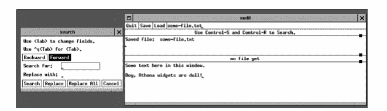

图 10.3

另一个常见的组件集（适用于所有商用 Unix 版本）是 Motif 组件，其外观与 Windows 3.x 控件相似。由于 Motif 环境是在需要付费的许可下分发的（即 Motif 是商业软件），Linux 和免费的 Unix 版本不包含 Motif。一些商用供应商会销售带有 Motif 的这些操作系统，但这并不相当罕见。为了与商用 Unix 版本竞争，一组开发者创建了 Lesstif，它是 Motif 的克隆版本。尽管它还需要改进，但目前 Lesstif 可以替代许多系统中的 Motif，并且会有更多支持在路途中。因为它相当标准，而且看起来比 Athena 组件好看，许多商用 Unix 程序（如 Netscape 和 WordPerfect）都是基于 Motif 的。²

¹ 顺便说一下，实际上有两个被称为 widget 的真实设备：第一个是固定刀片的小塑料块，第二个是健力士啤酒罐里的东西，当你打开罐子时会将氮气释放到啤酒中。真香！

组件集通常伴随着工具包出现，或与工具包配套。由于 X 是一个巨大且复杂的环境，很少有程序员为原始 X 编写应用程序。相反，有很多工具包，它们通过处理大量工作来简化为 X 窗口系统编写应用程序的过程。X 工具包（X Toolkit）是相当标准的，因为它随 X 一起提供，但并不是唯一的解决方案：除了自定义组件，Motif 也是一个工具包。

事实上，几乎每个组件集都与一个工具包配套，反之亦然。一个似乎日益流行的新工具包之一是 GTK，它是 GIMP 的。它比大多数工具包更进了一步：你可以安装任何数量更改组件集外观的主题。GTK 有许多主题可用，包括让 GTK 组件看起来像 Motif、macOS、Windows、BeOS 的主题，以及数百个仅仅为了好看而设计的题。图 10.4 显示了 GIMP，一个使用 GTK Set外观的应用程序。

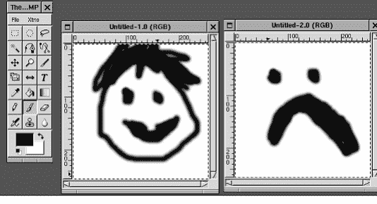

图 10.4

## 窗口管理器 (Window Managers)

由于组件和工具包各异，窗口管理器也因用户而异。大多数系统中，与 Windows 不同，窗口管理器没有在点击桌面时弹出菜单的设置。大多数窗口管理器还允许你在点击桌面时拥有自定义的菜单。

## 没有窗口管理器的 X

没有窗口管理器的情况下，窗口无法移动、调整大小或关闭（除非它们自己关闭）。此外，这非常丑。

```
ps -ef | grep xterm -l

PID  PPID TTY      STIME TIME  COMMAND

root     1    ?        00:00:02 /sbin/init

user  1234 5 pts0/0    00:00:00 /usr/bin/xterm -login :0 -root/.Xresources

user  1235 5 pts1/0    00:00:00 /usr/bin/xterm -login :0 -root/.Xresources

user  1236 5 pts2/0    00:00:00 /usr/bin/xterm -login :0 -root/.Xresources

user  1237 5 pts3/0    00:00:00 /usr/bin/xterm -login :0 -root/.Xresources

user  1238 5 pts4/0    00:00:00 /usr/bin/xterm -login :0 -root/.Xresources

user  1239 5 pts5/0    00:00:00 /usr/bin/xterm -login :0 -root/.Xresources

user  1240 5 pts6/0    00:00:00 /usr/bin/xterm -login :0 -root/.Xresources

user  1241 5 pts7/0    00:00:00 /usr/bin/xterm -login :0 -root/.Xresources

user  1242 5 pts8/0    00:00:00 /usr/bin/xterm -login :0 -root/.Xresources
```


没有窗口管理器的 X。

# 像 X 一样思考 第10 章

细节。此菜单通常被称为根菜单，尽管你的窗口管理器可能对此菜单有不同的名称。

此时，值得提到（尽管你可能已经注意到了）X 使用了三个按钮，而 Windows 有两个，macOS 只有一个一个。如果你的鼠标只有两个按钮，你可能可以通过同时点击鼠标上的两个按钮来模拟中键。如果你的鼠标只有一个按钮，你可能可以通过按键组合来模拟第二个和第三个按钮；请查看你的文档以获取更多细节。

一个 Windows 或 Macintosh 系统上不存在的特性（尽管通过系统增强可能可用）是：虚拟桌面。虚拟桌面允许你将窗口保持在某个“屏幕”上，并允许你在这些屏幕之间切换。并不是所有的窗口管理器都支持虚拟桌面，也没有任何窗口管理器是以相同的方式支持虚拟桌面的。当我讨论各个窗口管理器时，我将能够每个窗口管理器支持什么种虚拟桌面。

我完全可以讨论所有的可用窗口管理器：存在几十种不同的窗口管理器。我将简要讨论一些窗口管理器，包括流行的几个，以及几个在某些方面可以称得上特别“Unix 类”的窗口管理器。虽然大多数带有一或两个窗口管理器的 Unix 发行版之外，互联网上还有更多可用选择。附录 B“术语表和参考文献”中一些提示。

## 标准窗口管理器

某些窗口管理器比其他的更标准。特别是，`twm` 和 `mwm` 几乎存在于地球上的每一个 Unix 系统中。`twm` 是 Tab 窗口管理器，默认随 X Window 系统一起；而 `mwm` 是 Motif 窗口管理器，它随该工具包一起，因此存在于几乎每一个商业 Unix 系统中。（Lefsid 还包含了 mwm 的克隆，因此在许多 Linux 发行版中可用作）

### twm

`twm` 即 Tab 窗口管理器，是标准 X11 发行版包含的唯一窗口管理器。当在 `twm` 中创建一个新窗口时，屏幕上会显示该窗口的轮廓。这个骨架可以通过点击第一个按钮移动并放置，此时窗口将放置在屏幕上。`twm` 还允许你通过编辑家目录下的 `.twm` 文件来创建和编辑菜单，`twm` 也允许你将窗口图标化（iconify）。尽管 `twm` 不支持虚拟桌面，但一个（非标准的）变体 `ttwm` 支持它们。

与 Windows 和 Macintosh 不同，`twm` 选择鼠标指针下的任何窗口。也就是说，你必须将鼠标指针移动到窗口内来设置键盘焦点。这在那些在意窗口管理器差异的人中被称为“鼠标跟随焦点”（focus-follows-mouse）。请参见图 10.6 获取 `twm` 的图片。

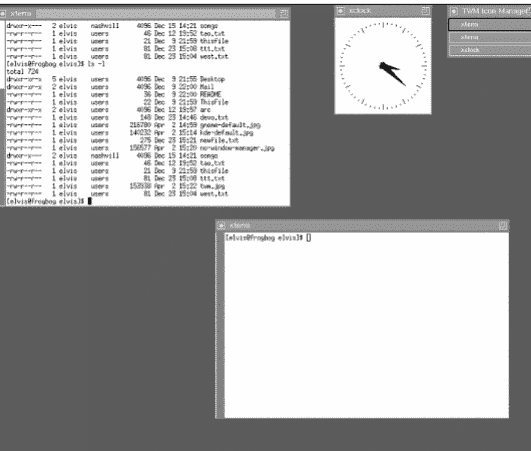

图 10.6

带有 `twm` 运行的 X。

### mwm

Motif 窗口管理器随 Motif 工具包和小部件集提供。与其外观和感觉为基础的 Macintosh 和 Microsoft Windows 一样，它是一个标准的点击聚焦系统。与这些系统类似，窗口在创建时会自动放置。外观（包括菜单选项）可以通过你家目录下的 `.mwmre` 文件进行配置。`mwm` 支持虚拟桌面并在一个角显示一个页器（pager）。要切换到不同的桌面，请点击页器中它的缩略视图。图 10.7 显示了 Lefsid 版本的 `mwm` 运行。

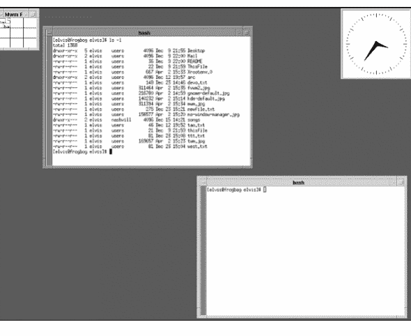

图 10.7

带有 `mwm` 运行的 X。

## 流行的窗口管理器

由于历史、品味以及许多其他难以界定的特质，某些窗口管理器在那些最初就足够在意切换窗口管理器的用户群中变得极其受欢迎。这些流行的窗口管理器中的两个是 `fwwm` 和 `Window Maker`。在本节中，我们将快速查看这些窗口管理器，并尝试记录它们的一些特殊之处。

### fwwm

`fwwm` 的名字充满了神秘色彩：手册页显示名称为 `fwwm`——针对 X11 的 F(?) 虚拟窗口管理器，这并不是一个特别有意义的名字。它最初基于 `twm` 代码，早期版本设计成看起来像 `mwm`，但具有更灵活的配置文件。（使这一切圆满的事实是，Lefsid 的 `mwm` 是基于 `fwwm` 代码的。）它的默认外观与 `mwm` 类似，如图 10.8 所示。

`fwwm` 在早期 Linux 发行版中获得了巨大的受欢迎，因为它是第一个免费提供的全功能窗口管理器之一。（其他竞争者是 `twwm` 和 Sun 的 Open Look 窗口管理器 `[olwm]`，后者后来已被淘汰。Lefsid 还没有编写，我们稍后讨论的其他窗口管理器也是。）第一个版本相对简单、非常小，并且仍在在使用。版本 2 现在更流行，因为它提供了许多模块化功能以及可选的类似于 Windows 95 顶部的新外观。这种新外观被称为 `fwwm95`，可以在图 10.9 中看到。`fwwm95` 仅仅是运行在标准 `fwwm` 版本 2 之上的另一组配置文件。`fwwm` 提供了一个额外的焦点模式。松散焦点（Sloppy focus）在鼠标指针进入窗口时选择该窗口，但在鼠标指针进入另一个窗口之前不会取消该选择。这允许用户快速、高效地选择窗口并隐藏指针。

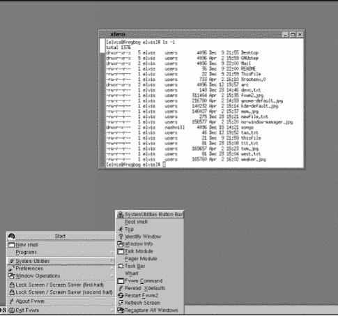

图 10.9

带有 `fwwm95` 运行的 X。

### Window Maker

Window Maker（也称为 NextStep，其可执行文件）是一个流行的窗口管理器，其外观和感觉基于 NextStep，正如 Macintosh 和 Microsoft Windows 一样，它是标准的点击聚焦系统。与这些系统类似，窗口在创建时自动放置。外观（包括菜单选项）可以通过你家目录下的 `.mwm` 文件进行配置。`mwm` 支持虚拟桌面并在一个角显示一个页器。这种基于图形应用程序的配置比手动配置简单，，但 `mwm` 强大强大。请参见图 10.10 获取 `m`默认配置的图片。Window Maker 支持工作空间，这些工作空间本质上等同于虚拟桌面，但有一个不同的页器。

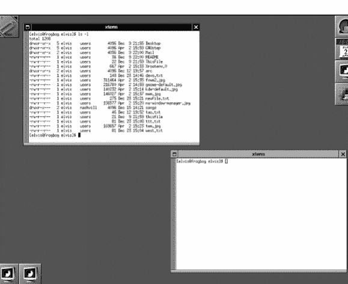

图 10.10

带有 Window Maker 运行的 X。

## Unix 类窗口管理器

由于历史原因，某些窗口管理器在那些最初就足够在意切换窗口管理器的用户群中变得极其受欢迎。某些窗口管理器由于某些原因看起来特别“Unix 类”。我们将简要查看三个窗口管理器：`Enlightenment`、`SawMill` 和 `wmx`，每一个都有值得注意的地方。

### Enlightenment

Enlightenment 也简单地称为 E，由于其无限的灵活性，非常 Unix 类：窗口管理器的几乎每个方面都可以更改。它可以使用小型图形应用程序进行配置，模仿任何其他窗口管理器或操作系统，尽管编写主题要困难得多。展示运行中的 Enlightenment 并没有什么用，因为可以像任何东西；尽管如此，在图 10.15 所示的 GNOME 部分，正在运行。

### SawMill

SawMill 是一种窗口管理器，在极其灵活性上与 Enlightenment 相似。不仅外观可以通过主题进行更改，不同的窗口也可以运行在同一个屏幕上。整个部分使用 Scheme（LISP 的一种变体，也是 Emacs 使用的编程语言）进行配置。图 10.11 显示了一个相当简单的 SawMill 配置。

```
#!/usr/bin/env scheme

title "SawMill"

width 1024 height 768

bar-height 20

Desktop 10:00

Mailbox 10:01

Firefox 10:02

Browser 10:03

Steam.it 10:04

Terminal 10:05

file.txt 10:06

Notes 10:07

Code 10:08

Calculator 10:09

Album 10:10

west.txt 10:11
```


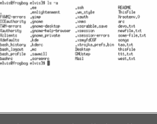

图 10.11

带有 SawMill 默认配置运行的 X。

## wmx

`wmx` 是一个非常快速、微小的窗口管理器，外观有些不同常。窗口标题旋转 90 度显示在每个窗口的左边缘，就像侧向持着的文件夹一样（请自行查看图 10.12）。除了简单的菜单，`wmx` 的所有配置都是在编译时使用配置文件完成的：所有信息都直接构建到二进制文件中，为了重新配置软件必须从源代码构建。如果这听起来很极端，你可能会惊讶地发现 `wmx` 是 `wm2` 的增强版本，后者没有菜单也没有支持通道（即 `wmx` 的虚拟桌面功能）。

# X Window系统概念

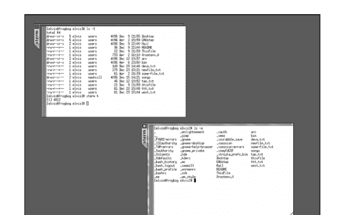

图 10.12

使用 `wmx` 的 Spartan 默认配置运行的 X。

## 桌面环境

对于某些人来说，仅仅有一个窗口管理器是不够的：有些人更倾向于使用提供更一致用户体验的完全集成环境。其中最流行的三个是 CDE、KDE 和 Gnome。我们将简要回顾这些环境。

## CDE

CDE 代表 Common Desktop Environment（通用桌面环境）。它基于 Motif 构建，并且像 Motif 一样，仅提供商业版本。Sun 和 Compaq（原 Digital）以及其他几个 Unix 供应商一样，将 CDE 作为其 Unix 版本的默认图形环境发行。一些公司也为 Linux 提供了 CDE 版本。

CDE 使用 Motif 作为其窗口管理器，并在屏幕底部添加了类似于 Windows 95 的应用程序栏。此栏包含了一些可用的应用程序按钮和菜单。可以通过应用程序栏上的标记按钮访问四个不同的桌面，CDE 还提供了一个日历程序和其他自定义应用程序。图 10.13 显示了运行中的 CDE。

# 像 X 一样思考 第10 章

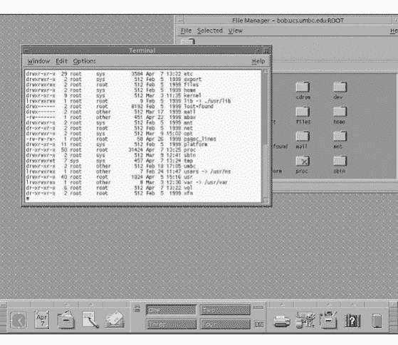

图 10.13
在 Solaris 2.6 上运行的通用桌面环境。

## KDE

KDE 中的 K 不代表任何含义，这提醒我们 CDE 是这个桌面环境的某种启发。KDE 提供与 CDE 相同的基本功能，以及几十个可以通过 KDE 控制面板配置的应用程序。KDE 有它自己的自定义窗口管理器，如图 10.14 所示。

尽管 KDE 是免费提供的，但它是基于半商业工具包的。Qt 的许可证在某些开源圈中存在争议，许多用户与该环境保持距离。`qt` 的 2.0 版本具有限制较少的的许可证，缓解了这一争议，尽管另一个免费桌面环境 GNOME 阻止了 KDE 成为事实上的标准。

KDE 提供了许多游戏和工具。事实上，一个名为 KOffice 的免费办公套件正在开发中，并承诺在 2000 年底发布。只有时间才能证明是否能如期完成，尽管如果可以的话，这将引起一些人的兴奋。

- 3. X 可用的其他办公套件还包括 Sun*StarOffice、Corel 的 WordPerfect 套件和 ApplisWare。

# X Window系统概念

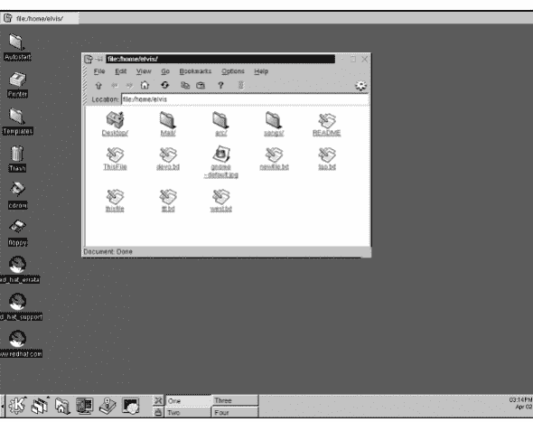

图 10.14

KDE 桌面环境。

## GNOME

GNOME 是另一个免费的桌面环境，它基于 GTK 工具包构建。它在某些方面落后于 KDE，在另一些方面领先它。如果你的系统预装了这两种环境，你可能想尝试两者。（如果你的系统中两个都没有安装，我注意到，由于软件包的大小和过程的复杂性，构建这些大型桌面环境可能仅留给更有经验的用户和系统管理员。）通常情况下，来自任何一个环境的应用程序在另一个环境或纯 X 环境中都能运行得良好，但某些功能可能无法正常工作。这些功能包括在应用程序之间以及到桌面的拖放，但似乎目前很少有应用程序支持这些功能。

GNOME 提供了一个全功能的电子表格程序 `gnumeric`，并可以使用任何支持 GNOME 的窗口管理器，包括 Enlightenment、Window Maker、SawMill 和 BlackBox。随着时间的推移，KDE 和 GNOME 之间应该会提供更好的兼容性，尽管它们不太可能成为同一个项目中的管理器。图 10.15 中可以看到带有 Enlightenment 窗口的 GNOME。

# 像 X 一样思考 第10 章

# 217

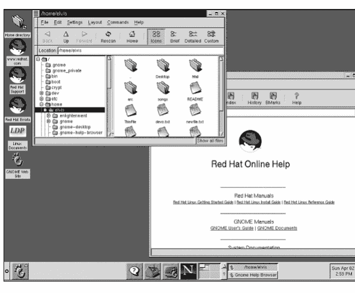

图 10.15

GNOME 桌面环境。

## 为什么许多用户避免桌面环境

包括我在内的许多用户通常避开桌面环境。它们提供了好处，但会占用大量内存并减慢系统速度。大多数，这些环境包含的应用程序在没有这些环境所依赖的大型基础设施额外负担的情况下也能运行良好。此外，这些每个环境都有自己的配置方法，这种方法通常比标准的配置方法更强大、更不灵活。

对于许多高级用户来说，他们觉得桌面环境给了他们帮助，并觉得环境提供的对易用性的增强不足以抵消对性能和控制的损失。这种“脑损伤”的一个衡量标准是每个环境都提供了自己的终端程序来取代古老的 `xterm`。这些替代品中没有一个像原始版本那样可配置、稳定或功能齐全，尽管它们对于初学者来说可能更容易配置。最后，许多用户觉得桌面环境是对所有且有限的屏幕空间的浪费。

## 有用的东西：xterm

这一切把我们引入了 `xterm`，这个应用程序在 X Window 系统存在的最初至少 10 年里可能被极巨大的用途。多年来，标准的 X 环境由两个或三个运行在 `twm` 中的 `xterm` 以及 `xclock` 组成，`xclock` 仅为 X 提供一个模拟时钟。在图 10.6 和 10.7 中可以看到 `xclock`。它是一个时钟；`xterm` 可能是目前可用最流行的 X 应用程序。（这大部分内容是在运行在 `xterm` 中的 `vi` 中编写的，通常在另一个桌面上打开了另一对 `xterms`，逐个主题、逐个章节地编写这些内容的大纲。）

为了让你从这一章中获得一些有用的内容，我在进入下一章之前将涵盖 `xterm` 的基本功能。我将讨论一些通用的 `xterm` 行为，例如 Athena Widget 滚动条的使用以及 X 的剪切模式，并简要向你介绍 `xterm` 中可用的选项。虽然 `xterm` 是极其可配置的，但我现在不会讨论这些：相反，我将谈论下一章，那章完全关于配置

`xterm` 是，一个运行在 X 中的终端，但它是哪种终端呢？事实上，`xterm` 提供了两个基础终端：它可以模拟 `vt102`（带有某些 `vt220` 增强），还可以模拟 Tektronix 4014 终端。大多数人使用第一种选项，因为它是默认的。`vt102` 可能是世界上被模拟最多的终端，因此大多数程序都是为了利用它的功能集而编写的。Tektronix 4014 是一种旧的图形终端，但现在的大多数图形程序都是直接为 X 编写的，而不是针对任何特定的图形终端。

X 滚动条 默认默认位于屏幕的左侧，而不是像 MacOS 和 Windows 那样在右侧。当光标悬停在滚动条上时，左键会将滚动条向屏幕底部移动，右键会将滚动条向屏幕顶部移动，中键会将滚动条移动到光标位置。你不需要像许多其他操作系统那样抓住滚动条上的高亮指示器来移动它。这是任何标准 Athena widget 滚动条的行为。Motif 和 GTK 应用程序等具有更传统的 PC 或 Mac 风格滚动条。

## 复制和粘贴

`xterm` 以及所有 X 应用程序中的复制和粘贴与 PC 或 Macintosh 用户熟悉的剪切和粘贴非常不同。要选择要复制的文本，只需按住左键并选择你想要的任何文本

# 像 X 一样思考 第10 章 219

复制。接着，移动到你想复制该文本的窗口并放置光标。最后，点击鼠标中键，砰——你的文本已经复制了。

选择文本还有其他功能。要选择单个字符而不是视觉块，将光标移动到你想复制的窗口上并双击左键；要选择整行，三击该按钮。如果你发现想要缩小或扩展所选的文本，使用右键。要在你的选择之外添加文本，只需将光标移动到精确的位置并单击右键。要从你的选择中删除文本，它必须是选择的开始或结束：无法在选择中间取消选择。只需将光标移动到你想删除文本的点并点击右键。如果光标在所选文本的前部分，X 将从块的开始到你的光标位置取消选择。如果光标在后部分，X 将从你的光标到选择的结束取消选择。

## 三菜单

我发现最有用的菜单是右键菜单，它允许更改 `xterm` 的字体大小。可选尺寸从微小到无法辨别的巨大。只需继续按住控制键和鼠标右键，将指针移动到你的选择上并释放鼠标键。我们所有人，你的字体大小不同。这样做可能让你让窗口变大以容纳更多文本，或者让较小的窗口可见。X 会让事情变得难以处理。

中键提供了许多可以开启的功能。要切换功能状态，用指针选择它并释放鼠标键。我倾向于使用的功能只有按键滚动到底和按输出滚动到底，这两者都是自言易懂的。终端重置功能可用，分为硬、软两种类型。硬重置特别有用，当一个应用程序或另一个弄乱了你的屏幕而你想将其重置为正常行为时：也许你的文本一直在反转或

回车键并不会带你进入新行。在何种情况下，重置终端都可能是你的办法。（这等同于将旧终端关闭再重新打开。）

左鼠标键有几个实用的功能，包括重绘窗口以及切换 Sun 键和标准功能键的选项。它还允许向窗口发送信号并锁定键盘。只有最后一个选项需要任何特别的谨慎。

由于 X 是网络透明的，用户完全可能连接到你的系统并将你的输入重定向到其他地方。“安全键盘”（Secure Keyboard）选项可以确保你的输入只发送到运行在那个 `xterm` 内部的程序中。在此模式下，你正在输入的文本将会反转。通常情况下，大多数系统出厂时 X 都处于相对安全的状态，很少有用户切换到此模式。尽管如此，如果你对此感兴趣也可以一试。如果需要更多细节，请阅读 `xterm` 的 man 页。

你（终于）在这一章中学到了实用的知识，我可以心安理得地进入下一章。

## 建议练习

- 1. 使用 `xssetroot` 命令尝试将显示器的背景更改为另一种颜色。

- 2. 找出你的系统运行的是什么窗口管理器或桌面环境。应该有一个或多个进程，如果不是显而易见，它们的名称会提示。如果你仍然无法确定，请阅读你的文档。只有在万不得已的情况下才请教你的系统管理员或本地专家。

- 3. 尝试在你的窗口管理器中添加菜单选项（如果可能的话）。添加一些内容来证明你可以做到。

- 4. 看看是否可以切换到不同的窗口管理器或桌面环境。如果你不知道如何操作，别担心：我们将在下一章中讨论这个问题。

- 5. 打开两个 `xterm`。更改字体大小并确保它们都能适应同一个屏幕上。在每个终端中打开 `vi`。练习复制和粘贴功能，选择不同的文本块并修改这些选择。

| 硬链接 | 软链接 | 重定向与 I |
| STDERR 名称查找 | vi POP3 | vi 与正则表达式 |
| 读取邮件 | Glob 匹配对比正则 | INTERA |
| 文件名命令行编辑 | 历史记录型 | 控制变量与引号 | CONDI |
| 执行 WHILE 和 UNTIL 循环 | | | |
| 函数 | 窗口客户端/服务器 M | | |
| 小部件与工具 | 配置 | PE |
| 所有权 | 用户与组 | HARE |
| 软链接 | 重定向与管道 | REDIRE |
| STDERR 名称查找 | 路由读取 MA | |
| vi 与正则表达式 | 文件名 GLC | |
| 对比正则 | 交互式命令行 Lin | |
| 历史替换 | 控制引号条件执行 | WHILE A |

## 配置 X

（注：此处后续内容由于原文似乎存在截断或逻辑重复，已针对提供的文本段完成翻译）

# 第三部分 X 窗口系统概念

现在你已经熟悉了唯一真正重要的 X 程序——`xterm` 的基础，是时候讨论为什么 X 窗口系统比 Windows 或 Macintosh 上的任何系统都要好了：与那些系统不同，X 具有无限的灵活性。X 行为的每一个方面都可以被配置。一如既往，这涉及到一个学习曲线。只有在投入了大量精力后，大多数程序才能被彻底配置。自定义 X 窗口系统有两种通用方法：第一，自定义启动 X 或登录时启动的内容；第二，配置 X 应用程序。虽然最近的一些 X 应用程序带有图形化配置工具，但我不会谈论它们，因为它们大部分可以自我解释。我将谈论的是 X 资源（X resources），这是基于标准工具包和 Athena 小部件（widgets）的应用程序使用的配置方法，以及其他遵循此标准的应用程序使用的配置方法。

X 资源对用户来说是著名的难以理解和编辑，尽管它们比大多数用户认为的要简单得多。有多种工具可以帮助使用 X 资源，我会简要讨论其中一些。我还会特别关注颜色和字体的配置，这是最常更改的两种资源，每种都需要额外的理解。

## 启动 X

如今，当你坐在机器并通过图形化登录程序（如 `xdm`）登录时，大多数系统的 X 已经启动了。但在某些系统中，X 默认并不启动，你必须在登录后启动它。无论何种情况，X 通常为你的系统设置了大量的默认值，以及一组由系统运行的程序。通常，你可以通过家目录下的点文件（dotfiles）覆盖这些默认值，尽管具体哪些文件包含这些值取决于你如何启动 X。

## 使用 xdm 登录

`xdm` 是 X 显示管理器。尽管它可以管理远程登录和复杂环境，但它通常用于管理一个显示。通常系统控制台也是相当配置的，所以我关于它的任何话在你的安装中可能有所不同。检查你的文档或询问你的系统管理员详情（如果你已经厌烦了重复这句话的话。别担心，这是最后一章了，你不会听到很多次的！）`xdm` 从询问你的用户名和密码开始。输入这些信息后，系统可能会加载一些默认 X 资源，在此基础上安装你配置的任何 X 资源。最后，系统将运行一个包含默认运行程序的脚本，包括你的窗口管理器。默认情况下，该脚本会在你的家目录中寻找名为 `.session` 的脚本，如果存在，则运行它。

# 配置 X 第 11 章

225

# 第三部分 X 窗口系统概念

```bash
then
xloadimage -onroot $HOME/mediabits/Iridescent-Slate-5.JPG
else
## 如果没有那个文件，就设置一个漂亮的纯色背景
xsetroot -solid black
fi
```

除了我必须在后台运行的背景循环脚本外，这段代码的其他部分都不会在后台执行。它们不需要，因为它们是立即执行的。这允许脚本继续运行：

```bash
## 设置屏幕保护程序
xset s off
screensaver -install -lock-mode -no-splash &
- * 安装一些应用
(sleep 1; xdalclock) &
xload &
[ -x /usr/local/bin/xfortune ] && /usr/local/bin/xfortune &
```


同样，`xset` 也会立即退出，因此它不需要在后台运行。在这种情况下，我在运行 `xscreensaver` 程序后，使用 `xset` 来关闭 X 内置的屏幕保护程序，该程序提供了很多视觉效果且具有高度可配置性。

最后，在继续选择窗口管理器之前，我在后台运行了一些额外的程序。请注意，在某些系统上，我发现 `xdalclock` 直接在后台运行会有问题，而延迟运行它效果要好得多。为了在不减慢其余启动过程的情况下实现这一点，我在一个带有 `sleep` 命令的子 shell 中运行它，并将所有操作都放在后台运行，这样它就不会减慢我的整个 X 启动过程。我发现这花很小的精力就解决了我的问题。虽然这个问题在大多数系统上并不存在，且可以修复，但我仍然没有更改它。这没什么大碍，而且一切运行得都足够快，似乎没有冒风险让原始 bug 再次出现的收益。

某些系统已经用不同的显示管理器替换了 `xdm`。`CDE`、`GNOME` 和 `KDE` 各自都有一个不同的供系统管理员选择的可用管理器。大多数时候，这些程序以与 `xdm` 相同的方式遵守用户默认设置。无论如何，如果大多数站点选择运行标准的 `xdm`，你也应该运行标准的 `xdm` 而不是这些替代品，而 `xdm` 是这些替代品对比的标准。尽管如此，我在上一章末尾关于桌面环境“脑损伤”的言论依然有效，你可能会发现自己正通过撞墙来尝试自定义你的 X 环境。

## 登录后启动 X

与通过 `xdm` 启动（它在所有 Unix 版本中的工作方式基本相同）不同，每个版本的 X 窗口系统都有命令行启动 X 的不同方法¹。X 本身包含一个名为 `x` 的程序，它允许你指定一个 X 服务器和一个客户端程序。通常情况下，默认服务器是正确的，你可以将所有想要运行的程序放在家目录下一个名为 `.xinitrc` 的文件中。由于我希望无论 X 如何启动都运行相同的程序，因此将 `.xinitrc` 创建为指向 `.xsession` 文件的软链接。

由于它非常简陋，许多系统提供了一个名为 `x11.start` 的不同程序，其中最后一种特别受欢迎，并由所有安装了 XFree86 的系统提供。通常，使用 `.xinitrc` 文件作为默认启动脚本，如果不存在该文件，它将具有更合理的默认值。其他系统使用 `.clients` 或 `.xsession` 来提供默认启动脚本。我也将此文件创建为指向 `.xsession` 的软链接。我强烈建议为 X 使用单个文件，除非你希望 X 根据启动方式的不同表现出不同的行为。

许多安全问题与 X 应用程序访问显示器有关，使用了多种技术来管理这些问题。大多数现代 X 系统在安全机制方面都有合理的默认设置，因此我们不讨论这部分。安全是一个特别深奥的话题，很少有用户需要处理。我可能会在后续提到某些特定细节，但一如既往，如果你有疑问，请检查文档。

> ¹. 这一点似乎有些多余，但值得注意的是 X 是由一个财团免费提供的，每个供应商都可以根据自己的意愿对该版本进行任何操作。每个供应商必须为其工作站的视频硬件创建一个自定义的 X 服务器，并修改软件使其能够用其供应商的编译器顺利构建。然而，许多供应商会更改文件位置、额外的软件、更改默认值等。这包括更改如何使用命令行启动 X，尽管公平地说，X 财团版本的 X 并不包含实现此点的良好方法。在免费的 Unix 版本中，规律性稍强，因为几乎所有系统都安装了 XFree86。XFree86 是 X 的一部分，最初旨在支持各种 PC 硬件，尽管它也支持其他架构。由于 XFree86 是免费的且在大多数系统上很容易构建，因此它被广泛使用。

# X 窗口系统概念

## 命令行选项

X 程序（基于 Toolkit（简称 Xr）的程序）的命令行选项通常比其他 Unix 程序更复杂。这些选项中的几乎每一个都有对应的 X 资源，可以提供默认行为，而命令行选项将始终覆盖 X 资源。

## 显示选项

另一个值得讨论的最后选项是 `-display` 参数，它是大多数 X 程序的通用选项。这是网络透明性的实现，你很快就会发现并不是完全透明的。`-display` 允许你指定窗口应该出现的显示器名称。

在只有一个显示器的机器上，display 通常为 `:0`，这意味着第一个显示器以及该显示器的第一个屏幕。每个键盘和显示器的组合通常为一个显示器，如果额外的显示器连接到特定的键盘/显示器组合，则它们被视为额外的屏幕。如果程序在比当前机器不同的机器上显示输出，则在冒号前加上机器名称。例如：如果你从 `frog` 登录到 `razorback` 窗口，并在 `razorback` 上运行一个 X 程序，它会有自己的 `-display frog=`，为了让我能使用它，我将使用选项 `-display frog=` 来运行它。省略默认的 0 是允许的。

与其运行每个程序时都带有 `-display` 选项，你可以将环境变量 `DISPLAY` 设置为正确的显示器。当你启动 X 时，默认值通常设置为当前显示器的名称。命令行选项优先级始终高于环境变量，因此你可以设置一个易于覆盖的默认值。

由于显示器可以是网络上的任何其他机器，因此存在明显的安全问题。如果任何人都能在你的 X 服务器上显示他们的客户端，那将非常糟糕，因为他们可以捕获你的击键并从你那里获取你想保密的信息。为了解决这个问题，客户端访问特定服务器需要某些授权。一种较差的解决方案是 `xhost`，它简单地向你服务器上的所有客户端提供权限。`xhost frogback` 会将运行在 `frogback` 上所有的 X 客户端授予当前服务器。

`xhost` 反转了 X 的反向转换：如果你在主机名前指定加号 `+`，`xhost` 获取当前显示器的权限；如果你指定减号 `-`，则拒绝访问。因此，`xhost -frogback` 将拒绝 `frogback` 对显示器的访问，而 `xhost +frogback` 将授予访问权限。如果你想冒险，可以通过运行 `xhost +` 为你的显示器授予所有主机的权限。在任何情况下都不建议这样做，但人们总是问怎么做。同样，要拒绝所有主机机，你可以运行 `xhost -`。这更可以接受。运行此命令后，你可以添加你想要接受连接的特定主机。

尽管如此，`xhost` 仍然是一个糟糕的解决方案。由于 Unix 是多用户操作系统，很难保证特定系统上的每个用户都能访问你的 X 服务器。相反，`xauth` 命令提供了一种更具体的授权方式，它使用授权文件和魔法饼干（magic cookies）。

# X 窗口系统概念

坏消息是，没有人（包括我自己在）每天愿意去处理 `xauth` 的复杂性。幸运的是，X 允许你从默认会话访问显示器。要远程运行 X 程序，最佳解决方案是使用 `ssh` 内置的 X 转发（X forwarding）。当 `ssh` 正确地在远程主机上设置 `DISPLAY` 变量，并通过 `ssh` 的加密通道发送所有的 X 信息时，就能在你的本地机器上正常显示。对于许多用户来说，仅仅这一个功能就值得从 `telnet` 或 `rsh` 切换到 `ssh`，这也是我建议你远程运行 X 程序的方法。所有其他方法都充满了疑虑和危险。为网络透明性点一分²

## 建议练习

- 1. 弄清楚你的系统 X 使用哪些启动脚本。如果家目录下存在默认启动脚本，请备份这些脚本的每个副本并使用 `.dist` 扩展名，以便你可以随时恢复默认配置。
- 2. 修改你的 X 启动脚本，在桌面上添加一个时钟。如果默认存在时钟且安装了 `xclock`，将你的时钟程序切换到 `xclock`。如果你在家目录下没有 X 启动脚本，请创建它们。确保你编辑的是适用于系统的正确文件。
- 3. 如果安装了多个窗口管理器，修改你的启动脚本以使用与默认不同的窗口管理器。如果你不喜欢新选择的窗口管理器，请切换回来。
- 4. 在你的启动脚本中更改背景颜色。如果你的系统安装了 `xloadimage` 或 `xv`，尝试将图片放入背景，而不仅仅是颜色。
- 5. 使用不同的前景和背景颜色启动 `xterm`，直到找到一个舒适的配置。

## X 资源 Resources

通常你希望某个程序每次启动的方式都相同，除非你用命令行选项覆盖它；也就是说，你希望它有一个合理的默认行为。设置这些行为的标准方法是设置某些 X 资源。

正如目录和域名形成层次结构一样，X 资源也存在层次结构。（注：此处原文有大量重复，翻译已合并处理）

## 特异性与评估顺序

要完全指定特定资源，你将从组件名称开始沿树向下进行，最后以资源名称结束。然而，有时你可能想一次更改多个资源。如果你不仅想更改字体菜单的背景，还想更改所有以及 VT10 窗口的背景，你可以做到这一点。

X 资源的自定义值存储在家目录下的 `.xdefaults` 中。该文件中的项目可能如下：

```
xterm*background: DARBLUE

xterm*foreground: Green

xterm*scrollBar: true

xterm*reverseWrap: true
```

# 配置 X 第 11 章

当然，在点号之前有一个由空字符串指定的虚拟根组件（root widget）。这样，就有了一整棵组件树，就像目录或域名一样，而且它和所有它们一样都有一个根节点。在实践中，根组件几乎没有属性，这并不重要：设置 `.background` 不产生任何效果。

我本可以指定 `xterm.VT100.font`，因为树中没有其他可以替换的组件，但我打算将 `xterm*SimpleMenu*font` 设置为一个值，而将 `xterm*font` 设置为另一个值。这意味着将始终从 `SimpleMenu*font` 资源中使用正确的字体。这就是设置的 `xterm*SimpleMenu*font` 资源。系统是如何知道要这么做的？因为它知道最具体的资源设置始终具有优先级。

什么是最具体的设置？是在名称中使用尽可能接近目标的的第一个点进行设置，或者使用比其他明显适用于组件更精确的组件名称。例如，`.background` 是资源可以达的最具体的设置，它会被任何位于星号左侧名称的组件覆盖，如 `xterm*background`。这可以被 `xterm*SimpleMenu*background` 等覆盖。任何最精确的都会具有优先级。这允许你拥有非常模糊的默认值：`*font: fixed` 意味着“除非我另有，否则使用固定字体”，而 `xterm*font: 7x14` 意味着“除非我另有，否则使用 7x14 字体”。从这个标准来看，`xterm.VT100.background` 和 `xterm.FontMenu.font` 就是如此的。

衡量特定性的另一种方法是想象该资源在组件树中出现在右侧有多远。实际上发生的情况是树设置了资源，而资源管理器遍历这些树。每当使用一个组件时，资源管理器都会从树的顶部开始，并在每次移动到树的另一个分支时将资源重置为给定的值。当它到达末尾时，资源的值就是树中最后被解释的项。

你在哪里找到哪些资源是值得设置的？在你系统的 X 安装位置的某处有一个 `app-defaults` 目录，其中包含了不同应用程序的默认资源。（在我的 Red Hat 系统上，这是 `/usr/X11/lib/X11/app-defaults`。）这些资源都以星号开头；系统会在前面加上顶层组件名称。在大多数情况下，顶层名称是可执行文件的名称，尽管在特定应用程序中可能会有所不同。（你可以使用 `-name` 命令行选项覆盖默认名称。）

某些组件对于组件集中所有给定类型的组件都是通用的。Athena 组件集中的所有按钮或文本框都有一个 `.label` 资源，用于指定该组件的文本标签。发现良好资源的最简单通常也是最好的方法是阅读给定应用程序的帮助页（man page）。大多数 X 应用程序页面都有一个 `Resources` 部分，描述了特定应用程序的 X 资源。（极少数、如果有的话，帮助页列出了所有标准的 X Athena 组件资源。其中某些资源可以在 X 自身的页面上找到，以及标准的 X ToolKit 命令行选项。）`editools xrdb` 在这些情况下也非常有价值，尽管它需要时间适应。

## xrdb

`xrdb` 是用于解释 X 资源的程序。（它的名称是 X ResourceDataBase 的缩写。）`xrdb` 的正常用法是指定一个包含 X 资源列表的文件。默认情况下，所有 X 资源都会被该的内容覆盖。（如果没有指定文件名，则数据来自 STDIN。）

默认等同于 `-load` 选项。如果使用 `-override` 选项，则来自给定文件的资源将替换现有资源。`-merge` 实际上有点危险；它最好的做法是将当前资源与现有资源进行合并。对我来说，它似乎有些不可预测，所以我建议坚持使用 `-override`。`-remove` 将移除文件中列出的资源。

## xrdb 和 cpp

早些时候你可能注意到我设置了以下资源：

```
xterm*background: WAYDARKBLUE
```

事实上，`WAYDARKBLUE` 并不是 X 支持的实际颜色。（我将在本章中更多地讨论颜色，但现在请听我的一句。）因为我想在许多情况下使用一种非标准颜色作为背景，我发现设置它最简单的方法是在我的 `.xdefaults` 顶部放置以下命令：

```cpp
#define WAYDARKBLUE #000033
```

这一行意味着每当 `xrdb` 遇到 `WAYDARKBLUE` 这个词时，它会被替换为 `#000033`，这代表我喜欢的特定颜色。（再次，你现在只需听我的一句。）这个 `define` 语句由 C 预处理器（`cpp`）解释。当 `xrdb` 加载 X 资源时，除非另有说明，否则会将它们通过 `cpp` 处理。

什么是 C 预处理器？简单来说，它是一种简单的语言，类似于 shell 编程，但它允许你定义符号并对这些定义执行操作。之前的 `#define` 语句将 `WAYDARKBLUE` 定义为值 `#000033`。`cpp` 不在乎值代表什么，也不在乎程序最终对该信息做什么。它只是接收输入，根据少量规则进行处理，并产生输出：它是一个过滤器。

# 配置 X 第 11 章

除了 `#define`，我们还关心的其他几个命令。在我的 *xdefaults 文件* 顶部附近，我有以下命令：

```cpp
#ifdef COLOR

*customization: -color

#endif
```

这条语句的意思是，如果定义了 `COLOR`，则设置该 `#if` 和 `#endif` 之间的资源。正如每一个 sh if 语句必须以 `fi` 结尾，每一个 `#if`、`#ifndef` 和 `#endif` 语句必须以 `#endif` 结尾。

`#ifdef` 在该参数被定义时处理文本；它不在乎它是被特定设置还是仅仅如此。（你可以使用 `#define` 定义变量，而无需为该定义提供特定值。）`#ifdef` 在该特定值未定义时处理文本。最后，`#if` 允许你嵌套。在我的 `.xdefaults` 中，我有以下代码：

```cpp
#if HEIGHT == 768

xterm.VT100.geometry: 80x35

elif HEIGHT == 600

xterm.VT100.geometry: 80x25

elif HEIGHT == 1024

xterm.VT100.geometry: 80x45

#endif
```


（注：由于最后一个代码块的 OCR 严重损坏，我根据常见的 X 配置模式和提供的片段重建了逻辑上的 #if/elif 结构。）

## 建议练习

- 6. 将你的默认 `xterm` 颜色更改为在本章第 5 练习中喜欢的颜色组合。
- 7. 更改 `xterm` 滚动缓冲区行数。（提示：阅读 `xterm` 的 `man` 页面以找到适当资源的名称。）
- 8. 更改 `xalc` 的颜色以匹配你的默认 `xterm` 颜色方案。
- 9. 使用编辑器查看 `xterm` 的可用资源。使用编辑器更改活动 `xterm` 的前景颜色（`foreground-color`）。
- 10. 运行 `edits --defaults color`。自定义编辑器的外观使其看起来更美观。
- 11. 如果定义了 `COLOR`，则添加 *customization:* `-color` 资源。查看这如何影响编辑器和其他 X 应用程序的视效果。
- 12. 根据你显示器的水平分辨率更改你的 `xalc` 窗口大小。

# 颜色名称与数字

由于 X 是一个图形环境框架，颜色非常重要。我们喜欢对显示的信息进行颜色编码，以便让重要信息脱颖而出。为了处理颜色，我们必须能够指定特定的颜色。为了处理真实的色调，我们必须能够指定比蓝色或绿色更具体的颜色深度。在 X 中，有指定颜色的标准方法，包括少数用户使用的设备无关的颜色规范。指定颜色最常用的方案是使用 RGB 颜色模型，我们将详细介绍它。

## RGB 颜色模型

大多数人知道计算机屏幕上的每个像素都由三个元素组成：红色元素、绿色元素和蓝色元素。任何在 CRT 或 LCD 上显示的颜色都必须表示为像素红色部分、蓝色部分和绿色部分的值。最亮的纯蓝色将是亮度为 100% 的蓝色像素，而绿色和红色像素为 0%。（实际上，每个像素的红、绿、蓝部分确实是子像素，但为了方便起见，在讨论中我可能会将它们称为像素。））

通过将 100% 定义为 1.0，将 0% 定义为 0.0，你可以指定 RGB 强度规格为 `rgbi:red/green/blue`。纯红色可以指定为 `rgbi:1.0/0.0/0.0`，中灰色指定为 `rgbi:0.5/0.5/0.5`。

# X 窗口系统概念

强度模型只是选项之一。更常见的是比例值（scaled）。因为计算机是数字的，并不存在使用强度所暗示的无限渐变。相反，这些百分比中的每一个都必须转换为数字。通常，X 中的颜色是 24 位值，这意味着每个元素都有一个 8 位（一个字节）的值。这些 8 位子值的范围从 0 到 255，与所有 8 位值一样，它们都以十六进制表示。因此，纯绿色将表示为 `rgb:00/FF/00`，之前提到的中灰色表示为 `rgb:80/80/80`。RGB 颜色模型允许你指定从一到四个十六进制数字的每个比例值，只要给定颜色的红/绿/蓝每个值共享相同的位数即可。

## 旧式颜色数字

在过去，在 X 中出现多种颜色模型之前，颜色被简单地指定为以哈希号开头的十六进制数。你可以从以下示例的颜色定义中看到这一点：

```
#define WAYDARKBLUE #000033
```

这个 24 位值中的数字对顺序与上面相同，仅有不同之处。这些值也可以是 12 到 48 位，即 12 的倍数，正如 RGB 记法那样。这种颜色 `#000033` 中没有红色或绿色，只有一点蓝色。有多少呢？FF 转换为十进制后是 33，这是 255 中的 51，等于 0.2，或 20%。在新颜色模型中，这可以表示为 `rgb:00/00/33`，在颜色强度模型中，它将是 `rgb:0:0:0`。我懒得更新这个，而且我有点担心旧机器如何处理或无法处理这种情况，所以我将数字留在旧式方案中，至少对于...

## 颜色名称：rgb.txt

幸运的是，我们不需要将颜色视为数字：X 窗口系统为我们提供了将颜色转换为数字的简单方法。在你系统的某个地方有一个名为 `rgb.txt` 的文件（该文件应该位于相对于 X 顶级目录的 `lib/X11` 目录下）。在我的 Red Hat 系统上，绝对路径是 `/usr/X11/lib/X11/rgb.txt`，这在你的系统上可能很不同。

让我们看看这个文件的一小部分：

```
255 218 185 peach puff
255 218 185 PeachP
255 222 173 navajo white
```

- 3. 许多（并非所有）显示器不是 24 位显示器。更常见的是 8 位显示器，它们使用调色板（colormaps），即给定窗口中指定的颜色集合。同样常见的还有 32 位显示器，它们通常包含一个 24 位显示和一个 8 位“alpha 通”，该通道显示在上方并以某种方式修改底层的 24 位显示。

# 配置 X 第 11 章

237

```
255 222 173 NavajoWhite
255 228 181 moccasin
255 248 220 cornsilk
255 255 240 ivory
255 250 205 lemon chiffon
255 250 240 LemonChiffon
255 245 235 seashell
245 250 240 honeydew
245 255 250 mint cream
245 255 250 MintCream
240 255 255 azure
240 248 255 alice blue
240 248 255 AliceBlue
```

这里有几点值得注意。首先，颜色名称对应于 24 位颜色。其次，颜色数字是用 10 而不是 16 来描述的——X 各处都用十六进制描述颜色，但应该用十进制表示，这对我来说是个谜——这种格式对于任何颜色描述来说都不理想。第三，一种颜色可以拥有多个名称。注意，名称为单单词的颜色全小写；名称为两个单词的颜色各有两个名称。一个名称是每个单词小写并用空格分隔；另一种是紧凑形式，名称中每个单词的首字母大写，并删除了所有空格。

关于颜色名称并没有什么可说的。我强烈建议查看 `rgb.txt` 文件以查看有哪些可用颜色。特别关注灰色调，因为引用百分比灰非常方便。

## 字体

X 中的字体情况比颜色情况更复杂。有许多字体格式可用，但 X 只支持其中很小一部分。这种支持很大程度上是在管理员端，所以我们在这里不介绍它是什么、如何找到你系统上的可用字体，以及如何最好访问特定字体。

X 让处理字体工作变得困难，因为可用字体必须安装在服务器上，而不是客户端上：它们必须存在于显示文本的机器上，而不是运行给定程序的机器上。解决此问题的方案之一是在网络上运行字体服务器，这可能会导致无数安全问题，而目前常见的解决方案是随处安装字体。从用户的角度来看，这通常是透明的。然而，字体并没有出现在应该出现的地方。这令人头疼。

## 列出字体

列出字体的简单方法是运行 `xlsfonts` 程序，它显示系统中安装的所有字体。字体可以用多种方式命名。让我们检查 `xlsfonts` 的一些输出（此输出并不一定是它们出现的顺序，但对我们学习很方便）。

```
[jon@frogbog]$ xlsfonts
...
10x20
12x24
5x7
5x8
6x10
6x12
6x13
6x13bold
6x9
7x13
7x13bold
7x14
7x14bold
8x13
8x13bold
7x16
9x15
9x15字体
..
```

这些字体都是特定像素尺寸的等宽字体。10x20 是 10 像素宽20 像素高，5x7 是 5 像素宽7 像素高，以此此类。有些字体还有粗变体。`xterm` 显示的所有字体必须是等宽字体。这些字体不仅是等宽的，而且是位图：按像素存储在系统中。如果根据请求，系统将尝试缩放字体并在非物理分辨率尺寸下使用它们，但这些字体在任何默认尺寸之外看起来都是块状且锯齿的，结果非常丑。

并不是所有位图字体都是等宽字体。有些是比例字体或可变宽度

```
[jon@frogbog]$ xlsfonts
...
lucidans-10
lucidans-12
lucidans-14
lucidans-18
lucidans-24
```

# 配置 X 第 11 章

```
lucididans-8
lucidans-bold-10
lucidans-bold-12
lucidans-bold-14
lucidans-bold-18
lucidans-bold-24
lucidans-bold-8
lucidans-bolditalic-10
lucidans-bolditalic-12
lucidans-bolditalic-14
```

这些数字是特定的像素高度，但字体中的每个字符宽度可能是不同的像素值。大多数书籍都使用比例字体，因为这种字体读起来更美观。

这些都是字体的短名称；大多数字体也有长名称。类似这样的 X 字体的长名称：

- `-adobe-medium-i-normal-12-120-75-75-p-63-iso8859-1`
- `-b&h-lucidans-medium-normal-sans-10-100-75-p-59-iso8859-1`
- `-schumacher-clean-bold-r-normal-0-0-100-75-p-60-iso8859-1`
- `-urw-palatino-bold-r-normal-0-0-0-p-iso8859-1`

长字体名称开头的连字符不是可选的。后面是字体制造厂名称；即制作此字体的公司。在这些示例中，字体制造厂是 adobe、balk、schumacher 和 urw。另一个连字符之后是字族名称。在示例中，字族是 times、lucida、clean 和 palatino。另一个连字符之后是字重，在之前的所有字体中，字重是 medium（中等）或 bold（粗体），尽管字重也可以是 light（纤）或其他值。

另一个连字符之后是字体的斜体，通常是 r（代表 regular，正体）或 i（代表 italic，斜体）。接下来是宽度，几乎总是 normal（常规），以及一种几乎不使用的额外样式。接下来是代表字体大小的值。首先是像素，然后是点（1 点是 1/72 英寸）。像素大小通常比人们想象的要有用得多。理论上，像素大小取决于设备，而点大小与设备无关。别问我这意味着什么；我不确定是否有人知道。

接下来是水平和垂直分辨率。这些分辨率用于显示，通常是每英寸 72 或 100 点。如果任何字体具有水平和垂直分辨率，那么同时包含两者至少令人惊讶。其后是间距，P 代表 proportional（比例字体），M 代表 monospaced（等宽字体），或 C 代表 cell（单元字体）。单元字体和等宽字体的区别在于，后者理论上除了固定宽度外没有其他限制。在实践中，这只是非正式的，因为如果字体可用这些格式中的某一种。

## 第三部分 X Window系统概念

接下来是字体的平均宽度，单位为点——另一个几乎毫无用处的字段——最后是注册表（registry）和编码（encoding）。注册表会告诉系统字体包含哪些类型的字符，而编码是一种子注册表，告诉系统包含了哪些特定的字符。这允许你拥有通用的编码和更具体的编码。

轮廓字体不是存储为一系列像素，而是存储为一组关于如何绘制它们的指令集。这些字体可以以任何大小显示，但在特别小的尺寸和低分辨率下看起来可能很奇怪。高字体是轮廓字体，如之前所示 urw palatino。

最后是 X 字体字符串的通配符。你可以用星号（*）来填充你选择不提供的信息。例如，如果你只有一个字体制造厂提供 Palatino 字族，那么字段中的星号是无关的，因为它可以被这一个制造厂替换。然而，如果你有多个制造厂提供这种字族，字段中的星号等同于说“我不在乎”，这可能会产生重复结果。例如，斜体字段中的星号意味着如果字体存在斜体和正体变体，将选择斜体变体。此外，许多情况下任何使用通配符的字体名称应加上引号，以帮助 shell 或其他应用程序对通配符进行解释。

这一切相当复杂。启示的快速途径可能是从图 11.3 所示的 xfont 开始，修改值直到你对发生的情况产生直观的感觉。`xfont` 允许你一个额外的有用功能：如果你想使用字体字符串作为显示的字体，可以选择该按钮并使用中间键在窗口中发布字体名称。

```
quit context
1 name matches
-foundry=pal-upright-scaled-width=fixed-aspect=proportional-weight=normal-size=100-100-
ABCABCDEFGHIJKLMNOPQRSTUVWXYZ
ababcdefghijklmnopqrstuvwxyz
0123456789
áçéíóúýÄÅÆÊÍÓÔÜÝ
```


图 11.3
`xfonts`，显示特定的字体。

## 最后的结语

已经是深夜了，我的截止日期正在快速临近。留给你一个“字体是复杂的，所以多玩玩直到你理解它们”的建议感觉是不的，但在某些意义上，这正是 Unix 的全部精髓。小程序的策略意味着每个程序的行为应该是易于理解的——可预测的，或者在不那么预测时通过试错获得。句子中的每个单词虽然不是绝对，但在某些意义上是有限制的。

句子中的每个单词虽然不是绝对，但在某些意义上是有限制的。句子的意思有时会有歧义，但上下文通常会解决问题。小程序的策略意味着每个程序的行为应该是易于理解的——可预测的，或者在不那么预测时通过试错获得。

句子中的每个单词虽然不是绝对，但在某些意义上是有限制的。句子的意思有时会有歧义，但上下文通常会解决问题。小程序的策略意味着每个程序的行为应该是易于理解的——可预测的，或者在不那么预测时通过试错获得。

## 附录 A 练习题答案

- 21. 硬链接是对等的：它们存在的方式就像是独立的文件，但始终共享相同的内容。其中一个文件的权限不会影响另一个。
- 22. 你仍然可以查看 `there` 的内容，因为即使原始文件被其对等链接删除，硬链接依然存在：硬链接指向存储在磁盘上的文件。
- 23. `ln s there everywhere` 在处处都有效。
- 24. 你无法查看 `everywhere` 的内容，因为符号链接仅指向目标文件名。如果该文件不存在，符号链接将指向任何地方。（如果你在 `there` 目录下创建一个新文件，`everywhere` 就会指向该新文件。）

## 第 3 章练习题答案

- 1. `something.txt` 的内容与 `/etc/passwd` 相同。
- 2. `cat < /etc/group`
- 3. `cat < /etc/group > something.txt`
- 4. `cat < /dev/null > null.txt`
  `null.txt` 应该是一个空文件（长度为 0）。
- 5. `cd zip 2> null.txt`
  `null.txt` 应该包含错误信息，告知你无法进入名为 `zip` 的目录。
- 6. `cat > something.txt << NOTHINGATALL`
  > 这个文件名为 something。
  >
  > 显然，这意味着里面应该应该点东西。
  >
  > 我在这里看到的只是一堆空无。
  >
  > 这怎么可能呢？
  > NOTHINGATALL
- 7. `cat /etc/passwd | wc -l`
- 8. `cat /etc/passwd | tail -5`
- 9. `cat /etc/passwd | tail -5 | sort`
- 10. `cat /etc/passwd|sort|tail -5|cut -d :f 1`
- 11. `cat /etc/passwd|sort|tail -5|cut -d :f 1,3`
- 12. `cat /etc/passwd|sort|tail -5|cut -d :f 1,3`

# 第四部分附录

- 13. `cat /etc/passwd|sort|tail -5|cut -d -f 1,3 > last-users-on-system.txt`
- 14. 在此答案中，将 `jon` 替换为你的用户名。如果你的用户名是 `catit`，它将不起：它们会尝试杀死你所有的进程。还要注意，这些进程可能会因为无法杀死某个不存在的进程而报错；这将产生你运行的用于查找名为 `cat` 的 `grep` 结果。
  最后，你可能需要输入命令 `fg` 让 `cat` 意识到它已经被杀死了。为了一个练习题竟然有这么多复杂度；你能相信吗？
  对于 SYSV 系统使用：`ps -ef | grep -jon | grep cat | awk '{print $2}' xargs kill`
  对于 BSD 版本的 ps：`ps aux | grep -jon | grep cat|awk '{print $2}' xargs kill`

## 第 4 章到第 5 章练习题

- 1. `:set set number`
- 2. `:set wrapmargin=12`
- 3. `:map <F7> :q!`
- 4. `:map|<F7> :wq!` （若要输入冒号前的转义符，按下 Control-V 然后按 Esc。）
- 5. `:map <F8> 1|Gsort'M` （若要输入 Control-M，按下 Control-V 然后按 Enter。）
- 6. `:map <F9> 1|Gsort'M|Uniq'M`
- 7. `grep '$'`
- 8. `grep 'n?'`
- 9. `grep '']n[$]'` 在任何正则表达式引擎中都应该有效。其他的正则效果等同。
- 10. `grep '^kitten|puppy'`
- 11. `grep '[][t]he'` （在看似空的方括号内既有一个制表符和一个空格。）
- 12. `sed '/s/yes/no/gi'`
- 13. `sed '/s\(Yes\).*\(No\)/\2\1/gi'`
- 14. `sed '/s\(No .*\No\)/Yes\/'` （正斜杠可以替换 `#` 的任何字符。）
- 15. `sed '#[0-9]*/#g'` （其他表达式也可以相同相同。）
- 16. `sed s/[0-9]*/know//`
- 17. `:s/whale/monster/`
- 18. `:s/whale/Jonah/g`
- 19. `:g/whale/s//krill` 或 `:1,$s/whale/krill`
- 20. `:g/start$/s//finish/gi`

## 第 6 章练习题答案

- 1. 答案是 `history | wc -l` 返回的值。
- 2. `echo !!`
- 3. `echo !-4`
- 4. `echo !?cat?`
- 5. `"cat@dog"`
- 6. 
```
[ jon@razorback $ rev
Control-Z
[ jon@razorback $ Enter
[1]+ Stopped rev
[ jon@razorback $ tac
Control-Z
[ jon@razorback $ Enter
[2]+ Stopped tac
[ jon@razorback $ jobs
[1]- Stopped rev
[2]- Stopped tac
```
- 7. `bg %1` （本节所有答案均假设在回答问题之前没有其他挂起运行的任务。）
- 8. `kill -STOP %1`
- 9. `kill %1`
- 10. `cat`
    `fg`

## 第 7 章练习题答案

- 1. `cat`
    `there`
- 2. `cd zip`
- 3. `ln s. s there everywhere`
- 4. `cat everywhere`
- 5. `cd zip 2> null.txt`
- 6. 
```
[ jon@razorback $ rev
Control-Z
[ jon@razorback $ Enter
[1]+ Stopped rev
[ jon@razorback $ tac
Control-Z
[ jon@razorback $ Enter
[2]+ Stopped tac
[ jon@razorback $ jobs
[1]- Stopped rev
[2]- Stopped tac
```
- 7. `bg %1`
- 8. `kill -STOP %1`
- 9. `kill %1`
- 10. `cat`
    `fg`

## 第 8 章练习题答案

- 1. `cat`
    `there`
- 2. `cd zip`
- 3. `ln s. s there everywhere`
- 4. `cat everywhere`
- 5. `cd zip 2> null.txt`
- 6. 
```
[ jon@razorback $ rev
Control-Z
[ jon@razorback $ Enter
[1]+ Stopped rev
[ jon@razorback $ tac
Control-Z
[ jon@razorback $ Enter
[2]+ Stopped tac
[ jon@razorback $ jobs
[1]- Stopped rev
[2]- Stopped tac
```
- 7. `bg %1`
- 8. `kill -STOP %1`
- 9. `kill %1`
- 10. `cat`
    `fg`

## 第 9 章练习题答案

- 1. `alias mc="mv"`
- 2. `alias mc="echo 'I think you mv.'; mv"`
- 3. `unalias mc`
- 4. `function mc() { echo "I think you mean mv."; mv $1 $2; }`
- 5. `function vm() { mv $2 $1; }`
- 6. `unset -f mc vm`
- 7. 
```bash
#!/bin/sh

if[ ! -f$1 ]

then

echo "$1 is not a regular file."

exit 1

fi

cat $1 | tac | rev

chmod +x act
```
- 8. 
```bash
#!/bin/sh

if [ -z "$1" -o "$1" = "." ]

then

cat | tac | rev

elif [ ! -f $1 ]

then

echo "$1 is not a regular file."

exit 1

else

cat $1 | tac | rev

fi
```
- 9. 
```bash
case $1 in

L)

    echo "That's a mouse!"

    ;;

Stephen)

    echo "That's a pretty book."

    ;;

*)

    echo "haven't read that book."

    ;;

esac
```
- 10. 
```bash
for foo in $HOME/*

do

    [ -d foo ] && echo "$foo is a directory"

done
```
- 11. 
```bash
for foo in a b c d e f g h i j k l m op q r s t u v w x z

do

    echo $foo

    ls -d $foo

done
```
- 12. 
```bash
mkdir signal

while [ -d signal ]

do

echo "Signal exists"

done
```
- 13. 
```bash
mkdir signal

until [ ! -d signal ]

do

echo "Signal exists"

done
```


Unix 文化中术语中最全面且实用的词汇表是《术语文件》（Jargon File），可以在 http://www.tuxedo.org/-esr/jargon/html/ 在线查阅，也有书籍版。

Raymond, Eric S. (主编者)

《新黑客字典》（The New Hacker's Dictionary），第 3 版

MIT 出版社。1996年。

遗憾的是，万维网比传统的纸质参考书流动得多。关于这些 URL 的任何更改，我会在本书书中告知，该勘误页可以在我的网页上找到：http://www.tux.org/-lasser/think-unix/errata.html，这应该是一个相对永久的地址。

我希望这一部分能满足你的需求。

-   **admin** 系统管理员，即传奇的 root 账户。另见系统管理员（system administrator）、root。

-   **ASCII** 美国信息交换标准代码（American Standard Code for Information Interchange）的缩写。ASCII 是将字母存储为数字的标准方法，因为计算机无法直接处理字母。可以在 http://www.asciitable.com/ 找到实用的 ASCII 映射表。如果你想思考 ASCII 代码排列的深层结构，可以将所有数字转换为二进制并观察位边界。

-   **awk** awk 是一门小型编程语言，以其三位主要发起者命名：Alfred V.Aho、Brian W. Kernighan 和 Peter J. Weinberger。它特别适用于数据库风格的操作任务。awk 的 FAQ 可以在 http://www.faqs.org/computer-lang/awk/faq/ 在线查阅。该语言作者编写的详尽手册：

Aho, Alfred V., 等。

《Awk 编程语言》（The Awk Programming Language）

Addison-Wesley 出版公司。1988年。

该语言另一个流行的指南是：

Dougherty, Dale, 等。

《Sed & Awk》，第 2 版

O'Reilly & Associates。1997年。

另见 sed

# 词汇表与参考文献附录 B

-   **bar** 在 foo 之后的第二个元语法变量。另见 foo。

-   **bash** 再次 Bourne Shell（Bourne Again Shell）是 GNU 项目对原始 Bourne Shell 的增强版本。bash 的主页位于 http://www.gnu.org/software/bash/bash.html。另见 csh、GNU、sh、zsh。

-   **beer** 运维管理员（sayadmin）喜爱的饮料。许多系统管理员偏爱波特啤酒（porters）以及各种比利风格的啤酒。在此时，我最喜欢的啤酒是 The Brewer's Art（巴尔摩地区的一家微型啤酒厂和餐厅）提供的各种比利风格啤酒，以及在魁北克酿制的 La Maudite，这是一种类似于比利啤酒的红啤酒（red ale）。

-   **binary** 二进制计数系统，或任何依赖于二进制计数系统的东西。几乎所有的数字计算机都基于二进制和布尔代数。另见布尔（Boolean）、十进制（decimal）、十六进制（hexadecimal）、八进制（octal）。

已翻译成机器语言的计算机程序。另见编译（compile）、机器语言（machine language）。

-   **bit** 二进制系统中的数字：二进制位。由 1 或 0 表示，这些状态分别对应真（true）和假（false）。另见字节（byte）、by、半字节（nyble）、字（word）。

-   **block** 磁盘或磁带上可写入的最小单位，通常为 512 字节。

计算机程序中形成逻辑单元的部分，共享执行条件。执行通过共同缩进级别来区分，在屏幕或页面上形成一个视觉块。

-   **Boolean** 状态为真或为假的变量。以著名逻辑学家乔治·布尔（George Boole）命名命名，他开发了作为数字计算机基础的数学系统。关于布尔逻辑的一个非常简单的介绍可以在 http://www.newsbank.com/whatsnew/boolean/ 找到。更深入的解释可以见：

> Feynman, Richard P.
> 《费曼计算讲义》（Feynman Lectures on Computation）
> Addison-Wesley 出版公司。1996年。

-   **BSD** 伯克利软件发行版（Berkeley Software Distribution），是贝尔实验室制作的 Unix 分发版的一个主要分支。BSD 对 Unix 的开发贡献巨大，并有几个免费版本。两个最流行的 BSD 变可能是 FreeBSD（可以在 http://www.freebsd.org/ 访问）和 OpenBSD（可以在 http://www.openbsd.org/ 访问）。另见 SysV。

# 第四部分附录

-   **byte** 八个位，也等于两个半字节（nibbles），是早期家用电脑的标准字长。一个字节也等等于两个十六进制数字。当八进制流行时，某些系统拥有 9 位字节，等于三个八进制数字，但现代用法特指 8 位值。另见位（bit）、半字节（nibble）、十六进制（hexadecimal）。

-   **C.** 大多数复杂、大型任务的标准语言，尽管一种名为 C++ 的较新的面向对象的变体同样重要。Unix 内核完全用 C 语言编写。

-   **compile** 将源代码转换为二进制文件。另见二进制（binary）、源代码（source code）。

-   **csh** Shell（外壳）。尽管它比当时的 Shell 有一些优势，但应不惜一切地避免使用 csh 进行编程。《《CSH 编程是有害的》（The CSH Programming Considered Harmful）可以在 http://www.faqs.org/faqs/unix-faq/shell/csh-anynot. 找到。

    在我看来，如果你不能用它编程，为什么要为了交互使用而学习它的整个语法？

-   **decimal** 十进制数学，我们每天都在使用的数学。计算机使用十进制是因为它不会拆分成整数个数的位。也就是说，X 无法精确表示 Y 位数字，反之亦然，其中 X 和 Y 是整数，且比例 X/Y 对于给定的 X 和 Y 是常量整数。另见二进制（binary）、十六进制（hexadecimal）、八进制（octal）。

-   **delimiter** 分隔两个字段或记录的标记。在数据库中分隔符是字段。在我看来，如果你不能用它编程，为什么要为了交互使用而学习它的整个语法？

-   **free software** “自由软件”中的“free”不是指价格，而是自由。“自由软件可以被复制、修改、共享给任何人。自由软件与二进制文件（binaries）的区别在于源代码是共享的。”

-   **FSF** 自由软件基金会（Free Software Foundation）是 GNU 项目背后的人。许多人致力于自由软件，但许多人并非如此，他们经常采用商业策略。这些人中相信开源软件。FSF 的网站位于 http://www.fsf.org/。另见自由软件（free software）、GNU。

-   **GNU**, 一个递归缩写，命名为“GNU 不是 Unix”。

-   **foo** 第一个元语法变量。当你讨论任意变量或需要变量的占位符时，使用 foo。另见 bar。

-   **FVWM** F 窗口管理器（F Window Manager）。曾是 Linux 世界最流行的窗口管理器之一，现在仍被信者使用。其配置文件可以使用预处理器和其他宏语言进行自定义，非常灵活。FVWM 网站位于 //fwvm.org。

-   **FAQ** 常见问题解答。许多新闻组和信息网站都维护着一个问题列表。在向任何人发送邮件之前，应检查此列表查看你的问题是否已解答。一个巨大但不完整的 FAQ 可以在 //www.faqs.org 维护。

-   **Enlightenment** 一种高度自定义的窗口管理器。曾是 Linux 世界最流行的窗口管理器之一，现在仍被信者使用。其配置文件可以使用预处理器和其他宏语言进行自定义，非常灵活。Enlightenment 的主页位于 http://www.enlightenment.org。

十六进制位恰好等于四个比特。使用十六进制是因为一个十六进制位等于四位比特，这为了与八进制在流行度上竞争，而且它显然赢得了那场比赛。参见位（bit）、八进制。

**ksh** Korn Shell 是 AT&T 对原始 Bourne Shell 的官方继任版本。它与 bash 有几处不同，但这两个 shell 本质上是处于平等的竞争地位。有些人更偏于其中一个，有些人更偏于另一个，许多现代系统两者都具备。参见 bash, sh

**Linux** 由 Linus Torvalds 于 20 世纪 90 年代初创立，本文期间，Linux 的用户多于任何其他 Linux 变体。技术上它不是 Unix，而是对组成 Unix 的标准的彻底重新实现，Linux 由互联网上一群松散的开发者小组开发。取决于你的观点，它是开源的，并且在描述性领域与许多 BSD 变体竞争。参见 BSD，自由软件（free software）。

**LISP** 一种在某些计算类型中很流行的语言，LISP（列表处理器）以其优雅和纯粹而闻名。对于大多数人来说，这使得它既不实用又困难，尽管它的追随者非常忠诚。事实上，由于这种忠诚，Emacs 和 SawMill 窗口管理器几乎完全基于 LISP。存在了数十年的整个 LISP 文化是非常狂热的；当他们的 LISP 机器退役时，许多人被迫切换到 Unix。他们对此怨声载道，导致其中许多人聚在一起写了一本书：

> Garffield, Simson L., et al.
《Unix 讨厌者手册》（The Unix Hater’s Handbook）

如今，这本书已经过时了，但它一直没有抓到重点。LISP 用户与其他 Unix 用户之间的这种分歧表明，可能不止一种“优雅”。但我们赢了，谁来幸灾呢？此外，他们的书已经绝版了。参见 Emacs, SawMill

**Lynx** 一种基于终端的 浏览器。小巧、快速、相当完整，且没有分心的图形。在没有运行 X 的情况下，可以使用 Lynx。Lynx 的网站地址是 http://lynx.browser.org。

**机器语言** 计算机实际执行的 0 和 1，是计算机程序的最终形式。再不再有人写机器代码了。只有那些曾经在控制台上拨动开关以输入程序的人才存在过。

**Mutt** 文本终端的首选邮件阅读器，Mutt 小巧、快速且高度可配置。需要一些时间来适应在一切中都使用它的元素。Mutt 的网站地址是 http://www.mutt.org。

想象一张计算机网络图，或者万维网上的页面图。将链接想象成线条，将页面或系统想象成线条交叉的点。这些点并不是节点。终端是节点，计算机是节点，网页也是节点。你也是节点，但线条是什么，线条的另一端又是什么？

GNU Unix 超文本系统中的一个条目。

**nibble** 四个比特，每个比特对应一个十六进制位。一个字节由两个 nibble 组成，因此得此名。参见位（bit）、字节（byte）、十六进制。

**八进制** 字节进制计数系统。一个八进制位等于三个比特。在 20 世纪 70 年代，对于八进制还是十六进制对计算机系统更好存在争议。支持八进制的理由是它更符合人类阅读习惯，且不需要使用字母作为数字。支持十六进制的理由是十六进制字数的长度是比特的幂，且它更紧凑。十六进制决定性地胜出。参见位（bit）、十六进制。

**开源（open source）** 自由软件的新名称，强调该运动的实践层面而非伦理政治层面。开源倡导者声称源码在道德上是优越的，但在技术上更优越、更安全，并提供了比闭源控制更高级别的控制水平。开源倡议页面地址是 http://www.opensource.org/。参见自由软件（free software）。

**perl** 当人们从 shell 脚本毕业并需要更多力量和控制时，perl 是他们选择的语言。它是 C、sed 和正则表达式的某种混合，非常灵活且强大。如果你想学习 perl，入门书籍是：

> Schwarz, Randal, et al.
《学习 Perl》（Learning Perl）
O'Reilly & Associates. 1997.

> Wall, Larry, et al.
《编程 Perl》（Programming Perl）
O'Reilly & Associates. 1996.

**PINE** PINE 是一个针对 Unix 新手的标准终端界面邮件程序。在 LISP 中，它是高度自定义的。就像编辑器的选择一样，这是一场宗教战争。它运行缓慢、相对庞大，且充满了菜单和帮助界面。顺便说一下，它的名字代表“PINE 并不是 ELM”。此外，PINE 的主页地址是 http://www.washington.edu/pine/。参见 elm, Mutt

**procmail** procmail 是一种根据正则表达式将邮件分类到不同文件夹的过滤系统。它在语法上极其复杂，但本质强大。它的 man 页面虽然详尽但却毫无帮助。procmail 的网站是 http://www.procmail.org/，从那里你可能会找到有用的教程。procmail 和 Mutt 构成了特别强大的组合。参见 Mutt。

**regex** 正表达式

**正则表达式** 几乎应用于所有 Unix 应用的模式匹配和替换语言。对于大多数应用程序来说功能强大，但也足以完成你想象的任何。如果你熟悉了 regexp，你可能想读一本关于：

> Friedl, Jeffrey E., editor.
《精正则表达式》（Mastering Regular Expressions）
O'Reilly & Associates. 1997.

**root** 任何层级中的顶级条目。根目录是 Unix 系统的顶级目录，根窗口是 X 窗口层级中的顶级窗口，根服务器是域名服务器，根账户是根账户。参见系统管理员（system administrator）。

**SawMill** 一个在 LISP 中完全自定义的管理器。SawMill 的网站地址是 http://sourceforge.net/。参见。

**sed** 一种作为过滤器应用正则表达式的“流编辑器”。它很小，并且可以与 awk 以非常强大的方式结合使用。

**sh** 原始的 Bourne Shell，shell 脚本的标准。在 Unix 系统间具有高度可移植性，尽管它与 bash、zsh 共享许多功能。

**shell** 允许你与系统交互并执行命令的程序。shell 和其他程序一样，但作为你的接口并提供命令行。许多 shell 是高度可编程的，包含了许多简化（或改善）生活的特性。至少，作者们是这么说的。

## 第四部分 附录

## 术语表参考文献附录 B

- sysadmin 查看系统管理员（system administrator）

-

如果由于某种原因你对这个感兴趣，关于该主题的书可以在 http://www.adminspotting.org/ 获取。如果这仍不能劝退你，关于该主题有三本书值得阅读：

> Car, M., et al.
《Linux 系统管理》（Linux System Administration）
New Riders. 1999.

> Frisch, Aele.
《基础系统管理，第二版》（Essential System Administration, 2nd Edition）
O’Reilly & Associates. 1995.

Nemeth, Evi, et al.
《UNIX 系统管理手册》，第 2 版
Prentice Hall, 1995年.

如果你频繁使用 Unix，还应该购买以下书籍，并在打扰管理员提问冗余问题之前参考它们：

Mui, Linda
《当你找不到你的 UNIX 系统管理员时需要知道的那些》
O'Reilly & Associates, 1995年.

另需参考

SysV Unix，AT&T 的标准 Unix 版本。深受 BSD Unix 深度影响，SysV Unix 比 AT&T 版本更上一层楼，而 Sys V, Release 4 (SVR4) 是大多数商用 Unix 变体声称相似的标准。此外 BSD

tcsh csh 的增强版，但它仍然包含与原始 csh 相同的缺陷。对于交互式使用，它比 bash、csh 和 zsh以外的任何工具都要好得多。如果你沉迷于 csh，那么你应该运行这个程序。

tty teletype（电打字机）的缩写，已成为任何连接到 Unix 设备的基于字符的终端的统称。当 shell 窗口打开时，系统上的每个用户都会连接到一个名义 tty。

Unix 如果到此时你还不知道 Unix 是什么，我不确定我还能帮上你。让我为你推荐一些实用的资源：

如果你的问题是“为什么要用 Unix？”，尼尔·史蒂芬（Neal Stephenson）写过一篇名为《起初……是命令行》的文章。你可以在网上找到它（虽然格式没那么方便），地址为：http://www.cryptomonicon.com/beginning.html， 也有纸质版：

Stephenson, Neal
《起初……是命令行》
Avon Books, 1999年.

如果你想了解一下 Unix 的历史，应该读的书是：

Salus, Peter H.
《UNIX 的四分之一》
Addison-Wesley Pub. Co. 1995年.

如果你想在桌上放一本参考书随时查阅，我建议去书店看看这两本书。选一本即可；同时拥有两本可能过头了：

- Abrahams, Paul W., et al.
- 《给不耐烦者的 UNIX》，第 2 版
- Addison-Wesley Pub. Co. 1997年.

- Robbins, Arnold, et al.
- 《Unix 速成》，第 3 版
- O'Reilly & Associates. 1999年.

如果你桌上确实有一台 Linux 机器，你可能更想要《Linux 速成》：

- Siever, Ellen, et al.
- 《Linux 速成》，第 2 版
- O'Reilly & Associates. 1999年.

最后，如果你觉得这本书进度过得太快了，需要一个更温和的 Unix 介绍，那么没有比这更好的：

- Hahn, Harley.
- 《UNIX 伴侣》
Osborne McGraw-Hill. 1995年.

vi Unix 的顶级编辑器。我最喜欢的更新是 vim，可以在网上 http://www.vim.org/ 获取；vi 的地位如此广为人知，以至于都有一个“vi 爱好者主页”：http://www.thomer.com/thomer/vi/vi.html。诚然，vi 有很多东西需要记忆。vi 最好的参考卡是：

- vi Reference.（vi 参考卡）
Specialized Systems Consultants, Inc. (SSC). 1990年.
ISBN 1-57831-005-9

如果你更倾向于在线参考，我见过最好的是 http://cs.wustl.edu/~jxh/vi.html。

Window Maker 一个基于 NeXT 界面视觉和感受的窗口管理器。它具有可配置性，有时甚至很轻量，Window Maker 是那些致力于更改默认窗口管理器的用户的流行选择。它在任何方面都不完美，但在所有方面都做得相当不错。它的网页是 http://www.windowmaker.org/。

病态级小且快速的窗口管理器，结果是它的可配置性大限。对于追求“简约即美”的人群来说，这是一个绝佳的选择。而且它看起来非常酷。它的主页是 http://www.all-day-breakfast.com/wmx/。

CPU 最方便处理的数据量。通常是对应于字节倍数的位数。在八进制机器上，36 位字很常见，因为它们是四个八进制字节长。在更现代的机器上，32 位字最常见，而 64 位机器变得越来越普遍。

# X

参见 XWindow System

# X Window System

Unix 上最大、使用最频繁且最不被人理解的工具之一。尽管 O'Reilly & Associates 出版的官方手册，但它们并没有什么用。同样，官方的 X 联盟网站 http://www.x.org/ 也没有什么用。遗憾的是，我从未见过任何值得读的关于用户层级 X 的书籍。其中一个包含许多有用用技术信息链接的网站是 http://www.rahul.net/kenton/xsites.html。

如果你对不同的窗口管理器感兴趣，并想在尝试它们之前了解几个，最好的去处是 http://www.plig.org/xwinman/，这是一个大型且全面的窗口管理器列表，并附有屏幕截图和配置文件。非常有格调，也非常实用。

终极的“大杂烩”式 Bourne 增强版。它包含了大量作者自己喜欢的各种东西。我并不确定谁在运行 zsh，但一定有人喜欢它。它的主页是 http://www.zsh.org/。

# 索引

- *（星号）， 34
- case statement（分支语句），178
- \（反斜杠）引号，159-160
- `（反引号）引号，161-163
- { }（大括号），186
- &&（双与）命令，171-172
- ||（双管道）命令，171-172
- errors（错误），171
- "（双引号）引号，163-165
- /etc/hosts，81
- !（感叹号）运算符，172
- /（斜杠）目录分隔符，37-38
- !（历史记录），139
- !X（历史记录），139
- <<（左尖括号）重定向，66
- （圆括号）管道，69
- ?（问号）通配符，34
- ;（分号）命令，168
- .（单点）子目录，38
- '（单引号）引号，160-161
- []（方括号）通配符，34
- !?（字符串历史记录），139
- ..（双点）父目录，38
- .session file（会话文件），222-223
- fonts（字体），X Window System，237
- adding text（添加文本），buffers，111
- addressable displays（可寻显示），154
- admin.,256。参见 system
- administrator（系统），263
- aliases（别名），26
- defined（定义），187
- removing（移除），188
- appending files（追加文件），65
- application bar（应用栏），CDE，214
- applications（X Window System），term，218
- synopsis（概要），14,19
- multiple man pages（多个手册页），14
- source（源），38
- reading text（读取文本），22
- assembly language（汇编语言），57
- at（@）shell变量，218
- Athena widget scrollbar（xterm），204
- field（字段），man pages segments，126
- awk，255。参见 perl; sed-command，76
- hexadecimal（十六进制）；nybble（半字节）；octal（八进制）
- bitmapped fonts（位图字体），238
- block devices（块设备），51
- flushing（刷新），51
- block sizes（块大小），257
- commands（命令），174
- Boolean（布尔值），257。参见 binary
- Bourne Again Shell（bash壳），134-135
- character prompts（字符提示符），#135
- $,135
- %，135
- back quotes（'），161-163
- background jobs（后台作业），143
- browsers（浏览器），gnome-help-browser，24
- Netscape，访问 Usenetgroups（新闻组），hub，143
- background process（后台进程），142
- backlash (\），159-160
- BSD（Berkeley Software Distribution），58,257。参见 directories，153
- ps command，60-62
- bash，135,257。参见 Bourne Again Shell; csh; Gnu; ksh; shells; zsh
- csh-style history，137
- features（特性），135
- buffers（缓冲区），110
- running，login shell，157
- adding text（添加文本），111
- deleting text（删除文本），112
- editing text（编辑文本），112-115
- editing text blocks（编辑文本块），115
- hold（保持），127-128
- bash shell，metacharacters（元字符），152-153
- inserting text（插入文本），112
- beer，257
- moving text（移动文本），112
- undoing text（撤销文本），113
- Berkeley Software Distribution. BSD 按钮
- binaries（二进制文件），57
- left mouse（xterm），220
- binary,257。参见 bit; Boolean: compile; decimal; free software; source code
- middle mouse（xterm），220
- byte，257。参见 bit; nibble
- word（字），258

# C

C Preprocessor。参见 cpp

C Shell，134
running，login shell，157
C.,258。参见 also

- assembly language，57
- case statement，178
- wildcard，34
- Athena widget scrollbar（xterm）204
- field，man pages segments，126
- awk，255。参见 perl; sed-command，76
- hexadecimal；nybble；octal
- bitmapped fonts，238
- block devices，51
- flushing，51
- block sizes，257
- commands，174
- Boolean,257。参见 binary
- Bourne Again Shell，134-135
- character prompts，#135
- $,135
- %，135
- back quotes（'），161-163
- background jobs，143
- browsers，gnome-help-browser，24
- Netscape，访问 Usenetgroups，hub，143
- background process，142
- backlash (\），159-160
- BSD（Berkeley Software Distribution），58,257。参见 directories，153
- ps command，60-62
- bash，135,257。参见 Bourne Again Shell; csh; Gnu; ksh; shells; zsh
- csh-style history，137
- features，135
- buffers，110
- running，login shell，157
- adding text，111
- deleting text，112
- editing text，112-115
- editing text blocks，115
- hold，127-128
- bash shell，metacharacters，152-153
- inserting text，112
- beer，257
- moving text，112
- undoing text，113
- Berkeley Software Distribution. BSD 按钮
- binaries，57
- left mouse（xterm），220
- binary,257。参见 bit; Boolean: compile; decimal; free software; source code
- middle mouse（xterm），220
- byte，257。参见 bit; nibble
- word，258

- C Preprocessor。参见 cpp

C Shell，134
running，login shell，157
C.,258。参见 also

- assembly language，57
- case statement，178
- wildcard，34
- Athena widget scrollbar（xterm）204
- field，man pages segments，126
- awk，255。参见 perl; sed-command，76
- hexadecimal；nybble；octal
- bitmapped fonts，238
- block devices，51
- flushing，51
- block sizes，257
- commands，174
- Boolean,257。参见 binary
- Bourne Again Shell，134-135
- character prompts，#135
- $,135
- %，135
- back quotes（'），161-163
- background jobs，143
- browsers，gnome-help-browser，24
- Netscape，访问 Usenetgroups，hub，143
- background process，142
- backlash (\），159-160
- BSD（Berkeley Software Distribution），58,257。参见 directories，153
- ps command，60-62
- bash，135,257。参见 Bourne Again Shell; csh; Gnu; ksh; shells; zsh
- csh-style history，137
- features，135
- buffers，110
- running，login shell，157
- adding text，111
- deleting text，112
- editing text，112-115
- editing text blocks，115
- hold，127-128
- bash shell，metacharacters，152-153
- inserting text，112
- beer，257
- moving text，112
- undoing text，113
- Berkeley Software Distribution. BSD 按钮
- binaries，57
- left mouse（xterm），220
- binary,257。参见 bit; Boolean: compile; decimal; free software; source code
- middle mouse（xterm），220
- byte，257。参见 bit; nibble
- word，258

# 270
# 索引
# 命令

- history, 138
- -1, 139
- -X, 139
- string, 139
- if, 172-173
- info, 22
- commandname, 22
- kdehelp, 25
- keystrokes, vi 文本编辑器, 110-115
- less, 22, 70
- logout, 11
- man, 10
- man-K, 22
- map!, 118
- dkmdir, 36
- more, 22, 70
- mv, 38
- newgrp, 42
- nohup, 143
- options, modifiers, 34
- parentheses ( and ), 组, 186
- passwd, 22
- pg, 23
- ps, 58-62
- read, 193
- select, 193
- semicolon (), 168
- short options, 组, 18
- sort, 71
- subshell, 组, 186
- synopsis
  - arguments, 14, 19
  - options, 14, 18
- syntax
  - arguments, 12, 17
  - long options, 13
  - man pages, 17
  - options, 13
  - short options, 13
- tail, 70

- test, 183
- conditions, 174-177
- shortcut, 177
- then, 172
- umask, 数值权限, 49
- uniq, 73
- until, 181
- wc, 73
- whatis, 21
- while, 181
- xargs, 76
- xman, 22
- nxset, 224

通用桌面环境（Common Desktop Environment）。参见 CDE

compile, 258. 另见 binary; 源代码

计算机数学, 46
十六进制, 45
八进制, 45

条件执行, 168-169
conditions, test 命令, 174-177
configurations (vi 文本编辑器), 117-118

配置变量, vi 文本编辑器, 116

Connection, close 头, 102
基于控制的读取器, 24

Content-Type header, 100
转换
  - 颜色数字, rgb.txt 文件, 236-237
  - man pages 转 HTML, 21

复制并粘贴 (xterm), 219
- 复制文件, SSH, 105
- cp 命令, 38-39

cpp (C 预处理器)
xrdlb, 232-234
symbols, 234

CPU 进程, 56

- csh, 258. *参见 bash*; shell
- csh 风格历史, 137
- Web 网站, 258
- csh 风格历史, 137. *参见* commands
- csh 风格, 137
- curley braces { and }, 组, 186
自定义
  - 颜色, xterm, 225
  - 字体, xterm, 226
  - 窗口标题, xterm, 226

cut 命令, 75

- 目标参数, 38
设备
  - 块, 51
  - flushing, 51
  - 字符, 51
目录
  - bename, 153
  - home, 33
  - 查找文件, 34, 40
  - parent, 38
  - root, 37–38

目录分隔符, 正斜杠 (/), 37

- 断开进程, 149
磁盘分区, inodes, 49
磁盘
  - 挂载, 52
  - 卸载, 52
- dislocate 脚本, 144

# D

- daemons, 92
- dangling links, 50
- data, 管道, 69
- decimal, 258. *另见* binary
- octal, 258
删除
  - 邮件, 97–98
  - 文本, 缓冲区, 112
- delimitedited fields, 75
- delimiter, 258

- display options, X Window 程序, 227–228
- DISPLAY shell 变量, 终端设置, 153–154
- 显示 man pages, 120
- displays, 可访问, 154

- Delivered–To header, 97–98
- descriptions of configuration, man pages, 12
桌面环境
  - CDE, 214
  - 缺点, 219
  - GNOME, 216
  - KDE, 215
桌面
  - 虚拟, 207
  - mum, 208
  - wmx, 213

- DNS (域名服务), 81–84
  - client/server, 81
  - hierarchy, 82–84
  - lookups, nslookup, 81
  - reverse lookups, nslookup, 82
documentation
  - AIX, 26
  - locating, 26
  - Web addresses, 26
  - GNU Info, 22
  - Linux, 23
  - Linux 特有, 25
  - HOWTOs, 26
  - locating, 25

# 272
# 索引
# documentation

- locating, 21–25
- Google, 23
- Yahoo!, 23
- platform-specific, 25
- locating, 25
- SGI, 27
- locating, 27
- Web addresses, 27
- Sun, 26
- locating, 26
UNIX 系统
  - man pages, 10–25
  - practice problems, 20

- EDITOR variable, shells, 155
editors, 文本
  - Emacs, 108
  - vi, 108–121, 128
  - elif command, 174
  - elm, 258. 另见 PINE
  - Mutt, 258
  - Web sites, 258
  - else clause, 173
  - else command, 174
  - Emacs, 258. 另见 vi
  - GNU, 108
  - text editor, 108

- Domain Name Service. 参见 DNS
- dotfiles, 108
- viewing, 39

- dotted quotation, 89
- double ampersand (&&) commands, 171–172

- double pipe (||) commands, 171–172
- errors, 171

- double quotes ("), quoting, 163–145
- drag-and-drop, GNOME 桌面, 216
- DVI files, 25

- email
  - deleting, 97–98
  - headers, 98
  - MDA, 94
  - MTA, 93
  - MUA, 93
  - open relays, 94
  - POP3, reading, 95–97
  - relay host, 94
  - SMTP, 91–93

- ending functions, 188
- Enlightenment (E), 212, 256
- Web sites, 259
- window manager, 214

# E

- E. 参见 Enlightenment
- echo command, 155

- editing text
  - blocks, 115
  - buffers, 115–115
- command-line editing, 188

- environments
  - desktop, 214–217
  - CDE, 214
  - disadvantages, 217
  - GNOME, 216
  - KDE, 215
  - NextStep/OpenStep, 211
  - shells, exporting variables, 156
  - variables, shells
  - WWW, 156

- errors, double pipe (||), 171
- /etc/hosts, 81
- exclamation mark (!), 72
- execution
  - conditional, 168–169
  - command, window manager, 223
  - permission, 42–43
  - exit status, 169-170
- exiting (set command), 224
- expect language, dislocate script, 144
- exporting shell environment, 156
- expr command, 76
- expressions, 122–124
- matching words, 124–125
- metacharacters, 122–123
- .extrc files, 117–118
- extensions, file names, 32
- .Xdefaults, 223
- .session, 222–223

- fields
  - delimited, 75
  - FIFOs, 51
  - file descriptors, redirecting STDERR, 68
  - file formats, man pages, 12
  - file handles, redirecting STDERR, 63
- filenames
  - case-sensitivity, 32
  - files, 30–32
  - .extrc, 117–118
  - extensions, 32
  - .session, 222–223
- appending, 65
- dot, viewing, 23
- DVI, 25
- filesystems, 52
- filtering
  - text (vi 文本编辑器), 119–121
- combining, 74
- pagers, 70
- piping data, 69
- focus
  - keyboard, 208
  - mouse (twm), 210
- folders.subdirectories
  - bitmapped, 238
  - cell, 239
  - hyphens, 239
  - listing of, 52
  - partitions, 52
  - Finding X resources, 231–232
  - focus, 208
  - follows-mouse (twm), 208
  - fonts, 237
  - italic, 239
  - monospaces, 239
  - names, 240
  - outline, 240
  - proportional, 238–239
  - scaling, 238
  - variable width, 238
- Window System, Accessing, 237
- xdomfs listing, 238–240
- xternm, 233
- customizing, 226
- foo, 259. 参见 bar
- foreground process, 124
- forward slash (/)
- directory separators, 37
- root directory symbol, 38

Free Software Foundation. 参见 FSF
free software, 259. *另见 binary*; FSF; GNU; open source
Frequently Asked Questions. 参见 FAQ
From header, 99

appending, 65
- dot, viewing, 23
- DVI, 25
- filesystems, 52
- filtering
  - text (vi 文本编辑器), 119–121
- combining, 74
- pagers, 70
- piping data, 69
- focus
  - keyboard, 208
  - mouse (twm), 210
- folders.subdirectories
  - bitmapped, 238
  - cell, 239
  - hyphens, 239
  - listing of, 52
  - partitions, 52
  - Finding X resources, 231–232
  - focus, 208
  - follows-mouse (twm), 208
  - fonts, 237
  - italic, 239
  - monospaces, 239
  - names, 240
  - outline, 240
  - proportional, 238–239
  - regular, 239
  - scaling, 238
  - variable width, 238
- Window System, Accessing, 237
- xdomfs listing, 238–240
- xternm, 233
- customizing, 226
- foo, 259. 参见 bar
- foreground process, 124
- forward slash (/)
- directory separators, 37
- root directory symbol, 38

Free Software Foundation. 参见 FSF
free software, 259. *另见 binary*; FSF; GNU; open source
Frequently Asked Questions. 参见 FAQ
From header, 99

FSF (Free Software Foundation), 259.
另见 free software; GNU; open source
Web 网站, 259

- functions
- ending, 189
- positional parameters, 188
- removing, 190
- repeating (vi 文本编辑器), 118
9
Info, 22
Info files, 25

# if 命令
索引
275
gnomeric (GNOME 桌面环境), 216
history, of X Window System, 200-201
history commands, 137-139

Google, 查找, 23
graphics terminal (Tektronix), 218
group numbers (GID), 41

- !! 命令, 137
- !1 命令, 139
- !string 命令, 139
- !X 命令, 139

- commands, 186-187
- curly braces { and }, 41, 186
- parentheses { and }, 186
- short options, 188
- subshell,
HISTSIZE shell 配置变量, 151-152

hold buffers, 127-128
home directories, 33, 40
查找文件, 34, 40

groups, changing, 41
GTK 工具包 (X Window System), 205

HOME shell 配置变量, 151

# H
Host header, 102
hostnames, networking, 80-84
hosts, 邮件, 94

hard links, 41
special files, 48-49
head 命令, 70

HOWTOs, 26
mini, 26
regular, 26

# headers
HTML 转换 man pages, 21
files, 23

- Connection, close, 102
- Content-Type, 100
- Delivered-To, 97–98
- 邮件, 98
- From, 99
- Host, 102
- Last-Modified, 100
- man pages, 11
- Message-ID, 97
- Recieved, 97-99
- Return-Path, 66

HTTP (超文本传输协议), 99-102
1.1 连接, 101

HUP 信号, 143
Hypertext Transfer Protocol. 参见 HTTP hyphens, fonts, 239

## 276
## 索引

## IFS 变量
- IFS（字段分隔符）变量, 193
- info 命令, 22
- 信息, Unix 软件, 23
- 节点, 磁盘分区, 49
- 输入, 读取, 193-194
- 输入模式 (vi文本编辑器), 109
- 插入文本, 缓冲区, 112
- 字段分隔符 (Inter-Field Separator)。见 IFS 交互式命令行编辑, 136
- 互联网, Unix, 80
- 互联网控制协议。见 ICMP
- 互联网工程任务组。见 IETF
- 互联网协议。见 IP
- 解析 X 资源, xrddb, 232-234
- IP（互联网协议）, 87
- 斜体字体, 239
- 键位映射 (vi文本编辑器), 118
- 键盘焦点, 208
- 击键命令 (vi文本编辑器), 110-115
- kill 程序 SIGCONT, 144
- SIGHUP, 145
- 信号, 144
- SIGTERM, 144
- SIGWINCH, 144
- Koffice 办公套件, 215
- Korn Shell, 135。另见 k ksh, 260。另见 bash; Korn Shell; sh; shell
- 特性, 135
- 运行, 登录 shell, 157

## L
- 语言机器, 260
- 修改时间头 (Last-Modified), 120
- lcd 功能, 189
- LDP (Linux 文档项目), 25
- 首页 Web 地址, 25
- 左鼠标键 (sterm), 220
- 左角括号 (<<), 66
- less 命令, 22, 70
- Lifest 小部件 (X Window System), 204
- LINES shell 变量, 终端设置, 153
- 悬挂链接, 50
- 硬 (hard), 41
- 特殊文件, 48-49
- 软链接 特殊文件, 48-50

## J-K
- 术语文件 (Jargon File), 256
- 网站, 256
- 任务, 140
- 后台, 143
- nohup 命令, 133
- ID, 142
- 数字, 142
- 指定, 141
- 挂起, 140
- KDE (K 桌面环境), 24, 215
- 窗口管理器, 215
- kdehelp 命令, 25
- 内核线程, 62

## Linux
- 文档, 23
- 新组, Web 地址, 24
- 软件, 邮件列表, 24

## Linux 文档项目 (Linux Documentation Project).
- 见 LLP
- Linux 特定文档, 25
- HOWTOs, 26
- 定位, 25
- Linux。另见 BSD; GNU
- 自由软件, 开源, 260
- LISP, 260。另见 Emac; SawMill
- 列出字体, xlsfonts, 238–240
- 列表, 172
- 负载平均值, 55
- 加载文件 (vi文本编辑器), 113
- 定位
  - AIX 文档, 26
  - 文档, 21–25
  - Google, 23
  - 平台特定, 25
  - Yahoo!, 23
  - Linux 特定文档, 25
  - SGI 文档, 27
  - Sun 文档, 26
- 登录
  - 权限, 91
- X Window 程序, xdm, 222–224
- 注销
  - man 手页, 11
  - 命令, 11
- 登录 shell, 157
  - bash, 运行, 157
  - C Shell, 运行, 157
  - ksh, 运行, 157
- 长选项, 命令, 13
- 查找, DNS nslookup, 81
- man 手页 (manual pages)
  - 循环, 179
  - 定义, 168
  - for, 179–181
  - 编号, 182
  - ntil, 181–182
  - 编号, 182
  - while, 181–182
- Lynx, 260
- Web 浏览器, 23
- 网站, 260

## M
- 机器码, 57
- 机器语言, 260
- 邮件传输代理 (Mail Transfer Agent)。见 MTA
- 邮件用户代理 (Mail User Agent)。见 MUA
- MAILCHECK shell 配置
  - 变量, 151
- 邮件列表 (Linux 软件), 24
- MAILPATH shell 配置
  - 变量, 151
- man-K 命令, 22
- man 手页 (manual pages), 10
  - 命令, 语法, 17
  - 转换为 HTML, 21
  - 显示, 10
  - 文件, 删除, 15
  - 头部, 11
  - 注销, 11
  - 多个参数, 14
  - 密码, 14
  - 变量, 14
  - 读取, 10–20
  - 分段, 11
  - 作者字段, 12
  - 缺陷, 12
- man 手页 (manual pages)
  - 描述, 12
  - 配置描述, 12
  - 文件格式, 12
  - 文件部分, 12
  - 游戏, 12
  - 名称, 11
  - 子程序, 12
  - 概要, 12-13
  - 系统调用, 12
  - 用户命令, 12
  - UNIX 系统
    - 文档, 10-25
    - 无文档化, 10
  - 模式 (vi文本编辑器)
    - 命令, 109
    - ex, 109
    - 输入, 109
  - 修饰符
    - 命令, 14
    - 参数, 14
    - 选项, 14
  - 等宽字体, 239
  - more 命令, 22, 70
  - Motif
    - CDE, 214
    - 小部件 (WX Window System), 214
  - Motif 工具包 (X Window System)
    - 205
  - Motif 窗口管理器。见 mwm
  - 鼠标指针, 52
  - 移动文本, 缓冲区, 112
  - MTA (邮件传输代理), 邮件, 93
  - MUA (邮件用户代理), 邮件, 93
  - 多个参数 (man 手页), 14
  - 多任务处理, 33
  - Multiser操作系统, 33
  - Mutt, 260。另见 elm; PINE
  - 网站, 260
  - 符号操作, 188
- MANPATH 变量, 150
- 手页。见 man 手页
- 键位映射 (vi文本编辑器), 118
- 匹配
  - 模式, 127-128
  - 该, 125
  - 这个, 125
  - 单词, 表达式, 124-125
  - MDA, 邮件, 94
  - 机制而非策略 (X Window System), 203
  - 内存, 进程, 56
  - 菜单
    - 右键 (xterm), 219
    - 根, 207
  - Message-ID 头, 94
- 元字符
  - bash shell, 152-153
  - 表达式, 122-123
  - 中键键 (xterm), 220
  - 微型 HOWTOs, 26
  - mkdir 命令, 36
  - 模态编辑器 (vi), 109
  - 名称
    - man 手页, 11
    - 字体, 239
  - 命名管道, 51
- Netscape 浏览器, 访问 Usenet
  - 新组, 24
- 网络透明 (X Window System), 200–202
- 网络连接
  - 主机名, 80–84
  - ICMP, 88
  - IP, 87
  - 端口, 89
  - 协议, 87
  - 路由, 84–86
    - TCP, 88
    - UDP, 88
  - newgrp 命令, 42
  - 新组
    - Web 地址, 24
    - Usenet, 29
  - Netscape 浏览器, 24
  - 新组, 24
  - NextStep (窗口 Maker), 211
  - nice 运行, 55
  - nohup 命令, 143
  - nslookup
    - DNS 查找, 81
    - DNS 反向查找, 82
  - 编号
    - for, 179–181
    - ntil, 181–182
    - 编号, 182
    - while, 181–182
  - 数字
    - 颜色, 239
    - 权限, 91
    - 进程, 144
  - 字节, 261
## O
- 十进制, 260。另见 进制
- 十进制, 55。另见 进制
- 办公套件, 215
- 开放邮件, 94
- 开源, 260
- 操作系统, 33
- 操作符
  - 命令, 14
  - 选项, 14
- 提纲, 240
- 数据包, 144
- 位置
  - 函数, 14
  - 位置, 14
- 父目录
  - 目录, 38
  - 进程, 14
  - 权限, 91
  - 进程, 144
- PostScript, 25
- 路径, 149
- 实践, 128
- 问题, 128
- 打印, 238
- 过程, 231
- 项目, 231
- 进程, 144
- 问号 (?) 通配符, 34
- 引用, 158
## R
- read 命令, 193
- 读取权限, 42
- 读取
  - ASCII 文本, 22
  - 邮件, POP3, 95–97
  - 输入, 193–194
  - 手页, 10–20
- 接收头, 97–99
- 重新连接进程, 144
- 重定向
  - STDERR, 67
  - 文件描述符, 68
  - 文件句柄, 67
- 重定向, 64–65
- regex。见 正表达式
- regexp。见 正表达式
- 正表达式, 262。另见 粗体
- 正体字体, 239
- 正体 HOWTOs, 26
- 继主机, 邮件, 94
- 打开邮件, 94
- 远程系统
  - 密码, 103
- 工具类, 103
- 删除
  - 别名, 188
  - 文件, man 手页, 15
  - 函数, 190
- 重复函数 (vi文本编辑器),
  - 118–119
  - 替换和搜索, 125–127
- 资源, X
  - 查找, 231–232
  - 层次结构, 228–230
  - 指定, 230–231
  - 值, 230–231
- Return-Path 头, 97
- 反向查找, DNS nslookup
- RGB 颜色, 235
- rgb.txt 文件 (X Window System),
  - 转换颜色数字, 236–237

## 索引

- 右键菜单 (xterm), 219
- root, 262. 另另 admin; 系统管理员
- 根目录, 37-38
- 根目录符号，正斜杠 (/), 38
- 根菜单, 207
- 路由
- 数据包, 84
- 网络, 84-86
- 运行
- bash 登录 shell, 157
- C Shell 登录, 157
- ksh 登录 shell, 157
- shell 脚本, 192-193
- 滚动条选项 (xterm), 226
- 搜索与替换
- sed, 125-127
- vi 文本, 128-129
- 安全键盘选项 (xterm), 220
- 安全
- SSH, 104-105
- VPN, 104
- sed, 252. 另另 awk; perl; 正则表达式
- perl, 正则表达式, 262
- 搜索与替换, 125-127
- 分段 (man 页面)
- 作者字段, 12
- 错误, 12
- 描述, 12
- 配置描述, 12
- 文件格式, 12
- 文件部分, 12
- 游戏, 12
- man 页面, 11
- 名称, 11
- 子程序, 12
- 概要, 12-13
- 系统调用, 12
- 用户命令, 12
- select 命令, 193
- 分号 (;) 命令, 168
- map! 命令, 118
- 顺序序执行, 168
- 服务器
- 字体, 237
- X Window 系统, 201
- 服务，通过 telnet 直接通信, 91
- setgid 位，特殊权限, 84
- 终端设置
- shell 变量, 153
- 变量, 150-155

## S

- 保存 (vi 文本)
- 配置, 117-118
- 文件, 113
- SawMill, 262. 另另 LISP
- 网站, 262
- SawMill 窗口管理器, 213
- Scheme, 213
- 缩放颜色, 236
- 缩放字体, 238
- 调度进程, 56
- Scheme (Sawmill 窗口管理器), 213
- screen 程序, 143
- 脚本
- shell, 190
- 运行, 192
- 变量, 195
- 机, 158
- setuid 位，特殊权限, 44
- SGI 文档, 27
- 定位, 27
- sh, 262. 另另 bash; ksh; perl
- shell 配置, 151
- 152
- HOME, 151
- MAILCHECK, 151
- MAILPATH, 151
- PS1, 151-152
- PS2, 151-152
- PWD, 151
- shell 脚本, 190–192. 另另 shells
- 变量, 195
- (井号), 195
- shell 变量 (终端设置)
- COLUMNS, 153
- DISPLAY, 153–154
- LINES, 153
- TERM, 153–155
- shells, 134, 262. 另另 bash; csh; tcsh
- 别名, 188
- bash, 元字符, 152–153
- Bourne Again Shell, 134–135
- C Shell, 134
- 更改, 135
- 纠正错误, 136
- 环境变量, 156
- 文件，执行, 191
- 登录, 157
- Korn Shell, 135
- tcsh, 135
- 测试, 135
- EDITOR, 155
- PAGER, 155
- VISUAL, 155
- 短选项, 18
- 语法命令, 13
- 启动脚本, shells, 144
- SIGHUP 信号, 145
- 杀死程序, 144
- SIGTERM 信号, 144
- SIGWINCH 窗口, 154
- 邮件传输协议. 单点子目录, 38
- 简单管道, 160–161
- 单引号 (wm), 210
- SMTP (简单邮件传输协议), 电子邮件, 91–93
- 套接字, 184
- 软链接 (特殊文件), 48–50
- 硬链接, 48, 50
- 特殊权限, 44
- setgid 位, 44
- 任务, 141
- 缓冲, 263
- 表格电子 (GNOME 桌面环境), 216
- 方括号 ([]), 34
- ssh, 263
- 复制, 105
- 打印, 105
- 安全, 104–105
- 标准输入. 另另 STDIN
- 标准输出. 另另 STDOUT
- 启动, 225
- startx, 启动 Window, 225
- xclients, 225
- xint, 225
- xll, 225
- xsft, 225
- STAT 字段, 56
- 语句, case, 177–358
- 状态, , 169–170
- 重定向, 67
- 文件描述符, 68
- 文件句柄, 67
- STDIN (标准输入), 64
- stdout (标准输出), 64
- 粘滞位，特殊权限, 45
- 粘滞权限, setuid 位
- 字节流. (文本), 16
- 子目录, 36–37
- 单点 (), 38
- 子 shell, 定义, 186
- 脚本, 191
- Sun 文档, 26
- 网站, 26
- 挂起任务, 140
- SVR4 (System V Revision 4)
- ps 命令, 58-60
- UNIX 平台, 58
- 交换空间, 55
- 符号链接. 另另 soft links
- 符号，操作, 148
- symlinks. 另另 soft links
- 概要
- 命令, 12, 17
- 函数, 188
- sysadmin. 另另 系统管理员
- 系统管理员, 256, 263. 另另 网站, 263
- 系统调用, 管理分段, 12
- 系统时间, 55
- System V Revision 4. 另另 SVR4
- System V Unix, 264
- BSD, 264

## T

- Tab 窗口管理器. 另另 tail 命令, 70
- 直接通信服务, 91
- TCP (传输控制协议), 网络, 88
- shell, 135. 另另 csh-风格历史, 137
- 特性, 135
- Tektronix 图形终端, 218
- telnet, 90
- 密码, 103
- 直接通信服务, 91
- 终端变量, shells, 156
- TERM 变量，终端设置, 153–154
- COLUMNS shell 变量, 153–154
- LINES shell 变量, 153–155
- 终端，图形, 218
- test 命令, 183
- 快捷键, 177
- 文本添加, 111
- 删除, 112
- 编辑, 112–115
- 插入, 112
- 移动, 112
- 过滤, 119–121
- 文本编辑器, 117
- vi 编辑, 108-109, 265
- 命令模式, 109
- 配置变量, 116
- 文本过滤, 119–121
- 键位映射, 118
- 击键命令, 110–115
- 加载文件, 117
- 模式, 109
- 退出, 109–110
- 重复函数, 118–119
- 保存文件, 113
- 搜索与替换, 128–129
- 启动, 109
- 文本块, 115
- 变量，配置, 116
- 网站, 265
- 虚拟桌面, 207
- mwm, 208
- wmx, 213
- 虚拟专用网络. 另另 VPN
- 虚拟窗口管理器. 另另 FVWM
- VISUAL 变量, shells, 155
- VPN (虚拟专用网络), 104
- 安全, 104

## W

- wc 命令, 73
- 网站地址
- AIX 文档, 26
- LDP 首页, 25
- Linux 新组, 24
- SGI 文档, 27
- Sun 文档, 26
- COLUMNS, 153
- DISPLAY, 153–154
- EDITOR, 155
- LINES, 153
- PAGER, 155
- TEMPFENAME, 156
- TERM, 153–155
- VISUAL, 155
- 文本编辑器，配置, 116
- 用户名, man 页面, 14
- 浏览器. 另另 网站
- ASCII, 256
- awk, 256
- bash, 257
- 布尔, 257
- BSD, 257
- csh, 257
- elm, 258
- 启蒙, 259
- FAQ, 259
- vi 模式，命令行编辑, 137
- vi 文本编辑器, 108-109, 265. 另另 Emacs
- 命令模式, 109
- 配置，保存, 117-118
- ex 模式, 109
- 文本过滤, 119–121
- 键位映射, 118
- 击键命令, 110–115
- 加载文件, 117
- 模式, 109
- 退出, 109–110
- 重复函数, 118–119
- 保存文件, 113
- 搜索与替换, 128–129
- 启动, 109
- 文本块, 115

# 288

# 索引

# 网站

- FSF, 259
- FVWM, 259
- 术语表 (Jargon File), 256
- Lynx, 260
- Mutt, 260
- 开源 (open source), 261
- PINE, 261
- procmail, 262
- SawMill, 262
- 系统管理员 (system administrator), 263
- Unix, 264
- vi, 265
- Window Maker, 266
- wmx, 266
- X Window System (X Window System), 266
- zsh, 266

- mwm, 208
- Sawmill, 213
- wmx, 213
- X Window System, 206–207
- fwm, 209–210
- twm, 207
- Window Maker, 211

- 窗口标题, xterm, 自定义, 226
- WindowMaker, 211
- windows
- SIGWINCH, 154
- xterm, 自定义, 226
- wmaker. 参见 WindowMaker
- wmx, 266
- 网站, 266

- whatis 命令, 21

- while 命令, 181

- while 循环, 181–182

- 控件 (widgets)
- X Window System, 204
- Athena 控件系统, 204
- Lestif 控件, 204
- Motif 控件, 204

- wmx 窗口管理器, 213
- 虚拟桌面 (virtual desktop), 213
- 单词 (word), 258. 另见 bit; byte; octal
- 单词匹配, 表达式, 124–125
- 工作区(WindowMaker), 211
- 世界维网网 (World Wide Web). 参见 Web

- 通用配符 (wildcards)
- 星号 (*), 34
- 问号 (?), 34
- 方括号 ([]), 34
- X 字体字符串, 240

- 写权限, 42
- WWW HOME 环境变量, 壳, 156

- 窗口层次结构 (X Window System), 203
- Window Maker 窗口管理器, 266
- 网站, 266
- 工作区, 211
- X Window System, 211
- NextStep/OpenStep 环境, 211

# X-Z

- X 显示器管理器 (X Display Manager). 参见 xdm
- X 字体字符串, 通用配符, 240
- X 资源 (X resources)
- 查找, 231–232
- 层级结构, 228–230
- 指定, 230–231
- 数值, 230–231
- xrddb, 解析, 232–234

- 窗口管理器 (window managers)
- exec 命令, 执行, 223
- enlightment, 212
- KDE, 215

xterm X Window System 

索引

289

# X 工具包 (X Window System), 205

X 程序 (X Window Program), 222

X Windows. 参见 X Window System

X. 参见 X Window System

- 显示选项, 227–228

- xargs 命令, 76

- 启动, 222

- xauth 选项 (X 程序), 227

- startx, 启动, 225

- xauth 选项, 227

- xlclients (X 程序), 启动, 225

- xlclients, 启动, 225

- Xdefaults 文件, 233

- xdm, 登录, 222–224

- xdm (X 显示器管理器), X 程序, 登录, 222–224

- xhost 选项, 227
- EMacs, 108
- xinit, 启动, 225
- xhost 选项 (X 程序), 227
- xll, 启动, 225
- xinit (X 程序), 启动, 225
- xstart, 启动, 225
- xll (X 程序), 启动, 225

# X Window 协议, 202

- xlfonts, 列出, 238–240

- 版本 11, 202

- xman 命令, 222

# X Window System, 22

- xrdb (X 资源数据库), 232
- cpp, 232–234

- 应用程序, xterm, 218–220

- 客户端/服务器, 200

- 符号, 234

- 客户端/服务器模型, 201–202

- 解析, 232–234

- 客户端, 201

- 字体, 抽象, 200–202

- 历史记录, 200–201

- 机制而非策略, 203

- 网络透明, 202

- rgb.txt 文件, 颜色转换, 236–237

- .xsession 文件, 222–223

- xset 命令, 退出, 224

- xstart (X 程序), 启动, 225

- 服务器, 201

- Xt (X 工具包), 225

工具包 (toolkits)

- xterm X 应用程序, 218

- GTK, 205

- Athena 控件滚动条, 218

- Motif, 205

- 颜色, 自定义, 225

- X, 205

- 复制与粘贴, 219

- 网站, 266

- 字体, 自定义, 226

- 控件, 204

- 字体, 233

- Athena 控件集, 204

- Lesstiff 控件, 204

- Motif 控件, 204

- 窗口层次结构, 203

- 窗口管理器, 206–207

- fwm, 209–210

- twm, 207

- Window Maker, 211

- 左鼠标键, 220
- 中鼠标键, 220
- 选项, 滚动条, 226
- 右键菜单, 219
- 安全键盘选项, 220
- 窗口, 自定义, 226

- Yahoo!, 文档,定位, 23
- 僵尸进程 (zombies), 进程, 56

- zsh, 266. 另见 bash; sh; shell
- 网站, 266
