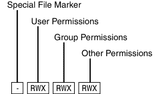
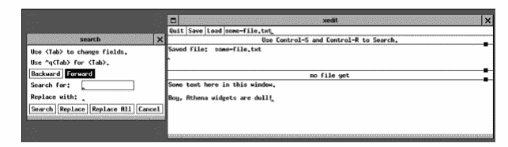
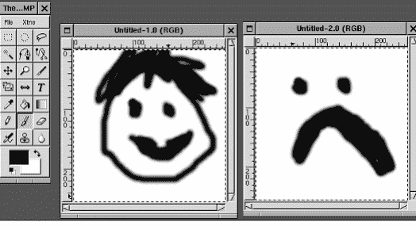
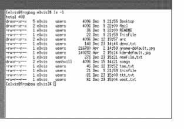
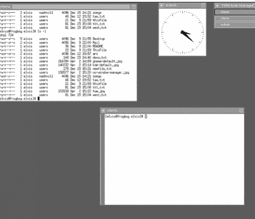
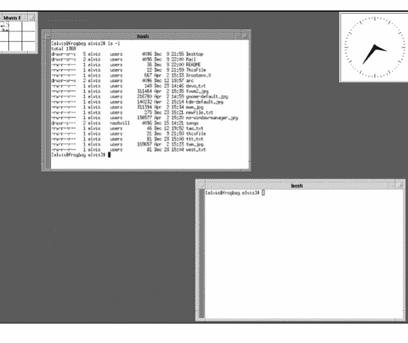
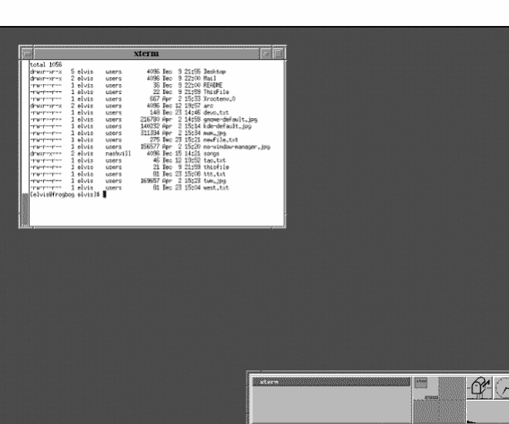
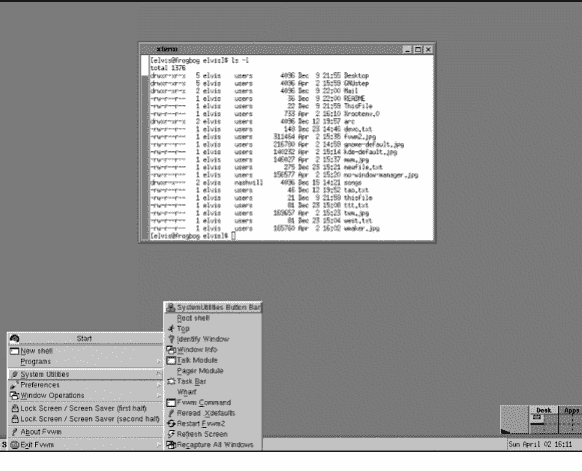
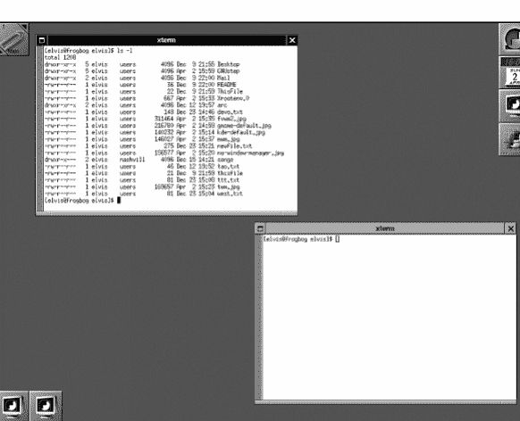
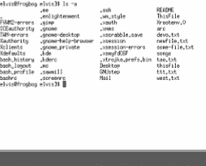

# Unix 入门指南

副出版商：Tracy Dunkelberger

采编编辑：Katie Purdum

开发编辑：Hugh Vandivier

主编辑：Thomas F. Hayes

项目编辑：Tonya Simpson

文字编辑：Kay Levin, Mike Dietsch

索引员：Kelly Castell

校对员：Benjamin Berg

技术编辑：Andy Johnston, Scott Orr

团队协调：Vicki Harding

内页设计：Maureen McCarty

封面设计：Anne Jones

制作：Darin Crone

## 关于作者

Jon Lasser 住在马里兰州巴尔的摩，他的妻子和三只猫。职业上，Jon 从系统管理以及写作和演讲。他还是 Bastille 项目的首席协调员，该项目旨在简化安全。

## 献

给 Kathleen，她知道这是给她的。

## 致谢

尽管人们可能希望如此，但写书并不是一项孤独的努力。我要感谢 Kathleen，在我写这本书期间，她洗了比她自己份额更多的碗。还要感谢我的其他家人的鼓励和支持。感谢 Macmillan 的所有人，特别是 Katie 和 Hugh，促使我完成了计划书。感谢我的技术评审员 Scott 和 Andy。感谢 Andy，我们就如何写好一个引言进行了长时间的讨论。

许多朋友以自己的方式为这一过程做出了贡献。特别感谢 Karen 对设计的见解，感谢 Steve、Shawn 和 Jay 提了正确的问题。

感谢我在 UMBC 的所有同事，宽容我在写此书期间连续一周的缺勤，给予了支持，并一直促使我加深自己的知识。

最后，感谢周二晚上的小组和周四山步巡逻队，帮助我保持理智。

## 告诉我们你的想法！

作为本书的读者，你是我们最重要的评论家和评论者。我们重视你的意见，并想知道我们做得好的地方、可以做得更好的地方、你希望我们出版什么内容，以及任何其他愿意为我们付出的智慧建议。

作为 Que 的副出版商，我欢迎你的评论。你可以通过传真、电子邮件或直接写信给我，告诉我你对这本书的喜欢或不满意之处——以及我们可以做什么来增强我们的书籍。

请注意，我无法帮助你解决与本书主题相关的技术问题，由于我收到的邮件量很大，我可能无法回复每条信息。

在写信时，请务必注明本书的书名和作者，以及你的姓名和电话或传真号码。我会仔细阅读你的意见，并将其与本书的作者和编辑分享。

# 引言

## 关于此书

你现在正站在书店里，翻阅着这本书，试图决定《思考 Unix》这本书是否适合你。幸运的是，你决定阅读这本书的这一部分，所以我可以直接回答你的问题了。

## 这本书适合你吗？

首先，这本书是为具有一定计算机经验的人准备的。如果你从未用过 PC 或 Macintosh，可能有更适合你开始学习这本书的地方。我并不会从头说起。我假设你对什么是文件、什么是文件夹或子目录、在何处找到键盘和显示器以及如何开启电脑有了基本的了解。此外，这本书是写给那些畏于尝试新事物的人，以及那些偶尔会对整套系统的运作原理做出有根据的推测的人的。

这并不是那种会教你在登录提示处输入用户名、在密码提示处输入密码的书籍。（如果你现在还不知道，我这就告诉你：在登录提示处输入你的用户名，在密码提示处输入你的密码。）

## 《思考 Unix》简介

另一方面，这本书是写给那些从未用过 Unix 的人的。经验丰富的用户可能会学到一些东西，但可能应该去读其他书籍。例如，书中没有包含关于系统管理的信息，尽管我希望它能为这类知识提供良好的基础。

这本书是写给那些仔细阅读的人的。这是一本短书，我没有浪费太多空间。示例充满了有用信息，即使这些信息可能并不直接相关。例如，在第一章中我讨论了查阅文档，我使用了 `logout` 的手册页（man page）。那是书中讨论 `logout` 的唯一地方。如果你跳过了，你可能不知道如何退出你的系统！

因为这是一本很短的书，我删减了一些内容。关于“Unix 文化”的论述非常少。（是的，确实有这种东西，而且它创造了互联网。）我会带提一下；但是在它实际上影响系统运作方式时。此外，我没有涵盖应用程序：我没有讨论阅读器、Web 浏览器、电子表格或文字处理器。我所说的是关于这些程序在 Unix 上是如何运行的，或者至少应该是如何运行的。（这些人中的许多人显然表现出他们的 PC 或 Macintosh 血统，表现得不像 Unix 程序应该表现的样子。）

这本书的另一个特点是提供了练习题。虽然任何东西都无法实践经验，但练习题能让你找到一种判断自己对某个话题理解程度的方法，并决定是否需要重读该章节，甚至向朋友寻求帮助。我建议，如果你已经认识一位 Unix 大师，就用大量的巧克力、茶、奶酪或她最喜欢的饮料去贿赂她。许多 Unix 人士都是微型啤酒的狂热分子。（免责声明：我是一个专业的 Unix 大师，我既喜欢巧克力也喜欢好啤酒，所以我在这个问题上可能有一点偏见。）

最后，如果你没有幽默感，这本书可能不适合你。如果你在这一章节中一次笑都没有露过，那么我们可能就合不来。（当然，你并不需要觉得每一个笑话都好笑，但书中的其他部分都遵循这些大体路线。）我使用了有趣的命令和文件名，有时是为了说明观点，但也是为了让自己保持兴趣。

## 本书的方法

Unix 之于 Windows 和 Mac OS 等操作系统的不同在于，它是“深层”的：在表面用户界面之外，蕴含着丰富的功能和力量，这是很少其他系统能比拟的。这种丰富性的代价是有很多东西要学。

由于这种深度，这本书对待 Unix 的方法是高层次的概念视角。很多计算机书籍，尤其是关于 Unix 的书籍，采用的是我所认为的“词汇表”方法。也就是说，它们致力于教授大量的单个命令，通常带有一种某种程度上有用的分类方案——例如，“处理目录的命令”或“处理文件的命令”。这些书籍就像是游客的词汇表，帮助外国人穿过一个他们甚至无法希望理解的地方。

相比之下，这种方法更像外语教材：与其集中于预设的陈述，不如你将学习如何“思考”和“说”Unix。我的意思是，你将学习解决 Unix 设计上要解决的问题，而不仅仅是胡乱。你将学习操作系统的逻辑结构——如果可以的话，那就是它的语法。我的目标不仅仅是让你习惯于操作 Unix 提示符，还为了让你在学习书中未讨论的新命令时感到如自在，最重要的一点是，学会组合多个命令来实现特定的目标。

正如此，《思考 Unix》的第一章专门留给了 Unix 文档。如果你想成为该系统的熟练用户，学会查阅操作系统是必要的。因为这种关注，《思考 Unix》没有用一个描述数百个 Unix 命令的附录来增加你的负担。相反，你将学会直接从系统本身获取信息。

由于 Unix 是一个深层系统，可以一次学一点点。通常，你不知道的东西并不会干扰你正在做的事。学习足够让你舒适地导航的知识，然后回来学习更多。在书中，我涵盖了我不熟悉的 Unix 内容，而我已经在专业领域使用 Unix 六六年了。

这种学习 Unix 的方法也有缺点。最主要的缺点是，在学习过程的任何一点都缺乏必要的知识。这是任何对复杂系统的线性学习方法的结果：很少可能从零开始并仅根据所学到的内容继续下去。你可能会发现自己需要一些我尚未涵盖的内容，但没关系；你以后会搞定它的。

## 参考平台

参考平台——即测试示例的机器——是一个 Linux 机器。Shell 是解释命令并允许用户与系统交互的程序。Unix 上有很多 Shell 可用：Korn Shell 我使用 `pdksh`，对于 C Shell 我使用 `tsh`。选择这种平台不是因为 Linux 比其他任何版本“更好”，仅仅是因为它可用。因为它们是我使用的，所以我倾向于提供来自 Solaris 2.6 和 Irix 6.5 的示例。

作为朋友的副本，我还是不会告诉你的，因为那样你可能就不会去读这本书了，而我不希望那样。

简单来说，这些是非常小——我是真的**非常小**——的计算机。

事实上，Unix 上的计算机诞生时（如果你非要问的话，是一台 PDP-7）在那个时代就已经很小了。编写它的人（包括肯·汤普森和丹尼斯·里奇等很多人）是在离开 Multics 项目后编写的，而 Multics 运行在规模得多的计算机上。由于资源有限，Unix 程序必须很小。与 Windows 或 Macintosh 上的大多数现代应用程序不同，你不需要一个能做很多事情的程序——例如，一个典型的 WYSIWY 字处理器——而是许多较小的程序，每个程序只做一件事。其中一个目标是让程序尽可能小，以便它们能装进内存。磁盘空间极其稀缺，因此所有内容都尽可能小，包括程序名。当时（以及现在）一种常见的 Unix 惯例是从命令名称删除元音以节省空间。如果你使用系统这种方法，这恰好也能节省大量的打字量。

开发初期的几年内做出的决定塑造了 Unix 解决问题的方法。主要的后果是“小程序”的概念，每个程序功能有限，但可以通过各种组合组合在一起来产生结果。这种哲学通常被称为“工具箱方法”（toolbox approach），而理解这一点是我建议“Unix 可以像学习语言一样来学习”的关键。

由于有大量的小命令，而且核心思想是将这些命令组合以获得你想要的结果，因此你需要一种连接它们的方法。这本书介绍的就是这些连接：它们是什么、如何工作，以及如何将几条命令串联成 Unix 句子。当你学会了组合句子，并开始组合相当于整段话长度的命令时，你就开始“用 Unix 方式思考”（Think Unix）。

### Unix 概念

- Unix 文档 1
- 文件与进程 2
- 重定向与管道 3
- 网络 4
- vi、配置文件与正则表达式 5

| 硬链接 | 软链接 | 重定向与我的重定向控制 | 名称查找 | 例程 | vi 与正则表达式 | 文件名读取 | 邮件通配符对比正则表达式 | 命令行内编辑 | 历史记录 | 控制变量与引用 | 条件执行 | WHILE 和 UNTIL 循环 | 别名 | 组件与工具包 | 配置 X PE | 所有权用户与组 | HARE | 软链接 | 重定向与管道重定向 | 标准错误 | 名称查找 | 路由读取 MA | vi 与正则表达式 | 文件名 GLC | 对比正则表达式 | 交互式命令行 | 历史替换 | 业作业控制变量 | 引用条件执行 | WHILE A |

## Unix 文档

我一直认为，在过程中学会解决问题比在开始时就知道一大堆东西更重要。因此，你能学到的最重要的事情就是学会学习。这一章是关于 Unix 文档的，因此也是关于你如何自学。

Man pages（“manual pages”的缩写）在很大程度上是 Unix 系统上的标准文档。它们是 Unix 上第一种在线文档，并且仍然是最常见的类型。新的格式（如 GNU Info 和网页）正变得越来越重要，但即使这些格式也倾向于与经典的 Unix 页面共享几种惯例。

先给出几句警告。

### 警告事项

Man pages 最初是由 Unix 开发者为 Unix 开发者编写的，它们仍然需要由程序员来编写，这意味着它们也是为程序员编写的（你认识多少个能和普通人交流的程序员？这个数字和你能为普通人写代码的程序员数量应该差不多）。此外，编写文档是一个枯燥、耗时的过程（而且比编程没趣——至少如果你是程序员的话），文档通常是最后才出来的……如果真的出来的话。

结果，大量的 man pages 处于不同程度的文档缺失状态。有些程序的 man pages 对普通用户来说太晦涩了。更多程序的 man pages 已经过时。另一些 man pages 直接是错误的，而且令人震惊的是，许多第三方软件自带的文档（无论 man pages 或其他）极度不标准——如果软件作者真的懒得去写文档的话。

尽管如此，你需要学习如何阅读 man pages。当文档是唯一的选择时，它仍然是最好的起点。虽然你不学这些东西也能凑过日子，但这样做等异于在向你的 Unix 导师寻求帮助。导师对许多用户问题最常见的回答是 RTFM：Read The "Fine" Manual（阅读那本“好的”手册。好吧，大多数人在心里会用另一个词替换掉 fine，但你懂其中的意思）。

### 阅读 man pages

要理解 man pages，你必须先看到它们。你必须学会的第一条命令是 `man`，它是阅读 man pages 的标准工具。还有其他可能更好的工具，但 `man` 仍然是最重要的。在最简单的形式下，你可以通过提示符输入 `man ManPageIWantToRead` 来显示一个 man page。

### Unix 文档第 1 章

可能第二个重要的学习命令是 `logout`，因为如果你在完成后没有注销系统，任何人都可以读取并发送你的文件。这书介绍的就是这些连接：它们是什么、如何工作，以及如何将几条命令串联成 Unix 句子。当你学会了组合句子，并开始组合相当于整段话长度的命令时，你就开始“用 Unix 方式思考”。

### 第一部分

### Unix 概念

尽管在这种情况下并不显而易见，但摘要（synopsis）是页面最重要的部分。对于 `logout` 命令来说，没有可以应用于该命令的修符。名称（name）、摘要（synopsis）和描述（description）出现在几乎每个页面上。其他常见部分包括文件（FILE），列出了命令使用或引用的文件，以及作者（AUTHOR），列出了负责方的姓名和电子邮件地址。有时你会看到漏洞（BUGS），列出了命令已知问题。偶尔会有历史（HISTORY），它可能会解释为什么这样做，或者描述它与旧版本命令有何不同。

Unix 手册分为十部分。这些部分编号为一到九，加上一个“n”部分。对于非程序员来说，重要的部分是第一和第六部分。第一部分包含了广义定义的用户命令，如 `logout`、`login` 和 `pass`。第六部分提供了许多游戏的文档（事实上，很多游戏的页面在第一部分，但这是我警告过的关于文档松散的许多案例之一）。它包含了配置文件格式的描述，例如邮件读取器的配置。当你知道如何配置特定的应用程序或服务时，可能会发现这些很有用。

程序员可能对手册的第二和第三部分感兴趣，它们分别包含系统调用（system calls）和子程序（subroutines）。其他手册部分在不同的 Unix 版本之间有所不同，但通常保留给系统级命令和信息。

### 术语：参数与选项

在讨论语法之前，我需要花点讨论参数（arguments）和选项（options）。参数是输入命令行末尾的内容，通常是文件名或命令将要作用的文本：

```
[ jon@frogbog jon$ command YesItIsNoIsnt
```

从开始反向到美元符号之前的这一部分，是我在家里系统上设置的命令提示符。（jon 是我的用户名，frogbog 是机器名称，jon 也是我当前所在的目录。）我正在运行一个名为 `command` 的命令，它有两个参数：`YesIts` 和 `NoIts`。也许这些参数就是我目录中的文件名。

选项（Option）是用户在命令行中输入的内容，通常位于命令名称和其参数之间。选项通常会更改程序的功能，告诉它以默认以外的方式运行。选项通常用一个或两个连字符表示：

```
[ jon@frogbog jen ] command --red --blue YesIts NoIts
```

`red` 和 `blue` 是选项，可能会改变命令输出中文本的颜色。它们都是长选项（long options），即以两个连字符开头的单词。相对来说，长选项是 Unix 世界中的新事物。你可以发现它们是新的，因为它们更看重功能而非简洁。有些人正因为这个原因而倾向于使用长选项。

短选项（short options）通常使用单个连字符表示，许多程序允许将它们组合在一起。假设短选项、长选项以及允许组合的选项都可以组合，那么命令可以写为 `-r YesIts` 或 `command -rb YesIts`。短选项在 Unix 世界非常丰富，许多带有长选项的程序也支持具有相同功能的短选项，以方便大家。

### 语法

摘要（SYNOPSIS）列出了所检查命令的所有形式。现在来看一个稍微复杂的摘要，以及它的描述部分：

SYNOPSIS

```
passwd [-l] [-u] [-d] [-S] username
```

DESCRIPTION（描述）

`passwd` 命令用于更新用户密码。

-l 此选项允许系统管理员锁定指定的用户的账户。

-u 这是 `-l` 的反向，通过删除前缀来解锁账户。默认情况下，`passwd` 会拒绝创建无密码账户（它不会解锁仅带有 "!" 的账户）。强制选项 `-f` 将覆盖此保护机制。

### Unix 概念

-d 这是一个禁用账户密码的快速方法。它会将指定的账户设置为无密码。仅 root 用户可用。

-S 这将输出一个关于给定账户密码状态的简短屏幕信息。仅 root 用户可用。

在命令语法中，**括号括的参数和选项是可选的。** *passwd* 有好几个选项：`-u`、`-d` 和 `-S`。那组选项是什么？它们无疑是可选的，但其中还有另一个选项：`-f` 不是一个有效选项，`-u` 也被使用。但这些选项对于除系统管理员以外的用户实际上都是不可用的。（为什么要检查它们？因为你需要阅读这些页面，这就是原因。）

你还应该注意可选参数是：你不应该在 `passwd` 命令的末尾输入 `username` 这个词。相反，`username` 是你的数据的占位符。也许你想更改你朋友的密码；在这种情况下，你可以输入 `passwd bob`，如果你是以系统管理员身份登录的，系统会提示你输入 Bob 的密码。如果 Alice 请求你更改她的密码，你可以输入 `passwd alice` 来更改她的密码。只有当你实际上确实有一个名字名为 `username` 的用户时，你才会执行 `passwd username`，你可能只是刻意为之，或者是在计算机书籍中编写示例。

通常情况下，变量在页面中通过强调方式的变化来区分：根据你的配置，它们被下划线、加粗、斜体或显示不同的颜色。然而，由于编写主页面的人并不完美，或者因为他们没有读这一章，有时变量和参数看起来和周围文本一样。通常情况下，这会在页面的描述部分说明清楚。仔细阅读通常是有回报的。

除了括号，选项和参数还有两种常用的修饰符。省略号（称为 `...`）表示相同或相似的多个参数。例如，命令

```
cat [...]
```

显示至少一个文件，也可以显示任意数量的文件。

竖线（在 Unix 世界中称为 `|`）表示互斥的选择。例如，`rm` 命令的语法如下：

```
rm [-f|-i] file
```


它使用 `-f` 或 `-i` 参数来删除文件，但不可兼得。新用户希望使用 `-i` 参数在删除每个文件之前进行确认。相比之下，`-f` 选项强制删除，无需询问。（这是 Unix 的默认行为。）

## 更多阅读页面

学习最好的方法是实践。本着这种精神，本节包含了两个典型的 man 页面拆解和解释。如果你确定自己自己在做什么，建议直接跳到下一节的练习题。如果你那些题做得不好，请回来尝试这些。

```
echo(1)	FSF	ECHO(1)

NAME
echo - 显示一行文本

SYNOPSIS
echo [OPTION]... [STRING]...

DESCRIPTION
将 STRING(s) 输出到标准输出。

-n 不输出末尾换行符

-e 解析下面列出的斜杠转义字符

-E 禁用对 STRING 中序列的解析

-help 显示此帮助并退出（应单独使用）
-version 输出版本信息并退出（应单独使用）

在没有 -E 的情况下，以下序列会被识别并插值：

NNN  ASCII 码为 NNN（八进制）的字符
\    反斜杠
\n   警报（BEL）
\b   退格
```

\c 抑制末尾换行符

\f 分页

\n 换行

\r 回车

\t 水平制表符

\v 垂直制表符

+2 是的，强制选项是可选的。你为什么问？
3. 当然 Bob 的账户名是 bob。
4. 实际上，`cat` 不需要任何参数，但正如我之前提到的，这些示例都经过了大幅度的简化。

# 第一部分 Unix 概念

单个参数指定要显示的年份（1 - 9999）；请注意年份必须完整指定：`cal 89` 不会显示 1989 年的日历。两个参数表示月份（1 - 12）和年份。如果不指定任何参数，则显示当前月的日历。

一年从 1 月 1 日开始。

假设格列哥改历改革发生在 1752 年 9 月 3 日。改革之后的 10 天被删除了，该月的日历略显异常。

## 历史介绍

`cal` 出于第 6 版 AT&T UNIX。

头部和名称非常浅俗易懂：`cal` 是一个显示日历的用户工具。它虽然有历史介绍，但并没有提供多少信息。（嘿，这是他的故事；你想看什么？）

摘要（SYNOPSIS）显示看起来像单个选项 `-mj`，但如果你阅读描述，很清楚地看出这是三个独立的选项。这是怎么回事？在许多实用程序中，短选项可以通过单个连字符在命令行上组合在一起。（显然，这对于长选项效果并不好，这可能就是为什么你不能这样做的原因。）至少有一个实用程序可以在不使用连字符的情况下组合选项，但那是我稍后提到的例外。

描述看起来足够简单，但如果你仔细观察，摘要和描述之间似乎存在冲突。再看一遍：

### 摘要

```
cal [-mj] [month [year]]
```

### 描述

- `-J` 显示儒略日期（从 1 月 1 日开始编号，从 1 开始）
- `-y` 显示当前年份的日历。

单个参数指定要显示的年份（1 - 9999）；请注意年份必须完整指定：`cal 89` 不会显示 1989 年的日历。两个参数表示月份（1 - 12）和年份。如果不指定任何参数，则显示当前月的日历。

一年从 1 月 1 日开始。

## Unix 文档第 1 章 19

如果你观察 `cal` 命令行上的参数，单个参数应该是月份，两个参数应该是月份和年份。然而，描述暗示只有一个参数（他们使用了“参数”一词，但它就是最后的那个东西，不是吗？）会代表年份。

这显然是一个页面令人困惑或误导的例子，取决于你是谁以及你如何阅读。现在尝试两种方式运行命令，看看发生了什么：

```
[ jon@frogbog jon ] cal 12
```

| 一月 | 二月 | 三月 |
| Su Mo We Th Fr Sa | Su Mo We Th Fr Sa | Su Mo We Th Fr Sa |
| | 2 | 1 2 3 4 5 6 | 1 2 3 4 5 |
| 3 4 5 6 7 8 9 | 7 8 9 10 11 12 | 6 7 8 9 10 11 12 |
| 10 11 12 13 14 15 | 14 15 16 17 18 19 20 | 13 14 15 16 17 18 19 |
| 17 18 19 20 21 22 23 | 21 22 23 24 25 26 27 | 20 21 22 23 24 25 26 |
| 24 25 26 27 28 29 30 | 28 29 | 27 28 29 30 31 |
| 31 | | |

| 十月 | 十一月 | 十二月 |
| Su Mo We Th Fr Sa | Su Mo We Th Fr Sa | Su Mo We Th Fr Sa |
| | 1 | 1 2 3 |
| 2 3 4 5 6 7 8 | 6 7 8 9 10 11 12 | 4 5 6 7 8 9 10 |
| 9 10 11 12 13 14 15 | 13 14 15 16 17 18 19 | 11 12 13 14 15 16 17 |
| 16 17 18 19 20 21 22 | 20 21 22 23 24 25 26 | 18 19 20 21 22 23 24 |
| 23 24 25 26 27 28 29 | 27 28 29 30 | 25 26 27 28 29 30 31 |
| 30 | | |

这就是 1752 年看起来的样子；我不知道我的生日在周四。现在再试一次。这次我想看 1752 年的 9 月，因为描述结尾有注释。

```
[ jon@frogbog jon ] cal 12
```

| 九月 |
| Su Mo We Th Fr Sa |
| | 1 2 3 4 5 6 |
| 7 8 9 10 11 12 |
| 13 14 15 16 17 18 19 |
| 20 21 22 23 24 25 26 |
| 27 28 29 30 31 |

这就是 1752 年看起来的样子；我不知道我的生日在周四。现在再试一次。这次我想看 1752 年的 9 月，因为描述结尾有注释。如果你观察 `cal` 命令行上的参数，单个参数应该是月份，两个参数应该是月份和年份。然而，描述暗示只有一个参数（他们使用了“参数”一词，但它就是最后的那个东西，不是吗？）会代表年份。这显然是一个页面令人困惑或误导的例子，取决于你是谁以及你如何阅读。现在尝试两种方式运行命令，看看发生了什么：

```
[ jon@frogbog jon ] cal 12
```

| 一月 | 二月 | 三月 |
| Su Mo We Th Fr Sa | Su Mo We Th Fr Sa | Su Mo We Th Fr Sa |
| | 2 | 1 2 3 4 5 6 | 1 2 3 4 5 |
| 3 4 5 6 7 8 9 | 7 8 9 10 11 12 | 6 7 8 9 10 11 12 |
| 10 11 12 13 14 15 | 14 15 16 17 18 19 20 | 13 14 15 16 17 18 19 |
| 17 18 19 20 21 22 23 | 21 22 23 24 25 26 27 | 20 21 22 23 24 25 26 |
| 24 25 26 27 28 29 30 | 28 29 | 27 28 29 30 31 |
| 31 | | |

| 十月 | 十一月 | 十二月 |
| Su Mo We Th Fr Sa | Su Mo We Th Fr Sa | Su Mo We Th Fr Sa |
| | 1 | 1 2 3 |
| 2 3 4 5 6 7 8 | 6 7 8 9 10 11 12 | 4 5 6 7 8 9 10 |
| 9 10 11 12 13 14 15 | 13 14 15 16 17 18 19 | 11 12 13 14 15 16 17 |
| 16 17 18 19 20 21 22 | 20 21 22 23 24 25 26 | 18 19 20 21 22 23 24 |
| 23 24 25 26 27 28 29 | 27 28 29 30 | 25 26 27 28 29 30 31 |
| 30 | | |

这就是 1752 年看起来的样子；我不知道我的生日在周四。现在再试一次。这次我想看 1752 年的 9 月，因为描述结尾有注释。

```
[ jon@frogbog jon ] cal 12
```

| 九月 |
| Su Mo We Th Fr Sa |
| | 1 2 3 4 5 6 |
| 7 8 9 10 11 12 |
| 13 14 15 16 17 18 19 |
| 20 21 22 23 24 25 26 |
| 27 28 29 30 31 |

如果你观察 `cal` 命令行上的参数，单个参数应该是月份，两个参数应该是月份和年份。然而，描述暗示只有一个参数（他们使用了“参数”一词，但它就是最后的那个东西，不是吗？）会代表年份。

（注：OCR 文本包含重复章节和伪影。我已经清理了逻辑流。）

描述看起来足够简单，但如果你仔细观察，摘要和描述之间似乎存在冲突。再看一遍：

### 摘要

```
cal [-mj] [month [year]]
```


## 描述

- `-J` 显示儒略日期（从 1 月 1 日开始编号，从 1 开始）
- `-y` 显示当前年份的日历。

单个参数指定要显示的年份（1 - 9999）；请注意年份必须完整指定：“`cal 89`”不会显示 1989 年的日历。两个参数表示月份（1 - 12）和年份。如果不指定任何参数，则显示当前月的日历。

一年从 1 月 1 日开始。

# 第一部分 Unix 概念

这无疑能让你快速了解 `what` 命令的作用。请注意，除非指定了 `-K` 参数，否则 `what` 会搜索所有的手册章节。

搜索许多页面的最后一种方法是使用 `man -K`（注意是大大写的 K，而不是小写的 k）。`man -K` 不仅搜索短描述，还会搜索你系统上找到的每一个页面的全部文本。这可能花费很长时间，特别是在页面较多或磁盘较慢的系统上，有时这是找到你所搜寻信息的唯一方法。

如果你选择在你的 XWindow 系统中使用 `what` 命令来查看许多页面，你就可以用美观的比例字体阅读文档。它具有搜索功能，允许你搜索当前页面或通过 `apropos` 搜索（而不是通过 `man`）进行搜索，并且你可能同时显示多个页面。遗憾的是，`man` 缺少一个很棒的功能：无法在手册的“See Also”（另参）部分点击跳转到另一个页面，也无法点击 `apropos` 搜索返回的任何页面。尽管如此，相当熟练的 Unix 用户可以深度自定义 `man`，这可能值得一看。

GNU Info 是另一种非常常见的软件文档格式，特别是 GNU Info 是一种超文本系统，本质上类似于万维网。每个系统都有一个包含系统上所有 GNU 页面的中央目录，你可以在其中搜索你的查询。

读取 GNU 文档的标准工具是 `info`。它运行在终端控制台中，因此你只需要在终端会话中输入 `info` 即可启动它。它内置了帮助和教程，因此尽管其按键操作有些不直观，但导航起来应该相对容易。要查看特定的节点（这是 Info 的术语，等同于 `man` 页面或 Web 页面），你可以输入 `info commandname`（命令名）。

当然，许多人用纯文本编写文档的大部分内容，这种方式的优点是易于编写且易于阅读，不需要复杂的工具。读取 ASCII 文本的三种常见方式是 `cat`、`more` 和 `less`。这每一个都可以通过在命令后跟文件名来运行。

`cat` 是三者中最简单的：它只是将文本输出到屏幕上。这适用于短文件，但较长的文件可能会超出屏幕或超出你的回滚缓冲区（如果你有的话）。`more` 每次显示一页文本，在每一屏后提示你按键。

- 8. GNU 项目是一群人，他们克隆了大部分标准的 Unix 工具。GNU 工具以及许多管理员在他们的系统上构建 GNU 工具，以便在任何地方都有标准工具。（其他管理员声称 GNU 工具劣于原生工具，并拒绝构建这些工具。这本质上是一场宗教冲突，类似于 Mac 与 Windows 的对立。Unix 充满了宗教冲突；这是成为一个深层系统的一部分，这种系统已经在其周围积淀了一层文化。）

- 9. 对我来说，至少这不那么直观。

某些 Unix 系统有一个名为 `pg` 的命令，其功能与基本上相同，但操作方式略有不同。其他较新的 Unix 系统可能有一个名为 `pag` 的命令，它并不能帮助你阅读 `man` 页面。`more` 通常被认为至少和 `pg` 一样灵活，至少在它最近的版本中是如此。（正如 Windows 和 Mac 程序一样，Unix 程序也有不同的版本。然而，这些 Unix 程序可能已经有30 年的历史了。）除非你真的知道自己在做什么，否则我建议使用 `less`。

大多数系统可用的最先进（因此也是最复杂）的纯文本阅读器是 `less`。它允许你在文本文件中前后滚动，并内置了各种搜索功能。空格键逐页向下翻页文档，而 `b` 键反向翻页文档。（在某些系统上，PageUp 和 PageDown 键被映射到相同的功能。）要退出 `less`，只需使用字母 `q`。`h` 会调出一个列出所有按键的帮助菜单，如果你对 `less` 的某些高级功能感兴趣，其 `man` 页面非常有参考价值。

你想阅读的文本文件在哪里？无疑散布在整个系统的目录中。通常，从互联网下载的程序其 `README` 文件或其他文档会与程序一同提供。管理员会将这些文件放在存放的地方，通常是 `/usr/doc`、`/usr/src/`、`/usr/local/` 或 `/usr/local/src`。许多 Linux 系统将单个程序的文档放在 `/usr/doc/`；每个程序都有一个以包名和版本号命名的子目录，例如 `/usr/doc/gzip-1.2.4`。（如果你不理解这些目录，不用担心；我在第2章会讨论它们。）

鉴于互联网的普及，许多程序员将他们的文档放在了万维网上，甚至存储在你系统本地的 HTML 文件中。找到这些文档的最佳方法通常是你最喜欢的 Web 搜索（Yahoo! 仍然是我的最爱）或者我用来搜索的 Google。如果它在互联网上，一个编写得好的查询应该能让你找到你需要的文档。（如果它存储在你的系统本地，HTML 文档可能与纯文本手册位于相同的地方。）

如果你有 Web 浏览器，最好用你最喜欢的浏览器来阅读这些文档。如果你被困在文本控制台中，Unix 上最最好（也几乎是唯一！）基于文本的浏览器是 `lynx`。`lynx` 可以在不带任何选项的情况下开始浏览网页，也可以带本地可访问的文件名运行。

同样地，互联网上有大量关于 Unix 软件的信息。通常，获取特定程序或环境信息的最佳资源是 FAQ：针对特定软件的“常见问题解答”。传统上，FAQ 会定期发布到该软件相应的公告组中，希望人们阅读 FAQ 而不是反复提问相同的问题。（由于大量垃圾邮件发布到公告组（这种情况目前有所改善），许多软件包现在有邮件列表。邮件列表会将信息发送到你的收件箱，而不是强迫你在公告组获取信息。由于主题较小，许多软件包都有邮件列表。）只要我涉及到这个话题，公告组通常是特定软件信息的良好来源。公告组按主题树状组织。`comp.os.linux` 包含 `comp.os.linux.hardware`（与硬件相关的问题）、`comp.os.linux.advocacy`（关于说服人们切换或改进 Linux 形象的讨论）等。大多数 Unix 组位于 `comp.os.unix` 层级结构中；许多这些组都有 FAQ。

如果你使用 Netscape 浏览或阅读邮件，你也可以用它来阅读公告组。（具体方法取决于你使用哪个版本的 Netscape。）控制台公告组阅读器包括 `tin`、`tern`、`sir` 以及几十种其他。`tin` 和 `tern` 通常被认为更简单用，但这种观点并不通用。`xrn` 是一个用于 X 系统的阅读器，但我认识任何使用它而非 Netscape 或终端公告组阅读的人。

如果你的系统安装了 GNOME 或 KDE，你还有其他阅读文档的选择。`gnome-help-browser` 是一个可以读取多种格式的 Web 浏览器。它可以读取 GNOME 帮助、GNU Info 文件和标准的 Unix 页面。以浏览器格式阅读 GNU Info 文件是明智且非常有用的；此外，在阅读 man 页面时，其他列出的 man 页面是可以点击的链接！这使得在相关页面之间跳转变得简单得多。尽管 `gnome-help-browser` 内置了 `what` 命令，但它既没有 `apropos` 也没有

# Unix 文档第一章

更通用的搜索工具。这种缺失使得它本可以成为 Unix 最完整的文档阅读器，但这造成了遗憾。

`kdehelp` 在根本上与 `gnome-help-browser` 相似，只是多了一个搜索功能。你可以阅读页面、KDE 基于 HTML 的文档以及 GNU Info 文件。它能生成精美且可点击的小型链接，并使用颜色和字体进行强调。你可以搜索当前正在查看的文档，也可以搜索 KDE 基于 HTML 的文档、页面或两者兼顾。（在本书期间，GNU Info 文件尚无法搜索。）它与 `gnome-help-browser` 并没有特别区别，但如果你的系统配备了这些工具，可能只安装了其中之一。

## 特定平台的文档

在 20 世纪 80 年代，每个商用 Unix 供应商都尽力让自己的版本与其他所有 Unix 版本“区分”开来。（当然，客户只想要一个能好用的 Unix，但没人问过他们。）这场斗争的结果之一是每个供应商都至少提供一种非标准的文档格式，该格式中包含了针对特定版本的补充信息。

了解这些格式是什么以及在哪里可以找到它们是有帮助的，但如果你知道管理员把它们放在了哪里，那么检查系统的官方文档会更有帮助。

如今，万维网正迅速成为寻找 Unix 文档的标准场所，尽管某些供应商仍在抵制。我无法在本节中涵盖所有的 Unix 平台，因此将介绍一些常见的版本。此外，公司有在网站上移动文件的坏习惯，因此单个 URL 可能会过期。一如既往，请向你的系统管理员或供应商获取更多信息。

## Linux

幸运的是，Linux 的流行与万维网同时开始，因此所有 Linux 特定的文档都可以在网上找到¹¹。所有 Linux 文档都以几种不同的文件格式提供——包括 HTML、PostScript、纯文本和 DVI¹——以及用于生成所有其他格式的源代码。所有这些文档都是 Linux 文档项目（LDP）的一部分。LDP 主页地址为 http://linux.org/，并有指向手册（manuals）和 HOWDocs 的链接。

10. 这比其他 Unix 供应商多得多，你会发现的；客户终于开始得到他们想要的东西。

11. TeX 排版程序的原生输出，这是一个运行在许多 Unix 机器上的强大排版系统。

## Unix 概念

HOWTO 是大部分有用 Linux 文档的所在地：这些文件不是由软件编写人员编写，而是由普通用户编写，他们仅仅记录了如何解决自己的问题。这些文件的好处是，它们提供了解决问题的有用且直接的信息，而没有像这类书那样充斥着理论废话。坏处是，它们在你的系统上的运行效果并不总是像在作者系统上那样好，而且它们通常缺乏为了让你理解如何调整这些程序所必需的理论框架。此外，相当数量的 HOWTO 过时或并不完整；HOWTO 的维护者都是志愿者，他们只是试图帮助社区并分享他们的知识。

HOWTO 分为两种尺寸：普通（regular）和微型（mini）。微型 HOWTO 只是比普通版短，并且可能只以纯文本或 HTML 形式存在。它们在结构上通常是典型的计算机手册，但仅针对单一主题；大多数篇幅在几到几十页之间，有些则长达数百页。除了可以在网上查看外，许多 HOWTO 还允许你将它们安装到本地¹。

## Solaris

Sun 已经开悟，所有当前文档现在都可以万维网的 http://docs.sun.com/ 获取，包括 Solaris 2.4、更新的操作系统以及所有 UltraSpar 硬件。旧的 Solaris 架构手册似乎没有出现在网上。大多数手册可以通过 Adobe PDF 文件打印，该集合组织良好，且搜索功能似乎运行良好。除非你拥有较旧的 Sun 产品，否则我强烈建议坚持基于 Web 的文档，因为它们看起来比 Sun 的在线文档更好。

## AIX

与 Sun 和 Linux 一样，大多数当前的 AIX 文档可以从 IBM 网站上获取。主页位于 http://www.rs6000.ibm.com/library/，随系统附的手册可以在 http://www.rs6000.ibm.com/resource/hardware_docs/index.html 以 HTML 和 PDF 格式获取。搜索引擎尚可，但并非统一优秀，我觉得它比 Sun 的稍微直观一些。

12. 在 Red Hat Linux 系统上，如果你安装了它们，它们应该位于 `/usr/doc/HOWTO`。其他 Linux 系统也应该在类似的位置有它们。

## IRIX

SGI 提供的 Web文档位于 http://techpubs.sgi.com/，并且正在迅速改进。所有支持的操作系统（在本书期间为 Irix 5.3 和 6.2–6）都有手册，硬件书籍也是如此。手册很大程度上只以 PDF 格式提供，但所有主页都是 HTML 格式，所有的发行说明也是如此。

SGI 在许多程序的发行说明中包含了大量的文档。这些说明可以在他们的网站上查看或通过他们的 `renotes (1)` 查看。SGI 在在线文档方面一直表现出色，所有产品手册通常可以通过 `insight (1)` 图形手册查看器获取。`insight` 和网站的搜索功能都很好，但系统的 `renotes` 无法汇总。

## 建议练习

建议的练习题：

- 1. 在终端，输入 `info` 查看其是否已安装。
- 2. 如果你以前接触过计算机，你可能会称它们为“文档”甚至“应用程序”，但 Unix 将文件视为一种方式。
- 3. 如果你在终端，输入 `info` 查看其是否已安装。
- 4. 如果你以前接触过计算机，你可能会称它们为“文档”甚至“应用程序”，但 Unix 将文件视为一种方式。
- 5. 定位文件。在终端，输入 `info` 查看其是否已安装。

当我说文件看起来像字节的“流”时，我的意思是存储在文件中的数据是顺序排列的：一个字节接一个字节，直到整个文件长度。对文件的搜索可以（某些限制，我们将会看到）向前或向后，永远不会横向，并以字节为单位。无论你的 CPU 是 32 位还是 64 位，Unix 都以位组衡量距离。

# 第2章 文件与进程

这在处理文本文件时具有明显的优势：将文件向前移动一个单位，你不可避免地就在文件中多移动了一个字符.^4

当然，我说的是“Unix 将所有文件视为字节流”，而不是 Unix 仅将所有文件视为字节流。这是因为程序可以叠加某种结构，通过拒绝操作不符合程序预期格式的文件来体现这一点。你的文字处理器只读取它认为可能像字处理文档的文件；对于任何其他格式的文件，它会会你它它无法打开该文件。

然而，大多数 Unix 工具只将文件视为字节流。一个完美的例子是 `cat`，它读取任何要求它读取的内容并将其打印出来。（`cat` 是 `concatenate` 连接的缩写，因为它一个接一个地打印它们。这就是在合并它们，只要你可以合并字节流的话。）

假设 elvis 有一个名为 `tao.txt`^5 的文件，其中包含一份简短的中国哲学家列表，他想查看一下：

```
elvis@frog elvis $ cat tao.txt
老子
庄子
孔子
孟子
王弼
```

这非常直接：作者按照它们在文件中出现的顺序列出。每个字符都从文件中被读取，这股字节流以相同的顺序显示在屏幕上。现在假设 elvis 有第二个名为 `things.txt` 的文件，包含了西方哲学家，他想同时查看这两组：

```
elvis@frog elvis $ cat tao.txt things.txt
老子
庄子
孔子
孟子
王弼
苏格拉拉
柏拉图
亚里士士德
赫拉克利特
普洛提丁
```

^ 对于非拉丁字母编码的文件不成立，但对于标准的 ASCII 文本文件是成立。

^ 可以命名的文件并不是真实的文件。

## 文件名

当然，如果他输入 `cat things.txt tao.txt`，输出将是：

```
苏格拉拉
柏拉图
亚里士士德
赫拉克利特
普洛提丁
老子
庄子
孔子
孟子
王弼
```

毕竟文件只是字节流。`cat` 命令只是连接两个文件或字节流。当文件顺序反转时，它们的打印顺序也之反转。顺序数据，嗯，当然是有顺序的。

你可能注意到两个文件名都以 `.txt` 结尾。如果你习惯了 Windows，这可能会让你惊讶：大多数 Windows 文件名都有扩展名。（嘿，旧的 DOS 机器文件名只有八个字符，扩展名还有三个。）与 Windows 不同，但与 Mac 类似，扩展名在程度上是可选的。系统并没有用它们执行任何重要操作；它们的存在是为了用户的方便。为什么 elvis 要费心让这些文件名以 `.txt` 结尾呢？因为知道如何读取文件是有用的。你并不受这些规则限制，但人们制定这些惯例是因为它们有用。某些 Unix 程序会强制你使用特定的扩展名，但大多数情况下这些默认值是可以覆盖的。

Unix 文件名比 Windows 或 Mac 上的更灵活：在大多数现代 Unix 系统上，它们可以包含很多字符，并且包含除正斜杠以外的任何字符。我个人建议坚持使用字母、数字、点、连字符和下划线。大多数其他字符都有特殊含义，必须用反斜杠进行转义，正如我们在第 1 章探索 `echo` 时所做。旧的 Unix 系统对文件名有进一步限制；请查看你的手册。

文件名也是区分大小大小的：大写字母和小写字母被完全对待。`ThisFile` 与 `thisfile` 不同。当对文件名进行排序时，大写字母出现在小写字母之前。包含重要信息的文件（如 `README` 文件或其他文档）通常以大写字母开头，以便查找。

## 讨论：Unix 作为多用户操作系统

从诞生起，Unix 就是一个多任务、多用户操作系统；它的设计初衷就是为了让多个人同时使用。一本针对 PC 或 Mac 编写的书现在会告诉你，这是因为硬件很昂贵，而多用户是分散昂贵投资的一种方式。此外，某种书籍会告诉你，在交互式系统上（用户与计算机进行实时交互，而不是发送一大打孔卡到机房并在稍后获取输出），单个用户占满机器容量的情况很罕见，在拥有多个用户的系统上运行要有效得多。

当然，这不是一本以 Mac 或 PC 为导向的书，所以我不需要告诉你这一点。相反，我可以告诉你，多用户系统比单用户系统具有广泛得适用性。在家庭中，如果妈妈的财务记录能安全地存远离小子的作业，那就太好了；如果小子读不了姐姐的日记，那也太好了。如果每个人的桌面上都有自己的图标，而不会弄乱爸爸的文件系统，那也太好了。只有多用户系统才能有效地做到这些。

在多任务方面，这在 PC 世界中也存在（尽管实现得很糟糕），原因与它在 Unix 世界存在的原因完全相同。此外，在一个高度网络化的世界，如果你可以在处理的同时通过网络发送或复制文件，那就很好了。或者在服务器世界中，一台计算机可以同时作为 Web 服务器、文件服务器和电子邮件服务器。

有效的多用户系统显然需要为每个人的文件和设置提供独立区域，以区分是谁。后者，即身份验证机制，是 Unix 在你使用之前要求用户名和密码的原因。

## 回到我们的展示（回到正题）

现在 elvis 有一个名为 `tao.txt` 的文件，其中包含一份简短的中国哲学家列表，他想查看一下：

```
elvis@frog elvis $ cat tao.txt
老子
庄子
孔子
孟子
王弼
```

这非常直接：作者按照它们在文件中出现的顺序列出。每个字符都从文件中被读取，这股字节流以相同的顺序显示在屏幕上。现在假设 elvis 有第二个名为 `things.txt` 的文件，包含了西方哲学家，他想同时查看这两组：

```
elvis@frog elvis $ cat tao.txt things.txt
老子
庄子
孔子
孟子
王弼
苏格拉拉
柏拉图
亚里士士德
赫拉克利特
普洛提丁
```

当然，如果他输入 `cat things.txt tao.txt`，输出将是：

```
苏格拉拉
柏拉图
亚里士士德
赫拉克利特
普洛提丁
老子
庄子
孔子
孟子
王弼
```

毕竟文件只是字节流。`cat` 命令只是连接两个文件或字节流。当文件顺序反转时，它们的打印顺序也之反转。顺序数据，嗯，当然是有顺序的。

## 通配符

嗯，是 `things.txt` 吗？让我们看看：

```
elvis@frog elvis $ cat things.txt
苏格拉拉
柏拉图
亚里士士德
赫拉克利特
普洛提丁
```

是的，就是这样。但如果他知道文件名以 `.txt` 结尾，而只想查看这些文件呢？

如果 elvis 只能看到以 `.txt` 结尾的文件不是太好了吗？既然是 Unix，他可以：

```
elvis$ ls *.txt
```

星号 (`*`) 是一个通配符。就像老式扑克游戏中一样，通配符匹配任何内容。如果有两个通配符，两个都可以代表任何内容；同样，一个星号代表另一个。同样在扑克牌中，你可以任意数量的通配符：`*` 可以匹配 `Mail`、`ThisFile`、`things.txt` 和 `thisfile`。它不会匹配 `Desktop`、`README` 或 `tao.txt`。

与扑克牌不同，星号可以同时代表多个东西：`*.txt` 中的星号在一个实例中替换了 `tao`，在另一个实例中替换了 `things`。Unix 使用问号 `?` 代表任何单个字符：`?file` 可以匹配 `ThisFile` 和 `thisfile`，但它不会匹配 `ThisIsFile`。相比之下，问号要求在该通配符留出的空间内有内容。

Unix 还有一种常用的通配符：方括号 `[]` 可以被括号内的任何字符替换。`[Tt]hile` 将仅匹配 `ThisFile` 和 `thisfile`。（如果该目录下存在这些文件，它也会匹配 `matchFile` 和 `ThisFile`。）另一个复杂之处是，连字符分隔的两个字符可以被该 ASCII 范围内的任何字符替换。`This[A-Z]ile` 将匹配 `ThisFile`、`ThisMile`、`ThisBible` 以及 23 个文件。

## 练习题

为了逻辑上的统一性，请将一组由连字符分隔的字符范围视为单个字符。如果你能做到这一点，显然 `[A-Za-z]` 匹配所有大小写字母，而 `[0-9A-Za-z]` 匹配所有字母和数字。这将匹配 `Thisofile`、`This9ile`、`This3File` 以及任何在 `[0-9A-Za-z]` 处有单个字母或数字的字符串。

- 1. 下列哪个不是有效的 Unix 文件名：
    - firstfile.txt
    - FIRSTFILE.TXT
    - first file
    - first/file
    - firstofile

- 2. 查看名为 `stupid_answer` 的文件的适当命令行是什么？

- 3. 我该如何列出所有以小写 `g`、`h` 和 `p` 开头的文件？

- 4. 我该如何列出所有以小写 `g` 开头、中间跟任意三个字符、并以 `thy.txt` 结尾的文件？

- 5. 下列哪些文件名被 `[A-G]*ing.txt` 匹配？
    - Gagging.txt
    - Bing.xt
    - AGing.txt
    - ing.ext
    - Going.nxt

8. ASCII 字符以特定的数值模式列在图表中，这种模式是在个人电脑时代初期根据某些位级数值属性确定的，以使某些低级计算任务更简单。数字之间彼此连续，大写字母之间连续，小写字母之间也连续，但其他字符填充了数字、大写字母和小写字母之间的空隙。ASCII `A-z` 的范围不仅包括大小写字母，还包含几个额外的符号。

## 目录

即使你使用通配符快速筛选文件，使用单个目录存储文件在短时间内就会变得困难。为了应对这种困难，子目录（子目录等同于 Mac OS 文件夹）Elvis 已经在他的主目录下有了几个子目录：


$ elvis@frog $ ls -F

Desktop/ Mail/ READMEFile.txt things.thisfile

```
- `ls` 的 `-F` 选项为某些类型的文件添加特殊字符以区分它们：`/` 区分目录，`*` 标记可执行文件（换句话说，是一个程序），`@` 标记符号链接（我稍后会讨论）。`Desktop` 和 `Mail` 是操作系统创建的，用于存储某些基于 GUI 程序的信息，而 `Mail` 是为了存储 Elvis 的电子邮件而创建的。

Elvis 需要有一个存放歌曲的目录吗？他是这么想的：

```
$ elvis@frog Elvis $ mkdir songs

$ elvis@frog Elvis $ ls

Desktop READMEFile.txt things.thisfile

$ elvis@frog Elvis $ cd songs

$ elvis@frog Elvis $ ls

$ elvis@frog Elvis $
```

值得注意的是，Unix 程序往往是“沉默寡言型”（詹姆斯·迪），如果命令执行成功，它会返回最少的输出。因此，`mkdir` 命令（创建目录）和 `cd` 命令（进入目录）不会返回任何输出。

如果 Elvis 尝试进入一个不存在的目录，他会看到错误消息：

```
$ elvis@frog songs $ cd old-songs

bash: old-songs: No such file or directory
```

> 当然，有一个关于 Macintosh 用户的的故事，她创建的每一个文件都直接放在桌面上。那个桌面被重叠的文件覆盖得密不透风，她的她的同事认为她的桌面壁纸很丑。我永远无法理解她是如何找到她需要的文档。

`ls` 有各种实用的选项；你可能想查看一下 man 页（帮助手册）。

错误可能有些晦涩，但应该能够提取出命令失败的原因。

关于创建和进入目录，最重要的一点是目录结构从根本上是分层级的。除了第一个目录外，每个目录都在另一个目录内部。Elvis 的主目录下有三个子目录，每个目录内部都可以包含任意数量的目录或文件。互联网上的一个 Unix 程序可以绘制当前目录“下方”的文件和目录地图：

```
$ elvis@frogberg $ tree -d
|- Desktop
| |- Autostart
| | - Templates
| | - Trash
|- Mail
| - songs
```

除了 `Desktop`、`Mail` 和 `songs` 目录外，Elvis 在 `Desktop` 目录下还有三个额外的目录。（这些也是由系统或至少由系统管理员创建的。）

## 绝对路径与相对路径

如果 Elvis 坐在主目录的提示符处，目录可以被识别为 `Desktop/Autostart`、`Desktop/Templates` 和 `Desktop/Trash`。因为正斜线 `/` 被用作目录分隔符，所以文件名不能使用斜线。如果 Elvis 在 `Desktop` 目录下，这些只需简单地识别为 `Autostart`、`Templates` 和 `Trash`。文件或目录名称可以相对于你在目录树中的当前位置给出。

当然，必须有一个绝对起始点，可以定位该系统的所有目录。从逻辑上讲，这个点是包含系统中所有其他目录的目录。在 Unix 上，这个点被称为根目录（root directory），所有文件位于根目录或其内部。

（注：此处后续文本中存在大量重复内容，已按要求完成核心逻辑翻译。）

## 38

## 第一部分

## 概念

```
[ elvis@frogbob elvis $ mkdir arc

[ elvis@frogbob elvis $ mv tao.txt things.txt arc
```

通过这种方式，他将文件移动到了相对路径目录。现在假设 Elvis 改变了主意，想将文件移回主目录。他可以使用 `mv arc/tao.txt arc/things /home/elvis`，通过单个目录（并合理使用通配符），他可以使用 `mv arc/*.txt`。如果不使用 `.` 作为占位符，他最终会用 `tao.txt` 的内容覆盖 `things.txt`；`arc/*.txt` 会展开并生成命令 `mv arc/tao.txt arc/things`，这显然不是 Elvis 想要的。

Elvis 将文件移回的另一种方法：

```
[ elvis@frogbob $ cd arc

[ elvis@frogbob $ mv *. ..

[ elvis@frogbob $ cd ..
```

此时，你可能更关心为什么 Unix 允许你在显然意图是复制文件时执行覆盖文件这种愚蠢且危险的操作。答案有两点：首先，Unix 只是一个计算机程序，我们被教导计算机只执行我们告诉它们要做的事。随着软件自动化，一个推论变得明显：当它们试图猜测我们想要它们做什么时，它们仍然不会做正确的事。此外，它们变得越来越不可预测，因此作为你控制的工具，其实用性也降低了。其次，Unix 总是给你足够的“绳子”来灵活适应它的用户。相信我，对于目前来说，它既不够强大也不够灵活。这听起来傲慢且鲁莽，但它是我们今天所知的计算机深度真理之一。

复制的操作与移动文件几乎完全相同：你只需使用 `cp *.txt` 就可以在当前目录的父目录中为当前目录下的 .txt 文件创建一个额外的副本。`cp` 和 `mv` 命令的参数略有不同，这就是为什么我们有手册（man pages）。此外，值得注意的是，Unix 并没有 `rename` 命令：你只需要在当前目录内 `mv` 文件即可。如果 Elvis 想将 `things.txt` 重命名为 `west.txt`，他只需简单执行 `mv things.txt west.txt`——这是一个优雅但不一定直观的解决方案。

“等一下，”我听到你在问，“当我 `ls` 主目录时，没有看到 `.` 或 `..`！这是怎么？”

在 Unix 上，任何以点开头的文件名都是隐藏的：它们不会出现在目录的标准 `ls` 结果中。为了看到隐藏文件（dotfiles），Elvis 需要使用 `-a` 选项：

```
elvis@frogbob $ ls -a
  .bash_history  .kde      Mail       tao.txt
  .bash_logout  .kderc   things.txt
```

## Unix 概念

除了系统创建账户时放置的几个文件外，还有……

## 另一个特殊目录：~

一个值得学习的特殊目录是 `~`，它指的是你的主目录。`~` 与任何其他目录名一样：你可以从 `~` 复制或到 `~`，就像从 `.` 或 `..` 或 `/home/elvis` 一样。不过还有一个额外的技巧：任何用户都可以使用 `~elvis` 来引用 Elvis 的主目录，任何用户都可以使用 `~jon` 来引用我的目录。

## 练习题

以下练习题是一系列连续的命令。每条命令从上一个命令结束的地方开始。（假设你在同一个目录下，具有相同的目录结构。）

- 6. 在你的主目录下创建一个名为 `chapter-2` 的目录。
- 7. 进入你的 `chapter-2` 目录。
- 8. 在 `chapter-2` 创建一个名为 `test-1` 的目录和另一个名为 `test-2` 的目录。
- 9. 进入 `test-2` 目录。
- 10. 从 `test-2` 删除 `test-1`。
- 11. 尝试在该目录内部删除 `test-2`。发生了什么？
- 12. 回到主目录。
- 13. 如果 `test-2` 存在，将其删除。同时也删除 `chapter-2` 目录。

## 权限与所有权

由于 Unix 设计用于支持多个用户，自然产生了一个问题：如何知道谁可以看到哪些文件。第一个最简单的答案是仅允许用户查看他们自己的文件。当然，这会让共享变得困难甚至不可能，在协作环境中会造成极大困难，并引发一系列其他问题：为什么我不能运行 `is`？因为是系统创建了它，`is` 只是这类问题最明显的例子。

- 13. 某些非常老的系统不支持使用 `~` 来表示主目录。这些系统的默认 shell 是 Bourne shell，它还有……其他有用功能。如果你想使用此功能，请询问系统管理员是否有 `ksh` 或 `bash` shell 可。（我在第 6 章讨论 shell。）

## 用户与组

Elvis 使用一个三部分系统来确定文件访问：你作为文件所有者被允许做的；组被允许做的；以及其他人允许做的。让我们看看 Elvis 的权限看起来像：

```
[ elvis@frogbis $ ls -l
total 36
drwxr-xr-x 5 users users 4096 Dec  9 21:55 Desktop
drwxr-xr-x 2 users users 4096 Dec  9 22:00 Mail
--rw-r--r-- 1 users users     36 Dec  9 22:00 README
--rw-r--r-- 1 users users     22 Dec  9 21:59 ThisFile
drwxr-xr-x 2 users users 4096 Dec 12 19:57 arc
drwxr-xr-x 2 users users 4096 Dec 10 00:00 songs
--rw-r--r-- 1 users users     36 Dec  9 22:00 tao.txt
--rw-r--r-- 1 users users     22 Dec  9 21:59 west.txt
--rw-r--r-- 1 users users     36 Dec  9 22:00 ThisFile
```

复制的操作与移动文件几乎完全相同：你只需使用 `cp *.txt` 就可以在当前目录的父目录中为当前目录下的 .txt 文件创建一个额外的副本。……（注：此处由于原文重复内容已略去，翻译已涵盖所有 `cp`、`mv` 及重命名的逻辑说明）。

## 文件与进程 第2章

目录对执行权限的处理方式不同。如果一个目录没有执行权限，那么该用户（或组，或系统上的其他用户）无法 `cd` 进入该目录，也无法查看该目录内文件的信息。（不过，你通常可以找到文件的名称。）即使你拥有该目录中文件的权限，通常也无法查看它们（这在不同平台上略有不同）。

第二组三个字符是组权限（按顺序为：读、写、执行），最后一组三个字符是系统上其他用户对该文件允许的操作。由于安全考虑（可能是由于你系统上的其他用户或像互联网这样无处的网络），非常不建议给其他用户写权限。



图 2.1

来自 `ls -1` 显示的权限位。

## 更改权限

太好了，你现在可以读取目录列表中的权限了，但你能用它们做什么呢？假设 Elvis 想让他的目录对自己自己只读。他可以执行 `chmod -rwx /songs`：这意味着移除组和系统上其他用户的读、写、执行权限。如果 Elvis 决定让 Nashville 查看他的材料但不进行更改（假设系统上有一个名为 `nashvilleville` 的组），他可以先执行 `chmod nashville songs`，然后执行 `chmod g+x songs`。

然而，如果 Elvis 这样做这样做，他会发现（至少在某些平台上）`nashville` 组的成员无法查看它。哎！通过简单的 `chmod g+x songs`，问题就解决了：

```bash
$ elvis@ro0 Elvis $ ls -1
total 36
drwxr-xr-xr- 5 users 4096 Dec 9 21:55 Desktop
drwxr-xr-xr- 2 users 4096 Dec 9 22:00 Mail
-rw-r--r-- 1 users 36 Dec 9 22:00 README
-rw-r--r-- 1 users 22 Dec 9 21:59 ThisFile
drwxr-xr-xr- 2 users 4096 Dec 12 19:57 arc
```

```bash
drwx-x--x 2 elvis nashville 4096 Dec 15 14:21 songs
-rw-r--r-- 1 elvis users 46 Dec 12 19:52 tao.txt
-rw-r--r-- 1 elvis users 21 Dec 9 21:59 thisfile
-rw-r--r-- 1 elvis users 45 Dec 12 19:52 west.txt
```

除了读、写、执行位外，系统还存在特殊权限，用于决定何时以及如何挂常规权限规则。深入理解 Unix 需要理解 `setuid`、`setgid` 和 `sticky bits`（粘滞位）。对于普通系统用户，对这些内容的通俗了解是必要的，因此这里的讨论非常简短。对于初级系统管理员和程序员，其他地方有关于此主题的良好文档。

## setuid

`setuid` 位仅适用于可执行文件和目录。在可执行程序的情况下，这意味着给定程序的运行方式就像是文件所有者运行它一样。在我的系统上，`xhetris`（俄罗斯方的一种变体）拥有这些权限：

```bash
-rws-xr-x 1 games 32516 May 18 1999 /usr/X11R/bin/xhetris
```


系统中有一个名为 `games` 的伪用户，它可以登录且没有主目录。当 `xhetris` 程序执行时，它可以读写通常只有 `games` 用户才允许的文件。在这种情况下，有一个分数文件存储在系统上，只有该用户可以读写。Elvis 运行游戏时，系统的表现就就像他是 `games` 用户一样，因此能够存储分数文件。要在文件上设置 `setuid` 位，你可以让 `chmod` 使用 `u+s`。（你可以将其理解为 `uid set`，这在技术上并不准确。）

## setgid

`setgid` 位代表“设置组 ID”，它的工作原理与 `setuid` 几乎相同，不同之处在于系统表现就像用户的组是给定文件的组一样。如果 `xhetris` 拥有的是 `setgid games` 而不是 `setuid games`，那么分数文件对于任何属于 `games` 组的目录都是可写的。系统管理员以与设置权限基本相似的方式使用它。

当应用于 Linux、Irix 和 Solaris（以及可能的其他符合 POSIX 标准的 Unix 分发版）目录时，`setgid` 意味着新文件将获得父目录的组，而不是用户的主组或当前组。这对于例如为给定程序构建并为其服务的字体目录非常有用。任何用户都可以通过写入 `setgid` 目录的 `setgid` 命令生成字体；这视平台而异；请查阅你的文档。要设置 `setgid` 位，你可以让 `chmod` 使用 `g+s` (`gid set`)。

## sticky

虽然没有粘滞位的组目录或可写目录中的文件可以被任何具有该目录写权限的人（用户、组或其他）删除，但带有粘滞位的目录中的文件只能由文件所有者或 root 删除。这对于 `/tmp` 目录特别有用。

## 文件与进程第 2 章

特殊权限中，4 代表 `setuid`，2 代表 `setgid`，1 代表粘滞位（sticky）。这个数字会附加在三位数字权限之前：一个对所有人具有粘滞位读、写、执行权限的临时目录，其模式为 `1777`。一个没有其他人可写入的 `setuid root` 目录为 `4700`。你可以直接使用 `chmod` 设置权限，例如 `chmod 1777 /tmp`。

| U G S | R W X | R W X | R W X |
|---|---|---|---|
| 4 2 1 | 4 2 1 | 4 2 1 | 4 2 1 |
| | r w x | r - x | r - x |
| 0 0 0 | 4 2 1 | 4 0 1 | 4 0 1 |
| | 7 | 5 | 5 |

图 2.2

将命名权限转换为数值权限

### umask

除了更精确地使用 `chmod` 之外，数值权限还用于 `umask` 命令，该命令设置默认权限。更准确地说，它是对默认权限进行“掩码”处理：从最大可能的设置中减去 `umask`。`umask` 只处理三位权限，而不是完整的四位数值。最常见的默认值是 `002` 或 `022`。从 `777` 减去 `022` 得到 `755`：用户具有读、写、执行权限，组和其他具有读和执行权限。从 `777` 减去 `002` 得到 `775`：用户和组具有读、写、执行权限，其他人具有执行。我打算将我的 `umask` 设置为 `077`：我拥有读、写、执行权限，而组或其他人没有任何权限。（当然，在进行项目时，我会将 `umask` 设置为 `007`：我的组员和我可以读取、写入或执行任何内容，但其他人无法对它做任何事情。）

你应该注意，`umask` 假设文件的执行位会被设置。所有的 `umask` 都是从 `777` 而不是 `666` 减去，并在必要时再减去其他位。

## 练习题

以下问题是假设性的。除非你的系统上存在相应的用户和组，并且你拥有相应的权限，否则无法执行这些命令。

> 18. 实际上，如果你是计算机专业的，权限位与最大可能的设置进行异或（XOR）运算的。

## Unix 概念

- 14. 使用什么命令将当前目录下名为 `not=possible.txt` 的文件的所有者改为 `trinity`？
- 15. 你需要让整个 `matrix` 组访问文件 `no-spoon.txt`。确保他们对文件有写入权限。

以下问题应该是可以执行的，尽管测试结果可能会很困难。如果结果为 -1（虽然我会提供权限位），将不会包含显示的其他部分。创建文件 `too-many-hyphens`，只需运行 `too-many-hyphens` 命令。

- 16. `chmod 664 too-many-hyphens`。用户（不是你你自己，也不是你所在组的）可以对该文件做什么？
- 17. 使用权限移除你所在组对 `too-many-hyphens` 的写入权限，同时保留他们读取该文件的能力。
- 18. 使用数值权限更改 `too-many-hyphens` 的权限，使得任何人（包括你自己）都无法读取、写入或执行它。
- 19. 现在尝试删除该文件。你的系统会做什么？如果你无法删除该文件，请更改权限以便你可以操作，然后删除文件。

## 特殊文件

由于 Unix 将一切视为文件，因此有些东西不是文件，但存在于根目录下的某个地方。这些就是特殊文件。每个特殊文件都是磁盘上的一个标记，指向其他东西、磁盘或完全不同的实体。

## 链接

链接是普通用户最需要的特殊文件类型。链接允许两个文件名指向磁盘上的同一个实际文件或目录，分为两种类型：硬链接和软链接。在我们充分讨论每种链接之前，我们必须快速查看文件是如何存储在磁盘上的。

## 目录究竟是如何工作的

如果你仔细思考一下，目录的运行方式只有两种：它要么字面上包含包含文件，要么指向存储在其他地方的文件。第一种就像书的章节：文件按顺序存储在目录中，并根据这些数据构建目录。显然，这会非常大且缓慢，而且更改目录内容将涉及连续移动数据块。相反，如果目录仅指向文件，它就是目录目录。删除一个章节只需要划掉它的名字并计算页码即可。

在 Unix 上，第二种方法更接近目录的工作方式：子目录是一个文件列表，带有一个指向实际文件的指针。因为文件不是按顺序存储在磁盘上的，所以删除文件需要从存储它的目录中移除其名称，并将其使用的磁盘部分标记为可用。

## 硬链接

硬链接仅仅是指向磁盘上同一个文件的另一个指针。实际上，原始文件就是指向数据的一个硬链接。所有链接都是平等的，当指向该数据块的所有硬都被删除时，文件才会被删除。

## 软链接

软链接是该问题的解决方案。符号链接上的权限并不代表你对文件可以的操作。

```
ln -s docs/unixbook/thinkunix
```

## 设备

Unix 将几乎每个连接到 CPU 的设备都视为文件。这包括（至少）你的鼠标、磁盘、内存（在大多数系统中）、终端（如果你使用的是物理终端，在许多其他系统中则是控制台）、以太网卡（再次，在大多数系统中）、你可能拥有的任何调制解调器、声卡等。这些“文件”大部分位于 `/dev` 目录。

## 文件与进程第 2 章

设备分为两大类：字符设备和块设备。在 `/dev` 目录的列列表中，字符设备的权限第一个字符是 `c`，而块设备（并不出意料）在那个位置是 `b`。

块设备的设计初衷是按块读取：即一次性读取所有。每次读取的字节数是块大小。许多设备的块大小为 512 字节，尽管磁盘的块大小可以大得多（4,096 字节甚至更多）。块设备通常不用于交互式设备。你通常不会注意到系统保留了你的数据，直到你有一若干字节要写入磁盘为止，这种操作被称为缓冲（buffering）。如果你刷新（flush）一个块设备，以强制系统在此时写出数据，它通常会通过空白字符填充数据直到块的结束。

相比之下，字符设备旨在一次读取一个单独字符。交互性更强、需要更佳性能表现的设备，或者无法及时保证数据的设备通常都是字符设备。典型的例子是鼠标，因为你肯定不会等待移动一段距离后系统才会感知到；以及键盘，因为你是在输入时接收和传输数据，而不是分 512 字节的块。有些字符设备并不是真正的设备，因为它们并不是某个硬件（它们不是连接到系统上的物理设备）。相反，它们指的是地方。最常见的例子是 `/dev/null`，它是一个“桶”，一个你可以向其发送并丢弃数据的地方 `/dev/zero` 是程序可以读取的无限零流。某些系统还会有 `/dev/random`，它产生产生不可预测速率的数据。这两者现在都不太重要，尽管我们将在下一章中多讨论一下 `/dev/null`。

另外两种类型的“设备”是命名管道（Named pipes，在 `-l` 中用 `p` 表示）和 FIFOs（用 `s` 表示），它们有时存在，通常在 `/dev` 目录中。系统上的程序使用这些设备来交换信息。你你只需要知道它们的存在，并将它们留给系统管理员即可。

## 文件系统

由于 Unix 将系统上的所有磁盘视为单一的目录树，而且系统并不总是连接着相同的磁盘，因此需要能够从目录树中挂载或卸载磁盘。这些过程分别被称为磁盘的挂载（mounting）和卸载（unmounting）。（这些术语是过去磁带或大磁盘需要连接到或脱离设备机制的时代的遗留。该术语从硬件活动延续到了相关的软件过程，就像我们通过旧终端物理打印所有内容来“打印”到屏幕一样。）

- 19. 实际上，许多现代设备都进行压缩，这需要数据块。对于大多数用途，你永远察觉不到区别，但旧硬盘是，而 Unix 仍然将它们视为字符设备。20...设备也不是真正的文件，但谁在数呢？

## Unix 概念

磁盘只能挂载在系统上已存在的目录中。该目录包含了该磁盘上存在的任何顶层目录的内容。通常，只有系统管理员会挂载和卸载磁盘；某些工作站允许用户这样做，特别是对于软盘或 CD-ROM 等可移动介质。磁盘连接到系统的点被称为挂载点（mount point）。

到目前为止，我讨论了磁盘，但真正挂载的是包含文件系统的分区。分区是磁盘的一部分。为了方便、安全，或者偶尔由于系统的技术限制，磁盘经常被“切分”成几部分作为分区。系统可以单独寻址每个分区，尽管设备名称清楚地表明这些是单个物理磁盘的一部分。

文件系统是系统定义的的一种格式。系统提供了进程号。控制所有进程执行的第一个进程是 `init`。`init` 的进程 ID（也称为 PID）始终是 1。

...的点是...,,,,,,,,,,,,,,,文件系统的。磁盘连接到系统的点被称为挂载点。

,, 我讨论了磁盘，但真正挂载的是包含文件系统的分区...,,,,,,,,,,,,,,,,,,,的..

### 表 2.1 一些常见文件系统

| 文件系统 | 说明 |
| :--- | :--- |
| ext2 | 标准 Linux |
| iso960 | CD-ROM |
| jfs | 日志 |
| xfs | 高级 |
| efs | 较旧 |
| ufs | BSD |
| nfs | 网络 |

- 2. 通常，计算机领域的人从 0 开始计数。系统管理员的 UID 始终为 0。有时，他们忘记从 0 开始，而是像其他人一样从 1 开始计数的。

## 进程

Unix，如果你不是在处理...，可能是...的。简单来说，进程是...的一个实例。在许多方面，进程与文件相似：每个进程都由一个用户所有，每个进程都有名称，每个进程都有一个数字。进程也有大小，尽管这个内存中的空间，而文件占用磁盘。

系统提供了进程号。控制所有进程执行的第一个进程是 `init`。`init` 的进程 ID（也称为 PID）始终是 1。

进程 ID 不会无限增加；它们通常是固定长度的，通常为 15 位（一个 15 位数字是一个双字节数字，预留一个位来指示该进程是正的还是负的）。某些系统拥有 16 位或更多的 PID，但可能的进程数量是固定的。其原因是在编写程序时，必须为进程号分配固定的空间，并且该数字在整个系统中必须是相同的。

进程 ID 是顺序分发的：在创建进程 15321 后，下一个进程始终是 15322，即使 15320 不再运行。在最高进程编号被使用后，系统会回到底部并重新开始分配进程编号。如果某个进程仍在运行，系统会跳过它并移动到下一个，直到回到顶部。

每个进程都有一个父进程，就像每个文件都在一个目录内一样。这种结果是系统上的进程列表可以被认为类似于一个目录结构。`init` 创建了几个其他进程。这些进程中的每一个都可以产生更多进程，每个进程反过来又可以创建任何数量的进程。

## 第一部分

## Unix 概念

在第 1 章中，我提到了当你登录系统时，有一个特定的进程会启动这一事实。这就是 shell（外壳），它是运行其他程序并解释你的命令行行的进程。它和其他进程一样是一个进程，而当你的 shell 退出时，你就退出了系统。有不同的 shell，它们的运行方式也不同，正如之前至少提到过一次的那样。我们将在 6 章更详细地讨论 shell。

## 查看进程

那么，你的系统上运行着什么？让我们来看看我的系统以及在这里运行的程序：

```
3:04 up 2:14, 5 users, load average: 0.11, 0.04, 0.06

68 processes: 66 sleeping, 1 running, 1 zombie, 0.0 stopped

CPU states: 1.7% user, 2.3% system, 0.0% nice, 95.8% idle

Mem: 191124k av, 86968k free, 104148k free, 0k shr, 4284k buff

Swap: 20480k av, 0k used, 20480k free, 52468 cached
```


## 第一部分

## Unix 概念

在第 1 章中，我提到了当你登录系统时，有一个特定的进程会启动。这就是 `shell`，它是运行其他程序并解释你的命令行行的进程。它和其他进程一样，也是一个进程，而当你的 `shell` 退出时，你就退出了系统。有不同的 `shell`，它们的运行方式也不同，正如之前至少提到过一次的那样。我们将在 6 章更详细地讨论 `shell`。

## 查看进程

那么，你的系统上运行着什么？让我们来看看我的系统以及在这里运行的程序：

```
3:04 up 2:14, 5 users, load average: 0.11, 0.04, 0.06

68 processes: 66 sleeping, 1 running, 1 zombie, 0.0 stopped

CPU states: 1.7% user, 2.3% system, 0.0% nice, 95.8% idle

Mem: 191124k av, 86968k free, 104148k free, 0k shr, 4284k buff

Swap: 20480k av, 0k used, 20480k free, 52468 cached
```

| PID | USER | NI | SIZE | SHARE | STAT | %CPU | %MEM | TIME | COMMAND |
|---|---|---|---|---|---|---|---|---|---|
| 530 | root | 8 | 10844 | 2068 | S | | 0.1 | 5.6 | 0:59 | X |
| 2 | root | 15 | | | SW | 1.1 | 0.0 | 0:18 | kapmap |
| 1251 | join | 11 | 1176 | 964 | R | | 0.9 | 0.6 | 0:00 | top |
| 900 | join | 2 | 3640 | 3650 | S | | 0.3 | 1.9 | 0:01 | xterm |
| 543 | | | 1 | 2472 | 1644 | S | | 0.1 | 1.2 | 0:02 | init |
| 1 | root | 0 | 468 | 388 | S | | 0.0 | 0.2 | 0:03 | wmaker |
| 3 | root | 0 | | | SW | 0.0 | 0.0 | 0:00 | kswapd |
| 4 | root | 0 | | | SW | 0.0 | 0.0 | 0:00 | kflush |
| 5 | root | 0 | | | SW | 0.0 | 0.0 | 0:00 | kupdate |
| 6 | root | 0 | | | SW | 0.0 | 0.0 | 0:00 | khubd |
| 7 | root | 0 | | | SW | 0.0 | 0.0 | 0:00 | uhci-control |
| 8 | root | 0 | | | SW | 0.0 | 0.0 | 0:00 | acpi |
| 225 | bin | | | 404 | 316 | S | | 0.0 | 0.2 | 0:02 | portmap |
| 278 | root | | | 528 | 428 | S | | 0.0 | 0.2 | 0:04 | klog |
| 289 | root | | | 928 | 384 | S | | 0.0 | 0.2 | 0:00 | atd |
| 385 | daemon | | | 484 | 484 | S | | 0.0 | 0.2 | 0:00 | atd |
| 321 | root | | | 600 | 504 | S | | 0.0 | 0.3 | 0:00 | crond |
| 331 | root | | | 556 | 556 | S | | 0.0 | 0.2 | 0:00 | cardmgr |

注意 `top` 是一个交互式进程：它不是简单地输出并退出，而是以固定间隔输出，直到退出。要退出，只需随时按 `q` 键。`top` 的输出可能因你的系统而不同，但该程序是高度可配置的，你可以根据喜好进行调整。

作为良好的学生，我们的习惯应该是剖析呈现给我们的信息，以便我们能够理解。让我们来看看我的系统以及在这里运行的程序：

3:04 up 2:14, 5 users, load average: 0.11, 0.04, 0.06


| PID | USER | NI | SIZE | SHARE | STAT | %CPU | %MEM | TIME | COMMAND |
|---|---|---|---|---|---|---|---|---|---|
| 530 | root | 8 | 10844 | 2068 | S | | 0.1 | 5.6 | 0:59 | X |
| 2 | root | 15 | | | SW | 1.1 | 0.0 | 0:18 | kapmap |
| 1251 | join | 11 | 1176 | 964 | R | | 0.9 | 0.6 | 0:00 | top |
| 900 | join | 2 | 3640 | 3650 | S | | 0.3 | 1.9 | 0:01 | xterm |
| 543 | | | 1 | 2472 | 1644 | S | | 0.1 | 1.2 | 0:02 | init |
| 1 | root | 0 | 468 | 388 | S | | 0.0 | 0.2 | 0:03 | wmaker |
| 3 | root | 0 | | | SW | 0.0 | 0.0 | 0:00 | kswapd |
| 4 | root | 0 | | | SW | 0.0 | 0.0 | 0:00 | kflush |
| 5 | root | 0 | | | SW | 0.0 | 0.0 | 0:00 | kupdate |
| 6 | root | 0 | | | SW | 0.0 | 0.0 | 0:00 | khubd |
| 7 | root | 0 | | | SW | 0.0 | 0.0 | 0:00 | uhci-control |
| 8 | root | 0 | | | SW | 0.0 | 0.0 | 0:00 | acpi |
| 225 | bin | | | 404 | 316 | S | | 0.0 | 0.2 | 0:02 | portmap |
| 278 | root | | | 528 | 428 | S | | 0.0 | 0.2 | 0:04 | klog |
| 289 | root | | | 928 | 384 | S | | 0.0 | 0.2 | 0:00 | atd |
| 385 | daemon | | | 484 | 484 | S | | 0.0 | 0.2 | 0:00 | atd |
| 321 | root | | | 600 | 504 | S | | 0.0 | 0.3 | 0:00 | crond |
| 331 | root | | | 556 | 556 | S | | 0.0 | 0.2 | 0:00 | cardmgr |

注意 `top` 是一个交互式进程：它不是简单地输出并退出，而是以固定间隔输出，直到退出。要退出，只需随时按 `q` 键。`top` 的输出可能因你的系统而不同，但该程序是高度可配置的，你可以根据喜好进行调整。

作为良好的学生，我们的习惯应该是剖析呈现给我们的信息，以便我们能够理解。让我们来看看我的系统以及在这里运行的程序：

（注：由于原文中存在大量重复段落，译文已按要求去重处理。）

# 文件与进程 第2章 57

我的系统运行得如何？嗯，它几乎处于空闲状态，拥有大量内存，目前没有进程在抢占 CPU。我系统中最大的“罪魁祸首”似乎是 X Window System（Unix 的 GUI），它占用了整个 10MB 内存，CPU 占用率低于 2%。一个名为 `kswap` 的进程占用了超过 1% 的 CPU。这个进程处理我笔记本电脑的电源管理，从我上次启动以来它一直在运行。如果你仔细观察，你会发现它的 PID 是 2，实际上是 Linux 内核的一部分，即操作系统控制所有系统资源的部分。它启动了一个看起来像是处理电源管理的进程。`kswap` 总共消耗了相当长的 CPU 时间，但很难说它影响了我的性能。

接下是 `top`，它几乎没有占用任何资源，而 `xterm`（一个从 X 向系统输入命令的终端窗口）和 `some`，我的窗口管理器也是如此。我将在第三部分讨论 X 时谈论窗口管理器。所有这些占用的资源都完全可以忽略不计。

## Unix 谱系简述

要理解 `ps` 命令（我们下一个调查的主），你必须对 Unix 谱系略有了解。任何运行在几十或上百不同计算机上的操作系统都可能在许多地方获得某种“本地特色”。这些区域差异不可避免地影响了流浪父母的子女。

所有 Unix 的曾祖父是贝尔实验室（Bell Labs）版本的软件。在那个年代，贝尔实验室与所有人共享源代码。源代码是程序员在编译器将其转换为二进制文件之前编写的内容。

让我们慢慢来。在最基础的层，计算机程序无非一串 1 和 0，即机器码。人们并不直接写机器码（尽管在没有其他计算机编程方法的时代确实写过），而是使用其他计算机语言，源代码将这些语言转换为机器码或二进制文件。源代码比无尽的 1 和 0 流要易读得多。

有一种中间形式称为汇编语言。每种架构都有自己的汇编语言。汇编语言通常由短的助记符组成（三个或四个字母），直接对应单个 CPU 指令。这些助记符后面通常跟着它们所操作的数据。大多数程序员知道一种或另一种汇编语言，但并不是每天使用它。

在 Unix 之前，每个操作系统都是用汇编语言编写的。当时，大多数程序员手动调整汇编语言的能力比编译器还要好，而在那种相对简单的机器上，效率是至关重要的。20 世纪70 年代中期，贝尔实验室的人用 C 语言重写了 Unix，仅使用汇编语言编写无法以其他方式编写或需要极端优化的代码片段。

### 第一部分

## Unix 概念

完成后，Unix 就可以“移植”到任何其他带有 C 编译器的计算机上。或者，你可以编写自己的 C 编译器并构建 Unix。因为相对来说这很容易，很多人都这样做，Unix 开始统治世界……或者类似的情况。

20 世纪 70 年代后期，Unix 到了伯克利和 DEC VAX 架构。Unix 获得了一系列新功能，包括高级网络功能、`vi` 编辑器、更好的打印系统、某些命令的不同语法等。这种新的 Unix 变体是伯克利软件发行版（BSD）。由于差异不兼容且必须为 BSD 或 System V 编写，贝尔实验室（后来的 AT&T）版本被称为 SVR4，即 System V Revision 4，是当前版本。System Unix 通常被称为 SYSV，或直接叫 SYSV。

20 世纪 80 年代，基于 BSD 的变体在商业上更为成功。今天，情况发生了逆转。由于激进的标准化努力，SVR4 已成为主导的 Unix 平台。基于 BSD 的旧系统 SunOS 被 Solaris 取代。Digital 的 BSD 类 Unix Ultrix 被 Compaq Tru64 取代，它是 SYSV 类的。遗留者是 OpenBSD、NetBSD 和 FreeBSD，后三者都是开源系统。

嗯，事实上，System V 和 BSD 在应用程序和语法层面已经变得非常接近，甚至在内核层面也运行正常。但仍然存在差异：它们有不同的打印输出，且 `ps` 的工作方式也不同。聪明的人可以接受 BSD 或 SVR4 的任何一种，这样你永远不会犯错。无论如何，某些 SYSV 变体在 `/usr` 或 `/usr/bsd` 目录中有执行文件。

## System V ps

要通过比 `top` 更典型的方式获取 `ps` 命令，你只需要知道几件事：
- 如何列出我当前终端的进程？
- 如何获取关于我的进程的更多信息？
- 如何列出所有进程？
- 如何列出所有进程？

25. Linux 成功地实现了 SVR4 语法，Linux 本身既不是 BSD 也不是 AT&T。但如果你还没有搞清楚 `ps` 是什么，你只需要输入：

```
[jon@frogthink~]$ ps

PID TTY TIME CMD

1506 pts/3 00:00:00 bash

1658 pts/3 00:00:00
```

好的，太棒了。我得到了每个命令的 PID，以及它占用了多少 CPU 时间。`ps -f` 提供更多信息：父 ID 和启动时间（这是一个标准的 24 小时时钟）。我想查看所有进程，可以使用 `ps -e`，但 `ps -ef` 提供了更多数据（注意选项是分组的）。

```
[jon@frogthink~]$ ps -ef

UID PID TTY TIME CMD

root 1 00:06:03 init

root 2 00:06:00 [kmd]

root 3 00:06:00 [swapd]

root 4 00:06:00 [flush]

root 5 00:06:00 [update]

root 6 00:06:00 [hubd]

root 7 00:06:00 [acpi]

bin 237 00:11:00 portmap

root 290 00:11:00 syslog -m

root 301 00:11:00 klog

jon 1504 555 02:04:02 uterm

jon 1506 1504 02:04 pts/3 bash

jon 1676 1506 02:41 pts/3 bash
```

注意进程按数字顺序排列，内核线程在括号中。

可能最重要的选项是 `-u username`，用于列出某个用户的进程。（如果你愿意，可以与 `-f` 结合，但无论如何给每个选项一个单独连字符，例如 `-u jon -f`，或者将 `u` 放在最后，因为它需要参数。）

```
[jon@frogbugthink~]$ ps -u jon

PID TTY           TIME CMD

555 ?            00:00:02 wcmaker

686 ?            00:00:02 xcreensaver

687 ?            00:00:00 xsession

688 ?            00:00:00 load

742 ?            00:00:00 vdalclock

746 ?            00:00:00 wmbattery

754 ?            00:00:03 bash

756 pts/0

811 pts/1

1398 ?

1447 pts/1

1448 ?

1458 pts/2

1499 pts/2

1504 ?

1586 pts/3

1678 pts/3            00:00:00 xterm

00:00:00 bash

00:00:00 bash

00:00:00 less

00:00:00 xterm

00:00:00 bash

00:00:00 less

00:00:00 xterm

00:00:00 ps
```

许多进程没有关联的终端。这些进程恰好直接在 X 下运行，被称为脱离了终端。如果我输入 `kill 742`，我漂亮的时钟就会消失；如果我输入 `kill 555`，我的窗口管理器就会消失并杀死我的 X 会话。但我不想这样做；我更愿意演示 BSD 的 `ps`。

## BSD ps

BSD `ps` 与 SYSV `ps` 的区别在于它的选项不需要连字符，尽管这种做法令人震惊且不符合标准。（我能怎么办呢？伯克利那些家伙就是这么做的。）像 SYSV `ps` 一样，有三个重要的选项需要学习（有时间时还有几个），但这些是不同的选项。

简单的 `ps` 结果与其 SVR4 变体类似：

```
[jon@frogthink~]$ ps

PID TTY TIME CMD

1506 pts/3 00:00:00 bash

1689 pts/3 00:00:00 ps
```

并不如此。第一个选项是学习 `x`，它列出你所有的进程，包括其他终端上的进程。这大致相当于 SVR4 的 `-u username`：

```
[jon@frogthink~]$ ps x

PID TTY TIME CMD

555 ? 00:00:02 wcmaker
```

## 文件与进程 第2章

```
686 ?               00:00:02 xscreensaver

687 ?               00:00:00 .xsession

688 ?               00:00:00 xload

742 ?               00:00:00 xdalickock

746 ?               00:00:00 wmbattery

754 ?               00:00:03 xterm

756 pts/0           00:00:00 bash

811 pts/0           00:00:04 vim

1396 ?              00:00:00 xterm

1398 pts/1          00:00:00 bash

1447 pts/1          00:00:00 less

1448 ?              00:00:00 xterm

1450 pts/2          00:00:00 bash

1449 pts/2          00:00:00 less

1504 ?              00:00:03 xterm

1506 pts/3          00:00:00 bash

1690 pts/3          00:00:00 ps
```

非常直观。如果要列出系统上的进程，比如如果你是系统管理员，或者只是想看看其他用户在做什么，你就必须使用该选项。然而，这实际上并不简单，因为只会列出你当前终端上属于所有用户的进程。这几乎肯定是你正在运行的进程。相反，你必须将该选项与 `x` 选项结合使用，它会列出任何（或无）终端的所有进程：

```
[ @frogobthink ] ps ax

PID TTY   STAT    TIME COMMAND

1 ?     S       00:03 init

2 ?     SW      00:08 [kapmd]

3 ?     SW      00:00 [kswapd]

4 ?     SW      00:00 [kflush]

5 ?     SW      00:00 [kupdate]

6 ?     SW      00:00 [khubd]

7 ?     SW      00:00 [acpi]

237 ?               S       00:00 portmap -m Ø

290 ?               S       00:00 syslog -m Ø

301 ?               S       00:00 klogd
```

```
1504 ?               S       00:03 xterm

1506 pts/3          S       00:00 bash ax

1691 pts/3          R       00:00 ps ax
```

遗憾的是，这并不完全有用，因为并不是我们正在做的所有操作。对于这一点，我们还需要使用 `u` 选项来识别拥有进程的用户：

```
[ @frogobthink ] ps aux

USER    PID %CPU %MEM  VSZ R T TTY START TIME COMMAND

root      1   0.0   0.2 1104 460 ? S     00:06 00:03 init

root      2   3.0   0.0     0 ? SW    00:06 05:12 [kapmd]
```


# 第一部分 Unix 概念

| root | 3 | 0.0 | 0.0 | 0 | SW | 00:06 | 0:00 [kswapd] |
| root | 4 | 0.0 | 0.0 | 0 | SW | 00:06 | 0:00 [kflushd] |
| root | 5 | 0.0 | 0.0 | 0 | SW | 00:06 | 0:00 [update] |
| root | 6 | 0.0 | 0.0 | 0 | SW | 00:06 | 0:00 [khubd] |
| root | 7 | 0.0 | 0.0 | 0 | SW | 00:06 | 0:00 [acpi] |
| bin | 237 | 0.0 | 0.2 | 1206 | 484 | S | 00:11 | 0:00 portmap |
| root | 290 | 0.0 | 0.2 | 1156 | 529 | S | 00:11 | 0:00 syslog -m o |
| root | 301 | 0.0 | 0.4 | 1568 | 932 | S | 00:11 | 0:00 klogd |
| jon | 1504 | 0.1 | 1.4 | 4756 | 2692 | S | 02:04 | 0:03 xterm |
| jon | 1506 | 0.0 | 0.5 | 1776 | 1008 | S | 02:04 | 0:00 bash |
| jon | 1692 | 0.0 | 0.5 | 2664 | 1016 | R | 02:59 | 0:00 ps ax |

遗憾的是，这并不完全有用，因为并不是我们正在做的所有操作。对于这一点，我们还需要使用 `u` 选项来识别拥有进程的用户：这提供了更多信息，包括 CPU 和内存使用，并给了我们足够的信息来杀死任何进程（只有 root 可以杀死其他用户的进程）。在大多数系统中，`ps` 命令的精确输出是可配置的。灵活性是好的，但如果你不会使用基本选项，世界上的力量也无帮助。如果你处于允许此的系统中，或者你可以访问多个平台，我建议使用不同版本的 `ps`。

## 什么是线程（Thread）

你可能注意到几段落之前我使用了线程这个词，但没有定义它。现在我纠正一下：线程是内核的一部分。这有用吗？你实际上想知道线程是什么？我会告诉你。首先，如果你是一个程序员，我希望你跳到下一章。关于线程的解释，因为大多数用户对线程并不感兴趣。这只会让你感到困扰，所以别担心。实际上，就你而言，线程只是一个特殊的进程。如果你是程序员，它的行为会有不同，但如果你不是，现在应该跳到这里了。还有其他问题吗？那么，见下一章！希望你没有跳过我们。

## 重定向与管道

这一章是 Unix 的核心。如果你从 Unix 中拿走一切但留下重定向和管道，你仍然会过得不错。这些是 Unix 获得力量和特征的概念，现在的投入将得到回报。这是一个简短的章节，但它包含了让 Unix 在其他系统落后时繁荣的思想。这里的材料非常简单，这些概念并不困难或需要花费时间学习。Unix 的完整力量在于这些简单概念的应用。直到管道和重定向成为直觉。

## 重定向

当我谈到 Unix 的重定向时，我在重定向输入和输出。重定向输入和输出假设有一个数据来源的地方和一个去往的地方。

## 三剑客：STDIN, STDOUT, STDERR

事实上，情况确实如此。我们可以说数据通常从终端键盘通过程序流回终端显示器。这涵盖了典型情况，但技术上是不准确的：数据来自 `STDIN` 并去往 `STDOUT`。`STDIN` 是标准输入的缩写，`STDOUT` 是标准输出。`STDIN` 和 `STDOUT` 都可以视为文件：字节流。`STDIN` 是程序读取的流，`STDOUT` 是程序写入的数据流。通常情况下，这些指向用户终端的显示器和键盘。如果我在命令行上不带文件名运行 `cat`，它会从 `STDIN`（通常是键盘）读取文件；`cat` 总是写入 `STDOUT`（通常是屏幕）：

```
@frogobthink $ test

这是一个测试。

我正在一行一行输入。

我正在一行一行输入。

足够了。

足够了。

^D

@frogobthink $
```

如你所见，`cat` 设计用于逐行读取 `STDIN` 中的文本，并将其传回 `STDOUT`。当它遇到文件结束标记（EOF）时停止读取数据，这在标准 Unix 系统由 Ctrl+D 表示。另一个重要的流是 `STDERR`，它代表标准错误（standard_error）。这是错误消息去的地方，因为你会发现将错误发送到不同 `STDOUT` 的地方很方便，或者将错误发送到与 `STDOUT` 相同的地方也很方便，而它们倾向于去别。

## 读取、写入、追加

假设 Elvis 想快速将一些文本写入文件：他正在和 Devo 讨论可能的合作，并且（像我们一样）还没有学会使用文本编辑器。

```bash
$ elvis@frogbog$ cat > devo.txt

乡村西部风 'Whip It'?
```

花盆帽：Jerry 的奇特物品店，Pierpoint, MI

让 Elvis V.H. 在新的“Jailhouse Rock”专辑上弹吉他？

```bash
-D
$ elvis@frogbog$
```

单个右括号（`>`）将 `STDOUT` 重定向到文件；它看起来甚至像一个指向它的箭头。并不意外的是，从文件重定向 `STDIN` 需要单个左括号（`<`）。Elvis 现在想按字母顺序查看 `west.txt` 中的名称，因为他知道我们需要一个从文件重定向 `STDIN` 的方便示例：

```bash
$ elvis@frogbog ] sort west.txt
```

- 亚里士德
- 赫拉克利特
- 柏拉图
- 普鲁丁
- 苏格拉

全部完成，系统没有任何麻烦的抱怨，也没有理由。这仅仅是一对没有空格的右括号（`>>`）。通过追加，Elvis 可以向他的西方哲学家列表添加内容：

```bash
$ elvis@frogbog$ cat >> west.txt

凯尔凯郭

帕斯卡

笛卡尔

萨特
```

## Unix 概念

```
[ elvis@frogbog elvis $ cat west.txt

Socrates

Plato

Aristotle

Heraclitus

Plotinus

Kierkegaard

Pascal

Descartes

Sartre
```

这些额外的名称已添加到文件中。

## 此处文档 (Herefiles)

既然我已经解释了 `>`, `<` 和 `>>` 的作用，那么显而易见的问题是 `<<` 是如何创建一个此处文档的。

> “此处文档哈？”你说道。“从没听说过。它到底是什么？”

这是一个很好的问题。在此处文档允许你向标准输入（`STDIN`）输入多行文本，直到遇到一个预定义的标记符，例如：

```bash
> elvis@frogbog elvis $ cat newfile.txt << STOPHERE
> 这是一个新文件。我可以在里面放入很多文本。
>
> 如果我想这么做的话，我可以写一整天天的文本。
>
> 我为什么要这么做？因为系统允许我这么做。
>
> 当然，系统允许我做各种愚蠢且毫无意义的事情。
>
> 我猜，垃圾进，垃圾出（Garbage In, Garbage Out）。
> STOPHERE
```

显而易见，此处文档比直接从 `STDIN` 读取更方便。首先，它们在每行的开头都提供了一个良好的提示符，所以我们知道对它们期待什么。其次，它们避免了记忆 Ctrl+D 是 Unix 文件结束（EOF）标记符，而如果没有此处文档关键字，EOF 仍然会停止输入。²

尽管如此，在我在第二部分讨论 shell 脚本之前，此处文档并不会真正变得重要。尽管如此，这是书中讨论它们的逻辑位置。如果我没提它们，你会奇奇 `<<` 到底能有什么用。

2. 没有任何东西在 shell 中是万无一的，但我们并没有涵盖所有的 shell。我们的参考平台是 `bash` shell，我们在书中做的几乎所有操作在 `ksh` 下运行也完全相同。在这种情况下，在向此处文档输入文本时，`csh` 不提供提示符，尽管较新的 `tsh` 是提供的。我们将在第 6 章中更详细地讨论 shell。

## 重定向标准错误 (STDERR)

既然我们已经使用了 `<`, `>`, `<<`, `>>`，我们该如何重定向标准错误流呢？

遗憾的是，重定向 `STDERR` 的简单方法在 Bourne Shell 中不起作用，而几乎人都用它来编写 shell 脚本。此外，简单且可能的逻辑答案是扩展现有语法使用 `>>>`，或者使用另一个符号，例如 `&>`，它在视觉上与我们的原始符号有些相似之处。在 Unix 上实际上有两种方法实现此目标：简单（但不怎么实用）的方法和困难（但最有用）的方法。

## 简单方法

重定向 `STDERR` 的简单方法是将 `STDERR` 重定向到标准输出（`STDOUT`）到一个文件。你可以通过使用 `&` 重定向到文件来实现。假设我们正在运行 `find` 命令来列出系统上的所有文件，并且我们要在发送到文件的输出中查看错误信息。我们可以使用命令 `find -name '*' -print > ~/alifes.txt`。所有输出（包括 find 的错误信息）都会在该文件中。

遗憾的是，如果我们只想重定向错误信息而让 find 的正常输出显示在屏幕上，我们将遇到困难。要做到这一点，我们必须用“困难的方法”重定向 `STDERR`。

## 困难方法

重定向 `STDERR` 的困难方法依赖于某些 Unix shell 中才有的功能：Bourne、Korn 和 Bash 都有这个功能。C Shell 和 `tsh` 则没有。更多细节请参见第 6 章。现在，只需在你所使用的 shell 中输入以下命令：

```bash
cat /etc/passwd | grep username: | cut -d ' ' -f 7
```

将 `username` 替换为你自己的应该打印文件和路径的命令。如果引用的是 `csh` 或 `tsh`，除非你更改了 shell，否则这部分不适用于你。如果是 `sh`、`k` 或 `bash`，它就适用。`csh` 或 `tsh` 无法重定向特定句柄的事实导致许多 Unix 专家认为它们是“坏的”。我对此不表态，只是说明我没有涵盖那些 shell。即使你运行了那些 shell 且不愿意切换，从理论上来说可能仍然值得读。

3. 假设你的站点没有使用 NIS 来跟踪账户。NIS 超出了本书的范围；但是你可以通过输入 `getent` 而不是 `cat /etc/passwd` 来获取 NIS 账户列表。
4. 这似乎是一个很好的点点，即 Unix shell 有两个名字：“真实名称”和运行 shell 的命令名称。Bourne Shell 也称为 `sh`，Korn 称为 `ksh`，Bourne Again 称为 `bash`，而 `tsh` 是 `tsh`。

## Unix 概念

文件句柄（file handle）是文件的抽象表示。也就是说，当计算机程序需要访问文件时，它并不是每次都使用访问访问的文件。相反，程序创建了一个命名的文件句柄。本质上，程序员说：“每当我谈到 MY_OPEN_file 时，我实际上是在说 `/some/really/long/path/to/a/particular/file`。” 这对程序员来说有很多优点：首先，她不需要在每次读取或写入时都输入那个路径；其次，如果文件在程序完成之前更改了名称或目录，需要更改的内容就更少。而且更重要的是，如果文件更改了名称或目录，需要更改的内容就更少。

## 常用过滤器

现在你已经有了一个工具箱，让我们用一些基础工具填充它吧！这一部分介绍的是 Unix 工具箱中的锤子、螺丝刀和扳手——那些你每天都会使用的工具。虽然还有钻床和圆锯，但在学习那些工具之前，你先需要学习基础。

## 分页器 (Pagers)

大多数用户尝试的第一个过滤器是将 `cat` 管道到 `more`，这是一个简单的程序，它在每次滚动文本后停止，并等待用户按键。如果你正在阅读一个长文件，`more` 就是你的朋友。只需尝试一下，输入 `cat /usr/dict/words | more`。（当你看腻了字母列表时，只需按 Ctrl+C 即可退出 more。）如果你的系统没有 `/usr/dict/words`，请尝试查看 `/etc/services` 或系统上的其他文件。

在使用过 `more` 之后，尝试 `less`（如果你的系统安装了的话）。如果不确定系统是否安装了 `less`，可以尝试这些命令看看它们是否有效。如果没有安装 `less`，你会收到错误信息，但不会发生什么故障；你只是无法查看文件。`less` 允许你向上和向下移动；如果你的终端配置正确，PageUp 和 PageDown 键允许你一次滚动一页。因为 `less` 在到达文件末尾不会退出，你需要按 `q` 退出。（与 Unix 程序不同，Ctrl+C 不会退出 less）。就像 `more` 一样，只需 `cat /etc/syslog.conf | less` 来查看一个你不在乎的长文件。

`more` 和 `less` 是过滤器的一种特殊分类，被称为分页器，因为它们允许用户分页文本。然而，大多数过滤器都会以某种方式转换通过它们的文本。

## 头部与尾 (Heads and Tails)

`head` 和 `tail` 通过只显示部分内容来转换文本。`head` 显示文件的顶部，而 `tail` 显示文件的底部：

```
$ elvis@frog6 $ cat tao.txt|head -2
Lao Tzu
Chuang Tzu
```

```
$ elvis@frog6 $ cat tao.txt|head -4
```

> 还记得我们在第 1 章讨论文档时提到过的老朋友 `more` 和 `less` 吗？它们不仅可以作为管道，还可以接收文件名作为参数，并显示出它们的灵活性是一样的。如果你不在命令行中给 `cat` 提供文件名，它也可以用作过滤器。如果你回想一下将文件重定向到 `cat` 时，你实际上已经做过这件事。

## 重定向与管道 第 3 章

Lao Tzu
Chuang Tzu
孔子
孟子

```
$ elvis@frogbog elvis $ cat tao.txt|tail -2
孟子
王弼
```

```
$ elvis@frogbog elvis $ cat tao.txt|tail -4
Chuang Tzu
孔子
孟子
王弼
```

默认情况下，`head` 和 `tail` 分别打印最后十行。在这些命令的某些版本中，你可以指定行数以外的测量，但数行是最常见的。

## sort 和 uniq

另一个非常流行的过滤器是 `sort`，它只是按字母顺序对传递它的文件进行排序。和 `head`、`tail` 一样，关于 `sort` 没什么好说的，所以我运行几个简单的演示：

- ```$ elvis@frogbog elvis $ cat tao.txt|sort
Chuang Tzu
孔子
老子
孟子
王弼
```

- ```$ elvis@frogbog elvis $ cat west.txt|sort
亚里士多德
笛卡尔
赫拉克利特
克尔凯郭尔
帕斯卡
柏拉图
普鲁士丁
萨特
苏格拉底
```

- ```$ elvis@frogbog elvis $ cat tao.txt west.txt|sort
亚里士多德
庄子
笛卡尔
赫拉克利特
克尔凯郭尔
老子
孟子
帕斯卡
柏拉图
普鲁士丁
萨特
苏格拉底
```

```
$ elvis@frogbog elvis $ cat tao.txt|sort
亚里士
亚里士多德
庄子
笛卡尔
赫拉克利特
克尔凯郭尔
老子
孟子
帕斯卡
柏拉图
普鲁士丁
萨特
苏格拉底
```

可以看到，`sort` 通过 `STDIN` 接收所有输入，并将排序后的数据发送到 `STDOUT`。有一个特殊的数值模式，通过 `-n` 选项访问。使用此开关，如果行的开头是数字，数字将按数值排序。这似乎是多余的，但让我们来看一个例子：

```
[ jon@frogbob jen $ cat some-stuff.txt
99
99
101
16
24
```

- ```$ jon@frogbob jen $ cat some-stuff.txt|sort -n
16
24
99
99
101
```

但是如果没有 `-n` 开关会发生什么呢？我们也来试一下这个：

```
[ jon@frogbob jen $ cat some-stuff.txt|sort
101
16
24
99
99
```

当我们按数字排序时，并不是想要的，这个列表是按字母顺序排序的。（记住，在 ASCII 中，数字在前面）。一个相关的用途有限的工具是 `uniq`，当行在文件中相邻时它会剔除重复行。例如：

```
[ jon@frogbob jen $ cat other-stuff.txt
一
二
一
三
一
```

```
[ jon@frogbob jen $ cat other-stuff.txt|uniq
一
二
三
一
```

这紧跟在 `sort` 之后要有用得多：

```
[ jon@frogbob jen $ cat other-stuff.txt | sort | uniq
一
二
三
```

```到目前为止，我最喜欢的过滤器是 `wc`，它简单地报告文件中包含多少字符、单词和行。

```
[ jon@frogbog jen $ cat some-stuff.txt | wc
6 85
```

```
[ jon@frogbog jen $ cat other-stuff.txt | wc
85
```

```
[ jon@frogbob jen $ cat some-stuff.txt | wc
16
```

```
[ jon@frogbob jen $ cat some-stuff.txt | wc
6
```

`wc` 特别适用于计算任何记录，例如 `ps` 命令的输出：

```
[ jon@frogbob jen $ ps -ef|wc
63
```


显然，精确的数字取决于你的系统以及运行命令时。现在有多少进程正在运行？单个过滤器可能有用，但当它们相互结合产生特定效果时最有用。Unix 的语言非常贴切：单个管道像简单的句子，而流水线像复杂的句子。在本节中，我们努力绘制一些复杂的流水线以更好地掌握这种语言。能够流利地使用 Unix 意味着能够更快更优雅地完成工作。记得在章节后面，我要求你通过以下命令查找正在使用的 shell

`cat /etc/passwd | grep username: | cut -d : -f 7`

让我们讨论一下这个命令并看看它是什么。首先，我们查看 `/etc/passwd`。使用 `man password` 来查找该文件。简单来说，`/etc/passwd` 包含了可以登录系统的账户列表。（在带有 NIS 的系统中，映射包含相同的信息。）文件中的信息在几个不同的字段中，每个字段由冒号分隔：在我的系统上，这样的行如下：

```
jon:x:500:/home/jon/bin/bash
elvis:x:501:100:/home/elvis:/bin/bash
```

在 Solaris 系统上，出于某些愚蠢的原因，你必须使用 `man -s password`。我不知道为什么要心血破坏这一点，但他们确实做了。

## 重定向与管道 第 3 章

`/etc/passwd` 的第一个字段是用户名。第二个是密码，但大多数现代系统的密码存储在其他地方，`x` 是该字段中显示的内容。第三个字段是该账户的 UID，第四个是主 GID。第五个字段包含了所谓的人类可读的用户名。在某些系统中，这个 GCOS 还可以包含电话号码、办公室等。第六个字段是用户的家目录，最后我们是用户的默认 shell。

如果我想用我之前提到的命令找到我的 shell，我必须先找到我的账户。为此，我们将 `/etc/passwd` 管道到 `grep`，`grep` 是一个高级搜索程序。默认值是返回命令行上匹配正则表达式的所有行。

我将在第 5 章中讨论正则表达式，但现在我们只需要知道可以使用正则表达式查找文本，并且某些字符具有特殊含义。在以前的例子中，如果我想找到我的账户，我们读取的管道部分是 `grep ':'`。

我为什么想查看不仅仅是账户名呢？因为整个字段。我们依赖于系统可能包含其的账户，我想搜索这个因为用户名是第一个字段。正则表达式有一个特殊字符来标记行的开头：`^`。标记行的结束很容易：我们只需要在末尾放一个冒号。因此，正则表达式 `':'` 找到开头是冒号的单词。这应该精确返回一个账户，我的。

最后，我们可以将 `grep` 的输出传递给 `cut` 命令。`cut` 允许指定要显示的行部分，并对单个字符或字段进行处理。我们想处理字段，但默认情况下 `cut` 期望由制表符分隔的字段。我们想使用冒号，因此是命令行的 `-d` 部分。我们还想指定只显示第七个字段，我们加上 `-f 7` 来完成这条命令行。

# 76

## 第一部分

## Unix 概念

打印单个字段。然而，`awk` 在确定字段分隔符方面表现非常出色。如果 `ps` 的输入是整齐的列，它就符合这一标准；如果字段不是用单个制表符分隔的，那么 `cut` 在这方面的表现就不佳。

尽管 `awk` 是一门功能计算机语言，但许多 Unix 用户只使用我之前提到的那条单一命令。大括号周围的单引号是必要的，若要更改输出的列数，将示例中的 1 替换为你选择的列号即可。

`sort` 的输入现在是一个列出每个命令所有者的单列列表。在这种情况下，如果没有 `sort`，`uniq` 将无法工作，因为进程可能没有按用户名分组。因此，我们对输出进行 `sort` 和 `uniq` 处理，生成所有正在运行进程的唯一用户名列表。

然后我们将此列表传递给 `-l`，它会统计输入的行数。现在我们有了一个数字，但也遇到了一个问题：`ps` 的表头也被计入了数字，除非某个正在运行的进程用户名与表头字段相同！我们必须去掉那个多余的部分。为了做到这一点，我们需要减去1。

可以执行此操作的程序是 `expr`，它允许我们在命令行输入一个简单的数学题。我们希望通过 `expr <STDIN> - 1` 获取输出。遗憾的是，`expr` 从 STDIN 获取输入，但它是从命令行获取的。这意味着我们必须将输入流转换为命令行参数。

幸运的是，有一个程序是为此设计的：`xargs` 接收 STDIN 并将其附加到其命令行中（如果输入有多行，则每行之间用空格而非换行符分隔）。`xargs` 命令的第一个参数是必须的，它告诉程序什么构建了新的命令行。之后，你可以选择任意数量的选项，它们会被传递到该程序的 stdin 之前。

这是我们的最后一个问题：我们想从 STDIN 中减去 1，这意味着 `xargs <STDIN>-1`，但 `xargs` 不允许我们在后面加文本。简单的答案是将 STDIN 加到 `-1` 之后，从而得到最终的管道 `xargs expr -1 +`。

现在，这看起来为了得到一个简单的答案付出了大量工作。在某种意义上，确实如此。经过一些练习，这样的命令行将变成你的本能。如果你足够使用 Unix，你甚至会发现，利用这种能力来实现你想要的操作是非常困难的。你会开始思考（我希望）为什么通过一个能以某种一致方式修改它们的过滤器来发送你文档中的匹配行这么困难。当你开始问自己这类问题时，你开始从内而外地思考 Unix 了。

## 练习题

- 7. 你的系统 `/etc/passwd` 文件中有多少条目？
- 8. 显示系统 `/etc/passwd` 文件的最后五个条目。
- 9. 对系统 `/etc/passwd` 文件的最后五个条目进行排序。
- 10. 对你的 `/etc/passwd` 文件进行排序并显示最后五行。
- 11. 仅显示这五个条目的用户名。
- 12. 仅显示这些条目的用户名和 UID。（提示：阅读 `cut` 的手册页以了解如何操作）。
- 13. 将此用户名和 UID 列表重定向到名为 `last-users-on-system.txt` 的文件中。
- 14. 写一个管道，杀死任何名称以空格开头的进程。（为了创建一个测试用例，你可以运行 `cat &`，这会创建一个名为 cat 的进程。）不要尝试杀死所有 cat 进程；只需杀死那些属于你的进程。

硬链接 • 软链接 • 重定向和通过管道引导流 • vi 与正则表达式 文件名通配符对比正则表达式 • 命令行编辑 历史过滤缓冲区 • 变量与引用 • 条件执行 • while 和 until 循环 函数 • 窗口客户端/服务器模型 小部件与工具包 • 配置 X11 • 权限所有权 • 用户与组 • 硬软链接 • 重定向与管道 • 重定向流 名称查找 交互式命令行历史替换 • 作业控制 变量 while。

## 4

# 网络

营销学理论丰富了“杀手级应用”（killer app）的概念，即购买大量的硬件是为了让特定的软件应用程序能够良好运行。在 PC 平台上，营销人员引用了特定的例子，例如电子表格软件 Lotus 1-2-3 和 Microsoft Excel，以及几款数据库和文字处理软件包，他们认为这些软件“推动”了硬件的发展。

如果杀手级应用的概念是有效的，那么终极的杀手级应用——向那些尚未拥有设备的人销售计算设备——就是网络。尽管有无数消费级硬件设备连接到互联网，但互联网本身在很大程度上是在 Unix 上设计和实现的。今天，Unix 团队自由地控制着 IETF（互联网工程任务组），这是一个负责网络持续设计和开发的工程师组成的临时小组。

由于 Unix 和互联网是并行设计的，因此 Unix 获得了大部分的好处：万网维网（World Wide Web）是在 Unix 上设计的，大多数流行的 Web 浏览器都是在 Unix 上启动，然后才移植到 Windows 和 Macintosh 的.¹ 此外，得益于其 Unix 传统，互联网是非常灵活的，而-the-也非常灵活。

## 网络概览

当然，要理解互联网，我们首先需要理解它是什么。互联网是网络的网络。网络是相互连接的计算机集合，以便共享数据和资源。可以通过各种方式连接，如电缆、光纤或无线电波。在网络上通信的协议也是多样的。

协议是规范如何在网络上传输数据的规则。最常用的协议是 TCP/IP，代表传输控制协议/网协议。TCP 负责确保数据可靠且有序地交付。IP 负责将数据路由到目的地。

## 名称查找

在过去，只有 `/etc/hosts` 文件，这是每个 Unix 节点上的一个文件，列出了网络上的所有其他计算机。如果有人向网络添加了机器，你必须编辑你的 `/etc/hosts` 文件或从主服务器下载一个。正如你所想象的，这变得非常混乱，因此必须被替换。我的笔记本上的 `/etc/hosts` 只有一行

```
127.0.0.1 localhost.localdomain frogbog.localdomain
```

这样我的笔记本在没有连接网络时知道自己的名字。（这很重要，因为你可以使用很多 Unix 工具。）通常，系统管理员可以配置 DNS 或 `/etc/hosts` 覆盖另一个。我认识的大多数管理员让 `/etc/hosts` 覆盖 DNS，以便解决他们无法控制的 DNS 服务器问题，但假设如此。

## DNS

那么 DNS 如何比 `/etc/hosts` 更易维护？它的三个区分特征是客户端/服务器、层次化和分布式。我们将依次讨论。

DNS 是客户端/服务器。这意味着将主机名转换为数字的机器通常不自己执行，而是查找另一台执行工作的机器。请求并接收响应的机器是客户端；接收请求并响应的机器是服务器。客户端/服务器架构的主要优势是客户端通常不需要什么维护。它们只需要与服务器通信即可。

用户级的 DNS 查找工具是 `nslookup`。使用 `nslookup` 非常简单：

```
[jon@frogbog ~]$ nslookup www.umbc.edu
Server: differender.localdomain
Address: 192.168.0.1
```

Name: www.umbc.edu

Address: 130.85.253.114

> 2. 实际上，还有第三种名称是 NIS 的一部分，但我见过的很少站点使用它，即使是使用 NIS 的站点。它的工作方式非常像在局域网上共享的 `/etc/hosts`。

## 82

## 第一部分

## Unix 概念

`nslookup` 的输出几乎与命令本身一样简单。首先，它提供了响应名称查询的服务器名称以及该服务器的地址。其次，它返回被查询的主机名称以及该主机的地址或多个地址。

你也可以使用 `nslookup` 进行反向查询。如果你知道机器的数字但不知道它的名称，只需：

```bash
[ jon@frogbob $ nslookup 204.71.200.74
Server: defender.localdomain
Address: 192.168.0.1

Name: www.yahoo.com
Address: 204.71.200.74
```

这在注销时非常有用，例如注销到许多 Web 服务器的连接。许多 Web 服务器被设置为只记录数字，而不会浪费时间或资源去记录名称（因为你刚刚看到它），这可以稍后进行。

`nslookup` 具有具有交互模式；只需输入 `nslookup` 即可开始。它会提示你输入 `> `，输入你想查询的主机名称并按回车。完成后，只需按下 Control-D 作为文件结束标志符，或者输入 `exit` 并按回车。（你可以输入一个需要解析的主机名列表。）

DNS 也是分层的。就像目录名称一样，或者使用点（单个句号）而不是正斜杠来分隔级别：`www.yahoo.com` 是顶级域名 `com` 下名为 `yahoo` 的域名中名为 `www` 的机器。同样地，`umbc.edu` 是顶级域名 `edu` 下名为 `umbc` 的域名中名为 `www` 的机器。你可以拥有超过三层的结构：很多时候可以列出两个或更多子域深度的域名，例如 `my-workstation.office.my-company.com`。

分层使得更容易找到你想要查找的名称。这意味着你可以拥有更多可用名称，因为对于给定的服务和特定的子域，每个名称都需要是唯一的，就像文件名在给定的子目录下需要是唯一一样。最重要的是，域名的层次结构使得将特定域名或子域的管理权委托给另一方成为可能。

域名层次特性的互补的是层级结构。这在很大程度上依赖于域名本身责任的委托。一个特定的服务器只负责少数几个域名以及这些域名内的主机名称。与域名本身一样，服务器位于树结构中，有一个根服务器决定由哪个服务器负责树的下一层。

例如，解析顶级域名 `.linux.org`。接着，`.uk` 服务器决定特定的服务器（或其自身）负责 `.org.uk` 域名。该服务器反过来决定谁负责 `linux.org.uk`。最后，`linux.org.uk` 名称服务器可以返回机器 `www.linux.org.uk` 的地址。

## 网络第 4 章

如果每个系统每次都从根服务器开始向下查找，那将对网络和高层服务器都产生巨大的压力。相反，名称服务器仅用于查找域或其他域的名称。这些服务器缓存查询结果，并仅对缓存中没有当前信息的站点进行查找。即使如此，名称服务器也只查找必要的内容：如果 `linux.org.uk` 已在缓存，你的服务器在查找 `www.linux.org.uk` 时将跳过那里；但如果 `.org.uk` 已在缓存，它将从那里开始。服务器极少需要查看顶级服务器。某些服务器是“仅缓存”服务器：它们为任何特定域名提供权威数据，但只处理数量的请求。这些服务器在大量机器共享慢速链路时特别有用。

这种分布式服务的一个不幸的后果是，有时（由于总是重试），你的服务器或另一个服务器可能是错误的。当这种情况发生时，你可能想在不同的服务器上查找主机地址。（你可能想让管理员知道 DNS 出了问题。这可能不是她的责任，但如果她有时间，她可以让相关人员知道有问题。）`nslookup` 很容易地支持这一点：如果你在非交互模式下运行，只需在你要查询的机器之后添加偏好服务器的名称或数字。如果你要在交互模式下运行 `nslookup`，请使用连字符代替你想查询的名称，`nslookup` 知道你不是在查询自己的名称服务器。3 例如，在交互模式下使用 `dns.example.net` 作为我的服务器，我运行 `nslookup dns.example.net`。

你怎么知道该使用哪个服务器？该命令让你知道是谁负责该域名。4 查找我工作单位——马里兰大学巴尔的摩县（UMBC）的 DNS 服务器：

```bash
[ jon@frogbob join]$ which umbc.edu
[rs.internic.net]
```

## Who 服务器版本 1.1

`.com`、`.net` 和 `.org` 域中的域名现在可以向许多不同的竞争性注册局注册。访问 http://www.internic.net 获取详细信息。。

- 3. 事实上，Unix 使用单个连字符来代替文件名，以便从 STDIN 接收数据或向 STDOUT 发送数据，而该命令通常使用文件。`nslookup` 对连字符的使用在本质上与此相似，如果你从 STDIN 查找主机名。在这种意义上，连字符并不是文件名的占位符。

- 4. 在本节的剩余部分，我根据目前存在的域名层次结构来审视。由于法律、监管和其他压力，该领域变化迅速；因此特定的示例可能不再适用，但概念仍然成立。

# 86

## 第一部分

## Unix 概念

注意，跳数二、四、五比单台机器多出了一跳。这些跳数有时通过一台机器，有时通过另一台机器。这通常是因为流量在多个路由器之间执行了“负载均衡”，以保持它们运行在合理的容量范围内。此外，在六、九、十一和十二这些跳数时间中，有些被替换成了星号：这些数据包没有到达它们的目的地。特定的跳数将显示一整行星号。这意味着网络连接已断开（如果数据包在那个跳数之后没有下一个跳，那么很可能是这样），或者该跳处的机器拒绝了回溯包。这种情况相当罕见，从数据包继续跳过该点这一事实可以很清楚。

我们有时需要知道路径上的每一个跳数；有时我们想知道数据包是否到达那里以及到达那里需要多长时间。为此，我们有了 `ping`：

```
[lasser@wynn lasser~$] ping www.yahoo.com (204.71.208.75): 54 data bytes
64 bytes from wwww0.yahoo.com (204.71.208.75): seq=0 time=404 ms
64 bytes from wwww0.yahoo.com (204.71.208.75): seq=1 time=117 ms
64 bytes from wwww0.yahoo.com (204.71.208.75): seq=2 time=161 ms
64 bytes from wwww0.yahoo.com (204.71.208.75): seq=3 time=422 ms
64 bytes from wwww0.yahoo.com (204.71.208.75): seq=4 time=187 ms
64 bytes from wwww0.yahoo.com (204.71.208.75): seq=5 time=159 ms
---
wwww0.yahoo.com (204.71.208.75) PING Statistics
6 packets received, 0% packet loss
round-trip (min/avg/max = 117/242/422 std = 123)
```

`ping` 首先使用我们以及我们使用的数据包的大小。然后，它获取这些 `ping` 的响应。它让你知道它是对哪一个跳数进行了响应（有时由于数据包丢失并重发，`ping` 或响应会乱序；有时响应丢失，会导致跳过某个数字）；它的 `ttl`，或“存活时间”，以及数据包返回所需的时间。并不是所有的 `ping` 版本都会默认返回所有的输出；有些版本只会报告目标机器是“存活的”。

如果你对某个东西执行 `ping`，请使用 `Control-C`（这是 Unix 上的标准键）跳出。当你想要中断一个程序时，按下 `Control-C`。中断（Interrupt）与文件结束（`Control-D`）不同，EOF 告诉电脑“这就是我看到的所有数据了；是时候处理它们了”，而中断告诉电脑“算了；停止你正在做的事，我不想再继续了”。在我们跳出 `ping` 后，它会返回统计信息，说明我们丢失了多少个数据包以及它们到达那里花了多长时间：


遗憾的是，`ttl` 并不是特别有用。不同系统设置它的方式不同，因此它无法实现找出你距离给定主机有多远这一指定功能。在一个理想的世界里，所有站点都将它的 `ttl` 设置为相同的值，中间跳数会从该值上减一，这样你就可以看到你和你心爱的机器之间有多少个跳数，而无需诉诸 `traceroute`。唉，我们的世界并不完美，`ttl` 几乎完全没用，除非你已经知道某台机器是如何设置这个字段的，并且在你和你之间没有东西会破坏它。这种情况并不常见。

# 网络章节第 4 章

## 底层协议

我们已经讨论了数据包沿路由在主机之间穿梭，但我们还没有提到过数据包是如何“洗牌”的。我们不会对此说太多，因为你必须是一个程序员或网络工程师才会真正关心，知道这些东西的名称以及它们可能的大的大致非常有帮助。

为了相互通信，或者即使在路由的情况下（通过彼此进行通信），它们必须说相同的语言；需要知道数据包的哪个部分代表数字，那台机器的哪个部分关心该数据包等等。计算机之间关于如何划分这些数据的约定被称为协议（protocol）。这个类比于社交协议，它告诉我们我们在礼貌的场合应该如何表现。系统根据给定的网络协议通过发送符合规范的数据包来表现行为。对于 Unix 人们来说，由于他们（出于选择）局限于互联网，我们只关心互联网协议。整个互联网协议套件被称为 `TCP/IP`，以两个标准命名命名。

### IP

互联网上使用了多种协议用于不同的目的，但协议可以分层，而所有互联网网络协议都运行在其上——因此它们依赖于它——的层被简单称为 `IP`，代表互联网协议（Internet Protocol）。正在使用的版本几乎无处不在的是第四版，通常被称为 `IPv4`。

`IP` 协议并没有做什么。本质上，它拥有一个数据包的源地址和目的套接字（`sockets`），并注明它确实是一个 `IP` 数据包。你可以通过 `IP` 发送数据包，但它并没有做什么。它不跟踪到达目的地的数据包，不检查数据包到达的顺序，也不检查到达目的地的数据包有多少个副本。

The complete suite of Internet protocols is known as `TCP/IP`, named after two of the standard.

### TCP

Transmission Control Protocol, better known as `TCP`, provides reliable delivery of data. It reports the destination machine is "alive".

### ICMP

`ICMP`, acronym for Internet Message Protocol, is used for error messages.

### UDP

User Datagram Protocol, better known as `UDP`, is connectionless.

### Sockets, Addresses, and Ports

The analogy is to social protocols, which tell us how we should behave in polite company.

---

# 86

## 第一部分

## Unix 概念

注意，跳数二、四、五比单台机器多出了一跳。这些跳数有时通过一台机器，有时通过另一台机器。这通常是因为流量在多个路由器之间执行了“负载均衡”，以保持它们运行在合理的容量范围内。此外，在六、九、十一和十二这些跳数时间中，有些被替换成了星号：这些数据包没有到达它们的目的。特定的跳数将显示一整行星号。这意味着网络连接已断开（如果数据包在那个跳数之后没有下一个跳，那么很可能是这样），或者该跳处的机器拒绝了回溯包。这种情况相当罕见，从数据包继续跳过该点这一事实可以很清楚。

我们有时需要知道路径上的每一个跳数；有时我们想知道数据包是否到达那里以及到达那里需要多长时间。为此，我们有了 `ping`：

```
[lasser@wynn lasser~$] ping www.yahoo.com (204.71.208.75): 54 data bytes
64 bytes from wwww0.yahoo.com (204.71.208.75): seq=0 time=404 ms
64 bytes from wwww0.yahoo.com (204.71.208.75): seq=1 time=117 ms
64 bytes from wwww0.yahoo.com (204.71.208.75): seq=2 time=161 ms
64 bytes from wwww0.yahoo.com (204.71.208.75): seq=3 time=422 ms
64 bytes from wwww0.yahoo.com (204.71.208.75): seq=4 time=187 ms
64 bytes from wwww0.yahoo.com (204.71.208.75): seq=5 time=159 ms
---
wwww0.yahoo.com (204.71.208.75) PING Statistics
6 packets received, 0% packet loss
round-trip (min/avg/max = 117/242/422 std = 123)
```

`ping` 首先使用我们以及我们使用的数据包的大小。然后，它获取这些 `ping` 的响应。它让你知道它是对哪一个跳数进行了响应（有时由于数据包丢失并重发，`ping` 或响应会乱序；有时响应丢失，会导致跳过某个数字）；它的 `ttl`，或“存活时间”，以及数据包返回所需的时间。并不是所有的 `ping` 版本都会默认返回所有的输出；有些版本只会报告目标机器是“存活的”。

如果你对某个东西执行 `ping`，请使用 `Control-C`（这是 Unix 上的标准键）跳出。当你想要中断一个程序时，按下 `Control-C`。中断（Interrupt）与文件结束（`Control-D`）不同，EOF 告诉电脑“这就是我看到的所有数据了；是时候处理它们了”，而中断告诉电脑“算了；停止你正在做的事，我不想再继续了”。在我们跳出 `ping` 后，它会返回统计信息，说明我们丢失了多少个数据包以及它们到达那里花了多长时间：

遗憾的是，`ttl` 并不是特别有用。不同系统设置它的方式不同，因此它无法实现找出你距离给定主机有多远这一指定功能。在一个理想的世界里，所有站点都将它的 `ttl` 设置为相同的值，中间跳数会从该值上减一，这样你就可以看到你和你心爱的机器之间有多少个跳数，而无需诉诸 `traceroute`。唉，我们的世界并不完美，`ttl` 几乎完全没用，除非你已经知道某台机器是如何设置这个字段的，并且在你和你之间没有东西会破坏它。这种情况并不常见。

## 网络章节第 4 章

## 底层协议

我们已经讨论了数据包沿路由在主机之间穿梭，但我们还没有提到过数据包是如何“洗牌”的。我们不会对此说太多，因为你必须是一个程序员或网络工程师才会真正关心，知道这些东西的名称以及它们可能的大的大致非常有帮助。

为了相互通信，或者即使在路由的情况下（通过彼此进行通信），它们必须说相同的语言；需要知道数据包的哪个部分代表数字，那台机器的哪个部分关心该数据包等等。计算机之间关于如何划分这些数据的约定被称为协议（protocol）。这个类比于社交协议，它告诉我们我们在礼貌的场合应该如何表现。系统根据给定的网络协议通过发送符合规范的数据包来表现行为。对于 Unix 人们来说，由于他们（出于选择）局限于互联网，我们只关心互联网协议。整个互联网协议套件被称为 `TCP/IP`，以两个标准命名。

### IP

互联网上使用了多种协议用于不同的目的，但协议可以分层，而所有互联网网络协议都运行在其上——因此它们依赖于它——的层被简单称为 `IP`，代表互联网协议（Internet Protocol）。正在使用的版本几乎无处不在的是第四版，通常被称为 `IPv4`。

`IP` 协议并没有做什么。本质上，它拥有一个数据包的源地址和目的套接字（`sockets`），并注明它确实是一个 `IP` 数据包。你可以通过 `IP` 发送数据包，但它并没有做什么。它不跟踪到达目的地的数据包，不检查数据包到达的顺序，也不检查到达目的地的数据包有多少个副本。

1. 使用 `whos` 查询有关你域名的信息。如果 `whos` 将你指向另一台服务器，请继续后续操作。

2. 查询你经常访问的网站的 IP 地址。查询有关域名的信息。

3. 使用 `ping` 验证该网站是否在线，并使用 `traceroute` 查找你与该网站之间的跳数情况。你的站点可能错失了 `ping` 或 `traceroute` 网络上其他网站的能力。如果这些命令失败，但你仍然能通过正常手段访问该网站，请询问系统管理员这些功能是否已被禁用。

## 与其他机器通信

网络的意义不在于学习所有关于协议、套接字（`socket`）和域名服务的繁杂术语，而是为了与其他机器通信。与机器通信大致可分为两类：在网络上共享数据和资源，以及通过网络实际使用计算机。在 Unix 上，由于大量明文高层协议占据主导地位，这两个概念比你想象的要接近得多。

### Telnet

远程使用其他机器并访问其可用资源的基本工具是 `telnet`，它简单地将你连接到你指定的主机上的特定端口。默认值是通过连接到适当端口来远程登录机器。

```
[ frogbob jon j$ telnet razorback
Trying 192.168.0.10..
Connected to razorback.localdomain.
Escape character is '^'

Red Hat Linux release 6.1 (Cartman)
Kernel 2.2.12-20 on i686
login: jon
Password:
Last login: Wed Jan 5 01:11:54 from frogbob.localdomain

校园人行道永远不存在两点之间的直线。
  - M. Johnston

No mail.

[ jon@razorback jon j$
```

因为我现在正在远程访问我家网络中的其中一台机器 `razorback`。请注意，我确实在密码提示处输入了密码，系统足够聪明，没有显示它。还要注意，我的提示符中的主机名现在已设置为 `razorback`，我从现在到注销或离开 `razorback` 期间运行的所有程序都是在那台机器上执行的。一切运行得完美，就像你登录本地机器时一样，只是启动 X 程序要稍微复杂一些，但我们暂时忽略 X。

不言而喻的是，你不应该尝试登录你没有相应权限的系统或账户。未经许可登录系统等同于网络中的“非法入室”，可能会导致你的生活陷入困境。此外，在不考虑追踪入侵和未经授权访问的情况下，在多个个人之间共享账户是不文雅的。（许多系统有专门供用户共享的特定账户，但这使得系统管理员在处理典型用户账户方面的工作变得困难得多，典型用户账户不应被共享。）

### 直连：与服务通信

要直接与使用明文通信的服务（或如果你知道自己在做什么，则使用非明文的服务）通信，只需在你的 `telnet` 命令后加上一个空格和端口号，直接 `telnet` 到相应的端口即可。哪些端口运行服务？如果需要大量列表，请查看 `/etc/services`。其中许多服务实际上并不运行明文消息，但有很大一部分是运行的。作为一个额外奖励，如果你能记住正确的端口号，可以使用 `/etc/services` 中的协议名称来代替端口号。

### SMTP

除了网络本身和拥有良好工具的 DNS 之外，最重要的基于文本的协议是 `SMTP`，即简单邮件传输协议（Simple Mail Transfer Protocol）。邮件是如何在网络上的机器之间发送的？这与接收邮件不同，接收邮件是通过 `POP3` 或 `IMAP4` 协议完成的相反，`SMTP` 是当你对已读消息进行回复邮件时，或者当你发送完全全新的消息时使用的协议。让我们来看一个 `SMTP` 会话并看看它是如何工作的：

```
[ @frogbog jon $ telnet razorback 25
Trying 192.168.0.10...
Connected to razorback.localdomain.
Escape character is '^'.
220 razorback.localdomain SMTP ESMail 8.9.3/8.9.3; Wed, 5 Jan 2005
09:32:34 -0500
```

## 92 第一部分 Unix 概念

连接后，邮件服务器会显示一个包含主机名、时间和邮件服务器版本的头信息。然而，更重要的是消息前的那个三位数字。当自动化程序与邮件服务器通信时，它不读取消息，只读取三位状态码。

```
HELO frogbog.localdomain
250 rorback.localdomain Hello IDENT:jon@frogbog.localdomain [192.168.
0.33], pleased to meet you
```

首先，我们通过 `HELO frogbog.localdomain` 向邮件服务器识别身份。由于我的家庭网络没有连接到互联网，我使用 `.localdomain` 作为我的顶级域名。大多数 `SMTP` 命令只有几个字母长。虽然 `SMTP` 命令并不敏感，但将它们大写无疑然能更清楚地看出哪些是命令，哪些是参数。某些服务器支持 `HELP` 命令，可以列出所有有效命令；其他 `SMTP` 服务器不支持此命令，当你手动连接到 `SMTP` 服务器时，这非常遗憾。

`HELO` 命令用于身份验证发送邮件的主机以供服务器日志记录，并作为一种反垃圾邮件措施。数量不断增加的服务器不需要此命令。邮件系统会检查你是否在那个（在这种情况下，响应信息会告诉你在……）邮件系统检查你是否在那个。用于发送邮件的。邮件系统检查你是否在那个用于发送邮件的，作为反垃圾邮件措施。邮件系统，在这种情况下，系统回复了 250 。

```
mail from: frogbog
250 razorback... Sender ok
rcpt to: razorback
250 razorback... Recipient ok
data
354 Enter mail, end with <CR> on new line
```

在我连接后，邮件服务器会显示一个包含主机名、时间和邮件服务器版本的头信息。然而，更重要的是消息前的那个三位数字。当自动化程序与邮件服务器通信时，它不读取消息，只读取三位状态码。

```
HELO frogbog.localdomain
250 rorback.localdomain Hello IDENT:jon@frogbog.localdomain [192.168.
0.33], pleased to meet you
```


# 第一部分 Unix 概念

首先，我们通过 `HELO frogbog.localdomain` 向邮件服务器识别身份。由于我的家庭网络没有连接到互联网，我使用 `.localdomain` 作为我的顶级域名。大多数 SMTP 命令只有几个字母长。虽然 SMTP 命令并不敏感，但将它们大写无疑然能更清楚地看出哪些是命令，哪些是参数。某些服务器支持 `HELP` 命令，可以列出所有有效命令；其他 SMTP 服务器不支持此命令，当你手动连接到 SMTP 服务器时，这非常遗憾。

`HELO` 命令用于身份验证发送邮件的主机以供服务器日志记录，并作为一种反垃圾邮件措施。数量不断增加的服务器不需要此命令。邮件系统会检查你是否在那个（在这种情况下，响应信息会告诉你在……）邮件系统检查你是否在那个用于发送邮件的，作为反垃圾邮件措施。邮件系统，在这种情况下，系统回复了 `250`。

```
mail from: frogbog
250 razorback... Sender ok
rcpt to: razorback
250 razorback... Recipient ok
data
354 Enter mail, end with <CR> on new line
```

在我连接后，邮件服务器会显示一个包含主机名、时间和邮件服务器版本的头信息。然而，更重要的是消息前的那个三位数字。当自动化程序与邮件服务器通信时，它不读取消息，只读取三位状态码。

```
HELO frogbog.localdomain
250 rorback.localdomain Hello IDENT:jon@frogbog.localdomain [192.168.
0.33], pleased to meet you
```

## Networking 4

与与其他机器通信。网络的意义不在于学习所有关于协议、套接字（`socket`）和域名服务的繁杂术语，而是为了与其他机器通信。与机器通信大致可分为两类：在网络上共享数据和资源，以及通过网络实际使用计算机。在 Unix 上，由于大量明文高层协议占据主导地位，这两个概念比你想象的要接近得多。

## Telnet

远程使用其他机器并访问其可用资源的基本工具是 `telnet`，它简单地将你连接到你指定的主机上的特定端口。默认值是通过连接到适当端口来远程登录机器。

```
[ frogbob jon j$ telnet razorback
Trying 192.168.0.10..
Connected to razorback.localdomain.
Escape character is '^'

Red Hat Linux release 6.1 (Cartman)
Kernel 2.2.12-20 on i686
login: jon
Password:
Last login: Wed Jan 5 01:11:54 from frogbob.localdomain

校园人行道永远不存在两点之间的直线。
  - M. Johnston

No mail.

[ jon@razorback jon j$
```

因为我现在正在远程访问我家网络中的其中一台机器 `razorback`。请注意，我确实在密码提示处输入了密码，系统足够聪明，没有显示它。还要注意，我的提示符中的主机名现在已设置为 `razorback`，我从现在到注销或离开 `razorback` 期间运行的所有程序都是在那台机器上执行的。一切运行得完美，就像你登录本地机器时一样，只是启动 X 程序要稍微复杂一些，但我们暂时忽略 X。

不言而喻的是，你不应该尝试登录你没有相应权限的系统或账户。未经许可登录系统等同于网络中的“非法入室”，会导致你的生活陷入困境。此外，在不考虑追踪入侵和未经授权访问的情况下，在多个个人之间共享账户是不文雅的。（许多系统有专门供用户共享的特定账户，但这使得系统管理员在处理典型用户账户方面的工作变得困难得多，典型用户账户不应被共享。）

## 直连：与服务通信

要直接与使用明文通信的服务（或如果你知道自己在做什么，则使用非明文的服务）通信，只需在你的 `telnet` 命令后加上一个空格和端口号，直接 `telnet` 到相应的端口即可。哪些端口运行服务？如果需要大量列表，请查看 `/etc/services`。其中许多服务实际上并不运行明文消息，但有很大一部分是运行的。作为一个额外奖励，如果你能记住正确的端口号，可以使用 `/etc/services` 中的协议名称来代替端口号。

## SMTP

除了网络本身和拥有良好工具的 DNS 之外，最重要的基于文本的协议是 SMTP，即简单邮件传输协议（Simple Mail Transfer Protocol）。邮件是如何在网络上的机器之间发送的？这与接收邮件不同，接收邮件是通过 POP3 或 IMAP4 协议完成的相反，SMTP 是当你对已读消息进行回复邮件时，或者当你发送完全全新的消息时使用的协议。让我们来看一个 SMTP 会话并看看它是如何工作的：

```
[ @frogbog jon $ telnet razorback 25
Trying 192.168.0.10...
Connected to razorback.localdomain.
Escape character is '^'.
220 razorback.localdomain SMTP ESMail 8.9.3/8.9.3; Wed, 5 Jan 2005
09:32:34 -0500
```

连接后，邮件服务器会显示一个包含主机名、时间和邮件服务器版本的头信息。然而，更重要的是消息前的那个三位数字。当自动化程序与邮件服务器通信时，它不读取消息，只读取三位状态码。

```
HELO frogbog.localdomain
250 rorback.localdomain Hello IDENT:jon@frogbog.localdomain [192.168.
0.33], pleased to meet you
```

首先，我们通过 `HELO frogbog.localdomain` 向邮件服务器识别身份。由于我的家庭网络没有连接到互联网，我使用 `.localdomain` 作为我的顶级域名。大多数 SMTP 命令只有几个字母长。虽然 SMTP 命令并不敏感，但将它们大写无疑然能更清楚地看出哪些是命令，哪些是参数。某些服务器支持 `HELP` 命令，可以列出所有有效命令；其他 SMTP 服务器不支持此命令，当你手动连接到 SMTP 服务器时，这非常遗憾。

`HELO` 命令用于身份验证发送邮件的主机以供服务器日志记录，并作为一种反垃圾邮件措施。数量不断增加的服务器不需要此命令。邮件系统会检查你是否在那个（在这种情况下，响应信息会告诉你在……）邮件系统检查你是否在那个用于发送邮件的，作为反垃圾邮件措施。邮件系统，在这种情况下，系统回复了 `250`。

```
mail from: frogbog
250 razorback... Sender ok
rcpt to: razorback
250 razorback... Recipient ok
data
354 Enter mail, end with <CR> on new line
```

在我连接后，邮件服务器会显示一个包含主机名、时间和邮件服务器版本的头信息。然而，更重要的是消息前的那个三位数字。当自动化程序与邮件服务器通信时，它不读取消息……

## 邮件的故事

在我们完成 SMTP 守护进程（通常是名为 `sendmail` 的程序，有时是不同的应用程序）接受我们的消息后，会发生什么？嗯，这完全取决于……在 Unix 上，邮件被拆分成几个概念部分。让我们逐一讨论每一个。

邮件消息的生命始于发送用户的 MUA，即邮件用户代理（Mail User Agent）。这是用户用于编写和发送邮件的任何程序或程序集。一些 MUA 包括 `pine`、`Netscape Communicator` 和 `mut`（我最喜欢的）。在我们之前的示例中，我们的 MUA 是 `telnet` 到目标服务器。

取决于 MUA 及其配置，消息将传递给服务器系统上的本地程序，有时甚至是 `sendmail` 的本地副本。该程序反过来将消息发送到目标系统上的 MTA，即邮件传输代理（Mail Transfer Agent）。在之前的案例中，那就是我们在目标系统上连接的 `sendmail` 进程。

然而，有时我们并不想自己发送邮件。如果目标服务器宕机，我们就必须不断尝试它。这需要我们系统上的一个程序（再次，通常是 `sendmail`）处理邮件队列……


定期尝试重新发送这些消息。与其由我们处理这些问题，我们可能会将这些消息发送到我们组织为此目的设置的另一个 SMTP 服务器。该服务器被称为中继主机（relay host）。

从技术上讲，消息在到达目标系统的途中可能会经过多个中继站。这在以前非常有用，在大多数站点还没有全天候互联网连接之前：例如，Alice 的系统可以在某一天拨入 Bob 的系统并下载其电子邮件。也许 Carol 在 Bob 的系统运行时，知道 Alice 和 Bob 在中继上达成了协议，而她想给 Bob 发送消息，然而，Dave 只与 Alice 通信，因此 Carol 就可以通过 Alice 将邮件路由到 Bob。这在过去连接昂贵且缓慢的年代经常发生。现在这种情况已经不多了了，所以你很少收到经过一个以上中继站的邮件。事实上，许多人已经关闭了中继功能，因为垃圾邮件发送者已经利用多个中继站作为通过该服务器转发消息的许可，这在互联网上是不受欢迎的。

你使用经过两个或更多服务器服务器传递的消息时，通常是你将邮件转发到某个地方，或者你处于邮件列表中。邮件列表的工作方式非常类似于中继，一个入站名称会带来许多出站名称。如果你的站点有一个邮件网关，所有邮件在分发到许多较小的服务器之前都会通过它，你可能也会看到。

通过 MTA（邮件传输代理）后，它到达目标系统并交给 MDA（邮件投递代理）进行投递。MDA 是 `sendmail`，但有时是 `procmail`，或者简单的旧邮件。无论这是哪个程序，它在将邮件存入你的收件箱之前都可能遵循一些额外的规则。所有的 MDA 都允许你在主目录中设置一个 `.forward` 文件，你可以在其中填写一个所有邮件都应该转发到的电子邮件地址。此外，如果你的系统中存在 `procmail` 且 `sendmail` 是你的标准 MTA，你可以写一个 `.forward` 文件，将你的邮件交给投递，或者实际上交给任何通用 Unix 程序。 8

最后，消息（通常存储在系统的邮件池中，并以收件者的用户名作为文件名，文件夹中的消息通过经过特殊格式的 `From:` 行分隔）由用户通过目标 MUA（邮件用户代理）读取，或通过 POP3 和 IMAP4 协议下载到家庭 PC，此时消息可能会从邮件池中删除。

> 8. 通常情况下，`.forward` 文件的格式简单：一个电子邮件地址列表，每行一个，邮件将转发到这些地址。要将每条消息交给程序，行的第一个字符应该是管道符（`|`），行的其余部分应该是消息应该发送的管道。如果你的系统中存在 `forward` `$` 帮助页面，请参阅它。

# 第 4 章

| 发送者邮件用户代理 (MUA) | 发送者邮件传输代理 (MTA) | 中间 MTA | 接收者 MTA | 邮件投递代理 (MDA) | 通过 IMAP 或 POP3 使用的接收者 MUA |
| :--- | :--- | :--- | :--- | :--- | :--- |

图 4.1  
邮件通过系统的路径。

## 使用 POP3 读取邮件

大多数人不会让他们的电脑一直连接到互联网（尽管在写这本书时，这种情况正在迅速变化）。此外，大多数人不会一直开启 PC 来接收邮件，因为 Windows 和 Mac OS 已经足够可靠，可以在后台无形地完成工作，而且除非你一直连接互联网，否则设置它是不值得的。无论如何，出于安全原因，许多组织不喜欢让所有机器暴露在网络上。由于这些原因，许多站点拥有中央服务器，每个人都可以从那里拉取他们的邮件

SMTP “推送到”机器机器：它假设通常情况下，机器是可以通过网络接收邮件的，并且它主动发送邮件。然而，邮件服务器怀疑他们的客户端可能没有准备好接收邮件，而是等待这些客户端连接并从服务器“拉取”它们的邮件。IMAP4 和 POP3 是为读取邮件设计的拉取型协议。这些协议不能用于发送邮件，这就是为什么客户端使用 IMAP 或 POP 而不是 SMTP 服务器来发送邮件。

尽管 PC 和 Macintosh 用户经常使用这些读取邮件的协议，但它们的明文设计表明这些是由 Unix 和互联网社区开发的。更重要的是，这意味着当我们不在电脑前时，可以直接从我们的邮件服务器读取邮件，而无需在正在工作的机器上运行和配置邮件客户端。让我们看看如何使用 `telnet` 直接与服务器通信：

```
telnet mail.example.com 110
+OK ready
USER john
+OK name accepted
PASS password
+OK password
LIST
+OK listing follows
1 518
2 707
RETR 1
+OK 518 octets
From: The King <elvis@example.com>
To: Jon <jon@example.com>
Subject: 
Status: 0
```

## Unix 概念

端口 `110` 是 POP 的标准。当我们连接时，服务器会返回一个欢迎幅，我们可以可以使用命令来管理我们的邮件。518 和 707 

## 98 第一部分 Unix 概念

## RETR 2

```
+OK 707 octets
Return-Path: <peasants-errors@localdomain>
Received: from mailbox.localdomain
by razorback.localdomain (8.9.3/0.9) with SMTP ID 0AA05102
for razorback.localdomain; Sat, 15 Jan 2000 14:06:37 -0500
Received: from frobog.localdomain (8.9.3/0.9) with SMTP ID 0FF0515
for peasants@localdomain; Sat, 15 Jan 2000 14:05:17 -0500
Date: Sat, 15 Jan 2000 14:05:17 -0500
Message-Id: <2000015195.0FF0515@mailbox.localdomain>
From: The King <elvis@frobog.localdomain>
To: My Loyal Subjects peasants@localdomain
Subject: Appropriate behavior
Status: 0
```

你必须在我的面前下拜。

我表达清楚了吗？

这条消息包含了一组更有趣的接收头部（received headers）。它并不是直接发送给我的，而是发送给一个邮件列表 `peasants@localdomain`。底部的 `Received` 头显示该列表由 `mailbox.localdomain` 处理，并从那里发送给列表成员。上面的头部显示，它在之后立即被发送到了我在 `razorback` 上的地址。假设这些机器的时钟是同步的，从消息在 `mailbox` 上接收到到在 `razorback` 上接收到之间经过了 1 分钟 20 秒。这种延迟可能受到所有机器是否同时忙碌、邮件列表中的人数以及其他因素的影响。

显然，传递该消息的每一个主机都是可追溯的：每个头部都列出了邮件来源的主机和接收邮件的机器。即使某台机器没有添加自己的头部，它的名称仍然会出现在上方本该出现的位置。任何遗漏的头部，或者针对同一目标通过同一台机器的头部，都是该机器上邮件配置问题的证据。

有时，垃圾邮件发送者或编辑者可能会尝试通过在邮件顶部添加伪造的 `Received` 头来隐藏邮件来源，这些头部会出现在真实的头部下方。你可以通过在 `Received` 头之间夹杂了其他不恰当或无关的头部来识别这一点。`Delivered-To` 头是一个特殊情况，因为它是取证链中的另一条证据，但其他头部的侵入通常是发送者伪造了某些头部的证据。

## 网络第 4 章

合法的 `Received` 头是你关于消息来源的唯一可靠证据：在消息中，提供任何你想要的 `From` 头都是轻而易举的。我可以修改 Netscape 或 Mutt，声称我所有的邮件都来自 `president@whitehouse.gov`，但 `Received` 头会显示发送邮件的实际机器。每当你从一个不寻常地址或不太可能的个人收到邮件时，请检查这些头部，以形象了解到底是谁发送了那封邮件。

最后，让我们删除这第二条消息并退出：

## DELE 2

```
+OK Message deleted
QUIT
+OK Sayonara
Connection closed by foreign host.
[ ]frogbog jon $
```

## HTTP

为了让你认为所有明文协议都围绕着邮件展开，让我们简要讨论最后一个我们日常使用的协议：HTTP，即超文本传输协议（Hypertext Transfer Protocol）。HTTP 是万维网的基础协议，是 Web 浏览器与 Web 服务器通信的语言。它是一个大型且复杂的协议，但我们将只讨论其中很小（尽管很有用）的一部分。我们也不会讨论每一个可能的头部或错误；这主要是为了让你对这种略有不同的协议有一个直观感受。

最简单的 HTTP 请求（通常来说，也是我们将讨论的）是你简单地请求服务器上的某个特定 Web 页面：

```
[ ]@frogbog jon $ telnet localhost 80
Trying 127.0.0.1...
Connected to localhost.localdomain.
Escape character is '"'.
GET /-jon/
<!DOCTYPE HTML "-//W3C//DTD HTML 4.0 Frameset//EN">
<html
<head>
<title>Jon Lasser's Home Page</title>
</head>
</html>
```

Connection closed by foreign host.

> 9 还有许多其他的明文协议，例如 NNTP（网络新闻传输协议），但在你掌握了基础知识之后，可以学习其中的任何一种。我挑选了重要的协议，即你每天使用的协议，因为相关性很重要。

在请求请求中，我们简单地请求一个 Web 页面，即我的主页。如果我们直接将其输入 Web 浏览器，将通过 URL `http://localhost/-jon` 来表示。我们输入 `GET` 请求并按回车，Web 守护进程就会返回该 Web 页面的原始文本并在完成后关闭连接。

这是 Web 连接的原始形式。HTTP 协议一直在演进，最终创建了 HTTP 1.0。要发送 HTTP 1.0 请求，只需在你的 `GET` 请求末尾添加文本 `HTTP/1.0`，部分之间留有空格：

```
[ jon@frogbog js$ telnet localhost 80
Trying 127.0.0.1...
Connected to localhost.localdomain.
Escape character is '"'.
GET ~/jon/ HTTP/1.0
```

HTTP/1.1 200 OK

Date: Sun, 16 Jan 2000 02:13:08

Server: Apache/1.3.9 (Unix) (Red Hat)

Last-Modified: Mon, 20 Dec 1999 23:52:53 GMT

ETag: "c710-741-38ec55"

Accept-Ranges: bytes

Content-Length: 857

Connection: close

Content-Type: text/html

```
<html>
</html>
```

Connection closed by foreign host.

当我们简单地在请求中添加协议版本号时，服务器就能理解它返回给我们的头部。它也知道我们可以向服务器发送头部，因此它会等待我们的 `GET` 命令。因为我们没有添加任何额外的头部，我们只需按回车，之后它将返回头部，然后是 HTML 内容。

这些头部中有些显然是有用的，例如 `Last-Modified` 头，它让我们知道 Web 页面最后编辑的时间。`Content-Type` 头部被目标 Web 浏览器（如果有的话）用于确定使用什么程序。


这些头部中有些显然是有用的，例如 `Last-Modified` 头，它让我们知道 Web 页面最后编辑的时间。`Content-Type` 头部被目标 Web 浏览器（如果有的话）用于确定使用什么程序。

## 健康的偏执症

遗憾的是，处理 `telnet` 时并非一切都是阳光美好的：尽管在你输入密码时它不会显示，但你的密码正跨越网络发送给用户。任何能看到网络流量的人都可以读取你的密码。Unix 机器上的普通用户无法查看网络流量，但 PC 或 Mac 用户可能处于同一个共享网络中。（如果你不知道，可以问问你当地的网专家，你的网络是交换式的还是共享式的。如果你是通过 Internet 连接的，那总是是——）

“但是，等一下，”你说，“当我用 `POP3` 读邮件时，我也是明文输入密码的。难道那样就没问题吗？”

嗯，其实并没问题；我希望你在输入密码之前回头顾了左右两个肩膀，并打了个冷颤。尽管我确实使用 `POP3` 来在公共和半公共访问站检查邮件，并且像躲避瘟疫一样避开 `telnet`。

大多数指南在网络章节中都提到了 `rsh`（远程外壳）类工具的使用：`rsh`、`login`、`rex` 和 `xmas`。这些工具允许你登录到远程系统，就好像你在本地机器上一样。它们在网络上以明文传输密码，或者允许你完全跳过身份验证。聪明的管理员会尽可能禁用这些工具，尤其是在连接 Internet 的系统上。

一些愤世俗俗可能在想，为什么我一直在讨论安全，因为他们认为安全是系统管理员的问题。从严格意义上说，这可能是事实，但这假定用户对自己的内容或安全没有任何投入，而我认为这个假定是错误的。此外，知情的用户（读者们，指的就是你们）往往比那些不了解自己行为安全影响的用户表现得更负责任。

无论如何，请使用一个强密码。一个强密码应包含大写字母、小写字母，以及至少一个数字和一个符号。大多数 Unix 系统将密码限制为八字符。我总是这样做是取一个短语，取每个单词的首字母，然后插上一个数字和一个符号。例如，“This is not a good password (because it has been published)”会产生 `TinAlagi!`（这对于任何人来说应该很难猜到）。在任何情况下，你的密码都不应该是你的名字、昵称、伴侣、宠物的名字、你的社会安全号码、任何常见的常识信息、任何词典单词、你喜欢的运动队等等。目标是创建一个让别人难以猜（即使是认识你的人）但又易于记忆的密码。

## 安全解决方案

既然我已经引发了一些怀疑和担心，你可能在期待一个解决方案。事实上，这个问题没有通用的解决方案，不同的站点已经以不同的方式解决了问题的不同部分。这些包括实现 `VPN`（虚拟专用网络）解决方案，在公共网络上在站点之间创建安全隧道；针对 `SSL` 的 `POP3` 和 `IMAP4` 实现，`SSL` 是网站用于保护电子商务和敏感信息时使用的加密标准；以及各种一次性密码设备，防止在网络上被嗅获的密码被再次用于你的系统。请询问你的系统管理员你们站点使用的是什么。

流行的 Unix 专用工具是 `ssh`，Secure Shell（安全 Shell），它是 `rsh` 系列程序的替代品。`SSH` 不仅加密你的密码，还加密其连接上的所有网络流量。结果是没人能看到你网络上那两台机器之间的任何内容。在 Windows 端，一个好用的共享是 `Client CRT`；对于 Macintosh，`NiftyTelnet + SSH` 是一个非常好的免费客户端。

### 题外：SSH 与法律

在本文写作期间（2000年1月），`SSH` 受到各种法律问题的限制，这些问题阻碍了它成为一种通用解决方案。存在专利问题、美国出口法以及 `ssh` 程序本身的许可协议问题。

第一个问题是 `ssh` 使用的加密技术之一在美国拥有专利，这意味着在商业或其他应用中使用它时，需要支付许可费。这是最容易解决的问题，只需要耐心：`RSA` 专利将于 2000 年 9 月 20 日过期。

关于加密的美国出口条例目前处于变动中，由于缺乏适用的判例，律师们对其了解并不充分（目前有几个案件正在法院审理，但法规在案件进展的同时也在发生变化），而且政府经常以出人意料且可能不公平的方式行使这些条例。在本文之前的几天，新规定将使得从美国出口加密软件仅受到适度干扰成为可能，具体的细节尚未出炉。

`SSH` 程序有两个版本：旧版本 1.2 正在被使用，而较新的 2.0 版本尚未流行。原因之一是，早期版本的许可协议限制了用于商业获利的使用，但对这种含义的描述并不具体。较新的许可协议更具开放性，使得在商业环境中无需支付巨额费用即可轻松地使用 `SSH` 2。然而，由于这些许可问题，许多机构无法实施任何一个版本的 `SSH`。

解决许可问题的工作正在进行：一个项目正在生产一个工具 `ish`，它解释第 2.0 版本。另一个工具 `OpenSSH` 在较早版本的 `SSH` 上工作，它具有仍然不同的许可协议，并兼容 `SSH` 1.2 版本。

有一点是肯定的：计算机安全，特别是密码学，是一个快速变化的领域，没有希望跟上它。因此，我能提供的最好的建议是询问你的系统管理员，他们知道你的站点实现了什么（并且可能熟悉工具的当前状态）。

## 第 4 章：网络

`ssh` 是替代 `rsh`、`login`、`rex` 和 `xmas` 的程序，其语法非常直观。如果你熟悉 `X`，这比看起来更像是一个技巧。如果你不熟悉 `X`，我们将在第 10 和第 11 章中讨论它。

有时你只想在远程机器上执行命令而不登录。`ssh` 允许你这样做：

`ssh user@host command`

`ssh` 的另一个技巧是允许你自动转发 `X`。当你登录到远程系统时运行的 `X` 程序显示在你的本地显示器上。如果你熟悉 `X`，这比看起来更像是一个技巧。要这样做请使用：

`ssh -X user@host`

你还可以通过 `ssh` 管道传输数据，就像它是另一个程序一样。我的笔记本电脑 `frogbob` 没有配置打印；`razback` 有。从我的笔记本电脑，可以通过 `ssh` 打印到 `razorback`。它们都会将作业发送到打印队列。（`lpr` 是 `BSD` 的一部分；`lp` 是其对应的 `sys` 等物）。

`scp` 是 `ssh` 对 `cp` 的替代品，其语法与 `ep` 类似。事实上，如果你愿意，可以使用 `scp` 代替 `ep`，你并不会从中获得好处。更大的功能是可以安全地在计算机之间复制文件：

像 `cp` 一样，你可以使用 `-r` 标志复制整个子目录。这远不是 Unix 网络的所有知识。这个主题非常广泛，可能花几本大书来讨论。我希望这足够让你对 Unix 在网络上如何运作有一个了解，并足够让你学习其他 Unix 网络技术。

练习题


进入`/path/to/xxx`目录，找到`xxx.json`。

在表达式`cvar = avar + bvar`中，加法运算符（`+`）将`avar`与`bvar`相加，得到它们的和`cvar`

在`List.of(arg0, arg1, arg2)`中，`List`接口的工厂方法`of()`接受一系列的元素，返回包含它们的只读列表。

之后我们这样调用`cmd`命令：`cmd arg0 arg1 arg2`。

```
if (condVar > someVal) {console.log("xxx")}
```


vi 有几个变量可以用于配置程序。这些变量通过 `:set` 命令设置。需要字符串或数字的变量通过类似于 `:set variable=value` 的命令设置，其中 `variable` 是你想要更改的设置，`value` 是该变量应该包含的内容。例如，`:set wrapmargin=8` 会在行尾设置一个 8 个字符的边距。

某些设置要么开启要么关闭。程序员将这些称为布尔值，以乔治·布尔命名，他发明了真/假、0/1 逻辑，这是计算的核心。要开启行号，只需 `:set number`；`showmode` 决定屏幕底部的指示器。有用变量在不同的 vi 版本之间不同。查阅你的文档获取其他用法。vi 还允许其他类型的自定义：缩写是一种输入短短语并让计算机替换为长短语的方法。要删除此缩写，只需 `:setab`。

你还可以使用缩写来修正常见的拼写错误：`:ab the` 会修复常见的 typo。

## 保存你的配置：exrc

这引出了如何维护特定配置的问题。每次编辑文件时重新输入所有变量显然是不方便的。vi 给了我们一个配置文件可以在其中保存设置。该文件是 `.virc`。记住 vi 最初是构建在行的 ex 编辑器之上的，这解释了许多操作的原因。

第 5 章 117

vi 的 .ex 格式简单：它是一系列命令，每行一个。（记住，ex 命令是带有冒号的那些。）因为 vi 在配置文件中只 ex 命令，所以请省略命令前的冒号。

我的 .ex 内容如下：

- * 显示行号

`set number`

- * 显示我们所处的模式

`set showmode`

- * 在 72 个字符后折行

`set wrapmargin=8`

- * F10 键应该始终保存并退出，如果有问题则停止

`map <F10> ZZ`

`map! <F10> ^ZZ`

- * K 会删除到文档末尾。然而，xxxK 会删除到文档的第 xxx 行。很酷！（这在某些特定的 vi 版本中会，但在大多数版本中有效。）感谢 David Lesher 提供的方法。

`map K d dG`

- * X 总是重新格式化当前段落。如果编辑文本，它会在该段落最后一行下方立即重新写入。

`map X !{f}fmt -uw 72'M`

`map! X !{f}fmt -uw 72'M}A`

- * 在命令模式下，A 格式化整个文档。

`map A 1IGfmt -uw 72'M`

- * 一些拼写修正

`abr teh the`

`abr thier their`

`abr THe The`

“ 我的缩写（在不区分大小写时）应该打印出我的名字 缩写 

`abbr jl Jon Lasser`

`abbr jl Jonathan Thomas Lasser`

让我们逐条检查此配置。首先，注释行以双引号开头。因为命令并不是透明的，所以我几乎注释了所有内容。在文件顶部，我设置了一些我们已经讨论过的默认值，在底部，我设置了一些缩写。这在中间留下了各种 `map`（映射）命令。方便的是，这些键位映射演示了我们想要查看的大部分其他功能。（这种巧合很有趣，不是吗？让我告诉你，当作者的感觉极棒！）

## 键位映射 (Key Mapping)

键位映射类似于文字处理器或电子表格中的宏，类似于命令的缩写：单个按键可以代表一个或多个命令。vi 支持两种类型的键位映射：一种模式模式和插入模式。`:map` 命令用于命令模式，而 `:imap` 用于插入模式。映射的语法与缩写的语法相似，不同之处在于，通常情况下，所有的映射都限于单个按键。它们代表了你将输入的一系列长度不一或任意的按键序列。这些可以是文本或命令。

让我们看看我的 `.vimrc` 中的前两个映射：

```
map <F10> ZZ
imap <F10> ^ZZ
```

首先，可能最有趣的是，你只需要通过在角括号之间放入名称，就可以映射大多数键盘上可用的功能键。如果一个功能键没有被映射，按下它时会插入它的名称。在这两个映射中的第一个，允许你在命令模式下按 `F10` 来交换你的缓冲区（buffer）并退出。第二个映射是插入模式的，在 `ZZ` 之前有一个有趣的控制字符。

如果我们有一个仅为某些文本的插入模式映射，默认行为将简单地将这些字符插入文档中。要进入命令，我们需要进入命令模式。我们通过按下 `Esc` 来实现，因此我们需要在 `:map` 中插入一个退出键！我们与向缓冲区插入任何其他控制字符的方法相同：`Control-V` 后接 `Esc`，这会产生文档中的 `Control[`。（事实上，如果你愿意，也可以输入 `Esc` 的按键组合）。

## 重复功能 (Repeating Functions)

大多数命令都可以通过简单在前面加上重复次数来重复。要向上移动 30 行，我只需输入 `30k`；或者要插入 30 个连字符，我可以输入 `30i-` 并用 `Esc` 结束。对于某些命令，重复方式有所不同：`66` 并不是去文档末尾六次，而是跳转到文档的第六行。`7|` 将光标移动到当前行的第七列，而不是移动到行的第一列。这非常简单，本身就很有用。然而，有时它可能是：

```
map K dd0
```

如果你只输入一个 `K`，vi 会删除你当前行以及直到文档末尾的每一行。这部分在所有版本的 vi 中都能正常工作。然而，在大多数现代版本中，如果你在 `K` 之前输入数字，vi 会从你的当前行删除到你选择的行。也就是说，如果我在第 13 行并输入 `35K`，大多数版本的 vi 会删除从第 13 行到第 35 行（包含内）。某些较旧、更古怪的版本只会删除到文档末尾。

它为什么要这样做？vi 在重复和多操作方面的行为是未定义的——重复应用于哪部分并未指定。数字是应用于删除命令还是跳转命令？如果它从光标处到文档末尾删除 N 次；这是某些版本 vi 的做法。然而，如果你将数字应用于跳转命令，它会删除初始光标位置及其最终结果，这是一个要有用得多的结果。试一下，看看你的 vi 版本是如何表现的。

vi 还拥有一个“重复（`repeat`）”函数。要对编辑缓冲区所做的最后更改，只需输入一个句点（`.`）。如果你刚刚用 `dw` 删除到单词末尾并将光标移动到新位置，你可以按 `,`，然后就会从当前光标位置删除到该单词的末尾。如果你在文档中插入一个单个 "a"，每当你按下 `.` 或另一个 "a"，就会插入一个 "a"。

## 文本过滤 (Filtering Text)

到目前为止，vi 一直被描述为另一个程序。一个奇怪、复杂、强大的程序，带有许多历史技艺，诚然，但作为一个 Unix 程序并不特别突出。然而，随着过滤功能的加入，vi 变成了典型的 Unix 程序。

与其他 vi 功能一样，有一种编写过滤文本的简单方法，也有一种复杂且强大的方法可以将 Unix 命令的输出插入到你的编辑缓冲区中，你可以输入 `run_me`，其中 `run_me` 是你想要运行的命令。例如，你可以通过输入 `ir date` 在文档中插入当前日期时间。你可以可以该命令添加任何选项和参数，如 `lr lname`。

> 5. 除非你坚持 Unix 的本质是复杂的，否则我希望这本书有助于反驳。

第一部分

Unix 概念

将当前文档作为输入发送给程序，简单的 `:w !filename`。要向 BSD 和 Linux 打印程序 `lpr` 发送当前文档，我可以输入 `:w !lpr`，或者创建一个完全相同的键位映射。此操作发送了数据，但保持你的文档不变。

更强大的是过滤命令，允许你以任何方式处理文本。（我们在 `:w` 命令和 `:command` 章节中见过了。）区分 Unix 的特征之一是概念的“兄弟姐妹”关系，相似的思想通过相同的符号来表达。这比比英语中具有多个定义的单词。（这些定义通常汇聚在一个通用概念周围，尽管并非总是如此。）如果我想通过 `rev`（另一个平凡的过滤器）运行我列表的第 18 行，我可以输入 `:!rev`，它就会完成。

过滤文本的命令简单就是一个感叹号（`!`）。

等等，等等！vi 可以在行的组上运行命令？对于 ex 命令，默认是作用于当前行。然而，我们可以在命令之前指定行号。通过将 X 替换为两个用逗号分隔的行号可以指定行范围。有几种行号的特殊替换，我们将详细讨论。

## 特殊行号替换 (Special Line Number Replacements)

你在之前的示例中注意到我有一个行号、逗号，然后用美元符号代替第二个行号。在这种背景下，`$` 意味着“结尾”，其对象由上下文定义：在 vi 中移动时，`$` 表示当前行的末尾；在替换文本时，它代表被替换文本的末尾；在 ex 模式下，`$` 代表文档的最后一行。

Unix 上另一个常见的占位符是单个点（`.`）。一个点意味着“这个”：目录点 是当前目录；vi 命令 `.` 告诉你如何执行上一次命令；在 ex 模式下，`.` 代表文件的这一行。因此，如果我输入 `:.,5!w tempfile.ttt`，vi 将从当前行到第五行的所有内容写入 `tempfile.ttt`。

> 6. 不，我们没有讨论 tac，因为它完全是平凡的，对于像这样伪造的示例并不特别有用，男人，如果你好奇可以 tac，或者直接读读。

包含一个名为 `tempfile.ttt` 的文件。你可以将点与加减法结合使用：`1..4` 作用于从缓冲区第一行到当前行上方四行的文本。表达式 `...++1` 作用于当前行和下一行。

这一切看起来看起来都不错，尽管并不特别有用。现在，我们可以检查 .exe 中最后三行未受影响的行，并进入下一个主题。

```
map ^A 1G1fmt -uw 72M
```

`Control-A` 是做什么的？它跳转到文档的第一行（`1G`），并通过命令 `fmt -uw 72` 过滤到文档的最后一行（`1G`），同时记得提供回车符（Enter 是 ASCII 12，也是 `Control-M`）。`fmt -uw 72` 命令是 `fmt` 的 GNU 版本，用于重新格式化每个段落。`-fmt -u` 将单词之间的间距固定为一个空格，句句之间两个空格；`-w 72` 假设文档宽度为 72 字符。鉴于我设置了八行的换行边界（`wrapmargin`），这对于标准的 80 列窗口来说是完美的。这并非巧合，我在文档的前八列开启了行号显示。因此，输入 `Control-A` 会重新格式化我的文档，使其变得规范并看起来像这样

这特别重要，因为 vi 并没有完全的自动换行。虽然使用 `wrapmargin` 会导致行折叠，但随后的编辑（删除、合并等）并不会导致行向回折叠。也就是说，如果你缩短了一行 15 个字符，下面一行的前 15 个字符不会回来并正确地折叠。此外，某些文本处理软件和某些邮件软件不会在段落内放置回车符，假设另一端的软件会进行适当的换行。这个宏通过一个按键就修复这个问题。

现在来看 .exe 中的最后的一对宏：

```
map ^X {{1}fmt -uw 72}M
map ^X {{1}fmt -uw 72}M A
```

这两个几乎相同，只是第二个 map 是用于插入模式的。让我们看看第一个，并将第二个的修改仅仅看作是修改——即一个微小的歉意。现在，你已经学习了这里的所有内容，我们将逐个解析它们。你可能想在阅读之前尝试自己弄懂它们，以检验你的知识水平。

`Control-X` 在命令模式下回到段落开头（`^`），并通过我们刚刚讨论过的相同 `fmt` 命令过滤到段落末尾（`$`），从而重新格式化该段落。当它执行时，vi 通常会将光标放在段落开头（即执行格式化命令之前的位置），因此我们移动到新格式化段落的末尾并继续编辑。插入模式的变体在开头有一个 `Escape`，最终会在段落末尾返回插入模式（`A`）。

## 我们跳过的主题

我们涵盖了 v1 的大部分内容，但这并不是故事的全部。我们还没有介绍打开多个文档、命名缓冲区、缩进的小技巧等。我们还没有涵盖搜索和替换操作，尽管在经过简短的绕路之后我们会介绍这些。足以说明，如果你花费了大量时间编辑文本，那么可能值得深入研究 v1，甚至可以探索 Emacs。许多计算机用户的大部分时间花在处理文本上，预先学习在编辑器中高效工作总有一天会有回报的。（相比之下，大多数典型文字处理应用背后的设计哲学如今正试图以牺牲功能和效率为代价来降低学习曲线。）

## 练习题

- 1. 在 v1 中，开启行号。

2. 为你的文档设置 12 个字符的右边距。

3. 如果你的键盘上有 F7 键，将其映射为在不保存文档的情况下退出 v1。（如果不存在 F7，请选择另一个按键进行映射）

4. 创建第二个映射，在插入模式下也执行与上一个相同的操作。

5. 映射 F8，通过 `sort` 重新格式化整个文档。

6. 映射 F9，通过 `sort` 然后通过 `uniq` 重新格式化整个文档。

## 正则表达式

在本章的引言中，我提到正则表达式（用户通常缩写为 regex）是一种在 Unix 应用中几乎是标准的高级搜索和替换功能。大多数搜索和替换函数都会查找你输入的精确文本字符串，但当你想要找到该文本的几种变体之一时怎么办？正则表达式可以包含元字符，这些元字符可以代表字符串中的一个或多个字符。从这个意义上说，它比文件名通配符（globbing）强大得多。你可以把正则想象成一种仅用于描述文本字符串的小型计算机语言，这能帮你理解它。（如果没用，就把它看作带有若干含义含义的特殊字符的普通文本字符串即可。）

遗憾的是，正则表达式在 Unix 中并非完全标准：不同的程序编写方式不同，因此支持不同的正则表达式功能。所有这些都是为了兼容，但从不完全完美。在本节中，我使用了 GNU 版本的 `grep` 和 `sed`，并且我仍然使用 vi 作为我的 vi。如果正则表达式在你的程序版本中不起作用，请检查你的文档，看看你的版本是如何处理正则表达式的。

某些 Unix 程序在搜索和替换功能中不支持正则表达式。然而，随着你学会使用正则，你会发现自己开始开始避免这些程序，转而使用支持它们的程序。和 vi 以及大多数其他 Unix 应用一样，不要指望一次性学会所有的正则表达式。学习你需要的，并偶尔回到主题上学习更多。

许多小部分构成了正则表达式。首先我们将查看这些部分，并使用 `grep` 作为示例。之后，我们将讨论如何在命令行上使用 `sed` 进行搜索和替换，然后回到 vi，讨论在我们都熟悉并喜爱的文本编辑器中搜索和替换是如何工作的。（如果你不认识 vi，请花点时间学习那部分）

## 许多小部分

我们在第 3 章查看了 `grep`；你应该记得可以向 `grep` 管道文本并在输入流中搜索文本。我们过的单个字符 `.` 也允许在正则表达式后匹配任意数量的文件；你可以通过输入 `grep "John": /etc/passwd` 在 `/etc/passwd` 文件中搜索你的用户名。这个对 `jon:` 的搜索是在 `/etc/passwd` 文件的行首。

在 vi 中一样，`$` 与行首有关。根据你学到的 vi 知识，哪一个元字符应该代表行尾？如果你使用了 `$`，说明你很留心；要在行末尾查找单词 `nevermore`，我们可以输入 `grep nevermore.txt`。

## 文件名通配符 正则表达式

如果单词 `nevermore` 是大写的怎么办？在 shell 通配符中我们会查找 `[Nn]evermore`，在正则表达式中也可以同样查找。尽管如此，正则表达式并不是文件名通配符的扩展；某些在通配符中具有特殊含义的元字符在正则中含义不同。

在文件名通配符中，`*` 意味着任何字符、字符组或没有字符。在正则表达式中，`*` 意味着星号之前的字符任意次数，包括零次（严格来说，没有特殊含义的字符是代表其自身的元字符）。花几分钟理解这一点。在文件名通配符中，`*` 意味着字母带有任意数量的字符——匹配 `t`、`ta`、`tap`、`tipper` 等。在正则表达式中，`.*` 匹配

单个问号 `?` 在文件名通配符中匹配任意字符；在正则表达式中，使用单个点（`.`）。`10` 匹配 `log`、`lop`、`lop` 等，但它不会匹配 `10`，因为点需要一个字符来匹配。

我们可以使用两个字符来模拟文件通配符的 `*: 匹配任意数量（星号）的任意字符（点）。虽然这多了一个字符

## 124

第一部分 Unix 概念

与文件名通配符（globbing）相比，组合元字符的能力使得正则表达式变得极其强大。

那么，那个被点号 `.` 取代的孤独的 `?` 呢？在某些使用正则表达式的程序中，`?` 匹配一次元字符或者完全不匹配。`\?` 会匹配任何单个字符或空字符串——极客术语就是“完全没有字符”。要匹配一个或零个字母 `z`，你可以使用 `z?`；要匹配小写或 `Zz` 或者不匹配，可以使用 `[Zz]`。并不是所有的正则表达式都支持 `?` 的这种含义，所以一如既往，请检查程序的文档。

## 匹配单词边界

为了匹配包含字母 `va` 的任何内容，我们可以使用 `cat-this-file | grep 'va'`。（我们将在下一章讨论这些引号，但现在假设你在命令行上对任何正则表达式输入都加上了引号）。这会匹配 `va`、`vamoose`、`vague`、`varnish`，当 `va183dafile1923 sgoifu salfsaib1924 faid`（无论这些是什么意思）；因为该表达式没有指定字母必须位于行首，它还会匹配 `nova`、`covena`、`sdfgis flliwuxas dfskiotis` 或者任何包含这些单词的文本行。要匹配 `grep 'va'`，它会匹配上面的前五项。

如果我们想匹配任何以 `va` 开头的单词，最简单的方法是直接匹配行首或空格后的模式：`cat another | grep '^va'`。然而，你可能会发现它的工作效果没有你预期的那么好；如果我们反转括号中元字符的顺序并使用 `[^va`，该模式只会匹配行首的 `va`（正如我们预期的），或者匹配单词中间的 `va`（这是我们没预到的）。嗯……这很有趣……发生了什么？

我们运行了正则表达式的一个有趣功能。如果脱字符 `^` 是括号列表中的字符，它匹配不在列表中的任何字符！`^` 匹配除空格以外的任何内容。为什么当它们位于行首时，会找到 `va` 呢？它们不是以空格开头的，而是以换行符（上一行的结束）开头的，所以这些单词开头除了 `va` 之外没有其他字符。


如果你想匹配单词的结尾，有一个简单的方法，这取决于你的程序如何处理正则表达式。某些程序支持使用 `[::>]` 表示单词结尾，而一些则使用 `\b`。在最后的情况下，为了找到所有以 `tion` 结尾的单词，我会搜索 `tion[::>]`。大多数版本的 `grep` 不支持这些扩展，但许多系统包含了 `egrep`，它代表“Extended grep（扩展 grep）”，它可以处理更复杂的表达式。

### 7. 若要搜索单词的开头，你会使用 `[[:<]]`、`\<` 或 `\b`。最后一个表达式实际上指的是单词边界，而不是特指单词的开头或结尾。

## v6、点文件与正则表达式 第 5 章 125

如果我实际上想搜索 `\b` 而不是单词边界，或者搜索 `[abc]` 而不是字母 `a`、`b` 或 `c` 怎么办？我必须用反斜杠 `\` 转义具有特殊含义的字符。在上述情况下，我会搜索 `\b` 或 `\[abc]`。如果你在命令行上输入这些内容，你需要从 shell 转义反斜杠本身，需要搜索 `\\\b` 和 `\\\abc`。一团糟！解决这个问题的另一种方法是用引号保护我正在搜索的字符串：与其使用 `cat my-file.txt | grep \\b|\abc`，不如我可以使用 `cat my-file.txt | grep '\b'`。我将在第 7 章讨论单引号时详细介绍这一点。

## 匹配这个或那个

有时我们想匹配多个内容中的某一个。你可能想搜索“这个”或“那个”，寻找以 `http` 或 `ftp` 开头的 URL，或者寻找你任何猫的名字。为了搜索这些内容，我们需要用括号将单个单词分组，并用管道符 `|` 隔开。要找到“这个”或“那个”，我可以搜索 `(this|that)`。如果我想搜索任何以 `http` 或 `ftp` 开头并跟着冒号和两个斜杠的内容，我们将搜索 `(this|that)`。

## 练习题

- 7. 若要搜索单词的开头，你会使用 `[[:<]]`、`\<` 或 `\b`。最后一个表达式实际上指的是单词边界，而不是特指单词的开头或结尾。

- 8-11. （此处为重复内容）

## 搜索与替换

由于 `sed` 是一个强大的工具，它从标准输入（STDIN）读取输入并将输出发送到标准输出（STDOUT）。像大多数 Unix 程序一样，你可以在命令行上指定文件。为了将所有的 `dog` 替换为 `cat`，我们可以这样做：

```bash
cat.txt | sed 's/dog/cat'
```

`sed` 逐行处理输入并执行搜索替换。默认情况下，它使用正斜杠 `/` 分隔搜索模式和替换模式。然而，你可以使用其他字符作为分隔符，例如：

```bash
cat.txt | sed 's/dog/cat'
```

## 任意数字与缓冲区

有时我们需要在替换时保留模式的局部。这取决于程序如何处理正则表达式。假设我有一组格式略有不同的电话号码（等待，OCR 文本有重复）。实际上，让我们清理一下提供的文本：

`g` 选项代表“global（全局）”，表示它不仅替换行中的第一个匹配项，还替换该行中的所有匹配项。另一个常用的选项是 `i`，它是区分大小写的；例如，`s/dog/cat/g` 会替换行内的 `dog`、`DOG` 等。由于上述原因，`cat` 总是区分大小写的。（注意：提供的 OCR 文本包含大量重复，我将根据逻辑提供清理后的版本）。

## v1, Dotfiles, 与正则表达式 第 5 章 127

其他文本。如果你观察之前的搜索模式，你会发现三个以前没见过的东西。前两个更为显而易见：反斜杠转义的大括号和类似的转义括号。

大括号允许你多次匹配一个模式，但次数是特定的次数；它们的工作方式与表达式中的行范围类似。`[\d{4}]` 匹配恰好四个之前的元字符或中括号中的表达式。`[0-9]{4}-[0-9]{4}` 精确匹配四位数字，在逻辑上等同于 `[0-9]{9}-[0-9]{9}`，但要短得多。

有时，为可能的匹配提供一个数字范围是很有用的。假设我正在查看系统中的 `/user/dict/words`，寻找以 e 开头且长度为二到四个个字母的单词。我可以运行 `cat /user/dict/words | grep '^e.{1,4}$'`。如果我正在寻找至少三个字母且没有最大限制的单词，我可以写成 `cat /user/dict/words | grep '^e.{2,}$'` 来实现。根据文档，如果我想匹配所有以 e 开头且长度为四个字符更少的单词，我可以匹配 'e[a-z]{0,3}'，但我版本的 grep 在我尝试时会报错。相反，请使用 'e[a-z]{0,3}'。

为什么在前面的表达式中必须指定行首和行尾字符呢？如果不提供插入符号（`^`），grep 会返回任何包含 e 且后面跟着相应数量字母的单词。如果我不提供锚点，grep 会返回任何以 e 开头且后面至少跟着给定数量字母的单词。然而，由于单词可以匹配行的任何子字符串，指定最小字母数量是没用的。

注意，在电话号码重写的示例中，替换模式为 `\1-\1{2}-\2{3}-\3{4}`。用反斜杠转义的数字代表“保持缓冲区”（hold buffers），它们是较早正则表达式中的部分，在我们的替换模式中被重用。保持缓冲区由转义括号分隔，替换模式中的数字指示了应该重放哪个保持缓冲区。数字简单地由出现顺序决定：转义括号中的第一个表达式是 1，第六个是 6。

假设你的老板给了你这样一份指令列表：

- Item 1: 忽略 item 2.

- Item 2: 忽略 item 1.

- Item 3: 忽略 item 3.

- Item 4: 忽略所有之前的项。

- Item 5: 忽略所有之前的项。

而你想将列表重格式化如下所示：

- 1. 忽略 item 2.

- 2. 忽略 item 1.

- 3. 忽略 item 3.

- 4. 忽略所有之前的项。

- 5. 忽略所有之前的项。

你会希望将数字保留在一个保持缓冲区中。最好的办法是使用 `Item \{[0-9]+\}:` 匹配冒号，并用 `\1` 重放括号大小的表达式。（替换表达式的末尾有一个制表符，如果你看不见的话。）这将匹配任何数量的项，并让你的重格式化版本看起来很完美。

如果我写了一份文档，其中提到我的老猫叫 Dashigara 和 Mallet，并且我想反转它们每个名字的顺序，我可以通过以下命令运行：

```bash
sed 's/\(Dashigara\)/\Mallet\)/2 and \1/g'
```

这需要一点打字工作。在括号内包含复杂正则表达式的搜索字符串中，这要有用得多，前面的示例应该演示了这一功能。

电话号码示例中注意的第三点是，这个连字符必须被转义，这样连字符才会被匹配，而不是被视为一个开放范围（该范围包含所有 ASCII 值等于或大于空格的字符）。如果我们想匹配模式 `\-`，我们必须转义反斜杠并查找 `\\-`。

## 练习题

- 12. `sed`，在标准输入中将单词 Yes 的所有出现替换为单词 No，忽略输入的大小写。

- 13. `sed`，交换单词 Yes 和 No 的位置，保留这两个单词之间的任何文本。假设单词 Yes 出现在单词 No 的上一行。

- 14. `sed`，以大小敏感的方式将每行中第二个单词 No 替换为单词 Yes。

- 15. `sed`，将三个正横线替换为两个正斜杠。

- 16. `sed`，将任何三个连续数字替换为单词 know 的一个实例。

## vi 中的搜索与替换

在 vi 中，我们可以在 ex 模式下运行 sed 风格的搜索替换命令。简单的 `:s/search-term/replacement-term/g` 即可生效。

你不觉得这真的很简单，对吧？记住，如果你想替换当前行以外的文本，如果你想替换当前行的文本，必须指定行号，例如 `:5,10s/findme/myreplacement/g`。要搜索并替换整个文档，你需要使用 `:$s/this/that/g`。

有一种更简单的方法。可以说有一种全局命令，可以在文档中每个匹配正则表达式的每一行上执行任何 ex 命令。你可以将其与标准的搜索替换命令结合：`/g/My 01d Line/s/$My New Line/g`。这在行上节省的字符很少，甚至没有。

## Muddling Through Shells 第 6 章

`/usr/local/bin/bash`（取决于你的系统），以及 tsh（`/bin/tsh`、`/usr/bin/tsh` 或 `/usr/local/bin/tsh`，取决于你的系统）。由于最近版本的 shell 环境，你的系统中可能完全不存在其中一个或多个 shell。罕见的是没有 Bourne Shell（也称为 bash）的 Linux 系统，而如今大多数其他系统都带有 Korn Shell（也称为 ksh）。这两种 shell 都是原始 Bourne Shell 的增强版，并且几乎完全兼容，几乎所有在 Bourne Shell 上运行的程序在 ksh 和 bash 中都能运行。（反之则不然：ksh 中的功能并不一定在 Bourne Shell 中存在。）许多 Linux 系统没有原始的 C Shell (sh)，但包含了其替代品 tcsh（`tcsh`）。一如既往，请检查你的系统和相关文档以获取详情。

`bash`、`ksh` 和 `tcsh` 提供了哪些标准 sh 和 ksh 不具备的功能？`bash` 和 `ksh` 提供了更高级的作业控制和命令行编辑功能，而 `tcsh` 则改进了 csh 现有的命令行编辑功能并修复了编程功能中的错误。尽管如此，出于历史原因，许多人仍然在交互式使用下使用 csh 或 tcsh，而几乎所有的站点仍然使用旧式的 sh 编写 脚本。你应该使用哪种 shell？我个人认为，没有特别的理由去学习 csh 或 tcsh，尤其是当 ksh 和 bash 几乎相同，且几乎每个系统都提供其中一种时。你在这些 shell 中学习脚本编程的大部分内容在 Bourne Shell 中都有用，而且命令行编辑与 csh 和 tcsh 非常相似。从我的角度来看，为了交互使用学习一个 shell 而为了编程学习另一个是没有意义的，特别是因为现在功能上的差异非常小了。shell 的选择就像编辑器的选择，在 Unix 领域是一个宗教性话题，最终你应该使用系统支持的任何工具。

在第 3 章中，我们查看了确定默认 shell 的一种方法：

```
cat /etc/passwd | grep username: | cut -d - -f 7
```

确定当前 shell 家族的一种方法是查看提示符显示。如果你的系统提示符最后一个字符是 `$`，你使用的是 Bourne Shell 默认。如果提示符的最后一个字符是 `%`，你可能正在使用 csh 或 tcsh。如果提示符的最后一个字符是 `#`，你可能以 root 身份登录，这是一件**糟糕的事情**，在确定当前 shell 之前，你应该切换到用户账户。

如果你想临时尝试另一种 shell，只需输入你想要使用的 shell 命令名即可。（在大多数系统上，你可以在 `/etc/shells` 中找到有效 shell 的列表。）完成该 shell 的操作后，按下 `Control-D` 或使用回车键返回之前的 shell。要永久更改你的 shell，你可以根据你的系统和配置使用 `chsh`、`ysh`、`chfn` 或 `uchfn`。

本书的这一部分主要涉及 Bourne Shell 及其衍生版本 bash 和 ksh。由于 shell 复杂的历史纠葛以及它们对彼此功能的借用，它们的功能有重叠，但并不总是以可预测的方式出现。对于编程功能，我们只处理 Bourne Shell 的衍生版本：sh 本身、ksh 和 bash。这是因为它们都是兼容的。然而，在纠正错误时，情况要复杂得多。ksh、bash 和 tcsh 支持交互式命令行编辑，而 sh 和 csh 没有。同时，csh、tcsh 和 bash 都支持 csh 风格的历史替换命令。

## 纠正错误

我们在操作计算机时会犯三类错误：输入错误、逻辑错误和判断错误。判断错误超出了本文的讨论范围，但另外两种错误可以通过命令行编辑和历史命令来缓解。命令行编辑允许我们交互式地纠正之前输入命令中的错误，而历史函数允许我们返回或修改已经运行的命令。如果这些听起来相似，它们确实相似，因为不同的 shell 支持不同的机制，我们有必要学习这两组功能。我们将首先介绍交互式命令行编辑，因为它更容易使用。如果你刚开始学习，你可能想以这种正确的方法学习它，并只在你感到熟练并学会更多操作后，再回来学习历史替换。

## 交互式命令行编辑

交互式命令行编辑受到所有较新 shell 的支持：tcsh、ksh 和 bash 都支持一组用于编辑之前输入命令的命令，¹

在这些命令中最常用的是方向键。你可以使用箭头滚动查看你输入过的所有之前的命令，当你找到想要执行的命令时，按下回车键。如果你发现自己错过了正在查找的命令，一直按向下箭头直到找到它为止。

如果你使用的是 Korn Shell 或 Bourne Shell 且此方法不起作用，请输入命令 `set -e emacs` 看看是否有效。如果你使用的是 tcsh，输入 `bindkey` 来重置。注意，所有这些命令都实现了 emacs 风格的编辑。你将使用的多数按键与 vi 对应的按键相似，稍后我们将查看如何切换到 vi 风格的编辑。

¹ 1. 子集的情况是，它们中的大多数支持与任何 vi 相同的命令集。Unix 是一种语言，有许多方言。

如果你在上一行犯了错误怎么办？按下箭头，然后使用 `Control-W`、`Control-U`，直接修复你所在的行即可，这就像在文本编辑器中一样。tcsh 在这方面与其他 shell 略有不同。如果你运行 tcsh 并想查看完整的按键列表，可以不带选项地运行 `bind`。在 ksh 中你可以通过 `bind` 实现相同的效果。bash 的默认键绑定列在“READLINE”手册书中，该手册还包含了关于配置这些键的详尽尽管晦涩的信息。

如果你是一个 vi 迷，，迷至于认为值得尝试使用 `h`、`j`、`k` 和 `l` 来编辑你的命令行，你可能想切换到 vi 模式。在我说要讨论的两种 shell 中，输入命令 `-o vi` 切换到 vi 模式。在我说不会的那个现代 shell 中，只需输入 `vi`。

这种命令行编辑风格与 vi 本身有三个主要区别。第一，没有普通模式，只有 vi 模式；第二，你一次只能看到一行，即当前行；第三，你进入的是插入模式而不是命令模式。这意味着如果你想运行之前的命令，需要使用方向键。要在行的某处插入额外的文本，你需要使用 `a`、`i` 或这些命令的大写变体。在命令模式下，你可以使用 `h`、`j`、`k` 和 `l` 进行导航，并可以使用标准的 vi 单字符或双字符命令，例如使用 `dw` 删除单词。

尽管 vi 模式有趣且合理，但在实践中，许多用户发现使用 emacs 模式下的方向键和相关的键组合更快，tcsh 允许在 vi 模式中使用方向键，但 ksh 和 bash 不行。

## 历史替换

csh、tcsh 和 bash shell 支持所有的 csh 历史替换。这些历史功能提供了通过简单的命令行编辑难以实现的强大功能。

最简单的历史命令是 `!!`，它简单重复你输入的最后一个命令。（这等同于在命令行编辑中按上箭头和回车键。）

```
[ @frogbog jon ] $ echo "Test"
Test
[ @frogbog jon ] $ $$
echo "Test"
```

## 第二部分 Shell 概念

```
[ jon@frogbug jon !! some more
echo 'Test' some more
Test some more
[ jon@frogbug jon $
```

如你所见，`!!` 会在后面追加之前命令行的剩余部分。这对于逐步构建管道符尤为有用，可以确保你正在向管道传递正确的数据：

```
[ jon@frogbug thinkunix $ ps
PID TTY TIME CMD
3947 pts/3 00:00:01 bash
5182 pts/3 00:00:00 ps
[ jon@frogbug thinkunix $ !! | awk '{ print 1 }'
ps | awk '{ print 1 }'
nPID
3947
5183
5184
```

```
[ jon@frogbug thinkunix $ !!|grep -v PID
ps | awk '{ print 1 }'|grep -v PID
3947
5185
5186
5187
[ jon@frogbug thinkunix $ !!|sirt
bash: sirt: command not found
[ jon@frogbug thinkunix $ "sort" -n
ps | awk '{ print 1 }'|grep -v PID|sort -n
3947
5188
5189
5190
5191
```

[ jon@frogbug thinkunix $ 我们可以逐行查看我们的命令行，也可以使用脱字符（caret）来编辑该命令行的文本。脱字符替换文本的格式非常简单：一个脱字符引导要替换的项，一个脱字符将替换内容与该项分开，最后一个脱字符结束替换项。如果你不想在命令行末尾添加文本，则最后一个脱字符是可选的。

`history` 命令为我们提供了已执行过的命令列表。根据你的 shell 配置，显示的命令数量会有所不同。（我们将在第 7 章中讨论此配置。）你输入到 shell 中的第一个命令是一个数字，第二个是两个，以此此类推。感叹号后紧跟一个数字会执行历史记录中对应数字的命令：`133` 会执行历史记录中的第 33 条命令：


```
$ jon@frogbug thinkunix $ history|tail
1159 whoami
1160 vi some-file.txt
1161 w
1162 uptime
1163 cd thinkunix/
1164 ls -l
1165 ls -l *.sgml
1166 vi wholebook.sgml
1167 cat introduction.sgml head
1168 history|tail
$ jon@frogbug thinkunix $ 1162
uptime
5:52pm up 14:18, 5 users, load average: 0.11, 0.08, 0.07
$ jon@frogbug thinkunix $ 11164 *.dsl
ls -l *.dsl
-rw-r--r-- 1 jon 3281 Dec 3 15:26 thinkunix.dsl
```

与其它历史命令一样，你可以通过将更多内容管道到命令行末尾来扩展命令行限制。因此，我会输入来相对引用命令：`!-X` 执行之前过的 X 次的命令。因此，`!!` 等同于 `!-1`，因为它执行的是当前命令之前输入的命令。

```
$ jon@frogbug thinkunix $ !-2
uptime
5:53pm up 14:19, 5 users, load average: 0.10, 0.08, 0.07
$ jon@frogbug thinkunix $ 
```

一对有用的历史命令是 `!string` 和 `!?string`。你可以通过输入 `!string` 来运行以特定字符串开头的最新命令。因此，要执行上一个包含 `ls` 的命令。如果我想执行上一个包含 `sgml` 字符串的命令，我可以输入 `!sgml?`

```
$ jon@frogbug thinkunix $ lup
uptime
5:56pm up 14:22, 5 users, load average: 0.09, 0.07, 0.06
$ jon@frogbug thinkunix $ !sgml
vi wholebook.sgml
```

这些命令被用户利用率相对较低，正如我所听过的，这可能是命令行编辑的一个有效论点；然而，Unix 提供了多种工作风格的选择。

## 练习题

这些练习题适用于 `bash`、`csh` 和 `tcsh`，这些支持 `csh` 风格历史命令的 shell。

- 1. 你的 shell 历史记录中有多少命令？
- 2. `echo` 你执行的上一个命令。
- 3. `echo` 你在四个命令前执行的命令。
- 4. `echo` 你执行的包含单词 `cat` 的最后一个命令。
- 5. 重新运行你执行的最后一个命令，并将单词 `cat` 替换为 `dog`。

## 作业控制 (Job Control)

由于 Unix 是一个多任务操作系统，你很有可能正在同时做多一件事。（在另一个时代，这会被认为是“过度活跃”，或者也许是“缺乏专注”；但今天我们称之为“有效利用技术！”）时代变迁啊！鉴于我们正在同时做多件事，我们很有可能想要对我们正在做的事情以及我们何时做它们产生影响。在今天开发的系统中，这可能会通过某些图形控制来实现，但由于 Unix 的多任务传统可以追溯到近 30 年，因此有几个命令行工具可以控制你的作业（jobs）。

### 什么是作业 (Job)？

“等一下，”你说，“我刚习惯进程！你说的这些‘作业’到底是什么？”

好问题。在过去，在用户拥有打字机与计算机通信之前，如果你想让计算机工作，你就需要提交你打孔的任务卡片（job cards）。你将卡片交给负责机器的魔法师，稍后你会收到你的卡片和输出（希望是你期望的输出，但更有可能是你在某一张卡片上打错了错误而产生的错误消息）。

在 Unix 术语中，作业（job）是你正在运行的一个进程，或者一个进程或一系列进程。也就是说，它是基于单行输入的内容，而不是基于单个进程的。由于你需要工具来挂起作业，因此你可以同时拥有多个作业，并在后台运行它们，将作业切换到后台，并将它们切换回前台。

挂起作业通常很容易：大多数程序默认映射到 `Control-Z`。某些程序默认会禁用挂起键。在这方面，邮件阅读器和编辑器值得注意。

### 演示

让我们开始并停止一些作业，看看它是如何工作的：

```
[ jon@frogbug thinkunix $ jobs
[1]+-Stopped                 uptime
[2]- Stopped                 vi some-file.txt
[3] Stopped                   ps
```

我们看到 `jobs` 命令列出了停止的作业。`[1]+-` 表示最近的作业，`[2]-` 表示上一个作业。我们通过 `fg` 继续第一个作业：

```
[ jon@frogbug thinkunix $ fg %1
uptime
5:53pm up 14:19, 5 users, load average: 0.10, 0.08, 0.07
[ jon@frogbug thinkunix $ jobs
[2]- Stopped                 vi some-file.txt
[3] Stopped                   ps
```

现在我们通过 `Control-Z` 挂起 `uptime`：

```
[ jon@frogbug thinkunix $ Ctrl-z
[1]+ Stopped                 uptime
[2]- Stopped                 vi some-file.txt
[3] Stopped                   ps
```

通过 `bg` 将其放入后台运行：

```
[ jon@frogbug thinkunix $ bg %1
[1] &                uptime
[2]- Stopped                 vi some-file.txt
[3] Stopped                   ps
```

现在我们切换作业：

```
[ jon jon@frogbug thinkunix $ fg %2
vi some-file.txt
[1] &                uptime
[3] Stopped                   ps
```

再次通过 `Control-Z` 挂起 `vi`：

```
[ jon@frogbug thinkunix $ Ctrl-z
[1]- Stopped                 uptime
[2]+ Stopped                 vi some-file.txt
[3] Stopped                   ps
```

现在杀死 `vi`：

```
[ jon@frogbug thinkunix $ kill %2
[1]- Stopped                 uptime
[3] Stopped                   ps
```

再次查看 `jobs`：

```
[ jon@frogbug thinkunix $ jobs
[1]- Stopped                 uptime
[3] Stopped                   ps
```

最后，杀死所有剩余作业：

```
[ jon@frogbug thinkunix $ kill -9
[1] Terminated              uptime
[3] Terminated              ps
```

# Muddling Through Shells 第 6 章 143

解决这个问题的聪明方法之一是根本不将打算后台运行的进程输出发送到终端：

```
[ @frogbog jon $ really-verbose-program & program-output.txt &
[1] 21217
[ @frogbog jon $ $ ]
```

我们将 `STDERR` 和 `STDOUT` 重定向到单个文件（`program-output.txt`），并在后台运行了命令。系统报告了作业号和进程 ID（PID），让我们继续做自己的事情。只要 `really-verbose-program` 不停下来等待用户输入，我们就不会在屏幕上看到它的任何消息。如果它停了且我们需要将其调到前台，我们仍然不会在屏幕上看到任何提示；我们需要查看 `program-output.txt` 来确定系统想要什么。

最终，作业可能会终止。当这种情况发生时，我们将收到一条消息来继续我们正在做的事，并可以在空闲时输出文件。

如果你启动了一个作业并注销系统会发生什么？在过去，你的 shell 会帮你杀死这些进程，防止长时间运行的科学程序在你看几小时电视时完成它的工作。为了解决这个问题，编写了 `nohup` 命令。你在运行 `nohup` 时加上命令，它将拦截 `HUP`（挂断）信号以防止终止你的程序。`nohup` 将你作业的所有输出发送到文件 `nohup.out`。默认情况下，`nohup` 会在前台启动，因此你仍然需要手动将进程放入后台，或者在命令行末尾添加一个符号 `&`。

现代 shell 在退出时不会发送 `HUP` 信号来杀死后台进程，让它们不受干扰地运行；然而，如果你在某些作业未停止的情况下尝试退出，shell 会抱怨：

```
[ @frogbog jon $ logout
There are stopped jobs.
[ @frogbog jon $ jobs
[1]+ Stopped
[ @frogbog jon $ logout
Connection closed by foreign host.
```

在声明一次后，shell 仍然允许你退出。与后台运行不同，停止的作业会被终止。在终端连接到进程的连接断开后，没有标准方法可以将 tty 重新到进程的 `STDIN`。因为无法向该停止的进程提供新输入，该程序将无法执行其意图，它还不如被杀死。

顺便提一下，有几种标准解决方案可以将进程断开并重新连接到不同的终端。最流行的两个是 `screen` 和 `disclose`。`screen` 程序允许你在单个终端中拥有多个虚拟终端，或者通过 `xterm` 允许你以后从不同的终端重新连接到这些虚拟终端。`disclose` 是 `expect` 编程语言的一个简单脚本，包含在该包中。`screen` 要强大得多，许多高级用户已经非常习惯它，但你可能还没有运行后台进程或在物理机器之间移动到需要使用它的程度。

## 什么，没有蝙蝠信号？

几个段落之前，我提到了 `HUP` 信号。Unix 可以向进程发送各种信号，而不是特定的条件。因为我们最可能想向程序发送 `QUIT` 信号，`kill` 程序将向单个进程发送信号。

你可以通过在提示符处输入 `kill -1` 获取你平台支持的信号列表：

```
[on@frogthunkix] $ kill -1
1) SIGUP 2) SIGENT 3) SIGQUIT 4) SIGILL
5) SIGTRAP 6) SIGIOT 7) SIGBUS 8) SIGFPE
9) SIGKILL 10) SIGUSR1 11) SIGSEGV 12) SIGUSR2
13) SIGPIPE 14) SIGARM 15) SIGTERM 16) SIGCHLD
18) SIGCONT 19) SIGSTOP 20) SIGSTOP 21) SIGTIN
22) SIGTOU 23) SIGURG 24) SIGXCPU 25) SIGFSZ
26) SIGVTALM 27) SIGPROF 28) SIGWINCH 29) SIGIO
30) SIGPAR
```

首先要注意的是，每个信号都有一个名称（以 `SIG` 和 `A` 开头）。你可以使用其他信号名称（`SIGUSG` 或 `kill` 命令：`kill -9 %1` 等同于 `kill -KILL %1`，而 `kill -31337` 的作用等同于 `kill -19 31337`）。

由于某种原因我们无法用 `Control-Z` 挂起进程，我们可以发送 `SIGSTOP` 来停止它，并让该作业继续。我们可以使用的另一个有趣的信号是 `SIGWINCH`，当终端几何形状发生变化时会发送给系统——例如，当你调整 `xterm` 大小时，行数和列数发生了变化：针对此信号的智能程序可以适当调整它们的显示区域。有时——相当聪明的程序会尝试这样做，但必须发送 `SIGWINCH` 信号才能正确执行，或者必须跟一个手动重绘命令（通常是 `Control-L`），正如我们早些讨论的那样。

最后一个重要的信号是 `SIGHUP`，即我们讨论过的那个信号，它让程序知道它已从 `tty` 断开并退出。某些旨在在断开终端时运行的程序使用此信号来告诉它们重新读取配置。

## 变量

如果你认为你对变量很陌生，其实并不是。早在在第 1 章中你就……在计算中，一个符号代表了它自身以外的东西，这就是一个变量。在实际操作中，用户将使用变量来给出一个给定的值，然后在以后调用它。你可以在 shell 中为任何需要的目的使用任意变量，但系统也有一些用于特定目的的特殊变量，我将使用其中一些特殊变量来更广泛地讨论变量，然后再回到任意变量。

`esh` 和 `tsh` 在处理变量方面的命令与 `sh`、`bash` 和 `ksh` 完全不同。一如既往，我使用 `bash` 作为这些命令工作方式的范例。如果你使用的是 `esh` 或 `tsh`，请阅读你的文档以查看如何使用变量，并查找你的 shell 中哪些变量是有效的。`ksh` 和 `sh` 用户会发现所有这些命令和变量都可以正常工作，但可能想查看文档以了解它们之间的差异。

### 路径与 Man 路径 (Paths and Manpaths)

到此时，你已经知道 Unix 命令（准确地说，不是内置在 shell 中的命令）和其他文件一样是存储在磁盘上的，并且知道如果系统要找到某个文件，必须通过绝对路径或相对路径来引用它。你是否想过，为什么你每次想运行 `cat` 时不需要输入 `/bin/cat`，或者系统为什么不会尝试去运行 `/docs/about/my/cat` 呢？

原因是，在查找文件时，系统会在几个特定的目录中查找要执行的命令。搜索位置的精确列表随 Unix 版本的而异，因为不同版本之间的一个主要区别就是包含可执行文件的目录的位置。可执行文件搜索路径可以在 shell 中配置，它是 shell 查找可执行命令的路径列表。

路径简单来说是由冒号分隔的目录列表。每个条目都是指向目录的绝对路径。一个简单的路径可能是 `/usr/local/bin:/usr/bin:/usr/X11R/bin:/usr/sbin:/sbin`。有了该路径，系统将首先在 `/usr/local/bin` 中查找命令，然后是 `/usr/bin`、`/usr/X11R/bin`、`/usr/sbin`、`/bin`，最后是 `/sbin`，一旦在某个目录中找到指定的命令就会停止搜索。如果这些目录中都不该命令，shell 将返回类似 `bash: somewherecommand: command not found` 的“未找到文件”错误。

表示可执行文件路径的变量名简单为 `PATH`。要查看你的路径，在提示符后输入 `$echo PATH`：

```bash
@frogbob jon $ /usr/local/bin:/usr/bin:/usr/bin/games:/usr/X11R6/bin:/usr/local/games:/usr/sbin:/sbin:/home/jon/bin/
@frogbob jon $ echo PATH
```

注意，我在路径中添加了几个其他目录，例如 `/home/jon/bin`，我可以在那里放置添加到系统的程序，以及我在没有特殊权限的情况下添加的程序。我还重新排列了系统中某些目录的顺序，将更多位置移动到路径靠前的位置。考虑到现代计算机卓越的性能，这可能是必要的，但习性难改。

## 150 第二部分 Shell 概念 (Shell Concepts)

变量命名不需要使用大写字母，尽管对于重要或持久性变量使用大写是一种传统。正如上一个示例所示，当我想要 shell 用变量的内容替换变量时，我会在变量名前加上一个美元符号 `$`。在执行时，变量会被替换为它的内容。例如，假设我有一个变量 `WHATEVER`，其设置为 `/etc/passwd`，我运行命令 `cat WHATEVER`。shell 会将 `WHATEVER` 的内容替换为前缀变量名，从而将其解释为 `cat /etc/passwd`。如果我将命令为 `cat whatever`，shell 就不会用变量的内容替换它的名字，计算机会将该命令解释为 `cat WHATEVER`，除非我恰好在当前目录下有一个名为 `WHATEVER` 的文件，否则这不会起什么作用。

这让我们遇到了如何设置变量的问题。通常，你只需在提示符处输入 `VARIABLE=value`：

```bash
[@frobob ] $ PATH=/usr/local/bin:/usr/bin:/bin
[@frobob ] $ echo PATH
usr/local/bin:/usr/bin:/bin
[@frobob ] $ PATH:/sbin
[@frobob ] $ echo PATH
usr/local/bin:/usr/bin:/sbin
[@frobob ] $ unset PATH
[@frobob ] $ echo PATH
[n @frobob ] $ echo exit
```

变量可以与普通文本和其他变量结合使用。在上面的第三条命令中，我将 `/sbin` 添加到第一个命令设置的路径中。在第五条命令中，我删除了路径：`unset` 用于清除变量，移除它的任何值。我可以使用 `set` 命令设置一个布尔变量，即一个已设置或没有内容的变量。（当我使用 `set -o vi` 设置 `vi` 用于命令行编辑时，你见过这种变体：`set -o` 用于设置选项。）


由于 Unix 需要 `PATH` 变量，它同样需要一个 `MANPATH` 变量。`MANPATH` 的作用是列出系统中存储手册页（man pages）的地方。手册页存储在名为 `man1`、`man2`、`man3` 等的子目录下，通常位于名为 `/usr/share/man` 或 `/usr/man` 的顶级目录下，以及类似 `/usr/local/man` 的并行目录。我的 `MANPATH` 如下：

```bash
[@frobob ] $ echo MANPATH
/home/jon/man:/usr/man:/usr/local/man:/usr/X11R6/man
[@frobob ] $ echo
```

通过我的路径设置，我在家目录下添加了一个子目录。

## Shell 配置 (Shell Configuration)

除了 `PATH` 和 `MANPATH` 外，shell 还有其他提供配置的变量。一些简单的选项包括 `MAILCHECK` 和 `HISTSIZE`，以及更复杂的对 `PS1` 和 `PS2`。

`MAILCHECK` 是一个数字，代表 shell 在检查你是否收到邮件之间等待的秒数。如果我设置 `MAILCHECK=600`，shell 将每 600 秒（10 分钟）检查一次邮件。

`HISTSIZE` 控制存储在历史中的命令数量。如果你设置 `HISTSIZE=10`，则只存储 10 个命令就会循环覆盖。这意味着无论使用哪种命令行编辑方式，你只能查看少数几个命令。如果你输入 `HISTSIZE=5000`，则会为你提供一个相当丰富的历史执行命令列表。这也意味着你可能会花费更多时间来寻找正确的命令。

`PS1` 在命令行上设置变量。你可以用它做一些简单无聊的事情：

```bash
@frogbob jon PS1='What now?'
What now?$ 
```

注意，我在第一个提示符的问号后面加了一个空格，以便在提示符和我输入命令的地方插入一个空格。同样注意，这样做并没有实际意义，因为我的默认提示符包含更多信息。

`PS2` 提示符类似于 `PS1` 提示符，但它在 shell 需要更多信息时使用，例如当你使用这里：

```bash
+   Need More Input':
echo << EOF
Test One
Test Two
Test Three
EOF
Need More Input:
```

这稍微有用一点，因为提示符让 shell 的当前需求变得清晰。

默认的 `PS1` 提示符是如何工作的？早在第一章中我们就讨论过 `echo` 命令如何使用特殊字符序列来产生特殊结果，例如用 `\n` 换行。bash shell 使用了类似的字符，而 ksh 不一样，你可以使用 ksh 更改你的提示符以包含有用信息。我将在本章的后半部分讨论这一点。）所有 bash 用于提示符的元字符在 bash 的主页中都有记录；让我们来试用一下其中的一些：

```bash
Hailing Frequencies Open: PS1='\d\n\n\w\n\u: '
Sun Feb 20
17:13:10
```

## 变量与引用 第7章

```
jon: cd /tmp
Sun Feb 20
17:14:10
/tmp
jon: cd /usr/local/etc
Sun Feb 20
17:15:02
/usr/local/etc
jon:
```

天哪，这么多信息——而且也占据了大量的屏幕空间。也许我只需要当前工作目录和当前命令的历史，这样我就可以进行更有效的命令行编辑：

```
Sun Feb 20
17:15:02
/usr/local/etc
jon: PS1="[\\]\w\$
[1033] /usr/local/etc
```

也许我不需要当前目录的名字：bash 允许我们使用 `\w` 来指代当前工作目录的名称，并使用 `\W` 来指代文件的 *basename*（*basename* 是一个显示文件名部分内容的 Unix 命令。输入 `man basename` 可获取更多信息）。让我们使用 `\W` 将我们的提示符切回到默认设置，且括号内不留任何空格：

```
[1033]/usr/local/etc$ PS1="[\h \W]\$"
jon@frogbog ec$
```

在某些情况下，`$` 命令序列会被替换为 `$`，但当你的有效 UID 为 0 时会替换为 `#`；即，当你以 root 身份运行运行时。这是一个简单的指示，用来提醒你不要运行愚蠢且危险的命令。这取决于它是否真的有所帮助。所有这些字符在 `PS2` 提示符中同样有效，尽管大多数人倾向于在那种情况下不使用它们。

## 终端设置

有几个 shell 变量会影响你的终端设置：它们改变了系统与你的显示终端交互的方式，无论你运行的是 Linux 控制台、古老的 VT220 终端，还是长驻窗口。其中一些变量是 `LINES`、`COLUMNS`、`DISPLAY` 和 `TERM`。这些变量应该出现在每个 shell 中，尽管在 C Shell 衍生版本中设置它们的命令与我在本章讨论的 Bourne 系 shell 不同。

`LINES` 和 `COLUMNS` 应该始终由系统设置，用户很少需要手动干预以确保其正常工作。`COLUMNS` 是一个表示显示宽度（以字符为单位）的数字，而令人惊讶的是，`LINES` 并不是你的终端显示的行数。

# 第二部分 Shell 概念 (154)

从理论上讲，所有想要在整个屏幕绘制的程序（全屏程序，如大多数邮件阅读器、编辑器、游戏等）应该查看这些值来确定在屏幕上的绘制位置。

遗憾的是，某些程序做了糟糕的假设，例如假设所有屏幕都是 80 个字符宽或 25 行高。通常来说，这些程序无药可救。预计它们会完全忽略你的屏幕尺寸，除非你幸运地拥有源代码否则除了重写程序外别无他法。其他程序（如 `SWITCH`）会告诉它们你调整了窗口，在这种情况下，你可能需要退出 shell 并重启程序。在某些情况下，这些程序甚至可能阻塞 `WINCH` 信号到达你的 shell，你可能需要向屏幕发送该信号以强制它确定终端尺寸。另一方面，有些程序在关注 `WINCH` 和调整大小方面做得非常好，那些容易感到无聊的人可以在调整编辑器和邮件程序上获得几个小时的乐趣。

`DISPLAY` 变量用于 X Window 系统，以确定在终端运行的程序应该在何处绘制。X 是一个分布式多用户系统，非常能够处理每个用户的多个显示器。`DISPLAY` 由主机名、冒号和一个显示器编号组成，后者是两个用小数点分隔的整数。我们将在第11章中讨论 `DISPLAY` 的含义，但目前最好知道它的存在，并且它可以用于在另一台机器上显示运行在一台机器上的程序，尽管如果你没有非常快的网络，这会非常慢。`$` 的特性之一是它能很好地自动设置此。

所有控制变量中最重要的是 `TERM`。这个变量告诉 Unix 你正在使用什么类型的显示器以及它能做什么。在过去，在计算机变得小巧廉价之前，大多数人通过终端访问 Unix。为了让那些忘记的人记住，终端是一个显示器和一个键盘，后面伸出一根连接到实际计算机的串口线。（终端也可能连接到调制解器上，调制解器可以通过电话线连接到实际计算机。在电话线的另一端，调制解器将直接连接到串口。最终结果是一样的。）大多数 Unix 机器（甚至是许多新设备）都可以支持通过串口线连接到系统主机的几十个键盘和显示器。

这既好又坏。好是因为它允许有效利用有限资源；坏是因为有几十家公司制造并销售终端，每种都支持不同的功能集。有些可能有打印机和键盘，而另一些可能有 CRT 屏幕。有些可能有可寻址显示器，光标可以随意移动，而另一些可能没有。有些可能支持颜色，而另一些则是黑白的。

## 变量与引用 第7章 (155)

在编写 vi 的左右，这显然已变成了一个重要的问题。`TERM` 变量的解决方案以及 `/etc/termcap` 中的一个文件包含了各种终端的能力信息。用户在登录机器时会设置 `TERM` 变量，以便系统知道如何处理终端。

最终，行业统一了标准。用户在登录机器时会设置 `TERM` 变量，以便系统知道如何处理终端。某些变量被程序用于提供配置。例如，`EDITOR` 定义了使用哪种编辑器。

## Shell 脚本

正如 vsh 有一个名为 `.bashrc` 的配置文件来存储其默认配置并在每次启动 vsh 时运行一样，每个 shell都有一个或多个启动脚本，这些脚本会在每次 shell 启动时执行。使用哪一个启动文件取决于当前 shell 是否为登录 shell（login shell）。

登录 shell 基本上是指：当你通过文本终端、sh、telnet 或控制台登录系统时，就会获得一个登录 shell。通常情况下，登录 shell 会从不同的配置读取内容，并且当有人运行查看系统登录用户的命令时，它们会被列出来。xterm 窗口可以以登录 shell 或非登录 shell 的身份运行你的 shell。（我们将在第三部分详细讨论这一点）

如果你运行 bash shell，它首先会查找 `~/.profile` 中的系统通用启动脚本。在运行该脚本后，它会按顺序查找三个文件之一：`~/.bash_profile`、`~/.bash_login` 或 `~/.profile`。一旦找到其中一个文件，它就不会再查找其他文件，而是直接运行该文件。

在不是登录 shell 的情况下，bash 会运行位于 `~/.bashrc` 中的命令。为了确保我的环境始终一致，我会创建一个包含若干有用命令的 `.bash_profile`，其中第一个命令是 `source ~/.bashrc`，用于设置我的环境变量并运行我的完整配置。它会在当前 shell 中执行命令。（这是 shell 内置的，详情请查看你 shell 的 man 页面。）我的通用规则是：任何应该只在登录机器时运行的内容都放在 `.bash_profile` 中，而任何应该在 xterm 中生效都都放在 `.bashrc` 中。实践中，我的大部分配置都在 `.bashrc` 中完成，但在你的环境中可能会有所不同。

当作为登录 shell 被调用时，ksh 像 bash 一样首先查找 `/etc/profile`。然后它会查找 `~/.profile` 文件。由于 bash 中的某些配置选项可能不同，我需要准备一个 `.bash_profile`，以防 bash 尝试读取我主目录下的 Korn shell 的 `.profile` 文件。除非你像像个疯子一样频繁切换 shell，否则这在你的配置中可能是没必要的。

如果你的系统设置了 `ENV` 变量，ksh 也会读取该文件作为启动信息。我的系统将其设置为 `~/.kshrc`，但在你的系统上可能并非如此。当然，你可以在自己的 `~/.profile` 中将 `ENV` 设置为适当的值，以使你的系统行为正常。

C shell 使用 `~/.shrc` 和 `~/.login`。后者等同于 Bourne shell 衍生版本中的 `~/.profile` 文件。然而，与 Bourne shell 衍生版本不同，`~/.cshrc` 文件是在 `~/.login` 文件之前处理的。如果你使用 tcsh，如果两者都存在，它会优先使用 `~/.tsh` 文件而不是 `~/.tshrc`。（如果你愿意，可以从前者中 source 后者，因为 tcsh 是完全向后兼容的。）

每个 shell 还有一个退出脚本，在用户注销 shell 时运行：bash 使用文件 `~/.bash_logout` 文件，而 csh、tch 和 ksh 都使用 `~/.logout` 文件。由于这些 shell 使用的语法不同，我强烈建议不要在该文件中放入除简单命令以外的任何多余内容。就我个人而言，我完全避免使用 `.logout` 文件，因为它们可能会产生细微的兼容性问题，而且它们本身并没有那么好用。一种常见的用法是在 `.logout` 文件中插入 `clear` 命令，以便为下一个用户提供整洁的终端，或者在注销后隐藏敏感数据。

## 练习题

1. 创建名为 `EXTRATH` 的变量，并将其值设置为你的当前路径。

2. 如果你的主目录下还没有名为 `bin` 的目录，请创建该目录。如果它不在你的 `PATH` 中，请将其添加到路径的末尾（如果你已经有一个同名的目录，请换一个名字再试）。

3. 创建一个名为 `THIRDARM` 的新变量，其包含你新修改后的 `PATH` 内容。将这个新变量导出到你的环境中。

4. 将你的路径重置为 `EXTRATH` 的内容。

5. 设置变量 `EXTRATH` 和变量 `THIRDARM`。重新将这个空的 `THIRDARM` 导出到你的环境中。

如果你没有使用 bash 作为你的 shell，请跳过接下来两个问题。

6. 将你的提示符（prompt）设置为两个空行，随后紧跟一个右圆括号和一个空格。

7. 将你的提示符（prompt）设置为当前工作目录的基名，后跟一个空格、一个左方括号、当前命令的历史编号、另一个方括号、一个美元符号和一个空格。

## 引用（Quoting）

我多次使用单引号来防止 shell 解释某些字符串和字符。事实上，这只是 Unix 提供的四种引用类型中的两种：反斜杠（Backslashes）用于转义单个字符；反引号（backticks）执行代码并被解释为该代码的输出；单引号（single quotes）防止 shell 解释引号内的任何内容；双引号（double quotes）在保留引号内部分文本的同时，替换其他部分的文本。

不同种类的引用是 Unix shell 最强大的特性之一，也是最令人困惑的特性之一。引用在不同 shell 之间的工作原理几乎相同，但像往常一样，请检查你的文档以确保准确。由于不同的引号标记非常相似，有时很难确定在特定情况下应该使用哪种。本节将尝试澄清这一重要课题。

## 反斜杠 (\)

尽管它在技术上不属于一种引用，但反斜杠（\）用于转义或“引用”单个字符。它有两种不同的用法，在某种意义上它们是相反的，但在更深层次的上，孤独的反斜杠有一个共同的目的。将反斜杠视为一种引用吧。

反斜杠的第一次用法是转义下一个字符，防止 shell 解释其特殊含义。例如，如果你想打印一个星号，只需输入 `\*`。反斜杠的第二次用法是转义换行符，也称为续行。如果你在行末尾放置反斜杠，shell 会把下一行视为当前行的一部分。这允许你将长命令拆分成多行，以提高可读性。

反斜杠也用于转义双引号内的字符。例如，如果你想在双引号内包含一个字面的美元符号，只需输入 `\$`。这可以防止 shell 进行变量扩展。

## 变量与引用 第 7 章

是的，你听得没错：解释文件名通配符（globbing）的是 shell 而不是应用程序。尽管这初看起来很令人困惑，但原因很简单：如果你愿意，你可以编写一个以不同方式实现文件名通配符的 shell。事实上，你可以编写一个使用正则表达式、甚至是一个完全不同的方案的 shell，而不是使用文件名通配符。然而，你确实需要保护 shell 免受波浪号（&）和脱字符（^）的影响，因为它们可能会被误认为是 shell 的“保留”字符。这包括中括号和命令；可能表示变量存在的美元符号（$）；反斜杠；括号以及任何其他在 shell 中具有特殊含义的内容。

我在上一章中已经演示了单引号的另一个用法：当使用单引号来防止 shell 解释提示字符串（prompt string）时；我通过命令 `PS1='What Now?'` 将 `PS1` 变量设置为 `What Now?`。在这种情况下，单引号在 shell 看来将此提示符的两个词视为一个整体，并确保问号不被解释。当我使用命令 `PS1='\u@h \w'` 将 `PS1` 设置为 `\u@h \w` 时，单引号防止了 shell 解释括号或反斜杠转义字符，同时保留了空格。

## 反引号（`` ``）

关于将提示符设置为上一个值的一个抱怨是，它只在 bash 中有效，在 sh 或 ksh 中不起。为了在这些 shell 中复制该命令的效果，我们必须能够包含另一个 Unix 命令的输出。因为这是一个新概念，让我们暂时离开一下，在返回修改提示字符串之前，先看几个简单的例子。

反引号将一个命令的输出插值到另一个命令中。引号内的命令会被其输出所替换，而整个命令随之被执行。这听起来很困惑，让我们来看几个例子：

```
[jon@frogbog jon]$`expr 1 + 3` horsemann4
```

```
[jon@frogbog jon]$echo The `expr 1 + 3` horseman
The 4 horseman
```

在这种情况下，第二个命令中的 `expr 1 + 3` 被替换为命令 `expr 1 + 3` 的输出，我巧妙地演示了它返回的是数字 4。因此，shell 将 `echo The `expr1 + 3` horseman` 命令解释为 `echo The 4 horseman`。

```
[jon@frogbog jon]$whoami
jon
[jon@frogbog jon]$echo `whoami`
jon
```

## 第二部分 shell 概念

在这个例子中，命令 `whoami` 被替换为命令 `whoami` 的输出，其评估结果为 `jon`。当然，`echo` 产生的输出与 `whoami` 命令产生的相同，尽管它的实现方式不同。

```
[jon@frogbog jon]$$ cat /etc/shells
/bin/bash
/bin/sh
/bin/tcsh
/bin/csh
/bin/ash
/bin/bash
/bin/bash2
/bin/zsh
[jon@frogbog jon]$$ ls -l /etc/shells
-rwxr-xr-x 1 root 63196 Sep 12 02:00 /bin/ash*
-rwxr-xr-x 1 root 373176 Apr 6 1999 /bin/bash*
-rwxr-xr-x 1 root 456244 Sep 24 17:41 /bin/bash2*
-rwxr-xr-x 1 root 3 Dec 6 1949 /bin/bash --> ash*
-rwxr-xr-x 1 root 4 Dec 6 1948 /bin/csh -> tcsh*
-rwxr-xr-x 1 root 4 Dec 6 1947 /bin/sh -> bash*
-rwxr-xr-x 1 root 160816 Jul 20 1999 /bin/ksh*
-rwxr-xr-x 1 root 262152 Sep 25 01:01 /bin/tcsh*
-rwxr-xr-x 1 root 340772 Sep 24 22:08 /bin/zsh*
[jon@frogbog jon]$
```


在这里，`/etc/shells`的内容包含在了命令行中，就像你读取了`ls -1 /bin/bash /bin/sh /bin/tcsh /bin/csh /bin/ash /bin/bash /bin/bash2 /bin/ksh`一样（记住换行在命令行上只是单词分隔）。

我们可以使用反引号来消除反引号作为提示符一部分插入的转义序列的反转：`\hostname -cut -f 1`可以被替换为`\whoami\`，或者`h`可以被替换为`\`hostname -cut -f 1\$`。因此，你用于设置默认反提示符的命令是`PS1=\`hostname -cut -f 1\$` `。一个字符`$`不能被替换为`\$`，这会在 root 以外的所有用户处打印美元符号，以防打印美元符号（#）。¹

在大多数方面，反引号都和`xargs`相似，但有两个不同。其次，`xargs`只能将信息添加到命令行的末尾，而反引号可以规避命令行长度的限制。

## 变量与引用

在大多数方面，反引号都和`xargs`相似，但有两个不同。其次，`xargs`只能将信息添加到命令行的末尾，而反引号可以规避命令行长度的限制。

如果你不完全确定何时使用单引号以及何时使用双引号，我的建议是使用单引号，除非你需要将变量作为字符串的一部分进行解释。像对提示字符串（prompt strings）进行适当解释的情况相对少见，许多用户忽略它们也不会产生太大危险。对于那些真正喜欢了解系统的用户——也包括你——我们会提供完整的解释，即使这些解释可能没有直接的实际用处。

## 练习题

- 8. 创建名为`THIRDARM`的变量，内容为数字 4。显示字符串`My third arm is number XYZ out of 1000`，其中 XYZ 已被你的`THIRDARM`变量的内容替换。
- 9. 显示字符串`The serial number of my third arm is stored in the variable $THIRDARM`，其中`$THIRDARM`不会被变量的内容所替换。
- 10. 显示字符串`Today's date is::`，其后接今天的日期。
- 11. 设置一个名为`DATELINE`的变量，内容为`Today's date is::`，后接今天的日期。
- 12. 将`DATELINE`设置为一个值，每当运行`eval echo $DATELINE`命令时，都会显示短语`Today's date is:`后面接当前日期。（该命令会解释其所显示的字符串。）

## 条件执行与循环

## Shell 概念

计算机的另一个基本属性是条件执行。简单来说，这意味着计算机可以根据情况改变它的行为。这听起来是显而易见的，但请考虑一下它的影响：如果没有做出决策并根据输入采取行动的能力，计算机只是一个昂贵的计算器。没有条件执行，用户输入没有任何意义，因为没有办法说：“如果用户选择了保存，则将文件存储在磁盘上；但如果用户选择了加载，则询问要从磁盘读取哪个文件。”广义地说，条件执行是程序员能够说“如果是这样，就执行这个；否则，就执行那件事”的能力。

条件执行还造了循环。循环正如其名所示：一组重复的指令。它可能会对列表中的每个项目执行某些操作。它可能会重复固定次数，也可能会等待特定条件的满足，并接收用户的特定响应。在本章中，我们将讨论如何使用条件执行和循环来在 shell 中高效工作。一如既往，`bash`是我们的参考平台，尽管本章中的所有内容在`ksh`中都应该运行良好，且本章的大多数内容在这些 shell 中都可以运行。（它们拥有等效功能的语法，但我没有涵盖。如果你对这些 shell 感兴趣，互联网或书店应该会有足够的资源。）

## 顺序执行

要理解条件执行，我们必须首先理解它的替代方案——顺序执行。顺序执行正如其名所示：一个接一个地运行命令，无论情况如何。这与一次输入一个命令不同，因为你可能会根据已经发生的情况输入不同的命令。例如：

```
[jon@frogbob jon]$ cd new_directory
bash: new: No such file or directory
[jon@frogbob jon]$ mkdir new_directory
[jon@frogbob jon]$ cd new_directory
bash: new: No such file or directory
[jon@frogbob jon]$ cd new_directory
[jon@frogbob new_directory]$
```

我在那系列命令中犯了几个错误。由于我是在交互式模式下使用这个 shell 的，我能够纠正这些错误。这是一种特殊的条件执行。

Unix 使用分号（`;`）来分隔用于顺序执行的命令。序列中的每个命令从左到右执行，而不考虑上一个命令的成功或失败：

```
[jon@frogbob jon]$ mkdir the_flintstones; cd the_flintstones; touch barley
bash: the flintstones: no such file or directory
[jon@frogbob jon]$ pwd
```

```
/home/jon
[jon@frogbog jon]$ ls the_flintstones barney
barney
```

`the_flintstones:` 

在这种情况下，第一条命令执行成功，创建了`the_flintstones`，但第二条命令因为拼写错误失败了。尽管如此，第三条命令仍然执行了，在当前目录下创建了`barney`。这当然不是我们想要做的。

尽管顺序执行存在许多问题，但它既方便又简单，所以许多人使用它。老实说我也用。它是单行内输入多个命令的快捷方法，但由于显而易见的原因，应该谨慎使用。永远不要用顺序执行`rm`文件，因为这种情况下的错误可能会导致严重的后果。

## 条件执行

条件执行比顺序执行更安全、更有效，允许我们根据需要采取不同的行动。一种非常简单的条件执行形式——允许我们根据其他命令的成功或失败来运行后续命令。

## 退出状态

为了这项工作的实现，计算机必须知道上一个执行的命令是否成功。当程序退出时，它会返回一个数字。也就是说，它告诉 shell：“我的退出状态是 N”，其中 N 是一个数字。零通常表示程序成功完成，而任何其他数字通常表示错误。不同的数字有不同的含义，取决于程序的编写方式，但它几乎总是表示某种错误或执行不当。

shell 将上一次执行命令的退出状态存储在变量`$?`中。你可以通过执行`echo $`来查看上一个命令的退出状态：

```
[jon@frogbog jon]$ cd tmp
[jon@frogbog tmp]$ echo $
0
```

非常简单：成功的命令返回零，

```
[jon@frogbog tmp]$ cd gargels-castle
bash: gargels-castle: No file or directory
[jon@frogbog tmp]$ echo $
1
```

失败的返回非零。具体来说，它返回 1。为什么第二个`echo`命令没有返回相同的值？因为`$`包含了上一个成功命令的值。

```
[jon@frogbog]$ grep jon /etc/passwd
jon:x:500:500:jon:/home/jon:/bin/bash
[jon@frogbog]$ echo $
0
```

`grep`找到正则返回 0，这是当然的

```
[jon@frogbog]$ grep papasurf /etc/passwd
[jon@frogbog]$ echo $
1
```

`grep`未找到正则返回 1……

```
[jon@frogbog]$ grep papasurf smurf-village
grep: smurf-village: No such file or directory
[jon@frogbog]$ echo $
2
```

……但`grep`找不到文件返回 2。注意当`cd`找不到目录时，它返回了 1：相同的错误并不一定返回相同的错误代码。`grep`对于文件未错误总是返回 2，但不能保证同一个程序都会返回相同的值。某些程序（包括 GNU 版本的 grep）实际上会在主页上记录不同退出状态值的含义。如果退出状态值没有说明，可以假设它们在不同版本的程序之间是一致的，只要`$`总是表示成功。（有时非零也可以表示成功，但这很罕见。）

讨论退出状态的另一种方法是， shell 返回“yes，成功了”或“no，未成功”。如果你将这些响应缩短为“yes”和“no”，你会发现它们等同于布尔值`true`和`false`，即我们的老朋友 1 和`$`的新身份。在这种情况下，`true`等于`$`，而`false`等于 1，这与传统含义是反的。你可以通过系统中存在的两个示例来验证这一点：Unix 确实有`true`和`false`程序。

```
[jon@frogbog]$ true
[jon@frogbog]$ echo $
0
[jon@frogbog]$ false
[jon@frogbog]$ echo $
1
```

## 条件执行与循环

最后，请注意错误代码并不总是低数字。`bash`中“未找到命令”的错误为 127：

```
[jon@frogbob tmp]$ smurfhunt
bash: smurfhunt: command not found
[jon@frogbob tmp]$ echo $$
127
[jon@frogbob tmp]$
```

## &&, || 和 !

Unix 提供了一种了一种根据上一个命令的退出状态来执行后续命令的机制。两者的工作原理类似于顺序执行，但将分号替换为不同的符号。如果上一个命令执行成功，则使用双 ampersand（`&&`）分隔两个命令以执行后续；如果上一个命令失败，则使用双管道符（`||`）。它们分别与布尔运算符与（AND）和或（OR）相关：

`&&`的一个重要用途是组合一串顺序命令，如果其中任何一个命令失败，执行就会停止。让我们重试之前的示例：

```
[jon@frogbob jon]$ mkdir _flintstones && cd _flintstones && touch barney
bash: the flintstones: no such file or directory
[jon@frogbob jon]$ pwd
/home/jon
[jon@frogbob jon]$ ls _flintstones barney
ls: barney: No such file or directory
[jon@frogbob jon]$
```

因为命令失败了，它没有执行`touch`命令，文件`barney`从未被创建。这样做的效果使得执行长字符串命令变得更加安全。`||`的主要用途是提供错误检测和有用的错误信息，或者纠正错误：

```
[jon@frogbob jon]$ cd _jetsons | mkdir _jetsons && cd _jetsons
bash: no such file or directory
[jon@frogbob thejetsons]$ cat george || echo "George isn't home right now."
```

等等，让我根据文本重新格式化一下：

```
[jon@frogbob jon]$ cd _jetsons && cat george || echo "George isn't home right now."
cat: No such file or directory
George isn't home right now.
[jon@frogbob jon]$
```

在第一个示例中，我尝试进入`jetsons`目录，如果它不存在，则创建该目录并切换。它确实报告了错误，但由于第一个命令失败，其余部分的命令也失败了，且目录被创建了。（这有一个更好的方法，我们将在本章稍后部分讨论，但目前这是一个很好的例子。）

在第二个示例中，我尝试`cat` `george`文件的内容，但如果它不存在，我就会打印一条相应的错误信息。（如果文件存在但我没有权限读取它，结果也是样的）。尽管如此，这两个示例都有问题，因为 shell 会大声抱怨某些命令的失败。更好的是将`STDERR`重定向到`/dev/null`并保持屏幕整洁：

```
[onfrog] the_jetsons$ cd && rm -rf the_jetsons
[onfrog] bong jon$ cd the_jetsons 2>/dev/null || mkdir the_jetsons && cd the_jetsons
```

```
[onfrog] the_jetsons$ cat george 2>/dev/null || echo "George isn't home\nright now."
George isn't home right now.
[onfrog] the_jetsons$
```

好了！没有内存错误信息干扰我们整洁的屏幕了。你可以将`&&`运算符理解为“如果如此，则……”，而将`||`运算符理解为“如果不是，则……”，如果这样让它们更清晰的话。

`!`不要历史回溯命令混淆，它等同于布尔非（NOT）；它进入行中跟随其后的命令的退出状态。你必须在感叹号后加一个空格，以便系统区分感叹号是用于历史回溯还是“非”操作。

```
[onfrog] bong jon$ echo "Test"
Test
```

```
[onfrog] bong jon$ echo $?
0
```

```
[onfrog] bong jon$ echo "Test"
Test
```

```
[onfrog] bong jon$ ! echo $?
1
```

```
[onfrog] bong jon$ ! cd nothing-to-see-here
bash: nothing-to-see-here: No file or directory
```

```
[onfrog] bong jon$ ! echo $?
0
```

```
[onfrog] bong jon$ ! cd tmp
[onfrog] bong tmp$ echo $?
1
```

在实践中，大多数用户倾向于反转使用`&&`和`||`，而不是在命令行前加`!`，尽管后者方法更能体现用户的意图。这在编写最终可能需要维护的 shell 脚本时很重要，尽管在实践中这几乎没有区别。此外，任何由`;`、`&&`或`||`连接的命令组都被称为“列表”。

## If/Then/Else

`if`、`then`和`else`命令可能是 Bourne Shell 家族中最常用的控制结构。`if`后面跟着一个命令或一个命令列表，该命令应该返回真（0）或假（1）。紧接着是`then`，它是当`if`表达式求值为真时将要执行的命令列表。在最简单的情况下，这个命令列表由`fi`结束，它标记了构造结构的结束：

```
[jon@frogbog jon]$ if cd tmp
> then
> echo 'Fer sure, dude'
> echo 'I've changed your directory.'
> fi
```

Fer sure, dude!

I've changed your directory.

[jon@frogbog tmp]$

```
Fer sure, dude!
I've changed your directory.
在第一个例子中，我尝试进入`tmp`目录，如果它不存在，则创建目录并进入。它确实报告了错误，但命令其余部分因为第一个命令失败而失败，且目录被创建了。（这有一个更好的方法，我们将在本章稍后讨论，但目前这是一个很好的例子。）

在第二个示例中，我`cat` `george`文件的内容，但如果它不存在，我就会打印一条相应的错误信息。（如果文件存在但我没有权限读取它，结果也是样的）。尽管如此，这两个示例都有问题，因为 shell 会大声抱怨某些命令的失败。更好的是将`STDERR`重定向到`/dev/null`并保持屏幕整洁：

```

[onfrog] the_jetsons$ cd && rm -rf the_jetsons

[onfrog] bong jon$ cd the_jetsons 2>/dev/null || mkdir the_jetsons && cd the_jetsons

```

```

[onfrog] the_jetsons$ cat george 2>/dev/null || echo "George isn't home\nright now."

George isn't home right now.

[onfrog] the_jetsons$

```

好了！没有内存错误信息干扰我们整洁的屏幕了。你可以将`&&`运算符理解为“如果如此，则……”，而将`||`运算符理解为“如果不是，则……”，如果这样让它们更清晰的话。

`!`不要历史回溯命令混淆，它等同于布尔非（NOT）；它进入行中跟随其后的命令的退出状态。你必须在感叹号后加一个空格，以便系统区分感叹号是用于历史回溯还是“非”操作。

```

[onfrog] bong jon$ echo "Test"

Test

```

```

[onfrog] bong jon$ echo $?

0

```

```

[onfrog] bong jon$ echo "Test"

Test

```

```

[onfrog] bong jon$ ! echo $?

1

```

```

[onfrog] bong jon$ ! cd nothing-to-see-here

bash: nothing-to-see-here: No file or directory

```

```

[onfrog] bong jon$ ! echo $?

0

```

```

[onfrog] bong jon$ ! cd tmp

[onfrog] bong tmp$ echo $?

1


在实践中，大多数用户倾向于反转使用 `&&` 和 `||`，而不是在命令行前加 `!`，尽管后者方法更能体现用户的意图。这在编写最终可能需要维护的 shell 脚本时很重要，尽管在实践中这几乎没有区别。此外，任何由 `;`、`&&` 或 `||` 连接的命令组都被称为“列表”。

## If/Then/Else

`if`、`then` 和 `else` 命令可能是 Bourne Shell 家族中最常用的控制结构。`if` 后面跟着一个命令或一个命令列表，该命令应该返回真 `0` 或假 `1`。紧接着是 `then`，它是当 `if` 表达式求值为真时将要执行的命令列表。在最简单的情况下，这个命令列表由 `fi` 结束，它标记了构造结构的结束：

```
[jon@frogbog jon]$ if cd tmp
> then
> echo 'Fer sure, dude'
> echo 'I've changed your directory.'
> fi
```

Fer sure, dude!
I've changed your directory.
[jon@frogbog tmp]$

在第一个例子中，我尝试进入 `tmp` 目录，如果它不存在，则创建目录并进入。它确实报告了错误，但命令其余部分因为第一个命令失败而失败，且目录被创建了。（这有一个更好的方法，我们将在本章稍后讨论，但目前这是一个很好的例子。）

在第二个示例中，我 `cat` `george` 文件的内容，但如果它不存在，我就会打印一条相应的错误信息。（如果文件存在但我没有权限读取它，结果也是样的）。尽管如此，这两个示例都有问题，因为 shell 会大声抱怨某些命令的失败。更好的是将 `STDERR` 重定向到 `/dev/null` 并保持屏幕整洁：

```
[onfrog] the_jetsons$ cd && rm -rf the_jetsons
[onfrog] bong jon$ cd the_jetsons 2>/dev/null || mkdir the_jetsons && cd the_jetsons
```

```
[onfrog] the_jetsons$ cat george 2>/dev/null || echo "George isn't home\nright now."
George isn't home right now.
[onfrog] the_jetsons$
```

好了！没有内存错误信息干扰我们整洁的屏幕了。你可以将 `&&` 运算符理解为“如果如此，则……”，而将 `||` 运算符理解为“如果不是，则……”，如果这样让它们更清晰的话。

`!` 不要历史回溯命令混淆，它等同于布尔非 `NOT`；它进入行中跟随其后的命令的退出状态。你必须在感叹号后加一个空格，以便系统区分感叹号是用于历史回溯还是“非”操作。

```
[onfrog] bong jon$ echo "Test"
Test
```

```
[onfrog] bong jon$ echo $?
0
```

```
[onfrog] bong jon$ echo "Test"
Test
```

```
[onfrog] bong jon$ ! echo $?
1
```

```
[onfrog] bong jon$ ! cd nothing-to-see-here
bash: nothing-to-see-here: No file or directory
```

```
[onfrog] bong jon$ ! echo $?
0
```

```
[onfrog] bong jon$ ! cd tmp
[onfrog] bong tmp$ echo $?
1
```

## 条件执行与循环

最后，请注意错误代码并不总是低数字。`bash` 中“未找到命令”的错误为 `127`：

```
[jon@frogbob tmp]$ smurfhunt
bash: smurfhunt: command not found
[jon@frogbob tmp]$ echo $$
127
[jon@frogbob tmp]$
```

## &&, || 和 !

Unix 提供了一种根据上一个命令的退出状态来执行后续命令的机制。两者的工作原理类似于顺序执行，但将分号替换为不同的符号。如果上一个命令执行成功，则使用双 ampersand `&&` 分隔两个命令以执行后续；如果上一个命令失败，则使用双管道符 `||`。它们分别与布尔运算符与 `AND` 和或 `OR` 相关：

`&&` 的一个重要用途是组合一串顺序命令，如果其中任何一个命令失败，执行就会停止。让我们重试之前的示例：

```
[jon@frogbob jon]$ mkdir _flintstones && cd _flintstones && touch barney
bash: the flintstones: no such file or directory
[jon@frogbob jon]$ pwd
/home/jon
[jon@frogbob jon]$ ls _flintstones barney
ls: barney: No such file or directory
[jon@frogbob jon]$
```

因为命令失败了，它没有执行 `touch` 命令，文件 `barney` 从未被创建。这样做的效果使得执行长字符串命令变得更加安全。`||` 的主要用途是提供错误检测和有用的错误信息，或者纠正错误：

```
[jon@frogbob jon]$ cd _jetsons && cat george || echo "George isn't home right now."
cat: No such file or directory
George isn't home right now.
[jon@frogbob jon]$
```

在第一个示例中，我尝试进入 `jetsons` 目录，如果它不存在，则创建该目录并进入。它确实报告了错误，但由于第一个命令失败，其余部分的命令也失败了，且目录被创建了。（这有一个更好的方法，我们将在本章稍后讨论，但目前这是一个很好的例子。）

在第二个示例中，我 `cat` `george` 文件的内容，但如果它不存在，我就会打印一条相应的错误信息。（如果文件存在但我没有权限读取它，结果也是样的）。尽管如此，这两个示例都有问题，因为 shell 会大声抱怨某些命令的失败。更好的是将 `STDERR` 重定向到 `/dev/null` 并保持屏幕整洁：

```
[onfrog] the_jetsons$ cd && rm -rf the_jetsons
[onfrog] bong jon$ cd the_jetsons 2>/dev/null || mkdir the_jetsons && cd the_jetsons
```

```
[onfrog] the_jetsons$ cat george 2>/dev/null || echo "George isn't home\nright now."
George isn't home right now.
[onfrog] the_jetsons$
```

## Test 命令

`test` 命令用于测试各种条件。它可以测试文件、目录、字符串或数字。常用的选项有：

- `-d` 检查是否为目录。
- `-f` 检查是否为普通文件。
- `-L` 检查是否为符号链接。
- `-r` 检查用户是否有读取权限。
- `-w` 检查用户是否有写入权限。
- `-s` 检查文件是否不为空。

许多 `test` 命令处理文件，但这些是最常用的。如果感叹号和空格位于选项之前，条件就会反转。

你如何测试一个文件是否为空？你可能会反转 `-s` 选项：

```bash
[jon@frogbob$ if ! -s testfile
then
  echo "文件是空的"
else
  echo "文件不为空"
fi
```

还可以测试字符串：

```bash
if [ = "nothing-to-see-here" ]; then
  echo "I found it!"
fi
```


```
[onfrog] bong jon$ ! echo $?
0
```

```
[onfrog] bong jon$ ! cd tmp
[onfrog] bong tmp$ echo $?
1
```

在实践中，大多数用户倾向于反转使用 `&&` 和 `||`，而不是在命令行前加 `!`，尽管后者方法更能体现用户的意图。这在编写最终可能需要维护的 shell 脚本时很重要，尽管在实践中这几乎没有区别。此外，任何由 `;`、`&&` 或 `||` 连接的命令组都被称为“列表”。

## If/Then/Else

`if`、`then` 和 `else` 命令可能是 Bourne Shell 家族中最常用的控制结构。`if` 后面跟着一个命令或一个命令列表，该命令应该返回真（0）或假（1）。紧接着是 `then`，它是当 `if` 表达式求值为真时将要执行的命令列表。在最简单的情况下，这个命令列表由 `fi` 结束，它标记了构造结构的结束：

```
[jon@frogbog jon]$ if cd tmp
> then
> echo 'Fer sure, dude'
> echo 'I've changed your directory.'
> fi
```

Fer sure, dude!

I've changed your directory.

[jon@frogbog tmp]$

```
Fer sure, dude!
I've changed your directory.
在第一个例子中，我尝试进入 `tmp` 目录，如果它不存在，则创建目录并进入。它确实报告了错误，但由于第一个命令失败，其余部分的命令也失败了，且目录被创建了。（这有一个更好的方法，我们将在本章稍后讨论，但目前这是一个很好的例子。）

在第二个示例中，我 `cat` `george` 文件的内容，但如果它不存在，我就会打印一条相应的错误信息。（如果文件存在但我没有权限读取它，结果也是样的）。尽管如此，这两个示例都有问题，因为 shell 会大声抱怨某些命令的失败。更好的是将 `STDERR` 重定向到 `/dev/null` 并保持屏幕整洁：

```

[onfrog] the_jetsons$ cd && rm -rf the_jetsons

[onfrog] bong jon$ cd the_jetsons 2>/dev/null || mkdir the_jetsons && cd the_jetsons

```

```

[onfrog] the_jetsons$ cat george 2>/dev/null || echo "George isn't home\nright now."

George isn't home right now.

[onfrog] the_jetsons$

```

好了！没有内存错误信息干扰我们整洁的屏幕了。你可以将 `&&` 运算符理解为“如果如此，则……”，而将 `||` 运算符理解为“如果不是，则……”，如果这样让它们更清晰的话。

`!` 不要历史回溯命令混淆，它等同于布尔非（NOT）；它进入行中跟随其后的命令的退出状态。你必须在感叹号后加一个空格，以便系统区分感叹号是用于历史回溯还是“非”操作。

```

[onfrog] bong jon$ echo "Test"

Test

```

```

[onfrog] bong jon$ echo $?

0

```

```

[onfrog] bong jon$ echo "Test"

Test

```

```

[onfrog] bong jon$ ! echo $?

1

```

```

[onfrog] bong jon$ ! cd nothing-to-see-here

bash: nothing-to-see-here: No file or directory

```

```

[onfrog] bong jon$ ! echo $?

0

```

```

[onfrog] bong jon$ ! cd tmp

[onfrog] bong tmp$ echo $?

1

```

在实践中，大多数用户倾向于反转使用 `&&` 和 `||`，而不是在命令行前加 `!`，尽管后者方法更能体现用户的意图。这在编写最终可能需要维护的 shell 脚本时很重要，尽管在实践中这几乎没有区别。此外，任何由 `;`、`&&` 或 `||` 连接的命令组都被称为“列表”。

## If/Then/Else

```bash

then

  echo "The file is empty"

else

  echo "No file"

fi

else

  echo "File not empty"

fi

```

没有文件。当然，原始问题并没有要求我们区分不存在的文件和内容为空的文件。虽然在上一个问题中我们可以简单地对这两种情况给出相同的响应，但那样并不优雅。相反，我们想要测试两个条件的交集。`test` 命令的 `-a` 选项允许你在 `-a` 的一侧对两个条件逻辑与（AND）：

```bash

[jon@frog tmp]$ if test -e testfile a ! -s testfile

then

  echo "The file is empty"

else

  echo "No file or file not empty"

fi

No file or not empty

[jon@frog tmp]$ touch testfile

[jon@frog tmp]$ if test -e testfile a ! -s testfile

then

  echo "The file is empty"

else

  echo "No file or file not empty"

fi

```

```bash

The file is empty

[jon@frog tmp]$ echo "stuff" > testfile

[jon@frog tmp]$ if test -e testfile a ! -s testfile

then

  echo "The file is empty"

else

  echo "No file or file not empty"

fi

```

没有文件或不为空。最后，这是一个解决该问题的优雅方案！与 `-a` 选项互补的是 `-o` 选项，它是对两侧的条件进行逻辑或（OR）。例如，假设我想知道一个文件是目录还是符号链接。我可以使用条件 `-i testfile -o -d testfile` 来测试，看看这两个条件中是否有一个为真。

`test` 命令有一个快捷方式。与其写出 `test` 单词，不如将 `test` 条件括在方括号中。这不仅少了两个字符，还能让被测试的条件变得更加直观。

# 条件执行与循环 第8 章 177页

（当然，这假设你已经熟悉在 `test` 命令中使用的短选项。详细信息请查阅 `man test`）。

```bash

[jon@frogbog jon$ if [ -d tmp -a ! -e tmp ]

> then

  mkdir tmp

> else

  echo "Directory or file tmp exists"

> fi

Directory or file tmp exists

```

既然我提到了快捷方式，值得注意的是 `test` 是一个非常传统的 Unix 命令（即使是方括号也是），你可以在任何控制结构中使用它，而不仅仅是 `if/then/else` 语句的一部分。例如，如果我们想在目录不存在且没有障碍的情况下创建一个目录，我们可以简单地运行命令 `[ -d tmp -o -e tmp ] || mkdir tmp`。用英语表达，就是：“如果存在一个名为 tmp 的目录或任何其他名为 tmp 的文件，则不创建一个同名的目录。”这不是表述问题最直接的方法，但它节省了大量的打字量。如果你这样做，人们会认为你是一个 Unix 大师。当然，这很可能接近事实。

## case 语句

`case` 语句仅仅是 `if/then/else` 结构的一种特化形式，设计用于处理具有多种可能选项的情况，每种选项都需要不同的事件序列来妥善处理。它的工作原理如下：

```bash

[jon@frog thinkunix$ FOOD=carrots

[jon@frog thinkunix$ case FOOD in

> 

  corn)

    echo "I like corn."

    ;;

>  peas)

    echo "Peas are better than corn."

    ;;

>  carrots)

    echo "Carrots are best of all."

    ;;

>  *)

    echo "I don't even know what $FOOD is."

    ;;

>  esac

Carrots are best of all.

```

## Shell 概念第二部分

`case` 匹配一个项的列表。每个项后面跟着一个右括号，而在该 `case` 中执行的命令列表以两个分号结束。只有在列出所有特定项及其相关命令后，你才有星号代替项，表示这个最后的 `case` 匹配所有其他情况。如果列出了星号，它将被执行。在 `case` 语句的一个部分执行后，其余部分将被忽略；如果我们在上面列了两个 peas 部分，则只会执行第一个。

你还可以使用管道符列出多个项：

```bash

[jon@frog thinkunix]$ $FOOD=carrots

[jon@frog thinkunix]$ case $FOOD in

> peas|carrots)

  echo "Peas and carrots go well together."

  ;;

> *)

  echo "Yuck, I hate $FOOD"

  ;;

> esac

```

Peas and carrots go well together.

如果你不是程序员，也没有编写接口，你可能不会使用 `case`。但如果你需要，它就在那里。

## 练习题

1. 创建一个名为 `theoretical` 的目录，如果创建成功则进入该目录。
2. 在该目录创建一个名为 `test` 的文件，然后进入该目录的父目录。现在尝试删除目录，如果无法删除则打印消息“Theoretical is actual”。
确保 `rmdir` 不显示任何自身的错误信息。
3. 使用取反运算符（!`）进入 `not-really-a-directory`，如果命令执行失败则打印错误信息。
4. 使用取反运算符（!`）进入 `not-really-a-directory`，如果命令执行失败则打印错误信息。
5. 使用取反运算符（!`）进入 `not-really-a-directory`，如果命令执行失败则打印错误信息。
6. 使用取反运算符（!`）进入 `not-really-a-directory`，如果命令执行失败则打印错误信息。
7. 使用取反运算符（!`）进入 `not-really-a-directory`，如果命令执行失败则打印错误信息。
8. 使用取反运算符（!`）进入 `not-really-a-directory`，如果命令执行失败则打印错误信息。

## 条件执行与循环 第 8 章

当然，除了 `for` 循环之外，我们已经学习了其中的每一个部分，但重要的是 `for` 循环将它们所有整合在了一起。我们一次性使用了流控制语句（`for` 循环）、变量（`foo`）、反引号、引号、管道和正则表达式。如果你对这个小重命名程序得心游，那么可以认为自己是一个 Unix 用户了。

## while 和 until 循环

`for` 循环是遍历列表中的每一项，而 `while` 循环是在当特定条件为真时执行。这并不意外，这正是一个命令或一系列命令的退出状态。比方我有一系列命名为 `tmp` 的嵌套子目录，我想 `cd` 进入名为最深层的子目录。`while` 循环是实现这一目的的一种方便方法：

```bash

@frogbog jon$ cd tmp

> do

  pwd

> done

/home/jon/tmp

/home/jon/tmp

/home/jon/tmp/tmp

/home/jon/tmp/tmp/tmp

/home/jon/tmp/tmp/tmp/tmp

/home/jon/tmp/tmp/tmp/tmp/tmp

/home/jon/tmp/tmp/tmp/tmp/tmp/tmp

/home/jon/tmp/tmp/tmp/tmp/tmp/tmp/tmp

bash: tmp: No such file or directory

@frogbog jon$ 

```

通用格式是 `while` 单词后面跟着一组 Unix 命令。如果列表中最后一个一个命令的退出状态为真（零），则执行 `do` 和 `done` 之间的命令。在以前的例子中，当 `while` 执行的 `cd` 返回错误时，这在没有更多可以 `cd` 进去的目录时就会发生。

我使用 `while` 命令有两个原因。首先，`do` 和 `done` 之间的命令列表可以为空；其次，在游戏的这个阶段，看到发生了什么是很好的。除非我绝对绝对不使用一个无用的虚拟命令，如 `NULLVALUE=0` 或 `echo " > /dev/null`。

`until` 命令与 `while` 命令一样，只是 `until` 循环在第一组命令的退出状态不为零时运行。也就是说，一个无限的 `while` 循环格式如下：

```bash

@frogbog jon$ while true

> do

```

## 计数循环

```bash

> echo "This just goes on and on and on on..."

> done

This just goes on and and on on...

This just goes on and and on on...

This just goes on and and on on...

...

while an endless until loop would beat

[jon@frogbog jon]$ until false

> do

  > echo "..dna dna dna no seeg tsu sihT"

  > done

  ...dna dna dna no seeg tsu sihT

  ...dna dna dna no seeg tsu sihT

  ...dna dna dna no seeg tsu sihT

...

```

我不确定在何时需要两个独立的命令。就我个人而言，我会使用循环并根据需要反转条件的状态。

有时，你想按照给定的次数运行一组命令。例如，我可能想创建一些测试目录，每个目录的名字后面都跟着一个数字。如果项目数量较少，我直接使用循环：

```bash

[jon@frogbog jon]$ cd tmp

[jon@frogbog tmp]$ mkdir testdirs

[jon@frogbog tmp]$ cd testdirs

[jon@frogbog testdirs]$ ls

[jon@frogbog testdirs]$ ls for in 1 2 3 4 5 6 7 8 9

> do

  mkdir test-$foo

  > done

[jon@frogbog testdirs]$ ls

test-1/ test-2/ test-3/ test-4/ test-5/ test-6/ test-7/ test-8/

test-9/

[jon@frogbog testdirs]$ rm -rf test-*]

[jon@frogbog testdirs]$ ls

[jon@frogbog testdirs]$

```

这对于少量项目效果非常好。然而，如果我想创建 100 个目录，最好的方法是使用 `while` 循环：

```bash

[jon@frogbog testdirs]$ DIRCOUNT=0

[jon@frogbog testdirs]$ while [ $DIRCOUNT -ne 100 ]

> do

  DIRCOUNT='expr $DIRCOUNT + 1'

  mkdir test-$DIRCOUNT

  > done

```

```bash

[jon@frogbogtestdirs]$ $ ls

test-1/ test-22/ test-36/ test-50/ test-63/ test-77/ test-90/

test-10/ test-23/ test-37/ test-51/ test-64/ test-78/ test-91/

test-100/ test-24/ test-38/ test-52/ test-65/ test-79/ test-92/

test-11/ test-25/ test-39/ test-53/ test-66/ test-8/ test-93/

test-12/ test-26/ test-40/ test-54/ test-67/ test-80/ test-94/

test-13/ test-27/ test-41/ test-55/ test-68/ test-81/ test-95/

test-14/ test-28/ test-42/ test-56/ test-69/

[jon@frogbogtestdirs]$


很简单。这个命令中的一个例子是该示例除了运算符外还接受两个参数。`[ ARG1 -ne ARG2 ]` 在 `ARG1` 不等于 `ARG2` 时为真。还有类似的数值测试用于“等于”`(`-eq`)`、“小于”`(`-lt`)`、“大于”`(`-gt`)`、“小于或等于”`(`-le`)` 和“大于或等于”`(`-ge`)`。`test` 支持许多我们未讨论过的测试；查看你的文档以发现这种通用命令的更多应用。

与 Unix 不同，任何事情都是可能的。这只是如何使用循环来完成任务的一个缩影。当你实验 Unix 时，你会发现循环用于任务的几十种其他方式。

## 练习题

- 9. 对于你主目录中的每个文件，如果 `(filename)` 是目录，则打印 "`(filename) is a directory`"。
- 10. 对于字母表中的每个字母，在一行中打印字母和冒号，然后打印目录中以该字母开头的所有内容。（不用担心大小写；现在只处理小写即可）
- 11. 创建一个名为 `signal` 的目录。然后编写一个循环，只要目录存在就打印消息。在另一个终端会话中删除目录，或者在使用 `Ctrl-Z` 挂起循环后删除。让循环在目录删除时真正停止。
- 12. 使用 `until` 循环打印消息，直到名为 `signal` 的目录被删除。

在这种情况下，不会创建 shell，在大括号内发生的任何环境更改都会在随后的命令中持续存在。

分组命令的第二个用途是一次性在一个文件中对整组命令列表重定向 I/O。对于这两种分组方式：我们可以使用 `cd /etc ; grep my-regexp * ; cd * 2>/dev/null` 或 `{ cd /etc ; grep my-regexp * ; cd * 2>/dev/null };`，在每情况下，`STDERR` 都会被重定向到 `/dev/null`。此外，同时重定向 `STDIN` 和 `STDOUT` 同样有效。

同样，两种类型的分组命令都可以将整组命令放在后台运行。我可以将自动化命令放在后台，例如 `{ cd /etc ; for foo in $(find . -type d -print); ls -l $foo >> /tmp/my-data ; done 2>/dev/null & }`。在这种情况下，我使用它是为了不影响我当前的 shell。当一组组命令被放在后台执行时，shell 会立即接收到一个零的退出状态，就像将单个命令放在后台执行一样。

有时，你想要更改条件执行代码时发生的行为。这大部分时候是没有必要的，因为一组命令的退出状态是最后运行的那个命令的状态，所以 `{ | false } && echo "true"` 等于 `true || false && echo "true"`。（这两个语句中的任何一个都会打印单词 "true"，因为 `false` 命令从未被执行。）有时，你可能想要运行命令 `|| (false && echo "true")`，这只有在语句的第一部分为假且第二部分为真时才会打印单词 "true"。（在这种情况下，不会打印 "true" 单词，因为整个 shell 从未被执行。）尽管这很有用，但在大多数情况下，将你的条件判断重写为正式陈述更好。

## 别名与函数 (Aliases and Functions)

如果你必须一直输入长命令序列，那将非常不方便。幸运的是，Unix 提供了几种不同的功能来节省你的打字时间。或者如果你愿意，你可以花费相同的时间将环境定制为你希望它工作的方式。做到此点的基本方法是告诉 shell，“每当我输入这个时，就执行所有这些其他事情”，或者将你想要的所有内容放在一个文件中并让 shell 执行该文件。第一种解决方案在 Unix 术语中是使用别名和函数；另一种解决方案是编写 shell 脚本，但一次只一步！

## 别名 (Aliases)

不出所意料，别名是一个代表另一个命令的命令。如果你一直关注，你可能会注意到每次当我运行 `ls` 时，它的功能等同于 `ls -F`，即使我在命令中使用了其他选项或参数。

## 188 第二部分 Shell 概念 (188 Part II Shell Concepts)

那是因为我在我的 `.bashrc` 中有如下行行：

```
alias ls='ls -F'
```

你应该注意，这种语法与设置（或更准确地说导出）变量非常相似。考虑将新的别名命令赋值给被设置为某个现有命令的变量。别名不会被递归解释：你可以在你的别名命令中引用其他别名。（如果是那样，上一个例子将展开为 `ls -F -F -F -F`，以此此类推，直到无穷。那将没有任何用处，甚至可能干扰高效工作。）在命令行中别名之后输入的任何内容都会自动附加到扩展后的别名之后。根据我的别名 `ls`，命令 `ls -R` 将扩展为 `ls -F -R`，这是一个完全令人满意的状态。

删除别名轻而易举。要移除我的 `pine` 别名，我只需运行 `unalias pine` 命令。只需输入 `alias` 命令即可显示所有别名的列表。

## 函数 (Functions)

函数比别名更强大，原因有两个。首先，函数可以访问位置参数，即代表在命令行上输入的参数变量。其次，函数可以向调用它的程序返回退出状态。

我在我的 `.bashrc` 中有一个简单的函数如下：

```
function addtopath {
  -d $1 ] && export PATH=$1:$PATH
}
```

显然，函数的语法比别名复杂。尽管如此，它并不复杂：`function` 单词和函数名由大括号包裹，大括号内包含任意数量的命令。上一个函数中的 `$1` 是一个位置参数。它是一个无法由命令行第一个参数的用户更改的变量。命令的第二个参数将存储在 `$2` 中，依此类推。`addtopath` 依赖于一个

## Shell 脚本及更多 第 9 章 189 (Shell Scripts and More Chapter 9 189)

位置参数，即目录名称。如果该目录存在 `(( -d $1 ))`，它应该被附加到我们当前的 `PATH` 之前。

由于函数体封装在大括号内，这应该提示你函数是在当前 shell 环境中执行的，而不是子 shell 中。函数中的任何更改在函数退出后依然存在。这引出了函数如何退出的问题。函数结束的两种基本方式是直接闭合大括号（如上例所示），以及使用 `return` 命令退出。默认情况下，`return` 命令退出函数时的退出状态等于最后运行的命令的状态，但可以在命令后附加任何数字作为退出状态。

让我们创建一个名为 `lcd` 的函数，意是 `long cd` 的缩写，它将在我们尝试更改目录时提供信息：

```
{
if [ -z $1 ];
then
echo 'You must provide a directory'
return 1
elif [ -d $1 ];
then
cd $1
return 2
else
echo '$1 is not a directory.'
return 3
fi
}
```

注意，在我们进入目录的情况下，我们没有显式返回零状态。有很多 ed 可能失败的情况，例如权限不足，我们应该向调用程序返回错误代码。

删除函数就像删除变量：使用 `unset` 命令。如果你有一个名为 `test_thing` 的函数和一个同名的变量怎么办？使用 `unset -f test_thing` 取消函数，使用 `-v testthing` 取消变量。

## 练习题 (Practice Problems)

- 1. 每当我尝试移动文件时，往往输入 `me` 而不是 `mv`。创建一个别名让这个错误不会降低我的速度。
- 2. 修改此别名以便在我犯此错误时警告我。
- 3. 删除此别名。
- 4. 创建一个名为 `me` 的函数在警告后移动文件。假设只有一个文件会被移动。
- 5. 创建一个新的名为 `vm` 的函数来移动文件，但目标在源文件之前。
- 6. 同时删除名为 `me` 和名为 `vm` 的函数。注意删除任何同名的变量。

## Shell 脚本 (Shell Scripts)

与别名和函数类似，shell 脚本允许使用 shell 命令和现有 Unix 命令创建新的 Unix 命令。与别名和函数不同，shell 脚本在调用之间是持久的：由于它们的内容存储在文件中，它们不会在退出时丢失。创建持久的别名和函数，你必须将它们放在 shell 脚本中，可能是我在第 7 章讨论的启动文件之一。

## Shell 脚本类型 (Kinds of Shell Scripts)

你有三种方法可以运行存储在文件中的命令。广泛地说，这三种方法都可以称为 shell 脚本，尽管该术语通常用于最后一种方法。

## 源文件 (Sourcing Files)

第一种方法称为源文件：你将所有命令放在文件中并告诉 shell 读取该文件，每行执行一个命令，就像在提示符处输入的一样。在 bash、csh 或 tcsh 中源文件，只需

# Shell 脚本及更多

输入 `type source my-file`。在 ksh 或 bash 中 source 一个文件，请输入 `. my-file`：这是一个单点，后面跟着一个空格和要 source 的文件名。让我们来看看这种操作：

```bash
[jon@frogbog jon$ echo $MY_FAVORITE_BEER
```

```bash
[jon@frogbog jon$ cat source-me
MY_FAVORITE_BEER="something special"
echo "Today we have $MY_FAVORITE_BEER on tap."
[jon@frogbog jon$ source source-me
Today we have something special on tap.
[jon@frogbog jon$ echo $MY_FAVORITE_BEER
something special
[jon@frogbog jon$ cat source-me-too
echo "My favorite beer was $MY_FAVORITE_BEER"
echo "But I forgot what it was."
unset MY_FAVORITE_BEER
My favorite beer was being special
But I forget what it was.
[jon@frogbog jon$ echo $MY_FAVORITE_BEER
```

```bash
[jon@frogbog jon$
```

当你在 source 一个文件时，所有操作都在当前 shell 中进行。任何设置或取消设置的变量在文件完成后后依然存在。当你想要更改当前环境时（例如在你的 shell 启动脚本中），source 文件是非常有用的。

## 将文件作为参数传递给 Shell

如果你在命令行上运行 shell，可以向命令行提供一个文件名。shell 将会读取该文件并执行它，如之前所示。然而，脚本将在子 shell（subshell）中执行：它不会在当前 shell 中运行，而是在你的另一个 shell 中运行。脚本中设置或取消设置的变量不会影响你的当前 shell，除非 source 该脚本：

```bash
[jon@frogbog jon$ cat dont-argue-with-me
MY_FAVORITE_BEER="a tasty Belgian-style red ale from Quebec"
export MY_FAVORITE_BEER
echo "My favorite beer is now $MY_FAVORITE_BEER"
```

```bash
[jon@frogbog jon$ /bin/bash dont-argue-with-me
My favorite beer is now a tasty Belgian-style red ale from Quebec
[jon@frogbog jon$ echo $MY_FAVORITE_BEER
```

```bash
[jon@frogbog jon$
```

这种方法比 source 文件更“整洁”，因为脚本执行完成后，脚本使用的任何变量都会自动消失。然而，这与大多数人使用 shell 脚本时预期的便利性有所不同。

## 完整的 Shell 脚本

这是大多数人谈论 shell 脚本时的意思。它的工作方式与将脚本名称作为参数调用 shell 完全相同，这允许你像运行系统上的任何其他程序一样运行你的脚本。要做到，需要在脚本顶部添加一行以井号（bang）开头的行，后面是运行该脚本的 shell 的完整路径：

```bash
[jon@frogbog jon$ cat bin/add
#!/bin/sh
## addcol 将输入到 STDIN 的整数列表（每行一个）
## 并打印结果。结合 awk 或 cut 可以实现
#一些有用的功能。
SUM=0
while read THINGY
do
  SUM=`expr $SUM + $THINGY`
done
echo $SUM
[jon@frogbog jon$ add
3
5
7
11
Control-D
26
[jon@frogbog jon$]
```

第一行 `/bin/sh` 告诉系统哪个程序接收脚本剩余部分的输入。这不一定是一个 shell。通常，运行在 Unix 上的 perl 或 cl 等编程语言也可以以这种方式执行传递它的程序。接下来的三行是注释。在解释脚本时，任何未引号的井号都会成为注释，无论是位于行的开头还是中间。始终为你的脚本编写注释：即使是一个只有两三行的脚本，在编写六个月后也可能不再直观。脚本其余部分是一个简单的 `while` 循环，它读取输入并将数字相加，在没有后续输入时打印结果。

- 1. 在 bash 中，你可以设置 `-o interactive-comments` 来在普通的交互式 shell 中启用此功能；默认情况下，interactive-comments 选项是禁用的。

这种 shell 脚本必须是可执行的。在尝试运行这些脚本之前，记得使用 `chmod +x`。由于这些脚本在子 shell 中运行，你无法返回值。相反，你必须退出 shell 并为其追加一个退出状态，例如使用 `exit 1` 来返回状态为 1 的退出状态。

## 读取输入

`read` 命令是给我们用的。它是一个非常简单的命令。`read` 后面跟着任意数量的变量名。shell 从标准输入读取一行，并顺序将每个单词分配给每个变量。任何额外的文本都会附加到最后一个变量上，如果输入的单词少于请求的变量，多余的变量将被设置为空字符串：

```bash
[jon@frogbog jon$ TEST2=something
[jon@frogbog jon$ read TEST1 TEST2
test!
[jon@frogbog jon$ echo $TEST2
[jon@frogbog jon$ read TEST1 TEST2
test test2 test3
[jon@frogbog jon$ echo $TEST1
test!
[jon@frogbog jon$ echo $TEST2
test2 test3
[jon@frogbog jon$
```


shell 使用 `IFS` 来确定单词。`IFS` 是字段分隔符（Field Separator），默认是空格、制表符和换行符。`IFS` 中的任何字符都是分隔符。shell 使用 `IFS` 来确定单词。

## 练习题

在很多方面，这已经是本书的终点了。尽管还有两个章节，但那些章节涉及应用在 Unix 上的 GUI。虽然我们仍继续操作命令行，但我们只是在向知识库中添加个别命令。就基础 Unix 知识而言，这里就是列车下站的地方。可以肯定的是，但其中大部分内容是晦涩的或没有文档记载的，或者比我们讨论过的工具更复杂。特别是，我们对 `sed`、`awk`、正则表达式和 shell 通配符（glob）仅仅触及了皮毛，但我们已经做了很多工作。这是我们命令行经验的巅峰。掌握这些问题可能非常困难，标志着对系统有非常深刻的理解，并且可能需要多次尝试才能学会。

无论如何，祝贺你已经走了这么远。

- 7. 创建一个名为 `act` 的脚本，它接受一个文件名作为参数。如果该文件不存在或不是普通文件，打印错误信息并以错误状态 1 退出。如果该文件存在且是普通文件，则通过 `tac` 和 `rev` 对其进行编辑，并将输出发送到 STDOUT。在这种情况下不要显式设置状态。
- 8. 修改 `act`，使得如果没有给出文件名或给出的文件名是单个连字符 (`-`)，则从标准输入而非文件接受。
- 9. 创建一个名为 `spaced` 的脚本，它将从 STDIN 读取一行文本并将其回给用户，同时将所有空格替换为下划线。
- 10. 修改 `spaced`，如果从终端接收输入，它将在请求输入行之前打印一个提示符。（提示：使用 `t` 选项并参考我们在第 3 章关于文件句柄的讨论。）
- 11. 修改 `spaced`，使其持续接收新行输入，直到接收到文件结束标记（EOF）。它应该只提示一次，而不是在输出修改后的文本之前读取所有文本。

## X Window 系统概念：像 X 一样思考

### 配置 X II

- 硬链接
- 软链接
- 重定向与 IO
- 重定向名称查找
- 通过正则表达式进行读取
- 通配符变量
- 控制-窗口客户端/服务器
- 组件与工具
- 所有权
- 用户与组
- 软链接与管道
- STDERR 路由
- 交互式读取
- 文件名作业控制
- 对比 A
- 引号条件
- 执行直到循环结束

## 第三部分 X Window 概念

Unix 的标准图形系统正式称为 The Window System，非正式称为 Windows（出于某种原因这让纯主义者感到不悦），不太正式地称为 X。我说它实际上大于图形用户界面，因为事实上并没有单一构建在 X 之上的 GUI，而是有许多你可以选择使用的不同 GUI。无论选择哪种 GUI，几乎任何基于 X 的应用程序都能良好运行，只是外观和感觉可能与你环境的其他部分不一致。本章旨在帮助你理解创建该系统的设计决策，并让你快速了解 X。坦率地说，花时间教大多数应用程序是不值得的，因为许多仅仅是基于点击菜单的界面。本章将让你熟悉 X，下一章将教你如何自定义你的环境。

### X 的不同之处

如果你还不熟悉这个概念，你应该知道 X 的工作方式与 Windows 或 Macintosh 略有不同。特别是，（……在实现许多目标后最终于 1991 年关闭。）分布式计算环境的真正意思是，MIT 校园的任何人都应该能够从任何地方访问任何文件、任何机器和任何打印机。为了实现这一点，你需要在校园建立良好的网络，以及支持该网络的软件和硬件。1984 年，Macintosh 发布了，作为 Athena 项目的一部分，X Window System 诞生了。像 Apple 的 Macintosh 一样，X 被设计为一个图形系统。与 Macintosh 不同，X 的设计团队并不是由艺术家团队组成的，因此它看起来没那么漂亮。此外，Macintosh 操作系统与硬件紧密耦合，而 X 的设计并非如此。为什么 X 的设计没有与其为其设计的计算机紧密结合呢？简单来说，MIT 不知道会有什么硬件，也不知道大学里的人会设计什么样的硬件。因此，X Window System 需要在任何为教职员工或学生提供的图形计算机上进行设计。起初，硬件支持相当有限。尽管如此，图形工具的想法被坚持了。与其让一台计算机既显示 CPU 密集型任务又处理大范围复杂的软件，不如使用一台共享计算机来进行计算——我们的标准多用户 Unix 服务器——以及另一台独立的机器来显示图形，这样可能更高。那台独立的机器不需要做什么工作。就像旧终端一样，它只需要显示主计算机设置的内容即可。

### X Window 客户端/服务器模型

以这种方式在两台独立机器之间划分任务被称为客户端/服务器模型，这是计算行业中现在已非常常见的术语。在标准的客户端/服务器模型命名法中，服务器是后台的强力机器，而客户端是负责显示和可能进行初始处理的机器。为了说明传统的客户端/服务器模型，想象一个 Web 浏览器和一个复杂的网站，后者就是服务器，而你的 Web 浏览器就是客户端。事实上，对于许多专业应用程序，浏览器/服务器模型已经取代了传统的客户端/服务器模型，后者假设在特定目标平台上有自定义的软件（见图 10.1）。

| X 客户端 | X 服务器 |
| :--- | :--- |
| 负责显示和可能进行初始处理的数据 | 后台的强力机器 |

X 系统客户端/服务器模型。

## “机制，而非策略”

扩展性、网络透明性和客户端/服务器模型对于 X 的成功都至关重要，但很少用户能立即意识到这些设计决策。大多数用户一眼就能识别的一项设计决策是“机制，而非策略”。简而言之，X 并不规定外观或功能，只提供一种完成任务的方法。一切看起来如何以及如何工作，都是可以自由选择的。这既有局限性也有优点。首先是缺点：X 内部并没有像 Macintosh 或者在较小程度上像 Windows 机器那样具有统一的视觉风格和操作体验。它没有一套可以遵循的统一界面规则，或实现特定目标的快捷键。它也没有一种完全标准的方法来配置应用程序。

“机制而非策略”的良好之处在于，即使应用程序界面发生变化，底层系统也不需要运行带有任何新外观的新软件，尽管速度可能较慢。此外，这种策略允许系统根据人机交互的想法不断演进，这是其他操作系统无法做到的。

## 根窗口 (Root Window)

X 中嵌入的一种策略是窗口分级概念：窗口被创建后由其他窗口拥有。通过服务器名称和目录，主窗口就是根窗口（root window）。根窗口对应于屏幕背景。你可以使用 `xsetroot` 命令更改根窗口的某些属性：例如，`xsetroot solid black` 将根窗口设置为纯黑色背景。

正如我们在下一章将看到的，窗口分级是有用的，因为它们使得同时操作一组窗口成为可能。请暂时在脑中记住这个想法，因为它可能有助于理解相关概念。

## 基础知识 (Nuts and Bolts)

X 服务器机制是如何区别于策略的？首先，X 窗口系统的设计允许程序员使用不同的小部件（widgets）和工具包（toolkits）来设计他们的应用程序。其次，X 允许用户使用任何管理器来修饰和管理根窗口以及所有子窗口。

## 小部件与工具包 (Widgets and Toolkits)

什么是小部件（widget）？在非计算机世界中，这个词指的是任何微小的机械设备，或者在假设情况下代替实际设备。在某种意义上，对于不一定知道什么是元语法变量的人来说，它就像 `foo` 一样，是一个元语法变量。¹

对于 X 窗口系统而言，小部件是构成 GUI 界面的所有微小部分：滚动条、菜单、按钮、复选框、文本输入字段等。Unix 开发者可以比 Windows 或 Mac 开发者更容易创建创建自己的小部件，尽管大多数人会使用若干预制小部件集中的一种。每个小部件可以有完全不同的外观，尽管在大多数情况下，一个包中的小部件设计得看起来彼此相似。

最常见的小部件集是 Athena 小部件集。这些小部件是由麻省理工学院的 Athena 项目创建的，它们风格质素且实用……换句话说就是很难看。尽管如此，它们是完全标准的，许多 X 应用程序都设计为使用这种小部件。稍微好看一点的变体是 Athena 3D 小部件，它们提供了稍微现代的外观。即使这些小部件也不吸引人。还有其他可替换的集合可以让 Athena 应用程序看起来更像 OpenStep、Windows 95 或其他系统。图 10.3 显示了 `xedit`，一个使用 Athena 小部件的应用程序。



图 10.3 `xedit`，一个使用 Athena 小部件的应用程序。

另一个常见的小部件集（所有商业 Unix 版本上均可用）是 Motif 小部件，其外观类似于 Windows 3.x 控件。由于 Motif 环境是在需要付费的许可下分发的（也就是说，因为 Motif 是商业软件），Linux 和免费 Unix 版本不包含 Motif。某些商业供应商确实销售带有 Motif 的此类操作系统，但这相当罕见。为了与商业 Unix 版本竞争，一组开发者创建了 Lesstif，它是 Motif 的克隆。尽管它仍然需要改进，但目前 Lesstif 可以在许多系统中替代 Motif，并且未来会有更多支持。因为它是相当标准，，而且看起来比 Athena 小部件好看，因此许多商业 Unix 程序（如 Netscape 和 WordPerfect）都是基于 Motif 的。²

¹顺便说一下，有两种实际设备被称为 widgets：第一个是固定剃片片的小塑料块，第二个是爱尔斯黑啤罐内部在打开罐子时释放氮气到啤酒中的东西。真美味！

小部件集通常伴随工具包出现或与工具包配套。由于 X 是一个庞大且复杂的环境，很少有程序员为 X 编写应用程序。相反，有很多工具包可以通过处理大量工作来简化为 X 窗口系统编写应用程序的过程。X Toolkit 是相当标准的，因为它随 X 一起提供，但并不是唯一的解决方案：除了自定义小部件，Motif 也是一个工具包。

事实上，每个小部件集都与一个工具包配套，反之亦然。一个似乎日益流行的新工具包之一是 GTK，即 GIMP 工具包。GTK 比大多数工具包更进一步，它允许：你可以安装任意数量的改变小部件集外观的主题。GTK 有许多主题可用，包括让 GTK 小部件看起来像 Motif、macOS、Windows、BeOS 的主题，以及数百个为了好看的主题。图 10.4 显示了 GIMP，一个使用 GTK 小部件默认外观的应用程序。



图 10.4 the GIMP，一个使用 GTK 小部件的应用程序。

这些远不是 X 可用的唯一工具包和小部件集，但它们是最常用的。这些组件的多样性以及创建额外组件的便利性是 X 的主要优势之一。机制意味着系统可以随着时间的推移而演进。半个世纪后，人们终于写出了比其他操作系统好看甚至更好的应用程序。如果 X 窗口系统设计之初没有考虑到这一点，它早在多年前就被丢弃了。在写作期间，许多此类应用程序开始放弃 Motif，转向更新的替代方案。然而，这种过渡可能需要几年，但项目确保了基于 Motif 的应用程序在可预见的内运行。

## 窗口管理器

小部件和工具包随应用程序而异，窗口管理器取决于用户或登录情况，大多数系统都有默认配置。与 Windows 或 Macintosh 不同，X 窗口系统没有简单的方法来标识、移动、调整大小甚至装饰单个窗口。窗口管理器负责装饰窗口、创建菜单、处理管理窗口的标准功能以及管理虚拟桌面。前三个功能是通用的，而最后一个对于 Windows 来说是陌生的。当你观察系统上的窗口时，可能并不知道它们是经过装饰的。在图 10.5 中，我们看到 `xtterm` 在完全没有窗口管理器的情况下运行（终端是带有文本的白色区域；窗口左侧的条纹是标准的 Athena 滚动条）。没有窗口管理器，窗口无法移动、调整大小或关闭（除非它们自行关闭）。不仅如此，它非常难看。



图 10.5 在没有窗口管理器的情况下运行 X。

大多数窗口管理器还允许你在点击桌面时拥有自定义菜单。哪个按钮可以调出菜单（如果可用菜单的话）取决于你的窗口管理器；请阅读你的文档以了解。

详情。此菜单通常被称为根菜单，尽管你的窗口管理器对此菜单可能有不同的名称。

此时，值得提到的是（尽管你可能已经注意到 X 使用三个按钮，而 Windows 有两个，macOS 有一个）。如果你的鼠标只有两个按钮，你可能可以通过同时点击鼠标上的两个按钮来模拟中键。如果你的鼠标只有一个按钮，你可能可以通过组合键来模拟第二个和第三个按钮；请查看你的文档以获取更多详情。

Windows 或 Macintosh 系统不具备的一个特性（尽管通过系统增强可能可用）是**虚拟桌面**（virtual desktops），它允许你在一个“屏幕”上保留多个窗口，并允许你在这些屏幕之间切换。并不是所有的窗口管理器都支持虚拟桌面，也不是所有的窗口管理器都以相同的方式支持虚拟桌面。我会一定会说明。

我显然无法讨论每一个窗口管理器：存在几十种不同的窗口管理器。我将简要讨论标准的窗口管理器、流行的窗口管理器，以及几个声称在某些方面特别“类 Unix”的窗口管理器。虽然 Unix 发行版通常只附带一个或两个窗口管理器，但互联网上有更多可用版本。附录 B“术语表和参考文献”中提供了一些提示。

## 标准窗口管理器

某些窗口管理器比其他那些更标准。特别是 `twm` 和 `mwm` 几乎出现在地球上每一个 Unix 系统上。`twm` 是 Tab 窗口管理器，默认随 X Window 系统提供；而 `mwm` 是 Motif 窗口管理器，随该工具包提供，因此存在于每一个商用 Unix 系统中。（Listics 还包括 `mwm` 的克隆版本，它在许多 Linux 发行版中可用）

## twm

`twm` 即 Tab 窗口管理器，是标准 X11 分发中包含的唯一窗口管理器。当 `twm` 中创建一个新窗口时，屏幕上会显示该窗口的轮廓。这个框架可以移动，并且可以通过点击第一个按钮将其放置，此时窗口将显示在屏幕上。`twm` 还允许你通过编辑家目录下的 `.twm` 文件来创建和编辑菜单，`twm` 也允许你将窗口图标化。尽管 `twm` 不支持虚拟桌面，但（非标准的）变体 `twtm` 支持它们。

## 第三部分 X Window 系统概念

与 Windows 和 Macintosh 不同，`twm` 选择鼠标指针下的任何窗口。也就是说，你必须将鼠标指针移动到窗口内设置键盘焦点。对于关注窗口管理器差异的人来说，这被称为“鼠标跟随焦点”（focus-follows-mouse）。参见图 10.6 查看 `twm` 的图片。



图 10.6
在 `twm` 上运行 X。

## mwm

Motif 窗口管理器随 Motif 工具包和组件集一起。与其外观和感觉所基于 Macintosh 和 Microsoft Windows 一样，它是一个标准的点击聚焦系统。与这些系统类似，窗口在创建时会自动放置。其外观（包括菜单选项）可以通过家目录下的 `.mwmre` 文件进行配置。`mwm` 支持虚拟桌面并在角落显示一个页器。要切换到不同的桌面，请点击页器中它的缩略图。图 10.7 显示了 Listics 版本的运行 `mwm`。

## 像第 10 章一样思考



图 10.7
在 `mwm` 上运行 X。

## 流行的窗口管理器

由于历史、品味以及许多其他难以归类的特征，某些窗口管理器在那些愿意切换窗口管理器的用户群中变得极其流行。这些流行的窗口管理器中，有两个是 `fwwm` 和 `Window Maker`。在本节中，我们将快速查看这些窗口管理器，并尝试记录它们的一些特殊之处。

## fwwm

`fwwm` 的名字充满了神秘色彩：手册页显示该名称为 `fwwm`——用于 X11 的 F(?) 虚拟窗口管理器，这并不算得上是一个特别有意义的名字。它最初基于 `twm` 代码，早期版本设计得类似于 `mwm`，但具有更灵活的配置文件。（这形成闭环的事实是，Listics 的 `mwm` 正是基于 `fwwm` 代码的。）它的默认外观与 `mwm` 相似，如图 10.8 所示。



图 10.8
在 `fwwm` 版本 2 上运行 X。

`fwwm` 在早期 Linux 发行版中非常受欢迎，因为它是首批免费的全功能窗口管理器之一。（其他竞争者是 `twm` 和 Sun 的 Open Look Window Manager `[olwm]`，后者已被淘汰。当时 Listics 尚未编写，我们稍后讨论的其他窗口管理器也没有）。第一个版本相对简单、非常小，并且仍在在使用。版本 2 今天更受欢迎，因为它提供了许多模块化功能以及一种类似于 Windows 95 顶部的新外观。这种新外观被称为 `fwm95`，如图 10.9 所示。`fwm95` 仅仅是运行在标准 `fwm` 版本 2 之上的另一组配置文件。`fwm` 提供了一个额外的焦点模式：松散焦点（Sloppy focus）在鼠标指针进入该窗口时选择该窗口，但在鼠标指针进入另一个窗口之前不取消选择。这允许用户快速选择窗口并隐藏指针。



图 10.9
在 `fwm95` 上运行 X。

## Window Maker

Window Maker（也称为 WindowMaker 和 wmaker，即可执行文件的名称）是一种流行的窗口管理器，模拟了 NextStep/OpenStep 环境的外观和感觉。（另一个窗口管理器 AfterStep 也模拟了 OpenStep，并基于 `fwm` 版本 1。）Window Maker 快速且灵活，外观良好，并支持 `fwm` 的所有功能。它可以通过 `~/` 目录下的系列配置文件或通过内置的基于 GUI 的应用程序进行配置。基于 GUI 的配置更简单，但功能上比手动配置弱一些。参见图 10.10 查看默认 Maker 配置的图片。Window Maker 支持主题，使其更改外观变得简单。Window Maker 支持工作区（workspaces），这在本质上与虚拟桌面相同，尽管使用了不同的页器。



图 10.10
在 Window Maker 上运行 X。

## 类 Unix 窗口管理器

某些窗口管理器由于某种或其他原因显得特别“类 Unix”。有些极其灵活，而有些则极其精简。我们将简要地查看这三个窗口管理器：Enlightenment、`Sawwm` 和 `wmx`，每一个都有值得关注的地方。

## Enlightenment

Enlightenment（也称为 E）在无限的灵活性方面特别类 Unix：窗口管理器的每一个方面都可以修改。用户可以创建模仿几乎任何其他窗口管理器或操作系统的主题，细到每一个细节。它可以使用小型 GUI 应用程序进行配置，尽管编写主题要麻烦得多。展示一个运行中的副本并没有意义，因为它可以看起来像任何东西；尽管如此，在后文 GNOME 章节中（如图 10.15 所示），E 正在运行。

## Saw

`wm` 是一种窗口管理器，在惊人的灵活性方面与 Enlightenment 相似。不仅可以通过主题更改其外观，同一屏幕上的不同窗口还可以运行不同的主题。整个配置都使用 Scheme（一种 LISP 变体），可以通过 Emacs 进行配置。图 10.11 显示了一个相当简单的 SawMill 配置。


```
ls -l-38 6

ls -l-38 -i

cat -l

total 50

- 1 4096 Dec 21 22:00 Desktop

- 2 4096 Dec 21 22:00 Menubar

- 3 4096 Dec 21 22:00 Icons

- 4 4096 Dec 21 22:00 Enlightenment

- 5 4096 Dec 21 22:00 freemanager

- 6 4096 Dec 21 22:00 session

- 7 4096 Dec 21 22:00 wmx-wmfile.txt

- 8 4096 Dec 21 22:00 wallpaper

- 9 4096 Dec 21 22:00 config

- 10 4096 Dec 21 22:00 testfile

- 11 4096 Dec 21 22:00 testmxfile.txt

- 12 4096 Dec 21 22:00 west.txt
```



图 10.11
在 SawMill 默认配置上运行 X。

`wmx` 是一种非常快速、小型的窗口管理器，外观略显独特：窗口标题沿每个窗口的左边缘旋转90度显示，就像侧向放置的文件夹架一样（请自行图 10.12）。除了简单的菜单，`wmx` 的所有配置方面都是编译时通过配置文件完成的：所有信息直接构建在二进制文件中，要重新配置软件必须从源码构建。如果这听起来很极端，你可能会惊讶地发现 `wmx` 是 `wm2` 的增强版本，而 `wm2` 既没有菜单也不支持通道（`wmx` 的虚拟桌面功能）。`wmx`并不特别受欢迎，尽管如果你擅长构建软件，它可能值得一一看。

# 桌面环境

对于某些人来说，仅仅有一个窗口管理器是不够的：有些人更倾向于完全集成的环境，以提供更一致的用户体验。其中最流行的三个是 CDE、KDE 和 GNOME。我们将依次简要介绍每种环境。

## CDE

CDE 代表通用桌面环境（Common Desktop Environment）。它基于 Motif 构建，并且像 Motif 一样，仅提供商业版本。Sun 和 Compaq（前身为 Digital）连同其他几家 Unix 厂商一样，将 CDE 作为其 Unix 变体的默认图形环境发布。几家公司也为 Linux 提供了版本的 CDE。

CDE 使用 Motif 作为其窗口管理器，并在屏幕底部添加了一个类似于 Windows 95 的应用程序栏。此栏提供了一些应用程序按钮和菜单。可以通过应用程序栏上带有标记的按钮访问四种不同的桌面。CDE 还提供了一个日历程序和其他其他自定义应用程序。图 10.13 显示了正在运行的 CDE。

图 10.12

## KDE

KDE 中的 K 不代表任何含义，这提醒了我们 CDE 曾是该桌面环境的某种灵感来源。KDE 提供了与 CDE 相同的基本功能，并有几十个可以通过 KDE 控制面板进行配置的应用程序。KDE 有自己的自定义窗口管理器，可以在图 10.14 中看到。

尽管 KDE 是免费提供的，但它是基于半商业工具包的。Qt 的软件许可证在某些开源软件圈中存在争议，导致许多用户与该环境保持距离。`qt 2.0` 版本拥有一个限制较少的许可证，这缓解了这种争议，尽管由于另一个免费桌面环境 GNOME 的存在，使得 KDE 没能成为事实上的标准。

KDE 提供了许多游戏和工具。事实上，一个名为 `KOffice` 的免费办公套件正在开发中，并承诺在 2000 年底完成。只有时间才能证明是否能按时完成这一截止日期，尽管如果可以实现，这将引起一些兴奋。

- 3. 为 X 窗口系统提供的其他其他办公套件还包括 Sun 的 StarOffice、Core 的 WordPerfect 套件以及 ApplisWare。

## GNOME

图 10.14
KDE 桌面环境。

GNOME 是另一个免费提供的桌面环境，它基于 GTK 工具包构建。它在某些领域落后于 KDE，而在另一些方面则领先。如果你的系统预装了这两个环境，你可能想尝试两者。（如果你的系统中两个都没有安装，我只想说明，由于软件包的大小和过程的复杂性，构建这些大型桌面环境可能更适合更有经验的用户和系统管理员。）通常情况下，来自任何环境的应用程序在另一个环境或原始的 X 中都能运行得良好，尽管某些功能可能无法正常工作。这些功能包括应用程序之间以及向桌面的拖放，但目前似乎很少有应用程序支持这些功能。

GNOME 提供了一个功能齐全的电子表格、数值计算程序，并可以使用任何支持 GNOME 的窗口管理器，包括 Enlightenment、Window Maker、SawMill 和 BlackBox。随着时间的推移，KDE 和 GNOME 之间应该提供更好的相互兼容性，尽管它们可能永远不会成为单一项目中的一个管理器。在图 10.15 中可以看到带有 Enlightenment 窗口运行的 GNOME。

图 10.15
GNOME 桌面环境。

## 为什么许多用户避开桌面环境

许多用户（包括我在内）通常会避开桌面环境。它们提供了好处，但占据了大量的内存并减慢了系统速度。大多数情况下，这些环境自带的应用程序在没有这些环境所依赖的大型基础设施的额外负担的情况下运行得良好。此外，这些每个环境都有自己的配置方法，这些方法通常比标准的配置方法更强大、更不灵活。

在许多情况下，用户对桌面环境感到无从从，认为环境提供的易用性无法抵消性能和控制权的损失。衡量这一点的标准是，每个环境都提供了自己的终端程序来替代 `xterm`。这些替代品都不如原始程序那样可配置或功能强大，尽管它们对初学者可能更简单。最后，许多用户认为桌面环境浪费所有空间。

## 有用的东西：xterm

这一切引出了我们熟悉的 `xterm`，这是在窗口系统最初的几年里使用的应用程序。多年来，该环境可能由运行 `xclock` 的 `xterm` 组成，`xclock` 仅为 X 提供模拟时。可以在图 10.6 和 10.7 中看到 `xclock`。`xterm` 可能是可用的最流行的应用程序，用 X 编写。

为了让你从这一章中获得一些用的内容，将在进入下一个主题之前涵盖 `xterm` 的基本功能。我将讨论一些通用行为，例如 `xterm` 中提供的 Athena 滚动条和复制粘贴模式。尽管 `xterm` 是极其可配置的，但我现在不会讨论这一点；相反，我将讨论 `xterm` 显然是一个运行在 X 中的终端，但它是什么样的终端呢？事实上，`xterm` 提供了基础终端：它可以仿真 `vt12`（带有一些增强），还可以仿真 `vt14`。大多数人使用第一种来利用其功能set。大多数程序是直接为 X 编写的，而不是针对任何特定的终端。

## Athena 滚动条

Athena 滚动条是默认位于屏幕左侧的。当光标位于滚动条时，左键将滚动条向下移动，右键将滚动条向上移动到顶部，中键将滚动条移动到光标位置。这种行为类似于 Motif 和 GTK 应用程序。

## 复制粘贴

复制粘贴在 `xterm` 中与 Mac 或 Windows 用户不同。要选择复制文本，只需按住按键并选择你想要的内容。最后，点击中键——搞定——你的文本已经复制了。还有许多可用的功能。要选择整行，只需将光标移动到想要的位置并双击左键。要删除文本，它必须位于选择的开头或末尾：我们无法在中间删除。只需将光标移动到想要删除文本的地方并点击右键。如果光标在选择文本的第一部分，X 将从开头到光标取消选择。如果光标在后半部分，X 将从光标到选择的结尾取消选择。尽管可能需要一些适应，但 X 的复制粘贴功能既快速又强大。

## 三菜单

`xterm` 有三个可用菜单。这并不奇怪，因为任何应用程序中可用菜单的数量似乎与可用鼠标按钮的数量密切对应。每个菜单都可以通过光标位于 `xterm` 内时按住 Ctrl 键点击来实现。按住按键直到完成。当按钮消失

我发现最有用的菜单是右键菜单，它允许更改 `xterm` 字体大小。共有七种大小，从不可见的小到直观的大。只需继续按住 Ctrl 键和右键，将光标移动到你的选择并释放鼠标键。你的所有字体都是不同的大小。这样做可以让你的窗口更大以容纳更多文本，或者让较小的窗口更可见。要小心。X 允许你拥有比屏幕更大的字体，这可能会导致难以处理。

中键提供了许多可以开启或关闭的功能。要切换功能状态，用光标选择它并释放鼠标键。我发现可以玩的功能只有“按键滚动到底部”和“输出滚动到底部”，这两者都是自言易懂的。还有终端重置功能可用，分为硬和软两种。硬重置特别有用，当某个应用程序弄乱了你的屏幕而你想将其恢复正常状态时：也许你的文本一直在反转

# 第三部分 X 系统概念

回车键并不会带你进入新行。在任何情况下，硬重置终端可能是你的解决办法。（这等于关闭并重新打开一个旧终端。）

左鼠标键有几个实用的功能，包括重绘窗口以及切换 Sun 键和标准功能键的选项。它还允许你向窗口发送信号并锁定键盘。只有最后一个选项需要进行特殊讨论。

由于 X 是网络透明的，用户完全可能连接到你的系统并将你的输入重定向到任何地方。“安全键盘”（Secure keyboard）选项可以确保输入只发送到该 `xterm` 内部运行的任何程序。在此模式下，你正在输入的文本将会反转显示。通常情况下，大多数系统现在自带的 X 处于相对安全的状态，很少用户会切换到这种模式。尽管如此，如果你感兴趣也可以尝试一下。如果你想了解更多细节，请阅读 `xterm` 的 man 页。

你在这一章中（终于）学到了实用的东西，我可以心安理得地继续了。

# 建议练习题

- 1. 使用 `xsroot` 命令尝试将你的显示器背景更改为另一种颜色。
- 2. 找出你的系统运行的是什么种窗口管理器或桌面环境。应该有一个或多个进程，如果它们不是一目了见的，它们的名称会提示答案。如果你仍然无法确定，请阅读你的文档。只有在万不得已的情况下才请你的系统管理员或当地专家。
- 3. 如果可能，找出如何在你的窗口管理器中添加菜单选项。添加一些内容来证明你可以做到。
- 4. 看看是否可以切换到不同的窗口管理器或桌面环境。如果你没想出来，别担心：我们将在下一章讨论这个问题。
- 5. 打开两个 `xterms`。更改字体大小并确保它们都能显示在同一个屏幕上。在每一个一个中都打开 `vi`。练习复制和粘贴功能，选择不同的文本块并修改这些选择。

硬链接 • 软链接 • 重定向与 I
重定向控制 • 名称查找 • 读入
读取 vi POP3 • vi 与正则表达式
文件名通配符与正则表达式 • 交互式
命令行编辑 • 历史记录
控制 • 变量与引号 • 条件
执行 • WHILE 和 UNTIL 循环
函数 • 窗口客户端/服务器模型
小部件与工具包 • 配置 X
以及所有权 • 用户与组 • 这里的
软链接 • 重定向与管道 • 
stderr 名称查找 • 路由读取
vi 与正则表达式 文件名 GLC\versus REGEXPS • 交互式命令行
历史 替换 • 作业控制 • 变量
引号 条件执行 • WHILE A

# 配置 X

现在你已经熟悉了 X 程序中真正重要的基础知识，即 `xterm`，是时候讨论为什么 X 窗口系统实际上比 Windows 或 Macintosh 的任何可用工具都要优了：与那些系统不同，X 几乎具有无限的灵活性。X 行为的每个方面都可以配置。一如既往，这有一个学习曲线。大多数程序只有在投入了大量精力之后才能进行彻底的配置。自定义 X 窗口系统有两种通用方法：第一，自定义在你启动 X 或登录时启动的内容；第二，配置特定的应用程序。虽然最近的一些应用程序带有图形化配置工具，但我不会谈论它们，因为它们大部分情况下可以自解释。我将讨论 X 资源（X resources），这是基于标准工具包和 Athena 小部件的应用程序使用的配置方法，以及其他选择遵循这一标准的应用程序使用的配置方法。

X 资源对用户来说是出了名的难以理解和编辑，尽管它们比大多数用户认为的要简单。存在几种工具可以帮助使用 X 资源，我会简要讨论其中一些。我还会关注颜色和字体的配置，这些是最常更改的资源，这需要一点额外的理解。

# 启动 X

如今，当你坐在电脑前并通过图形化登录程序（如 `xdm`）登录时，大多数系统已经启动了 X。但在某些系统中，X 默认并不启动，你必须在登录后手动启动它。在任何情况下，X 通常有很多由系统为你设置的默认值，以及一个由系统为你运行的程序列表。通常，你可以通过家目录下的点文件（dotfiles）覆盖这些默认值，具体哪些文件包含这些默认取决于你如何启动 X。

# 使用 xdm 登录

`xdm` 是 X 显示管理器（Display Manager）。尽管它可以管理远程登录和复杂环境，但它通常用于管理一个显示器，通常是系统控制台。`xdm` 也非常配置，所以我关于它的任何描述在你的安装中可能有所不同。请检查你的文档或询问你的系统管理员详情。

`xdm` 通过询问你的用户名和密码开始。在你输入这些信息后，系统可能会加载一些默认的 X 资源，在其之上它会安装你配置的任何 X 资源。最后，系统将运行一个包含默认运行程序的脚本，包括你的窗口管理器。默认情况下，该脚本会在你的家目录中寻找名为 `.xsession` 的脚本，如果存在，则运行它。

这种方法的另一面是，任何你想在窗口管理器之外启动的程序都必须在后台启动，这样启动脚本才能继续运行到窗口管理器。在我的情况下，我的 `.xsession` 文件中选择窗口管理器之前的片段如下：

```
# 需要运行的内容

# 如果我们有背景循环程序，就运行它。

if [ -x $HOME/bin/cyclebg ];

then

$HOME/bin/cyclebg &

# 否则，设置一个漂亮的背景，如果它是：

elif [ -e $HOME/mediabits/Iridescent-Slate-5.JPG ]
```

```
then

xloadimage -onroot $HOME/mediabits/Iridescent-Slate-5.JPG

else

# 如果我们没有那个文件，就设置一个漂亮的纯色背景
```

## 第三部分 X Window 系统概念

```bash

then

xloadimage -onroot $HOME/mediabits/Iridescent-Slate-5.JPG

else

# 如果我们没有那个文件，就设置一个漂亮的纯色背景
```


`xsetroot -solid black`

`fi`

```
除了我必须在后台运行的背景循环脚本外，这段代码的其余部分都没有在后台执行。它们不需要在后台执行，因为它们会立即退出。这允许脚本继续运行：
```

- 设置屏幕保护程序
`xset off`
`screensaver -install -lock-mode -no-splash &`
- 安装所有应用
`(sleep 1; xdalclock&) &`
`nxload &`

`[ -x /usr/local/bin/xfortune ] && /usr/local/bin/xfortune &`

`xset` 同样也会立即退出，因此不需要在后台运行。在这种情况下，我在运行 `xscreensaver` 程序后，使用 `xset` 关闭 X 内置的屏幕保护，该程序提供了大量的视觉效果且高度可配置性。

最后，在进入窗口管理器选择之前，我在后台运行了一些额外的程序。请注意，在某些系统上，我在后台运行 `xdalclock` 时遇到过问题，发现延迟运行它会更好。为了在不减慢启动过程其他部分的情况下实现这一点，我在带有 `sleep` 命令的子 shell 中运行它，并且所有内容都在后台运行，这样它就不会减慢我的整个 X 启动过程。我发现这花很少精力就解决了我的问题。尽管这个问题在大多数系统中并不存在且可以修复，但我仍然没有更改。这没什么大碍，而且所有程序运行得足够快，似乎没有冒风险原始 bug 再次出现的收益。

某些系统用不同的显示管理器替换了 `xdm`。CDE、GNOME 和 KDE 各都有一个不同的管理器可供用户默认选项。大多数情况下，这些程序遵循用户默认的方式与 `xdm` 相同，尽管你应该检查系统文档以获取更多详细信息。无论如何，大多数站点并没有选择运行标准的 `xdm` 而不是这些替代品（而 `xdm` 是这些替代品对比的标准）。尽管如此我在上一章末尾关于桌面环境“脑损伤”的言依然有效，你可能会发现自己为了自定义 X 环境而得得直撞墙。

## 登录后启动 X

与在所有 Unix 版本中工作方式几乎相同的 `viadm` 不同，X 窗口系统的每个版本都有不同的从命令行启动 X 的方法。¹

## 配置 X 第 11 章

**225**

¹ X 本身包含一个名为 `xinit` 的程序，它允许你指定 X 服务器和客户端程序。通常情况下，默认的 X 服务器是正确的，你可以将所有想要运行的程序放在家目录下名为 `.xinitrc` 的文件中。无论 X 如何启动，我总是想运行相同的程序，因此我通常将 `.xinitrc` 设置为指向我的 `.xsession` 文件的链接。

由于它是如此简陋，许多系统提供了一个不同的程序让 X 启动得更美。。这些程序通常命名为 `x11`、`xstart`，而最后一个特别受欢迎，并由所有使用 XFree86 的系统提供。它使用 `.xinit` 文件作为启动脚本，如果不存在此类文件，它将拥有合理的默认值。其他系统则使用 `.clients` 或提供默认的启动脚本。我也为 `.xsession` 创建了这个文件。我强烈建议为 X 使用单个文件，除非你希望 X 根据你启动的方式表现出不同的行为。

许多问题与 X 应用对显示器的访问有关，使用了多种技术来管理这些问题。大多数现代 X 系统在安全机制方面都有合理的默认值，但我们不会详细讨论这一点。X 安全（X Security）是一个特别深奥的话题，很少用户需要处理它。我在后续过程中可能会提到某些细节，但像既往一样，如果你有疑问请查看文档。

### 命令行选项

X 程序，特别是基于 Toolkit（简称为 `Xt`）的程序，其命令行选项通常比大多数其他 X 程序更复杂。这些选项中的几乎每一个都有一个对应的 X 资源（X resource）可以提供默认行为，而命令行选项将始终覆盖 X 资源。我们将检查适用于其他使用 Toolkit 程序的选项（这里包含的所有程序都使用 Xt，其他 X 程序也是如此，包括基于 Motif 但不是基于 GTK 的程序）。

你可能第一个想要自定义 X 的是它的颜色。要在黑色背景上启动一个带有绿色文本的 `xterm`，你只需要在 xterm 中输入 `xterm -fg green -bg black &`。。我们在后台运行 `xterm`，以便在我们使用当前终端执行其他任务时它可以持续运行。`fg` 允许我们选择前景。

> ¹ 似乎值得注意的是，X 是由一个财团免费提供的，每个供应商都可以随心意愿对该版本进行处理。每个供应商必须为其工作站的硬件创建一个自定义的 X 服务器，并修改软件使其能够用供应商的编译器进行整洁编译。然而，许多供应商发现了文件位置、额外软件、更改默认值等。在更改如何使用命令行启动 X 时，尽管公平地说，X 财团版本的 X 并不包含实现此点的良好方法。由于几乎所有系统都安装了 XFree86，因此 XFree86 是 X 原本旨在支持各种 PC 硬件的一部分，尽管它也支持其他架构。由于 XFree86 在大多数系统上都可以轻松获得免费构建版本，它被广泛使用。

含义。如果我们想表达得清楚，可以使用 `-foreground`。同样，我们可以使用 `-background` 来设置背景颜色。要在黄色背景上启动蓝色文本的 `xterm`（哎呀！），我可以运行 `xterm -background yellow &`

你第三个想要更改的是窗口大小。你可以使用 `-geom` 或 `-geometry` 选项来实现。要启动一个 90 字符宽、10 字符高的 `xterm`，你会运行 `xterm -90x10`。由于 X 是基于字符的应用程序，这些测量是以字符为单位的，但大多数应用程序的几何尺寸是以像素为单位的：`xload -geometry 200x100 &` 会运行 `xload`

除了指定窗口大小，`-geom` 选项允许你指定窗口的位置，`xterm +10-58` 会启动一个默认大小的 `xterm`，其边缘距离底部 50 像素。这些值被称为位置偏移量，你可以组合大小和位置。要启动一个距离屏幕左侧 20 像素、距离底部 30 像素的 40x10 窗口，我会运行命令 `xterm -40x10+20-30`

你第三个想要更改的是默认字体。`-fn` 或 `-font` 允许你指定字体。我们将在本章后面详细讨论字体，但目前我将使用 X 自带的 6x10 和 7x14 等宽字体。要使用 6x10 字体，你会运行 `xterm -fn 6x10`。对于 X 来说，这控制终端本身使用的字体大小。大多数其他 X 程序将此字体用于菜单或信息显示，它们没有大量的文本需要显示。

`-title` 没有短名称可用，允许你指定窗口管理器在窗口标题栏使用的窗口标题。如果你运行 `xterm -title 'Jon's Special'`，我的 xterm 标题将显示 'Jon's Special'。如果你打开了许多不同机器的登录窗口并想轻松区分，这非常有用。我不害怕的一个选项（尽管有些人害怕）是 `-icon`，它以最小化的方式启动程序。当你在窗口管理器中取消最小化后，它将以默认大小出现。

# 显示选项 (Display Option)

最后一个值得讨论的选项是 `-display` 选项，它是大多数 X 程序通用的。这是网络透明性的实现，你很快就会发现它并不是完全透明的 `-display` 允许你指定程序窗口应该出现的显示器名称。

在只有一个显示器的机器上，显示通常为 `:0`，这意味着第一个显示器以及该显示器的第一个屏幕。每种键盘和显示器的组合通常为一个显示器，如果某个特定的键盘/显示器组合上连接了额外的显示器，则这些被视为额外的屏幕。如果程序在比当前位置不同的机器上显示其输出，则机器名位于冒号之前：例如，如果你在 dropbox 的窗口中登录到 razorback，并从 razorback 运行一个 X 程序，它将带有 `-display dropbox:0`，这样你就可以使用它了。我会使用 `-display` 选项来运行它。如果屏幕编号为 0（默认值），则省略它是合法的。

与其在运行每个程序时都使用 `-display` 选项，不如你将环境变量 `DISPLAY` 设置为正确的默认显示器。当你启动 X 时，默认值通常被设置为当前显示器的名称。命令行选项始终优先于环境变量，因此你可以设置一个易于覆盖的默认值。

由于显示器可以是网络上的任何其他机器，因此存在明显的安全问题。如果任何人都能将他们的客户端显示在你的 X 服务器上，那将糟糕，因为他们可以捕获你的击键记录并获取你认为私密的信息。为了解决这个问题，客户端访问给定服务器需要某种形式的授权。较差的解决方案是 `xhost`，它简单地允许你服务器上的所有客户端。`xhost dropbox` 会将运行在 dropbox 上的所有 X 客户端授予当前服务器。

`xhost` 已经反向转换：如果你在主机名之前指定加号 `+`，host 将获得访问当前显示器的权限；如果你指定减号 `-`，则拒绝 host 访问。因此，`xhost -dropbox` 将拒绝 dropbox 对此显示器的访问，而 `xhost +dropbox` 将授予访问。如果你想玩命，可以通过运行 `xhost +` 为你的显示器授予所有主机的权限。在任何情况下都不建议这样做，但人们总是问该怎么做。同样，要拒绝所有主机的访问，你可以运行 `xhost -`。这更可以接受。运行此命令后，你可以添加你接受连接的特定主机。

尽管如此，`xhost` 仍然是一个糟糕的解决方案。由于 Unix 是多用户操作系统，很难保证你会向特定系统上的每个用户授予访问你 X 服务器的权限。相反，`xauth` 命令为你提供了一种更具体的授权方式，使用了授权文件和魔法饼干（magic cookies）。

# X 窗口系统概念 (X Window System Concepts)

坏消息是，没有任何（包括我）每天愿意去处理 `xauth` 的复杂性。坦率地说，X 允许你从默认会话访问显示器。要远程运行 X 程序，最好的解决方案是使用 ssh 内置的 X 转发（X forwarding）。当你 ssh 登录到远程主机时，ssh 会神奇地、正确地建立隧道，将所有的 X 信息通过 ssh 的加密通道发送，以便它们可以在你的本地机器上正常显示。对于许多用户来说，此功能允许他们从 telnet 或 rsh 切换到 ssh，这正是我建议你远程运行 X 程序的方法。所有其他方法都充满了怀疑和危险。网络透明性又得一分²

# 建议练习 (Suggested Exercises)

- 弄清楚你的系统上 X 使用了哪些启动脚本。如果家目录中存在默认启动脚本，请备份一个带有 `.dist` 扩展名的这些脚本副本，以便你可以随时恢复配置。
- 修改你的 X 启动脚本为你的桌面添加一个时钟。如果默认存在时钟且安装了 `xhdclock`，请将你的时钟程序切换到 `xdalicclock`。如果你在家目录中没有 X 启动脚本，请确保编辑的是适用于你系统的正确文件。
- 如果安装了多个窗口管理器，请修改你的脚本以使用与默认不同的窗口管理器。如果你不喜欢选择的窗口管理器，请切换回来。
- 在你的脚本中更改你的背景颜色。如果你的系统上安装了 `xloadimage` 或 `xv`，尝试将图片放入背景，而不仅仅是颜色。
- 使用不同的前景和背景颜色启动 `xterm`，直到找到一个舒适的配置。

# X 资源 (X Resources)

- 在切换到 ssh 之前，请阅读第 4 章关于 ssh 相关法律问题的说明。

部件（widget）是一个物理对象，具有各种属性或特性。与物理对象不同，此类属性的数量是有限的，并且它们通常可以修改。`editres` 是用于显示图 11.1 中部件层次结构的工具，它允许你在窗口运行时更改部件的资源。图 11.2 显示了部件可用的资源。

| 命令 | 树 |
| :--- | :--- |
| 客户端 xterm(Xterm) 的部件树 | |
| shellout | |
| vt100 | |
| xterm | mlabel, fontdefault, font1, font2, font3, font4, font5, font6, fontescape, font1 |

图 11.1
通过 `editres` 显示的 xterm 的部分部件层次结构。

| xterm.fontMenu.unknown: |
| :--- | :--- |
| xterm | fontMenu |
| * | SingleMenu |
| My Widget | |
| Widget Chain | |
| Normal Resources: mbq get a value | |
| acceleration | depth |
| all흰Size | popupEntry |
| environment | scrollbar |
| background | geometry |
| backgroundmap | inPosition |
| backingStore | label |
| borderColor | labels |
| borderF | labels |
| borderWidth | translations |
| children | width |
| cursor | direct |
| createPopup | popupCallback |

图 11.2
xterm 字体菜单可用的资源，通过 `editres`。

| 设置文件 | 保存 | 应用 | 弹出框 |
| :--- | :--- | :--- | :--- |

# 第三部分 X 系统概念 (X System Concepts)

如果你为字体菜单设置背景资源，将仅更改该菜单的颜色。

## 特异性和评估顺序 (Specificity and Order of Evaluation)

要完全指定特定资源，你将从部件名称开始向下进行，最后以资源名称结束。也就是说，代表字体菜单背景的完整名称是 `xterm.background`。然而，有时你可能想一次更改多个资源。如果你想不仅更改字体，还更改所有字体以及 VT100 窗口的背景，你可以更改资源 `xterm*background`。在这种情况下，树中任何部件的背景都将设置设置。

X 资源的自定义值存储在家目录的 `.xdefaults` 文件中。文件中的条目如下：

```
xterm*background: WAYARBLUE

xterm*foreground: Green

xterm*scrollbar: true

xterm*reverseWrap: true
```

在这里，我们为树中的所有部件设置了背景和前景颜色，开启滚动条，并设置了反转选项（该选项定义在所有非菜单上）。然而，为了更改 VT100 窗口的默认字体而不是菜单，我需要在资源设置中更加具体：

```
xterm*SimpleMenu*font: -bbh-lucida-medium-r-normal-sans-*-120-*---*

VT100*font: 7x14
```

在这种情况下，VT100 字体与 SimpleMenu 字体分开设置。SimpleMenu 是一个不指向定义不同菜单对象的部件。SimpleMenu 是 Athena 部件集中的标准部件。如果我想为所有派自此部件的菜单设置 SimpleMenu 字体，我可以设置

> *SimpleMenu*font: fixed

在这种情况下，星* 号不仅代表层次结构中的中间部件，还代表顶层部件（即窗口或应用程序）。如果我有一个名为 SimpleMenu 的应用程序顶层资源，并想为其设置与其他 SimpleMenu 字体不同的默认字体，我可以通过在前面加一个点 `.` 来指定 SimpleMenu 是顶层部件：

```
.SimpleMenu*font: 6x10
```


# 配置 X 第 11 章

当然，在这一时期之前有一个由空字符串指定的虚拟根节点（root widget）。这样，就有一整棵小部件树，就像目录或域名一样，而且它有一个根节点，就像所有其他节点树一样。在实践中，根节点几乎并不重要，因为它没有自己的属性：设置 `.background` 将产生任何影响。

我本可以指定 `xterm.VT100.font`，因为树中没有其他可以替换的小部件了，但我打算将 `xterm*SimpleMenu*font` 设置得尽可能通用。事实上，在在上一个例子中，我可以将 `xterm*SimpleMenu*font` 设置为一个值，而将 `xterm*font` 设置为没有其他值。该衡量标准将始终使用来自 `SimpleMenu` 字体资源的正确字体。系统是如何知道这样做的呢？它知道最具体的资源设置具有优先级。

什么是最具体的设置？简单来说，就是名称中第一个靠近通用设置的点号的设置，或者是比其他明显的小部件更精确的小部件名称。例如，`.background` 作为一个资源来说是不具体的，它可以被任何在星号左侧具有名称的小部件覆盖，如 `xterm*background`。它可以被 `xterm.VT100*background` 或 `xterm*SimpleMenu*background` 等覆盖。无论什么最精确，都将具有优先级。这允许你拥有非常模糊的默认值：`*font: fixed` 意味着“除非我另有说明，否则使用固定字体”，而 `xterm*font: 7x14` 意味着“除非我另有说明，否则文本使用 7x14 字体”。以此衡量，`xterm.VT100.font` 和 `xterm.FontMenu.font` 的表示是

另一种衡量特定性的方法是想象该资源在小部件树中向右出现多远。发生的情况是树设置了资源，而资源遍历树。每当使用一个小部件时，资源管理器都会从树的顶部开始，并在每次移动到该树的另一个分支时，将资源重置为给定的值。当它到达末尾时，资源的值就是最后解释的内容。

你在哪里可以找到适合设置的资源？在你系统的 X 安装的某处有一个 `app-defaults` 目录，其中包含不同应用程序的默认资源。（在我的红帽系统上，此目录是 `/usr/X11/lib/X11/app-defaults`。）这些资源都以星号开头；系统优选顶层小部件名称。大多数情况下，是可执行的那个，尽管这在特定的应用程序中可能会不同。（你可以用 `-name` 命令行选项覆盖默认名称。）

对于来自小部件集中所有给定类型的小部件，都有一个 `.label` 资源，该资源指定该小部件的文本标签。发现良好资源的最简单通常也是最好的方法是阅读给定应用程序的主页。大多数 X 应用程序页面都有一个 `Resources` 部分，描述了特定于应用程序的 X 资源。（极少数、如果有的话，man 页列出了所有标准的 Athena 小部件资源。其中一些可以在 X 自身的 man 页中找到，连同标准工具包的命令行选项。）`editres` 工具在这些情况下也是无价之宝，尽管需要一些时间适应。

## xrdb

`xrdb` 是用于解释 X 资源的程序。（它的名字是 X ResourceDataBase 的缩写。）`xrdb` 的正常用法是指定一个包含 X 资源列表的文件名。默认情况下，所有 X 资源都会被该文件的内容覆盖。（如果未指定文件名，则从标准输入 STDIN 获取数据。）

默认等同于 `-load` 选项。如果相反使用 `-override` 选项，则来自给定文件将替换现有资源。`-merge` 有点吓，因为它会尽力将当前资源与现有资源合并。对我来说，它似乎有些不可预测，因此我建议坚持使用 `-override`。`-remove` 将删除文件中列出的资源。

## xrdb 和 cpp

早些，你可能注意到我有了如下资源设置：

```
xterm*background: WAYDARKBLUE
```

事实上，`WAYDARKBLUE` 并不是 X 支持的实际颜色。（我将在该章节中详细讨论颜色，但现在请听我的。）因为我想在许多情况下使用一种非标准颜色作为背景，我发现设置它最简单的方法是在我的 `.xdefaults` 文件顶部附近放置以下命令：

```
#define WAYDARKBLUE #000033
```

这意味着每当 `xrdb` 遇到 `WAYDARKBLUE` 词时，它会被替换为 `#000033`，这代表我喜欢的特定颜色。（再次，这一点你得听我的。）这个 `define` 语句由 C 预处理器 `cpp` 解释。当 `xrdb` 加载 X 资源时，会将它们通过 `cpp`，除非另有规定。

什么是 C 预处理器？简单来说，它是一种简单的语言，类似于 shell 语言，但允许你定义符号并对这些定义进行操作。之前的 `#define` 语句定义 `WAYDARKBLUE` 等于值 `#000033`。`cpp` 不在乎该值代表什么，也不在乎程序最终对该信息做什么。它只是获取输入，根据少量规则进行处理，并产生输出：它是一个过滤器。

除了 `#define`，还有几个我们关心的命令。在我的 `.xdefaults` 文件顶部附近，我有如下命令：

```
#ifdef COLOR

*customization: -color

#endif
```

这意味着如果定义了 `COLOR`，则设置 `*customization: -color`。如果 `COLOR` 未被定义，则不设置。

## 建议练习

- 6. 将你的默认 `xterm` 颜色更改为在本章之前的练习 5 中你喜欢的颜色组合。
- 7. 更改 `xterm` 滚动缓冲区（scroll buffer）的行数。（提示：阅读 `xterm` 的 man 页面以找到适当资源的名称。）
- 8. 更改 `xcalc` 的颜色，使其与你的默认 `xterm` 颜色方案匹配。
- 9. 使用编辑器查看 `xterm` 的可用资源。使用编辑器更改活动 `xterm` 的前景颜色（foreground-color）。
- 10. 查看 `app-defaults` 文件。自定义编辑器的外观使其看起来更美观。
- 11. 如果定义了 `COLOR`，则添加 `*customization`: `-color` 资源。观察这如何影响编辑器和其他 X 应用程序外观。
- 12. 根据显示器的水平分辨率更改你的 `xcalc` 窗口大小。

# 颜色名称与数字

由于 X 是一个图形环境的框架，颜色非常重要。我们喜欢对信息显示进行颜色编码，以便重要信息能够直接跃入眼帘。通过颜色，我们必须能够指定特定的颜色。为了获得真实的色调，我们必须能够指定比蓝色或绿色更具体的颜色深度。在 X 中，有几种指定颜色的标准方法，包括设备无关的颜色规范，但很少使用，甚至无人使用。指定颜色最常用的方案是使用 RGB 颜色模型，我们将对其详细介绍。

## RGB 颜色模型

大多数使用电脑的人都知道电脑屏幕上的每个像素都由三个元素组成：红色元素、绿色元素和蓝色元素。任何在 CRT 或 LCD 上显示的颜色都必须表示为像素的红色部分、蓝色部分和绿色部分的值。最亮的纯蓝色将是亮度为 100% 的蓝色像素，而绿色和红色像素为 0%。（实际上，每个像素的红、绿、蓝部分确实是子像素，但为了方便起见，我在讨论中可能会将其称为像素。）

将 100% 定义为 1.0，将 0% 定义为 0.0，你可以将 RGB 强度规格指定为 `rgbi:red/green/blue`。纯蓝色可以指定为 `rgbi:1.0/0.0/0.0`，中灰色指定为 `rgbi:0.5/0.5/0.5`。

强度模型只是选项之一。更常见的是缩放颜色（scaled colors）。因为计算机是数字的，所以不存在使用强度所暗示的无限渐变。相反，这些百分比中的每一个都必须转换为数字。通常，X 中的颜色是 24 位值，这意味着每个元素都有一个 8 位（一个字节）的值。这些 8 位子值的范围从 0 到 255，因为所有 8 位值都用用十六进制表示。因此，纯绿色将表示为 `rgb:00/FF/00`，而之前提到的相同灰色表示为 `rgb:80/80/80`。RGB 颜色模型允许你指定从一到四位十六进制数字的每个缩放值，只要给定颜色的红/绿/蓝每个值共享相同的位数即可。

## 旧式颜色数字

在过去，在 X 中出现多种颜色模型之前，颜色简单地指定为以井号开头的十六进制数。你可以从下面示例的这个颜色定义中看到这一点：

```
#define WAYDARKBLUE #000033
```

这个 24 位值中十六进制数字对的顺序与上面相同；只是表示法不同。这些值也可以是 12 到 48 位，为 12 的倍数，就像新的 RGB 表示法一样。这种颜色 `#000033` 不含红色或绿色，只有一点蓝色。有多少呢？255 中的 33 转换为十进制是 255 中的 51，等于 0.2，或 20%。在新颜色模型中，这可以表示为 `rgb:00/00/33`，在颜色强度模型中，它将是 `rgb:0.0:0.2`。我懒得更新这个了，而且我与旧式机器处理（或无法处理）这种情况的方式有些遥远，所以我暂时将该数字保留在旧式方案中。

## 颜色名称：rgb.txt

幸运的是，我们不需要把颜色视为数字：X Window 系统为我们提供了将颜色转换为数字的简单方法。在你系统的某个地方有一个名为 `rgb.txt` 的文件（该文件应该位于相对于 X 根目录的 `lib/X11` 目录）。在我的 Red 系统上，它的绝对路径是 `/usr/X116/lib/X11/rgb.txt`，在你的系统上可能很不同。

让我们看看这个文件的一部分：

```
255 218 185 peach
255 218 185 Peach most
255 222 173 navy wajo
```

在许多（如果不是大多数）显示器不是 24 位显示器。更常见的是 8 位显示器，它们使用调色板（colormaps），在窗口中使用调色板——颜色的子集。同样常见的 32 位显示器，它们通常包含一个 24 位显示和一个 8 位的 alpha 通道，后者显示在最上方。让我们看看这个文件的较小部分：

```
255 218 185 peach
255 218 185 Peach most
255 222 173 navy wajo
```

## 颜色名称：rgb.txt (续)

```
255 237 203 honeydew
255 237 203 Honeydew most
255 240 248 lavender
255 240 248 lavender
255 240 248 Lavender
255 245 245 mist
255 245 245 Mist
255 250 250 white
255 250 250 White
255 255 255 white
255 255 255 White
```

在许多（如果不是大多数）显示器不是 24 位显示器。更常见的是 8 位显示器，它们使用调色板，在窗口中使用调色板——颜色的子集。同样常见的 32 位显示器，它们通常包含一个 24 位显示和一个 8 位的 alpha 通道，后者显示在最上方。

# 字体

X 的字体情况比颜色情况还要复杂。有许多字体格式可用，X 支持相当数量。其中一个问题是字体安装在机器上。有时，字体不在它们该出现的地方。

另一个问题是 X 发行版似乎都包含不同的字体集。这在不同系统上运行客户端时引起了无数头恼。

## 列出字体

列出字体的简单方法是运行 `xlsfonts` 程序，它在没有任何参数的情况下显示系统上安装的所有字体。字体有不同的方式命名。让我们检查 `xlsfonts` 的某些输出。（此输出并不一定按照出现的顺序，但方便我们学习。）

```
[jon@frogbog jon]$ xlsfonts
...
10x20
12x24
5x7
5x8
6x10
6x12
6x13
6x13bold
6x9
7x13
7x13bold
7x14
7x14bold
8x13
8x13bold
8x16
9x15
9x15bold
```

这些字体在特定的像素尺寸下都是等宽字体。10x20 是 10 像素宽 20 像素高，5x7 是 5 像素宽 7 像素高，以此此类推。其中一些字体还有粗体变体。所有用于显示term 的字体必须是等宽字体。这些字体不仅是等宽字体，位图在系统中是以逐像素方式存储的。如果根据请求，系统将尝试缩放字体并在其物理分辨率以外的尺寸使用它们，但这些字体在任何默认尺寸之外看起来都是块状且有锯齿的，非常难看。

并不是所有映射字体都是等宽字体。有些是比例字体或可变字体

## 配置 X 第 11 章

239

```
lucidasans-8
lucidans-bold-10
lucidans-bold-12
lucidans-bold-14
lucidans-bold-18
lucidans-bold-24
lucidans-bold-8
lucidans-bolditalic-10
lucidans-bolditalic-12
lucidans-bolditalic-14
```

这些是特定的像素高度，但字体中的每个字符的宽度可能是不同的像素值。大多数书籍都使用比例字体；这种字体对于阅读来说体验更佳。

这些都是字体的短名称；大多数字体都有长名称。X 字体的长名称如下所示：

```
adobe-medium-i-normal-12-120-75-75-p-63-iso8859-1
nb-bkh-lucida-medium-i-normal-sans-10-100-75-p-59-iso8859-1
schumacher-clean-bold-r-normal-0-0-100-75-c-60-iso8859-1
urw-palatino-bold-r-normal-0-0-0-p-iso8859-1
```

字体名称开头的连字符不是可选的。这个连字符后面是字体发行厂的名称；即生产此字体的公司。在这些示例中，字体发行厂是 adobe、bkh、schumacher 和 urw。另一个连字符之后是字形名称。在示例中，字形是 times、lucida、clean 和 palatino。再一个连字符之后是字体的权重，在之前所有的字体中，它们要么是中体（medium）要么粗体（bold），尽管字重也可以是细（light）或其他权重。

另一个连字符之后是字体的倾斜，通常是 r（代表常规/regular）或 i（代表斜体/italic）。接下来是宽度，几乎总是常规（normal），以及一种几乎从不使用的额外样式。接下来是一些表示字体大小的值。尺寸以像素为单位，然后是以磅为单位（1 磅等于 1/72 英寸）。像素尺寸通常更有用；磅尺寸并不一定像人们预期的那样经过校准。理论上，像素尺寸取决于设备，而磅尺寸是独立于设备。别问我这到底意味着什么；我不确定是否有人知道。

接下来是水平和垂直分辨率。这些分辨率用于显示，通常为每英寸 72 点或 100 点。如果任何字体具有水平和垂直分辨率，那么粗体的出现至少让人感到有些惊讶。此之后是间距，P 代表比例型（proportional），M 代表等宽（monospaced），或 C 代表单元格（cell）。单元格字体和等宽字体的区别在于，后者除了固定宽度外没有其他限制。在实践中，如果有字体提供这些格式中的多种，其实也寥寥无几。

## X 系统概念

接下来是字体的平均宽度，单位为磅——另一个几乎毫无用处的字段——最后是注册表（registry）和编码（encoding）。注册表会告诉系统字体包含哪些字符，而编码是一种子注册表，告诉系统包含了哪些特定的字符。这允许你拥有一个通用的编码和一个更具体的编码。

轮廓字体不是存储为一系列像素，而是存储为一组如何绘制它们的指令。这些字体可以以任何尺寸显示，但在小尺寸和低分辨率下看起来可能特别糟糕。属于轮廓字体的有这些字体，例如之前所示的 ur palatino。

最后是 X 字体字符串的通配符。你可以用星号 `*` 填充你不想提供信息的字段。例如，如果你有一家发行厂提供了 Palatino 字形，那么字段中的星号是无关的，因为它可以只被一个发行厂替换。然而，如果你有多个发行厂提供这种字形，那么该字段中的星号就等同于说“我不在乎”，这可能会产生重复的结果。例如，倾斜字段中的星号意味着，如果字体同时存在斜体和正体，将选择斜体变体。此外，在某些情况下，任何使用通配符的字体名称都应该加引号，以防止 shell 或应用程序对通配符进行解释。

这一切都很复杂。通往启示的快速径可能是从图 11.3 所示的 `xfont` 开始，并修改值，直到你对发生的情况有一个直观的感觉。`xfont` 允许了一个实用的功能：如果你想为显示的字体使用字体字符串，可以选择该按钮并使用中间键将字体名称发布到另一个窗口。

图 11.3
xfont，显示一种特定的字体。

## 结语

深夜已晚，我的截止日期正在快速逼近。给你留下“字体是复杂的，所以尽管玩玩直到你理解它们为止”这样的建议是不对，但从某种意义上说，这正是 Unix 的精髓所在。微小程序的策略意味着每个程序的行为都应该是易于理解的——可预测的，或者在不容易预测时通过试错来获得。句子中的每个单词虽然不是固定的，但在某种意义上是有限的，但可能句子的概念空间是无限的，我们可以在阅读整本书时，对语言的使用保持持续的惊叹。

我大约两年前开始考虑这本书，当时我意识到，当聪明的朋友们问我可以用什么来学习时，我没有什么可以推荐的。似乎没有一本书是以这种系统的精神来方法的，而我在 Unix 的各个角落里学到了很多东西。

附录

### 配置 X 第 11 章的解答

## 配置 X 第 11 章

239

```
lucidasans-8
lucidans-bold-10
lucidans-bold-12
lucidans-bold-14
lucidans-bold-18
lucidans-bold-24
```


## 配置 X 第 11 章

239

```
lucidasans-8

lucidans-bold-10

lucidans-bold-12

lucidans-bold-14

lucidans-bold-18

lucidans-bold-24

lucidans-bold-8

lucidans-bolditalic-10

lucidans-bolditalic-12

lucidans-bolditalic-14
```

这些是特定的像素高度，但字体中的每个字符的宽度可能是不同的像素值。大多数书籍都使用比例字体；这种字体对于阅读来说体验更佳。

这些都是字体的短名称；大多数字体都有长名称。X 字体的长名称如下所示：

```
adobe-medium-i-normal-12-120-75-75-p-63-iso8859-1

nb-bkh-lucida-medium-i-normal-sans-10-100-75-p-59-iso8859-1

schumacher-clean-bold-r-normal-0-0-100-75-c-60-iso8859-1

urw-palatino-bold-r-normal-0-0-0-p-iso8859-1
```

字体名称开头的连字符不是可选的。这个连字符后面是字体发行厂的名称；即生产此字体的公司。在这些示例中，字体发行厂是 `adobe`、`bkh`、`schumacher` 和 `urw`。另一个连字符之后是字形名称。在示例中，字形是 `times`、`lucida`、`clean` 和 `palatino`。再一个连字符之后是字体的权重，在之前所有的字体中，它们要么是中体 `medium` 要么粗体 `bold`，尽管字重也可以是细 `light` 或其他权重。

另一个连字符之后是字体的倾斜，通常是 `r` 代表常规/regular 或 `i` 代表斜体/italic。接下来是宽度，几乎总是常规 `normal`，以及一种几乎从不使用的额外样式。接下来是一些表示字体大小的值。尺寸以像素为单位，然后是以磅为单位 `1` 磅等于 `1/72` 英寸。像素尺寸通常更有用；磅尺寸并不一定像人们预期的那样经过校准。理论上，像素尺寸取决于设备，而磅尺寸是独立于设备。别问我这到底意味着什么；我不确定是否有人知道。

接下来是水平和垂直分辨率。这些分辨率用于显示，通常为每英寸 `72` 点或 `100` 点。如果任何字体具有水平和垂直分辨率，那么粗体的出现至少让人感到有些惊讶。此之后是间距，`P` 代表比例型 proportional，`M` 代表等宽 monospaced，或 `C` 代表单元格 cell。单元格字体和等宽字体的区别在于，后者除了固定宽度外没有其他限制。在实践中，如果有字体提供这些格式中的多种，其实也寥寥无几。

## X 系统概念

接下来是字体的平均宽度，单位为磅——另一个几乎毫无用处的字段——最后是注册表 `registry` 和编码 `encoding`。注册表会告诉系统字体包含哪些字符，而编码是一种子注册表，告诉系统包含了哪些特定的字符。这允许你拥有一个通用的编码和一个更具体的编码。

轮廓字体不是存储为一系列像素，而是存储为一组如何绘制它们的指令。这些字体可以以任何尺寸显示，但在小尺寸和低分辨率下看起来可能特别糟糕。属于轮廓字体的有这些字体，例如之前所示的 `ur palatino`。

最后是 X 字体字符串的通配符。你可以用星号 `*` 填充你不想提供信息的字段。例如，如果你有一家发行厂提供了 `Palatino` 字形，那么字段中的星号是无关的，因为它可以只被一个发行厂替换。然而，如果你有多个发行厂提供这种字形，那么该字段中的星号就等同于说“我不在乎”，这可能会产生重复的结果。例如，倾斜字段中的星号意味着，如果字体同时存在斜体和正体，将选择斜体变体。此外，在某些情况下，任何使用通配符的字体名称都应该加引号，以防止 `shell` 或应用程序对通配符进行解释。

这一切都很复杂。通往启示的快速径可能是从图 11.3 所示的 `xfont` 开始，并修改值，直到你对发生的情况有一个直观的感觉。`xfont` 允许了一个实用的功能：如果你想为显示的字体使用字体字符串，可以选择该按钮并使用中间键将字体名称发布到另一个窗口。

图 11.3
`xfont`，显示一种特定的字体。

## 结语

深夜已晚，我的截止日期正在快速逼近。给你留下“字体是复杂的，所以尽管玩玩直到你理解它们为止”这样的建议是不对，但从某种意义上说，这正是 Unix 的精髓所在。微小程序的策略意味着每个程序的行为都应该是易于理解的——可预测的，或者在不不容易预测时通过试错来获得。句子中的每个单词虽然不是固定的，但在某种意义上是有限的，但可能句子的概念空间是无限的，我们可以在阅读整本书时，对语言的使用保持持续的惊叹。

我大约两年前开始考虑这本书，当时我意识到，当聪明的朋友们问我可以用什么来学习时，我没有什么可以推荐的。似乎没有一本书是以这种系统的精神来方法的，而我在 Unix 的各个角落里学到了很多东西。

## 配置 X 第 11 章的解答

### 第 1 章的解答

### 第 2 章的解答

### 第 3 章的解答

### 附录


## 配置 X 第 11 章

239

```
lucidasans-8
lucidans-bold-10
lucidans-bold-12
lucidans-bold-14
lucidans-bold-18
lucidans-bold-24
lucidans-bold-8
lucidans-bolditalic-10
lucidans-bolditalic-12
lucidans-bolditalic-14
```

这些是特定的像素高度，但字体中的每个字符的宽度可能是不同的像素值。大多数书籍都使用比例字体；这种字体对于阅读来说体验更佳。

这些都是字体的短名称；大多数字体都有长名称。X 字体的长名称如下所示：

```
adobe-medium-i-normal-12-120-75-75-p-63-iso8859-1
nb-bkh-lucida-medium-i-normal-sans-10-100-75-p-59-iso8859-1
schumacher-clean-bold-r-normal-0-0-100-75-c-60-iso8859-1
urw-palatino-bold-r-normal-0-0-0-p-iso8859-1
```

字体名称开头的连字符不是可选的。这个连字符后面是字体发行厂的名称；即生产此字体的公司。在这些示例中，字体发行厂是 `adobe`、`bkh`、`schumacher` 和 `urw`。另一个连字符之后是字形名称。在示例中，字形是 `times`、`lucida`、`clean` 和 `palatino`。再一个连字符之后是字体的权重，在之前所有的字体中，它们要么是中体 `medium` 要么粗体 `bold`，尽管字重也可以是细 `light` 或其他权重。

另一个连字符之后是字体的倾斜，通常是 `r` 代表常规 `regular` 或 `i` 代表斜体 `italic`。接下来是宽度，几乎总是常规 `normal`，以及一种几乎从不使用的额外样式。接下来是一些表示字体大小的值。尺寸以像素为单位，然后是以磅为单位 `1 磅等于 1/72 英寸`。像素尺寸通常更有用；磅尺寸并不一定像人们预期的那样经过校准。理论上，像素尺寸取决于设备，而磅尺寸是独立于设备。别问我这到底意味着什么；我不确定是否有人知道。

接下来是水平和垂直分辨率。这些分辨率用于显示，通常为每英寸 72 点或 100 点。如果任何字体具有水平和垂直分辨率，那么粗体的出现至少让人感到有些惊讶。此之后是间距，`P` 代表比例型 `proportional`，`M` 代表等宽 `monospaced`，或 `C` 代表单元格 `cell`。单元格字体和等宽字体的区别在于，后者除了固定宽度外没有其他限制。在实践中，如果有字体提供这些格式中的多种，其实也寥寥无几。

## X 系统概念

接下来是字体的平均宽度，单位为磅——另一个几乎毫无用处的字段——最后是注册表 `registry` 和编码 `encoding`。注册表会告诉系统字体包含哪些字符，而编码是一种子注册表，告诉系统包含了哪些特定的字符。这允许你拥有一个通用的编码和一个更具体的编码。

轮廓字体不是存储为一系列像素，而是存储为一组如何绘制它们的指令。这些字体可以以任何尺寸显示，但在小尺寸和低分辨率下看起来可能特别糟糕。属于轮廓字体的有这些字体，例如之前所示的 `ur palatino`。

最后是 X 字体字符串的通配符。你可以用星号 `*` 填充你不想提供信息的字段。例如，如果你有一家发行厂提供了 `Palatino` 字形，那么字段中的星号是无关的，因为它可以只被一个发行厂替换。然而，如果你有多个发行厂提供这种字形，那么该字段中的星号就等同于说“我不在乎”，这可能会产生重复的结果。例如，倾斜字段中的星号意味着，如果字体同时存在斜体和正体，将选择斜体变体。此外，在某些情况下，任何使用通配符的字体名称都应该加引号，以防止 `shell` 或应用程序对通配符进行解释。

这一切都很复杂。通往启示的快速径可能是从图 11.3 所示的 `xfont` 开始，并修改值，直到你对发生的情况有一个直观的感觉。`xfont` 允许了一个实用的功能：如果你想为显示的字体使用字体字符串，可以选择该按钮并使用中间键将字体名称发布到另一个窗口。

图 11.3
`xfont`，显示一种特定的字体。

## 结语

深夜已晚，我的截止日期正在快速逼近。给你留下“字体是复杂的，所以尽管玩玩直到你理解它们为止”这样的建议是不对，但从某种意义上说，这正是 Unix 的精髓所在。微小程序的策略意味着每个程序的行为都应该是易于理解的——可预测的，或者在不不容易预测时通过试错来获得。句子中的每个单词虽然不是固定的，但在某种意义上是有限的，但可能句子的概念空间是无限的，我们可以在阅读整本书时，对语言的使用保持持续的惊叹。

我大约两年前开始考虑这本书，当时我意识到，当聪明的朋友们问我可以用什么来学习时，我没有什么可以推荐的。似乎没有一本书是以这种系统的精神来方法的，而我在 Unix 的各个角落里学到了很多东西。


## 配置 X 第 11 章

239

```
lucidasans-8
lucidans-bold-10
lucidans-bold-12
lucidans-bold-14
lucidans-bold-18
lucidans-bold-24
lucidans-bold-8
lucidans-bolditalic-10
lucidans-bolditalic-12
lucidans-bolditalic-14
```

这些是特定的像素高度，但字体中的每个字符的宽度可能是不同的像素值。大多数书籍都使用比例字体；这种字体对于阅读来说体验更佳。

这些都是字体的短名称；大多数字体都有长名称。X 字体的长名称如下所示：

```
adobe-medium-i-normal-12-120-75-75-p-63-iso8859-1
nb-bkh-lucida-medium-i-normal-sans-10-100-75-p-59-iso8859-1
schumacher-clean-bold-r-normal-0-0-100-75-c-60-iso8859-1
urw-palatino-bold-r-normal-0-0-0-p-iso8859-1
```

字体名称开头的连字符不是可选的。这个连字符后面是字体发行厂的名称；即生产此字体的公司。在这些示例中，字体发行厂是 `adobe`、`bkh`、`schumacher` 和 `urw`。另一个连字符之后是字形名称。在示例中，字形是 `times`、`lucida`、`clean` 和 `palatino`。再一个连字符之后是字体的权重，在之前所有的字体中，它们要么是中体 `medium` 要么粗体 `bold`，尽管字重也可以是细 `light` 或其他权重。

另一个连字符之后是字体的倾斜，通常是 `r` 代表常规 `regular` 或 `i` 代表斜体 `italic`。接下来是宽度，几乎总是常规 `normal`，以及一种几乎从不使用的额外样式。接下来是一些表示字体大小的值。尺寸以像素为单位，然后是以磅为单位 `1 磅等于 1/72 英寸`。像素尺寸通常更有用；磅尺寸并不一定像人们预期的那样经过校准。理论上，像素尺寸取决于设备，而磅尺寸是独立于设备。别问我这到底意味着什么；我不确定是否有人知道。

接下来是水平和垂直分辨率。这些分辨率用于显示，通常为每英寸 72 点或 100 点。如果任何字体具有水平和垂直分辨率，那么粗体的出现至少让人感到有些惊讶。此之后是间距，`P` 代表比例型 `proportional`，`M` 代表等宽 `monospaced`，或 `C` 代表单元格 `cell`。单元格字体和等宽字体的区别在于，后者除了固定宽度外没有其他限制。在实践中，如果有字体提供这些格式中的多种，其实也寥寥无几。

## X 系统概念

接下来是字体的平均宽度，单位为磅——另一个几乎毫无用处的字段——最后是注册表 `registry` 和编码 `encoding`。注册表会告诉系统字体包含哪些字符，而编码是一种子注册表，告诉系统包含了哪些特定的字符。这允许你拥有一个通用的编码和一个更具体的编码。

轮廓字体不是存储为一系列像素，而是存储为一组如何绘制它们的指令。这些字体可以以任何尺寸显示，但在小尺寸和低分辨率下看起来可能特别糟糕。属于轮廓字体的有这些字体，例如之前所示的 `ur palatino`。

最后是 X 字体字符串的通配符。你可以用星号 `*` 填充你不想提供信息的字段。例如，如果你有一家发行厂提供了 `Palatino` 字形，那么字段中的星号是无关的，因为它可以只被一个发行厂替换。然而，如果你有多个发行厂提供这种字形，那么该字段中的星号就等同于说“我不在乎”，这可能会产生重复的结果。例如，倾斜字段中的星号意味着，如果字体同时存在斜体和正体，将选择斜体变体。此外，在某些情况下，任何使用通配符的字体名称都应该加引号，以防止 `shell` 或应用程序对通配符进行解释。

这一切都很复杂。通往启示的快速径可能是从图 11.3 所示的 `xfont` 开始，并修改值，直到你对发生的情况有一个直观的感觉。`xfont` 允许了一个实用的功能：如果你想为显示的字体使用字体字符串，可以选择该按钮并使用中间键将字体名称发布到另一个窗口。

图 11.3
`xfont`，显示一种特定的字体。

## 结语

深夜已晚，我的截止日期正在快速逼近。给你留下“字体是复杂的，所以尽管玩玩直到你理解它们为止”这样的建议是不对，但从某种意义上说，这正是 Unix 的精髓所在。微小程序的策略意味着每个程序的行为都应该是易于理解的——可预测的，或者在不不容易预测时通过试错来获得。句子中的每个单词虽然不是固定的，但在某种意义上是有限的，但可能句子的概念空间是无限的，我们可以在阅读整本书时，对语言的使用保持持续的惊叹。

我大约两年前开始考虑这本书，当时我意识到，当聪明的朋友们问我可以用什么来学习时，我没有什么可以推荐的。似乎没有一本书是以这种系统的精神来方法的，而我在 Unix 的各个角落里学到了很多东西。


## 配置 X 第 11 章

239

```
lucidasans-8

lucidans-bold-10

lucidans-bold-12

lucidans-bold-14

lucidans-bold-18

lucidans-bold-24

lucidans-bold-8

lucidans-bolditalic-10

lucidans-bolditalic-12

lucidans-bolditalic-14
```

这些是特定的像素高度，但字体中的每个字符的宽度可能是不同的像素值。大多数书籍都使用比例字体；这种字体对于阅读来说体验更佳。

这些都是字体的短名称；大多数字体都有长名称。X 字体的长名称如下所示：

```
adobe-medium-i-normal-12-120-75-75-p-63-iso8859-1

nb-bkh-lucida-medium-i-normal-sans-10-100-75-p-59-iso8859-1

schumacher-clean-bold-r-normal-0-0-100-75-c-60-iso8859-1

urw-palatino-bold-r-normal-0-0-0-p-iso8859-1
```

字体名称开头的连字符不是可选的。这个连字符后面是字体发行厂的名称；即生产此字体的公司。在这些示例中，字体发行厂是 `adobe`、`bkh`、`schumacher` 和 `urw`。另一个连字符之后是字形名称。在示例中，字形是 `times`、`lucida`、`clean` 和 `palatino`。再一个连字符之后是字体的权重，在之前所有的字体中，它们要么是中体 `medium` 要么粗体 `bold`，尽管字重也可以是细 `light` 或其他权重。

另一个连字符之后是字体的倾斜，通常是 `r` 代表常规 `regular` 或 `i` 代表斜体 `italic`。接下来是宽度，几乎总是常规 `normal`，以及一种几乎从不使用的额外样式。接下来是一些表示字体大小的值。尺寸以像素为单位，然后是以磅为单位 `1 磅等于 1/72 英寸`。像素尺寸通常更有用；磅尺寸并不一定像人们预期的那样经过校准。理论上，像素尺寸取决于设备，而磅尺寸是独立于设备。别问我这到底意味着什么；我不确定是否有人知道。

接下来是水平和垂直分辨率。这些分辨率用于显示，通常为每英寸 72 点或 100 点。如果任何字体具有水平和垂直分辨率，那么粗体的出现至少让人感到有些惊讶。此之后是间距，`P` 代表比例型 `proportional`，`M` 代表等宽 `monospaced`，或 `C` 代表单元格 `cell`。单元格字体和等宽字体的区别在于，后者除了固定宽度外没有其他限制。在实践中，如果有字体提供这些格式中的多种，其实也寥寥无几。

## X 系统概念

接下来是字体的平均宽度，单位为磅——另一个几乎毫无用处的字段——最后是注册表 `registry` 和编码 `encoding`。注册表会告诉系统字体包含哪些字符，而编码是一种子注册表，告诉系统包含了哪些特定的字符。这允许你拥有一个通用的编码和一个更具体的编码。

轮廓字体不是存储为一系列像素，而是存储为一组如何绘制它们的指令。这些字体可以以任何尺寸显示，但在小尺寸和低分辨率下看起来可能特别糟糕。属于轮廓字体的有这些字体，例如之前所示的 `ur palatino`。

最后是 X 字体字符串的通配符。你可以用星号 `*` 填充你不想提供信息的字段。例如，如果你有一家发行厂提供了 `Palatino` 字形，那么字段中的星号是无关的，因为它可以只被一个发行厂替换。然而，如果你有多个发行厂提供这种字形，那么该字段中的星号就等同于说“我不在乎”，这可能会产生重复的结果。例如，倾斜字段中的星号意味着，如果字体同时存在斜体和正体，将选择斜体变体。此外，在某些情况下，任何使用通配符的字体名称都应该加引号，以防止 `shell` 或应用程序对通配符进行解释。

这一切都很复杂。通往启示的快速径可能是从图 11.3 所示的 `xfont` 开始，并修改值，直到你对发生的情况有一个直观的感觉。`xfont` 允许了一个实用的功能：如果你想为显示的字体使用字体字符串，可以选择该按钮并使用中间键将字体名称发布到另一个窗口。

图 11.3
`xfont`，显示一种特定的字体。

## 结语

深夜已晚，我的截止日期正在快速逼近。给你留下“字体是复杂的，所以尽管玩玩直到你理解它们为止”这样的建议是不对，但从某种意义上说，这正是 Unix 的精髓所在。微小程序的策略意味着每个程序的行为都应该是易于理解的——可预测的，或者在不不容易预测时通过试错来获得。句子中的每个单词虽然不是固定的，但在某些意义上是有限的，但可能句子的概念空间是无限的，我们可以在阅读整本书时，对语言的使用保持持续的惊叹。

我大约两年前开始考虑这本书，当时我意识到，当聪明的朋友们问我可以用什么来学习时，我没有什么可以推荐的。似乎没有一本书是以这种系统的精神来方法的，而我在 Unix 的各个角落里学到了很多东西。


## 配置 X 第 11 章

239

```
lucidasans-8
lucidans-bold-10
lucidans-bold-12
lucidans-bold-14
lucidans-bold-18
lucidans-bold-24
lucidans-bold-8
lucidans-bolditalic-10
lucidans-bolditalic-12
lucidans-bolditalic-14
```

这些是特定的像素高度，但字体中的每个字符的宽度可能是不同的像素值。大多数书籍都使用比例字体；这种字体对于阅读来说体验更佳。

这些都是字体的短名称；大多数字体都有长名称。X 字体的长名称如下所示：

```
adobe-medium-i-normal-12-120-75-75-p-63-iso8859-1
nb-bkh-lucida-medium-i-normal-sans-10-100-75-p-59-iso8859-1
schumacher-clean-bold-r-normal-0-0-100-75-c-60-iso8859-1
urw-palatino-bold-r-normal-0-0-0-p-iso8859-1
```

字体名称开头的连字符不是可选的。这个连字符后面是字体发行厂的名称；即生产此字体的公司。在这些示例中，字体发行厂是 `adobe`、`bkh`、`schumacher` 和 `urw`。另一个连字符之后是字形名称。在示例中，字形是 `times`、`lucida`、`clean` 和 `palatino`。再一个连字符之后是字体的权重，在之前所有的字体中，它们要么是中体 `medium` 要么粗体 `bold`，尽管字重也可以是细 `light` 或其他权重。

另一个连字符之后是字体的倾斜，通常是 `r` 代表常规/regular 或 `i` 代表斜体/italic。接下来是宽度，几乎总是常规 `normal`，以及一种几乎从不使用的额外样式。接下来是一些表示字体大小的值。尺寸以像素为单位，然后是以磅为单位 `1 磅等于 1/72 英寸`。像素尺寸通常更有用；磅尺寸并不一定像人们预期的那样经过校准。理论上，像素尺寸取决于设备，而磅尺寸是独立于设备。别问我这到底意味着什么；我不确定是否有人知道。

接下来是水平和垂直分辨率。这些分辨率用于显示，通常为每英寸 `72` 点或 `100` 点。如果任何字体具有水平和垂直分辨率，那么粗体的出现至少让人感到有些惊讶。此之后是间距，`P` 代表比例型 proportional，`M` 代表等宽 monospaced，或 `C` 代表单元格 cell。单元格字体和等宽字体的区别在于，后者除了固定宽度外没有其他限制。在实践中，如果有字体提供这些格式中的多种，其实也寥寥无几。

## X 系统概念

接下来是字体的平均宽度，单位为磅——另一个几乎毫无用处的字段——最后是注册表 `registry` 和编码 `encoding`。注册表会告诉系统字体包含哪些字符，而编码是一种子注册表，告诉系统包含了哪些特定的字符。这允许你拥有一个通用的编码和一个更具体的编码。

轮廓字体不是存储为一系列像素，而是存储为一组如何绘制它们的指令。这些字体可以以任何尺寸显示，但在小尺寸和低分辨率下看起来可能特别糟糕。属于轮廓字体的有这些字体，例如之前所示的 `ur palatino`。

最后是 X 字体字符串的通配符。你可以用星号 `*` 填充你不想提供信息的字段。例如，如果你有一家发行厂提供了 `Palatino` 字形，那么字段中的星号是无关的，因为它可以只被一个发行厂替换。然而，如果你有多个发行厂提供这种字形，那么该字段中的星号就等同于说“我不在乎”，这可能会产生重复的结果。例如，倾斜字段中的星号意味着，如果字体同时存在斜体和正体，将选择斜体变体。此外，在某些情况下，任何使用通配符的字体名称都应该加引号，以防止 `shell` 或应用程序对通配符进行解释。

这一切都很复杂。通往启示的快速径可能是从图 11.3 所示的 `xfont` 开始，并修改值，直到你对发生的情况有一个直观的感觉。`xfont` 允许了一个实用的功能：如果你想为显示的字体使用字体字符串，可以选择该按钮并使用中间键将字体名称发布到另一个窗口。

图 11.3

`xfont`，显示一种特定的字体。

## 结语

深夜已晚，我的截止日期正在快速逼近。给你留下“字体是复杂的，所以尽管玩玩直到你理解它们为止”这样的建议是不对，但从某种意义上说，这正是 Unix 的精髓所在。微小程序的策略意味着每个程序的行为都应该是易于理解的——可预测的，或者在不不容易预测时通过试错来获得。句子中的每个单词虽然不是固定的，但在某种意义上是有限的，但可能句子的概念空间是无限的，我们可以在阅读整本书时，对语言的使用保持持续的惊叹。

我大约两年前开始考虑这本书，当时我意识到，当聪明的朋友们问我可以用什么来学习时，我没有什么可以推荐的。似乎没有一本书是以这种系统的精神来方法的，而我在 Unix 的各个角落里学到了很多东西。


这一切都很复杂。通往启示的快速径可能是从图 11.3 所示的 `xfont` 开始，并修改值，直到你对发生的情况有一个直观的感觉。`xfont` 允许了一个实用的功能：如果你想为显示的字体使用字体字符串，可以选择该按钮并使用中间键将字体名称发布到另一个窗口。

图 11.3

`xfont`，显示一种特定的字体。

## 结语

深夜已晚，我的截止日期正在快速逼近。给你留下“字体是复杂的，所以尽管玩玩直到你理解它们为止”这样的建议是不对，但从某种意义上说，这正是 Unix 的精髓所在。微小程序的策略意味着每个程序的行为都应该是易于理解的——可预测的，或者在不不容易预测时通过试错来获得。句子中的每个单词虽然不是固定的，但在某种意义上是有限的，但可能句子的概念空间是无限的，我们可以在阅读整本书时，对语言的使用保持持续的惊叹。

我大约两年前开始考虑这本书，当时我意识到，当聪明的朋友们问我可以用什么来学习时，我没有什么可以推荐的。似乎没有一本书是以这种系统的精神来方法的，而我在 Unix 的各个角落里学到了很多东西。


## 配置 X 第 11 章

239

```
lucidasans-8
lucidans-bold-10
lucidans-bold-12
lucidans-bold-14
lucidans-bold-18
lucidans-bold-24
lucidans-bold-8
lucidans-bolditalic-10
lucidans-bolditalic-12
lucidans-bolditalic-14
```

这些是特定的像素高度，但字体中的每个字符的宽度可能是不同的像素值。大多数书籍都使用比例字体；这种字体对于阅读来说体验更佳。

这些都是字体的短名称；大多数字体都有长名称。X 字体的长名称如下所示：

```
adobe-medium-i-normal-12-120-75-75-p-63-iso8859-1
nb-bkh-lucida-medium-i-normal-sans-10-100-75-p-59-iso8859-1
schumacher-clean-bold-r-normal-0-0-100-75-c-60-iso8859-1
urw-palatino-bold-r-normal-0-0-0-p-iso8859-1
```

字体名称开头的连字符不是可选的。这个连字符后面是字体发行厂的名称；即生产此字体的公司。在这些示例中，字体发行厂是 `adobe`、`bkh`、`schumacher` 和 `urw`。另一个连字符之后是字形名称。在示例中，字形是 `times`、`lucida`、`clean` 和 `palatino`。再一个连字符之后是字体的权重，在之前所有的字体中，它们要么是中体 `medium` 要么粗体 `bold`，尽管字重也可以是细 `light` 或其他权重。

另一个连字符之后是字体的倾斜，通常是 `r` 代表常规/regular 或 `i` 代表斜体/italic。接下来是宽度，几乎总是常规 `normal`，以及一种几乎从不使用的额外样式。接下来是一些表示字体大小的值。尺寸以像素为单位，然后是以磅为单位 `1 磅等于 1/72 英寸`。像素尺寸通常更有用；磅尺寸并不一定像人们预期的那样经过校准。理论上，像素尺寸取决于设备，而磅尺寸是独立于设备。别问我这到底意味着什么；我不确定是否有人知道。

接下来是水平和垂直分辨率。这些分辨率用于显示，通常为每英寸 72 点或 100 点。如果任何字体具有水平和垂直分辨率，那么粗体的出现至少让人感到有些惊讶。此之后是间距，`P` 代表比例型 proportional，`M` 代表等宽 monospaced，或 `C` 代表单元格 cell。单元格字体和等宽字体的区别在于，后者除了固定宽度外没有其他限制。在实践中，如果有字体提供这些格式中的多种，其实也寥寥无几。

## X 系统概念

接下来是字体的平均宽度，单位为磅——另一个几乎毫无用处的字段——最后是注册表 `registry` 和编码 `encoding`。注册表会告诉系统字体包含哪些字符，而编码是一种子注册表，告诉系统包含了哪些特定的字符。这允许你拥有一个通用的编码和一个更具体的编码。

轮廓字体不是存储为一系列像素，而是存储为一组如何绘制它们的指令。这些字体可以以任何尺寸显示，但在小尺寸和低分辨率下看起来可能特别糟糕。属于轮廓字体的有这些字体，例如之前所示的 `ur palatino`。

最后是 X 字体字符串的通配符。你可以用星号 `*` 填充你不想提供信息的字段。例如，如果你有一家发行厂提供了 `Palatino` 字形，那么字段中的星号是无关的，因为它可以只被一个发行厂替换。然而，如果你有多个发行厂提供这种字形，那么该字段中的星号就等同于说“我不在乎”，这可能会产生重复的结果。例如，倾斜字段中的星号意味着，如果字体同时存在斜体和正体，将选择斜体变体。此外，在某些情况下，任何使用通配符的字体名称都应该加引号，以防止 `shell` 或应用程序对通配符进行解释。

这一切都很复杂。通往启示的快速径可能是从图 11.3 所示的 `xfont` 开始，并修改值，直到你对发生的情况有一个直观的感觉。`xfont` 允许了一个实用的功能：如果你想为显示的字体使用字体字符串，可以选择该按钮并使用中间键将字体名称发布到另一个窗口。

图 11.3
`xfont`，显示一种特定的字体。

## 结语

深夜已晚，我的截止日期正在快速逼近。给你留下“字体是复杂的，所以尽管玩玩直到你理解它们为止”这样的建议是不对，但从某种意义上说，这正是 Unix 的精髓所在。微小程序的策略意味着每个程序的行为都应该是易于理解的——可预测的，或者在不不容易预测时通过试错来获得。句子中的每个单词虽然不是固定的，但在某种意义上是有限的，但可能句子的概念空间是无限的，我们可以在阅读整本书时，对语言的使用保持持续的惊叹。

我大约两年前开始考虑这本书，当时我意识到，当聪明的朋友们问我可以用什么来学习时，我没有什么可以推荐的。似乎没有一本书是以这种系统的精神来方法的，而我在 Unix 的各个角落里学到了很多东西。


字体名称开头的连字符不是可选的。这个连字符后面是字体发行厂的名称；即生产此字体的公司。在这些示例中，字体发行厂是 `adobe`、`bkh`、`schumacher` 和 `urw`。另一个连字符之后是字形名称。在示例中，字形是 `times`、`lucida`、`clean` 和 `palatino`。再一个连字符之后是字体的权重，在之前所有的字体中，它们要么是中体 `medium` 要么粗体 `bold`，尽管字重也可以是细 `light` 或其他权重。

另一个连字符之后是字体的倾斜，通常是 `r` 代表常规/regular 或 `i` 代表斜体/italic。接下来是宽度，几乎总是常规 `normal`，以及一种几乎从不使用的额外样式。接下来是一些表示字体大小的值。尺寸以像素为单位，然后是以磅为单位 `1` 磅等于 `1/72` 英寸。像素尺寸通常更有用；磅尺寸并不一定像人们预期的那样经过校准。理论上，像素尺寸取决于设备，而磅尺寸是独立于设备。别问我这到底意味着什么；我不确定是否有人知道。

接下来是水平和垂直分辨率。这些分辨率用于显示，通常为每英寸 `72` 点或 `100` 点。如果任何字体具有水平和垂直分辨率，那么粗体的出现至少让人感到有些惊讶。此之后是间距，`P` 代表比例型 proportional，`M` 代表等宽 monospaced，或 `C` 代表单元格 cell。单元格字体和等宽字体的区别在于，后者除了固定宽度外没有其他限制。在实践中，如果有字体提供这些格式中的多种，其实也寥寥无几。

## X 系统概念

接下来是字体的平均宽度，单位为磅——另一个几乎毫无用处的字段——最后是注册表 `registry` 和编码 `encoding`。注册表会告诉系统字体包含哪些字符，而编码是一种子注册表，告诉系统包含了哪些特定的字符。这允许你拥有一个通用的编码和一个更具体的编码。

轮廓字体不是存储为一系列像素，而是存储为一组如何绘制它们的指令。这些字体可以以任何尺寸显示，但在小尺寸和低分辨率下看起来可能特别糟糕。属于轮廓字体的有这些字体，例如之前所示的 `ur palatino`。

最后是 X 字体字符串的通配符。你可以用星号 `*` 填充你不想提供信息的字段。例如，如果你有一家发行厂提供了 Palatino 字形，那么字段中的星号是无关的，因为它可以只被一个发行厂替换。然而，如果你有多个发行厂提供这种字形，那么该字段中的星号就等同于说“我不在乎”，这可能会产生重复的结果。例如，倾斜字段中的星号意味着，如果字体同时存在斜体和正体，将选择斜体变体。此外，在某些情况下，任何使用通配符的字体名称都应该加引号，以防止 `shell` 或应用程序对通配符进行解释。

这一切都很复杂。通往启示的快速径可能是从图 11.3 所示的 `xfont` 开始，并修改值，直到你对发生的情况有一个直观的感觉。`xfont` 允许了一个实用的功能：如果你想为显示的字体使用字体字符串，可以选择该按钮并使用中间键将字体名称发布到另一个窗口。

图 11.3
`xfont`，显示一种特定的字体。

## 结语

深夜已晚，我的截止日期正在快速逼近。给你留下“字体是复杂的，所以尽管玩玩直到你理解它们为止”这样的建议是不对，但从某种意义上说，这正是 Unix 的精髓所在。微小程序的策略意味着每个程序的行为都应该是易于理解的——可预测的，或者在不不容易预测时通过试错来获得。句子中的每个单词虽然不是固定的，但在某种意义上是有限的，但可能句子的概念空间是无限的，我们可以在阅读整本书时，对语言的使用保持持续的惊叹。

我大约两年前开始考虑这本书，当时我意识到，当聪明的朋友们问我可以用什么来学习时，我没有什么可以推荐的。似乎没有一本书是以这种系统的精神来方法的，而我在 Unix 的各个角落里学到了很多东西。


## 配置 X 第 11 章

239

```
lucidasans-8
lucidans-bold-10
```

13. `cat /etc/passwd|sort|tail -5|cut -d - -f 1,3 | last-users-system.txt`

14. 在此答案中，请将 `join` 替换为你的用户名。如果你的用户名是 `cat` `init`，它将无法正常工作：它们会尝试杀死你所有的进程。注意，可能会出现关于无法杀死某个不存在的进程的报错；这里的 `process` 是指你正在运行的用于查找名为 `cat` 进程的 `grep` 命令。最后，你可能需要输入命令 `fg` 让 `cat` 意识到它已经被杀死。为了一个练习题，竟然有这么多复杂性；你能相信吗？

对于 `SYSV` 系统的 `ps`：`ps -ef | grep jon | grep cat | awk '{ print $2}' xargs kill`

对于 `BSD` 版本的 `ps`：`ps aux | grep jon | grep cat|awk '{ print $2}' xargs kill`

# 第 5 章习题答案

- 1. `:set number`
- 2. `:set wrapmargin=12`
- 3. `:map <F7> :q!`
- 4. `:map|<F7> :wq!` 若要输入冒号前的转义字符，请按 `Control-V` 然后按 `Esc`。
- 5. `:map <F8> 1G|Gsort^M` 若要输入 `Control-M`，请按 `Control-V` 然后按 `Enter`。
- 6. `:map <F9> 1G|Gsort^M|uniq^M`
- 7. `grep '$'`
- 8. `grep '?'`
- 9. `grep '[^?$]'` 在任何正则表达式引擎中都应该有效。其他的正则效果等等。
- 10. `grep '[kitten puppy]'`
- 11. `grep '[ \][t]he'` 在看似方括号内同时存在制表符和空格。
- 12. `sed '/s/yes/no/gi'`
- 13. `sed '/s/(Yes).*\*/(No)\/2\1/gi'`
- 14. `sed '/s/(No .*/No/Yes/'` 除了斜杠以外的任何字符都可以替换 `#`。
- 16. `sed '/s/[0-9]\{3\}/know/'` 其他表达式也可以实现相同的效果。
- 17. `:s/whale/monster/`
- 18. `:s/whale/Jonah/g`
- 19. `:g/whale/s//krill/g` or `:1,$s/whale/krill/g`
- 20. `:g/start$/s//finish/gi`

# 第 6 章习题答案

- 1. 答案是 `history | wc -1` 返回的值。
- 2. `echo !!`
- 3. `echo !!-4`
- 4. `echo "?cat?"`
- 5. `"cat@dog"`
- 6.

```
[ jon@razorback $ rev
Control-Z
[ jon@razorback $ Enter
[1]+ Stopped rev
[ jon@razorback $ tac
Control-Z
[ jon@razorback $ Enter
[2]+ Stopped tac
[ jon@razorback $ jobs
[1]- Stopped rev
[2]+ Stopped tac
```

- 7. `bg %1` 本部分的所有答案均假设你在回答这些问题之前没有其他挂起的的作业。
- 8. `kill -STOP %1` or `kill -19 %1`
- 9. `kill % %2`
- 10.

```
[ jon@razorback $ cat &
n[1] 1414
[ jon@razorback $ fg
Control-C
cat
[ jon@razorback $ ]
```

# 第 7 章习题答案

- 1. `EXTRPATH=$SPATH`
- 2.

```
[jon@frogbog jon]$ mkdir bin
[jon@frogbog jon]$ PATH=$SPATH:HOME$SPATH
```

- 3.

```
[jon@frogbog jon]$ THIRDARM=$SPATH
[jon@frogbog jon]$ export THIRDARM
```

- 4. `PATH=$EXTRAPATH`
- 5.

```
[jon@frogbog jon]$ unset THIRDARM
[jon@frogbog jon]$ export THIRDARM
```

- 6. `PS1='\n'`
- 7. `PS1='\W [!]'`
- 8.

```
[jon@frogbog jon]$ THIRDARM=4
[jon@frogbog jon]$ echo "My third arm is number THIRDARM out of1000"
My third arm is number 4 out of1000
[jon@frogbog jon]$
```

- 9. `echo 'The serial number of my third arm is stored in variable THIRDARM'`
- 10. `echo 'Today's date is: date'`
- 11. `DATELINE=`Today's date is: date``
- 12. `DATELINE='Today dates is: date``

# 第 8 章习题答案

- 1. `mkdir theoretical && cd theoretical`
- 2. `touch test ; cd .. ; rmd theoretical 2>/dev/null || echo 'Theoretical is actual'`
- 3. `! cd not-really-a-directory 2>/dev/null && echo "not really a directory"`

```
4. if -f passwordlists -w ]; then
cat /etc/passwd = passwordlists
fi
```

```
5. if -f passwordlists -w ]; then
cat /etc/passwd = passwordlists
else
echo "No file passwordlists or not writable"
fi
```

# 附录 A 习题答案

- 6.

```
if -f passwordlists -a -w ]; then
cat /etc/passwd >> passwordlists
elif -f passwordlists ]; then
    touch passwordlists
else
    echo "File not writable"
fi
```

- 7. `[ -L /dev/mouse ] && echo "That's not a mouse!"`

```
8. case AUTHOR in
L)
    echo "That's a great book!"
;)
    echo "That's a pretty book."
*)
    echo "I haven't read that book."
esac
```

- 9.

```
for foo in $HOME/* do
[ -d foo ] && echo "foo is a directory"
done
```

- 10.

```
for foo in a b c e f g i j l m p q s u v x z do
echo foo:
ls -d foo
done
```

- 11.

```
[jon@frogbog jon]$ mkdir signal
while [ -d signal ]
do
echo "Signal exists"
done
```

- 12.

```
[jon@frogbog jon]$ mkdir signal
until [ -d signal ]
do
echo "Signal exists"
done
```

# 第 9 章习题答案

- 1. `alias mc="mv"`
- 2. `alias mc="echo 'I think you mean.'; mv`
- 3. `unalias mc`
- 4.

```
function mc{
echo 'I think you mean.';
mv $1 $2
}
```

- 5.

```
function vm{
mv $1
}
```

- 6.

```
[jon@frogbog jon]$ cat
#!/bin/sh
if [ -f $1 ]
then
echo "$1 is not a regular file."
exit 1
fi
cat $1 | tac | rev
```

- 7.

```
[jon@frogbog jon]$ cat
#!/bin/sh
if [ -z "$1" -o "$1" = "." ]
then
cat | tac | rev
elif [ -f $1 ]
then
echo "$1 is not a regular file."
exit 1
else
cat $1 | tac | rev
fi
```

- 9.

```
[jon@frogbog jon]$ cat
#!/bin/sh
read FOO
echo $FOO|sed 's/_/g'
```

- 10.

```
[jon@frogbog jon]$ cat
#!/bin/sh
[ -t 0 ] && echo "Please input line of text:"
read FOO
echo $FOO|sed 's/_/g'
```

- 11.

```
[jon@frogbog jon]$ cat
#!/bin/sh
[ -t 0 ] && echo "Please input text:"
while read FOO
do
echo $FOO|sed 's/_/g'
done
```


# 术语表与参考文献

创建一个完全综合的术语表是不可能的，坦率说也没有太大价值。相反，我尝试只列出文中没有解释充分的计算机术语、在有完全解释之前就使用的术语，以及我持有强烈意见或在 Unix 世界中具有强有力文化背景的术语。换句话说，这是我既能启发又能引发争议的机会，是一个大思想和琐小争论的集合。

由于独立的参考文献部分需要按主题组织，将这些部分结合起来似乎更合理。对于术语表来说，参考文献部分的全面性并不代表其价值。我针对需要扩展且在文中其他地方未提到的主题坚持了特别实用的来源。

Unix 文化中使用最全面且实用的术语表是 [`Jargon File`](http://www.tuxedo.org/-esr/jargon/html/)，也可以以书籍形式提供。

Raymond, Eric S. (编)

《The New Hacker's Dictionary, 3rd Edition》

MIT Press. 1996.

遗憾的是，全球维网比传统的打印参考文献要流动得多。我所知道关于这些 URL 的任何更改将包含在本书的勘表中，可以在我的网页上找到：http://www.tux.org/-lasser/think-unix/errata.html，这应该是一个持久的地址。

希望该部分满足你的需求。

# 术语表与参考文献 B

`bar` 第二个元语法变量，排在 `foo` 之后。参见 `foo`

`bash` Bourne Again Shell（再次 Bourne Shell）是 GNU 项目对原始 Bourne Shell 的增强版本。`bash` 的主页位于 http://www.gnu.org/software/bash/bash.html。参见 `csh`, `GNU`, `sh`, `zsh`

`beer` 一个 mysadnin 喜爱的饮料。许多 mysadyn 喜欢波特黑啤（porters）以及各种比利时风格的啤酒。目前，我最喜欢的啤酒是巴尔的摩的一家微型啤酒酿造厂兼餐厅—— The Brewer's Art 提供的比利时啤酒，以及 La Maudite——这是一种在魁北克酿制的红啤酒，其风格让人想起比利时啤酒。

`binary` 二进制计数系统，或任何依赖于二进制系统的系统。几乎所有的数字计算机都基于二进制数和布尔代数。参见 `Deelman`, `decimal`, `hexadecimal`, `octal`

`bit` 二进制计数系统中的一个数字：二进制位。它通常由 1 或 0 表示，这些状态分别对应真（true）和假（false）。参见 `byte`, `by`, `nibble`, `word`

`block` 磁盘或磁带上可以写入的最小单位，通常为 512 字节。计算机程序中形成逻辑单元的部分，这些部分共享执行条件。执行通常通过共同的缩进级别来区分，在屏幕或页面上形成一个视觉块，其状态为真或假。

`Boolean` 布尔。一种状态为真或假的变量。它以著名逻辑学家乔治·布尔（George Boole）命名，他开发的数学系统是数字计算机的基础。关于布尔逻辑的一份非常简单的介绍可以在 http://www.newsbank.com/whatsnew/ 查看。更深入的解释请阅 Feynman, Richard P. Lectures on Computation

`BSD` 伯克利软件发行版，是贝尔实验室对 Unix 进行的一项重大改进。`BSD` 对 Unix 的开发贡献巨大，并有几个免费版本：位于 http://www.freebsd.org/ 的 FreeBSD 以及位于 http://www.openbsd.org/ 的 OpenBSD。参见 `SysV`

`Eight` 八位，也等于两个半字节（nibbles），是早期计算机的标准尺寸。一个字节（byte）也等于八个数字。

`decimal` 十进制数学，我们每天使用的数学。计算机使用十进制是因为它不会分解成整数个位。也就是说，X 永远无法精确地表示 Y，反之亦然，其中 X 和 Y 是整数，且比例 X/Y 在给定的 X 和 Y 情况下保持恒定的整数。参见

`delimiter` 分隔符。数据库中分隔字段或记录的标记。可以被视为数据库的数据比你想象的要多。例如，`/etc/passwd` 文件可以被视为数据库，其记录是换行符（文件的每一行都是数据库中的一条记录），而其字段分隔符是冒号（记录中的每个字段都通过冒号与其他字段隔开）。知道你的分隔符是使用有效的 `cut` 或 `awk` 命令的前提。

`elm` 是一个用于 Unix 的、严重严重过时的邮件阅读器。在某个时刻，开发团队停止了有效工作。无论如何，它处于简单邮件阅读器和更高级的 Mutt 之间一个非常窄的中间地带。`Elm` 的网页位于 http://www.old/elm.html。参见 `Pine`, `Mutt`

`Emacs` 另一个编辑器。它在 LISP 中是完全可编程的，会吞噬你的系统内存并接管你的生活。然而，有些人非常喜欢它；所以如果你想尝试它，可能想先尝试内置的教程。如果你感兴趣，可能会查看 Cameron, Debra et al., Learning GNU Emacs, 2nd Edition. O'Reilly & Associates. 1996.

# 术语表与参考文献 B

`FAQ` 常见问题解答。大多数新闻组和信息类网站都维护一份常见问题列表。在向任何个人、列表或新闻组发送邮件之前，检查此列表以查看你的问题是否已得到解答。一个大型且远不完全的 FAQ 集合维护在 http://www.faqs.org。

`FSF` 自由软件基金会致力于自由软件原则。他们是 GNU 项目背后的团队。许多人完全投入于自由软件的理想，但另许多人并非如此，他们经常采用 FSF 的策略或目标。其中一些人相信开源软件，并致力于商业软件。`FSW` 网站位于 http://www.fsw.org/。参见 `free software`, `GNU`, `open source`

`FWVM` 虚拟窗口管理器。`FWVM` 曾是 Linux 世界流行的窗口管理器之一，这个老坚派现在仍被忠实者使用。它的配置文件可以使用预处理器（Preprocessor）和其他宏语言进行自定义，使其变得极其灵活。`FWVM` 网站位于 http://www.fwvm.org/。

`GNU` 是一个递归缩写，意为“GNU Not Unix”，它尝试创建一个完全自由（自由软件意义上的自由）的 Unix 发行版。由于它已经完成了大部分工作但没有开发内核，Linux 的介入完善了整个系统。FSF 的支持者经常将 Linux 称为 GNU/Linux，以表明许多工具来自 GNU 项目。参见 `free software`, `FSF`, `Linux`

想象一个计算机网络图，或者是万维网上的页面。将链接想象成线条，将页面或系统想象成线条交叉的点。这些点就是节点。终端是节点，计算机是节点，网页也是节点。你也是一个节点，但线条是什么，它的另一端又是什么呢？

`GNU Info` 超文本系统中的条目。

四位，等于十六进制。一个字节由两个半字节（nibbles）组成，因此得名。参见位（bit）、字节（byte）、*hexadecimal*

八进制计数系统。一个八进制数字等于三位。在20世纪70年代，对于八进制或十六进制更适用于计算机系统曾存在争议。支持八进制的理由是它更符合人类阅读习惯，且不需要使用字母作为数字。支持十六进制的理由是所有单词的长度都是2位的幂次，且它更紧凑。十六进制决定性地胜出。参见位、十六进制、字（word）。

一种自由软件的术呼，强调该运动的实践层面而非伦理或政治层面。开源倡导者声称，开源在道德上并不优越，而是在技术上更优越、更安全，并比闭源软件提供更高级别的控制。开源倡议组织主页位于 http://www.opensource.org/。参见 *free software*

当人们从 shell 脚本进阶并需要更强大的功能和控制力时，`perl` 是他们转向的语言。它是 C、sh、sed、awk 和正则表达式的混合体，是一种高度灵活且强大的组合。如果你想学习 perl，可以从这里：

- Schwartz, Randel, et al.
Learning Perl, 2nd edition
O'Reilly & Associates. 1997.

关于该主题的标准参考著作

- Wall, Larry, et al.
Programming Perl, 2nd edition
O'Reilly & Associates. 1996.

参见 *awk, C, sed, sh*

`PINE` 是为 Unix 新手提供的标准终端用户邮件程序。`PINE` 更像是一个典型的 PC 应用程序而非 Unix 应用程序，它让人很难犯危险的错误。它运行速度慢，体积较大，并且充满了精美的菜单和帮助屏幕。邮件器的选择就像编辑器的选择一样，是一场宗教战争，而我在这里说，上帝并不站在 PINE 这一边。顺便说一下，这个名字代表“PINE Is Not ELM”。`PINE` 主页位于 http://www.washington.edu/pine/。参见 *elm*, Mutt

`procmail`，`procmail` 是一个邮件过滤系统，通过正则表达式匹配将邮件分类到不同的文件夹中。`procmail` 在语法和复杂性上非常“拜庭式”，但本质同样强大。它的手册（man pages）内容详尽，却又莫名毫无帮助。`procmail` 网站为 http://www.procmail.org/，你可以从那里尝试寻找有用的教程。`procmail` 和 Mutt 是一个特别强大的组合。参见 Mutt

`regex` 正表达式

`regexp` 参见 *regular expression*

**regular expression** 几乎是所有 Unix 应用的标准模式匹配和替换语言。对于大多数应用程序来说，它的功能远超所需，足以完成你难以想象的事情。如果你痴迷于正则，可能想读一本关于它的书：

Friedl, Jeffrey E., editor.
Mastering Regular Expressions
O'Reilly & Associates. 1997.

**root** 任何层次结构中的顶级条目。根目录是 Unix 系统上的顶级目录，根窗口是 X 窗口层次结构中的顶层窗口，根服务器是域名服务器，根账户是系统管理员的账户。参见 *system administrator*

**SawMail** 一个在 LISP 中高度可定制的管理器。`SawMail` 网页位于 http://sawmail.sourceforge.net/。参见 LISP

**sed** 是一种“流编辑器”，将正则表达式作为过滤器应用。它有一门小型编程语言，并可以与 awk 等非常强大的方式结合，但 sed 和 awk 的组合正失去 perl 的优势。参见 *awk, perl, regular expression*

**sh** Bourne Shell，shell 语言编程的标准。它在 Unix 系统间具有高度的可移植性，尽管它缺乏许多交互使用的功能。无论其他 shell（如 bash、ksh 和 zsh）如何大量共享 sh 的语法，所有的 shell 脚本都应该在 Bourne Shell 中运行。参见 *bash, ksh, zsh*

**shell** 任何允许你与系统交互并执行命令的程序。`shell` 是与其他程序一样的程序，但它作为你的接口并提供命令行。许多 shell 都是可编程的，并包含大量功能来简化（或至少改善）你的生活。至少，它们的作者是这样告诉我们的。

人们可以从各种应用程序“调用 shell”（shell out）到命令行。这简单意味着程序执行了一个 shell 并赋予用户访问系统的权限。这通常并不比暂停程序更有用，但有时我们别无选择。参见 bash, es, ksh, tsh, zsh

**source code** 程序员编写的程序。源代码是编译器编译成二进制文件中最具人类可读性的版本。源代码包含了更多关于程序员思维过程的信息，在调试他人的程序时，它比二进制文件有用得多。拥有源代码让你拥有修复漏洞、进行改进以及将代码移植到不同平台的机会。参见 binary, compile

**spool** 接收某些数据以备后后使用的文件。包含所有邮件的文件是 mail，包含要发送到打印机的文件是 print spool（打印缓存区），以此类推。

**ssh** 登录远程主机时保护密码和其他私有信息最常用的方法。在使用 telnet 之前，请阅读我在第 4 章中的脚注 (#11)。

**sysadmin** *system administrator*

**system administrator** 维护和管理一台计算机或一组计算机的人员。他们创建账户、分配系统资源并确保其运行良好。工作良好的系统管理员无人会注意到，但一旦出现问题，每个人都会注意到。因此，许多系统管理员对茶、咖啡或啤酒产生了兴趣。

如果出于某种原因这听起来很有趣，关于该主题的少量资源可以在 http://www.adminspot.org/。如果这没有阻止你，这里有三本相关的书：

Carling, M., et al.
Linux System Administration
New Riders. 1999.

Frisch, Aeleen.
Essential System Administration, 2nd Edition
O'Reilly & Associates. 1995.

## 第四部分附录

### 附录 B 术表与参考文献

Nemeth, Evi, et al.
UNIX System Administration Handbook, 2nd Edition
Prentice Hall. 1995.

如果你大量使用 Unix，也应该购买这本书，并在打扰管理员询问冗余问题之前查阅它：

Mui, Linda
What You Need To Know When You Can't Find Your System Administrator
O'Reilly & Associates. 1995.

如果你想在办公桌上放一本参考书，我建议去书店看看这两本书。选一本即可；两本都有可能太冗了：

- Abrahams, Paul W., et al.
UNIX For the Impatient, 2nd Edition
Addison-Wesley Pub. Co. 1997.

- Robbins, Arnold, et al.
Unix in a Nutshell, 3rd Edition
O'Reilly & Associates. 1999.

如果你办公桌上确实有一台 Linux 设备，你可能更想要《Linux in a Nutshell》：

- Siever, Ellen, et al.
Linux in a Nutshell, 2nd Edition
O'Reilly & Associates. 1999.

最后，如果你觉得整本书节奏对你来说太快，需要一个更温和的 Unix 介绍，没有什么比这更好的：

- Hahn, Harley.
The UNIX Companion
Osborne McGraw-Hill. 1995.

`vi`：Unix 顶级的编辑器。我最喜欢的更新是 `vim`，可以在 http://www.vim.org 在线获取。`vi` 是如此受认可，以至于在 http://www.thomer.com/thomer/vi/vi.html 有一个“vi 爱好者主页”。坦诚地说，`vi` 有很多需要记忆的地方。最好的参考卡片是：

- vi Reference.
Specialized Systems Consultants, Inc. (SSC). 1990.
ISBN 1-57831-005-9

如果你更倾向于在线参考，我见过最好的是 http://cs.wustl.edu/-jxh/vi.html。

## 第四部分 附录

`Window Maker`：基于 NeXT 界面的外观和感觉的窗口管理器。具有较高的可配置性，有时甚至很轻量，是那些愿意更改默认窗口管理器的用户的流行选择。它并无出众，但在各方面都相当不错。它的网页是 http://www.windowmaker.org/

`wmx`：一个病态级极小且快速的窗口管理器，其可配置性因此受到限制。对于追求“小即美”的群体来说，这是一个极佳的选择。而且它看起来非常酷。它的主页是 http://www.all-day-breakfast.com/wmx/

`word`：CPU 处理起来最方便的数据量。通常是一个表示字节倍数的位位数。在八进制机器上，36 位字很常见，因为恰好是四个八进制位。在更现代的机器上，32 位字最常见，而 64 位机器正日益普及。

`X`：参见 XWindow System

`X Window System`：Unix 上规模最大、使用最广泛、但被理解程度最差的工具之一。尽管 O'Reilly & Associates 出版了官方手册，但它们并没有太大用处。同样，官方的 X 联盟网站 http://www.x.org/ 也没有太大用处。遗憾的是，我从未见过一本值一读的用户级 X 籍。其中一个包含许多有用技术信息链接的网站是 http://www.rahul.net/kenton/xsites.html。

如果你对不同的窗口管理器感兴趣，并想在尝试之前了解几个，最好的地方是 http://www.plig.org/xwm/，这是一个庞大且详尽的窗口管理器列表，带有示例截图和配置文件。非常经典且实用。

`zsh`：终极的“大家桶式” Bourne 扩展。它包含了许多作者个人喜爱的功能。我并不确定是谁在运行 zsh，但一定有人喜欢它。`zsh` 的主页是 http://www.zsh.org/

## 索引

- * (星号), 34
- wildcard (通配符), 34
- case statement (case语句), 178
- \ (反斜杠) quoting, 159-160
- (back quotes) quoting (反引号), 161-163
- { and } (大括号), 命令, 186
- && (双安符) 命令, 171-172
- || (双竖线) 命令, 171-172, 错误, 171
- " (双引号) quoting, 163-165
- /etc/hosts, 81
- ! (感叹号) 运算符, 172
- .exre 文件, 117-118
- / (斜杠) 目录分隔符, 37-38
- !-1 (历史命令), 139
- !-X (历史命令), 139
- << (左尖括号) wherein, 66
- ( ) (括号) 命令, 186
- (()) 管道, 69
- ? (问号) 通配符, 34
- ; (分号) 命令, 168
- map! 命令, 118
- . (单点) 子目录, 38
- ' (单引号) quoting, 160-161
- [] (方括号) 通配符, 34
- !? (历史命令), 139
- .. (双点) 父目录, 38
- .Xdefaults 文件, 233
- .xsession 文件, 222-223
- A
- accessing fonts (访问字体), X Window System, 237
- adding text (添加文本), buffers (缓冲区), 111
- addressable displays (可寻显示器), 154
- admin., 256. 参见 system
- administrator (system) (管理员), 263
- adding text (添加文本), buffers (缓冲区), 111
- addressable displays (可寻显示器), 154
- admin., 256. 参见 system
- administrator (system) (管理员), 263
- AIX documentation (AIX 文档), 26
- locating (定位), 26
- alias commands (别名命令), 188
- defined (定义), 187
- removing (删除), 188
- shells, executing files (执行文件), 198
- appending files (追加文件), 65
- application bar (应用栏), CDE, 214
- applications (X Window System), term (终端), 218
- apropos command (查找命令), 21
- arguments, modifiers (参数,修饰符), 14
- synopsis (概要), 14, 19
- destination (目标), 38
- multiple man pages (多个手册), 14
- source (源), 38
- reading text (读取文本), 22
- ASCII, 256
- A
- assembly language (汇编语言), 57
- asterisk (*)星号), 34
- case statement (case语句), 178
- wildcard (通配符), 34
- at (@), shell scripts (脚本)
- Athena widget scroll (xterm), 218
- Athena widget scroll (X Window System), 204
- authors (作者), segments (段), 124
- awk, 256. 参见 perl
- B
- back quotes ('''), 161-163
- background jobs (后台作业), 143
- background process (后台进程), 142
- backlash (\)反斜杠), 159-160
- bar, 257. 参见 foo
- basename (基本文件名), 153
- bash, 135, 257. 参见 Bourne Shell; csh; 257; GNU; csh; zsh
- csh-style history (csh风格历史), 137
- features (特性), 135
- running, login shell (登录 shell), 157
- bash shell, metacharacters (元字符), 152-153
- beer, 257
- Berkeley Software Distribution (BSD). 参见 BSD
- binaries (二进制文件), 57
- binary, 257. 参见 bit; Boolean: decimal; free software; source code
- binary, 257. 参见 binary: decimal; hexadecimal; octal
- bitmapped fonts (位图字体), 238
- block devices (块设备), 51
- flushing (冲刷), 51
- block sizes (块大小), 51
- blocks, 257
- Boolean, 257. 参见 binary
- Bourne Shell, 134–135
- character prompts # (字符提示符), 135
- S, 135
- gnome-browser, 24
- Netscape; accessing Usenet newsgroups (访问新闻组), 24
- BSD (Berkeley Software Distribution), 58, 257. 参见 Linux; SysV
- ps command, 60-62
- buffers
- adding text (添加文本), 111
- deleting text (删除文本), 112
- editing text (编辑文本), 112–115
- editing text blocks (编辑文本块), 115
- hold (保持), 127–128
- inserting text (插入文本), 112
- moving text (移动文本), 112
- undoing text (撤销文本), 113
- buttons
- left mouse (xterm), 220
- middle mouse (xterm), 220
- byte, 257. 参见 bit; nibble
- word, 258
- C
- C Preprocessor. 参见 cpp
- C Shell, 134
- running, login shell, 157
- C., 258. 参见 perl
- cal commands, 17
- calendar program, CDE, 214
- case statement, 177-178
- * (asterisk) (星号), 189
- case-sensitivity filenames (大小敏感文件名), 32
- variables, 150
- cat command, 22, 32, 64
- cd command, 36
- cd function, 189
- CDE (Common Desktop Environ.), 214
- application bar, 214
- calendar program, 214
- Motif, 214
- cell fonts, 239
- character devices, 51
- character prompts #, 135
- $, 135
- chgrp command, 241
- clauses, else, 173
- client/server
- DNS, 81
- X Window System, 200–202
- Clients (X Window System), 211
- machine, 57
- source, 57
- color models, RGB, 235
- color numbers, 236
- reg.txt file, converting, 236–237
- colors
- scaled, 236
- xterm, customizing, 225
- COLUMNS shell variable, terminal settings, 153
- combining filters, 74
- command mode, vi text editor, 109
- command-line editing, 136
- adding steps, 138
- editing text, 138
- interactive, 136
- vi style, 137
- commands
- alias, 188
- apropos, 21
- arguments, modifiers, 14
- awk, 256
- blocks, 174
- cal, 17
- cat, 22, 32, 64
- cd, 36
- cd function, 189
- chgrp command, 241
- clauses, else, 173
- client/server
- DNS, 81
- X Window System, 200–202
- Clients (X Window System), 211
- machine, 57
- source, 57
- color models, RGB, 235
- color numbers, 236
- reg.txt file, converting, 236–237
- colors
- scaled, 236
- xterm, customizing, 225
- COLUMNS shell variable, terminal settings, 153
- combining filters, 74
- command mode, vi text editor, 109
- command-line editing, 136
- adding steps, 138
- editing text, 138
- interactive, 136
- vi style, 137

# 索引

## CPU 进程， 56
- 目标参数， 38
- csh, 258。另参见 bash; shell
- 设备
- csh 风格历史, 137
- 块, 51
- Web 网站, 258
- 刷新, 51
- csh 风格历史, 137。另参见命令
- 字符, 51
- 目录
- 大括号 { 和 }, 分组, 186
- basename, 153
- 定制
- home, 33
- 颜色, xterm, 225
- 查找文件, 34, 40
- 字体, xterm, 226
- 父进程, 38
- 窗口标题, xterm, 226
- root, 37–38
- cut 命令, 75
- 目录分隔符，正斜杠

## D
- /), 37
- 守护进程 (daemons), 92
- 断开进程, 143
- 悬空链接, 50
- 磁盘分区, inode (inodes), 49
- 管道数据, 69
- 磁盘
- 挂载, 52
- 卸载, 52
- 十进制, 258。另参见二进制
- 移位脚本 (dislocate script), 144
- 八进制, 258
- 显示选项, X Window 程序, 227–228
- 删除
- DISPLAY shell 变量, 终端
- 电子邮件, 97–98
- 文本, 缓冲区, 112
- 设置, 153–154
- 分隔字段, 75
- 显示 man 页面, 10
- 分隔符 (delimiter), 258
- 地址, 可寻址的, 154
- Delivered-To 头部, 97–98
- DNS (域名服务), 81–84
- 配置描述, man
- 客户端/服务器, 81
- 页面, 12
- 层级结构, 82–84
- 查找, nslookup, 81
- 桌面环境
- 反向查找, nslookup, 82
- CDE, 214
- 文档
- 缺点, 219
- AIX, 26
- GNOME, 216
- 查找, 26
- KDE, 215
- Web 地址, 26
- 桌面
- 虚拟, 207
- GNU Info, 22
- mwm, 208
- Linux, 23
- wmx, 213
- Linux 特有, 25
- HOWTOs, 26
- 查找, 25

## 索引文档
- 查找, 21-25
- Google, 23
- Yahoo!, 23
- 特定, 25
- 查找, 25
- SGI, 27
- 查找, 27
- Web 地址, 27
- Sun, 26
- 查找, 26
- Web 地址, 26
- UNIX 系统
- man 页面, 10-25
- 实践, 20
- EDITOR 变量, shell, 155
- 文本编辑器
- Emacs, 108
- vi, 108-121, 128
- elif 命令, 174
- nelm, 258。另参见 PINE
- Mutt, 258
- Web 网站, 258
- else 子句, 173
- else 命令, 174
- Emacs, 258。另参见 vi
- GNU, 108
- 文本编辑器
- 域名服务 (Domain Name Service)
- 查找, 39
- 点点引号, 89
- 双与符号 (&&) 命令, 171-172
- 双管道 (|) 命令, 171-172
- 错误, 171
- 双引号 ("), 引用, 163-145
- 拖放，GNOME 桌面环境, 216
- DVI 文件, 25
- 电子邮件
- 删除, 97-98
- 头部, 98
- MDA, 94
- MTA, 93
- MUA, 93
- 开放中继, 94
- POP3, 读取, 95-97
- 中继主机, 94
- SMTP, 91-93
- 结束函数, 189
- Enlightenment (E), 212, 259
- Web 网站, 259
- 窗口管理器, 214

## E
- E。另参见 Enlightenment
- echo 命令, 155
- 文本编辑
- 块, 115
- 缓冲区, 115
- 命令行编辑, 183
- 环境
- 桌面, 214-217
- CDE, 214
- 缺点, 217
- GNOME, 216
- KDE, 215
- NextStep/OpenStep, 211
- shell 导出变量, 156
- shell 变量
- HOME, 156
- 错误, 双管道 (||), 171
- /etc/hosts, 81
- ex 模式 (vi 编辑器), 109
- 感叹号 (!) 运算符, 172
- 执行命令, 168
- exec 命令, 窗口管理器, 223
- 执行权限, 42–43
- 执行别名, shell, 188
- 文件, shell, 191
- 子 shell, shell, 191
- 窗口管理器, exec 命令, 223
- 字段
- 分隔, 75
- FIFOs, 51
- 文件描述符，重定向到 STDERR, 68
- 文件格式, man 页面, 72
- 文件句柄，重定向到 STDERR, 63
- 文件名
- 大写敏感, 32
- 文件, 30–32
- .xrc, 117–118
- .session, 222–223
- 附加, 65
- 点，查看, 39
- DVI, 25
- 在主目录中查找, 34
- HTML, 23
- 距离测量, 30
- 移动, 38
- 纯文本, 25
- PostScript, 25
- rgb.text, 236–237
- shell, 191
- 按字母排序, 71
- source, 25
- 来源, 190–191
- 特殊, 42
- 硬链接, 48–49
- 软链接, 48, 59
- 执行，条件, 168–169
- 顺序执行, 168
- 退出状态, 169–170
- 退出 (xset 命令), 224
- 移位脚本 (dislocate script), 144
- 导出 shell 变量, 156
- expr 命令, 76
- 表达式, 122–124
- 匹配单词, 124–125
- 元字符, 122–123
- .xrc 文件, 117–118
- 扩展名, 文件名, 32

## F
- F 虚拟窗口管理器。另参见 FWM
- FAQ (常见问题), 23, 259
- Web 网站, 259
- SSH
- 复制, 105
- 打印, 105
- vi 文本编辑器
- 加载, 113
- 保存, 113
- 文件系统
- 文件系统, 52
- 列表, 52
- 分区, 52
- 文本过滤 (vi 文本编辑器), 119–121
- 过滤器组合, 74
- 分页器, 70
- 管道传输, 69
- 查找 X 资源, 231–232
- 焦点键盘, 208
- 粗糙 (fwm), 210
- 焦点跟随 (twm), 208
- 文件夹。另参见子目录
- 字体服务器, 237
- 位图字体, 238
- 单元, 239
- 连字符, 239
- 斜体, 239
- 等宽字体, 239
- 名字, 239
- 轮廓, 240
- 比例, 238–239
- 普通, 239
- 缩放, 238
- 宽度, 238
- X Window 系统，访问, 237
- xdfs 列表, 238–240
- nxterm, 233
- 定制, 226
- 自由软件基金 (Free Software Foundation)
- 免费软件, 259。另参见 free software; GNU; open source
- 常见问题。另参见 FAQ
- From 头部, 99
- FSF (自由软件基金), 259。另参见 free software; GNU; open source
- Web 网站, 259
- 函数
- 结束, 189
- lcmd, 189
- 位置参数, 188
- 移除, 190
- 重复 (vi 编辑器), 118–19
- 语法, 188
- FWM (F 虚拟窗口管理器), 259
- Web 网站, 259
- X Window 系统, 209–210

## G
- 游戏, man 页面, 12
- getops 命令, 195
- GID (组 ID), 41
- GNOME, 24
- 桌面环境, 216
- 拖放, 216
- gnomic, 216
- 电子表格, 216
- gnome-help-browser, 24
- foo, 259。另参见 bar
- 循环, 179–181
- 编号, 182
- 前台进程, 142
- 正斜符分隔符, 37
- root 目录符号, 38
- GNU, 259。另参见 bash; free software; FSF; Linux
- Emacs, 108
- Info, 22
- gnome (桌面环境), 216
- 图形终端 (Tektronix), 218
- 组 (GID), 41
- 分组命令, 186
- 大括号 { 和 }, 186
- 子 shell, 18
- 组，更改, 41

## H
- 硬链接, 41
- 特殊文件, 48–49
- head 命令, 70
- 连接，关闭, 102
- Content-Type, 100
- Delivered-To, 97–98
- 电子邮件, 98
- From 头部, 99
- Last-Modified 头部, 100
- man 页面, 11
- Message-ID, 97
- 接收, 97–99
- Return-Path, 97
- 这里, 66
- 左尖括号 (<<), 66
- 十六进制, 260。另参见二进制; 十进制;
- 计算机数学, 45
- DNS, 82–84
- 资源, 228, 230
- X Window 系统历史, 200–201
- 历史命令, 137–139
- ! 命令, 137
- ? 命令, 139
- # 命令, 139
- HISTSIZE shell 变量, 151–152
- 保持缓冲区, 127–128
- 主目录, 33, 40
- 查找文件, 34
- HOME shell 变量, 151
- Host 读取器, 102
- 主机，网络, 80–84
- hosts, 电子邮件, 94
- HOWTOs, 26
- 迷你, 26
- 普通, 26
- HTML man 页面, 21
- HTTP (超文本传输协议), 99–102
- 连接, 101
- HUP 信号, 143
- 超文本传输协议。另参见 HTTP
- 连字符，字体, 239
- ICMP (控制消息协议), 88
- 任务, 142
- 进程, 53
- IETF (工程任务组), 80
- if 命令, 172–193

## IFS (字段分隔符) 变量, 193
- info 命令, 22
- 信息，Unix 软件, 23
- inode, 磁盘分区, 49
- 输入，读取, 193–194
- 输入模式 (vi 编辑器), 109
- 插入文本，缓冲区, 112
- 字段分隔符。另参见 IFS
- 交互式命令编辑行, 136
- Internet, Unix, 80
- Internet 控制消息协议。另参见 ICMP
- Internet 工程任务组。另参见 IETF
- Internet 协议。另参见 IP
- 解释 X 资源, xyrdb, 232–234
- IP (网际协议), 87
- 斜体字体, 239
- 键映射 (vi 编辑器), 118
- 键盘焦点, 208
- 击键命令 (vi 编辑器), 110–115
- kill 程序
- SIGCONT, 144
- SIGHUP, 145
- 信号, 144
- SIGTERM, 144
- SIGWINCH, 144
- Koffice 办公套件, 215
- Korn Shell, 135。另参见 ksh
- ksh, 260。另参见 bash; Korn Shell; sh; shell
- 特性, 135
- 运行，登录 shell, 157

## Linux

man pages (手册页), 277
- 文档, 23
新闻组, Web 地址, 24
软件, 邮件列表, 24

循环 (loops), 179
- 定义, 168
- for, 179–181
- 编号, 182
- until, 181–182
- 编号, 182
- while, 181–182

Linux 文档项目 (Linux Documentation Project)。
参见 LDP

Linux 特有文档, 25
HOWTOs, 26
定位, 25

Lynx, 260
- Web 浏览器, 23
- 站点 (sites), 260

Linux. 另参见 BSD; GNU
自由软件,开源, 260
LISP, 260. 另参见 Emac; SawMill
列出字体, xlsfonts, 238–240
列表 (lists), 172

# M

机器码 (machine code), 57
机器语言 (machine language), 260

邮件传输代理 (Mail Transfer Agent). 参见 MTA
邮件用户代理 (Mail User Agent). 参见 MUA

MAILCHECK shell 配置
变量, 151
邮件列表 (Linux 软件), 24
MAILPATH 配置
变量, 151

负载负载平均值 (load averages), 55
加载文件 (vi 编辑器), 113
定位

AIX 文档, 25
文档, 21–25
Google, 23
特定平台, 25
Yahoo!, 23
Linux 特有文档, 25
SGI 文档, 27
Sun 文档, 26

man-K 命令, 22
man 命令, 10
man pages (手册页), 277
命令, 语法, 17
转换为 HTML, 21
显示, 10
文件, 删除, 15
头文件 (headers), 11
注销, 11
多个参数, 14
密码, 14
变量, 14
读取, 10–20
段 (segments), 11
作者字段 (authors field), 12
错误 (bugs), 12

登录
权限, 91
X Window 程序, xdm, 222–224

注销
man pages (手册页), 11
命令, 11

登录 shell (login shells), 157
bash, 运行, 157
C Shell, 运行, 157
sh, 运行, 157

长选项 (long options), 命令, 13
查找 (lookups), DNS 查找 nslookups, 81

# Index man pages (手册页索引)

+ 描述, 12
配置描述, 12
文件格式, 12
文件部分 (files portions), 12
游戏, 12
名称, 11
子程序 (subroutines), 12
摘要 (synopsis), 12-13
系统调用, 12
用户命令, 12
UNIX 系统
文档, 10-25
未文档化 (undocumentation), 10
用户名, 14

+ 模式 (vi 编辑器)
命令, 109
ex, 109
输入, 109
修饰 (modifiers)
命令, 14
参数, 14
选项, 14

+ 等宽字体 (monospaced fonts), 239
more 命令, 22, 70

+ Motif
CDE, 214
小部件 (WX Window System), 214
Motif 工具包 (X Window System), 205

+ Motif 窗口管理器. 参见 mwm
鼠标指针 (mouse point), 52
移动文本, 缓冲区 (buffers), 112
MTA (邮件传输代理), 邮件, 93
MUA (邮件用户代理), 邮件, 93
多个参数 (手册页), 14
多任务, 33
multiserf 操作系统, 33

+ 操作符号 (manipulating symbols), 178
MANPATH 变量, 150
手册页 (manual pages)
映射键 (vi 编辑器), 118
模式 (patterns), 127-128
that, 125
this, 125
单词 (words), 124-125

+ MDA, 邮件, 94
机制 (mechanism), (X Window System), 203
内存 (memory), , 56
右键 (xterm), 219
root, 207

+ Message-ID 头文件, 94
元字符 (metacharacters)
bash shell, 152-153
表达式 (expressions), 122-123
中键 (xterm), 220
mini HOWTOs, 26
mkdir 命令, 36
模态编辑器 (vi), 109

+ Mutt, 260. 另参见 elm; PINE
Web 站点, 260

+ mv 命令, 38
mwm (Motif 窗口管理器), 235
桌面 (desktops), 208

# N

+ 名称 (names)
手册页 (man pages), 11
字体 (fonts), 239

+ 命名管道 (named pipes), 51
Netscape 浏览器, 访问 Usenet
新闻组 (newsgroups), 24

网络 (network), (X Window System), 200–202
主机 (hostnames), 80–84
ICMP, 88
IP, 87
端口 (ports), 89
协议 (protocols), 87
路由 (routing), 84–86
TCP, 88
UDP, 88

newgrp 命令, 42

新闻组 (newsgroups)
Web 地址, 24
Netscape 浏览器, 24
控制台 (console-based), 24

NextStep/OpenStep 环境 (Window Maker), 211
nice 时间, 55
NextStep 环境
shell, 156

节点 (node), 22, 261
nohup 命令, 34
查找 (lookup)
DNS 查找, 81
DNS 反向查找, 82

编号 (numbering)
for 循环, 182
until 循环, 182

数字 (numbers)
颜色, 236
进程 (processes), 53
数字权限 (numeric permissions), 38–45
umask 命令, 47

字节 (nibble), 261. 另参见 bit; byte;
十进制 (decimal); bit; 十进制 (hexadecimal)
计算机数学, 45
办公套件 (office suites), 215
中继 (relays), 邮件, 94
开源, 261。另参见 binary; bit;
软件, FSF, Linux
操作系统, 多用户, 33
操作符 (operators), (!), 24
选项
修饰 (modifiers), 14
摘要, 14, 18
显示, X Window 程序, 227–228
长命令, 13
短命令, 13
语法 (syntax), 13
自动, X Window 程序, 227
post, X Window 程序, 227
xterm, 滚动条 (scrollbar), 226

轮廓字体 (outline fonts), 240

# P

数据包 (packets), 网络, 84
页面 (pages), shell, 155
分页器 (pagers), 过滤器, 70
位置函数 (positional functions), 184
父目录 (parent directories), 38
父进程 (parent processes), 53
父, 53
重连, 143
调度器 (scheduler), 56
STAT 字段, 56
系统时间, 55
用户时间, 55
僵尸 (zombies), 56

procmail, 262. 另参见 Mutt
Web 站点, 262

父进程, 280
父进程, 53
括号 ( and ))
括号 ( ( )
分组命令 (grouping commands), 186
分区系统 (filesystems), 52
passwd 命令, 22
密码, 14
手册页 (man pages), 14
远程系统, 103
telnet, 103

PATH 变量, 路径, 149
路径, 149
PATH 变量, 149
匹配, 127-128
perl, 261. 另参见 awk; sed; sh
正则表达式 (regular expression), 262. 另参见详细
常规时间, 42–43
数字, 45
umask 命令, 47
理解, 46
部分 (parts), 42–43
读取, 42
特殊, 44
setgid 位, 44
setuid 位, 44
粘滞位 (sticky bit), 45
 写入, 42

pg 命令, 261. 另参见 elm, Mutt
ping, 86
管道 (pipe) (Unix 竖线), 14
管道 (|), 过滤器, 69
单个, 74
工具箱哲学 (toolbox philosophy), 69
纯文本文件, 25
特定平台文档, 25
定位, 25
POP3 (邮件传输协议), 读取
邮件, 95–97
端口号, 套接字 (sockets), 89
端口, 网络, 89
位置参数, 函数, 184
Post Office Protocol 3. 另参见 POP3
PostScript 文件, 25
井号 (#), shell 脚本变量, 195
练习题, Unix
文档, 20
打印 SSH 文件, 105
后台, 142
CPU, 56
断开, 143
前台, 142

# 程序
输入/输出重定向, 64
screen, 143

# Project Athena, 200

等比例字体 (proportional fonts), 238–239

# 协议
HTTP, 99–102
ICMP, 88
Internet, 87
网络, 87
SMTP, 91–93
TCP, 88
UDP, 88
X Window, 202

# ps 命令
BSD, 60–62
SVR4, 58–60

# PS1 shell 配置
变量, 151–152

# PS2 shell 配置
变量, 151–152

PWD shell 配置变量, 151

# Q
问号 (?) 通配符, 34

退出 vi 编辑器, 109–110

引用 (quoting), 158
双引号 (*), 163–165
单引号 (''), 160–161
反斜杠 (\), 159–160
反引号 (''), 161–163

输入, 154

- setuid 位，特殊权限， 44
- SGI 文档, 27
- 定位, 27
- Web 地址, 27
- sh, 262. *另参见 bash*; ksh; perl
- shell 变量变量
- HISTSIZE, 151-152
- HOME, 151
- MAILCHECK, 151
- MAILPATH, 151-152
- PS1, 151-152
- PS2, 151-152
- PWD, 151
- shell 脚本, 190–192. *另参见* shells
- 运行, 192-193
- 变量, 195
- # (pound),
- @ (at), 195
- shell 变量（终端设置）
- COLUMNS, 153
- DISPLAY, 153-154
- LINES, 153
- TERM, 153–155
- shells, 134, 262. *另参见* csh; tsch;
- shell 脚本
- 别名，执行, 188
- bash, 元字符, 152-153
- Bourne Again Shell, 134–135
- C Shell, 134
- 修改权限, 135
- 纠正错误, 136
- 环境变量
- NTSERVER, 156
- WWW HOME, 156
- 文件，执行, 191
- Korn Shell, 135
- 登录, 157
- 关机脚本, 158
- tcsh, 135
- 测试, 135
- 变量
- EDITOR, 155
- P, 155
- TEMPFILENAME, 156
- VISUAL, 155
- 短选项
- 组命令, 18
- 语法命令, 13
- 关机脚本，shells, 158
- SIGCONT 信号, 144
- SIGHUP 信号, 145
- 信号
- HUP, 143
- 杀死程序, 144
- SIGTERM 信号, 144
- SIGWINCH 窗口, 154
- SIGWINCH 信号, 144
- 简单邮件传输协议. *另参见 SMTP*
- 单点 () 子目录, 38
- 简单管道 (1), 74
- 单引号 ('''), 160–161
- 粗散焦点 (fvwm), 210
- SMTP (简单邮件协议), 电子邮件, 91-93
- 套接字, 184
- 端口号, 89
- 软链接（特殊文件）, 46–58
- 软件
- Linux 邮件列表, 24
- Unix 信息, 23
- sort 命令, 71
- 按字母顺序排序文件, 71
- source 参数, 38
- 源代码, 57, 263. *另参见* 二进制; 编译; 自由软件
- 源文件, 25
- 挂入文件, 190–191
- 特殊文件, 42
- - 硬链接, 48–49
- - 软链接, 48, 50
- 特殊权限, 44
- - setgid 位, 44
- - setuid 位, 44
- 指定
- - 任务, 141
- - X 资源, 230–231
- , 263
- 电子表格 (GNOME 桌面环境), 216
- 方括号通配符 ([]), 34
- ssh, 263
- - 文件, 105
- - 复制, 105
- - 打印, 105
- - 安全, 104–105
- 标准输入. 见 STDIN
- 标准输出. 见 STDOUT
- 启动 vi 编辑器, 109
- - X Window 程序, 225
- - startx, 225
- - xients, 225
- - xint, 225
- - xll, 225
- - xsart, 225
- startx, 开始 X Window 程序, 225
- STAT 字段, 56
- 语句, case, 177–358
- - 星号 (*), 178
- 状态, exit, 169–170
- STDERR
- 重定向, 67
- - 文件描述符, 68
- - 文件句柄, 67
- STDIN (标准输入), 64
- STDOUT (标准输出), 64
- - 粘滞位，特殊权限, 45
- - 粘滞权限，setuid 位, 文件
- - 字节流. 51
- ! 命令, 139
- 子目录, 36–37
- - 单点 (), 38
- 子程序, 手页, 126
- 子 shell
- - 命令, 分组, 186
- - 定义, 186
- - 脚本, 执行, 191
- Sun 文档, 26
- - 定位, 26
- - Web 地址, 26
- 挂起任务, 140
- SVR4 4 (System V Revision 4)
- - ps 命令, 58–60
- UNIX 平台, 58
- 交换空间, 55
- 符号链接. 见软链接
- 符号
- - cpp, xrdb, 234
- - 操作, 148
- symlinks. 见软链接
- 概要命令, 14
- 参数, 14, 19
- 手页, 分段, 12
- 语法命令, 参数, 12, 17
- 长选项, 13
- 短选项, 13
- 函数, 188
- sysadmin. *另参见系统*
- 调用, 手页分段
- 时间进程, 55
- System V Revision 4. *见 SVR4*
- System V Unix, 264
- BSD, 264
- Tab Window Manager. *见 twm*
- tail 命令, 70
- 直接连接服务, 91
- TCP (传输控制协议), 网络, 88
- tsch 风格历史, 137
- 特性, 135
- Tektronix 终端, 218
- telnet, 90
- 密码, 103
- 直接连接, 91
- TEMPFILENAME 变量, shells, 156
- TERM 变量, 终端设置, 153–155
- TERM 信号, 144
- 终端设置
- COLUMNS 变量, 153
- DISPLAY 变量, 153–154
- LINES 变量, 153
- TERM 变量, 153–155
- 终端，图形, Tektronix, 218
- test 命令, 183
- 条件, 174–177
- 快捷方式, 177
- text-ASCII, 读取, 22
- 添加, 111
- 删除, 112
- 编辑, 112–115
- 插入, 112
- 移动, 112
- 撤销, 113
- 过滤, 119–121
- 转换, 70
- 文本块
- 缓冲区，编辑, 115
- vi 文本编辑器, 115
- 文本编辑器
- Emacs, 108
- vi, 108–109
- 命令模式, 109
- 配置变量, 113
- ex 模式, 109
- 过滤文本, 119–121
- 输入模式, 109
- 键映射, 118
- 击键命令, 110–115
- 加载文件, 117
- 模态, 109
- 退出, 109-110
- 重复函数, 118–119
- 保存配置, 117-118
- 保存文件, 113
- 搜索并替换, 128-129
- 启动, 109
- 文本块, 115
- 撤销文本缓冲区, 113
- uniq 命令, 73
- Unix, 264
- 文档，练习题, 20
- Internet, 80
- 平台
- BSD, 58
- SVR, 4, 58
- that, 匹配, 125
- then 命令, 172
- this, 匹配, 125
- 线程, 62
- 内核, 62
- 软件信息, 23
- 文档，手页, 10-25
- 无文档化，手页, 10
- Web 浏览器, 23
- Web 站点, 264
- TIME 字段, 56
- 标记, 160–161
- 工具箱，管道, 69
- 工具包 (X Window System), 225
- GTK, 205
- Motif, 205
- X, 205
- until 命令, 181
- 循环, 181–182
- 编号, 182
- Usenet 新闻组, 24
- 浏览器 (Netscape), 24
- traceroute 程序, 34
- 转换文本, 70
- 用户命令，手页, 12
- User Data Protocol. 见 UID
- User ID. 见 UID
- 用户时间, 55
- 用户名， 手页, 144
- 用户名, 手页, 14
- 用户 (user ID), 41
- 值, 230–231
- 字体, 238
- 变量, 148–149
- UDP (User Data Protocol), 网络, 88
- 敏感性, 150
- 创建, 155
- UID (user ID), 41
- 文档化，Unix 系统手页, 10
- IFS, 193
- MANPATH, 150
- 密码，手页, 154
- PATH, 149
- 设置, 150

# xterm X Window 系统应用 索引 289

X 工具包 (X Window System), 205

X Windows. 参见 X Window System

# X Window 程序, 222

X. 参见 X Window System

- 显示选项, 227–228
启动, 222
- xargs 命令, 76
- startx, 启动, 225
- xauth 选项 (X Window 程序), 227
- xauth 选项, 227
- xlclients (X Window 程序), 启动, 225
- xlclients, 启动, 225
- Xdefaults 文件, 233
- xdm, 登录, 222–224
- xdm (X 显示管理器), X Window 程序, 登录, 222–224
Emacs, 108
- xhost 选项, 227
- xhost 选项 (X Window 程序), 227
- xinit, 启动, 225
- xinit (X Window 程序), 启动, 225
- xll, 启动, 225
- xll (X Window 程序), 启动, 225

# X Window 协议, 202

- 版本 11, 202
- xsfonts, 列出, 238–240

# X Window 系统, 22, 206

- xman 命令, 22
- 应用, xterm, 218–220
客户端/服务器, 200
- xrdb (X 资源数据库), 232
cpp, 232–234
符号, 234
解释, 232–234
- 客户端/服务器模型, 201–202
- 客户端, 201
- 字体, 统计, 237
- 历史, 200–201
- 机制，而非策略, 203
网络透明, 200–202
rbgb txt 文件, 转换颜色数字, 236–237
- .xsession 文件, 222–223
- 服务器, 201
- xset 命令, 退出, 224 225
- 工具包
- xstart (X Window 程序), 启动, 225
- GTK, 205
- Xt (X 工具包), 225
- Motif, 205
- xterm X Window 系统应用, 218
- X, 205
- Athena 控件滚动条, 218
颜色, 自定义, 225
复制并粘贴, 219
字体, 自定义, 226
字体, 233
- 网站, 266
- 控件, 204
- Athena 控件集, 204
Lesstiff 控件, 204
Motif 控件, 204
窗口层次, 203
窗口管理器, 206–207
fwm, 209–210
twm, 207
Window Maker, 211
左鼠标键, 220
中鼠标键, 220
选项, 条, 226
右键菜单, 219
安全键盘选项, 220
窗口, 自定义, 226
Yahoo!, 文档, 定位, 23
僵尸进程, 进程, 56
zsh, 266. 另另 bash; sh; shell
网站, 266
